# Linux Linux Windows 狂热：习惯性 Windows 用户的十二步指南

#0072130814

立即采取行动克服对 Windows 的依赖。

> 警告：运行 Windows 可能会导致嗜睡和其他副作用

1234567890 DOC DOC 01987654321

献给 Mickey Miller，他对自己 Microsoft 成瘾的认知、对学习其他计算方案的热情以及对避开 Microsoft 产品的狂热，令我深感羞愧。我感激地感谢他的广泛反馈，并忠实地承诺补偿他的红笔费用（并帮助保持他的新 Linux 系统处于最佳状态）。

## 关于作者

Michael Joseph Miller 是《从 NetWare 迁移到 Windows NT》(Sybex) 的作者，但他发现大多数人并没有因此怪罪他。他的其他出版作品还包括《管理继承的 NetWare 网络》(Sybex) 和一些诗歌。他曾管理过 NetWare、NT、Solaris 和 Linux 网络，包括他在工作的 PROLIFIC, Inc. 电子设计自动化 (EDA) 软件公司主要基于 Linux 的开发环境。

- 开源或免费软件应用程序 . . . . . . . . . . . . . 376

## 致谢

如果 Paul de Word 博士仅限于讨论标准库布局，而不是建议这个主题，那么这本书就不会存在。而且如果他没有以一个睡眠不足的朋友和员工的耐心宽容来弥补，我会对他耿怀意见。

如果 Jim Sumser 在主题和方法上不够完全透彻，那么这本书就不会存在，或者更糟，它将变得极其乏味。如果 Kevin Shafer 听了 Laura Lewin 及其同事的建议，这本书将在其他地方出版。如果 John Read 没有成为它充满活力且有力的支持者，它永远无法由 Osborne 出版。

如果没有 Ross Doll、LeeAnn Pickering 和 Jan Benes 慷地催促我完成手稿，这本书今天就不会存在了。

如果 Daniel Albers 没有向 Paul 介绍 Linux 的魅力，这本书就不会存在，或者更糟，它将是一本极其缺乏吸引力的《针对微软成瘾者的 Solaris 指南：八六步法》。

如果大量的开发者（尤其是那些编写 GNU 和 Linux 代码的人）没有实践 Linux，那么我们根本没机会坐在这里。当然，他们将成为历史上最令人惊叹的团队。

如果包括 Peter 和 Deb Kilner、Daniel Wilburn、David Dwyer 和 Rick Langeloh 在内的许多朋友和家人没有提供足够的鼓励和启发，我早就会放弃这项任务了。Rick 在我们婚礼上对主题的应用尤为贴切。

如果我的妻子 Karen 只是抱怨投入这个项目中的时间，而不是在言语、行动和祈祷上支持我，那么这本书就不会存在了。她的爱、喜乐、和平、耐心、仁慈、良善、忠实、温柔和自律一直激励着我。事实上，对于这些，没有任何法律可以约束的。

讨厌微软已经流行了一段时间了。对于你所认识的每一个认为比尔·盖茨是天才、美国式创造力最高产出光荣典范的人，似乎还有另外一个人将他诋低为扼杀竞争、肮脏交易、强迫勒诈、毫无原创思想的骗子。

这本书不是关于这些。

有些人将开源或自由软件视为一种为计算用户提供最大利益的革命性方式。有些人认为“开源”将改变全球计算业务的运营方式，无论好坏。

这本书也不在这些这些。

这本书并不是为了解决道德、伦理或社会秩序价值的问题。它是关于调查你的其他选择，即弃用微软产品并转而使用协作开发、自由分发的操作系统 Linux。

本书共分为两部分。第一部分是一系列关于计算的文章，这是描述丹尼斯·米勒（Dennis Miller）所谓的“吐槽”（rant）的一种很好的方式。目前外界存在很多困惑，因此第一部分试图解释什么是 Linux，提供微软与云之间冲突的背景，并讨论 Linux 和微软操作系统在术语和观点上的差异。

书的第二部分侧重于具体的步骤，教你结合或替代微软系统安装、配置和使用 Linux 系统。共有1个步骤，每个步骤都有独立的章节：

## 获取更多信息

如果你在寻找有关使用 Linux 的更多信息，或者寻找书中未回答特定问题的答案，可以寻求帮助。除了文中提到的文档引用和网站外，附录中还包含我发现非常有用的各种 Linux 相关资源的网络地址。

但由于计算世界的一切都是动态的，而且尤其是 Linux 正在以极快的速度增强，因此互联网上的一个中心位置提供了更多信息。请访问 `http://www.msaddicts.com` 获取最新的列表、新闻、更新和经验。如果你仍然找不到想要的内容，请致信给我：`mjm@msaddicts.com`。

# 给 Windows 成瘾者的 Linux

## 第一部分

面对成瘾：

关于 Windows 和 Linux 的三篇文章

成瘾专家告诉我们，在改变发生之前，人必须意识到需要改变并想要改变。在盲目冲入微软产品的戒脱之前，我们应该停下来，评估自己的状况，并考虑可行的补救措施。

第一部分总结了人们决定从微软操作系统转向 Linux 的一些主要原因。

成千上万的人已经采取措施克服微软习惯。自然地，只有你 way可以决定转向 Linux，也只有你才能决定开始治疗，因为只有最狂热的信徒才能强迫不情意的用户接受某种操作系统。我们希望你决定从“黑暗面”退出来，加入我们。

## 第 1 章

一个前微软毒瘾者的自白

### 给 Windows 成瘾者的 Linux： 12 步计划

我叫迈克（Mike），是一个微软用户。我不怕说这一点。我已经接受了现实。我可能和你没有太大区别。我喜欢使用 PC，喜欢图形用户界面的力量、外观和易用性。我喜欢寻找并使用能帮助我提高效率、让我学习和解决问题并带给我乐趣的软件。我喜欢使用随处可见的强大且便宜的硬件。

但我不再是微软的奴隶了。我从无休止的升级、兼容性问题以及按照“红树之道”办事的持续费用中解脱出来。“怎么呢？”你问道，就好像你没看过这本书的标题一样。

如果你对 Linux 并不熟悉，并不是因为缺乏专业知识。股市投机者、信息系统狂热者、业务经理和普通爱好者正在全球讨论、辩论和部署 Linux。媒体对 Linux 的报道涵盖了从基本事实到赤裸裸的谎言，再到毫不掩饰的刊登。为了确保我们都在同一个频道上，本章描述了该操作系统的背景和适用人群。

### 什么是 Linux？

Linux 是一种免费、开源、协作开发的类 Unix 操作系统，适用于大多数硬件平台。它提供了广泛的网络支持、许多与其他系统互操作的特性，以及海量的原生和移植应用程序。

如果你对所有这些术语都理解，请继续向下阅读。如果你对其中某些或全部术语感到模糊，请让我进一步解释。毕竟，这是我在这里的工作。

> 注意：大多数英语母者将 Linux 发音为 "Lee-hucks"。它的创建者林纳斯·托瓦尔斯（Linus Torvalds）称其为 "Lee-nucks"，但他来自芬兰，对他自己的名字发音是 "Lee-nus"。因此有些人人像对待自己的名字一样，对这个操作系统进行了英语化处理：“Lee-nucks”。等等，还有。本章中提到的 GNU 发音为 "Guh-new"，而不是 "Gnu"。GNOME 桌面环境被称为 "Guh-nome"，而不是 "nome"。

#### 免费

这个词几乎是不言自喻的。Linux 允许你在不付费的情况下自由使用和分发它。如果你习惯了使用微软操作系统，并且对不需要每两或三面对支付 100 美元就能看到一组新功能和新 Bug 一点怀疑，我理解。但 Linux 可以从互联网上的各种来源免费获取，也可以在 CD 上购买几乎不花钱（我曾花 15 美元买过许多发行版）。

Linux 分发时通常附带手册、额外软件和其他增值项目，你通常会为这些发行版付费。但事实是，如果你想尝试 Linux，可以免费获取。


##### 为什么现在要叫 GNU/Linux？

有些人习惯将 Linux 称为 GNU/Linux。这与羚羊（antelopes）没有太大关系，而是与 GNU 项目有关，这是一个长期以来一直努力尝试创建一个可以自由运行、重新分发和改进的 Unix 兼容操作系统。在这种思维方式下，Linux 是内核（操作系统的核心），负责处理读取文件、管理内存和向 CPU 发送指令等工作，而这个操作系统大部分由 GNU 软件组成。

诚然，GNU 项目确实生成了构成我们所知的 Linux 的许多关键拼图碎片。同样，Linux 内核之外的许多拼图碎片并不是 GNU 软件。我将继续使用“Linux”这一术语来指代目前存在的这个有机体，因为它深受 GNU 的影响。如果你想称它为 GNU/Linux，我没意见——反正我不指望你寻求我的许可！欲了解更多 GNU 新闻，请访问 GNU 项目网站 (`http://www.gnu.org`)。

#### 协作开发

这里不涉及任何单一的实体结构。这里没有政治斗争，因为核心 Linux 软件的开发并不涉及营销计划或销售团队，所有的分歧都可以通过最佳技术解决方案进行辩论和解决。在这一阶段，最终决定由 Linux 的创始人 Linus Torvalds 负责，这虽然产生了一个潜在的单点故障，但也提供了一些一致性。

#### 类 Unix 系统

成为一个 Unix 兼容的操作系统，被不同群体认为既是优势也是劣势。如果你像我使用 Linux 之前那样，这可能对你来说是种劣势：不熟悉 Unix 命令，对命令行工具感到不适，并且不这样一个古老的操作系统是否能与我习惯的 Windows 和 Mac OS 界面竞争。在此说明一下，我是错的。

### 第一章：前 MS 迷信徒的自白

Linux 主要是一个基于命令行的操作系统，这是事实。我将其视为好事：当我想要使用它时，命令行是一个强大的工具；我有运行在 Linux 之上的窗口系统供选择；而且我不需要浪费系统资源在作为服务器的系统上运行图形用户界面（GUI）。

同样的是，大多数 Windows 用户并不熟悉 Unix 命令。它们的名字通常也很奇怪。大多数命令并不总是那么清晰。我也不认为这是一个大问题。你在 Linux 的图形工具中会使用的大部分命令，所以除非你主观选择，否则不需要求助于命令行。而且你拥有的命令比 Windows 中 DOS 命令行框提供的要强大得多。老实说，我们将在后面的章节中讨论这一点——你不必担心这个。

至于 Unix 的老旧……这也是事实。如果你试图推断它的历史让它变得过时，请想想。Linux 可用的图形界面整合了 Windows 或 Mac OS 较容易实现的大部分界面功能。说起这些……你能相信微软的那些家伙想让你在新的 PC 上使用鼠标吗？老天，鼠标都 36 岁了！键盘甚至更老！当我提出这个年龄观点时，它很愚蠢，微软提出它也同样很愚蠢。

担心网络问题吗？别担心了；Unix 自然而然地处理它，而且已经这样做很久了。类 Unix 操作系统的另一个共同酷功能是它们同时支持多个用户。换句话说，你可以让很多人同时登录——包括运行不同图形界面的人，或者从互联网上的其他机器、纯文本终端、销售点系统等登录的人。无论你是在工作站还是服务器上运行 Linux，或者你拥有具有多个配置的用户账户，家里的每个人都可以按照自己的喜欢进行调整！

#### 多种硬件平台

在过去，当我撰写《从 NetWare 迁移到 Windows NT》时，NT 支持多种硬件平台。种类不是很大，但我在双 CPU MIPS 机器上玩过 NT，并与 Digital Alpha 平台上的用户交流过。NT 已经多年不支持 MIPS 了，现在也不再支持 Alpha 了。

这并不是世界上正在发生的最糟糕的事情，如果你使用 Intel 芯片，这就不是问题了。如果你有另一种选择，你将不得不去处寻找，Linux 不仅运行在基于 Intel 的机器（以及 AMD 等兼容机）上，还运行在 Sun 工作站、基于 PowerPC 的电脑甚至 Amigas 上。还有其他支持的平台，但你明白意思。

即使在 Intel 产品线内部，Linux 支持的处理器范围也比 Windows 更广；大多数发行版都可以运行在基于 386 的机器上（尝试在其中一台运行 Windows-2000 吧！），一直直到 Pentium III 处理器。如果你已经在使用 Windows，你的系统可能可能是 Pentium 级或更高——但知道你放在柜子里的旧硬件可能也可以运行得很好，这不是很好吗？

#### 你说的“简单”是什么意思？

人们似乎认为他们熟悉的任何操作系统都是简单的。我花了几个小时和一个正在为他的 iMac 办理 DSL 线的家伙聊天。他告诉我设置 Mac 网络比 Windows 网络容易得多。他告诉 DSL 安装人员设置有多么容易。然后他开始谈论设置网络像 Windows 系统需要那么长时间（DSL 线路没有正确配置在后端，我们无法连接互联网）。

我并不是要抨击 Mac，也不是赞美 Windows 的易用性。重点在于，人们在谈论易用性时通常指的是“熟悉”。另一个例子是：我妻子快乐地辞去了 Microsystems 的工作，作为一名老师，她花了很长时间才弄明白 Mac 的功能。

键盘是放在电脑某个地方更好的开关位置吗？我不这么认为，尽管我不认为它更糟。当你考虑是否尝试 Linux 以及是否迁移到 Linux 时，记住：你现在觉得陌生的，以后都会变得熟悉。所以问题是：哪个操作系统为你提供最富吸引力的功能？我将在第 2 章讨论这一点。

#### 广泛的网络支持

Windows 已经支持各种网络功能，以及不同系统使用的广泛协议。但在大多数领域，Linux 超过了它，由一个致力于标准和开放通信的社区所塑造，并基于 Unix，在你在 Windows 中发出 `net start` 命令之前。浏览器、网络管理工具、服务器集群工具、企业数据库以及你可能需要的其他类型功能，对 Linux 来说都是可用的。

#### 互操作性

Linux 在遵循今天的标准方面做得很好。所以如果你想在网络上连接 Linux 系统并在 Windows 和 Linux 机器之间访问文件和打印机——你可以做到。如果你想连接 Macintosh 电脑、NFS 分区以及其他…………，主机——你可以做到。

嘿，Linux 长期以来一直允许将你的无线电（ham）连接到电脑。你需要互操作性？赢了。当然还有 DOS 和 Windows

### 第一章：前 MS 迷信徒的自白

Linux 主要是一个基于命令行的操作系统，这是事实。我将其视为好事：当我想要使用它时，命令行是一个强大的工具；我有运行在 Linux 之上的窗口系统供选择；而且我不需要浪费系统资源在作为服务器的系统上运行图形用户界面（GUI）。

同样的是，大多数 Windows 用户并不熟悉 Unix 命令。它们的名字通常也很奇怪。大多数命令并不总是那么清晰。我也不认为这是一个大问题。你在 Linux 的图形工具中会使用的大部分命令，所以除非你主观选择，否则不需要求助于命令行。而且你拥有的命令比 Windows 中 DOS 命令行框提供的要强大得多。老实说，我们将在后面的章节中讨论这一点——你不必担心这个。

至于 Unix 的老旧……这也是事实。如果你试图推断它的历史让它变得过时，请想想。Linux 可用的图形界面整合了 Windows 或 Mac OS 较容易实现的大部分界面功能。说起……你能相信微软的那些家伙想让你在新的 PC 上使用鼠标吗？老天，鼠标都 36 岁了！键盘甚至更老！当我提出这个年龄观点时，它很愚蠢，微软提出它也同样很愚蠢。

担心网络问题吗？别担心了；Unix 自然而然地处理它，而且已经这样做很久了。类 Unix 操作系统的另一个酷功能是它们同时支持多个用户。换句话说，你可以让很多人同时登录——包括运行不同图形界面的人，或者从互联网上的其他机器、纯文本终端、销售点系统等登录的人。无论你是在工作站还是服务器上运行 Linux，或者你拥有具有多个配置的用户账户，家里的每个人都可以按照自己的喜欢进行调整！

#### 多种硬件平台

在过去，当我撰写《从 NetWare 迁移到 Windows NT》时，NT 支持多种硬件平台。种类不是很大，但我在双 CPU MIPS 机器上玩过 NT，并与 Digital Alpha 平台上的用户交流过。NT 已经多年不支持 MIPS 了，现在也不再支持 Alpha 了。

这并不是世界上正在发生的最糟糕的事情，如果你使用 Intel 芯片，这就不是问题了。如果你有另一种选择，你将不得不去处寻找，Linux 不仅运行在基于 Intel 的机器（以及 AMD 等兼容机）上，还运行在 Sun 工作站、基于 PowerPC 的电脑甚至 Amigas 上。还有其他支持的平台，但你明白意思。

即使在 Intel 产品线内部，Linux 支持的处理器范围也比 Windows 更广；大多数发行版都可以运行在基于 386 的机器上（尝试在其中一台运行 Windows-2000 吧！），一直直到 Pentium III 处理器。如果你已经在使用 Windows，你的系统可能可能是 Pentium 级或更高——但知道你放在柜子里的旧硬件可能也可以运行得很好，这不是很好吗？

#### 你说的“简单”是什么意思？

人们似乎认为他们熟悉的任何操作系统都是简单的。我花了几个小时和一个正在为他的 iMac 办理 DSL 线的家伙聊天。他告诉我设置 Mac 网络比 Windows 网络容易得多。他告诉 DSL 安装人员设置有多么容易。然后他开始谈论设置网络像 Windows 系统需要那么长时间（DSL 线路没有正确配置在后端，我们无法连接互联网）。

我并不是要抨击 Mac，也不是赞美 Windows 的易用性。重点在于，人们在谈论易用性时通常指的是“熟悉”。另一个例子是：我妻子快乐地辞去了 Microsystems 的工作，作为一名老师，她花了很长时间才弄明白 Mac 的功能。

键盘是放在电脑某个地方更好的开关位置吗？我不这么认为，尽管我不认为它更糟。当你考虑是否尝试 Linux 以及是否迁移到 Linux 时，记住：你现在觉得陌生的，以后都会变得熟悉。所以问题是：哪个操作系统为你提供最富吸引力的功能？我将在第 2 章讨论这一点。

#### 广泛的网络支持

Windows 已经支持各种网络功能，以及不同系统使用的广泛协议。但在大多数领域，Linux 超过了它，由一个致力于标准和开放通信的社区所塑造，并基于 Unix，在你在 Windows 中发出 `net start` 命令之前。邮件系统、Web 浏览器、网络管理工具、服务器集群工具、企业数据库以及你可能需要的其他类型功能，对 Linux 来说都是可用的，并且正在不断发展。

#### 互操作性


Linux 在遵循今天的标准方面做得很好。所以如果你想在网络上连接 Linux 系统并在 Windows 和 Linux 机器之间访问文件和打印机——你可以做到。如果你想连接 Macintosh 电脑、`NFS` 分区以及其他…………，主机——你可以做到。

嘿，Linux 长期以来一直允许将你的无线电（ham）连接到电脑。你需要互操作性？赢了。当然还有 DOS 和 Windows

# 第一章：前 MS 迷信徒的自白

Linux 主要是一个基于命令行的操作系统，这是事实。我将其视为好事：当我想要使用它时，命令行是一个强大的工具；我有运行在 Linux 之上的窗口系统供选择；而且我不需要浪费系统资源在作为服务器的系统上运行图形用户界面（`GUI`）。

Linux 是由 Benedict Torvalds 创建的，被 Linux 社区的人（包括那些从未与他交谈、与他交换邮件、甚至听过他演讲的人）称为“Linux”。他开始开发 Linux 是 `Minix` 的替代品，`Minix` 是一种主要用于学术环境的小型类 Unix 操作系统。当时，Linus 是芬兰尔基的一名学生。从一开始开始，尽管他是明确的架构师和开发者，但他向全球的利益相关者征求意见。

Linus 在 1991 年发布了 Linux 0.02 版本，当时它支持 386 处理器，没有软驱驱动器支持，并且有很多 Bug。Linux 在 1991 年 10 月的一份新闻组帖子中，预料到了人们对他项目必要性的某些怀疑：

我能（嗯，几乎）听到你们在问自己“为什么？”`Hurd` 将在一年后出来（两年后，或者下个月，谁知道呢），而我已经有 `Minix` 了。这是一个由黑客为黑客编写的程序。我很享受编写它的过程，可能其他人也会喜欢查看它，甚至根据自己的需求对其进行修改。它仍然足够小，可以被理解、使用和修改，我期待收到你们的任何建议。

仅供背景介绍：`Hurd` 是 GNU 项目的人们一直在为 GNU 操作系统开发的内核。`Hurd` 使用了不同类型的架构，并且在 Linux 出现之前就在开发了……但 Linux 流行了。正如提到的，`Minix` 是另一个类 Unix 操作系统，但它不是免费，而且……嗯，你在 `Hurd` 之前听说过它吗？别担心，这对大多数人来说都是如此。“由黑客为黑客编写”的说法特别有趣，因为有些人会认为 Linus 自那以后并没有进展多少。嘿，黑客们仍然喜欢它，但在中间的几年里，它走了很远的路。

全球的程序员网络让 Linux 持续运行。这充其是一个虚拟的、松散的团体，少数个人做出了关键贡献并发挥了关键作用。Linus 仍然是项目经理，尽管其他人也很重要。但事实是来自各种背景的人都在致力于 Linux。许多人是爱好者，他们出于热爱编程而编程，并当他们的贡献被有用和使用时会感到光荣。有些人为资助 Linux 开发的公司工作，包括其中一些公司制作发行版。

其他人贡献于 Linux 是因为他们想支持自己需要的硬件或功能；毕竟，如果它不存在，而你又需要创建它，那么分享它就没有意义。硬件供应商也开始自己编写驱动程序，而不是完全拒绝合作（就像过去某些人做的那样）或仅仅向他人提供技术信息（这种情况发生频繁）。

还有软件供应商本身。例如，Oracle 对与微软合作并不兴奋，这两公司之间的不和是众所周知的。它已经在 Linux 上提供了数据库产品（和它的许多竞争对手一样）。我认识的一些 Oracle 数据库管理员 (`DBA`) 在用过 Linux 后现在正向 Linux 社区做出贡献，因为他们不想回到 Windows。许多软件公司同时制作商业产品和开源产品，通过销售前者来资助后者的开发。

Linux 的标志（有些人坚决认为它不是标志，但现在这重要）是一只企鹅。你在网站、Linux 发行版、宣传材料以及毛绒上看到的企鹅设计是由 Larry Ewing 绘制的，以响应 Linus Torvalds 要求有艺术天赋的人士将他的愿景变为现实：

现在，当你想起企鹅时，深地吸一口气，然后想“惹抱”。再吸一次气，想“可爱”。回到“惹抱”上想一会儿（并继续呼吸），然后想“满足”。

我说的跟得上吗？很好。

所以当你想起“企鹅”时，你应该想象一只微胖的企鹅（*），在暴食了一大顿后坐下来，并且刚刚打了个嗝。它坐在那里，带着祥和的微笑——当你刚吃了几加仑生鱼，并且能感觉到另一个“嗝”即将来临时，世界是一个好去处。

(*) 不是胖（`FAT`），但你应该能它是坐着的，因为它真的太撑了，站不起来。这里想成“豆袋”。

现在，如果你很难把自己和某种通过吃生鱼度日的东西联系起来，就想“巧克力”之类的，但你明白我的意思。

企鹅只是一只饱足且满足的水鸟。（在他的原始信息中，Linus 推测了企鹅可能看起来如此满足的另一个原因，但为了避免在我们的青少年读者中引起过度的戏谑，我们跳过了？）那就是这个轻量、可扩展、协作生产的操作系统的显性体现，对吧？不认为？好吧，Linus 听了足够关于这些话的评论，以至于他做出了回应：

有些人告诉我，他们认为一只胖企鹅并不能真正体现 Linux 的优雅，这告诉我我从未见过一只以超过 100 英里的速度向他们冲过来的愤怒企鹅。如果他们见过，他们说话会会谨慎得多。

经过进一步审查，如果我也吃了几磅生鲱鱼，我的表现也可能有点很糟糕。

（而且，我必须指出，在此过程中希望从用户那里获得一些好感。你决定我是否比他们更愤世嫉俗。）

最后，许多人在没有写一行代码的情况下也为 Linux 社区做出贡献。例如，Linux 文档项目允许具有良好交流技巧的人帮助他人。许多人致力于倡导使用 Linux，另一些人积极致力于消除公司用错误主张诋低 Linux 所制造的恐惧、不确定性和怀疑 (`FUD`)。还有人会在 Web 上提供 Linux 相关的故事链接、安全问题信息以及内核、窗口管理器之类的最新进展。仅仅因为一个人不是黑客并不意味着他不能贡献。

## 什么是发行版？

如今，有许多种“发行版”，包括你听过的名字：Red Hat、OpenLinux、Mandrake、Slackware、SuSe。还有一些你不熟悉的：Yellow Dog、BasilLinux、TurboLinux。

因为 Windows 的许可协议，许多 Windows 很容易安装。例如，`Windows2000` 应该是容易安装的。硬件供应商也开始自己编写驱动程序，而不是完全拒绝合作（就像过去某些人做过的那样）或仅仅向他人提供技术信息（这种情况发生频繁）。

## 是谁让 Linux 继续运行？

全球的程序员网络让 Linux 持续运行。这充其是一个虚拟的、松散的团体，少数个人做出了关键贡献并发挥了关键作用。Linus 仍然是项目经理，尽管其他人也很重要。但事实是来自各种背景的人都在致力于 Linux。

## 企鹅是怎么回事？

Linux 的标志（有些人坚决认为它不是标志，但现在这重要）是一只企鹅。你在网站、Linux 发行版、宣传材料以及毛绒上看到的企鹅设计是由 Larry Ewing 绘制的，以响应 Linus Torvalds 要求有艺术天赋的人士将他的愿景变为现实。

现在，当你想起企鹅时，深地吸一口气，然后想“惹抱”。再吸一次气，想“可爱”。回到“惹抱”上想一会儿（并继续呼吸），然后想“满足”。

所以当你想起“企鹅”时，你应该想象一只微胖的企鹅（*），在暴食了一大顿后坐下来，并且刚刚打了个嗝。它坐在那里，带着祥和的微笑——当你刚吃了几加仑生鱼，并且能感觉到另一个“嗝”即将来时，世界是一个好去处。

(*) 不是胖（`FAT`），但你应该能看到它是坐着的，因为它真的太撑了，站不起来。这里想成“豆袋”。

企鹅只是一只饱足且满足的水鸟。那就是这个轻量、可扩展、协作生产的操作系统的显性体现，对吧？

## 给 Windows 上瘾者的 Linux：十二步疗法

- 7. Windows 是否曾在你的家里或工作中带来过麻烦？
在我们在使用稳定、可扩展且开源的操作系统之前，我们大多数人常说，计算机固有的不稳定性浪费了我们的时间。我们没有看到，是 Windows 让一切变得更糟。它为我们解决的问题少得其微。

- 8. 你是否曾试图通过昂贵的升级来从系统中获取“额外”性能，只因为它的性能不够强大？

- 9. 你是否告诉自己你随时随地停止使用 Windows，尽管你一直在购买昂贵的应用程序和升级包？

- 10. 你是否因为 Windows 导致过旷工或旷课？

- 11. 你遇到过“蓝屏”吗？或者黑屏？

- 12. 你是否曾经觉得如果不使用 Windows，你的生活会变得更好？

如果你回答了四次或以上的“是”，那么你可能面临着严重的 Windows 问题。但只有*你*自己能决定你认为 Linux 是否适合你。

Linux 目前可能无法解决你所有的计算问题。但世界上有许多人每天都在使用它来完成他们过去依赖 Windows 完成的任务。

人们应该关注 Linux 有几个充分的理由：
- Linux 提供了一种替代方案
- Linux 提供了自由
- Linux 运行良好
- Linux 持续改进
- Linux 很有趣

### Linux 提供了一种替代方案

如今，人们对微软充满了许多怨恨，因为他们似乎在试图扼杀竞争。Macintosh 并不是一个能让这类中所有人满意的替代方案。它有自己的局限性，拥有更多私有的、更昂贵的硬件，有限的原生应用程序，与其他系统的互操作有限，以及一个拙劣的用户界面。

Linux 是那些不想给比尔·盖斯一分钱、且不愿更换他们现有 Windows 兼容硬件的人的选择。

### Linux 提供了自由

所以你可能不在乎 Linux 可以在几乎任何可用硬件上运行，但那是它提供自由的一种方式。也许你关心的是不必每当微软出一个新操作系统时都要支付 100 美元。你不需要购买新版本的 Linux；你可以下载它，从朋友那里拷贝，或者买一张廉价的 CD。

也许你不喜欢你 PC 上的界面外观。Linux 有多个可用的窗口管理器，你可以让你的桌面看起来像 Windows、Mac、Sun 工作站，或者你想要的任何其他样子。你可以自由选择。

### Linux 运行良好

我将在下一章中讨论这一点，但 Linux 现在运行得很好。在我的办公室里，我有两个系统。旧的 Pentium Pro 系统运行着当前最流行的 Windows 版本，它在崩溃之间保持运行。如果我的 Windows 机器上的某个程序崩溃了，我杀掉它，其他程序不会受到影响。如果我的 Linux 上的某个程序崩溃了，我杀掉它，其他程序也不会受到影响。


我表达得很好。这是因为 Linux 运行非常流利。这种运行良好是因为 Linux 机器很努力、持续运行，并且运行得很好。

# Linux 持续改进

由于 Linux 由一个充满激情的社区开发的，因为它是一个花费大量时间和资源来反对自身垄断的公司的替代品，因为它为开发者和用户提供了自由，并且因为它运行得如此出色，Linux 将持续改进。

我认为它会一直被使用下去吗？当然。它已经在许多方面优于我使用的其他系统，并且正在以惊人的速度改进。更复杂的特性、更广泛的支持和更多功能不断被注入其中。如果我听起来像个疯狂粉丝，那是因为我对目前取得的进展感到兴奋。而且他们甚至不需要获得滚石乐队的授权来启动我。

# Linux 很有趣

从广泛的应用程序中选择是有趣的，其中大多数是免费的。能够完全控制你的计算机是有趣的，不必这样做也是趣的。看到前沿功能被整合到操作系统系统中是有趣的。看到软件是为了解决问题而不是为了让焦点小组愿意花钱而开发是有趣的。

与世界各地的人分享知识和信息是有趣的。找到更好的方法是有趣的。Linux 拥有这些吗？显然没有，即使在计算领域也是如此。但它促进了这些，这些也促进了它，这也很趣。

最后一个问题：Linus 是性符号吗？

我不认为他是，但感谢提问。正如我在接受《圣何塞地铁报》采访时评论的那样：“在正常生活中，没有小女孩走过来向我扔内裤或之类的事情。我认为如果这种情况开始发生，我的妻子会有点不高兴的。”另一方面，他似乎确实能把他的裤子和衬衫配好，这项技能微软帝的领人物经常感到困惑。

本书第二部分所描述的 12 个步骤的其实用性，取决于你是否渴望让微软来主宰你的计算机数字生活。在第一章中，我简要介绍了 Linux 这一替代方案，也许你对此感兴趣。然而，除非你说服自己需要改变，否则改变不会发生。

那么，是什么让一个人决定克服对微软的成瘾呢？本章描述了许多原因，从 Linux 优越的技术方面到一种用来预言微软即将灭绝的纯无意义的类比。穿插在这些原因中的，是微软动摇的信誉和荒谬的言论。

在微软发布了《Linux 神话》后，各种 Linux 支持者在网络各处发布了一大批反驳文章。我无法判断这份《神话》文档是否影响了许多人，但它确实激起了微软/Linux 冲突双方的拥护者。或许对该文档影响最好的描述是发布在 `Slashdot` 网站上的：

微软的信徒会将其视作他们信仰的证明，而 Linux 狂热者则将其指作为更多证明，证明微软不过是一个营销机器人的巢穴，他们撒谎比写代码要高明得多。

就像科学家争论他们尚未证实的假设的相对优缺点一样，每个群体中的激进分子倾向于在任何可用证据中看到自己的观点。如果微软发现某种硬件配置使其产品提供更优越的性能，Linux 营会指出该配置是不现实的；而当微软通过强调稳定性赢得了市场份额时，微软却对他们的轶事证据不屑以鼻——转而向我们提供了一份支持 Windows 稳定性的轶事证据。

这就是包含这一章的意义所在：如果你还没听过微软贬低 Linux，你将会听到的。而且如果他们有效地展示他们的变化，他们就会像引用的 `Keith Green` 的话那样，“在每句谎言中加入一些真话，以讨好那些瘙痒的耳朵”。我将向你展示微软及其他人关于 Linux 的言论，并讨论他们的批评哪些是真实的，哪些是错误的。等我们结束时，你应该对营销机器是如何运作的有所了解，并且你可能会看到 Linux 如何更适合满足你一直怀疑的那些。

关于谁应该使用 Linux 以及应该用它做什么的话题，在媒体和营销活动中非常流行。许多人会同意 Linux 在很大程度上属于技术精通的用户的领域，但这种情况正开始发生变化。Linux 不再仅仅被黑客、极客和痴迷于调整系统优化的怪人使用。普通人也在使用 Linux 并喜欢它。

尽管如此，看到微软《Linux 神话》文档中偶尔出现像下面这样的陈述，也不必意外：“Linux 操作系统不适合商业或家庭用户的主流使用。”这显得尤为有趣，考虑到微软及其律师在司法部 `DOJ` 审判中付出了巨大努力并快速行动，将 Linux 推崇为 Windows 的可行替代方案。`Paul Maritz` 指出 Linux 变得越来越容易使用，因为“Linux 开发者正在开发‘类 Windows’的界面——`Gnome` 和 `KDE`——以简化其操作。”

说实话，`GNOME` 和 `KDE` 都承诺比 Windows 用户界面更多的功能和灵活性，但我的观点是，微软想玩两面法，既说 Linux 不是竞争对手，实际上它又是。当微软提到用于服务器的 Linux 时，存在同样的情况。微软经理 `Ed Muth`：

> Linux 是客户端和服务器的竞争对手。我的分析是，Linux 是通用服务器行业低性能端以及中小型 ISP 行业的实质性竞争对手。

在一段时间内，`Ed Muth` 为微软的反对 Linux 运动提供了大部分评论。请参阅本章后面关于他的侧边栏获取更多信息，并关注他的更多评论。

`Muth` 愿意将 Linux 视为“低性能服务器” `Windows NT` 的竞争对手。有趣的是，当微软设置比较 `Windows NT` 与 Linux 的性能测试时，并没有指定低性能配置。相反，他们设置了带有多个处理器和四块快速以太网卡的怪兽级服务器，并指出，“这类系统是企业客户通常用于服务器的配置。”当他们比较系统时，并不是在 `Muth` 声称 Linux 是竞争对手的地方进行比较的。

这种性能测试情况中一个悲哀的方面是，`Bloor Research` 执行的一项第三方测试“发现没有一种产品适合作为企业级服务器”。换句话说，即使你相信 Windows 产生的性能数据，对于任何配置，你实际上都不应该考虑 Windows。

***
1 Jack William Bell, "All FUD?" slashdot.org, 1999年10月5日.
2 Keith Green, "No One Believes In Anymore," For Who Has Ears To Hear, 1997年.
3 Microsoft Corp., "Linux Myths," www.microsoft.com, 1999年10月4日.
4 Paul Maritz, "Direct Testimony of Paul Maritz," <http://www.microsoft.com/PressPass/trial/mswindows/maritz_full.htm#>.
5 Ed Muth, "Microsoft Responds to the Open Source Memo Regarding the Open Source Model and Linux," www.microsoft.com, 1998年11月5日.
6 同上。
7 Microsoft Corp., "Windows NT Server 4.0 faster, more scalable than Linux as a File," www.microsoft.com, 1999年4月21日.
8 Bloor Research, "Linux versus NT: The Verdict," www.bloor-research.com, 1999年10月20日.

### 针对 Windows 成瘾者的 Linux：十二步法计划

本书第二部分所描述的 12 个步骤的其实用性，取决于你是否渴望让微软来主宰你的计算机数字生活。在第一章中，我简要介绍了 Linux 这一替代方案，也许你对此感兴趣。然而，除非你说服自己需要改变，否则改变不会发生。

管理。但它没有提到，那些功能并不是 Windows NT 原生具备的。1

现在，没有人指望微软会着重强调自己产品的缺陷，或者推销竞争对手的产品。当然，在反垄断听证期间除外。但根据 Patrizio 的说法，这是一个特别令人气恼的案例，就像自己眼里有木头，却在指出别人眼里的刺。

那么，Linux 功能与 Windows 功能相比的真相是什么？到目前为止，为 Linux 寻找驱动程序仍然比 Windows 困难得多。为 Windows 编写驱动程序的供应商比为自己的 Linux 编写独立驱动程序的供应商要多得多。微软支持的外围设备也比 Linux 多。如果你喜欢使用新设备，或者你拥有专为 Windows 设计的设备，这一点尤为明显。

另一方面，各种规模的硬件制造商正越来越熟悉 Linux 及其用户社区，并正在编写驱动程序或提供硬件规格，以确保他们的产品在 Linux 下获得支持。这种趋势将会持续，使得更容易确保你所拥有的任何硬件与 Linux 兼容。2.4 版本内核在 Linux 管理设备的方式上提供了许多改进，使其即插用的 USB 支持在现实世界中更有用，并使得从操作系统内核支持火线成为可能。

微软经理 `Ed Muth` 在一段时间内，`Muth` 的工作经常在文章、采访和新闻稿中被引用。`Muth` 的工作似乎主要涉及诋低 Linux。遗憾的是，他似乎并没有为这项任务做好充分准备，说了许多不实以至于愚蠢的话。

就在那时 `Muth` 开始让我想起托尔金《指环王》三部曲中的一个角色：索隆之口。他是索隆的爪下和发言人。在三部曲的最后一书中，索隆之口面对对抗索隆统治的军队发起了最后的绝望进攻。

自然，任何清醒的人都不会认为比尔·盖茨和他的员工像索隆及其军队一样。但如果你愿意容忍一些幽默，这里有一些值得考虑的相似之处：

### 索隆之口

- 为强大的索隆工作
- 黑色魔法师
- 制造了弗罗多已死的“证据”
- 并不真正知道弗罗多在哪里
- 被巫师甘道夫严厉反驳
- 为比尔·盖茨工作
- 制造了 Linux 已经死掉的“证据”
- 并不真正知道 Linux 是什么
- 被开源倡议主席 `Eric Raymond` 严厉反驳
- 从媒体中消失
- 从书中消失

## 硬件平台支持

尽管 Linux 开发者取得了显著进展，特别是在 2.4 内核中，我仍然认为 Windows 在支持计算机外围设备方面具有优势。硬件平台本身则是另一回事。


从 Ed Muth 口中，我们得到了另一个惊人的主张，即 Linux “缺乏市场上绝大多数的硬件平台”。如果他的意思是 Linux 还没有在冰箱和哑铃上运行，那么他可能是的。但根据 Linux 内核 2.0 版本的说明，看看它多年支持的硬件平台：

Linux 最初是基于 386/486 的 PC 开发的。如今它们也运行在 ARM、DEC Sun Sparcs、M68000 机器（如 Atari 和 Amiga）、MIPS 和 PowerPC 等其他机器上。

> 13 Ed Muth, “Linux Lacks an Extraordinary Number of Features’ of Windows,” businesswork.com, 1999年4月27日。

> 14 “README,” Linux Kernel, <http://www.kernel.org/pub/linux/kernel/>

微软曾支持过这些平台中的四个：Intel、Alpha、MIPS 和 PowerPC。它现在支持一个平台：Intel。而且在 Windows 2000 问很久以前，Intel 就为其下一代芯片宣布了 Linux。在此期间，当然还取得了其他改进。IBM 现在在它的 S/190 主机上支持 Linux。你可以使用 2.4 内核运行 Windows。

那么 Muth 在说什么呢？我完全不知道。如果你想在 Intel 兼容计算机以外的任何设备上运行操作系统，甚至不要考虑 Windows。当然，如果你深受 Windows 成瘾之苦，你可能已经在使用 Intel 兼容计算机了。那么让我们聊聊别的吧。

## 应用程序支持

Windows 环境的一个大优点是可用软件的种类很多。从家谱学到集成设计，你都有选择。然而如你所知，Ed Muth 指出“Linux 的应用程序较少，没有长期开发路线图，而且使用上的技术风险更高”。

由于原文中“there are fewer applications for Linux, there's no long-term development map, and there's a higher technical risk in using it.” 处有脚注 15

# 第二章：你为什么想要戒掉这个习惯？

付出代价，这部分并不令人意外。而所谓的“溢价”定价部分简直是愚蠢——他们是在瞎猜吗？Linux 发行版、硬件供应商以及第三方都提供支持计划。找一个符合你预算的方案即可。

## 创新

进入 Linux 发行版的大部分软件在创新上并没有特别突出，至少在功能方面是如此。大多数情况下，Linux 提供的功能在其他操作系统中也能找到。这并不是说 Linux 缺乏创新。在它的开发和分发模型上，它打破了常规。而且它运行的一些软件也优于在其他平台上可以找到软件。

当然，这并不是微软的观点。例如，Ed Muth 在《商业周刊》（BusinessWeek）的这段话中，对他所认为的高质量软件确立了一个奇特的标准：

“高质量软件源于充足的资金和目标的一致性，以便定期向市场交付出色的软件，其功能能够使技术水平向前发展，而不是复制人们历史上做过的事情。¹¹¹”

换句话说，除非你手里非常有钱并且专注于世界统治，否则你就无法创新？得了吧。反正创新并不是微软的强项，除非你像表 2-1 所示，对别人的点子进行增强和营销。

| 微软技术/产品 | 前身 |
| :--- | :--- |
| Active Directory | NDS |
| Active Server Pages | CGI |
| Excel | 1-2-3 |
| Exchange | Lotus Notes |
| Internet Explorer | Netscape Navigator |
| SQL Server | Sybase SQL Server |
| PowerPoint | Harvard Graphics |
| Windows | Mac OS |
| Word | WordPerfect |
| **表 2-1.** | 微软创新：简短列表 |

¹¹¹ Muth，“Linux 缺乏 Windows 的许多特殊功能”。

## Windows 成瘾者的 Linux：12 步计划

让我指出，微软的一些成功技术是从其原始创造者处购买或授权的。而且表 2-1 前身列表中的某些产品和技术，起初只是对他人点子的增强（以 Netscape Navigator 为例，它在 NCSA Mosaic 网页浏览器开启的框架基础上增加了功能）。但微软成功营销源自衍生产品的这一事实，并没有让它更具创新性。埃里克·雷蒙德（Eric Raymond）说得更直白、更彻底，他在他的《万圣节 III》论文中提到：

“……微软长期以来购买或直接窃取关键技术而非创新的记录。购买的（来自 Tim Paterson）。MS-DOS：PCI BIOS 代码：被窃取的（几乎是从 Gary Kildall 的 CP/M BIOS 逐位克隆的）。磁盘上压缩（来自 Sta Electronics）。Internet Explorer：是买的还是偷的，取决于你相信谁（来自 Spyglass）。而这名单只是从这些开头的。²⁰”

噢。让情况变得更糟的是，微软有一种贬低任何人的设计模型的趋势。例如，Ed Muth 贡献了这样这一见解：

“为了让行业和消费者向前发展，你需要目标的一致性，而 Linux 运动显然不具备这一点。它没有长期的路线图，而且作为一个原子的、由开发者驱动的运动，而不是以商业和客户为基础的运动，它无法拥有路线图。²¹”

微软唯一的目标一致性就是它对更多钱的渴望。这并没有错；我认为公共公司应该有适当的动力。但让我们假设微软的真实目的是为计算机用户提供最佳解决方案。如果是这样，请向我解释，为什么当你在 Microsoft Word 中编写文档时想要查看制表符和回车符等特殊字符，你不去“视图”菜单，而是去“工具”菜单的“选项”选项卡。告诉我为什么不直接插入或格式化页眉页脚，而是为了插入或格式化它们才查看它们。我不明白为什么我见过许多协助解决此类问题的用户。这些用户中，没有一个人是因为在某种像《幻想曲》式的幻觉中看到回夹在眨眼而得到帮助的。

公平地说，我看到的许多应用程序中都有奇怪的菜单选择，包括很多 Linux 应用。尽管如此，微软所谓的目标一致性优势似乎并没有让它的应用程序变得优越。如果微软声称它是定制的，我必须回答非商业的 Linux 软件是基于用户的。它的存在是因为有人想使用它。在我看来，这比再掏一次客户的口袋是更好的动机。

+ ²⁰ Eric Raymond，“Halloween III—1.4,”www.opensource.org,1998年11月16日。

²¹ Ed Muth，“Linux 缺乏 Windows 的许多特殊功能”。

## 标准

Linux 的另一个领域在遵循标准方面似乎具有强大的优势。在可能的范围内，保持并维护对公认标准的遵循，对于 Linux 开发工作至关重要。这是对所有软件的合理预期，但并不意味着供应商觉得有义务遵循它。考虑 Ed Muth 的陈述：

“为了更好地服务客户，微软需要在标准协议之上进行创新。通过在基础协议之上创新，我们能够为用户提供先进的功能……这将是一种价值增加，并且不会以任何方式破坏标准或削弱标准的概念，微软是标准的重要支持者。它允许我们为我们的 Web 客户解决链集成中的一类问题，而这些问题目前任何公共标准都无法解决。微软意识到，如果不增加价值，不同的实现方式是无法服务客户的；我们支持标准作为进一步创新的基础。”

就其中一点而言，Ed 在这里听起来倒像是在处理美国司法部（DOJ）审判的问题。特别显而易见的是一种观点，即如果微软增加了价值，标准就无关紧要，当你把他的论点归纳起来时，剩下的只是拙劣地固守着那一套。例如，你的网页浏览器在某些网站上比其他网站运行得更好，是因为 Netscape、微软等人决定在已采纳的标准之外进行“创新”——通常是以不兼容的方式进行。

作为微软的竞争优势，这种创新是极好的。它给了你一个理由将你的产品推到竞争对手的产品之上。但对于想要能够使用任何当前浏览器并检索任何任意内容的用户来说，并没有增加任何价值。这种情况并不局限于浏览器；例如，微软对其 Java 实现的“创新”已经离开了标准太远，以至于被 Sun（太阳太阳公司）使用。在 Sun 对允许标准存在的不情愿态度和微软对忽视标准的固执之间，Java 在你计算生活中的重要性，可能比它本该有的低。

在《万圣节》文件中——泄露的微软备忘录，其中一名微软工程师警告过开源软件（OSS）是 Windows 的竞争者——提出了一些不祥的建议，包括来自《万圣节 I》的这一条：

“开源项目由于高度通用的协议已经在许多应用程序中立足。通过扩展这些这些协议并开发新协议，我们可以阻止开源项目进入市场。²³

换句话说，通过在标准（大家同意遵守的规则）之外进行创新，微软可以阻止 Linux 等竞争对手的入侵。目前，只有微软拥有用户基础可以实施这种手段并侥幸脱身。好消息是，有足够的人意识到这些策略，有足够的人对这种玩弄感到厌倦，实施这种手段变得越来越困难。

## 稳定性

稳定性是操作系统最难评估的特征之一。不同的硬件、软件、驱动程序和负载都会影响稳定性，在测试环境中考虑到每一个因素对现实世界的用户帮助不大。但你可能会在计算机新闻中看到一些有趣的趋势。一个是 Windows 系统不稳定的假设。另一个是 Windows 系统不稳定的证据越来越多。第三个涉及到更多人离开 Windows 转向其他平台。最后，越来越多的供应商开始为 Windows 和 Linux 提供产品和服务。

### Windows：不稳定的假设

如果你在 PC 上运行 Windows，你多久重启一次系统？你认为这是电脑生活的正常部分吗？如果你知道系统是因为硬件或软件存在不可接受的问题而崩溃，你会感到惊讶吗？

但这种假设远不仅普通用户和被忽视的帮助台员工。考虑来自 Aberdeen Group 在 InfoWorld 文章中的这一建议：

双处理器 Pentium III Xeon 系统也应该帮助 IT 经理解决 Windows NT 在受到许多同时中断时使用率飙升至 100% 的趋势，这会导致系统崩溃，

> ²³ Vinod Valloppillil, Microsoft Corp., “Open Source Software: A (New?) Development Methodology,”1998年8月11日, <http://www.opensource.org/halloween/halloween1.html>.

## 第 2 章：为什么你想要戒掉习惯？

波士顿阿伯丁集团的分析师表示，部署第二个处理器应该有助于缓解一些崩溃问题。²24

你听到了吗？当设备活动频繁时，Windows 往往会变得过载，从而导致它崩溃。因此，一种解决方案是在系统中添加第二个微处理器来防止其崩溃！朋友们，这就是对不稳定性的一种预设。

### Windows：不稳定的证据

我看到关于 Windows 不稳定的评论增加的第二种方式，是媒体对基于 Windows 的系统问题的报道。例如，以美国海军“约克敦号”战舰的系统故障为例。民用工程师安东尼·迪吉乔奥（Anthony DiGiorgio）在《政府计算机新闻》中引用了他的的话：

“但根据迪吉乔奥的说法（他在采访中表示自己过去 26 年一直在维修海军舰只的自动控制系统），NT 操作系统是约克敦号计算机问题的根源。约克敦号上的 NT 应用程序提供损毁控制、在舰桥上运行舰船的控制中心、监控引擎并在航行时进行导航。在战舰上使用已知存在故障模式的 Windows NT，无异于希望运气站在我们这边，”迪吉乔奥说道²25

应用程序崩溃是 Windows NT 的错吗？不太可能。但当单个应用程序崩溃时，操作系统完全有能力锁死。更有趣的是，根据宙盾计划执行办公室舰队部门副技术总监伦·雷德曼（Ron Redman）的说法，最初使用 NT 的决定是一个政治决定而非技术决定。

> “因为政治原因，一些事情被强加于我们身上，如果没有政治压力，我们可能不会这样做，比如 Windows NT，”雷德曼说，“在这个特定的应用程序中，我可能不会使用 Windows NT。如果我们使用 Unix，我们将会拥有一个倾向于宕机的系统。”²26

尽管我听过有人贬低迪吉乔奥是个大嘴子子，并认为雷德曼是在试图掩盖自己的错误，但这个故事依然属实。在 90 年代中期，当我写过关于 Novell NetWare 与 Windows NT 的文章时，我也看到了同样的趋势：系统不稳定性一旦被发现，就会杀死一个操作系统。那时 NetWare 有内存管理和处理器保护问题，而现在 Windows 正被暴露出它自己的问题。

²24 Michael Vizard and Ed Scannell,"Pentium III Xeon 获评，”InfoWorld, www.infoworld.com, 1999年3月17日。

²25 Gregory Slobad,"Windows NT 瘫痪了美国海军巡洋舰，”Government Computer News, 1998年7月13日。

²26 同上。

## Windows 成瘾者的 Linux 课程：12 步计划

我对 Windows 2000 的经验是它更稳定——尽管比它的前代产品慢。更快的硬件足够廉价，我乐意这种折衡。但即使是这个经过改进的操作系统也有问题，其中包括 Total Research 发现的一个例子：工程师们发现，适中的流量负载（三个或更多个同时上传）就会让服务瘫痪，蓝屏随处可见。

## Linux 成功案例

如果人们普遍认为 Windows 是不稳定的，并且阅读关于它在重要场所表现的文章，那么认为某些人会转向替代方案是合理的。这类故事在计算机杂志中出现越来越频繁，Linux 越来越多被描述为首选的替代方案。与其给你们讲述几个这类故事，不如让我对比一下著名的埃德·穆斯（Ed Muth）的评论与一位客户的经历。穆斯在《微软日报》中就 Windows 的第三方支持问题被引用了如下观点：

“由于 Windows NT 后方有大量的行业支持，微软一直向行业和我们的客户解释该平台的功能和用处，”穆斯说，“我们与数百个第三方紧密合作，以确保部署 NT 平台的公司拥有运行和增强中大型企业所需的软件。”

有时，Windows、Novell 和 NT 网络的问题曾几乎摧毁了我们的业务，但在此期间，它在我们五个最大的站点的运行非常可靠。赫费尔（Heffer）说，客户想要 Windows 系统是因为微软的营销战，但当操作系统没有按照承诺那样工作时，第三方开发者却背了锅。‘与微软合作的‘数百个第三方’确实非常重要。他们转向 Linux 是因为与他们以前雇用的其他 Unix 实现不同，它是负担得起的。如果你问我的话，负担得起和可靠的结合是尤为理想的。”

²27 Kevin Flood，“2000 预测：蓝天还是蓝屏？”Network World, 2000年8月21日。

²28 Microsoft Corp.,"测试显示 Windows NT Server 4.0 作为文件服务器比 Linux更快、更具扩展性。"

²29 Adam Gifford，“软件公司入驻 Linux，”新西兰人报, 1999年10月12日。

## 选项的激增


Linux 可以被视为稳定选项的最后一个迹象是，越来越多的硬件和软件供应商正在与 Linux 社区合作。这在许多方面都是一个好消息，其中之一是我们在花钱并期望回报时有了选择。

埃德·穆斯举了惠普（HP）的例子。HP 并不以尖端业务闻名；该公司的产品往往以可靠的工程设计为特征，并由能力（相当贵）的支持支撑。穆斯指出，HP 参与了大量运行 Windows NT 的产品销售：

“以 HP 为例……他们长期支持 X86 多个操作系统。他们本质上是硬件业务。你会预计他们支持 Linux。深度投资是在 NT 上。”30

如果他们说的“深度投资”是指他们向洞里扔了钱，我同意。但穆斯的评估是正确的，HP 已对 NT 平台做出了承诺。我不认为很快就会看到 HP 的计划中消失 NT 选项。

然而，HP 也投资了 Linux 和通用开源软件。阿伯丁集团对开源解决方案业务部门（OSSO，一个为了推动公司开源策略而成立的 HP 部门）概要包含了以下声明（斜体来自原文）：

> “HP 正在通过其不断发展的 Linux 策略采取正确的举措。OSSO 正在协调全球 HP 系统、服务和软件部门的工作。它正在做出一致的、持续的努力，确保客户理解 Linux 是驱动电子服务的可行替代方案。软件开发的开源模型意味着，为客户提供服务的改进速度可以按照 Web 速度比软件提供者的发布日期更快。”31

请参阅本章节后面的“微软生产更好的软件”，是对微软 Windows 2000“软件提供者发布日期”问题的进一步讨论。HP 显然意识到 Linux 是如何在 Web 上更好、更快地生产和改进软件的。你认为 HP 推广 Linux 作为电子服务平台是因为他们认为它是不稳定的吗？

## 性能

这一部分关于基准测试的无用性多于性能本身。Linux 设计用于运行在比 Windows 所需配置更低的硬件上。

³30 Berinato，“微软高管分析 Linux 的‘弱价值主张’。”

³31 Aberdeen Group，“HP 采用开源和 Linux 用于电子服务，”www.abdeen.com。

## 媒体偏见何在？

对 Linux 的所有兴奋引发了微软对媒体报道的一种奇特的、抱怨式的回应。雷德蒙（微软总部）的人们似乎不习惯看到任何人获得报道，所以埃德·穆斯等人发表了评论，指责有关 Linux 的“炒作”。

LinuxWorld 的尼古拉斯·彼特雷利（Nicholas Petreley）对比解释了为什么计算机媒体不再将诸如《Linux 神话》发布之类的故事作为事实报道，他认为媒体还没有产生“微软并不总是会买单”的意识。而且他们开始怀疑 Linux 可能会支付更多的账单。结果，尽管微软一直使用阴险的营销手段，但你现在读到更多关于他们的内容。你读到更多关于微软的失误。你读到更多关于机构正在拆除 Windows 并替换为更安全、更稳定的替代方案的内容。你读到明显由微软委托的数据制造的故事少了。因此，真理的追随者，作为 Linux 的粉丝有理由庆祝。微软可能仍然掌握着很大一部分行业媒体。但它现在必须更加努力才能让它的宣传出现在头版上。32

3 月份的 Minecraft 丑闻延续了其续作的模式；微软得到了他们想要的基准结果——却在发现 Minecraft 显然是在微软提供的机器上运行的而感到尴尬，正如埃里克·雷德蒙（Eric Raymond）在其万圣节 VI 文档中所描述：

³32 Nicholas Petreley，“Linux Myths，”www.linuxworld.com, 1999年10月8日。

该网站得益于微软技术人员的大慨，他们对 Windows（以及更有帮助的 Linux）进行了调优——而且他们忘了在新闻稿中提到，整个活动其实是由微软付钱并举办的。当然，Mindcraft 的信誉从此被彻底摧毁了。³³

Raymond 的评论并没有解决测试系统的特殊配置，这些系统据称是按照企业用户的典型方式进行设置的。德国 *c't* 杂志进行的测试表明，多处理器和快速以太网卡往往会导致 Linux 的性能相对于 Windows NT 变恶化，并进一步指出：

……对于仅运行静态 HTML 页面的简单 Web 服务器来说，额外的 CPU 是一种浪费……看来 CPU 性能并不是这些任务的决定性因素……在实际应用最相关的服务器领域，Linux 和 Apache 已经领先至少一个身位。³⁴

所以，除非你正打算配置一台拥有尽可能多的处理器和网卡的电脑，否则 Mindcraft 的结果并没有太大意义。也许是意识到了这一点，微软似乎委托盖特集团撰写了多份报告，抨击 Linux 并预测 Windows 2000 将占据主导地位。

微软和盖特集团都声称该研究是独立的，但对于原始报告上出现的微软版权标记引起了一些困惑，该标记在随后的版本中消失了，并在报告从盖特集团网站上移除时完全销踪了。埃里克·雷蒙德对这场闹剧的事后评价带有典型的讽刺：

无论发生了什么，我确定盖特集团承认在事件发生前后收到的微软的巨额资金，在很大程度上平复了他们对于看起来像个小丑的沮丧。³⁵

这个故事的寓意是：自己去调查。微软资助的研究显示了什么并不重要（你也不应该盲目采纳红帽资助的性能研究结果）。尝试一下 Linux，看看它对你是否有效。如果你感到焦虑，请直接跳到第 4 章。

# 特性

详尽地讨论一个操作系统的特性可以写满一本书，而逐项比较两个或多个操作系统的特性需要更长的时间。幸运的是，微软帮了我们大忙，像它制作的《Linux 迷话》文档那样，描述了 Linux 在某些特性上比某些版本的 Windows 更具局限性的特征：

+ 33 Eric Raymond, "Halloween VI: The Fatal Anniversary," www.opensource.org, October 31, 1999.

+ 34 Jürgen Schmidt, trans. Eva Wolfram, "Mixed Double: Linux and NT as Web Server on the Bed," *c't*, <http://www.heise.de/ct/english/99/13/186-1/.

+ 35 Raymond, "Halloween VI: The Fatal Anniversary."

# Windows 痴迷者的 Linux：12 步计划

- 文件系统完整性

- 文件系统日志

- 集群/高可用性

- 大内存支持

- 大文件支持

- 交换空间支持

- 安全

## 文件系统完整性

文件系统是指计算机将文件存储到磁盘的方式。例如，DOS 使用一种名为分配表（FAT）的文件系统。Windows 98 使用称为 FAT32 的增强版本。而 Windows NT 可以 FAT 或名为 NTFS 的文件系统。Linux 可以使用这些文件系统，其原生文件系统目前称为 ext2。

对于大多数用途来说，ext2 是有效的；它能抵抗碎片（所以你不需要像在 Windows 中那样看着磁盘碎片整理器移动那些彩色色块），它相当灵活，并且能很好地处理大磁盘。当 Linux 系统没有正常关闭时（例如，你在没有告诉它关闭的情况下就关了机），系统知道检查文件系统，因为它没有被正确关闭。

然而，即使文件已正确关闭，ext2 也会在启动时强制进行文件完整性检查。可以调整系统来降低这种频率，但维护文件系统完整性是一件好事，这样你就不会丢失文件，因此这是推荐的。

《迷话》文档指出，如果你有未未使用的大分区，文件系统检查可能会花费很长时间，并提到：

> ...系统在重新启动期间必须检查文件系统的完整性，这个过程可能会消耗大量时间，特别是在大容量卷上，并且可能需要人工干预来重构文件系统。³³⁶

这是一个合理的批评，如果你考虑将一个特别大的数据集迁移到 Linux，这是你应该考虑的。另一方面，“大量时间”实际上可能只相当于几分钟。由于对恢复时间感到好奇，我切断了两个系统的电源使其崩溃，然后重新通电。这两个系统检查其文件的时间都没有超过三分钟（在每个服务器的 36GB 分区上进行）。虽然这个结果是轶事性的且不科学的，但它仍然是你可能预期的真实世界示例。

## 第 2 章：为什么你想戒掉这个习惯？

如果你曾经经历过 NT 系统崩溃后的 NTFS 卷检查，就知道如果卷很大，这个过程会非常耗时。如果系统是非正常关机的，文件系统更有可能需要检查，因此，停电、笨脚脚地处理电脑电缆或电源开关，或者——我敢说——一个众知的不稳定的操作系统（参见本章较早的“稳定性”部分）都可能导致文件系统检查。

关于文件系统完整性和检查，我的经验是 Linux 文件系统和微软 NTFS 系统是相似的。作为用户，如果你的系统没有意外宕机，你会最开心，而 Linux 擅长长时间运行。如果……那就老天保佑你。

## 文件系统日志

解决完整性问题的一种方案是所谓的“日志”（journaling）。日志是一种记录，在将更改提交到主磁盘之前记录文件系统的变化。如果系统崩溃，可以使用日志将文件系统恢复到一致状态。

在 Linux 中，大多数文件系统如 ext3、ext4 和 XFS 都使用日志记录。相比之下，ext2 没有此功能，这就是为什么 ext2 在非正常关机后需要完整的文件系统检查。

日志记录有不同类型：

- 元数据日志（Metadata journaling）：仅文件元数据写入日志。这种速度更快，通常是默认设置。

- 数据日志（Data journaling）：元数据和文件数据都写入日志。这种速度较慢，但提供了更好的数据完整性。

日志模式的选择取决于对性能与数据安全的需求。对于大多数用户来说，元数据日志是一个很好的平衡。

## 集群/高可用性

集群是一组作为一个单一系统协同工作的计算机。高可用性（HA）确保如果集群中的某一个节点故障，另一个节点会接管它的任务，最大限度地减少停机时间和数据丢失恢复。

集群可用于：

- 负载均衡：将传入的流量分布到多个服务器上。

- 数据库集群：提供数据冗余和可用性。

- 高性能计算（HPC）：使用多个节点解决复杂的计算。

在 Linux 中，使用 Corosync、Pacemaker 和 Keepalived 等工具来管理集群。这些工具处理节点监控、故障转移和资源管理。

## 内存支持

内存是计算机拥有的随机存取内存。随着应用程序变得越来越消耗资源，对内存的需求也日益增长。Linux 支持海量内存，尽管 32 位系统限制为 4GB。64 位系统可以处理 TB 级的内存。

交换空间（Swap space）是硬盘上的一个区域，当物理内存满时作为内存的扩展。虽然交换比内存慢得多，但它可以防止系统在内存耗尽时崩溃。

## 大文件支持

文件大小限制决定了可以存储的单个文件的最大大小。旧的文件系统有严格的限制。例如，FAT32 限制为 4GB。现代文件系统 ext4 和 NTFS 支持比这大多的文件，高达 PB 。

| 文件系统 | 最大文件大小 |
| :--- | :--- |
| FAT32 | 4 GB |
| NTFS | 16 TB* |
| ext4 | 16 TB |
| XFS | 8 EB |

*\*注：NTFS 限制取决于簇大小和实现方式。*

### 第 2 章：你为什么要戒掉这个习惯？

支持。有人可能会认为 2GB 的文件对于大多数用户来说已经足够大了，但也许这是一种设计感的问题。此外，如果你使用的是 Linux 2.4 内核，这不再是一个限制了。

## 交换空间支持

微软在《Linux 神话》文档中关于 Linux 功能的最后一个主张是：“Linux 的 SWAP 文件限制在 128 MB 内存内”。Linux 默认进行交换；它使用分区（再次，这是另一个没有太大意义的设计选择，但它能让你看出微软在做市场调研时是多么细心）。虽然旧版本的 Linux 将任何单个交换分区限制在 128MB，或者，你可以创建多个交换空间来容纳大型交换空间。从 Linux 内核 2.2 版本开始，单个分区的 128MB 限制被取消了。

## 安全

从雷德蒙德人谈论安全的方式来看，你可能会认为他们已经解决了所有安全问题。如果你关注计算新闻，你就会知道事实并非如此，微软产品会定期被揭出另一个新的安全漏洞。

我并不是在说 Linux 开箱即用就是堡垒；定期检查安全更新是一个良好的习惯，特别是当你的电脑连接到互联网时。

### 配置工作

手动配置 Linux 安全性可能耗时，特别是当你想要关闭进入系统的每一个可能的门时。如往常一样，微软在它的《Linux 神话》文档中夸大了所需的精力：

> 配置 Linux 安全性需要管理员成为操作系统内部复杂性以及组件之间如何相互作用的专家。误配置操作系统的任何部分都可能导致系统受到攻击。Windows NT 安全可以使用安全配置编辑器等工具轻松地进行设置和管理。

如果安全模块不起作用，无论它的配置有多高，都是没用的。Wired News 的 Andy Patrizio 对此回应道：

微软批评 Linux 缺乏安全性。它没有披露的是，美国陆军最近从 NT 服务器切换到 Mac 服务器，因为 NT 不够安全。

- 42 微软公司，“Linux 神话。”

- 43 微软公司，“Linux 神话。”

- 44 Patrizio，“微软肆意摧毁了 Linux。”

## 针对 Windows 成瘾者的 Linux：12 步走计划

万一你错过了那个故事，这里是由 ArmyLINK News 提供的部分回顾：

Christopher Anger 是陆军首页的网站管理员，他不愿谈黑客对网页做了什么细节，或者陆军正在做什么来保护其网站免受未来黑客的侵害。然而，他说陆军将其网站移动到了更安全的平台。陆军一直使用 Windows NT，目前使用运行 WebSTAR 软件的 Mac OS 服务器作为他的主页网站。

微软的《Linux 神话》增加了一些额外的修辞，试图让 Linux 安全更新听起来难以发现、理解和实施：

Linux 系统管理员花费大量时间来理解最新的 Linux 漏洞并决定如何处理它们。由于没有一个中央位置来报告和修复安全问题，这变得非常复杂。相比之下，微软提供了一个单一的安全库，用于通知和修复安全相关问题。

《Weekly News》的 Jonathan Corbett 给出了一个非常直接的回应：

他们必须订阅所在分发版的安全公告，并在发布时应用更新后的包。当有大量系统需要更新时，时间成本会变得非常显著，但 NT 的“服务包”也是如此——微软没有提到周转时间上的差异——Linux 漏洞的修复要快得多。我们还谦虚地建议 LWN 安全页面作为跟踪安全问题的中心地点。

我想补充一点，在我多年管理文件和应用程序服务器上的微软系统期间，应用服务包一直是一个令人不安的时刻。大公司对微软的服务包有“等待实施”的政策，因为经常发现修复一个问题的同时，又引入了另一个。现实情况是操作系统是复杂的，保持任何一个系统处于最佳状态都需要巨大的精力。

安全性是一个至关重要的问题，对于业务用户更是如此。随着“全连接”或互联网访问方法（例如 DSL 和电缆调制解调器）普及，安全性也成为家庭用户的问题。无论你使用 Windows、Linux 还是其他系统，适当的安全配置都是必须的。关于如何尽可能保护这两个操作系统都有大量信息。我能做的就是鼓励你使用它。

- 45 Connie E. Dickey，网页黑客被捕，政府网站变得更加安全，ArmyLINK News，1999年9月1日。<http://www.dtic.mil/armylink/news/Sep1999/a19990901hacker.html>

- 46 微软公司，“Linux 神话。”

- 47 Corbett，“审视微软的《Linux 神话》。”

## 安全评估

微软混乱花招中的另一个长期存在的问题是安全认证，这被《Linux 神话》的一伙再次抛出：

自 Windows NT 3.5 以来，Windows NT 家族的每个成员都在美国政府的评估流程下达到了 C2 级，或者在英国政府的 ITSEC 流程下达到了 C2 等级水平。相比之下，没有 Linux 产品被列在美国政府的评估产品列表中。

在微软开始推销其 C2 评估后的多年里，它没有提到 C2 适用于未连接到网络的系统。这项评估让微软感到遗憾的是，它最终通过了。

## 安全设计

《Linux 神话》的最后一次攻势针对的是 Linux 的设计：

自 Windows NT 3.5 以来，Windows NT 家族的每个成员都在美国政府的评估流程下达到了 C2 级，或者在英国政府的 ITSEC 流程下达到了 C2 等级水平。相比之下，没有 Linux 产品被列在美国政府的评估产品列表中。

> Linux 并不是为对称多处理 (SMP)、图形用户界面 (GUI)、异步 I/O 以及许多其他特性设计的。

虽然 Linux 的访问控制不如某些其他系统那么精细，但这种说法并不准确。Linux 仅为文件和目录提供访问控制。相比之下，NT 的每个对象（从文件到操作系统结构）都有访问控制列表并可以进行监管。

例如，在 Linux 下，设备由文件表示。所以我的软盘器被称为 `/dev/fd0`。那不是你能看到的最酷炫的名字，但它允许我根据使用者设置不同的访问级别。例如，我们公司的首席技术官可以从读取或写入我的软盘器。而销售人员完全无法访问，这允许我嘲笑和讽刺他们。

- 48 微软公司，“Linux 神话。”

- 49 微软公司，“Linux 神话。”

- 50 Corbett，“审视微软的《Linux 神话》。”

## 演化论者预测微软消亡

以下长段引言是 Robert G. Brown 在《LinuxToday》的一篇文章中根据万圣节文件创作的幽默备：

- 51 微软公司，“Linux 神话。”

- 52 微软公司，“Linux 神话。”

# 第二章：你为什么想要戒掉这个习惯？

## Linux 在货架上击败 Windows

对于 Linux 运行得如何，微软并没有一个统一的说法。这可以理解，因为他们一方面想消灭竞争对手，另一方面又想声称存在竞争。因此，我们在微软描绘 Linux 的成功或失败时，看到了明显的矛盾。

Ed Muth 在 1999 年 3 月告诉《PC We》：“2% 到 20% 的 Linux 出货量被证明是‘货架积压品’……从我们观察的来看，Linux 发行版的真实世界部署非常稀少。”53 他的前提是，尽管有海量的 Linux 系统被下载和购买，但这些系统的实际使用范围非常有限。


这种指控有趣的地方在于，两个月后，根据美国司法部（DOJ）审判中提交的微软证据，在 1999 年 5 月 25 日，微软的一家公司发送了一封由 David Cole 发给 Jim Allchin 等人的邮件，内容是“Linux 正在击败 Windows”。54

顺便说，我不怀疑微软的软件。如果 Linux 出货量中只有不到 2% 留在货架上，我会感到震惊，但如果 Windows 的“货架积压品”数字并不相似，我会感到惊讶。例如，在我的公司，我们购买的许多电脑都预装了 Windows。我对大多数此类电脑的第一件事就是删除 Windows 分区，为安装 Linux 做准备。因此，我们有很多 Windows 许可证正留在货架上。

这是微软为了自身目的而歪曲事实的另一个例子。有一项运动鼓励人们如果未使用电脑预装的微软软件，就寻求退款。有关此过程的更多信息，请访问 `www.linuxmall/misc/refund`。另一种选择是购买预装 Linux 的电脑；某些供应商会配置你的系统，在 Windows 和 Linux 之间进行双启动（以防你觉得还没准备好完全投入其中）。

这些内容让他觉得极其滑稽，在我读完他的帖子后，我也觉得非常滑稽。为 Robert 辩护的话，他承认他的比喻在科学上并不完全准确，而我急忙指出这并不是火箭科学……而是进化论。

所有体型巨大、笨重、热量需求巨大或者具有原始或不存在恒温机制的爬行动物请注意：小型哺乳动物似乎在某些生态位中成功地与我们竞争了。这可能是严重的。这些机制的成功是合理的。它们能够维持并调节体温，因此在黑暗寒冷时可以四移动。它们抚育后代，并且在妊娠阶段没有那么脆弱。它们的繁殖速度相对快，而且由于它们照顾后代，更大比例的个体能活到成年。它们的热量需求相对较低，至少从个体而言是。它们是真正的威胁。（注：这里的文本片段似乎在源文件 OCR 中发生了碎片化）。

- 53 Berinato, "Microsoft exec desects Linux’s ‘weak value proposition.’"
- 54 “美国联邦法官 Thomas P. Jackson 面前审判笔录，<http://www.microsoft.com/PressPass/trial/transcripts/jun99/06-03-pm.htm>”

## Windows 成瘾者的 Linux：十二步疗法

自从上个月地平线某处发生了巨大的、明亮的闪光（随后发生了地震），似乎开始下雪了，我们赖以生存的植物正在死去。很快，我们可能会陷入寒冷和饥饿。

我们需要采取长毛和恒温调节的策略，但为了竞争，我们必须长出更好的皮毛。我们的皮毛将好到我们可以为“皮毛”这个想法本身申请专利，并强制那些小老鼠穿鳞片！而且，我们的温度调节将非常好，以至于我们走到哪里都会散发热量，即使在亚零度的北极。长毛的蛇、长毛的霸王龙——我们可以做到的。顺便说一下，开发捕捕、杀戮和食用小动物的能力绝对是需要的，直到植物恢复为止。

在我们努力进化出这些改进时，我们需要开始一场公关活动，推广这样观点：鳞片是美丽的，冰冷的外下有一颗温暖的心，除非你至少重一吨，否则你无法成为真正的伟情人。被我们的信息迷惑的啮齿类将会萎缩并无法繁殖，而我们将在消灭它们。

> Right.³⁵

## 灭绝故事详解

如果那个描述对你来说太晦涩了，让我来帮你：

- 恐龙 = 微软
- 哺乳动物 = Linux

我相信你知道上次竞争的结果如何。

## Linux 问答

我尝试用技术问题作为本章论点的框架。然而，关于从微软升级到 Linux 所涉及问题的所有相关问题并非都是技术性的。因此，这里是我对用户、营销人员和媒体提问或暗示问题的回答。

- ³⁵ Robert G. Brown, “Robert G. Brown’s thoughts on Microsoft’s memo,” linuxtoday.com, <http://linuxtoday.com/stories/616.html> 1998年11月4日。

## Linux 是“肮脏的共产主义阴谋”吗？

考虑到关注 Linux 或销售运行在 Linux 上的上市公司数量增加，这个问题看起来可能并不精明。请查看 `lwn.net/stocks/` 上的 Linux 周报股票页面获取当前的鲍尔默指数。

另一方面，微软总裁 Steve Ballmer 对 Linux 的评论具有“人们喜爱的共产主义特征”⁵⁶，这被广泛报道。如果你阅读自由软件基金对未经授权复制软件的评论（软件出版者协会将其称为“盗版”），你可能会怀疑非法复制软件是否真的应该被称为“与你的邻居分享信息”。

那么 Linux 及其支持者，以及普通自由软件的支持者在多大程度上是反资本主义的？让我用一个问题来回答：微软及其支持者在多大程度上是反资本主义的？归到底，微软目前正在处理被判定为垄断的后果。

那只是一个聪明的回答；它回避了问题。我对问题的回答是，信念和动机各异。例如，自由软件基金会 Richard Stallman 的观点并不全是 Linus Torvalds 所持有的观点。他似乎对软件持有非常放任的态度，而 Stallman 对于财产和版权法对软件有多不恰持有相当激进的观点。

在微软互联网开发人员的文章中，作者 Douglas Boling 指出了这一点：

> 或者问题出在这里？有些人单纯就是反资本主义的。我不是在说 Stallman 是反资本主义的，我是说自由软件运动是。但请理解我的区别。提供软件是一个伟大的营销工具。如果你的竞争对手是免费的，很难竞争。⁵⁷

Boling 基本上是说，创建软件的公司有权免费分发它，但这种权利不应授予其他方。Stallman 将自由软件描述为与自由言论相比与免费啤酒有更多共同点，但 Boling 在另一篇文章中持不同意见，指出“如果你自由分发你没有制作的程序副本，它在啤酒的意义上和言论的意义上基本上都是免费的。⁸

那是另一个聪明的回答，因为啤酒和软件是不一样的。（而且像这样深刻的陈述真的让你觉得买这本书很值，不是吗？）如果你买了一瓶啤酒而我喝了它，我剥夺了你的啤酒。如果你买了一些软件，即使我也在使用，你仍然可以使用。啤酒的类比是不够的。

支付他人编写软件的公司是否应该对其分发拥有独家权利？程序的作者是否应该拥有这些权利？软件是否应该由用户自由分发？在 Linux 社区中，这些问题没有单一答案，为什么 Linux 不是一个红色阴谋。

- 56 Graham Lea, "MS Ballmer: Linux is communism," The Register, 2000年7月31日。
- 57 Douglas Boling, "Free Software. Is it Worth the Cost?" Microsoft Internet Developer, 1999年5月。
- 58 Douglas Boling, "Free Software 2.0," Microsoft Internet Developer, 1999年6月。

# Windows 爱好者的 Linux 之路：12 步计划

## Linux？在中国？

提到共产主义，比尔·盖茨（Bill Gates）曾与一位采访者就中国对 Linux 和 Windows 的接受程度进行过一次奇特的交流。在 2000 年 9 月份《红��鱼》（Red Herring）杂志的一篇《比尔·盖茨访谈》中，盖茨声称，中国政府支持 Linux 而非 Windows 的报道是糟糕新闻业的结果。

微软对在中国销售产品的展望感到兴奋是可以理解的，但这里一定有一个非常令人惊讶的阴谋论在误导中国政府的观点，因为引用信息工业部的一句话——称他们将“全力支持红旗 Linux（Red Flag Linux）以及所有其他 Linux系统的开发”如此容易。

## Linux会让软件开发者失业吗？

在我们发现 Linux 并不是共产主义政策而松了一口气之后，我们可以把注意力转向软件开发者的困境——这些可怜的、被误解的虚假软件、臃肿软件或“恰到好处”方案的提供者。

软件开发可以是一项非常有利的业务，它确实能产生高薪和致富的可能。作为一名硅谷土著，我见过许多程序员加入了新富阶级的行列。虽然我很感激他们推高了我的房产价值，但我承认，我并不担心他们是否能买得起第二辆悍马（Humvee）（尽管如果他们买得起我也无所谓）。

另一方面，我希望人们编写程序，并且写好程序，而钱被认为是一种动力。如果免费软件的出现减少了优秀程序员的数量，我会感到难过。Douglas Boring 这样描述了这种状况：

> 引用 [GNU] 宣言，“真正的程序员不会挨饿，因为他们仍然可能为编程获得报酬；只是不像现在这么多。”这对于一个高中辅导员来说，是在孩子面前展示的一个光明的未来。

我确定，我们都在为那个编程拿不到那么多报酬的孩子感到心疼。抱歉了，孩子，给你一辆福特探险者（Ford Expedition）吧！听着，这只是一种错误的思维方式。人们编写开源软件有几个基本原因：

- 有人为软件付费
- 程序员对软件有需求
- 程序员需要协作帮助
- 程序员想要分享他们的成果
- 程序员想要他们的工作被认可

59 Graham Lea, “高价、错误步骤帮助中国的 Windows 转向 Linux,” The Register, 2000 年 8 月 8 日。
60 Boling, “Free Software 2.0.”

## 第二章：为什么你想戒掉习惯？

- 程序员需要协作帮助
- 程序员想要分享他们的成果
- 程序员想要他们的工作被认可

这些原因往往聚集在一起。例如，如果有人付钱编写某些软件并喜欢分享该软件，他们可能会将软件发布为开源以便他人使用。另一个人可能想要某些功能，但无法独自完成项目。

而且不要低估被认可、解决问题、成为那个想出办法并实现它的人的激励作用。对于所有乐于成为股票期权补偿的齿轮的程序员来说，还有许多人认为技艺是至关重要的。这些匠人通过相互精炼、激发新想法并改进旧想法来应对当前的问题。当然，还有其他动机，但这些已经足够了。

## 有别人付了钱

第一个动机产生于有人需要软件并愿意付费。在这种情况下，程序员因工作获得了报酬，能够支付租金并购买足够的 CD、DVD、多力玉米片（Doritos）和山可乐（Mountain Dew）。这个程序员有三个选择：无视客户的支票兑现；保留程序以期卖给其他人；或者分发程序进行进一步的测试和增强。如果程序不容易市场化，或者它会闲置，或者如果有更多人的帮助会更好，为什么不提供给人们使用和润色呢？

## 他们需要这些软件

第二个动机源于对特定软件功能的个人需求。埃里克·雷蒙德（Eric Raymond）的研究论文《大教堂与大市集》描述了他开发一个名为 `fetchmail` 程序的经历。他开始开发是因为他想要一个比现有的更好的邮件工具，并与其他合作以加速开发和调试。

这种情况下的人不太可能付钱让别人写他们自己可以创造的东西。通过做一些工作并分享，程序员并没有夺走任何人的饭碗。如果这个工具对其他人有用——他们现在就有了向他人出售改进和定制的潜力。（而且如果它获得了巨大的成功，总会有钱的事，以及来自公司的高薪职位来获得一些报道。）

## 他们需要帮助

有时，一个项目太大，单个程序员无法应付。实际上，在任何没有写程序的人想使用该程序的情况下，最好让没写程序的人（或者如果他们测试程序的话）来编写，而用户文档通常由没写程序的人编写会更好。

如果你曾与一个不想要建议的程序员共事过，你会特别欣赏这种动机。一个不承认反馈有用的开发者不太可能产生有用的程序（至少对任何人而言不是）。我将在本章稍后部分讨论互联网在软件开发中的实用性。可以说，全球范围内熟练且感兴趣的协作者是许多程序员分享的诱因。

## 他们享受分享

我希望希望人们编写程序，并且写好程序，而钱被认为是一种动力。如果免费软件的出现减少了优秀程序员的数量，我会感到难过。Douglas Boring 这样描述了这种状况：

> 引用 [GNU] 宣言，“真正的程序员不会挨饿，因为他们仍然可能为编程获得报酬；只是不像现在这么多。”这对于一个高中辅导员来说，是在孩子面前展示的一个光明的未来。

我确定，我们心都在为那个编程拿不到那么多报酬的孩子感到心疼。抱歉了，孩子，给你一辆福特探险者（Ford Expedition）吧！听着，这只是一种错误的思维方式。人们编写开源软件有几个基本原因：

- 有人为软件付费
- 程序员对软件有需求

59 Graham Lea, “高价、错误步骤帮助中国的 Windows 转向 Linux,” The Register, 2000 年 8 月 8 日。
60 Boling, “Free Software 2.0.”

## 给 Windows 爱好者的 Linux 之路：十二步计划

关于微软对自由软件世界的贡献，这里提供一些不同的视角。表 2-2 中的价格是我撰写本章时从 `shop.microsoft.com` 收集的。

## 微软生产的软件难道不是更好吗？

也许你会相信免费软件也可以是好的，而且微软并没有真正生产免费软件。但你可能在想微软是如何主导许多 PC 软件市场的，你可能认为我没有给微软的产品足够的认可。也许它们之所以占据主导地位是因为它们确实更好！

我同意这一点，它们本该是这样。考虑到微软所拥有的的人力、他们将自己的应用程序和操作系统构建成一个整体整合包所花费的时间，以及他们从像你这样的用户身上榨取的资金，我相信微软应该在他们选择进入的市场中拥有最好的 PC 应用程序。

但我还没有准备好接受微软为我提供的所谓“最佳可用”却极不稳定的操作系统。我不愿意将一辈子的系统重启看作是可以接受的。我不想每隔几年就要花高昂的价格购买新应用程序，仅仅是为了保持与同一种工具新版本的兼容性。而且我对微软驱动的 PC 平台的未来不乐观，因为微软对扩展功能列表的兴趣远大于让其操作系统和应用程序变得稳固的兴趣。

| 资源包 | 价格 |
|---|---|
| Microsoft Windows 95 资源包 | $49.95 |
| Microsoft Windows 98 资源包 | $69.99 |
| Microsoft Windows NT Server 4.0 资源包 | $149.95 |
| Microsoft Windows NT Server 4.0 资源包补充版 | $49.99 |
| Microsoft Windows NT Workstation 4.0 资源包 | $69.95 |
| Microsoft Windows 2000 资源包 | $299.99 |
| Microsoft BackOffice 4.5 资源包 | $249.99 |
| Microsoft Office 2000 资源包 | $59.99 |
| Microsoft Internet Explorer 5 资源包 | $59.99 |

**表 2-2.** 免费资源包软件的价格

## 第 2 章：你为什么想戒掉？

考虑 Windows 2000（以前称为 NT 5.0 的操作系统）。《PC 杂志》专栏作家 John Dvorak 在 1998 年建议：

“……Windows NT 5.0 前所未例的延迟向我表明，基础代码出了极其严重的问题，所有打算订阅这个系统的公司最好都买份保险。”63

为什么 Windows 2000 的代码会出现问题呢？Nicholas Petreley 在 1999 年 3 月提出了可能的原因。


鉴于 NT 路线图上显而易见的道路危险，以及微软经常错过目标日期并随口改变产品方向的历史，这一事实——即由市场来决定——恰恰是微软应该担心的所在。64

简而言之，雄心勃勃的功能集、对发布的野心以及持续关注的缺失导致 Windows 2000 推迟了多年。Petreley 警告说，微软发布新操作系统的困难将为市场留出时间选择另一个操作系统。1999 年 4 月，Ed Muth 说：“我们正在取得良好进展来完成该产品，预计今年发布。”65 你知道那个发布日期没有实现，而在期间，Linux 变成了一个可行的替代方案。

Windows 2000 确实是一个巨大且复杂的软件。1999 年 4 月，ZNet 引用了微软 Jim Alchin 的话，他称“Windows 2000 专业版及其所有组件达到了 2900 万行代码，并称之为‘在此基础上几百万’。”66 Alchin 提供了其他微软产品的大小供比较：

`Windows NT 3.1` 为 650 万行；`NT 3.5` 为 1000 万行；`NT 4.0` 为 1650 万行；而 `NT 4.0` 最新的服务包“相比之下有了很大的飞跃”，Alchin 说道。他补充说，规模与平台的可靠性几乎没有关系。“当我们发布该系统时，它将比微软目前的任何系统都有更高的可靠性，”Alchin 说，“但这是一个巨大的测试版。它有很多漏洞，而且它仍然是一个测试版。”67

现在，我承认我在计算机科学方面并不顶尖，但我们在涵盖这个基本概念的工程课上我没不及格：大量的代码会产生极大量的意外错误机会。Alchin 这种“睁视而不见”的方法并不能温暖我的心。当 John Dvorak 听到完品的预期规模时，他惊坏了。

63 John C. Dvorak, “Windows 2000 之咒，”PC Magazine Online, 1998 年 11 月 16 日。

64 Petreley, “移除挡板。”

65 Muth, “Linux 缺乏异常数量的功能”对比“Windows。”1999 年 4 月 16 日。

67 同上。

# 给 Windows 爱好者的 Linux 之路：十二步计划

3500 万行代码？这东西到底是干什么用的？……这完全写满了灾难。微软在 Windows 95 中有超过 3000 个漏洞，而它的代码确实不足 500 万行。……祝各位这些乐观者好运，希望微软真的能交付 3500 万行可以让你们经营业务的质量代码。⁸

也许情况比 Dvorak 预想的还要糟糕。考虑名为 Mark Lucovsky 的 Windows 开发领导在微软内部备忘录中说的话。

我们的客户不想卖给他们带有超过 63,000 个潜在已知缺陷的产品。他们希望这些缺陷被修正。你们中有多少人愿意花 500 美元买一个带有超过63,000 个潜在已知缺陷的软件？⁹

微软的操作系统策略是基于我们许多人完全这样做。公平地说，并非所有漏洞都是现有产品的真实问题，但有些确实是。微软对扩展功能列表的兴趣远大于让其操作系统和应用程序变得稳固的兴趣。

（注：此处原文部分似乎存在乱码或重复错误，翻译已根据上下文进行逻辑处理）

| 资源包 | 价格 |
|---|---|

（此处为原文中出现的重复或乱码内容，已跳过无意义的翻译）

……他补充说，规模与平台的可靠性几乎没有关系。“当我们发布该系统时，它它将比微软目前的任何系统都有更高的可靠性，”Alchin 说，“但这是一个巨大的测试版。它有很多漏洞，而且它仍然是一个测试版。”67

现在，我承认我在计算机科学方面并不顶尖，但我们在涵盖这个基本概念的工程课上我没不及格：大量的代码会产生极大量的意外错误机会。Alchin 这种“睁视而不见”的方法并不能温暖我的心。当 John Dvorak 听到完品的预期规模时，他惊坏了。

63 John C. Dvorak, “Windows 2000 之咒，”PC Magazine Online, 1998 年 11 月 16 日。

64 Petreley, “移除挡板。”

65 Muth, “Linux 缺乏异常数量的功能”对比“Windows。”1999 年 4 月 16 日。

67 同上。

（注：原文后半部分包含大量重复和乱码字符，已根据指令要求不重复输出原文）

## Windows 爱好者的 Linux 之路：12步计划

如果你读过一段时间《迪尔伯特》`Dilbert` 漫画，你可能会推测，缺乏“尖头脑袋型”的经理可能是原因之一。微软的保罗·马蒂茨 `Paul Maritz` 在司法部审判中提到了另一个原因：“如今，致力于改进 Linux 的开发者人数远超过开发 Windows NT 的微软开发者人数。”76

这一表述反映了 Vinod Vallopilli 在泄露的《万圣节》文档中对开源软件 `OSS` 的分析。Vallopilli 观察到：“开源流程收集和利用互联网上成千上万个人集体智慧的能力简直令人惊叹。”77

这些人正在编写他们需要的代码，或者解决他们感兴趣的问题，或者在他们认为自己能够提供帮助的领域工作。所有的开源项目都能成功吗？当然不是。但由于它们往往不那么受营销或销售驱动，这些项目可以被当作技术问题并通过技术解决方案来解决。对于你我这些用户来说，它们本应该是那样的，不是吗？

### 开源软件的好处是什么？

我谈过了开源流程的优势，但最终结果呢？对你有什么好处？

开源项目最终结果最好的地方在于，程序变得像其他产品。如果你买了一辆车，你可以自由地对它进行改装。你可以在踏板上安装霓虹灯，在后视镜上挂一个毛绒装饰，装上放大器和低音箱，并在车尾装上一根镀铬排气管扩展口。（我随口举的例子。请不要将其视为建议。）

如果你愿意，可以将轮子和轮胎更换不同的，安装赛车座椅，增加天窗和空调，并换上更大的引擎。大多数人并不会这样做极端，但做到所有这些事情是可能的。毕竟，这是你的车，只要你的州不认为你超过了排放限制，你的车辆部门不认为你不在乎维护就可以了。

那么，为什么你不能在你的电脑软件上做同样的事情呢？如果我用这个类比，如果你不想回到经销商那里保养汽车，也不想自己动手，难道不会去一家独立的修理店吗？如果一家店做得不好，你难道不会去别的地方处吗？

这些选择之所以存在，是因为汽车是商品。它们的工作原理相似，但它们通过差异化来寻找更容易的买家和终身追随者。但除非你租了汽车，否则制造商仍然无法声称拥有你的车辆。

软件世界非常不同。你通常并不拥有你付钱购买的软件；你是从它的公司的那里获得的许可。就在我写这些文字时，许多商业软件公司已成功促使 `UCITA`（统一计算机信息交易法案）通过了国家统一州法律专员会议 `UCCSL`。

### 第二2章：你为什么想戒掉这个习惯？

这项法案如果在你的州成为法律，即使是最荒谬的软件许可条款对你也具有约束力。它允许你的软件提供商在程序中设置后门，如果他们觉得你违反了许可协议，就可以“拔掉”你正在使用的软件插头。

对于软件用户来说这是一个什么样的世界？对于雷德蒙 `Redmond` 关于他们客户驱动方法的各种吹嘘，你认为真的有人觉得微软真的在乎他们的需求吗？正如我的一位大学教授所说：“除了你妈妈和妻子（结婚前），没人会在乎你怎么想。”正如 Linux 内核专家 Alan Cox 在 `osopinion.com` 的一篇文章中写道：

很多人在谈论开源在价格和可靠性方面的优势。这样做，他们实际上错过了最大的优势。开源关乎成熟市场中的商品化。它关乎竞争、选择以及将权力交给消费者。78

> 76 同上。
> 77 Vallopillil, "Open Source Software: A (New?) Development Methodology." 
> 78 Alan Cox, “The Risks of Closed Source Computing,” osopinion.com, <http://www.osopinion.com/Opinions/AlanCox/AlanCox1.html> 1999年10月22日。

# Windows 爱好者的 Linux 之路

## 第3章：新操作系统、新自由、新概念

在之前的章节中，我们通过关注 Linux 和 Windows 的开发和发布方式查看了它们差异。在本章中，我们开始处理区分这两个操作系统的细节。

如果你习惯了使用 Windows 产品，特别是如果你不怎么使用 DOS，那么 Linux 后的一些底层概念可能会让你困惑。不过，坚持将会有回报的，因为与 Windows 在许多概念和实现上的差异赋予了 Linux 力量。

### 奇特的概念

Unix 及其模仿者（包括 Linux）使用了一些大多数 Windows 和 Macintosh 用户来说陌生的概念。正如我在第1章中提到的，如果这些想法现在现在看起来很奇怪且不可理解，那么当你以后更熟悉它们时，它们将变得显而易见。

#### 内核

我之前提到过内核，但现在是再次提到它的好时机，因为在 Linux 世界中经常被提到，而且这不是 Windows 用户会考虑的事情。内核是操作系统处理最基本功能并控制与计算机硬件交互的部分。内核只是一个程序，让你在不了解其内部运作每个细节的情况下控制你的电脑。

内核是模块化的——也就是说，当……（此处原文似乎不完整，但翻译保持逻辑），它允许你控制你的电脑而无需知道其内部运作的每一个细节。（注：原文此处逻辑有断裂，译文意为：内核是模块化的——即，当……时，内核只是一个程序，让你能控制电脑而无需了解其内部运作的每一个细节。）

内核是模块化的——也就是说，当内核程序创建时（我们将在6章中讨论），它是可以被定制定制的。通过排除不必要的组件，内核可以使用更少的资源并提高性能。

#### Shell（外壳/解释器）

对于大多数 Windows 和 Macintosh 用户来说是陌生的概念。正如我在第1章中提到的，如果这些想法现在现在看起来很奇怪且不可理解，那么当你以后更熟悉它们时，它们将变得显而易见。

（注：此处重复了部分内容，译文已按原文保留结构）

如果内核是让你与硬件隔离的，Shell 提供了另一层隔离。Shell 提供了一个文本界面，当你输入内容时它尝试理解你的意思。

你可以用 Shell 做什么？对于初学者，选择是任意的，许多功能在不同的 Shell 之间是相同的。例如，大多数 Shell 允许你输入文件名或命令然后按 TAB 键自动完成（如果存在多个选项的话）。大多数 Shell 还可以用于脚本编程，我们在下文“Shell 脚本”部分中介绍。

三个最常见的 Shell 选项列在这里，你在大多数 Linux 发行版中都能找到它们：

- `bash`
- `tcsh`
- `zsh`

如何在它们之间选择？我建议你使用 GNU Bourne Shell，即 "`bash`" 。Bash 没有提供其他的一些奇特功能，例如命令行拼写检查和登录/注销跟踪。但它被广泛使用，运行最常见的脚本类型，它是 root 用户设置为默认运行的。

Z `zsh` 是三个中功能最丰富的，所以如果你需要所有可能的 Shell 功能，它是很有用的。然而，如果你使用 TC `tcsh`，它基于一种早期的 Shell，不要使用 `csh`，由于其某些不可预测的行为和功能限制，它通常不是一个选项。Csh 的语法与 C 语言相似，这使得熟悉 C 语言的用户很喜欢。

# 给 Windows 上瘾者的 Linux 之门：12步程序

环境变量简单来说存储了整个环境（即 shell）可用的信息。某些可能广泛很有用的信息，例如你正在使用的 shell 名称、你的账户名、所属的组名以及其他选项，都存储在环境变量中，并可以被尝试使用它们的程序访问。路径 `path` 是一个目录列表，当你尝试从 shell 运行程序时，Linux 将搜索这些目录以找到文件，它也被设置为环境变量。

## 用户与组

Windows 系统与类 Unix 系统之间的另一个区别是处理用户和组的方式。如果你曾经与其他使用不同账户的人共享过 Windows 系统，可能你见过过 NT 是如何处理多个用户的。例如，每个用户都可以定义一套独立的桌面设置。然而，大多数 Windows 用户使用单一的登录名称进入计算机，这在部分是因为 Windows 95 和 Windows 98 对多账户的处理并不理想，在部分是因为大多数人认为为妈妈、爸爸和双胞胎准备独立账户没有必要的。

在 Linux 世界里，我们绝对希望每个人都有一个独立的账户。而且还有许多不希望任何人使用的特殊账户。更不用说一个应该用于特殊、强大功能的超级用户账户了。这一切是如何整合在一起的？让我们来聊聊。

### 超级用户/Root

Linux 系统的超级用户名为“`root`”。超级用户是一个（或一组，如果多的话）对系统拥有终极控制的人。系统上运行的所有文件、所有设备和所有进程必须遵守超级用户的命令。`root` 拥有创建新用户的权限，并根据需要对目录和文件设置权限。

`root` 负责软件安装、识别并清理系统问题，以及维护安全性。然而，拥有 root 账户权限的人通常不以 root 身份登录。拥有超级用户权限的用户应该拥有自己的用户账户；root 账户仅用于执行软件安装或创建用户等 root 功能。

超级用户账户应该只在需要时使用，因为它能够删除操作系统所需的文件。它可以破坏他人的文件。它可以杀死进程。如果你粗心、疲劳或困惑，这一切都可能意外发生。对于日常使用，Linux 提供了普通用户账户。

### 过度敏感的软件？

与 DOS 和 Windows 不同，Unix 是严格区分大小写的。这意味着，你输入的命令的大小写很重要。在 Linux 下运行的一些命令和应用程序通过允许你区分大小写来帮助你，但通常情况下，按照你看到的完全相同的命令或文件名来输入是非常重要的。你可以在一个目录下拥有许多相似的文件：“`README`”、“`ReadMe`”、“`readme`”和“`Readme`”。这四个都是不同的文件；每个文件都可能有不同的内容，并且你将按照目录列表中显示的名称精确地输入每个名称。你可以创建包含空格的文件名（例如，“`read me`”），这在 Linux 中可能会导致问题，因此最好避免这样做（例如，使用下划线代替空格）。

这不一定是坏事，但需要时间适应。与某些 Windows 产品相比（这些产品倾向于将你输入的任何文件名转换为全大写格式），这种方式赋予了你更多的控制权。另一方面，它也需要更多的注意力，而这并不好玩。

# 第 3 章：新 系统、新自由、新概念

## 用户账户

Linux 系统的每个用户都有一个唯一的用户账户。账户名由短字符字符串组成：用户的名称或昵号可以是最好的账户名。Linux 系统上的用户可以同时登录到同一台机器（无论是远程登录、在不同的“虚拟控制台”上，还是在不同的窗口中）。

每个用户都有一个家目录，可以在其中放置文件和程序。这些家目录通常位于 `/home`，因此我家目录的完整路径是

`/home/millerm`

默认情况下，所有属于同一组的用户（见下文“组”部分）都可以查看其他组员家目录中的文件，但不能修改它们。除非你更改他们的权限，否则普通用户无法更改 Linux 系统上的任何文件。

### 组

Linux 与其他网络操作系统一样，主要利用组为不同的人提供访问权限。例如，如果用户“`mom`”和“`dad`”想要共享一个包含财务信息的目录，但不想给他们的孩子（用户“`erin`”和“`matt`”）访问权限，他们可以使用“`root`”创建一个组，将“`mom`”和“`dad`”放入该组，并赋予该组对财务数据的专属访问权限。

### 属性

文件和目录属性是 DOS 和 Windows 环境的一部分，所以它们并不是完全陌的概念。然而，它们在 Linux 中的用法起初可能稍难解析。在下面的目录列表中，查看最左侧列查看每个文件和目录的属性：

```
-rw-r--r 1 millerm users 190 Nov 24 11:48 README
drwx-xr-x 2 millerm users 1024 May 24 1999 jdk
```

# 给 Windows 上瘾者的 Linux 之门：12步程序

| 权限 | 所有者 | 组 | 大小 | 日期 |  way |
| :--- | :--- | :--- | :--- | :--- | :--- |
| drwx-xr-x | millerm | users | 1024 | Mar 29 | web |
| -rwxr-xr-- | millerm | users | 5120 | Mar 16 | survey.tar |
| -rwxr-xr-- | millerm | users | 2829 | Mar 16 | .zip |
| drwx-xr-x | millerm | users | 1024 | Jul 17 | min |
| drwx-xr-x | millerm | users | 1998 | Aug 26 | xll1 |

你可以看到每个项目都有属性。第一个属性显示该项目是否为目录。如果属性的第一个字符是 "`d`" ，它就是一个目录。如果第一个字符是 "`-`" ，则不是。

接下来的三个字符指示所有者允许做什么。例如，目录列表中的项目是一个名为 README 的文件（我们知道它是文件，因为第一个位置没有 "`d`"）。

我们可以从用户名的位置得知，“`millerm`”拥有这个文件。第二个、第三和第四个字符指示所有者用户是否可以读取 "`r`"、写入 "`w`" 和执行 "`x`" 该文件。注意，README 只能读取和写入；因为它是不可执行的，他无法执行。

我们可以从组的位置得知，“`users`”对该文件有访问权限。接下来的三组三个字符指示组员对该文件做什么。README 的权限限制了组员的操作，因为只设置了“读取” `read` 属性。

最后的一组三个字符指示允许给其他世界的什么种访问权限。在 README 文件的例，它与允许给“`users`”组的权限相同：只读；不可执行。

这些属性共同允许维护丰富的权限集，让文件所有者、用户组和世界其他部分获得不同的访问权限。

## 虚拟控制台

Linux 允许你通过多种方式访问计算机。当你在没有图形用户界面 `GUI` 的启动 Linux 时，你使用的是占据整个屏幕的命令提示符。即使没有 GUI 且没有连接到网络，也可以通过虚拟控制台运行多个 shell 并让多个用户登录。

虚拟控制台只是同一台计算机上的另一个提示符。你可以通过按下 ALT 键配合任意功能键来选择不同的虚拟控制台。大多数发行版使用 ALT+F1 作为默认控制台，切换到另一个虚拟终端，你可以按下 ALT 同时按下 F2。这将带出一个带有登录提示符的屏幕。

## 第3章：新操作系统、新自由、新概念

你可以使用你的用户账户或 `root` 身份登录，甚至无需加载 X-Windows GUI 图形界面。


如果你需要杀死一个冻结了你第一个虚拟控制台的任务，这个功能将非常有用——只需切换到另一个虚拟控制台，你就可以完成所需的一切。许多 Linux 发行版会在虚拟控制台上发布安装进度消息，因此你可以使用切换控制台的技巧来检查错误或查看安装进度。

## 挂载 (Mount)

虽然 Windows 正在逐渐不再严格使用驱动器，但作为一条通用规则，驱动器都有与其关联的字母。每个 Windows 用户都知道 `A:` 和 `B:` 始终指的是软驱，`C:` 可能是一个硬盘，而 `D:` 有时是 CD-ROM 驱动器。这些思想是 DOS 时代的遗留，并在 Windows 中被保留了下来，同时也包含了对机器、共享和文件夹的引用。

Linux 使用了不同的命名机制。在 Linux 世界中，驱动器通过其设备名称或挂载点进行寻址。如果这听起来毫无意义，请不要慌。首先，在 Linux 下，所有设备都由特定的文件名（设备名称）表示。例如，我的软驱被称为 `/dev/fd0`。其次，可以使用另一个文件名访问，那就是挂载点。例如，我的软驱被挂载为 `/fd0`。其他人可能会将其挂载到 `/floppy` 或 `/mnt/floppy`（可能是最好的选择），取决于他们选择哪一个作为挂载点。

Linux 使用其设备名称来操作驱动器，但在大多数情况下，用户必须使用其挂载点访问驱动器。这意味着“驱动器”在操作系统中识别为 `/dev/fd0`，但当用户想要查看特定软驱“磁盘”的内容时，必须挂载该设备，并从该挂载点查看和操作内容。

另一个例子是硬盘。系统中第一个 SCSI 硬盘的设备名称是 `/dev/sda`。该硬盘通常被划分为几个逻辑分区，以区分不同类型的文件。第一个 SCSI 硬盘上的第一个分区被称为 `/dev/sda1`。如果你决定将主目录放在该分区上，它的挂载点将是 `/home`。这三个位置都存在：`/dev/sda`、`/dev/sda1` 和 `/home`。用户将通过挂载点 `/home` 访问该分区上的数据。

使用通的文件系统结构来处理设备及其内容是一种微妙而强大的方式。它为 Linux 管理员提供了一种一致的方法来访问系统设备，而无需使用笨拙的前端。设备与内容之间的区别在安装过程中变得尤为重要，因为你正试图确定使用哪些挂载点，以及从每个挂载点访问哪些磁盘分区。如果你现在对这个主题还不确定，在第 4 章中处理具体示例将帮助你更好地理解如何对硬盘进行分区和挂载。

## Windows 痴迷者的 Linux：12 步计划

所有主要的 Linux 发行版都带有一份 XFree86，这在 Linux 世界中代表一个 GUI。如果你从 3.11 或更早版本开始使用 Windows，那么这不应该是一个陌生的概念；在那个时代，你运行 DOS，然后当你需要进入 Windows GUI 时，你输入 `win`。也许当你反复输入 `win` 时，你觉得自己像个失败者，但很快你就可以说自己是一个 X Windows 用户，也是一个前 Windows 用户了。咳。

但让我回到当前的话题。这种模型（在操作系统之上运行 GUI）之所以运行良好，原因之一是它允许你在不需要时放弃 GUI。例如，如果你的电脑大部分时间都在作为 Web 服务器运行，你为什么要在一个未被使用的 GUI 上消耗系统资源呢？

将 GUI 与操作系统分离仅仅是允许你不运行 GUI，让你拥有想要运行的 GUI 的选择权。在 Linux 世界中，你可以用颜色、模式自定义你的桌面。

## 你的 GUI 崩溃了吗？

Linux 的模块化设计与 Windows 采取的方法不同。虽然一直加载 GUI 可能会很舒服，但这可能会让你的电脑不稳定。Windows NT 4.0，例如，被认为不够稳定。将这些功能打包到内核中，优点是它们运行得更快。缺点是它们最有可能崩溃，并带走整个电脑。Linux 和 XFree86 设计是为了避免这种情况，因为它们的设计者认为系统崩溃是不可原谅的。这难道不是个好消息吗！

## 奇怪的地方

Linux 系统上的目录命名相当晦涩。这回到了计算机硬件性能更弱、更昂贵的时代，浪费性能在描述性目录上是不可想象的。但与其他事情一样，这需要时间适应。我将通过描述 Linux 文件系统的场景来提供帮助。

## 根目录：/

目录结构的最高点被称为根目录。是的，它与超级用户同名。把它们都视为顶层，并且它们可能更容易记忆。单个字符，斜杠 `/`，表示根目录。例如，要切换到根目录，可以使用以下命令：

```
millerm@romans:~/home cd /
```

在这个示例中，我从 `/home` 目录移动到 `/` 目录。所以下一个提示符如下：

```
millerm@romans:/>
```

> 注意：`/` 目录并不等于根用户的家目录，后者是 `/root`。相反，根目录是 `/` 的子目录。

Linux 系统上的所有其他目录都包含在该根目录下的某个层次结构中。这不同于 Windows 系统，那里每个硬盘都有自己的字母和目录结构。在 Linux 下，你系统上的所有磁盘都挂载到根目录下的某个目录，要么直接在根目录下，要么在更深处。

## 家目录：~

当我谈论特殊的目录名称时，让我们考虑家目录。现在，如果你和我有不同的用户账户和不同的家目录（假设我们应该是这样的），那么哪一个是家目录？答案对于每个用户都是不同的。例如，我的家目录是 `/home/millerm`。如果我想访问该目录，我可以输入波浪号 `~`，我的系统知道我要的是我的家目录。如果你尝试

# Windows 成瘾者的 Linux之路：12 步计划

使用波浪号切换目录，尽管如此你并不会到达我的主目录；你会到达你自己的主目录。

这是一个帮助你找到主目录的方便方法。它也能让你访问主目录的速度更快。例如，我下载了一个显示元素周期表的小型程序。由于它位于我的主目录下，我可以从其他地方运行它（提示符中的正斜杠表示我正处于 `/` 目录），只需输入命令：

```bash
millerm@romans:~/home/millerm/downloads/gperiodic
```

然而，由于我是一个懒惰的家伙，我想少按几次键，我可以通过波浪号快捷键运行相同的命令来实现这一点：

```bash
millerm@romans:~/downloads/gperiodic
```

## “点”文件

另一个奇怪的地方是“点”文件。这些文件名是以点开头的文件。通常情况下，这些文件是隐藏视的。例如，如果我列出名为 `secret` 的目录下的文件：

```bash
millerm@romans:~ ls secret
millerm@romans:~
```

根据目录列表命令，没有任何文件。但如果告诉命令查找以点开头的目录内容，我就得到了结果：

```bash
millerm@romans:~ ls -a secret
.. secret
```

现在我看到有 `.` 和 `..` 条目，还有一个名为 `secret` 的文件。`.` 条目是指我当前所在的目录的快捷方式，而 `..` 指向它的父目录。`secret` 文件一直都在，除非有人在寻找“点”文件，否则它是被屏蔽的。这是一种隐藏配置文件的方法，使其不会弄乱你的主目录。将某个东西变成“点”文件并提供任何真正的安全性，因此它完全是一个整洁工具。同样的技巧也可以用于隐藏目录名称。

## 标准 Linux 子目录

尽管在某些发行版中存在差异，但大多数 Linux Linux 版本具有非常相似的目录结构。这种共同性源于遵循 Linux 文件系统层次结构（FHS）或最新的文件系统层次结构标准（FHS），其网站为 http://www.pathname/fhs。这些标准的名称并不如你的预期——即你将获得一个没有太多惊喜的 Linux 文件系统重要。

# 第 3 章：新操作系统，新自由，新概念

记住每个标准目录包含什么并不是非常重要。不过，为了让你对预期有个了解，我想向你展示 Linux 系统根目录的内容，并描述目录树中最重要的内容和功能。

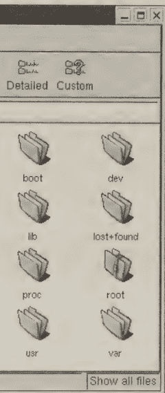

此目录包含了超级用户和普通用户使用的命令。这些命令通常对系统至关重要，包括复制、移动和删除文件、登录、创建和打开归档、识别名称以及查看文本文件等操作。你很少想要修改 `/bin` 目录的内容（如果你确实这样做，必须以 root 身份进行）。

## /boot

此目录包含了启动系统所需的大部分文件。计算机启动所需的其他文件存储在 `/etc` 和 `/sbin` 目录中。不要期望手动更改 `/boot` 目录。

## /dev

`/dev` 目录包含设备文件和其他特殊文件。表 3-1 显示了你在 `/dev` 中可能找到的设备类型。

| 设备名称 | 设备类型 |
| :--- | :--- |
| /dev/ide | 整个 IDE 主硬盘 |
| /dev/hdb1 | IDE 从机硬盘上的分区 1 |
| /dev/fd0 | 第一个软驱，类型自动检测 |
| /dev/lp0 | 第一台并行打印机 |
| /dev/midi00 | 第一个 MIDI 端口 |
| /dev/null | 无（要永久删除某物，将其发送到这里） |
| /dev/psaux | PS2 键盘端口 |
| /dev/ramdisk | 磁盘 |
| /dev/scd0 | 第一个 SCSI CD-ROM |
| /dev/sda | 整个 SCSI 硬盘 |
| /dev/st0 | 第一台 SCSI 磁带 |
| /dev/tty1 | 第一个虚拟终端 |

**表 3-1.** /dev 中的设备示例

这不是详尽的列表，但它可能已经比你需要了解的多了。这是另一个你不需要（或几乎不需要）进行调整的目录。

## /etc

此目录包含了你的 Linux 系统启动和正常运行所需的配置文件。这些许多文件可以并且已经被编辑过——通过配置实用程序或文本编辑器进行自动编辑。大多数 Linux 发行版都提供了许多配置 `/etc` 目录文件的帮助以使生活更轻松；你在安装过程中回答的一些问题将填充所需的 `/etc` 目录文件。

## /home

此目录通常为系统上的每个用户有一个子目录。例如，如果 Mom、Dad、Erin 和 Matt 是系统上的唯一用户，`/home` 目录可能包含四个用户目录：

- /dad
- /erin
- /matt
- /mom

还有其他的安排方式，例如在某些 Linux 发行版中，它们不使用 `/home`。

## /lib

此目录包含了系统运行所需的库。大多数库被许多程序共享，但有些仅被一个程序使用。这些通常对系统至关重要，包括复制、移动和删除文件的操作。你很少想要修改 `/lib` 目录的内容（如果你确实这样做，必须以 root 身份进行）。

## /sbin

此目录包含仅供超级用户使用的系统管理命令。这些命令通常对系统至关重要，包括复制、移动和删除文件、登录、创建和打开归档、识别名称以及查看文本文件等操作。你很少想要修改 `/sbin` 目录的内容（如果你确实这样做，必须以 root 身份进行）。

## /mnt

此目录用于临时挂载文件系统。事实上，有些人将 `/mnt` 指向任何名称。

## /opt

此目录是用于存放可选附加软件的地方。在许多 Linux 安装中，`/opt` 是大多数第三方应用程序安装的位置。

## /proc

`/proc` 目录是一个虚拟文件系统，包含了关于进程以及在上面的进程的信息。

## /root

`/root` 目录是超级用户的主目录。在许多 Linux 发行版中，它并不常用。

## /tmp

此目录为系统提供临时文件。不要在这里存储你自己的文件。

## /usr

`/usr` 目录包含系统上所有人使用的程序和工具。大多数都是与 Linux 发行版一起安装的。

## /usr/local

`/usr/local` 树是不修改 `/usr` 目录规则的一个例外。事实上，许多 Linux 安装中，`/usr/local` 是大多数第三方应用程序安装的位置。

## /usr/src

`/usr/src` 树包含 Linux 源代码。

## /var

`/var` 是 Linux 系统变动数据的仓库。变动数据包括锁文件、日志文件、邮件邮箱、池化数据和缓存数据。

## 进程与重定向

无论你使用 Windows 还是 Linux，你的操作系统都能同时处理多于一个“进程”。例如，如果你在 Windows 中打开任务管理器，你可以看到你已经打开的应用程序。这些应用程序的底层通常是许多执行不同任务的不同进程：从你的键盘获取输入；进行计算；在屏幕上显示图像。

当你使用 Linux 时，你对这些进程中的每一个拥有更强的控制权（无论你是否想要控制，完全取决于你和你的电脑）。你可以在系统上创建、重新调整优先级和删除进程，并将输出从一个普通进程重定向到另一个进程。

## 进程 (Processes)

我们先谈谈进程控制。如果你正在使用带有 X Windows 和窗口管理器的 Linux，那么在你启动应用程序之前，会有几个进程在运行。有你登录的 shell、X Windows、窗口管理器、运行在窗口管理器桌面上的任何小组件，以及你在后台运行的任何程序，如 Web 服务器、邮件程序和定时任务。

### 前台 (Foreground)

我提到了后台运行的进程，但在我详细解释它们之前，我应该提到运行在前台的程序。运行在前台的程序准备好接受用户输入或更新屏幕显示，因此，交互式程序（如文字处理器）在前台运行效果最好。bash、tcsh 和 zsh shell 都提供了一个命令 `fg`，用于将进程从后台带到前台。

### 后台 (Background)

后台进程是不等待其他事情发生之进程。例如，当用户想要使用我公司的软件来自动化复杂的 IC 布局时，他们可以发布一个命令让电脑释放布局工作，该任务在后台运行，期间他们可以检查邮件、浏览网页，甚至玩游戏。在后台运行时，执行这些任何一个前台任务都会让布局自动化变慢，但它会持续运行直到完成。

### 杀死 (kill)

如果你可以通过运行程序来创建一个进程，那么你如何删除那个进程呢？自然地，你把它“杀死”（`kill`）掉。如果你认为某个进程锁定了，或者如果你需要释放更多的计算能力并想剔除不必要的进程，可以使用 `kill` 命令杀死其中一些或全部进程。普通用户可以使用 `kill` 命令剔除自己的进程，而 root 用户（超级用户）可以杀死任何人的进程。所以，老天爷，请务必谨慎使用。

## 定时任务 (Cron)

进程并非只在你调用程序时创建；它们可以被调度为定期发生。实现此点的一种机制之一是 `crontab`，它是一个包含运行什么内容以及何时运行这些指令的文件。每个用户都有一个可以编辑的 `crontab`，用以执行持续性任务，如删除临时文件、执行备份或发送状态报告。另一个用于调度任务的任务机制是 `at` 命令。

## 守护进程 (Daemon)

`crontab` 和 `at` 命令之所以有效，是因为有一个 `cron` 守护进程在决定哪些任务需要执行，并确保它们在预定时间运行。那么什么是守护进程呢？简单来说就是一个潜伏在后台、不知疲倦地执行赋予它的命令的进程。我个人对这个名字并不兴奋；我不希望我的电脑里有一个熟悉的灵魂在听命于我。但这只是一个名字，所以我保证，如果你不激动，它也不会激动。

## top

那么，你如何发现哪些处理器是系统资源的顶级用户呢？你的首选应该是 `top` 命令。`top` 非常适合识别可能拖慢你系统性能的进程，它还提供了额外信息，如整体 CPU 利用率、活跃用户会话数、系统运行时间，内存使用情况和交换分区使用情况。

## ps

要确定系统上所有进程的状态，你可以使用 `ps` 命令，它代表“process status”（进程状态）。此命令可以列出所有或部分进程，并有多种选项来控制它显示的信息。当你需要查看信息时，此命令特别有用。

## 重定向 (Redirection)

大多数程序在从键盘输入时被重定向到文件，这种重定向。程序在将输出显示在屏幕上，这种重定向非常有用。

## 标准输入 (stdin)

大多数程序在从键盘输入时被重定向到文件。大多数程序在将输出显示在屏幕上时，这种输入通常被称为标准输入。

## 标准输出 (stdout)

大多数程序在将输出显示在屏幕上时，这种输出通常被称为标准输出。

## 错误输出 (stderr)

大多数程序在将输出显示在屏幕上时，这种输出通常被称为错误输出。

## 管道 (Pipe)

大多数程序在将输出显示在屏幕上时，这种输出可以通过管道。

## 覆盖重定向 (>)

大多数程序在将输出显示在屏幕上时，这种输出会被重定向。使用 `>` 符号重定向会覆盖目标文件。

## 追加重定向 (>>)

大多数程序在将输出显示在屏幕上时，这种输出会被重定向。使用 `>>` 符号重定向会将输出追加到目标文件。

## 符号 (Symbols)


要确定系统上所有进程的状态，你可以使用 `ps` 命令，它代表“process status”。大多数程序在将输出显示在屏幕上时，这种输出使用了符号。

## 通配符 (Wildcards)

要确定系统上所有进程的状态，你可以使用 `ps` 命令，它代表“process status”。大多数程序在将输出显示在屏幕上时，这种输出可以使用通配符。

## 脚本 (Scripts)

要确定系统上所有进程的状态，你可以使用 `ps` 命令，它代表“process status”。大多数程序在将输出显示在屏幕上时，这种输出可以使用脚本。

## 环境变量 (Environment Variables)

要确定系统上所有进程的状态，你可以使用 `ps` 命令，它代表“process status”。大多数程序在将输出显示在屏幕上时，这种输出可以使用环境变量。

## 权限 (Permissions)

要确定系统上所有进程的状态，你可以使用 `ps` 命令，它代表“process status”。大多数程序在将输出显示在屏幕上时，这种输出涉及到权限。

## 所有者 (Owners)

要确定系统上所有进程的状态，你可以使用 `ps` 命令，它代表“process status”。大多数程序在将输出显示在屏幕上时，这种输出涉及到所有者。

## 组 (Groups)

要确定系统上所有进程的状态，你可以使用 `ps` 命令，它代表“process status”。大多数程序在将输出显示在屏幕上时，这种输出涉及到组。

## 路径 (Paths)

要确定系统上所有进程的状态，你可以使用 `ps` 命令，它代表“process status”。大多数程序在将输出显示在屏幕上时，这种输出涉及到路径。

## 链接 (Links)

要确定系统上所有进程的状态，你可以使用 `ps` 命令，它代表“process status”。大多数程序在将输出显示在屏幕上时，这种输出涉及到链接。

## 配置文件 (Configurations)

要确定系统上所有进程的状态，你可以使用 `ps` 命令，它代表“process status”。大多数程序在将输出显示在屏幕上时，这种输出涉及到配置。

## 第 3 章：新操作系统、新自由、新概念

从 `/usr/src/linux` 指定要使用的版本。当你获得新版本时，你不需要重命名目录，只需更改链接即可。

这种链接被称为“符号”链接（symbolic link）。Windows 世界中最接近的概念是快捷方式，它只是指向另一个文件或目录。在 Windows 中，快捷方式可以通过 .lnk 链接来识别。当你查看包含符号链接的 Linux 目录时，它可以告诉你该链接指向哪里：

```
millerm@romans:/usr/src> ls -l
total 4
lrwxrwr-wx 1 root       11 Dec 29 07:53 linux -> linux-2.2.13/
drwxr-xr-x 15 root      1024 Dec  2 15:52 linux-2.2.13/
drwxr-xr-x 3 postgres postgres 1024 Jul 12 10:24 pgql/
drwxr-xr-x 3 root       1024 May 22 1998 sendmail/
```

指向 linux-2.2.13 的箭头显示它是一个符号链接。相反，硬链接（hard link）使得两个（或多个）文件变得不可区分。它本质上是将文件名指向硬盘上的相同数据——就像一个拥有两个名字的文件。

## `cp`

`cp` 命令非常直观；你可以用它将文件复制到另一个名称或位置，或者将多个文件复制到目录中。它类似于 DOS 的 copy 命令。你必须对文件具有读取权限才能复制它，并且必须对目标目录具有写入权限才能创建副本。

## `mv`

`mv` 命令也很容易学习。它简单地重命名或移动一个或多个文件。虽然 `cp` 命令会在旧位置留下副本，但 `mv` 命令会删除原始文件。你必须对文件具有写入权限才能将其移出原始位置，并且对目标目录具有写入权限才能将其移动到新家。

## `rm`

此命令允许你删除文件和目录。你必须对想要删除的文件和目录具有写入权限，默认情况下，该命令不会删除目录。要这样做，你必须指定 `-r` 选项对目录结构进行“递归”处理。但请务必小心递归，否则你一定会后悔的。

## `cat`

`cat` 命令类似于 DOS 中的 type 命令。它仅仅是一种在屏幕上显示文件内容的方法。尽管这看起来可能很奇怪，但它还有另一个功能：它可以用于合并（拼接）多个文件。我还没有弄清楚如何用它来打洞挂钩，但谁知道它还可能拥有其他力量呢。

## Windows 瘾者的 Linux 指南：12 步

## `more`

如果一个文件中的信息超过一个屏幕，`cat` 命令会让你感到沮丧，因为它会在你阅读之前就将文件开头滚动到屏幕外。输入 `more` 命令，它也显示文件内容，但它一次显示一屏内容。当你准备好继续查看下一屏信息时，按下空格键（SPACEBAR）。可以一直持续，直到你读完文件或按下 `q` 键提前退出。

## `less`

好了，假设你正使用 `more` 命令愉快地翻阅一个 README 文件，但你不小心多按了一次空格键。或者假设你的记忆力和我一样糟糕，立刻忘记了在上一页读了什么。当你觉得无法应付“more”时，就可以使用“less”。

Less 的工作方式与 `more` 相同，但它允许你向前或向后滚动文件，并提供更多控制。例如，`more` 限制你只能使用空格键向前翻一页，而 `less` 允许你使用空格键翻页，或使用方向键以及 PAGE UP/PAGE DOWN 键上下滚动。你可以通过 `q` 键退出 `less`，就像对待 `more` 一样。

## `head`

但也许你根本不想看到整个文件。也许你只想看一眼文件的开头看看它包含什么。`head` 命令就能完成这项任务。当你对一个文件运行 `head` 时，它会在屏幕上显示文件的第一部分。

## `tail`

为了不漏掉只想查看文件末尾的人，Linux 包含了 `tail` 命令，它只显示最后几行。这对于日志文件非常有用，日志文件通常将最新信息存储在末尾。

## `lpr`

`lpr` 命令用于将文件内容发送打印机。根据打印机在 Linux 中的配置方式，它可能区分文本文件和格式化文件（例如 Postscript）。我们将在第 8 章详细地讨论打印问题。

## `grep`

鉴于 GNOME 和 KDE 等桌面管理器提供的搜索工具非常易用，你可能永远不需要使用命令搜索文件中的文本。但如果你确实需要，你会使用 `grep`。`grep` 可以在你指定的文件或目录中找到任何给定字符串的所有实例。

## 第 3 章：新操作系统、新自由、新概念

```
diff 命令比较两个文件的内容。它会显示文件之间不同的行。如果你丢失了对文件所做的更改，这非常有用。diff 命令有一个特别实用的选项 (-y)，它可以将差异行并排显示，以便于比较。
```

## 目录命令

许多之前的命令可以作用于文件，也可以作用于目录。以下命令仅在应用于目录（或链接）时才有意义。

`pwd`

此命令显示当前目录的完整名称（工作目录）。它会解析任何符号链接，让你确切知道自己在目录结构的哪个位置。

`cd`

此命令类似于 DOS 中的命令，切换目录。你可以使用绝对路径（例如 `/home/systems`）或快捷字符（如 `~/systems`）。

`mkdir`

此命令允许你创建目录。你必须是超级用户或对父目录具有写入权限才能成功执行此命令。

`rmdir`

此命令允许你删除空目录。如果你想消除目录，你将不得不使用 `-r` 选项。

## 多用户命令

如果你没有在使用具有多个用户的系统，这些命令可能并不特别有用。如果你想知道谁正在使用系统，有一些命令行选项可以做到，我想告诉你一些。

`users`

此命令简单地列出当前登录系统的用户。例如

```
millerm@romans:~> users
david dedood karen millerm
```

所以看起来 dedood 在 1 月 4 日凌晨 5:42 登录了系统，然后启动了 X Windows。其余用户是从其他机器登录的。

## `who`

`who` 命令报告类似的信息，但对于每个当前登录的用户，它指示登录名、访问的终端、登录日期时间和 X Windows 显示信息。如果我在同一系统上运行 who，我会发现

```
dedood tty1 Jan 4 05:42
dedood tty4 Jan 4 05:48 (:0.0)
dedood tty0 Jan 4 05:48 (:0.0)
dedood tty1 Jan 4 05:48 (:0.0)
karen tty3 Jan 30 18:02 (genesis.nodomain.)
millerm tty5 Feb 6 23:37 (exodus.nodomain.)
david tty6 Feb 12 08:19 (numbers.nodomain.)
```

## `finger`

使用 `finger` 可以获取更多关于用户的信息。显示位位信息存在某些差异，某些数据可能无法由 finger 提供，但 finger 可以返回关于你指定用户的以下位位信息：

- 账户名
- 真实姓名
- 终端名称
- 空闲时间
- 办公室位置
- 办公室电话
- `.plan` 文件的内容
- `.forward` 文件的内容
- `.project` 文件的内容

系统上的每个用户都可以填充列出的点文件，以供其他用户查看个人信息（不那么社交的人可能不愿这样做，这没关系，# 第3章：新操作系统、新自由、新概念

(太)。如果你指定一个用户进行 finger 查询，系统将为每个当前登录的用户显示一个非常简短的数据列表。

## 安全命令

在我们继续对 Linux 命令的旋风之旅中，我想指出三个与安全相关的命令。许多安全功能可以在 Windows 内部完成，因此人们通常选择在 Windows 中操作，但为了防范万一，了解基础命令是明智的。

## `passwd`

`passwd` 命令用于设置用户账户密码。当你作为普通用户运行 `passwd` 时，你可以更改当前正在使用的账户密码。当你以 root 用户身份运行 `passwd` 时，你可以更改 root 密码或其他任何用户账户的密码。请注意不要忘记 root 密码，因为恢复它可能会非常麻烦。

## `chmod`

`chmod` 命令用于更改文件或目录的权限属性。如果你对想要更改的文件或目录拥有权限（无论是作为用户还是组），你应该能够使用 `chmod`。

## `chown`

`chown` 命令用于更改文件或目录的所有者和/或组属性。如果你想更改文件或目录的所有权，你必须是 root 用户或当前所有者。

## 网络命令

虽然 Linux 系统上有许多与网络相关的命令，但我选择了几个特别值得注意的。其他命令（例如 `ping`）可能有用，但我们将在第9章中介绍它们。

## `ftp`

猜猜文件传输协议是怎样的。没错，它是用来传输文件的！互联网的广泛吸引力和可用性使得 ftp 成为许多用户熟悉的概念，即使是那些没有使用过 Windows 自带版本的用户也是。尽管你可以使用任何浏览器访问网站，也可以使用命令行工具。`ftp` 工具允许你指定正在传输文本文件还是二进制文件；它允许你一次传输多个文件；它甚至允许你在远程系统上删除文件（如果你有权限的话）。

## `rlogin`

`rlogin` 程序允许你登录到远程系统，就像它是本地系统一样。它在另一个连接网络的系统上建立终端会话，以便你可以访问该系统上的文件和程序。这意味着你可以利用其他系统的处理能力，而无需坐在它们面前。当然，其他系统的所有者可以阻止你使用 `rlogin` 进入他们的系统，我想他们会好相处的。

## `rsh`

此程序允许你在远程主机上执行命令。通过登录到远程计算机建立 `rlogin` 命令，而 `rsh` 只是将另一个命令传递给远程主机。尽管 `rlogin` 和 `rsh` 非常有用，但它们为可以跨网络访问你电脑的外来提供了访问路径。这些程序的功能整合到了更安全的工具中。

## `telnet`

`telnet` 命令是访问远程计算机的另一种方式；它比 `rlogin` 和 `rsh` 程序更严格，但它被广泛支持。例如，如果你在外部托管了一个网站，你可能可以使用 telnet 操作文件和目录。虽然 ftp 很好适合将文件从一个主机传输到另一个主机，但 telnet 更适合在文件到达远程主机后进行访问。

## 奇特而神奇的工具

有一些程序和实用并不完全属于上述类别。因为你在安装运行在 Linux 上的程序时很可能会遇到其中一些，所以我想在这里提到它们。

## `make`

我将在第13章更详细地讨论 `make`，但你现在应该了解它，以免以后让你产生困惑。有一个名为 "make" 的 GNU 程序，它允许你重新创建一个运行在你的系统上的程序。我之所以说“重新”，是因为你并没有自己编写代码；你只是在运行 make 来编译和链接程序，以便它能在你的计算机上运行。由于程序员不知道每种配置的细节，而且他们大多数人都希望他们的程序运行在不同的硬件平台和操作系统上，你会发现许多适用于 Linux 的程序是以源码形式分发的。这没什么好担的，因为大多数程序员都友好地创建了脚本，为你完成了大部分工作。但在创建在你的 Linux 上运行的程序过程中，需要运行 make，有时还会带有一些命令行选项。你通常会在程序附带的安装说明中找到关于这些选项的信息；它们通常位于名为 README 或类似的文件中。

## `man`

`man` 命令向你显示给定 Linux 命令的手册页。只需输入 `man` 后跟你想学习的命令名称即可。例如，如果你忘记了如何使用 `man` 命令，可以输入 `man man`。手册页通常格式为以下章节：

- 命令名称
- 用法摘要
- 功能描述
- 选项详情
- 它使用的环境变量
- 相关命令的名称
- 对已知漏洞（bug）的描述
- 使用技巧

## `info`

`info` 命令与 `man` 命令类似，但它使用超文本系统，允许你从手册页内部跟踪链接。Linux 发行版中包含的许多程序在 man 手页中不再有最新信息；如果是这样，手册页会提示你使用 `info` 命令获取最新信息。一旦进入 info 文件，你可以从一个超链接跳转到另一个超链接，并按回车键进入你感兴趣的那个。

## `lilo`

`lilo` 程序负责加载内核。Lilo 在系统启动时加载 Linux（其名称来自 "Linux loader"），它可以被配置为启动另一个操作系统。例如，如果你已经安装了 Windows，你可以配置 `lilo` 来启动 Linux 或 Windows。由于 `lilo` 启动你的系统，它允许你选择。如果你手动重新编译内核，必须运行它。

## 针对 Windows 成瘾者的 Linux：一个戒瘾计划

有些评论家批评 Linux 的可配置性，认为它在企业环境中是不理想的。请记住，除非你信任他人做出配置决策，否则 root 用户有权重新配置内核。

## 编辑器

由于 Unix 在很大程度上基于文本，而且长期以来被程序员使用，Linux 有多种文本编辑器。我们将快速查看 FreeBSD 提供的图形化编辑器，但目前，这里有一份常用的编辑器列表。我由于漏掉了某些你喜欢的编辑器而可能会冒犯，包括 joe 和 jed 编辑。我将提到三个编辑器是 pico、vi 和 Emacs。

## `pico`

`pico` 编辑器似乎对新 Linux 用户更有吸引力，而另外两个编辑器是早期使用者的爱好。我使用的一个互联网服务提供商（ISP）向不熟悉 Unix 系统的用户推荐 pico。

"pico" 这个名字是 Pine composer 的缩写，指的是 pine mail 工具。它的行为基于 pine，如果你认为自己将进行大量的文本邮件和编辑，选择 pico 并坚持下去可以节省时间——这样你只需要学习一套编辑命令。当你在 pico 中编辑文件时，屏幕或窗口底部会显示命令列表。Pico 使用控制键和字母的组合；例如，退出 pico 需要按住控制键 (CTRL) 的同时按下 x 键。

## `vi`

该编辑器及其同类在我看来是最不适合新用户的文本编辑器。`vi` 命令很难记忆，编辑器缺乏任何帮助，而且它的功能可能无法帮助你解决 Windows 世界和 Unix 世界之间术语的差异。尽管如此，我应该补充一下，`vi` 是我最常用的编辑器。最初的原因是我已经忘记了太多 Emacs（我在大学期间使用，稍后会介绍），以至于使用它时效率不高，而且我当时的一位 vi 狂热者对 Emacs 的言辞非常激烈，以至于我很快切换到了 vi 来让他闭嘴。我推荐-

## 第3章：新操作系统、新自由、新概念

当你需要在多个可以完成工作的工具之间进行任意选择时，随时调整这种方法。

作为 Linux 用户，你将不会运行“vi”编辑器，而是运行扩展的克隆版本，如 nvi、vim 或 Elvis。这些不同版本的功能集可能不相同，但外观和感觉是完全相同的。这些克隆程序用于添加你在“vi” 编辑器中找不到的功能，例如多次撤销和多窗口操作。

Vi 是一个快速且粗旷的编辑器，一旦你熟悉了它，它非常好用。Vi 使用以冒号（":"）开头的命令。例如，要在不保存我正在工作的文档的情况下退出，输入 `:q`，意思是“退出且不用担心我没有保存它”。如果你觉得这听起来并不奇怪，那么你必须小心你所在的位置；除非你处于编辑模式，否则键盘上的大多数按键都有其他功能（因为你正处于命令模式）。你可能会发现自己是在文档中移动，而不是在添加内容。Vi 没问题，除非你受到经验或外部原因的驱动，否则我会用其他东西。

### Emacs


Emacs 是许多 Unix 用户的另一个心爱。它提供了菜单系统、上下文敏感帮助和完全的可扩展性（前提是你或某个有用的人知道 Lisp）。Emacs 使用 `CTRL`、`SHIFT` 和 `ALT` 键，`F1` 键……如果有可用的组合键，Emacs 很可能会以某种方式利用它。大多数流行的文本编辑器都有几项文本编辑功能，但 Emacs 在扩展功能方面确实是出出的。如果你正在寻找一个与 `vi` 不同的文本编辑器——它是一个编辑器，那么 Emacs 可能适合你。如果你正在寻找一个可以在文本模式下运行但利用 Windows 特性的文本编辑器，Emacs 可能适合你（尽管许多编辑器两者兼顾）。如果你正在寻找一个带有日历和日记、更不用说浏览功能的文本编辑器，Emacs 可能适合你。当然，如果你有时间和意愿将它的力量引导至你的目标，它是一个强大的盟友。

## Windows 成瘾者的 Linux

### 第二部分

### 超越成瘾：康复的 12 步

第二部分的结构基于以下 12 步程序，我向那些像我们中许多人一样、决定想要摆脱对微软每日依赖的人推荐它。这 12 步是：

- 第一步。承认我们对微软无为力——除非我们安装 Linux。

- 第二步。相信 Linux 是高度可配置的，不会导致我们的系统崩溃，并让我们恢复理智。

- 第三步。决定将我们的系统交给自定义内核的力量灵活性。

- 第四步。无畏地连接到本地或广域网。

- 第五步。管理用户和组。

- 第六步。列出微软和 Novell 系统并与它们全部建立联系。

- 第七步。承认打印和打印服务很容易配置。

- 第八步。建立一个可靠的服务器。

- 第九步。通过电子邮件与其他人联系。

- 第十步。继续寻找新软件并尽快制作它们。

- 第十一步。共享文件以改善意识接触，并安排我们的工作来执行它们。

- 第十二步。通过这些步骤成为 Linux 用户后，继续使用基于 Linux 的办公应用程序。

## Windows 成瘾者

## 第 4 章

### 第一步：安装 Linux

## Windows 成瘾者：12 步程序

我们现在准备好迈向摆脱微软成瘾的第一步了。我们通过承认：除非安装 Linux，否则我们对微软无为力来实现这一点。

现在我们要进入正题了，就像老人们在还能找到黄铜钉（brass tacks）的日子说的那。我们将在两种不同的情况下安装两个不同的 Linux 发行版。在两种情况下，我们都将在已经在运行 Windows 的计算机上进行安装。在两个示例中，我假设我们想保留 Windows 运行（我不希望我对微软产品的投资缩水为架上软件，也许你还没准备好彻底断绝）。

在第一种，我们将在现有的 Windows 分区上安装 Linux。虽然这会让 Linux 的运行速度明显比应有的要慢。在第二种情况下，我们将使用某些 Linux 版本附带的分区调整程序进行安装。

适合你的方法在某种程度上取决于你拥有的硬件，以及你想要在系统中使用 Windows 和 Linux 的程度。在我看来，如果你愿意在系统中安装一个额外的硬盘来容纳 Linux，你将获得最简单的安装体验。软件安装将与我们在这里做的非常相似，但你可以跳过一些为了将 Linux 挤进已经装满 Windows 的磁盘而必须的步骤。

但在开始加载软件本身之前，让我们先确定一下方向，好吗？在开始过度折腾之前，从系统中收集一些信息是个好主意。自然，我们想确保自己尽可能准备就绪，以防发生万一。

## 安装前倒计时

我希望你在继续尝试 Linux 之前做三件事。把这个倒计时看作是安装的准备，一旦我们完成，我就会开始放入 Linux 光。但正如乔治·斯科特在《奇博士》中的角色可能说的那样，“别带上我起飞。”三个安装前的任务是：

- 备份你的数据

- 识别你的硬件

- 检查硬件兼容性

## 备份任何你想保留的数据

## 第 4 章：第 步：安装 Linux

也许你打开了来自你不认识的人的文件。说起破坏，请看侧边栏。无论你多么大胆和鲁莽，你都需要花一点安静的时间考虑你的数据有多重要。在继续之前你必须备份它，因为我们正要进行一些重大的、侵入性的手术。你的数据重要吗？你的产品设计重要吗？你的通讯录必要吗？那么在备份它们之前，不要对系统进行任何更改。如果有帮助，可以这样想：规则是只备份你想保留的文件。如果你没有备份，我猜你就没有。

现在你知道什么对你来说很重要了，把那些文件复制到某处。如果你有磁带驱动，将数据转储（更好是将系统备份到磁带）。如果你有 CD 刻录机，将文件写入 CD。如果你受限于 Zip 磁盘，或者更糟糕的，软盘，我仍然建议你保存任何重要的东西。安装 Linux 并不困难，但对系统的任何重大更改都可能导致数据丢失，如果你给我发邮件抱怨丢失数据，我会如实相告。

### 危险的通信

我想提到另一项略微相关的活动：转发垃圾邮件。两个最大的罪祸首似乎是要求发送给所有朋友的“好运”信息，以及病毒谣言警告。让我解释两件可能对你有帮助的事情：世界上没有所谓的好运；以及在互联网上有好几个地方可以检查病毒谣言，包括 `http://www.antivirus.com/vinfo/hoaxes/hoaxes.asp`。如果你没有足够的动力去确保它不是谣言，那么就不要多此一举用警告来扰别人。我知道传递这些信息本身不会损害你的电脑，但如果其中一个恼怒的联系者最终爆发并向你发送了真正的病毒，或者给了你脸一拳，别别说我没警告过你。

# Windows 爱好者的 Linux 之门：12 步计划

电脑会告诉你。表 4-1 显示了在完成 Corel Linux、Caldera OpenLinux 或 Red Hat 安装过程之前你应该了解的信息。

| 设备 | 需要了解的 | 如何获取 | Corel | OpenLinux | Red Hat |
|---|---|---|---|---|---|
| 鼠标 | 品牌、端口 | Windows 设备管理器 |  | 是 | 是 |
| 键盘 | 类型 | Windows 设备管理器 |  | 是 | 是 |
| 显卡 | 制造商 | 显示控制面板 |  |  | 是 |
|  | 型号 | 显示控制面板 |  |  | 是 |
|  | 显存 | 显示控制面板或机箱 |  |  | 是 |
| 显示器 | 制造商 | 显示控制面板或显示器 | 是 | 是 | 是 |
|  | 型号 | 显示控制面板或显示器 | 是 | 是 | 是 |
|  | 刷新率（水平和垂直） | 文档 |  | 是 | 是 |
|  | 当前分辨率 | 显示控制面板 |  | 是 | 是 |
|  | 当前色彩深度 | 显示控制面板 |  | 是 | 是 |
| 网络 | DHCP | 网络控制面板 | 是 | 是 | 是 |
|  | IP 地址 | 网络控制面板 | 是 | 是 | 是 |
|  | 网关 | 网络控制面板 | 是 | 是 | 是 |
|  | DNS 服务器 | 网络控制面板 | 是 | 是 | 是 |
|  | 子网掩码 | 网络控制面板 | 是 | 是 | 是 |

**表 4-1.** 需要了解的硬件信息

## 第 4 章：第 1 步：安装 Linux

这些信息最初并不需要。例如，Corel Linux 在安装过程中本身不会询问你的网络配置。但如果你想连接网络工作，就必须了解这些信息。关于你的硬件，还有一些额外信息在之后需要了解，包括你的 CPU 类型和系统中的内存大小，但我们将在后的章节中处理这些问题。

## 从系统属性面板查找硬件

Windows 中的“系统属性”控制面板是识别现有硬件的极佳资源。在 Windows 9x 中打开此控制面板，你可以：

1. 右键点击桌面上的“我的电脑”图标。

2. 选择“属性”菜单选项。

“系统属性”窗口将打开并默认选中“常规”选项卡。此页面应该告诉你拥有什么种类型的 CPU 以及 Windows 识别出多少 RAM。“设备管理器”选项卡可以提供额外信息。如果你点击该选项卡，它将打开一个类似图 4-1 所示的窗口。

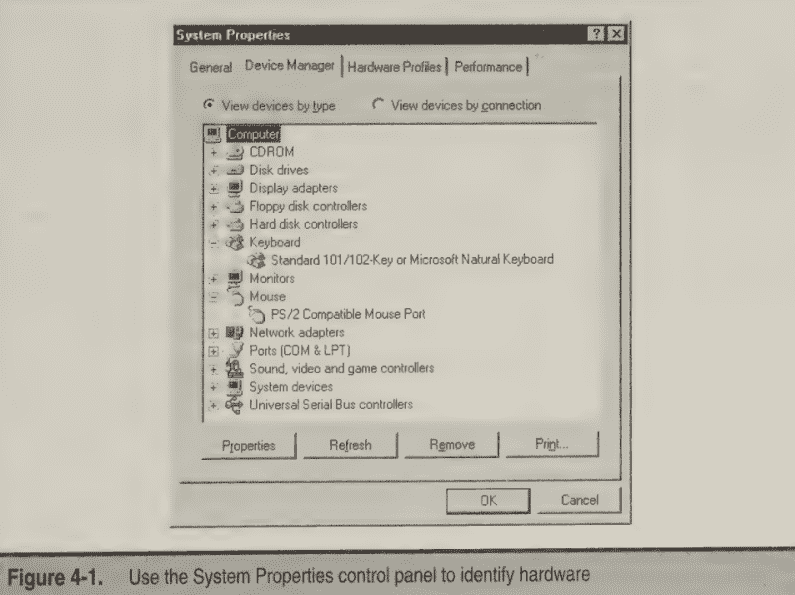

图 4-1. 使用系统属性面板识别硬件

“设备管理器”选项卡上的图标代表设备类别。如果你双击加号旁边的图标，将看到该类别下已安装的设备。此屏幕可用于判断你是否有 SCSI 控制器、网卡、调制解器和声卡。它可以告诉你安装了什么种类型的鼠标，它认为你有多少个硬盘驱动器，以及它能识别出什么种类型的 CD-ROM。

在图 4-1 中，设备管理器列表中的“鼠标”项已展开，显示了一个通用的 PS/2 鼠标。列表中的“键盘”项将提供有关连接到计算机键盘类型的信息。

## 从显示面板查找视频信息

关于视频显示的信息最好从“显示”控制面板收集。打开此控制面板：

1. 右键点击你的 Windows 桌面（某个没有图标的地方）。

2. 选择“属性”菜单选项。

这将打开“显示”控制面板，并默认位于“背景”。我们对背景感兴趣，所以点击“设置”选项卡查看类似图 4-2 所示的屏幕。

如果“设置”选项卡上只显示了一个显示器，请不要惊讶；图 4-2 所示的系统有两个显卡。注意这里有一个关于显示器的描述；它应该提到显示器和显卡。有时“显示”行包含的信息是不够的。例如，在图 4-2 中，Hitachi, Ltd. CM800 是显示器制造商和型号，而 Rage Pro Turbo PCI 只是视频适配器的型号。

要获取更多信息，点击“设置”页面上的“高级”按钮。这将弹出显示属性页面，该页面默认是“常规”选项卡。点击“适配器”选项卡以获取有关视频适配器的更多信息。在图 4-3 中，你可以看到适配器是由 ATI Technologies 制造的并使用 Mach64 芯片。这些信息以后可能很有用。在图 4-1 中，注意“屏幕区域”部分显示了 Windows 当前的分辨率，“颜色”显示当前的色彩深度。虽然你可以在 Linux 中尝试不同的设置，但如果你对 Windows 屏幕配置感到满意，你可能想记录并备份它。

## 从网络控制面板查找网络信息

如果你的系统连接到了网络，你想要收集一些关于网络配置的信息。这通过“网络控制面板”很容易实现：

1. 右键点击“网络邻域”图标并选择“属性”。

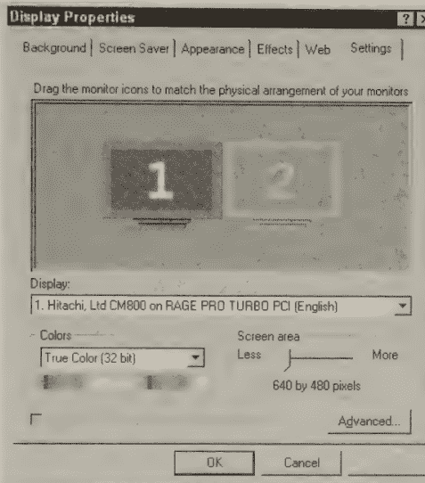

图 4-2. 使用显示控制面板识别硬件

2. 当面板出现时，确保选中了“配置”选项卡并点击“TCP/IP”，然后点击“属性”。

3. 打开“TCP/IP”窗口；如果尚未选中该项，请点击“IP 地址”选项卡。

4. 如果选择了“自动获取 IP 地址”，请记录下子网掩码。

5. 如果选择了“指定 IP 地址”，请记录下网关。

6. 点击“网关”选项卡以获取有关路由器的信息。

7. 点击“DNS 配置”选项卡以显示你看到的主机名、域名和搜索顺序。

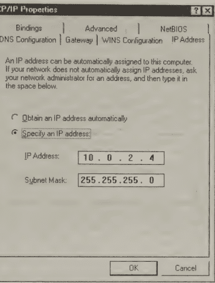

图 4-4. 从控制面板获取信息

**注意：** 如果网络自动获取 IP 地址（如第 4 步所示），你可能没有网关或“DNS 配置”选项卡的信息。

## 从系统信息工具查找硬件

并不是所有运行 Windows 的系统都加载了微软的“系统信息”工具，但如果你有该工具，它是查找硬件的另一个资源。要启动系统信息工具（如果你有），执行以下步骤：

- 点击“开始”按钮。

- 选择“程序”菜单选项。

- 选择“附件”组。

- 选择“系统工具”项。

- 选择“系统信息”图标。

这将打开“系统信息”工具，对于我们的目的来说有点过载，但可以识别硬件配置。例如，图 4-5 显示了工具打开到“多媒体设备”部分，其中

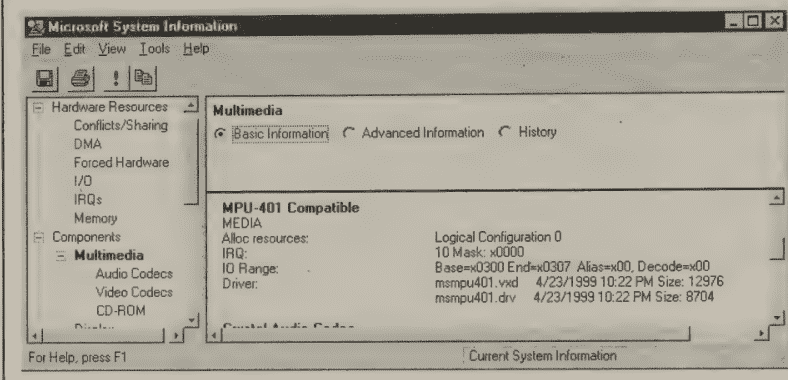

图 4-5. 系统信息工具可识别硬件设置

MPU-401 兼容音频系统可用。音频系统设置为 IRQ 10 和 I/O 地址 x0300 到 x0307。如果 Linux 没有自动检测到这些硬件，拥有信息意味着你可以告诉系统如何配置它们。

## 检查硬件兼容性

我无法强调确保你的硬件与使用的 Linux 发行版兼容的重要性。虽然兼容设备列表很长，而且更新频率不断增加，但如果关键硬件不支持，你的安装体验将非常糟糕。

好消息是，Linux 发行版几乎总是告诉你它们支持哪些设备。要获取本章演示的硬件支持列表，请参考以下 URL：

- Corel Linux `http://linux.core.com/products/linux_os/hardware.htm`

- Caldera OpenLinux `http://www.calderasystems.com/support/hardware/`

- Red Hat `http://www.redhat.com/support/hardware/`

特别需要注意的是，在我写这些内容时，对“Win调制解器”和“Win打印机”的支持几乎不存在。依赖其 Win 的设备

## 第4章：第一步：安装 Linux

某些任务的 Windows 软件尚无法在 Linux 上运行，尽管光纤（Lucent）已经为它的软件模型发布了一些驱动程序，而且开源开发者正在解决这个问题。如果你有一个非常廉价的调制解调器或打印机，可能需要仔细检查它的兼容性。

现在你已经完成了所有这些繁琐步骤，时候开始安装 Linux 了。我将演示的第一个 Linux 安装过程使用的是 Corel Linux 1.0。

注意：从安装磁盘片或 CD 启动 Linux 可能会触发计算机 BIOS 中的防病毒程序。如果发生这种情况，系统启动时你会收到一条警告消息。在大多数情况下，你可以继续安装，但在检查磁盘片是否有病毒后，你可以考虑禁用病毒检查。


# 从 Windows 安装 COREL LINUX

安装 Linux 最简单的方法之一是使用 Corel Linux。这是几种发行版之一，它允许你在不为电脑创建 Linux 分区的情况下就尝试使用该操作系统。如果你只是想探索 Linux，它是入门的侵入性最低的方式之一，因为不需要对你的硬盘布局进行任何更改：如果你在 Windows 中有足够的空闲空间，就应该能够安装 Corel Linux。

另一方面，如果你在现有的 Windows 分区上安装 Linux（这是 Corel 实现这一小成就的方法），你可能会发现性能非常缓慢。这种方法的唯一意义在于可以在不购买另一个磁盘或不自己进行分区的情况下，查看安装过程并玩玩 Linux。

尽管如此，我仍然将演示 Corel Linux 的安装过程，因为它非常简单。如果你的硬件在兼容列表中，你安装成功的概率就会很高，而且需求会非常小。你完全不需要将 Corel Linux 安装到 Windows 分区中；如果你愿意增加硬盘驱动器或在现有硬盘驱动器上有未分配空间，仍然值得一试。在这些情况下，安装过程更加简单，因为你完全不需要配置 Windows 来感知 Linux。

通过安装 Corel Linux 而不是其他发行版，你可能做出的权衡是，其他版本提供的应用程序选项通常比 Corel 多。但如果你的目标是尝试 Linux 而不必担心重新划分硬盘或安装新磁盘，我推荐 Corel。如果你愿意自己对系统进行分区，或者添加新的硬盘（或让现有磁盘彻底清空），虽然你可以安装 Corel Linux，但你也可以考虑在本章后面讨论的 OpenLinux 或 Red Hat。

# 如果我的电脑无法从 CD-ROM 驱动器启动怎么办？

如果你使用旧硬件安装 Linux，并且没有购买 Linux 的零售版（带有软驱器版本），如果你的电脑无法从 CD-ROM 启动，你可能会遇到麻烦。如果是这样，首先检查计算机的 BIOS 设置程序，查看是否可以将系统设置为从 CD-ROM 启动。如果没有该选项，你必须制作一个启动软盘。大多数发行版都包含了从 Windows 执行此操作的工具。在 Corel Linux 中，过程如下：

- 1. 在计算机的软驱驱动器中插入软盘——一张不包含任何重要数据的磁盘。

- 2. 双击 Windows 桌面上的“我的电脑”图标，当软驱驱动器图标出现时右键点击。从菜单中选择“格式化”选项。

- 3. 在大多数情况下，快速格式就可以正常工作，因此点击“开始”开始格式化。格式化完成后，点击“关闭”进入摘要窗口，然后点击“再次”关闭“格式化”窗口。

- 4. 回到“我的电脑”窗口，右键点击 CD-ROM 图标并选择“浏览”选项。双击文件夹打开它。

- 5. 双击 `Bootflap.bat` 启动程序，程序将在 DOS 窗口中打开。确保驱动器中是正确的磁盘（好吧，反正你现在格式化它也太晚了），然后按任意键创建启动软盘。

- 6. 程序将让你知道正在访问哪个磁道和磁头，并在完成后通知你。关闭窗口，你就得到了启动软盘！

# 安装 Core Linux

要开始安装 Linux，选择你已打开的 Windows 程序，然后将 Core Linux CD-ROM 插入 CD-ROM 驱动器中。如果你的电脑自动检测到 CD-ROM，你应该会自动看到 Corel Linux 自动运行界面。如果你在几秒钟后没有看到此启动界面，可能是在 Windows 中开启了 CD-ROM 自动播放。要开始安装，只需双击“我的电脑”图标，然后双击你的 CD-ROM 驱动器图标。安装 Core Linux 非常简单：

- 1. 要继续启动界面，点击“下一步”按钮。你应该能看到与图 4-6 显示类似的屏幕。

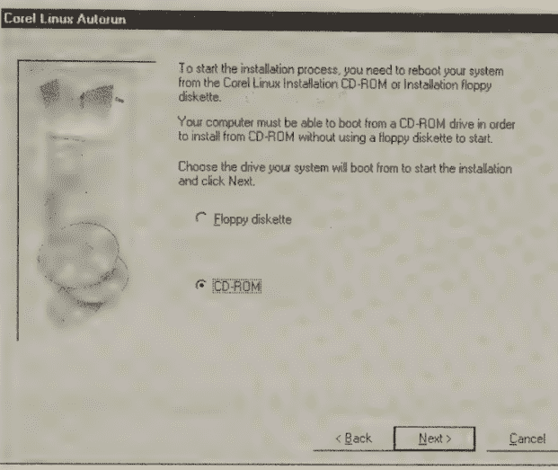

图 4-6. 选择用于启动 Corel Linux 安装的设备类型

- 2. 如果你的电脑从 CD-ROM 启动，请选择 CD-ROM 选项。如果不是，请选择软盘选项。如果不是从 CD-ROM 启动，选择软盘选项（如图4-6 所示）。点击“下一步”继续。

- 3. Corel Linux 会警告你保存工作。确保你关闭了任何应用程序，然后点击“重启”。

- 4. 你的电脑将关闭并重启。如果不是从 CD-ROM 启动（如步骤 2 所示），插入磁盘。

- 5. 当电脑再次启动时，将显示启动屏幕。随着启动过程进行，屏幕将显示“正在加载 Corel Linux”。随后将显示“正在检测硬件”。

- 6. 一旦该过程完成，屏幕将空白片刻。你会看到“正在启动图形化安装”，然后出现协议界面。


进入`/path/to/xxx`目录，找到`xxx.json`。

在表达式`cvar = avar + bvar`中，加法运算符（`+`）将`avar`与`bvar`相加，得到它们的和`cvar`

在`List.of(arg0, arg1, arg2)`中，`List`接口的工厂方法`of()`接受一系列的元素，返回包含它们的只读列表。

之后我们这样调用`cmd`命令：`cmd arg0 arg1 arg2`。

```
if (condVar > someVal) {console.log("xxx")}
```

# 给 Windows 爱好者的 Linux：12 步程序

## 安装步骤

- 7. 在下一个屏幕（如图 4-7 所示）上，将提示输入用户名。输入用户名——全小写——然后点击“下一步”。

- 8. 在下一个屏幕上，你将获得标准桌面或高级安装的选择。选择标准桌面。

- 9. 现在你将看到安装操作系统的选择：
    - 接管磁盘（通过清除现有内容）
    - 使用空闲空间（挤入 Linux 分区）
    - 编辑分区表（手动调整分区大小）
    - 在 DOS/Windows 分区安装（在现有 Windows 分区内创建虚拟分区）

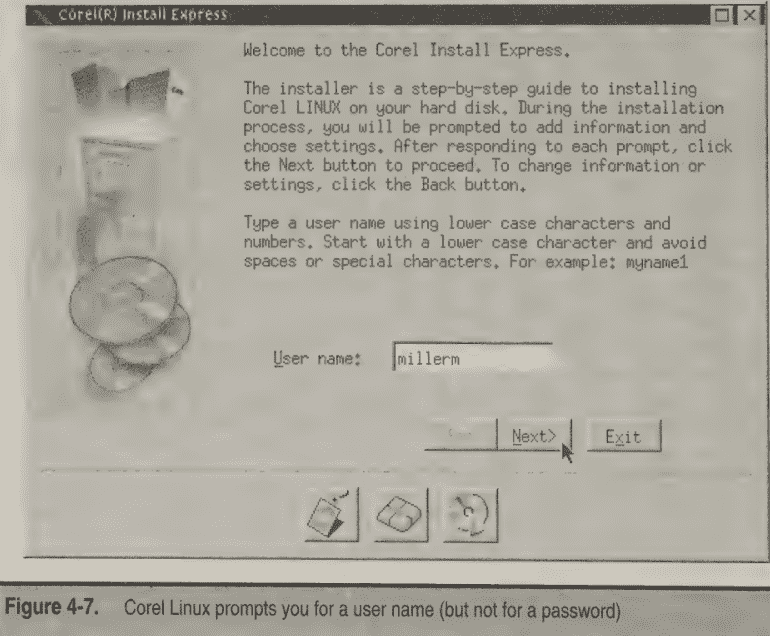

在 Windows 分区安装 Linux 很慢，如果你有空闲空间，请选择该选项（如图 4-8 所示）。但如果 Windows 占据了整个硬盘，请选择最后一个选项并点击“下一步”。

- 10. 如果你允许创建分区，Corel 会报告在硬盘上创建的分区大小。你可能想调整大小以为 Windows 留出空间，或者你可以直接接受默认值。对分区大小满意后点击“下一步”。

- 11. 当下一个屏幕出现时，它将总结选定的安装选项。如果它们看起来像所选选项，只需点击“安装”按钮开始安装。将显示安装过程，但进度条在安装期间往往会停止几次。特别注意完成到 98% 时的减慢，即使在快速的机器上，那里也会持续很久。不要简单地假设系统已崩溃；给它足够的时间来完成。

12. 当安装过程完成后，系统会通知你。移除软盘和 CD-ROM，然后点击确定重新启动计算机。（系统关机时，你的 CD-ROM 驱动器应该会自动打开；此时请取出 Corel CD。）

13. 除非你选择安装在 Windows 分区上，否则启动屏幕将为你提供几个选择；选择 Core Linux 并按回车键进入 Linux。系统随后将执行进一步配置，这可能需要几分钟时间。如果你将 Linux 安装在 Windows 分区上，请参阅下节“从 Windows 进入 Linux”以获取有关如何启动的更多信息。

14. 配置完成后，你将看到 GUI 登录界面。无论是进入 root 还是第 7 步中添加的用户，都没有默认密码。按回车键以 root 身份登录，你就已经安装了 Linux。我们将在下一章讨论配置 X Windows 环境。

# 从 Windows 进入 Linux

如果你能够将 Core Linux 放置在单独的分区上，它将自动覆盖硬盘的主引导记录 (`MBR`)，并在启动时为你提供启动 Windows 或 Linux 的选项。但如果你将 Linux 安装在 Windows 分区上，情况就不如此。那么如何启动 Linux 呢？共有三种方法。

## 在 DOS 模式下启动

此选项告诉 Windows 9x 你想在 DOS 兼容模式下运行，然后从该模式启动 Linux：

- 1. 要要在 DOS 模式下启动，只需在 Windows 启动时按 F8。这将显示 Windows 启动选项。其中之一是 DOS 安全模式——选择它。

- 2. 这样做将带你进入 DOS 提示符；你需要更改目录到 `CDL` 目录，并在那里运行 `STARTCDL.BAT`：

```
C:\> cd cdl
CCDL> startcdl.bat
```

这将启动 Linux。

## 创建启动引导选项

另一种处理方式相当优雅：你可以在 Windows 中编辑 `CONFIG.SYS` 和 `AUTOEXEC.BAT` 文件，为 Windows 或 Linux 提供启动选项。按照以下步骤操作：

- 1. 从 Windows 桌面点击“开始”按钮，选择“运行”，并输入 `sysedit`。

- 2. `sysedit` 程序允许你编辑启动文件，包括 `CONFIG.SYS` 和 `AUTOEXEC.BAT`。先选择 `CONFIG.SYS`。它可能是空的，也可能已经有条目。如果有条目，请在它们之前添加以下行：

```
SWITCHES=/F

[MENU]
menuitem=WIN, Windows
menuitem=LINUX, Corel Linux
udedefault=LINUX, 5
```

[WIN]

这建立了一个启动菜单，默认在提供五秒钟选择后运行 Linux。如果你想将默认启动选项更改为 Windows，请通过删除 LINUX 并添加 WIN 来更改 mudefault 行。如果你想更改决策时间，只需将 5 更改为希望在启动默认选项前等待的秒数即可。

- 3. 如果你的 `CONFIG.SYS` 文件中已存在条目，请在它们之后添加以下行。（如果没有现有的条目，只需在第 2 步中插入的行之后添加此行即可。）

```
[LINUX]
```

- 4. 选择“文件 | 存储”以保存新的 `CONFIG.SYS` 内容，然后选择 `AUTOEXEC.BAT` 文件。

- 5. 在 `AUTOEXEC.BAT` 文件中已出现的任何条目之前，输入以下行：

```
@ECHO OFF
GOTO %CONFIG%
:WIN
```

- 6. 任何现有的条目将跟在 `:WIN` 标签之后。在它们之后（如果没有现有的条目，则紧跟在 WIN 之后）输入这些行：

```
GOTO END

:LINUX
C:
CD CDL
STARTCDL.BAT
GOTO END
```

```
:END
```

## 重复标题

- 7. 自然地，如果 Corel Linux 安装在 C 盘以外的驱动器上；你需要更改 `:LINUX` 标签后的第一行以反映正确的驱动器号。保存 `AUTOEXEC.BAT` 文件并重启你的系统。

当你启动时，将得到两个选择：
- Windows
- Corel Linux

## 调整 Startcdl.bat 文件

此选项对你可能不起，但如果你像我一样，在开始可靠地按下 F8 时太分心，或者你厌恶更改你的 Windows 启动文件，这里有一个对我有效的选项：修改 Core Linux 启动文件的 MS-DOS 属性。方法如下：

- 1. 双击 Windows 桌面上的“我的电脑”图标，然后双击硬盘图标。

- 2. 双击 Corel Linux 安装的 `CDL` 目录，然后右键点击 `STARTCDL.BAT` 并选择“属性”菜单选项。

- 3. 点击“程序”选项卡，然后点击“高级”按钮

- 4. 勾选“MS-DOS 模式”框，当 `STARTCDL.BAT` 运行时将关闭其他程序。点击确定。

现在当你想运行 Linux 时，只需进入 Windows 并双击 `STARTCDL.BAT` 图标即可。通过从 Windows 资源管理器将 `STARTCDL.BAT` 文件拖到桌面来添加快捷方式，这样效果最好。

# 从 Windows 安装 OPENLINUX

安装 Corel Linux 极其简单——根据我的经验，比安装一个版本的 Windows 要容易得多。正如我之前提到的，它的范围有点局限，而且版本显示有限。

# Windows 爱好者的 Linux 之路：十二步程序

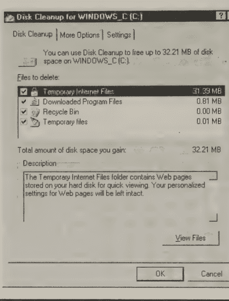

**图 4-9.** 使用磁盘清理删除不必要的文件

- 2. 进入“工具”菜单。

3. 选择“Internet 选项”。

4. 确保你处于“常规”选项卡上。

5. 点击“删除文件”按钮。

这两个任务都不特别困难，因此缺少磁盘清理工具并不是什么严重的问题。现在我们已经消除了无用文件，可以让 Windows 更高效地在磁盘上组织剩余部分。

# 硬盘碎片整理

为 OpenLinux 准备硬盘的下一步是进行硬盘碎片整理。此过程会重新组织驱动器上的数据，使其按高效顺序排列并集中在磁盘开头。碎片碎片允许我们更有放地对驱动器进行重新分区。

要整理硬盘碎片，请关闭所有打开的应用程序，然后按照以下步骤操作：

- 1. 点击“开始”按钮。

2. 选择“程序”菜单选项。

3. 选择“所有程序”组。

4. 选择“系统工具”项。

5. 选择“磁盘优化”图标启动该实用程序。

6. 确保选择了正确的硬盘并点击“确定”。

这将启动你计算机上的磁盘碎片整理过程。在你等待时，Windows 将重新排列程序和数据。如果你愿意，可以点击“显示详细信息”，观察代表数据块的小方块在磁盘上被重新排列。这会显著减慢速度，但更有趣。

一旦碎片整理完成（如果你的硬盘很大且数据碎片严重，这可能轻松花费半小时或更长时间），它会询问你是否要退出碎片整理。点击“是”，你就可以继续下一步了！

# 检查可用磁盘空间

在下一步中，你只需要确保硬盘上有足够的空间同时容纳 Linux 和 Windows。建议的最小可用空间为 800MB，而且通常情况下空间越大越好。

- 1. 右键点击 Windows 桌面上的“我的电脑”图标，选择“打开”选项。

2. 当 Windows 资源管理器打开时，右键点击硬盘图标并选择“属性”选项。

3. 查看目标磁盘上的可用空间。如果大于 800MB，则你的空间应该是足够的。如果少于此值，请考虑增加硬盘或删除某些应用程序。但希望你的硬盘有充足的空间。

# 运行 PartitionMagic

OpenLinux 桌面 2.4 软件包包含一张标记为“从 Windows 和商业软件包安装”的 CD-ROM。此种光盘包含了 PowerQuest 的 PartitionMagic 软件的“Caldera 版本”。零售版 PartitionMagic 用于创建、删除、调整大小和移动许多不同的磁盘分区，但随 OpenLinux 附的版本专注于一个任务：在你的 Windows 系统上为 Linux 创建空间。尽管它没有完整版产品那么实用，但它很容易使用，并且能够胜任当前任务。

# Windows 爱好者的 Linux 之路：十二步程序

**安装 PartitionMagic** 插入“从 Windows 和商业软件包安装”光盘，在系统检测到 CD 后，你应该应该自动看到 OpenLinux 2.4 安装菜单。（如果几秒后没有出现此界面，请双击“我的电脑”图标，然后双击你的 CD-ROM 驱动器图标。这应该弹出安装菜单。）按照此处描述的步骤开始安装：

- 1. 在第一个菜单上点击“1. 为 Linux 准备硬盘”选项，然后在下一个菜单上点击“PartitionMagic” 选项。

2. 安装过程将开始；点击“下一步”继续并显示“自读文件”；当你查看所有所需内容后，点击“下一步”按钮。

3. 安装程序现在允许你更改 PartitionMagic 的安装目录。默认选项是可以的，但如果你需要，也可以进行更改。无论如何，在准备好继续下一步时点击“下一步”。

4. 安装程序将允许你将 PartitionMagic 图标添加到你选择的文件夹中。接受默认设置或根据需要进行更改，然后点击“下一步”。

5. 软件安装完成后，程序将要求重启计算机以创建 Linux 分区。点击“完成”让计算机重启。

6. 系统将提示你从驱动器中取出 CD-ROM；执行此操作，然后点击“确定”。

系统将重启并启动 PartitionMagic 程序。当系统重启时，它会提示你正在启动一个基于 MS-DOS 的程序。

**创建 Linux 分区** 当 PartitionMagic 程序启动时，它会显示一个如图 4-10 所示的窗口。

窗口中有三个主要区域：
- 所选分区识别信息
- Linux 分区大小
- 所选分区大小信息

确保“所选分区的驱动器信息”窗口中显示的驱动是你想要调整大小的那个。如果不是，点击“选择分区”按钮来选择正确的分区。

一旦你选择了要调整大小的分区，请决定你想让新的 Linux 分区有多大。可选大小有 300MB、800MB、1640MB 或“最大可用空间”。因为 300MB 真的太小无法玩，如果你有分配更多空间的选项，请尽管分配。目前，如果你有大量空间，我认为你不需要设置“最大可用空间”，这会在你的 Windows 分区上仅留下 100MB 的增长空间。

# PartitionMagic Caldera 版本

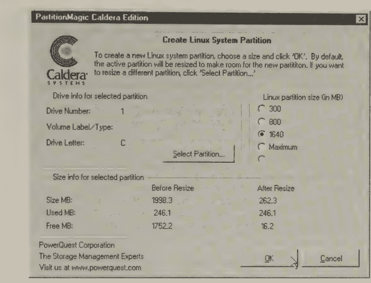

**图 4-10.** 使用 PartitionMagic Caldera 版本为 OpenLinux 创建分区

Windows 分区。如果你打算活跃使用 Windows，这是不够的。除非空间不足（可能 800MB 也可以），否则我会选择 1640MB。

图 4-10 所示窗口的“所选分区的大小信息”区域显示了“调整前”列中总、用和空空间的当前划分，以及“调整后”列的假设划分。你可以选择不同的 Linux 分区大小，并查看对 Windows 分区产生的影响。注意在图 4-10 中，选择 1640MB 会导致你的 Windows 分区仅剩 160MB 空闲空间。如果你打算活跃使用 Windows，这是不够的。除非空间不足（可能 800MB 也可以），否则我会选择 1640MB。

- 1. 点击所需分区大小旁单选按钮。

2. 点击“确定”。

# Windows 爱好者的 Linux 之路：十二步程序

3. PartitionMagic 将要求你确认调整大小；点击“是”。

分区的调整和创建将进行，并在屏幕上跟踪该过程的进度。程序将在分区完成后通知你，并会为你提供一些说明，我们将在下一节中介绍。

# 安装 OpenLinux

到为止，我们已经使用 PartitionMagic 在 Windows 系统的硬盘上创建了 Linux 分区。该过程应该已经完成并显示“分区完成”窗口。

按照以下步骤开始安装 OpenLinux：

- 插入 OpenLinux 2.4 “二进制文件和安装”CD-ROM。

- 如果你的计算机无法从 CD-ROM 启动，请插入 OpenLinux 2.4 引导软盘。（如果你的系统可以从 CD 启动，则无此。）

- 点击“确定”重启计算机。

系统将重启，当 OpenLinux 从安装磁盘启动时，将出现图形界面。你将看到几个选项，如下：
- 标准安装模式（推荐）
- VESA 安装模式
- 谨慎安装模式
- 专家安装模式
- 非图形安装模式
- 无人安装模式
- 演示安装模式
- 收集硬件数据

选择默认的“标准安装模式”，按回车或等待安装过程开始。你将看到指示内核正在加载和启动的消息，然后是自动硬件和安装源检测，工具通过打开交互式安装界面启动。

从此屏幕开始，选择你想要使用的语言，并点击“下一步”。如果鼠标不移动，它可能没有被正确检测；你将必须使用方向键选择语言，然后使用 TAB 键高亮“下一步”按钮。按回车键或空格键将允许你进入图 4-11 所示的“设置鼠标”屏幕。

下一个屏幕允许你设置鼠标。因为鼠标通常是自动检测的，此屏幕主要用于微调。你可以选择类型的

## 第 4 章：第 1 步：安装 Linux

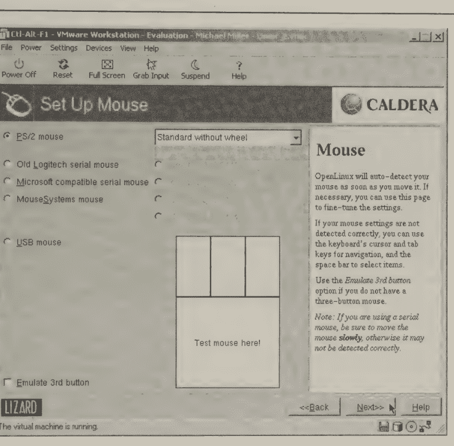

**图 4-11.** 配置并测试鼠标

在使用鼠标时，如果你想的话，可以将光标移动到“在此处测试鼠标”（Test Mouse Here!）区域进行测试。点击鼠标按钮以确保它们工作正常。如果你使用的是双键鼠标并想模拟第三按键行为，请勾选“模拟第三按钮”（Emulate 3rd Button）框。然后点击“下一步”（Next）。

“选择键盘类型”屏幕允许你选择你正在使用的键盘，如图 4-12 所示。键盘模型有多种选择。如果列表中没有列出你的键盘模型名称，只需选择一个键数正确的通用版本即可。（这可能有所帮助：大多数带有特殊“Windows”键的键盘都是 104 键键盘。）

## 单键、双键、红键、蓝键

许多 Windows 用户习惯了鼠标上有两个按钮。对于右撇配置，左键通常用于通过点击或双击选择项目，右键用于上下文相关菜单。正就像 Windows 用户嘲笑单键 Macintosh 鼠标一样，某些 Unix 用户也会嘲笑双键的 Windows 鼠标。

在 Linux 中，中键通常用于将选中的文本粘贴到当前窗口中。换句话说，你用左键选择一些文本，然后将光标指向你想要复制该文本的地方，然后点击中键。这个系统非常好用，而且它得特别有用，因为在 X Windows 世界中，拖放功能并不十分完善。（所以，Mac 用户们也嘲笑回去吧！）

如果你的鼠标只有两个按钮，可以通过启用第三按钮模拟让它像三键鼠标一样工作。这会告诉 Linux 当你同时按下左键和右键时，你希望该组合充当第三按钮。请注意，大多数带有滚轮的鼠标允许像点击按钮一样按下滚轮，因此它们无需模拟即可作为三键鼠标工作。

选择你键盘的当前映射。系统提供了一个空间供你根据需要输入并测试键盘。当你输入完成后，输入“那只棕色的狐狸跳过了那只懒狗”，或者像图 4-12 所示的更有深意的信息，点击“下一步”（Next）继续进入“选择显示器”屏幕。

“选择”屏幕提供了三种指定显示器信息的方法。最简单的方法是在列表中找到你的显示器管理器，点击制造商名称旁的加号显示可用的模型型号，然后选择正确的型号。

这并不总是可行的，尽管显示器数据库很大，但仍有许多显示器未列入其中。在这种情况下，有两种选择。更好的方法是找到你的显示器说明书，找到水平和垂直同步范围。这是每个显示器说明书中都包含的标准信息（如果你运气好的话，它可能打印在显示器的背面）。在各自的框中输入水平和垂直同步率，并输入一个显示器名称以绑定你为何这样设置这些速率。

并不是所有人都有这些信息，但如果你发现自己处于这种境地，仍然有办法。只需从显示器制造商列表顶部的“典型显示器”（Typical Monitors）输入中选择一个显示器描述即可。你应该可以使用你在 Windows 中正在使用的屏幕分辨率。

当你通过某种方式获得了显示器描述后，点击“下一步”（Next）按钮继续进入图 4-13 所示的“选择视频模式”屏幕。


## 第 4 章：第 1 步：安装 Linux

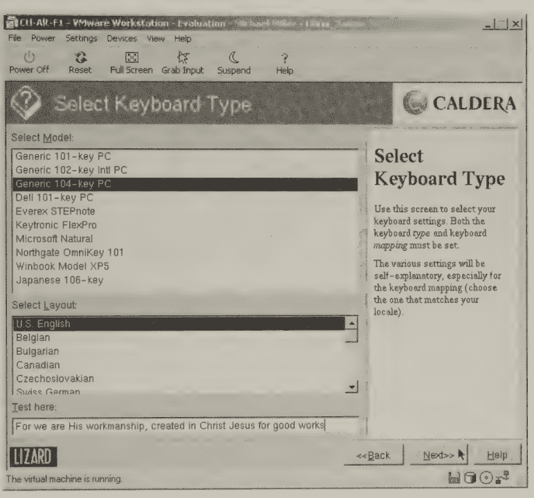

图 4-12. 选择键盘布局

此屏幕显示与你的主板和显示器兼容的视频模式。选择你想要使用的分辨率和刷新率，然后选择色彩深度（我建议选择你所选模式支持的最高深度）。


## 第 4 章：第 1 步：安装 Linux

你也可以选择虚拟桌面的大小（如果有）。虚拟桌面仅仅是一个大于你显示器显示内容的桌面区域。换句话说，如果你选择了一个分辨率为 `1280x1024` 像素的视频模式，以及一个 `1600x1200` 像素的虚拟桌面，当你将鼠标移动到桌面的一个边缘时，你的桌面视图将滚动，直到到达虚拟桌面的边缘。许多人对这种功能推崇备至，但我发现它让人迷失方向；对于我来说，它往往会导致动症。

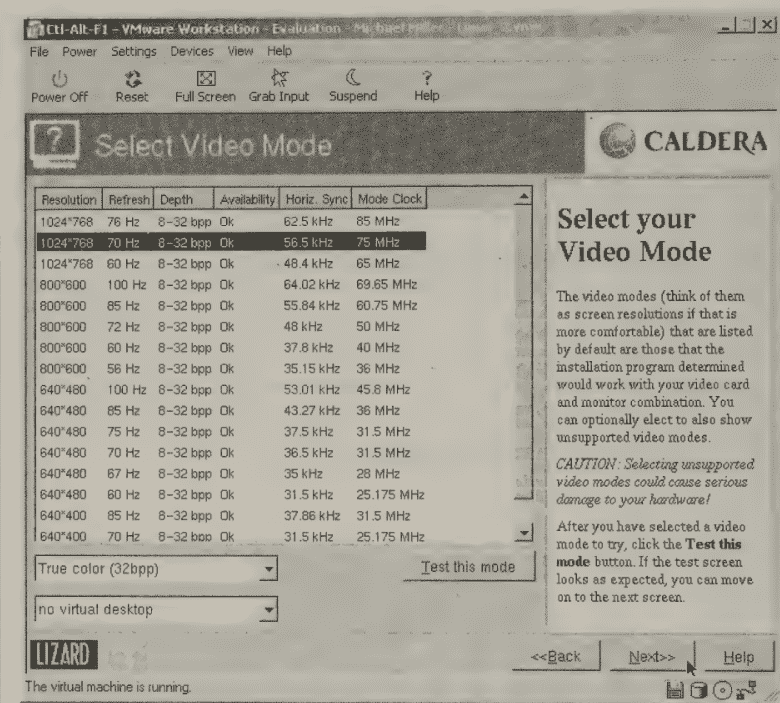

图 4-13. 选择你偏好的模式。

一旦选定了视频模式，点击“测试”（`Test`）按钮以确保它实际上工作正常。`OpenLinux` 会弹出一个窗口，告诉你可以点击左键取消测试，测试将持续十秒。点击“确定”（`OK`）继续测试。你应该能看到显示出的视频桌面。不要担心图像没有完美地位于屏幕正中央；只要它是可见的，你就没问题了。点击“下一步”（`Next`）继续进入图 4-14 所示的“安装”窗口。

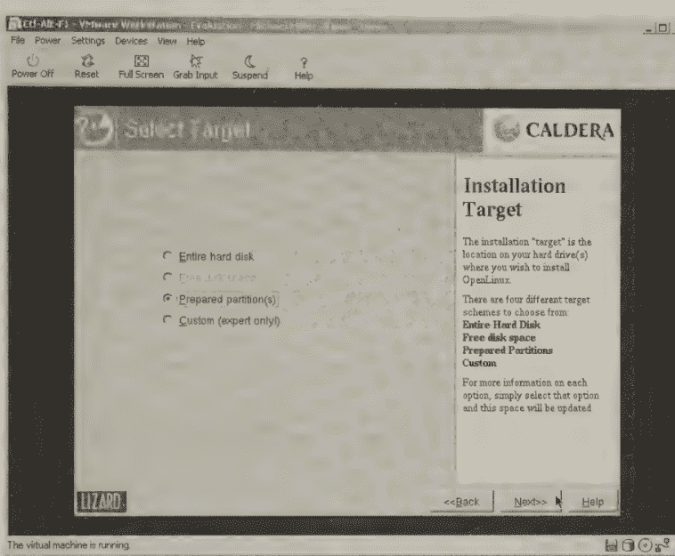

图 4-14. 选择分区

此屏幕显示与你的主板和显示器兼容的视频模式。选择你想要使用的分辨率和刷新率，然后选择色彩深度（我建议选择你所选模式支持的最高深度）。

### 第 4 章：第 1：安装 Linux

- **在 Linux 中，中键通常用于将选中的文本粘贴到当前窗口中。换句话说，你用左键选择一些文本，然后将光标指向你想要复制该文本的地方，然后点击中键。这个系统非常好用，而且它得特别有用，因为在 X Windows 世界中，拖放功能并不十分完善。（所以，Mac 用户们也嘲笑回去吧！）**
- **如果你的鼠标只有两个按钮，可以通过启用第三按钮模拟让它像三键鼠标一样工作。这会告诉 Linux 当你同时按下左键和右键时，你希望该组合充当第三按钮。请注意，大多数带有滚轮的鼠标允许像点击按钮一样按下滚轮，因此它们无需模拟即可作为三键鼠标工作。**
- **选择你键盘的当前映射。系统提供了一个空间供你根据需要输入并测试键盘。当你输入完成后，输入“那只棕色的狐狸跳过了那只懒狗”，或者像图 4-12 所示的更有深意的信息，点击“下一步”（`Next`）继续进入“选择显示器”屏幕。**
- **“选择”屏幕提供了三种指定显示器信息的方法。最简单的方法是在列表中找到你的显示器管理器，点击制造商名称旁的加号显示可用的模型型号，然后选择正确的型号。**
- **这并不总是可行的，尽管显示器数据库很大，但仍有许多显示器未列入其中。在这种情况下，有两种选择。更好的方法是找到你的显示器说明书，找到水平和垂直同步范围。这是每个显示器说明书中都包含的标准信息（如果你运气好的话，它可能打印在显示器的背面）。在各自的框中输入水平和垂直同步率，并输入一个显示器名称以绑定你为何这样设置这些速率。**

**并不是所有人都有这些信息，但如果你发现自己处于这种境地，仍然有办法。只需从显示器制造商列表顶部的“典型显示器”（`Typical Monitors`）输入中选择一个显示器描述即可。你应该可以使用你在 Windows 中正在使用的屏幕分辨率。**

**当你通过某种方式获得了显示器描述后，点击“下一步”（`Next`）按钮继续进入图 4-13 所示的“选择视频模式”屏幕。**

# Windows 爱好者的 Linux 之路：12步计划

如果你是在家里进行实验，我会明智地建议你选择“家用电脑”选项；如果你是在公司进行实验，我建议你选择“业务工作站”选项。不要太担心在不清楚确切涉及哪些软件的情况下必须做此决定，因为你以后可以添加额外的层级。当你选择好所需的配置后，点击“下一步”（`Next`）按钮开始安装。

在安装过程运行时，每个屏幕底部的图表将让你了解其进度。在此期间，会出现几个额外的屏幕，允许你在安装进行的同时输入信息。当安装过程占据了计算机的大部分处理能力时，在某些后续屏幕之间进行导航可能会困难。如果你感到沮丧，可以等等 Linux 完成文件复制后再处理那几个屏幕。

`OpenLinux` 要求你设置 root 密码。请记住，`root` 是一个拥有近乎无限权限的管理员账户。将 `root` 密码设置为私有内容，重新输入以确认拼写，并点击“下一步”进入“设置登录名称”（`Set Login Name`）界面，如图 4-16 所示。

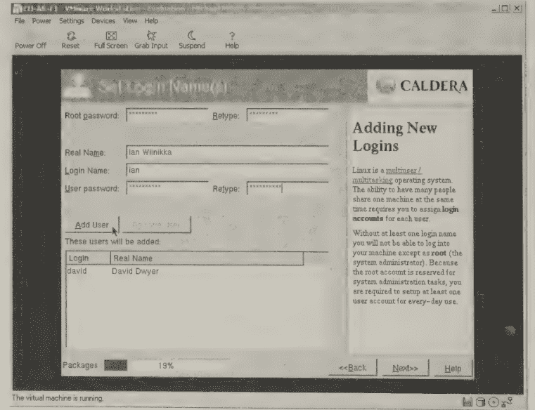

图 4-16. 从“设置登录名称”界面添加用户账户

## 第 4 章：第 1 步：安装 Linux

可以从此屏幕创建普通用户。如果你是系统中唯一的用户，只需创建你自己的账户。如果其他人也可以登录计算机，你也可以添加他们。图 4-16 中的屏幕已经创建了一个用户，并且正在创建另一个用户。

对于你创建的每个用户，你将输入：

- 用户的完整“真实姓名”（这样你就知道他们是谁了）
- 用户的账户名或“登录名称”
- 用户的初始密码（输入两次以检查拼写）

输入这些数据后，点击“添加用户”（`Add User`）；根据需要冲洗并重复，直到你头皮的刺痛消失为止。完成用户添加后，点击“下一步”进入“设置网络”（`Set Up Networking`）界面，如图 4-17 所示。

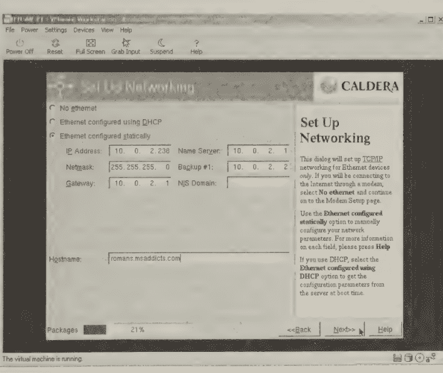

图 4-17. 按需配置以太网网络

# Windows 爱好者的 Linux 之路：12步计划

如果你的计算机中没有网卡，或者你不计划使用它，可以选择“无以太网”（`No Ethernet`）选项，网络配置就完成了。


如果你的网络使用 DHCP 自动分配 TCP/IP 地址，选择“使用 DHCP 配置以太网”（Ethernet Configured using DHCP）选项。如果你的 DHCP 服务器配置正确，它将在无需你手动干预的情况下提供额外的网络信息，因此完成了网络配置。

如果你的网络使用静态 IP 地址，选择“静态配置的以太网”（Ethernet Configured Statically）选项。然后输入以下信息：

- 系统的 IP 地址（拜托了，确保它在你的网络上是唯一的！）
- 在网络掩码（Netmask）字段输入你的网络中使用的掩码。
- 在网关（Gateway）字段输入你的路由器 IP 地址。
- 在名称服务器（Name Server）字段输入你的主名称服务器 IP 地址。
- 在备用 #1（Backup #1）字段输入你的备用名称服务器 IP 地址。
- 如果你的网络使用 NIS，在 NIS 域（NIS domain）字段输入适当的域名。如果没有使用，或者你不知道 NIS 是什么，请忽略 NIS 域字段。
- 在主机名（Hostname）字段输入你主机的“完全限定”名称。将你的主机名和域名组合以输入“完全限定”名称。图 4-17 中，主机名是 `romans`，域名是 `msaddicts.com`。

当你配置好你想要的网络后，点击“下一步”进入“设置调制解调器”（Set Up Modem）界面（如果 OpenLinux 没有完全自动配置好调制解调器的话）。在此窗口中，你将被要求指定调制解调器的型号；如果你的型号在列表中，配置将轻而易举。如果不在，你可以尝试不同速度的通用调制解调器设置。除了调制解调器型号外，你还可以在设备（Device）字段中指定串口。Linux 串口端口的编号与 Windows 串口端口不同；例如，Windows `COM1` 翻译为 `tty0`，Windows `COM2` 翻译为 `tty1`。如果你知道 Windows 中你的调制解调器的 COM 端口，那么在 Linux 中指定它的端口就很简单。如果你没有调制解调器，可以在型号（Model）字段中注明。调制解调器配置完成后，点击“下一步”进入“设置互联网提供商”（Set Up Internet Provider）界面。

下一个屏幕允许你配置到互联网服务提供商（ISP）的连接。虽然它的 ISP 数据数据库非常小，但 OpenLinux 允许你轻松添加自己的服务提供商详情。如果你有到 ISP 的拨号连接，按照以下步骤进行配置：

1. 使用“拨号网络”（Dial-Up Networking）框。
2. 检查你的国家和地区，查看你的 ISP 是否在列表中。点击国家和地区旁边的“+”号查看可用的 ISP。

### 第 4 章：第 1 步：安装 Linux

3. 如果你的 ISP 不在列表中，选择“用户定义”（User Defined）选项并点击“详情”（Details）按钮。这将打开一个窗口，你可以在其中输入：
   - 你的 ISP 名称
   - 你的 ISP 电话号码
   - 你的主 DNS 服务器
   - 你的备用 DNS 服务器
4. 如果你的连接使用 PPP，请确保该选框已勾选，然后点击 OK。
5. 如果你想允许身份验证，请勾选该框，然后点击“下一步”。

当你添加了所有需要的打印机后，点击“下一步”进入时区（Time Zone）窗口。此屏幕允许你找到所在时区内的城市；点击它，时区将设置为你的城市。例如，我住在旧金山区，旧金山不在地图上，洛杉矶在，所以我点击它来设置我的时区。或者，你可以浏览时区列表并选择一个。由于我们将在系统中运行 Windows 和 Linux，可能会设置“硬件时钟运行本地时间”（Hardware Clock Runs Local Time），点击“下一步”。

后续屏幕“设置打印机”（Set Up Printer）允许你配置连接到计算机的或或其他系统的打印机。对于本地打印机，你首先要为它起一个名称。可以使用单词或缩写；使用默认值即可。然后从下拉列表中选择型号。如果列表中没有你的打印机，可以检查 `http://www.linuxprinting.org` 查看它像哪种打印机。选择你喜欢的打印质量变、打印机连接的端口以及纸张。点击“添加”（Add）按钮将打印机添加到列表中，然后点击“测试”（Test）确保其工作正常。

如果你在一个已安装其他系统的网络上，可以为新系统设置现有的打印机。要这样做，输入你想要为打印机命的名字，然后从模型列表中选择“远程打印机”（Remote Printer）。你唯一还需要的信息是远程机器上的队列名称以及远程机器的 IP 地址。将这些信息输入目标（Destination）字段，格式为队列名后接 & 符号，以及 IP 地址，如下：

```
j10.0.2.15
```

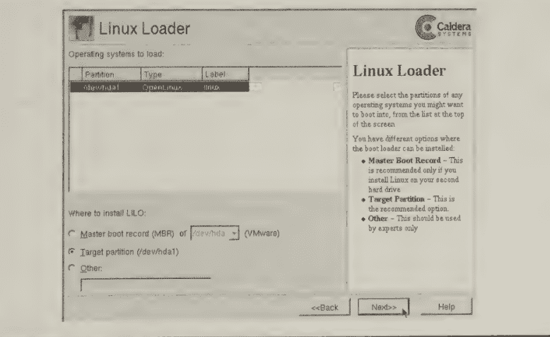

图 4-18. 使用引导加载器 Windows

# Windows 爱好者的 Linux 之路：12步计划

下一个屏幕是娱乐（Entertainment）屏幕，通过玩吃豆人游戏奖励你之前的努力。如果你在安装过程完成之前进入此屏幕，你可能会发现游戏有时格外挑战性；当系统忙于复制文件时，你可能难以控制吃豆人直到为时已晚。当安装过程完成，并且吃饱了豆子、能量球和幽灵后，点击“下一步”按钮继续。

# 第 4 章：第一步：安装 Linux

下一个屏幕允许你创建一个救援磁盘。为了防万一出现问题，准备一个这样的磁盘并不是个坏主意。将一张空白磁盘插入指定的驱动器，然后点击“写入磁盘 (Write Disk)”按钮。等救援磁盘写入完成后，点击“完成 (Finish)”按钮。

系统将重启 Linux 并加载 X Windows 和 KDE 桌面环境。我们将在第 5 章中详细讨论 X Windows，但现在，我们只需要登录并在关闭前快速查看。通过点击其图标或在图 4-19 所示的登录字段中输入 `root` 来选择 root 用户。

在密码字段中输入 root 密码，点击“Go!”或按回车键。这将打开带有两个窗口的 KDE 桌面：KDE 文件管理器 (`kfm`) 和 KDE 安装向导。我们将在第 5 章中处理 KDE 安装，所以如果你急于配置 KDE，可以先跳过，等完成后再回来。

准备好后，请按照以下步骤重启 Linux：

- 1. 从 CD-ROM 驱动器中取出安装光盘。
- 2. 如果你使用了启动/安装磁盘，请将其从软盘驱动器取出。
- 3. 在 KDE 桌面，点击屏幕左下角面板上的 K 图标。
- 4. 当菜单出现时，选择底部的“退出 (Logout)”项。
- 5. 弹出退出确认框；点击“退出 (Logout)”以确认你的意图。

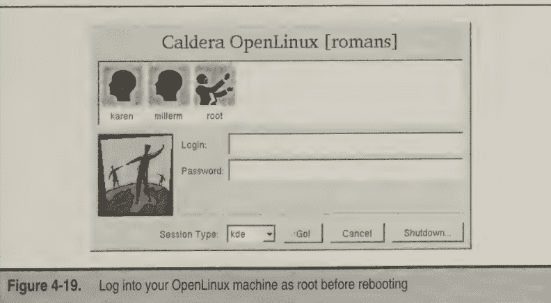

## Windows 痴者的 Linux之路：十二步计划

此过程将你回到登录界面。要关机：

- 1. 点击关机 (Shutdown)。
- 2. 选择关机并重启 (Shutdown and restart)。
- 3. 点击确定 (OK)。
- 4. 系统启动时，选择 Windows。

## 安装 BootMagic

插入“Windows 及商业软件包安装 (Installation from Windows and Commercial Packages)”CD-ROM，系统检测到光盘后，你应该会自动看到 OpenLinux 2.4 安装菜单。（如果几秒钟后没有出现，请双击“我的电脑”图标，然后双击你的 CD-ROM 驱动器图标。这将弹出安装菜单。）按照旁边描述的步骤开始安装：

- 1. 点击此菜单上的“1. 为 Linux 准备硬盘 (Prepare Hard Disk for Linux)”。
- 2. 这次，点击“BootMagic”项。
- 3. 安装过程将开始；点击“下一步 (Next)”继续。
- 4. 将显示 BootMagic 软件许可；阅读它，如果你同意许可，请点击“是 (Yes)”按钮。
- 5. 你将看到另一段关于 BootMagic 许可条款的描述；输入 YES 同意许可条款，并点击“下一步 (Next)”继续。
- 6. 安装程序将通知你 BootMagic 的安装目录 `C:\BTMAGIC.PQ`。点击“确定 (OK)”继续。
- 7. 安装程序将允许将 BootMagic 图标添加到你选择的文件夹中。接受默认设置或根据需要更改，点击“下一步 (Next)”。
- 8. BootMagic 安装程序将询问你是否想创建一个启动软盘。你可能应该这样做，以防万一。勾选标记为 YES, I Would Like To Create This Diskette（是的，我想创建此软盘）的框。然后在软盘驱动器中插入一张空白磁盘并点击“下一步 (Next)”。
- 9. 确保软盘已插入软盘驱动器中并点击“确定 (OK)”。
- 10. 确保下一个窗口包含你软盘驱动器的正确驱动器号并点击“确定 (OK)”。
- 11. 点击“开始 (Start)”将系统文件复制到软盘。文件复制完成后，点击“关闭 (Close)”按钮继续。
- 12. 将复制 BootMagic 磁盘的内容。在提示时，取出软盘，将其标记为 BootMagic Rescue Diskette，并点击“确定 (OK)”继续。
- 13. 安装程序现在应该向你显示 BootMagic 配置界面，其中应该列出 Windows 和 Linux，如图 4-20 所示。如果你想将 Linux 设为默认操作系统，请从列表中选择它并点击“设为默认 (Set As Default)”。
- 14. 要设置启动延迟，请点击三个选项之一：
    - 无 (None)：此选项将直接进入默认操作系统。
    - 无限 (Indefinite)：此选项将等待直到你选择一个选项。
    - 定时 (Timed)：此选项将在等待指定的秒数后启动默认 OS。
- 15. 当你对 BootMagic 配置满意时，确保勾选“启用 BootMagic (BootMagic Enabled)”框，并点击“保存/退出 (Save/Exit)”。

下次你重启系统时，应该会看到 BootMagic 界面。选择你想要使用的操作系统，就可以开始了了！

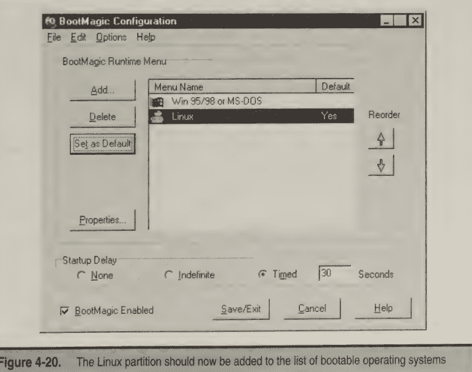

## 在空磁盘上安装红帽 Linux

在本章早些时候我介绍的 Corel Linux 安装中，我们将 Linux 安装到了现有的 Windows 分区中，尽管预见到会有性能问题。在 OpenLinux 安装中，我们使用 PartitionMagic 为 Linux 创建了空间。但如果你已经有了可用的磁盘空间呢？也许你想稳妥起见，完全不要碰你的 Windows 磁盘。而且你总有可能厌倦了由微软主宰的计算生活，只想格式化磁盘。

（注：原文后续部分存在大量重复的段落，已根据翻译要求进行完整性处理。）

# Windows 痴迷者的 Linux：12 步计划

我们将进行“自定义系统（Custom System）”安装，并不是因为我推荐这样做，而是因为在之前的两个示例中我们选择了预设配置。完整的选项列表见表 4-3。

> 注意：如果您选择“工作站（Workstation）”安装选项，你电脑上所有硬盘上的所有 Linux 分区都将被删除；若您选择“服务器系统（Server System）”选项，所有分区（包括 Windows 分区）将从你电脑的所有硬盘中移除。如果这并非您的本意，请改选择“自定义系统”选项。

如果您执行了某种类型的安装，后发现还需要其他软件包，可以轻松添加所需的软件而无需重新安装。对于“自定义系统”选项，只需勾选其复选框，然后点击“下一步（Next）”按钮。

## 在 Red Hat 中配置分区

下一个屏幕允许您使用 Disk Druid 或 `fdisk` 选择分区硬盘。两者都可以，但我想您会发现 Disk Druid 的方法更友好一些，因此请选择该选项并点击“下一步”继续。

Disk Druid 界面显示了可用的现有磁盘和分区。如果您有一个之前未在 Linux 中使用的硬盘，则将没有任何可用分区，您必须进行添加。要添加另一个分区，点击“添加（Add）”按钮，这将弹出一个与图 4-22 的窗口。您可以指定挂载点、分区大小、分区是否可以扩展、分区类型（除交换空间外，所有类型都应设置为 Linux Native）以及驱动器分区所在的位置。

| 安装选项 | 说明 |
| --- | --- |
| 工作站 (Workstation) | 在可用磁盘空间内安装所有常用的工作站软件包和 X Windows；允许您在 GNOME 和 KDE 桌面环境之间进行选择。 |
| 服务器系统 (Server System) | 清空磁盘并安装服务器相关软件包但不配置 X Windows。 |
| 自定义系统 (Custom System) | 允许用户确定如何分区、安装哪些软件包以及使用何种 GUI。 |
| 升级 (Upgrade) | 从早期版本的 Red Hat Linux 升级到最新内核和已安装软件包的最新版本。 |

表 4-3. RedHat 安装选项

## 第 4 章：第 1 步：安装 Linux

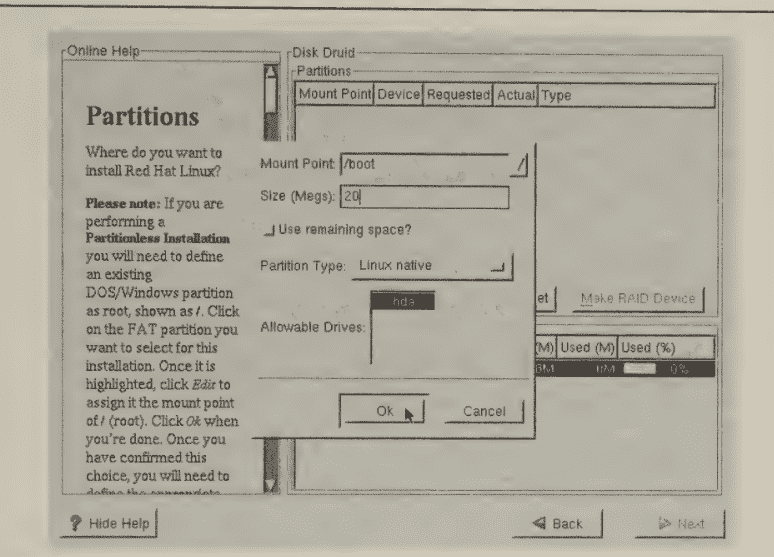

**图 4-22.** 使用 Disk Druid 添加分区

在 Linux 系统上分配磁盘空间有不同的方法，但至少您一个根分区（root partition）和一些交换空间（swap space）。小于约 1GB 的根分区就足够您玩玩了，我建议将交换空间设置为系统中安装的 RAM 数量的两倍。注意图 4-23 中列出了三个分区：`hda1` 上的 20MB 分区、`hda5` 上的 1200MB 分区、`hda6` 上的 400MB 分区以及 `hda7` 上的 300MB 分区。

在此处，我为您快速回顾一下 Linux 如何调用硬盘。Linux 系统上的每个磁盘都会被赋予一个设备名称，取决于它是 IDE 还是 SCSI 驱动器。如果您的系统配置正确（这很可能，但并非确定）并且有一个 IDE 硬盘，那么该驱动器将被 Linux 识别为 `/dev/hda`。该驱动器上的每个分区都有一个数字。一个磁盘驱动器上只能有四个分区，编号为 1–4。其中一个可能是一个“扩展”分区，用于存放额外的“逻辑”驱动器，这些逻辑驱动器从 5 开始编号。

图 4-23 中列出的分区都在第一个 IDE 硬盘上；20MB 分区是分区 1（称为 `hda1`），1200MB 分区是分区 5（称为 `hda5`），400MB 分区是分区 6（称为 `hda6`），300MB 分区是分区 7（`hda7`）。

# Windows 痴迷者的 Linux：12 步计划

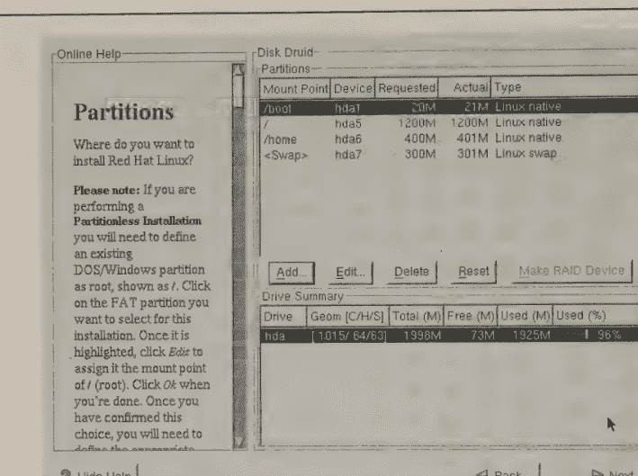

图 4-23. 使用 Disk Druid 为 Red Hat Linux 硬盘进行分区

请注意，分区之间的类型类型（Entry type）也不同。除了 `hda7` 外，每个分区都列为 Linux 原生（Linux native），而 `hda7` 被列为 Linux 交换（Linux swap）。Linux 原生分区是指使用标准 Linux 文件系统 ext2 的分区。Linux 交换分区并不出意外地被用作交换分区（您可能记得，如果微软说它不能那么，它其实可以大于 128MB）。

此配置中缺失的是 `hda1`、`hda5` 和 `hda6` 的挂载点。Red Hat 知道如何处理 `hda7` 交换空间，但您需要告诉它为您创建的 Linux 原生分区使用哪些挂载点。在这种情况下，我们将 `hda1` 设置为 `/boot` 分区，`hda5` 设置为 `/` 分区，`hda6` 设置为 `/home` 分区。要执行此操作，选择 `hda5` 分区并点击“编辑（Edit）”按钮以显示图 4-22 所示的窗口。

记住，根分区是目录结构的顶端，被称为 `/`。您使用类似图 4-22 所示的框来设置挂载点。

## 第 4 章：第 1 步：安装 Linux

记住，根分区是目录结构的顶端，被称为 `/`。您使用类似图 4-22 所示的框来设置挂载点。

## 第 4 章：第 1 步：安装 Linux

记住，根分区是目录结构的顶端，被称为 `/`。您使用类似图 4-22 所示的框来设置挂载点。

## 第 4 章：第 1 步：安装 Linux

记住，根分区是目录结构的顶端，被称为 `/`。您使用类似图 4-22 所示的框来设置挂载点。

## 第 4 章：第 1 步：安装 Linux

记住，根分区是目录结构的顶端，被称为 `/`。您使用类似图 4-22 所示的框来设置挂载点。

## 第 4 章：第 1 步：安装 Linux

记住，根分区是目录结构的顶端，被称为 `/`。您使用类似图 4-22 所示的框来设置挂载点。

# 给 Windows 爱好者的 Linux ：12 步计划

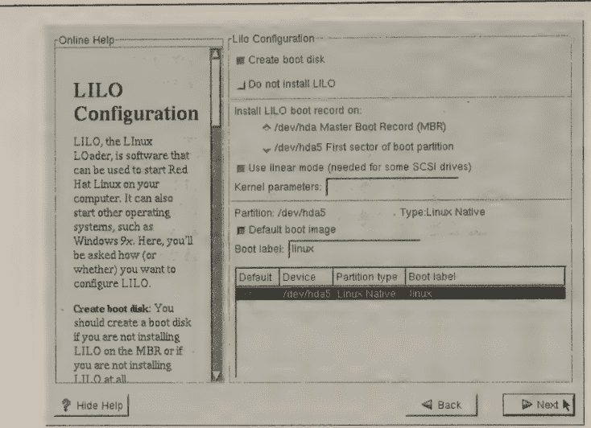

图 4-24. 配置 LILO 以启动 Red Hat Linux

下一个选项允许你指定 LILO 的安装位置。主引导记录（MBR）是安装 LILO 引导记录的好地方，除非你正安装到带有 Windows NT 或 Windows 2000 的系统上。对于只有一个空磁盘的系统，我们将保持选中 MBR 选项。

使用线性模式（Use Linear mode）选项并非所有驱动器都需要，但启用它也不会有害。勾选该框以启用。下方允许允许你在每次系统启动时向内核传递参数。这通常是没有必要的，所以请留空该框。

在图 4-24 中，只列出了一个启动分区。如果你在已经安装了 Windows 的系统上安装 Linux，可能会有更多。要设置你想默认加载的操作系统，只需从列表中选择该分区，并勾选默认启动镜像（Default Boot Image）复选框。你的启动 Red Hat Linux 分区的引导标签将默认为“linux”，但你可以将其更改其他内容。为你计划启动的任何其他操作系统添加引导标签，然后点击“下一步”。

## 第 4 章：第 1 步：安装 Linux

### 额外的 Red Hat 配置

如果你有一个或多个网络卡，你接下来将看到网络配置屏幕，如图 4-25 所示。对于计算机中的每个以太网卡，都应该有一个用设备名称命名的对应标签。在图 4-25 中，有一个设备名称为 `eth0` 的网卡。


如果你的电脑使用 DHCP，你可以从 Windows 中的网络控制面板判断出来（你可能还记得），确保勾选了“使用 DHCP 配置（Configure using DHCP）”框。“启动时激活（Activate On Boot）”选项允许 Linux 在启动电脑时启动你的网卡；大多数人都希望发生这种情况，所以请保持勾选该框。

其余的框指定了不使用 DHCP 的计算机的设置。你可以直接添加从 Windows 复制的信息；安装程序将根据你添加的信息填充一些空白处。在图 4-25 中，主机名 `corinthians` 位于 IP 地址 `10.0.2.239`。当我输入此地址时，安装程序猜测我的子网掩码为 `255.255.0.0`。从图 4-25 所示，我将该掩码修改为匹配我网络使用的掩码 `255.255.255.0`。一旦

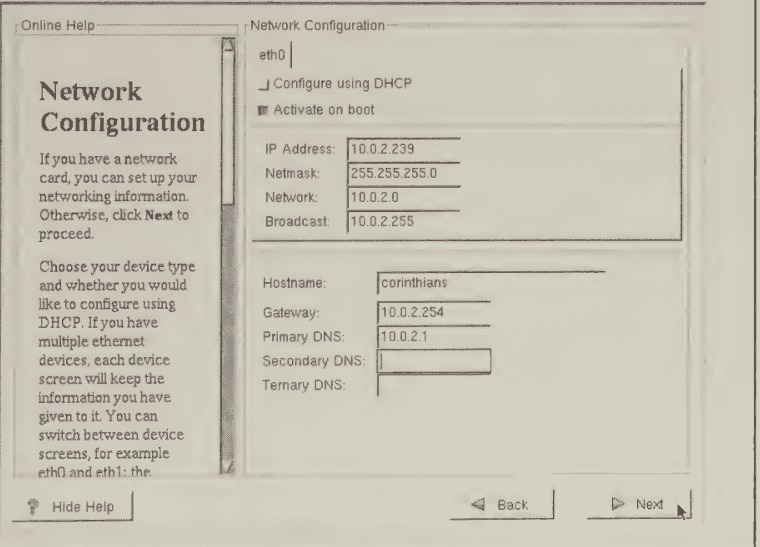

图 4-25. 配置你的以太网卡与网络通信

这样做之后，程序正确地填充了网络（Network）和广播（Broadcast）项。它还正确地猜测了网关（Gateway）和主 DNS（Primary DNS）项。我填写了主机（Hostname）字段，结果如图 4-25 所示。我设置了 IP 地址、子网掩码和主机名，并确保每个以太卡的其他设置都是正确的，然后点击。

这将让你进入时区选择。此屏幕显示了一个地图，上面许多点代表不同时区的城市。要正确设置 Linux 的时区设置，请从提供的地图或下方列表中选择你所在时区的城市。如果你一直在系统上运行 Windows，时间无疑是本地时间，现在请确保取消勾选“系统时钟使用 UTC（System Clock Uses UTC）”框。配置好时区后，点击“下一步”。

接下来是账户配置屏幕，你在此输入 root 密码并添加用户账户。要设置 root 密码，只需在 root 密码（Root Password）和确认（Confirm）字段中输入你想要的密码。要添加用户账户，在帐户名（Account Name）字段中输入用户账号。在密码（Password）和密码确认（Password Confirm）字段中输入该账户的密码。并在全名（Full Name）中输入用户的全名以便以后识别。点击“添加（Add）”按钮。重复直到添加完所有需要的用户，然后点击“下一步”。如果“下一步”按钮未启用，意味着你没有在 root 密码和确认字段中输入相同的密码。可能是错了，你想重试吗？）

下一个屏幕显示身份验证配置选项。大多数人只需保留默认设置。启用 MDS 密码（Enable MDS Passwords）选项允许长密码，这使得启用影子文件（Enable Shadows）更安全地存储密码。这些都是好事，所以它们应该勾选。

### Red Hat 包选择

该过程的下一步是包组选择。这就像为你想要安装在系统上的软件进行购物。有一个可用的包组列表，其中一些已经被选中。你可以根据意愿添加或删除它们，但请记住，整个过程将消耗你近 2GB 的磁盘空间。从表 4-4 所示的包中进行选择。推荐软件包（Recommended Packages）中的包是你在测试系统上运行会很有趣的，可以根据你的意愿从列表中添加或删除，或者受空间限制——推荐软件包仅占略高于 1GB 的磁盘空间。

你实际上可以通过点击“选择单个包（Select Individual Packages）”框来进行更具体的选择，它会向你显示每个组包含哪些单独包。你可以阅读每个包的描述，并决定是包含还是排除它。这与 Windows 安装允许你在安装期间选择包含或排除哪些实用程序的方式相似，对于大多数人来说，直接选取整个组通常是一个明智的选择。

| 推荐软件包 | 其他软件包 |
| :--- | :--- |
| 打印支持 | 笔记本支持 |
| X 窗口系统 | 新 服务器 |
| GNOME | IPX 网络连接 |
| KDE | NFS 服务器 |
| 邮件/WWW/新闻 | SQL 服务器 |
| DOS/Windows 连接 | DNS 服务器 |
| 图形处理 | 设计/出版 |
| 游戏 | 内核开发 |
| 多媒体支持 | 一切 |
| 网络工作站 |  |
| 拨号工作站 |  |
| 匿名 FTP 服务器 |  |
| 网络管理 |  |
| Emacs |  |
| 工具 |  |

**表 4-4.** 选择你想安装的 Red Hat 包组。

### X 配置与安装 Red Hat

一旦你将包组分成了羊和狗，第一个屏幕显示 Red Hat 识别出的显示器。如果硬件未正确识别，你可以从列表中选择（通过制造商和型号）。然后点击“下一步”继续。

下一个屏幕显示 Red Hat 探测到的显卡配置。从此屏幕，你可以更改显卡驱动程序、调整显存、选择默认环境（如果你安装了 GNOME 和 KDE 则进行选择），并测试配置以确保正常。

勾选此屏幕上的“自定义 X（Customize X）”将进入另一个屏幕，你可以在其中选择色彩深度和屏幕分辨率。勾选“图形登录（Graphical login）”会让 Linux 直接进入 GUI。如果你不预计经常使用命令行，请使用此项。“跳过 X 配置（Skip X Configuration）”复选框用于你没有为系统选择 X。你也可以在以后以后配置 X 时勾选它。

磁盘将准备就绪。完成后，弹出磁盘并点击退出以重启。如果你安装了 LILO 并选择默认由 Linux 启动，那么当系统启动时，红帽（Red Hat）将会启动。

Corel Linux 和 OpenLinux 都使用 K 环境 KDE 作为运行在 Linux 上的 GUI 界面。红帽在过去的几个版本中包含了另一个广泛使用的桌面环境 GNOME，尽管它也提供了安装 KDE 代替或额外安装 的选项。在下一章中，我将向你展示如何导航和配置 KDE，并介绍 GNOME。

## 给 Windows 成瘾者的 LINUX

## 第 5 章

### 第 2 步：配置 X

Windows 成瘾者的 LINUX：12步计划

从微软掌控中解放自己的第一步是安装 Linux。如果你已经成功迈过了这一步，那么恭喜你。但在你过度自豪之前，还有更多的自我和电脑改进需要完成来完成你的转变。第二步是相信 X Windows 是高度可配置的，它不会导致系统崩溃，并且可以恢复你的理智。

安装 Linux 之后，许多流行的发行版会在你启动电脑时自动直接进入 X Windows，这让你免于面对那条令人生恐惧的命令行。但你如何控制这个为你创建的 X Windows 环境的外观呢？如果你的硬件发生了变化，你该如何重建 GUI 呢？在这里寻找答案，这就是你所做的。

# 设置 X

为你的系统设置 X Windows 软件有多种选项。并不是所有的发行版都包含这些工具，但大多数至少包含一个。也许最广泛提供的工具是 `XF86Setup`，它看起来并不酷，但非常直观。`lizardx` 和 `Xconfigurator` 工具可能在你的发行版中可用，但你必须检查一下。

你应该以 root 用户身份登录以运行这三个工具。如果你还没有以 root 用户登录，可以在控制台提示符输入 `su` 并按照提示输入 root 密码来变为 root。我建议从控制台模式运行这三个工具，而不是在 X 内部运行，以避免偶尔出现意外结果。在开始配置 X 之前，最好了解以下六点：

- 显卡品牌和型号
- 显存大小
- 显示器品牌和型号
- 显示器的垂直和水平刷新率
- 鼠标类型和端口
- 键盘类型

如果你按照上一章的安装程序进行操作，你应该已经拥有这些信息了。但如果你正在更换硬件，请查阅其文档以获取未知的规格。例如，最好的方法是不要猜测显示器的刷新率。如果猜得太高，可能会发生糟糕的事情。

# XF86Setup

`XF86Setup` 程序通常伴随 Linux 系统上的 XFree 文件存在。某些发行版不包含 `XF86Setup` 程序（例如，红帽希望你使用 XConfigurator，如所示），但大多数都包含。要运行 `XF86Setup`，请以 root 身份登录，并在控制台提示符输入：

```
root@romans /root> XF86Setup
```

请完全按照所示的大小写输入。如果排字员和我没有拼错单词，并且你的系统已经安装了 X，你可能会看到以下消息：

你想要要退出现有的 XF86Config 文件并使用默认值吗？

虽然这听起来不错，但它并不总是产生你想要的结果，因此我不建议使用现有文件。选择 No 继续。接下来，你将收到即将进入图形模式的通知。按 ENTER 键启动图形模式。

> 注意：这个实用的 Windows 生存技巧在你配置 X 时可能有用：如果出现问题，你可以通过同时按下 `CTRL-ALT-BACK-SPACE` 退出 Windows 并返回文本控制台。这将关闭 Windows 而保存你可能完成的工作（或你的配置信息），因此请谨慎使用。

你将看到一个顶部带有按钮的灰色屏幕。点击 Mouse 按钮将出现一个鼠标配置说明屏幕。这些说明可能有用，也可能没用，当你读完它们或觉得它们困惑时，点击 Dismiss。别担心，下一个屏幕非常简单，如图 5-1 所示。

你可以从这个屏幕配置你的鼠标在 X 中运行。最近构建的计算机使用 PS/2 端口连接 2 键鼠标，或带有 3 个键的串口鼠标。但你可能仍然需要确保 X 了解关于你鼠标的细节。

首先，你需要通过检查鼠标协议来确保 X 和你的鼠标说的是同一种语言。你可以通过点击页面顶部连接鼠标的按钮来实现。例如，如果你使用 PS/2 鼠标，你将希望选中 PS/2 按钮。（如果你的鼠标无法工作，请按键盘上的 P 键来更改选中的按钮。）

接下来，查看它连接的鼠标设备。正如我在第 3 章中提到的，Linux 中的物理设备被称为 `/dev` 目录下的文件。例如，如果你有一个 PS/2 鼠标，对应的设备是 `/dev/psaux`。如果你的鼠标连接到第一个串口（DOS 和 Windows 中的 COM1），对应的设备是 `/dev/ttyS0`。如果你的鼠标连接到第二个串口（DOS 和 Windows 中的 COM2），对应的设备是 `/dev/ttyS1`。

# Windows 成瘾者的 Linux 之路：12 步计划

超出规格。如果你有一台较新的多频显示器，这个问题可能没那么关键。

一旦完成“显示器（Monitor）”页面，请移动到“模式（Modesection）”页面。在这里，你可以选择想要在 X 下支持的分辨率。你可以选择多个分辨率（一旦启动 X Windows，你将能够使用 `CTRL-ALT+X` 组合键在这些值之间循环）。你还可以选择一种色彩深度，这决定了显示的颜色数量。8bpp 模式每像素 8 位，提供 256 种颜色。16bpp 模式提供 4k 种颜色（当 Windows 登录时，24bpp 和 32bpp 模式通常对应于 Windows 下的“真色彩”）。通常情况下，使用更大的色彩深度允许你在 X 下查看更多颜色，但需要更多资源（例如，更多的视频显存）。另一个你可能考虑的因素是，某些程序可以用更多或更少的颜色查看。几款 Loki Entertainment Software 的游戏——仅供研究之用，例如 16bpp 设置。所以我把它留给

你现在可以点击“其他（Other）”按钮查看该页面的选项，但那些并不是人们想要更改的，所以我跳过它们。一旦你选择了想要使用的模式，就可以点击“完成（Done）”按钮以你的新配置设置启动 X Windows。在你点击后，X86Setup 提示它将尝试使用你刚刚提供的配置信息启动 X。点击“确定（Okay）”按钮，XFree88 应该会在几秒后启动。它将是难看的灰色，但不用担心那个。

当 X 启动时，你会看到一条消息指示你的 X Server 运行。屏幕允许你使用名为 `xvidtune` 的工具来调整屏幕上的图像显示。坦率地说，如果你有一台较新的显示器，使用显示器内置的工具来调整显示的大小和位置要简单得多。如果你配置了与 Windows 中使用的相同的分辨率，你可能不需要进行任何调整。

你也可以通过点击“取消（Abort）”按钮或按下 `CTRL-ALT-BACKSPACE` 来终止 X 配置，但如果显示看起来正常，请点击“保存配置并退出（Save Configuration And Exit）”按钮。你会被送到控制台提示符。如果你已经登录，应该注销并用你的普通用户账户重新登录。然后继续本章的“启动 X”章节。

# Lardxz

作为 root 用户，从控制台提示符，你可以通过输入完全所示的 `lardxz` 来启动 lardxz。OpenLinux 将为你启动 X Windows，一切看起来都会非常熟悉。Calder 的人们非常聪明地让 X 配置过程看起来无论你是第一次安装还是第十次安装都一样。我将像在第 4 章一样描述每个屏幕，但如果你想查看该部分的截图，必须回到该章的“安装 Linux”部分。

首先出现“设置鼠标（Set Up Mouse）”屏幕，允许你根据需要配置鼠标。你可以选择你正在使用的鼠标类型，然后通过将光标移动到“测试鼠标（Test Mouse! here!）”此处进行测试。点击鼠标按钮确保它们工作正常。如果你使用的是双键鼠标并想模拟第 3 键的行为，请点击“下一步（Next）”。

“选择键盘类型（Select Keyboard Type）”屏幕给了你选择键盘布局和国家映射的机会。提供了一个空间供你输入键盘（如果你需要检查的话）。点击“下一步（Next）”继续。

“选择显卡（Select Video Card）”屏幕才是我们想去的地方，因为在那里我们可以选择新的显卡。我在寻找无法工作的视频适配器方面遇到过麻烦，但我倾向于阅读供应商提供的兼容性列表。如果显卡被正确识别（无论是通过你还是 OpenLinux），你应该点击“探测（Probe）”按钮来收集时钟和内存信息。

# 配置 XFree86 4

虽然运行 `XFree86Setup` 曾经是强制性的（除非 Linux 发行版包含了另一个工具），但如果你使用 XFree86 4.0.x，情况就不再如此了。最新版本的 X Window 系统集成了一种配置模式，其配置方式比那要自动得多。然而，许多可用发行版尚未使用 XFree86 4，它比前身版本更强大，但可能没有那么稳定。

你可以通过在控制台提示符或 `xterm` 中运行以下命令来确定正在使用的 XFree86 版本：

```
millerm@romans -> XFree86 -version
```

这将此你版本号和构建日期。如果你使用的是包含 XFree86 4 的发行版，root 用户可以通过命令行中的以下命令进行配置：

```
root@romans /root> XFree86 -configure
```

这将在当前用户的目录下生成一个名为 `XF86Config.new` 的配置文件。你可以通过运行以下命令来测试此配置：

```
root@romans /root> XFree86 -xf86config /root/XF86Config.new
root@romans /etc/X11> mv XF86Config XF86Config.orig
root@romans /etc/X11> cp /root/XF86Config.new ./XF86Config
```

如果这产生了一个看起来良好的 X Windows 系统，root 用户可以用新文件替换现有的配置文件（保存旧文件以备万一）：

# Windows 成瘾者的 Linux 之路：12 步计划

弹出一个消息说探测成功。点击“确定（OK）”并按回车继续。

接下来的屏幕告诉你系统通过探测识别出的显卡。如果结果看起来不离谱，选择“确定（OK）”并按回车继续。

# Xconfigurator

红帽 Linux 发行版以及许多源自它的发行版包含了另一个半自动配置 XFree86 的工具。作为 root 用户，从控制台提示符，你可以通过输入以下大小写完全命令启动 Xconfigurator：

```
root@romans ~> Xconfigurator
```

`Xconfigurator` 打开后显示一个信息屏幕，告诉你运行该工具时将修改底层文件。选择“确定（OK）”并按回车继续。

接下来的屏幕通知你 `Xconfigurator` 将探测 PCI 显卡。如果你有 AGP 显卡也不要担心；它们也会被识别的。此屏幕告知你在探测期间系统可能会锁住，但如果你有一块较新的显卡，这种情况不太可能发生。选择“探测（Probe）”并按回车继续。

# Windows 成瘾者的 Linux 之路：12 步计划

弹出一个消息显示探测已成功。点击“确定（OK）”并按回车继续。

视频模式屏幕显示与你的显卡兼容的模式。选择的分辨率、刷新率和色彩深度。如果你想创建一个虚拟桌面，可以启用它。点击“测试（Test）”按钮确保工作正常。

一个弹出的窗口指示可以通过点击左鼠标取消测试，它将持续十秒。点击“确定（OK）”继续。

当你回到“选择模式（Select Mode）”屏幕时，如果一切正常，点击“完成（Finish）”按钮。（如果不正常，使用返回按钮重新配置直到工作正常。）你会看到弹出消息，告诉你必须注销并重启 X Server 以采用新设置。点击“确定（OK）”继续。

你将被回到控制台提示符，从那里运行 `startx` 重启系统或直接进入窗口管理器。

# Xconfigurator

你将收到另一个警告，提示探测即将开始。此警告将告知你，探测进行时屏幕可能会闪烁几次。按 ENTER 键。

探测成功后，X 将为你选择一个默认的分辨率和色彩深度设置。Xfigururator 倾向于选择你的显卡最高的分辨率和色彩深度，如果你对结果满意，请选择“使用默认”（Use Default）并按 ENTER。

如果你希望选择与 Xconfig 为你选择的不同的值，请选择“让我选择”（Let Me Choose）并按 ENTER。这将弹出一个如图 5-2 所示的屏幕。如图 5-2 所示，如果你愿意，可以从多个色彩深度中选择多个分辨率。当你选好所需的配置后，选择 OK 并按 ENTER。


# 第5章：第2步：配置 X

# 给 Windows 爱好者的 Linux：12 步程序

下一个屏幕会通知你 `X` 将启动以便设置配置。当 `X` 启动时，会弹出一个对话框。你可以阅读框中的文本并点击“是”（Yes）。如果你无法操作，`Xconfig` 将要求你点击该框以确认 `X` 已成功启动。`Xconfig` 会询问你是否希望在启动计算机时自动启动 `X`。我不喜欢这样做，因为在对系统进行维护时，这会增加启动过程的时间。不过你可能没有理由留在控制台提示符处，如果没有，就没有没有的理由不让 X 自动启动。点击“是”在启动计算机时启动 `X`，点击“否”则启动到控制台提示符。


图 5-2. 从 Xconfigurator 选择屏幕分辨率和色彩深度

在你做出该选择后，还会出现一个对话框。该框会告诉你修改后的文件名称，告知你如何在分辨率之间切换（`CTRL-ALT-+`）以及如何强行结束 `X`（`CTRL-ALT-退格键`）。它还向你引用了 `XFree86` 文档。读完通知后，点击 `OK` 继续。继续查看下方的“启动 X”部分以启动 `X`。

# 启动 X

一旦你知道该做什么，这项任务并不困难，但文档中并不总是提到它。许多发行版假设你每次启动 Linux 时都会启动桌面管理器，而另一些则假设你知道如何启动 `X`。以下是操作方法：

1. 在控制台提示符处使用普通用户名登录。
2. 在提示符处，输入命令：`user@home:~$ startx`

`X Windows` 将使用你指定的窗口管理器出现。如果你感兴趣深入挖掘，可以从查看 `startx` 文件本身开始，它是一个根据某些启动文件启动 `X` 的 shell 脚本。它通常位于 `/usr/` 目录下。

所有这些工具以及类似的工具都会修改一个名为 `Xconfig` 的配置文件。此文件通常位于 `/etc/X11` 或 `/usr/X11/lib/X11`（有时会有从一个位置到另一个位置的链接）。此文件包含了 `XFree86` 用于响应你的键盘和鼠标以及告诉你的图形子系统该做什么的信息。它是一个文本文件，因此你可以使用“分页器”（一个一次读取一页文本的程序）来浏览它。

```
root@root:~ less /etc/X11/Xconfig
```

如果你有兴趣调整配置，这个文件就是操作的地方。`XFree86` 的文档通常可以在 `/usr/X11/lib/X11/doc` 中找到，关于该主题也有一些 Linux-HOWTO 文档（有关如何找到它们的更多信息请参见附录 A）。

进行个性化 `X` 配置的一个常见地方是每个用户主目录下的 `.xinitrc` 文件。该文件名以点开头，通常是隐藏的，因此你必须在主目录中使用 `-a` 才能看到它。如果该文件存在，可以指定键盘映射、`X` 启动时打开的窗口以及类似的配置信息。某些桌面管理器（特别是 `KDE` 和 `GNOME`）有它们自己的配置目录。在你的主目录下查找这些目录；它们也是隐藏的，因为它们以点开头：`.kde` 和 `.gnome`。

# 配置文件

如果你在计算机启动时自动启动 `X`，你就不需要担心使用 `startx` 命令，你将自动获得图形登录界面，并在登录后立即进入 `X Windows`。这在大多数情况下都是没问题的，但有时你可能希望从控制台提示符处启动。例如，如果你更换了显卡，你必须重新配置 `X`。你的新卡将与旧配置不兼容，因此你可能需要以非图形模式启动进行配置。个人而言，我倾向于在非图形模式下启动，因为我想从控制台提示符进行一些工作，不需要打开 `X`。如果我正在配置一个新系统，我通常会重建内核以适应我的需要，然后重启。我不需要 `X` 来完成内核重建（尽管你可以在 `X` 中重建它，我将在第 6 章展示），而且我不想等待 `X` 加载。

如果你决定不想在 `X` 中启动，可以告诉它不要启动。检查你的发行版的文档获取有关如何进行此操作的具体信息，这里有一个常用方法：

1. 使用文本编辑器打开 `/etc/initab`。

# 探测过程

你将收到另一个警告，提示探测即将开始。此警告将告知你，探测进行时屏幕可能会闪烁几次。按 `ENTER` 键继续。

探测成功后，`X` 将为你选择一个默认的分分辨率和色彩深度设置。`Xfigururator` 倾向于选择你的显卡最高的分辨率和色彩深度，如果你对结果满意，请选择“使用默认”（Use Default）并按 `ENTER`。

如果你希望选择与 `Xconfig` 为你选择的不同的值，请选择“让我选择”（Let Me Choose）并按 `ENTER`。这将弹出一个如图 5-2 所示的屏幕。如图 5-2 所示，如果你愿意，可以从多个色彩深度中选择多个分辨率。当你选好所需的配置后，选择 `OK` 并按 `ENTER`。

下一个屏幕会通知你 `X` 将启动以便设置配置。当 `X` 启动时，会弹出一个对话框。你可以阅读框中的文本并点击“是”（Yes）。如果你无法操作，`Xconfig` 将要求你点击该框以确认 `X` 已成功启动。`Xconfig` 会询问你是否希望在启动计算机时自动启动 `X`。点击“是”在启动计算机时启动 `X`，点击“否”则启动到控制台提示符。

# 更改外观

现在你已经熟悉了以什么方式启动 `X`，是时候去尝试有趣的内容了。外观选项卡允许你配置用户看到的欢迎界面。你可以设置 `X` 显示，这里有许多不同的桌面环境：`KDE` 和 `GNOME`。

# 应用程序

这组选项适用于 `KDE` 的一些主要应用程序：桌面管理器 (`KDM`)、文件管理器 (`KFM`)、网络浏览器以及面板（类似于 Windows 任务栏）。

# 登录管理器

登录管理器控制 `KDM` 登录界面。此登录界面在你以 Linux 图形模式运行时出现。登录管理器选项只有在你以 root 用户身份运行 `KDE` 控制面板时才可用，因为此菜单包含安全设置。有几个带有不同选项的标签。

外观选项卡允许你配置用户在 `KDM` 登录界面看到的欢迎屏幕。你还可以通过选择文件或拖拽设置显示的 Logo。另一个选项是让登录界面看起来像通用桌面环境 (`C`)，这对于其他口味的用户比 Windows 用户更熟悉。

背景选项卡允许你选择登录界面使用的背景（可以与你的标准桌面背景不同，稍后会讨论）。你可以将背景设置为纯色，或水平/垂直色彩混合。你还可以设置登录界面使用壁纸，并且有许多放置选项。

用户选项卡允许你决定哪些 Linux 用户账户显示在登录界面。你可以选择不显示任何账户，我对服务器和其他安全性更高的建议这样做（当然，如果他们知道 Bob 的密码且他在系统上有账户，他们就能进去，但至少你得让他们费精力思考 Bob 的账号并意识到他们密码），你可以根据自己的意愿设置。如果有理由让多个人或多个账户单独登录，显示账户列表是方便的。

会话选项卡为系统关机过程提供了控制。`KDM` 登录界面允许用户关机系统，如果你不随便

# 给 Windows 爱好者的 Linux 指南：12 步计划

为了实现这一点，你可能需要确保此选项的设置是安全的。你可以防止从登录界面关机、允许任何人从登录界面关闭系统，或者将关机限制为 root 用户或控制台提示符。为了方便起见，如果你使用的是 `KDM`，我建议使用后两种中的之一。

“会话”（Sessions）选项卡允许你确定当用户请求关机或重启时会发生什么。虽然这些选项通常指向普通命令，但你可以根据需要对其进行更改。例如，你可以编写一个脚本在系统关闭前向你发送电子邮件，然后将关机命令指向该脚本。

“会话”选项卡上的最后一个选项为你提供了使用其他窗口管理器启动 `X` 的选项。你可以配置窗口管理器列表，使其与已安装或想要使用的管理器相匹配，以便能够从登录界面更改窗口管理器。

## 文件管理器 (File Manager)

此项允许你配置 `KDE` 文件管理器的外观。有三个不同配置选项的选项卡。第一个是“字体”（Font）选项卡，允许你设置字体大小（小、中、大），并设置标准字体、等宽字体以及使用的字符集（用于特定语言字符）。

“颜色”（Color）选项卡控制文件管理器的背景颜色、普通文本颜色、URL 链接颜色（如网页和 ftp 站点链接）以及你已经访问过的链接颜色。你还可以让文件管理器为链接下划线，并在鼠标指针移动到链接上时更改链接颜色。此选项卡上的最后一个设置让文件管理器始终使用这些颜色定义，即使在文件管理器内部指定了其他选项。

“其他”（Other）选项卡设置了一些杂项选项。你可以允许单独设置应用于 URL（这样当你指向不同的 URL 时，文件管理器将具有截然的外观）。对于 Windows 用户来说，第二个选项可能很有用：让文件管理器左侧的“树形视图”在你点击文件管理器右侧的文件夹时跟随。。并不是每个人都喜欢这样，但如果你想查看当前目录周围的目录结构，它是非常有用的。

“其他”选项卡上的其他选项指示了当你请求执行时从文件管理器启动的终端程序和文本编辑器名称。如果你有喜爱的编辑器或终端程序，完全可以配置文件管理器使用它。

## 网页浏览器 (Web Browser)

`KDE` 文件管理器集成了一个浏览器，允许你使用同一个工具浏览计算机上的文件、局域网上的其他计算机、ftp 站点甚至是网页。“网页浏览器”选项控制浏览器的某些设置。

如果你使用代理服务器访问互联网， “代理”（Proxy）选项卡将非常有用。你可以为 HTTP 和 FTP 代理选择不同的代理服务器或端口，你还可以输入一个不应通过代理服务器访问的主机或域名列表（这在访问内网时很有用）。

# 第 5 章：第 2 步：配置 X

HTTP 选项卡允许你对浏览器接收到的 HTTP 数据进行某种程度的控制。你可以指定你希望接受的语言，使用 `*` 表示所有语言，使用 `C` 表示当前语言，或使用登录管理器“外观”的两个字母缩写。你可以指定浏览器从 HTTP 服务器接受的字符集，你也可以告诉浏览器，除非服务器明确说明，否则假设它从 HTTP 服务器接收的所有数据都是 HTML。

使用“用户代理”（User Agent）选项，你可以配置浏览器伪装成不同类型的浏览器。例如，如果一个网站在确定你是 Netscape 浏览器或 Internet Explorer 时开启某些功能，那么使用文件管理器的浏览器功能将无法看到该功能。从此界面，你可以告诉网站自己是其中之一。当然，你必须知道远程服务器期望的标识字符串，但如果你知道，这将非常有帮助。

最后，你可以使用“Cookies”来启用或禁用浏览器对 cookies 的使用。如果你启用了 cookies，可以设置一个默认策略：接受所有 cookies、询问 cookies 或拒绝所有 cookies。除了此默认策略外，你还可以为特定域名配置主特定的设置为非标准策略。

## 面板 (Panel)

可以通过此选项配置 `KDE` 面板和任务栏。第一个选项卡被巧妙地标记为“面板”（Panel），允许你设置面板和任务栏的位置。（任务栏与 Windows 中的任务栏类似，不同在于它只显示已打开的应用程序，而面板包含状态信息、菜单以及“嵌入”在窗口上的应用程序部分。）你还可以根据你的显示器大小、视力以及桌面空间，将面板及其图标的大小设置为微小、正常或大。

“选项”（Options）选项卡包括在面板菜单上启用“工具提示”（tooltips），以及鼠标移动过菜单项时和工具提示弹出时的延迟时间。它还控制面板和任务栏在不使用时是否自动隐藏、隐藏和显示是否有动画，以及它们在隐藏之前需要多长时间不使用。

“选项”还允许你稍微自定义面板，通过在菜单中首先显示个人项目或菜单。当前时间也可以是 24 小时制（默认）、A.M./P.M. 标记或“互联网时间”（Internet beats）。如果你不知道什么是互联网时间，你可能不想将面板时钟设置为使用它。事实上，如果你知道什么是互联网时间，你可能也不想设置面板时钟。

“桌面”（Desktops）选项允许你显示并命名一到八个独立的桌面。这些桌面可以从面板中选择。这些桌面可以从面板选择并保持整洁。如果你想看到当前目录周围的目录结构，它是非常有用的。在每个桌面上，你可以配置运行的进程。如果你想检查特定的桌面，通过面板上的图标将非常有用。你还可以设置桌面宽度以显示相关信息。如果你知道什么是互联网时间，你可能不想设置面板桌面工作区域的宽度。

“历史”（History）选项允许你编辑“个人”（Personal）选项（条目）。如果你以 root 用户登录，你还可以编辑“共享”（Shared）选项（所有用户共享的条目）。你可以调整“最近”（Recent）菜单中显示的最大数量。

在“历史”屏幕上还有其他选项，让你控制“共享”（Shared）、“个人”（Personal）和“最近”（Recent）。

## 桌面 (Desktop)

这组选项与 Windows 中的“颜色”、“桌面主题”和“显示”面板类似。你所拥有的选项取决于你的 `KDE` 安装情况，但我们将描述最常用的选项。

### 背景 (Background)

从此屏幕，你可以选择一个适用于所有虚拟桌面的单一背景，也可以为每个桌面设置不同的外观（这在它们之间切换时很有用）。你可以将背景设置为单色，或使用两种颜色混合或图案。你可能更喜欢使用图像作为壁纸；大多数发行版都包含了壁纸图像，你也可以添加自己的并控制其显示方式。

你还可以将背景设置为随机模式，定期切换图像（你可以控制选择哪些以及切换频率）。有一个选项可以在桌面上添加显示图标以便快速配置，如果你在每个桌面使用大型壁纸，可以设置较大的缓存大小，如果喜欢单色背景则设置较。


### 边界 (Borders)

如果你启用了多个桌面，切换它们之间的一种方法是从此屏幕启用“活动边界”（active borders）。活动边界感知鼠标移动到屏幕边缘并停留你指定的延迟时间，然后将切换到下一个桌面。你可以通过告诉 KDE 将鼠标指针移动到新桌面中心来进一步配置这种桌面切换的行为。

此屏幕上的另一个选项允许你设置边界和窗口的吸附区域（snap zones）。吸附区域定义了桌面边界及其窗口周围的区域。如果你将窗口移动到另一个窗口或桌面边界的吸附区域，桌面管理器会将窗口与其邻居精确对齐。这对于我们这些强迫症患者来说非常棒。

## 第 5 章：第 2 步：配置 X

### 字体

此屏幕允许您设置 KDE 桌面不同部分的字体。您可以选择字体、启用粗体或斜体、设置大小，并为 KDE 桌面上使用的四种字体类型每种确定字符集：普通字体、等宽字体、面板按钮和面板时钟。

### 桌面图标

通过此屏幕，您可以控制图标在桌面上的显示方式。首先，如果您想让图标间距比开始时更密集或更稀疏，可以设置图标所在对齐的垂直和水平网格的大小。

默认情况下，KDE 桌面上的图标在不透明背景上带有文本标签显示。这使得图标易于阅读，但可能不符合您的审美。如果是这样，您可以启用透明文本（这实际上是把图标设置在透明背景上）。您还可以控制“图标前景颜色”（图标的前景颜色）和“图标背景颜色”（如果不是透明的，则为图标的背景颜色）。

最后，“点文件”（dot files）不会被赋予图标，即使它们在桌面文件夹中。如果您想看到以点开头的文件名的图标，可以开启桌面的隐藏文件查看功能。不过，请谨慎操作；根据取决于您的配置，这可能会在您的桌面上添加许多图标。

### 主题管理器

主题管理器选项下的第一个选项卡是安装器（Installer）。通过此屏幕，您可以从 KDE 已知的的现有主题中进行选择、将桌面重置为无主题状态（默认状态）、添加新主题（可能是您从 `kde.themes.org` 下载的），或者创建一个您自己的新主题。

内容（Contents）选项卡允许您控制主题管理器可能影响的桌面部分。如果您非常喜欢某个主题，除了它的声音、默认文件管理器、图标或其他任何东西，这个功能就非常好。

最后，“关于”（About）选项卡提供有关您当前使用的主题的信息，包括其设计者、版本号和版权信息。通常会列出设计者的电子邮件地址，让您有机会向您青睐的主题创作者表示赞赏。顺便说一下，您应该给最近接触过的计算机书籍作者们写封信。

### 语言

此屏幕对多语言用户非常有用。它指定了应该使用的三种语言。如果列为“第一”（First）的语言不可用，则使用列为“第二”（Second）的语言。同样，如果“第二”语言不可用，则使用列为“第三”（Third）的语言。如果您像我一样其他语言很弱，可以将所有三个条目都设置为“默认”（default）语言即可。

### 屏幕保护

这是另一个面向 Windows 用户的屏幕。包含了一些很不错的屏幕保护程序。我最喜欢的绝对是“黑屏”（Black Screen of Death）屏幕保护，它模拟了几个个人电脑系统的死机状态。我看到它还是会。我也喜欢那个看起来像《网客帝国》中字符穿过屏幕的。某些屏幕保护程序带有您可以调整的设置选项；您可以点击“测试”（Test）按钮查看结果。

### 给 Windows 爱好者的 Linux：12 步计划

此屏幕的设置（Settings）部分允许您设置屏幕保护启动之前的延迟时间。您还可以开启屏幕保护的密码保护，并让您输入的密码显示为星号。您可以设置屏幕保护的优先级，这表示与其他任务相比，它应该被赋予多少处理器时间。如果您在服务器上运行复杂的程序，请小心不要将其设置为高优先级任务，以免抢夺了实际工作的 CPU 周期。

### 样式

此屏幕允许您配置用户界面的一些零碎设置。您可以让屏幕小部件（如复选框、下拉列表等）以 Windows 95 样式或 Motif 样式显示。我认为 Motif 样式并不十分吸引人，但您可以自己决定。注意，在 Motif 中，未勾选的框会向您所在的屏幕外弹出，而勾选的框则缩进桌面内部。

您还可以从此屏幕启用另一个选项，它可以模拟 MacOS 的功能。您可以选择在屏幕顶部放置一个菜单栏；像 Mac 一样，此菜单栏将适用于活动应用程序。

您还可以设置 KDE 将其字体和颜色应用到非 KDE 应用程序。这仅适用于某些应用程序，但对于 KDE 已知的 Windows 应用程序，这会让界面看起来更统一、更熟悉。

最后，您可以将几个图标的大小设为正常或大号。您还没有……

### 输入设备

此选项让您有机会调整键盘和鼠标。

### 国际国际键盘

如果您为不同的语言使用多个键盘，此选项可以帮助您配置活动状态的键盘。

## 第 5 章：第 2 步：配置 X

| 控制中心选项 | 命令行资源 | 描述 |
| :--- | :--- | :--- |
| 设备 (Devices) | `/proc/devices` 和 `/proc/misc` | Unix 字符、块、杂项设备 |
| DMA 通道 (DMA-Channels) | `/proc/dma` | 正在使用的 DMA 通道及来源 |
| 中断 (Interrupts) | `/proc/interrupts` | 正在使用的中断及来源 |
| IO 端口 (IO-Ports) | `/proc/ioports` | 正在使用的 I/O 范围及来源 |
| 内存分区 (Memory Partitions) | `/proc/meminfo` `/proc/partitions` | 内存总量和使用 |
| PCI | `/proc/pci` | 已知的 PCI 设备 |
| 处理器 (Processor) | `/proc/cpuinfo` | CPU 类型和信息 |
| SCSI | `/proc/scsi/scsi` | SCSI 总线和设备 |
| Samba 状态 (Samba Status) | `smbstatus` | Samba 服务器 |
| 音频 (Sound) | `/proc/sound` | 音频设备 |
| X Server | `X -showconfig` | X 版本和配置 |

**表 5-1.** KDE 控制信息与来源

常规（General）选项卡允许您从当前列表中添加或删除键盘，并指定用于在键盘之间切换的按键组合。高级选项允许您处理在某些语言中存在的大写锁定行为，并让您能够在 KDE 应用程序中弹出国际键盘菜单。

- 样式（Style）选项卡为设置桌面指示按钮的外观颜色选项，启动（Startup）选项卡允许您在桌面上“自动启动”指示按钮、将其固定到 KDE 面板或放置在您选择的位置。

- 键盘（Keyboard）：在国际键盘选项之后，这是我的爱好。您可以开启或关闭自动重复功能（也许为了避免在睡着时脸压在键盘上产生不断的噪音）。您还可以调整打字时电脑发出的点击声音量。如果您使用像我这样具有大量触感和听觉反馈的键盘，这就不需要了，但对于某些软绵的键盘，听到每次击键确实被注册是很棒的。

- 鼠标（Mouse）：通过此选项，您可以调整鼠标移动时的加速程度，以及在加速开始前需要移动多远。您还可以切换

# Windows 爱好者的 Linux 之路：12 步程序

KDE 内部设置左键和右键，所以如果你在一台电脑上有有多个用户，且其中一人倾向于用另一只手操作鼠标，那个人就可以配置鼠标行为。

## 键盘快捷键

这些选项允许你自定义按键组合来执行某些任务。快捷键配置有两个屏幕：全局键（Global Keys）和标准键（Standard Keys）。

**全局键（Global Keys）** 此选项允许你设置全局按键组合。通过“全局”，KDE 的设计者指的是发生在特定应用程序之外的动作。在桌面之间切换或调出任务管理器就是全局动作的例子。你可以从桌面更改用于执行这些任务的按键。

**标准键（Standard Keys）** 通过“标准”，KDE 的设计者指的是 KDE 应用程序中通用的动作。在每个支持 KDE 的应用程序中，可以使用同一组按键组合（由在此屏幕定义）来在程序内执行同一组任务。

## 网络

虽然你可能期望在这个标题下看到一些非常棒的功能，但这里只有一个默认的网络（Network）选项。大多数人并不知道它的，因为它很烦人，但我与几个喜欢 Talk 的 Linux 用户聊过，让我们简短地谈谈它。

Talk 是一种常用的 Unix 实用，允许网络用户在系统的弹出窗口中相互聊天。KDE 允许你调整它如何启动和响应 talk 会话。不过，配置 talk 需要在 KDE 控制中心之外进行工作，不要期望在这里仅通过配置 talk 在 KDE 内的行为来配置该工具。

## 声音

这些选项允许你控制电脑发出的噪音，无论是简单的还是复杂的。虽然任何带有内置扬声器的电脑都可以使用铃声（Bell）选项，但利用系统音（System Sounds）选项需要 Linux 识别的声卡、正确的软件配置以及扬声器。

**铃声（Bell）** 此选项允许你调整通过内置扬声器播放的系统铃声的音量、音调和时长。有一个测试按钮，你可以将个人工作站调整为安静不干扰的，或将服务器调整为响亮且哀哀的。

**系统音（System Sounds）** 如果你在一个配置了声卡的 Linux 系统上开启声音，各种系统事件可以产生你指定的声音。此屏幕允许你选择系统事件，然后匹配相应的声音。如果内置的声音文件列表对你来说太有限（可能确实如此），你可以从 KDE 文件管理器将额外的 `.wav` 文件拖放到声音列表中，它们将可以供系统事件使用。

## # Windows

各种杂的窗口行为通过高级（Advanced）、按钮（Buttons）、鼠标（Mouse）、属性（Properties）和标题栏（Titlebar）选项进行配置。

**高级（Advanced）** 从此屏幕，你可以启用 `CTRL+TAB` 组合，以便在系统上定义的虚拟桌面之间切换。你可以设置 `ALT+TAB` 组合在当前虚拟桌面或所有桌面之间循环窗口。你还可以配置 `ALT+TAB` 在你按住 `ALT` 键时弹出窗口列表（这是“KDE 模式”），或者不提供窗口列表，而是在你按住 `ALT` 键时直接按顺序调出下一个窗口（这是“CDE 模式”）。

高级屏幕还允许你在 KDE 中控制右键（第三键）鼠标按钮，如果你主要使用 KDE 应用程序，这很棒；或者将该按钮让给其他应用程序，这对于某些要求对右键有完全控制权的应用程序可能很有用。

此屏幕上的最后一个配置是过滤器（filters），它允许你根据标题栏中出现的文本，调整符合某些标准的窗口外观。无法进行彻底的更改，但对于不需要大量 KDE 装饰的窗口，这些选项可以节省一点空间，这是程序员们喜欢做的。

**按钮（Buttons）** 此选项允许你控制窗口标题栏中控制按钮的位置。对于表 5-2 所示的每个选项，你可以指定将按钮放置在标题栏的左侧、标题栏的右侧或完全省略。

| 按钮名称 | 说明 |
| :--- | --- |
| 最小化 (Minimize) | 与 Windows 相同：将窗口折叠为图标 |
| 最大化 (Maximize) | 与 Windows 相同：扩展窗口以填充屏幕 |
| 置顶 (Sticky) | 让窗口固定在位置，即使你切换到另一个虚拟桌面也是 |
| 关闭 (Close) | 与 Windows 相同：消除窗口 |
| 菜单 (Menu) | 类似于 Windows：为窗口下拉菜单选项 |

**表 5-2.** KDE 窗口按钮

**鼠标（Mouse）** 使用此选项根据鼠标指针的位置控制鼠标行为。你可以定义鼠标滑过任何窗口的框架或标题栏时的行为。你也可以定义指针位于非活动窗口内部时的行为。对于指针在窗口任何位置按住 `ALT` 键的情况，可以指定单独的行为。

**属性（Properties）** 使用此选项可以配置的一个属性是窗口如何最大化。如果你希望，最大化窗口可以使其仅沿垂直方向扩展。你还可以告诉 KDE 在正在调整大小或移动的窗口中显示内容，如果你正在调整窗口以适应其中显示的内容，这可能很有用。窗口调整大小的速度可以在此处调整，从瞬时到缓慢动画。

窗口放置策略是“智能（Smart）”，它尝试减少窗口重叠和聚集。默认选项会将窗口随机地散落在屏幕上，“层叠（Cascade）”会重叠窗口项但不重叠标题栏。“手动（manual）”是在每次窗口打开时在桌面上点击以指示它应该放置在哪里。最后，“交互（interactive）”设置尝试使用智能放置直到不再满足重叠阈值，然后强制对额外窗口进行手动放置。

如果你在计算生涯中使用过 Windows，那么窗口焦点可能不是你很在乎的事情。在 Windows 中，通过点击窗口来选中窗口（即“赋予焦点”）。该窗口将保持焦点，直到点击另一个窗口。在 KDE 中，这种行为被称为“点击聚焦（Click to focus）”。但在属性屏幕上还有其他焦点选项可用。

Unix 更为传统的焦点配置方式被称为“焦点跟随鼠标（Focus follows mouse）”。此选项将焦点赋予鼠标指针所停留的任何地方。这使得在一个大部分被带有参考信息的另一个窗口遮挡的窗口中输入文本变得更容易，但当你真的需要时刻知道鼠标指针的位置时，它也可能令人沮丧。如果你不喜欢“点击聚焦”，我推荐。

另一个选项是“经典粗略聚焦（Classic sloppy focus）”，它类似于“焦点跟随”选项，但允许你使用 `ALT+TAB` 组合键在窗口之间循环焦点。“经典焦点跟随鼠标”选项也是基于“焦点跟随鼠标”选项，如果鼠标指针离开窗口，它将严格从窗口移除焦点。这意味着如果指针不在任何窗口上方（可能停留在桌面上），没有窗口具有焦点。

**标题栏（Titlebar）** 基于于控制界面的每一个细节都比没有任何控制更好的理论，KDE 设计者包含了调整标题栏显示的选项。例如，你可以更改窗口标题的对齐方式，从类似窗口的左对齐改为居对齐或右对齐。你可以调整标题栏中的渐变或“位图（pixmap）”图像，以给标题栏带来三维效果。

屏幕上的另一个设置允许你告诉 KDE 在双击标题栏时执行什么。你还可以开启动画，当窗口宽度不足一次性显示整个标题时，它会来滚动标题文本。我发现这比用处更容易分心，并将其关闭。

## # Gnome 桌面 (Gnome Garb) [注：此处原文 Garb 可能为笔误或特定术语，根据语境推测为 GNOME 桌面/环境相关]

尽管我偏好 KDE，但 GNOME（读音为“guh-nome”）是高度可配置的、广泛使用的且完全开源的。GNOME 自带的文档有助于熟悉桌面。

虽然 KDE 使用它自己的窗口管理器，但 GNOME 通常与不同的窗口管理器配合。例如，Red Hat 6 使用；Red Hat 7 使用 Sawfish。这意味着有两个地方可以调整桌面的各个方面：GNOME 控制中心和窗口管理器配置。

## GNOME 控制中心

配置 GNOME 的第一个地方位于 GNOME 控制中心。默认情况下，此工具位于桌面的底部——它是带有工具箱图标的那个，如图 5-4 所示。

控制中心本身是图 5-4 所示的桌面底部的窗口。注意控制中心的左侧是设置列表（图 5-4 选择了桌面设置）。这些设置是 GNOME 称为小程序的（applets）。使用控制中心涉及选择你想更改的小程序，然后调整右部分的设置。

小程序是模块化的，取决于你加载了哪些软件，你的控制中心可能更多或更少。我将描述 Red Hat 7 安装的小程序的可用选项。对于每个小程序，会有按钮来“尝试（Try）”你添加的新设置，“恢复（Revert）”之前的设置，“确定（OK）”应用更改，“取消”不保存退出以及“帮助（Help）”打开在线文档。

**桌面（Desktop）** 背景选项允许你设置桌面使用的背景颜色和壁纸图像。你可以从简单的单色背景中选择，或者设置稍微酷一点的水平或垂直渐变。你还可以选择一张图像作为壁纸，并指定图像是平铺、居中、按原始纵横比缩放还是缩放到填充桌面。

**面板（Panel）** 面板选项控制 GNOME 面板及其内容的行为。面板是 GNOME 桌面底部的工具栏。它是多个菜单、应用程序的启动点，甚至作为最小化窗口的“停靠站（docking station）”。

# Windows 爱好者的 Linux：12 步计划

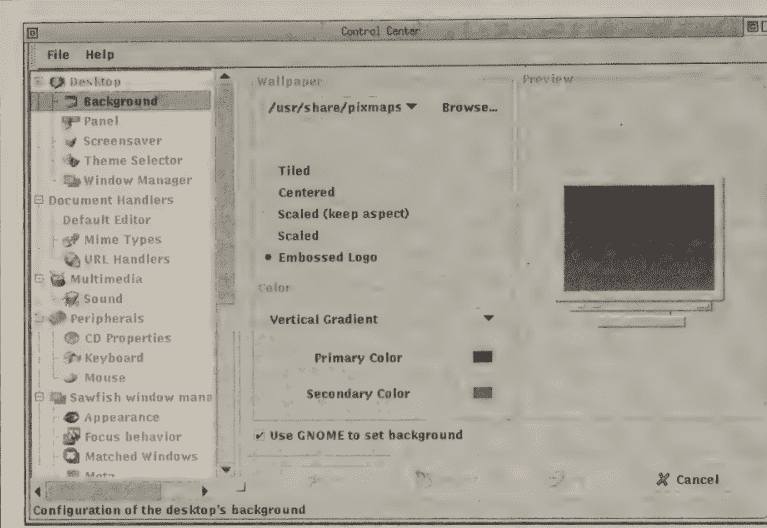

**图 5-4.** 使用 GNOME 控制中心来修改 GNOME 桌面环境应用程序。通过此小程序，你可以控制面板中使用的动画、为面板添加纹理、控制面板对象的移动和间距、调整菜单，并启用或禁用工具提示和快捷键绑定。我这个小程序中，我最喜爱的选项是菜单栏上的“大图标”设置，它可以让图标以高分辨率显示在屏幕上。

“屏幕保护程序”（Screensaver）选项允许你从一个相当大的列表中选择一个屏幕保护程序，然后设置其选项。选项包括：

- 启动屏幕保护程序前必须经过的时间

- 关闭屏幕保护程序时是否需要当前用户的密码

- 屏幕保护程序任务相对于系统其他任务的相对优先级（你可希望你的屏幕保护程序消耗服务器的处理器能力……你可不会在 NT 或 Windows 2000 服务器上运行 OpenGL 屏幕保护程序）

## 第 5 章：第 2 步：配置 X

我喜欢的屏幕保护程序是“bsod”，它会为你展示类似 Windows 的“蓝屏”错误信息，以及基于 Mac、DOS 和 Amiga 的错误界面。我正在慢慢学习在看到蓝屏时不要心惊，但每次看到它时还是会让我大笑。

“主题选择器”（Theme Selector）允许你选择一些预配置的桌面主题，从简单到无法阅读的应有都有，大多数都很好。你可以从可用主题列表中进行选择，桌面设计的主要特征显示在列表下方，这样你对整个桌面的样子就有大致的了解。你也可以从此调板中调整用户字体。

“窗口管理器”（Window Manager）允许你选择 GNOME 使用的窗口管理器。除非你有理由使用其他的（Red Hat 也包含了 tw，其他也有一些可用的），否则我建议坚持使用默认的 Sawfish。你可以点击此处的按钮来编辑配置，我将在本章晚些部分讨论 Sawfish 窗口管理器的配置。注意，有些窗口管理器可以完全模拟 Windows，如果你喜欢那种类型的话。

文档处理器（Document Handlers）“默认编辑器”（Default Editor）选项设置与可编辑文档关联的文本编辑器。你可能认为这种选择就像在 Windows 中将 `.txt` 文件与记事本或 Write 关联的一样。Linux 自带了多得多的文本编辑器选项供挑剔的程序员选择。你可以在这里从一系列编辑器中进行选择，当你双击可编辑文件时，它将打开你选择的编辑器。


MIME 类型（MIME Types）小程序与 Windows 中的文件类型（File Types）类似：它将扩展名与应用程序关联。你可以指定任何文件类型（基于其扩展名）如何打开、查看和编辑。你还可以为给定的扩展名关联图标，以便从文件管理器中更容易识别它。

“URL 处理器”（URL Handlers）小程序控制 URL 在 GNOME 中的处理方式。它的工作原理与 MIME 类型小程序类似，但处理的不是文件扩展名，而是 URL 列表。在 Red Hat 7 中，Netscape 是默认处理器，而 GNOME 浏览器被指定用于手册页（man pages）、info 文件和帮助文件。

多媒体（Multimedia）“声音”（Sound）小程序稍微用：它类似于 Windows 中的控制面板。从“常规”（General）选项卡，你可以启用 GNOME 和 GNOME 事件的音频。从“声音”（Sounds）选项卡，你可以将声音文件与桌面管理器或特定程序中的特定事件关联。如果你真的需要在错误信息出现时让霍默·辛普森说“Doh!”，你可以这样设置。然后为自己提高了工作效率而赞美一下吧。

外设（Peripherals）“CD 属性”（CD Properties）小程序控制 GNOME 在向 CDROM 插入 CD 时的反应。你可以配置系统自动挂载插入的 CDROM。你还可以告诉系统启动任何插入的自动运行 CDROM。你还可以指定插入音频 CD 时应该运行的命令。默认情况下，GNOME 通过 `gtcd` 播放音频 CD。通过此小程序启用音频 CD 自动播放，并尝试这个很棒的工具。

“键盘”（keyboard）小程序配置你键盘的自动重复和音频点击设置。你可以开启键盘的自动重复（例如，如果你把一本杂志压在空格键上，它会发送大量的空格），并指定重复速率和自动重复之前的延迟时间。你还可以开启键盘点击声，在你按下按键时产生可听的音调。调大音量并使用自动重复，让自己听起来像个每分钟打 500 字的打字狂。

从“鼠标”（Mouse）小程序中，你可以指定鼠标使用的手部（这样 GNOME 就可以交换左右定义）。你还可以为鼠标光标设置加速速率以及鼠标在加速启动前必须达到的阈值速度。

会话（Session）“启动提示”（Startup Hint）允许你开启或关闭登录提示窗口。如果你熟悉 GNOME，提示可能会很烦人，但你可能会发现它们在一段时间很有帮助。如果你愿意，可以将提示替换为 `fortune` 命令的响应，该命令访问一个包含大量评论、故事、引言和格言式预测的数据库。登录消息的另一个选项是显示每日消息（message of the day）。“启动程序”（Startup Programs）小程序类似于 Windows 和 200 中的服务控制面板。你可以指定启动的程序，可以浏览当前激活列表，并可以设置系统保存更改。

用户界面（User Interface）“应用程序”（Applications）小程序非常酷。它让你控制 GNOME 规范应用程序中的菜单、工具栏和状态栏，这些通过图 5-5 所示的复选框进行控制，你可以指示是否使用图标配合标签。同样，应用程序底部的状态栏也可以进行配置。如果你启用了状态栏交互，某些栏将使用自己的窗口。

最后，工具栏也可以个性化。如果你愿意，可以启用工具栏分离和移动。为工具栏选择轮廓边缘（凸起）并开启按钮。如果你喜欢，激活分割工具项目的线条。

“对话框”（Dialog）小程序允许你控制 GNOME 中对话框的显示方式。默认情况下，左对齐或右对齐；分散；位于边缘。接下来，小程序允许你决定带有常用按钮的对话框（例如“确定”按钮）使用图标配合标签）。你还可以选择将仅信息的对话框消息显示在状态栏而不是对话框中。你还可以确定默认对话框的位置，可以由窗口管理器指定、居中或鼠标当前指向的位置。你可以指示按钮提示像其他窗口还是特殊处理。对于我们这些用 Windows 太久的人来说，还有一个选项可以尽可能将对话框放置在其应用程序之上。这不是标准的 X Windows 行为，但是我们许多人的习惯。这是一种让你的界面工作得好得的方式。

最后一个小程序 MDI 控制 GNOME 规范应用程序内多个文档显示方式。你可以选择笔记本样式，为应用程序中打开的每个文档提供自己的标签；顶层样式（Toplevel），在关闭该文档之前始终显示活动文档；以及模态样式（Modal），一次显示一个文档但允许在多个打开的文档之间切换。如果你选择笔记本样式，还可以指定标签在应用程序中的显示位置。

## Windows 瘾者的 Linux之路：12 步计划

## Sawfish 配置器

Sawfish 配置器是用于编辑 GNOME 默认使用的窗口管理器的工具。桌面环境（GNOME）与窗口管理器（Sawfish）之间在设置上的区别对我们来说并不重要，但总来说，GNOME 控制中心更改的是符合 GNOME 标准的应用程序及其相互关系，而 Sawfish 配置器更改的是窗口系统的外观。

正如我之前描述的那样，你可以从 GNOME 控制中心通过“桌面 - 窗口管理器”小组件打开配置器。当配置器打开时，你将看到一个与图 5-6 所示相似的窗口。

Sawfish 配置的左侧有 11 个选项。在大多数情况下，这些选项控制 Sawfish 配置的特定方面，如外观、焦点、移动、调整大小和放置。

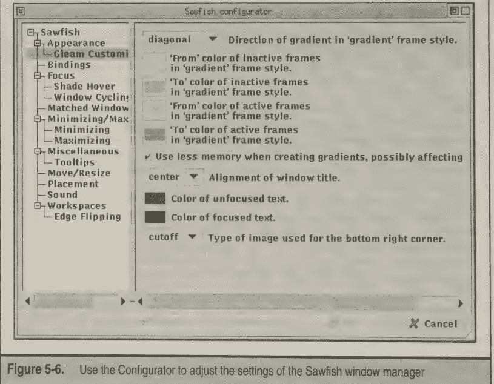

## 第 5 章：第 2 步：配置 X

“外观”（Appearance）选项允许你选择在 GNOME 桌面创建的窗口上使用的主题。“外观”设置描述了窗口在激活和非激活状态下的样子；颜色；字体以及自定义功能。“焦点行为”（Focus behavior）选项后的概念可能没那么熟悉。

在 Windows 中，当你点击某个窗口时，它在桌面上始终是激活状态的。换句话说，如果你点击一个窗口，光标就会在该窗口中激活。这是我们熟悉的行为。但在 X Windows 世界中，这并不一定是理想的行为。有时，Unix 用户希望在不点击窗口的情况下在其中输入文字。一种可能很有用的情况是你正在从一个窗口向另一个窗口输入数据。在这种情况下，让源窗口保持较大并显示在最上方，而只显示目标窗口的一或两行（足够打字的空间），会更容易。

所以你在 Linux 中会获得“焦点”。焦点行为”告诉你是如何给窗口赋予焦点。这种焦点主要是基于用户对鼠标的操作授予的。微软的界面在你点击窗口的任何部分时授予窗口焦点。其他选项还包括在光标进入窗口时授予焦点，或者在光标离开窗口时夺走窗口的焦点。如果不清楚它们之间的区别，你可以选择一个设置，然后点击“尝试”（Try）按钮查看其工作原理，并决定你是否喜欢。

“匹配窗口”（Matched Windows）选项是一个非常有用的工具，允许你指定规则，让某些窗口获得特殊的放置、焦点或外观。规则涵盖了从“运行在特定系统上的所有窗口”到“仅限此名称的窗口”。要设置新规则，点击“插入”（Insert）按钮，选择一个标准，然后点击窗口。该窗口的特征将反映在结果中。

“Meta”选项让你对在使用配置器时想要处理的复杂程度有了一个初步了解。你可以从三个目标选项中进行选择：新手（novice）、中级（intermediate）和专家（expert）。如果你选择新手设置，看到的选项会更少，因为 Sawfish 会向你隐藏更高级的配置问题。另一方面，专家设置会将所有内容呈现出来。

“最小化和最大化”（Minimizing and Maximizing）选项允许你处理窗口最小化和最大化的机制。“杂项”（Miscellaneous）选项增加了其他自定义功能，并让你控制工具提示——例如，当你将鼠标悬停在某个项目或工具栏上时弹出的微小信息。不意外的是，“移动和调整大小”（Moving and Resizing）选项让你控制窗口在移动和调整大小时的行为。

“声音”（Sound）选项允许你启用、禁用和控制与窗口事件相关的声音。我发现这个功能极其烦人；虽然最初在最小化窗口时有那种《星际迷航》式的滑动声很好，但这种效果很快就会让人厌烦。GNOME 中的桌面环境声音则没那么烦人。

“工作空间”（Workspaces）选项控制多个桌面和虚拟桌面的显示方式。这两个设置都为你提供了更多的桌面空间，但它们以不同的方式实现目标。

## Windows 瘾者的 Linux之路：12 步计划

在显示中添加多一列或一行会使你的桌面总面积超过你一次能看到的的量。与其在桌面上只显示一个显示器的信息，不如你可以拥有四个显示器的信息（通过将 Sawfish 配置为两行两列）。你桌面的可视区域变成了一个门户，通过它你可以到达整个桌面的部分。当你将鼠标移动到屏幕边缘时，视图会切换并显示下一个虚拟屏幕。

另一种提供更多桌面空间的方法是创建独立的桌面，这些被称为“工作空间”。它们不是相互连接的，而是独立的桌面。这两种方法可以结合使用；例如，你可以拥有三个独立的桌面，每个桌面等同于四个显示器。

如果这听起来不合理，少量的实验将有助于理清这些区别。这些选项很容易配置，你可以在屏幕底部的 GNOME 面板中看到结果，它显示了哪个桌面以及虚拟屏幕的哪个部分是激活的。事实上，使用所有这些选项的最佳解决办法就是不断尝试，直到你喜欢你看到的内容。如果你不喜欢某个桌面的外观，那里还有更多可选的！

## Windows 瘾者的 Linux之路

## 第 6 章

## 第 3 步：编译内核

## Windows 瘾者的 Linux之路：12 步计划

既然已经选择开始迁移，你已经安装了 Linux 并配置了 X。现在是时候采取下一个重要步骤了：为了内核的灵活性编译内核。

### 为什么要编译内核？

这是一个很好的问题。毕竟，如果到目前为止你的 Linux 安装一切顺利，为什么要编译内核呢？

首先最重要的是，你可以获得一个为你的系统和赋予的任务的任务定制的 Linux 安装。Linux 发行版通常安装一个多功能内核，可以处理一整类机器。但如果你知道正在使用什么样的硬件，为什么要被困于堆你用不到的驱动程序呢？

就此而言，也许你还对系统上的其他功能感兴趣？也许你可能把你的 Linux 设置为一个路由器，它在运行一段时间后证明了自身的可靠性。你可能需要编译一个内置路由功能或防火墙的内核，或者一个全新的 SCSI 卡或外设。

然而，构建你自己的内核的最佳理由可能是利用全球内核程序员正在所做的改进。这并不是从随机来源抓取随机代码片段；最新的稳定内核（它可能比你发行版中带的版本要新）可以从 http://www.kernel.org 获取。最新版本（其中许多功能仍在处理中）也可以在该网站获得。你可以通过阅读位于 http://linuxcare.com 的 Kernel Traffic 摘要来跟踪开发者们在讨论什么。这些出色的周摘要很好地提炼了 linux-kernel 邮件列表上的技术讨论和人际互动。

值得注意的是，构建内核并不困难。它可能需要一段时间，特别是当你使用较旧、较慢的系统时。而且它可能会导致你遇到一些小麻烦。

### 如何编译内核

你在编译内核时所做的只是构建一个程序。你不需要自己编写程序的任何部分，但你确实需要告诉它你想要的选项。

## 第 6 章：步骤 3：编译内核

与任何其他软件一样，这个程序（操作系统内核）已经构建完成，你必须安装它才能使其运行。

在本节中，我们将重点关注构建内核的过程；关于到底应该在内核中构建哪些内容的讨论，我将留到本章的后面部分。现在，让我们先确保你已经有了一套全新的内核文件，并且它们已准备就绪。

### 准备工作

你原始 Linux 内核源文件的默认存放位置是一个名为 `/usr/src` 的目录。该目录有时是一个逻辑链接（如果不熟悉该术语，请参见第 3 章）指向特定版本的目录。请参考以下目录列表：

```
millerm@romans:/usr/src ls -l
total 12
lrwxrxr-x 1 root root 12 Feb 9 06:29 linux -> linux-2.2.13
drwxr-xr-x 3 root root 4096 Feb 9 06:28 linux-2.2.13
drwxr-xr-x 3 root root 4096 Feb 11 02:35 linux-2.2.14
drwxr-xr-x 7 root root 4096 Feb 9 06:33 redhat
```

例如，在 `/usr/src` 目录中有两个 Linux 版本的子目录（2.2.13 和 2.2.14），以及指向一个版本（2.2.13）的逻辑链接。虽然你可以这样保留多个版本的内核，但更好的主意是保持 `/usr/src` 目录安装后的状态。与其修改该树的内容，不如在你的家目录的子目录下创建你自己的目录结构。

要更新内核，你可以从互联网下载最新版本；虽然某些发行版会在自己的网站上提供下载地址，你也可以前往 www.kernel.org 查找过去和现在的生产版及开发内核。一旦你将源文件下载到家目录，请使用相应的工具对其解压缩。

最小的文件（下载最快）是那些带有 `.bz2` 后缀的文件。要从文件中解压并扩展它们，请使用如下命令（使用你下载的文件名）：

```
millerm@romans: -> bunzip2 linux-2.4.0-tar.bz2
millerm@romans: -> tar xf linux-2.4.0-tar
```

这将在你运行 `tar` 命令的目录下创建一个目录结构。进入 `linux` 目录，这是 Linux 源树的顶层。从这里，运行 `make proper`，如下所示：

```
millerm@romans: -> cd linux
/home/millerm/linux
millerm@romans: ~/linux make proper
```

此命令会清理之前尝试构建内核时可能留下的残留文件，你会看到磁盘活动，并看到许多 `rm -f` 命令在屏幕上滚动。当 Linux 命令行提示符返回时，你就可以进入下一步了。

### 内核配置

下一步是配置内核，这意味着告诉它你想要包含哪些功能、想要省略哪些功能，以及你希望将哪些功能构建为模块。执行此任务有三种方法：使用提示驱动的命令行界面；运行提供内核选项菜单的文本模式实用程序；或者执行提供过程 GUI 的 Windows 应用程序。

#### make config

配置 Linux 内核最基础的方法是使用 `make config` 命令。它会运行一个脚本，让你有机会逐个设置每个选项。该界面是纯文本的，且过程完全是线性的；如果你犯了错误，将必须重新运行 `make config` 命令，直到得到你想要的选项为止。

另一方面，`make config` 可以在最基础的 Linux 安装上运行；它既不需要 Windows，也不需要让 `make menuconfig` 具有友好性的文本模式库。

当你运行 `make config` 时，会出现一些脚本消息，随后是某些配置信息和你的第一个选择：

```
millerm@romans: ~/linux> make config
rm -f include/asm
( cd include ; ln -sf asm-i386 asm)
/bin/sh scripts/Configure arch/i386/config.in
# Using defaults found in .config
#
* Code maturity options
* Prompt for development and incomplete code (CONFIG_EXPERIMENTAL)[N/y]?
```

如星号所示，第一个选项属于“**代码成熟度选项**（Code maturity options）”组。虽然该组中只有一个选择，但其他组提供了选择。某些组只有在你启用更高级的功能时才会提示进一步的选项；例如，如果你拒绝开启某些设备驱动，则不会为你提供这些驱动程序。

### 手动编辑配置文件

执行内核配置的第四种方法是手动编辑用于编译内核的配置文件。该文件通常是 `linux/.config`，但由于 `make proper` 命令会删除此文件，除非你按照上一节的指示操作，否则就会消失。没关系；在 `linux/arch/i386/defconfig` 中有一个副本，你可以将其复制到通常的位置。

`.config` 文件是一个文本文件，列出了你正在构建的内核版本中可用的选项。如果某个选项未设置，它的前面有一个井号 `#`，后面跟着“`is not set`”短语，如下所示：

```
# CONFIG_EXPERIMENTAL is not set
```

如果某个选项已设置，则没有井号，并且在末尾有一个等号，然后是“y”或“m”，取决于该选项是要包含在内核中还是构建为模块：

```
CONFIG_INFMT_OUT=m
CONFIG_INFMT_ELF=y
```

这里显示的选项名称没有你在不同工具中看到的那么人性化；除非你清楚自己在做什么，否则它们可能可能太晦涩而无法使用。我没有在随后的“如何编译内核”部分以表格形式包含这些标签，但你可以查阅 `linux/Documentation/config.help` 中的详尽列表，其中包含了标签和描述。

如果你愿意，可以手动编辑整个 `.config` 文件，但那实际上是在浪费时间。如果你使用 `make config`，了解如何编辑 `.config` 文件也是很有用的，因为如果你出错，它不会让你返回修改。你对 `.config` 文件的了解允许你保存它，以便将来参考。

## 第6章 第3步：编译内核

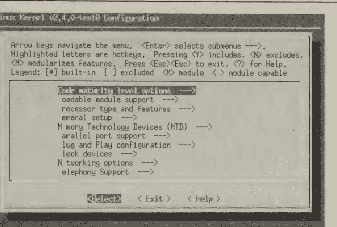

图 6-1. 使用 make menuconfig 选择内核特征

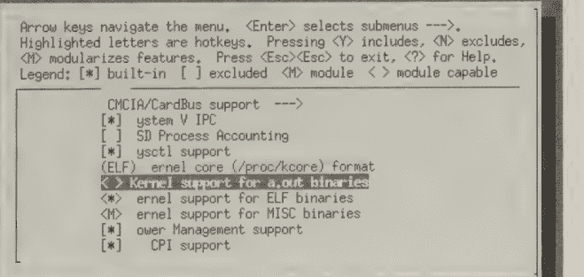

图 6-2. menuconfig 选项旁边的符号表示该功能将被包含在内核中、编译为模块，还是完全排除

## 给 Windows 迷者的 Linux：12 步计划

### make xconfig

虽然这是这三个选项中外观最好的一个，但它要求你启动并运行 X Windows。对于大多数人来说这并不是大问题，因为主流发行版都允许你开箱配置配置并运行 X Windows，但如果你选择了不带 X Windows 的服务器安装，它就会限制你的操作。（这也是为什么你可能想在一个系统上配置内核，然后再传输到另一个系统的原因之一。）xconfig 主菜单如图 6-3 所示。


点击菜单按钮打开一个显示低级菜单的窗口。如图 6-4 所示，这些菜单中的大多数选项都有单选按钮，尽管某些选项有下拉列表供选择或一个可以输入值的框。

当你完成内核配置后，从主菜单中点击“Save And Exit”（保存并退出）按钮，就可以准备继续构建内核了。

## 制作内核

一旦你使用了创建和编辑配置文件的方法之一，就可以进入下一步创建新内核了。接下来的三个步骤可以在命令行合并执行，如下所示：

```
millerm@romans: ~/linux> make dep; make clean; make bzimage
```

分号分隔了三个命令，shell 将通过逐个执行它们来响应。我也将逐一解释这些命令。

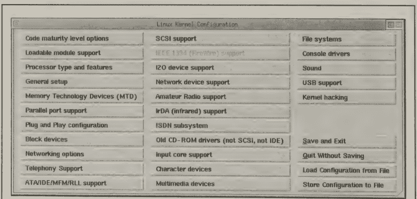

| 代码成熟度级别选项 | SCSI 支持 | 文件系统 |
| --- | --- | --- |
| 可加载模块支持 | IEEE 1394 (FireWire) 支持 | 控制台驱动程序 |
| 处理器类型和特性 | I/O 设备支持 | 音频 |
| 通用设置 | 网络设备支持 | USB 支持 |
| 技术设备 (MTD) | 业余无线电支持 | 内核破解 |
| 并行端口支持 | IrDA (红外) 支持 |  |
| 即插即用配置 | ISDH 子系统 | 保存并退出 |
| 块设备 | 旧 CD-ROM 驱动程序 (非 SCSI, 非 IDE) |  |
| 网络选项 | 输入核心支持 | 不保存并退出 |
| 电话支持 | 字符设备 | 从文件加载配置 |
| ATA/IDE/MFM/RLL 支持 | 多媒体设备 | 将配置存储到文件 |

图 6-3. make xconfig 选项在 X Windows 下运行

## 第6章 第3步：编译内核

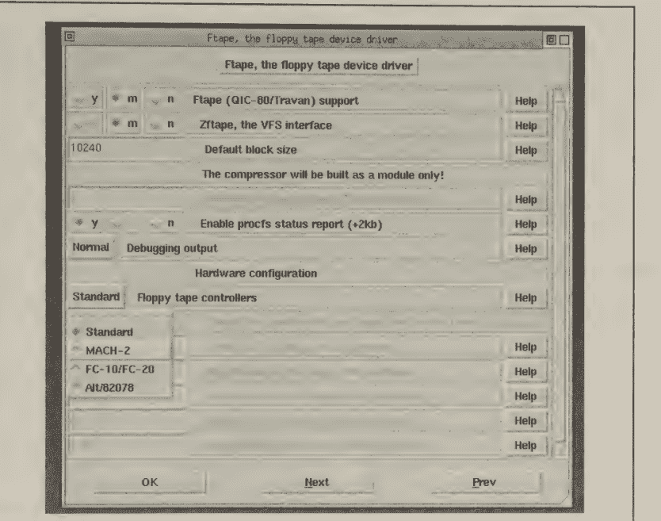

图 6-4. 使用 xconfig 单选按钮来指示你想要包含、排除或模块化的选项

### make dep

三个选项中的第一个是 `make dep`，也称为 `make depend`。正如名称所示，它确定了你正在构建的内核 Linux 文件之间的依赖关系。如果你启用“为模块上的所有符号设置版本信息”（Set Version Information For All Symbols On Modules）选项，`make dep` 过程还会确定你构建的模块的版本信息。更多信息请参考 `linux/Documentation/kbuild/commands.txt`。

### make clean

正如名称所示，此选项会清理创建新文件所需的现有文件。虽然并非总是这样做，但这样做没有坏处，所以做吧。

### make bzimage

这一步是内核本身实际编译的地方，也是整个过程中耗时最长的一个命令。当 shell 开始工作时，它会使用你提供的配置信息来构建一个新的内核文件。在基于 Intel 的系统上，该文件被创建为 `linux/arch/i386/boot/bzimage`。对于小型内核，你可以使用 `make bzimage` 命令，除非你确定内核将非常小，否则最简单的方法是直接使用 bzimage 选项。

当系统编译内核时，会有大量信息滚过屏幕。当进程完成后，系统将向你显示创建的文件 own小。大声地击掌，或者竭尽全力大喊道：“它活了！”，然后继续下一步，在其中安装内核。

## 安装内核

在最后一步中，我们创建了一个名为 `linux/arch/i386/boot/bzimage` 的内核文件。这是我们希望系统使用的内核文件，为了做到这一点，我们必须指示引导程序使用它。

大多数发行版使用 LILO 作为引导程序，你可以通过查看 `/etc/lilo.conf` 文件来识别内核当前的位置。寻找第一行显示 "image=" 的条目，如下：

```
image=/boot/vmlinuz-2.2.12-20
```

有时 vmlinuz 文件可能会在根目录下：`/vmlinuz`。无论该文件当前位于何处，那里就是你想放置新内核文件的地方。你必须先使用 `su` 命令变成 root 用户。你不需要给 vmlinuz 文件起与前一个相同的名称（事实上，最好不要这样做，除非你确定新文件可以工作，即使如此你可能也想用一个更准确的名字）：

```
root@romans:~# cp -millerm/linux/arch/i386/boot/bzImage /boot/vmlinuz-2.2.14
```

### make bzdisk

另一个有用的选项是 `make bzdisk` 命令。如果你用此命令代替 `make bzimage` 命令，你创建的内核将写入你的第一个软盘（等同于 Windows 中的 A 盘）。该磁盘随后可用于测试内核而无需调整现有的配置，或者在紧急情况下启动系统。

如果你使用此选项并希望从软盘启动，则无需遵循随后的内核安装程序。只需带有软盘启动系统（即可）。

## 第6章 第3步：编译内核

在最后一步中，我们创建了一个名为 `linux/arch/i386/boot/bzimage` 的内核文件。这是我们希望系统使用的内核文件，为了做到这一点，我们必须指示引导程序使用它。

大多数发行版使用 LILO 作为引导程序，你可以通过查看 `/etc/lilo.conf` 文件来识别内核当前的位置。寻找第一行显示 "image=" 的条目，如下：

（此处重复上文）

当 `/etc/lilo.conf` 文件编辑完成后，我们准备好让 LILO 更新其配置信息。这是一个简单的过程（但你仍然必须是 root 用户）：

```
root@romans ~ /sbin/lilo
Added Linux *
```

取决于 lilo.conf 中指定的标签，你可能会看到略有不同的消息，提示内核已添加。无论如何，你现在已准备好构建你在配置过程中指定的任何模块。

> 注意：如果你从 Windows 分区运行 Corel Linux 或发行版，你可能正在使用 loadlin，另一种引导程序。当你在 loadlin 系统构建新内核时，只需进入 Windows 并用刚刚创建的 bzimage 文件覆盖现有的 vmlinuz 文件。

## 制作模块

当你配置 Linux 内核时，你可以将许多选项作为模块包含而不是放入内核。每个模块都可以单独加载和卸载；以前 Linux 需要告诉内核加载或卸载什么，但如果你在内核中构建了内核模块加载器（kmod），现在加载是自动的。

要编译模块，只需运行此命令：

```
millerm@romans ~/linux> make
```

这将创建你在配置过程中请求的已完成模块。然而，它并没有安装它们，因此你必须采取第二步（此操作必须以 root 身份执行）：

```
root@romans ~millerm/linux> make modules_install
```

此命令将已完成的模块复制到与内核版本对应的 `/lib/modules/` 子目录下。就是这样；Linux 的模块化功能现在可以按需使用。

## 内核中要编译的内容

告诉你要编译内核是可以的。告诉你如何做是可以的。但我第一次几次构建 Linux 内核时，我比这需要更多的指导

# 给 Windows 爱好者的 Linux：12 步程序

如果你富有冒险精神，有点时间，并且不介意阅读详尽的帮助信息，那么在配置过程中会有大量信息可用（无论你使用哪种配置工具）。你应该能够毫不费力地获取所需的所有内容，并排除掉你真正不需要的内容。

但对于那些希望获得更多帮助的人，本节将描述相关选项，重点介绍那些你可能会浪费时间的选项，并带过那些可能没那么好用的。在此在此提醒你一下，我正在使用的是 Linux 2.4 的测试版本，并且去掉了所有实验性的内容。如果你使用的是不同版本的内核，可能会发现略有不同的选项。如果你想尝试实验性代码，那只能自力为了。

我已经在本节的表格中填充了选项的描述，这些描述通常会随着内核版本的不同而略有变化。我省略了实验性选项、大多数硬件特定的设备驱动程序列表，以及许多只有在你选择了我我不推荐的选项时才有用的选项。然而，这些选项中的大多数在三个配置工具中都有帮助文本，如果你对某个我没有详细解释或在故事中提到的选项感兴趣，请查阅此处以帮助你做出决定。

> 注意：在遵循我的建议设置时请运用常识。例如，如果我没有推荐启用你在 Linux 系统上使用的硬件的驱动程序，请尽管启用它。这些建议是通用的，并不适用于所有情况。

## 代码成熟度级别选项

此选项允许你包含此版本内核中部分开发的功能或驱动程序。除非你必须使用只有实验性驱动程序的硬件，或者想要测试这些功能，否则没有理由包含它们。如果你包含了它们，就会将着使用可能不完整代码的常见风险。建议的配置设置在此处。

| 设置名称 | 推荐 | 不确定时最安全 |
|---|---|---|
| 询问开发中和/或不完整的代码/驱动程序 | N | N |

## 可加载模块支持

这些选项允许你决定如何处理编译为模块而非构建到内核中的内核代码。选项在此处。

| 设置名称 | 推荐 | 不确定时最安全 |
|---|---|---|
| 启用可加载模块支持 | Y | Y |

## 第 6 章：第 3 步：编译内核

| 设置名称 | 推荐 | 不确定时最安全 |
|---|---|---|
| 在所有模块符号上设置版本信息 | N | Y |
| 内核模块加载器 | Y | Y |

激活可加载模块支持功能允许你将某些内核选项编译为模块。这些模块不包含在主内核中；它们根据需要加载到当前运行的内核中并从内核中移除。我建议将某些选项制作模块，因此请启用可加载模块支持。

“在所有模块符号上设置版本信息”是一种华丽的说法，意思是“让我使用来自另一个内核的模块配合我正在构建的内核”。如果你想加载某人用另一个版本的内核构建的模块，或者你想加载一个完全不属于 Linux 内核代码的模块，这就是很有用的。这种情况并不经常发生，而且我们将为正在构建的内核制作模块，除非你从别人那里获得模块，否则你不需要。

内核模块加载器在内核中构建允许根据需要加载模块的功能。kmod 是处理模块加载的进程，也可以配置为移除未使用的模块。有关如何执行此操作，请参见 `linux/Documentation/kmod.txt` 中的 kmod 文档。

## 处理器类型和特性

这些选项允许你自定义内核以反映你计算机的 CPU 类型。通用规则是选择反映你的系统所支持的功能的设置。换句话说，如果你使用上一代芯片的处理器设置，如果你选择超过你计算机规格的选项，成功的概率要大。显然，通过指定与你的精确系统设置最契合的选项，你可以获得最佳性能。这些选项的建议设置显示如下。

| 设置名称 | 推荐 | 不确定时最安全 |
|---|---|---|
| 处理器族 | 与你的 CPU 匹配的 | 386 |
| Intel P6 微代码支持 | N | N |
| Model特定寄存器支持 | N | N |
| CPU 信息支持 | N | N |
| 高内存支持 | Off | Off |
| MTRR（内存类型范围寄存器）支持 | Y | Y |

## 给 Windows 爱好者的 Linux：12 步程序

| 设置名称 | 推荐 | 不确定时最安全 |
| --- | --- | --- |
| 对称多处理支持 | 如果有多个 CPU 则 Y | N |

与“处理器族”相关的帮助文本解释了哪些进程属于哪个族。你可以成功地选择与系统使用的处理器族相同或更旧的处理器族（例如，如果你有一个 Pentium III，你可以使用最合适的设置 PPro/x86MX，或者更早的设置，如 Pentium、486 或 386）。）。如果你在系统之间共享内核，或者为了使用最小公分数，或者对于你正在使用的 CPU 类型（task, task），这可能是很有用的。

接下来的三个选项可能没那么用；Intel P6 微代码支持”选项允许对 Pentium Pro 处理器及其继任的处理器微代码进行更新。“Model特定寄存器支持”和“CPU 信息支持”设置允许访问 SMP 系统上的特定处理器。

如果你的 RAM 总计为 1GB 或更少，选择 Off。如果你超过 1GB 但少于 4GB，选择 4GB。如果你使用超过 4GB，选择 64GB。

Pentium Pro 处理器中显示的内存类型范围寄存器 (MTRR) 功能为使用这些芯片及其继任的系统提供了性能提升。某些非 Intel CPU 也可以使用此功能，如果你有新的 CPU，启用 MTRR 支持是值得的。

对称多处理支持选项为多处理器机器提供支持。禁用此选项意味着系统将只使用 1 个处理器，即使它有更多。启用对称多处理 (SMP) 将可以在多处理器机器上运行，无论 CPU 的数量。

## 通用设置

这些选项有些杂乱，涵盖了从 PCI 总线行为和通用端口支持到内核理解的二进制文件格式以及高级电源管理 (APM)的所有内容。建议设置列如下。

| 设置名称 | 推荐 | 不确定时最安全 |
| --- | --- | --- |
| 网络支持 | Y | Y |
| SGI Visual 工作站支持 | 除非你有 SGI 则 N | N |
| PCI 支持 | Y | Y |
| PC 访问模式 | Any | Any |
| PCI 设备名称 | Y | Y |
| MCA 支持 | 除非你有 | N |

## 第 6 章：第 3 步：编译内核

| 设置名称 | 推荐 | 不确定时最安全 |
| --- | --- | --- |
| 热插拔设备支持 | Y | Y |
| PCMCIA/Cardbus 支持 | Y | Y |
| 系统 IPC | Y | Y |
| BSD 进程统计 | N | Y |
| Sysctl 支持 | Y | Y |
| 内核核心 (/Proc/Kcore) 格式 | ELF | ELF |
| 对 A.Out 二进制文件的支持 | Y | Y |
| 对 ELF 二进制文件的支持 | Y | Y |
| 对 MISC 二进制文件的支持 | Y | Y |
| 电源管理支持 | 如果是笔记本则 Y | Y |
| ACPI 支持 | 笔记本 | Y |
| 高级电源管理 BIOS 支持 | 笔记本 | N |

网络支持选项允许通过以太网或拨号连接与其他计算机联网，它还允许使用内部网络进行进程间通信。启用此选项，好吗？

另一方面，如果你在使用 Silicon Graphics Inc (SGI) 工作站 320 或 540，启用 SGI Visual 工作站支持选项并选择帮助。

## Windows 爱好者的 Linux 之门：12 步程序

PCMCIA 总线在笔记本电脑上广泛使用，尽管也可以为台式机配备 PC 卡作为可能的。如果你想在 Linux 系统上使用 32 位 CardBus，请启用 CardBus Support 选项。

System V IPC 选项允许某些进程相互进行通信。虽然对于你可能运行的每种软件来说并不是必须的，但包含此功能仍然是一个好主意。

BSD Process Accounting（进程进程会计）选项允许某些程序跟踪不同进程的用法信息。除非系统配置为记录这些信息并使其变得可用，否则它对你帮助不很大。

Sysctl 选项允许你在不实际更改内核的情况下控制内核的行为。只有某些参数可以被修改；这些参数可以在 `/proc/sys/` 目录中找到，并在 Linux/Documentation/sysctl/ 中有文档。

Kernel Support For A.Out Binaries 选项是为了向后兼容而保留的；aout 是早期版本 Linux 使用的旧格式。尽管如此，在它彻底消失之前，我建议你将 aout 支持编译到内核中，以防万一。注意，aout 是 C 语言可执行文件的默认名称；如果你在较版本的 Linux 下编译程序，该二进制文件将是 ELF 格式（尽管它被称为 aout）。

目前 Linux 二进制文件（程序文件和库）的格式被称为可执行和可链接格式（ELF）。你需要启用 Kernel Support For ELF Binaries 选项来运行 Linux。随着更多程序使用 ELF 格式，aout 格式正在逐渐消失。

Kernel Support For Misc Binaries 选项允许 Linux 内核在识别其类型时自动启动程序文件。这些二进制文件的示例包括需要在解释器中运行的 Java 程序，以及需要通过 dosemu DOS 模拟器运行的 DOS 可执行文件。关于该格式的更多文档包含在 Linux/Documentation/binfmt_misc.txt 中。

如果你在笔记本或其他带有电源管理硬件的系统上配置 Linux，请进入 Power Management Support 选项。此类硬件有两个主要标准；你将根据系统使用的哪一个，来启用 ACPI Support 或 Advanced Power Management BIOS Support。根据我的经验，ACPI 通常运行得更好。如果你启用 APM 支持，还有几个额外的设置需要配置。

## 存储技术设备 (MTD) 支持

此选项允许 Linux 访问各种固态存储设备，大多数用于嵌入式系统和其他特殊应用，除非你确定你有一个 MTD，否则没有必要启用此选项。

| 设置名称 | 推荐 | 未决定时最安全 |
| --- | --- | --- |
| Memory Technology Device (MTD) Support | N | N |

## 第 6 章：第 3 步：编译内核

## 并端口支持

Parallel Port Support 选项允许 Linux 使用连接到并行端口的设备。虽然打印机通常连接到并行端口，但许多其他外设备（包括各种驱动器）可以使用并行端口连接。在打印机通常直接连接到网络而不是连接到计算机的环境中，你可能不需要激活并行端口。另一方面，Linux 是一个非常棒的打印服务器设备，可以为你省下一些购买外部打印服务器设备的费用，小型环境可能特别想要激活此选项。

| 设置名称 | 推荐 | 未决定时最安全 |
| --- | --- | --- |
| Parallel Port Support | Y | Y |
| PC-Style Hardware | Y | Y |


| Use FIFO/DMA If Available | Y | N |

| Support Foreign Hardware | N | N |

| IEEE 1284 Transfer Modes | Y | Y |

如果你在使用兼容 PC 的电脑并激活了并行端口支持，你应该选择 PC-Style Hardware 选项。如果你知道你的并行端口具有 FIFO 芯片以加速并行端口通信，你可以启用 FIFO/DMA If Available。Linux 支持的某些非 PC 计算机也使用这些并行端口。如果你拥有非基于 PC 的系统，你应该选择 Support Foreign Hardware 选项以启用非 PC 风格的并行端口。

最后，如果你有一台相当较新的系统，你可能有一个符合 IEEE 1284 标准的双向并行端口。启用 IEEE 1284 Transfer Modes 允许你利用系统上的增强并行端口 (EPP) 或扩展能力端口 (ECP) 功能。如果你禁用此选项，EPP 或 ECP 仍将作为标准打印端口工作。

# 即插即用配置

即插即用 (PnP) 是一种系统识别设备并为设备分配系统资源的机制。启用此功能允许内核识别和管理 PnP 设备。可用选项在此所示。

| 设置名称 | 推荐 | 未决定时最安全 |
| --- | --- | --- |
| Plug And Play Support | Y | Y |
| ISA Plug And Play Support | Y | Y |

启用 Plug And Play support 选项以在内核中开启 PnP 支持。ISA 总线设备可以使用 ISA Plug And Play support 功能被系统识别。

虽然 ISA 卡已不再很常见，但你可能仍然有一些；如果你不确定，我建议你启用此功能。

# 块设备

此类别包括各种存储设备和接口。支持的块设备选项列表在此。

| 设置名称 | 推荐 | 未决定时最安全 |
|---|---|---|--|
| Normal PC Floppy Disk Support | Y | Y |
| XT Hard Disk Support | Y | Y |
| Parallel Port Support | Y | Y |
| Compaq SMART Support | N | N |
| Mylex DAC960 Controller Support | N | N |
| Loopback Device Support | N | N |
| Network Device Support | N | N |
| Logical Volume Manager (LVM) Support | Y | Y |
| Multiple Devices Support | Y | Y |
| Linear (Append) Mode | Y | Y |
| RAID-0 (Striping) Mode | Y | Y |
| RAID-1 (Mirroring) Mode | Y | Y |
| RAID-4/5 (Mode) | N | N |
| Normal PC Floppy Disk Support | N | N |
| XT Hard Disk Support | N | N |
| Parallel Port Support | N | N |
| Compaq SMART Support | N | N |
| Mylex DAC960 Controller Support | N | N |
| Loopback Device Support | N | N |
| Network Device Support | N | N |
| Logical Volume Manager (LVM) Support | N | N |
| Multiple Devices Support | N | N |
| Linear (Append) Mode | N | N |
| RAID-0 (Striping) Mode | N | N |
| RAID-1 (Mirroring) Mode | N | N |
| RAID-4/5 (Mode) | N | N |

由于此项允许基于软件的多设备支持，你不需要使用此选项来处理硬件 RAID 卡。如果你负担得起，硬件 RAID 是更好的选择，如果没有，可以使用 Linux 的软件版本。在 Software RAID mini-HOWTO 中阅读更多关于软件 RAID 的信息，它通常位于 `/usr/doc/tree`。有关最新版本的 HOWTO 和 mini-HOWTO 文档，请访问 http://www.linuxdoc.org，你可以在那里浏览或尽情下载文档。

- **(Append) Mode**：线性或追加模式是指将多个磁盘分区合并为一个逻辑设备以扩展空间。从存储容量的角度来看，如今廉价的大容量驱动器可能使此功能变得不再必要，但从管理的角度来看，在不拔掉旧磁盘的情况下增加磁盘是非常好的。尽管如此，我可能不会编译或作为模块使用它。

- **RAID-0 (Striping) Mode**：磁盘条带通过多个磁盘写入数据，以减少请求单个驱动器写入数据块引入的延迟。允许两个或多个驱动器分担写入数据的任务（跨阵列写入连续位）可以提高性能。然而，它并没有提高可靠性，因为系统中没有内置冗余。所以尽管它很快，但如果你丢失条带集中的一个磁盘，你就会丢失整组数据。因此我不推荐 RAID 0。

# Windows 爱好者的 Linux 之路：十二步计划

**RAID-1（镜像）模式** RAID-1 不会将数据条带化分布到多个设备上；相反，它将数据写入阵列中的所有设备。这使得读取操作非常快，而写入操作的速度与单块硬盘相当。不过，只要有一块硬盘保持完好，带有镜像驱动器的系统即使在另一块驱动器故障时也能继续运行。这是一个良好且可靠的运行模式，因此我建议启用此选项或将其编译为模块。

**RAID-4/RAID-5 模式** 这些方法将 RAID 0 的数据条带功能与“奇偶”数据相结合，允许系统在单个驱动器故障时继续运行。虽然我遇到过 RAID 中的多个驱动器同时故障，但这些方法通常被认为提供了性能和抗故障能力的最佳平衡。RAID 4 留出一个驱动器来存储奇偶数据，这在磁盘故障时提供了重建数据的能力。RAID 5 通过将奇偶数据分布在阵列中的所有驱动器来实现相同的结果。这是一种结合一组磁盘来实现容量和容错的有效方法，我建议你启用该选项或将其编译为模块。

**RAM 磁盘支持** 除非你有使用 RAM 磁盘的理由（在 Windows 系统中，这是一种将部分内存作为磁盘驱动器访问的机制），否则没有理由启用此选项。始终选择 `M` 将其变为模块。RAM 磁盘通常在 Linux 安装期间使用，因此它们在大多数发行版的内核中都是开启的。

从理论上讲，RAM 磁盘是提高性能的好方法（通过将程序加载到 RAM 磁盘中，你很大程度上避免了接触硬盘；由于 RAM 的速度远快于磁盘，这是好事）。然而，Linux 尝试使用可用 RAM 缓存频繁访问的数据，因此通过使用 RAM 磁盘获得的性能提升通常非常微小。

# 网络选项

这组选项涉及你计划使用的网络功能类型，而不是计划使用的硬件。这里有很多选项，但大多数对于标准服务器或工作站的操作来说并不是必要的。我的推荐设置在此处。

| 设置名称 | 推荐 | 未决定时最安全 |
|---|---|---|
| 数据包套接字 (Packet Socket) | Y | Y |
| 数据包套接字：映射 IO | N | N |
| 内核/用户态 Netlink 套接字 | Y | Y |
| 路由消息 (Routing Messages) | N | Y |
| Netlink 设备仿真 | Y | Y |

# 第 6 章：第 3 步：编译内核

| 设置名称 | 推荐 | 未决定时最安全 |
|---|---|---|
| 网络数据包过滤 | N（除作为互联网网关的系统除外） | N |
| 套接字过滤 | N | N |
| Unix 域套接字 | Y | Y |
| TCP/IP 网络 | Y | Y |
| IP: 多组播 | N | N |
| IP: 高级路由器 | N | N |
| IP: 内核级自动配置 | N（除依赖 BOOTP 或 RARP 服务器的系统除外） | N |
| IP: 隧道 (Tunneling) | N | N |
| IP 上的 GRE 隧道 | N | N |
| IP: TCP 显式拥塞通知支持 | N | N |
| IP: TCP Syncookie 支持（默认禁用） | N | N |
| IPX 协议 | N（除非使用 IPX/NetWare） | M |
| AppleTalk 协议支持 | N（除非使用 AppleTalk） | M |
| Decnet 支持 | N（除非使用 DECNet） | M |
| 802.1d 以太网桥接 | N | N |

某些应用程序不需要使用外部网络协议与系统的网络设备通信；相反，它们使用数据包套接字（Packet Socket）机制。虽然你可能不知道自己是否会使用这些程序，但最好假设你想启用此功能。数据包套接字：映射 IO 旨在加速数据包套接字机制中的输入输出；禁用此选项不会产生任何影响，而且可能更。

下一个选项启用了一个用于内核与运行在内核之外应用程序（即用户空间）之间通信的套接字。你必须启用内核/用户态链路驱动程序（Kernel/User Network Link Driver）来使用路由功能、高级路由以及其他几个功能。如果你预计构建内核的 Linux 系统严格作为工作站、文件服务器或打印服务器，此选项可能不是必要的。但如果你打算将其作为网络设备（例如路由器、DNS 服务器等），请启用它。

# Windows 爱好者的 Linux 之路：十二步计划

**RAID-1（镜像）模式** RAID-1 不会将数据条带化分布到多个设备上；相反，它将数据写入阵列中的所有设备。这使得读取操作非常快，而写入操作的速度与单块硬盘相当。只要有一块硬盘保持完好，带有镜像驱动器的系统即使在另一块驱动器故障时也能继续运行。这是一个良好且可靠的运行模式，我建议启用此选项或将其编译为模块。

**RAID-4/RAID-5 模式** 这些方法将 RAID 0 的数据条带功能与“奇偶”数据相结合，允许系统在单个驱动器故障时继续运行。虽然我遇到过 RAID 中的多个驱动器同时故障，但这些方法通常被认为提供了性能和抗故障能力的最佳平衡。RAID 4 留出一个驱动器来存储奇偶数据，这在磁盘故障时提供了重建数据的能力。RAID 5 通过将奇偶数据分布在阵列中的所有驱动器来实现相同的结果。这是一种结合一组磁盘来实现容量和容错的有效方法，我建议你启用该选项或将其编译为模块。

**RAM 磁盘支持** 除非你有使用 RAM 磁盘的理由（在 Windows 系统中，这是一种将部分内存作为磁盘驱动器访问的机制），否则没有理由启用此选项。始终选择 `M` 将其变为模块。RAM 磁盘通常在 Linux 安装期间使用，因此它们在大多数发行版的内核中都是开启的。

从理论上讲，RAM 磁盘是提高性能的好方法（通过将程序加载到 RAM 磁盘中，你很大程度上避免了接触硬盘；由于 RAM 的速度远快于磁盘，这是好事）。然而，Linux 尝试使用可用 RAM 缓存频繁访问的数据，因此通过使用 RAM 磁盘获得的性能提升通常非常微小。

# 网络选项

这组选项涉及你计划使用的网络功能类型，而不是计划使用的硬件。这里有很多选项，但大多数对于标准服务器或工作站的操作来说并不是必要的。我的推荐设置在此处。

| 设置名称 | 推荐 | 未决定时最安全 |
|---|---|---|
| 数据包套接字 (Packet Socket) | Y | Y |
| 数据包套接字：映射 IO | N | N |
| 内核/用户态 Netlink 套接字 | Y | Y |
| 路由消息 (Routing Messages) | N | Y |
| Netlink 设备仿真 | Y | Y |

# 第 6 章：第 3 步：编译内核

| 设置名称 | 推荐 | 未决定时最安全 |
|---|---|---|
| 网络数据包过滤 | N（除作为互联网网关的系统除外） | N |
| 套接字过滤 | N | N |
| Unix 域套接字 | Y | Y |
| TCP/IP 网络 | Y | Y |
| IP: 多组播 | N | N |
| IP: 高级路由器 | N | N |
| IP: 内核级自动配置 | N（除依赖 BOOTP 或 RARP 服务器的系统除外） | N |
| IP: 隧道 (Tunneling) | N | N |
| IP 上的 GRE 隧道 | N | N |
| IP: TCP 显式拥塞通知支持 | N | N |
| IP: TCP Syncookie 支持（默认禁用） | N | N |
| IPX 协议 | N（除非使用 IPX/NetWare） | M |
| AppleTalk 协议支持 | N（除非使用 AppleTalk） | M |
| Decnet 支持 | N（除非使用 DECNet） | M |
| 802.1d 以太网桥接 | N | N |

某些应用程序不需要使用外部网络协议与系统的网络设备通信；相反，它们使用数据包套接字（Packet Socket）机制。虽然你可能不知道自己是否会使用这些程序，但最好假设你想启用此功能。数据包套接字：映射 IO 旨在加速数据包套接字机制中的输入输出；禁用此选项不会产生任何影响，而且可能更。

下一个选项启用了一个用于内核与运行在内核之外应用程序（即用户空间）之间通信的套接字。你必须启用内核/用户态链路驱动程序（Kernel/User Network Link Driver）来使用路由功能、高级路由以及其他几个功能。如果你预计构建内核的 Linux 系统严格作为工作站、文件服务器或打印服务器，此选项可能不是必要的。但如果你打算将其作为网络设备（例如路由器、DNS 服务器等），请启用它。

对于具有复杂路由表的大网络，可以通过启用 IP: Large Routing Tables（IP：大型路由表）使路由更高效。较小的网络（内核帮助信息建议少于 64 个项目）不需要启用此功能。

对于从网络而非本地磁盘启动的 Linux 系统，应该启用 IP: Kernel Level Autoconfiguration（IP：内核级自动配置）。自动配置选项将使用 BOOTP 或 RARP 初始化系统的网络功能。如果你在无磁盘工作站上安装此系统，请启用此选项，以及 IP: BOOTP Support 或 IP: RARP Support，具体取决于你的网络使用的是 BOOTP 协议还是 RARP 服务器。

在极少数需要在一个 IP 数据包中封装 IP 数据包的情况的情况下，请启用 IP: Tunneling（IP：隧道技术），这仅在你尝试为某些设备或恶意行为伪造地址时才有用。如果你需要它，还可以启用 IP: GRE Tunnels Over IP（IP：通过 IP 建立 GRE 隧道）以支持通用封装（GRE），它用于帮助 IPv6 和更常用的 IPv4 在同一网络上共存。该选项的帮助文本指出，这对于与 Cisco 路由器通信可能很有用，因为它们更倾向于使用 GRE 隧道而非标准的 Linux 隧道。

如果你计划启用 IP: TCP Explicit Congestion Notification Support（IP：TCP 显式拥塞通知支持），显式拥塞通知（ECN）是一种识别和响应 TCP/IP 数据包网络拥塞的方法。如果你正在部署一个路由器或大多数配置的工作站使用 ECN 的网络，这会很有用——在网络拥塞时不再丢弃数据包，配备 ECN 的路由器会通知网络上的站点减慢运行以便跟上节奏。如果你没有计划使用 ECN，则不需要此选项。

路由消息（Routing Messages）选项允许你在将放置某些路由信息的系统中创建一个名为 `/dev/route` 的“字符特殊文件”。如果你启用了此选项，你必须登录系统并使用 `mknod` 程序通过此命令创建 `/dev/route`：

```
root@romans ~> mknod /dev/route c 36 0
```

此命令看起来可能有点晦懂，但它只是告诉 Linux 创建一个名为 `/dev/route` 的特殊文件，即字符特殊文件（一次写入一个字符），并且标识“主设备号”为 36，“次设备号”为 0。主号和次号向操作系统标识该特殊文件的功能；当前定义的这些设备文件列表位于内核目录中（通常为 `linux/Documentation/devices.txt`）。

# Windows 爱好者的 Linux 之路：十二步计划

路由消息（Routing Messages）选项允许你在将放置某些路由信息的系统中创建一个名为 `/dev/route` 的“字符特殊文件”。如果你启用了此选项，你必须登录系统并使用 `mknod` 程序通过此命令创建 `/dev/route`：

```
root@romans ~> mknod /dev/route c 36 0
```

此命令看起来可能有点晦懂，但它只是告诉 Linux 创建一个名为 `/dev/route` 的特殊文件，即字符特殊文件（一次写入一个字符），并且标识“主设备号”为 36，“次设备号”为 0。主号和次号向操作系统标识该特殊文件的功能；当前定义的这些设备文件列表位于内核目录中（通常为 `linux/Documentation/devices.txt`）。


## IP: SYN Cookies Support（IP：SYN Cookies 支持，默认禁用）

采用名为“SYN cookies”的防御机制，以防止名为“SYN 洪水攻击”（SYN flooding）的潜在拒绝服务攻击。使用 SYN cookies，系统可以在 SYN 洪水发生期间确定哪些用户应该连接到主机系统。

如果你的系统可以从互联网访问，启用此选项是一个好主意，但正如名称所示，仅仅在内核编译之前选择该选项并不够以开启 SYN cookies。要做到这一点，请在编译并安装内核后使用以下命令：

```
root@roms ~> echo 1 > /proc/sys/net/ipv4/tcp_syncookies
```

如果你在使用带有 Novell NetWare 编译器的多厂商环境，并希望使用它们（曾经）原生的 IPX 协议进行互连，请启用 The IPX Protocol（IPX 协议）。在我写这些时，SPX 支持仍处于实验阶段，你的应用程序连接性可能会受到限制，但对于包括访问文件和打印机在基本网络功能，IPX 将能够胜任。如果没有 NetWare，这种可能性极小。

如果你启用了 IPX 网络，你可以选择为 Linux 主机提供一个内部 IPX 网络地址，以便使用 IP: Full Internal IPX network（IP：全内部 IPX 网络）选项允许套接级通信。

## 第 6 章：第 3 步：编译内核

如果你使用 Ethertalk 或（保佑你）LocalTalk 的联网 Mac 需要看到你的 Linux 设备，请启用 AppleTalk Protocol Support。你需要使用来自 `http://www.umich.edu/~rsug/netatalk/` 的 `netatalk` 程序为 AppleTalk Mac 客户端启用文件和打印服务。如果你必须支持与使用 DECNet 的 Digital Equipment Corp. 通信，你应该启用 DECNet 支持选项。否则，保持这些选项默认。

最后一个网络选项是 802.1d Ethernet Bridging（以太网桥接）。此功能允许具有多个网卡的 Linux 系统充当以太网网络之间的桥器。数据包从一个以太网进入系统网卡，系统可以检查数据包目标是否为桥接以太网，如果是，它将通过另一块网卡将数据发送到该网络。除非你打算将你的 Linux 系统变成网络设备，否则你不想这样做。

## 电话支持

此选项允许你使用 Quicknet Technologies, Inc. 的电话卡，允许你通过结合公共电话网络（PSTN）和互联网来打电话。如下所示，除非你拥有 Quicknet 产品，否则不要启用此选项。如果有，请查看相关的帮助文本和 `http://www.quicknet.net/` 以获取更多信息。

## ATA/IDE/MFM/RLL 支持

| 设置名称 | 推荐 | 不确定时最安全 |
| --- | --- | --- |
| Linux 电话支持 | N | N |
| 增强 IDE/MFM/RLL 磁盘/光驱/带/软盘支持 | 使用 IDE 时选 Y | Y |
| 在主接口上仅使用旧磁盘驱动 | N | N |
| 包含 IDE/ATA-2 磁盘支持 | Y | Y |
| 默认使用多模式 | N | N |
| PCMCIA 支持 | N | Y |
| 包含 IDE/ATAPI 光驱支持 | Y | M |
| 包含 IDE/ATAPI 磁支持 | M | M |
| 包含 IDE/ATAPI 软盘支持 | Y | M |
| SCSI 仿真支持 | N | Y |
| CMD640 芯片集修复/支持 | Y | Y |
| CMD640 增强支持 | N | Y |
| ISA-PNP EIDE 支持 | N | N |

## Windows 成瘾者：12 步疗计划

| 设置名称 | 推荐 | 不确定时最安全 |
| --- | --- | --- |
| RZ1000 芯片集修复/支持 | Y | Y |
| 通用 PCI IDE 芯片集支持 | Y | Y |
| PCI 中断支持 | N | N |
| 通用 PCI 总线主支持 | N | N |
| 启动芯片集支持 | N | N |
| 其他芯片集支持 | N | N |

启用增强的 IDE/MFM/RLL 磁盘/光驱/带/软盘选项，它提供了对 IDE 设备的完整控制，这些设备非常普遍，你应该支持它们。如果你有一个全 SCSI 系统，我建议将此选项作为模块构建。在无需重新编译内核的情况下添加 IDE 光驱、硬盘或磁带是非常方便的。除非你的第一个 IDE 硬盘在从要或后续 IDE 接口上有新设备，否则禁用“接口上仅使用磁盘驱动”选项。

启用 IDE/ATA-2 磁盘支持，除非你没有 IDE 硬盘，这种情况下你应该构建模块。如果你像我一样是 SCSI 狂热，你可能想连接一个 IDE 硬盘。

启用 IDE/ATA-2 磁盘支持，除非你没有 IDE 硬盘，这种情况下你应该构建模块。如果你像我一样是 SCSI 狂热，你可能想连接一个 IDE 硬盘。

启用 IDE/ATA-2 磁盘支持，除非你没有 IDE 硬盘，这种情况下你应该构建模块。如果你像我一样是 SCSI 狂热，你可能想连接一个 IDE 硬盘。

启用 IDE/ATA-2 磁盘支持，除非你没有 IDE 硬盘，这种情况下你应该构建模块。如果你像我一样是 SCSI 狂热，你可能想连接一个 IDE 硬盘。

启用 IDE/ATA-2 磁盘支持，除非你没有 IDE 硬盘，这种情况下你应该构建模块。如果你像我一样是 SCSI 狂热，你可能想连接一个 IDE 硬盘。

启用 IDE/ATA-2 磁盘支持，除非你没有 IDE 硬盘，这种情况下你应该构建模块。如果你像我一样是 SCSI 狂热，你可能想连接一个 IDE 硬盘。

启用 IDE/ATA-2 磁盘支持，除非你没有 IDE 硬盘，这种情况下你应该构建模块。如果你像我一样是 SCSI 狂热，你可能想连接一个 IDE 硬盘。

启用 IDE/ATA-2 磁盘支持，除非你没有 IDE 硬盘，这种情况下你应该构建模块。如果你像我一样是 SCSI 狂热，你可能想连接一个 IDE 硬盘。

启用 IDE/ATA-2 磁盘支持，除非你没有 IDE 硬盘，这种情况下你应该构建模块。如果你像我一样是 SCSI 狂热，你可能想连接一个 IDE 硬盘。

启用 IDE/ATA-2 磁盘支持，除非你没有 IDE 硬盘，这种情况下你应该构建模块。如果你像我一样是 SCSI 狂热，你可能想连接一个 IDE 硬盘。

启用 IDE/ATA-2 磁盘支持，除非你没有 IDE 硬盘，这种情况下你应该构建模块。如果你像我一样是 SCSI 狂热，你可能想连接一个 IDE 硬盘。

启用 IDE/ATA-2 磁盘支持，除非你没有 IDE 硬盘，这种情况下你应该构建模块。如果你像我一样是 SCSI 狂热，你可能想连接一个 IDE 硬盘。

启用 IDE/ATA-2 磁盘支持，除非你没有 IDE 硬盘，这种情况下你应该构建模块。如果你像我一样是 SCSI 狂热，你可能想连接一个 IDE 硬盘。

启用 IDE/ATA-2 磁盘支持，除非你没有 IDE 硬盘，这种情况下你应该构建模块。如果你像我一样是 SCSI 狂热，你可能想连接一个 IDE 硬盘。

启用 IDE/ATA-2 磁盘支持，除非你没有 IDE 硬盘，这种情况下你应该构建模块。如果你像我一样是 SCSI 狂热，你可能想连接一个 IDE 硬盘。

启用 IDE/ATA-2 磁盘支持，除非你没有 IDE 硬盘，这种情况下你应该构建模块。如果你像我一样是 SCSI 狂热，你可能想连接一个 IDE 硬盘。

（注：原文此处存在大量重复行，已按要求完整翻译）

启用 IDE/ATA-2 磁盘支持，除非你没有 IDE 硬盘，这种情况下你应该构建模块。如果你像我一样是 SCSI 狂热，你可能想连接一个 IDE 硬盘。

## SCSI 支持

此选项启用对 SCSI 设备的支持。如果你没有任何计划，可以禁用此项。假设你有设备，我的选项建议所示：

| 设置名称 | 推荐 | 不确定时最安全 |
| --- | --- | --- |
| SCSI 支持 | Y | Y |
| SCSI 磁盘支持 | Y | M |
| 可作为模块加载的 SCSI 磁盘最大数量 | 40 | 40 |
| SCSI 带支持 | M | M |
| SCSI 光驱支持 | Y | Y |
| SCSI 通用支持 | M | M |
| 在队列代码中启用额外检查 | N | Y |
| 探测每个 SCSI 设备上的所有 LUN | N | N |
| 详细 SCSI 错误报告 | Y | Y |
| SCSI 日志设施 | N | Y |

如果你的 Linux 系统上有 SCSI 设备，请启用 SCSI 支持选项。你可以为特定类型的 SCSI 设备单独指定。第一个此类选项是 SCSI 磁盘支持。这指的是使用 SCSI 接口的硬盘，所以如果你有一个或多个，请启用它。接下来的选项指定了可作为模块加载的磁盘最大数量；40 的默认值对我们大多数人都是一个很好的设置，没有必要将该数字接近你实际使用的设备数量。

如果你有或计划添加 SCSI 磁带设备，请启用带支持；当然，如果你有或计划添加 SCSI 光驱，你应该启用 SCSI 光驱支持选项。不那么明显的是 SCSI 通用支持选项，它包含了各种不属于其他类别的设备，包括 SCSI 扫描仪和读取器。

在队列代码中启用额外检查可能在你有的内核版本中不存在；它存在于初步版本中以帮助识别 SCSI 代码中的问题。如果这是一个选项，请启用它。探测每个 SCSI 设备上的所有 LUN 功能仅用于某些 SCSI 设备，如具有多个逻辑单元数（LUN）的 CD 自动库。

启用详细 SCSI 错误报告选项会让 SCSI 相关的错误消息更详细，从而更容易理解（因此更有用）。这通常是一件好事，所以我支持它。只有当你遇到系统问题并怀疑 SCSI 总线上的某些问题时，我才会启用 SCSI 日志设施选项。

### 给 Windows 爱好者的 Linux：12 步计划

由于。这是必须在内核中启用的选项之一，然后在内核编译并安装后开启。请使用此命令：

```
root@romans /> echo "scsi log all 0" > /proc/scsi/scsi
```

这将捕获所有的 SCSI 活动以供以后参考和故障排除。使用此命令识别你的 SCSI 问题并开始记录：

```
root@romans /> echo "scsi log none 0" > /proc/scsi/scsi
```

此菜单中有两个子菜单可用，每个子菜单都允许你为系统选择正确的 SCSI 硬件。为桌面和服务器系统使用 SCSI 低级驱动程序，并选择你需要包含的用于你的 SCSI 卡的驱动程序。对于使用基于 PCMCIA 的 SCSI 接口的笔记本系统，PCMCIA SCSI 适配器支持应该是正确的选择。

## I2O 设备支持

此选项很容易理解：如果你有任何 I2O 设备，在此处启用对它们的支持。如果你没有 I2O 设备，请不要启用。I2O 架构旨在简化设备驱动程序的创建和使用，并提高它们的吞吐量。有关 I2O 的更多信息，包括使用它的产品列表，请访问 `http://www.i2osig.org`。

| 设置名称 | 推荐 | 如果不确定时最安全 |
|---|---|---|
| I2O 支持 | N | N |

## 网络设备支持

除非你计划对 Linux 系统进行网络，否则你应该启用此选项。虽然有一些方法可以在不启用此选项的情况下让 Linux 终端联网，但它们非常冷门（至少对大多数 Windows 管理员来说如此），我不建议使用。然而，也不建议启用比你实际需要的更多的设备支持选项。以下是我对主菜单中可选选项的建议总结。

| 设置名称 | 推荐 | 如果不确定时最安全 |
|---|---|---|
| 网络设备支持 | Y | Y |
| 虚拟网络驱动程序支持 | Y | Y |
| 绑定驱动程序支持 | N | M |
| EQL（串行负载均衡） | N | M |
| 支持 | | |

### 第 6 章：第 3 步：编译内核

| 设置名称 | 推荐 | 如果不确定时最安全 |
|---|---|---|
| 通用 TUN/TAP 设备驱动程序支持 | N | M |
| General Instruments Surfboard 1000 | 除非你使用此产品否则 N | N |
| FDDI 驱动程序支持 | 除非你使用 FDDI否则 N | N |
| PLIP（并行端口）支持 | M | M |
| PPP（点对点协议）支持 | Y | Y |
| SLIP（串行链路）支持 | 除非你使用 SLIP否则 N | N |
| 光纤通道驱动支持 | 除非你使用 SLIP否则 N | N |

注意，从网络设备支持页面可以进入多个子菜单。这些提供了特定技术的选项，几乎所有都是使用这些技术的网络产品的设备驱动程序：

- ARCNet 设备
- 以太网 (10 或 100Mbit)
- 以太网 (1000 Mbit)
- 无线局域网 (非业余无线)
- 令牌环设备
- 广网接口
- PCMCIA 网络设备支持

尽管虚拟网络驱动程序支持选项在仅使用串行链路互联网协议 (SLIP) 拨号上网的系统中作用不大，但将其包含在内核中并无害。它为机器未拨入网络时提供了一个虚拟网络地址。这个地址可以防止应用程序在系统离线时产生困惑。启用它。

绑定驱动程序支持选项是使用多个以太网连接将系统连接的方法。例如，你可能想用两块 100MB 以太网卡连接 Web 服务器和它访问的数据库服务器，而不是只用一块。这个过程在 Linux 内核术语中被称为绑定 (bonding)，启用此选项将允许其发生。你还需要多个以太网卡，并且你连接到正在配置的 Linux 系统的计算机或网络设备也支持此功能。这种情况非常罕见，所以大多数人可以禁用此选项。

### 给 Windows 爱好者的 Linux：12 步计划

EQL（串行负载均衡）支持是一个奇特的功能，它允许你使用连接到单个系统的两个调制调器来提高网络吞吐量。如果你拨入的主机支持此功能，那么这就是一种让 SLIP 和 PPP 连接达到 ISDN 速度的方法。更多信息包含在 `linux/Documentation/network/eq.txt` 中。大多数人没有这种配置，可以禁用此选项。

通用 TUN/TAP 设备驱动支持选项允许你配置一个字符特殊文件，该文件被视为任何普通点点或以太网设备。该文件可以像任何普通网卡一样被配置和访问。虽然这很酷，但它是大多数 Windows 管理员正在寻找的东西。所以禁用该选项。除非你使用 General Instruments Surfboard 1000 调制调器，否则不要启用该选项。

如果你的 Linux 系统使用光纤分布式数据接口 (FDDI) 网卡，请启用 FDDI 驱动支持选项。虽然 FDDI 的双冗余和相对效率使其成为良好的骨干技术，但它的成本和无数高速以太网选项使其相对不常见。除非你已经有了 FDDI 设备，否则不要费心这个选项。

并行链路互联网协议 (PLIP) 允许你通过并行端口连接两台 PC。但请考虑，你可以购买 10/100 Mbit 以太网卡。点对点协议 (PPP) 允许通过拨号链路连接系统。如果你使用调制调器拨号，请选择此选项。如果你使用调制调器拨号，你可能还需要启用 PPP 选项。

串行链路协议 (SLIP) 是另一种通过拨号链路使用的协议。如果你使用调制调器拨号，你可能还需要启用 SLIP 选项。压缩 SLIP (CSLIP) 是为了提高性能而对包头进行压缩。

你想在 Linux 系统上连接无线电设备吗？那么启用无线电支持选项。大多数情况下，人们不会理会无线电。

### 第 6 章：第 3 步：编译内核

| 设置名称 | 推荐 | 如果不确定时最安全 |
|---|---|---|
| CONFIG_HAMRADIO | N | N |

## IrDA 子系统

如果你正在为带有红外端口的系统构建 Linux 内核（通常是笔记本电脑）并希望使用红外数据关联 (IrDA)，必须选择此选项。如果你这样做，你有多种协议可选。

IrLAN 协议允许你通过红外以太网连接系统。IrCOMM 协议允许通过红外链路串口。IrLPT 协议允许你设置 Linux 输出到红外打印机，但在服务器模式下，它还允许将 Linux 作为红外服务器，为其他红外设备提供本地打印机。

有关在 Linux 系统上使用红外连接的更多详细信息，请参阅 IR-HOWTO 文档。内核中有一份极短的文档 `linux/Documentation/networking/irda.txt`。`http://irda.sourceforge.net`。大多数情况下，人们不会考虑红外通信，应该如下所示选择此选项。

| 设置名称 | 推荐 | 如果不确定时最安全 |
|---|---|---|
| IrDA 子系统支持 | N | M |

如果你启用了 IrDA 子系统支持，还应该启用相应的红外端口驱动程序。如果你启用了 IrDA，还应该启用以下选项：

- IrTY IrDA 设备驱动程序
- IrPORT IrDA 设备驱动程序

其余选项启用特定的 IrDA 芯片组和串口适配器。启用相应的。

## ISDN 子系统

如果你在配置 Linux 内核的系统中使用了 ISDN 卡，可以启用此选项开启 ISDN 支持。这不适用于使用其他类型端口的 ISDN 调制调器和其他设备，但内部 ISDN 设备可能支持。此部分的大部分选项都是特定设备的驱动程序，所以如果你选择启用此功能，应该选择相应的设备支持选项。常用西门子芯片组的驱动被称为 HiSax，适用于许多 ISDN 设备。

### 给 Windows 沉迷者的 Linux 12 步计划

非特定设备的 ISDN 选项（例如对同步 PPP 的支持）需要你了解连接另一端的 ISDN 设备是否支持该功能。请参阅帮助文本和 `linux/Documentation/isdn/README` 以获取更多关于 ISDN 配置的信息。大多数人不需要 ISDN 支持，可以禁用 ISDN Support。

| 设置名称 | 推荐值 | 不确定时最安全 |
| --- | --- | --- |
| ISDN Support | N | M |

## 旧 CD-ROM 驱动程序（非 SCSI，非 IDE）

如果你不幸地拥有一个使用非标准连接（即不是 IDE 或 SCSI）的 CD-ROM 驱动器，你可能会在本节中找到它的支持。启用“支持非 SCSI/IDE/ATAPI CD-ROM 驱动器”，并在 Linux 下选择合适的专有 CD-ROM 设备来启用它。

如果你不确定 CD-ROM 驱动器应该使用这些驱动器哪哪，可以咨询 `linux/Documentation/cdrom/` 中的驱动描述。该目录下的文件提供了与可用驱动程序对应的设备详细信息。或者像我们其他人一样：禁用这些选项，然后自己去买一个最便宜的 IDE CD-ROM 驱动器。

| 设置名称 | 推荐值 | 不确定时最安全 |
| --- | --- | --- |


| Support Non-SCSI/IDE/ATAPI CDROM Drives | N | N |

## 输入核心支持

这些选项允许你使用 USB 人机接口 (HID) 产品，特别是键盘、鼠标、数位板和摇杆。这些选项与字符特殊设备设置配合使用，使 USB 设备在系统范围内可用。如果你的系统具有 USB 能力且认为你可能会用到，请启用所有选项。如果你的系统没有 USB 端口，请禁用所有。

| 设置名称 | 推荐值 | 不确定时最安全 |
| --- | --- | --- |
| Input Core Support | Y | M |
| Keyboard Support | Y | M |
| Mouse Support | Y | M |
| Horizontal Screen Resolution | 取决于数位板分辨率 | 1024 |

## 第 6 章：第 3 步：编译内核

| 设置名称 | 推荐值 | 不确定时安全 |
|---|---|--| 
| Vertical Screen Resolution | 取决于数位板分辨率 | 768 |
| Joystick Support | Y | M |
| Event Interface Support | Y | M |

## 字符设备

字符设备包括虚拟终端、串口、鼠标、某些磁带驱动器以及各种其他“配角”。我的配置建议在此处。

| 设置名称 | 推荐值 | 不确定时安全 |
|---|---|--| 
| Virtual Terminal | Y | Y |
| Support For Console On Virtual Terminal | Y | Y |
| 标准/通用 (8250/16550 及兼容 UARTs) 串口支持 | Y | Y |
| Support For Console On Serial Port | Y | Y |
| Extended Dumb Serial Driver Options | N | N |
| Non-Standard Serial Port Support | N | N |
| Unix98 PTY Support | N | N |
| Parallel Printer Support | Y | M |
| Support For User-Space Parallel Port Device Drivers | M | M |
| QIC-02 Tape Support | M | M |
| Intel i86 Random Number Generator support | N | N |
| `/dev/nvram` support | N | N |
| Enhanced Real Time Clock Support | N 除在 SMP 系统上外 | N |
| `/dev/agpgart` (AGP Support) | N | N |
| Direct Rendering Manager | N | N |

你绝对应该启用 Virtual Terminal 选项，这允许 Linux 系统通过一个键盘和显示器访问多个控制台。请参第 3 章关于虚拟终端的更详细描述，虚拟终端允许你拥有多个

## 给 Windows 沉迷者的 Linux 12 步计划

终端模拟器可用。通过在这些终端之间切换，你可以启动多个交互式控制台会，这非常方便。

例如，你可以在一个虚拟终端上启动内核编译过程，然后切换到另一个虚拟终端来检查电子邮件。对于习惯了 Windows NT 和 2000 的我们来说，这并不是什么，因为它们的多任务处理良好。Linux 并不是没有 GUI，这意味着系统开销更小，崩溃的概率较低（记住，从 NT 4.0 开始，微软将视频驱动程序移动到了内核模式以提高性能）。你不需要运行甚至加载 X Windows 就可以像这样切换控制台：

对于正常的工作站或服务器运行，应启用 Support For Console Virtual Terminal 选项。它告诉 Linux 系统控制台应该通过显示器和键盘显示并连接到系统。这意味着上一个选项中使用的虚拟终端是人与系统交互的标准机制。那么你会选择其他东西吗？例如，如果你有一个连接到多个串口的管理控制台，你可能希望这些服务器通过这些端口传递信息并接收指令，而不是通过虚拟终端。我个人没有使用过这种配置，我怀疑你也不会。所以只需启用此功能即可？

启用 Standard/Generic Serial Support 选项会启用标准串口，而禁用它会禁用标准串口。“标准”串口位于大多数 PC 上；不存在的硬件包括作为添加额外串口的板卡的设备。除非你想完全禁用串口（这在没有连接显示器、UPS 监控设备或其他连接到端口的硬件的服务器上是常见操作），或者使用非标准硬件，否则你应该启用它。

如果你使用串口进行连接，或者你正在为一个没有连接打印器的系统编译内核，可以禁用此选项。

## 看门狗计时器支持

选择这些选项允许你设置看门狗，它会检查看门狗文件是否打开，如果是，则检查它是否在过去一分钟内被刷新过；如果没有，系统将重启。这里的原理是，只要系统在运行，看门狗文件就会定期修改。因此，如果文件在过去一分钟内没有被更改，系统一定出问题了。

在一个必须尽可能可用的系统中，你可以在认为可能导致系统锁死的任务之前启用看门狗，并在之后禁用它。这个过程与插入系统的看门狗卡配合效果最好，也有纯软件解决方案可用。如果你感兴趣，请查看帮助文本信息以及内核附带的文档：`linux/Documentation/watchdog.txt` 和 `linux/Documentation/pcwd-watchdog.txt`。

如果你使用带有 Intel i8bx 服务器主板的系统，请激活“Intel i8x0 随机数生成器支持”。如果你拥有其中一种主板但没有激活此功能，也不会怎样；如果你不知道芯片组主板是什么（系统在启动时会指示芯片组类型），请保持其未启用状态。

启用 `/dev/nvram` 支持选项允许你利用 PC 实时时钟 (RTC) 中的电池备份内存。这里只有 50 字节可用，对于黑客来说这可能是一个酷技巧，但对于普通用户和管理员来说，在这个区域操作是不明智的。不要这样做。

如果你正在为 SMP 系统构建内核，请启用“增强实时时钟”选项。你 PC 中的 RTC 也可以用于单处理器机器，但除非你支持多处理器机器，否则我不建议启用它。有一个名为 `/dev/rtc` 的关联字符文件，时钟状态写入其中。要创建它，运行以下命令：

```
root@romans ~ mknod /dev/rtc c 10 135
```

此选项的更多信息，请参见关联帮助文本和 `linux/Documentation.txt`。

如果你使用带有 AGP 端口 3D 显卡的系统，可以启用 `/dev/agpgart` 以为显卡提供完整的 AGP 支持。在我写这些文字时，对该功能的支持并不多，但这种情况可能会改变。你应该开启适用于你显卡的“直接渲染管理器”和“直接渲染基础 (DRI)”芯片选项。

## 第 6 章：第 3 步：编译内核

## 鼠标

这组选项允许你指定系统上使用的非串口鼠标的具体类型。这些选项中的大多数正变得越来越罕见；我仍然有一个 Microsoft Import 总线鼠标接口卡，但它正闲在角落里吃灰。一旦 PC 制造商广泛使用 PS/2 端口，这里的专有总线列表并没有存在太久。大多数人会想要启用“PS/2 鼠标支持”来访问他们的 PS/2 端口鼠标，并将其余选项禁用。

然而，如果你有一个旧的专有总线鼠标，或者 TI Travelmate 笔记本电脑或 IBM PC110 掌上电脑，请启用相应的选项而不是 PS/2 鼠标。关于这些其他设备的更多信息，请阅读帮助文本和 Busmouse-HOWTO。

## 摇杆

如果你有一个摇杆，请启用“摇杆支持”选项，并确保你已经启用了前面提到的“输入核心支持”选项。我们其他人将禁用该选项，摇摇头回到工作（或继续使用鼠标键盘玩游戏）。如果你启用了摇杆支持，你还需要启用与你的摇杆硬件匹配的驱动程序。如果你不确定你的是什么类型的摇杆，或者你的摇杆没有出现在列表中，最好的办法是尝试经典的 PC 模拟驱动。力量可能属于你。

获取更多关于摇杆的信息，请阅读特定选项的帮助文本以及这些文档：`linux/Documentation/joystick.txt` 和 `linux/Documentation/joystick-parport.txt`。支持的产品种类非常广泛，所以你应该能够轻松击败任何敌人。

## Ftape，磁带设备驱动程序

只有当你拥有这些磁带驱动之一时，才启用“Ftape (QIC-80/Travan) 支持”选项。我不是这些设备的粉丝，但它们通常很廉价，这在很多情况下确实是一个动力因素。如果你在你构建内核的系统上不使用磁带驱动，或者你有一个全功能的 IDE 或 SCSI 磁带驱动，请禁用它。如果你使用的是符合选项描述或关联帮助文本中的 QIC-80 或 Travan 磁带驱动，请启用它。如果不是，禁用该选项也没关系。如果你的磁带驱动没有连接到内置的软磁盘控制器，可以使用其随附的、带有自带专有接口卡的“磁带设备驱动程序”进行控制。

如果你的磁带驱动连接到你的软磁盘控制器，请启用它，并设置额外设置以匹配你的硬件。阅读 `linux/Documentation/ftape.txt` 以获取更多信息。

## PCMCIA 字符设备支持

如果你有一个使用 16 位 PCMCIA 串口或调制解调器卡，或 32 位 CardBus 串口或调制解调器的系统，请激活此功能。对于非笔记本用户来说，很少看到

## Windows 者的 Linux：12 步程序

## 多媒体设备

如果你正在为配备了音频采集、调制解调器或类似设备的系统构建内核，请激活此功能。对于非笔记本用户来说，很少看到

## 文件系统

这组选项允许你的 Linux 系统读取（并写入）各种文件系统。虽然某些文件系统应该始终启用（例如 Linux 默认的 ext2 以及标准 CD-ROM），但还有其他文件系统也可能有用。

# Windows 爱好者的 Linux：12 步计划

无论如何，启用它都是好主意，这样你就可以读取 DOS 磁盘等设备。当你启用此功能以及其后的一个或多个选项时，Linux 将允许透明地读取文件分配表（FAT）分区。对于压缩驱动器，这些选项并未内置其相关功能。

启用 MSDOS fs 选项可以让你访问由 MS-DOS 或 Windows 使用的旧式 DOS 分区。此选项允许你访问具有标准 8.3 短文件名的旧式 FAT 分区。它还提供了使用下一个选项 UMSDOS 的选择。那个臭名昭著的“构建在标准 MSD fs 之上的 Unix 文件系统”（Unix File System On Top Of Standard MSD fs）选项让 Linux 能够从现有的 DOS 分区运行。如果你在没有创建 Linux 分区的情况下将发行版安装到现有的 Windows 系统中，你需要启用此选项。例如，第 4 章中描述的 Core 安装是从现有的 Linux 分区运行的，虽然这会降低性能，但它是尝试在不严重重定向你系统的情况下尝试 Linux 的方法。如果你有这样的安装，请启用此功能并阅读 `linux/documentation/files/umsdos.txt`。如果你不是从 Windows 分区运行 Linux，请将其禁用。

如果你在 Windows 双启动系统上运行 Linux，或者在你的 Linux 系统上保留了带有长文件名的 FAT 分区并想访问其中包含的文件，请启用 VFAT fs 支持并阅读 `Linux/Documentation/filesystems/vfat.txt`。如果你不计划访问任何带有长文件名的 Windows FAT 磁盘，我建议你不需要此功能，但可以使用 VFAT 选项作为模块使用，因为你永远不知道它何时会派上用场。

压缩 ROM 文件系统支持（Compressed ROM File System Support）选项用于 cramps 文件系统，这是一种只读文件系统，主要用于嵌入式系统，对于桌面、笔记本电脑或服务器系统较少。你可以禁用此功能的支持。

启用 ISO 9660 CD-ROM 文件系统支持（ISO 9660 CDROM Filesystem Support）选项，以便从你的 Linux 系统访问 CD-ROM。除非你不计划为构建内核的系统配备 CD-ROM 驱动，否则这是不言而喻的即便如此，我也建议将其作为模块构建。Joliet 是微软对标准 ISO CD-ROM 文件系统的扩展。它允许在 CD-ROM 上存储和读取长文件名。无论你现在是否有任何 Joliet CD-ROM，启用微软 Joliet CD-ROM 扩展选项或至少将其作为模块完成都是好主意，这样当你获得它们时就能读取它们。

Minix 是一个极其专注的操作系统，它是 Linux 的灵感来源；Linux Thorvalds 编写 Linux 的部分是因为他希望获得比 Minix 提供的更多功能，并且不喜欢它的许可限制。他基于 Minix 建立了一些通用功能；其中就包括 minix 文件系统。在目前的阶段，转向 Linux 的 Windows 用户可能不需要 Minix 兼容性，但你可能会从一个使用老旧操作系统的黑客那里得到一张 Minix 软盘，你可能需要使用一个使用 Minix 文件系统的“救援”磁盘。尽管我没有遇到过任何问题，只需禁用 Minix fs 支持即可。

尽管在 Linux 下对 NTFS 分区的读写访问有实验性支持，但对于有你关心的数据的真实环境，这是一个稍微更好的选项。如果你正从 Windows NT 或 2000 将服务器或工作站迁移到 Linux，可以启用 Windows NTFS 支持选项，允许对本地 NTFS 分区上的数据进行只读访问。是使用这种访问将数据迁移到原生 Linux 分区，还是仅保持只读访问直到数据不再需要，取决于你。

IBM 那个寿命很长但较少使用的 DOS 和 Windows 替代品被称为 OS/2，它使用一种名为 HPFS（高性能文件系统）的文件系统。如果你有一个想要访问的带有 HPFS 分区的本地磁盘，可以启用 OS/2 HPFS 文件系统支持选项。如果你不是 OS/2 用户，就别费劲了。

我在本章（以及第 3 章和第 5 章）中多次提到 `/proc` 文件系统。简而言之，它是一个虚拟文件系统，你可以从中读取系统信息，某些程序需要它才能运行，因此请启用 `/proc` 文件系统支持。

如果你从之前描述的字符设备中启用了 Unix8 PTY 支持，请启用 `/dev/pts` Filesystem For Unix8PTYs 选项。我建议你禁用该选项，除非你有理由支持伪终端的最新命名标准，否则禁用此选项。

ROM 文件系统支持（ROM Filesystem Support）选项在日常生活中并不常见；它的存在是为了允许小型内核初始加载此文件系统，然后根据需要加载额外的文件系统。该功能最常见的应用是 Linux 发行版磁盘，尽管也可以将其用于其他功能。虽然我们大多数人可能不会这样做，但请禁用此选项。

第二个扩展文件系统，广为人知的 ext2，是 Linux 系统上最常用的文件系统。除非你从 Windows 分区运行 Linux（例如），否则你绝对应该启用第二个扩展系统支持（Second Extended Is Support）选项，如果你正从这些 MSDOS 分区之一运行 Linux，我建议你启用它。该选项的帮助文本充分指出了 Ext2fs-Undeletion-mini-HOWTO 的存在。它还指出了调整或查看 ext2 分区的额外工具。

除非你需要从这些操作系统读取磁盘分区，否则没有必要启用 System V 和 Coherent 文件系统支持（System V and Coherent Filesystem Support）选项。如果你有 SCOX 或 Coherent 磁盘。

第 6 章：第 3 步：编译内核

## 网络文件系统

在上一组选项中，你启用了本地文件系统。在本组选项中，你可以指定要访问的网络文件系统。这些包括常用的文件系统，如 Unix 的 NFS、微软的 SMB 以及 Novell 的 NCP，以及一个不太为人知的文件系统 Coda。在下方的选项默认建议中，你应该启用你需要的。

| 选项名称 | 推荐 | 如果禁用安全 |
| --- | --- | --- |
| Coda 文件系统支持 | M | |
| NFS 文件系统 | Y | |
| 提供 NFS3 客户端 | N | |
| Root On NFS | N | |
| NFS 服务器支持 | N | |
| 提供 NFS3 服务器支持 | N | Y |
| SMB 文件系统支持 | Y | M |
| 默认 NFS 选项 | 你的 NLS 语言代码 | 留空 |
| NCP 文件系统支持 | M | M |

访问 Coda 服务器（如果你使用额外的软件来实现）。Coda 是类似于 NFS 的网络文件系统，但包含许多增强，且较少使用。我建议将 Coda 支持作为模块构建，这样你就有这个选项，但并非必须。有关 Coda 的技术信息，请阅读 `linux/Documentation/filesystems/coda.txt` 并查看引用的网址。

启用 NFS 文件系统支持选项以便通过网络文件共享（NFS）协议连接到其他系统。尽管 NFS 有一些问题，但它被广泛使用和支持，它是跨 Unix 机器挂载驱动器的事实标准。即使你只有一个 Linux 计算机且没有其他 Unix 系统，我认为编译 NFS 支持也是个好主意，特别是我认为你最终会有不止一台 Linux 设备。它们是有成瘾性的。有关 NFS 的更多信息，你可以阅读 NFS-HOWTO 文档，它提供了一些信息，包括关于 NFS 安全问题的有趣信息以及一些确保安全的措施。

NFS 有一个比你上一个选项所启用的 v2 更更新的版本。如果你处于基于 NFS v3 构建的环境，可以启用 Provide NFSv3 Client Support 选项来访问 NFS v3 服务器。如果你的环境中并非如此

## 第6 章：第 3 步编译内核

环境（例如在我的环境中，NFS 服务器会根据客户端协商 v2 或 v3），请保持此选项禁用状态。如果你正在设置一个从网络上的 NFS 分区启动的无盘工作站，请启用“NFS 根文件系统”（Root File System On NFS）选项。否则，请尖叫着并抓着头发逃离它（如果有的话）。


之前的内核选项是与客户端功能删除的；它们允许系统使用 NFS 协议访问远程磁盘。NFS 服务器支持（NFS Server support）选项允许你将 NFS 服务器功能加载到内核空间。有一些用户态程序（Linux 内核本身之外的程序），特别是 `nfsd`，可以让你实现这一点，而且这些程序更为常见。尽管如此，如果你想尝试这样做，请启用此选项并阅读 NFS-HOWTO 文档获取信息。否则，请禁用该选项。

然而，请禁用该选项。如果你希望你的 Linux 系统通过 NFS 协议访问远程磁盘，请启用此选项。

# 给 Windows 爱好者的 Linux：12 步计划

## USB 支持

通用串行总线（USB）是将外围设备连接到个人电脑的一种较新方法。尽管它已经出现了几年，但 USB 在 PC 硬件中的应用尚未得到大规模利用，不过这种情况似乎正在发生变化。事实上，你可以购买“无遗留”的系统，这些系统摒弃了 Ps/2、键盘、串口和并行端口，转而采用更灵活的 USB 端口。USB 连接器的连接时间比标准串口或并行连接器短，因此在许多方面都具有优势。

如果你使用 USB 端口和外围设备，可以告诉内核支持它们。虽然大多数 USB 支持选项特定于你使用的设备，但有几个通用设置是你应该可以独立于硬件来确定的。

| 设置名称 | 推荐值 | 不确定时最安全 |
|---|---|---|
| 支持 USB (Support For USB) | 如果使用 USB 端口和设备则设为 Y | M |
| USB 详细调试信息 (USB Verbose Debug Messages) | N | N |
| 初步 USB 设备文件系统 (Preliminary USB Device Filesystem) | Y | Y |

如果你想使用 USB 设备，请启用“支持 USB”。除非你正在对 USB 代码进行故障排除，否则无需开启“USB 详细调试信息”，如果你启用了它，也应该启用“初步 USB 设备文件系统”，这会在 `/proc/usb` 目录下填充有关你的 USB 总线和连接到它的设备的信息。

你必须启用 USB 控制器选项之一；带有 Intel 芯片组的系统最可能使用 UHCI 驱动之一，而没有 Intel 芯片组的系统最可能使用 OHHCI 驱动。根据你杂多的 USB 设备选择合适的额外的设备支持，就完成了。

## 内核黑客

最后一个选项旨在用于内核黑客；它提供了使用大多数当前键盘上常见的 SYSRQ 键（也称为 PRINT SCREEN 键）的组合键。即使在内核运行不正常的情况下，这些键命令也可以让你控制系统。

问题是，这些操作大部分应该只在用于测试的系统上进行。你不希望你的生产系统被无意重启、进程被停止并重启，或者当前虚拟终端的所有程序被杀死。

| 设置名称 | 推荐值 | 不确定时最安全 |
|---|---|---|
| 魔法 SysRq 键 (Magic SysRq Key) | N | N |

## 第6 章：第 3 步：编译内核

因此我建议你不要启用此键。不过，如果你真的好奇，我建议你阅读 `linux/Documentation/sysrq.txt` 并自行决定是否激活这个魔法键。

## 管理多个内核

制作定制内核的能力可能会让你好奇，是否可以配置多个内核并在不同的时间使用不同的内核。幸运的是，答案是肯定的。在很多情况下，创建一个内核并在需要时加载额外的模块就足够了。例如，如果你有一台笔记本电脑，并希望根据你是在旅途中还是在办公室底座上使用不同的设备，你可以将网络和并行端口支持构建为模块，并仅在连接到底座并拥有网卡和打印机时加载它们。

然而，在某些情况下，多个内核是更好的选择。自然地，如果你打算测试多个内核版本，那么能够跟踪你所做的更改是一个好主意，而访问多个内核是实现这一点的一种好方法。当某些发行版将它们安装到多处理器系统上时，它们提供两个内核：一个用于正常的 SMP 活动，一个用于单处理器模式以进行故障排除。

那么如何在系统上使用多个内核呢？你指示引导加载程序指向不同的内核文件，并给自己一个选择的机会。下面的示例 `/etc/lilo.conf` 配置引导加载程序提示用户输入两个内核之一：存储在 `/boot/vmlinux` 的标准内核；或者存储在 `/home/millern/bzImage` 的测试内核。

```
boot = /dev/sda      # 从第一个 SCSI 驱动器的
                     # 主引导记录 (MBR) 启动
prompt # 启动时提示正确的内核
delay = 15          # 15 秒延迟
linear             # 这是一个巨大的 SCSI 驱动器

image = /boot/vmlinux # 主 bzImage 文件
root = /dev/sda     # 根分区
label = Linux       # 选择此内核的名字
read-only          # 初始以只读模式挂载根分区
```

```
image = /home/millern/bzImage # 第二个 bzImage 文件
label = TestKernel  # 选择此内核的名字
root = /dev/sda      # 根分区
read-only          # 初始以只读模式挂载根分区
```

示例中显示的某些选项需要在你的系统中进行更改；例如，驱动器名称和分区编号需要与你的配置对应。

## 给 Windows 爱好者的 Linux：12 步计划

如果你动作慢，你可能想要更改延迟时间（我倾向于在重启时开始做其他事情，有时会忘记在延迟期间选择我想要的内核……但较长的延迟会让我很烦躁，所以 15 秒对我来说是一个很好的折中方案）。

自然地，你不能仅仅将“image”标签指向任何旧文件；你需要的内核必须位于那里。不要忘记你必须以 root 身份运行 `lilo` 以整合你所做的任何更改：

```
root@romans /> /sbin/lilo
Added Linux *
```

星号表示内核 `Linux` 被认为是默认内核。系统将使用默认内核启动，除非你在 LILO 提示处选择另一个内核。当 LILO 提示符可见时，按下 TAB 键选择另一个内核。

## 从 Linux 配置 LILO

在本书的剩余章节中，我将演示不同类型的系统配置。许多任务可以使用名为 `linuxconf` 的工具进行自动化。虽然该工具提供了一个图形界面，对于 Linux 管理员来说特别有用，因为它让你了解有哪些选项。

## 运行 linuxconf

由于 `linuxconf` 是一个系统实用程序，你需要以 root 身份运行它。

从控制台或 xterm 使用以下命令运行 `linuxconf`：

```
root@romans /> /bin/linuxconf
```

如果你在控制台上，会出现全屏文本模式界面。如果你在 X Windows 中，会出现图形界面。左侧面板显示选项树，右侧详细窗口显示所选选项的设置。在图 6-5 中，LILO 树在左侧面板中展开，默认选项已被选中。

## 配置 LILO 默认值

如图 6-5 所示，通常需要输入 `/etc/lilo.conf` 的 LILO 选项可以通过在线帮助、下拉列表、单选按钮和其他图形辅助可用。这使得 `linuxconf` 成为一个非常有用的工具。

图 6-5 显示的 Base 选项卡允许你启用或禁用 LILO 作为系统的引导加载程序（LILO 用于引导此系统）。你可以指定 LILO 应该安装引导扇的位置，图 6-5 中设置为第一个 IDE 硬盘 `/dev/sda` 的 MBR。

Compact 启动模式设置为缩短启动时间，但我从未尝试过使用它。另一方面，Linear 启动表编码设置对于大型 SCSI 设备很有用，我在大型 IDE 驱动器上使用它也取得了良好结果。

如果你要在 LILO 开始启动之前配置等待时间，可以设置启动延迟，我从未发现它特别有用。勾选单选按钮以导致 LILO 提示（顺便提一下，在图 6-5 中，Compact 和 Linear 按钮未被选中，而 Present LILO boot prompt 被选中了）。

超时是 LILO 启动提示显示之前系统使用默认内核启动的持续时间，且可选的消息文件框中的条目应指向一个在启动时显示消息的文本文件。

# Windows 爱好者的 Linux 之路：12步计划

> 注意：如果你不断从左侧面板选择菜单选项，右侧显示区域将变得混乱。最好使用“Quit”（退出）或“Cancel”（取消）来关闭不再使用的配置标签页，或者使用“Add”（添加）或“Accept”（接受）你想要做的更改。

## 配置额外选项

`linuxconf` 中的 LILO 默认选项也有一个“额外选项”（Extra Options）标签页，你可以在那里找到几个不常用的 LILO 选项。然而，第一项允许你输入“根分区”（root partition）是一个非常有用的选项。此框中的值应该是根分区的设备名称（例如 `/dev/hda5`）。另一个常用选项是启动模式的“只读”（Read Only）选择，它会让系统以只读方式挂载分区启动（如果你需要的话；在系统启动并完成分区检查后，系统将将其设置为读写模式）。

如果你使用内存磁盘（ramdisk），则有设置其大小和启用初始内存磁盘（initial ramdisk）（如本章前面所述）的选项。你还可以将 VGA 模式设置为默认分辨率以外的其他分辨率。你可以在启动过程中启用密码保护，并添加其他启动选项（请参 LILO HOWTO 获取更多信息）。

## 检查配置

`linuxconf` 菜单还包含一个查看 LILO Linux 配置的选项。如果你从左侧面板选择此项，将看到一个启动配置列表，显示每个配置的标签（label）、它从哪个分区启动以及它启动的内核名称和位置。这对于跟踪你的 LILO 配置非常有用。

要添加额外的 Linux 配置，点击“Add”（添加）按钮并提供所需信息，包括：

- 标签（Label）
- 内核镜像文件（Kernel image file）
- 根分区（Root partition）
- 内存磁盘大小（如有）
- 启动模式（Boot mode）
- VGA 模式（如有）
- 启动选项（如有）
- 初始内存磁盘（如有）
- 密码（如有）

## 第 6 章：第 3 步：编译内核

你还可以查看 LILO 其他操作系统配置列表，以查看 LILO 所知的的非 Linux 操作系统的标签和启动分区。要添加未列出的操作系统，点击“Add”并提供标签和启动分区。

## 添加内核

要添加新内核，启动 `linuxconf` 并从 Lilo 菜单选择“A New Kernel”（新内核）。这将打开一个如图 6-6 所示的窗口。

在“Kernel Image File”（内核镜像文件）框中，输入内核镜像所在的路径和文件名。在图 6-6 中，内核位于我们最初创建它的目录 `~/linux/i386/`。

下一个选择是将新内核作为默认启动选项（但保留现有内核作为选项）、用新内核替换当前内核，或将新内核作为选项添加，并将当前内核作为默认。在图 6-6 中，选择了最后一项。

接下来，告诉 `linuxconf` 你想给此内核选项赋予什么标签，并指示你希望它位于哪里。在图 6-6 显示的示例中，标签为 TestKernel，内核将复制到 `/boot/linux-2.2.14`。

其余选项与你向 LILO 添加现有配置时看到的相同；我建议你指定根分区，并指定系统初始将以只读方式启动，但你应该能够留其他框为空。

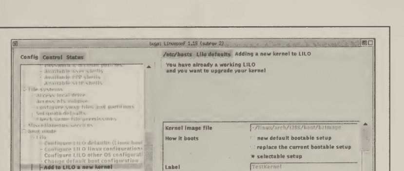

图 6-6. 使用 linuxconf 配置 LILO 新内核

## 激活 linuxconf 中的更改

确保在每个你做过更改的窗口中都点击了“Accept”（接受）按钮。完成后，点击 `linuxconf` 窗口左下角的“Act/Changes”（执行/更改）按钮。这将弹出“System Status”（系统状态）标签页，询问你是想预览将进行的更改还是直接激活（你也可以点击左下角的“Quit”（退出）按钮在不做更改的情况下退出）。查看 `linuxconf` 做了哪些更改是有益的，如果你想了解更多 Linux 如何工作，可以看一看。

当你看到所有想要的内容后，点击“Activate The Changes”（激活更改）按钮开始实施你请求的更改所需的系统更新。在某些情况下，会被提示确认 `linuxconf` 正在执行的操作；其他情况下将直接运行。

内核更新完成后，你可以重启系统以利用你添加的新功能，或利用通过删除不使用的功能而节省的空间。既然我们已经开始研究 `linuxconf`，让我们继续使用它来配置 Linux 在网络上运行。我们将在接下来的第 7 章完成。

# Windows 爱好者的 Linux 之路

# 第 7 章

## 第 4 步：连接网络

# Windows 爱好者的 Linux 之路：十二步步计划

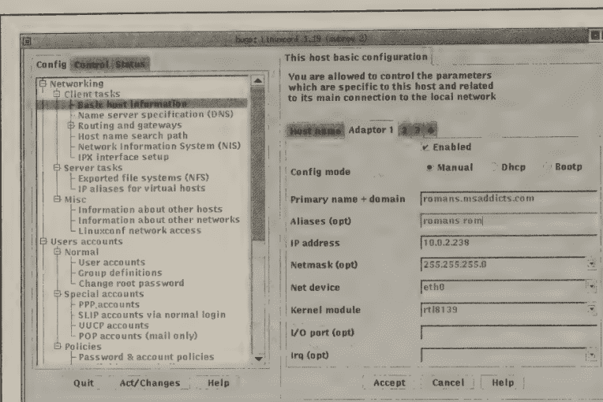

图 7-2. 使用 Linuxconf 为系统中的每个适配器设置特定网卡的配置信息

以《新约》中书籍命名的服务器，我喜欢使用简短的三字母别名，以便于输入。

在下一行中为每个网络适配器指定正确的数字 IP 地址；如果省略了可选的网络设置，系统将认为你的网络没有创建子网。如果你想使用自定义掩码对网络进行子网划分，可以在此处输入掩码（注意此页面的 Linuxconf 大部分由一个常用子网掩码表组成）。

网络设备（Net Device）是正在配置的网卡所使用的标准接口名称。对于标准的以太网设备，第一块网卡称为 `eth0`，第二块称为 `eth1`，第三块称为 `eth2`，以此此类推。尽管可能存在其他设备类型，但如果你有 ARCnet 或令牌环网络，请不要绝望。好吧，尽管绝望吧，因为 Linuxconf 无法为你找到新设备。

内核模块（Kernel Module）条目允许你告诉 Linuxconf 需要哪种设备驱动程序。如果驱动程序被创建为模块而不是包含在内核中，此信息将用于加载该驱动程序。列表应该包含你的 Linux 安装中已知的所有条目，因此如果你需要一个未列出的模块，你应该返回第 6 章，通过内核配置过程，并构建一个包含该驱动程序的新内核，或者将驱动程序制成模块。

最后两个选项允许你指定网卡使用的 I/O 端口和 IRQ 设置；对于较新的网卡，这通常是不必要的，除非你认为必须这样做，否则你可以尝试在不设置这些选项的情况下运行。

## 手动主机配置

通过手动编辑文件来复制此配置过程并不困难，但文件位置在不同的发行版之间有所不同。在本章的后半部分，我将告诉你每个 Linuxconf 选项是如何更改底层的 Linux 配置文件的，但为了简化 Linuxconf 的介绍，我推迟了这些基础选项的解释。如果你想手动进行更改，有几个文件是你可以使用首选文本编辑器进行操作的。

### /etc/hosts

此文件包含已知 IP 地址列表以及相应的主机名，但现在我们主要关心的是正在配置机器的主机名。对于它，我们需要一个回环条目以及每个活动网卡的地址：

```
#
# DM hosts file
# 11-24-2000 MJM
#
127.0.0.1   localhost
10.0.2.238   romans.distinguishingmark.org   romans rom
```

如果系统有一个“真实的”网络可访问 IP 地址，请将主机名与该地址关联，而不是回环地址。

另外注意，该文件有一些注释；它们比看起来的要晦涩，但它们确实告诉了我上一次接触该文件的时间，这很有用，因为我的记忆力糟。

### /etc/sysconfig/network

此文件包含比我们在 Linuxconf 中配置的稍多的信息，但我们还是来看吧。你应该在 `/etc/hosts` 文件中放置主机名和地址，同时也应该在 `/etc/sysconfig/network` 文件中包含主机名：

```
NETWORKING=yes
FORWARD_IPV4=false
HOSTNAME="romans"
GATEWAY="10.0.2.254"
GATEWAYDEV="eth0"
```

此文件仅告诉我们该系统已启用 IP 网络，它没有被配置为路由器，其主机名是 romans，并且它指向 10.0.2.254 的网关（路由器），它可以通过 `eth0` 设备到达该网关。

> 注意：此文件结构被红帽和其他发行版使用，但某些 Linux 发行版将主机名放在名为 `/etc/HOSTNAME` 的文件中。

### /etc/sysconfig/network-scripts/

以太网卡的特定配置信息在此目录中。实际上，如果你查看该目录，你会看到各种文件，包括 PPP 和回环接口的配置文件，以及管理不同接口的脚本。

目前我们只对以太网适配器的配置感兴趣，但对于在“基础主机信息”中输入的配置数据，我们可以查看文件 `/etc/sysconfig/network-scripts/ifcfg-eth0`。该文件的前几行允许我们看到我们需要的信息：

```
DEVICE="eth0"
BOOTPROTO="none"
IPADDR="10.0.2.238"
NETMASK="255.255.255.0"
ONBOOT="yes"
```

可以使用带有适当“ethX”名称的兄弟文件来配置额外的网卡。

> 注意：此文件结构被红帽和其他发行版使用，但某些 Linux 发行版将以太网配置信息放在名为 `/etc/rc.net1` 的文件中。

## 网络协议与路由

除了 IP 客户端的基础配置外，还有若干网络选项可用。在本节中，我们将查看一些高级的 IP 配置选项，重点关注如何让这些高级选项工作起来。

### 名称规范

除了 IP 客户端的基础配置外，还有若干网络选项可用。在本节中，我们将查看一些高级的 IP 配置选项，重点关注如何让这些高级选项工作起来。

### 名称规范

除了 IP 客户端的基础配置外，还有若干网络选项可用。在本节中，我们将查看一些高级的 IP 配置选项，重点关注如何让这些高级选项工作起来。

### 名称规范

除了 IP 客户端的基础配置外，还有若干网络选项可用。在本节中，我们将查看一些高级的 IP 配置选项，重点关注如何让这些高级选项工作起来。

### 名称规范


除了 IP 客户端的基础配置外，还有若干网络选项可用。在本节中，我们将查看一些高级的 IP 配置选项，重点关注如何让这些高级选项工作起来。

### 名称规范

除了 IP 客户端的基础配置外，还有若干网络选项可用。在本节中，我们将查看一些高级的 IP 配置选项，重点关注如何让这些高级选项工作起来。

# 第 7 章：显示网络

除了 IP 客户端的基础配置外，还有若干网络选项可用。在本节中，我们将查看一些高级的 IP 配置选项，重点关注如何让这些高级选项工作起来。

### 显示网络

默认网关是系统用于发送到本地外数据的路由器。在 `Linuxconf` 中配置此选项，选择 `Config-Networking`。除了 IP 客户端的基础配置外，还有若干网络选项可用。在本节中，我们将查看一些高级的 IP 配置选项，重点关注如何让这些高级选项工作起来。


默认网关是系统用于发送到本地外数据的路由器。在`Linuxconf`中配置此选项，选择`Config-Networking`。除了 IP 客户端的基础配置外，还有若干网络选项可用。在本节中，我们将查看一些高级的 IP 配置选项，重点关注如何让这些高级选项工作起来。

### 显示网络

默认网关是系统用于发送到本地外数据的路由器。在`Linuxconf`中配置此选项，选择`Config-Networking`。除了 IP 客户端的基础配置外，还有若干网络选项可用。在本节中，我们将查看一些高级的 IP 配置选项，重点关注如何让这些高级选项工作起来。

### 显示网络

默认网关是系统用于发送到本地外数据的路由器。在`Linuxconf`中配置此选项，选择`Config-Networking`。除了 IP 客户端的基础配置外，还有若干网络选项可用。在本节中，我们将查看一些高级的 IP 配置选项，重点关注如何让这些高级选项工作起来。

### 显示网络

默认网关是系统用于发送到本地外数据的路由器。在`Linuxconf`中配置此选项，选择`Config-Networking`。除了 IP 客户端的基础配置外，还有若干网络选项可用。在本节中，我们将查看一些高级的 IP 配置选项，重点关注如何让这些高级选项工作起来。

### 显示网络

默认网关是系统用于发送到本地外数据的路由器。

### 静态路由

如果你想指定其他离开本地网络的方法，可以指定通往特定网络或主机的其他路由。你还可以配置系统识别在同一物理网络上运行的多个逻辑 IP 网络。

### 动编辑 `/etc/sysconfig/static-routes`

上述描述的三个选项都会操作一个名为`/etc/sysconfig/static-routes`的文件。如果你想手动编辑此文件，你可以这样做；一旦按照你的要求完成了更改，你不需要重启系统；只需使用命令`/etc/rc.d/S10network reload`重启进程（假设你处于普通多用户模式，即运行级别 3）。

## 第 7 章：第 4 步：连接网络

## 显示路由

Linux 系统上有多种获取网络状态信息的来源。如果你在内核中启用了`/proc`文件系统，可以检查`/proc/net/`下的文件和子目录，查找可能与你正在进行的操作相关的信息。另一方面，如果你想快速获取粗略的路由信息，可以查看`/bin/netstat`命令。

`netstat`是一个用于确定路由信息、识别已启用和活跃的套以及查看网络接口统计数据的有用工具。要查看当前路由信息，请使用`netstat -r`命令，其输出类似于所示：

| 目的 (Destination) | 网关 (Gateway) | 生成网掩码 (Genmask) | 标志 (Flags) | 接口 (Interface) |
| :--- | :--- | :--- | :--- | :--- |
| 10.0.1.0 | 10.0.1.1 | 255.255.255.0 | UG | eth0 |
| 10.0.2.0 | 10.0.1.1 | 255.255.255.0 | U | eth0 |
| localnet | 10.0.1.254 | 255.255.255.0 | | eth0 |
| 127.0.0.1 | * | 255.0.0.0 | U | lo |
| default | 10.0.2.254 | 0.0.0.0 | UG | eth0 |

请注意，在此例中，指定了多个目的主机和网络，并有几个不同的网关和可用信息。“目的（Destination）”列显示目标主机。输出中的第一条目是`10.0.1.0`，这是一个专门配置为通过自定义路由访问的主机。“网关（Gateway）”列显示了信息如何从你正在工作的主机到达指定的目的。因此，要到达`10.0.1.1`，此路由表表明网关是一个名为`localnet`的主机。“生成网掩码（Genmask）”条目表示了路由规则的级别。简单来说，`genmask`中设置为`255.255.255.0`的部分显示了地址的哪部分需要匹配数据包的目的才能进行路由。如果这看起来难以理解，我可以这样告诉你：列出的两个主机`10.0.1.0`和`10.0.2.0`是调用的规则，直到找到匹配项。因此，如果数据包的目的是`127.0.0.1`，它将被发送到`127.0.0.0`环回地址，因为`genmask`只比较地址的第一部分。

关于`netstat`的更多信息，包括如何使用`-r`选项显示路由以及如何使用`-i`选项显示接口，可以在帮助页面（`man netstat`）中找到。

## 指向网络

如果你有希望在不使用主网关的情况下访问的网络，可以使用“静态路由（Static Routes）”选项来配置正确的网关。例如，我的公司可以为来培训或在现场使用的客户设置一个独立的网络。与其让主系统通过主路由器访问此网络，不如让每个系统识别出该网络是通过一个隔离生产网络的防火墙连接的。

使用`Linuxconf`在自己的环境中设置此并不困难。只需从`Config-Networking-Client-Routing And Gateways`选项卡中选择“静态路由（Static Routes）”选项即可。在出现的选项卡上，输入要访问目的网络本身的网关（路由器）的 IP 地址以及所需的掩码，如图 7-3 所示。注意，目的网络以`.0`结尾。这就是你告诉 Linux 整个网络都可以通过此网关访问的方法。如果要访问特定的主机，请使用`Linuxconf`表格中的“hosts”部分，用以向`/etc/sysconfig/static-routes`文件中填充你的网络条目。

```
eth0 net 10.0.0.1 mask 255.255.0.0 gw 10.0.2.240
```

图 7-3. 配置 Linux 主机路由到其他网络

## 指向主机

如果你需要告诉正在配置的主机它如何访问另一个网络上的特定主机，可以使用`Config-Networking-Tasks And Gateways`树中的“指向主机（Routes To Hosts）”选项。此配置非常直观；你只需指示知道如何到达目标主机的网关地址，然后输入目标主机的 IP 地址。

当本地网络连接了多个路由器，且你希望确保到指定主机的流量通过指定的网关时，这种方法非常有用。

`Linuxconf`条目会修改`/etc/sysconfig/static-routes`文件，为你指定的每个主机添加一个条目。在此例中，系统可以通过`10.0.2.240`网关到达`10.0.1.1`：

```
eth0 net 10.0.1.1 netmask 255.255.255.255 gw 10.0.2.240
```

## 指向备用本地网络

还有一个符合这种其他路由选项处理方式，但它与前两个略有不同。备用本地网络是一个逻辑上不同的 IP 网络（它有不同的网络地址），但运行在相同的物理网络上（共享一条总线或与主网络位于相同的物理布线上）。如果你的网络结构是这样的，不要担心；你可以使用`Config-Networking-Client-Tasks And Gateways`树中的“指向备用本地网络（Routes to Alternate Local Networks）”来添加额外的本地网络。

你必须指定网络号（记住这至少以`.0`结尾）以及用于访问该网络的网络接口，并为每个指定的网络指定适当的掩码。

在`Linuxconf`中进行的更改用于更新`/etc/sysconfig/static-routes`文件；以下行表示系统可以通过第二个网卡 (`eth1`) 访问`10.0.3.0`网络上的任何主机。

```
any 10.0.3.0 netmask 255.255.255.0 gw eth1
```

## 路由守护进程 (Routed Daemon)

路由守护进程是一个使用路由信息协议（RIP）维护路由表的进程，该协议允许动态路由。RIP 用于确定从一个地方到另一个地方需要跨越多少个网关。在互连网络较的小环境中，这是很有用的，但在更复杂的环境中，可能有许多不同的方法。

在配置路由守护进程时，你的系统不太可能会启用它。`Linuxconf`条目配置路由守护进程，你的选择存储在`/etc/sysconfig/routed`文件中。该文件包含在路由启动时读取的变量：

```
EXPORT_GATEWAY="no"
SILENT="yes"
```

# 第7章：第4步：连接到网络

233

`Linuxconf`对底层系统文件进行的更改反映在两个文件中。第一个文件是`/etc/sysconfig/network`，其中一个`NISDOMAIN`条目被设置为你指定的域名名：

```
NISDOMAIN="prolificinc"
```

另一个更改是在`/etc/yp.conf`文件中进行的。“YP”指的是“黄页”（yellow pages），它是今天 NIS 的前身，Linux 也支持它。`yp.conf`文件包含一个指向你指定的 NIS 服务器的`ypserver`：

```
ypserver 10.0.2.3
```

# IPX 配置

如果你需要 Linux 系统能够使用 IPX 协议，可以使用`Config-Networking-Client Tasks`树下的`IPX Interface Setup`选项来配置 IPX 协议设置。共有三个选项卡可以在其中设置 IPX 相关的网络选项：Config（配置）、Adaptor 1（适配器 1）和 Internal net（内部网络）。

# Config

如果你需要启用 IPX，请确保`Enable IP Networking`按钮已启用。两个额外的选项允许系统自动配置，以为网络选择正确的接口和帧类型。

`Linuxconf`会根据你选择的选项更改底层系统文件。该文件为`/etc/sysconfig/network`，它包含了各种网络设置，包括这三个 IPX 相关的条目：

```
IPX="yes"
IPXAUTOPPRIMARY="off"
IPXAUTOFRAME="off"
```

在所示的这些行中，IPX 已启用，但帧类型的自动配置被禁用了。在大多数情况下，配置为从 NetWare 服务器读取文件的 Linux 系统将能够两个`IPXAUTO-`选项都使用“on”设置。

# Adapter 1

如果你希望选择自己的帧类型和网络编号，可以使用此选项卡进行操作，如图 7-4 所示。

此选项卡的每个部分都允许你配置一种在网络中可能激活也可能未激活的帧类型。如果你是经验 NetWare 管理员，这些选项将易于设置。如果你不是，当`Config`页面上的自动配置选项不起时，你真的应该选择此类配置。

你应该根据连接网络上 NetWare 服务器的需求，启用列出的四种帧类型中的任何一种。NetWare 服务器上使用的默认帧类型随时间发生了变化，但我见过 NetWare 3.x 服务器仍在使用旧的 802.3 帧类型运行，务必了解你自己的情况细节。

你可以通过选择“is the primary interface”单选按钮，将一种帧类型指定为适配器的主接口。虽然我在探测 IPX 网络编号时运气不错，你也可以自己指定网络编号。

用于编辑适配器设置的`Linuxconf`前端修改`/etc/ifcfg-eth0`中的行。每个帧类型有三行。第一行指示接口的 IPX 网络编号（如果指定了的话——如果没有指定，则省略该值并将探测 IPX 网络编号）。第二行指示该帧类型在指定的网卡（NIC）上是否激活，为 Yes 或 No。第三行指示该帧类型是否为指定网卡的默认类型，为 Yes 或 No。虽然所有四种帧类型都可能是激活状态，但应仅有一个被设为主接口。

```
IPXNETNUM_802_2=""
IPPRIMARY_802_2="yes"
IPXACTIVE_802_2="yes"
IPXNETNUM_802_3=""
IPPRIMARY_802_3="no"
IPXACTIVE_802_3="no"
```

```
IPXNETNUM_ETHERII=""
IPXPRIMARY_ETHERII="no"
IPXACTIVE_ETHERII="no"
IPXNETNUM_SNAP=""
IPXPRIMARY_SNAP="no"
IPXACTIVE_SNAP="yes"
```

这些行激活了`Ethernet_802.2`和`Ethernet_SNAP`，使得 802.2 成为接口的默认帧类型。

# Internal Net

此选项卡让你配置主机特定的内部网络编号和主网络节点编号。对于不进行任何 IPX 路由的系统（大多数系统都是如此——老天，你为什么要用 Linux 系统路由 IPX 了？），你不需要配置这些条目。

当你配置这些选项时，更改将反映在`/etc/sysconfig/network`文件中，那里有两个与内部网络配置选项相关的条目：

```
IPXINTERNALNUM="195948557"
IPXINTERNALNODENUM="0"
```

> 注意在第一行中，IPX 内部网络编号已从输入的十六进制格式转换为二进制格式（这也是输入时使用的格式，也是 NetWare 系统上常用的显示格式）。

# DIALUP NETWORKING

如果你的 Linux 系统将作为拨号连接，你有三种类型可供。新版本的`Linuxconf`（包括与 Red Hat 7 附带的版本）允许……（注意：针对 Windows 成瘾者的 Linux：12 步计划是针对 Windows 成瘾者的 Linux）

调制号器拨出字符串（包括电话号码）可以在`/etc/sysconfig/network-scripts/chat-ppp0`中找到。如果配置了 PAP 密码，则存储在`/etc/ppp/secrets`中。这些文件都没有非 root 用户读取，因此它们是安全的。

# Windows 成瘾者的 Linux：12 步计划

**图 7-4.** 如果自动配置选项不起作用，你可以手动设置 IPX 网络

# PPP

当你选择 PPP 连接时，你将看到像下面的页面。新版本的`Linuxconf`（包括与 Red Hat 7 附带的版本）允许……（注意：OCR 文字重叠/中断）

此文件的示例内容为：

```
DEVICE="ppp0"
ONBOOT="no"
USERFL="no"
MODEMPORT="/dev/tty0"
LINESPEED="115200"
PERSIST="yes"
DEFABORT="yes"
DEBUG="yes"
INITSTRING="ATZ"
DEFROUTE="yes"
HARDFCTL="yes"
ESCAPECHARS="no"
PPPOOPTIONS="*"
PAPNAME="root"
REMIP="10.4.4"
NETMASK="*"
IPADDR="10.0.2.2"
MRU="1444"
MTU="1444"
DISCONNECTTIMEOUT="831"
RETRYTIMEOUT="5"
BOOTPROTO="none"
```

# 第7章：第4步：连接到网络

**图 7-5.** 如果自动配置选项不起作用，你可以手动设置 IPX 网络

# SLIP

配置 SLIP 连接的过程与 PPP 几乎相同，但不是填充`ifcfg-ppp0`和`chat-ppp0`文件，`Linuxconf`创建或修改`/etc/sysconfig/network-scripts/ifcfg-sl0`和`/etc/sysconfig/network-scripts/chat-sl0`（当然，针对第一个 SLIP 连接）。PAP 不是 SLIP 的一个选项，因此在`Linuxconf`或文件本身中无法访问 PAP 相关功能。

# PLIP

配置 PLIP 连接的过程与创建 SLIP 连接的过程相似，但这次`Linuxconf`创建或修改`/etc/sysconfig/network-scripts/ifcfg-plip0`和`/etc/sysconfig/network-scripts/chat-plip0`（针对第一个 PLIP 连接）。由于 PLIP 使用在并行线上，因此没有电话号码或调制解调器设置需要调整。

# NFS 服务

NFS 文件服务是 Linux 世界解决“David 如何访问我机器上的文件？”这个问题最常见的方案。虽然你可能并不希望 David 访问你的文件，

# 给 Windows 爱好者的 Linux：一个12 步计划

你的家里可能有另一台电脑，或者你有一台想要共享文件的电脑。如果你以前用过 Unix，你可能熟悉 NFS，而 NetWare 服务器长期以来就能提供其磁盘卷作为 NFS 共享。如果你想让 Linux 系统的部分内容对其他 Linux 系统、其他 Unix 用户或已运行如 WRQ's Reflection 等 NFS 访问程序的 Windows 用户可访问，你需要在`Config-Networking-Server`任务树上使用`Exported File Systems (NFS)`选项来导出文件系统。

选择此选项，你就有有机会添加或修改你的 Linux 系统允许他人看到的内容。要修改现有的 NFS 导出，只需从列表中点击它；要创建一个新的，请点击`Add`按钮，这将弹类似于图 7-6 所示的标签页。

在图 7-6 显示的屏幕中，导出的路径列为`/home`。你可以输入你想要的每个目录，只要它是你配置的系统的本地目录即可。例如，如果你导出根目录，其他用户将访问你系统的每个部分，因为根目录 (`/`) 是系统中所有其他目录的父目录或祖先。通常情况下，你不需要那么“友好”。

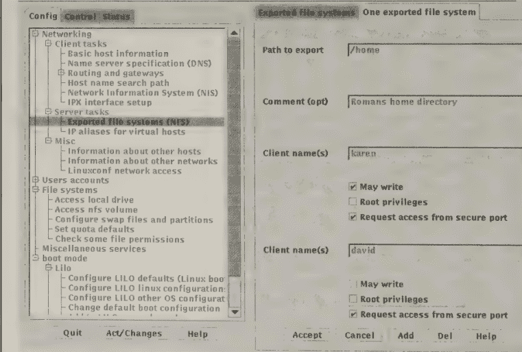

图 7-6. 使用 Linuxconf 配置你的系统 NFS 共享

# 第 7 章：第 4 步：连接网络

就像你不需要为你的 C 盘创建共享一样：如果你只想让人们访问你主目录下的某个文件夹，如果你只想让人们访问特定区域，你不需要导出整个 Linux 系统。更好的做法是确定你希望能够访问的目录，并逐个指定它们。


如果我们回到图 7-6 显示的屏幕，`/home` 目录（顺便说，还有子目录）正在导出到两台客户端机器：`karen` 和 `david`。注意我说的是两台机器；与为用户提供创建共享权限的 Windows 范式不同，NFS 是允许特定的机器访问导出的路径。

请注意，`karen` 机器已授予 NFS 导出写入权限，而 `david` 机器缺少此权限。虽然 `karen` 可以读写 `/home` 目录及其子目录，但 `david` 可能只能读取该目录。这两个用户都没有获得该目录的 root 权限（NFS 并不是最安全的访问方式，我这种这种方式获取 root 权限并不感兴趣）。

`Translate Symbolic Links` 会将符号文件链接的路径扩展，以包含从根目录开始的完整路径，即使根目录并不是被导出的内容。我还没用过这个功能，这让我感到有点不安。另一方面，`Request Access From Server Port` 选项旨在确保 NFS 客户端仅从特权端口（小于 1024）被接受。启用它。

这些选项被整合到 `/etc/exports` 文件中，这是该系统上 NFS 导出目录的主列表。这是一个示例：

```
/home karen(rw) david (ro,all_squash)
```

这一行几乎完全复制了为图 7-6 所示的 Linuxconf 创建的设置。远程系统 `karen` 被授予对正在配置的系统的 `/home` 目录的读写权限。远程系统 `david` 被授予对 `/home` 目录的只读权限。`all_squash` 选项是我手动添加的。它禁止来自 `david` 机器的用户使用用户权限访问目标系统。你可以在 `exports` 文件的 man 页上关于此选项以及其他几个选项：要了解全部，只需执行以下命令：

`man exports`

# 虚拟主机 (VIRTUAL HOSTS)

我不会称这是一个频繁使用的功能，但你可以轻松配置你的 Linux 系统以响应多个 IP 地址。这非常有用，例如，如果你想运行一个系统作为 Web 服务器，响应多个 IP 地址并根据请求的地址提供不同的域名和页面。虽然此许多功能在 Web 服务器软件中配置，但基础的网络方面可以在 Linuxconf 中设置。

只需从 `Config-Networking-Server` 任务选择 `IP Aliases for Virtual Hosts`，然后点击网络设备进入备用 IP 地址。这样做时，你会看到类似图 7-7 所示的屏幕。

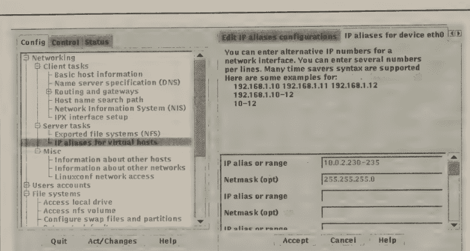

图 7-7. Linuxconf 允许你为主机输入多个范围的备用 IP 地址

使用此界面，你可以逐个输入大量 IP 地址，或者像图 7-7 的 Linuxconf 屏幕描述的那样，通过多种方式输入整个地址范围。这使得在同一主机上设置非连续的 IP 地址变得非常简单。

`IP Aliases For Virtual Hosts` 信息可以在 `/etc/sysconfig/network-scripts/` 目录的一系列文件中手动查看或配置。对于系统中的第一块网卡，第一个地址范围指定在 `ifcfg-eth0:0` 中。根据图 7-7 在 Linuxconf 中输入的信息，文件内容看起来像这样：

```
IPADDR=10.0.0.230
NETMASK=255.255.255.0
```

`/etc/hosts` 文件还有其他类型的配置。虽然这个文件并不长，但它包含了大量信息，其中一些并不是 Linuxconf 放置的。首先，文件开头有注释（以 `#` 号标识），说明了它是什么、最后一次修改的时间以及修改了什么。由于这个原因，我倾向于使用文本编辑器手动操作 hosts 文件，尽管 Linuxconf 选项也完全可用。像 `localhost` 这样的注释在你试图弄清楚是谁搞乱了文件以及什么时候搞乱的时候很有用，当你打印一份副本并试图弄清楚它是什么以及是当前的还是应该扔进回收桶时也有用。

其次，前面提到的 `localhost` 没有交叉引用到系统的主机名。第三，两个独立 IP 网络（10.0.0.1 和 10.0.2.0）上的主机已在逻辑上被分开了，并包含了说明它们是什么的注释。当然，我选择的命名方案并不怎么帮助，所以注释可能没有预想的那样清晰。

最后，完全限定域名首先出现在 IP 地址之后，随后跟的是主机的别名。这种顺序并不是严格要求的，但很不错。别忘记别名，

## 第 7 章：步骤 4：连接到网络

尽管如此，当你访问多个系统时，它们会让生活变得方便得多，尤其是像这些命名的系统。

### 命名网络

Linuxconf 还允许你通过 `Config-Networking-Server Tasks` 任务树下的“其他主机信息”将名称与 IP 网络关联。当你点击此条目时，将显示当前已命名的网络列表（如果有）。点击现有网络可以修改或删除名称，或者点击“添加”按钮添加新名称。

你必须输入网络的主名称和域名，但你也可以添加别名。你必须输入网络的 IP 地址，记住这是一个网络，必须以 `.0` 结尾，并可以包含注释。虽然使用网络名称并非都是必须的，但它们可以使记忆或引用变得更加容易。你选择的任何网络名称必须是唯一的（彼此之间以及与主机名之间唯一）。

这些条目存储在 `/etc/networks` 文件中，这是另一个我倾向于手动编辑的文件。在他们的示例中，列出了两个网络，分别是它们的正式完全限定名，最后是别名。

```
#
# DM network文件
# 5-25-2000
#
ot-net.distinguishingmark.org  10.0.1.0  ot
t-net.distinguishingmark.org  10.0.2.0  nt
```

### Linuxconf 远程访问

Linuxconf 非常易用，当你用它来远程管理其他系统时更是如此。当然，这带来了一些安全方面的影响，你只想在内部网络相对安全的范围内允许此功能。尽管如此，它不仅便于管理远程系统，还可以用于在本地启用基于 Web 的主机管理。

要开始，从 `Config-Networking-Server Tasks` 任务树中选择 Linuxconf 网络访问。如果你选择此选项，可以勾选“启用网络访问”。如果你决定这样做，我建议注册“日志访问”功能，这样你可以看到哪些机器请求访问 Linuxconf，并跟踪它们做了什么。

一旦完成初始设置，你就可以添加多个授权远程访问 Linuxconf 的主机名或网络。一旦配置了系统或网络的访问，点击“接受”按钮移动到你已授予访问权限的系统之一，并尝试将 浏览器（即使是精通 Web 的 KDE 文件管理器也可以）指向 `http://hostname:98/` 来远程访问 Linuxconf 功能。

### Windows 瘾者的 Linux：12 步计划

`hostname` 是你在 Linuxconf 中配置的机器名称（使用 IP 地址也可以）。你最终会得到一个像图 7-9 所示的屏幕。Linux 根据你的条目修改的底层文件被称为 `/etc/conf.linuxconf`。虽然有些项目与远程访问无关，但相关部分很容易找到：它紧跟 `[netaccess]` 标签之后。在下面的示例中，已允许网络 `10.0.2.0` 上的任何主机远程访问，访问记录将记录在 `/var/log/htmlaccess.log` 中。

```
[netaccess]
htmlaccess.from 10.0.2.0
htmlaccess.dolog 1
htmlaccess.enable 1
```

你可以使用分页程序（如 `more` 或 `less`）查看 `htmlaccess.log` 文件的内容，如果你只关心最近的条目，可以使用 `tail` 程序查看文件末尾。（如果你不熟悉这些命令，请使用 `man` 命令查看每个命令的帮助页）。如果使用了远程访问，日志文件将包含类似下面的的消息：

```
Dec 28 09:43:00 admin.prolificinc.com Request: ok, ==Networking/
Dec 28 09:43:06 admin.prolificinc.com Request: ok, ==Networking/ok, ==Linuxconf==network==access/
Dec 28 09:43:07 admin.prolificinc.com File request: images/redarrow.gif
Dec 28 09:43:07 admin.prolificinc.com File request: images/Add.gif
```

条目存储在 `/etc/networks` 文件中，这是另一个我倾向于手动编辑的文件。在他们的示例中，通过正式完全限定名以及别名列出了两个网络。

```
#
# DM network文件
# 5-25-2000
#
ot-net.distinguishingmark.org  10.0.1.0  ot
t-net.distinguishingmark.org  10.0.2.0  nt
```

# 第 8 章：步骤 5：管理用户和组

## 管理账户

Linuxconf 非常易用，当你用它来远程管理其他系统时更是如此。当然，这带来了一些安全方面的影响，你只想在内部网络相对安全的范围内允许此功能。尽管如此，它不仅便于管理远程系统，还可以在本地启用基于 Web 的主机管理。

要开始，从 `Config-Networking-Server Tasks` 树中选择 Linuxconf 网络访问。如果你选择此选项，可以勾选“启用网络访问”。如果你决定这样做，我建议注册“日志访问”功能，这样你可以看到哪些机器请求访问 Linuxconf，并跟踪它们做了什么。

一旦完成初始设置，就可以添加多个授权远程访问 Linuxconf 的主机名或网络。一旦配置了系统或网络的访问，点击“接受”按钮移动到你已授予访问权限的系统之一，并尝试将浏览器指向 `http://hostname:98/`。

### Windows 瘾者的 Linux：12 步计划

`hostname` 是你在 Linuxconf 中配置的机器名称（使用 IP 地址也可以）。你最终会得到一个像图 7-9 所示的屏幕。Linux 根据你的条目修改的底层文件被称为 `/etc/conf.linuxconf`。虽然有些项目与远程访问无关，但相关部分很容易找到：它紧跟 `[netaccess]` 标签之后。在下面的示例中，已允许网络 `10.0.2.0` 上的任何主机远程访问，访问记录将记录在 `/var/log/htmlaccess.log`。

```
[netaccess]
htmlaccess.from 10.0.2.0
htmlaccess.dolog 1
htmlaccess.enable 1
```

你可以使用分页程序（如 `more` 或 `less`）查看 `htmlaccess.log` 文件的内容，如果你只关心最近的条目，可以使用 `tail` 程序查看文件末尾。（如果你不熟悉这些命令，请使用 `man` 命令查看每个命令的帮助页）。如果使用了远程访问，日志文件将包含类似下面的的消息：

```
Dec 28 09:43:00 admin.prolificinc.com Request: ok, ==Networking/
Dec 28 09:43:06 admin.prolificinc.com Request: ok, ==Networking/ok, ==Linuxconf==network==access/
Dec 28 09:43:07 admin.prolificinc.com File request: images/redarrow.gif
Dec 28 09:43:07 admin.prolificinc.com File request: images/Add.gif
```

# 第 8 章：步骤 5：管理用户和组

### 基础信息

基础信息是创建用户时所需的底层数据集。Linuxconf 有兴趣获取八项信息，但只有前三项是必须：

- 是否启用？
- 登录名
- 全名
- 组
- 附加组
- 主目录
- 命令解释器
- 用户 ID

**Linuxconf 中的基础信息** Linuxconf 第一个想知道你创建的账户是否处于激活。你可以通过取消勾选此选项来创建一个禁用的账户。如果你正在为一批新用户准备系统，且不想在他们获得访问权限之前让一堆账户空闲在那里，这可能很有用。登录名简单就是账户名；在示例 8-1 所示，登录名是“karen”。全名用于人类识别目的；当人们拥有相似或模糊的账户名时，与他们关联真实姓名非常有用。

可选信息包括账户的主组成员身份（在示例中，是令人作呕的“sweetie-pies”）以及该账户共享成员的任何其他组。我将在本章稍后的“管理组账户”中讨论组。

### Windows 痴迷者的 Linux之路：12 步计划

接下来是用户的家目录；你将为家目录留出一个位置，`/home` 目录传统上用于此目的，尽管有多种不同的方法来处理此问题。命令解释器是用户的默认 shell；除非你或你的用户对 `/bin/tcsh` 有更强烈的偏好，否则我建议使用 `/bin/bash`。

如果你愿意，也可以使用数字用户 ID（UID）。如果你在此处不输入条目，系统将分配下一个可用的 ID 号，这对你来说可能没问题。我喜欢根据用户的部门或职位描述来分配 ID 号，因此我通常选择自己设置用户 ID。

### 基础信息存储

你在 Linuxconf 中输入的信息将进入 Linux 配置文件，可以直接查看和操作这些文件。基础信息进入 `/etc/passwd` 文件，该文件存储了用户账户信息。下面显示了从 Linux 系统 `/etc/passwd` 文件中提取的几行内容：

```
albers:0GGccYX5Q:501:100:Daniel J. Albers:/home/albers:/bin/tcsh
dedoo:neboLEFKHJg:502:100:Paul de Dood:/home/dedood:/bin/tcsh
brian1:0GVdfUWInhw2:305:200:Brian1:/home/brian1:/bin/tcsh
demo:NgjZqUhcobjS:605:200:Demo:/home/demo:/bin/tcsh
```

每行的第一个条目是登录名（列分隔了不同的条目）。第二个条目是密码哈希值，但我们稍后会详细讨论它们。下一个是用户 ID，紧随其后的数字是用户的主组 ID（GID）。接下来是用户的全名，然后是他们的家目录和 shell。你可以手动编辑这些大部分信息并获得良好效果，但密码字段更为复杂。你无法在这里输入密码并让其生效；你所做的只是删除整个密码。

你还可以选择使用命令行工具来创建用户账户，这允许你创建脚本来自动创建大量用户。`useradd` 和 `mkpasswd` 命令对于这一目的非常有价值：`useradd` 会根据你指定的属性创建一个新用户，并允许你为它创建的所有用户维护默认值；`mkpasswd` 则根据你指定的字符数量生成随机密码。查看它们的主页以获取更多信息。

### 密码参数

用户账户选项集设置了账户的密码参数。这些包括：

- 新密码在更改之前必须保留的天数
- 密码在必须更改之前可以保留的天数
- 账户过期前用户获得的提前警告天数
- 距离账户过期的天数
- 过期日期

### 第 8 章：第 5 步：管理用户和组

这些选项与微软和 Novell 网络操作系统提供的选项类似；它们让你对密码策略和用户账户寿命有一定的控制。

### 邮件设置

Linuxconf 用户账户添加过程中的下一个选项是为用户设置邮件转发和别名。消息重定向存储在用户的家目录下的名为 `forward` 的文件中。如果邮件投递到用户账户，它将被转发到 `forward` 文件指定的地点。别名信息存储在 `/etc/aliases` 中，它将实际的用户账户名与电子邮件别名关联起来。

### 权限

下一组用户账户设置与按账户授予的系统管理权限有关。这些并不是你希望允许每个 Johnny Punchclock 或 Judy Drone 执行的操作，但它对于将部分系统管理任务分配给某些个人而不给他们无所不能的 root 密码非常有用。管理权限分为四：通用系统控制；服务控制；杂项控制；用户账户配置。

**通用系统控制** 在第一类中是强力控制项。通常情况下，你不想向任何人授予这些类型的控制权限（毕竟，如果你打算让他们关闭系统，你还不如直接给他们 root 密码）。这些权限包括：


- 使用 Linuxconf 的权限

- 激活配置更改的权限

- 关闭系统的权限

- 更改网络模式的权限

- 查看系统日志的权限

- 等同于超级用户 (root)

现在，看在如此神圣的份，千万不要在不考虑为什么要这样做的情况下直接将这些能力授予用户。确保你有一个充分的理由，并且没有其他方法可以完成必须完成的任务。

**服务** 此节将一个或多个此类服务的管理在一起。授予这些访问权限允许用户从 Linuxconf 配置它们（假设你已经在“通用系统控制”部分允许了他们使用 Linuxconf），并启动、停止和重启进程：

- Apache 管理

- 邮件转传真管理器

- Samba 管理

杂项 授予此权限允许你修改“当天消息”（message of the day），每当有人登录系统时都会显示的文本消息。此消息保存在 `/etc/motd` 文件中，如果你愿意，可以手动编辑。

用户账户 使用这组权限赋予用户管理一种或多种此类类型其他账户的能力：

- POP 账户

- 用户账户

- UUCP 账户

### 修改用户信息

在 Linuxconf 中更改任何信息都非常简单。下一个是用户 ID，紧随其后的数字是用户的主组 ID。接下来是用户的全名，然后是他们的家目录和 shell。你可以手动编辑这些大部分信息并获得良好效果，但密码字段更为复杂。你无法在这里输入密码并让其生效；你所做的只是删除整个密码。

你还可以选择使用命令行工具来创建用户账户，这允许你创建脚本来自动创建大量用户。`useradd` 和 `mkpasswd` 命令对于这一目的非常有价值：`useradd` 会根据你指定的属性创建一个新用户，并允许你为它创建的所有用户维护默认值；`mkpasswd` 则根据你指定的字符数量生成随机密码。查看它们的主页以获取更多信息。

实现此目的另一种方法是使用 `usermod`。例如：

```
usod -u 701 -g 101 -d /home/karen -m karen
```

上面的命令更改了用户 ID、组 ID 和家目录。你也可以使用命令更改 shell：

```
chsh -s /bin/bash user
```

可用 shell 的列表存储在 `/etc/shells` 中。你可以使用 `chsh /bin/bash`

### 删除用户账户

从 Linuxconf 中删除用户账户的过程非常简单：只需进入用户账户，选择你想删除的用户，并点击删除按钮。然而，如果你想保持家目录完好，你必须使用命令行：

```
userdel username
```

上面的命令删除用户账户。如果你也想删除家目录，请使用：

```
userdel -r username
```

# 给 Windows 爱好者的 Linux：12 步计划

## 用户账户有一个主用户组

每个用户账户都有一个关联的主用户组。这意味着，例如，如果用户创建一个文件，默认情况下，其用户账户将成为文件所有者，其主组将成为组所有者。

## 用户账户可以是多个组的成员

拥有主组并不会阻止用户成为其他组的成员。或者另一个。或者再另一个。用户可以是一个组、某些组或所有组的成员。仅仅因为你可以让用户成为每个组的一部分，并不意味着你应该这样做。你的做法应该是将组限制在有加入需求的用户身上。

## 组可以是组的成员

这允许你由较小的组组成大组。例如，如果销售部和市场部由三个组织组组成：销售组、市场组公关组，那么没有必要将每个组员都添加到这两个组中。先创建组，然后让这些组成为 `s_and_m` 组（或你在系统中为销售和市场部起的任何名称）的成员。

## 用户组可以设置密码保护

但在我过的网络中，组密码很少被使用。终端用户似乎对于拥有和记住自己的账户密码已经面临了巨大的挑战；添加过多的密码会导致他们开始忘记像家庭地址、电话号码、Genette 姨妈的生日以及他们本应该使用的其他信息。这通常被认为是一件坏事。但请务必考虑组的密码保护，并彻底思考其影响。

## 用户组应该有合理的名称

虽然我看到过网络中用户账户命名糟糕糟糕，但命名的用户组似乎更常见。我一直认为这是因为用户名通常与用户的真实姓名有关，这种现实让管理员与用户保持了一定的联系。但组名通常是为一组概念上的人创建的，而不是基于组织架构。

由于组最常被用于访问文件和目录，请考虑使用反映此目的的组名。例如，如果 `/home/departments/ap` 需要被三个不同部门的某些人而非所有人访问，那么将该组命名为 `access_home_ap` 是明智的，并且只包含需要访问这些目录的人。“access”（访问）组可以很容易地传达功能以及其提供权限的具体区域。

底线是在做某事之前考虑你需要做什么。在 Linux 中，组管理并不比其他操作系统更困难，但和其他系统一样，如果在敲击键盘之前给出一个合理的逻辑依据，它的效果是最好的。

## 创建组

在 Linuxconf 中创建组是一件简单的事。进入“组定义”（Group Definitions）选项并点击“添加”（Add）按钮。输入组名和你想使用的数字组 ID（如果你向组中添加用户账户，则该数字应大于 100）。输入任何不作为其主组列出的成员名称。这些信息将进入 `/etc/group` 文件，其中每个组名以以下格式列出：`username:password:groupID:members`。例如：

`access_payroll::814:dedood,jones`

这一行定义了“payroll”（工资单）组，它没有密码（第一列和第二列之间为空），组 ID 为 814，并包含了用户 `dedood` 和 `jones`，对于他们来说，这些是备用组而不是主组（主组在 `/etc/passwd` 文件中按账户指定）。

“添加组”框的目录会对 `/etc/linuxconf` 文件进行更改。它允许你指定该组的每个主用户是否应该拥有不同的目录，如果是，他们的父目录（“家基地”）应该是哪个。你还可以为这些家目录指定默认权限设置（有关文件和目录权限的更多信息，请参见第 14 章）。

## 添加和删除用户

在创建用户或组时（如上所述），或者之后，都可以将用户添加到组中。你可以使用 Linuxconf 界面将用户添加到“备成员”（Alternate Members）字段（或将其删除），或者如果你愿意，可以使用文本编辑器在 `/etc/group` 文件和 `/etc/gshadow` 文件的相应行中添加或删除成员。

管理 root 账户

正如我已经说清楚的那样，`root` 账户是特殊的。它不是一个用户账户，没有人应该将其作为主要账户。有些管理员竭尽全力让使用 `root` 账户变得困难，例如选择极其严酷的终端颜色方案、不启用命令补全和命令历史等生产力功能，或其他不友好的措施。

我不认为在大多数情况下这是有必要的，而且这些解决方案各都有缺点。例如，某些人认为 `root` 不应该有任何自定义的 shell 文件或通知，这是一个合理的观点，因为我们不希望让以 `root` 用户身份运行必要的程序变得容易。另一方面，拥有命令补全功能可以防止以 `root` 身份登录的人员引入错误。

由于 `root` 在 Linux 计算机上是无所不能的，一个人可能会意外删除比他应该删除的多得多的，或者在错误的时间重启系统，或者陷入我噩梦中出现的无数失误中。为了避免这些问题，我想对正确使用超级用户和避免不必要的使用超级用户提供一些建议。

# 给 Windows 爱好者的 Linux：12 步计划

## 正确使用 root

管理 `root` 账户的第一部分是确保你正在正确地使用它。Windows 管理员以及 NT 或 Windows 2000 的家庭用户，其中许多人习惯于大部分时间使用 Administrator 账户（我承认经常让我的 NT 服务器一直登录状态），应该利用此机会打破这种习惯。这有几种方法。

## 知道你为什么要使用 root

你现在为什么要以 `root` 身份登录？你正在执行什么任务，你真的需要这样做吗？当然，使用 `root` 有很好的理由。查看对他人限制的文件、杀死不对所有者响应的顽固作业以及调度定期执行的 cron 任务，都是 `root` 操作的示例。

## 不要杀死 root

我不应该告诉你这一点，但请永远不要删除 `root` 账户。你可以在 `/etc/passwd` 文件中识别它；它应该是第一条目，并且看起来如下：

```
root:x:0:0:root:/root:/bin/bash
```

不要删除该条目。不要从 Linuxconf或其他管理工具杀死它。对 `root` 账户要友善。在使用它时对它说些好话。输入密码时要轻按按键。不要伤害它。

## 将 root 密码交给尽可能少的人

我工作过这样的环境：高管们坚持在公司所有的系统中拥有超级用户密码，这一直让我紧张，尤其是当我花时间帮助他们从自己桌面系统造成的致命伤中恢复时。现在，当经理并不意味着你是个呆瓜（尽管这两种状态之间可能存在相关性而非因果关系），而且有很多管理人员能够处理 `root` 账户。

基于上述“知道你为什么要使用 root”部分的精神，想要 `root` 密码的人应该拥有它。虽然你可能无法告诉你的经理你不给他们 `root` 密码，但你应该能够定义一个符合组织逻辑的限制访问策略。

如果你担心拥有 `root` 密码访问的人数，你可以尝试被动性攻击的方法：更改 `root` 密码并仅通知那些真正需要的人。如果有人来问为什么进不去，就说：“噢，我更改了密码，因为我们担心它被泄露了。你作为 root 需要做什么？”如果这起不起作用，给他们我的电子邮件地址，我会教训他们的。”嘿，嘿，嘿。

## 第8章：第5步：管理用户和用户组

### 了解如何恢复 Root

由于知道 `root` 密码的人很少，可能总会有那么一天，糟糕的事情发生了——没人知道 `root` 密码。按如今系统管理员更改密码的速度，丢失 `root` 密码的概率相当高。如果你需要管理一个 `root` 密码已经损坏的系统，该怎么办？

这时启动软盘派上用场。某些发行版还允许你从非安装版本的 Linux CD-ROM 启动。无论哪种方式，你都需要插入合适的光盘或磁盘并让所有人退出。记下 `/etc` 目录的位置；通常，它与 `/` 目录不在同一个分区上，因此使用 `mount` 命令来确定挂载为 `/etc` 或 `/` 的分区。记住它。

如果非 `root` 用户可以正常关闭系统，请使用 `shutdown -h` 命令。如果凡人没有这种权限，请检查凡人是否可以挂载系统上的任何分区。如果这不起作用，执行几次 `sync` 命令以确保磁盘内容是最新的，而不是挂在某个地方缓存中（在所有人离开系统且没有活动进程在运行之后）。屏住呼吸，忍着痛苦，从控制台使用 `CTRL-ALT-DEL` 重启系统。

从软盘或 CD-ROM 启动，它将挂载自己的根目录和文件结构，重要的是，使用它自己的账户定义。以 `root` 身份登录，并使用 `mount` 命令挂载包含普通 `/etc` 目录的硬盘分区。例如，如果 `/etc` 在 `/dev/sda1` 分区上，你可以使用以下命令：

```bash
mount /dev/sda /mnt
```

这使得 `/dev/sda1` 分区的内容在 `/mnt` 上可见。你可以切换到 `/mnt` 目录并找到 `/etc` 目录。通过删除 `root` 账户行前两个冒号之间的文本来编辑该目录下的 `passwd` 文件，使其看起来像这样：

```bash
root::0:0:root:/root:/bin/bash
```

现在编辑同一目录下的文件，删除 `root` 账户行前两个冒号之间的文本。重启系统，你应该能够无需密码就以 `root` 身份登录了。使用 `passwd` 命令迅速改变这种局面，看在天份上，把你的新密码放在保险箱之类的地方。

这个练习应该让你明白为什么维护系统的物理安全是如此重要。只要有一张软盘和访问系统的权限，你刚刚更改了 `root` 密码。这令人警醒，不是吗？

### 避免不必要的使用 Root

恰善使用 `root` 不仅仅是正确使用的问题，还关乎于不要错误使用。如果你希望在没有充分理由的情况下避免使用 `root`，有一些选项可供。

### 为用户账户提供合理的访问权限

这是一个非常简单的概念。如果你给予用户或组对其自己的目录足够的访问权限，你就不需要“大哥 Root”介入来帮助他们了。或者，如果你让某些受信任的用户加入对某些文件和目录具有管理权限的组，他们将能够处理这些领域的需求，而不需要不断依赖他们。

另一方面，将系统区域开放给用户访问可能会导致你必须使用 `root` 来解决用户无意引起的问题。原则是赋予用户在指定区域的自主权，并对所有其他区域保持严格控制。

### 尽可能使用 Root 的替代方案

思考一下你是如何使用 `root` 账户的，并寻找在不登录 `root` 的情况下执行相同任务的方法。例如，大多数系统不允许普通用户挂载磁盘分区，这是合理的。但也意味着 `root` 用户可能可能需要挂载远程分区（例如当网络连接断开时）。消除直接使用 `root` 的方法之一是使用 `sudo`


`sudo`命令允许用户以另一个用户（通常是`root`用户）的权限执行命令。这比给用户提供`root`密码更安全，因为它允许对可以运行的命令进行审计和限制。`sudo`文件`/etc/sudoers`定义了哪些用户可以运行哪些命令。

### 不要赋予 Root 用户特殊功能

原则是赋予用户在指定区域的自主权，并对所有其他区域保持严格控制。

### 管理特殊账户

特殊账户是`PPP`、`SLIP`、`UUCP`和`POP`使用的账户。如果你的系统作为其中任何一种的服务器，你可以使用`Linuxconf`配置它们。

### PPP 账户

如果你的系统作为`PPP`客户端的服务器，你可以使用`Linuxconf`配置`PPP`账户。创建`PPP`用户的`Linuxconf`与用于普通账户的界面类似。

### 基础信息

如图`8-2`所示，有登录名、全名、主目录和用户`ID`字段。所有这些信息将存储在`/etc/passwd`文件中。

### 密码参数

基于`Linuxconf`的`PPP`账户的密码参数与标准账户提供的参数相同。与其他账户一样，密码设置存储在`/etc/shadow`中。

### 邮件设置

你可能发现`PPP`账户的邮件设置与普通用户账户相同，并不意外。你在这里输入的信息将存储在用户目录下的`.forward`文件和`/etc/aliases`中。

### SLIP 账户

如果你在`Linux`系统上托管`SLIP`账户，你可以使用`Linuxconf`配置`SLIP`账户。这些账户与普通用户账户差别不大，但像`PPP`账户一样，它们有自己的主组和命令解释器。

### UUCP 账户

`Unix-to-Unix Copy`（`UUCP`）是一种提供基本拨号网络功能的方法。你最可能会遇到`Taylor UUCP`实现，该实现在`UUCP-HOWTO`中有详细描述。创建`UUCP`用户的`Linuxconf`与用于普通账户的界面类似。

## 第8章：第5步：管理用户和组

`UUOCP`用户配置的一个不同之处在于分配的主组不同，该主组始终是`uucp`。另一个不同点是没有定义`shell`，因为`UUOCP`根结上就是一个将数据从一个系统传输到另一个系统的作业任务。最后一个区别在于默认主目录，它通常是`/var/spool/uucpublic`。`UUOCP`设置的配置文件位于`/etc/uucp`目录。

如果你目前没有`UUCP`的既有需求，我不建议实现它；虽然许多`Unix`用户对其非常熟悉，但`Windows`管理员可能坚持使用`PPP`进行拨号连接更为合适。

## 设置账户策略

我们需要关注的最后几个与用户账户相关的配置选项是通用策略，这些策略决定了如何验证账户、哪些`shell`是可用的，以及在用户登录时应该向他们提供什么信息。

## 账户策略

系统账户策略包括两类主要信息：在创建或更改密码时验证密码的规则，以及默认的账户管理规则。虽然你可以在创建单个用户时指定其账户管理设置，但你也可以按照自己的意配置系统的默认设置。

## 密码验证规则

这类规则有多种，其中一些对于其他网络操作系统的管理员来说很熟悉，另一些是`Unix`和类`Unix`环境特有的。这些选项可以在图`8-3`的上半部分看到，该图显示了“密码与账户策略”的`Linuxconf` Web界面。

你可以使用这些选项通过增加密码长度和增加非字母字符的要求来使密码更难破解。如果你启用了“私有组”（`Private Group`）选项，每个用户将被分配到一个同时创建的相应组。禁用此选项将导致用户默认被添加到单个组中；你可以在创建用户时更改该组。

如果你不希望标准的`/home`目录成为用户的默认根目录，你可以将该根目录更改为指定的路径。当你的用户主目录位于与创建账户的系统不同的系统时，这可能尤为有用。

“创建权限”（`Creation Permissions`）选项对于没有`Unix`经验的`Windows`管理员来说可能有些晦涩。它仅仅意味着在创建新用户的主目录时，需要分配访问权限。图`8-3`中显示的数值`700`对应目录所有者的完全访问权限，而其他用户没有访问权限。对于主目录来说，这是一个合理的默认值；相应的目录列表可能像这样：

```
drwx------ 4 karen spouses 4096 May 15 10:23 carre
```

“删除账户命令”（`Delete Account Command`）是你告诉`Linuxconf`删除现有用户账户时执行的命令。该命令有一个默认脚本，但如果你想对其进行完全修改或替换，这是可以做到的。毕竟，这是你正在使用的`Linux`！同样，“归档账户命令”（`Archive Account Command`）指向在你选择在删除账户之前将其归档时执行的脚本。删除脚本会将用户主目录的内容压缩到`/home/oldaccounts`目录下的一个文件中。

该部分的最后两个字段允许你指定在用户账户创建后或在账户删除前执行的命令。在创建新用户时，你可能会决定做几几事情，包括在其他系统上激活脚本或将用户添加到数据库或其他应用程序。你可能还想编写一个脚本，通知某些用户账户即将注销及其主目录中的文件。你可以决定在这些情况下做什么，并且你可以编写`shell`脚本来执行你认为必要的任何任务。

## 账户管理默认值

对于启用了密码影子（`password-shadowing`）的系统（你应该开启它），可以在此区域配置默认的账户管理设置。这些选项与你可以按用户设置的选项类似，但适用于每个未指定其他值的用户。

“强制保留天数”（`Must Keep # Days`）选项设置用户在更改密码前必须保留的时间。“更改后天数”（`Change After # Days`）在你要求用户定期更改密码时设置的数值（也就是说，如果你倾向于让他们更换密码，而不是保留八年——即他们记得的那个）。“过期前警告天数”（`Warn # Before Expiration`）设置告诉系统在账户到期前若干天警告用户。“账户过期天数”（`Account Expire # Days`）设置账户在创建若干天后过期，而“标准账户时长”（`Standard Account Duration`）选项为所有账户指定默认过期日期。遗憾的是，最后一个选项是以自`1970`年`1`月`1`日起的天数表示的，因此很难阅读。这些设置存储在`/etc/conf.linuxconf`。

## 设置默认 shell

“可用用户`shell`”（`Available User Shells`）选项允许你向可用`shell`列表添加或删除内容。`Linuxconf`前端修改位于`/etc/shells`中的接受`shell`列表，因此如果你想缩小范围，或将其扩展以包含一个很棒的新`shell`，你可以在此处操作，也可以直接编辑该文件。

## 日志消息 (Message of the Day)

这个简单的选项允许你指定在每个用户登录`Linux`系统时显示的消息。无论你是在宣布计划中的维护时间、公司聚餐，还是某人的大灯开着，这在某些时候都会有用。此消息位于`/etc/motd`文件中，如果你愿意，可以编辑它。

## Windows 成瘾者的 Linux 之

### 第9章：第6步：与微软混交，与 Novell 联网

`Windows`成瘾者的`Linux`之：`12`步计划

你已经安装并配置好了用户，准备好进入互联网了。这是我们康复的第`6`步：与微软接触。由于这是一本关于如何通过`Linux`克服微软的书，你不会惊讶于那里还有大量的`NetWare`。因此，在本章中，我们将重点关注让你访问数据，无论数据位于何处：`Linux`系统硬盘上的分区；`Windows`客户端或服务器；`NetWare`客户端或服务器。

## 从磁盘传输文件

如果你正在将系统从其他操作系统转换为`Linux`，你可能会保留包含程序和数据的分区。`Linux`的一个强大功能是它可以处理这些文件——甚至允许你挂载此类分区并访问它们。你还可以访问其他文件系统的选项，例如`Windows NT`的`NTFS`和`OS/2`的`HFS`，位于只读分区。

## 传输 FAT 和 VFAT 数据

现在你已经在旧的`Windows9x`系统上测试了`Linux`，并且`Linux`运行良好没有给你带来任何问题。你正在想：“天哪，如果我在运行`Linux`时能访问‘我的文档’文件夹就好了。这样我就再也不需要启动那个无能、专有的、臃肿的操作系统了。”如果你有类似的想法（尽管我意识到很少有不迟到的人会真的使用“天哪”这个词），我有一个好消息告诉你。你所要求的操作很容易，而且可以在任何`MS-DOS`分区或`Windows 9x`分区完成。

如果你想要访问的分区是带有`8.3`文件名的旧`MS-DOS`风格分区，你可以通过告诉`Linux`你想要访问类型为的类型来访问它：

## 第 9 章：第 6 步：与微软交流，与诺威尔联网

`msdos`或`umsdos`。你还需要知道分区所在的设备名称以及分区号（例如，`/dev/sd1`）。

**通过命令行** 要挂载位于第一个`SCSI`驱动器上第一个分区的`DOS`分区，可以使用以下命令：

```bash
root@romans ~ mount -t msdos /dev/sda /mnt/dosdrive
```

此命令简单地告诉`Linux`将`/dev/sda`分区上的文件系统挂载到挂载点`/mnt/dosdrive`（顺便说一下，该目录必须已经存在），并使用`msdos`文件系统类型（使用`umsdos`也可以）。

挂载分区上的文件系统后，就可以从`Linux`系统的`/mnt/dosdrive`目录访问其内容。挂载分区大致相当于于将`C:\`驱动器映射为`/mnt/dosdrive`：`DOS`分区中的所有文件和目录都可以在此目录下访问，并使用它们相同的名称和相对路径。

挂载`DOS`格式的软盘的操作方法也相同：

```bash
root@romans ~ mount -t msdos /dev/fd0 /mnt/floppy own
```

许多发行版已经方便地为你预创建了`/mnt/floppy`挂载点。

**通过 Linuxconf** 由于`Linux`中不可避免地有多种方法实现此操作，而且我们一直在使用`Linuxconf`工具将其他系统管理任务图形化，再加上此段落之前的标题暗示了要使用`Linuxconf`，你可能猜到`Linuxconf`可用于提供对本地`DOS`分区的访问。你是正确的。

`Linuxconf`中`Config-File Systems`树下的`Access Local Drive`选项允许你查看、添加和删除系统上的本地驱动器挂载。要挂载你的分区，请点击`Add`按钮显示图`9-1`所示的配置屏幕。

基础文件系统信息是直观的。你需要在`Partition`字段中输入分区名称，从提供的列表中选择分区类型（对于`DOS`分区，正确的类型是`msdos`），并指定你想要使用的挂载点。与命令行界面不同，`Linuxconf`会告诉你挂载点是否存在，并询问你是否希望它为你创建该挂载点。

`General Options`部分是一个更友好的界面，用于指定挂载文件系统时可以指定的各种设置，如表`9-1`所示。

表`9-1`中描述的最后两个选项允许开启分区配额（你必须在内核中启用配额才能在文件系统中生效）。不过，你的系统并不一定使用此选项。文件系统的根目录下应该有一个名为`quota.user`的文件，以便基于用户的配额生效。同一目录下的`quota.group`文件有助于基于组的配额。

另外两个选项是`Dump Frequency`（备份频率）和`fsck Priority`（检查优先级）。你在这些字段中输入的项对应于`/etc/fstab`文件中的列，用于指示分区是否应包含在系统备份（一种备份方式）中，以及何时测试文件系统完整性检查。如果你将备份频率设置为`0`，则该分区上的文件系统将排除在系统备份之外。如果频率设置为`1`，则该分区将包含在系统备份中。硬盘上的分区备份频率通常为`1`，而交换分区和可移动介质上的分区频率为`0`。

`fsck Priority`设置告诉`Linux`何时在启动时检查文件系统。交换分区和可移动介质上的分区不需要检查，因此它们可以赋予优先级`0`。根分区应首先检查，因此其优先级为`1`。其他你想要检查的优先级可以赋予`2`；它们将在根分区之后被检查。查看`fsck`的`man`页面以获取更多关于其工作原理的信息。

**用户、权限和转换选项** `FAT`与`Linux`和`Windows NT`使用的多用户文件系统之间的一个区别是，`FAT`文件系统不包含“文件所有权”的概念。因为`DOS`和`Windows`系统是为单用户设计的，因此文件所有权是无关紧要的。然而，系统上有多个用户，能够将所有权归给用户和组将非常方便，从而提供更大的灵活性和安全性。因此，如果你在`Linux`机器上以`msdos`或`vfat`挂载单用户文件系统，这些多用户元素是如何处理的呢？

我很高兴你问了这个问题。`Linuxconf`让你有机会使用`DOS Options`或根据`Linuxconf`界面来配置这些元素。无论哪种方式，你都会得到：

- 分配给文件系统中所有文件和目录的默认用户`ID`。
- 分配给文件系统中所有文件和目录的默认组`ID`。
- 设置在这些文件和目录上的默认权限。

图`9-2`显示了协调不同操作系统处理行尾方式的`translation mode`（转换模式）。图`9-2`所示的每个选项都对应于`mount`命令或`/etc/fstab`文件中的一个配置选项。

`Default User ID`（默认用户`ID`）将拥有文件和目录的用户账户`ID`号。`Default Group ID`（默认组`ID`）将拥有这些文件和目录的组账户`ID`号。`Default Permission`（默认权限）设置是指示所有者、组和“世界”（其他）权限的三位数字序列。

`Translation Mode`（转换模式）选项需要稍多解释；它们并不允许你以（例如）德语语言查看英文文件。`Windows`文本文件使用`ASCII`回车符（`CR`）后跟换行符（`LF`）来表示行尾。在`Linux`（以及其他`Unix`）系统中，文本文件的行尾仅由换行符（`LF`）指定。因此，如果你在`Windows`中编辑文件然后在`Linux`中打开它，将会看到差异。图`9-2`。`Linuxconf`为`FAT`或`VFAT`文件系统提供了设置所有权、权限和转换的前端。

| Linuxconf 选项 | 挂载命令标记 | 说明 |
| :--- | :--- | :--- |
| 只读 | ro | 防止所有用户修改文件系统内容 |
| 可挂载 | user | 允许普通用户挂载（不需要 root） |
| 启动时不自动 | noauto | 系统启动时不自动挂载 |
| 不允许执行 | | 禁止从文件系统执行程序（对于安全用户挂载驱动特别有用） |
| 不支持设备 | nodev | 防止在该系统使用特殊设备以提高安全性 |
| 允许 setuid | setuid | 防止假设用户 ID 下的进程执行特权 |
| 启用用户配额 | usrquota | 理论上在文件系统中启用用户限制 |
| 启用组配额 | grpquota | 理论上在文件系统中启用组限制 |

**表 9-1.** `Linuxconf`文件系统常规选项和挂载命令选项

第 9 章：第 6 步：与微软交流，与诺威尔联网

转换模式有三种选项：`Binary`、`Auto`和`Text`。`Binary`设置不对文件进行任何翻译。`Auto`设置尝试将文件扩展名与已知的归档、布局和图形扩展名进行匹配。如果扩展名不匹配其中任何，则假设它是文本并翻译。虽然`Auto`安全，但最佳做法是尽可能避免在两个系统之间使用文件。如果你在双启动系统上共享文件，那是可以的，否则请将文件移动到原生`ext2`文件系统并选择`Binary`。

`Windows VFAT`分区

后期的`Windows 9x`分区使用`VFAT`文件系统，它增加了对长文件名的支持。从命令行挂载`VFAT`文件系统与挂载`FAT`文件系统非常相似，只有类型不同：

```bash
root@romans ~ mount -t vfat /dev/sda2 /mnt/dosoze
```


使用 Linuxconf 执行相同的任务与挂载 FAT 文件系统的方法相同，唯一的区别必须指定 VFAT 类型。

# 只读数据

如果你正在配置一个包含 Linux 下只读（不可写）分区的 Linux 系统，不要担心。如果分区使用 NTFS，那么你很幸运了，只需在编译内核时支持对该文件系统的读取即可。

## 272 Linux Windows 痴迷者：12 步计划

从这些分区移动数据与我刚才描述的 FAT 和 VFAT 系统移动数据几乎没有区别，不同之处 Linuxconf 界面不会将 NTFS 文件系统作为选项提供。这没关系，你只需要在文本框中输入它，而不是从下拉列表中选择。你也可以随时直接编辑 `/etc/stab` 文件。

## 连接到微软系统

如果你感兴趣的是保留某些微软系统，而不是将它们同化到你像博格（Borg）一样的 Linux 服务器集合中，请不要害怕。我们许多人都能感受到并理解你的痛苦，得益 Samba 开发团队（www.samba.org）的巨大工作，这里为你提供了答案。

Samba 是一种工具，它使用服务器消息块（SMB）协议连接到微软操作系统，允许 Unix 和 Linux 系统上的用户与 Windows 系统上的用户共享资源。我公司里有极少数用户只有 Windows 机器，但通过 Samba 的魔法，他们可以访问连接 Unix 的打印机，而 Linux 用户也可以访问连接 Windows 的打印机。

虽然本文是在运行 Windows 的 PC 上使用 Microsoft Word 编写的，但文件是专门保存到了我的 Linux 上的。我的意思是，我不介意使用臃肿且低效的文字处理器，但我拒绝让 Windows 在周期性崩溃时导致我的更多文件崩溃，就像它周期性摔倒，并对着它的 LifeAlert 单元咕哝道：“我倒了，我起不来了！”

因此，我为我的网络配置了 Samba，我想借此机会教你如何配置多年。关于该主题的其他信息可以在 SMB-HOWTO 文档中找到。

## 为你的环境配置 Samba

Samba 配置发生在 `/etc/smb.conf` 文件，这是一个大但留有大量注释的文件；如果你知道自己在做什么，可以直接可以直接编辑它。然而，如果你知道自己在做什么，我很好奇你为什么要读这本书的这一章。你难道没有人可以埋怨吗？

在本节中，我将介绍使用 Linuxconf 进行常规 Samba 配置的步骤，设置家庭共享、打印机共享、磁盘共享和网络日志（netlogs）。无论你是一个博学的专家，还是微软众多“恶意的、破坏我工作的机器人（myyrking myroids）”之一，或者只是开始将 Linuxconf 指向 Config-Networking-Server Tasks 树下的 Samba 文件服务器选项，我们都会聚在一起。

> 警告：此时，从 Windows 2000 直接访问 NTFS 分区无法正常工作。虽然你可以通过 Samba 安全地访问这些分区，但内核可能会损坏数据。早期版本的 NTFS 应该是可读的，但 Windows 2000 对 NTFS 文件系统做了 Linux 无法处理的更改。未来内核版本对 NTFS 的的支持状态仍不确定，因为目前缺乏维护者。

## 第 8 章：第 6 步：与微软混合，与 Novell 网络

### 设置默认值

如果你在 Samba File Server 选项中选择 Defaults，你将看到一组基本的服务器配置信息。这些选项包括基本配置信息、密码策略、访问规则、网络设置、帐户工具和其他功能。

基础配置 你的第一个决定是希望将 Linux 密码还是 SMB 密码作为主列表。如果你希望使用 `/etc/passwd` 维护密码，请选择 Synchronize SMB From Linux Pass（从 Linux 密码同步 SMB）；如果你喜欢主密码资源为 `/etc/smbpasswd`，请选择 Synchronize Linux From SMB Pass（从 SMB 密码同步 Linux）。当然，你可以选择两个选项，这样无论在何处更改密码，都能同步。

下一个配置步骤是输入服务器描述，该描述将出现在域或组的主机列表中。你可以输入静态文本字符串，也可以包含 Samba 支持的一些变量——提供主机名的 `%h` 选项和提供 Samba 版本号的 `%v` 选项似乎是最用的。图 9-3 显示了在名为 proton 的系统上输入以下行作为服务器描述字符串的结果：

Linux Samba Server %v on %h

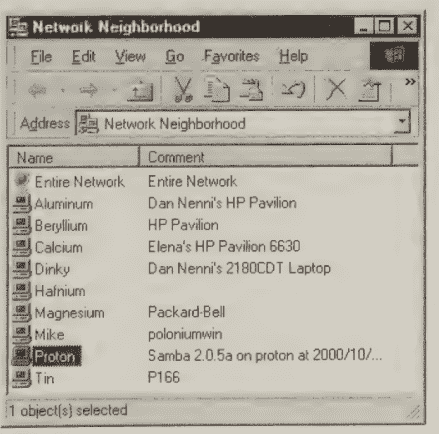

图 9-3. Linux 还是 Windows？只有你告诉他们他们可能才知道

## Windows 的 Linux 痴迷者：12 步计划

Linuxconf 配置中的下一个字段是系统将所属的工作组（workgroup）。如果你将你的 Linux 系统连接到 NT 或 Windows 2000 域，你可以在此字段中指定域名而不是工作组。

Netbios 名称和 Netbios 别名是可选条。你配备 Samba 的 Linux 系统的 NetBIOS 名称默认是主机名，但如果你需要更改它，可以在这里进行。如果你希望创建虚拟 NetBIOS 主机，可以在相应的字段中添加系统的别名。

密码设置 密码设置控制了当你尝试访问 Samba 系统时验证用户的方式。如果你启用 Encrypted Password Required（需要加密密码）选项，客户端必须传递加密密码才能访问系统。这适用于 Windows 98、完全补丁的 Windows NT 4.0 以及 Windows 2000 系统，它们默认使用加密密码。如果你启用此选项，任何需要访问 Samba 服务器的 Windows 95 系统都必须启用密码加密。

Authentication Mode（验证模式）选项允许你从列表中选择验证方法：

- User（用户）
- Server（服务器）
- Domain（域）
- Share（共享）

默认的用户验证方法要求每个想要访问 Samba 系统的用户在系统中拥有活动帐户，并输入该帐户的正确密码。

服务器验证方法对用户来说是相同的，但不是由 Linux 系统进行密码验证，而是指向另一个服务器来执行此功能。如果你选择此选项，在 Password Server 字段中输入你信任的一个或多个 NT 服务器的 NetBIOS 名称。

域验证方法也指向另一个系统进行验证，但它不是另一个服务器，而是域控制器（domain controller）。这涉及确保 Password Server 字段设置为主域控制器（PDC）的 NetBIOS 名称，确保 Workgroup 字段包含域名，并按照随后的“Run Samba”部分所述启动 Samba。

# Windows 痴迷者的 Linux：12 步计划

你在其他 Samba 服务器以及同一局域网和整个域中的 NT 系统上所选择。远程公告（Remote Announce）选项用于让 Samba 系统向远程网络宣布身份——甚至可能使用不同的组名。我没有在需要这种环境中工作过，但如果这听起来符合你的需求，请查阅 Linuxconf 中的帮助，并尽情尝试吧。

如果你清楚自己在做什么，并想让网络上的单个 Samba 系统成为 WINS 服务器，请勾选“启用 Samba 作为 WINS 服务器”（Enable Samba As A WINS Server）。否则，如果你使用 WINS，请在 WINS server 字段中输入现有服务器的名称。

Samba 通常仅在你的 Linux 系统的第一个网卡（NIC）上启用。如果你希望它在其他网卡上运行，你应该在 Interfaces 文件中输入这些网卡的 IP 地址，并用空格分隔。

名称解析顺序（Name Resolve Order）选项定义了解析主机名的方法。你可以根据需要输入四种方法中的任意方法，按你希望使用的顺序输入，并用空格分隔。这些选项在表 9-2 中描述；默认情况下，会按照表中指定的顺序查询所有方法。

**自动账户脚本（Automatic Account Scripts）** 在某些特定条件下，允许 Samba 服务器创建和删除 Linux 用户账户可能很有用。如果一个被 Windows 网络身份验证的用户没有相应的账户，那么该账户就会很有用。必须同时满足以下条件才会触发账户的自动创建：

- 身份验证模式必须为用户（user）或 域（domain）。
- 指定的服务器或域控制器必须对用户进行身份验证。
- 用户在 Linux 系统上不能已拥有账户。
- 脚本必须存在并接收参数 `%u`，该参数将成为账户名。
- 星期几英文单词必须以 "y" 结尾。

| 选项 | 描述 |
| --- | --- |
| lmhosts | 查询 /etc/lmhosts 文件以将主机名解析为 IP 地址。 |
| host | 使用 /etc/nsswitch.conf 文件指定的 Linux 系统正常的主机查找方法。 |
| wins | 检查已定义的 WINS 服务器（如果有）。 |
| bcast | 尝试在每个网卡上进行广播，以检查局域网内的主机。 |
| **表 9-2.** | 混合匹配 Samba 名称解析方法 |

## 第 9 章：第 6 步：与微软、Novell 混合

好了，最后一个要求不是强制性的，但其他是。默认情况下，没有设置脚本，因此不会动态添加用户。Linuxconf 提供了一个你可以选择的脚本（或作为你自己的基础），如下所示：

```
/usr/sbin/adduser -s /bin/false -g "smb account %u"
```

这会在 Linux 侧创建一个具有最小功能（没有 shell 和最小权限主组）的用户，取决于你如何配置 Samba 资源。这允许你将用户添加到 Windows 侧，而不必担心 Linux 侧的过程。

自动账户删除（Automatic account deletion）另一方面，确保在 Windows 网络上禁用的账户从 Linux 网络中移除。为了让这一点发生，星星不需要正确对齐（至少比通常情况下更多），但必须满足以下条件：

- 身份验证模式必须为域（因为服务器验证没有提供账户已删除的确定声明）。
- 指定的域控制器必须返回表示用户不存在的错误代码。
- 删除脚本必须存在并接收参数 `%u`，该参数代表要删除的账户名。

默认是不包含此类脚本的。然而，你可能会从 Linuxconf 选择默认选项，如下所示：

```
/usr/sbin/deluser %u
```


这是一个简单的脚本：由 `%u` 表示的用户，删除该用户及其主目录的内容。故事的道理是：如果你启用此选项，将从 NT 域中意外删除用户或账户恢复。

## 其他功能（Other Features）

最后一组默认选项是 Samba 功能的一小部分。访客账户（Guest Account）选项允许你在允许公共访问时指定 Linux 账户。如果允许访问磁盘或打印机共享，你应该输入一个权限的账户；“nobody”账户是一个合理的选择。

超时时间（Dead Time）选项应设置为 Samba 系统断开未打开文件的连接之前的空闲分钟数。默认值 0 不连接此类用户。根据争用服务器的用户数量，设置为 10 到 30 之间是合理的。大多数客户端会无缝重连，因此在这里设置一个值很好。

调试级别（Debug Level）决定了 Samba 系统记录的日志，对于调试可能有用。数字越高，日志越详细。不用担心这个选项，将其设置为 0 没有问题。

默认服务（Default Service）选项允许你为那些找不到服务的用户提供某种类型的服务。查看 Linuxconf 帮助获取有关此选项的更多信息，但其理念是当他们尝试访问不可用的服务时，与其给他们错误消息，不如给他们某些区域的只读权限。

如果你启用显示所有（Show All）选项，`etc/printconf` 中定义的每个打印机都可以被浏览。Linux 服务器接收到消息时被告知的 Samba 命令建议了向用户传递此信息的方法。我不怎么喜欢，所以我可能会让此字段为空。

## Samba 变量（Samba Variables）

我提到过用于定制 Samba 消息的 `%u` 和 `%h` 变量。这些变量使得许多任务自动化或针对特定用户、组或这些变量表示的其他实体的操作成为可能。这里有一个更完整的列表（可以使用 `samba.conf` 命令找到更多信息）：

| 变量 | 描述 |
|---|---|
| `%` | 尝试识别远程系统的操作系统 |
| `%d` | 当前服务器进程 |
| `%g` | 用户 `%u` 的主组 |
| `%G` | 用户 `%U` 的主组 |
| `%h` | 系统的 IP 主机名 |
| `%H` | 用户 `%u` 的主目录 |
| `%I` | 客户端的 IP 地址 |
| `%L` | Samba 服务器的 NetBIOS 名称 |
| `%m` | 客户端系统的 NetBIOS 名称 |
| `%M` | 客户端系统的 IP 主机名 |
| `%N` | NIS 主目录 |
| `%p` | 服务的主目录 |
| `%P` | 当前根目录 |
| `%R` | 协商的协议级别 |
| `%S` | 当前服务名称 |
| `%T` | 当前日期和时间 |
| `%u` | 指定的客户端用户名 |
| `%v` | Samba 版本号 |

## 配置用户主共享（Configuring Users Home Shares）

这组选项用于配置主目录的共享（可以与其他磁盘共享分开处理）。你可以通过设置主机访问、启用和禁用单个用户以及配置脚本来定制此功能以满足你的特定需求。

不过你有两个初始配置步骤需要执行。首先，在注释/描述（Comment/Description）字段中为主共享提供一个有用的描述。人们并不总是能看到这些描述，但有它们很好。包含 Samba 服务器主机名的 `%h` 可能是很有用的。

要做第二件事是决定你想多大程度上启用和广告该共享。大多数情况下，如果你正在创建一个共享，你会希望通过选择“启用此共享”（This Share Is Enabled）选项来启用它。但有时你可能想让共享离线，可以通过取消选择此选项来实现。你还可以通过启用浏览（Browsable）选项让共享对用户可见。在某些情况下，禁用此项可以提供少量的安全性，防止用户去不该去的地方。

### 主共享访问（Home Share Access）

公共访问（Public Access）选项允许无密码访问，向网络上的任何人开放主共享。当然，他们的访问级别是由选项功能中的访客账户（Guest Account）定义的。

下一个选项是可写（Writable），如果启用，允许用户在主目录创建文件和目录，取决于其有效权限。将主目录设为可写并没有问题（这通常是它们的用途），但如果你通过访客账户配置公共访问，我会很小心。

允许主机（Allow Hosts）和拒绝主机（Deny Hosts）设置配置 Samba 接受或拒绝你指定的主机或网络，方式与之前描述的“设置默认”过程相同。在此处添加条目允许你对已设定的用户创建异常或排除。

### 主共享用户（Home Share Users）

第一个用户相关的选项允许你指定一个可能访问系统的用户列表。恐怕这听起来比实际作用要有用得多。这并不是一种限制访问系统的有效方法；相反，它作为 Samba 服务器的访客名单，帮助识别可能与给定密码关联的用户名。如果你使用的是微软操作系统，这似乎并非必要，但旧系统可能不会传递 Samba 期的用户名。

如果你渴望让用户列表成为一种安全方法，“仅用户可连接”（Only User May Connect）功能将访问限制为列表中指定的用户（可以通过列出用户所属的 NIS 或 Linux 组来指定用户；只需在组名的开头添加 `@` 符号并添加到列表）。

写入列表（Write List）选项会覆盖上面的可写设置；通过在此字段中列出用户或组，你允许该用户（或所有组成员）对主共享具有写入权限。

## Windows 爱好者的 Linux 之路：十二步计划

此选项通常仅留给系统管理员，他们可以尽情享受强大的全系统级权限！

有效用户（Valid Users）列表列出了允许登录并使用服务的用户。与用户列表（User List）字段不同（后者会检查提供的密码是否与列表中任何用户的任何密码匹配），而“有效用户”必须提供与其用户名匹配的密码。

此外还有无效用户（Invalid Users），他们完全不被登录该服务。将废弃的用户账户加入到一个组（例如名为 "deadpile"）并不是个坏主意，然后在该组名前前面加上 `+` 符号以指定这是一个 Linux 组名，或者加上 `@` 符号先查找 NIS 组，然后再查找匹配的 Linux 组。如果一个名称同时出现在有效和无效列表中，则以无效为准，因为 Samba 是一个验证极其严谨的软件。

将最大连接数（Max. Connections）设置为大于 0（默认值）允许你限制活动并发连接的数量。在达到最大限制后尝试连接到服务的用户将被拒绝。Samba 使用存储在 `/tmp/samba` 中的锁文件来跟踪这些文件。

在只读用户列表（Read Only User List）中填充用户名称（或用户组），前面加上 `@` 或 `+` 符号，这些用户即使设置了可写（Writable）选项也不具备主目录的写入权限。

### 目录共享脚本（Home Share Scripts）

有时，在用户登录或注销系统时执行脚本是有用的。你有四个字段可以输入脚本：

- 设置命令（Setup command）：当有人连接到服务时运行。
- 设置命令（root)）：当有人连接到服务时以 root 身份运行。
- 清理命令（Cleanup command）：当有人断开服务连接时运行。
- 清理命令（root)）：当有人断开服务连接时以 root 身份运行。

Linuxconf 中的信息提供了此类脚本的示例，包括直接摘自 `smb.conf` 主页的内容。我并没有发现这些示例非常有用，但我使用这些功能执行了一些用户升级，并将他们从一个系统迁移到另一个系统。如果你觉得在连接或断开时执行脚本某些方面有用，请看看你可以用它做些什么！

## 配置打印机共享

配置打印机共享非常简单。从 `Config-Network-Server-Tasks-Samba File Server` 树中选择打印机默认设置（Default Setup For Printers）。为共享输入描述；默认的“所有打印机”（All Printers）非常容易理解，但如果你愿意，也可以一直加上一个 `%h` 以防万一。

要启用对打印机共享的访问，请确保选中了已启用（This Is Enabled）选项。如果你不在乎任何人都能打印，可以启用公共访问（Public Access）。

# 第9 章：第6 步：与微软混合，与 Novell 建立网络

个人而言，我倾向于人们访问我网络上的任何内容时登录真实账户。但请采取你认为最好的做法。

## 执行 netlogon 设置

当 Samba 系统作为域的登录服务器时使用这组选项。你可以通过从 `Config-Network-Tasks-Samba File server` 树中选择 Netlogon 设置（Netlogon Setup）进入此配置部分。在 Netlogon 共享标题（Netlogon Share Title）字段中为共享输入名称，并确保选中了此共享已启用（This Share Is Enabled）选项。

在要导出的目录（Directory To Export）中指定你希望存放 netlogon 文件的目录。你还可以指定相对于此导出目录的登录脚本、路径、驱动器和主目录。

指定一个在用户登录时运行的微软风格登录脚本。这可以是 `.bat` 文件或 `.cmd` 文件，就像你在微软服务器上使用的一样。事实上，它应该使用基于 DOS 的编辑器进行格式化，以确保文件使用冗余的微软回车/换行符命令来结束每行。

脚本可以包含 `NET` 语句来映射网络驱动器，或执行任何你习惯包含在 Windows 登录脚本中的其他任务。你可以使用 `%u`、`%g` 或 `%m` 变量，例如创建特定用户、组或系统的登录脚本。

使用此字段指定存储 Windows 95 配置配置的目录。不要让它放在这个主目录树中；给它一个独立的地方。客户端系统将引用 `user.dat` 和 `user.man` [注：可能是 `user.mdf` 或类似文件] 文件，并从你在此指定的路径加载它们的桌面、开始菜单、程序和网络文件夹。

如果你有 Windows NT 或 2000 工作站需要知道使用哪个驱动器号连接到主目录，请使用此字段。格式为驱动器号加冒号：`h:`。

指定用户的主目录。默认条目是：

`\\%USER%`

这会将主目录指向主目录服务器上以用户账户命名的目录。如果你的主目录位于不同的目录结构中，请更改此字段反映这一点。

## 配置磁盘共享

你可以通过在 Linuxconf 的 `Config-Network-Server-Tasks-Samba File server` 树中选择磁盘共享（Disk Shares）来设置非主目录磁盘共享。例如，部门或项目共享空间可以这样配置。

通过为共享命名并提供描述开始磁盘共享配置，以便用户知道共享的用途。勾选此共享已启用（This Share Is Enabled）框来启用共享，并勾选浏览（Browsable）框使网络浏览器可见。

继承共享设置（Inherit Settings From Share）选项让你有机会将一个现有共享作为新共享的模板；新共享默认将使用现有共享的配置，但你可以在新共享中更改设置。

要导出的目录（Directory To Export）是从根目录到将被视为共享顶级目录的路径。与任何磁盘共享一样，你想要确保不会分支到不该进入的地方，例如。

### 磁盘共享访问

启用公共访问（Public access），允许任何可以浏览网络的人访问磁盘共享。公共访问级别由 Samba 的访客账户设置定义。如果选择了此选项，还可以启用仅限访客（Guest Only）以强制所有用户以访客身份访问。

与主目录选项一样，允许主机（Allow Hosts）和拒绝主机（Deny Hosts）字段允许你输入希望允许或拒绝访问共享的主机组。输入逗号分隔的主机或 IP 地址列表，和/或一组网络号。`EXCEPT` 参数可用于指定指定范围内应排除在允许或拒绝规则之外的一个或多个地址。

如果你留空这些字段，系统的默认行为是允许从任何系统访问。如果这两个字段之间存在重叠，则以允许主机（Allow Hosts）规则为准。

### 磁盘共享用户

主目录共享与其他磁盘共享的用户配置唯一区别在于管理员用户（Admin Users）字段。此字段应包含具有共享管理员权限的用户名称（或包含这些用户的组名）。这些用户将对共享拥有无限制访问，等同于共享上的超级用户，因此不要只设置为 Admin。

### 磁盘共享脚本

除了魔法脚本（Magic Script）字段外，这些脚本与主目录部分描述的脚本相同。前四个字段包含在以下情况运行的脚本：有人连接到服务时；当有人连接到服务时以 root 身份运行；有人断开服务连接时；以及有人断开服务连接时以 root 身份运行。

魔法脚本是一个从客户端站点打开的脚本；当它关闭时，脚本会在服务器上执行。此功能在我使用的 Samba 版本中是实验性的，所以我建议听从 Samba 的建议不要依赖此功能！

### 磁盘共享功能

在 Samba 磁盘共享的 Linuxconf 配置工具的功能（Features）部分包含一些有趣的选项。例如，强制用户（Force User）和强制组（Force Group）选项允许你指定单个用户和组。

## 第 8 章：第 6 步：与微软交流，与新诺联网

任何连接到此磁盘共享的用户都以强制用户/组的身份访问共享。这使得控制简单共享的访问变得容易——你只需要担心 Linux 端的一个账户即可！

“不进入”（Don't Descend）选项（该选项真的应该叫“不进入”，但 Linuxconf 界面和帮助系统中存在几处拼写错误和奇怪的用词）允许你指定用户无法进入的目录，可能是因为这些目录太深或不适合用户访问。`smb.conf` 手页中给出的两个例子是 `/dev` 和 `/proc` 树，很难看出这些系统目录的内容对通过 Samba 连接的 Windows 用户有任何用处。只需以逗号分隔并输入目录名称，在查看磁盘共享共享时，它们将显示为空白。

如果你想为公共访问该共享指定特定的用户账户，请配置“客体账户（此共享）”。“魔术输出”（Magic Output）设置允许你指定一个接收来自魔法脚本输出的文件。该值默认为带有 `.out` 后缀的魔法脚本名称。“最大连接数”（Max Connections）设置限制了允许共享的并发活动连接数。尝试在达到限制后访问共享的用户会被踢出旅馆，能在马厩里找到空位已经是走运了。

## 运行 Samba

如果你已经完成了所有的 Samba 配置，你已经准备好换个简单的任务来做了。（实际上，Linuxconf 尚未涵盖的选项还有许多额外选项，如果你在寻找未涵盖的功能，请查看 `smb.conf` 手页和 samba.org 网站。）所以你会高兴地发现，实际运行 Samba 进程非常简单。

在 Red Hat 或其衍生发行版上运行 Samba 只需要确保进程启动。你可以使用 `/etc/rc.d/init.d/smbd` 脚本并检查 Samba 状态来查看是否正在运行，如下：

```
root@romans > /etc/rc.d/init.d/smbd status
```

如果 Samba 服务器正在运行，它会告诉你并给出相关进程的进程 ID 数字：

```
smbd (pid 18934 18919) is running...

nmbd (pid 18930) is running...
```

另一方面，如果服务器没有运行，`smb status` 命令将返回类似以下的内容：

```
smbd stopped

nmbd stopped
```

## Windows 痴迷者的 Linux：12 步计划

你可能在好奇，`smbd` 进程是 Samba 中提供服务的部分，而 `mbnd` 进程从 Samba 服务器提供 NetBIOS 名称服务。你可以检查它们的手页以获取关于每个进程的更多信息，但我们将使用位于 `/etc/rc/init.d/` 的 `smb` 封装程序间接操作它们。

要让 Samba 服务器运行起来，你将使用 `smb` 脚本启动它：

```
root@rom ~ /etc/rc.d/init.d/smb start
```

你应该会收到来自服务器返回的好消息：

- 启动 SMB 服务 [OK]
- 启动 NMB 服务 [OK]

如果你想关闭 Samba 服务器，将执行相同的命令，将 `start` 替换为 `stop`。要重启服务器——也许是因为你手动编辑了 `smb.conf` 文件并希望更改反映在服务器的运行方式中——你可以执行 `samb restart` 命令，它会停止进程然后重新启动。

为了确保 Samba 服务器已启动，你重启了 Linux 系统，使用 `/usr/sbin/ntysys` 工具，这是一个全屏文本工具，显示了系统上可用的服务并允许你选择启动时将启动的服务。这是确保启动文件正确同步的方便方法。图 9-4 显示，我的 Samba 服务器在启动时确实启用了 `samb` 服务。

## 排除 Samba 故障

虽然书中没有足够的空间详细解释如何排排除我们所讨论的任何服务的故障，但 Samba 服务对于具有 Windows 客户端和服务器背景的 Linux 管理员来说至关重要。因此，让我指向 Samba 网站上的文档。当我写这些内容时，有一个 Samba 诊断工具供你使用；前往最近的 Samba 镜像，点击 Documentation（文档）链接，然后从页面的 Other Documentation（其他文档）部分找到 Diagnosing Samba（诊断 Samba）。

但由于我的大多数问题只需几步就能解决，我在这里将为你简要介绍其中几个。如果这些还不足以定位并解决你的问题，请务必尝试网站，其中包含了如何使用我提到的一些 Samba 工具的信息。

## 第一：检查 smb.conf 文件是否有错误

尽管 Linuxconf 界面会在你尝试输入错误设置时检测某些错误，但检查 `smb.conf` 文件以确保它的运行正如你所想的那是一个好习惯。在你检查时，你可能还会手动进行一些更改。

# 第 9 章：第 6 步：与微软交流，与新诺联网

## 285

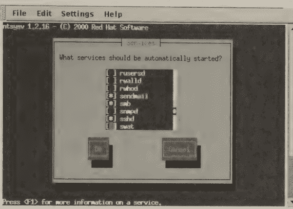

**图 9-4.** 使用 ntsys 工具选择启动时启动的服务

正如我之前提到的，这个文件非常长，虽然它有详尽的注释（在手页中提供了大量信息），但当你与 Samba 工作时，并不一定容易。坦率说，好心们提供了一个脚本来检查 `smb.conf`。运行该工具，只需告诉它 `smb.conf` 的位置：


`root@romans` > `/usr/bin/testys` `/etc/smb.conf`

```

程序在运行时会向你告知状态：

```

Load smb config from

Processing section "homes]"

Processing section "printers]"

Processing section "home]"

```

如果你按下回车，`testpart` 将给出：

## 处理密码加密

如果你从 Windows 2000、补丁到 Service 3 或更高版本的 Windows 4.0、Windows 98 或 Windows 95-OSR/2 连接 Samba 服务器遇到困难，最可能的罪祸首是明文。

你需要自己决定密码加密（这带来了保存到不安全磁盘上的密码）还是明文传输（可能允许密码在网上被捕获）更适合你的情况。我倾向于从客户端启用明文，但如果你没有有效的方法为每个客户端自动化此过程，这是一个令人恼的步骤。

**使用明文密码** 如果你决定使用明文密码，请使用适用于平台的 `regedit` 命令，并更改表 9-3 中的值以允许 Windows 系统传输明文。

**Samba 密码加密** 如果你选择在 Samba 服务器上启用密码加密，按照以下步骤操作：

- 1. 在 `smb.conf` 文件的 `[global]` 部分添加以下行
```conf

crypt passwords=yes

```

| OS | 注册表项 | 名称和数据 |
|---|---|---|
| Win 2000 | `[HKEY_LOCAL_MACHINE\SYSTEM\CurrentControlSet\Services\LanmanWorkStation\Parameters]` | `"EnablePlainTextPassword"=dword:00000000` |
| WinNT 4.0 | `[HKEY_LOCAL_MACHINE\SYSTEM\CurrentControlSet\Services\Rdr\Parameters]` | `"EnablePlainTextPassword"=dword:00000000` |
| Win 98 | `[HKEY_LOCAL_MACHINE\System\CurrentControlSet\Services\VxD\VNETSUP]` | `"EnablePlainTextPassword"=dword:00000000` |
| Win 95 | `[HKEY_LOCAL_MACHINE\System\CurrentControlSet\Services\VxD\VNETSUP]` | `"EnablePlainTextPassword"=dword:00000000` |

**表 9-3.** 在微软操作系统上启用明文密码

## 第 8 章：第 6 ：与微软混在一起，与 Novell 联网

2. Red Hat 将 `smbpasswd` 密码文件存储在 `/etc/smbpasswd` 中。使用此命令确保该文件仅对 `root` 可读：

```
root@romans > ls -l /etc/smbpasswd

rw------- 1 root      root 208 May 12 14:01 smbpasswd
```

如果文件权限与在该行中看到的不符，请使用此命令进行修正：

```
root@romans > chmod 600 /etc/smbpasswd
```

3. 填充 `smbpasswd` 文件。虽然有一个 shell 脚本可以从 `/etc/passwd` 文件完成此操作，但我更倾向于有选择性地添加用户（也许现在是让你的用户纠正自己的账户的好时机，这样你就可以清理掉不需要的了？）。`smbpasswd` 程序可以毫不费力地完成这一点。

```
root@romans > smbpasswd -add karen honeybunny
```

这个命令很容易理解：它添加了一个名为 `karen` 的用户，并设置了极其容易记住的密码 `honeybunny`。你可以从你的用户账户列表和一些不错的工业级密码对这些添加操作进行脚本化。

4. 现在，你可以通过启用 `/etc/smbpasswd` 文件上的特殊用户 ID 权限，允许用户修改自己的密码：

```
root@romans > chmod u+s /etc/smbpasswd
```

现在你应该可以在你的 Samba 服务器及其客户端上使用这些加密后的密码了！

## 确保打印机被识别

也许我指出这一点有点操之过急了，因为我还没有在一个地方讨论所有的 Samba 信息，这里有一个简单的方法，可以确保 Samba 识别你认为它应该识别的打印机名称：使用 `testprns` 程序。给这个小工具提供你尝试访问的打印机名称，以及你 Linux 系统 `printcap` 文件的位置，它就会告诉你 Samba 是否知道如何使用打印机（我们将在第 10 章讨论 `printcap` 文件）。

```
millerm@romans > testprns lj4500 /etc/printcap
```

在这个示例中，我正尝试确定我认为名为为 `lj4500` 的打印机是否可以通过 `/etc/printcap` 中的信息进行访问。如果可以，我应该会看到这条消息：

Printer name lj4500 is valid.

但如果我记错了名称，我会得到另一条消息：

Printer name lj4500 is not valid.

## Windows 成瘾者的 Linux 之路：十二步程序

如果情况确实如此，那么我无法从 Windows 客户端找到打印机的原因是 Linux 系统不认识该名称的打印机。

## 连接到 Novell 系统

虽然连接基于微软的系统占据了本章的大部分，但我不想完全忽视 Novell 的 NetWare。我离开担任 NetWare 管理员的苦日子已经很多多年，以至于我对这个网络操作系统（NOS）感到相当淡然，而且事实是，自从我离开后，公司一直在改进其产品线。你可能有一些想要从你的 Linux 工作站访问的 NetWare 系统。如果你周围有 NetWare 客户端，你可能会发现，在某些情况下，让你的 Linux 系统模拟一个 NetWare 服务器比到处去修改每一个客户端要容易得多。因此，为了处于这两种情况的人考虑，我想谈谈解决这两个问题的方案。

## 作为客户端连接

如果你有正确的工具，从 Linux 客户端连接到 Novel 服务器是很容易的。也许在你的 NetWare 服务器卷上加载 NFS 命名空间是此此最简单的方法，但并不是所有人都有选择。坦率地说，Red Hat 有 `ncps` 包，它完全胜任这项工作的正确工具。如果你在构建内核时包含了 IPX 协议，并使用 `Linuxconf` 进行了配置（如第 7 章所述），那么你就稳妥了。

## 使用 ncpmount

如果 IPX 在你的系统中运行正常，你可以使用 `ncpmount` 从你的 Linux 系统挂载和卸载 NetWare 卷。例如，如果你想访问名为 `TITUS` 的 NetWare 服务器，你可以使用以下命令：

```
root@romans -> ncpmount -S TITUS -U supervisor /mnt/titus
```

这将提示你输入 `TITUS` 的密码；如果你输入得正确，你就可以从指定的挂载点 `/mnt/titus` 访问 `TITUS` 卷。`TITUS` 上的每个卷在挂载点都会有一个独立的子目录。

使用 `ncpmount` 连接到 NetWare 服务器时还有许多其他选项。表 9-4 描述了一些更实用的选项，但你可以查看 `man` 页面以获取更多细节。

通过包含传递密码等功能，`ncpmount` 给了你完全脚本化 Linux 和 NetWare 系统之间连接的机会，尽管这自然意味着你必须保护脚本，特别是如果你计划使用 NetWare Supervisor 密码的话。

## 第 9 章：第 6 ：与微软混在一起，与 Novell 联网

| 选项 | 描述 |
| :--- | :--- |
| `-S server` | NetWare 服务器名称 |
| `-U username` | 登录 NetWare 服务器的用户名 |
| `-P password` | NetWare 用户账户的密码 |
| `-V volume` | 要挂载的卷（默认挂载所有卷） |
| `-b` | 强制 |
| `-u uid` | 用户 ID |
| `-g gid` | 组 ID |
| `-f mode` | 文件模式 |
| `-d mode` | 目录模式 |

表 9-4：常用的 `ncpmount` 选项

通过包含传递密码等功能，`ncpmount` 给了你完全脚本化 Linux 和 NetWare 系统之间连接的机会，尽管这自然意味着你必须保护脚本，特别是如果你计划使用 NetWare Supervisor 密码的话。

## Windows 成瘾者的 Linux 之路：十二步程序

第一行提供了默认连接，将尝试连接到服务器。第一行可以由一个命令调用：

```
garsoto@james > ncpmount /mnt/titus own
```

第二行指定了具有相同用户名的不同服务器，并为该用户名提供了密码。连接到此服务器的命令可能如下：

```
garsoto@james > ncpmount -S TITHY /mnt/timothy
```

最后，最后一个选项使用连字符表示 `GUEST` 账户不需要密码。根据你的环境，文件可以让生活变得更容易，或者没有任何优势。

## 作为服务器运行

如果说如何连接 NetWare 服务器是本书关注的边缘，那么完全可以说 NetWare 仿真是在范畴之外。这是一个足够酷的功能，值得简要提及。但 Martin Stover 的模拟 NetWare 的 `mars_nwe` 包包含在 Red Hat 中，你可能对此尝试。

在你的 Linux 机器上设置 `mars_nwe` 包以模拟 NetWare 服务器需要两个简单的步骤。首先，你应该配置 `/etc/nwserver.conf` 文件以满足你的需求。其次，你需要启动服务。

## 配置 nwserver.conf

如果你在 Red Hat 服务器上安装了 `mars_nwe` 包，`/etc/nwserver.conf` 文件就会默认存在。它有详尽的注释，所以你应该能够遵循文件的布局逻辑。以下几行是一个极简的版本，包含了我所用系统中 `nwserver.conf` 文件的未注释部分：

```
# 定义一个只读的、小写的 SYS 卷

1 SYS /var/mars/nwe/sys

# 定义一个只读的、小写的、可移动媒体 CDROM 卷

1 CDROM /mnt/cdrom2

# 定义一个文件名全小写的 HOME 卷

1 HOME /home

# NetWare 服务器名称为 ROMANS828

2 ROMANS828

# 自动配置内部网络号和节点

3 auto 1

# 自动设置网络号和设备，设置帧类型和交付技巧

4 0x0 * snap 1
```

## 第 8 章：第 6 步：与微软交流，与诺威联网

```
5 0

# 声明为 NetWare 3.11 服务器

6 1

# 强制通用密码加密

7 0

# 将默认 UID 和 GID 设置为 'nobody'

10 99

11 99

# 将 SUPERVIS 用户与密码及 Linux 账户关联

12 SUPERVISOR nw-super a8g3RT39A

# 关联 NetWare 和 Linux 之间的登录名称

13 WIINNKA ian

# 不要使用临时方案将 Linux 登录映射到 NetWare 登录

15 0

# 在启动时进行简单的合理检查

16 1

# 配置 NetWare 打印到 Linux 打印机

21 LP SYS:/PRINT/LP 1pr -Plp

# 设置调试信息 - 保留推荐的默认值

100 0

101 1

102 0

103 0

104 0

105 0

106 1

# 将 nwserv 作为守护进程运行，启用日志并追加到日志文件

200 1

201 /var/log/mars_nwe.log

202 0

# 在发出关闭命令 15 秒后关闭服务器

210 5

# 每 120 秒发布一次广播

211 120

# 每 5 次广播记录一次路由信息，每次重写日志文件

300 1

301 /var/run/mars_nwe.routes

302 1

# 不使用看门狗

310 -1

# 定义特殊站点文件 ...

400 /etc/nwserv.stations

# ... 但通过获取最近的响应来忽略它
```

# Windows 痴迷者的 Linux：12 步计划

```
# 曾经给过的“请求最近的服务器”

401 0
```


这些配置中的某些内容非常奥秘，如果你熟悉 NetWare 服务器管理，这些内容并不特别令人惊讶。一旦准备好配置文件，你就可以启动服务器了。

## 运行 nwserv

要启动 NetWare 服务器仿真器，只需运行 `/usr/sbin/nwserv` 程序。如果你在配置文件的第 200 行将程序设置为守护进程运行，它将作为一个服务运行，你无需再担心它。

如果你从连接到 NetWare 的系统运行 `SLIST` 命令，你应该能看到 Linux 系统发布其服务。你甚至可以在运行 `ncpfs` 的 Linux 系统上使用 `list`；无论哪种方式，你都会看到类似这样的服务器列表：

| 已知的 NetWare 文件服务器 | 网络 | 节点地址 |
|---|---|---|
| ROMANS828 | 0A0002E | 000000000001 |

这意味着你已经运行起来了！

要配置此服务在每次系统重启时运行，请使用在本章之前“运行 Samba”部分提到的 `/usr/sbin/ntsys` 工具。你需要查找并启用的服务是 `mars_nwe`。

# Windows 痴迷者

# 第 10 章

## 第 7 步：启用打印

# Windows 痴迷者的 Linux：12 步计划

在上一章中，我们讨论了将 Linux 集成到你的微软-诺威网络的过程。正确集成这些网络的部分之一是提供打印服务，如果你的目标是减少或消除对那些专用操作系统的需求，你就必须从你的 Linux 系统启用打印。

这带我们来到了 12 步计划的第 7 步：你必须承认 Linux 打印和打印服务很容易配置。这简单的一步将使你能够提供所需的所有打印服务，提高网络效率，并很可能带来各国之间的和谐。如果你需要对该结论背后的逻辑进行更详细的解释，请给我电子邮件。

在本章中，我们将讨论如何在 Linux 系统上配置打印，如何让各种客户端操作系统能够使用该打印功能，以及如何在 Linux 环境中管理打印机。

## 配置 LPD 守护进程

打印机配置过程的第一步是设置打印机守护进程 `lpd`。这是一个在后台运行的程序，负责监听并将作业缓存到相应的打印机。与我们查看过的其他服务一样，有基于 GUI 的工具可以配置 `lpd`。然而，我也想解释在使用 GUI 工具时对系统进行的一些底层更改，这样你就不会与真实发生的情况隔绝。

## 运行 printtool

红帽解决打印机配置方案是一个名为 `printtool` 的程序。这是一个必须由超级用户在 X Windows 下运行的图形化工具。当你执行 `printtool` 命令时，你会看到一个与图 10-1 显示类似的窗口。

`Printtool` 可以帮助你配置 Linux 之间的四种打印机连接。直接连接到 Linux 系统的打印机（例如，通过并行端口）被配置为本地打印机。连接到其他 Linux 或 Unix 系统（包括某些打印服务器设备）的打印机被配置为远程打印机。如果你网络上连接到 Windows 和 NetWare 系统的打印机已准备好共享，你也可以使用它们。我们大多数通过并行端口连接本地打印机，`printtool` 的一个很好的功能是它可以尝试自动查找打印机。要添加新打印机，点击按钮。

## 第 10 章：第 7 步：启用打印

`printtool` 将显示一个与图 10-1 类似的窗口。`Printtool` 可以帮助你配置 Linux 之间的四种打印机连接。直接连接到 Linux 系统的打印机（例如，通过并行端口）被配置为本地打印机。连接到其他 Linux 或 Unix 系统（包括某些打印服务器设备）的打印机被配置为远程打印机。如果你网络上连接到 Windows 和 NetWare 系统的打印机已准备好共享，你也可以使用它们。

# Windows 爱好者的 Linux 之路：十二步计划

对于 HP JetDirect，你可以指定该设备的 IP 地址。远程队列（Remote Queue）是已经在系统上配置的打印机队列名称。请咨询你的打印服务器设备以获取内置队列的名称（如果有的话）。

注意，如果你不想再点击任何额外的树状结构（或在不必要的回收上浪费任何不必要的能量），你可以抑制网络打印机上的页眉。我曾工作在一些这些页眉页非常有用的环境中；最常见的情况是许多人共用大容量打印机。一旦你在此屏幕上配置好设置，点击确定返回到主屏幕。

## Windows/SMB 打印机

如果你想从 Linux 系统配置到基于 Windows 的打印机，还有几个额外的字段需要填写。与 Unix 打印机一样，你可以在 `Hostname Of Printer` 字段中输入打印服务器的主机。你也可以添加 `Number Of Server`。在 `Printer Name` 字段中输入共享名称。

打印机的访问信息也在此屏幕输入。虽然对于不需要密码的 SMB 打印机，你仍然可以输入用户名和密码。在 `Workgroup` 字段中填入正确的组名。当你对这些条目满意时，点击确定返回主屏幕。此屏幕上的其余信息与“本地打印机”部分相同。

## NetWare/ NCP 打印机

如果你有一个想从 Linux 系统访问的 NetWare 打印机，你可以配置它。虽然大部分信息与我描述的相同，但有一些 NCP 特有的选项。请注意，用户名和密码在 Linux 系统上加密加密存储。在这种情况下，`Print Server Name` 是 NetWare 服务器的名称，`Print Queue Name` 是该服务器上的 NetWare 打印队列名称。`User` 和 `Password` 字段指定账户。

## 底层更改

那些配置步骤看起来困难吗？它们对 Linux 系统的更改并不复杂。在设置新打印机时，我仍然倾向于从命令行进行更改，因为一旦连接到打印机，向网络上的其他系统添加更改就很容易。Linux 减轻了痛苦！你的系统有两个区域：`/etc/printcap` 文件和 `/var/spool/lpd/` 目录。

## 第10 章：第 7 步：启用打印

### /etc/printcap

此文件包含你在 Linux 上定义的每个打印机的基本定义。大多数常见的打印机请求信息都在此文件中找到，如下所示：

```
## PRINTTOOL# REMOTE POSTScript Default

sd=/var/spool/lpd/lp:

mx=0:

sh:

rm=lp:

rp=lp:

if=/var/spool/lpd/filter:

## PRINTTOOL# LOCAL EpsonStylusColor

sd=/var/spool/lpd/lp0:

mx=0:

sh:

lp=/dev/lp0:

if=/var/spool/lpd/filter:
```

示例中定义了两个打印机，根据每个前面的注释行，它们都是通过打印工具创建的。最常用的 `printcap` 参数见表 10-1。注意，并不是所有的条目都在之前的示例中；例如，指向 SMB 或 NCP 服务器的打印机才会创建计数文件（提供打印队列的使用统计）。如果你对更多配置选项感兴趣，它们在 `printcap` 的帮助页面中有详细列出。

| 参数 | 描述 |
| :--- | :--- |
| sd | 此打印机的池目录 |
| mx | 最大池化文件大小 |
| sh | 抑制页眉 |
| rm | 远程机器名称 |
| rp | 远程打印机/共享名称 |
| if | 打印过滤器 |
| lp | 本地打印机设备名称 |
| af | 计数文件 |

**表 10-1.** `/etc/printcap` 中的常用打印机配置参数

### /var/spool/lpd/

`/var/spool/lpd` 目录在第一个 `/etc/printcap` 定义的两行中被引用：事实上，这是大多数发行版放置 `lpd` 相关文件的地方。

```
sd=/var/spool/lpd:

if=/var/spool/lpd/filter:
```

第一行表示唯一的目录是 `/var/spool/lpd`，第二行设置打印过滤器（这是一个确定正在打印的文件类型以及如何打印它的脚本）。

设置的每个打印机在 `/var/spool/lpd` 中都应该有一个单独目录。默认情况下，打印工具将使用类似 `/var/spool/lpd/lp0` 的名称，这很好。如果你想更改名称，可以使用打印工具。

## 运行打印作业

现在你已经配置好了打印机，是时候开始打印了。虽然 Windows 应用包含相当透明的打印机制（使用“文件 | 打印”菜单），但 Linux 应用程序的界面设计以及文本模式工具的流行使得你很可能只想从命令行或 GUI 文件管理器工具打印文件。然而，无论你如何访问打印命令，知道如何从 Linux 客户端、Windows 客户端或 NetWare 客户端指向正确的 Linux 打印机都是用的。

### 来自 Linux

和 Linux 中的其他所有事情一样，有几种打印方法。当你从命令行打印时，有几个实用程序可以将文件输出到打印机。当你使用 X Windows 时，可以使用内置功能。

### 命令行打印

如果你想将文件内容输出到打印机，可以使用 `lpr` 命令。以下命令说明了一些最常用的选项：

```bash
lpr -Poj /etc/printcap
```

此命令将 `/etc/printcap` 的内容打印到名为 `oj` 的打印机。如果你只想打印一份，则不需要指定 `-P` 。你还可以设置一个环境变量来指定你想使用的默认打印机。对于 bash shell，你可以从命令行这样设置：

```bash
PRINTER=oj
export PRINTER
```

在 csh/tsh 环境中执行相同任务只需一条语句：

```bash
setenv PRINTER oj
```

你可以使用任一 shell 命令检查 `PRINTER` 环境变量的当前设置：

```bash
echo $PRINTER
```

`mpage` 工具在许多系统中都有；它允许你指定单页打印的页数，从而对你的环保工作进行更多控制。如果你有一个 PostScript 打印机，`mpage` 非常方便：

```
mpage -4 -Poj /etc/printcap
```

此命令在纸上打印四页文本（缩小尺寸以适应并框选以便易读）。你有可以选择的许多额外选项；请帮助页面。

`encrypt` 工具是另一个调整打印输出的常用工具。你对输出显示方式有更多的控制，并可以为你喜欢的加密选项设置别名并将其作为打印命令。`encrypt` 可以这样调用：

```bash
encrypt -2 -a2 -G -j -r /etc/printcap
```


这些选项从左到右告诉加密每页打印两列，只打印第二页，使用花丽（俗气的）页眉，为列加上边框，并以横向模式打印。

## X Windows 打印

然而，并不是每个作业都需要你发出打印命令。例如，X Windows 应用程序有时允许你从菜单系统中打印。一个例子是 Netscape 的 Navigator，它现在包含在大多数发行版中。当你

# Windows 爱好者的 Linux 之路：12步程序

选择“文件 | 打印”，你将看到一个如图 10-5所示的窗口，它允许你查看底层的打印命令。在图 10-5 中，打印命令是一个简单的 `lpr`，这运行良好。

其他工具也有它们自己的 Windows 风格打印机界面，例如图 10-6 所示的 K 文件管理器打印菜单。

## 来自 Windows

如果你致力于将工作站和服务器全面迁移到开源平台，那么在 Linux 下打印没有问题；但即使你迁移了大部分用户，可能仍会有剩下的 Windows 用户。当然，Linux 令人好用的原因之一是它与其他操作系统的兼容性，包括微软所出的巨大努力。

如果你已经在 Samba 中配置了“所有打印机”共享（如果不记得，请参阅第 9 章），并且已经配置好 Samba 服务器和 Windows 客户端对于是否加密密码，你就可以轻松地从 Windows 设置连接 Linux 的打印机共享。

就像添加其他设备一样，将 Linux 打印机添加到你的 Windows 系统中：

1. 从开始菜单选择“设置”选项。
2. 从“设置”列表中选择“打印机”条目。
3. 双击“添加打印机”图标并点击“下一步”。
4. 选择“网络打印机”选项并点击“下一步”。
5. 以 `\\LINUXHOST\PRINTERNAME` 的格式输入服务器和打印机名称。
6. 选中正确的打印机后，点击“下一步”。
7. 如果 Windows 系统需要加载你指定的打印机驱动程序，它会提示你输入打印机的制造商和型号。完成后点击“下一步”。
8. 表明你是否想让打印机成为你的默认打印机，并点击“下一步”。
9. 某些版本的 Windows 会询问你是否打印测试页；选择你需要的选项并点击“完成”。

如果你不记得确名称，点击“浏览”按钮（或 Windows 2000 中的“下一步”按钮）来浏览网络中的服务器和打印机。

你现在应该有一个运行良好的 Windows 打印机定义，它恰好指向 Linux 打印机服务器。它会出现在你的“打印机”文件夹中，就像其他打印机一样。Windows 2000 工作站的示例见图 10-7。

## 第 10 章：第 7 步：启用打印

**图 10-5.** 在 Netscape Navigator 中使用的打印命令配置

**图 10-6.** 在支持的 X Windows 应用程序中使用熟悉的“文件 | 打印”命令

**图 10-7.** 网络上的微软系统可以使用该 Linux 打印机

## 来自 NetWare

如果你有 Windows 用户连接到 NetWare 服务器，并且你将 Linux 服务器配置为作为 NetWare 服务器，那么你的客户端应该能够像连接到任何 Novell NetWare 服务器一样，指向打印队列。

`/etc/nwserv.conf` 文件的相关区域是第 21 行，在其中你设置 NetWare 仿真将通告的队列名称、打印文件缓存的目录以及用于打印这些文件的 Linux 打印命令。这些选项现在应该比你第一次阅读第 9 章时要更容易理解一点。

## 打印机管理

用于打印机管理的显式工具是 `printtool`。`printtool` 允许你配置、编辑和删除打印队列（这实际上构成了你必须进行的打印管理……至少我为你希望是如此）。但它也可以用于启动和停止 `lpd` 守护进程，并将测试文件打印到你配置的打印队列中。还有其他工具用于打印机管理，特别是经典的 Unix 命令行实用。我将描述这些程序中供你使用的功能，然后让你了解市上还有哪些工具。

## 标准管理工具

打印机管理需要执行的基础任务包括启动和停止打印守护进程（例如实现配置更改）、测试队列、查看队列内容、从队列中删除某些或所有作业，以及检查统计信息（如果有）。以下命令允许你在 Linux 中执行这些任务。

### printtool

我们在本章中花费的大部分时间是在 `printtool` 完成的打印机配置语境下工作的。到目前为止我还没有谈过的两个功能是 `printtool` 的 `lpd` 管理和它的测试功能。

一旦你对队列配置作了更改，就必须杀掉运行旧配置信息的当前 `lpd` 守护进程，并使用新配置信息重新启动它。这可以通过命令行完成，也可以直接进入 `printtool` 内部的 `lpd` 菜单并选择 `start lpd`。就这么简单！

你还可以通过 `printtool` 测试 Linux 系统上的队列。从主屏幕选择一个打印队列，然后进入“Tests”并选择“Print ASCII Test Page”或“Postscript Test Page”。这些选项会将文本文件或 Postscript 文件转送到打印机，因此你可以确保系统能够处理这两种类型的数据。

### lpq

`lpq` 命令允许你检查与某个打印队列相关的打印缓存缓存。如果你想检查当前定义为默认打印机的打印机，不需要指定名称。相反，如果你想指定特定的非默认队列，可以使用 `-O` 选项，如下例所示：

```
millern@romans -> lpq -l -Poj
```

此命令将允许你查看 "oj" 队列的内容。注意也列出了 `-l` 选项。该选项让 `lpq` 提供队列的详细信息。如果你不指定 `-l`，`lpq` 将为每个作业提供单行信息。

`lpq` 信息包括创建作业的用户、状态以及作业 ID。如果队列中没有项目，`lpq` 会告诉你。

### lprm

`lprm` 命令从队列中删除作业。如果你发现打印错了作业，这个命令会非常有用。以下示例删除了最后一个作业：

```
millern@romans -> lprm
```

如果打印机是默认打印机，则不需要指定 `-P` 选项。如果你有多个排队的作业，可以使用它识别要删除的作业 ID 并在命令行中指定：

```
root@romans -> lprm
```

该命令用于果断终止打印作业。当某个进程崩溃并打印出一堆不该的内容时，它很好用。顺便说，如果你想骚扰你的系统用户。

### pac

最后一个选项更有趣且显然有用。它允许你统计系统上的用户消耗了多少打印纸（或绘图纸）。只有在 `printcap` 中指定了计费选项时，此信息才可用。

如果你启用了该选项，如果发现某个员工正在写书并可能消耗了大量的反馈等，可以使用如下命令：

```
root@romans -> /usr/sbin/pac -l
```

如果感兴趣，请查看 `pac` 页面。超级用户必须运行此任务，所以如果你浪费纸，请以 root 身份运行。

## 其他信息来源

Linux 下有很多其他管理打印机的工具。我想提到几个我用过的工具，并为你提供几个潜在的来源。

Webmin 是一个功能齐全、基于 Web 的模块化管理界面。它可以帮助你添加用户和组，或者配置 Samba 或 MySQL，或者管理你的打印机。它很容易安装和使用（我第 13 章教你如何操作）。

HP JetAdmin 支持许多不同的平台，你可能在 Windows 系统上用过。无论你是否用过，它的配置都相当容易，不再似乎引起地址解析协议（ARP）风暴，且运行良好，如果你使用 HP 打印机和打印服务器设备。还有一个基于 Web 的界面，但我对该产品的使用体验差不齐。

网站 http://freshmeat.net 和 http://sourceforge.net 是各种应用程序的极佳资源，而且它们都提供了与打印相关的工具。如果你在寻找我之前描述的其他工具中未见过的东西，花点时间浏览一下可能是值得的。

我发现的最后一个非常有用的资源是 Grant Taylor 的 Linux 打印网页，地址位于 http://www.picante.com/~gtaylor/pht/。Printing-HOWTO 写得非常好，而且针对特定打印机硬件的 Linux 支持数据库是无价之。如果你有一台不熟悉的打印机，请检查该数据库。

## Windows  Linux 痴迷者

## 第 11 章

### 第 8 步：建立 Web 服务器

### Windows Linux 痴迷者：12 步计划

如果你一直在 Windows NT 或 Windows 2000 环境中使用服务器，你可能曾有机会使用微软的 Internet 信息服务 (IIS)，它是与操作系统捆带的。使用 Linux，你有机会使用 Apache Web 服务器，根据 2000 年 9 月的 Netcraft 调查，它托管了超过 60% 的网站（请访问 http://www.netcraft.com/survey 获取最新信息）。Apache 包含在大多数 Linux 发行版中，许多发行版在安装期间会自动启用 Web 服务器！

正如易用性为 Windows 服务器带来了吸引力一样，Apache 在 Linux 上更有力。它还可以帮助你完成我们 12 步计划的第 8 步：建立可靠的 Web 服务器。虽然你在 Linux 上有其他 Web 服务器选项，我们将检查在 Linux 上运行 Apache，以及管理服务器的方法。

## 运行 Apache

由于大多数 Linux 发行版都包含 Apache，大多数人甚至不需要安装它。然而，如果你属于那少数情况，可以利用第 13 章中的提示从 Apache 软件基金会 http://www.apache.org 安装 Apache。本章将解决的问题包括自定义你的 Apache 安装以启动、停止和重启 Web 服务器，以及在 Web 服务器上创建站点。

## 使用 Linuxconf 配置 Web 服务器

自定义 Apache Web 服务器可以通过几种方式实现。可以使用一些图形化管理工具（访问 http://gui.apache.org 了解更多信息），当然你也可以手动编辑配置文件。由于我们一直关注使用 Linuxconf 进行系统管理，因此使用它来开始自定义 Web 服务器似乎是合理的。虽然 Linuxconf 并不能完成所有工作，但它证明确实是 Linux 管理中的一个有用工具。这同样适用于 Apache 服务器管理。随着我们的进行，我会指出选项是如何整合到文本文件中的以便你了解底层情况。

要开始，从命令行、Windows 或 浏览器打开 Linuxconf。在 Networking-Server 树中找到 Apache 配置选项。

## 设置 Web 服务器默认值

要设置基本的 Web 服务器信息，从 Apache Server 树中选择 Defaults。你会看到一个类似于图 11-1 的屏幕。

## 第 11 章：第 8 步：建立 Web 服务器

图 11-1。通过 Linuxconf 配置基本 Web 服务器功能

**管理员邮箱**第一个字段允许你显示服务器管理员的电子邮件地址，有时会在用户遇到错误时显示。该字段的习惯做法是命名为 webmaster，对应服务器的主域名（或别名）。请确保它是关注错误的人的真实邮件地址。

如果你对这些信息的去向感兴趣，请在 Red Hat 的 Apache 安装中，你在此输入的地址将位于 `/etc/httpd/conf/httpd.conf` 文件中，行如下：

```
ServerAdmin webmaster@mikekaren.com
```

### Windows Linux 痴迷者：12 步计划

其他 Linux 发行版可能会将配置文件放在不同的位置；如果它不在你的系统目录中，你必须检查文档或搜索该文件。

**域名 IP 地址**此字段允许你指定多个域名在 Web 服务器上共享的 IP 地址。这应该是 IP 地址，但如果你想指定特定端口上的主机，也可以添加冒号和端口号。你在此输入的地址被添加到 `/etc/httpd/conf.conf` 中，如下所示：

```
VirtualHost 10.0.0.1:82
```

**服务器名称**虽然大多数系统不需要此项输入，但将服务器名称设置为你想要的那个并不是坏主意。取决于你的 DNS 记录设置，省略此项可能会导致 Apache 选择错误的服务器名称。虽然这种情况很少见，但你可以通过输入服务器的全限定域名来避免。它反映在 `/etc/httpd/conf.conf` 文件中，行如下：

```
ServerName www.mikekaren.com
```

**文档根**document root 是你希望作为服务器提供的文档的顶层目录。从服务器根目录到存储顶层文件的完整路径。此项输入将放在 `/etc/httpd/conf.conf` 文件中，如下：

```
DocumentRoot /home/httpd/index.html
```

这是一个典型地址，因为 Red Hat 和其他发行版就是这样设置 Apache 服务器的。在这种，如果 Web 客户端查看 www.mikekaren.com/index.shtml，他们将被指向 Linux 服务器上的 `/home/httpd/html/index.shtml`。

**Web 服务器日志文件**Apache 服务器将乐意为你维护几个日志文件，让你看到各种类型的错误、传输和引用站点通知。这些选项中的每一个都可以单独指定，因此你不需要设置任何一个。尽管这些信息很有用，但我建议设置所有项，特别是如果你像我这样喜欢窥探。

所有这些设置假设相对于 Apache 服务器的 ServerRoot（在 Red Hat 和许多其他发行版中为 `/etc/httpd`），除非它们以斜杠开头，这表示该项是服务器根目录 `/` 的绝对文件路径。

Error log 选项允许你指定服务器错误消息日志文件的名称。Transfer Log 字段指定每次访问服务器的日志文件位置。Agent Log 用于记录访问你网站的访客所使用的 Web 浏览器。最后，拼写有趣的 Refer Log 指的是将访客从一个站点引导到另一个站点的链接。

使用普通的配置设置会导致 `/etc/httpd/conf.conf` 文件中输入以下行，但有一个例外。下面的 AgentLog ip 会静静地将通过它的任何信息冲入天空中的巨大垃圾桶，再也不被看到。

```
ErrorLog logs/error_log
TransferLog logs/access_log
AgentLog /dev/null
ReferrerLog logs/referrer
```

**脚本别名**此项用于指定存储 CGI 脚本目录的相对路径和绝对路径。CGI 脚本是为网站提供动态程序。ScriptAlias 项的两个参数是相对于网站地址的 CGI 目录名称，以及相同目录的绝对名称。

```
ScriptAlias /cgi-bin/ /home/httpd/cgi-bin/
```

**CGI SetUID 选项**这些选项在执行 CGI 脚本时设置用户 ID 和组 ID。这些默认值为用户 "nobody"，最好创建一个专门的用户和组，用于从 Web 服务器运行脚本，这将更易于跟踪和限制来自 Web 的访问。CGI SetUID User 设置用户 ID，CGI SetUID Group 设置组 ID。在下面的示例中将其设置为唯一的用户和组：

```
User webuid
Group webgid
```


# Windows 爱好者的 Linux 指南：12 步计划

## 第 11 章：第 8 步：建立 Web 服务器

### 调优

为什么这些选项被认为是调优，我不知道。第一个选项 `Listen On Port` 仅指示 Web 服务器等待客户端请求的 TCP 端口号。默认端口 `80` 是正确的选择，除非你有理由让人们使用其他端口访问你的服务器。这不像调优参数，但它确实在这里。

`Pid File` 项也与调优没有明显的关系，但指定了 Web 服务写入进程 ID 数字的文件。这个数字对于日志或重启服务器非常方便。

`Time Out` 字段用于指定客户端从连接你的服务器到发送请求之间被给予的时间。如果客户端拖延时间超过此字段中指定的秒数，他们将被断开，并被口音怪异的牧民者所污染。他们只是会被断开。

最后，`Host Name Lookups` 选项实际上可以让你控制一些性能。如果你启用此选项，服务器将尝试从每个客户端的 IP 地址解析其主机名。这听起来很酷，但你牺牲的是响应时间、这些 DNS 查询可能需要的额外开销，以及在查询完成之前客户端无法获得响应。有其他窥探的方法，所以你不必启用此选项。

### 特性

这些选项可以使用旁边的复选框来启用或禁用。你开启的所有选项都将放置在 `/etc/httpd/conf/httpd.conf` 文件的一行中，如下所示：

`Options Includes ExecCGI Indexes`

“特性”部分中提供的七个选项在表 11-1 中描述，包括该选项为配置文件添加的标签。

## 配置子目录

一旦你设置了服务器端选项，就可以自定义不同子目录的配置。使用 Apache Web 服务器的“子目录规格”选项，并点击“添加”按钮为目录设置规则。

| 选项 | 说明 | 标签 |
| --- | --- | --- |
| 服务器端包含 | 启用对 `.shtml` 文件和 SSI 标签的处理 | `Includes` |
| 包含NOEXEC | 启用不带 `#exec` 标签的 SSI，并禁止从 `#include` 语句执行 CGI | `IncludesNOEXEC` |
| 可以执行 CGI | 启用 CGI 脚本。如果目录中没有 `index.html` 或同等文件，则向客户端提供目录的格式化索引 | `ExecCGI` |
| 可以跟随符号链接 | 允许客户端通过符号链接访问 | `FollowSymlinks` |
| 如果所有者匹配则跟随链接 | 仅当链接和目标文件具有相同所有者时才允许客户端访问 | `SymLinksIfOwnerMatch` |
| 多视图 | 客户端和服务器可以协商显示的语言 | `Multiview` |

表 11-1. Linuxconf 默认 Apache 选项说明

### 目录路径

这是你想要覆盖默认选项的目录路径。将其指定为绝对地址，从 Web 服务器的根目录开始。例如，你可能会输入如下内容：

`/home/http/html/hissingweasels`

此添加项将以 `Directory` 部分的形式添加到 `/etc/httpd/conf/httpd.conf` 文件中。你使用“子目录规格”选项添加的每个目录将在配置文件中获得其特殊的顺序，并用如下类标签进行标记：

```
<Directory /home/httpd/html/hissingweasels

</Directory>
```

在这行之间将是此配置页其余部分指定的选项，从“特性”部分开始。

### 特性

这个特性列表应该很熟悉；它与之前表 11-1 中所示列表相同。如果你想在服务器的特定子目录中允许或禁用一组特性，这就是你的机会。你在在此部分选择的每个选项都将进入目录开始和结束标签之间的 `Options` 之间。

### 覆盖策略

这告诉服务器根据 `.htaccess` 文件的内容，在当前目录下可以覆盖哪些选项。这些文件是嵌套在你的 Web 服务器配置树中的配置文件。它们允许你在无需重启 Web 服务器的情况下设置对目录的访问权限。

如果你计划在正在配置的目录中使用 `.htaccess` 文件，你可以指定每个文件可以覆盖的服务范围策略。这些选项列在相应目录部分的单行中。如果你选择了 Linuxconf 提供的所有选项，你会创建如下行：

`AllowOverride AuthConfig FileIndexes Limit Options`

### SSL 选项

安全套层 `SSL` 配置是一个复杂的过程，虽然 Linuxconf 输入了一些实用的参数，但它对于解释如何或为什么要使用它们作用不大。如果你知道自己在做什么，可以使用此部分中的字段为当前目录配置 SSL。

`Cipher Suite` 字段是你输入 `SSLCipher` 字符串的地方，该字符串指定了如何协商客户端连接。该字段填充了 `SSLRequire` 指令，它设置了谁可以访问的规则。`Options` 字段填充了 `SSLOptions` 指令以启用运行时选项。`Verify Depth` 字段填充了 `SSLVerify depth`，它指示证书在失效之前可以多深。勾选 `SSL Require SSL` 框以启用 `SSLRequireSSL` 标志。最后，使用 `Verify Client` 字段旁边的下拉列表设置 `SSLVerifyClient` 级别。

如果这组选项让你有点困惑，不要担心。如果你不担心运行 SSL，它就无关。如果你不知道如何运行 SSL 但想运行，你应该从开始查看 `http://www.modssl.org/`，那里对这些选项和其他选项进行了你所希望的详尽描述。你在 Linuxconf 部分所做的更改将反映在 `/etc/http/conf/httpd.conf` 文件中，如下：

```
SSLCipherSuite ALL!:ADH:RC4+HIGH:+MEDIUM:+LOW:+SSLv2:EXP

SSLVerifyClient 2

SSLOptions OptRegotiate

SSLRequire %(REMOTE_ADDR) = m|/192\.76\.162\.[0-9]+$/n

SSLVerifyDepth 2
```

## 设置文件规格

这组选项与子目录可用选项完全相同。两者唯一区别在于你如何到达那里、它影响什么、以及它在 `/etc/http/conf/httpd.conf` 文件中生成的条目。它创建了一个 `<Files>` 部分。你可以添加任意数量的文件，使每个文件的配置对你来说都是唯一的。

## 选择模块

此选项允许你在 `/etc/http/conf/httpd.conf` 文件中启用额外的模块。如果你知道自己在做什么，最好使用此选项。这个特性列表应该很熟悉；它与之前表 11-1 中所示列表相同。

### 控制服务器守护进程

一旦完成了 Apache 服务器的配置，就应该启动或重启服务器。Linuxconf 会为你完成这一操作，但你也可以手动进行。你可以使用以下命令检查 Web 服务器的当前状态：

```
root@romans ~ /etc/rc.d/init.d/httpd status

httpd (pid 31832 31831 31830 31829 31828 31827 31826 31825 31822) is running...
```


此响应将告诉你 Apache 守护进程是否正在运行，如果是，还会显示其进程 ID。你可以使用相同的命令，将 `restart` 替换为 `kill` 来杀死当前进程并使用你输入的新配置信息重启它们。你还可以使用 `start` 和 `stop` 选项分别启动和杀死进程。

如果你希望服务器在启动时自动运行（或者如果你想防止它自动启动），可以使用第 10 章中描述的 `/usr/sbin/ntsysv` 全屏文本模式工具。但我想提到另一种完成此任务的方法，即从 Linuxconf 内部完成。

在控制面板（Control Panel）中选择控制服务（Control Service）活动。你将看到已知服务的列表，当前正在运行的服务会显示出来。你可以点击进程名称（在此例中为 `httpd`）打开类似图 11-3 所示的控制屏幕。

如图 11-3 所示，该进程的自动启动（Automatic Startup）已启用。这意味着服务器会自动启动 Romans。屏幕底部有一些按钮，允许你配置已所的更改（在此例中，唯一的选项是启用或禁用启动时的配置），或者启动、停止或重启服务器。这只是实现相同功能的另一种方法！

### 设置虚拟站点

你可能注意到我跳过了 Linuxconf 中 Apache Web 服务器菜单中的一个选项。虚拟域名（Virtual domains）选项用于使用单个 Apache 服务器设置多个域名。这对于分离不同的项目、产品、组、功能或人员非常有用。它还允许你执行一些酷操作，例如作为 托管服务。

你可以使用唯一的 IP 地址创建虚拟网站，但我认为将虚拟域名作为单个 IP 地址的别名更容易管理。无论哪种方式，你都需要为服务器配置 DNS 记录，以便用户能够访问你创建的每个虚拟域名。换句话说，仅为 Apache 配置虚拟域名是无法让大多数客户端连接的。

基础 Apache 服务器配置与虚拟站点配置之间的区别寥寥几。。，你不再选择默认（Defaults）选项，而是选择虚拟域名（Virtual Domains）选项。点击添加（Add）按钮可以添加新的虚拟域名；如果已存在虚拟域名，可以点击名称查看、编辑或删除该域名。

### 给 Windows 爱好者的 Linux：十二步戒计划

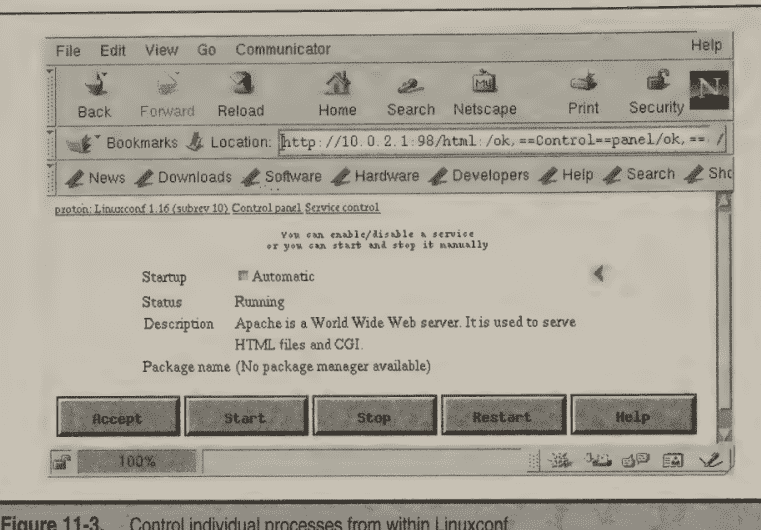

虚拟配置屏幕与默认配置屏幕相似，增加了两个字段。虚拟主机名（Virtual Host Name）是此虚拟主机的名称或 IP 地址（该死的！），它应该在 DNS 或所有用户的 hosts 文件或 NIS 域中注册为有效的域名。另一个附加的字段是服务器别名（Server Aliases）字段，它让你有机会为虚拟域名输入别名，这些别名也应该注册在 DNS 中。

其他条目与你为主 Web 服务器域名设置的条目完全相同。你还可以在此页面上微调虚拟域名的 SSL 设置。你所做的更改将添加到 `/etc/http/conf/httpd.conf` 文件中的虚拟服务器定义中，其中包含类似所示的条目：

```
<VirtualHost 10.0.1.230
ServerName www.foo.com
ServerAlias www.foo.net www.foo.org
</VirtualHost>
```

## 内容管理

无论你使用什么种服务器软件，Web 服务器的内容管理工作都不多。但我想强调维护网站时涉及的一些基础任务。从文本和图像的放置，到启用 SSI 和 CGI 功能，再到基础服务器状态监控，了解如何管理你所设置的服务器的基础知识可能会有所帮助。

### 存储文本和图像

将文本和图像放入 Apache 服务器最直接的方法是放在服务器或其虚拟域名使用的文档根目录（document root）中。你可以根据需要创建一个目录来组织这些内容，尽管我很惊讶竟然有很多人把所有东西堆在一个目录里。

但你并不限于这种线性的目录树。不要忘记，例如，你可以在服务器或远程挂载的文件系统上创建指向其他文件或目录的逻辑链接（logical links）。这允许你创建链接，例如，使用文件服务器或单个工作站上的用户目录。

考虑文档目录的内容：

```
drrwxxr-x  8 root      web  4096 Mar 23 10:09 .
drwxxr-x  13 root      web  4096 Feb  9 16:03 ..
lrwxrwxrxr-x  1 root      web      0 Mar 23 10:09 link_to_file
```
（注意：目录列表 OCR 输出包含许多错误字符，这些已修正以反映标准格式。）

### 启用服务器包含（SSI）

另一种便捷的方法是启用 SSI，它提供了对内容的动态访问。虽然由于服务器必须解析每个文件这增加了开销，但它让工作变得简单。通过 `include` 指令，你可以包含头部和页脚，使页面具有特定的样式。

### 服务器配置

在服务器上启用 SSI 非常简单：

- 让 Apache 解析特定的 `.shtml` 文件。
- 指定使用它的目录。
- 为该目录启用解析功能。

正如你可能猜到的那样，这些操作取决于你是否以及在默认配置、特定文件和虚拟域名允许 SSI。

### 网页配置

要在 Web 页面中使用 SSI 动态内容，你需要对页面仅使用 `.shtml` 扩展名。这意味着页面将被解析（因此不要在不需要服务器端包含的页面上使用此扩展名，否则将浪费处理资源）。但它们是什么？

## 第 11 章：第 8 步：建立 Web 服务器

`.shtml` 文件中的 `include` 语句位于注释括号之间，所示：

```
<#config time="%m/%d/%Y" -->
```

`config` 选项允许你配置错误消息、文件大小和日期的显示方式。此示例将日期的显示格式设置为 mm/dd/yyyy 格式。接下来的示例实际上按照指定的格式打印日期：

```
<#echo var="DATE_LOCAL" -->
```

`echo` 命令将指定的变量输出到 HTML 页面的文本中，因此它非常用于指示页面加载日期等操作。更有用的是 `exec` 命令，它允许你在服务器上运行命令并将其输出到 HTML 页面。

```
<#exec cmd="/bin/ls docs/*.pdf" -->
```

此选项运行 `ls` 命令来列出 `docs` 目录下的 PDF 文件。这些信息被放置在调用该标签的 HTML 页面中，因此在 `include` 语句周围使用 `<PRE>` 和 `</PRE>` 标签对输出进行格式化可能会很有用。

还有另一个版本的 `exec` 命令用于执行 CGI 脚本而非系统程序。考虑此示例：

```
<#exec cgi="cgi-bin/createaccount.cgi" -->
```

此选项运行 `cgi-bin` 目录下的 `createaccount` 脚本。注意，如果服务器或该目录选择了 `Includes` 选项，这两个选项都无法工作。

你可以使用 SSI 输出其他有用信息，包括文件的大小：

```
<#fsize virtual="docs/pro.pdf" -->
```

`fsize` 选项查看文件并返回其大小；如果你想在下载之前知道文件有多大，这非常有用。你还可以使用类似的命令包含文件的最后修改日期：

```
<#lastmod file="index.shtml" -->
```

注意在 `fsize` 语句中参数是 "virtual"，而在 `lastmod` 语句中参数是 "file"。原因是使用 `fsize` 语句时，文件位于与 `.shtml` 文件不同的目录。如果是这种情况，该语句需要使用 "virtual" 参数。在 `lastmod` 示例中，假设文件与 `.shtml` 文件在同一个目录。

## Windows 成瘾者的 Linux 之路：十二步法

为了实现之前提到的那种神奇模板，你需要使用 `include` 语句，它基本上会将你指定的文件内容吸入 `.html` 文件中：

```
<!-- include virtual="includes/head.txt" -->
```

在此示例中，有一个文件（位于另一个目录）名为 `head.txt`。该文件包含了包含了头信息，以确保与其他文件一致。有几个环境变量根据服务器和客户端信息自动填充。你可以使用此命令一次性打印整个列表：

```
<!-- printenv -->
```

仅使用内置变量是不够的，你可以使用 `set` 命令设置变量：

```
<!-- set user=$REMOTE_USER -->
```

## 配置 CGI

我们已经讨论了如何通过 `Script Alias` 和 `Execute` 选项启用 CGI 目录。但我并没有解释设置系统 CGI 的原理，我只是提到了实现方法。启用 CGI 有三个步骤：

1. 将 `Script Alias` 指向你用于 CGI 脚本的目录。
2. 关闭默认选项。
3. 配置 CGI 目录允许执行。

第一步很容易完成：只需为你的服务器设置 `Script Alias` 指向你所在的目录，以便限制访问。第二步同样简单：从默认服务器配置或你定义的任何目录中取消选择 `Execute` 选项。

第三步需要两个子步骤：第一步是配置 CGI 目录（你在 `Script Alias` 字段中指向的那个）。使用 Apache 配置此，并确保选择了 `Execute` 选项而不是其他选项。这样做会在 `/etc/httpd/conf/httpd.conf` 文件中产生如下条目：

```
<Directory /home/httpd/cgi-bin>
Options ExecCgi
</Directory>
```

## 第 11 章：第 8 步：建立 Web 服务器

很好，但第二步是确保启用了你实际使用的扩展名。检查 `/etc/http/s.conf` 中的 `AddHandler` 行，确保它允许你需要的任何扩展。你可以在 `httpd.conf` 文件的 CGI 目录定义添加 `AddHandler`；它应该只包含计划使用的扩展。例如，如果 CGI 脚本使用 `.pl` 和 `.cgi` 扩展，你只需添加此行：

```
AddHandler cgi-script .cgi .pl
```

## 监控服务器状态

我们 Apache 服务器快速之旅的最后一站是基础服务器监控。我们已经讨论过如何发现 http 守护进程是否运行。我们可以从 Apache 的日志以及它提供的 Web 服务器状态中获取更多信息。

## 使用日志文件

我之前提到的日志文件：`Error Log`、`Transfer Log`、`Agent Log` 和 `Referral Log` 是想要知道谁在访问系统、访问什么、来自哪里以及遇到了什么问题的管理员的宝库。

虽然日志文件有一个不错的界面（例如 http://www.analog.cx/），但原始材料很难阅读。决定哪些是重要的可能是另一个问题。底线是定义 Apache 已知的所有四种日志文件，并根据需要定期检查。

`Error Log` 是最重要的检查文件，因为它可以告诉你 `httpd` 的配置错误，或者指示用户遇到了某些你未直接听到的问题。默认情况下，该文件位于 `/etc/http/logs/error_log`。

在所示示例中，似乎没有服务器配置问题，但 Apache 警告将使用 `/usr/sueexec` 工具从 Web 服务器执行程序。

```
Sun Oct 22 04:02:04 2000 [notice] Apache/1.3.9 (Unix) (Red Hat/Linux)
-- resuming normal operations
Sun Oct 22 04:02:04 2000 [notice] suEXEC mechanism enabled
(wrapper: /usr/sueexec)
Sun Oct 26 10:40:15 2000 [error] [client 10.0.2.228] File does not
exist: /home/http/mertg.gif
Sun Oct 26 10:40:46 2000 [error] [client 10.0.2.228] File does not
exist: /home/http/mertg.gif
```

## Windows 成瘾者的 Linux 之路：十二步法

注意，客户端的 IP 地址和他们失败访问的地址都被标记，所以你不仅知道是谁出了问题，还知道问题是什么。不仅如此，帮助文件用 `[error]` 标签标记此行，帮助你将其与其他消息区分开。

## Web 服务器状态

如果你正在寻找更快速“服务器是否在线以及它在忙什么？”的信息，在进入邮件配置之前，我想提到的最后一个选项。该选项是 `SetHandler` 指令，如下所示：

```
<Location /server-status>
SetHandler server-status
order deny, allow
deny from all
allow from .prolificinc.com
</Location>
```


# 第 11 章：第 8 步：建立 Web 服务器

| 文件 | 编辑 | 查看 |  | 通信器 | 帮助 |
|---|---|---|---|---|---|
| 后退 | 前进 | 刷新 | 首页 | 搜索 | Netscape |
| 书签 | 位置 | http://10.0.2.1/server-status | | | |
| 新闻 | 下载 | 软件 | 硬件 | 开发者 | 帮助 |

## proton.prolif.com 的 Apache 服务器状态

服务器版本: Apache/1.3 (Unix) (Red Hat/Linux)
服务器生成: 1999年9月21日 10:46:27

当前时间: 2000年10月25日星期三 21:24:39 PDT
重启时间: 2000年10月21日星期六 13:25:14 PDT
父级服务器生成数: 0
服务器运行时间: 4 天 7 小时 49 分钟 25 秒
当前有 2 个请求正在处理，9 个空闲服务器

记分板键：
* 连接警告，"s" 启动中，“u" 读取请求，
* 发送回复，“K" 保持（读入），"n" DNS 查询，
* 日志，"e" 优雅结束，". 打开无当前进程的空槽

PID 键：

| 543 状态: X | 544 状态: - | 545 状态: W |
| 546 状态: - | 547 状态: - | 548 状态: - |
| 549 状态: - | 556 状态: - | 557 状态: - |
| 558 状态: - | 559 状态: - | |


**图 11-4.** 启用 SetHandler server-status 指令以启用基于 Web 的状态监控

## Windows 爱好者之 Linux

# 第 12 章

## 第 9 步：操作电子邮件

### Windows 之 Linux：12 步计划

在上一章中，我们进行了一些 Web 服务器的配置和管理。现在，这些是非常有趣的任务。但当你建立一个网站时，会发生什么？没错，你需要一个地方来存放开始到达的垃圾邮件。因此在本章中，我们将开始第 9 步：通过电子邮件与他人联系。

Linux 上的邮件是一个巨大的话题；例如，巨大的 O'Reilly 巨著 *Sendmail, 第二版* 超过了 1000 页。但我还想提到人们用于管理邮件的其他工具，以及用于阅读和编辑邮件的用户端工具。所以，穿上你的跑步鞋，让我们行动吧！

## 配置 SENDMAIL

Sendmail 处理了世界上大部分的电子邮件。完整来说，它是一个庞大而复杂的系统。但如果你寻找基础的邮件处理功能，要妥善配置并不困难。Linuxconf 让配置你的邮件域和用户变成了一个简单的、基于 GUI 的过程。当然，如果你想寻求更多信息，那里也有提供，包括关于在 Red Hat 上配置 sendmail 的文件文档：http://www.redhat.com/support/docs/howto/RH-sendmail-HOWTO/book1.html。

## 邮件域配置

开始配置你的邮件系统，启动 Linuxconf 并从 Config-Networking-Server Tasks 树导航到 邮件投递系统（系统）选项。这将打开 sendmail 选项菜单，包括这些配置项：

- 基础信息
- 特殊（域）路由
- 伪装规则
- 邮件传真网关
- 虚拟邮件域

我不会包含你可以安全忽略的选项。如果你想比在这里找到更多关于 sendmail 配置的信息，请查看 Bryan Costales 的 *Sendmail, 第二版*。

### 基础信息

从 Basic Information 选项配置基础邮件系统设置，包括基础邮件连接信息、消息和 DNS 功能、杂项设置以及域别名。

**以通常方式显示你的系统**，来自系统用户的邮件将地址标记为 user@machine.domain；例如，你可能会收到来自 mjm@romans.msaddicts.com 的邮件。但我们大多数人更喜欢邮件看起来来自该域，而不指定机器。在此字段中，输入你希望在发出的邮件中显示的域名。

**接收邮件用于** 启用此选项允许你的 sendmail 服务器接收发至此机器名称的邮件以及发至其域名的邮件。无论你是发送邮件到 mjm@romans.msaddicts.com 还是 mjm@msaddicts.com，只要 romans 接受该域的邮件，它就会接收（并希望接收）这两封邮件。

**邮件服务器/网关** 在 Mail Server 字段中输入存储你组织邮件的服务器名称，以及负责将邮件转发到网络其他部分或世界其他部分的服务器名称。这些可能是同一个系统（它们甚至是你正在配置的那个系统）。

**邮件网关协议** 你必须决定使用哪种协议将你正在配置的系统与网络的邮件网关连接。默认是 SMTP，它非常常见：

- esmtp (SMTP)
- esmtp (SMTP)
- uuc (UUCP)
- uuc (UUCP)

**启用转发（垃圾邮件发送者）** 此选项允许你的 sendmail 服务器接收发至此机器名称的邮件以及发至其域名的邮件。无论你是发送邮件到 mjm@romans.msaddicts.com 还是 mjm@msaddicts.com，只要 romans 接受该域的邮件，它就会接收（并希望接收）这两封邮件。

**邮件服务器/网关** 在 Mail Server 字段中输入存储你组织邮件的服务器名称，以及负责将邮件转发到网络其他部分或世界其他部分的服务器名称。这些可能是同一个系统（甚至是你正在配置的那个系统）。

**邮件网关协议** 你必须决定使用哪种协议连接你正在配置的系统与网络的邮件网关。默认是 SMTP，非常常见：

- esmtp (SMTP)
- esmtp (SMTP)
- uuc (UUCP)
- uuc (UUCP)

**启用转发（垃圾邮件发送者）** 此选项允许你的 sendmail 服务器接收发至此机器名称的邮件以及发至其域名的邮件。无论你是发送邮件到 mjm@romans.msaddicts.com 还是 mjm@msaddicts.com，只要 romans 接受该域的邮件，它就会接收（并希望接收）这两封邮件。

**DNS 功能** DNS 选项允许你指定邮件来自源 DNS，或者完全不使用 DNS。后一个选项适用于通过 UUCP 连接的系统，在那里 DNS 服务器可能不可用。要求 DNS 被视为某种防止垃圾邮件的程度，因为垃圾邮件发送者经常使用伪造的有效域名地址。

**本地投递给用户** 如果你正在配置的 sendmail 服务器上有用户拥有邮箱，你可以将他们的用户名添加到此字段，以便将任何邮件本地投递给这些用户。

**不伪装用户** 记住 From 字段，我们希望组织的邮件来自该域，而不是域内的特定系统。遗憾的是，对于像 root 这样的默认账户，使用“以通常方式显示你的系统（Present Your As）”设置可以隐藏信息。如果 root 从域内的某个系统发送邮件，你将知道它位于哪台机器。如果有其他需要区分的账户，请在此添加它们的名称。

**信任用户** 某些账户需要使用与发邮件行中不同的用户 ID 发送邮件。三个示例是默认账户：root，它应该能够操作；daemon，sendmail 通常使用的；以及 uuc，它需要信任以便 UUCP 工作。

**特殊路由 db** 只有在你需要在域之间启用特殊路由时才启用此选项，我们稍会在“域路由”部分讨论。如果你进行操作，将必须从下拉列表中选择你使用的数据库格式。

**本地投递代理** 你可以将此选项设置为 Linuxconf，这将允许 Linuxconf 工具确定在系统上的本地邮件投递。本地邮件是给同一系统的用户的。

### Windows 之 Linux：12 步计划

## 第 12 章：第 8 步：操作邮件

**支持伪邮件客户端 (Support Bogus Mail Clients)** 启用此选项将提醒 对 对未生成 SMTP HELO 命令的邮件源给予宽限。SMTP HELO 是投递系统发送给接收者的介绍性消息。在我看来，你不应该启用此选项。但我很冷酷无情，特别是在涉及到 SMTP 时。

**域名别名 (Domain Aliases)** 如果你希望你的电子邮件地址在多个域名上都有效，可以在“系统别名 (Aliases For Your System)”字段中输入任意数量机器名称（每个名称对应一个你想使用的域名）。点击“添加”按钮添加更多字段，以防万一三个还不够用。

## 域名路由 (Domain Routing)

只有当你有某些理由使用非默认路由路径时，才需要特殊路由。换句话说，如果你计划使用某种替代方式将邮件发送到特定主机，你应该添加“特殊（域名）路由”记录。通过从 Config-Networking-Server Tasks-Mail Delivery System (sendmail) 菜单中选择此选项。对于你想要指定的每个目标，你应该输入：

- ▼ 目标主机名
- ■ 将用于投递消息到该目标的替代邮件系统
- ▲ 用于将消息投递到该邮件系统的邮件网关协议

还有一个复选框允许你将此条目作为同一域名或其子域名下任何主机的模板。你可以通过为特定主机指定特殊路由，来按主机主机地覆盖此模板。

## 伪装规则 (Masquerading Rules)

在我们目前讨论的语境下，伪装是在邮件被转发时重写消息的“发件人”信息。这对于修复来自未正确创建“发件人”地址的系统的邮件很有，或者可以让所有发出的邮件看起来都来自同一个公司域名，即使它们源自内部域名。

要创建伪装规则，请输入以下信息：

- ▼ 将始终被重写的原始发件人地址（可以是用户地址，或者如果规则适用于该域内的所有用户，则只需提供 @domain 部分）
- ■ 邮件将接收的新发件人地址（也可以是用户地址，或者如果规则适用于该域内的所有用户，则只需提供 @domain 部分）

## 给 Windows 痴迷者的 Linux：12 阶计划

一段解释你做了什么以及为什么要做的注释。你不认为由于迁移到 Linux 带来的运行时间增加和成本降低，你会获得升职吗？

## 邮件传真网关 (Mail to Fax Gateway)

通过电子邮件发送传真的选项是否吸引你呢？Linuxconf 可以为此对 sendmail 进行一些配置。你可以设置允许的区域，授权某些地址发送传真消息（加密或未加密）到这些区域的号码，并记录这些传真。

在 `/var/lib/linuxconf/lib/` 目录下有一个基础的传真处理脚本，它可以将消息传递给名为 `faxpool` 的程序。该程序反过来又准备好由 `sendfax` 程序投递的消息。查看这些脚本的帮助页（man pages）以获取更多信息。还有其他传真程序，其中一些可能比这些程序更友好。

## 虚拟邮件域名 (Virtual Email Domain)

如果你想为 sendmail 服务器处理的邮件添加虚拟域名，此选项允许你配置它们。帮助文本对于如何设置 DNS 服务器以支持虚拟域名的细节非常有帮助，而且 sendmail 配置非常直观。

每个虚拟域名都与系统上的主域名邮件投递分开处理。对于每个虚拟服务器，你可以指定以下信息：

- * 完全限定的虚拟域名（必选）
- 不匹配别名或已知用户的邮件备用目标
- 如果你留空此字段，不匹配的邮件将被退回。如果你指定一个域名 (@domainname），消息将发送到指定域名的相同用户名。如果你指定了特定的用户和域名（user@domain），不匹配的消息将发送到该用户。如果你只指定一个用户名，消息将转发到该域名下的该用户。
- * 此虚拟域名内用户的起始用户
- 每个用户收件箱大小的限制。默认是无限制（0）。
- 额外的别名文件名（第一个是 `/etc/vmail/aliases.domainname`）
- 应该虚拟化到此相同定义的额外域名

## 邮件用户配置 (Mail User Configuration)

让服务器准备好处理入站和出口消息并不难，对吧？下一步是为你的用户配置系统。如果邮件将投递到本地用户账户，你实际上不需要执行任何用户设置。另一方面，如果你想为如何处理发给特定用户的邮件设置规则，你可能需要为你的 sendmail 用户考虑复杂的路由和别名。

## 用户路由 (User Routing)

在上一节中，我跳过了 Linuxconf 的复杂（用户）路由选项，因为它用于为特定用户配置邮件。在这种情况下，它要解决的问题是：如果你想根据目标用户名和域名将邮件从一台服务器传输到另一台服务器。

例如，如果你在一个 sendmail 机器上托管多个域名的邮件，但希望将发给某些特定用户的邮件投递不同的机器（bugs@somesoftwarecompany.com 和 bugs@crazyaboutentomology.com），你可以通过此选项实现。

对于每个用户，你需要指定：

- * 原始收件人电子邮件地址
- 收件人的新目标地址
- 可选的目标服务器的完全限定主机名
- 用于将消息投递到新地址的邮件网关协议
- 一段解释你在做什么以及为什么要做的简短注释

## 用户别名 (User Aliases)

当你想要转发邮件的用户和域名与原始收件人不同时，就需要用户路由选项。但如果你只是想发送到同一域名内的一个或多个用户，你可以使用这些别名。要添加这些别名，你需要填写：

- * 别名的名称。
- 如果需要，通过管道传输邮件的程序、脚本或语句名称。这可以用于将邮件发送日志文件或丢弃桶（bit bucket）。
- 如果需要，一个包含此别名所属用户列表的文件。如果你能够（或希望别人能够）从文本文件编辑别名列表，用用。

## 虚拟域名别名 (Virtual Domain Aliases)

此选项与之前的“用户别名”选项相同，但不是用于主 sendmail 域名，而是为你在系统上创建的虚拟域名建立的。查看上面的选项列表以查看填写哪些字段。

## 管理 Sendmail (Managing Sendmail)

虽然我们正在快速通过在 Linux 服务器上设置 sendmail 的过程，但既然我们已经提到了它，包含一些关于维护它的信息是合理的。我们之前没有讨论过的两个问题是监控邮件队列和防止垃圾邮件。

### 监控队列 (Keeping Tabs on the Queue)

你可以从 Linuxconf 内部查看 sendmail 队列的内容。进入 Config-Networking-Server Tasks-Mail Delivery System (Sendmail) 树并选择管理邮件队列（Manage Mail Queue）选项，这将带来图 12-1 的显示。

图 12-1 中没有排队的消息，希望你的系统中也没有堆积的邮件。但如果你确实堆积了一些消息，并想删除其中一些，你可以通过点击消息 ID 打开消息来轻松实现。点击 DEL 键删除所选的消息。

## 反垃圾邮件措施 (Anti-Spam Measures)

如果你有一个电子邮件地址，你就会收到垃圾邮件。如果你正在运行邮件服务器，你可能会收到大量的垃圾邮件。我与一些管理员谈过，他们说每天收到……

图 12-1. 从 Linuxconf 查看 sendmail 消息队列

## 第 12 章 第 9 步：处理电子邮件

337

收到的邮件中很大一部分是未经请求的商业邮件，其中大部分带有伪造的发件人地址。虽然无法做很多事情让这种洪水变成细流，但 sendmail 内置了一些反垃圾邮件功能，Linuxconf 允许你方便地配置这些功能。因此，你不仅可以拒绝来自已知违规者或或地址或网络的邮件；还可以告诉 tellmail 应该转发哪些特定的域名和主机。

## 被拒绝的发送者

使用此选项过滤来自特定电子邮件地址、网络地址、主机名或域名中任何地址的消息。在 Origin（源）字段中输入你想要过滤的源地址。

你还可以添加在邮件被退回时发送的错误信息。根据你的喜好设置其友好或讨厌讨厌。如果你认为信息确实会到达收件者（大多数垃圾邮件发送者通过伪造来避免处理这类问题），你可能会考虑此类主题的变体：“感谢您咨询我们的邮件编辑服务。我们未来收到的邮件将按每月 500 美元的固定费用进行编辑。关于此主题及其他变体，请参阅 Axel Boldt 的黑名单：http://www.uni-paderborn.de/~axel/BI/blacklist.html##harsh。在访问时，可以追踪链接回到他的主页，并阅读他关于德国和美国之间有趣但无关的比较。

## 中继用于/到 (Relay For/To)

Relay For 选项限制了谁可以使用此 sendmail 系统作为邮件中继。指定 'Relay For' IP 选项并输入 IP 地址（你可以指定完整地址的一部分供整个网络使用，例如 10.0.0.1）。要按名称指定主机或域名，请选择 'Relay For' By Name 选项并输入主机或域名。

Relay To Hosts 选项限制了你允许你的系统传输邮件的主机和网络。如果你通常使用单一邮件连接到 ISP 或另一个公司位置，这可能就是你创建的唯一条目。

## SENDMAIL 的替代方案

别误会我：sendmail 能够胜任这项工作。那里有很多对它有经验的人，如果你需要外部帮助，获取帮助应该不会遇到任何困难。Mail-Administrator-HOWTO 是讨论配置 sendmail 以及其他邮件传输代理 (MTA) 服务的资源之一。Mail-HOWTO 有一些类似的内容。但这两份文档都没有过多推崇使用 sendmail。那么，还有哪些其他选项呢？

## qmail

许多管理员倾向于使用 qmail 而非 sendmail，他们认为其配置的简易性和使其明显优于 sendmail。对于 qmail 在这些领域的优势，我并不完全认同，我倾向于认为使用发行版中预装的包是最好的。然而，如果你预计要管理邮件并认为 sendmail 大量的选项不值得麻烦（考虑到许多选项无法通过 Linuxconf 访问），你应该研究一下 qmail。qmail 主网站位于 http://cr.yp.to/qmail.html。

## exim

虽然 qmail 的主要优势被认为是安全性，但 exim 被认为比 sendmail 或 qmail 都更容易配置。考虑到邮件系统已经安装在你的系统中，这给了你优势，但如果你考虑对你的邮件系统进行更多手动配置，你可能仍然研究一下 exim。它的主网站是 http://www.exim.org。

## Postfix

Postfix 旨在成为 qmail 的竞争对手，并被认为比 qmail 和 sendmail 都快（尽管除非你处理大量的邮件，否则性能不应成为主要问题）。访问 Postfix 网站 http://www.postfix.org/ 获取更多信息。

## snail

这个程序几乎是 sendmail 竞争对手的老祖。虽然它更容易配置，但它提供的选项更少，扩展性也较差。如果你感兴趣，时间似乎过去了，exim 可能是一个合理的替代品。它不是一个中央邮件网站，但有一个 ftp 站点 ftp://ftp.planix.com/pub/Snail。

## OpenMail

这些工具中有一个与众不同，那就是惠普的 OpenMail。此包允许你支持 Microsoft Exchange 和 Lotus cc:Mail 等 PC 客户端包，同时始终在 Linux 平台上运行。HP 为此工具提供了免费试用期，但它仍然是商业软件。在其主页上阅读更多信息：http://www.ice.hp.com/cyc/om/00/index.html。

## 第 12 章 第 9 步：处理电子邮件

## 用户邮件代理 (USER MAIL AGENTS)

在你的 Linux 子上有一个邮件服务器是很好的。但你如何在 Linux 系统上读取邮件呢？有很多可用工具，但三个最常用的邮件用户代理 (MUAs) 是 elm、mutt 和 pine。

## elm

在我看来，elm 有点像 vi 编辑器：它们都很老旧且无处不在。elm 的界面精简且直观，但如果你想做任何花哨的操作，你完全不知道如何做。尽管如此，对于对 Linux 邮件系统的基本访问，它足够易用了。访问网站 http://www.myxa.com/elm.html，并尝试从命令行运行该程序。在 elm 中编辑消息使用 vi 编辑器。

## pine

pine (Pine Is Not Elm) MUA 功能更强大，在我看来，比 elm 稍微好用一点。首先，它是菜单驱动的，你的选项展示得更清晰一些。它还可以访问 POP 和 IMAP 邮箱，所以你可以使用它来获取你的收件箱，无论它是在本地还是在 ISP。它还可以浏览 NNTP 新闻组。请访问网站 http://www.washington.edu/pine/ 获取更多信息，并也尝试从命令行运行它。在 pine 中编辑消息使用 pico 编辑器命令。

## mutt

mutt MUA 是一个杂交工具，它吸收了其他邮件工具的一些功能，并添加了一些自己的功能。我特别喜欢 mutt 使用颜色的能力，因为我不是困在单色终端前。它还允许你选择自己喜欢的邮件编辑器，这对于 emacs 热者来说很棒。访问网站 http://www.mutt.org/ 获取更多信息，并尝试从命令行运行它。

## POP 邮件

虽然上一节描述的 MUA 程序对你的 Linux 用户来说效果良好，但它们对你的 Windows 用户没有太大用处。对他们有帮助的是是在你的邮件服务器上启用 POP 访问，并将一个支持 POP 的邮件工具指向该服务器。这些事情非常容易做到。

## Windows 爱好者的 Linux：一个 12 步计划

## 使用 Linux 作为 POP 服务器

大多数 Linux 发行版都带有某种 POP 服务。Red Hat 可以处理 POP 或 IMAP 连接，但你必须启用你想要的服务。遵循这些指令：

在文本编辑器中打开 `/etc/inetd.conf`，找到以 pop-2、pop-3 和 imap 开头的行。它们可能都被注释掉了；如果你想使用 POP，请取消 pop-3 行的注释。如果你更倾向于使用 IMAP，请取消该行的注释。

一旦取消了行的注释，你需要运行以下命令来重启 inet 守护进程：

```
service inetd restart
```


`root@romans ~ /etc/rc.d/init.d restart`

## 使用 Netscape 作为 POP 客户端

虽然有其他工具可以访问 POP 和 IMAP 服务器邮件，但 Netscape 通常是 Windows 世界用户的良好选择。Netscape 的界面与他们熟悉，而且它是他们使用的程序的一部分。配置 Netscape Messenger 访问你的 POP 服务器非常简单：

- Netscape，从 Edit 菜单选择 Preferences。
- 选择 Mail & Newsgroups。
- 选择 Mail Servers，这将打开图 12-2 所示的窗口。
- 在 Incoming Mail Servers 部分点击 Add（除非已定义服务器，可以选择它可以并点击 Edit）。
- 在出现的配置窗口的 General 选项中，输入你的 POP 邮件服务器名称。
- 选择邮件服务器类型。相关的选择是 POP 或 IMAP。
- 输入在服务器上的 POP 账户名称。
- 如果你面对的是高管，勾选 Remember password 框。否则，向演讲者讲授密码安全的重要性。
- 告诉 Netscape 多久检查一次 POP 邮箱；默认的 10 分钟应该可以。
- 选择在发现新消息时自动下载的选项。
- 点击 OK 返回 Mail Servers 窗口。
- 输入 SMTP 服务器（用于发送邮件）的名称，并在必要时输入用户名。
- 点击 Identity 选项并输入用户的全名。

# 第12章：第9步：操作邮件

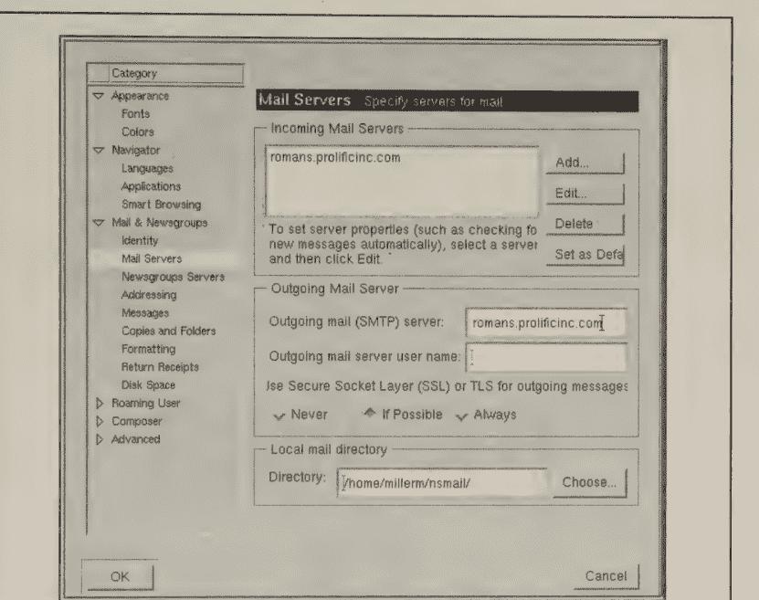

图 12-2. 配置 Netscape 使用你的 POP 邮件服务器

- 14. 输入用户的电子邮件地址和回信人地址（如果不同的话）。
- 15. 指定用户签名文件的文件名，这样他们就可以创建一个巧妙的文件并附加到每条发出的消息中。
- 16. 点击确定，即完成。

当你打开 Netscape 的 Messenger（邮件）组件时，你就可以访问已配置好的邮件账户了。点击 Get Mail（获取邮件）按钮来获取新邮件，然后你就可以功告告成了。

在下一章中，我们将讨论如何向你的系统添加更多软件。你可能希望通过从发行版制作者或 Netscape 官方（http://www.netscape.com）检查 Netscape 的最新版本来立即应用这一课程。

# 给 Windows 爱好者的 Linux：12 步计划

虽然 Internet Explorer 遭受了脚本小子和破解客的大量攻击，但某些版本的 Netscape 也被演示过一些安全漏洞。因此，你最好检查最新版本。

# 给 Windows 爱好者的 Linux

# 第 13 章

第 10 步：“制作”更多软件

# 给 Windows 爱好者的 Linux：12 步计划

在上一章中，我们研究了如何安装和配置邮件软件。如果我提到的某些工具并非都来自发行版包含的软件，你该怎么办？你需要进入我们的“微软滥用恢复计划”的第 10 步，继续寻找新软件并尽快制作它们。

# 使用软件包 (PACKAGES)

一个软件包由一组文件和一些额外信息组成；它们共同告诉系统文件需要安装在何处，以及运行这些文件需要哪些其他文件。软件包系统维护了足够的软件包信息，允许你执行几项非常有用的操作。其中一个是安全删除包，因为系统知道任何包是否需要某个文件。这与真正作用的卸载程序不同。

包管理器的另一个优秀功能是验证系统上的一个或所有包，因为系统知道已经安装了哪些包，并且相应的文件应该存在。

确信软件包是一件好事吗？无论你是否确信，都可能想查看这一节。我们将开始查看你可以使用的软件包选项，然后转向包管理工具和程序。

# RPM 和 Deb

存在两种广泛使用的包格式：RPM 和 DEB。RPM 文件被许多红帽（Red Hat）衍生发行版使用（我最好赶紧补充一下，其他非衍生作品的发行版也是），而 DEB 文件被 Debian 及其相关发行版（包括 Core Linux）使用。

对于我们而言，软件包是一个压缩的文件集，与额外信息存储在一起，用户可以轻松地解压并安装。RPM 和 DEB 软件包都可以做到这一点，虽然两种格式之间存在差异，但它们的作用是让安装和卸载软件的过程变得简单得多。如果你对这两种格式之间的差异感兴趣，请查看 http://kitenet.net/~joey/pkg-comp/ 提供的信息。

我不认为有充分的理由去使用某一种类型的包而不是另一种。我认为你应该选择你想要使用的发行版并与之一起。但你可能会发现某一种包类型对你更有用，而且如果你正计划构建和分发软件，你可能希望支持这两种格式。

注意，还有几个我不会涵盖的软件包选项。第一个是 SLP，由 Stampede 发行版（http://stampede.org）使用。它旨在减少包对包管理器的依赖，但它并没有广泛使用。

## 第13 章：第 10 步：“制作”更多软件

为了这一目的，`rpm` 命令提供了 `-V` 选项，它可以对软件包或文件或所有已安装的软件包进行验证。暴力法是验证所有软件包，该操作可能会花费一些时间并产生大量的输出：

```
rpm -Va > rpm_verify.txt
```

注意，`rpm` 命令的输出被重定向到了文件 `rpm_verify.txt` 中。这是一个独立的、可选的步骤，但在屏幕上通过文件审查数据比直接查看容易得多。

验证命令的输出取决于软件包中的数据与系统上实际安装的文件之间是否存在差异。如果没有差异，则不会有输出。然而，对于每个有差异的文件，都将会有如下所示的输出：

```
root@romans ~ rpm -VF /etc/sendmail.cf
S.5....T /etc/aliases
```

`/etc/aliases` 文件左侧看似晦涩的字符显示了该文件与原始软件包规范的三个不同之处，并为我们提供了有助于解释结果的信息。

`S` 表示文件大小与原始文件大小不同。`5` 表示文件的 MD5 校验和（这很合理，因为文件似乎已被修改）。`T` 表示文件的修改时间已较原始软件包日期有所更改，这与已修改的文件是一致的。`c` 表示该文件被软件包标记为配置文件，因此自原始安装以来可能被触动过。这些值以及其他值（示例输出中的点表示其他值与原始值匹配）描述在表 13-2 中。

### 安装

如果你查阅 `rpm` 工具的帮助页面（man page），你会发现有一个 `-U` 选项，它允许你进行软件包安装。我为什么建议你使用 `-U` 选项呢？根据我的经验，我不经常使用的选项越少，就越容易记住我频繁使用的选项。而且 `-U` 选项提供了双重功能：安装尚未安装的软件包，以及升级需要升级的软件包。

将此命令应用于生活的基本方法非常简单。在命令行中如下所示指定软件包：

```
root@romans ~ rpm -Uvh webmin-0.78.rpm
```

正如我提到的，`-U` 选项指定了升级操作。在此语境下，一起指定的 `-v` 选项会导致软件包名显示在一组随安装过程顺序排列的井号（#）旁边。如果软件包很大，这可以让你对进度有一个大致的概念。

## Windows 爱好者的 Linux：12 步计划

| 输出 | 说明 |
| --- | --- |
| S | 文件大小 |
| M | 模式：文件权限和文件类型 |
| 5 | MD5 和 |
| L | 符号链接 |
| D | 设备 |
| U | 用户 |
| G | 组 |
| T | 原始修改时间 |
| . | 配置文件 |

**表 13-2.** RPM 验证标志

你可以在脚本中使用此选项来自动化新系统的设置。例如，以下示例安装或升级了 `/home/rpm` 目录下找到的所有 RPM 文件：

```
rpm -Uvh /home/rpm/*.rpm
```

如果你维护一个当前正在使用的软件包目录，可以通过调度包含如示例所示内容的脚本来确保 Linux 环境的一致性。关于调度任务的更多信息，请参阅第 14 章。

**卸载** 卸载也非常容易使用。你 way都需要知道软件包的名称（是包名，而不是文件名）。你可以使用查询选项来确定是否需要删除，并执行类似这样的命令：

```
root@romans ~ /> rpm -e perl-Data-Table-3-3-2
```


如果另一个软件包依赖于你尝试卸载的模块，`rpm` 将通知你。否则，该软件包将从你的机器上删除。如果你还需要它，重新安装即可。

## Kpackage

如果你使用 KDE 桌面环境，你会发现名为 `kpackage` 的优秀工具，它为 `rpm` 命令提供了图形化界面。如果你倾向于使用 GUI，且不需要为你的操作编写脚本，那么 `kpackage` 就很有用。

要运行此程序，在成为超级用户后从命令行执行 `kpackage` 命令。或者使用 KDE 菜单选项；它可能可以在 KDE 按钮的“工具”（Utilities）文件夹中找到。你可以使用图 13-1 所示的树结构浏览系统上安装的软件包。

**安装软件包** 从 `kpackage` 安装软件包有多种方法，但最直接的方法之一如下：

- 1. 启动软件包。
- 2. 从“文件”（File）菜单中选择“打开”（Open）选项。
- 3. 遍历目录结构找到所需的软件包文件，选择它并点击“确定”（OK）。
- 4. 检查软件包信息以确保它是你需要的，如图 13-2 所示。
- 5. 确保所选选项正确：默认勾选了“升级”（Upgrade）、替换软件包”（Replace Packages）和“检查依赖关系”（Check Dependencies），如图 13-2 所示，这通常是你需要的。
- 6. 点击“安装”（Install）；软件包将被安装、列在软件包树中，并可以可以使用。


**图 13-2.** 检查软件包属性和安装

**移除软件包** 如果你选择一个已安装的软件包，你会有卸载它的选项。卸载按钮位于左侧面板的底部，如图 13-1 所示。当你点击该按钮时，可以从系统中移除选定的软件包。“脚本”（Scripts）选项启用软件包的脚本；最好保持开启。同样，“检查依赖关系”（Check Dependencies）选项可以防止你破坏另一个软件包，所以你通常会希望保持开启。“测试”（Test）选项则防止安装发生；它只是运行流程。

**GnoRPM** 如果你更喜欢 GNOME 而不是 KDE，说实话，如果你在 Linux 系统上安装了 KDE 和 GNOME，你可以使用这两个程序中的任何一个。


当你从命令行或 GNOME 系统菜单启动 `norpm` 时，你会看到类似图 13-4 所示的屏幕。


这些工具在许多方面非常相似；如果你使用环境的图形文件管理器，可以将软件包文件拖放到相应的软件包管理器中，或者使用菜单或按钮执行相同的操作。

`norpm` 一个有用的功能是图 13-4 中可见的“网络查找”（Web Find）选项。该选项检查已知网络源的新软件包以及你已拥有软件包的更新。点击“网络查找”按钮，然后查看屏幕左侧树状软件包列表，如图 13-5 所示。

注意图 13-5 中，选定的软件包是一个将 Office 文件转换为 HTML 的查看。软件包信息显示在屏幕右侧，包括软件包主页的 URL。对于跟踪更新、文档或帮助特定软件包的人非常有帮助。

同样注意，在左侧面板的软件包列表中，已安装的软件包不是。如果有可用的更新版本，更新将以另一种颜色（蓝色）显示，以便你注意到它的可用性。


## 第 13 章：第 10 步：“制作”更多软件

### 353

### 使用 MAKE

你并不总是足够幸运能找到想要安装的软件的包，特别是如果你对运行可最新版本感兴趣；这种为了方便你而预先打包好的尖端软件往往并不真的对你方便。不过，这并不意味着你会被无立可去，因为“制作”（making）程序并不困难。

我所说的“制作程序”，并不是指由你亲手编写这些程序。无论你是否觉得这样做自在，你都可以从别人编写的源码中构建程序。事实上，学习 `make` 命令的另一个原因是某些软件是以源码文件的形式分发的。换句话说，即使它们被封装在一个包中，在安装后仍然需要进行构建。如果分发者有意这样做，那么 RPM 包的扩展名将是 `.rpm` 而不是常见的 `.src`。

#### 源码 tar 包 (Source Tarballs)

你在网上找到的大多数软件也不会以那种方式打包。相反，它们通常被封装成一个被亲切地称为“tarball”的压缩存档文件。你通常可以通过扩展名来识别这些家伙，它们通常是以下之一：

- `.tar`
- `.tar.gz`
- `.gz`
- `.tar.Z`
- `.tar.bz2`

#### Tar 文件

第一个扩展名可以识别为 `tar` 命令的输出，tar 是“tape archive”（磁带存档）的缩写，但它通常与磁带无关。基本上，`tar` 命令获取几个文件（无论是否具有目录结构）并将它们封装成单个文件。这与 PC 上的 ZIP 文件或 Mac 上的 Stuff 文件的工作原理相似，不同之处在于过程中没有压缩。要创建一个 tar 文件，你可以执行类似这样的命令：

```bash
millerm@romans ~ tar cvf loveletters.tar ~/to_karen/letters/*
```

这是一组常用的选项；它们表示 `tar` 命令应该详细地（verbosely）创建一个名为 `loveletters.tar` 的文件，该文件源自我的家目录下 `to_karen/letters/` 目录中的所有文件和目录。

#### 给 Windows 痴迷者的 Linux 救赎：一个 12 步程序

知道这些很好，但它们与手头的任务并不完全相关——任务不是将文件放入存档，而是移除它们。这也很简单：

```bash
karen@romans -> tar xvf loveletters.tar
```

Karen 可以使用这些选项打开存档，这些选项告诉 `tar` 命令详细地提取存档文件。能够创建和打开 tar 文件非常有用，但正如我提到的，这并不是全部，因为这些文件没有压缩。

#### tgz 和 gz 文件

压缩部分是其他扩展名出现的地方。虽然 Linux 系统可以使用 `zip` 和 `unzip` 命令处理 ZIP 文件以与 PC 用户交换，但 `gzip` 程序被更广泛使用。`.tgz` 和 `.tar.gz` 扩展名表示该文件已通过 tar 归档并使用 gzip 压缩。要创建存档的压缩版本，我可以使用已经创建的文件：

```bash
millerm@romans -> gzip loveletters.tar.gz
```

这将产生一个名为 `loveletters.tar.gz` 文件，取决于数据，它可能比原始文件小得多。但我不需要分两步完成此任务；我可以让 `tar` 命令调用压缩工具：

```bash
millerm@romans -> tar cvzf loveletters.tgz ~/to_karen/letters/*
```

这将产生一个名为 `loveletters.tgz` 的文件，它大致等同于 `.tar.gz` 文件。这并不总是如此，但对于我们的目的，它足够了，因为无论哪种，压缩文件都可以相同的方式打开：

```bash
karen@romans -> tar xzf loveletters.tgz
karen@romans -> tar xzf loveletters.tar.gz
```

任何一个命令都会完全解压存档并提取其文件和目录。

#### Z 文件

另一种在其他 Unix 平台上更常见的不太受欢迎的选项是被称为 `compress` 和 `uncompress` 的工具对。对“压缩”文件进行的压缩效果没有 gzip 文件那么，但因为某些系统不包含 `gzip` 工具，如果你与 Unix 用户共享文件，`compress` 可能会更有用。这些工具的工作方式与你预期的的一样；要创建一个存档，你可以使用类似这样的命令：

```bash
millerm@romans -> compress loveletters.tar
```

> 警告：我不是在开玩笑。在安装软件之前，请阅读随附附的信息。我并不是想说教你，但在你疯狂地将其插入你纯净的系统之前，你真的应该知道软件创建者想告诉你什么。

#### 配置 (Configure)

虽然安装过程会因应用程序而异，但最常见的步骤涉及一些基础配置。软件设计人员通常会通过选择适用于大多数人的默认选项来尝试保持整洁，但 Linux 世界的变化太大，你可能需要调整某些设置。

有时配置步骤涉及运行一个脚本；这通常被称为 "configure"，这种命名方式既实用又易于理解。查看任何安装说明以获取详情，但运行此类脚本通常需要你告诉你的外壳（shell）文件所在的位置，即使你尝试在它所在的目录中运行它。

```bash
millerm@romans ~ ./configure
```

#### 通过 Tarball 安装

最后一步是将构建的软件安装到你的系统中。对于你找到的大多数软件，这通常是一个相当自动化的过程，因为 `make install` 命令会将文件复制到系统的正确位置。不过，在运行 `make install` 之前，你通常需要是超级用户，因为软件通常进入普通用户无法访问的目录。

Bluefish 软件安装的最后一步是变成 root 并运行 `make install` 命令：

```bash
millerm@romans ~/bluefish-0.36> su
Password:
root@romans ~/bluefish-0.36> make install
```

更多信息滚动过屏幕，一旦我回到 shell 提示符，我就使用 `exit` 命令回到我的凡人身份。现在我可以通过在 xterm 中执行以下命令来运行该工具：

```bash
millerm@romans ~/ bluefish
```

这如图 13-6 所示打开了 Bluefish 编辑器。

# 给 Windows 爱好者的 Linux：12 步计划

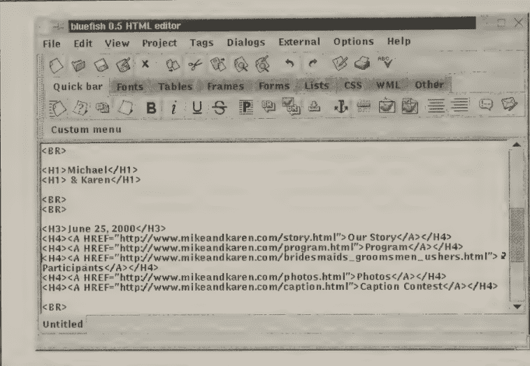

**图 13-6.** 一些非常有用的工具，包括 Bluefish HTML 编辑器，可以从工具栏构建。

## 新软件

你已经知道你可以构建别人创建的酷程序了。接下来的逻辑问题有两个方面：首先，你如何找到这些程序？其次，如果你想创建自己的包（为了发布你编写的软件，或者为了进行基于包的系统管理），该怎么办？

## 寻找源和包

第一个问题的简单答案是“互联网”。互联网上有海量的软件资源，虽然随处可见许多小钱，但也有许多金子。我建议你查看的地点包括：

- AppWatch: http://www.appwatch.com/Linux/
- CNET: http://download.cnet.com/downloads/0-10004.html?tag=st.lx.1491268.dir.10004
- DaveCentral: http://linux.davecentral.com/

## 第 13 章：第 10 步：“制作更多软件

Freshmeat http://freshmeat.net/ 
SourceForge http://sourceforge.net/

在本章中，我简要介绍了 Debian、Corel 等其他公司使用的 Debian 包，但在 http://www.debian.org/distrib/packages 也有许多此类包。

另一个可以查看的地方是随你的发行版附带的 CD-ROM。如果你在最初安装 Linux 时没有安装所有可用的包，那么 CD 盘上可能还有很有用的工具。检查手册或查看你发行版附带的光盘，特别留意寻找包文件。

## 创建你自己的包

如果你正在开发软件，你可能会认为包器的优势非常有吸引力，以至于你想以包的形式发布你的程序。我认为这是一个好主意（特别是当你把制作包仅作为发布软件的一种可选方案时）。

我也喜欢将包管理用于系统管理这一想法，尽管并不是所有人都会同意这一观点。人们还使用许多其他机制来确保系统之间的一性，并提供升级操作系统和系统的方法，但包带来了许多实用的功能。通过在网络上建立包中央仓库，并每周或每月调度一些任务以确保一切运行如常，你就可以确保在相对缺乏监管的 Windows 世界中难以实现的一致性。

虽然我认为学习创建包是一件很有意义的事，但我在这里没有空间详细介绍整个过程。幸运的是，道路已经为你铺好了。有一份非常优秀的 RPM-HOWTO 文档解释了 RPM 的创建过程；你的系统中应该有一份副本；大多数发行版将其放置在 `/usr/doc/HOWTO/RPM-HOWTO`。你也可以从 http://www.rpm.org/ 获取额外的文档。

如果你想创建 Corel Linux 等其他系统使用的 Debian 包，《Debian 新维护者指南》（Debian New Maintainer's Guide）是一个很好的起点。你可以在 http://www.debian.org/~elphick/ddp/manuals.html#newmaintainguide 找到它，并祝你创建包顺利。

## 给 Windows 爱好者的 Linux

## 第 14 章

第 11 步：共享与调度

在上一章中，我研究了使用包和源文件向 Linux 系统添加更多软件的过程。我认为这是 Linux 最令人兴奋的部分之一，因为我总是对看到人们构建并提供他人使用和改进的绝佳工具感到好奇。

在本章中，我们将看看另一种共享方式；这种共享是在你网络上的系统之间进行的。这是一个重要的细节，如此重要以至于它成为康复之路上的第 11 步，它告诉我们要通过共享文件来提高意识接触，并调度任务来执行它们。

## 重新回顾文件权限

我们以前讨论过文件权限；如果你还记得，使用 `ls -l` 命令显示文件列表时，也会显示目录中文件和目录的权限位设置。然而，知道那些权限是什么以及知道如何使用它们是两回事，因此我想回到这两个主题。

## 确定权限

像任何其他多用户系统一样，Linux 必须跟踪谁拥有文件以及谁被允许对文件进行“胡乱操作”。你不希望在彼此的文件上发生任何胡闹剧剧，你当然也不希望缺乏限制访问系统的能力，或者缺乏根据需要共享文件的能力。就像 NT 和 Windows 2000 有文件和目录权限一样，NetWare 也对文件和目录权限设置了权限。在大多数情况下，分别处理文件和目录权限运行良好良好，但在许多情况下，权限设置的组合具有重要意义。因此，我们首先查看单独的文件和目录权限，然后检查权限相互作用的方式。

## 确定所有权

KDE 和 GNOME 的文件管理工具在显示所有权方面做得很好，但你并不总是拥有访问 X Windows 界面的特权，因此我们将使用命令行工具。如果我想检查圣诞卡片的所有权，我使用 `ls -l`

```
-rw-r---- karen karen 10345 May 23 20:05 christmas_cards.txt
```

从这中，我看到圣诞卡片归 karen 所有。但如果列表像这样呢？

```
-rw-r---- 501 501 10345 May 23 20:05 christmas_cards.txt
```

## 第 14 章：第 11 步：共享与调度

这里我通常会看到用户名和组名。这些数字是文件的用户 ID 和组 ID。当它们以数字而不是名称形式显示时，是因为系统找不到用户名和组名。

## 读取权限

对于文件和目录有三种权限：读、写和执行。每种权限的影响见表 14-1。

每种权限都可以分别应用于所有者、所有组和剩余世界。这些权限被应用并体现在 `ls -l` 命令的输出中。为了回到圣诞卡列表，回想一下它的输出是那样的：

```
-rw-r---- karen karen 10345 May 23 20:05 christmas_cards.txt
```


文件权限 我们如何读取这些权限？很明显，已经授予了某些读写权限，授予了谁？通过知道权限列表由十个数字组成，并且第二到第四位显示所有者的权限，而第五到第七位显示所有组的权限，第八到第十位显示剩余世界的权限。表 14-2 可以帮助我们理清该文件权限的含义。

根据圣诞卡的权限，我们可以根据表 14-2 的内容确定用户对文件具有读写权限，因此她可以查看或更改内容，或者删除该文件。组对文件只有读权限，而剩余世界（包括我在内）没有任何访问权限。

# 364 面 Windows 爱好者的 Linux：12 步计划

| 文件权限列表 | 授予的权限 |
| --- | --- |
| -r------ | 所有者可以读取文件 |
| --w----- | 所有者可以修改或删除文件 |
| ---x----- | 所有者可以执行程序 |
| -r-x----- | 所有者可以执行 shell 脚本 |
| ---s----- | 程序以所有者身份执行 |
| -----s-- | 程序以所属组身份执行 |
| ---r----- | 所属组成员可以读取文件 |
| -----w-- | 所属组成员可以修改或删除文件 |
| ---x----- | 所属组成员可以执行程序 |
| ---r-x-- | 所属组成员执行 shell 脚本 |
| -----r-- | 全所有人可以读取文件 |
| -----w-- | 全所有人可以修改或删除文件 |
| -----x--- | 全所有人可以执行文件 |
| -----r-x | 全所有人可以执行 shell 脚本 |

表 14-2. 读取权限

但请注意我在表 14-2 中偷偷加入的另一个权限，即“s”权限。当“s”出现在权限列表的所有者部分时，它被称为 *setuid 位*；当它出现在权限列表的所属组部分时，它被称为 *setgid 位*。如果设置了这些位位之一，意味着当执行该文件时，启动进程的有效 ID 将设置为所有者的用户 ID 或组 ID（取决于设置了哪一个位位）。这是允许用户运行程序而不赋予他们惊人权限的方法之一，但它既是安全问题的解决方案，也可能是安全问题的根源。

**目录权限** 目录权限的含义与文件权限略有不同。虽然权限标记相同，但它们的含义可能有所不同。表 14-3 显示了各种权限标记对于目录的含义。

注意我我又加入了另一个新权限；这次是“T”值，表示设置了“粘滞位（sticky bit）”。当此权限值被设置时，非所有者（或 root 用户）无法删除目录中的文件，即使全所有人拥有“wx”权限（这通常允许删除文件）。当目录设置了粘滞位时，有些人人称之为“只允许追加”目录，意味着它主要免受意外删除，但仍可以接收新文件。

# 第 14 章：第 11 步：共享与调度

| 文件权限列表 | 授予的权限 |
| --- | --- |
| dr------ | 所有者可以列出目录内容，但不查看属性 |
| d-x------ | 所有者可以进入目录 |
| dr-x------ | 所有者可以读取目录内容的属性 |
| d-wx------ | 所有者可以在目录内添加和删除文件 |
| d-------T | 粘滞位设置：非所有者无法删除文件 |
| d---r---- | 所属组成员可以列出目录内容 |
| d-----x---- | 所属组成员可以进入目录 |
| d---r-x---| 所属组成员可以读取目录内容的属性 |
| d----wx---- | 所属组成员可以在目录内添加和删除文件 |
| d-----r--- | 全所有人可以进入目录 |
| ---------x | 全所有人可以读取目录内容的属性 |
| ---------r-x | 全所有人可以在目录内添加和删除文件 |
| ---------wx | 全所有人可以执行 shell 脚本 |

表 14-3. 读取目录权限

# 权限关系

文件和目录权限并不是相互孤立的。相反，目录的权限会影响其包含的文件的有效权限。这种情况的结果是，如果你被排除在某个目录之外，你就无法访问该目录包含的文件。事实上，如果你在尝试访问的文件路径中，有任何一个目录被排除在外面，那么你就倒霉了。

考虑另一个例子。假设 Karen 意识到我一直在窥探她的东西，并想确保我看不见她为我举办的惊喜生日派对邀请函。她可以限制外部世界对邀请函文件本身的权限。但她也可以创建一个其他用户没有访问权限的目录：

```
drwx------ 5 karen 4096 May 23 21:13 myob
```

现在，除非我以 root 身份通过登录并搜索她的文件，否则我将无法访问此目录中的文件。自然地，目录权限设置中粘滞位的存在可以防止非所有者删除该目录中的文件，这是目录/文件权限相互作用的另一个例子。

# 设置权限

用于设置文件和目录权限的命令行工具称为 `chmod`。该工具提供了两种指定权限的方法。一种方法使用记忆助符代码指定权限，另一种方法则使用数字系统。

记忆助符起初看起来更容易，因此它们是一个很好的起点。假设 Karen 想要更改她圣诞卡卡的访问权限，以便系统上的任何人都都可以读取它。她可以使用以下命令指定所有用户获得读取权限：

```
karen@romans ~ chmod a+r ~karen/christmas_cards.txt
```

语法 `a+r` 意味着所有用户（`a`）获得读取（`r`）权限。如果她想给组赋予读写权限，她将使用 `g+rw`。如果她想给全所有人读取权限，她将使用 `o+r`。

数字设置基于八进制系统，其中从 0 到 7 的四个数字分别指定所有者权限、组权限、其他权限以及特殊位（粘滞位、setuid 或 setgid）。对于标准权限，值 1 设置“x”权限，值 2 设置“w”权限，值 4 设置“r”权限。你可以累加这些值来一次设置多个权限，或者使用 0 关闭所有权限。文件和目录权限通常使用三位数字设置。三个数字中的第一个数字设置所有者的权限。第二个数字设置所属组的权限。你不会惊讶地发现，第三个数字设置了其他世界的权限。

所以，如果 Karen 想要赋予自己对文件的读写访问权限，但只想赋予所属组访问权限并锁定其他用户，她可以使用这条命令：

```
karen@romans ~ chmod 640 ~karen/christmas_cards.txt
```

该命令的结果将是：

```
rw-r------ 1 karen 10345 May 23 20:05 christmas_cards.txt
```

另一方面，如果她的个人数据较少，并让她和所属组对目录拥有完全访问权限，可以使用以下语法：

```
karen@romans ~ chmod 770 ~karen/share/
```

结果将是：

```
drwxrwx--- 5 karen 4096 May 23 20:05 share
```

数字选项比记忆助符代码更高效，但记忆助符更容易记忆。

# Windows 成瘾者的 Linux 之路：12步计划

这些命令非常高效，而且它们代表的权限也易于使用。但我提到过下面还有四个数字。第四位数字用于为文件或目录设置的特殊信息。对于文件，你可以启用 setuid 和 setgid；对于目录，你可以启用粘滞位（sticky bit）。这个额外的位在在使用时指定在第一位，其可能的值如表 14-5 所示。

如果 Karen 想在目录上设置粘滞位以防止其他用户删除它，她可以执行如下命令：

```
karen@romans -> chmod 1770 -l /karen/myob
karen@romans -> ls -d /karen/myob
drwxrwx-t 5 karen karen 4096 May 23 20:05 myob
```

## 默认权限

也许你想知道默认分配了哪些权限。该设置可以使用 `umask` 命令进行配置，该命令通常包含在 `/etc/profile` 和 `csh.login` 壳配置文件中。`umask` 语句接受一个数字权限字符串，该字符串与 `chmod` 使用的数字权限字符串相似但又不同。

三位数的 `umask` 字符串是你想要默认开启权限的“补数”。换句话说，虽然在 `chmod` 命令中值 7 代表最开放的权限，但在 `umask` 命令中，它代表的是最严格的限制。默认文件权限设置的每个数字都等于 7 减去相应的 `umask` 数字。因此，如果 `umask` 是 077，则默认文件权限设置为 700，这对于 root 用户来说是一个很不错的设置。

| 数值 | 指定的模式 |
| :--- | :--- |
| 0 | 不设置 |
| 1 | 设置粘滞位 |
| 2 | 执行时设置组 ID (setgid) |
| 3 | 设置粘滞位和 setgid |
| 4 | 执行时设置用户 ID (setuid) |
| 5 | 设置粘滞位和 setuid |
| 6 | 执行时设置 setuid 和 setgid |
| 7 | 执行时设置粘滞位、setuid 和 setgid |

表 14-5. 设置特殊权限位的数字值

## 第14 章：第11 步：共享与调度

普通账户掩码的典型值是：如果用户通常共享主组，则为 022；如果每个用户都有唯一的主组，则为 002。这是 Red Hat 接受而其他发行版默认采用的选项；生成的 775 文件权限字符串只有在每个用户都有唯一主组时才是合理的。

## 使用链接 (Links)

链接文件类似于 Windows 快捷方式，但它们与目标的关联性更紧密。在 Linux 下使用链接时，除非你执行 `-l` 并注意到第一个文件权限是 "l"，否则你不会知道自己并没有直接操作文件。这使得它们成为工具箱中极佳的工具，因为它们可以用于一切，从简化升级到跨网络共享文件。

## 符号链接

常见的链接类型被称为符号链接（symbolic link）。这些链接不像硬链接（hard links）那样与目标紧密钩接，我稍后会描述硬链接。这么说吧：这些是你将要使用的链接。

你使用 `ln` 命令创建符号链接，如下：

```
millerm@romans ~ ln -s ~/albers/wassup.avi wu
```

该命令在我的主目录下创建了一个名为 `wu` 的链接，指向另一个用户主目录下的一个文件。注意，我给链接起了一个与原始文件名不同的名字；这没问题，而且非常有用。

例如，有时在同一目录下为文件创建链接是有帮助的。这就是在 `/usr/src/` 目录中发生的情况，如果你想保留多个版本的内核源码文件；"linux" 目录通常只是指向你当前正在构建的版本的链接。

另一个使用链接处理版本控制的例子可以在 `/usr/lib/` 目录中看到。如果你执行 `-l`，你会发现有几十个链接从通用库指向特定版本的库。如果出现了新版本，可以将其插入正确的目录并进行链接（但如果你不熟悉 Linux 目录，请不要自己尝试此操作）。

符号链接对于共享也非常有用。你可以在服务器上创建一个共享目录，在客户端工作站上通过 NFS 挂载它，并在每个用户的目录中放置一个指向该共享目录的链接。对用户来说，这些文件就在他们的系统本地。事实上，在某些情况下，可以移动一个文件或整个目录，创建一个链接让它看起来像是在原来的位置，而完全不让用户察觉到任何不同。这极其有用。

符号链接的最后一个用途是节省磁盘空间。如果你有一些文件通常需要在系统的多个不同地方重复存放，你可以选择只放置一个文件并创建指向该位置的链接。

无论你出于什么目的创建链接，它的权限始终目标文件的权限。然而，链接文件本身会有它自己的权限列表，而这有点具有误导性。

```
lrwxrwx 1 karen karen 4 May 30 13:52 new.sh -> old.sh
```

注意，我给链接起了一个与原始文件名不同的名字；这没问题，而且非常有用。

## 针对 Windows 爱好者的 Linux：12 步计划

虽然不同的发行版对 cron 守护进程的实现略有不同，但我喜欢红帽（Red Hat）等系统的做法——一个名为 `/etc/crontab` 的主文件。这种方法不是让你在需要时通过编辑文件来添加脚本，而是让 `/etc/crontab` 的内容在不同的时间间隔运行几个目录下的脚本。

以下行是我系统中 `/etc/crontab` 的部分内容（我已编辑了每一列的含义）：

```
# 分 时 日 月 星期 执行的命令

01 * * * run-parts /etc/cron.hourly

02 4 * * run-parts /etc/cron.daily

22 4 * 0 run-parts /etc/cron.weekly

42 4 1 * * run-parts /etc/cron.monthly
```

第一个非空行命令在每天早晨 1 点整运行 `run-parts/etc/cron.hourly`。下一行在每周日的凌晨 4:02 运行 `run-parts/etc/cron.daily`。再一行在每月 1 号凌晨 4:22 运行 `run-parts/etc/cron.weekly`。

正如你猜到的那样，`/usr/bin/run-parts` 命令会运行指定目录下的可执行文件；如果你想每天运行特定的程序或脚本，只需将其副本丢进 `/etc/cron.daily` 目录，守护进程就会每天忠实地执行它。

Root 和其他用户也可以使用 `crontab` 命令创建自己的 crontab 文件。运行 `crontab` 会在文本编辑器中打开用户现有的 crontab 文件（如果有）。如果该用户还没有 crontab 文件，则会创建一个新的。你可以在此文件中指定自己的时间间隔，该文件将保存到 `/var/spool/cron/crontabs`；文件名被设置为源用户的账户名。

## 待计划的任务

那么，使用这些选项可以计划什么任务呢？现实中，限制是无限的。如果你想每周重启一次服务器，可以通过从 cron 任务中运行 `shutdown` 命令来实现。因为你正在尝试习惯在不过度重启的情况下工作，这里还有一些其他建议：

- 计划备份。
- 同步时间。
- 发送定时消息。
- 执行其他维护任务。

## 备份

这都是核心维护任务，不是吗？虽然你可以使用完整的备份工具，但创建一个将某些目录转到磁带的脚本可能就是你需要的。你可以根据需要让脚本变得复杂。这是一个创建每个用户主目录压缩包的简单示例：

```bash
#!/bin/sh

# 由 crontab 调用此行：

# 0 19 * * * /usr/local/sbin/home_bak

D=date +%Y%m%d

tar cvzvf /bak/homebak/peter_kilner_$D.tgz /home/kilner/*

tar cvzvf /bak/homebak/david_li_$D.tgz /home/dli/*

tar cvzvf /bak/homebak/deb_kilner_$D.tgz /home/dkilner/*

tar cvzvf /bak/homebak/omar_keblawi_$D.tgz /home/okeblawi/*

tar cvzvf /bak/homebak/eric_chamness_$D.tgz /home/echamans/*
```

在现实生活中，我将此类文件保存到大分区，通过特定的 cron 写入文件并进行轮转。

## 同步时间

无论是在大网络还是小网络，同步系统时钟让生活变得更容易，特别是当某些用户在编译大量软件时，编译器对时间差异非常敏感。克服这个问题的方法是使用 `ntdate` 程序将你的系统时钟同步。你需要提供自己的时间服务器地址，一个放入 `/etc/cron.daily` 的这样的脚本即可解决：

```bash
#!/bin/sh

/usr/sbin/ntpdate \
addicts.com \
time.prolinc.com
```

## 发送定时消息

你可以计划许多种类别的任务，但你可以考虑每周发送一次基础系统信息。`df` 命令的结果可以告诉你系统每个分区的可用磁盘空间，这可能是一个很好的开始。你可以设置不同的邮件接收者。Crontab 文件通常包含 `MAILTO` 语句来指定将输出发送给谁；可以像这样指定：

```bash
MAILTO="millerm"

10 5 * * 0 /bin/df
```

你还可以在命令本身的行中指定输出位置：
`10 5 * * /bin/df 1>david@romans 2>millerm@romans`

## 第 15 章：第 12 步：释放你的办公室

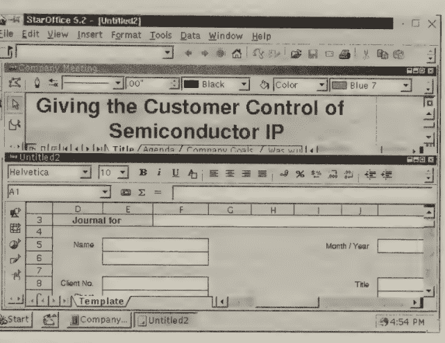

**图 15-1.** StarOffice 将许多桌面应用程序集成到单一用户界面中

为了使用电子表格而必须打开一个设计用于帮助你访问整个工具列表的界面，这种想法似乎有点低效。StarOffice 的模块化计划已经在进行中。

## StarOffice 的安装过程

安装过程与你在 Windows 系统上看到的类似；事实上，StarOffice 软件包大功能之一是它可以跨平台运行，包括 Windows 和 Unix。要开始操作，你可以加载随几个主流 Linux 发行版附的 CD-ROM，并运行适用于你所用操作系统的安装程序。

如果你正在运行 Hat 7，StarOffice 包含在豪华版工作站（Deluxe Workstation）软件包中。该套件以 RPM 格式形式包含在 CD-ROM 中，标签非常引人注目：“随 Red Hat Linux 7 发布的第三方工作站服务器应用程序”。要从此 CD-ROM 安装程序，请遵循以下步骤：

- 1. 挂载 CD-ROM 后，成为 root 用户，然后安装 rpm：

```
root@romans /root > -Uvh /mnt/cdrom/StarOffice/StarOffice*.rpm
StarOffice ############################################
```


## Windows 爱好者的 Linux 之路：12 计划

- 1. 使用你的普通用户账户登录并从安装目标运行设置文件：

`millerm@romans ~ /opt/office52/program/setup`
2. 你将看到一个欢迎你进入安装程序的窗口。点击 Next（下一步）继续。
3. 将出现一个信息文件；仔细阅读以获取可能与你的情况相关的信息，完成后点击 Next。
4. 将出现许可协议；仔细阅读它，如果你同意其条款，请点击 Accept（接受）。
5. 将出现一个数据表单，允许你输入自定义信息，如你的姓名、地址、电话号码和职位名称。当你填写了所有你认为需要的内容后，点击 Next。
6. 下一个屏幕为你提供“标准工作站安装”或“标准本地安装”选项。因为你已经将 RPM 安装到系统中了，你不妨选择“工作站安装”来利用这一点。这将比“本地安装”选项占用更少的用户空间。点击 Next 继续。
7. 选择安装目录，默认为 `~/office52`。此目录可以，因此点击 Next。
8. 确认此目录，点击 Yes（是）允许创建。然后点击 Complete（完成）继续安装。
9. 下一个屏幕显示你的 Java 运行时环境；StarOffice 在没有它的情况下运行，所以无论安装过程是否找到它都可以点击 OK。安装将开始，文件将被复制并注册。
10. 你将收到一条消息，指示 StarOffice 已添加到 KDE 面板，但你需要重启 KDE 以使菜单项可用。如果你使用 GNOME，只要没有从主面板菜单删除 KDE 条目，你仍然可以进入 KDE 菜单。点击 OK 继续并点击 Complete 结束安装过程。

要运行 StarOffice，请重启 KDE 并使用图标，或从 x 运行 `~/office52/soff`。首次运行 StarOffice 时，它会询问你是否使用 Netscape 配置互联网相关信息以帮助你通过代理服务器或其他设置进行连接，这是一个很贴心的设计。遗憾的是，一旦你安装好一切，可能会对工具的整体性能感到失望。有时，即使在我那 500MHz 且带有 512MB 内存的系统上，加载文件和在应用程序之间切换也会很缓慢。另一方面，它的功能是相当好的，如果你用过来自 Corel、Lotus 或 Microsoft 的办公套件，你应该能够轻松地操作这个。

## 第 15 章：第 12 步：释放你的办公室

StarOffice 的最大优势是其全面的工具和功能列表、Sun 承诺发布免费软件版本、对 Microsoft 文档文件的兼容性，以及多平台支持。它最大的局限性是性能。访问 `http://www.sun.com/products/staroffice/` 了解更多关于 StarOffice 的信息。

### KOOffice

KOOffice 套件仍在开发中，但看起来很有前景，特别是如果你喜欢 KDE 桌面的外观和感受。与其他 KDE 应用程序一样，KOOffice 工具相当良好地集成到桌面环境中，因此它们继承了你使用的任何特殊主题的属性。

与 StarOffice 套件一样，KOOffice 包含一系列野心勃勃的工具；事实上，KOOffice 未包含的工具是邮件工具和网络浏览器，但这些工具在没有 KOOffice 软件包的情况下已经可以在 KDE 中使用，所以这方面你无需担心。KOOffice 软件包包括：

- KWord
- KSpread
- KPresenter
- KIllustrator
- KMyShop
- Katabase
- KFormula
- KChart
- KImage（一个查看器）

虽然 KOOffice 看起来很好并且比 StarOffice 程序多得多，但它缺少许多“必须”的功能，且某些部分目前不可用。即使对于那些可用的部分也存在问题。例如，KWord 应用程序还没有用于导入或生成 Word 文档的运行过滤器。此类过滤器在几乎每个环境中都是不可少的，因此在考虑选项时要记住这一点。
KOOffice 并不像 StarOffice 那样方便。

### Abiword

KOOffice 套件仍在开发中，但看起来很有前景，特别是如果你喜欢 KDE 桌面的外观和感受。与其他 KDE 应用程序一样，KOOffice 工具相当良好地集成到桌面环境中，因此它们继承了你使用的任何特殊主题的属性。

像 StarOffice 套件一样，KOOffice 包含一系列野心勃勃的工具；事实上，KOOffice 未包含的工具是邮件工具和网络浏览器，但这些工具在没有 KOOffice 软件包的情况下已经可以在 KDE 中使用，所以这方面你无需担心。KOOffice 软件包包括：

- KWord
- KSpread
- KPresenter
- KIllustrator
- KMyShop
- Katabase
- KFormula
- KChart
- KImage（一个查看器）

虽然 KOOffice 看起来很好并且比 StarOffice 程序得多，但它缺少许多“必须”的功能，且某些部分目前不可用。即使对于那些可用的部分也存在问题。例如，KWord 应用程序还没有用于导入或生成 Word 文档的运行过滤器。此类过滤器在几乎每个环境中都是不可少的，因此在考虑选项时要记住这一点。
KOOffice 并不像 StarOffice 那样方便。

### Siag Office

虽然该类别的其他软件包提供了具有独特功能的典型办公应用，但 Siag Office 是真正反常规的。首先，你可以在文本模式或 X 下使用 Siag 表格。该表格是用 Scheme 编写的，并支持 Lisp 编程语言方言。它提供了另一个非常独特的特性：它可以作为一个“一站式”Web 服务器，允许你在网上共享文档。

Siag 的文字处理器 Pathetic Writer 与 Siag 集成，但它依赖外部文件过滤器来与使用 Microsoft Office 的同事共享文件。Egon Animator 允许你制作简单的动画（嗯，也许比我更有技巧的人可以制作复杂的动画），让你对元素的操作进行精确控制。

我不认为 Siag Office 能获得大量原微软用户的关注；它的理念对于大多数 Windows 用户来说太偏向程序员。但对于我们这些在伯克利大学本科计算机科学中学过 Scheme 且再也没有机会使用它的人来说，它非常有趣。对于任何能够利用其独特功能的人来说，这是一个很酷的套件。访问 `//siag.nu/` 了解更多信息。

### 商业办公应用程序

之前的工具要么是开源的，要么供免费用户。不过这并不是你在 Linux 系统上可以运行的类型类型，其他产品也值得研究。特别是 Applylinux 套件和 Core WordPerfect 的 Linux 版本可能适合你的需求。

### Applixware

Applix Inc. 的 Applyixware 是一个适用于多个平台的全功能办公套件。Applylinux 套件包括 Words（全功能文字处理器）、Graphics（绘图和实现工具）、Presents（演示文稿包）、一个灵活的邮件客户端以及 Data（帮助你构建和访问数据库）。Builder 是一个面向对象的编程工具，对于小规模应用程序设计非常有用，更不用说与其他 Applyix 工具的集成了。

## 第15章：第12步：释放你的 Office 38

Applicware 的优势之一是它的文档过滤器，这些过滤器与 StarOffice 的过滤器不鼓相当。高度格式化的 Word 文档在这两个产品中的显示效果都不如在其原生应用程序中那么好，但简单的文档看起来和运行起来完全没问题。

无论你是考虑在 Windows 系统上部署 Applicware，还是只想为 Linux 用户配备这套套件，它都值得考虑。它不像 StarOffice 那样笨重，尽管它也不完全那么优雅。虽然价格不是为零（在我写这些文字时，全套件的价格为 99 美元），但与基于 Windows 的套件价格相比还远得不可及。

关于 Applicware 的更多信息，请访问 `http://www.vistasource.com/`。在 `http://shelf.sourceforge.net/` 也有关于 Applicix 为应用程序开发提供的开源产品的相关信息。

### WordPerfect

Corel 在进入 Linux 应用领域方面做得非常出色，他们推出了适用于 Linux 的 WordPerfect 2000。标准版版包含了几个已经存在很久的桌面应用的 Linux 版本：用于文字处理和页面布局的 WordPerfect，以及用于电子表格的 Quattro。Corel Presentations 和包含地址录/日历/预约提醒功能的 CorelCentral 完善了整个软件包。豪华版增加了易于用户的 Paradox 数据库程序，我发现它和微软的 Access 一样易用。图 15-2 显示了正在运行 WordPerfect 2000 的桌面。

该套件的两个版本都由 Corel 捆绑销售，因此如果你对测试这些软件包感兴趣，可以利用这种合一封装让你的评估过程变得简单一些。在其他发行版上安装，使用图形化安装程序简直是轻而易举。

WordPerfect 套件看起来比 StarOffice 套件稍微精简一点，但并不是速度极快的；我一直在观察桌面系统上的磁盘活动，心想是否是时候利用内存产品价格下降的契机了。不过，大多数工具的打开和关闭都很慢，但在我使用时似乎响应良好。如果你热忠于开源或零价格软件，我推荐 WordPerfect 软件包，它在打开 Microsoft Office 文件方面表现尚可，并且有 Windows 版本。一个缺点是 WordPerfect 的制作者 Corel 已经处于财务困境一段时间，这使得它的未来有些可疑。最近从微软涌入的大量用户很可能会增强 Corel 的策略。

### 其他业务应用程序

虽然我不想描述 Linux 上可用的每一个主要业务产品，但我想提到一些你可能想要进一步研究的亮点。Linux 用户可以享受大量的免费或低成本编程工具、数据库软件、Web 工具、文件实用程序、图形制作程序、协作软件以及“业务娱乐”软件包。

## 针对 Windows 痴迷者的 Linux：12 步计划

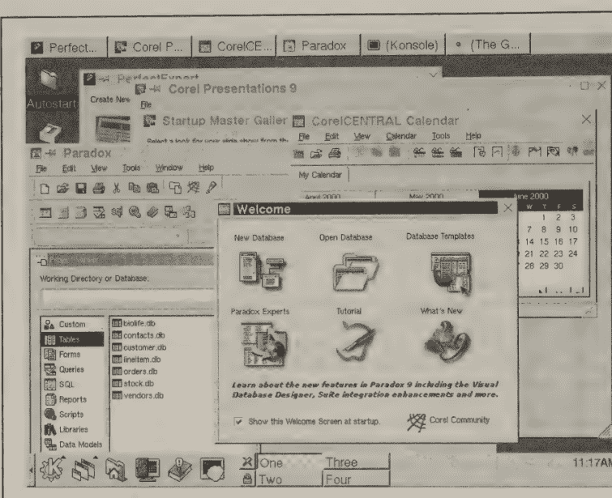

### 编程工具

许多 Linux 发行版包含多种语言的编译器或解释器，包括汇编语言、BASIC、C++、FORTRAN、Java、LISP、Pascal、Perl、Python 和 Tcl/Tk。这些资源有许多开发工具和辅助，我发现获取信息的最佳地点之一是 Freshmeat 应用索引，位于 `http://freshmeat.net/appendix/development/`。有商业开发工具，但我没有用过它们，所以无法为你提供任何建议。

### 数据库

主要的数据库供应商都有适用于 Linux 的产品，尽管价格降低了（通常为 0），但一些广泛使用的软件包并非来自商业公司，大型数据库公司仍在对其产品收费。虽然 MySQL 缺乏某些其他产品的事务保护功能，但它非常容易获取，且许多 ISP 为其网络托管服务安装了它，所以如果你只是想与数据库工作，它可能是一个不错的选择。表 15-1 显示了 Linux 用户可用的一些主要选项。

### Web 工具

Linux 提供了数量到惊人的可用 Web 工具，既针对客户端也针对 Linux 服务器。在客户端，，有 Lynx Web 浏览器（当你无法进入 Windows 和 Netscape 时，用于通过 Web 下载新的视频驱动程序非常有用）。有许多书签工具可以让你的上网生活更轻松。还有预处理程序和转换程序，可以将非 Web 来源的数据推送到你的 HTML 页面。还有 HTML 编辑器。

查看 Mehmet 的网络存档 (`http://freshmeat.net/appendix/web/tools.html`) 以获取有用程序，它们可以将你的 Microsoft Active Server Pages (ASP) 转换为更符合 Linux 习惯的格式。你可以寻找 Apache 服务器扩展，它允许 ASP 页面在 Apache 服务器上运行。

有在线购物系统，YAMS（另一个商户系统），托管在 `http://yams.sourceforge.net/`。另一个事务管理工具是 Akopia Interchange (`http://www.akopia.com/`)。这两个产品都根据 GNU 通用公共许可证 (GPL) 分发。

| 公司或项目 | 产品 | 网站 |
| :--- | :--- | :--- |
| Sybase | Adaptive Server Enterprise | http://www.sybase.com/linux |
| IBM | DB2 Universal Database for Linux | http://www-4.ibm.com/ |
| Informix | 多个 | http://www.informix.com/ |
| Hughes Technologies | 多个 | http://www.hugges.com/ |
| TCX Data | MySQL | http://www.mysql.org/ |
| Oracle | 多个 | http://www.oracle.com/ |
| PostgreSQL Project | PostgreSQL | http://www.postgresql.org/ |

图 15-2。Corel 包含了易用的应用程序在 WordPerfect 2000

表 15-1。 针对 Windows 痴迷者的 Linux：12 步计划

查看 Mehmet 的网络存档 (`http://freshmeat.net/appendix/web/tools.html`) 以获取有用程序，它们可以将你的 Microsoft Active Server Pages (ASP) 转换为更符合 Linux 习惯的格式。你可以寻找 Apache 服务器扩展，它允许 ASP 页面在 Apache 服务器上运行。

有在线购物系统，YAMS（另一个商户系统），托管在 `http://yams.sourceforge.net/`。另一个事务管理工具是 Akopia Interchange (`http://www.akopia.com/`)。这两个产品都根据 GNU 通用公共许可证 (GPL) 分发。

Zope 是另一种构建网站的选项。它是一种让动态内容变得快速方便的脚本语言。它自带 Web 服务器（或者你可以将其挂接到 Apache）。Zope 大量使用 Python，但如果你不需要，就不必使用。缺点是，虽然 Zope 很好，但并不总是直观，所以学习曲线可能很陡。访问 `http://www.zope.org/` 看看你的想法。

Freshmeat 和其他网站上有更多 Web 应用程序和工具。

### 文件实用程序

我在之前的章节中提到了一些实用程序，包括压缩和存档选项 (`gzip`, `bzip2`, `compress`, `zip`, `tar`)。Linux 发行版通常还包含图像查看器，可以显示、有时转换 AVI、GIF、JPEG、MPEG、PDF、PNG、TIFF 和 QuickTime 文件。

发行版和 Web 上还有许多不同的文件管理器。还有其他文件系统，例如，这是一种适用于 Linux 的日志文件系统。你可能对自动分发和文件镜像工具感兴趣，如 `rdist` 和 `mirror`。

其他实用程序包括 CD-ROM 写入器、MP3 提取和刻录器、音频文件播放器、命令行拼写检查器等等。如果你需要它，很可能别人也需要。查看 Freshmeat 和其他网站获取你所需的程序和步骤。

### 图形制作

Gimp 不仅仅电影中的一个角色，它是 GNU 图像处理程序，一个可扩展且功能丰富的程序，允许你修照片、创建图像、转换图形文件格式，甚至画漫画。想象一下，所有这些功能都是免费的。还有什么更好的呢？嗯，它文档齐全而且易于使用，图 15-3 显示了 Gimp 的运行情况。

一个发行版如果没有 Gimp 将是不完整的，但如果你的缺少了，或者你需要更多信息，可以咨询项目的网站 `http://www.gimp.org/`。

不要忘记，几个免费办公软件软件包还包含了图像、创建和编辑工具。这些工具通常与 PC 端的

## 第 15 章：第 12 步：免费办公

你使用过的软件包；尽管如果你习惯了 Mac，无疑会感到失望。但不要来向我抱怨。

请注意，还有用于在 PDF 格式与其他格式之间转换文件的工具。例如，`ps2pdf` 程序，它包含在 Red Hat 以及许多其他发行版中，可以将 PostScript 转换为适用于在 Adobe Acrobat 中查看的 .pdf 文件。虽然这不如使用 Acrobat 那么强大，而Acrobat 是一个用于维护 Linux 社区及其他地方的仓库，就像它在其他平台上同样可用一样。更多信息请访问 `http://www.adobe.com/`。

### 协作

协作过程涉及许多不同方面，包括如 CVS（并发版本系统）之类的版本控制软件，它们作为维护源文件（通常是程序代码）的仓库。CVS 使版本控制变得简单，它在 Linux 社区及其他地方被广泛使用。请查看 `http://cs.utah.edu/dept/old/texinfo/cvs/cvs_toc.html` 上的 FAQ 文档。

我曾是一个非常热情的 Lotus Notes 管理员；当我开始使用它时，它是少数真正让我感到兴奋的技术之一。Notes 是 PC 世界第一个广泛部署的群组软件包，我一直喜欢它的协作功能和强大的应用程序集。它不适合我目前的环境，但我仍然认为它是

**图 15-3。** 使用 Gimp 创建——或摧毁——图形文件以供娱乐和获利。

## Windows 瘾者的 Linux 之：12 步戒计划

一个优秀的产品，服务器将运行在 Linux 上。如果你对 Notes 感兴趣，可以在 `http://www.lotus.com/home_nst/welcome/domino` 找到更多信息。点击 Linux 链接获取 Linux 特有信息。

Bugzilla 是 Mozilla 项目的缺陷跟踪系统，它使用 Web 并在并在报告和解决信息存储在 MySQL 数据库中。设置 Bugzilla 并不是一项易事，但一旦配置完成，它是一个非常有用的工具，而且就你支付的价格来说，非常出色。更多信息请访问 `http://www.mozilla.org/bugs/`。

Apache 组邮件列表是一个基于 Web 的门户，旨在处理来自许多不同源的数据，包括 XML 文件、SMTP 数据以及 Web 特定的格式和协议。更多信息可以在 `http://java.apache.com/jetspeed/site/overview.html` 找到。

### 商业娱乐

好了，它们是游戏。但我喜欢它们，当我不需要通宵熬夜试图完成手稿时，我喜欢偶尔花几分钟在电脑上玩玩游戏。大多数主流 Linux 发行版都包含各种游戏，让 Windows 的选项相比之下黯然失色。此外，还有许多基于文本的游戏，包括我最喜欢的《Rogue》的变体，以及在 Web 上提供的许多 Windows 游戏。最近我在与三个电脑控制的方字游戏玩家对战时感到非常尴尬，我在大休息期间通过玩《纸纸块》（Breakout）克隆版消磨时间。

但那些摆在 Fry's Electronics 和其他电脑零售店货架上的酷炫商业游戏呢？一些较旧的游戏可以使用 Wine Windows 模拟器运行——我们说的是《星际争霸》，而不仅仅是《吟游诗人》（The Bard's Tale）。不过，想想，玩玩《吟游诗人》也是好的。这也是一个选择；请访问 `http://www.winehq.com/` 获取更多关于通过 Wine 模拟 Windows 的信息。

Linux 上已经发布了多款游戏，你完全可以在 Linux 下运行《毁灭战士》和《雷神》的版本。有关游戏新闻的更多信息，请尝试 `http://www.linux.games/` 和 `http://happypenguin.org/`。但目前，让主流游戏支持 Linux 的真正推动者是 Loki (`http://www.lok.com/`)。他们与游戏制作者合作，将 Linux 版本引入货架。你可以从他们的网站订购从《文明》到《神话 II》、《异端教士 II》、《魔法与魔法 III》、《重型装备 II》，再到《铁路大亨 II》和《艾克的终极纸牌》的一切游戏，这些游戏就在我常去的电脑商店货架上。

对于企鹅来说，只有工作没有玩乐就不是生活。

## Windows 瘾者的 Linux

## 附录

## Linux 资源

## Windows 瘾者的 Linux 之：12 步戒计划

### Linux 信息源

那里有海量的、成堆如山的信息源。哎呀，考虑到微软在解释有关 Linux 的方面提供了如此大的帮助，你可能会认为其他人也有一些信息可以分享，对吧？Linux 网站之间往往有大量的相互链接，因此你只需要访问其中的几个网站就能收集到大量信息。

### 出版与新闻

我最喜欢的 Linux 新来源是 Linux Weekly News 网站的每日更新页面，但还有许多其他优质网站。以下是其中：

- Linux Weekly News `http://lwn.net`
- LWN Daily `http://lwn.net/daily`
- Linux Journal `http://www.linuxjournal.com/`
- Linux Magazine `http://www.linux-mag.com/`
- OSOOpinion `http://www.osopopinion.com/`
- LinuxWorld `http://www.linuxworld.com/`
- Linux Today `http://www.linoday.com/`
- Red Herring `http://www.redherring.com/`
- Linux Gazette `http://www.gazette.com/`
- Slashdot `http://www.slashdot.com/`
- GeekNews `http://www.geeknews.com/`

### 信息

我最喜欢的 Linux 新来源是 Linux Weekly News 网站的每日更新页面，但还有许多其他优质网站。以下是其中：

- Linux Weekly News `http://lwn.net`
- LWN Daily `http://lwn.net/daily`
- Linux Journal `http://www.linuxjournal.com/`
- Linux Magazine `http://www.linux-mag.com/`
- OSOOpinion `http://www.osopopinion.com/`
- LinuxWorld `http://www.linuxworld.com/`
- Linux Today `http://www.linoday.com/`
- Red Herring `http://www.redherring.com/`
- Linux Gazette `http://www.gazette.com/`
- Slashdot `http://www.slashdot.com/`
- GeekNews `http://www.geeknews.com/`

### 文档

我最喜欢的 Linux 新来源是 Linux Weekly News 网站的每日更新页面，但还有许多其他优质网站。以下是其中：

- Linux Weekly News `http://lwn.net`
- LWN Daily `http://lwn.net/daily`
- Linux Journal `http://www.linuxjournal.com/`
- Linux Magazine `http://www.linux-mag.com/`
- OSOOpinion `http://www.osopopinion.com/`
- LinuxWorld `http://www.linuxworld.com/`
- Linux Today `http://www.linoday.com/`
- Red Herring `http://www.redherring.com/`
- Linux Gazette `http://www.gazette.com/`
- Slashdot `http://www.slashdot.com/`
- GeekNews `http://www.geeknews.com/`

### 资源

Linux 上已经发布了多款游戏，你完全可以在 Linux 下运行《毁灭战士》和《雷神》的版本。有关游戏新闻的更多信息，请尝试 `http://www.linux.games/` 和 `http://happypenguin.org/`。但目前，让主流游戏支持 Linux 的真正推动者是 Loki (`http://www.lok.com/`)。他们与游戏制作者合作，将 Linux 版本引入货架。你可以从他们的网站订购从《文明》到《神话 II》、《异端教士 II》、《魔法与魔法 III》、《重型装备 II》，再到《铁路大亨 II》和《艾克的终极纸牌》的一切游戏，这些游戏就在我常去的电脑商店货架上。

### 内核新闻

在内核开发飞速的情况下，跟上并不容易。

- Kernel Notes `http://www.notes.org`
- Kernel Traffic `http://www.traffic.com`
- Kernel Journal `http://www.journal.com/`
- Kernel Archives `http://www.archives.com/`

### 软件

我使用过的软件包；尽管如果你习惯了 Mac，无疑会感到失望。但不要来向我抱怨。

- AppWatch `http://appwatch.com/`
- Freshmeat `http://www.freshmeat.net/`
- SourceForge `http://sourceforge.net/`

### 个人工具、产品与项目

我使用过的软件包；尽管如果你习惯了 Mac，无疑会感到失望。但不要来向我抱怨。

- Apache `http://www.apache.org/`
- Beowulf clustering `http://www.beowulf.org`
- Gnome `http://www.gnome.org/`
- htDig `http://www.htdig.org/`
- KDE `http://www.kde.org/`
- MagicPoint `http://www.mew.org/mgp/`
- Midgard `http://www.midgard-project.org/`
- Mozilla `http://www.mozilla.org/`
- MySQL `http://www.mysql.org/`
- Themes `http://themes.org/`
- Sudo `http://www.courtesan.com/sudo`
- WINE `http://www.winehq.com/`
- Zope `http://www.zope.org/`

### 人物

这个列表可能没有它应该那么长，而且 Linus 的页面也不会让你大惊。这些是我认为最重要或有趣的页面：

- Linus Torvalds `http://www.cs.helink.fi/~torvalds/`
- Richard Stallman `http://www.stallman.org/`
- Alan Cox `http://www.linux.org/uk/diary/`
- Alan 的妻子 Telsa `http://roadrunner.swansea.linux.org/uk/~hobbit/diary.html`
- Bruce Perens `http://perens.com/`
- Eric Raymond `http://www.tuxedo.org/~esr/`

### Linux 发行版

挥一挥死猫都能砸到自定义 Linux 发行版。虽然有很多发行版被构建，但似乎很少被选择，而且较小的发行版以固定的速度消失。这些链接在我写这些时都是有效的，我怀疑

在你阅读这些内容时，大多数发行版仍然存在。但我不做任何保证。什么都不保证，我告诉你吧！

#### 巨头们

除非你有理由考虑其他选择，否则我建议你坚持使用主要的发行版之一。你脑子里已经够乱了，没必要再对你的发行版选择产生怀疑。如果你仍然不确定想用哪一个，我建议默认选择红帽（Red Hat）。

- Caldera Open `http://www.calderasystems.com/`
- Complete Linux `http://www.macmillansoftware.com/`
- Corel Linux `http://www.linux.corel/`
- Debian GNU/Linux `http://www.debian.org/`
- Mandrake `http://www.linux-mandrake.com/`
- Red Hat `http://www.redhat.com/`
- Slackware `http://www.slack.com/`
- SuSE `http://www.suse.com/`
- TurboLinux `http://www.turbolinux.com/`

#### 非 Intel、非 PC 专注于

虽然这些发行版大部分目标都是 Mac 硬件，但有一个与众截然不同；Think Blue 发行版运行在 IBM System/390 上。

- Black Lab Linux `http://www.blacklablinux.com/`
- HA Linux `http://linux-ha.org/`
- LinuxPPC `http://www.linuxppc.com/`
- MkLinux `http://www.mklinux.org/`
- Think Blue Linux `http://linux.s390.org/`
- Yellow Dog Linux `http://www.yellowdoglinux.com/`

#### 嵌入式系统

Linux 正在进入嵌入式系统；它的价格、稳定性以及精简运行潜力使其成为一个诱人的选择。这些发行版专注于嵌入式系统：

- Blue Cat `http://www.lynuxworks.com/products/whatislcl.html`
- Embedix `http://www.lineo.com/`

## Windows 瘾者的 Linux：12 步戒计划

| 名称 | URL |
| :--- | :--- |
| Etlinux | http://www.prosa.it/etlinux/ |
| Hard Hat Linux | http://www.mvista.com/products/ |
| LEM | http://linux-embedded.com/ |
| Royal Linux | http://www.iscdcorp.com/company_info/RoyalLinux.shtml |
| White Dwarf Linux | http://www.emjembedded.com/linux/dimmpc.html |

### 安全优先

将这些发行版视为抗辐射（radiation-hardened）选项。实际上，这听起来像是一个安全发行版的好名字，“Rad Hard Linux”。无论如何，如果你是一个安全狂热，，考虑这些发行版：

| 名称 | URL |
| :--- | :--- |
| Bastille Linux | http://www.bastille-linux.org/ |
| Immunix | http://www.immunix.org/ |
| KRUD | http://www.tummy.com/krud/ |

### 非英语

我已经尽力寻找不针对英语使用者的发行版（实际上，这里列出的有一个是针对英国用户的，但这里似乎是适合放置它的地方）。因为我不懂其中大多数语言，我可能在某些地方有些偏差。

#### 中文

| 名称 | URL |
| :--- | :--- |
| 蓝点 Linux | http://www.bluepoint.com.cn/ |
| Linpus | http://www.linpus.com.tw/ |
| Xteam Linux | http://www.xteamlinux.com.cn/ |

#### 芬兰语

| 名称 | URL |
| :--- | :--- |
| Best Linux | http://www.bestlinux.net/ |

#### 法语

| 名称 | URL |
| :--- | :--- |
| eXecutive Linux | http://www.exelinux.com/ |
| PingOO Linux | http://www.pingoo.org/ |

#### 德语

| 名称 | URL |
| :--- | :--- |
| Halloween Linux | http://www.halloween-linux.de/ |
| PX86 Linux | http://www.ix86linux.de/ |
| Red Linux | http://www.red-linux.de/ |

#### 意大利语

| 名称 | URL |
| :--- | :--- |
| Bad Penguin Linux | http://www.badpenguin.org/ |

#### 日语

| 名称 | URL |
| :--- | :--- |
| Kondara MNU/Linux | http://www.kondara.org/ |
| LASER5 Linux | http://www.laser50.co.jp/ |
| Linux MLD | http://www.mlb.co.jp/ |
| Plamo Linux | http://www.linet.gr.jp/~kojima/Plamo/ |
| Vine Linux | http://vinelinux.org/ |

#### 韩语

| 名称 | URL |
| :--- | :--- |
| Alzza Linux | http://www.alzzalinux.com/ |
| RunOnCD | http://my.netian.com/~cgchoi/ |

#### 波兰语

| 名称 | URL |
| :--- | :--- |
| PLD | http://www.pld.org.pl/ |

#### 葡萄牙语

| 名称 | URL |
| :--- | :--- |
| Conectiva Linux | http://www.conectiva.com/ |

#### 俄罗斯语/乌克兰语

| 名称 | URL |
| :--- | :--- |
| Black Cat Linux | http://www.blackcatlinux.com/ |
| KSI-Linux | http://www.ksi-linux.com/ |

#### 西班牙语

| 名称 | URL |
| :--- | :--- |
| ESware Linux | http://www.esware.com/ |
| Eurielec Linux | http://www.eurielec.etsit.upm.es/ |
| HispaFuentes | http://www.hispentes.com/ |
| LinuxPPP | http://www.os.com/mx/ |
| One Disk Linux | http://linux.apostols.org/wen/ |

## Windows 瘾者的 Linux 计划

#### 泰语

| 名称 | URL |
| :--- | :--- |
| Kaiwal Linux | http://www.kaiwal.com/ |

#### 英国

| 名称 | URL |
| :--- | :--- |
| Definite Linux | http://www.definitux.net/ |

#### 视障人士

关注视障用户使用的发行版和应用程序可以在这里找到：

- Speak `http://www.speak.org/`

#### 其他

这些独特之处在于我建议你仔细思考它们是什么。

- Armed Linux `http://www.armed.com/`
- Dragon Linux `http://www.dragon.com/`
- Loop Linux `http://www.loop.com/`
- Phat Linux `http://www.phat.com/`
- Win Linux `http://www.win.com/`

- Blue Linux `http://www.blue.com/`
- Deep Linux `http://www.deep.com/`
- Gentus Linux `http://www.gentus.com/`
- Independence Linux `http://www.independence.com/`
- Libr Linux `http://www.libranet.com/`
- Rock Linux `http://www.rock.com/`
- Stampede Linux `http://www.stampede.com/`
- Storm Linux `http://www.storm.com/`
- Trust Linux `http://www.trust.com/`

#### 初学者友好

- easyLinux `http://www.easylinux.com/`
- Floppix `http://www.floppix.cc/`

#### 学校

- OpenClassroom `http://www.openclassroom.org/`

## LINUX for Windows 瘾者

## 术语表

# 术语表

其所在的目录。配置文件通常以点文件（dot files）的形式创建，以防止用户误将它们丢进回收站，并防止它们弄乱目录列表。如果不是因为那些 meddome 的孩子们，我们本可以可以逃脱法网的。

# 环境变量 (environment variable)

内容被整个环境（通常是 shell）共享的变量被称为环境变量。脚本和程序可以使用这些变量在任何给定环境中正确运行。

# 自由软件 (free software)

这个词对不同的人有不同的含义。有些人认为没有金钱成本的软件是免费的。另一些人认为，如果用户可以自由地使用软件（包括将其给邻居），那么软件就是自由的。由你决定。*参见* 自由软件基金（Free Software Foundation）。

# 自由软件基金

PSF (`http://www.fsf.org/`) 是一个致力于以下主张的组织：软件应该赋予用户为任何目的运行程序的自由、检查和修改源代码的自由、根据自己的意愿分发副本的自由，以及为了共同利益进行增强和分发的自由。*参见* 理查德·斯尔曼（Richard Stallman）。

# FUD

这个缩写指的是“恐惧、不确定和怀疑”（Fear, Uncertainty, and Doubt），这是公司用来对抗竞争对手感知优势的三种工具。例如，微软曾试图通过发布《Linux 迷信》（Linux Myths）来传播 FUD。

# GNOME

GNOME 是一种广泛使用的开源桌面环境，通常因其迷人的外观和高度的灵活性而受到赞誉。

# GNU

这个缩写代表“GNU 不是 Unix”（GNU's Not Unix）。这个缩写并不像你认为的过那么好笑。GNU 项目致力于创建一个基于自由软件的、备的类 Unix 操作系统。*参见* 自由软件基金。

# grep

Grep 是一种命令行实用，用于在文件中查找字符串（有时称为*正则表达式*），或者根据文件内容的部分来检索文本。

# 给 Windows 痴迷者的 Linux 指南：12 步法计划

**组 ID (group ID)** 与组所有权和权限关联的数值值，Linux 文件系统中的每个文件都分配有一个组 ID 作为所有。参见用户 ID (user ID)。

**高可用性 (high availability)** 高可用性是指在系统负载沉重或发生故障时，仍使额外的用户和作业能够访问系统。高可用性系统利用冗余硬件和容错软件，在组件故障的情况下继续运行。

**主目录 (home directory)** Linux 系统上的每个用户都有一个指定的目录作为其主目录。这些是用户登录时默认被放置的目录，也是用户通常存放文件的地方。某些配置文件可以在用户的主目录中找到。当前用户主目录的简写是波浪号 (~)。你也可以使用波浪号 (~username) 另一个用户的主目录。

**KDE** 一种外观和感觉与熟悉界面类似的桌面环境。可以通过 `http://www.kde.org/` 访问 KDE 项目。参见环境 (environment)。

**内核 (kernel)** 内核是操作系统中管理与计算机硬件接口的部分。Linux 内核可以由用户重新编译，以最大化效率并包含所有所需的功能。

**less** Less 是一种命令行实用，一次显示一屏文件内容。Less 还允许用户反向滚动信息，这不像 cat 不允许你向后或向以前滚动。Less 也不同于 more，后者虽然是一次显示一屏，但不能向后滚动。参见 more。

**LILO** Linux 加载程序（Linux Loader）是在系统启动时引导 Linux 内核的程序。它能够引导进入其他操作系统（如 Windows），因此用户可以选择双系统启动，在启动时做出决定：我现在要用哪种操作系统？

**林斯·托瓦尔斯 (Linus Torvalds)** Linux 是 Linux 之父，他在芬兰上大学期间创建了这一开源操作系统。他目前是半导体公司 Transmeta 的员工，但仍负责 Linux 内核的管理。参见 Linux 以及本书的其余部分。

Linux 由林斯·托瓦尔斯和整个充满黑客的世界协作开发的开源、类 Unix 操作系统。更多信息请参阅第 1 章，然后继续阅读。

make 一个程序，检查某些程序源文件并按照指令编译它们以生成一个可运行的软件。当然，除非发生什么错误。

man 希望有人已经向你解释过这个定义。但 man 也是一种命令行实用，用于查看页的手手册。请注意，特别是 GNU 工具经常会指示你使用 info 命令而不是 man。

微软 (Microsoft) 一家优秀、努力的公司，生产高质量的软件，并主要关注客户的福祉及其产品的技术质量。关于该公司的其他想法，请查看 `http://dir.yahoo.com/Government/Law/Cases/Microsoft_Antitrust_Case/`

more 一种命令行程序，一次显示一屏文件内容。空格键（SPACEBAR）通常用于显示下一屏。参见 cat，less。

挂载点 (mount point) 挂载文件系统的目录称为挂载点。挂载点可以是文件结构中的任何位置。由于某种原因，当我告诉一个育马者关于挂载点的事时，她大笑了起来。

开源 (open source) 指以这种方式分发的软件：用户可以查看、更改和共享源代码。开源软件和自由软件的定义之间存在语义差异。要查看开源倡议（Open Source Initiative）对开源的定义，请访问 `http://www.opensource.org/osd.html`。

开源倡议 (Open Source Initiative) 开源倡议 (`http://www.opensource.org/`) 是一个旨在定义“开源”术语，并在商业世界中宣扬其使用和接受的组织。

管道 (pipe) 管道是一种进程重定向类型，用管道符号 (|) 表示，它获取一个程序的输出并将其馈给另一个程序的输入。管道将第一个命令的标准输出与第二个命令的标准输入连接起来。

进程 (processes) 进程是在运行程序时创建的作业。有时一个程序创建一个进程，但在某些情况下，单个程序可以创建几十个进程……故意如此！Linux 是真正的多任务的，允许启动、重启和杀死进程而不影响其他进程。

重定向 (redirection) 重定向是将进程的输入或输出置于原本不在的地方。重定向常见的示例是将程序管道到另一个程序，或从程序输出到文件。参见管道。

理查德·斯尔曼 (Richard Stallman) 著名程序员和自由软件倡者理查德·斯尔曼发起了 GNU 项目来创建一个类 Unix 操作系统。Linux 内核通常与许多 GNU 工具一起使用，导致斯尔曼等人将操作系统称为 GNU/Linux。参见自由软件基金。

root 目录 Linux 系统结构的顶层是根目录，用单个正斜杠 (/) 表示。Linux 系统上的所有目录都源自此目录。这与 root 用户的主目录不同，后者是 /root，是根目录下的一个子目录。

root 用户 Linux 系统的超级用户被称为 root。root 用户拥有更改所有文件的权限，并可以访问系统的所有区域。参见超级用户 (superuser)。

shell Unix 或类 Unix 操作系统的文本级用户界面。shell 提供了基本功能，包括访问文件和目录、运行程序以及与操作系统交互。Linux 系统上有多种不同的 shell。参见 bash。

SMP 这个缩写代表“对称多处理”（Symmetric Multi Processing），指的是系统并行运行两个或多个 CPU，并将进程或线程分配给处理器。Linux 和 Windows NT/2000 是 SMP 操作系统。

# 术语表

**superuser**（超级用户）Unix 或类 Unix 系统的管理员，超级用户通常是 root 账户，对系统上所有文件和目录具有无限制访问权限。想要临时以 root 身份登录的普通用户可以使用 su 命令变成超级用户。这种转换不需要任何电话亭。

**Unix-like**（类 Unix）一个看起来和用起来像 Unix 的操作系统并不总是 Unix，特别是在 AT&T 强力执行其“Unix”名称商标的年代。因此，一个行为上与 Unix 大致相似的系统（更准确的标准是符合 POSIX 规范，但这并非绝对必要），但不包含任何原始 Unix 代码的系统，被称为类 Unix 系统。

**user account**（用户账户）在像 Linux 这样的多用户系统中，用户通过账户访问系统和其个人文件。Windows NT 和 Windows 2000 具有类似的帐户结构，尽管 Windows 9x 的访问控制没有那么严格。

**user ID**（用户 ID）用户 ID 是与用户名关联的数值。文件所有权和权限系统部分基于对用户 ID 的了解，Linux 文件系统中的每个文件和目录都分配有一个用户 ID 作为所有者。

**virtual console**（虚拟控制台）虚拟控制台是指用户从 Linux 系统访问的一系列全屏文本显示器。Linux 像 DOS 系统那样只有一个命令行界面，允许用户拥有多个活动会话并登录到几个不同的虚拟控制台。这些控制台共享同一个物理控制台，并通过功能键进行访问。

**Windows**（Windows）作为一个专有名词，该术语指的是一个大型操作系统产品家族，范围从手持和嵌入式应用到企业级服务器。今天使用的 PC 绝大多数运行着微软旗舰操作系统的某个版本。

**window manager**（窗口管理器）一个负责控制 GUI 中窗口的程序，包括窗口的放置、移动、调整大小、最小化和销毁。窗口管理器还负责窗口的外观，包括颜色、字体和控制控件。

# Windows 痴迷者的 Linux：十二步戒计划

X Windows 系统的缩写，在 Linux 环境中，它通常由 XFree86 (`http://www.xfree86.org/`) 提供。这是 Linux 的 GUI 系统，它作为另一个应用程序运行，而不是像 Windows 中的 GUI 那样作为操作系统的一部分。

# 索引

## 符号

- `/boot` 目录, 67
- `/dev` 目录, 67-68
- `/etc` 目录, 68, 257
- `/etc/aliases` 文件, 259
- `/etc/linuxconf` 文件, 244, 255, 269
- `/etc/exports` 文件, 239
- `/etc/stab` 文件, 268, 270-272
- `/etc/group` 文件, 255
- `/etc/hostconf` 文件, 232
- `/etc/hosts` 文件, 242
- `/etc/httpconf/httpd.conf` 文件, 311-316
- `/etc/httpd/smconf` 文件, 322, 325
- `/etc/ifcfg-eth0` 文件, 234
- `/etc/motd` 文件, 263
- `/etc/networks` 文件, 243
- `/etc/nwserver.conf` 文件, 290-292
- `/etc/passwd` 文件, 250, 253, 255-256, 259
- `/etc/printcap` 文件, 298-300
- `/etc/resolv.conf` 文件, 228
- `/etc/shadow` 文件, 253, 255
- `/etc/shells` 文件, 252
- `/etc/slip/slip-hosts` 文件, 260
- `/etc/sysconf` 文件, 272
- `/etc/sysconf/network` 文件, 225-226, 228, 235
- `/etc/sysconf/network-scripts` 目录, 226, 240
- `/etc/sysconf/routed` 文件, 232
- `/etc/sysconf/static-routes` 文件, 228
- `/etc/uicp` 目录, 261
- `/etc/yp-conf` 文件, 233
- `/home` 目录, 68-69
- `/lib` 目录, 69
- `/mnt` 目录, 69, 257
- `/mnt/dsorive` 目录, 267
- `/opt` 目录, 69
- `/proc` 目录, 69
- `/root` 目录, 69
- `/sbin` 目录, 69-70
- `/sbin/loginogin` 命令解释器, 260
- `/tmp` 目录, 70
- `/usr` 目录, 70
- `/usr/bin/testperm` 文件, 285
- `/usr/local` 目录, 70
- `/usr/sbin/ntysys` 工具, 284-285
- `/usr/sbin/nswerv` 程序, 292
- `/usr/sbin/sueec` 工具, 325
- `/usr/src` 目录, 70
- `/usr/src/linux` 目录, 171
- `/usr/var` 目录, 70
- `/var/log/html.log`, 244
- `/var/pool` 目录, 296
- `/var/pool/lpd` 目录, 296, 300
- `/var/pool/mail` 文件, 253
- `/var/spool/~user` 目录, 261

## C

- 大写敏感, 60
- `cat` 命令, 75
- 从 CD-ROM 启动, 98
- CD-ROM 驱动, 000
- CGI, 配置, 324-325
- CGI 脚本, 313, 324-
- `chfn` 命令, 252
- Cheese 发行版, 392
- `chmod` 命令, 79, 366-368
- shown 命令, 79
- clash 命令, 252
- 协作, 6, 385-386
- 连接网络, 224-245
- 连接到微软系统, 272-288
- 连接到 Novell 系统, 288-292
- 代码成熟度选项, 180
- 与 KDE 连接, 151-154
- 控制台驱动程序, 71
- 核心 Linux, 212-213
- Corbett, Jonathan, 40-41
- Cox, Alan, 55
- `cp` 命令, 75
- Cron 任务, 72, 370
- csh shell, 59
- CVS 评估, 41
- CVS 并发版本系统, 385
- 守护进程, 72
- 数据传输到 Linux, 266-27
- 数据库, 382-383
- cd 命令, 77
- DEB 文件, 344
- Debian 主发行版
- 默认网关 (路由器), 228
- 默认权限, 368-369
- 默认 shell, 263
- 账户管理, 310
- 桌面环境, 64-65
- 桌面选项 (KDE), 154-156
- 桌面 (X), 149-168
- 设备驱动程序, 224
- 设备名称, 63
- 设备与内容, 63
- / 目录中的设备, 68
- 连接到 ISP, 120-121
- 拨号网络, 235-273
- diff 命令, 77
- DiGior, Anthony, 31
- Digolon 解析器, 260
- 目录属性, 61-62
- 目录命令, 77
- 目录权限, 364-365
- 设备配置, 201-206
- SetUID 选项, 313

## B

- 后台进程, 71
- 备份, 88-89, 372-373
- Ballmer, Steve, 45
- bash shell (GNU), 59
- 初学者发行版, 395
- 无用性, 33
- 块配置, 86-188
- 选择设备, 99

## A

- Aberdeen, 30-31
- 账户名称, 61
- 账户策略设置, 261-263
- 账户报告, 358
- Acrobat Reader, 312, 325
- 别名, 242
- Allkin, 51
- squash 选项, 239
- 业余诗, 198-199
- Apache Web 服务器
- 应用 (Linux), 9, 25-26
- 属性，文件和目录, 61-62
- ATA 支持, 193-194
- autofs 命令, 258
- 构建, 355-357
- 免费, 49
- 商业, 380-381
- 开源/免费, 376-380
- 查找, 389-390
- Adobe, 381, 370-371
- 安装到空间, 101
- 从 Windows 安装, 97
- 用户提示符
- 磁盘碎片, 106-107
- 磁盘, 228
- 默认权限, 368-369
- 默认 shell, 263
- 守护进程, 72
- 数据传输到 Linux, 266-27
- 数据库, 382-383
- de-cd 命令, 77
- DEB 文件, 344
- Debian 主发行版
- 默认网关 (路由器), 228
- 默认权限, 368-369
- 默认 shell, 263
- 磁盘碎片, 106-107
- 桌面环境, 64-65
- 桌面选项 (KDE), 154-156
- 桌面 (X), 149-168
- 设备驱动程序, 224
- 设备名称, 63
- 设备与内容, 63
- / 目录中的设备, 68
- 连接到 ISP, 120-121
- 拨号网络, 235-273
- diff 命令, 77
- DiGior, Anthony, 31
- Digolon 解析器, 260
- 目录属性, 61-62
- 目录命令, 77
- 目录权限, 364-365
- 设备配置, 201-206
- SetUID 选项, 313

## D

- 磁盘, 228
- 默认权限, 368-369
- 默认 shell, 263
- 磁盘碎片, 106-107
- 桌面环境, 64-65
- 桌面选项 (KDE), 154-156
- 桌面 (X), 149-168
- 设备驱动程序, 224
- 设备名称, 63
- 设备与内容, 63
- / 目录中的设备, 68
- 连接到 ISP, 120-121
- 拨号网络, 235-273
- diff 命令, 77
- DiGior, Anthony, 31
- Digolon 解析器, 260
- 目录属性, 61-62
- 目录命令, 77
- 目录权限, 364-365
- 设备配置, 201-206
- SetUID 选项, 313

## E

- 易用, 33
- echo 命令, 332
- emacs 编辑器, 338
- 邮件包, 235
- 嵌入式系统, 392
- 环境变量, 59
- 错误日志, 316
- 以太网网络, 119-120
- exec 命令, 239
- ext2 分区, 267

## F

- 文件, 228
- 文件权限, 368-369
- 文件 shell 设置, 263
- 文件所有权, 362
- 文件系统, 363
- 文件日志记录, 364
- 文件输出, 365
- 文件工具, 366
- 文件管理, 367
- 文件共享, 368
- 文件系统, 369
- 文件名, 370
- 文件类型, 371
- 文件系统, 372
- 文件系统, 373
- 文件系统, 374
- 文件系统, 375
- 文件系统, 376
- 文件系统, 377
- 文件系统, 378
- 文件系统, 379
- 文件系统, 380
- 文件系统, 381
- 文件系统, 382
- 文件系统, 383
- 文件系统, 384
- 文件系统, 385
- 文件系统, 386
- 文件系统, 387
- 文件系统, 388
- 文件系统, 389
- 文件系统, 390
- 文件系统, 391
- 文件系统, 392

## 给 Windows 爱好者的 Linux：十二步戒计划

硬件兼容性，检查, -96
硬件平台支持, 7, 24-25
硬件平台，多个, 7
硬件设置，识别, 96
head 命令, 76
Heffer, 32
惠普 (HP), 33
高可用性, 37
高色模式, 44
主目录 (,), 61, 65-66
主机别名 (aliases), 242
主机配置, 222-226
主机设置, 222
主机搜索路径, 232
hosts 文件 (Linuxconf), 225, 232, 241-243
大文件支持, 38-39
Hurd 内核, 10

虚拟主机的 IP 别名, 239-240
IP 配置，高级, 226
IP 网络，将名称与其关联, 243
IP 网络化，设置, 239-240
IPX 配置, 233-235
IrDA 子系统, 199
ISDN 子系统, 199-200
ISP 双连接连接，配置, 120-121
意大利发行版, 393
I2O 设备支持, 196

业余无线电支持, 198-199
ATA/IDE/MFM/RLL 支持, 193-194
块设备配置, 186-188
字符设备配置, 201-206
代码精练程度，选项, 180
编译, 169-220
配置, 172-176
编译 LILO 以使用, 219
控制台驱动程序配置, 212-213
IDE 支持, 193-194
ifcfg-eth0 文件, 234
ifconfig 命令, 227
软件索引, 389
info 命令, 881
创新, 27-28
输入核心支持, 200-201
输入设备配置 (KDE), 156-158
INSTALL 所有文件, 355
安装 (Linux)，倒计时到, 88-97
安装 BootMag, 124-125
从 Windows 安装 Core Linux, 97-104
安装 Linux, 837
从 Windows 安装 OpenLinux, 104-125
安装红帽 Linux, 126-137
互互操作性，Linux, 8-9
IP 地址, 95, 223-224

日本发行版, 393
Jeetspeed (Apache 组), 386
摇纵杆端口, 205
垃圾邮件，传递, 89

KDE 控制中心, 150-161
KDE 中心信息和来源, 157
KDE (K 桌面环境), 64, 137
- 包含的应用程序, 151-154
- 桌面选项, 154-156
- 文件管理器, 152
- 输入配置, 156-158
- 键盘快捷键, 158
- 登录管理器, 151-152
- 外观和感觉, 151-151
- 鼠标设置, 160
- 网络设置, 158
- 面板和任务栏, 153-154
- 屏幕保护程序, 155-156
- 音频设置, 158-159
- 系统信息显示, 156
- 主题管理器, 155
- 任务栏, 169-161
- Web 浏览器, 152-153
- 窗口按钮, 159
- 窗口行为, 159-161

内核, 588
- 文件系统支持, 206-212
- 普通选项, 182-184
- Hurd, 103
- 输入核心支持, 200-201
- 安装, 178-179
- IrDA 子系统, 199-200
- ISDN 子系统, 199-200
- I2O 设备支持, 196
- 可加载模块, 180-181
- 制作, 176-178
- MTD, 184-185
- 媒体设备支持, 206
- 网络设备支持, 196-198
- 文件系统支持, 210-212
- 网络化选项, 183-198
- 旧 CD-ROM 驱动程序, 200
- 并口支持, 115
- 即插即用 (PnP) 配置, 185-186
- 处理器类型和特性, 181-182
- 编译原因, 170
- SCSI 支持, 195-196
- 音频配置, 213
- 电话支持, 193
- USB 支持, 214
- 应该编译掉的内容, 179-215
- 内核黑客, 214-215
- 内核源文件, 171
- 内核更新 (LILO), 220
- 内核 (多个), 管理, 215-216
- 键盘配置 (KDE), 157
- 键盘布局, 112-113
- 键盘快捷键 (KDE), 158
- 杀死进程, 71
- 办公套件, 379
- 韩国发行版, 393

## 索引 409

- 为你的, 13-15, 20-22
- 是免费的, 4
- 是趣的, 17
- 是开源的, 5
- 类 Unix 的, 6-7
- 和答案, 44-55
- 和软件, 25-26, 50-53
- 大内存支持, 38
- 大内存支持, 38
- LILO (linux), 81, 82-121, 178-179
- 从 linux 配置, 216-220
- 配置红帽 Linux, 131-132
- 配置默认值, 217
- 配置其他选项, 218
- 配置项, 218-219
- 稳定性, 32
- 从 Windows 开始, 102-104
- Linux 发行版, 12, 390-395
- Linux 内核, 11
- Linux 图标 (企鹅), 11
- Linux 文档, 20, 35-42
- Linux 出版和新闻, 388-389
- Linux 分区, 108-130
- linuxconf 文件, 244, 259, 263
- linuxconf 工具, 222-223
- 带有用户, 248
- 基础信息, 248-250
- 基础信息存储, 250
- 创建用户组, 255
- 自定义 Apache, 310-318
- 默认帐户, 262
- 策略, 262
- 基础信息, 248-250
- 基础信息存储, 250
- 创建用户组, 255
- 自定义 Apache, 310-318
- 默认帐户, 262
- 策略, 262
- Links，使用, 369-370
- Links 文件, 369-370
- Links (另见 Windows)
- 作为替代方案, 15
- 作为一个共产主义阴谋, 45
- 大写敏感性, 60
- 在中国, 46
- 协作开发, 6
- 改进, 17
- 自由, 16
- 广泛的网络支持, 8
- 历史, 9-10
- 信息来源, 388-390
- 停滞, 87-137
- 互操作性, 8-9
- Linux 服务器，设置为网络服务器, 304
- Linux Weekly News, 26
- Linux 与 Windows，另见 Linux。
- 构建功能, 22-223
- 集群/高可用性, 37-38
- 完成, 48-53
- 方向和焦点, 53-54
- 特性, 35-42
- 文件系统完整性, 36
- 文件系统日志记录, 37
- 自由软件, 49-51
- 大文件支持, 38-39
- 创新, 27-28
- LILO 配置, 216-220
- 邮件设置, 251
- 挂载 DOS 分区, 267-268
- 命名网络, 243
- 远程访问, 243-245
- 路由到其他网络, 230
- 运行, 216
- Samba 配置, 272-283
- 设置密码参数, 250-251
- 设置权限, 251-252
- 设置网络化, 230-240
- 查看 sendmail 消息队列, 336
- 在 Web 浏览器中, 244
- 关闭本地网络, 228
- 本地打印机，配置, 294-297
- 登录管理器 (KDE), 151-152
- Lotus Notes, 385-386
- lpd (行打印守护进程)，配置, 294-300
- lpq 命令, 305
- lpr 命令, 305
- lpr 命令, 306
- In 命令, 74-75
- Izard, 144-146
- 可加载模块支持, 180-181
- 指定机器名, 223
- Macintosh, 15
- 邮件域配置, 330-334
- 邮件到网关, 253
- 邮件文件, 259
- 邮件用户代理 (MUAs), 339
- 邮件用户配置, 334
- 维护，调度, 370
- makeid 命令, 77
- makepassword 命令, 250
- 显示器，为 X Windows 配置, 142-144
- more 命令, 76
- mount 命令, 257-269
- 挂载点, 63
- 挂载 FAT 分区, 266-271
- 挂载 VFAT 分区, 251
- 鼠标配置及, 111-112
- 鼠标选项, 205
- 三键式, 112
- 多媒体设备支持, 206
- 多个硬件平台, 7
- 多个内核，管理, 215-216
- 多用户命令, 77-79
- Muth, Ed, 21-25, 27-29, 33, 43, 49-52
- mutt (MUA), 339
- 内存技术设备 (MTD) 支持, 184-185
- 当日消息, 263
- MFM 支持, 193-194
- Microsoft (另见 Linux 与 Windows)
- 竞争, 48-53
- 名称服务器规范, 226-228
- 名称服务搜索路径, 232
- 命名网络，Linuxconf 设置为, 243
- 原生语言支持, 212

# 索引 411

## 0

- 办公应用程序。见 应用程序 (Linux)
- 旧版 CD-ROM 驱动支持, 104
- 旧硬件，发行版, 395
- 开源计划 (Open Source Initiative), 5
- 开源软件 (OSS)
  - 优点, 54-55
  - 办公, 36
  - 原因, 46-48
  - 可用性, 23
- 开源, 33
- OpenLinux (Caldera), 12,
  - 安装选项, 117-118
  - 从 Windows 安装, 104-125
  - 设置登录名称屏幕, 118-119
  - 类似 root 的 OpenLinux 机器, 123
  - 选择 OpenLinux 分区, 116
- OpenMail 软件包, 338
- 骨骨文 (Oracle), 11
- 所有权, 362-363
- 在 Red Linux 中配置, 128-132
- 创建, 108-110
- OpenLinux, 115-117
  -  own, 212
- password 命令, 79
- password 文件, 250, 253, 255-256, 259
- 密码, 250-251
  - 用于 PFT 计数, 259
  - root, 225
  - 在 Samba 中, 274-275, 286-287
  - 验证规则, 261-262
  - Windows 未加密的, 286
- Patrizio, Ade, 22, 37, 39
- 来自 PCMIA 的字符设备, 385
- PDF 格式，转换文件, 385
- 企鹅标志, 11
- 性能 (操作系统), 33-35
- 权限位，数值值, 368
- 权限（文件和目录）
  - 默认, 368-369
  - 确定, 362-366, 363-364
  - 相关, 365-366
  - 设置, 366-369
- 个性，我们的, 390
- Petley, Nicholas, 34, 50
- PHP (编程语言), 34
- po 编辑, 82
- pine 尾螺栓, 329, 81
- 管道到, 128, 73-74, 295-296
- PLIP 连接, 237
- 即插即用 (PnP) 配置, 185-186
- 点对点控制 (PPP), 235
- 波兰发行版, 393
- POP 客户端，Netscape 作为, 340-342
- POP 邮件, 339-342
- POP 服务器，Linux 作为, 340
- 葡萄牙发行版, 393
- Postfix 软件包, 338
- PPP 账户，管理, 259-260
- PPP 连接设置, 235-237
- 打印偏见, 344
  - 从 Linux 运行打印作业, 300-303
  - 从 NetWare 运行, 304
  - 从 Windows 运行, 303-304
- /etc/printcap 中的打印机配置, 287, 298-300
- 打印机管理器, 304-307
- 打印机
  - 配置, 122, 280-281, 287-298
  - 列出, 297
  - 故障排除, 287-288
- 打印, 293-303
- printool (H), 294-298, 304-305
- 特权, 62, 251-252
- 进程, 712
- 处理器支持, 7
- 处理器类型和特征, 181-182
- 编程工具, 382
- ps 命令, 72
- pwd 命令, 77

## Q

- qmail 软件包, 338

## R

- 收机 (音频), 198-199
- Raymond, Eric, 28, 34-35, 47
- README 文件, 355
- 只读数据，传输, 271-272
- Red Linux
  - 配置 LIO 启动, 131-132
  - 配置分区, 128-132
  - 安装选项, 128
  - 安装, 126-127
  - 软件包组, 135
  - 软件包选择, 134-135
  - 在其上运行 Samba, 283-284
  - sndconfig 工具, 136
  - X 配置，以及 136-137
- 重定向, 72-74
  - < 重定向, 73-??

## P

- pac-man 命令, 306
- 软件包管理, 345-352
- 软件包管理器, 344
- 软件包（软件）
  - 查找, 358-359
  - 自己的, 359
  - 使用, 342-352
- PacMan, 122
- 并行计算, 308
- 并行线路 IP (PLIP), 235, 237
- 并行端口支持, 187
- PartitionMagic, 107-110
- 分区（硬盘）, 63
  - 使用 Druid, 128-132
  - 使用 PartitionMagic, 107-110
- 在 Linux 上运行的关系型数据库, 383
- 远程访问 (Linux, sshconf 设置), 243-245
- 远程 Unix 打印机，配置, 294-298
- 救援磁盘, 123
- resv.conf 文件, 228
- rm 命令, 75
- Root 目录 (/), 65, 67
- Root 路径, 116-117
- Root (超级用户)账户, 60-61
  - 密码, 256
  - 管理, 258
  - 恢复, 257
- 路由, 226-235
  - 显示, 229
  - 到其他主机, 231
  - 到其他本地网络, 231
  - 到其他网络, 231
- 路由信息协议 (RIP), 231
  - 路由表，维护, 231-236
- rpm 命令, 345
- RPM 文件, 344
- RPM 验证标志, 348
- rsh 程序, 80
- 俄罗斯/乌克兰发行版, 393
- Samba 实用程序, 272-288
  - 权限, 275
  - 配置环境, 272-283
  - 调试日志, 277
- 默认服务, 278
- 访客账户, 277
- 磁盘共享, 281-283
- 共享访问, 279
- 共享脚本, 280
- 其他用户, 279-290
- 名称解析方法, 276
- Netlog 设置, 281
- 网络设置, 275-276
- 默认设置, 274-275
- 故障排除, 284-288
- 变量, 278
- Sish 配置, 166-168
- 定期消息, 373-374
- 调度维护, 370-374
- 学校发行版, 395
- 屏幕分辨率和颜色，选择, 147
- 屏幕保护程序 (GNOME), 162-163
- 屏幕保护程序 (KDE), 155-156
- SCSI 支持, 195-196
- 安全设计操作系统, 42
- 安全套接层 (SSL), 315-316
- 安全, 49
- 安全命令, 79
- 安全发行版, 392
- 安全评估, 41
- sendmail 实用程序
- 替代方案, 337-338
- 配置, 330
- 域名路由, 333
- 用户配置, 334-335
- 管理, 336
- 伪装规则, 333-334
- 拒绝的发送者, 337
- 继继/选项, 337
- 查看队列, 336
- 虚拟电子邮件域, 334
- 串行 IP (SLIP), 235
- 服务守护进程，控制, 319
- 消息块 (SMB) 协议, 272
- 服务端包含 (SSI)，启用, 222-324
- 服务，授予访问, 251
- 命令, 324
- 服务器登录名称屏幕, 118-119
- Setgid 位, 364
- SetHandler 目录, 326
- Setuid 位, 364
- shell 输出, 253
- shell 选项，通用, 59
- shell 脚本, 59
- shell 文件, 252
- shutdown 命令, 257
- Siag Office, 380
- Slackware Linux, 12
- SLIP 账户, 259-260
- SLIP 连接设置, 237
- slis.host, 260
- Slipusers 组, 260
- slist 命令, 292
- smail 软件包, 338
- smb.conf 文件, 272
- sndconfig 工具，Red Hat, 136
- 软件，见 应用程序
- 源码配置, 213
- 源码声音, 128-159
- 源码 tar 包, 353-355
- 西班牙发行版, 393
- srmf.conf 文件, 322
- 交换分区, 116

## $
- SSL 模块，配置, 318
- 稳定性 (操作系统), 30-33
- Stallman, 45
- 标准，带有, 29-30
- startcd.bat 文件, 104
- 启动选项，创建, 120
- startx 命令, 148
- 静态 IP 地址, 120
- routes 文件, 228
- stdin, 72
- 时区，选择, 134
## V
- Vallill, Vinod, 54
- VFAT 分区，挂载, 271
- ie 编辑, 82
- 视频信息, 92-94
## W
- 看门狗定时器支持, 204
- 网页浏览器，使用 Linconf
- 网页浏览器 (KDE), 152-153
- 网页服务器, 309-327
- 网页工具, 383-384
- Webmin, 222, 306
- who 命令, 78
- 窗口管理器, 164, 288
- 窗口行为，KDE, 159-61
- Windows (Microsoft)。见 也
- Linux 与 Windows
- 添加 Linux 打印机, 303-304
- 连接到, 272-288
- 不稳定的证据, 31-32
- 30-31
- 启动 Linux, 102-104
- Windows 上未加密密码, 286
- Windows 2000
- 已知缺陷 (漏洞), 52
- 2900 万行代码, 55
- Windows/SMB 打印机，配置, 298
- WinPopup 命令, 278
- Linux 版  2000 文字办公, 381-382
## T
- tail 命令, 76
- 磁带存档, 353
- tar 命令, 353
- tar 文件, 353-354
- Tar 包, 345, 353-355
- TC shell (tsh), 59
- 电话支持, 193
- 电话程序, 280
- testpass 程序, 287
- 文本编辑器, 823
- tig, 354
- 尾部发行版, 394
- 主题管理器 (KDE), 155
- 三键鼠标, 112
- Tolly 注册报告, 32
- 提示 (Sawfish), 167
- top 命令, 72
- Torvalds, Linux, 4-90, 17
- 传输日志 (Apache), 312, 325

# Windows 成瘾者的 Linux 之路：12 步救助计划

# X

+ X (X Windows 系统)
  - 配置文件，148-149
  - 配置，139-168
  - 配置鼠标，142
  - 启动时不启动，149
  - 从...打印，301
  - 红帽安装与，136-137
  - 选择视频模式，114
  - 设置，140-148
  - 调整桌面，149
  - XConfigurator，146-148
  - XF86Config，148
  - XF86Setup 程序，140-144
  - 配置 XFree86，145
  - XFree86 图形界面，64，145

# Y

+ YAMS (另一个商家系统)，383
  - yp.conf 文件，233

# Z

+ Z 文件，354-355
  - Z shell (zsh)，59
  - Zope (网站生成器)，384

# Windows 成瘾者的 Linux

获取救助，包括用户组和支持网站

获取并使用这款价值极高却令人置信完全免费的操作系统

# 针对习惯 Windows 用户的 12 步救助计划

# 解脱！

《Windows 成瘾者的 Linux 之路》提供了一种逐步打破 Windows 依赖的方法。唤醒你的计算潜力。通过这款易于学习且免费使用的独立操作系统，重新发现编程力量和管理自由。体验 Linux 的治愈力量，创建并管理你自己的稳定、安全且可扩展的计算系统。恢复你的健壮性，反思你的 Windows 用。

- 学习并利用开源软件的优势
- 由你决定：完全迁移到 Linux 还是与 Windows 并行 Linux
- 从电子邮件、管理到 Web 服务，掌握许多预测将取代 Windows 的计算机系统
- 调优由程序员、管理员和用户共同开发的操作系统
- 使用内核、 shell 和模块编译并安装自己的系统

# 从今天开始康复！

> 关于作者：Michael Miller 是硅谷的终身居民，曾管理 NetWare、NT 和 Linux 网络。他目前在加州 Newark 的 PROLIFIC 管理 Linux、Solaris 和 Windows 系统。

| OSBORNE | LINUX/操作系统 |
|---|---|
| 信息时代的必读物 | ISBN 0-07-213081-4 |
| McGraw-Hill 公司旗下部门 | 90000 |
| $29.99 美国 | £21.99 英国 |

