# Windows 用户的 Linux


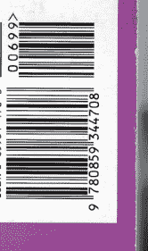


# R.A. Penfold 的其他计算机著作

- BP450 如何扩展和升级您的 PC
- BP467 如何连接 PC
- BP479 如何组装您自己的 PC

# 前言

虽然 Linux 曾经仅限于懂行的爱好者或专业计算机人士，但现在它已成为主流，或者与大公司操作系统竞争的真正替代品。毫无疑问，Linux 的一大吸引力在于它是免费的。你确实可以购买 Linux 的 CD-ROM 和纸质手册，但也可以从互联网上免费下载。如今，大多数新用户通常会在购买计算机杂志附赠的“免费”CD-ROM 之外获取 Linux。除了操作系统之外，大多数 Unix/Linux CD-ROM 通常还免费包含许多有用的实用程序和应用。

不需要专门为一台 PC 安装 Linux，只要硬盘空间足够，它就可以通过双启动系统与另一个操作系统共存。由于大多数 Linux 软件在远低于最新高性能 PC 的配置上也能运行良好，因此 Linux 可以让一台老旧且闲置的 PC 重获新生。Linux 通常与大型网络相关联，但它完全可以作为工作站的操作系统正常运行。它在家用领域的使用正在增加，但本出版物仅涵盖其在工作站上的使用。

表面上看，Linux 与图形用户界面并没有太大区别。它提供了类似于 MS-DOS 的命令行界面以及图形用户界面（GUI）。不过，两者之间有一些重大差异，即使是经验丰富的 Windows 用户在学习 Linux 时也可能遇到困难。如果你不了解相关知识，甚至进入 Linux 系统本身都可能很困难。许多 Linux 出版物在介绍操作系统的历史、对大多数用户初期无关紧要的技术以及晦涩难懂的命令上耗费了大量篇幅，而这些内容对大多数用户来说用处不大。本书采取“直奔主题”的方法，专注于 Linux 的日常计算。你不需要成为专家就能使用 Linux 系统，而且大多数 Windows 用户对该主题的理解也仅限于基础层面。对 Linux 也是如此，使用该系统并不需要深入的理解。理解基本概念更为有帮助，可以在必要时再学习相关技术。

# 请注意

尽管在本书的出版过程中已尽最大努力，以确保其中包含的任何项目、设计、修改和/或程序等通常可被接受，但出版方和作者对任何项目、设计、修改或程序无法正常工作（包括设计缺陷）或其与连接或协同使用的任何设备造成损坏不承担任何责任，也不对可能发生的伤害承担责任。同时告知，如果仍在保修期内的设备以任何方式进行了修改，或被使用或与自制设备连接，则该保修可能失效。


# 安装

# 选择困扰

对于刚接触 Linux 的新手来说，一个稍显令人困惑的方面是，有多家不同的软件公司都在提供它。要理解这是如何形成的，我们需要简要回顾一下 Linux 的起源。Linux 是由 Linus Torvalds 领导的一群人开发的，他们试图编写一个适用于单处理器计算机的 UNIX 操作系统版本。实际上，这意味着要为 IBM PC 及其兼容机编写 UNIX 版本，尽管也有一些基于 Intel 处理器的其他计算机。UNIX 被广泛认为是最强大、最通用的操作系统之一，经常出现在高端系统中，特别是用于科学和技术应用的系统。它当然也用作计算机网络操作系统。通过互联网协作，试图创建像类 UNIX 操作系统这样复杂的东西，似乎有点好高骛远，但该计划是成功的，并持续蓬勃发展。

那么，Linux 提供了哪些功能，谁需要这些功能？必须承认，Linux 对许多用户来说可能配置过高。这不一定是一个缺点，因为你完全可以忽略任何你不需要的功能。如果你以后需要它们，它们仍然存在。

# 多任务处理

Linux 具有完整的多任务处理能力，如果硬件能够胜任，它会愉快地同时运行不受阻碍的程序。

### 多用户

它还能够同时支持多个用户。这真正只有在 Linux 用作计算机网络时才显得重要，而这正是它处理得非常好的事情。然而，在这里我们只关注作为工作站操作系统的 Linux，多用户并发操作将不再进一步讨论。

# 商标

- MS-DOS、Windows 95、Windows 98 和 Windows NT 是 Microsoft Corporation 的注册商标
- Partition Magic 和 Boot Magic 是 PowerQuest Corporation 的注册商标
- WordPerfect 是 Corel Corporation 的注册商标
- Star Office 是 StarDivision Corporation 的注册商标
- PostScript 是 Adobe Systems Incorporated 的注册商标

## 自定义 KDE


# 其他需要了解的内容

## 文件管理
- 复制
- 图像查看器
- 文本编辑器
- 添加到书签
- 属性
- 重新加载
- 复制和粘贴
- 帮助
- 停止
- 内部控制按钮
- 窗口按钮
- 置顶按钮
- 菜单栏
- 程序图标
- KDE 控制台
- 查看窗口布局
- 缩略图查看
- 显示树状结构
- 文本查看
- 转到...
- 选项
- 在 KDE 中
- KFM 和 tar 文件
- 软盘复制
- 文本编辑
- WordPerfect
- 回顾
- 用鼠标拖动
- 在文件夹中选择文件
- 选择文件夹中的所有文件
- 打开文件或文件夹
- 复制、移动、链接
- 覆盖
- 复制和删除
- 回收站和删除
- 从回收站恢复
- 清空回收站

## 窗口管理
- 关闭窗口
- 激活窗口
- 移动窗口
- 最小化窗口
- 恢复窗口
- 最大化窗口
- 打开终端（控制台）
- 运行程序
- 在桌面上放置程序图标
- 切换虚拟桌面
- 使窗口在所有桌面上可见
- 启动 KFM
- 隐藏新面板
- 自动启动程序
- 启动程序
- 阻止程序自动启动
- 使窗口在所有桌面上可见
- 将窗口从一个桌面移动到另一个桌面

## 系统管理
- 多用户
- 权限
- 所有者（用户）
- 组
- 其他人
- 读 (R)
- 写 (W)
- 执行 (X)
- 列表
- 其他开关
- 添加组
- 复制
- KDE 1.0 驱动器
- 软盘格式化

## 版本

尽管 Linux 有很多优点，但有一个主要缺点，正是这一点导致了各种 Linux 版本的发布。Linux 是一个非常强大的 32 位操作系统，但其最基本的可用形式是命令行界面（CLI）。命令被输入到某种编辑器中，在这种方式使用时，可以认为安装正确的 Linux 非常困难。这促使个人和公司生产各种 Linux 增强功能，使其更易于使用和（或）安装。无论你从哪里获取 Linux，你都不太可能只得到 Linux 内核。使用杂志版本，通常你会得到一张包含 Linux 内核和各种支持文件、引导安装过程以及实用工具和应用程序的 CD-ROM。应该有文档。你应该会发现一些有用的东西很容易安装，特别是如果你是 Linux 完全新手。磁盘上包含文档，可能还有一些源代码。

如果你购买 Linux，通常你会得到更多的实用工具和应用程序。此外，你还会得到更多的文档。材料数量如此之大，单张 CD-ROM 是不够的，通常一套 Linux 包含两张到四张 CD-ROM。较便宜的版本随附手册，而较昂贵的版本虽然附带少量或没有印刷材料，但包含大量印刷文档。如果你通过互联网下载 Linux 或从计算机杂志获取 Linux，你更可能需要付出额外的大量努力。这不是例外，因为它们是相同的。只有拥有互联网连接时，才能获得支持。如果你购买 Linux，至少应该能获得有限期限的技术支持，以帮助你正确安装所有东西。

Linux 的新手常常质疑他们可以购买这个所谓的免费 Linux 操作系统这一事实，并且某些实现并不特别

Linux 还具有非并发多用户操作设施，操作员轮流使用计算机。对于每个操作员或操作员组来说，就好像他们拥有自己的计算机，没有其他用户。

# 非并发

# 安全性

作为多用户功能的副产品，Linux 具有出色的安全功能。每个用户都有自己的密码，并且可以拥有管理员无法访问的文件，而对系统的大多数更改只能通过登录超级用户来实施。这应该确保缺乏经验的用户不会意外做出破坏系统安全和稳定性的更改。还有使用安全功能的选项。使用安全功能设置起来很容易，但如果你是新用户，设置起来就困难了，对于试图以某种方式与数据文件交互的人更是难上加难。

# 源代码

Linux 常被称为免费操作系统，但在 Linux 语境中，这个“免费”一词有点含糊。它通常指的是言论自由中的“自由”，而不是免费面包中的“免费”。大多数非 Linux 软件是按“原样”出售的，如果存在小 bug，你无能为力。期望从出售它们的制造商那里获得支持。问题在于，当你购买操作系统时，你希望制造商以某种形式提供支持，但当它是免费的时，他们不会。代码是唯一的可用资源。Linux 比其他操作系统更通融。从理论上讲，你可以修改源代码并编译程序，以使其完全符合你的需求，或移除你遇到的任何 bug。实际上，这种事情远远超出了大多数用户的能力，雇用某人为你完成这项任务可能昂贵得令人望而却步。另一方面，Linux 社区有很多用户愿意利用他们的专业知识来帮助那些对主题没有真正理解的人。

# 它是免费的

Linux 对许多人的一个巨大吸引力/吸引力在于，它也是面包意义上的免费。可以从互联网下载，尽管以这种方式获取相当完整的 Linux 实现可能需要花费很多时间，即使你有快速互联网连接。如果没有，可能需要几天时间。不时地，计算机杂志会推出包含完整 Linux 套件的 CD-ROM，这可能是以最低成本试用 Linux 的最佳方式。第三种选择是购买 Linux，这时事情可能会变得有点混乱。有多种版本可用，有时每种版本还有一个以上的版本。


# 发行版

价格便宜。你支付的费用主要是CD-ROM光盘本身，而不是其中包含的软件。你还需要支付印刷手册和技术支持的费用。在某些情况下，你还可能需要为CD-ROM上包含的非免费软件付费。与生活中的大多数事情一样，你通常得到你支付的价格对应的东西。你付的钱越多，获得的印刷手册、技术支持等附加服务也就越多。你需要自己决定这些额外内容是否值得付费。

目前主要有几个版本的Linux，在通用术语中也被称为发行版。这些发行版中的任何一个都能为你提供良好可用的Linux发行版，并使安装过程相对轻松无扰。以下是各发行版的简要详情。

## Red Hat

Red Hat 发行版几乎可以肯定是最受欢迎的，它是 Linux 世界中的知名品牌。Red Hat 获得了英特尔等大型公司的资金资助，这应能使其更快地开发 Linux。Red Hat 发行版包含 GNOME 图形用户界面和 RPM（Red Hat 包管理器）软件安装系统。我认为这应该被视为“安全”的选择，因为大多数 Linux 软件都能在新的 Red Hat 版本下运行。安装 Red Hat Linux 也相当容易。

## Caldera

Caldera Open Linux 实际上有两个发行版，即普通版和“Lite”版。标准版面向企业用户，由于包含商业内容，因此不能自由分发。Open Linux Lite 不包含商业软件，可以自由分发。直到最近，这两个版本均未广泛可用。在英国，全版本现在似乎很容易获取。它包含补充的 KDE 格式以及系统的核心部分。Caldera Open Linux 比较完整，包含系统的核心部分。Caldera Open Linux 安装和使用相对简单，并且在最新版本中，可以轻松地与 Windows 一起安装在双启动配置中。对于首次用户来说，这是一个相当不错的选择。

## Slackware

这是最古老的发行版之一，有些人认为它比其他主要发行版缺乏前瞻性。不过，它是一个良好的可用 Linux 版本，安装相对容易。在英国很容易获取，如果你只接受没有印刷手册的光盘，它可以以相当便宜的价格获得。

## SuSE

其他三个发行版起源于美国，但 SuSE Linux 来自德国。它在欧洲，包括英国，变得相当流行，在英国很容易获取。显然，在欧洲以外，它比其他两个发行版更难获得。这是意料之中的，因为这是一个包含完整的 KDE 图形用户界面的发行版。我有时发现 SuSE Linux 有点难以启动和运行，但只要有决心，初学者应该能够使其正常工作。英文版本的更新往往略微滞后于德文版本。

实际上还有许多其他发行版，如 Debian 和 Turbo Linux，但这些在英国似乎没有上述四个发行版那么广泛可用。对于新来者来说，最好使用主要发行版之一，它们中的任何一个都应该能提供良好的稳定结果。

## 数字游戏

在大多数操作系统中，新版本之间相隔较远。我有一台 PC，已经使用了好几年，接近其使用寿命的尽头，但随着更新、更快的 PC 的出现，当前的操作系统仍然是最新版本。Linux 的情况非常不同，似乎不断有新发行版涌现。第一个数字表示内核本身，与 2.2.4 版本相比。第一个数字表示内核本身，变化非常不频繁；第二个数字是次要版本，每几个月或更少时间变化一次。最好避免使用已被取代的旧数字，但此时最好避免使用旧数字或更少的版本。最好避免使用奇数（奇数次要版本），因为这些是开发版本。内核，或者以常规计算术语来说，是我们所认为的测试版代码。这种类型内核不随主要 Linux 发行版提供。在撰写本文时，最新的次要版本是 2.4 版，但尚未在所有主要发行版中得到体现。

Linux 发行版通常具有两位数的版本号，如 2.5.3 或 6.0，但就像大多数 Windows 软件一样，第二位数字可能会每年改变两次左右，而第一位数字在有重大变化时大约每两年改变一次。如果你的 Linux 版本落后于当前版本一个小数点或两个小数点，它并非完全最新，但另一方面，它也不算真的过时。

# 硬件

Linux 是一个强大的 32 位操作系统，那么你需要一台强大的 PC 才能正确运行它吗？这是一个“绳子有多长”类型的问题，硬件需求取决于你想使用的应用程序。它还取决于你是需要“基本”的最小安装，还是“功能齐全”的版本。运行 Linux 所需的绝对最低要求是配备 80386 微处理器的 PC，约 8 MB 内存，约 54 MB 硬盘空间，鼠标，支持的显卡，以及 CD-ROM 驱动器。虽然像这样基本的计算机也能运行 PC 版 Linux，但建议这只是运行 Linux 所需的全部要求则具有误导性。

## 硬盘

基本的 Linux 操作系统使用命令行解释器，你在那里输入命令，很像使用 MS-DOS。要充分利用此操作系统，你真的需要安装 X Windows，这将大致使所需的磁盘空间翻倍。它还建议你保留一些磁盘空间用作交换文件。这是操作系统将用于临时文件存储的空间，最多可使用 100 MB。交换空间通常至少等于计算机安装的内存量。最后，也是同样重要的，你需要一些磁盘空间用于应用程序和实用软件。即使是极简的 Linux 发行版，单张 CD-ROM 也包含许多兆字节有用的实用程序和完整的部分应用程序，许多 Linux 安装最初大约占用 350 到 450 MB 的空间。加上数据文件的存储空间。别忘了你还需要一些空间用作交换文件。作为参考，你也需要大约 340 MB 的驱动器进行相对完整且经过测试的安装。850 MB 或更多是更可取的。

## 处理器

尽管 Linux 对处理器的要求通常比其他许多操作系统低，但指望将 Linux 安装在一台旧的 33 MHz 80386 基于 PC 上并期望它能像最新的 Pentium 奇迹一样运行是不现实的。

计算机。如果你打算使用 X Windows 和一些更强大的应用程序，你将至少需要一台快速的 80486 基于 PC，最好配备某种 Pentium 处理器，但对于大多数使用，软件可能需要 100 MHz Pentium 处理器或相当的性能就足够了。

## 内存

虽然 8 MB 内存应该足以让 Linux “启动并运行”，但显然拥有更多内存更好。你可能用 16 MB 也能过得相当好，但如果拥有 32 MB 或更多内存，一切运行起来可能都会更快更流畅。一些更高级的应用程序至少需要 32 MB 内存。既然如今内存相当便宜，没有必要刻意节省。投资于内存升级是非常值得的。这为你需要多任务处理时留下了充足的“头部空间”。

## CD-ROM

有可能从软盘安装一些较旧版本的 Linux，但现代发行版通过一张或多张 CD-ROM 提供，因此你需要某种 CD-ROM 驱动器。使用 CD 安装要快得多，旧的 2x 驱动器就可以了。不过，带有普通 ATAPI（IDE）接口的 CD-ROM 驱动器应该不会有问题，但某些 SCSI 驱动器可能不受支持。计算机中的硬件越常见，其在 Linux 上良好运行的可能性就越大。

## 指向设备

基本上任何适合的鼠标，Linux 支持串行、总线型和 PS/2 鼠标。理论上需要三键鼠标，但双键鼠标可以模拟中键类型的功能。同时按下两个按钮相当于按下第三个按钮中的中间鼠标。如果你在让 Linux 与鼠标通信方面遇到问题，可以购买一台不同的计算机。如今使用鼠标有一个缺点，所以这真的不算主要问题。如果你想使用图形板或其他奇异形式的指向设备，你可能会发现它们无法在 Linux 上工作。


# 外设

假设 Linux 能正常在你的个人电脑上运行，它也能操作打印机和调制解调器等外设吗？这很大程度上取决于你使用的具体外设，设备越常见，被 Linux 支持的可能性就越大。你可能在标准的 Linux 发行版中找不到特定打印机或其他外设的支持。大多数 Linux 发行版都包含惠普 LaserJet 打印机驱动程序。使用模式驱动程序或仿真器，可以将惠普 LaserJet 打印机配置为与许多其他打印机配合工作。LaserJet 打印机有许多不同的类型，即使在同一类型下也有许多不同的变体。这是在许多办公室中最常见的打印机类型，因此它是需要支持的最重要的打印机类型。然而，LaserJet 打印机打印输出的质量变化相当大，具体取决于使用的型号。有些型号能产生非常高质量的输出，而另一些则不尽如人意。如果你有一台 LaserJet 打印机，你应该会发现它可以与 Linux 无缝配合工作。

如果你没有 LaserJet 打印机，你可能会发现无法将其用于 Linux，至少不能在不进行一些修改的情况下使用。打印机有许多不同的类型，每种打印机都有其独特的特性。这使得创建一种适用于所有打印机的通用驱动程序变得困难。最好的解决方案是使用 PostScript（页面描述语言）驱动程序。这是一种可以适用于许多不同类型打印机的通用驱动程序。然而，它并不总是可用的，即使可用，也可能无法适用于所有打印机。如果你有一台非 LaserJet 打印机，你需要寻找专门为你的打印机设计的驱动程序。你可能能够在互联网上找到这样的驱动程序，或者可能需要自己编写一个。编写打印机驱动程序并非易事，也不是大多数人愿意做的事情。但是，如果你具备技能和意愿，这是一个非常有价值的项目。

许多内部调制解调器和廉价打印机属于这一类别。这类设备的问题在于它们缺乏完整设备中通常应包含的大部分电子元件。缺失的个人电脑硬盘驱动器以及许多应用程序中产生的大量“过度设计”可以以相对较低的成本实现。这种方法的主要缺点是，相对于正常软件，使用此类外设的驱动程序明显更为复杂。虽然可能可以使用任何其他操作系统（如 Linux）下的 Windows 设备，但由于驱动程序软件的复杂性，可能永远无法生成合适的驱动程序。

# 显卡

某些显卡也存在同样的问题。在新视频卡发布和为视频卡出现驱动程序之间往往存在滞后。这具有双重影响。首先，新显卡可能会迟迟得不到支持。其次，拥有成熟驱动程序的旧显卡也迟迟得不到支持。因此，尽可能保持显卡更新很重要。换句话说，不要追求最新、最尖端的外围显卡，而应选择那些经过充分验证且具有稳固驱动基础的显卡。

# 显示器

标准 VGA 显示器的最小分辨率应为 640 乘以 480 像素。但是，你应争取获得支持 800 乘以 600 像素，甚至 1024 乘以 768 像素的显示器。如果你有一个 19 英寸的显示器，你可以获得 1280 乘以 1024 像素的分辨率。分辨率越高，屏幕上可以显示的文本和图形就越多。如果你经常处理电子表格，或者处理大型图像，这一点就很重要。高分辨率显示器可以让你看到更多细节，并使阅读小字变得更轻松。

在实践中，我发现这类情况有点尴尬，只要可能，我都更愿意将屏幕设置为 800 乘以 600 或 1024 乘以 768 像素的更高分辨率。即使这导致菜单文本等相对较小，或者文本较小，我仍然建议使用显示器在这些较高的分辨率下工作。

归根结底，判断你的个人电脑硬件是否兼容 Linux 的唯一方法是“试一试”的方法。如果没有具体的支持该视频设备的措施，使用该设备的驱动程序将产生令人满意的结果。对于显卡，值得研究说明书以确定其使用的芯片组。或者，查看显卡本身的芯片。使用与你的显卡外观相同、使用相同芯片组的显示板的驱动程序通常能产生令人满意的结果。

除非你打算使用一些特别苛刻的软件，否则没有必要拥有最新高科技的个人电脑。许多用户升级到新电脑后，希望将旧电脑物尽其用，特别是当它并不老且仍有很大的使用寿命时。一台无法良好运行大多数其他操作系统的个人电脑，在 Linux 下可能能产生完美的结果。这可能是一个主要因素，促使 Linux 的普及度突然增加。如果你发现你的旧电脑可以作为 Linux 工作站获得第二次生命，你不应失望，而应感到欣慰。如果它可以作为典型的 Linux 工作站运行，它可能太强大而无法用作交互式控制台。如果你想进行严肃的批处理或远程登录，拥有一个专用的控制台是件好事。即使这样一个专用控制台的唯一用途是测试 Linux 是否在你的系统上正常工作而不必启动旧硬件，它仍然是一个有用的工具。甚至有可能，如果旧硬件相当强大，它可以用作专用的 Linux 工作站，从而让旧硬件获得第二次生命。

# 准备工作

在尝试安装 Linux 之前，需要进行一定量的准备工作。如果你是从一台硬磁盘完全空的新电脑开始，基本上不需要做什么。主要只是尝试寻找一些基本的硬件配置，以防在安装过程中需要。如果你在以前曾使用其他操作系统在硬磁盘上使用过的电脑上安装 Linux，情况也是如此。

这也会影响你在硬磁盘上有什么。如果你正在一台拥有已移除系统的个人电脑上安装 Linux，连同现有的 Windows 系统，以及所有硬磁盘上的 Linux。如果你正在一台硬磁盘上拥有现有系统的个人电脑上安装 Linux，你应该备份硬磁盘。这是因为 Linux 安装过程可能会移除已从硬磁盘移除的任何数据。

# 双启动系统

如果你选择双启动系统，即使用单个硬磁盘同时运行 Linux 和 Windows，事情会稍微复杂一些。在设置双启动系统时，有一些重要的点需要考虑。首先，如果你正在安装双启动系统，务必保留硬磁盘分区上的 Windows 系统，以及在硬磁盘上创建的 Windows 系统备份副本。同样重要的是，确保 Linux 系统不会覆盖硬磁盘上的引导扇区或任何关键的 Windows 数据。

有几点需要牢记。首先，你需要确保分区软件设置正确，以便引导加载程序（如 LILO 或 GRUB）安装在正确的分区上。如果你使用 LILO，确保它安装在硬磁盘的第一个分区上。如果你使用 GRUB，确保它安装在硬磁盘的 MBR（主引导记录）上。这对于双启动系统正确运行至关重要。

作为引导过程一部分的引导管理器，将能够让你选择要启动哪个操作系统。这通常是一个在计算机启动时出现的基于文本的菜单。你可以从这个菜单中选择 Linux 或 Windows。确保菜单配置正确，以便两个操作系统都列在其中并且可以选择。

为了创建一个双启动系统，你应该首先在硬磁盘上设置非 Linux、非 Windows 的分区。这是安装 Linux 系统的位置。你需要确保该分区格式正确，并且必要的 Linux 文件已安装在上面。一旦 Linux 系统安装在该分区上，你就可以设置引导加载程序和引导菜单。

如果你希望在一台已经安装了紧密且正在使用的操作系统的电脑上添加 Linux，事情变得更加复杂。不太可能发生对操作系统产生灾难性影响的错误。如果在安装过程中犯了灾难性的错误，将难以修正。还值得注意，如果你想在一台已经运行不同操作系统的电脑上安装 Linux，你需要小心不要损坏现有系统。

如果你计划在一台已经运行不同操作系统的电脑上安装 Linux，你需要小心不要损坏现有系统。在进行安装过程之前，备份硬磁盘上的任何重要数据很重要。你还需要确保硬磁盘有足够的空闲空间来安装 Linux。如果空间不足，你可能需要删除一些不必要的文件或程序以释放硬磁盘上的空间。

为 Linux 安装释放一段硬磁盘空间的漫长路线是备份现有系统，然后使用其 MS-DOS FDISK 程序重新安装磁盘。相反于重新分区磁盘使其容量被使用，你留出足够的未使用容量供 Linux 安装。通过重新分区磁盘，你将破坏 Linux 安装并失去现有系统。这就是为什么在进行安装过程之前备份现有系统很重要。

如果你要使用诸如 PartitionMagic 这样的程序来重新分区磁盘，你需要确保该程序与你的操作系统兼容。并非所有分区程序都兼容所有操作系统。在使用该程序重新分区磁盘之前，检查程序的兼容性非常重要。你还需要确保程序是最新的，并且拥有必要的驱动程序和更新的最新版本。

在重新分区磁盘之前，你需要确保现有操作系统已备份。这是因为重新分区过程将破坏现有系统和硬磁盘上的任何数据。你需要确保备份是完整的，并且你在出现问题时有可靠的方法来恢复系统。同样重要的是测试备份，以确保其正常工作。

这通常使用名为 LinuxPartition 的程序完成。这是在 Linux 安装过程的最后一步访问的。还有其他分区程序，如 GParted，也可以用于重新分区磁盘。选择正确的工具来完成工作并确保针对你的特定需求使用工具的正确版本非常重要。


首先需要进行磁盘碎片整理。

成功执行所需的重分区操作，但要求先对磁盘进行碎片整理。

坦白说，除非你在分区和安装操作系统方面相当精通，否则最好使用CD-ROM安装程序来启动计算机以进行双系统设置。这实际上不会为你执行重分区操作，但Linux CD上包含了该程序的完整版本，可以从硬盘或CD-ROM驱动器运行。

即使你经验更丰富，我也不建议将Linux安装到旧且平时不使用的PC的硬盘空白区域。在一台便宜的二手PC上安装Linux是尝试这个操作系统更简单且更安全的方式。

# 开始

如果你购买了一套带有手册的Linux光盘，显然有必要按照手册中的说明进行操作，手册会详细介绍如何安装该特定版本的Linux。如果你有一张附带说明或其他文档的杂志光盘，请使用它们。由于具体的安装方法因发行版而异，且随版本更新而变化，我无法在此提供全面的通用指导。由于无论使用哪种发行版，本质上你安装的是相同的东西，因此一般步骤大多相同。

许多步骤都很简单，因此我们将在此集中讨论安装过程中较为复杂的部分。

为了安装Linux，通常你需要以一种类似迷你Linux的状态启动计算机，以便运行安装软件。过去，这通常是一组启动软盘以便安装Linux，但现在通常不再需要启动软盘。因此，我建议如果你被提供了一张启动软盘，请购买“盒装版”的Linux。它可能稍贵一些，但这是唯一合理的选项。如果你没有合适的光驱或可启动的CD-ROM，请尝试启动驱动程序的基础版本或协作模式。它将能够使用CD-ROM，但除此之外不会执行更多关键任务。接下来，大部分时间将花费在与CD-ROM安装程序打交道上。CD必须位于CD-ROM驱动器中，以便计算机的所有部分都能使用它。对于任何新计算机，暂时必须使用可启动的软盘（可启动的CD-ROM）进行启动。实际上，在使用普通ATAPI CD-ROM驱动器时，CD-ROM通常不会有问题。

现代AMD BIOS具有某种简单的图形用户界面，并支持某些类型的鼠标。选择“高级”选项。

# 安装 1

如果BIOS设置程序中设置了正确的启动选项，则使用CD-ROM。

如果你想尝试从CD-ROM启动，几乎肯定需要进入设置程序并选择合适的启动选项。不确定你的PC是否必须首先启动CD-ROM驱动器才能使用设置程序。此外，如果你不确定你的PC是否支持此启动，请查阅手册。这可以在设置程序中完成。它仅用于防止计算机使用CD-ROM启动选项。

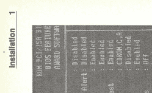

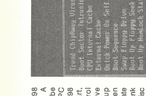

Windows 98安装过程。可以通过选择“开始”、“设置”、“控制面板”、“添加/删除程序”、“启动盘”，然后操作“创建磁盘”按钮来创建启动盘。在操作“创建磁盘”按钮之前，应在A:驱动器中放置一张格式化为1.44MB的1.44MB磁盘，或者在使用软驱的计算机上使用开关，系统将可能不需要从第一个启动设备启动。

进入BIOS设置程序，会出现一个简单的菜单，以及CD-ROM支持的选项。应选择不支持启动CD-ROM时不支持的选项。

或者，可以使用MS-DOS格式化软盘。为了使磁盘可启动，在执行格式化命令时应使用该磁盘，如下所示：

```
format A:/s
```

还可以使用MS-DOS提供的SYS程序将系统文件添加到普通格式化的软盘中。这是将使用的指令：

```
SYS A:
```

请注意，Format和Sys命令不是MS-DOS的内部命令，计算机必须能够访问这两个命令中任一的相关程序文件才能工作。

制作启动盘后，接着使用磁盘启动计算机，然后为启动盘添加CD-ROM支持。从初始屏幕选择选项（图1.3），然后从下一个屏幕选择“第一启动设备”（图1.4）。选择“CD-ROM”，然后返回主菜单。点击鼠标在窗口左上角的小方框以退出主菜单，然后点击“保存更改并退出”框以实际保存新的设置信息。同样应该可以从新安装的CD启动。请注意，如果新安装设置与原始启动设置相同，则无需设置。这是因为除非执行此操作，否则计算机可能无法从硬盘正确启动。

# 直接从CD-ROM

如果你由于某种原因无法从CD-ROM启动，应该可以仅从原始DOS磁盘创建启动盘，CD-ROM将被启动，因为CD-ROM上的DOS版本可以添加支持。最简单的方法是使用Windows 98启动盘，这通常是在

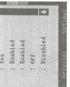

```
Advanced Setup
1st Boot Device
2nd Boot Device  : CDROM
3rd Boot Device  : Disabled
Boot From Network Card : Disabled
Try Other Boot Devices : No
S.M.A.R.T. for Hard Disks : Enabled
Quick Boot : Enabled
Bootly Num-Lock : Off
Floppy Drive Setup : Disabled
```

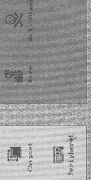

图 1.4 将第一启动设备设置为“CDROM”

消息会告知你计算机在启动进入某种极简版Linux时的操作状态。除非你是Linux专家，否则大多数消息可能没有太大意义。只需忽略它们，耐心等待安装程序运行。

许多问题非常简单，只需让你选择诸如要使用的语言和你所在的时区之类的事项。一些Linux发行版附带一个安装程序，它会像CD-ROM上的启动菜单一样，询问一系列是或否的问题。对于问题较少的Linux，例如Debian，答案可以在文档或在线手册中找到。更重要的问题是：用户名、密码以及你是否想要安装完整的操作系统还是仅仅基本实用工具。安装程序具有此功能，自动安装程序可能适用于你的特定PC。如有必要，查看完整的安装程序以了解其工作原理并解决可能遇到的问题。请注意从不同目录使用Linux。通常很难从零开始启动新系统。你将不得不从零开始重做安装的完整部分。

# 图 1.3 选择“高级”菜单

计算机或CD-ROM驱动器应配备必要的安装软件或重新引导，以使添加的CD-ROM支持生效，并且你可以访问CD-ROM驱动器。

接着，需要浏览CD-ROM上的文件以追踪用于启动安装过程的相应文件。可能有一个批处理文件，名称类似于setup.exe或install.bat。CD上会有一些readme文件，其中其中一个应该会告诉你需要了解的内容。当你找到合适的文件后，运行它很可能会启动安装过程。通过指定文件路径转到CD的根目录更安全。更安全的做法是进入包含该文件的目录并从那里运行它。

# 问答

一旦通过安装过程，很大程度上就是回答一系列问题。可能需要一段时间才能到达第一个问题，之前屏幕上会出现许多晦涩的消息。这些

这样做的原因。特别是当可用的磁盘空间非常有限时，建议为主 Linux 安装使用一个分区。

# 使用 FDISK

FDISK 程序使用简单的命令行界面，您通过在下方的提示符（即回车键）处输入相应的字母来发出命令。在命令提示符处输入的任何原始数据都将在命令行中被解释。以下是使用 FDISK 时可用命令的列表：

-   a 切换当前分区的可引导标志
-   d 删除当前分区
-   l 列出所有分区
-   m 主菜单
-   n 创建新分区
-   p 打印分区列表及分区详情
-   q 不保存并退出
-   r 替换当前分区的系统 ID
-   v 修改显示/输入单位（柱面或扇区）
-   w 保存更改并退出

为了本示例的目的，假设 PC 将仅用于 Linux，并且其硬盘容量为 1000 MB。由于只有 32 MB 内存，您需要至少 32 MB 的交换磁盘空间（例如 25 MB 或更多）。这意味着稍大一点的 50 MB 容量会更好。这大约占总磁盘空间的 5%。首先创建主分区，按下“N”键，当然还要按下回车键，电脑会响应如下：

-   Command action
-   e 扩展
-   p 主分区 (1-4)

# 磁盘分区

如前所述，在开始安装过程之前，需要为 Linux 安装预留一部分硬盘空间，但这是通过使用 Linux 的 FDISK 程序来实现的，该程序类似于 MS/DOS 程序，您可能需要在安装过程中运行它。这并不困难，但您需要控制分区过程。FDISK 将在安装过程的早期运行。如果您需要安装并行的 Linux 与其他操作系统共存，您应非常小心，以免意外导致其他操作系统被删除。

许多运行 Windows 的 PC 将整个硬盘，即使是高容量磁盘，设置为作为单个驱动器运行。这个磁盘通常被指定为驱动器 C。因此，许多 Windows 用户可能不熟悉硬盘分区的概念。这是一个非常简单的想法，即单个驱动器可以像实际上是两个或更多较小的驱动器一样使用。而不是将一个 6.4 GB 的驱动器用作单个驱动器，它可以用作两个 3.2 GB 的驱动器。它们将被指定为驱动器 C 和 D。额外的分区称为逻辑驱动器，它们不是独立的硬件部件，而是旋转的。这些也被称为逻辑分区，我们可以使用它们。正如我们之前讨论的那样，它们也有缺点。一个大的未使用磁盘空间块，其总容量通常更有用。

在 Linux 中，磁盘上通常至少有两个分区。如前所述，其中一部分通常分配给交换磁盘，这是操作系统用于临时存储的容量。Windows 可以拥有这种类型的永久交换磁盘，但具有性能优势。然而，大多数 Windows 系统使用交换磁盘。交换磁盘至少可以是 32 MB，但如果 PC 配备的 RAM 数量较多，它可以更大，甚至可以到 100 MB。如果您的 PC 有 32 MB 内存，那么您的交换磁盘大小至少应为 32 MB，但如果硬盘有充足的剩余容量，PC 的交换磁盘大小甚至可以达到 100 MB。如果 PC 有 128 MB 内存，交换磁盘大小则必须是最大 100 MB，或者尽可能接近这个值，具体取决于可用的磁盘空间。剩余的可用磁盘容量可以划分为更多的分区，但可能没有

您被要求选择分区类型，且它是一个主分区

响应如下：

分区编号 (1 - 4)

正在创建的分区是硬盘上的第一个分区，因此输入“1”，然后按回车。然后您会被要求指定起始和结束柱面号。由于硬盘没有与其他操作系统一起使用，可用的第一个柱面号将是 1 到 800，因此只需输入 1 作为起始柱面，800 作为结束柱面。然后您可以继续输入可用的 600 个柱面数。我们希望在这个示例中为硬盘总柱面数的 35%。您可以使用 600 到 800 之间的任意数量，但我们要确保不会创建过大尺寸的分区。800 个柱面的 35% 是 280 个柱面，因此我们输入“280”，然后按回车。您会被询问是否真的想要在这个特定的硬盘分区上使用 280 个柱面。“确认”分区大小将再次通过按“回车”完成。

作为回应，您可以设置分区 ID 代码。在我们的示例中，我们将使用类型 83。要选择此 ID，请输入“83”，然后按回车。

您被要求调出分区表。在我们的示例中，这将显示类似以下内容：

| 设备 | 引导 | 起始 | 结束 | 块 | ID | 系统 |
| --- | --- | --- | --- | --- | --- | --- |
| /dev/hda1 | | 1 | 760 | 781+234 | 83 | Linux 本地 |
| /dev/hda2 | | 761 | 800 | 39062 | 82 | Linux 交换 |

“设备”下的条目相当于 MS-DOS 和 Windows 的盘符。“本示例是在第二个可用柱面分区上创建的。第一个可用柱面分区的 ID 为 83。第二个分区用于容纳 Linux 交换分区。”

此步骤也在某种程度上处理了最初创建的“83”类型分区。它并非作为 Linux 本地分区创建。“如果”您按照您的想法创建了事物，结果发现类型错误。如果您更正了分区编号，必须重新进行工作。可以使用命令更正大小。如果可用柱面数量出错，您可以重新进行工作。

与 MS-DOS 版本的 FDISK 不同，Linux 版本不会自动为 Linux 本地分区创建引导扇区。当在硬盘的唯一分区或普通驱动器上安装 Linux 时，这可能会导致问题。如果省略此步骤，安装过程将正常进行，但您最终可能会遇到问题。“例如”，如果您试图在硬盘上安装 Linux，您将不得不使用引导软盘或按下“A”键，直到系统简单挂起或进入循环，在屏幕底部打印启动软盘的文本。

至少一个分区，即 / 分区。这是一个将保存文件和 /etc 目录的分区。随着您创建更多目录，空间会被使用，因此我们应该稍微慷慨一点。在本例中，我们将使用所有可用的柱面空间。柱面数量将由空闲柱面的数量决定。柱面总数为 750，由于我们要使用整个柱面，我们将输入“750”，然后按回车。然后输入“4”，接着按回车。

如果您输入“L”，然后按回车，您将看到大量可用分区类型的列表。目前分区为类型 83（Linux 本地）和类型 82（Linux 交换）。如果您想添加分区，请输入“83”，然后按回车。然后输入“2”，接着按回车。

调出分区表。在我们的示例中，这将显示类似以下内容：

| 设备 | 引导 | 起始 | 结束 | 块 | ID | 系统 |
| --- | --- | --- | --- | --- | --- | --- |
| /dev/hda1 | * | 1 | 760 | 781+234 | 83 | Linux 本地 |
| /dev/hda2 | | 761 | 800 | 39062 | 82 | Linux 交换 |

“设备”下的条目相当于 MS-DOS 和 Windows 的盘符。“本示例是在第二个可用柱面分区上创建的。第一个可用柱面分区的 ID 为 83。第二个分区用于容纳 Linux 交换分区。”

此步骤也在某种程度上处理了最初创建的“83”类型分区。它并非作为 Linux 本地分区创建。“如果”您按照您的想法创建了事物，结果发现类型错误。如果您更正了分区编号，必须重新进行工作。可以使用命令更正大小。如果可用柱面数量出错，您可以重新进行工作。

与 MS-DOS 版本的 FDISK 不同，Linux 版本不会自动为 Linux 本地分区创建引导扇区。当在硬盘的唯一分区或普通驱动器上安装 Linux 时，这可能会导致问题。如果省略此步骤，安装过程将正常进行，但您最终可能会遇到问题。“例如”，如果您试图在硬盘上安装 Linux，您将不得不使用引导软盘或按下“A”键，直到系统简单挂起或进入循环，在屏幕底部打印启动软盘的文本。

至少一个分区，即 / 分区。这是一个将保存文件和 /etc 目录的分区。随着您创建更多目录，空间会被使用，因此我们应该稍微慷慨一点。在本例中，我们将使用所有可用的柱面空间。柱面数量将由空闲柱面的数量决定。柱面总数为 750，由于我们要使用整个柱面，我们将输入“750”，然后按回车。然后输入“4”，接着按回车。

如果您输入“L”，然后按回车，您将看到大量可用分区类型的列表。目前分区为类型 83（Linux 本地）和类型 82（Linux 交换）。如果您想添加分区，请输入“83”，然后按回车。然后输入“2”，接着按回车。

在每个阶段之后“检查”以确保分区表也是明智的。电脑将响应类似以下内容：

您可以看到通过回车。您准备就绪了硬盘，请按“w”，然后按回车。分区是信息写入硬盘，请按“R”，然后按回车。然后按“Q”，接着按回车。

安装过程。


对分区进行更多更改，请选择“否”并继续安装。系统可能会要求你指定文件系统的挂载点。只需将其设为“/”。请注意，在处理 MS-DOS 和 Windows 文件名时，使用正斜杠 (/) 字符来表示从一个目录跳转到另一个目录。在 Linux 中，正斜杠的使用方式与此非常相似。如果你是经验丰富的 MS-DOS/Windows 用户，可能需要一些时间来适应这种变化，在此期间你不得不忍受大量的错误信息。

接下来，系统将询问你希望使用哪个分区作为交换盘。由于只有一个类型正确的分区可以作为交换盘，因此只有一个是默认选项。该分区将用于交换分区过程。类似的过程随后用于选择 /（根）应挂载的分区。同样，由于只有一个类型正确的分区用于安装，你从正确类型中选择的根分区应该是唯一提供的选项。在选择这两个分区时，都会有检查错误或对磁盘进行“验证”的选项。这样做是值得的，尤其是在你在第一次使用的硬盘上设置 Linux 安装时。否则，除非你知道硬盘状况不佳，否则可能不值得这样做。此外，对硬盘的验证过程可能会花费很长时间。

# 软件选择

在大多数安装程序中，你都会对要安装的软件包有一定的控制权。可以选择各种标准安装类型，例如小、中、大和超大，以及用于选择单独的软件包或不同组的程序组。这显然在某种程度上是个人的选择，很难一开始就拥有一个相当完整的标准软件包选择。这留下了选择你想要软件包的余地。为了从 Linux 中获得最大效益，你需要 X 窗口系统和一些应用程序。诸如 C 和 C++ 开发工具之类的软件可能对大多数用户来说兴趣不大。

不可避免地会有一些与网络相关的问题。在这里，我们只关注用作工作站的 Linux。你不能完全忽略网络功能。但你不太可能将 Linux 作为网络的一部分进行安装，实际上也不会连接到另一台计算机。显然，你只需回答提出的问题。如果计算机中安装了网卡，安装程序可能会询问设置，例如 IP 地址、主机名和网络掩码。这些可以被询问到。由于不需要担心主机名，只需将其留空即可。

对于网络，可以接受默认名称，该名称通常是类似“nodomain_newhere”的形式，或者将其替换为你自己选择的名称。名称的基本格式必须与默认名称相同。

# LILO

Linux 通常通过一个名为 LILO 的程序启动，这可能需要少量的配置。基本上，这只是选择 LILO 将安装在硬盘的哪个部分，如果需要包含哪些选项，以及默认启动的操作系统。

LILO 安装有两个主要位置。第一个主分区是磁盘分区之前的主引导记录 (MBR)。默认选项在 MBR 中。这将确保磁盘可用于选择替代操作系统。如果你希望减少延迟且提供了此选项，可以配置 Linux 的延迟时间。

你也会被要求选择要安装的 Linux 内核。除非你确切知道自己在做什么并有充分的理由这样做，否则只需选择默认内核即可。

# 密码

在安装过程中，你将被要求提供至少一个密码。最少需要为用户 `superuser`（或 root 账户）设置密码。设置第二个密码通常是个好主意。通常建议设置两个密码。第二个密码通常被设置为 root 账户的密码，你可以在系统设置更改时使用。你也可能被要求为第二个密码设置一个密码。这通常被称为管理员密码。

重要的是要记住，设置的密码不是以明文形式存储的，而是经过哈希处理的。这意味着密码不是直接存储的，而是密码的哈希值被存储。这是一个单向过程，意味着无法从哈希值中恢复密码。这对安全性是好事，但也意味着如果你忘记了密码，你将不得不重新安装系统以找回密码。因此，记下你的密码并将其存放在安全的地方是个好主意。

你也会被要求设置至少一个用户账户。即使你只使用一个用户，许多人也喜欢以标准用户而不是 root 用户登录。这样做可以避免许多意外对系统做出 unwanted 更改的风险，特别是如果你对 Unix 文件系统不太熟悉的时候。

如果你主要限于运行系统，root 密码可以在稍后按需设置。如果需要，用户账户也可以稍后创建。用户可以使用 adduser 命令创建用户账户。如果被要求输入组 ID，请输入与用户 ID 相同的值。如果被要求输入组名，请输入与用户名相同的值。如果被要求输入组 GID，请输入与用户 ID 相同的值。安装过程在处理这些设置时相当灵活，并接受大多数合理的输入。

在安装过程中，你还会被要求输入 root 账户的密码。你也可能被要求输入你正在创建的用户账户的密码。如果你不打算设置用户账户，只需在密码提示处按回车键即可。

请注意，当你输入密码时，屏幕上不会显示密码。这是正常的，并不表示你没有输入密码。

通常建议为每个账户使用不同的密码，并定期更改密码。使用强密码也是一个好主意，强密码应包含大写字母、小写字母、数字和符号的混合。

你的密码越复杂，其他人越难猜测，但你记住它的难度也越大。

可安装的程序会就选择可接受的密码提供一些指导，但通常它必须至少包含四个字符，并且可以包含大写字母、小写字母、数字和标点符号。密码越复杂，其他人越难猜测，但你记住它的难度也越大。

这需要用户自己去记忆。如果你忘记了 root 密码，将不可能对 Linux 安装进行更改，可能需要重新安装 Linux。不要使用流行且可预测的密码，例如你的生日日期或你的名字（无论拼写正确与否，例如 believing 而不是 wellbrow）加上你拼写错误的地点（例如，倒着拼写）。这些应该印在你的脑海中，但不应让任何人轻易破解。

# X 窗口

假设你选择了安装 X 窗口系统，这可能需要一定程度的手动配置。在一些较新版本的 Linux 中，安装过程会尝试通过软件探测系统来确定存在的硬件；如果成功，探测过程将少于手动配置，但很可能你仍然需要进行一些手动配置。X 配置文件包含关于你使用的鼠标类型的大量配置信息；探测仅用于此。你还需要知道视频卡上的内存数量或其他相关信息。初始的 XFree86 设置程序通常使用 XF86Setup 程序实现。

手动配置通常使用 XF86Setup 程序实现。它会询问你希望现在还是稍后运行此程序。我建议选择“稍后”，因为“现在”选项实际上意味着它将推迟到稍后执行！当配置程序最终运行时，它会提供一个初始帮助屏幕（图 1.5），有助于在程序中导航。在运行 XF86Setup 程序之前，通常会请求关于正在使用的鼠标类型的信息，导航非常容易，因此从一开始就能正常工作。然后它运行一个包含鼠标配置选项的菜单。图 1.5 中的页面用于控制此过程，直到鼠标正常工作。假设你确切知道使用的是哪种类型的鼠标，让它正常工作应该没有问题。

一个令人困惑的地方涉及罗技（Logitech）鼠标。罗技鼠标与现代罗技串行鼠标不兼容，并且不支持我稍微过时的罗技鼠标，除非你拥有一个真正的古董“罗技鼠标”，应该使用 Microsoft 选项。如果有通用串行鼠标选项，这应该也能适用于几乎任何串行鼠标。许多计算机配有并非由主要鼠标制造商生产的串行鼠标。同样，Microsoft 或通用串行鼠标选项应该能带来良好的结果。

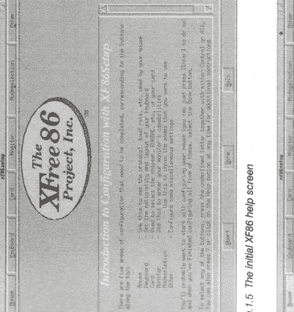

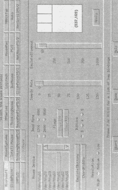


# 鼠标配置

results. 几乎所有串行鼠标都可以使用 Microsoft 或通用串行鼠标驱动程序正常工作。为了让正确的鼠标正常工作，必须将 X Windows 设置为使用正确的鼠标端口。如果您使用的是总线或 PS/2 鼠标端口，应该没有问题，配置程序应默认正确选择正确的端口。这是 Linux 与 MS/DOS 或 Windows 端口标识之间的正常配置。

- MS/DOS：端口 1 (COM1) / Linux：/dev/tty0
- MS/DOS：端口 2 (COM2) / Linux：/dev/tty1

用于端口的名称并未完全标准化，串行端口可能被称为 /dev/cua0 和 /dev/cua1 之类的名称。如有必要，请花一点时间找到正确的端口设置。

有一些选项，例如鼠标灵敏度，可以根据特定偏好进行设置。其他选项，如波特率，除非有充分的理由，否则不应更改。如前所述，从理论上讲，Linux 需要一个三键鼠标，但您可以使用双键鼠标加上三键模拟模式。实际上，如今第三键鼠标似乎并不重要，但如果您使用的是双键鼠标，最好启用三键模拟功能。

# 键盘

配置程序的下一个屏幕要求输入键盘信息（图 1.7）。键盘此时应该已经能够正常工作，通常不需要更改任何设置。最好保持其他设置不变。如果键盘操作的某方面不正确，或者您希望“微调”按键功能，可以随时返回配置程序。

# 显卡

为了让 X Windows 配合您的显卡工作，必须拥有合适的服务器（server）。服务器大致相当于 Windows 中的驱动程序，但它通常是由显卡制造商提供的程序。硬件制造商对 Linux 的支持仍然比较“薄弱”，X 服务器通常是那些需要选择的必需服务器之一，或者您可能已经安装了它。如果需要安装过程，或者如果它们通常会被安装。这只能以 640 x 480 像素分辨率和 16 种颜色运行，但它应该能与任何标准显卡配合工作。

视频服务器正在使用中。你需要一个服务器，任何看似可能的服务器都可以安装，以便各种服务器保持开放，如有必要，你可以正常工作。如果可用的 SVGASvga 服务器比 VGA 类型的分辨率更高，并且正在工作。然后尝试利用你显卡的全部功能。不太可能利用你显卡的全部功能。

视频配置页面（图 1.8）允许用户设置各种参数，但如果您已经选择了合适的服务器，则不应有必要这样做。程序可以使用探测功能来确定需要做什么。只有在探测因某种原因失败时，才需要手动设置。显然，探测有时可能会导致故障，并可能导致计算机挂起，但除了一些不可靠的服务器未被选中的情况外，此类问题并不常见。如果该列表提供了兼容卡片，并且您的显卡包含在列表中，它将明显尝试选择一个，这几乎可以保证显卡与 X Windows 的正确操作。

# 显示器

下一个屏幕涵盖显示器选择（图 1.9）。您的显示器不太可能包含在支持的型号列表中，尽管一些最近的 Linux 发行版提供了大量选择。如果您的显示器没有专门的支持，这并不重要。通过手动选择任何显示器的参数，只要它是手动结构化的，显示器就可以被容纳，并且与 Windows 兼容，如果显示器支持，X Windows 将以最大 1024 x 768 的分辨率运行。或者至少需要一个 15 英寸的显示器才能长时间操作。至少需要一个优质的 15 英寸显示器才能进行操作

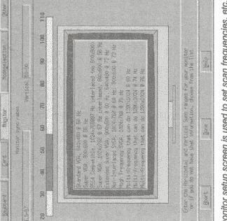

图 1.9 显示器设置屏幕用于设置扫描频率等。

在 1024 x 768 分辨率下而无眼部疲劳。如果屏幕尺寸小于 15 英寸，或者显示器在高分辨率下不支持高扫描速率，最好选择 800 x 600 像素的操作。

在初始设置中，如果您正在告知 X 服务器显示器的性能。为此，您需要找到显示器配置屏幕顶部的“Model Setup”选项卡。这会带来一个接近屏幕（图 1.9）的界面，使其易于选择所需的分辨率。并且减少可以超过所选的最大分辨率。然后显示器显示更大分辨率的滚动部分，当光标被放置使用时，而我的偏好是保持屏幕分辨率不高于显示器的真实分辨率。

屏幕底部的数字允许设置颜色深度（16 位显示中 16 位字节的位数）和颜色数量。此表显示了以每像素使用的位数来表示的选择。

# 颜色深度和分辨率

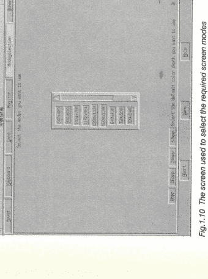

图 1.10 用于选择所需屏幕模式的屏幕

每像素位数（bpp）与实际可用颜色数量之间的相关性。

| 每像素位数 | 颜色数 |
| :--- | :--- |
| 8 | 256 |
| 16 | 65536 |
| 24 | 16779850 |
| 32 | 约 43 亿 |

对于给定的（真实）屏幕分辨率，可用的最大颜色数量取决于显卡上安装的 RAM 数量。除非您的计算机非常慢，否则选择相当高的颜色深度是有意义的，但对于大多数用途来说，超过 24 位操作并没有意义。

# 其他

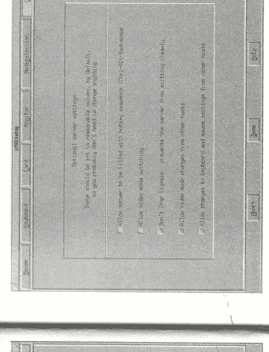

图 1.11 “其他”屏幕配置次要功能

主配置页面顶部的最后一个选项卡会打开一个屏幕（图 1.11），用于控制各种杂项因素。这些功能涉及即时切换屏幕分辨率，以及默认的 X Windows。除非计算机是网络的一部分，否则一些选项无关紧要。默认情况下，系统会设置使用 Control-Alt-Backspace 作为返回正常 Linux 操作的简便方法，以防您在进入 X Windows 时遇到空白或乱码屏幕。

当所有设置都完成后，您的 X86Config 操作，然后点击“Done”选项卡退出 X86Config 程序。程序随后会根据您的显卡和显示器设置“调整”所有内容，之后它将尝试运行 X 服务器。如果一切正常，您可以完全退出配置程序。如果存在重大问题，并且屏幕远非正确，您必须重新运行 X86Config 程序。显示的小问题，如宽度或高度不足，通常可以使用显示器的控制进行修正。如果这未能产生令人满意的结果，您可以使用 Xrdump 程序对扫描速率和视频计时的其他方面进行微调。我认为使用 Xrdump 有点风险，所以最好只在真正需要时使用它。

# 测试，测试

最终，你应该完成所有安装并且 Linux 已启动。在使用 Linux 之前，必须登录，这需要用户名和相应的密码。如果在安装过程中设置了用户账户，请输入相应的名称并按回车键。然后当提示输入密码时，输入相应的字符字符串并按回车键。此时你应该已经进入 Linux，并准备好开始使用新的操作系统。如果在安装过程中没有设置用户账户，仍然可以进入 Linux。你必须以系统管理员身份登录。对于用户名，输入“root”然后按回车键。然后输入密码并再次按回车键。Linux 随后将启动运行，等待你的第一个命令。

此时，关闭 Linux，关闭计算机，再次“冷启动”是一个好主意，以做到这一点，重新走一遍安装过程，确保适当的磁盘分区可启动等。通过简单地关闭计算机来关闭 Linux 不是一个好主意。与 Windows 95 和 98 一样，这会在硬盘驱动器上留下各种临时文件，并使一些事情处于“悬而未决”状态。关闭 Linux 的正确方法是使用 shutdown 命令，并且只有当屏幕上的信息字符串结束后才关闭计算机。第一条消息应该类似“system halted”。

shutdown 命令有各种开关和控制，可用于管理其运行的确切方式。请记住，Linux 是为与网络一起使用而设计的，该网络通常会被关闭，通常应与 shutdown 时间以及消息一起发出。如果 Linux 用于工作站，这一切都无关紧要，关机时间的警告将发送到每个终端。当你只是在每个会话结束时立即关闭系统。要立即关机，请使用此命令：

```
shutdown -h now
```

Linux 通常区分大小写，本书中给出的命令示例只有在精确复制时才能工作，但也有一些例外。文本将使用小写字母，但在某些情况下，如果所有内容都以小写字母书写，系统成功，下一步是检查 X windows 是否正确运行。默认情况下，Linux 通常不会在启动时自动运行 X windows。但现在一些系统确实如此。要启动 X Windows，请使用此命令：

```
startx
```

经过几秒钟的疯狂硬盘活动后，屏幕上应该会出现图形用户界面，屏幕的确切外观取决于所使用的 Linux 发行版和版本。图 1.12 和 1.13 分别显示了从 Red Hat Linux 5.2 和 Caldera Open Linux 1.3 获得的屏幕。值得尝试与系统和鼠标的一般方式。但是，如果安装中包括 KDE 等替代桌面环境，我建议先扩展 X Windows，然后再在正常启动时尝试此类事物。如果安装期间有 KDE 或 Gnome 等替代方案可用。我强烈建议将其包含在安装中。大多数 Linux

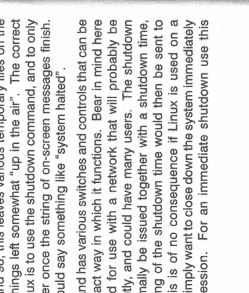

图 1.12 Red Hat Linux 5.2 中的初始 X Windows 屏幕


# 第 1 章 续

许多发行版现在都包含 KDE，为了跟随本书的大部分内容，你必须安装 KDE。请注意，在某些系统中，“startx”命令实际上会运行 KDE。一旦回到 Linux 命令提示符并假设已安装 KDE，可以使用以下命令运行：

```
Kde
```

当 KDE 加载后，屏幕看起来应该如图 1.14 所示，但具体外观取决于使用的版本和默认设置。使用 KDE 的内容在第 3 章和第 4 章中介绍，这里不再进一步讨论。不过，通过探索菜单系统，你应该能够毫不费力地运行一些程序，例如一些游戏。

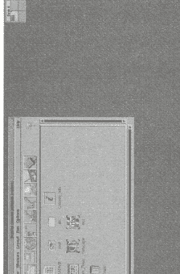

**图 1.13 Caldera Open Linux 1.3 的 X Windows 启动屏幕**

## 双启动

如前所述，Linux 可用于双启动系统，其中我们可以选择启动 Linux 或另一个操作系统，如 Windows 98。安装过程类似。采用双启动方法时，在硬盘分区阶段，磁盘上通常已经有一个或多个分区，这些是现有操作系统使用的分区。可以使用 Fdisk 的 "p" 选项来显示现有分区。在开始将空闲空间分配给 Linux 分区之前。这些分区是使用与普通 Linux 安装相同的基本程序生成的，但由于现有分区的存在，分区编号会更高。如果磁盘上已经有两个主分区，那么主要的 Linux 分区和 Linux 交换分区将是第三个和第四个分区。请记住，最多只能容纳四个主分区。其中一个分区已经是可启动分区，通常保持作为启动分区。

让个人电脑进行双启动通常没有太大问题，但明智的做法是避免基于在软盘上安装了 Lilo 而不是在硬盘上安装这一事实，直接启动其中一个操作系统。启动时，如果该软盘不在驱动器中，计算机将正常启动到另一个操作系统。如果软盘在驱动器中，Lilo 将运行并启动 Linux。它可能看起来像是从软盘启动 Linux，但严格来说，它是从硬盘启动的。Lilo 将启动过程指向正确的方向，从那里从硬盘启动 Linux。这是一种略显简陋的方法，但对于那些不太愿意配合双启动的计算机，这通常非常有效。

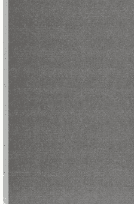

**图 1.14 KDE 1.0 的启动屏幕**

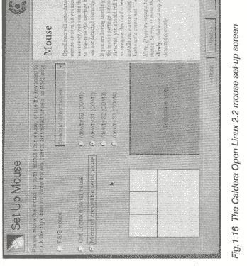

**图 1.16 Caldera Open Linux 2.2 的鼠标设置屏幕**

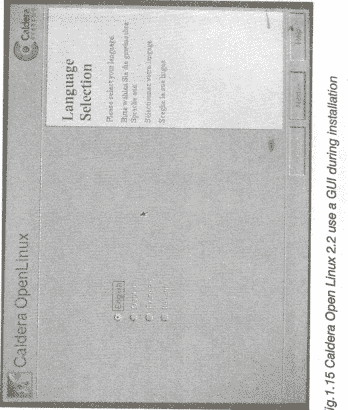

**图 1.15 Caldera Open Linux 2.2 在安装过程中使用 GUI**

如果你想使用双启动系统，但在处理操作系统方面经验甚少或完全没有经验，那么获取一个在双启动安装方面提供大量辅助的 Linux 版本可能值得。例如，Open Linux 2.2 随附 PartitionMagic 和 BootMagic 程序。特殊的 CD-ROM 可以在 Windows 95/98/NT 下运行，并允许清除必要的硬盘空间用于 Linux。然后安装向导帮助你正确安装 Linux，大多数 Linux 安装程序的文本屏幕使得很容易后退一两步来纠正错误（图 1.15 和 1.16）。这并不完全是将 CD-ROM 放入驱动器然后坐下让电脑自己完成那么简单，但如今安装 Linux 不必比安装 Windows 更困难。

# 第 2 章 命令行

## 它是什么？

熟悉早期个人电脑计算的人可能已经使用过 MS/DOS 操作系统，并且熟悉命令行解释器的概念。那些从 Windows 95 或更晚版本开始的人可能并不熟悉。需要准备对命令行解释器以及其他我们这里将使用的东西进行 PC 测试。在 Mac 或 PC 上对命令行进行 PC 测试。带有 PowerPC 的 Mac 目前仍受支持。

Windows 95/98/Me 具有文本模式命令解释器。重启后，你可以在 MS/DOS 提示符下运行。

Windows 用户从未使用过用户界面，但这是可以做到的。实际上，很可能有很大一部分人将避免使用命令行接口。是否可能做到一切并不重要，不建议你这样做。Linux 现在有图形用户界面，可以很大程度上避免使用命令行解释器。是否可能做到一切并不重要，不建议你这样做。是否完全使用取决于图形界面提供的功能以及你需要执行的任务类型。在大多数情况下，可能还不可能假装命令行解释器不存在，除非系统愿意接受在使用系统方式上的一些限制。

即使你不打算深入查看命令行解释器，仍然建议浏览本章。你可能会发现这里有一些有用的功能，可以在以后的某个时候帮助你摆脱困境。此外，本章涵盖的一些内容是通用性质的，是你通常使用 Windows 风格的前端来处理诸如文件操作等事情时也需要知道的类型。例如，本章介绍了 Linux 目录结构，它与 Windows 的目录结构显著不同。

## 命令行

那么，什么是命令行解释器？当 Linux 启动时，你会看到一条屏幕消息，称为提示符，它看起来像这样：

$ Login:

它前面可能有一个 Linux 版本号、版权声明或类似的东西，但重要部分是提示符，它告诉你该输入名称并开始登录过程。你通过输入适当的名称并按下 Return 键来响应。计算机随后要求输入密码。如果你输入错误的密码，你将犯下一个重大错误。

你应该拥有一个良好的密码，因为它可以揭示很多关于你的信息，而且计算机还必须记录错误代码。如果输入有问题，它会通过执行相应的操作打印错误消息。计算机非常不宽容，输入错误的密码会导致错误消息。实际上，在登录过程中有很多方法会犯错。如果错误消息令人困惑，你可以确定计算机知道你想做什么（只要你保管好密码）。弄清楚实际问题可能相当困难，但如果你有 Linux 安装专家，应该很容易修复。

登录成功后，你可以使用许多命令来完成不同的任务。命令可以是非常复杂且难以理解的一行，或者是一个简短的短语，完美地完成工作。没有人会指责你的计算机不友好。另一方面，输入命令几乎可以立即执行使用图形用户界面难以或不可能执行的复杂任务。对于大多数 Linux 系统，一旦启动完成且用户登录，计算机就准备好接受命令行输入了。如果你的系统没有图形用户界面（或登录后的 KDE 或 Gnome），你只需按键即可开始与 shell 交互。要退出，请按 Ctrl+D 或输入 exit。你可以输入命令并查看可能性的示例。如果你是模拟用户，你可能希望将 shell 视为与内核（操作系统的心脏）通信的桥梁。

## Shell

处理 Linux 时，你经常遇到“shell”这个词。当人们谈论他们的操作系统时，他们会提到 shell 而不是内核。在大多数 Linux 系统中，shell 是主要的用户界面。当你使用基本的命令行解释器时，它使基本的命令行解释器更容易使用，但没有达到完整的图形用户界面那样远。在 MS/DOS 中，命令行解释器通常不被认为是一个 shell，但被接受为操作系统的组成部分。在 Linux 中情况不同，实际的命令行解释器部分和提供 shell 给用户的系统部分不同。

Shell 程序作为用户和 Linux 内核之间的接口。Linux 是以分层方式产生的三种类型。操作系统是最低层。下一层是内核，管理基本硬件功能，如内存管理、进程调度和输入/输出。第三层是 shell，它为用户提供命令行接口。这是用户最直接或经常交互的层。Shell 接受用户命令并执行它们。最常见的 shell 是 Bourne shell (sh)，但还有许多其他类型，如 C shell (csh)、Bourne Again Shell (bash) 和 Korn shell (ksh)。

Linux 用户界面根植于计算的早期。当时没有 GUI，所以用户必须输入命令来执行任务。Shell 是第一个也是最重要的用户界面。它允许用户与计算机交互并控制其操作。Shell 是一种提供访问操作系统服务的命令行解释器。它是一种作为用户和操作系统之间中介的软件。Shell 接受用户输入并将其转换为操作系统要执行的命令。Shell 还向用户显示命令的输出。

```
$/bin/bash
echo $SHELL
```

如果你输入这个命令时出现错误消息，这意味着你的系统未安装该 shell。你可以通过运行以下命令来安装：

```
sudo apt-get install bash
```

安装完成后，你可以通过运行以下命令来检查 shell 版本：

```
bash --version
```

你应该看到类似以下内容：

GNU bash, version 4.2.45(1)-release (x86_64-pc-linux-gnu)


所有字符均区分大小写。“你必须小心行事，不仅要做到‘字面意义上的准确’，还要做到‘大小写准确’。如果你做对了，这条命令将运行提供 shell 的文件名。它提供了该文件的名称及其所在的子目录（文件夹）。这应该会产出一个类似以下内容的结果：

```
/bin/bash
```

正如前面指出的，Linux 使用前向斜杠字符而不是反斜杠来表示从一个子目录切换到另一个子目录。“记住，要指定从一个子目录到另一个子目录，斜杠用于表示‘从这里’，而由你提供 shell 正确的‘从何处’。”

这个 shell 被称为“bash”，顶级目录被称为“bin”。如果你正在运行的 shell 不是 bash，输入这条命令应该能运行 bash shell：

```
bash
```

再次强调，在输入此命令时，请务必使用正确的大小写字母。进入 shell 后，你看到的命令行提示符取决于你是以系统管理员（即登录为“root”）还是普通用户身份登录。它还取决于系统名称。在我的一台系统中，当我以“root”身份登录时，会得到如下提示符：

```
[root@robert /]#
```

以普通用户身份（假设用户名为）fred 登录，会得到以下提示符：

```
[fred@robert /fred]$
```

除了名称变化外，请注意，井号 (#) 已被美元符号 ($) 字符取代。井号仅对系统管理员显示，表示用户可以更改系统设置。这实际上是一个警告，提醒你操作需谨慎，因为你有权访问控制系统运行方式的文件。随意使用这些文件可能会导致系统无法正常运行。

提示符的第一部分只是用户和系统的名称。第二部分指示当前在文件系统中的位置。MS DOS 以类似的方式设置，目前在名为“DOS”的子目录、C 盘上看到的提示符看起来可能像这样：

```
C:\DOS>
```

# 根目录

对于那些多年来一直使用 Windows 和 MS-DOS 的用户来说，Linux 文件系统可能需要一点时间才能习惯。在 Windows 和 MS-DOS 中，事物往往更加分块，每个用户都有自己独立的目录、驱动器，或者查看其目录结构，但任何特定磁盘的内容只能通过切换到该驱动器来查看。在 MS-DOS 中，你可以将文件从磁盘驱动器复制到端口，但端口同样是独立的实体，不属于文件结构的一部分。

Linux 将这些事物联系在一起。近期的 Windows 版本中，代表“整体系统”的“我的电脑”图标，以及 Windows 桌面上的相应图标，也是试图统一事物并与 Linux 文件系统保持一致的尝试。

Linux 文件系统的各个部分是真正统一的，一切都基于顶层。不要与此根目录混淆，该根目录实际称为“/”，它是根（“/”后面始终跟着方括号中的名称，而名为“root”的目录将用引号括起名称）的子目录。

在 Linux 中，根目录确实是“根”，其他所有内容都由此衍生。就像示例目录系统中那样，大多数这些目录在 Linux 系统安装后的示例中都是存在的。其中一些实际上可能拥有其他驱动器或位置或硬件概念。在软盘结构中。事实上，它们通常出现在其他位置。通常在文件结构中。/dev 目录中的文件是文件系统中的设备。/dev 目录是集成到系统中的。如果你想使软盘或 CD-ROM 驱动器无法使用，请勿动此目录，也不要实验其中包含的文件。/mnt 目录是系统在使用软盘驱动器时挂载软盘的位置。Linux 术语：调制解调器和打印机等硬件项目都合并到了文件系统中。

# 挂载

最初，CD-ROM 和软盘驱动器未处于挂载状态，这是一个 MS-DOS 和软盘操作比 Linux 更自由轻松的区域。在 Windows 和 MS-DOS 中，你可以随时随意挂载或卸载光盘。系统偶尔可能会因为找不到驱动器中预期的光盘而报错，但总体而言，对驱动器的访问是不受限制的。Linux 实际上没有将驱动器作为系统的逻辑挂载部分，因为其实并不需要包含任何文件。用于挂载驱动器的命令很容易记住；既然叫挂载，直到你输入命令前它都是未挂载状态。在使用驱动器之前，必须将其挂载，并且光盘驱动器实际上不一定要包含任何文件。用于挂载光盘的命令必须在 /mnt/floppy 或 /mnt/cdrom 处输入。在我用于这些示例的系统中，软盘驱动器挂载在 /mnt/floppy。如果你输入 `mount` 命令，它将列出系统中所有的挂载点。Linux 中相当于“dir”命令的是“ls”命令。输入以下指令查看列出挂载点的 /etc/fstab 文件：

该文件中应该有类似以下这两行的几行内容：

| 设备 | 挂载点 | 选项 |
| :--- | :--- | :--- |
| /dev/hda | /mnt/floppy | auto,user,iso9660,ro,defaults,noauto |
| /dev/hdd | /mnt/cdrom | auto,user,iso9660,ro,defaults,noauto |

第一行是软盘驱动器的配置，该行上的前两个条目显示了软盘设备在文件系统中的出现位置。挂载驱动器时可以使用这两个条目中的任意一个，因此这两个都可以完成任务：

```
mount /mnt/floppy
mount /dev/fd0
```

CD-ROM 驱动器的操作方式类似，其部分中的前两个条目显示了它在文件系统中的出现位置。挂载 CD-ROM 驱动器时可以使用以下任意命令：

```
mount /mnt/cdrom
mount /dev/hdd
```

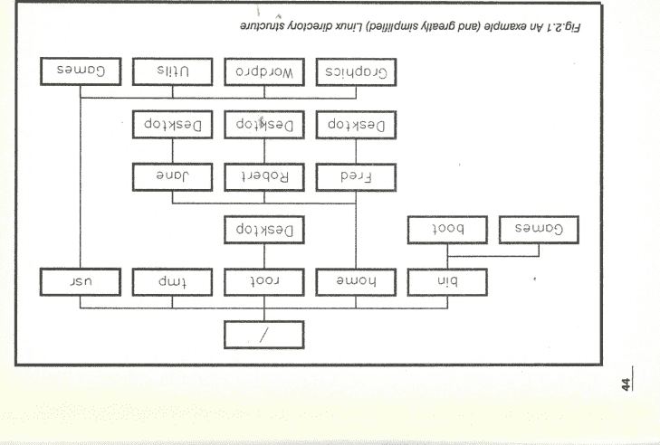

# 卸载

一旦软盘驱动器或 CD-ROM 驱动器被挂载，你就应该使用正确的 Linux 术语，即卸载（unmount），以“拆卸”媒体，直到其被卸载。对于 CD-ROM 驱动器，在驱动器卸载之前，其弹出按钮不太可能工作。卸载命令遵循与挂载命令相同的格式，但使用 unmount（不是 umount）命令词代替 mount。因此，以下两条命令将卸载软盘和 CD-ROM 驱动器：

```
umount /dev/fd0
umount /mnt/cdrom
```

请注意，如果你当前正位于该目录中，系统正在以任何方式使用它，你就无法卸载该驱动器。尝试这样做只会产生一个指示设备正忙的錯誤消息。

### 导航

通过命令行解释器在文件系统中导航，永远无法像使用 KDE 这样的桌面系统那样容易。然而，最好是在你熟悉了通过命令行解释器在文件系统中移动和通过其替代结构导航目录的基础知识之后，再尝试使用 KDE 之类的程序。除了图形界面提供的一些便利（如在两个或多个目录之间拖放文件）之外，你需要使用的基本命令都包含在系统的 `pwd`（man 8）命令中。

你可以使用 `pwd` 从一个目录移动到另一个目录。使用 `cd`（更改目录）命令。如果你尝试这条命令，它应该响应当前目录的详细信息：

```
pwd
```

要从一个目录移动到另一个目录，使用 `cd`（更改目录）命令，这与 MSDOS 中同名的命令类似。无论当前位于哪个目录，此命令都会将当前位置移动到 /usr 目录：

```
cd /usr
```

不需要提供新目录的完整路径；只需告知系统当前所在的目录（例如在 /usr 目录中）以及你想要移动到的目录（例如想要移动到 /usr/lib 目录），因此我们只需写 `cd lib`。

想要的效果：

```
cd /root/Desktop
cd Desktop
```

在 /msdos 中，“.” 可以用作当前目录的缩写，“..” 可以用作其父目录的缩写。因此，此命令可以向上移动一级目录：

```
cd ..
```

例如，如果使用此命令时系统位于 /root/Desktop，那么之后它将会位于 /root。

# 列表

在 MSDOS 中，`dir`（目录）命令用于列出目录的内容，相同的命令在 Linux 中也有效。Linux 提供了一种替代方案，即 `ls`（列出）命令，这似乎是获取目录信息的首选命令。这两个命令中的任何一个都可以列出当前目录的内容：

```
ls
dir
```

系统不必位于某个目录中才能列出其内容。此示例将列出 /usr 目录的内容，无论系统当时位于哪个目录：

```
ls /usr
```

# 颜色

基本的 `ls` 命令存在一个小问题，即屏幕上显示的信息相当模糊。无法区分文件和子目录。但在 Linux 版本的 `ls` 中，可以通过使用颜色选项来避免这一问题，如下例所示：

```
ls --color
```

注意，“color”一词必须拼写为美式英语形式，如果使用“colour”则不起作用。如果在一个包含多种类型文件的目录中尝试此操作，结果应该是一个多彩的显示，每种文件类型使用不同的颜色。此列表显示了用于几种常见文件类型的颜色。


# 2 命令行

文件 | 类型 | 普通文件 | 程序 | 进程 | 目录 | 链接
| :--- | :--- | :--- | :--- | :--- | :--- |
颜色 | | 白色 | 绿色 | 蓝色 | 红色 | 青色

您将普通文件的颜色设为白色，但此颜色将作为显示器的正常文本颜色。这通常是白色或灰色。`color` 选项可用于列出当前目录以外的内容，此时命令形式如下：

```bash
ls /usr/lib —color
```

在此命令版本中也可以工作，因为 `color` 一词前的连字符将确保 Linux 不将其解释为要列出的目录：

```bash
ls -color /usr/lib
```

还有其他控制选项可用于修改 `ls` 命令的工作方式，您可以通过使用屏幕帮助系统获取这些选项的简要详情。要获取命令的帮助，只需输入命令后加上 `—help` 即可，如下例所示：

```bash
ls -help
```

许多控制选项允许以各种方式对列表进行排序，这在处理大型文件列表时显然会更方便。如果使用 `-a` 开关，则会包含隐藏文件。要显示以千字节为单位的文件大小，请同时使用 `-s` 和 `-k` 控制选项，如下例所示：

```bash
ls -s -k
```

控制选项可以作为独立的实体使用，如上例所示，但以下形式同样有效，即将两个或多个控制选项合并为一个实体：

```bash
ls -sk
```

如果您调查 Linux 文件系统，大量的目录和文件可能会让您感到惊讶。在某种程度上，大量的文件只是离散硬件项目处理方式的现状。还必须意识到，典型的 Linux 安装不仅包含操作系统。它可能包含数十个应用程序或文字/文本处理器，以及游戏。

## 目录

添加和删除目录的处理方式与 MS-DOS 下非常相似。使用 `mkdir`（make directory）命令创建新目录，但请注意，该命令不能缩写为 MS-DOS 样式的 `md`。此命令可以在当前目录下创建一个子目录，并命名为 "temp"：

```bash
mkdir temp
```

通过在命令中包含完整的名称和路径，可以将新目录放置在文件结构中的任何位置。此示例创建一个名为 `temp` 的子目录，并将其放置在根目录下：

```bash
mkdir /root/temp
```

使用 `rmdir` 命令删除不需要的目录，但请注意，在 Linux 中不能将其缩写为 `rd`。另外请注意，只有当目录为空时才能删除。在此上下文中，“空”意味着它不能包含任何文件，即使那些子目录是空的，也不能包含子目录。`rmdir` 命令以及这两个示例将删除之前使用两个 `mkdir` 示例创建的目录：

```bash
rmdir temp
rmdir /root/temp
```

有时您可能希望删除一个目录及其包含的所有文件。这可以通过使用 `rm` 命令和 `-r`（或递归）修饰符从父目录实现。此处显示的示例将删除名为 "testdata" 的目录及其所有内容：

```bash
rm -r testdir
```

显然，在删除文件时需要格外小心，而在删除完整目录时需要更加谨慎。

## 文件

在正常情况下，用户使用应用程序生成文件，但为了实验目的，可以使用操作系统生成临时文件。这可以使用 "touch" 命令实现，如下例所示，这将生成一个名为 "test" 的文件：

```bash
touch test
```

该文件将放置在当前目录中，但通过在文件名之外包含目录路径，可以将其放置在文件结构中的任何位置。可以使用 `rm` 命令删除文件，此命令将删除前一个示例生成的文件：

```bash
rm temp
```

当然，要使这起作用，该文件必须位于当前目录中。通过指定完整路径和文件名，可以删除其他目录中的文件。路径结构取决于系统默认设置，系统可能会询问您是否要删除文件，此时您必须回答 y、Y 或 r 表示是。由于没有内置的文件检索系统，因此如果您删除文件，它将被视为永久丢失。

在 MS-DOS 中，可以使用 `*` 通配符删除目录中的所有文件。在 Linux 中也可以这样做，如下例所示：

```bash
rm /root/*
```

这将删除 /root 目录中的所有文件，但根据系统的默认设置，可能需要确认每个文件的删除。

## 文件名

MS-DOS 用户会注意到，MS-DOS 中的 `*.*` 在 Linux 中被替换为仅 `*`。MS-DOS 文件名最多可有八个字符加上最多三个字符的扩展名。扩展名跟在主文件名之后，并通过句点分隔。这三个字符的扩展名通常用于指示文件类型，如文本文件的“txt”或 JPEG 图形文件的“.jpg”。文件名扩展也可以在 Linux 系统中使用，但句点不具有与 MS-DOS 中相同的意义。句点字符在 Linux 中几乎只是另一个普通字符。文件名“ch1.txt”在 Linux 中就像“chapter1.txt”一样有效。文件名“bk.chapt1”对于一个被设计为识别“.txt”扩展名的文本文件程序来说同样有效。以下是构思 Linux 文件名时值得记住的一些有用要点：

### 最大字符数

Linux 文件名中最多可以使用 256 个字符。但是，如果您将自己限制在大约 40 个字符以内，事情会变得更加易于管理。

### 大小写敏感性

文件名中可以使用大写字母和小写字母，与 MS-DOS 不同，Linux 将视为两组不同的字符。在 MS-DOS 中，名为“london”、“LONDON”和“London”的文件都具有相同的名称，但在 Linux 中，它们将每个都具有不同的名称。

### 允许使用的字符

文件名中允许使用数字和大多数其他字符，但某些字符不应使用，因为它们对 shell 具有特殊含义，可能导致令人困惑的结果。应避免使用以下字符：

- 与号 &
- 撇号 `
- 星号 *
- 脱字符 ^
- 正斜杠 /
- 连字符 -
- 问号 ?
- 引号 “” ‘’
- 竖线 |

还应避免使用空格字符，否则 shell 可能会将文件名解释为用空格分隔的两个或多个文件名。

### 通配符

在某些 MS-DOS 命令中，可以使用通配符而不是提供完整的文件名。Linux 的工作方式也大致相同。星号字符在之前的示例中已使用，星号可用于表示任意数量的字符。问号可用于代替单个字符。假设您需要列出以“Fig”开头的文件，此命令将列出它们：

`Fig*`

如果您需要知道哪些以“Fig”开头且随后有两个字符并以“.gif”结尾的文件，此命令可以完成这项工作：

`Fig??.gif`

使用问号通配符时，请记住，只有当问号的数量与文件名中的字符数量相匹配时，它才能工作。例如，之前的示例中三个“Fig12.gif”都没问题，但它不会匹配“Fig1.gif”或“Fig100.gif”。这两个都可以由以下命令处理：

`Fig*.gif`

Linux 中还有第三个通配符，即方括号。在 MS-DOS 中，第三个通配符具有相同的效果，但要知道一对方括号（[ ]）。假设您想知道哪些文件名为“fig6a.gif”、“fig6b.gif”和“fig6c.gif”。您可以使用方括号专门搜索这些文件：

`fig6[abc].gif`

在大多数情况下，使用方括号可能没有意义，但在其他通配符不够具体的情况下，它们可能很有用。

## 复制文件

使用 `cp` 命令复制文件，该命令必须指定要复制的文件及其目标目录。副本保留原始文件的文件名。此示例将当前目录中名为“test”的文件复制到 /root 目录：

`cp test /root`

这假设名为“test”的文件位于当前目录中。如果源文件位于当前目录中，除了文件名外，还必须提供完整路径，如下例所示：

`cp /bin/test /root`

如果您希望将文件从其他目录复制到当前目录，请使用“.”作为目标目录。此命令将 /bin 目录中名为“test”的文件复制到当前目录：

`cp /bin/test .`

在复制操作期间可以更改文件名，只需在指定目标时提供新的文件名即可。例如，当将 /bin 目录中名为“nice”的文件复制到当前目录作为名为“bad”的文件时。当然，如果“bad”是一个目录，文件将以其原始名称复制到该目录中。

`cp /bin/nice /bad`

可以通过在 `cp` 命令中指定多个源文件，将一个目录中的多个文件复制到另一个目录。此命令将当前目录中名为“test”和“test1”的文件复制到 /root 目录：

`cp test test1 /root`

您可以使用 `mv` 指令简单地移动文件，而不是复制它。其工作方式与 `cp` 命令非常相似，但原始文件将被删除。此命令将 /usr 目录中名为 `temp` 的文件移动到 /usr/temp/：

`mv /usr/temp /usr/temp/`

此命令版本具有相同的效果，但移动的文件在移动过程中被重命名为“hello”。

`mv /usr/temp /hello`

如果要复制完整目录甚至目录结构，可以使用“ -R”选项参数测试 `mv` 或 `cp`。此示例将 /usr 目录中的所有目录和文件复制为当前目录的子目录。目录和文件名保持不变。

`cp -R /usr/test_ .`

可以使用 `mv` 命令移动整个目录或目录结构，不需要 `-r` 修饰符。此命令具有与上一个示例相同的效果，但原始目录结构将被删除。

`mv /usr/test .`

似乎没有与 MS-DOS `diskcopy` 命令对应的 Linux 命令，并且 Linux 比 MS-DOS 更少依赖磁盘。通过运行 `diskcopy` 将磁盘内容复制到另一个磁盘，这是理所当然的。


这一系列的操作将实现预期结果。

-   创建一个临时目录
-   挂载软盘
-   将软盘内容复制到临时目录
-   卸载软盘
-   挂载软盘
-   将临时目录中的内容移动到复制盘
-   卸载复制盘
-   移除临时目录

这并不能生成原始软盘的真正克隆。如果你是从系统盘复制，那么你必须复制到系统盘中才能生成可启动的副本。使用 KDE 和 KFM 文件管理器将文件从一个盘复制到另一个盘可能更容易，因为它提供了复制和粘贴功能，但这仍然是一个稍微不那么直接的过程。

# 重命名

在 MS/DOS 中，可以使用 `ren` 命令重命名文件，但 Linux 中没有完全对应的命令。不过，可以使用 `mv` 命令将文件的内容移动到一个不同名称但相同目录下的文件中。换句话说，即重命名文件。此命令将当前目录下名为“test”的文件重命名为“renamed”：

```
mv ./test ./renamed
```

当处理目录名称时，你需要非常小心地重命名目录。这样做可能会导致应用程序或 Linux 本身无法找到它们所需的文件。

# 读取文件

可以使用 MS/DOS 读取文本文件，例如使用 `type` 命令读取“readme.txt”文件。Linux 中最接近的等效命令是 `cat`，它只会将文件打印到屏幕上。此命令显示 `/usr/man/man1/groups.1` 目录下 `groups.1` 文件的内容。

```
cat /usr/man/man1/groups.1
```

`cat` 命令仅适用于短文件，或者当你只想查看文件末尾部分时。这是因为它不提供对文件显示方式的任何控制，并且在小显示器上，文本几乎瞬间就会滚动出屏幕。你根本没有机会每次退出 `less` 阅读器时移动几个词。实际上，`less` 命令更适合大量文本，因为它一次显示一屏文本。只需按空格键进入下一屏，按 H（回车）键一次移动一行。如果不想退出 `less` 阅读器，可以使用 control c。例如，你可以使用 control z 运行更多。可用的键控制如下：要一次移动一行，请按 q 键。这将显示下一行 `less` 命令。

然而，建议要上下滚动文本，使用方向键可能更容易。这些命令会将文件加载到一个“合适的”窗口文本编辑器访问器中。

还有两个值得提及的进一步文本读取命令。`head` 命令显示前几行。默认情况下，显示十行，但可以使用 -x 控制进行修改。其中 x 是要显示的行数。因此，这两个命令将分别显示文本文件 /root/readme 的前 20 行和后 15 行

```
head -10 /root/readme
tail -15 /root/readme
```

# 链接

本章前面指出，`ls` 命令可以以不同方式显示主要文件类型的名称，但 `ls` 到底能告诉我们要关于文件的什么？这正是 `find` 和 `which` 命令发挥作用的地方。`find` 命令会列出特定目录中的所有文件，而 `which` 命令可用于在目录中查找特定文件。

要创建指向文件的链接，使用命令 `ln -s oldfile newfile`，其中 oldfile 是要链接到的文件或目录，newfile 是新链接的名称。`-s` 选项创建符号链接，这是指向原始文件的指针。这是大多数系统上的默认链接类型。

也可以创建硬链接，这是目录中文件的直接副本。这是在文件系统不支持符号链接时唯一可用的链接类型。要创建硬链接，请使用 `ln oldfile newfile` 命令。

有两种类型的链接：符号链接（也称为软链接）和硬链接。符号链接存储其所链接文件的路径和文件名。如果所链接的文件被移动或重命名，链接可能会中断，因为它仍然指向旧路径。相比之下，硬链接是目录中的第二个条目，直接指向磁盘上与原始文件相同的数据。硬链接可以像其他文件一样被移动或重命名。因为硬链接不是符号链接，所以可以移动到不同的目录，但不能跨文件系统使用。当一个文件有多个硬链接时，在移除所有指向它的硬链接之前，它不会被从磁盘上删除。

## 创建链接

要创建链接，请使用 `ln` 命令。要创建符号链接，请使用 `-s` 选项。语法如下：`ln [options] target linkname`。

```
ln -s target symbolic_link
```

示例：从 /home/user/docs 创建指向 /home/user/my_docs 的符号链接：

```
ln -s /home/user/docs /home/user/my_docs
```

要创建硬链接，只需省略 `-s` 选项即可。语法如下：`ln target hard_link`。请注意，你只能在同一文件系统上的文件之间创建硬链接。

## 管理链接

-   使用 `ls -l` 列出链接并查看它们指向哪些文件。
-   使用 `readlink` 显示符号链接的值。
-   使用 `file` 确定文件类型。
-   使用 `test` 或 `[` 测试链接的属性。

## 在 Shell 脚本中使用链接

链接可以在 shell 脚本中使用，以便于管理配置文件。例如，你可以为配置文件创建符号链接，并更改链接以指向不同的配置，而无需修改脚本。

功能键二至六。你需要在新的控制台上重新登录，但不需要作为不同的用户登录。当然，你第一次切换过去时才需要登录。之后你可以在控制台之间切换而无需密码。

`-h` 选项告诉计算机重新启动，而 `-r` 选项告诉计算机停机一次。两个示例中的新选项都告诉 Linux 立即执行命令，这通常是你在工作站上使用 Linux 时所需要的。

另一种选择是使用时间在此处。

一个可以移到一个控制台的会话。这提供了一种多任务形式，你可以在一个控制台上运行（例如）文字处理器，在另一个控制台上运行游戏。如果进程到达屏幕，你可以几乎瞬间从游戏切换回文字处理器。当然，随着运行程序增多，对计算机的需求会增加。特别是，随着正在使用的 CPU 和应用程序数量增加，控制台和应用程序的数量往往会急剧增加。对于内存有限的 PC，此因素可能会限制多个控制台的使用。

当你不再使用虚拟控制台时，可以使用 `logout` 命令将其关闭。按下 Alt 键和适当的功能键会将系统切换到另一个控制台。你实际上不需要注销未使用的控制台，它们可以保持运行，同时你使用另一个。当系统关机时，所有活动的控制台都会“干净地”终止。然而，不必要地保持运行的控制台无疑会浪费系统资源，因此应该关闭它。

# 重新启动

## 文本编辑

正如我们在上一章看到的，系统可以使用此命令“干净地”并立即关闭：

```
`shutdown -h now`
```

顺便说一句，shutdown 命令只有在你以 "root" 身份登录时才有效，没有 root 权限你只会产生一条错误消息。由于 shutdown 命令通过关闭计算机来终止会话，你不应该留下打开的文件，否则下次会出现问题。

这将导致文件保持打开状态，下次使用 Linux 时如果未正确关机，系统在正常启动前会对硬盘驱动器进行漫长的检查。

如果需要重新启动计算机，有两个选项可用。最简单的方法是采用 `reboot`、`halt` 和 `poweroff` 命令；这些是与 MS-DOS 中使用的相同方法命令。另一种选择是使用此版本的 shutdown 命令：

```
`shutdown -r now`
```

在后期版本的 MS-DOS 中，可以使用 `edit` 命令编辑文本文件。这对于编辑诸如 `autoexec.bat` 和 `config.sys` 文件非常有用。事实上，你会发现生成或编辑 Linux 下的文件很容易。你可能还会发现有必要进入 X Windows 并使用一个 ".txt" 文本文件。如果你更喜欢使用传统的文本编辑器，系统中应该有 `regedit` 和 `IV`。Emacs 通常被认为是两者中更精通的，如果需要，它也可以处理大型文本文件。使用 `Emacs` 和 `IV` 编辑名为 `/root/hello` 的文件及必要的文本文件。将使用以下命令：

- `emacs /root/hello`
- `v /root/hello`

请注意，如果你在使用 KDE 等 X Windows 前端内的控制台，运行的可能是 Xemacs 而不是 Emacs。如果发生这种情况，请退出到控制台以运行 Emacs。

为了使命令适应。例如，这些命令将打开一个名为 `/root/goodbye` 的现有文件

- `emacs /root/goodbye`
- `v /root/goodbye`

顺便说一下，在现代版本的 Linux 中，`v` 命令实际上默认运行 vi 的改进版本 vim。这两个文本编辑器都不像 MS-DOS 的 "edit" 程序。但如果你习惯使用文本编辑器，Emacs 可能是更容易使用的编辑器。尝试创建一个测试文件进行编辑或类似的 MS-DOS 文本编辑器。尝试创建一个测试文件进行编辑或类似的

```
`emacs /root/testfile`
```

输入到 /root/testfile

使用 Emacs 和 Windows 文本编辑器，你可以输入一些文本，使用光标键在文本中移动，并使用 Delete 和 Backspace 键删除文本。可以自由地向现有文本添加内容。在 MS-DOS 和 Windows 文本编辑器中，通常可以在


# 在 Emacs 中保存

插入模式和覆盖模式可以通过 Insert 键进行切换。不幸的是，这在 Emacs（或其他 Linux 软件）中不起作用，按下 Insert 键只会产生一个“哔”声警告。我不知道是否存在覆盖模式，但我从未找到切换到该模式的方法。完成测试文件后，你可以通过先按 Ctrl-x 再按 Ctrl-s 来保存文件。几乎所有的 Emacs 命令都要求用户同时按下 Control 键和另一个键，或者 Meta 键和另一个键。在某些情况下，如本例所示，命令需要按两次键对组成的序列。要退出 Emacs，请使用 Control-x 和 Control-c 序列。只要正确执行这些命令，文件将被保存。

- Emacs 可用命令的列表非常庞大，但你只需要使用其中几个即可。以下是一些较为重要的 Emacs 命令列表。

## 保存

- Control-x Control-s 保存到磁盘
- Control-x Control-w 另存为
- Alt z 将文本保存到磁盘并退出

## 打开

- Control-x Control-f 打开
- Control-x Control-i 打开文件并替换当前缓冲区的内容
- Control-x Control-p 打开文件并将其插入到当前光标位置

## 光标移动

- Control-f 向前移动一个字符
- Control-b 向后移动一个字符
- Control-a 移动到行首
- Control-e 移动到行尾
- Control-n 移动到下一行
- Control-p 移动到上一行

## 删除/插入

- Control-c Control-d: 删除下一个字符
- Control-c Alt-d: 删除下一个单词
- Control-c Control-k: 删除到行尾
- Control-c Return: 插入新行
- Control-c Control-i: 插入制表符（根据上下文推断，或者仅仅是 Control-i）
- Control-c Space: 插入空格字符（推断，通常直接使用空格）

*注：原文反复列出了 "Control-c" 并配有不同的描述。根据标准 Emacs 键位绑定以及上下文“插入空格字符”、“删除下一个字符”等，映射关系可能如下：*
- Space: 插入空格字符
- Control-d: 删除下一个字符
- Alt-d: 删除下一个单词
- Control-k: 删除到行尾
- Return: 插入新行

# 添加用户

Linux 当然是一个多用户系统，可以让大量用户共享同一台计算机。第 4 章将更详细地介绍这一主题，这里我们只涵盖安装过程中添加用户的内容。在安装过程中必须至少创建一个用户帐户，这就是超级用户的 "root" 帐户。"root" 帐户拥有对系统的完全访问权限，并可以对系统进行剧烈更改。因此，登录 "root" 时必须格外小心，否则系统可能会意外损坏。常规的处理方式是，当需要对系统进行修改时以 "root" 身份登录，而在其他时间以普通用户身份登录，即使你是唯一使用该计算机的人。

在安装过程中可能有添加用户的机会，如果有这种情况，我建议在阶段添加至少一个用户（即你自己）。事实上，如果需要，稍后再添加更多帐户也是一个好主意。如果需要从命令行添加更多用户，可以使用命令行中的 `adduser` 命令。这在大多数典型安装中都是必要的，但如果你安装了某种非典型发行版，安装程序可能会包含它。请注意，`adduser` 命令仅在你以 "root" 身份登录时可用。要添加名为 "Fred" 的用户，请使用此命令：

```bash
adduser Fred
```

Looking for first available UID... 501
Looking for first available GID... 500
Adding login: Fred... done.
Creating home directory: /home/Fred... done.
Creating mailbox: /var/spool/mail/Fred... done.
Don't forget to set the password.

此输出告诉你 Linux 已找到下一个可用的用户标识（UID）和组标识（GID）编号，并使用了它们，并且它已将名称 Fred 添加到登录过程中。它还创建了新用户所需的目录。最后一行提醒你，必须设置新用户的密码；否则，该帐户将无法使用。要为 'Fred' 帐户设置或更改密码，我们只需在 shell 中运行 `passwd`。由于我们要将 'Fred' 帐户的密码设置为 'hello'，将使用以下命令：

```bash
passwd Fred
```

请注意，必须登录为 'root' 才能正常工作。系统将要求输入新密码，输入一次后，会被要求再次输入以确保第一次输入时没有错误。照例，密码不会显示在屏幕上，因此旁人很难看到你在输入什么。要将密码设置为 'hello'，因此你需要两次输入 'hello'：

```bash
hello
hello
```

设置完 'Fred' 帐户的密码后，应该就可以使用密码 'hello' 以 'Fred' 身份登录了。要更改密码，只需登录为适当的用户，然后发出此命令：

```bash
passwd
```

当系统提示时，你必须提供旧密码，然后两次输入新密码。新密码随即生效，每次需要以该用户身份进行身份验证时都必须使用它。假设用户 'fred' 的密码被设置为 'too-simple'；系统可能会拒绝简单的密码或缺乏复杂性的密码。在这种情况下，'passwd' 命令将提示你重试，并不断尝试，直到接受某个密码选择。

# Tar

使用 Linux 时，你很快就会遇到 *tar* 文件。这些是磁带存档文件，*tar* 命令主要旨在作为一种简单的备份机制。*tar* 命令的基本操作是获取一组文件并将它们合并为一个长文件。可以使用相同的程序还原原始文件。该命令的现有版本还可以压缩文件，使其占用更少的存储空间。该命令大致相当于 MSDOS 或 Windows ZIP 压缩程序的 Linux 等价物。

现代计算机存储倾向于以千兆字节而非兆字节为单位进行计算，除非你的计算机配备了某种能够以与硬盘读写相同速度读写数据的mass storage 设备，否则压缩备份并非不切实际。除非你有 Iomega Zip、Iomega Jaz 或类似类型的设备，否则你无法在 5 分钟内备份 750 兆字节的数据。然而，使用 CD-R 或 CD-RW，你可以在大约 15 分钟内备份 750 兆字节。如果你想备份文件，可以使用至少 1GB 存储容量的 USB 设备。这将允许你在几分钟内备份文件。

即使你不经常使用 tar 文件，*tar* 肯定也要处理 tar 文件的使用。程序通常以 *tar* 文件形式分发。*tar* 文件大于 1.5GB 时可能会出现很大问题。原因是传统的 tar 文件限制为 1.5GB。如果你想备份大于 1.5GB 的文件，可以使用 `-G` 选项（或根据版本不同的类似拆分选项）来创建多卷 tar 存档。这将允许你备份大于 1.5GB 的文件。

*tar* 程序使用起来相对简单，但由于可用选项众多，事情略显复杂。有关可用选项的完整详细信息，请参考在线手册。以下是一些常见的 *tar* 选项。


## tar 选项说明
- **C** 创建新归档
- **F** 将归档输出到文件或设备
- **A** 将新文件追加到现有归档
- **T** 列出归档中的文件名
- **V** 详细模式（在添加或提取文件时列出文件名）
- **X** 从归档中提取文件
- **M** 期待多卷归档
- **W** 验证归档是否不包含错误
- **Z** 压缩或解压（zlib）文件

假设在此示例中，您希望将 /root/temp 中的文件归档到软盘。首先，必须将软盘驱动器配备有足够存储空间的软盘，然后挂载它。该命令将产生预期效果，将文件归档到名为 "but1.tar" 的单个文件中。

```
tar cWf /mnt/floppy/but1.tar /root/temp
```

c 选项告诉 tar 创建一个新的归档，f 选项指示它把归档放入文件，W 选项使其在屏幕上显示消息，确切地表明它正在做什么。V 是可选的，但 c 和 W 是必不可少的。

## 压缩

要做同样的事情但压缩归档中的文件，需要添加 Z 选项，如下所示：

```
tar cWZf /mnt/floppy/but1.tar /root/temp
```

Z 并非错误地使用大写。某些选项字母区分大小写，因此必须小心使用正确的那个。从选项中省略了一些，这些选项将不包含在内。如果操作不当，tar 可能会挂起。这种情况不应该发生，使用 Control-Z 键组合应该可以阻止这种情况发生。

要键入此压缩归档中文件列表，应使用以下命令：

```
tar tWZf /mnt/floppy/but1.tar
```

必须包含 "Z"，否则 tar 将无法将该文件识别为有效的 tar 文件，并返回错误消息。当然，要读取未压缩版本的内容，出于同样的原因，必须省略 Z。

## 多卷

在 tar 程序中，可以将文件归档到设备而不是文件。换句话说，你指定软盘驱动器等设备作为目标，而不是文件。为此，当然必须先挂载设备。假设 /root/temp 目录要归档到软盘上。首先使用如下命令挂载软盘驱动器：

```
mount /dev/fd0 /tmp
```

在发出 mount 命令之前，应将一张空白软盘放入驱动器以接收归档。然后使用该命令在软盘上创建归档：

```
tar cvf /dev/fd0 /root/temp
```

软盘相对较低的容量是备份目录时的一个明显缺点，因为目录中的数据量可能远超过单个软盘的容量。即使使用比 1.44MB 软盘备份盘更高容量的驱动器，数据量也可能超过单个软盘所能容纳的量，因此需要使用多张软盘来归档大量数据。DOS 和 Unix 归档程序通过允许将归档文件分布在几张软盘或磁带来绕过这个问题。MS-DOS ARJ 程序和 Linux tar 程序可以为一张软盘或磁带记录多个卷，因此可以在不担心单个软盘空间不足的情况下解归档。这是前一个示例的多卷版本：

```
tar cvMf /dev/fd0 /root/temp
```

程序会告诉你需要更换组中的下一张软盘。软盘应卸载，以便在恢复文件时按正确顺序使用它们。

## 恢复

由于它们被归档到单个文件中，使用 tar 备份的文件不能直接使用。必须提取文件，这再次使用 tar 程序完成。提取文件的命令实际上与最初生成文件的命令相同，但使用 x（提取）选项替代 c（创建）选项。

从归档中提取文件的命令形式如下：

```
tar xfV /mnt/floppy/but1.tar /root/temp
```

tar 选项 归档 目标
目标部分是可选的，如果未指定，文件将放置在当前目录中。该命令将反转之前的示例，从软盘上的 but1.tar 中获取文件并将其放置在 /root/temp。

```
tar xfV /mnt/floppy/but1.tar
```

这里有一个潜在的陷阱，因为 tar 会删除文件名中的前导 "./"，因此文件存储时相对于当前目录。这意味着如果归档文件时使用绝对路径，需要特别注意。另一种解决方法是在使用 tar 归档文件时不要使用绝对路径。该命令将当前目录中的文件归档到软盘上的文件 but1.tar：

```
tar cf /mnt/floppy/but1.tar *
```

这将提取 but1.tar 并将文件放回当前目录：

```
tar xf /mnt/floppy/but1.tar
```

请注意，tar 归档的不仅仅是文件，任何子目录及其内容都将被视为被归档目录的一部分。从设备提取文件与从文件提取文件非常相似，但指定设备而不是文件作为源。这将反转之前归档到设备的示例：

```
tar xf /dev/fd0 /root/temp
```

对于多卷归档，必须包含 "W" 选项，如下例所示：

```
tar xfWV /dev/fd0 /root/temp
```

当程序请求时，必须将正确的软盘插入驱动器，如果创建归档时未对软盘进行编号，将会遇到麻烦。

tar 无疑是一个相当复杂的程序，但对于某些简单任务，例如从归档中提取文件，它非常有用。处理大量文件时，你可能希望使用更复杂的方法。有很多图形化工具使处理归档变得更加容易，值得阅读在线帮助部分。

## RPM

许多程序以 tar 文件或更常见的 zip tar 文件形式分发。为了使用其中一个，需要阅读 readme 文件以确定下一步操作。这通常涉及运行安装程序，随附的文档应提供有关如何使软件“运行”的有用说明。tar 文件的主要替代格式是 RPM 格式。在此上下文中，RPM 代表 Red Hat Package Manager（红帽包管理器），虽然该软件由 Red Hat 开发，但它是免费提供的，任何现代版本的 Linux 都应具备处理此类文件的能力。你可能会发现从某种 tar 文件或 RPM 文件安装软件的选择很多。RPM 文件具有明确的优点，因此在两者之间选择时，几乎肯定选择 RPM 路线更好。

乍一看，可能认为不需要 RPM 或任何形式的包安装程序。为什么不直接将程序文件加载到硬盘并运行呢？在 MSDOS 和其他相对简单的操作系统的日子里，这种做法很常见，但现在很少有程序不严重依赖于库或共享对象文件，因此很难仅将这些文件放到硬盘上并使其正常工作。许多共享文件被多个程序使用，随着现代计算系统变得复杂，包含所有必需文件的程序也变得更难创建。使用 RPM 更容易做到这一点。只要意识到重复和浪费磁盘空间的问题，使用 RPM 文件有许多优点。

共享方法的一个缺点是，每个程序依赖于支持文件，这给了许多东西出错的机会。如果程序需要计算机上存在某些文件，这些文件已经安装了吗？它们是正确版本吗？RPM 旨在确保检测任何问题，并提供解决方案。许多原始支持文件已经存在，一些所需的支持文件也由其他程序安装，因此经常存在冲突的依赖关系。这些依赖关系可以通过安装新软件或升级现有软件来解决。同一支持文件经常有不同版本，这可能是问题的来源。然而，通过某种支持，可以使系统更加一致。


题并阻止安装，直到缺失的文件被安装为止。如果源文件包含与计算机上已存在的文件相同的文件，但版本较旧，RPM 将防止较新的文件被覆盖。这应确保添加新软件不会阻止现有程序正常运行。可能无法制造一个保证每次都能完美安装的系统，但 RPM 极大地降低了出现严重问题的风险。

# 安装

RPM 可以通过图形前端使用，您可能更喜欢这样使用，但从命令行使用它也不困难。请注意，您可能需要以“root”身份登录才能使用 RPM，因为使用它显然涉及对系统的更改。使用 RPM 安装包时，请使用以下命令：

```
rpm -i package-name
```

如果一切正常，RPM 将安装软件及其声明包含在包中的任何支持文件。如果 RPM 检测到任何异常，它会给出解释问题的错误消息。最可能的情况是，您尝试安装的包依赖于计算机上存在的另一个包，但缺少此依赖关系。如果没有这个其他包，新包将毫无用处，必须先获取并安装它。然后 RPM 应该能够毫无问题地安装新包。实际上，可以使用 `--nodeps` 选项强制 RPM 无论如何都安装软件，但这样做毫无意义。已安装的软件将无法正常运行，并可能导致计算机挂起。

如果 RPM 声明不覆盖属于其他包的文件就无法安装包，您可以使用 `--replacepkgs` 选项强制其执行此操作，但您必须了解其中的风险。覆盖其他文件有点风险：

```
rpm -i --replacepkgs package-name
```

在典型的 Linux 安装过程中，许多软件会被加载到硬盘上，因此，在您花时间查找某个程序后，您偶尔可能会发现 RPM 告知您该软件已在系统上。如果您选择了较大的 Linux 安装，通过菜单和文件系统检查以确定确切安装了什么内容是值得的。这可以节省大量后续浪费的时间和精力。

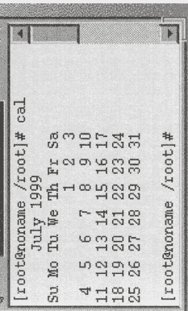

# 升级

升级命令与从头安装软件的命令类似，但使用升级（`-U`）选项代替安装（`-i`）选项。这是 RPM 命令的升级版本。

```
rpm -U package-name
```

RMP 可用于卸载程序，只需在命令中使用擦除（`-e`）选项即可：

```
rpm -e package-name
```

这里，命令中使用的文件名是程序文件的名称，而不是安装时使用的文件的名称（除了基本名称外还会有许多字符）。

# 附加功能

Linux 命令行有一些有用的小型附加功能，其中之一是 `cal`（日历）命令。在其最基本的形式中，您只需输入此命令：

```
cal
```

默认情况下，此命令会生成当前月份的日历。如果您需要当前月份以外的日历，可以指定月份和年份。此命令将打印 2002 年 6 月的日历：

```
cal 6 2002
```

重要的是要给出完整的年份，而不仅仅是最后两位数字（例如，“99”代表“1999”）。如果这样做，您将获得 99 年的日历，而这只是一段特殊年份的事情（图 2.3）。此命令将为 2001 年生成日历：

```
cal 2001
```

> 图 2.3 `cal` 命令还可以生成一年的日历

## 查找文件

Linux 有多个文件查找实用程序，其中一些比其他更容易使用。`locate` 命令相对快速且易于使用。速度快是因为该程序在硬盘上保持一个文件数据库，因此当它搜索文件时，无需查看硬盘本身。为了让此命令正常工作，显然需要一个数据库作为基础。数据库会自动生成并在大约早上 6:00 更新。您必须意识到，如果从该时间到下次更新之间您的 PC 在运行，它将或多或少无法工作。但在白天，可以使用以下命令手动生成或更新数据库：

`/usr/bin/updatedb`

完成此任务大约需要一分钟，但完成后，您应该能够相当快速地按名称定位文件。您必须以 `root` 身份登录。

虽然不太可能，但在某些情况下，可能无法定位用户想要的文件，例如，如果用户想要定位的文件之前已经存在。

要定位文件，您可以简单地发出 `locate` 命令并包含文件名，如下例所示：

`locate convert`

| [root@homeone /root]# | `locate convert` |
| :--- | :--- |
| `root@homeone /root]#` | `grep /usr/X11R6/bin/imagemagick/convert` | `p1` |
| `root@homeone /root]#` | `locate convert` |

> 图 2.4 locate 命令的示例输出

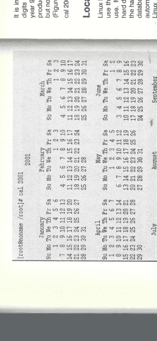

`locate` 命令将响应包含您使用的文本字符串的任何文件名，这可能会导致建议多个文件。在这个例子中，因为我的计算机响应了八个文件的列表（图 2.4），例如，我找到了名为“recovery”的文件。然而，从提供的列表中识别出您需要的文件通常并不太难。不幸的是，在 locate 命令中不能使用通配符。

# 日期和时间

`date` 命令允许读取日期和时间，并且允许“root”用户设置时间。要让计算机在屏幕上打印时间和日期，您只需发出简单的 `date` 命令：

```
date
```

然后它会响应类似以下内容：

```
Sun Jul 18 22:54:23 BST 1999-07-18
```

有许多可用的格式化选项，可用于以此格式打印时间。这些选项通过在命令末尾添加“+”和适当的格式化字符串来使用。此列表给出了一些格式化字符串及其功能。

| 字符串 | 功能 |
| :--- | :--- |
| %A | 缩写星期名称 |
| %A | 仅完整星期名称 |
| %b | 缩写月份名称 |
| %B | 完整月份名称 |
| %D | 日期的 mm/dd/yy 格式 |
| %H | 带前导零的 24 小时格式 |
| %I | 带前导零的 12 小时格式 |
| %M | 仅分钟 |
| %j | 打印一年中的第几天（001 到 365） |
| %p | 仅 AM/PM |
| %r | 带 AM/PM 的 12 小时格式 |
| %U | 仅星期 |
| %Y | 仅年份 |

此命令将打印年份：

```
date +"%Y"
```

此示例将打印月份的完整名称以及它是 AM 还是 PM：

```
date +"%B %p"
```

月份和 AM/PM 选项包含在引号中（它们之间没有空格，也没有第一个引号），并且可以在屏幕上使用两个字符的数据作为分隔符。可以使用任何所需的文本字符作为分隔符，在此命令版本中，月份和 AM/PM 指示之间将放置逗号和空格。

```
date +"%B,%p"
```

# 设置日期

系统时钟使用此形式的 `date` 命令进行设置：

```
date MM/DD/HH:mm/YYYY
```

- `MM` 是月份，是一个从 01 到 12 的两位数
- `DD` 是日期，是一个从 01 到 31 的两位数
- `hh` 是 24 小时格式的小时，从 00 到 23（00 是午夜）
- `mm` 是分钟，是一个从 00 到 59 的两位数
- `YYYY` 是完整的四位数的年份

无法指定秒，使用此命令时秒被设置为零。此命令将日期和时间设置为 2002 年 2 月 16 日下午 7:23（19:23）：

```
date 021619232002
```

当然，此类影响系统的命令只有在 root 用户发出时才有效。重要的是要认识到，`date` 命令不会更改 PC 的硬件时钟，真正调整的是从时钟读取的软件日期，以提供指定的时间，这仅仅是硬件时钟的一个副本。这意味着如果您进行了重大更改，将考虑到漂移。除了任何漂移外，除非使用合适的源，否则时间将直接从硬件时钟获取并应用。因此，对于大多数 PC 用户来说，进入 BIOS 设置程序并校正硬件时钟来获取时间和日期更好。即使计算机关闭并重新启动，也能获得正确的时间和日期。

# 字数统计

有许多与文本文件相关的命令，但在现代计算环境中，这些命令并不是那么必要。有强大的文本编辑器可以以更用户友好的方式处理其中大部分功能。可能有用的是 `wc` 命令。如果您想知道名为 `/root/chap1.txt` 的文本文件中的单词数，此命令将提供答案：

```
wc /root/chap1.txt
```

```
321 10726 60403 /root/chap1.txt
```

在不带任何标志的情况下使用此命令时，它实际上告诉您的稍微多于单词数。从左到右，显示的三个数字代表行数、单词数和文本字符数。因此，此文件包含 10726 个单词。如果您只需要一个或两个参数，请从列表中适当使用一个或多个选项。

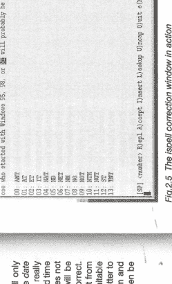

> 图 2.5 `spell` 纠错窗口正在工作

| 选项 | 参数 |
| :--- | :--- |
| -C | 字符（字节）数量 |
| -l | 行数 |
| -w | 单词数 |

# Ispell

Ispell 是 Linux 交互式拼写检查器，它与一些文本编辑器集成，但也可以从命令行使用。要从命令行使用它，只需发出命令，后跟要检查的文件的文件名。要检查名为 `/root/chap1.txt` 的文件，将使用此命令：

```
ispell /root/chap1.txt
```

如果找到错误，交互式屏幕提供几个选项（图 2.5）。顶行显示正在查询的单词和被检查文件的名称。显示包含可疑单词的文本行。在其下方是建议的更正列表，如果 ispell 能在其字典中找到与正在查询的单词相似的单词


被查询。屏幕底部有一行文本，列出了可用的选项。如果您希望使用其中一个建议的替换项，只需按下对应字母键。按下回车键（Return key）允许字典搜索一个单词，或者搜索相似词和微小变更器，如果提供了拼写则拼写单词（图 2.6）。使用替换（Replace）选项，您可以输入一个单词来替换现有的单词。要查看各种选项的简要说明，请输入 `?` 并按下回车键以调出帮助屏幕。上行命令实用程序 `ispell` 非常出色，它检查了许多高端文字处理器内置的拼写检查功能。

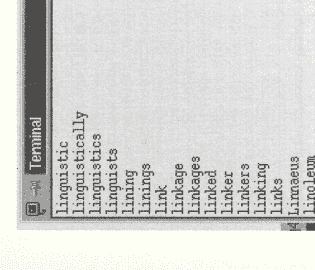

# 修正

命令行解释器的一个潜在缺点是，如果犯了一个错误，可能需要重新输入一个长而复杂的命令。（在 MS/DOS 中，这一点是必要的，其中按下三次 Enter 键会导致最后一条命令出现在屏幕上。如果你犯了一个错误并得到一个错误消息，只需按下 F3 键调出不正确的命令版本，借助插入键和删除键进行编辑，然后按下回车键加上插入键和删除键，最后按下回车键。

Enter 键。类似的设施也可在 Linux 命令行中使用，但按下 F3 不会调出最后一条命令。相反，按向上光标键可恢复最后一条命令。左右光标键将光标移动到，命令行解释器永久不太可能处于活动状态，且在键盘上永久输入的指令只会复制现有文本而不会覆盖。退格键（Backspace）和删除键（Delete）仅重复退格功能。但是，这就足以编辑命令了。在 MS/DOS 中，可以使用 `cls` 命令清除控制台屏幕并从头开始。这是 Linux 的等价命令：

```
clear
```

当然，这会在屏幕顶部产生通常的提示符，而不是一个完全空白的屏幕。

# 等价物

此列表提供了常见 MS/DOS 命令的 Linux 等价物，并为那些试图从 MS/DOS 过渡到 Linux 的人提供了快速参考来源。

| MS/DOS | Linux |
| :--- | :--- |
| cd path | cd path |
| cd \ | cd / |
| cd .. | cd .. |
| cls | clear |
| Control-Alt-Del | Control-Alt-Del 或 shutdown -r now |
| copy | cp |
| del filename | rm filename |
| del *.* | rm * |
| dir | dir 或 ls |
| diskcopy | 无直接等价物 |
| tar chvZ filename folder | 上述内容的压缩版本 |
| tar xfvZ filename folder | 在指定文件夹中解压缩文件 |
| umount | 上述文件夹的解压缩版本 |
| wc | 字数统计（提供文本文档中的单词数、行数及字符数） |

> 请注意，这些命令中的一些只有在用户拥有 root 权限时才是可能的。

# 更多实用命令

| 命令 | 描述 |
| :--- | :--- |
| Alt-F1 to F8 | 切换控制台 |
| adduser | 添加新用户 |
| cal | 打印当前月份的日历 |
| cal month year | 打印指定月份的日历 |
| cal year | 打印指定年份的日历 |
| date | 打印当前时间和日期 |
| ispell filename | 拼写检查文件名 |
| ln file/folder linkname | 创建硬链接 |
| ln -s file/folder linkname | 创建软链接 |
| mount | 挂载设备 |
| mv filename directory | 将指定文件移动到指定路径或目录 |
| passwd | 允许当前用户更改密码 |
| passwd name | |
| pwd | |

### 3 使用 KDE

## Linux 图形用户界面

Linux 命令解释器拥有广泛的命令，并且可以编程以轻松处理复杂和重复的任务。

它无疑是功能强大的，但像任何命令行解释器一样，它在用户友好性方面得分不高。如今大多数用户更喜欢图形用户界面，并且不会接受次一级的体验。

Linux 有多种图形用户界面可供选择，其中最广泛使用的通常简称为 KDE，即 K 桌面环境，它是一些界面的核心。4.21 位 Caldera Open Linux。表面上，KDE 看起来有点像 32 位版本的 Windows，使用最新版本，如果你喜欢，可以选择 Windows 风格的桌面。BEOS 和 Mac 风格的桌面也提供使用。

然而，表面之下 KDE 与 Windows 或任何其他操作系统都有显著不同。你可以选择 Windows、BEOS 或 Mac 风格的桌面，但 KDE 仍然以或多或少标准的 KDE 方式运行。对于习惯其他图形用户界面的人来说，在完全掌控之前，需要学习一定程度的内容。另一方面，通过一点实验，你可以很快开始熟悉系统，并执行一些基本任务。如果你不熟悉 Linux 使用的文件系统，在深入 KDE 之前有必要阅读前一章中涉及 Linux 目录结构的部分。设置和使用 KDE 应该是相对无痛苦的。

## 版本

就像计算机世界中的所有事物一样，KDE 正在逐渐演变。在撰写本文时，KDE 只有两个版本，即版本 1.0 和 1.1。后者相当新，很快将取代版本 1.0。显然，你必须在 PC 上安装 KDE 才能使用它。

为了通过本章内容，KDE 1.1 是可取的，如果可能，配备版本 1.0 的安装应进行升级。这里提供的大多数材料都适用于这两个版本，必要时指出两个版本之间的任何重大差异。

在某些 Linux 发行版中，一旦 Linux 启动，KDE 就会自动运行，要做到这一点，只需像往常一样登录，然后使用此命令：

```
kde
```

该程序可能被称为 KDE，但为了运行它，你必须输入 'kde' 而不是 'KDE'。两个版本在操作上非常相似，但存在一些重要差异。其中一个在你首次运行 KDE 时就会显现出来。在版本 1.0 中，你直接进入桌面，但在版本 1.1 中，它是一个名为 "Kicker" 的窗口风格程序，在某种意义上，你处于桌面的设置模式，直到你完全设置为即时使用。作为一个有趣的点，BEOS 或 Macintosh 上 MacOS 的 KDE 登录屏幕非常相似。你有以 root 身份启动 KDE 的选项，但应避免这样做。默认用户通常设置为标准 KDE 窗口管理器。这表明你最好在任何时候都选择 root 作为桌面，但我最初建议你选择标准 KDE 窗口锁定。

另一个差异是版本 1.1 会可选地为软盘或光盘在桌面上添加图标，以及一个 CD-ROM 图标。我建议让 KDE 为这些添加图标，因为图标使得使用软盘驱动器或 CD-ROM 驱动器变得更加容易，因为你只需将项目拖到适当的图标上即可执行你想要的操作，例如在这些早期阶段为这些项目添加图标。这在本章中涉及使用磁盘驱动器的部分中有详细说明。

# 桌面

进入 KDE 后，屏幕应该看起来像图 3.1。如果你使用过任何形式的 Windows 风格环境，KDE 桌面应该看起来有些熟悉，但有一些方面可能不同。

# 回收站

回收站图标相当于某些操作系统中的垃圾桶，类似于 Windows 中的回收站。代表文件的图标可以拖到回收站图标上并在那里丢弃以删除它们。这是 KDE 中等价于命令行 `rm`（删除）命令的功能，但与 Windows 回收站一样，当文件放入回收站图标时它们不会被销毁。它们从原始位置移动到

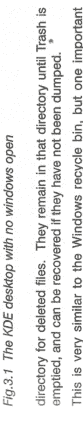

已删除文件的目录。它们留在那个目录中直到回收站被清空，如果尚未被倒出，它们可以被恢复。

这与 Windows 回收站非常相似，但一个重要的区别是，从软盘删除的文件在清空之前会存储在回收站中。在 Windows 中，放在回收站中的软盘文件实际上是直接删除到盘上，而不是复制（也许在最后时刻有可能恢复文件，除了（也许）将文件复制到可以复制回原始磁盘或任何其他地方新账户的情况）。

桌面上的图标只是提供对文件系统特定位置的即时访问。如果你以 'root' 身份登录，回收站文件夹将是 /home/Desktop/Trash'。如果你以（例如）'Fred' 身份登录，回收站文件夹将是 /Fred/Desktop/Trash'。已删除的文件存储在这个文件夹中，直到回收站被清空，然后它们可以像该文件夹中的任何其他文件一样处理。对于硬磁盘文件，抓住任何机会删除文件。回收站中的文件存储在硬磁盘上，并且不会立即删除。事实上，删除硬磁盘上的文件有时可能需要大量时间。回收站中的文件存储在硬磁盘上，减少了可用的自由存储空间。


# 自动启动

“自动启动”图标提供了一个文件夹的访问入口，该文件夹包含在 KDE 启动时需要运行的程序或指向这些程序的链接。这与 MS/DOS 中存在的自动启动文件夹以及 Windows 95/98 中的启动文件夹功能相同。每个拥有自己“自动启动”文件夹的用户都可以拥有自己希望在 KDE 启动时运行的一组程序。事实上，每个用户实际上都拥有自己的 KDE 桌面，可以根据个人需求进行自定义。

# 模板

“模板”文件夹，正如您可能猜到的，用于存储模板文件。暂时不需要担心这一点。许多程序可以使用模板在制作标准信函、书籍排版或任何其他文档时节省时间。如果您开始使用模板，可以将它们存储在此文件夹中。

# 面板

面板是屏幕底部的横条，用 Windows 术语来说，这是一种工具栏，但它与 Windows 任务栏有相似之处。KDE 1.0 的面板看起来比快速运行当前程序的简单方式要笨重得多；图标区域是“一对四”的。这两个版本都有四个标记较少但功能相似的“按钮”：这些用于在 KDE 的虚拟控制台等效物之间切换。但是，它们是“虚拟”控制台。在使用图形用户界面时，您可以解绑多任务处理，并且处理任务也有两种方法：就像 Windows 任务栏一样，在一个桌面上简单地运行“两个”或更多程序，或者将每个程序放在单独的桌面上，这样您可以在四个桌面上运行“四个”程序。这两种方法都允许在每个虚拟桌面上运行多个程序。

需要同时访问两个程序，这显然是将一个窗口中的项目拖放到另一个窗口中必不可少的。然后它们必须处于打开状态，第二个程序无需在同一桌面上打开。如果您拖放，不同的程序将在不同的桌面上打开。要在它们之间切换，只需单击屏幕底部相应的“虚拟控制台”，或使用面板中的桌面切换器。下面将更详细地描述这两种方法。

虽然从一个到另一个的切换是多任务的，但请记住，多任务处理的程序越多，所需的系统资源就越多。为了使复杂的多任务处理正常工作，必不可少的条件是拥有充足的可用内存。鉴于当前 PC 内存的低成本，这通常不是主要问题。

在用于在虚拟控制台之间切换的按钮左侧，是用于启动程序的“弹出”外壳工具。它用于退出 KDE 会话。

这将系统带回到控制台模式和命令行解释器。操作此按钮时，您有机会改变主意（以防您误操作），或者继续执行“注销”过程。您可能还会获得更多选项，如关闭系统、返回控制台或重启。下方两个小按钮中的一个是屏幕锁定按钮。

# 视而不见...

您会注意到面板两端都有箭头。如果您尝试左键单击箭头右端，您会发现面板会扩展到屏幕的右侧。类似地，左键单击左端按钮会导致面板缩回屏幕的左侧。在这两种情况下，箭头都保持作为“开启”指示器，表示面板可以从其“主”位置“弹出”。您还会注意到，当您将光标移动到屏幕顶部时，它会导致面板弹回。同样，当您将光标移开面板上方的区域时，面板上方的区域会缩回，面板将保持在屏幕顶部。


### 3 使用 KDE

要使用真正的全屏窗口，必须最小化面板。这有点像在 Windows 中隐藏任务栏，如果需要，可以自动隐藏。

#### 程序

任务栏左端标记有大写字母“K”的按钮，左键单击它会生成一个弹出菜单（图 3.2）。这相当于 Windows 的“开始”按钮，其中包含的菜单图标对于访问系统实用程序、程序等非常有用。菜单项具有悬停菜单，提供进一步的菜单选项。一些悬停菜单较短，仅提供更多几个选项；其他则较长，提供大量选项。

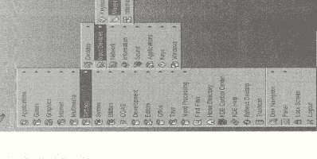

建议熟悉 KDE 的工作方式及其在 Linux 文件系统中的等效功能。要运行程序，只需左键单击相应的菜单项即可。

#### 任务栏

任务栏位于屏幕顶部，与其 Windows 等效物类似，它显示所有当前正在运行的窗口，即使它们已被最小化并仅在后台运行。当您最小化窗口时，它显示在任务栏上。

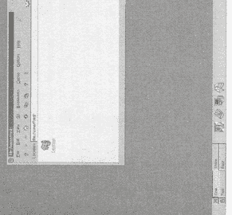

最小化后，窗口折叠并移动到其在任务栏上的相应部分。要重新激活窗口，只需左键单击其在任务栏上的部分。

这就是 KDE 任务栏的全部内容，其范围比 Windows 等效物相当有限。面板和任务栏加在一起大致相当于 Windows 任务栏。

#### KFM

当 KDE 启动时，可能有一个打开的窗口（图 3.4）。这通常默认存在，窗口中运行的程序是 KFM。该程序对使用 KDE 至关重要，因此有必要花时间熟悉 KFM 的工作方式。KFM 是一个 KDE 文件管理器程序，其在 Windows 95/98 中的等效物是桌面上的“我的电脑”图标。

换句话说，您使用 KFM 来浏览文件、管理文件系统、运行程序、复制、删除和重命名文件，而不是使用整个命令行解释器，后者原本需要使用命令行来处理。如果 KFM 未运行，请在主目录（例如，如果您以“root”身份登录，则为 /root）中左键单击房屋图标。

文件或文件夹的简要详细信息在窗口底部的状态行中提供。如果将光标放在 KWin/KDM 中的图标上，会出现一个包含所选文件简要描述的气泡；在 Nautilus 中，会出现一个包含类似信息的弹出窗口。右键单击图标，会出现一个下拉菜单供您选择已注册用于处理该图标的程序。在可能的情况下，您不应该在标准文件类型（如 PDF、GIF、JPEG 和纯文本文件）方面遇到问题。右击图标会弹出一个小菜单，如图 3.5 所示。此菜单可访问一些基本任务。

### 删除/回收站

删除选项在功能上等同于使用 Unix 的 `rm` 命令。区别在于，以这种方式选择文件实际上不会被删除，而是移动到一个名为回收站的文件夹中。这与将文件拖到回收站图标一样，在从回收站清空之前可以恢复。

### 打开方式

此选项会弹出一个对话框，在其中输入用于打开文件的程序名称（包括路径）。或者，可以使用浏览按钮来定位并启动文件（图 3.5）。对话框还提供了一个将文件复制到当前工作文件夹的选项。在这种情况下，需要双击文件夹或程序才能打开它。

### 复制

这非常类似于复制到 Windows 剪贴板。复制文件后，您可以移动到另一个文件夹，并在主窗口区域中的任何位置右击。这会弹出一个包含粘贴选项的菜单。选择此项会将文件复制到当前文件夹。Windows 等效物中没有复制/粘贴功能，但桌面中有。它没有以移动功能（即拖放文件到新文件夹）的形式提供，但删除文件然后将其粘贴到新目标是很容易的。在选择移动选项时，它会显示一个箭头指示新位置。

### 图像查看器

如果文件是识别的图形类型，将有一个选项使用 KDE 图像查看器程序来查看它。

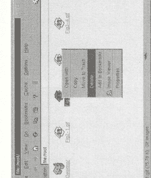

*图 3.5。右击图标会调出此菜单。*

使用 KFM 与使用 Windows 资源管理器不完全相同，但有许多相似之处。图 3.5 显示了 KFM 窗口的特写视图。KFM 显示区域底部的主区域显示文件和文件夹名称图标。如果图标过多无法适应窗口区域，可以通过拖动滚动条中的按钮向上或向下滚动窗口的右侧。或者，可以通过单击滚动条上方或下方来大幅度滚动窗口。KDE 滚动条似乎与其 Windows 对应物以完全相同的方式工作。

### 打开文件夹

各种文件类别和文件夹有不同的图标，它们大多易于理解。例如，正常文件夹使用纸箱的图像，而齿轮图标表示程序。要检查文件夹的内容，只需左键单击它，主屏幕区域就会改变以显示其内容。请注意，只需单击一次即可，不像在 Windows 中那样需要双击。实际上，Windows 中的许多双击操作在 Linux 中被单击取代，但仍需要一些双击。这最初可能会导致一些错误，您可能会发现您一直打开程序的多个副本而不是一个。


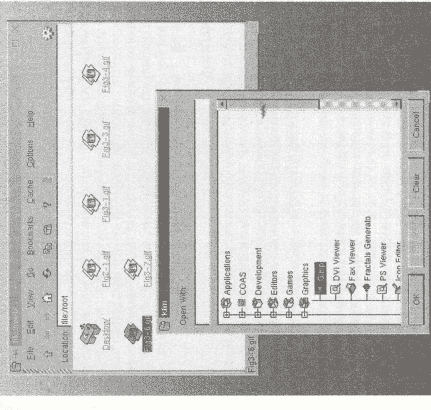

添加到**书签**列表。要通过其**书签**菜单选项访问书签文件，请激活书签菜单，然后从列表中选中该文件。

### 属性

*属性* 选项会调出一个界面（图 3.7），显示文件的一些基本信息。文件名显示在一个可编辑的文本框中，通过更改文本即可修改文件名。当然，如果文件是只读类型（例如 CD-ROM 上的文件），则无法执行此操作。左键单击“权限”选项卡会调出另一个界面，提供更深入的详细信息，包括文件的读写状态、所有者以及组信息。


### 导航

在主窗口区域上方有一个编辑框，这里显示当前路径。你可以在这里输入路径以直接前往特定目录。只需输入路径，然后按 *Return*（回车）键即可。输入目录名称或程序名称，然后按 *Return* 键即可打开文件或程序。

编辑框上方是导航工具栏。它提供了一种在文件系统中快速、轻松移动的方式。分别指向上、左、右的三个箭头，分别用于向上一级、后退一步和前进一步。显然，在未从原始目录后退之前，无法向前移动一步；在未移动之前，也无法后退一步。此外，当系统处于根目录 (/) 时，无法在目录树中继续向上移动。无法操作的箭头按钮看起来是凹陷进工具栏的，而可使用的按钮看起来则略微突出于工具栏。此工具栏中的下一个按钮有一个类似房屋的图标，该按钮将 KFM 直接移动到主目录。

### 文本编辑器

如果文件是文本类型，可以使用此选项将其加载到文本编辑器程序中。

### 添加到书签

Linux 文件系统往往相当复杂，许多文件都深深隐藏在系统中。*书签* 功能极其有用，它为访问那些经常使用但位于文件系统深处的文件提供了一种快速手段。选择此选项会将文件

### 重新加载

带有圆圈图标和两个箭头的按钮是“重新加载”按钮。在复制或移动文件时，或者在更换光盘时，你可能会发现主窗口区域中的图标未能正确反映目录内容。操作“重新加载”按钮会更新窗口，此时它应能提供目录内容的准确描述。

### 复制和粘贴

接下来的两个按钮分别提供访问复制和粘贴功能。在复制任何内容之前，必须先在主窗口区域中选中它。在 Windows 中，你通过左键单击图标，按住左键，然后拖出一个框围绕你希望选择的图标或图标组来做到这一点。被选中的图标会变为深蓝色。选择多个文件的另一种方法是按住 Control 键，然后左键单击你希望选择的每个文件。这是可以在 KFM 中用于选择屏幕上未方便地分组在一起的文件的方法。当然，如果文件是成组排列的，你可以在 Windows 中选择一个文件组。选中后，文件可以使用复制按钮进行复制。文件组也可以拖放到另一个 KFM 窗口、拖放到回收站等，通常可以将其作为单个实体处理。

### 帮助

下一个按钮是“帮助”按钮，按下此按钮会激活 KFM 在线帮助系统。KDE 帮助系统的工作方式与你主要的 Windows 对应系统大致相同。左键单击带下划线的单词会直接带你跳转到关于该主题的页面。较大的帮助程序包括常用的搜索功能。帮助系统通常因陈述显而易见的内容且缺乏实质性内容而声名狼藉，但如果你在 KDE 帮助系统中深入挖掘，还是能找到一些有用的建议。

### 停止

最后一个按钮，至少在理论上是“停止”按钮。在大多数情况下，程序运行得如此迅速，以至于真的是“眨眼之间就错过了”。然而，如果处理包含大量文件的目录确实需要几秒钟，你可以通过点击“停止”按钮来终止操作；或者，如果你希望停止，按下该按钮即可中止操作。

### 控制

在 KFM 屏幕的顶部有一个标题栏。此栏存在于所有 X 程序中，它的作用不仅仅是拼出程序名称。这里有一些控制按钮，但并非所有按钮都能出现在每个程序的窗口上。正如它对应的，其右侧的控制按钮与 Microsoft Windows 的对应按钮相匹配。此按钮用于关闭当前程序窗口。左侧的按钮是正方形的，边框略小，是“最大化”按钮。左键单击此按钮会将窗口置于全屏模式。再次右击则使窗口恢复到正常大小。下一个按钮会使窗口消失到任务栏中；点击任务栏的相应部分可恢复窗口。任何习惯使用 Windows 的人都会发现这些按钮很容易使用，因为它们本质上与 Windows 中的对应按钮相同。

### 窗口按钮

标题栏左端的按钮是“窗口”按钮，操作此按钮会激活三个上下菜单（图 3.3）。*最大化* 和 *关闭* 选项简单地复制了前面描述的大小和关闭按钮的功能。不出所料，*调整大小* 允许改变窗口的大小。选择此选项会产生一个边框，可以使用鼠标拖动到所需大小，左键单击按钮会使窗口变为选定的大小。这实际上也是一个重复功能，因为任何窗口都可以通过将光标置于窗口的边缘或角落，然后将光标拖至大鼠标按钮形状来拖动到所需大小。拖动部分可以通过按住左键，拖动到所需大小，然后松开按钮来调整大小。这同样是标准的 Windows 风格。可以通过指向标题栏的标题部分，按住左键，然后移动光标来拖动窗口在屏幕上移动。窗口将随光标移动，直到释放左键。

可以将窗口移动到标题栏“位于”任务栏下方的位置，从表面上看，这似乎没有方法将窗口拖回屏幕上。实际上这是可能的，只需按 Alt 键，然后将窗口拖到所需位置即可。按下 Alt 键后，可以使用窗口的任何部分作为手柄来拖动窗口。

### 粘附按钮

“窗口”按钮旁边是“粘附”或“图钉”按钮。其图标旨在代表一个图钉。在 KDE 中，窗口通常不会被“固定”。在从一个虚拟桌面切换到另一个虚拟桌面时，窗口会从屏幕上消失。左键单击粘附按钮会将窗口固定在屏幕上，使其在从一个虚拟桌面切换到另一个虚拟桌面时保持原位。点击此按钮会将窗口释放回虚拟桌面。当激活时，图标会发生变化，当窗口被“固定”在原地时，显示一个从上方俯视图钉头部的视图，当未被固定时，显示水平放置的图钉。你只需将窗口固定就位，使其可用，方法是将其固定在原地，切换桌面，然后再释放它。Windows 没有此功能。

### 菜单栏

在标题栏下方，KFM 有常规的菜单栏。这些菜单提供了许多选项，我们将只讨论其中一些更有用的选项。要添加新文件夹，请考虑打开 KFM，然后选择“新建”和“文件夹”（图 3.9）。然后在出现的对话框中输入新文件夹的名称。

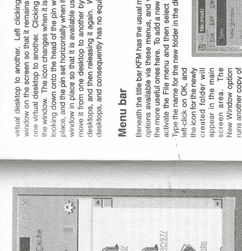

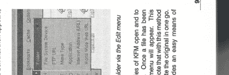

*新窗口* 选项会运行另一个 KFM 副本，它从主屏幕区域启动。KFM 的当前目录，可以通过拖放或使用与其他任何方法类似的剪切和粘贴方法，移动到其他目录。

*编辑* 菜单提供了通过编辑菜单选择新文件夹的便捷方法。


## 使用多个窗口和键盘快捷键时需格外小心，因为只有在正确的窗口处于激活状态时，快捷键才能产生预期的结果。

## 查看窗口

编辑菜单（复制、删除等）通过其他方式变得可用。查看菜单（图 3.11）控制主屏幕区域显示的信息。

具有某些实用功能的文件不会停止出现在主窗口区域。当“显示隐藏文件”选项处于激活状态时（菜单中该选项旁边的复选框中标有对勾指示），通常会显示隐藏文件。

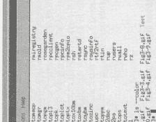

图3.10 在 KDE 窗口中运行的终端（控制台）

生成链接。尝试生成一个链接，并查看其图标下方出现的文件名。这是斜体字，表明它只是一个链接，而非实际文件。

## 程序图标

注意，文件图标可以从窗口拖拽到桌面上。对于 Windows 图标，只需双击其图标即可运行程序。在 Linux 中，可以拥有类似的设置，但这只是将每个程序图标拖拽到 KDE 桌面并选择链接选项而已。为了在桌面上运行该图标对应的程序，你需要选择“运行此程序”选项。不要双击该图标，否则你将看到两个该程序的副本同时在运行。

## KDE 控制台

文件菜单中的“打开终端”选项会在 KDE 窗口中运行一个控制台（图 3.10）。此控制台的用法与普通 bash shell 非常相似，但可以在其中输入命令。你甚至可以使用滚动条查看命令历史，这些历史通常存储在某个选项菜单中。例如，当 KFM 正在运行时，按下 Control+T 即可启动控制台。一如既往，你需要小心...

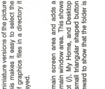

图3.11 KFM 编辑菜单

## 缩略图查看

激活“显示缩略图”选项后，大多数类型图形文件的图标将显示为文件中包含的图像的微型版本（图 3.12）。这使得选择正确的文件变得容易，但如果目录中有大量图形文件，显示它们可能需要一些时间。

## 显示树状图

树状视图（图 3.13）将主屏幕区域分割，并在主窗口区域的左侧添加一个目录树。这显示了根目录（/）、主目录（Home）和桌面文件夹中的所有文件夹。最初要打开一个文件夹，请单击其旁边的小三角形按钮。三角形随后向下指向，表示该文件夹已打开。

而 KFM 文本视图提供了图标的替代方案。文件夹的内容显示在其下方。请注意，在此上下文中，文件夹的内容是其他文件夹，而不是文件。在文本视图中打开文件夹不会导致文件简化方面的任何变化；主屏幕区域中几乎没有“手动部分”。文本视图实际上只是目录结构的地图，旨在帮助你导航复杂的目录结构。

## 文本视图

使用文本视图时，图标会消失，并被更详细地描述每个项目名称和说明的文本行所取代。这是用对象的名称或文件名替换图标。使用文本视图确实为你提供了大量选项，你可以使用这些选项进行滚动。你可以通过单击其文件名来打开文件或文件夹，但不能单击文件名右侧的信息。文件名还可以拖拽到另一个窗口中。

文件夹名称以品红色打印，文件名以红色打印。

## 简短视图

简短视图选项是一种文本显示形式，但与长文本模式不同，它只提供文件名而没有详细信息（图 3.15）。正如

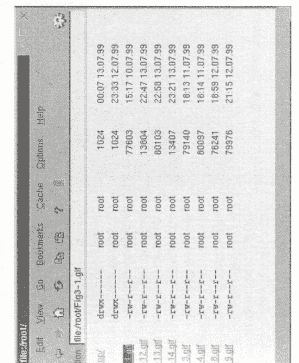

图3.14 KFM 文本视图提供了图标的替代方案

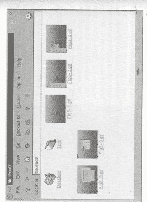

图3.12 选中缩略图选项的 KFM

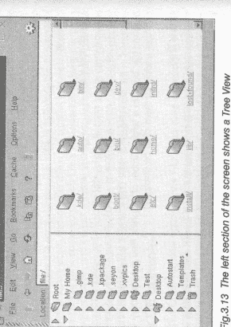

图3.13 屏幕左侧区域显示树状视图

## 选项

选项菜单（图 3.17）可根据需要启用菜单栏、状态栏、位置栏和工具栏。Save Settings 行上的保存选项会将当前设置保存为新的默认值，以后运行 KFM 时将使用这些设置。当然，如果使用每个用户或其他用户的设置，这些默认值不会受到影响。配置文件管理器选项会弹出另一个菜单（图 3.16），允许更改字体和配色方案等。如果你正在使用高分辨率显示器，建议将字体大小从默认设置

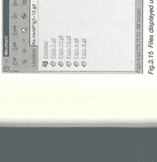

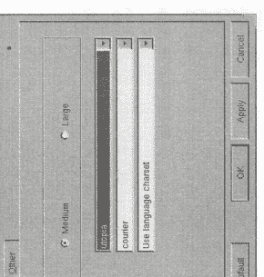

悬停在文件名上，将光标置于文件名上，窗口底部的状态行会显示该文件的一些简要详细信息。对于包含大量文件的目录，这是最实用的模式。

## 跳转

在“跳转”菜单的底部，你会看到一个最近使用 KFM 打开的文件和文件夹列表（图 3.16）。这与 Windows 中的“最近”列表非常相似，列表中的任何内容都可以通过选择来打开。

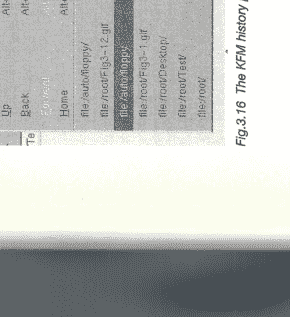

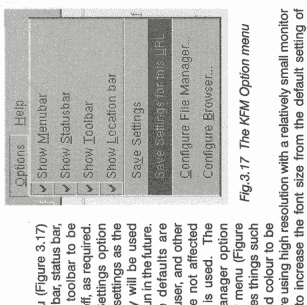

从“小”改为“中”甚至“大”。这使得图标下方的标签以及文本视图模式下的文件列表更容易阅读。

## 红色警示

如果你以“root”身份登录，每个 KDM 窗口在菜单栏左侧都会有一个红色条。"File" 是一个提醒，表明你具有管理员权限，可以更改可能破坏系统的系统文件。在此模式下，尤其是当你在试验 KFM 时，比平时需要更加谨慎。如果你以非“root”身份登录，仍然可以以超级用户模式运行 KFM。在第一个屏幕上的“登录到...”按钮上，单击“超级用户”选项卡（见图 3.19）。接下来，输入密码，系统会要求你输入密码。输入“root”密码后，一个具有超级用户权限（和红色“旗帜”）的 KFM 副本就会打开。

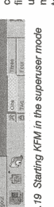

图 3.19 以超级用户模式启动 KFM

## KFM 与 tar 文件

KFM 使查看 tar 文件甚至压缩 tar 文件的内容变得非常容易。这些包括 ".tar"、".tgz"、".tar.gz"、".tar.bz2" 以及压缩 tar 文件。当在 KFM 主窗口中，你双击一个文件（或 KFM 能打开的任何文件）时，文件夹 KFM 窗口会变更以显示该文件中该文件夹的内容。图 3.20 展示了一个示例。在 KFM 主窗口中左击像 readme 文件这样的 tar 文件，它也可以在一个查看器中打开。（在 KDE 3.0 及更高版本中，KFM 主窗口显示 tar 文件的内容。）

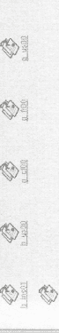

图 3.20 KFM 显示归档文件的内容

以相同方式查看文件。通常只需单击图形文件，KFM 就会在一个窗口中显示它们。Tar 文件没有那么容易。KWM（KDE 的文件管理器）有一个内置的视图，可以轻松查看 tar 文件的内容。你可以使用“查看”菜单来显示 tar 文件的内容。或者你可以使用 KMD（KDE 的内置 tar 文件查看器），它与 KWM 类似，也可以显示 tar 文件的内容。或者，你只需在终端窗口中使用 "tar" 或 "tar.gz" 命令来查看 tar 文件的内容。

## 软盘复制

与 Linux 命令行一样，KDE 没有内置的软盘复制功能。虽然并不太容易制作软盘的精确克隆，但使用 KFM 可以在 3 个步骤中制作软盘的精确克隆。显而易见的方法是：插入一张空白软盘到驱动器中并左击其图标，然后将原始软盘放入驱动器并左击该图标。这将从空白软盘复制数据到驱动器中的软盘。（反过来也是真的：你可以将原始软盘的数据复制到空白软盘。）通过更换为空白软盘并按下 KFM 主窗口中的复制按钮，你可以将原始软盘的内容复制到空白软盘。


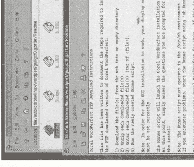

图 3.21 KFM 显示存档文件中的文本

在“重新加载”按钮之后，此时应该可以将文件粘贴到新的驱动器中。事实上，这行不通，因为如果没有原始磁盘，就无法执行从...的复制。

为了解决这个问题，有必要采用一条更长的路径，即 KFM 中与前面描述的命令行复制方法 [3.29] 等效的操作方法。
1. 将原始软盘插入驱动器，左键单击其图标，然后使用“编辑”菜单中的“全选”。将文件拖动到在另一个 KFM 副本中打开的一个空临时目录中，并从弹出菜单中选择“复制”。如果只有少数几个文件，可以直接将它们拖到桌面并复制。用复制盘替换原始磁盘，并操作“重新加载”按钮。选中

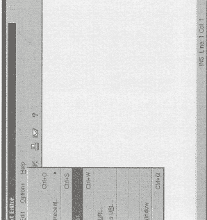

图 3.22 KEdit 文本编辑器的标准版本

临时文件夹或桌面上的所有文件，并将它们拖到 KFM 窗口或软盘上。从弹出菜单中选择“移动”，然后等待文件被复制到临时磁盘。临时文件夹或桌面上的文件将被自动删除。如果你使用的是临时文件夹，它们将保留在硬盘上，但最好让它们留在那里以备将来可能的使用。

## 文本编辑

使用 KDE 时有几种文本编辑器可供选择。当你打开一个文本文件时，它会被加载到 KEdit 中。

该程序的两个版本可通过“K”菜单系统获取。正常版本通过应用程序和文本编辑器访问（图 3.22）。一个稍微高级一点的版本也可通过应用程序然后程序编辑器访问（图 3.23）。这两个版本都与通常随 Windows 95 和 98 安装的 WordPad 编辑器类似，但事实上，它们缺少某些文本格式功能。这两个程序纯粹是设计作为文本编辑器，而不是文字处理器。因此，它们缺乏 WordPad 的一两个功能。另一方面

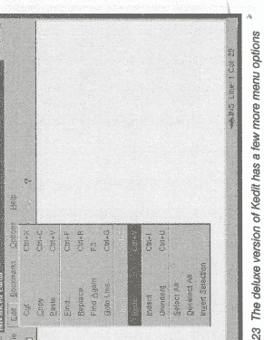

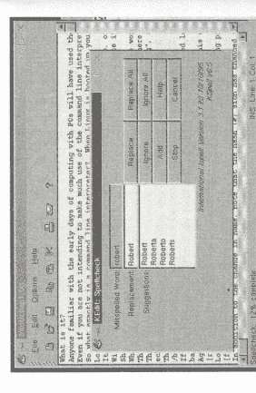

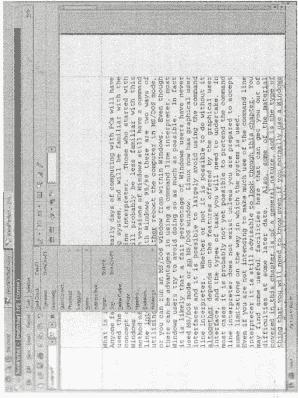

，它们具有一些相当高级的功能，例如内置的拼写检查器（图 3.24）。两个版本还具有有用的“查找”功能。

### WordPerfect

现在许多 Linux 版本都附带所谓的商业软件“个人版”。具体的使用条件各异，但这类型软件通常足以用于非商业目的的免费使用。显然，它并不像我们期望的那样完整，你的机器也应该拥有商业的非豁免或非自由软件，例如 WordPerfect（图 3.25）或 Corel WordPerfect 的副本。如果你需要更完整的文字处理程序版本，你可以购买更大的许可证来做更多事情。就我个人的观点而言，即使是一个简单的文本编辑器也是可用的最先进文字处理器之一：它对于创建简单文档来说完全足够，而且从快速参考卡中学习起来也相当容易。我使用过 WordPerfect 的各个版本来编写几十本书。

Linux 版本并不是 Windows 程序的精确克隆，但非常接近。如果你使用 MS WordPerfect for Windows 或其他竞争产品作为模板，你会发现 KDE 版本在使用 KOffice 之后很容易上手，只需很少的努力。如果你有一个高级图形工具，你可能会发现 KWord 的 KDE 版本不如其他一些程序快。访问 KWord 中某些高级功能的方式有一些不同，但这些不应该太难学习。

事实上，KWord 的 KDE 版本是办公套件的初学者开始的好地方。它具有高级功能和易于学习的界面。它可以用作文字处理器、文档检查器、同义词词典，甚至网络浏览器。然而，因为它不是传统意义上的文字处理器，单击文档中的某个位置可以选择整行，所以如果你想插入一个单词，你需要小心你点击的位置。你仍然可以从一个文档复制并粘贴到另一个文档。

从一个文档复制并粘贴到另一个文档。

最后但并非最不重要的，还有 XMemo，这是 X Windows 版本的 emacs 文字处理器（图 3.26）。如果你在命令窗口中找不到它，最好在 KDE 终端中输入此命令来运行它：

```
xemacs
```

事实上，如果你尝试从 KDE 终端运行该程序的标准版本，你可能会看到 XMemo。这个程序似乎具有标准版本的所有功能。但菜单、系统和工具栏使新手更容易掌握它。

### 回顾

在阅读上述材料并尝试使用 KFM 之后，你很快就能导航系统并理解简单的、基本的“事务处理”任务，如复制和删除文件。以下是一些更常见任务执行方式的快速回顾。请注意，在大多数情况下，实际上执行任务的方式不止一种，并且这里并不一定包含所有可能的方法。

### 用鼠标拖拽

指向滚动条（或任何东西），按住鼠标左键，移动鼠标进行所需的调整，然后释放鼠标左键。

### 选择文件

按住 Ctrl 键并左键单击你要选择的文件。或者，按住鼠标左键并拖出一个框围绕你要选择的文件，然后释放鼠标左键。

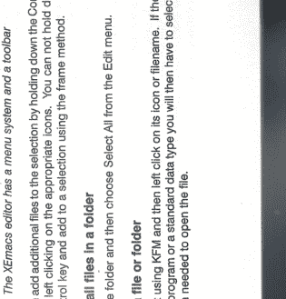

图 3.26 XMemo 编辑器具有菜单系统和工具栏

然后按住 Ctrl 键并左键单击相应的图标以将更多文件添加到选择中。然后你可以按住 Ctrl 键并使用框选方法添加到选择中。

### 选择文件夹中的所有文件

打开文件夹，然后从“编辑”菜单中选择“全选”。

### 打开文件或文件夹

定位程序或 KFM，然后左键单击其图标或文件名。如果文件不是程序或标准数据类型，你将必须选择打开该文件所需的程序。

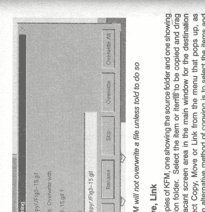

图 3.27 除非被告知，否则 KFM 不会覆盖文件

### 复制、移动、链接

打开两个 KFM 副本，一个显示源文件夹，另一个显示目标文件夹。选择要复制的项目，并将它们拖动到目标文件夹主窗口中的空闲屏幕区域。根据需要从弹出的菜单中选择“复制”、“移动”或“链接”。复制的一种替代方法是选择项目，然后从“编辑”菜单中选择“复制”。打开目标文件夹，然后从“编辑”菜单中选择“粘贴”。如果复制或移动了一个文件夹，其所有内容也会随之复制或移动。

### 覆盖

如果你尝试将文件复制到一个已包含同名文件的文件夹中，KFM 会生成图 3.27 所示的弹出菜单。如果你左键单击“覆盖”按钮，源文件将替换目标文件。这允许将文件的新版本插入到旧版本的位置。如果你不小心，这也可能导致旧文件抹去新文件。在处理文件组时，“全部覆盖”会导致任何具有重复名称的文件被覆盖。显然，这需要更加小心。

### 回收站和删除

要删除项目，请选择它们，然后从“编辑”菜单中选择“删除”。或者，选择一个或多个项目，然后右键单击其中一个。从弹出菜单中选择“删除”。请注意，删除的项目无法恢复。

### 从回收站检索

单击回收站以打开其文件夹。内容然后在 KFM 窗口中显示，可以从那里以正常方式复制和移动。

### 清空回收站

右键单击回收站，然后从弹出菜单中选择“清空回收站”（图 3.28）。

### 关闭窗口

左键单击标题栏上的关闭按钮（标有“X”的那个）。或者，如果缺少关闭按钮，请从“文件”菜单中选择“关闭”。使用 Control-w 将关闭活动窗口。

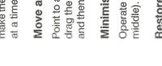

图 3.28 清空回收站

### 使窗口处于活动状态

左键单击窗口的非活动部分，例如标题栏中没有按钮的部分。如果你单击一个按钮，你可能会使窗口处于活动状态，同时也操作了该按钮。顺便提一下，一次只有一个窗口可以处于活动状态。

### 移动窗口

指向标题栏中不包含任何按钮的部分，然后将窗口拖动到所需位置。或者，按 Alt 键，然后使用窗口内的任何点作为手柄拖动窗口。

### 最小化窗口

操作标题栏上的图标化按钮（中间有一个点的按钮）。

### 恢复窗口

在任务栏的相应部分最大化。

### 最大化窗口

左键单击其最大化/恢复按钮（标有方框的按钮）。再次单击将窗口恢复到正常大小。


## 打开终端（控制台）

使用键盘上的 Control-T 组合键，或者操作面板中的终端按钮（带有显示器图标的那个按钮）。

## 运行程序

如果程序不在“K”菜单中，请使用 KFM 定位到程序文件，然后左键单击其图标或文件名。

## 将程序图标放置到桌面

使用 KFM 定位到程序文件，并将其拖放到桌面的空白区域。从弹出菜单中选择“Link”（链接）。之后，左键单击该图标即可运行程序。

## 切换虚拟桌面

要切换到另一个桌面，只需左键单击面板上相应的桌面按钮（标记为一到四的按钮）。或者，按住 Control 键并持续按 Tab 键，循环切换直到到达您需要的桌面。

## 在所有桌面中显示窗口

单击标题栏中的 Sticky（粘附）或 Pin（置顶）按钮。操作此按钮会使窗口仅在特定的那个桌面上可见。

## 启动 KFM

单击面板中的房屋图标。这将在主目录中启动 KFM，但您可以从那里移动到所需的目录。

## 新建文件夹

使用 KFM 打开父目录。右键单击主窗口中的空白区域，从弹出菜单中选择“New”（新建），然后选择“Folder”（文件夹）。在出现的编辑框中输入新文件夹的名称，然后左键单击“OK”（确定）。

## 隐藏面板

左键单击面板一端的箭头。再次左键单击此箭头可恢复面板。

## 自动启动程序

使用 KFM 定位到程序文件，然后将其拖放到 Autostart（自动启动）图标上。接着从弹出菜单中选择“Link”（链接）。

## 阻止程序自动启动

要逆转此过程，左键单击 Autostart 图标。这将打开一个 KFM 副本，显示 Autostart 文件夹的内容。只需删除您在启动时不需要的程序的链接。

## 在所有桌面中显示窗口

激活其 Sticky（粘附）图标。

## 将窗口从一个桌面移动到另一个桌面

激活其 Sticky 图标，切换到所需的桌面，然后取消激活 Sticky 图标。

请注意，某些菜单选项和特定按钮在并非所有情况下都可以操作。不适当的菜单选项会被灰显（显示为浅灰色而非黑色），无法选中。同样，非活动按钮看起来不会略微凸出于桌面，也无法操作。这与 Windows 和大多数其他图形用户界面使用的方法是相同的。

## 4. 还需要知道的内容

### 多用户

前面三章涵盖了在安装 Linux 到 PC 以及使用系统运行应用程序、复制文件等任务时所需了解的内容，这些任务可以通过命令行界面或 KDE 来完成。在本章中，我们将深入探讨一些为了有效使用 Linux 系统而需要了解的主题。

正如前几章所见，为了使用 Linux，有必要以用户名登录并提供相应的密码。这比即使在小巧、现代、快速的 PC 上启动过程所花费的时间要多得多：让计算机运行一个简单的程序可能需要登录和密码，然后可能还需要一次或多次鼠标点击或一系列按键操作才能让计算机执行任务。这种额外的时间和努力意味着，即使使用非常快的计算机，使用机器也需要合理的思考。前提是每个用户每次不需要花费太多时间。这种方法的缺点是对用户缺乏隐私保护。这不仅仅是其他用户能够访问可能属于某个人的私有信息的问题。如果对事物采取一种放任自流的态度，真的存在一个用户意外修改或删除属于其他用户数据的危险。事实上，系统可能会逐渐恶化成完全的混乱。

在使用像 Linux 这样的多用户操作系统时，您使用用户名和密码登录，以便操作系统始终知道谁在使用计算机。说系统对每个用户看起来完全不同，就像每个人都有自己的 PC 一样，这有点夸张。但是，在某种程度上，计算机会为当前用户进行个性化设置。与使用命令行界面相比，在运行 KDE 时，这些差异可能更加明显。即使在命令行工作，登录后的区别也是清晰的。命令行提示符前有一些文本，包括登录名称。此外，系统位于该用户特有的目录中。例如，如果您以“root”身份登录，系统通常位于 /root；如果您以“Fred”身份登录，则位于 /home/Fred。除了“root”之外，每个用户都有一个 /personal 目录，它是 /home 目录的子目录。

如果您在此处运行 KDE，差异更加明显。在启动时自动运行的 KFM 程序是该用户适当的目录。您可以升级计算机，但差异在于您经常使用的软件。如果您为登录到 KDE 放置了程序图标。不太明显的是，除非其他用户也添加它们，否则这些图标不会出现在任何其他用户的 KDE 桌面上。虽然默认情况下 KDE 桌面、模板和 Autostart 文件夹为您添加，但其他用户无法使用您的回收站文件夹。回收站文件夹保存了您可以放入回收站文件夹中的任何内容的访问权限，其中“fname”是用户的登录名称：/home/fname/Desktop/Trash。显然，像每个用户的 Autostart 文件夹以及该文件夹下的其他文件夹（例如“root”用户位于 /root/Desktop，顺便说一下，而不是 /home 目录）这样的文件夹也是如此。

### 权限

问题不仅仅在于为每个用户拥有个人 KDE 桌面。这样做仍然允许用户访问每个其他用户的文件。在实验中，您可以尝试以“root”身份登录并在回收站中放置一两个虚拟文件。可以通过“K”菜单按钮访问图形和文本编辑程序，用于创建虚拟文件，例如包含一条线的绘图或单字文本文件。创建文件并将其加载到文件夹后，退出 KDE 并以另一个用户身份重新登录。如果您尝试从 /root/Desktop/Trash 导航到 /root/Desktop 文件夹，您会发现无法做到。系统将产生一个窗口，显示错误消息（图 4.1），指出无法列出目录内容。反过来，如果将某些文件放在普通用户的回收站文件夹中，则能够访问它们。如果您以 root 身份登录，应该能够查看甚至删除包含这些文件的回收站文件夹。作为 root，您可以几乎做您想要的任何事，这包括普通用户的登录名称，您只能访问该用户有权访问的文件。

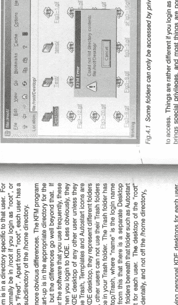

图 4.1 某些文件夹只能由特权用户访问

如果您以“root”身份登录，情况则大不相同，因为这为“root”用户提供了大多数事情的特别权限。可以通过在 KFM 中右键单击文件或文件夹，从弹出菜单中选择“Properties”（属性），然后左键单击打开的窗口中的“Permissions”（权限）选项卡（图 4.2）来获取文件或文件夹权限的详细信息。

当用户被添加到系统时，会发生许多事情，并且随着文件的生成，可以看到其中之一是为该用户的文件创建主目录。用户也被添加到数据库中，并且用户生成的文件属于组，用户将被添加到至少一个默认用户组中。当用户登录到 Linux 时，系统决定他或她能访问哪些文件，并确保用户不会干扰任何超出范围的文件。对于“root”用户，情况不同，因为 root 拥有完全访问权限，可以更改权限，而对于非 root 用户等也是如此。我们在最基本的层面考虑事物。理解这一点的一种方式是相当直接的方式。考虑“root”创建了一个名为“one”的文件夹，其中包含一个名为“oneone”的内部文件夹。我们现在考虑可用的访问级别。这基于适当的可用访问级别工作原理。


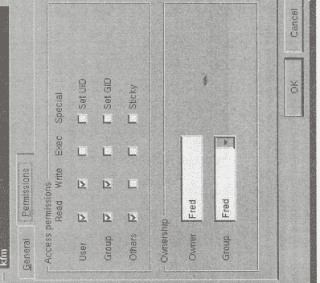

每类用户各有三个访问开关。这些分别是：

### **所有者（用户）**

这通常是创建该文件的用户。所有者对权限拥有完全的控制权，并根据其认为合适的方式分配权限。

### **组**

该用户是与此文件关联的组的成员。当大量用户出于不同目的使用计算机时，组非常有用。例如，一个组可能参与货物发货，另一个组可能处理后续销售，还有一个组可能处理账务，等等。这是一种简单的方式，可以将访问权限授予需要使用该文件的人员，同时防止其他人访问。每个用户可以属于任意数量的组，但一个文件在同一时间只能与一个组关联。

### **其他用户**

既不拥有该文件，也不是与该文件相关的组成员的用户。

以上就是这三个开关。

### **读取（R）**

此开关允许检查文件的内容，但不允许更改其内容。

### **写入（W）**

此开关允许更改文件的内容，这包括彻底删除它。

### **执行（X）**

对于文件，此开关允许将文件作为程序运行。对于目录，它允许使用 `cd` 命令进入目录，或在 KFM 或类似程序中打开。

文件默认总是授予某些权限，在正常情况下，你只需考虑你想要应用的权限，例如在文本编辑器中打开文件时可用的只读权限。很少需要设置执行权限，因为创建文件时它已在可被用户访问的位置创建。如果你正在使用 KFM 权限界面，你可能需要控制用户权限，此时从 KFM 权限界面开始的说明应该开始变得清晰起来。如果我们把 KFM 权限界面看作一种安排，那么我们有：

|       | **读取** | **写入** | **执行** |
|-------|----------|-----------|-------------|
| 用户  | 开       | 开        | 关         |
| 组    | 开       | 关       | 关         |
| 其他  | 开       | 开        | 关         |

在 KFM 权限界面上，勾选标记表示开关开启，空白表示关闭。上述表格中显示了三个权限开关。例如，用户对该文件拥有读取权限，但没有写入或执行权限。如果用户点击读取权限框中的勾选标记，通过使框变空白，它会关闭。该用户将完全没有任何该文件的权限。KFM 权限界面上为普通用户创建的文件设置默认值如上述表格所示。

如下所示，任何人可以读取该文件，但只有用户拥有编辑或删除它的权限。假设你对默认设置不满意，并决定使该文件对其他用户完全不可访问，并且你希望组中的任何人都能编辑它。设置将被更改，如以下修改后的表格所示。

|       | 读取 | 写入 | 执行 |
|-------|------|-------|---------|
| 用户  | 开   | 开    | 关     |
| 组    | 开   | 开    | 关     |
| 其他  | 开   | 关   | 关     |

执行开关仅适用于程序文件，可用于防止软件被未授权使用。然而，这不是通常需要的，你希望限制对数据文件的访问至特定用户。

### ## 列出权限

如果你希望在使用命令行时显示文件的权限，请在解释器中使用时，使用 *l* 选项配合 *ls* *l*，在使用命令行解释器时，使用 *l* 选项，如下例所示：

```
ls -l textdoc
```

关于文件的信息以十个文本字符的形式显示。第一个字符是文件类型，对于普通文件是连字符。有一系列其他选项，如目录的 “d” 和链接的 “l”。这就剩下九个字符来表示九个权限开关。它们出现的顺序是：

- 1. 所有者读取
- 2. 所有者写入
- 3. 所有者执行
- 4. 组读取
- 5. 组写入
- 6. 组执行
- 7. 其他用户读取
- 8. 其他用户写入
- 9. 其他用户执行

因此，普通数据文件的默认值将是 “-RwR----R-”。提供的其他信息包括所有者和组名，以及文件创建或最后修改的日期和时间。使用 *command* 行解释器和 *chmod* 命令更改文件权限是可能的。其工作原理是使用数字来表示不同类型的权限，并在命令中使用所需权限的总值。所需的总值是数字及其代表的权限类型：

| 数字 | 权限类型     |
|--------|---------------------|
| 0      | 完全无权限|
| 1      | 执行权限  |
| 2      | 写入权限    |
| 4      | 读取权限     |

如果一个文件具有读取和写入权限，但你需要将其更改为只读文件，会有几种方法可以做到：简而言之，如果该文件由用户拥有，你可以使用内置的命令行编辑器；如果你只想设置一个只读文件，*chmod* 命令的修改版可以设置一个只读文件，以便将其他访问类型的人排除在该特定文件之外。在这个特定情况下，可以使用三种类型的权限：（4+2+2=6）。例如，如果用户想要限制文件的权限，以便只有文件所有者可以读取它，命令可以是：chmod *640* *lexdoc*。如果你需要同时更改两个或三个文件的权限，这是可能的，只需要在命令中包含所有文件名，并在每个文件名之间用空格分隔。当然，命令中包含的所有文件将设置相同级别的权限。此版本的命令还将为名为 “text1” 和 “text2” 的文件设置权限：

```
chmod 640 textdoc
chmod 640 lexdoc text1 text2
```

从命令行更改权限并不困难，但使用 KDE 和 KFM 会容易得多。在可能的情况下，对于这类事情，最好坚持使用 KFM。

### ## 其他开关

如果你查看 KFM 中的属性窗口，你会发现还有另外三个开关，都在 Special 标题下。这些是 Sticky（粘滞）和 Set User ID（设置用户 ID）开关。这些的具体功能有点晦涩，但基本思路似乎是设置运行程序的 ID，使其拥有特殊权力。Set Group ID（设置组 ID）开关类似，但用于设置组程序的 ID。

程序以匹配该文件的 ID，从而将文件的权限转移到目录。这使程序拥有用户通常没有的权限。set-GID 以类似的方式工作，但用于将用户的权限转移到程序。set-GID 位设置为 2000。当此位开启时，以类似的方式工作，但用于将用户的权限转移到程序。set-GID 位设置为 2000。当此位开启时，以类似的方式工作，但用于将用户的权限转移到程序。set-GID 位设置为 2000。当此位开启时，以类似的方式工作，但用于将用户的权限转移到程序。set-GID 位设置为 2000。当此位开启时，以类似的方式工作，但用于将用户的权限转移到程序。set-GID 位设置为 2000。当此位开启时，以类似的方式工作，但用于将用户的权限转移到程序。

Sticky、setUID 和 setGID 开关可以通过 `chmod` 命令设置。它们分别需要在数字中添加 1000、2000 和 4000。如果你没有将适当的值添加到 `chmod` 命令中，其他位将关闭，因为它们都会被设置为零。如果我们拿早前的 `chmod` 示例并修改它以同时设置粘滞位，这将产生以下命令：

```
chmod 1640 textdoc
```

再次说明，使用 KFM 的权限窗口要容易得多，它使查看当前设置以及更改设置都变得更加简单。当然，无论你是使用 KFM 还是命令行来更改权限设置，只有在你拥有相应权限时才可能。如果没有此权限，如果你能进入包含该文件的目录，你可以看到 KFM 权限窗口，但无法进行任何更改。

## 添加组

如果你希望更改文件的用户组，可以使用 KFM 权限窗口完成。窗口底部部分显示当前窗口的组 ID，并有一个已安装组的菜单可供选择。如果你需要将文件分配给一个新的组，必须首先添加该组。由于可以从 KFM 权限窗口生成，可以使用 `newgroup` 命令在命令行上添加组。假设你希望添加一个名为 “newgroup” 的组。可以使用以下命令：

```
groupadd -g 1000 newgroup
```

你必须提供一个系统尚未使用的组 ID 号，但你应该使用一个相当高的数字。如果你使用 1000 到 6000 范围内的数字，应该没有问题。最大允许的数字是 65535，但从 600 到 6000 的任何数字都应该可行。最大允许的数字是 65535，但从 600 到 6000 的任何数字都应该可行。最大允许的数字是 65535，但从 600 到 6000 的任何数字都应该可行。最大允许的数字是 65535，但从 600 到 6000 的任何数字都应该可行。最大允许的数字是 65535，但从 600 到 6000 的任何数字都应该可行。

创建新组后，在使用之前可以先将其分配给一个或多个用户。它可以作为用户的默认组，以便分配到“权限窗口，因为组 “Fred” 和 “users” 是可能的”将列出。你可以使用 `groups` 命令在命令行上检查用户是否属于该组。使用此命令可以检查 “Fred” 属于哪些组：

```
groups Fred
```

这将返回此答案：

Fred : Fred users

“Fred” 是用户 “Fred” 的主要组，而 “users” 是唯一的次要组。假设我们希望移除 “users” 并将 “Fred” 分配到 “newgroup” 中。

这两个命令即可完成工作：
`usermod -d /home/Fred Fred`
`usermod -g newgroup Fred`

第一个命令将系统指向正确的目录，然后为该用户设置次要组和主要组。如果需要多个次要组，请使用 `usermod -G` 选项。

为了将具有唯一名称（但不包含空格）的所有文件（例如 “fred”）包含在次要组中，在两个命令之间使用 `usermod -G` 选项。将组 “newgroup” 和 “users” 作为 “Fred” 的次要组，同时 Fred 仍然是主要组。

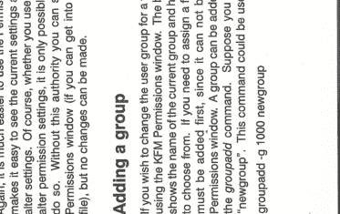

```
usermod -g newgroup users Fred
```


### 图 4.6 用于输入或编辑账户详情的表单

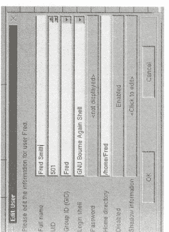

打开管理系统（Administration System），该系统允许查看和控制各种系统设置。要打开管理用户账户的窗口，请激活“K”菜单，然后选择“COAS”、“System”（系统）和“Accounts”（账户）。这应该会弹出类型 4.4 的窗口。此初始屏幕允许读取一些基本的账户详情，而“Actions”（操作）菜单允许编辑或创建账户。如果选择“Create”（创建）选项，首先在一个对话框中输入新账户的登录名（图 4.5），然后将在出现的表单中添加其他详细信息，例如用户的姓名和密码（图 4.6）。在可能的情况下，显然使用这种图形前端来管理账户比通过命令行要容易得多。

### KDE 与光盘

KDE 处理光盘的方式在 1.0 版和 1.1 版中并不完全相同。事实上，KDE 1.1 处理软盘和 CD-ROM 的方式要方便得多，仅凭这一因素就值得从 1.0 升级到 1.1。正如第一章所指出的，第一次运行 KDE 1.1 时，可能会遇到一个 Windows 风格的向导（图 4.7），并引导用户通过一系列屏幕，以便根据个人偏好设置程序。其中一个屏幕允许用户选择是否要在桌面上显示两个软盘驱动器和 CD-ROM 驱动器的图标（图 4.8）。我强烈建议保留这些图标，因为它们使访问软盘驱动器和 CD-ROM 驱动器变得非常容易。（当然，如果你的计算机没有“floppy 2”（相当于 MSDOS 或 Windows 中的 B 盘），则不需要此驱动器图标。如果首次在运行 KDE 时未添加这些图标，可以通过再次运行 KDE 配置向导在稍后添加它们。操作面板中的“K”按钮，然后从菜单系统中选择“Utilities”（实用工具）和“KDE Configuration Wizard”（KDE 配置向导）。）

### 图 4.4 COAS 用户账户编辑窗口


此时，这三个组对于由“Fred”拥有的文件均可用（图 4.3）。当然，如果你以“root”身份登录，则一切皆有可能，所有可用的文件组在“Permissions”（权限）窗口中作为“root”用户均可用。然后可以为任何文件分配给任何组。

根据你使用的 Linux 版本和发行版，你可能能够作为管理员通过图形用户界面完成任务。Caldera Open Linux 2.2 具有 COAS（Caldera Open Administration System，Caldera 开放管理系统），它允许查看和控制各种系统设置。

### 图 4.5 账户名称编辑框


### 图 4.7 此向导在首次运行 KDE 时出现


如果你确实选择了光盘图标，适当的图标将被添加到 KDE 桌面下方的桌面上，并且此设置过程必须为每个用户重复进行。为了访问标准 CD-ROM，只需将其放入驱动器，然后点击 CD-ROM 图标。这将启动一个 KFM 窗口，显示在 M$DOS/Windows 术语中称为 CD-ROM 根目录的内容。在 Linux 文件系统中，CD-ROM 位于 /auto/cdrom 或 /cdrom，这并不出乎意料。这不仅仅是学术上的重要性，因为这种方法提供了显著的优势。无需挂载和卸载 CD-ROM。如果你用完了一个 CD-ROM 并希望使用另一个，只需移除第一个 CD-ROM 并替换为第二个。然后，如果你左击“reload”（重新加载）按钮，KFM 窗口将变更以显示新 CD-ROM 的内容。

对于软盘，事情也以大致相同的方式运作，这些软盘也自由地向文件系统和用户开放。你还可以像在 Windows 系统上那样更改系统。在使用应用程序时，你可以通过使用 /auto/floppy1/filename 直接保存到软盘。这里假设系统中只存在一个软盘驱动器。必须使用适当的“floppy”和“floppy1”，而不是普通的“floppy”。你也可以从软盘加载

### 图 4.8 在 KDE 1.1 中为光盘添加图标的简单方法


### 图 4.9 添加的光盘图标


### **KDE 1.0 驱动器**

使用 /auto/... 作为路径来访问 CD-ROM 驱动器。当使用 /auto/floppy 路径时，不要使用 /mnt/floppy 作为软盘驱动器的路径，也不要使用 mount 和 umount 命令。同样，如果你使用 /auto/cdrom 来访问 CD-ROM 驱动器，不要使用 /mnt/cdrom 路径，也不要尝试挂载或卸载驱动器。

如果你使用的是 KDE 1.0，事情就没那么直接了。如果你愿意，在 KDE 1.1 中也可以使用光盘图标，这并不困难。如果你愿意，也可以在 KDE 1.1 中以这种方式进行操作，但这似乎毫无意义。登录然后运行 KDE 程序，在桌面的空白区域右键单击，选择“New”（新建），并在出现的对话框中选择“Device”（设备）或“File System Device”（文件系统设备）（图 4.10）。你必须输入图标的文件名，并且你应该用适当的内容（如“Floppy”或“CDROM”）替换默认名称中的"Device"。保持文件名中"Kernel"部分不变。退出此窗口后，桌面上将出现一个新图标，但目前尚未配置好，因此还无法使用。

### 图 4.10 用于命名 KDE 链接文件的编辑框


可以通过右键单击图标并从弹出菜单中选择“Properties”（属性）来配置它。在出现的窗口中（图 4.11），选择“Device”（设备）选项卡，然后在设备框中输入软盘图标的 "/dev/d0" 或 CD-ROM 图标的 "/dev/cdrom"。不要触碰其他框。在“Properties”（属性）选项卡中，必须选择设备的图标。具体情况是，根据你所在的选项卡不同，选择的图标外观也会有所不同。接下来，在“Floppy Disc”（软盘）选项卡上，选择窗口底部附近的“device mounted”（设备已挂载）按钮。从六个小的绿色按钮中，选择一个看起来像旁边有一个小绿色方块的软盘，或者根据情况选择其 CD-ROM 对应项。然后，左击 OK（确定），然后使用绿色按钮重复该过程。左击 Cancel（取消），你刚刚就命名了图标。如果你点击 OK，图标应如图 4.12 所示。左击图标，其外观应从问号变为未挂载光盘版本。

重要的是要意识到，一旦放置好图标，它们就不能像 KDE 1.1 中那样以同等细致的方式使用；你必须先使用 CD-ROM 驱动器，安装光盘，然后右键单击适当的图标。这会生成一个小弹出菜单，应从中选择“Mount”（挂载）选项。驱动器图标应从普通版本变为已挂载版本。你也可以右键单击"Mount"菜单中的绿色挂载图标，左击"Unmount"（卸载），或者左击任一图标以使用 KFM 查看内容。然后可以按照常规方式复制、移动文件等。

使用完光盘后，不应直接将其从驱动器中取出。对于 CD-ROM 驱动器，对象通常会被系统锁定，因此不可能简单地将其拔出。在移除光盘之前，应将其卸载。要执行此操作，右键单击驱动器图标，并从弹出菜单中选择“Unmount”（卸载）。图标随后应变回普通版本，此时移除光盘才是安全的。

这显然比在 KDE 1.1 中使用软盘和 CD-ROM 驱动器不方便得多。此外，系统的设置、在系统上设置 CD-ROM、为"root"用户设置驱动器以进行访问，这一切将几乎变得容易。可能不需要编辑 /etc/fstab 文件以使非特权用户能够使用驱动器图标。

### 图 4.11 设置挂载点


### 图 4.12 选择驱动器图标


用户，这在某种程度上有些风险。升级到 KDE 1.1 版本可能比使用 1.0f 版本更容易。

## 软盘格式化

如果需要格式化软盘，则需要一个磁盘格式化程序。似乎没有替代 KDE 内置的磁盘格式化功能的选择。不幸的是，KDE 并没有提供一个擅长在命令行运行的磁盘格式化程序。可以通过“k”菜单访问 KDE 磁盘格式化程序，但只有选择工具（Utilities）然后选择 Kfloppy 时它才会启动。应会出现如图 4.13 所示类型的窗口。该程序使用非常简单，类似于 Windows 95 和 98 中找到的磁盘格式化工具。可用的唯一选项是快速（Quick）和完全（Full）选项，分别用于擦除磁盘和对磁盘执行完全格式化。只有完全选项可用于尚未之前格式化的磁盘。已在 1.44 MB 3.5" 软盘上进行过测试。


还有 DOS 格式软盘的选项。实际上，主要有两种类型：FAT12 和 FAT16。Linux 能很好地处理这些格式。另一方面，Microsoft Windows 只能读取 FAT12。Windows 不支持 FAT16 磁盘。使用这些类型的格式意义不大，因为你无法直接与底层操作系统交互。如果你正在使用运行 MS-DOS 或 Windows 的 PC，那么使用 DOS 格式磁盘配合 KDE 是有意义的，因为这使得在 PC 和 DOS 之间交换数据变得容易。

DOS 格式磁盘能够很好地读取高密度或双密度 3.5" 磁盘。但是，除非使用特殊工具，否则 KDE 无法写入 MS-DOS 或 Windows 格式。

格式化程序应该能够处理较旧的 5.25" 磁盘，但我实际上从未尝试过。MS-DOS 和 Windows 无法从 Linux 格式磁盘读取或写入数据。

## 自定义 KDE

像大多数图形用户界面一样，KDE 允许用户通过设置所谓的“KDE 外观和感受”设置来自定义桌面外观和感受。这是通过系统设置菜单下的桌面和背景（Desktop and Background）完成的。在这里，您将看到一个窗口，允许您选择背景颜色、图案和壁纸。系统设置程序非常容易使用。它与旧版本中的 KDE 控制中心（Control Center）相似。

有很多不同的选项可以自定义您的桌面。您可以更改菜单栏、任务栏和桌面本身的颜色。您还可以更改窗口装饰的外观、用于窗口标题和图标的字体，甚至窗口过渡的动画速度。所有这些设置都可以通过系统设置对话框访问和修改。


**图 4.15 背景颜色选择窗口**

可以用作壁纸，并且可以对壁纸应用标准的效果范围（填充、镜像、缩放等）。“浏览”（Browse）选项可用于从文件系统任何位置选择自定义壁纸图像，然后使用 \#root\ 用户可以将 JPEG 文件复制到 /opt/kde/share/wallpaper 目录中。使用数码相机拍摄老式折叠相机，然后设计“镜像”壁纸效果，便产生了图 4.16 中的背景壁纸设计。通过桌面，在设置窗口左上角的选板中选择。

## 添加桌面

默认情况下有四个虚拟桌面，但根据您使用计算机的方式，您可能需要更多或更少。KDE 允许您拥有多达八个虚拟桌面，并且更改数量非常容易。激活“K”菜单，然后选择面板（Panel）和配置（Configure）。这会调出图 4.17 中显示的控制面板，其中包含对面板的大量控制。四个控制面板中的第一个控制面板位置及其


**图 4.16 添加到 KDE 桌面的自制壁纸**

大小。要更改虚拟桌面的数量，请左键单击“桌面”（Desktops）选项卡，调出图 4.18 中显示的控制面板。两个滑块控件上方的那个（标记为“可见”，Visible）可用于更改虚拟桌面的数量。将桌面数字向右拖动以增加桌面数量，或向左拖动以减少数量。只允许偶数桌面，因此可以选择二、四、六或八。此面板还允许使用编辑框重命名每个桌面。您可以给虚拟桌面起适当的名称，例如“电子表格”（Spreadsheet）和“图形”（Graphics），而不是默认的“One”、“Two”等。标记为“宽度”（Width）的下层滑块控件，以及桌面控制面板上的选择按钮。这必须设置得足够宽


**图 4.17 控制面板的大小和位置**

以容纳图例，但显然将按钮栏保持尽可能窄是有意义的，以便为面板上的其他按钮留出尽可能多的空间。您可以在退出桌面控制面板之前操作“应用”（Apply）按钮，查看一切是否正常。

如果系统处于桌面 One，并且您移动窗口使得指针接触屏幕右侧，系统会自动切换到桌面 Two。反过来，当指针接触桌面 One 底部时，它会移动打开的窗口。

每个虚拟桌面都会自动设置两个这样的自动切换条件。


**图 4.19 KDE 控制中心主窗口**

将指针移至屏幕的最左侧不会有任何效果，因为那些方向没有虚拟桌面。自动切换效果似乎可能是管理一个巨大桌面的理想方式，这也可能被视为做事的一种方式。实际上，这是那种您要么喜欢要么讨厌的功能。如果您对窗口控制足够精确，您可以找到一个在从一个桌面到另一个桌面之间定期工作的方法。

这是通过 KDE 控制中心的活动应用程序边框（Active Application Borders）功能启用的，可以通过“. ”菜单中的 KDE 控制中心选项查看。这在图 4.19 中显示。接下来点击选择活动边框（Active Borders），并在图 4.20 中显示的子界面上的复选框上打勾。然后您可以启用可调节的进一步选项。通过在切换发生之前从菜单中选择它也很有帮助。使用延迟会减慢速度，但有助于避免从一个桌面到另一个桌面的意外切换。我绝对建议使用短延迟。


**图 4.18 上方滑块控制桌面数量**

## 边框控制

如果愿意，可以具有桌面之间的自动切换。这是基于将指针移动到屏幕适当边缘时自动切换到下一个桌面。虚拟桌面的相对位置与面板上的按钮相匹配。


**图 4.20 在 KDE 控制中心中设置活动边框**

使用活动边框功能，您可以通过将窗口拖到屏幕边缘将窗口从一个桌面移动到另一个桌面。当指针到达屏幕边缘时，系统移动到下一个桌面，并带着窗口一起移动。将窗口从一个桌面切换到另一个桌面的另一种方法是，在窗口菜单下方，从子菜单中选择桌面（Desktop），然后从弹出窗口中选择所需的桌面。

## 桌面页

桌面页（Desktop Pager）应用程序提供了将窗口从一个桌面移动到另一个桌面的另一种方式。要运行此程序，激活“K”菜单，然后选择系统（System）、页（Pager）选项。这应导致屏幕左下角（刚好在面板上方；图 4.21）打开一个小窗口。如果您只使用两个虚拟桌面，此窗口将显示这两个桌面的缩略图。

如果系统设置为四个或更多桌面，缩略图视图中只显示前两个，但通过左键单击箭头，可以滚动到其他桌面。或者，可以以通常方式将窗口拖动到不同大小，如果选择适当的纵横比，所有桌面都将可见。双击缩略图，系统会移动到该桌面。

缩略图视图仅显示灰色矩形，不显示窗口内容的详细信息。但是，您可以通过右键单击窗口并调出窗口菜单来找到窗口的基本详细信息。这将显示窗口的详细信息。窗口菜单可从窗口的任何部分访问。


**图 4.21 KDE 桌面页**

完成与窗口的操作。要将窗口从一个桌面移动到另一个桌面，再次右键单击桌面页中该窗体的代表，这将调出窗口菜单。然后只需在常规桌面菜单选项之间切换即可。首先选择要移动窗口的目标桌面，然后从弹出菜单中将窗口移动到所需桌面（图 4.22）。窗口菜单中的所有其他选项均以正常方式运行。顺便提一下，您可以使用菜单栏快捷键将窗口移动到另一个桌面。


**图 4.22 桌面页**

如果您想访问桌面页，首先在窗口内单击，但不要单击代表窗口或桌面的区域。这会调出一个包含各种选项的菜单，例如桌面页本身。选择“显示菜单”（Show Menu）选项，这将把常规菜单栏放在窗口的顶部。要关闭程序，激活文件（File）菜单，然后选择“退出”（Quit）选项。


## 自动恢复

在使用 KDE 时，您很快就会注意到，它倾向于从上次的离开处开始运行。在您注销时保持运行的任何程序，很可能在下次登录时都会在相应的桌面上恢复，几乎就像您离开时的状态一样。这种自动恢复功能对某些程序比对其余大多数程序更有效，因为大多数支持 X11 的软件都可以处理 KDE 无法保存的数据。如果您尝试在未保存的情况下登录，将不会有任何影响。最好在注销前始终保存数据，以防万一无法执行此操作。

## 面板图标

默认情况下，面板上有一些程序图标，但您可以添加更多。通过定位相关程序文件或使用 KFM，这是相关的定位命令结构。在这种情况下它很有用，有助于那些正在定位 `/opt/kde/bin` 文件夹中文件的人。要在面板上放置按钮，请将程序图标从 `/opt/kde/bin` 文件夹拖放到相应位置。只需拖动应用程序即可，大致如此。


将图标从 KFM 拖放到面板上的空白区域。这将把程序文件拖入面板上的空白区域。这将留下该程序，但只需左键单击其按钮即可。面板上的程序图标不用于运行控制台应用程序。

面板图标不用于运行控制台应用程序。有一种替代方法可以为“K”菜单中的程序向面板添加按钮，这大致是“K”菜单程序结构的克隆。您可以在“程序”菜单下找到它，选择它并添加菜单图标。然后选择相关的程序结构。如果您选择该程序，其按钮会自动添加到面板。


若要移除面板上的按钮，请右键单击按钮并从弹出菜单中选择“移除”。（图 4.25）。此菜单中的“移动”选项与移动程序文件或其链接无关。必须使用鼠标沿面板移动按钮。您可以将某些默认按钮向上重新定位，这大致详述了属性等内容。


## 程序图标

如前一章所述，您可以通过从 KFM 中拖动并使用链接选项，轻松地将程序的图标放置在桌面上。这种方法快速且简单。替代路径可以提供对图标的更多控制。替代路径是以与此章前述向桌面添加设备图标大致相同的方式进行的。在空白桌面上右键单击，然后选择**新建**和**应用程序**。这将弹出一个小的对话框，您可以在其中输入程序的适当名称，当前显示为**程序**。保持名称中的“kdeLink”部分不变。此系统文件扩展名告诉系统，您正在创建的文件是一个 KDE 链接文件。

这会在桌面上放置一个默认齿轮图标，但此时它实际上不会做任何事情。要告诉系统程序文件的位置，请右键单击图标并选择**属性**。在弹出菜单上，接下来单击图 4.28 中所示的右侧链接。如果您单击**执行**选项卡以调出表单，可以将路径输入到**执行**编辑框中。即使您这样做，您也可能更喜欢使用**浏览**选项。


图 4.26 浏览选项可轻松找到正确的链接

如果您希望选择备用图标。左键单击此表单上的齿轮图标，并从随后打开的窗口中选择一个不同的图标（图 4.27）。齿轮图标随后应该会变为您选择的图标。最后，左键单击确定以退出**属性**窗口，然后左键单击程序图标以检查它是否启动。


图 4.27 为程序选择图标


图 4.28 可以使用图标编辑器应用程序制作 DIY 图标

## DIY 图标

如果您想制作自己的图标，可以通过**K** 菜单获取一个优秀的图标编辑器程序。选择“图形”然后是“图标编辑器”将启动图标编辑器并创建程序（图 4.28）。

图标必须相当小，仅为 32 像素 x 32 像素，因此不要试图过于详细。使用窗口左侧的绘图工具，但对于图标等简单图形，通常只需使用画笔工具逐像素添加内容即可更轻松地操作。要选定颜色，只需从画笔调色板中拖一种颜色。一旦完成杰作，它应保存到**/opt/KDE/share/icons** 文件夹中，扩展名为“.png”。然后 KDE 就能在属性窗口中找到它，它应该包含在标准图标中与程序图标一起。然后可以像其他任何图标一样选择并使用它。


## KDE 与 RPM

如第 2 章所述，如今许多 Linux 应用程序以 RPM 文件的形式分发。KDE 包含一个名为 Kpackage 的应用程序来处理 RPM 文件，并且可以通过在 KFM 中左键单击 .rpm 文件来激活它。在图 4.29 所示的窗口中，顶部有三个复选框：“已安装的包”、“未安装的包”和“要安装的文件”。最后这个选项是必需的；选中后，左键单击“安装”按钮将导致软件被安装，或者显示解释出现问题的错误消息。

Kpackage 可以通过选择“K”菜单中的“实用工具”然后是 Kpackage 来访问。这给出了一个略有不同的屏幕（图 4.30），在这种形式下，它旨在用于卸载不同的 RPM 软件。这是可能的，因为查看当前目录中哪些文件是 RPM 文件很简单，当您右键单击文件时，KPackage 是窗口中出现的选项之一。前两行定位并打开 RPM 文件的窗口，如图 4.29 所示。然后软件从这里以通常方式安装。


## 使用 Kpackage 卸载软件

当用于卸载软件时，屏幕左侧的树显示了各种软件类别和子类别。双击其中一个会展开它以显示内容。找到您想要移除的程序后，左键单击它会在主窗口区域显示程序详细信息。“卸载”按钮变为活动状态，左键单击它会导致程序被移除。在卸载程序开始之前，您会有一次改变主意的机会，因为意外或简单地卸载任何内容的风险很小。如果您应该意外地移除了需要的东西并想要改变主意，应该能够定位安装光盘上的 RPM 文件，并使用 Kpackage 简单地通过 CD-ROM 重新安装它。

## Unzip

KFM 可以处理压缩的 tar 文件，但它似乎不能很好地处理使用 Winzip 或 Pkunkzip 等程序压缩的 Mac/DOS 和 Windows 类型文件。这些文件通常具有“.zip”或“.arc”扩展名。如果您左键单击此类文件，将启动 Archive 程序，然后显示压缩文件的内容（图 4.31）。可以通过单击列表中的相关文件来读取文本文件的内容，并且似乎可以提取某些文件。如果提取


图 4.31 Archive 应用程序显示的 zip 文件内容

使用 Archiver 程序提取文件证明是不可能的，那么应该可以通过命令行和 unzip 命令来实现。要使用此命令，只需将要解压的文件名作为命令的最后部分包含在内，此命令将提取存档内的文件。例如，使用此命令将提取名为“testfile.zip”的 zip 内的文件。

```
unzip testfile.zip
```

“testfile.zip”文件必须位于当前目录中，并且解压的文件必须放置在该目录中，因此 unzip 命令提供了许多选项，但对于大多数用途，这种基本形式就足够了。如果您需要列出可用选项，请使用此命令：

```
unzip --help
```

## 内存

如果您限制自己一次只运行一个应用程序，除非您试图以最少的配置运行，否则空闲内存的数量不太可能成为考虑因素。如果您养成同时运行多个应用程序的习惯，空闲内存的数量就会变得更加重要。

在 KDE 内部，可以使用其中一个系统信息程序获取关于空闲内存数量或内存分配方式的信息。激活 K 菜单，然后选择“设置”，接着是 KDE 信息实用工具窗口左上角的“系统信息”按钮。这会打开一个信息窗口（图 4.32）。即使这不是活动窗口，此监视窗口也将继续更新其数字，因此您可以运行各种程序并记录它们对内存使用量的影响。您运行的程序越多，“空闲内存”的数字就会越低。


图 4.32 从 KDE 的信息实用工具之一获取的内存信息


图 4.33 通过命令行获取的内存信息

还可以从命令行解释器获取一些关于内存使用量的事实和数据。用于监控内存的最基本的命令行实用工具是 free 命令，使用时只需输入此命令：

```
free
```

这提供了与其 KDE 对应物非常相似的信息，包括空闲内存数量的数字（图 4.33）。通过“K”菜单和“设置 - 信息”路径还有其他可用的系统监视程序，包括关于空闲的信息


## 可用磁盘空间

关于可用磁盘空间的信息是大多数用户需要密切关注的，这些信息可以通过自由命令行解释器获取。如果你只需要知道硬盘上还有多少可用空间，请使用 `df`（磁盘空闲）命令。该命令可以不带任何选项标志使用，如以下示例所示：

```bash
df
```

`df` 命令会返回四个数值，分别代表以千字节为单位的磁盘总容量、已使用的千字节数、空闲的千字节数，以及实际使用的磁盘百分比。因此，第四个数值是最关键的，它告诉你有多少磁盘空间是空闲的。一旦知道了这个数值，你就可以得到文件的近似大小。如果磁盘空间是空闲的，你会得到一个可用空间数量的准确估计。

这种情况发生的概率大约等同于中彩票，但你可以通过 `df` 命令和 `-i`（inode）选项来检查当前状态，如下所示：

```bash
df -i
```

这与之前一样给出四个数值，但这次分别是可用 inode 总数、已使用的 inode 数量、空闲的 inode 数量，以及已使用的可用 inode 百分比。在我的 PC 上，磁盘已使用 54%，但可用的 inode 中只使用了 12%，所以我通常不担心磁盘容量，因此它运行起来无忧。

`du`（磁盘使用）命令是另一个有用的命令行磁盘工具。它显示每个目录（或多个目录）包含的磁盘空间量（以千字节为单位）。如果在子目录下方还有目录，它也会列出它们。`du` 命令的基本用法提供当前目录的列表，但你可以在命令末尾轻松指定目录。例如：

```bash
du /home/fred
```

这会生成 `/home/fred` 及其子目录的列表。

如果要获取文件大小，只需指定文件而不是目录即可。本示例将给出当前目录中名为“testfile”的文件的大小：

```bash
du testfile
```

请注意，可以通过在 KDE 内部定位文件来确定文件大小：使用 KFM 定位文件，右键点击其图标，然后从弹出菜单中选择“属性”。文件大小将包含在信息的第一屏中。或者，只需将指针悬停在文件图标上，KFM 窗口底部的状态栏会显示其大小。不幸的是，这两种方法对目录都不起作用。属性窗口只会显示“是一个目录”而不是大小，状态栏则只会显示“文件夹”。

`du` 命令可以使用各种选项标志，且这些命令选项标志会列出一个列表：

```bash
du --help
```

如果你只需要当前目录的详细信息，并且不感兴趣其下多层级的子目录，那么“-max-depth=N”选项非常有用。该命令将列出当前目录以及其直接下属子目录的大小：

```bash
du --max-depth=1
```


*图 4.34 从磁盘使用程序获取的目录信息*

### 也需要知道

如果你只需要知道当前目录的大小，请使用此命令：

```bash
du -m -max-depth=0
```

对于大型目录，使用“-m”选项很有帮助，这样大型目录的大小将以最接近的兆字节为单位给出。该命令将以兆字节为单位给出当前目录的大小：

```bash
du -m -max-depth=0
```

## 打印

在 MS/DOS 下打印标准文本文件非常简单，前提是你有一台可以处理普通 ASCII 文件的打印机。你只需将文件复制到相应的端口即可。在 Windows 下几乎打印任何内容都非常简单。Windows 提供了一个有用的虚拟打印机，它能够与打印机驱动程序通信并充分利用它（至少在理论上是如此）。在 Linux 下情况远没有那么简单，但如果可以直接输出，那么这样做是好的。大多数你想打印的文件都是通过 StarOffice 或 WordPerfect 等应用程序生成的，它们都有各自打印到打印机的方式。有些应用程序可以编程，但其他应用程序只能打印到兼容 PostScript 的打印机。这真的取决于遇到的每个应用程序。

应用程序可能会在打印机处理方面完全走自己的路，但无论如何，建议在 Linux 中安装打印机属性。这通常包含在安装过程中，但稍后可以添加或更改打印机配置。有不同的安装、配置和管理程序用于 Linux 发行版。在适当的情况下，使用随 Linux 发行版提供的替代配置程序。LISA 可以使用以下命令从命令行运行：

### LISA

然后你应该看到图 4.35 中所示的屏幕。虽然可以使用 LISA 重新配置各种事物，但要访问打印机控制面板，请选择系统配置、硬件配置和配置打印机选项。然后你可以从长长的打印机列表（图 4.36）中进行选择。使用上下箭头来保持打印机列表。有几百家可供选择，列表可能与前一个示例相同。务必选择正确的打印机，并选择适当的端口（图 4.37）以及适当的打印机类型。后续屏幕会提示你选择默认打印分辨率和纸张大小等选项。完成后按 Esc 键退出 LISA，打印机即可准备使用。


*图 4.37 为打印机选择正确的端口*


也有可能使用 KDE 图形打印工具来配置打印机。从图形界面开始，即打印系统 KIOSK，从 X-Window 菜单调用，即前面提到的 CUPS 系统。要添加或重新配置打印机，请选择打印系统菜单，然后选择 K 菜单和打印系统 KIOSK。这会打开一个小窗口，允许编辑配置。使用任一选项，都可以访问位于 `/etc/X11/XConfig` 的打印机配置文件（图 4.38）。


*图 4.38 CUPS 打印机配置*

### 直接打印

可以从命令行直接打印，只需将文件复制到打印机连接的端口即可。这通常位于文件系统 `/dev/lp0`，因此要将当前目录中的文本文件“text”复制到打印机，应使用以下命令：


*图 4.39 通过打印机队列实用程序打印*

如果打印机理解 ASCII 文本，或者喜欢带有嵌入格式指令的图形文件或文本文件，这可能工作得相当好。然而，如果普通的文本打印出现问题，不要感到惊讶。KDE 的字段和行距打印倾向于使用可以从“K”菜单中通过选择打印系统 KIOSK 和打印启动的打印机队列实用程序。如果你在桌面上选择了打印机图标，只需左键点击打印机，K30 窗口应该会显示出来。从 KFM 拖入此窗口主区域的文件将被打印，同样，这只适用于简单的文本文件，并且通常会根据你的打印机类型生成。它不应该用于混合文本和图形文件，这些文件已格式化为适合打印机。使用屏幕顶部的 Kicker 文本和点击框，你可以选择立即打印或排队打印行。


窗口底部的按钮可用于从打印队列中移除文件或对文件进行重新排序。

### 间接打印

如果您有一个应用程序拒绝“正确”地与您的打印机通信，而是仅发送文本流（例如 PostScript 数据），那么对于仅打印而言，最佳方法（最佳方案）是使用一个中间应用程序。WordPerfect 随许多 Linux 发行版提供，并且支持广泛的打印机。它可以导入文本文件和各种形式的图形文件。通常，可以使用“棘手”的应用程序将文件以标准格式保存到磁盘，然后将其导入 WordPerfect 并打印出来。这是一种迂回的做法，但打印质量很可能受到打印机本身的限制，而不是文件格式转换的限制。使用 WordPerfect 可以轻松地调整图形到所需大小，然后以该大小打印出来。

另一种间接方法是使用 Ghostscript 应用程序，它几乎肯定已安装在系统上。该程序可以接收 PostScript 文件并将其转换为适合多种流行打印机的输出，例如 Hewlett Packard DeskJets、LaserJets 及其兼容机型。许多 Linux 应用程序可以将其 PostScript 输出“打印”到硬盘上的文件中，因此可以通过 Ghostscript 驱动一系列非 PostScript 打印机。如果系统上安装了 Ghostscript，可以在文档中查看版本号。5.10 版本的移植路径为 `/usr/share/ghostscript/5.10/`。如果您未使用此路径，则版本号将不同。

这是一个命令行工具，使用起来并不是最直观的程序。找到最简单的使用它发送文件输出的方法，然后通过打印队列实用程序打印该文件。假设您在当前目录中有一个名为 `Picture.ps` 的 PostScript 文件，并希望生成一个名为 `Print.ps` 的 Laserjet 打印机文件。该命令将产生所需的效果：

```bash
gs -dDEVICE=laserjet -sOutputFile=Print.ps Picture.ps
```

请注意在适当的位置使用大写和小写字母。拥有打印机文件在之后需要再次打印文档时非常方便，但除此之外，将输出直接发送到打印机也不会出现问题，如下面的命令版本所示。

```bash
gs -dDEVICE=laserjet -sOutputFile=/dev/lp0 Picture.ps
```

当然，如果打印机不在 `/dev/lp0`，必须使用相应的路径。您可能会发现系统停留在 Ghostscript 并显示“GS”提示符，而不是通常的 Linux 提示符。只需使用 Control-c 键组合即可退出并返回 Linux 提示符。关于 Ghostscript 实用程序的简要帮助，包括支持的输出设备列表，请使用此命令：

```bash
gs --help
```

一些“设备”实际上是图形文件格式，但支持了相当多有用的打印机。

## 终止

Linux 通常非常稳定，但没有任何操作系统能保证完全可靠，因为应用软件与硬件可能以意外方式相互作用。如果程序停止响应，可能需要从控制台终止它。使用这种方法终止正确的任务并不简单，但 KDE 任务管理器使事情变得更加容易。点击*任务管理器*主工具栏中的*系统*，会出现一个名为*资源*的区域。这显示了窗口中所有任务的数据，并且*资源*还为每个任务提供一个小图表，因此很容易定位正确的任务并使用*终止任务*按钮将其终止。*任务管理器*是 Linux 中等同于 Windows *Ctrl*-*Alt*-*Delete* 关闭程序窗口的工具（它应仅作为最后的手段使用，而不是作为终止程序的常规方式。与 Windows 对应物常见的另一个因素是，它不仅显示打开窗口中的程序，还显示后台进程。因此，您可能会发现许多正在运行的进程，您可能并没有意识到它们在运行。）

如果操作了进程树标签页，窗口会更改为以树形形式显示运行中的任务，但程序的其他功能保持不变。性能标签页切换到一个完全不同的窗口，可以监控 CPU 负载和内存（图 4.41）。


## 最后

如果您到目前为止遵循了叙述，您可能不会成为 Linux 专家，但应该能够在 PC 上安装此操作系统并良好地使用它。您还应该能够安装和运行应用程序，检查硬盘空间是否不足，复制文件，根据需求定制 KDE 桌面，格式化软盘，并执行您（几乎）可以像 Windows 一样做的其他所有基本任务。使用屏幕顶部的菜单关闭 KDE。如果您安装了 Linux 发行版，也应该能够从它切换到其他发行版，但通常会有或没有一两个玩笑程序，例如*Xeyes*，它是屏幕上的一双眼睛（图 4.42）。如果你将指针放在它们之间，它们会对视！右键单击其中一只眼睛并选择*关闭*以关闭此程序。


有许多用于配置 KDE 的工具，这本书不可能描述它们中所有的。本章介绍了更改壁纸，但如果您激活“K”菜单，然后选择*设置*和*桌面*，会有几个进一步的可用选项，允许更改颜色和字体（图 4.43），这些大多以标准的 Windows 方式工作，非常接近且易于设置。“K”菜单的设置部分提供更多选项，您可能可以在这里进行一些“微调”。有图形程序，例如用于生成本书屏幕截图的 SnappyShot 程序，以及绘图/编辑程序，如 Xv 和 GIMP。您可能还会找到 Tgif 等矢量绘图程序。


典型的 Linux 安装似乎包含几十个实用程序。应该有一个组织工具、CD 播放器（图 4.44）、一个或两个计算器、时钟，以及所有常见的实用工具。花些时间看看能否找到一些有用的免费软件是非常值得的。

### 回顾

#### 查看或更改权限

在 KFM 中右键单击文件或文件夹图标，选择属性，然后左单击权限标签页。

#### 显示权限（命令行）

使用 `ls` 命令并加上“-l”选项。

#### 添加一个组（命令行）

使用“groupadd -g 121 [groupId] [groupName]”

#### 格式化软盘

激活“K”菜单，然后选择实用程序和 KFloppy。选择所需的盘片大小和格式，然后左单击格式化按钮。

#### 更改壁纸

激活“K”菜单，然后选择设置、桌面和背景。点击菜单关闭以选择所需的背景和设计、颜色方案等，完成后左单击确定按钮。左单击应用按钮允许您在退出显示设置窗口之前查看新设置。

#### 添加/移除桌面

激活“K”菜单，选择面板，然后选择配置。从桌面标签页中选择您想要的桌面数量。您可以稍后更改它。

#### 更改面板位置

激活“K”菜单，选择面板，然后选择配置。从位置标签页中选择面板的位置。您可以使用上/下按钮更改其位置。或者，您可以单击并拖动画板到您想要的位置。

#### 在面板上添加图标

找到您想要使用的程序并选择它。然后左单击“K”菜单，选择面板，然后选择配置。从添加标签页中选择面板的位置。您可以使用上/下按钮更改其位置。

#### 从面板移除图标

右键单击图标并选择移除。

#### 在面板上移动图标

右键单击图标，选择移动，将其移动到新位置，然后左单击。

#### 更改面板大小

从“K”菜单中选择面板和配置。然后从面板按钮中选择“极小”、“正常”或“大”。操作应用按钮以在不退出配置窗口的情况下查看更改。

#### 制作图标

通过“K”菜单交叉图形，然后是图标编辑器。绘制您的图标并保存为扩展名为 .xpm 的文件，并保存在 `/opt/kde/share/icons/` 中。您也可以使用此程序编辑现有图标。

#### 安装 RPM 软件包

使用 KFM 找到 RPM 文件，然后左单击它。从出现的窗口中选择适当的选项。


## 卸载软件包
在“K”菜单中选择**实用工具和知识**。在树形结构中定位到您希望删除的软件包，然后左击**卸载**按钮。

## 解压缩 MS/DOS zip 文件
在命令行中使用 `unzip filename` 命令。

## 阅读压缩的文本文件
在 KFM 中左击包含该文本文件的文件。然后在打开的**压缩管理器**窗口中，左击该文本文件的条目。文件内容将在一个 Kedit 窗口中显示。

## 检查可用内存
在命令行中使用 `free` 命令。或者，在“K”菜单中选择**设置**、**信息**和**内存**。

## 检查可用磁盘空间
在命令行中使用 `df` 命令。

## 打印文件
如果文件格式适合打印机，可以通过在“K”菜单中选择**实用工具**和**打印队列**进行打印。然后从 KFM 将文件拖拽到主打印队列窗口。

## 打印文件（命令行）
通过将文件复制到打印机的挂载点来打印文件（例如：`/cp: Allie /dev/p/7`）。文件格式必须适合打印机。

## 打印 PostScript 文件
可以使用 Ghostscript 程序将 PostScript 文件打印到许多非 PostScript 打印机上，如下面的示例所示，用于打印“Allie”：

```
gs -sDEVICE=epson -sOutputFile=/dev/lp0 Allie.ps
```

若要“打印”到文件，命令形式如下：

```
gs -sDEVICE=epson -sOutputFile=PrintFileName Allie.ps
```

## 监控 CPU 和内存使用
在“K”菜单中选择**系统**和**任务管理器**，然后操作**性能**选项卡。

## 终止有问题的程序
在“K”菜单中选择**系统**和**任务管理器**。在任务列表中高亮显示有问题的程序，然后左击**结束任务**按钮。不应将此方法作为终止程序的常规方式。仅当程序无法控制时才使用此方法。

## 附录 1：有用的网络地址
- 英国和欧洲 Linux 主要站点
  https://www.linux.org.uk
- Linux 组织站点
  https://www.linux.org
- Linux International 站点
  https://www.calderasystems.com
- Caldera Systems 站点
  http://www.redhat.com
- Red Hat 站点
  http://www.suse.de
- SUSE 站点
  http://www.cdrom.com
- Slackware 站点
  http://www.debian.org
- Debian 站点
  http://www.eit.de
- Easy Linux 站点
  http://www.download.com
- 包含 Linux 部分的通用 PC 下载站点

正如人们预期的那样，作为一个起源于互联网的操作系统，有无数其他站点可以轻松通过正常的搜索引擎找到。上述站点也提供了大量与 Linux 相关的链接。

## 附录 2：需要记住的命令

| 命令 | 描述 |
| :--- | :--- |
| cal | 打印当前月份的日历 |
| cd | 更改目录 |
| cp | 复制文件 |
| date | 打印当前日期和时间 |
| dir | 列出文件和文件夹 |
| df | 显示磁盘剩余空间 |
| du | 显示磁盘使用情况信息 |
| free | 显示内存信息 |
| ls | 列出文件和文件夹 |
| ls -color | 使用不同颜色列出不同类型的文件 |
| ls -a | 列出所有文件（包括隐藏文件） |
| ls -s | 列出文件及其大小 |
| ls -t | 按时间顺序列出文件（最新的在前） |
| mkdir | 创建目录 |
| mount | 挂载设备（如磁盘驱动器） |
| mv | 移动文件或文件夹 |
| mv | 移动目录 |
| passwd | 设置或更改密码 |
| pwd | 打印当前目录的名称 |
| rm | 删除文件 |
| rm -R | 删除文件夹及其内容 |
| rmdir | 删除目录 |
| umount | 卸载设备（如磁盘驱动器） |

## 附录 3：Ghostscript 打印机支持
使用 ghostscript 可以支持广泛范围的打印机，它可以将许多 Linux 程序的 PostScript 输出转换为适合这些非 PostScript 打印机的格式。ghostscript 程序应该可以适用于这些流行打印机以及许多其他打印机。有关支持设备的随盘文档，ghostscript 应提供有关支持设备的最新信息。注意，某些标准图形格式也得到支持。

- Canon BubleJet B410e, LBJ201, BUC600 和 BJC800
- Canon LBP811
- Epson 9 针点阵系列
- Epson 24 针点阵系列
- HP DeskJet, DeskJet Plus 和 DeskJet 500
- HP DeskJet 500C 系列
- HP DeskJet 1200
- HP LaserJet, LaserJet II Plus, LaserJet II, LaserJet III, LaserJet 4 等
- HP PaintJet, PaintJet XL
- IBM Jetprinter
- IBM Proprinter

任何与上述任一打印机完全兼容或具有适当仿真模式的打印机也应该可以使用。任何具有 DOS 打印模式的 HP DeskJet、LaserJet 或兼容打印机都应能与 ghostscript 协同工作。

## 附录 4：*bash* 中的历史记录
要在 *bash* 中调出最后使用的命令，按**向上光标键**。然后可以使用**左**和**右**光标键加上**Delete** 和 **Backspace** 键编辑命令。按 **Return** 执行修改后的命令字符串。还有一个类似 Windows 历史记录面板的命令行等效功能。使用此命令生成命令历史记录：

`fc -l`

您可以使用标志来仅列出历史记录中的特定命令，如下例所示：

- `fc -l 6`：列出最后六个命令
- `fc -l 98 107`：列出第 99 到 107 个命令

这些关键字代码可用于执行以前的命令：

| 代码 | 效果 |
| :--- | :--- |
| `!` | 开始替换 |
| `!!` | 重复上一个命令 |
| `!N` | 重复编号为 N 的命令 |
| `!-N` | 重复 N 个命令之前的命令 |
| `!:String` | 重复以 *String* 开头的最近命令 |
| `!:String` | 重复命令 N 并附加 *String* |
| `!?String?` | 重复包含 *String* 的最近命令 |

## 附录 5：KDE 路线地图
这些是通过“*K* 菜单”访问各种 KDE 应用程序和实用工具的路径。

- **系统**
  - KFM -（超级用户模式）
    - 系统 - 文件管理器（超级用户模式） - 然后输入密码
  - 任务管理器
    - 系统 - 任务管理器
  - 桌面分页器
    - 系统 - 桌面分页器
  - XMan（X Windows 在线手册）
    - 系统 - XMan - 手册页
- **设置**
  - 壁纸设置
    - 设置 - 桌面 - 背景
  - 桌面颜色设置
    - 设置 - 桌面 - 颜色
  - 屏幕保护程序设置
    - 设置 - 桌面 - 屏幕保护程序
  - 活动桌面边框
    - 设置 - 桌面 - 边框
  - 桌面字体（包括大小调整）
    - 设置 - 桌面 - 字体
  - 鼠标设置
    - 设置 - 输入设备 - 鼠标
  - 键盘设置
    - 设置 - 输入设备 - 键盘
  - 内存信息
    - 设置 - 信息 - 内存
  - 处理器信息
    - 设置 - 信息 - 处理器
  - 磁盘分区信息
    - 设置 - 信息 - 分区
  - 面板设置
    - 设置 - 应用程序 - 面板
  - KFM 设置
    - 设置 - 应用程序 - 文件管理器

## 程序和杂项
- 向面板添加程序
  - 面板 - 添加应用程序 - 从菜单结构中选择程序
- 文本编辑器
  - 应用程序 - 文本编辑器
- 高级文本编辑器
  - 应用程序 - 高级文本编辑器
- 组织器
  - 应用程序 - 组织器
- 屏幕截图
  - 图形 - 屏幕截图
- 图标编辑器
  - 图形 - 图标编辑器
- Kfloppy
  - 实用工具 - Kfloppy
- 压缩管理器
  - 实用工具 - 压缩管理器
- Kpackage
  - 实用工具 - Kpackage
- 终端（控制台）
  - 实用工具 - Konsole 或 实用工具 - 终端
- 打印队列
  - 实用工具 - 打印队列
- CD 播放器
  - 多媒体 - CD 播放器
- 媒体播放器
  - 多媒体 - 媒体播放器

## 索引
- / 目录
- 访问
- 账户
- 活动桌面，边框
- 添加应用程序
- 添加到书签
- 添加/删除桌面
- 添加组
- 添加桌面
- 添加用户
- adduser
- 高级编辑器
- 允许字符
- AMI BIOS
- API
- 自动恢复
- 自动滚动
- Award BIOS
- bash
- BIOS
- 书签
- 启动盘
- 可启动的
- BootMagic
- Bourné
- 浏览
- cal
- Caldera
- 日历
- 大小写敏感性
- CD 播放器
- CD-ROM
- 更改虚拟桌面
- 关闭窗口
- COAS
- 颜色深度
- 命令行
- 配置向导
- 配置文件管理器
- 控制台
- Control-Alt-Backspace
- Control-Alt-Del
- 复制
- 复制/粘贴
- 复制瓷砖
- 更正
- CPU 负载
- 定制 KDE
- 数据库
- 日期和时间
- 碎片整理
- 删除/回收站
- 桌面分页器
- df
- dir
- 直接打印
- 目录结构
- 磁盘分区
- 磁盘
- 磁盘碎片整理器
- 显示
- 卸载
- 发行版
- DIY 图标
- 下载
- 拖拽
- du
- 双启动
- 双启动


## 索引

- emacs
- 清空回收站
- 扩展名
- 执行
- FDISK
- 文件名
- 软盘，复制
- 软盘，格式化
- 帧率
- free 命令
- 磁盘可用空间
- 可用内存
- ghostscript
- ghostscript 打印机支持
- Gimp
- 进入
- 显卡
- 绘图板
- 组 ID
- 图形用户界面
- gz
- 硬盘
- 硬链接
- 硬件时钟
- 头部
- 帮助
- 隐藏面板
- 高分辨率
- 图标编辑器
- ID
- 识别
- 图像查看器
- 间接打印
- inode
- 安装
- 安装（软件）
- ispell
- K 菜单
- KDE
- KDE 1.0 驱动器
- KDE 与 RPM
- KDE 与 SUSE
- KDE 控制中心
- KDE 链接文件
- 支持 KDE
- Kedit
- 键盘
- K/W/M
- kpcchange
- less
- Lilo
- 链接
- 链接
- 林茨 Tcvads
- Linux 图形用户界面
- Linux 交换分区
- LisaV
- 列表
- 列表权限
- locate
- 查找文件
- 登录
- ls
- 新建文件夹
- 主引导记录
- 最大化
- 最大化窗口
- 最大字符数
- MBR
- md
- 菜单
- 菜单栏
- 兼容 Microsoft
- 最小化窗口
- mkdir
- mkisofs
- 鼠标选择
- 挂载
- 挂载
- 移动窗口
- 从 msdos 到 Linux
- 多用户
- 多卷
- 多任务处理
- mv
- 原生 Linux
- 新的并发
- 打开
- 打开文件
- 打开 Linux
- 用...打开
- 打开文件夹
- 打开菜单
- 其他人
- 覆盖
- 覆盖
- 所有者（用户）
- 面板
- 面板图标
- PartitionMagic
- 分区
- 密码
- 路径
- 权限
- 权限窗口
- 笔按钮
- 位图
- pkexec
- 端口
- 便携设备
- PostScript
- 主分区
- 打印文件
- 打印文件（命令行）
- 打印 Postscript 文件
- 打印文件配置
- 打印支持
- 打印任务
- 进程
- 程序
- 提示符
- 属性
- pwm
- 读（R）
- 重启
- 重新编译
- Red Hat
- 重新加载
- 移除
- 移除菜单
- 移除目录
- 关闭窗口
- 恢复
- 从回收站恢复
- 运行
- root 账户
- root 目录
- RPM
- 运行程序
- 运行程序
- 保存
- 滚动条
- 全选文件
- 选择文件
- 串行端口
- 设置日期
- 设置程序
- Shell
- 简短视图
- 快捷方式
- 显示树状
- 关机
- 幻灯片
- 源代码
- 拼写检查器
- 方括号
- 启动 KFM
- 粘滞位
- 停止
- 子目录
- 超级用户模式
- SuSE
- SVGA
- 交换盘
- 交换空间
- 符号链接
- SYS
- 尾部
- tar
- tar 文件
- 任务栏
- 模板
- 终端
- 终止程序
- 测试
- 文本编辑
- 文本编辑器
- tex
- lgz
- 三键模拟
- 缩略图视图
- 调整
- 双键
- 类型 83
- TuxCards
- touch
- 回收站
- 类型 82
- U1D 开关
- umode
- 更新
- updateall
- unix
- 卸载
- UnZip
- upgrad
- 有用的 Web 地址
- 用户账户
- usermod
- 验证
- 视频卡
- 查看窗口
- 虚拟控制台
- 虚拟桌面
- 壁纸
- Web 地址
- 通配符
- 窗口按钮
- Windowz
- Winline
- 字数统计
- WordPerfect
- 写（W）
- X 服务器
- X Windows
- 支持 X11
- xEmacs
- XF86Config
- XF86Setup
- xv
- Xvidtune
- 压缩
