# 笔记本电脑 Linux 指南

## 致谢

如果没有出版业导师琳内特·奎因（Lynette Quinn）的支持，本书就不可能面世。她的热情让撰写关于 Linux 的内容变得轻松愉快。但真正的写作天才来自于那些为 Linux 编写软件的程序员们。笔记本电脑用户对大卫·亨茨（David Hinds）在提供 Linux 对 PCMCIA 支持方面的工作怀有极大的感激之情。他的努力（以及在 comp.os.linux.portable 回答提问时的耐心）有助于使 Linux 成为基于 Intel 的笔记本用户的首选操作系统。同样致敬于一位新的苹果 iBook 用户对贝内迪克特·赫尔伦施密特（Benjamin Herrenschmidt）在使 Linux 运行于摩托罗拉 PowerPC 平台方面的工作的致敬。还要感谢才华横溢的 XFree86 Project, Inc. 的程序员们，他们打造了世界上最好的网络图形系统。最后，感谢格雷格·普里兹比（Greg Pryzby）、蒂姆·博加特（Tim Bogart）以及北弗吉尼亚 Linux 用户组（Northern Virginia Linux Users Group）的众多成员，感谢他们的 camaraderie 和 fellowship（以及在我向邮件列表发布在线失误时，没有让我觉得自己像个傻瓜）。

## 作者简介

**比尔**·鲍尔（Bill Ball）是多本 Linux 畅销书的作者。他自内核版本 0.99 起就开始使用 Linux，并且是开放软件运动的倡导者。他曾是苹果 Macintosh 联邦支持协调员。鲍尔的第一个开放软件项目是在 Mac OS 下发布 QuarkXPress 3.1 XTension，用于自动保存 Quark 文档。在 Macintosh 上工作了近 10 年后，他购买了一台基于 Intel 的 PC 并开始使用 Linux，但他仍然不知道该怎么处理那些仍然密封在塑料膜中的微软软件副本。他是北弗吉尼亚 Linux 用户组（NOVALUG）的成员。


## 引言

本书是关于在笔记本电脑上使用 Linux 操作系统的。随着 Linux 的出现，希望拥有可负担得起且强大的类 UNIX 桌面操作系统的笔记本电脑用户，不再需要梦想几年前还遥不可及、如今却变得触手可及的事物。在笔记本电脑上使用 Linux，就像是花啤酒预算享受香槟级的计算体验！

如果你是 Linux 的新手，别担心。你会在这本书中找到大量关于如何安装、启动和配置这款热门操作系统的信息。不过，我无法替你完成所有工作；你需要投入一些时间和精力，才能从 Linux 中获得最大效益。只需记住：你并不孤单！有很多地方可以获得帮助。经验丰富的 Linux 用户也曾是“新手”！

Linux 是新世纪的计算机操作系统。它实现了个人计算对普通用户的早期承诺：强大、易用、高效、便携的低成本计算，且无需妥协。有了 Linux，个人计算的魔力回来了！精打细算的用户不再被商业软件的高昂成本所挟持。Linux 允许那些节省开销甚至负债购买所需硬件的人，走出软件授权、版税和升级的恶性循环。

Linux 是一个免费且极其流行的操作系统的内核或核心。Linux 并不新鲜；它最初于 1991 年通过互联网发布。然而，自其发布以来，Linux 在开明的个人电脑用户中获得了令人难以置信的流行度增长。这种增长在缺乏报纸、杂志和电视广告的情况下仍在持续。尽管面临重重困难，且没有企业或行业支持，Linux 用户和小型企业采用者的数量仍在继续增长。这发生尽管受到根深蒂固的 PC 记者们的嘲讽，他们中许多人曾试图诋毁早期版本的 Linux 为“玩具操作系统”或“业余爱好者的噩梦”，直到今天，他们仍然没有安装或尝试过 Linux。近期计算媒体中的哭诉和磨牙之声，是这些根深蒂固的“专家”在报道 Linux 时发生 180 度转变的声音，混合了由受束缚且依赖许可的软件行业广告部门因兜售恐惧、不确定和怀疑而发出的焦虑喊叫声，该行业仍服务于垄断环境。

Linux 是一个旨在打乱软件行业秩序的新兴挑战者。其成功配方中有几种成分：结合一位名叫林纳斯·贝内丁·托瓦兹（Linus Benedict Torvalds）的年轻芬兰程序员的人格与才华，加上互联网的通信能力，混合全球数千名程序员的努力，加入网络图形界面，将操作系统包裹在开源许可协议中，然后免费赠送源代码！

免费！？是的，Linux 是免费的。在 Linux 的所有方面中，其免费的事实似乎最令企业信息技术行业困惑。几乎有一种态度认为“我们只想要昂贵且专有的软件，让我们受制于大型公司。免费？那不可能好！”

正如这本书出版前的一年所证明的那样，那些缺乏采用或理解开源范式智慧的公司和唱反调者就是无法理解。近期的开源运动是 Linux 流行带来的直接产物。它为计算机软件和硬件行业提供了一种机制，通过在设计中提供一定程度的开放性来获益，从而为现有或新客户提供额外的实用性，并利用这条开放线程为客户提供新的收入渠道。

尽管最近被作为行业流行词采纳，开源并不是一个新想法或概念。只要计算机存在，电脑用户就在共享想法和源代码。早期 PC 用户经常共享源代码和“修复”，以丰富计算体验。

本书讲的是当免费软件爆发并快速便携计算进步相撞时会发生什么。Linux 使用的几乎线性增长几乎完全跟踪着新一代笔记本硬件！

笔记本电脑被许多不同职业的不同人群使用。许多所有者不是程序员，而是使用笔记本电脑并希望从紧凑形态因子的桌面强大功能中获益的专业人士。无论你是“西装革履”的商务人士、科学家还是学生，都可以从本书中的提示、技巧和其他信息中受益，以最大限度地发挥你计算机的功能。本书明确针对希望毫无问题地充分利用其计算机的 Linux 笔记本电脑用户：在路上、在办公室、在家、在学校或在外地想要成为高级用户的人。我将假设你有互联网访问、电子邮件和万维网浏览器。

我会尝试用简单的术语解释复杂的附件和笔记本功能，并希望提供关于如何高效工作的良好建议。我包含了诸如如何最大化屏幕空间、如何无惧磁盘崩溃或停电地处理和保存文档，以及如何正确配置 XFree86 X 窗口服务器使其正常运行的提示。

当你在路上时，本书也应通过提供寻找、传输和存储信息的常识性、低成本方法，以及提供专业软件和硬件来源的指引，来帮助你。

### 什么是 Linux？

Linux 是一个符合 POSIX 标准的类 UNIX 操作系统，继承了 SysV 和 BSD UNIX 的最佳特性。Linux 是操作系统的*内核*（核心），而*Linux 发行版*是伴随 Linux 的软件集合。Linux 是一个快速、可靠的操作系统，运行在许多不同类型的计算机上，包括来自 Sun、Compaq、Motorola 和 Intel 的 CPU。

Linux 最初被设想为桌面操作系统，但来自世界各地的程序员贡献了源代码、补丁和增强功能，使 Linux 成为一个可行的服务器操作系统，其功能远超其原始设计。Linux 为网络协议、文件系统和硬件设备提供了令人难以置信的支持范围。

### Linux 如何发音

根据林纳斯·托瓦兹，Linux 发音为“Lib-nucks”（有点像“linen”）。Red Hat Linux 用户可以在 `/usr/share/sndconfig` 目录下找到一个名为 `sample.au` 的短音频片段。在成功配置 Linux 以匹配你的计算机声卡后，你可以使用 Red Hat 的 `sndconfig` 命令播放这个片段，这是林纳斯朗读 Linux 发音的录音。你还可以在埃里克·S·雷蒙德（Eric S. Raymond）的主页 http://www.tuxedo.org/~esr/faqs/linus/english.au 找到一份副本。

### 简短的历史

自其发布早期以来，Linux 就几乎一直很受欢迎。虽然只有几百名用户认识到了它的潜力，但对 Linux 的兴趣呈指数级增长，在短短几年内激增到超过 100,000 名用户，到如今拥有超过 15,000,000 的受众。

### 引言

据林纳斯所述，Linux 于 1991 年 10 月 5 日的首次公开发布版本为 0.02。（此前曾有一个早期版本，但并未真正宣布或公开分发。）以下是该发布消息的一部分：

> 发件人：torvalds@klaava.Helsinki.FI (Linus Benedict Torvalds)
>
> 新闻组：comp.os.minix
>
> 主题：用于 386-AT 的免费类 minix 内核源码
>
> 消息 ID：<1991Oct5.054106.464@klaava.Helsinki.FI>
>
> 日期：5 Oct 91 05:41:06 GMT
>
> 组织：赫尔辛基大学
>
> 你是否怀念 minix-1.1 的美好日子？那时男人都是男人，他们会自己编写设备驱动程序？你是否没有一个漂亮的项目，却渴望在一个可以按自己需求修改的操作系统上大显身手？你是否对 minix 上的一切感到沮丧？再也不会为了运行一个巧妙的程序而通宵达旦了吗？如果是这样，这篇帖子可能正是为你准备的。 ;-)


正如我一个月（？）前提到的，我正在为 `AT-386` 计算机开发一个免费的 `minix` 类似物。它最终达到了可以使用（尽管可能取决于你的需求）的阶段，我愿意将源码公布以便更广泛地分发。目前版本仅为 `0.02`（+1 个非常小的补丁），但我已成功在其下运行了 `bash`/`gcc`/`gnu-make`/`gnu-sed`/`compress` 等。

我这个小项目的源码可以在 `nic.funet.fi` (`128.214.6.100`) 的 `/pub/os/linux` 目录中找到。该目录还包含一些 `README` 文件以及几个用于在 `linux` 下工作的二进制文件（`bash`, `update` 和 `gcc`，还有什么可要求的呢 ;-)。提供了完整的内核源码，因为没有使用任何 `minix` 代码。库源码仅部分免费，因此目前无法分发。该系统能够编译 `"asm-is"` 并且已知可以工作。嘿。

二进制文件（`bash` 和 `gcc`）的源码可以在同一位置的 `/pub/gnu` 中找到。

...

尽管此时 `Linux` 尚不具备自举能力（即重新编译自身的能力），但人们对这款操作系统的兴趣开始吸引更广泛的受众。原始内核对宿主机的 `x386` 硬件有非常具体的要求，但很快之后，软盘支持被添加，虚拟内存被编入内核源码，虚拟控制台支持也成为现实。

世界各地的黑客开始贡献补丁、bug 修复以及诸如网络支持和 `SCSI` 硬盘支持等功能。在几个月内，`Linux` 跳转至 `0.96` 版本，支持 `X` 窗口系统。其余的皆成历史。

## 为什么在笔记本电脑上使用 Linux？

在计算史上首次，便携式计算机用户可以将高端工作站的强大性能放在膝上！`UNIX` 是现存最古老的操作系统之一，并一次次证明了其可行性。虽然它的设计初衷并非出于安全考虑，但 `UNIX` 是从底层开始开发的，旨在提供一个强大且直观的平台，并赋予用户比任何其他接口更多的权力。`Shell` 及其管道、后台运算符和输入输出重定向，甚至让“普通人”也能打造复杂的专用工具来完成伟大的任务。

在笔记本电脑（或任何其他计算机）上使用 `Linux` 有许多坚实的理由。这些理由包括以下几点：

- 成本。`Linux` 是免费的，包含在 `Linux` 发行版中的许多程序也是免费的。
- 开发平台。`Linux` 附带丰富的编程语言和工具，如 `autoconf`、`make`、`cvs`、`C`、`C++`、`Perl`、`Python`、`awk`、`sed` 等。
- 防火墙。安装在传统硬件（如旧款 `x86`）上的 `Linux` 可以轻松执行安全的网络安全任务。
- 许可证。`Linux` 及其许多关联软件是根据 `GNU` 通用公共许可证（`GPL`）分发的，在保护原作者版权的同时，允许程序和源码的免费和开放使用。
- 多处理器支持。`Linux` 支持（本书撰写时）多达四个 `CPU`。八路支持即将到来。
- 多任务处理。`Linux` 支持多个任务（进程）和多个用户同时在线。
- 网络兼容性。`Linux` 支持几乎可以想象到的每一种网络协议。使用 `TCP/IP` 或通过 `Samba` 或 `netatalk`（用于 `AppleTalk`），`Linux`、`Windows` 和 `Macintosh` 计算机可以通过以太网通信。
- 远程管理。`Linux` 提供了支持远程系统管理的平台和工具。这对于出差在外的笔记本用户尤其有用！
- 服务器操作。`Linux` 作为服务器平台表现优异。配合免费的 `Apache` Web 服务器或 `Zeus` 等商业 Web 服务器，`Linux` 是启动电子商务网站或公司内网的成本效益高的方法。
- 软件可用性。`Linux` 拥有大量软件，这主要归功于世界各地开源程序员的慷慨。
- 稳定性、可靠性和健壮性。即使在低内存情况下，`Linux` 也能良好运行。很少需要重启，许多用户享有以月为单位测量的运行时间！
- 支持。尽管黑暗势力的门徒将其吹捧为一种负担，但 `Linux` 享有比几乎所有其他操作系统更好且成本更低的支持。主要安全漏洞的修复通常会在数小时内（而非数周或数月）在全球范围内发布。用户可获得数千页的文档、手册页和源码。
- `X` 窗口系统。`Linux` 使用 `XFree86`，这是 `X11` 的一个免费版本。它是一个成熟的、经过时间考验的基于网络客户端/服务器架构的图形界面系统。
- 可升级性。`Linux` 易于升级。大多数发行版都附带各种命令行或图形界面软件管理工具。

### Linux 通用特性

`Linux` 作为中小型服务器平台以及桌面操作系统运行良好。`Linux` 对您的效用取决于您的需求和专业水平。尽管安装和管理工具随着每个新发行版的发布而变得更好，但当你开始走向 `Linux` 之路时，并没有太多的牵绊辅助！

你可以使用 `Linux` 在公司内网上提供网页服务，提供文件和打印服务，充当防火墙以保护局域网，在电子表格中进行数值计算，撰写文档，或创建图形。`Linux` 尤其擅长提供网络工具及其他用于发送和接收电子邮件、从远程计算机上传或下载文件以及浏览 `Web` 的客户端。

### 恐惧、不确定与怀疑 (FUD) 与事实

如果你使用 `Usenet` 并关注 `comp.os.linux.advocacy` 等新闻组中的讨论，你会看到关于哪个操作系统最好的无尽争吵、喷子和火焰帖。事实是，许多 `Linux` 用户并不真的在意，多年来一直在愉快地安装和使用 `Linux`。

然而，现在 `Linux` 已获得相当高的知名度和声誉，尤其是在较大的计算机硬件和软件供应商中，它进入了全球最大计算机软件公司——微软的视野，并受到了其猛烈攻击。`1999` 年 `10` 月 `9` 日，为了诋毁 `Linux` 的能力并可能遏制其作为服务器操作系统的扩散，微软在其 `NT Server` 网页上发布了一篇文章，“`Linux` 神话”，地址为 `http://www.microsoft.com/ntserver/nts/menu/LinuxMyths.asp`

这篇文章非常有趣。它混合了事实和虚假信息，但尽管存在恐惧、不确定与怀疑 (`FUD`) 策略，事实是 `Linux` 的普及率持续增长。国际数据公司（`International Data Corporation`）等主要研究公司预测，在未来两年内，`Linux` 将占据至少四分之一的桌面市场和三分之一的服务器市场。

微软的 `Windows 2000` 操作系统至少需要 `166MHz Pentium` 或更高 `CPU`，以及 `64MB` 内存和 `2GB` 硬盘（其中 `500MB` 为自由空间）。另一方面，`Linux` 加上一个文本编辑器和互联网连接工具，可以装入 `1.44MB` 的软盘，并能在古老的基于 `Intel` 的 `x86` 计算机上启动！

### 有多小？

你不仅可以从单张软盘启动和运行 `Linux`，还可以构建一台可启动的 `Linux` 计算机，它适配于 `30` 针单边内存模块（`SIMM`）！访问 `http://www.ucLinux.com` 阅读关于运行 `uCLinux` 的 `uClinux` 的信息。这个 `1` 英寸高的 `30` 针模块具有 `2MB` 闪存、`8MB RAM`、`10Base-T` 以太网、`LCD` 面板驱动器和 `Linux` 内核版本 `2.0.38`。该模块安装在一个带有 `6V` 电源的小型原型板插座上。它可以以极低的成本提供 `Web` 服务或网络监控。

如果你觉得将 `Windows 2000` 与 `Linux` 进行比较是不公平的，请考虑一下，完整的 `Linux` 发行版（如 `Red Hat`、`Caldera`、`Corel` 或 `SuSE`）需要大约相同数量的内存（`64MB`）和至少 `1.3GB` 的硬盘空间。然而，你得到的是以下各项：

- `Linux` 操作系统
- `X` 窗口系统，一种基于网络客户端/服务器架构的图形界面
- `3,000` 个程序，包括文本编辑器、拼写检查器、数据库管理器、多媒体客户端、游戏等
- `1,500` 种字体
- `6,000` 个图形图像
- `12,000` 页或更多的文档
- `Linux` 的源代码

关键在于，技术娴熟的计算机用户将继续选择最佳的操作系统和软件方案来完成工作。对于许多用户来说，该操作系统及其相关软件就是 `Linux` 发行版。

## 支持的硬件

正如我提到的，针对各种计算机和中央处理器（`CPU`），都有相应的 `Linux` 发行版。虽然它们最为人所知的是对基于 `Intel` 计算机的支持，但也有来自不同厂商的 `Linux` 发行版支持 `Digital`（现为 `Compaq`）`Alpha`、`Sun Microsystems` 的 `SPARC`、`ARM` 系列以及 `Motorola` 的 `Dragonball` 系列 `CPU`。

对于 `Motorola PowerPC` 芯片用户，有多种 `Linux` 发行版适用于各种 `Macintosh` 操作系统硬件，包括遗留的 `Motorola`、`StarMax`、`PowerComputing` 和 `Umax` 计算机。`Linux` 也运行在多种 `IBM` 精简指令集计算机（`RISC`）上。

一般而言，如果你拥有一台基于 `Intel` 的 `x86` 计算机或更高级的机器，且拥有 `16MB` 内存和 `500MB` 的可用硬盘空间，你就可以运行 `Linux`。

### iBook 和 Mac 支持


本书的重点是在基于 Intel 的笔记本电脑上使用 Linux，但我还包含了一些关于在 Apple Computer 的新款笔记本电脑 iBook 上安装和使用 Linux 的讨论。Mac 笔记本爱好者还将了解如何使用 Linux 在小型网络上共享 Windows 和 Mac 的文件和资源。你可以安装 Linux 并继续使用 Mac OS，从而享受一流图形和视频编辑环境的优势，同时获得使用顶级、具备网络功能的多用户操作系统的回报。

## 如何使用本书

本书旨在作为移动 Linux 用户的路线图。它采用紧凑、易读的格式。你会希望随身携带这本书与你笔记本电脑同行，或者手边放一份副本以备查阅。每个主题都旨在帮助你最大限度地利用笔记本电脑。我希望通过使用简单且引人入胜的语言，能让你发现这本书是 Linux 笔记本电脑体验不可或缺的参考指南。

书中相当多，如果不是大部分的话，信息都与 Red Hat Linux 有关，这是市场上最受欢迎的 Linux 发行版。然而，在适当的情况下，我也提到了针对 Apple iBook 用户的 Yellow Dog Linux，以及其他 Linux 发行版的系统管理工具，例如 Caldera 的 OpenLinux 或 SuSE, Inc. 的 SuSE Linux。我试图提供尽可能多的“通用 Linux”信息，以便为确保持续的工作配置提供最佳指南。

**Bill Ball**

以 2.4GHz 无线漫游于家中

弗吉尼亚州阿灵顿

2000 年 6 月

# 第一部分：在笔记本上安装 Linux

本部分中的章节旨在帮助你理解你的笔记本电脑、其组件以及相关技术，为安装 Linux 做准备。你将学习如何为 Linux 选择笔记本电脑，并阅读有关 Linux 可能安装方式的众多介绍。你将获得制定分区策略的经验，了解不同类型的 Linux 安装方式，并逐步体验一个示例安装过程。你还将学习在安装完成后如何配置 Linux 以与其他笔记本组件协同工作。这些章节中概述的信息将帮助你成为在笔记本电脑上安装 Linux 的专家。

- **为 Linux 选择笔记本电脑**
- **清点资产**
- **基本安装准备**
- **通用安装步骤**
- **开始安装**
- **安装后问题**


## 第 1 章：为 Linux 选择笔记本电脑

- 匹配你的需求
- 谁制造笔记本电脑？
- 理想的 Linux 笔记本电脑
- 资源信息

本章向你介绍移动 Linux 的世界，并可以帮助你选择在 Linux 会话期间使用的笔记本电脑。如果你是 Linux 新手——欢迎！如果你是希望为 Linux 选择笔记本电脑或将桌面迁移到笔记本电脑的资深 Linux 用户，你会发现有关笔记本电脑的一般有趣提示和小知识。我将努力为新用户和资深用户提供足够的信息，以便在为世界上最优秀的操作系统选择移动平台时做出明智的选择！

### 匹配你的需求

在选择了用于 Linux 的笔记本电脑之前，你应该了解市场上可用的移动计算机的一般类别以及各种尺寸和重量，或*形态*。随着笔记本电脑获得越来越多的市场份额，计算机制造商目前正处于激烈的竞争中。这在计算机商店展厅、行业贸易展和计算机硬件目录中显而易见。随着消费者要求在便携式平台上拥有更强的性能，笔记本电脑正在逐渐抢占市场份额。一些行业评论家认为，随着代际之间区别和界限的模糊，笔记本电脑最终将取代台式计算机。

计算机的性能范围和力量大约每 18 个月变化一次，通常这是由于新的制造技术。这些进步包括更快的中央处理器（CPU）、更高密度的随机存取内存（RAM）、改进的显示器和液晶显示器（LCD）技术、更大容量的硬盘，以及——对于移动 Linux 用户最重要的是——微型化的增加。

例如，从 1995 年到 2000 年，典型基于 Intel 计算机的标准 CPU 速度增加了九倍以上，从 75MHz Pentium 升级到较新的 700MHz Pentium III。标称 RAM 安装量从 16MB 增加到 128MB，硬盘存储量从 1GB 跃升至如今较为标准的 12 到 16GB。今天市场上至少有一款笔记本电脑模型宣称拥有 75GB 的内部硬盘容量！

制造商还引入了新的计算机连接硬件和协议。这些改进包括红外数据协会（IrDA）端口、面向消费者的通用串行总线（USB）、改进的用于个人电脑记忆卡国际协会（PCMCIA）Type II 和较少见的 Type III PC 卡的 CardBus，以及用于数字数据传输的新型超高速 IEEE-1394 火线接口。许多计算机现在都配备了内存比几年前计算机常规安装量更多的显卡。在某些情况下，其容量甚至匹配或超过已安装的 RAM！

关键在于，这些新功能和增强的许多能力如今正在笔记本电脑上首次亮相！四年前，移动用户不得不使用“追赶型”硬件，并且笔记本电脑计算的性能落后于台式计算机。但如今这一游戏规则已不再适用。你现在可以获得轻松匹配甚至超越台式计算机性能的笔记本电脑。

### 慎重考虑

有时你可能不得不将就现有设备，但如果你打算购买用于 Linux 的笔记本电脑，请做一些研究！尽管许多现代笔记本电脑都具有可更换部件，如硬盘、内存或 CD-ROM 驱动器，但你通常只能接受已安装的 CPU、图形芯片组、端口和机箱特性。虽然可以使用不同的指点设备或键盘的方法，但当你出差在外时，通常只能依赖笔记本电脑的基本功能。你还应该理解，这是一个动态变化的市场；它始终处于波动和变化之中。今天的高端笔记本电脑很快就会变成明天的过时硬件。

### 移动形态

移动计算机是伴随第一代台式个人计算机一起被引入的。老练的移动用户可能还记得具有 51 个字符显示的 Osborne I，具有双软驱的 KayPro II，或者 NEC Startle，它们都运行 CP/M 操作系统（Startle 使用只读存储器 [ROM] 操作系统）。内置初学者通用符号指令代码（BASIC）的 Radio Shack Tandy Model 100 享有广泛的普及度。在这些第一代模型之后，是早期的基于磁盘操作系统（DOS）的计算机，如午餐盒大小的 Morrow Pivot 和行李大小的 Compaqs。

虽然这些计算机中的许多今天仍在使用并继续出色地服务于我们，但它们中没有一台可以与支持现代 Linux 内核一起使用，该内核需要最低 Intel 386 基于的芯片组。然而，这些早期计算机帮助定义了笔记本电脑市场，许多形态至今仍然存活。

### 第 1 章：为 Linux 选择合适的笔记本

移动计算机有多种不同的尺寸和格式，运行着多种不同的操作系统。这些形态通常分为以下几类（此处按尺寸列出）：

- **Luggable（重型移动机）。** 一种性能等同于台式机的移动底盘计算机，重达 20 磅或更多，通常配备大尺寸（通常是管状玻璃）显示器、可拆卸键盘和内部扩展插槽。它通常用于工业应用或特定环境。它通常不包含电池，因此需要插电使用。它能够运行 Linux。
- **桌面替代品（Desktop Replacement）。** 配备 14 到 15 英寸或更大显示器的笔记本，重达 10 磅或更多。它通常具有更大的键盘以及多个用于额外电池、硬盘、软盘、Zip、LS-120 或 CD-ROM 驱动器的插槽或“仓位”。其电池续航为一到两小时或更长。这是一台拥有大多数支持连接端口的完整计算机，如 IrDA、USB、串口、打印口、视频口、监视器口、键盘和鼠标口。它能够运行 Linux。
- **笔记本（Notebook）。** 主流笔记本电脑的一个广泛类别，厚度为 1 英寸或更多，重 4 到 7 磅，通常配备 12 到 14 英寸的显示器。它可能采用三轴设计（硬盘、软驱和 CD-ROM 驱动器）。它通常内置 IrDA、串口、打印口、监视器口、USB 以及单个 PS/2 键盘或鼠标端口。它能够运行 Linux。
- **Slimtop（纤薄型）。** 通常重 3 到 6 磅，厚度可能为 1 英寸。它通常采用双轴设计，包含内部硬盘和 CD-ROM。它可能使用外部软驱，或需要端口复制器或底座来提供串口、打印或视频端口。它可能提供 IrDA 和一个或多个 Type II PCMCIA 插槽。它还拥有音质单薄的声效系统。它能够运行 Linux。
- **超轻型或亚笔记本（Ultright, or subnotebook）。** 重 3 磅或更少，厚度可能小于 1 英寸。这些极其纤薄的计算机通常拥有较小的显示器——12 英寸或更小。大多数，如果不是全部的话，都缺乏内部 CD-ROM 驱动器，并采用单轴设计，配备内部硬盘和外部软驱。这款机型拥有音质单薄的声效系统。它可能内置 IrDA 端口和 Type II PCMCIA 插槽。它通常需要一个端口复制器或底座。有些机型（如 Sony Vaio）使用镁合金外壳代替塑料以增加刚性。它能够运行 Linux。


# 迷你笔记本与手持设备概述

## 迷你笔记本（Mini-notebook）
手持、轻量型计算机，配备微型或半尺寸显示器。它的音质单薄（如果有的话）。它拥有拥挤的迷你键盘或按键板。它可能内置硬盘。有些运行 `Windows CE` 的单元被称为 `Pocket PC`，市面上也有销售。这款机型可能拥有一个或多个连接端口，如串口或 Type II PCMCIA 插槽。它可能基于笔输入。它可能能够或无法运行 `Linux`。（一些较知名的迷你机如东芝 `Libretto`，运行 `Linux` 相当出色。）

## 手持设备，也称为个人数字助理（PDA）
具有衬衫口袋般的便携性。只要设备不运行 `Pocket PC`，其电池续航可以以周或月计算。它通常只有一个连接或 `IrDA` 端口，通常基于笔输入，并且重量通常仅为几盎司。大多数，如果不是全部的话，都无法运行 `Linux`。（不过，据报告 `TRG Pro Palm PDA` 能够启动并运行 `Linux`，并且将 `Linux` 移植到几个 `PDA`（如 `Casio E-100` 和 `E-105`）的工作正在取得进展。）

从这份列表中你可以看到，尺寸、重量和可扩展性可能很重要。其他因素也可能影响你选择 `Linux` 笔记本的平台：

### 处理器类型和速度
配备 `Pentium III` 处理器的笔记本现在已经很常见。诸如 `Transmeta` 等公司的进步，即将为移动市场推出极低功耗的“智能”`CPU`，可能提供你一直在笔记本电脑中等待的特性。一般来说，`CPU` 越快，产生的热量越多，需要可能产生噪音的风扇来冷却。更快的 `CPU` 通常也需要更多的电力，从而增加电池消耗并降低移动性。

### 图形显示
很长一段时间，`640×480` 像素，然后是 `800×600` 像素的超级视频图形阵列（`SVGA`）显示器被视为标准。然而如今，许多更轻薄的笔记本配备了 `1024×768` 像素、颜色深度为数千色的扩展图形阵列（`XGA`）显示器。`IBM 770Z` 是第一个引入 `1280×1024` 显示器的产品。现在的行业领导者是 `Dell Inspiron` 的 `SVGA+` 显示器，提供惊人的 `1400×1050` 像素！

### 扩展性
购买笔记本电脑后，你通常只能接受其预设的功能。有些笔记本允许你移除或添加内部组件。许多提供端口复制器或底座来添加额外的连接、声音或网络功能。添加更多硬盘、`CD-ROM` 驱动器或其他存储通常涉及外部设备，这些设备可能需要也可能不需要独立的电源。

在大多数情况下，通过选择更轻、更紧凑的设备，你会牺牲功能。你必须决定哪种型号和移动平台类型能提供最佳的性价比、重量和功能平衡。在互联网 `Linux` 讨论小组中最常被问到的问题之一是“什么是最好的 `Linux` 笔记本电脑？”

这是一个好问题，在为其购买 `Linux` 笔记本之前问这个问题要好得多！但整理这些回答并不容易。对一个人来说是最好的笔记本，可能对另一个人就不是。有些笔记本所有者不愿意购买哪怕只有一个坏点（dead pixel）的 `LCD` 屏幕的笔记本，而另一些人甚至不会注意到。有些用户购买笔记本时根本就没打算带着它出门，而另一些人则需要一台可以随时扔进汽车后座的计算机。

也要记住，笔记本与台式计算机有很大不同。你需要做一些研究（我会给你一些提示）来选择硬件兼容性最好的笔记本。

## 谁在制造笔记本？

虽然许多品牌计算机制造商，如 `IBM`、`Compaq` 和 `Dell`，都在销售笔记本计算机，但你会惊讶地发现，许多品牌笔记本电脑实际上是由其他公司代工生产的！这其实是个好消息，因为这意味着可能有一些与你购买的机型非常相似的其他型号，可以共享升级部件、附加组件或额外外设。笔记本 notorious 地需要专门制造的硬件，如电池或 `RAM`，或替换件，如软驱或键盘。

根据 `International Data Corp.` 的数据，1998 年美国销售的大多数笔记本由东芝、`Compaq`、`Dell`、`IBM` 和 `Gateway` 制造。其余市场由其他供应商瓜分。

在某些情况下，通过购买类似的非品牌（off-brand）笔记本，你可能会节省相当多的钱。这种权衡可能在于服务、保修或便利性，例如只能通过邮件订购购买，或者只能从网页获取技术支持。你需要自己做出选择。

表 1.1 列出了相同或相似笔记本的制造商、品牌和型号的一个简短列表。请注意警告：某些型号根据功能不同而有所差异！

### 表 1.1 笔记本型号、销售商和制造商

| 型号 | 销售商 | 制造商 |
|---|---|---|
| AMS SoundPro | AMS | Arima |
| AMS SoundWave | AMS | Arima |
| ARM* | ARM | Dual Technology |
| ARM ARMiNote | ARM | Compal |
| AST Ascentia | AST | Quanta Computers |
| AST Bravo | AST | Quanta Computers |
| ChemBook* | ChemBook | Clevo |
| ChemBook* | ChemBook | Dual Technology |
| Compaq Armadas | Compaq | Inventec |
| Compaq Contura* | Compaq | Inventec |
| Compaq Elite* | Compaq | Inventec |
| Compaq Presarios | Compaq | Arima |
| CTX* | CTX | Veridata |
| CTX EzBook | CTX International | Veridata |
| Dell 3500 | Dell | Quanta |
| Dell Inspiron* | Dell | Compal |
| Dell Latitude* | Dell | Compal |
| Dell Latiides* | Dell | Quanta |
| Ergo* | Ergo | Chicony |
| Ergo PowerBrick* | Ergo | Twinhead |
| Ergo PowerBrick* | Ergo | Arima |
| Ergo SubBrick | Ergo | Quanta Computers |
| Fujitsu ErgoLite* | Fujitsu | Acer |
| Gateway* | Gateway | Sotek |
| Gateway (特定 Solo 型号) | Gateway | Sanyo |
| HP notebooks* | Hewlett-Packard | Compal |
| HP OmniBook* | Hewlett-Packard | Twinhead |
| IBM ThinkPad* | IBM | Acer |
| IBM ThinkPad* | IBM | ASE |
| Magtronic* | Magtronic | Clevo |
| Micron (特定型号) | Micron | Sanyo |
| Sharp PC* | Sharp | Twinhead |
| TI Extensa* | Texas Instruments | Acer |
| TI Extensa* | Texas Instruments | First International Computer |
| TI Extensa* | Texas Instruments | FIC Computers |
| WinBook* | WinBook | ASE |
| WinBook XP* | WinBook | Quanta Computers |

\* 列出的制造商生产了特定型号或早期型号

## 理想的 Linux 笔记本电脑

什么样的 `Linux` 移动计算机才是理想的？我的定义是“适合你的需求、价格合适、图形和声音子系统兼容，且功能组合恰当的笔记本”。这是否意味着理想的 `Linux` 笔记本必须配备内置 `CD-ROM`？当然不是！并非每个人在旅途中都需要访问光盘（特别是当你拥有大容量内置硬盘并经常播放 `.mp3` 音频文件时）。你的 `Linux` 笔记本需要软盘驱动器吗？也许需要，也许不需要。软盘驱动器会增加重量，如果你需要一种备份介质，可能可以使用闪存卡。

键盘无疑是一个限制因素。在旅途中长时间使用迷你型亚笔记本（subnotebook）且打字粗暴的人，很快就会失去理智或退回到“盲打”的两指打字方式。另一个问题可能是重量。娇小的旅行者在第一次拖着 10 磅重的台式机替代品穿过机场时，可能会想换用瘦型本（slimtop）或超轻薄本（ultralight）（或者锻炼一下肱二头肌）。

显示屏的质感和尺寸也会影响旅途中的生活质量。微弱、光线不佳的屏幕可能会损害视力，使屏幕在阳光下无法阅读，或在 `X Window` 会话中限制你的风格。（试着在一个 `640x480` 像素的 `True Scan` 显示器上使用 5 点 `Agate` 字体运行终端 shell 窗口，看看我的意思。）


有些人喜欢在笔记本上使用外接鼠标。有些笔记本配有触摸板、轨迹球或橡皮擦式指针（有些配有触摸板*和*橡皮擦）。这些指针中的一些带有一个、两个或（更好的是）三个按钮。如果你的手指冰冷潮湿或体温像爬行动物一样低，触摸板可能不适合你。另一方面，如果你出汗很多，你可能需要考虑一款坚固耐用的笔记本，以免你手掌的汗腺使键盘短路。

你是否需要在远离电源插座的地方工作？拥有一台功能强大的笔记本电脑，并操作一台拥有大型机（mainframe computers）性能的笔记本，这是一件美妙的事。但如果电池在一小时后就耗尽，而你附近没有插座（例如在火车上），你就只能面对一个无用的镇纸了。电池续航时间可能至关重要！

选择笔记本在很大程度上关乎风格。目前，一些选定的制造商以不同的颜色营销笔记本，例如苹果电脑（Apple Computer）的 `iBook`（本书中有讨论，且它运行 Linux）。说到苹果，如果你是 Macintosh 的粉丝，目前你可以选择 `iBook` 或 `G3 PowerBook`——这比面对市场上令人头晕目眩的基于 Intel 的便携式电脑阵列要简单得多。

## 主要考量因素

许多基于 Intel 的笔记本组件与 Linux 兼容。例如，你不应该担心笔记本的串行或并行端口兼容性。键盘和橡皮擦、触摸板等指向设备通常不会造成问题，并能被现代 Linux 内核轻松识别。一些较好的笔记本，如 `IBM ThinkPad`，配有三个鼠标按钮——这在 `X11` 会话中是一个明确的加分项。

为了实现完全功能，你应该特别注意笔记本的图形芯片组。为 Linux 配置图形界面虽然不是绝对必要的（Linux 在没有 `X Window` 系统的控制台[纯文本]模式下也能很好地工作），但它可以成为享受大量额外应用程序或*客户端*（在 X 术语中）的关键。与台式电脑不同，笔记本中的图形子系统无法替换，因此你的初始选择至关重要！

要查看你考虑的笔记本电脑是否受 `XFree86`（Linux 的免费图形界面）支持，请浏览 The XFree86 Project, Inc. 位于以下地址的网页：

http://www.xfree86.org/#currentre

跟随链接到当前文档，然后阅读你考虑的笔记本所使用的图形芯片组的文档。然而，如果你找不到支持信息，你也可以转向可能完全支持该笔记本图形卡片的商业 X Window 发行版。请浏览 `XiGraphics` 位于以下地址的网页：

http://www.xig.com/Pages/hardwareSupportLib.html

然后你可以浏览 3D、2D 和多头显示卡的列表，以查看图形芯片组是否受支持。你需要确保你的笔记本可以与 `X11` 一起工作，以支持最广泛的*分辨率*（以水平和垂直像素测量，如 `1024×768`）和*颜色深度*（即颜色数量）。颜色数量可以是 256（每平面 8 位 [bpp]）、15bpp 或 16bpp（数千种颜色），或 24bpp 或 32bpp（数百万种颜色）。

如果声音对你很重要，同样需要仔细选择。你无法更改笔记本的声音系统。仔细的研究会告诉你其他人是否成功配置了你所考虑的笔记本的声音。Linux 包含对许多不同声卡的支持。然而，笔记本中使用的一些较新的图形子系统，如 `NeoMagic` 的 `256AV`，也包含声音支持，但它们依赖专有驱动程序来播放音频 CD 等。如果你不确定你的笔记本，或者在配置声音时遇到困难（使用随 Linux 发行版提供的驱动程序），请检查高级 Linux 声音架构（`ALSA`）项目提供的替代免费声音驱动程序，可从以下地址获取：

http://www.alsa-project.org

你还可以检查 `4Front Technologies` 的商业声音驱动程序是否适用于该笔记本的声音芯片组。请浏览：

http://www.openound.com/ossfw.html

如果你喜欢听音频 CD，你肯定想要一台内置或外置 CD-ROM 的笔记本。但是你应该知道，只有内置 CD-ROM 是直接连接到笔记本声音系统的。如果你使用外置 CD-ROM（通过 PC 卡接口连接），你将需要一根跳线，将外置 CD 的声音输出连接到笔记本的线路输入插孔。

你想在使用 Linux 时观看数字多功能光盘（Digital Versatile Disc，即 DVD）吗？你不能。在本章撰写时，美国电影业协会（Motion Picture Industry Association of America）决定支持逮捕 16 岁的挪威男孩 Jon Johansen，原因是他破解了 DVD 的加密并在互联网上分发该软件。然而，你可能需要考虑一台带有 DVD 驱动器的笔记本。该驱动器可以像普通 CD-ROM 驱动器一样工作，Linux 可以读取 DVD 驱动器格式，并且一些多 CD Linux 发行版，如 SuSE Inc. 的六 CD SuSE Linux，可以分布在单张 DVD 磁盘上。

好消息是，你可能很快就能在使用 Linux 时观看 DVD 电影了。至少有一家公司，`InterVideo Inc.`，宣布计划在 2000 年晚些时候为 Linux 发布一款低成本软件 DVD 播放器。

其他功能，如 `IrDA` 端口、内置麦克风、`PCMCIA` 插槽的数量和类型、音频或键盘控制、高级电源管理方案以及主轴设计，可能重要也可能不重要。

在本章撰写时，对 `USB` 的支持仍在开发中，尽管 Linux 支持 2.3.X 系列开发内核中的一些键盘和鼠标。此外，用于打印的 `IrDA` 支持正在变动中，可能直到稳定版 2.4 Linux 内核发布才会最终确定。

如果你考虑的笔记本配有内置调制解调器，很有可能它是一个“仅限 Windows”的调制解调器。这些软弱、退化的垃圾似乎已经感染了市场上大多数笔记本（和台式机）。有一家供应商，`Lucent`，发布了一个 500K+ 的 Linux 内核模块（名为 `lucent.o`），它可能允许有限地使用内置 Lucent 通信端口（该模块已被验证可在多个 `IBM ThinkPad` 型号上工作，如 390X，需 Linux 内核版本 2.2.12 或更高）。你可以从以下地址获取此驱动程序：

http://www.linmodems.org

你会发现有关此类通信设备（如果可以这么称的话）的活跃讨论。一些 Linux 程序员认为软件驱动调制解调器可以用于其他任务，如语音拨号或通话录音。

我的观点是，软件驱动调制解调器是一个坏主意和糟糕的工程。这种为笔记本提供通信能力的方法可能为制造商节省几美分，但它使消费者受制于操作系统和驱动程序软件供应商。目前，避免任何带有内置调制解调器的笔记本，或者如果可能，订购没有这种设备的笔记本。讽刺的是，市场上极少数笔记本使用真正的调制解调器（其中之一是 Sony 505TX/TR 系列，注定将成为“经典”Linux 笔记本）。

一般来说，如果计算机不是“最新最好”的型号，你在 Linux 与笔记本兼容性方面会有更大的成功机会。较旧的型号（一年以上）被支持的可能性要大得多。你还应该查阅 `comp.os.linux.portable` Usenet 新闻组以获取关于兼容性问题的答案。

以下是我在为 Linux 选择笔记本时寻找的特征：

- 可读的屏幕显示，分辨率至少为 `1024x768`。虽然 `800x600` 可以接受，但某些 `X11` 客户端需要 `1024x768`。
- 由 `XFree86` 支持的图形芯片组，提供至少 `16bpp`。
- 兼容的声音系统，其芯片组由 Linux 内核声音模块支持。许多笔记本只有一个扬声器，虽然较新的型号可能具有立体声。几乎所有声音都很刺耳，但它们应支持线路输出或耳机插孔。
- 最小 `2GB` 存储容量的硬盘，如果你进行开发或希望安装所有最新软件和游戏，则需要更多。
- 至少有两个鼠标按钮的指向设备（三个更好）。`Apple iBook` 用户必须使用两个功能键来模拟中键和右键点击。
- 最少 `32MB` 的 RAM（`64MB` 或 `128MB` 更好）。
- 至少，支持至少一个 Type II 卡的 `PCMCIA` 端口。如果笔记本没有内置 CD-ROM，你至少可以通过网络安装 Linux。其他替代方案包括使用并行线接口协议（`PILP`）。

## 出售您的二手电脑

升级移动生活的一种方法是在购买新笔记本电脑之前，先卖掉旧的笔记本电脑。大多数精明的卖家会通过本地分类广告出售笔记本电脑，并根据其适当的市场价值定价（至少在“一周岁”之后贬值50%以上）。您也可以尝试通过各种 Usenet 新闻组或在线拍卖行在互联网上出售，但如果您的报价始终被压得很低，请不要感到失望。您不应该指望甚至能收回昂贵附加组件的费用，例如内存（RAM）或更大的硬盘。

美国的小企业主应注意，如果笔记本电脑在使用的第一年已全额折旧，您必须等待三年后才能处置该笔记本电脑。

## 购买二手电脑

有一些方法可以让您获得（相对）新的笔记本电脑。首先，您可以翻阅分类广告，希望找到想要的笔记本电脑的新款型号。另一种选择是购买翻新笔记本电脑。像 `IBM`、`戴尔` 和 `索尼` 这样的电脑制造商通常都会以大幅优惠的价格出售翻新机。本书写作时用作示例的 `iBook` 就是一款翻新机，本书中的大部分内容也是在运行 Linux 的翻新 `ThinkPad i172` 上开发完成的。通过与信誉良好的公司交易，您可以确保获得卖家提供的某些保修服务。


一些当地的电脑经销商可能会出售二手笔记本电脑。事实上，我有一台在当地购买的 AST Ascentia A61+ 笔记本电脑，是 1997 年买的，至今仍能正常运行，每周 7 天，每天 24 小时运行 Linux。

我不建议从任何 Usenet 新闻组中的 FS:（出售）帖子购买电脑。我也建议不要通过在线拍卖服务（如 www.ebay.com）购买，除非您使用担保服务，并要求卖家支付担保费用。这是购买笔记本电脑更安全的方式，肯定比把钱寄给一个从未见过面的人然后没收到笔记本电脑要好得多。有很多在线买家未能谨慎行事并运用常识来追求在线购买，从而遭遇不幸的故事。

只要可能，请通过信用卡付款，而不是支票、汇票或现金。通过威胁对有缺陷的商品的任何收费提出争议，您将更有机会获得消费者满意。

但您也应该明白，二手笔记本电脑（事实上，任何二手电脑设备）通常都是“按原样”出售的。买方自负风险！（Cavet emptor!）

### 与您的选择共存：权衡取舍

如果您不得不将就现有的条件，那也没办法。但如果您尽可能多地了解您的电脑，您将更准备好进行 Linux 安装。（有关各个组件的详细信息，请参见第 2 章“清点库存”。）例如，您应该知道以下内容：

- 如何关闭和打开您的笔记本电脑
- 如何控制扬声器或音响系统
- PC 卡插槽的位置
- 使用的指点设备类型（对于 Intel 电脑，最可能是 PS/2；对于苹果 iBook 用户，肯定是一只单键 ADB 桌面鼠标）
- 用于关闭或打开 LCD 屏幕的键盘控制键
- 麦克风的位置
- 如何插入、移除或为您的笔记本电脑电池充电
- 端口的——如串口、IrDA、线路输入、线路输出、耳机、USB、显示器和 PS/2——位置

换句话说，在安装 Linux 之前，请阅读您电脑的说明书！如果您没有说明书，可以尝试从您的电脑制造商处下载。一些公司，如 IBM，不仅维护旧款笔记本电脑的用户手册，还免费提供包含详细拆解信息的技术维修手册。

如果您拥有一台来自已倒闭制造商的旧笔记本电脑，您可能可以通过搜索网络找到一家提供维修服务或其他信息的公司。否则，您只能凭直觉处理。通常，如果笔记本电脑基于 Intel，至少是 386 兼容的，并且可以运行 DOS，那么它就可以运行 Linux。

如果您发现 Linux 并未完全支持您的笔记本电脑，请振作起来！如果该笔记本电脑是新款且变得流行，它会得到支持——但这可能需要一些时间！主要制造商现在已经开始意识到，Linux 不仅仅是一个“昙花一现”的操作系统，而是将长期存在。用户们正在要求支持，并要求与 Linux 的兼容性。

#### 资源信息

- http://www1.pcworld.com/current_issue/article/0,1212,10226+1+0,00.html

  “谁制造了你的笔记本电脑？别相信标签”，《PC World》杂志，1999 年 5 月

- http://www.fringeweb.com/laptops.html

  查找哪家制造商生产哪款笔记本电脑的地方。

- http://www.cs.utexas.edu/users/kharker/linux-laptop/

  Kenneth Harker 的*权威*网站提供了在笔记本电脑上使用 Linux 的绝妙指南。许多具体的笔记本电脑型号链接到了详细介绍先行者经验的网站。

- http://www.xfrec86.org

  阅读 Linux 和其他操作系统免费 X 窗口系统发行版的地方。这是研究图形芯片组兼容性的好起点。

- http://www.opensound.com/osswh.html

  列出由 4Front Technologies 商业 Linux 内核声音模块支持的声卡。

- http://www.alsa-project.org

  列出由这些替代 Linux 驱动程序支持的声卡列表。

- http://home.att.net/–tpbrown/01/PC_FAQ1.html

  便携式计算常见问题解答（FAQ）。

- http://www.dell.com/us/en/dhs/topics/linux_peripherals.htm

  Inspiron 和 Latitude 笔记本电脑支持的外设和组件列表。

- http://www.tuxtops.com

  一家新的 Linux 笔记本电脑经销商。

- http://www.suse.com

  关于 DVD 版 SuSE Linux 的信息。

- http://www.linmodems.org

  一个乐观的网站，提供了使用 Windows 调制解调器与 Linux 配合使用的可能解决方案链接。

- http://www.aslab.com

  一家 Linux 笔记本电脑经销商。

# 第 2 章：清点库存

- CPU 类型
- 您的笔记本电脑显示屏
- XFi 配置实用工具
- 您的笔记本电脑音响系统
- 您的笔记本电脑键盘
- 您的笔记本电脑指点设备
- 您的笔记本电脑内存
- 您的笔记本电脑硬盘
- 您的笔记本电脑 CD-ROM
- 并口
- PCMCIA 端口
- 串口
- 内置调制解调器
- 外置监视器端口
- 红外端口
- 通用串行总线（USB）
- IEEE 1394（火线）
- 您的笔记本电脑电池
- 扩展坞
- 资源信息

安装和配置 Linux 时确保成功的最佳方式之一，就是理解您笔记本电脑的硬件要素。移动 Linux 用户是一群坚韧不拔的人。由于必要，他们似乎对笔记本电脑的局限性有更好的了解——然后试图超越这些限制！

本章描述了笔记本电脑的几个基本组件，突出了它们如何与 Linux 交互，并提供了相关的 Linux 命令、实用程序和软件提示及指引，您可以将这些用于硬件。为了充分利用 Linux，您需要了解很多关于您的笔记本电脑的信息。如果您面临配置问题，这些信息稍后会派上用场。这些信息还介绍了第二部分“管理您的笔记本电脑：让它按您想要的方式工作”中的章节。

## CPU 类型

如今，能够使用 Linux 的 CPU 笔记本电脑范围从早期的 Intel 基 386 兼容机到最新的 700MHz Pentium III。CPU 无疑是笔记本电脑最关键的要素，但也是最容易出问题的部分。幸运的是，英特尔和 AMD 等芯片制造商正在设计功耗更低、发热更少的 CPU，而热量是笔记本电脑内部一种潜在的破坏性力量。

虽然台式机可以用额外风扇等辅助设备冷却，但笔记本电脑在设计上应提供足够的冷却。然而，情况并非总是如此，一些型号会产生过多的热量，或者 CPU 发热过多导致系统自动关机作为故障安全机制。这个问题在使用桌面版 CPU 而非为移动电脑设计的 CPU 的笔记本电脑中很常见。据称，一些桌面 CPU，如早期的 AMD K-6 和 Cyrix 686，比英特尔同类产品运行热得多。幸运的是，内置的节能功能可以防止灾难发生，也能节省能源。

通常，当前上市的笔记本电脑使用的是专门为移动用途设计的五种 CPU 类型之一：

- **Intel 移动 Pentium III**（昵称为*Coppermine*）。目前制造的速度高达 750MHz，这些 CPU 使用新的*封装*，或者连接方式，用于笔记本主板。更小、更薄的封装形式会导致更低的功耗。你可能还会读到这些采用英特尔 SpeedStep 技术的 CPU。根据英特尔的说法，当笔记本未连接交流电源时，CPU 会降低其“处理频率”以延长电池寿命，同时可以覆盖此功能以提升性能。此功能可能会影响当前 Linux 内核下笔记本电脑的性能。为了安全起见，请查看是否可以在笔记本的 BIOS 中关闭 SpeedStep 功能。下一个 2.4 系列的 Linux 内核应该能更好地处理此功能。

- 英特尔移动版奔腾 II（Intel Mobile Pentium II）。时钟频率最高可达 500MHz，这些处理器（现正被移动版奔腾 III 取代）设计了 256K“片上缓存”（以提升性能）和薄型封装。

- 英特尔移动版赛扬（Intel Mobile Celeron）。出现在许多低成本笔记本中，速度最高可达 600MHz，这些较便宜的 CPU 使用奔腾 II 架构和 MMX 指令集。

- AMD K6-2。一种流行的、更便宜的笔记本替代方案，时钟频率最高可达 533MHz，这些 CPU 具备 AMD 的 3DNow! 指令集。与 MMX 类似，它增强了多媒体程序的浮点运算。

- 英特尔移动版奔腾 MMX（Intel Mobile Pentium MMX）。一款极其流行的 CPU，设计了最高 300MHz 的时钟频率和英特尔的 MMX 功能，MMX 为奔腾芯片增加了 57 个额外的多媒体（视频、音频和图像）指令集。此芯片还具有节能功能。

Linux 在所有这些处理器上运行良好，在使用其中一种 CPU 的笔记本上运行 Linux 时你不会遇到任何问题。

### CPU 缺陷


另一方面，其他 CPU 如早期的赛丽信 6x86（Cyrix 6x86）除非在计算机的 BIOS 中禁用了 APM，否则无法与 Linux 配合工作。许多奔腾处理器，包括 MMX 系列，仍然受奔腾“f00f”缺陷的影响，该缺陷可能导致系统通过无效指令崩溃。另一个缺陷，“f0”无效指令，影响早期的奔腾和 MMX 奔腾 CPU。某些版本的奔腾 II 和奔腾 Pro 系列也受潜在灾难性的浮点问题影响。许多基于英特尔的计算机用户可能还记得 1993 年那个经典的早期奔腾浮点缺陷。

幸运的是，所有现代 Linux 内核都包含处理这些问题的代码，因此你不必担心系统的稳定性。你可以通过将 `dmesg` 命令的输出通过 `fgrep` 命令进行*管道*传输（使用竖线运算符）来查找 Linux 启动时的一些输出：

```
# dmesg | fgrep bug
Intel Pentium with F0 0F bug - workaround enabled
```

这显示（从一台 300MHz MMX 奔腾笔记本的启动输出）Linux 确定了一个 CPU 缺陷类型并启用了修复措施。

### Linux 如何处理 CPU 缺陷？

使用 Linux 的好处之一是你获得了操作系统内核的源代码。查看 Linux 如何尝试检测和保护系统免受 CPU 指令集错误影响的地方之一是 `/usr/src/linux/arch/i386/kernel` 目录下的 `traps.c` 文件。请注意，这仅适用于基于英特尔的计算机！

Linux 在较老的基于 486 的笔记本上也运行得相当顺畅。然而，随着二手 75 到 150MHz 奔腾笔记本价格在 200 到 400 美元之间，使用更快的 CPU 将获得更好的性能。

你还可以使用 Linux 来确定笔记本中 CPU 的确切类型。同样，使用 `dmesg` 命令，但将输出通过 `less` 文本阅读器（被称为*分页器*）进行管道传输：

```
# dmesg | less

Detected 501145385 Hz processor.

CPU: Intel Pentium III (Coppermine) stepping 01
```

这显示了在 500MHz 奔腾 III 笔记本上启动 Linux 时的输出。如果你使用 K 桌面环境（KDE）作为你的 X11 会话，请使用图 2.1 中显示的 KDE 控制中心客户端信息菜单中的“处理器”项来显示笔记本 CPU 的详细信息。

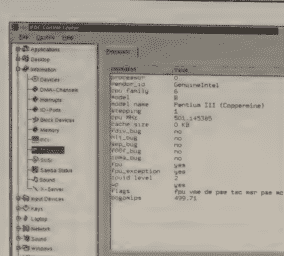

图 2.1 KDE 控制中心提供关于笔记本组件的详细信息，包括 CPU。

## 你的笔记本显示器

虽然笔记本的 CPU 是一个重要的内部组件，但笔记本电脑的显示器可能是影响你生产力的关键因素。早期的便携式计算机使用传统的*阴极射线管*（CRT）来提供显示。然而，附带的电线和玻璃增加了很多重量。早期的笔记本，如坦迪模型 100（Tandy Model 100），使用简单的*液晶二极管*（LCD）显示来在屏幕上绘制字符和图形。自那以后，显示技术取得了重大进步，但与 CPU 一样，显示器是笔记本中最耗能的组件之一。

下一代笔记本使用 LCD 显示屏，密度、清晰度和外观的改进逐渐进行。由于 LCD 不发光，早期改进的笔记本使用某种形式的背光来提高可读性。扭向型（Twisted Nematic）或超扭向型（Super Twisted Nematic，SuperTwist）显示屏带来了进一步的改进，尽管是单色的。笔记本行业的下一次飞跃是提供彩色 LCD 显示。早期型号相当昂贵，但随着制造技术的改进，以及销量增加和行业需求，在过去八年中，彩色已成为任何理想笔记本的标准配置。

### 清洁你的屏幕

首先，阅读你的笔记本手册！一些制造商建议混合水和异丙醇，但许多现代显示屏都覆盖有一层透明塑料涂层，可能会因不当清洁而损坏。不要使用抗静电喷雾或其他显示器清洁剂，也绝对不要使用纸巾！

现代笔记本使用的彩色 LCD 显示器至少有两种封装形式。直到最近，许多较便宜的笔记本使用被动矩阵晶体管驱动显示器，提供多达 256 种颜色，有时称为双扫描扭向型（DSTN）。这些笔记本显示器可通过缓慢的屏幕刷新和低对比度识别，在强光下无法使用。然而，即使最近改进了性能并将分辨率提升至 800×600 像素，这些低成本显示器现在也被限制在 1000 美元以下的笔记本中，并可能完全从市场中消失。

几乎所有现代笔记本显示器都使用薄膜晶体管（TFT）主动矩阵显示器，在 800×600 像素下，玻璃面板上集成了近 144 万个晶体管！这是使用 Linux 时最小理想的显示配置。清晰度通常非常好，在许多型号上，显示器的清晰度可与传统 CRT 显示器相媲美甚至超越。

今天大多数笔记本在性能和显示方面可与台式计算机媲美。这意味着大多数知名制造商分发的高端笔记本电脑至少配备 1024×768 像素且至少数千色的显示器。

### 坏点？

如果当显示为黑色时你在屏幕上看到一个红点，或者一个颜色永不改变的蓝色、绿色或黑点，你的显示器有一个带有不良晶体管的坏点（该晶体管控制像素的颜色，将其从红色、蓝色或绿色切换）。

尽管大多数笔记本制造商都有严格的质量保证指南，但 1024×768、1280×1024 甚至 1400×1050 笔记本显示器的出现意味着某块屏幕可能有 10 个（或更多）问题像素。如果哪怕一个坏点都令人难以接受，请在购买前咨询制造商！大多数制造商都有关于坏点数量和位置的规定，以确定是否值得更换。

### 显示芯片组

此刻令人沮丧的事实是，即使 Linux 的普及度在增加，大多数基于英特尔的笔记本制造商仍然迎合微软的软件垄断地位，构建仅运行一种（在极少数情况下为两种）变体的微软操作系统的笔记本：Windows 98 和 Windows NT。在撰写本章时，行业正准备部署 Windows 2000，并且几家笔记本制造商已为该操作系统认证了笔记本。事实上，大多数（如果不是全部）这些笔记本都受到 Linux 的支持（至少是在控制台或纯文本模式下），这是对开源程序员决心和流程的惊人见证。

另一个负面因素是，驱动现代笔记本的图形芯片组制造商不愿发布关于显示器驱动方式的规格。这对为新型笔记本打造显示驱动支持的开源程序员造成了严重的限制。这些制造商中的大多数，甚至全部，只关心支持笔记本电脑的原始设备制造商（OEM），而不是最终用户。

随着现代笔记本增加的功率、速度和显示分辨率，这些芯片组制造商在提供众多附加功能方面竞争激烈，如越来越快的三维图像渲染、图形加速以及整合其他笔记本子系统（如音频）。如果你购买了一款新推出的带有新图形芯片组的笔记本，你很可能会遇到显示兼容性问题。

Linux 的图形界面是 X 窗口系统（X Window System）。大多数 Linux 发行版都来自 The XFree86 Project, Inc. 的 XFree86 X11 发行版。虽然 XFree86 是免费的，但你也可以从其他公司（如 Xi-Graphics 或 MetroLink, Inc.）购买商业 X11 发行版。如果你在购买前研究你笔记本显示器的支持情况，可以提高兼容性。然而，大多数 Linux 笔记本用户首先尝试 XFree86 以查看它是否有效。

### iBook 和 X11

Apple iBook 用户需要使用带有帧缓冲区支持的特殊 Linux 内核（至少版本 2.2.14 或更高），以及一个名为 `XF86_FBDev` 的特殊 X11 服务器应用程序。最大分辨率为 800×600 像素，色深至少为 16bpp。

你可以通过浏览 Kenneth Harker 位于以下网址的 Linux 笔记本页面来研究你笔记本电脑的 X11 显示支持情况：

http://www.cs.utexas.edu/users/kharker/linux-laptop/

在安装 Linux 和 XFree86 之前，若想阅读有关你笔记本电脑图形芯片组的信息，请访问：

http://www.xfree86.org

并查找与当前版本相关的文档。你也可以在安装 Linux 之后阅读有关芯片组的详细信息（以防在配置笔记本电脑的 X11 时遇到问题）。请在 `/usr/X11R6/lib/X11/doc` 目录下查找。你会看到一系列以 README 开头的文件名，其中包含了特定芯片组的详细信息。请注意，并非所有这些文件都详细说明了笔记本显示。以下列出了 XFree86 3.3.6 版本中一些相关的文件，如表 2.1 所示。

### 表 2.1 Xfree86 3.3.6 中与笔记本相关的芯片组信息

| 文件名 | 描述 |
|---|---|
| README.Mach32 | 关于 Mach32 X11 服务器的信息 |
| README.Mach64 | 关于 Mach64 X11 服务器的信息 |
| README.WstDig | 关于 Western Digital 芯片组的信息 |
| README.chips | Chips and Technologies 显示器的详细信息 |
| README.cirrus | Cirrus Logic 显示芯片组列表 |
| README.epson | 关于 Seiko/EPSON SPCH110FOA 适配器的信息 |


| `README.neo` | 关于 NeoMagic 芯片组的详尽信息 |
| `README.trident` | 笔记本电脑芯片组配置选项的详细信息 |

其中一些文件可能包含有关如何使用 Linux 和 X11 配合你的笔记本电脑的重要信息。例如，使用 NeoMagic 图形芯片组的用户希望阅读 `README.neo` 文件，以了解如何启用外部显示器，以便在显示器连接到笔记本的视频输出端口时显示 X11。关于 XFree86 的 X11 如何与你的笔记本电脑配合工作的几乎所有配置选项都包含在一个名为 `XF86Config` 的文件中，该文件通常位于安装 Linux 并配置 X11 后的 `/etc/X11` 目录下。

## X11 配置实用工具

在安装 Linux 时可能会安装并配置 X11。然而，如果你遇到问题并且必须跳过 X11 配置，你可以稍后使用以下几种实用工具来配置 X：

- **`XF86Setup`.** 随 XFree86 附带，这是一个图形化安装实用工具，用于配置你笔记本电脑的所有设备以配合 X 使用，例如键盘、指针、图形芯片组和内存。该 X11 应用程序（或*客户端*）启动一个名为 `XF86VGA_16` 的 16 色 X 服务器，以提供菜单、对话框和列表。
- **`xf86config`.** 同样随 XFree86 附带，这是一个基于文本的配置工具，不需要运行 X 服务器即可工作。通过回答一些关于你笔记本电脑键盘、鼠标、图形芯片组和显示器的技术问题，你可以快速构建一个可用的 `XF86Config` 文件。
- **`Xconfigurator`.** 这是一个 Red Hat Linux 图形化配置工具，也不需要正在运行的 X11 服务器。易于使用的菜单和按钮指导你完成配置 X 以配合 Linux 和你的笔记本电脑工作的过程。

其他发行版，如 Corel 和 Caldera OpenLinux，使用其他配置工具。SuSE Linux 使用 `sax` 命令进行 X11 配置。

一旦安装并配置好 Linux 和 X11，你可以设置笔记本电脑通过 X11 *显示管理器*（例如 `xdm`、`gdm` 或 `kdm`）直接启动到 X11 会话。如果你选择启动到控制台（纯文本）模式，X11 通常使用 `startx` 命令启动。关于使用 X11 的更详细讨论见第 9 章“显示问题”。

## 你笔记本电脑的声音系统

笔记本电脑的声音系统差异巨大，甚至同一制造商同一产品线的计算机也是如此！尽管最近之前生产的大多数笔记本通常都有独立的声音系统，但当前的趋势是将声音和图形集成到单芯片子系统中（例如 NeoMagic AV 系列）。

当前的 Linux 发行版支持桌面和笔记本电脑中的多种声卡。如果你是拥有 SoundBlaster 兼容声音系统的笔记本电脑的幸运拥有者，你在配置 Linux 以配合笔记本电脑工作时应该不会遇到任何问题，从而能够播放音频 CD、乐器数字接口（MIDI）文件、动态图像专家组（MPEG）文件、QuickTime 视频或其他与声音和动画相关的文件。

Linux 下的声音支持以可加载内核*模块*的形式存在，这些代码片段要么按需加载，要么在启动时加载到内存中。声音模块通常使用加载时选项（类似于命令行选项）进行配置，这些选项存储在模块配置文件中。在 Red Hat Linux 中，该文件名为 `/etc/conf.modules`；而在 Caldera 的 OpenLinux 发行版中，该文件名为 `/etc/modules.conf`。有关配置声音的更多信息，请参阅第 6 章“安装后问题”中的“配置声音”部分。

实际的内核模块通常位于 `/lib/modules/2.2.X/misc` 目录下，其中 `X` 是你计算机上安装的 Linux 内核版本。其他 Linux 发行版可能采用不同的方法来管理笔记本电脑声音系统的配置和初始化，通常这是在启动时完成的。

免费声音支持的文档可在 `/usr/src/linux/Documentation/sound` 目录下找到。表 2.2 列出了许多可能与你的笔记本电脑声音系统匹配或不匹配的文件。

其他受支持的声卡包括 Media TRIX Audio TRIX Pro、ProAudioSpectrum 16、Rockwell Wave Artist 和 Aztec Sound Galaxy。

如果你在配置 Linux 以配合笔记本电脑的声音系统工作时遇到问题，不要放弃！浏览 Linux 笔记本页面，寻找具有类似声音芯片的其他笔记本。很有可能让你的声音系统正常工作！

另一组声音驱动程序来自高级 Linux 声音体系结构（ALSA）项目，网址为 http://www.alsa-project.org

这些替代声音驱动程序是为 Linux 创建的，旨在改善当前内核声音支持的编程接口，保持兼容性，创建新的音频编程支持例程，并推动新音频客户端的创建。表 2.3 列出了 ALSA 支持的 30 种声卡和芯片组类型。你应该知道，目前令人头疼的笔记本声音系统 NeoMagic 256AV，它集成了图形和声音功能，也可能被这些驱动程序支持。

安装涉及下载、解压缩、配置、构建，然后安装内核模块、支持库和相关实用工具。其中包含了关于如何创建适当的模块配置文件的文档。

### 表 2.2 Linux 内核声音模块支持文件

| 文件 | 描述 |
|---|---|
| AD1816 | 配置信息 |
| ALS007 | Avance Logic 声卡详情 |
| AudioExcelDSP16 | 配置信息 |
| AWE32 | Creative SoundBlaster AWE32、AWE64 和 SB32 卡 |
| CMI8330 | 对此 Sound Pro 音频卡的支持 |
| CMI8338 | 对此 Sound Pro 卡的支持 |
| CS4232 | Crystal CS423x 信息 |
| ESS | ESS Technology, Inc. Ensoniq 声音系统配置 |
| ESS1868 | 对此 ESS AudioDrive 卡的支持 |
| MAD16 | 如何配置 OPTi MAD16 驱动程序 |
| MultiSound | Turtle Beach MultiSound 驱动笔记 |
| mwave | 处理 IBM Mwave DSP 卡 |
| OPL3 | 配置 Yamaha OPL3 系统 |
| OPL3-SA | 配置 OPL3 SAx 系统 |
| OPL3-SA2 | 配置 OPL3 SAx 系统 |
| Opti | OPTi 82C91X 芯片配置 |
| sonicvibes | S3 声卡配置和变通方法 |
| SoundBlaster | 通用 SoundBlaster 配置 |
| Tropez+ | 初始化和模块命令技术 |
| ultrasound | 加载 Gravis Ultrasound 驱动程序 |
| VIA-chipset | VIA 芯片组配置 |
| VIBRA16 | 配置 SoundBlaster 16X Vibra |
| wssnd | Silicon Graphics 320 和 540 板载音频 |
| Wavefront | 处理 Turtle Beach Maui、Tropez 和 Tropez Plus 卡 |

如果你真的卡住了，请浏览 4Front Technologies 的网站：

http://www.opensound.com

你会找到一个包含 300 多种受支持声卡和笔记本声音系统的列表。下载单个文件后，你必须以 root 身份登录，然后运行

### 表 2.3 Linux 支持的 ALSA 声卡

- AMD InterWave
- Avance Logic ALS100/ALS120
- Aztech Sound Galaxy
- C-Media CMi8330
- Cirrus Logic/Crystal Semiconductors
- Cirrus Logic/Crystal Semiconductors CS4232/CS4232A
- Cirrus Logic/Crystal Semiconductors CS4610/CS4612/CS4615/CS4280
- Diamond Technologies DT-0197H
- EMU10K1
- Ensoniq AudioPCI (ES1370, ES1371)
- ESS AudioDrive ESx688
- ESS ES18XX
- ESS Solo-1 ES1938
- Fort eMedia FM801
- Gravis UltraSound Classic/ACE
- Gravis UltraSound Extreme
- Gravis UltraSound MAX
- MOTU MidiTimePiece AV 多协议 MIDI 接口
- OAK Mozart
- OPTi 82C9xx
- RME Digi9652 (Hammerfall, Hammerfall light)
- S3 SonicVibes PCI
- SGI Indy (HAL2)


- SoundBlaster 1.0/2.0/Pro

- SoundBlaster 16/AWE

- SoundCard 芯片组/类型

- Trident 4DWave DX/NX

- Turtle Beach WaveFront

- Yamaha OPL3-SA2/SA3

## 您的笔记本键盘

安装工具。Open Sound System (`OSS`) 模块通过 shell 脚本安装，通常位于 `/lib/oss` 或 `/usr/lib/oss` 目录下。安装完成后，您计算机的声音系统应自动被识别和配置。为 Linux 启用声音的过程如下简单：

```
# soundon
```

`OSS` 驱动程序可以下载并进行测试，在线获取时需支付少量费用。

遗憾的是，在本书撰写时，Apple iBook 的声音支持尚不存在。希望在未来使用 Motorola PowerPC CPU 的计算机的较新 Linux 内核版本中，这一问题将得到解决。

通常情况下，在安装、配置或使用 Linux 时，键盘不会带来问题。大多数问题发生是因为键盘放置不符合人体工程学、过于紧凑（在小尺寸笔记本上尤其可能存在）、缺少常用按键（例如用于国际化的按键），或者将常用按键放置在难以触及的位置。如果例如，使用了美规键盘的笔记本加载了一个为其他语言定制的 Linux 发行版，也可能会引发其他问题。

幸运的是，在 Linux 下，您可以完全重新映射笔记本键盘，无论是用于控制台还是用于 X11 会话。这意味着您可以更改单个按键生成的返回值，以支持使用不同字体输入不同语言，或者交换按键位置以增加便利性。

正确的键盘类型通常在初始 Linux 安装期间选择，但之后可以更改。在基于 Intel 的 Linux 中，键盘是一个 PS/2 设备。当您在 Apple iBook 上安装和配置 Linux 时，键盘会被识别和配置为 Apple Desktop Bus (`ADB`) 设备。

Linux 包含大量用于修改键盘的工具。表 2.4 列出了其中一些命令。您可以在互联网上找到更多其他工具。

X11 会话的键盘设置设置在该系统的 `XF86Config` 文件中。尽管控制台键盘映射通常存储在 `/usr/lib/kbd/keymaps` 目录下，但超过打几种键盘的定义在 `/usr/X11R6/lib/X11/xkb/keymap` 目录下的 free86 文件中定义（供 `setXkbmap` 客户端使用）。

更改控制台的键盘风格可以很容易地通过 `loadkeys` 命令完成。例如，要将键盘设置为支持德语，您可以使用：

```
# loadkeys de-latin1
```

### 表 2.4 Linux 键盘工具

| 名称 | 描述 |
| --- | --- |
| consolechars | 更改控制台屏幕字体、映射和字符集 |
| dumpkeys | 转储控制台键盘转换表 |
| kbd_mode | 报告或设置控制台键盘模式 |
| kbdconfig | Red Hat Linux GUI 工具，用于更改键盘类型 |
| kbrate | 重置控制台键盘重复率和延迟时间 |
| keytest | 测试 SVGALIB 原始键盘功能 |
| loadkeys | 加载控制台键盘转换表 |
| psfaddtable | 向控制台字体添加 Unicode 字符表 |
| psfgettable | 从控制台字体提取 Unicode 字符表 |
| psfstriptable | 从控制台字体移除 Unicode 字符表 |
| setfont | 设置控制台字体 |
| setleds | 设置键盘 LED |
| setmetamode | 定义键盘元键处理 |
| setterm | 设置终端属性 |
| setxkbmap | 使用 X Keyboard Extension 设置键盘 |
| showkey | 显示键盘发送的扫描码和键码 |
| unicode_start | 启动控制台 Unicode 模式 |
| unicode_stop | 停止控制台 Unicode 模式 |
| xev | 显示 X11 事件的内容（鼠标点击、按键） |
| xkbcomp | 构建 XKB 键盘描述 |
| xkbprint | 显示 XKB 键盘描述 |
| xmodmap | 更改 X11 中的键盘映射和指针按钮 |
| xset | 更改偏好设置，如鼠标和键盘 |

要恢复默认键盘，您可以使用：

```
# loadkeys -d
```

如前所述，X11 会话中使用的默认键盘设置位于 `XF86Config` 文件的 Keyboard 部分。例如：

```
XkbRules	"xfree86"
XkbModel	"pc101"
XkbLayout	"us"
```

这些条目对应于列在 XFree86 的 keymap 目录下的那些条目，并定义了键盘类型。若要配置 X11 加载一个支持德语的键盘映射，您可以使用以下内容：

```
XkbModel "pc102"
XkbLayout "de"
XkbVariant "nodeadkeys"
```

请注意，这些更改在重启 X 服务器之前不会生效。

一个有趣的 X11 客户端 `xkbsprint` 可用于生成您当前配置的键盘的 PostScript 图形。从 X11 终端窗口的命令行使用该客户端，指定当前的 X 会话或显示，并指定输出文件，如下所示：

```
# xkbsprint :0 mykeys.ps
```

然后您可以使用 `gv` 客户端显示该图形：

```
# gv mykeys.ps
```

您随后会看到您键盘的表示，如图 2.2 所示。

XFree86 和相关窗口环境（如 K Desktop Environment）包含大量用于更改其他键盘设置的工具，例如按键

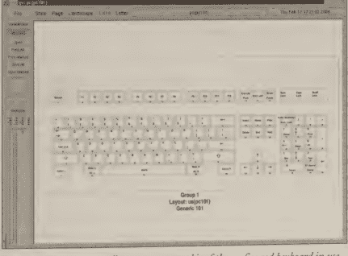

点击和重复率。幸运的是，大多数笔记本用户只想更改一两个按键。例如，许多笔记本将 Caps Lock 键放置在键盘的最左侧，而 Ctrl 键（许多 Linux 文本编辑器和其他程序经常使用）位于一个尴尬的位置，有时靠近特殊的 Fn 键。

对于 X11 会话，通过在您 `XF86Config` 文件中输入交换命令可以很容易地完成 Caps Lock 和 Ctrl 键的交换：

```
XIOptions "ctrl:swapcaps"
```

您也可以使用 `xmodmap` 客户端在 X11 会话中即时完成此操作。例如：

```
# xmodmap -e 'add lock = Control_L'
# xmodmap -e 'remove lock = Caps_Lock'
# xmodmap -e 'add control = Caps_Lock'
# xmodmap -e 'remove control = Control_L'
```

如果 `Caps_Lock` 条目真的让您困扰，您可以通过配置该键返回无值来禁用它：

```
# xmodmap -e 'keycode 66 = NoSymbol'
```

这些设置也可以放在主目录中名为 `.Xmodmap` 的文件中。`xmodmap` 的另一个用途是将许多笔记本键盘上无用的“Windows”键变成更有用的东西。如果您使用 Fvwm 这样的窗口管理器，可以编辑您主目录中的其资源或配置文件 `.fvwmrc`，将该键绑定到不同的菜单操作。

## 您的笔记本指针

在窗口操作系统出现之前，笔记本就可以使用鼠标了。早期版本使用空闲的串行端口来提供点击菜单和按钮的能力，即使在 DOS 下也是如此。自那时起，笔记本电脑引入了各种各样的硬件指针。这些指针的形式从夹式轨迹球到今天的无线鼠标不等。以下是当今笔记本上常用指针的主要类型：

- **Trackpoint.** 也被称为“橡皮擦”鼠标，因其微小柔软的橡胶外套而得名，通常嵌入在笔记本键盘的中间。这个指点设备工作得很好，并且比...

其他设备，你的双手无需离开键盘即可移动鼠标。一个潜在的缺点是，这些设备很容易变脏、磨损，或者，如果安装不当，在合上笔记本盖子时会损坏笔记本屏幕。制造商提供的替换件，例如 IBM ThinkPad 系列笔记本的替换件，每个可能要花 4 美元！

- **轨迹球。** 作为一种较早的笔记本指点设备，该指针依靠一个静置在内部机械滚轮上的滚动球来移动光标。轨迹球容易积聚灰尘、污垢和其他异物，因此已不再广泛使用（至少在笔记本上如此）。在笔记本上滥用该部件并导致其后续故障，会使内置指针失效。


## 触摸板

最初由苹果公司（Apple Computer, Inc.）在其早期 PowerBook 笔记本系列上引入消费市场，触摸板催生了来自不同制造商的各种指针。利用与早期绘图板类似的电磁原理，这些指针使用你的手指作为笔来移动光标。现代变体支持轻点手指和滚动。至少有一系列笔记本，索尼 Vaio，包含一种内置触摸板变体，称为 VersaPad，并配有一支触控笔。这允许你像使用绘图板一样在垫上签名甚至绘图。类似的设备是 Cirque GlidePoint，授权给 Alps Electric Company。触摸板类型的指点设备的优势在于几乎坚不可摧；除了内部电路故障外，触摸板应该能持续整个笔记本的使用寿命。

其他指针变体包括，例如，在东芝已停产的 Libretto 子笔记本系列中找到的摇杆垫。通过向不同方向按压小的（半英寸）橡胶垫来实现指针移动。红外（IrDA）指针已经存在多年，并越来越受欢迎。

### 光标漂移？

如果你有一台 IBM ThinkPad 并且注意到光标偶尔在屏幕上漂移四分之一英寸，别担心！别管它，它会停止。光标正在重新校准！

使用 Synaptics 触摸板的移动 Linux 用户可以从 `http://www.compass.com/synaptics/` 下载名为 `tpconfig` 的配置实用程序。该程序允许你设置或重置指针移动、轻点、边缘滚动和按钮使用。不幸的是，`tpconfig` 与 Linux 通用鼠标驱动程序（`gpm`）不兼容，该驱动为纯文本控制台提供鼠标功能。`gpm` 通常作为后台服务或进程运行，称为守护进程，在你使用 `tpconfig` 之前必须将其“杀死”。

`gpm` 提供了在使用控制台时剪切和粘贴文本的能力。但是，你应该知道，如果 `gpm` 使用其 `-S` 选项启动，它还可以运行“特殊”命令，通过三击左键和右键鼠标按钮触发。在这种情况下，你会听到扬声器 beep 两次。如果你在三秒内按下左键或右键，系统将重新启动！如果你按下中间键，系统将关机！

`gpm` 驱动通常在 Linux 启动时启动。使用 Red Hat 和类似的 Linux 发行版时，其初始化脚本位于 `/etc/rc.d/init.d` 目录中，脚本名为 `gpm`。如果你在控制台中使用笔记本指针时遇到问题，请先阅读 `gpm` 的 man 页面，然后修改初始化选项以配置你的鼠标。你可以使用 `kill` 命令，后跟进程号，来终止当前运行的 `gpm` 进程，如下所示：

```
$ ps aux | fgrep gpm
root 417 0.0 0.0 1172 16 ? S Jan31 0:00 gpm -t pa/2
$ kill -9 417
```

这里，`ps` 命令的输出通过管道传递给 `fgrep` 命令，以搜索正在运行的进程。然后使用 shell 的 `kill` 命令根据进程号终止该进程。

### 左撇子？你没有被排斥在外！

左撇子在一个为右撇子设计的世界里已经够难对付了。雪上加霜的是，大多数 Linux 安装自动为右撇子用户设置和配置笔记本的鼠标按钮！然而，你可以使用 `xmodmap` 命令轻松修复这个问题，如下所示：

```
xmodmap -e "pointer 3 2 1"
```

你还可以使用 KDE 的控制中心（或 `kcontrol` 客户端），如图 2.3 所示。KDE 会在会话之间记住你的设置。

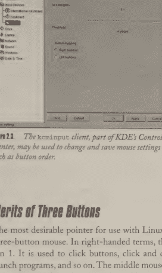

图 2.3 `kcontrol` 客户端，是 KDE 控制中心的一部分，可用于更改和保存鼠标设置，例如按钮顺序。

### 三键鼠标的优势

用于 Linux 和 X 窗口系统最理想的指针是三键鼠标。以右撇子的术语来说，左鼠标键是鼠标键 1。它用于点击按钮、点击并拖选文本、双击启动程序等。中间鼠标键，即鼠标键 2，用于粘贴文本和图形，或在 xterm 终端窗口中抓取滚动条。右鼠标键，即鼠标键 3，被许多 X11 窗口管理器用于替代菜单，例如在更改右击对象属性时。

市场上大多数笔记本只有两个鼠标键，这可能是因为大多数笔记本（除了只有单个鼠标键的苹果 Macintosh 笔记本系列）都是在垄断的软件市场中制造的。因为 Windows 及其变体仅使用两个鼠标键，为什么要额外花费成本包含第三个鼠标键呢？幸运的是，至少有一家制造商，IBM，认为生产带有三个按钮的笔记本电脑是合适的。这使得在 Linux 上的生活稍微容易一些！

当你安装 Linux 时，你的笔记本指针可能也可能未被自动识别。如果指针被识别，如市场上大多数基于 Intel 的笔记本电脑，Linux 将把你的设备配置为双键 PS/2 鼠标。当询问你是否要“模拟 3 个按钮”时，点击确定。如果你不这样做，你的鼠标将有一个左键和一个右键，但没有中间键。如果你点击确定，中间鼠标键将通过同时按下左键和右键来模拟。别扭？是的，但至少它有效！

为 X11 会话配置指针，就像键盘一样，包含在你系统的 `XF86Config` 文件的 Pointer 部分中。例如：

```
Section "Pointer"
 Protocol "PS/2"
 Device "/dev/mouse"
 Emulate3Buttons
 Emulate3Timeout 50
EndSection
```

此简化的指针部分表明，为 X 配置的指针是一个双键 PS/2 鼠标。启用了中间键模拟，超时时间为 50 毫秒。超时值告诉 X 服务器（在后台运行）在决定中间键（按钮 2）已被按下之前等待多久。

### Apple iBook 鼠标

在为 Apple iBook 安装 PowerPC 或 Yellow Dog Linux 时，鼠标被配置为单键 ADB 鼠标。Apple 版本的 Linux 支持多达 35 种不同的指点设备。在安装 Linux 期间直到鼠标配置好之前可能会有些挑战，因为你必须使用键盘来选择正确的按钮和对话框。但配置好之后，鼠标工作得很好。根据 Yellow Dog Linux 团队（`http://www.yellowdoglinux.com`）在其文档（针对 1.1 发行版）中所说，为了支持三键模拟，你必须使用以下 Linux 内核启动提示符告诉 Linux（和 X）使用 F11 和 F12 键作为鼠标按钮 2 和 3：

```
adb_buttons=1,103,111
```

这对 iBook 不起作用；相反，你必须使用这个：

```
adb_buttons=103,111
```

此设置可以在 Linux 启动提示符输入，或在启动 Linux 时输入到 BootX 选项字段中。

### 符号指针设备

Linux 可以识别和使用许多不同的指针设备。这意味着你可以在笔记本上连接外部滚球检测器（鼠标），并在会话期间使用它。通常，大多数发行版在 `/dev` 目录下创建指向实际设备的符号链接，或指针，名为 `/dev/mouse`。例如：

```
# ls -l /dev/mouse
lrwxrwxrwx 1 root root 5 Oct 12 08:53 /dev/mouse -> psaux
```

这表明使用的指针连接到 `/dev/psaux`，即计算机上的 PS/2 端口。另一方面，串口鼠标可能看起来像这样：

```
lrwxrwxrwx 1 root root 5 Oct 12 08:53 /dev/mouse -> ttyS1
```

这表明鼠标连接到一个串口，类似于 DOS 下的 COM2。在 iBook 的 Linux 下，这个链接看起来像这样：

```
lrwxrwxrwx 1 root root 5 Oct 12 08:53 /dev/mouse -> a2dmouse
```

### 其他输入设备

Linux 和 X11 支持许多其他类型的输入设备。查看 `/usr/X11R6/lib/X11/doc` 目录下名为 `xinput` 的文件。你会看到十几个设备的列表，包括以下内容：

- AceCad 绘图板
- Calcomp DrawingBoard 绘图板
- Elographics 触摸屏
- 操纵杆（必须通过 PCMCIA 适配器连接）
- MicroTouch 触摸屏触控笔
- SGI 按钮盒
- SummaSketch 绘图板
- SWITCH 虚拟设备
- Wacom 光标
- Wacom 橡皮擦
- Wacom 触控笔

你将会看到更多兼容的设备。

### Linux 下的 TrackPoint 实用工具

熟悉绘图板的计算机艺术家知道，手写笔（或指针）通常也是一个压感设备，能够识别三维运动。这意味着当艺术家在使用画笔工具时，如果对手写笔施加轻微的压力，数字颜料的扩散范围会更大。较轻的笔触会产生较轻的画笔效果。大多数 TrackPoint 用户并不知道，这个指针同样对压力有反应！

请访问 Till Straumann 的网页：

`http://www-hft.es.tu-berlin.de/~strauman/tp4utils/`

你会找到两个 TrackPoint 实用工具：`tp4d` 服务器和 `xt4a`，这是一个你可以在 Linux 下用来探索 TrackPoint 功能的客户端命令。

## 你的笔记本电脑内存


似乎很少有（甚至没有）问题出现在 Linux 和笔记本内存之间（问题似乎在台式机上更为常见）。笔记本内存可能是专有的，而且非常昂贵。如果你是拥有极受欢迎且生命周期长的笔记本产品线的幸运用户（在当今典型的笔记本型号“寿命”仅为 12 个月或更短的情况下，“生命周期长”是一个相对术语！），内存应该稍微便宜一点。一些笔记本制造商设计了接受标准插槽的型号，而其他制造商则使用极其专有的外形规格（如各种 Sony 型号）。尽可能多地购买你能负担得起的内存。如果你确定可以从第三方购买并自行安装，你可以在购买上节省一些钱，并用它来购买和安装更多的 RAM。

你面临的最大问题将是关于内存和成本的“多少合适？”。对此，我的回答是：“尽量多，但不少于 `64MB`。” 尽管 Linux 和 X11 可以在 16MB 内存下运行，但要现实一点。（我曾在内存为 32MB 的笔记本电脑上长时间使用 Linux，它至今仍在地下室中 7x24 小时运行。）如果你想同时使用 X11、`KDE` 桌面环境、`StarOffice` 和 `Netscape` 并播放 .mp3 文件，你需要留出一点缓冲空间。尽管 Linux 和大多数客户端能高效使用内存，但拥有 64MB 内存可以让你无问题地使用大多数客户端。

如果你想使用 `VMware` 的 Linux 版 `VMware` 来安装和运行其他操作系统，例如 `Windows 2000` 或 `BSD UNIX`，你需要更多的内存——至少每个实例都需要像一台独立计算机那样多的内存。

内存是笔记本似乎没有赶上台式机的一个领域。今天销售的大多数笔记本电脑主板内存限制仍低于 256MB，而大多数台式机支持 768MB 或更多。

要查看 Linux 启动后识别到的内存量，请使用通过 `fgrep` 管道输出的 `dmesg` 命令结果，如下所示：

```
$ dmesg | fgrep Mem
Memory: 127956k/1331008k available (1044k kernel code, 416k reserved, 1532k data, 60k init)
```

这显示了一台 128MB 笔记本的内存情况。你还可以使用 `KDE` 控制中心快速查看 X11 `KDE` 会话期间内存使用的“快照”，如图 2.4 所示。

尽管较新的“标准”Linux 内核据说在基于 Intel 的计算机上可以识别高达 2GB 的已安装内存，但你偶尔可能会遇到一些问题。如果 Linux 没有看到你的所有内存，你可以在 Linux 加载器（`LILO`）的启动提示符下传递内核消息，或者将你的笔记本内存嵌入 `LILO` 的配置文件 `/etc/lilo.conf` 中，如下所示：

```
append= “mem=320M”
```

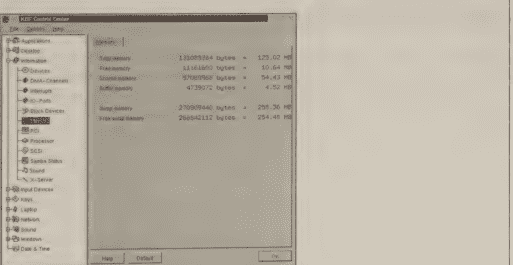

`kwinfoclient` 是 `KDE` 控制中心的一部分，可用于获取系统当前内存使用情况的简要快照。

这将告诉 Linux 已安装并可用 320MB 的 RAM。在 Linux 启动后，有一些方法可以节省内存。以下是其中的一些方法：

- **只运行你需要的软件。** 除非你的笔记本电脑是一台 Web 服务器，你真的需要运行 `Apache` 吗？虽然某些 Linux 发行版，如 `SuSE`，使用本地运行的 Web 服务器来提供基于 HTML 的帮助系统，但你应该限制运行的进程和后台进程的数量。`Red Hat Linux` 用户应该使用 `ntsysv` 命令来关闭或限制 Linux 启动时启动的服务数量。

- **检查内存。** 使用 `free`、`vmstat`、`asmem`、`kmem`、`xvsiw` 和其他实用工具来监控系统状态，特别是当 Linux 开始使用过量内存（包括交换空间）时。使用 `top` 命令或其他进程报告实用工具，如 `ps` 或 `ptstat`，来确定哪些程序使用最多的内存。

- **选择内存“足迹”较小的软件。** 如果你只编写短文本文件且不在笔记本电脑上进行任何编程，不使用 `StarOffice` 或其他套件（如 `Apexilix`）可以节省大量内存。X Window 系统（其服务器）可能需要至少 8MB 或更多的 RAM。音频播放器，如 .mp3 播放器，会消耗大量内存（和 CPU 周期）用于缓冲。一般来说，基于文本的应用程序可能需要较少的内存（`emacs` 编辑环境是个例外）。

## 你的笔记本电脑硬盘

几乎所有基于 Intel 的笔记本电脑（确实包括 Apple `iBook`）都使用集成驱动电子（`IDE`）类型的硬盘，因此本节集中于并使用了 `IDE` 硬盘示例。这些硬盘的较新版本被称为增强型或扩展型集成驱动电子（`EIDE`）。处理你的笔记本电脑硬盘，特别是如果你不是技术导向并且第一次安装 Linux，可能会非常令人望而生畏。但别担心！只要你备份了任何重要数据，安装 Linux 不会损坏你的计算机！

当你安装 Linux 时，你需要在硬盘上*分区*（腾出空间）。有几种方法可以做到这一点。你可以使用免费或商业软件来执行此操作。对于新的 Linux 用户来说，分区似乎比其他任何安装操作都带来更多烦恼。这可能是因为大多数企业和家庭用户以前从未需要分区硬盘；大多数计算机都带有预装软件，位于新格式化的磁盘上。这也可能是因为 `Macintosh OS` 运行在 Motorola CPU 上，从未对基于 Intel 的计算机软件构成严重挑战（尽管 Apple 在 1992 年将 `MacOS` 移植到 Intel `Pentium`，后来终止了该项目）。

如果你是 Linux 新手并且担心分区，不用再害怕了！现在有一个很好的理由去学习分区，还有一个更好的理由来重新格式化你现有的硬盘。经验丰富的笔记本 Linux 安装者通常会彻底清除新笔记本硬盘上之前存在的任何操作系统痕迹，你也可以这样做。

大多数 Linux 发行版都包含 `FIPS` 命令。这个 DOS 程序用于在现有的 `FAT`、`FAT16` 或 `FAT32` 硬盘上为 Linux 腾出空间。务必使用最新版本，通常在你的 Linux CD-ROM 的 `dosutil/FIPS20` 目录下找到。在想要启动 Linux 或 Windows 的笔记本上为 Linux 腾出空间的基本步骤如下：

1. 对你现有的系统进行碎片整理。

2. 创建一个可启动的 DOS 软盘。

3. 将 `FIPS.EXE`、`RESTORRB.EXE` 和 `ERRORS.TXT` 复制到软盘上。

4. 使用软盘重新启动你的笔记本。

5. 运行 `FIPS` 并创建分区。

6. 启动到 Linux 安装（在此期间，你将创建和格式化额外的 Linux 分区）。

你还可以使用商业分区实用工具，如 PowerQuest 的 `PartitionMagic`，来创建额外的分区，甚至可以采用 Linux `ext2` 格式。

当你格式化新分区并安装 Linux 时，你在硬盘上创建了一个新的*文件系统*（文件和目录结构）。Linux 文件系统的名称是 `ext2`，它与其他文件系统相比具有许多优势，如速度、可靠性和抗碎片能力。使用 Linux 的 `fdisk` 命令显示示例安装中的分区信息将显示以下内容（例如）：

```
$ fdisk /dev/hda
Command (m for help): p
Disk /dev/hda: 240 heads, 63 sectors, 1559 cylinders

Units = cylinders of 15120 * 512 bytes

   Device    Boot     Start     End    Blocks    Id  System
/dev/hda1   *         1      218   1648048+    c  Win95 FAT32 (LBA)
/dev/hda2          219     1559  10137960    5  Extended
/dev/hda5          219     221     22648+  83  Linux
/dev/hda6          222     499    2101648+  83  Linux
/dev/hda7          500     534     26458+  82  Linux swap
```

### Linux 文件系统

当 Linux 安装在您的硬盘上时，目录结构或*路径名*构成了 Linux 文件系统。Linux 文件系统的基础（`/` 或*根目录*）目录列于表 2.5 中。

**表 2.5 Linux 基础目录**

| 名称 | 描述 |

| :--- | :--- |

| bin | Linux 程序 |

| boot | Linux 内核存储位置 |

| dev | 设备文件 |

| etc | 系统配置文件 |

| home | 用户目录以及 FTP、HTTP 等 |

| lib | 系统软件库 |

| lost+found | 恢复文件的存储位置 |

| mnt | 其他文件系统挂载点 |

| opt | 可选软件存储 |

| proc | 运行中系统的快照 |

| root | 根操作员目录 |

| sbin | 通常仅由 root 用户运行的程序 |

| tmp | 临时存储 |

| usr | 程序、库和 X11 |


| var | 与进程相关的目录（传真、调制解调器、打印机、邮件） |

例如，如果您的名字是 Fred Smith，您的 Linux*用户名*（登录名）很可能是 `fsmith`。您的主目录则被称为 `/home/fsmith`。

### Linux 磁盘工具

您在日常使用中会用到的一些 Linux 硬盘工具包括：`ls`（列出文件）命令；`at`（显示文件系统统计信息）命令，它显示已使用和可用的空闲空间；以及 `du`（磁盘使用情况）命令，它显示不同目录占用的磁盘空间。

KDE 的 `kdiskfree` 客户端，如图 2.5 所示，如果您想快速查看硬盘空间使用的图表，可以使用该工具。

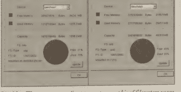

**图 2.5** `kdiskfree` 客户端展示了任何已挂载卷的文件系统使用情况的图形，包括 FAT32 等其他文件系统。

Linux 还包括用于*挂载*或*卸载*文件系统的工具。这意味着您可以让其他文件系统，如硬盘、Zip 磁盘或 CD-ROM，出现在文件系统中（通常位于 `/mnt` 目录下）或从文件系统中消失。如果您配置笔记本以启动 Linux 或 Windows，并且 Windows 分区位于第一个分区，您可以让 Windows 分区出现在 `/mnt/dos` 目录下，方法如下：

```bash
# mount -t vfat /dev/hd1 /mnt/dos
```

然后，您可以在 Linux 和您的 Windows 桌面之间复制、删除、重命名或移动文件。要让 Windows 分区“消失”即停止使用，请使用 `unmount` 命令，方法如下：

```bash
# unmount /mnt/dos
```

Apple iBook 的 Linux 用户也可以使用 `mount` 命令访问 Macintosh 格式化的分区。在 iBook 上安装 Linux 后，MacOS HFS 文件系统应位于 `/dev/hda8`。然后您可以像这样挂载它：

```bash
# mount -t hfs /dev/hda8 /mnt
```

要查看 Macintosh 桌面文件夹中的文件，请使用 `ls` 命令，方法如下：

```bash
# ls /mnt/Desktop Folder/
```

您会发现 Linux 包含几种特定的硬件磁盘工具。其中之一是 `hdparm`，用于显示或设置 IDE 硬盘参数。这个命令行接口程序有近 30 个不同的选项，您可以用来查看或更改硬盘的特性。

最常见的用途之一是设置内部硬盘的 spindown（停转）或空闲时间。如果您经常外出，这有助于节省电池电量非常方便。例如，要让笔记本的硬盘在特定时间后停转，请使用 `hdparm` 命令的 `-S` 选项，后跟一个数字（见表 2.6）。

**表 2.6 hdparm 待机超时值**

| 值 | 超时 |

| :--- | :--- |

| 0 | 关闭待机模式 |

| 1 到 240 | 5 秒到 20 分钟 |

| 241 到 251 | 1 到 11 个 30 分钟单位 |

| 252 | 21 分钟 |

| 253 | 由制造商决定 |

| 255 | 21 分钟 15 秒 |

例如，要让硬盘在 60 秒无活动后停转，请使用 `hdparm` 命令，方法如下：

```bash
# hdparm -S 12 /dev/hda
```

此命令适用于基于 Intel 的笔记本和 Apple iBook！请注意，如果您进行此更改，硬盘在 Windows 或 MacOS 下也会停转。

### 您的笔记本 CD-ROM

大多数笔记本，包括 iBook，使用*ATA 包接口*（ATAPI）CD-ROM 驱动器。这些 CD 驱动器中的大多数都能很好地与 Linux 配合工作（尽管我知道有一个不兼容问题，但很快通过重新编译内核解决了）。购买笔记本时，您主要关心的是是否可以设置您笔记本的*基本输入/输出系统*（BIOS）以更改任何内部存储设备的启动顺序，例如软盘、硬盘和 CD-ROM。幸运的是，大多数笔记本都支持此功能。然而，对于某一线索尼笔记本配备外部 CD 驱动器的情况，您确实可以设置笔记本的 BIOS 从 CD-ROM 启动，但这仅适用于索尼的驱动器——这是一种麻烦的操作！

虽然台式计算机可以使用 CD-ROM 刻录机和 CD-ROM 可重写驱动器，但在编写本章时，只有一家笔记本制造商（Dell）在笔记本中提供了此选项。您可以在以下位置找到驱动器兼容性图表：

http://www.gug.de:8080/cgi-bin/winni/lsc.pl

有关如何使用 Linux 软件和 CD-ROM 刻录机或可重写驱动器来刻录 CD 的实用 HOWTO 文档，请访问：

http://www.gug.de/~winni/linux/cdr/html/

启动 Linux 时，您的笔记本 CD-ROM 驱动器应该会被自动识别，即使没有插入 CD。请查找类似以下的输出：

```text
hda: TOSHIBA DVD-ROM DRD-0624, ATAPI CDROM drive
```

此输出表明 Linux 已检测到连接到 `/dev/hdc` 的 DVD CD-ROM。利用此信息，您可以轻松地使用以下命令挂载 CD：

```bash
# mount -t iso9660 /dev/hdc /mnt/cdrom
```

请注意，大多数存储设备，固定式和可移动式的，通常都在文件 `/etc/fstab` 中有条目，这是您的系统文件系统表。此文件在您安装 Linux 时创建，它使挂载 CD-ROM 等设备变得更加容易。使用前面的例子，`/etc/fstab` 中的条目可能看起来像这样：

```text
/dev/cdrom /mnt/cdrom iso9660 user,noauto,nosuid,exec,ro 0 0
```

在此条目中，`/dev/cdrom` 是指向 `/dev/hdc` 设备的符号链接，挂载点定义为 `/mnt/cdrom`。这意味着您可以将 CD-ROM 插入驱动器，然后使用以下命令：

```bash
# mount /mnt/cdrom
```

CD-ROM 的内容将出现在 `/mnt/cdrom` 目录下。

### DVD 与 Linux

Linux 可以挂载和读取 DVD CD-ROM。但是，尽管有软件允许您在 Linux 下观看 DVD 电影，电影工业界一直追踪、起诉任何在互联网上发布或分发这些软件的人，声称该软件是非法的并违反商业秘密。（尽管有这些荒谬的努力，该软件仍然可用。）在当前的喧嚣平息之前，Linux 用户仍然可以从拥有 DVD CD-ROM 驱动器中获益。至少有一家 Linux 发行商，SuSE 公司，现在以 DVD 格式分发其 Linux 软件。这节省了大量的空间、重量和包装材料，并且允许使用一张 CD 来永久存储软件，而不是六张！

### 并口

并口，在 DOS 下被称为 LPT（行打印机终端）端口，尽管 USB 打印机的普及程度和数量不断增加，但在市场上销售的大多数笔记本上仍然包含此端口。此端口通常是一个类似于旧式 DB-25 串口的 25 针连接器。除非是特殊设计的，打印机电缆的一端是一个 25 针连接器，用于连接到您的笔记本，另一端是一个 D 形的 Centronics 插头连接器，用于连接到您的打印机。

许多移动 Linux 用户在外出不携带打印机。一个解决方案是使用带有 IrDA 接口的便携式打印机，例如佳能 BJ C-50（请参阅本章后面的“红外端口”部分）。当您启动 Linux 并且连接了一台已通电的打印机时，打印机应被自动检测到（如下所示的 `dmesg` 命令输出）：

```text
parport0: PC-style at 0x378 [SPP,ECP,ECPPS2]
lp0: using parport0 (polling).
```

如果您没有看到此输出，请检查您的电缆连接，并确保您的 `/etc/conf/modules` 文件包含以下行：

```text
alias parport_lowlevel parport_pc
```

Linux 的并口打印机支持由 `parport` 和 `lp` 内核模块提供，这些模块在需要时从 `/lib/modules/linux-2.2.X/misc` 目录加载到内存中，其中 X 是您 Linux 内核的版本。串口和并口打印机可以在 Linux 下手动配置，也可以通过图形管理工具配置

#### 图 2.6

Red Hat 的 `printtool` 客户端用于为 Linux 配置本地、远程和 NetWare 打印机。

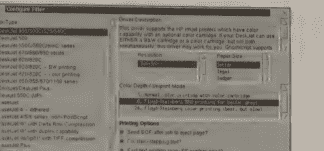

各发行版都附带相应的工具。例如，SuSE Linux 用户将使用 YaST 或 YaST2 工具，而 Caldera OpenLinux 用户将使用 COAS 或 lisa 管理工具。


Red Hat（以及 Mandrake）Linux 用户使用 `printtool` 客户端，如图 2.6 所示。该工具包含数百种兼容打印机的特定设置，并可配置本地、远程和网络打印机。打印机定义将输入到系统的打印机功能数据库 `/etc/printcap` 中。

在 Linux 中打印时，几乎所有文档首先都会保存为 PostScript 格式。随后，该 PostScript 数据流会通过名为 `ps` 的打印过滤器进行“过滤”，然后由该过滤器将 PostScript 文件转换为正确的打印机控制语言。这意味着什么？这意味着在 Linux 中，你可以将廉价、$99 的促销彩色喷墨打印机变成一台 2 级 PostScript 打印机！在 Linux 下可以轻松打印原始 PostScript 文件、图形和其他文档。你的发行版附带了数百种图形实用程序和转换程序。

你的笔记本并口可用于连接除打印机以外的其他设备。请访问以下网址浏览 Linux 并口和 IDE 设备页面：

http://www.torque.net/parport/paride.html

你将会找到针对各种其他设备的特定解决方案，例如：

- Avatar Shark

- Castlewood ORB 驱动器

- FreeCom Power CD

- FreeCom Traveller CD

- Hewlett-Packard 5GB 磁带驱动器

- Hewlett-Packard 7100 和 7200 CDRW 驱动器

- Imation SuperDisk LS-120

- Maxell SuperDisk LS-120

- MicroSolutions 背包式 CD-ROM

- MicroSolutions 背包式硬盘

- MicroSolutions 背包式 CD/CD

- SyQuest EZ-135、EZ-230 和 SparQ 驱动器

Linux 并口 IDE 驱动程序 (`PARIDE`) 支持的其他设备还包括并口 ATAPI CD-R 和 CD-RW 设备，例如 HP 7100 和 7200 CD 刻录机。

Linux 还支持一些并口 SCSI 设备，例如 Iomega Zip 驱动器。你可以在 Kyle Dansie 的 *Zip 驱动器小型 HOWTO*（位于 `/usr/doc/HOWTO/mini` 目录下）中找到关于如何使用此驱动器的具体说明。

### PCMCIA 端口

大多数笔记本电脑都配有一个或多个 PCMCIA 插槽。这些插槽支持 70 针设备，通常大小为信用卡大小（尽管有些稍大）。拥有两个此类插槽的笔记本电脑可以支持一种日益罕见的 Type III PC 卡，这种卡至少使用一个连接器但占用两个插槽。在许多情况下，你可以同时在笔记本电脑中使用两张 Type II PC 卡。然而，越来越多的笔记本电脑，尤其是超轻或更薄的机型，仅支持一个 Type II 插槽。此外，一些 Type II 卡虽然只需要一个插槽，但无论如何都会占用两个插槽。

你的笔记本将为插入的 PC 卡提供电源，因此许多设备不需要外部电源。另一方面，较大的外部硬盘和早期的外部 CD-ROM 可能还需要外部交流适配器（除非可选用电池）。

在过去几年中，笔记本行业采纳了 CardBus 标准，它允许通过 PCMCIA 端口进行更快的数据传输（更常见的 16 位传输速率限制在大约 2 到 3Mbps）。Linux 支持数百种常见的 16 位 PC 卡。不幸的是，由于技术和开发的飞速进展，以及某些制造商支持的缺乏，Card Services 软件的维护者 David Hinds 表示，对 32 位或 CardBus 卡的支持“仍具有一定的实验性”，该软件在 Linux 下提供 PCMCIA 支持。表 2.7 列出了该软件支持的各种 PC 卡和设备的概况。

#### 表 2.7 PC 卡服务支持

| 类型 | 描述 |
|:---|:---|
| ATA/IDE | Flash-ATA 卡；IDE、CD-ROM 接口卡 |
| Camera | Winnow Videum PCMCIA 相机 |
| Ethernet | 10Base-T 网络适配器 |
| Fast Ethernet | 10/100Base-T 网络适配器 |
| Floppy | 软驱适配器 |
| ISDN | 网络适配器 |
| Memory | SRAM、Flash 存储卡 |
| Modem, serial | 调制解调器和串行端口卡 |
| Multifunction | 以太网/调制解调器卡 |
| Parallel | 并口卡 |
| SCSI | SCSI 适配器卡 |
| Token Ring | 网络适配器 |
| Wireless | 无线网络适配器 |

#### 致谢

移动 Linux 用户对 David Hinds 负有巨大的感激之情，他创建并维护了为 Linux 提供 PCMCIA 支持的核心软件。由于他和他人 的努力，Linux 用户可以使用并享受数百种不同的 PC 卡设备。名为 Card Services 的 PCMCIA 软件由十几个或更多的内核模块组成。Card Services 最初作为 Linux 的一个独立软件包分发，但在过去左右一年，这款关键的笔记本软件已被整合到 Linux 内核源代码树中。向 David 和其他 PCMCIA 程序员致敬！

#### 外形规格

笔记本电脑有多种不同类型的 PC 卡，以及不同的外形规格。由于笔记本电脑行业隐蔽的趋势是包含软件驱动或“无控制器”的调制解调器，许多移动 Linux 用户将需要购买和使用 PC 卡调制解调器来连接其他计算机。如果你的笔记本有两个 Type II 插槽，请选择一个组合调制解调器和网络卡，使另一个插槽保持空闲，或者选择一个不会干扰第二张 Type II 卡的调制解调器卡。

#### 使用 Card Services

如果 PC 卡被用于安装 Linux（例如用于 FTP、NFS 或 HTTP 安装），某些 Linux 发行版会自动启用 PCMCIA 支持，但这并不总是如此。如果你从笔记本电脑的 CD-ROM 安装 Linux，你可能需要手动开启支持。务必安装 PCMCIA 软件！如果你不确定是否已安装，可以试试这个：

```bash
# whereis cardctl
cardctl:  /sbin/cardctl  /usr/man/man8/cardctl.8.bz2
```

这表明软件已经安装。接下来，在使用 Red Hat（和 Mandrake）Linux 时，转到 `/etc/sysconfig` 目录。你应该看到一个名为 `pcmcia` 的文件。这是 PCMCIA 启动选项文件。用你喜欢的文本编辑器打开此文件：

```bash
PCMCIA=
PCIC=
PCIC_OPTS=
CORE_OPTS=
CARDMGR_OPTS=
```

要启用 PC 卡支持，请编辑文件使其如下所示：

```bash
PCMCIA=yes
PCIC=182365
PCIC_OPTS=
CORE_OPTS=
CARDMGR_OPTS=
```

PC 卡接口控制器 (`PCIC`) 条目可以是 `tcic` 或 `182365`。这是因为，根据 Hinds 的说法，几乎所有笔记本电脑都使用两种不同类型的控制器之一：Databook TCIC-2 或 Intel i82365SL 兼容型。完成更改后，保存文件。然后你可以插入你的 PC 卡，并且（如果使用 Red Hat 或 Mandrake）可以这样启动 Card Services：

```bash
# /etc/rc.d/init.d/pcmcia start
```

在卡被识别和初始化后，你应该听到两声蜂鸣声。你可以通过将 `dmesg` 命令的输出通过 `less` 命令来检查这一点：


```bash
# dmesg | less
...
Linux PCMCIA Card Services 3.1.0

Kernel build: 2.2.13-7mdk #1 Wed Sep 15 18:02:18 CEST 1999
options:   [pci] [cardbus] [apm] [pnp]

PnP: PNP BIOS installation structure at 0x8000f7220

PnP: PNP BIOS version 1.0, entry at f0000:e77c, dseg at 400
PCI routing table version 1.0 at 0xdfd50

Intel PCI3c probe:

    TT 1225 PCI-to-CardBus at bus 0 slot 4, mem 0x80000000, 2 sockets
        host opts [0]: [ring] [pwr save] [serial pci & irq] [pci irq 11] [lat 169/32]
                   [bus 32/34]
        host opts [1]: [ring] [pwr save] [serial pci & irq] [pci irq 11] [lat 169/32]
                   [bus 35/37]

    ISA irqs (scanned) = 3,4,7,9,10 status change on irq 10

cs: IO port probe 0x0100-0x17ff: clean.
cs: IO port probe 0x0100-0x04ff: clean.
cs: IO port probe 0x0a00-0x0aff: clean.

cs: memory probe 0xa0000000-0xa05fffff: clean.
echo: NE2000 Compatible: io 0x0x300, irq 3, lw_addr 00:E0:98:06:84:C5
ttyS1 at 0x0x2E8 (irq = 3) is a 16550A
...
```

这里没有显示 `dmesg` 命令的所有输出。此输出（针对 Linksys EtherFast 10/100 + 56K V.90 组合卡）显示 Card Services 已启动，笔记本的控制器（一台 Texas Instruments 1225）已被识别，并且以太网适配器和串行端口（实际上是一个调制解调器）已初始化。你还可以检查 Card Services 内核模块是否已加载。像这样使用 `lsmod` 命令：

```bash
# lsmod
Module         Size   Used by
serial_cs       4816    0 (unused)
pncnet_cs      8116    1
8390           6020    0 [pncnet_cs]
ds             6056    2 [serial_cs pncnet_cs]
182365        28808    2
pcmcia_core    51904    0 [serial_cs pncnet_cs ds 182365]
```

这表明 `pcmcia_core`、`i82365` 以及相关的支持模块已加载。这些模块将驻留在 `/lib/modules/2.2.X/pcmcia` 目录下，其中 `*X*` 是你的 Linux 内核版本。

#### 蜂鸣模式

Card Services 还在卡片插入或移除时提供音频反馈。如果你插入一张以太网 PC 卡，然后听到一声高音蜂鸣接着一声低音蜂鸣，但你没有看到任何错误且卡片似乎已被识别，请确保你已经在 Linux 下为该卡片配置了网络，并分配了一个互联网协议 (IP) 地址。如果你只听到一声蜂鸣，说明卡片已被识别但未配置。两声高音蜂鸣通常表示卡片已被识别并配置完毕。

Card Services 附带了一个名为 `cardctl` 的 PC 卡控制命令。该命令凭借其九个命令行选项，可用于对你的笔记本中的特定插槽执行软插入和移除卡片的操作。你可能会发现 X11 客户端 `cardinfo`（如图 2.7 所示）也很有用，它是笔记本 PC 卡管理的图形界面。

对于新的 Linux 用户来说，排查 PCMCIA 问题可能略有不同。安装 Linux 后，你早期需要做的第一件事之一就是阅读 David Hinds 的 `PCMCIA-HOWTO`。如果你不想浪费时间或麻烦，这一点非常重要！`PCMCIA-HOWTO` 包含大量关于诊断、故障排除和配置的信息，以及关于如何使用 Card Services 配合不同的 Linux 发行版的信息。一个相关的且定期更新的

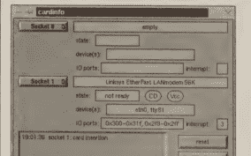

*图 2.7* `cardinfo` 客户端用于在 X11 会话中控制你的笔记本的 PC 卡。

名为 `SUPPORTED.CARDS` 的文件列出了数百种兼容、部分支持和不兼容 Linux 的 PC 卡。在购买用于你笔记本的 PC 卡之前，请阅读此文件！你可以在 `http://pcmcia.sourceforge.org/` 找到这些文档的最新副本以及最新的 Card Services 软件。

### 串行端口

你的笔记本至少应有一个用于外部串行设备的公头九针串行端口。较大的笔记本可通过机箱后部使用该端口，而超轻薄本或子笔记本可能使用端口“扩展器”或复制器。

现有的串行端口在启动时会被 Linux 识别。你可以使用 `dmesg` 命令检查哪些端口被识别，如下所示：

```
# dmesg | fgrep ttyp
ttyS0 at 0x03f8 (irq = 4) is a 16550A
```

在此示例中，在指定地址找到了单个串行端口 `ttyS0`，使用初始中断请求 (IRQ)。该值指定了设备的位置——在这种情况下，是一个 16550A 通用异步收发器 (UART)。

Linux 下的串行端口通常名为 `ttyS0`、`ttyS1`、`ttyS2` 等。它们对应于 `/dev` 目录下的设备指针，并且通常与 DOS 下类似的 COM1、COM2、COM3 等端口相匹配。

Linux 支持高达 115200 位/秒 (bps) 的串行端口传输速率。控制笔记本串行端口特性的主要命令是 `setserial`。该命令可用于配置端口的 IRQ、UART、速率及其他特性。如果你是 Linux 新手，如果在让调制解调器工作时遇到困难，务必阅读其 man 页面。另一份值得阅读的好文档是 David S. Lawyer 的 `Serial-HOWTO`，可在 Red Hat 或 Mandrake Linux 的 `/usr/doc/HOWTO` 目录下找到。

好消息是你不需要经常排查串行端口问题。只有当不同设备（如你的声卡或 IrDA 和串行端口）发生 IRQ 冲突时，你才可能遇到困难。通过使用 `setserial` 命令更改 IRQ，你应该能够迅速解决任何问题。例如，要将 `/dev/ttyS1` 从初始 IRQ 3 更改为新的 IRQ 4，请这样使用 `setserial`：

```
# setserial /dev/ttyS1 irq 4
```

然后，你可以使用 `setserial` 的 `-a` 选项来确认更改：

```
# setserial -a /dev/ttyS1

/dev/ttyS1, Line 1, UART: 16550A, Port: 0x02f8, IRQ: 4
    Baud_base: 115200, close_delay: 50, divisor: 0
    closing_wait: 3000, closing_wait2: infinite

    Flags: spd_normal skip_test
```

`setserial` 命令将输出关于指定串行端口的尽可能多的信息。

如果你的笔记本需要额外的串行端口，考虑获取一张串行端口 PCMCIA 卡。

#### 内置调制解调器

大多数笔记本，包括 Apple iBook，都配有内置调制解调器，称为 *modem*。在使用 Linux 时，笔记本有一个可用的内置调制解调器是一件很棒的事。你不需要携带额外的 PCMCIA 卡，或使用带有相关电缆和电源的大型笨重外部调制解调器。

话虽如此，这里有个坏消息：为了削减制造成本、节省资金并减少芯片数量，如今市场上大多数基于 Intel 的笔记本使用专有的“软件驱动”调制解调器，它们依赖闭源驱动程序，且仅适用于 PC 软件垄断厂商的操作系统。

在我看来，尽管当今的 CPU 有足够的能力通过软件来处理这项工作，但这些调制解调器纯粹是糟糕的工程。尽管我很想说你不应该购买带有内置“无控制器”调制解调器的笔记本电脑，但事实是，许多配备此功能的笔记本与 Linux 配合工作得很好——除了这些无用的调制解调器外。更糟糕的是，没有制造商（在撰写本章时，可能除了一家）会发布规范，以便开发开源解决方案。


这使得你，作为消费者，受制于专有软件和响应缓慢的行业。调制解调器芯片制造商不生活在互联网时代，但移动 Linux 用户生活在这个时代。行业对消费者需求、错误修复和其他问题的懒散反应，因笔记本制造业继续建造装有这些设备的笔记本而加剧。这种情况不会改变，直到 Linux 笔记本用户群增长，消费者需求迫使重新评估硬件或软件设计策略。

## iBook 的权衡

如果你使用 `Yaboot` 启动实用程序并在 Apple 的 `Open Firmware` 提示下启动 `Yellow Dog Linux`，就可以使用 iBook 的内置调制解调器。然而，你的 `X11` 会话将限制为 256 种颜色。如果你使用 `BootX` 控制面板启动 `Yellow Dog Linux`，内置调制解调器将无法工作，但你可以使用具有数千种颜色的 `X`！

好消息是，至少有一个项目正在尝试为其中一些设备开发开源驱动程序。请访问

http://www.linmodems.org

你可以阅读关于如何使用 Linux 配合这些芯片的替代观点，例如用作答录机、录音电话等。你会发现这个正在进行项目的源代码，以及 Lucent 提供的（可预测的）仅限二进制的驱动程序，形式为 500Kb+ 的内核模块。该驱动程序名为 `lucent.o`，据报道可与不同笔记本中的多种 Lucent 芯片组配合工作。在撰写本书时，我测试了 IBM ThinkPad 390X、`Mandrake 7.0` 和 `lucent.o` 模块，发现在高达 38400 Kbps 的速度下可以建立可靠连接。

另一个好消息是，并非所有笔记本制造商都使用这些设备。市场上的一些笔记本包含“真正的”内置调制解调器！虽然制造商很少将此作为营销亮点，但此类笔记本电脑（如 Sony 505TX 和 TR）在移动 Linux 用户中备受珍视。

笔记本也可以订购为不带内置调制解调器。如果是这样，请购买受支持的 PCMCIA 56K V.90 调制解调器卡或以太网/调制解调器组合卡。最好的调制解调器卡之一是不依赖专有电缆（或 dongles），而是带有弹出式标签和 RJ-11 电话插孔的卡片。如果你在寻找一个不使用专有 dongles 且不占用两个 Type II 插槽的优秀组合卡，Linksys EtherFast 10/100 + 56K V.90 PCMCIA 卡是一个不错的选择。该卡具有内置的 RJ-11 和 RJ-45 端口，用于电信和网络。如果你的笔记本有两个 PCMCIA 插槽，你还可以使用另一张 Type II 卡。

确定你的内置调制解调器使用哪个串行端口后（提示：使用 `dmesg` 查找 `/dev/ttyS1` 输出），你应该使用 `ln` 命令创建一个名为 `/dev/modem` 的符号链接，供通信程序使用或在连接互联网时使用：

```
$ ln -s /dev/ttyS1 /dev/modem
```

## 天哪！又来了一个“Winmodem”！

为 Linux 选择 PCMCIA 调制解调器卡时要小心：市场上有相当多“无控制器”的 PCMCIA 调制解调器卡！购买前，一个很好的检查地点是 <http://www.o2.net/~grontkko/winmodem.html>。

根据该网站用户数据贡献，在 Linux 下需要警惕并避免使用的包括 Paradise CW56KPCMCIA、Paradise PC Card Modem CW56K-CB 和 CW56LU-CB；IBM 型号 10L7393；3Com Megahertz XJ2560、CC2560 PC Card、CCSPWM WinModem PC Card、3CXM356/3CCM356、3013、3014 WinModem PC Card、3CXM656/3CCM656/3014 56K Global GSM WinModem PC Card、3CCFEM656B 10/100 LAN+56K。

在此例中，调制解调器连接到 `/dev/ttyS1`，它对应于 DOS 的 COM2 端口。然后你可以尝试使用 `minicom` 命令进行拨号并测试你的调制解调器。如果你正在运行 X，也可以使用 `xminicom` Shell 脚本来在其独立窗口中启动 minicom（如图 2.8 所示），如下所示：

```bash
# xminicom &
```

`&` 符号用于在后台启动程序。这可以释放终端窗口中的命令行。然后你可以使用其内置的 AT 命令集查询或配置你的调制解调器以进行拨号。这些命令应在你的调制解调器手册中有记载，但你可以在 <http://www.citilink.com/~kae/faq/connecting/general/hayes.html> 查看“标准”命令的参考页面。

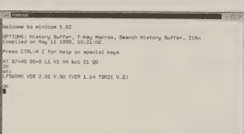

图 2.8 `xminicom` 客户端是一个通信程序，无论是否有 X11 均可运行。

例如，启动 *minicom* 后，你应该能够输入 `AT` 命令，按下 `Enter`，然后使用 `AT?` 命令：

```text
AT
OK
AT?
LP56OMX VER 2.01 V.90 (VER 1.14 TBR21 V.2)
OK
```

第一个 `OK` 表明你的调制解调器正在响应。`AT?` 命令“询问”你的调制解调器以获取制造商信息。

### 外部监视器端口

很少有中大型笔记本不带外部监视器或 VGA 端口。这是一种将你的笔记本变成桌面系统的好方法，特别是如果它的屏幕很小，或者你需要比笔记本 LCD 提供的分辨率更高的更大显示屏。

使用外部显示器时，最安全的做法是关闭计算机，连接监视器线缆，然后重新启动。尽管大多数笔记本都有特殊的 `Fn` 键盘控制键，用于在 LCD 和监视器或两者之间切换显示，但你可能需要在笔记本的 BIOS 中启用外部监视器使用。通常这是在打开计算机后立即按住某个按键或按键组合来完成。

不要期望在使用外部监视器运行更高分辨率时，能够使用与笔记本相同的颜色深度。正如你所了解的，颜色深度和分辨率是笔记本图形芯片组和内部显存的功能。大多数笔记本的图形内存不足以在 1600×1200 像素下支持数百万种颜色。如有疑问，请查阅你的笔记本手册，了解连接、配置和使用外部显示器的相关信息。

移动 Linux 用户应意识到，在某些情况下，特定的图形芯片组可能需要系统的 `XF86Config` 文件中的特定设置，以便在外部监视器上显示正在运行的 `X11` 会话。例如，如果你的笔记本配备 NeoMagic 图形芯片组，并且你想在外部监视器上显示你的 `X` 会话，你需要使用：

```text
Option "extern_disp"
```

在你的 `XF86Config` 文件的图形设备部分中。（详情见 `/usr/X11R6/lib/X11/doc` 目录下的 `README.neo` 文件。）

请注意，你 `XF86Config` 中的设置不要给外部监视器带来压力或试图超出其能力范围。务必先阅读你笔记本外部视频端口的技术细节！

### 红外端口

许多笔记本都配备了用于无线通信（如网络、文件传输和打印）的 IrDA 端口。IrDA 端口可能位于你的笔记本的任一侧或背面。为了使用该端口，你必须在笔记本上启用 IrDA，然后将远程设备放置在端口的范围内，很可能在 3 米以内，范围可能浅至 15 度。

关于在 Linux 下使用 IrDA 的初始指引，请查找位于 `/usr/src/linux/Documentation/networking` 目录下的名为 `irda.txt` 的简短文本文件（确保你已安装内核源代码）。然而，随着 Linux 内核的快速发展，关于在 Linux 下进行网络、文件传输和打印的 IR 设置和操作指南相当稀疏；Linux 下的 IrDA 开发是一个移动目标。一个很好的起点是 <http://www.cs.uoit.no/linux-irda/>。

你会在那里找到多个链接和信息。你也可以在 <http://www.cs.uoit.no/linux-irda/hardware.html> 检查与你笔记本的兼容性。

如果你想了解更多关于 IrDA 的信息，并获取一些适用于 Linux 的实用应用程序，Werner Heuser 撰写的 Linux IR-HOWTO 中包含了一些文档，可在 <http://www.enfu.de/~wehe/IR-HOWTO.html> 获取。

#### 安装 IrDA 支持

第一步是安装 IR 服务。Linux 的 IrDA 支持现在是 Linux 内核 2.2.X 系列的一部分，但你必须下载并安装名为 `irda-utils` 的 Dag Bratl 的软件包。然后你必须构建并安装支持库以及至少两个实用工具：`irdattach` 和 `irdamanger`。你可以在 <http://www.cs.uoit.no/linux-irda/irda-utils/> 找到此软件。


在构建和安装之后，几个命令和文件会被复制到你的文件系统中。然后你需要启用 IR 并确定端口大小。一些笔记本提供特殊的 `Fn` 键组合来开启 IR，而在其他笔记本上你必须更改 BIOS 设置。不同操作系统之间端口的 IRQ 设置也可能不同。例如，在 Sony Vaio 505TR 上，IR 端口在 Windows 下分配给 COM4，IRQ10。

然而，在启用端口并启动 Linux 后，`dmesg` 命令会报告三个串行端口：

```text
ttyS0 at 0x03f8 (irq 4)
ttyS1 at 0x02f8 (irq 3)
ttyS2 at 0x03e8 (irq 4)
```

如果你熟悉你笔记本的硬件，你应该能识别出新的串行端口（在此例中为 `/dev/ttyS2`）。为了在 Linux 下设置 `/dev/ttyS2`，使用 `setserial` 命令来修复明显的 IRQ 冲突（在 `ttyS0` 和 `ttyS2` 之间），将 IRQ10 分配给该端口：

```bash
# setserial /dev/ttyS2 irq 10
```

这一命令行，以及为系统加载 IrDA 支持所需的命令，可以放在一个简短的 Shell 脚本中：

```bash
setserial /dev/ttyS2 irq 10
insmod irda
insmod ir
irattach /dev/ttyS2
irmanager -d 1
```

保存脚本，使用诸如 `IR` 这样的名称，然后使用 `chmod` 命令使其可执行：

```bash
# chmod +x IR
```

下一步是编辑你的 Red Hat 或 Mandrake `/etc/conf.modules` 文件并插入以下内容：

```text
alias tty-ldisc-11 irtty
alias char-major-161 ircomm-tty
```

这些行提供内核模块的信息，以便从 Shell 脚本中加载。请注意，到你阅读此内容时，这些条目可能已更改。（参见包含在 `irda-utils` 软件中的各个 README 文件。）

### 打印机示例

然后你应该将 IrDA 设备（如打印机）放置在你的笔记本范围内。接下来，使用你的 Shell 脚本启动 IrDA：

```bash
# ./IR
```

打开打印机，并查看 `/proc/misc`：

```bash
$ cat /proc/misc
62 ir1pt0
63 irda
...
```

这显示了 `mkmod` 命令所需的信息，该命令用于创建 IrDA 打印机设备 `/dev/ir1pt0`：

```bash
$ mkmod /dev/ir1pt0 c 10 62
```

然后你可以查看文件 `/proc/net/irda/discovery` 的内容，以查看是否在该范围内找到了打印机：

```bash
$ cat /proc/net/irda/discovery

IrLMP: Discovery log:

Link saddr=0x0000c404

Link saddr=0x0000c3ed
    name: BJ C-50, hint: Printer IrCOMM, daddr: 0xcab8000
```

下一步是使用 Red Hat 的 `printtool` 创建一个打印机，配置打印机条目以匹配打印机（在此例中为 Canon BJC-50），保存配置，然后编辑系统打印机能力数据库 `/etc/printcap` 中生成的条目。将此：

```text
:IRprinter=/dev/ir1:
```

改为：

```text
:IRprinter=/dev/ir1pt0:
```

然后你可以用此命令打印文档：

```bash
$ lpr -PRprinter myfile.txt
```

#### Canon BJC-80 用户

Dave Davey 撰写的关于使用 Canon BJC-80 进行 IR 打印的一小页信息可在 <http://www.physiol.usyd.edu.au/daved/linux/bjc-80.html#startup> 获取。

许多 IrDA 设备在 Linux 下得到支持，如移动电话、打印机以及用于台式机的插件 Dongle。

### 通用串行总线

通用串行总线 `USB` 最初由 IBM、Intel、Compaq、NEC 和 Northern Telecom 等多家大型计算机制造商于 1995 年开发为标准。其设计旨在推广低成本、低功耗且高速外围设备的使用，`USB` 支持 12Mbps 的传输速率，并声称允许最多 127 个设备通过 `USB` 集线器进行级联或支持。电缆长度通常限制在 5 米以内，且建议使用较短的电缆以避免电压降。

自 1997 年以来制造的大多数笔记本电脑（以及许多台式机）都支持 `USB`，通过提供一个小端口来连接集线器或其他 `USB` 外围设备，如键盘、鼠标、CD-ROM 驱动器、调制解调器、打印机、扫描仪或数字相机。使用 `USB` 的好处之一据称是减少昂贵的总线连接器和插卡；另一个好处是消除系统资源冲突（如 IRQ）。`USB` 设备还据称支持热插拔，类似于 PCMCIA 卡，并且许多设备提供直通连接器以允许多个设备级联（尽管大多数 `USB` 用户可能更倾向于使用自供电集线器来支持多个设备以获得最佳性能）。

Linux 对 `USB` 的支持首次出现在 Linux 内核的 2.3 开发系列中，尽管针对使用可加载模块和启动/停止脚本的后续 2.2 内核，源代码树中已有补丁可用。最初支持的设备包括各种键盘和鼠标。随着 Linux 内核 2.4 系列的出现，原生 `USB` 支持将成为现实。表 2.8 列出了当前在 Linux 上正常工作的若干设备。

要了解如何使用 `USB`、`USB` 的状态或如何在较旧的 Linux 内核上使 `USB` 工作，请访问 [http://www.linux-usb.org/](http://www.linux-usb.org/)。

有关 `USB` 的制造商和协议信息可在 [http://www.usb.org/](http://www.usb.org/) 找到。

### IEEE 1394 (FireWire)

最新的高速数据传输协议之一是 IEEE 1394，也称为 *FireWire*。由 Apple Computer 首先倡导，FireWire 比 `USB` 快得多，速度高达 400Mbps。作为小型计算机系统接口 `SCSI` 的替代方案，FireWire 也被吹捧为传输数字视频的理想方式，或者用于启用局域网 `LAN` 连接。

#### 表 2.9 Linux 下的 USB 设备

| 制造商 | 设备 |
|---|---|
| Apple | iMac 键盘 |
| Belkin | 键盘 |
| Cherry | MY3000 USB 4A CYA |
| Dallas Semiconductor | 扬声器 |
| Epson | Stylus Color 740 打印机 |
| Gravix | Gamepad Pro USB，型号 #4211 |
| HP | DeskJet 970Cse 打印机 |
| HP | Photosmart P1100 打印机 |
| HP | ScanJet 4100C 扫描仪 |
| HP | ScanJet 5200 扫描仪 |
| HP | ScanJet 6300C |
| Kensington | Orbit USB/PS2 鼠标 |
| Kodak | DC-240, 260, 265, 280, 290 相机 |
| Logitech | Wingman Gaming, N48, M-BA47, 鼠标 |
| Micro Innovations | LYNX 96 USB 鼠标 |
| Microsoft | Natural Keyboard Elite |
| Zoom | 2986L 调制解调器 |
| Zoom Telephonics | ZoomCam USB 网络摄像头 |

索尼等制造商的几种笔记本电脑型号在 1999 年上市时配备了 FireWire 端口。典型用途是传输高带宽数据，如数字视频。不幸的是，在编写本章时，Linux 尚无 FireWire 支持（除了几款数字视频相机、少数 PCI 适配器和几个外部硬盘外，市场上几乎没有 FireWire 设备）。

Linux 下（目前）尚不稳定的 FireWire 支持。您可以查看由 Emanuel Pirkler 主持的 GNU/Linux IEEE 1394 开发项目，位于 [http://ec1.ipt.uni-klu.ac.at/ieee1394/index.html](http://ec1.ipt.uni-klu.ac.at/ieee1394/index.html)。

虽然有一些初始驱动程序可用，但在编写本章时，文档很少，且只有一两个测试工具可用。您可以从 [http://www.firewire.org](http://www.firewire.org) 获取有关 FireWire 的更详细信息。

### 您的笔记本电池


毫无疑问，移动 Linux 用户在途中受到笔记本电脑最关键元素之一的束缚：电池！电池续航时间对经常出差的“道路战士”的成功至关重要，它决定了生产力以及工作设备变成纸镇之前的时间长短。

虽然有碱性、碳锌、氧化银、锌空和二氧化锰等多种不同类型的电池，但只有三种电池常用于便携式计算设备：

- `NiCd`。作为可充电类型中较重的一种，由于环境担忧（镉）以及对抗“记忆”效应（残留充电效应）的改进电池技术的发展，这些电池已不再受青睐。这意味着这些电池“记住”低电量状态。虽然便宜，但这些电池无法承受滥用，如过充或欠充。
- `NiMH`。用于许多不同的笔记本电脑，这些电池可能在温度极端和过充方面存在问题。它们比 `NiCd` 更贵，并且可能使用寿命较短。
- `LiIon`。这些电池是笔记本电脑技术中的最新宠儿。它们耐用、保持充电、提供更高功率，且不易出现记忆效应。虽然更昂贵，但这些电池在某种程度上更“环保”，但像所有电池一样，它们应该被回收。

电池的使用和能力因笔记本而异。某些型号可以使用两块电池以延长寿命，一些制造商，如索尼，提供四倍容量的锂离子电池，可提供 10 小时或更长时间的满负荷开源移动计算！

一些增加移动活动能力的明显步骤包括以下内容：

- 让硬盘休眠
- 关闭 LCD 背光（如果可能）
- 不使用外部设备
- 弹出未使用的 `PCMCIA` 卡

当您在路上时，还可以使用第 7 章“高级电源管理”中概述的软件和程序。

### 底座

虽然本书专注于移动 Linux 计算，但大多数笔记本所有者都知道，某些笔记本电脑被设计为适合兼容的底座。这些底座旨在方便地容纳笔记本电脑的插入和移除，并提供了将移动机器变为桌面单元的便利。

外部设备，如键盘、打印机、监视器、调制解调器、鼠标、音频系统或网络连接，通常保持连接在底座单元上。然后，在您开始工作之前，只需将笔记本电脑插入底座即可。一些底座还提供额外的硬盘或其他形式的存储。

然而，这种便利很可能伴随着高昂的代价。底座是专为匹配特定笔记本型号设计的。笔记本行业中没有标准的底座连接器！

然而，至少有家公司制造和销售被吹捧为“通用端口复制器”的产品。这些设备提供串行、并行、键盘、网络、鼠标和视频连接，通过您的笔记本的 `PCMCIA` 端口连接，但与 Linux 不兼容。

#### 资源信息

- [http://www.laptopguide.com/reviews/1999/1999_04_16_processor_info.html](http://www.laptopguide.com/reviews/1999/1999_04_16_processor_info.html)

  关于 1999 年笔记本 CPU 的基本信息。
- [http://www.intel.com/celeron/index.htm](http://www.intel.com/celeron/index.htm)

  关于 Intel Celeron 处理器的信息。
- [http://www.amd.com/products/cpg/k623/index.html](http://www.amd.com/products/cpg/k623/index.html)

  关于 AMD K6-2 的信息。
- [http://www.intel.com/mobile/pentiumiii/](http://www.intel.com/mobile/pentiumiii/)

  关于 Intel 最新 Mobile Pentium CPU 的信息。
- [http://developer.intel.com/design/mobile/mobile_mmx.htm](http://developer.intel.com/design/mobile/mobile_mmx.htm)

  关于 MMX Pentium 的信息。
- [http://gwyn.tux.org/~balsa/linux/cyrix/](http://gwyn.tux.org/~balsa/linux/cyrix/)

  关于使用 Linux 与 Cyrix CPU 的信息。
- [http://mswww.anu.edu.au/~peterson/pentium_lock.htm](http://mswww.anu.edu.au/~peterson/pentium_lock.htm)

  关于 Pentium “f0” 错误的详细信息。
- [http://www.eio.com/lcdintro.htm](http://www.eio.com/lcdintro.htm)

  LCD 显示器的介绍材料。
- [http://www.repairfaq.org/filipg/LINK/F_Theory_LCD1.html#THEORYLCD_004](http://www.repairfaq.org/filipg/LINK/F_Theory_LCD1.html#THEORYLCD_004)

  LCD 理论和定义。
- [http://www.xfree86.org](http://www.xfree86.org)

  关于 XFree86 X11 发行的最新信息。
- [http://www.neomagic.com/note.html](http://www.neomagic.com/note.html)

  NeoMagic 的“支持”网页。
- [http://www.compass.com/synaptics/](http://www.compass.com/synaptics/)

  关于 C. Scott Ananian 的 Linux Synaptics 触摸板驱动器的信息及链接。
- [http://www.bright.net/~dlphilip/linuxsound/](http://www.bright.net/~dlphilip/linuxsound/)

  一个综合网站，包含数百个 Linux 声音和 MIDI 应用程序的链接。
- [http://www.opensound.com/oss.html](http://www.opensound.com/oss.html)

  商业 OSS 驱动器的兼容声卡列表。
- [http://www.alsa-project.org/](http://www.alsa-project.org/)

  关于在 Linux 上使用 ALSA 声音驱动器的源代码、客户端和文档。
- **《Linux 键盘和控制台 HOWTO》**，作者 Andries Brouwer

  通常安装在 `/usr/doc/HOWTO` 目录下。可以通过 [http://www.linuxdoc.org](http://www.linuxdoc.org) 找到新版本。
- [http://www.synaptics.com/upgrades.html](http://www.synaptics.com/upgrades.html)

  制造商升级网页。

#### http://www.cirque.com/support/index.html

赛睿 GlidePoint 和触摸板的制造商支持页面。

#### XF86Config 手册页

随每个 XFree86 发行版提供。包含有关如何配置 X 系统以配合显示设备和设备（如键盘和鼠标）工作的详细扩展信息。

#### http://www.snfu.de/~wehe/index_li.html

Werner Heuser 的巨著《笔记本计算机 HOWTO》，以及一系列其他有用的信息、文档和 HOWTO。

#### http://www.yellowdoglinux.com

Apple PowerPC 及其他 PPC 计算机 Yellow Dog Linux 发行版的来源。

#### http://www.torque.net/~parport/~paride.html

Linux 并行端口 IDE 设备页面。提供了大量有关在 Linux 下使用外部并行端口设备的良好信息。

#### Stein Gjoen 撰写的《多磁盘系统调优 HOWTO》

包含在 `/usr/doc/HOWTO` 目录下，或可从 http://www.linuxdoc.org 获取。包含关于磁盘结构的详细信息。

#### http://www.gnug.de/~winni/linux/cdr/html/

Winfried Trumper 的 CD 写入 HOWTO（HTML 格式）。包含在 Linux 下创建 CD 的最新信息。

#### http://pcmcia.sourceforge.org

最新 PCMCIA 软件和文档的权威网站。移动 Linux 用户的“必访”网站。

#### setserial 手册页

了解 Linux 下串行端口控制的必读内容。

#### http://www.linmodem.org

指向“无控制器”调制解调器信息的链接。您将在其中找到 Lucent 类型控制器的二进制内核模块以及 Linmodem 项目的源代码。

#### http://www.o2.net/~gromitke/winnodem.html


Linux/调制解调器兼容知识库

#### http://www.cs.uit.no/linux-irda/
在笔记本电脑上使用 Linux 进行 IrDA 通信所需的必备软件和资讯。

#### Bruce Brown 撰写的《让 USB 工作》，PC Magazine，第 189 页，1999 年 2 月 23 日
一篇关于 USB 设备、一些陷阱以及设备如何（或不如何）与集线器配合工作的总结文章。

#### http://www.laptopguide.com/index.html
一篇关于电池和电力节省的文章。

#### http://www.linuxdoc.org/HOWTO/mini/Battery-Powered.html
Hanno Mueller 的《电池供电的 Linux》迷你 HOWTO。

#### http://data.energizer.com/batteryinfo/default.htm
您需要了解的所有关于电池的信息。

#### http://www.torque.net/parport/paride.html
Linux 并行端口 IDE 设备页面。提供了在 Linux 下使用二十多种不同并行端口设备的指南。

# 第 3 章：基本安装前的准备工作

- 定义工作站和服务器
- 工作站和服务器需求
- 选择引导方式
- 引导加载程序与陷阱
- 资源信息

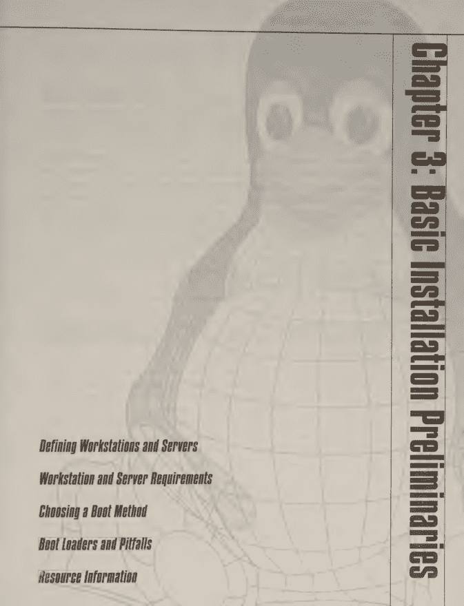

本章详细说明了安装和使用 Linux 的一些初步要求。您将学习如何安装自定义设置，将笔记本配置为工作站或服务器。您还将学习如何安装包含或不包含 X 窗口系统（Linux 的图形界面）的最小化发行版。

了解使用 Linux 的硬盘和存储需求非常重要。这有助于您最好地分配笔记本中最珍贵的资源：内部硬盘的存储容量。一些幸运的笔记本用户拥有可拆卸硬盘的笔记本电脑，或者他们能够轻松更换内部固定硬盘。然而，大多数笔记本都配备单个固定硬盘，其存储容量从几百兆字节到 25GB 不等，后者目前是笔记本中容量最大的硬盘。

## 定义工作站和服务器

Linux 内核支持将您的笔记本作为工作站和服务器运行。将 Linux 作为服务器运行可能需要更多的磁盘空间，特别是如果您计划支持多个用户。然而，将笔记本配置为工作站也可能比配置为服务器更耗费笔记本的周边设备和磁盘存储。这完全取决于您计划如何使用笔记本。

Linux 服务器只需要安装少数几个基本必需的服务和软件，但其中一些服务可能需要大量的磁盘存储。这些服务包括域名服务（DNS）和互联网新闻（INN）。根据您对笔记本的配置，您还可以启用 FTP、telnet、使用 Samba 的会话消息块（SMB）服务（用于将笔记本硬盘的全部或部分显示为共享卷，或用于共享连接的打印机），或用于运行 Web 服务器的 Apache。其他服务包括远程 UNIX 打印支持、电子邮件以及作为互联网服务网关的防火墙。

另一方面，在安装和配置 Linux 工作站时，您不仅可能需要所有上述服务，还可能安装许多额外的软件，例如 X 窗口系统、各种窗口管理器、字体、多媒体应用程序和其他生产率客户端。开发人员（程序员）还会安装各种语言和支持库，例如在使用 C、C++ 或 Java 进行编程时。这些需求会在 CPU、内存和存储资源方面对您的笔记本施加额外的负担。

### 规划考量

新的移动 Linux 用户通常在选择首次使用 Linux 时，倾向于尽可能多地安装软件。考虑到一些 Linux 发行版（如 SUSE）现在最多包含六张 CD-ROM 的软件，这可能是一项令人望而生畏且耗时的任务。幸运的是，几乎每个发行版都在单张安装 CD-ROM 中包含了非常精选的最佳免费软件。Red Hat、Mandrake 和 Yellow Dog Linux 仍然如此，尽管您会发现商业版本也包含额外的软件（如 Yellow Dog 的“美味佳肴”CD-ROM）。

经验丰富的移动 Linux 用户意识到他们笔记本的限制。他们根据笔记本的使用方式（如开发、服务器操作、文本编辑、图形编辑或移动通信）来规划新的安装或升级。此规划的一部分包括制定磁盘使用策略，并决定为 Linux 软件、临时存储、额外存储、未来扩展或其他操作系统分配多少磁盘空间。这就是制定*分区*策略。

#### 计划和选择分区策略

请参阅第 5 章“开始安装”，了解如何在硬盘上为 Linux 分配软件。您将了解 Linux 如何组织其目录，*即文件系统*，以及如何最大限度地利用您的硬盘空间。

在笔记本上安装 Linux 之前，您需要问自己以下问题：

- 我的笔记本上有多少可用磁盘空间？
- 我将引导一个还是多个操作系统？
- 如果我引导多个操作系统，应该为每个操作系统分配多少磁盘空间？
- 我是否需要保留单独的磁盘空间（例如用于备份或临时文件）？

在进行安装之前，您还应该了解不同的需求和选项，这些选项可以使您在笔记本上的 Linux 体验更加轻松。如果您发现无法安装额外的应用程序，或者主目录已满，或者在重新编译内核时硬盘空间用完，那就太糟糕了！

### 运行工作站

安装工作站并选择要安装的软件可能会令人困惑，特别是如果您刚接触 Linux，尚未形成对开发工具、首选编程语言或 X11 窗口管理器或环境的偏好。别担心。经验丰富的移动 Linux 用户学会了如何挑选并选择合适的软件工具和信息组合进行安装，您也会做到的！

至少，您需要在工作站和服务器操作方面进行基本安装。这包括 Linux 内核，以及您的 Red Hat、Mandrake 或 Yellow Dog Linux CD-ROM 上包含的一系列 `.rpm` 包。表 3.1 列出了基于 Intel 的 Red Hat 6.1 发行版的基本包。

正如表 3.1 所示，即使在基本的 Red Hat Linux 系统中也有大量软件！请注意，Mandrake 或 Yellow Dog 发行版中可能并不存在所有包。安装一个没有 X11 的最小系统至少需要 120MB。安装基本系统将允许您以文本（控制台）模式使用 Linux。

### 运行服务器

当您配置笔记本作为 Linux 服务器运行时，您需要添加额外的软件。几乎所有服务器软件都在后台运行（在命令线上对您是不可见的）。这些服务器进程被称为守护进程。一些服务器包只需要很少的实际硬盘空间，并且在被调用之前保持空闲，而另一些则非常活跃，需要许多配置文件和目录。表 3.2 列出了可以在 Linux 服务器上安装的一些常见服务器守护进程。

在 Red Hat、Mandrake 或 Yellow Dog Linux 下，大多数服务是通过 `/etc/inetd.conf` 文件启用或禁用的。此文件包含允许的服务列表，部分内容如下：

```
#### These are standard services.
#

ftp	stream	tcp	nowait	root	/usr/sbin/tcpd	in.ftp -l -a
#telnet	stream	tcp	nowait	root	/usr/sbin/tcpd	in.telnetd
#
```

### 表 3.1 基础 Linux RPM 软件包

| 软件包 | 大小 | 描述 |
| :--- | :--- | :--- |
| apmd | 89KB | APM（高级电源管理）守护进程 |
| ash | 367KB | 极简 shell |
| at | 64KB | 任务调度实用程序 |
| authconfig | 27KB | NIS 设置命令 |
| basesystem | 0KB | 首个安装的系统包（创建文件系统） |
| bash | 545KB | 布伦再次 shell（The Bourne Again Shell） |
| bc | 128KB | 算术解释器 |
| bdflush | 10KB | 磁盘刷新系统守护进程 |
| binutils | 5.1MB | GNU 二进制工具集 |
| bzip2 | 258KB | 压缩实用程序 |
| chkconfig | 84KB | 检查系统配置命令 |
| console-tools | 1.5MB | Linux 控制台软件 |
| cpio | 70KB | 归档实用程序 |
| cracklib | 74KB | 密码软件库 |
| cracklib-dicts | 226KB | 字典库 |
| crontabs | 4KB | Root 用户 crontab 文件（常规调度实用程序） |
| dev | 45KB | /dev 目录项 |
| diffutils | 161KB | GNU diff 命令 |
| e2fsprogs | 1.2MB | 基本文件系统工具 |
| ed | 102KB | 行和流编辑器 |
| eject | 46KB | 可移动介质弹出实用程序 |
| etcskel | 2KB | 默认用户主目录文件 |
| file | 214KB | 文件识别命令 |
| filesystem | 84KB | Linux 文件系统（目录） |
| fileutils | 1.2MB | GNU 文件命令包 |


### 软件包列表

| `findutils` | 118KB | GNU 文件实用程序 |
| `gawk` | 2.4MB | GNU 文本处理实用程序 |
| `gd` | 314KB | 图形库 |
| `gdbm` | 28KB | GNU 数据库库 |
| `getty_ps` | 127KB | 终端登录实用程序 |
| `glib` | 322KB | 实用程序软件库 |
| `glibc` | 26.8MB | 系统软件库 |
| `gmp` | 116KB | GNU 数学库 |
| `grep` | 287KB | GNU 模式匹配命令 |
| `groff` | 2.8MB | 排版解释器 |
| `gzip` | 242KB | 压缩实用程序 |
| `hdparm` | 38KB | IDE 驱动器实用程序 |
| `info` | 254KB | GNU info 命令 |
| `initscripts` | 232KB | 系统初始化脚本 |
| `isapnp tools` | 273KB | 即插即用命令 |
| `kbdconfig` | 60KB | Red Hat 键盘配置实用程序 |
| `kernel` | 10.8MB | Linux 内核 |
| `kernel-pcmcia-cs` | 587KB | David Hinds 的必备 PCMCIA 软件 |
| `kudzu` | 257KB | 硬件探测实用程序 |
| `ldconfig` | 223KB | 库实用程序 |
| `less` | 154KB | 文本分页器 |
| `libc` | 5.3MB | 旧版软件库（用于兼容性） |
| `libstdc++` | 3.4MB | C++ 库 |
| `libtermcap` | 58KB | 基础系统库 |
| `lilo` | 1MB | Linux 加载程序（The Linux Loader） |
| `linuxconf` | 9.4MB | Linux 配置实用程序 |
| `logrotate` | 53KB | 系统日志实用程序 |
| `losetup` | 9KB | 回环设备支持 |
| `ls.so` | 247KB | 库符号链接 |
| `mailcap` | 34KB | 邮件功能数据库 |
| `mailx` | 89KB | 电子邮件 |
| `MAKEDEV` | 34KB | 创建 `/dev` 目录 |
| `man` | 219KB | man 命令 |
| `mingetty` | 32KB | 登录和终端支持命令 |
| `mkbootdisk` | 5KB | Red Hat 制作启动盘命令 |
| `mknirtcd` | 8KB | 初始 ramdisk 实用程序 |
| `mktemp` | 8KB | Shell 实用程序 |
| `modutils` | 851KB | 内核模块实用程序 |
| `mount` | 134KB | 文件系统挂载命令 |
| `mouseconfig` | 219KB | 鼠标配置命令 |
| `mt-st` | 69KB | 磁带机命令 |
| `ncurses` | 2.6MB | 控制台库 |
| `net-tools` | 556KB | 网络软件 |
| `newt` | 148KB | 控制台库 |
| `ntsys` | 23KB | 守护进程管理员 |
| `pam` | 598KB | 认证系统安全软件 |
| `passwd` | 28KB | passwd 命令 |
| `pcitils` | 124KB | PCI 总线实用程序 |
| `perl` | 16.1MB | Perl 语言解释器 |
| `procmail` | 281KB | 电子邮件过滤系统 |
| `procs` | 312KB | 进程命令 |
| `psmisc` | 46KB | 进程管理命令 |
| `pump` | 74KB | DHCP 客户端守护进程 |
| `pwdbd` | 440KB | 密码数据库库 |
| `python` | 6.4MB | 高级语言解释器 |
| `quota` | 79KB | 磁盘配额软件 |
| `readline` | 251KB | GNU 终端库 |
| `redhat-logos` | 519KB | Red Hat 图形 |
| `redhat-release` | 0KB | Red Hat 版本文件 |
| `rootfiles` | 1KB | 根目录文件 |
| `rpm` | 2.8MB | Red Hat 包管理器 |
| `sash` | 418KB | 独立 shell |
| `sed` | 68KB | 流编辑器 |
| `sendmail` | 527KB | 电子邮件守护进程和客户端 |
| `setconsole` | 3KB | 控制台设置 |
| `setserial` | 37KB | 串口实用程序 |
| `setup` | 16KB | 基本系统设置文件 |
| `setup-tool` | 7KB | Red Hat 系统 GUI 配置工具 |
| `sh-utils` | 398KB | GNU shell 实用程序 |
| `shadow-utils` | 584KB | 密码系统 |
| `slang` | 250KB | 语言解释器库 |
| `slocate` | 48KB | 增强安全性的 locate 命令 |
| `stat` | 6KB | 文件系统信息实用程序 |
| `SysVinit` | 168KB | init 命令和脚本 |
| `tcsh` | 488KB | Tcsh shell |
| `termcap` | 424KB | 终端功能数据库 |
| `textutils` | 1.3MB | GNU 文本实用程序 |
| `time` | 18KB | GNU time 实用程序 |
| `timeconfig` | 416KB | Red Hat GUI 时间工具 |
| `tmpwatch` | 10KB | `/tmp` 目录实用程序 |
| `utempter` | 21KB | 根访问实用程序 |
| `util-linux` | 1.4MB | Linux 系统实用程序 |
| `vim-common` | 728KB | vi 编辑器支持库 |
| `vim-minimal` | 339KB | vi 最小支持 |
| `vixie-cron` | 59KB | 调度守护进程 |
| `which` | 26KB | 路径名实用程序 |
| `words` | 411KB | 系统字典 |
| `zlib` | 61KB | 压缩库 |

### 表 3.2 Linux 服务器软件

| 名称 | 描述 |
| :--- | :--- |
| `amd` | 自动挂载守护进程（用于设备和 NFS） |
| `anacron` | 调度守护进程（类似于 cron） |
| `apmd` | 高级电源管理（APM）守护进程 |
| `arpwatch` | 以太网地址网络日志记录 |
| `atd` | at 守护进程（运行指定任务） |
| `bootparamd` | 无盘网络引导守护进程 |
| `cardmgr` | 卡服务（PCMCIA）守护进程 |
| `crond` | 调度守护进程（用于 crontab 服务） |
| `dhcpd` | 动态主机配置协议（DHCP）服务器守护进程（分配 IP） |
| `fingerd` | 用户信息服务器（用于 `finger` 命令） |
| `gated` | 网关路由守护进程 |
| `gpm` | 通用鼠标服务器（控制台鼠标支持） |
| `httpd` | Apache Web 服务器守护进程 |
| `in.ftpd` | 文件传输协议（FTP）守护进程 |
| `in.telnetd` | Telnet 服务器 |
| `inetd` | 主网络服务守护进程 |
| `innd` | InternetNews 服务器守护进程 |
| `lpd` | 行式打印机假脱机守护进程 |
| `mcvserv` | Midnight Commander 文件服务器 |
| `mysqld` | 关系型数据库服务器守护进程 |
| `named` | DNS 服务器 named（属于 BIND 软件包的一部分） |
| `nmbd` | NetBIOS 名称服务器守护进程 |
| `nscd` | 网络信息服务（NIS）名称切换缓存守护进程 |
| `nswerc` | NetWare 仿真器和服务器（inwind, ncpserv） |
| `portmap` | 远程过程调用（RPC）支持守护进程 |
| `postfix` | 电子邮件控制守护进程 |
| `routed` | IP 路由表更新支持守护进程 |
| `rpc.mountd` | NFS 挂载守护进程 |
| `rpc.nfsd` | NFS 服务器 |
| `rpc.quotad` | NFS 配额检查守护进程 |
| `rpc.rstatd` | 内核统计（性能）报告 |
| `rpc.rusersd` | 已登录用户报告守护进程 |
| `rpc.rwalld` | wall3 命令支持守护进程 |
| `rpc.rwhod` | 系统状态数据库和报告守护进程 |
| `rpc.statd` | 网络文件系统（NFS）状态监视器 |
| `sendmail` | 电子邮件传输服务器 |


| smbd | 会话消息块（SMB）守护进程 |
| squid | Web 对象缓存守护进程（用于 httpd） |
| syslogd | 系统日志守护进程 |
| tcppd | Internet 服务守护进程（例如用于 telnet） |
| xfs | X 字体服务器 |
| xntpd | 网络时间协议（NTP）服务器 |
| ypbind | NIS 数据库支持守护进程 |
| ypasswdd | NIS 数据库支持守护进程 |
| ypserv | NIS 数据库支持守护进程 |

在此示例中，列出了两项服务：`ftp`（已启用）和 `telnet`（已禁用）。当 Linux 启动时，会参考 `/etc/inetd.conf` 文件来决定应启用哪些服务。应该知道的是，在此示例中，仅禁用了 `inetd` 中的 `telnet` 服务器，并没有禁止使用 `telnet` 命令连接到其他机器，例如：

```
# telnet green
Trying 192.168.2.1X...
Connected to green.home.org.
Escape character is '^]'.
Linux Mandrake release 6.1 (Helios)
Kernel 2.2.13-4mdk on an i686
login:
```

当 `ftp` 服务器被禁用时情况也是如此。你仍然可以使用 `ftp` 命令，例如：

```
# ftp ftp.primapub.com
Connected to ftp.primapub.com.
220-Script FTP-Server v2.5e for WinSock ready...
220-Welcome to Prisma Communications Private PPP
220-Site. Unauthorized access is strictly
220-prohibited.
220
Name (ftp.primapub.com:willis):
```

如果你对 `/etc/inetd.conf` 进行了更改，则应该像下面这样重新启动守护进程：

```
# /etc/rc.d/init.d/inetd restart
```

编辑 `/etc/inetd.conf` 是你安装 Linux 后应该执行的首要任务之一，特别是如果你正在配置服务器操作的话。某些 Linux 发行版，例如 SuSE Linux，默认不启用广泛的服务。Red Hat、Mandrake 和 Yellow Dog Linux 也包含几个具有图形用户界面（GUI）的服务器软件控制程序。其中一个程序是 `ntsysv`，可以从 X11 终端窗口或控制台的命令行中调用。输入 `ntsysv` 并按 Enter 键。然后，你将看到图 3.1 中显示的对话框。

向下滚动列表以高亮显示一个条目，然后按空格键选择（带星号）或取消选择某项服务。另一个可能更复杂的程序是 `chksysv` 命令。该命令要求你运行 X11，但它可以用于根据系统的运行状态（运行级别，runlevel）来启动、停止或重新排列各种服务。对于 Red Hat Linux 的简短运行级别列表，请参阅文件

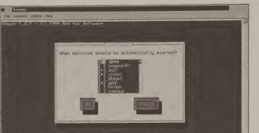

*图 3.1 ntvsys 命令可用于控制各种服务器软件的启动和使用。*

`/etc/initab`. 在 X11 终端窗口的命令行中输入 `cksysv` 并按下回车键。您将会看到图 3.2 中所示的对话框。

切勿随意使用此命令！在启动或关闭过程中，各种服务的顺序至关重要。例如，在关机进程卸载远程文件系统之前关闭 NFS 服务并不是一个好主意。另一方面，您可能希望在初始化以太网卡之前启用

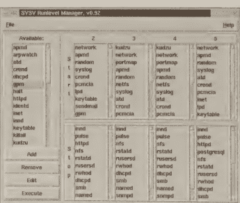

*图 3.2 tksysv 命令用于控制在系统不同运行级别期间可用的服务。它可以用来重新排序服务器守护进程的启动或停止时间。*

PCMCIA 支持。幸运的是，大多数 Linux 发行版的默认设置运行良好，因此您很少需要使用此程序（除非您安装了新的服务器软件）。

## 使用 Linuxconf

`linuxconf` 命令可以在有无 X11 的情况下使用，作为一种系统维护工具，当使用图形界面管理 Linux 时，它不断发展并越来越受欢迎。此客户端支持几乎所有 Linux 网络和服务器的配置和控制。如果您使用的是 Red Hat 或 Mandrake Linux，请在 `/usr/lib/linuxconf/help.eng` 目录下查找 HTML 帮助文件，或者使用 `linuxconf` 内置的帮助按钮。

## 工作站和服务器要求

根据 Red Hat, Inc. 的说法，典型的要求是：服务器操作需要 1.6GB，工作站使用需要 450MB，最小安装需要 120MB。根据 Mandrake Linux 团队的说法，完整的 Mandrake Linux 安装需要略多于 1GB。

在 Apple iBook 上安装 Yellow Dog Linux 中包含的所有内容至少需要 1.5GB。

您的安装所需磁盘空间还取决于您选择安装软件的数量。安装 Linux 时，系统会要求您选择安装类型。您还可以避免“默认”类型的安装，而是自行挑选软件包。这是避免安装冗余或不必要软件的好方法。例如，您的系统真的需要六种不同的文本编辑器吗？

如果您是新手且有足够的磁盘空间，请继续安装所有内容。您可以随时返回并删除软件以腾出更多空间。随着经验的积累，您将能够快速完成笔记本电脑上的新安装，并且您将知道哪些软件包是必需的，哪些可以省略。

## 最小化安装策略

如果硬盘空间不多，您的选择有限。好消息是，您可以执行最小化安装，其规模比表 3.1 中描述的默认 120MB 系统小得多。Linux 非常通用，系统可以从软盘（但在 iBook 上不行）、Iomega Zip 驱动器或单个可执行文件安装。

### WinLinux 2000

如果您希望避免对笔记本电脑硬盘进行分区和格式化的麻烦，您可以使用 WinLinux 2000 直接在 Windows 桌面上安装、配置和运行 Linux。您需要至少 500MB 的硬盘剩余空间来安装发行版；之后，您可以删除原始安装文件。

要安装此发行版，请运行 `WL2000.EXE` 安装程序并回答提示。不到一分钟，您将使用 KDE 作为桌面套件，通过 X11 启动到 Linux。该发行版包含 Netscape Communicator 和 Adobe 的免费 Acrobat 阅读器。此发行版通过在 Windows 卷上创建虚拟文件系统（例如一个 500MB 的单文件）来代表 Linux 文件系统来工作。

浏览至 `http://www.winlinux2000.com/` 下载您的副本。

### Zipslack

要了解如何从 Iomega Zip 驱动器下载和安装 Slackware Linux，请浏览至 `http://www.slackware.com/zipslack/`

以下是基本步骤：

- 1. 下载 `zipslack.zip`、`bootdisk.img` 和 `RAMRITE.EXE` 文件。一个额外的文件 `fourmeg.zip` 支持在仅有 4MB RAM 的基于 386 的笔记本电脑上安装！
- 2. 将 `zipslack` 发行版解压到 Iomega 磁盘上。
- 3. （可选）使用 `RAMRITE.EXE` 创建块磁盘。
- 4. 运行 `LOADLIN.EXE` 命令以从 Iomega 磁盘启动 Linux。

这将允许您从 Zip 驱动器运行 Linux，而无需对笔记本电脑硬盘进行分区。阅读刚才提到的 Slackware 网站上的常见问题解答（FAQ），以了解如何在笔记本电脑上安装 `zipslack` Linux 发行版。

如果您硬盘存储空间较少，Slackware Linux 是一个很好的替代方案；最小化的 Slackware Linux 安装仅需 50MB 硬盘空间。您也可以使用软盘安装 Slackware，但您需要下载许多磁盘映像，创建磁盘，并按顺序安装每个磁盘。

### Peanut Linux

另一个具有相同 50MB 占用空间的小型发行版是 Peanut Linux。然而，这个发行版包括 X11、Netscape Communicator 以及 X11 客户端的特殊最小化选择，包括 K 桌面环境。对于笔记本电脑上紧凑但最新且功能强大的 Linux 安装来说，这个发行版可能是最佳选择。尽管 Peanut Linux 面向工作站，但包括 FTP 和 Web 服务器。浏览至 `http://metalab.unc.edu/peanut`

Peanut Linux 发行版可以从 CD-ROM 安装，或使用 Linux 安装（见刚才链接中提到的 `INSTALL.TXT` 文件）。

### 活动文件系统

一些 Linux 发行版，例如 SuSE 的最新版本，具有直接从 CD-ROM 运行或使用*活动*文件系统的功能。这是一种方便的方式，无需安装即可启动和运行 Linux，它允许您在不进行分区和格式化的情况下探索发行版的功能。

### 软盘 Linux


您还可以从软盘启动和运行 Linux。许多基于软盘的发行版提供一个使用一张或多张软盘的 Linux 环境。有关更多信息，请参见附录 A 表 A.4，“Linux 笔记本资源”。

### 选择启动方法

Linux 可以通过多种方式启动。在安装 Red Hat、Mandrake 和大多数其他发行版时，您有机会创建一个启动软盘。然后，您可以使用此启动盘在重启或打开笔记本电脑时使用。如果您在安装期间未创建软盘，请在启动 Linux 后使用 Red Hat 的 `mkbootdisk` 命令创建一个。您需要知道您正在使用的 Linux 版本，并且需要指定软盘设备。

首先，使用 `uname` 命令及其 `-r`（修订版）选项：

```bash
# uname -r
2.2.14-15mdk
```

接下来，在控制台或 X11 终端窗口的命令行中输入 `mkbootdisk`，指定软盘设备和 Linux 内核修订版，并按下回车：

```bash
# mkbootdisk -device /dev/fd0 2.2.14-15mdk
```

在 `/dev/fd0` 中插入一张磁盘。磁盘上的任何信息都将丢失。

按 `<Enter>` 继续或 `^C` 中止。

在提示处，插入一张空白软盘并按下回车。然后 `mkbootdisk` 命令将创建一个启动磁盘。如果您的启动加载程序（如稍后将讨论的 LILO）损坏，您可以使用此磁盘。

## LOADLIN

您还可以使用名为 LOADLIN 的程序直接从 DOS 会话启动 Linux。这个程序非常灵活。它可以用于使用 DOS C:\ 驱动器上的 Linux 内核启动 Linux。如果 Linux 安装在另一个分区（如 `/dev/hda3`）上，可以这样使用：

```bash
loadlin c:\vmlinuz root=/dev/hda3 ro
```

此命令行将使用 `vmlinuz` 内核启动 Linux，然后使用 `/dev/hda3` 上的 Linux 分区。您应该能在您的 Linux 发行版 CD-ROM 上找到关于 LOADLIN 的文档。LOADLIN 也在安装到您系统 `/usr/doc/HOWTO` 目录下的若干 HOWTO 和 mini-HOWTO 文档中提及。您还可以通过浏览作者的个人页 http://elserv.fim.fgan.de/~lrxmen/ 来阅读关于此程序的内容。

## LILO

启动 Linux 最流行的方法之一是使用 Linux Loader (`LILO`) 程序。`LILO` 通常在安装 Linux 时配置和安装，但也可以在从软盘启动 Linux 后安装和配置。此程序是一个小型启动加载程序，可以安装在软盘上，或安装在笔记本电脑硬盘的各个位置。

当您使用 `LILO` 安装和启动时，您应该会看到类似以下内容（但您的 `LILO` 启动提示可能不同）：

```bash
LILO
boot:
```

### 引导加载程序及其陷阱

随后，你输入一个关键字，例如 `linux` 或 `dos`，然后按 Enter 键以引导相应的操作系统。

为了使用 `LILO`，你需要知道笔记本电脑上哪些硬盘分区用于 Linux 或其他操作系统。在安装 Linux 时，请务必记下笔记本电脑硬盘分区所使用的设备名称。对于几乎所有笔记本电脑（包括 Apple iBook），主 IDE 硬盘都被命名为 `/dev/hda`。在基于 Intel 的笔记本电脑上，DOS 或 Windows 通常安装在第一个硬盘的第一个分区上；该分区将被命名为 `/dev/hda1`。

例如，安装 Linux 后，你可以使用 `fdisk` 命令并配合笔记本电脑硬盘的设备名称来获取磁盘使用情况，如下所示：

```
$ fdisk /dev/hda
```

```
Command (m for help): p

Disk /dev/hda: 128 heads, 63 sectors, 525 cylinders
Units = cylinders of 8064 * 512 bytes

   Device Boot    Start     End    Blocks  Id  System
/dev/hda1 *         1     127    512032+  6  FAT16
/dev/hda2         128     515   1564416  5  Extended
/dev/hda4         516     524     36288  a0  IBM ThinkPad hibernation
/dev/hda5         498     515    72544+  82  Linux swap
/dev/hda6         128     497   1491777  83  Linux
```

```
Command (m for help): q
```

在此示例中，Windows 安装在 `/dev/hda1`，而 Linux 安装在 `/dev/hda6`。Linux 交换分区被 Linux 用于暂时缓存内存的一部分，而休眠分区则被此特定笔记本电脑用于挂起到磁盘的操作。通过查看系统的文件系统表 `/etc/fstab`，你可能会看到如下内容：

```
$ cat /etc/fstab
/dev/hda6    /      ext2  defaults    1  1
/dev/hda1    /mnt/dos  vfat  defaults    0  0
...
```

这表明 `/dev/hda6` 承载了根 (`/`) Linux 目录，而 Windows 分区挂载在 `/mnt/dos`。那么，`LILO` 配置文件 `/etc/lilo.conf` 将看起来像这样：

```
# cat /etc/lilo.conf

boot=/dev/hda
map=/boot/map
install=/boot/boot.b
prompt
timeout=50

image=/boot/vmlinuz-2.2.13-7mblk
        label=linux
        root=/dev/hda6
        read-only

other=/dev/hda1
        label=dos
        table=/dev/hda
```

这表明 `LILO` 被配置为根据在 `LILO` 启动提示符处输入的是 `linux` 还是 `dos`，来引导 Linux 或 Windows。`LILO boot=` 条目显示 `LILO` 安装在主引导记录 (`MBR`) 或笔记本电脑的第一个 IDE 硬盘中。

如果在安装 Linux 时未安装 `LILO`，你将需要使用启动盘。启动后，你可以通过创建或编辑 `/etc/lilo.conf` 文件，然后像这样从命令行运行 `LILO` 来安装 `LILO`：

```
# /sbin/lilo

Added  linux *
Added  dos
```

在这个使用稍早讨论的 `/etc/lilo.conf` 文件的示例中，`lilo` 命令已将引导加载程序写入笔记本电脑主分区的 `MBR`。由于 Linux 条目在 `/etc/lilo.conf` 文件中排在第一位，因此 Linux 将成为默认引导的操作系统。关于你可以在 `/etc/lilo.conf` 文件中使用的各种选项的详细信息，记录在 `lilo.conf` 手册页中。例如，你可以执行以下操作：

- 在 `LILO` 启动提示符处使用密码保护。
- 引导不同版本的 Linux 内核。
- 引导多个操作系统。
- 自定义初始文本屏幕。
- 更改默认引导的操作系统。
- 更改 `LILO` 等待启动条目的秒数。
- 向 Linux 内核传递特殊的启动参数（在引导时配置硬件时很有用）。

表 3.3 仅列出了你可以在 `/etc/lilo.conf` 文件中使用的部分选项和关键字。如果你对此文件进行了任何更改，别忘了之后运行 `/sbin/lilo`！

**表 3.3 LILO 配置关键字**

| 关键字 | 描述 |
| :--- | :--- |
| `append` = `message` | 传递以下内核参数 |
| `boot` = `device` | 告知内核哪个设备持有引导扇区 |
| `image` = `/boot/kernel_name` | 指定要引导的 Linux 内核 |
| `label` = `name` | 指定启动关键字，例如 `linux` 或 `dos` |
| `message` = `file` | 在启动提示符处显示指定的文本文件 |
| `password` = `password` | 在引导前要求输入密码 |
| `prompt` | 强制使用启动提示符条目 |
| `root` = `device` | 指定 Linux 根分区的位置 |
| `timeout` = `number` | 设置超时（以 0.1 秒为单位） |

如果你只在笔记本电脑上使用 Linux，那么请将 `LILO` 安装到启动盘的 `MBR` 中。然而，如果你希望使用其他操作系统，例如 Windows，你应该知道，微软的安装程序通常会不加重视地覆盖 `MBR`。这意味着你应该先安装 Windows，然后再安装 Linux。


如果你使用商业引导加载程序，例如 PowerQuest 的 BootMagic，请确保将 LILO 安装到根原生 Linux 分区！BootMagic 需要 MBR 来提供其图形操作系统选择对话框，并且安装时会覆盖 LILO。

如果你安装了 Linux，但发现 LILO 无法正常引导，你可以使用 LILO 启动消息进行诊断（如《LILO 用户指南》第 44 页所述）。表 3.4 列出了这些诊断信息。

表 3.4 LILO 诊断信息

| 诊断信息 | 描述 |
| :--- | :--- |
| *blank*（空白） | LILO 未加载或未安装 |
| L ## | LILO 的第一阶段已加载，但出现磁盘错误代码 (00, 01, 02, 03, 04 或 06)；参见《LILO 用户指南》第 5.2.2 节（指南第 44 页） |
| LI | LILO 的第一和第二阶段已加载，但磁盘几何问题或 LILO 映射安装程序问题阻止了执行（参见《用户指南》第 3.4 节） |
| LIL | LILO 的第二阶段已加载，但发生了几何或介质故障 |
| LIL? | LILO 的第二阶段已加载，但在错误的地址处（可能具有与 LI 相同的问题） |
| LIL- | 损坏的描述符表阻止了正常执行（参见《用户指南》） |

如果你遇到问题，请阅读位于 `/usr/doc/lilo*/doc` 目录下的《LILO 用户指南》。如果你正在运行 Linux，请使用 `gv` 命令像这样显示文件：

```
> gv /usr/doc/lilo*/doc/User*ps
```

你还应该创建一个安装了 LILO 的备份启动软盘。有关详情，请参阅《用户指南》第 4.1.6 节（第 37 页）。

#### 资源信息

- http://www.redhat.com/support

关于安装和配置 Red Hat Linux 的一般信息和常见问题解答。

- http://www.redhat.com/corp/support/manuals/

在线 Red Hat 安装手册。

- ftp://c3po.terraplex.com/pub/terrasoftsolutions/yellowdog/guide_to_install/

你可以获取 Yellow Dog Linux 用户指南（用于安装和配置）的 FTP 站点。

- http://www.mandrake.org/userguide/en/install/000.html#toc

在线 Mandrake Linux 用户指南。

- http://www.slackware.com/zipslack/

使用 Iomega Zip 磁盘下载、安装和配置 Slackware Linux 的链接。

- http://metlab.unc.edu/peanut/features.htm

Peanut Linux 发行版的功能。

- http://www.winlinux2000.com

WinLinux 2000 的下载和购买站点。

- http://elserv.ffm.fgan.de/~lermen/HOME.html

LOADLIN Linux 加载程序的所在地。

- BootPrompt-HOWTO

Paul Gortmaker 关于使用 LILO 启动提示符传递内核参数的指南。

- LILO mini-HOWTO

Cameron Spitzer 关于使用 LILO 的小型指南。

- Linux-DOS-Win95-OS2 mini-HOWTO

Mike Harlan 关于安装和引导四种不同操作系统的指南。

- Linux+FreeBSD mini-HOWTO

Niels Kristian Bech Jensen 关于使用 Linux 和 FreeBSD 的简明巨著，包括引导配置和安装。

- NT OS Loader + Linux mini-HOWTO

Bernd Reichert 关于使用 Windows NT 引导加载程序引导 Linux 的指南。

- Loadlin+Win95 mini-HOWTO

Chris Fischer 关于使用 LOADLIN 和 Windows 95 的长篇指南。

- `/usr/doc/lilo*/doc/User_Guide.ps`

LILO 用户指南（可以在 X11 下使用 `gv` 命令阅读）。一份关于在笔记本电脑或台式机上使用 LILO 的全面 50 页指南。

- `/usr/doc/lilo*/doc/Technical_Guide.ps`

LILO 技术指南（可以在 X11 下使用 `gv` 命令阅读）。一份关于使用 LILO 引导所需了解的一切的八页指南。

- http://www.powerquest.com/usindex.html

PartitionMagic 和 BootMagic 产品的主页。

# 第 4 章：通用安装程序

- 从 CD-ROM 启动
- 创建启动软盘
- 从硬盘分区安装
- 网络安装
- 一些替代方案
- 资源信息


## 从 CD-ROM 启动

本章向您介绍在笔记本电脑上安装 Linux 的多种方法。当面临在笔记本电脑上安装 Linux 的任务时，了解您的选择至关重要，而实践不同的安装方式有助于您积累经验并建立信心。移动 Linux 用户专注、富有创造力，并且能够适应多种安装技术，这通常是硬件限制（例如缺少内置 CD-ROM 或无法直接引导至安装界面）的结果。

您将了解可以采取的各种技术，以便在您的笔记本电脑上安装 Linux。学习并练习这些技术将使您更深入地了解笔记本的硬件，并作为一名经验丰富的 Linux 安装人员获得经验。

幸运的是，大多数现代笔记本电脑（超轻量级机型除外）都配备了可启动的 CD-ROM。安装 Linux 就像插入 CD-ROM、重启笔记本并清空内置硬盘以安装 Linux 一样简单。如果您使用其他操作系统，例如 OpenBSD 或 FreeBSD，您可以选择拥有两个常驻操作系统，从而创建双启动系统。

从 CD-ROM 启动安装无疑是最简单的 Linux 安装方式。几乎所有的 Linux 发行版（某些小型集合除外）都提供了一个可启动的主 CD-ROM。如果您尝试直接引导到 Linux 安装程序，但发现您的笔记本坚持使用软驱或内部硬盘，请检查您的笔记本 BIOS 设置。您需要重启笔记本，然后按住适当的键以访问 BIOS（请查看制造商提供的手册）。

许多笔记本使用 Phoenix Technologies 的 BIOS。根据 BIOS 版本的不同，第一个屏幕可能如图 4.1 所示。

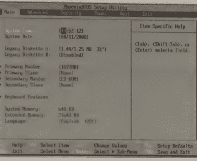

**图 4.1** BIOS 设置对于成功从 CD-ROM 安装 Linux 至关重要。

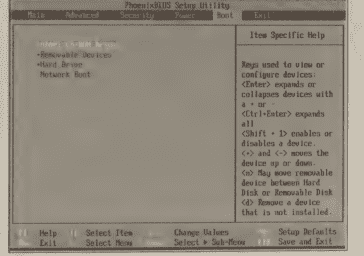

**图 4.2** 使用加号 (+) 键确保笔记本的内置 CD-ROM 位于启动顺序的首位（列表顶部）。

首先，确保您的 CD-ROM 驱动器已被识别。如果您的 CD-ROM 能在笔记本的当前操作系统下正常工作，那么您在启动 Linux 时遇到问题可能性很小。接下来，使用右光标键导航到启动菜单。您的 BIOS 屏幕应如图 4.2 所示。

使用上或下光标键高亮显示您笔记本电脑的 CD-ROM 驱动器。高亮显示后，按加号键 (+) 将 CD-ROM 设备移至列表顶部。此菜单代表您的笔记本搜索可启动设备的顺序。

完成后，按照您的 BIOS 屏幕说明保存并退出 BIOS 设置（Phoenix 用户将按 F10 然后按 Enter）。插入您的可启动 Linux CD-ROM，然后重启笔记本以启动安装程序（假设您对分区策略感到满意）。

## 启动 Yellow Dog Linux iBook 安装

Yellow Dog Linux Champion Server 1.2 直接从 CD-ROM 安装到 Apple iBook 上。使用磁盘设置（Drive Setup）为 Linux 准备一个未分配的分区并重启 iBook 后，安装 BootX 控制面板设备。接下来，将文件 `ramdisk.image.gz` 和 `vmlinux` 复制到您的 Mac 的系统文件夹中。运行 BootX 选择 `vmlinux` 内核，然后点击 BootX 选项按钮以选择使用 RAM 磁盘（Use RAM Disk）选项。请确保也选择无视频驱动程序（No Video Driver）选项。完成后，点击 BootX 对话框中的 Linux 按钮。您将直接引导至 Yellow Dog Linux 安装程序！

## 从 DOS 启动


启动安装程序的另一种方法是使用 DOS 和 `AUTOEXEC.BAT` 文件或直接使用引导工具（如 `LOADLIN`）从您的 Linux CD-ROM 启动。某些发行版，例如 Red Hat 和 Mandrake，包含一个 DOSUTILS 目录，其中有许多软件工具和批处理文件，可直接引导至安装程序。例如，如果您正在运行 DOS，或者从 Windows 重启到 DOS 命令行，请插入您的 Red Hat CD-ROM，然后导航到 `D:` 驱动器的 DOSUTILS 目录。在命令行中，使用 `LOADLIN` 命令直接启动本地安装：

```
d:\DOSUTILS>loadlin autoboot\vmlinuz initrd=.\misc\src\trees\initrd-1.img
```

此方法适用于 Red Hat 6.1 Linux 发行版。`LOADLIN` 命令将启动 Linux，然后加载安装软件以启动安装程序。然后您可以使用笔记本的 CD-ROM 安装 Red Hat Linux。

## 创建启动软盘

跳转到 Linux 安装程序的另一种方法是使用 Linux 安装启动软盘引导您的笔记本。您会在 Linux 发行版的 CD-ROM 中找到许多启动软盘。这些软盘以二进制文件（称为映像，类似于用于从 DOS 启动的 `initrd-1.img`）的形式存储。如果您购买 Red Hat 或 Mandrake Linux 的商业版本，您应该会收到一张启动安装软盘。如果磁盘丢失，不用担心，因为 CD-ROM 上包含了一份副本。不同发行版之间的软盘映像名称可能不同。Red Hat Linux 在 `IMAGES` 目录下至少包含四个启动软盘映像：

- `BOOT.IMG`。用于启动 CD-ROM 或硬盘安装（见下一节）。
- `BOOTNET.IMG`。用于启动 NFS、FTP 或 HTTPD 安装（见后面的“网络安装”部分）。
- `PCMCIA.IMG`。一个包含网卡 PCMCIA 支持的启动软盘。它允许从硬盘或 PCMCIA 网络适配器进行安装，但可能无法用于外部 PCMCIA CD-ROM。
- `RESCUE.IMG`。一个启动软盘映像，当与 Red Hat CD-ROM 配合使用时，可能有助于恢复或保存您的系统。

您可以使用这些映像通过两种方式创建软盘。如果您使用 DOS，请使用 `RAWRITE.EXE` 命令创建软盘。例如，如果您想使用 Red Hat 6.1 CD-ROM 创建一个通用启动软盘，请引导到 DOS，导航到 CD-ROM，并使用 `RAWRITE` 如下所示：

```
D:\>dosutils\rawrite
```

按下 Enter 后，您将看到以下提示：

```
Enter disk image source file name:
```

然后您应该输入所需软盘映像的路径和文件名。例如：

```
Enter disk image source file name: images/boot.img
Enter target diskette drive: a
Please insert a formatted diskette into drive A: and press -ENTER- :
```

指定软盘驱动器，插入软盘并按 Enter 后，`RAWRITE` 命令将创建您的启动软盘。如果您已经在运行 Linux，可以轻松使用 `dd` 命令创建启动软盘。挂载您的 Red Hat CD-ROM，然后使用 `dd` 命令并指定输入和输出文件如下：

```
# dd if=/mnt/cdrom/images/boot.img of=/dev/fd0
```

移动 Linux 用户应该为每个新的 Linux 发行版制作一张或多张这样的软盘并备用手边！

## 从硬盘分区安装

没有 CD-ROM？无法从 CD-ROM 启动？您可以使用 DOS 或 Windows 分区帮助您安装 Linux。几乎所有主要的 Linux 发行版都可以从现有的 Linux、DOS 或 Windows 分区读取配置、安装和 Linux 软件包文件。这意味着，如果您有足够的硬盘空间，并且至少可以将所需的 Linux 目录复制到硬盘上的一个分区，您就能够轻松地安装 Linux。这可以通过共享卷、挂载的 NetWare 卷、FTP 或其他手段复制文件来完成。

此安装方法的一个缺点是，您可能需要 450MB 或更多的存储空间用于压缩的软件包。您可以通过仅包含基础文件来配置较小的安装，但大多数笔记本用户希望配置一个无需猜测的全套 Linux 包安装。此外，除非您之前已经对硬盘进行了分区，并且至少有一个活动分区来复制 Linux 软件，否则此安装方法将不起作用。

### 准备分区

有关为安装 Linux 而准备笔记本硬盘的详细信息，请参见第 5 章“开始安装”。基本步骤包括通过分区硬盘（使用 `FIPS` 命令或商业软件工具）为 Linux 腾出空间，或者如果仅安装 Linux，则在 Linux 安装过程中对硬盘进行分区。从单独的硬盘分区安装 Linux 需要至少一个活动分区（用于存放软件）和另一个将在 Linux 安装过程中被修改的分区。

为了准备安装，请将 Red Hat 或 Mandrake 目录的内容复制到一个空闲的 DOS、Windows 或 Linux 分区中。对于 Red Hat 安装，请复制 Red Hat 目录的内容，包括 `BASE` 和 `RPMS` 目录。`BASE` 目录存储 Linux 安装的第二阶段，而 `RPMS` 目录包含所有必需的 Red Hat 包管理器 `.rpm` 文件。接下来，使用您的安装启动磁盘，或使用 `BOOT.IMG` 文件创建启动磁盘。重启您的笔记本，然后浏览初始 Red Hat 对话框以选择语言和键盘，直到看到安装方法对话框，如图 4.3 所示。

按上或下光标键选择硬盘安装，然后按 Enter 开始使用您的笔记本硬盘进行安装。系统会询问您

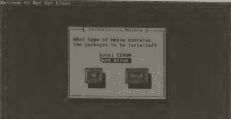

*图 4.3 选择硬盘选项，然后按 Enter 键，即可开始从您的笔记本电脑硬盘安装 Linux。*

您是否拥有任何 SCSI 适配器（如果您使用的是外部 SCSI 硬盘）。如果没有，请使用 Tab 键选择 No，然后按 Enter。您将看到如图 4.4 所示的对话框。

使用向上或向下光标键选择包含 Red Hat 目录的分区，然后选择 OK 按钮并按 Enter 以开始安装。

虽然将 Linux CD-ROM 的安装文件或包文件的内容保留在单独的分区上可能不太方便，但这是一种方便的、可以快速恢复系统的方法。许多现代笔记本电脑的内部硬盘驱动器拥有足够的存储空间，足以容纳十几个或更多 CD-ROM 的内容。对于一些移动 Linux 用户来说，知道可以在几分钟内完成全新安装，或者可以迅速从主发行版目录树安装额外的软件，会感到一定程度的安心。保留一个简单的 DOS 分区并存放发行版的内容会很有用，尤其是当您没有安装 CD-ROM 中包含的所有内容时。

## 网络安装

如果您的笔记本电脑没有内部 CD-ROM，但您可以访问局域网（LAN），您可以通过多种方式通过网络安装 Linux。除非您的笔记本电脑有内部以太网端口，在这种情况下您可以尝试使用 `BOOTNET.IMG` 软盘启动到安装程序，否则您需要使用 PCMCIA 启动盘。创建您的启动盘，确保您的笔记本电脑已连接到局域网，然后重新启动。浏览初始 Red Hat 对话框，直到您到达安装方法对话框，如图 4.5 所示。

滚动浏览安装类型列表，然后使用空格键选择与您的 NFS 导出、FTP 挂载或 HTTP 可用的 Linux 安装发行版匹配的安装类型。完成后，按 Enter 以开始安装过程。

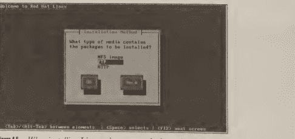

**图 4.5** 通过安装网络 Linux 时，选择安装类型，然后按 Enter。

### 通过 FTP 安装

通过 FTP 安装 Linux 非常容易。如果您在本地局域网工作，并且有一台设置好 FTP 服务器的 Linux 计算机，您可以将 Red Hat Linux CD-ROM 直接挂载在 `/home/ftp/pub` 目录中。使用 `mount` 命令如下：

```
# mount -t iso9660 /dev/cdrom /home/ftp/pub
```

在此示例中，CD-ROM 设备是 `/dev/cdrom`（根据远程计算机的不同，它可能是 `/dev/hdc` 或其他设备）。然后，Linux CD-ROM 挂载在 `/home/ftp/pub` 目录中，并可供公众使用。请注意，其他发行版，如 SuSE Linux，可能使用 `/usr/local/ftp` 目录进行匿名登录，并且远程计算机必须运行 FTP 守护程序！

选择 FTP 安装并按 Enter 后，安装程序将识别您的网卡并显示如图 4.6 所示的对话框。

如果您所在的网络提供动态主机配置协议（DHCP）服务，请选择该服务并按 Enter，以便自动为您的适配器分配一个互联网协议（IP）地址。若要手动配置您的网卡，请选择静态 IP 地址项并按 Enter。您然后会看到如图 4.7 所示的对话框。


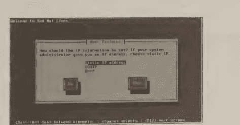

图 4.6 选择用于您的笔记本电脑以太网适配器的互联网协议寻址类型。


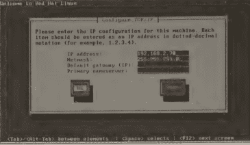

图 4.7 您可以手动配置笔记本电脑的网卡以访问局域网中的远程服务器。

输入您笔记本电脑所需的 IP 地址并按 Enter。如果您需要指定默认网关计算机或名称服务器，您可以使用默认设置或擦除 IP 地址。完成后，按 Enter 选择 OK 按钮并继续。您然后会看到如图 4.8 所示的对话框。

输入所需的域名，例如 home.org，以及您笔记本电脑的主机名，例如 turtle。完成后，选择 OK 按钮并按 Enter。您然后会看到安装开始前的最后一个 FTP 对话框，如图 4.9 所示。

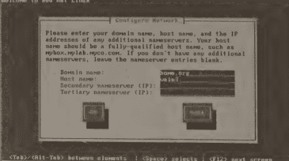

图 4.8 输入您笔记本电脑的域名、主机名或名称服务器 IP。

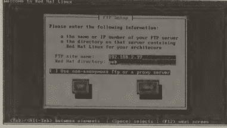

图 4.9 输入远程 FTP 服务器的主机名或 IP 地址，以及包含 Red Hat Linux 安装文件（Red Hat 目录）的目录名称。

要执行简单的匿名 FTP 文件传输，请输入远程计算机的主机名或地址，以及包含 Red Hat 安装软件的目录名称。如果您使用网关信息并且网关上有活动的互联网连接，您可以使用世界上任何地方的计算机的域名和主机名（只要该计算机通过 FTP 提供 Red Hat Linux 安装 CD-ROM）！

如果您选择“使用非匿名 ftp 或代理服务器”选项，系统将提示您输入 FTP 安装的用户名和密码。您也将登录到远程计算机上的您的账户目录。如果您选择非匿名 FTP 传输，请确保 Red Hat 安装目录在那里可用。完成后，选择 OK 按钮并按 Enter 开始安装。然后 Red Hat 安装程序将尝试从远程计算机获取安装的第二阶段。

### 通过 HTTP 安装

您还可以选择通过 HTTP 安装 Red Hat Linux。在安装方法对话框中（参见图 4.5），选择 HTTP 并按 Enter。然后，您可以输入信息（如图 4.6 至 4.8 所示），直到到达 HTTP 设置对话框，如图 4.10 所示。

同样，如果您有活动的互联网连接，您可以指定局域网上的服务器或世界另一端的服务器。如果您正在从本地 Web 服务器安装，例如

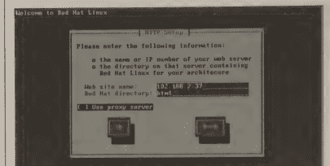

图 4.10 输入远程 Web 服务器的主机名或 IP 地址，以及包含要通过 HTTP 安装的 Red Hat Linux 的目录。

内网上的服务器，Linux CD-ROM 通常将安装在远程计算机的 `/home/httpd/html` 目录下（尽管这取决于系统管理员）。完成后，选择 OK 并按 Enter 开始安装。

### 通过 NFS 安装

另一种安装 Linux 的方法是通过使用网络文件系统（NFS）。要在局域网中设置 NFS 安装，远程计算机必须正在运行 `nfsd` 守护程序，并且其 `/etc/exports` 文件中必须包含您计算机的 IP 地址或主机名。例如，如果您分配 IP 地址 192.168.2.70，远程计算机应该有一个类似的条目：

```
/d2/pub                 192.168.2.70    (ro)
```

此条目表明具有 IP 地址 192.168.2.70 的计算机对 `/d2/pub` 目录具有只读访问权限。Red Hat 软件随后将在此目录下可用。要通过 NFS 安装 Linux，请将您的笔记本电脑连接到局域网，选择 NFS 安装方法，并确保为安装分配 IP 地址 192.168.2.70。浏览对话框，直到您到达 NFS 设置对话框，如图 4.11 所示。

输入远程服务器的主机名（或 IP 地址），以及包含 Red Hat 软件的目录。选择 OK 并按 Enter 开始安装。

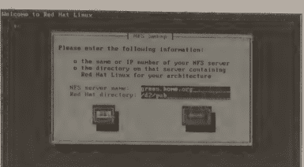

## PLIP 安装

如果您有一台备用计算机和一个正确接线的 12 线并行端口，您可以将 Linux 安装到您的笔记本电脑上。您的首要任务应该是阅读 PLIP-Install HOWTO 文档，该文档可以在 `/usr/doc/HOWTO` 目录下或通过 http://www.linuxdoc.org 找到。虽然此 HOWTO 描述使用另一种 Linux 发行版 Debian Linux，但您也可以使用 Red Hat Linux。

基本步骤是连接两台计算机，在远程计算机上设置网络和 NFS 导出或 FTP 服务，然后引导您的笔记本电脑到网络安装。当安装程序找不到网卡时，您将被要求选择一个驱动程序，如图 4.12 所示。

然后您可能被询问是否希望安装程序自动探测笔记本电脑的并行端口设置，或指定设置。在大多数情况下，自动探测将起作用，然后您可以继续安装过程。如果您遇到困难，您可能想尝试使用相同的并行电缆在两台计算机之间设置网络，以确保其工作。您还应该确保远程计算机没有运行行打印后台处理程序守护程序 `lpd`，并且没有加载 Linux 内核的 `lp.o` 打印机模块。有关设置 PLIP 网络的详细信息，请参阅 PLIP-HOWTO。

### 其他替代方案

最后，你应该知道，在你的笔记本电脑上安装 Linux 还有更多方法。如果你可以访问互联网，你可以将 Slackware Linux 发行版下载到一系列软盘上，然后在制作好启动软盘后进行安装。

根据 Slackware 的创建者和维护者 Patrick Volkerding 的说法，该发行版从 1993 年的 10 张软盘增长到超过 100 张软盘。要安装一个最小化的 Linux 系统，你可以下载 Slackware 的 A 系列，创建一个启动磁盘，并使用你笔记本电脑的软驱开始安装。一旦安装了 Slackware，你就可以添加软件以启用网络或其他设备，例如 Iomega Zip 驱动器。

Slackware Linux 可以通过 Iomega Zip 驱动器安装。在 http://ftp.slackware.com/pub/slackware/slackware/zipslack/ 上有一个特殊的 "zipslack" 发行版。通过解压 zipslack 发行版到 Iomega 100MB Zip 驱动器，然后使用 DOS 的 `LOADLIN` 命令尝试启动，即可安装 zipslack 发行版：

```
loadlin vmlinux root=/dev/sda4 rw
```

这将启动 Linux。登录为 root 后，你可以创建 Linux 分区并将发行版传输到你的笔记本电脑。这也是在不分区笔记本电脑硬盘的情况下试用 Linux 的好方法！

Linux 也可以配置为从 PCMCIA 设备启动。请参见 Linux PCMCIA-HOWTO 文档中的第 5.3 节“从 PCMCIA 设备启动”。你可以在 `/usr/doc/HOWTO` 目录下找到一份副本，或者访问 http://www.linuxdoc.org。

#### 资源信息

- Linux Installation-HOWTO

  Eric S. Raymond 关于安装 Linux 的介绍性文本。强烈推荐给任何 Linux 初学者阅读。

- Yellow Dog Linux: A Guide to Installation, Terra Soft Solutions, Inc.

  Yellow Dog Linux 安装指南，可通过 ftp://c3po.terrarplex.com/pub/terrasoftsolutions/yellowdog/guide_to_install/ 获取。

- http://www.redhat.com/support/manuals/

  官方 Red Hat 安装手册的完整列表，包括旧版本发行版手册的存档。

- `/usr/src/linux/pcmcia-cs/SUPPORTED.CARDS`

  当前支持用于 Linux 的网络卡列表。包含在尝试使用笔记本和 PC 卡进行网络安装之前需要检查的有用信息。

- PLIP Install-HOWTO

  Gilles Lamiral 关于通过并行线路接口协议（PLIP）安装 Linux 的指南。最新版本可在 http://www.linuxdoc.org/HOWTO/PLIP-Install-HOWTO.html 找到。

- PLIP mini-HOWTO

  Andrea Controzzi 关于通过并行端口网络电缆连接 Linux 网络的指南。

- http://www.slackware.com/


Slackware 项目主页。这是少数仍提供在软盘上可用的现代 Linux 发行版之一。

- `ftp://ftp.slackware.com/pub/slackware/slackware/zipslack/README.lst`

一份关于从 Iomega Zip 驱动器安装和启动 Linux 的简短 HOWTO。

# 第 5 章：开始安装

- 基本安装概述
- 什么是分区？
- 分区工具
- 分区问题
- Red Hat Linux 逐步安装
- 安装 Yellow Dog Linux
- 资源信息

本章涵盖 Red Hat 和 Yellow Dog Linux 的安装。它从典型安装的简短概述开始。你将学习如何对基于 Intel 的笔记本进行分区，重点介绍使用 `fdisk` 命令。你还将看到如何使用 Apple 的 `HD Setup` 在 Apple iBook 上创建 Yellow Dog Linux 所需的必要空间。然后，我们将一步步引导你在基于 Intel 的笔记本上安装最新版本的 Red Hat Linux。你还会获得关于在 iBook 上安装最新 Yellow Dog Linux 发行版的技巧和经验。

## 基本安装概述

在开始安装之前，你应该对你打算如何使用 Linux 有一个相当清晰的概念，了解更多关于你笔记本硬件的信息，并理解系统的存储需求。你还应该知道你将如何启动 Linux 以及你将在新系统上使用什么软件和服务。你还应该知道你是只安装 Linux 还是配置一个使用其他操作系统的双启动系统。

安装 Linux 通常是一个简单的任务。以下是仅安装 Linux 及其软件的基本步骤：

1. 打开笔记本电源。
2. 插入你的 Linux CD-ROM。
3. 启动到安装程序。
4. 安装 Linux（并在安装过程中配置硬件）。
5. 重启笔记本。

如果你正在配置一个双启动系统，该系统将在你的笔记本硬盘上托管 Linux 和另一个操作系统，你需要先为 Linux 腾出空间。以下是安装和配置双启动系统的基本步骤：

1. 打开笔记本电源。
2. 启动到现有的操作系统，然后对硬盘进行碎片整理。
3. 使用商业工具，或用 DOS 启动磁盘启动并为 Linux 腾出空间。
4. 启动到 Linux 安装程序。
5. 安装 Linux（并在安装过程中配置硬件）。
6. 重启笔记本，然后选择启动 Linux 或其他操作系统。

配置硬盘以支持多个操作系统可能很棘手，但你也可以尝试一些自己的技巧，例如在两个不同的操作系统之间共享单个交换空间。以下是一份简短的 mini-HOWTO 文档列表，建议你在开始配置笔记本之前阅读：

- **Linux+DOS+Win95+OS2**。详细说明如何分区、安装和启动四个操作系统。
- **Linux+FreeBSD**。展示如何同时使用 Linux 和 FreeBSD。
- **Linux+Win95**。详细说明硬盘策略和启动方法。
- **Linux+NT-Loader**。详细说明如何使用 NT 的加载器启动 Linux。

最后，你应该知道，你也可以在笔记本上安装不同的 Linux 发行版，然后启动到 SuSE Linux 或 Red Hat, Mandrake, Corel, Caldera 或 TurboLinux！

## 什么是分区？

本节讨论如何将硬盘拆分为独立的卷，或*分区*。为其他操作系统在笔记本的硬盘上腾出空间，称为*分区*，可能有点令人困惑，特别是如果你从未尝试过这个过程。分区是传统 Linux 安装中的一个基本步骤。然而，正如你在前几章中所学习的，有方法可以在不分区的情况下在笔记本上运行 Linux（例如使用 `WinLinux2000`，它会在你的 Windows 格式硬盘上创建一个虚拟磁盘）。

### 文件系统与文件结构

Linux 内核及相关软件通常驻留在你的硬盘上格式化为原生 Linux `ext2` *文件系统*的部分。这种底层格式详细说明了文件和目录信息是如何链接并提供给 Linux 内核的。然而，你应该知道 Linux 可以识别许多不同类型的文件系统，例如 FAT（用于 DOS），VFAT（用于 Windows），ISO9660（用于 CD-ROM），HFS（用于旧的 Mac 系统）等。目录的组织，例如 `/`, `/home`, `/bin`, `/usr/bin`, `/usr/X11R6/bin`, `/tmp` 等，被称为 *Linux 文件结构*。理解文件系统和 Linux 文件结构之间的区别是理解如何使用 Linux 的重要一步。

对笔记本驱动器进行 Linux 分区的基本步骤包括创建一个新的分区，然后启动到 Linux 安装程序。在 Linux 安装过程中，新分区本身将被进一步分区，以提供至少一个原生 Linux 分区和一个 Linux 交换分区。交换分区用于虚拟内存，将主存的一部分交换到磁盘上。

大多数有经验的移动 Linux 用户使用分区来执行以下操作：

- 为 Linux 文件结构在独立的卷上创建单独的目录。
- 组织 Linux 文件结构，例如为第三方或商业软件包创建单独的 `/opt` 卷。
- 创建适当大小的交换分区，通常根据物理安装的 RAM 数量决定。
- 主动保护文件系统的各个部分。额外的驱动器卷可以“隐藏”并在 Linux 启动时不自动挂载。
- 在运行备份程序以归档特定目录（如 `/home`，其中所有系统用户的数据都驻留）时提供易用性。
- 为临时文件分配单独的区域，例如 `/tmp` 或 `/var/tmp`，以保护其他卷免受溢出。

作为一个例子，如果你的笔记本有 64MB 的 RAM 和一个 3GB 的硬盘，并且你想要配置一个双启动系统，首先对驱动器进行碎片整理，然后通过创建一个 1.5GB 的分区来拆分驱动器。接下来，启动 Linux 安装程序。在安装过程中，创建一个 128MB 的交换分区，其余留给 Linux 根（`/`）文件系统。或者，你可以为 `/home` 目录创建一个 600MB 的分区，为 `/boot` 目录创建 22MB，为交换空间创建 128MB，其余留给 `/` 目录。

## 分区工具

有几种分区工具可用于在你的笔记本硬盘上为 Linux 腾出空间。注意，只有当你有一个想保留在硬盘上的现有操作系统时，才需要在安装 Linux 之前使用分区工具。如果你只是要安装 Linux，不需要在安装 Linux 之前进行分区！

如果你需要在安装 Linux 之前对硬盘进行分区，务必对驱动器进行碎片整理。如果你使用的是 Windows 95 或 98，请在桌面上双击“我的电脑”图标，右键点击你的笔记本硬盘，选择“属性”，并在“属性”对话框中选择“工具”选项卡，如图 5.1 所示。

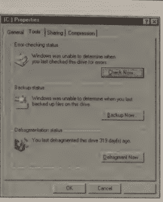

**图 5.1** 点击属性对话框中“工具”选项卡上的“立即碎片整理”按钮，开始整理笔记本的硬盘。

点击“立即碎片整理”按钮以整理笔记本的硬盘。这将确保在分区之前，数据被放置在硬盘的起始位置。

### 使用 FIPS

每个 Linux 发行版都附带基于 DOS 的 `FIPS` 分区工具。您通常可以在 Linux CD-ROM 的 `/dosutils` 目录下找到 `FIPS`，或者您可以从 `FIPS` 主页下载最新版本（参见本章末尾的“资源信息”部分）。

> **注意：** 在对笔记本的硬盘进行分区之前，请务必备份所有重要的文档和目录。虽然分区在将更改写入磁盘之前是非常安全的，但您应在分区前采取基本的预防措施。已给予警告！


使用 `FIPS` 很简单。首先，将一张空白软盘插入笔记本，然后使用带有 `/s` 选项的 DOS `FORMAT` 命令创建一个可启动的 DOS 系统盘：

```bash
format /s a:
```

接下来，将 `FIPS` 命令，连同 `RESTOREB` 命令和文件 `ERRORS.TXT`，复制到软盘上。`RESTOREB` 命令可用于恢复笔记本硬盘的主引导记录（`MBR`）。使用新磁盘重新启动，然后像这样运行 `FIPS` 命令：

```bash
A:\>FIPS
```

然后，`FIPS` 命令将检查笔记本的硬盘以寻找可启动分区。您会看到笔记本驱动器信息的表格，如图 5.2 所示。

图 5.2 显示了一台拥有单个 1GB 硬盘的笔记本，其第一个分区中驻留着一个 DOS 文件系统。要开始分区，请按任意键。`FIPS` 将继续检查您的驱动器并报告驱动器的特性。

> **警告：** 如果您发现现有分区的大小等于或大于笔记本 RAM 大小的两倍，请勿尝试拆分或更改该分区！该分区很可能正在使用笔记本的休眠到磁盘区域（由笔记本 BIOS 支持支持）。在对分区或安装 Linux 时，请保留该分区不变，否则在尝试重新安装或重新配置该分区时可能会遇到大麻烦！


然后系统会询问您是否要备份驱动器的 MBR。这在安装 Linux 时并不重要，因为您很可能将 LILO 引导加载程序安装到 MBR 中，并且在此示例中，您可以像这样使用 DOS `FDISK` 命令简单恢复 MBR：

```bash
A:\>FDISK /MBR
```

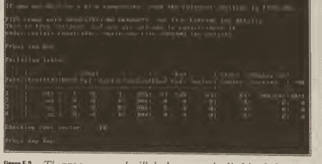

**图 5.2** *FIPS 命令将在分区前检查笔记本的驱动器。*

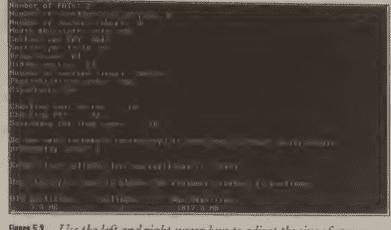

**图 5.3** 使用 FIPS 时，使用左右光标键调整新分区的大小。

如果您选择备份 MBR，请输入 y。否则，输入 n 并按 Enter。然后系统会要求您使用左右光标键为新分区分配大小，如图 5.3 所示。
原始分区的大小将显示在屏幕左侧。当您使用光标键时，您将看到新分区的大小减小或增加。FIPS 会自动尝试提供尽可能利用空闲空间的新分区，因此请确保为您的原始操作系统留出空间。完成后，按 Enter。您将看到图 5.4 所示的显示。

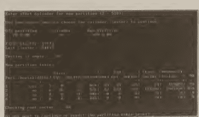

**图 5.4** FIPS 命令将在将其写入硬盘之前显示硬盘的新分区表。

图 5.4 显示 FIPS 显示了一个新的分区表，其中新分区为 Linux 提供了 950MB 的空间。输入 `c` 继续，FIPS 将创建新分区。如果重新运行 FIPS，您可以继续创建其他分区。然而，这一步骤是多余的，可以在安装 Linux 期间进行。

### 苹果驱动器设置

在 Apple iBook 上安装 Linux 需要您使用 Apple 的 Drive Setup 命令（最好在外部驱动器上）来创建非 HFS 或 HFS+ 格式的 AUX 分区。您可以在 iBook 的内部驱动器上安装 Yellow Dog Linux；但是，您需要先按照以下基本步骤为 Linux 创建空间：

- 1. 按住 C 键，使用 Mac OS 安装 CD 重新启动 iBook。
- 2. 使用 Apple Drive Setup 实用程序的“自定义设置”按钮，将 iBook 驱动器重新格式化为 HFS（而非 HFS+）分区和未分配分区。
- 3. 重新安装 Mac OS 或使用恢复 CD。

请注意，早期 iBook 仅配备 3.2GB 驱动器，但新款机型配备 6.4GB 驱动器。在 3.2GB 型号的 iBook 上，您可以安全地为 Mac OS HFS 分区分配 1.5GB，执行完整恢复，并且仍剩余 800MB 用于额外的应用程序或数据。但是，如果您在未分配的 1.5GB 分区上执行 Yellow Dog Linux 的完整安装，Unix 分区上的剩余可用空间将少于 100MB。如果您需要为两个操作系统提供更多空间，则需要升级 iBook 的内部硬盘。如果您需要为 Linux 提供更多空间，请仅安装最小化的 Mac OS，不要执行完整恢复。

### 分区问题

在对硬盘进行分区时可能会出现问题。在使用 FIPS 时可能遇到的许多问题都详细记录在 Linux CD-ROM 的 `dosutils/fipsdocs` 目录下的文档中。如果遇到问题的话，您可能想阅读以下文档：

- `fips.doc`。第 10 节详细说明了故障排除问题。
- `fips.faq`。包含常见问题解答，包括常见的问题。
- `special.doc`。讨论了将 FIPS 与 OS2、OnTrack Manager 和 DOS 压缩工具一起使用的方法。

有关 FIPS 的技术信息位于 `techinfo.txt` 文件中。

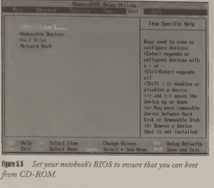

## Red Hat Linux 分步安装

本节详细说明了最新版本的 Red Hat Linux 的分步安装过程。如今您已经知道，安装 Linux 有许多不同的方式，并且有不同的 Linux 发行版。本节详细说明了安装 Linux 的一种方法——通过插入 CD-ROM 并使用启动盘启动。

安装 Linux 最简单的方法是直接从 CD-ROM 启动。您需要确保笔记本的 BIOS 支持从 CD 启动，并且 CD-ROM 设备被列为首个设备，如图 5.5 所示。

通常，您可以在 Linux CD 的 `/images` 目录下找到启动映像。要使用 Linux 快速创建启动盘，请挂载 CD，插入一张空白软盘，并像这样使用 Linux 的 `dd` 命令：

```bash
# mount /mnt/cdrom
# dd if=/mnt/cdrom/images/boot.img of=/dev/fd0
```

这将创建一个启动盘。然后您可以重新启动以执行安装。如果您使用的是 DOS，请使用 `RAWRITE` 命令（位于 `/dosutils` 目录下）来创建启动盘。

### 安装

当安装程序启动时，您将看到第一个安装屏幕，如图 5.6 所示。

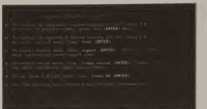

**图 5.6** 使用安装对话框的启动选项指定安装类型。

在安装 Red Hat Linux 时，您可以选择多种安装方式，例如文本模式或专家模式。如果在短时间内未进行任何操作，安装程序将直接启动到安装界面。文本安装方法在笔记本的显示适配器可能无法正确配合 Red Hat 图形安装界面工作的情况下非常有用。专家安装提供更精细的控制，有助于配置笔记本的硬件以配合安装程序使用。您还会看到一种救援模式，可用于帮助您启动并恢复现有安装。

按 Enter 键开始安装。屏幕将清空，您会看到图 5.7 所示的显示。

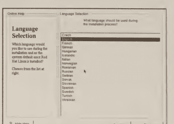

**图 5.7** 为您的安装选择一种语言。

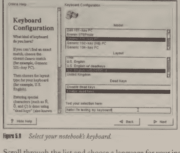

图 5.7 选择笔记本电脑的键盘。

滚动列表并选择安装语言。完成后，点击“下一步”按钮。随后您将看到如图 5.8 所示的窗口。

为您的笔记本电脑选择一个键盘。您以后可以随时更改键盘类型，但在此时，您应该选择一个可用的配置。默认选项通常运行良好。选择键盘后，您可以在窗口底部的空白字段中测试它。完成后，点击“下一步”按钮。随后您将看到如图 5.9 所示的窗口。

滚动鼠标类型列表，选择型号，然后点击“下一步”按钮。请注意，如果您的笔记本电脑使用的是双按钮触摸板，您还应该选择“模拟三按钮”项，以提供一个中键（通过同时按下鼠标左键和右键）。稍后如果您需要用笔记本电脑的指针粘贴文本或图形，这会很有帮助。完成后，点击**下一步**按钮。随后您将看到如图 5.10 所示的显示屏。

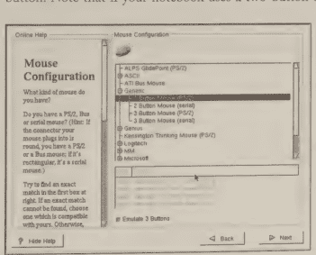

图 5.8 选择与 Linux 配合使用的鼠标类型。

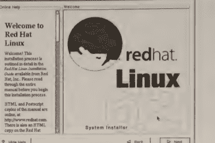

**图 5.10** *点击* 下一步 *按钮进入 Red Hat 的 Linux 系统安装程序。*

点击**下一步**按钮开始安装 Red Hat Linux。请注意，在每个对话框中，您都可以在显示屏左侧阅读滚动显示的文字列表。当显示屏清空时，您将看到类似于图 5.11 的屏幕。

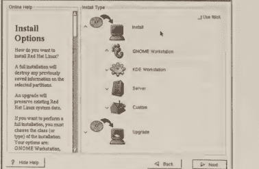

**图 5.11** *选择您希望在笔记本电脑上安装的系统类型。*

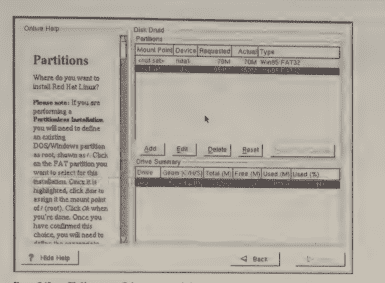

图 5.12 编辑您的 Linux 分区方案。

图形化的 Red Hat 安装程序提供几种系统选择。通过点击其图标来选择系统。如果您是在升级，请点击“升级”图标。请记住，工作站安装比服务器系统需要更多的硬盘空间。如果您希望自行选择软件，请点击“自定义”按钮，然后点击“下一步”按钮。您将看到如图 5.12 所示的对话框。

您将看到 FIPS 之前报告的两个分区。点击以高亮显示较大的分区（期望的 Linux 分区），然后点击“删除”按钮将其删除。接下来，点击“添加”按钮。您将看到如图 5.13 所示的对话框。

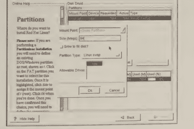

图 5.13 创建您的 Linux 交换目录。

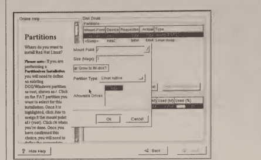

图 5.14 若要使用剩余的分区空间并使用单一根目录为 Linux 安装基本分区方案，请指定挂载点 `/` 并点击“扩展以填满磁盘？”按钮。


在“添加分区”对话框中，输入新分区的大小。在这种情况下，您将添加一个 Linux 交换分区。此分区的大小至少应是您的笔记本电脑安装 RAM 的两倍，或者根据您计划如何使用 Linux 而更多。输入硬盘空间量（以兆字节为单位），然后点击下拉的“分区类型”菜单选择“交换”。完成后，点击“确定”按钮。当您返回主对话框时，再次点击“添加”按钮。您将再次看到“添加分区”对话框，如图 5.14 所示。

基本的 Linux 系统只需要一个根 `(/)` 目录和一个交换分区。如果您是 Linux 新手，这是最简单的方式来分区和安装 Linux。经验丰富的用户会查看可用的分区空间量，然后为 Linux 文件系统的不同部分创建不同的分区，如图 5.15 所示。若要使用所有剩余的可用分区空间，只需点击“扩展以填满磁盘？”按钮，然后点击“确定”按钮。

完成分区后，请确保每个分区都有一个指定的挂载点。虽然您可以轻松挂载未指定的分区（那些不会显示在 Linux 文件系统表 `/etc/fstab` 中的分区），但您肯定希望为所有可引导分区定义挂载点。在此示例中，DOS 可能安装在 `/dev/hda1` 分区，因此您应该选择该条目，然后点击主对话框中的“编辑”按钮。您将看到“编辑分区”对话框，如图 5.16 所示。

Partitions

您希望在哪里安装 Red Hat Linux？

请注意：如果您正在执行分区安装，您需要将现有的 DOS/Windows 分区定义为 rest，显示为 F:。点击您希望为此安装选择的 F:B 分区。一旦高亮显示，点击“下一步”将其挂载点分配为 `/`（根）。完成后点击“确定”。一旦您确认此选择，您需要定义剩余分区上的文件系统。

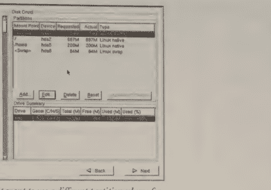

图 5.15 您可能希望为笔记本电脑的 Linux 系统使用不同的分区方案。

Partitions

您希望在哪里安装 Red Hat Linux？

请注意：如果您正在执行分区安装，您需要将现有的 DOS/Windows 分区定义为 mount，显示为 F/。点击您希望为此安装选择的 F:A7 分区。一旦高亮显示，点击 date 将其挂载点分配为 `/`（rest）。完成后点击“确定”。一旦您确认此选择，您需要定义一个新的

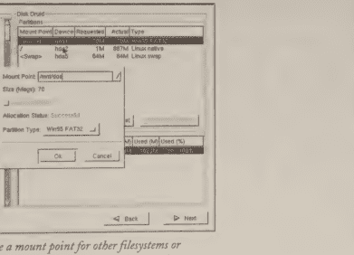

图 5.16 为其他文件系统或可引导分区指定挂载点，以便在以后的 Linux 会话中使用。

对于 DOS 或 Windows 文件系统，指定一个挂载点，例如 `/mnt/dos`。这样您稍后就可以轻松访问该文件系统。完成后，点击“下一步”按钮。随后您将被询问要格式化哪些分区，如图 5.17 所示。点击“下一步”按钮继续。您将看到如图 5.18 所示的对话框。

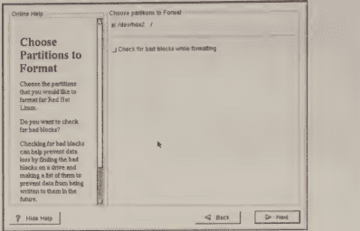

图 5.17 格式化您的新分区以用于 Linux。

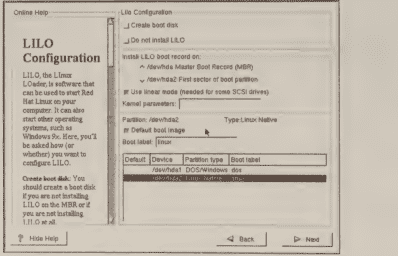

图 5.18 选择是否需要引导盘，LILO 安装位置，以及使用 LILO 引导的默认引导映像。

在如图 5.18 所示的对话框中，将不会制作引导盘，`LILO` 将安装到笔记本电脑硬盘的主引导区（MBR），并且默认引导的操作系统是 Linux。完成后，点击“下一步”按钮。您将看到如图 5.19 所示的对话框。

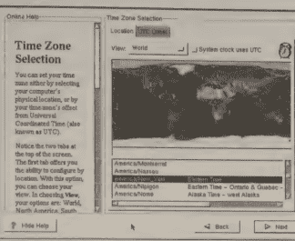

图 5.19 选择您的时区。

### 潜在的 LILO 问题

如果您安装 Linux 后 `LILO` 无法启动，并且只显示前两个字母“L”，这可能表示 `LILO` 无法访问 Linux 引导内核，因为它可能安装在编号大于 1024 的磁盘柱面上。此问题可能出现在 `LILO` 的早期版本以及具有大容量内置硬盘的旧笔记本电脑上。解决方案是将您的原生 Linux 分区（包含引导内核）创建在 1024 柱面限制以下。另一种解决方案是使用另一个操作系统的分区来存储 Linux 内核。请访问 http://sdb.use.su/de/sdb/en/html/1024_Zylinder.html 了解详细信息和修复方法。

选择您的时区，并告诉 Linux 您的笔记本电脑硬件时钟使用的时间。请记住，系统时间和笔记本电脑的硬件时钟之间可能存在差异！关于时区和 Linux 的更多信息，请参见第 16 章“时区和区域设置”中的“Linux、时间和时区”。设置时区后，点击“下一步”按钮继续。您将看到如图 5.20 所示的对话框。

输入 `root` 操作符将使用的密码。不要忘记这个密码！您还可以向系统中添加其他用户。完成后，点击“下一步”按钮。您将被询问要使用哪种密码系统。如果您不在网络上，只需选择默认值并点击“下一步”按钮。您将看到如图 5.21 所示的对话框。

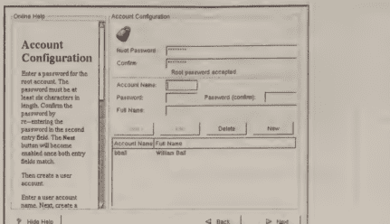

图 5.20 输入你的 root 密码以及其他用户的 Linux 密码。

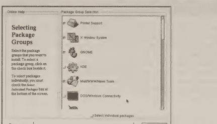

图 5.21 选择要在 Linux 中使用的所需软件包。

如果你选择了自定义安装，你将看到一个用于 Linux 的软件包列表。你可以滚动查看列表，勾选或取消勾选软件包。点击“下一步”按钮继续。你将看到图 5.22 所示的窗口。

滚动浏览显示器列表，选择一个与你的笔记本显示器相匹配的型号。你可以尝试选择液晶面板，或者根据需要尝试通用设置。完成后，点击“下一步”按钮。你将看到图 5.23 所示的窗口。

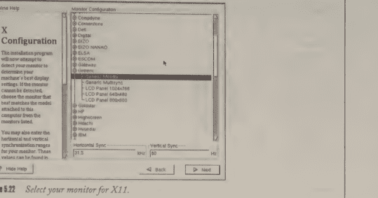

图 5.22 为 X11 选择你的显示器。

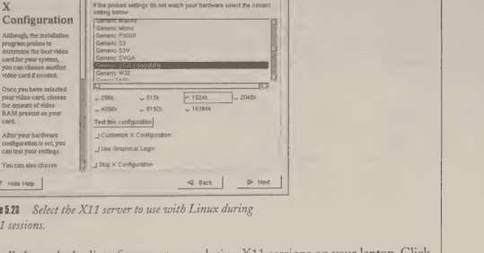

图 5.23 选择在 X11 会话期间与 Linux 一起使用的 X11 服务器。

滚动浏览在笔记本上 X11 会话期间使用的服务器列表。点击一个按钮来设置你的笔记本提供的显存大小。你可以测试这些设置。然后——并且只有在这样做之后——你应该选择“使用图形化登录”项。请注意，当 `XFree86` 4.0 成为大多数 Linux 发行版的一部分时，在较新版本的 Red Hat 安装程序中，此对话框将会不同！完成后，点击“下一步”按钮。你将看到安装对话框，如图 5.24 所示。

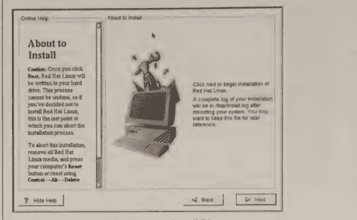


如果你确定要安装 Linux，请点击“下一步”按钮开始安装。你将看到图 5.25 所示的对话框。

随着 Linux 的安装，你将看到一个进度对话框。此过程可能需要 15 分钟到 1 个小时，具体取决于你的软件选择以及笔记本光驱和硬盘的速度。当所有软件从

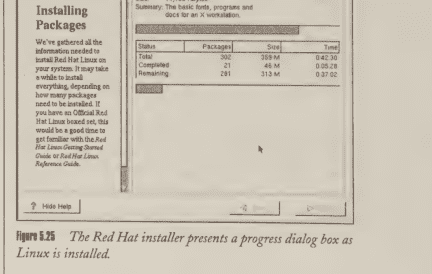


CD-ROM 复制完成后，Red Hat 安装程序将要求你点击“退出”按钮或按 Enter 键以重启你的笔记本。

## 登录和关机

当你第一次登录时，输入 `root` 或你的用户名，然后按 Enter。接下来，输入你的 `root` 或用户名的密码。你也可以使用 `X11` 图形化登录来关闭或重启 Linux。要从 Linux 关闭你的笔记本，请使用带有 `-h (halt)` 选项的 `shutdown` 命令：

```
# shutdown -h now
```

要从控制台的命令行或 X11 终端窗口重启 Linux，请使用带有 `-r (reboot)` 选项的 `shutdown` 命令：

```
# shutdown -r now
```

## 安装 Yellow Dog Linux

在 iBook 上安装 Yellow Dog Linux 很容易。使用 Yellow Dog Linux（基于 Red Hat 文件系统）非常有趣，而且是学习 Linux 的好方法。在为 Yellow Dog Linux 准备 iBook 的硬盘后，启动到新安装的 Mac OS，插入你的 Yellow Dog Linux CD-ROM，并将 `BootX` 控制面板安装到你的 iBook 的系统文件夹中。（其中一个组件 `BootX App` 会进入控制面板文件夹，另一个组件 `BootX Extension` 则放在扩展文件夹中。）


接下来，将文件 `vmlinuz` 和 `ramdisk.image.gz` 从 CD-ROM 复制到你的 iBook 系统文件夹。启动 BootX 控制面板，选择 `vmlinuz` Linux 内核，并点击“不强制驱动程序”（No Force Driver）选项。点击“BootX 选项”按钮，然后选择“视频视频设置”（Video video settings）项。接下来，点击“使用特定 RAM 磁盘”（Use specific RAM disk）按钮，然后点击“选择”（Choose）按钮以选择 `ramdisk.image.gz` 文件。完成后，点击“确定”（OK）按钮。

如果你选择在 iBook 上使用单个 Linux 原生分区，该分区将被指定为 `/dev/hda10`。因此，在主要的 BootX 对话框中，为根设备输入 `hda10`。这指定了根 Linux 分区。接下来，在“更多内核参数：”（More kernel arguments:）字段中输入 `adb_buttons=103,11`。这将 iBook 单按钮 ADB 鼠标的 F11 和 F12 指定为鼠标中键和右键。点击“保存到偏好设置”（Save to pref）按钮以完成配置。

确保 Yellow Dog Linux CD-ROM 已插入 iBook，然后点击 BootX 对话框中的“Linux”按钮以启动安装。

Yellow Dog Linux 的安装过程与基于文本的 Red Hat Linux 安装过程类似。但是，你需要执行以下操作：
- 配置和格式化交换分区。
- 配置和格式化根 Linux 分区（应该是 `/dev/hda10`）。
- 将 iBook 鼠标配置为单按钮 ADB 鼠标。
- 配置 iBook 的内部以太网接口（如果希望使用）。

安装 Yellow Dog Linux 后，以 root 操作员身份登录，并编辑系统的初始化表 `/etc/inittab`：

```
# pico -w /etc/inittab
```

将以下条目：
```
id:3:initdefault
```
改为：
```
id:5:initdefault
```
保存文件（按 Ctrl+X）并退出编辑器。这将配置 Yellow Dog Linux 直接启动到 X11 会话。关于 iBook 上的 Yellow Dog Linux，有一些事项需要注意（这些观点在本章撰写时是准确的）：
- 必须为 Mac OS 和 Linux 使用相同的颜色深度设置和分辨率（16bpp 下 800×600，即数千色）。
- 内部以太网端口可以工作，但使用 `ifconfig` 命令将其设置为“up”或“down”状态时响应不佳。
- 当前用于 PowerPC 芯片的 Linux 内核没有启用 iBook 上的声音功能。
- iBook 的内部调制解调器可以与 Linux 一起工作，但你必须使用 Yaboot 引导加载程序和 Apple 的开放固件（Open Firmware）启动提示来启动 Linux。然而，你的 X11 会话将限制在 256 种颜色。请访问 http://www.yellowdoglinux.com/support/ff_bootloader.shtml 了解有关使用 Yaboot 工具的介绍。

希望这些问题能在不久的将来得到解决；PPC Linux 的开发相当活跃，并且不断添加新功能。很可能 iBook 用户只需再经过一两次 Yellow Dog Linux 发行版的更新，就能享受 Linux 的全部优势。

### 资源信息

http://www.serv.net/~sand/hurd/partitions.html

一篇关于分区的有趣论述，包括对 BSD UNIX 的讨论。

http://www.users.intercom.com/~ranish/part/primer.htm

一份关于分区的出色图形化入门指南。

**Linux 安装-HOWTO**

Eric S. Raymond 为首次安装 Linux 的人编写的必读文章。第 6.4 节讨论了分区的基础知识。可以在 `/usr/doc/HOWTO` 目录下或 http://www.linuxdoc.org 找到。

**Linux 分区-HOWTO**

Kristan Koehntopp 编写的安装 Linux 前后进行分区规划的指南。可以在 `/usr/doc/HOWTO/mini` 目录下或 http://www.linuxdoc.org 找到。

http://www.powerquest.com/usindex.html

PowerQuest 的主页，包含指向 PartitionMagic 的链接。

http://www.igd.fhg.de/~aschaefe/fips/

Arno Schaefer 的 FIPS 主页。这是获取此免费基于 DOS 的分区工具最新版本的最佳去处。

http://www.mklinux.org/getting_started/preparations/HDDSetup.html

使用 Apple 的 HD SC Setup 为 Linux 准备驱动器的分步介绍。

ftp://c3po.terraplex.com/pub/terrasoftsolutions/yellowdog/guide_to_install/

一个目录，包含 Adobe Acrobat 格式的 Yellow Dog Linux 1.2 安装指南的 144dpi 和 72dpi 版本。

# 第 6 章：安装后问题

使用启动管理器

PCMCIA 和卡服务

配置声音

解决 X 的问题

资源信息

本章提供了一些潜在的解决方案和故障排除信息，供你在安装 Linux 后遇到问题时使用。在新笔记本上首次安装 Linux 是一次激动人心的体验，当 Linux 被配置为与笔记本的所有组件配合工作时，体验更加愉快。然而，笔记本制造商在笔记本系列中使用了各种各样的芯片组和硬件，因此你可能需要花费时间去查找和修复安装中的问题。

在笔记本上配置 Linux 时，主要关注领域如下：
- **启动**。确保 LILO 或你的启动过程正常工作。如果你配置了双启动系统，在系统重启或关机之间，你应该能够启动到任一已安装的操作系统。
- **X**。X 窗口系统应配置为提供适用于你的笔记本的最佳分辨率和颜色深度。指针设备，如触摸板和橡皮擦，应能正常工作。
- **声音**。Linux 内核模块或其他软件应能启用通过你的笔记本声音系统播放音频 CD、MIDI 文件或 .mp3 文件的功能。
- **网络**。你可以使用笔记本内置的或 PCMCIA 以太网适配器访问你的本地局域网或远程网络。
- **调制解调器和串行端口**。你应该能够访问笔记本的串行端口，可能使用 IrDA，并配置内部或外部调制解调器。
- **打印**。你的 Linux 发行版中包括的打印软件应能正常工作于你的打印机。

需要记住的重要事项是，几乎所有基于 Intel 的笔记本都能运行 Linux，并且可以配置为提供与笔记本硬件相匹配的功能。如果你的笔记本已经在市场上销售至少一年，并且不是制造商最新的旗舰机型，你配置它的机会将更大。这是因为制造商通常会升级内部组件，如视频芯片组和声音系统，以提供新功能，但又不愿意分享技术规范。由于很少有（甚至没有）芯片组制造商或笔记本制造商加入开源行列，Linux 开发者往往无法获得使视频或声音驱动程序与新硬件配合工作所需的关键信息。希望随着更多消费者要求开放规范和能够运行 Linux 的硬件，这种情况将发生变化。

### 厂商繁荣

在本书开发期间，许多笔记本制造商和供应商纷纷推出支持 Linux 的笔记本产品。2000 年 2 月，戴尔电脑公司开始在 Inspiron 5000 系列笔记本电脑的一个型号上提供 Linux（有趣的是，当时并未大张旗鼓地宣传）。其他供应商，如 Tuxtops (http://www.tuxtops.com)，也陆续登场，为多款笔记本电脑提供替代性的软件平台。此外，2000 年 4 月，eLinux.com（即 PCMall 和 MacMall 的同一家公司）开始在“OpenBook”系列笔记本电脑上提供 Linux。购买预装 Linux 的笔记本是避免安装 Linux 的最简便方式，也是避免为你不需要且不想使用的商业软件付费的最佳途径！

### 使用引导管理器

如你所知，安装和启动 Linux 的方法有很多种。如何在你的笔记本上启动 Linux 由你决定。存在多种启动多操作系统的方法，也有多种方式设置笔记本以引导这些操作系统。

如果安全性是个问题，你也可以设置引导管理器使用密码。一个更好的方法是，将引导管理器放置在可移动设备（如软盘）上，并要求输入密码。虽然除非硬盘是可移除的且处于锁定的状态，否则没有任何硬盘是绝对安全的，但你可以采取一些基本措施来保护你的数据。

每个 Linux 发行版都附带两个或更多的引导工具。最常用的工具是 Linux 加载器（LILO）。这个引导管理器可以安装在笔记本硬盘的主引导记录中，也可以安装在你的 Linux 根分区或软盘上。其他引导管理器包括 PowerQuest 的 BootMagic（可能会作为增值软件包含在某些商业 Linux 发行版中）。


## 使用 BootMagic 进行引导管理

BootMagic 是一个引导加载器工具，支持多种不同的操作系统。该程序基本上提供了一个图形界面，你可以使用鼠标或键盘选择并启动笔记本上已安装的操作系统。BootMagic 通常与 PowerQuest 的商业分区工具 PartitionMagic 一起安装。

不幸的是，BootMagic 必须使用 Windows 进行安装，并且配置是通过一个仅限 Windows 使用的工具完成的。另一个缺点是，BootMagic 必须安装在你的可启动设备的 MBR 中。如果你使用 LILO 来启动 Linux，那么 LILO 必须安装在根 Linux 引导分区中。

## 使用 System Commander 进行引导管理

System Command Deluxe 是 Linguist Software 的一款产品，是一种替代性的商业引导加载器，也可以用于启动 Linux。与 BootMagic 类似，System Commander 可以使用 Windows 安装，但也可以提供使用 DOS 安装的功能。根据 Linguist Software 的说法，System Commander 可以配置为禁止访问硬盘，并防止使用软盘驱动器启动系统。请注意，你也可以通过在硬盘上安装引导加载器、在笔记本 BIOS 中禁用可移动设备作为启动项，然后为 BIOS 设置密码来实现同样的效果。

## 使用 LILO 进行引导管理

LILO 是一个免费的、灵活的、功能强大的引导加载器，你可以使用 Linux 来安装它。LILO 几乎可以启动安装在笔记本上的任何操作系统，并且可以轻松配置以启动 DOS、Windows、FreeBSD、OpenBSD 和其他系统。如果你的 X11 出现问题，例如 Linux 系统被设置为直接启动到 X11 但 `XF86Config` 配置损坏时，LILO 也很有帮助。症状包括 X 服务器反复尝试运行并失败时，屏幕出现闪烁和重复显示。

通常你可以使用 `Ctrl+Alt+Delete` 重启你的机器。然后，在 `LILO` 引导提示符处，使用 `LILO` 通过 `linux single` 选项告知 Linux 以 root 管理模式启动：

```
boot: linux single
```

如果这不起作用，你还可以尝试以下命令：

```
boot: linux 0
```

这将启动 Linux，但禁用网络服务和 X11。最终你会到达 root 提示符，然后可以着手修复任何问题。你还可以使用 LILO 实施密码保护。这需要你编辑 `/etc/lilo.conf` 文件。

使用你喜欢的文本编辑器（例如 `pico` 编辑器），按如下方式打开该文件：

```
$ pico /etc/lilo.conf
```

然后你可以插入 `password=` 条目，并附带一个未加密的密码。（提示：不要使用与你登录 Linux 相同的密码！）例如：

```
image=/boot/vmlinux
  label=linux
  password=abcd
  initrd=/boot/initrd
```

进行你的更改并保存文件（如果使用 `pico`，请按 `Ctrl+X`）。你必须然后运行 `lilo` 来写入新的引导加载器，如下所示：

```
# /sbin/lilo
```

下次重启时，你会看到 `LILO` 提示符：

```
LILO boot:
```

按 `Enter` 键，你将看到：

```
Password:
```

输入你的密码并按 `Enter` 键以启动。（超级提示：你可以为在 `/etc/lilo.conf` 中配置的每个操作系统引导部分分配不同的密码！如果你已启用笔记本 BIOS 启动密码，这意味着可能需要三个密码才能使用 Linux！）

引导启动的一个潜在问题是，如果你安装 Linux 后又安装了另一个操作系统（如 Windows）。其他操作系统通常会抹去笔记本硬盘的 MBR，LILO 将会消失，这可能导致你无法启动到 Linux。最佳方法是在笔记本上安装完所有其他操作系统后再安装 LILO。这包括 BSDs、BeOS 和 OS/2。

LILO 还可以帮助你解决在具有麻烦 IDE 控制器的笔记本上安装 Red Hat Linux 的问题。LILO 引导提示符可用于向 Linux 内核传递消息或参数。例如，经验丰富的 IBM ThinkPad 600x（以及可能的 570）用户会使用以下命令：

```
linux hda=1558,240,63 hdc=cdrom
```

在 LILO 引导提示符处输入上述命令，以启用 Linux 识别内部硬盘驱动器和光盘驱动器（如果可用）。`hda=` 条目指定了硬盘驱动器的设备名称（`/dev/hda`）并提供刻录在驱动器上的设置。这些设置代表硬盘驱动器中的柱面数、扇区数和磁头数。这些选项也可以在 Red Hat 安装过程中使用。它们作为选项插入 LILO 配置对话框中，如下所示：

```
append = 'hda=1024,12,63'
```

此选项可以启用 Linux 在 ThinkPad 701 系列笔记本上启动。如果你在安装或启动 Linux 时因 LILO 错误遇到问题，请参阅第 3 章中的“引导加载器及陷阱”。你还应该查阅 Linux 笔记本页面，寻找针对你笔记本的解决方案。（如果你拥有知名厂商生产的主流笔记本，很可能在你之前已经有人安装过 Linux，并可能已解决了任何严重的技术问题。）

要卸载 LILO，你可以使用 DOS 的 `FDISK` 命令及其 `/MBR` 选项。将笔记本启动到 DOS，然后使用以下命令：

```
C:> FDISK /MBR
```

要在 Linux 下卸载 LILO，使用 `lilo` 命令及其 `-u`（卸载）选项：

```
# lilo -u
```

请确保你手头有启动盘，或者你确实想要卸载 LILO！

## Apple iBook 使用 BootX 进行引导管理

Apple iBook Linux 用户可以通过至少两种方式启动 Linux。第一种方式使用 iBook 中 Apple 的 OpenFirmware 引导 ROM，以及一个名为 Yaboot 的工具。第二种方式更简单、更常见，是使用 BootX 控制面板设备，该设备在 Mac 启动后启动。

Yaboot 工具在某种程度上类似于 LILO，并且在其配置文件中使用了相似的语法。使用 Apple 的 Open Firmware 提示符和 Yaboot 的一个好处是你将能够使用 iBook 的内部调制解调器。要使用 Yaboot 引导加载器（包含在 Yellow Dog Linux CD-ROM 上）启动 Linux，请在运行 MacOS 时将文件 `vmlinux`、`yaboot.tbxl` 和 `yaboot.conf` 复制到 iBook 的硬盘上。编辑 `yaboot.conf` 文件，使其看起来像这样：

```
timeout=5
default=linux

image=hd:8,/vmlinux
label=linux
root=/dev/hda10

novideo
```

保存并关闭该文件，然后重新启动你的 iBook。在重启过程中，按住 `Cmd+Option+o+f` 键，你会看到苹果的 Open Firmware 提示符。要引导 Linux，请使用 `boot` 关键字，并指向 Yaboot 引导加载程序，例如：

```
boot hd:8,/yaboot.tzh1
```

然后你将引导进入 Linux。请注意，至少在使用 Yellow Dog Linux 1.2 时，你的 X11 会话将限制为 256 色！你可以通过浏览 [http://www.yellowdoglinux.com/support/faq/bootloader.shtml](http://www.yellowdoglinux.com/support/faq/bootloader.shtml) 来了解有关 Yaboot 的更多信息。

引导 Linux 的更简单方法是使用 BootX。此程序允许你选择不同的 Linux 内核，引导使用 Yellow Dog Linux 1.2 光盘进行安装，并设置各种选项，例如延迟或视频设置。如果在 iBook 上使用 BootX，当前或新的 Linux 内核可以保存在 Mac 系统文件夹中名为 Linux Kernels 的文件夹内。这是测试新的 Linux PPC 内核的一种简便方法。

为了在 Apple iBook 上正确引导 Yellow Dog Linux，你应该使用以下 BootX 设置：

- 在 Kernel: 字段中应选择正确的 Linux 内核。
- 根设备（如果 Yellow Dog Linux 安装在同一硬盘上）应设置为 `/dev/hda10`。
- 应选择 “No video driver” 选项。
- 在 Options 对话框中，应选择 “Force video settings” 选项。


“More kernel arguments” 字段中应包含条目 `adb_buttons=103,111`，以便在引导 Linux 后的 X11 会话期间将 F11 和 F12 映射到鼠标中键和右击。

引导完成后，如果你没有直接引导到 X11，可以使用 `Ctrl+Command+2` 到 `Ctrl+Command+6` 在仅文本模式的 Linux 控制台之间切换。不幸的是，你无法使用基于 Intel 的 X11 `Ctrl+Alt+F2` 到 `Ctrl+Alt+F6` 以及 `Alt+F7` 键盘命令从 X 会话跳转到仅文本控制台再跳回。

### PCMCIA 和 Card Services

David Hinds 的 Card Services 是移动 Linux 用户除了 Linux 内核和基本安装之外最重要的软件包。几乎所有基于 Intel 的笔记本都配备了一个或两个 PCMCIA 卡槽。（注意 Apple iBook 不支持 PCMCIA。）

对 PCMCIA 卡（现在更常被称为 PC 卡）的支持由 `cardmgr` 守护进程提供。该守护进程通过 `/etc/rc.d/init.d/pcmcia` 脚本启动。

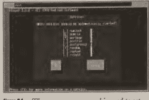

图 6.1 `ntsysv` 命令用于设置特定服务，以便在 Linux 在你的笔记本上引导时启动。

如果你已配置 Linux 在引导时使用 `cardmgrd`。确保 Card Services 可用的一种方法是使用 Red Hat 的 `ntsysv` 命令。在控制台或 X11 终端窗口命令行中输入 `ntsysv` 并按 Enter。你将看到图 6.1 中显示的对话框。

使用上下箭头键滚动服务列表以选择 `pcmcia`，然后按空格键以确保出现星号 (*)。按 Tab 键突出显示 `OK` 按钮，然后按 Enter。这将确保在 Linux 重启时存在 PCMCIA 支持。你也可以使用 `pcmcia` 脚本立即启动该服务，如下所示：

```
$ /etc/rc.d/init.d/pcmcia start
```

如果你正考虑为 Linux 购买一张 PC 卡，请帮自己一个忙，务必阅读 `SUPPORTED.CARDS` 文件中最新的受支持卡列表。如果你在你的笔记本上安装了 Linux 内核源代码，你可以在 `/usr/src/linux/pcmcia*` 目录下找到一份副本。你还可以通过浏览到以下网址阅读最新版本：

```
http://pcmcia.sourceforge.org/
```

#### 构建和安装 Card Services

如果你有一张在 Linux 上不起作用的卡，请振作起来；对新卡的支持通常会在每个新的 Card Services 软件版本中添加。如果你的 Linux 发行版包含的 Card Services 版本无法与你的 PC 卡配合工作，你可以尝试下载最新的驱动程序。要安装新驱动程序，请在 `/usr/src/linux` 目录中解压源代码。注意你需要已安装 Linux 内核源代码。

导航到新的 `pcmcia` 目录，然后使用 `Configure` 脚本设置并创建一个 `makefile`，如下所示：

```
# ./Configure
```

按 Enter 后，你可能會看到以下内容：

------ Linux PCMCIA 配置脚本 ------

每个问题的默认回答对大多数用户都是正确的。

请参考 `PCMCIA-HOWTO` 获取有关每个选项的更多信息。

Linux 源目录 [/home2/rpn/BUILD/linux]: `/usr/src/linux`

输入 `/usr/src/linux` 以指定 Linux 内核源目录（这在 Red Hat 和 Mandrake Linux 上有效），然后按 Enter。你将看到以下内容：

内核源树版本为 2.2.14-15mdk。

当前内核构建日期为 2000 年 1 月 4 日 星期二 22:24:20。

备用目标安装目录 [/var/tmp/kernel-2.2.14-15mdk-root]:

Configure 脚本将识别当前的 Linux 内核并提供备用安装目录。如果你不担心覆盖原始模块，可以使用默认设置并按 Enter。然后你会被询问：

模块安装目录 [/lib/modules/2.2.14-15mdk]:

如果你希望新的 Card Services PCMCIA 内核模块在你的系统中工作，这一步至关重要。如果你接受默认设置，新模块将覆盖现有模块。如果你只是想查看模块是否构建成功，请指定备用目录并按 Enter。

构建 'trusting' 版本的卡工具 (y/n) [y]:

此选项用于创建可在笔记本上的任何人（而不仅是 root 操作员）使用的模块。输入 y 或 n，然后按 Enter。

包含 32 位 (CardBus) 卡支持 (y/n) [n]:

如果你使用较新的 CardBus PC 卡，请按 Enter。注意，支持的 CardBus 卡比旧的 16 位 PC 卡少。

包含 PnP BIOS 资源检查 (y/n) [n]:

除非你需要笔记本的 BIOS 帮助配置你的卡，否则使用默认选项 n 并按 Enter。

*PCMCIA* *drivers* 需要编译以匹配它们将使用的内核，否则部分或所有模块可能无法加载。

如果不确定该怎么做，请咨询 *PCMCIA-HOWTO*。

你希望如何设置内核特定选项？

1. 从当前运行的内核读取

2. 从 Linux 源树读取

输入选项 (1-2) [2]:

虽然默认选项是使用安装的 Linux 源代码，但此代码（特别是带有 *Mandrake Linux* 时）可能与你笔记本上运行的内核不匹配！更安全的方法是选择 1，使用当前运行内核的驱动程序选项。按 *Enter* 后，你将看到以下内容：

```
Kernel configuration options:

	Static in-kernel PCMCIA support is disabled.
	Symmetric multiprocessing support is disabled.
	PCI BIOS support is enabled.
	Advanced Power Management (APM) support is enabled.
	SCSI support is enabled.
	Networking support is enabled.
	Radio network interface support is enabled.
	Token Ring device support is enabled.
	Pasta switching is disabled.
	Module version checking is enabled.
	/proc filesystem support is enabled.
	Maximum physical memory: 1GB
```

System V init 脚本布局 (y/n) [y]:

你将获得关于你的 Linux 内核的简短报告。（你可能会惊讶于你拥有的已安装支持种类！）然后你会被询问你的系统是否使用 *System V* init 脚本布局。如果你使用的是 *Red Hat* 或 *Mandrake Linux*，请按 *Enter*（或 *y*）。

RC 脚本的顶层目录 [ /etc/rc.d ]:

*Red Hat 和 Mandrake Linux 都在 /etc/rc.d 目录下使用 init 脚本，因此你只需按 Enter。*

```
X Windows include files found.
/usr/X11R6/lib/libforms.so and /usr/X11R6/include/forms.h found.
Configuration successful.
```

Configure 脚本还将搜索 XForms 库和头文件。如果找到，你还可以构建、安装和使用 X11 的 `cardinfo` 客户端！现在你可以像这样构建 Card Services：

```
# make
```

要安装新的 PCMCIA 模块（通常位于 `/lib/modules/2.X.XX` 目录下的 `misc` 目录中，其中 X.XX 是你的内核版本），请使用 `make` 命令如下：

```
# make install
```

安装后，你可以使用以下命令启动 Card Services：

```
# /etc/rc.d/init.d/pcmcia start
```

或此命令：

```
# /etc/rc.d/init.d/pcmcia restart
```

`cardinfo` 客户端可以从 X11 终端窗口的命令行像这样启动：

```
# cardinfo &
```

按 Enter 后，你将看到图 6.2 中显示的窗口。

此客户端列出当前插入的任何卡，并提供有关状态、设备、IRQ 和正在使用的 I/O 端口的详细信息。通过点击插槽按钮（如图 6.2 所示），你可以重置、挂起、恢复、弹出或插入 PC 卡。

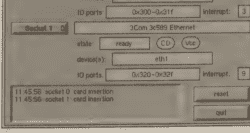


> 图 6.2 `cardinfo` 客户端可用于在笔记本上的 X11 会话期间重置、挂起、恢复、弹出和插入 PC 卡。

请注意，切勿挂起或弹出正在使用中的卡片，尤其是 IDE 闪存卡！否则可能会损坏文件系统的文件。`cardinfo` 客户端是一个方便的工具，可用于获取有关卡片的故障排除信息。（提示：你还可以使用 `dmesg` 命令在插入卡片时查找日志消息。）

问题通常出现在尝试使用不支持的 PC 卡、在 `/etc/pcmcia/config.opts` 文件中使用了错误的配置设置，或者发生中断请求（IRQ）冲突时。卡片服务在插入或移除卡片时会提供诊断蜂鸣声。通常，两声高蜂鸣表示识别和配置成功。如果你安装了网络适配器，然后听到一声高蜂鸣接着是一声低蜂鸣，这可能表示卡片已被识别，但你可能尚未启用网络或设置卡片的 IP 寻址。

如果你在笔记本电脑上使用 Linux 卡时遇到问题，请首先阅读 David Hinds 的 `PCMCIA-HOWTO`。你可以在 http://pcmcia.sourceforge.org/ 或系统目录 `/usr/doc/HOWTO` 中找到一份副本。另一个寻求帮助的地方是在 Usenet 的 `comp.os.linux.portable` 新闻组上提出你的问题。

### 配置声音

配置 Linux 以与笔记本电脑的声卡系统配合使用，可能非常简单，也可能非常困难，这取决于你的笔记本电脑型号以及它是否是制造商推出的“最新最强大”的机型。尽管大多数笔记本电脑提供的小扬声器发出的是单薄的声音，但几乎所有它们都有一个线路输出插孔，这样你就可以通过外部放大器或扬声器播放声音或音乐。

要为 Red Hat 或 Mandrake Linux 配置声音，请使用 `sndconfig` 命令。在开始之前，你可能还需要有关笔记本电脑声音芯片组和技术设置的信息。如果你的笔记本手册中没有这些信息，请重启笔记本并检查 BIOS 音频部分，以寻找有关 I/O 地址、IRQ 和 DMA 设置的线索，你可以尝试这些设置。然后在控制台输入 `sndconfig` 并按 Enter。你会看到图 6.3 中显示的对话框。

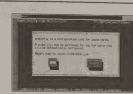

`图 6.3` `sndconfig` 命令用于配置 Linux 以与笔记本电脑的声卡系统配合工作。

`sndconfig` 命令将尝试识别你笔记本电脑的声卡。如果未被识别，你将看到如图 6.4 所示的卡片列表。在卡片列表中滚动，寻找你笔记本电脑的声卡系统。如果没有找到完全匹配项，请检查你笔记本电脑的技术文档或手册，看看你笔记本电脑的声卡系统是否仿真了某种通用卡片，例如 SoundBlaster。许多笔记本的声卡芯片组都提供这种仿真功能，这使得为 Linux 配置声音的工作稍微容易一些（这在 Sony 505 系列笔记本上是真实的）。完成后，按 Enter。接下来你会被要求输入有关声卡的一些技术信息，如图 6.5 所示。

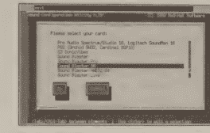

`图 6.4` 在声卡列表中滚动以选择你的笔记本声卡系统使用或仿真的卡片。


`图 6.5` 如果被要求，请输入你笔记本中使用的声卡的 I/O 地址、IRQ 和 DMA 设置。

完成后，按 Enter。`sndconfig` 命令然后会尝试播放一个声音（Linus Torvalds 发音的 “Linux”），接着播放一段 MIDI 音阶。完成后，`sndconfig` 命令将保存设置。这些设置将用于你下次启动 Linux 时。

Linux 的声音支持由位于 `/lib/modules/2.X.XX/misc` 目录下的可加载内核模块提供（其中 X.XX 是你的 Linux 内核版本，可通过 `uname -r` 命令找到）。如果你安装了 Linux 内核源码，你将在 `/usr/src/linux/Documentation/sound` 目录中看到一些文档。例如：

```text
AD1816  ChangeLog.miti.sound  NE256  README.awe  es1370
ALS007  ESS                  OPL3   README.modules es1371
AKB32   ESS1868              OPL3-SA SoundPro imavr
AudioC  BoschDSP1          INSTALL.awe OPL3-SQ2 SoundBlaster solo1
CM8330  Introduction         Opl    Tropez+ sonivibes
CM8338  MADI4                 PCI-pro VIA-chipset ultrasound
CS4232  Maestro              PVS    VTBRAI6 vxmld
ChangeLog.awe MultiSound    README.OSS Wavefront
```

这些文件也可能位于 `/usr/doc/kernel-doc-2.X.XX` 目录下。如果你遇到问题，并且知道你笔记本电脑中使用的声卡芯片组，你可以尝试搜索相关文件以寻找配置线索。但如果似乎什么都行不通，不要放弃希望！还有其他帮助来源。

浏览到 http://www.alsa-project.org 并跟随链接下载高级 Linux 声音架构（ALSA）的 Linux 声卡驱动。这套免费的替代声卡驱动支持 75 种以上不同类型的声卡——并且对新卡片的支持也在不断增加。下载并解压所需的驱动、库和工具后，你需要进入每个目录并执行以下操作：

```bash
# ./configure
# make
# make install
```

这将构建并安装驱动（它们是可加载内核模块）。然后你可以使用推荐设置（记录在 ALSA 软件包中）在你的 `/etc/modprobe.conf` 或类似系统的 `/etc/conf.modules` 文件中，并配合 `modprobe` 命令，来加载和运行 ALSA 模块。

如果驱动兼容，它们将正确配置你笔记本声卡系统的元素，但在使用前必须“解除静音”。例如，要将主音量设置为 100%，你需要使用 ALSA 的 `amixer` 命令如下：

```bash
# amixer set Master 100 unmute
```

在解除其他识别设备的静音（如低音、高音、合成器、PCM、线路输入、麦克风和 CD）后，你可以播放音乐或声音。如果你需要有关安装和配置 ALSA 驱动的帮助，请浏览到 http://www.alsa-project.org/~valentin/Alsa-sound-mini-HOWTO.html

如果 ALSA 声音系统对你不起作用，你的下一个选择是浏览到 http://www.opensound.com。你可以从 4Front Technology 下载商业 Open Sound System 声卡驱动的演示版本。最后一次统计时，支持了 330 多种不同的声音系统。如果 Linux 发行版中包含的免费版 OSS 对你不起作用，那么这款软件很可能与你的笔记本声卡系统兼容。

从网页上选择正确版本后，下载 OSS 软件包。创建一个临时目录，将软件包复制到该目录中，并进入该临时目录。接下来，使用 `tar` 命令解压软件：

```bash
# tar xvfz oss*.tgz
INSTALL
LICENSE
oss-install
oss.pkg
```

要安装软件，请使用 `oss-install` 脚本如下：

```bash
# ./oss-install
```

屏幕将清空，你将看到一系列对话框帮助你安装声音支持。

### 解决 X 问题

尽管 Linux 在控制台（纯文本）模式下运行良好，但一个可用的 X11 配置可能极其重要且特别令人满意。除非你正在将笔记本用作服务器，否则你可能希望利用笔记本显示器的图形功能。好消息是，X11 几乎可以在每台曾制造出的笔记本电脑上工作。X11 工作得有多好取决于你的笔记本图形芯片组对 X 的支持程度。

利用 XFree86 软件充分发挥笔记本显示器的性能是几个因素的结合。首先，你的笔记本图形芯片组必须受到 XFree86 软件的支持。其次，你需要创建一个正确的 `XF86Config` 文件，该文件通常位于 `/etc/X11` 目录（如果你是作为 root 操作员测试 X，则位于 `/usr/X11R6/lib/X11` 或 `/root` 下）。

`XF86Config` 文件的设置对于正确配置图形界面至关重要。该文件包含处理以下各项的章节：

- 已安装字体和其他文件的位置
- X 服务器的设置和选项
- 键盘配置和各种按键的映射
- 指针设置，如类型、速度或按钮数量
- 笔记本 LCD 显示屏的正确水平和垂直频率设置
- 规格，如笔记本图形芯片组的显存数量和选项
- 笔记本可用的分辨率和颜色深度列表
- 指定默认使用何种颜色深度和分辨率的选项


`XF86Config` 文件的格式和内容记录在其手册页中，你可以使用 `man` 命令像这样阅读：

```bash
$ man XF86Config
```

在文档中滚动，完成后按 Q 键。在尝试手动配置 X11 时，你还应该阅读 `/usr/X11R6/lib/X11/doc` 目录下的 `QuickStart.doc` 文件。

如果你在 Linux 安装期间无法配置显示，别担心！每个 Linux 发行版，包括 Red Hat、Mandrake 和 Yellow Dog Linux，都附带两个或更多你可以用来配置显示的工具。每个工具旨在为你的笔记本和 X11 构建一个可用的 `XF86Config` 文件。


*图 6.5* *XFree86Setup 客户端是一个图形化配置程序，用于为笔记本电脑配置 X11。*

### 启动 XFree86Setup

在 XFree86 4.0 问世之前（参见后文“安装 XFree86 4.0”部分），XFree86 的 X11 发行版中包含一个名为 `XFree86Setup` 的图形化配置程序。如果你使用的是较新的 Linux 发行版，可以尝试运行该程序，这要求名为 `XF86_VGA16` 的 X 服务器存在于 `/usr/X11R6/bin` 目录下。在命令行中输入 `XFree86Setup` 并按下回车键。你的显示屏幕应该会清除，随后你应能看到图 6.6 中所示的对话框。

根据提示，使用鼠标或键盘进行与笔记本电脑硬件相匹配的选择。例如，若要开始配置指针（鼠标），请按 `Alt+m`。

### 使用 Xconfigurator

如果 `XFree86Setup` 无法运行，且你使用的是 Red Hat Linux，可以尝试 Red Hat 的 `Xconfigurator` 客户端。该命令不需要启动 X11，但你应在 `/usr/X11R6/bin` 目录下安装适用于笔记本电脑的相应 X 服务器（如果你未使用 XFree86 4.0）。在控制台的命令行中输入 `Xconfigurator` 并按下回车键。你的显示屏幕会清除，你将看到图 6.7 中所示的对话框。

`Xconfigurator` 要么使用现有的 `XF86Config` 文件（如由 `XFree86Setup` 生成的文件），要么可以从零开始创建一个新的配置文件。


图 6.2 `Xconfigurator` 命令是 Red Hat 用于为笔记本电脑配置 X11 的图形化配置程序。

### 仅文本配置（使用 xf86config）

你还可以通过使用 `xf86config` 命令在 Linux 控制台（文本界面）中配置 X11。这个纯文本程序会问你一系列关于笔记本电脑的鼠标、视频硬件以及期望的颜色深度设置的问题。然后，它将为你的笔记本电脑生成一个自定义的 `XF86Config` 文件。在命令行输入 `xf86config` 启动该命令：

```
# xf86config
```

按下回车键后，你将看到一简短的文本页面。若要继续，请按回车键。你将看到以下内容：

首先指定一种鼠标协议类型。请从以下列表中选择一项：

- 1. 微软兼容（双键协议）
- 2. Mouse Systems（三键协议）
- 3. 总线鼠标
- 4. PS/2 鼠标
- 5. Logitech 鼠标（串口，旧型，Logitech 协议）
- 6. Logitech MouseMan（微软兼容）
- 7. MM 系列
- 8. MM HitTablet
- 9. 微软 IntelliMouse
- 10. Acecad 绘图板

如果你的鼠标是双键鼠标，它很可能属于类型 1；如果是三键鼠标，它可能同时支持协议 1 和 2。后一种类型主要有两种变体：一种带有开关可选择协议，另一种默认为协议 1，需要在启动时按住某个按键才能选择协议 2。某些鼠标可以通过向串口发送特殊序列被说服使用协议 2（参见 ClearDR/ClearRTS 选项）。

输入协议编号：4

在第一部分，你会被问及在笔记本电脑上使用什么类型的鼠标。输入一个编号（例如 PS/2 对应 4）并按下回车键。继续跟随提示，回答配置 X11 所需的问题。

### 安装 XFree86 4.0

在本书开发期间，XFree86 项目组（The XFree86 Project, Inc.）发布了一个名为 XFree86 4.0 的新版本 Linux X11。该发行版提供了一系列变更和新功能，使其成为对 XFree86 早期版本的一次重大革新。最大的变化之一涉及发行版中包含的 X11 服务器数量。4.0 之前的 XFree86 发行版为每个图形芯片“家族”包含一个服务器，例如 `XF86_Mono`、`XF86_VGA16`、`XF86_SVGA`、`XF86_Mach64`、`XF86_S3` 等。新的 XFree86 4.0 仅包含一个服务器！这个单一的 XFree86 4.0 服务器使用可加载模块，每个模块代表一种类型的图形卡。这种新的模块化方法使得创建、维护和更新 XFree86 以适应新图形卡的工作变得更加容易，因为支持可以整合到新的独立模块中，而不必编写一个全新的服务器。

XFree86 软件几乎包含在每个 Linux 发行版中。在 Red Hat、Mandrike 和 Yellow Dog Linux 中，XFree86 文件（包括服务器、字体、客户端和文档）被打包在 Red Hat 包管理器（`.rpm`）文件中。这些文件在安装过程中会被解压并安装到你的笔记本电脑上。

若要安装由 XFree86 项目组发布的 XFree86 4.0，你必须下载一系列压缩 tar 格式的归档文件。这类通常以 `.tar.gz` 或 `.tgz` 结尾的归档文件被称为压缩 *tarballs*。它们通常手动解压，或通过 shell 脚本或安装程序解压。将浏览器指向 `ftp://ftp.Xfree86.org` 或具有类似内容的网页（即 *镜像*），并下载表 6.1 中列出的最小文件集。

| 表 6.1 XFree86 4.0 最小安装 | | |
|---|---|---|
| **文件名** | **下载大小** | **描述** |
| extract | 317738 | 用于解压 4.0 发行版的工具 |
| Xbin.tgz | 6521206 | 各种 X 客户端、工具和运行时库 |
| Xdoc.tgz | 261099 | XFree86 文档文件 |
| Xetc.tgz | 130655 | 运行时配置文件 |
| Xfont.tgz | 237548 | 字体编码数据 |
| Xfts.tgz | 2768773 | 基本字体集 |
| Xinstall.sh | 20741 | 安装脚本 |
| Xlib.tgz | 443270 | 支持 X 二进制文件的软件库 |
| Xman.tgz | 605644 | XFree86 手册页 |
| Xmod.tgz | 5146667 | XFree86 X 服务器的芯片组模块 |
| Xvar.tgz | 617 | 运行时数据 |
| Xserver.tgz | 867685 | XFree86 X 服务器 |

#### 选择哪一组文件？

当你浏览 XFree86 FTP 服务器时，你会发现 XFree86 针对许多不同的操作系统进行了分发（但不包括 Apple iBook 或 PowerPC Linux）。你可能会因为发现 Linux 有四个不同的版本而感到困惑！对于较新版本的 Linux，如 Red Hat 6.1 或 Mandrake 7.0，所需的归档文件位于此目录下：

```
ftp://ftp.xfree86.org/pub/XFree86/4.0/binaries/Linux-i686-g1ibc21/
```

表 6.2 列出了你可能有兴趣检索的其他归档文件。它们对于最小安装并非必需，但可能包含在表 6.1 列出的最小文件中。

其他需要下载的文件包括名为 `RELNOTES` 的文件（发行说明文件，详细说明了发行版的变更）以及最重要的名为 `Install` 的文件（包含 XFree86 4.0 发行版的详细信息）。以 root 身份登录，并将所有下载的文件放入同一个目录中。如果你尚未在笔记本电脑上安装 XFree86，请参阅 `Install` 文件的 4.1 节获取软件安装指导。然而，如果你已经安装并配置了 X11，在开始安装之前需要采取一些步骤。

| 表 6.2 其他 XFree86 归档文件 | |
| :--- | :--- |
| **归档文件** | **描述** |
| Xf100.tgz | 100dpi 字体 |
| Xfcyr.tgz | 西里尔字体 |
| Xflat2.tgz | Latin-2 字体 |
| Xfont.tgz | 位图字体集合 |
| Xfscl.tgz | 可缩放字体，如 Speedo 和 Type1 |
| Xfsvr.tgz | X 字体服务器 |


| Xhtml.tgz | HTML 格式的 XFree86 文档 |
| Xnest.tgz | 嵌套 X 服务器 |
| Xprog.tgz | 编程支持文件 |
| Xprtr.tgz | X 打印服务器 |
| Xps.tgz | PostScript 格式的 XFree86 文档 |
| Xvfb.tgz | 虚拟帧缓冲 X 服务器 |

不要在 X11 运行时安装 XFree86 4.0。如果你正在运行 X，请注销并关闭所有进程，如显示管理器、字体服务器和 X 服务器。导航到存放下载文件集的目录，并从控制台的命令行开始安装，如下所示：

```
# sh Xinstall.sh
```

欢迎使用 XFree86 4.0 安装程序

强烈建议在继续之前备份现有的 XFree86 安装。这包括 `/usr/X11R6` 和 `/etc/X11` 目录。安装过程将覆盖这些目录中的现有文件，这可能包括一些已自定义的配置文件。

是否继续？ (y/n) [n]

输入 `y` 并按下回车键。此时你可能会看到以下内容（如果通过 telnet 会话运行该脚本）：

> 已设置 `$DISPLAY`，这可能表明你正在 X 会话中运行此安装。建议在进行安装时不要运行 X。
>
> 是否继续？(y/n) [n]

输入 `y` 并按下回车键。安装脚本随后将执行一些初步检查，然后询问是否允许覆盖现有的 X11 配置：

> 正在检查你运行的操作系统...
>
> `uname` 报告 'Linux' 版本 '2.2.12-20'，架构为 'i586'。
>
> 目标格式为 'ELF'。`libc` 版本为 '5.1'。
>
> 正在检查所需文件 ...
>
> 你似乎已安装 X。继续操作将覆盖现有安装。不过，在大多数配置文件被覆盖之前，你将有机会选择是否被提示确认。
>
> 是否继续？(y/n) [y]

请注意，默认答案被括号包裹（`[]`）。如果默认答案可以接受，你只需按下回车键即可。按下回车键继续。

> 正在移除一些不再需要的旧目录...
>
>     移除旧目录 `/usr/X11R6/lib/X11/objc/compiled`
>
> XFree86 现在将大多数可自定义的配置文件安装在 `/etc/X11` 下，而不是 `/usr/X11R6/lib/X11` 下，并在 `/usr/X11R6/lib/X11` 下创建指向 `/etc/X11` 的符号链接。你目前在 `/usr/X11R6/lib/X11` 的以下子目录中存在文件：
>
>     app-defaults  lnxproxy  proxy/mgr  restart  xserver
>
> 你是否希望将它们移动到 `/etc/X11` 并创建必要的链接？(y/n) [y]

此步骤将保存你的原始系统默认设置，因此你只需按下回车键即可。随后脚本将列出被移动的文件。然后你会被问及以下问题：

> 你是否希望覆盖 app-defaults 配置文件？(y/n) [n]

如果你不担心现有的默认文件（其中包含各种 X11 客户端的默认资源设置），请输入 `y` 并按下回车键。如果你希望保留该文件，请输入 `n` 并按下回车键。（提示：对于 xdm 和 xinit 文件，你可能应该回答 `n` 以保留现有的图形登录设置。）脚本将继续询问每个原始默认文件。翻页查看回答。随后脚本将开始解压缩 tarball 文件。如果你包含了一些可选文件（见表 6.2），系统会询问你是否想要安装它们。在此之后，脚本将完成。

## 配置 XFree86 4.0

安装完成后，你可以尝试使用带有 `-configure` 选项的新 XFree86 命令来为笔记本配置 X11：

```
# XFree86 -configure
```

该命令将尝试自动检测你笔记本的图形芯片组：

```
...
(II) NEMAGIC: Neomagic 芯片组驱动程序: neo2070, neo2090, neo2093, neo2097, neo2160, neo2200
...
你的 XF86Config 文件是 /root/XF86Config.new
```

要测试服务器，请运行 `XF86x86 -xf86config /root/XF86Config.new`

在此示例中，新的 X 服务器检测到了 NeoMagic 芯片组。如果测试命令行成功，你可以将名为 `XF86Config.new` 的文件复制并重命名为 `/etc/X11` 目录下的 `XF86Config`，然后重启 X。但是，如果你遇到问题，仍然需要配置 X11！幸运的是，XFree86 4.0 包含一个更新版的 `xf86config` 命令。在控制台的命令行中，输入 `xf86config` 并按下回车键：

```
# xf86config
```

首先，系统会要求你选择鼠标类型、设备、键盘类型以及键盘语言。（提示：如果在安装新的 XFree86 4.0 之前你成功配置过 X11，请保留一份原始 `XF86Config` 的副本以回答这些问题。）然后，系统会要求你输入监视器设置，并通过查看新的 XFree86 4.0 数据库（位于 `/usr/X11R6/lib/X11` 目录下的名为 `Cards` 的文件）来选择你的图形芯片组：

```
你想查看显卡数据库吗？
```

输入 `y` 并按下回车键以查看显卡数据库。当初始的编号显卡列表出现时，你可以按下回车键翻页，直到找到你笔记本的图形芯片：

- 360 Miro Crystal 20SD 带有 ICD2061A (BIOS 2.xx) S3 864
- 361 Miro Crystal 20SD 带有 ICS2494 (BIOS 1.xx) S3 864
- 362 Miro Crystal 20SV S3 964
- 363 Miro Crystal 22SD S3 Trio64
- 364 Miro Crystal 40SV S3 964
- 365 Miro Crystal 80SV S3 968
- 366 Miro Crystal 8S S3 801/805
- 367 Miro Crystal DMD S3 6326
- 368 MiroMedia 3D S3 VI/RGE
- 369 Miro MiROvideo 20TD ET4000/W32(1/lp)
- 370 Miro Video 20SV S3 968
- 371 NeoMagic (笔记本/小型计算机) MagicGraph 128 系列
- 372 Number Nine FX Motion 331 S3 Trio64V+
- 373 Number Nine FX Motion 332 S3 964
- 374 Number Nine FX Motion 531 S3 868
- 375 Number Nine FX Motion 771 S3 968
- 376 Number Nine FX Vision 330 S3 Trio64
- 377 Number Nine GXE Level 10/11/12 S3 928

输入数字以选择对应的显卡定义。

按回车键翻到下一页，按 q 继续配置。

输入你的芯片组对应的数字（例如，按照我们的示例输入 `371`），并按下回车键：

```
371

你选择的显卡定义：

标识符: NeoMagic (笔记本/小型计算机)
芯片组: MagicGraph 128 系列
驱动程序: vga

此显卡基本上是不受支持的。它可能仅作为通用的
VGA 兼容显卡工作。如果你的 XFree86 版本比该
显卡定义所基于的版本更新，那么该显卡现在可能
已得到支持。

按回车键继续，或按 ctrl-c 中止。
```

在此示例中，数据库中包含 NeoMagic 显卡不受支持的信息，脚本自动为该显卡选择了此 `vga` X 服务器模块。使用此示例是因为存在一个修复方法。继续运行脚本以回答关于视频内存、默认色彩深度（如单色、256 色、数千色或数百万色）的问题。然后你将看到以下内容：

```
我现在将编写 XF86Config 文件。请确保不要意外覆盖之前配置好的文件。

是否将其写入 /etc/X11/XF86Config？
```

输入 `y` 并按下回车键。此时，大多数笔记本用户可以尝试使用 `startx` 命令启动 X 会话，如下所示：

```
# startx
```

但是，NeoMagic 芯片组用户应该编辑生成的 `/etc/X11/XF86Config` 文件，然后查找第一个 `Driver` 条目：

```
Driver    "vga"
```

这应该更改为

```
Driver    "neomagic"
```

接下来，查找 `Device` 部分中的 `Driver` 条目：

```
Driver    "vga"
```

此条目应更改为

```
Driver    "neomagic"
```


保存更改并退出编辑器。然后你可以尝试启动你的 X11 会话。此修复指定 X 服务器模块应加载 `neomagic.o` 服务器模块，而不是指定的 `vga.o` 模块，这应该适用于许多使用 NeoMagic 图形芯片组的不同类型笔记本。新的显卡服务器模块集合安装在 `/usr/X11R6/lib/modules/drivers` 目录下：

| aga_drv.o | fbdev_drv.o | neomagic_drv.o | tga_drv.o |
| :--- | :--- | :--- | :--- |
| ati_drv.o | glide_drv.o | nv_drv.o | trident_drv.o |
| chips_drv.o | glint_drv.o | r128_drv.o | tsecg_drv.o |
| cirrus_alpine.o | i740_drv.o | rendition_drv.o | vga_drv.o |
| cirrus_drv.o | i810_drv.o | svga_drv.o | |
| cirrus_laguna.o | linix | sis_drv.o | |
| cyrix_drv.o | mga_drv.o | tdfx_drv.o | |

安装 XFree86 4.0 时，你将在系统上发现新安装的手册页。要阅读关于 Trident 芯片组的信息，请使用 `man` 命令，如下所示：

```
$ man trident
```

请注意，初始 XFree86 4.0 发行版中的文档可能较为简略。这种情况将在后续版本中得到改善。

### 研究你的芯片组

如果你在使用新版或旧版 XFree86 配置 X11 时遇到问题，你可以做的第一件事是阅读适合你笔记本芯片组的相应 `README` 文件。请查看 `/usr/X11R6/lib/X11/doc` 目录。你将找到以下内容：

```
# ls README.*
```

- README
- README.3DLabs
- README.Config
- README.DBcTga
- README.DGA
- README.I128
- README.LinkRit
- README.Linux
- README.MGA
- README.Mach32
- README.Mach64
- README.NVIDIA
- README.Oak
- README.P5000
- README.S3
- README.S3V
- README.S1S
- README.Video7
- README.W32
- README.WestDg
- README.apx
- README.P5000
- README.ark
- README.ati
- README.chips
- README.cirrus
- README.rendition
- README.clikprog
- README.trident
- README.cyrix
- README.epson
- README.tseng
- README.1740
- README.mouse
- README.neo

例如，如果你的笔记本使用 NeoMagic 图形芯片组的变体，`README.neo` 文件包含关于你可以在系统的 `XF86Config` 文件中使用的选项的信息，这些选项有助于你：

- 解决显示闪烁问题
- 了解色彩深度支持
- 配置笔记本以使用外部显示器
- 查找使用类似芯片组的笔记本
- 如何具体设置视频内存参数
- 使用各种驱动程序选项来拉伸或缩小你的显示

### X11 字体配置

X11 字体存储在各种位于 `/usr/X11R6/lib/X11/fonts` 目录下的目录中。每个字体目录包含各种字体文件，以及一个名为 `fonts.dir` 的字体目录文件。该文件由 `mkfontdir` X11 客户端创建，并且

在目录中移除或安装字体后，必须使用此命令。你的系统 `XF86Config` 文件还包含一个指向已安装字体的条目。该条目（位于 Files 部分）可能如下所示：

```
FontPath	"/usr/X11R6/lib/X11/fonts/misc/"
FontPath	"/usr/X11R6/lib/X11/fonts/100dpi:unscaled"
FontPath	"/usr/X11R6/lib/X11/fonts/75dpi:unscaled"
FontPath	"/usr/X11R6/lib/X11/fonts/Type1/*"
FontPath	"/usr/X11R6/lib/X11/fonts/Speedo/*"
FontPath	"/usr/X11R6/lib/X11/fonts/75dpi/*"
FontPath	"/usr/X11R6/lib/X11/fonts/100dpi/*"
```

但是，如果你在 X11 会话期间运行了 `xfs` X11 字体服务器，这些条目可能会被替换为以下内容：

```
FontPath	"unix/:71"
```

这对应于 `xfs` 在基于 Red Hat Linux 的系统（如 Mandrake 或 Yellow Dog Linux）上通常的启动方式。`xfs` 服务器由位于 `/etc/rc.d/init.d` 目录下名为 `xfs` 的初始化脚本启动。你可以在 `/etc/X11/fs` 目录下找到 `xfs` 服务器的配置文件，该文件名为 `config`。如果你安装了许多不同的字体，该配置文件将包含一个广泛的字体“目录”条目，可能如下所示：

```
catalogue = /usr/X11R6/lib/X11/fonts/misc:unscaled,
/usr/X11R6/lib/X11/fonts/75dpi:unscaled,
/usr/X11R6/lib/X11/fonts/100dpi:unscaled,
/usr/X11R6/lib/X11/fonts/misc,
/usr/X11R6/lib/X11/fonts/Type1,
/usr/X11R6/lib/X11/fonts/Speedo,
/usr/share/fonts/ttf/japanese,
/usr/share/fonts/ttf/korean,
/usr/share/fonts/default/Type1,
/usr/X11R6/lib/X11/fonts/100dpi,
/usr/X11R6/lib/X11/fonts/75dpi,
/usr/X11R6/lib/X11/fonts/cyrillic,
/usr/share/fonts/ISO8859-2/misc,
/usr/share/fonts/ISO8859-2/100dpi,
/usr/share/fonts/ISO8859-2/75dpi,
/usr/share/fonts/ISO8859-2/Type1,
/usr/share/fonts/ISO8859-9/misc,
/usr/share/fonts/ISO8859-9/100dpi,
/usr/share/fonts/ISO8859-9/75dpi,
/usr/share/fonts/ttl/western,
/usr/share/fonts/ttf/decoratives
```


图 6.8 `xfontsel` 客户端可用于查看 X11 已安装的字体。

你可以通过在 X11 会话中使用 `xfontsel` 客户端来查看系统已安装字体的示例字符集。请像下面这样从 X11 终端窗口的命令行启动该客户端：

```
$ xfontsel &
```

按下回车键后，你将看到图 6.8 中所示的窗口。它列出了字体数量，并提供了你可以用来查看不同字体族的下拉菜单。有一些方法可以提高桌面的显示分辨率和字体外观。请浏览 Doug Holland 的 Linux 字体去锯齿化迷你 HOWTO，网址为 http://www.linuxdoc.org/HOWTO/mini/FDU.html

你会发现，通过遵循以下几个简单步骤，你可能会改善 X11 会话的外观：

1. 重新排列 `XF86Config` 或 `xfs` 配置文件中的字体选择顺序。
2. 启动 X 服务器时使用 100dpi 选项，以使用更高的每英寸点数。
3. 添加 TrueType 字体。
4. 更改 KDE 控制中心中的桌面样式设置。
5. 更改 Netscape Communicator 的字体首选项。

### 资源信息

http://www.cs.utexas.edu/users/kharker/linux-laptop/

获取 Linux 和笔记本电脑信息的首选之地。

http://judi.greens.org/lilo/

非官方的 LILO 支持页面。它提供了最新版 LILO 的链接、初学者信息、常见问题解答（FAQs）以及故障排除文档。

http://pcmcia.sourceforge.org/

获取有关使用 Linux 和 PCMCIA 卡的信息和软件的起点。


http://www.xfree86.org

全球最佳图形界面软件新闻、更新和当前分发版的权威站点。

http://www.powerquest.com/bootmagic/

BootMagic 启动工具的主页。

http://www.linguistsoftware.com/syscom.htm

System Command 的主页。

Ben Herrenschmidt，一位卓越的 PowerPC Linux 黑客，在他的主页上提供了 PowerPC Linux 启动工具、`yaboot` 和 `BootX`，以及新的 Linux PPC 内核。

http://www.alsa-project.org

Advanced Linux Sound Architecture（高级 Linux 声音架构，ALSA）声音包的主页。它是许多不同类型声卡和笔记本电脑免费声音驱动的替代来源。（ALSA 库是最早支持多款 IBM i 系列 ThinkPad 电脑的资源之一，当时包括商业 OSS 驱动程序在内的所有其他方法都失败了！）

http://www.alsa-project.org/~valentyn/Alsa-sound-mini-HOWTO.html

ALSA 声音迷你 HOWTO——Valentijn Sessink 编写的关于下载和安装 ALSA 声音驱动的指南。

http://www.opensound.com

Linux（及其他操作系统）商业 Open Sound System（开放声音系统）驱动程序的所在地。这套相对廉价的驱动程序可以在你尝试在麻烦的笔记本电脑上配置声音时起到至关重要的作用。

http://www.xfree86.org

获取有关 X11 最新信息的起点。

http://pegasus.rutgers.edu/~elflord/font_howto/html/

Donovan Rebbechi 编写的全面字体 HOWTO，包含许多关于使用字体的不同章节，特别是与商业 Linux 办公套件和文字处理器配合使用。它还提供了关于字体、字形和字体分类的入门信息。

http://www.linuxdoc.org/HOWTO/mini/FDU.html

一份极其有用且易于遵循的指南，介绍如何在各种分辨率下使用 X11 并充分利用 X11 字体。它提供了关于大型 Linux 客户端（如 StarOffice 和 WordPerfect）的具体建议。


本部分各章提供了有关 Linux 软件的详细信息，这些软件可帮助你充分利用笔记本电脑的硬件。你将了解 Linux 电源管理软件，这些软件可以帮助你延长电池使用时间。你将学习如何优化有限的硬盘空间，在桌面上腾出更多空间，并配置笔记本电脑的键盘和指点设备以适应你的工作。其他问题，如网络和数据备份，也有涵盖，以帮助你为外出工作做好准备。

# 7 高级电源管理

# 8 存储问题

# 9 显示问题

# 10 输入问题

# 11 网络问题

# 12 数据同步

# 第 7 章：高级电源管理

- 什么是 APM？
- 读取 `/proc` 目录
- 避免保存到磁盘的问题
- 跟踪挂起和休眠之间的时间
- KDE APM 工具
- 资源信息

高级电源管理（APM）是大多数桌面 PC 用户无需担心的事项。事实上，大多数拥有桌面替代型笔记本电脑且整日插着电源的移动 Linux 用户也不会对电源管理进行第二次思考。但是，当你在旅途中试图完成工作，并听到你的笔记本电脑在电池耗尽前发出最后的声音时，电源管理突然变成了一个重要问题。

这就是为什么在外出之前，用正确的信息和软件武装自己及笔记本电脑是很重要的。你将能够自信地度过许多额外的“开机”分钟，并最大限度地利用电池电量。

## 什么是 APM？

APM 是由行业制定的标准，旨在帮助设备制造商和程序员设计硬件和软件以节省电力。这可以通过多种方式实现，例如通过“智能电池”电路、智能 CPU 节流控制和电池电量感知、操作系统中在关闭显示器和硬盘等设备之前衡量非活动间隔的计时循环，以及对计算机组件的用户控制。

虽然桌面 PC Linux 用户可以从 APM 的关机后关闭电脑功能中受益，但大多数非电池供电的 Linux 机器不需要安装或启用 APM。然而，对于移动 Linux 用户来说，APM 不仅仅是一个不错的功能——它是一种生活方式！笔记本用户将很快熟悉 APM 的以下功能：

- **挂起**。也称为*睡眠*，或者关闭 LCD 和背光的能力；关闭网络、串行端口和 PCMCIA；关闭声音；然后通过鼠标点击或键盘按键恢复。这是短时间内最快速、最有效的省电方法。
- **休眠**。也称为*挂起到 RAM* 或*挂起到磁盘*。此功能冻结当前桌面，并将会话保存为内存、硬盘上的文件或特殊分区中的“快照”。系统通过电源按钮恢复。这是一种较慢且更耗电的省电方法，因此休眠应仅用于较长时期的需要，例如 30 分钟到一小时。
- **视频待机。** 尽管这不是 APM 的一部分，但某些笔记本电脑提供了关闭液晶显示器和背光的选项。其中一些功能可能由 X 窗口系统支持。这是一种省电的便捷方法（使用较大的液晶显示屏时效果更明显）。

在尝试在 Linux 中使用 APM 功能之前，请确保您的笔记本电脑 BIOS 支持 APM。查阅您的笔记本电脑手册，然后在启动时按下键盘上正确的按键进入 BIOS。如果支持 APM，您将看到用于通过不同的策略控制电源管理或切换功能开/关的菜单项。您必须在计算机 BIOS 中启用 APM 才能在 Linux 中使用 APM！

## Linux 内核与 APM

得益于 Stephen Rothwell 的努力以及 NEC 公司的支持，Linux 内核支持多种 APM 功能。当您在内核中启用 APM 时，计算机恢复后 Linux 系统时间应被重置。`/proc/apm` 文件包含 APM 信息，例如电池状态、时间和剩余时间百分比。APM “事件”通知会被传输，并（希望）被支持 APM 的程序使用。

## Linux 与 ACPI 支持

高级配置与电源接口（ACPI）是由笔记本市场主要参与者共同开发的一个开放规范。虽然尚未集成到许多笔记本中，但 Linux 已提供 ACPI 支持的补丁，并且 ACPI 支持似乎注定要纳入 Linux 2.4 系列内核。请访问 Andy Heinroid 的 ACPI 页面 [http://www.geocities.com/SiliconValley/Hardware/3165/](http://www.geocities.com/SiliconValley/Hardware/3165/) 以获取适用于当前 2.2 系列内核的补丁。您还应浏览 ACPI4 主页 [http://phobos.fs.tum.de/acpi](http://phobos.fs.tum.de/acpi) 以了解详情、链接及移植到 Linux 的状态。

然而，存在一些限制。APM 不控制您的计算机硬盘，也不关闭支持显示电源管理信号（DPMS）的计算机显示器或 Energy Star 设备。此外，某些笔记本电脑可能没有兼容的 BIOS。如果您的笔记本电脑没有兼容的 BIOS，您会很快发现这一点，因为启用 APM 的 Linux 内核在启动时会立即崩溃。务必随时保留一个备用内核和启动盘！

## 重新编译内核以节省内存和电量

幸运的是，大多数笔记本电脑可以在 Linux 下使用 APM。某些 Linux 发行版，如 Red Hat 和 Mandrake Linux，默认内核已启用 APM。Mandrake 和 SuSE Linux 还贴心地包含其他几个版本，以防默认内核不起作用——这是一个很好的功能！要在 Linux 内核中启用 APM 支持，您需要构建一个新内核。

如果您从未构建和安装过 Linux 内核，不用担心。它并没有那么难。您首先需要安装 Linux 内核源代码，以及 GNU C 编译器和所需的头文件及库。然后，导航至 `/usr/src/linux` 目录。从这里，基本步骤如下：

```
make mrproper
make menuconfig
```
或
```
make xconfig
```
或
```
make config
```
```
make dep
make clean
make bzImage
make modules
make install
make modules_install
cp arch/i386/boot/bzImage /boot/vmlinuz-2.2.XX
cp System.map /boot/System.map-2.2.XX
cd /boot
rm System.map
ln -s System.map-2.2.XX System.map
```

编辑 `/etc/lilo.conf` 以添加您的新内核

```
/sbin/lilo
```


## APM 配置

在这些步骤中，您在 `make config`、`make menuconfig` 或 `make xconfig` 命令期间配置 APM。`make config` 是基于文本的，而 `make menuconfig` 使用控制台的图形界面。`make xconfig` 生成基于 X11 的 GUI 来配置内核，如图 7.1 所示。APM 配置细节位于对话框中的常规设置选项下。

以下是您会被问及的重要 APM 问题：

- `CONFIG_APM`。回答 Y 以启用 APM。

- 忽略 USER_SUSPEND（`CONFIG_APM_IGNORE_USER_SUSPEND`）。除非您使用的是 NEC Versa M 系列笔记本电脑，否则回答 N。

- 在启动时启用 APM（`CONFIG_APM_DO_ENABLE`）。您可以安全地回答 N；根据 Linux 2.2 系列内核附带的文档，某些笔记本在此功能启用时可能会挂起。更安全的方法是启用此功能。

- 执行 CPU 空闲调用（`CONFIG_APM_CPU_IDLE`）。回答 Y。

- 使用 APM 启用控制台黑屏（`CONFIG_APM_DISPLAY_BLANK`）。如果您想尝试此功能并让 Linux 屏幕保护程序使您的 LCD 背光变暗并关闭，请回答 Y。否则，回答 N。

- 关机时关闭电源（`CONFIG_APM_POWER_OFF`）。回答 Y，以便在您使用 `shutdown -h` 命令时让 Linux 关闭您的笔记本电脑。（注意：务必检查您的系统关机脚本，通常位于 Red Hat 和 Mandrake 的 `/etc/rc.d/init.d` 目录中。）

- 忽略多个挂起或待机事件（`CONFIG_APM_IGNORE_MULTIPLE_SUSPEND`）。回答 Y，特别是如果您使用的是 IBM ThinkPad 560。

- 忽略多个挂起或恢复循环（`CONFIG_APM_IGNORE_SUSPEND_BOUNCE`）。回答 Y，特别是如果您使用的是 Dell Inspiron 3200。

- RTC 以 GMT 存储时间（`CONFIG_APM_RTC_IS_GMT`）。如果您在笔记本硬件日期时钟中使用格林尼治标准时间，请回答 Y。否则，使用 N。虽然许多笔记本用户不在笔记本中使用 GMT，但移动 Linux 用户应使用 GMT 以避免因夏令时而重置时钟。

- 允许在 APM BIOS 调用期间中断（`CONFIG_APM_ALLOW_INTS`）。除非您的笔记本在使用 APM 挂起模式时挂起，否则回答 N。

## 读取 `/proc` 目录

当您的 Linux 内核启用 APM 时，您会在 Linux 进程目录（`/proc`）下发现一个名为 `apm` 的文件。此文件包含系统电源状态的持续更新信息，其内容如下所示：

```
$ cat /proc/apm
1.9  1.2  0x03  0x00  0x00  0x01  93%  186 min
```

APM 信息由八个不同的字段表示。表 7.1 描述了此示例中每个字段的值。

**表 7.1** Linux `/proc/apm` 值

| 值 | 描述 |
| :--- | :--- |
| 1.9 | Linux 驱动版本 |
| 1.2 | APM BIOS 版本 |
| 0x03 | 详细说明支持和功能的状态标志 |
| 0x00 | 交流电源状态：0x00 = 离线，0x01 = 在线，0x02 = 使用备用电源，0xff = 未知 |
| 0x00 | 电池状态：0x00 = 高，0x01 = 低，0x02 = 临界，0x03 = 充电中，0xff = 未知 |
| 0x01 | 电池位标志：0 = 高，1 = 低，2 = 临界，3 = 充电中，7 = 无系统电池，0xff = 未知 |
| 93% | 剩余电池寿命占电量的百分比（\ -1 = 未知） |
| 186 | 分钟 (min) 或秒 (sec) 的数量 |

## 控制 APM

尽管大多数移动 Linux 用户使用硬件键盘命令来触发 APM 事件，但您应该了解使用 APM 控制软件可用的更精细控制功能。除了 `apmd` 守护进程之外，`apmd` 包还提供了一个额外的 APM 支持程序：

- `apm`。用于显示剩余电量、打印 APM BIOS 信息或将计算机置于待机或挂起模式的 APM 查询和命令工具。例如，`-v` 命令行选项返回状态、百分比和剩余时间：

```
$ apm -v

APM BIOS 1.2 (kernel driver 1.9)

AC 离线，电池状态高：99% (3:18)
```

- `apmsleep`。用于挂起笔记本电脑的工具。它也可用于设置闹钟让笔记本唤醒。例如，您可以这样设置笔记本从待机模式在下午 3:15 唤醒：

```
$ apmsleep -S 15:15
```

- `on_ec_power`。一个 shell 脚本，提供判断笔记本是在电池供电还是交流电源供电的功能。

- `tailf`。`tail` 命令的一个便捷版本，在监控控制台或 X11 终端窗口中的系统日志时，不会导致硬盘运转。

- `xapm`。一个 X11 客户端，以小时、分钟或百分比显示笔记本的剩余电池寿命（见图 7.2）。包含一个使用颜色的条形指示器——蓝色表示充电中，绿色表示已充满，红色表示临界放电。


**图 7.2** `apmd` 包中自带的 `xapm` 客户端是移动 Linux 用户方便的电池计。


图 7.3 *xhattery* 客户端是一款面向 Linux 笔记本用户的简易条形电量计。

- `xhattery`。另一个 X11 客户端，使用简单的条形计和颜色显示您的笔记本剩余电池电量（参见图 7.3）。

## 潜在的联网和通信问题

移动 Linux 用户需要注意，某些设备，尤其是 PC 卡，如果笔记本进入挂起或休眠状态然后恢复，可能无法正常工作。就像在写操作完成之前（当驱动器指示灯，如果有的话，熄灭时）永远不要弹出软盘一样，在使用模拟 IDE 驱动器的闪存卡或用于外部驱动器的 SCSI PC 卡接口时，您也应始终等待读写操作完成。调制解调器卡如果过早弹出，也可能容易出现故障。

一种更安全的方法是等待当前操作完成，然后弹出卡，并在将笔记本置于睡眠状态之前关闭 Card Services。您可以通过多种方式做到这一点，包括使用 Shell 脚本。

### 使用 Shell 脚本

Shell 脚本是快速构建 Linux 实用工具的一种便捷方式。以下脚本可以命名为 *dosleep*，它应该适用于 Red Hat 和 Mandrake Linux 笔记本系统。该脚本首先使用 `cardctl` 命令关闭并禁用两个 PCMCIA 插槽的电源。（如果您只有一个，请不要使用第二条命令。）然后，该脚本关闭 Card Services 和网络（该脚本假设您的某个 PC 卡插槽中安装了网卡）。最后，使用 `apm` 命令将笔记本置于睡眠状态。

```sh
#!/bin/sh

# 停止 Card Services（注意：对所有卡可能不安全！）

# 停止网络，然后让笔记本进入睡眠状态
/sbin/cardctl suspend 0
/sbin/cardctl suspend 1
/etc/rc.d/init.d/pcmcia stop
/etc/rc.d/init.d/network stop
/usr/bin/apm -s
```

当从挂起或休眠恢复时，您可以使用以下脚本，或许命名为 *wakeup*：

```bash
#!/bin/sh

# 启动 Card Services（注意：需要暂停以初始化卡片！）
# 然后启动网络
/etc/rc.d/init.d/pcmcia start

/bin/sleep 5

/etc/rc.d/init.d/network start
```

### 使用 init 脚本

您也可以使用 `apmd` 系统脚本，通过适当的条目，优雅地处理 PC 卡和 APM 事件。尽管这些脚本通常用于启动、停止或重启系统的 APM 服务，但此脚本中的以下两个条目可用于在睡眠前后控制您的 PC 卡：

```bash
sleep)
        /sbin/cardctl eject 0
        /sbin/cardctl eject 1
        /etc/rc.d/init.d/pcmcia stop
        /etc/rc.d/init.d/network stop
        /usr/bin/apm -S
        ;;
```

```bash
wake)
        /etc/rc.d/init.d/pcmcia start
        /bin/sleep 5
        /etc/rc.d/init.d/network start
        ;;
```

然后，您可以像这样使用带有关键字 `sleep` 的脚本：


```bash
# /etc/rc.d/init.d/apmd sleep
```

或者，在从睡眠或休眠恢复后，要恢复您的 PC 卡，您可以像这样使用 `apmd`：

```bash
# /etc/rc.d/init.d/apmd wake
```

### 避免保存到磁盘的问题

具有兼容 APM 的 BIOS 的笔记本通常包含一个现有的分区或 Windows 分区上的磁盘文件，用于支持保存到磁盘的休眠功能。这意味着，如果您在笔记本上安装 Linux，并且发现 Linux `fdisk` 命令看到类似这样的分区：

```
282 838 13680a0 IMK ThinkPad hibernation /dev/hda4
```

您应该保持原样！这个例子是一个用于支持拥有 128MB 内存的笔记本的保存到磁盘分区，其设计目的是在休眠期间保存内存内容。其他保存到磁盘的方案可能会将内存内容保存到 Windows 分区上的特定文件。创建和管理这些文件和分区时常用的一个 DOS 实用程序是 Phoenix 的 `PHD disk.EXE` 命令。

如果在您的笔记本上休眠操作不起作用，尽管您拥有 APM 兼容的 BIOS 并使用了启用 APM 的 Linux 内核，请怀疑是缺少此休眠文件或分区。通常，您可以通过使用 DOS 软盘启动笔记本，然后运行 PHD disk 实用程序来重新创建此分区或文件。

根据 Linux 笔记本电脑分销商 Tuxtops 的说法，另一个问题来源可能是 XFree86 X11 服务器，它可能会锁死使用 Mach64 芯片组的系统。这个问题存在于各种 Dell Inspiron 型号的笔记本中。根据 Tuxtops，一种变通方法是在发出挂起命令之前使用 `chvt` 命令。另一种修复方法是安装由 Steve Hsieh 修改的 X11 服务器，可在 http://www.eecs.umich.edu/inspiron 找到。

### 跟踪挂起和休眠之间的时间

时间可能非常重要，对于移动 Linux 用户来说，在笔记本上设置正确的时间至关重要。笔记本上有两种时间：硬件时间，由您的笔记本电源和内部电池维护；以及系统时间，由 Linux 内核维护。

当从挂起或休眠恢复时，Linux APM 驱动程序会用您笔记本的硬件时钟更新 Linux 系统时间。然而，根据您如何配置 APM，可能会出现驱动程序无法正确更新系统时间的情况。如果您需要获取系统的正确时间或硬件时间，且您不通过网络，可以使用 `hwclock` 命令。例如，要查看硬件时间，请使用 `hwclock` 及其 `--show` 选项：

```
Wed Mar 1 21:30:01 2000 -0.349767 seconds # hwclock --show
```

您将看到日、月、日期、时间和年份，以及一个表示时间漂移系数的数字（该系数可用于后续调用以帮助调整笔记本的时钟）。如果您想查看 Linux 系统时间，请使用 `date` 命令，如下所示：

```bash
# date
Wed Mar 1 21:32:24 EST 2000
```

`hwclock` 命令及其 `--hctosys` 选项将 Linux 系统时间设置为与您笔记本的硬件时钟匹配：

```bash
# hwclock --hctosys
```

如果您想从 Linux 系统时间设置硬件时钟，请使用 `--systohc` 选项：

```bash
# hwclock --systohc
```

#### 无法跟踪时间？

如果您很难保持笔记本的硬件时钟和 Linux 内核时间同步，请阅读 `hwclock` 手册页。您将了解到所有硬件时钟都存在漂移，并且您将看到如何调整时间以获得更高的精度。另一种选择是在拥有活跃的 Internet 连接时使用 `rdate` 命令。这是获得最准确时间的绝佳方式。使用 `rdate` 命令及其 `-s`（设置）选项，后跟一个准确的时间源，例如 `time.nist.gov`：

```bash
rdate -s time.nist.gov
```

## KDE APM 实用工具

如果您使用 X11 和 K 桌面环境，您会真正享受 `kmlaptop` 实用工具的便利。这组程序从桌面面板的设置和笔记本菜单启动（如图 7.4 所示），包括电池监视器、电源控制菜单和可停靠到面板的 PCMCIA 插槽控制。

如果您选择电源控制菜单项，您将看到如图 7.5 所示的对话框，您可以使用它来设置将笔记本置于挂起或待机状态的时间间隔或超时时间，无论是在电池供电还是交流电源供电下。

请注意，这些设置仅在您的 KDE 会话期间生效。您可能需要使用其他窗口管理器的其他实用工具来控制您的笔记本。


**图 7.4** 从 KDE 桌面面板启动的 *kmlaptop* 客户端，是一种方便监视和控制笔记本电源的方式。


**图 7.5** 电源控制对话框用于更改 KDE 会话期间笔记本待机或挂起的设置。


图 7.6 当您的笔记本电脑使用电池供电时，ksmllaptop 电池计量表会显示在桌面面板的最右侧。


图 7.7 当笔记本电脑插入电源时，ksmllaptop 电池图标会显示为一个交流电插头和一个小型计量表，指示当前充电状态。


图 7.8 ksmllaptop 弹出菜单为笔记本用户提供了客户端和 APM 控制选项。

当您选择“电池监视器”菜单项时，您会在 KDE 桌面面板的最右侧看到一个图标，如图 7.6 所示。如果您的笔记本电脑使用电池供电，此电池图标将用作电源计量表。

如果笔记本电脑已插入电源，该图标将显示为一条垂直的蓝色条，如图 7.7 所示。如果您右键单击电池或交流电插头图标，会出现一个小型弹出菜单，如图 7.8 所示。然后您可以退出 ksmllaptop 客户端，更改设置，或将笔记本电脑放入挂起或待机模式。

如果您选择“设置”菜单项，您将看到如图 7.9 所示的对话框。您可以使用此对话框更改监视器使用的图标，并更改报告 APM 状态的频率。其他标签页，如“警告”和“严重”，用于设置在电源达到警告级别（默认为剩余 15 分钟）或严重级别（默认为剩余 5 分钟）时要运行的命令。您可以使用此对话框让笔记本电脑通过系统蜂鸣声、音乐、语音录音或弹出消息窗口来通知您，例如：

```
# xmessage -display 0:0 "Warning. 5 minutes battery power remaining."
```

#### 资源信息

- http://www.worldvisions.ca/~apenwarn/apmd/

  Avery Pennarun 的关于 Linux apmd（高级电源管理）信息的主页。

- http://www.microsoft.com/HWDEV/busbios/amp_12.htm

  微软网站上的一个页面，存档了有关 APM 1.2 标准的信息。

- http://www.teleport.com/~acpi/

  一个托管高级配置和电源接口（ACPI）规范的网络页面。ACPI 是由 Compaq、Intel、Microsoft、Phoenix 和 Toshiba 共同开发的开放行业标准。ACPI 在硬件和软件之间提供了一层编程信息。这包括智能电池编程、芯片设计以及操作系统内核中断规范，外加 BIOS 设置。

- apmd-list@worldvisions.ca

  Linux apmd 邮件列表。向 apmd-list-request@worldvisions.ca 发送主题为 "subscribe" 的消息以订阅。

- http://falcon.sch.bme.hu/~seasons/linux/swsusp.html

  Gabor Kuti 的 Linux 内核补丁，允许任何运行 Linux 的计算机休眠 Linux 会话。

- http://www.gw.total-web.net/~dper/dpms.htm

  DPMS 规范。

- http://www.epa.gov/energystar/

  美国环境保护署能源之星计划的官方主页。

- `/usr/src/linux/arch/i386/kernel/apm.c`

  用于基于 Intel 的笔记本电脑的 APM 内核驱动程序。列出了 Texas Instruments TI 4000M TravelMate、Acer 486DX4/75、Toshiba 1950S 和 Midwest Micro Soundbook Elite DX2/66 笔记本电脑的已知问题。

- http://www.time.gov

  美国国家标准与技术研究院。获取您所在时区准确时间的来源。


- `http://www.taniwha.com/laptop`

Paul Campbell 关于 `kmlaptop` 工具的主页。请在此查找更新和改进内容。

# 第 8 章：存储问题

- 最大化磁盘空间
- 自动磁盘清理
- 压缩和压缩文件系统
- 充分利用笔记本电脑的 RAM
- 一般建议
- 资源信息


本章介绍了一些 Linux 命令和策略，您可以利用它们来最大程度地发挥笔记本电脑硬盘、配件和 RAM 的作用。您将学习有关控制硬盘的命令、用于自动清理硬盘的工具、如何压缩文件以及如何管理笔记本电脑内存的知识。您还将了解可以采取哪些步骤在具有 16MB 或更少 RAM 的笔记本电脑上运行 Linux。

## 最大化磁盘空间

Linux 附带了许多不同的磁盘实用程序，适用于各种类型的存储介质，从软盘到硬盘再到闪存 RAM 卡。这些实用程序中的大多数都是为了让 Linux 更好地配合您的硬件而设计的，但在某些情况下，通过运行这些程序，您可以榨取额外的性能并腾出存储空间。

表 8.1 列出了一些通常包含在 Linux 发行版中的命令。在接下来的章节中，您将学习这些命令的一些常见用途。

### 使用软盘

大多数笔记本电脑（苹果 iBook 除外）都配有内置或外置的软盘驱动器。Linux 通过通用设备（如第一个驱动器的 `/dev/fd0`）或特定设备支持软盘 `fdisk`，例如：

```
$ ls /dev/fd*
/dev/fd0        /dev/fd0360     /dev/fd0u3200   /dev/fd1h1440   /dev/fd1u1440
/dev/fd0360     /dev/fd0h1200   /dev/fd0u3520   /dev/fd1h360    /dev/fd1u2880
/dev/fd0720     /dev/fd0u360    /dev/fd0u3840   /dev/fd1h720    /dev/fd1u3200
/dev/fd0h1440   /dev/fd0h720    /dev/fd1        /dev/fd1360     /dev/fd1u3520
/dev/fd0h360    /dev/fd0u1440   /dev/fd1360     /dev/fd1h1200   /dev/fd1u3840
/dev/fd0h720    /dev/fd0u2880   /dev/fd1h720    /dev/fd1h360    /dev/fd1u3840
```

启动后，您可以使用 `dmesg` 命令来查看 Linux 识别了哪些软盘设备：

```
$ dmesg
...
Floppy drive(s): fd0 is 1.44M
```

FDC 0 是 1991 年后生产的 82077

...

在这个例子中，识别到一个单槽 1.44MB 软盘驱动器（FDC 0）。您可以使用常规的 Linux 磁盘和卷管理器来操作插入的软盘。大多数 Linux 发行版默认安装一个 `/mnt/floppy` 目录，但您也可以（作为 root）自己创建一个，如下所示：

```
# mkdir /mnt/floppy
```

如果您插入一张 DOS 格式的软盘，则可以挂载软盘使其在 Linux 下可用，如下所示：

```
# mount -t vfat /dev/fd0 /mnt/floppy
```

此命令使软盘的内容（使用 `vfat`，即长文件名支持）出现在 `/mnt/floppy` 目录下。然后您可以使用常规的 Linux 命令——如 `ls`、`cp`、`mv` 和 `rm`——来列出、复制、重命名或删除该目录下的软盘文件。处理完软盘后，您应该使用以下命令卸载软盘：

```
# umount /mnt/floppy
```

大多数 Linux 发行版还包含文件系统表 `/etc/fstab` 中的一个软盘条目，可能如下所示：

```
/dev/fd0       /mnt/floppy           auto    sync,user,noauto   0 0
```

此条目显示第一个软盘驱动器通常挂载在 `/mnt/floppy` 目录下。Linux 会尝试自动确定正确的文件系统，并且任何用户都可以读写软盘。

然而，通过使用其他实用程序，例如包含在 `mtools` 包中的那些，您可以避免挂载然后卸载软盘驱动器——这方便得多！例如，在笔记本电脑中插入一张 DOS 启动软盘，然后使用 `mdir` 命令，如下所示：

```
# mdir a:
Volume in drive A has no label
Volume Serial Number is 15FA-2C24
Directory for A::
COMMAND   COM    93880  05-11-1998  19:01
AUTOEXEC  BAT      438  01-03-2000  15:44
CHOST     COM     5239  05-11-1998  20:01
CONFIG    SYS     1020  01-03-2000  15:02
DELTRH3   EXE    19083  05-11-1998  20:01
```

#### 表 8.1 Linux 磁盘实用程序

| 名称 | 描述 |
| :------------- | :----------------------------------------- |
| `badblocks` | 在磁盘分区中搜索坏扇区（块） |
| `cfdisk` | 图形化 Linux 分区信息编辑器 |
| `df` | 显示已挂载文件系统的使用情况 |
| `du` | 显示磁盘使用情况（文件或目录） |
| `e2label` | 修改 Linux 文件系统的标签 |
| `edquota` | 编辑用户磁盘配额 |
| `fdformat` | 格式化 Linux 软盘 |
| `fdisk` | 编辑驱动器分区表 |
| `fdrawcmd` | 直接向软盘控制器发送命令 |
| `find` | Linux 搜索文件系统实用程序 |
| `floppycontrol` | 软盘驱动器配置实用程序 |
| `floppymeter` | 软盘性能监视器 |
| `fsck` | 检查和修复 Linux 文件系统 |
| `gnorpm` | GNOME 包管理器 |
| `hattrib` | 更改 HFS 文件或目录属性 |
| `hcd` | 更改 HFS 工作目录 |
| `hcopy` | 将文件复制或从 HFS 卷复制文件 |
| `hdel` | 删除 HFS 卷上的文件 |
| `hdir` | 列出 HFS 卷或目录中的文件目录 |
| `hdparm` | 显示和更改 IDE 硬盘设置 |
| `hls` | 列出 HFS 目录中的文件 |
| `hmkdir` | 在 HFS 卷上创建目录 |
| `hmount` | 挂载 HFS 卷 |
| `hpwd` | 打印 HFS 工作目录 |
| `hrename` | 重命名 HFS 文件或目录 |
| `hrmdir` | 删除 HFS 目录 |
| `humount` | 卸载 HFS 卷 |
| `kfloppy` | 格式化 Linux 或 DOS 软盘的 KDE 客户端 |
| `kfsstastus` | KDE 客户端；显示已挂载文件系统的使用情况 |
| `kpackage` | KDE 软件包管理客户端 |
| `limit` | Tcsh  shell 核心转储大小控制 |
| `ln` | 创建硬链接或软链接（符号链接） |
| `lsdev` | 显示已安装的设备 |

#### 最大化可用磁盘空间

| 名称 | 描述 |
| --- | --- |
| `mattrib` | 更改 DOS 文件属性 |
| `mbadblocks` | 测试 DOS 软盘 |
| `mcat` | 转储磁盘镜像 |
| `mcheck` | 检查 DOS 软盘 |
| `mcopy` | 在 DOS 软盘之间复制文件 |
| `mdel` | 删除 DOS 文件系统或软盘上的文件 |
| `mdeltree` | 递归删除目录（及文件） |
| `mdir` | 列出 DOS 文件系统目录 |
| `mformat` | 格式化并创建 DOS 软盘 |
| `minfo` | 显示 DOS 软盘特性 |
| `mkbootdisk` | 制作可引导的 Linux 软盘 |
| `mke2fs` | 格式化 Linux 第二代扩展文件系统 |
| `mkfatimage16` | 创建 DOS 虚拟磁盘 |
| `mkmanifest` | 恢复 DOS 软盘上的 Linux 文件名 |
| `mlabel` | 标记 DOS 软盘 |
| `mmd` | 在 DOS 文件系统上创建子目录 |
| `mmount` | 挂载 DOS 软盘 |
| `mmove` | 重命名 DOS 文件或目录 |
| `mount` | 使文件系统可用 |
| `mpartition` | 创建 DOS 文件系统 |
| `mrd` | 删除 DOS 目录 |
| `mtype` | 列出 DOS 文本文件 |


| `mzip` | Zip 和 Jaz 驱动器保护与弹出实用程序 |
| `quota` | 显示磁盘配额 |
| `quotaon` | 开启（启用）磁盘配额 |
| `rpm` | Red Hat 包管理器 |
| `setfdprm` | 为 Linux 设置软盘参数 |
| `symlinks` | 检查指定目录中的符号链接 |
| `tune2fs` | 微调 Linux 文件系统 |
| `ulimit` | Bash shell 核心转储大小控制 |
| `unmount` | 卸载文件系统 |
| `xdfcopy` | 复制并格式化 OS/2 软盘 |
| `xfhs` | 用于 HFS 卷和文件的图形化文件复制实用程序 |

`FDISK`     `EXE` 63900 05-11-1998 20:01

`PGROWAT` `COM` 49575 05-11-1998 20:01

`MSCDEX`  `EXE` 25473 05-11-1998 20:01

`SYS`     `COM` 18967 05-06-1998 12:01

`SRCWD`   `TXT` 1587 04-06-1999 22:56 `SRCWD.txt`

`PIOC`    `EXE` 3935 10-09-1997 11:05

`PICO`    `EXE` 10896 05-22-1997 10:05

12 files 294 093 bytes

      868 864 bytes free

`mtools` 包中包含的其他命令支持复制、重命名和删除 DOS 文件。

### 格式化软盘

你可以使用 `mformat` 命令从 Linux 命令行快速格式化 DOS 软盘：

```bash
# mformat a:
```

如果你使用 X11 和 K Desktop Environment (KDE)，你也可以使用 KDE 的 `kfloppy` 客户端。你可以从 X11 终端窗口的命令行启动该客户端，或者从 KDE 的“应用程序启动实用程序”菜单中选择 `kfloppy` 菜单项。你将看到图 8.1 中所示的对话框。


*图 8.1 KDE 的 kfloppy 客户端用于快速格式化 DOS 或 Linux 软盘。*

如今，大多数基于 Intel 的笔记本使用 1.44MB 软盘。然而，如果你拥有一台带有 720KB 软盘的旧笔记本，你可以使用 `setfdprm` 命令，配合 `/dev/fd0` 设备和适当的设置来正确格式化软盘：

```bash
# setfdprm -p /dev/fd0 720/720
```

然后使用 `fdformat` 执行低级格式化。如果你想跳过使用 `setfdprm`，也可以直接指定适当的设备：

```bash
# fdformat /dev/fd0720
```

要在软盘上创建 Linux 文件系统，请使用 `mk2fs` 命令和设备名称，如下所示：

```bash
# mk2fs -C -v -L "Linux" /dev/fd0
```

```text
mke2fs 1.15, 18-Jul-1999 for EXT2 FS 0.5b, 95/08/09
Filesystem label=Linux
OS type: Linux
Block size=1024 (log=0)
Fragment size=1024 (log=0)
184 inodes, 1440 blocks
72 blocks (5.00%) reserved for the super user
First data block=1
1 block group
8192 blocks per group, 8192 fragments per group
184 inodes per group

Running command: badblocks -b 1024 -s /dev/fd0 1440
Checking for bad blocks (read-only test): done
Writing inode tables: done
Writing superblocks and filesystem accounting information: done
```

要访问这个新的 Linux 软盘，你需要使用 `mount` 命令、其 `-t` 选项以及指定的目录：

```bash
# mount -t ext2 /dev/fd0 /mnt/floppy
```

### 腾出更多空间

挂载软盘后，你可以使用 `df`（磁盘可用空间）命令来显示可用于文件的空间有多大：

```bash
# df /mnt/floppy
Filesystem               Size  Used Avail Use% Mounted on
/dev/fd0                 1.4M   13K  1.3M   1% /mnt/floppy
```

请注意，此示例显示软盘只有 1.3MB 可用！那额外的 5% 去哪了？Linux 会自动在每个卷上为 root 操作员预留额外的空间。这意味着在 6GB 的硬盘上，实际上可能有 300MB 的额外存储空间！为了在卷（如软盘或硬盘）上尽可能多地腾出空间，请使用 `mkexts` 命令的 `-m` 选项，并指定值为 0 以表示不预留空间：

```bash
$ mkexts -m 0 /dev/fd0
```

格式化和挂载后，`df` 命令报告如下：

```bash
$ df /mnt/floppy
Filesystem     Size  Used Avail Use% Mounted on
/dev/fd0       1.4M   13k  1.4M   1% /mnt/floppy
```

正如你所见，现在整个软盘都可用了。这可能会产生巨大影响，特别是当你试图在软盘上挤出尽可能多的空间时；如果你正在为 Linux 安装新硬盘，其影响更是巨大！（注意，你也可以*增加*为 root 操作员预留的空间，但这没有多大意义。）

### Macintosh HFS 支持

其他操作系统（如 Macintosh）的文件实用程序也包含在大多数 Linux 发行版中。其中一个软件包 `hfsutls` 包含了许多程序，你可以像使用 `mtools` 包中那样使用它们。例如，要创建一个 1.44MB 的 Macintosh HFS 软盘，请使用 `hformat` 命令，如下所示：

```bash
$ hformat /dev/fd0
Volume name is "Untitled"
Volume was created on Mon Feb 28 16:05:57 2000
Volume was last modified on Mon Feb 28 16:05:57 2000
Volume has 1448960 bytes free
```

然后你可以像这样挂载新的 Macintosh 软盘：

```bash
$ mount -t hfs /dev/fd0 /mnt/floppy
```

或者，你可以像这样使用 `hmount` 命令：

```bash
$ hmount /dev/fd0
```

然后你可以使用各种 `hfsutls`——如 `hcopy`、`hdel` 或 `hls`——来复制、删除或列出软盘上的文件。虽然 Apple iBook 没有内置（或外置）软驱，但在引导 Linux 后，Macintosh HFS 分区可能像这样被挂载：

```bash
# mount -t hfs /dev/hda8 /mnt/macdesktop
```

显然，你必须先创建 `/mnt/macdesktop` 文件夹，然后确保 `/dev/hda8` 包含你的 MacOS 分区（如果你在 iBook 上的 Mac OS 之上安装 Linux，它应该包含）。然后你可以将文件复制进 Macintosh 桌面文件夹或从中复制出来。

### 自动磁盘清理

Linux 类似于 UNIX。因此，它继承了许多 SysV 和 BSD UNIX 的特性和功能。这意味着许多配置文件、系统日志和临时文件可能会被创建、增多并在连续的 Linux 会话期间增长。最初的一些步骤包括了解系统的资源需求、确定软件安装的位置，以及决定在文件系统的哪个位置进行清理是个好策略。例如，`du` 命令可用于打印每个目录的相对大小，从根目录或 `/` 目录开始：


```bash
# du -h --max-depth=2 /
4.9M    /bin
1.7M    /home/ftp
6.7M    /home/htpd
1.0k    /home/samba
21M     /home/bball
29M     /home
43M     /lib/modules
269k    /lib/security
47M     /lib
1.8M    /root
5.6M    /sbin
96M     /usr/X11R6
150M    /usr/bin
404k    /usr/dict
192M    /usr/doc
1.1M    /usr/games
12M     /usr/include
5.1M        /usr/info
292K        /usr/lib
578M        /usr/local
26M         /usr/man
13M         /usr/sbin
367M        /usr/share
470K        /opt
```

此输出显示 `du` 命令报告了深度为两层目录级别的使用情况，显示了示例系统中各个目录的使用量（主要以兆字节为单位）。根据输出，至少有一个良好的清理候选者是 `/usr/doc` 目录。你可能还希望查看 `/var` 目录（由于日志文件它可能会变得相当大），如下所示：

```bash
# du -h --max-depth=2 /var
```

如果你使用 X11 和 KDE，你可以使用 `kfsstatx` 客户端快速查看硬盘的使用情况，如图 8.2 所示。

幸运的是，Linux 和 Linux 控制台（或 shell）附带了许多实用程序和内置命令，你可以使用它们来限制文件大小，或者找出并删除不需要的文件。


KDE 的 `kfsstatx` 客户端图形化地绘制了所有已挂载文件系统（包括 DOS）的磁盘使用情况。

你武器库中的主要武器是 `find` 命令。该命令可以快速遍历指定目录（以及其他文件系统），并根据你的规范显示找到的文件。例如，你可以使用 `find` 命令在系统中搜索备份文件（通常以 `.bak` 扩展名标识），如下所示：

```
# find / -name *.bak
/home/dball1/Office51/config/rootag.bak
/home/dball1.kde/share/apps/kfm/cookies.bak
/usr/X11R6/lib/X11/xfig/html/images/add-arrow-button.gif.bak
/usr/X11R6/lib/X11/xfig/html/images/open-compound-button.gif.bak
/usr/X11R6/lib/X11/xfig/html/images/screen-image.fig.bak
/usr/X11R6/lib/X11/xfig/html/images/update-control.gif.bak
/var/lib/nfs/sm.bak
/etc/printcap.bak
/root/.kde/share/apps/kfm/cookies.bak
```

然后，你可以通过将 `find` 命令的输出通过管道传递给 `xargs` 命令，并使用 `rm` 命令删除文件来快速删除这些文件：

```
# find / -name *.bak | xargs rm -f
```

其他适合删除的候选文件包括 `*.bak` 文件、扩展名为 `.o` 的文件（来自编译操作的目标文件）以及名为 `core` 的文件。如果你不想删除这些文件，可以构建一个候选列表：

```
# find / -name *.o >> files_to_delete.txt
```

### 最小化系统日志

Linux 系统中另一个会随着时间增长的区域是你的系统日志。日志记录了近乎所有由不同软件执行的操作和输出，例如内核、邮件、数据库、打印以及其他守护进程和服务。这些日志可能会变得相当大，占用许多兆字节宝贵的磁盘空间。

每个月，包含在 `/var/log` 目录中的这些日志通常会被“滚动”并重命名，以便创建新的日志。旧的日志文件会在其文件名后附加数字，如 1、2、3 等。在使用笔记本电脑上的 Linux 一段时间后，你可以使用 `find` 和 `ls` 命令快速了解这些日志的大小：

```
# find /var/log -name *.4 | xargs ls -l
-rw------- 1 root root 645185 Feb 6 04:02 /var/log/cron.4
-rw-r---m 1 root root 0 Jan 30 04:02 /var/log/httpd/access_log.4
-rw-r---m 1 root root 979 Jan 31 13:31 /var/log/httpd/error_log.4
-rw-r--r-- 1 root root 1472087 Feb 6 04:02 /var/log/maillog.4
-rw-r--r-- 1 root root 171891 Feb 6 04:02 /var/log/messages.4
-rw-r-x--x-- 1 root root 0 Oct 12 08:41 /var/log/netconf.log.4
-rw-r-x--x-- 1 root root 23795 Jan 24 09:55 /var/log/samba/log.nmb.4
-rw-r--r-- 1 root root 2300 Feb 4 21:48 /var/log/secure.4
-rw-r--r-- 1 root root 0 Jan 30 04:02 /var/log/spooler.4
-rw-r--r-- 1 uucp uucp 0 Jan 30 04:02 /var/log/uucp/Debug.4
-rw-r-x--x-- 1 uucp uucp 0 Jan 30 04:02 /var/log/uucp/log.4
-rw-f-x--x-- 1 uucp uucp 0 Jan 30 04:02 /var/log/uucp/Stats.4
-rw-r--r-- 1 root root 130101 Jan 31 14:20 /var/log/xferlog.4
```

如图所示，有些日志在一个月内可能会变得相当大！如果你不需要这些文件，可以安全地删除它们以释放磁盘空间。

### 结合自动化整合

Linux 不仅提供了查找和删除文件所需的工具，还提供了自动化此过程所需的软件。

通过使用 `cron` 守护进程和系统的 `crontab` 表，你可以设置 Linux 自动搜索并删除不需要的文件。以 root 身份登录，然后使用你最喜欢的编辑器打开 `/etc/crontab` 文件。你可能会看到类似这样的内容：

```
SHELL=/bin/bash
PATH=/sbin:/bin:/usr/sbin:/usr/bin
MAILTO=root
HOME=/

# run-parts
01 * * * * root run-parts /etc/cron.hourly
02 4 * * * root run-parts /etc/cron.daily
22 4 * * 0 root run-parts /etc/cron.weekly
42 4 1 * * root run-parts /etc/cron.monthly
```

`/etc/crontab` 文件包含给 `cron` 守护进程的指令，该守护进程在启动 Linux 时开始运行。此软件在后台运行，每分钟查看该文件以查找要运行的任务。

在这个例子中，`cron` 守护进程每小时整点查看 `/etc/cron.hourly` 目录。每天凌晨 4:02，它会查看 `/etc/cron.daily` 中的任务。每个周日凌晨 4:22，它会运行 `/etc/cron.weekly` 目录中的任务。每月 1 号凌晨 4:42，守护进程运行列在 `/etc/cron.monthly` 中的任务。

如果你对时间和安排满意，创建你的命令，例如将 `find` 命令的输出与 `xargs` 和 `rm` 命令结合，并将其放入文本文件中。接下来，为该文件命名并使其可执行。例如：

```
chmod +x cleanup
```

然后将文件移动到每日、每周或每月目录。例如，要清理系统日志，你可以使用以下内容：

```
/usr/bin/find /var/log -name *\*.1 | /usr/bin/xargs /bin/rm -f
```

若要使其在每月 15 日下午 2:30 运行，你可以使用如下的 `/etc/crontab` 条目：

```
30 14 15 * * root /usr/bin/find /var/log -name *\*.1 | /usr/bin/xargs /bin/rm -f
```

### 压缩和压缩文件系统


计算机数据的压缩不仅是一种科学追求，也是一种艺术形式。甚至在计算机发明之前，人们就一直在努力寻找更好的方式来压缩数据。象形文字和楔形文字字母表可以被视为早期和原始的压缩信息形式。电报时代从战场报道的记者使用压缩语言，以便尽可能多地容纳信息，并将最重要的信息放在开头，以防传输中断。

今天，当我们通过调制解调器上网、收听流式音频或视频，或使用 Web 浏览器上传或下载文件（浏览器可以设置为实时解压文件）时，压缩被无形地使用。`Linux` 内核自 1997 年以来就具有使用内置压缩的能力，但由于时间和硬盘活动增加的额外开销，这种形式的文件系统活动并未在流行发行版中流行起来。

### 想要尝试压缩的挤压？

勇敢的笔记本用户如果希望或需要利用压缩功能，可以从以下地址下载 `e2compr` 内核补丁：

```
http://www.netinspace.net/-reiter/e2compr/
```

你需要应用内核补丁，然后使用包含的工具来压缩和解压你在 `Linux` 中使用的文件。

### Linux 中的压缩使用

你在笔记本上安装的 `Linux` 发行版包含许多用于压缩和解压文件的实用程序。本节向你介绍 `Linux` 的压缩工具。这些工具，像大多数其他命令行实用程序一样，可以与其他程序结合使用或包含在 shell 脚本中，以自动处理 `Linux` 会话中的文件压缩。

> **手册页压缩**
>
> 几乎所有的 `Linux` 发行版现在都使用压缩的手册页。这些页面可以在 `/usr/man` 目录下的文件中找到，可以通过 `/etc/man.config` 文件中指定的实用程序进行解压。如果没有使用压缩，这些文档页面将需要 100MB 或更多的驱动器空间。

表 8.2 列出了 `Linux` 中包含的一些压缩工具。你可能会（或不会）对一些老朋友感到惊讶。

### 提取存档

在下载新软件或打包为源代码的软件时，你很可能会遇到压缩文件。虽然 Red Hat、Mandrake、Caldera OpenLinux 和 SUSE `Linux` 的标准软件包管理软件是 Red Hat 软件包管理器，即 `rpm` 命令，但许多不同的 `Linux` 软件开发者分发已知为 *tarballs* 的压缩存档文件。这些文件很容易识别，扩展名如 `.tar.gz` 和 `.tgz`。

使用 `gunzip`、`gzip` 或 `tar` 命令解压这些文件非常简单。例如，如果你下载了一个具有 `.tar.gz` 扩展名的文件，你可以首先使用 `gunzip` 命令解压文件，如下所示：

```
$ gunzip xp2.tar.gz
```

你会得到一个名为 `xp2.tar` 的文件。然后你可以使用 `tar` 的 `-t`（列表）选项列出存档的内容：

```
$ tar tf xp2.tar
...
usr/
usr/X11R6/
usr/X11R6/bin/
```

#### 表 8.2 Linux 压缩工具

| 名称 | 描述 |
|---|---|
| binhex | 将文件转换为 BinHex 格式 |
| bunzip2 | 解压缩 .bz2 归档文件 |
| bzcat | 解压缩文件并显示内容 |
| bzip2 | Burrows-Wheeler 块排序，Huffman 编码器 |
| compress | UNIX 压缩实用程序 |
| cpio | UNIX 归档实用程序的进出复制工具 |
| gunzip | 解压缩 gzip 归档文件 |
| gv | 显示压缩的 PostScript 文档和图形 |
| gzexe | 创建可执行的压缩文件 |
| gzip | GNU Lempel-Ziv 编码器 |
| hexbin | 将文件从十六进制转换为 Macintosh 格式 |
| lha | 用于 Linux 的 LHarc 归档实用程序 |
| macunpack | Macintosh 包实用程序 |
| rpm | Red Hat 包管理器 |
| rpm2cpio | 将 .rpm 归档文件转换为 .cpio 归档文件 |
| shar | 创建 shell 归档文件 |
| tar | 管理磁带归档文件 |
| uncompress | UNIX 解压缩实用程序 |
| unshar | 解包 shell 归档文件 |
| zcat | 解压缩并显示压缩的文本文件 |
| zcmp | 比较压缩的文本文件 |
| zdiff | 比较压缩的文本文件 |
| zgrep | 在压缩的文本文件内进行搜索 |
| zip | 适用于 Linux 的 PKZIP 兼容实用程序 |
| zipcloak | 加密 .zip 文件 |
| zipsplit | 将 .zip 文件拆分为碎片 |
| zless | 解压缩并读取压缩的文本文件 |
| znew | 将压缩文件重新压缩为 gzip 格式 |

```text
usr/X11R6/bin/xpat2
usr/X11R6/lib/
usr/X11R6/lib/X11/
usr/X11R6/lib/X11/app-defaults/
usr/X11R6/lib/X11/app-defaults/Xpat
...
```

此处未显示所有输出。

您还可以将 `t` 选项与 `tar` 命令的 `z` 选项一起使用，以解压缩文件并将两个步骤合并为一步。例如，要查看压缩磁带归档文件（如 `xpat2.tar.gz`）的内容列表，您可以使用以下命令：

```bash
# tar tzf xpat2.tar.gz
```

在盲目解压缩归档文件内容之前，查看压缩归档文件的内容是最安全的做法。您还可以使用 `-qpl` 选项来查看 `.rpm` 归档文件的内容：

```bash
# rpm -qpl xpat2-1.04-2.i386.rpm
```

这将查询包并列出或打印归档文件内文件的内容及文件目标路径。若要提取并安装 `.rpm` 文件的内容，请使用 `-ivh` 选项，后跟 `.rpm` 文件的名称：

```bash
# rpm -ivh xpat2*.rpm
```

若要提取压缩磁带归档文件的内容，请使用 `tar` 的 `x`（提取）选项：

```bash
# tar xzf xpat2.tar.gz
```

### 创建归档文件

创建压缩归档文件是快速备份重要数据的一种简便方法。例如，您可以轻松地像这样备份所有用户目录的内容：

```bash
# tar cvzf home.tgz /home
```

通过创造性地结合您的压缩工具和 `Linux` 计划任务，您可以快速构建一个自动化备份系统。如果您的备份需求适中，如果您使用 `tar` 命令的 `w` 选项，您可以轻松地将多磁盘归档文件保存到软盘中：

```bash
# tar cvwM /dev/fd0 /home
```

当磁盘填满时，`tar` 命令会返回此提示：

```text
Prepare volume #2 for /dev/fd0 and hit return:
```

弹出并标记您的软盘，然后继续直到 `tar` 命令完成。若要还原您的文件，请插入归档文件中的第一个软盘，然后像这样使用 `tar`：

```bash
# tar xvfl /dev/fd0
```

### 充分发挥笔记本 RAM 的性能

内存是任何计算机系统中最昂贵的组件之一。如果内存的价格相对于硬盘存储来说很便宜，大多数笔记本电脑将不会有任何移动部件。它们将简单地使用电池备份的 RAM 和闪存 RAM 来启动操作系统。幸运的是，由于“其他”商业操作系统臃肿的软件需求，消费者和笔记本行业已经习惯了不断增长的更大 CPU 速度、更大容量硬盘以及（当然）运行应用程序所需更多资金的需求。

这对 `Linux` 用户来说都是好消息，因为即使对于大多数用户而言，最新的 `Linux` 内核和软件也可以在 32 或 64MB 的内存中舒适运行。您甚至可以在使用 16MB 笔记本电脑的情况下勉强运行（但如今市场上很少见这种设备）。在撰写本章时，大多数机型的基础内存大约为 64MB。

`Linux` 附带许多不同的软件实用程序，用于显示和管理在内存中运行的进程。与大多数现代操作系统一样，`Linux` 在内核中集成了内存管理。对常用内存块的请求会被缓存以便快速检索。流向用户空间外部且不再需要的大块内存可以被分页或发送到交换分区。这个分区通常*大小是可用物理内存的两倍*（但也可能是您笔记本 RAM 大小的许多倍），通常在安装 `Linux` 时创建。安装 `Linux` 时，请确保此分区足够大，以容纳任何计划中的需求，如图形工作，或者如果您计划扩展笔记本的内存。

**交换分区不是休眠内存！**

几乎所有笔记本电脑都支持高级电源管理。此电源管理模式之一是笔记本电脑的 BIOS 能够保存当前运行内存的“快照”到笔记本电脑硬盘上的特殊磁盘文件或分区。如果您安装 `Linux` 并看到一个仅约为该分区大小的分区。您在安装期间需要创建一个交换分区和至少一个原生 `Linux` 分区。


> *图 8.3 X11 的 `xosview` 客户端显示您系统的 CPU、内存、交换文件和 IRQ 使用情况。*

### 显示内存

若要快速查看您的内存，请使用 `free` 命令：

```text
$ free

             total       used       free     shared    buffers     cached
Mem:         128016     124720      3296      56612      14292      69888
-/+ buffers/cache:      40540      87476
Swap:          264560       3520     261040
```

此示例显示一台具有 128MB RAM 的笔记本电脑，其中 124MB 正在使用。交换文件大小约为 258MB，但仅使用了 3.5MB。您还可以使用 `-b`、`-k` 或 `-m` 选项以字节、千字节（默认）或兆字节显示数值。此外，您可以使用 `free` 命令的 `-s` 选项，后跟以秒为单位的数字，以指示显示更新的频率。

其他可以显示内存使用情况的实用程序包括 `vmstat`，以及图形化程序，例如 X11 的 `xosview`，如图 8.3 所示。

### 管理进程

Linux 的最佳特性之一是您可以完全控制您启动和运行的软件。如果程序运行出错，您可以终止其进程并放心地继续工作，而不用担心系统的稳定性。有经验的 Linux 用户经常使用 `ps` 命令来显示运行中进程的列表。

几乎所有 Linux 发行版中找到的其他命令包括 `uptime`（显示系统运行了多久）、`w`（显示谁已登录）以及 `top`。`top` 命令可以在有或没有 X11 的情况下工作。它提供键盘命令以显示内置帮助并按使用量或用户排序进程。它还可以用于终止任何任务（只要该任务归您所有）。


**图 8.4** KDE 的 `xpm` X11 客户端显示您系统的 CPU、内存和交换文件使用情况，以及系统负载图。

KDE 用户会发现 `xpm` 客户端（如图 8.4 所示）在运行许多程序的 X11 会话期间非常有用。进程可以被重新优先级化以减少 CPU 时间使用、挂起或完全终止。

#### 一般建议

以下列表是一小组规则，当面对在具有有限 RAM、硬盘空间和 CPU 速度的笔记本电脑上构建 Linux 系统时，它们可能有助于您节省系统资源。许多交互式程序是事件驱动的，在运行时大部分时间都在等待您的输入。这意味着您可以通过谨慎选择软件并采用简单的节省成本策略，在旧硬件上构建并运行一个功能强大的 Linux 系统。

- 不要安装您不需要的软件。如果您不需要游戏，为什么要安装它们？
- 删除与其他软件功能重复的软件。反正您需要多少个文本编辑器？
- 基于文本的程序通常比基于 GUI 的客户端需要更少的内存。您可以使用基于文本的 Lynx 浏览器而不是 Netscape Communicator 来浏览网页。
- 选择对内存和磁盘空间使用较为保守的应用程序。如果需要执行电子表格操作，请尝试使用 `sc` 或 `teapop` 编辑器，而不是 `Applix`、`StarOffice` 或其他基于 GUI 的 X11 客户端。
- 删除不需要的文档。如果你安装了大多数发行版的全部文档，最终会得到法语、德语、意大利语、波兰语、希腊语、中文以及其他许多语言的文档。大多数完整的 `/usr/doc` 目录安装至少需要 200MB 的存储空间！
- 压缩所需的文档。如果你决定确实需要保留所有的 HOWTO，请使用 `gzip` 或 `bzip2` 命令来压缩所有文件。然后你可以使用 `zless` 等解压工具或分页器来阅读这些文件。
- 删除不需要的文档格式。大多数 Linux 发行版包含 HTML 和 SGML 格式的 HOWTO 和其他文件。你可以删除这些目录（通常位于 `/usr/doc/HOWTO/otherformats` 目录下），以节省至少 25MB 的驱动器空间。
- 删除示例文件。如果你熟悉已安装的软件，可以删除 `/usr/doc` 目录下几乎所有程序的辅助文档和示例文件。
- 清理临时文件或备份文件。定期使用脚本清理文件系统。
- 保持良好的备份。始终备份 `/home` 和 `/etc` 等重要目录。
- 如果需要更多存储空间，请考虑使用辅助外围设备，例如 Zip 驱动器。如果那太笨重，请使用 II 型闪存卡。IBM 现在市场销售的 MicroDrive 是一款 170 至 340MB 的驱动器，大小与紧凑闪存卡相当，可与 Linux 配合使用。
- 不要启动你不需要的服务。为了安全起见，编辑 `/etc/inetd.conf` 文件以关闭不需要的服务。Red Hat 和 Mandrake 用户应使用 `ntsysv` 命令来选择在启动过程中要启动的服务。SuSE Linux 用户应使用 `yast` 命令，Caldera OpenLinux 用户可以使用 `liisa` 命令或图形化 COAS 工具来控制系统服务。这将节省系统内存，并将运行的进程数保持在最低水平。

#### 资源信息

- [http://www.tux.org/pub/knaff/mtools/](http://www.tux.org/pub/knaff/mtools/)

用于 UNIX 和 Linux 的 DOS 实用工具包 `mtools` 的主页。

- [http://www.mars.org/home/rob/proj/hfs/](http://www.mars.org/home/rob/proj/hfs/)

Robert Leslie 关于用于 UNIX 的 Macintosh 实用工具包 `hfsutils` 的主页。

- 多磁盘系统调优 HOWTO，作者 Stein Gjoen

包含关于 Linux 压缩文件系统方法的一些讨论。

- [http://www.netspace.net.au/~reiter/e2compr/](http://www.netspace.net.au/~reiter/e2compr/)

用于压缩 ext2 文件系统的 Linux 文件系统补丁的主页。

- `crontab.5`

详细列出 `/etc/crontab` 确切语法和结构的 man 手册页。

# 第 9 章：显示问题

- 使用控制台
- 使用虚拟控制台
- 使用 Xft
- 使用外部显示器
- 资源信息


本章介绍你可以使用的技术和软件，以便在 Linux 会话期间充分利用你的笔记本显示屏。你将看到如何运行多个登录会话、运行和挂起程序、为控制台和 X11 设置颜色和字体、启动多个 X11 会话，以及如何最大化屏幕的实际使用空间。学习这里列出的一些技巧后，作为一名移动 Linux 用户，你将能够开发出属于自己的技术！

让我们从讨论 Linux 命令行界面开始，这就是控制台或纯文本模式。了解如何使用 Linux 命令行或 shell 是一项重要技能，也是学习 Linux 其他所有内容的基础。对于从其他操作系统迁移而来且不熟悉 DOS 的用户来说，命令行起初可能会让人望而生畏——但别担心！通过理解几个简单的概念并学习少量的命令，你可以快速掌握命令行。

## 使用控制台

与 Linux 内核（即核心操作系统）的主要接口是 shell。Linux 附带了十几个不同的 shell，但大多数用户会选择默认 shell，名为 `bash`（Bourne-Again Shell），它是自由软件基金会提供的成千上万个程序之一，对于操作 Linux 至关重要。Shell 解释你的命令并将信息发送给 Linux 内核，内核进而启动你的命令或提供其他服务，例如打开、读取、写入和关闭文件。

`bash` shell 具有许多不同的功能，例如提供内存变量（称为环境变量）；可自定义的提示符（即 shell 提示符）；内置帮助；以及将输入或输出发送到显示器、其他程序或其他文件的能力，这被称为输入/输出重定向。表 9.1 列出了你在 `bash` shell 中将使用的一些常见环境变量。

输入和输出重定向用于指定键盘输入、文本或程序从哪里获取输入，以及结果应发送到哪里，例如文件或设备。例如，你可以像这样构建 `/usr/doc` 目录下所有文件的即时目录：

```
$ ls -lR /usr/doc >helpfiles.txt
```

| 表 9.1 常见的 Bash Shell 变量 |
| :--- |
| `BASH_ENV=` | 你的 shell 资源文件 |
| `EDITOR=` | 默认的系统文本编辑器 |
| `HISTSIZE=` | 可用于历史记录的行数 |
| `HOME=` | 你的主目录 |
| `HOSTNAME=` | 你笔记本的主机名 |
| `HOSTTYPE=` | 正在使用的计算机类型 |
| `LOGNAME=` | 你的登录名 |
| `MACHINE=` | 你正在使用的系统类型 |
| `MAIL=` | 你的系统邮件目录 |


| `NNTPSERVER=` | 你的 ISP 的 Usenet 新闻服务器的主机名 |
| `OSTYPE=` | 正在使用的操作系统 |
| `PATH=` | 包含可执行程序的可识别目录 |
| `PS1=` | 你的 shell 提示符的定义 |
| `PWD=` | 当前工作目录 |
| `SHELL=` | 当前使用的 shell |
| `TERM=` | 如果你正在使用 X11，则是运行 shell 的终端类型 |
| `USER=` | 当前用户的用户名 |

在这个示例中，`ls` 命令的输出被重定向到一个文件。你还可以同时使用输入和输出重定向，使用 `cat` 命令创建一个简单的文本编辑器：

```
$ cat >myfile.txt <<.
> This is the most easy to use editor
> available for Linux, and will quickly
> create a short text file.
> .
```

在这个示例中，`cat` 命令被指示将其输出发送到文件 `myfile.txt`，而这里的重定向运算符（`<<.`）用于指定文件结束标记。在按下回车键后，你可以输入内容并按回车键来创建一个文本文件。

只有当 here 运算符检测到单独一行中有一个点 (.) 时，文件才会被关闭。这也表明 shell 是按行工作的。

你还可以将信息追加到现有文件中。例如，如果你有一个日志显示 Linux 已经运行了多长时间，你可以像这样将 `uptime` 命令的输出发送到日志：

```
$ uptime >>myuptime.log.txt
```

在这个示例中，使用追加 `>>` 运算符将 `uptime` 命令的输出附加到名为 `myuptime.log.txt` 的文件末尾。如果你只是使用输出 `>` 重定向运算符，`uptime` 命令的输出将抹掉日志文件中的任何现有文本。这表明你应该小心使用输出重定向。你可以快速且无情地覆盖文件。

### 使用 Shell

`bash` shell 还具有基本的命令行编辑功能，识别和使用命令同义词（称为别名）的能力，以及回忆之前命令行（称为历史编辑）的能力。表 9.2 列出了你可以在 `bash` shell 的命令行中使用的几种常见编辑命令。

你还可以使用称为扩展表达式或通配符（globbing）的功能来创建简单或极其复杂的模式或表达式。这些表达式可以从简单的（如 `*` 以匹配所有字符）到更复杂的（如 `{a-z}{0-9}*` 以匹配嵌入的字母和数字）范围不等。

经验丰富的移动 Linux 用户熟悉各种 Linux shell，并利用 shell 快速高效地完成任务。能够模拟其他 shell 的 `bash` shell 还可用于创建从简单到复杂的程序，称为 shell 脚本。Shell 编程是一门值得学习的精妙艺术和技艺，但你只需使用几个命令就可以构建自己的简单 shell 脚本。

#### Bash 很大

如果你的笔记本硬盘空间紧张，并且你真的想使用精简系统，请考虑为 Linux 控制台会话使用替代 shell。你会发现至少还有另外两个 shell，即 `ash` 和 `csh`，它们能很好地满足大多数在线需求。其他 shell，如 `ksh`，也比 `bash` shell 小得多（`bash` 重近 0.5MB，而 `ash` shell 仅重 61,000 字符）。`csh` shell 在重启 Linux 进行紧急维修时被使用，因为它是独立的，不像其他 shell 那样需要共享软件库。

#### Shell 命令行编辑命令

| 命令 | 描述 |
| :--- | :--- |
| Alt+d | 删除当前单词 |
| Alt+l | 将当前单词转换为小写 |
| Alt+r | 撤销行更改 |
| Alt+t | 交换单词 |
| Alt+u | 将当前单词转换为大写 |
| Ctrl+a | 移动到行首 |
| Ctrl+b | 光标在行中向后移动一个字符 |
| Ctrl+c | 中止命令行 |
| Ctrl+d | 删除当前字符 |
| Ctrl+e | 移动到行尾 |
| Ctrl+f | 光标在行中向前移动一个字符 |
| Ctrl+k | 删除一行 |
| Ctrl+t | 交换字母 |
| Ctrl+u | 删除一行（但在缓冲区中保留副本） |
| Ctrl+w | 向后删除一个单词 |
| Ctrl+y | 将缓冲区粘贴到行中 |
| 下箭头 | 移动到下一个（历史）命令行 |
| 左箭头 | 光标在命令行中向后移动 |
| 右箭头 | 光标在命令行中向前移动 |
| Tab | 扩展命令行（帮助） |
| 上箭头 | 显示上一个（历史）命令行 |

例如，你可以使用一个简单的 shell 脚本来在 X11 终端窗口中启动基于文本的应用程序，如下所示：

```shell
#!/bin/sh
/usr/X11R6/bin/xterm -e $
```

将这两行保存到一个文本文件中，可能命名为 `xi`，然后使用 `chmod` 命令使该文件可执行：

```shell
# chmod +x xi
```


然后，你可以像这样在 X11 终端窗口中启动基于文本的应用程序，例如 pico 文本编辑器：

```shell
# ./xi pico
```

你将看到一个如图 9.1 所示的窗口。

如果你希望创建缩写命令、快捷方式或自定义版本的命令以便在登录 Linux 后从命令行使用，Shell 别名也很有用。Red Hat（以及其他基于 Red Hat 的发行版，如 Mandrake 和 Yellow Dog）的 Linux 用户可以在主目录中的 `.bashrc` 文件中定义这些别名。以下是一些最有用的（且更安全）的别名定义示例：

```shell
alias rm='rm -i'
alias mv='mv -i'
alias cp='cp -i'
```

这些示例创建了 `rm`、`mv` 和 `cp` 命令的更安全版本。`-i`（交互）选项强制你在删除、重命名或可能覆盖现有文件时输入 `y` 或 `n`。用你喜欢的文本编辑器打开 `.bashrc` 文件，然后输入这些别名。你可能还想为使用 `ls` 命令的自定义目录列表创建一个别名：

```shell
alias ll='ls -l'
```

保存 `.bashrc` 文件，然后使用 bash shell 的 `source` 命令读取新别名，如下所示：

```shell
# source .bashrc
```

当你熟悉其他 Linux 命令后，你就能创建自己喜欢的别名了！

#### 设置 Shell 提示符

你可以通过检查 shell 的环境变量来查看当前 shell 的提示符。例如，搜索并显示 `PS1` 变量的值，如下所示：

```shell
$ env | fgrep PS1
```

你可能会看到返回以下值：

```shell
PS1=\u@\h \W\$
```

这表明 shell 提示符应显示一个左括号 ([)、当前用户名、at 符号 (@)、计算机的主机名、一个空格、当前工作目录和一个右括号。它可能看起来像这样：

```shell
[bash@green bash]$
```

你可以使用 bash shell 的 `export` 命令即时重新定义 shell 提示符，通常提示符定义在 `/etc/profile` 文件中。例如，如果你更喜欢显示日期和时间，可以使用以下命令：

```shell
$ export PS1='\d \t -> '
```

按下 Enter 后，你将看到以下内容：

```text
Thu Mar  9 16:01:19 ->
```

bash shell 识别 23 种不同的反斜杠 (\) 特殊字符，例如 `\d` 和 `\t`（刚才展示的），以及下划线、粗体、闪烁和其他属性。有关详细信息，请阅读 bash man 手册中的 PROMPTING 部分。

#### 设置控制台字体

你想充分利用你的控制台吗？你想使用超过默认的 80 字符 x 25 行吗？请参阅第 10 章“输入问题”中的“启动不同的控制台字体”部分。你将了解如何启动 Linux 以使用不同的 VGA 字体进行命令行会话。

#### 设置控制台颜色

Linux 控制台识别许多你可以用来自定义纯文本会话的控制代码和转义序列。默认情况下，控制台以黑色背景显示白色字符。但是，如果你更喜欢使用绿色字符，例如，使用 `echo` 命令发送适当的转义序列和代码：

```shell
$ echo -e '\033[32m'
```

按下 Enter 后，字符将变为绿色。要将控制台重置为默认设置，使用以下命令：

```shell
$ echo -e '\033[0m'
```

有关其他控制代码，请参见 `console_codes` man 手册页。

### 使用虚拟控制台


当你将 Linux 启动到命令行时，你会看到一个登录提示。输入用户名和密码后，你就进入了 shell 提示符。Linux 的另一个惊人功能是你然后可以跳转到另一个登录提示并再次登录，或以另一个用户身份登录！实际上，大多数 Linux 发行版支持至少六个登录，或*虚拟控制台*。（如果你考虑到可以同时运行至少两个额外的 X 会话，它们支持更多的登录。参见后面关于“使用多个 X 会话”的部分。）

如果你从 Linux 控制台开始，跳转到另一个控制台很容易。如果你使用的是基于 Intel 的 Red Hat Linux，请按下 `Alt+F2`。然后你将看到另一个登录提示。如果你使用的是 iBook 上的 Yellow Dog Linux，请按下 `Ctrl+Cmnd+2`，你将跳转到另一个登录提示。在 iBook 上，按下 `Ctrl+Cmnd+1` 可以跳回原始的登录界面。

如果你直接将 Linux 启动到 X11，可以通过按下 `Ctrl+Alt+F2` 跳转到控制台登录屏幕。要跳回你的 X11 会话，请按下 `Alt+F7`。

### 必须在 iBook 上终止 X11 吗？

在编写本章时，如果你使用 Apple iBook 上的 Yellow Dog Linux，似乎没有方法在不按下 `Ctrl+Opt+Cmnd+Del` 终止当前 X 服务器的情况下跳转到基于文本的控制台。但是，你可以轻松地使用 `Ctrl+Cmnd+1`（或相应的 2-6）在控制台 2-6 之间跳转文本登录。

使用多个登录是在笔记本上同时以全屏模式运行不同基于文本的应用程序的一种便捷方式。但是，如果你只有一个可用的屏幕，例如通过调制解调器远程登录时，你可以使用某些 shell 提供的功能来临时挂起然后恢复运行中的应用程序。

这是通过使用 `bash` shell 的作业控制功能实现的，它允许你在启动和运行另一个程序时将正在运行的程序挂起到后台（在内存中）。例如，你可以启动 `pine` 电子邮件程序并使用其 `-z`（启用挂起）选项，如下所示：

```shell
# pine -z
```

`pine` 程序将正常启动。如果你马上需要控制台用于另一个程序，但不想退出 `pine`，请按下 `Ctrl+z` 将 `pine` 邮件客户端挂起到后台。然后你将看到以下内容：

```text
pine suspended. Give the 'fg' command to come back.
[3]+ Stopped        pine -z
#
```

`pine` 的菜单将消失，你的 shell 提示符将重新出现。然后你可以运行其他程序。当你希望 `pine` 重新出现时，使用前台命令：

```shell
# fg
```

`pine` 邮件客户端将重新出现，你可以继续工作。

### 使用 X11

X 窗口系统，也称为 X11 或更简单地称为 X，是由公司和教育机构组成的联盟开发的，并于 1986 年首次发布。X 是一个基于服务器和客户端模型的网络图形系统。这意味着，X 在分发时提供一个图形服务器，该服务器运行在本地和远程计算机上（例如你的笔记本或连接到局域网或互联网的其他计算机）。服务器处理计算机之间以及被称为客户端的 X11 应用程序之间的通信。这个模型（有意双关）在过去 14 年一直服务得很好，并证明在整合通信、网络和图形方面的进步方面非常出色。

Linux 的免费 X11 发行版源自 1992 年四位程序员早期的努力。它已发展成为一个由全球 200 名开发人员和测试人员组成的松散协会，称为 The XFree86 Project, Inc. 这个包含源代码的免费发行版构成了 Linux（以及许多其他操作系统，如 BSD）图形界面的基础。

没有图形界面，Linux 也完全可用。如果你不安装 X 及其关联的客户端，你可以节省数百兆字节的硬盘空间。事实上，许多将 Linux 用作服务器的用户不安装 X，并尽可能少地安装系统软件和服务程序。


图 9.2 典型的 X11 显示管理器登录对话框。

然而，对于笔记本电脑而言，没有 X11 的计算体验将不会那么丰富和令人满足，尤其是考虑到如今的笔记本电脑性能已可与台式机媲美，且显示器品质也堪比桌面监视器。

默认情况下，大多数 Linux 发行版会尝试为笔记本电脑正确配置 X11，并在安装过程中设置 Linux 直接启动至 X11 登录界面，如图 9.2 所示。

将 Linux 配置为直接启动至 X 涉及系统初始化表 `/etc/inittab` 中的正确设置。例如，如果你查看 Red Hat（或 Mandrake 或 Yellow Dog）Linux 的 `/etc/inittab` 文件，你会看到以下内容：

```
###
# Default runlevel. The runlevels used by RH are:
# 0 - halt (Do NOT set initdefault to this)
# 1 - Single user mode
# 2 - Multiuser, without NFS (The same as 3, if you do not have networking)
# 3 - Full multiuser mode
# 4 - unused
# 5 - X11
# 6 - reboot (Do NOT set initdefault to this)

#
#id:5:initdefault:
...
```

此示例表明默认运行级别已设置为 5，即多用户 X11 模式。

### 并非所有发行版都相同！

请注意，其他 Linux 发行版，特别是 SUSE Linux，并不使用与 Red Hat 系发行版相同的运行级别配置。这意味着根据笔记本电脑上安装的 Linux 发行版类型，`/etc/inittab` 文件中的值可能有所不同。例如，SUSE Linux 使用运行级别 3 作为带 X11 的多用户模式。

以下是 `/etc/inittab` 中启动 X11 登录屏幕的相关行：

```
# Run xdm in runlevel 5
# xdm is now a separate service
x:5:respawn:/etc/X11/prefdm -nodademon
```

此示例展示了 Red Hat 的默认条目。如果你更喜欢使用 K 桌面环境的 K 显示管理器（`kdm`），可以使用如下类似的条目：

```
# Run xdm in runlevel 5
# xdm is now a separate service
# x:5:respawn:/etc/X11/prefdm -nodademon
x:5:respawn:/usr/bin/kdm -nodademon
```

此示例强制 Linux 在 X11 会话登录时启动 `kdm` 客户端。

### 使用不同的分辨率

理想情况下，在使用 X11 时，屏幕分辨率应为 1024×768 像素。这是因为某些 X11 客户端，如 `xfix`、`xboing`、`xmahjongg` 等，要求达到该屏幕尺寸。然而，直到最近，大多数出售的笔记本电脑最大分辨率仅为 800×600。一些微型笔记本电脑，如索尼 C-1X 系列，提供 1024×480 或半尺寸 XGA 屏幕，但现在大多数中端甚至低价笔记本电脑都支持更大的显示屏。高端笔记本电脑提供的 LCD 显示器分辨率甚至可达 1280×1024。目前戴尔（Dell）和 IBM 提供的最大显示屏（SXGA+）分辨率高达 1400×1050！

你勉强可以使用 800×600 甚至更低的分辨率，但你需要使出浑身解数来充分利用这一尺寸的屏幕空间。一种经验丰富的移动 Linux X11 用户熟悉的技术是利用系统中 `XF86Config` 文件中的虚拟屏幕设置。如果你的笔记本电脑有足够的额外视频内存，并且你使用了较低的色深设置，你可能会构建一个超出笔记本电脑 LCD 物理限制的虚拟屏幕。

虚拟屏幕模式在你的 `XF86Config` 文件的 `Screen` 部分的 `Display` 子部分中定义。例如：

```
# Screen sections
# ***************

# The Colour SVGA server
Section "Screen"
Driver "svga"
Device "My Video Card"
Monitor "LCD Panel 1024x768"
Subsection "Display"
Depth 16
Modes "1024x768" "800x600" "640x480"
Virtual 1152 900
ViewPort 0 0
EndSubsection
EndSection
```

在此示例中，创建了一个 1152×900 的虚拟屏幕大小。但是，你需要阅读笔记本电脑 X11 服务器（在此例中为 `XF86_SVGA`）的 man 页，以确定服务器支持的虚拟屏幕大小。重启 X11 时，笔记本电脑的服务器将选择尽可能匹配此虚拟大小的设置。

当你使用虚拟屏幕条目时，`ViewPort` 设置用于设置 X 会话启动时的初始视图（左上角）。你可以更改此设置，使初始视图变为左下角。使用上述示例，`ViewPort` 条目将如下所示：


```
ViewPort 0 132
```

重启 X11 后，虚拟显示区的左下角将位于笔记本电脑屏幕的左下角。（当你使用 KDE 或 GNOME 时，这非常方便，因为默认菜单按钮位于显示的左下角。值 132 是虚拟屏幕大小与物理屏幕大小之差（900 减去 768）。

作为 root 用户，打开系统的 `XF86Config` 文件（位于 Red Hat 或 Mandrake Linux 的 `/etc/X11` 目录下），创建你的设置并保存文件。如果你正在运行 `xdm`、`kdm` 或 `gdm`，你可以终止当前的 X 会话，X 将使用新设置重新启动。如果一切顺利，你将获得更大的分辨率，并且当光标击中边界且仍有更多屏幕空间时，显示屏将“平移”或移动。如果你需要更大的显示区域，这是一种很棒的方法！

示例列表中的其他显示分辨率允许你即时切换屏幕大小。如果你想使用此功能，你的笔记本电脑显示屏必须支持每种分辨率，`XF86Config` 文件中必须存在相应的 `modeline` 条目，并且你必须通过在 `XF86Config` 的 `ServerFlags` 部分中注释掉 `DontZoom` 条目来启用切换功能：

```
# DontZoom
```

### 调整 Modelines 的艺术

`XF86Config` 中的 `Modelines` 是定义可能分辨率以及 LCD 相关图形芯片时钟设置和分辨率的文本行。`XF86Re6` 附带一个名为 `XF86Config.efg` 的默认 `XF86Config` 文件（位于 `/usr/X11R6/lib/X11` 目录下），提供了许多不同的默认设置。虽然大多数笔记本用户会发现工作良好的可接受默认值，但你可能需要创建自己的设置。请小心！使用超出范围的内存、显示器、分辨率、时钟或频率设置可能会损坏你的显示屏！在测试时，务必准备好使用 `Ctrl+Alt+Backspace` 终止测试 X 会话。最好的方法是浏览 Linux laptop 网页，查找你笔记本电脑的确切型号，并使用任何推荐的设置。如果你仍然坚持，请先阅读 Eric S. Raymond 的 Video Timings HOWTO（参见本章末尾的“资源信息”部分）。

在带有标准键盘的台式机上切换分辨率非常简单；按 `Ctrl+Alt+KeyPad++`（加号）或 `Ctrl+Alt+KeyPad−`（减号）。在笔记本电脑上执行此操作可能会稍微麻烦一些，因为很少有笔记本电脑配备独立的数字小键盘（尽管你可以购买一个插入 PS2 接口的键盘）。在笔记本电脑上切换分辨率通常涉及按住 `Ctrl+Alt` 以及特殊的 `Fn` 键，然后按 `+` 或 `−` 小键盘键（当使用笔记本电脑键盘上的 `NumLock` 键时，这些键被启用）。

虽然大多数移动 Linux 用户总是希望使用可用的最高分辨率，但可能有些时候你希望使用较低的分辨率。你必须在 `XF86Config` 文件中尝试不同的设置。你还应该阅读位于 `/usr/X11R6/lib/X11/doc` 目录下关于你笔记本电脑图形芯片组的 readme 文件。

### 使用多个 X 会话

如果你不配置 Linux 直接启动至 X11，你很可能是使用 `startx` 命令进入 X 会话。该命令具有一些有趣的功能和命令行选项，可用于在笔记本电脑上启动多个 X11 会话（如果你有足够的 RAM）。为什么要这样做？因为这样你可以运行不同的 X11 窗口管理器，以不同的屏幕分辨率使用 X11，或者运行使用不同 `color depth`（色彩深度）或颜色数量的会话。

要启动多个 X 会话，请配置 Red Hat（或 Mandrake）的 `/etc/inittab` 使 Linux 启动至多用户模式，即运行级别 3。接下来，登录并使用 `startx` 命令启动你的 X 会话：

```
# startx -- :0 vt7
```

按 Enter 后，X 将启动并使用默认显示屏（`:0`）和默认虚拟控制台（7）。要启动另一个 X11 会话，请按 `Ctrl+Alt+F2`。你会看到另一个仅文本的登录提示。登录，并再次使用 `startx` 启动另一个 X11 会话：

```
# startx -- :1 vt8
```

你将进入运行在不同显示屏（`:1`）上使用不同虚拟控制台（`vt8`）的另一个 X11 会话。要跳转到其他 X11 会话，请按 `Ctrl+Alt+F7`。在该 X 桌面工作后，你可以通过按 `Ctrl+Alt+F8` 跳回。要跳转到新的仅文本会话，请按 `Ctrl+Alt+F3`。在命令行工作后，你可以通过按 `Alt+F7` 或 `Alt+F8` 跳回任意的 X 会话。

这是展示你的 Linux 笔记本电脑功能的好方法，也是快速切换不同窗口管理器的便捷方式。但是，你应该知道，运行多个 X11 会话会迅速耗尽系统内存并给系统资源带来压力！请正确注销每个正在运行的 X 会话，以将内存返还给 Linux 内核。

### 更改屏幕颜色数量

`startx` 命令也可用于以不同的颜色数量（色彩深度）启动 X。你的笔记本电脑的图形芯片组必须支持期望的

颜色深度。您的 `XF86Config` 文件的 `Screen`（屏幕）部分应为每种颜色深度都包含 `Display`（显示）子节条目。例如：

```
Section "Screen"
Driver "svga"
Device "My Video Card"
Monitor "LCD Panel 1024x768"
Subsection "Display"
Depth 8
Modes "1024x768" "800x600" "640x480"
EndSubsection
Subsection "Display"
Depth 16
Modes "1024x768" "800x600" "640x480"
EndSubsection
Subsection "Display"
Depth 24
Modes "1024x768" "800x600" "640x480"
EndSubsection
EndSection
```

这些条目展示了 8 位平面（256 种颜色）、16 位（数千种颜色）和 24 位（数百万种颜色）颜色深度的配置，每种颜色深度对应不同的分辨率。使用带有 `bpp`（位平面）选项的 `startx` 可以启动具有数百万种颜色的 X11 会话：

```
# startx -- -bpp 24
```

按下回车键后，X 将启动。X 服务器会确定笔记本电脑是否支持数百万种颜色的 1024×768 分辨率。如果不行，则会尝试下一个分辨率，依此类推，直到找到一种可用的设置。理想情况下，您应该了解笔记本电脑显示屏在各种颜色深度下的局限性，然后定制系统的 `XF86Config` 文件以支持每种分辨率和颜色深度。一些笔记本电脑，如 Sony 的 505TX 和 TR 系列，还可以使用 `XF86Config` 的 `Device`（设备）部分中的特殊选项条目来支持这些模式。例如：

```
Option "lcd_center"
Option "no_stretch"
```

这些条目在 `/usr/X11R6/lib/X11/doc` 目录下的 `README.neo` 文件中（505s 使用 NeoMagic 图形芯片组）中有详细说明，它们禁用了低分辨率模式的拉伸，并将低分辨率屏幕居中显示在笔记本电脑的 LCD 上。这使得在使用分辨率和高颜色深度的各种组合时，能够提供更佳的字体显示效果。这也是阅读笔记本电脑图形芯片组文档的另一个良好理由。使用不同的选项可能导致显示效果是扭曲还是清晰可读的巨大差异！

#### 选择窗口管理器

X11 为您的 X 会话提供了各种服务器和客户端。可移动窗口、滚动条、拖放、按钮、对话框、图标以及现代图形化 Linux 接口的其他许多神奇之处，都归功于一种名为 window manager（窗口管理器）的特殊 X11 客户端。得益于世界各地数千名程序员的努力，X11 拥有成百上千的窗口管理器。能够根据需求选择窗口管理器是选择 Linux、X11 和开源软件的另一个好理由，同时也可以避免使用那些将您锁定在可能并不适合您的界面上的专有系统。

为您的笔记本电脑选择窗口管理器时，需要考虑诸多因素：

- RAM 使用量。 窗口管理器需要和使用多少内存？
- CPU 资源。 运行窗口管理器需要多少 CPU 处理能力？
- 硬盘空间。 窗口管理器及其相关软件占用多大的空间？
- 关联客户端。 窗口管理器包含多少个客户端，有多少客户端能与其良好协作或利用其特殊功能？
- 功能。 支持哪些特殊功能，如拖放、图标坞、菜单或面板？
- 易用性。 使用、配置和维护窗口管理器及其相关软件有多容易？
- 安全性。 窗口管理器是否存在安全漏洞？
- 支持。 有多少人正在开发这个窗口管理器？它是否包含在大多数主要 Linux 发行版中？是否有新的客户端正在为其开发？
- “酷炫”因素。 当其他移动 Linux X11 爱好者看到您的笔记本电脑显示屏时，是否会羡慕得流口水？

XFree86 附带一个窗口管理器——Tab 窗口管理器（`twm`），但大多数 Linux 发行版现在都包含支持 GNOME 的 Enlightenment 窗口管理器和 K 桌面环境。表 9.3 列出了 X11 和 Linux 可用的众多流行窗口管理器。


| 窗口管理器 | 描述 | URL |
|---|---|---|
| AfterStep | 外观和感觉类似 NEXTSTEP | http://www.afterstep.org |
| amwm | Amiga 窗口管理器 | http://www.lysator.liu.se/~marcus/amwm.html |
| blackbox | 极简主义窗口管理器 | http://blackbox.alug.org |
| CDE | 通用桌面环境（商业软件） | http://opengroup.org |
| ctwm | 基于带有扩展功能的 twm | http://brudg.ctlr.c-l.iiu.se/~dl/ctwm |
| Enlightenment | 复杂且功能强大；支持 GNOME | http://www.enlightenment.org |
| fwm | 基于带有诸多改进的 twm；也可用版本 2 | http://www.fwm.org |
| fwm95 | 基于 fwm2 | http://www.foxproject.org/xclass/fwm95.html |
| IceWM | 高度可配置 | http://icewm.sourceforge.net |
| KDE | K 桌面环境；非常流行 | http://www.kde.org |
| lwm | 轻量级窗口管理器；无功能 | http://users.ch.genedata.com/~enh/lwm/ |
| mlwvm | 使您的桌面看起来像 Mac | http://www2u.biglobe.ne.jp/~y-miyata/mlwvm.html |
| mwm | Motif 窗口管理器（也包含在免费的 LessTif 发行版中） | http://www.openmck.org 和 http://www.lesstif.org |
| olvwm | OpenLook 窗口管理器；基于 Sun Microsystems 的代码 | ftp://ftp.x.org/R5contrib/ |
| sawmill | 功能包括基于 Lisp 的配置脚本语言 | http://sawmill.sourceforge.net |
| scwm | Scheme 约束窗口管理器；功能包括脚本 | http://scwm.mit.edu/ |
| twm | 随 XFree86 提供；极简主义窗口管理 | http://www.x.org |
| vtwm | 基于 twm，但包含虚拟桌面 | http://www.visi.com/~hawked/vtwm.html |
| WindowMaker | 模拟 NeXt 界面 | http://www.windowmaker.org |
| wm2 | 极小且紧凑 | http://www.all-day-breakfast.com/wm2/ |
| wmx | wm2 的变体，同样极小且紧凑 | http://www.all-day-breakfast.com/wmx/ |
| XFCE | XFce 桌面环境；具有类似 CDE 的面板 | http://www.xfce.org |

注意，表 9.3 并未列出 GNOME。这是因为 GNOME 不是一个窗口管理器，而是一套与兼容 GNOME 的窗口管理器（如 Enlightenment）一起使用的库和客户端集合。在笔记本电脑上使用 GNOME 或 KDE 需要数百兆的额外存储空间，但为您的 X11 会话提供了现代化的图形界面。

### 最大化您的屏幕空间

您可以在 X11 会话中利用的一个窗口管理器功能是使用额外的显示屏，即 *virtual desktop*（虚拟桌面）。并非所有窗口管理器（尤其是那些为极简主义者设计的管理器）都提供此功能。传统的 X11 窗口管理器，如 *fvwm* 和 *olvwm*，其名称中包含了关于此功能的暗示（即 *v*）。当使用支持虚拟桌面的窗口管理器时，您通常会发现一个被称为 *pager*（分页器）的小窗口、对话框或按钮组，用于在各界面之间进行导航。

使用虚拟桌面是整理工作区域（也许按功能分类）的好方法。例如，您可以在一个桌面上进行文字处理，在另一个窗口中进行电子邮件处理，在第三个窗口中浏览网页，等等。图 9.3 显示了一个支持四个虚拟桌面的典型分页器，其中两个桌面正在运行应用程序。

要导航到不同的桌面，点击其中一个方块。您的整个显示屏将改变以反映新的桌面。几乎大多数窗口管理器都允许您配置 X11 会话中使用的虚拟桌面数量。传统的桌面，如 *fvwm*，使用一个名为 *resource file*（资源文件）的文本来包含仅在 X 会话之间才能更改的设置。较新的 X11 窗口管理器和桌面环境，如 KDE，提供了图形界面配置工具。


> 图 9.4 KDE 的面板配置工具可用于更改多项面板设置，包括面板分页器上可用的虚拟桌面按钮数量。

以便在您的 X 会话中允许更改。例如，KDE 的 kpanel 配置工具（如图 9.4 所示）允许您将虚拟桌面的数量从两个更改为八个。

与运行多个 X 会话一样，在不同的虚拟控制台运行大量应用程序可能会消耗系统资源，但您将能够快速在应用程序之间切换，并在不同的显示面上整理您的工作。

### 使用外部监视器

如果您确实需要额外的屏幕空间，或者希望使用更大的显示器，您可以将笔记本连接到外部监视器（只要您的笔记本或扩展坞提供外部视频输出端口）。您可能需要在重启时修改笔记本的 BIOS 以启用外部显示器的使用。您可能还需要通过笔记本电脑键盘上的特殊 Fn 键组合来切换笔记本 LCD 显示屏的开启或关闭。

如果您可以在外部监视器上显示仅文本的 Linux 控制台，但无法显示 X11 会话，请检查是否需要编辑 `XF86Config` 以包含特殊启用外部显示器使用的选项。例如，NeoMagic 芯片组用户可能需要使用以下内容：

```
option “extern_disp”
option “intern_disp”
```

这些包含在 `XF86Config` 的*设备*段中的选项，将启用同时使用 LCD 和外部显示器。通常你可以预期使用外部显示器时能够使用更大的屏幕分辨率，但情况并非总是如此。你需要通过实验外部显示器来找到最佳设置。

### 多线程？Xinerama？

笔记本用户可能无法将 LCD 和外部显示器作为单个显示器使用，即使 XFree86 发布了新版本 4.0。虽然 X11 支持此功能，但多线程显示通常依赖于硬件，并且需要符合标准的图形卡。Xinerama 功能虽然由 XFree86 支持，但需要一个符合标准或支持 Xinerama 的窗口管理器——这是一个 Linux 尚未支持的特性。

#### 资源信息

- `http://www.gnu.org/software/bash/bash.html`

    - 学习并下载 GNU bash shell 最新版本的起点。

- `/usr/doc/bash-doc*`

    - 关于 bash 的在线技术信息宝库。

- `http://sunsite.auc.dk/zsh/`

    - zsh shell 的主页。

- `http://www.oase-shareware.org/shell/articles/ignorantsguide.html`

    - Heiner Steven 的 shell 编程文章集合。这是初学者 shell 编程的一个很好的提示和技巧集合。

### 键盘和控制台 HOWTO

Andries Brouwer 关于在 Linux 下使用键盘和控制台的指南。可在 `/usr/doc/HOWTO` 目录下找到。你可以在 http://www.linuxdoc.org 找到最新版本。

### XF86-SVGA 手册页

包含有关选项和设置的指南，例如 XF86-SVGA X11 服务器的虚拟屏幕。请参阅你笔记本的 X11 服务器的其他手册页，以了解可用的虚拟屏幕尺寸。

### http://www.xfree86.org

XFree86 X11 发行版的主页。这是了解 Linux 最新 X11 发行版的最佳地点。你还可以了解如何为这项伟大的事业做出贡献！

### Videomodes.doc

Eric S. Raymond 的 XFree86 视频定时 HOWTO，一篇关于为你的笔记本图形芯片组制作“调整过”的模型线论述。可在 `/usr/X11R6/lib/X11/doc` 目录下找到。

### http://www.plig.org/xwinman/

关于不同窗口管理器信息的汇编，也是开始学习一些真正酷炫的替代桌面的绝佳起点。

# 第 10 章：输入问题

- Linux 输入软件
- 在控制台中使用鼠标
- 配置触控板
- 使用摇杆
- 键盘和国际化
- 使用麦克风
- 视频捕获
- 资源信息


本章讨论了在笔记本上使用 Linux 进行数据输入时使用的各种硬件和软件。你将学习如何在仅文本（*控制台*）模式下使用 Linux，如何控制内置或外部鼠标和键盘，以及如何利用各种 X11 客户端使使用 X 窗口系统打字或浏览时更便捷。

## Linux 输入软件

Linux 附带了大量可用于控制键盘和鼠标的程序。你将发现对各种指针设备、键盘和语言的支持。这些软件中的一部分列在表 10.1 中。

表 10.1 中列出的许多程序都有完善的文档，并附带可使用 `man` 命令阅读的手册页。

## 在控制台中使用鼠标

当安装并启动 Linux 时，你笔记本的内置指针应被自动识别和配置。你可能会看到类似以下内容（在基于 Intel 的笔记本上）：

```
.
Detected PS/2 Mouse Port.
.
```

使用 Yellow Dog Linux 的 Apple iBook 用户将看到更晦涩的陈述：

```
...
adb devices: [2]: 2 c2 [3]: 3 1 [7]: 7 1f
...
Macintosh ADB mouse driver installed.
...
```

如果你启动 Linux 进入控制台（仅文本）模式，`gpm` 鼠标服务器将提供你使用鼠标进行指向、点击对话框按钮、拖拽选择以及复制和粘贴文本所需的服务。`gpm` 是一个复杂的软件，具有二十多个命令行选项。

| 表 10.1 | Linux 指针和键盘软件 |

| :--- | :--- |

| **名称** | **描述** |

| dumpkeys | 显示键盘表 |

| gnomocc | Gnome 控制中心（包含 X11 键盘和鼠标控制） |

| gpm | Linux 控制台的通用鼠标服务器 |

| imwheel | X11 的鼠标滚轮和摇杆实用工具 |

| kbd_mode | 显示或设置键盘模式 |

| kbdconfig | 配置控制台键盘 |

| kminput | KDE 鼠标和键盘配置实用工具 |

| kcckkeys | KDE 键盘快捷键配置客户端 |

| kclocale | KDE 的语言配置客户端 |

| keytest | 控制台键盘测试实用工具 |

| loadkeys | 加载控制台键盘表 |

| mep | 报告鼠标事件 |

| mouseconfig | Red Hat 鼠标配置实用工具 |

| mousetest | 控制台鼠标测试程序 |

| setleds | 配置控制台键盘 LED |

| setmetamode | 配置控制台键盘元键（如 Alt） |

| setxkbmap | 配置 X11 键盘 |

| showkeys | 控制台键盘事件实用工具 |

| xev | 报告 X11 键盘和鼠标事件 |

| xfmouse | XFce 窗口管理器 X11 鼠标配置客户端 |

| xkbdcomp | 创建 X11 键盘设置 |

| xkbdprint | 创建并显示 X11 键盘设置 |

| xkeycaps | 图形化 X11 键盘配置客户端 |

| xmodmap | X11 键盘和指针配置实用工具 |

| xmxseg | XFree86 图形化 X11 鼠标配置客户端 |

| xset | X11 键盘和指针配置客户端 |

双击选择一个单词。三击选择一行文本。要在控制台中选择一个文本块，请先点击，然后按住左键拖拽。选中的文本将以反显高亮显示。然后你可以点击中键（或者当你的两键鼠标模拟三键鼠标时，同时按下左右键）来粘贴文本。右键用于扩展选择。如果你不使用三键模拟，右键将粘贴选中的（复制的）文本。

`gpm` 服务器作为守护进程（在后台）运行，通常通过 `/etc/rc.d/init.d` 目录下的 init 脚本（适用于 Red Hat、Mandrake 和 Yellow Dog Linux）启动。Apple iBook 的鼠标通过 `/etc/rc.d/init.d/gpm` 脚本初始化，并使用以下命令：

```
gpm -t bsmouse
```

拥有内置 PS/2 鼠标的 Intel 笔记本用户会发现 `gpm` 使用以下命令初始化：

```
gpm -t ps/2
```

你笔记本的鼠标在 `/etc/sysconfig` 目录下的 `mouse` 文件中定义；此信息用于 `gpm` 启动脚本以初始化你笔记本的指针。对于基于 Intel 的笔记本，此文件看起来像这样：

```
MOUSETYPE=ps/2
XMOUSETYPE=PS/2
FULLNAME="Generic Mouse (PS/2)"
XEMU3=eyes
```

Apple iBook 的 Yellow Dog Linux 鼠标配置文件看起来像这样：

```
MOUSETYPE="Busmouse"
XMOUSETYPE="BusMouse"
FULLNAME="Apple Desktop Bus 1 Button Mouse (ADB)"
XEMU3=eyes
```

这些文件由 Red Hat 的 `mouseconfig` 命令创建。在 iBook 上运行此命令，用于创建设置并启用其他功能，例如三键模拟（见图 10.1）。请注意，如果你使用串口鼠标，你的设置可能不同。

三键模拟对 Linux 用户非常重要，特别是在 X11 会话期间，因为右（或第三）鼠标键用于右键点击操作（例如设置属性），而中（或第二）鼠标键用于粘贴选中的文本或图形。因为 Apple iBook 只有一个单键 ADB


*图 10.1 苹果 iBook 的单按键 ADB 鼠标可以通过 `mouseconfig` 命令在 Yellow Dog Linux 下进行配置。*

要配置单按键 ADB 鼠标，你必须通过 BootX 控制面板设备将配置命令传递给 PowerPC Linux 内核，以配置 iBook 的鼠标。图 10.2 展示了带有正确 ADB 内核消息的 BootX 控制面板设备。此 BootX 内核字段设置：

```
adb_buttons=103,111
```

将配置 iBook 的键盘，使其 F11 和 F12 键充当鼠标中键和右键。当你在基于 Intel 的笔记本（大多数配有双键鼠标，除了 IBM ThinkPad 系列）上配置时，`mouseconfig` 命令看起来就像图 10.3 所示那样。


*图 10.2 当使用 Yellow Dog Linux 配合苹果 iBook 时，BootX 控制面板设备可用于向 PowerPC Linux 内核传递 ADB 鼠标配置信息。*


*图 10.3 `mouseconfig` 命令可用于配置笔记本电脑的指点设备，无论是否使用 X11。*

## 迫在眉睫的 USB

对于基于 Intel 的 Linux，更新的 2.4 系列内核的出现将使各种 USB 硬件获得新的硬件兼容性，例如鼠标、键盘、扬声器、扫描仪、打印机、网络摄像头、摄像机和游戏杆。如果你当前使用的 Linux 内核至少是 2.2.14 版本，你可以通过安装内核补丁并重新编译你的内核来获得一些 USB 功能。请访问 http://www.suse.cz/development/usb-backport/ 下载内核补丁。请访问 http://home.snafu.de/wehe/usb_linux.html 查看用户报告在使用各种 USB 设备时取得成功的笔记本电脑列表。

### 配置触控板

如果你拥有 Synaptics 触控板，请访问 http://www.pdos.lcs.mit.edu/~cannan/Synaptics/ 下载驱动，以配置敲击和其他功能。使用 TrackPoint 指针的 Mobile Linux 笔记本电脑用户应访问 http://www-hft.ec.TU-Berlin.DE/~strauum/tp4utils 并下载 `tp4utils` 包。请访问 http://parzelle.de/Linux/Lifebook/ 下载富士通 Lifebook B112/B142 系列笔记本（使用触控面板）的专用驱动程序。

其他笔记本电脑，例如使用 VersaPad（并附带一个小塑料绘图笔）的索尼 Vaio 505 系列，在配置为 PS/2 指点设备时也能很好地工作。

### 使用游戏杆

Linux 通过可加载的内核模块或 XFree86 X 服务器中的内置支持，提供了对游戏杆的支持。然而，几乎没有笔记本电脑配备传统的游戏杆端口。随着 Linux 内核中 USB 支持的改进，将对许多新型游戏杆提供支持。

Linux 提供了许多游戏杆实用程序，但很少有正常 Linux 发行版包含它们。对游戏杆的支持主要由特定的程序或客户端提供，但你可能会发现以下实用程序很有帮助：


- `kcmljoystick`。KDE 游戏杆校准客户端。可以在 `http://www.geocities.com/SiliconValley/Vista/2964/index.html` 获取。

- `joystick`。Linux 游戏杆驱动程序。可以在 `/usr/src/linux/drivers/char/joystick` 下查找各种支持模块。

- `joy2key`。一个将游戏杆动作转换为键盘命令的驱动程序。这使得可以使用许多原本不支持游戏杆的程序。请访问 `http://www-unix.oit.umass.edu/~trrtron/joy2key/`。

- `joyd`。一个可以通过移动游戏杆来执行命令的游戏杆守护进程。请访问 `http://www.h.shuttle.de/mitch/joyd.en.html`。

- `gxtest.c`。一个你可以在控制台上测试游戏杆的程序。请访问 `http://www.trylinux.com/projects/joystick/gxtest.c`。

### 键盘和国际化的

你很可能在安装期间选择适合 Linux 的键盘。然而，正如你在表 10.1 中看到的，以及第 2 章“资产清点”中提到的，Linux 附带了许多不同的命令和实用程序，你可以使用它们来重新配置或重映射你的键盘。你唯一潜在的问题将是了解何时以及如何为控制台或 X 窗口系统应用更改。手动创建或重新定义整个键盘映射超出了本章的范围，但你将看到如何使用名为 `xkeycaps` 的至少一个 X11 客户端，它可以快速生成用于重新映射 X11 会话键盘所需的文件。

#### 重映射和控制台键盘

幸运的是，Linux 为控制台提供了许多不同的默认键盘样式、布局和语言。这些被称为键盘映射的文件，可以使用 `loadkeys` 命令来重新映射你的键盘。它们存储在 `/usr/lib/kbd/keymaps` 目录下。你会发现许多不同键盘的列表，包括适用于 Amiga、Atari、基于 Intel 的、苹果 Macintosh 和 Sun 计算机的键盘。对于这些计算机的每一种，都有许多不同语言的键盘映射。

你的（与 Red Hat 兼容的）系统的默认键盘映射位于你安装 Linux 时选择的键盘映射目录下。键盘类型列在 `/etc/sysconfig/keyboard` 文件中，其内容如下：

```
KEYTABLE=us
BACKSPACE=Delete
```

此文件由 Red Hat 的 `kbdconfig` 命令创建，如图 10.4 所示。

Yellow Dog Linux 的 `kbdconfig` 命令看起来非常不同。最初会被询问你是否有 PC 或 ADB 键盘，然后在（iBook）上提供只有四种不同键盘的选择。

#### 启动不同的控制台字体

如果你不在基于 Intel 的笔记本上使用 X11，而是更喜欢仅文本的控制台或命令行界面，那么你在启动 Linux 时可能可以使用不同的字体。这使你能够拥有每行更多的行数或字符数，而不是默认的每行 80 字符、25 行。你需要使用 `vga=` 内核消息来测试你笔记本内置的 VGA 字体。可以在 LILO 启动提示符处传递，或者将其放在 LILO 的配置文件 `/etc/lilo.conf` 中。

根据 LILO 的文档 `User_Guide.ps`，该文件位于 `/usr/doc/lilo` 目录下，`vga=` 内核消息有几个选项：


- `normal`。使用常规 VGA 文本模式。

- `extended`。尝试使用 80×50 文本模式。

- `ask`。在启动前，提示输入一个数字，对应显示的文本模式。

不同笔记本上的结果会有所不同。例如，在 LILO 启动提示符下，你可以尝试：

`boot: vga=ask`

按 Enter。你可能会看到类似这样的错误消息：

```
No such image. [Tab] shows a list.
```

按 Backspace，然后再次按 Enter。你将看到：

```
Loading Linux……
Press <RETURN> to see video modes available. <SPACE> to continue or wait 30 secs
```

按 Enter 显示视频模式。然后你将看到以下内容（取决于你的笔记本）：

```
Video adapter: VESA VGA
Mode:    COLUMNS×ROWS:
0  0F00  80×25
1  0F01  80×50
2  0F02  80×43
3  0F03  80×28
4  0F05  80×30
5  0F06  80×34
6  0F07  80×60

Enter mode number or 'scan':
```

然后你可以输入一个数字，例如 2，并按 Enter。Linux 将启动并尝试使用你选择的控制台字体。如果你输入关键字 scan 并按 Enter，屏幕将变黑 5 秒或更长时间，你会再次看到文本模式的列表。这些模式代表了你的笔记本的能力，是更好的模式列表以尝试。

### 重映射 X11 键盘

使用各种 X11 客户端和 `xmodmap` 客户端手动重映射你的 X11 键盘可能是一项繁琐的任务。然而，得益于 Jamie Zawinski 的 `xkeycaps` 客户端，你可以滚动查看数百种键盘的列表，并快速重新配置你的 X11 键盘以匹配你的硬件。这对笔记本用户特别有用，因为笔记本键盘在类型或按键位置上很少与台式 PC 键盘匹配。

从 X11 终端窗口的命令行启动 `xkeycaps` 客户端，如下所示：

```
# xkeycaps &
```

按 Enter 后，你将看到两个对话框，如图 10.5 所示。


*图 10.5 X11 xkeycaps 客户端为流行的笔记本（如 IBM ThinkPad 770）提供了许多键盘定义。*

滚动查看键盘列表。如果选择键盘对话框没有初始出现，请单击选择键盘按钮。如果你单击写出按钮，`xkeycaps` 将创建一个名为 `.xmodmap-hostname` 的文件，其中 `hostname` 是你计算机的名称。然后你可以像这样使用 `xmodmap` 客户端来使用新的键盘设置：

```
# xmodmap < .xmodmap-`uname -n`
```

这是重新配置笔记本键盘最快的方法。你会发现各种笔记本的键盘，例如来自 Compaq、Hewlett-Packard、IBM、Midwest Micro、Texas Instruments 和 Toshiba 的键盘。


*图 10.5 X11 的 xev 客户端可用于快速查看您在 X11 会话中特定按键的相关信息*

如果您需要诊断某个特定按键，或者想查看键盘上某个按键返回的值，请使用 `xev` 命令。在 X11 终端窗口的命令行中输入 `xev`。您会看到一个包含一个大方框的对话框。将鼠标指针置于该对话框中，然后在键盘上按下任意键。您将在原始终端窗口中看到关于该键的信息，如**图 10.6**所示。

### 使用麦克风

如今许多笔记本电脑常见的另一种输入设备是内置麦克风。许多笔记本电脑除了耳机或立体声输出插孔外，还配有一个线路输入接口。Linux 能够轻松支持麦克风录音，但您必须正确配置 Linux 以适配笔记本电脑的音响系统。

#### 录音工具

Linux 上有许多不同类型的录音工具，但很少有 Linux 发行版包含实际的录音软件。虽然每个 Linux 发行版的 CD-ROM 上通常都包含多个声音混音器客户端，但您可能需要自行查找、下载并构建录音软件。这并不难，因为软件压缩包（通常是 tarball (.tgz) 或 .rpm 格式）中一般会附带说明文档。

您可以通过诸如 <http://www.linuxstart.com/applications/multimedia/audiosound.html>、<http://www.freshmeat.net> 等链接找到许多客户端，如果您是 KDE 用户，还可以访问 <http://www.kde.org>。

不过，若想直接使用 Linux 上最好的语音录音软件客户端之一——KDE 的 `krecord` 客户端，请访问 Gerd Knorr 的个人主页 <http://me.in-berlin.de/~kraxel/krecord.html>。您可以快速轻松地下载、构建并安装 `krecord` 客户端。例如：

```bash
$ tar xvfz krecord*tar*
$ cd krecord*
$ ./configure
$ make
$ make install
```

就这样简单！当然，您首先需要已安装 KDE。您还应决定是使用笔记本电脑的内置麦克风，还是连接到笔记本电脑线路输入接口的独立麦克风。


安装 `krecord` 后，请务必重启 KDE 桌面的面板（以更新您的桌面 KDE 菜单）。然后，您可以从桌面面板的“多媒体”菜单或像下面这样在 X11 终端窗口的命令行中启动 `krecord`：

```bash
$ krecord &
```

您将看到`图 10.7`所示的对话框。

`krecord` 客户端有许多熟悉的按钮和控件，例如录音、停止、播放、快进和倒退。但在开始录音之前，请务必设置好麦克风或线路输入，并调低音量输出。否则，您会听到大量的杂音、反馈、背景噪声，或者根本无法录音。从 KDE 的“多媒体”菜单启动 `kmix` 客户端，然后按照`图 10.8`所示调整控件。


`图 10.7` KDE 的 `krecord` 客户端具备简单的语音录音控件，同时也支持 Linux 下 KDE 桌面的拖放功能。


`图 10.8` 使用 KDE 的 `kmix` 客户端在录音前正确设置麦克风输入和声音输出电平。


`图 10.9` `krecord` 还具备图形化的输入或输出电平表。

根据您的笔记本电脑音响系统不同，混音器可能看起来不一样（某些系统除了音量和平衡控制外，还提供高音和低音控制）。要开始录音，请单击 `krecord` 工具栏上的红色小按钮。如果单击图形按钮，您将看到一个电平输入图表，显示录音和播放期间的输入或输出电平，如`图 10.9`所示。

录音完成后，您可以将新的 `.wav` 文件保存在主目录中。该格式受 Linux 支持，然后您可以使用 Linux 附带的大量音频播放工具（如 `play`）来回放声音。

### 视频采集

廉价、紧凑的全数字摄像机（也称为视频采集、摄像机或网络摄像头）是一种相对较新的输入硬件，甚至已作为内置设备出现在某些笔记本电脑中（例如 Sony C-1X）。这些摄像机通常通过并口或 USB 接口连接到笔记本电脑。许多并口网络摄像头与 Linux 兼容，且随着更新的 Linux 内核，对 USB 的支持也将很快到来。许多此类摄像机，特别是使用颜色处理器接口 ASIC（CPIa）芯片的摄像机，可以通过不同的软件包在 X11 下轻松获得支持。

本节演示如何使用 White Pine 的 CU-SeeMe Cam Kit 中附带的廉价并口版 Zora 网络摄像头，这是一款基于 CPIa 的摄像机，提供 8 位颜色、100,000 像素分辨率以及高达每秒 30 帧的传输速度。您需要一台支持 ECP 模式并口的笔记本电脑。摄像机由笔记本电脑的键盘端口供电，但需插入打印机端口使用。

#### 在 Linux 中使用 mcam 客户端

在笔记本电脑上使用网络摄像头非常简单！例如，您可以下载 Jan Pantelje 的 `mcam` 软件包（参见下文“资源信息”部分），解压软件归档文件，然后像下面这样构建并安装软件：

```bash
# tar xrvf mcam.gz
# cd mcam*
# xmrf
# make
# make install
```

`mcam` 命令可以作为服务器和查看客户端运行，将安装在 `/usr/local/bin` 目录下。该命令也适用于 Creative Labs Video Blaster II 网络摄像头以及其他许多基于 CPIa 芯片的网络摄像头。`mcam` 命令通常用于 X11 会话期间，尽管您也可以在未运行 X 的计算机上运行它，以通过局域网或互联网传输图像。

要开始使用，请将网络摄像头连接到笔记本电脑，调整摄像头模块的方向使其不指向光源，并确保正在运行 X。接下来，作为 root 用户，像下面这样在终端窗口的命令行中启动程序：

```bash
##### mcam
```

您将看到一整页（近 60 行）的命令信息。按 `5`，然后按 `p`，再按 `9`，您应该会在 X11 窗口中看到图像出现，如`图 10.10`所示。

如果您的笔记本电脑连接到局域网或互联网，您可以使用 `mcam` 的服务器模式提供连续图像扫描。像下面这样启动 `mcam`：

```bash
# mcam -s
```

在远程计算机上安装 `mcam` 客户端，然后连接到运行 `mcam` 服务器的计算机（可能名为 `workhorse`），像下面这样操作：

```bash
# mcam -c -a workhorse
```


`图 10.10` `mcam` X11 客户端显示连接到笔记本电脑的网络摄像头提供的连续图像信息。

#### 先设置幽灵权限？

请注意，您可能需要先使用 `ghost` 客户端才能允许远程计算机在本地显示图像：

```bash
$ ghost + workhorse
```

然后，您应该在本地计算机上看到远程图像。`mcam` 客户端具有许多不同的功能：

- 曝光、亮度、对比度和颜色平衡设置
- 来自另一台计算机的完全远程控制
- 图像压缩
- 图像捕获
- 帧和动画抓取
- Internet 服务器模式
- 密码控制
- 小尺寸（176×144 像素）和大尺寸（352×288）图片设置
- JPEG 编码
- MPEG 图像编码
- 在图像中显示时间和日期（本地或 UTC）
- 图像平铺
- 统计报告

网络摄像头的用途仅受您的想象力限制。许多用于安全、交通和天气监控或视频会议。如果您在 Linux 和笔记本电脑上使用它，您肯定会想出许多自己的主意！

#### 资源信息

`mouse`

`mouse` 手册页。描述了 Linux 的串行鼠标接口。

《键盘和控制台 HOWTO》，作者 Andries Brouwer

这份技术指南包含了有关 Linux 控制台以及许多键盘和鼠标工具的大量信息。您还将找到许多关于控制台和 X11 常见问题的解决方案。

<http://www.linux-usb.org/>

权威的 Linux USB 项目网站。提供有关如何在您的 Linux 版本中集成 USB 支持的 HOWTO，指向受支持设备列表（最后一次统计时有 20 个受支持的键盘和指针）的链接，以及其他更多内容。

<http://atrey.karlin.mff.cuni.cz/~vojtech/joystick/>

需要了解如何在 Linux 中使用摇杆的信息？无需再寻找，此网站便是答案。

<http://www.geocities.com/SiliconValley/Vista/2964/index.html>

`kcmjoy` KDE 摇杆校准客户端的链接。

《Linux 声音 HOWTO》，作者 Jeff Tranter，位于 <http://www.linuxdoc.org/HOWTO/Sound-HOWTO.html>

关于声音和 Linux 信息的汇编，包含许多关于声音录音的故障排除提示。

<http://home.eunet.no/~jotland/vision/>

适用于 Linux 的多种不同 USB 和并口网络摄像头软件及驱动程序的集合与链接。

<http://www.pantelije.demon.nl/mcam/>

`mcam` 视频采集和实时视频 X11 服务器及客户端的主页。

<http://www.jwz.org/hacks/>

Jamie Zawinski（以 Netscape 和 Mozilla 闻名）关于 `xkbcyaps` X11 客户端的主页。

<http://www.bright.net/~dlphilp/linuxsound/one-page.html>

指向 Linux 上数以百计的声音程序的链接。

<http://www.wpine.com>

White Pine 的主页，包含指向 CU-SeeMe 网络摄像头产品的链接。

# 第 11 章：网络问题

- 基本接口
- 传统命令行配置
- 使用图形界面管理工具
- 无线连接
- 电信公司连接
- 直接连接
- 使用 Samba
- 参考信息

使用 Linux 操作系统的众多优点之一，是每个发行版都附带丰富的网络工具、实用程序和命令。尽管大多数网络专家将伯克利软件发行版（BSD）UNIX 视为拥有最快 TCP/IP 堆栈的系统，但 Linux 拥有更丰富的软件资源，并且你会发现典型 Linux CD-ROM 中包含了许多 X11 客户端——例如以太网、点对点协议（PPP）、监控工具和相关软件。


对于移动 Linux 用户而言，网络是日常生活的一部分。许多公司局域网为员工提供对接站（docking stations），而经常出差的用户通常会将工作带回家，连同整台电脑一起。本章讨论了配置笔记本电脑以支持各种网络方案的几种较为传统的方法，例如从出差状态切换到接入公司网络，然后连接到家中的局域网。你将学习如何从命令行配置以太网网络适配器，或者使用 Red Hat Linux 的 `netcfg` 和 `linuxconf` 工具。你还将学习如何使用廉价的硬件和电缆使计算机组网。

## 基本接口

与其他操作系统，甚至与其他商业 UNIX 操作系统不同，Linux 下的网络接口是由各种命令行工具即时创建的，并存在于内存空间中。例如，Linux 识别并配置的第一个硬件以太网设备被命名为 `eth0`。然而，你不会像在 `/dev` 目录下看到串口那样看到该设备（串口可以用 `/dev/ttyXX` 设备中的任意一个来表示）。

虽然大多数基于 Intel 的笔记本电脑不附带内部以太网适配器，但越来越多的机型开始配备。苹果 PowerBook 用户知道，苹果的笔记本产品线一直有提供此网络功能的传统，包括最新的 iBook 也内置了该功能。对于几乎所有其他用户来说，首选的以太网适配器可能是一个支持 10Base-T 的 16 位 PC 卡。这种 16 位 PC 以太网卡所能达到的最佳性能大约为 2 到 3 Mbps，FTP 文件传输速率在 800 Kbps 左右。

使用 USB 端口进行网络传输的普及度正在增长，但目前 Linux 尚不支持。较新版本的 Linux 内核将提供更好的 USB 支持，因此在未来几年内，你可能会发现许多新型且廉价的网络设备可供 Linux 使用。

## CardBus 支持

CardBus 插槽存在于过去几年制造的几乎所有笔记本电脑中，它与旧的 PC 卡向后兼容，并支持 100 Mbps 的更高吞吐量和网络速度。虽然目前支持多种 SCSI 和网络卡，但几乎没有任何 Linux CardBus 驱动程序能够处理 APM 挂起和恢复事件。

如果你小心操作，可以绕过这一限制；然而，大多数 Linux 用户通常会选择完全支持的卡。

## 启动时识别

配置以太网笔记本接口的第一步是确保在 Linux 启动时适配器被识别。虽然 PC 卡用户可以插入或移除（热插拔）卡，但你应先插入卡，连接局域网，然后打开笔记本电脑并启动 Linux。进入命令行后，使用 `dmesg` 命令查看适配器是否被识别（对于 PC 卡，是否被识别并初始化）。

为 PowerPC 架构启动 Linux 的苹果 iBook 用户将看到内部以太网适配器被识别为如下所示：

```
eth0: GMAC at 00:0a:27:ad:0b:bc
```

使用 PC 卡适配器的笔记本用户可能会看到如下信息：

```
eth0: NE2000 Compatible: io 0x300, irq 3, hw_addr 00:80:98:06:84:C5
```

这些示例表明适配器、其类型及其唯一的硬件地址已被识别。这并不意味着你的以太网接口已配置或处于活动状态！要实现这一点，你需要使用下文讨论的一个或多个命令。

## 传统命令行配置

常规网络设备可以通过 `ifconfig` 命令进行配置、分配 IP 地址并启用。在此用途中，该命令通常采取以下形式：

```
ifconfig device IP address action
```

例如，以下是为笔记本中的第一个以太网接口分配 IP 地址并启用的一种方法：

```
# ifconfig eth0 192.168.2.34 up
```

另一种为第一个以太网接口分配 IP 地址并启用的方法是使用以下内容：

```
# ifconfig eth0 valo up
```

在第一个示例中，使用 `ifconfig` 命令为 `eth0` 分配特定的 IP 地址，然后激活接口，即将其“启动”（up）。第二个示例表明，你也可以使用系统 `/etc/hosts` 文件中列出的信息（如主机名（例如 `valo`）及其关联的 IP 地址）来配置接口。小型的 `/etc/hosts` 文件可能看起来像这样：

```
127.0.0.1             localhost             localhost.localdomain
192.168.1.2           wireless.home.org     wireless
192.168.2.30          valo.home.org         valo
192.168.2.31          aptiva.home.org       aptiva
192.168.2.32          ascentia.home.org     ast
192.168.2.33          stinkpad.home.org     stinky
```

要检查单个设备的状态，请在 `ifconfig` 后跟随设备名称，如下所示：

```
# ifconfig eth0
```

苹果 iBook 用户可能会看到类似以下内容：

```
eth0          Link encap:Ethernet  HWaddr 00:04:27:AD:9C:DB
              inet addr:192.168.2.39  Bcast:192.168.2.255  Mask:255.255.255.0
              UP BROADCAST RUNNING MULTICAST  MTU:1500  Metric:1
              RX packets:30 errors:0 dropped:0 overruns:0 frame:0
              TX packets:33 errors:0 dropped:0 overruns:0 carrier:0
              collisions:0
```

基于 Intel 的笔记本 Linux 用户可能会看到类似以下内容：

```
eth0          Link encap:Ethernet  HWaddr 00:E0:98:06:84:C5
              inet addr:192.168.2.38  Bcast:192.168.2.255  Mask:255.255.255.0
              UP BROADCAST RUNNING MULTICAST  MTU:1500  Metric:1
              RX packets:46778 errors:0 dropped:0 overruns:0 frame:0
              TX packets:48398 errors:0 dropped:0 overruns:0 carrier:0
              collisions:4872 txqueuelen:100
              Interrupt:3  Base address:0x300
```

请注意，在这两个示例中，`ifconfig` 命令的输出大致相同，除了 Intel 笔记本的 IRQ 和 I/O 地址信息（iBook 使用不同的硬件和不同类型的适配器）。

## 使用图形界面管理工具

虽然可以手动在 Linux 下设置、配置和启用网络，但你可能希望使用一个或多个图形界面网络工具来采取更简单的方法。Red Hat 和 Mandrake Linux 用户会发现两个工具特别有用：较老且更成熟的 `netcfg`（网络配置）客户端，或较新且功能强大的 `linuxconf` 工具。

SuSE Linux 用户可以使用 YaST 工具，Caldera OpenLinux 用户可以使用 `lisa` 或 COAS。这些程序中的一些，如 YaST、`lisa` 和 `linuxconf`，不需要运行中的 X11 会话。另一方面，Red Hat 的 `netcfg` 必须从 X11 终端窗口的命令行运行，或通过 Red Hat 的 `control-panel` X11 客户端运行。

### iBook 的以太网适配器

在撰写本章时，对苹果 iBook 内部网络适配器的支持非常新，iBook 用户仅享受了两周的 TCP/IP 网络优势！在开发和测试期间，看起来 PowerPC Linux 对 iBook 网络适配器的支持并不像通用 PowerPC 内核支持软件那样健壮（意味着 `ifconfig`、`netcfg` 和其他软件在内部适配器上的表现不如通用内核软件好）。

尽管软件状况肯定会随着时间改善，但请记住，这里描述的软件配置工具在基于 Intel 的笔记本上将非常可靠地工作。在撰写本章时，iBook 上的 Linux 只有四个月的历史！


要开始全新的配置，请确保你的适配器已被 Card Services 识别。接下来，以 root 身份通过 X11 窗口管理器的菜单启动 `control-panel` 客户端。或者，在 X11 终端的命令行中，输入：


```
# control-panel &
```

按下回车键后，你将看到如图 11.1 所示的 `control-panel`。

当 `control-panel` 出现后，单击网络按钮。你将看到如图 11.2 所示的 Red Hat `netcfg` 工具。

当 `netcfg` 对话框出现时，单击接口按钮，然后单击添加按钮。你将看到如图 11.3 所示的一个小对话框。


图 11.1 控制面板是配置笔记本中已安装网络适配器的便捷起点。


图 11.2 Red Hat 的 `netcfg` 工具在配置 Linux 下的网络设备时提供了便利性。

选择以太网（Ethernet），然后单击“确定”按钮。在出现的对话框（如图 11.4 所示）中，你可以手动输入 IP 地址，或者选择一种配置协议（一种可以从远程服务器自动分配 IP 地址的网络服务类型）。你还可以选择是否在 Linux 启动时启动该接口。完成后，单击“完成”按钮。


图 11.3 在接口类型列表中选择以太网，然后单击“确定”按钮，开始为 Linux 配置你的适配器。


图 11.4 你可以手动输入笔记本的 IP 地址，或者通过使用配置协议，让远程服务器动态分配地址（该服务必须在你的网络上可用）。

系统会提示你保存配置。单击“保存”按钮。然后你会看到主 `netcfg` 对话框，如图 11.5 所示。要激活你的新 `eth0` 接口，单击 `eth0` 条目以将其高亮显示，然后单击“激活”按钮。完成后，单击“退出”以结束 `netcfg`。


### 幕后机制

Red Hat Linux 将大部分网络信息存储在 `/etc` 目录下。启动和关闭过程中的网络服务控制是通过 `/etc/rc.d/init.d` 目录下的各种脚本实现的。关于你笔记本适配器的信息包含在 `/etc/sysconfig/network-scripts` 目录下的不同文件中。例如，关于 `eth0` 设备的信息将包含在文件 `ifcfg-eth0` 中。这些文件由 `netcfg` 和 `linuxconf` 自动创建、编辑和删除，并反过来被其他脚本用于启动和停止网络服务。

## 使用 linuxconf 进行配置

`linuxconf` 命令可以在有或没有 X11 的情况下工作，可用于配置新安装到笔记本的网络适配器。你可以从控制台的命令行、X11 终端窗口的命令行，或通过 Red Hat 专用的 X11 窗口管理器根菜单启动 `linuxconf`。

在“配置”菜单下，单击“网络”任务列表，单击“客户端”任务列表，然后单击“基本主机信息”项。在出现的对话框中，单击“适配器”选项卡，然后尽可能多地填写关于你笔记本适配器的信息，如图 11.6 所示。


图 11.8 `linuxconf` 客户端是一个综合性的 Linux 管理工具，包括用于配置网络设备的功能。

请注意，你还可以告诉 `linuxconf` 该适配器是 PCMCIA 设备。此外，在某些特殊情况下，你可以指定可选的 I/O 端口或 IRQ（始终在排查 PC 卡问题时参考 PCMCIA-HOWTO）。完成后，单击“接受”按钮。然后你可以单击“Act/Changes（激活更改）”按钮并退出程序。

配置接口后，尝试使用 `ping` 命令来测试通过你的局域网传输和接收数据包的速率和可靠性。例如，使用 `ping` 的 `-c`（计数）选项，后跟一个数字（如 3），然后是远程主机的名称或 IP 地址（或者，如果已连接到 Internet，则指向远程计算机）：

```
# ping -c 3 ascentia.home.org
PING asenitia.home.org (192.168.2.32): 56 data bytes
64 bytes from 192.168.2.32: icmp_seq=0 ttl=255 time=0.5 ms
64 bytes from 192.168.2.32: icmp_seq=1 ttl=255 time=0.4 ms
64 bytes from 192.168.2.32: icmp_seq=2 ttl=255 time=0.4 ms

--- asenitia.home.org ping statistics ---
3 packets transmitted, 3 packets received, 0% packet loss
round-trip min/avg/max = 0.4/0.4/0.5 ms
# ping -c 3 megan.staffnet.com
```

```
PING megan.staffnet.com (207.226.80.14): 56 data bytes
64 bytes from 207.226.80.14: icmp_seq=0 ttl=119 time=139.5 ms
64 bytes from 207.226.80.14: icmp_seq=1 ttl=119 time=130.0 ms
64 bytes from 207.226.80.14: icmp_seq=2 ttl=119 time=140.0 ms

--- megan.staffnet.com ping statistics ---
3 packets transmitted, 3 packets received, 0% packet loss
round-trip min/avg/max = 130.0/136.5/140.0 ms
```

你能判断出上述示例中哪台被“ping”的计算机位于局域网（LAN）上吗？（提示：速度总是相对的，如果你享有高速 Internet 连接，你可能会看到与第一个示例一样快的响应时间。在这种情况下，响应时间较快的计算机就是位于局域网上的那台。）

#### 无线连接

无线网络虽然近年来才变得普及，但一直是一种昂贵的网络替代方案——直到现在。在过去的一年里，许多价格低廉的无线网卡涌入市场，其成本和性能接近典型的 10Base-T 表现。这些卡片使用 2.4GHz 无线电技术，并基于 IEEE 802.11 规范提供 2Mbps 的 networking 服务，该规范被称为跳频扩频网络。安装并配置后的卡片显示为以太网设备（如 `eth0`），并在另一台安装了类似卡片的 PC 或笔记本之间提供高速无线链路。穿墙范围通常为 500 英尺或更少，而在视线无障碍的情况下，可能高达 1,000 英尺。

好消息是，至少有一两个来自不同制造商的型号与 Linux 兼容。更好的消息是，其中最便宜的型号之一，由 Webgear, Inc. 制造的 Aviator 2.4，不仅几乎适用于所有基于 Intel 的移动 Linux 用户，而且其驱动程序（由 Corey Thomas 开发）作为内核模块随 Card Services 一起提供。使用这些卡片，你可以快速建立一个由至少 61 台不同计算机或节点组成的网络。

无线连接两台笔记本电脑非常简单。插入无线卡片，然后等待 Card Services 识别、初始化并配置该设备。使用 `dmesg` 命令查找类似以下内容的输出：

```
eth0: RayLink, irq 4, hw_addr 00:00:84:88:DB
ray_cs interrupt network "LINUX" started
```

你可以将无线电波技术用作无线桥接，连接

然后，作为 root 操作员，使用 `netcfg` 配置 `eth0` 设备。在另一台笔记本电脑上重复这些步骤，但查找类似以下内容（再次使用 `dmesg`）：

```
eth0: RayLink, irq 10, hw_addr 00:8F:48:E8:45

ray-os interrupt network "LINUX" joined
```

如果每台笔记本电脑的 IP 地址或主机信息都列在各自的 `/etc/hosts` 中，你可以使用任何标准网络实用程序来传输或共享信息。然而，如果你希望允许远程笔记本用户通过第二个无线接口访问局域网，你必须使用两种替代方法之一：网桥或子网路由。更昂贵的无线卡系列提供无线“接入点”，即可以快速插入局域网并允许远程用户在不同网络间漫游的无线网络接口。


要通过 Aviator 卡片访问局域网，该卡片必须安装在具有两个 PC 卡插槽的笔记本上（以支持一个网络（RJ-45）PC 卡和一个 Aviator 卡片），或者安装在具有 ISA PC 卡插槽适配器和已安装网络（RJ-45）接口适配器的桌面 PC 上。例如，桌面计算机的第一个接口 `eth0` 可能具有 IP 地址 `192.168.2.38`，而安装为 `eth1` 的 Aviator 卡片可能具有 IP 地址 `192.168.1.1`。然后使用 `route` 命令通过 `eth0` 路由流量：

```
# route add 192.168.1.1 gw 192.168.2.38
```

这确保了具有配置为 `192.168.1.2` 等 IP 地址的无线适配器的远程用户可以访问局域网中 `192.168.2.XXX` 范围内的其他计算机。你还可以为 `192.168.1.XXX` 子网启用 IP 数据包转发，如下所示：

```
iptables -A forward -s 192.168.2.0/24 -j MASQ
iptables -A forward -s 192.168.1.0/24 -j MASQ
```

如果接入点拥有活跃的 Internet 连接（可能使用 PPP），这将使远程用户能够收发电子邮件或浏览 Web。继续我们的例子，为了访问局域网的其余部分并利用 IP 转发，无线用户必须像这样使用 `route` 命令：

```
# route add default gw 192.168.1.1
```

这个示例指定并创建了一个默认网关，即数据包信息在远程笔记本和外界之间流动的门户。（注意，此示例中的 IP 地址不是远程计算机的地址，而是局域网桌面 PC 上已经可达的 `eth1` 的地址。）

### 网桥

你还可以尝试使用 Linux 内核的一项实验性功能，为你的局域网（LAN）构建一个无线网桥。使用一台闲置的台式机或笔记本电脑，重新编译 Linux 内核以启用网桥功能。安装无线网卡和有线网卡，但不要为无线网卡分配 IP 地址。

接下来，访问以下网址：

```
ftp://shadow.cab1.net/pub/linux/
```

下载 Alan Cox 的网桥配置工具，该工具包含在 `BRFCFG.tgz` 文件中，然后进行编译和安装。启用两块网卡，但请像这样使用 `ifconfig` 命令：

```
# ifconfig eth0 promisc up
# ifconfig eth1 promisc up
```

然后，你可以使用以下命令启用网桥功能：

```
# brcfg -ena
```

启动你的无线远程连接后，你就应该能够访问局域网内的任何计算机。

## 电信连接

如果你有幸拥有一台基于 Intel 的笔记本电脑，并且它内置了一个真正的调制解调器，那么恭喜你！其他大多数用户都需要购买 PC 卡调制解调器，或者通过笔记本电脑的串行端口连接外部调制解调器。在互联网出现之前，调制解调器是通往外部世界的门户，也是将广域网粘合在一起的纽带。尽管目前向数字用户线路（DSL）和有线电视调制解调器发展的趋势日益增强，但调制解调器仍然很受欢迎，尽管传输速度已停滞在如今大体标准的 56Kbps 水平，而各种压缩技术和技巧仅能略微提高吞吐量。

### iBook 调制解调器与 Lucent 模块

Apple iBook 的调制解调器仅在通过 Apple 的 OpenFirmware 提示符和 Yaboot 工具启动时得到 Linux 的支持。如果你的 Intel 笔记本配有 Lucent 无控制器调制解调器，你可以尝试在 `http://www.linmodems.org` 上获取的 `lucent.o` 调制解调器启用器。

#### 设置拨号接入支持

你可以设置笔记本通过电话线以及笔记本内部或连接的外部调制解调器接受拨入呼叫。通过对系统上的某些文件进行一些简单更改，你就可以拨入系统——如果你的笔记本连接到网络，还可以访问该网络。

每个 Linux 发行版都附带了几个实用程序，允许你为拨号接入设置 Linux：

- `ugetty`：它是 Kris Gleason 为 Linux 开发的 `getty_ps` 软件包的一部分，该程序可用于多种速度和配置（包含在 `/etc/gettydefs` 文件中），但你必须先正确设置调制解调器以支持拨入，并为每个监听的线路创建一个专门的配置文件。
- `agetty`：这是 Wietse Venema 开发的一个极其简单且易于使用的线路监控实用程序，支持在初始化行中使用嵌入式调制解调器设置字符串（稍后你会看到一个示例）。
- `mgetty`：它是 Gert Doering 的 `mgetty+sendfax` 软件包的一部分，该实用程序可用于控制调制解调器接听电话、收发传真，甚至（如果有合适的硬件）充当语音信箱。

最容易设置的命令是 `agetty`。Red Hat 和 Mandrake Linux 用户应以 root 操作员身份登录，然后打开系统的初始化表 `/etc/inittab`。查找用于多用户和网络的第 3 运行级别条目（请注意，对于 SuSE Linux 用户，此运行级别为 2）：

```
3:2345:respawn:/sbin/mingetty tty3
```

虽然使用 `mingetty` 命令监控本地登录没有问题，但你需要更改此条目。为了让我 `agetty` 监控与调制解调器使用的串行端口，并让调制解调器在第一次响铃时接听电话，请将条目更改为以下内容：

```
3:2345:respawn:/sbin/agetty -w -I “ATE0&1D2&Dz&IS0=11\015” 115200 ttyS0 vt100
```

此示例假设你希望支持高速应答，并且你的笔记本调制解调器连接到 `/dev/ttyS0`（对应 DOS 中的 COM1）。请注意，如果你没有安装 `agetty`，则不应进行此更改。你可以在 `ftp://ftp.porcupine.org/pub/security/index.html` 找到一份副本。

`ugetty` 命令也可以像 `agetty` 一样使用。同样，请编辑第 3 运行级别条目，使其看起来像这样：

```
3:2345:respawn:/sbin/ugetty ttyS1 115200 vt100
```

保存此文件并退出。你还需要在 `/etc/default` 目录下创建一个名为 `ugetty.ttyS1` 的文件，其中包含以下内容：

```
ALTLOCK=ttyS1
TIMEOUT=60
INIT="" \d+++\dAT\r OK\r\n ATH0\r OK\r\n AT+E\r\nS00\r\nS4\r\nS8=1\r OK\r\n
DELAY=1
```

此文件中的条目指定了一个锁文件，以便 `ugetty` 重新启动并重新初始化你的调制解调器；告诉 `ugetty` 在连接空闲时等待多久（以秒为单位）才断开连接；包含调制解调器初始化字符串；最后，指定在打印系统登录横幅前的延迟时间（以秒为单位）。

进行这些更改并创建文件后，你可以使用以下命令强制更改生效：

```
# telinit q
```

这将导致你的系统重新初始化。然后，你可以从远程计算机拨入来测试你的设置。

#### 设置拨入 PPP 服务器

你还可以设置系统，以便在有人拨入时提供 PPP 连接。实现方法之一是编辑用户的 `/etc/passwd` 条目，但不提供登录 shell，而是启动一个 shell 脚本来启动系统中的 PPP 守护进程。例如，假设 Fred Smith 想要拨入并获取 PPP 服务。你需要创建他的账户，然后编辑他的 `/etc/passwd` 条目，使其看起来像这样：

```
fsmith:x:501:101::/home/fsmith:/usr/local/bin/startppp
```

`startppp` 脚本将包含以下行：

```
exec /usr/sbin/pppd -detach
```

然而，你还需要在 `/etc/ppp` 目录下的选项文件中设置各种 PPP 选项：

```
asyncmap 0
netmask 255.255.255.0
proxyarp
lock
crctests
modem
```

可以通过在一个名为 `/etc/ppp/options.ttyX` 的文件中指定服务器地址和分配的地址来分配静态 IP 地址（其中 X 是调制解调器串行端口的编号）：

```
192.168.2.31:192.168.2.2
```

在此示例中，第一个 IP 是服务器地址，第二个是分配的地址。其他使用方法是基于使用的串行端口分配 IP，例如如果你有一个多线路系统（尽管大多数笔记本可能只能处理三条线路）。

##### 直接连接

本节介绍了几种直接连接两台计算机的方法，以便共享、传输或备份信息。

##### 设置空口 PPP 连接

在笔记本电脑和台式电脑之间设置和传输少量信息的最快、最简便、最便宜的方法之一是使用一条廉价空口串行电缆。这种电缆的 TX（发送）和 RX（接收）引脚线路是交叉的，几乎可以在任何电脑商店找到（通常为 6 英尺长），这是值得常备的工具。

首先，确保两台计算机都分配了 IP 地址。接下来，确保这些地址都在两台计算机的 `/etc/hosts` 文件中。例如：


### 示例 `/etc/hosts` 文件列表

```
###### IP 地址		主机名				别名
192.168.2.31	stinky.home.org		stinky
192.168.2.34	aptiva.home.org		aptiva
```

接下来，为每台计算机创建一个单行脚本（可能命名为 `hook`），指定主机名和空口电缆使用的串行端口。例如，对于名为 `stinky` 的计算机（电缆连接到 `/dev/ttyS0`），脚本看起来像这样：

```
/usr/sbin/pppd -detach xonxoff stinky:aptiva /dev/ttyS0 38400 &
```

另一方面，对于名为 `aptiva` 的计算机，脚本可能看起来像这样：

```
/usr/sbin/pppd -detach xonxoff aptiva:stinky /dev/ttyS1 38400 &
```

此脚本表明 `aptiva` 上的电缆连接到 `/dev/ttyS1`。接下来，这两个脚本都应被赋予可执行权限，并复制到 `/usr/local/bin` 目录：

```
###### chmod +x hook
###### cp hook /usr/local/bin
```

确保两台机器上的网络服务已启用，并将串行电缆连接到每台计算机的相应端口。然后，在每台计算机上执行此命令：

```
###### hook
```

然后，你可以使用 `ping` 或 `ifconfig` 命令来验证连接。虽然这种设置无法提供极速的网络速度，但它是一个在紧急情况下非常经济实惠的解决方案。

## 使用并行接口协议进行网络传输

并行接口协议（PLIP）是连接两台计算机的另一种廉价方式，但性能优于使用串行端口。你需要每台计算机上都有一个空闲的并行端口（设置为 ECP、EPP 或双向模式），以及一条并行空电缆。许多较短的电缆（6 英尺或更短）可以在较大的电脑折扣店找到。

你的内核必须支持可加载模块、网络、IP 转发、网络设备、并行端口以及相关设备。对于来自近期 Red Hat 或 Mandrake Linux 发行版的标准内核，这通常不成问题。

你的笔记本还必须至少具有双向并行端口。虽然 PLIP 在许多台式机上工作良好，但并非所有笔记本都能支持此协议，因为并行端口在双向模式下工作不佳（尽管制造商和 BIOS 声称相反）。

以下是设置两台 Linux 计算机（例如笔记本对笔记本或台式机对笔记本）之间 PLIP 链接的一般步骤：

将电缆连接到每台计算机。接下来，启动每台计算机并检查每个计算机的并行端口 BIOS 信息。在每台计算机上，确保 `/etc/hosts` 包含两台计算机的 IP 地址，然后发出此命令：

```
# insmod parport
```

这会加载通用支持代码。接下来，使用以下命令加载 `parport_pc` 模块：

```
# insmod parport_pc io=0x378 irq=7
```

这会根据指定的 I/O 地址和 IRQ 设置你的并行端口。然后你可以查看内核消息：

```bash
$ dmesg
```

```text
...
parport0: PC-style at 0x378, irq 7 [SPP,ECP,PCFPPS2]
```

这表明该端口已初始化。接下来，使用 `insmod` 加载 PLIP 支持并创建你的 PLIP 设备：

```bash
$ insmod plip timed=1
```

`timed` 选项指示 `plip.o` 避免使用其他正在使用的 I/O 地址或 IRQ。然后你可以检查内核输出，以查看设备是否已创建：

```bash
$ dmesg
```

```text
...
plip0: Parallel port at 0x378, using IRQ 7
```

注意返回的并行端口设备（在此例中为 `plip0`）。然后你可以使用 `ifconfig` 命令在每个计算机上启动 `plip` 接口（同时也可能设置设备子网掩码等）。例如，在 `ComputerA` 上，你可以使用以下命令：

```bash
$ ifconfig plip0 ComputerA pointopoint ComputerB up
```

而在 `ComputerB` 上，你可以使用以下命令：

```bash
$ ifconfig plip0 ComputerB pointopoint ComputerA up
```

然后你可以检查每个计算机上的接口：

```bash
$ ifconfig plip0
```

```text
plip0 Link encap:Ethernet HWaddr FC:PC:C0:A8:02:26 inet addr:192.168.2.38 P-t-P:192.168.2.30 Mask:255.255.255.255 UP POINTOPOINT RUNNING NOARP MTU:1500 Metric:1 RX packets:0 errors:0 dropped:0 overruns:0 frame:0 TX packets:0 errors:0 dropped:0 overruns:0 carrier:0 collisions:0 txqueuelen:10 Interrupt:7 Base address:0x378
```

然后你可以尝试 `ping`、`telnet` 或 `ftp` 到另一台计算机。你可能会遇到的问题包括线缆故障和不兼容的并行端口。要断开连接，请像这样使用 `ifconfig` 命令：

```bash
$ ifconfig plip0 down
```

## 红外（IrDA）网络

你也可以在笔记本电脑与其他笔记本电脑之间，或在配备红外（IrDA）"转接器"的桌面 PC 之间建立网络连接。请参阅 Linux IR-HOWTO 了解如何设置网络。访问 `http://home.snafu.de/wehe/IR-HOWTO.html`。速度将比使用串行或并行端口连接快得多。

## 设置交叉以太网连接

本节向你展示另一种极具成本效益的方法，用于将两台笔记本电脑，或一台桌面计算机和一台笔记本电脑进行网络连接。如果你想通过以太网连接一台笔记本电脑和一台桌面计算机，或者两台笔记本电脑，你不需要网络集线器！这种方法与串行和 PLIP 示例类似。我们将再次使用 `ifconfig` 命令来设置每台计算机的接口。

你需要确保每台计算机的 IP 地址和别名已输入到每台计算机的 `/etc/hosts` 文件中。插入网卡，并确保网卡已被识别和初始化。例如：

```text
# dmesg
...
eth0: NE2000 Compatible: io 0x300, irq 3, hw_addr 00:E0:98:06:84:C5
```

此示例表明 PC 网卡已被识别，并且 `eth0` 设备已创建。接下来，将 Cat 5 RJ-45 交叉线缆（而非普通跳线）连接到每个网卡的接口。这些线缆可以在大多数大型电脑商店找到。它们通过交换接收和发送线对来工作。有关自行制作的具体说明，请阅读 Paul Gortmaker 的 Ethernet-HOWTO（如果你在安装发行版时安装了文档，可以在你的 `/usr/doc/HOWTO` 目录下找到）。

连接线缆后，转到 `ComputerA` 并输入

```text
# ifconfig eth0 ComputerA pointopoint ComputerB up
```

然后，在 `ComputerB` 上输入

```text
# ifconfig eth0 ComputerB pointopoint ComputerA up
```

你应该查看网卡的指示灯以确认连接，然后使用 `ifconfig` 命令像这样检查每台计算机上的接口状态：

```text
# ifconfig eth0

eth0      Link encap:Ethernet  HWaddr 00:E0:98:06:84:C5
          inet addr:192.168.2.38  Bcast:192.168.2.255  Mask:255.255.255.0
          UP BROADCAST RUNNING MULTICAST  MTU:1500  Metric:1
          RX packets:0 errors:0 dropped:0 overruns:0 frame:0
          TX packets:0 errors:0 dropped:0 overruns:0 carrier:0
          collisions:0 txqueuelen:100
          Interrupt:3 Base address:0x300
```

完成文件传输后，你可以使用 `ifconfig` 命令像这样断开连接：

```text
# ifconfig eth0 down
```

## 使用 Samba


如果你需要将笔记本电脑连接到 Windows 网络，你可以使用 Linux Samba 软件包中包含的多个实用工具来发送和检索文件。Samba 程序套件的其他部分支持从 Linux 共享文件，并支持向 Windows 打印或从 Windows 打印。本节介绍了一些基本步骤，涉及 Windows 端和 Linux 端的操作，以便你开始使用 Samba。然而，关于这个软件包的完整讨论超出了本书的范围。

## 为 Samba 进行设置

在正确安装和配置 Windows 计算机中的网卡后，你应该启用文件和打印共享访问。然后你应该拥有计算机名称、工作组和卷名（计算机名称和工作组信息可通过"网络"控制面板的"标识"选项卡获取）。

在你的笔记本电脑上，以 root 操作员身份登录。将 Windows 计算机的 IP 地址添加到系统的 `/etc/hosts` 文件中。保存文件，退出编辑器，然后使用 `ping` 命令测试连接。在 Windows 计算机上，从开始菜单运行 MS-DOS 提示符应用程序，并使用 `ping` 命令测试到你笔记本电脑的连接。

从你的 Linux 计算机，使用 `smbclient` 命令及其 `-L` 选项列出 Windows 机器上可用的资源：

```text
# smbclient -L stinky
Added interface  ip=192.168.2.38  bcast=192.168.2.255  nmask=255.255.255.0

Password:

        Sharename   Type   Comment
        ---------   ----   -------
        C           Disk    stinky's laptop drive
```

系统会要求你输入在 Windows 计算机上设置共享时分配的文件共享密码。`-L` 选项方便地列出了计算机上可用的服务。如前例所示，该 Windows 计算机是一台笔记本电脑。

## 传输文件

启用共享后，你可以使用 `smbclient`、计算机的 Windows 名称、共享卷名、`-I` 选项和 IP 地址（或 Windows 计算机的主机名），以及 `-u` 选项和用户名（在 Windows 计算机上）从 Linux 访问此硬盘：

```text
# smbclient '//stinky/c' -I stinky -U bhsall
Added interface ip=192.168.2.38 bcast=192.168.2.255 mask=255.255.255.0
Password:
smb: \>
```

输入文件共享访问密码并按 Enter 后，你可以使用问号 (`?`) 或 `help` 关键字获取 `smbclient` 内置命令的列表：

```text
smb: \> help
```

```text
ls          dir         du        lsd         cd
pwd         get         mget      put         mput
rename      more        mask      del         open
rm          mkdir       md        rmdir       rd
prompt:     recurse     translate lowercase print
printmode   queue       cancel    quit        q
exit        never       archive   tar         blocksize
          setmode     help
```

使用 `cd` 命令更改目录到 Windows 桌面，然后使用 `ls` 命令列出文件：

```text
smb: \> cd windows/desktop
smb: \windows/desktop\> ls
```

```text
D 0 Wed Jun 9 21:12:34 1999
D 0 Wed Jun 9 21:12:34 1999
RingCentral Fax.lnk A 364 Sat Jul 31 10:15:54 1999
cerols.DKN A 816 Tue Dec 7 12:15:06 1999
Register.lnk A 363 Tue Dec 7 11:51:46 1999
My Briefcase DR 0 Wed Jun 9 21:12:46 1999
Netscape Navigator.lnk A 583 Tue Dec 7 12:22:18 1999
Rio Manager.lnk A 403 Wed Jun 9 23:05:00 1999
MusicMatch Jukebox.lnk A 493 Wed Jun 9 23:05:30 1999
Netscape Communicator.lnk A 583 Wed Jun 9 23:54:56 1999
AOL Instant Messenger (TM).lnk A 586 Wed Jun 9 23:55:06 1999
RealPlayer G2.lnk A 421 Wed Jun 9 23:55:38 1999
explore2fs-1.00-pre2.zip D 325902 Sat Nov 13 11:24:08 1999
vmc D 0 Wed Nov 10 04:08:04 1999
WinZip.lnk A 385 Wed Nov 10 11:07:26 1999
eBowl.exe A 1130496 Thu Nov 18 17:05:52 1999
ext2fs D 0 Sat Nov 13 11:13:10 1999
Shortcut to dball on Green.lnk A 274 Sun Jan 16 11:39:36 2000
linuxdir_167.exe A 7213 Tue Nov 30 23:54:54 1999
fase.snd A 684032 Wed Jan 26 17:46:46 2000
ar D 0 Tue Dec 14 17:16:44 1999
mail.1.14.00 D 0 Sun Jan 16 11:40:16 2000

65505 blocks of size 32768; 18814 blocks available

smb:\\windows\desktop>
```

使用 `mget` 命令后跟一个文件名，从 Windows 桌面检索文件到当前 Linux 目录：

```text
smb:\\windows\desktop> mget explore2fs*
Get file explore2fs-1.00-pre2.zip? y
getting file explore2fs-1.00-pre2.zip of size 325902 as explore2fs-1.00-pre2.zip
(298.559 kb/s) (average 298.559 kb/s)
smb:\\windows\desktop>
```

使用 `mput` 命令后跟当前 Linux 目录中的文件名，将其发送到 Windows 桌面：

```text
smb:\\windows\desktop> mput Linuxdocument.txt
Put file Linuxdocument.txt? y
putting file Linuxdocument.txt as \\windows\desktop\Linuxdocument.txt (13.0673 kb/s)
(average 13.0673 kb/s)
```

完成后，输入命令 `quit` 退出 `smbclient`：

```
smb: \\windows\desktop>] quit
```

如你所见，得益于 Samba，在 Windows 和 Linux 之间传输文件并不难！关于 Samba 的全球学习起点是 `http://samba.anu.edu.au/samba/`

随后你会被导向一个镜像站点，那里甚至有免费的 Samba 在线书籍可供阅读。例如：

`http://us2.samba.org/samba/o'reilly/using_samba/`

## 参考资料

- `http://pcmcia.sourceforge.org/ftp/doc/PCMCIA-PROG.html`

  David Hinds 关于开发 Linux PCMCIA 驱动程序的最新指南。

- `http://pcmcia.sourceforge.org/ftp/BUGS`

  描述当前 PCMCIA 驱动程序的限制。

- `http://www.rdrop.com/~cary/html/pc_card_faq.html`

  David Carey 关于 PCMCIA 和 PC 卡（非基于 Linux）的常见问题解答。

- `ftp://careya.sourceforge.org/pcmcia/`

  David Hinds 的 Card Services 的最新副本。


- `http://world.std.com/~corey/raylink.html`

  Aviator 卡驱动程序的最新版，直接来自作者。
- `http://www.webgear.com`

  关于 Webgear Aviator 卡的信息。
- `http://www.webgear.com/support/software_top.html`

  Aviator 2.4 无线卡商业软件支持的链接。
- `ftp://shadow.cabi.net/pub/Linux/BRCFG.tgz`

  `brcfg` 实用程序。

### Serial-HOWTO，作者 David S. Lawey

通常安装在 `/usr/doc/HOWTO` 目录下，但也可通过 `http://www.linuxdoc.org` 获取。

### Bridging mini-HOWTO，作者 Christopher Cole

详细说明如何设置以太网桥以连接两组计算机。

### PLIP mini-HOWTO，作者 Andrea Controzzi

关于如何使用 Linux、并口和廉价线缆来连接两台计算机进行组网的必读内容。请注意，`plip.o` 模块信息可能已过时（但在 2.0.X 内核发行版中应该没问题）。

### PLIP.txt

位于 `/usr/doc/kernel-doc*/networking` 目录下（Red Hat 和 Mandrake Linux 中）。包含有关构建并口线缆进行数据传输的技术信息。

### Ethernet-HOWTO，作者 Paul Gortmaker

关于在 Linux 中使用以太网以及网络入门的良好概述信息。包含大量实用技巧。

### SMB-HOWTO，作者 David Wood

尽管可能因 Samba 软件的新版本而显得过时，但此 HOWTO 仍然是学习 Samba 及其在 Linux 中使用方法的良好起点。与任何 HOWTO 一样，你可以在 `http://www.linuxdoc.org` 找到最新副本。

# 第 12 章：数据同步

- 通用策略
- 有用的客户端
- 同步 Palm PDA
- 替代同步设备
- 资源信息

当你使用计算机进行工作，创建文本文件、电子表格、图形或其他重要文档时，你投入了大量的时间和精力。当你在多台计算机上处理相同或类似的项目时，你可能会遇到多个包含重要文档不同版本的目录。跟踪这些文档并确保所有重要副本存储在单一或多个位置可能既困难又耗时，特别是如果你习惯于使用拖放、多选或通配符来复制文件。

本章简要概述了几种你可以用来保持笔记本、其他笔记本或其他台式机之间信息同步的方法。

### 通用策略

保持数据和多个文档的跟踪有几种方法。显然，最简单的方法是在一台拥有足够硬盘空间的计算机上维护一个中心文件或项目仓库。随着工作的推进，你将文件转储到一个中心目录中。

另一种方法是有选择地备份特定目录。然而，在开始备份之前，你应该制定至少一个简单的策略。有关备份策略和维护系统恢复数据或存档的详细信息，请参见第 13 章“崩溃预防与恢复”。

### 有用的客户端

Linux 附带了各种可用于创建备份文件或存档的程序。两个程序，`cvs`（Concurrent Versions System，并发版本系统）和 `RCS`（Revision Control System，修订控制系统），通常包含在大多数 Linux 发行版中。虽然 `cvs` 主要用于跟踪编程源代码更改，但 `RCS` 从一开始就是为了维护文本文档的不同版本而开发的。

这些程序的开发远早于多作者协作、修订标记和群组编辑的概念出现，但它们支持这些概念。通过使用这些文档跟踪系统，你可以利用各客户端提供的修订控制功能，对重要文件的更改进行监控。

### 使用 RCS

`RCS` 系统由七个不同的程序组成，但你只需两个命令即可开始进行文档跟踪：`ci`（签入）和 `co`（签出）。首先，使用 `mkdir` 命令为你的文档创建一个目录，如下所示：

```bash
# mkdir work
```

接下来，在你刚刚创建的目录中创建一个名为 `RCS` 的目录：

```bash
# mkdir work/RCS
```

导航到你的项目目录，然后创建一个文本文件，例如命名为 `book1.txt`。在文件顶部，创建一个如下所示的标头：

```text
/* $Header$
 $Author$
 $Date$
 $Revision$
 */
```

继续编辑文件。完成后，保存文件并退出文本编辑器。当你下次想要处理该文件时，导航到 `work` 目录，并使用 `ci` 命令，后跟要处理的文件名：

```bash
# ci book1.txt
RCS/book1.txt,v  <--  book1.txt
enter description, terminated with single '.' or end of file:
NOTE: This is NOT the log message!
>>  Second revision
>>  .
initial revision: 1.1
done
```

当提示时，输入简短的描述，按 Enter 键，输入一个点（`.`），然后再次按 Enter 键。当你准备好再次打开和处理文件时，使用带有 `-l`（锁定）选项的 `co` 命令，如下所示：

```bash
# co -l book1.txt
RCS/book1.txt,v  -->  book1.txt
revision 1.1 (locked)
done
```

然后你可以在文本编辑器中打开该文件。然而，你会发现标头信息已更改为如下所示：

```text
/* $Header: /home/iball/work/RCS/book1.txt,v 1.1 2000/03/02 19:53:46 iball Exp $
 $Author: iball $
 $Date: 2000/03/02 19:53:46 $
 $Revision: 1.1 $
 */
```

每次后续的编辑会话都会更新标头。`RCS` 还会跟踪你对项目文件夹中文件的所有更改。然后你可以使用其他 `RCS` 程序来查看文件的所有更改，合并不同版本的更改，或从更改日志中移除某个版本。

### 使用 tar 报告

`*tar*`（tape archive，磁带归档）命令用于创建指定文件或目录的存档。但你也可以使用 `*tar*` 来比较备份存档与目录的当前状态。例如，你可以这样创建 `work` 目录的磁带归档：

```bash
# tar cvf work.tar work
work/
work/RCS/
work/RCS/book1.txt,v
```

当你使用 `*tar*` 的 `*v*`（详细）选项时，它会输出添加到存档中的目录和文件列表。跟踪存档内容的一种方法是使用 Linux 内核提供的日期和时间戳。每个文件都有创建和修改日期。你可以使用 `*ls*` 命令查看这些信息：

```bash
# ls -l work.tar
-rw-r-r-- 1 iball iball 10240 Mar 2 15:29 work.tar
```

你还可以使用 `*ls*` 命令的 `*d*`（目录）选项来查找目录的创建日期：

```bash
# ls -ld work
drwxr-xr-x 3 iball iball 1024 Mar 2 15:17 work/
```

手动比较存档和目录之间的日期和时间可能有点繁琐。然而，你可以使用 `*tar*` 命令来比较存档内容与目录当前状态和内容之间的差异。例如，你可以在 `work` 目录下创建额外文件，然后使用 `tar` 命令的 `d` 选项将目录与你之前的存档进行比较：

```bash
$ tar fd work.tar work/*
tar: work:/file2: Not found in archive
tar: Error exit delayed from previous errors
```

在此示例中，`tar` 命令报告在目录中发现了一个名为 `file2` 的文件，但该文件不存在于存档中。可以使用 `tar` 命令的 `r`（追加）选项轻松地将新文件添加到现有存档中：

```bash
$ tar fr work.tar work/*
```

这将把新文件添加到存档的末尾。

## 使用 NFS

创建现有目录的存档对于备份信息非常有效，但 `tar` 命令通常用于将文件发送到远程设备，如磁带驱动器。然而，如果你将笔记本连接到局域网，你可以从笔记本驱动器执行直接复制操作到远程硬盘。

使用网络文件系统（NFS），你可以使用系统中包含的软件，将远程驱动器或笔记本的驱动器直接挂载到远程计算机上。只需几个简单的配置文件和命令即可实现备份整个目录或硬盘。

### 配置 NFS

配置 NFS 访问的第一步是在托管你希望挂载的驱动器的远程计算机上创建一个名为 `/etc/exports` 的文件。此文件的格式很简单。每个条目由单行组成，以可访问路径开头，后跟空格、远程主机名（在此情况下为你的笔记本）以及括号内的读写权限。例如，如果你的远程计算机有一个额外的硬盘，如 `/d3`，其中包含名为 `backup` 的目录，且你的笔记本主机名为 `zippo`，则条目看起来如下：

```
/d3/backup zippo(rw)
```


保存文件，然后退出文本编辑器。接下来，确保端口映射守护进程（`portmap daemon`）在你的远程服务器上正在运行。此软件管理网络连接

被 NFS 使用。在 Red Hat、Mandrake 和 Yellow Dog Linux 系统上，你可以这样启动 `portmap` 守护进程：

```
# /etc/rc.d/init.d/portmap start
Starting portmapper:                                          [  OK  ]
```

该脚本会启动软件。你应该会在屏幕上看到 `OK` 的回显。接下来，确保你的远程服务器上的 NFS 服务已启动。请使用位于 `/etc/rc.d/init.d` 目录下名为 `nfs` 的脚本：

```
# /etc/rc.d/init.d/nfs start
Starting NFS services:                                       [  OK  ]
Starting NFS steid:                                          [  OK  ]
Starting NFS quotas:                                         [  OK  ]
Starting NFS mountd:                                         [  OK  ]
Starting NFS daemon:                                         [  OK  ]
```

如图所示，NFS 服务由多个在后台运行的守护进程组成。

### 挂载文件系统

你的笔记本电脑应已连接到网络。作为 root 用户，你可以使用 `mount` 命令及其 `-t` 选项、远程服务器名称和目录（来自 `/etc/exports`）以及本地挂载点。例如，如果你的远程服务器名为 `workhorse`，你想将其 `/d3/backup` 目录挂载到笔记本电脑的 `/mnt` 目录，可以这样使用 `mount` 命令：

```
# mount -t nfs -o rsize=8192,wsize=8192 workhorse:/d3/backup /mnt
```

`-o`（选项）项通过指定较大的读/写缓冲区来极大地提高文件传输速度。然后你可以使用 `ls` 或 `df` 命令验证远程目录是否已挂载到本地：

```
# df /mnt
Filesystem             Size  Used Avail Use% Mounted on
workhorse:/d3/backup   1.9G  770M  1.1G 41% /mnt
```

假设你拥有该目录的正确访问权限，然后可以使用 `cp` 或 `tar` 命令将你的工作复制或在备份目录中创建归档：

```
# cp -a /home/bball/* /mnt
```

或者

```
# tar cvzf /mnt/backup.tgz /home/bball
```

这些命令将复制你主目录的全部内容，或在远程驱动器上创建主目录的归档。完成对远程目录的操作后，你可以使用 `umount` 命令将其从本地文件系统中分离：

```
# umount /mnt
```

## 使用 rsync 命令

`rsync` 命令位于 `/usr/bin` 目录下，可用于在笔记本电脑上的目录或分区之间，或通过网络连接到局域网内的远程计算机或互联网上的远程计算机之间快速传输文件。该命令的一个巨大优点在于，由于 `rsync` 能够识别目标文件是否与原始文件匹配，因此这些传输比常规备份快得多。然后，在“同步”本地和远程目录的过程中，匹配的文件将被跳过。

此命令可用于复制本地文件，使用远程 shell 将文件从本地计算机复制到远程计算机，或从远程计算机将文件复制到本地计算机。`rsync` 命令还识别特殊的统一资源定位符 (URL)，例如 `rsync://`。这对于从远程服务器复制文件非常有用。

### 配置 rsync

配置 `rsync` 的第一步是以 root 操作员身份登录，然后在远程服务器和笔记本电脑上创建相同的 `/etc/rsyncd.conf` 文件。例如，在你的服务器（可能命名为 `workhorse`）上，你需要创建一个看起来像这样的 `rsyncd.conf` 条目：

```
[bbell]
    comment = bbell file area
    path = /home/bbell
    read only = no
    list = yes
    hosts allow = zippo
```

括号中的术语 ([ ]) 是 `rsync` 的标识名称，称为 `模块`。`comment =` 条目供你自己使用，并在你使用 `rsync` 列出可用服务时返回。`path =` 条目定义要传输的文件的源和目标。`read only =` 条目设置为 `no`，以便可以删除或创建文件。`list = yes` 条目启用模块及其信息的列表显示。`hosts allow =` 条目用于列出具体的主机名或 IP 地址，甚至是由通配符指定的 IP 地址和主机名范围。在此示例中，笔记本电脑命名为 `zippo`。

在名为 `zippo` 的笔记本电脑上，相应的 `/etc/rsyncd.conf` 文件将如下所示：

```
[ball]
    comment = ball file area
    path = /home/bball
    read only = no
    list = yes
    hosts allow = workhorse
```

然后（作为 root）你必须在远程服务器和笔记本电脑上以后台（守护进程）模式运行 `rsync`，如下所示：

```
# rsync --daemon
```

现在你可以开始传输文件了！

### 传输文件

例如，如果你的笔记本电脑连接到局域网，你想将笔记本电脑主目录中名为 `work` 的目录与服务器 `workhorse` 上的同名目录进行同步，你可以使用 `rsync` 命令、其 `-v` 选项以及本地和远程目录，如下所示：

```
# rsync -vva workhorse:/home/bball/work .
```

`v`（详细）选项列出正在传输的文件，而 `a`（归档）选项复制文件、符号链接、子目录和内容。句点 (`.`) 假定你在笔记本电脑的主目录中执行此命令。这意味着前面的命令也可以写成这样：

```
# rsync -vva workhorse:/home/bball/work /home/bball
```

## 同步 Palm PDA

近年来上市的最有用的信息设备之一（除了运行 Linux 的笔记本电脑）是 Palm PDA（个人数字助理）。这些无处不在的设备俘获了数百万用户的心，许多 Linux 用户特别喜欢这款轻便、易用的 PDA。其中一个原因是 Palm PDA 得到 Linux 的相当好的支持。如今，几乎每个 Linux 发行版都包含软件支持，你可以使用它执行以下操作：

- 将 Palm 的内容备份到指定目录

- 在更换电池后恢复 PDA 的内容

- 安装特定的软件应用程序

- 删除一个或多个指定的数据库

- 检索特定的数据库

- 列出或显示 PDA 中的数据库

- 向数据库添加记录

- 以及，最重要的是，同步指定目录的内容与 Palm PDA 的内容

### Palm 计算“得到”了认可

Palm PDA 在市场上成功的原因有很多（除了出色的硬件设计）。其中一个原因是，推出 Palm PDA 的 3Com 公司决定开放设备的软件内部结构，并公布开发人员编写 Palm 程序所需的大多数信息。这些信息迅速催生了用于 Linux 的免费软件工具（如交叉编译器），可免费用于开发 Palm 程序。这与微软现在已停止的 WinCE 不同，WinCE 在过去一年中被多家硬件制造商弃用，而且开发人员仅软件开发工具就要花费数百美元。今年，3Com 再次以另一个基于 WinCE 3.0 的操作系统重新进入手持设备市场，名为 PocketPC。免费和开放的信息与软件，还是昂贵、专有和封闭的软件？由你来评判。

使 Linux 和 Palm 能够良好协同工作的许多魔法归功于 Kenneth Albanowski 及其 `pilot-link` 命令套件。表 12.1 列出了此套件中的程序（虽然你可能只需要 `pilot-xfer` 命令就足够了）。

使用该软件非常简单，但你在下一节中会读到一些可以使文件传输甚至更快的技巧。

### 表 12.1 主要 Pilot-Link 软件

| `命令` | `描述` |

| :--- | :--- |

| addresses | 将地址簿检索到文本文件 |

| debugsh | 访问 Palm 调试监视器 |

| dlpsh | 控制 Palm HotSync 命令 |

| getrom | 检索 Palm ROM |

| install-datebook | 将文本文件安装为日期簿 |


| 命令 | 说明 |
|---|---|
| `install-memo` | 将文本文件安装为 Palm 备忘录 |
| `install-todos` | 将文本文件安装为 Palm 待办事项 |
| `install-user` | 更改 PDA 用户设置 |
| `memos` | 从 PDA 检索备忘录 |
| `pilot-addresses` | 检索并安装地址簿 |
| `pilot-clip` | 检索并安装剪贴板数据 |
| `pilot-debug` | 运行 Palm 调试监视器 |
| `pilot-dedupe` | 删除重复的 Palm 记录 |
| `pilot-file` | 显示有关 Palm 文件的信息 |
| `pilot-mail` | 将邮件安装到 Palm 邮件应用程序 |
| `pilot-schlep` | 在 Palm 上安装文件 |
| `pilot-undelete` | 恢复已删除的 Palm 记录 |
| `pilot-xfer` | Palm 的全能命令 |
| `read-expenses` | 从 Palm 检索费用数据库信息 |
| `read-ical` | 检索并将 Palm 日期簿保存为 ical 格式 |
| `read-todos` | 将待办事项数据库检索为文本 |
| `reminders` | 检索并将 Palm 日期簿转换为 remind 数据文件格式 |
| `sync-plan` | 同步 Palm 日期簿与 plan 日历客户端 |

### 配置 `pilot-xfer`

在你开始使用 `pilot-xfer` 配合 Linux 和你的 PDA 之前，你需要知道将 Palm 的 HotSync 数据线连接到笔记本电脑上的哪个串行端口。你还需要知道串行端口的名称，例如 `/dev/ttyS0`。你可以在启动时通过 `dmesg` 命令查看 Linux 识别到的串行端口列表：

```
# dmesg | fgrep tty
ttyS0 at 0x03f8 (irq = 4) is a 16550A
ttyS1 at 0x02f8 (irq = 3) is a 16550A
ttyS2 at 0x03f8 (irq = 9) is a 16550A
```

接下来，使用你的 shell（例如 `bash`）创建一个指针或环境变量，将 `PILOTPORT` 定义为指向该串行端口。例如，如果你的 HotSync 数据线连接在 COM1 上，你应该这样使用：

```
# export PILOTPORT=/dev/ttyS0
```

由于如今大多数笔记本电脑都配备了能够进行高速数据传输的现代串行端口，你可以自动设置 `pilot-xfer` 在传输文件时使用尽可能快的速度。创建一个名为 `PILOTRATE` 的环境变量，并为其分配一个串行端口速率，如下所示：

```
# export PILOTRATE=115200
```

现在你准备好尝试 `pilot-xfer` 了！

### IrDA、PDA 和 Linux

你也可以使用笔记本电脑的 IrDA 端口和具备 IrDA 功能的 Palm PDA（例如 III、IIIe、V 等）来备份或安装软件，而无需使用 HotSync 数据线。请访问 http://home.instafl.de/wehe/IR-HOWTO.html 以了解如何配置笔记本电脑的 IrDA 端口和 Linux，使其与你的 Palm PDA 协同工作。

### 备份你的 Palm

使用 Palm 时，你偶尔应该做的最重要事情之一是对 PDA 的全部内容创建备份。要使用 `pilot-xfer` 命令完成此操作，请使用 `-b` 选项，后跟你希望存放备份软件的目录路径名或名称。接下来，连接你的 HotSync 数据线并将 PDA 插入底座。例如，要将你的 PDA 备份到名为 `pii` 的目录中，请像这样使用 `pilot-xfer`：

```
$ pilot-xfer -b pii
Waiting for connection on /dev/ttyS0 (press the HotSync button now)....
Rate 115200 too high, dropping to 57600
Connected
Back up 'pii/Net Prefs.prc'... OK
Backing up 'pii/TideDB3Locs.pdb'... OK
Backing up 'pii/TideDB2Locs.pdb'... OK
Backing up 'pii/HardBall.prc'... OK
...
```

此处未显示所有输出。请注意，你不需要打开你的 Palm。只需按下底座上的 HotSync 按钮，备份就会开始。还要注意，如果串行端口速率过高，`pilot-xfer` 会降低速率至更容易协商的值。传输完成后，你随时可以再次使用 `pilot-xfer` 来恢复 PDA 的内容，但这次使用其 `-r` 选项：

```
# pilot-xfer -r pii
```

### 同步你的 Palm

`pilot-xfer` 命令的另一个强大功能是它能够同步你的 PDA 和备份目录。这意味着你可以使用单行命令将目录内容与你 Palm 同步。使用 `pilot-xfer` 命令及其 `-s`（同步）选项：

```
# pilot-xfer -s pii
```

未修改的文件不会被备份。要将新文件安装到你的 Palm 中，请使用 `pilot-xfer` 的 `-i` 选项：

```
# pilot-xfer -i palmOMC.prc
Waiting for connection on /dev/ttyS0 (press the HotSync button now)....
Rate 115200 too high, dropping to 57600
Connected
Installing palmOMC.prc... OK
Install done
```

### 使用 KPilot

如果你是 Palm PDA 用户，并且在你的笔记本电脑上使用的是 X11 和 K Desktop Environment，你会想要探索 KPilot 客户端。该软件是一个图形界面，用于管理你的 PDA 并与 Linux 进行同步。从 KDE 桌面面板的工具菜单中启动此客户端。

### 配置 KPilot

当你第一次启动 KPilot 时，你会看到图 12.1 中所示的对话框。它用于输入串行端口和速率的设置。


> 图 12.1 使用 KPilot 的选项对话框为你的 Pilot 会话输入正确的设备、速率和用户。

当你输入正确的设备（例如 `/dev/ttyS0`）和速率（例如 57600）后，点击“确定”按钮。如果你选择了“Hot-Sync 时启动 KPilot”选项，那么当你点击 Palm 底座上的 HotSync 按钮时，KPilot 将自动启动。（你的 Palm 应放在底座中，并且串行线应正确连接到你的笔记本电脑的串行端口。）

### KPilot 备份

当主 KPilot 对话框出现时（如图 12.2 所示），点击文件菜单（或按 Alt+F），然后选择备份菜单项。


> 图 12.2 主 KPilot 对话框提供了几种菜单来操作你的 Palm PDA。

如果 Palm 中的用户信息与你在 KPilot 中的设置不匹配，在备份操作开始前会要求你确认，如图 12.3 所示。


> 图 12.3 在使用 KPilot 备份你的 PDA 之前确认你的用户设置。

随着备份的进行，你会看到一个小同步状态进度对话框（如图 12.4 所示），其中列出了正在从你的 PDA 保存的每个数据库或客户端。


> 图 12.4 同步状态对话框显示备份的进度。

你的备份文件将存储在用户主目录下的 `.kde/share/apps/kpilot/DBBackup` 目录中，该目录内部有一个与你的 Palm 用户名称同名的目录。KPilot 还有许多其他功能。你可以使用主对话框中的帮助菜单，或浏览至 KPilot 主页来获取更多信息（见本章最后一节“资源信息”）。

## 其他同步设备

如果你没有太多需要同步或作为备份保存的信息，还有其他设备可以与你的笔记本电脑配合使用。这些设备不必昂贵。通过一点创造力，你可以想出备份重要信息的创造性策略。

### 使用闪存

使用闪存卡配合 Linux 是快速且（更重要的是）安全保存重要数据的最廉价方式之一。闪存卡，也称为 ATA Flash 驱动卡、闪存或紧凑闪存，是 PCMCIA 形式的存储卡，通常是 Type II。这意味着如果你的笔记本电脑有两个可用的 PC 卡槽，你可以在 Linux 上使用两个额外的“迷你”硬盘。


得益于 David Hinds 的 Card Services，闪存卡在 Linux 下得到了很好的支持。首先，确保 Card Services 在你的笔记本电脑上正在运行。Red Hat 和 Mandrake Linux 用户应确保 `/etc/sysconfig` 目录下的文件 `pcmcia` 中存在正确的条目。接下来，通过以下方式确保 Card Services 守护进程正在运行：

```
# /etc/rc.d.init.d/pcmcia start
```

如果你有一张紧凑闪存卡（例如许多数码相机使用的类型），将小卡插入其 Type II PCMCIA 载体，然后将卡插入笔记本电脑上的插槽。你应该听到两次高音蜂鸣声，表示卡已被识别并初始化。你可以使用 `dmesg` 命令检查此状态：

```
# dmesg
...
hde: Sundisk SDCFB-8, ATA DISC drive
ide2  at 0x000-0x0f7,0x10e on irq 9
hde: Sundisk SDCFB-8, 7MB w/1KB Cache, CHS=245/23/32
hde: hdel

ide_cs: hde: Vcc = 3.3, Vpp = 0.0
VFS: Disk change detected on device ide2(33,0)
hde: hdel
...
```

此处未显示所有输出。但你可以看到的相关信息是 Card Services 已识别该卡并为其分配了一个设备（本例中为 `/dev/hdel`）。从这里开始，只需将卡挂载到适当的目录（例如 `/mnt/flash`）下即可。使用 `mount` 命令，如下所示：

```
# mount -t vfat /dev/hdel /mnt/flash
```

然后你可以在无需担心断电导致磁盘损坏的情况下在卡和电脑之间复制文件。这是在旅途中工作的好方法！当你完成文件保存后，可以使用 `umount` 和 `cardctl` 命令（使用弹出关键字和正确的插槽号）来卸载并弹出卡：

```
# umount /mnt/flash
# cardctl eject 0
```

### 使用 Iomega Zip 驱动器

另一种你可以用于存储信息的廉价设备是 Iomega Zip 驱动器。这种驱动器有多种形态，例如并口、内部和外部 SCSI 和 IDE (ATAPI)，以及 USB。较新的驱动器（由 Linux `immr.o` 内核模块支持）支持 250MB 磁盘。本节描述了如何使用带有并口 Zip 驱动器的传统 100MB Zip 磁盘与较新的 Linux（2.2.X）内核配合使用，例如 Red Hat 6.0 和 Mandrake 6.1 或更高版本中包含的内核。

第一步是使用正确的数据线将 Zip 驱动器连接到你的笔记本电脑，然后给驱动器通电。将一张 Zip 磁盘插入驱动器。接下来，以 root 身份像这样加载 `ppa` 内核模块：

```
# insmod ppa
```

你应该会听到 Zip 驱动器短暂激活的声音。然后你可以使用 `dmesg` 命令查看发生了什么：

```
# dmesg
```

```
ppa: Version 2.03 (for Linux 2.2.x)
ppa: Found device at ID 6, Attempting to use EPP 32 bit
ppa: Communication established with ID 6 using EPP 32 bit
scsi0 : Imagen VPD0 (ppa) interface
scsi : 1 host.
  Vendor: IBM       Model: ZIP 100        Rev: D.17
  Type:   Direct-Access                     ANSI SCSI revision: 02
Detected scsi removable disk sda at scsi0, channel 0, id 6, lun 0
SCSI device sda: hwr sector= 512 bytes. Sectors= 196608 [96 MB] [0.1 GB]
sda: Write Protect is off
  rda: sda4
```

正如你所见，Linux 将该驱动器识别为一个 SCSI 设备（连接到你笔记本的并行端口上）。识别出的 SCSI 设备是 `/dev/sda4`。然后你可以使用 `mount` 命令将 Zip 磁盘挂载到指定的挂载点（例如 `/mnt/zip`）：

```
# mount -t vfat /dev/sda4 /mnt/zip
```

你可以使用 `df` 命令验证磁盘状态：

```
# df /mnt/zip
```

| 文件系统 | 大小 | 已用 | 可用 | 使用率 | 挂载点 |
|---|---|---|---|---|---|
| `/dev/sda4` | 96M | 84M | 11M | 88% | `/mnt/zip` |

如你所见，这块特定的磁盘（使用 vfat 文件系统）几乎已满。如果你使用 `umount` 命令卸载 Zip 磁盘，然后可以使用 Linux 工具，如 `mke2fs`，将 Zip 磁盘重新格式化为原生 Linux 分区。这些磁盘是一种经济实惠的方式来存储归档、备份或其他信息，并且当挂载时，可以像其他任何硬盘一样使用。Linux 还附带了 `mzip` 命令，可用于查询、弹出或设置密码/写保护你的 Zip 磁盘。你还可以使用 X11 的 jaZip 客户端（如图 12.5 所示）来查询、挂载、卸载、锁定和解锁 Zip 磁盘。下载该程序，构建软件，然后使用以下命令启动程序：

```
# jazip &
```

便捷按钮用于控制你的 Zip 磁盘，滚动显示屏提供状态消息。


图 12.5 jaZip X11 客户端可用于挂载、卸载、查询、锁定和解锁 Linux 下的 Iomega Zip 磁盘。

#### 资源信息

- [http://samba.anu.edu.au/rsync/](http://samba.anu.edu.au/rsync/)

    - rsync 主页，你可以在这里找到最新版本以及示例。

- [ftp://trycham.ce.ryerson.ca/pub/PalmOS/](ftp://trycham.ce.ryerson.ca/pub/PalmOS/)

    - pilot-xfer 软件最新版本（包含在 pilot-link 包中）的存储库，以及用于构建 Linux 下 Palm PDA 客户端所需的 Linux m68k 交叉编译器和相关信息。

- [http://www.s1ac.com/pilone/kpilot_home/mainpage.html](http://www.s1ac.com/pilone/kpilot_home/mainpage.html)

    - KDE 和 Palm PDA 用户使用的 KPilot 软件主页。浏览以下载最新版本或获取有关该程序的更多信息。

- [http://www.torque.net/~/campbell/](http://www.torque.net/~/campbell/)

    - Dave Campbell 的 Zip 驱动器网页，包含大量关于在 Linux 上使用旧版和新版 Zip 驱动器的信息，以及下载最新驱动器的链接。

- [http://www.linuxdoc.org/HOWTO/mini/ZIP-Drive.html](http://www.linuxdoc.org/HOWTO/mini/ZIP-Drive.html)

    - Kyle Dantis 的 Zip 驱动器迷你指南。这是在 Linux 上使用 Zip 驱动器的必读材料。

- [http://www.scripps.edu/~-jsmith/jazip/](http://www.scripps.edu/~-jsmith/jazip/)

    - jaZip 图形化 Zip 和 Jaz 驱动器软件的主页。

即使你远离办公室，遇到麻烦时也不意味着你被困住了。学习如何进行一些预防性维护，并优雅地从那些会让其他用户束手无策或陷入困境的错误或问题中恢复过来。你将看到如何恢复数据、绕过打印问题、在旅途中连接互联网、跟踪时间以及节省电池电量。你还将对离线或空闲时间的一些优雅和经典消遣进行介绍。

- 13 崩溃预防与恢复

- 14 路上的打印

- 15 路上的网络连接

- 16 时区和区域设置

- 17 电池电量

- 18 路上的娱乐

- 19 必备旅行工具包

# 第三部分

在路上——问题与解决方案


## 第 13 章：崩溃预防与恢复

- 1. 预防性提示

- 2. 备份策略

- 3. 备份设备

- 4. 备份软件

- 5. 替代备份方法

- 6. 随机硬盘维护

- 7. 恢复你的硬盘

- 8. 资源信息


确保数据安全的最佳方法是在悲剧发生之前采取预防措施。这意味着你应该始终预料到灾难会降临。硬盘崩溃和数据丢失可能由于多种原因发生，移动 Linux 用户还面临额外的危险。以下是一些可能发生的情况：

- 你的笔记本被偷（每年有数十万台被盗）。
- 你摔倒了你的笔记本。
- 软饮料洒在你的笔记本键盘上。
- 某人黑进你的笔记本并更改 BIOS 启动和硬盘密码。
- 你的笔记本保持在线，某人侵入你的系统。
- 关键组件，如显示器、键盘或硬盘，发生故障。
- 你意外删除了关键文件或整个文件系统。
- 软件安装导致你的 LILO 引导加载器无法运行，无法引导 Linux。

我相信还有许多关于笔记本（或其他设备，例如变成酥脆狗玩具的朋友的 Palm PDA；谢天谢地 Palm LCD 覆盖有塑料涂层）可能发生的恐怖故事。本章概述了一些你可以采取的基本步骤，以防止数据灾难性丢失或笔记本的使用。其中一些技术只是常识，其他一些可能帮助你在安装、更新或升级 Linux 或其他软件时从问题中恢复。

### 预防性提示

当你第一次获得笔记本时，记下其序列号并将其存放在安全的地方。许多在线或邮寄订购的运输公司和制造商也在销售收据或运输箱上注明笔记本的序列号。你通常会在笔记本的底部找到序列号，很可能是在 FCC 铭牌上。

确保你的笔记本有保险。如果你住在公寓里，请购买重置成本保险。你的家庭财产保险可能涵盖你的笔记本，但如果用于商业目的，你可能需要特别附加险。如果你的公司为你提供笔记本，请检查关于盗窃或误用的政策。如果你在工作和工作中使用自己的笔记本，请检查关于更换个人设备政策。

你可以用雕刻笔或带有个人信息的环氧树脂贴纸永久破坏你的笔记本，以阻止小偷或不道德的当铺。

### 使用 BIOS

你应该做的第一件事之一是设置 BIOS 密码、系统密码或硬盘密码。重新启动你的计算机，然后按下所需的 `F1` 或其他组合键以调出 BIOS 配置屏幕。大多数 BIOS 菜单提供启动、从挂起返回和 BIOS 更改密码设置的选择。使用所有密码设置，并为不同的设置使用不同的密码。

设置 BIOS 密码会使大多数笔记本对普通窃贼或潜在买家无用。然而，有方法可以绕过已设置的 BIOS 密码。一些制造商甚至在网络上提供技术和硬件手册，其中包含如何击败已设置密码的详细信息。例如，要重置 IBM ThinkPad 1400 系列的 BIOS 密码，你需要执行以下操作：

1. 关闭并拔掉笔记本的电源，并移除电池。
2. 拆下键盘。
3. 拆下散热板。
4. 将 `SW2`（开关 2），密码开关，从关闭移动到开启。
5. 插上交流适配器，并引导笔记本。
6. 按 `F1` 进入 BIOS（蜂鸣声后）。
7. 选择系统安全，然后将开机密码设置为无。
8. 保存 BIOS 设置。
9. 关闭并拔掉笔记本的电源。
10. 将密码开关从开启移动到关闭。
11. 重新组装笔记本。

在 390 或 1700 系列 ThinkPads 上禁用 BIOS 开机密码更容易：

1. 拔掉笔记本的电源，并移除其电池。
2. 将笔记本的备用电池移除 20 分钟。
3. 或者，短接备用电池一秒。

也许市场上会有一本详细列出各种笔记本电脑绕过 BIOS 具体步骤的书，但你敢打赌，读者中大多是独立维修技术员或品行不端之人。尽管如此，你很可能在互联网的某个角落找到所需的信息。（在 `comp.sys.laptops` 等新闻组中请求此类信息通常会引起极大的怀疑。）

对于 IBM 390 和 1700 系列 ThinkPad，没有方法可以覆盖硬盘密码或 BIOS 设置密码——必须更换硬件。

#### 被盗笔记本电脑

被盗计算机设备存在一个利润丰厚的市场。在你的城市里，你很可能找到许多此类在售的计算机和笔记本电脑。如果你正在寻找二手笔记本，并且发现某个交易看起来好得难以置信，请考虑一下：如果你的笔记本被偷了，你会作何感受？不要购买“来路不正”的笔记本，以避免潜在的麻烦。最起码，你会损失金钱；最坏的情况，你甚至可能被逮捕。

为了避免购买到被盗的笔记本，务必查看原始收据，并确保序列号与收据上的相符。你还可以查阅各种被盗笔记本电脑数据库。请访问

http://home.snafu.de/wehe/stolen_laptops.html

你会找到指向多个企业和商业数据库的链接。为了防止笔记本在被盗前受到保护，你也可以注册一家商业追踪服务。这些服务的费用从一次性收费到月费或年费不等，通常通过提供特殊标签并将你笔记本的信息（如品牌、型号和序列号）包含在数据库中来实现。不可移除的标签上会有一个 800 电话号码以及一个序列号。该服务作为中间人，帮助你找回系统。

坏消息是，大多数被盗的计算机设备从未被找回。但你可以自我保护。在笔记本电脑配备指纹识别之前，你可以采取一些基本措施：

- 切勿让你的笔记本电脑无人看管。
- 如果你在旅途中，请使用客房或酒店保险箱。
- 切勿将笔记本电脑通过机场托运行李检查。
- 有些盗窃发生在机场的 X 光机处。有人在你将笔记本放在传送带上扫描后挡住你，然后当笔记本从另一端出来时，另一个人将其拿走。
- 为你的笔记本电脑使用不起眼的外壳或袋子。
- 在不得不让笔记本无人看管的小概率情况下，为笔记本外壳使用运动探测器。
- 为你的笔记本使用安全缆绳。如今制造的几乎所有笔记本都包含标准的笔记本锁接口。

想要保护你的笔记本，并在其被盗后可能追踪窃贼吗？请访问 http://savelaptop.zzzweb.com/，并在 Moonicer Salem 的服务器上注册你的笔记本。然后你可以下载并安装他为 Linux 提供的笔记本追踪软件。根据 Salem 的说法，追踪命令“通过在你每次连接互联网时向我们的服务器发送关键选择信息，协助另一位用户或你自己找到你的笔记本。”

追踪命令是一个小型的 40,000 字符二进制文件。它使用一个简单的命令行，包括你在 Salem 服务器上的用户名和密码、你笔记本的条形码，以及一个指定的网络接口（如 `eth0` 或 `ppp0`）进行监控。此命令应重命名，然后从初始化脚本中在启动时运行。如果有人偷走了你的 Linux 笔记本并连接到互联网，你可能能够追踪登录的源点。该软件也提供其他操作系统的版本。

#### 保护你的笔记本

携带笔记本时，良好的保护无可比拟。有些笔记本很容易携带，而有些则在潮湿的手中迅速滑落。幸运的是，制造商们开始意识到许多笔记本通常是被甩进包里、扔在汽车座位上或危险地提着走的。

##### 买不起 ToughBook？试试 iBook！

你可以购买加固型笔记本，通常归类为“工业级”或“野外级”，但除非你是美国陆军并且能花 10,000 美元购买可跳伞部署的计算机设备，否则你很可能不得不使用商业消费级产品。在基于 Intel 的笔记本类别中，松下 ToughBook 是绝对的首选，Linux 在大多数型号上运行良好。如果你是 PowerPC 用户，苹果 iBook（在本书撰写期间推出了一款新机型）与 ToughBook 类似，配备内置手柄。这是所有笔记本中独一无二的，如果你需要穿过校园或把电脑绑在马鞍上，非常实用。这两种笔记本都坚固且外壳耐用，但 ToughBook 系列在防潮和防尘保护方面略胜一筹。

选择袋子、背包或公文包是个人事务，但许多廉价的笔记本包提供的保护与顶级皮革或铝制外壳一样好，甚至更好。在

http://www.math.lsa.umich.edu/~bfields/505Tr_linux.html

提出了一个最具成本效益、抗冲击且防潮的解决方案。

（提示：寻找一个尺寸合适、带有气泡膜内衬的软垫信封！）

#### 备份策略

许多移动 Linux 用户将笔记本配置为双启动系统（希望是启动 Linux 或 BSD UNIX）。如果你的笔记本电脑在 Windows 或 Linux 分区上有足够的硬盘存储空间，你可以使用此空间对完整文件系统进行全面备份。例如，当你第一次开机并初始化笔记本时，你可能希望尽可能保持软件配置接近出厂“开箱即用”的状态。这有助于恢复，或如果你打算稍后出售笔记本，也能提供帮助。

##### 文件系统备份

你可以轻松地使用 Linux 和 DOS 兼容的压缩程序备份整个 Windows 分区，然后将备份存储在其他计算机甚至 Linux 下的未使用空间中。例如，如果你将 Windows VFAT 分区挂载到 `/mnt/dos`，你可以使用 `zip` 命令像这样备份 Windows：

```sh
# cd /mnt/dos
# zip /win.zip *
```

`zip` 命令随后将在根目录 (`/`) 下创建一个名为 `win.zip` 的 .zip 文件。如果你需要恢复 Windows 分区，只需创建一个可启动的 DOS 分区，然后恢复文件即可。你可以从 Linux 执行此操作，通过挂载分区并使用 `unzip` 命令：

```sh
# mount -t vfat /dev/hda1 /mnt/dos
# cd /mnt/dos
# unzip /pathtomotozipfile/win.zip
```


在此示例中，`/dev/hda1` 是 DOS 分区，`win.zip` 文件位于你的 Linux 文件系统的某处。如果你有网络，你还可以使用诸如使用 NFS 挂载的远程分区来存储文件系统备份，然后通过网络恢复等策略。

你也可以使用这种方法创建整个 Linux 文件的副本（尽管这真的没有必要）。例如，如果你有足够的硬盘空间或另一个分区空间，你可以使用以下命令备份所有内容：

```sh
# tar cvsf /linux.tgz /
```

小心！

如果你想创建整个文件系统的副本，请务必卸载不需要的分区或其他文件系统，例如 `/mnt/dos`，否则你也会备份那些文件！

将整个文件系统创建为单个压缩文件被称为归档。你可以将 CD-ROM 上的 Linux 发行版视为文件系统的永久归档或快照。还有其他备份数据的方法，你可以使用它们成功减少备份所需的时间、精力和文件大小。

### 增量备份

备份系统的最佳方法是制定备份策略或时间表。你必须决定进行每日、每周或每月备份是否值得付出这些努力。例如，你可以制定如下的策略：

- 每月第一天：完整备份
- 第二周第一天：备份自第一周以来更改的文件
- 第三周第一天：备份自第二周第一天以来更改的文件
- 第四周第一天：备份自第三周第一天以来更改的文件

这种方法与每月仅备份一次相比有一个优点，即你可以恢复一周份的文件，并轻松回溯到你的完整备份。与每日备份计划相比，缺点是你可能会丢失六天的工作。每日增量备份计划看起来像这样：

- 星期日：完整备份
- 星期一：备份自完整备份以来所有更改的文件
- 星期二：备份自星期一以来所有更改的文件
- 星期三：备份自星期二以来所有更改的文件
- 星期四：备份自星期三以来所有更改的文件
- 周五：备份自周四以来所有更改过的文件
- 周六：备份自周五以来所有更改过的文件

这种策略的优点在于，你最多只会丢失几个小时的工作成果；但是，恢复完整的备份并维持这一日程安排将需要七套存储介质！幸运的是，大多数有经验的移动 Linux 用户都知道，对于典型的 Linux 安装，只有 `/etc/` 或 `/home/` 这两个目录是真正至关重要的：

- `/etc/`。至关重要的配置文件目录
- `/home/`。用户、FTP 以及 http 的目录

`/etc` 目录通常由 3 到 4MB 的配置文件、脚本和其他项目组成。另一方面，`/home` 目录，特别是在支持多用户的系统上，可能会增长到吉字节级别！即使是移动 Linux 用户的 `/home` 目录，根据文档、已安装软件以及电子邮件目录和文件夹的情况，也可能增长到几百兆字节。

你需要决定为笔记本电脑使用何种频率和类型的备份策略。然后，你需要选择备份使用的 *介质* 或存储类型。

#### 备份设备

选择合适的备份介质或设备，涉及成本、速度、容量、可靠性和适用性的权衡。例如，如果你只需要备份 100MB 的文件，就不需要 20GB 的磁带驱动器（除非你想把所有备份都保存在一盘磁带上，但这并不是一个好主意）。如果你只需要备份几兆字节的文件，可以使用软盘，但你应该制作额外的副本，以防软盘损坏。

如果在商业环境中使用 Linux，请仔细选择备份设备。这些设备范围很广，从需要 SCSI 接口的快速数字磁带到高容量的可重写光盘。需要进行大量数据备份的移动 Linux 用户在承诺使用特定设备之前，应考虑测试任何外部设备。请记住，笔记本电脑的 16 位 `PCMCIA` 接口将备份速度限制在每秒约 3MB。随着更新的 Linux 内核和改进的 CardBus 服务的出现，预计备份速度会更高，并且对高速 USB 甚至 FireWire 设备的支持也会更好。然而，对于所有实际用途而言，注重成本的移动 Linux 用户会选择更廉价的数据备份途径。

#### 更换硬盘？

如果你拥有来自 IBM、Compaq 或 Dell 的高端笔记本电脑，并且需要快速交换数据，考虑购买一块额外的硬盘，以便从笔记本电脑中换出。某些项目虽然昂贵，但如果你最终遇到问题，它们是值得的。这些笔记本电脑允许同时激活两个硬盘，因此你可以快速将一个硬盘上的数据备份到另一个硬盘上。如果你只有一个硬盘位，你可以在备用硬盘上保留一个配置完整的 Linux 文件系统，一旦主硬盘故障，即可作为快速替换品。

一种提供相对便宜但可靠存储的流行设备是 Iomega Zip 驱动器。有关安装并口 Zip 驱动器的详细信息，请参阅第 12 章“数据同步”中的“使用 Iomega Zip 驱动器”一节。安装后，你可以使用几乎任何类型的商业或 Open Linux 备份软件与此驱动器配合使用。

#### 备份软件

`cp`、`dump`、`cpio`、`tar` 以及相关命令构成了随每个 Linux 发行版包含的通用 Linux 备份软件。如果你想设计自动化备份，需要编写 shell 脚本并使用 `cron` 守护程序按计划运行这些备份。要为笔记本电脑创建定期备份，一种方法可能是结合 `find` 命令的输出以及 `tar` 或 `cpio`，并针对和备份特定目录。

例如，`find` 命令的 `-mtime` 选项后跟一个整数（以天为单位），会返回在过去 24 小时内被修改过的文件列表。然后，你可以将此信息通过管道传输（或 `pipe`）给 `cpio` 命令，以创建前一天文件的增量备份：

```bash
# /usr/bin/find /home -mtime 1 -print | /bin/cpio -o > /mnt/backup/Monday.cpio
```

这条命令行可以放在一个名为 `monday_backup` 的 shell 脚本中（也许保存在 root 的 bin 目录中），然后放入 Red Hat、Mandrake 或 Yellow Dog Linux 的 `/etc/crontab` 文件中，如下所示：

```text
30 2 * * 1 root /root/bin/monday_backup
```

这会在每周一凌晨 2:30 创建备份文件 `Monday.cpio`。你可以使用许多不同的方法来自动化你的备份，并且你有多种使用 Linux 文件系统工具的方式。

#### 寻找 rhbackup 脚本

直到 5.2 版本，Red Hat Linux 都包含一个名为 `rhbackup` 的实用 shell 脚本，可用于执行本地或网络备份。你仍然可以在这里找到一份副本：

http://rpmfind.net/linux/RPM/redhat/5.2/i386/rhbackup-0.2-1.noarch.html

**移动 Linux iBook 用户可以在这里找到一份副本**

http://rpmfind.net/linux/RPM/yellowdog/1.0/old_releases/champion-1.1/ppc/RedHat/RPMS/rhbackup-0.2-2.noarch.html

Linux 也有许多可用的商业备份软件包。由 Enhanced Software Technologies 提供的一款流行软件包 BRU（备份和恢复实用程序），提供复杂的命令行或易于使用的图形界面来备份系统软件。你可能会发现 BRU 以 *个人版* 的形式打包为附加软件，随各种 Linux 发行版一起提供。但是，你也可以从 http://www.estinc.com 下载 30 天的演示版本。

BRU 必须以 root 用户身份运行，并且你必须运行 X11 才能使用 BRU 的图形界面。使用 `rpm` 命令安装软件，然后在 X11 终端的命令行中输入命令 `xbru &` 以启动程序。你将看到启动对话框，如图 13.1 所示。

程序首次启动时，必须配置 BRU 以使用你的备份设备。该设备可以是许多预定义的磁带驱动器之一、软盘，或者如果需要，为你系统定义的自定义配置设备。选择“文件”、“配置 Bru”。在出现的配置对话框中，点击“设备”选项卡，然后点击“新建”按钮。你将看到图 13.2 中显示的对话框。此对话框列出了二十多种不同的设备。如果你滚动到列表的末尾，你会看到一个“其他”条目。你可以使用此条目定义自己的设备。目前，只需选择“1.44Mb 软盘”条目即可。

点击“创建”按钮，选择“文件”、“保存”，然后退出配置对话框。你将返回 BRU 主窗口（如图 13.1 所示）。要选择


图 19.1 BRU 备份实用程序具有用于执行系统备份的图形界面。


图 19.2 BRU 备份实用程序可以使用预定义或自定义配置的备份设备。


要备份的目录和文件，点击 BRU 主窗口左侧最上方的按钮（备份数据到存档按钮）。你将看到图 13.3 中显示的文件选择对话框。

选择完文件和目录后，点击“开始备份”按钮以开始备份。系统会提示你插入和移除软盘。备份期间别忘了正确标记你的软盘！之后，你可以使用 BRU 主对话框上的按钮来恢复、列出或验证你的存档。

#### 替代备份方法


如果你不想在路上携带笨重的备份设备，并且只有少数几个文件需要担心，可以考虑使用打印输出，或将文件保存在软盘上。如果你有 64MB 或更少的数据需要备份，可以考虑使用闪存卡。这些设备在购买 64MB 或更小容量时相对便宜，并且具有额外的优点：

- 非常轻便。
- 以信用卡大小的形式提供高密度存储。
- 无需外部电源。
- 通过 David Hinds 的 Card Services（卡服务）和 Linux PCMCIA 内核模块，在 Linux 下获得完全支持。
- 当插入笔记本电脑时，会被识别为 ATA/IDE 硬盘。
- 您可以快速轻松地挂载和卸载文件系统。
- 使用 VFAT 或 Linux 文件系统对其进行擦除和重新格式化非常容易。
- 数据写入闪存 RAM 并从笔记本电脑中取出卡片后，相对安全（这是一个很好的安全特性）。

要使用闪存 RAM PC 卡（通常采用 Type II 外形规格），请确保您的计算机正在运行 Card Services：

```
# /etc/rc.d/init.d/pcmcia start
```

接下来，插入卡片并听两次高音提示音。使用 `dmesg` 命令查找输出：

```
# dmesg
...
hda: SunDisk SDCPB-8, ATA DISK drive
ide2 at 0x100-0x107,0x10e on irq 9

hde: SunDisk SDCPB-8, 7MB w/1kB Cache, CHS=245/2/32
  hde: hde1
ide_cs: hde: Vcc = 3.3, Vpp = 0.0
VPS: Disk change detected on device ide2(33,0)
hde: hde1
...
```

接下来，将卡片（以 root 身份）挂载到指定目录，例如 `/mnt/flash`，使用 `dmesg` 命令输出中找到的设备：

```
# mount -t vfat /dev/hde1 /mnt/flash
```

然后，您可以将数据移动或复制到磁盘。完成后，使用 `umount` 命令卸载设备：

...

factor. 想要更小的硬盘，可以尝试使用 IBM 最近推出的 170MB 和 340MB CompactFlash 封装的 Microdrives。这些驱动器适合放入 Type II 载波器中，可以提供数兆字节的安全、可移动存储。这类设备的每兆字节存储成本从 0.60 美元到 3 美元（美国）不等。

### 在线硬盘维护

Linux 附带大量实用程序，用于检查、验证、报告和修复文件系统。表 13.1 列出了其中一些文件。

| 实用程序 | 描述 |
| :--- | :--- |
| `badblocks` | 在指定设备上搜索坏块 |
| `bonnie` | 文件系统性能基准测试实用程序 |
| `cksum` | 创建校验和并计算指定文件中的字节数 |
| `defrag` | 碎片整理实用程序 |
| `dosfsck` | 检查和修复 DOS 文件系统 |
| `dump` | 备份文件系统 |
| `e2fsck` | Linux ext2 文件系统检查和修复命令 |
| `mbadblocks` | 在 DOS 软盘上搜索并标记坏块 |
| `mcat` | 转储 DOS 软盘的原始磁盘映像 |
| `pathck` | 检查文件名长度和大小 |
| `sum` | 创建校验和并计算指定文件中的字节数 |
| `tune2fs` | 调整文件系统参数 |

最重要的实用程序，也是当 Linux 检测到您的笔记本电脑硬盘存在问题时您遇到的第一个程序，是 `e2fsck` 命令。该命令在 `/etc/rc.d` 目录下的系统 `rc.sysinit` 文件中运行，特别是在您未执行正确关机而重启 Linux 后。如果检测到严重错误，Linux 会进入手动 root shell。此时，您应该运行 `e2fsck` 命令并指定有问题的 Linux 分区。例如，如果在 `/dev/hda9` 上检测到问题，您可能需要像这样运行 `e2fsck`：

```
# e2fsck /dev/hda9
```

按照提示操作，该命令提供 *repair*（修复）选项。在修复过程中收集的文件或数据部分将被放置在系统的 *lost+found* 目录中。修复完成后，您将使用 `exit` 命令，Linux 将重新启动。

避免 Linux 硬盘问题的最佳方法是：始终执行正确的关机或重启！`shutdown` 命令可以与 `-h`（halt，停机）选项或 `-r`（reboot，重启）选项一起使用，后面跟随单词 `now` 或数字 `r` 以立即关机或重启笔记本电脑。您也可以指定以秒为单位的延迟时间，并包含一条消息发送给所有已登录用户。例如：

```
# /sbin/shutdown -r -t 300 "System is going down in 5 minutes."
```

这将在 5 分钟后重启您的笔记本电脑，并向所有已登录人员发送该消息。您可以使用 `-c`（cancel，取消）选项取消关机：

```
# /sbin/shutdown -c
```

切勿直接关闭计算机！移动 Linux 用户需要确保 APM 正常工作并正确配置，以便在电量耗尽前挂起或休眠笔记本电脑。这将为您免去无数烦恼！

### 恢复您的硬盘

如果您使用 Mandrake 或 Red Hat Linux，并且在安装 Linux 时未创建紧急启动磁盘，请立即执行以下步骤：

1. 在笔记本电脑的软盘驱动器中插入一张空白软盘。
2. 使用 `uname` 命令及其 `-r`（revision，版本）选项获取当前 Linux 内核的版本号：

```
# uname -r
2.2.14-15mdk
```

3. 使用 `mkbootdisk` 命令以及由 `uname` 命令返回的信息：

```
# mkbootdisk --device /dev/fd0 2.2.14-15mdk
Insert a disk in /dev/fd0. Any information on the disk will be lost.
Press “Enter” to continue or “C” to abort:
```

4. 按下 Enter 后，您的启动磁盘将被创建。请妥善保管此磁盘。

如果您的 LILO 或其他引导加载程序损坏且无法初始化以加载 Linux 内核，可以使用此软盘在笔记本电脑上启动 Linux。这种情况通常发生在您安装 Linux 后又安装了 Microsoft 操作系统之后。微软的安装程序通常会因忽视问题而覆盖主硬盘的主引导记录（Master Boot Record）。您可以尝试通过将 LILO 安装到 Linux 主分区的根分区来防止这种情况，但您需要某种方式来跳转到引导加载程序。

### LILO 快速阅读

需要快速了解 LILO 吗？如果您使用 X11，可以使用以下命令行：

```
# gv /usr/doc/lilo*/User*.ps
```

这会启动 `gv` PostScript 查看器并显示 LILO 用户指南。您将发现大量有关故障排除和错误代码的信息。

紧急启动磁盘非常方便，特别是在正常启动过程中无法挂载您的 Linux 文件系统时。但这不应引起恐慌，因为您有很好的备份，对吧？

务必通过提取一两个测试文件来检查和验证完整备份。这有助于增强您对备份完整性的信心。

从问题中恢复的一般方法是使用紧急启动磁盘启动，然后尝试挂载有问题的分区。例如，使用 `mount` 命令，连同文件系统类型、分区设备以及可能的读写权限，如下所示：

```
# mount -t ext2 -o rw /dev/hda9 /mnt
```

您应该始终复制笔记本电脑的 Linux 文件系统表 `/etc/fstab`。此文本文件列出了已知的分区和分区号。如果您有多台计算机，或者为文件系统创建了众多分区（例如在 `/`、`/boot`、`/usr`、`/tmp` 和 `/home` 的不同分区上），此文件变得更加重要。例如，您可能很难记住以下内容：


```
/dev/hda1    /     ext2  defaults     1 1
/dev/hdd1    /a2   ext2  noauto,defaults 1 2
/dev/hdd3    /d3   ext2  noauto,defaults | 1 2 |
/dev/hdd6    /d4   ext2  noauto,user | 1 2 |
/dev/hdd7    /d5   ext2  noauto,defaults | 1 2 |
/dev/hdd8    /home ext2  defaults | 1 2 |
/dev/hdd9    /music ext2 noauto,user | 1 2 |
/dev/hdd5    /opt  ext2  noauto,defaults | 1 2 |
/dev/hda9    /tmp  ext2  defaults | 1 2 |
/dev/hda6    /usr  ext2  defaults | 1 2 |
/dev/hda7    /var  ext2  defaults | 1 2 |
/dev/hda10   swap  swap  defaults | 0 0 |
```

至少，您应该尝试恢复并备份 `/home` 目录，其次是 `/etc` 目录。剩余的大部分文件系统可以在不丢失任何重要数据的情况下恢复。这是另一个使用不同分区来组织文件系统的理由！

### 撤销删除 Linux 文件

很遗憾。这是做不到的。在 Linux 下删除文件后，它就消失了。实际上，文件的 inode 被删除并重新分配。从所有实际目的来看，文件已经消失。但是，您确实备份了文件，对吧？如果您没有备份，并且删除了一个重要的文本文件，您也许可以通过搜索该文件所在分区的全部内容、保存搜索结果，然后在输出文件中搜索已知字符串来恢复文件的一部分。这对二进制文件（如图像或编译后的程序）不起作用。

这个由 Michael Hamilton 在 Linux Tips-HOWTO 中提供的技巧依赖于几个因素：

- 您可以记住文本文件的大约行数，并且知道该文件创建并随后被删除的 Linux 分区。
- 您可以回忆起靠近文件开头的文本字符串。
- 您可以回忆起靠近文件结尾的文本字符串。
- 您在可用的硬盘上有足够的空间来保存搜索结果。

例如，如果您删除了一个包含已知字符串 Introduction（介绍）的文件，后面跟着文本字符串 Conclusion（结论），并且您知道该文件（位于 `/dev/hda5` 上）大约有多少行（例如 200 行），您可以使用 `egrep` 命令构建像这样的恢复命令行：

```
$ egrep -200 'Introduction.*Conclusion' /dev/hda5 >/tmp/hope
```

然后，你可以通过将 `strings` 命令的输出通过 `less` 分页器管道处理来查找文本，如下所示：

```bash
# strings /tmp/hope | less
```

你可以在 *Linux Ext2fs Undeletion* 小 HOWTO 中找到其他恢复技术的概述（Red Hat 和 Mandrake 用户可以查看 `/usr/doc/HOWTO/mini` 目录下的副本）。你还可以找到保护文件免受删除（即使是 root 操作员）的技术。

最后，请记住，最危险的 Linux 命令可能也是最简短的，这指出了始终以 root 身份运行 Linux 的内在危险。以下简单命令：

```bash
# rm -fr / *
```

将不仅清除你的整个 Linux 文件系统，还会清除其他已挂载的文件系统，包括 Windows 或远程 NFS 分区。

### 资源信息

http://www.computerworld.com/home/print.nsf/all/000207E7A6

一篇描述用于保护笔记本电脑的某些硬件和软件的文章。

http://www.currents.net/magazine/national/1504/cover1504.html#hot

购买二手笔记本电脑的技巧以及如何避免购买被盗笔记本电脑。

http://home.snafu.de/wehe/stolen_laptops.html

被盗笔记本电脑数据库和可追踪笔记本电脑序列号的服务链接列表。

http://www.idlink.com/faq.htm

笔记本电脑的 I.D.LINK 标签系统。

http://www.pcid.com/infopage.htm

笔记本电脑的国家计算机登记册标签系统。

http://www.austprojects.com.au/stop.htm

笔记本电脑的 STOP 标签系统。这相当独特，因为如果标签被移除，笔记本电脑会被标记为“被盗”。

http://support.toshiba-tro.de/internet/info/stolen2.htm

东芝被盗笔记本电脑数据库。

http://www.computrace.com/

CompuTrace（仅限 Windows）用于追踪被盗笔记本电脑的软件。FAQ 列出了盗窃数据。

http://savethelaptop.zzweb.com/

用于追踪被盗笔记本电脑的 Windows 和 Linux 客户端。

http://www.stolencomputers.org/home.html

一个全球被盗计算机数据库，提供免费搜索访问。

http://www.sentryninc.com/

来自 Computer Sentry Systems 的 CyberAngel（仅限 Windows 和 NT）主页。这是用于追踪被盗笔记本电脑的软件。

http://www.panasonic.com/computer/notebook/index.htm

ToughBook 系列笔记本电脑的网站。基于 Intel 的笔记本电脑的顶级保护。

http://www.emj.com

许多不同闪速 RAM 卡、Type II PCMCIA 硬盘和嵌入式系统的来源，例如微型单板 Linux 计算机。

http://www.callunaCard.com

为笔记本电脑生产多种可移动存储设备的制造商。

http://www.hp.com/storage/index.html

Hewlett Packard 的信息存储主页，提供链接到各种 HP 备份设备。

http://www.estinc.com/

Enhanced Software Technologies。Linux 和 UNIX 的 BRU 备份软件之家。

http://www.pcquest.com/mar99/backups.asp

一篇关于使用 Linux 执行备份并避免灾难的好文章。包含 shell 脚本。

http://www.2linuxjournal.com/lj-issues/issue4/2787.html

一篇 *Linux Journal* 文章，关于从硬盘灾难中恢复。

### Linux Ext2fs Undeletion mini-HOWTO

Aaron Crane 关于使用各种技术和 Linux 软件工具进行文件恢复的精彩教程。

### Linux Tips HOWTO

Paul Anderson 的提示、技巧和陷阱集合，你可以将其用于 Linux，包括直接从 Linux 分区恢复文本文件的部分内容。

## 第 14 章：在路上打印

- 便携式打印机
- 红外打印
- 如果找不到打印机怎么办？
- 资源信息

本章介绍了一些想法、硬件和软件，可以帮助移动 Linux 用户在外时打印文档。虽然我们中的许多人珍视当今更轻、更强大的笔记本电脑，但不幸的是，大多数打印机仍然牢固地属于桌面用户阵营，这是由于尺寸、重量和配件的原因。然而，过去一年左右推出的一些新型号在重量和价格方面具有吸引力，并且它们与 Linux 配合良好。

### 便携式打印机

当你需要在路上打印时，便携式打印机是显而易见的选择。不幸的是，这些类型的打印机只有少数几家制造商生产，因此你的选择可能有限。市场上的那些共享许多共同特征。**以下是一些不错的特性：**

- 轻量——某些型号不到 2 磅
- 内置电池，提供无需墙插的打印能力
- 能够通过直流电源运行（对船主来说是个额外好处）
- 较小的尺寸（比桌面打印机）
- 较小的组件，如墨盒
- 用于与兼容的笔记本电脑和操作系统进行红外打印的 IrDA 端口
- 热打印头，无需更换
- 简化的操作
- 比许多桌面打印机便宜一些
- 彩色和黑白功能
- 在某些型号中，如小型佳能打印机，可更换的打印头可以将打印机变成扫描仪（Linux 不支持）

一些不太吸引人的特性包括以下：

- 每次电池充电的页数有限
- 没有进纸器，或进纸器是昂贵的选项
- 通常比具有类似打印特性（如速度、每英寸点数打印分辨率等）的打印机更昂贵
- （在大多数型号中）无法处理信封或较大的信封
- IrDA 端口可能与 Linux 兼容，也可能不兼容
- 热打印机需要更昂贵或难以找到的成卷或成张的热敏纸


- 无法处理如此广泛的纸张重量、类型和尺寸范围
- 相对昂贵的墨盒，且每个墨盒的页数有限

好消息是，如果你没有其他选择，必须在路上打印，这类打印机的优点绝对超过缺点。你肯定会找到适合你需求和价格范围的型号。几乎所有都与 Linux 兼容，因为大多数使用 Hewlett-Packard 的打印机控制语言（`HPCL`）。额外的好处是，几乎每个 Linux 发行版都包含的 `Ghostscript` 打印机驱动程序将这些小巧的输出设备变成了微型 PostScript 打印机。

表 14.1 列出了一系列可供路战勇士使用的便携式打印机。它还指出了是否支持 `IrDA`。

### 表 14.1 笔记本电脑用户便携式打印机

| 便携式打印机 | IrDA？ | URL |
| --- | --- | --- |
| Brother MP-21C | 否 | www.brother.com/E-product/e-produs.html |
| Brother MP-21C DX | 否 | www.brother.com/E-product/e-produs.html |
| Canon BJC-30 | 是 | www.ccsi.canon.com/ |
| Canon BJC-50 | 是 | www.ccsi.canon.com/ |
| Canon BJC-80 | 是 | www.ccsi.canon.com/ |
| Canon BJC-85 | 是 | www.ccsi.canon.com/ |
| Citizen PN 50 | 否 | www.citizen-america.com/products/portable_printers.htm |
| Citizen PN 60i | 是 | www.citizen-america.com/products/portable_printers.htm |
| HP 340 | 可选 | www.hp.com |
| HP 340Cbi | 是 | www.hp.com |
| HP 350C | 可选 | www.hp.com |
| HP 350Cbi | 是 | www.hp.com |
| Pentax Pocketjet II | 可选 | www.pentaxtech.com/Products/product_frameset.html |
| Pentax Pocketjet 200 | 可选 | www.pentaxtech.com/Products/product_frameset.html |

在接下来的两个部分中，你将了解两个在 300 美元（美国）价格区间内更受欢迎的便携式打印机。两者都与 Linux 配合良好，但你不应将这些视为确定的便携式型号，因为许多打印机，如表 14.1 中列出的 Citizen 和 Pentax 型号，要小得多，也轻得多。在为 Linux 购买便携式打印机之前，务必确保你的经销商提供无理由退货政策，以防你发现打印机在 Linux 下打印时不提供你所需的兼容性、速度或功能。

## HP 340cbi

`HP340` 系列打印机是一款久经考验的便携式打印机，已经存在了一段时间。由典型的 HP 坚固性构建，这款打印机比 HP 的一些最小的喷墨型号（如 `HP400`）还要小。这款打印机具有以下功能：

- 可拆卸镍镉电池
- `IrDA` 端口（打印机上 Centronics 端口的附件）
- 标准并行打印机电缆
- 尺寸：12.2 英寸 × 2.6 英寸 × 5.8 英寸
- 重量：4.3 到 5.4 磅
- 速度：高质量黑白每分钟 2 页，彩色每页 4 到 7 分钟
- 每英寸点数：黑白 600×300，彩色 300×300
- 每次充电页数：未提供
- 纸张重量范围：16- 到 24-磅纸张
- 每个墨盒页数：未提供
- 充电时间：未提供
- 电池寿命：未提供
- 进纸器容量：30 张 16-磅纸

这款打印机虽然被标记为便携式，但不会成为你背包或购物袋中的欢迎伴侣。然而，它相当坚固，比大多数更有可能在摇晃、撞击和振动中幸存。幸运的是，它作为本地或网络打印机与 Linux 非常兼容。不幸的是，其 `IrDA` 端口与当前的 Linux `IrDA` 实现或实用程序不兼容。这很遗憾，因为这款打印机是主力，包含 30 页进纸器，并且其他方面在连接到笔记本电脑或 LAN 时工作良好。

### 佳能 BJC-50

佳能 `BJC-50` 是一款非常紧凑、轻便的打印机，可以轻松放入背包或公文包中。这款适合移动办公的打印机处理黑白打印任务时，对于其体积而言，速度令人惊讶地快。以下是这款打印机的一些特性：

- 可拆卸锂离子电池
- 打印机内置 `IrDA` 端口
- 非标准（在打印机端）的短并行打印机电缆
- 尺寸：11.9 英寸 × 4.4 英寸 × 2 英寸
- 重量：约 2 磅（包括电池）
- 每分钟打印页数：黑白约 7 页，彩色约 2 页
- 每英寸点数：彩色 720×360
- 单次充电页数：未提供数据
- 纸张重量范围：17 磅至 28 磅纸张
- 单墨盒页数：高质量黑白约 170 页；高质量彩色约 40 页
- 充电时间：完全耗尽的电池充满约需 6 小时
- 电池寿命：长于镍镉电池（`NiCad`）
- 纸张进纸器容量：选配；否则需手动进纸

佳能 `BJC-50` 是佳能 BubbleJet 系列中体积最小的一款。其体积较大的“兄弟”型号佳能 `BJC-80` 拥有几乎所有相同的特性，包括进纸器，而这在 `BJC-50` 上是被迫切需求的缺失功能。使用 `BJC-50` 打印时，你必须手动送入每一页新纸并按下打印机顶部的按钮。虽然这对于一两个页面的打印任务来说没问题，但你可能更愿意多花一点钱购买选配的进纸器。

除了速度之外，另外两个特性使得这款打印机（甚至更大的 `BJC-80`）成为移动 Linux 用户的优秀便携式打印机。首先，其内置的锂离子电池意味着单次充电可打印更多页数，充电速度更快，电池寿命更长。其次，它支持 Linux `IrDA`！这绝对是一个额外的优势，因为你在出差时不仅可以不使用变压器，甚至可以不使用打印机电缆！

继续阅读以了解使用 Linux 进行打印以及如何配置 Linux 以配合 `HP340` 和佳能 `BJC-50` 工作。

### 使用 Linux 打印

大多数基于 Red Hat 的 Linux 发行版使用伯克利软件分发版（`BSD`）打印机作业调度系统。其他发行版，如 Caldera 的 `OpenLinux` 和 `SuSE Linux`，可能使用一个名为 `LPing` 的改进型混合系统。这些打印作业调度系统通过 `lpd` 守护进程工作，该守护进程在后台运行，等待打印作业出现在选定的目录中，例如 `/var/spool/lpd/nameofprinter`。`nameofprinter` 是你为 Linux 创建打印机时定义的打印机名称（见下一节）。

### 使用 LPing 进行替代打印

`LPing` 是一个新的、增强的打印作业调度系统，适用于基于 Red Hat 的 Linux 发行版。`LPing` 也被其他发行版使用，如 Caldera 的 `OpenLinux` 和 `SuSE Linux`。该系统与 `BSD` 的 `lpd` 透明兼容，但提供了增强的安全特性以及管理大型网络中大量打印机安装功能的更好控制。`LPing` 兼容 Red Hat 的打印过滤器系统。有关更多信息，请参见本章末尾“资源信息”下的 `LPing` URL。

当文档出现在打印机的调度目录中时，`lpd` 会生成自身的一个副本，以根据打印机规范处理该文档的打印，这些规范包含在 Linux 打印机能力数据库 `/etc/printcap` 中打印机的条目中。主守护进程用于控制打印排队、打印作业的顺序以及你系统中的打印机。

许多，如果不是大多数，Linux 应用程序将打印文档和图形输出为 PostScript 语言格式的文本文档。然后，这些 PostScript 文档会自动发送或*过滤*通过 `Ghostscript` 解释器 `gs`，并根据打印机 `/etc/printcap` 条目中指定的过滤器条目，转换为 `HPCL` 以输出到打印机。

### 创建打印机

要为 Linux 创建打印机，你需要在 `/etc/printcap` 中创建相应的条目。单个打印机在 `/etc/printcap` 中可能具有多个条目和不同的名称。这样，你可以将同一台打印机定义为彩色打印机、灰度打印机或仅黑白打印机。虽然你可以（作为 root）使用文本编辑器手动编辑 `/etc/printcap`，但大多数移动 Linux 用户更喜欢使用具有图形界面的软件工具。Red Hat、Mandrake 和 Yellow Dog Linux 用户可以使用 `printtool` 客户端，这需要你运行 `X11`。`SuSE` 用户使用 `YaST`，Caldera `OpenLinux` 用户可以使用 `Lisa` 命令或 `COAS`。

### iBook 的远程打印


虽然 Apple iBook 运行 Linux，但对通过 USB 端口连接的外部打印机的完整支持尚未完备。然而，iBook Linux 用户可以通过使用 `printtool` 创建远程打印机条目来打印到远程 Linux 打印机。参见本章后面的“打印到远程 Linux 打印机”。

Red Hat 的 `printtool` 可以从 Red Hat 的控制面板客户端、GNOME 面板菜单或像这样的 X11 终端窗口中的命令行启动：

```
$ printtool
```

在这个第一个示例中，你将创建一台将连接到你的笔记本的打印机。确保你的打印机已连接到你的笔记本电脑（或端口复制器）并处于开机状态。按下回车键后，点击对话框中的“添加”按钮。你将看到一个小对话框，如图 14.1 所示。

点击“本地打印机”按钮开始创建打印机，然后点击“确定”。当你运行 `printtool` 检测到你打印机时，你应该能听到打印机激活的声音。如果 `printtool` 在“自动检测发现以下项目：”对话框中报告未找到打印机端口，请检查是否已加载 `parport`、`parport_pc` 和 `lp` 内核模块。你可以使用 `lsmod`（列出模块）命令进行此操作，如下所示：

```
$ /sbin/lsmod

Module           Size  Used by
parport_probe    2960  0 (autoclean)
parport_pc       5620  1 (autoclean)
lp               4476  0 (autoclean)
...
```

如果模块尚未加载，请确保你的 Red Hat（或 Mandrake）模块配置文件 `/etc/conf.modules` 包含以下行：

```
alias parport_lowlevel parport_pc
```

如果 Linux 仍然无法识别已连接的打印机，请返回检查打印机电缆是否在两端都正确连接，并且打印机是否已开启。如果你使用的是 Lowmark 并行端口 Zip 驱动器，请检查是否已从内存中卸载了 `paride.o` 模块（使用 `rmmod` 命令）。一旦打印机正常工作，你可以尝试在内存中同时使用这两个设备并支持模块。接下来，点击“确定”按钮。你将看到图 14.2 中所示的 `编辑本地打印机条目` 对话框。

注意此对话框中返回的信息。`printtool` 命令分配了一个默认名称，例如 `lp`，但你可以将其更改为任何你喜欢的名称。还要注意 Linux 识别的打印机设备，例如 `/dev/lp0`。完成后，点击“选择”按钮继续。你将看到图 14.3 中所示的大对话框。


*图 14.1 使用 Red Hat*  

*printtool* *客户端的“添加打印机条目”对话框来配置*  

*Linux 的各种打印机。*


**图 14.2** 使用 `printtool` 编辑本地打印机条目对话框来命名打印机并选择额外的打印过滤器选项。


使用 printtool 配置过滤器对话框为你的打印机选择合适的打印过滤器。

在此对话框中选择正确的选项对于成功配置 Linux 以配合你的打印机工作至关重要。滚动列表并选择与你打印机匹配的打印机类型。如果在过滤器列表中看不到你的打印机的确切型号，请不要灰心。许多打印机可以使用为相关打印机设计的过滤器很好地工作，例如 HP500 过滤器，它也适用于许多 HP600 系列打印机。

如果你拥有 HP 340，请选择 HP DeskJet 500 过滤器。如果你拥有 BJC-50 或 BJC-80，请选择 Canon BJC-600 过滤器。

你还应该选择分辨率、纸张大小、颜色深度和其他打印选项。完成后点击“确定”按钮，然后再点击一次“确定”按钮。然后你将看到新打印机列在 printtool 对话框中。点击打印机名称，然后选择“测试”、“打印 ASCII 测试页”。

如果一切顺利，你的打印机应该打印一页测试信息。然后你可以打印一个 PostScript 测试页。如果你定义了一个具有彩色功能的打印机，请确保你的打印机中已安装彩色墨盒。如果你并不总是想使用彩色墨盒，你也可以创建一个具有不同名称的黑白打印机。

完成后，选择 lpd，重启 lpd，然后使用文件菜单退出。你可以像下面这样使用 less 分页器查看 `/etc/printcap` 中你的新打印机定义：

```
# less /etc/printcap
#
# 除非你知道自己在做什么，否则请不要直接编辑此文件！
# 请注意，控制面板中的 printtool 要求非常严格的格式！
# 请查看 printcap(5) 手册页获取更多信息。
#
# 此文件可以通过控制面板中的 printtool 进行编辑。
##PRINTPOOL## LOCAL bjc600 36x0 36x0 letter () BJC600 1 ()
lp:\
:sd=/var/spool/lpd/lp:\n:rm#0:\n:sh:\n:lp=/dev/lp0:\n:if=/var/spool/lpd/lp/filter:
```

在此示例中，新打印机的名称是 `lp`，其打印队列目录是 `/var/spool/lpd/lp`。请注意，`:if=` 条目指向文件 `/var/spool/lpd/lp/filter`。这是 Red Hat 的打印过滤 shell 脚本，负责管理发送到新打印机 `lp` 的任何文档的转换和打印。

从命令行打印文档很简单。使用 `lpr`（行式打印机）命令，配合其 `-P` 选项、打印机名称以及文件名：

```
# lpr -Plp /usr/share/ghostscript/5.10/examples/tiger.ps
```

在此示例中，PostScript 图形文件 `tiger.ps` 将在打印机 `lp` 上打印。`lpr` 命令启动打印过程，文件会被暂存到打印机 `lp` 的目录中。`lpd` 守护进程在首次启动时会读取 `/etc/printcap`，并注意到打印机 `lp` 的暂存目录中出现了一个文件。它也知道打印机 `lp` 有可用的打印过滤器。打印过程被移交，过滤器 shell 脚本随后将 PostScript 文件转换为 HPCL（或者不转换），并将文件发送到你的打印机。

Red Hat 打印过滤系统根据 `lpr` 命令行中文件的扩展名自动识别几种类型的文件。表 14.2 列出了许多受支持的文件类型。

### 表 14.2 Red Hat 打印过滤器文件类型扩展名

| 扩展名 | 描述 |

| :-------- | :---------- |

|.asc       | ASCII 或文本文档格式 |

|.bmp       | PC 位图 |

|.dvi       | TeX dvi（设备无关文件） |

|.fig       | Fig 图像 |

|.gif       | 图形交换格式（由 Unisys Corp. 拥有版权，他们不希望有人忘记。避免使用 GIF，改用开源图形格式。） |

|.jpeg      | 联合图像专家组图像 |

|.pbm       | 便携式位图图像 |

|.pgm       | 便携式灰度映射图像 |

|.pnm       | 便携式任意映射图像 |

|.ppm       | 便携式像素映射图像 |

|.ps        | PostScript 图形或文档 |

|.rast      | Sun 光栅图像 |

|.tiff      | 标签文件格式 |

|.troff     | Troff 文档格式 |

#### 红外打印

许多笔记本电脑内置 IrDA 端口，通常位于机箱的后部或后侧。该端口使用红外（光）波段与配备 IrDA 的其他设备（如 Palm PDA 或打印机）进行通信。Linux 对 IrDA 的支持形式是可加载的内核模块和 `irda-utils` 包中的支持工具集。在 Linux 下安装 IrDA 支持的基本步骤（针对 Sony 505 笔记本系列）在第二章“清点库存”中的“红外端口”一节中进行了概述。

Linux IrDA 开发是一个不断变化的目标，启用和使用 IrDA 的具体步骤可能会（并且肯定将会）随着每个新的 Linux 内核而改变。要获取最新信息和 IrDA 工具集，请访问

http://www.cs.ui.no/linux-irda/

许多打印机也配备了 IrDA 端口。这是一个便捷的功能，尤其对移动 Linux 用户而言，因为你可以避免连接打印线缆或登录网络的麻烦。据报告，多款便携式和桌面打印机能与 Linux 及 IrDA 工具良好配合。这些打印机包括以下型号：

- 佳能 BJC-50、BJC-80

- HP 5M、5N、5P、5MP、6P、6MP

- HP LaserJet 2100

#### 如果找不到打印机怎么办？


如果你在外出时没有打印机，但需要硬拷贝输出，有一些替代方案。首先，你随时可以光顾当地的打印或复印中心，将你的文档放在软盘上进行复制，或者付费使用打印机。另一个替代方案，尽管不是分辨率最好的，是将你的文档传真到传真机上。Linux 支持使用多种软件包（如 `efax`、`mgotty+sendfax`，或针对 SuSE Linux 用户的 `HylaFax`）发送和接收传真。

> **iBook 支持**
>
> 为了使用 iBook 的内部调制解调器，你必须使用 Apple 的 OpenFirmware 启动提示和 `Yaboot` 启动工具启动 Yellow Dog Linux。然后你可以使用调制解调器通过 Linux 传真软件发送或接收传真。

如果你拥有拨号互联网访问权限，你可以尝试互联网全球传真服务。访问 `http://linux.codema.com/tc/csmtp.html` 并阅读有关如何发送传真的详细信息。使用此服务，你可以通过电子邮件将传真文档发送到世界几乎任何地方的传真机。发送传真非常简单：

```
remote-printer.recipients_name@faxnumber.odd.tpc.int
```

在此示例中，收件人名称是你希望接收传真的那人的名字。传真号码必须是完整的 10 位数字。并非所有美国区号都受支持。例如，如果你想给一位名叫 Joe Piccolo 的人发送传真，并且你知道他在华盛顿特区的传真号码，请编写你的电子邮件文档，然后将消息发送到

```
remote-printer,Joe_Piccolo1@2025551212;1664.tpc.int
```

你的收件人的传真机将收到一张封面页，连同你的电子邮件消息。要获取当前支持此免费服务的世界区号列表（以及你可以用于发送图形和文本的 Linux 客户端链接），请访问 `http://www-usa.tpc.int/fax_cover_auto.html`。

### 打印到远程 Linux 打印机

打印到网络打印机是另一种替代方案，配置远程 Linux 打印机非常容易。首先，连接打印机的远程计算机应具有配置正确的 `/etc/hosts.lpd` 文件。此文件包含允许本地打印的远程计算机的主机名（或 IP 地址）。例如，如果你家庭办公室的局域网中有一台名为 `lp.service.org` 的计算机，请编辑该计算机的 `/etc/hosts.lpd` 文件并添加你想授予打印权限的计算机的 IP 地址或主机名，如下所示：

```
192.168.2.32
apltiva.service.org
green.service.org
laptop3.service.org
...
```

然后，你应该像这样重启 `lp.service.org` 上的 `lpd` 守护进程：

```
# /etc/rc.d/init.d/lpd restart
```

如果你的笔记本电脑主机名是 `laptop3.service.org`，你将被允许打印到连接在 `lp.service.org` 上的打印机。为了打印到 `lp.service.org` 上的打印机，你需要知道打印机的名称，例如 `green`（其下会有 `/var/spool/lpd/green` 目录下的暂存目录），并且知道 `green` 例如是一台 HP 400。在你的笔记本上运行 Red Hat `printtool` 客户端，然后单击“添加”按钮。你会看到图 14.1 中所示的对话框。单击“远程 UNIX (lpd) 队列”按钮，然后单击“确定”。你会看到如图 14.4 所示的“编辑远程 UNIX (lpd) 队列条目”对话框。

输入你想为远程 HP 400 打印机使用的名称，例如 `remoteHP400`。接下来，输入远程主机的名称，例如 `lp.service.org`，以及远程主机上远程打印机的名称，例如 `green`。完成后，单击“选择”按钮，并配置远程条目以匹配远程主机上名为 `green` 的打印机。例如，如果远程打印机是使用黑白墨盒的 HP 400，请为你的过滤器配置单色 HP 400。完成后，单击“确定”。然后再次单击“确定”以退出配置和打印机条目对话框。你应该使用 `printtool` 的 `lpd` 菜单来重启 `lpd`。


> 图 14.4 使用 `printtool` 的“编辑远程 Unix 打印机”对话框为你的笔记本创建一个远程打印机条目，并选择额外的输入过滤器选项。

现在，你可以使用 `lpr` 命令的 `-P` 选项，配合打印机名称（如 `remoteHP400`），从你的笔记本打印到计算机 `lp.service.org` 上名为 `green` 的打印机，如下所示：

```
# lpr -PremoteHP400 mydocument.txt
```

只要 `lp.service.org` 正确连接到互联网，就可以通过局域网或从世界任何地方实现此操作。

### 打印到共享 Windows 打印机

你还可以使用 Red Hat `printtool` 客户端为连接到运行 Windows 的远程计算机上的共享打印机创建一个本地打印机条目。你需要知道计算机的 IP 地址或主机名，知道远程打印机的名称，拥有远程计算机的有效用户名和密码，并知道远程计算机的工作组名称或域名称。之后，配置方法与远程 Linux 计算机相同，你可以轻松地使用 `lpr` 命令及其 `-P` 选项，后跟你的远程打印机条目名称，打印到远程计算机。

#### 资源信息

`http://www.astart.com/lprng/LPRng.html`

Linux 替代打印队列系统 `LPRng` 的主页。

#### 打印 HOWTO

Grant Taylor 关于如何配置和使用 Linux 打印的信息。通常可以在 `/usr/doc/HOWTO` 目录下找到，不过最新的副本（与几乎所有章节型文档一样）可以在 `http://www.linuxdoc.org` 上找到。

#### IR（红外）HOWTO

`http://home.sndf.de/wehe/ir_misc.html`

一个详尽的设备表格，列出了包括笔记本电脑在内的可以使用 Linux 和 IrDA 的设备。

Werner Heuser 对 Linux IrDA 项目的总结，其中包含在 Linux 下使用 IrDA 的技巧和应用。可以在最新 Linux 发行版的 `/usr/doc/HOWTO` 目录下或 `http://www.linuxdoc.org` 上找到。

`http://www.creative-it.com/linux/irda/toshiba_irda_howto.html`

Guenther Wieser 针对东芝笔记本用户关于使用 IrDA 和 Linux 的具体说明。

`http://www.physiol.usyd.edu.au/daved/linux/bjc-80.html`

对于希望使用 IrDA 进行打印的 CanonBJC-50 和 BJC-80 移动 Linux 用户来说，这是最佳的入门起点。

`http://www.linuxworld.com/linuxworld/lw-1999-06/lw-06-hylafax_p.html`

一篇关于使用 `HylaFax` 的文章，附带有关互联网传真侧边栏信息。

## 第 15 章：在路上建立连接

- 拨号连接
- DSL 连接
- 无线连接
- 网络连接策略
- 免费服务
- 资源信息


本章向你介绍各种技术和软件，使作为移动 Linux 用户的你能够在旅途中连接到你的互联网服务提供商（ISP）和互联网。你还将了解沿途可用的不同技术以提供帮助。本章首先展示一些通常随 Linux 提供的常见互联网连接工具，以及常见的互联网连接方式。然后，它指引你找到其他新技术和技术的来源，这些技术可以在你穿梭于办公室、家中、仓库或乡村时提供帮助。

### 拨号连接

调制解调器是连接互联网最常用的工具。随着其他技术（如数字用户线路服务 `DSL` 和蜂窝电话公司）在市场上争夺连接份额，这一状况将维持多久尚待观察。然而，目前内置、外置或 PC 卡调制解调器仍然是移动 Linux 用户的首选标准连接硬件。本节向你展示使用 Linux 软件连接 ISP 的三种方法。

拨号互联网连接使用点对点协议 `PPP` 通过串行线路提供网络服务和信息。一种先行的协议，串行线路接口协议 `SLIP`，曾经很流行，但现在似乎已失宠。`PPP` 在 Linux 下得到很好的支持。当你通过调制解调器与你的 ISP 连接时，Linux 会创建一个名为 `ppp0`（针对第一个 PPP 设备）的接口，几乎每个 Linux 网络实用程序或互联网程序都通过这个新接口进行通信。当你结束连接时，Linux 从内存中移除 `ppp0` 接口。

#### 配置

你的第一项工作是确定你的 PC 卡或内置调制解调器在笔记本上连接到哪个串行端口。如果你使用外置调制解调器，你可能需要一个调制解调器电缆，一端是 `DB-25` 连接器，另一端是母 `DB-9` 插头（适合大多数笔记本电脑上的公 `DB-9` 串行连接器）。


如果你的笔记本电脑有一个用于内置调制解调器的 RJ-11 电话插孔，请确保该调制解调器可以与 Linux 一起工作（参见侧边栏“Linmodems”）。如果你使用 PCMCIA 调制解调器卡，它可能有一个 RJ-11 电话插孔或使用外置适配模块。使用 `dmesg` 命令查看 Linux 启动时发现的串行端口：

```bash
# dmesg | grep tty
ttyS00 at 0x03f8 (irq = 4) is a 16550A
ttyS01 at 0x02f8 (irq = 3) is a 16550A
```

在这个例子中，Linux 发现了两个串行端口。其中这些端口（在笔记本电脑上）将是外置串行端口或内置调制解调器端口之一。有时 Linux 在笔记本电脑上会发现三个或更多串行端口，特别是如果插入了 IrDA 端口、内置调制解调器、外置串行端口，并且在笔记本的 Type II 插槽中插入了 PC 卡调制解调器。

`dmesg` 输出中的 `ttyS` 设备对应于 `/dev/` 目录下找到的设备文件。例如，你可以使用 `ls` 命令查找这些设备：

```bash
# ls /dev/ttyS*
/dev/ttyS0  /dev/ttyS1  /dev/ttyS2  /dev/ttyS3
```

这些是 Linux 设备文件描述符，当 Linux 应用程序希望使用串行端口进行通信时使用这些。请注意，与瞬时的 `eth0` 和 `ppp0` 网络接口不同，这些设备不会即时创建，在使用后也不会从你的 Linux 文件系统中移除。这些设备的串行端口的中断和输入/输出地址应该如下所示：

```text
/dev/ttyS0  0x2F8  IRQ 4
/dev/ttyS1  0x2F8  IRQ 3
/dev/ttyS2  0x3F8  IRQ 4
/dev/ttyS3  0x2E8  IRQ 3
```

请注意，如果 Linux 识别出三个串行端口，而其中两个恰好使用相同的 IRQ，你可能会有问题。如果发生这种情况，请使用 `setserial` 命令，连同串行设备名称、`irq` 关键字和新的 IRQ，更改端口的设置。例如：

```bash
# setserial /dev/ttyS2 irq 10
```

这有时可能是必要的，特别是当你试图配置 IrDA 端口时。

如果你有一个 PC 卡调制解调器，在尝试配置串行端口之前，请确保已启用 Card Services。如果你使用 Red Hat 或 Mandrake Linux，请查看文件 `/etc/sysconfig/pcmcia`。在大多数情况下，它应该看起来像这样：

```text
PCMCIA=yes
PCC=182365
```

#### 没有 PCMCIA

虽然 Apple iBook 没有 PCMCIA 插槽，但你可以使用其内置调制解调器拨号并启动 PPP 连接。使用 Apple 的 OpenFirmware 提示符和 Yaboot 实用程序启动 Yellow Dog Linux。iBook 内置调制解调器将被识别为 `/dev/ttyS0`。

然后你可以使用 `ntsysv` 命令确保 Card Services 将在下次 Linux 启动时运行，或者你可以立即使用以下命令启动它：

```bash
# /etc/rc.d/init.d/pcmcia start
```

如果你在配置 PCMCIA 调制解调器时遇到困难，请阅读 David Hinds 的 PCMCIA-HOWTO，通常可以在 `/usr/src/linux/pcmcia*` 目录下找到。

#### Linmodems

软件驱动、无控制器的调制解调器，俗称“winmodems”，被许多台式机制造商和笔记本制造商用来节省生产成本。然而，这些所谓的调制解调器以额外的成本向消费者提供通信服务。例如，这些调制解调器几乎都只适用于来自垄断软件行业巨头（我可以让你猜猜是哪一个）的商业操作系统。驱动程序源代码未提供，目前也无法获取。如果你处于商业操作系统升级的跑步机上，没有保证会有适合你笔记本的调制解调器驱动程序的可用新版本！此外，这些“调制解调器”使用你笔记本的 CPU 完成大部分工作，当你试图最大限度地利用电池电量时，这提供了另一种资源消耗。不要为 Linux 购买 winmodem！Lucent Technologies 是唯一站出来为 Linux 提供可能解决方案的制造商，通过发布一个仅二进制（当然没有源代码）的内核模块，该模块已验证可在 IBM ThinkPad 390X 和许多其他笔记本上工作。如果你不幸拥有一个带有无控制器调制解调器的笔记本，该模块可能工作也可能不工作，具体取决于你配备 Lucent 芯片的笔记本。浏览位于 http://www.linmodems.org 的 Linux Winmodem (Linmodem) 页面，你会发现其他可能的解决方案，例如使用 Ambient Tech 芯片组调制解调器的驱动程序。

你可以使用 `minicom` 通信命令交互式测试你的调制解调器。然而，你首先应该创建一个名为 `/dev/modem` 的符号链接，指向你的调制解调器串行端口。此外，请确保你的调制解调器已插好，


开启，并连接到你的笔记本上。同时确保从墙壁插座引出的电话线已正确连接到调制解调器。

##### 使用 Red Hat 的 modemtool 命令创建 /dev/modem

以 root 用户身份运行 `modemtool` 命令，为 Linux 创建一个默认的 `/dev/modem` 设备。在 X11 终端窗口的命令行中输入 `modemtool`。按下回车键后，你将看到图 15.1 中所示的对话框。

选择一个用于你调制解调器的串行端口，然后单击“确定”按钮。你也可以使用 `ln` 命令手动创建此链接。例如，如果你的调制解调器连接到对应于 DOS COM1 的端口，你会输入

```
# ln -s /dev/ttyS0 /dev/modem
```

然后 `ls` 命令将验证这个新的符号链接：

```
# ls -l /dev/modem
lrwxrwxrwx    1 root root    10 Mar 23 09:44 /dev/modem -> /dev/ttyS2
```

##### 使用通信程序拨号

Miquel van Smoorenburg 的 `minicom` 程序位于 `/usr/bin` 目录下。它是一个友好的通信程序，你可以用它来测试你的串行端口和调制解调器。以 root 用户身份，从 X11 终端窗口的命令行启动 `minicom` 的 X11 版本，名为 `xminicom`（实际上是一个 shell 脚本，用于在单独的终端窗口中启动 `minicom`），就像这样使用其 `-s`（设置）选项：

```
# xminicom -s
```


图 15.2 创建默认的 minicom 设置以使用你的调制解调器。

如果你是在控制台且未运行 X11，只需使用 `minicom` 命令加上 `-s` 选项即可。按下回车键后，你将看到图 15.2 中所示的窗口。向下滚动以选择 Serial port setup 并按下回车键。然后，你可以按 A 键输入串行设备，如图 15.3 所示。


图 15.3 通过输入正确的设备（例如 `/dev/modem`）为 minicom 配置串行端口。

输入 `/dev/modem` 后，按下回车键。你还可以通过按 E 或 F 键更改其他设置，如速度或握手。完成后，按下回车键。如果已结束，使用“Save setup as default”菜单项，然后选择 Exit 选项。这将保存你的更改，使其成为 `minicom` 的默认设置。

然后，你可以使用一个简单的 `at` 命令行，配合 `dt` 选项和你的 ISP 电话号码来进行拨号。例如，输入以下内容：

```
atdt555-1212
```

`dt` 命令告诉你的调制解调器在呼叫时使用拨号音。请查阅你的调制解调器手册以获取其完整命令列表。按下回车键后，你应该能听到调制解调器正在拨打电话号码。如果没有，请返回并重新检查你的连接和端口设置。要退出 `minicom`，请按 Alt+X 然后回车。

##### 使用 netcfg 连接

若要使用 Red Hat 的网络配置工具 `netcfg` 设置 PPP 连接，请以 root 身份登录，启动一个 X11 会话，并从 Red Hat 的控制面板或 X11 终端窗口的命令行运行如下命令：

```
# netcfg &
```

按下回车键后，你将看到一个对话框。单击顶部的 Interfaces 选项卡，然后你将看到窗口变为类似图 15.4 的样子。


图 15.4 单击“添加”按钮以开始使用 netcfg 配置 PPP 连接。


图 15.5 在 `netcfg` 的 Interface Type 对话框中选择 PPP 按钮。


图 15.6 输入你的 ISP 电话号码以及你的用户名和密码。

在 `netcfg` 主窗口底部一行按钮中，单击“添加”按钮。图 15.5 中所示的弹出窗口将出现。

单击 PPP 按钮，然后在小对话框中单击“确定”。你将看到如图 15.6 所示的 Create PPP Interface 对话框。

输入你的 ISP 电话号码，以及你的用户名和密码，然后单击 Customize 按钮。你将看到如图 15.7 所示的对话框。

单击选择连接速度，并为你的调制解调器端口输入 `/dev/modem`。接下来，选择 Communication 选项卡。你将看到如图 15.8 所示的对话框。此对话框用于输入你的 ISP 电话号码和你的登录脚本，以及调制解调器初始化和拨号字符串（`ATZ` 用于复位，`ATDT` 用于音拨号）。例如，如果你使用 `minicom` 拨打你的 ISP，在与你的 ISP 计算机建立连接后，你应该看到 login: 提示符。输入你的用户名并按下回车键后，你应该看到 Password: 提示符。`netcfg` Communication 选项卡的对话框用于记录此事务，并且当你拨出时，生成的脚本将由 `netcfg` 回放。


图 15.7 使用 Edit PPP Interface 对话框设置你的连接端口和速度。


图 15.9 在 Communication 选项卡对话框中输入你的登录脚本。

该脚本（使用截断的 login: 和 Password: 短语的后半部分）应该已经为你创建好了，但你也可以修改它。首先，输入你的 ISP 电话号码。接下来，高亮显示 ogin: 脚本条目并单击 Edit 按钮。你将看到如图 15.9 所示的小对话框。


图 15.9 在 Edit Chat Entry 对话框的 Send script transaction 中输入你的用户名。


图 15.10 选择 `ppp0` 接口，然后单击 Activate 按钮以启动你的 PPP 连接。

在 Send 字段中输入你的用户名，然后单击 Done 按钮。接下来，单击 ord: 条目，单击 Edit，并在 Send 字段中输入你的密码。单击 Done 完成。请注意，该脚本只需要识别短语的一部分，例如 login: 的 ogin:，但要求输入你的完整用户名和密码。如果脚本看起来没问题，单击 Done，验证保存，然后再次单击 Done。然后你将看到如图 15.10 所示的主要 `netcfg` 窗口。

要启动你的 PPP 连接，请单击选择 `ppp0` 接口，然后单击 Activate 按钮。你应该能听到调制解调器正在拨号（特别是如果你使用 `ATM11kW` 命令设置音量并保存设置）。要结束你的 PPP 会话，选择该接口，然后单击 Deactivate 按钮。

### 解决 `/etc/resolv.conf` 中的问题

你可能还需要编辑系统的 `/etc/resolv.conf` 文件，以添加你的 ISP 域名服务计算机的 IP 地址。如果你已连接到你的 ISP，但发现无法 ping 远程计算机或浏览网页，请检查 `/etc/resolv.conf` 文件，确保你的 ISP 的 DNS IP 已按以下方式输入（你的数字会有所不同）：

```
nameserver 151.168.2.201
nameserver 191.168.2.202
```

### 使用 `kppp` 连接

`kppp` 客户端包含在 K 桌面环境中，该环境运行在 X 窗口系统和 Linux 之上。此客户端与 `netcfg` 非常相似，但仅用于设置 PPP 连接。然而，`kppp` 允许你在笔记本上保存多个配置和不同的账户。如果你在国内各地奔波或在家和工作场所使用不同的 ISP，这将非常有用；你可以使用不同的电话号码，甚至不同的用户名和密码来保存账户定义！

首先，确保你的调制解调器在 Linux 下正常工作。接下来，从 KDE 桌面面板启动 `kppp` 客户端，方法是选择 Application Starter 菜单项中的 Internet。你也可以从 X11 终端窗口的命令行启动 `kppp`，就像这样：

```
# kppp &
```

按下回车键后，你将看到一个快速通知对话框，然后是如图 15.11 所示的 `kppp` 主入口窗口。


图 15.11 在 `kppp` 对话框中单击 Setup 按钮以开始。


图 15.12 在 `kppp` Configuration 对话框中，单击 New 按钮。

在 `kppp` 对话框中单击 Setup 按钮以开始配置你的 PPP 连接。然后你将看到如图 15.12 所示的 `kppp` Configuration 对话框。

单击 New 按钮以创建你的账户。你将看到如图 15.13 所示的 New Account 对话框。


图 15.13 输入你的账户名称和你的 ISP 电话号码，并选择一种连接类型。

#### 图 15.14


> 图 15.14 通过点击“动态 IP 地址”或输入一个 IP 地址来选择你的 IP 地址分配方式。

在对话框中，输入一个账户名称。接着，输入你的 ISP 的电话号码。点击下拉菜单以选择连接协商类型，例如基于脚本（如果你的 ISP 要求使用 `PAP`，则选择 `PAP`）。完成后，点击对话框顶部的 IP 标签。你将会看到图 15.14 中所示的窗口。

如果你的 ISP 分配给你一个静态 IP 地址，在此处输入它。如果你的 ISP 像大多数那样动态分配地址，则点击“动态 IP 地址”。完成后，选择 DNS 标签。你将会看到域名服务设置对话框，如图 15.15 所示。


> **图 15.15** 输入你的 ISP 的域名，以及你的 ISP 的 DNS 服务器的 IP 地址。

输入你的 ISP 的域名，例如 erols.com，以及你的 ISP 的 DNS 服务器的 IP 地址。这些条目将在你的 PPP 连接期间被放置在你系统的 `/etc/resolv.conf` 文件中。它们帮助你的互联网客户端将纯主机名，如 www.primetech.com，“解析”为数字 IP 地址。

完成后，选择登录脚本标签。输入你登录 ISP 的脚本，如图 15.16 所示。


> **图 15.16** 在登录脚本对话框中输入你的登录脚本。

从左侧的下拉字段中选择 Expect，输入 login，然后点击 Add 按钮。接着，点击选择 Send，然后输入你的用户名。重复此步骤，但使用短语 password: 和你的密码。这与前面章节中讨论的 `netcfg` 脚本类似。完成后，点击 OK 按钮。

最终你会到达 `kppp` 配置对话框。选择设备标签。你将会看到图 15.17 中所示的对话框。


> **图 15.17** 选择你的调制解调器设备和线路速度。

选择你的调制解调器设备（很可能是 `/dev/modem`）并选择一个线路速度。在大多数情况下（但并非所有；参见后面的“无线蜂窝连接”一节），你应该选择尽可能高的速度，因为大多数调制解调器会自动协商连接。这意味着如果你的连接速率额定为 56Kbps，你可以尝试 115200Kbps。

完成后，选择调制解调器标签以设置调制解调器选项。在图 15.18 所示的调制解调器对话框中，你会看到三个按钮：调制解调器命令、查询调制解调器和终端。


> 图 15.18 设置调制解调器选项，查询你的调制解调器，或使用 `kppp` 的调制解调器对话框测试你的调制解调器连接。


调制解调器命令按钮显示一个你可以自定义的 18 条调制解调器命令列表，例如初始化字符串、挂断命令和调制解调器扬声器音量。查询调制解调器按钮发起系统测试，以查找任何使用串行端口 `COM1` (`/dev/ttyS0`) 到 `COM4` (`/dev/ttyS3`) 的安装调制解调器。如果找到，`kppp` 将尝试配置该调制解调器以在你的 PPP 连接期间使用。终端按钮启动一个迷你终端窗口，你可以在其中直接与此调制解调器通信。如果你需要重置或保存配置信息，这很方便。

### AT, DT, DP, X, Y 和 Z

大多数 PCMCIA、内部和外部调制解调器都遵循一组标准的 AT 命令子集。这些命令应该记录在你的调制解调器制造商提供的手册中。拥有这些信息很重要，因为不同的调制解调器及其遵循的命令之间可能存在细微差异。你可以尝试在调制解调器制造商的网站上搜索更多信息。如果你只需要有关基本 AT 命令的信息，请浏览到 http://www.computercraft.com/docs/hayescom.html。

`AT` 是调制解调器的“注意”前缀，`DT` 指定拨号音拨号，`DP` 指定脉冲拨号。`X` 控制呼叫进度报告，`Y` 控制长空格断开，`Z` 在重置后回忆配置文件 0 的设置。

当你完成调制解调器配置时，选择 PPP 标签。你将会看到图 15.19 中所示的对话框。


> *图 15.19 点击以选择各种连接显示选项和连接功能。*

如果你使用 KDE，请勾选“连接时停靠到面板”。`kppp` 客户端将在桌面面板中放置一个小的调制解调器图标。当数据被发送或接收时，它会有红色和绿色的灯闪烁。如果你使用内部或 PCMCIA 调制解调器，这是一个有用的视觉辅助工具，表明调制解调器活动。为了保持连接活动（许多服务器在预设的空闲无数据活动期间断开用户连接），请勾选“断开连接时自动重拨”。完成后，点击 OK 按钮，你将返回到 `kppp` 的主窗口。

现在你准备好连接了！确保检查“显示日志窗口”选项（至少在前几次连接时）。这将显示拨号、协商、登录和连接的进度，这是一个跟踪问题的方便方式。从“连接到：”字段中选择你的服务，然后点击“连接”按钮。你将看到一个日志窗口和一个拨号进度对话框，如图 15.20 所示。


> *图 15.20 kppp 客户端可以显示一个日志窗口，以显示在尝试连接到你的 ISP 时的连接进度。*

连接后，你还可以通过右键点击桌面面板最右侧的调制解调器图标并选择“详细信息”菜单项来显示有关你连接的统计信息。如果你点击“详细信息”按钮，将出现一个对话框，显示你的 `ppp0` 接口 IP 地址、数据统计以及该接口上流量的图形化负载显示（见图 15.21）。

要从你的 ISP 断开连接，请在右键点击面板上的 `kppp` 调制解调器图标后选择“断开连接”菜单项。

## DSL 连接

连接互联网最新和最受欢迎的方式之一是通过数字用户线路 (`DSL`) 连接。虽然这种类型的连接（在其当前形式下）可能对移动 Linux 用户用处不大，但你应该知道 Linux 与 DSL 工作得相当好，并且这种服务可以是移动解决方案的一部分。`DSL` 与拨号 ISP 连接不同，是一种“始终在线”的连接，并通过普通电话线工作。你不必担心忙音，连接几乎是即时的。

你将需要一张 PCMCIA 以太网卡（通常是用于 10Mbps 的 10Base-T）和一条活动的电话线。笔记本电脑用户还需要一个外部 DSL 调制解调器。你的电话线插入 DSL 调制解调器，并使用一根 RJ-45 以太网电缆（不是跳线！）从调制解调器连接到你的笔记本电脑的以太网卡。

`DSL` 通常提供高达 7.1Mbps 的速度，大多数低成本账户提供 640Kbps。即使在低端，`DSL` 服务提供的速度也比最快的调制解调器快许多倍。然而，`DSL` 服务的一个问题是，大多数提供商选择不使用标准的网络协议，而是使用一种奇怪的以太网 PPPoE 形式。

`PPPoE` 协议详细说明你的计算机如何与 DSL 调制解调器配合工作，为 ISP 提供快速验证用户登录的方式，并使用动态主机配置协议 (`DHCP`) 动态分配（如果不使用静态 IP 寻址）IP 地址。这被称为 DSL 连接的发现阶段。`PPPoE` 有优点也有缺点。ISP 喜欢 `PPPoE`，因为有些人使用基于与每个以太网卡关联的唯一媒体访问控制 (`MAC`) 地址的验证。该地址看起来像这样：

```
00:C0:02:F6:32:17
```

你可以使用 `ifconfig` 命令，连同适配器的接口名称（例如 `eth0`），来查找你的笔记本电脑以太网适配器的 MAC 地址：

```
# ifconfig eth0
```

如果你的 ISP 使用基于 MAC 的验证方案，这意味着你必须使用相同的网络接口卡 (`NIC`) 来维持你的 DSL 连接。更换卡或将 DSL 服务连接切换到另一台计算机可能意味着需要给提供商打服务电话，这至少来说是令人不方便的。

这种方案也涉及隐私和安全问题（虽然当你拥有直接互联网连接时，安全始终是一个问题）。然而，使用 DSL 也涉及你的安全关注与对速度的需求之间的权衡。

### 配置和安装 Linux DSL 客户端

有许多方法可以配置 Linux 以配合 DSL 工作。有些方法涉及打补丁并重编译内核以添加支持。其他方法使用复杂的编辑手动连接脚本。本节向你展示一种最简单的方式，使用一个简单的客户端将笔记本电脑连接到 DSL 调制解调器并使用 Bell Atlantic 的 DSL 服务配合 Linux 进行配置。你需要该服务的用户名和密码。你还需要知道你将如何在你的计算机或局域网上使用 DSL。

请遵循以下步骤：

- 启动 Linux 并安装您的 PCMCIA 网卡。
- 确保 Card Services 已识别您的网卡，然后使用 `ifconfig` 命令为连接到 DSL 调制解调器的网卡分配 IP 地址，例如：

```
# ifconfig eth0 0.0.0.0 up
```

- 如果您有另一张以太网卡，请使用此命令行，但将 IP 地址 `0.0.0.0` 分配给 `eth1`，而不是 `eth0`。
- 确保您的 DSL 调制解调器已插电并开启，电话线已连接，并且以太网线已正确连接到调制解调器和您笔记本机的以太网适配器。
- 访问 http://www.roaringpenguin.com/pppoe.html，并下载文件 `rp-pppoe.1.7.tar.gz`（或最新版本）。
- 使用 `tar` 命令解压软件，如下所示：

```
# tar xzvf rp.gz
```

- 使用 `cd` 命令切换到新目录：

```
# cd rp-pppoe
```

- 开始编译和配置，如下所示：

```
# ./go
```

按下回车后，软件将自行进行配置、构建和安装。随后您将看到以下内容：

```
Welcome to the Roaring Penguin ADSL client setup. First, I will run some checks on your system to make sure the PPPoE client is installed properly...

Looks good! Now, please enter some information:
USER NAME
Enter your PPoE user name:
```

输入您的用户名（由 Bell Atlantic 分配），然后按下回车。随后您将看到此内容：

```
INTERFACE
Enter the Ethernet interface connected to the ADSL modem (default eth1):
```

如果您有两张网卡，并且希望与局域网中的其他设备共享您的 DSL 服务，请使用 `eth1` 设备连接 DSL 调制解调器。否则，请输入 `eth0` 并按下回车。随后您将看到此内容：

```
DNS

Please enter the IP address of your ISP’s primary DNS server. If you just press enter, I will assume you know what you are doing and not modify your DNS setup. Enter the address here:
```

如果获得了 DNS 地址，请在此处输入（格式如 205.252.116.10，而非主机名），然后按下回车。请注意，您应拥有一个可用的 DNS 号码，无论是在此处还是在系统的 `/etc/resolv.conf` 文件中。随后系统会要求您输入密码：

```
PASSWORD

Please enter your PPPOe password:
```

输入您的 ISP 分配给您的密码。系统会要求您再次输入。按下回车后，您将看到以下内容：


# FIREWALLING

Please choose the firewall rules to use. Note that these rules are very basic.
You are strongly encouraged to use a more sophisticated firewall setup; however, these will provide basic security. If you are running any servers on your machine, you must choose ‘NONE’ and set up firewalling yourself. Otherwise, the firewall rules will deny access to all standard servers like Web, e-mail, ftp, etc.
The firewall choices are:

0 – NONE: This script will not set any firewall rules. You are responsible for ensuring the security of your machine. You are STRONGLY recommended to use some kind of firewall rules.
1 – STANDARDONE: Appropriate for a basic stand-alone web-surfing workstation
2 – MASQUERADE: Appropriate for a machine acting as an Internet gateway for a LAN
Your choice?

输入数字 `0`、`1` 或 `2`，然后按下回车。除非您只是在测试连接，否则如果该笔记本将是互联网和您局域网之间的主要中介，您应该在笔记本上启用防火墙。随后系统会要求您确认您的设置：

```
** Summary of what you entered **

Ethernet Interface: eth1
User name:
xxx@bellatlantic.net
DNS:
Do not adjust
Firewalling:
MASQUERADE

Accept these settings and adjust configuration files (y/n)?
```

输入 `*y*` 或 `*n*`，然后按下回车。此配置将保存在 `/etc/ppp` 目录下的 `pppoe.conf` 文件中。随后脚本将尝试连接并创建一个 `ppp0` 接口。如果连接（或发现阶段）成功，它将瞬间完成，您将开始您的 DSL 会话。

表 15.1 列出了 `rp-pppoe` 包安装的软件。

| **表 15.1** | **Roaring Penguin 的 PPPoE 命令** |

|---|---|

| **命令** | **描述** |

| `adsl-connect` | 由 `adsl-start` 用于建立连接的 shell 脚本 |

| `adsl-setup` | 用于更改 DSL 配置的 shell 脚本 |

| `adsl-start` | 用于发起 DSL 连接的 shell 脚本 |

| `adsl-stop` | 用于停止 DSL 连接的 shell 脚本 |

| `pppoe` | 与 `pppd` 守护进程协同工作的命令 |

| `pppoe.conf` | `/etc/ppp` 下的 PPPoE 配置文件 |

要关闭您的 DSL 连接，请使用 `adsl-stop` 命令。要重启连接，请使用 `adsl-start` 命令。如果您更换了连接用的计算机，可以使用 `adsl-setup` 命令。

虽然 DSL 连接需要一台专用计算机作为互联网起点、网关或防火墙，但这台计算机也可以作为移动 Linux 用户的远程互联网连接解决方案的一部分（参见本章稍后的“网络连接策略”）。

## 无线连接

本节为希望在没有电线、电缆或插入式连接的麻烦下使用互联网或访问网络的移动 Linux 用户提供了额外的解决方案。第一种解决方案利用新的 2.4GHz 无线网络技术，提供距离局域网 500 到 1,000 英尺的漫游能力。其他解决方案允许更大的范围，但需要额外的商业网络服务。

### 无线局域网 (Wireless LANs)

无线技术是当前家庭和办公室网络中最热门的潮流。许多无线网卡可以在您的笔记本机上与 Linux 配合使用，但直到最近，它们的价格才显得较为高昂。这些网卡通常提供 11Mbps 或 2Mbps 的网络速度，价格与普通 PCMCIA 网卡相同或高出三倍。该套件使用 2.4GHz 无线电技术（如 IEEE 802.11 规范中所述），也称为跳频扩频网络。

#### 无线网卡配置

本节详细介绍了如何使用 Webgear, Inc. 的 Aviator 2.4 无线网卡在 Linux 上安装和配置低成本 2Mbps 无线网络。Webgear 营销的网络套件包括两张 Type II PCMCIA 卡和两个 ISA PC 卡插槽。当卡安装并配置后，接口将显示为以太网设备，如 `eth0`。

此套件允许您在两台笔记本、两台台式 PC，或一台笔记本和一台台式机之间设置点对点网络。ISA PC 卡插槽可以安装在台式机上，以便使用 PCMCIA 卡。配置卡涉及下载、解压、构建和安装卡驱动程序。访问 http://world.std.com/~corey/raylink.html 下载 Corey Thomas 针对 Aviator 卡最新版本的 Linux 驱动程序 `ray_cs.o`。然后将压缩的 tarball 复制到 `/usr/src/linux/pcmcia` 目录，并如下解压文件：

```
# tar xzvf ray_cs.gz
```

要配置、构建和安装驱动程序，请执行以下操作：

```
# make config
# make all
# make install
```

接下来，编辑文件 `/etc/pcmcia/config.opts` 并插入此行：

```
source ../ray_cs.opts
```

接下来，编辑 `ray_cs.opts` 配置文件，使其内容如下：

```
module "ray_cs" opts "pc_debug=2 essid=LINUX hop_channel=128 \
beacon_period=256 translatel=1"
```

请确保每台计算机使用相同的设置。接下来，使用 Red Hat 的 `netcfg` 工具在每台计算机上创建一个 `eth0` 接口。然后必须按顺序启动这些卡。通过执行以下操作确保 Card Services 正在运行：

```
# /etc/rc.d/init.d/pcmcia start
```

插入一张 Aviator 卡，然后在系统的 `/var/log/messages` 文件中查找以下内容：

```
ray_cs Detected:
WebGear PC Card WAN Adapter Version 4.88 Jan 1999
eth0: Raylink, irq 4, hw_addr 00:00:8f:48:28:DB
ray_cs interrupt network "LINUX" started
```

接下来，使用 `netcfg` 启用接口，并在另一台计算机上插入另一张 Aviator 卡。再次查看 `/var/log/messages`：

```
ray_cs Detected:
WebGear PC Card WAN Adapter Version 4.88 Jan 1999
eth0: Raylink, irq 10, hw_addr 00:00:8f:48:28:45
ray_cs interrupt network "LINUX" joined
```

请注意，第一个 `ray_cs.o` 驱动程序实例的输出显示“started”，而第二张卡显示“joined”。

启用第二个接口，您的计算机就组网成功了！然后您可以尝试使用 `ping` 命令测试连接。一旦网络正常工作，您就可以使用 `telnet`、`ftp`，甚至 `http` 进行网页浏览（FTP 速度大约为 180Kbps）。

使用这种方法，您可以在笔记本机上安装一张无线卡，在连接到局域网的计算机上安装另一张。通过使用 IP 伪装，您可以将互联网服务转发到无线笔记本。这可以通过为服务器上的第一个 `eth0` 接口分配 IP 地址，并安装一张作为 `eth1` 的 Aviator 卡，分配一个不同子网中的 IP 地址来实现。例如，`eth0` 可以具有地址 `192.168.2.50`，而作为 `eth1` 的 Aviator 卡将被分配 `192.168.1.1`。从服务器启动到您的笔记本的无线服务，然后像这样使用 `route` 命令：

```
# /sbin/route add 192.168.1.1 gw 192.168.2.50
```

在拥有互联网连接的服务器（`192.168.2.50`）上，然后像这样使用 IP 伪装：


```
# /sbin/modprobe ip_masq_ftp
# /sbin/iptables -A forward -s 192.168.2.0/24 -j MASQ
# /sbin/iptables -A forward -s 192.168.1.0/24 -j MASQ
```

在您的无线笔记本上，通过像这样使用 `route` 命令完成配置：

```
# /sbin/route add default gw 192.168.1.1
```

这是一种在笔记本电脑上启用漫游访问（受无线网卡限制）的简便方法。其他商用网卡可能具有更远的传输距离能力，但通过使用这种方法，你可以以不到 170 美元（美国）的成本构建一个小型无线网络。

### 无线调制解调器

如果你需要在旅途中连接到你的 ISP（互联网服务提供商），也可以尝试使用 Metricom 的 Ricochet 调制解调器。虽然它目前仅支持 28.8Kbps 的无线连接速度，但该服务计划在 2000 年末升级至 128Kbps。Ricochet 调制解调器的体积大约相当于两副扑克牌，并连接到笔记本的串行端口。该设备重约 14 盎司，使用 NiMh（镍氢）可充电电池，可提供大约六小时的连接时间。

移动 Linux 用户报告在使用 Ricochet 设备时取得了巨大成功，但服务区仅限于美国的主要城市、机场、大学和 corporate campuses（企业园区）。你还需要向 Metricom 注册服务，因为 Ricochet 被设计为仅与 Metricom 的网络和服务器连接。该服务提供动态 IP 地址分配、电子邮件和新闻源。通过有线线路拨号连接到 Metricom 的服务器是作为一个可选项提供的。

### 无线蜂窝连接

如果你需要在旅途中无线访问互联网，但找不到电话插孔，你可以使用几种基于蜂窝网络的系统和手机来拨打你的 ISP。你所使用的技术类型、服务和手机可能由当地电话服务提供商、服务区（地理）覆盖范围、功能和价格决定。基本上，普通移动用户通常可以使用四种类型的服务，每种服务都有其优点和缺点。

#### CDMA

码分多址（CDMA）是另一种结合扩频频率管理和小单元半径来提供数据传输的蜂窝技术。与 TDMA 或 GSM（稍后讨论）相比，这种数字服务的速度较慢，但其优势在于你可以将手机用作调制解调器，并使用直接插入笔记本串行端口的连接器。虽然手机内部没有实际的调制解调器，但从你的计算机拨号时会免提拨打手机，连接网络上的调制解调器会为你完成连接和传输，通常速度为 19.2Kbps。

#### IDEN

集成数字增强网络（IDEN）结合了数字手机、无线电、寻呼机和调制解调器技术。此服务使用内置调制解调器的手机，并且可以直接与你的笔记本电脑配合使用。

#### GSM

最初于 1982 年命名为 Groupe Speciale Mobile（特别移动组），GSM 现在代表全球移动通信系统（Global System for Mobile Communications）。它还允许全球漫游。此服务允许直接将 GSM 手机连接到你的笔记本串行端口，或通过 PCMCIA 蜂窝调制解调器进行连接。

#### TDMA

时分复用（TDMA）使用不同的时隙来传输多个数据流。使用这种模拟服务通常可以获得更高的传输速度，但大多数手机需要带有蜂窝连接器和线缆的外部 PCMCIA 调制解调器卡。

例如，使用 Spring PCS 服务（基于 CDMA）和 Motorola StarTAC 及连接线，你可以设置 `kppp` 以 19.2kbps 的速度拨号连接到你的 ISP。然而，在配置直接通过笔记本串行端口进行蜂窝连接的调制解调器速度时，你必须使用 `setserial` 命令以确保使用严格的传输速率，否则呼叫可能无法接通。

为此，请使用 `setserial` 命令的 `spd_normal` 选项，并加上你将要使用的串行端口的设备名称。连接你的手机和笔记本电脑，打开手机，并像这样使用 `setserial`：

```bash
# setserial /dev/ttyS0 spd_normal
```

在此示例中，手机连接到笔记本的 COM1 端口。然后，你需要配置 `kppp`（也许创建一个"roaming"漫游账户！）以使用 `/dev/ttyS0` 和适当的连接速度。

### 网络连接策略

如果你在旅途中或远离局域网（LAN）需要建立连接，首先检查你的 ISP 是否有 800 号码。如果没有，请在出发前检查你的 ISP 覆盖区域，并获取本地电话号码列表以匹配你的行程。没有什么比试图在互联网无法连接时浪费时间寻找本地接入号码更糟糕的了！

如果你需要访问你的局域网（LAN），并且不介意支付长途电话费（或者如果你的蜂窝服务提供商提供免费的长途通话），你可以将 Linux 系统配置为拨号访问。

#### 设置拨号接入

将 Linux 系统设置为支持拨号接入非常容易。你需要一台带有调制解调器和电话线的计算机来接听电话。如果你的计算机连接了两条电话线，登录之后，你可以拨出连接到你的 ISP 以发送和接收软件。

编辑系统的初始化表 `/etc/inittab`，并查找以下行：

```bash
# Run getty in standard runlevels
1:2345:respawn:/sbin/mingetty tty1
2:2345:respawn:/sbin/mingetty tty2
3:2345:respawn:/sbin/mingetty tty3
4:2345:respawn:/sbin/mingetty tty4
5:2345:respawn:/sbin/mingetty tty5
6:2345:respawn:/sbin/mingetty tty6
```

每一行代表不同的 Linux 运行级别。当你不使用 X11 而使用 Linux 时，你在运行级别 3 下运行 Linux。当你使用带有 Red Hat 或 Mandrake Linux 的 X11 时（注意其他发行版可能使用不同的运行级别），你使用运行级别 5。你的 `/etc/inittab` 文件中的第一行之一显示了默认的运行级别；它可能看起来像这样：

```bash
id:5:initdefault:
```

为了让 Linux 接听电话并允许你登录，你需要使用 `agetty` 命令而不是 `/sbin/mingetty` 命令来监控运行级别 3。你还需要指定调制解调器使用的串行端口。将这一行：

```bash
3:2345:respawn:/sbin/mingetty tty3
```

更改为：

```bash
3:2345:respawn:/sbin/agetty -w -I "ATE0Q1&D2&C1S0=1\015" 115200 ttyS0 vt100
```

`agetty` 命令会自动初始化你的调制解调器以接听电话，使用你的调制解调器的 S0 寄存器（在此示例中设置为第一次响铃时接听）。请注意，调制解调器连接到计算机的 COM1 端口。

##### 需要查找 agetty？

如果你的 Linux 发行版不包含 `agetty`，你可以浏览以下地址快速找到一份副本：

```
ftp://metalab.unc.edu/pub/Linux/system/serial/getty/
```

Alan Wendt 的 `agetty` 命令非常简单但运行良好。如果你不想使用 `agetty`，也可以使用 `mgetty` 或 `ugetty`。在 `/usr/doc/mgetty+sendfax` 目录下查看有关设置拨号接入的详细信息。如果你需要更多信息，还可以查阅 Serial-HOWTO，通常可以在 `/usr/doc/HOWTO` 目录下找到。

保存你的更改，然后使用 `shutdown` 命令及其 `-r`（重启）选项重启你的系统，例如：

```bash
# shutdown -r now
```

Linux 将在启动后启动 `agetty` 命令，`agetty` 将监控你的 `/dev/ttyS0` 串行端口以接收传入的呼叫。当你拨入时，`agetty` 将接听电话，并且在你（可能）按下回车键后，你将看到一个 `login:` 提示符。务必在出发前测试你的设置！

##### 额外服务

通过为 PPP 创建特殊用户账户或编辑 `/etc/inittab` 中的 gettry 条目，你也可以提供通过拨号连接的 PPP 服务。这样做的好处是允许你直接通过电话使用 FTP，或者直接将电子邮件发送回你的笔记本电脑。首先，启用拨号接入服务，然后创建一个 `ppp` 用户。但是，你需要将默认的 `/etc/passwd` 条目从：

```
ppp:x:501:501::/home/ppp:/bin/bash
```

更改为：

```
ppp:x:501:501::/home/ppp:/usr/sbin/pppd
```

然后，你应该在 `/home/ppp` 目录中创建并编辑一个名为 `.ppprc` 的文件，其中包含以下内容：

```
detach
modem
crtcts
lock
192.168.2.50
```


保存该文件并重启你的计算机。当你登录时，`pppd` 服务器会将 IP 地址 192.168.2.50 分配给你的笔记本电脑（确保你的服务器有不同的 IP 地址！）。然后你可以检索电子邮件、使用 `FTP`，或者如果已启用，通过 `telnet` 登录到服务器以进入你的主目录。

### 免费服务

在旅途中保持连接的另一种方法是使用 Web 浏览器注册免费互联网邮件账户，例如在 http://www.yahoo.com。然后，你可以使用任何开放的终端，例如在公共图书馆或网络咖啡馆，通过基于 Web 的电子邮件账户发送和接收邮件。

如果你可以访问电话，并且在美国大多数主要城市内部或周围旅行，你可以在 http://www.teledyn.com/products/PreseMD/ 注册免费的面向 Linux 的拨号 PPP 互联网服务。

你需要注册，但之后你将获得一个本地接入号码。（如果你需要其他号码，请在注册期间记下。）这是一项完整的全国 ISP 服务！

#### 资源信息

- [http://pcmcia.sourceforge.org/](http://pcmcia.sourceforge.org/)

  有关 Linux 对 PCMCIA 支持的最新信息。

- [ftp://sourceforge.org/pcmcia/](ftp://sourceforge.org/pcmcia/)

  获取适用于 Linux 的最新 PCMCIA 驱动程序（内核模块）的地方。

- [http://www.linmodem.org](http://www.linmodem.org)

  关于使用软件调制解调器与 Linux 的替代观点，以及指向技术详情、软件驱动程序和源代码的链接。

- [Serial-HOWTO](http://www.linuxdoc.hq)

  David S. Lawver 编写的关于使用串行端口和 Linux 的指南。可在 `/usr/doc/HOWTO` 目录下或 http://www.linuxdoc.hq 找到。

- [http://www.computercraft.com/docs/hayescom.html](http://www.computercraft.com/docs/hayescom.html)

  大多数标准 Hayes AT 调制解调器命令的交叉参考列表。

- [http://world.std.com/~corey/raylink.html](http://world.std.com/~corey/raylink.html)

  Raytheon 和 Webgear 无线网卡最新驱动程序的主页。

- [http://www.hpl.hp.com/personal/Jean_Tourrilhes/Linux/](http://www.hpl.hp.com/personal/Jean_Tourrilhes/Linux/)

  关于 Linux 和无线局域网的详细概述。权威的 Linux 无线局域网 HOWTO。

- [http://www.webgear.com/support/software_top.html](http://www.webgear.com/support/software_top.html)

  Webgear, Inc. 的支持页面，包含指向 Aviator 2.4 无线局域网卡 Linux 驱动程序的链接。

- [http://www.computer.org/students/looking/summer97/ieee802.htm](http://www.computer.org/students/looking/summer97/ieee802.htm)

  关于无线网络的简短教程。

- [http://www.metricom.com/](http://www.metricom.com/)

  Ricochet 调制解调器无线服务的主页。

- [http://www.panix.com/~dfoster/prog/linux/pppoe.html](http://www.panix.com/~dfoster/prog/linux/pppoe.html)

  Dave Foster 关于 Bell Atlantic、Linux 和 DSL 的页面。包含大量优质信息和指向 Linux DSL 软件的链接。

- [http://www.roaringpenguin.com/pppoe.html](http://www.roaringpenguin.com/pppoe.html)

  Roaring Penguin Software 的主页，这是一家使用 Linux 的小型咨询公司，因其免费的 Linux PPPoE 客户端（当然包含源代码）而值得获得大量的虚拟啤酒。

- [http://sidhe.folkwolf.net/~chris/pppoe-howto/](http://sidhe.folkwolf.net/~chris/pppoe-howto/)

  一个 PPPoE Linux HOWTO。它详细介绍了比使用 Roaring Penguin 的 PPPoE 客户端更为复杂的设置。

- [http://www.rodbooks.com/network/network-dsl.html](http://www.rodbooks.com/network/network-dsl.html)

  Rod Smith 关于 Linux 和 DSL 的综合指南。它包含许多指向其他 PPPoE 软件客户端和 Linux DSL 页面的优质链接。

- `/usr/doc/ppp/README.linux`

  关于在 Linux 中使用 `pppd` 守护进程的直白讨论（内部标题为“Linux 的 PPP”，版本 2.3.10）。它是一个带有逐步说明的优秀教程。

## 第 16 章：时区和区域设置

- Linux、时间和时区
- 显示和设置时间
- 追踪你所在的位置
- `TZ` 环境变量
- 获取准确时间
- 有用的客户端
- 资源信息

本章关于时间：Linux 如何使用时间，你如何使用时间，以及如何在你的笔记本上保持准确的时间追踪。时间是一种宝贵的资源。我们似乎永远都不够时间，如果我们失去了对时间的掌握，可能会陷入麻烦。很少有涉及 Linux 的书会详细涵盖时间问题。原因之一是，大多数用户在安装 Linux 之后很少需要思考或调整时间和时区设置。此外，大多数默认设置已经足够好用了。

然而，在某些情况下，时间定时问题可能至关重要。例如，如果你在旅途中，离家数千英里，你的移动 Linux 环境很可能具有错误的时间，甚至可能具有错误的日期。你生成的文档或发送的电子邮件消息可能包含不正确的日期和时间信息。你也可能错过约会、日程安排或旅行安排。

如果你的工作要求你密切追踪时间，那么时间也很重要。按可计费小时追踪的工作对于使用技术员、计算机顾问或律师的公司来说变得非常有价值（且昂贵）。

网络管理员知道时间有多么重要，特别是在制作全网备份脚本或计划时。本地连接的计算机都必须设置为相同的日期和时间，以便在备份操作期间按命令或顺序正常执行这一点至关重要。如果日期和时间不同步，协调脚本或程序的同步处理将变得不可能。其他问题包括保持准确的日期和时间，特别是在具有密码过期的系统上。

影响移动 Linux 用户的问题包括 `APM`，它可能会或不可能会偏移、重置、禁用或以其他方式破坏 Linux 或（更糟糕的是）计算机硬件时钟的正确时间设置（后者将是 BIOS 的故障，而不是 Linux 的）。

### Linux、时间和时区

Linux 使用的日期和时间（称为系统时间）与你的笔记本的实时时钟或硬件时钟使用的日期和时间之间存在差异。许多经验丰富的移动 Linux 用户将笔记本时钟设置为协调世界时，即 `UTC`（或者，在军事中称为 `ZULU`）。然后他们设置 Linux 系统时间作为 `UTC` 的偏移量。这样做的优势是提供了一个基础时间值，你可以轻松地在旅行时在系统中调整或更新它。

#### 地球时间还是原子时间？

大多数人认为 `GMT` 或更准确地说是 `UTC` 是基于英国格林威治的时间。然而，`UTC` 是基于全球维护的原子钟并通过无线电分发。时间的另一个变体是 `UT1`，它基于地球的旋转角度。这些时间可能不同！当这种情况发生时（大约每 18 个月一次），根据美国海军天文台，会在 `UTC` 中引入一个闰秒。关于详细讨论，请访问 [http://tycho.usno.navy.mil/leapsec.html](http://tycho.usno.navy.mil/leapsec.html)

如你所知，世界被划分为许多不同的时区。这些时区以经度 0 为基准，向东和向西按小时（在某些情况下为 30 分钟）递增，该经线穿过英国格林威治（因此常用但技术上未使用的术语是格林威治平均时间，即 `GMT`）。例如，美国时区以一小时为增量负偏移（因为它们位于经度 0 以西）。

Linux 在 `/usr/share/zoneinfo` 目录下维护时区信息的数据库。这些信息，连同系统时间，可以由几乎每个 Linux 发行版中包含的各种命令进行操纵和使用。这些命令列在表 16.1 中。


Linux 系统时间基于自 1970 年 1 月 1 日以来经过的秒数。秒数目前存储为 `long` 数据类型（32 位无符号值），但这个值（与 MacOS 不同；见下文侧边栏）在 2038 年 1 月 19 日之前将不足以容纳正确的秒数。虽然大多数时间计算不受影响，但有些会受到影响，并且这可能由于在计算日期差异时做出的错误假设而导致问题。

## 苹果电脑的时间

Apple MacOS 对 Y2K 问题免疫，因为时间存储为 64 位值，表示自 1904 年 1 月 1 日午夜以来经过的秒数。地理和时区数据存储在 Mac 的硬件（PRAM）中。这些信息包括纬度、经度、夏令时（DST）和 UTC（在 Apple 的编程手册中口语化地指定为 GMT）。

Red Hat, Inc. 已认证至少基于 Intel 的 Linux 系统中，其发行版的核心 15 个时间相关命令、6 个时间相关守护进程和 6 个相关软件库符合 Y2K 标准。

**表 16.1** Linux 时间、时区、日期和日历命令

| 命令 | 描述 |
| :--- | :--- |
| asclock | AfterStep 微型数字时钟 |
| astime | AfterStep 微型模拟时间客户端 |
| bash (time) | bash  shell 的 `time` 功能 |
| cal | 日历命令 |
| convdate | 转换日期和时间信息 |
| date | 设置系统日期和时间 |
| ddate | 转换日期 |
| find | 包含时间功能的搜索实用程序 |
| gtt | GNOME 时间追踪客户端 |
| hwclock | 显示和设置系统或硬件时钟 |
| ical | 日历和约会调度器 |
| karm | KDE 个人时间追踪客户端 |
| kcmclock | KDE 时区、日期和时间客户端 |
| kmoon | KDE 月相面板客户端 |
| korganizer | KDE 个人约会调度器 |
| kteatime | KDE 泡茶计时器面板客户端 |
| kworldwatch | KDE 墨卡托太阳投影仪 |
| newer | 比较文件修改时间 |
| nwfstime | 获取和设置 NetWare 服务器日期和时间 |
| rclock | 带有约会调度的 X11 时钟客户端 |
| rdate | 通过网络获取和设置系统日期和时间 |
| ruptime | 显示联网计算机的状态 |
| sleep | 让进程以秒为单位休眠 |
| time | 计时进程 |
| timed | timed 守护进程 |
| timetool | Red Hat 的图形客户端，用于设置日期和时间 |
| touch | 更新或设置文件或目录的时间戳 |
| tzselect | 选择时区 |
| uptime | 显示系统状态 |
| xclock | X11 时钟客户端 |
| xearth | 显示太空中的地球 |
| xfclock | XFCE 时钟和日历客户端 |
| zdump | 倾倒时区信息 |
| zic | 编译时区信息 |

### 显示和设置时间

从 Linux 中获取并显示日期和时间相对简单。一段简短的 C 程序可以快速检索并打印日期和时间。示例如下：

```c
#include <stdio.h>
#include <time.h>

int main()
{
	time_t now;

	time(&now);
	fputs(ctime(&now), stdout);
	return 0;
}
```

如果你将上述代码写入一个名为 `qd.c` 的文件中，就可以构建该程序，并将其命名为 `qd`：

```bash
# gcc -o qd qd.c
```

然后，你可以像这样运行 `qd`：

```bash
# ./qd
Wed Mar 22 10:18:16 2000
```

请注意，按下 Enter 键后，你将看到当前的日期和时间。然而，为了检查系统时间是否与时间匹配或相对于笔记本硬件时钟的时间是否正确偏移，请使用 `hwclock` 命令及其 `--show` 选项：

```bash
# /sbin/hwclock --show
Wed Mar 22 10:19:17 2000  -0.497501 seconds
```

在此示例中，Linux 系统时间被设置为与笔记本的硬件时钟相匹配。你可以使用 `hwclock` 命令，通过其 `--set` 和 `--date` 选项手动设置硬件时钟，如下所示：

```bash
# /sbin/hwclock --set --date "12/25/00 21:03:00"
```

按下 Enter 键后，硬件时钟将被设置为 2000 年 12 月 25 日下午 9:03。`hwclock` 命令可以使用 `--systohc` 或 `--hctosys` 选项将日期和时间值从 Linux 系统时间传输到笔记本的硬件时钟，或者反向传输。


图 16.1 *使用 Red Hat 的* `timetool` *命令设置你的 Linux 日期和时间*

Red Hat、Mandrake 和 Yellow Dog Linux 都包含 Red Hat 的 `timetool` 客户端。此命令要求你运行 X11。你可以通过 X11 终端窗口的命令行像这样启动它：

```bash
# timetool &
```

按下 Enter 键后，你会看到图 16.1 中所示的对话框。你可以使用它来设置日期和时间。

另一个你可以从控制台用来设置系统日期和时间的命令是 `date` 命令。在其最简单的形式中，使用 `date` 命令后跟月份、日期、小时和分钟，如下所示：

```bash
# date 03221200
```

Wed Mar 22 12:00:00 EST 2000

按下 Enter 键后，`date` 命令会显示你的新系统时间。

### 跟踪你所在时区

Red Hat 和 Yellow Dog Linux 使用符号链接 `/etc/localtime` 来指定你当前的时区。此链接指向 `/usr/share/zoneinfo` 目录下所需的时区数据库文件。在 Mandrake Linux 下，`/etc/localtime` 可能是实际时区数据库文件的副本。你可以使用 `ls` 命令像这样查看该文件是否为链接：

```bash
# ls -l /etc/localtime

lrwxrwxrwx 1 root root 32 Feb 17 1999 /etc/localtime -> ../usr/share/zoneinfo/US/Eastern
```

在此示例（来自 Red Hat 系统）中，时区被设置为 EST，即美国东部标准时间（Eastern Standard Time）。

当你启动 Linux 时，`/etc/rc.d/rc.sysinit` 系统初始化脚本使用 `hwclock` 命令来设置系统时间。`hwclock` 命令的选项保存在 `/etc/sysconfig/clock` 文件中，并使用如下设置：

```ini
ZONE="US/Eastern"
UTC=false
```

你可以手动修改此文件，创建自己的符号链接，或者使用 Red Hat 的 `timeconfig` 命令来设置时区。此命令可以作为 root 从控制台或 X11 终端窗口的命令行运行：

```bash
# timeconfig
```

按下 Enter 键后，你会看到图 16.2 中所示的对话框。

使用 Tab 键移动不同的按钮，使用上下光标键选择时区。使用空格键切换硬件时钟设置为 UTC。在完成选择后，导航到 OK 按钮并按下 Enter。


图 16.2 使用 Red Hat 的 `timeconfig` 命令设置你笔记本的当前时区。


**图 16.3** *使用 KDE 的 kmclock 客户端设置你笔记本的当前日期、时间和时区。*

如果你使用 KDE，请使用 `kmclock` 客户端设置不同的时间和时区。此客户端要求你运行 X11。点击面板上桌面的应用程序启动器按钮，然后选择“设置”、“日期和时间”。你也可以（作为 root）在 X11 终端窗口的命令行中输入 `kmclock` 并按 Enter 来启动客户端。你会看到图 16.3 中所示的对话框。

此客户端的优势在于能够在一个对话框中设置日期、时间和时区（尽管你必须点击“时区”选项卡来设置时区）。与 Red Hat 的 `timeconfig` 命令不同，`kmclock` 的时区不以位置名称列出，而仅以相对于 GMT（格林尼治标准时间）的偏移量或 0 表示。

### TZ 环境变量


Linux 还识别 `TZ` 环境变量，这是由你的 shell 保留在内存中的设置。你可以使用此变量告知从 shell 启动的其他应用程序当前使用什么时区。例如，你可以使用 `bash` shell 的 `export` 命令即时设置此变量：

```bash
# export TZ=EST+5
```

这将时区设置为 EST，且不包含夏令时。若要指定夏令时（DST），请使用 `TZ` 变量的额外字段，如下所示：

```bash
# export TZ=EST+5EDT,M4.1./M1.0.,5.0
```

### 获取精确时间

你可能根据其他时钟设置你的手表和钟表。如果你在家，快速查看一下你不同的时钟、手表、收音机、立体声或录像机，看看它们是否都显示相同的时间。很可能它们不一致！如果情况如此，你如何将精确的时间设置输入到你的笔记本硬件和 Linux 系统中？

如果你已连接到互联网，获取正确时间的一种方法是浏览许多发布当前时间（本地及其他时区）的网站之一，例如由美国商务部和美国国家标准与技术研究院赞助的 http://www.time.gov/。

然而，为 Linux 获取和设置时间的最佳方式是使用 `rdate` 命令（作为 root）。你需要有一个活动的互联网连接，使用 `rdate` 命令的 `-s`（设置）选项，并指定远程时间服务器的主机名。例如：

```bash
# rdate -s time.nist.gov
```

此命令通过从远程服务器检索时间信息来设置你的 Linux 系统时间。如果你只想显示时间，请像这样使用 `rdate` 命令：

```bash
# rdate time.nist.gov
[time.nist.gov] Wed Mar 22 13:56:23 2000
```

可以将 `rdate -s` 命令放入系统的 `/etc/crontab` 文件中，以便在笔记本连接到互联网时定期更新时间。一旦在本地服务器上维持了精确时间，就可以使用 `timed` 守护进程为网络的其余部分提供时间服务。`timed` 守护进程既可作为服务器也可作为客户端运行。如果你使用 `-x` 标志启动守护进程，它将成为主服务器，并向由 `-r` 选项指定的其他主机提供服务。例如，在服务器上，你可能会使用：

```bash
# timed -M -F stinky vaio green
```

然后，远程计算机（也许是一台或两台笔记本）stinky、vaio 和 green 应该不加选项地运行 `timed` 守护进程，如下所示：

```bash
# timed
```

此软件的一个有趣特性是，如果主时间服务器停止运行或无响应，其他主机将选举一个新的主服务器！

用于在网络上同步时间的另一个守护进程是 `xntpd` 守护进程，它通过网络时间协议（NTP）提供时间。但是，你需要有无线电、卫星接收器或调制解调器才能设置并提供服务。

要开始了解 NTP 和 xntpd，请查看 `/usr/doc/xntpd` 目录下的内容，并使用纯文本的 `lynx` 网页浏览器像这样操作：

```bash
$ lynx /usr/doc/xntpd*/index.html
```

没有网络访问权限？你可以通过电话收听最新时间，拨打美国海军天文台的 Master Clock Voice Announcer 电话：(202) 762-1401 或 (202) 762-1069。你还可以通过拨打 900-410-TIME 进行长途通话（这样就不必担心卫星延迟）；但是，首分钟收费 0.50 美元（美国），之后每分钟额外收费 0.45 美元（美国）。

### 有用的客户端

移动 Linux 用户对提供大量信息且体积小、节省屏幕空间并减少桌面杂乱的客户端情有独钟。KDE 用户知道，日期和时间默认显示在桌面面板的右下角。如果你看不到日期和时间，说明你的屏幕分辨率太小，你应该将面板重新配置为“tiny”设置（使用面板上的“配置”菜单项）。

Linux 还附带许多不同的时钟和日历客户端。你可以快速组合基于文本的 `cal` 命令的输出与 `xmessage` X11 客户端，制作自己的弹出式当月日历，如下所示：

```bash
$ cal | xmessage -geometry +1-0 -file - -title "Calendar"&
$ cal | xmessage -geometry +1+0 -file - -title "Calendar"&
$ cal | xmessage -geometry -1+0 -file - -title "Calendar"&
$ cal | xmessage -geometry -1-0 -file - -title "Calendar"&
```

无论屏幕分辨率如何，这些命令行都会在桌面的左下角、左上角、右上角或右下角生成一个小日历，如图 16.4 所示。

如果你正在旅行，并且需要确保不要吵醒地球另一端的人，请尝试 KDE 的 `kworldwatch` 客户端。此客户端可以从 KDE 的工具菜单或 X11 终端的命令行启动，如下所示：

```bash
$ kworldwatch &
```

按下 Enter 键后，你会看到图 16.5 中所示的窗口。它显示本地时间、UTC 时间、时区时间以及地球的墨卡托投影，显示日出和日落的分界线。


**图 10.4** *只需稍加想象，你便可以为笔记本电脑的桌面创建自定义的时间或日历显示。*


**图 10.5** *KDE 的 kworldwatch 客户端显示地球地图，标示日出、日落以及本地时间和 UTC 时间。*

#### 资源信息

- **time.nist.gov**

  需要获取世界上最准确的时间（由原子钟提供）吗？这里是您 `rdate` 命令的目标地址！

- **《时钟微型 HOWTO》**

  Ron Bean 撰写的关于计算机时钟和 Linux 的简短但技术性讨论。

- **http://www.isbister.com/worldtime/**

  众多提供世界时区、日期和时间信息的网站之一。

- **http://aa.usno.navy.mil/AA/faq/docs/world_tzones.html**

  美国海军天文台的世界时区地图，包含指向天文客户端的链接。

- **http://aa.usno.navy.mil/AA/**

  关于太阳、月亮、时间、日历和导航的详细解释。提供了指向天气、地图和潮汐信息的链接。

- **http://developer.apple.com/techpubs/mac/OSUtilities/OSUtilities-94.html**

  关于 Macintosh 上时间方面你需要了解的一切。

- “理解为何时间即将耗尽”，第 243 页，*Sams Teach Yourself Linux Programming in 24 Hours*，作者 Warren W. Gay，Sams 出版社，1999 年

  关于 Linux 时间值何时可能引起问题的有趣解释。

- **http://www.linuxsxa.org.au/tips/time.html**

  关于使用 Linux、时钟、时间以及时区的技巧汇总。

- **http://docs.linux.cz/programming/c/glibc-manual-0.02/library_19.html**

  关于 `TZ` 环境变量的解释。

- **http://www.redhat.com/legal/y2k_statement.html**

  Red Hat, Inc. 的 Y2K（千禧年）声明。

- **http://tycho.usno.navy.mil/voice.html**

  列出了美国海军天文台语音时钟的电话号码。

- **man timed**

  **timed** 手册页。提供跨网络同步时间的一种方法。

- **http://www.eecis.udel.edu/~ntp/**

  `xntpd` 主页。载有该时间服务及各种客户端的最新信息。

- **http://deil.lang.uiuc.edu/web/pages/holidays/DST.html**

  关于夏令时的所有内容。

## 第 17 章：电池供电

- * 通用策略
- * 电池保养
- * 获取电源信息
- * 替代电源
- * 资源信息

本章介绍了您可以用于延长移动 Linux 会话的通用概念、策略、软件和硬件，前提是使用笔记本电脑的电池。您将学习公认的电池处理方法，以及可用于监控使用情况并延长电池寿命（旨在节约能源）的 Linux 软件。本章基于您在第 7 章“高级电源管理”中所学到的高级电源管理信息。

### 通用策略

有许多策略可用于延长您的移动会话。其中一些显而易见，而另一些则需要您阅读笔记本电脑手册以确定特定功能或键盘控制。

#### 更改屏幕显示


第一个策略是通过手动或键盘控制，将屏幕亮度降低到适合您环境的可接受水平。有源矩阵屏幕比无源矩阵（DSTN）显示屏消耗更多电力。一些笔记本电脑允许您关闭 LCD 背光，但这可能导致大多数有源矩阵屏幕除了在黑暗中以外无法阅读。其他笔记本电脑，如索尼（Sony），还提供用于初始屏幕亮度的 BIOS 设置。另一种选择是关闭笔记本电脑显示屏并使用外部显示器，但这并不总是方便，而且在旅途中可能无法实现。

## 不要播放音频

不要通过笔记本电脑扬声器播放音频。改用耳机插孔，或者不监听音频并通过使用 `rmmod` 命令卸载声音模块来关闭声音。例如（在戴尔 Inspiron 7500 上），首先使用 `lsmod` 命令列出正在使用的模块：

```
$ lsmod
Module          Size  Used by
maestro         26176   0  (unused)
soundcore        3524   2  [maestro]
```

要关闭声音，请退出任何正在运行的声音客户端，如 `kmix` 或 `xmixer`，然后使用 `rmmod` 命令卸载声音模块：

```
# rmmod maestro
# rmmod soundcore
```

多媒体应用以及那些给笔记本电脑 CPU 和设备带来压力的任务（如从音频 CD 提取 ".mp3 文件），比其他任何应用都更快地耗尽电池电量。

## 端口和 PCMCIA

尽量减少在线时间，以减少内置调制解调器或串行端口的使用。

为了节省额外的电力，请使用计算机的 BIOS 禁用 IrDA 端口，或者如果可能，使用 `Fn` 键键盘命令将其关闭。如果您有网络或调制解调器 PC 卡，首先使用 `cardctl` 命令确保网络或调制解调器未被使用：

```
# cardctl status
Socket 0:
3.3V 16-bit PC Card
function 0: [ready], [hat dead], [bat low]
Socket 1:
5V 16-bit PC Card
function 0: [busy]
```

停止使用卡片后，您可以像这样通过软件弹出卡片：

```
# cardctl eject 0
```

然后，您可以像这样使用其脚本关闭 PCMCIA 的 Card Services：

```
# /etc/rc.d/init.d/pcmcia stop
```

## cron 守护进程

检查您的 `/etc/crontab` 脚本以减少频繁运行的脚本。更好的方法是像这样停止 cron 守护进程服务：

```
# /etc/rc.d/init.d/crond stop
```

## 内核和系统日志

在移动会话期间，您也可以通过使用 `/etc/rc.d/init.d` 目录下的 syslog 脚本暂时关闭内核和系统日志，如下所示：

```
# /etc/rc.d/init.d/syslog stop
```

这仅适用于临时使用。出于安全原因，您通常应运行 syslog 服务。您还可以使用类似的脚本停止 httpd 守护进程以禁用 Web 服务器日志记录。

## 外部设备

避免打印或其他通过并行端口发送数据的任务。不要使用串行鼠标或外部键盘。还要避免使用使用笔记本电脑 PS2 端口供电的设备，如网络摄像头。除非驱动器配备了接管供电的外部电源，否则外部 CD-ROM 驱动器使用 PCMCIA 插槽供电。

## 文件系统更新

您可以进行的一项软件调整是更改由 `updated` 守护进程执行的文件系统缓冲区刷新默认值。如果您查看 Red Hat Linux 系统初始化表 `/etc/inittab`，您会看到一个类似这样的条目：

```
# Things to run in every runlevel.
ud:once:/sbin/update
```

`updated` (`bdflush`) 守护进程在 Linux 启动时为每个运行级别启动。请注意，如果您尝试阅读 `updated` 手册页，将显示 `bdflush` 手册页。这是因为使用 `updated` 命令来启动 `bdflush`。这些守护进程用于在特定间隔将更改（老化）的数据写入磁盘。默认情况下，数据缓冲区为 30 秒，非数据（如目录）为 5 秒。

您可以使用带有 `-d` 选项的 `updated` 命令查看当前默认值：

```
# /sbin/update -d
0:	40 Max fraction of IPU list to examine for dirty blocks
1:	500 Max number of dirty blocks to write each time bdflush activated
2:	64 Num of clean buffers to be loaded onto free list by refill_freelist
3:	256 Dirty block threshold for activating bdflush in refill_freelist
4:	500 Percentage of cache to scan for free clusters
5:	3000 Time for data buffers to age before flushing
6:	500 Time for non-data (dir, bitmap, etc) buffers to age before flushing
7:	1884 Time buffer cache load average constant
8:	1 LAW ratio (used to determine threshold for buffer fratricide).
```

在这个例子中，重要的值是 5 和 6，它们显示了数据刷新和将数据同步到磁盘（使用 `sync` 命令）之间的时间间隔（以百分之一秒为单位）。了解这一点后，无畏的移动 Linux 用户会更改默认间隔，以便允许更长的硬盘待机或*降速*

在 Linux 将数据写入磁盘之前。例如，你可以将 `/etc/inittab` 中 update 项的条目更改为以下内容：

```
id:once:/sbin/update -S 1800 -f 1800
```

这将使更新仅每半小时执行一次。但请注意：如果发生断电且磁盘未更新，你可能会丢失数据！

### 控制你的硬盘

使用 `hddparm` 命令来更改笔记本硬盘的停止旋转（spindown）超时时间。`hddparm` 命令有许多不同的选项和设置，如下面的代码所示：

```
# hddparm -?
```

```
hddparm - 获取/设置硬盘参数 - 版本 3.5

用法: hddparm [选项] [设备] ..

选项:
-a      获取/设置文件系统只读
-A      * 设置驱动器预读标志 (0/1)
-c      * 获取/设置 IDE 32位 I/O 设置
-C      * 检查 IDE 电源模式状态
-d      * 获取/设置 using_dba 标志
-D      * 启用/禁用驱动器缺陷管理
-f      * 退出时刷新设备的缓冲区缓存
-g      * 显示驱动器几何结构
-h      * 显示简要用法信息
-i      * 显示驱动器标识信息
-I      * 直接从驱动器读取标识信息
-k      * 获取/设置 keep_settings_over_reset 标志 (0/1)
-K      * 设置驱动器 keep_features_over_reset 标志 (0/1)
-m      * 获取/设置多扇区计数
-n      * 获取/设置忽略写错误标志 (0/1)
-o      * 设置 IDE 接口芯片上的 PIO 模式 (0,1,2,3,4,...)
-P      * 设置驱动器预取计数
-Q      * 安静地更改下一个设置
-r      * 获取/设置只读标志 设置此项很危险
-S      * 设置待机（停止旋转）超时
-t      * 执行设备读取时序测试
-T      * 执行缓存读取时序测试
-u      * 获取/设置屏蔽标志 (0/1)
-v      默认: 与 -modemrru 相同 (对于 SCSI 为 -gr)
-W      * 设置驱动器写缓存标志 (0/1) (危险)
-X      * 设置 IDE 传输模式 (危险)
-y      将 IDE 驱动器置于待机模式
-Y      将 IDE 驱动器置于睡眠模式
-Z      禁用 Seagate 自动省电模式
        * (8) 仅限 IDE 驱动器
```

你可以通过使用 `hdparm` 命令并配合笔记本硬盘的设备名称（在许多情况下，第一个 IDE 驱动器为 `/dev/hda`）来获取当前设置的列表。这对于使用 IDE 驱动器的 Apple iBook 也适用。例如：


```
# hdparm /dev/hda

/dev/hda:
  multcount    =   0 (关)
  I/O support  =   0 (默认 16位)
  unmaskirq    =   0 (关)
  using_dma    =   0 (关)
  keepsettings =   0 (关)
  nowerr       =   0 (关)
  readonly     =   0 (关)
  readahead    =   8 (开)
  geometry     = 1559/240/63, 扇区数 = 23579136, 起始位置 = 0
```

你还可以使用 `-i` 选项来识别你的驱动器，如下所示：

```
# hdparm -i /dev/hda

/dev/hda:

  型号=FUJITSU MHR2120AT, 固件版本=D834, 序列号=01061877
  配置={ HardSect NoMFM HdSrv>15use Fixed DTR>10MBs }
  RawCHS=16383/16/63, 磁道大小=0, 扇区大小=0, ECC字节=4
  缓冲区类型=0(?), 缓冲区大小=512kB, 最大多扇区=16, 多扇区=关
  双字偏移=否, 最大PIO=2(快速), DMA=是, 最大DMA=0(慢速)
  CHS=1467/255/63 LBA 重映射, LBA扇区数=23579136
  LTAa=(最小:120,推荐:120), DMA 模式: mword0 mword1 mword2
  IORDY=是, tPIO=(最小:240,带IORDY:120), PIO 模式: 模式3 模式4
  UDMA 模式: 模式0 模式1 模式2 模式3 模式4
  驱动器支持: ATA-2 ATA-3 ATA-4 ATA-5
```

这是在更改驱动器设置之前使用的最佳选项。请小心！除了更改待机时间和少数其他设置外，使用不正确的设置可能会导致系统无法启动！

你可以使用 `-y` 选项立即将硬盘设置为待机模式，如下所示：

```
# hdparm -y /dev/hda
```

```
/dev/hda:
	驱动器状态为:	待机
```

要检查硬盘的电源消耗模式，请使用 `-C` 标志：

```
# hdparm -C /dev/hda
```

```
/dev/hda:
	驱动器状态为:	待机
```

你可以使用 `-Y` 选项让硬盘进入睡眠状态（不使用电源）：

```
# hdparm -Y /dev/hda
```

```
/dev/hda:
	正在发送睡眠命令
```

使用 `-s` 选项，后跟 1 到 240 之间的数字，来设置硬盘进入待机模式前的超时时间。这些数字乘以 5，因此使用值 6 会使硬盘在不活动 30 秒后停止旋转：

```
# hdparm -S 6 /dev/hda
```

```
/dev/hda:
	设置待机时间为 6 (30 秒)
```

通过结合硬盘不活动和软件不活动（见下一节），你可以构建一个安全且非常节能的移动 Linux 系统。

### 控制软件

出于安全考虑，你必须决定数据保存到硬盘之间的时间间隔。你应该将文字处理软件的自动保存设置（例如 `emacs`、`WordPerfect`、`Applix Words` 或 `StarOffice` 的设置）调整为合理的默认值，以节省电池电量。频繁地将数据保存到磁盘会导致硬盘根据你的设置持续启动和停止。


图 17.1 StarOffice 具有针对整个套件的自动保存打开文档的功能。

例如，要使用 StarOffice 设置默认自动保存间隔，请按 Alt+T 并选择选项（Options）菜单项。你将在图 17.1 中看到的对话框中看到相关设置。

如果你使用的是 Linux 版的 WordPerfect 8，请通过首选项（Preferences）菜单更改你的自动保存设置。选择首选项（Preferences），然后在首选项对话框中点击文件（Files）图标。你将在图 17.2 中看到的对话框中设置定时备份。


图 17.2 Corel 的 Linux 版 WordPerfect 8 在文件首选项中提供了定时文档备份设置。


图 17.3 *Linux 版 Applixware 通过 Applixware 首选项菜单项为 Applix Words（图中所示）和 Applix 电子表格提供单独的备份间隔。*

使用小的滚动按钮更改定时备份的分钟数。如果你使用的是 Linux 版的 Applix 套件（Applixware），也可以在使用该套件时设置备份间隔。选择 Applix 星号 (*) 菜单并选择 Applixware 首选项（Preferences）。在首选项对话框中，点击 Words 按钮。你将在图 17.3 中看到一个对话框，可用于更改备份文档创建之间的时间。

请注意，你需要为使用 *Applix 电子表格（Applix Spreadsheets）* 的会话设置单独的间隔。

GNU `emacs` 编辑器也具有自动保存文档的功能。此功能及间隔可以通过主目录中的文件 `.emacs` 进行控制。例如：

```
(setq auto-save-interval 1500)
(setq auto-save-timeout nil)
```

这些条目会导致 `emacs` 每 1,500 次按键保存一次备份。如果你将此值设置为 0，你将关闭自动保存功能。如果你使用 XEmacs 编辑器，可以通过选择 XEmacs 菜单中的 Options, Customize, Emacs, Files, Backup 来关闭备份文件的使用，如图 17.4 所示。


图 17.4 XEmacs 编辑器在其选项菜单深处提供备份文件控制。

### 维护你的电池

如果你想尽可能延长笔记本电池的使用寿命并避免过早更换，妥善维护电池至关重要。当然，你绝不应让电池弄湿或尝试将其拆开。不再可用的电池应正确处理。除了充电外，电池的许多一般准则也适用于你的笔记本。以下是关于电池保养的“应该做”和“不应该做”列表：

- 应该在 60 到 80 华氏度（约 15 到 27 摄氏度）的环境中给电池充电。
- 如果你几周不使用镍氢（NiMH）电池，请将其放电并储存。
- 如果你超过几周不使用锂离子电池（LiIon），请将其放电至 50% 并储存。
- 如果电池是冷的，预期电池寿命会更短。（如果电脑储存在寒冷环境中，始终允许其恢复到室温。）
- 将新电池充满电然后放电。重复此过程三次。
- 不要撞击或掉落笔记本电池。
- 不要在夏季将笔记本和电池留在阳光下或停在车内的暴晒环境中，以免使电池受热。
- 不要忘记每 60 天对电池进行调适，方法是将其完全放电并重新充电。
- 不要将装有电池的笔记本长期储存。
- 请完全给你的电池充电。（锂离子电池不太容易出现镍镉电池那样的“记忆”效应。）
- 如果电池长时间未使用，请给电池充电。
- 如果电池无法保持电量，请更换电池。
- 请了解电池在放电或使用时会发热。
- 请意识到使用期间电池寿命取决于使用的外设数量（如硬盘、音频、CD-ROM、调制解调器或网络端口）。
- 在笔记本上使用 Linux 时，请使用高级电源管理（APM）。
- 将电池用到耗尽，然后充电。为避免在耗尽电池时损坏 Linux 文件系统，请使用 DOS 启动盘，或在软盘上启动 Linux 发行版。（使用单软盘 Linux 发行版，如 HAL9；详情参见附录 A，“Linux 笔记本资源”。）

### 获取电源信息

APM 信息存储在 `/proc` 目录下的文件 `apm` 中。此文件不断更新，可用于提供笔记本电源状态的实时评论。例如，你可以使用 `cat` 命令获取快速快照：

```
$ cat /proc/apm
1.9 1.2 0x03 0x01 0x00 0x01 100% 200 min
```

许多不同的 Linux 命令和客户端使用此信息来图形化显示笔记本电源或电池的状态。关于使用 APM 和进程目录返回数据结构的更多详细信息，请参阅第 7 章，“高级电源管理”。

在配置笔记本以便外出工作时，需要牢记的重要任务是通过确保系统在启动时运行 `apmd` 守护进程来为 Linux 启用 APM。如果你希望将笔记本置于待机、睡眠或休眠模式，你应该熟悉 `apmsleep` 命令或其他图形 APM 工具。


图 17.5 *asapm 监视器窗口提供笔记本电池状态的图形显示，并可在电池电量处于临界水平时用于启动电源节省措施。*


如果您在 X11 会话中不使用 KDE，可以使用一个有趣的图形监视器 `asapm`（AfterStep APM 监视器）。您可以将这个小型客户端停靠在后缀 AfterStep 图标栏中，或者像下面这样从 X11 终端窗口的命令行中启动它：

```
$ asapm &
```

按下 Enter 键后，您将看到一个小型窗口，如图 17.5 所示。

通过配置 `asapm` 的资源文件（位于主目录下的 `.asapmrc`），您可以让这个小客户端在电量降至低水平时启动 `apmsleep` 命令，使您的笔记本进入挂起或待机模式。例如：

```
DownTo 10   /usr/bin/apmsleep -s
```

此条目使 `asapm` 在仅剩 10% 电量时执行 `apmsleep` 命令，使您的笔记本挂起。

### 备用电源

如果您即将上路，可以携带一个直流电源插头为电脑供电。这些插头通常插入汽车或船上的点烟器。其他设备，如交流/直流转换器，可用于为笔记本电脑的电源适配器提供交流电，甚至可以为您的笔记本电脑电池充电。

为了获得难以置信的延长移动会话时间，请考虑使用外部太阳能电池板。许多此类太阳能电池板，例如 Powerline Solar 的 Sun Catcher，可以完全依靠阳光为您的笔记本电脑供电，或者至少（根据制造商的说法）使您的移动会话和电池寿命延长三倍。这些太阳能电池板的成本大约是大多数笔记本更换锂离子电池的两倍。

#### 资源信息

- **http://home.snafu.de/wehe/energy_laptops.html**

  关于笔记本电脑电池、备用电源和 UPS 设备的技术细节。

- **http://www.linuxdoc.org/HOWTO/mini/Battery-Powered.html**

  关于电池、笔记本和 Linux 特定软件的广泛信息。

- **http://www.linux.org/help/ldp/howto/IR-HOWTO-9.html**

  关于通过控制 Linux IrDA 来节省电量的简短介绍。

- **http://www.planetit.com/techcenters/docs/mobile_computing/expert/PIT19990428S0018**

  关于笔记本电脑用户省电技巧的简短文章（并非以 Linux 为中心）。Windows 的一个有趣怪癖（似乎已经足够多了）是，显然可以通过在光驱槽中保持一张 CD-ROM 来节省电量！

- **apmsleep 手册页**

  针对移动 Linux 用户的电源管理控制。包含大量关于从命令行使用 APM 的细节。

- **asapm 手册页**

  详细说明如何配置此 X11 客户端，以支持在笔记本电量达到临界水平时的待机和挂起模式。

- **http://www.laptoptravel.com**

  一个满足笔记本电脑用户需求的在线商店样本，例如提供用于笔记本电脑的太阳能电池板。

- **更换用笔记本电脑电池**

  许多不同的在线经销商提供更换笔记本电脑电池的服务。先查看制造商的价格，然后进行比较！

## 第 18 章：路上的娱乐

阅读书籍

游戏

听音乐

将音频 CD 刻录为 MPEG

写入 CD-ROM

资源信息


本章介绍了一种类别多样的休闲活动、软件和策略，您可以在想要放松时使用。您将了解在哪里可以从互联网下载免费书籍，如何玩在笔记本电脑上运行良好的流行 Linux 游戏，以及如何将您最喜欢的 10 张音乐 CD 压缩到一张 CD-ROM 上。这里介绍的游戏仅代表 Linux 上最好的游戏中的极少数；您肯定会发现更多您喜欢的游戏。本章内容关乎使用 Linux 和您的笔记本享受乐趣，同时学习如何完成台式 PC 的工作！

### 阅读书籍

在阴雨绵绵的下午蜷缩在沙发上读一本好书，或在睡前阅读几章小说然后入眠，没有任何事能比这更惬意了。如果您是个书迷，并且恰好拥有一台新型超轻薄笔记本，那么用一台轻便的笔记本替换精装书是完全可行的（读起来甚至可能更轻松）。

如果您喜欢在喜欢的书店或图书馆里浏览寻找读物，现在您可以浏览互联网，找到大量的经典和当代文学作品，以便在您的笔记本上阅读、下载、安装和欣赏。

#### 在线资源

获取公有领域书籍全文的最佳网站之一是古腾堡计划（Project Gutenberg）。该项目由 Michael Hart 于 1971 年在伊利诺伊大学发起，起初是一份《独立宣言》的副本。此后，古腾堡计划已创建了近 3,000 个电子文本（*etexts*）。这些文本是纯 ASCII 文本，这意味着几乎现存的每一台电脑都可以阅读这些书籍。

不幸的是，由于联邦立法者的短视（其中大多数被主流媒体、娱乐产业和其他企业利益所左右），版权保护期从 14 年，然后延长至 28 年，最终延长至作者去世后的 50 年（或更久）。这种令人反感的趋势逆转了版权法的初衷，即确保思想和出版作品的共享和可用性。（当法律最初颁布时，只有极少数人拥有印刷机或书籍制造技术。然而今天，很少有人愿意轻易放弃共享信息的能力。）这些近期对版权法的修改显然不利于公众利益。要简短讨论此问题，请阅读 Richard Stallman 的文章“重新评估版权：公众必须获胜”，地址为 http://www.gnu.org/philosophy/reevaluating-copyright.html

#### 下载书籍

古腾堡的主要 FTP 站点是 `ftp://metalab.unc.edu/pub/docs/books/gutenberg/`。使用您喜欢的 Web 浏览器浏览该站点，然后下载书籍到您的目录。书籍以纯文本或压缩的 `.zip` 文件形式存储。要解压缩 `.zip` 归档，请使用 Linux 的 `unzip` 命令，如下所示：

```
# unzip 12ad10.zip
```

这将解压缩归档文件，并将 H. G. Wells 的 *Twelve Stories and a Dream*（《十二个故事和一个梦》）保存到您的目录。然后，您可以使用您喜欢的文本编辑器、文字处理器或分页器（如 `less`）来阅读这本书。您会发现，如果驱动器空间足够，您可以在笔记本上存储一个完整的家庭图书馆！如果使用 X11，您可以使用 `xless` 浏览器来阅读、搜索和打印您的书籍。像这样使用 `xless` 客户端：

```
# xless 12ad10.txt &
```

按下 Enter 键后，您将看到图 18.1 所示的对话框。您可以使用它来阅读您的书籍。


### 游戏

Linux 有许多可用的游戏。无论您是想下一盘充满挑战的国际象棋，还是想在某个动画化的地狱深处消灭成群的外星人，您都能找到满足您休闲需求的 Linux 程序。您会找到不需要 X11 也能运行的游戏、仅限 X11 的游戏，以及需要特定图形硬件的游戏。一些游戏可以在少于 80 列 x 25 行的文本显示器上运行，而其他游戏在最低分辨率为 1024x768 且拥有数千种颜色的情况下运行效果最佳。

本节列出了几款在 LCD 分辨率为 800x600 的笔记本上运行特别好的最佳 Linux 策略和街机游戏。

#### 策略游戏

如果您不使用 X11，请尝试 BSD 游戏合集。许多 Linux 发行版都提供这个基于控制台的娱乐软件包。您会发现棋盘游戏（如西洋双陆棋）的各种变体，以及一些旧时的经典游戏，如空中交通管制和垄断游戏（`monopolyp`）。BSD 合集中的每个游戏都设计为在基于文本的控制台上运行。每个游戏都从命令行启动。

经典游戏之一是 Adventure（冒险游戏），您需要输入指令、方向、命令和问题，以探索洞穴寻找宝藏和小玩意。游戏通常是这样开始的：

```
$ adventure
```

...

您站在一条道路的尽头，面前是一座砖砌的小楼。您周围是一片森林。一条小溪从大楼流出，顺着沟渠流淌。

...

Linux 控制台上功能最强大且无敌的游戏之一是来自自由软件基金会的 `gnuchess`。要开始游戏，登录 Linux，输入 `gnuchess` 并回车。首先会询问您是否想指定步数和时间限制。当游戏开始时，您将看到一个类似图 18.2 的棋盘。

根据棋子位置和目标方格输入移动指令。更多信息请参阅 `gnuchess` 手册页。`gnuchess` 包含的其他变体可以绘制精美的图形，或者可以与图形客户端（如 `xboard`）一起使用。`xboard` 客户端（如图 18.3 所示）支持在 X11 会话期间使用 `gnuchess`。如果您的笔记本显示屏较小，请记得使用 `xboard` 及其 `-size small` 选项，如下所示：

```
$ xboard -size small &
```


图 10.2 gnuchess 游戏不需要 X11，且能进行高强度的国际对弈。


图 10.3 xboard 客户端是 gnuchess 游戏的图形用户界面。它在小型笔记本显示屏上表现良好。

如果你觉得国际象棋太难，不如来一场令人兴奋的回力标（西洋双陆棋）吧！你会在 Linux 和 X11 上找到一款名为 `xgammon` 的优秀双陆棋游戏。该客户端遵循标准的双陆棋规则。它可以配置为人与人对弈、人与电脑对弈，或者电脑与电脑对弈！在命令行中输入其名称即可启动 `xgammon` 客户端：

```
$ xgammon
```


图 18.4 `xgammon` 客户端具有可拖动的棋子以及双陆棋的所有投注功能。

按下回车键后，你将看到两个小对话框，如图 18.4 所示。一个是用于拖动棋子的棋盘；另一个是带有滚动信息的控制窗口。`xgammon` 客户端能进行高强度的双陆棋对弈。它也是笔记本电脑低分辨率显示屏的另一个不错的选择。

另一种流行的游戏类型是纸牌接龙（Solitaire）。你会发现在你的 Linux 发行版中包含了许多不同的纸牌接龙游戏。其中最受欢迎的是 `xpat2`，这是一个 X11 客户端，它在一个易于适应 800×600 笔记本显示屏的可调整大小窗口中提供了 14 种纸牌接龙变体。在 X11 终端窗口的命令行中输入 `xpat2` 即可开始游戏：

```
$ xpat2 &
```

按下回车键后，你将看到主窗口，如图 18.5 所示。通过点击“规则”菜单，你可以开始你最喜欢的纸牌接龙游戏。


图 18.5 `xpat2` 客户端提供 14 种不同的纸牌接龙游戏。


图 18.6 在玩适用于 X11 的 LinCity 时，你可以选择新的、随机的或内置的游戏。

如果你喜欢模拟策略游戏，请尝试 `xlineity`。这款可以在控制台或 X11 下使用的游戏具有内置帮助、超过 30 种城市建设工具，以及你可以用来模拟城市及其历史进程的各种控制项。从命令行启动 X11 版本的方法如下：

```
$ xlineity &
```

启动画面出现后，按下键盘上的任意键。你将看到图 18.6 中所示的窗口。

若要使用预定义（内置）场景开始游戏，请点击“加载”按钮。然后系统会询问你想玩“美好时光”还是“糟糕时光”。点击“美好时光”或“糟糕时光”按钮。你将看到图 18.7 中所示的游戏板。

LinCity 的控制项位于窗口的右下角。它们允许你更改模拟节奏、加载和保存游戏、获取帮助以及退出。点击“帮助”按钮可以了解更多有关何时以及如何在使用 LinCity 窗口时使用城市建设工具的信息。这款模拟游戏可以带来数小时的乐趣！


图 18.7 在玩 LinCity 时，你可以建立许多不同类型的社区。

## 街机游戏

如果你追求动作体验，你会在 Linux 上找到大量的街机游戏客户端（此外还有许多新的 Linux 商业游戏）。稍后展示的表 18.2 列出了一系列免费的 KDE 和 GNOME 街机游戏。表 18.1 列出了几款适用于 Linux 和 X11 的开源和商业街机游戏。

几乎每款 Linux 商业游戏都需要 100MB 以上的硬盘空间（有时需要 400MB 或更多）。这些游戏的功能与其他计算机平台版本相当（在许多情况下甚至超越）。系统要求会有所不同，但许多游戏需要大于 800×600 的显示屏。一些游戏，如新的 *Quake III*，可能还需要特殊的图形硬件和软件，并且只能在台式 PC 上运行。目前，几乎所有商业游戏仅适用于基于 Intel 的 Linux 发行版，但你仍会在 Apple iBook 的 Yellow Dog Linux 上找到许多免费的 X11 街机游戏。你应该知道，街机游戏通过占用许多可用的 CPU 周期来支持图形和声音，从而消耗系统的资源。一些游戏，如 `xboxo`，还要求最小显示屏为 1024×768 像素。

有一款有趣的游戏实际上是一个模拟器。`f1y8` 模拟器适用于不同的平台，提供简陋的景观但精细的控制，如图 18.8 所示。

| 名称 | 描述 | 免费还是商业？ |
| :--- | :--- | :--- |
| abuse | 独特的 X11 街机游戏 | 免费 |
| Alpha Centauri | 策略模拟游戏 | 商业 |
| Amphetamine | 跳跃奔跑街机游戏 | 免费 |
| BFRIS | 太空时代街机游戏 | 商业 |
| Civilization: Call to Power | 策略模拟游戏 | 商业 |
| Eric's Ultimate Solitaire | 23 种纸牌接龙游戏 | 商业 |
| FlightGear | 飞行模拟器 | 免费 |
| fligh | 飞行模拟器 | 免费 |
| GalaXa | Galaga 街机克隆 | 免费 |
| Heavy Gear II | 街机游戏 | 商业 |
| Heretic II | 由 Doom 引擎驱动的街机游戏 | 商业 |
| Heroes of Might and Magic III | 策略模拟游戏 | 商业 |
| Humanoid | Defender 克隆 | 免费 |
| Maelstrom | 麦金托什小行星街机游戏的一部分 | 免费 |
| Myth II: Soulblighter | 策略街机游戏 | 商业 |
| Quake | 由 Quake 引擎驱动的街机游戏 | 商业 |
| Quake II Colossus | 由 Quake 引擎驱动的街机游戏 | 商业 |
| Quake III Arena | 由 Quake 引擎驱动的街机游戏 | 商业 |
| Railroad Tycoon II | 策略模拟游戏 | 商业 |
| Scavenger | Lode-runner 克隆街机游戏 | 免费 |
| Simcity 3000 | 模拟游戏 | 商业 |
| Soldier of Fortune | 策略游戏 | 商业 |
| xboxing | 砖块弹球街机游戏 | 免费 |
| xchomp | Pac-Man 街机克隆 | 免费 |
| xinvaders | Space Invaders 街机克隆 | 免费 |
| xsoidier | Galaga 街机克隆 | 免费 |


图 18.8 使用适用于 Linux 和 X11 的 `fly8` 模拟器，飞行可以很有趣。

安装 `fly8` 后，你可以使用 `fly8` 的 `z` 选项并指定要击落的无人机数量来观看演示：

```
$ fly z5
```


#### KDE 和 GNOME 游戏

如果你安装 GNOME 和 KDE，你会发现 Linux 发行版中还包含许多额外的游戏。几乎所有这些游戏也包含在适用于 iBook 的 Yellow Dog Linux 中。表 18.2 仅列出了你安装 Linux 时会发现的一些游戏！

### 聆听音乐

几乎每台配备内置或外置 CD 驱动器的笔记本都支持播放音频 CD。使用笔记本的内置 CD 驱动器更方便，因为声音通常直接发送到笔记本的扬声器和耳机插孔。一些笔记本支持在不打开笔记本的情况下直接播放音乐 CD！如果你必须使用外置 CD 驱动器，你很可能需要使用一根补丁线将 CD 驱动器的音频或耳机插孔连接到笔记本的线路输入插孔。

| 名称 | 描述 |
| :--- | :--- |
| Abalone | 石头策略游戏 |
| AisleRiot | 惊人的 42 种纸牌接龙客户端！ |
| Asteroids | 经典小行星街机游戏 |
| FreeCell | 流行的纸牌接龙游戏 |
| gataxx | ataxx 克隆 |
| Glines | 彩色线条游戏 |
| Gnibbles | 蠕虫型街机游戏 |
| Gnobottsill | 机器人攻击克隆 |
| Gnome xBill | 在他安装在所有计算机之前击碎 Bill！ |
| Gnome-Stones | 迷宫策略游戏 |
| Gnome Mines | 扫雷类游戏 |
| Gnotravex | Tetravex 克隆 |
| GTali | 类似 Yahtzee 的骰子游戏 |
| JumpingCube | 策略棋盘游戏 |
| KBlackBox | KBlack 游戏 |
| KFortune | 随机命运生成器 |
| kfun21 | 纸牌接龙游戏 |
| kmahjonggg | KDE 麻将客户端 |
| Konquest | 多人网络策略游戏 |
| KPacman | 吃豆人游戏 |
| KTron | 类似 Tron 的街机游戏 |
| Mahjongg | GNOME 麻将客户端 |
| Minestweeper | 排雷游戏 |
| Patience | 九种不同的纸牌接龙游戏 |
| Poker | 单臂强盗扑克 |
| Reversi | 经典反色点游戏 |
| Same Gnome | 独特的拼图游戏 |
| SameGame | 独特的拼图游戏（类似于 Same Gnome） |
| Shisen-Sho | 麻将变体 |
| Sirtex | 经典方块下落游戏 |
| Slide Puzzle | 15 个滑动瓦片的拼图游戏 |
| Smiletris | 带笑脸的下落方块 |
| Snake Race | Tron 型街机游戏 |
| Sokoban | 具有挑战性的拼图游戏 |
| xkobo | 街机迷宫游戏 |

#### 收听音乐 CD

在工作或旅行时收听音乐 CD 可以是一种帮助消磨时间的放松方式。它还可以提供额外的刺激，帮助你提高生产力。Linux 上有许多不同类型的音乐和多媒体播放器可供选择。你会很快发现自己有一套在 Linux 会话期间喜欢使用的软件。

如果你不使用 X11，仍然可以播放音乐 CD。一些更流行的控制台（基于文本）音频 CD 播放器程序包括 `cdp` 和 `tcd`。`cdp` 命令也被称为 `cdplay`（这是指向 `cdp` 命令的符号链接的名称）。这个基于文本的播放器提供了你播放音乐 CD 所需的所有控制功能。如果插入一张音频 CD，输入 `cdp` 并按下回车键，`cdp` 程序将从 CD 的第一首曲目开始播放音乐。当你使用 `cdp` 命令时，你会看到一个交互菜单，其中包含开始、停止、暂停、跳过和选择曲目的控制功能。

`tcd` 命令是 GNOME `gtcd` 音频 CD 播放器的基于文本的版本。与 `cdp` 类似，该命令可以在没有 X11 的情况下使用。在命令行，输入 `tcd` 并按下回车键。你将看到图 18.9 中显示的控制对话框。


**图 18.9** GNOME 的 tcd 播放器不需要 X11。

与 `cdp` 不同，`tcd` 播放器不需要你使用键盘的数字小键盘。相反，它依靠普通按键，如 P、U、E、S、M、G 等来控制你的 CD。这使得 `tcd` 在笔记本上更容易使用。

如果你使用 X11，你会发现图形化播放器软件包的选择多不胜数。一些最流行的包括 `kscd`、`gtcd` 和 `xplay`。`xplay` 客户端是最早的程序，不需要 KDE 或 GNOME 软件库。然而，`gtcd` 和 `kscd` 具有许多有趣的功能，例如（如果你有一个活跃的互联网连接）获取你的 CD 的标题、艺术家和各个曲目名称的能力。当你使用远程音乐曲目数据库服务器的正确主机名配置播放器时，这是可以工作的。插入 CD 后，客户端使用 CD 的串行号搜索远程数据库。当找到匹配项时，关于你的 CD 的信息会被发送回来并由程序显示。


**图 18.10** KDE 的 kscd 播放器可以从互联网上的远程服务器获取音频 CD 信息。

例如，要从桌面面板启动 `kscd` 客户端，选择应用程序启动器、多媒体、CD 播放器。接下来，将你的音频 CD 插入你的笔记本。要配置 `kscd` 使用互联网，点击工具按钮。然后你将看到图 18.10 中显示的对话框。

确保你有一个活跃的互联网连接，然后点击选择一个示例服务器。完成后，点击确定按钮保存你选择的服务器。

获取信息后，你可以将其保存在本地数据库中，以便下次播放 CD 时使用。点击 `kscd` 播放器中的小型 CDDb（CD 数据库）图标。然后你将看到图 18.11 中显示的对话框。


**图 18.11** 使用 kscd 的 CD 数据库编辑器对话框保存你来自互联网上远程服务器的音频 CD 信息。


**图 18.12** KDE 的 kscd 播放器面板控制可以帮助你在 KDE 会话期间最大限度地利用你笔记本的屏幕空间。

使用该对话框将你的 CD 信息保存到本地 CD 数据库（存储在 `/usr/share/apps/kscd/cddb` 目录下）。`kscd` 客户端还有一个很棒的功能你可以使用——它的图标可以停靠在你的桌面面板中。这意味着你不需要使用客户端的主窗口来控制你的播放会话，从而释放出宝贵的屏幕空间。如果你在面板上的 `kscd` 图标上右键单击，你将看到图 18.12 中显示的弹出菜单。你可以使用它来播放、暂停、停止或在选定曲目之间前后跳转。

#### 其他多媒体客户端

Linux 提供了许多其他类型的媒体播放器。表 18.3 中列出了其中几个。

| 名称 | 描述 |
| :--- | :--- |
| cdplayer_applet | GNOME 桌面面板的 CD 播放器 |
| esd | GNOME 声音服务器 |
| esdplay | 用于播放声音的 GNOME 声音服务器客户端 |
| kmedia | KDE 声音播放器 |
| kmidi | KDE MIDI 和卡拉 OK 播放器 |
| kmodbox | KDE MIDI 播放器和录音机 |
| kmp3 | KDE .mp3 播放器 |
| kmpg | KDE MPEG 音乐播放器 |
| krecord | KDE 声音录音机 |
| play | 播放声音的命令（使用 sox 的 shell 脚本） |
| playmidi | 命令行 MIDI 播放器 |
| sox | 命令行声音转换实用程序 |
| timidity | 高级命令行 MIDI 播放器 |
| xanim | 视频播放器 |
| xgetfile | 多功能 X11 媒体检索器和播放器 |
| xmms | X 多媒体系统 .mp3 播放器 |
| xplaymidi | 基于 X11 的 MIDI 播放器 |

另一个有趣的客户端是 GNOME 的 `cdplayer_applet`。仅用于具有 GNOME 感知窗口的窗口管理器（如 Enlightenment），这个小部件停靠在你的 GNOME 桌面面板中，并提供微型 CD 播放器控制。这是另一种很好的方式，可以播放音频 CD，而无需在桌面上为控制对话框腾出空间。

#### 将音频 CD 转制为 MPEG

收听音乐 CD 很有趣，但在路上携带装有几张或更多 CD 的盒子可能很麻烦。如果你有足够硬盘存储空间，你可以将 CD 中的音乐存储在你的笔记本上，而把 CD 留在家中！Linux 附带了许多不同的实用程序，你可以使用它们从音频 CD 中提取和转换音乐曲目到不同的声音格式。当然，最流行的格式和互联网上最热门的话题是 MPEG（.mp3）音频。本节向你展示如何“转制”曲目到 .mp3 文件。以这种方式将音乐存储在你的笔记本上不仅方便，而且是必不可少的，特别是如果你的超轻量级移动 Linux 笔记本没有 CD-ROM 驱动器！

#### 选择音频格式

有许多不同类型的声音格式，Linux 支持当今几乎每种正在使用的声音格式。然而，最常见的格式是 .au（原始音频）、.wav（Windows 声音格式）和 .mp3（MPEG III）。使用 .mp3 在你的笔记本上存储高质量数字声音；你将从其压缩格式中受益。

#### 使用命令行

你可以手动将音频曲目从 CD 转制到硬盘，但你很可能希望将曲目转换为 .mp3 格式。使用 `cdcd2wav` 命令获取音频曲目并将其保存到你的硬盘上。该曲目将以 .wav 格式保存。如果你使用 SCSI CD-ROM 驱动器，你可以使用 `cdcd2wav` 连同你的驱动器设备规格，快速获取音频 CD 的第一首曲目：

```bash


# cdcd2wav -D 0,1,0

```
```

这指定音频 CD 位于 SCSI 驱动器上，总线 0 上的 ID 为 1。按下回车后，你将看到以下内容：

```text
135168 bytes buffer memory requested, 4 buffers, 13 sectors

Read TOC CD Ttext failed (probably not supported).

cdcd2wav version schily0.6_linux2.2.13-2m&swm; 1696 1696 real time sched.

soundcard support

AUDIOTrack pre-emphasis copy-permitted tracktype channels

1-11 no no audio 2

Table of Contents: total tracks:11, (total time 52:17.40)

1.( 4:46.56), 2.( 6:16.64), 3.( 5:05.50), 4.( 4:40.22), 5.( 5:41.62)

6.( 4:23.46), 7.( 3:39.18), 8.( 4:12.33), 9.( 4:13.62), 10.( 5:05.13)

11.( 4:09.64)

Table of Contents: starting sectors

1.( 0), 2.( 21506), 3.( 49770), 4.( 72695), 5.( 93717)

6.( 119354), 7.( 139125), 8.( 155568), 9.( 174501), 10.( 193538)

11.( 216426), lead-out( 235165)

CDDB discid: 0xae0c3f0d
```

## DVD 就在眼前？

尽管美国电影行业在破解数字视频光盘（DVD）加密方面进行了无趣的操控，但 Linux 用户可能很快就能合法地播放和享受 DVD 电影。虽然你仍然可以从互联网上的许多站点下载、构建和安装 DeCSS 解密包及相关程序，但一家名为 InterVideo 的公司宣布，在 2000 年初，将在六个月后开发和发布一个廉价的、仅限二进制（当然）的 Linux 驱动程序。请访问 http://www.intervideo.com/ 获取最新详情。

如果你的 PC 有一张 Creative Labs Dxr2 DVD 卡，你可以从 http://opensource.creative.com/ 下载驱动程序。请注意，Creative 的产品是硬件 DVD 解码器，不能用于笔记本！

CD-Text：未检测到
CD-Extra：未检测到
采样文件大小将为 50582156 字节。
正在录制 286.07466 秒的立体声，16 位 @ 44100.0 Hz -> 'audio.wav'...
percent_done: 100%
轨道 1 录制成功

如你所见，除了音乐之外，音频 CD 上还有许多信息！`cdcd2wav` 命令在读取和保存音乐时会使用你音频 CD 的目录和轨道信息。你可以使用该命令的 `track` 选项来指定要录制的一个轨道范围或系列。请注意，生成的 `.wav` 文件每分钟歌曲长度将超过 10MB，因此如果你抓取音频 CD 上的所有轨道，可能会迅速占满较小的分区。

然后可以使用 MPEG 编码器将生成的 `.wav` 文件转换为 `.mp3` 格式，例如使用 `bladenc` 命令。使用该命令及 `.wav` 文件的名称，如下所示：

```
$ bladenc audio.wav
```

按下回车键后，你将看到以下内容：

```
BladeEnc 0.82 (c) Tord Jansson Homepage: http://www.bladenc.cjb.net

==========================================================

BladeEnc is free software, distributed under the Lesser General Public License.

See the file COPYING, BladeEnc's homepage or www.fsf.org for more details.

Files to encode: 1

Encoding: audio.wav

Input: 44.1 kHz, 16 bit, stereo.

Output: 128 kbit, stereo.

Status: 18.0% done, ETA 00:09:10 BATCH: 18.0% done, ETA 00:09:10
```

注意，即使在 300MHz Pentium 计算机上，对于一首 5 分钟的歌，这个过程也可能花费 10 分钟或更长时间！但是，你最终会得到一个文件，它提供大约 1 分钟的数字音频对应每分钟的音频——与使用 `.wav` 格式相比，压缩比为 10:1！通过简单的计算，这意味着你大约可以在不到 600MB 的硬盘存储空间中存储 10 张一小时音频 CD。

### XMMS 规则！

毫无疑问，Linux 和 X11 上最好的 `.mp3` 播放器之一是 `xmms` 客户端。该程序使用文件播放列表进行播放，提供均衡器控制以微调声音，并可以折叠到一个精美的、超小的控制面板，这肯定会让任何希望最大化屏幕空间的移动 Linux 用户满意。

虽然你可以使用命令行来创建 `.mp3` 文件，但将音频 CD 读取为 `.mp3` 格式的一个更简单的方法是使用图形界面客户端，它会自动构建必要的命令行，并通过几次鼠标点击保存你的文件。

### 使用 Krabber 客户端

转换音频 CD 为 `.mp3` 文件的最易用的图形客户端之一是 `krabber` KDE 客户端。该程序使用各种已安装的读取器和编码器，提供设置选项，如质量和每个轨道的名称。另一个很棒的功能是，如果你有活动的 Internet 连接，`krabber` 在从远程服务器检索后会自动保存并使用你的音频 CD 的标题、艺术家和轨道信息！

要开始使用，请将音频 CD 插入你笔记本电脑的 CD-ROM 驱动器。然后，像这样从 X11 终端窗口中的命令启动 `krabber` 客户端：

```
$ krabber &
```

注意，如果你希望自动命名你的文件，你也应该有活动的 Internet 连接。当 `krabber` 在你的计算机上第一次启动时，它会检查所需的文件，如读取器和编码器实用程序。程序启动后，你将看到图 18.13 中显示的窗口。

选择设置，CDDB 设置。在 Krabber 配置对话框中，选择 CDDB 选项卡。点击 Enable Remote CDDB 项，选择一个 CDDB 远程服务器，点击 Update，然后点击 OK。（注意，此对话框与图 18.10 中显示的非常相似。）

接下来，点击按钮 1 来选择你的音乐。你将看到轨道列表。要读取整个 CD，点击 Take All 按钮。然后 `krabber` 客户端显示你的轨道，查询远程 CD 数据库服务器，然后显示 CD 的名称以及 CD 上每个轨道的名称，如图 18.14 所示。


图 18.15 Krabber KDE 客户端使将音频 CD 读取为 `.mp3` 文件变得轻而易举！


图 18.16 Krabber 客户端使用远程服务器信息来命名你 CD 上的每个轨道。

点击按钮 2 来指定目录；如果需要，再点击按钮 3 来命名你的文件。在你点击按钮 4 开始读取 CD 之前，使用 krabber 的对话框控制来设置质量、错误检查、采样率以及最重要的 CPU 优先级（根据你的系统的需求和资源，使过程变慢或变快）。完成后，点击按钮 4 开始过程。你将看到进度对话框，如图 18.15 所示。


**图 10.15** *Krabber 客户端提供一个进度对话框，帮助你估计读取你的 CD 需要多长时间。*

#### 写入 CD-ROM

在戴尔计算机（Dell Computer）发布更新的笔记本型号之前，很少有（如果没有）笔记本电脑提供内置的 CDRW 驱动器。移动 Linux 用户复制、创建或在 CD-ROM 上收集音频轨道和数据的最常见方式是使用带有 PCMCIA 接口的外部 CDRW 驱动器。不幸的是，当前的市场在挑选外部 CDR 或 CDRW 驱动器时，提供了广泛且可能令人困惑的选择。这些外部驱动器在质量、性能、价格和尺寸上差异很大。你会发现来自知名制造商的瘦身版、PCMCIA 端口供电版本（它们可能或不与 Linux 兼容），到笨重的、做工粗糙的无名废品，这些只会产生一次性光盘。

幸运的是，你可以查看 CD-Writing HOWTO 以获取适用于 Linux 的驱动器的最新列表。浏览到


http://www.gugug.de:8080/cgi-bin/yi-nn1/lsc-orig.pl

你可以浏览来自近 50 家制造商的数百个驱动器的列表，并阅读用户关于某个型号表现如何的报告。

价格较低（但如果受支持，可能同样强大）的组合通常使用 PC Card IDE 接口和 ATAPI CDR 或 CDRW 驱动器。但是，在 Linux 上使用 ATAPI CDR 或 CDRW 驱动器可能会产生额外的步骤，并且可能需要或不需你重新构建 Linux 内核。这是为了添加 SCSI 主机适配器仿真，使你的 IDE CDR 或 CDRW 驱动器看起来像一个 SCSI 设备。然而，在尝试此操作之前，请尝试使用带有内核参数 `append` 关键字和 ATAPI CDR 或 CDRW 驱动器设备名的 Linux 启动：

```
append="hdd=ide-scsi"
```

在此示例中，`/dev/hdd` 是指定的驱动器。然后你可以尝试使用 `insmod` 命令加载 `ide-scsi.o` 模块：

```
# insmod ide-scsi
```

为了减少麻烦，你可以选择使用 SCSI PC 卡适配器和外部 SCSI CDRW 驱动器。虽然这些驱动器笨重，需要外部电源，并且成本更高，但在使用这种驱动器与 Linux 创建 CDR 或 CDRW 磁盘时，你几乎可以保证易用性、速度和兼容性。我可以极力推荐的一种组合是 Adaptec 1260 PCMCIA 适配器和 HP 或 Yamaha 外部驱动器（如 Yamaha 的 CRW8424SX）。你可以查看 David Hinds 的 `SUPPORTED.CARDS` 文档以获取支持的 SCSI 适配器 PC 卡列表。

要使用外部 SCSI CD-Writer，插入 PCMCIA SCSI 适配器，然后打开外部驱动器。接下来，打开你的笔记本电脑。在启动过程中，你应该听到两个高音蜂鸣。当你查看内核启动消息（使用 `dmesg` 命令）时，你应该看到类似以下内容：

```
... aha152x: processing commandline: ok
aha152x: BIOS test: passed, detected 1 controller(s)
aha1520: vital data: PORTBASE=0x340, IRQ=3, SCSI Id=7,
reconnect=enabled, parity=enabled, synchronous=disabled,
delay=100, extended translations=disabled
aha152x: trying software interrupt, ok.
scsi0 : Adaptec 152x SCSI driver; $Revision: 1.7 $
scsi : 1 host.
```

## 命令行工具

要挂载、读取、创建和写入 CD-ROM 镜像，你需要几个 Linux 实用工具：`mkisofs` 用于在你的硬盘上创建一个 ISO 镜像以容纳 CD 的内容，`mount` 用于将现有的 CD-ROM 作为 ISO 镜像挂载，`dd` 用于复制 CD 的内容，`mke2fs` 用于格式化空白的硬盘镜像文件，以及 `cdrecord` 用于将选定的文件或 ISO 镜像写入你的 CDR 或 CDWR 驱动器。请注意，在开始之前，你可能需要高达 1.4GB 的免费硬盘空间！

例如，快速复制数据 CD-ROM（如可引导的 Linux CD）的一种方法是首先使用 `dd` 命令复制 CD：

```
# dd if=/dev/scd0 of=cimage
```

然后你可以使用 `cdrecord` 命令写入该镜像，指定你的 CDR 或 CDWR 驱动器如下所示：

```
# cdrecord -v speed=2 dev=0,1,0 -data cimage
```

这将把文件 `cimage` 复制到 SCSI 驱动器上 ID 为 1（总线 0）的空白 CDR 或 CDWR 磁盘中。如果你的 CDR 或 CDWR 驱动器速度足够快，你可以使用更快的 `speed=` 设置。如果你下载了一个 CD-ROM 的 ISO 镜像，你可以像下面这样在本地挂载该镜像（并访问其文件和目录结构）：

```
# mount -t iso9660 -o loop=/dev/loop1 cimage /mnt/cdrom
```

此命令会将 CD-ROM 的镜像文件挂载在 `/mnt/cdrom` 目录下，就像插入了一张 CD-ROM 一样。然后你可以将文件从 `/mnt/cdrom` 复制到新目录，例如 `/mnt/cdrom_new`，以更改文件或修复任何问题。然后，你可以使用 `mkisofs` 命令并指定新的 `/mnt/cdrom_new` 目录，从新目录创建一个新的 ISO 镜像，如下所示：

```
# mkisofs -r -o new_cimage /mnt/cdrom_new
```

然后你可以写入新镜像以创建新的 CD-ROM。要写入音频 CD、混合音频曲目以创建自定义的 .mp3 文件 CD，或者直接将笔记本电脑的硬盘备份到备份 CD，你需要采取一些特殊的技巧和步骤。有关详细信息，请参阅 `/usr/doc/HOWTO` 目录下的 CD-Writing HOWTO（或浏览 http://www.linuxdoc.org）。

## 图形界面客户端

再次强调，就像你可以使用命令行来复制、创建和写入 CDR 和 CD-RW 磁盘一样，当你使用图形界面客户端来完成所有繁重工作时，生活会变得容易得多。Linux 中用于创建 CDR 和 CDRW 驱动器的最佳程序之一是 X-CD-Roast。你会发现这个 X11 软件包（之前讨论的实用工具的前端）包含在几乎所有现代 Linux 发行版中。

像下面这样从命令行启动客户端：

```
# xcdroast &
```


当你第一次启动该程序时，会要求你进入如图 18.16 所示的 `xcdroast` 设置对话框。

点击 `xcdroast` 的 `Setup` 选项卡以指定你的 CD-Writer 和 CD-Reader 设备。在拥有两个 CD-ROM（内置和外部）的笔记本上使用此客户端时效率更高。你还需要指定临时硬盘空间和镜像挂载点。如果你想验证音频曲目，请确保 Linux 已配置为与你的笔记本声音系统协同工作。


图 18.17 验证数据 CD 的信息，然后点击 `Read Image` 按钮复制 CD。

当你完成设置后，点击 `Save` 按钮，然后点击 `Done` 按钮。然后你将返回到 `xcdroast` 主窗口。

要复制数据 CD，将 CD 插入驱动器，然后点击 `xcdroast` 主窗口中的 `Copy Data CD` 按钮。你将看到如图 18.17 所示的对话框。

点击 `Read Image` 按钮以复制 CD。其内容将根据你在设置 `xcdroast` 时指定的默认路径保存。接下来，点击如图 18.18 所示的 `Start Read Image` 按钮。


图 18.18 点击 `Start Read Image` 按钮开始复制你的 CD。


图 18.19 `xcdroast` 客户端将读取你的 CD 内容并在你的硬盘上创建一个镜像文件。

CD 的内容（在此示例中，由于 CD 是一张“名片”CD，所以为 31MB）将被读取并保存。根据 CD 上的数据量，此过程可能需要相当长的时间。读取完成后，点击 `OK` 按钮继续，如图 18.19 所示。

在主对话框中，然后你可以点击 `Verify Image` 按钮。`xcdroast` 客户端将比较已复制 CD 的内容与保存在你硬盘上的镜像文件。当你满意后，取出原始 CD，然后插入一张空白的 CDR 或 CD RW 磁盘。接下来，点击 `Write Image` 按钮开始将镜像复制到你的新 CD。和以前一样，你将看到一个包含 CD 信息的对话框，但这次，按钮的名称不是 `Start Read Image`（如图 18.18 所示），而是 `Start Write Image`，如图 18.20 所示。


图 18.20 点击 `Start Write Image` 按钮写入你的新 CD。

注意，系统还会提示你插入空白 CD。点击按钮开始写入你的 CD。注意，此过程可能比将 CD 镜像读取到你的硬盘上花的时间还要长！市场上没有 CD 写入驱动器的写入速度比读取速度快。

`xcdroast` 客户端还有许多其他功能，可用于直接从一个 CD 复制数据到另一个 CD。另一个很棒的功能是通过收集指定目录中的数据，然后将其写入 CD-ROM 来“母版”一个 CD。这是将近 10 张音频音乐 CD（`.mp3` 文件）复制到一张 CD-ROM 上的绝佳方式！务必阅读 `xcdroast` 的手册和文档，以充分利用你的刻录会话。

#### 资源信息

- [http://promo.net/pg/](http://promo.net/pg/)
  Project Gutenberg 的主页，在那里可以下载数千本免费书籍。
- [ftp://metalab.unc.edu/pub/Linux/games/](ftp://metalab.unc.edu/pub/Linux/games/)
  原始纯文本 BSD 游戏的来源。
- [ftp://metalab.unc.edu/pub/Linux/games/strategy](ftp://metalab.unc.edu/pub/Linux/games/strategy)
  LinCity 模拟游戏的来源。
- [http://linuxberg.ozbytes.net.au/x11soft.html](http://linuxberg.ozbytes.net.au/x11soft.html)
  Linux 软件的综合索引，包括街机游戏。
- [http://www.torque.net/linux-pp.html](http://www.torque.net/linux-pp.html)
  Linux 并行端口主页。它有许多链接指向文档和软件，帮助你使用 Linux 操作并行端口设备，包括对 ATAPI CDR 和 CDWR 驱动器的支持。
- [http://www.gnug.de/wnini/cdr/html/](http://www.gnug.de/wnini/cdr/html/)
  Winfried Trumper 的 CD-Writing HOWTO。它是关于使用 Linux 将音频曲目和数据复制、整理和复制到 CDR 或 CDWR 磁盘的技巧和窍门汇编。
- [http://www.linuxdoc.org/HOWTO/Sound-HOWTO.html](http://www.linuxdoc.org/HOWTO/Sound-HOWTO.html)
  指向 Jeff Tranter 的全面 Sound-HOWTO 的链接。

##### SUPPORTED.CARDS

David Hinds 列出的当前支持用于 Linux 的 PC 卡列表。可以在 `/usr/doc/pcmcia*` 或 `/usr/src/pcmcia*` 目录下找到。也可以在 `http://pcmcia.sourceforge.org/` 找到。

- [http://www.fokus.gmd.de/research/cc/glone/employees/joerg.schilling/private/cdrecord.html](http://www.fokus.gmd.de/research/cc/glone/employees/joerg.schilling/private/cdrecord.html)
  `cdrecord` 实用工具的主页。
- [http://krabber.automatix.de/](http://krabber.automatix.de/)
  `krabber` 客户端主页。它是最好的 X11 KDE 客户端之一，用于从音频 CD 中抓取 `.mp3` 文件。
- [http://www.fh-muenchen.de/home/ze/rz/services/projects/xcdroast/xcdr098/](http://www.fh-muenchen.de/home/ze/rz/services/projects/xcdroast/xcdr098/)
  Thomas Niederreiter 关于 X11 和 Linux 的 `xcdroast` 客户端的主页。你也可以在 http://www.fh-muenchen.de/rz/xcdroast/ 找到该软件。

## 第 19 章：必备道路工具包

### 清单

#### 出发前

这一短章节为移动 Linux 用户提供了“必备品”、安全物品以及其他好东西的列表。尽管你可能认为这个笔记本玩具列表过于简单，但你会惊讶地发现，人们在上路时经常忘记一些基本事项。

我确信你会有自己喜爱的玩具和必需品清单，当你要上路时，例如，如果你是 Linux 硬件迷，你可能需要烙铁、松香和散热器；如果你是 Linux 代码极客，你可能需要一罐六连装的 Jolt 可乐和一大盒咖啡因企鹅薄荷糖。

### 终极 Linux 极客网站？

拥有 root 权限了吗？需要提神，但不知道去哪里获取最佳的高咖啡因产品用于你的通宵 Linux 编码会话？请访问终极 Linux 极客网站 http://www.thinkgeek.com。你会发现至少十几种不同的产品，包括注入咖啡因的水瓶，它们能给你在午夜时分所需的提振。顺便提一下，一罐企鹅薄荷糖是任何移动 Linux 道路工具包的必备部分。

### 清单

- **交流适配器及线缆。** 你需要至少一个，以便在旅途中白天短途旅行期间保持笔记本电池充电。
- **交流延长线。** 你可能需要也可能不需要这些，这取决于你笔记本交流适配器的长度。大多数索尼（Sony）的线缆长度为 7.5 英尺。IBM ThinkPad 的线缆长度为 9.5 英尺。苹果 iBook 的线缆长度为 10 英尺 2 英寸。
- **声学耦合器。** 除非你要去马里国家的廷巴克图，否则你可能不想携带声学耦合器——直到你在公用电话亭需要检查或发送电子邮件时，发现那里没有电话插孔。
- **报警系统。** 不幸的是，有许多不速之客会渴望掠夺你崭新的价值 3,500 美元的笔记本电脑。如果你在机场将笔记本放在桌子上或身边，你可能想投资一个运动感应报警器。然而，最好的建议是不要让你的笔记本无人看管！
- **空白快递信封和标签。** 通过在旅行前包装几个空白隔夜信封，你可以节省时间和精力。许多机场、酒店和企业都有可供你使用的隔夜服务信箱。
- **空白软盘。** 如果你的笔记本有软驱，请带几盘空白软盘。更好是，带一个紧急 Linux 启动盘。在你要上路之前，使用 Red Hat 的 `mkbootdisk` 命令创建一个。
- **空白 Zip 盘。** 如果你的笔记本有 Zip 或 LS-120 驱动器，请带一个备用盘，以防你想共享信息。
- **名片。** 手边常备一些。虽然将你的 Palm PDA 名片光束传输到另一台 Palm 上不如现在流行，但名片，源自“访问卡”（Carte(s) de Visite，参见 http://www.storereviews.com/actors.html），在介绍和联系方面仍然相当好用。
- **电话卡。** 如果你记住了你的电话卡号，那很好！如果你没有长途服务提供商的电话卡，先研究一下费用。一些电话公司对使用电话卡收取高额费用。一个替代方案是购买特定金额的电话卡并随身携带，以备不时之需。（购买这些卡片时，请查看是否有任何过期条款。）
- **租车确认号。** 别忘了你的租车确认信息！
- **携带箱。** 这是道路战士的必备工具包袋。许多移动 Linux 用户拥有不止一个笔记本包。除非你有一台松下 Toughbook（带有密封的 LCD、镁合金外壳、密封键盘、内部减震器和防尘密封铰链），否则你需要一个好的笔记本包。许多制造商提供许多样式的包，材料从优质皮革到尼龙和金属合金不等。但如果你只需要为你的笔记本购买一个保护套，提供由氯丁橡胶带来的轻微保护，请访问 http://www.thepouch.com 订购一个低成本、定制贴合你的 Linux 笔记本电脑的保护套。
- **现金。** 在出租车司机接受塑料支付之前，你在路上需要一些现金。虽然我真的见过 LinuxWorld 的极客们用信用卡支付咖啡钱，但现金在快餐排队中仍然统治着。
- **手机。** 越小越好。现在的一费率计划提供从海岸到海岸的服务。如果你要出国，请检查服务覆盖范围和可用性。更好的是，租赁一部卫星电话（参见 http://www.gmpcs-us.com/rental/）。在本章撰写时，每周费率仅为 450 美元，用于 64KBps 带宽，每分钟 13 美元。铱星系统破产真是太遗憾了！
- **手机车载适配器。** 除非你只是短途旅行，且你携带了一块额外充满电的电池，或者你的手机单次充电可工作 100 小时，否则这是必不可少的。
- **信用卡。** 在当今世界，它们是一种邪恶且讨厌的必需品。只使用一张，找一张无年费的信用卡，并始终在月底还清余额。
- **日程规划器。** 对于使用 Linux 下的 Palm PDA、StarOrganizer、korganizer、plan 或 ical 的人来说，为什么还需要这些东西，我简直百思不得其解。然而，有些人对它们发誓，并喜欢在里面塞入其他东西，如支票簿、计算器和信用卡。
- **数码相机。** 这些仪器的早期型号体积庞大且昂贵，需要大量的在线存储，例如封装在肩包或腰带包中的独立硬盘。如今，你可以买到价格合理且带有可更换 Compact Flash 存储的数码相机，它能提供至少 5×7 英寸的照片，价格低于 300 美元。这些设备中的许多都有串行或 USB 端口，但传输数据的最快方式是使用你笔记本 PC 卡插槽中的 Compact Flash 卡。如果你有一台串行相机，请查看 gPhoto 客户端（http://www.gphoto.org），它在 Linux 和 X11 下支持近 100 种不同的数码相机。你需要最新的 gtk+ 软件库和 gcc C 编译器来构建和安装软件。然而，你会惊讶地发现 gphoto 比随相机提供的商业支持软件工作得更好。（在许多情况下，它因具有更多功能而胜出。）在某些情况下，特别是带有近摄镜套时，你的数码相机也可以作为扫描仪使用！
- **驾照。** 通过电子客票飞行？如果你忘了你的驾照，你将无法做到（除非你有一份警方报告说明你的钱包被偷了）
- **外部 CD-ROM 驱动器。** 在近期（12 个月前），这些是带有粗线缆和砖头状变压器的庞大塑料块。如今，大多数已缩减为光滑且时尚的设备，由你的 PCMcia 卡供电。在 Linux 下，根据你笔记本上使用的主轴数量，许多初始化为 `/dev/hdg`。它们通常与超轻量或迷你笔记本计算机一起使用。这些设备在外部使用时像疯了一样耗电，尽管一些型号配备了内部可充电电池或外部电池组。
- **用于备份的闪存卡。** 这是备份重要文档和文件的极佳且安全的选择。缺点是，闪存（使用 ATA 或 Compact Flash Type II 卡）仍然有些昂贵。然而，如果你阅读 David Hind 的 PCMcia-HOWTO，你可能能够在一个卡上创建一个可引导的文件系统，特别是如果你的笔记本有软驱的话。这些卡需要的电力很少，且寿命以 100,000 次或更多的读写周期衡量。
- **凝胶手腕枕。** 这是一个很好的物品，特别是一个可以兼作颈部枕头的，当你通勤时使用。虽然许多大型笔记本已经从苹果的 PowerBook 系列中吸取了人体工学设计的教训，但超轻量型和迷你笔记本用户可能会避免腕管综合征（参见 http://www.carpal-tunnel-syndrome.net/carpaltunnelsyndrome.htm）。
- **GPS。** 在 Linux 下支持许多不同的全球定位卫星接收器。在许多情况下，你只需将 GPS 连接到笔记本的串行端口，然后以正确的速度和协议运行 `xminicom`，就可以轻松访问原始卫星数据。例如，DeLorme Tripmate 接收器工作在 4800N81 模式下。插入单元，启动 `xminicom`，然后输入 `ASTRAL`，你将收到标准国家海洋电子协会（NMEA）数据到你的控制台。大多数 Linux 软件通过翻译接收的数据字符串，然后在窗口中正确显示数据（例如日期、时间、卫星编号、海拔、速度、方向以及纬度和经度）来工作。
- **酒店确认号。** 别忘了把它写下来或放在你的 PDA 里，特别是如果你要很晚到达 LinuxWorld 或 Comdex！
- **国际电话和电源适配器。** 如果你在国外旅行，这些适配器（通常以方便的袋子出售）可以救急。没有什么比不用寻找电子产品商店就能克服技术障碍更美好的了。
- **行程。** 行程有助于让你保持有条理、正轨和准时。使用你最喜欢的 Linux 软件或硬件 PDA 输入你的日程，然后打印两份。一份留在家中，另一份放在你的公文包里。
- **Linux 安装 CD。** 除了恢复软盘外，这是拥有备份的次佳选择。当然，如果你有一个 CD 刻录机，你可以在上路之前尝试烧录你的 Linux 文件系统的一个可引导镜像。参见 Vinfried Trumper 的 CD-Writing-HOWTO（位于 `/usr/doc/HOWTO` 目录下或 http://www.linuxdoc.org）。
- **会议日程。** 作为你行程的一个可能子集，会议日程还应包括与会者的姓名、电话号码和电子邮件或网络信息。在你的笔记本上保存一份，在办公室保留一份硬拷贝，并在你的公文包中保留一份额外的副本。
- **用于 Type II 插槽的 Microdrive。** 这是移动 Linux 极客最新和最热门配件之一。这些由 IBM 开发的极其小巧（1 英寸）硬盘采用相同的形制，在许多情况下，它们可以替代数码相机中的 Compact Flash 卡。尽管目前它们仅以 170MB 和 340MB 的尺寸可用，但这些低功耗驱动器预示着可移动存储的未来。你需要一个 Type II PCMCIA 适配器才能使用其中一个。

#### 第 18 章：必备阅读工具包

这些驱动器在 Linux 和 Card Services 下的表现。不要期望巨大的吞吐量，尤其是在使用 16 位 PC 总线时。你会得到大约 2 到 3MBps 的传输速度。

##### 调制解调器和连接线缆（RJ-11）

什么？你的笔记本电脑没有内置的、与 Linux 兼容的调制解调器？那你肯定拥有一台配备那种目前困扰笔记本行业的毫无价值的软件驱动调制解调器的笔记本。好消息是，最终 Linux 笔记本用户数量的增加将迫使行业重新考虑使用这些邪恶的小部件、公开其技术规范，或恢复使用不占用 CPU 资源的通信设备。在此期间，请选择一款拥有真正调制解调器的笔记本。如果你的笔记本只有一个 Type II 插槽，请购买一款以太网/调制解调器组合 PC 卡。如果你的笔记本有两个插槽，你仍然应该购买一款以太网/调制解调器组合卡，但选择那种不占用两个插槽的型号（例如 Linksys EtherFast 10/100 + 56K V.90）。如果你只需要一个调制解调器卡，不要购买 Winmodem PC 卡（是的，这些垃圾部件也感染了 PC 卡调制解调器产品线）。购买一款 PC 卡“真”调制解调器，例如 Viking 56K V.90，或带有 XJACK 接口的调制解调器。XJACK 和类似的接口有助于避免使用容易损坏的专有转接头，你只需要一根备用的电话线即可。

##### 笔记本车载电源适配器（12VDC 转 120VAC）

如果你长途驾车旅行或在车外工作，这非常方便。许多笔记本制造商提供这些适配器，它们通常插入汽车点烟器，或者如果你驾驶的是 SUV，则插入“数据电源端口”（该端口可能仍然可以点烟）。

##### 笔记本电脑

更轻、更快、更多内存、更多硬盘空间、更长的电池续航时间、过夜保修换机服务，以及使用开放规范硬件实现更多功能——这就是移动 Linux 用户的要求！但在上路时别忘了你的笔记本！

##### 笔记本打印机电缆

随着笔记本和打印机变得越来越小，某些东西保持不变，例如粗壮的 DB-25  Centronics 打印机电缆。然而，如果你要上路旅行，你不必携带 6 英尺长的打印机电缆！你可以在大多数电脑商店买到更短的 24 至 30 英寸的打印机电缆。某些打印机，如 Canon BJC-50，配备了专有较轻的电缆（尽管长度为 62 英寸）。但如果你有一台红外打印机，如 BJC-50，携带打印机电缆的唯一原因是为了连接别人的打印机。

##### 寻呼机

寻呼机比大多数手机更便宜、更轻便，是接收电话、新闻、重要事件、体育比分或股票报告通知的便捷方式。然而，寻呼机可能成为现代版的“脚镣手铐”，尤其是当由于工作原因而被它束缚时。许多寻呼功能现在已整合到新的手机技术中，因此你可能想投资一款更高端的手机并丢弃你的寻呼机。

##### 护照

如果你出国旅行，你需要护照。不要让护照过期或遗失！如果你需要新护照或前往其他国家的签证，可以尝试许多新的旅行文件服务之一，如 http://www.traveldocs.com，以加快文件处理速度。美国公民可以通过任何邮局续领护照（请索取 DSP-82 表格）。你需要两张专业护照照片、过期的护照以及可能的其他文件。

##### 掌上电脑（PDA）

如果你有一台，别忘了它。如果你打算购买一台，请获取单色 Palm PDA 并忽略任何 Windows CE 设备（许多制造商已放弃其 CE 设备产品线）。

##### 电话线测试仪

如果你担心因不慎将笔记本插入数字电话线而损坏笔记本的调制解调器，请实践安全计算并购买一个廉价的测试仪。这些测试仪通常带有 LED 指示灯，用于告知你线路是否安全。

##### 可移动软驱

许多迷你笔记本没有内置软驱。LS-120 驱动器是一个很好的替代方案，它也可以被制作成可启动的 Linux 120MB 文件系统。你可能需要将该设备视为 IDE 驱动器，并在笔记本的 BIOS 中更改启动顺序。这些驱动器与 Linux 兼容，但目前 USB 版本的状态未知。

##### 救援 CD-ROM

1999 年 3 月在加利福尼亚州圣何塞举行的 LinuxWorld 展会上，最热门的亮点之一是 Linucare 分销的应急可启动 Linux CD-ROM，其形状为名片大小。把你笔记本里塞上这样一个小玩意，重新启动，你将会启动到一个加载了软件恢复工具（以及开发者幻灯片）的 38MB Debian 系统。参见 http://www.linucare.com。

##### Ricochet 调制解调器

如果你希望避免为了接收电子邮件而手忙脚乱地同时操作调制解调器、电话线或手机，请看看 http://www.metricom.com 上的 Ricochet 调制解调器。这些无线调制解调器使用你笔记本的一个串行端口，并包含一个可充电的三小时电池，目前提供 28.8Kbps 的连接速度，128Kbps 版本将在 2000 年中投入使用。美国有 40 多个大学校园拥有全覆盖。数百个城市和机场也享有覆盖服务。Linux 与 Ricochet 网络配合良好。

##### RJ-11 串联耦合器

这些便利的物品允许你延长从墙上电话插座延伸出来的距离。许多带有专有转接头的 PC 卡调制解调器仅提供 3 英尺的长度。延长你的可达范围可能允许你坐在酒店房间的阳台上浏览网页或收发电子邮件。

##### RJ-11 电话线

你可以在几乎任何地方花几美元买到这些，但更好的产品是伸缩式电话线，它装在自己的信用卡大小的保持器中。Targus 和 Fuji 的产品通常以极其紧凑的包装存储 8 英尺或更长的电话线。

##### RJ-11 电话分离器

如果你需要共享单条电话线，但希望同时将电话和笔记本接入，这非常方便。请注意，某些分离器，特别是那些插入墙壁的，设计用于提供两条独立的电话线，而不是分割单条线。（大多数住宅默认布线为两条线。单条线只使用四芯 RJ-11 中的两根线。）

##### 手机备用电池

如果你要上路一段时间但不想携带充电装置，这是一个好主意。

##### PDA 备用电池

幸运的是，Palm PDA 用户不需要经常担心更换电池，除非他们进行为期一个月的公路旅行。WinCE 用户（让你“皱眉”，不是吗）最好多囤积一些，因为大多数支持硬件平台的电池续航时间以小时计。

##### 寻呼机备用电池

响铃、蜂鸣或振动，寻呼机都需要电池。带有 LCD 屏幕、网页浏览、新闻和股票报价的寻呼机需要更多的电力。

##### 备用转接头

我说的不是那种邪恶的软件启用转接头（如果你购买需要硬件转接头的软件，你活该得到这样的结果），而是你的调制解调器或网卡的备用转接头。参见 http://www.thesupplynet.com 以获取几乎任何制造商 PC 卡的替换转接头。

##### 笔记本备用电池

如果你的笔记本不支持同时使用两块电池，你可以带一块备用的。许多笔记本电池（尤其是镍氢电池）在每天使用和充电的情况下只能持续一年。锂离子电池通常额定为 400 次放电/充电循环（保持至少 50% 的充电率），因此如果你计划使用笔记本几年，准备一块备用电池是个好主意。

##### 备用指点器橡皮擦

ThinkPad 以及某些 Toshiba 和 Hitachi 用户最终肯定需要更换橡皮擦式的指点器帽。请预先了解它们不便宜，通常每个售价 3 至 6 美元。虽然这些指点设备工作良好，但在路上指点器帽坏了会稍微有点尴尬。ThinkPad TrackPoint 的尖头是红色的（部件号 #84G6537），尽管 IBM 的 ThinkPad 配件网页上列出了蓝色变种（部件号 #12J4552）。你可以从 http://www.compu-lock.com/default.html 订购红色尖头（四个连同运费约 22 美元）。

##### 浪涌抑制器

你会发现许多适用于携带笔记本电脑的移动用户的小型交流浪涌保护器。在保护你的电脑设备时，你应该始终使用一个，尤其是在路上时。

##### 三脚插头适配器

旅行时总是携带一个三脚转两脚的交流适配器。许多旧的（两脚）插座仍在使用中，而许多笔记本交流适配器使用三脚插头。

**门票。** 飞机、火车、轮船或电影票——别忘了它们！如今许多购票功能都转移到了互联网上，生活变得更加便捷。航空公司电子客票只需要你的驾照即可办理。

**旅行支票。** 它们比现金更安全，比支票更方便，但比信用卡更笨重。出行时在公文包里备一些是很方便的。

**签证。** 如果你要去另一个国家旅行，别忘了办理所需的签证。进入其他国家通常不是问题，但你应该知道，有些国家在你离开前会收取100美元或更多（以“机场税”的形式）！

#### 离开之前

在出发之前，列一份旅行所需物品的清单，并完成任何必要的任务，以便在你返回时生活更加便捷。这包括取消订阅邮件列表，以及在你的主目录中创建 `.vacation` 文件 or `.forward` 文件来处理 incoming 邮件。例如，如果你使用当地 ISP，你可以暂时将邮件转移到新的基于 Web 的账户，例如通过 yahoo.com。

始终备份任何重要的配置文件、邮件设置、IP 地址或你以后可能需要使用的其他用户文件。如果你使用的是全国性 ISP，在出门前研究当地的接入号码，并可能配置不同的账户或设置（例如使用 `kppp` 客户端），以便你在移动期间可以轻松连接。

做好最坏的打算。如果你的笔记本电脑丢失了会怎样？你有备份吗？你能通过在线、telnet 或 ftp 访问那个备份吗？你制定了什么样的计划才能尽快恢复工作状态？如果你准备充分，失去整个移动环境也不一定会是一场灾难。

## 第四部分

# 附录

- A Linux 笔记本资源
- B 使用可启动业务卡


## 附录 A：Linux 笔记本资源


- Usenet 资源
- WWW 资源
- 邮件列表
- Linux 笔记本和 How-To 文档

移动 Linux 用户在安装、配置和使用 Linux 笔记本时有时会遇到许多障碍。幸运的是，互联网上有许多来源可以提供帮助、信息、错误修复、技巧、提示和陷阱。需要为你的笔记本图形芯片组找到完美的 XF86Config 文件吗？如果无畏的用户在 Web 上发布了，或者有一个主页描述了你在你的笔记本型号上安装 Linux 的情况，你就能找到一个。需要配置 Linux 以配合你的笔记本声音系统工作吗？你很有可能找到答案，特别是如果你拥有一台流行（甚至不流行）的笔记本型号。

本附录包含有用的互联网资源列表，这些资源可以提供关于 Linux、你的笔记本以及在笔记本上使用 Linux 的相关信息。列表如下：

- Usenet 新闻组。通过 ISP 或 newsreader 网站（如 http://www.deja.com）可获得超过 60,000 个新闻组。使用你的 newsreader 或网站搜索有关你笔记本问题的答案。你很可能找到答案！
- 万维网。有太多的独立 Web 页面包含有关在特定笔记本上使用 Linux 的具体信息，无法在此一一列出。然而，你会发现一个按主题组织的站点列表，帮助你浏览、购买、出售或获取更多关于你笔记本的信息。别忘了检查本书每章末尾的资源信息部分，那里有指向章节主题的指引！
- 邮件列表。许多邮件列表专门致力于 Linux 和笔记本的话题。邮件列表可以是交互式的，也可以以“摘要”形式使用。如果你交互式订阅，发送到列表的每封邮件都会出现在你的电子邮件收件箱中。许多列表还提供每天以单一（摘要）格式发送的单日评论。无论如何，订阅或向 Linux 笔记本邮件列表做贡献都会让你受益匪浅！
- How-To 文档。每个 Linux 发行版都附带许多 How-To，其中一些包含有关在笔记本上使用 Linux 的信息。

### Usenet 资源

请注意，并非所有这些讨论组都可以在你的 ISP 上获得。但是，你可以浏览到

- http://www.deja.com
- http://nodevice.com

这些网站提供搜索和阅读各种 Usenet 新闻组的功能。虽然 www.deja.com 非常全面，但 nodevice.com 是专门针对 Linux 用户和程序员的目标网站。表 A.1 列出了一些 Linux 和与 Linux 相关的新闻组。

### WWW 资源

如今，万维网更像是一片狂野的西部。问题是你可以找到过多的信息，却找不到足够具体的信息。搜索解决 Linux 和笔记本问题的特定修复、提示或线索，有时感觉像是在大海捞针。这就是为什么公司花费数百万美元来完善网站搜索引擎并争取你的关注的原因之一。

#### Linux on Laptop 页面

好消息是，作为移动 Linux 用户，你通常可以找到正确的信息，从一个单独的 URL 开始：

- http://www.cs.utexas.edu/users/kharker/linux-laptop/

Kenneth E. Harker 的 Linux 笔记本页面包含大量指向特定笔记本型号的链接。它是关于笔记本上 Linux 的权威 Web 网站。移动 Linux 用户在安装、配置和管理笔记本上的 Linux 方面享有一个特殊优势。你通常可以找到已经让 Linux 在特定型号上良好工作的人。在许多情况下，那个人已经发布了特定的修复和配置文件。你只需要找到匹配你笔记本的 Web 页面。

据最后统计，有 732 个网站的链接包含有关 600 多个不同笔记本型号的具体信息。Harker 非常认真地维护他的网站，笔记本和链接的列表每两周左右就会增长。

表 A.1 与 Linux 相关的 Usenet 新闻组

| Linux 新闻组 | 描述 |
| :--- | :--- |
| alt.linux | 关于 Linux 的替代讨论 |
| alt.os.linux.caldera | 关于 Caldera's OpenLinux 的讨论 |
| alt.os.linux.dial-up | 如何使用网络连接的点对点协议（PPP） |
| alt.os.linux.mandrake | 关于 Mandrake Linux 的讨论 |
| alt.os.linux.projects | 如何协调 Linux 硬件或软件项目 |
| alt.os.linux.redhat | 关于使用 Red Hat Linux 的替代讨论 |
| alt.os.linux.slackware | 使用 Slackware 发行版 |
| alt.os.linux.suse | 使用 SuSE Inc. 的 Linux 发行版 |
| alt.os.linux.turbolinux | 使用 Pacific HiTech's TurboLinux 发行版 |
| comp.os.linux.advocacy | Linux 倡导者与盲目的黑暗面追随者之间的尖锐（有时是盲目的）讨论 |
| comp.os.linux.alpha | 在 Compaq Alpha CPU 上的 Linux |
| comp.os.linux.announce | 一般 Linux 硬件、软件、产品和事件公告 |
| comp.os.linux.answers | 新的或更新的 Linux FAQ、How-To 和其他 Linux 文档的来源 |
| comp.os.linux.development.apps | 使用 Linux 软件开发工具以及如何将软件移植到 Linux |
| comp.os.linux.development.system | Linux 内核开发 |
| comp.os.linux.hardware | 在 Linux 上使用不同的硬件 |
| comp.os.linux.help | 获取 Linux 帮助 |
| comp.os.linux.m68k | 关于在 Motorola 68x000 系列 CPU 上的 Linux 的一切 |
| comp.os.linux.misc | 关于 Linux 的杂项问题、答案和辩论 |
| comp.os.linux.networking | 通信和网络管理配置等主题 |
| comp.os.linux.portable | 关于在笔记本电脑上使用 Linux 的问题 |
| comp.os.linux.powerpc | 关于在 PowerPC CPU 上的 Linux 的讨论 |
| comp.os.linux.security | 构建安全的 Linux 系统 |
| comp.os.linux.setup | 关于 Linux 安装的问题和答案 |
| comp.os.linux.x | 关于安装、配置和使用 XFree86 的 X11 和其他窗口系统的一切 |
| linux.appletalk | 使用 Netatalk 和 Linux |
| linux.dev.* | 60 或更多旨在开发 Linux 发行版、硬件和软件的 Linux 新闻组 |
| linux.help | 获取 Linux 帮助 |
| linux.redhat.* | 各种以 Red Hat 为中心的讨论组，如 .rpm, .sparc, .install 和 .misc |
| linux.samba | 在 Linux 上使用 Samba |
| linux.sources.kernel | 关于 Linux 内核的一切 |

覆盖范围包括掌上 PDA、非基于 Intel 的笔记本，以及几乎每一台推向市场的当前（和已停产）基于 Intel 的笔记本。Harker 的努力值得一个大大的虚拟掌声！

#### 一般 Linux 网站

有太多的 Linux 万维网网站无法编制一个全面的选择，但表 A.2 列出了最常访问的网站。

#### 表 A.2 必备 Linux 信息网站

| 网站 | 描述 |
| :--- | :--- |
| http://slashdot.org | 关于 Linux、开源和极客问题的最新小时级新闻 |
| http://www.linuxdoc.org | Linux 文档项目的主页 |
| http://metlab.unc.edu/pub/Linux | 一个著名的 Linux 软件和发行版仓库 |
| http://www.linux.org | 由 Linux Online, Inc. 维护，该网站是寻找当地 Linux 用户组 (LUG) 链接的好地方 |
| http://www.lwn.net | Linux 周刊 |
| http://www.linux.com | VA Linux 的 Linux 门户网站，提供大量优质信息 |
| http://www.kernel.org | 最新 Linux 内核的来源 |
| http://www.linuxhq.com | 另一个获取最新经典版、稳定版和开发版 Linux 内核信息的好网站 |

##### Linux 发行版链接

起初，只有 Linux 内核。在早期，发行版的数量非常有限，例如 Yggdrasil 和 Slackware。然而，在几年内（尤其是过去两年），Linux 发行版的数量呈爆炸式增长，因为公司争相开发和改进安装、性能和功能。表 A.3 列出了部分更受欢迎的商业和非商业发行版的链接。（所有网站都有免费软件下载的链接。）

表 A.3 中列出的 Linux 发行版通常基于 CD-ROM 发行版（Slackware、uClinux 和 Elks 除外）。但如果你只想尝试运行 Linux，而不想经历分区的麻烦并等待安装呢？在这种情况下，你可以转向基于软盘的 Linux 发行版，只需大约一分钟即可让你开始使用。

**表 A.3** Linux 发行版链接

| 链接 | Linux 发行版 |
| :--- | :--- |
| http://www.caldera.com | Caldera Systems 的 OpenLinux |
| http://www.corel.com | 基于 Debian 的 Linux |
| http://www.debian.org | Debian Linux |
| http://www.elks.ecs.soton.ac.uk/ | 可嵌入式 Linux (8086/80286) |
| http://www.independence.seoul.com | 基于 Red Hat 的 Linux |
| http://www.libranet.com | 基于 Debian 的 Linux |
| http://www.linux-mandrake.com | 基于 Red Hat 的 Linux |
| http://www.linuxppc.org/ | PowerPC Linux (适用于 iBook) |
| http://www.redhat.com | Red Hat Linux |
| http://www.slackware.com | Slackware Linux |
| http://www.stampede.org | Stampede Linux |
| http://www.suse.com | SuSE Linux (也有适用于 iBook 的版本) |
| http://www.turbolinux.com | 基于 RPM 的 Linux |
| http://www.uclinux.com | 嵌入式 Linux (Motorola DragonBall CPU) |
| http://www.winlinux2000.com | 基于 USMDOS 的 Linux |
| http://www.yellowdoglinux.com | Yellow Dog Linux (适用于 iBook) |

表 A.4 列出了各种基于软盘的 Linux 发行版的链接。你应该知道，在大多数情况下，这些发行版提供的软件有限，并且——除一两个例外——没有 X11 或 2.2 系列内核。然而，你会惊讶于这些发行版的功能，并惊叹于可以在一两张软盘上装入多少内容。这些发行版中的一些，例如 Trinux，可以是必备的安全工具！

**表 A.4** 基于软盘的 Linux 发行版

| 链接 | 发行版 | 软盘数量 |
| :--- | :--- | :--- |
| http://ftp.linuxrouter.org/linux-router/ | Linux 路由器 | 1 |
| http://home.sol.no/~/okolaas/hal91.html | HAL91 Linux | 1 |
| http://alfalinux.sourceforge.net/refus.php3 | Alfa Linux | 2 |
| http://floppix.ccail.com/index.html | Floppix (Debian) Linux | 2 |
| http://home.c2i.net/buddha9/ | Empire (基于 LOAF) Linux | 2 |
| http://pocket-linux.coven.vhm.net/ | Pocket Linux | 1 |
| http://smallinux.netpedia.net/ | Small Linux | 3 |
| http://smallinux.netpedia.net/tinyX01.html | TinyX | 1 |
| http://sunsite.anc.dk/mulinux/ | muLinux (1722K) | 1 |
| http://web.underground.cz/brutalware/ | Brutalware Linux | 3 |
| http://www.coyotelinux.com/coyote.html | Coyote Linux | 1 |
| http://www.ecks.org/loaf/ | LOAF (九个版本) | 1 |
| http://www.linuxstart.com/~dualix/ | Dualix 2.2.14 Linux | 2 |
| http://www.spsselib.hiedu.cz/monkey/ | Monkey 发行版 | 5 |
| http://www.toms.net/rb/ | Tom’s root/boot 磁盘 | 1 |
| http://www.trinux.org | Trinux Linux 安全发行版 | 3 |
| http://www.tux.org/~/mayer/linux/rescue/ | Uwe Mayer’s 磁盘 | 1 |
| http://www.wu-wien.ac.at/usr/rh93/h9301726/dlx.html | DLX Linux | 1 |
| http://www.zelow.no/floppyfw/ | 筛查路由器 | 1 |
| http://www.ipd.ira.uka.de/~/witte/pilot/backup/ | Penguin Backup (适用于 Palm PDA) | 1 |
| http://xdenu.tcm.hut.fi/versions.html | 带 X11 的 Xdenu Linux | 2 |

##### 其他 Linux 链接

移动 Linux 用户也会访问表 A.5 中列出的许多流行（在某些情况下必不可少）的网站。这些网站具有普遍兴趣，并提供倡导、新闻、图形或软件更新。

**表 A.5** 通用 Linux 链接

| 链接 | 描述 |
| :--- | :--- |
| http://counter.li.org | Linux 计数器。注册为 Linux 用户！ |
| http://edge.kernelnotes.org/ | 列出最新 Linux 内核中的更改 |
| http://visar.csustan.edu/giveaway.html | 您可以捐赠多余的旧 Linux CD-ROM 发行版副本。请访问此网站以获取更多信息。 |
| http://www.cdrom.com | Walnut Creek 的网站。它是其他免费 UNIX 发行版的来源，例如 BSD。 |
| http://www.freshmeat.net | 在此搜索以查找 Linux 软件 |
| http://www.infomagic.com | 最早的 Linux CD-ROM 商业发行商之一 |
| http://www.kernel.org | 最新内核以及超过 20GB 的开源软件 |
| http://www.opensound.com | 4Front Technologies 的 Linux 商业声卡驱动 |
| http://www.opensource.org | 关于开源运动的讨论、白皮书和统计数据 |
| http://www.prima-tech.com | 查找市面上最佳 Linux 书籍的地方！ |
| http://www.rahul.net/kenton/index.shtml | Ken Lee 的 X 和 Motif 网站。特色是超过 700 个指向包含 X 窗口系统内容的不同网站的链接。 |
| http://www.ssc.com/lj | 《Linux 月刊》杂志 |
| http://www.xfree86.org | XFree86 项目公司——XFree86 4.0 的来源 |

##### 其他 Linux 笔记本链接

移动 Linux 用户会发现其他专门致力于在笔记本上使用 Linux 或提供预装 Linux 的笔记本的网站。戴尔电脑 (Dell Computer) 是第一家在笔记本上提供 Linux 的大型计算机硬件公司，但许多其他公司也在各种笔记本型号上出售预装并配置好 Linux 的产品。浏览表 A.6，查看各种笔记本硬件和软件网站。

**表 A.6** 笔记本信息和支持链接

| 链接 | 描述 |
| :--- | :--- |
| http://home.snafu.de/wehe/index.html | Werner Heuser 的 LiAC (Linux 与笔记本电脑) 主页。致力于 Linux 和移动计算问题。 |
| http://www.compaq.com/products/software/linux/ | Compaq’s Linux 页面 |
| http://www.dell.com/us/en/biz/topics/linux.linuxhome.htm | Dell Computer’s Linux 页面 |
| http://www.linuxlaptops.com/ | 目前营销三款预装 Linux 型号的笔记本零售商 |
| http://www.linux-notebook.org/cgi/wwwthreads/wwwthreads.pl | Linux 笔记本总部。特色是关于在笔记本上使用 Linux 的讨论列表。 |
| http://www.tuxtops.com | 目前营销四款预装 Linux 型号的笔记本零售商 |
| http://www-4.ibm.com/software/is/mp/linux/ | IBM’s Linux 软件页面 |

##### 二手或翻新笔记本

如果你想节省一些钱，可以购买二手或翻新笔记本。通常，你应该避免在线拍卖或其他类型的销售，并只直接从制造商处购买。这样，你可以获得一些保修保护，并且知道你在与谁交易。如果你的新笔记本需要进行维修，请不要惊讶地发现它已经用二手零件修理过。许多制造商常规回收可以从退回或修理的单元中 salvaged 的笔记本组件，并使用这些零件修理新计算机。表 A.7 列出了翻新和二手笔记本的一些来源。买方自负风险 (Caveat emptor)!

**表 A.7** 盈余、翻新和二手笔记本

| 链接 | 描述 |
| :--- | :--- |
| http://refurbishedpcs.financing.ibm.com/icc/menu1.htm | IBM 翻新 PC |
| http://www.compaqworks.com | 再制造的 Compaq 计算机 |
| http://www.dell.com/outlet/notebooks.htm | 翻新的 Dell 计算机 |
| http://www.gateway.com/reman/rmn.shtml | 翻新的 Gateway 计算机 |
| http://www.interactiveportables.com/refs.html | 各种笔记本的转售商 |
| http://www.ita.sel.sony.com/factory_outlet | 二手 Sony 计算机 |
| http://www.micronpc.com/store/factoryoutlet/index.html | 二手 Micron 计算机 |
| http://www.usedlaptops.com | 多个品牌的转售商 |

##### 邮件列表

如果你是狂热的电子邮件爱好者，并且希望参与关于笔记本和 Linux 的讨论，请订阅一个 Linux 笔记本邮件列表。这些列表通过向所有其他订阅者发送来自订阅者的传入消息来工作。查询和回复几乎可以是即时的，具体取决于邮件列表的设置方式。许多列表还提供每日或每日两次摘要。表 A.8 列出了一些流行的面向笔记本的 Linux 邮件列表。

## 附录 A：Linux 笔记本资源

#### 表 A.8 Linux 笔记本邮件列表

| 列表 | 描述 |
| :--- | :--- |
| debian-laptop-request@lists.debian.org | Debian Linux 与笔记本 |
| http://www.egroups.com/group/linux-dell-laptops | Dell 笔记本与 Linux |
| linuxlaptop-subscribe@egroups.com | Linux 与笔记本 |
| majordomo@bm-soft.com | 在 IBM ThinkPad 上使用 Linux |
| majordomo@geekstuf.co.uk | 在东芝笔记本上使用 Linux |
| majordomo@vger.rutgers.edu | Linux 与笔记本 |

### Linux 笔记本与操作指南文档

操作指南（How-To）文档通常位于 `/usr/doc/HOWTO` 目录下。它们提供了关于配置硬件和软件以配合 Linux 使用的具体技巧。建议首先阅读 Linux 笔记本操作指南，但你应该知道笔记本的相关内容散见于各个操作指南文档中。表 A.9 列出了部分包含笔记本信息的操作指南文档，以及相关的微型操作指南（位于 `/usr/doc/HOWTO/mini` 下）。

#### 表 A.9 与笔记本相关的操作指南和微型操作指南

| 指南名称 | 议题 |
| :--- | :--- |
| 3-Button-Mouse 微型指南 | 为 X11 配置 |
| BogoMips 微型指南 | 部分笔记本的 BogoMips 评分 |
| 配置指南 (Config-HOWTO) | LCD 和鼠标技巧 |
| 以太网指南 (Ethernet-HOWTO) | PCMCIA 和网络硬件 |
| 红外线指南 (IR-HOWTO) | 在笔记本上使用 IrDA |
| 内核指南 (Kernel-HOWTO) | 指针选项 |
| 笔记本指南 (Laptop-HOWTO) | 笔记本问题的全面覆盖 |
| PLIP 微型指南 | 使用并行端口线路协议和笔记本 |
| VAIO-Linux 微型指南 | 索尼 VAIO 笔记本与 Linux |
| VAR 指南 (VAR-HOWTO) | Linux 笔记本经销商 |
| X-大光标 | 为 X11 和笔记本创建大指针 |

## 附录 B：使用可启动商务卡

- 启动到救援模式
- 安装 Debian GNU/Linux
- 下载并创建你自己的副本


感谢 Linuxcare, Inc. 的团队所做的贡献，本书附带了一张他们为基于 Intel 的 Linux 系统制作的 Linuxcare 可启动商务卡。这张小巧的卡片可以轻松放入钱包或笔记本电脑包中，在需要时可能真正救命！这张卡可用于多种用途：

- **可启动救援磁盘。** 在带有 CD-ROM 的笔记本或台式机中使用，这张卡将直接启动到 Debian Linux 根操作员提示符，并尝试挂载任何识别到的 Linux 文件系统。
- **恢复磁盘。** 启动后，你可能能够访问、检索并将重要文件保存到软盘上。
- **创建 Linux 启动软盘。** 通过使用 DOS 的 `RAWRITE.EXE` 命令或 Linux 的 `dd` 命令，你可以使用 CD-ROM 上的文件 `lrx.img` 创建一张可启动的 Linux 软盘。然后，该软盘可以与 CD-ROM 配合使用，启动进入 Linux 会话。
- **诊断和测试。** 这张微小的 CD-ROM 启动后，提供了一个功能丰富的 Debian 文件系统，其中包含数百个 Linux 文件系统和网络实用工具。
- **快速启动 Debian Linux 安装。** 通过在初始启动提示符处使用 “debinst” 关键字，你可以使用 CD-ROM 安装 Debian GNU Linux。

我认为你会发现可启动商务卡是一个有价值且功能强大的工具。它展示了 Linux 的强大功能，并证明了使用开源许可和软件的价值。

### 启动到救援模式

若要使用可启动商务卡来修复或诊断你笔记本上的 Linux 安装，首先确保你的笔记本 BIOS 支持从 CD-ROM 启动。接下来，插入 CD-ROM 并重新启动你的笔记本。你会看到初始的闪屏。如果等待五秒钟，CD-ROM 将启动 Debian Linux，你会看到类似以下的初始启动提示符：


# linuxcare login:

使用用户名 `root` 登录，并使用 `linuxcare` 作为密码。按下 Enter 后，文件 `CREDITS-README.txt` 将会显示。请仔细阅读此文件！

使用向上或向下箭头键滚动浏览文件。阅读完毕后，按 q 键退出阅读。然后你就位于 Linux 控制台的根操作员提示符下。若要在会话期间启用 PCMCIA 支持，请使用 pcmcia shell 脚本（位于 `/bin` 目录下）并使用 start 关键字，如下所示：

```
root@linuxcare:~$ pcmcia start
```

这将加载 David Hinds 的 Card Services 3.1.3 版本，并启动 `cardmgr` 守护进程。如果你需要网络支持，请使用 `trivial-net-setup` 脚本来初始化内部或 PCMCIA 以太网适配器。

可启动商务卡的 Debian Linux 系统配置为自动识别并挂载在 `/mnt` 目录下找到的任何 Linux 文件系统。例如，你的笔记本可能在多个分区上安装了 Linux，例如：

```
/dev/hda5          /boot
/dev/hda6          /d2
/dev/hda8           /
```

在此示例中，`/boot` 目录（包含 Linux 内核、系统映射及其他信息）位于 `/dev/hda5`。其余的 Linux 文件系统位于 `/dev/hda8`，而一个备用卷 `/d2` 位于 `/dev/hda6`。当你使用这张卡启动时，这些分区可能会显示出来（使用 `df` 命令）如下：

| 文件系统 | 1k 块 | 已用 | 可用 | 使用% | 挂载于 |
| :--- | :--- | :--- | :--- | :--- | :--- |
| /dev/root | 7931 | 2187 | 5335 | 29% | / |
| /dev/hdc | 45076 | 45076 | 0 | 100% | /mnt/cdrom-real |
| /dev/c-loop | 99184 | 63388 | 35796 | 64% | /mnt/cdrom |
| /dev/hda5 | 7746 | 970 | 6376 | 13% | /mnt/0 |
| /dev/hda6 | 2039792 | 8 | 1936168 | 0% | /mnt/1 |
| /dev/hda8 | 2000204 | 1295376 | 602220 | 68% | /mnt/2 |

这表明笔记本的 `/boot`、`/d2/` 和 `/` 目录已被挂载在 `/mnt/0`、`/mnt/1` 和 `/mnt/2` 目录下。请注意，出于安全和保护目的，任何找到的 Linux 文件系统都以只读方式挂载；这意味着你将无法创建、编辑或删除文件。你必须先取消挂载，然后以读写模式重新挂载任何所需文件系统。例如，如果你希望在你笔记本的根 Linux 分区（在我们示例中是 `/dev/hda8`）上创建、编辑或删除文件，请先使用 `umount` 命令取消挂载该分区，如下所示：

```
root@linuxcare:~$ umount /mnt/2
```

然后使用 `mount` 命令重新挂载 `/` 目录，如下所示：

```
root@linuxcare:~$ mount -t ext2 /dev/hda8 /mnt/2
```

然后你可以导航到你的笔记本根目录，以创建、编辑或删除文件。这种方法在修复笔记本初始化表 `/etc/inittab`、文件系统表 `/etc/fstab` 或 `/etc/rc.d`/`init.d` 目录下的启动脚本（如果你使用的是基于 Red Hat 的 Linux 系统）中的错误时特别有用。

### 令人惊喜的发现

当你使用这张卡启动时，你会发现可以使用四个不同的虚拟控制台。登录后，按 Alt+F2 跳转到另一个基于文本的会话。然后你会看到另一个登录提示符（你必须使用 `root` 作为用户名，并使用 `linuxcare` 作为密码）。使用 `logout` 或 `exit` 命令退出控制台会话，然后按 Alt+F1 返回到原始控制台。

这张商务卡还充满了宝藏。你会发现卡上包含了 424 个不同的 Linux 命令。其中包括几个文本编辑器，如 `pico`、`vim` 和 `jedit`，以及 Midnight Commanders 图形文件接口命令，还有复杂的网络实用工具，如 `nmap` 和 `hping2`。

### 使用 X11

CD 上甚至还有一份 XFree86 的 X11 发行版 3.3.5 的子集副本！这意味着你可以在启动会话期间尝试使用 `startx` 命令启动 X11，如下所示：

```
root@linuxcare:~# startx
```

如果你笔记本的图形芯片组与包含的 XF86_SVGA 或 Xf86_VGA16 服务器兼容，并且在 CD-ROM 的 `/etc/XF86Config` 文件中找到了兼容的模式行，你将直接进入使用 `fvwm` X11 窗口管理器的 X11 会话。如果初始的 `startx` 命令不起作用，请确保手指放在 Ctrl+Alt+Backspace 键上，以便快速终止服务器！你还可以使用 `startx` 命令的 `-- -bpp` 选项尝试不同的颜色深度，如下所示：

```
root@linuxcare:~# startx -- -bpp 24
```

此命令尝试使用 24 位平面启动 X11 会话，即数百万种颜色（有趣的是，在 IBM ThinkPad 390X 上，当所有其他模式（如 `-bpp 15` 和 `-bpp 16`）都失败后，这种模式运行得非常好）。然而，更好的方法是在线创建一个指向适当 XF86Config 文件的链接！如果你查看 `/etc/X11` 目录，你会看到：

```
XF86Config
XF86Config-Dell-gx1-1cd
XF86Config-Dell-opti-1cd
XF86Config-Matrox-g200
XF86Config-crt-lcd
XF86Config-old
XF86Config-neomagic
XF86Config-dell_gx1_lcd
```

如果您的笔记本可以使用上述任一专用的 XF86Config 文件，则可以将 XF86_SVGA 服务器强制使用该文件。请使用 `ln` 命令在 `/root`（而非 `/`）目录中创建一个名为 XF86Config 的符号链接，指向正确的 XF86Config 文件。例如，如果您的笔记本使用 NeoMagic 图形芯片组，请像这样使用 `ln` 命令：

```
root@inxware:~# ln -s /etc/X11/XF86Config-neomagic XF86Config
```

然后，您可以使用 `startx` 命令进入一个合适的 X11 会话！请注意，该链接仅在当前运行的会话中有效；当您重启笔记本时，该文件将消失。您会发现 CD-ROM 上附带了一些 X11 和 Internet 客户端，例如 `Amaya` 和 `lynx` 网页浏览器，`rxvt-xterm` 终端客户端，以及 `ftp` 和 `telnet` 命令。要退出 X 会话，请在桌面的空白区域点击并选择 `Exit Fvwm` 菜单项，或者按 Ctrl+Alt+Backspace 终止 X 服务器。

另外，作为一个特别的惊喜，CD-ROM 上还藏有一个彩蛋（Easter egg）！在控制台命令行输入：

```
root@inxware:~# SVGATextMode | egg
```


> 提示：使用向下箭头键可以减慢速度，按 *q* 键退出！

当您完成所有问题的修复后，请导航回您的根目录（只需输入 `cd` 并按 Enter），并确保卸载任何已挂载的文件系统。

## 安装 Debian GNU/Linux

如您现在所知，安装 Linux 有很多种不同的方式，而且存在许多不同的 Linux 发行版。您的可启动商务卡中包含一个经过修改版本的 Debian GNU/Linux。您可以通过浏览 `http://www.debian.org` 获取完整的 Debian GNU/Linux 版本。

Debian GNU/Linux 与其他 Linux 发行版不同之处在于其严格遵循代码质量和许可规范。通常，Debian GNU/Linux 发行版仅包含符合 Debian 自由软件指南的软件包。虽然这看起来可能有限制，但当前的完整发行版包含 2,250 多个符合 Debian“社会契约”和自由软件指南的软件包。您可以通过浏览 `http://www.debian.org/social_contract` 阅读有关这些指南和契约的内容。

## 开始安装

要执行直接安装，请将笔记本的 BIOS 设置为从 CD-ROM 启动。然后，将卡插入笔记本的 CD-ROM 驱动器并重新启动。在第一个启动提示符处，输入 `boot:` `debian`。随后，您将需要选择彩色或单色显示，如图 B.1 所示。使用 `Up` 或 `Down` 箭头键并按 Enter 选择您的显示器，然后选择 `Next` : `: Continue with the installation` 这一行。按下 Enter 后，您将看到一个关于该卡上特定版本 Debian Linux 的信息屏幕。阅读后，按 Enter。然后您将看到一个显示菜单的屏幕。使用 `Up` 或 `Down` 箭头键并按 Enter 选择 `Next` : `: Configure the keyboard` 这一行。按下 Enter 后，您将被展示一个键盘菜单，如图 B.2 所示。使用 `Up` 或 `Down` 箭头键并按 Enter 选择您的键盘。按下 Enter 后，安装程序将尝试查找 Linux 交换分区。如果未找到，您将被展示一个菜单并被要求开始分区。使用 Up 或 Down 箭头键并按 Enter 选择 `Next` : `Partition a Hard Disk`。


图 B.1 *选择您的显示器类型并按 Enter。*


图 B.2 选择您的键盘类型并按 Enter。

然后，您将被要求选择一个要分区的硬盘。如果您的笔记本只有一个硬盘（这很可能），只需按 Enter 即可。

> **记住，分区是有破坏性的！**
>
> 您现在应该知道分区是一个破坏性过程，它将清除硬盘上的所有现有数据！除非您确定要重新格式化硬盘，否则请勿继续！


然后，您将进入 `cfdisk` 实用程序，该程序用于创建 Linux 交换分区和 Linux 原生分区。图 B.3 显示了一个拥有 800MB 硬盘的笔记本的已完成会话（就在将分区信息写入磁盘之前）。如您所见，64MB 已被分配给 Linux 交换分区，其余部分将用于原生 Linux 分区（用于容纳根目录）。


图 B.3 在安装过程中使用 `cfdisk` 实用程序创建您的 Linux 分区；然后选择 `Write` 将更改保存到磁盘。

使用 Up 和 Down 箭头键在您创建的分区之间导航。使用 Tab 键在 `cfdisk` 的菜单项之间导航。完成后，使用 Tab 键选择 `Write` 项并按 Enter 以保存新的分区表。完成后，选择 `Quit`，然后按 Enter。

然后，您会看到一个菜单，询问您是否初始化并激活新的交换分区。选择 `Next` : `Initialize and Activate a Swap Partition`。然后，您将被要求从菜单中选择交换分区。按 Enter 继续。接下来，您将被询问是否希望扫描坏块。使用 Tab 键选择 `Yes` 或 `No` 并按 Enter。扫描坏块需要额外时间，但如果您知道硬盘工作正常，通常可以跳过此步骤。然后您将被要求确认此操作。

选择 `Yes` 或 `No` 并按 Enter 后，您将看到一个菜单，询问您是否初始化并激活新的 Linux 分区。选择 `Next` : `Initialize a Linux Partition`。与之前一样，然后您将被要求从菜单中选择分区。选择您的 Linux 分区并按 Enter 继续。与之前一样，您将被询问是否希望扫描坏块。使用 Tab 键选择 `Yes` 或 `No` 并按 Enter。再次，您需要确认此操作。然后，安装程序将格式化选定的 Linux 原生分区，如图 B.4 所示。


图 B.4 安装过程将通过格式化您的硬盘来创建您的 Linux 分区。


图 B.5 在安装过程中，选择已挂载的驱动器作为 Debian GNU/Linux 软件源。

格式化完成后，您将被展示一个用于安装 Linux 软件的菜单。选择 `Next` : `Install Operating System Kernel and Modules`。按下 Enter 后，您将看到一个软件源列表，如图 B.5 所示。由于您是从已经从 CD-ROM 挂载的软件进行安装，请向下滚动选择 `mounted` : `already mounted filesystem`。按下 Enter 后，您将被要求选择一个目录路径（例如 `/debian`）。只需按 Enter 即可。然后您将被要求选择一个归档路径。选择 `list` : `Choose from a list of all Archive paths`。按下 Enter 后，您将看到一个目录列表。从列表中选择 `/debian` 目录，并按 Enter 继续。然后您将被要求配置设备驱动程序模块。选择 `Next` : `Configure Device Driver Modules`。然后您将看到一个文本窗口，如图 B.6 所示。


图 B.6 使用各种菜单为您的笔记本和配件选择所需的设备模块，例如磁盘、CD-ROM、文件系统、网络以及声卡和以太网卡。

您可以使用安装的此部分为您的笔记本添加驱动程序。完成后，高亮显示 `Exit` 菜单项并按 Enter。然后您将被要求进行网络配置。您可以选择 `Next` : `Configure the Network`。按下 Enter 后，您可以配置网络，例如为您的计算机输入主机名。（注意，如果您选择跳过此步骤，您至少应使用 `hostname` 命令设置一个简单的主机名，例如为 `debby` 作为您的系统。您也可以在启动 Linux 后配置网络设备。）

完成后，您应该安装基础系统。选择 `"Install the Base System,"`，并选择 `mounted` : `already mounted filesystem`。再次选择 `/debian` 目录并按 Enter。继续按 Enter，然后您将看到安装程序正在向您的笔记本硬盘下载并安装基础 Debian GNU/Linux 系统，如图 B.7 所示。


图 B.7 Debian GNU/Linux 安装程序会将基础系统复制到您的笔记本硬盘并解压。

基础系统复制到您的硬盘后，您应该选择 `"Configure Time System"` 项。按下 Enter 后，您将被要求选择您的时区，如图 B.8 所示。

#### 图 B.8


为您的系统选择时区和位置。

使用 Tab 键和方向键选择您的时区和位置，然后按 Enter 键。接下来，您将把笔记本的时间设置为本地时间或 GMT 时间。配置完时间后，选择“`Make Linux Bootable Directly from Hard Disk`”（直接从硬盘启动 Linux）菜单项，并按 Enter 键。

系统会提示您创建主引导记录（Master Boot Record），如果尚不存在的话，如图 B.9 所示。

此步骤将创建一个主引导记录，并将 LILO 安装到 MBR，以便您可以直接启动到 Linux。请注意，您可以稍后修改 LILO 的配置文件，以适配其他操作系统或配置。选择“是”按钮并按 Enter 键继续。然后，系统会询问您是否希望直接启动到 Linux。回答“是”并按 Enter 键。

最后，如图 B.10 所示，选择“`Reboot the System`”（重启系统）菜单项，并按 Enter 键。


##### 图 B.9

创建一个主引导记录，并将 LILO 安装到笔记本的硬盘上，以便直接启动到 Linux。


##### 图 B.10

从 Debian GNU/Linux 安装程序重启系统，进入笔记本上的新 Linux 系统。

系统会要求您确认重启。选择“是”并按 Enter 键。在系统重启前，别忘了取出您的“可启动商务名片”！

## 最后步骤

当系统重启时，您将看到如下提示：

```text


# login

输入用户名 `root` 并按 Enter 键，如下所示：

```text
login:  root
```

然后，系统会要求您输入一个新密码，如下所示：

```text
New password:
```

输入一个简短的密码，例如八个字符（字母和数字混合效果最佳），并按 Enter 键。系统会要求您再次输入密码以确认。请记住这个密码！接下来，系统会询问您是否要为系统创建一个新用户。您现在可以安全地跳过此步骤，稍后再使用 `adduser` 命令创建新用户。

系统还会询问您是否想使用影子密码（shadow passwords）。这是一个好主意，因为这样可以增加 Linux 的安全性。输入 `y` 并按 Enter 键。然后，系统会询问您是否想为 Linux 选择额外的软件包。由于名片上可用的所有软件都已安装，请输入 `n` 并按 Enter 键。

安装程序随后将运行 `dselect` 命令，让您有机会配置、安装或删除软件包。向下滚动到以下行：

```text
*6. [Q]uit  Quit dselect.
```

输入 `q` 或按 `Enter` 键退出程序。恭喜！您已完成 Debian GNU/Linux 的安装！安装程序将退出，您将看到新的 Linux `login:` 提示符。然后您可以以 `root` 身份登录并使用您的新密码。登录后，您可以使用以下命令关闭系统：

```bash
# shutdown -h now
```

如果从名片安装时遇到问题，请访问 Linuxcare 的勘误页面：

```text
http://www.linuxcare.com/bootable_cd/errata.html
```

## 下载和制作自己的副本

如果您有 `CDR` 或 `CDRW` 驱动器，您可以下载并刻录“可启动商务名片”的自己的副本。访问：

```text
http://www.linuxcare.com
```

跟随链接到可启动商务名片，下载名片的 `.iso` 镜像文件，名为 `lnx-gold.iso`。接下来，将一张空白的 `CDR`、`CDRW`，或更好的空白商务名片大小的 `CDR` 插入您的驱动器，并使用 `cdrecord` 命令刻录副本。如果您有 PCMCIA SCSI `CDRW` 驱动器，可以像这样使用 `cdrecord` 命令：

```bash
# cdrecord -v speed=4 dev=0,1,0 -data lnx-gold.iso
```


由于刻录的文件系统只有大约 51MB，此过程应该只需两到三分钟。手头保留几份副本，为朋友制作一份，或者在您当地的 Linux 用户组会议上分发副本！

## 索引

### 数字
- `3Com`, Palm PDA, 270–277
- `4Front Technology`, 商用声卡驱动程序, 12

#### A
- `AC/DC` 转换器, 电池保养, 374
- `ACPI` (高级配置和电源接口), Linux 支持, 165
- `Add a Printer Entry` 对话框, 打印机创建, 309
- `Adventure`, 380
- `agetty` 实用工具, 拨入支持, 251
- 别名, 204–206
- `Alps Electric Company`, `Cirque GlidePoint`, 35
- `AMD K6-2 CPU`, 21
- `APM` (高级电源管理)
    - 描述, 164
    - `apm` 守护进程, 169
    - `apmsleep` 实用工具, 169
    - 电池监测, 175
    - 休眠 (挂起到 RAM/挂起到磁盘) 功能, 164, 171–173
    - 信息显示, 373–374
    - init 脚本, 171
    - `kcrlaptop` 实用工具, 173–176
    - KDE 实用工具, 173–176
    - 内核问题, 165
    - Linux 进程目录 (`/proc`) 值, 168
    - 网络通信故障排除, 170–171
    - `on_ac_power` shell 脚本, 169
    - 重新编译内核以节省内存/电源, 166–168
    - 保存到磁盘问题排除, 171–172
    - shell 脚本, 170–171
    - 支持程序, 169–170
    - 挂起 (睡眠) 功能, 164
    - 挂起/休眠时间跟踪, 172–173
    - `tailf` 命令, 169
    - `xapm` 客户端, 169
    - `xbattery` 客户端, 170
- `apm` 守护进程, APM 控制, 169
- `apmsleep` 实用工具, APM 控制, 169
- `append (>>)` 运算符, 输入/输出重定向, 204

##### 引导加载程序
- `LILO`（Linux Loader），84–87
- `LOADLIN` 程序，84
- 陷阱，87–89
- PowerQuest 的 `BootMagic`，87

##### 引导管理器
- `BootMagic`，133–134
- `BootX`，136–137
- `LILO`（Linux Loader），133–136
- 安装后问题，133–137
- `System Command Delete`，134

引导，安装后问题，132

`BootMagic`，引导管理器，133–134

`BootX`，引导管理器，136–137

`BootX` 控制面板，Apple iBook，227

`bpp`（每像素位数），颜色深度，11

桥接，无线局域网，250

`BRU`（备份与恢复工具），292–294

`BSD` 打印假脱机系统，Linux 支持，308

漏洞，CPU/Linux 问题，21–23

#### C

##### Caldera OpenLinux
- `COAS`，243
- `lisas`，243
- 模块配置文件，28

日历，命令，352

`Cannon 8-80` 打印机，IrdA 支持问题，62

`Canon BJ C-50` 打印机，307

##### 卡服务
- 蜂鸣模式，54–55
- `cardctl` 命令，54
- 配置，137–142
- 安装，52–53
- `ntseay` 命令，322
- `PCMCIA` 支持，51–55

`CardBus`，笔记本电脑发展历史，4–5

`CardBus PC` 卡，卡服务配置，139

`CardBus` 插槽，网络支持，241

`CardBus` 标准，`PCMCIA`，50–51

`cardctl` 命令，54

`Casio E-100`，Linux 支持问题，7

`Casio E-105`，Linux 支持问题，7

`cat` 命令，203

`cdda2wav` 命令，392–394

`CDMA`（码分多址），343

`cdp`，音频 CD 播放器，388

`cdrecord` 工具，398

##### CD-ROM 驱动器
- `ATAPI`（AT Attachment Packet Interface），47
- BIOS 配置，92–93
- 兼容性图表，47
- 显示可用项，47
- 安装选项，92–94
- Linux 支持问题，12
- 读写驱动器支持问题，47

`CD-ROM` 写入，396–402

##### CDRW 驱动器
- `cdrecord` 工具，398
- 命令行工具，398–399
- `dd` 工具，398
- 图形界面客户端，399–402
- 硬件要求，396
- 信息显示，397–398
- 接口类型，396–397
- `mke2fs` 工具，398
- `mkisofs` 工具，398
- 写入 CD-ROM，396–402

`X-Cd-Roast`，399–402

`chipsnets`，显示，25–26

`Cirque GlidePoint`，触摸板变体，35

##### 客户端
- 日历，358
- 时钟，358
- 数据同步，264–270
- 描述，11

`COAS`，Caldera OpenLinux，243

颜色深度，描述，11，214

彩色 LCD 显示器，23–24

颜色，控制台设置，207–208

命令行界面。参见 控制台

##### 命令
- `at`（注意力），325，334
- 日历，352
- `cardctl`，54
- `cat`，203
- `cdda2wav`，392–394
- `date`，352
- `df`（显示文件系统统计信息），45，185
- `dmesg`，180，223
- `dp`（脉冲拨号），334
- 驱动器工具，182–184
- `dt`（拨号音），325
- `du`（磁盘使用量），45，187–188
- `e2fsck`，296–297
- `echo`，208
- `egrep`，299–300
- `export`，207
- `fdformat`，185
- `fdisk`，43
- `grep`，22
- `find`，189
- `FIPS`，43
- `free`，196
- `ftp`，79
- `gunzip`，192
- `gzip`，192
- `hdparm`，46，367
- `hformat`，186
- `hmount`，186
- `hwclock`，172–173
- `iconfig`，241–242
- `kbdconfig`，230
- `kill`，36
- `linuxconf`，81，246–248
- `loadkeys`，31，230
- `ls`（列出文件），45–46，203
- `ltracker`，287
- `mdir`，181
- `mformat`，184
- `minicom`，322–325
- `mkbootdisk`，84
- `mke2fs`，185–186
- `modemtool`，332
- `mount`，45–46，181
- `mouseconfig`，226
- `mtsysv`，79–80，137–138，322
- `pilot-xfer`，273–274
- 管道，22
- `ps`，197
- `rawrite`，95
- `rdstate`，357
- `restore`，112
- `rm`，189
- `rp-pppoe` 软件包，340
- `rSYNC`，269–270
- `sax`，27
- `setfdprm`，185
- `setserial`，321
- `shutdown`，127
- `smbcient`，257
- `sndconfig`，142
- `soundon`，31
- `startx`，27，214
- `tailf`，169
- `tar`（磁带归档），192–194，266–267
- `time`，352
- 时区，352
- `timeconfig`，355
- `top`，197
- `umount`，45
- `uname`，83
- `unmount`，181
- `uptime`，196，204
- `xargs`，189
- `xf86config`，148–149
- `xmodmap`，36

通信对话框，登录脚本，327

`Compaq`，笔记本电脑发展历史，5

##### 压缩
- 创建归档，194–195
- 描述，191
- 提取归档，192–194
- 文件工具，193
- 手册页，192

##### 计算机
- 买卖二手笔记本电脑，14–15
- 笔记本电脑外形规格，4–8

配置过滤器对话框，打印过滤器选择，311

##### 控制台
- 参见 外壳
- 引导字体设置，230–231
- 颜色设置，207–208
- 描述，202
- 外部监视器，219–220
- 字体设置，207
- 键盘重映射，229–230
- 鼠标用途，224–228
- 屏幕颜色设置，214–216
- 文本选择，226
- 虚拟控制台，208–209
- X11 分辨率设置，211–214

##### Coppermine（英特尔移动版 Pentium III）
- CPU，20–21

##### 复印中心
- 硬拷贝输出替代方案，314

##### CP/M 操作系统
- 笔记本电脑发展历史，5

##### CPU（中央处理单元）
- 486 支持，22
- `AMD K6-2`，21
- 漏洞，21–23
- `Coppermine`（英特尔移动版 Pentium III），20–21
- `Cyrix 6x86`，21
- 发展历史，4
- 显示类型，22
- `Intel` 移动版 Celeron，21
- `Intel` 移动版 Pentium II，21
- `Intel` 移动版 Pentium MMX，21
- 英特尔的 `SpeedStep` 技术，21
- 笔记本电脑指南，7
- 封装，20–21
- 类型，20–23

##### 崩溃预防
- 备用备份方法，294–296
- 备份设备，290–291
- 备份软件，291–294
- 备份策略，288–296
- BIOS 密码，285–286
- `BRU`（备份与恢复工具），292–294
- 崩溃原因，284
- 文件系统备份，288–289
- 硬盘维护工具，296–300
- 增量备份，289–290
- 备份脚本，292
- 防盗措施，284–288

`cron` 守护进程，电池保护，365

`cron` 标签守护进程，自动搜索/删除不需要的文件，190–191

`cron` 标签表，自动搜索/删除不需要的文件，190–191

交叉以太网连接，256–257

`CRT`（阴极射线管），23

`Cyrix 6x86 CPU`，21

#### D

##### 守护进程
- 描述，36，74

##### 数据同步
- 备用设备，277–280
- 客户端程序，264–270
- `cvs`（并发版本系统），264
- 闪存，277–278
- `Iomega Zip` 驱动器，278–280
- `NFS`（网络文件系统），267–269
- Palm PDA，270–277
- `RCS`（修订控制系统），264–266
- `rsvc` 命令，269–270
- `tar`（磁带归档）命令，266–267

`date` 命令，352

`DC` 电源插头，电池保护，374

`dd` 工具，398

`Dell Computer Corporation`，预装 Linux 笔记本电脑，132

`Dell Inspiron 5VGA`，图形显示发展，7

台式机替代型，笔记本电脑外形规格，6

`df`（显示文件系统统计信息）命令，45，185

`DHCP`（动态主机配置协议），99，337

##### 拨号连接
- 配置，320–323
- 描述，320
- 拨出，323–325
- `kpgr` 客户端，329–336
- 登录脚本，327
- 调制解调器测试，322
- `modemtool` 命令，323
- `netcfg` 工具，325–329
- 端口/速度设置，327
- `PPP`（点对点协议），320
- `resolv.cn` 文件编辑，329
- 串口信息显示，321
- `SLIP`（串行线路互联网协议），320
- 用户名约定，328

##### 直接连接
- 交叉以太网连接，256–257
- 空调制解调器 PPP 连接，253–254
- `PLIP`（并行线路互联网协议），254–256

目录，打印相对大小，187–188

发现阶段，DSL 连接，337

显示管理器，X11，27

##### 显示器
- 参见 图形
- 电池保护，364
- 芯片组，25–26
- 清洁屏幕，24
- 彩色 LCD，23–24
- 颜色设置，207–208
- `CRTC`（阴极射线管），23
- 坏点，24
- 发展历史，23–24
- `DSTN`（双扫描向列扭转），24
- 外部监视器，219–220
- 字体设置，207
- `LCD`（液晶二极管），23
- Xfree86.3.3.6 的 readme 文件，26
- Red Hat Linux 选择，124–125
- 屏幕颜色设置，214–216
- 超扭曲向列（SuperTwist），23
- `TFT`（薄膜晶体管）主动矩阵，24
- 扭曲向列，23
- X 窗口系统支持问题，25–26
- X11 配置工具，27
- X11 分辨率设置，211–214

发行版链接，422–423

`dmesg` 命令，180，223

`DNS`（域名服务），服务器要求，72

扩展坞站，66

`dongles`（加密锁），描述，57

##### DOS（磁盘操作系统）
- `AUTOEXEC.BAT` 文件引导工具设置，94
- `LOADLIN` 程序，84
- 笔记本电脑发展历史，5

`dp`（脉冲拨号）命令，334

`DPMS`（显示器电源管理信号），不支持 APM，165

`DSL` 客户端，配置，337–340

##### DSL（数字用户线路）
- 连接
    - 描述，250，336
- `DHCPC`（动态主机配置协议），337
- 发现阶段，337
- DSL 客户端配置，337–340
- 硬件要求，336–337
- `MAC`（媒体访问控制）地址，337
- `PPPoE`（以太网上的点对点协议）协议，337
- `rp-pppoe` 软件包命令，340

`DSTN`（双扫描向列扭转）显示器，24

`dt`（对话）命令，325

双磁盘使用命令，45，187–188

双启动分区，描述，43–44

##### 双启动系统
- 描述，92
- 安装过程，108–109
- Linux+DOS+Win95+OS2 小型 HOWTO，109
- Linux+FreeBSD 小型 HOWTO，109
- Linux+NT-Loader 小型 HOWTO，109
- Linux+W95 小型 HOWTO，109

`DVD`（数字视频光盘），Linux 支持问题，12，48，391

#### E

- `e2fsck` 命令，296–297
- `echo` 命令，208
- `Edit Local Printer` 对话框，打印机创建，310
- `Edit PPP Interface` 对话框，连接端口/速度设置，327
- `Edit Remote UNIX printer` 对话框，远程打印机创建，316
- `egrep` 命令，299–300
- 电子邮件，免费互联网服务，347
- 紧急启动盘，创建，297–299
- `Energy Star`，APM 非支持，165
- `Enlightenment` 窗口管理器，216–217
- 娱乐
    - 街机游戏，384–388
    - 音频 CD，386–396
    - `DVD`（数字视频光盘）支持问题，391
    - 游戏，380
    - 笔记本电脑支持问题，386, 388
    - 出版物，378–379
    - 策略游戏，380–384
    - 编写 CD-ROM，396–402
- 环境变量
    - 描述，202
    - 值显示，207
- 以太网适配器
    - Apple iBook，243
    - 命令行配置，241–242
    - 推荐类型，240
- 扩展性，笔记本电脑选择问题，7–8
- `Expect/Send` 对话框，用户名约定，328
- `export` 命令，207
- 表达式，扩展，204
- 扩展表达式，描述，204
- 外部设备，电池保养，366
- 外部监视器端口，59–60
- 外部监视器，启用，219–220
- 外部太阳能板，电池保养，374

#### F

- 传真机，硬拷贝输出替代方案，314
- `fdformat` 命令，185
- `fdisk` 命令，43
- `fgrep` 命令，22
- 文件传输
    - `sync` 命令，270
    - Samba 客户端，258–260
- 文件
    - `AUTOEXEC.BAT`，94
    - XFree86 3.3.6 芯片组信息，26
    - 压缩实用工具，193
    - 创建归档，194–195
    - 删除，189–191
    - 提取归档，192–194
    - 查找/显示，189
    - `fips.doc`，114
    - `fips.faq`，114
    - `inetc.conf`，74, 79–80
    - 输入/输出重定向，202–204
    - 键盘实用工具，32
    - 键位映射，229–230
    - PostScript，49
    - `RELNOTES`，150
    - `resolv.conf`，329
    - 声音模块支持，29
    - `special.doc`，114
    - `techinfo.txt`，114
    - `traps.c`，22
    - 文件未删除变通方法，299–300
    - `XF86Config`，146, 212–215, 219–220
- 文件系统
    - 归档，289
    - 备份，288–289
    - 电池保养，366–367
    - `bdflush (update)` 守护进程，366–367
    - 描述，43
    - 实时，83
    - 挂载/卸载，45–46
    - 快照，289
    - 更新，366–367
    - 与 file system 的区别，109
- `find` 命令，189
- `FIPS` 命令，43
- `FIPS` 分区实用工具，111–114
- `fips.doc` 文件，分区故障排除，114
- `fips.faq` 文件，分区故障排除，114
- `Fujitsu Lifebook b112/B142` 系列，228
- 闪存，数据同步，277–278
- 闪存 RAM 卡，备份用途，294–295
- 浮点错误，Intel 处理器，21
- 基于软盘的 Linux 发行版网站，424
- 软盘设备
    - 驱动器规格，180
    - 驱动器实用命令，182–184
    - 信息显示，180–181
    - 挂载/卸载，181
- 软盘
    - 格式化，184–185
    - Linux 启动盘，83–84
    - Linux 启动盘创建，94–95
    - Macintosh HFS，186–187
    - 挂载/卸载，181
    - 显示可用空间，185–186
- `fly3` 模拟器，384, 386
- 字体
    - 控制台启动，230–231
    - 控制台设置，207
    - X11 配置，156–158
- 外形尺寸
    - 描述，4
    - 台式机替代，6
    - 手持 PDA（个人数字助理），7
    - 携带型（Luggables），6
    - 迷你笔记本，6–7
    - PCMCIA 问题，52
    - 超薄（Slimtop），6
    - 子笔记本，6
    - 超轻，6
- `free` 命令，196
- 跳频扩频网络，248–250
- `FTP`（文件传输协议）
    - 网络安装方法，99–101
    - 服务器支持，72
- `ftp` 命令，79
- `Fvwm`，编辑资源文件，34

#### G

- `G3 PowerBook`，Linux 支持问题，10
- 游戏
    - 街机，384–388
    - 策略，380–384
- 网关，描述，249
- `gdm`，X11 显示管理器，27
- `Ghostscript` 解释器（`gs`），PostScript 文档过滤，308
- 通配符匹配（Globbing），描述，204
- `GNOME`，街机游戏，388
- `GNOME cdplayer`，390
- `GNOME gtd` 音频 CD 播放器，388
- 启用 GNOME 的 Enlightenment 窗口管理器，216–217
- `GNU emacs` 编辑器，自动保存设置，371
- `gnucsse`，380–381
- `gpm`（通用鼠标）驱动程序，36
- 图形登录，Red Hat Linux 选择，125
- 图形
    - 另见 displays
    - `bpp`（每平面位数）颜色深度，11
    - 芯片组功能问题，11
    - 颜色深度，11
    - `NeoMagic’s 256AV` 子系统，11
    - 笔记本指南，7
    - 分辨率，11
    - XFree86 支持问题，11
- `gs`（Ghostscript 解释器），PostScript 文档过滤，308
- `GSM`（特别行动组/全球移动通信系统），344
- `gtd` 播放器，388
- `gunzip` 命令，192
- `gzip` 命令，192

#### H

- 黑客，BIOS 密码，285–286
- 手持 PDA（个人数字助理），笔记本外形尺寸，7
- 硬盘
    - Apple’s `Drive Setup` 分区命令，114
    - 备份设备使用，291
    - 电池保养，367–369
    - 发展历史，4
    - 目录层级，44
    - 驱动器实用命令，182–184
    - 双启动分区，43–44
    - `e2fsck` 命令，296–297
    - 文件未删除变通方法，299–300
    - 文件系统问题，44–45
    - `FIPS` 分区实用工具，111–114
    - `IDE`（集成驱动器电子电路），42
    - 从分区安装，96–98
    - 维护实用工具，296–300
    - `MBR`（主引导记录），112–113
    - 文件系统挂载/卸载，45–46
    - 分区，42–44, 109–115
    - 路径名，44
    - 规划和选择分区策略，73–74
    - Red Hat Linux 分区配置，119–123
    - 恢复，297–299
    - 根目录，44
    - 显示可用/已用空间，188
    - `spindown`（空闲时间）设置，46
    - `spindown` 超时设置，367–369
    - 实用工具，45–46
- 硬件
    - 电池，65–66
    - CD-ROM 驱动器，47–48
    - CPU，20–23
    - 显示器，23–26
    -  docking station（对接站），66
    - 外部监视器端口，59–60
    - 硬盘，42–46
    - `IEEE 1394`（FireWire），63–65
    - 信息资源，66–69
    - 内部调制解调器，56–59
    - `IrDA` 端口，60–62
    - 键盘，31–34
    - 内存，40–42
    - 并行端口，48–50
    - `PCMCIA` 端口，50–55
    - 指针，34–40
    - 串行端口，55–56
    - 声音系统，27–31
    - `USB`（通用串行总线），63–64
- 硬件时钟，与系统时间的区别，350
- `Harker, Kenneth E.`，Linux 笔记本页面，419
- `hdparm` 命令，46, 367
- 耳机，电池保养，364–365
- `here (<<)` 操作符，输入/输出重定向，203–204
- `hformat` 命令，186
- `hfutils` 包，Macintosh HFS 支持，186–187
- `hibernate`（挂起到 RAM/挂起到磁盘），APM 特性，164, 171–173
- 层级，目录，44
- `Hinds, David`，Card Services 支持，51–55
- `hmount` 命令，186
- `HP 340CI` 打印机，306
- `HPCP`（惠普打印机控制语言），305
- `HTTP`，网络安装方法，101–102
- `hwclock` 命令，172–173

#### I

- `IBM 770Z`，图形显示开发，7
- `IBM ThinkPad i720`，翻新替代方案，14
- `IBM ThinkPads`
    - BIOS 密码重置，285–286
    - 三键鼠标，11
- `IDE`（集成驱动器电子电路），硬盘，42
- `iDen`（集成数字增强网络），344
- `IEEE 1394`（FireWire）
    - Linux 支持问题，63–65
    - 笔记本发展历史，5
- `IEEE 802.11` 标准，无线网络，248–250
- `ifconfig` 命令，241–242
- 增量备份，289–290
- `inetd.conf` 文件
    - 在 X11 中编辑，79–80
    - 启用/禁用服务，74, 79
- 红外打印，313–314
- `init` 脚本，APM，171
- `INN`（InternetNews），服务器需求，72
- `input ( 操作符，输入/输出重定向，203–204
- 输入/输出重定向，bash shell 特性，202
- 安装
    - 替代方法，104–105
    - 启动软盘创建，94–95
    - 可引导 CD-ROM，92–94
    - 双启动系统，108–109
    - 硬盘分区，96–98
    - 网络，98–104
    - `OSS`（开放声音系统）模块，31
    - Red Hat Linux，115–127
    - 简单过程，108
    - XFree86 4.0，149–153
    - Yellow Dog Linux，127–128
- `Intel Mobile Celeron CPU`，21
- `Intel Mobile Pentium II CPU`，21
- `Intel Mobile Pentium III (Coppermine) CPU`，20–21
- `Intel Mobile Pentium M MX CPU`，21
- Intel 的 `SpeedStep` 技术，描述，21
- 接口，网络，240–241
- 内部调制解调器，配置问题，56–59
- 互联网
    - 免费电子邮件服务，347
    - 硬拷贝输出替代方案，314–315
    - 时间设置，357
- `Iomega Zip` 驱动器
    - 备份用途，291
    - 数据同步，277–280
    - Slackware Linux 安装策略，82
- `IP`（互联网协议），网络安装，99
- `IR` 服务，安装，60–61
- `IrDA`
    - 红外打印，313–314
    - IR 服务安装，60–61
    - Linux 支持问题，12
    - 网络支持，256
    - Palm PDA 支持，273
    - 指针，35
    - 打印机设备设置，61–62
- `IrDA` 端口，笔记本发展历史，4
- `IRQ`，串行端口分配，321

#### J

- 作业控制，bash shell，209
- 作业，打印队列，308
- 摇杆驱动器，摇杆/键盘命令转换器，229
- `joyd` 守护进程，摇杆移动命令，229
- 摇杆，支持实用工具，229

#### K

- K Desktop 环境
    - APM 实用工具，173–176
    - 街机游戏，388
    - 可用内存显示，41
    - 软盘格式化，184–185
    - 硬盘使用量显示，188
    - `kcmelock` 客户端，356
    - `kcmLaptop` 实用工具，173–176
    - 键盘设置，33–34
    - `kfsaus` 客户端，188
    - `kmix` 客户端，235
    - `KPilot` 客户端，274–277
    - `kppm` 客户端，197
    - `kapp` 客户端，329–336
    - `krecord` 客户端，234–235
    - `kscd` 播放器，388–390
    - `kwordwatch` 客户端，358
    - 左手鼠标配置，36–37
    - 窗口管理器，216–217
- `KayPro II`，笔记本发展历史，5
- `kbdconfig` 命令，230
- `kcmelock` 客户端，356
- `kcmLaptop` 实用工具，173–176
- KDE Control Center，显示 CPU 信息，22–23
- `kdm`，X11 显示管理器，27

#### K

##### kenjoy
- 实用工具，摇杆支持，229
- 肯尼斯·E·哈克的Linux笔记本电脑页面
  - 网站，419

##### 内核 (kernel)
- APM 问题，165
- 电池节能，365–366
- e2compR 补丁，191
- 重新编译以节省内存/电量，166–168
- USB 补丁，228
- 工作站/服务器支持，72

##### 键盘 (keyboards)
- ADB（Apple Desktop Bus），31
- 更改样式，31–32
- 控制台重映射，229–230
- Linux 支持问题，31
- PS/2 类型，31
- Red Hat Linux 配置，117–118
- 重映射，33–34, 229–233
- 实用工具，32
- X11 重映射，231–233

##### 键映射 (keymaps)
- 描述，229–230

##### 按键 (keystrokes)
- 输入/输出减少，202–204

##### 关键字 (keywords)
- LiLLO 配置，87

##### kfsstat
- 客户端，确定可用硬盘空间，188

##### kill
- 命令，36

##### kmix
- 客户端，235

##### KPilot
- 客户端
  - 备份，275–277
  - 配置，275
  - Palm PDA 用途，274–277

##### kpm
- 客户端，系统信息显示，197

##### kpp
- 客户端
  - 账户约定，330–332
  - 活动指示灯，334
  - 断开连接时自动重拨，335
  - 连接统计显示，336
  - 自定义调制解调器命令，333–334
  - 拨号连接，329–336
  - 日志窗口显示，335
  - 登录脚本，331
  - 调制解调器设置，333
  - PPP 连接设置，330
- kpp 配置对话框，PPP 连接设置，330

##### krabber
- 客户端，音频 CD mp3 转换器，394–396

##### krecord
- 客户端，234–235

##### kscd
- 播放器，388–390

##### ksh
- Shell，204

##### kwdlwatch
- 客户端，358–359

#### L

##### 语言 (languages)
- Red Hat Linux 配置，116–117

##### LCD（液晶显示屏）
- 发展历史，4, 23

##### less
- 分页器，查看打印机定义，312
- 文本阅读器，显示 CPU 类型，22

##### LiLion（锂离子电池）
- 65, 372–373

##### LiLLO（Linux 引导加载程序）
- 引导管理器，133–136
- 配置关键字，87
- 控制台引导字体设置，230–231
- 诊断，88
- Red Hat Linux 故障排除，123
- 技术指南文件路径，90
- 故障排除，88
- 用户指南，298
- 用户指南文件路径，88, 90

##### LinCity
- 383–384

##### Linguist Software
- System Command Deluxe，134

##### 链接 (links)
- 参见网站

##### Linux
- 作者的笔记本选择建议，10–14
- 引导方法，83–88
- 发行版网站，423–425
- 紧急引导磁盘，297–299
- 图形显示问题，11
- 调制解调器支持问题，12–13, 56–59
- PDA（个人数字助理）支持问题，7
- 声卡支持问题，11–12
- 支持的文件系统，109
- 时区信息，351
- 进程目录 (/proc)，APM 值，168

##### linuxconf
- man ad，81, 246–248

##### Lisa
- Caldera OpenLinux，243

##### 实时文件系统 (live file systems)
- 最小化安装策略，83

##### 加载键 (load keys)
- 命令，31, 230

##### LOADLN
- 程序
  - AUTOTEXEC.BAT 文件设置，94
  - 从 DOS 引导 Linux，84

##### 登录 (login)
- 对话框，X11，210
- 脚本，拨号连接，327

##### 登录 (logins)
- Red Hat Linux，127
- 虚拟控制台，208–209

##### 日志 (logs)
- 系统，189–190

##### LPRng
- 打印机假脱机系统，Linux 支持，308

##### LPT（行式打印机终端）
- 端口，48

##### ls
- （列出文件）命令，45–46, 203

##### ltracker
- 命令，287

##### Lucent
- 500K+ Linux 内核模块，12, 57

##### 便携电脑 (luggables)
- 笔记本外形规格，6

#### M

##### MAC（媒体访问控制）
- DSL 连接地址，337

##### Macintosh
- 桌面文件夹文件显示，46
- HFS 支持，186–187
- Linux 支持问题，10
- 时间存储，351

##### 杂志 (magazines)
- Linux Journal，16
- PC Magazine，16
- PC World，16

##### 邮件列表 (mailing lists)
- 176, 427–428

##### Mandrake Linux
- Card Services 配置，139–142
- 紧急引导磁盘，297–299
- 完整安装要求，81
- printool 客户端，49, 309–313
- 声音配置设置，142–145
- 时间工具，354

##### 手册 (manuals)
- 压缩页面，192

##### 制造商 (manufacturers)
- ALSA 支持声卡，30
- 笔记本电脑，9

##### MBR（主引导记录）
- 描述，112–113

##### mcam
- 客户端，236–237

##### mdir
- 命令，181

##### MediaTrix
- AudioTrix Pro，声卡支持，28

##### 内存 (memory)
- 节约，42
- 显示可用内存，41, 196
- 显示运行中的进程，196–197
- Linux 要求/建议，40–42
- 最大化 RAM，195–197

##### Metricom
- s Riochet，无线调制解调器，343

##### mformat
- 命令，184

##### mgetty
- 实用工具，拨入支持，251

##### 麦克风 (microphones)
- 录音实用工具，233–235

##### minicom
- 命令，322–325

##### 迷你笔记本 (mini-notebook)
- 笔记本外形规格，6–7

##### mkbootdisk
- 命令，84

##### mke2fs
- 实用工具，185–186, 398

##### mkisos
- 实用工具，398

##### 模型行 (modelines)
- 描述，213

##### 调制解调器 (modems)
- 避免使用 Winmodems，58, 322
- 电缆，250
- 拨入 PPP 服务器设置，252–253
- 拨号，251–253
- 拨号连接，320–336
- DSL（数字用户线），250
- 内置，56–59
- Linux 支持问题，12–13, 56–59
- Metricom 的 Ricochet，343
- 网络连接，250–253
- 安装后问题，132
- 测试，322
- 无线，343

##### modemtool
- 命令，332

##### 模块 (modules)
- 描述，28

##### 监视器 (monitors)
- Red Hat Linux 选择，124–125

##### Morrow
- Pivot，笔记本发展历史，5

##### mount
- 命令，45–46, 181

##### 鼠标 (mouse)
- 另见指针
  - Apple iBook 配置，226
  - 控制台用途，224–228
  - 文件定义，226
  - 文本选择，226
  - 三键优势，37–38
  - 三键/X11 优势，11

##### mouseconfig
- 命令，226

##### mp3
- （MPEG III）音频格式，392

##### MPEG
- 音频格式
  - 命令行转换，392–394
  - krabber 客户端，394–396
  - mp3（MPEG III），392
  - xmms 客户端，394

#### N

##### NEC
- Starlet，笔记本发展历史，5

##### NeoMagic
- 256AV 图形子系统，声音支持问题，11

##### netcfg
- 工具，拨号连接，325–329

##### 网卡 (network cards)
- 支持类型列表，105

##### 网络配置器 (Network Configurator)
- PPP 连接，325–329

##### 网络 (networks)
- 引导时识别，241
- CardBus 支持，241
- 命令行配置，241–242
- 连接策略，344–347
- 交叉以太网连接，256–257
- DHCP（动态主机控制协议），99
- 拨入连接设置，345–346
- 拨入 PPP 服务器设置，252–253
- 拨入设置，251–253
- 直接连接，253–257
- 以太网适配器，240
- FTP 安装方法，99–101
- 网关，249
- 图形界面管理工具，243–248
- HTTP 安装方法，101–102
- 安装方法，98–104
- 接口类型，240–241
- IP（互联网协议），99
- IrDA，256
- linuxmodem 命令配置，246–248
- 调制解调器连接，250–253
- netcfg 工具，243–246
- NFS（网络文件系统）安装方法，102–103
- 节点，248
- 空调制解调器 PPP 连接，253–254
- PLIP（并行线路接口协议），254–256
- PLIP（并行端口）安装方法，103–104
- 安装后问题，132
- 远程 Linux 打印机，315–316
- Samba 包设置，257–260
- 电信连接，250–253
- USB 不支持，240
- 无线连接，248–250
- 无线局域网配置，340–343

##### 新账户 (New Account)
- 对话框，330–332

##### 新闻组 (newsgroups)
- 13, 420–421

##### NLFS
- （网络文件系统）
  - 配置，267–268
  - 数据同步，267–269
  - 挂载，268–269
  - 网络安装，102–103

##### NiCd（镍镉）
- 电池，65

##### NiMh（镍氢）
- 电池，65, 372–373

##### 节点 (nodes)
- 描述，248

##### 笔记本包 (notebook bags)
- 笔记本电脑保护，287–288

##### 笔记本电脑 (notebooks)
- Apple iBook，10, 25–26
- AST Ascentia A61+，14
- 作者的 Linux 支持选择建议，10–14
- 购买/销售二手电脑，14–15
- Casio E-100，7
- Casio E-105，7
- Dell Inspiron V5GA+，7
- 桌面替代品，6
- 发展历史，4–6
- 扩展问题，7–8
- 外形规格，4–8
- Fujitsu LifeBook B112/B142 系列，228
- G3 PowerBook，10
- 图形显示指南，7
- 手持 PDA（个人数字助理），7
- 硬件组件，20–66
- IBM 770Z，7
- IBM ThinkPads，11, 285–286
- KayPro, II，5
- 便携电脑 (luggable)，6
- 制造商列表，9
- 迷你笔记本，6–7
- NEC Starlet，5
- Osborne 1，5
- 处理器类型/速度指南，7
- Radio Shack Tandy Model 100，5
- 翻新替代方案，14
- 资源信息，16–17
- 尺寸类别，6–7
- slimpro，6
- Sony 505TX/TR 系列，13
- Sony Vaio 505，224
- 子笔记本 (subnotebook)，6
- Tandy Model 100，23
- 防盗措施，284–288
- ThinkPad i720，14
- ToughBooks，287
- 权衡，15–16
- TRG Pro Palm PDA，7
- 超轻型，6
- 视频待机功能，165
- 网站，426–427

##### ntsysv
- 命令，79–80, 137–138, 322

##### 空调制解调器 (null-modem)
- PPP 连接，253–254

#### O

##### on_ac_power
- Shell 脚本，APM 控制，169

##### 运算符 (operators)
- 追加 (>>)，204
- 此处 (<<)，203–204
- 输入 (<)，203–204
- 输入/输出重定向，203–204
- 输出 (>) ，204

##### Osborne
- 1，笔记本发展历史，5

##### OSS（开放声音系统）
- 模块，安装，31

##### 输出 (output)
- (>) 运算符，输入/输出重定向，203–204

#### P

##### 软件包 (packages)
- 基础 Linux RPM，75–77
- Red Hat Linux 选择，124

##### 封装 (packaging)
- 描述，20–21

##### 分页器 (pager)
- 显示 CPU 类型，22
- 虚拟桌面，218

##### Palm PDA
- 备份，273–274
- 数据同步，270–277
- 描述，270–271
- K'Pilot 客户端，277
- K'Pilot-link 命令，272
- pilot-xfer 配置，273
- 成功原因，271

##### Panasonic
- ToughBooks，287

##### 并行端口 (parallel port)
- Linux 支持问题，48–50
- LPT（行式打印机终端），48
- 支持的设备类型，49–50

##### 分区 (partitioning)
- 描述，109–110

##### PartitionMagic
- 实用工具，硬盘分区，43

##### 区 (partitions)
- FIPS 实用工具，111–114
- 硬盘，42–44
- 信息显示，43–44
- 从中安装，96–98
- Red Hat Linux 配置，119–123
- 交换分区，195
- 故障排除，114–115

##### 密码 (passwords)
- BIOS，285–286
- Red Hat Linux 设置，123–124

##### 路径名 (pathnames)
- 44

#### PC
- **PCMCIA (个人计算机存储卡国际协会)**
  - 电池保护，365
  - 蜂鸣模式，54-55
  - Card Services 配置，137-142
  - Card Services 支持，51-55
  - CardBus 标准，50-51
  - 描述，50
  - 弹出注意事项，142
  - 外形规格问题，52
  - 支持的器件类型，51
- **PCMCIA Type II，笔记本开发历史**，5
- **PDA (个人数字助理)**
  - 数据同步，270-277
  - 笔记本外形规格，7
- **Peanut Linux，最小化安装策略**，83
- **Phoenix Technologies，可启动 CD-ROM PCMCIA 设置**，92-93
- **pilot-xfer，Palm PDA 配置**，273-274
- **pine，挂起到后台**，209
- **管道 (piping)，描述**，22
- **PLIP (并行线接口协议)**
  - 网络连接，254-256
  - 网络安装方法，103-104
- **指针 (pointers)**
  - *另见* 鼠标
  - Apple iBook 鼠标，38
  - 控制台用法，224-228
  - gpm (通用鼠标) 驱动程序，36
  - IBM ThinkPad 光标重新校准，35
  - 左手配置，36
  - 支持的输入设备，39
  - 符号链接，39
  - 三键优点，37-38
  - 触摸板，35, 228
  - tpcnfing 实用程序，35-36
  - 轨迹球，35
  - trackPoint，34-35, 40, 228
  - VersaPad，224
- **便携式打印机**
  - *另见* 打印机
  - Canon BJC-50，307
  - 优点/缺点，304-305
  - HP 340Chx，306
  - **HPC1 (惠普打印机控制语言)**，305
    - 列表，305
- **端口 (ports)**
  - 电池保护，365
  - 外部显示器，59-60
  - IEEE 1394 (FireWire)，63-65
  - IrDA，4, 60-62
  - 并行，48-50
  - PCMCIA，50-55
  - 串行，55-56
  - USB (通用串行总线)，63-64
- **安装后 (post-installation)**
  - 启动管理器，133-137
  - 启动问题，132
  - 调制解调器问题，132
  - 网络问题，132
  - PCMCIA Card Services，137-142
  - 打印问题，132
  - 串行端口问题，132
  - 声音配置，142-145
  - X Windows System 问题，132
  - X11 配置故障排除，145-158
- **PostScript 文件**
  - 默认文档，49
  - Linux 支持，308
- **电源控制对话框，KDE/APM 设置**，174
- **Powerline Solar's Sun Catcher**，374
- **PowerQuest**
  - BootMagic，87
  - PartitionMagic 实用程序，43
- **PPP (点对点协议)**
  - 拨号连接，320
  - netcfg 工具拨号连接，323-329
- **PPP 服务器，拨入设置**，252-255
- **PPPoE (以太网上的 PPP) 协议**，337
- **打印店，硬拷贝输出替代方案**，314
- **打印机**
  - *另见* 便携式打印机
  - Canon BJC-80 问题，62
  - Canon BJC-50，307
  - 创建，308-313
  - 硬拷贝输出替代方案，314-316
  - HP 340Chi，306
  - IrDA 设置，61-62
  - IrDA 支持类型，314
  - 网络打印，315-316
  - 并行端口连接，48-50
  - 便携式，304-313
  - 共享 Windows，316
  - 查看定义，312
- **打印 (printing)**
  - BSD 打印机暂存系统，308
  - gs (Ghostscript 解释器)，308
  - 硬拷贝输出替代方案，314-316
  - 红外，313-314
  - LPRng 打印机暂存系统，308
  - 网络打印，315-316
  - 便携式打印机，304-313
  - PostScript 语言支持，308
  - 远程 Linux 打印机，315-316
  - 共享 Windows 打印机，316
- **print-spoolers，Linux 支持类型**，308
- **printtool 客户端，打印机设置**，309-313
- **ProAudioSpectrum 16，声卡支持**，28
- **进程，显示/终止**，196-197
- **程序，输入/输出重定向**，202-204
- **ps 命令**，197
- **PS/2 鼠标，gpm 初始化**，226
- **出版物 (publications)**
  - 在线资源，378-379
  - *《理解时间为何紧迫》*，360

#### Q
- **队列，打印任务**，308
- **qtcstest.c 程序，摇杆测试**，229

#### R
- **Radio Shack Tandy Model 100，笔记本开发历史**，5
- **RAM (随机存取存储器)**
  - 开发历史，4
  - Linux 要求/建议，40-42
  - 最大化利用，195-197
- **RAM PC 卡，备份用途**，295
- **rawrite 命令**，95
- **RCS (版本控制系统) 客户端**，264-266
- **rdale 命令**，357
- **readme 文件，XFree86 3.3.6**，26
- **Red Hat Linux**
  - 启动盘创建，115
  - 启动软盘映像，95
  - BOOTIMG 文件，95
  - 可启动 CD-ROM 支持，115
  - BOOTNET.IMG 文件，95
  - Card Services 配置，139-142
  - 紧急启动盘，297-299
  - etc 目录，246
  - 专家安装类型，116
  - 图形登录项选择，125
  - HTTP/网络安装方法，101-102
  - 安装过程，115-127
  - 安装进度指示器，126
  - 安装类型，116
  - 键盘配置，117-118
  - 语言选择，116-117
  - L.I.L.O 故障排除，123
  - 登录/关机程序，127
  - mdemtool 命令，323
  - 模块配置文件，28
  - 显示器选择，124-125
  - netcfg 工具，243-246
  - 网络配置程序 (Network Configurator)，325-329
  - 软件包选择，124
  - 分区方案选择，119-123
  - 密码设置，123-124
  - PCMCIA.IMG 文件，95
  - 打印滤镜文件类型扩展名，313
  - printtool 客户端，49, 309-313
  - rawrite 命令，95
  - RESCUE.IMG 文件，95
  - rhbackup 脚本，292
  - 服务器选择，125
  - 声音配置设置，142-145
  - 系统类型选择，118-119
  - 文本安装类型，116
  - 时区设置，123
- **timeconfig 命令**，355
- **timeool**，354
- **典型安装要求**，81
- **虚拟控制台支持**，208
- **Xconfigurator 实用程序**，227
- **翻新笔记本网站**，427
- **RELNOTES 文件，XFree86 4.0**，150
- **远程服务器，时间设置**，357
- **分辨率 (resolution)**
  - 描述，11
  - 切换，213
  - X11 设置，211-214
- **resolv.conf 文件，IP 地址编辑**，329
- **资源文件，描述**，218
- **资源。另见网站**
- **restore 命令**，112
- **rhbackup 脚本**，292
- **rm 命令**，189
- **路旅套装 (road kit)**
  - AC 适配器/线缆，406
  - AC 延长线，406
  - 声耦合器，406
  - 警报系统，406
  - 空白快递信封/标签，407
  - 空白软盘，407
  - 空白 Zip 磁盘，407
  - 名片，407
  - 电话卡，407
  - 汽车确认号，407
  - 汽车电源适配器 (12VDC 转 120VAC)，410
  - 携带箱，407
  - 现金，407
  - 手机，407
  - 手机车载适配器，408
  - 信用卡，408
  - 日程规划器，408
  - 数码相机，408
  - 驾照，408
  - 外部 CD-ROM 驱动器，408
  - 备份用闪存卡，408
  - 凝胶手腕枕，409
  - GPS (全球定位卫星) 接收器，409
  - 酒店确认号，409
  - 国际电话/电气适配器，409
  - 行程表，409
  - 会议日程，409
  - 用于 Type II 插槽的微型硬盘，409-410
  - 带连接线的调制解调器 (RJ-11)，410
  - 寻呼机，410
  - 护照，411
  - PDA，411
  - 电话线测试仪，411
  - 行前检查清单项目，413
  - 打印机线缆，410
  - 可拆卸软盘驱动器，411
  - 救援 CD-ROM，411
  - RJ-11 串联耦合器，411
  - RJ-11 电话线，411
  - RJ-11 电话分线器，411
  - 备用手机电池，412
  - 备用 dongle，412
  - 备用笔记本电池，412
  - 备用寻呼机电池，412
  - 备用 PDA 电池，412
  - 备用打印机橡皮，412
  - 浪涌保护器，412
  - 三脚适配器，412
  - 车票，413
  - 旅行支票，413
  - 签证，413
- **Rockwell Wave Artist，声卡支持**，28
- **ROM (只读存储器)，笔记本开发历史**，5
- **根目录 (root directory)**，44
- **root 操作员，指定硬盘/软盘无保留空间**，186
- **rsync 命令**，269-270

#### S
- **Samba 客户端**
  - 配置，257-258
  - 文件传输，258-260
- **sash 外壳**，204
- **sax 命令**，27
- **屏幕颜色，设置**，214-216
- **脚本 (scripts)**
  - 拨号 PPP 服务器设置，252-253
  - rhbackup，292
- **串行端口 (serial ports)**
  - 配置，55-56
  - 信息显示，321
  - IRQ 分配，321
  - minicom 配置，324
  - 安装后问题，132
- **服务器 (servers)**
  - 守护进程，74
  - DNS (域名服务)，72
  - FTP (文件传输协议)，72
  - INN (InternetNews)，72
  - 内核支持，72
  - 最小化安装策略，81-83
  - 分区策略，73-74
  - PPP，252-253
  - Red Hat Linux 选择，125
  - 服务类型，72
  - SMB (会话消息块)，72
  - 软件说明，78
  - telnet，72
  - 典型系统要求，81
- **setfdprm 命令**，185
- **setserial 命令**，321
- **共享 Windows，远程打印**，316
- **shell 提示符**
  - bash shell 特性，202
  - 环境变量值显示，207
  - 重新定义，207
  - 用法，207
- **shell 脚本**
  - APM 网络通信，170-171
  - 描述，204
  - rhbackup，292
  - 文本应用程序启动，205-206
  - 用法，204-206
  - xminicom，323-325
- **外壳 (shells)**
  - *另见* 控制台
  - ash，204
  - bash (Bourne-Again Shell)，202
  - 描述，202
  - ksh，204
  - sash，204
  - 类型，202
- **关机，Red Hat Linux**，127
- **shutdown 命令**，127
- **Slackware Linux，最小化安装策略**，82
- **slimtop，笔记本外形规格**，6
- **SLIP (串行线接口协议)**
  - 拨号连接，320
- **SMB (会话消息块)，服务器支持**，72
- **smblclient 命令**，257
- **sndconfig 命令**，142
- **软件下载站点**，422-423
- **太阳能电池板，电池保护**，374
- **纸牌游戏 (solitaire)**，382-383
- **Sony S5TX/TR 系列，调制解调器支持问题**，13
- **Sony Vaio 505，VersaPad**，224
- **声卡 (sound cards)**
  - ALSA 支持类型，30
  - Aztec Sound Galaxy，28
  - 配置设置，142-145
  - 启用声音，31
  - MediaTrix Sound/Trix Pro，28
  - 模块，28
  - 笔记本选择问题，11-12
  - OSS (开放声音系统) 模块安装，31
  - ProAudioSpectrum 16，28
  - Rockwell Wave Artist，28
  - 声卡模块支持文件，29
  - SoundBlaster 兼容优点，27-28
  - 支持类型，28
- **声音格式，支持类型**，392
- **soudon 命令**，31
- **声音 (sounds)**
  - 电池保护，364-365
  - 安装后问题，132
- **特殊字符，bash shell**，207
- **special.doc 文件，分区故障排除**，114

#### S
- **spindown**（空闲时间），硬盘设置，46，267–269
- **StarOffice**，自动保存设置，370
- **stxrx** 命令，27，214

##### 策略游戏
- **Adventure**，380
- **gnuchess**，380–381
- **solitaire**，382–383
- **xgammon**，381–382
- **xlincty**，383–384
- **xpat2**，382

##### 次笔记本
- **notebook** 外形规格，6

##### Super Twist
- **(Super Twisted Nematic，超扭曲向列型)** 显示屏，23

##### 二手笔记本
- **网站**，427

##### SuSE Linux
- **sax** 命令用于 X11 配置，27
- **YaST** 工具，49，243
- **YaST2** 工具，49

##### 挂起
- **(sleep，休眠)**，APM 功能，164
- **suspend-to-RAM** / **suspend-to-disk**（休眠），APM 功能，164，171–173

##### SVGA
- **(Super Video Graphics Array，超级视频图形阵列)**，笔记本发展历史，7

##### 交换分区
- 描述，195

##### 符号链接
- **指针**，39
- **时区** 跟踪，354–356

##### Synaptics 触摸板
- 配置，228

##### System Command Deluxe
- **boot** 管理器，134

##### 系统日志
- **电池** 省电，365–366
- **最小化**，189–190

##### 系统资源
- 最大化利用，197–198

##### 系统时间
- 与硬件时钟对比，350

#### T
##### tail 命令
- APM 控制，169

##### Tandy Model 100
- LCD（Liquid Crystal Diode，液晶二极管）显示屏，23

##### tar (tape archive) 命令
- 192–194，266–267

##### tarballs
- 描述，149，192

##### ted
- 音频 CD 播放器，388

##### TDMA
- (Time Division Multiplexing，时分复用)，344

##### techinfo.txt 文件
- FTPS 技术信息，114

##### telnet
- 服务器支持，72

##### 文本
- 输入/输出重定向，202–204
- **仅文本** 模式。参见 console

##### TFT
- (thin-film transistor，薄膜晶体管) 有源矩阵显示屏，24

##### 防盗措施
- 284–288

##### 三键鼠标
- X11 优势，11

##### 时间
- **日历** 客户端，358
- **时钟** 客户端，358
- **命令**，352
- **显示**，353–354
- **kclocklet** 客户端，356
- **设置**，353–354
- **系统** 时间与硬件时钟对比，350
- **timeconfig** 命令，355
- **TZ** 环境变量，356
- **美国海军天文台** 的主时钟语音报时，358
- **UTC** (Coordinated Universal Time，协调世界时)，350

##### 时间跟踪
- APM 挂起/休眠，172–173

##### 时区
- **命令**，352
- **描述**，351
- **目录** 路径，351
- **Red Hat Linux** 设置，123
- **跟踪**，354–356

##### timeconfig 命令
- 355

##### timeout
- 设置/显示时间，354

##### top 命令
- 197

##### 触摸板
- 35，228

##### ToughBooks
- 287

##### tpconfig 实用工具
- Synaptics 触摸板配置，35–36

##### 轨迹球
- 35

##### TrackPoint
- **配置**，228
- **类型**，34–35
- **实用工具**，40

##### Transmeta
- **智能 CPU** 开发，7

##### traps.c 文件
- 指令集错误，22

##### TRG Pro Palm PDA
- Linux 支持问题，7

##### 故障排除
- **APM** / 网络通信，170–171
- **APM** / 保存到磁盘问题，171–172
- **boot** 加载器，87–88
- **清洁** 显示屏，24
- **CPU** bug，21–23
- **崩溃** 预防/恢复程序，284–300
- **坏** 像素，24
- **LIL/O/Red Hat Linux**，123
- **分区**，114–115
- **PCMCIA**，142
- **PCMCIA** 蜂鸣模式，54–55
- **安装后** 关注事项，132
- **打印机** 连接，310
- **resolv.conf** 文件，329
- **串行** 端口，55–56
- **X11** 配置，145–158
- **Tuxtops**，预装 Linux 笔记本，132
- **Twisted Nematic** 显示屏，23
- **twm** (Tab Window manager，标签窗口管理器)，XF86 默认，216
- **Type III** PC 卡，笔记本发展历史，5
- **TZ** 环境变量，356

#### U
- **美国海军天文台** 的主时钟语音报时，358
- **ultralight**，超轻薄，笔记本外形规格，6
- **umount** 命令，45
- **uname** 命令，83
- **unmount** 命令，181
- **uptime** 命令，196，204
- **USB** (Universal Serial Bus，通用串行总线) 内核补丁，228
  - Linux 支持问题，12，63–64
  - 网络非支持，240
  - 笔记本发展历史，4
- **二手** 笔记本网站，427
- **Usenet** 资源，419
- **users**，用户，显示，196–197
- **UTC** (Coordinated Universal Time，协调世界时)，原子钟，350–351
- **uggety** 实用工具，拨号入网支持，251

#### V
##### 变量
- **bash** shell，203
- **环境变量**，207

##### 厂商
- 笔记本电脑，9

##### VersaPad
- 触摸板变种，35，224

##### 视频采集
- **meam** 客户端，236–237
- **支持** 类型，235

##### 视频待机
- 笔记本功能，165

##### ViewPort
- X11 虚拟屏幕模式设置，212

##### 虚拟控制台
- **描述**，208
- **用途**，208–209

##### 虚拟桌面
- **最大化利用**，218–219
- **分页器**，218

##### 虚拟屏幕模式
- XF86Config 文件设置，212

#### W
- **wav** (Windows) 音频格式，392

##### 网站
- **4Front Technologies**，12，29
- **500K+** Linux 内核模块，12
- **Aaron Crane 的** 文件恢复教程，302
- **ACPI** 规范，176
- **agetty**，346
- **ALSA** (Advanced Linux Sound Architecture，高级 Linux 声音架构)，12，28，159
- **ALSA** 声音驱动程序，67
- **ALSA-sound-mini-HOWTO**，159
- **AMD K6-2** 处理器信息，66
- **Andea Contrazzi 的** PLIP 迷你-HOWTO，105
- **Andries Brouwer 的** 键盘/控制台指南，221
- **APM** 控制，375
- **APM** 内核驱动/基于 Intel 的笔记本，177
- **Apple 的** HD SC Setup，129
- **街机** 游戏索引，402
- **Arno Schaefer 的** FTFS，129
- **AT** 命令信息，334
- **原子** 钟，360
- **Avery Pennarun 的** apmd (高级电源管理)，176
- **Aviator 2.4** 无线网卡支持链接，260
- **Aviator 2.4** 无线局域网卡，348
- **Aviator** 网卡驱动程序，260
- **备份** 文章，301
- **电池** 省电文章，69
- **电池** HOWTO，375
- **电池** 信息，69
- **电池/UPS** 设备/备用电源，375
- **Ben Herrenschmidt 的** PowerPC Linux 引导实用工具，159
- **Berni Reichert 的** NT OS Loader+Linux 迷你-HOWTO，89
- **BootMagic**，90，159
- **brefcg** 实用工具，260
- **BRU** 备份软件，301
- **C. Scott Ananian 的** Linux Synaptics 触摸板驱动程序，67
- **Cameron Spitzer 的** LILo 迷你-HOWTO，89
- **Canon BJC-50/80** 使用 IRDA 打印，317
- **CD** 刻录 HOWTO，47
- **cdrecord** 实用工具，403
- **CD-ROM** 驱动器兼容性图表，47
- **CD-Writing** HOWTO，396
- **Chris Fischer 的** Loadlin+Win95 迷你-HOWTO，89
- **Cirque GlidePoint** 支持，68
- **时钟/时间** 区信息，360
- **Computer World**，300
- **CompuTrace**，301
- **无控制器** 调制解调器链接/信息，68
- **无控制器** PCMCIA 调制解调器卡，58
- **CPU** 信息，66
- **Creative Labs** Dxr2 DVDE 卡驱动程序，391
- **currents** 杂志，300
- **CU-SeeMe** 网络摄像头链接，238
- **cyberAngel**，301
- **Cyrx** CPU，67
- **Dag Brutts 的** irda-utils，60
- **日期/时间/日期** 区信息，360
- **Dave Campbell 的** Zip 驱动器信息/链接，280
- **Dave Foster 的** Bell Atlantic/LINUX/DSL 信息，348
- **Dave Davey 的** Canon BJC-80/IR 打印信息，62
- **David Carey 的** PCMCIA/PC Card 常见问题解答，260
- **David Hinds 的** Card Services，260
- **David Hinds 的** PCMCIA 驱动程序指南，260
- **David Hinds 的** PCMCIA-HOWTO，144
- **David Hinds 的** 支持的 PC 卡，403
- **David S. Lawver 的** 串行端口 HOWTO，260-261，347
- **夏令时** 信息，361
- **显示** 芯片组信息，26
- **Donovan Rebbecih 的** font-HOWTO，160
- **DPMS** 规范，177
- **eCompro** 内核补丁，191
- **ELinux** 驱动程序，133
- **Emanuel Pirkler 的** GNU/Linux IEEE 1394 开发项目，64
- **Enhanced Software Technologies**，301
- **Eric S. Raymond 的** Linux 安装 HOWTO，129
- **Eric S. Raymond 的** XFree86 视频时序 HOWTO，221
- **FireWire**，65
- **闪存** RAM 卡源，301
- **软盘基于** Linux 发行版，424
- **Gabor Kuti 的** Linux 内核补丁，177
- **Gerd Knorr 的** krecord 客户端，234
- **Gilles Lamirault 的** PLIP 安装-HOWTO，105
- **GNU bash** shell 信息，220
- **Grant Taylor 的** Linux 打印 HOWTO，317
- **Guenther Wiese 的** Toshiba 笔记本 IrDA/Linux 应用，317
- **Hanno Mueller 的** 电池供电 Linux 迷你-HOWTO，69
- **Harker, Kenneth**，16，26
- **Hayes AT** 调制解调器命令列表，347
- **Heiner Stevens 的** shell 编程文章，220
- **Hewlett-Packard 的** 信息存储，301
- **How To** 文档，428
- **HylaFax**，317
- **I.D.LINK** 标签系统，300
- **Intel Celeron** 处理器信息，66
- **Intel 的 MXM** Pentium CPU，67
- **Intel 的 Mobile** Pentium CPU，66
- **互联网全球** 传真服务，314–315
- **InterVideo**，391
- **Imexga** Zip 驱动器安装 HOWTO，105
- **IrDA** 电池省电 HOWTO，375
- **IrDA** 软件/信息，69
- **IrDA** 实用工具，314
- **Jamie Zawinski 的** xkeycaps X11 客户端，238
- **jaZip**，280
- **Jeff Tranter 的** sound-HOWTO，238，402
- **操纵杆** 信息，238
- **kmjoy** KDE 操纵杆校准客户端，238
- **KPilot** 客户端，280
- **krabber** 客户端，403
- **Kristan Koechtopp 的** Linux 分区-HOWTO，129
- **Kyle Dansie 的** Zip 驱动器迷你-HOWTO，280
- **笔记本** 注册，287
- **笔记本** 跟踪软件，287
- **笔记本**，426–427
- **LCD** 显示屏材料，67
- **LCD** 理论/定义，67
- **LIL** 支持，159
- **LIL LIL/Red Hat** Linux 故障排除，123
- **lincity**，402
- **Linux**，425
- **Linux** 文件系统补丁，199
- **Linux geeks**，406
- **Linux** 信息，158，422
- **Linux IR-HOWTO**，256
- **Linux 期刊**，16，301
- **Linux 笔记本** 页面，419
- **Linux 并行** 端口，402
- **Linux 并行端口 CDR**，397
- **Linux** 相关新闻组，420–421
- **Linux USB** 项目，238
- **Linux Winmodem** (Linmodem)，322
- **Linux/IRDA** 支持的设备，317
- **Linux/调制解调器兼容性知识库/模块**，69
- **LOADLIN** Linux 加载器，89
- **LPRng** 打印假脱机系统，317
- **lucent.o** 调制解调器启用工具，250
- **Macintosh** 时间信息，360
- **邮件列表**，428
- **Mandrake Linux 用户指南**，89
- **制造商** 升级，67
- **mcmap** 视频采集，238
- **Mike Harlan 的** Linux-DOS-Win95-OS2 迷你-HOWTO，89
- **型号** 驱动程序，57
- **Moorer Salem 的** 笔记本注册服务，287
- **notools** 包，199
- **National Computer Registry** 标签系统，300
- **National Institute of Standards and Technology**，177
- **Neils Kristian Bech Jensen 的** Linux/FreeBSD 迷你-HOWTO，89
- **NeoMagic**，67
- **笔记本包**，288
- **笔记本卷轴**，17
- **Open Sound System** 驱动程序，159
- **并行端口** 设备类型，49–50
- **并行端口/IDE** 设备，68–69
- **分区** 信息，129
- **PartitionMagic**，90

##### 索引（续）

- Paul Anderson 的文件恢复技巧，302
- Paul Campbell 的 kempilotp 工具更新，177
- Paul Gortmaker 的 LILO 指南，89
- PC World（PC世界），16
- PCMCIA 驱动程序局限性，260
- PCMCIA 信息，159
- PCMCIA 软件文档，68
- PCMCIA/Linux 支持，347
- Peanut Linux 发行版，83, 89
- Pentium fio bug（故障），67
- 外设支持，16–17
- pilot-xfer，280
- 便携式计算 FAQ（常见问题解答），16
- PowerQuest，129
- 省电技巧，375
- pppd 守护进程/Linux 教程，348
- PPPoE/Linux HOWTO，348
- 预装 Linux 的厂商，14
- Project Gutenberg（古腾堡计划），402
- Raytheon 驱动程序，348
- 录音软件客户端，234
- 录音实用程序，233
- Red Hat Linux FAQ（常见问题解答），88
- Red Hat Linux 安装手册，88, 105
- Red Hat Linux Y2K 声明，360
- 可移动存储设备，301
- 替换电池，375
- 替换加密狗，412
- rhbackup 脚本，292
- Richard Stallman 的文章，379
- Ricochet 调制解调器线路服务，348
- Roaring Penguin Software（咆哮企鹅软件），348
- Robert Leslie 的 hfsutils 软件包，199
- Rod Smith 的 Linux/DSL 指南，348
- Ron Bean 的时钟迷你 HOWTO，360
- rsync，280
- Slackware Linux，82, 105
- Slackware Linux Iomega Zip 磁盘配置，89
- 太阳能电池板，375
- 声卡兼容性列表，67
- 声卡支持，16
- 声音驱动程序，28
- 声音程序链接，238
- 声音/MIDI 链接，67
- 被盗电脑数据库，301
- 被盗笔记本数据库，286
- 被盗笔记本追踪客户端，301
- 被盗笔记本数据库链接，300
- STOP 标签系统，300
- 支持的声卡类型，29–30
- DVD 版 SuSE Linux，17
- Snyjects ToughPad，35, 228
- System Command，159
- Thomas Niederolter 的 xcdroast 客户端，403
- Till Straumann 的 trackpoint 实用程序，40
- 定时手册，361
- 东芝（Toshiba）被盗笔记本数据库，300
- ToughBooks，301
- tp-utils 软件包，228
- Tuxtops，133
- TZ 环境变量信息，360
- 美国环境保护署（U.S. Environmental Protection Agency）的能源之星（Energy Star），177
- 美国海军天文台时区地图，360
- 美国海军天文台的语音时钟，360
- USB/内核补丁，228
- 二手笔记本电脑，427
- Usenet 资源，419
- UTC（协调世界时），351
- 天气/地图/潮汐信息，360
- 网络摄像头，238
- Webgear Aviator 卡片信息，260
- Webgear 无线网卡驱动程序，348
- Webgear, Inc. 支持，348
- Werner Heuser 的笔记本 HOWTO，68
- Werner Heuser 的 Linux IrDA 项目文章，317
- White Pige，238
- 窗口管理器信息，221
- Windows 调制解调器解决方案，17
- Winfried Trumper 的 CD 写入 HOWTO，68, 402
- WinLinux 2000，82, 89
- 无线局域网（Wireless LAN）HOWTO，348
- 无线联网教程，348
- X11 指南，160
- XFree86，11, 16, 26, 159–160

##### 网站（续）

- XFree86/X11 发行版信息，67, 221
- XiGraphics，11
- xntpd 信息，361
- Yaboot 实用程序，136
- Yellow Dog Linux 1.2 安装指南，105, 129
- Yellow Dog Linux 发行版，68
- Yellow Dog Linux 用户指南，89
- zsh shell（壳层），220

##### Webgan, Inc.，Aviator 2.4，248–249, 341–343

##### 窗口管理器

- Fvwm，34
- 启用 GNOME 的 Enlightenment，216–217
- K 桌面环境，216–217
- 选择指南，216
- twm（标签窗口管理器），216
- X11 支持类型，217

Windows，共享打印机，316

WinLinux 2000，最小化安装策略，82

Winmodems，Linux 不支持问题，322

无线蜂窝连接，343–344

##### 无线连接

- 基于蜂窝的系统，343–344
- 硬件要求，340–341
- Webgan, Inc. Aviator 2.4，341–343
- 无线局域网（Wireless LANs），340–343
- 无线调制解调器，343

无线局域网，配置，340–343

无线调制解调器，343

##### 无线联网

- 网桥功能，250
- 配置，248–250

WordPerfect 8 for Linux，自动保存设置，370

##### 工作站

- 应用程序类型，72–73
- 基础 Linux RPM 软件包，75–77
- 内核支持，72
- 最小化安装策略，81–83
- 分区策略，73–74
- 典型系统要求，81

万维网，信息搜索，419

#### X

##### X 窗口系统

*另见 X 11*

- 显示支持问题，25–26
- 安装后问题，132

##### X11

*另见 X 窗口系统*

- 音频 CD 播放器，388
- 引导至，210–211
- 引导至控制台（仅文本）模式，27
- 配置故障排除，145–158
- 配置实用程序，27
- 默认键盘样式，32–33
- 描述，209
- 开发历史，209
- 显示管理器，27
- 字体配置，156–158
- 软盘格式化，184–185
- 图形显示优势，145–146
- 硬盘使用情况显示，188
- inetc.conf 文件编辑，79–80
- 区域设置配置，31–33
- 键盘重映射，231–233
- KPLOT 客户端，274–277
- KworldChat 客户端，358–359
- 登录对话框，210
- modelines，213
- 多会话，214
- 安装后问题，132
- 键盘重映射，33–34
- 分辨率设置，211–214
- 屏幕颜色设置，214–216
- 服务器/客户端基础，209
- 仅文本配置，148–149
- 三键鼠标优势，11, 37–38
- 虚拟控制台支持，208
- 虚拟桌面，218–219
- 虚拟屏幕模式设置，212
- 窗口管理器，216–218
- xboard 客户端，380–381
- X-CD-Roast 客户端，399–402
- Xconfigurator 实用程序，27, 147–148
- xev 客户端，233
- XF86Config 文件设置，146
- xf86config 实用程序，27
- XF86Setup 实用程序，27, 147
- XFree86 4.0 安装，149–153
- xminicom，323–325
- xapm 客户端，APM 控制，169
- xargs 命令，189
- xbattery 客户端，APM 控制，170
- xboard 客户端，380–381
- X-CD-Roast 客户端，399–402
- Xconfigurator 实用程序，27, 147–148
- xdm，X11 显示管理器，27
- XEmacs 编辑器，自动保存设置，371–372
- xev 客户端，按键信息显示，233
- xf86config 命令，148–149
- XF86Config 文件
    - 配置设置，146
    - 外部监视器设置，219–220
    - modelines，213
    - 屏幕颜色设置，215
    - 虚拟屏幕设置，212
- xf86config 实用程序
    - 描述，27
    - 键盘设置，31–33
    - 指针配置，38
- XF86Setup 实用程序，27, 147
- XFree86
    - 显示支持问题，25–26
    - 键盘设置，33–34
    - Linux 图形界面，11
    - xf86config 实用程序，27
    - XF86Setup 实用程序，27
- XFree86 4.0
    - 存档，151
    - 芯片组 readme 文件，156
    - 配置，153–156
    - 安装过程，149–153
    - 最小化安装选项，150
    - RELNOTES 文件，150
- XGA（扩展图形阵列），笔记本发展历史，7
- xgammon，381–382
- xhost 客户端，远程计算机图像显示，237
- XiGraphics，商业 X 窗口发行版，11
- Xinerama，多线程显示，220
- xlinkct，383–384
- XIII，netcfg 工具拨号连接，325–329
- xminicom shell 脚本，拨号外出，323–325
- xms 客户端，mp3 播放器，394
- xmodmap 命令，36
- xpata2，382
- xplayed 播放器，388

##### Y

- YaST 工具，SuSE Linux，49, 243
- YaST2 工具，SuSE Linux，49
- Yellow Dog Linux
    - Apple iBook 可引导 CD-ROM 安装，94
    - 完整安装要求，81
    - 安装过程，127–128
    - 鼠标/Apple iBook 鼠标配置，226
    - printtool 客户端，309–313
    - 超时，354
    - 虚拟控制台支持，208

##### Z

- Zip Drives（软盘驱动器/移动存储）
    - 备份用途，291
    - 数据同步，277–280
    - 最小化安装策略，82
- Zipsplat，最小化安装策略，82

# Tuxtops：搭载 Linux 的笔记本电脑


**Tuxtops** 的企业使命是在移动计算机上开创 Linux 的前沿。我们的目标是让运行 Linux 的移动计算机就像运行在其他计算机平台上的 Linux 一样令人愉悦、稳健且快速。

当您第一次打开 Tuxtops 计算机时，Windows X 子系统将正常工作，所有特殊的笔记本电脑电源管理功能都将启用并运行，正确的声卡驱动程序将安装并配置好，一切都已准备好供您工作。您将在短短 5 分钟内配置好所有主要系统设置，包括 root 密码、网络设置、时区和 ssh 密钥，并且这是在首次启动时即可完成的。

如需更多信息，请访问 www.Tuxtops.com

## 公司历史

Tuxtops™ 成立于 1999 年 11 月，旨在提供预装并预先配置 Linux 的高品质笔记本电脑。

我们的企业使命是使在移动计算机上使用 Linux 进行计算的体验与其他任何受 Linux 支持的平台的体验一样令人愉悦。

## 我们的名字

Tuxtops™ 源自 Linux 吉祥物 Tux（企鹅）的名字，以及当然，笔记本电脑（laptops）。

从今往后，对于所有支持 Linux 的移动计算机用户来说，事情只会变得越来越容易。我们全力致力于将移动计算机及其相关技术保持在 Linux 的最前沿。

Tuxtops 目前提供三种型号以满足您的移动计算需求：Value（超值版）、Ultralight（超轻版）和 Premium（高端版）。您可以选择您想要的功能，我们会确保它们开箱即用。

## 但我喜欢一些 Windows 功能和软件！

别担心，我们意识到我们的许多客户可能不想放弃他们的一些最喜爱的软件包。

这就是为什么我们提供双启动包，包括 Windows 98 和 Red Hat Linux。

Tuxtops, Inc.
1253 Lakeside Drive
Suite 300
Sunnyvale, CA 94086
免费电话：(877)735-0638
本地电话：(408) 585-3420


打开本书中的密封光盘容器，即表示您同意以下条款和条件。如果您在阅读以下许可协议和有限保修通知后无法接受其中规定的条款和条件，请将未使用且光盘未开封的书退回购买处以获取退款。

## **许可协议：**

部分版权归 Linuxcare, Inc. 所有 © 1999。汇编版权归 Linuxcare Inc. 所有 © 1999。随附的软件汇编可在自由软件基金会发布的 GNU 通用公共许可证条款下进行分发和/或修改；您可以选择第 2 版或（在您选择的情况下）任何后续版本。您应当已收到 GNU 通用公共许可证 / GPL 的副本；您也可以通过写信给自由软件基金会，Inc.，美国马萨诸塞州波士顿圣殿广场 59 号 - 330 室，邮编 02111-1307 获取该许可证。本汇编中包含的大多数软件包都是自由软件，根据各自许可证的条款分发，允许使用、修改和再分发。有关特定程序许可条款的更多信息，请查阅其源代码或文档。（请注意，Linuxcare, Inc. 不提供与任何特定软件包相关的非侵权保证。确保您对软件的使用不构成侵权是您的责任。）

## **有限保修声明：**

Prisma Publishing 保证随附光盘在用户购买书/光盘组合之日起六十（60）天内，在材料和工艺方面无物理缺陷。在有限保修的六十天期限内，如果退回有缺陷的光盘，Prisma 将提供替换光盘。

## **责任限制：**

违反本有限保修的唯一补救措施应完全由替换有缺陷的光盘组成。在任何情况下，PRISMA 或作者均不对任何其他损害赔偿负责，包括数据丢失或损坏、硬件或操作系统功能特性的变化、与其他软件的有害交互，或可能出现的任何其他特殊的、附带的或后果性的损害赔偿，即使 Prisma 和/或作者此前已收到关于存在此类损害赔偿可能性的通知。

## **免责声明：**

Prisma 和作者特别声明，不承担任何其他明示或暗示的保证，包括适销性、适合特定任务或目的、或无错误等保证。某些州不允许排除暗示保证或限制附带或后果性损害，因此这些限制可能不适用于您。

## **其他：**

本协议受加利福尼亚州法律管辖，但不考虑法律选择原则。特别排除《联合国国际货物销售合同公约》。本协议构成了您与 Prisma Publishing 之间关于软件使用的完整协议。


# 现在您可以携带 **Linux** 了！

通过这本关于移动 Linux 计算的综合指南，探索在旅途中使用 Linux 的各个方面。书中充满了丰富的技术细节，您将快速轻松地掌握在笔记本电脑上安装和配置 Linux 的复杂之处。本书提供易于使用的逐步说明，使您能够轻松地从桌面 Linux 过渡到笔记本 Linux。探索大量参考资料、获取所需软件的指引，以及如何让您的笔记本电脑为您服务的说明！

**Bill Ball** 是多本关于 Linux 的畅销书的作者。他从内核版本 0.99 开始使用 Linux，是开源运动的倡导者。他是北弗吉尼亚 Linux 用户组（NOVALUG）的成员。

技术审阅：Tutpots¹。

## 更快学习

- 在您的笔记本上安装 Linux
- 配置 X 窗口系统以配合您的笔记本显示器工作
- 连接互联网以浏览网页和收发邮件
- 在家、办公室或旅途中让您的电脑组网
- 使用最新的 Linux 笔记本实用工具

## 深入学习

- 打造适合您需求的定制系统
- 使用 PC 卡模块、网卡和闪存
- 使用 Linux 软件收发传真
- 在电池模式下使用 APM 延长笔记本会话
- 在基于 Intel 的笔记本电脑和 Apple iBook 上安装和配置 Linux


## CD 光盘内容

- Linuxcare™ 基于 Intel® 架构 Linux 系统的可启动商务卡
- 可启动救援盘
- 恢复盘
- 用于创建 Linux 启动软盘的 文件
- 诊断和测试工具
- 功能丰富的 Debian® 文件系统，包含数百个 Linux 文件系统和网络实用工具
- 无需配置即可启动 X11
- 这个小巧的珠宝可以 easily 放入钱包或笔记本电脑包中，在您需要时它可以成为真正的救星！


- 应用程序
- 安装/配置
- 网络/管理
- 编程/开发

PRIMA TECH  
Prima Publishing 旗下分公司  
www.prima-tech.com  
封面设计：Prima 设计团队  
类别：操作系统/Linux  
美国售价 39.95 美元，加拿大售价 39.95 加元  

ISBN 0-7687-2543-4  
6 86874 52816 1  
9 7807615 28268

```
