# Mac 用户的 Linux：在 Mac 上更好地使用 Linux 的方法

## 查看网络以获取更新

要检查与本本书相关的更新或更正，请访问我们在 Web 上的更新页面：`http://www.prima-tech.com/support`。

## 向我们发送您的意见

要对本书或任何其他 PRIMA TECH 出版物发表评论，请访问我们在 Web 上的读者反馈页面：`http://www.prima-tech.com/books/book/comment`。

## 如何订购

如需了解批量折扣信息，请联系出版商：Prima Publishing, P.O. Box 1260BK, Rocklin, CA 95677-1260；`(916) 787-7000`。在您的信头中，请包含关于书籍预期用途及您希望购买数量的信息。

## 致谢

感谢我的导师 Lynette Quinn，再次给予我机会。衷心感谢 Prima 的每一位员工为将本书打造成市场上最佳产品所付出的努力。同时，感谢 Paul Mackeras、Cort Dougan 和 Benjamin Herrenschmidt 等 PowerPC Linux 程序员，感谢你们在将 Linux 移植到世界上最优秀的计算机硬件之一并加以改进方面所做的艰辛工作。也要感谢 Richard M. Stallman 的 GNU GPL，以及感谢 Linus B. Torvalds 将 Linux 作为自由软件带到世界。Lisa Lee，我会想念与你共事的机会，但祝你在未来的事业中一切顺利。致我在北部弗吉尼亚 Linux 用户组的同伴们：感谢你们的团结友谊，你们是一群很棒的人。最后，还要感谢 Microsoft 公司；你们奇特的产品线、授权协议和律师让 Linux 每天变得更加流行！

## 作者简介

**B**ill Ball 是十二本关于 Linux 的畅销书作者。作为一名早期的 Macintosh 爱好者，他的第一台 Mac 是一台配备 1MB RAM 和 20MB 硬盘的 SE。他曾在一间装满 Mac 的实验室里，在 1987 年位于国防信息学校（现位于马里兰州 Fort Meade）的国防部试点项目中教授桌面出版。他还曾担任多年的 Apple 联邦支持协调员，地点在华盛顿特区。作为一名认证的 Quark XPress 开发人员，他在 1993 年发布了两个 Quark XTensions（ASave 和 Stamp）作为开源软件。自内核 0.99 起，他一直是 Linux 的粉丝，最初在基于 Intel 的硬件上使用 Linux，但后来又回到 Mac，现在在 Apple G4 Cube 和 Titanium PowerBook 上使用 Linux。他是北部弗吉尼亚 Linux 用户组的活跃成员，居住于弗吉尼亚州阿灵顿市的 Shirlington 地区。

## 引言

欢迎来到 *《Linux for Your Mac》*。本书是一本入门指南，指导您如何在 PowerPC Macintosh 电脑上选择、安装、使用和管理 Linux。您会发现本书充满了在最初选择 Linux 路径时可供参考的有用信息、技巧和建议。

本书是为初学者编写的。您会发现关于从 Mac 思维模式转变为熟悉命令行操作的见解既有趣又有帮助，还能节省时间。很快，您就能让 Linux 高效地为您工作。如果您是高级用户并希望探索更技术性的领域，那么关于 X 窗口系统的详细信息，以及/或 Linux 如何与您的 Apple 硬件交互的内容，可能会对您更有用。

如果您拥有原始的 6100、7100 或 8100 Mac，您会发现关于 Linux 的大部分内容都适用于 MkLinux 发行版。然而，本书重点关注 Yellow Dog Linux、LinuxPPC 和 SuSE PPC Linux 发行版的最新版本，这些都是面向 PowerPC Mac 的 Linux 发行版。这些最新发行版使 Linux 能够在 G4 Mac（如 Cube 和最新的 G4 PowerBooks）以及多处理器桌面 G4 上运行。

这些 Linux 发行版支持的 Macintosh 型号分为“旧世界”（OldWorld）和“新世界”（NewWorld）Mac。旧世界 Mac 始于首批支持 PCI 插槽并在只读存储器（ROM）中包含支持 Mac OS 例程的 PowerPC 型号。新世界 Mac 的诞生始于使用 CHRP（*通用硬件参考平台*）规范设计，并且 Mac OS 位于系统文件夹中的 ROM 文件中。据 Apple 称，新世界架构还包括在内存处理、硬件寻址、中断和视频方面的重大变化。本书将帮助您让您的旧世界或新世界 Mac 与 PowerPC 可用的三种最流行的 Linux 发行版协同工作。

使用 Linux（发音为“lih-nuxs”，类似于 *linen* 中的发音）是有趣的！只有在极少数情况下，尝试 *Linux* 才可能伤害您的硬件。只要手头有备份或货架上有备份，您就可以放心大胆地迈出这一步，开始与 Linux 建立长期的关系。

本书向新用户（“Linux 菜鸟”）介绍了 GNU（发音为“guh-new”）世代的话语和术语。很快，您将熟练掌握这个多年来在个人电脑市场上最新且最热门操作系统的用法。本书还帮助您理解关于 Linux 的基本概念，并消除毫无根据的误解。

一方面，Linux 是*内核*，即操作系统的核心。另一方面，*Linux 发行版* 包含内核，以及数千个精心挑选的程序和供应商特定的安装方案或软件安装器。因此，问“使用哪种 Linux 最好？”并没有意义。相反，应该问“哪种 Linux 发行版适合我？” 重要的是要记住，所有发行版本质上是一样的；它们都使用 *Linux* 内核。

### 来吧，诚实一点！

并非所有发行版都一样。它们可能使用或包含不同的或不止一个 Linux 内核。您还将发现，发行版在重要文件和目录的位置和名称上存在差异。在撰写本文时，每个面向 PowerPC 的 Linux 发行版都为许多管理任务提供了不同的方法和图形客户端。然而，许多主要软件包在各发行版之间是相同的。通常，您会发现跨发行版之间的共同点多于差异。

理解 Linux 及其图形界面之间的区别非常重要，该图形界面由 XFree86 项目提供的 X 窗口系统发行版提供。您可以安装和运行 Linux 而不使用图形界面，即 *X 窗口系统*。很大一部分运行互联网的计算机服务器确实如此。当您在没有图形界面的情况下使用 Linux 时，您是在文本模式或*控制台*模式下使用它。这就是 Linux 的起点。许多早期用户在没有图形界面的情况下愉快地使用最初的 Linux 版本近一年，直到程序员最终移植了 X 窗口系统并使其在 Linux 上运行。

另一个重要的区别是，Linux 的图形界面 XFree86 是 X 窗口系统的移植版。X 窗口系统，称为 X11R6、X11 或简称为 X，并不是 Linux！X 由数千个文件组成，包括字体、图形和软件库。它是您的 Linux 发行版的一个独立附加项，但对于成功的 Linux 安装并非至关重要。然而，X 对于享受图形桌面环境至关重要，对于某些用户来说，它甚至比音频支持更重要。


> 重要的是要记住，X11 不应被称为“X Windows System”。


最后，一个需要注意的重要点是，虽然 Linux 是免费软件，但 Linux 发行版中包含的所有软件并不都是免费的。您应该始终检查软件文档中的许可或版权条款。这个规则的一个例外是 Debian Linux 发行版，它只包含免费软件。“免费软件”这一术语指的是在 GNU 通用公共许可证（GPL）下分发的软件。该许可证由备受尊敬的 Emacs 编辑环境作者 Richard M. Stallman 创建，提供了一种“copyleft”协议，根据该协议，软件必须以源代码形式分发。原作者保留版权，而所有权则委托给任何拥有该软件的人（根据许可证的“自由”）。该协议规定软件必须永远以源代码形式可用。这一概念与较新的“开源”软件定义形成对比，后者通常允许以源代码形式分发软件，但在使用的自由度方面可能更具限制性。

### 什么是 Linux？

如前所述，Linux 是操作系统内核。Linux 最初由 Linus B. Torvalds 开发，他当时是芬兰赫尔辛基大学的一名研究生，并于 1991 年 10 月 5 日通过 Internet 向全世界发布。Linux 是从头开始开发的，不包含任何 AT&T 遗留的 UNIX 代码，但继承了 SysV UNIX 和 Berkeley 软件发行版 UNIX（或 BSD）的最佳特性和软件。在发布了一个初始版本后，Torvalds 随后在 GNU GPL 下发布了 Linux。这种许可和分发方式的深远影响，加上 Internet 的爆炸式增长和来自世界各地数千名程序员的兴趣，现在已清晰可见。当优秀的 BSD UNIX 开源版陷入诉讼和法庭纠纷时，Linux 在特性和用户群方面却突飞猛进。


安装时（通常位于 `/usr/src/linux` 目录下），Linux 源代码由近 7,000 个文件组成，包含超过 260 万行文档、注释和 C 语言代码。编译并在启动时加载后，Linux 内核的大小可以从不到 0.5 兆字节到近 3 兆字节不等。

一个 Linux 发行版可以小至 1.44MB 软盘的内容，也可以占用 DVD-ROM 上超过 5 千兆字节的压缩文件。编写本引言时使用的系统（一台运行 SuSE PPC 7.0 的 Apple 450MHz G4 Cube），由超过 170,000 个文件组成，其中包括 25,000 个 `.html` 文档、3,200 个 `.txt` 文件、3,411 个 man 文档、3,000 个程序、33,800 个...

图形界面，以及 1000 多种字体。即便考虑到系统那可怜的 20GB 硬盘，其中还预留了 8GB 用于 Mac OS 9.0.4，在安装完庞大的 Linux 系统后，仍有近 6GB 的可用磁盘空间！

### 为什么要在 Mac 上使用 Linux？

虽然 Linux 最初被设计为一个小型桌面操作系统，但现在它提供了许多与其他操作系统相当甚至超越其功能特性。对于 Mac 用户而言，Linux 是一个免费的替代操作系统，其功能之前只能通过极其昂贵且如今已过时的商业软件来实现。即使 BeOS（除 G4 Mac 外）已经可用，Mac OS X 也已问世，Linux 仍然提供以下重要特性和优势：

- Linux 在 GNU GPL 许可下发布。这意味着没有版税或许可费用。与其他操作系统不同，你可以获得内核以及发行版中包含的几乎每个命令、程序、应用程序或客户端的源代码。
- Linux 提供了一个功能丰富的开发平台，拥有全球最优质的程序员工具选择。这意味着你可以使用 Mac 开发能在各种计算机平台上运行的程序，包括手持 PDA、嵌入式设备和基于 Intel 的 PC。
- Linux 在网络兼容性方面无与伦比，能够支持几乎所有现存的网络协议。这意味着你可以使用 Mac 为基于 Windows 的网络提供网络文件系统和打印支持。
- Linux 作为服务器平台运行良好，结合 PowerPC 处理器的卓越速度和性能，你的 Mac 在该任务中具备相当强的实力。
- Linux 吸引了几乎所有遵循 GPL 和开源的编程项目。这意味着如果你正在寻找计算任务的解决方案，很可能已经有人开始研究可能的解决方法。
- Linux 稳定、健壮且可靠。你是操作系统的主人。在正确设置和使用的情况下，Linux 在生产环境中运行可靠。
- Linux 拥有良好的支持。Linux 附带比其他任何操作系统更多的文档和支持资源。你甚至可以购买商业支持。还有多个专门针对 Linux 和 PowerPC 计算机上 Linux 的论坛和新闻组。
- Linux 使用 X 窗口系统。X11 是一种图形网络接口。从一开始，它就被设计用于支持大型网络上的成千上万名用户。随着你学习使用 Linux 和 X，你将受益于其强大功能。
- Linux 不断升级。虽然存在经典的稳定版本，但随着新功能的添加，Linux 几乎每天或每周都在变化中。如果你需要特定的新功能，你可以尝试最新版本，或者简单地等待该功能出现在稳定版中。
- 兼得两者之利。你可以在你的 Macintosh 计算机上启动 Mac OS 和 Linux。你可以使用 BootX 或 Yaboot 配置 Mac 以 Mac OS、Mac OS X 或 Linux 启动。你还可以在 Linux 和 Mac 硬盘分区之间共享文件。

### 本书的特点与约定

本书分为四个部分设计。第一部分“在你的 Mac 上安装 Linux”阐述了学习 Linux、选择发行版、安装后配置以及启动 Linux 的主题。第二部分“在你的 Mac 上使用 Linux 和 X11”详细介绍了 Linux 命令行、文本编辑器和 X11 的信息。第三部分“在你的 Mac 上管理 Linux”讨论了系统维护的技术细节。这是一项重要任务，因为安装 Linux 后，你实际上就成了系统管理员！第四部分包括使用 Linux 和各种模拟器、与其他操作系统交互以及玩游戏。

此外，全书使用粗体文本，帮助你更好地理解某些命令行和代码列表。在需要输入或键入文本的每个示例中，文本都以粗体格式呈现。此外，如果某个命令仅适用于系统超级用户（即 `root` 操作者），则该命令显示在以井号（`#`）为前缀的命令行上。普通用户操作以美元符号（`$`）为前缀。

我希望你享受阅读和使用《Linux for Your Mac》的乐趣。请将本书视为你喜爱的 PowerPC Linux 发行版的伴侣指南，如果你有评论、批评或建议，请告诉我（火焰/差评将直接丢弃至 `/dev/null`）。

Billy Ball  
bball@tux.org

## 第一部分

### 在你的 Mac 上安装 Linux

1. Mac 上 Linux 简介
2. 在你的 Mac 上安装 Linux
3. 安装后配置
4. 启动详解


#### 第 1 章：Mac 上 Linux 简介

- Linux 的特性
- 选择 PPC Linux 发行版
- 选择工作站还是服务器
- 替代方案

欢迎来到《Linux for Your Mac》！你已经开始于正确的地方，特别是如果你对 Linux 是新手，或者想在 Apple PowerPC 平台上使用 Linux。本章讨论 Linux 的一些优秀特性，并简要介绍 Linux 的历史背景以及 PowerPC 版本的 Linux。你将会了解不同的 PPC Linux 发行版，以及如何决定要追求哪种类型的 Linux 安装。

##### Linux 的特性

Linux 有很多优点。当你评估其性能、安全性和可靠性时，Linux 作为操作系统历史上的优势便会显现。其他优势包括 Linux 的许可方式、其源代码语言的可移植性、Linux 的分发方式、贡献作品的数量，以及其对遗留软件丰富继承。为了理解为什么 Linux 变得如此流行，人们应该审视过去 25 年个人计算的发展，并结合大约一年前发生的事件来看待。

过去几年里你可能听到的集体倒吸凉气声，是计算机制造商、增值转售商、计算机顾问和消费者被软件行业的垄断钳制住并窒息的声响。专有软件曾称王称霸，助长了一个看似无处不在且压倒性的帝国。过去一年直到现在发生的事件，开始放松了这个帝国的抓力。Linux“隆重登场”的年份是 1999 年，而庆祝活动才刚刚开始。

有史以来第一次，你手中掌握着由来自世界各地的数千名程序员开发的软件的集体能量和力量。这种力量正等待着被释放。当你在 Mac 上安装 Linux 时，你会明白为什么 Linux 真的是有史以来最伟大的发明（比切片面包还伟大）。这款软件是免费的。你不需要支付许可证或版税费用。如果你想用它来构建和分发新软件（甚至以此获利），请尽管去做。你不需要再次支付升级费用。现在你可以从昂贵的软件更新跑步机上走下来，享受不仅运行良好，还附带完整源代码的软件的全部奢侈与益处！

在个人计算早期（20 世纪 70 年代末），计算机并不附带很多软件。当时许多 PC 运行 Gary Kildall 的 CP/M 操作系统。用户习惯在令人难以置信的多样化平台之间共享源代码、错误修复和程序，以帮助彼此在用户基础中传播集体知识和力量。其他操作系统，如 FLEX 和 OS9，也享有类似的共享源代码和工具的理念。这种分享对所有的计算机用户都有益。

这种分享哲学并没有持续太久。在随后的两个半世纪里，个人计算机硬件和软件行业失去了其开放和分享的精神。它似乎永远消失了，直到 Linux 的出现。自 1991 年首次发布以来，通过提供越来越多的功能并扩大用户基础，Linux 已经获得了巨大的增长。凭借真正公正的许可方案（GNU GPL）和高速的分发方法（互联网），Linux 正准备接管软件行业的各个层级。Linux 正迫使计算机行业认识到并应对业务交易和客户关系管理中的重大范式转变。

任何人都可以拥有 Linux，但没有一个人能控制它。它继承了世界上最古老且最可靠的操作系统 UNIX 的极佳特性和自由软件，目前控制着估计四成的桌面安装基础，在中端服务器市场的影响力或许是此数字的五到六倍。Linux 赋权了计算机用户，并将消费者从专有软件（以及日益增加的专有硬件）的桎梏中解放出来，从而创造了一代对知识产权自由更加警惕和敏锐的新用户。

选择 Linux 是明智的；以下列表展示了原因：

- Linux 是免费的。没有版税或许可费用。
- Linux 几乎适用于任何 CPU，并已移植到现存的几乎所有计算机平台。
- Linux 具有可移植性，并附带源代码。升级只需编译一个新的内核。
- Linux 在遗留硬件上运行良好。这意味着你可以通过安装和使用 Linux 来延长旧计算机的使用寿命。
- Linux 作为服务器平台表现优异，可以托管许多免费、流行且强大的服务器软件包，如 Apache、PostgreSQL、FTP 等。
- Linux 提供多任务处理能力，可以处理许多不同的进程。


Linux 附带大量计算机编程语言和软件开发工具，包括 C、C++、Java、Python、汇编语言、BASIC、Pascal、Fortran 和 Tcl/Tk。

Linux 有文档记录，不仅通过其完全开放的源代码，还通过通过邮件或互联网分发的数千份额外文档。

Linux 支持 X 窗口系统，这是一种图形网络接口，为高级图形用户界面提供平台。

Linux 具有高效的内存占用，可以使用共享库，并且通常是嵌入式平台开发的理想目标。该操作系统甚至可以在仅 2MB RAM 的情况下运行。

Linux 支持几乎所有已知的网络协议，包括针对 Apple PowerPC 硬件和 Mac OS 的协议。

这些只是 Linux 如此受欢迎的一些原因。你很可能也能想出一些自己的理由！

### Linux 与 PowerPC

得益于企业和个人的努力，你现在可以在 Apple PowerPC 平台上享受 Linux 了。早期 Mac 的用户知道，首批 Mac 使用的是 Motorola 68000 系列 CPU。然而，针对运行这些 CPU 的计算机的首批 Linux 移植版并非为 Mac 创建，而是于 1994 年为 Amiga（来自 Commodore）和 Atari ST 创建的。这些平台的开发仍在继续，对早期 Apple Macintosh 系列计算机的支持优于后续机型。另外两个开源移植版，NetBSD 和 OpenBSD，是最早将 UNIX 引入 M68K 系列 Mac 的操作系统的 Linux/m68K 项目现在为这些 CPU 提供 Linux，但仅限于拥有 MMU（*内存管理单元*）的机器。

PowerPC CPU 最早于 1992 年推出，其内部架构与 M68K 或基于 Intel 的 CPU 截然不同。许多 Apple Macintosh 型号迅速随之推出。PowerPC 系列 Macintosh 计算机的出现带来了 USB 外围设备、IDE 硬盘以及 AGP 和 PCI 显卡，取代了早期的 ADB、SCSI 和 NuBus 设备。

1994 年，一位名叫 Gary Thomas 的程序员开始着手将 Linux 移植到 PowerPC 芯片。Thomas 的工作紧随其后由 Joseph Brothies 和 Cort Dougan 继续，他们创造了首个能在该新芯片上运行的 Linux 软件（内核版本 1.2）。次年，该系统成功启动并运行。大约在同一时间，即 1995 年，开放组（Open Group，当时被称为 OS/F 或开放软件基金会）与 Apple 启动了 MkLinux 项目，旨在开发一个使用卡内基-梅隆大学（Carnegie-Mellon University）Mach 内核的 Linux 版本。第一个版本 DR1 于 1996 年发布。同年，Yance Morotola 创建了 Linux PPC，它可以在许多非 Apple 的 PowerPC 计算机上引导 Linux。

随后，由 Paul MacKerras 开发的 Linux 第三个版本 Linux-ppc 被引入。该版本的优点在于支持较新的 Apple PowerPC 计算机。尽管发布了两个成功版本，Apple 在两年内便停止了对 MkLinux 的支持，并在 1998 年将开发工作移交给 MkLinux 用户。

在此期间，LinuxPPC 和 Linux-pmac 融合了功能和源代码，创建了一个单一的 PowerPC Linux 内核源码。大约在同一时间，即 1998 年，LinuxPPC 发布了其第一个发行版，该版本使用了修改过的 Red Hat 安装程序。继 Mark Hatle 的努力之后，LinuxPPC 发行版经过了进一步的改进，并尝试整合现有发行版中的最佳代码。

令人难以置信的 LinuxPPC 程序员，如 Benjamin Herrenschmidt，的努力帮助引入了额外的工具。这些工具包括用于从 Mac OS 启动 Linux 的 BootX 控制面板，以及用于在 Mac OS 桌面上挂载 Linux 原生 ext2 文件系统的 MountX 控制面板（使用 Linux 时你也可挂载 Apple HFS 卷——HFS+ 的支持在本文撰写时尚未确定）。

此时，针对 PowerPC 的 2.4 系列 Linux 内核（获得 Linus 的官方认可）紧密跟踪了 Linux 在其他平台上的开发。当你安装针对 PowerPC 的 Linux 时，你安装的不是过时或陈旧的软件。由于对 Linux 内核的改进、PowerPC Linux 内核黑客的努力以及软件的便携性，Linux 用户在不同的产品线、平台甚至发行版中会遇到熟悉的体验。Linux 内核源码发行版中的几乎所有章节码都在平台之间共享。

#### 选择 PPC Linux 发行版

开源社区、Linux 发行商以及 PowerPC Linux 程序员的努力，使你可以选择在 Apple PowerPC 上使用的 Linux 发行版。这在两年前还不可想象！PowerPC Linux 用户现在拥有的选择与使用基于 Intel PC 的 Linux 用户一样多。

在深入探讨这个话题之前，请记住，所有 Linux 发行版本质上都是相同的；它们都使用 Linux 内核。Linux 发行版的区别在于它们的安装方法、软件安装工具、管理工具以及包含在发行版中的增值软件。以下是本文撰写时你的一些选择概览：

- [http://www.linuxppc.com](http://www.linuxppc.com)。LinuxPPC 2000 Q4 是来自提供首个可引导 CD-ROM 的团队发布的最新版本。该发行版的特点包括新的安装程序、商业 Mac OS 磁盘分区软件、从硬盘引导安装的能力、来自 Ximian 的最新 GNOME 桌面软件、Mac-on-Linux Mac OS 软件仿真，以及 Red Hat Linux 包管理。此发行版（一张或多张 CD-ROM）可以购买，包含或不包含印刷文档。

- http://www.yellowdoglinux.com。Yellow Dog Linux 2.0 是 Terra Soft Solutions, Inc. 当前发布的针对 PowerPC 的 Linux。该 Linux 发行版的早期版本非常类似于基于 Intel 的 Red Hat Linux 发行版，并具备许多熟悉的管理和工具，如 printtool、timedtool、rpm、netcfg 等。如果你熟悉基于 Intel PC 上的 Red Hat Linux，安装 YDL 后你会感到非常亲切。该发行版包括三张 CD-ROM 和印刷文档。

- http://www.suse.com/us/products/susesoft/ppc/index.html。适用于 PowerPC 计算机的 SuSE Linux 7.1 PPC 提供了 SuSE 品牌的 Linux，以及五张软件 CD-ROM。这符合 SuSE 的传统，即提供针对特定平台移植的所有可用软件包的近乎完整的快照。基于 Intel 的 SuSE Linux 发行版也可在 DVD-ROM 上获取（PPC 版本应即将推出）。SuSE Linux 提供独特的 Linux 体验，几乎所有管理功能都受 YaST（Yet-Another-Setup-Tool，另一种设置工具）控制。该发行版还包括一本涵盖技术细节的 480 页书籍。

- http://www.debian.org/ports/powerpc/。Debian GNU/Linux 的 PowerPC 移植版是针对不同 CPU 和计算机平台的近十几个不同 Linux 版本系列中的一员。Debian GNU/Linux 被认为是“最纯正”的 Linux 发行版，因为随发行版提供的唯一软件都是在 GNU GPL 下分发的。这意味着你在此发行版中找不到共享软件或功能受限的商业软件演示版。你只会收到 Linux 和 GPL 软件。此 Linux 移植项目始于 1997 年，并与其基于 Intel 的表亲非常相似，包括使用 .deb 归档进行软件包管理以及使用 apt-get 网络软件安装程序。你可以从 http://www.cheapybytes.com 以象征性的费用购买针对 PowerPC 的三张 CD-ROM 套装；Debian Linux 维护者并不销售 CD-ROM。

- http://www.rocklinux.org/。Rock Linux 是针对 PowerPC 的较新的移植版之一，它提供了一个极简但功能完整的 Linux 安装，使用基于脚本的安装方式而非网络安装。你可以在 http://www.rocklinux.org/projects/doc/GUIDE/GUIDE.ext 找到如何在你的 PowerPC 机器上安装 Rock Linux 的完整说明。Rock Linux 安装程序是一个 1.5MB 的工具，用于下载由 200 多个软件包组成的 300MB 发行版。各种 CD-ROM 套装可供购买（需以欧元支付）。


如果你不想从 PowerPC Linux 供应商处购买盒装 CD-ROM 套装，你可以下载并创建自己的 CD-ROM，无论是通过供应商网页上的链接还是通过 Linux CD-ROM 映像网站（例如，`http://www.linuxiso.org`）。请注意，在某些情况下（例如，使用 LinuxPPC 2000 时），你需要能够创建 HFS 格式的 CD-ROM，和/或确定 CD 映像实际上是 Mac OS 磁盘拷贝映像格式。（这需要从当前的启动磁盘引导以进行安装。）

选择要安装的发行版可能取决于个人偏好、品味、经济因素或偏见。如果你是使用特定 Linux 发行版（例如 SuSE）的基于 Intel PC 的用户，请选择兼容的 PowerPC 发行版。如果你完全是 Linux 新手，每个发行版都有很多可提供的东西。选择发行版的最佳方法是阅读 `comp.os.linux.powerpc` Usenet 新闻组，并提问以确定哪种发行版最适合你的计算机。

## 选择工作站或服务器

在安装 Linux 之前，你必须决定如何在你的 Mac 上使用 Linux。安装会根据你希望分配给 Linux 的硬盘空间量以及你计划如何使用计算机而有所不同。好消息是，随着兼容当今 PC 的日益增大的硬盘的出现，你应该有充足的空间。然而，如果你使用 PowerPC 进行视频编辑，即使有一块或多块 30GB 的硬盘，你的硬盘空间也可能有限。即使是在主驱动器上，也应该有足够的额外存储空间来安装完整的 Linux 系统。

当你安装 Linux 作为服务器运行时，你不需要安装那么多软件。Linux 及其众多的网络软件只需要几百兆字节。除非你计划托管一个活跃的 Web 站点或拥有大量软件和文档的 FTP 服务器集群，否则两 GB 的硬盘空间就绰绰有余了。另一方面，如果你希望将 Linux 用作开发平台或工作站，你需要额外的存储空间用于临时磁盘空间、软件库、文档和编程工具。如果你有存储空间并且希望学习 Linux，请安装所有软件。这将为你省去返回 Linux CD-ROM 安装额外软件或搜索所需包的工作。

安装要求因发行版而异。例如，在安装 SuSE PPC 7.1 时，你将提供几种自动化安装选项：

- 最小系统。此 150MB 安装提供了运行 Linux 所需的最少软件，并且不包括 Linux 的图形界面，即 X Window System 或 XFree86。维护和运行像这样的小型系统可能需要高级的管理技能和关于 Linux 的知识。
- 标准系统。这个 900MB 的安装提供了一个极简主义的 Linux 系统，包含 XFree86、打印支持、互联网访问软件以及其他工具。这是你可以安装并仍能高效地将 Linux 用作工作站的最低系统。
- 带办公套件的标准系统。这个 1.4GB 的安装包含一些更高级的编辑工具以及 XFree86 的附加软件包或*客户端*。建议使用少量硬盘空间开始使用是一个不错的选择。你以后总是可以安装额外的软件。
- 几乎包含所有内容。你需要超过 6GB 的硬盘存储空间，以及一个多小时甚至两个多小时的时间来安装所有的软件包。如果你有硬盘空间，想要进行软件开发，并且喜欢丰富的游戏和其他软件选择，这被强烈推荐。

请注意，这些需求是针对 SuSE Linux 的！其他发行版，如 Yellow Dog 或 LinuxPPC 2000，可能只需要 1.5GB 进行完整安装。你还需要考虑为文档、图形或其他个人项目预留的硬盘空间数量。例如，电子邮件文件在一年内可能会迅速增长到数百兆字节，尤其是如果你拥有高速互联网连接并发送和接收大型文档。

## 替代方案

基于 Intel 的 Linux 用户可以利用许多模拟其他操作系统的商业软件程序。例如，你可以使用 VMware 的模拟器在 Windows 下的窗口中运行 Linux，或者在 Linux X 会话期间的窗口中运行 Windows。

基于 Intel 的 Linux 用户还可以使用 Ardi 的 Executor 客户端在运行 Linux 时在 X 窗口中运行一些遗留的 Macintosh 应用程序。Ardi 的 CarbonIce Copies 应用程序也可以用于将模拟器的引擎捆绑到 Mac OS 应用程序中，使其能够在 Windows、Linux、DOS 或 OS/2 下运行。幸运的是，Mac 用户可以在使用 Mac OS 的同时在窗口中运行 Linux。Connectix 的 Virtual PC 3.0 配合 Red Hat Linux 提供了其他模拟器不具备的几种功能。其中一个功能是“保存状态”，它可以保存系统的状态，并允许你在不关机或重启的情况下停止或重启你的 Linux 会话。复制和粘贴，以及几个 USB 设备，也得到了支持。

这是一种在不分区 Mac 硬盘的情况下运行 Linux 的好方法，因为模拟器使用虚拟文件系统，或者硬盘上的一个大文件，来支持外部操作系统。

即使有了 Mac OS X，其核心使用 BSD UNIX 和新的 Mach 内核，并支持 XFree86 的选择性移植，你仍会发现针对 PowerPC 的 Linux 是一个可行的替代计算环境和平台。它拥有数量庞大的应用程序可供立即使用。

## 资源

- `http://devworld.apple.com/technotes/tn/tn1167.html#Section3`. Apple Computer 关于 Mac 的 NewWorld 架构的描述。
- `http://penquinppc.org/~benh/`. Ben Herrenschmidt 的 Linux 页面，其中包含指向 PowerPC 上 Linux 一些最新引导加载程序的链接。
- `http://www.yellowdoglinux.com`. Terra Soft, Inc. 发布的 Yellow Dog Linux 发行版的主页。
- `http://www.suse.com`. SuSE Linux 发行版的主页。
- `http://www.linuxppc.com`. 商业 LinuxPPC 2000 发行版的主页。
- `http://www.linuxppc.org`. Linux PPC 移植版的主页。
- `http://www.debian.org`. GNU/Linux 的高僧们的据点，也是 Debian 版 Linux 移植到 PowerPC 的圣地。
- `http://www.vmware.com`. 支持 DOS、Win3.1/9x/32、FreeBSD 和 Linux 的首屈一指的基于 Intel 的模拟器主页。
- `http://www.connectix.com/products/vpc3_advanced.html`. Connectix 的 Virtual PC 3.0 产品页面，详细说明了运行 Red Hat Linux 的方法。
- `http://www.ardi.com/xecutor/`. Ardi 的 Xecutor 客户端主页，该客户端在基于 Intel 的 Linux 下提供 Mac OS 6.0.7 和 7.0 的模拟功能。
- `http://www.xfree86.org`. XFree86 项目公司的主页，其中包含一个 X Window System 移植版的链接，该移植版可以代替或并排运行于 Mac OS X 的图形界面。

# 第 2 章：在 Mac 上安装 Linux

- 初步考虑事项
- 分区
- 安装 Yellow Dog Linux 2.0
- 安装 LinuxPPC 2000 Q4
- 安装 SuSE PPC Linux


你准备好迈出这一步了吗？如果是的话，本章将帮助你入门。在 Power Mac 上使用 Linux 和 X Window 系统是一种美妙的体验。到达那里不一定是一个痛苦的过程，但在你到达第一个登录之前，需要采取一些步骤。

本章探讨了关于安装过程的初步考虑事项以及理想的候选安装平台。你将获得一些关于基本要求的初步指导，并了解如何执行在 Mac OS 中很少需要的过程——硬盘分区。最后，你将获得一份安装三种不同 Linux 发行版所需的步骤清单：Yellow Dog Linux、LinuxPPC 2000 和 SuSE PPC Linux。

安装 Linux 并不难，在少量指导下，你可以轻松执行以下基本步骤：

1. 使用系统恢复 CD-ROM 启动你的 Power Mac。
2. 分区你的硬盘。
3. 重新启动并恢复 Mac OS。
4. 重新启动并安装 Linux。
5. 重新启动到 Mac OS 并配置你的引导加载程序。

大多数用户创建一个支持 Mac OS 和 Linux 的双启动系统。如果你计划使用 Mac OS、Mac OS X 和 Linux，你可能希望将每个操作系统安装在自己的分区上。本章仅涵盖 Mac OS 和 Linux 双启动配置的安装。

## 初步考虑事项


经验丰富的 Linux 用户在迁移到不同平台时发现，在基于 Intel 的 PC 硬件或基于 PowerPC 的硬件上使用 Linux 几乎是相同的。唯一的区别是如何到达那里，甚至这个过程也有相似之处。本节介绍了在走向安装之路之前需要记住的几个概念。

第一个概念涉及显示要求。然后你将了解 Linux 如何使用内存。最后，你将获得关于各种类型安装所需的硬盘存储空间的大致概念。

## 显示要求

Linux 是内核，即操作系统的核心。随 Linux CD-ROM 捆绑的一组程序和文档被称为 Linux 发行版。

Linux 的图形界面是 X Window 系统（也被称为 X11R6、X11 或 X，这是一个由 X.org 维护的自由软件包，X.org 是一个由公司组成的非营利联盟）。大多数 Linux 发行版中包括的 X 版本是由 XFree86 项目公司准备的自由移植版 X。

关于显示要求的问题通常涉及桌面的默认大小。这个大小最常以分辨率来表示，即在你的计算机显示器或 LCD 面板上水平和垂直运行的像素（点）数量。

大多数早期台式 PowerPC（带小显示器）、旧款 PowerBook 以及直到今年为止的 iBook，其分辨率均为 800x600。（旧款 Macintosh 的分辨率为 512x384！）虽然 800x600 可能被认为足以完成工作，但在配置 X 以适应你的系统时，应考虑将 1024x768 作为目标最小分辨率。幸运的是，如今使用的大多数显示器都至少支持这种分辨率。

另一个考虑因素是颜色深度，即可在屏幕上同时显示的颜色数量。这个因素由你的 Power Mac 的硬件、可用的视频内存量以及使用的分辨率决定。显然，更高的分辨率需要更多的视频内存。在使用 Linux 和 X 时，请考虑数千种颜色或 16-bpp（位平面）分辨率作为最低标准。

除非你使用的是较旧的 PowerBook 或 iBook，否则你应该以使用 16-bpp 在 1024x768 下配置 X 为目标。较新的 iBook 现在拥有 1024x768 的分辨率。

## 内存要求

Linux 是一个令人惊叹的操作系统，即使在内存较小的系统上也能很好地工作。其最大的增长领域之一是嵌入式市场，在那里它被塞进仅 2MB RAM 中运行。然而，如果你计划使用 X 以及其他应用程序，如 Netscape Communicator、RealPlayer G2，也许还有 Applixware 这样的商业办公套件，请将 64MB 视为最低配置。如果你有一台内存较小的旧款 PowerBook，你将希望增加内存以使总量至少达到 64MB。

最后一台配备少于 64MB 内存的 Apple 生产的 PowerPC 计算机是初代 iBook，其销售配置为 32MB。这台计算机有一个备用内存插槽，因此可以廉价地添加额外的 32MB。

## 硬盘要求

Linux 以及各种程序可以安装在单张 1.44MB 的软盘上。针对 PowerPC 的 Linux 的最小安装只需 70MB

虽然可以安装，但你无法享受使用图形界面的完整体验，而且会错过许多有用的软件。可以进行仅需 500MB 的更基础安装，但你可能需要额外的硬盘空间来安装附加软件，或者学习编程、创建图形文档。

通常，建议为 Linux 预留至少 1.5GB 或更多的空间。在旧系统上，这似乎不太方便或不切实际，因此你可能需要考虑增加一个额外的硬盘。最初的 Apple iBook 配备了 3.2GB 的硬盘；完整恢复 Mac OS 9 所需的容量不到 700MB，因此 Linux 有足够的空间。

一些 PPC Linux 发行版包含多张软件 CD-ROM。例如，SuSE PPC Linux 包含六张完整的 CD-ROM。执行完整安装可能需要超过 6GB 的硬盘空间。

## 分区

分区是将硬盘存储容量分割以支持额外卷或文件系统的过程。当你从随附的恢复 CD-ROM 将 Mac OS 安装或恢复到你的硬盘时，Mac OS 软件会创建八个较小的分区来存放 Mac OS 的各个部分（不过，这一点并不显眼）。

准备硬盘以支持 Linux 安装相当简单，因为首选的分区工具目前是 Apple 的 `Drive Setup`。该图形化工具支持创建 Mac OS HFS Extended、HFS Standard、A/UX（Apple 的遗留 UNIX）以及在新版本中的 Linux PPC 原生和 swap（虚拟内存）分区。

### 安装前的分区

在规划 Linux 安装时，请记住 Linux 至少需要两个分区：一个根分区和一个 swap 分区，swap 分区的大小通常是已安装 RAM 的两倍。除了 Mac OS 和 Linux 分区外，你还应创建一个较小的 HFS Standard（而非 HFS+）分区。这个 Linux 启动分区可以小至 32MB，用于存放引导加载程序软件和待启动的 Linux 内核。


如果你预期在 Mac OS 和 Linux 之间共享大文件，请创建一个更大的额外 HFS 分区，或扩大你的 HFS 启动分区。这是因为 Linux 目前不支持读写 HFS+ 分区。

因此，当你使用 `Drive Setup` 时，请记住创建以下内容：

- 一个 Mac OS HFS+ 分区（最小 800MB 到 1GB）。
- 一个小的 HFS（Linux 启动）分区（约 32MB）。
- 单个 Linux（类型为 A/UX 或 Linux）分区（1.5GB 或更多）。

另一种方法是创建以下内容：

- 一个 Mac OS HFS+ 分区（最小 800MB 到 1GB）。
- 一个小的 HFS（Linux 启动）分区（约 32MB）。
- 一个根 Linux 分区（类型为 A/UX 或 Linux）（1.5GB 或更多）。
- 一个 swap Linux 分区（类型为 A/UX 或 swap）（128MB 或更多）。

如果你只创建单个 Linux 分区，在 Linux 安装过程中将需要再次进行分区。为了避免这种情况，请提前使用 `Drive Setup` 创建所需的分区。

首先，使用恢复 CD-ROM 重新启动你的 Power Mac。重启时按住 `e` 键以便从 CD-ROM 启动。接下来，启动 `Drive Setup` 应用程序（位于 Utilities 文件夹中）。选择你的 Macintosh 硬盘，并点击“初始化”按钮。

在接下来的对话框中，点击“自定义选择”按钮。弹出菜单提供了各种分区方案，包括首选的 Linux PPC 设置。然而，你不必选择此设置。相反，选择四个分区。点击并拖动第一个分区以设定你的 HFS+ Mac OS 分区的大小。完成后，点击第二个分区并拖动以将其设定为 32MB 的 HFS Standard 分区（你也可以直接在“大小”字段中输入 32）。然后，点击第四个分区并将其大小设定为交换内存，这应是已安装 RAM 量的两倍。确保将其类型指定为 A/UX swap。最后，第四分区保留给 Linux，应至少为 1.5GB。确保将其类型指定为 A/UX root。最终你应该得到以下结果：

- `分区 1。` HFS+ 分区（例如 800MB）
- `分区 2。` HFS 分区（32MB）
- `分区 3。` A/UX root（用于 Linux）
- `分区 4。` A/UX swap（用于 Linux 交换分区）

完成后，点击“确定”按钮并初始化硬盘。硬盘初始化后，桌面上会出现两个 Mac OS 卷。点击“恢复软件”图标，并将你的 Mac OS 系统恢复到 HFS+ 卷上。

现在你已准备好安装 Linux。

### 安装过程中的分区工具

LinuxPPC 2000 在安装过程中使用名为 `perlisk` 的分区工具。另一个常用的工具是 `pdisk`（基于 Intel 的 Linux 安装程序使用名为 `fdisk` 的工具）。如果你提前使用 `Drive Setup` 对硬盘进行分区，就可以避免使用原生 Linux 工具。

安装 Linux 后，你可以添加额外的驱动器，但你无法创建扩展 HFS 分区（你可以使用 `mke2fs` 命令创建标准 HFS 卷）。

### 安装 Yellow Dog Linux 2.0

本节详细介绍 YDL 2.0 的安装过程。与之前一样，如果你拥有较新的 Apple Power Mac，你需要创建一个小的 HFS 分区来存放 `yaboot` 和 PPC Linux 内核。你还需要为 Linux 腾出空间。在使用 YDL 2.0 CD-ROM 之前进行此分区操作，以保留现有的 Mac OS 文件。按住 `e` 键并使用你的 Yellow Dog Linux CD-ROM 重新启动计算机。Linux 启动后，你会看到最初的 Yellow Dog Linux 启动提示符。按 `Enter` 键开始，或按 `Tab` 键查看各种安装选项。例如，要在需要基于文本安装的 legacy iBook 上安装 YDL，你应该输入：

```
boot: install-novideo
```


其他选项包括从硬盘分区安装、图形化安装，以及带或不带视频的各种安装组合。按 `Enter` 后，安装程序将加载 Linux PPC 内核，然后启动。接下来，系统将要求你同意或不同意 YDL 许可协议。如果你正在执行基于文本的安装，请使用 `Tab` 键在对话框中移动以突出显示所需的按钮，然后按 `Enter`。使用空格键切换选择。如果你正在执行图形化安装，请使用鼠标点击相应的按钮。

系统将要求你选择语言。点击或选择你的语言，然后点击“确定”按钮继续。

YDL 提供默认（Default）或自定义（Custom）安装选项。如果你正在重新安装，或在已知系统上安装并且知道安装过程中的预期情况，选择默认安装可能是一个好主意。默认安装使用硬件自动探测和安装程序的内部逻辑来进行选择。本节涵盖 YDL 的其余部分介绍的是自定义安装。

系统将要求你选择键盘。按 `Enter` 或点击“确定”继续，然后选择你的键盘类型。系统将要求你选择鼠标。同样，按 `Enter` 或点击“确定”继续并选择你的鼠标。

## 配置分区和安装

接下来，系统将询问驱动器分区情况。选择指定的驱动器后，点击“编辑”按钮。然后，系统将显示所选驱动器的分区图。如果当前分区设置没问题，则继续安装。否则，你需要删除或添加分区以创建最小的 HFS 启动分区、/（根）分区和 swap 分区。添加或删除分区会导致新分区被格式化。现有分区保持不变。

然后，系统将要求你选择分区的挂载点。点击每个分区并输入其 Linux 挂载点（例如 `/mnt`、`/boot`、 `/` 或 `/home`）。注意，你不要为 swap 分区分配挂载点！确认挂载点后，你将进入软件包选择阶段。

你可以选择基础、家庭/办公、开发工作站、互联网服务器、LAN/WAN 服务器或全功能安装。不推荐基础安装，因为无法使用 X。选择适合你需求的安装方案。安装方案的范围从 500MB 到全功能安装的 2GB。选择一个安装方案，然后按 `Enter` 或点击“确定”按钮。

安装程序将读取软件包数据库，选择合适的软件和支持库，并将软件包复制到你的硬盘。可以去泡杯咖啡休息一下，但要留意屏幕上的“总体进度”指示器。

## 保存设置

Linux 和发行版软件安装完成后，系统将提供机会让你保存之前的设置。这非常有用，尤其是如果你从未安装过 Linux 且需要返回安装界面。完成后，按 `Enter` 或点击“确定”。

系统将询问你是否想要配置局域网（LAN）。如果你选择“是”，系统会询问你是否要分配一个互联网协议（IP）地址。你可以分配静态 IP（每次启动时使用）。如果你不想为计算机配置网络，请突出显示“否”并按 `Enter`。你随时可以稍后添加网络接口。系统还会要求你输入域名（例如 `home.org`）以及计算机的主机名（例如 `"stinky"`）。如果你知道局域网中名称服务器的 IP 地址，请输入这些地址。

## 时间和服务配置

安装程序会询问你的时区，以及你的计算机硬件时钟是否设置为格林尼治标准时间。请使用键盘或鼠标进行选择，然后按回车键继续。你将被要求选择要在 Linux 启动时启动的各种软件和网络服务。如果不确定，只需高亮显示“确定”按钮并按回车键。你始终可以稍后再控制这些服务。

## 系统安全和账户

你还可以选择一种系统安全方法。如果不确定，只需使用“确定”按钮继续。


有关设置打印机的提示，请参阅第 3 章《安装后配置》。第 6 章《使用文本编辑器》中有关于如何打印的提示。

在“创建账户”部分，你将被要求输入 root 用户的密码。这非常重要。请两次输入相同的密码，切勿忘记！然后，你会被要求批准默认的认证机制。高亮显示“确定”按钮并按回车键。现在你可以为系统创建额外的用户。你始终应该为自己创建一个用户名！

安装程序会提供配置声音系统的选项。点击“确定”继续。

你可以创建一个引导分区，或直接从 Open Firmware 引导。较旧的 Power Mac 可能可以使用 BootX，而较新的 Power Mac 必须使用 yaboot。

## X 配置

安装程序会探测你的硬件并报告视频卡的信息。你还会被提供定义显示器设置（水平分辨率和垂直分辨率）以及颜色深度设置的机会。按回车键继续，XFree86 服务器将被安装。安装完成后，你会被告知可以选择使用 `startx` 命令启动 X 会话，而不是启动 YDL，或者直接启动图形会话。如果你对设置不确定，请选择启动基于文本的会话，而不是图形会话。


有关为你的系统配置 X 的提示，请参阅第 7 章《X11 和窗口管理器》。

至此，你已安装 Linux。按回车键并重新启动到 Mac OS。

### 配置 BootX

BootX 控制面板可用于在旧机器上启动 PPC Linux。本节以启动 YDL 安装为例，详细说明了 BootX 的配置方法。此方法适用于早期 iBook 之前的所有 Power Mac。使用 BootX 不需要 HFS Linux 引导卷。

将 BootX Stuffit 文件复制到你的 Mac OS 桌面并双击打开。从 YDL CD-ROM 的 Install 目录中，将文件 `vmlinix` 复制到名为 Linux Kernels 的文件夹中（位于 BootX 1.2 文件夹内）。接下来，选择 BootX、BootX 扩展和 Linux Kernels 文件夹，将它们拖到 Mac OS 系统文件夹（System Folder）中并释放。

转到 Apple 菜单，选择控制面板，BootX。在 `/dev/` 字段中，输入你的 Linux 根分区号（例如 `hda10`）。如果你希望传递任何内核参数（例如对于 Apple iBook，设置中间和右侧鼠标按钮为 F11 和 F12 的 `adb_btnson=103,111`），请将其输入到“更多内核参数”字段中。确保内核弹出菜单中列出了你所需的内核。如果你愿意，勾选“无视频”复选框，然后点击“保存到偏好设置”按钮。

要启动 Linux，点击 Linux 按钮。每次启动计算机时，你都会看到 BootX 对话框，以便选择 Mac OS 或 Linux。

如果在安装后遇到问题，请先检查 Terra Soft 位于 http://www.yellowdoglinux.com 的官方网站，查看是否有错误修复、勘误或安全更新。

### 安装 LinuxPPC 2000 Q4

按照本章前面“分区”部分的描述准备你的硬盘。插入 LinuxPPC 2000 Q4 安装 CD-ROM，按住 c 键重新启动计算机。当 GNU/Linux 启动画面出现时，按空格键。

你会看到一个带有十几个图标的屏幕。这是一个图形引导菜单，你可以用它来选择不同的 Linux 内核进行启动、重新启动、关机或转到 Apple 的 Open Firmware 提示符。

> 有关 Open Firmware 的更多详细信息，请参阅第 4 章《关于引导的一切》。


如果你不确定你计算机的视频功能，请使用左右箭头键高亮显示“安全”或“超安全”视频安装图标。这确保了你能启动到安装程序。选择图标后，按回车键。

LinuxPPC 2000 Q4 启动并开始图形安装程序。当屏幕清空后，你会看到一个带有五个按钮的对话框：说明、语言、选择分区、选择软件包和重新启动。点击“选择分区”按钮开始。

#### 选择分区

在“挂载分区和设置交换空间”对话框中，点击 A/UX 根分区的挂载点字段并输入根（`/`）分区。也就是说，点击你的根分区旁边并输入一个正斜杠（`/`）。接下来，点击根分区的“挂载”按钮，然后点击“完成”按钮。

将出现一个“选择软件包”对话框，其中已默认高亮显示软件包。点击每个软件包类别以选择或取消选择该类别。如果你点击类别名称左侧的小加号，该类别中的软件包列表将会显示。然后你可以点击以选择单独的ftware 软件包。

当你选择或取消选择软件包时，对话框底部的磁盘需求字段会更新。这是一种根据所需软件自定义安装大小的便捷方式。完成后，点击“安装”按钮。安装程序开始将 Linux 复制到你的硬盘。去喝一杯咖啡吧。

软件安装完成后，屏幕清空，一个新对话框询问你是否要重新启动或选择其他选项。此外，请注意该对话框显示你的 Linux 根分区的设备（例如 `/dev/hda10`）。别忘了这些信息！

点击“其他选项”按钮。会出现另一个对话框。使用此对话框设置你的 root 密码、系统日期和时间、时区、网络设置，并执行其他管理任务。至少你应该设置 root 密码、时区和系统日期和时间。不要忘记你的 root 密码！完成后，点击“退出”按钮，然后点击“重新启动”按钮。


# 重新启动到 Mac OS

要配置你的引导加载器，请将 LinuxPPC 2000 Q4 安装 CD-ROM 中的系统文件夹（System Folder）副本拖到你的 HFS 引导分区。接下来，将安装 CD-ROM 的 Linux Kernels 文件夹中合适的 Linux 内核副本拖到你的 HFS 引导分区上的系统文件夹中（最可能是 `vmlinux-2.2.18-4hpmac`）。

双击 HFS 引导分区系统文件夹内的 `yaboot.conf` 文件。使用 SimpleText 编辑器，查找：

```
...
default = LinuxPPC Installer
...
```

将此条目更改为：

```
...
default = Boot LinuxPPC -- Ultra safe video
...
```

保存你的更改，然后退出应用程序。转到 **Apple 菜单**，选择 **控制面板**，**启动磁盘**。在 **启动磁盘** 对话框中点击选择引导分区，然后从 **特殊菜单** 中选择 **重新启动**。

屏幕清空，出现 **LinuxPPC 2000 Q4** 启动菜单，你重新启动到 Linux。如果你想重新启动到 Mac OS，请按空格键。当桌面图标出现时，使用方向键导航到 **CD-ROM** 图标（确保计算机中没有光盘），然后按回车键。你将重新启动到 Mac OS。以这种方式启动到 Mac OS 后，你再次需要使用 **启动磁盘** 控制面板将计算机重置为启动到 Linux。

## 安装 SuSE PPC Linux

本节详细介绍了 SuSE PPC Linux 7.1 的安装。插入 **SuSE PPC CD-ROM** 套装中的第 1 张磁盘，然后重新启动你的计算机。按住 `e` 键从 CD-ROM 启动。如果你无法从 CD-ROM 启动，请启动到 Mac OS，打开 CD-ROM 上的 **Blueboot** 文件夹，然后双击 **BootX** 应用程序。当 **BootX** 出现时，点击 **无视频** 复选框并点击 **SuSE Linux** 按钮以启动安装程序。

Linux 在你的计算机上启动，企鹅 Tux 随之起舞。请耐心等待安装程序完成初始硬件检测。当屏幕清空后，你会看到一个对话框，询问你使用 `yast` 或 `yast2` 选择安装类型。使用 `Tab` 键在对话框中移动光标。使用上下箭头键滚动。高亮显示所需的按钮或菜单项后按回车键。

尝试 `yast2` 图形化安装。如果屏幕清空且 `yast2` 对话框出现，你可以继续。你的鼠标也可能被识别并可正常工作。如果 `yast2` 失败，请重新启动并使用 `yast`。本安装的其余部分描述的是图形化安装。

### 安装与分区

首先会要求您选择语言。请选择您的语言，然后单击“下一步”按钮。在下一个对话框中，要求您选择时区和键盘。请单击以选择键盘和时区，然后按下“下一步”按钮。

主安装对话框会出现，询问您是执行新安装还是更新现有系统。选择“新安装”，然后单击“下一步”继续。接着要求您选择硬盘。单击“自定义分区”，然后单击“下一步”。

您将看到分区列表。单击根 Linux 分区，然后单击“编辑”按钮。在下一个对话框中，在挂载点字段中输入正斜杠 `/`，然后选择“格式化为 Ext2”按钮。完成后按回车键。

返回到分区列表后，单击选择交换（Swap）分区，然后单击“编辑”按钮。在下一个对话框中，选择“格式化为 Swap”按钮，完成后按回车键。您将返回到分区列表。单击“下一步”按钮。

### 软件和内核选择

`yast2` 安装程序会显示一个对话框，要求您选择软件和内核。您最初的软件选项包括：

- 所有软件包。这可能需要几个小时，并且需要 6GB 的硬盘空间。
- 最小化。此安装大约需要 150MB 的硬盘空间。
- 默认。默认安装几乎需要 1GB 的硬盘空间。当首次使用 Linux 时，这通常是一个不错的选择。

如果您单击“详细选择”按钮，还可以选择自行配置软件选择。

您还应该选择一个 Linux 内核。您可以在计算机上安装 2.2.18 或 Linux 2.4 系列内核。如果您的系统使用大量的 USB 设备，请选择 2.2.18 内核，因为它目前提供更好的 USB 支持。如果您希望使用支持更新显卡、更大文件和更多内存的前沿内核，请选择 2.4 内核。做出选择后，单击“下一步”按钮。

### 用户创建与完成

下一个对话框要求您为系统创建一个用户。输入您的名字、姓氏、用户名（如 `"smith"`）和密码（输入两次）。完成后，单击“下一步”按钮。下一个对话框要求输入 root 密码。输入两次，并务必记住它！按回车键，然后再次按回车键，并再按一次以确认开始安装。在软件安装期间，您可以去喝点软饮料休息一下。

安装完成后，会显示一个对话框。按回车键重新启动您的系统。如果您执行默认或大型安装，会要求您插入一张新光盘。软件安装完成后，SuSE Linux 将运行一个配置脚本，可能需要一些时间来配置系统上的软件和文件（可能需要几分钟）。系统会询问您是否查看安装日志。单击“否”继续。系统会询问您是否要配置打印机、声音或调制解调器（这些在安装后也可根据需要配置）。

完成后，单击“完成安装”按钮。会显示一个对话框。单击“确定”按钮。

现在您可以直接重启进入 SuSE Linux。您应该配置 LILO 引导加载程序。在命令行中，使用 `pico` 编辑器打开文件 `/etc/lilo.conf`，如下所示：

```
# pico -w /etc/lilo.conf
```

> 与 PPC Linux 安装的 `lilo` 版本相比，与基于 Intel 的 Linux 发行版分发的 `lilo` 大相径庭。PPC 的 `lilo` 创建和修改 Apple Open Firmware 脚本以进行引导。


按回车键后，滚动查看文件并查找以下条目：

- `boot=`
- `default=`
- `root=`
- `other=`

编辑这些条目，使其分别指向您的 HFS 引导分区、默认的 Linux 内核、根 Linux 分区以及 Mac OS 使用的分区：

- `boot= /dev/hda9`
- `default= linux`
- `root= /dev/hda10`
- `other= /dev/hda8`

进行这些更改后，运行 `lilo` 命令：

```
# lilo
```

接下来，在终端窗口的命令行上使用 `shutdown` 命令重启：

```
# shutdown -r now
```

按回车键后，Linux 将重启进入 Mac OS。若要配置计算机以启动 Linux，请插入光盘 1，并将 `suseboot` 文件夹的副本拖动到您的 32MB HFS 卷中。打开 HFS 卷上的文件夹，然后单击文件 `yaboot.conf` 以使用 SimpleText 进行编辑。查找以下内容：

```
...
default = install
...
```

将此条目更改为指向您在 Linux 安装期间选择的内核。如果您选择了 2.2.18 Linux 内核，请使用 `linux22`；如果您选择了 2.4 内核，请使用 `linux`，如下所示：

```
...
default = linux
...
```

此示例表明 Linux 将使用 2.4 内核启动。向下滚动文件，然后查找 `linux` 条目。插入以下行，使用您的根 Linux 分区的分区号：

```
image=vmLinux-2.4
label=linux
root = /dev/hda10
```

保存文件并退出 SimpleText。接下来，单击名为 `os-chooser.example` 的文件，然后将其保存为 `os-chooser`。在退出之前，编辑此文件以插入您的 Mac OS 分区和根 Linux 分区的分区号，如下所示。

```
"Booting MacOS ..." cr "boot ultra08:\\tbxl" eval
else
"Booting Yaboot ..." cr "boot ultra09:\\yaboot" eval
```

这些条目指定 Mac OS 位于第一个 IDE 驱动器（`ultra0`）的第八个分区（8）中。第二个条目指向 Yaboot 加载程序，它位于 HFS 引导分区（`/dev/hda9`）上。

现在打开 Tools 文件夹并运行名为 `make-os-chooser-bootable` 的脚本。在出现的对话框中，单击“Change it! boxi”按钮。将显示启动磁盘控制板。在启动磁盘对话框中，单击以选择引导分区。然后，您可以从“特殊”菜单中选择“重新启动”以启动 Linux。重启后，您应该能够按住 `Option` 键通过图形选择器启动 Mac OS 或 Linux。

## 登录和注销

始终要以普通用户身份登录。除了安装或系统恢复期间，您永远不需要以 root 操作员身份登录！

## 关机与重启


如果您直接启动 Linux 进入 X 会话并通过图形对话框登录，请使用关机或系统按钮来关闭或重启计算机。如果您不使用图形界面而使用 Linux，则应始终使用 `shutdown` 命令来关闭或重启 Linux。若要立即停止当前会话，请使用 `shutdown` 命令，如下所示：

```
shutdown -h now
```

按回车键后，会话将首先关闭进程，然后卸载任何已挂载的卷，从而立即停止。如果自动电源管理已正确启用，您的 Power Mac 也应该会关闭。

也要使用 `shutdown` 命令来重启您的系统。若要立即重启，请使用 `shutdown` 命令，如下所示：

```
shutdown -r now
```

按回车键后，会话停止，系统通过首先关闭进程，然后卸载任何已挂载的卷来重启。遵循此过程至关重要，因为如果系统不当停止，可能会导致数据损坏或文件系统损坏。虽然您不会损坏计算机，但如果只是关闭计算机电源，您在不得不再次安装时是冒着风险的。Linux 在启动过程中具有内置的文件系统检查功能，因此如果您确实断电或关闭系统，下次启动时所有已知的 Linux 分区都会重新检查。

### 资源

- http://www.yellowdoglinux.com。Terra Soft 基于 Red Hat 的 PowerPC Linux 版本的首页。
- http://www.ppclinux.com。非营利的 LinuxPPC 2000 Q4（及更新版本）PowerPC Linux 发行版的首页。
- http://www.suse.com。SuSE, Inc 的 SuSE PPC Linux 首页。
- http://www.alsaka.net/~erbnson/doc/netboot.html。关于如何通过网络启动的说明。

## 第 3 章：安装后配置

- 迈出使用 Linux 的第一步
- 安装后的软件工具
- 配置 X
- 键盘和鼠标问题
- 设置日期、时间和区域设置
- 添加用户
- 网络配置
- 声音
- USB
- 打印
- 串行端口和调制解调器

既然你已经在 Power Mac 上安装了 Linux，你可能希望进行一些额外的配置，调整设置，并开始探索 Linux 操作系统。本章提供了一些关于修改各种设置和配置硬件的额外提示和建议。

Linux 几乎在任何硬件平台和 CPU 上都能良好运行。作为系统管理员，你的任务是让 Linux 与你系统的所有硬件协同工作。对于许多用户来说，只需安装好 Linux 就足够了。而熟练的 Linux 用户则会希望启用他们所有可用的硬件。

安装和配置 Linux 的最大障碍包括：

- 对硬盘进行分区。
- 启动至安装界面。
- 完成安装过程。
- 针对你的计算机显卡配置 X11。
- 配置 Linux 声音以适配你的系统声卡。
- 配置调制解调器并连接到互联网。
- 设置 Linux 以适配你的打印机。
- 使 Linux 能够与其他硬件设备协同工作，例如扫描仪。

你可能已经完成了其中至少三四项任务！

### 迈出使用 Linux 的第一步

如果你是唯一使用计算机的人，那么你的系统中至少有两个用户：你，作为普通用户；以及 root 操作员，即系统管理员。照顾你的系统、监控其健康状况、安装新软件以及配置新硬件的责任在于你。

#### 什么是 root？

root 操作员与普通用户有不同的主目录。大多数用户的目录位于 `/home` 下，以用户的登录名命名的目录中。例如，Fred Smith 通常会是名为 `fsmith` 的用户，其主目录为 `/home/fsmith`。另一方面，root 操作员的主目录为 `/root`。

Linux 组织为一组简单的目录。一个典型的系统看起来像这样：

```
/ 
├── bin
├── boot
├── dev
├── etc
├── home
├── lib
├── mnt
├── opt
├── proc
├── root
├── sbin
├── tmp
├── usr
└── var
```

`/` 目录被称为根目录或基本目录，而 root 的主目录是 `/root`。`/bin` 目录存放通常不依赖共享库或可能在维护模式下使用的二进制文件。`/dev` 目录存放设备名称，例如 `/dev/modem`，它指向你系统内部调制解调器或附带调制解调器的串行端口。`/etc` 目录包含 Linux 及其软件使用的大多数配置文件。`/lib` 目录包含外部程序运行所需的软件库。`/mnt` 目录是挂载外部文件系统（如局域网（LAN）上远程计算机的硬盘）的传统位置。`/opt` 目录通常存放大型、复杂的软件发行版，独立于 Linux 软件树之外。`/proc` 目录包含从内存中运行的进程派生出的值的位置。`/sbin` 目录包含通常仅由 root 操作员运行的程序。`/tmp` 目录是用于程序、安装日志、文件以及典型桌面会话期间积累的其他临时文件的草稿纸。

有几种方式可以作为 root 操作员工作。一种方法是启动 Linux，然后像这样登录：

```
Login:  root
Password:
```

然而，这不建议这样做！作为 root 操作员登录并使用 Linux 充满了风险和危险。作为 root 或超级用户，你可以对系统中的任何文件做任何事情，包括以下操作：

```
# rm -rf /*
```

这条命令行会清除你整个 Linux 目录树和任何远程挂载的驱动器，包括已挂载的 Mac OS HFS 分区！作为一种更安全的方式，`su` 命令允许你临时登录并变为任何用户（为了完成特定任务），这比直接登录安全得多，可以避免因需要重新安装或重建系统而带来的痛苦。Linux 基于读取、写入和执行的用户、组和所有权限概念。你将在本书后面了解更多关于权限的内容。只需说明，作为 root，你有权做任何事情。

假设 root 状态的最佳方法是使用你的正常用户名和密码登录。然后，当你需要以 root 身份工作时，使用 `su` 命令来执行特定任务，例如：

```
$ su -c "pico -w /etc/inittab"
Password:
```

在这个例子中，`pico` 文本编辑器被启动并打开系统的初始化表以供编辑。在你编辑完文件并关闭应用程序后，你将返回到正常状态。对于作为 root 进行的较长任务，你也可以使用 `su`，例如：

```
$ su
Password:
#
```

注意，在使用 `su` 命令后，你的命令行或 shell 提示符如何改变。你现在正以 root 操作员身份工作。要退出 root 身份，使用 shell 内置的 `exit` 命令，例如：

```
# exit
$
```

如你所见，然后你将返回到正常用户状态。你需要知道如何以 root 身份工作，特别是在新计算机上安装 Linux 之后。你将利用你积累的 Linux 技能和知识来帮助克服配置 Linux 以充分利用你机器的问题或障碍。仅在需要时使用 root 状态，你就不会遇到麻烦。

### 安装后软件工具

每个 Linux 发行版既相似又不同。来自不同供应商的不同发行版可能使用相同版本的 Linux `内核`（核心操作系统），但重要配置文件的位置以及用于配置 Linux 的工具可能不同。

如果你使用 LinuxPPC 2000 Q4 或 Yellow Dog Linux，你正在使用基于 Red Hat, Inc. 的 Intel 版 Linux 的 Linux 发行版。如果你使用 SuSE Linux PPC，你将使用一个独特但经过验证的 Linux 品牌。如果你此时使用 Debian PPC Linux，那你是一个真正的黑客和 GNU 一代正在兴起的高级祭司。

本章涵盖的许多任务都需要 root 权限。虽然有些任务是通用的，适用于所有 Linux 发行版，但本书侧重于使用基于 Red Hat 的 Linux 发行版用于 PowerPC，或用于 Power Mac 的 SuSE Linux PPC。

### 配置 X

你的 PPC Linux 发行版随附的安装软件很可能已成功配置 X Window System 以适配你的系统。但是，如果你需要进行更改或重新配置 X 以获得稍好的性能，请确保阅读第 7 章 “X11 和窗口管理器”。该章中 “配置 X11” 部分详述了使用至少三种不同的软件配置工具使 X 在你的计算机上最佳工作的细节。

配置 X 涉及创建一个名为 `XF86Config` 的准确配置文件。此文件只是一个包含给名为 `server` 的软件程序的指令的文本文件。当你不使用图形界面使用 Linux 时，你是在基于文本或 `console`（控制台）模式下使用 Linux。但当你使用图形界面与 Linux 交互时，你将使用 X Window System 及其名为 `xfsess` 的服务器。


X 与苹果的 Power Mac 硬件配合得很好。目前没有关于在任何当前支持的 Power Mac 型号系列上使 X 正常工作存在重大问题的报告。这意味着如果你有一台 iBook、TiBook 或 Apple G4 Cube，你可以预期使用 X 为 Linux 配置一个可用的图形界面。如果你确实遇到问题，请查看你的 Linux 发行版供应商提供的最新更新、勘误表或 bug 修复。对于与 X 相关的任何问题，你肯定能找到答案。

## 键盘和鼠标问题

当你在 `console` 模式下使用 Linux 时，鼠标支持由通用鼠标驱动程序 `gpm` 提供。这是一个 `daemon`，即在你使用 Linux 时后台运行的程序，它提供信息的高亮、复制和粘贴支持。当你在 X 会话中使用 X 时，你的鼠标光标被称为 `pointer`，并由 XFree86 服务器支持。

你可以使用 `setfont` 和 `echo` 命令在控制台工作时更改字体和字体颜色。Linux 随附近 100 种字体安装在 `/usr/lib/kbd/consolefonts` 目录。你可以使用 `setfont` 命令来更改控制台字体，如下所示：

```
$ setfont /usr/lib/kbd/consolefonts/8x14thin
```

按回车键后，你看到了什么？


> 这仅在你使用控制台运行 Linux 时有效。

要恢复默认字体，请使用 `setfont` 命令，如下所示：

```
$ setfont /usr/lib/kbd/consolefonts/default8x16
```

要更改字体颜色，请使用 `echo` 命令向屏幕输出一个特殊的字符串，如下所示：

```
$ echo -e \033[32m'
```

按回车键后，你看到了什么？要重置颜色，请使用 `echo` 命令，如下所示：

```
$ echo -e \033[0m'
```


> 想使用其他颜色？请使用 `man` 命令阅读 `console_codes` 手册页。（要了解如何使用 `man` 命令，请在命令行输入 `man man`。）

### 模拟鼠标按钮

如果你的 Power Mac 只有一个按钮的鼠标（大多数都是这样），你可能需要考虑购买一个三键鼠标。Linux 和 X 的设计旨在支持和利用三键鼠标。这并不意味着你不能使用单键鼠标高效地运行 Linux 和 X，但如果你的鼠标至少有两个按钮，生活会稍微方便一些。

如果你已经在 iBook 上安装了 Linux 并且想要模拟三键功能，可以在启动时将一个称为参数的命令字符串传递给 Linux 内核。例如，在 `yaboot.conf` 文件中的以下设置会将 F11 和 F12 分别作为中间和右侧鼠标按钮启用：

```
append="adb,buttons=103,111"
```

如果你使用的是 SuSE Linux PPC 且配备一个单键 USB 鼠标（较新的台式 Power Mac 附带），向 Linux 内核 USB 驱动程序发送以下命令可启用 F11 和 F12 作为中间和右侧鼠标按钮（作为 root，你可以将这些行添加到 SuSE 系统的 `/etc/rc.d/boot.1ocal1` 文件中）：

```
echo "1" > /proc/sys/dev/mac_hid/mouse_button_emulation
echo "87" > /proc/sys/dev/mac_hid/mouse_button2_keycode #F11
echo "88" > /proc/sys/dev/mac_hid/mouse_button3_keycode #F12
```

然而，Apple TiBook 用户会发现，单独按 F12 无法用于模拟，因为它被用作媒体（CD-ROM）弹出按钮。在这种情况下，请使用上述 USB 方法。此外，将中间和右侧鼠标按钮映射到 F10 和 F11，如下所示：

```
echo "1" > /proc/sys/dev/mac_hid/mouse_button_emulation
echo "68" > /proc/sys/dev/mac_hid/mouse_button2_keycode
echo "87" > /proc/sys/dev/mac_hid/mouse_button3_keycode
```

> Yellow Dog Linux 和 TiBook 用户会发现鼠标按钮和键盘映射是自动配置的。在 X 会话中按 F11 模拟中间鼠标按钮。按 F12 模拟右侧鼠标按钮。


使用三键鼠标可能会解决使用 X11 时的一些问题。系统中三键 USB 鼠标在 XF86Config 文件中的典型条目（该文件只能由 root 编辑）如下所示：

```
Section "Pointer"
    Device      "/dev/input/mice"
    Protocol    "IMPS/2"
EndSection
```

在此示例中，指针应该被正确识别。然而，使用滚轮鼠标需要额外的设置来启用滚动，必须添加如下内容：

```
Section "Pointer"
    Device      "/dev/input/mice"
    Protocol    "IMPS/2"
    ZAxisMapping 4 5
EndSection
```

经验丰富的 Linux 用户在诊断或查找问题及解决方案时几乎没有困难。当你刚接触 Linux 时，理解系统配置文件之间的关系以及 Linux 的工作方式至关重要。

幸运的是，Apple PowerPC 用户可以借鉴他人的积累知识和解决方案来定位并解决问题。很有可能，某位使用相同型号 Power Mac 的人已经遇到并克服了当前你面临的障碍。务必花时间仔细研究任何新型号的购买，如果在 Mac 上运行 Linux 遇到麻烦，请上网查找使用你机器的 Linux 用户信息。

### 设置日期、时间和区域

在计算机上保持准确的时间非常重要。了解计算机上有两个时间也很重要：Linux 系统时间和计算机的硬件时钟。准确记录时间可能至关重要，特别是在与其他用户、客户端或远程计算机交互时。某些任务，如备份，有时必须在一天中的特定小时执行。电子邮件或文档上的时间戳在商业或法律行业中可能证明至关重要。

许多熟练的 Linux 用户将 Power Mac 的硬件时钟设置为 UTC（`协调世界时`），同时根据计算机所在位置设置系统时间（相对于 UTC 的加或减偏移量）。

由于世界被划分为许多不同的时区，每个 Linux 系统都包含一个时区信息数据库（位于 `/usr/share/zoneinfo` 目录下）。此信息与不同的命令结合使用，以帮助保持准确的时间。与 UNIX 类似，Linux 系统时间基于自 1970 年 1 月 1 日以来的秒数，许多 Linux 时间工具使用返回值作为基准来确定当前的本地时间。

显示日期和时间很容易。你只需运行 `date` 命令即可，如下所示：

```
$ date
Fri May 11 14:47:08 EDT 2001
```

在此示例中，系统的当前日期和时间是从秒数中推断出来的，并以可读格式显示。`date` 命令也可用于设置系统时间。使用 `date` 命令（作为 root）并将月、日、小时和分钟放在一个数字字符串中，如下所示：

```
$ date 06291200
Fri Jun 29 12:00:00 EDT 2001
```

另一方面，要查看计算机的硬件时钟及其时间，请使用带有 `-r` 选项的 `clock` 命令，如下所示：

```
# /sbin/clock -r

time in rtc is Fri May 11 23:07:07 2001

Fri May 11 23:07:07 2001
```

> 在基于 Intel 的 Linux 系统中，传统上使用 `hwclock` 来显示和设置系统的硬件时钟。此命令仅在 CHRP 或 PREP 工作站上支持，不支持 Apple Power Macs。请改用 `clock` 命令。


`clock` 命令的语法简短，看起来像这样：


# `/sbin/clock --help`

```
#/sbin/clock --help

/sbin/clock: unrecognized option '-help'

`clock` [-u] -r|w|s|a|v

r: read and print CMOS clock

w: write CMOS clock from system time

s: set system time from CMOS clock

a: get system time and adjust CMOS clock

u: CMOS clock is in universal time

v: print version (1.4) and exit
```

此命令位于 `/sbin` 目录下，不应与 OpenWindows `clock` 客户端混淆，后者在 X 会话期间显示当前时间的图形时钟。`/sbin/clock` 命令应仅由 root 操作员运行（root 应使用完整路径显式调用 `clock`）。可以使用其 `s` 选项将此命令用于显示并同步计算机的硬件时钟与 Linux 系统时钟。要将系统时间调整到硬件时钟，请使用 `s` 选项。

如果你使用基于 Red Hat 的发行版，如 Yellow Dog Linux 或 LinuxPPC 2000，你也可以使用 Red Hat 的 `timetool` 客户端来设置系统时间。此 X11 客户端可以从 X11 终端窗口的命令行启动，如下所示：

```
# timetool &
```

按回车键后，你会看到一个窗口，如图 3.1 所示。

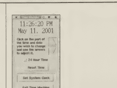

基于 Red Hat 的 Linux 使用名为 `/etc/localtime` 的符号链接来指定你当前的时区。在 SuSE Linux 中，这是从系统时区数据库生成的二进制文件。在 SuSE Linux 中，可以通过编辑其系统-wide 配置文件 `/etc/rc.config` 来设置时区。查找以下条目：

```
TIMEZONE=EST
```

进行更改后，请确保运行 SuSE 的 `suseconfig` shell 脚本以实施你的更改。

SuSE Linux 还提供了一种基于控制台的综合系统管理工具，名为 `yast`，以及一个更新的用于 X11 的图形版本，名为 `yast2`。当你使用 `yast` 命令时，可以使用其 `--mask` 选项直接跳转到特定的管理任务，后跟诸如 backup、consolefont、gpm、help、keymap、modem、mouse、netprinter、printer、scanner、timezone、user 或 vfree 等关键字。要直接跳转到简单的时区配置，请使用 `yast`，如下所示：`yast --mask timezone`。


使用 KDE 的系统管理员可以使用 `kcmclock` 客户端来设置时间并指定时区。从 X11 终端窗口的命令行启动客户端，如下所示：

```
# kcmclock &
```

当客户端启动时，点击对话框中的时区选项卡，如图 3.2 所示。

点击下拉 GMT 菜单并选择你的时区（作为相对于 GMT 的偏移量）。

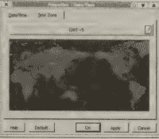

> 图 3.2 KDE 的 `kcmclock` 客户端用于设置您的时区。

你也可以通过创建或修改 `TZ` 环境变量来即时设置时区，这是一个内存设置，用于指定当前时区（详情请参阅 `tzset` 手册页）。

你也可以通过使用 `rdate` 命令及其 `-s` 或 `set` 选项，通过互联网更新系统时间。此命令只能由 root 操作员运行，并且应与互联网时间服务器的名称一起使用，例如：

```
# rdate -s tick.usno.navy.mil
```

此命令通过从指定的远程服务器获取时间来设置你的 Linux 系统时间。

> 不幸的是，SuSE Linux PPC 不包含 `rdate` 命令。但是，你可以从互联网下载、编译并安装这个小巧的工具的源代码。

## 添加用户

在 Linux 系统上管理用户是系统管理员的工作。但如果你在独立的台式机上使用 Linux，你就是系统管理员！你的首要任务之一是为自己创建一个用户名和密码，因为你不应作为 root 操作员使用 Linux（除非正在执行救援操作或系统维护）。

基于 Red Hat 的 Linux 系统包含多种图形界面和命令行工具，用于创建和管理用户。SuSE Linux 管理员可以使用图形化的 `yast` 实用程序或其他命令行工具。从命令行创建用户既轻松又简单，而且可能比使用图形工具更快。

在所有 Linux 系统中常用的 Linux 用户创建程序是 `useradd` 命令。如果你有一个名为 Fred Smith 的用户，那么使用 `useradd` 命令，如下所示：

```
# useradd fsmith
```

接下来，你应该使用 `passwd` 命令为新用户分配一个默认密码，如下所示：

```
# passwd fsmith
New password:
Re-enter new password:
Password changed
```

新用户“fsmith”现在将拥有一个名为 `/home/fsmith` 的目录，在 `/etc/passwd` 中指定的登录 Shell，以及一个新密码。

> 你拥有一个大型系统，或者需要创建数百个新用户？使用 `newusers` 命令，它使用包含新用户和密码列表的文件。有关更多信息，请参阅 `newusers` 手册页。

### 使用 userconf

许多基于 Red Hat 的 Linux 系统（如 LinuxPPC 2000 和 Yellow Dog Linux）中包含的 `linuxconf` 客户端的 `userconf` 组件可用于创建新用户。从命令行（作为 root）启动客户端，如下所示：

```
# userconf &
```

按下 Enter 键后，点击主窗口上的 **User accounts** 按钮。会出现一个新的对话框。点击 **Add** 按钮，你将看到如图 3.3 所示的对话框。

输入新用户的登录名和全名。其他设置可以留空，因为 `userconf` 将使用系统默认值。完成后，点击 **Accept** 按钮创建新用户。


### 使用 yast

SuSE Linux 的 `yast` 命令可用于创建新用户。从命令行（作为 root）启动该命令，如下所示：

```
# yast -mask user
```

按下 Enter 键后，你会看到如图 3.4 所示的对话框。

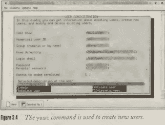

### 使用 `passwd` 命令

正如你已了解的那样，`passwd` 命令用于创建或更改用户的密码。如果你负责一个大型 Linux 安装环境，拥有众多用户，并希望实施更多安全措施，你可以采用一种称为 `密码过期` 或 `密码老化` 的技术。这对于合同员工或临时用户也是一种有效的技术。当你强制执行 `过期` 时，用户在预设时间后必须更新或更改密码。你还可以为临时账户强制执行实际的用户过期。

对于基于 Red Hat 的 Linux 系统，再次使用 `userconf` 命令（作为 root），如下所示：

```
# userconf &
```

导航到用户对话框（如图 3.3 所示），并点击 Params 选项卡。你会看到如图 3.5 所示的用户信息选项卡。

使用此选项卡设置密码必须更改的天数、用户账户的有效期限、何时发送即将过期的警告，以及警告发出后账户或密码的有效时长。

SuSE Linux 管理员可以转向 `yast` 命令的用户对话框（如图 3.4 所示）。但是，在输入用户名时，你必须按下 F6 键。你会看到如图 3.6 所示的对话框。

使用此对话框，以类似的方式操作 `userconf` 的控制。完成后，使用 Tab 键突出显示 Continue 按钮，以返回用户配置。

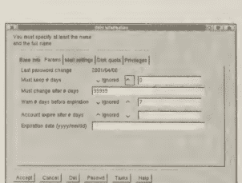

**图 3.5** 使用 `userconf` 设置密码过期。

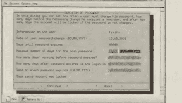

图 3.6 SuSE 的 `yast` 命令功能包括一个带有密码过期的对话框，有助于确保系统获得额外的安全性。

## 网络配置

使用 Linux 创建网络接口（参见第 9 章“连接互联网”）相对容易，肯定不会像其他商业操作系统那样涉及多个机器人。就像 Mac OS 一样，一旦你的内部硬件（如网络接口）被识别，你就可以设置你的 Power Mac 运行 Linux。这允许你在 30 秒内成为 LAN 的成员。


如果你的计算机带有内部以太网接口，请检查 Linux 内核在启动过程中提供的诊断输出。使用 `dmesg` 命令显示此信息，并查看你的内部网卡是否已被识别，如下所示：

```
$ dmesg | less
...
eth0: GMAC at 00:30:65:fd:df:a0, driver v1.3k2
3c59x.c © 1999/200 Donald Becker and others http://www.scyclad.com/network/vortex.html
...
```

在这个来自运行 LinuxPPC 2000 的 Apple TiBook 的示例中，`dmesg` 命令的输出被 *管道* 传输到 `less` 分页器。这意味着输出，即文本流，通过 `less` 命令发送，该命令允许你滚动（分页）文本。完成后按 q 键。

如果你没有看到任何输出，你的网卡可能未被识别。检查确保你的 Linux 内核中已启用网络支持，你使用了正确的 Linux 内核启动，和/或你的硬件受支持（通过检查你的发行版供应商的网站）。


> SuSE, Inc. 维护着优秀的硬件兼容性数据库以及关于其发行版的其他信息。从 http://www.suse.com 开始。

### 创建网络接口

创建网络接口意味着配置 Linux 以适配你的硬件，然后正确地为你的网卡分配 IP（互联网协议）地址。如果你仅将计算机用作独立的台式工作站，则不需要使用网络接口。当你连接互联网时，会创建一个不同类型的接口，称为 PPP（点对点协议）接口。

Linux 下的网络接口是在内存中创建的，通常按照创建的顺序进行编号和命名。例如，你创建的第一个 PPP 接口命名为 `ppp0`，而你创建的第一个以太网接口将命名为 `eth0`。

#### 使用 netcfg 客户端

许多基于 Red Hat 的 Linux 系统中包含的 `netcfg` 客户端可用于创建各种新的网络接口。从命令行（作为 root）启动客户端，如下所示：

```
# netcfg &
```

按下 Enter 键后，点击主对话框上的 Interfaces 按钮。会出现一个新的对话框。点击 Add 按钮，你会看到如图 3.7 所示的对话框。选择所需的接口，然后点击 OK 按钮。你将看到一个合适的对话框，以进一步配置接口。

#### 使用 YaST2 和 YaST

SuSE Linux 的 `yast` 命令和 `yast2` 客户端可用于创建新接口。例如，你可以使用 `yast` 直接从命令行开始配置网络接口，如下所示：

```
# yast --mask network
```

按下 Enter 键后，你会看到如图 3.8 所示的对话框。

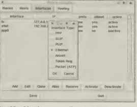

*图 3.7 使用* `netcfg` *客户端创建新的网络接口。*

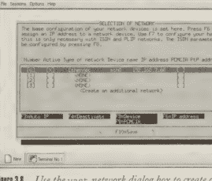

*图 3.8 使用 `yast2` 网络对话框创建或编辑网络接口。*

该对话框使用各种 F 键来激活、停用、编辑或创建网络接口。完成后，使用 Tab 键高亮显示“保存”按钮，或按 F10。如果您正在使用 X11 并且更喜欢图形界面，请使用 `yast2` 客户端来配置网络。

从 X11 终端窗口的命令行启动客户端，如下所示：

```
# yast2 &
```

按回车键后，单击窗口左侧的“网络/基础”菜单项，然后单击“启动模块”按钮。客户端会尝试检测你的内部以太网卡，如图 3.9 所示。

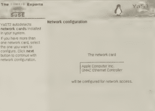

**图 3.9** *`yast2` 客户端尝试检测并初始化已安装的网络接口。*

单击“下一步”按钮继续配置你的网卡。你可以分配一个 IP 地址并继续配置计算机的网络。

有关网络设置的更多信息，请参阅第 9 章“连接到互联网”，其中包含更多有关使用 `ifconfig` 和 `route` 等命令行实用程序从命令行配置互联网接口的详细信息。

## 声音

使用 Linux 最令人愉悦的事情之一就是它对声音的支持以及丰富的音频和多媒体实用工具。但是，如果你在使用 PPC Linux 时依赖声音支持，请仔细选择你的 Power Mac 型号。声音可能完全支持，也可能不完全支持。

不幸的是，没有一份综合列表列出每台现有的 Apple Power Mac 计算机上支持的硬件和功能。但一般来说，大多数机器只需加载 `dnasound.o` 内核模块即可支持声音。一个例外是 Apple G4 Cube，它通过 USB (*通用串行总线*) 扬声器播放声音。对于此型号，只需使用 `insmod` 命令加载 `audio.o` 内核模块即可，如下所示：

```
# insmod audio
```

其他型号，如早期的 iBook，可能需要特别配置的 Linux 内核才能播放声音。对于较新的（2000 年夏季）iBook，Linux 可能尚未支持声音。

另一个问题是使用插槽式 Power Mac 播放音频 CD。在大多数基于 Intel 的 PC 和笔记本电脑上，即使计算机的声卡不支持声音，通常也可以播放音频 CD，因为 CD 驱动器的音频输出直接连接到计算机的音频输出硬件。Apple 的硬件并非如此，因此即使你的 Power Mac 支持声音，你可能会发现音频 CD 客户端无法正常工作。

你可以通过加载 IDE (Integrated Drive Electronics) SCSI (Small Computer Systems Interface) 仿真来解决这个问题，使用 `ide-scsi` 内核模块，如下所示：

```bash
# insmod ide-scsi
```

接下来，使用 `ln` 命令创建一个名为 `/dev/cdrom` 的链接，指向你计算机的 CD-ROM 设备（作为 SCSI 设备）。仿真的 SCSI 设备是 `/dev/sr0`：

```bash
# ln -s /dev/sr0 /dev/cdrom
```

如果你的发行版，如 YDL 2.0 或 LinuxPPC 2000，不包含 `/dev/sr0`，请使用 `mknod` 命令如下创建该设备：

```bash
# mknod /dev/sr0 b 11 0
```

使用你喜欢的文本编辑器创建一个名为 `mycdplay` 的 shell 脚本，其中包含一行命令，如下所示：

```bash
cdda2wav -t $1 -D /dev/cdrom -N -e -q -x -d0 -I cooked_ioctl1 $
```

保存该文件，然后使用 `chmod` 命令使该文件可执行，如下所示：

```bash
# chmod +x mycdplay
```

现在，你可以将音频 CD 插入运行 Linux 的插槽式 Power Mac，并像这样播放曲目，例如 2-6：

```bash
# ./mycdplay "2-6"
```

这种方法通过在一个步骤中使用 `cdda2wav` 命令剥离、转换并播放音频 CD 中选择的音频曲目来实现。这并不是一个完美的方法，因为其他系统活动、硬盘活动或其他活动进程可能会导致播放过程中出现跳针或停顿；然而，此命令在较快的 G4 机器上或原本处于空闲状态的较慢机器上运行良好。此外，虽然这种方法在 SuSE PPC 7.1 或 LinuxPPC 2000 Q4 中可以正常工作且无需重新编译内核，但 YDL 2.0 用户可能需要重新编译默认内核以启用 SCSI 仿真。

如果你的新 Power Mac 上的声音支持并未立即完全实现，请不要失望或沮丧。很有可能随着 PPC Linux 的成熟，支持将会改善，你很快就能播放音乐并观看 DVD（请参阅第 13 章“X11 多媒体”）。

## USB

Linux 的 USB (*通用串行总线*) 支持以惊人的速度改进。几乎所有的鼠标和键盘，包括 PFU AMERICA, INC. 的 USB Happy Hacking 键盘（本书超过一半的内容都是用它撰写的），都得到支持。许多其他 USB 设备，如并口、串行适配器、打印机和扫描仪也得到支持。

在 Linux 下检查 USB 支持的一个最初的地方是位于 http://www.linux-usb.org 的 Linux USB 项目。但请注意，特定设备在 PPC Linux 下的支持并不保证；这完全取决于基于 Intel 的驱动程序在 PowerPC 平台上的运行效果。好消息是许多设备得到很好的支持，大多数运行非常良好。

### 添加 USB 设备

USB 支持通常被编译到 Linux 内核中，对设备的支持由可加载内核模块提供。查看 `/lib/modules/` `2.x.x/usb` 目录，其中 `2.x.x` 是你的 Linux 内核版本。在 `usb` 目录下你会发现支持不同设备的各种内核模块。一些 USB 模块有特定设备的名称，例如 `keyspan_pda.o` 用于 Keyspan 的 USB 转串行 PDA 适配器。其他模块，如 `scanner.o`，支持广泛的设备。


## 添加扫描仪

如果你是图形艺术家，并且想在 PPC Linux 上使用扫描仪，请不要担心；有许多不同的扫描仪可以与 PPC Linux 和各种 Power Mac 计算机配合使用。在过去，大多数用于 Mac OS 的扫描仪都使用 SCSI 接口。然而如今，大多数扫描仪都支持 USB 接口。

对 USB 扫描仪的支持包含在 `scanner.o` 模块中。此模块支持各种各样的扫描仪。但是，为了在 Linux 上使用扫描仪，你需要相应的驱动程序支持。这种支持通常由 SANE `Scanner Access Now Easy` 的“后端和前端”软件工具集合提供。

如果你正在考虑购买 USB 扫描仪并在 Linux 上使用它，你应该首先浏览 SANE 主页：http://panda.mostang.com/sane/ 并检查是否支持你打算使用的扫描仪（参阅第 13 章“X11 多媒体”，了解有关使用 SANE 的更多信息）。接下来，检查 Linux USB 设备页面，查看扫描仪模块是否支持你的扫描仪。

在撰写本文时，PPC Linux 扫描仪驱动程序支持许多不同的扫描仪型号，如 Acer 的 Prisa 620U、640U 和 640BU；Agfa 的 Snapscan 1212U；Epson 的 GT-7000；Perfection 610U、636U 和 640U；1200U/Photo；以及 1240U/Photo；还有 Hewlett Packard 的 5100C、5200C 和 6300C 型号。

如果你使用 Epson 640U USB 扫描仪和 SuSE Linux PPC，你需要通过编辑扫描仪模块源代码并重新构建 `scanner.c` 内核模块来添加对扫描仪的支持。编辑 `/usr/src/linux/drivers/usb` 目录下的 `scanner.h` 文件。

> 你需要安装适当的核心源代码、内核头文件以及开发库、实用工具和命令（如 `gcc` 编译器）才能重新构建内核模块（或 Linux 内核）。这至少需要额外的 150MB 硬盘空间。

查找以下条目：

```c
/* Seiko/Epson Corp. */
{ 0x04b8, 0x0101 },  /* Perfection 636U and 636Photo */
{ 0x04b8, 0x0103 },  /* Perfection 610 */
{ 0x04b8, 0x0104 },  /* Perfection 1200U and 1200Photo */
```

你需要为你的 640U 添加 USB 标识字符串信息，如下所示：

```c
/* Seiko/Epson Corp. */
{ 0x04b8, 0x0101 },  /* Perfection 636U and 636Photo */
{ 0x04b8, 0x0103 },  /* Perfection 610 */
{ 0x04b8, 0x010c },  /* Perfection 640U */
{ 0x04b8, 0x0104 },  /* Perfection 1200U and 1200Photo */
```

接下来，导航到 `/usr/src/linux` 目录并重新构建系统的内核模块，如下所示：

```
# make modules
```

构建完成后，你可以简单地将生成的 `scanner.o` 模块复制到你的 `/lib/modules/2.2.x/USB` 目录中，以替换原有的模块。请注意，这仅在你使用与当前正在运行的内核相同的 Linux 源代码进行构建时才有效（`scanner.h` 源码的结构在新的 2.4 系列 Linux 内核中已发生变化，但扫描仪信息仍然保持有效）。

## 打印

在 PPC Linux 上安装打印机以供使用既快速又简单，因为每个 Linux 发行版都附带使该任务变得容易的工具。基于 Red Hat 的系统带有图形化的 `printtool` 客户端，而 SuSE PPC Linux 用户可以使用 `yast` 命令或 `yast2` 客户端来配置打印机。

对于从 Intel 平台迁移到 PPC Linux 的 Linux 用户来说，一个好消息是，你较旧的、受 Linux 支持的并口打印机在运行 PPC Linux 时可以通过 USB 接口工作！如果你有一个旧式的并口打印机，并希望在 Power Mac 上的 PPC Linux 环境中使用它，D-Link DSB-P36 USB 并口打印机适配器是必不可少的；你可以将并口打印机连接到计算机的 USB 端口。

在 Linux 下设置并口或 USB 打印机只需几秒钟即可完成。例如，在 SuSE PPC Linux 下，启动 `yast2` 客户端。选择“硬件/打印机”菜单项，然后单击“启动模块”按钮。你会看到一个列出五种不同打印机的对话框：Novell、并口、远程、Samba 和 USB。

如果你有一个 USB 打印机，或者一个连接到 D-Link 适配器的打印机，请单击 USB，然后单击“添加”按钮。你会看到一个对话框，如图 3.10 所示。

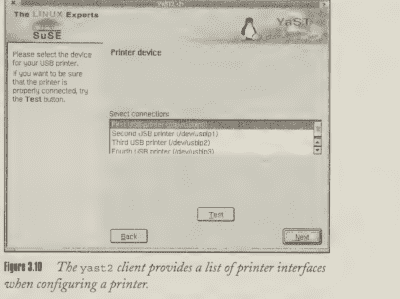

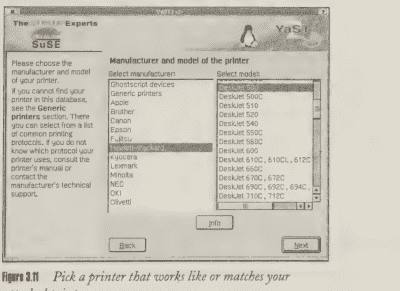

选择一个打印机设备名称，例如 `/dev/usb/p0`（如果你只有一个打印机），然后单击 `Next`（下一步）按钮。然后你会看到一个列出各种打印机制造商和设备的对话框。单击你的打印机制造商，例如 Hewlett Packard（惠普），该制造商支持的打印机列表就会出现，如图 3.11 所示。

如果你没有看到与你打印机完全匹配的型号，请不要惊慌。市场上有很多不同的打印机，但来自同一制造商和系列的许多打印机都可以使用一个或多个打印机驱动程序正常工作。例如，HP 658C USB 打印机使用 Deskjet 500 打印机驱动程序时运行良好。完成后，单击 `Next`（下一步）按钮。

现在系统会要求你为打印机命名。给打印机命名，或者接受默认名称。请记住这个名称，因为你稍后需要使用它进行打印！

完成后，单击 `Next`（下一步）按钮。然后你会看到一个对话框，如图 3.12 所示。

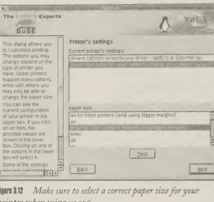

图 3.12 使用 `yast2` 时，请确保为你的打印机选择正确的纸张尺寸。

单击顶部对话框中的纸张尺寸项，然后为你的打印机选择一个默认的纸张尺寸。

完成后，单击 `Next`（下一步）按钮，然后单击 `Finish`（完成）按钮将打印机添加到系统中。现在你可以使用 `lpr` 命令向你的打印机打印文档，如下所示：

```
# lpr -Pprintername mydocument.ps
```

在这个例子中，使用 `-P` 命令行选项来指定打印机。这一点很重要，因为你的系统可以连接任意数量的打印机，甚至可以向连接在其他计算机上的远程打印机进行打印。

打印通过 `lpd` 打印机守护程序进行。此服务在启动 Linux 时随之启动，它监控 `/var/spool/lpd` 目录，寻找等待打印的文档。当找到文档时，`lpd` 守护程序启动打印进程，并将文档发送到指定的打印机（该打印机在 `/var/spool/lpd` 下有自己的目录）。

### 使用 printtool 客户端

随基于 Red Hat 的 PPC Linux 发行版提供的 `printtool` 客户端是一种打印机创建和管理工具。你可以从 `controlpanel1` 客户端或 X 终端的命令行，在活动 X 会话期间启动此客户端，如下所示：

```
# printtool &
```

当客户端出现时，单击“添加”按钮。你会看到一个对话框，如图 3.13 所示。

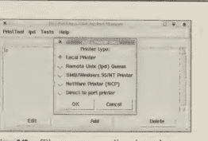

图 3.13 `printtool` 客户端用于配置各种打印机。

选择所需的打印机类型，例如本地，然后单击 `OK`（确定）按钮。当出现“编辑本地打印机条目”对话框时，记下默认打印机的名称（或重新命名打印机），然后单击“Input filter”（输入过滤器）按钮。你会看到一个对话框，如图 3.14 所示。

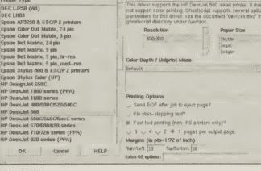

图 3.14 使用 `printtool` 时，请确保为你的打印机选择兼容的打印机配置。

这是一个关键步骤！你选择的确切型号或与你打印机工作方式类似的型号，必须选择一个兼容的打印机。完成后，单击 `OK`（确定）按钮，然后再次单击 `OK`（确定）以保存你的新打印机。与 SuSE Linux 一样，使用打印机的名称来打印文档。

### 编辑 /etc/printcap

`yast`、`yast2` 和 `printtool` 命令将你的打印机定义保存在系统的打印机能力数据库 `/etc/printcap` 中。你不需要编辑此文件！当然，作为 root 操作员，你可以做任何你想做的事，但通常你不需要做任何更改。


但是，如果你使用 SuSE Linux，并使用 `yast` 命令为 USB 打印机创建打印机定义，你需要编辑系统的 `/etc/printcap`。

由于 `yast` 命令旨在创建旧式的并口打印机，任何新创建的打印机都使用 `/dev/lp*` 设备名称，例如 `/dev/lp0`。你仍然可以使用 `yast` 为你的 USB 打印机创建打印机定义，但之后，你需要编辑生成的 `/etc/printcap` 条目。查找以下内容：

```
...
   :lp:/dev/lp0:\n...
```

为了设置正确的设备，将此条目更改为如下形式：

```
...
   :lp:/dev/usb/lp0:\n...
```

这确保了使用 `yast` 配置打印机后打印功能能够正常工作。

### 创建远程打印机

Linux 有许多出色的网络功能。如果你使用 PPC Linux 并且可以访问局域网（LAN），你可以设置远程打印服务。这相对容易。

首先，访问连接了打印机的远程计算机。确保打印机已连接、配置正确且工作正常。接下来，坐下来编辑系统的 `/etc/hosts.lpd` 文件，并插入你希望有权访问本地打印机的各个主机名称。同时记下远程计算机上打印机的名称。保存文件，然后像这样重启计算机上的 `lpd` 守护程序：

```
# /etc/rc.d/init.d/lpd restart
```

接下来，转到你的工作站，使用 `yast` 或 `printtool` 创建一个远程打印机。例如，图 3.15 显示了一个打印机定义条目对话框。

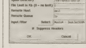

图 3.15 `使用 printtool 创建远程打印机条目时，请确保使用正确的远程打印机名称。`

给打印机条目一个本地名称，然后指定远程主机的名称以及远程主机上打印机的名称（远程队列）。然后你需要为远程打印机条目选择一个与远程打印机匹配的适当打印机过滤器。保存定义。然后你可以向远程打印机打印，如下所示：

```
# lpr -Premoteprintername mydocument.ps
```

### 串行端口和调制解调器

较新的 Power Mac 不再随附串行（RS-232 或 RS-422）端口，尽管每台 PowerBook 和部分台式机（如 Apple G4 Cube）都随附内部调制解调器。大多数内部调制解调器都受到支持。有关使用串行端口的更多信息，请参阅第 9 章“连接到 Internet”。本章包含有关检测、配置和设置串行端口或调制解调器的更多细节，以及一些向计算机添加串行端口的可能的变通解决方案。

大多数 Linux 发行版包含的几种实用程序提供传真服务。SuSE Linux 包含一个名为 HylaFAX 的复杂传真支持系统。然而，你可能希望探索使用 efax 软件。使用此软件非常简单。首先，使用你喜欢的文本编辑器（以 root 身份）编辑 `/usr/bin` 目录下名为 `fax` 的文件。查找各种条目，例如：

```
...
# Your fax number in international format, 20 characters maximum.
# Use only digits, spaces, and the "*" character.

FROM="+0 000 000 0000"

# Your name as it should appear on the page header.

NAME="from a Red Hat Linux system"
...
```

将这些条目更改以包含你的传真号码和姓名。如果你已正确配置调制解调器，你就可以将 Linux 系统变成一台等待接收传真的传真机，如下所示：

```
# efax

efax: Sun May 13 16:18:27 2001 efax v 0.9 Copyright 1999 Ed Casas

efax: Sun May 13 16:18:27 2001 efax v 0.9 Copyright 1999 Ed Casas

efax: 18:27 compiled Aug 21 2000 01:25:22

efax: 18:30 opened /dev/modem

efax: 18:31 using V2.300-V90_2M_DLS CONEXANT AC/K56 in class 2
```

本示例展示了在 Apple TiBook 上运行的 `efax` 命令。要发送传真，请使用 `fax` 命令及其 `send` 选项，并附上远程传真号码和文档名称，如下所示：

```
# fax send 2025551212 mydocument.txt
```

`fax` 脚本负责拨号和将您的文档转换为适合传输的正确格式。

#### 故障排除

许多经验丰富的 Linux 用户在购买设备时会仔细调研，特别关注 Linux 的兼容性。然而，如果您使用的电脑未得到 Linux 的完全支持，请勿担心。在 PowerPC 平台上，Linux 将会趋于成熟，设备支持也将逐步改善。好消息是，苹果（Apple）出品的较新型 Power Mac 大部分都具有良好的 Linux 兼容性。这包括 G4 Cube、最新的钛合金 PowerBook 以及最新的 iBook。

获得您所用设备支持的最佳途径，是密切关注各种以 PPC Linux 为核心的网站，查看使用类似设备的其他人是如何找到解决方案的。随着 PPC Linux 供应商改进发行版，对较新型计算机的支持将被添加。每个新版本的 Linux 内核都会带来额外的支持，您一定能找到所有设备都能正常工作的若干台计算机。

您还应将附录中列出的各种资源作为获取更多信息的起点。您还可以从当地的 LUG（`Linux User Group`，Linux 用户组）获得帮助。加入 LUG 是了解 Linux、接触新思想并与可能拥有类似设备的其他用户交流的绝佳方式。LUG 的体验非常有意义，许多 LUG 会赞助讲座、演示活动和 Install Fests（安装集会），在那里新用户可以携带设备，由专家快速安装和配置 Linux。

##### 资源

- `http://www.eecs.udel.edu/~mills/ntp/servers.htm`。公共互联网时间服务器列表，可用于 `rdate` 命令及其他时间服务。
- `http://www.rocile.com/wvlanPPC/`。关于使用 Apple Airport 和 LinuxPPC 2000 的信息。
- `http://www.mailgate.org/linux/linux.debian-ports.powerpc/msg02300.html`。如何在 TiBook 上将 Airport 网卡集成到 PPC Linux 中。
- `http://penguinppc.org/~benh/.` Ben Herrenschmidt 的个人主页，提供用于支持基于较新型 Rage128 的 PowerBook 使用外部显示器的软件。
- `http://sdb.suse.de/en/sdb/html/index.html.` SuSE, Inc. 的可搜索知识库，可用于研究 PPC Linux 的硬件和软件问题。
- `http://www.wrietman.com/.` 面向 PPC Linux iBook 用户的综合网站。
- `http://students.washington.edu/mpalczew/.` 想在您的 iBook 上使用声音？请从此网站获取破解的内核和模块。
- `http://www.pfuca.com/.` 真正的 Linux 黑客键盘——小巧的 Happy Hacking 键盘的主页，现在已有 USB 型号（并且，不，我不为 PFuCA 工作，也没有因推荐而收到任何产品回报——我只是需要额外的桌面空间）。
- `http://www.jump.net/~dnelson/linux/usb/.` Linux USB 扫描仪驱动程序的主页。
- `http://www.buzzard.org.uk/jonathan/scanners-usb.html.` 查找受 Linux 支持的 USB 扫描仪的绝佳地点。
- `http://www.qbik.ch/usb/devices/.` Linux USB 设备列表，包含指向 USB 设备驱动程序和用户评论的链接。
- `http://www.tux.org/luglist.html.` 一个优秀的 Linux LUG 列表，包含美国东部和加拿大各地 LUG 主页的链接。

#### 第 4 章：全面解析启动


- 选择启动方法
- 理解 Open Firmware
- 故障排除

本章介绍了在 Apple PowerPC 上启动 Linux 的各种启动工具的安装、配置和使用。如果需要更换硬盘、重新安装 Linux 或在新的计算机上安装 Linux，了解根据目标平台应使用何种类型的启动机制至关重要。


启动加载程序还可用于救援操作、调整视频和图形硬件，或启用 Linux 内核的某些功能。许多 PowerPC Linux 用户只是安装一个启动加载程序，然后在系统上愉快地工作。然而，更高级的 PowerPC Linux 用户试图充分利用系统，当问题出现时，他们能更成功地克服障碍。

好消息是，您可以将 PowerPC Mac 配置为正确地启动到 Linux 或 Mac OS 而不出任何问题，且您不需要掌握那些只需使用一两次就足够了的高深技术技能。一旦掌握了更多信息，您就不应再遇到问题，并且可能会学到一点故障排除知识。

## 选择启动方法

您对启动方法的选择主要取决于手头 Apple Macintosh 型号的类型。虽然某些 Apple PowerPC 计算机可以使用 `BootX` 和 `Yaboot`（例如早期的 iBook），但通常通过使用更合适的启动加载程序来安装或运行 Linux 会获得更好的效果。

以下是一般规则：

- 如果您的 Macintosh 是“OldWorld” PowerPC Mac，请使用 `BootX` 控制面板。
- 如果您的 Macintosh 是“NewWorld” PowerPC Mac，请使用 `Yaboot` 内核加载程序。
- 如果您的 Macintosh 可以使用 `BootX` 或 `Yaboot`，请改用 `Yaboot`。

## 有什么区别？

早期的 Macintosh 使用名为 `ToolBox ROM` 的 ROM（*Read-only Memory*，只读存储器）芯片。该 ROM 芯片保存了 Mac OS 的各个部分，不仅用于启动计算机，还在计算机使用中支持图形和其他操作。从 1999 年底开始，Apple 改变了这种方针，并从此类信息中移除了 ROM。

新的方法被标记为 *NewWorld Architecture*（新世界架构），将 Mac OS 启动代码和系统软件分为两部分，一部分启动代码位于名为 `Boot ROM` 的 ROM 中，系统软件支持例程位于名为 `ToolBox ROM` 映像的文件中。`Boot ROM` 包含一个 `FORTH` 语言解释器，由名为 `Open Firmware` 的软件启动。

因此，使用 `ToolBox ROM` 的 PowerPC 系统被标记为 `OldWorld` Mac，而所有较新的 Mac 均为 `NewWorld`。

## Yaboot、lilo 还是 BootX？

`NewWorld` Macintosh 包括 Blue and White G3s 和 G4 Power Macs、PowerBooks、iMac 和 iBook 等型号。`OldWorld` Macintosh 包括 pre-iMac（米色）Power Macs。关于特定型号的兼容性，或 PreP 和 CHRP PowerPC 计算机的信息，请访问您的 Linux 发行商的网站。

以下部分介绍了您可以用来设置双启动 Mac OS 和 PPC Linux 系统的常用软件工具。目前，在 PowerPC 平台上启动 Linux 几乎总是需要至少有一个 Mac OS 分区，并首次使用 Mac OS 来分区系统硬盘。这与基于 Intel 的 PC 不同，后者通常使用嵌入在第一块 IDE 硬盘的主引导记录中的启动加载程序。

### 配置 BootX

`BootX` 由杰出的 Mac 和 Linux 程序员 Benjamin Herrenschmidt 创建，是一个 Mac OS 控制面板，提供图形化启动加载程序界面，用于启动 Linux 或 Mac OS。要使用此软件，请下载或复制 `BootX` 发行版（如图 4.1 所示）到您的 Mac OS 桌面。


图 4.1 `BootX` 控制面板用于在 `OldWorld` 和部分 `NewWorld` Power Mac 上启动 Linux 或 Mac OS。

要安装 `BootX`，请将 `BootX` 控制面板和 `BootX` 扩展拖放到您的 Mac OS 系统文件夹中。控制面板放置在控制面板文件夹中，而扩展文件放置在扩展文件夹中。接下来，将名为 `Linux Kernels` 的文件夹复制到您的系统文件夹。此文件夹可以容纳不同版本的 PPC Linux 内核，在使用 Linux 时测试新内核非常有用。

`BootX` 用于启用 Linux 安装，并在安装后用于在启动 Linux 或 Mac OS 之间进行选择，选择正确的 Linux 内核，设置正确的视频设置，以及传递内核*参数*或启动消息（类似于基于 Intel 的 Linux 用户在 `LILO` boot: 提示符下看到的消息）。

使用 `BootX` 的内核弹出菜单来选择 Linux 内核。放置在系统文件夹中 `Linux Kernels` 文件夹内的任何 Linux 内核都将被列出（不过，`BootX` 也会查找系统文件夹中名为 `vmlinux` 的内核）。`Root Device` 字段应包含根 Linux 分区的分区号。例如，如果 Linux PPC 2000 Q4 安装程序报告您的根分区是 `/dev/hda12`，请在 `Root Device` 字段中键入 `hda12`。

`More kernel arguments` 字段用于在 Linux 启动时向 Linux 内核传递参数。这些参数可以从视频设备设置到 *runlevels*（运行级别）或 Linux 系统状态不等。


> 如果您使用 `BootX`，则不需要在 `/boot` 目录中保留 Linux 内核的副本。

例如，如果您希望将 PPC Linux 启动到运行级别 1，或系统维护模式（启用网络、多用户，且关闭 X），请在参数字段中使用关键字 `single`。Linux 将启动到 root 提示符。如果您是使用单按钮 ADB 鼠标的 iBook 用户，您可以使用 `adb_buttons=103,111`，这将把 F11 和 F12 键设置为鼠标中键和右键（USB 用户采用不同的方法）。

视频选项可能看起来像这样：

```
video-attyb:vmode:18,cmode:16
```

在此示例中，Linux 内核被告知使用一种类型的视频（framebuffer），分辨率（*vmode*）为 1152x870，颜色深度（*cmode*）为数千种颜色。*vmode* 设置的有效范围是 5、6 以及 10 到 20，代表从 640x480 到 1280x1024 的分辨率。有效的 *cmodes* 是 8、15、16、24 和 32（范围从 256 种颜色到数百万种颜色）。

还有一些其他参数，例如 `mkfr`（用于控制视频时钟）和 `pil`，这些参数尚未在文档中记录（除 Linux 内核源代码外）。Linux 内核能识别许多不同的参数。不同的视频驱动程序（例如 Matrox）甚至能识别超过 40 个！

当你点击 `BootX` 选项按钮时，你会看到一个对话框，如图 4.2 所示。使用此对话框可以启用 G3 PowerPC Mac 上的缓存、强制使用 SCSI、强制设置视频参数，或选择一个 RAM 磁盘映像（仅在 Linux 安装过程中需要——安装完成后可丢弃）。完成后，点击“确定”或“取消”返回主对话框。你可以随时使用 `Cmd+s` 保存你的 `BootX` 设置。

当你的 Power Mac 开机时，`BootX` 会在初始 Mac OS 对话框出现后不久显示。你大约有 10 秒钟的时间来选择启动 Mac OS 或 Linux。

### 配置 Yaboot

与 `BootX` 类似，`Yaboot` 是 PPC Linux 的引导加载器。这是在使用 `NewWorld` Power Mac 时首选的引导加载器，并且配置相对简单。你需要知道根 Linux 分区的分区号，以及任何期望的内核参数。这个由 Ben Herrenschmidt 编写的加载器试图使用 Apple 的 `Open Firmware` 来引导 Linux。如果 `Yaboot` 配置正确，它就不需要使用 `Open Firmware` 提示符（在启动时按住 `Opt+Cmd+o+f` 键即可访问）。

使用此引导加载器的基本方法是创建一个小的、独立的 Mac OS HFS 卷，用于存放伪系统文件夹（pseudo-System Folder）、Finder、`Yaboot`、`PPC Linux` 内核，以及名为 `yaboot.conf` 的 `Yaboot` 配置文件（参见图 4.3）。

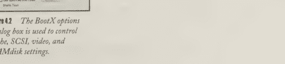

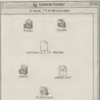

图 4.3 *Mac OS HFS 引导卷上的伪系统文件夹包含了启动 Linux 所需的一切。*

你可能还想探索另一种引导方法，即 Ethan Benson 的 `ybin`。此工具与 `Yaboot` 配合使用，提供了额外的灵活性，并根据 `Yaboot` 的配置文件自动配置 Apple `Open Firmware` 引导脚本。有关详细信息，请访问 http://www.alsaka.net/–erbenson/ybin/。

### 配置 LILO


SuSE PPC Linux 包含一个专门用于 PPC Linux 的 LILO（`Linux Loader`）版本。此版本遵循为基于 Intel 的 PC 设计的版本中使用的许多语法，并在引导提示符处的工作方式几乎相同。LILO 最初是为基于 Intel 的 PC 硬件设计的。作为一种引导加载器和引导工具，LILO 通常安装在 IDE 驱动的 MBR（`主引导记录`）或根 Linux 分区中，以支持引导到 Linux 或其他操作系统。一个名为 `lilo.conf` 的配置文件，位于 `/etc` 目录下，包含了 LILO 安装和操作的指令及路线图。

在 SuSE 的 PPC Linux 下，LILO 用于在 `/boot` 目录下创建文件，这些文件包含引导 Mac OS 或 Linux 的指令和路线图。`/etc/lilo.conf` 包含你系统的一个快照，这对 Intel Linux 用户来说很熟悉。例如：

```
# partition of the HFS volume holding the pseudo System Folder
boot=/dev/hda10
# how long to wait before booting the default
timeout=100

# the default OS to boot (according to label=)
default=linux
# the kernel to boot Linux
image=/boot/vmlinux
label=linux
# insert any required/desired kernel arguments
append=""
# the root Linux partition
root=/dev/hda11
# boot to an installation (e.g., type "install" at LILO prompt)
image=/boot/vmlinux
label=install
append="ramdisk_size=10000"
root=/dev/fd0
inirld=/boot/initdisk.gz
# boot MacOS (e.g., type "macos" at LILO boot prompt)
other=/dev/hda9
label=macos
```

在此示例中，包含 yaboot 和伪系统文件夹的标准 HFS 卷位于 `/dev/hda10`。主要的 Mac OS 分区是 `/dev/hda9`。根 Linux 目录安装在 `/dev/hda11`。在输入你的 `/etc/lilo.conf` 后，你应该在 Linux 命令行上（作为 root 用户）像这样运行 LILO：

```
# lilo
```

然后 LILO 将在 `/boot` 目录下创建必要的文件。

在你的系统上使用 LILO 是否有效取决于具体情况。由于 SuSE PPC Linux 的配置方式，LILO 通常可以使用，并且是引导解决方案的一部分。然而，其他的 PPC Linux 发行版，如 LinuxPPC 2000 Q4，提供了使用 Yaboot 的更简化的引导操作。


你可以在 SuSE PPC Linux 的 `/usr/share/doc/packages/lilo` 目录下找到有关 LILO 的 Power Mac 特定信息。LILO 不与其他 PPC 发行版一起使用。

### 理解 Open Firmware

Open Firmware 提示符基本上是一个类似 FORTH 解释器的命令行界面。FORTH 语言最初由天文学家 Chuck Moore 在 1970 年设计用于控制望远镜，因其紧凑、可移植且可扩展，是 ROM 基解决方案的理想选择，因此非常流行。FORTH 已被用于许多不同类型的嵌入式设备，包括许多商业街机游戏。

Apple 实现了其 NewWorld Power Mac 的引导语言，名为 Open Firmware，以允许设备灵活性并在引导时进行配置。你不必学习如何在你的 Power Mac 上引导 Linux 的 FORTH 语言（它是基于堆栈并使用后缀表示法的）。但是，了解如何访问提示符并理解一些 Open Firmware 关键字会有所帮助。

SuSE PPC Linux 使用一个包含 Open Firmware 语言的脚本来帮助配置和引导 Linux。该脚本的一部分名为 os-chooser（位于名为 suseboot 的伪系统文件夹中），内容如下：

```
* get-key-map* " keyboard* open-dev $call-method
dup 20 dump
5 + C@ 08 = if
* Booting MacOS ..." cr " boot hd:9,\\tbxi\ eval
else
* Booting Yaboot ..." cr " boot hd:10,\\yaboot* eval
```

在此示例中，Linux 通过从 `/dev/hda10` 加载 Yaboot 来启动，这是一个在 Linux 安装期间创建的标准 HFS 引导卷。然后 Yaboot 启动 Linux。Open Firmware 在启动 Linux 中的作用是启动 Yaboot，其中包含启动 Linux 或 Mac OS 的指令。

你可以在开机后按住 Cmd+Option+o+o 键直接引导 Power Mac 到 Open Firmware 提示符。屏幕将清空，你将处于 Open Firmware 提示符处。

Open Firmware 包含与你特定 Power Mac 对应的默认设置。除非你知道自己在做什么，否则在修改现有设置时应谨慎行事。如果遇到麻烦，请使用 `reset-all` 命令将设置重置回默认值。使用 `printenv` 命令查看当前设置的列表。

通常会对 Open Firmware 环境变量设置进行修改，以定义或创建引导变量，例如 Linux 或 Mac OS 分区的定义，以及创建引导 Linux 或 Mac 的命令，可能使用 `boot` 关键字（这会退出 Open Firmware）。如果 Open Firmware 变量 `boot-device` 配置不正确，在引导 Mac OS 时可能会出现问题。

希望随着 PPC Linux 的成熟，会出现更多用户友好的引导配置界面。目前，在使用 Open Firmware 时，请遵循随附的 SuSE PPC、LinuxPPC 2000 或 Yellow Dog Linux 手册中的说明。

#### 故障排除

问题最常出现在尝试引导 Linux 时，由于引导加载器配置不正确所致。其他问题包括使用错误的内核、不适当的内核参数、编译时未支持正确类型硬盘的内核，或指定了错误类型的视频硬件。

涉及 Yaboot 配置错误的问题可以通过记录系统分区图、在安装期间注意分区编号，或使用分区编辑器获取分区信息来避免。

一个有用的工具是 `pdisk` 命令，它是基于 Intel 的 `fdisk` 命令的对应物。你可以在运行 Linux 时使用 `pdisk`，通过 `-l` 或 `list` 选项快速获取系统的快照，如下所示：

```
$ pdisk -l
```

```
Partition map (with 512 byte blocks) on '/dev/hda'

#:	type name			length	base		(size )
1:	Apple_partition_map 'Apple				63 @ 1
2:	Apple_Driver43* 'Macintosh		54 @ 64
3:	Apple_Driver43* 'Macintosh		74 @ 118
4:	Apple_Driver_ATA*' 'Macintosh		54 @ 192
5:	Apple_Driver_ATA* 'Macintosh		74 @ 246
6:	Apple_FWDriver* 'Macintosh		200 @ 320
7:	Apple_Driver_10Kit ' 'Macintosh	512 @ 520
8:	Apple_Patches 'Patch Partition'	512 @ 1032
9:	Apple_HFS* 'Macintosh HD	12400855 @ 1544	( 5.9G)
10:	Apple_HFS	'/'boot			65536 @ 12402399	( 32.0M)
11:	Linux_PPC	'/'				12400854 @ 12467935	( 5.9G)
12:	Linux_PPC	'/'swap			646087 @ 24868789	( 315.5M)
13:	Linux_PPC	'/'d2				14495644 @ 25514876	( 6.9G)
14:	Apple_Free	'Extra				24 @ 40010520

Device block size=512, Number of Blocks=40010543 (19.1G)
```


这里并没有显示所有输出，但如图所示，该示例输出与前面 `/etc/lilo.conf` 中的信息相符。扩展的 Mac OS 分区位于 `/dev/hda9`，大小约为 6GB。标准的 HFS 卷（名为 `/boot`）位于 `/dev/hda10`。根 Linux 分区位于 `/dev/hda1`。其余分区包括一个超过 315MB 的交换分区、一个标记为 `/d2` 的次要 Linux 卷，以及一小部分剩余且未使用的硬盘空间。

其他问题可以通过正确配置内核（可能使用内核参数）来解决，以适配特定 Power Mac 的图形硬件。通常，您可以使用帧缓冲控制台（framebuffer console）安全地引导到安装环境或 Linux 会话，而不依赖任何特殊的图形硬件。例如，使用帧缓冲控制台视频的超安全 YaBOOT 或 LILO 内核参数可能如下所示：

```
append="video=atyfb video=only"
```

名为 `fbset` 的配套程序用于打印诊断信息或设置控制台的分辨率（如果支持）。例如，您可以在控制台上使用 `fbset` 查看当前的帧缓冲设置，如下所示：

```
$ fbset -i

mode "1024x768-75"
# D: 78.740 Mhz, H: 60.015 kHz, V: 75.019 Hz
gometry 1024 768 1024 768 16
timing 12700 159 33 28 1 96 3
hsync high
vsync high
rgba 5/10,5/5,5/0,0/0
endmode

Frame buffer device information:

Name		: ATY Rage128
Address	: 0x94000000
Size		: 16777216
Type		: PACKED PIXELS
Visual		: DIRECTCOLOR
XpanStep	: 8
YPanStep	: 1
YWrapStep	: 0
LineLength : 2048
MMIO Address : 0x90000000
MMIO Size : 8191
Accelerator : Unknown (32)
```

在此示例中，`fbset` 打印了有关当前设置的扩展信息（由 `-i` 选项请求）。这些设置是通过使用 `fbset` 命令更改的。但是，如果您在启动后遇到图形问题，这种方法对您没有太大帮助。最佳方法是在您的 Yaboot 配置文件中根据 Power Mac 型号使用合适的 `vmode` 和 `cmode` 参数，例如如下所示：

```
append="video=atyfb:vmode=17,cmode=16"
```

在此示例中，图形设置为 1024x768 分辨率，频率为 75MHz，颜色模式设置为数千色。

其他问题，例如启用内部硬件（如声音、以太网或内置调制解调器），通常通过内核更新或更新的内核模块来解决。在几乎大多数情况下，默认的基本音量级别是通过 Mac OS 的声音设置来设定的。这意味着在 Mac OS 会话中调高音量，然后启动到 Linux，就可以使您在 Linux 下增加音量。如果在 Mac OS 会话中声音被禁用或设置得过低，且您启动到 Linux，则可能完全听不到声音。

如果您遇到困难，请查阅 Linux PPC 网站，获取有关您特定 Power Mac 型号的信息。您通常会发现，在您之前已经有人遇到过类似的问题并发布了解决方案。

### 资源

- [http://www.mklinux.org](http://www.mklinux.org)。旧版 Macintosh 平台上 Linux 的主页。
- [ftp://metalab.unc.edu/pub/Linux/distributions/mklinux/](ftp://metalab.unc.edu/pub/Linux/distributions/mklinux/)。当前 MkLinux 项目的一个资源来源。
- [http://penguinppc.org/~benh/](http://penguinppc.org/~benh/)。Miboot、BootX 和 Yaboot PPC Linux 引导工具的主页。
- [http://ppcboot.sourceforge.net/](http://ppcboot.sourceforge.net/)。新的嵌入式 PPC Linux 引导工具 PPCBoot 的开发主页。
- [http://www.linuxppc.org/](http://www.linuxppc.org/)。Linux PPC 移植项目的官方主页。
- [http://www.suse.com/us/products/susessoft/ppc/index.html](http://www.suse.com/us/products/susessoft/ppc/index.html)。SuSE PPC Linux 移植项目的主页。
- [http://www.alaska.net/~erbenso/ybin/](http://www.alaska.net/~erbenso/ybin/)。Ybin Yaboot 安装程序的主页。
- [http://www.debian.org/releases/stable/powerpc/install.en.txt](http://www.debian.org/releases/stable/powerpc/install.en.txt)。Debian PPC Linux 的安装说明（英文）。
- [http://developer.apple.com/technotes/tn/t1167.html](http://developer.apple.com/technotes/tn/t1167.html)。关于 NewWorld ROM 的技术说明以及 NewWorld Macintosh 的启动方式。
- [http://www.forth.org/](http://www.forth.org/)。历史悠久的小型 FORTH 兴趣小组（FIG）的主页。
- [/usr/src/linux/Documentation/fb/framebuffer.txt](/usr/src/linux/Documentation/fb/framebuffer.txt)。关于 Linux 帧缓冲设计的技术信息。当您安装 Linux 内核源代码时，可以在系统中找到此信息。
- [http://www.linux-laptop.net](http://www.linux-laptop.net)。在此查找 Linux PowerBook 的解决方案以及各种 PowerBook 和 Linux 的用户经验。

## 第二部分

### 在您的 Mac 上使用 Linux 和 X11

- 5 Shell 简介
- 6 使用文本编辑器
- 7 X11 和窗口管理器
- 8 使用 X11
- 9 连接到互联网
- 10 使用 K 桌面环境
- 11 使用 GNOME 和 X11
- 12 使用生产力应用
- 13 X11 多媒体

#### 第 5 章：Shell 简介

- 什么是 Shell？
- Linux 的 Shell
- 选择 Shell
- 更改和授权 Shell
- 如何使用 Shell


本章介绍 Linux shell。使用 shell 的概念对于某些 Mac 用户来说可能显得陌生，甚至让顽固的 GUI（*图形用户界面*）爱好者感到反感。然而，shell 是 Linux 不可或缺的一部分，可以配合或不配合被称为 *X 窗口系统* 的 Linux 图形用户界面（GUI）使用。

了解如何使用 shell 可以在学习 Linux 的过程中为您节省时间和精力。虽然您可以在不使用 shell 的情况下直接开始使用 Linux，但您会发现，某些任务在命令行下更容易完成，特别是当某个任务没有相应的 GUI 客户端时。

事实上，许多经验丰富的 Linux 用户已经愉快地摒弃了 GUI 带来的资源开销，使用 Linux 的纯文本模式或*控制台*模式进行高效且富有生产力的在线和离线会话。虽然您不需要熟练使用 shell 才能有效地使用 Linux，但知道如何使用 shell 肯定有助于故障排除和维护会话。在 GUI 背后工作是使用 Linux 时的常见任务，特别是当您想要对系统进行快速修改时。

最后，您应该知道，许多在 *X* 会话中可用的 GUI 客户端集成了命令行工具，并在文件或其他操作过程中使用 shell。

##### 没有 Shell 的 Linux？

可以在没有 shell 的情况下使用 Linux。您可以通过编辑系统上用户的 `/etc/passwd` 条目来实现这一点，将表示登录时运行哪个 shell 的字段替换为特定程序的路径名（这也是检查您默认使用哪种 shell 的好方法）。当用户登录时，该程序将运行，而不是 shell。例如，典型的 *passwd* 条目看起来像这样：


```
bball:x:500:100:William Ball:/home/bball:/bin/bash
```

在此示例中，`bash` shell 被指定为登录 shell。您可以将其替换为另一个程序的路径名，例如 `emacs` 编辑器，如下所示：

```
bball:x:500:100:William Ball:/home/bball:/usr/bin/emacs
```

请注意，这种方法仅在 Linux 设置为启动到*控制台模式* 而不是图形登录时有效。

### 什么是 Shell？

Shell 是另一个 Linux 命令。顾名思义，shell 处理您与 Linux 内核之间的交互。Shell 为命令行提供了强大的功能。本章将介绍其中的一些功能。

作为一个程序，shell 除了提供通常期望 shell 具备的传统功能（如作为命令和语言解释器）外，还可以包含自己的命令和功能集。至少，shell 允许您与 Linux 内核交互以启动其他命令。许多 shell 还允许您控制其他正在运行的程序（称为*进程控制*），使用预定义的内存中值（称为*环境变量*）来控制您的环境，并在之前的命令行之间来回滚动（称为*历史编辑*）。

当您更多地了解如何使用 shell 时，您也会看到许多 shell 提供内部解释语言，可用于编写复杂的程序，这个过程称为*shell 脚本编写*。用 shell 语言编写的程序称为*shell 脚本*。当您更加熟悉 Linux 时，您会开始编写自己的 shell 脚本。

在某些方面，shell 脚本可以像 Mac OS 的脚本语言 AppleScript 一样强大。事实上，shell 脚本编写与 AppleScript 类似。（不过，它是在 AppleScript 之前很久开发的。）两者都提供以下功能：

* 易于学习的语法

* 在一台计算机上开发的脚本可用于其他计算机

* 控制其他命令或程序

* 计算机任务的自动化

* 通过网络控制程序和其他机制

Linux 还包括其他可以模拟 shell 的程序，即使它们是其他软件包的一部分。其中一些程序包括 TcI 的 `wish`、`tclwish`、`smsh` 和 `ggcish`。

#### Linux 的 Shell

Linux 有许多可用的 shell。本节列出了您将在 Linux CD-ROM 上找到的一些常用 shell 的特性。您的系统上可能安装了也可能没有安装所有这些 shell。这取决于您安装 Linux 时进行的安装类型。通常，您会发现所有这些 shell 都可用于您的系统。

#### 选择 Shell

选择用于 Linux 的 shell 取决于您的特定需求、您的 Linux 发行版中可用的 shell 数量和类型，以及可能的默认设置

#### 表 5.1 PowerPC Linux 的 Shell

| 名称 | 描述 |
|---|---|
| ash | 一个极简 Shell |
| bash | bash 2.04 版本 |
| bash 1.14 | Bourne Again Shell（版本 1.14） |
| choice | 基于菜单驱动的 Perl Shell |
| csh | C Shell（链接到 tcsh） |
| esh | 轻量级、可扩展的 Shell |
| flin | 基于菜单驱动的 Shell |
| fosh | 极小（完全优化、无特性）的 Shell |
| kiss | Karel's Interactive Shell（类似于 sash） |
| kish | pdksh，一种公共领域的兼容 ksh 的 Korn Shell |
| lsh | 受限 Shell（发音为 "losh"） |
| mc | GNU Midnight Commander（适用于控制台或 X11） |
| sash | 独立 Shell（静态链接） |
| sh | Bourne Shell（链接到 bash） |
| tcsh | 兼容 C Shell 的 Shell |
| webble | 基于菜单驱动的程序启动器 |
| zsh | Z Shell，一种兼容 ksh 的 Shell |

系统中使用的 Shell 和/或期望的功能列表。适用于 PowerPC Linux 的一些 Shell 列于表 5.1 中。

请注意，表 5.1 中列出的多个 Shell 是带有菜单的图形化程序（`choice`、`flin`、`mc` 和 `webble`），它们不符合传统 Linux Shell 的定义。在 Shell 中寻找的一些特性包括：

- 二进制文件的大小。该 Shell 是静态链接的，还是依赖其他软件库？`sash` Shell 的一个功能是它可以在故障排除或救援操作期间作为 Shell 使用，并且不依赖外部软件库的可用性。如果你正在构建一个极简的 Linux 安装，可能需要考虑使用更小的 Shell。毫无疑问，`bash` Shell 最大且功能最丰富。

- 内置命令的数量。每个 Shell 都有有限数量的内置命令，可用于替代外部二进制命令。例如，一些 Shell 包含打印当前工作目录的代码（尽管大多数 Linux 发行版都在 `/bin` 目录下包含 `pwd` 命令）。其他内置命令列于表 5.2 中。

- 历史记录。此功能允许你滚动查看预设数量的以前命令行，包括来自前次登录的命令。这可以节省时间，特别是当你需要回忆和使用复杂命令时。

- 作业控制。提供将当前运行的程序发送到后台、启动新程序以及有选择地回忆和使用运行中程序的能力。这为单行命令行增加了新的维度。一些 Shell 以及一些（而非所有）Linux 程序支持此功能。作业控制还具有选择性地销毁内存中程序的能力。

- 命令行编辑。此功能使纠正错误或在使用前编辑回忆的命令变得更容易。并非所有 Shell 都具备编辑命令行的功能。

- 语言语法。条件语法和其他语言特性可以使编写 Shell 脚本更容易，特别是如果选定的 Shell 拥有丰富的列表和控制运算符时。

- 内置变量。许多 Shell 具备广泛的内置变量列表，可以修改和定制以适应系统或用户的需求。一些变量，如 `PWD`（当前工作目录），是不断更新的，而其他的，如 `HOSTNAME`、`OSTYPE` 或 `MACHINETYPE`，则取决于你的系统及其硬件。最重要的变量之一是 `HOME`（主目录的位置或路径名，通常是 `/home/yourname`）和 `PATH`（系统中可用的可执行程序的位置，通常是 `/bin`、`/usr/bin`、`/usr/X11R6/bin`，可能还有 `/usr/local/bin`）。

- 提示符功能。此功能通常根据 Shell 识别的内部变量的数量和类型运行。它允许你重新定义 Shell 提示符以提供有用的信息。至少，提示符应显示当前工作目录。许多 Linux 用户使用带有用户名、计算机主机名和工作目录的 Shell 提示符。

- 扩展。如果支持此功能，Shell 将能够根据某些按键填充或扩展命令行。扩展的类型包括命令、变量、算术和路径名。

#### 表 5.2 常用内置 Shell 命令

| 名称 | 描述 |
|---|---|
| alias | 定义缩写命令 |
| bg | 将当前程序发送到后台 |
| cd | 更改目录（用于导航） |
| cls | 清除终端屏幕 |
| copy | 复制文件 |
| date | 打印日期 |
| del | 删除文件 |
| dir | 打印目录列表 |
| echo | 回显文本或字符串 |
| exec | 在新 Shell 中执行命令 |
| export | 创建新的内存值或变量 |
| exit | 退出 Shell |
| fg | 将后台程序带到前台 |
| help | 显示帮助 |
| history | 滚动查看或执行以前的命令 |
| jobs | 控制或显示后台进程 |
| kill | 终止后台程序或 Shell |
| logout | 退出 Shell 和终端会话 |
| mkdir | 创建目录 |
| pwd | 打印当前工作目录 |
| ren | 重命名文件或目录 |
| rmdir | 删除目录 |
| set | 显示或配置内存值或变量 |
| time | 打印时间 |
| ulimit | 设置特定的资源值，如核心大小 |
| unalias | 删除别名 |
| unset | 删除或移除内存值或变量 |

##### 别名


提供此功能的 Shell 允许你为较长的命令创建缩写快捷方式或*别名*。在某些情况下，这创建了更安全的环境，特别是如果你是 Linux 初学者。例如，许多发行版都没有提供 Linux *delete* 命令（已知为 `rm`）的别名。该命令会快速且静默地删除文件，没有提示或反馈，如果误用可能会毁灭你的整个主目录。然而，`rm` 命令的 `-i` 命令行选项会在删除文件前提示你按 `y` 或 `n`。因此，良好的系统管理员会将 `rm` 命令重新定义为 `‘rm -i’`，这样更安全！（如果你在 Mac 上运行 Linux，**你**就是系统管理员！）为此，请编辑系统的 `/etc/profile`（或 `/etc/profile.local` 或 `/etc/skel/.bashrc`）并添加：`alias rm='rm -i'`。

你会发现，大多数流行的 Linux Shell 都支持这些功能以及其他更多功能。大多数 Shell 都非常强大、极其稳定，并且经过长时间严格测试。毫无疑问，Shell 是 Linux 包含的最重要的程序类型之一，并为使用控制台完成工作提供了基本平台。以下章节包括适用于 Linux 的最常见的 Shell。

## bash

`bash` Shell 是几乎每个已安装 Linux 系统的默认 Linux Shell。虽然比其他后续提到的 Shell 稍大且内存占用更多，但 *bash* 拥有超越其他 Shell 的广泛功能列表。`bash` Shell 是最常用于 Linux Shell 脚本的 Shell，因为它能够完美模仿 Bourne 或 `sh` Shell，这是商业和免费 UNIX 操作系统的基本 Shell。`bash` Shell 还可以模仿其他 Shell，具体取决于其启动方式（例如通过符号链接）。

`bash` 拥有广泛的内置帮助，你可以通过其 `help` 关键字命令访问：

```
$ help
```

按 Enter 后，你将看到 `bash` 内置命令的长列表：

```
GNU bash, version 2.04.0(1)-release (powerpc-suse-linux)
These shell commands are defined internally.  Type 'help' to see this list.
Type 'help name' to find out more about the function 'name'.

Use 'info bash' to find out more about the shell in general.

A star (*) next to a name means that the command is disabled.

| Column 1 | Column 2 |
|---|---|
| $([DIGITS \| WORD] [a]) | . filename |
| : | [ arg... ] |
| alias [-p] [name=[value] ...] | bg [job_spec] |
| bind [-lvpvsVPS] [-m keymap] [-f f] break [n] |  |
| builtin [shell-builtin [arg ...]] | case WORD in PATTERN [ \| PATTERN]... |
| cd [-PL] [dir] | command [-pvV] _command [arg ...] |
| compgen [-abcdefkKuv] [-A action] | complete [-abcdefkKuv] [-pr] [-A a |
| continue [n] | declare [-afFrxI] [-p] name=[value |
| dirs [-clpv] [+N] [-N] | disown [-h] [-ar] [jobspec ...] |
| echo [-nEe] [arg ...] | enable [-pnds] [-a] [-f filename] |
| eval [arg ...] | exec [-cl] [-a name] file [redirec |
| exit [n] | export [-nf] [name ...] or export |
| false | fc [-e] [name] [-nlr] [first] [last |
| fg [job_spec] | for NAME in WORDS ... ; do COMMANDS ; } |
| function NAME { COMMANDS ; } or NA | gets optsring name [arg] |
| hash [-r] [-p pathname] [name ...] | help [-s] [pattern ...] |
| history [-c] [-d offset] [n] | or if COMMANDS; then COMMANDS; [ elif |
| jobs [-lnprs] [jobspec ...] or JOB | kill [-s] [sigspec] [-n signum] [-si |
| let arg [arg ...] | local name=[value] ... |
| logout | popd [+N] [-N] [-n] |
| printf format [arguments] | pushd [dir] [+N] [-N] [-n] |
| pwd [-LP] | read [-ers] [-t timeout] [-p prompt |
| readonly [-anf] [name ...] or read | return [n] |
| select NAME [in WORDS ... ;] do CO | set [--abefghkmnptuvxBCHP] [-o opti |
| shift [n] | shopt [-pqsu] [-o long-option] opt |
| source filename | suspend [-f] |
| test [expr] | time [-p] PIPELINE |
| times | trap [arg] [signal_spec ...] or tr |
| true | type [-atp] name [name ...] |
| typeset [-afFrxI] [-p] name=[value | ulimit [-HsaclmnpStuv] [limit] |
| umask [-p] [-S] [mode] | unalias [-a] name |
| unset [-f] [-v] [name ...] | until COMMANDS ; do COMMANDS ; done |
| variables – Some variable names an | wait [n] |
| while COMMANDS ; do COMMANDS ; done | { COMMANDS ; } |
```

然后，你可以通过再次使用 `help` 运算符和命令名称来获取特定内置命令的帮助：

```
$ help time
time: time [-p] PIPELINE

Execute PIPELINE and print a summary of the real time, user CPU time, and system CPU time spent executing PIPELINE when it terminates.

The return status is the return status of PIPELINE. The ‘-p’ option prints the timing summary in a slightly different format. This uses the value of the TIMEFORMAT variable as the output format.

times: times

Print the accumulated user and system times for processes run from the shell.
```

*bash* 的另一个*特性*是扩展，特别是命令补全。例如，如果你输入命令名称的前几个字母，然后按两次 Tab 键，*bash* 会提供一个匹配这些字母的命令列表，如下所示：

```
$ xp
xp-mapedit xpcd xpirot xplot xpot
xp-replay xpfx xpilots xpix xprompt
xpaint xpet xpinguin xpmtree xprop
xpanex xphoon xpipeman xpshow xpuzzle
xpat2 xpicted xplg xpmtoppm xpyraminx
```

几乎所有 `shell` 都使用重要的配置文件，也称为*资源*文件，`bash` 也不例外。在每个用户的主目录中，你至少会发现两个（也许还有第三个）文件：


```
$ ls -af
.bash_history .bashrc /
```

`.bash_history` 文件是一个 `文本` 文件，包含之前使用的命令行列表。当你按下向上或向下箭头键时，此文件用于在 shell 提示符 (`$`) 处显示之前的命令。`.bashrc` 文件包含你可以为控制台会话自定义的设置：

```
$ cat .bashrc
…
#export EDITOR=/usr/bin/pico
#export NNTPSERVER=news.suse.de
…

# try to set DISPLAY smart (from Hans):
# if test -z "$DISPLAY" -a "$TERM" = "xterm" -a -x /usr/bin/who; then
WHOSTI="/usr/bin/who am i"
_DISPLAY=$(expr "${WHOSTI}" : '.*(\([0-9]\.[0-9]\.[0-9]\.[0-9]\))\([0-9]\.[0-9]\)[0-9]\.[0-9]')
if [ "${_DISPLAY}" != ":0.0" -a "$DISPLAY" != ":0.0" -a "${DISPLAY}" != ":0.0" ]; then
export DISPLAY="${_DISPLAY}";
fi
unset WHOSTI _DISPLAY
fi
...
export DISPLAY LESS PS1 PS2
...
```

请注意，这里并未显示 `.bashrc` 文件的全部内容。在这个例子中，取自默认 SUSE 7.0 PPC Linux 安装环境，两个环境变量定义处于非活动状态，因为它们使用了井号 (`#`) 进行注释，这与 BASIC（初学者通用符号指令代码）中的 REM 语句类似。这个第一个对 `EDITOR` 的定义指定了默认系统文本编辑器，而第二个则定义了用于阅读新闻组讨论的默认 Usenet 新闻服务器的主机名。

下一节使用一种略显复杂的方法来确定用户、主机名和 `DISPLAY` 值，随后将其用于 shell 提示符。（你将在本书的第 6 章和第 8 章中了解更多关于文本编辑器和网络的内容）。

另一个可用于设置的文件名为 `.profile`，通常它在用户首次登录时被读取。除了本地可配置的 shell 资源文件外，每个 Linux 发行版还包括系统范围的默认 shell 设置的骨架，通常位于 `/etc` 或 `/etc/skel` 目录下的一个文件中。在某些系统中，该文件名为 `profile`。在其他系统中，例如 SUSE，默认用户设置是根据 `/etc/rc.config` 中一系列系统配置值派生，然后读取以创建 `/etc/profile`。在这种情况下，根据 SUSE 的建议，你应该将自定义的系统范围更改（和自定义别名）放入 `/etc/profile.local`。

## ksh

公共领域的 `ksh` shell 紧密模仿了 AT&T 的 UNIX KornShell, `ksh` 的一个大型子集。这个 shell 拥有许多与 `bash` 相同的特性，并且在许多 Linux 发行版中通常以 `ksh` 的名称找到。

### ksh 还是 ksh？

最初的 KornShell 于 1983 年由 David G. Korn 在 AT&T 贝尔实验室开发。1986 年、1988 年和 1993 年相继发布了其他版本。当前的 `ksh` shell 被称为 `ksh93`。包含在许多 Linux 系统中的公共领域版本的 `ksh`（也称为 `pdksht`），紧密遵循 KornShell 的 1988 版本。

好消息是，截至 2000 年 3 月 1 日，AT&T 决定开放并释放 `ksh93` 的源代码，并提供各种二进制发行版供下载（参见本章末尾“资源”部分中的网站）。

`bash` 和 `tcsh` 在 Linux 系统中模仿的另外两个著名 shell 是 AT&T 贝尔实验室的 Steven Bourne 开发的 Bourne shell，以及加州大学 Bill Joy 编写的 C shell。

与 `bash` 类似，`ksh` shell 将使用位于用户主目录中名为 `.profile` 的自定义资源文件，系统范围的默认值位于 `/etc/profile`。

## tcsh

`tcsh` shell 由超过五十名开发人员创建，紧密模仿了 Bill Joy 为 BSD（`Berkeley Software Distribution`）UNIX 制作的原始 C shell。与本节中详述的其他 shell 平行，`tcsh` 具备现代 shell 应具备的所有特性。包括作业控制、别名、历史记录、命令行编辑、命令补全等。

系统范围的默认值存储在 `/etc/csh.cshrc`/`/etc/csh.login`（包含用户登录后由 `csh` 读取的值）和 `/etc/csh.logout`（在用户注销后读取）。用户主目录中的自定义文件是 `.cshrc`、`.tcshrc`、`.login` 和 `.logout`。

## zsh

Z shell，称为 `zsh`，由普林斯顿的 Paul Falstad 编写，基于 `sh`，也称为 Bourne shell（以其开发者 S.R. Bourne 命名）。与这里讨论的其他 shell 一样，`zsh` 拥有许多（甚至更多）功能，这些功能可能超出了在 Linux 控制台进行高效会话所需的范围。

`zsh` shell 拥有所有 shell 中最完整的功能集之一，包括相对于 `bash` 的优势，例如注销操作。与 `pksh` 类似，它对 KornShell 的 1988 版本具有几乎完全的兼容性。

系统范围的资源文件位于 `/etc` 目录下（以 `.` 开头的名称），而本地文件位于用户的主目录中。`.zlogin` 和 `.zlogout` 监视登录和注销，而 `.zprofile` 文件在首次登录时使用。基本资源存储在名为 `.zshrc` 的本地文件中。

## ash 和 sash

`ash` 和 `sash` shell 旨在支持最小化的 shell 操作，并不提供之前讨论的 shell 的所有功能。尽管如此，像 `sash` 这样的 shell 在某些 Linux 会话期间可能非常重要甚至必不可少，特别是在使用单用户模式或文件系统修复操作时。

`ash` 由 Kenneth Almquist 于 1989 年开发，是一个极简的 `sh` shell 克隆，支持简单的 shell 脚本编写。另一方面，`sash`（代表 Standalone Shell，独立 Shell）在启动 Linux 后从有限文件系统空间的外部介质使用。因为 `sash` 运行不需要外部软件库（换句话说，它是静态链接的，而不是动态链接的），所以可以从软盘或其他小容量介质使用，并且不需要挂载根文件系统。

`sash` 的一个重要特性是其丰富的内置命令，其中许多通常需要额外的硬盘空间和软件库。这些命令列于表 5.3 中。

如表 5.3 所示，`sash` 命令是一个不可或缺的工具。你是否应该使用此 shell 及其内置命令来代替正常的 Linux 命令？可能不会，因为内置命令的功能集与独立的 Linux 命令的功能集不匹配。然而，在紧急情况下，`sash` 确实可以是救星。

## 更改和授权 Shell

现在你对 Linux 可用的 shell 有了更多了解，你如何知道你正在使用什么 shell 以及如何更改默认 shell？

首先，请考虑使用默认 shell，`bash`。虽然某些 Linux 发行版允许你指定使用不同的 shell，但 `bash` 是最佳选择，因为它具有灵活性，能够提供本章中描述的任何 shell 的几乎所有服务（少数例外）。然而，如果你有使用不同 shell 的愿望，选择权在你。

确定为你的 Linux 会话指定的默认 shell 的一种方法是检查 `/etc/passwd` 文件。此文件包含系统用户和服务的列表，以及其他相关信息。

### 表 5.3 内置 sash 命令

| 命令 | 描述 |
| :--- | :--- |
| -ar | 显示或提取归档文件 |
| -chattr | 更改文件属性 |
| -chgrp | 更改组属性 |
| -chmod | 更改权限标记 |
| -chown | 更改所有权值 |
| -cmp | 比较两个文件 |
| -cp | 复制文件、目录 |
| -dd | 直接数据复制 |
| -echo | 回显字符串或字符 |
| -ed | 简单的行编辑器 |
| -grep | 正则表达式搜索 |
| -help | 显示帮助 |
| -file | 显示文件类型 |
| -find | 搜索文件 |
| -gunzip | 解压缩文件 |
| -gzip | 压缩文件 |
| -kill | 终止进程 |
| -ln | 创建符号链接 |
| -ls | 列出目录内容 |
| -lsattr | 显示文件属性 |
| -mkdir | 创建目录 |
| -mknod | 创建设备 |


| `-more` | 文本文件分页器 |
| `-mount` | 挂载文件、文件系统 |
| `-mv` | 重命名文件、目录 |
| `-printenv` | 显示环境变量 |
| `-pwd` | 打印当前工作目录 |
| `-rm` | 删除文件 |
| `-rmdir` | 删除目录 |
| `-sum` | 计算并显示校验和 |
| `-sync` | 刷新磁盘缓冲区 |
| `-tar` | 创建、提取或显示 tar 归档 |
| `-touch` | 创建或更新文件时间戳 |
| `-umount` | 卸载文件系统 |
| `-where` | 显示 PATH 环境变量 |

要查看您被分配的 shell，请检查您的 `passwd` 文件条目中的最后一个字段。您可以使用 `*finger*` 命令、您的登录名或`*用户名*`，以及 `*passwd*` 文件的路径和`*路径名*`快速完成此操作，例如：

```
$ finger kbali /etc/passwd

bbali:x:500:100:William Balli:/home/bballi:/bin/bash
```

在这个示例中，用户 `*bbali*` 的默认 shell 是 `*bash*`。之所以可能使用此 shell，是因为它列在系统范围的批准 shell 列表 `/etc/shells` 中。要查看系统的批准 shell 列表，请使用 `*cat*` 命令，后跟文件的路径名，例如：

```
$ cat /etc/shells
/bin/ash
/bin/bash
/bin/bash1
/bin/csh
/bin/false
/bin/ksh
/bin/qsh
/bin/tcsh
/bin/true
/usr/bin/csh
/usr/bin/ksh
/usr/bin/passwd
/usr/bin/rbash
/usr/bin/tcsh
/usr/bin/zsh
```

这个示例来自 SuSE PPC 7.1 系统，显示了许多被认为可接受的 shell（和其他应用程序）。一旦确定某个 shell 是可接受的，您便可以（像使用 root 权限一样）编辑您的 `/etc/passwd` 条目，以替换或更改默认 shell 的路径名。

然而，更改 shell 更好（也更安全）的方法是使用 `*chsh*` 命令。使用该命令，后跟其 `-s` 命令行选项和所需 shell 的路径名，例如：

```
$ chsh -s /usr/bin/ksh
Password:
```

请注意，按 Enter 后您会被提示输入密码。输入您的密码，然后再次按 Enter。`*chsh*` 命令确实有一些错误检查功能，在您通过输入不存在或错误路径名犯大错之前，它会解析 `/etc/shells`：

```
$ chsh -s /usr/X11R6/bin/ksh
Password:
/usr/X11R6/bin/ksh 是一个无效的 shell。
```

最后，如果您想熟悉或尝试不同的 shell，只需登录到 Linux，并在 bash 提示符下输入 shell 的名称：

```
bball@cubie:~> tcsh
/home/bball>
```

在这个示例中，`tcsh` shell 已被启动。请注意，shell 提示符已经改变！要返回到之前 bash shell 的实例，请使用 `exit` `tcsh` 内置命令注销 `tcsh` 并返回，例如：

```
/home/bball> exit
exit
bball@cubie:~>
```

按 Enter 后，`tcsh` 将回显 "`exit`" 并返回到 bash。

### 如何使用 Shell

本节介绍了使用 shell 的一些基本概念，并提供了一些示例来说明在 Linux 中使用 shell 的某些功能。您将学习如何在命令之间共享信息，即时创建数据，在后台（内存中）启动程序，以及调用或终止在后台运行的程序。您还将学习如何使用通配符，或正则表达式和扩展表达式，它们是命令行上使用的搜索语法形式。

使用 shell 的基础知识可以在几次会话中迅速掌握；然而，探索高级技术和创造有创意的命令行需要更多的实验。

#### 输入和输出重定向

在 Linux 下，几乎所有对象都是文件（包括目录和设备）。这包括流入命令或设备的（标准输入，或 `stdin`）和流出的（标准输出，或 `stdout`）信息流。标准输入可以是您的按键输入、文本文件的内容、图形图像，或者通过串行端口从调制解调器流入的数据。它也可以是音频或视频形式的数字数据，或定界（或专门截断）的值。标准输出用于重定向、转发、存储、追加或丢弃数据。命令的错误消息也可能出现在一种称为 `stderr`（标准错误）的标准输出形式上。使用 shell 进行输入和输出重定向通过使用特定的运算符来完成，例如 `>`、`>>` 和 `<<`。

##### 使用输出重定向运算符

例如，您可以使用 `ls` 命令、输出重定向运算符 `>` 和路径名或文件名，快速创建一个包含当前主目录内容列表的文本文件，例如：

```
$ ls >mydirectory.txt
```

在这个示例中，如果文件 `mydirectory.txt` 不存在，它将被创建（或者它会覆盖并替换同名文件），并将包含目录中可见文件的列表。为什么它只包含可见文件？因为任何以句点（`.`）开头的文件名默认被 `ls` 命令视为不可见。要获取完整列表，请使用 `ls` 命令的 `-a`（列出所有）命令行选项，例如：

```
$ ls -a >mydirectory.txt
```

在这个示例中，如果文件 `mydirectory.txt` 存在，它将被删除，或者如果不存在，将被创建，并将包含您主目录中所有文件的列表。


> 小心使用输出重定向！使用此运算符将快速且无声地覆盖文件，没有任何警告。请务必知道您正在将输出重定向到哪里以及是什么。这有助于您避免擦除现有文件！

##### 追加数据

通过使用追加运算符 `>>`，可以将数据追加到新文件或现有文件的末尾。例如，您可以使用 `echo` 命令和追加运算符快速构建姓名和电话号码列表，例如：

```
$ echo "Deb Cohen (607) 555-1212" >>phones.txt
```

此示例将引号（`"`）内的信息追加到名为 `phones.txt` 的文件末尾。如果您使用了输出重定向运算符，当前文件如果存在将被删除，并被新信息替换。

##### 使用输入重定向运算符

输入重定向运算符用于从文件或数据流中获取信息。例如，您有一个名为 `foo.txt` 的文本文件，包含一个简短的单词列表，如下所示：

```
zoo
cat
water
insulin
dog
trimester
hardcore
```

然后您可以使用 `sort` 命令排序并显示新的单词列表，例如：

```
$ sort < foo.txt
cat
dog
hardcore
insulin
trimester
water
zoo
```

您还可以同时使用输入和输出重定向，使用 `cat` 命令创建简短的文本文件，例如：

```
$ cat >foo.txt
This is a line of text
in a file named
foo.txt!
```

在这个示例中，`cat` 命令等待来自标准输入（即控制台）的输入。输入最后一行并按 Enter 后，然后按 `Ctrl+d` 表示文件结束并关闭新文件。指定文件结束字符的另一种方法是使用另一种输入重定向运算符，称为 `here` 运算符。使用前面的示例，代替输入 `Ctrl+d` 结束文件，您可以指定一个分隔符，例如一串 Z，例如：

```
# cat >foo.txt <<ZZZ
This is a line of text.
This is another line of text.
Lookout! "Here" comes the end of the file!
ZZZ
```

在这个示例中，当 `here` 运算符找到单独位于一行的字符串 "`ZZZ`" 时，文件关闭，输入结束。

#### 使用管道

添加到 shell 的最重要功能之一是使用管道（由竖线 (`|`) 运算符定义）的能力。将一个程序的输出“管道”到另一个程序的输入的能力构成了 UNIX 哲学的基础，即使用做一件事并做得很好的小程序，并与所有其他程序协同工作。

虽然您已经看到如何将命令和文件的输入和输出重定向，但当您可以将一个程序的输出组合起来为另一个程序创建输入，以此类推时，shell 的真正威力才变得明显。这样做是为了构建新的命令或文件。许多 Linux 命令也具有与管道一起工作的能力，并对输入进行过滤以提供更改后的输出。

例如，您可以使用 `find` 命令在 `/usr` 目录下搜索所有名为 **README** 的文件，例如：

```
$ find /usr -name README -print
```

按 Enter 后，路径名列表可能会在您屏幕上滚动。然后，您可以将 `find` 命令的输出发送到 `xargs` 命令的输入（在此示例中使用 `cat` 命令）以列出每个文件：

```
$ find /usr -name README -print | xargs cat
```


结果将是系统中所有 README 文件中包含的所有文本的单一输出。这有用吗？也许它还没有将来那么有用。然后您可以添加 `tr` 命令来获取此阶段的输出：

```
$ find /usr -name README -print | xargs cat | tr " " "\n"
```

`tr` 命令的输入流随后被拆分，文本每一行中找到的每个空格都被转换为回车符。结果是一个长长的单词列表。然后可以使用 `sort` 命令对此流进行排序操作，例如：

```
$ find /usr -name README -print | xargs cat | tr " " "\n" | sort
```

结果是带有许多重复项的排序单词列表。在伟大的 UNIX 传统中，有一个命令用于移除文件中的相邻重复行，`uniq`：

```
$ find /usr -name README -print | xargs cat | tr " " "\n" | sort | uniq >dict.txt
find: /usr/share/doc/packages/gettyps: Permission denied
find: /usr/share/doc/packages/smeifl: Permission denied
...
```

```
find: /usr/share/zope/Extensions: Permission denied
find: /usr/share/zope/import: Permission denied
find: /usr/share/zope/lib: Permission denied
...
find: /usr/lib/ircd: Permission denied
cat: /usr/share/themes/PixmapEngine: No such file or directory
cat: Example/gtk/gtk/README: No such file or directory
cat: /usr/X11R6/lib/SpectCl/bin/README: No such file or directory
cat: /usr/lib/X4.0/Help/TclTk/README: Is a directory
```

在这个示例中，标准输出或结果是一个排序后的单词列表，也许是一个个人词典的不完美开头。肯定还需要进一步的过滤或清理。

但是，那些烦人的错误信息怎么办？它们代表来自 `find` 和 `cat` 命令的标准错误输出，但并没有保存到结果文件中。有没有什么办法可以处理这些消息并同样保存它们呢？当然有！

在 Linux shell 中，`stdin`、`stdout` 和 `stderr` 被分配了数字或*文件描述符*。使用上面的示例（以及 `bash` shell），你可以通过指定输出发送到哪里来将错误输出保存到文件中，如下所示：

```
$ find /usr -name README -print 2>errors.txt | \
  xargs cat 2>errors.txt | tr " " "\n" | sort | \
  uniq >out.txt 2>>errors.txt
```

在这个示例中，你在控制台上不会看到任何错误输出，并且每个命令都会将任何错误消息追加到名为 `errors.txt` 的文件中。

## 后台处理

使用 Linux 和 shell 的另一个强大功能是能够在内存中运行命令，或者作为*后台进程*运行。要做到这一点，请在命令行的末尾使用 shell 的后台运算符，即与号（`&`）。这是一种便捷的方式，可以让你立即获得命令行的控制权，同时另一个（或多个）程序正在运行。

我们前一节的示例创建了一个粗略的排序单词列表和错误消息文件，在 Apple G4 Cube 上大约需要一分钟。与其等待任务完成，不如将整个任务作为后台进程提交到内存中，如下所示：

```
$ find /usr -name README -print 2>errors.txt | \
  xargs cat 2>errors.txt | tr " " "\n" | sort | \
  uniq >out.txt 2>>errors.txt &
(1) 31895
```

请注意，在这个示例中，shell 返回了括号中的一个数字 `(1)`，以及另一个数字。第一个数字称为作业号，由 shell 返回。第二个数字是进程 ID，由 Linux 内核返回。知道这些数字很重要，因为你可以使用其中任何一个数字来控制后台程序。这个过程被称为作业控制。

你可以使用 `ps` 命令来查看正在运行的进程列表，如下所示：

```
$ ps
PID TTY TIME CMD
772 tty1 00:00:00 bash
779 tty1 00:00:00 startx
780 tty1 00:00:00 tee
789 tty1 00:00:00 xinit
793 tty1 00:00:01 ksmserver
879 pts/0 00:00:00 cat
18158 pts/2 00:00:00 bash
21300 pts/2 00:00:00 telnet
29195 pts/3 00:00:00 bash
31861 pts/6 00:00:00 ah
31865 pts/6 00:00:00 less
31946 pts/5 00:00:00 pine
```

你可以使用 shell 的 `jobs` 命令来查看当前作业列表，如下所示：

```
$ jobs
[1]+ Stopped pine -z
[2]- Running find /usr -name . . .
```

在这个示例中，存在两个作业，其中一个作业已暂停。请继续阅读，以了解有关使用 shell 和后台任务的更多信息。

### 处理前台和后台

将正在运行的后台任务转回前台的一种方式，特别是如果你正在使用 `bash`，是使用 `fg`（或前台）内置命令。使用我们之前的示例，在程序在后台运行时，在 shell 命令行中输入该命令，如下所示：

```
$ fg
find /usr -name README -print 2>errors.txt | \
xargs cat 2>>errors.txt | tr " " "\n" | sort | \
uniq >out.txt 2>>errors.txt
```

命令行会立即返回。如果你想终止该程序，请按下 `Ctrl+C`。你还可以通过使用 shell 的作业号配合 shell 的 `kill` 命令来终止内存中的进程，如下所示：

```
$ kill %1
```

在这个示例中，百分号表示作业号，后面跟着 shell 最初返回的作业号。你还可以使用 shell 的 `kill` 命令和程序的进程 ID 来终止内存中的任务（尽管这种方式比较粗糙），如下所示：

```
$ kill 31095
```

> 请注意，复杂管道返回的进程 ID 可能仅指 shell 返回的第一个进程 ID。命令行的其他部分可能仍在内存中运行。当管道中有许多命令时，最好使用 shell 的作业号来终止正在运行的程序。如果只有一个命令在运行，那么终止其进程将起作用。


shell 还可以用于挂起，然后检索正在运行的应用程序。例如，启动 `pine` 邮件程序（带有其 `-z` 或挂起启用选项），如下所示：

```
$ pine -z
```

程序将启动并显示其菜单。若要挂起 `pine`，然后可以按下 `Ctrl+Z`，你会看到：

```
Pine suspended. Give the "fg" command to come back.
[1]+  Stopped        pine -z
$
```

shell 提示符将重新出现，并且可以启动其他程序。若要返回使用 `pine`，请使用 shell 的前台命令 `fg`，如下所示：

```
$ fg
```

`Pine` 将重新出现。

### 历史编辑

shell 历史记录功能提供了一种快速滚动或跳转到之前使用的命令的方法。已使用的命令行通常存储在 shell 的历史记录文件中。对于 `bash`，这是位于主目录中名为 `.bash_history` 的文件。

使用向上和向下箭头键滚动浏览之前的命令。如果使用 `!c` 内置命令，你可以编辑历史记录列表。默认情况下，`bash` 会记住 500 个命令。然而，可以通过定义或编辑 `HISTSIZE` 环境变量的值来更改此值。


> 如果你经常使用 shell 的历史记录功能，shell 提示符中有一个很有用的信息，即当前命令编号。请参阅下面的“自定义 Shell 提示符”，了解如何将 `!n` 值（代表命令的历史编号）放入 shell `PS1` 环境变量中。

### 常规和扩展表达式


如果你是 Linux 的新手，你可能没有太多经验来使用通配符或搜索模式，这被称为使用*常规或扩展常规表达式*，或*通配符*。你将使用这些表达式在命令行中与搜索、编辑和导航命令（如 `ls`、`find` 和 `sed`）配合使用。你还将它们与 `grep` 系列的命令一起使用：`agrep`、`egrep`、`grep` 和 `fgrep`。

本章（或本书）没有足够的篇幅来全面涵盖使用这些命令和表达式。在大多数情况下，许多 Linux 用户很满足于学习常规表达式的简单用法，例如 `.` 用于匹配任何单个字符，`?` 用于匹配三个字符（注意：原文可能 OCR 错误，标准含义是'任何单个字符'或特定模式，保留原文关于简单通配符使用的意图），或扩展常规表达式如 `*[a-z][0-9]*` 用于匹配嵌入的字母和数字。

更复杂的扩展常规表达式使用通用搜索字符。这些被称为*元字符*，用于制作搜索表达式；*量词*（单个或多个字符匹配表达式），*锚点*（位置字符，如指定行的开头或结尾），*转义字符*（用于指定行尾、回车等），以及*交替*（提供布尔逻辑）。


> 若要简要了解如何使用常规表达式，请阅读 `ed` 或 `grep` 手册页，在那里你会找到复杂搜索字符串的不同示例和用途。

学习如何在搜索中使用表达式的最佳方法是阅读命令的手册页并多加练习。虽然 `ls` 命令可以使用表达式进行搜索，但在使用一个或多个 `grep` 命令搜索文本文件时，你会发现更多实质性的任务。虽然 `grep` 和 `fgrep` 命令可用于复杂的搜索，但该系列中最复杂且功能最强大的是 `egrep` 命令。

`grep` 命令之间的差异可能并不显而易见，除非你熟悉每个命令的功能。例如，`egrep` 命令非常适合在文件中查找简单字符串。示例如下：

```bash
$ cd /usr/share/doc/howto/en
$ egrep "(d)" *
```

UPS-HOWTO: (d) DSR 和 DCD 降为零 -> 电源故障

在这个例子中，`egrep` 命令被要求显示包含匹配字符串 (d) 的所有行。如果你尝试使用 `egrep` 命令进行相同的匹配，你会看到数千屏文本！为什么？因为 `egrep` 命令使用不同的语法，必须使用扩展表达式。正确的 `egrep` 等效命令行是：

```bash
$ egrep "\(d)\)" *
```

在这个例子中，括号被正确转义。由于搜索只针对一个字符，该行也可以写成：

```bash
$ egrep "[d]" *
```

构建表达式时使用的某些构造包括：

| 语法 | 描述 |
| :--- | :--- |
| `pat$` | 在行尾匹配 pat |
| `[-z]` | 匹配范围内的起始字符 |
| `*` | 匹配任意字符 |
| `\x` | 类似 ? 或 \ 的字符 |
| `^pat` | 在行首匹配 pat |
| `.` | 匹配单个字符 |
| `?` | 匹配单个字符 |
| `{str}STR}` | 匹配字符串 str 或 STR |
| `{ABC}` | 匹配 A、B 或 C 一次 |
| `*[a-z]` | 匹配范围内的结尾字符 |
| `[a-z]` | 匹配范围内的字符 |
| `XYZ]+` | 至少匹配 X、Y 或 Z 一次 |
| `{n}` | 匹配前一个字符 n 次 |

另一份描述正则表达式的文档可以在 `regex` 手册页中找到（要阅读该文档，请输入 `man 7 regex` 并按 Enter）。

### 自定义 Shell 提示符

你的 shell 提示符由一个或多个环境变量定义。在使用 bash shell 时，`PS1` 变量的值定义第一次登录提示符。这个值默认由系统的 `/etc/profile` 定义，决定了在 shell 提示符中显示的信息类型。

你可以使用 `printenv` 命令，配合 `fgrep` 命令，像这样显示当前的提示符定义：

```bash
$ printenv | fgrep PS1
```

你可能会看到返回以下值：

```bash
PS1=\u@h:\w >
```

这个来自 SuSE Linux 系统的例子表明，shell 提示符应该显示用户名，然后是 at 符号 (@)，接着是计算机的主机名，一个冒号 (:)，当前工作目录，最后是一个大于号 (>) 符号。这将看起来像：

```bash
bball@cubie: ~ >
```

注意在这个例子中，主目录显示为波浪号 (~)。阅读 bash 手册页以查看你用于 shell 提示符的预定义值列表。一些更常用的变量是：

| 变量 | 描述 |
| :--- | :--- |
| `\d` | “Wed March 07” 格式的日期 |
| `\h`, `\H` | 计算机的主机名 |
| `\s` | Shell 的名称 |
| `\t` | 24 小时制的时间 |
| `\T` | 12 小时制的时间 |
| `\u` | 用户名 |
| `\w` | 当前工作目录 |
| `\W` | 当前工作目录的基名 |
| `\#` | 此命令的序号 |
| `\\` | 一个反斜杠 |

你可以通过重新定义或导出你的 shell 提示符变量来重新定义你的 shell 提示符。例如，如果你使用 bash 并且希望每个命令后更新显示时间，请像这样使用 bash 的 `export` 命令：

```bash
$ export PS1='It is now: \t $ '
```

当你按下 Enter 后，你将看到：

```bash
It is now: 17:10:50 $
```

### 自定义控制台

本节介绍了你可以自定义控制台外观的多种方式。你将看到如何更改控制台的字体和颜色使用。如果你花大量时间使用控制台，这是一种减轻眼睛疲劳和调整工作环境的好方法。

#### 更改控制台字体

当 Linux 启动到仅文本或控制台模式时，大多数用户接受 Linux 发行版提供的默认字体，这通常提供 80 列 x 25 行的屏幕。这是否意味着你不能使用其他字体？当然不是！

几乎所有 Linux 发行版都带有 150 到近 200 种不同的字体，可用于控制台。你可以在 `/usr/lib/kbd/consolefonts` 目录下找到这些字体。使用 `setfont` 命令可以立即更改控制台使用的字体。例如，如果你更喜欢较小的字体，请尝试像这样使用带有 `.gz` 扩展名的压缩字体 `alt-8x14` 和 `setfont` 命令：

```bash
$ setfont /usr/lib/kbd/consolefonts/alt-8x14.gz
```

你会发现系统提供许多不同类型的字体。

#### 启动时加载控制台字体

基于 Intel 的 Linux 用户也可以使用基于 Intel 的 Linux LILO 命令来更改字体。然而，在 PowerPC 上使用 Linux 时，这种方法不受支持。

#### 更改控制台颜色

Linux 控制台识别许多控制代码和转义序列，可用于设置显示的默认背景和前景（文本颜色）。默认控制台使用黑色背景上的白色字符。但是，如果你更喜欢黑色背景上的绿色字符，请使用 `echo` 命令、其 `-e` 选项和魔术序列，如下所示：

```bash
$ echo -e '\033[32m'
```

按下 Enter 后，你的字符将变为绿色。要将此设为你会话的默认颜色方案，再次使用 `echo` 命令，但如下所示：

```bash
$ echo -e '\033[0m'
```

要返回默认控制台，请使用：

```bash
$ echo -e '\033[0m'
```

`console_codes` 手册页详细介绍了你可以用来更改控制台颜色或光标属性的几乎所有代码。有关如何自定义在显示文件和目录时 `ls` 命令使用的默认颜色设置的详细信息，请参阅 `ls` 手册页。通常，使用 `LS_OPTIONS` 或 `LS_COLORS` 环境变量可以启用此选项。

#### 如何使用虚拟控制台

当你在 Linux 的控制台或仅文本模式下使用时，你可以跳转到另一个登录提示符，开始多个会话或以另一个用户身份登录。默认情况下，大多数 Linux 发行版提供支持六个登录会话或*虚拟控制台*的 Linux 内核。控制台编号为一至六，并由功能键一至六表示。

跳转到另一个虚拟控制台很容易。使用 SuSE Linux，按 Cmd+F2 转到第二个虚拟控制台。Yellow Dog Linux 用户可能需要按 Ctrl+Cmd+2。要返回原始控制台，请按 Cmd+F1。Linux/PPC 2000 用户可能需要使用以下 `chvt` 命令：

```bash
$ chvt 2
```

按下 Enter 后，你将位于第二个控制台，并会看到一个登录提示符。登录后，你可以像这样使用 `chvt` 命令返回第一个控制台：

```bash
$ chvt 1
```

使用多个登录是在笔记本上同时以全屏模式运行不同文本应用的一个便捷方法。

### 资源


- http://www.apple.com/applescript/techsheet/AppleScript.00.html. 关于 Mac OS 的 Apple 脚本的所有信息。

- http://www.luv.asu.au/overheads/shells-talk.html. Linux shell 的概述。

- http://www.gnu.org/software/bash/bash.html. bash shell 的主页。

- http://www.ibiblio.org/pub/Linux/system/shells/. 许多不同 Linux shell 的一个来源。

- http://www.cs.mun.ca/~michael/pdksh/. pdksh 和新版本的主页。

- http://www.kornshell.com/. 以前专有、封闭源码的 Korn shell 的主页。你可以通过此主页下载最新版本的商业 KornShell。

- ftp://ftp.astron.com. tcsh 最新版本的主要站点。

- http://www.primate.wisc.edu/software/csh-tcsh-book/#sources. 一个伟大的站点，包含许多关于 tcsh 的更多信息链接，包括 Bill Joy 关于 C shell (csh-intro.ps) 的摘要和介绍（PostScript 格式）。

- http://sunsite.dk/zsh/. Z shell 的主页，几乎包含在每个 Linux 发行版中。在此站点检查最新版本、最新文档和便捷的参考卡片！

- ftp://ftp.zsh.org. 下载 Z shell 最新版本的家用站点。

- http://www.faqs.org/faq/unix-faq/shell/shell-differences/. 关于 shell 之间差异的 UNIX FAQ。

- http://www.linuxppc.org/documentation/?css_ok=1. Linux PPC 文档页，包含许多关于 PPC Linux 信息的不同来源链接。

- http://etext.lib.virginia.edu/helphsheets/regex.html. 使用正则表达式模式的在线指南。

# 第 6 章：使用文本编辑器

- Linux 文本编辑器概览

- 使用 vim

- 使用 pico

- 使用 jed

- emacs 基础

- AbiWord 个人版

- KDE 和 GNOME 文本编辑器

- 使用 nedit

- Linux 下的 Apex

- 拼写检查

- 语法和可读性检查

- 打印入门

本章将介绍几乎每个 Linux 发行版都包含的文本编辑器。你还将了解 Linux 的拼写检查功能，并学习如何使用 Linux 打印软件进行打印。

Linux 控制台和 X Window 系统中有许多不同的编辑器可供选择。本章的前半部分将讨论可以在有或没有活动的 X 会话的情况下使用的编辑器。然后，你将阅读关于具有图形界面、包含传统菜单和对话框的编辑器的内容。

如果你是 Linux 新手，但有 Mac OS 的使用经验，在首次使用 X11 进行编辑时，图形化编辑器可能看起来更熟悉。然而，学习如何使用基于控制台的文本编辑器非常重要，因为可能会有你未运行 X 但仍需编辑系统中文本的情况。如果你进入了救援模式，或者通过拨号 shell 账户或 telnet 会话访问 Linux，这一点尤其重要。不过，确实有通过网络运行图形客户端的方法（参见第 8 章“使用 X11”中的“在网络上使用 X11”）。

## Linux 文本编辑器概览

Linux 上有大量的可用软件。对于 Linux 文本编辑器的数量也是如此。尽管这里不会讨论所有可用的编辑器，但你可以通过使用 `apropos` 命令配合 `text editor` 短语来了解系统中安装的文本编辑器数量，如下所示：

```
$ apropos 'text editor'
```

- ded (1) - 文本编辑器

- edior (ix) - 支持拖放和重音符号的 X 文本编辑器。

- elvis (1) - ex/ev 文本编辑器的克隆版

- ex (1) - Vi 改进版，一种程序员文本编辑器

- gedit (1) - 基于 GTK+ 的文本编辑器

- gmp (1) - gnomepad-，基于 GTK 的 HTML/文本编辑器

- jove (1) - 交互式显示导向文本编辑器

- mcedit (1) - Unix 类系统的功能齐全的终端文本编辑器。

- mg (1) - 类似 emacs 的文本编辑器

- nc (1) - NEdit 文本编辑器的客户端程序

- nedit (1) - 文本编辑器

- nvi (1) - 文本编辑器

- pico (1) - 风格类似 Pine 邮件客户端的简单文本编辑器

- red (l) - 文本编辑器

- rlview (l) - Vi 改进版，一种程序员文本编辑器

- rlvim (l) - Vi 改进版，一种程序员文本编辑器

- textedit (lx) - 基于 Xlview 窗口和鼠标的文本编辑器

- vi (l) - Vi 改进版，一种程序员文本编辑器

- view (l) - Vi 改进版，一种程序员文本编辑器

- vim (l) - Vi 改进版，一种程序员文本编辑器

- xedit (lx) - X 的简单文本编辑器

- xvi (l) - 多文件文本编辑器

请注意，这里并未显示所有输出（已删除其他类型的文本编辑命令）。你会发现系统中安装了许多其他编辑器，包括若干适用于 K 桌面环境的编辑器。每个编辑器都有其独特的优势、劣势和功能。

虽然人们通常认为编辑器是一种带有移动光标且能在视觉上插入、删除或重新调整屏幕上单词、行和段落的交互式程序，但 Linux 也附带可以从命令行或通过 shell 脚本运行的编辑器。具备这种能力的编辑器，如 `sed`，被称为`流`编辑器，它们处理来自标准输入的数据，然后将修改后的文本通过标准输出发送。

如果你有一个像 `myfile.txt` 这样的文档，但发现某人的名字在全文中拼写错误，你可以使用 `sed` 通过单个命令行快速编辑并替换所有出现的实例。例如，如果原始文本如下所示：

> 霍李福（Ho Lee Fook），阿灵顿县最近一届监察委员会选举中最大的竞选资金筹集者之一，也是莱昂斯村的老居民，最近因一系列位于弗吉尼亚州费尔法克斯各地联排别墅社区的入室盗窃案而被控入狱。福克（Fook），39 岁，周六在离开位于阿灵顿法院区的 RT 餐厅时被逮捕。

你可以使用 `sed` 的搜索运算符（前导斜杠 `/` 分隔符）来纠正错误，后面跟着要查找的文本、另一个分隔符、要替换的文本，最后是全局替换运算符。该命令应如下所示：

```
$ sed s/Fook/O'Brien/g myfile.txt
```

> 霍李奥·布莱恩（Ho Lee O'Brien），阿灵顿县最近一届监察委员会选举中最大的竞选资金筹集者之一，也是莱昂斯村的老居民，最近因一系列位于弗吉尼亚州费尔法克斯各地联排别墅社区的入室盗窃案而被控入狱。奥·布莱恩（O'Brien），39 岁，周六在离开位于阿灵顿法院区的 RT 餐厅时被逮捕。

正如你所见，之前拼写错误的名字已在全文中被替换。请注意，使用了反斜杠 `\` 以区分并允许在 shell 命令行中使用撇号。由于原始文本保持不变，sed 命令的输出可以重定向到一个新文件，如下所示：

```
$ sed s/Fook/O'Brien/g myfile.txt > corrected_file.txt
```

使用 sed 命令进行快速文本编辑比启动编辑器、加载文件，然后执行全局查找和替换要快得多。

### 文字处理软件还是编辑器？

文字处理软件和编辑器之间有什么区别？对许多用户来说，两者几乎没有区别，只要他们能在友好的软件环境中轻松操作文本即可。其他用户认为文本编辑器是功能较少的文字处理软件，而传统主义者则绝不使用文字处理软件来编辑文本文件。事实是，文字处理软件和文本编辑器共享许多共同功能。

通常，文本编辑器用于编辑 ASCII（美国信息交换标准代码）格式的文本。标准 ASCII 字符集通常限制为 127 个字符，每个字母由一个由 7 位表示的代码指定（例如，限制为 127 个字符）。使用 8 位的扩展字符集，如 ISO Latin 1 字符集，提供了另外 128 个字符。文字处理软件通常具有存储额外数据的能力，例如字体、字号、颜色和文档全部或部分内容的对齐信息。然而，你也可以使用文本编辑器通过 Rich Text Format (.rtf)、rncgf 原稿命令、HTML（超文本标记语言）或 LaTeX 等规范将格式指令插入文本文档中。

### 选择编辑器

选择编辑器是个人选择、需求、政策或资源的问题。如前所述，真正的 Linux 用户甚至在 `cat` 命令可用时也不需要文本编辑器。你可以简单地使用：

```
$ cat >myfile.txt <<,
```


该命令行使用 `cat` 命令读取输入并将其输出重定向到名为 `myfile.txt` 的文件。文本将被读取，直到 shell 发现单独一行上的句号 (`.`)。按下回车后，文本文件将被保存。

> 当然，一些 Linux Tk 用户（例如哥伦比亚特区 Linux 用户组的 Przemek Ktosowski）会说，最简单的编辑器是：

```
#!/usr/bin/wish
pack {text .t} [button .b -text save -command save]
proc save {} {
    set f [open "newFile.txt" w]; puts $f [.t get 1.0 end]; close $f
}
```

这段代码片段（改编自 Ktosowski 在 ma-linux@tux.org 邮件列表上的帖子）可作为命令使用。将代码保存在名为 `textit` 的文本文件中，然后使用 `chmod +x` `textit` 使文件可执行。这几行文本创建了一个具有可移动窗口和“保存”按钮的图形编辑器。所有输入的文本将保存在名为 `newfile.txt` 的文件中。


列出优秀文本编辑器的所有功能意义不大，但表 6.1 列出了实用的 Linux 文本编辑器应具备的一些功能。

如果你发现某个编辑器适合你的口味，你可以选择将该编辑器设为 Linux 的默认系统编辑器。默认系统编辑器由 `EDITOR` 环境变量的定义决定，该变量被系统中的许多程序识别，例如 `cronTab`。如果你不定义自己的系统编辑器，大多数命令默认会使用 `vi` 编辑器。要使用其他编辑器，例如 `nano`（见下文侧边栏“pico 还是 nano？”），你可以编辑主目录中的 `.bashrc`，然后添加这一行：

```
export EDITOR=/usr/local/bin/nano
```

确保你输入了编辑器的正确且完整的路径名！要立即使用此变量，像这样重新读取你的 `.bashrc` 文件：

```
$ . .bashrc
```

你也可以像这样使用 `bash` 的 `source` 内置命令：

```
$ source ./.bashrc
```

要对整个默认系统进行这些更改，请将 `EDITOR` 定义放在 `/etc/profile`、`/etc/skel/.bashrc`、`/etc/csh.cshrc` 或 `/etc/cshrc` 中。

### 表 6.1 文本编辑器的基本功能

| 功能 | 描述 |
| :--- | :--- |
| 能够创建备份 | 某些文本编辑器具备在编写、保存或关闭文件时自动创建备份文档的功能。 |
| 能够处理大文件 | 在 Linux 上使用文本编辑器有时意味着要打开包含数千行文本的超大文档，因此能够打开大文件并流畅地在文本中导航是必需的。 |
| 自动缩进 | 如果你是一名程序员，你会欣赏文本自动缩进的功能。这种格式化方式也被称为美化打印（pretty printing），有助于提高代码的可读性。 |
| 内置帮助 | 在陌生的环境中学习如何使用新的文本编辑器可能是生产力的障碍。许多文本编辑器都提供内置帮助，但有些编辑器则需要你自力更生！ |
| 复制和粘贴 | 复制和粘贴文本的能力有助于作家、学生和程序员的创作。编辑器应允许轻松地在文档内移动单词、行、段落或文本块。 |
| 易用性 | 有些编辑器比其他编辑器更容易使用。有些编辑器对于入门或使用哪些按键提示很少，而其他编辑器则提供视觉或气动线索。 |
| 文件操作 | 所有文本编辑器都应提供保存、另存为或丢弃更改的功能。 |
| 文件恢复 | 你的文本编辑器如何处理灾难性事件？虽然不推荐这样做，但看看当你在编辑重要文本文件时，有人拔掉计算机电源插头会发生什么。 |
| 资源需求 | 该编辑器是否严重占用磁盘和内存？它是否受到“功能臃肿”的困扰？理想的编辑器应结合适度的功能与小巧的占用空间。 |
| 搜索和替换 | 能够在文档中快速找到单词或短语是必需的。手动或自动替换是一个加分项。 |
| 速度 | 显然，这在使用任何 Linux 编辑器时都不会成为问题，但你会惊讶于一些商业文字处理器有多拖沓。 |
| 拼写检查 | 虽然拼写检查功能最常见于文字处理程序，但它能节省时间，尤其是在撰写电子邮件时。 |
| 稳定性和健壮性 | 好消息是，如果你使用 Linux 文本编辑器，你很少（如果有的话）会遭受程序崩溃的屈辱。一个好的编辑器还会提供至少一种简单的方法来撤销至少一次错误的编辑，即使只是删除一行。 |
| 颜色的使用 | 一些文本编辑器，尤其是编程编辑器，具备自动高亮显示选定文本部分的功能。 |
| 自动换行 | 虽然不同计算机平台和操作系统上的文本文件之间存在差异，但在预设列数或行长度处自动换行的功能是必需的。然而，在某些情况下，应关闭自动换行，特别是当编辑配置文件时。一个好的文本编辑器应允许你通过命令行选项或交互式方式切换此功能。 |

### 使用 vim

经典的可视化编辑器 `vi` 由 Sun Microsystems 的联合创始人 Bill Joy 在加州攻读研究生期间，参与 BSD（*Berkeley Software Distribution*）UNIX 工作时编写。Linux 用户迅速采用了 Bram Moolenaar 开发的一个变体作为标准的极简编辑器。你会发现 `vim` 作为基础文件系统的一部分安装在每个系统上。这样做的原因是，`vim` 通常在文件系统恢复操作期间使用，并且可能是在维护系统配置文件时唯一可用的编辑器。`vim` 编辑器还适用于许多不同的计算机操作系统，例如 Apple 已停止支持的 A/UX、IBM 的 AIX、BSD 变体、NEXTSTEP、OSF、QNX Software Systems 的 QNX、Sun Microsystems 的 Solaris、SunOS 以及其他系统。甚至还有一个适用于 Mac OS 的版本！

虽然 `vim` 缺乏当今许多文本编辑器中包含的现代功能，但它对原始的 `vi` 进行了增强。这些增强功能包括内置帮助、颜色、水平滚动、多窗口、撤销、自动缩进以及一个名为 `gvim` 的 X 窗口界面版本。虽然 `vim` 在功能上可能不如其他文本编辑器强大（参见“`emacs` 的基础知识”），但你很难在一天、一个周末或一个月内学会它所有的功能。

大多数 Linux 发行版将 `vim` 安装在 `/bin` 目录下，并在 `/bin` 和 `/usr/bin` 目录下创建名为 `vi` 的符号链接：

```bash
$ ls -l /bin/vi*
lrwxrwxrwx  1 root  root       3 Jan 29 22:53 /bin/vi -> vim
-rwxr-xr-x  1 root  root   700320 Oct  4 20:51 /bin/vim

$ ls -l /usr/bin/vi*
lrwxrwxrwx  1 root  root       3 Jan 29 22:53 /usr/bin/vi -> vim
lrwxrwxrwx  1 root  root      13 Jan 29 22:53 /usr/bin/view -> vim
lrwxrwxrwx  1 root  root      13 Jan 29 22:53 /usr/bin/vim -> ../../bin/vim
```

请注意，你可能还会找到一个名为 `view` 的链接。当你使用 `view` 或 `rvim` 命令运行 `vim` 时，文件会以只读模式打开。`rvim` 命令是一个受限编辑器，它不允许你访问 shell（而 `vim` 或 `gvim` 允许这样做）。

`vi` 编辑器及其克隆版本，如 `vim`，似乎在 Linux 文本编辑界分化了支持者和批评者。对于某些用户来说，毫不掩饰的简洁和可能令人困惑的命令被视为一种障碍和不必要的东西。另一方面，这些相同的特性让 `vi` 阵营的成员对该编辑器倍感亲切。公平地说，以最简单的形式使用该编辑器可以相对容易。

例如，要创建一个新的文本文件或打开现有文件进行编辑，请在命令行上像这样使用 `vim`：

```bash
$ vi myfile.txt
```

按下回车键后，该文件（如果存在）将被打开并显示在屏幕上。光标可以在文本中移动，但你不能直接开始输入！通过以下简单的命令集，你应该能够编辑然后保存你的文本：

- `i` 进入插入模式。你可以将文本输入到当前光标位置。
- `Esc` 结束插入模式。你现在可以滚动浏览文本。
- `x` 删除一个字符（在退出插入模式时）。
- `l` 将光标向右移动一个字符。
- `h` 将光标向左移动一个字符。
- `j` 将光标向下移动一行。
- `k` 将光标向上移动一行。
- `:q!` 退出，但不保存更改。
- `:qw` 退出并保存更改。

该编辑器还识别光标键。但是，这些按键并不总是可用，特别是当系统的键盘映射存在问题、键盘没有光标键，或者你正在使用的终端不识别光标按键时。


`gvim` 编辑器是 `vim` 的图形版本，但拥有使编辑任务稍显容易的菜单。使用 `vim` 和 `gvim` 可以非常有意义，特别是当你的系统硬盘空间和内存有限时。与 `vim` 一样，你可以从命令行启动 `gvim`，如下所示：

```bash
$ gvim
```

如果你正在运行一个活动的 X 会话，`gvim` 编辑器将显示出来，如图 6.1 所示。

如果你愿意，你可以在运行 X 会话时使用 `vim`，通过从终端窗口的命令行启动该程序。花时间学习此命令的基础知识，因为当你学习 Linux 时，这些知识会派上用场！

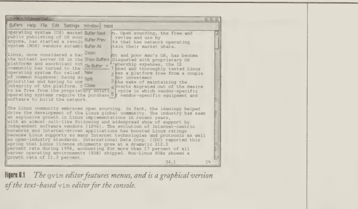

### 使用 pico

`pico` 编辑器是大多数 Linux 发行版中可用的 `pine` 电子邮件包的一部分，它是一个健壮且功能强大的编辑器，在多种条件下都能良好工作，易于学习，并且可以成为你最喜欢的 Linux 文本编辑器。该编辑器由华盛顿大学拥有版权，这在 GNU GPL 支持者看来是一个缺点。你不会在 Debian GNU/Linux 发行版中找到 `pico`。

该编辑器具备良好 Linux 文本编辑器的大多数期望功能，如内置帮助、搜索、从命令行切换自动换行的能力、块移动、复制、删除和拼写检查。`pico` 的最佳功能之一是，在系统崩溃或 `telnet` 会话中断的情况下，它能够将你的文档以文件名加上 `.save` 扩展名的形式保存下来。

你可以像这样从控制台的命令行或 `X` 终端窗口启动 `pico`：

```bash
$ pico myfile.txt
```

按下回车键后，文件 `myfile.txt` 将被打开以供编辑，或者如果文件不存在则创建该文件。你还可以在编辑系统的 `pico` 时使用

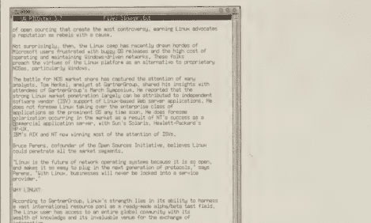

通过使用 `-w` 命令行选项禁用自动换行模式，可以处理珍贵/重要的配置文件，例如：

```
$ pico -w /etc/inittab
```

按下回车键后，您将会看到 `pico` 编辑器，如 6.2 图所示。

### 是 pico 还是 nano？

如果您是 Debian PPC Linux 用户，如果您正在寻找一个易于使用的文本编辑器，请不要绝望。您可以使用 `nano` 编辑器，它是 `pico` 的克隆版，并带有额外的功能，例如自由许可证（GNU GPL）、跳转行命令、区分大小写的搜索、交互式搜索和替换、可编辑的 Tab 列，以及交互式切换功能的命令。此程序可以从 http://www.nano-editor.org 以源代码或二进制形式下载，并适用于所有 Linux PPC 发行版。

### 使用 jed

如果您更喜欢一个色彩丰富且易于使用的编辑器，带有下拉菜单，能够发送邮件、启动新 shell 并进行拼写检查，那么您可能会喜欢使用 John E. Davis 开发的 `jed`。与 `vim` 类似，该编辑器包含一个控制台版本（`jed`）和一个适用于 X 环境和指针的版本。

`jed` 编辑器默认使用与 `emacs` 编辑器类似的键盘命令。但您可以通过编辑用户资源文件（位于主目录中，命名为 `.jedrc`）来创建自定义按键和命令。将文件 `/usr/share/jed/lib/jed.rc` 复制到您主目录中的 `.jedrc`，然后编辑以纳入您的更改。

如果您熟悉计算机并且知道 Mr. Peabody 和 Sherman 是谁，您很可能记得 WordStar 文字处理程序和菱形光标导航法，即使用 Ctrl 键以及 `e`、`r`、`a`、`s`、`d`、`f`、`x` 和 `c` 键进行光标导航。PC 键盘的出现淘汰了这种系统（Caps Lock 键本应是 Ctrl 键所在的位置）。现在，您可以使用 Happy Hacking 键盘（其按键位于正确的位置）并在 WordStar 模式下启动 `jed` 来操作菱形光标导航。要在您的主目录中的 `.jedrc` 文件中插入以下命令来实现这一点：

```
"wordstar.sl"       evalfile    pop
```

您可以像这样从控制台或 X 终端窗口的命令行启动 `jed`：

```
$ jed myfile.txt
```

按下回车键后，文件 `myfile.txt` 将打开以供编辑，如果不存在则会被创建。要启动 X 版本 `xjed`，请在 X11 终端窗口的命令行中输入以下命令：

```
$ xjed &
```

按下回车键后，您将看到 `xjed` 编辑器，如 6.3 图所示。

当您在 X 模式下启动 `jed` 时，可以使用鼠标点击并激活其菜单项。

### Emacs 基础

安装在几乎每个 Linux 系统中并随所有 Linux 发行版提供的最流行且功能强大的软件包之一，是自由软件基金会创始人 Richard M. Stallman 的 `emacs` 文本编辑器。尽管 `emacs` 是一个资源消耗大户，可能需要占用 30MB 的硬盘空间，但它深受大量 Linux 用户以及许多其他操作系统用户的喜爱。


**6.3 图** `emacs` 编辑器的 X 版本具有下拉菜单，并能识别指针移动和左键（按钮 1）鼠标点击。

这种流行度当然催生了一群模仿者和 `emacs` 克隆版。来自 GNU 的 Not UNIX 项目的原始 `emacs` 编辑器被称为 `GNU emacs`。另一个流行的版本是 `xemacs`，这是一个带有某些差异的分支版本，也包含在几乎每个 Linux 发行版中。与 `vi` 类似，您将在几乎所有操作系统中找到 `emacs` 的版本。

是什么让这个编辑器如此受欢迎？好吧，`emacs` 不仅仅是一个文本编辑器，它是一个编辑 *环境*。您可以将 `emacs` 用作文本编辑器、编程编辑器、编程环境（用于编写、编译和测试程序）、生产力应用程序（带有日记、日历和预约功能）、互联网工具（用于撰写、发送和接收邮件，以及阅读 Usenet 新闻），甚至可以浏览网页。除此之外，`emacs` 还可以用来玩游戏！

这些强大的功能大多来自于内置于编辑器中的内部 Lisp 编程语言解释器。您会发现许多不同的贡献者编写了小的可加载程序，为 `emacs` 增加了功能。最受欢迎的插件随后成为 GNU Project 标准发行版的一部分。

一些用户批评 `emacs` 编辑器功能过多，并且使用晦涩难懂的键盘组合来完成简单的编辑任务。虽然 `emacs` 确实响应大量命令，但您可以像使用 `vim` 一样使用 `emacs`，只需学习几个初始键组合即可完成基本编辑任务。例如，要创建或编辑文件 `myfile.txt`，请在命令行上像这样启动 `emacs`：

```
$ emacs myfile.txt
```

按下回车键后，文件将被打开以供编辑，如果不存在则会被创建。然后您可以仅使用以下键盘命令：

- Ctrl+b：将光标向左移动一个字符。
- Ctrl+n：将光标向下移动一行。
- Ctrl+f：将光标向右移动一个字符。
- Ctrl+p：将光标向上移动一个字符。
- Ctrl+d：删除光标处的字符。
- Ctrl+k：删除当前行。
- Ctrl+x, u：撤销（或 Ctrl+z）
- Ctrl+x, Ctrl+s：保存文件。
- Ctrl+x, Ctrl+w：另存为。
- Ctrl+x, Ctrl+c：退出编辑会话（如果文件自上次保存后已更改，系统会提示您保存或丢弃更改。）

其他有用的命令包括 Ctrl+h 获取帮助，以及 Ctrl+h, t 进入 `emacs` 教程模式。请注意，如果您在活跃的 X 会话期间从 X 终端窗口的命令行启动 `emacs`，将启动 `emacs` 的图形 X 版本，如 6.4 图所示。

这个版本可能比纯文本或控制台版本更容易使用。要强制 `emacs` 在 X 终端窗口内运行，请使用其 `-nw`（无窗口）命令行选项，如下所示：

```
$ emacs -nw
```

按下回车键后，您将看到窗口内的 `emacs`，如 6.5 图所示。

`xemacs` 客户端与 GNU `emacs` 同样强大。您可以通过编辑器之间的差异来辨别它们，因为 `xemacs` 启动时具有一个更华丽的包含 XEmacs 徽标的水印屏幕。要启动 `xemacs`，请输入：

```
$ xemacs &
```

编辑器将如 6.6 图所示启动。

此编辑器也遵守 `-nw` 选项，并可用于 X 终端窗口内。`emacs` 和 `xemacs` 都识别并使用 X Toolkit 命令行选项，例如用于窗口大小、位置、文本颜色和背景颜色的 `-geometry`、`-fg` 和 `-bg`。有关更多选项，请阅读 `emacs` 和 `xemacs` 手册和 `info` 页面。

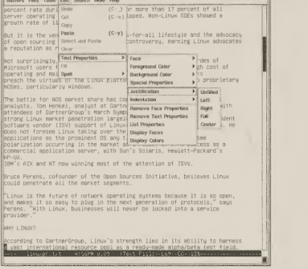


## 6.4 图
emacs 编辑器的 X 版本可以识别您的指针，并提供菜单以辅助您的编辑会话。

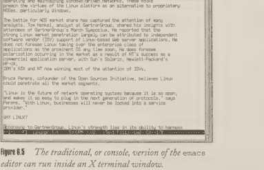

## 6.5 图
传统的或控制台的 emacs 编辑器版本可以在 X 终端窗口内运行。

自定义选项可以保存在主目录中名为 `.emacs` 的文件中。例如，创建该文件并输入以下内容：

```
(setq default-major-mode 'text-mode)

(setq text-mode-hook 'turn-on-auto-fill)

(display-time)
```

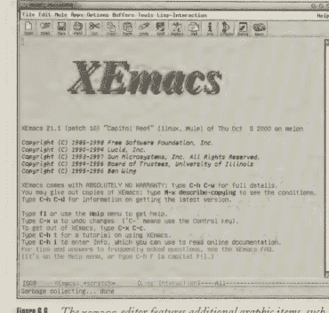

*8.8 图 xemacs 编辑器的 X 模式下具有额外的图形项目，例如工具栏。*

保存文件并启动 `emacs` 后，编辑器将使用自动换行并在其窗口中的一行上显示时间。

> SuSE PPC Linux 提供默认的 `.emacs` 文件，但定义了一个单独的 `GNU emacs` 自定义文件，您应该使用它。该文件的名称为：`.gnu-emacs-custom`，您应该创建并编辑此文件以输入您的个人条目。如果您使用 `xemacs`，该文件的名称应为：`.xemacs-custom`。如果您不想为此 `GNU emacs` 使用这个单独的文件，请删除以下两行：

```
(setq custom-file "~/.gnu-emacs-custom")
(load "~/.gnu-emacs-custom" t t)
```

要删除 xemacs 的条目，请删除以下这些行：

```
(cond
   ((string-match "XEmacs" emacs-version)
    (setq custom-file "~/.xemacs-custom")
    (load "~/.xemacs-custom" t t)))
```

然后您可以使用 `.emacs` 文件进行您的调整！

### AbiWord 个人版

AbiWord 是一款免费、开源的 word processor，适用于各种计算机平台。该客户端需要一个活动的 X 会话，它拥有现代 word processor 中的许多实用功能，但也可以用于编辑文本文件。在编辑过程中，您可以为文本应用多种不同的样式和格式，AbiWord 还具有对齐文本、执行拼写检查以及将其他系统的 word processing 文档转换为文本的功能。

您会发现 AbiWord 包含在大多数 Linux PPC 发行版中。您可以使用这款 word processor 执行许多基本的文本编辑任务。您可以使用以下命令从命令行启动 `abiword`，并可选指定一个文本文件名：

```bash
$ abiword linusprc.txt &
```

按下回车键后，您将看到 `abiword` 的主窗口，如图 6.7 所示。

不应该使用这款 word processor 来编辑系统配置文件，因为编辑器中的自动换行功能可能会破坏这些文件。不过，您可以通过使用“格式”菜单中的“段落”菜单项来调整和控制在 `abiword` 中的自动换行。

### KDE 和 GNOME 文本编辑器

KDE 和 GNOME 软件套件包含许多图形化文本编辑器，您可以在 X 会话期间使用它们。这些编辑器在功能和可靠性上各不相同，但在过去几年中不断成熟。这些编辑器的每个新版本都引入了新的功能和特性。

这些客户端通常通过 KDE 或 GNOME 桌面面板启动。表 6.2 列出了每个编辑器的名称和简短描述。

在 X 会话期间使用这些文本编辑器的好处是，许多编辑器支持拖放，在其指定环境（KDE 或 GNOME）中运行良好，并且内置帮助功能。

#### 使用 nedit

`nedit` 文本编辑器是 X11 的图形化客户端。此程序几乎具备系统管理员、作者或程序员在文本编辑器中希望拥有的所有功能。`nedit` 包含在许多 Linux 发行版中，它提供广泛的菜单、行号显示、DOS 格式文本文件的导入和导出、国际字符集处理、宏（压缩的过程快捷方式）、排序、电子邮件处理、编程环境功能等。

您可以使用以下命令从命令行启动 `nedit`，并可选指定一个文本文件名：

```bash
$ nedit linumpr.txt &
```

按下回车键后，您将看到 `nedit` 的主窗口，如图 6.8 所示。

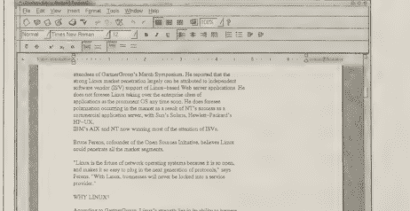

图 6.7 AbiWord word processor 是一款快速成熟的客户端，也可用作文本编辑器。

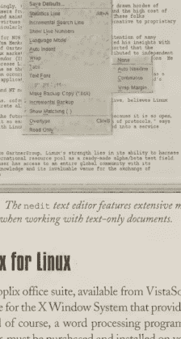

图 6.8 nEdit 文本编辑器在处理纯文本文档时提供广泛的菜单支持。

表 6.2 KDE 和 GNOME 文本编辑器

| 名称 | 描述 |
| :--- | :--- |
| gedit | 紧凑型 GNOME 文本编辑器 |
| ghex | GNOME 二进制文件编辑器 |
| glimmer | 先进的 GNOME 编辑环境 |
| gnome-edit | GNU emacS 的符号链接 |
| gnotepad+ | 高级 GNOME HTML 和文本编辑器 |
| kedit | 带有拼写检查的 KDE 文本编辑器 |
| khedit | KDE 二进制文件编辑器 |
| kwritE | KDE 程序员编辑器 |
| moleskine | GNOME 源代码编辑器 |
| quanta | KDE HTML 编辑器 |

### Linux 上的 Applix

由 VistaSource 提供的 Applix 办公套件是一个相对便宜的 X Window System 软件包，提供数据库、电子邮件、电子表格、图形以及当然还有 word processing 程序。该软件需要序列号，必须在系统上购买并安装后才能使用，并且可以在许多不同的操作系统上运行，包括基于 Intel 和 PowerPC 的 Linux 系统。

使用 Applix 的图形化编辑组件，即 Words，很简单。您可以通过点击 Applix 工具栏窗口或从命令行启动 word processor，如下所示：

```bash
$ applix -wp
```

按下回车键后，您将看到 Applix Words 窗口，如图 6.9 所示。您可以使用 Words 创建文本文档，但随后您需要使用其“文件”菜单中的“导出”菜单项将文档导出为文本。使用 Words 是将其他 word-processing 文档转换为文本格式的一种便捷方式。

### 拼写检查

在文档中检查拼写的功能对每个人都很重要。分享包含拼写错误的文本或发布文档可能会损害个人声誉，并削弱读者对内容的兴趣。拼写检查是许多商业 word processing 或办公套件软件的必备功能。

幸运的是，每个 Linux 发行版都附带两个或更多免费的拼写检查程序。这些包括 `spell` filter 命令、`dictionary` look 命令以及交互式 `ispell` 程序。它们还附带一个或多个包含 45,000 个和 100,000 个单词的字典，通常位于 `/usr/dict` 或 `/usr/share/dict` 目录下，文件名为 `words`。拼写检查 `ispell` 可以在 `/usr/lib/ispell` 目录下找到。

商业 UNIX 操作系统，例如源自 AT&T System V 的系统，传统上包含 `spell` 和 `look` 命令。按照最初的设计，这两个命令都使用系统字典 `words` 作为比较、交叉引用和查找的基础。例如，要快速查找某个单词的拼写，使用 `look` 命令，后跟所需单词的部分拼写，如下所示：

```bash
$ look gira
giraffe
giraffes
```

按下回车键后，`ispell` 命令将在系统字典中搜索并显示匹配的单词。另一方面，`spell` 命令旨在显示给定文本文件或流中不匹配的单词。您可以交互式地使用 `spell` 命令，如下所示：

```bash
$ spell
giraffe
<EOT>
```

在此示例中，按下回车键后，键入单词 `giraffe`。按下回车键后，键入 `Ctrl+d`（文本结束标记），`spell` 命令将响应：

```bash
giraffe
```

这表明该单词拼写错误或不在系统字典中。如果没有单词被回显，则单词是正确的。如您所见，`spell` 命令返回不匹配的单词。例如，要检查诸如 `linumpr.txt` 这样的文档内容，您可以在命令行上使用 `spell` 命令，结合输入重定向和其他命令通过管道使用，如下所示：

```bash
$ spell < linumpr.txt | sort | uniq >misspelled.txt
```


此命令行将文档中拼写错误单词的输出流通过 `sort` 和 `uniq` 命令处理，并将结果保存在名为 `misspelled.txt` 的文件中。然后，您可以使用 `sed` 命令或文本编辑器修复该文件。然而，交互式地拼写检查文档并在上下文中修复错误是更正拼写错误更简单的方法。这正是下一个讨论的 `ispell` 命令的任务。

> **注意：** SuSE Linux 包含 `ispell` 命令，但不提供 `spell` 命令。不过，您可以使用 `ispell` 命令来模拟 `spell`。创建一个包含以下内容的 shell 脚本：
>
> ```bash
> #!/bin/sh
> exec ispell -1 $*
> ```
>
> 将该文件保存为 `spell`，然后使用 `chmod +x` 命令使脚本可执行，并将其保存在 `/usr/bin` 目录下。

## 使用 ispell

`ispell`，或 International Ispell 命令，是 Linux 和许多 UNIX 操作系统的交互式拼写检查程序。该程序几乎包含在每个 Linux 发行版中，并支持 24 种语言。它也是一种快速高效的屏幕导向拼写检查工具，可在上下文中显示错误，显示建议的替换单词，然后更正您的文件。

支持的语言包括：南非荷兰语、白俄罗斯语、加泰罗尼亚语、捷克语、丹麦语、荷兰语、英语、世界语、芬兰语、法语、德语、希腊语、希伯来语、意大利语、爱尔兰语、挪威语、波兰语、葡萄牙语、罗马尼亚语、俄语、斯洛文尼亚语、西班牙语、瑞典语和乌克兰语。

`ispell` 也得到 `pico`、`emacs` 和 `xemacs` 编辑器的支持。您可以使用 GNU `emacs` 和 `xemacs` X 版本中的菜单启动拼写检查会话，或者按 `Ctrl+Alt+x`，然后键入以下内容之一：

- `ispell-buffer`：拼写检查当前文档。
- `ispell-region`：拼写检查高亮或标记的文本块。
- `ispell-word`：拼写检查一个单词。

按下回车键后，编辑器将使用 `ispell` 进行拼写检查。要使用 `ispell` 检查文件的拼写，请在命令行上指定文件名，如下所示：

```bash
$ ispell linuxpr.txt
```

程序将开始运行，如图 6.10 所示。

按下回车键后，`ispell` 将突出显示第一个拼写错误的单词。如果有多个建议的替换，您可以键入建议单词的编号。您也可以通过按 `r` 键手动修复单词。如果按 `i` 键，`ispell` 将接受该单词不变，并继续处理下一个可疑单词。

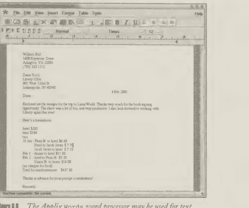


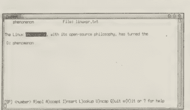

**图 6.10** `ispell` 命令是一种交互式拼写检查，它在上下文中显示错误并修复文本文档中的拼写错误。

`a` 键，可疑单词将被添加到主目录中名为 `.ispell_english` 的文件中，并成为你的个人字典（如果你添加了确实拼写错误的单词，之后可以随时编辑此文件）。`u` 键会将可疑单词的小写形式添加到你的字典中。`q` 键将不保存任何更改并退出，`x` 键保存你的更改并退出。要快速查看帮助屏幕，请按下问号（`?`）。


你还可以使用 `ispell` 的 `-a` 命令行选项来交互式地检查或查询单个单词。

通过指定命令行中的表达式，还可以检查多个文档，如下所示：

```
$ ispell my*.txt
```

在此示例中，将以 `my` 开头且扩展名为 `.txt` 的所有文件都将被检查。通过阅读 `ispell` 的手册页和文档，你可以了解更多信息，包括如何构建自己的字典。

### 字典查询

如你所见，Linux 附带了一些实用程序，你可以使用它们根据系统字典快速验证单词的拼写。不过，你也会发现其他实用程序，它们不仅可以帮助你检查单词的拼写，还可以查询其定义、同义词、反义词和用法。虽然可以通过互联网上的各种网站实现此功能，但使用这些网站需要一个活跃的浏览器，例如 Netscape Navigator，这可能不太方便。下面这一节介绍了 KDE 和 GNOME 附带的两个图形客户端，你可以使用它们直接查询在线互联网字典数据库。

### 在线字典查询

`kdict` 客户端是一个易于使用的字典查询实用程序，符合 KDE 标准，可用于查找单词定义。从 KDE 桌面面板或 X 终端窗口的命令行中启动此客户端，方法如下：

```
$ kdict &
```

按下回车键后，其窗口将出现。在“Look for”字段中输入一个单词并按下回车键。如果该单词被识别，其定义和其他信息将显示出来，如图 6.11 所示。

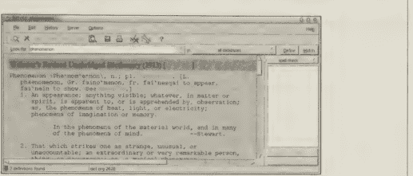

*图 6.11 gdict 客户端是通往在线互联网字典的窗口。*

该程序通过查询远程服务器上已知的字典数据库来工作。另一个以相同方式工作的客户端，也是许多 Linux 发行版中包含的，是 *gdict*，它是一个 GNOME 客户端，也执行查询功能。从 GNOME 面板或 X 终端窗口的命令行中启动 *gdict*，方法如下：

```
$ gdict
```

*gdict* 的输入字段将显示在你的 GNOME 桌面面板中。然后你可以输入内容。按下回车键后，如果找到定义，它将在一个窗口中显示，如图 6.12 所示。

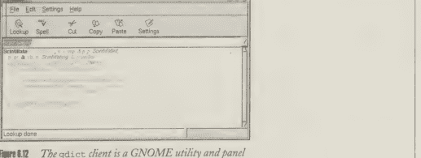

*图 6.12 gdict 客户端是一个 GNOME 实用程序和面板小程序，用于通过互联网进行字典查询。*

### 检查和可读性

很少有文本编辑器或文字处理软件（Corel 的 WordPerfect 8 for Linux 除外）包含检查文本文件语法的能力。然而，你可以从 GNU 软件项目中获取两个传统 UNIX 工具 `style` 和 `diction` 的新版本。Michael Haardt 的这些工具版本支持英语和德语，可用于检查文档的可读性和风格。

你可以轻松地下载和安装这些实用程序。下载后，使用如下的命令行（作为 root 操作员）：

```bash
# tar xzf diction.gz ; cd diction ; ./configure ; make install
```

文件将安装在 `/usr/bin` 目录中。要使用 `diction`，请指定你想检查的文件名称，如下所示：

```bash
$ diction linuxpr.txt
```

```
linuxpr.txt:70: The Linux user has access to an entire global community with [its -> "it is" or "its?"].
Wealth of knowledge and [its -> "it is" or "its?"]. Invaluable venue for the exchange of information.

linuxpr.txt:74: Yet it is the [nature -> Omit if redundant.] of Linux open-forum business model that GartnerGroup and others believe [could -> (do not confuse with "may")]. Harm Linux's chance of becoming a mainstream, general-purpose NOS.
```

按下回车键后，`diction` 命令将打印诊断信息、提示、技巧以及可疑文本。你可以将程序的输出重定向到分页器（如 `less`）或文件中以便稍后阅读。该程序也可以交互式使用，如下所示：

```bash
$ diction
We should utilize our resources better.
(stdin):1: We should [utilize -> use] our resources better.
<EOF>
1 phrase in 1 sentence found.
```

在此示例中，你在按下回车键后输入一个句子。如果 `diction` 检测到可疑短语或冗长之处，你将在句子末尾按下回车键后看到响应。完成后，按 `Ctrl+C` 或 `Ctrl+D` 结束会话。

`style` 命令用于检查文本的可读性。该程序分析你的写作风格，然后应用一系列可读性基准并打印报告。例如，要检查你其中一份文档的可读性，请像这样使用 `style` 命令：


```
$ style linuxpr.txt
readability grades:

  Kincaid: 12.1

  ARI: 13.4

  Coleman-Liau: 13.6

  Flesch Index: 48.5

  Fog Index: 15.0

  WSTP Index: 2.9

  Wheeler-Smith Index: 33.7 = school year 8

  Lix: 52.4 = school year 10

  SMOG-Grading: 13.1

sentence info:

  10651 characters

  2136 words, average length 4.99 characters = 1.60 syllables

  94 sentences, average length 22.7 words

  41% (39) short sentences (at most 18 words)

  14% (14) long sentences (at least 33 words)

  31 paragraphs, average length 3.0 sentences

  3 questions, 15 imperatives

  longest sent 53 wds at sent 91; shortest sent 1 wds at sent 42
```

在此示例中，报告表明文本非常容易阅读，但可能可以改进或面向更高级别的受众。`style` 命令还有其他命令行选项，你可以使用它们来生成关于文本的自定义报告。为了理解任何报告，你绝对需要阅读其手册页以获取更多关于可读性指数和公式的信息。

### 打印简介

Linux 有多种可用的行打印机打印后台处理系统。虽然你可以设置 KDE 和 GNOME 以支持拖放打印，但你还应了解如何从命令行使用 Linux 打印系统。缺乏这一知识，你可能会发现在控制台和纯文本会话中打印很困难，或者很难使用许多 X 客户端进行打印。

许多 Linux 发行版使用源自 BSD UNIX 的打印后台处理，它使用名为 `lpd` 的守护进程来响应打印请求生成打印过程。正如你在第 3 章“安装后配置”中学到的，`lpd` 守护进程使用系统打印机功能数据库中的定义，包括打印机名称、位置、纸张大小、过滤等。

本节将向你介绍使用 BSD 行打印机打印后台处理系统启动、停止和管理打印任务的基础知识。

### 其他打印系统

Linux 还有其他可用的打印系统，主要在其他计算机平台上，如基于 Intel 的 PC。Patrick Powell 的 LPng 打印服务是一个启用了安全的网络打印系统，包含在许多流行的发行版中。另一个打印系统是通用 UNIX 打印系统，或称为 CUPS。与 Linux 的其他所有打印系统不同，CUPS 的优势在于它是根据 GNU GPL 分发的，并且可用于多种发行版，包括 PPC Linux。

### 启动打印任务

打印任务在命令行上使用 `lpr` 命令启动。`lpr` 命令有许多命令行选项，但最简单形式可用于将文档发送到默认系统打印机，如下所示：

```
$ lpr mydocument.txt
```

在此示例中，按下回车键后，文档将被传入你的个人打印目录（位于 `/var/spool/lpd` 目录下）。`lpq` 命令，它检查目录中的新任务，然后将生成打印过程并将文档发送到打印机。你还可以使用 `lpr -P` 选项，后跟打印机名称，将任务发送到特定打印机，如下所示：

```
$ lpr -P remote1p mydocument.txt
```

在此示例中，打印任务将被发送到名为 remote1p 的打印机（在这种情况下，是一台连接到网络上另一台计算机的打印机）。`lpr` 命令也可以使用输入重定向。使用前面的 `style` 命令为例，你可以像这样将可读性报告直接发送到特定打印机：

```
$ style linuxpr.txt | lpr -P mp400
```

在此示例中，报告将在名为 mp400 的打印机上打印。

### 停止打印任务

如果您启动了一个打印任务，但随后决定要停止它，请使用 `lprm` 命令，后跟打印任务的编号。为了知道任务编号，请使用 `lpq` 命令列出当前的打印任务队列。例如，如果您启动了一个打印任务，`lpq` 命令可能会报告如下队列列表：

```
$ lpq
lp is ready and printing
Rank Owner Job Files Total Size
active bhall 4 linuxpr.txt 13558 bytes
```

您可以通过使用 `lprm` 命令并后跟“Job”（任务）编号来终止打印任务，如下所示：

```
$ lprm 4
dfA004\cube dequeued
cfA004\cube dequeued
```

按下回车键后，已删除的暂存文件的名称将会打印出来。

### 管理打印队列

在多用户环境中，可能有多个用户和打印任务争夺打印机的注意力，并排在打印队列中。作为 `root` 操作员，您可以使用 `lpc` 和 `lprm` 命令管理此队列以及系统的打印机。由于 `root` 是 `superuser`，root 操作员可以移除任何人拥有的待处理打印任务（普通用户只能移除自己拥有的打印任务）。

虽然通常在独立工作站上不需要，但 `lpc` 命令可以被 `root` 用户在网络化打印机环境中使用，以禁用或启用任何系统打印机，重新排列打印队列，启动和停止打印，以及保留和释放打印任务。更多信息请参阅 `lpc` 手册页。

#### 资源

- http://www7doc.sco.com/SHL_autorate/CTOC-Manipulating_text_with_sed.html. 关于使用 `sed` 命令的简易介绍。
- http://www.vim.org. 免费 `vim` 编辑器的主页，与 `vi` 不同，它不受版权阻碍，而是根据 GNU GPL (*General Public License*，通用公共许可证) 发布。
- http://www.vim.org/maes.html. 下载 Mac OS 版本 `vim` 的网站。
- http://space.mit.edu/~davis/jed/. `jed` 编辑器的主页。您将从此网站找到最新版本和文档。
- http://www.uni-ulm.de/uni/intgruppen/memosys/symbol07.htm. 软件行业如何削弱生产力提升的有趣历史。
- http://www.avalanche.nl/thomer/vi/vi.html. `vi` 爱好者主页。所有关于 `vi` 的地方！
- http://www.nano-editor.org/. `nano` 编辑器的主页，它是 `pine` 电子邮件客户端附带的 `pico` 编辑器的真正免费克隆版。
- http://mac-emacs.sourceforge.net/index.html. Mac OS 版本 `emacs` 的主页。
- http://glimmer.sourceforge.net/. GNOME 最复杂文本编辑器的网页。
- http://www.abiword.org/. 开源文字处理器 AbiWord 的主页。
- http://nedit.org/. 老牌的 `nedit` 编辑器的主页。源代码和二进制版本可以在此处下载。
- http://aspell.sourceforge.net/. 免费 `aspell` 拼写检查器的主页，根据其开发者的说法，旨在“最终取代 `Ispell`”。
- http://www.kdstevens.com/~stevens/ispell-page.html. `ispell` 的 `emacs` 接口作者的主页。
- http://fmq-www.cs.ucla.edu/geoff/ispell.html. Ispell 的主页，这是一个国际性、交互式拼写检查器，拥有 24 种不同语言的词典。
- http://www.gnu.org/software/diction/diction.html. GNU 版本的遗留 `style` 和 `diction` 命令的下载站点。
- http://www.astart.com/lprng/LPRng.html. LPRng 打印机服务软件的 Web 主页。
- http://www.cups.org. CUPS (*COMMON UNIX Printing System*，通用 UNIX 打印系统) 的主页。
- http://www.vistaource.com/. 用于 Linux（包括 PPC Linux）的商业 Applix 办公套件的源代码。

### 第 7 章：X11 和窗口管理器

- 什么是 X11？
- 什么是窗口管理器？
- Linux 的窗口管理器和桌面环境
- 启动 X11 会话
- 停止 X11 会话
- 配置选择器


本章向您介绍 Linux 的图形界面。它被称为 X 窗口系统、`X11R6`、`X11` 或简称 `X`（发音为 "ex"，而不是罗马数字 "ten"）。与传统的 Mac OS（以及更新的 Mac OS X，其发音为 "ten"）不同，Linux 使用一个提供桌面图形界面的附加软件系统。如果您希望享受窗口、图标、菜单和其他屏幕元素带来的好处——这些元素最早由 Apple 的 Lisa 带到企业舞台，随后由 128K Macintosh 普及——那么正确配置 X 以配合您的计算机图形硬件工作至关重要。

在本章中，您将了解一个名为 `XFree86` 的 X 版本，这是一个免费的网络 `client`（客户端）和 `server`（服务器）软件系统。在该系统中，服务器组件处理来自远程客户端（应用程序）的图形请求。它独立于远程计算机的绘图能力来处理这些请求。

X 早于行业软件垄断公司的商业图形桌面和服务器软件出现，并且从头开始设计以支持远程应用程序的使用。在许多方面，X 超过了闭源专有商业操作系统的功能。它还附带完整的源代码，这增强了它向新硬件平台移植的能力。X 在几乎现存的每一个硬件平台上都能很好地工作。甚至 X 的 `XFree86` 版本也被移植到新的 Mac OS X 上运行！

本章还包括关于特殊 X 客户端的信息，这些客户端被称为 `window managers`（窗口管理器），用于处理图形 Linux 会话中的指针点击、图标、按钮和窗口管理。您还将学习如何使用多种软件工具来配置 X，并了解如何配置不同的图形 X 登录客户端，这些客户端被称为 `display managers`（显示管理器）。

## 什么是 X11？

X 是一种协议和网络图形界面。它由麻省理工学院和数字设备公司于 1984 年开发，是一个旨在为数千用户生成分布式计算环境项目的一部分。自那时以来，X 经历了至少六个主要版本修订，当前版本为 `X11R6.5`。X 窗口系统的源代码由 X Consortium (http://www.x.org) 负责发布。`XFree86` Project, Inc. 发布 X 的免费版本。这是一个非营利组织，旨在为包括 PowerPC CPU 在内的多个平台提供免费版本的 X。

X 包含近 3,500 个文件，在一个 34MB 的压缩分发版中（针对 PowerPC 平台分发）。该分发版包括超过 1,000 种字体、120 个客户端和实用工具、100 个图形文件以及 1,200 页文档。典型安装需要超过 70MB 的硬盘空间，如果安装额外的 X11 客户端，则需要更多空间。

### X11 的特性

X 是 Linux 的可移植图形网络界面，在独立工作站或大型网络的图形系统中都能很好地工作。X 可以工作于慢速串行拨号线路或高速光纤网络，可以轻松服务 1 到 10,000 名用户。X 提供字体管理、颜色和系统或特定客户端 `resources`（资源）或配置文件的使用，包含源代码，支持用于客户端的标准化命令行界面，称为 `X Toolkit Options`（X 工具包选项），并在网络上具有图形设备独立性。

最重要的是，X 是免版税的！开发者可以在没有许可证限制的情况下构建和分发客户端。并且由于 X 的可移植性，运行在您的 Apple Macintosh 上的 `XFree86` 版本与运行在基于 Intel 的 PC、SPARC 或 Alpha CPU 上的 X11 版本具有许多相同的功能。

这也意味着您在 PowerPC 上使用 X 开发的任何客户端几乎总是可以在任何支持 X 的其他硬件平台上以完全相同的方式进行构建、安装和运行。

### 配置 X11

配置 X 是完成成功 Linux 安装的基本任务之一。现在它是大多数 PowerPC Linux 分发版安装过程的完整部分，X 配置通常可以在安装或启动过程中自动完成。当一切正常时这很棒，但如果您遇到问题，可能需要依靠一个或多个软件工具来使其正确。

#### PPC Linux 下的 X

正确配置 X 以配合您的 Mac 硬件工作，涉及创建一个名为 `XF86Config` 的文件。该文件可能位于 `/root/`, `/etc`, `/etc/X11` 或 `/usr/X11R6/lib/X11` 目录下，包含与您的计算机图形硬件匹配的设置（如监视器频率和显卡芯片组信息）。

对于 X 和 PowerPC，许多安装默认使用 `frame-buffer`（帧缓冲）服务器，其中图形硬件使用计算机视频硬件的缓冲内存进行建模。所有绘图都在高层处理，因此 X 及其客户端不需要知道图形硬件的细节。尽管这

这种方法相当灵活，但其绘图速度不如那些直接访问图形硬件的软件快。

G4 功率机（Power Macs）中较新的图形硬件，例如 ATI Rage 视频芯片，受到 `XFree86` 4.0.1 及其 xfree86 服务器的支持。该服务器使用可加载的代码模块来支持特定的图形硬件。较早的功率机可能会使用帧缓冲（frame-buffer）服务器，例如 `XF86_FDV` 或随 `XFree86` 3.3.6 提供的服务器。某些 PowerPC 计算机可能能够使用其中任何一种。

#### 哎呀！我是不是太热心了？

一个潜在问题是，LinuxPPC 2000 Q4 和 SuSE Linux 都包含自动 X 配置实用程序，可以设置为每次启动 Linux 时生成一个新的配置文件。如果你希望这样，那是可以的；但如果自动生成的配置文件不起作用，并且你已经将 Linux 设置为直接启动到 X 会话，你将无法登录。相反，X 服务器会反复尝试启动，然后失败，然后再次尝试启动，陷入无限循环。你最好的解决办法是以单用户模式重新启动 Linux，或重启到一个 X 不活跃的 runlevel，然后禁用自动配置，并尝试进行正确的配置。在 SuSE Linux 中，可能存在问题的自动 X 配置是通过 `/sbin/init.d/xsfb` 脚本启动的（并且可以通过编辑 `/etc/rc.conf` 中的 `CREATE_FBCONF=""` 设置来控制），而在 LinuxPPC 2000 Q4 中，则使用 `xautoconf` 服务（并且可以通过 `ntsysv` 命令来控制）。如果你在计算机中更换了视频卡，这些服务可能很有帮助；但如果你的系统需要自定义配置，它们可能会引起麻烦。

配置 X 以配合你的系统工作有多种方法。一种方法是通过对图形硬件进行自动探测。另一种方法是使用基于控制台的配置程序。选择 X 配置工具通常取决于个人偏好或发行版中包含的工具选择。每种工具都旨在创建一个可用的 XFree86 配置文件，使用最高的分辨率（屏幕宽度和高度的像素值）和最大的色深（或会话中可用的颜色数量）。这些值通常表示为 1600x1200 和 16bpp（`每像素位平面数`）。常见的分辨率包括 1280x1024、1152x768（用于 TiBook）、1024x768、800x600 和 640x480。常见的色深包括 8bpp（256 色）、16bpp（数千色）、24bpp（数百万色），以及可能的 32bpp（数百万色）。


配置 X 的另一种方式是使用正确的基准视频值启动 Linux，然后使用启动“安全”X 会话的图形配置客户端。这些视频值是通过 BootX 或 yaBoot 传递给 Linux 内核的内核参数，通常形式如下：

```
video=adapter:vmode:XX,cmode:XX
```

`adapter` 关键字（例如 `ayfb`）表示使用的图形芯片组类型。`vmode` 设置是一个一位或两位的数值（范围在 1-20 之间），对应于某个分辨率。`cmode` 设置是一个一位或两位的数值（8、15、16、24 或 32），对应于某个色深。这些视频设置也可以在 Linux 启动后通过使用 `fbset` 命令来实现。

你还可以使用 XFree86 4.0（或更高版本）的 X 服务器来配置设置。如果其他方法都失败了，你可以手动创建自己的配置文件（因为它是一个文本文件）。

> 除非你使用匹配的显卡和显示器组合，否则使用他人的 `XF86Config` 文件通常不是一个好主意。iBook 和 PowerBook 用户可以在相同型号的笔记本之间共享配置文件。


如果你手工创建自己的 `XF86Config` 文件，有一个名为 `XF86Config.eg` 的模板文件位于 `/usr/X11R6/lib/X11` 目录下（你可以阅读示例以了解条目格式）。如果你是 X 的新手，手动创建自己的 `XF86Config` 文件可能具有挑战性！

#### 使用 xf86config 命令

`xf86config` 命令是一个基于文本的 console 应用程序，随 `XFree86` 和每个 Linux 发行版一起提供。它可用于配置可用的 `XF86Config` 文件。该命令是一个菜单驱动的程序，使用安装在 `/usr/X11R6/lib/X11` 目录下的监视器和视频卡数据库，在配置过程中提供选项。你必须以 root 操作员身份配置 X 以配合你的系统工作。像这样启动 `xf86config` 命令：


# xf86config

按下 Enter 后，你将开始回答配置 X 的问题。你会被问及你的指向设备（鼠标）、键盘、监视器、视频卡、期望的色深和期望的分辨率。请务必手边备有设备的说明书，以及图形硬件、指向设备和监视器的技术规格。

大多数经验丰富的 X11 用户在其 X 会话中使用三键鼠标。鼠标按钮被称为左、中、右（或 1、2、3）。它们用于选择、点击、高亮、粘贴和特殊操作。只有单键鼠标（如 iBook 或 TiBook 用户）的 PowerPC Linux 用户必须重新映射两个 F 键以模拟中键和右键。这可以通过在 Linux 启动前传递内核参数来完成，对于 USB 鼠标，则可以通过向系统的 USB 设备进程目录回显特定值来完成。例如，Yellow Dog Linux iBook 用户可以使用内核参数（通过 BootX 或 `yaboot.conf` 传递），`ADB buttons=103, 111`，这将 F11 和 F12 映射为中键和右键。Linux PPC 2000 Q4 将 `Fn+Ctrl` 和 `Fn+Option` 映射为中键和右键。拥有 USB 键盘的 PowerPC Linux 用户可以 使用：

```
echo "1" > /proc/sys/dev/mac_hid/mouse_button_emulation
echo "87" > /proc/sys/dev/mac_hid/mouse_button2_keycode #F11
echo "88" > /proc/sys/dev/mac_hid/mouse_button3_keycode #F12
```

这些行将 F11 和 F12 映射为中键和右键。TiBook 用户可以将数值 87 更改为 68 和 87，因为单独的 F12 是 Mac OS 的媒体弹出键，不能用于模拟。在这种情况下，F12 和 F11 被映射为中键和右键——这比使用 `Fn+Ctrl` 或 `Fn+Option` 好得多，因为这些键用于停止或退出当前运行的 X 会话！

当你完成 X 配置后，新的 `XF86Config` 默认会写入 `/etc/X11` 目录。但是，你可以选择将文件保存在任何位置。

## 使用 Xconfigurator

LinuxPPC 2000 Q4 和 Yellow Dog Linux 包含 `Xconfigurator` 命令，该命令可以配合或不配合 X11 用来创建可用的 `XF86Config` 文件。该命令提供了一个图形化、菜单驱动的界面，用于配置你系统上的 X。同样，你必须以 root 操作员身份配置 X 以配合你的系统工作。像这样启动 `Xconfigurator` 命令：

```
# Xconfigurator
```

按下 Enter 后，你将看到其初始对话框，如图 7.1 所示。使用 Tab 键在对话框按钮间导航，使用向上和向下光标滚动，并使用空格键选择或取消选择菜单项。当你使用该程序完成后，新的 `XF86Config` 将保存在 `/etc/X11` 目录中（这与 `xf86config` 命令相同）。

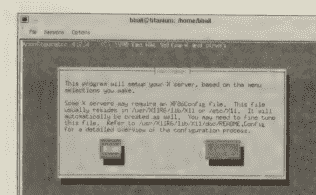

图 7.1 当你创建 *XF86Config* 文件时，*xconfigurator* 命令提供图形界面。

## 使用 sax 和 Sax2

SuSE Linux 提供两个名为 `sax` 和 `sax2` 的图形 X 配置工具。这些工具与之前讨论的工具一样，提供了配置可用 *XF86Config* 文件的界面。`sax` 命令用于配置 XFree86 3.3.6 版本，而 `sax2` 命令用于配置 XFree86 4.0 及更高版本。例如，要使用 *sax2* 客户端，请在 X 终端窗口的命令行输入其名称，如下所示：

```
# sax2
```

按下 Enter 后，你将看到如图 7.2 所示的对话框。

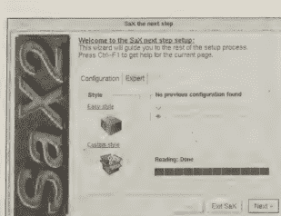

图 7.2 *SuSE Linux* 的 *sax2* 客户端通过图形方式配置 X，使其与你的 *Power Mac* 硬件配合工作。

使用指针单击并在配置对话框中导航。您可以选择配置“简单”风格或“自定义”风格。单击“下一步”按钮可在对话框之间进行导航。随后，系统会要求您选择显卡、监视器以及分辨率和颜色深度设置。完成后，使用“完成”按钮保存您的更改。

## 使用 X 配置 X11

可以使用 XFree86 4.0.1 XFree86 服务器来配置 X。若要尝试配置，请以 root 用户登录，并在命令行中像下面这样使用该服务器：

```
# xfre86 --configure
```

按下 Enter 键后，您的屏幕可能会闪烁几次。完成后，您会在 `/root` 目录中找到一个名为 `XFree86Config.new` 的文件。然后，您可以使用 `startx` 命令来启动一个测试 X 会话，如下所示：

```
# startx -- -xf86config /root/XFree86Config.new
```

### 什么是窗口管理器？

X 窗口管理器只是一个 X 客户端，它管理 X 桌面上的窗口、图标和其他元素的绘制与控制。窗口管理器通常会对一个或多个特定的配置文件做出响应，这些配置文件可以包含自定义设置。X 窗口管理器从简单到复杂不等，规模从小型（即小于 200,000 字节）到大型（即可能需要 150MB 或更多硬盘空间的发行版）都有。

窗口管理器告知 X 如何处理新窗口、窗口装饰（如滚动条）、窗口的移动和放置，以及窗口的调整大小。窗口管理器还可以创建图标、管理焦点策略，或者定义窗口何时以及如何变为活动状态。它们还提供其他附加功能，例如支持图标拖放以进行复制、链接或删除文件，以及打印文档。

### Linux 的窗口管理器和桌面环境

本节介绍了若干窗口管理器和桌面环境（即与一组兼容客户端配合使用的窗口管理器），您可以将其用于您的 X 会话。每部分都提供了简短描述，指出了相关的配置文件，并包含一张桌面操作时的截图。请注意，这里讨论的并非所有窗口管理器都安装在您的系统上。不过，您会在您的 Linux 发行版中找到相应版本。

在使用 Linux 一段时间后，请尝试不同的窗口管理器。您会形成个人的喜好，并很可能找到一个最喜欢使用的。某些用户偏好功能丰富的窗口管理器，而另一些用户则偏好资源需求最低且功能有限的窗口管理器。

#### GNOME

`GNOME`（*GNU 网络对象模型环境*）不是一个窗口管理器，而是源自一个编程项目的一组软件库，该项目用于创建 `GIMP`（*GNU 图像操作程序*）。`GNOME` 包含一套具有复杂窗口、事件和绘制功能的客户端。`GNOME` 为具备 `GNOME` 感知能力的窗口管理器提供了支持这些特性的框架。这些特性包括会话管理、拖放、动画以及在 X 会话期间保持一致的客户端界面。

`GNOME` 包含一个控制中心客户端，该客户端承载特定窗口管理器的配置客户端。例如，请注意典型的 `GNOME` 桌面，以及在 `GNOME` 控制中心中运行的 *sawfish* 窗口管理器的 *sawfish-ui* 客户端，如图 7.3 所示。

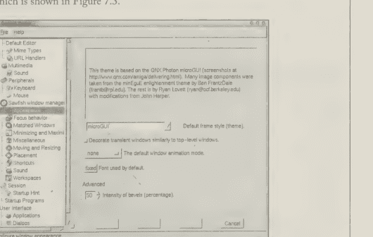

**图 7.3** *GNOME 控制中心承载当前窗口管理器的配置客户端，例如 sawfish 的 sawfish-ui。*

`GNOME` 提供了现代图形界面的几乎所有功能，详细内容在第 11 章“使用 GNOME 和 X11”中介绍。

#### Ximian

Ximian `GNOME` 桌面与 `GNOME` 桌面几乎完全相同。然而，**Ximian GNOME**（前身为 Helix Code 的 GNOME）可通过 Internet 自动下载和升级。安装是通过下载图形安装程序完成的。在下载和安装近 130 个不同的软件包后，Ximian `GNOME` 呈现出一个精美的 `GNOME` 接口，该接口使用 *sawfish* 窗口管理器（如图 7.4 所示）。

Ximian `GNOME` 可用于多种 PowerPC Linux 发行版，例如 Linux PPC 2000 Q4、Yellow Dog Linux 2.0 和 Champion Server 1.2。然而，它不适用于 SuSE PPC Linux（至少是在撰写本文时）。

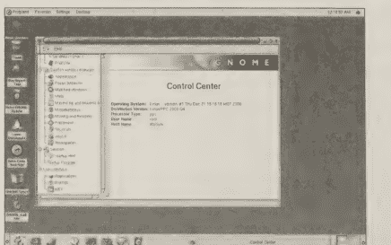

**图 7.4** Ximian GNOME 桌面是一个精美的 GNOME 界面，配有最新的生产力客户端。

#### KDE

`KDE`（*K 桌面环境*）与 `GNOME` 一样，也包含一套用于 X 和 Linux 的客户端。`KDE` 提供会话管理、拖放等现代桌面界面中常见的功能。`KDE` 的配置通过使用 `kcontrol` 客户端完成（如图 7.5 所示）。通常，通过单击桌面上的 *面板* 上的图标来启动此客户端。此面板是位于屏幕底部的图标栏，它还承载许多其他功能，如弹出菜单、时钟、桌面翻页器和开始菜单。典型的桌面如图 7.5 所示。


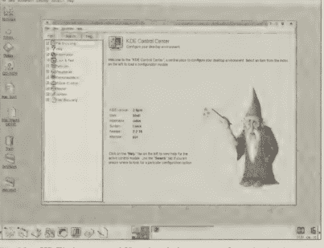

**图 7.5** KDE 的功能和 X 会话桌面使用其控制中心客户端 `kcontrol` 进行配置。

KDE 是一个非常全面的 X 会话环境，详细内容在第 10 章“使用 K 桌面环境”中介绍。

### fvwm 和 fvwm2

FVWM 系列窗口管理器已经存在了一段时间，并且由于多种原因深受 X 高级用户的欢迎。与标签窗口管理器 `tWM`（随 XF86 分发）类似，FVWM 窗口管理器可以承载几乎任何 X 客户端。但 FVWM 窗口管理器还提供了其他功能，例如虚拟桌面，或额外的内存根显示。另一个优点是，根据其手册页，FVWM 的内存消耗仅为 `twm` 的“二分之一到三分之一”。

FVWM（以及更新版本 FVWM2）可以配置为允许所有用户编辑名为 `system.fvwmrc` 或 `system.fvwm2rc` 的系统范围资源文件。这些文件通常位于 `/etc/X11/fvwm` 或 `/etc/X11/fvwm2` 目录下。用户设置位于主目录中名为 `.fvwm2rc` 或 `.fvwmrc` 的文件中。

典型的 FVWM 桌面如图 7.6 所示。

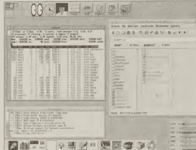

**图 7.8** FVWM2 窗口管理器提供现代图形界面功能，如虚拟桌面和窗口装饰。

虚拟窗口通过使用桌面*翻页器*，即导航小窗口进行导航。桌面上的停靠栏还承载邮件通知、系统负载和时间显示。

### FVWM95

Robert Nation 的 `fvwm95` 窗口管理器基于 `fvwm2`，但也包含类似 GNOME 和 KDE 的开始菜单和任务栏。与早期版本一样，您可以通过编辑配置文件来构建自定义菜单并更改效果。

在 SuSE PPC Linux 中，此窗口管理器的支持文件位于 `/usr/X11R6/lib/X11/fvwm95` 目录下，以及其系统范围配置文件 `system.fvwm95rc`。如果将其复制到家目录并重命名为 `.fvwm95rc`，则可以按用户进行自定义。

一种称为 *focus* 的自定义涉及指针移动和窗口放置。这显示了窗口何时或如何变为活动状态。它可以具有以下模式之一：

```
#Style *** ClickToFocus
Style *** MouseFocus
#Style *** SloppyFocus
```

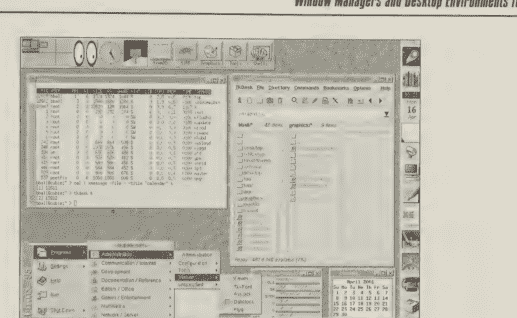

**图 7.7** FVWM95 窗口管理器具有任务栏和开始菜单，用于启动 X 客户端和其他命令。

在此示例中，当您的指针简单地掠过窗口时，窗口即变为活动状态。若要求用户单击窗口（使其变为活动状态），请注释掉 `MouseFocus` 行（在其前添加井号 `#`），并移除（或取消注释）`clickToFocus` 行前的井号。此编辑操作将禁用 `MouseFocus` 策略并启用 `clickToFocus`。不过，您必须重启 X 会话才能使用此更改。

`fvwm95` 具有 3D 图标，并且与 `fvwm` 一样支持虚拟桌面。然而，`fvwm95` 还包含一个*任务栏*，或类似于 KDE 和 GNOME 桌面面板的浮动菜单。典型的 `fvwm95` 会话如图 7.7 所示。

### AfterStep

AfterStep 窗口管理器具有 NEXTSTEP 图形界面的许多功能，包括客户端停靠栏（*或 wbarf*）、桌面菜单、虚拟桌面和窗口动画。首次运行 AfterStep 时，它会在您的主目录中创建一个名为 **GNUstep** 的目录。

典型的会话如图 7.8 所示。

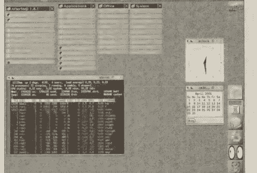

*图 7.8 使用 AfterStep 的根菜单来配置该窗口管理器在你的 X 会话中的外观。*

该窗口管理器基于 *twm*，但拥有更精致的外观。它还具备虚拟桌面、页码器、窗口列表、任务栏和 wharf 等功能。AfterStep 还支持使用 *主题*（或桌面方案）以及弹出式（气泡）帮助功能。

默认设置包含在 `/usr/share/afterstep` 或 `GNUstep` 目录中。

### Enlightenment

Enlightenment 是最早支持 GNOME 的窗口管理器之一。早期被称为 *E*，Enlightenment 由 Carsten Haitzler 和 Geoff Harrison 开发。该窗口管理器可以单独使用，也可以与 GNOME 配合使用，且近期版本包含许多独特的内置桌面环境功能。主题是其主要吸引力之一。你可以从各个互联网网站下载数千种 Enlightenment 主题。

图 7.9 展示了使用此窗口管理器的典型桌面会话。

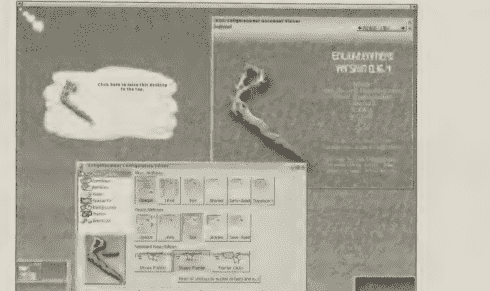

*图 7.9 Enlightenment 是 X 桌面环境下的现代窗口管理器，包含许多内置功能，其中包括配置编辑器。*

Enlightenment 具备大多数现代 X 桌面环境的功能，如页码器、任务栏、虚拟桌面和根菜单。位于用户主目录下的名为 `.enlightenment` 的目录包含了会话背景、图标和 *主题* 的设置。其他支持文件可能存储在你系统的 `/usr/X11R6/share/enlightenment` 目录下。

使用 `e-conf` 客户端（如图 7.9 所示）来配置 Enlightenment。此工具从 X11 终端窗口的命令行启动，方式如下：

```bash
$ e-conf &
```

### IceWM

IceWM 窗口管理器提供了现代窗口管理器的功能，如窗口装饰、主题、虚拟桌面以及带有层级开始菜单的任务栏。与前面讨论的其他所有窗口管理器一样，要在 X 会话中使用此窗口管理器，只需将其名称包含在用户主目录的 `.xinitrc` 文件中，例如：

```bash
icewm
```

当 X 会话启动时，IceWM 的桌面将如图 7.10 所示。IceWM 的系统级配置文件和主题位于 `/usr/X11R6/lib/X11/icewm` 目录下。用户主目录下名为 `.icewm` 的目录包含个人的 IceWM 偏好设置。

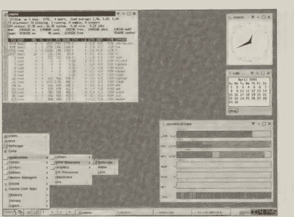

图 7.10 IceWM 窗口管理器具备虚拟桌面、任务栏以及用于启动客户端的菜单功能。

### Window Maker

与 AfterStep 类似，Window Maker 窗口管理器提供了 wharf、根桌面菜单和虚拟桌面，这些功能可通过点击根显示界面左上角的页码器来访问。两个独特的功能是：可配置的应用程序停靠栏，以及在根桌面上放置浮动菜单的能力。你还会喜欢它丰富的 *小部件*（applets），即那些活跃且实用但被压缩为图标的小型应用程序——这是 Linux 笔记本用户非常渴望的功能！

系统级配置文件位于 `/usr/X11R6/share/wmakerconf` 目录下。用户默认设置存储在用户主目录下的 `GNUstep/Defaults` 目录中。Window Maker 还支持不同的样式和主题。

在运行此窗口管理器之前，请使用 `wmaker.inst` 命令正确设置你的 `GNUstep/Defaults` 目录，例如：


```bash
$ wmaker.inst
Installing WindowMaker 0.62.1 for current user...
Copying defaults database...
Creating icon library directory /home/ball/GNUstep/Library/Icons
Creating WindowMaker data library directory /home/ball/GNUstep/Library/WindowMaker
Creating style library /home/ball/GNUstep/Library/WindowMaker/Styles
Creating theme library /home/ball/GNUstep/Library/WindowMaker/Themes
Creating bg image library /home/ball/GNUstep/Library/WindowMaker/Backgrounds
Creating icon setup library /home/ball/GNUstep/Library/WindowMaker/IconSets
Creating pixmap library /home/ball/GNUstep/Library/WindowMaker/Pixmaps
Creating sound library /home/ball/GNUstep/Library/WindowMaker/Sounds
Creating sound set library /home/ball/GNUstep/Library/WindowMaker/SoundSets

Installation finished
```

Window Maker 的桌面可能看起来像图 7.11 所示的那样。该窗口管理器的实际文件名是 `wmaker`，但其系统级配置文件位于 `/usr/X11R6/share/WindowMaker`、`/usr/share/themes/WindowMaker` 以及可能的 `/etc/WindowMaker` 目录下。个人设置存储在你主目录下的 `~/GNUstep` 目录中。

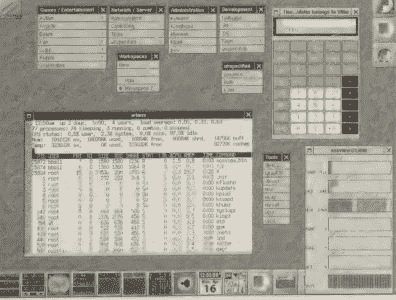

图 7.11 Window Maker 窗口管理器为 X 桌面提供了一个易于使用的图形界面。

### mlvwm

Takashi Hasegawa 开发的 `mlvwm` 窗口管理器提供了一个基础且熟悉的 Apple Mac OS 风格的桌面。支持虚拟桌面和简化的“气泡帮助”（Balloon Help）。通过点击显示界面右上角的“Findex's”可以提供虚拟桌面。

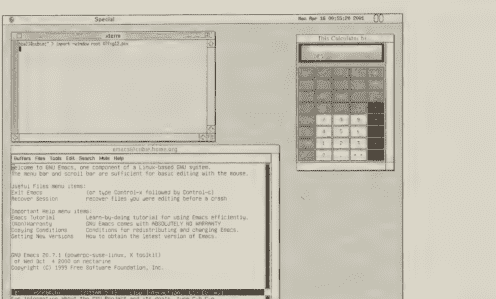

**图 7.12** *mlvwm 窗口管理器在你的 X 会话中略微模仿了传统 Mac OS 的风格。*

该窗口管理器通常不包含在大多数 Linux 发行版中，但随 SuSE PPC Linux 一起提供。系统级默认设置（在 SuSE PPC Linux 下）包含在 `/usr/X11R6/lib/X11` 目录下名为 `system.mlvwrmrc` 的文件中。这些设置可以复制到每个用户主目录下名为 `.mlvwrmrc` 的文件中。一个 `mlvwm` 会话可能看起来像图 7.12 所示的那样。

### twm

`twm` 窗口管理器是 XFree86 中唯一包含的窗口管理器。作为标签窗口管理器（Tab Window Manager），`twm` 提供了一套最基础的功能集。不过，它确实提供了窗口装饰、可自定义的根桌面菜单、图标以及其他一些期望具备的功能。

一个系统级资源文件 `system.twmrcc` 位于 `/etc/X11/twm` 目录下。用户设置位于用户主目录下名为 `.twmrcc` 的文件中。典型的 `twm` 桌面如图 7.13 所示。

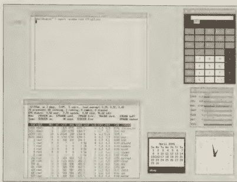

图 7.13 twm 窗口管理器提供基本的窗口管理器功能，但除此之外几乎没有其他功能。

## 启动 X11 会话

在 Macintosh 上安装 Linux 后，你很可能直接进入一个 _X_ 会话。当屏幕清除后，你将处于一个 _X_ 显示管理器的登录提示符处。这是一个 X 客户端，它要求输入用户名和密码以便使用 X 和 Linux。XFree86 和 PowerPC Linux 发行版提供了多种显示管理器。这些包括 XFree86 显示管理器 `xdm`，KDE 的 K 显示管理器（称为 `kdm`），以及 GNOME 的 `gdm`。

然而，启动 X 会话的另一种方式是通过一个名为 `startx` 的 shell 脚本。`startx` 命令提供了大量的灵活性和命令行选项。本节描述如何使用 `startx` 来启动你的 X 会话。

### 使用 startx 命令

`startx` 客户端使用 `xinit` 客户端来启动你的 X 会话。此客户端首先查找用户主目录下名为 `.xinitrc` 的文件，该文件可以包含定制化的 X 会话，指定客户端和特定的窗口管理器。一个名为 `xinitrc` 的默认 `.xinitrc` 文件安装在 `/etc/X11/xinit` 目录下。在 Suse Linux 中，默认的 `.xinitrc` 文件安装在每个用户的主目录下，并包含支持启动不同窗口管理器的逻辑。该文件（一个 shell 脚本）看起来如下：

```bash
if test -z "$WINDOWMANAGER" ; then
    if test -x /usr/X11R6/bin/kde ; then
            WINDOWMANAGER=/usr/X11R6/bin/kde
    elif test -x /usr/X11R6/bin/startkde ; then
        WINDOWMANAGER=/usr/X11R6/bin/startkde
    elif test -x /usr/X11R6/bin/fvwm2 ; then
        WINDOWMANAGER=/usr/X11R6/bin/fvwm2
    elif test -x /usr/X11R6/bin/wmlist ; then
        for i in `/usr/X11R6/bin/wmlist` ; do
            WINDOWMANAGER=`type -p $i`
            test -n "$WINDOWMANAGER" && break
        done
    fi
fi
fi
```

...

这种逻辑（其他 Linux PowerPC 发行版不支持）允许用户在 `startx` 命令行中指定所需的窗口管理器，例如：

```bash
$ startx wmaker
```

然而，示例 `.xinitrc` 文件也可以包含以下内容：

```bash
xsetroot -solid lightblue
rclock -fg white -bg blue -geometry 100x100-5+5 &
xcalc -geometry -155+5 &
rxvt -geometry 80x50-5+15 &
exec twm
```

使用这些设置，桌面背景将变为浅蓝色，显示器右上角将出现一个时钟，旁边是一个计算器以及一个宽度为 80 个字符、高度为 50 行的 X11 终端窗口。该 X 会话使用 `twm` 窗口管理器。

然后使用 `startx` 命令来启动 X 会话，方式如下：

```bash
# startx
```

按下回车键后，`twm` 桌面将如图 7.14 所示出现。

你还可以使用 `startx` 命令来指定不同的颜色深度和字体分辨率。例如，要以 XFree86 4.0 或更高版本（使用 256 种颜色和每英寸 100 点）启动 X11 会话，请使用带有 `-depth` 和 `-dpi` 选项以及代表颜色位平面数量和分辨率数值的命令，如下所示：

```bash
# startx -- -depth 8 -dpi 100
```


*图 7.14 startx 客户端使用你的 .xintrc 文件来启动 X 桌面。*

X 服务器将判断你的系统是否能支持为你的系统定义的请求颜色深度和分辨率。不同颜色深度常用的典型值为 8、15、16、24 或 32。如果你使用的是 XFree86 版本 3.3.6，命令行看起来像这样：

```
# startx -- -bpp 8 -dpi 100
```

你甚至可以使用 `startx` 命令来启动多个 X 会话，这在测试新的窗口管理器或在不同颜色深度下运行 X 会话时非常有用。得益于 Linux 对*虚拟控制台*的支持，即可以通过键盘访问的控制台显示器，你可以快速在会话之间切换。


使用 `startx` 命令并附带一个 `显示编号` 来启动你的第一个 X 会话，该编号指定了一个 X 服务器实例。你可以包含一个颜色深度设置以及一个代表虚拟控制台的数字，如下所示：

```
# startx kde2 -- :0 -bpp 16 vt7
```

X 会话启动后（此处使用 KDE2），按 Ctrl+Alt+F2 返回到仅文本的登录提示符。登录并再次使用 `startx`，如下所示：

```
# startx afterstep -- :1 vt8
```

另一个 X11 会话（这次使用 AfterStep）将会出现。要跳转到 KDE2，请按 Ctrl+Alt+F7。使用 Ctrl+Alt+F8 返回运行第二个会话的 AfterStep。在每个会话中启动不同的客户端，或者注意观察使用的不同颜色深度。如果你跳转到另一个仅文本的控制台，请使用 Alt+F7 或 Alt+F8 返回任一个 X 会话。


> 使用 USB Happy Hacking 键盘吗？这款小巧的键盘（长期以来深受经验丰富的 Linux 用户喜爱）要求你按下 Ctrl+Fn+Alt+Meta+<+>FX，其中 X 是所需的 F 键。这是因为 Happy Hacking 键盘将 102 键 PC 键盘的所有按键压缩到了一个紧凑的 80 键键盘上。Mac iBook 和 TiBook 用户可能不得不采用同样的多指操作方式。

### 停止 X11 会话

要停止 X 会话，请使用窗口管理器的注销菜单。这可以通过开始菜单、根显示菜单或在 KDE 或 GNOME 的情况下通过桌面面板访问。如果你的 XFree86 配置文件 `XF86Config` 包含以下内容，你也可以使用键盘组合键来终止正在运行的 X 服务器：

```
# Uncomment this to disable the <Ctrl><Alt><B8> server abort sequence
# This allows clients to receive this key event.
#DontZap
```

为了不允许用户通过使用 Ctrl+Alt+Delete（退格键，而不是三指敬礼式 Ctrl+Alt+Del）来终止 X 会话，请去掉 `DontZap` 前面的注释符（井号）。在 XFree86 4.0 及更高版本中，此选项默认是关闭的，但可以放置在 `serverFlag` 部分中。它看起来像这样：

```
Option    "DontZap"
```

### 配置选择器

与 XFree86 和 Linux 一起常用的三个显示管理器分别是 `xdm`，属于 XFree86 发行版的一部分；KDE 的 `kdm`；以及 GNOME 的 `gdm`。

显示管理器的使用由系统的初始化表 `/etc/inittab` 控制，该表被 `/sbin/init` 命令使用。该命令用于根据运行级别（runlevel）或 Linux 启动到的系统状态来启动最初的 Linux 程序。然而，并非每个 Linux 发行版都定义了相同的运行级别。例如，Yellow Dog Linux 和 LinuxPPC 2000 发行版定义了如下运行级别：

```
# Default runlevel. The runlevels used by RHS are:
# 0 - halt (Do NOT set initdefault to this)
# 1 - Single user mode
# 2 - Multiuser, with out NFS (The same as 3, if you do not have networking)
# 3 - Full multiuser mode
# 4 - unused
# 5 - X11
# 6 - reboot (Do not set initdefault to this)
```

这里最常用的是 1（或单用户模式），用于文件系统修复或管理工作；3，用于正常的控制台登录多用户模式（用于使用 `startx`）；以及 5，用于带有图形 X 登录并使用显示管理器的多用户模式。

SuSE PPC Linux 定义了这些运行级别：

```
# runlevel 0 is halt
# runlevel S is single-user
# runlevel 1 is multi-user without network
# runlevel 2 is multi-user with network
# runlevel 3 is multi-user with network and xdm
# runlevel 4 is unused
# runlevel 5 is unused
# runlevel 6 is reboot
```

请注意，SuSE 的多用户、控制台模式使用运行级别 2，而带有显示管理器和 X 的图形登录是运行级别 3。默认运行级别通过 `/etc/inittab` 中的 `initdefault` 设置指定。

在 LinuxPPC 2000 下，启动到 `xdm` 使用：

```
id:5:initdefault:
```

对于 SuSE PPC Linux，请使用以下设置：

```
# default runlevel
id:3:initdefault:
```

默认显示管理器可以通过 `/etc/inittab` 中的运行级别描述来指定，如下所示：

```
x:5:respawn:/usr/bin/xdm -nodaedmon
```

然而，SuSE 和基于 Red Hat Linux 的 PowerPC 发行版使用更复杂的方式来确定默认启动管理器。在 SuSE Linux 中，确定默认启动管理器的逻辑位于：

```
13:3:wait:/sbin/init.d/rc 3
```

在基于 Red Hat Linux 的系统中，名为 `prefdm` 的 shell 脚本，位于 `/etc/X11` 目录下，被用来确定使用的显示管理器：

```
x:5:respawn:/etc/X11/prefdm -nodaemon
```

该脚本包含逻辑，基于 `/etc/sysconfig` 目录下名为 `desktop` 的文件内容来选择显示管理器：

```
...
# Run preferred X display manager
preferred=
if [ -f /etc/sysconfig/desktop ]; then
    if grep -q GNOME /etc/sysconfig/desktop 2>/dev/null; then
        preferred=xdm
    elif grep -q KDE /etc/sysconfig/desktop 2> /dev/null; then
        preferred=kdm
    elif grep -q AnotherLevel /etc/sysconfig/desktop 2> /dev/null; then
        preferred=xdm
    fi
fi
...
```

`desktop` 文件会被解析，查找关键字 `GNOME`、`KDE` 或 `AnotherLevel`，以确定要使用的显示管理器：`gdm`、`kdm` 或 `xdm`。

#### 配置 xdm

`xdm` 客户端由 `/etc/X11/xdm` 目录下的一系列文件控制。这些文件确定了要使用的 X 服务器、访问权限、你登录的主机、选择器对话框的默认外观以及用于 fail-safe 或终端使用的安全设置。你可以使用其 `-nodaemon` 选项从命令行启动 `xdm` 客户端（作为 `root`），如下所示：

```
# xdm -nodaemon
```

按下回车键后，屏幕将清除，你将看到一个 `xdm` 登录屏幕。输入你的用户名和密码进行登录。

用于你的 `X` 会话的窗口管理器可以在你的 `~/.Xinitrc` 文件中指定。

> 如果你使用的是基于 Red Hat Linux 的 PowerPC 发行版，并使用 `xdm` 显示管理器登录，请在登录后使用 `switchdesk` 客户端来选择你的默认窗口管理器。

#### 配置 kdm

与 `xdm` 不同，`kdm` 客户端和登录对话框为你的 `X` 会话提供了窗口管理器的选择，其中包括一个用于启动会话的 `Go!` 按钮、一个取消登录的 `Cancel` 按钮，以及一个用于关机、重启系统或重启你的 `X` 服务器的 `Shutdown` 按钮。

要登录，请输入你的用户名，然后是密码。在按下回车键或点击 `Go!` 按钮之前，点击下拉菜单以选择要在你的会话中使用的窗口管理器。`kdm` 可以由 root 操作员在活动的 KDE 会话期间使用 `kdmconfig` 客户端进行配置。该客户端可以通过 KDE 控制中心访问，或者从 X11 终端窗口使用如下命令访问：

```bash
# kdmconfig
```

按下回车键后，你将看到一个对话框，如图 7.15 所示。


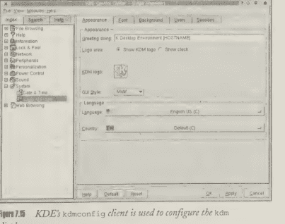

使用不同的选项卡和对话框来浏览 `kdmconfig` 的配置。你可以更改问候语，选择不同的壁纸，控制用户访问权限，或者为每个用户分配一个图形（或扫描的照片）。

## 配置 gdm

`gdm` 客户端，就像 `xdm` 一样，为 Linux 和 X 提供图形化登录。可以通过编辑 `/etc/inittab` 并添加如下的 `gdm` 运行级别 5 条目来使用此客户端：

```
x:5:respawn:/usr/bin/gdm -nodadaemon
```

请注意，在 SuSE PPC Linux 7.0 下，该条目看起来像这样：

```
x:5:respawn:/opt/gnome/bin/gdm -nodadaemon
```

你可以通过编辑 `/etc/X11/gdm` 目录下的 `gdm.conf` 文件来配置 `gdm`（作为 root）。该文件组织成不同的部分，例如 `daemon`、`security`、`xdmcp`、`gui`、`greeter`、`debug` 和 `servers`。例如，你可以通过编辑 "`greeter`" 部分来更改登录对话框的外观：

```
...
Icon=/usr/share/pixmaps/gdm.xpm
LocaleFile=/etc/X11/gdm/locale.alias
Logo=/usr/share/pixmaps/gnome-logo-large.png
QuitVer=0
SystemMenu=
Welcome=Welcome to &\n
...
```

在这个例子中，可以更改对话框的图标、徽标和欢迎消息。自定义 `gdm` 登录桌面的另一种方式是编辑 `/etc/X11/gdm/init` 目录下名为 `default` 的文件。例如，你可以添加以下内容：

```
/usr/bin/play /usr/share/sounds/retina.wav &
/usr/bin/xclock -bg '#363047' -fg yellow -update 1 -geometry 256x256+20+250 &
```

当屏幕第一次出现时，用户会被要求准备进行视网膜扫描以便登录（好吧，这是个玩笑！）。一个带有黄色指针的大型浮动时钟将出现在登录对话框旁边。（这是利用空闲终端的一个好方法！）

### 资源

http://www.xfree86.org. XFree86 Project, Inc. 的主页。你将在这个站点找到 X 的二进制发行版、源代码和文档。

- [http://www.kde.org](http://www.kde.org). 获取 KDE 桌面环境最新发行版的去处。
- [http://www.gnome.org](http://www.gnome.org). GNOME 开发者的主页以及许多 GNOME 项目的主页。
- [http://www.ximian.com](http://www.ximian.com). Ximian GNOME 发行版的主页。
- [http://www.fvwm.org/](http://www.fvwm.org/). FVWM 窗口管理器的主页。你可以在这里找到最新版本的源代码，以及关于新特性的文档。
- [http://foxproject.org/xclass/fvwm95.html](http://foxproject.org/xclass/fvwm95.html). FVWM95 窗口管理器的主页。
- [http://www.afterstep.org/](http://www.afterstep.org/). AfterStep 窗口管理器的官方主页。
- [http://www.enlightenment.org/](http://www.enlightenment.org/). Enlightenment 窗口管理器的主页。
- [https://sourceforge.net/projects/enlightenment/](https://sourceforge.net/projects/enlightenment/). Enlightenment 开发项目的 SourceForge 站点，包含指向项目源代码的链接。
- [http://icewm.sourceforge.net/](http://icewm.sourceforge.net/). ICEwm 窗口管理器开发项目的 SourceForge 页面。你可以从这里下载源代码并获取有关新版本的信息。
- [http://www.windowmaker.org/](http://www.windowmaker.org/). Window Maker 窗口管理器的主页，包含可以与此窗口管理器配合使用的其他实用工具的链接。
- [http://www2u.biglobe.ne.jp/~y-miyata/mlwvm.html](http://www2u.biglobe.ne.jp/~y-miyata/mlwvm.html). m1wvm 窗口管理器的主页。
- [http://www.plig.org/xwinman/](http://www.plig.org/xwinman/). 想要了解更多关于 X 的窗口管理器吗？对你 Linux 发行版自带的窗口管理器不满意吗？试试通过这个网站链接找到的 60 多种不同的窗口管理器之一。
- [http://www.hijinks.com/~spade/linux/XBanner/](http://www.hijinks.com/~spade/linux/XBanner/). 正在寻找一种方法来美化你的 xdm 登录界面桌面吗？试试 XBanner 客户端。

# 第 8 章：使用 X11

- 自定义 X 会话
- 使用 X11 终端客户端
- 键盘问题
- 指针问题
- 在网络上使用 X11

本章从用户的角度介绍如何使用 X 窗口系统。你将了解如何自定义 X 会话，如何使用 X 终端命令行启动客户端，概览使用 X 资源的方法，了解如何配置键盘和指针，最后，介绍如何在网络上使用 X。

## 自定义 X 会话

当你使用 Linux 和 X11 时，你将享受到使用自由操作系统和自由图形接口的乐趣。你还将享有改变和使用桌面外观和感觉的自由，使其完全符合你的喜好。你不必受限于商业软件供应商的想法。当然，当你使用 X11 时，这种自由是有代价的：你需要学习如何编辑几个配置文件或使用几个命令来实现你的更改。

本节向你介绍几个重要的文件，这些文件会影响你为 X 会话选择哪个窗口管理器，以及启动 X 后启动哪些客户端。你还将学习如何更改这些客户端的外观。

### 使用 .xinitrc 文件

`.xinitrc` 文件是一个 X 启动脚本，它可能存在于你的主目录中，也可能不存在。你总能找到一个默认的、系统范围的 `xinitrc` 文件，通常位于 `/usr/X11R6/lib/X11/xinit` 目录下，这是一个指向 `/etc/X11/xinit` 目录的符号链接。虽然这个文件有标准用法，但不同的 Linux 发行版会以不同的方式使用这个文件。

`xinitrc` 是一个 shell 脚本，由 X 窗口系统初始化客户端 `xinit` 使用以启动 X。`xinit` 客户端（如果系统没有使用 X 显示管理器，通常由 `startx` 脚本启动）会在你的主目录中查找 `.xinitrc`，如果未找到，则使用系统默认文件 `xinitrc`。如果该文件也未找到，`xinit` 应该在不使用窗口管理器的情况下启动 X 会话，并在你的显示器的左上角提供一个单独的 `xterm` 终端窗口。

作为 shell 脚本，系统 `xinitrc` 文件和可选的用户 `.xinitrc` 文件应包含逻辑，首先确定各种客户端（如单个程序或窗口管理器）的可用性，读取任何特定的自定义设置，然后启动 X 会话的客户端或窗口管理器。例如，在 SuSE PPC Linux 系统上，每个用户的主目录中都会安装一个默认的 `.xinitrc` 文件。部分该文件中的逻辑如下所示：


```bash
... 
# 选择一个窗口管理器

if test -n "$WINDOWMANAGER" ; then
    WINDOWMANAGER=`type -p $WINDOWMANAGER`
fi
if test -z "$WINDOWMANAGER" ; then
    if test -x /usr/X11R6/bin/kde ; then
        WINDOWMANAGER=/usr/X11R6/bin/kde
    elif test -x /usr/X11R6/bin/startkde ; then
        WINDOWMANAGER=/usr/X11R6/bin/startkde
    elif test -x /usr/X11R6/bin/fvwm2 ; then
        WINDOWMANAGER=/usr/X11R6/bin/fvwm2
    elif test -x /usr/X11R6/bin/wmlist ; then
        for i in '/usr/X11R6/bin/wmlist' ; do
            WINDOWMANAGER=`type -p $i`
            test -n "$WINDOWMANAGER" && break
        done
    fi
fi
...
```

在这个例子中，脚本检查 `WINDOWMANAGER` 环境变量中指定的窗口管理器，并检查其名称是否存在于存储于 `/usr/X11R6/bin` 目录下的系统范围窗口管理器列表中。其他发行版，如 LinuxPPC 2000 Q4 可能使用不同的方案，例如使用位于 `/etc/X11/xinit` 目录下名为 `xclients` 的脚本，解析 `/etc/sysconfig/desktop` 文件的内容以确定默认窗口管理器。这种后一种方法被许多基于 Red Hat 的 Linux 发行版使用，其逻辑如下所示：

```bash
...
# 检查用户是否有首选桌面
PREFERRED=
if [ -f /etc/sysconfig/desktop ]; then
    if [ -n "`grep -i Gnome /etc/sysconfig/desktop`" ]; then
        PREFERRED=gnome-session
    elif [ -n "`grep -i KDE /etc/sysconfig/desktop`" ]; then
        PREFERRED=startkde
    elif [ -n "`grep -i AnotherLevel /etc/sysconfig/desktop`" ]; then
        PREFERRED=AnotherLevel
    else
        PREFERRED=Default
    fi
fi
...
```

在这里你可以看到，用于 X 会话的窗口管理器是由 `/etc/sysconfig` 目录下名为 `desktop` 的文件中的关键字 `Gnome`、`KDE` 或 `AnotherLevel` 确定的。其他发行版提供了选择用于 X 会话的窗口管理器的不同机制。例如，SuSE PPC Linux 提供的 `startx` 脚本允许你在命令行中指定窗口管理器，如下所示：

```bash
$ startx twm
```

按下回车键后，`Twm` 窗口管理器将用于该 X 会话。但你可以通过在主目录中定义自己的 `.xinitrc` X 启动脚本来覆盖上述任何方法。你可以通过创建自己的 `.xinitrc` 文件来自由地选择自己的窗口管理器。例如，如果你更希望将根显示设置为浅蓝色，然后使用 LessTif 的 `mwm` 窗口管理器启动一个 `xterm` 终端客户端，并创建一个包含以下内容的 `.xinitrc` 文件：

```bash
xsetroot -solid lightblue
xterm &
mwm
```

保存文件，然后启动一个 X 会话。你新的 `.xinitrc` 文件将覆盖任何系统默认设置。这种方法适用于任何 Linux 发行版。请注意，你可能还想确保在启动会话之前读取任何自定义设置。继续阅读以了解如何做到这一点。

### 使用 .Xdefaults

`.Xdefaults` 文件包含所谓的 X 客户端资源，或者是定义各种 X 客户端默认外观和行为的文本字符串。`.Xdefaults` 文件通常从位于 `/etc/skel` 下的默认文件安装到每个用户的主目录中。

如果你没有在你的系统（如 LinuxPPC 2000 Q4）上找到 `.Xdefaults` 文件，请不要担心。每个使用 X 的 Linux 发行版都会在 `/usr/X11R6/lib/X11/app-defaults` 目录下的单个文件中安装大量的客户端设置库。


> 你的系统中可能存在其他资源文件，例如默认的 Xresources 文件。该文件可能位于 `/etc/X11`、`/etc/X11/xinit` 或 `/etc/X11/xdm` 目录下，并包含供 X 显示管理器 `xdm` 使用的资源。你也可以在主目录中创建一份本地副本，命名为 `.Xresources` 或 `.Xres`，并在此文件中存储本地资源设置。

## 每个应用程序专属文件都包含可能用于修改客户端外观的文本字符串。

例如，在名为 `xcalc` 的文件中，你会找到部分内容如下：

```
...  
*Title: Calculator
*Cursor:		hand2
...
```

这两个设置以 `*资源名: 资源设置` 的形式出现，定义了 `xcalc` 客户端窗口中使用的标题，以及使用该客户端时出现的指针类型。如果你更改资源设置，就会修改该客户端的外观。例如，你可以将 `xcalc` 的设置更改为：

```
...
Xcalc.Title:  This Calculator belongs to Willie
Xcalc*Cursor: gumbly
...
```

这些资源设置可以存储在用户主目录的 `.Xdefaults` 或 `.Xresources` 文件中，以符合你的系统或个人偏好。你还可以创建自己的 `app-defaults` 文件，然后使用 `XUSERFILESEARCHPATH` 环境变量将客户端指向你的设置，如下所示：

```
$ export XUSERFILESEARCHPATH=$HOME/app-defaults/*
```

要查找你常用的客户端认可哪些设置，请参阅其手册页、文档或 `app-defaults` 目录下的示例条目。

### 我的 .Xdefaults 更改未被识别！

你可能需要使用 `xrd` 客户端将更改合并到当前的 X 资源设置中。你可以使用 `xrd` 的 `-merge` 选项，后跟资源文件名称，快速轻松地完成此操作，如下所示：

```
$ xrd -merge .Xdefaults
```

按下回车键后，受影响的客户端应会使用你的新设置。如果没有，请确保你的资源字符串是正确的。你还可以使用 `xres` 或 `editres` 客户端来查看和验证其他客户端的资源设置。

### 使用 .xsession

`.xsession` 文件（通常是一个 shell 脚本）可以替代你的 `.xinitrc` 文件使用，尽管许多 Linux 发行版默认使用 `.xinitrc`。如果你从 X 终端登录，`.xsession` 文件会自动运行，并且应包含与 `.xinitrc` 类似的命令（例如加载资源设置）。请注意，某些发行版（如 LinuxPPC 2000 Q4）不包含较旧的配套 `xsession` 客户端，该客户端可用于在窗口管理器之间切换。大多数发行版改用 `xsm` 会话管理器。

会话管理器用于启动你在 `.xsession` 中指定的一个或多个客户端组（如果你使用 `xdm`），或者如果你使用 `xsm`，则在名为 `.xsmstartup` 或默认的 `system.xsm` 文件中指定（其位置取决于 `xsm` 是如何编译的）。如果你想使用 `xsm`，你的 `.xsmstartup` 文件格式可以非常简单，如下所示：

```
twm
xprop
xcalc
xclock
xterm
```

保存文件后，使用 `xsm` 客户端，后跟活动 X 会话的显示编号，如下所示：

```
$ xsm -display :0
```

然后，你可以通过键盘导航到活动会话（如果你运行的是独立工作站），按下 Cmd+F7（控制台 7 是 Linux 默认用于 X 的控制台）。第一次使用 `xsm` 时，每个客户端都会启动，你会看到一个 `xsm` 控制对话框，用于管理会话。在工作过程中，你可能会启动额外的客户端，然后可以使用 `xsm` 以会话名称保存你的工作状态。

例如，如果你使用文本编辑器、计算器和在线词典进行大量的文字处理会话，你可以将该会话保存为“我的编辑会话”。下次你启动 `xsm` 时，你会看到如图 8.1 所示的会话菜单，从中可以选择你之前定义的会话。


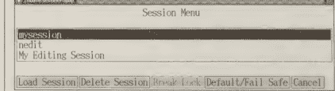

**图 8.1** `xsm` 客户端支持会话管理，即使对于不完全支持此功能的 X 客户端也是如此。

使用向上和向下箭头键选择会话类型，然后单击“加载会话”按钮以启动你之前保存的自定义会话。这是一种强大的方式来“记住”或组织你的 X 会话，并跟踪正在使用哪些应用程序。如果你同时启动了多个不同的客户端，使用会话管理器还可以节省时间和精力。请注意，会话管理是 KDE 和 GNOME 桌面环境中的标准功能；`xsm` 仅适用于没有会话管理的旧版窗口管理器。

此外，几乎每个发行版都包含一个（实际上是 shell 脚本）名为 `.Xsession` 的文件，但它在你的使用 `xdm` 显示管理器登录 Linux 和 X 时生效。该 shell 脚本用于配置和设置登录屏幕和对话框。尽管 `.Xsession` 与 `xsm` 无关，但它可能会在基于 Red Hat 的某些发行版上创建一个名为 `.Xsession-errors` 的文件，以记录使用 X 时遇到的错误，并执行在主目录的 `.Xsession` 文件中找到的窗口管理器和客户端。

### 更多的 X 文件！

你还可能在家目录中找到 `.Xclients` 文件。该文件及其系统范围的对应文件 `xclients`（可能位于 `/etc/X11/xinit` 目录下）可以像 `.Xinitrc` 一样用于启动特定的 X 客户端。另一个名为 `.xauthority` 的文件，用于在通过显示管理器登录 X 时存储授权记录。

### 使用 X11 终端客户端

当你使用 Linux 控制台时，你会越来越熟练地掌握 shell 的使用。在 X 会话中使用 shell 需要使用终端客户端（尽管 KDE 的 Konsole 客户端可用于单行命令）。正如 Linux 有大量的 shell 选择一样，你在会话中也将拥有多种终端客户端可供选择。

找到首选终端可能取决于你的需求、个人品味或客户端的功能。几乎所有终端客户端都可以以某种方式进行配置，以使其运行得更好，并且几乎所有窗口管理器都支持调整终端窗口的大小，以便它能更舒适地适应你的显示区域。

使用至少 80 字符宽、25 行高的终端窗口。这是许多基于控制台的应用程序的默认设置，某些面向屏幕的命令在窗口尺寸减小时可能会拒绝运行或无法正常工作。一些终端需要特殊的软件库，其他终端可能只在与特定的窗口管理器配合使用时才能很好地运行或享受特殊功能。

#### 启动和退出终端

要启动终端客户端，请单击窗口管理器桌面面板或根显示菜单中的相应菜单项。正如你所见，你还可以安排在 X 会话之前启动终端。终端启动后，你可以将指针移动到其窗口并开始使用 shell。是否需要单击终端窗口使其处于活动状态，取决于你的窗口管理器的当前焦点策略设置。

然后，你可以使用 shell 启动额外的 X 客户端，最好在后台（作为内存中的进程）运行，然后返回继续工作。这是通过使用 shell 的后台运算符，即与号 (`&`)，来启动 `xterm` 终端的新实例来实现的。操作如下：

```
$ xterm &
```

这种方法将 `xterm` 进程从你的 shell 命令行中分离出来，新的 `xterm` 将显示在独立的窗口中。这就是你在 X 会话期间（并且大多数情况下应该）启动几乎所有图形客户端的方式。

退出终端会话可以通过多种方式实现。如果 GNOME 或 KDE 终端有“文件”菜单，请选择“退出”菜单项。你还可以在终端命令行中输入 `exit` 来关闭终端会话。如果窗口管理器提供如关闭框等窗口装饰，则单击该框以销毁窗口。最后，你还可以使用 shell 的 `kill` 命令，加上进程 ID 号，来终止终端进程（这是一种混乱且不方便，但通常是关闭终端所必需的方法）。

#### 选择终端

你会发现在 PPC Linux 中包含了许多终端客户端。一些客户端是 GNOME 和 KDE 发行版的组成部分，而其他客户端（如 `xterm`）则是随 XFree86 包含的默认终端。表 8.1 列出了大多数 Linux 发行版包含的几个 X 终端客户端。

选择终端时要关注的一些功能包括终端处理滚动、颜色、不同字体、模拟不同终端协议的能力，以及可能使用背景图像或透明背景（以产生半透明错觉）的功能。

表 8.1 **X 终端客户端**

| **名称** | **描述** |

|---|---|

| **aterm** | Afterstep X VT102 终端仿真器 |

| **cmdtool** | OpenWindows 终端 shell |

| **Eterm** | 用于 X 的 Enlightened 终端仿真器 |

| **gnome-terminal** | GNOME X 终端仿真器 |

| **konsole** | KDE 终端仿真器 |

| **kvt** | KDE 终端仿真器（基于 `rxvt`） |

| **nxterm** | 基于 `xterm` 的终端仿真器 |

| **rxvt** | 一种 X 终端仿真器 |

| **wterm** | Window Maker 终端仿真器 |

| **xfterm** | 用于启动终端以读取文件或目录的脚本 |

| **xterm** | XFree86 默认终端仿真器 |

在你的 X 会话中，你最有可能继续使用桌面环境提供的默认终端。然而，一些 Linux 发行版，例如 SuSE，也会在 Shell 菜单中提供整个系统的终端套件，通常是通过面板菜单访问的。你可以从命令行启动任何你喜欢的终端。

#### 设置终端字体

当你使用符合 KDE 和 GNOME 标准的终端时，你会使用菜单和对话框来更改终端的字体、颜色方案或大小（尽管某些终端支持未记录的命令行选项）。其他终端则需要命令行选项或其他方法来修改或激活功能。

例如，通过按下 Ctrl 键和鼠标右键（按钮 3），你可以为 xterm 客户端选择新的字体大小。像这样启动终端：

```
$ xterm &
```

xterm 窗口将出现在你的桌面上。如果你按下 Ctrl 键，然后点击并按住鼠标右键，会出现一个弹出字体菜单，如图 8.2 所示。

滚动，然后在期望的字体大小上释放鼠标按钮。xterm 窗口随后会调整大小以使用新的字体大小。

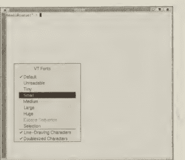

**图 8.2** *xterm 客户端的字体可以通过使用弹出菜单即时更改。*

使用命令行选项是强制终端使用特定字体和字体大小的另一种方法。这些命令行选项被称为 X Toolkit 选项，还允许你指定前景和背景颜色以及其他功能，例如窗口标题。例如，要启动带有淡紫色背景和红色文本的 `xterm`，像这样使用 `-bg` 和 `-fg` 选项：

```
$ xterm -fg red -bg Lavender &
```

你也可以指定不同的字体。例如，要启动具有非常大文本的 `xterm`，像这样使用 `-fn` 选项，后跟字体名称：

```
$ xterm -fn 10x20 &
```

按下回车键后，一个极大的终端窗口将出现在你的桌面上！


> 颜色名称可以在 `rgb.txt` 文件中找到，可能位于 `/usr/X11R6/lib/X11` 目录下。你还可以在 `/usr/X11R6/lib/X11/fonts/misc` 目录下查找其他字体。

#### 键盘问题

当你使用 X 时，你可以重新配置键盘或重新排列按键以适应你的需求。对于 Macintosh 用户来说，弄清楚该使用哪些按键可能会让人困惑，因为许多 X 客户端和应用可能会引用 Alt 键或 Meta 键。阅读你的 *Linux* 发行版的文档以确定当你使用 *Linux* 或 X11 时这些以及其他按键的默认映射方式是至关重要的。

例如，当使用 SuSE PCLinux 和 Apple USB 扩展键盘时，每个 Option 键都标记为 "Alt"。但是，当使用 emacs 编辑器时，按下 Cmd+x 键组合来使用 Meta 键。运行 Linux 的基于 Intel 的 PC 使用 Alt+x 组合。

##### 自定义键盘

使用 `xmodmap` 客户端重新映射你的键盘。这个客户端可以通过命令行和一个名为主目录中的 `.Xmodmap` 文件来交换按键或加载新的键盘布局。`.Xmodmap` 中的条目被称为 *xmodmap 表达式*，用于重新定义按键或其他 X 输入事件，例如鼠标点击。系统范围的默认文件 `xmodmap` 可以在 `/etc/X11` 下找到，或者在 SuSE PCLinux 的情况下，位于 `/usr/X11R6/lib/X11` 目录下。

你可以使用 `xev` 客户端或 X 事件客户端检查当前的按键定义。像这样从终端窗口的命令行启动 `xev`：

```
$ xev
```


按下回车键后，其窗口将出现，如图 8.3 所示。要找到 Mac 键盘 `Cmd` 键的值，按下该键。按键按下和释放的值将显示在你的终端中。然后你可以使用带有 `-pk` 选项的 `xmodmap` 交叉检查此值，像这样：

```
$ xmodmap -pk
61    0xff1b (Escape)
62    0xff1e3 (Control_L)
63    0xff59 (Alt_L)
```

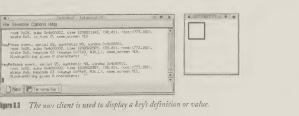

64    0xffe1 (Shift_L)

65    0xffe5 (Caps_Lock)

66    0xff7e (Mode_switch)    0xfff20 (Multi_key)

67    0xfff51 (Left)

68    0xfff53 (Right)

69    0xfff54 (Down)

70    0xfff52 (Up)

虽然这里没有显示所有输出，但是返回的值（来自 Apple USB 扩展键盘）对应于 `Ctrl` 和 `Caps Lock` 键（值为 62 和 65）。要交换这些按键，你可以在你的 `.Xmodmap` 文件中输入以下内容：

```
remove Lock = Caps_Lock
remove Control = Control_L
keysym Control_L = Caps_Lock
keysym Caps_Lock = Control_L
add Lock = Caps_Lock
add Control = Control_L
```

然后你可以像这样使用 `xmodmap` 客户端使更改生效：

```
$ xmodmap .Xmodmap
```

按下回车键后，按键将被交换！

> 另一个方便的客户端是 `xkeycaps`，它显示你键盘的图形。这个客户端有一个包含超过 100 种键盘的数据库，可用于生成 `xmodmap` 表达式文件以重新映射整个键盘。

### 指针问题

本节不是关于配置鼠标以用于 Linux，而是关于更改你的指针的视觉表示，以及更改在你的 X 会话期间你的鼠标按钮如何工作。这里提供的信息，特别是关于按钮重新配置的内容，可以为你或你系统中的用户让生活稍微容易一点和有趣一点。

尽管 X 会话期间使用的传统指向设备是三键鼠标，但许多 Apple 计算机只带有单按钮 ADB（Apple Desktop Bus）或 USB（通用串行总线）鼠标或触摸板。各种技巧用于在控制台和 X 中将其他按键（如 `F11` 和 `F12`）或按键组合（如 `Fn+Ctrl` 和 `Fn+Option`）重新映射到中间和右侧鼠标按钮。例如，如果你有一个单按钮 USB 鼠标，你可以使用以下脚本将中间和右侧鼠标按钮映射到键盘的 `F11` 和 `F12` 键：

```sh
#!/bin/sh
echo "1" > /proc/sys/dev/mac_hid/mouse_button_emulation
echo "87" > /proc/sys/dev/mac_hid/mouse_button2_keycode
echo "88" > /proc/sys/dev/mac_hid/mouse_button3_keycode
```

传统的鼠标按钮标记为 1、2 和 3。左侧鼠标按钮（按钮 1）通常用于按下按钮、点击菜单项、选择对象和关闭框。中间按钮（按钮 2）用于在客户端之间粘贴数据，或者在按住时用于滚动滚动条。右侧按钮（按钮 3）用于根显示中的属性菜单或其他信息。

为了演示文本复制和粘贴，首先在某个终端窗口中高亮显示文本，然后在另一个 X 终端窗口中点击中间鼠标按钮。你可以使用这种技术从浏览器复制 URL，将命令粘贴到终端窗口，或在编辑会话之间移动文本。

#### 更改指针

X 指针是当你移动显示或桌面的根窗口时的光标表示。它在活动窗口内通常变为“I”或文本编辑光标。如果你是 Mac OS 用户，你很可能熟悉各种指针，例如标准箭头和动画手表。

更改你的 X 会话的根显示指针既有趣又简单。X 指针的名称对应于在 `/usr/X11R6/include/X11` 目录下找到的文件 `cursorfont.h` 中的定义。要更改你的指针，使用带有 `-cursor_name` 选项的 `xsetroot` 客户端，后跟光标名称，像这样：

```sh
# xsetroot -cursor_name gumbi
```

按下回车键后，你的指针将成为一个老朋友。要重置你的光标，使用默认指针的名称，像这样：

```sh
# xsetroot -cursor_name X_cursor
```

使用带有 `-fn` 选项的 `xfd` 客户端，后跟名称，允许你查看可用的光标，像这样：

```sh
# xfd -fn cursor
```

按下回车键后，你将看到对话框中的光标，如图 8.4 所示。

##### 图 8.4


*x11x 客户端在 X11 字体中显示字符。*

想在 X 会话中使用一个真正的大光标吗？请访问网站 `http://www.linuxdoc.org/HOWTO/mini/X-Big-Cursor.html` 阅读 X 大光标 HOWTO 来了解方法！

###### 更改指针按钮

如果你使用三键鼠标但是左利手，请使用 `xmodmap` 客户端重新映射鼠标按钮。像这样使用 `xmodmap` 及其 `-e` 和 `pointer` 选项：

```
# xmodmap -e "pointer = 3 2 1"
```

按回车后，按钮的顺序将反转。

### 在网络中使用 X11

X 从底层就被设计为通过网络工作。随着你对使用 Linux 和 X 窗口系统的了解加深，你会发现更新、更快、更高效的网络工作方式。本节介绍了一些基本思想，如果你在网络中使用运行 Linux 的 Macintosh，这些思想会很有用。

大多数 PC 用户坐在计算机前，然后从计算机硬盘启动和运行程序。如果计算机没有连接到网络，这是使用 Linux 和 X 的唯一方式。然而，如果计算机在网络上，你可以登录到网络上的另一台计算机来进行工作。

本书是在各种计算机上运行 Linux 开发编写的，包括基于 Intel 和 PowerPC 的机型。大部分工作是在运行 SuSE PPC Linux 的 Apple G4 Cube 上完成的。然而，开发中使用的文字处理软件是 Sun Microsystems 的 StarOffice，它运行在一台无头（无显示器）的自组装 Intel 架构服务器上。工作是通过在 Cube 上运行 KDE 2.0 完成的，而 StarOffice 运行在 X 显示中。StarOffice 已作为开源软件发布，但尚未在 PPC Linux 上亮相。不过，`http://www.openoffice.org` 上的努力可能会很快带来 PowerPC 版本，并计划于 2001 年夏天发布 Mac OS 版本。


当你使用 X11 时，X 服务器处理所有显示问题。这使得 X 可以轻松显示运行在远程硬件上的程序。这意味着你可以在本地使用客户端，即使硬件本身可能不支持该客户端。这在遇到内存、硬盘或平台限制问题时特别有用。

#### 使用 DISPLAY 环境变量

`DISPLAY` 环境变量在计算机上的每个 X 服务器实例中都有一个内存值，它包含主机名、显示号和屏幕号。如果你想在网络上有效使用 X，你需要知道这些信息。

当你启动 X 并开始会话时，你的 `DISPLAY` 将具有以下值：

```
yourcomputerhostname:0.0
```

如果你检查 `env` 命令的输出，变量也可能看起来像这样：

```
:0
```

或者像这样：

```
:0.0
```

使用 `telnet` 命令登录到远程计算机后，你应该看到：

```
[bball@green bball]$ env | egrep DISPLAY
DISPLAY=cubie.home.org:0
```

在这里，你可以看到你的本地主机名 (`cubie`)、显示 (`0`) 和屏幕号（假定为 0，因为没有显示）。请记住，这指的是本地显示，而不是名为 `green` 的远程主机的显示。然后你可以坐下，在远程计算机上启动图形客户端，例如 `xv` 图形工具，它将出现在你的本地显示上。

`DISPLAY` 变量必须正确定义，远程应用程序才能在你的显示上出现。如果没有，你将看到：

```
[bball@green bball]$ xv
xv: Can't open display
```

要修复此问题，请使用远程 shell 的功能创建正确的 `DISPLAY`：

```
[bball@green bball]$ export DISPLAY=cubie.home.org:0
```

此示例（针对 `bash` shell）将创建 `DISPLAY` 变量。然后你可以启动远程客户端。

#### 使用 xhost 客户端


你必须有一个正确定义的 `DISPLAY` 变量，并且远程主机必须有权在你的服务器上显示客户端，然后才能登录！如果未授予权限，当你登录到远程计算机并尝试启动客户端时，你将看到类似以下内容：

```
[bball@cello bball]$ netscape
Xlib: connection to "cubie.home.org:0.0" refused by server
Xlib: Client is not authorized to connect to Server

Error: Can't open display: cubie.home.org:0
```

在这个例子中，用户 *bball* 登录到名为 *cello* 的主机，并尝试在未授权 *cello* 访问 *cubie.home.org* 的 X 服务器的情况下启动 *netscape*。要解决此问题，请在登录到 *cello* 之前，在 *cubie* 上使用 `xhost` 命令，像这样：

```
[bball@cubie]$ xhost + cello.home.org
cello.home.org being added to access control list
```

按 **Enter** 后，用户 *bball* 就可以登录到 *cello* 并启动 *netscape*。在远程会话结束后，你应该移除访问权限，像这样：

```
[bball@cubie]$ xhost - cello.home.org
cello.home.org being removed from access control list
```

你可以通过在没有主机名的情况下使用 `xhost` 来设置会话允许所有主机，像这样：

```
$ xhost +
```

要拒绝所有主机访问你的会话，请使用带有减号 (-) 的 `xhost` 客户端，像这样：

```
$ xhost -
```

使用 `xhost` 命令时要小心；你应该只在有限的基础上和有限的时间里允许其他主机访问你的会话。

### 远程启动客户端

通过结合适当的访问权限和 `DISPLAY` 变量的使用，你还可以启动本地客户端并在远程显示上供其使用。使用 `-display` X Toolkit 选项，以及远程计算机的显示名称，像这样：

```
[bbail@cube] $ xcalc -display cello:0.0 &
```

在这个例子中，用户 `bbail` 启动了 X 计算器，`xcalc`，它将出现在连接到名为 `cello` 的主机的显示上。正如你所见，在网络中使用 X 可以是有趣的、灵活的，并是一种完成工作的好方法。

### 资源

- http://www.rahul.net/kenton/xsites.framed.html. 通往互联网上关于 X 和 X11 编程信息最佳网站之一的门户。
- http://www.xfree86.org. The XFree86 Project, Inc. 的主页，它是 Linux 上免费版本 X11R6 的开发者。
- http://www.x.org. X 的管理机构 X.org 的官方页面。
- http://www.rahul.net/kenton/xsites.html#Xpapers. 列出了包含关于 X 窗口系统技术论文的网站列表。
- http://www-sop.inria.fr/koala/colas/mouse-wheel-scroll/. 一个非常好的网站，有许多与 X 和使用滚轮或滚动鼠标相关的资源字符串设置。
- http://lincserv1.gis.lincoln.edu/hds/3-6-2-2.html. 一个教程网页，展示如何使用 `xmodmap` 重新映射键盘。
- http://www.jwz.org/xkeycaps/. `xkeycaps` 客户端的主页。你将在该站点找到最新可下载副本。
- http://www.openoffice.org/. OpenOffice.org 项目的主页，旨在使功能齐全的生产力办公套件几乎可以在每个操作系统上使用。
- http://lists.yellowdoglinux.com/yellowdog-genera1/May00/0139.html. 关于 `xhost` 的正确用法以及如何授予远程权限的良好解释。
- http://ux2.cso.uiuc.edu/~j-mills/de_li/x2part2b.html. 滚动到此网页底部以查看使用不同 shell 设置 `DISPLAY` 变量的示例。

# 第 9 章：连接互联网

- 串行端口和调制解调器设置
- 网络设置基础
- 配置 PPP 脚本
- 使用 Netscape Communicator
- 电子邮件
- 使用电子邮件客户端
- 使用电子邮件实用工具
- Usenet 新闻阅读
- 使用新闻阅读客户端
- 下载文件
- 安全问题

本章涵盖连接互联网的方法。这通常是 Linux 用户安装 Linux 后完成的第一个任务之一。对于许多用户来说，这是个人计算日常工作中的必要组成部分。在本章中，你将了解一些传统的命令行工具，并了解如何启动、配置和使用每个 Linux 发行版中包含的较新、更复杂的图形互联网实用工具。

将本章作为进一步学习连接互联网的起点。Linux 还有数百，甚至上千种其他互联网实用工具。这些实用工具从即时消息到桌面面板中的简单股票行情显示应有尽有。

## 串行端口和调制解调器设置

在通信革命完成且每个人都拥有超高速度宽带互联网接入之前，大多数用户将继续通过 ISP（*Internet Service Provider*）使用拨号连接连接到互联网。为了成功连接到你的 ISP，你需要了解你的 PowerPC 的硬件功能，并能够识别和配置 Linux 以使用你的系统串行端口或内置调制解调器。

幸运的是，大多数现代 Linux 发行版和互联网连接实用工具能够识别、配置并报告任何调制解调器或串行端口。启动 Linux 后，使用 `dmesg` 命令检查发现的任何串行或调制解调器端口，像这样：

```
$ dmesg | fgrep tty
tty00 at 0xd415b020 (irq = 22) is a 28530 ESCC (cobalt modem)
tty01 at 0xd4162000 (irq = 23) is a 28530 ESCC (IrDA)
```

此示例显示发现了两个串行端口，并且（可能）可以使用。Linux 将串行通信端口表示为 `/dev/ttyx`，其中 x 通常是零到三之间的数字。在此示例中（使用运行 LinuxPPC 2000 Q4 的 TiBook），内置调制解调器被正确识别并被分配为 `/dev/tty0`。然后你可以使用 `ln` 命令（作为 root）创建符号调制解调器链接，像这样：

```
# ln -s /dev/ttyS0 /dev/modem
```

这将创建名为 `/dev/modem` 的符号链接。也有可能此链接在安装过程中自动创建。是否创建此链接由你决定，但许多 Linux 客户端将使用

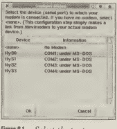

**图 9.1** 在创建系统的 `/dev/modem` 之前，请选择合适的设备。

使用 `/dev/modem` 作为指定的调制解调器设备。大多数 Linux 发行版都自带图形化系统管理工具来创建此链接。例如，包含在 Yellow Dog Linux 和 LinuxPPC 2000 中的 `modemtool` 客户端（它是控制面板客户端的一部分），可以通过点击按钮快速创建符号链接。你可以从面板或 X 终端窗口的命令行启动此客户端，如下所示：

```bash
$ modemtool &
```

按下 Enter 键后，你将看到其对话框，如图 9.1 所示。你必须首先点击以选择正确的设备，然后点击“确定”按钮来创建 `/dev/modem`。

### 替代方案

如果你的内置调制解调器不受支持，你可以尝试使用 USB 串行适配器，例如 Keyspan 型号 USA-19。该适配器插入可用的 USB 端口，并提供一个公头 DB-9 RS232 适配器，可用于连接外部调制解调器（对于下载照片的数字相机，或用于备份、恢复或软件安装的 Palm PDA 也很有用）。要使用该适配器，连接它，然后使用 `insmod` 命令（作为 root）加载 `usbserial` 和 `keyspan_pda` 内核模块，如下所示：

```bash
# insmod usbserial
Using `/lib/modules/2.2.16/usb/usbserial.o`
# insmod keyspan_pda
Using `/lib/modules/2.2.16/usb/keyspan_pda.o`
```

然后，你可以使用 `dmesg` 命令来确定用于调制解调器或串行操作的正确串行设备，如下所示：


```bash
# dmesg
...
usbserial.c: Looking at Keyspan PDA Vendor Id=06dc Product Id=0104
usbserial.c: descriptor matches
usbserial.c: found interrupt in
usbserial.c: found bulk out

usbserial.c: Keyspan PDA converter detected
usbserial.c: get_free_serial -
usbserial.c: get_free_serial - minor base = 0
usbserial.c: Keyspan PDA converter now attached to ttyUSB0 (or usb/tts/0 for devfs)
```

请注意，此处未显示所有输出。在此示例中，新的串行端口被指定为 `/dev/ttyUSB0`。然后可以使用此端口进行调制解调器操作。


> 在撰写本文时，使用此适配器（在基于 Intel 的 Linux 上运行良好）的串行端口速度限制为 9600 波特。希望 USB 驱动程序会在接下来的几个 PPC 内核版本中得到优化。

你还可以尝试在 Linux 上使用 USB 调制解调器。在撰写本文时，据报道以下型号正在运行并得到完全支持：

- 3Com OfficeConnect 模拟调制解调器。
- 3Com 56k 语音传真调制解调器 Pro。
- Diamond Supraexpress 56k USB 调制解调器。
- Zoom Telephonics, Inc. 2985L Zoom V90 USB 传真调制解调器。

但是，这些调制解调器中的一些可能需要 `acm` 内核模块。各种 USB 内核模块的支持在基于 Intel 的内核发行版和你的 PPC Linux 内核之间可能有所不同。如有疑问，请始终咨询使用类似设备和软件的人。在购买前，你还应该研究硬件！

### 网络设置基础

如果你是通过局域网和以太网将系统连接到互联网，恭喜！设置连接的任务要简单得多，只需要几个简单的步骤。好消息是 Linux 在网络上运行得非常出色，即使局域网中充满了使用其他“操作系统”的计算机，你的 PowerPC 也会感觉很自在。

### 所需信息

首先需要知道你的计算机的主机名和 IP 地址。你可以通过查看登录或 shell 提示符、`/etc` 目录下名为 `HOSTNAME` 的文件，或 `/etc` 目录下名为 `hosts` 的文件来查找主机名。如果你的局域网管理员使用 DHCP（动态主机配置协议）来分配 IP 地址，那么你将获得一个被称为动态 IP 地址的地址。如果你被分配了诸如 `192.168.2.55` 这样的 IP 号，那么你就被分配了一个静态 IP 地址。动态 IP 地址和静态 IP 地址的区别在于，使用动态地址时，每次断开并重新连接到局域网时，你都会被分配一个新的 IP 地址，而静态 IP 地址则保持不变。

> 如果你需要动态寻址，请确保已在系统中安装了 dhcp 客户端。对于 LinuxPPC 2000，这将是 `dhcp-2.0` RPM 文件。在 SuSE PPC Linux 下，这将是 `dhcp` RPM 文件。


你还需要知道你的局域网互联网网关的 IP 地址。网关无非是连接两个或多个网络的设备；在这种情况下，它是将你的局域网连接到互联网的工作站、服务器、防火墙或其他硬件设备。

最后，你需要知道你的局域网域名服务器（提供 DNS）的 IP 地址。这些是一台或多台计算机，保存着不断更新信息的表格，可以将数字 IP 地址快速转换为名称（通常形式为 XXX.XXX.XXX.XXX）。例如，`www.prima-tech.com` 或 `www.applecomputer.com`。

一旦你掌握了这些信息，就可以配置你的系统了。首先，确保你的以太网接口已安装并被 Linux 识别。接下来，使用第 15 章“管理服务”中介绍的其中一个管理工具来正确配置你的接口。如果你有静态 IP 地址，也可以使用 `ifconfig` 命令快速完成此操作（作为 root），如下所示：

```bash
# ifconfig eth0 yourIPaddress up
```

在此示例中，通过使用你分配的 IP 地址激活接口。如果你的系统 `/etc/hosts` 文件中有一条关于你计算机的条目，并且它与你 IP 地址相关联，你可以用系统的主机名替换 IP 地址。例如：

```text
192.168.2.33  stinkypad.home.org  stinky
```

然后你可以使用缩写（别名）主机名，如下所示：

```bash
# ifconfig eth0 stinky up
```

按下 Enter 后，你的以太网接口应处于活动状态。接下来，编辑系统的 `/etc/resolv.conf` 文件以包含一个或两个（最可能的）DNS 号码：

```text
nameserver 199.45.32.38
nameserver 199.45.32.43
```

然后，你应该可以使用 `route` 命令将你的局域网网关（作为 root）添加到 Linux 内核的路由表（存储在内存中），如下所示：

```bash
# route add default gw yourgateway
```

在此示例中，`yourgateway` 可以是主机名或 IP 地址。`route` 命令将迫使你的系统通过网关计算机发送和接收信息包。

恭喜！你现在应该可以检查你的互联网连接。

> 有关使用图形配置工具创建网络接口的信息，请参阅第 15 章“管理服务”中的“网络管理与实用工具”部分。


#### 检查 Mac 连接

Linux 附带了数百个网络实用工具，但大多数用户在连接到局域网和互联网后使用 `ping` 命令来检查网络连接。任何用户都可以使用该命令，它报告远程计算机回显数据包传输所需的时间（以毫秒为单位）。使用此命令时，请输入一个已知的远程互联网主机的名称，如下所示：

```bash
# ping -c 3 www.usu.com
PING www.usu.com (213.95.15.200): 56 data bytes
64 bytes from 213.95.15.200: icmp_seq=0 ttl=238 time=133.912 ms
64 bytes from 213.95.15.200: icmp_seq=1 ttl=238 time=133.524 ms
64 bytes from 213.95.15.200: icmp_seq=2 ttl=238 time=140.510 ms
-- www.usu.com ping statistics --
3 packets transmitted, 3 packets received, 0% packet loss
round-trip min/avg/max = 133.524/135.982/140.510 ms
```

在此示例中，`-c` 或 count 选项用于将回显数量限制为三个。此示例还表明系统的以太网接口处于活动状态，连接能够使用 DNS，并且存在活动的互联网连接。还有其他可用于检查网络连接的实用工具，但 `ping` 似乎就足够好了。

如果你可以 ping 局域网上的其他计算机，但不能通过互联网（也许会得到“未知主机”错误），请检查网关信息是否正确，以及是否已在系统的 `/etc/resolv.conf` 文件中正确输入了 DNS IP 地址。如果你无法 ping 局域网上的其他计算机，请检查你的以太网卡配置。你也应该能够 ping 你自己。如果不能，请确保你有本地回环接口并且网络服务处于活动状态。你可以使用 `ifconfig` 命令来检查你的以太网和回环接口，如下所示：


```bash
$ /sbin/ifconfig
eth0      Link encap:Ethernet  HWaddr 00:90:27:91:92:B5
          inet addr:192.168.2.37  Bcast:192.168.2.255  Mask:255.255.255.0
          UP BROADCAST RUNNING MULTICAST  MTU:1500  Metric:1
          RX packets:2043954 errors:0 dropped:0 overruns:0 frame:0
          TX packets:1860080 errors:0 dropped:0 overruns:0 carrier:0
          collisions:166406 txqueuelen:100
          Interrupt:10 Base address:0xd400
lo        Link encap:Local Loopback
          inet addr:127.0.0.1  Mask:255.0.0.0
          UP LOOPBACK RUNNING  MTU:3924  Metric:1
          RX packets:28705 errors:0 dropped:0 overruns:0  frame:0
          TX packets:28705 errors:0 dropped:0 overruns:0 carrier:0
          collisions:0 txqueuelen:0
```

此示例显示了活动的 `lo`（回环）和 `eth0`（以太网）接口。

### 功成身退，但未曾被遗忘

在互联网尚处于幼年期时，传奇人物就会离我们而去，这实在令人难以置信。`ping` 命令的作者迈克尔·约翰·“迈克”·穆斯（Michael John "Mike" Muuss）于 2000 年 11 月 20 日在马里兰州的一起悲剧性车祸中去世。穆斯曾说道：“我根据声呐发出的声音给它命名，这一命名灵感源自回声定位的整体原理。” 截稿之时，他的个人主页 (http://ftp.arl.army.mil/~mike/) 仍然处于活动状态。

#### 配置 PPP 脚本

为了连接互联网，你无需诉诸那些花哨的图形化连接程序。经验丰富的 Linux 拨号用户利用随每个 Linux 发行版安装的可用命令来构建连接脚本。这些命令包括：

- `chat`：用于通过串行端口建立链路并与远程计算机进行协商。
- `pppd`：这是 PPP 守护进程，负责处理通过连接过程中创建的内存接口传输的信息。
- `bash`：此命令或任何其他 Linux shell 用于运行这些脚本。

#### 手动连接

若要手动连接，请使用 Al Longyear 的 `ppp-on` 和 `ppp-on-dialer` 脚本。这些脚本通常包含在 `pppd` 守护进程文档目录下的示例目录中（例如 `/usr/share/doc/pppd` 或 `/usr/share/doc/packages/pppd`）。以 root 操作员身份编辑这些脚本，以便根据你的系统和 ISP 进行自定义。

这些脚本应复制到 `/etc/ppp` 目录中，然后进行编辑。第一个脚本 `ppp-on` 用于启动连接。该脚本的部分内容如下所示：

```
# These are the parameters. Change as needed.
TELEPHONE=2025551212		# The telephone number for the connection
ACCOUNT=yourname		# The account name for login (as in 'George Burns')
PASSWORD=mypassword	# The password for this account (and 'Gracie Allen')
LOCAL_IP=0.0.0.0        # Local IP address if known. Dynamic = 0.0.0.0
REMOTE_IP=0.0.0.0       # Remote IP address if desired. Normally 0.0.0.0
NETMASK=255.255.255.0  # The proper netmask if needed
#
...
```

在这个示例中，脚本已编辑以添加远程 ISP 的电话号码，以及 ISP 分配的用户名和密码。你可能想做的唯一其他更改是文件中稍后详述的默认调制解调器速度。脚本的这一部分看起来是这样的：

```
exec /usr/sbin/pppd lock modem crtscts /dev/modem 115200 \
asyncmap 20a0000 escape FF $LOCAL_IP:$REMOTE_IP \
noipdefault netmask $NETMASK defaultroute connect \
$DIALER_SCRIPT &
```

在这个示例中，调制解调器（位于 `/dev/modem` 上）的默认速度设置为 115200。进行任何所需的更改并保存文件。然后，你可以使用 `ppp-on` 脚本以 root 身份创建到你远程 ISP 的 PPP 连接，如下所示：

```
# /etc/ppp/ppp-on
```

#### 配置 kppp 客户端

如果你在 X 会话中使用 K 桌面环境，你可能希望设置 `kppp` 客户端来替你进行拨号。本节包含设置简单 PPP 连接的说明。只需几个步骤，你就可以配置系统以拨号并连接到你的 ISP。`kppp` 客户端是一个成熟、稳定且稳健的拨号器，已被 KDE 爱好者使用多年。如果你使用 KDE，你一定会爱上 `kppp`！

从桌面面板菜单或 X 终端的命令行启动客户端，如下所示：

```
$ kppp &
```

按下 Enter 键后，你会看到一个小对话框。要设置你的连接，请单击“Setup”（设置）按钮。然后你会看到一个“Account setup”（账户设置）对话框。单击“New”（新建）按钮开始，系统会询问你是否希望使用 `kppp` 的向导设置。除非你居住在美国以外，否则请勿选择向导设置，因为该配置是针对国外用户的。相反，请单击“Dial Setup”（拨号设置）按钮，你会看到如图 9.2 所示的对话框。

在“Connection”（连接）字段中单击，并给该账户起一个名字。接下来，单击“Add”（添加）按钮，并输入一个可以连接到远程 ISP 的电话号码。

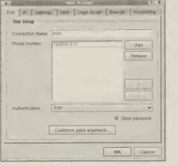

*图 9.2 通过输入名称和电话号码，开始使用 kppp 配置你的拨号账户。*

如果你的连接需要特殊的登录序列，请单击“Authentication”（身份验证）下拉菜单，并选择基于脚本或基于终端的登录。大多数现代 ISP 使用 PAP（*Password Authentication Protocol*，密码身份验证协议），尽管一些可能使用 CHAP（*Challenge Handshake Authentication Protocol*，质询握手身份验证协议）。这些协议用于协商和验证希望启动 PPP 会话的远程登录。

接下来，单击对话框中的“IP”选项卡，你会看到一个对话框，如图 9.3 所示，询问你将在连接中使用动态还是静态 IP 分配。

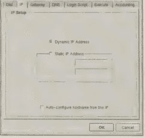

*图 9.3 选择动态或静态 IP 分配。*

如果你使用静态 IP 地址，请在此处输入。很可能你的 ISP 会动态分配你的 IP 地址。然而，这是一个方便的设置，特别是如果你已配置系统允许拨号用户并分配了静态 IP。参见第 15 章“管理服务”，了解如何执行此操作。完成后，单击“DNS”选项卡，你会看到如图 9.4 所示的对话框。

你的 ISP 也很可能提供 DNS 服务。这几乎是强制性的，尤其是对于大型服务提供商。在“DNS IP Address”（DNS IP 地址）字段中单击，输入 IP 号码，然后完成后单击“Add”（添加）按钮。`kppp` 将保存这些设置，当你尝试连接时，它会临时将这些设置放置在你的系统 `/etc/resolv.conf` 文件中。

完成后，单击“OK”（确定）按钮保存你的设置。你将返回到“Account Setup”（账户设置）对话框。若要检查调制解调器速度设置，请单击“Device”（设备）选项卡，你会看到如图 9.5 所示的对话框。

尽管如今很少有 ISP 收取每分钟费用，但大多数 Linux 用户希望拥有可用的最快连接。检查你的设备设置，使用你的调制解调器支持的最快速度。完成后，单击“OK”（确定）按钮。然后你将位于 `kppp` 的主窗口，如图 9.6 所示。


> 尽管 iBook 和 TiBook 拥有 56K 调制解调器，你可以尝试在设备对话框中将速度设置为 115200，看看是否能获得稍快的连接。此外，探索“Misc”（杂项）选项卡，查看诸如将 `kppp` 图标对接到连接后桌面面板的选项（然后显示一个带有闪烁红灯和绿灯的微缩调制解调器）。

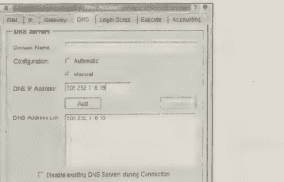

*图 9.4 输入你的 ISP 提供的 DNS IP 地址。*

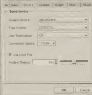

*图 9.5 检查你的调制解调器设置，以确保最快的连接。*

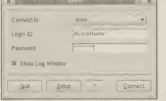

*图 9.6 首次连接时，勾选“Show Log”（显示日志）复选框，然后在按下“Connect”（连接）按钮前输入你的用户名和密码。*

确保在下拉菜单中选定了你的新服务，然后输入你的用户名和密码（由你的 ISP 分配，而非用于 Linux）。勾选“Show Log Window”（显示日志窗口）复选框以监视拨号进度。要连接，请单击“Connect”（连接）按钮。你会在一个新窗口中看到拨号和协商过程，如图 9.7 所示。

在 `kppp` 连接并且你的用户名和密码通过身份验证后，连接对话框将最小化并对接在你的桌面面板中。

### 使用 Red Hat 的拨号命令

如果你使用基于 Red Hat 的 PPC Linux 发行版，你可以使用 Red Hat 的拨号配置和连接工具来创建账户并实现连接。该软件包的主要组件是 `ppp-config` 客户端和 `ppp-setup` 连接工具。这些图形配置工具可以快速轻松地引导你完成上网的步骤。


*图 9.7 在前几次使用 `kppp` 时，监视你的连接和协商。*

一如既往，你必须拥有一个被正确识别和配置的调制解调器才能使用连接。你可以通过运行 `ppp-config` 命令开始使用 Red Hat 的工具，该命令可以从桌面面板菜单（如果你是 GNOME 用户）或 X11 终端窗口的命令行运行，如下所示：

```
# ppp-config &
```

按下 Enter 键后，你会看到初始窗口，如图 9.8 所示。单击“Next”（下一步）按钮开始。如果你尚未使用此客户端配置调制解调器，系统会要求你单击另一个“Next”（下一步）按钮开始配置。软件将搜索你的系统，寻找要配置和使用的调制解调器。如果未找到调制解调器，系统将要求你手动配置调制解调器


*图 9.8 Red Hat 的 PPP 配置工具易于使用。*

对话框。完成后，再次单击“下一步”按钮。此时您将看到一个账户输入窗口，如图 9.9 所示。

为拨号账户命名，并输入用于连接到远程 ISP 的电话号码。完成后，单击“下一步”按钮。您将看到用户名和密码输入窗口，如图 9.10 所示。

输入 ISP 提供给你的用户名和密码。完成后，单击“下一步”按钮。随后系统将询问你使用的是普通 ISP 还是 ATT 全球服务。之后，再次单击“下一步”。你将看到一个“账户”窗口。然后你可以单击“关闭”按钮。

要连接网络，请使用命令行中的 `wvdial` 命令，或从桌面面板中启动。单击新建的账户连接即可建立连接。


*图 9.9 输入账户名称和 ISP 的电话号码*


*图 9.10 输入你互联网账户的用户名和密码。*

> YDL 2.0 包含 `wvdial` 命令，通常通过编辑名为 `/etc/wvdial.conf` 的文件手动配置。然而，你会发现当运行 `rp-pppoe` 客户端时，该客户端会创建设置 PPP 连接所需的配置，并使用 `wvdial` 命令来发起连接。


#### 使用 rp-pppoe 配置 DSL

宽带接入的最新热潮是数字用户线（DSL）。这种互联网服务与稍快的电缆调制解调器不同（Linux 可以轻松连接并使用它），它使用服务器形式的 PPP 而不是以太网，被称为 PPPoE。来自 Verizon 等大型服务提供商的低端套餐通常提供 640Kbps 的下载速度和 90Kbps 的上传速度。尽管存在发展阵痛、管理不善以及大型电话公司在挤出小型 ISP 时表现出的初始无能，消费者仍蜂拥而至 DSL 服务。

典型的连接涉及使用连接到家庭电话线的 DSL 调制解调器。然后通过以太网电缆将调制解调器连接到 Linux 计算机。Linux 的首选 DSL 连接软件来自渥太华（安大略省）的一家小型计算机顾问公司——Roaring Penguin。如果没有 `rp-pppoe` 的作者 David F. Skoll 的杰出贡献和大度，Linux DSL 用户的处境将会更加艰难。

`rp-pppoe` 软件包中的主要组件包括以下命令：

| 命令 | 描述 |
| :--- | :--- |
| `adsl-setup` | 用于设置 DSL 服务的配置工具 |
| `adsl-start` | 用于启动 DSL 连接的脚本 |
| `adsl-stop` | 用于停止 DSL 连接的脚本 |
| `adsl-connect` | 在连接脚本中使用的命令 |
| `adsl-status` | 报告连接状态的客户端 |
| `pppoe` | 与 `pppd` 守护程序协同工作的客户端 |

要建立连接，你必须拥有一个有效账户，包括用户名和密码。你很可能需要从 DSL 提供商处获取 DNS 地址。确保所有电缆都连接正确。一旦所有硬件就位且你的提供商已正确设置好你的账户，设置连接将变得轻而易举。

在控制台的命令行或 X 终端窗口中启动 `adsl-setup` 脚本（以 root 身份运行），如下所示：

```
# adsl-setup
```

按下回车后，系统会询问一系列关于你服务的问题。你需要准备好你的用户名、密码，并了解希望如何设置系统。`rp-pppoe` 软件将自动为你的局域网启动 IP *伪装*（masquerading）或互联网连接共享，并根据需要配置防火墙。如果你只有一台工作站连接到 DSL 调制解调器，至少允许脚本设置防火墙。如果你的计算机位于局域网（LAN）中，并希望其他用户能够共享连接，你需要为计算机添加一个额外的以太网接口。你还需要使用 IP 伪装。

服务安装并为你系统配置完成后，连接互联网几乎是即时的，并且如同操作般简单：

```
# adsl-start
```

要关闭服务，请使用：

```
# adsl-stop
```

### 使用 Netscape Communicator

Linux 上首选的免费——但属于商业——软件 Web 浏览器是 Netscape Communicator。本节介绍商业版 Communicator，它通常包含在所有 Linux 发行版中（Debian 除外）。名为 *mozilla* 的免费开源版本也适用于 Linux，在 Netscape 于近两年前发布浏览器源代码后，该版本已稳步成熟。这一举措震惊了整个行业，迫使许多公司重新审视关于开源范式（类似观点，加上恐惧、不确定性和怀疑，[FUD]，仍在被垄断的软件行业传播）的过时看法。尽管苹果公司在 1997 年注入 1.5 亿美元现金后采用了一款不那么流行的产品，但许多 Mac OS 用户对 Netscape 的软件都很熟悉。

事实上，Netscape Communicator 是多个程序体现于单一客户端中。正如你将在以下章节中看到的，Netscape 可用于浏览网页、收发电子邮件以及阅读 Usenet 新闻组。


> YDL 2.0 还包含开源版本的 Netscape Navigator，即 Mozilla。如果你使用 KDE，请选择面板互联网菜单下的“迁移 Netscape 配置文件”菜单项，以便在 Mozilla 中使用现有的 Netscape 设置。

#### 网页浏览

对于大多数熟练的互联网用户来说，浏览网页通常是不言自明的，并且 Communicator 的 Netscape Navigator 组件在每个受支持的平台上的使用通常也是一致的。然而，如果你是 Linux 新手，你可能不知道 Communicator 有许多不同的命令行选项，并且可以以许多不同的方式启动。例如：

- `-component-bar` 显示一个小巧的浮动工具栏启动器


## 启动参数

- `-composer` 或 `-edit` 打开 Communicator 的网页编辑器
- `-messenger` 或 `-mail` 启动 Netscape Messenger 用于电子邮件
- `-discussions` 或 `-news` 启动 Netscape Discussions 用于新闻阅读

例如，如果你的桌面空间很宝贵，可以从命令行启动 Netscape，如下所示：

```
$ netscape -component-bar &
```

按下回车后，你将看到一个小的浮动工具栏，如图 9.11 所示。单击工具栏（如图 9.11 所示）中的组件以启动所需的组件。Mac OS 用户会注意到的第一件事之一便是 Mac OS 与 Linux 及 X11 之间的差异。在 Mac OS 中，菜单栏嵌入在桌面顶部的菜单栏中，而在 Linux 和 X11 下，每个窗口都有自己的菜单栏和菜单。完成 Netscape 组件的使用后，单击该组件的“文件”菜单并选择“关闭”菜单项。你仍然可以访问 Netscape 的其他组件。


图 9.12 使用 Netscape 的“首选项”对话框可以自定义 Communicator 的许多不同功能。

## 自定义 Netscape

自定义 Netscape 至少有两种方式。第一种是使用“编辑”菜单下的“首选项”菜单项。“首选项”对话框（如图 9.12 所示）提供了许多更改 Netscape 工作方式的途径。

单击对话框左侧的下拉菜单，右侧会发生变化以提供新的选项。另一种最大化屏幕空间并充分利用浏览器窗口的方法是，使用“外观”首选项对话框（如图 9.12 所示），然后为“工具栏”选择“仅文本”。你也可以使用 Navigator 的“查看”菜单（在浏览时）移除任何不需要的菜单。这将提供最大的最大窗口区域用于显示浏览器信息。

自定义 Netscape 的另一种方式是编辑其 X 资源。Navigator 的资源是可以用于自定义默认窗口大小、颜色以及 Navigator 如何响应键盘和鼠标指针事件的文本字符串。例如，如果你有一个带有中间滚动轮（也是中间按钮）的 USB 三键鼠标，请使用以下资源设置：

```
!## NETSCAPE

Netscape*drawingArea.translation: #replace \
<Button1Down>: ArmLink() \n\
<Button2Down>: ArmLink() \n\
-Shift<Btn1Up>: ActivateLink() \n
```

```
Shift<Btn2Up>: ActivateLink(new-window)
DisarmLink()
Shift<Btn1Up>: ActivateLink(save-only)
DisarmLink()
Shift<Btn2Up>: ActivateLink(save-only)
DisarmLink()
<Btn1Motion>: DisarmLinkTMoved()
<Btn2Motion>: DisarmLinkTMoved()
<Btn3Motion>: DisarmLinkTMoved()
<Motion>: DescribeLink()
<Btn3Down>: xfeDoPopup()
<Btn3Up>: ActivatePopUp()
Ctrl<Btn4Down>: PageUp()
Ctrl<Btn5Down>: PageDown()
Shift<Btn4Down>: LineUp()
Shift<Btn5Down>: LineDown()
None<Btn4Down>: LineUp()LineUp()LineUp()LineUp()LineUp()LineUp()LineUp()
None<Btn5Down>: LineDown()LineDown()LineDown()LineDown()LineDown()LineDown()LineDown()
Alt<Btn4Down>: xfeDoCommand(forward)
Alt<Btn5Down>: xfeDoCommand(back)
Matacape*globalNonTextTranslations: #override
Shift<Btn4Down>: LineUp()
Shift<Btn5Down>: LineDown()
None<Btn4Down>:LineUp()LineUp()LineUp()LineUp()LineUp()LineUp()LineUp()
None<Btn5Down>:LineDown()LineDown()LineDown()LineDown()LineDown()LineDown()
Alt<Btn4Down>: xfeDoCommand(forward)
Alt<Btn5Down>: xfeDoCommand(back)
```

这些设置可以用于主目录中名为 `.Xdefaults` 的文件中，并且每次启动 X 会话时都会生效。系统管理员可以使用这些资源，通过 `/usr/X11R6/lib/X11/app-defaults/Netescape` 文件中的设置来实现全系统范围内的启用。请注意，你还必须正确配置系统的 `XF86Config` 文件以支持你的滚轮鼠标。

## 电子邮件

电子邮件是最重要的功能之一，也是许多人连接互联网的主要原因。如果必须在网页浏览和电子邮件（及其发送和接收附件的能力）之间做出选择，这个决定可能相当艰难。尽管互联网上有一些免费的电子邮件网站，适合非正式使用，但你可能希望使用系统上的电子邮件功能，以便能够完全控制你的消息。

`Messenger` 组件是 Communicator 的电子邮件处理程序。为了使用 `Messenger`，你必须拥有一个有效的电子邮件账户，包括用户名和密码，以及你的 ISP（互联网服务提供商）的收件服务器和发件服务器名称。

若要配置 `Messenger` 以发送和接收电子邮件，请单击 `Edit（编辑）` 菜单，选择 `Preferences（偏好设置）`，然后单击 `Mail and Newsgroups（邮件和新组）` 菜单项。接下来，单击 `Identity（身份）` 菜单项。你将看到一个对话框，如图 9.13 所示。

输入你的名字和电子邮件地址，例如 `jdoe@mydomain.com`。如果你希望收件人看到 `Reply-to:`（回复到）地址，请在 `Reply to: address`（回复到地址）字段中输入该地址。

- 有个人名片吗？你可以创建一个电子名片，该名片将自动附加到每条消息中。方法是单击 `Edit Card`（编辑名片）按钮，然后单击 `Attach personal card`（附加个人名片）按钮。这些名片被称为 `vCard`，被不同操作系统上的不同程序使用。这些名片通常被导入电子邮件程序的地址簿组件或 `PIM`（个人信息管理器）应用程序中。


*输入你的电子邮件地址和其他信息，开始使用 Messenger 设置电子邮件。*


接下来，单击 `Mail Servers`（邮件服务器）菜单项，选择现有的服务器，然后单击 `Edit`（编辑）按钮。你将看到一个对话框，如图 9.14 所示，你可以使用它来输入来自你 ISP 的邮件服务器信息。

输入你的 ISP 邮件服务器的名称。这是你从中检索邮件的邮件服务器名称。该邮件服务器的名称可能以 `pop` 开头，代表邮局协议（Post Office Protocol，其他邮件服务器可能使用互联网消息访问协议，即 IMAP）。完成后，单击 `OK`（确定）按钮，然后输入你的 ISP 的发件邮件服务器名称。该邮件服务器的名称可能以 `smtp` 开头，代表简单邮件传输协议（Simple Mail Transfer Protocol）。你还需要输入你的用户名。完成后，单击 `OK`（确定）按钮。

现在，你可以通过命令行或使用任何 Communicator 组件中 `Communicator` 菜单下的 `Messenger` 菜单项来启动 Communicator 的 `Messenger` 组件。当 `Messenger` 出现时，单击 `Get Msg`（获取消息）框。然后你将看到一个对话框，如图 9.15 所示。

邮件将被检索，Incoming messages（收到的消息）列表将显示在 `Messenger` 窗口中的一个字段中。单击一条消息即可阅读它，你将看到如图 9.16 所示的对话框。然后，你可以单击 `Messenger` 窗口中的各个按钮来回复、转发、归档、打印或删除消息。编写完回复后，使用 `Send Msg`（发送消息）按钮发送消息。


> 确保使用 `Mail & Newsgroups' Formatting Preferences`（邮件与新组格式偏好设置）项，以确保你的消息以文本形式发送，特别是如果你打算在 Usenet 上发布（将在下文讨论）。以 HTML 格式发布消息在 Usenet 上是绝对禁止的，许多 Linux 用户会拒绝回复以 HTML 形式发送的电子邮件。


图 9.15 输入你的用户名和密码，以便从你的 ISP 的邮件服务器中检索邮件。


图 9.16 通过单击消息标题来阅读检索到的邮件消息。

### 使用电子邮件客户端

如果你选择使用更传统的电子邮件客户端配合 Linux，你需要使用 Eric S. Raymond 的 `fetchmail` 命令来检索你的消息。该程序可用于从各种邮件服务器检索电子邮件，它通过在家目录中名为 `.fetchmailrc` 的资源文件工作（虽然你可以定义其他资源文件，并通过使用 `fetchmail` 的 `-f` 选项后跟资源文件名来使用它们）。

例如，一个简单的 `.fetchmailrc` 文件可能如下所示：

```
poll pop.mysp.com protocol POP3 username yourusername password yourpassword
```

该文件的权限应至少为 710（允许你读取、写入和执行该文件，但限制其他程序对文件的读取和写入访问），你可以使用 `chmod` 命令进行分配，如下所示：

```
$ chmod 710 .fetchmailrc
```

然后你可以检索你的电子邮件（假设你有活动的互联网连接），如下所示：

```
$ fetchmail
```

如果你创建了一个不同的资源文件，你可以像这样检索邮件：

```
$ fetchmail -f .erolsrc
1 message for bballetaubee at pop.erols.com (1486 octets).
reading message 1 of 1 (1486 octets). flushed
You have new mail in /var/spool/mail/bball
```

`fetchmail` 命令有许多不同的命令行选项。请阅读其手册页以获取更多详细信息。

使用遗留的或基于文本的电子邮件客户端可能具有优势，特别是如果你在远程系统上有一个 shell 账户。为了完整性，本文包含了对这些客户端（如 `mail`、`pine` 或 `mutt`）的介绍，但你需要亲自实验并阅读关于这些客户端的资料以了解更多。

### 使用 mail

`mail` 命令是一个简单的邮件阅读器，用于阅读、删除或回复邮件。它没有用于撰写邮件的面向屏幕的编辑器，而是使用基于行的编辑器：这是 Linux 上最古老的邮件客户端之一，大多数发行版都包含 `mail`。启动 `mail` 客户端，如下所示：

```
$ mail
$ mail
Mail version 8.1 6/6/93. Type ? for help.
"./var/spool/mail/tbball": 18 messages 1 new

1 MAILER-DAMON@ux.or Wed May 9 13:03 12/505 "DON'T DELETE THIS MES"
2 tbbarg@pop.mail.rcn Thu Mar 23 23:18 1552/115498 "Re: Back At You!"
3 bbelle@ch.com Tue Jun 27 09:41 104/3131 "MS Haiku"
4 slashdot@slashdot.or Tue Sep 12 14:08 42/1690 "Slashdot user password"
5 Forum.Help@PDUBuzz.c Sat Oct 28 11:22 40/1564 "Your UserName and Pass"
6 morely@sourceforge. Sat Dec 16 00:15 39/1530 "SourceForge Account R"
7 Harsh@2aa0l.com Tue Jan 2 23:06 42/1400 "New Cell Number"
8 hduff2@worldnet.att. Fri Mar 2 10:40 100/3778 "Re: Maximum Linux"
9 nbast@inopnet.com Sun Mar 25 22:46 58/2440 "Re: OS X and Linux"
10 ctaul@beesomeganlewis Mon Apr 30 16:18 55/3075 "It's Post Time"
11 J15240-R6916@lmail.co Mon Apr 30 16:56 153/3339 "LinuxWorld Conference"
12 Rencich&comdt.usc@y.u Tue May 1 11:24 120/3530 "Re: boat stuff"
13 dennis@ls.net Thu May 3 09:25 90/3731 "[novalg] Linuxfest i*"
14 Jbodmer@acrf.dhns.gov Fri May 4 16:54 79/3312 "...no subject..."
15 Redlate@redat.rgc2.n Mon May 7 20:36 1734/61398 "Under the Brim | Red"
16 service@microsoft.co Tue May 8 10:23 97/4025 "Microsoft Order Compl"
17 steeve@brightchand. Tue May 10 12:53 58/2554 "Action Required to Ac"
>N 18 Service@bytargus.co Wed May 9 13:06 50/1709 "Targus.com - Order No"&
```

当前消息将按数字顺序列出。请注意，新消息前会有一个首字母大写的 `N`。提示符是一个与号（`&`），用作单字符命令行。以下是典型的 `mail` 命令：

- `?` 显示帮助
- `d` 删除消息
- `e` 编辑消息
- `i` 转义到 shell
- `h` 打印消息标题
- `n` 转到并输入下一条消息
- `q` 退出，将未解决的消息保存在 mbox 中
- `R` 回复给消息发送者
- `x` 退出，不删除系统邮箱

有关使用 `mail` 命令编写邮件的信息，请阅读其手册页。此命令是一种基础功能的方式，用于阅读和回复电子邮件，但其简洁性和功能缺失实际上可以被视为一种独特优点。例如，你可以用一条命令行快速发送带有主题行和正文分离文件的邮件，如下所示：

```
$ mail -s "System Log Update" root@yourSystem.com </var/log/messages
```

这使得 `mail` 命令成为自动化脚本和其他系统管理任务的理想候选者。

### 使用 pine

`pine` 电子邮件程序由华盛顿大学开发，旨在为学生提供交互式电子邮件和 Usenet 新闻阅读器。这个多功能程序还包含一个独立且易于使用的文本编辑器，名为 `picco`，后者又被用于撰写和回复邮件。请按照以下方式从控制台的命令行或 X 终端窗口启动 `pine`：

```
$ pine
```

然后，该程序将在你的主目录中创建一个名为 `mail` 的目录。`Pine` 还使用一个名为 `.pinerc` 的资源文件，其中包含你的用户名、你的域名、你的 ISP 的邮件服务器以及其他信息（例如程序设置）。启动 `pine` 后，通过输入 `s` 然后输入 `c` 来配置该程序。随后你将看到其配置屏幕。编辑至少以下前四个值：

personal-name             = 你的姓名

current-domain            = 你的 ISP 的域名

smtp-server               = 你的 ISP 的出站邮件服务器

nntp-server               = 你的 ISP 的新闻服务器

使用方向键浏览各项设置，然后按 `c` 以修改某一项。完成后，按 `s` 退出设置屏幕。现在你可以阅读和回复邮件了。你的更改将保存在你的 `.pinerc` 文件中。

> 如果你使用多个 ISP，你可以通过先复制默认的 `.pinerc` 文件，然后将文件保存为不同的名称，从而创建不同的资源文件。然后你可以启动 `pine` 并强制使用特定的资源设置，例如：`pine -f .mypinerc`。


当你检索邮件并启动 `pine` 后，你的消息将以列表形式显示在屏幕上（如 图 9.17 所示）。通过按上箭头和下箭头键在列表中上下滚动来选择消息，然后按 Enter 键阅读消息。


*图 9.17* 通过高亮显示主题并按 `Enter` 键来阅读消息。

要阅读消息，请按 `Enter` 键，消息内容将显示在你的屏幕上。`pine` 命令还具有内置帮助和拼写检查器（使用系统默认的拼写检查器，通常是 `ispell` 或 `aspell` 命令）。

### 使用 mutt

`mutt` 命令是一个基于文本的电子邮件客户端，类似于 `pine`。此命令也使用主目录中名为 `.muttrc` 的资源文件。与 `pine` 一样，它也可以使用不同的资源文件，例如：

```
$ mutt -F .mymuttrc
```

如 图 9.18 所示，此邮件客户端的界面与 `pine` 相似，但拥有一套不同的顶级命令，例如：

- `<BackSpace>` 转到上一页
- `<Space>` 转到下一页
- `?` 显示帮助屏幕
- `d` 删除消息
- `q` 退出 `mutt`
- `j` 转到下一条消息
- `x` 回复消息
- `v` 查看消息附件


图 9.18 `mutt` 命令具有许多不同的功能，包括为邮件消息组件设置自定义颜色。

### 使用 tkrat

Martin Forssen 开发的 `tkrat` 邮件客户端仅在 X11 会话中使用，因为它需要使用 `tk/tk` 图形解释器。此邮件客户端使用超过 20,000 行 `tk` 语言编写，提供高级的邮件接口，如 图 9.19 所示。你可以按以下方式启动此程序：

```
$ tkrat &
```


图 9.19 `tkrat` 邮件客户端提供丰富的菜单和功能，用于阅读和回复你的电子邮件。

你的当前消息列表显示在窗口的上半部分。单击消息以阅读它。然后你可以使用“消息”菜单来撰写、回复、转发、保存或删除消息。你可以使用其菜单项配置此邮件客户端。有关文档，请参阅其软件包中包含的文件（通常位于 `/usr/share/doc/packages` 或 `/usr/doc` 目录下）。

#### 使用 kmail

KDE 用户会发现 `kmail` 客户端是 Linux 电子邮件客户端团队中一个极佳的补充。此客户端可以从桌面面板或 X 窗口终端的命令行启动，如下所示：

```
$ kmail &
```

按 `Enter` 键后，你将看到其主窗口，如 图 9.20 所示。使用 `kmail` 的“设置”菜单来配置此客户端使用你的 ISP 的邮件服务器。与 Netscape 一样，`kmail` 可以检索和显示你的邮件。使用“设置”菜单中的“过滤规则”菜单项来定义传入邮件的规则。这允许你根据主题行、发件人甚至正文内容对传入邮件进行排序。使用此功能可以帮助你避免在垃圾邮件（不需要的邮件）上浪费时间，并可以根据兴趣（例如保存来自不同邮件列表或电子邮件订阅列表的邮件）自动组织邮件。


图 9.20 *在使用 `kmail` 客户端之前必须对其进行配置，但它提供高级的邮件处理功能。*

### 使用电子邮件实用工具

每个 Linux 发行版都附带数十个电子邮件实用工具。一些更有用的程序包括：

- `audiosend`：发送音频电子邮件消息
- `biff`：在有传入邮件时提醒你
- `elm`：另一个电子邮件客户端
- `frm`：从你的邮箱邮件中剥离并显示邮件头
- `hypermail`：将电子邮件转换为 HTML 文件
- `printmail`：格式化电子邮件以便打印
- `procmail`：处理传入邮件
- `readmsg`：显示你收件箱中的邮件消息
- `vacation`：向传入邮件发送自动回复

尝试使用不同的实用工具。你肯定会发现许多这些邮件实用工具的用途。

### 对抗垃圾邮件

垃圾邮件（SPAM）是通信革命中最糟糕的表现之一，因为它比邮政垃圾邮件更具个人性和侵入性。好消息是，立法者终于开始听取受够的消费者的呼声，许多州现在都有法律，对向我们的电子邮箱发送愚蠢宣传的技术白痴处以金钱处罚。

你可以使用 `procmail` 命令来过滤传入邮件，以帮助减少杂乱。这意味着，如果你发现自己被带有发件人地址、主题行或正文中某些共同元素的不需要的消息轰炸，你可以快速轻松地丢弃这些邮件。

为了使用 `procmail`，在你的主目录中创建一个名为 `.procmailrc` 的文件。此文件应包含以下内容：

```
MAILDIR=$HOME/mail
PMDF=$HOME/.procmail
INCLUDERC=$HOME/.procmail/rc.mailfilter
```

这些行指定了你的传入邮箱、`procmail` 的目录以及你的 `procmail` 设置名称（也称为 `recipes`）。保存文件，然后在你的主目录中创建一个文本文件，命名为 `.forward`，其中包含以下内容：

```
* IFS=' ' && exec /usr/bin/procmail -f- || exit 75
```

将你的个人用户名替换 `yourusername`。接下来，使用 `chmod` 命令分配读和写权限（以保护你的配方，但允许 `procmail` 访问），如下所示：

```
$ chmod 644 .forward
$ chmod a-x .
```

最后，创建一个名为 `.procmail` 的目录，并在该目录中创建你的 `rc.mailfilter`。此文件包含你的 `procmail` 配方。例如，如果你订阅了一个定期发送主题行中包含 `agenda-digest` 一词的消息的邮件列表，请创建一个如下所示的条目：

```
:0:
*"Subject:.*agenda-digest
agenda-digest
```

此条目会将主题行中包含 `agenda-digest` 的任何邮件消息保存到名为 `agenda-digest` 的邮件文件夹中。另一方面，如果你知道你的所有垃圾邮件都来自某个特定域名，你可以在该文件中创建一个额外的配方，如下所示：

```
:0:
*"From:.*msn.com
/dev/null
```

将垃圾邮件发送到系统的 `/dev/null` 设备是一个恰当且公正的结局，因为文件将直接消失。有关使用 `procmail` 的更多信息，请阅读其手册页或相关的 HOWTO 文档。

## Usenet 新闻阅读

Communicator 的 Discussions 组件使用 Messenger 接口来检索、阅读、发布和回复 Usenet 新闻流量。Usenet 是一个全球性的新闻服务器系统，它按类别在由超过 80,000 个不同 `新闻组` 组成的层次结构中组织讨论。你通过在新闻组中 `订阅` 来阅读新闻，或者选择新闻组。传统上，新闻组的选择保存在主目录中名为 `.newsrc` 的文件中。该文件可能如下所示：

```
comp.linux.setup:
comp.os.linux.portable:
comp.os.linux.powerpc:
...
```

有许多不同的 Linux 新闻组。请参阅附录以获取更完整的列表。你应该知道，并非每个 ISP（互联网服务提供商）都订阅了所有新闻组。你可能无法通过你的 ISP 的新闻服务器找到 `alt.barny.die.die.die`。为了在 Discussions 中读取 Usenet 新闻，你必须首先下载，然后勾选你想阅读的那些组。

为了开始操作，再次使用“首选项”菜单项，选择“邮件与新闻组”，然后单击“新闻组”菜单项。单击“添加”按钮，你将看到如图 9.21 所示的对话框。

输入你的 ISP 新闻服务器的名称，然后单击“确定”按钮退出首选项对话框。完成后，右键单击 Messenger 窗口左侧显示的你的 ISP 新闻服务器名称，然后在出现的弹出菜单中选择“订阅新闻组”菜单项。将显示一个订阅对话框，如图 9.22 所示。

将出现一个弹出对话框，要求输入你访问新闻服务器的用户名和密码。输入你的信息后，Communicator 将从你的 ISP 下载一个组列表。单击以选择（订阅）你的新闻组，完成后单击“确定”按钮。


图 9.21 *输入你的 ISP 新闻服务器的名称。*


图 9.22 *下载你的 ISP 组列表后，通过单击每个期望的组来订阅新闻组。*

> 省时省力！不要通过滚动数千个新闻组来寻找，而是输入你想订阅的新闻组的前几个词。在“新闻组：”字段中单击，然后输入 `comp.os.linux..`，列表将自动滚动到这些组的开头！然后单击以勾选每个期望的组（你可能需要单击新闻组列表开头的小加号以展开选项）。


完成后，单击“确定”按钮。要从某个组获取消息，在 Messenger 窗口左侧单击你新定义的新闻服务器，然后单击一个新闻组名称。Messenger 将获取消息，然后你可以阅读和回复消息（如图 9.23 所示），这与使用 Messenger 的方式相同。

### 使用新闻阅读客户端

阅读 Usenet 新闻可以是一种有益的消遣，也是了解世界各地人员在许多不同主题上的技巧、窍门和技术的绝佳方式。当你订阅了一个新闻组但没有跟进回复或在新的主题上发帖时，你是在*潜水*。如果你为了看到回复而发布了一个愚蠢的评论，你就发了一个*诱饵*。如果有人大声痛斥你的评论，你就被*开火*了。交换书面嘲讽和侮辱是一场*骂战*。


图 9.23 *下载你的新闻组消息后，你可以单击每条期望的消息来阅读它们。*

而由数百人就某个主题进行的大规模论证和辩论则是一场*圣战*。

Linux 附带了足够多的 Usenet 软件工具，足以让你在 Usenet 上惹上麻烦！不过，总的来说，在较小的新闻组（如 `comp.os.linux.portable`）中，大多数 Linux 用户都非常文明和乐于助人；似乎是倡导团体表现得更加激烈。如果你文明、具体、切中要点并得体地回应，即使你是个*新手*（新用户），你也永远不会被被称为*losers*（失败者用户）。如果你在连接你的 ISP 新闻服务器时遇到问题，尝试创建一个名为 `NTTPSERVER` 的 shell 环境变量。你可以在命令行上快速轻松地做到这一点（如果你使用 *bash*，就像这样：

```
$ export NTTPSERVER=news.mysp.com
```

这将创建一个被许多新闻阅读客户端使用的变量，应该能解决任何连接问题，特别是当你试图访问由你的 ISP 维护的新闻阅读器，而不是其他 ISP 维护的新闻阅读器时。

#### 经典新闻阅读器

Linux 提供了几个从 BSD UNIX 和其他较旧版本的 UNIX 继承下来的传统新闻阅读程序。这些包括 `tin` 和 `trn` 命令。几乎所有经典新闻阅读器都使用一个名为 `.newsrc` 的资源文件，其中包含你订阅的新闻组列表。这些新闻阅读器旨在控制台上使用，可以快速检索和显示关于你新闻组的信息。例如，你可以像这样启动 tin 阅读器：

```
$ tin -nqr
```

此命令行告诉 `tin` 阅读器不要向新闻服务器查询新的新闻组，并使用保存在你的新闻资源文件中的组。在获取新闻组列表后，`tin` 可能显示如下页面：

```
Group Selection (news.bellatlantic.net 20)                    h=help
1 1003 alt.binaries.e-book
2 4767 comp.sys.laptops              Laptop (portable) computers.
3 567 alt.os.linux.cald
4 832 comp.os.linux.portable
  5 15690 comp.os.linux.advocancy      Benefits of Linux compared to
  6 17 comp.os.linux.answers           FAQs, How-To's, READMES, etc.
  7 133 comp.os.linux.announce         Announcements important to th
  8 1572 comp.os.linux.development.apps Writing Linux applications, p
  9 1879 comp.os.linux.development.system Linux kernels, device drivers
 10 3663 comp.os.linux.hardware         Hardware compatibility with t
 11 5720 comp.os.linux.misc             Linux-specific topics not cov
 12 7079 comp.os.linux.networking       Networking and communications
 13 4803 comp.os.linux.setup            Linux installation and system
 14 1765 comp.os.linux.x               Linux X Window System servers
 15 47 comp.unix.aux                  The version of UNIX for Apple
 16 34 comp.unix.machten              The MachTen operating system

<n>=set current to n; TAB=next unread; g,/=search pattern; o/attach;
\=line down; k/line up; h/elp; m/o/e; q/uit; r=toggle all/unread;
s/ubscribe; S/ub pattern; u/ns/ubscribe; U/ns/ub pattern; y/ank in/out
```

你可以通过使用向上或向下箭头键高亮显示一个组，然后按 Enter 来读取特定组中的消息。将显示一个初始消息列表，如下所示：

```
alt.os.linux.cald (1067/8) 490A OK OK 0 h-help
1 + 12 24 "tss.cr3"                   john burt
2 + 10 26 Caldera OpenLinux Workstation 3.1 Beta Harold Col
3 + 2 60 Netscape Problem              Remo Matte
4 + 20 Newsbie Alert ==>
5 + 6 6 KDE 2.1.1 help Dimitris Andavoglou
6 + 2 15 KDE 2.1.1 anti-aliasing Bob Raymond
7 + 4 28 Caldera Workstation or: Open Beta Fox7777
8 + 7 24 CDR on eDesktop 2.4 1198
9 + 2 11 Upgrade Caldera OpenLinux 2.3 to 2.4 Eduard de Vries
10 + 4 35 XFce 4.0.3 problems Robert Gelb
11 + 11 Anti-aliasing in KDE 2.1.1 Robert Gelb
12 + 2 11 KDat + KDE Ulrich Mensefeld
13 + 14 16 Linux commands John Aifab Alam
14 + 5 6 Kernel Update Ed
15 + 3 15 Kernel2.4.3 problem Dimitris Andavoglou
16 + 2 11 MySQL Startup Script under eServer 2.3 Mathis Moder

<*>=set current to n; TAB-next unread; /-search pattern; ^X kill/select;
a}uthor search; clatchup; j=line down; k=line up; K=mark read; l=list thread;
|=pipe; m|all; o=print; q/uit; r=toggle all/unread; s|ave; t|ag; w=post
```

正如你所见，`tin` 使用单字母命令。这几乎是所有基于控制台的新闻阅读器的工作方式。一旦你选择一个新闻阅读器，在几个会话之后，你就会变得非常擅长阅读和导航。

##### 使用 slrn

`slrn` 新闻阅读客户端是一个基于控制台的阅读器，具有彩色和易于使用的分屏界面。如图 9.24 所示的分屏窗口允许你在阅读消息时浏览主题。此客户端可以从桌面面板或 X Window 终端的命令行启动，如下所示：

```
$ slrn -n -c
```

此命令行告诉 `slrn` 不要检查你的 ISP 新闻服务器上出现的任何新新闻组。`-c` 选项指定使用颜色来阅读消息。按 Enter 后，你将看到 `slrn` 的主窗口。

与许多电子邮件客户端和新闻阅读程序一样，`slrn` 响应单字母命令。你可以随时输入问号以获得帮助。请注意，`slrn` 将使用默认系统编辑器来编辑后续回复或撰写帖子。因此，如果你不想最终使用 `vi` 编辑器，你可以定义不同的系统编辑器，例如 `pico`，就像这样：

```
$ export EDITOR=/usr/bin/pico
```


*图 9.24 n newsreader 为你的新闻组和消息提供颜色显示和分屏查看功能。*

### 使用 knode

KDE 的 `knode` 客户端是一个功能强大的图形化新闻阅读器，用于 X11 会话期间。该新闻阅读器拥有一个界面（如图 9.25 所示），可与 Netscape 的 Discussions 相媲美。可以从桌面面板或 X 窗口终端的命令行启动此客户端，例如：

```
$ knode &
```

按下 Enter 键后，你将看到如图 9.25 所示的 `knode` 主窗口。


*图 9.25 KDE 的 knode 新闻阅读器提供分屏滚动、颜色显示，以及一套复杂的菜单和工具栏按钮，可用于浏览你的新闻组消息。*

你需要在主目录中有一个 `.newsrc` 文件，以及一个指向你的 ISP 新闻服务器的环境变量。当你使用 `knode` 时，当指针悬停在工具栏按钮或菜单项上时，会显示一条小型弹出帮助信息。要阅读 `knode` 的手册，请使用 Help 菜单。

#### Usenet 礼仪

以下是一些在阅读 Usenet 新闻时应牢记的事项简表。如果你选择参与讨论，你需要保持开放的心态，并表现出最好的行为。虽然没有人可以强制用户在 Usenet 上遵守任何规则，但大多数用户都遵守一些普遍接受的道德准则，其中包括：

- 在 Usenet 上寻求帮助时，确实可以期待得到关于 Linux 问题的帮助。
- 确实要在正确的 Linux 新闻组中提问。
- 不要期望立即得到你 Linux 问题的答案。
- 不要`交叉发布`，即不要将同一条消息发布到多个 Linux 新闻组。
- 在回复 Linux 问题时，确实要编辑并删除潜在的交叉发布消息头。
- 确实要认识到 Usenet 是全球性的——并非每个人都来自你的国家。
- 确实要认识到幽默是全球性的，但笑话可能不是。
- 永远不要向 Linux 新闻组发送垃圾信息（SPAM）——你会后悔的。
- 即使有人提出看似愚蠢的 Linux 问题，也要保持文明。
- 在关于自由软件的观点上要客观。
- 不要诋毁自由软件——它是某人的礼物。
- 发布 Linux 问题时，确实要提出具体的问题，并提供尽可能多的信息或细节（例如，版本号、发行版类型或硬件）。
- 不要对“我也一样”的消息进行跟帖。
- 确实要发布有帮助的信息。
- 确实要友好。
- 不要在愤怒或沮丧时发布帖子——花几分钟冷静一下。
- 如果你对一个 Linux 问题收到了多个回复，确实要发布一个摘要。
- 不要对有人态度恶劣感到惊讶——外面有很多心情不佳的人。
- 不要对另一位 Linux 用户非常乐于助人感到惊讶。

### 下载文件

本节介绍一些在 Internet 会话期间使用的文件传输命令和客户端。正如你已知的那样，使用 Netscape 下载文件很容易。只需按住 Shift 键，然后单击文件名称，并使用“保存”对话框将文件保存到当前目录。这里涵盖的命令执行相同的功能，但可用于一次下载多个文件甚至文件目录。

#### 命令行工具

文件可以通过多种方式从远程计算机下载（检索）或上传（发送），但最常用的文件传输方式仍然是 FTP（`File Transfer Protocol`，文件传输协议）。从命令行使用的主要 FTP 客户端是 `ftp`。该命令具有内置帮助，且易于使用。

例如，要连接到远程主机，请使用 `ftp` 命令，后跟主机名，如下所示：

```
$ ftp ftp.tux.org
Connected to gwyn.tux.org.
220 ProFTPD 1.2_Oprel0 Server (ProFTPD on ftp.tux.org) [gwyn.tux.org]
Name (ftp.tux.org:iball): anonymous
331 Anonymous login ok, send your complete e-mail address as password.
Password:

230 Anonymous access granted, restrictions apply.
Remote system type is UNIX.
Using binary mode to transfer files.
ftp>
```

许多远程服务器和系统管理员慷慨地允许匿名登录并从公共目录检索文件。通常，在作为匿名用户登录时，输入你的电子邮件地址作为密码是一种惯例。如果你的局域网中的其他计算机正在运行 FTP 服务器，你也可以在局域网中使用 `ftp` 命令。这是在不同的计算机和操作系统之间传输文件的一种方式。

在 `ftp` 命令行中使用的几个重要命令是：

| 命令 | 描述 |
| --- | --- |
| `ascii` | 以文本形式下载所需文件。请注意，如果你正在下载压缩归档文件、图像文件或其他二进制信息，不应这样做。 |
| `binary` | 以二进制形式下载所需文件。 |
| `exit` | 注销并退出 `ftp` 命令。 |
| `get file` | 检索指定文件。 |
| `mget pattern` | 获取一个或多个名称匹配该模式的文件。 |
| `mput pattern` | 发送一个或多个名称匹配该模式的文件。 |
| `prompt` | 切换 `mget` 或 `mput` 的是否提示。如果该命令关闭，则匹配的文件将在无干预的情况下检索或发送。 |
| `put file` | 从当前目录发送指定文件。 |

你可以使用 FTP 检索文件的其他客户端包括 `ncftp` 命令和 `wget` 命令。`ncftp` 客户端具有下载进度的图形指示器，而 `wget` 能够检索整个 HTML 文件或 FTP 目录树——这是快速镜像或复制一个或多个 Web 或 FTP 站点的一种非常便捷的方式。

#### 图形化 FTP 工具

将 `ftp` 命令的功能与图形界面相结合，为快速轻松地在局域网或 Internet 上的计算机之间传输文件提供了一种极佳的方式。本节介绍 `gftp` 客户端，这是你在 Linux、X 和 Internet 会话期间可用于发送或检索文件的几个图形化 FTP 客户端之一。

使用 `gftp` 很容易。你可以从 X 终端的命令行或 GNOME 桌面面板菜单中的菜单项（如果可用）启动此命令。例如：

```
$ gftp &
```

按下 Enter 键后，`gftp` 的主窗口将出现。然后你可以输入远程主机名称、你的用户名和密码（或匿名名称和电子邮件地址）。当你按下 Enter 键时，客户端将显示为如图 9.26 所示的样子。

`gftp` 的一大特性是它可以用来传输整个文件目录。这类似于使用 `ftp` 命令的 `mget` 命令；不过，目标目录会自动创建，并且传输整个服务器站点的工作可以简化为单击一次鼠标！

`gftp` 客户端还具有书签功能。如果你有常用的 FTP 站点用于检索软件、图像或其他文档，那么你可以通过菜单项快速导航并登录到远程站点。


#### 安全问题

本节提供了一些关于在 Internet 上安全开展业务的提示和技巧。虽然每天有数百万用户愉快地在赛博空间中浏览，但许多用户担心隐私问题、信用卡使用以及对本地计算机的不当入侵。

你的电子邮件地址可能是个人相关或工作相关的，但它是指向你的唯一标识符。如果你进行了大量的 Web 浏览并访问了许多需要登录、密码和电子邮件地址的不同站点，你可能需要考虑从远程提供商获取一个“一次性”电子邮件地址。这是一个电子邮件地址，如果你突然发现自己被大量不需要的电子邮件轰炸，可以迅速放弃它。

对于你的工作相关地址，你能做的不多，但将电子邮件会话分开以保持工作和娱乐之间的邮件分离可能是一个好主意。许多雇主不赞成将公司服务器和存储用于个人原因。你还冒着朋友无意中转发风险消息或附件的风险，这可能会给你带来麻烦。

### 故障排除

网络连接问题通常与 Linux 的正确设置和配置有关。在尝试连接之前，请确保您的调制解调器正常工作并被 Linux 识别。尝试使用终端应用程序（例如 `minicom`）来拨号并测试您的调制解调器。诊断 DSL 连接的问题稍显复杂，但如果您的连接在其他操作系统上可以正常工作，那么它在 Linux 上也很可能可以正常工作。


并非所有苹果 PowerPC 计算机上的内置调制解调器都能与 Linux 协同工作。某些型号，如 PowerBook 3400 或 Apple Cube，可能永远无法获得支持。解决方案是尝试使用外部调制解调器，并配合串行端口或 USB 转串行适配器。请注意，随着每个新版本的 Linux 内核发布以及每个 PPC Linux 发行版的成熟，对各种硬件的支持将会不断改善。今天不支持的硬件明天可能会得到支持。遗留硬件很有希望获得支持；然而，市场上最新的设备可能不会立即获得支持。令人惊喜的是 Apple TiBook，尽管该 Linux 发行版在 Apple 发布 TiBook 前几个月就已可用，但 TiBook 却能开箱即用地运行 LinuxPPC 2000 Q4。

### 资源

- [http://www.keyspan.com/.](http://www.keyspan.com/.) 在众多致力于成为 Linux 友好型并为开发人员提供关于其产品信息的公司中，Keyspan 是其中之一，例如 Keyspan 家族的 PDA USB 转串行适配器。
- [http://www.linux-usb.org](http://www.linux-usb.org)。这是查询各种 USB 设备支持情况的网站。不过，您应该知道，支持工作偏向于基于 Intel 硬件的 Linux。在打算为 PPC Linux 寻找支持的 USB 硬件之前，请务必仔细调研。
- [http://axion.physics.ubc.ca/ppp-linux.html](http://axion.physics.ubc.ca/ppp-linux.html). 关于使用 PPP 和 Linux 的温和入门介绍。
- [http://www.geocities.com/SiliconValley/Pines/9247/](http://www.geocities.com/SiliconValley/Pines/9247/). 几乎囊括所有已知 Netscape 彩蛋的索引。
- [http://www.ling.helsinki.fi/users/erikso/mail/procmail-debug.html](http://www.ling.helsinki.fi/users/erikso/mail/procmail-debug.html). 使用 procmail 抵御垃圾邮件的技巧和提示。
- [http://spam.abuse.net/.](http://spam.abuse.net/.) 了解更多关于垃圾邮件的网站。
- [http://www.cauce.org/.](http://www.cauce.org/.) 未经请求的商业邮件联盟（CAUCE）的首页，也是学习如何对抗垃圾邮件的好地方。
- [http://www.kde.org](http://www.kde.org). 获取不同 KDE 客户端（如 kmail 或 knode）最新版本的起点。
- [http://kalamazoolinux.org/tech/ns-wheel.html](http://kalamazoolinux.org/tech/ns-wheel.html). 关于如何在使用不同版本 Netscape Communicator 时启用滚轮鼠标的详细文档链接。
- [http://www.gnome.org](http://www.gnome.org). GNOME 项目的首页。您将在此网站找到许多新的互联网工具链接。
- [http://www.ietf.org/rfc/rfc0821.txt](http://www.ietf.org/rfc/rfc0821.txt). 简单邮件传输协议（SMTP）的技术描述。
- [http://www.tuxedo.org/~esr/fetchmail/](http://www.tuxedo.org/~esr/fetchmail/). fetchmail 程序的首页——您可以通过该网站获取故障排除的技巧和提示。
- [http://freenews.maxboud.net/.](http://freenews.maxboud.net/.) 一个列出了免费可访问的 Usenet 新闻服务器的网站。
- [http://library.shastaollege.edu/email.htm](http://library.shastaollege.edu/email.htm). 一个提供免费电子邮件服务链接的网站。

## 第 10 章：使用 K 桌面环境

### KDE 桌面简介

本章介绍了 K 桌面环境，或简称为 KDE，它是与 X11 和 Linux 一起使用的最流行的桌面之一。KDE 在全球用户和开发人员中拥有大量追随者，并且处于活跃的开发状态。新版本定期发布，每天都有新的 KDE 客户端出现。

随着您对 Linux 的了解加深（在线聊天或与其他用户交流），您会发现一个常被问到（或被挑衅性提问）的问题是：“您使用哪个窗口管理器？”黑暗势力的追随者和散布 FUD（恐惧、不确定和怀疑）的人喜欢争论说 Linux 用户群已经碎片化并分裂成两个阵营——使用 KDE 的人和使用 GNOME 的人。

这当然是荒谬的。如您前文所学，Linux 不是一个图形界面。Linux 用户拥有选择权，您可以选择使用或不使用 GUI 的 Linux。如果您选择使用 GUI，您可以自由定制计算机的桌面。GPL 和开源程序员在 GUI 设计方面取得的技术和进步非常成功，以至于 Sun Microsystems 和 Hewlett-Packard 等公司都采用了最初由 Linux 用户开发和使用的 GUI。

阅读完第 7 章“X11 和窗口管理器”后，您应该知道，您可以使用许多不同的 X 客户端来管理图形桌面。K 桌面环境是一个于 1996 年 10 月成立的项目的一部分，作为 1.0 版本于 1998 年 7 月 12 日发布，此前长期处于测试阶段。2.0 版本于 2000 年 10 月 23 日发布，开发一直保持着快速的步伐。

KDE 引起了相当大的轰动，因为它提供了第一个免费的、开源的 X 客户端套件，提供了全面的桌面环境。商业 Unix 联盟试图进行类似的尝试，称为 CDE（通用桌面环境），但其商业性质并不吸引 Linux 市场。

KDE 是一个桌面环境，包含 200 多个不同的客户端，近 12,000 个文件，并需要近 150MB 的硬盘空间。数百个额外的客户端（不属于标准发行版的一部分）可通过 Web 上各种开发人员页面获得。当前的基础源代码发行版超过了当前 PowerPC Linux 内核，由 800,000 行 C 和 C++ 代码组成。

KDE 因多种原因而流行，但也许其中最吸引人的特性包括：

- **桌面环境的网络透明性。** 这意味着在浏览器或 FTP 窗口中列出的远程文件可以像本地文件一样使用。您可以点击图形图像的名称，它将自动下载并显示。
- 易用性。尽管 Mac OS 用户可能不屑一顾，但 KDE 提供了现代 GUI 桌面设计中几乎所有功能，包括拖放、图形符号链接、活动图标以及对几乎所有桌面元素的定制。
- 稳定性。KDE 非常稳定，即使是“正在进行中”且会崩溃的客户端也不会影响桌面的运行。
- 源代码。KDE 使用来自 Troll Tech AS 的名为 Qt 的开源库构建。虽然这可能是专有软件开发中的一个争议点，但 Qt 库和几乎所有 KDE 客户端都附带源代码，并且免费供个人使用。这与在 GNU 通用公共许可证下免费分发且不受任何限制的 GNOME 库和客户端形成鲜明对比。
- 客户端开发工具。KDE 还提供 GUI 开发工具，例如 KDevelop，用于快速原型设计和构建客户端。
- 办公应用程序套件。来自世界各地的 KDE 开发人员也在努力开发一个名为 KOffice 的一体化办公套件。KOffice 由六个组件组成，包括工作区管理器、图表客户端、文字处理器、电子表格、绘图程序和演示文稿开发客户端。所有客户端都可以相互通信、共享和更新彼此文档中的信息。
- 主题。主题（也称为配色方案）提供了一种定制、美化或更改会话中客户端或桌面显示方式的方法。开发人员可以通过保存整体的桌面和窗口装饰更改来创建新主题。
- 会话管理。会话管理，即保存桌面和运行中客户端状态的能力，是一个节省时间的功能，特别是当您需要在开始工作时保持特定应用程序处于活动状态时。KDE 确保合规的客户端将在您下次开始会话时重新启动。您也可以选择保存或不保存您的会话。
- 丰富的应用程序。KDE 的基础发行版，除了大量补充程序外，还提供了许多程序，您可以在 X 会话期间使用它们以提高生产力。

您会立即注意到，KDE 客户端共享一致的界面，例如菜单、窗口、按钮、对话框和其他控件。另一个有用的功能是，几乎所有客户端都有一个帮助菜单，您可以使用它来获取更多信息。


如图 10.1 所示的基本 KDE 桌面，提供了几乎所有让你开始工作所需的工具。

#### KDE 桌面元素


你将在不同时间使用 KDE 桌面的不同元素。例如，当你刚开始使用 KDE 时，你可能会想要探索不同的菜单。通过导航菜单系统，了解应用程序如何在菜单中组织。你还想学习如何使用桌面来模拟 shell 命令行功能，例如删除文件、创建新目录等等。以下是各种桌面元素的简短描述。

## KDE 面板

KDE 面板是一个可调整大小、可移动的对象，可以通过单击面板两端的箭头上的指针一次来显示或隐藏。面板是使用 KDE 时进行工作的重要部分，它提供了快速访问菜单、窗口列表、你的主目录、新终端、帮助、配置对话框和其他应用程序的功能。面板还具有导航按钮，你可以使用它们跳转到不同的虚拟桌面（类似于传统的 X 窗口管理器客户端，即翻页器）。活动的客户端会在面板中停靠一个窗口按钮，你可以通过单击客户端的面板按钮来隐藏或显示窗口。你还会找到一些 KDE 客户端，称为 applet，它们是设计用来在面板中工作的（例如时钟 applet）。可以轻松地将应用程序添加到面板中以便方便启动。

## K 菜单

K 菜单（由桌面面板上的大写字母“K”表示）是进入 KDE 客户端和其他应用程序的入口。你可以使用此菜单注销、锁定屏幕、获取有关系统和 KDE 的信息、获取帮助、管理面板以及启动应用程序。提供了一个 KDE 菜单编辑器，可以帮助你自定义菜单。

## 桌面菜单

桌面菜单是一个可选菜单，可以显示在屏幕顶部。此菜单提供了与面板提供的相同菜单的访问权限，并可用于创建新文件、目录、图标、URL 或客户端启动图标。KDE 2.0 及更高版本的一项新功能是书签菜单。此菜单是你 Netscape Navigator 书签的副本，可用于启动 KDE 的 `konqueror` 客户端，该客户端允许你快速跳转到喜欢的网站。桌面菜单还提供桌面、窗口和帮助菜单，用于管理根显示、导航窗口和桌面，以及获取 KDE 帮助。

## Konqueror 客户端

KDE 功能强大的 `konqueror` 客户端可以用作文件管理器。如果你单击桌面面板上的主目录图标，`konqueror` 将启动并显示你主目录的内容。然而，`konqueror` 不仅仅是一个简单的文件和图标管理客户端。你可以使用 `konqueror` 窗口的位置字段不仅查看你的 Linux 文件系统，还可以查看任何本地挂载的远程计算机的硬盘或 CD-ROM 的文件系统。你还可以在位置字段中输入 Web 地址，因为 `konqueror` 可以用作 Web 浏览器（见图 10.2）。

如果你输入一个 FTP URL，例如 `ftp://ftp.tux.org`，然后你可以使用拖放来通过 FTP 复制文件甚至整个目录的文件！最后，`konqueror` 还用于显示 KDE 及其客户端的帮助和手册页，并将显示任何文本文件的内容以及许多不同图形文件的图像。


图 10.2 KDE `konqueror` 客户端还可用于浏览 Web。

如果你需要使用 `konqueror` 自动登录并导航到远程计算机上的特定目录，请在位置字段中使用如下所示的 URL：`http://bball@www.tux.org/home/bball/public_html`。`konqueror` 客户端将显示一个小对话框并要求输入密码。输入并按下 Enter 键后，你将看到你的文件显示在其主窗口中！

## 桌面图标

KDE 构建一组桌面图标，部分基于系统的功能和之前安装的硬件。例如，如果 KDE 发现一个具有配置挂载点的 CD-ROM，你将看到根显示上有一个 CD-ROM 驱动器图标。如果你配置了打印机，你可能会发现一个活动的打印机图标，文档可以拖放到该图标上进行打印。你还会发现 Web 图标，代表方便的 URL，如果你有活动的互联网连接，它们将在 `konqueror` 窗口中显示。

## 使用基本功能

KDE 的大多数基本功能可以在 20 分钟内通过左鼠标按钮探索。为了练习，点击各种菜单，启动客户端，调整窗口大小，关闭窗口或阅读帮助。然而，当在根显示中使用指针时，你会发现中键和右鼠标按钮是必不可少的。

与其他窗口管理器一样，KDE 使用左鼠标按钮来单击、选择、启动、拖放、调整大小或控制对象。在 KDE 下，当你在桌面的空白区域点击右鼠标按钮时，你将看到一个短菜单，如图 10.3 所示。


图 10.3 *KDE 桌面响应中键和右键点击。*

此菜单用于创建新的桌面项目，跳转到书签，获取帮助，配置背景或桌面，管理窗口和图标，以及锁定或解锁屏幕。如果在根显示中点击中键，则用作导航工具，使你能够跳转到不同的窗口或桌面。

由图标表示的文件可以拖入和拖出根显示或桌面。你可以通过将文件拖放到桌面的回收站来删除文件。可以通过右键单击垃圾桶并选择“清空回收站”菜单项来清空回收站。

可以通过右键单击并选择适当的菜单来重命名、删除或复制桌面文件。如果你选择“删除”菜单项，文件将发送到回收站。如果你选择“粉碎”菜单项，文件将被自动删除。如果文件的图标是 CD-ROM、硬盘或软盘，你可以使用“挂载”菜单项（如果设备已挂载，则使用“卸载”）来挂载或卸载设备。

## 使用你的主目录

你的主目录由桌面面板上的小房子表示。点击此图标以启动 `konqueror` 作为文件管理器来显示你的文件。你应该看到如图 10.4 所示的显示。

根显示由主目录中名为 `desktop` 的文件表示，最初包含默认安装的基本图标。点击名为 Desktop


*图 10.4 你的 KDE 主目录包含在 KDE 桌面中显示的文件（在 Desktop 目录下）和你的 Linux 主目录。*

在 `konqueror` 窗口中，你将看到根显示中存在的文件。然后你可以使用主窗口中的导航按钮来浏览你的 Linux 文件系统。

你的主目录是存储文件的最佳（也是唯一）地方。通过将数据组织到不同的文件夹中，你可以保持你的工作和信息有条理。

## 使用桌面

通过点击桌面面板上的图标，或点击面板的启动菜单以访问其他启动 KDE 客户端的菜单项来启动新程序。你很可能希望有一个打开的终端窗口以访问 shell（你可以使用它运行命令行程序或启动其他 X 客户端）。如果你不想使用终端来启动其他客户端，请按 `Alt+F2` 启动一个迷你命令行对话框，如图 10.5 所示。


*图 10.5 当你使用 KDE 时，你甚至不需要使用终端客户端！*


输入命令的名称，例如 `xosview` 并按 Enter。迷你对话框将消失，客户端将启动。然而，如果你想要运行一个仅在纯文本或控制台模式下工作的程序怎么办？如果你点击“选项”按钮，迷你对话框将放大，如图 10.6 所示。

点击“在终端中运行”复选框，然后输入程序名称，例如 `pico` 或 `mc`。按下 Enter 后，程序将出现在终端窗口中。

如果你使用分辨率为 800x600 甚至 1024x768 的 X，你知道多个窗口和其他屏幕空间很宝贵！充分利用你的显示可能是一个重要问题。如果你有很多打开的窗口，你的屏幕可能会很快变得杂乱无章。尝试组织你的显示或使用 KDE 的窗口控制将客户端窗口发送到不同的虚拟桌面。使用虚拟桌面可以帮助减少拥挤的工作空间并组织你的工作。

当然，组织你的显示有几种方法。例如，你可以双击客户端的标题栏，其主要窗口将像窗帘一样卷起，留下一个细标题栏。如果你再次双击标题栏，窗口将卷下。另一种腾出空间的方法是点击窗口的最小化


按钮（该按钮可能位于标题栏最右侧，形似向下箭头），或通过右键单击标题栏并选择最小化功能。客户端窗口将消失到桌面面板的任务窗口中。

你还可以通过缩小桌面面板的尺寸来腾出更多空间。为此，请单击开始菜单，选择面板菜单菜单项，单击“配置”，然后单击“大小”。你可以从普通、大和小中选择。如果你需要额外的空间，请勿使用桌面菜单。该菜单的显示可通过接下来讨论的 KDE 控制中心进行切换。

## 自定义你的 KDE 桌面

有许多不同的方式可以自定义你的 KDE 桌面。KDE 为你的根显示的外观、窗口控制、颜色和尺寸提供了多样化的定制选项。用于控制 KDE 运行和外观的主要软件工具是 K 控制中心，一个名为 `kcontrol` 的客户端。

你可以通过点击桌面面板上的图标，然后点击开始菜单，最后选择控制中心菜单项来启动此客户端。你也可以使用终端窗口的命令行或迷你命令行对话框，输入：

```
kcontrol &
```


按下回车后，你将看到控制中心的主窗口，如图 10.7 所示。


**图 10.7** *控制中心是一个综合客户端，你可以用它来管理你 X 会话中的 KDE。*

表 10.1 列出了控制中心的主要“模块”以及每个模块所控制的元素。

## 使用 Kcontrol 客户端

普通用户或 root 操作员都可以使用控制中心。如果 `kcontrol` 检测到某个操作对系统用户而言是未经许可的，将会出现一个临时的 root 操作员登录对话框，如图 10.8 所示。

如果你尝试编辑桌面面板的主菜单，尝试更改 KDE 的 `kdm` 显示管理器的登录权限或显示设置，或者执行任何将在全系统范围内影响 KDE 的操作时，都会发生这种情况。

若要使用控制中心为显示器腾出更多空间（即移除桌面菜单），请点击“外观与感觉”模块左侧的小加号。然后你将看到一个列出各种控件的下拉菜单。点击“桌面”项以显示其控件，然后点击“常规”下拉菜单项。你将看到如图 10.9 所示的对话框。

点击“启用桌面菜单”复选框以切换菜单的显示。完成后，点击“应用”按钮，你应该会看到菜单从你的桌面上消失。

表 10.1 KDE 控制中心

| 模块 | 控制 |
| :--- | :--- |
| 文件浏览 | 管理文件关联、行为以及文件管理器（`konqueror`）的外观 |
| 帮助 | 帮助和语言设置 |
| 信息 | 显示关于系统资源的信息，如 CPU、内存和硬盘空间使用情况 |
| 外观与感觉 | 管理颜色、字体、图标、桌面、按键、屏幕保护、系统通知、任务栏、主题和窗口行为 |
| 网络 | 管理网络聊天和 Samba 共享 |
| 外设 | 控制键盘和鼠标的操作和行为 |
| 个性化 | 控制无障碍功能、区域设置、加密、电子邮件、键盘布局和密码 |
| 电源控制 | 提供能源和电池管理（在 Powerbook 上不起作用！） |
| 声音 | 管理系统声音、MIDI、铃声和声音混音 |
| 系统 | 设置日期和时间，管理 `kdm`（显示管理器）登录 |
| 网页浏览 | 控制浏览、Cookie、浏览器插件、代理和用户代理 |


*图 10.8* KDE 和许多客户端 *会检测到何时需要 root 操作员权限，并提示输入正确的密码。*


*图 10.9* *使用 `kcontrol` 的常规桌面设置来切换根显示中桌面菜单的外观。*

## 更改颜色、背景和主题

通过使用“外观与感觉”控制模块下可用的各种菜单项，可以轻松改变桌面的外观。例如，若要更改窗口、菜单、按钮、文本、链接和其他屏幕控件使用的颜色方案，请使用“颜色”菜单项。点击该项，你将看到如图 10.10 所示的对话框。


**图 10.10** 使用“外观与感觉”的颜色对话框可以轻松更改窗口颜色方案。

你可以选择 18 种不同的颜色方案之一用于你的会话。完成后，点击“应用”按钮。若要更改根显示的背景，请使用“桌面”的“背景”菜单项。注意，你必须使用 KDE 的背景对话框。标准的 X11 `xsetroot` 客户端（通常用于配合旧式窗口管理器更改背景颜色或图案）将不起作用，其他有趣的动画客户端如 `xhihankan` 或 `xpenguins` 也不适用。这是因为 KDE 接管了桌面的管理。在 `kcontrol` 的背景对话框中（如图 10.11 所示），使用下拉调色板来选择背景颜色。注意，每个活动的虚拟桌面可以使用不同的背景。

如果你点击“壁纸”选项卡，你可以选择一个背景图像或壁纸用于你的根显示。壁纸位于 `/usr/share/wallpapers` 目录下，格式为 JPEG。如果你使用壁纸，“高级”选项卡提供额外的颜色控制。

主题管理，即对会话外观实施整体变更的能力，最初在 KDE 中作为一种巧妙的手法出现，通过运行一个单独的客户端来实现。如今，你可以在“外观与感觉”模块下找到名为“主题”的独立模块来控制主题。在 `kcontrol` 窗口中点击“主题”项以显示图标和样式的独立控件。若要更改按钮、菜单和窗口的整体外观，点击“样式”项。你将看到一个对话框，如图 10.12 所示。


**图 10.11** KDE 可以使用多种背景颜色、渐变和壁纸。

浏览不同的主题列表，然后点击“应用”按钮以在你的桌面上试用主题。注意，此对话框为桌面菜单的外观提供了冗余控制。你还可以使用“样式”对话框控制各种工具栏外观设置。完成后，点击“确定”按钮，或点击“取消”以恢复原始设置。


**图 10.12** KDE 具有主题管理功能，由 `kcontrol` 客户端控制。

> KDE 自带的默认主题与你可以从 `http://kde.themes.org` 下载并安装的主题相比相当平淡。该网站上的许多主题包含引人注目的背景图像，并会在你可用的虚拟桌面中安装不同的背景。注意，某些背景图像可能需要特定的屏幕分辨率，例如 1024x768。

## 用于网络和互联网的 KDE 客户端

虽然你可以在独立工作站上使用 KDE 及其客户端进行高效工作，但你会发现 KDE 附带了大量与网络和互联网相关的实用工具。本节介绍了一些你在联机会话中可以使用的更受欢迎的实用工具。这些客户端可用于监控、文件传输、聊天、电子邮件、新闻阅读和浏览。

### 网络客户端

本节介绍了两个你可以在 X 会话期间与 KDE 一起使用的便捷网络客户端。如果你是一个随意的互联网用户，或者是一个希望跟踪工作站进出情况或当前状态的系统管理员，这些客户端将很有帮助。

`ksysguard` 客户端是一个基本的性能监控器和任务管理器，通过跟踪系统内存中运行的进程来工作。然后，这些信息会在你设计的一个自定义网格中显示（例如如图 10.13 所示），通过拖放各种“传感器”实现。其中一个传感器显示在指定的以太网接口上发送或接收的千字节数。你可以从命令行启动 `ksysguard` 客户端，或通过桌面面板的菜单启动。

`kwftpd` 客户端是一个管理工具，提供图形界面来管理系统 `/etc/ftpaccess` 文件，该文件用于文件传输协议（FTP）服务。此客户端（如图 10.14 所示）应仅由 root 操作员运行。

作为 root 操作员，你可以通过检查系统的互联网超级服务器配置文件（例如


图 10.13 KDE 包含若干系统和网络监控工具，例如 `ksysguard` 客户端和守护进程。


图 10.14 KDE 的 `kwuftpd` 客户端是一个图形界面，如果您使用 `wuftpd` FTP 服务器，它可以管理您系统的 FTP 访问权限。

在 `/etc/inetd.conf` 文件中，默认情况下，LinuxPPC 2000 Q4 不使用 `wuftpd`，而是使用 `proftpd`，如下所示的行所示：

```
#  ftp  stream tcp nowait  root  /usr/sbin/tcpd in.proftpd
```

要更改您的 FTP 服务器，请将该行修改为：

```
ftp  stream tcp nowait root /usr/sbin/tcpd  in.wuftpd
```

然后，您需要像这样重启 Internet 超级服务器 `inetd`：

```
# /etc/rc.d/init.d/inet restart
```

对于 SuSE Linux，该命令行应为：

```
# /etc/rc.d/init.d/inetd restart
```

或者，您可以（作为 root）使用其进程 ID 向超级服务器发送 *Hangup*（挂起）或 HUP 信号。例如：

```
# ps aux | fgrep inet
root      407  0.0  0.3  1320  580 ?      S    13:38  0:00 /usr/sbin/inetd
# kill -HUP 407
```

在此示例中，超级服务器（进程 ID 407）使用 shell 的 `kill` 命令重启。您可以通过阅读各种 FTP 手册页或 `/usr/doc` 目录下的文档，了解更多关于您系统服务和 FTP 服务器的信息。

### 互联网客户端


随着 KDE 2.0 推出的 `konqueror` 客户端，已成为无处不在的 KDE 应用程序。该客户端用于文件管理、在线及上下文敏感帮助或网页浏览，甚至还可以用于辅助 HTML（超文本标记语言）页面编辑！在您的 KDE 会话中，您将经常使用 `konqueror`，并可能会发现它已经取代了您桌面面板上的 Netscape（在使用 LinuxPC 2000 Q4 搭配 KDE 时，这是默认设置）。

您可以从桌面面板、开始菜单、开始菜单中的“Internet”菜单项或命令行启动 `konqueror`，方法如下：

```
$ konqueror &
```

按下 Enter 后，您将看到 `konqueror` 窗口，如图 10.4 所示。默认情况下，`konqueror` 会显示当前目录中的任何文件，使用与文件扩展名关联的各种图标。因此，像文本文档（名称以 `.txt` 结尾）这样的文件将具有与图形文件（名称可能以 `.ps`、`.jpg`、`.png` 等结尾）不同的图标。`konqueror` 客户端还将识别文件的内容和权限。例如，创建一个名为 `myterm` 的文件，其内容为：

```
#!/bin/sh
/usr/X11R6/bin/xterm &
```

然后保存文件并使用 `chmod` 命令使其可执行，方法如下：

```
$ chmod +x myterm
```

当您在 `konqueror` 窗口中显示该文件并将指针悬停在此文件上时，它会正确地将该文件报告为 shell 脚本并分配指定的图标。未识别的文件将被分配带问号的图标。

您还可以从命令行使用 `konqueror` 来启动并显示特定的 Web 页面。例如，输入 `konqueror`，后跟一个具体的 URL，如下所示：

```
$ konqueror http://www.prima-ech.com
```

按下 Enter 后，Web 页面将在 `konqueror` 的窗口中显示。您可以通过使用 `--help` 命令行选项，或使用 `konqueror` 的“Help”菜单，快速查看其他命令行功能。

`Kt` 客户端是您可以与 AOL 即时消息服务一起使用的 KDE 2.0 即时消息客户端。当您首次启动 Kit 时，您将被带到 AOL 的注册 Web 页面，在那里您可以获取屏幕名称和密码。如果您已经有屏幕名称和密码，则可以使用 Kit 的“Preferences”对话框输入您的信息并创建您想要跟踪的好友列表。您的朋友和家人的列表将显示在 Kit 主窗口的列表中。黄色圆圈表示好友在线，而大 X 表示好友离线。然后，您可以双击一个在线好友，并使用 Kit 的简单消息对话框与一个或多个在线好友聊天，如图 10.15 所示。


图 10.15 KDE 的 Kt 客户端是一个有趣的多会话即时消息工具，可与 AOL 即时消息服务配合使用。

`kic` 客户端可能特别重要，因为 AOL 的即时消息器没有原生的 PowerPC 移植版。

> 需要保持联系，但不想使用 KDE 的 `kic`？请访问 http://www.aol.com/aim/aimxexpressreq.html 进行注册，并使用 AOL 的 QuickBuddy 从任何计算机接收即时消息！

`knode` 客户端是用于阅读 Usenet 新闻的 KDE 2.0 新闻阅读器。为了使用此客户端，您必须拥有活动的 Internet 连接和访问 Usenet 新闻服务器的权限。当您首次启动 `knode` 时，系统会要求您在“Preferences”对话框中输入一些信息，如图 10.16 所示。


图 10.16 KDE 的 `knode` 客户端是一个图形化的 Usenet 新闻阅读器，需要有关您的新闻账户的特定信息。

输入您的个人信息，如果您希望的话还包括一个签名文件，然后单击下拉式“Accounts”菜单项。单击“News”图标，然后单击“Add”按钮并输入账户名称以及有关您的 ISP 新闻服务器的信息。完成后，单击“OK”按钮，您的新账户将出现。

为了阅读新闻，`knode` 需要知道您希望阅读哪些新闻组。传统上，每个用户的新闻组列表保存在主目录中一个名为 `.newsrc` 的文件中。该文件通常如下所示：

```
comp.os.linux.advocacy:
comp.os.linux.setup:
comp.os.linux.powerpc:
comp.sys.mac.portable:
comp.sys.linux.portable:
...
```

请注意，上述列表只是一个代表性的 Linux 新闻组列表（有关更完整的列表，请参阅本书的附录）。要为 `knode` 构建您的新闻组列表，请在主窗口中单击您的新账户，然后单击“Subscribe”按钮。`knode` 客户端会询问您是否要从您的 ISP 服务器下载新闻组和说明列表。如果单击 OK，`knode` 将获取该列表（其大小可能接近 2MB）。完成后，您将看到订阅对话框中显示的列表，如图 10.17 所示。

> 使用 KDE 的 `knode` 订阅对话框来选择您的 Usenet 新闻组。

在名为 Filter: 的字段中单击并输入短语 `comp.os.linux`。然后，您将看到一组 Linux Usenet 新闻组的列表，它们显示在窗口中，如图 10.18 所示。`knode` 的过滤功能是订阅或退订新闻组的一种便捷方式，在配置可用的新闻阅读器时可以节省大量滚动或猜测的工作。完成后，滚动查看生成的组，然后单击以在您想要的每个组的复选框中勾选。


图 10.18 Knode 的新闻组过滤器使订阅变得轻而易举。

完成后，单击“OK”按钮，然后再单击一次“OK”按钮。然后，您将看到 `knode` 的主窗口。单击您的账户名称，您的新闻组列表将出现。要阅读一个新闻组，请单击列表中的名称。`knode` 客户端将获取该组的消息头并将其显示在右上角的列表中。要阅读一条消息，请从组消息列表中单击其主题。然后，您可以阅读该消息，如图 10.19 所示。


图 10.19 使用 Knode 阅读 Usenet 新闻既有趣又简单。

为了回复消息或发布主题，您需要配置 `knode` 以正确发送邮件。选择 `knode` 的“Settings”菜单中的“Preferences”菜单项，然后单击“Accounts->Mail”图标以输入您的设置。默认情况下，Knode 将使用 `kwite` 文本编辑器来编写和发送您的邮件。

### 资源

- http://www.kde.org。这是学习 KDE、下载最新版本或搜索适用于您桌面的额外 KDE 客户端的地方。
- http://kde.themes.org。这是一个令人惊叹的地方，可以搜索新的、不同的或奇异的 KDE 桌面主题。
- http://www.konqueror.org。KDE 浏览器和文件管理器 Konqueror 的主页。
- http://knode.sourceforge.net。KDE 新闻阅读器 knode 的主页。您可以在此找到最新版本，或者从头开始构建一个新版本。如果您想要最新的文档，这里也是一个很好的地方。
- http://sourceforge.net/search/。想要查找许多不同 KDE 客户端的更新或链接吗？在此浏览并输入关键字 KDE，您将找到众多客户端主页的链接。

# 第 11 章：使用 GNOME 和 X11

- 什么是 GNOME？
- 为 GNOME 选择窗口管理器
- 配置您的窗口管理器
- 用于网络和互联网的 GNOME 客户端
- 安装 Ximian GNOME

本章将详细介绍 GNOME（GNU 网络对象模型环境）和 X 窗口系统。更具体地说，您将学习如何使用 GNOME，以及如何安装 Ximian, Inc. 提供的 GNOME 特殊版本，该版本可用于您的 PowerPC Linux 系统。几乎每个 Linux 发行版都包含并安装了一份 GNOME 副本，尽管您也可以直接从源代码构建（编译）并安装 GNOME。

## 什么是 GNOME？

GNOME 项目起源于 GIMP（GNU 图像操作程序）的图形软件项目。GNOME 是一组软件库，它源于创建 GIMP 接口所需的基元绘制功能的需求。这些绘制功能，也称为 API（应用程序编程接口），逐渐发展成为一个 X 桌面环境的构建集。

像 GNOME 和 KDE（在第 10 章中详细讨论）这样的桌面环境，包括一个窗口管理器，但也提供了传统窗口管理之外的额外元素以提供扩展支持。这些元素可能包括用于标准客户端 GUI 的额外软件库、支持拖放、对象链接和其他数据共享的服务器-客户端通信协议、一组匹配的客户端，以及传统功能，如图形配置工具和会话管理（也称为状态保存）。


GNOME 客户端套件和 GNOME 办公应用软件构成了一套完整的 GNOME 安装。根据您系统中安装的客户端和窗口管理器的数量，这可能要求 200MB 或更多空间。当前版本的 GNOME 是 1.4，针对 PowerPC Linux 的典型 GNOME 安装包括近 200 个 GNOME 客户端。

较新的 GNOME 安装还包括 GNOME Office 的元素。根据 GNOME 开发者的描述，这涉及一套高级应用程序，旨在满足对完整的、免费的办公生产力应用程序套件的需求。GNOME Office 应用程序套件列在表 11.1 中。

GNOME 是几乎所有基于 Red Hat Linux 的发行版（如 LinuxPPC 2000 Q4）的标准桌面环境。单独的 GNOME 客户端通常位于 `/usr/X11R6` 目录下，而配置文件、库和其他文件存储在 `/etc/gnome` 和 `/usr/share/gnome` 目录下。在 SoSF PPC Linux 中，这些文件位于 `/opt/gnome` 目录下，不属于 `/etc:*` 目录。单独的设置存储在用户主目录下一个名为 `.gnome` 的目录中，或者各种其他以 gnome 开头的目录中。

### 表 11.1 GNOME Office 应用程序

| 名称 | 类别 | 描述 |
| :--- | :--- | :--- |
| Balsa | 电子邮件 | 电子邮件客户端 |
| Evolution | 群件 | 个人信息管理器 |
| Eye of GNOME | 图形 | 图像查看器 |
| Galeon | 浏览器 | Web 浏览器 |
| Gfax | 通信 | 传真客户端 |
| GIMP | 图形 | 图像编辑器 |
| GNOME-DB | 数据库 | 数据库连接客户端 |
| GnuCash | 金融 | 个人理财管理器 |
| Gnumeric | 电子表格 | 电子表格应用 |
| Guppi | 图形 | 绘图和制表客户端 |
| Dia | 图形 | 结构图编辑器 |
| Impress | 演示 | OpenOffice 演示客户端 |
| OpenCalc | 电子表格 | OpenOffice 电子表格 |
| AbiWord | 文字处理 | 文字处理器 |
| OpenWriter | 文字处理 | OpenOffice 文字处理器 |
| OpenDraw | 图形 | OpenOffice 绘图客户端 |
| SketcH | 图形 | 基于矢量的绘图包 |
| Sodipodi | 图形 | 基于矢量的绘图包 |
| Toutdoux | 群件 | 项目管理客户端 |

如果使用 `startx` 命令，您可以将以下内容（作为最后一行）包含在您的 `.xinitrc` 文件中，从而开始使用 GNOME 的 X 会话：

```
exec gnome-session
```

如果使用 SuSE PPC Linux，您可以像这样使用 `startx` 和 GNOME 开始 X 会话：

```
$ startx gnome
```

### 为 GNOME 选择窗口管理器

与 KDE 不同，GNOME 由软件库和使用这些软件库的一组客户端组成。然而，它不包括窗口管理器。这意味着您可以自由选择任何支持 GNOME 的窗口管理器来运行您的桌面。

一些与 GNOME 配合良好的窗口管理器包括：

- `B4Step`。可用地址为 http://b4step.free.fr/
- `BlackBox` `（补丁）`。可用地址为 http://gnome.windsoftorm.net/gnome-bb0.50.5.patch
- `CTWMg` `（打过补丁的 CTWM）`。可用地址为 http://ctwm.dl.nu/
- `Enlightenment`。可用地址为 http://enlightenment.org
- `FVWM` `（版本 2.3）`。可用地址为 http://www.fwrm.org
- `GnoWM`。可用地址为 http://www.kraken-softwre.demon.co.uk/gnomw/
- `gtkwm`。可用地址为 http://www.accescom.com/~edem/andrew/gtkwm/index.html
- `IceWM`。可用地址为 http://www.icewm.org
- `mosquito`。可用地址为 http://www.cs.ucl.ac.uk/students/mrogers/mosquito.html
- `Sawfish`。可用地址为 http://sawmill.sourceforge.net
- `Scwm`。可用地址为 http://scwm.mit.edu
- `Window Maker`。可用地址为 http://www.windowmaker.org

这些窗口管理器在功能上从简单到复杂不等。一些包含图形配置客户端，而另一些则是传统窗口管理器，已更新以很好地配合 GNOME 库运行，并支持显示和使用 GNOME 客户端。

许多 GNOME 发行版现在使用 Sawfish 窗口管理器（前身为 Sawmill）作为标准的 GNOME 窗口管理器。Sawfish 使用脚本语言进行配置和功能设置，作为独立的窗口管理器也能很好地工作。其用户界面配置工具，即 `sawfish-ui` 命令，用于创建脚本以控制 Sawfish 如何管理您的窗口和指针事件。

### 使用 GNOME 桌面

在 X 会话中使用 GNOME 桌面环境既方便又简单。与 KDE 一样，GNOME 桌面包含几个主要元素：

- **根显示**。也称为*桌面*，这是主要工作区，承载浮动窗口、工具栏和图标。在您的 X 会话中，通常最多可以拥有八个桌面。可以通过使用 GNOME 控制中心或通过按显示空白处的鼠标右键访问的菜单项来配置根显示。文件可以通过右键单击并拖动来复制、删除、移动和重命名。
- **任务栏**。这是一个可配置的菜单，通常位于显示屏顶部，承载程序、收藏夹、设置和桌面菜单，以及时间（和日期）和一个下拉 Web 浏览菜单。
- **面板**。这是一个可配置的窗口，承载开始菜单、可停靠应用程序（称为*小程序*）、用于导航当前桌面中运行任务的任务区、图标（用于启动客户端）以及*分页器*，用于导航称为*工作区*的虚拟桌面。可以将称为*抽屉*的特殊图标添加到面板中，以便按类型或任务对图标进行分组。您可以通过点击端点的小箭头来自动或手动隐藏和显示面板。可以使用其配置对话框更改面板的大小和方向（即垂直或水平）。
- **开始菜单**。这是一个弹出菜单，承载安装在您系统上的几乎每个 GNOME 和 X 客户端的菜单项。可以使用 GNOME 菜单编辑器更改此菜单的内容。任务栏的菜单和通过按桌面空白处鼠标中键访问的弹出菜单会回显这些菜单。
- **主目录**。与 KDE 一样，GNOME 包含一个图形主目录，其中包含您的文件。桌面上的图标由位于主目录中名为 `.gnome-desktop` 的目录中的文件表示。

典型的 GNOME 桌面如图 11.1 所示。


**图 11.1** GNOME 桌面功能包括任务栏和桌面面板，带有开始菜单，其中包括图形主目录。

GNOME 桌面支持拖放操作，因此你可以使用指针来移动、复制、重命名、删除、链接文件或更改文件权限。与 KDE 类似，GNOME 也支持图形化接口来访问你的主目录。通过使用 `gnome` 客户端，你可以将目录内容显示为图标或文件列表。文件可以拖入主目录，也可以从主目录拖到你的桌面上。如果文件是可执行的，并且你点击其图标，该客户端将会启动。查看某个文件如果它是一个 Web 地址，Netscape Navigator 将会启动以浏览该站点。如果你点击一个图形文档，相应的查看器或编辑器将会启动以编辑或显示该图像。

桌面面板是一个托管菜单、启动器、小部件（applets）及其他项目的客户端。将面板用作存放常用客户端图标（如编辑器或 Web 浏览器）的便捷位置。要添加小部件，请点击开始菜单，选择 Applets 菜单，最后选择 Add to panel 菜单项。

点击面板图标的中键可以将该图标拖动到面板上的新位置。这是重新排列面板显示方式的一种便捷方法。右键点击面板图标可以移动图标、获取帮助或更改图标属性。在面板的空白区域右键点击可以添加额外的图标或访问你的 GNOME 菜单。点击面板的任一端以隐藏或显示面板。


> **GNOME 提供了一个类似于 KDE 的 `kcli` 命令的小型命令行启动器。** 按 Alt+F2 可以调出运行按钮的对话框。然后你可以输入简短的命令行来启动一个客户端。这非常方便，特别是当该客户端未安装在你的 GNOME 菜单中时。


当你开始使用 GNOME 进行桌面会话并运行 GNOME 客户端时，你会很快理解 GNOME 软件库如何为桌面提供一致的外观和感觉。几乎每个 GNOME 客户端（如 `gedit` 客户端，如图 11.2 所示）都具有窗口菜单、窗口控件、滚动条、浮动菜单栏和浮动图标工具栏。菜单栏和工具栏也可以“关闭”，并可以在根显示中拖动。（点击然后使用菜单栏左端的小垂直条拖动即可。）

许多 GNOME 客户端共享类似的键盘快捷键（即 Ctrl+s 保存，Ctrl+o 打开，以及 Ctrl+x、Ctrl+c 和 Ctrl+v 用于剪切、复制和粘贴）以及菜单（即 文件、编辑 和 帮助）。复制和粘贴操作允许文本编辑器（如 `gedit`）与其他应用程序共享数据。几乎每个客户端都具有帮助菜单。


*图 11.2 得益于 GNOME 库，GNOME 客户端共享许多共同的功能，例如可拆卸菜单、工具栏和窗口控件。*

### 配置你的窗口管理器

本节介绍在使用 GNOME 和感知 GNOME 的 X 窗口管理器来管理桌面时的窗口管理器配置。请记住，与使用内置通过 `kwin` 客户端进行窗口管理的 KDE 不同，GNOME 依赖于合规窗口管理器提供的窗口管理功能。这适用于管理窗口行为，尽管 GNOME 可以控制窗口和对话框的许多其他方面，例如外观。GNOME 最流行的两个窗口管理器是 Sawfish 和 Enlightenment。

### 使用配置工具

Sawfish 和 Enlightenment 包包含单独的配置文件工具，你可以在 GNOME 会话期间使用它们来更改这些窗口管理器如何处理窗口、图标、按钮、对话框、文本和字体。你还可以使用配置工具启用或禁用各种功能。

你将用来配置桌面会话的主要配置工具是 GNOME 控制中心。这个综合工具为 X 会话期间所需的所有配置菜单和服务提供了一个外壳。你可以通过使用桌面的面板菜单，或在 X 终端窗口命令行输入控制中心的名称来启动它，如下所示：

```
$ gnomecc &
```


> 图 11.3 *GNOME 控制中心是配置菜单的中心，也是如果你在 GNOME 会话期间想要更改桌面或窗口行为时最好的起点。*

按 Enter 键后，你将看到控制中心，如图 11.3 所示。

请注意，控制中心为以下主题提供了菜单（Sawfish 窗口管理器除外，它将在下文中讨论）：

- **桌面。** 处理背景、面板、屏幕保护程序、主题选择器和窗口管理器控制。
- **文档处理程序。** 控制默认系统编辑器、MIME（邮件附件格式和客户端）类型和 URL 处理程序（默认浏览器）。
- **多媒体。** 管理声音服务器和系统事件（即启动、关机、注销、窗口事件等）。
- **外设。** 控制键盘和鼠标设置。
- **会话。** 控制启动提示（闪屏等）和启动客户端。
- **用户界面。** 管理应用程序和对话框的外观，以及 GNOME 的 MDI（*多文档界面*）模式。（这是 GNOME 合规应用程序显示多个文档的方式。）

点击每个主要项左侧的小加号 (+)，你会看到一个包含更多控件的弹出菜单。点击某个控件可以在控制中心的主窗口中显示该控件的对话框。

在对默认行为或操作进行任何更改后，四个主要按钮将处于激活状态；它们是：尝试、还原、确定和取消。使用“尝试”按钮在退出控制中心之前测试你的更改。使用“还原”按钮撤销更改。如果你对更改感到满意，点击“确定”按钮退出该特定对话框。如果你希望忽略任何更改，点击“取消”按钮退出当前的控制中心对话框。

### 配置 Sawfish

Sawfish 窗口管理器包含一个名为 `sawfish-ui` 的配套程序，你可以使用它来定制桌面和窗口处理方式的许多不同方面。`sawfish-ui` 组件可以作为具有自己接口的独立程序启动，也可以通过 GNOME 控制中心界面访问。无论哪种情况，你都可以通过多种方式配置此窗口管理器，包括更改外观、焦点、内置帮助、窗口移动、放置和大小调整策略、声音使用以及许多工作区或虚拟桌面。

你可以在 X11 终端窗口的命令行上像这样启动 `sawfish-ui`：

```
$ sawfish-ui &
```

按 Enter 键后，你将看到其主要对话框，如图 11.4 所示。


图 11.4 *Sawfish 窗口管理器感知 GNOME，并提供了名为 sawfish-ui 的图形配置客户端。*

点击窗口左侧的菜单项。然后你会在列表中看到额外的弹出菜单项。使用这些项来更改 Sawfish 的工作方式。

例如，默认情况下，你必须点击面板分页器中的工作区或使用桌面菜单来导航到新的工作区。但是，通过使用工作区对话框的“边缘翻转”设置，你可以配置透明边框，并通过将指针拖动到显示边缘轻松地在工作区之间移动。


> 如果你尚未注意到，你也可以通过 GNOME 控制中心访问 Sawfish 配置设置。

使用 GNOME 时经常被问到的一个问题是，是否有文档记录的快捷键列表供用户代替鼠标使用。要查看使用 Sawfish 作为你的 GNOME 窗口管理器时可用的快捷键族，请点击“快捷键”菜单项，然后点击每个键位映射族。

有大约 30 个默认快捷键以及组合键和鼠标点击，可用于操纵、导航或移动窗口或弹出有用的菜单。你还可以定义自己的快捷键，或重新定义默认按键组合以供你自己使用。一些有用的默认快捷键是：

| 快捷键 | 操作 |
| :--- | :--- |
| Meta+Button 1 | 抓取并移动窗口 |
| Meta+Tab | 循环切换窗口 |
| Ctrl+Right Cursor | 切换到下一个工作区 |
| Ctrl+Left Cursor | 切换到上一个工作区 |
| Meta+Ctrl+Right Cursor | 将当前窗口发送到下一个工作区 |
| Meta+Ctrl+Left Cursor | 将当前窗口发送到上一个工作区 |
| Meta+Ctrl+Up Cursor | 提升当前窗口 |
| Meta+Ctrl+Down Cursor | 降低当前窗口 |

### 配置 Enlightenment

Enlightenment 窗口管理器与 Sawfish 类似，包含一个名为 e-conf 的配套配置程序。此客户端作为独立程序使用。此客户端提供与 `sawfish-ui` 程序几乎相同的控制，并可以通过 X11 终端窗口的命令行像这样启动：

```
$ e-conf &
```


图 11.5 Enlightenment 窗口管理器支持 GNOME，并且像 Sawfish 一样，提供了一个图形化配置客户端。

按下 Enter 键后，您将看到其主对话框，如图 11.5 所示。点击窗口左侧的菜单项。您随后会在右侧看到配置对话框。独立的 Enlightenment e-conf 工具提供了一些主要选项：

- **基本选项。** 窗口移动、调整大小和焦点
- **桌面。** 虚拟桌面的数量、分页器的大小以及浏览桌面的能力
- **行为。** 高级焦点设置、工具提示（气泡帮助）控件和窗口放置
- **音频。** 在 Enlightenment 会话中使用声音
- **特殊效果。** 窗口拖拽外观以及窗口和菜单动画控件
- **背景。** 根显示的背景和颜色控制
- **主题。** 主题选择器
- **快捷键。** 用于窗口控制和浏览导航的键盘快捷键

与 Sawfish 类似，Enlightenment 提供了一系列用户可以使用来代替鼠标的快捷键。这些快捷键在 e-conf 的快捷键对话框中列出并控制。

有超过 30 个默认快捷键和组合键，可用于操作、浏览或移动通过桌面。您可以通过创建新的或编辑现有的组合键来定义自己的快捷键。一些有用的默认快捷键包括：

- Ctrl+Alt+r
  - 阴影或取消窗口阴影（双击窗口标题栏即可使用窗口阴影效果）
- Ctrl+Alt+Right Cursor
  - 跳转到下一个工作区
- Ctrl+Alt+Left Cursor
  - 跳转到上一个工作区
- Ctrl+Alt+i
  - 最小化当前窗口
- Ctrl+Alt+k
  - 终止当前窗口
- Ctrl+Alt+x
  - 关闭当前窗口
- Alt+Shift+Down Cursor
  - 跳转到当前桌面向下的工作区
- Alt+Shift+Up Cursor
  - 跳转到当前桌面向上的工作区
- Alt+FX
  - 跳转到桌面 X
- Alt+Tab
  - 将焦点切换到下一个窗口


如果您不想使用 `e-conf` 配置 Enlightenment，可以直接使用 Enlightenment 的配置对话框。这些对话框可以通过在桌面空白区域点击鼠标右键并从设置菜单中选择项目来访问。您可以通过在显示中创建独立的设置对话框来构建完整的设置对话框界面，如图 11.6 所示。


图 11.6 Enlightenment 窗口管理器功能包括内置的设置对话框，非常全面！

## 网络与互联网的 GNOME 客户端

与 KDE 类似，GNOME 附带了许多与网络和互联网相关的实用工具，您还会在互联网上找到许多其他支持 GNOME 的客户端。本节介绍了一些可用于系统监控、文件传输和电子邮件的更流行的实用工具。

### 网络客户端

本节介绍您在 GNOME 的 X 会话中使用的两个方便的网络客户端。如果您希望随时掌握系统状态，您会发现这些客户端可以提供关于您计算机的信息，助您一臂之力。

要获取有关计算机的详细类似 Apple 系统配置器的信息，请使用 GNOME 的系统信息客户端。此客户端提供了一种快速查看当前使用的 Linux 版本摘要信息的方法，以及关于系统磁盘、内存和 CPU 的详细信息的便捷手段。

通过桌面面板的菜单启动此客户端。您最初会看到一个对话框，如图 11.7 所示。

要获取更详细的信息，请单击“详细信息”按钮（如图 11.7 所示）。您将看到一个带有“磁盘信息”标签的对话框，


**图 11.7** *使用 GNOME 的系统信息客户端获取关于您系统的摘要或详细信息。*


> *图 11.8* 系统信息客户端还提供有关系统 CPU 的详细信息，以及磁盘和内存使用量。

内存信息和 CPU 信息。例如，单击 CPU 信息标签，您会看到一个列出 CPU 类型以及正在使用的 Apple 电脑型号的列表（如图 11.8 所示）。

为了以图形方式监控系统活动，您可以使用 GNOME 的 Stripchart 查看器。这个小型客户端可以显示您的 CPU 忙碌程度、系统负载（平均活动）、交换文件使用量、网络活动、PPP 连接（如果有的话）以及当前 PPP 设备（通常是 *pppd*）上的流量活动。

从桌面的面板启动此客户端，或者从命令行像这样操作：

```
$ gnetchart &
```

按下 Enter 键后，然后您可以右键单击对话框以获取帮助或设置颜色选项，如图 11.9 所示。

### 互联网客户端

GNOME 包含了您可以在在线会话中使用的若干互联网客户端。尽管许多用户将 Netscape Communicator 作为用于 Web 浏览、HTML 编辑、电子邮件和 Usenet 新闻阅读的综合解决方案，但您可能会发现某些专用的 GNOME 客户端更易于使用且更高效。


> 图 11.9 使用 GNOME 的 gstraphchart 客户端以图形方式监控系统活动。

例如，*gftp* 客户端是 FTP 文件传输的图形界面，可用于复制或移动多个文件甚至多个目录文件同时。从桌面面板或从命令行像这样启动此客户端：

```
$ gftp &
```

按下 Enter 键后，您将看到对话框，如图 11.10 所示。


> 图 11.10 使用 GNOME 的 gftp 客户端在单个会话中传输完整的目录文件。

要登录远程主机，请在“主机”字段中输入主机名或 IP 地址。然后输入用户名和密码，或者仅留空以用于匿名 FTP 会话。连接后，您将在右侧看到远程计算机文件的列表。单击文件或目录文件夹图标，然后单击对话框中两个列表之间的适当箭头按钮（左侧或右侧）。随着传输进行，您会在对话框下部看到进度消息。使用 gftp 的菜单来控制文件传输类型、刷新目录列表、设置书签、启动传输、记录结果或获取帮助。

使用 GNOME 的 Balsa 处理电子邮件。从桌面面板启动此客户端，或者从 X 终端窗口命令行像这样操作：

```
$ balsa &
```

首次运行 Balsa 时，您将进入一系列设置对话框。需要您输入姓名、电子邮件地址、SMTP 服务器（通常为本机），以及本地邮箱的位置（默认在您主目录下命名为 mail）。然后您将被要求确认您的收件箱、发件箱、已发送、草稿箱和废纸篓的位置。完成后，单击完成按钮开始使用客户端。

Balsa 启动后，点击其设置菜单，选择首选项。如果您从远程 ISP 服务器获取邮件，请单击邮件服务器标签，并通过点击添加按钮添加您的 ISP 服务器设置（如图 11.11 所示）。

完成后，您可以点击 Balsa 主窗口中的检查按钮。收到的邮件将位于您的收件箱中。点击左侧的收件箱按钮查看您的邮件，如图 11.12 所示。


**图 11.11** 通过在远程邮箱服务器对话框中输入设置，将 Balsa 设置为从远程 ISP 检索邮件。


**图 11.12** 收到邮件后，您的消息将出现在 Balsa 的收件箱列表中。您可以点击消息来阅读它。

点击消息来阅读它。要回复，点击 Balsa 工具栏上的回复按钮。您还可以使用这些按钮来删除、编辑或转发消息。

## 安装 Ximian GNOME

浏览 `http://www.ximian.com` 获取关于如何下载和安装 Ximian 专为 PowerPC Linux 优化的 GNOME 版本的说明。就撰写时间而言，Yellow Dog Linux 和 LinuxPPC 2000 Q4 Linux 用户能够使用 Ximian 的 GNOME。SuSE PPC Linux 用户依然被拒之门外（希望读到这里时情况会有所改变）。

Ximian GNOME 的外观、操作和感觉就像您的 PowerPC Linux 发行版自带的 GNOME 移植版本。然而，使用 Ximian GNOME 还有许多优势，例如通过图形安装程序下载和安装整个系统的能力、在线自动错误修复和安全更新、以及访问您喜爱的最新 GNOME 客户端。

首先，以 root 身份登录并像这样下载 Ximian 安装程序：

```bash
$ lynx -source http://go-gnome.com/ | sh
```

此命令行使用纯文本模式的 `lynx` 网页浏览器（必须预先安装）来启动安装程序的下载。按回车键后，你将看到：

```
go-gnome: 1.5.5 (Thu Nov 9 13:56:50 EST 2000)
Welcome to the Ximian GNOME pre-installer.
This script is meant to make installing GNOME as easy as
possible.  Just read the text below, hit ENTER, and you're
on your way.
Ximian GNOME ships with no warranty whatsoever, without
even the implied warranty of merchantability or fitness for a
particular purpose. The author and Ximian, Inc. take no
responsibility for the consequences of running this script.
Please send any questions to distribution@ximian.com.
To install Ximian GNOME now, hit ENTER.
To cancel, hit Control-C.
```

按回车键继续安装。随后你将看到：


```
==> Extracting snarf...done.
Ok, first I'm going to grab the Ximian GNOME installation program.
I just need you to select a mirror site from the following list.
Try to select a site which is near to you geographically.
1.  Ximian, Inc.  Ubiquitous (Akamazed)
2.  Eazel, Inc.  Palo Alto, CA, USA
3.  RPM Find  Cambridge, MA, USA
Type the number of your preferred mirror here:1
```

输入期望的下载站点编号，然后按回车键。随后你将看到：

```
==> Fetching the main installation program; please be patient...
http://a1220.g.akamai.net/7/1220/1405/100231280000/spidermonkey.ximian.com/
installer-rpm3-ppc.gz (2461K)
/var/cache/helix-install [##############################] 2461K | 60.29K/s
2520252 bytes transferred in 40.82 sec (60.29K/sec)
done.
Installer extracted into /var/cache/helix-install/installer.
Running with arguments:
Distribution: SUSE Linux 7.0
Message: Setting: LD_LIBRARY_PATH=/opt/gnome/lib:
Message: Setting: PATH=/opt/gnome/bin:/usr/sbin:/bin:/usr/bin:/sbin:/X11R6/bin
```

安装程序下载完成后，它将启动并显示一个对话框，如图 11.13 所示。

点击对话框继续。随后系统将要求你注册用户、选择下载站点、选择各种软件包并启动安装，如图 11.14 所示。

安装程序将向系统的 `/tmp` 目录下载超过 112MB 的 Ximian GNOME `.rpm` 文件，因此你需要至少 220MB 的额外硬盘空间才能进行正确的安装。如果没有足够的硬盘空间，请返回尝试选择最小安装（你以后随时可以返回安装额外的文件）。安装完成后，下载的 `.rpm` 文件可能会被删除。

RPM 文件安装完毕后，你应该重启 X 会话。随后你将以 Ximian GNOME 会话登录！


图 11.14 Ximian 的 GNOME 安装程序快速且易于使用，特别是当你拥有宽带互联网接入时。然而，通过 56K 拨号下载可能需要数小时！

###### 资源

- http://www.ximian.com. Ximian 的 GNOME 移植版（包括 PowerPC）的主页。
- http://www.gnome.org. GNOME 项目的主页。
- http://www.gnu.org. GNU 软件分发版的主页，包含有关自由软件与开源软件的文章、论文和社论链接。
- http://www.freedesktop.org. 主页，包含旨在帮助开发者创建符合桌面标准的 X 窗口管理器的技术标准链接。
- http://www.vistasource.com/. 商业版 Applix Linux 办公套件的来源，包括适用于 PPC Linux 的版本。

#### 第 12 章：使用生产力应用

日程安排与闹钟

日历

Xf 组织者

简易数据库客户端

电子表格应用

Linux、Xf 和 Palm PDA

本章介绍了你在 Linux 上找到的许多生产力应用程序，可用于日程安排、日历、组织、财务事务、数据管理以及与你 Palm OS PDA 的连接。此处概述的概念旨在作为介绍 Linux 上可用的数百种客户端的入门指南。

##### 日程安排与闹钟

在 Linux 系统上运行定期计划的任务通常由 `cron` 守护进程完成。在许多情况下，系统管理员使用它来执行系统维护、收集信息、进行安全检查以及通过清理文件系统来回收硬盘空间。使用 `crontab` 编辑器将日程安排和闹钟放入通常用作 Linux 主调度系统的地方似乎有点大材小用，并且还需要 root 权限。

请记住，进行高效且具生产力的 Linux 会话的一个要点是减少或最小化以 root 身份花费的时间。对于普通系统用户，还有其他软件途径可用于日程安排和闹钟。本节介绍了每个 Linux 系统都包含的标准预约软件，即 `at` 命令族，并讨论了一个简单的 X 图形客户端，该客户端具有预约提醒和闹钟功能。

###### 使用 at 命令

`at` 命令旨在为 Linux 用户提供一种安排一次性个人提醒的方法。`at` 命令附带一个命令族，例如 `atq`（显示待处理作业列表）和 `atrm`（用于删除待处理作业）。你的系统上 `at` 命令是否处于活动状态取决于你的 Linux 发行版或站点管理员。

`at` 服务依赖于 `atd` 守护进程是否正在运行，以及是否在 `/etc/at.allow` 或 `/etc/at.deny` 配置文件中为用户授予了正确的权限。一些管理员可能出于安全原因或因为系统上有其他调度机制而不希望启用该服务。

作为 root 操作员，你可以使用其初始化脚本的 `status` 关键字快速检查 `atd` 守护进程的状态，如下所示（在 SuSE Linux 系统上）：

```
# /etc/rc.d/init.d/at status
Checking for service at daemon: OK
```

在此示例中（是的，在 SuSE 7.0 PPC 系统上，“daemon”这个词拼写错误），脚本检查守护进程是否正在运行，然后打印 ok。如果服务未运行，你可以再次使用脚本，但这次使用关键字 start。在 LinuxPPC 2000 系统上，脚本的名称是 `atd`，因此要启动服务，请使用（作为 root）如下的命令行：

```
# /etc/rc.d/init.d/atd start

Starting at daemon: [ OK ]
```

脚本将启动 at 服务并报告带括号中的 [ OK ]，你可以立即开始使用该服务。通常，在 SuSE Linux 系统上会使用 `ntsv` 或 `yast2`，在 Yellow Dog Linux 系统上会使用 `ntsysv` 或 `linuxconf`，在 LinuxPPC 2000 系统上会使用 `linuxconf`。这些决定了服务是否在每次系统启动时都启动。

`at` 命令易于使用，只需要输入时间和命令条目。例如，在命令行输入时间（以小时和分钟表示），加上 `at` 命令，如下所示：

```
$ at 18:30

warning: commands will be executed using /bin/sh

at> kcalc -display cubie:0.0 &

at> <EOT>
```

在此示例中，KDE 计算器 `kcalc` 将在下午 6:30 启动，并出现在名为 `cubie` 的主机上的 DISPLAY 0.0 上。EOT 标记实际上是 Ctrl+D，用于关闭并保存 `at` 会话。时间条目可以采取多种形式，例如：

- `at now + 20 minutes`
- `at now + 3 hours`
- `at 2am tomorrow`
- `at midnight`
- `at teatime`
- `at 9pm Aug 3`

`teatime` 条目指定下午 4 点。通过阅读 `at` 手册页，你可以找到更多示例。此外，你可以创建一个包含要运行的命令列表的文本文件，并使用 `at` 命令的 `-f` 选项在特定时间执行该列表，如下所示：

```
$ at -f myjoblist.txt 7am

warning: commands will be executed using /bin/sh

job 6 at 2001-03-11 07:00
```

如果你输入了多个 `at` 命令，可以使用 `atq` 命令查看条目列表，如下所示：

```
$ atq
3     2001-03-10 13:50 a bball
4     2001-03-10 14:50 a bball
5     2001-03-11 00:00 a bball
```

要管理你的 `at` 作业队列，请使用 `atrm` 命令，并加上要删除的作业编号，如下所示：

```
$ atrm 3
```

此示例将从待处理 `at` 作业列表中删除编号为 3 的作业。

###### 使用 rclock 客户端进行调度


# rclock 客户端

rclock 客户端最初由 Rob Nation 开发，通常作为 `xvrt` X11 终端客户端软件包的一部分包含在内，它不仅仅是一个普通的 X11 时钟客户端。就其本身而言，`rclock` 是一个高度可配置的时钟，可以定制以适配几乎任何 X11 桌面。该时钟识别许多 X11 工具包命令行选项。你可以使用 `-display` 选项将时钟发送到远程计算机，使用 `-geometry` 选项创建特定大小的时钟，以及使用 `-bg`、`-fg` 和 `-fn` 选项指定时钟表盘的背景色、前景色和字体。如果你使用值为 1 的 `-update` 选项，则时钟表盘上会出现秒针。

例如，要在显示器右上角创建一个 100x100 像素的时钟，其小时、分钟和秒针为蓝色，表盘为黄色，请使用如下的 `rclock` 命令行：

```
$ rclock -geometry 100x100+0-0 -fg blue -bg yellow -update 1 &
```

按回车键后，你将看到一个时钟，如图 12.1 所示。

更重要的是，`rclock` 还可以代替 `biff` 或 `xbiff` 命令使用。如果使用 `-mail` 选项，`rclock` 将以预设间隔检查任何传入邮件，然后在邮件到达时闪烁其表盘。

最重要的功能可能是 `rclock` 的日程安排和预约闹钟。每 10 分钟，`rclock` 都会检查主目录中名为 `.rclockrc` 的文件。该文件可以包含常规、重复的通知或仅一次性的预约。作为额外的好处，`rclock` 还可以在指定时间启动其他应用程序，作为闹钟或通知过程的一部分！


图 12.1 xclock 客户端具备消息和闹钟功能，可以放置在显示器的任何位置。

`.xclclock` 文件中的条目形式如下：

```
hh:mm [dd] MM/DD/YY message; program
```

时间以 24 小时制表示（即 23:00 为下午 11 点）。星期使用单个字母表示，周日用 'u' 表示。例如，一个 `.xclclock` 文件可能如下所示：

```
# my .xclclock file

# start the day with a bright root desktop
08:00; xsroot -solid lightblue &
# at noon, sky is brightest, so set desktop
12:00; xsroot -solid blue &
# starting to get dark now, so set desktop
18:00; xsroot -solid darkblue &
# daily reminders
18:30 mwtwf * Carpool leaves\mnin 15 minutes!
# quarterly, annual reminders
08:00 9/15/* Federal Taxes Due!
08:00 1/15/* Federal Taxes Due!
08:00 4/15/* Fed Filing Due!;play /usr/share/sounds/dlirge.wav
08:00 5/1/* State Tax Filing Due!
08:00 6/1/* Federal Taxes Due!
# my appointments
14:30 03/15/2001 Rabies shot at vet.
```

在这个示例文件中，根显示的颜色在一天中会发生变化。每个工作日下午 6:30，桌面上会出现一个消息框作为提醒。每个季度，会出现一个关于税款的提醒（在 4 月 15 日伴随一首进行曲）。最后，可以为特定的时间和日期设置预约。有关更多计划和预约的示例，请参阅 `xclock` 手册页。

## 日历

对许多人来说，日历是生活中重要的一部分。对许多 Linux 用户而言，纸质日历已被一个或多个日历程序所取代。还有什么比用计算机计算日历更好的方式呢？本节将介绍一些随 Linux 发行版一起提供的日历应用程序。

### 使用日历客户端和命令

Linux 附带的一些日历程序仅显示日历，或者允许你指定日期并查看该日期的日历。当日历程序结合了日程安排或预约功能时，该程序就从一个简单的日历领域转向了更复杂的生产力应用程序形式，称为调度器或日程管理器。

本节演示如何使用一个或多个简单的日历客户端，然后介绍开始跨越界限进入更强大、更复杂的生产力软件的日历客户端。

### 创建简单日历

`cal` 是最简单但非常实用的日历客户端之一。你会发现在每个 Linux 发行版中都包含此客户端。该命令的功能很简单——显示当前月份的日历：

```
$ cal

    March 2001

Su Mo Tu We Th Fr Sa

           1   2   3
4   5   6   7   8   9  10
11  12  13  14  15  16  17
18  19  20  21  22  23  24
25  26  27  28  29  30  31
```

你还可以使用 `cal` 通过其 `-j` 或 `-y` 命令行选项打印儒略日（连续日期）日历或一整年的日历。如果你的 Linux 发行版提供了更广泛的软件集合，你可以使用 Thomas Esken 更复杂且功能更强大的 `gcal` 命令。该命令类似于 `cal`，但拥有更广泛的功能列表，包括在其日历显示中标记节日的能力。同样，在最简单的形式下，`gcal` 仅显示当前月份的日历，如下所示：

```
$ gcal
March 2001
Su Mo Tu We Th Fr Sa
                  1  2  3
 4  5  6  7  8  9 10
11 12 13 14 15 16 17
18 19 20 21 22 23 24
25 26 27 28 29 30 31
```

请注意，`gcal` 会自动标记当前日期。如果你使用 `-n` 或 `-N` 选项，你将看到节日列表。`gcal` 客户端还有许多其他功能，包括根据节日列表和 `/usr/share/gcal` 目录下存储的其他文件，自动发送节日通知邮件或执行其他功能的能力。

当然，你可以在 X 会话期间通过终端窗口运行 `cal` 和 `gcal`。但是，如果你想要在窗口中拥有一个小型悬浮日历怎么办？在这种情况下，你可以利用 Linux Shell 的强大功能，将这些日历命令之一的输出与名为 `xmessage` 的 X 客户端的输入和显示结合起来。

`xmessage` 客户端由 Chris Peterson 和 Stephen Gildea 编写，是一个简单的基于回显的窗口客户端。这意味着你可以使用此程序在 X 窗口中放置几乎任何消息。`xmessage` 可以从文件、命令行或任何程序的输出读取输入。例如，要快速创建一个悬浮日历，请将 `gcal` 命令的输出管道传输到 `xmessage`，如下所示：

```
$ gcal | xmessage -file - -title "Calendar" &
```

`-file` 选项指定从何处获取 `xmessage` 窗口的输入。在这种情况下，它是标准输入（由 `-` 指定）。`-title` 命令行选项允许你为 `xmessage` 窗口指定标题。按 Enter 键后，你将看到日历窗口出现，如图 12.2 所示。

通过结合其他预约程序的调度功能，你可以快速轻松地构建带有图形界面的日历通知系统。在使用这些程序时，你唯一受到限制的是想象力！


*图 12.2 通过使用 shell 的管道运算符，你可以将* `cal` *命令的输出与* `xmessage` *客户端的输入结合起来，创建一个悬浮日历。*

### 使用 emacs

尽管 `emacs` 最为人所知的是编辑环境，但 `emacs` 编辑器还具备许多日历功能。你可以使用 `emacs` 在其命令提示符（位于编辑器窗口底部）使用 `calendar` 关键词快速显示三个月的日历。除了显示日历外，`emacs` 还提供预约日程安排和闹钟功能。

首先，从控制台或 X 终端窗口的命令行启动 `emacs`。如果你正在使用 X，但希望将 `emacs` 保留在终端窗口内而不是启动其自己的 X 窗口，请使用 `-nw`（no window）选项，如下所示：

```
$ emacs -nw
```

要显示三个月的日历，请按 Cmd+x，然后在命令提示符处输入 `calendar` 并按 Enter。屏幕下半部分将出现一个三个月的日历，当前日期由块状光标标记，如图 12.3 所示。

> 基于 Intel 的 Linux 用户请注意，由于 PC 键盘上没有 Cmd 键，可以简单地按 Esc 然后 x，或按 Alt+x，然后输入 `calendar` 来显示 `emacs` 日历。你的 PowerPC Linux 发行版可能以不同的方式设置键盘，你可能需要试验以找到使用 `emacs` 时正确的编辑键。


要获取 `emacs` 日历功能的帮助，请输入问号。要向前或向后滚动日历，请按 `Ctrl+x`，然后点击大于号或小于号（`*>x*`）键（你需要按住 `Shift` 键，否则解释后的键将是逗号或句号）。你还可以使用 `Ctrl+p` 或 `Ctrl+n` 每次滚动一天来回滚动。


图 12.3 `emacs` 编辑器可以在控制台编辑会话期间或使用 X 时显示三个月的日历。

要跳转到不同的月份，点击 `o` 键，按 `Enter`，然后输入月份名称。日历将移动到特定的月份。如果你点击句号 `(`.)`，日历将切换到当前日期。要退出日历，输入 `q`。

为了使用预约功能，你必须首先在你的主目录中创建一个名为 `diary` 的文件。`emacs` 编辑器将使用此文件作为搜索预约的位置。你可以在使用 `emacs` 之前使用 `touch` 命令创建你的 `diary` 文件，或者创建文件后保存为名为 `diary` 的文件。要跳转到 `emacs` 的日记模式，请按 `Cmd+x`，然后输入 `diary` 并按 `Enter`。

要添加预约，请按 `Cmd+x`，然后输入 `appt+add` 并按 `Enter`。你将像这样被提示输入时间：

`Time (hh:mm [am/pm]):`

输入时间并按 `Enter` 后，你将被要求输入消息：

`Message:`

输入消息并按 `Enter`。当 `emacs` 正在运行时，你将通过系统蜂鸣声和 `emacs` 窗口中新的“模式”行得到提醒。你也可以在 `diary` 中以以下形式输入预约时间：

`hh:mm [am/pm] message`

请记住，必须运行 `emacs` 才能让你的预约日程表正常工作！

### 使用 plan 客户端

Thomas Driemeyer 的 `plan` 客户端及其相关的预约和调度守护进程 `planD`，是用于 X 窗口的图形化日历程序和预约调度器。如果你有足够的屏幕空间，你可以不启动其调度守护进程，仅将 `plan` 用作一个简单的可视化日历。然而，如果你想利用其调度和预约功能，你应该在首次运行 `plan` 时按照提示启动该守护进程。

此客户端需要一个活动的 X 会话。你可以在 X 终端窗口中通过命令行像这样启动 `plan`：

```
$ plan &
```

按下回车键后，你会看到一个小的对话框，询问你是否要启动守护进程。如果是，请按下“立即启动守护进程”按钮；或者按下“不使用守护进程继续”按钮，将 `plan` 用作简单的日历。`plan` 客户端如 图 12.4 所示，当前日期以绿色高亮显示。

要开始使用，请选择所需的日期、月份或年份，然后点击某一天。你会看到一个弹出的对话框，如图 12.5 所示，其中包含日程和预约信息的输入项。完成后，点击“完成”按钮以保存你的预约。

`plan` 客户端拥有大量内置的及上下文相关的功能，你可以使用它们来探索该程序的特性并获取帮助。你也可以阅读其手册页以获取更多信息。


**图 12.4** `plan` 客户端有一个对应的 `plan` 守护进程，用于提供日程和预约警报。**


**图 12.5** `plan` 客户端的调度对话框拥有许多不同的控件和设置，可用于处理预约。**

### 使用 KDE 的 kalendar 客户端

K 桌面环境拥有一套功能丰富的生产力工具。本章篇幅有限，无法探索其中所有工具（即 `knotes`，它也支持警报功能，以及 `karm`，这是一个个人时间跟踪器）。不过，你会发现 Mark Redding 的 `kalendar` 客户端是一个全面且功能强大的日历工具，具有待办事项列表以及事件和预约跟踪功能。

你可以从 KDE 的桌面面板启动 `kalendar`，或者在 X 终端窗口中通过命令行像这样启动：

```
$ kalendar &
```

按下回车键后，你将看到主窗口，如图 12.6 所示。


**图 12.6** KDE `kalendar` 客户端是一个图形化日历，具有众多信息跟踪功能。**

默认视图显示单日的条目。通过使用 **View**（视图）菜单，你可以将此视图切换为包含一周、一月或整年的视图！预约是通过 **Appointment**（预约）菜单的 **New**（新建）菜单项输入的新事件。新的事件也是通过 **Event**（事件）菜单的 **New**（新建）菜单项输入。你可以搜索你的预约，并使用图形工具栏删除预约。请注意，在启动 `kalendar` 后，你的桌面上还会出现一个小的浮动窗口。你可以使用此窗口来最小化或最大化主 `kalendar` 窗口。

此客户端还包含安全功能，以限制对预约或日历条目的访问。要获取使用 `kalendar` 的帮助，请选择菜单栏最右侧的 **Help**（帮助）菜单，然后点击 **Help**（帮助）。

### X11 组织者

本节介绍两个你可以使用来维持或提高在 Linux 上工作效率的复杂软件程序组织者。这些客户端具有超越简单日历和预约调度程序的功能。

#### 使用 korganizer

KDE 的 `korganizer` 客户端是一个类似 `plan` 的调度和组织应用程序，它包含一个在 X 会话期间在后台运行的调度守护进程。`kalendar` 客户端与 `korganizer` 一样，有一个伴随的小型窗口应用程序，可用于启动您日程的新视图。

你可以从 KDE 的桌面面板启动 `korganizer`，或者在 X 终端窗口中通过命令行像这样启动：

```
$ korganizer &
```

按下回车键后，你将看到其主窗口，如图 12.7 所示。

虽然默认视图显示当前日期的待办事项列表，但你可以通过点击 `korganizer` 图形工具栏中相应的图标，或使用视图菜单查看工作日、每周或每月日历来使用不同的视图。使用 **Actions**（操作）菜单，通过点击 **New Event**（新事件）菜单项来设置新事件，例如预约。然后你将看到一个对话框，如图 12.8 所示，你可以在其中输入详细信息。

你可以使用 `korganizer` 来设置团队会议、向类别列表中的成员广播通知，以及跟踪任务进度。要了解有关 `korganizer` 的更多信息，请使用其内置帮助，可以通过其参考手册访问（选择主窗口 **Help**（帮助）菜单中的 **Contents**（内容）菜单项即可访问）。


**图 12.7** KDE `korganizer` 客户端以多种视图展示你的预约、事件和待办事项，例如每月日历。**


**图 12.8** `korganizer` 客户端提供预约、警报和提醒，以及在你的 X 会话中通过地址簿发送邮件的功能。**

> 等到你读到此处时，KOrganizer 2.1 应该已经准备好发布。这个新版本将有许多改进，包括通过自动从你的数据生成网页来在内联网或万维网上发布数据的能力。有关 `korganizer` 主页的信息，请参阅本章末尾的“Resources”（资源）。

#### 使用 GNOME 日历

GNOME 日历客户端 `gnomecal` 是一个图形化日历和组织者，与 `korganizer` 非常相似。你可以从 GNOME 桌面的面板或 X 终端窗口的命令行启动此组织者，如以下命令所示：

```
$ gnomecal &
```

按下回车键后，你将看到主 `gnomecal` 窗口，如图 12.9 所示。要创建新预约，点击 `gnomecal` 图标工具栏中的 **New**（新建）按钮。然后你将看到一个对话框，如图 12.10 所示，你可以使用它来设置预约。`gnomecal` 客户端还提供了一个用于跟踪任务的待办事项列表，并提供了你的日历和预约的各种视图。


**图 12.9** `gnomecal` 日历是一个符合 GNOME 标准的客户端，通过跟踪你的日程安排，有助于给你的生活带来一点秩序。**


**图 12.10** 可以通过 `gnomecal` 日历的新预约对话框输入一次性或重复性预约。**

要获取更多使用 `gnomecal` 的帮助，请使用其内置帮助阅读其参考手册（通过主窗口上的 Help 菜单访问）。

### 简单数据库客户端

本节介绍一个用于地址或名片的简单数据库客户端，并对 Linux 中附带的那些更复杂、严肃且可能属于企业级的数据库系统进行简要介绍。

#### 使用 gnomecard 客户端


gnomecard 客户端是一个看似简单但功能丰富的地址簿，它会在主目录下 `.gnome` 目录下的文本数据库中创建 vCard（电子名片）。你可以从 GNOME 桌面的面板或 X 终端窗口的命令行启动此客户端，如以下命令所示：

```
$ gnomecard &
```

按下回车键后，你将看到主 gnomecard 窗口，如图 12.11 所示。


**图 12.11** gnomecard 客户端以 vCard 格式构建你的联系人数据库/地址簿。

### 什么是 vCard？

vCard 是电子名片的文件格式，被 PDA（个人数字助理）、PIM（个人信息管理器）、Web 浏览器、新型手机和电子邮件客户端所使用。由 Internet Mail Consortium 和 IETF（互联网工程任务组）的规范定义，vCard 规范允许封装名称、地址、电话、电子邮件地址、通用资源定位符（URL）、图形、多媒体以及地理和时区信息。如果你有一个 Palm PDA 并且曾经通过光束传输名片，那么你就使用过 vCard。正式规范包含在 RFC 2425（目录信息的 MIME 内容类型）和 RFC 2426（即 vCard MIME 目录配置）中。

要开始使用，点击 gnomecard 按钮工具栏上的 Add（添加）按钮，然后开始填写其输入对话框中的信息，如图 12.12 所示。

### 高级数据库系统简介

本章或整本书的篇幅都不足以全面涵盖 Linux 上可用的众多高级 RDBMS（关系型数据库管理系统）软件。你会发现，Linux 发行版中通常包含的两种系统是 MySQL 和 PostgreSQL。这些开源 SQL（结构化查询语言）数据库服务器由一个服务器守护进程和许多支持命令及客户端组成，你可以使用它们在 Linux 下构建和查询复杂的数据库。

### 简单的数据库客户端


*图 12.12* *使用 gnomecard 的多个对话框输入尽可能多的联系人信息。*

例如，PostgreSQL 数据库系统包含 43 种不同的命令和程序，用于创建和管理一个或多个数据库。该系统具备用户管理、访问权限以及用于查询和报告的图形外壳功能。

另一种 Linux SQL 数据库是 MySQL，它是一个具有 RDBMS 特性的数据库管理系统。在该系统中，数据存储在独立的文件（或表）中，然后在查询时通过链接提供数据（因为具有关系特性）。虽然 MySQL 在应对大型数据库（即 50,000,000 条记录）方面能力相当强，并且能很好地与其他计算机语言和 Web 服务器操作集成，但在更大计算机提供的更大型数据库的企业级操作中，PostgreSQL 通常更受青睐。然而，对于大多数用户而言，MySQL 足以胜任数据库操作任务。

与 Linux 系统上的其他服务一样，PostgreSQL 和 MySQL 的服务和数据库守护进程可以通过 `/etc/rc/init.d` 目录下的初始化脚本启动。对于 PostgreSQL，脚本名为 `postgresql`；对于 MySQL，脚本名为 `mysql`。首次运行此脚本（在 SuSE Linux 系统上）时，您将会看到：

```
Creating MySQL privilege database and starting MySQL.
Creating db table
Creating host table
Creating user table
Creating func table
Creating tables_priv table
Creating columns_priv table
...
```

启动脚本通常报告：

```
Starting service MySQL.
Starting mysqld daemon with databases from /var/mysql
done
```

然后，您可以像这样使用 `mysql` 命令登录到服务器：

```
$ mysql

Welcome to the MySQL monitor.  Commands end with ; or \g.
Your MySQL connection id is 1 to server version: 3.22.32

Type 'help;' for help.

mysql>
```

本文描述的每个数据库系统的文档都可以安装在你的 `/usr/doc` 目录下，或在各种手册页中，或通过互联网找到（参见本章末尾的“资源”部分）。

### 电子表格应用程序

有些人认为计算机只不过是高级计算器。事实上，直到早期财务计算软件（如 VisiCalc，最初为 Apple Computer 硬件引入）的出现，人们才开始严肃对待个人电脑。在此之前，“严肃”的财务计算总是在“大型机”（Big Iron）或巨大的大型计算机上进行。

如今，Apple G4 用户可以嘲笑将他们的计算机性能与即便只有 10 年前那些大型计算机的体积和成本相比较。当今的 Mac 通常配备超过 1GB RAM，并提供十年前只能梦想到的硬盘存储空间。

此处讨论的各种客户端和程序涵盖了从 GPL 项目和开源软件包到公共领域软件的范围。您一定会找到适合自己需求的程序。这些程序比肩甚至往往超越商业电子表格程序的能力，而这些商业程序几年前还要花费电脑用户数百美元。

#### 使用 gnumeric

`gnumeric` 电子表格客户端需要一个活动的 X 会话，并且是 GNOME 软件库发行版的一部分。这个程序最初作为一个简单的表格编辑器启动，迅速演变成了一个功能强大的电子表格客户端。


**图 12.13** gnusmeric 电子表格是一个符合 GNOME 标准的客户端，在您 X 会话期间提供财务计算功能。

您可以从 GNOME 桌面面板菜单或 X11 终端窗口的命令行启动 gnusmeric，如下所示：

```
# gnusmeric &
```

按下回车后，您将会看到图 12.13 中所示的初始 gnusmeric 文档窗口。

您的电子表格数据可以保存为多种格式，例如 gnusmeric XML、逗号分隔值、LaTeX、HTML、ASCII，甚至 PDF（便携式文档格式）。此外，数据也可以以近似的多种格式导入。不幸的是，gnusmeric 电子表格尚不支持从其表格数据自动创建图形，这与接下来讨论的 kspread 客户端不同。

#### 使用 kspread

kspread 电子表格客户端是 KDE 的 KOffice 办公套件的一部分，需要一个活动的 X 会话。与 gnusmeric 一样，这个程序迅速演变成了功能强大的电子表格客户端。

您可以从 KDE 桌面的面板菜单或 X11 终端窗口的命令行启动 kspread，如下所示：

```
# kspread &
```


*图 12.14 kspreads 电子表格首先询问您要打开哪个文档。*

按下回车后，系统将询问您是否要创建新文档或打开现有文档，如图 12.14 所示。

如果您选择空白文档，您可以通过输入数据创建新的电子表格，还可以利用 kspreads 的图形功能。通过突出显示特定的数据行和列，然后单击其按钮工具栏中的 kspreads 图形图标，即可快速构建电子表格图形。指针将变为十字准线，然后您可以在文档的空白区域单击并拖动矩形或正方形。释放鼠标左键后，一系列对话框将引导您选择图形类型或输入坐标轴标签。完成后，单击“完成”按钮查看结果，结果将类似于图 12.15 所示。


*图 12.15 kspreads 电子表格具有许多不同的功能，用于创建复杂的电子表格，其图形可以与其他 KOffice 成员共享。*

#### 使用 `sc`

`sc` 命令是一个具有悠久开源历史的公共领域电子表格程序。最初设计为简单的表格编辑器，数百位程序员致力于 `sc` 以添加众多功能。您会发现 Linux 上有 `sc` 程序的各种版本，但在其最简单形式下，此编辑器工作效果很好，足以维护简单电子表格。

此电子表格可在 Linux 控制台使用，无需 X 会话，使其非常适合拨号情况或拥有简单 shell 账户的用户使用。以二进制形式仅重约 200,000 字符，此程序拥有最小的电子表格程序足迹之一，仅与 `teapot` 编辑器（下文讨论）相当。

您可以在命令行像这样启动 `sc`：

```
$ sc
```

按下回车后，其主要窗口将出现。您可以使用光标键或按下 Ctrl+f（右）、Ctrl+h（左）、Ctrl+p（上）和 Ctrl+n（下）在不同单元格之间导航。数值和函数通过在前缀加上等号（`=`）输入数据来输入。例如，将高亮（当前）单元格移至 A0，然后输入：

```
=1456
```


按下回车，然后移至单元格 A1 并输入：

```
=9378
```

按下回车，最后移至单元格 A2，并使用 `sc` 的 `sum()` 函数累加单元格 A0、A1 的内容，然后在单元格 A2 中执行，如下所示：

```
=@sum(a0:a1)
```

按下回车后，您将会看到结果，如图 12.16 所示。

尽管 `sc` 外观简单，但它拥有许多复杂功能，如范围、数值、字符串、财务以及时间和日期函数。您随时可以输入问号 (`?`) 获取帮助。您还可以阅读 `sc` 的手册页，或使用其伴随命令 `scqref` 打印九页快速参考表，如下所示：

```
$ scqref | nroff -ms | lpr
```


图 12.10 `nc` 电子表格是一个具有悠久 UNIX 和 Linux 历史的公共领域电子表格，并附带完整源代码。

### 其他计算命令

您会在 Linux 发行版中找到其他计算命令。这些包括图形计算器，如 `xcalc`、`KDE` 的 `kscalc` 和 GNOME 计算器 `gcalc`。命令行计算器包括 `units` 程序、`dc` 计算器和 `bc` 计算语言解释器。

#### 使用 teapot

Michael Haarndt 的表格编辑器和计划器，即 `teapot`，是另一种用于简单或复杂计算的基于控制台或文本的电子表格。此编辑器具有易于使用的菜单系统，但还提供了一个复杂的三维计算空间，您可以用它来执行复杂的监控、计算或数据隐藏。

光标移动类似于 `sc`，不同之处在于使用 Ctrl+b 而不是 Ctrl+h 来向左或沿行向后移动光标。计算可能变得相当复杂，因为大多数函数可能需要第三个单元格引用。

如图 12.17 所示，`teapot` 编辑器还具有广泛的导入和导出文件格式列表。

表 12.1 列出了 `teapot` 支持的加载和保存电子表格格式。


图 12.17 茶壶电子表格编辑器支持三维计算，并支持多种导入和导出格式。

#### 使用 xspread 客户端

`xspread` 客户端是 `sc` 表格编辑器的 X 窗口版本，具有改进的菜单系统，可通过按右斜杠 (`/`) 键访问。此客户端需要活跃的 X 会话，并且可以从 X 终端的命令行中启动，方式如下：

```
$ xspread &
```

| 加载 | 保存 | 文档格式 |
| --- | --- | --- |
| Y |  | .WKS (Lotus 1-2-3) |
| Y |  | sc |
| Y | Y | 逗号分隔值 (CSV) |
| Y | Y | ASCII |
| Y | Y | 外部数据表示 (XDR) |
|  | Y | 超文本标记语言 (HTML) 格式 |
|  | Y | LaTeX 文档格式 |
|  | Y | .tbl (表格) 格式 |


按 Enter 后，`xspread` 客户端将显示在一个窗口中，如图 12.18 所示。

此电子表格功能最大支持 702 列工作表，行数无限制。您还可以集成文件加密、单元格对齐和布尔运算符。与 `sc` 表格不同，`xspread` 可以创建简单的表格数据图表，并且其菜单会对指针移动做出响应。

例如，如果你有一个简单的表格，A 列是年份，B 列是数值，那么操作如下：

```
2000  6549.00
1999  4502.00
1998  2000.00
```

你可以通过以下步骤快速将数据绘制成简单的柱状图：

1. 按反斜杠 (`\`)，然后按 g 并按 Enter。
2. 选择柱状图并按 Enter。
3. 要输入 X 轴的值或标签，按 x，然后输入 A 并按 Enter。
4. 输入 0 以指定范围的起点，然后按 Enter。
5. 输入 2 以指定范围的终点，然后按 Enter。
6. 要输入 Y 轴的值，输入 A，然后输入 B 并按 Enter。
7. 输入 0 以指定范围的起点，然后按 Enter。
8. 输入 2 以指定范围的终点，然后按 Enter。
9. 按 v 查看图表（如图 12.19 所示）。
10. 对图表进行屏幕复制，然后按空格键关闭图表窗口。


图 12.19 `xspread` 电子表格还可以生成简单的图表。

### Linux, X11 和 Palm PDA

由于 3Com 以及后来的 Palm Computing 愿意与开发者分享关于 Palm PDA 平台的信息，Palm PDA 一直在 Linux 下得到支持。这与另一家商业平台形成直接对比，后者的制造商刚刚开始“理解”这一点。PDA 正变得像小型地址簿或日程本一样普及，你可以花不到 200 美元（US）买到一个具有易用手势界面的相对廉价的手持设备。因为 Palm Computing 通过分享平台和操作系统信息做成了“正确的事”，所以 Palm（以及 Handspring）PDA 以超过 80% 的市场份额主导了手持设备行业。

#### 与 pilot-link 工具套件链接

`pilot-link` 工具套件是备份、恢复或同步 Linux 与 Palm 类型 PDA 的权威且易用的软件。你会发现几乎所有的 Linux 发行版都包含此软件。你可以使用该软件处理几乎所有类型的 Palm OS 文件，例如程序或数据库。

要开始使用，首先创建一个名为 `PILOTRATE` 的环境变量，方法如下（如果你使用的是 bash shell）：

```
$ export PILOTRATE=57600
```

此示例将创建 `PILOTRATE` 变量，并让 `pilot-link` 软件知道以多快的速度与你的 PDA 通信。你的 Linux 计算机与 PDA 之间的通信通常（默认）通过 `/dev/pilot` 设备完成。在基于 Intel 的 PC 上，这可以是一个指向串行端口或带有串行适配器的 USB 端口的链接（如果你的 PDA 使用串行底座）。

PPC Linux 用户操作串行 PDA 电缆的一种方式是使用 USB 转串行适配器。市场上最好的之一是 Keyspan PDA 适配器，它可以插入 Mac 键盘、iBook、Cube 或 USB 集线器上的 USB 端口。然后，通过以 root 身份使用 `insmod` 命令加载 `usbserial` 和 `keyspan_pda` 模块，在 `/dev/ttyUSB0` 端口上启用串行通信，如下所示：

```
# insmod usbserial
Using /lib/modules/2.2.16/usb/usbserial.o
# insmod keyspan_pda
Using /lib/modules/2.2.16/usb/keyspan_pda.o
```

这些示例（来自 SuSE 7.0 PPC 系统）表明系统已识别并加载了 `/lib/modules/2.2.16/usb` 目录中的适当模块。然后，你可以使用 `dmesg` 命令来检查 Linux 内核是否识别新设备，方法如下：

```
# dmesg
...
usb.c: USB new device connect, assigned device number 5
usbserial.c: Looking at Keyspan PDA Vendor id=06cd Product id=0104
usbserial.c: descriptor matches
usbserial.c: found interrupt in
usbserial.c: found bulk out
usbserial.c: Keyspan PDA converter detected
usbserial.c: get_free_serial 1
usbserial.c: get_free_serial - minor base = 0
usbserial.c: Keyspan PDA converter now attached to ttyUSB0 (or usb/tts/0 for devfs)
```

请注意，此处并未显示所有输出。然而，你可以看到该设备已分配到 `/dev/ttyUSB0`。

如果你愿意，现在可以创建 `PILOTPORT` 环境变量来指向此设备，`pilot-link` 软件将自动使用该端口。例如：

```
$ export PILOTPORT=/dev/ttyUSB0
```

这将为软件创建 `PILOTPORT` 变量以供使用。另一方面，你也可以（以 root 身份）创建一个名为 `/dev/pilot` 的符号链接：

```
$ ln -s /dev/ttyS80 /dev/pilot
```


这将创建符号链接 `/dev/pilot`，之后可以在后续会话中使用。如果链接已存在但指向另一个串行端口，请删除现有条目并如上所述重新创建 `/dev/pilot`。接下来，将你的 PDA 连接到底座或电缆，然后准备使用 `pilot-xfer` 命令。此命令在有或没有 X 的情况下均可工作，并可在控制台或纯文本会话期间使用。

> 你可以（以 root 身份）使用 `chmod` 命令通过设置端口的权限来允许系统中的任何用户访问串行/USB 端口，方法如下：`chmod 666 /dev/ttyUSB0`。


使用此命令很简单。例如，要在你的 PDA 上安装程序，使用命令的 `-i` 或安装选项，后面跟 PDA 程序或数据库的名称，如下所示：

```
$ pilot-xfer -i myprogram.prc
```

然后，当你按下底座的 Hot Sync 按钮或 PDA 的 Hot Sync 菜单按钮时，程序将立即上传到你的 PDA。要备份 PDA 的内容，使用 `pilot-xfer` 的 `-b` 或备份选项，后面跟目录名称，如下所示：

```
$ pilot-xfer -b p3backup
```

`pilot-xfer` 将自动创建目录（本例中为 `p3backup`），然后下载并保存你的 PDA 内容，随后进行 Hot Sync 通知。要保持备份最新，使用 `pilot-xfer` 的 `-u`（更新）选项，如下所示：

```
$ pilot-xfer -u p3backup
```

只有你 PDA 中更改或更新的信息会被备份。这是首选的备份方法（而不是使用 `-b`），因为传输的文件更少，从而加快 Hot Sync 速度。然而，如果你的 PDA 内容出现问题，你可以轻松地使用 `-r` 选项进行恢复，如下所示：

```
$ pilot-xfer -r p3backup
```

此命令行会将备份目录的全部内容发送到你的 PDA。`pilot-link` 程序套件还包含其他文件。这些包括专门用于 PDA 地址簿、日程本和邮件客户端的工具（有关更多信息，请参阅 `pilot-link` 手册页）。

### 使用 Kpilot

由 Dan Pilon 编写的 `kpilot` 客户端是一个 KDE 合规工具，你可以用它来配合你的 Palm PDA 使用。使用 `kpilot` 需要活跃的 X 会话，并且系统中已安装 KDE。该程序通过提供 Hot Sync 守护进程来工作，该守护进程检测何时按下了 PDA 底座或 PDA 的 Hot Sync 菜单上的 Hot Sync 按钮。

要开始使用 `kpilot`，从 KDE 桌面的面板菜单或 X11 终端窗口命令行启动该应用程序，如下所示：

```
$ kpilot &
```

按 Enter 后，你将看到如图 12.20 所示的 `kpilot` 主窗口。

> 到你阅读此文时，`kpilot` 可能已经进行了全面翻新并集成了许多新功能。请在 `kpilot` 的主页上查找最新版本。（请参阅本章末尾的“资源”。）


*图 12.20 `kpilot` 客户端可用于备份和恢复你的 Palm PDA，并可能同步其他信息。*

接下来，你需要使用“文件”菜单中的“设置”菜单项来设置客户端的默认首选项（设备、速度和 PDA 用户名）。然后，你可以使用“备份”或“还原文件”菜单项来保存或还原你的 PDA 数据。

### 使用 JPilot

由 Judd Montgomerie 开发的 `jpilot` 客户端是 Linux、X 和你的 Palm PDA 图形客户端套件的一部分。它是一个全面且精密的备份和同步工具，接在 `kpilot` 停止的地方继续工作。

要使用 `jpilot`，请从 X11 终端窗口的命令行中像这样启动应用程序：

```
$ jpilot &
```

按下 Enter 键后，你将看到如图 12.21 所示的 `jpilot` 窗口。

与 `kpilot` 一样，你首先需要设置通信首选项，例如 PDA 设备的名称（通常是一个名为 `/dev/pilot` 的符号链接）以及信息传输的波特率。为此，请单击“文件”菜单，然后单击“首选项”菜单项。你也可以按下 `Ctrl+e`。然后你会看到如图 12.22 所示的对话框。


**图 12.21** 与其他 Linux PDA 实用程序相比，`jpilot` 客户端为你的 Palm PDA 提供了更精密的界面。


**图 12.22** 在 `pilot` “首选项”对话框中输入你的通信设置和其他信息。

输入通信设置后，你可以开始使用 `jpilot` 的四个应用程序按钮和同步按钮来输入更改，然后同步你 PDA 的日期手册、地址簿、待办事项列表和备忘录。

### 资源

- http://www.gnu.org/software/gcal/gcal.html。FSF 的 `gcal` 命令的 GNU 软件页面。
- ftp://ftp.rxtvt.com/pub/rxtvt/。`rxtvt` 终端以及 `rclock` 日程安排/预约时钟客户端（用于 Linux 和其他操作系统）的主页。
- http://www.gnome.org/projects/gnumeric/。`gnumeric` 电子表格客户端的主页。你可以在此找到额外的文档和最新版本。
- http://www.gnu.org/software/emacs/emacs.html。`emacs` 的主页。
- http://www.bittor.de/plan.html。`plan` 客户端和 `pland` 日程安排守护进程的主页。
- http://devel-home.kde.org/~korganiz/。`korganiz` 客户端的主主页。
- http://www.imc.org/pdi/vcardoverview.html。关于 vCards 以及如何构建和使用它们的所有信息。
- http://www.postgresql.org/index.html。PostgreSQL 的主页，这是一个用于 Linux 的精密数据库系统。
- http://www.mysql.com/。来自 MySQLAB 的 MySQL 主页。
- http://www.jpilot.org/。下载 Linux 和你的 Palm PDA 的最新版本 JPilot 的地方。
- http://www.siac.com/picone/kpilot_home/。Linux 和你的 Palm PDA 的最新版本 kpilot 的主页。
- ftp://tyeham.cc.ryerson.ca/pub/PalmOS/。查找 `pilot-link` 软件的最新版本以及其他适用于 Palm PDA 的实用物品（如交叉编译器和开发系统）的地方。

#### 第 13 章：X11 多媒体

- 图形编辑器
- 使用扫描仪和数码相机
- 转换图形
- 音频混音器和播放器
- 视频和动画客户端
- 播放 DVD


本章涵盖了多种多媒体主题，包括多媒体应用程序的使用，以及如何利用 PowerPC Linux 和 X 创建多媒体项目。随着 Linux 的成熟，对各种硬件和软件项目的支持和改进已经出现。这包括对 USB 相机和扫描仪、混音器、播放音频 CD、将音频 CD 复制成 `.mp3` 文件、在 CD-R 或 CD-RW 介质上刻录 CD 以及播放 DVD 电影的更好支持。

在本章中，你将学习如何开始使用 GIMP，设置 USB 扫描仪，使用 GIMP 扫描仪插件，使用名为 `gPhoto` 的数码相机客户端，转换图形，使用音频混音器，播放声音，复制 `.mp3` 文件以及播放 DVD 视频。对于一章来说，这些内容很多，但你至少会获得足够的入门信息。Linux 和 X 为创意艺术家、音乐家或技术人员提供了丰富的资源——其余的将取决于你自己！

使用 X 和 Linux 的多媒体客户端可能需要额外的系统和视频内存，在某些情况下还需要专门的视频硬件和软件。如果你计划使用 Linux 和 X 的多媒体客户端，你的计算机的图形系统应支持至少 `1024x768` 的分辨率和数百万种颜色（`16bpp`）。它应该支持最少数千种颜色。一些任务，如将音频流转换为数字形式，会消耗你的 CPU。其他任务，如播放 DVD 电影，可能需要快速的 PowerPC 处理器、额外的内存和更高的色深。

##### 图形编辑器


自 X 首次公开发布以来，图形编辑器一直是其一部分。每个 XFree86 版本的 X 发行版都包含 Davor Matic 的遗留单色位图编辑器客户端，以及大量支持近 100 种不同图形文件格式的精密客户端。图形是 X 桌面的组成部分，它使用图标和背景图像。在使用 X 进行日常工作期间，创建、编辑或转换图形是常规的一部分。如果你拥有扫描仪、在文档中使用图片或收发传真，这一点尤其正确。

## GIMP

GIMP 是一个功能丰富且功能强大的 X 图形客户端，已被移植到许多不同的平台和 Linux 发行版，包括 PowerPC Linux。如果你是 Adobe PhotoShop 的粉丝，你会欣赏 GIMP 支持的大量滤镜、脚本和其他工具。

GIMP 是免费分发的，并附带源代码，这使得开发人员和艺术家能够为此交互式图像编辑器做出贡献。

它的支持文件、库、工具和滤镜可以在 `/usr/share/gimp` 和 `/usr/lib/gimp` 目录下找到。

GIMP 可以通过桌面面板或 X 终端窗口的命令行启动，例如：

```
$ gimp &
```

第一次运行 GIMP 时，会出现一个安装对话框。你将需要批准才能开始安装，这涉及在你的主目录中创建一个资源目录，并将资源复制到你的个人 GIMP 目录中。你会看到预期内容的列表，并被要求确认安装。你还会被要求选择文件缓存大小和临时文件位置，如图 13.1 所示。

如果你可以访问另一个分区并预计要编辑大型图形文档，请告诉 GIMP 使用主目录以外的文件位置。这可以避免“磁盘已满”错误。临时文件有时可以是正在编辑文档的三倍大小，而 600 点/英寸的整页（信纸大小）彩色文档将需要近 100MB。你还可以通过 GIMP “首选项”菜单中的最大文档大小设置来限制图形文档的大小。

使用“继续”按钮完成安装。当 GIMP 启动时，你会看到一个启动对话框和 GIMP 的“每日提示”。浮动的主工具箱将出现，如图 13.2 所示。


**图 13.1** 为 GIMP 的临时文件选择文件位置。


你可以通过取消选中“显示提示”复选框来禁用“每日提示”功能。使用“文件”菜单来创建新文档或打开图形文档。GIMP 可以读取和写入（导入和导出）许多不同类型的图形文件，如位图（.bmp）、图形交换格式（GIF 或 .gif）、联合摄影专家组（JPEG 或 .jpg）、Paintshop Pro（PCX）、可移植网络（.png）、可移植任意图（.pnm）、Adobe PhotoShop 位图、带标记的图像文件格式（.tiff）、X 位图、像素图和窗口转储（.xbm、.xpm 和 .xwd）。你还可以使用 GIMP 的原生格式。

在图像窗口上右击以访问 GIMP 的菜单。你会看到一个菜单项的弹出列表，你可以使用它来操纵你的图像（如图 13.3 所示）。

GIMP 拥有众多功能（足以写一整本书！），包括使用其“获取”菜单和外部客户端直接扫描到 GIMP 文档的能力。

### 使用扫描仪和数码相机

扫描仪和数码相机是有用的设备，可以获取、创建和复制图形图像。在过去两年中，这两类设备的价格下降，功能增加。扫描仪和相机有各种形状

以及尺寸。

在不久前，扫描仪通常使用基于 Intel 的计算机和 Macintosh 计算机上的传统 I/O 端口，例如 RS-232（串行端口）、IEEE-1284（并口）和 SCSI。早期的数码相机通常使用串行 I/O 来传输图像。这是一个缓慢且繁琐的过程，通常通过使用可拆卸的 Compact Flash 或 Smart Media 设备来绕过。

如今，许多扫描仪、相机和打印机使用通用串行总线（USB）端口。然而，在购买 USB 扫描仪之前，请确保有适用于 Linux 的支持驱动程序！一些扫描仪由 USB 扫描仪内核模块支持，而其他扫描仪则需要独立应用程序来获取文档。购买前的一个很好的检查地点是 [http://www.linux-usb.org](http://www.linux-usb.org)，它列出了许多驱动程序的状态，以及关于驱动程序性能的用户反馈。

除了驱动程序之外，您还需要一个客户端，它提供命令行界面或带有传统控件的图形界面，例如预览、裁剪、对比度、亮度或颜色调整。在这种配置中，驱动程序被称为后端，而客户端被称为前端。用于许多扫描仪（以及某些相机）的最受欢迎的 Linux 后端和前端软件是 SANE（Scanner Access Now Easy，轻松扫描仪访问）软件，接下来将对此进行讨论。

### 使用 SANE

SANE 由一组软件库、配置文件以及一个或多个命令行或 X 前端客户端组成。这些将包括 `xscanimage`、`xscan`（用于相机）和 `saned`（支持通过网络进行扫描）。这些库和客户端应从您的发行版 CD-ROM 中安装。

SANE 的设备配置文件位于 `/etc/sane.d` 或 `/usr/local/etc/sane.d` 目录下。配置目录包含每个受支持设备的单独文件。例如，Epson 系列的扫描仪将使用 `epson.conf` 文件。此文件包含告诉 SANE 使用什么类型的扫描系统以及尝试扫描时应访问的正确设备的设置。如果您有一个 USB 接口的 Epson 扫描仪，条目将是：

```
usb /dev/usbscanner
```

在尝试使用扫描仪之前，请确保已根据您系统的配置和扫描仪型号正确配置了 SANE。配置完成后，SANE 的 `xscanimage` 客户端可以作为 GIMP 插件或独立程序使用。`xscanimage` 的设置存储在您主目录中名为 `.sane` 的目录下名为 `xscanimage` 的子目录中的资源文件中。设置文件为 `xscanimage.rc`（用户首选项）；`devicename.rc`（驱动程序设置）；和 `preview.devicename.ppm`（当前保存的预览图像）。请注意，您完全不需要编辑这些文件；当您运行扫描客户端设置首选项时，它们会自动保存。

要将 `xscanimage` 用作独立程序，请从命令行启动它，如下所示：

```
$ xscanimage &
```

在扫描仪中插入文档并按 Enter 键。当主窗口出现时，点击“预览窗口”按钮，然后点击“获取预览”按钮，如图 13.4 所示。

预览图像后，点击并拖动以裁剪您希望扫描的图像部分，然后点击“扫描”按钮。使用不同的控件、按钮和菜单来设置扫描类型、分辨率、亮度和对比度。


**图 13.4** *xscanimage 客户端提供便捷的控件和图像预览窗口。*

要将 `xscanimage` 用作 GIMP 插件，请在主目录中导航到 `~/.gimp/plug-ins` 目录，并使用 `ln` 命令创建一个名为 `xscanimage` 的符号链接，指向二进制版本，如下所示：

```
$ cd .gimp*/plug-ins
$ whereis xscanimage
xscanimage: /usr/local/bin/xscanimage
$ ln -s /usr/local/bin/xscanimage .
```

然后，您可以启动 GIMP 并使用其 Xtns 菜单中的“获取图像”菜单项，如图 13.5 所示。

使用 `xscanimage` 的控件扫描您的图像。在图像被预览和扫描后，它将出现在 GIMP 编辑窗口中，如图 13.6 所示。


**图 13.5** *使用 GIMP Xtns 菜单的“获取图像”菜单来启动 xscanimage 客户端。*


**图 13.6** *xscanimage 可以直接扫描到 GIMP 编辑窗口中。*

### 使用 gPhoto

gPhoto 是一个功能强大且多才多艺的数码相机客户端，随大多数 Linux 发行版提供。您可以使用此客户端从数码相机下载和编辑图像。如果您有一台数码相机，gPhoto 很可能支持它，因为超过 100 款相机（据最后统计）与该客户端兼容。

您可以在 X11 终端窗口的命令行中启动 gPhoto，如下所示：

```
$ gphoto &
```

按下 Enter 后，点击 **Configure**（配置）菜单，然后选择 **Select Port/Camera model**（选择端口/相机型号）菜单项。您将看到一个对话框，如图 13.7 所示。

选择正确的端口，然后点击并滚动相机列表以选择您的特定型号。完成后点击 **Save**（保存）按钮。


> 如果您有一台串行相机，但希望将图像上传到 PowerPC，请使用 USB 转串行转换器，例如 DLink 的 PDA 适配器。您需要加载正确的 usb-serial 内核模块，然后指定串行端口为 `/dev/ttyUSB0`。

使用 gPhoto 从数码相机下载 `thumbnail`（缩略图）或索引图像。缩略图是存储在相机或相机可拆卸媒体中的较大图像的小版本。使用 `Camera`（相机）菜单选择 `Download Index`（下载索引），然后点击 `Thumbnails`（缩略图）菜单项。

gPhoto 还识别键盘快捷键（像大多数支持 GNOME 的客户端一样）。按 `Ctrl-i` 下载相机内容的缩略图索引。然后，该索引将显示在 gPhoto 的主窗口中，如图 13.8 所示。


**图 13.8** 使用缩略图索引来点击您想要从相机下载的图片。

点击每张所需的图像，然后使用 `Camera` 菜单下载图片。选定的图片将显示在一个选项卡窗口中，如图 13.9 所示。


**图 13.9** gPhoto 使快速编辑数字图像的任务变得轻松。

然后，您可以使用 gPhoto 的工具栏按钮进行基本图像编辑。完成后，保存每个图像（默认格式为 `.jpg`）。

### 转换图形

Linux 系统使用并包含许多不同类型的图形文件。大多数图形文件的类型将由文件扩展名识别，例如 `.gif`、`.tiff` 或 `.jpg`。其他格式包括 PostScript（`.ps`）和传统 UNIX 图形，例如 `.bmp`、`.png` 或 `.xwd`。在完全安装 SuSE PPC Linux 后，您将在系统上发现近 50,000 个图形（许多以图标的形式存在）。

Mac OS 艺术家会很高兴地知道，Linux 提供了许多功能强大的图形客户端和实用工具，可用于翻译或转换熟悉的图形文件。一些程序，例如共享软件 `xv` 客户端，必须在 X 会话期间使用，而像 ImageMagick 的 `convert` 命令等其他程序可以在没有活动 X 会话的情况下在文本控制台中使用。

许多 Linux 图形命令可用于翻转、旋转、反转甚至裁剪图像。许多其他命令可以在命令行的 shell 管道中使用。这允许您结合效果来翻译以及编辑批量图像。例如，要将 Graphics Interchange Format（图形交换格式）文件转换为 Portable Anymap，使图像变大，然后将图像转换为彩色 Tagged File Format（标记文件格式）。创建一个 shell 管道，如下所示：

```
gi ftpixmap lux.gif | pnmscale -xsize 400 | pnm_smooth | pnmto tiff > lux.tiff
```

在此示例中，`.gif` 文件被转换为 `.ppm`，然后放大。放大的输出随后被平滑处理，转换为 `.tiff`，并保存为新的图形。当您需要转换整个图形目录或大量文件时，规模经济的效果更为显著。

Linux 包含的最强大的图形转换命令之一是 `convert` 命令，它可以导入和导出至少 75 种不同的图形文件格式。由于翻译是根据文件扩展名进行的，该命令易于使用。例如，要将新的 `.tiff` 文件转换回 `.gif`，请使用 `convert`，如下所示：

```
# convert lux.tiff lux.gif
```

`convert` 命令还可用于多种其他效果，例如缩放和裁剪（更多信息请参阅其手册页）。

#### 图形转换命令

Linux 提供了许多不同的图形转换命令。以下是一些主要命令和命令家族的简短列表，您几乎可以在每个发行版中找到它们。

| 命令 | 描述 |
| :--- | :--- |
| `ImageMagick` | 包含 `display`、`import`、`animate`、`montage`、`convert`、`mogrify`、`identify` 和 `combine` 命令。请参阅 `ImageMagick` 手册页或这些命令的单独手册页。`display` 命令是一个功能强大的图形图像编辑器，适用于 X 会话期间使用。 |
| `pbm` | 一个包含 39 个便携式位图文件格式命令的家族（详情请参见 `pbm` 手册页）。 |
| `pnm` | 一个包含 28 个便携式任意图形文件格式命令的家族（详情请参见 `pnm` 手册页）。 |
| `pgm` | 一个包含 19 个便携式灰度图文件格式命令的家族（详情请参见 `pgm` 手册页）。 |
| `pbm` | 一个包含 36 个便携式位图文件格式命令的家族（详情请参见 `pbm` 手册页）。 |
| `ppm` | 一个包含 44 个便携式像素图文件格式命令的家族（详情请参见 `ppm` 手册页）。 |
| `xcv` | 一个交互式图形 X 客户端，也可以从命令行使用，用于翻译、转换和编辑图形图像。 |
| `ee` | Electric Eyes 图形 X 客户端（类似于 `xcv`），可用于转换图像。 |

许多这些命令可以在 shell 脚本或命令行管道中使用。通过组合数据输入和输出流，您可以将这些命令中的许多作为更大编辑应用程序的构建模块来使用。

### 音频混音器和播放器

声音是在个人计算机上开展业务和工作的不可或缺的一部分。虽然许多 Mac OS 用户可能会关闭语音管理器，但在 Linux X 会话期间，声音通常非常重要。您的 X 窗口管理器提供视觉和听觉反馈以响应对系统事件。这可以让您知道应用程序何时退出、窗口何时打开或按钮何时被点击。

许多 Linux 用户喜欢在工作时听音乐。无论是播放音频 CD 还是通过网络收听 `.mp3` 音频流，音乐都能帮助使工作更轻松。您会发现 Linux 发行版中包含许多音频客户端，很快您会为每种任务类型开发出一两个喜爱者。

这些任务可以包括使用音频 CD 播放器、使用混音器控制声音、录制声音、创建 `.mp3` 文件以及收听 `.mp3` 文件。显然，Linux 必须配置为使用您的计算机声音硬件。对于许多 Macintosh PowerPC 型号，这是通过加载 `dmasound.o` 内核模块实现的。其他型号，如 Apple G4 Cube（使用 USB 音频），将使用 `audio.o` 模块。

#### 使用混音器

音频混音器用于调整计算机声音系统的音量、平衡、高音和低音。Linux 提供了可以从纯文本控制台使用的音频混音器，以及必须在 X 会话期间使用的图形界面混音器客户端。例如，`aumix` 客户端可以在控制台或终端窗口中使用。像这样启动客户端：

```
$ aumix
```

屏幕将清除，您会看到如图 13.10 所示的显示。

以这种方式启动时，混音器是交互式的。使用向上和向下光标键在声音控制之间导航，并使用向左和向右光标键调整声音。按下菜单中指示的字母以保存或退出客户端。您还可以从命令行使用 `amix` 来调整声音，像这样：

```
$ amix -v +20
```

在此示例中，按下 Enter 后，主音量将增加 20 百分比。使用 `amix` 是在 shell 脚本或其他程序中包含声音管理的便捷方式。

> 您的 PowerPC 声音电平默认值是否太低或太高？启动到 Mac OS 并检查声音电平。在许多情况下，Linux 将继承先前 Mac OS 会话中建立的声音设置。此外，某些声音系统，如 G4 Cube，将不会响应 `amix` 主音量设置。请改用 `amix -w +20`。

Christian Esken 的 `kmix` 音频混音器客户端，包含在 KDE 中，具有滑块控制和分频通道，以及分级刻度。从桌面板或 X11 终端窗口的命令行启动此客户端（如图 13.11 所示），像这样：

```
$ kmix &
```

请注意，您的混音器可能与图 13.11 中显示的不同，图 13.11 是为 Apple G4 Cube 提供的（它通过 USB 提供音频）。`kmix` 客户端也可以停靠在 KDE 面板中或嵌入其中。要使用嵌入式客户端，请单击面板中的图标以访问其功能。GNOME 用户将转向 `gmix` 客户端，该客户端提供滑块控制和静音按钮。从桌面板或 X11 终端窗口的命令行启动此 GNOME 客户端，像这样：

```
$ gmix &
```


图 13.10 `aumix` 命令可以交互使用，也可以作为带或不带 X 的命令行混音器使用。


**图 13.11** *在 KDE X 会话期间使用 `kmix` 客户端来控制系统的音频电平。*


图 13.12 `gmix` 客户端用于在 GNOME 会话期间进行音频控制。

按下 Enter 后，您会看到混音器出现在如图 13.12 所示的窗口中。

### 播放音频

Linux 提供了许多声音播放器，或您可以用来播放声音文件的命令。最流行的命令行实用程序之一是 `sox` 命令。其符号链接 `play` 命令可用于播放 `.wav` 文件，像这样：

```
$ play /usr/share/sounds/test.wav
```

您还会发现系统上安装了许多不同的声音文件。在 `/usr/share/sounds` 目录下查找。SuSE PPC Linux 用户还会发现四个包含不同格式声音的目录，这些声音可以在 X 会话期间播放或转换以供使用（KDE、GNOME 和其他 X 窗口管理器可以使用声音用于各种系统事件）。

每个 Linux 发行版都包含多个音频 CD 播放器。这些播放器在功能和用途上各不相同。例如，Window Maker 窗口管理器包含一个名为 `wmcddplay` 的小型 CD 播放器小部件，它可以停靠在 Window Maker 的桌面码头中。许多音频 CD 播放器，如 KDE 的 `kscd` 和 GNOME 播放器，具有高级功能，如从远程数据库服务器自动检索艺术家、标题和曲目信息（如果在活动的互联网连接期间运行）。

KDE 的 `kscd` 客户端（如图 13.13 所示）是一个网络感知的音频 CD 播放器，并具备一个配置对话框，您可以使用它来选择特定的互联网音乐数据库。从 KDE 桌面板或 X 终端窗口的命令行启动此客户端，像这样：

```
$ kscd &
```

按下 Enter 后，插入一张音频 CD。如果您有活动的互联网连接，并且您的音频 CD 被默认远程数据库（很可能是 `freedb.freedb.org`）识别，关于您的 CD 的信息将被检索、由播放器显示并保存在您的系统上。

GNOME 的音频 CD 播放器 `gcdc`，与 KDE 的播放器一样，也会搜索远程互联网数据库以获取您的 CD 的艺术家、标题和曲目信息。此客户端（如图 13.14 所示）可以从桌面板或 X 终端的命令行启动，像这样：

```
$ gcdc &
```


图 13.13 `kscd` 客户端不仅可以播放 CD，还可以在互联网上搜索关于您的 CD 的曲目和标题信息。


图 13.14 GNOME 的 `gcdc` 客户端也在互联网上搜索关于您的 CD 的曲目和标题信息。

#### 在您的 PowerPC 上播放音频 CD 遇到问题？

在基于 Intel 的 PC 硬件上播放音频 CD 通常问题较少。然而，使用槽式 CD-ROM 光驱（如 Apple G4 Cube 和 Titanium PowerBook）的 PowerPC Linux 用户可能会遇到播放音频 CD 的问题。一种解决方案是按照下面“播放 DVD”中概述的初始步骤，加载 `ide-scsi.o` 内核模块并创建 `/dev/sr0`（以及符号链接 `/dev/cdrom`）。然后您可以插入一张音频 CD，并使用 `cdda2wav` 命令播放选定的曲目，该命令直接从 CD 中提取选定的音频曲目，将曲目转换为 `.wav` 音频文件格式，并在一间播放流！

例如，可以在名为 `myplaycd` 的文本文件中输入以下脚本，像这样：

```
cdda2wav -t $1 -D /dev/cdrom -M -e -q -x -d0 "-I cooked_isoct 1 &"
```

保存文件，然后使用 `chmod +x myplaycd` 使文件可执行。然后您可以插入一张音频 CD，并播放选定的曲目，例如曲目 2-6，像这样：`myplaycd "2\*" `。要了解 `cdda2wav` 的命令行选项说明，请参阅其手册页。

#### 使用 `xmms` 客户端

`.mp3` 音频格式作为 Linux 和许多互联网用户领先的压缩数字音频格式。所有 Linux 发行版都包含用于命令行的 `.mp3` 或 MPEG 音频播放器，如 `mpg123` 命令。使用此命令播放一个或多个音频文件，像这样：

```
$ mpg123 *.mp3
```

最广泛使用的图形界面播放器是 `xmms` 客户端，如图 13.15 所示。此客户端可以从您的窗口管理器的多媒体菜单或 X 终端的命令行启动，像这样：

```
$ xmms &
```

此播放器可以提供一种简单的方式来播放选定的专辑、曲目或来自各种音频 CD 的收集的播放列表。本地网络中的许多 Linux 用户使用此客户端播放位于远程服务器上的音乐，远程文件系统本地挂载。


### 将音频 CD 抓取为 `.mp3` 文件

使用 `.mp3` 音频是一种以压缩格式存储大量音乐的绝佳方式。例如，你可以在单张 CD-R 上存储相当于 10 张音频 CD 的 `.mp3` 文件，从而压缩你的音乐收藏并归档你的原始音乐 CD。许多 Linux 用户会将他们整个音频 CD 收藏转换为 `.mp3` 格式，并将该收藏存储在本地服务器上。

你需要几个容易获取的命令和客户端才能将音频 CD 转换为 `.mp3` 格式。安装完成后，将音频 CD 转换为 `.mp3` 格式的过程将是自动化的。

#### 编码器和解码器

将模拟音频转换为数字格式的大部分工作是由名为抓取器（ripper）的 `cdparanoia` 客户端，以及名为编码器（encoder）的 `lame` 等命令完成的。在抓取和编码 `.mp3` 文件时，你大约需要 200MB 左右的额外硬盘存储空间（即，单个 `.wav` 格式的音频轨道可能需要超过 25MB）。随着多个轨道等待编码过程，你存放在硬盘上的文件可以看到存储空间需求迅速增长。

“LAME 不是一个 Mp3 编码器”（LAME Ain’t an Mp3 Encoder，简称 `lame`）客户端以源代码形式分发。为了使用 `lame`，你必须下载、解压、配置、构建，然后安装该客户端，方法如下：

```
$ tar xvf lame*.gz
$ cd lame*
$ make
$ su -c "make install"
```

请注意，你必须安装 Linux 开发工具和库才能构建软件包。最后一行命令使用 `su` 命令将文件安装在 `/usr/local/bin` 目录下。如果 `/usr/local/bin` 不在你的 `$PATH` 中，你可以编辑你的默认 `$PATH` 设置，或者配置软件安装到其他目录。现在你可以开始抓取音频 CD 了！

##### 使用 `krabber` 客户端

由 Adrian Schroeter 开发的 KDE 的 `krabber` 客户端是一个易用的音频 CD 抓取和编码前端，它还具有网络感知功能。这意味着你可以使用 `krabber` 自动获取关于你的音频 CD 的信息，并将转换后的轨道以歌曲名称保存在以专辑名称命名的目录中。从 X11 终端窗口的命令行中启动 `krabber`，方法如下：

```
$ krabber &
```

当你第一次使用 `krabber` 时，它将查找可用于抓取 CD 的许多外部命令。其主窗口如图 13.16 所示（在开始抓取之前）。


**图 13.16** KDE 的 `krabber` 可以自动化将音频 CD 转换为 `.mp3` 文件的过程。

设置 CPU 优先级，以便将系统的大部分 CPU 处理能力用于文件编码任务。为生成的音乐文件选择合适的比特率（较高的比特率会导致较大的 `.mp3` 文件），以及各种音频滤波器。抓取音频 CD 由四个步骤组成：

- 1. 从插入的音频 CD 中选择音频轨道。按下第一个按钮，系统会提示你要转换的轨道。点击“完成”按钮，然后 `krabber` 将尝试查询远程互联网音乐数据库以标记你的轨道。
- 2. 选择在抓取和编码过程中使用的目录。如果你在另一个分区上有更多空间，则使用该分区。
- 3. 为你的轨道命名。点击第三个按钮以打开用于命名录制的对话框。
- 4. 开始从 CD 抓取音频文件，然后开始编码过程。`krabber` 将显示进度指示器。

#### 使用 GNOME 的 `grip` 客户端

GNOME 用户可以 `grip` 客户端来抓取音频并将轨道转换为 `.mp3` 格式。插入音频 CD，然后启动 `grip` 客户端，方法如下：

```
$ grip &
```

使用 `grip` 的标签来配置客户端。首先，点击“配置”标签以设置 CD、抓取、编码和远程数据库选项。插入音频 CD，然后点击“轨道”标签。通过在“Rip”列中点击鼠标中键来选择轨道（如图 13.17 所示）。

完成后，点击“Rip”标签，然后点击“Rip+Encode”按钮以开始过程。

## 视频和动画客户端


# 视频和动画播放

视频和动画播放现在是许多 Linux 用户的流行娱乐活动，尤其是因为 Linux 附带并支持各种播放器。如果你拥有宽带访问权限（例如高速数字用户线路或电缆调制解调器），你可以轻松在互联网上观看流媒体视频（电影）。

Linux 支持的一款流行的商业视频客户端是 Real, Inc. 的 RealPlayer。你还会找到诸如 xanim 和 mpeg_play 等自由软件播放器。最后，经过近一年的工作，法国程序员成功开发并发布了针对 Linux 的免费 DVD 播放器。继续阅读以了解有关这些客户端的更多信息。

## 下载和安装 RealPlayer

Real 的 RealPlayer 可以作为独立程序使用，也可以通过 Netscape Navigator 作为应用程序启动。要使用此播放器，你必须导航到 Real 的网站，注册，下载，然后安装 RealPlayer 客户端。下载适合你系统的相应文件后，开始安装，方法如下：

```
$ chmod +x rp8_linux_powerpc_csl.bin
$ ./rp8_linux_powerpc_csl.bin
```

按照安装说明操作。RealPlayer 将安装在你主目录中名为 RealPlayer8 的目录中。请注意，你不需要以 root 身份执行安装！


> 在 Real 的网站选择 Linux 版本的 RealPlayer 时，即使你使用 SuSE PPC、Debian PPC 或 Yellow Dog Linux，也要选择 Linux/PC 2000 版本。

安装完成后，启动 Netscape Navigator，浏览并点击一个实时或受支持的视频链接。在使用时，RealPlayer 的主窗口如图 13.18 所示。

## 使用 xanim

Mark Podlipiec 为 Linux 开发的 xanim 播放器可以播放十多种不同的动画和视频格式，包括 QuickTime。使用视频文件名从命令行启动 xanim，方法如下：

```
$ xanim video.avi &
```

会出现一个小的视频窗口，以及一个单独的控制窗口。你可以在互联网上找到数千个免费视频剪辑，以及其他用于 Linux 的动画播放器，包括 aktion 命令（一个基于 xanim 的 KDE 客户端）。


## 播放 DVD

PowerPC 平台上的 Linux 用户现在可以享受使用免费的数字视频光盘（DVD）查看器来观看许多不同类型的 DVD 视频，包括加密光盘。尽管电影工业、DVD 控制协会和美国电影协会尽了最大努力，但解密算法现在已经缩减为六行 C 代码，并且通过互联网对任何人可用。

以源代码形式提供的 vlc 客户端允许在几乎每个 Linux 平台（包括 PowerPC）上播放大多数类型的 DVD。这款免费 DVD 播放器是巴黎 École Centrale 学生项目的成果，并支持 MPEG 流的网络广播。

对于基于 Intel 的 PC，已有若干硬件和软件解决方案可用。在长期中断之后，IBM 于 2001 年 4 月 1 日发布了其 ThinkPad 型号 T22。它预装了 Caldera OpenLinux 2.4，并包含 InterVideo 的 LinDVD 软件 DVD 播放器。这代表了 Linux 上第一个商业软件 DVD 播放器实例（尽管它仅适用于单一型号笔记本电脑和 Intel CPU 平台）。然而，这对 Linux 市场的其余部分帮助不大。

据 InterVideo 称，LinDVD “目前仅提供给制造商进行评估和集成”。

要使用 `vlc`，请浏览到 http://www.videolan.org，并按照链接下载压缩的源代码 tarball（目前大小约为 536KB）。如前所述，你必须安装 Linux 开发工具和库。你还必须拥有一个带有 DVD 驱动器的 PowerPC。插槽式 PowerPC，如 Apple G4 Cube 和 Titanium PowerBook，需要通过 `/dev/sr0` 设备访问 DVD（就像为了播放音频 CD 那样）。你可以通过加载 `idescsi.o` 模块来执行此操作（作为 root），方法如下：

```
# insmod idescsi.o
```

接下来，使用 `ln` 命令创建一个名为 `/dev/dvd` 的链接，指向 `/dev/sr0` 设备，方法如下：

```
# ln -s /dev/sr0 /dev/dvd
```

出于某种原因，`LinuxPPC 2000 Q4` 没有附带 `/dev/sr0` 设备！作为 root，使用 `mknod`、`chgrp` 和 `chmod` 命令创建此设备，方法如下：

```
# mknod /dev/sr0 b 11 0
# chgrp disk /dev/sr0
# chmod 666 /dev/sr0
```

这些命令创建具有适当组权限的设备，以便任何人可以访问该设备。如果你的系统声音正常工作，你就准备好构建和使用 `vlc` 客户端了。解压源代码，然后导航到源代码目录并运行 `configure` 脚本以准备构建，方法如下：

```
$ bunzip2 vlc*2
$ tar xf vlc*.tar
$ cd vlc*
$ ./configure
```

`configure` 脚本将检查你的系统是否具有适当的支持、库和其他软件工具。脚本完成后，编辑文件 `Makefile.opts` 以根据你的系统定制构建（例如，可能移除对 `sdl` 插件的支持）。然后使用 `make` 命令构建程序，方法如下：

```
$ make
```

构建完成后，你可以插入 DVD 并启动客户端，方法如下：

```
$ ./vlc
```


*图 13.19 插入 DVD 后，点击 vlc 工具栏上的 Disc（光盘）按钮。*

按下回车键后，主屏幕和浮动工具栏将如图 13.19 所示出现。

插入 DVD 后，点击 vlc 工具栏上的 Disc（光盘）按钮。然后你将看到一个小对话框，如图 13.20 所示。

确保在对话框中选择了正确的 DVD 设备，然后点击确定。播放将在主屏幕开始。vlc 客户端有许多不同的命令行选项，包括预设视频窗口和选择显示缓冲区类型的功能。在 X 会话中使用数百万种颜色（24 位或 32 位每像素）播放 DVD，并使用 vlc 的帧缓冲（framebuffer）输出，可获得最佳效果，例如：

```
$ vlc -V fb
```

图 13.21 展示了一部典型的电影。


*图 13.20 选择正确的 DVD 设备，然后点击确定开始播放。*


*图 13.21 感谢 vlc，PowerPC Linux 用户现在可以播放 DVD 了！*

## 资源

- http://www.gimp.org。GNU 图像处理程序的主页，也是查找更新、错误修复和改进的地方。
- http://www.linux-usb.org。在此查看各种 USB 驱动程序的状态以及支持的 USB 硬件列表。
- http://www.gphoto.org。下载最新（即将发布和稳定版）gPhoto 源代码的地方。
- http://www.mp3dev.org/mp3/。lame .mp3 编码器的首页，这是一个免版权费和许可费的 Linux 及其他许多操作系统的编码器。
- http://www.mp3-tech.org/。学习 MPEG 格式更多技术细节的好地方。
- http://bladenc.mp3.no/articles/decss.html。阅读关于 16 岁挪威人 Jon Johansen 被捕的文章。
- http://www.real.com。Real 的 RealPlayer 主页。
- http://scopes.real.com/real/player/unix/unix.html?src=rphform。Real 的 RealPlayer8 for Linux 注册和下载网站。
- http://www.videolan.org。Linux vlc DVD 播放器的主页。
- http://www.intervideo.com/jsp/Product_Profile.jsp?lp=LinDVD。InterVideo 对 LinDVD 客户端的描述，目前仅提供给某些制造商。

# 第三部分

## 在 Mac 上管理 Linux

### 14 基础系统管理

### 15 管理服务

### 16 管理文件系统


## 第 14 章：基础系统管理

- 图形化管理工具
- 软件管理
- 以 root 身份工作
- 用户管理
- 编辑 PATH
- 组管理
- 进程管理
- 基本安全问题
- 升级 Linux 内核

本章介绍了使用 PowerPC 版本 Linux 发行版中包含的软件和图形化管理工具进行 Linux 系统管理的基础知识。为什么要学习系统管理？因为必须这样做！无论你是将 Linux 和 X11 运行在你的 Mac 上作为工作站以利用 X 桌面的优势，还是仅仅使用 Mac 作为服务器平台来托管独特的服务——每个系统都需要系统管理。如果你是唯一使用这台计算机的人，那么你就是系统管理员！

这意味着你必须投入大量精力吗？当然不！但是，你必须学习和理解一些基本概念，特别是如果你想保持系统安全、稳定。运行 Linux 的 Macintosh 计算机，特别是配备适量内存和较大硬盘的后期型号，完全能够托管数百名用户。作为系统管理员，无论你需要处理 1 个、10 个、100 个还是 1,000 个用户都不重要。目标是确保以最小的麻烦、变更或其他不便，实现最长的正常运行时间。

经验丰富的 Mac 用户最初可能会难以理解 Linux 为 Apple 硬件提供的功能。作为运行 Linux 的 Mac 的所有者和使用者，在管理每个正在运行的进程或登录到系统中的用户方面，你处于主导地位。你越早掌握一些技能，就越能快速排除故障和修复问题。

担任系统管理员意味着在不同的工作中负责不同的任务。然而，当在 Mac 上使用 Linux 时，你会发现每个所有者都有一些共同技能。典型的系统管理职责包括：

- **添加或更换系统硬件。** 这可能简单到添加 USB 设备或更换打印机，也可能严重到需要进行硬盘更换手术。
- **配置和控制系统服务。** 你需要一个正在运行的 Web 服务器吗？当用户抱怨无法通过 telnet 或 FTP 登录到你的机器时，你该怎么办？在使用 Linux 发行版时，你如何控制启用或禁用的服务？
- **确保数据完整性。** 制定定期备份、备份计划，甚至执行备份，可以节省数小时的工作量和因数据丢失而带来的巨大烦恼。
- **确保系统安全。** 你希望任何人都能访问你的系统吗？你可以采取哪些措施使你的系统免受入侵者攻击？——尤其是当你的计算机连接到互联网时。
- **管理软件。** 当需要移除旧软件并安装新软件包时，知道该做什么可以省去很多麻烦。添加新的设备驱动程序或升级 Linux 内核可能会带来巨大的区别。
- **管理用户和密码。** 你希望如何处理系统中的用户？是否有某些规则是你想为访客设立的？你如何限制对系统资源（如内存或硬盘空间，或目录树的一部分）的访问？

幸运的是，Linux 包含了管理你的系统所需的软件工具。一些发行版包含专门的图形工具，可以使工作更容易。本章提供了使用这些工具（以及等效的命令行操作）的简介，剩下的将由你自己完成。学习系统管理可能需要一些努力，但花费的时间会得到很好的回报。

### 图形化管理工具

每个 Linux 发行版，特别是来自商业供应商的发行版，都吹嘘拥有一套旨在使 Linux 管理更轻松的图形化软件工具。早期的软件工具形式是 shell 脚本，但随着 Linux 的成熟，像 Red Hat, Inc. 这样的商业发行商将各种系统管理工具包装在图形界面中。值得 Red Hat 赞扬的是，这些原始工具中的许多今天仍然存在于 Yellow Dog Linux 和 LinuxPPC 2000 Q4 发行版中。

SuSE, Inc. 包含一个名为 YaST 的基于文本的控制台管理工具，以及另一个名为 Yet 的设置工具，其历史可追溯到 1995 年。最近，SuSE 包含了基于图形化的 X 版本，即 YaST2 客户端。SuSE PPC Linux 用户可以使用这些工具，就像使用 Yellow Dog Linux 和 LinuxPPC 2000 linuxconf 客户端一样——以控制 Linux 系统的几乎每个方面。

然而，请记住，你仍将从学习如何手动配置系统中受益。依赖基于 X 的管理工具可能导致不愉快的局面，特别是如果你突然被置于单用户模式，或者必须将系统重新启动到不支持 X 和网络的服务级别（runlevel）。

#### 使用遗留的 Red Hat 工具

Red Hat, Inc. 的 Linux 版本对几乎所有基于 Intel 的 PC、Sun SPARC 工作站和基于 Alpha CPU 的服务器 Linux 发行版产生了深远的影响。这种影响在 Yellow Dog 和 LinuxPPC 2000 Q4 等 PowerPC Linux 发行版中也很明显，因为这两个发行版都包含遗留的 Red Hat 工具。

最古老、最全面的工具是控制面板（control-panel），一个 GUI 坞（dock）（用 Python 和 Tcl/Tk 语言开发），它承载一个或多个额外的管理工具。例如，在 LinuxPPC 中，`control-panel` 启动时，提供容纳七个遗留管理工具和一个较新的由 Red Hat 发行版普及的系统管理工具的坞。`control-panel` 客户端可以通过 X11 终端窗口中的命令行以如下方式启动：

```
# control-panel &
```

按下回车键后，你将看到其窗口，如图 14.1 所示。

点击特定图标以启动特定的管理工具。停靠在 `control-panel` 窗口中的工具包括一个 rnel/vel 编辑器、时间配置客户端、打印机设置工具、内核配置客户端、帮助和搜索工具、`linuxconf`、网络接口配置工具以及调制解调器工具。


图 14.1 *控制面（control-panel）客户端是图形化系统管理的一个便捷停靠点。*

##### 使用 tkaysv

`tkaysv` 客户端是一个运行级别编辑器，它展示了各种已安装系统服务在不同运行级别之间的众多相互依赖关系。您可以点击其图标或通过终端窗口的命令行启动此客户端，如下所示：

```text
# tkaysv &
```

按下 Enter 键后，您将看到其窗口，如图 14.2 所示。

此编辑器可用于重新排列、创建或删除不同运行级别的服务。使用其接口为 Available 字段中列出的不同服务分配操作。请注意，该编辑器不适用于运行级别 0、1 或 6。这是因为这些分别是停止、单用户（维护）和重新启动的运行级别。在某些情况下，这个工具会非常方便，例如当您需要让某些服务在另一些服务之前或之后启动时（例如，在配置接口后启动 PCMCIA 服务，然后启动网络服务）。

##### 使用 timetool

`timetool` 客户端用于设置系统日期和时间。您可以通过点击面板窗口中的图标启动此工具，或者在 X11 终端窗口的命令行中输入其名称，如下所示：

```text
# timetool &
```

按下 Enter 键后，您将看到其窗口，如图 14.3 所示。


*图 14.3 timetool 客户端用于设置当前日期和时间。*

点击某一日、月、年、时、分或秒，然后点击向上或向下按钮以滚动日期和时间。使用此客户端可能比尝试记住 `date` 命令的格式更简单，后者执行相同的操作。例如，要设置日期和时间，请像这样使用 `date` 命令：

```text
# date 09211750
```

按下 Enter 键后，系统时间将设置为 9 月 21 日 下午 5:50。

##### Linux 拥有双计时器！

Linux 系统时间与计算机的硬件时钟之间存在差异。如果两者不同步且计算机运行时间较长，您会发现 Linux 系统对时间的认知（由 `date` 命令返回）与您硬件对时间的认知会相差越来越大。不过，至少有两个命令可以帮助您保持 PowerPC 硬件和 Linux 系统的同步。

第一个命令 `rdate`，如果您拥有活动的互联网连接，则是最容易使用的。作为 root 用户，使用带有 `-s` 选项的 `rdate` 命令，后跟提供您当地时间的开放访问互联网时间服务器的主机名，例如 EST/DST 用户可以使用 `tick.usno.navy.mil`。`rdate` 命令将使用返回的（并被视为真实的）值自动设置系统时间。

基于 Intel 的 Linux 用户保持计算机和操作系统同步的另一种方式是使用 `hwclock` 命令。例如，`hwclock --syssto...` 将硬件时钟设置为系统时间。另一方面，使用 `--hctosys` 则根据硬件时钟设置系统时间。`hwclock` 命令还可用于学习、测量和补偿软件与硬件之间的任何漂移。


然而，在 PPC Linux 下，此命令不起作用，必须改用 `clock` 命令。使用 `clock -w` 将硬件时钟设置为系统时间。使用 `clock -s` 根据硬件时钟设置系统时间。不要将 `clock` 命令与名为 `clock` 的 X11 客户端混淆！您将在 `/sbin` 目录下找到基于硬件和系统的 `clock` 命令。其他的 `clock` 客户端则位于 `/usr/X11R6/bin` 目录下。

### 使用 printtool

正如您在第 3 章“安装后配置”中学到的那样，`printtool` 命令是一个打印机配置工具，它使用打印机功能数据库和 Red Hat 的打印过滤系统，以正确引入或适配您的打印机以供 Linux 使用。此客户端可以从面板或 X11 终端窗口的命令行启动，如下所示：

```text
# printtool &
```

按下 Enter 键后，您将看到 `printtool` 对话框，如图 14.4 所示。此客户端可用于微调打印机控制设置，或对系统进行调整，例如添加或移除打印服务。


*图 14.4 printtool 客户端配置本地和远程打印机以供 Linux 使用。*

### 使用 kernelcfg

`kernelcfg` 客户端是一个图形化的内核模块处理工具，您可以使用它来加载或卸载内核模块。此客户端依赖于 `/boot` 目录下的特定数据库，该数据库包含当前运行内核所用模块的关系设置。您可以从面板或 X11 终端窗口的命令行启动此客户端，如下所示：

```text
# kernelcfg &
```

按下 Enter 键后，其主对话框将出现，如图 14.5 所示。


*图 14.5 kernelcfg 客户端利用内核模块依赖项和特定的 /boot 目录数据库提供图形化的模块处理功能。*

### 使用 helptool

`helptool` 客户端可用于快速搜索系统中有帮助的文档。虽然不如 SuSE、GNOME 或 KDE 的内置帮助功能那样华丽或强大，但当尝试查找各种主题的帮助信息时，`helptool` 仍然很有帮助。此客户端可以从面板或 X11 终端窗口的命令行启动，如下所示：

```text
# helptool s
```

按下 Enter 键后，`helptool` 对话框将出现。通过在 Search for: 字段中点击以开始搜索，然后点击 Search 按钮。经过一段时间后，您可能会看到如图 14.6 所示的结果。

此客户端沿预定路径搜索，在特定目录下的文档中查找匹配项。如果您点击 Configure 按钮，您可以自定义沿特定路径或针对特定文档进行搜索。当返回结果时，双击文件名，该文件将在另一个窗口中显示。


*图 14.6 helptool 客户端在预配置路径中搜索文档、手册页或 GNU info 文档中的主题匹配项。*

一个简单的命令行等价命令（限于单目录搜索）用于 help2conf，将像这样使用 `find`、`xargs`、`fgrep` 和 `less` 命令：

```text
$ find / | xargs fgrep searcbst | less
```

在此示例中，`find` 命令将文件名列表传递给 `xargs` 的 `fgrep` 命令。`fgrep` 命令随后仅显示包含 searcbst 的匹配行，并在前面附上文件路径。通过使用 `less` 分页器，您可以快速浏览包含搜索字符串的文档列表。

### 使用 netcfg

`netcfg` 客户端是一个易于使用的网络工具，可以快速设置系统的 `/etc/resolv.conf`、`/etc/hosts` 和网络设备初始化脚本，以支持内置以太网接口和 PCI 或 PCMCIA 网卡。与所有系统管理工具一样，此客户端需要 root 访问权限。您可以通过点击面板上的图标或从 X 终端窗口的命令行启动 `netcfg`，如下所示：

```text
# netcfg &
```

按下 Enter 键后，其主对话框将出现，如图 14.7 所示。

此客户端可用于创建和控制系统的 PPP、PLIP、SLIP、以太网以及各种网络接口。您还可以修改系统的路由表以适应其他子网，定义网关，或确定接口如何分配 IP（Internet Protocol）地址。


*图 14.7 netcfg 客户端可用于快速定义并保存基于 Red Hat 的 Linux 系统的各种网络接口。*

### 使用 modemtool

如图 14.8 所示的 `modemtool` 客户端是一个简单的图形接口客户端，它仅创建一个名为 `/dev/modem` 的符号链接，指向系统的调制解调器端口。实际的调制解调器端口可能是 `/dev/ttyS0`、`/dev/ttyUSB0`，甚至可能是 `/dev/ttyS14`，具体取决于您的 Macintosh 硬件。

您可以通过使用面板上的图标或从 X 终端窗口的命令行启动 `modemtool`，如下所示：

```text
# modemtool &
```

按下 Enter 键后，其小对话框将出现，如图 14.8 所示。不幸的是，`modemtool` 功能非常基础，不具备 KDE 的 `kppp` 客户端调制解调器配置功能所拥有的内置逻辑或搜索能力。您可以使用 `ln` 命令完成与 `modemtool` 相同的任务，如下所示：

```text
# ln -s /dev/ttyS0 /dev/modem
```

在此示例中，已知 `/dev/ttyS0` 设备连接了一个调制解调器。然后使用 `ln` 命令创建符号链接 `/dev/modem`。

### 使用 linuxconf

`linuxconf` 客户端是一个全面的配置和控制客户端，与 SUSE 的 `yast` 命令（将在本章后面讨论）水平相当。您可以从控制面板客户端或 X 终端的命令行启动 `linuxconf` 命令，如下所示：

```text
# linuxconf
```


*图 14.8 `modemtool` 客户端仅创建一个名为 `/dev/modem` 的符号链接，指向计算机的调制解调器端口。*


*图 14.9 linuxconf 客户端是一个用于管理系统的综合工具。*

如果你第一次运行 `linuxconf`，你会看到一个大型的介绍对话框。按下 *Quit*（退出）按钮后，其主对话框将出现，如图 14.9 所示。`linuxconf` 对话框将任务分为配置和控制两部分。配置任务包括：

- **网络。** 客户端任务，例如主机名、名称服务器、路由和 PPP 配置；服务器任务，例如 NFS（*Network File System*，网络文件系统）、Apache、DNS（*Domain Name Server*，域名服务器）、邮件、Samba 和 FTP；以及其他任务，例如管理网络访问。

- **用户账户。** 普通用户和组；特殊账户，例如 PPP、SLIP 和 POP；电子邮件别名；策略，例如密码过期、shell 和 MOTD（*Message Of The Day*，每日消息）。

- **文件系统。** 访问已挂载的卷；交换文件管理；以及配额。

- **其他服务。** 初始系统服务和调制解调器管理。

- **引导模式。** 引导提示符管理和 shell 分配。

通过 `linuxconf` 对话框可用的控制任务包括：

- **控制面板。** 更改激活状态；重启和关机；挂载和卸载文件系统；超级服务器模式；配置归档。

- **控制文件和系统。** 配置配置；文件；命令；文件权限；`linuxconf` 模块和附加组件。

- **日志。** 日期、时间、时区控制；`linuxconf` 键盘控制。

### 使用 SuSE 的 YaST 命令和 YaST2 客户端

SuSE Linux 以其提供易于安装和管理的综合性 Linux 系统而闻名。SuSE 最令人印象深刻的功能之一是系统管理工具和脚本的紧密集成。虽然可以手动配置 SuSE Linux 系统，但与其他的 Linux 发行版不同，使用 `yast2` 图形客户端或最近使用的 `yast` 控制台命令来管理这种 Linux 发行版效果最佳。

这两个客户端都可以访问 SuSE 的中心资源配置文件 `/etc/rc.config`。该文件包含系统许多不同方面的设置，其内容如下（部分）：


```text
...
# NIS(YP)/NIS+ domainname, ask the admin of the server.
#
YP_DOMAINNAME=""
#
# Start the rpc.ruserd daemon in multi-user? ("yes" or "no")
# rpc.ruserd is a server which returns information about users currently
# logged in to the system.
#
START_RUSERD="no"
#
# Start the rpc.rstatd daemon in multi-user? ("yes" or "no")
# rpc.rstatd is a RPC daemon which collects performance statistics from
# kernel on serving machine.
#
START_RSTATD="no"
...
```

传统的基于控制台的 `yast` 命令不需要活动的 X 会话，这与许多其他图形管理工具不同。如果你想通过拨号访问管理网络上的远程计算机，这会非常方便。然而，`yast2` 客户端确实需要活动的 X 会话，并且可以通过高速网络用于管理远程计算机。这两个客户端都必须以 root 身份运行。

从命令行按以下方式启动基于控制台的 `yast` 命令：

```bash
# yast &
```


*图 14.10 `yast` 命令是 SuSE 的综合管理工具。*

按下 Enter 键后，其主对话框将出现，如图 14.10 所示。`yast` 命令提供用户、系统、网络和软件管理。其初始菜单项中的几个会引导你进入其他菜单，你可以使用这些菜单来维护系统。例如，选择“Adjustments”（调整）菜单项可以提供更改语言设置、键盘映射、SuSE Linux 安装软件位置以及分区管理的功能。然而，主要功能位于“System administration”（系统管理）菜单项下。

此菜单提供：

- **硬件配置。** 新键盘、指点设备、打印机、扫描仪、调制解调器、CD-ROM 驱动器以及网络接口。

- **配置。** 几乎所有网络服务和设备。

- **引导模式管理。** 例如使用 X11 显示管理器。

- **管理用户和组。**

- **执行系统备份。**

- **安全设置。** 用于限制系统访问或启用其他安全功能。

- **日期、时间和时区设置。**

要使用图形 `yast2` 客户端，请在 X11 终端窗口的命令行上输入其名称，如下所示：

```bash
# yast2 &
```

按下 Enter 键后，其主管理工具将出现，如图 14.11 所示。


*图 14.11 `yast2` 客户端是 SuSE 最新的图形管理工具。*

与 `yast` 命令类似，`yast2` 提供设备、软件、网络和远程系统管理。其初始菜单项会启动你可以用来维护系统的管理模块。这些包括：

- **硬件。** 用于配置打印机和系统声音服务。

- **软件管理。** 用于安装、删除或更新系统软件。

- **网络。** 配置和控制服务器软件、远程文件系统（如 NFS）以及电子邮件。

- **系统调优。** 在本文撰写时，此功能仅涵盖使用直接内存访问（DMA）控制 IDE 硬盘。

- **远程服务。** 远程管理和安装允许网络管理员在远程计算机上启动 `yast2` 模块，或通过串行网络连接安装 SuSE Linux。

### 其他遗留工具

你可能会发现 Yellow Dog Linux 和 LinuxPPC 2000 Q4 中包含一个或多个遗留的图形管理工具。这些工具基于控制台，不需要活动的 X 会话。虽然不如 `yast` 或 `linuxconf` 那样全面，但这些程序仍在系统管理中占据一席之地。名为 `ntsysv` 的一个程序用于控制下次系统启动时应启动哪些服务。


*图 14.12 `ntsysv` 命令是一个有用的遗留工具，你可以用它来控制基于 Red Hat 的 PowerPC Linux 系统上的服务。*

按以下方式在控制台或 X11 终端窗口的命令行上输入其名称以启动 `ntsysv`（以 root 身份）：

```bash
# ntsysv
```

按下 Enter 键后，控制台将显示如图 14.12 所示。

此命令的工作方式与手动 `chkconfig` 命令类似，后者可用于重新排序各种运行级别中的服务。使用 `ntsysv` 时，滚动浏览服务列表并按空格键以切换是否希望在下一次系统启动时使用该服务。

你可以通过在 `/etc/rc.d/init.d` 目录下指定其脚本名称来快速启动、停止或重启特定服务，例如 Apache，如下所示（以 root 身份）：

```bash
# /etc/rc.d/init.d/httpd start
# /etc/rc.d/init.d/httpd stop
# /etc/rc.d/init.d/httpd restart
```

这些命令行将启动、停止或重启指定的服务（在进行任何服务配置更改后非常有用）。要使更改在特定的运行级别生效，请使用 `chkconfig` 命令。此程序从命令行使用来更改 `/etc/rc*.d` 目录中的设置，其中 *x* 代表特定的运行级别。

你还可以通过使用带有 `--list` 选项的 `chkconfig` 命令来快速了解整个系统的服务配置快照，如下所示：

```bash
# chkconfig --list
syslog     0:off   1:off   2:on    3:on    4:on    5:on    6:off
crond      0:off   1:off   2:on    3:on    4:on    5:on    6:off
netfs      0:off   1:off   2:off   3:on    4:on    5:on    6:off
network    0:off   1:off   2:on    3:on    4:on    5:on    6:off
random     0:off   1:off   2:on    3:on    4:on    5:on    6:off
keytable   0:off   1:off   2:on    3:on    4:on    5:on    6:off
atd        0:off   1:off   2:off   3:on    4:on    5:on    6:off
gpm        0:off   1:off   2:on    3:off   4:off   5:off   6:off
sendmail   0:off   1:off   2:on    4:on    5:on    6:off
httpd      0:off   1:off   2:off   3:off   4:on    5:off   6:off
...
```

此处并未显示所有输出。在具有完整安装的 LinuxPPC 2000 Q4 系统上，你会发现你几乎可以控制 60 种不同的服务！使用 `chkconfig`，你可以快速控制在特定运行级别中运行的服务。例如，要控制系统上的 Apache Web 服务器，并分配或限制各种运行级别，例如 3（多用户模式，文本控制台登录）或 5（多用户模式，图形 X 登录），请如下使用命令：

```bash
# chkconfig --level 3 httpd on
# chkconfig --level 5 httpd off
```

在这些示例中，如果 Linux 启动到运行级别 3，Apache 将会启动，但如果启动到图形 X 登录（运行级别 5），则不会启动。


> 你可以使用 `vntc` 客户端控制许多不同的网络服务。点击 Network Services（网络服务）模块，然后选择 On with custom configuration（以自定义配置开启）按钮。

#### 管理软件

本节介绍了普遍存在的 `rpm` 命令，也称为 Red Hat Package Manager（Red Hat 包管理器）。RPM 是一种独特的软件管理技术，提供包管理功能，即能够以包的形式安全地捆绑、分发、安装、删除以及管理其他软件。RPM 被许多不同计算机平台上的软件开发者使用，也在几乎所有的 PowerPC Linux 发行版上使用，Debian GNU/Linux 除外，后者使用不同的打包系统和 `.deb` 软件归档。


你将学习从命令行使用 `rpm` 命令的基础知识，然后学习如何启动和使用在 X11 下工作的两种不同的图形 RPM 客户端。你还将学习如何使用 `rpm` 从头开始构建和安装软件。

## 使用 `rpm` 命令

`rpm` 命令有着有趣的谱系。早期的 Linux 发行版使用诸如 `rp`、`pm` 和 `pm` 等实用程序来处理软件管理，但它们都缺乏跨平台兼容性、速度和稳定性等功能。`rpm` 的第一个版本是用 Perl 开发的，但随后的所有版本都是用 C 编程语言编写的。当今 PowerPC Linux 发行版中最常用的版本是 3.0.4 或 3.0.6，尽管当前发布的版本是 4.0。

从系统管理员的角度来看，`rpm` 命令提供了安装、验证、删除或升级软件包的功能。`rpm` 命令还可以在安装过程中运行其他程序或内部脚本。这引起了一些用户的安全担忧。作为回应，`rpm` 现在具备包含电子签名的功能，以确保作者的真实身份。

使用 `rpm`，你可以在安装软件包之前查看其内容，查看已安装软件包的列表，验证软件包是否已安装，并删除已安装的软件包。这些任务通过使用 `rpm` 的 `-q`（查询选项）、`-i`（安装选项）、`-u`（升级选项）和 `-e`（擦除选项）来完成。

例如，要查看软件包的内容，请使用 `rpm` 及其 `-q` 选项，并配合 `p` 和 `i` 选项（用于列出软件包内容），如下所示：

```bash
$ rpm -qpil xmms-1.2.4-1.rpm
/etc/X11/appdefaults/Multimedia/xmms.desktop
/etc/X11/wnconfig/xmms
/usr/bin/wxmms
/usr/bin/xmms
/usr/doc/xmms-1.2.4
/usr/doc/xmms-1.2.4/AUTHORS
/usr/doc/xmms-1.2.4/COPYING
/usr/doc/xmms-1.2.4/ChangeLog
/usr/doc/xmms-1.2.4/INSTALL
/usr/doc/xmms-1.2.4/NEWS
/usr/doc/xmms-1.2.4/README
/usr/lib/libxmms.so.1
/usr/lib/libxmms.so.1.0.0
/usr/lib/xmms/Effect/libecho.la
/usr/lib/xmms/Effect/libecho.so
/usr/lib/xmms/Effect/libstereo.la
...
```

请注意，这里并没有列出所有内容。要获取软件包信息的摘要，请使用 `i`（信息）选项，如下所示：

```bash
$ rpm -qpi xmms-1.2.4-1.ppc.rpm
Name : xmms
Release : 1
Group : Applications/Multimedia
Size : 3482639
URL : http://www.xmms.org/
Summary : XMMS - Multimedia Player for the X Window System.
Description :
X MultiMedia System is a sound player written from scratch. Since it
uses the WinAmp GUI, it can use WinAmp skins. It can play mp3s, mods, s3me,
and other formats. It now has support for input, output, general, and
visualization plugins.
Relocations: (not relocatable)
Vendor: XMMS Development Team
Build Date: Tue Dec 26 09:34:03 2000
Build Host: ipa
Source RPM: xmms-1.2.4-1.src.rpm
License: GPL
```

要安装软件包，请使用 `-i` 选项。要查看安装进度，请添加 `v`（详细）和 `h`（哈希标记）选项，如下所示：

```bash
# rpm -ivh wmbatppc-0.2-1.ppc.rpm
wmbatppc ########################################################
```


> **提示**
>
> 要查看安装期间具体正在发生什么情况的长列表，请在安装命令行上使用两个 `-v`。

如果在安装（或删除）过程中，支持软件包所需的所有必要组件尚未安装，则可能会出现依赖错误。这种错误通常发生在尝试安装时缺少软件库，或者删除模块会导致已安装的软件包无法使用的情况下。这是 `rpm` 的最大功能之一，但也是一个令人沮丧的来源，尤其是在升级软件包的过程中，你会发现必须先安装许多其他软件包。

安装软件包后，你可以使用 `-q` 选项以及一个或多个 `v` 选项来验证安装，如下所示：

```bash
# rpm -qv wmbatppc
wmbatppc-0.2-1
```

在这个例子中，`rpm` 命令会响应软件包名称，从而验证它驻留在你的系统上。要升级已安装的软件包，请使用 `-u` 选项，如下所示：

```bash
# rpm -Uvh packagename
```

将安装新的软件或文档组件，并可能覆盖现有软件包的部分内容。要擦除已安装的软件包，请使用 `-e` 选项，如下所示：

```bash
# rpm -e wm2tppc
```


> **提示**
>
> 要查看删除期间具体正在发生什么情况的长列表，请在擦除命令行上使用两个 `-v`。

## 使用图形化 RPM 工具

你可以在 Linux 的 X 会话中使用许多图形化 RPM 客户端。当然，SuSE Linux 用户希望（或许应该）使用 `yast` 命令来安装和删除软件。任何 PowerPC Linux 用户（作为 root 操作员）都可以使用这些图形化工具浏览已安装的软件，并可能管理 Linux 软件。

### 使用 gnomrpm

如果你在 X 会话中使用 GNOME，你会发现 `gnomrpm` 客户端是 `rpm` 命令的一个方便的图形界面。此客户端提供对话框、按钮、菜单和图标，你可以在系统软件管理中使用它们。你必须以 root 操作员身份运行客户端。

在 X11 终端窗口的命令行上输入其名称以启动 `gnomrpm`（作为 root），如下所示：

```bash
# gnomrpm &
```

按回车键后，它将启动，然后读取系统的 RPM 数据库（通常位于 `/var/lib/rpm` 目录下），并显示如图 14.13 所示的窗口。

你系统已安装的软件将显示在窗口左侧的层次列表中。点击一组软件包以查看在该组中安装的应用程序或软件。软件包的图标将出现在右侧窗口中。


*图 14.13 `gnomrpm` 客户端可用于管理基于 RPM 的 PowerPC Linux 系统上的软件。*

然后，你可以使用 `gnomrpm` 的工具栏按钮来安装、查询、验证或卸载软件包。要安装软件包，请点击安装按钮（或使用操作菜单中的安装菜单项选择要安装的软件包）。

### 使用 kpackage

当使用 KDE 时，`kpackage` 客户端是 `rpm` 命令方便的图形界面。与 `gnomrpm` 一样，此客户端提供对话框、按钮、菜单和图标，你可以在系统软件管理中使用它们。再次强调，你必须以 root 操作员身份运行客户端。

使用桌面面板的实用程序菜单（软件包管理器）或在 X11 终端窗口的命令行上输入 `kpackage` 来启动 `kpackage`（作为 root），如下所示：

```bash
# kpackage &
```

按回车键后，客户端将启动，查询系统的 RPM 数据库（通常位于 `/var/lib/rpm` 目录下），并显示如图 14.14 所示的窗口。

你系统已安装的软件将显示在窗口左侧的层次列表中。点击一组软件包，将显示在该组中安装的关联应用程序和软件。左侧嵌入在窗口框架中有一个垂直导航工具栏。点击一个软件包，其信息将显示在窗口的右侧。与 `gnomrpm` 一样，你可以通过点击窗口中的相应按钮来安装、查询、验证或卸载软件包。


*图 14.14 kpackage 客户端可用于管理基于 RPM 的 PowerPC Linux 系统上的软件。*

### 以 Root 身份工作

每个 Linux 系统至少应该有两个用户：root 操作员（更像是一个功能用户而非普通用户）；以及一个传统的或权限受限的普通用户（唯一的例外可能是将 Linux 用于嵌入式设备）。


以 `root` 操作员身份工作潜在危险，因为你拥有对系统做任何事的权限。这包括运行诸如以下命令：

```bash
$ rm -rf /*
```

这个便捷的命令不仅会清除你的整个 Linux 文件系统，还会清除当前挂载的任何远程文件系统。每个用户至少应该使用以下别名或 `rm` 命令的命令快捷键：

```bash
alias rm='rm -i'
```

此别名定义可以放在用户的 `.bashrc` 文件中，或者在 `/etc/profile` 或 `/etc/profile.local` 中系统范围内应用，至少可以防止文件被意外删除。但是，它无法保护免受 `rm -rf` 选项的大规模破坏。

幸运的是，许多 GNOME 和 KDE 客户端（以及其他管理工具，如 `yast2`）会识别何时需要 root 访问权限，并提示输入密码。

## 用户管理

这意味着你可以在系统上开展业务，而无需登录为 root 操作员。其理念是，root 权限仅应在常规会话期间用于特定任务。

使用 `su` 命令来临时授予 root 操作员权限。该命令非常实用，例如，如果你需要对受限系统文件（如 `/etc/inittab`）进行快速编辑。使用 `su` 命令及其 `-c`（命令）选项，如下所示：

```bash
$ su -c "pico -w /etc/inittab"
Password:
```

按回车键后，系统会提示你输入 root 操作员密码。当你请求的命令（由引号界定）退出时，你将返回到正常的用户提示符。许多 Linux 发行版中还有另一个名为 `sudo` 的命令，它允许根据配置文件 `/etc/sudoers` 以 root 或其他用户身份执行命令。有关详细信息，请参阅 `sudo` 手册页。

本节介绍了一系列可用于执行用户管理的命令、客户端和工具。维护用户账户的过程是一项有价值的服务，尤其是在大型计算机安装环境或支持许多用户的系统上。妥善管理用户不仅仅涉及创建和删除账户，还可能涉及额外的安全考虑，例如目录和文件权限、密码过期方案以及用于保留或限制 CPU 和存储资源的配额。

在维护小型系统时，这些任务很琐碎，但在大型安装环境中可能显得令人望而却步。但是，系统管理员在任一平台上实施和执行的初始考虑事项和政策可能都是相同的，并且需要同样程度的关注。

### 创建和删除用户

管理用户的基本操作涉及创建和删除用户账户。传统上，Linux 用户被分配的用户名由人名的首字母加上姓氏组成（即，Deborah Cohen 将变为用户 `dcohen`）。

基于 Red Hat 的 Linux 系统的系统管理员可以使用 `linuxconf` 命令来创建用户。在配置菜单下，点击用户账户，


图 14.15 使用如图形管理工具如 `linuxconf` 客户端创建或修改用户账户非常容易。

然后选择普通菜单项。当你点击用户账户菜单并点击“添加”按钮时，你将看到一个对话框，如图 14.15 所示。

填写空白字段，然后点击“添加”按钮。这是创建用户账户的一种方式。另一种方式是使用 `useradd`（或 `adduser`）命令。在 LinuxPPC 2000 中，`adduser` 命令是指向 `useradd` 的符号链接。在 SuSE Linux 中，只有 `useradd` 命令。使用此命令（以 root 身份），后跟新用户的名称，如下所示：

```bash
# useradd fsmith
```

这将在系统的 `/etc/passwd` 文件中为 Fred Smith 创建一个条目，并创建一个名为 `/home/fsmith` 的主目录。`/etc/passwd` 文件包含系统用户列表，以及不同冒号分隔字段中的各种信息。接下来，使用 `passwd` 命令分配密码，如下所示：

```bash
# passwd fsmith
Changing password for user fsmith
New UNIX password:
Retype new UNIX password:
passwd: all authentication tokens updated successfully
```

`/etc/passwd` 中 `fsmith` 的条目可能如下所示：

```text
fsmith:x:502:100::/home/fsmith:/bin/bash
```

在这个例子中，`fsmith` 的用户 ID 为 502，并被分配了组 ID 100。主目录是 `/home/fsmith`，默认的登录 shell 是 `bash`。要添加更多信息到账户，你可以（以 root 或该用户身份）使用 `chfn` 命令。这些信息对于会计目的、报告、安全可能有用，或者可能被 `finger` 命令使用。`chfn` 命令将向 `/etc/passwd` 条目添加额外信息。例如：

```bash
# chfn -f "Fred Smith" -r 2508 -w "555-1212" -h "555-1212" fsmith
```

在这个例子中，root 操作员更新了用户的全名、办公室编号以及工作和家庭电话号码信息。查看生成的 `/etc/passwd` 条目可能如下所示：

```text
fsmith:x:502:100:Fred Smith,2508,555-1212,555-1212:/home/fsmith:/bin/bash
```

> **提示**
>
> 不同 Linux 发行版之间，`/etc/passwd` 条目结构和 `chfn` 信息存在差异。虽然 SuSE 的 `chfn` 使用 `-f`、`-r`、`-w`、`-h` 和 `-o`（用于其他信息），但 LinuxPPC 2000 的 `chfn` 使用 `-f`、`-o`（用于办公室）、`-p`（用于办公室电话）和 `-h`。

Linux 附带了许多面向用户的命令和程序。许多包含在基于 Red Hat 和 SuSE 的 PowerPC Linux 发行版中的常见程序列于表 14.1 中。

删除用户可以使用各种命令完成，例如 `userdel`（甚至手动操作）。要使用 `userdel` 删除用户，请包含其 `-r` 选项（以删除用户的主目录），后跟用户的登录名，如下所示：

```bash
# userdel -r fsmith
```

按回车键后，系统 `/etc/passwd` 文件中的 *fsmith* 条目将被移除，并且 `/home/fsmith` 的全部内容将被擦除。

### 设置登录默认值

正如你所见，你可以通过编辑 `/etc/passwd` 条目来为用户设置默认的登录 shell。用户也可以使用 `chsh` 命令切换 shell，如下所示：

```bash
$ chsh
Password:
Changing the login shell for bwall
Enter the new value, or press return for the default
Login Shell [/bin/bash]:
```

然而，重要的是新的 shell 必须实际存在于系统中，并且该 shell 必须在 `/etc/shells` 文件中列出的批准的系统 shell 之一。作为系统管理员，你还可以将用户限制在特定程序，如下所示：

```text
luser:x:501:100::/home/luser:/usr/bin/emacs
```

登录后，名为 `luser` 的用户将立即进入 `emacs` 编辑会话。新创建用户的其他默认值可以通过编辑 `/etc/skel` 目录中的文件来设置。该目录包含新用户主目录的默认内容。在 SuSE Linux 中，如果你只是执行一个简单的 `ls` 命令，你可能会认为该目录是空的。但是，如果你使用 `-af` 选项列出所有文件，你将看到：

```bash
# ls -af /etc/skel
.dvipsrc    .lyxrc      .utrc.console   .xim
..          .emacs      .muttrc         .utrc.vt100
.Xdefaults  .exrc       .nc_keys        .utrc.vt102
.Xresources .giprc      .profile        .utrc.xterm
.bash_history .gtk     .seyon          .urview
.bashrc     .hotjava    .stonxrc      .vimrc
.gnu-emacs  .dayplan    .jazz         .susphone
.dayplan.priv .kermrc  .tex          .xcoralrc
.dayplan    .jazz       .susphone    .xaltarc
```

*（注：上述列表为便于阅读而格式化。原始 OCR 文本将这些内容放在了一行中。）*

这些文件中的每一个都可以进行自定义，以提供系统用户的默认环境，并自定义或最大化各种命令和 X 客户端设置。


# 编辑 PATH

`PATH` shell 环境变量向用户呈现系统可执行文件的路径名。你可以使用 `printenv` 或 `env` 命令，连同 `fgrep` 命令快速查看当前的 `PATH` 定义，如下所示：

```bash
$ env | fgrep PATH
...
PATH=/usr/local/bin:/usr/bin:/usr/X11R6/bin:/bin:/usr/lib/java/bin:/usr/games/bin:/usrX/games:/opt/gnome/bin:/opt/kde/bin:/usr/openwin/bin:.
```

请注意，并非所有的 `PATH` 定义都显示在这里。你可能有一个或多个额外的环境变量定义了特定的 `PATH`（例如 `MANPATH` 变量，它指向系统上各种手册页目录）。

Linux 系统上的命令通常根据用途组织到不同的目录中。例如，传统的用户路径包括 `/bin`、`/usr/bin`、`/usr/local/bin`、`/usr/X11R6/bin`，甚至主目录中的 `bin`。root 操作员的路径通常包括 `/sbin`、`/usr/sbin`，甚至 `/usr/local/sbin`。还可以定义和添加其他路径到用户的环境中。如果软件安装在系统的其他位置，例如 `/opt` 目录（软件包的默认位置）或诸如 Applixware 或 StarOffice 之类的办公套件，这将特别有用。

## 表 14.1 Linux 用户命令

| 命令 | 描述 |
| :--- | :--- |
| ac | 显示用户的连接时间 |
| adduser | 指向 useradd 的符号链接 |
| alter_user | 修改用户账户信息 |
| autolog | 注销空闲用户 |
| chage | 设置用户密码过期时间 |
| crontab | 维护用户的 crontab 文件 |
| edquota | 更改或编辑用户配额 |
| finger | 用户信息查询程序 |
| ftpwho | 显示当前 ftp 用户进程 |
| last | 打印最后登录用户的列表 |
| loginame | 显示用户的登录名 |
| newusers | 使用批处理文件批量更新和创建新用户 |
| nologin | 不允许非 root 用户登录 |
| passwd | 更改用户密码 |
| su | 以 root 或其他用户身份执行命令 |
| su1 | 以 root 操作员身份执行单个命令 |
| userdel | 移除用户账户及相关文件 |
| usermod | 修改用户账户 |
| userpasswd | 允许更改密码的 GUI 工具 |
| users | 显示当前登录的用户 |
| who | 显示已登录的用户 |
| whoami | 显示用户 ID |

### 管理用户组

作为用户，如果你未能将 `/sbin` 目录添加到你的 `PATH` 环境变量中，你会立刻察觉。例如，尝试像这样使用 `ismod` 命令：

```bash
$ ismod
bash: ismod: command not found
```

将新的 `PATH` 追加到你现有的 `PATH` 中非常简单。例如，如果你使用的是 `bash` shell，可以使用其内置的 `export` 命令，如下所示：

```bash
$ export PATH=$PATH:/usr/local/bin
```

在此示例中，`/usr/local/bin` 目录被追加到了现有的 `PATH` 变量末尾。重新定义 `PATH` 时要小心，以免丢失 `/bin` 或 `/usr/bin` 路径！不过，如果你确实丢失了，只需注销并重新登录即可（因为使用 `export` 命令所做的更改不是永久性的）。然而，当你以 root 身份在系统范围内进行修改时，务必仔细避免编辑错误。

系统级的 `PATH` 变量可能在多个位置定义，但在许多系统中，通常使用 `/etc/profile` 文件。在 SuSE Linux 中，编辑 `/etc/profile.local` 文件以添加自定义的 `PATHs`。

在 Linux 系统中，用户组用于关联用户集合。你可以使用组标识来允许不同用户组访问不同的文件。组定义在系统的 `/etc/group` 文件中，所有新用户默认分配给名为 `users` 的组（组 ID 为 100）。

作为 SuSE 系统管理员，你可以使用 `gpasswd` 命令来创建新组并分配成员。这是因为 SuSE Linux 使用影子组（shadow group），这是一种比 LinuxPPC 2000 更安全的组系统。尽管在 SuSE Linux 系统中组列在 `/etc/group` 中，但组的成员身份隐藏在一个由 root 拥有的名为 `/etc/gshadow` 的文件中。

在 LinuxPPC 2000 系统中，你只需查看 `/etc/group` 即可看到组和成员。该文件可能看起来像这样（部分）：

```text
root::0:root
bin::1:root,bin,daemon
daemon::2:root,bin,daemon
gys::3:root,bin,adm
adm::4:root,adm,daemon

wheel::10:root
users::100:
```

通过添加新条目来创建新组和成员。例如，如果你创建一个名为 `admin` 的组，并希望用户 `bball`、`fsmith` 和 `dcohen` 成为成员，请创建一个看起来像这样的新条目：

```text
admin::700:bball,fsmith,dcohen
```

数字条目是一个新的组 ID，在你的系统中必须是唯一的。对于 SuSE Linux，类似的方法如下列命令序列所示：

```bash
# echo "admin:700:" >> /etc/group
# newgrp admin
# gpasswd -a bball admin
Adding user bball to group admin
# gpasswd -a fsmith admin
Adding user fsmith to group admin
# gpasswd -a luser admin
Adding user luser to group admin
# gpasswd admin
Changing the password for group admin
New Password:
Re-enter new password:
```

前两个命令创建新的 `admin` 组定义。接下来，向 `admin` 添加三个成员。最后，为该组分配一个密码。可以使用 `gpasswd` 及其 `-r` 选项，后跟组名来删除组。

使用 `groups` 命令来检查你的组成员身份。例如：

```bash
# groups
admin users uucp dialout audio video
```

要在新组中工作，使用 `newgrp` 命令，后跟你的某个组名，如下所示：

```bash
# newgrp admin
```

按回车键后，你将在新组中工作。要返回默认的 `users` 组，在 shell 提示符下输入 `exit` 并按回车键。

要将文件的组属性更改为新组，你必须是该文件的所有者，或者是将拥有该文件的新组的成员。

### 使用权限

每个 Linux 文件都有三种类型的权限：读、写和执行。你可能有读取文件的权限，但如果没有写权限，你就无法更改或删除它。另一方面，你可能对目录有执行权限，但如果没有读权限，你将无法看到其内容（但你可能能够编辑或删除你拥有的内部文件！）。

#### 更改文件权限

可以使用 `ls` 命令来检查文件权限，包括目录权限。例如，如果你使用 `touch` 命令创建一个文件，然后像这样使用 `ls` 命令：

```bash
$ touch file
$ ls -l file
-rw-r--r-- 1 bball users 0 Apr 5 16:41 file
```

`-rw-r--r--` 表示法指定了用户、组和全局（或世界）权限。此字段表示法也可以用数字表示，例如 644。用户权限为 `rw-`，即 $4+2$。组和全局权限为 `r--`，即 4。在此示例中，作为所有者，你可以读取和写入该文件。名为 `users` 组的成员和其他任何人都只能读取该文件。这三组权限在整个 Linux 文件系统中使用，并通过各种组合用于限制或分配读、写和执行权限。

你还可以查看目录或各种设备的权限。例如：

```bash
$ ls -ld foo2
drwxr-xr-x 2 bball users . 4096 Apr 5 16:52 foo2
$ ls -l /dev/tty80
crw-rw---- 1 root uucp 4, 64 Oct 4 2000 /dev/tty80
$ ls -l /dev/hda1
brw-rw---- 1 root disk 3, 1 Oct 4 2000 /dev/hda1
```


# 权限表示法

权限表示法中的第一个字母指示文件类型，例如目录为 `d`，字符设备为 `c`，块设备为 `b`。请注意，名为 `foo2` 的目录任何人都可以查看，因为它具有 `r-x` 或读和执行权限。只有所有者 `bball` 具有 `rwx` 或读、写和执行权限。

要更改文件权限，请使用 `chmod` 命令。要更改文件或目录的所有权，请使用 `chown` 命令（作为 root）。例如，你可以创建一个简单的 shell 脚本，例如：

```bash
#!/bin/sh
echo "Your system is:"
uname -r
uname -v

echo "Your name is:"
whoami
echo "Your contact info is:"
finger $USER
```

创建该文件后（在下例中命名为 `me`），它将看起来像这样：

```bash
$ ls -l me
-rw-rw-r--   1 bball    bball      124 Apr  6 17:18 me
```

然后你可以使用 `chmod` 命令使文件可执行，如下所示：

```bash
$ chmod +x me
```

文件将变成如下样子：

```bash
-rwxrwxr-x  1 bball    bball      124 Apr  6 17:18 me
```

你也可以使用 `chmod` 命令来撤销权限，如下所示：

```bash
$ chmod -x me
```

添加执行权限并限制所有者使用权限的另一种方法是使用 `chmod` 命令。这一次，使用代表文件权限表示法的数值：

```bash
$ chmod 744 me
$ ls -l me
-rwxr--r--   1 bball     bball      124 Apr  6 17:18 me
```

在这里，你可以看到只有所有者 `bball` 具有读、写和执行权限 `rwx` = 7。其他所有人都只有读权限 `r` = 4。

## 更改设备权限

你最常更改硬件设备的权限，以允许用户访问串行端口或调制解调器等设备。这通常是为了让普通用户可以拨号外出以建立 PPP 连接。例如，尝试访问串行端口可能会报告：

```bash
$ echo "AT\n" >/dev/ttyS0

bash: /dev/ttyS0: Permission denied
```

确实，如果你检查端口的权限，你可能会看到：

```bash
$ ls -l /dev/ttyS0

crw-------  1 root  tty    4,  64  May  5  1998  /dev/ttyS0
```

要允许所有用户访问调制解调器，请使用 `chmod` 命令授予读写权限，如下所示：

```bash
# chmod 666 /dev/ttyS0
```

对于其他设备，如可移动系统或 CD-ROM，不需要 `chmod` 命令。可以通过修改 Linux 文件系统表 `/etc/fstab` 中设备的条目来授予系统用户权限。

文件系统表由针对不同本地或远程文件系统的单独行组成。条目包含几个字段，从设备名称开始，例如 `/dev/hda`。下一个字段是挂载点，即设备在使用期间被挂载的路径。第三个字段是文件系统类型，例如 `iso9660, hfs, vfat` 或 `ext2`。第四个字段由挂载选项组成。第五个字段在 `dump` 命令的备份操作中使用。最后一个第六个字段由 `fsck` 命令使用，以确定重启时检查设备的顺序。

例如，`LinuxPPC 2000` 为 CD-ROM 提供的默认条目可能看起来像这样：

```text
/dev/cdrom  /mnt/cdrom  auto  noauto  0  0
```

如果你尝试挂载或卸载驱动器，你可能会看到：

```bash
$ mount /mnt/cdrom

mount: only root can mount /dev/cdrom on /mnt/cdrom
```

另一方面，`SuSE Linux` 提供以下条目：

```text
/dev/cdrom  /cdrom  auto  ro,noauto,user,exec  0  0
```

该条目在文件系统表条目中添加了 `user` 标志，允许任何人挂载或卸载 CD-ROM 设备。挂载点后的 `auto` 选项表示 `mount` 命令应尝试自动确定卷使用的文件系统。`exec` 选项表示可以从驱动器运行程序。

是否允许这些操作可能取决于你对系统安全的需求。

## 进程管理

使用 Linux 的一个最大优点在于，操作系统被设计为能够隔离和保护内核免受破坏性进程的影响。通过利用信号、权限、调度以及内存管理，你的 Linux 会话通常可以安全地抵御任何失控并崩溃的程序。如果你失去了对某个程序的控制权，通常你可以进入另一个 shell 提示符并快速将其终止。

当每个程序启动时，内核会为该命令分配一个进程 ID 号。你可以使用 `ps` 命令来查看这些内存中进程的快速快照，例如：

```
$ ps aux
USER   PID %CPU %MEM VSZ RSS TTY STAT START TIME COMMAND
root 1 0.0 0.1 400 232 ? S Apr02 0:03 init
root 2 0.0 0.0 0 0 ? SW Apr02 0:00 [kflushd]
root 3 0.0 0.0 0 0 ? SW Apr02 0:00 [kupdated]
root 4 0.0 0.0 0 0 ? SW Apr02 0:00 [kpiod]
root 5 0.0 0.0 0 0 ? SW Apr02 0:01 [kswapd]
root 6 0.0 0.0 0 0 ? SW Apr02 0:00 [khbubd]
root 244 0.0 0.3 1356 644 7 S Apr02 0:00 /usr/sbin/syslogd
root 248 0.0 0.5 1736 1076 7 S Apr02 0:00 /usr/sbin/klogd
at 408 0.0 0.3 1500 636 7 S Apr02 0:00 /usr/sbin/atd
root 429 0.0 1320 580 7 S Apr02 0:00 /usr/sbin/inetd
root 450 0.0 0.3 1372 584 7 S Apr02 0:00 /usr/sbin/lpd
root 539 0.0 0.4 2280 908 7 S Apr02 0:00 /usr/lib/postfix
postfix 547 0.0 0.5 4840 1064 7 S Apr02 0:00 qmgr -l -t fifo
```

请注意，这里并没有显示所有的进程，但 Linux 用户可以确信的一件事是，一切都是从仅名为 `init` 的一个命令开始的。在 Linux 启动后，`init` 命令会生成一系列新的进程以使系统运行起来。你可以通过使用 `ps` 或 `pstree` 命令来验证这一点（SuSE 和 LinuxPPC 中附带了该命令）。例如，在一个运行 X 和 `twm` 窗口管理器的基于图形登录的 Linux PPC 系统上，`pstree` 的报告如下：

```
$ pstree
init
|--automount
|--crond
|--gdm
|--X
|--gdm
|--AnotherLevel
|--twm
|--netscape-communicator
| -xclock
'-xterm- -bash
| -gpm
|-httpd--8*[httpd]
|-identd--identd--3*[identd]
|-inetd--in.telnetd--login- -bash
| ' -in.telnetd-login--bash - -pstree
|-kflushd
|-khubd
|-klogd
|-xpiod
|-kswapd
,.-kupdate
|-lpd
|-6*[mingetty]
|-portmap
|-rpc.statd
|-sendmail
|-syslogd
|-xfs
```

正如你所见，`init` 负责整个系统。内存中的每个软件程序、每个 telnet 会话以及每个登录都可以被跟踪和查看。在上面的示例中，你可以识别并控制几乎所有进程，例如 `xclock` 客户端：

```
# ps aux | fgrep xclock
bball 1018 0.0 0.6 3892 1740 ? S Apr06 0:00 xclock -geometry
```

在这里你可以看到，该进程（`xclock` 客户端）属于名为 `bball` 的用户，其进程 ID 为 1018。`ps` 命令从目录中名为进程 ID 的各种文件中获取信息。查看 `/proc/1018` 可以看到：


```
$ ls -l /proc/1018
total 0
-r-r-r--r-- 1 bball bball 0 Apr 7 00:14 cmdline
lrwx------- 1 bball bball 0 Apr 7 00:14 cwd -> /home/bball
-r---------- 1 bball bball 0 Apr 7 00:14 environ
lrwx--x--x 1 bball bball 0 Apr 7 00:14 exe -> /usr/X11R6/bin/xclock
dr-x------ 2 bball bball 0 Apr 7 00:14 fd
pr--r--r-- 1 bball bball 0 Apr 7 00:14 maps
    -rw-------  1 bball    bball       0 Apr  7 00:14 mem
    lrwx-------  1 bball    bball       0 Apr  7 00:14 root -> /
    -r--r--r--  1 bball    bball       0 Apr  7 00:14 stat
    -r-xr-xr-x  1 bball    bball       0 Apr  7 00:14 statm
    -r-xr-xr-x  1 bball    bball       0 Apr  7 00:14 status
```

你可以通过检查该进程的 `status` 文件来获取更多信息：

```
$ cat /proc/1018/status
Name:		xclock
State:		S (sleeping)
Pid:		1018
PPid:		924
Uid:		501	501	501	501
Gid:		501	501	501	501
Groups:		501
VmSize:		3892 kB
VmLck:		0 kB
VmRSS:		1740 kB
VmData:		116 kB
VmStk:		24 kB
VmExe:		12 kB
VmLib:		2744 kB
SigPnd:		0000000000000000
SigBlk:		0000000000000000
SigIgn:		8000000000000006
SigCgt:		0000000000000000
CapInh:		0000000000000000
CapPrm:		0000000000000000
CapEff:		0000000000000000
```

> 尽管每个 Linux 发行版都提供了大量的信息和文档，但大多数关于 Linux 功能的信息并未记录在正式的技术文档中（大家太忙于编写代码了）。然而，市场上有一些关于 Linux 内核的书籍，但一旦书籍出版，由于 Linux 演变的速度非常快，它们很快就会过时。有一个地方可以让你获取关于 Linux 内存、进程管理和其他功能的当前权威信息。正如一位古老的智者曾说过的：“使用源码吧，卢克。”换言之，安装并阅读 Linux 内核的源代码！


Linux shell 的 `kill` 命令可用于停止 Linux 进程。使用该命令时，请配合其 `SIGKILL` 信号（或 `-9` 信号）以及进程的 ID 号，如下所示：

```
$ kill -9 1018
```

沿用上一个示例，在你（root 或用户 *bball*）按下 *Enter* 键后，*xclock* 客户端将从内存中消失。如果一个程序生成了许多进程，并且可以通过名称识别（例如 *httpd*），请尝试使用 *killall* 命令，后跟进程名称。例如，要终止你的 Web 服务器所有实例，请尝试：

```
# killall httpd
```

如果你没有权限终止该进程，命令将报告错误。

要查看内存中进程的动态画面，请使用 `top` 命令，该命令可用于控制台或在 `X` 会话中使用。按以下方式启动该命令：

```
$ top
```

在你按下 *Enter* 键后，你将看到如图所示的屏幕，如 *图 14.16* 所示。


按下 Enter 后，将显示进程列表。要按内存大小对进程排序，请输入 Shift+M。要获取帮助，请输入问号。你还可以使用 top 终止你拥有的任何进程。

终止进程是一种剧烈的解决方案。幸运的是，Linux 包含另一个程序，可用于分配 CPU 优先级。`nice` 命令可用于以更高或更低的调度优先级运行其他命令。这意味着，如果你知道某个程序运行时间较长，或者需要大量系统资源，但又不那么重要，你可以以较低的优先级运行该程序。有关更多信息，请参阅 `nice` 命令的手册或 GNU info 页面。

X、KDE 和 GNOME 中还包含其他图形化进程控制客户端。X11 的 xosview 客户端可以显示（但不能控制）系统负载、CPU 使用率、内存、交换内存、分页和网络信息。要使用图形客户端控制进程，请尝试 KDE 的 kpm（如图 14.17 中所示的进程管理客户端），或 GNOME 的 gtop 客户端（一个具有独特内存图形化能力的系统监控程序）。

### 基本安全问题

以下是管理 Linux 系统的一些基本 Do's and Don'ts（应当做和不应当做之事）。在使用 Linux 时，几条简单的规则可以决定你是处于幸福状态还是痛苦状态。

- 应当经常更改你的 root 密码。
- 应当检查你的 Linux 系统发行版的网页，以获取系统修复和更新。


**图 14.17** *kpm KDE 客户端不仅显示当前运行的进程，还显示系统负载的图表。*

- 如果支持并且你运行的是多用户系统，应当强制执行密码过期。在 SuSE Linux 系统上使用的命令是 `chage` 命令。
- 应当基于最坏情况制定备份计划。
- 应当定期执行备份。
- 应当限制对你计算机的物理访问。
- 应当为任何直接连接到互联网的计算机使用防火墙或其他保护。
- 应当在密码中混合使用字母和字符。
- 不要安装比你需要的更多的软件。
- 不要在 Linux 运行时直接关闭系统。这可能会损害任何已挂载文件系统的完整性。阅读用于非日志记录（非 reiserfs）文件系统的 `fsck` 命令的手册页。
- 除非你正在执行系统维护，否则不要以 root 操作员身份登录并使用 Linux。使用 `su` 或 `sudo` 系统。
- 不要启用你不使用或不需要的任何服务。编辑 `/etc/inetd.conf` 以关闭不需要的服务。
- 不要使用常见的单词作为密码。特别是系统字典（`/usr/dict/words`）中的单词。
- 不要写下密码。

### 升级 Linux 内核

虽然许多 PowerPC Linux 用户很高兴使用发行版 CD-ROM 上分发的 Linux 内核和软件，但作为系统管理员，你可能会在某个时候被要求更新当前的 Linux 内核。这通常是为了启用新的硬件功能，或者纠正系统中的严重错误或问题。你也可以同时重新编译内核模块。

为了重新编译内核，你必须安装一个可用的 C 开发系统，以及适当的编程工具，例如 `gcc` 编译器、`make` 和各种汇编器和链接器。你必须安装内核源文件头（包含文件）的副本，以及当前正在运行的内核源树的副本。你还应该检查任何或所有模块或其他设备（如 PCMCIA 驱动程序）的源代码是否也已安装。

不知何故，PowerPC Linux 用户似乎更频繁地升级内核，而且不是通过重建 Linux。与基于 Intel 的 PC Linux 用户相比，许多 PowerPC Linux 用户显然并例行下载和安装预构建的 Linux 内核，模块目录，以及无需重新构建的 System.map。这是一个快速且简单的过程，仅涉及将新的 System.map 文件复制到 `/boot` 目录，解压缩并安装新的 `/lib/modules/2.XX.XX` 模块目录，将新内核的副本放置在 Mac OS 系统文件夹中，然后更改 BootX 或 `yaboot.conf` 设置。

另一方面，作为系统管理员，你应该能够轻松快速地重新构建并安装新的或修订过的 Linux 内核。一旦安装了所有软件和源代码，请导航到 `/usr/src/linux` 目录。该目录应该是当前内核源代码目录的符号链接，其名称可能为 `linux-2.2.18-4hpmac` 或 `linux-2.2.16`，或者如果你是撰写本文时的无畏用户，则是 `linux-2.4.2`。

构建和安装内核的说明包含在 root 文件中。使用以下 make 命令设置内核构建目录：

```
# make mrproper
```

该命令将清理源代码目录，为构建做准备。接下来，使用 `make` 命令并选择以下其中一项：`config`、`menuconfig` 或 `xconfig`。该命令的第一种形式会提供一个基于文本的配置脚本，它询问在生成的内核中启用或禁用哪些功能。请像这样开始配置：


```
# make config
rm -f include/asm
(cd include ; ln -sf asm-generic asm)
if [ ! -s Documentation/lang/en/Configure.help ]; then \
cp Documentation/lang/config.lang.help.en Documentation/lang/en/Configure.help;\
cat Documentation/Configure.help >>Documentation/lang/en/Configure.help;\
fi
make -C scripts cfixconv
make[1]: Entering directory '/usr/src/linux/scripts'
make[1]: 'cfixconv' is up to date.
make[1]: Leaving directory '/usr/src/linux/scripts'
source scripts/set_headerfile.sh ; rm -f config.in.tmp ; \
scripts/cfixconv $headerfile <arch/ppc/config.in >config.in.tmp
/bin/sh scripts/Configure config.in.tmp
#
# Using defaults found in .config
#
.
```

内核配置的语言（英语、德语、法语、西班牙语） [English]

第一个提示询问配置脚本所使用的语言。默认值用方括号括起来，这意味着如果你对当前值满意，只需按 Enter 键即可。

该命令的第二种形式会提供一个基于控制台的图形配置对话框，在询问要在新内核中启用或禁用哪些特性时，使用菜单和字段。请像这样开始配置：

```
# make menuconfig
```

按下 Enter 键后，你会看到如图 14.18 所示的对话框。

在带有箭头（`-->`）的菜单项上按 Enter 键以进入配置子菜单。使用空格键来选择或取消选择功能。星号（`*`）表示该功能已启用。空白表示该功能不会启用。在某些情况下，空格键会在启用、禁用或尽可能将该功能构建为模块（在此种情况下，会出现 `M`）之间切换。


图 14.18 使用图形化文本控制台来配置构建，为新的 Linux 内核做准备。

该命令的第三种形式只能在活跃的 X 会话期间，从 X 终端窗口的命令行中使用。该命令会显示一个带有按钮和复选框的 X 窗口对话框，这些选项代表是、否，或者如果可能，构建模块。请像这样开始配置：

```
# make xconfig
```

按下 Enter 键后，你会看到如图 14.19 所示的对话框。

使用脚本或基于控制台的对话框时，遍历菜单的顺序并不那么直观。如果你是第一次构建新内核，请确保你完全清楚希望在新内核中启用或禁用哪些内容。此外，请确保遍历所有菜单，以便更好地了解 Linux 内核提供的功能。

完成配置后，保存文件并退出。接下来，使用 `make` 命令在源代码树中创建依赖关系（以便编译器和链接器知道哪些元素需要构建并在内核中组装），如下所示：

```
# make dep
```

创建依赖关系后，你可以像这样构建内核：

```
# make vmlinux
```

按下 Enter 键后，编译过程将开始。根据系统的速度，你将在 `/usr/src/linux` 目录中找到两个新文件：`vmlinux`，一个新内核；以及 `System.map`，新内核的内存映射。你的下一步是构建任何必需的内核模块。再次使用 `make` 命令：

```
# make modules
```

模块构建完成后，你可以使用以下命令安装它们：

```
# make modules_install
```


图 14.19 在活跃的 X 会话期间配置构建，允许在图形化 X 窗口和配置对话框中使用 X 指针设备。

然而，你可能希望为当前模块制作一个备份副本（它位于 `/lib/modules/2.x.x` 目录下，其中 `x.x` 代表你的 Linux 内核版本）。

要使用你的新内核，将文件 `system.map` 复制到 `/boot` 目录。你还可以将 `vmlinux` 复制到 `/boot` 目录。然而，BootX 和 yaboot 用户需要复制 `vmlinuz` 到适当的 Mac OS 系统文件夹，并更改 BootX 或 yaboot 的配置文件以使用新内核。

### 资源

- [http://www.redhat.com](http://www.redhat.com)。基于 Intel 和 Alpha 的 Linux 发行版主页。
- [http://www.yellowdoglinux.com](http://www.yellowdoglinux.com)。Yellow Dog Linux 主页，包含相关系统工具的文档链接。
- [http://www.linuxppc.com](http://www.linuxppc.com)。LinuxPPC 2000 的发行商，也是检查错误、Bug 修复和更新的好地方。
- [http://www.suse.com](http://www.suse.com)。SuSE Linux 主页，包含故障排除链接以及硬件兼容性数据库。你还将找到更新软件包的链接。
- [http://www.rpm.org](http://www.rpm.org)。一个致力于推广 RPM 技术的开源网站。在那里，请确保下载 Ed Bailey 的经典著作《Maximum RPM》。阅读有关 RPM 的内容会对你有益。
- [http://www.cis.ohio-state.edu/~rowland/projects/OpenSource/security-basics/security-basics/index.html](http://www.cis.ohio-state.edu/~rowland/projects/OpenSource/security-basics/security-basics/index.html)。使用 Linux 时提供基本安全提示的极佳网站。
- [http://www.kernel.org](http://www.kernel.org)。最新 Linux 内核版本的权威网站。
- [http://www.eecs.udel.edu/~mills/ntp/clock1.htm](http://www.eecs.udel.edu/~mills/ntp/clock1.htm)。互联网上公共访问时间服务器的列表。这将有助于保持你的系统准时运行。
- [http://www.erlenstar.demon.co.uk/unix/faq_2.html#SEC14](http://www.erlenstar.demon.co.uk/unix/faq_2.html#SEC14)。回答像“什么是僵尸？”这样的问题。
- [http://www.solucoop.orge.ca/linuxconf/](http://www.solucoop.orge.ca/linuxconf/)。`linuxconf` 客户端的主页。
- [http://ctdp.tripod.com/os/linux/howlinuxworks/linux_hlprocess.html](http://ctdp.tripod.com/os/linux/howlinuxworks/linux_hlprocess.html)。概述 Linux 进程管理工作原理的极好页面。
- [http://www.courtesan.com/sudo/](http://www.courtesan.com/sudo/)。`sudo` 命令的主页，它允许系统管理员授予特定用户执行特定任务（如挂载 CD-ROM）的权限，而无需成为 root 操作员。

## 第 15 章：管理服务

- Linux 的启动和停止
- 网络管理及其实用程序
- 设置远程登录
- 设置 PPP 账户
- 设置 Web 服务
- 互联网安全问题
- Samba
- NetTalk

本章接着第 14 章“基本系统管理”中介绍的 root 操作员技能，介绍了一些你在 Power Mac 上运行 Linux 时管理服务所需的基本概念和系统管理技能。喜欢使用 Linux 的人通常都会花时间了解它是如何工作的。本章涵盖的概念和技能包括 Linux 如何启动和停止服务的概述，以及如何创建网络接口、设置 Web 服务器，以及使用你的计算机与其他运行不同操作系统的计算机进行通信。这里介绍的思路将帮助你解决在让计算机与其他计算机通信时可能遇到的问题。这些信息将帮助你创建并享受一个更具生产力的系统。请注意，为了完成本章中概述的大多数任务，你需要 root 权限，并且必须成为你系统的超级用户。

### Linux 的启动和停止


# Linux 启动与 init 服务管理

Linux 启动后，它会运行一个名为 `init` 的程序。`init` 命令负责在计算机上启动、重启或停止服务。虽然不同的 Linux 发行版在 `init` 命令管理服务的方式上有所不同，但所有发行版都使用某种形式的相互依赖的 shell 脚本（其中许多是符号链接），这些脚本以特定的顺序响应特定的系统状态或运行级别（`runlevel`）而被调用。

你可以通过使用 `pstree` 命令或显示进程之间关系的其他实用程序，来查看 `init` 命令如何负责在 Linux 下启动进程。例如，使用 `pstree` 命令可能会返回以下结果：

```
init-->alarmd
    |-artsd
    |-atd
    |-cron
    |-gpm
    |
    |-in.identd--in.identd--3*[in.identd]
    |-inetd
    |-10*[kdeinit]
    |-kdeinit--kdeinit
            |
            |-kdeinit--bash--telnet
            |
            |-2*[kdeinit--bash
            |
            |-kdeinit--bash--bash
            |
            |
            '------------'-pstree
            '---2*[netscape--netscape]
    ...
```

此示例在 SuSE Linux 系统上运行，表明 `init` 负责启动各种程序，例如调度、控制台鼠标控制以及 KDE。请注意，并非所有输出都会显示，因为系统初始启动时可能会启动许多其他服务。在一个已启动到图形登录界面并等待用户开始工作的 `LinuxPPC 2000` 系统上，可以看到以下输出：

```
$ pstree
init--\atd
    |-automount
    |-cron
    |-gdm-+-X
    |     |-gdm--gdmlogin
    |-gpm
    |-httpd--8*[httpd]
    |-identd--identd--3*[identd]
    |-inetd--in.telnetd--login--bash--pstree
    |-kflushd
    |-khubd
    |-klogd
    |-kpiod
    |-kswapd
    |-kupdated
    |-lpd
    |-6*[mingetty]
    |-portmap
    |-rclick
    |-rpc.statd
    |-sendmail
    |-syslogd
    `-xfs
```

这里可以看到各种服务已启动。但 `init` 命令是如何启动这些服务的呢？理解 Linux 如何启动这些服务以及不同运行级别（`runlevel`）之间的关系，有助于你在启动时诊断问题，或有助于克服初始化硬件设备（如网络接口卡）时的问题。

## 运行级别简介

例如，当你直接将 `LinuxPPC 2000 Q4` 启动到运行 `X Window System` 的图形登录界面时，Linux 已启动到运行级别 `5`，该级别支持多用户、多任务、网络操作和 X 窗口系统。相反，在 SuSE Linux PPC 系统上，此运行级别被指定为运行级别 3！无论编号方案如何（如系统初始化表中所述），所有 Linux 系统通过 `/etc/inittab` 启动服务的方式大致相同。例如，在 LinuxPPC 2000 Q4 下，运行级别定义如下：

```
# Default runlevel. The runlevels used by RHS are:

# 0 - halt (Do NOT set initdefault to this)

# 1 - Single user mode

# 2 - Multiuser, without NFS (The same as 3, if you do not have networking)

# 3 - Full multiuser mode

# 4 - unused

# 5 - X11

# 6 - reboot (Do NOT set initdefault to this)
```

如你所见，你的 Linux 系统在关机时处于运行级别 0，在重启时处于运行级别 6，或在启动时处于 1、2、3 或 5。运行级别 1，即维护模式，通常由 root 操作员用于主要维护操作。这个运行级别很少使用，除非在启动过程中出现问题，否则很少会遇到（请记住，大多数 Linux 用户旨在让系统尽可能长时间保持运行状态）。在 SuSE Linux 中，运行级别定义如下：

```
# /sbin/init.d/rc takes care of runlevel handling

#

# runlevel 0 is halt

# runlevel S is single-user

# runlevel 1 is multi-user without network

# runlevel 2 is multi-user with network

# runlevel 3 is multi-user with network and xdm

# runlevel 6 is reboot
```

这些运行级别对应于 `/etc/rc.d/`（对于基于 Red Hat 的系统）或 `/sbin/init.d`（对于 SuSE Linux）目录下的目录，其中包含带编号的脚本。主要控制脚本位于 `init.d` 目录下。例如，在基于 Red Hat 的系统中，目录结构如下所示：

```
$ ls /etc/rc.d
init.d  rc.local  rc.sysinit  rc1.d  rc3.d  rc5.d
rc      rc.news   rc0.d       rc2.d  rc4.d  rc5.d
```

请注意，`rc_X.d` 目录对应于运行级别 `x`（0 到 6）。在每个 `rc_X.d` 目录下，你会发现指向 `init.d` 目录下脚本的符号链接，这些脚本根据运行级别控制特定的进程、服务或软件包。例如，当 Linux 启动到运行级别 3（使用仅文本控制台的系统状态）时，`/etc/rc.d/rc3.d` 到 `/etc/rc.d/init.d` 脚本的符号链接将被使用：

```
K83ypbind --> ../init.d/ypbind

K84ypserv --> ../init.d/ypserv

K92anacron --> ../init.d/anacron

K92ipchains --> ../init.d/ipchains

K96irda --> ../init.d/irda

S10network --> ../init.d/network

S11portmap --> ../init.d/portmap

S14nfslock --> ../init.d/nfslock

S18autofs --> ../init.d/autofs

S20random --> ../init.d/random

S25netfs --> ../init.d/netfs
```

请注意，并非所有链接都列在这里。但链接的名称很重要，链接执行的顺序也很重要。以 K 开头的名称表示要停止的服务，而以 S 开头的名称表示要启动的服务。名称中的数字决定了在切换到该运行级别时动作发生的时间。上述运行级别 3 的文件表明，当 Linux 系统处于特定状态（如启动、重启或关机）并进入特定运行级别时，正确的脚本组将按照特定的正确顺序执行（尽管许多基于 Red Hat Linux 的系统在继续使用 PCMCIA 服务时，会继续启动，然后延迟网络连接；更好的方法是先启动 PCMCIA，然后启动网络服务）。

在 Linux 执行完各种脚本后，其他服务可能会根据其他文件（如 Red Hat 系统中的 `/etc/sysconfig` 或 `/etc/rc.d/rc.local`，或 SuSE Linux 中的 `/etc/rc.config` 或 `/etc/rc.d/boot.local`）中的条目而启动或停止。直接在登录之前执行的初始化脚本是本地定制系统的理想位置，例如配置键盘按键以模拟鼠标按钮。

## 启动和停止服务

确定在 Linux 启动时启动哪些服务，通常由 `/etc` 目录下各种系统配置文件中嵌入的值决定。如前所述，SuSE Linux 使用名为 `rc.config` 的系统-wide 配置文件，该文件随后被名为 `suSeConfig` 的 shell 脚本轮询。这个 shell 脚本反过来重新配置系统，并自动为每个运行级别构建适当的依赖项和符号链接。

在 LinuxPPC 2000 和其他基于 Red Hat 的系统中，超级用户可以使用图形实用程序，如 `ntsysv`（基于控制台）或 `tksysv`（基于 X11）命令，来重新配置服务和运行级别。反过来，这些命令使用 `chkconfig` 命令重建脚本依赖项。


例如，在 LinuxPPC 2000 下，root 用户可以像这样从控制台命令行或 X11 终端的命令行启动 `ntsysv` 命令：

```
# ntsysv
```

按 Enter 键后，你将看到一个对话框，如图 15.1 所示。


**图 15.1** `ntsysv` 命令是一个图形前端，用于指定在 Linux 启动时要启动的系统服务。

使用 Tab 键在对话框的不同按钮之间导航。使用光标键滚动查看每个服务。使用空格键切换服务的选定状态。此命令是处理确定 Linux 启动时运行哪些服务这一繁杂工作的简便方法。

如需更精细的控制，例如确定服务的启动或停止时间以及处于哪个运行级别，请尝试 `tksysv` 命令，该命令需要活动的 X 会话。像这样从 X11 终端的命令行启动 `tksysv`（作为 root）：

```
# tksysv
```


**图 15.2** `tksysv` 命令是一个图形前端，用于将系统服务分配给特定的运行级别。

按 Enter 键后，你将看到一个对话框，如图 15.2 所示。

请小心！某些服务不应在特定的运行级别下运行。在某些情况下，如果没有总体支持就启用其他服务也是没有意义的。例如，如果未启用网络服务，为什么要启动 NFS？

### 系统服务脚本

在使用 Linux 时启动和停止服务只能由 root 操作员（也称为超级用户）完成。虽然超级用户可以杀死正在运行的进程来停止服务，但一种更好的方法（几乎所有 Linux 发行版都能立即响应）是手动干预，通过调用带有如 `start`、`stop` 或 `restart` 等关键字的系统服务脚本。这种方法允许 root 操作员在 Linux 运行期间停用服务，快速更改配置文件，然后重新启动服务，从而最大限度地减少对操作的影响。

例如，在 SuSE Linux 下停止 Web 服务可以通过使用 `apache` 脚本来实现，如下所示：

```bash
# /etc/rc.d/init.d/apache stop
Shutting down service httpd				done
```

在 LinuxPPC 2000 下，root 操作员可以使用 `httpd` 脚本来实现相同的功能，如下所示：

```bash
# /etc/rc.d/init.d/httpd stop
Shutting down httpd:				[ OK ]
```

### 网络管理与实用工具

本节将介绍一些图形界面实用工具，您可以使用它们来创建网络接口，并测试这些接口。您将看到 SuSE 的 `yast` 命令如何提供基于文本的界面，以及其 `yast2` 命令如何提供图形界面。您还将了解如何使用基于 Red Hat 的系统中的 `netcfg`、`netconf` 或 `linuxconf` 工具来控制网络设置。

显然，第一步是为您的计算机分配一个主机名。这可以由 root 操作员通过 `hostname` 命令完成，或者通过在 `/etc/` 目录下创建一个名为 `HOSTNAME` 的文件并填入系统的主机名，也可以通过各种图形化管理工具来实现。

在 Red Hat 系统中，系统管理员分配主机名的一种方法是使用 `netcfg` 客户端，这需要处于活动状态的 X 会话。请在 X11 终端的命令行中像这样启动 `netcfg`：

```
# netcfg &
```

按下回车键后，您将看到一个对话框，如图 15.3 所示。

要分配主机名，请单击，然后在对话框的主机名字段中输入名称。完成后，单击“保存”按钮，然后单击“退出”按钮以结束。作为 root 用户可以使用的另一个实用工具是 `netconf` 客户端（通常通过 `linuxconf` 工具提供），它可以像这样从控制台或 X 终端窗口中使用：

```
# netconf &
```


*图 15.3 netcfg 客户端用于分配主机名。*


图 15.4 `netconf` 命令用于分配主机名，无论是否使用 X。

按下回车键后，命令将启动并显示一个对话框。单击“基本主机信息”按钮，然后单击并在主机名位置输入名称，如图 15.4 所示。

#### 创建网络接口

在使用 Linux 时创建网络接口非常简单。网络接口使用多种实用工具在内存中创建。有些程序是基于命令行的，而其他一些则是图形实用工具，系统管理员可以使用它们快速轻松地设置网络并连接到另一台计算机或局域网。显然，您的系统中需要安装网卡或 PCMCIA 网络接口卡。某些 Power Mac，如 iBook 或 TiBook，拥有内部网卡，Linux 在启动时即可识别它们。您可以使用 `dmesg` 命令来检查网卡是否被识别，就像这样：

```
$ dmesg
...
etht: GMAC at 00:30:65:f9:df:a0, driver v1.3k2
3c59x.c 15x8ep00 Donald Becker and others http://www.scyld.com/network/vortex.html
...
```

这个例子来自运行 LinuxPPC 2000 的 TiBook，表明网卡已被识别。驱动程序应打印出网卡的媒体访问控制地址（MAC 地址），即每个网卡独有的内部硬件地址，以及其他相关信息。一旦网卡被识别并配置好，您就可以通过命令行或图形实用工具分配以太网地址。

##### 创建以太网设备

在 SuSE Linux 中，在 X 会话期间使用 `yast2` 命令来创建网络接口定义。请在 X 终端窗口（以 root 身份）的命令行中像这样启动此客户端：

```
# yast2 &
```

按下回车键后，您将看到如图 15.5 所示的对话框。单击“启动模块”按钮以开始。屏幕将清除，yast2 将识别并打印出您的网络接口名称。单击“下一步”按钮继续，您将看到如图 15.6 所示的屏幕。

如果您的网络使用 DHCP，您的接口将自动分配一个 IP 地址。如果您愿意，也可以手动输入您自己的 IP 地址。如果您位于防火墙之后，请输入您的网关计算机的 IP 地址以访问互联网。完成后，单击“下一步”按钮。


**图 15.5** 在 `yast2` 客户端窗口中单击“启动模块”按钮以开始配置您的网络。


在 yast2 窗口中，手动配置您的接口（以分配 IP 地址），或选择 DHCP 分配。

下一个屏幕，如图 15.7 所示，用于分配主机名、域以及您系统域名服务器的 IP 地址。如果您通过 ISP 连接到互联网，请在“域名搜索”列表字段中输入您的 ISP 的 DNS 号码，以及可能您的 ISP 的域名。


使用 yast2 分配主机名、域和 DNS 服务器标识。

如果您管理 LinuxPPC 2000 或其他基于 Red Hat 的系统，如 Yellow Dog Linux，创建以太网接口的一种方式就是再次使用 `netcfg` 客户端。

在主窗口（如图 15.3 所示）中，单击“接口”按钮，然后单击“添加”按钮。您将看到出现一个小对话框，如图 15.8 所示。

单击“以太网”复选框，然后单击“确定”按钮。将出现一个新的对话框，如图 15.9 所示。

输入一个有效的 IP 地址，或者如果您的系统使用 DHCP 动态分配 IP 地址，请单击“接口配置协议”按钮，然后从其下拉菜单中选择 DHCP。


> 您的局域网中应该只有一个服务器充当 DHCP 服务器。此服务可以手动启动，也可以使用 `linuxconf`、`ntsysv` 或 `xast` 等管理实用工具来启动。

完成信息输入后，单击“完成”按钮，然后单击“保存”按钮。要启动或停止您的接口，请在 `netcfg` 窗口中单击其名称，然后单击“激活”或“停用”按钮。完成后，单击“退出”按钮。


*图 15.8*  *在* `netcfg` *对话框中选择要创建的接口类型。*


*图 15.9*  *输入 IP 地址以配置您的以太网接口。*


*图 15.10*  *使用 netconf 为您的以太网适配器分配 IP 地址并控制其活动状态。*

系统管理员也可以使用 `netconf` 命令来创建接口。启动 `netconf`，单击“基本主机信息”按钮，然后单击“适配器 1”选项卡，如图 15.4 所示。将出现一个对话框，如图 15.10 所示。

请注意，您可以选择一种引导配置类型，如 DHCP，或手动分配 IP 地址。您还可以使用“启用”复选框来启用或禁用接口。请注意，Linux 最多支持四个以太网设备（使用较新的内核可能支持更多）。完成后，单击“接受”按钮，然后遍历 `netconf` 对话框以激活您的更改。

### 基本网络实用工具

本节介绍一些基本的实用工具，作为 root 操作员，您可以使用它们来创建、操作或测试您的接口。例如，您可以使用 `ifconfig` 命令手动创建以太网接口。此命令通常接受如下形式的参数：

```
ifconfig interface hostname/IP_address status
```

例如，由于在您的系统上创建的第一个以太网接口默认为 `eth0`，您可以像这样快速创建它：

```
# ifconfig eth0 cubic.home.org up
```

如果您尚未为计算机分配主机名，也可以像这样替换为其 IP 地址：

```
# ifconfig eth0 192.168.2.66 up
```

创建系统的以太网接口后，您可以像这样使用 `ifconfig` 进行检查：

```
$ /sbin/ifconfig eth0

eth0       Link encap:Ethernet  HWaddr 00:30:65:AB:F6:D6
           inet addr:192.168.2.66  Bcast:192.168.2.255  Mask:255.255.255.0
           inet6 addr: fe80::30:65ab:fed6:f6d6/10  Scope:Link
           inet6 addr: fe80::230:65ff:feab:fd66/10  Scope:Link
           UP BROADCAST RUNNING MULTICAST  MTU:1500  Metric:1
           RX packets:2233795 errors:0 dropped:0 overruns:0 frame:0
           TX packets:2115741 errors:0 dropped:0 overruns:0 carrier:0
           collisions:0
```

您应该能看到分配的 IP 地址以及接口的 MAC 地址。检查接口的另一种方法是使用 `ping` 命令向另一台计算机回显小数据包，就像这样：

```
$ ping green.home.org
PING green.home.org (192.168.2.37): 56 data bytes
64 bytes from 192.168.2.37: icmp_seq=0 ttl=255 time=0.419 ms
64 bytes from 192.168.2.37: icmp_seq=1 ttl=255 time=0.328 ms
64 bytes from 192.168.2.37: icmp_seq=2 ttl=255 time=0.361 ms
64 bytes from 192.168.2.37: icmp_seq=3 ttl=255 time=0.360 ms
-- green.home.org ping statistics --
4 packets transmitted, 4 packets received, 0% packet loss
round-trip min/avg/max = 0.328/0.367/0.419 ms
```

`ping` 命令将一直运行，直到您按下 Ctrl+c（您也可以使用命令的 `-c` 选项后跟一个数字来设定预先确定的回显次数）。如果您遇到麻烦，首先确保您的网络服务已启用。接下来，确保您的本地环回设备也已启用：

```
$ ifconfig lo

lo       Link encap:Local Loopback
           inet addr:127.0.0.1  Mask:255.0.0.0
           inet6 addr: ::1/128  Scope:Host
           UP LOOPBACK RUNNING  MTU:1924  Metric:1
           RX packets:45171 errors:0 dropped:0 overruns:0 frame:0
           TX packets:45171 errors:0 dropped:0 overruns:0 carrier:0
           collisions:0
```

### 配置远程登录

如果你无法 `ping` 通远程主机，请确保 `DNS` 工作正常（检查 `/etc/resolv.conf` 文件中是否列出了地址），或者主机的 `名称` 已在系统的 `/etc/hosts` 文件中定义：

- 127.0.0.1 localhost localhost.localdomain
- 192.168.2.32 green.home.org green
- 192.168.2.33 stinkpad.home.org stinky
- 192.168.2.34 presario.home.org presario
- 192.168.2.35 thinkpad.home.org thinkpad
- ...

有许多其他工具可用于测试你的网络以及与其它网络的连接。请阅读 `traceroute` 和 `dig` 命令的手册页。

> 还有一个实用的命令，可用于测试两个远程主机（而不仅仅是你的机器）之间的连接性，即 `binger` 命令。与 `ping` 类似，`binger` 会报告数据包在两台计算机之间往返的最佳、平均和最慢时间。


设置你的 Linux 系统以接受远程登录非常容易。Linux 用户可以访问几种不同类型的远程登录。你可以允许其他用户通过 `telnet`、`ssh` 或 `ftp` 命令进入你的计算机。你也可以允许人们通过外接或内置调制解调器拨入，登录，然后使用 shell。你还可以设置一个 `拨号点对点协议（dialup Point-to-Point Protocol）` 服务器，以分配动态或静态 IP 地址。

`Telnet` 和 `FTP` 访问通常由系统 `/etc/inetd.conf` 或 `/etc/xinetd.d` 目录中的设置决定。例如，`SuSE` 和 `LinuxPPC 2000` 目前都使用 `inetd`（Internet 超级守护进程）及其 `/etc/inetd.conf` 配置文件。在这个文本文件中，你会看到：

```
...
#
ftp stream tcp nowait root /usr/sbin/tcpd in.proftpd
telnet stream tcp nowait root /usr/sbin/tcpd in.telnetd
#
```

这些设置允许在你的系统中使用 FTP 和 telnet 服务。其他配置文件，如 `services` 或 `ttypesace`，可用于微调来自特定远程主机的用户控制和访问权限。

### 编辑 `/etc/inittab`

要允许拨入访问，请编辑 `/etc/inittab` 文件，然后使用行监控和登录工具，如 `agetty`、`ugetty` 或 `ngetty`，来确定用户的访问权限。例如，如果你使用的是 SuSE Linux，并且可能在 `/dev/ttyS0` 上有一个内置调制解调器，你可以这样使用 `agetty` 命令：

```
2:123:respawn:/sbin/agetty -w -I 'ATE0Q1&D2&C1S0=1,015' 115200 ttyS0 vt100
```

使用此条目替换 runlevel 2 的默认条目：

```
2:123:respawn:/sbin/mingetty tty2
```

`agetty` 命令将监控你的调制解调器，如果用户拨入，它将自动接电话并提供登录提示。用户必须在你的系统上拥有一个账户才能登录。

### 处理 Shell 账户

允许远程 shell 账户可能存在安全隐患，但也可以为某些用户提供更好的在线工具和实用程序访问权限。例如，如果你的服务器拥有互联网访问权限，这将允许远程用户利用你的服务。用户可以使用基于文本的互联网实用程序，如 `pine`、`elm`、`trn`、`slrn` 或 `lynx`，来发送电子邮件、阅读新闻或浏览网络。


你还可以限制系统上的活动。例如，你的服务器没有互联网访问权限，但连接到局域网（LAN）。这样，远程用户就被限制在业务活动范围内，员工创建的所有记录、活动和文件都保留在企业内部。

你可以进一步限制活动，或者通过为用户分配单个程序而不是 shell 来允许互联网访问。例如，你的服务器拥有互联网访问权限，但在你的远程用户的 `/etc/passwd` 条目中，用基于文本的电子邮件客户端（如 `pine`）的名称替换 shell 条目：

```
bball::x:501:billy bally:/home/bball:/usr/bin/pine
```

当用户登录时，`pine` 程序将在没有 shell 访问权限的情况下呈现，并在退出程序时注销。

> 确保 `pine` 未使用 `SUSPEND_ENABLE` 编译，否则远程用户只需按 Ctrl+z 即可访问 shell！你还需要确保 `pine` 列在 `/etc/shells` 中。

## 设置 PPP 账户

如果你希望仅提供具有静态 IP 地址的 PPP 账户，请创建远程用户账户，但在 `/etc/passwd` 文件中不提供 shell 条目，而是使用 shell 脚本的名称，如 `start_ppp`。

例如：

```
bball:x:501:501:billy ball:/home/bball:/usr/local/bin/start_ppp
```

`start_ppp` shell 脚本如下所示：

```
exec /usr/sbin/pppd detach
```

你还需要在 `/etc/ppp` 目录中有一个配套条目，以提供调制解调器端口的设置。创建一个名为 `options.ttyS0` 的文件（以匹配你的调制解调器端口；例如，如果你的调制解调器在 `/dev/ttyS1` 上，那么文件名应为 `options.ttyS1`），其中包含服务器的 IP 地址和你希望分配给远程计算机的 IP 地址，例如：

```
192.168.2.37:192.168.2.99
```

你还需要一个包含以下内容的 `/etc/ppp/options` 文件：

- `asympap 0`
- `netmask 255.255.255.0`
- `proxyarp`
- `lock`
- `crtscts`
- `modem`

这些设置对于支持通过调制解调器进行网络通信至关重要。现在你可以允许远程用户拨入并连接了！

## 设置 Web 服务

本节包含一些关于你需要编辑的文件以在系统中提供 FTP 和 Web 服务的小技巧和信息。你需要确保系统拥有活动的互联网连接，并且网络服务已启动并正在运行。

### 配置 FTP

大多数 Linux 发行版默认启用 FTP 服务。但是，如果你的系统不允许你从命令行通过 FTP 登录，请首先检查你的 `/etc/inetd.conf` 设置（如前文所示）。接下来，使用其脚本（作为 root）确保 inetd 守护进程已启动，如下所示：

```
$ /etc/rc.d/init.d/inetd status
INET up
```

现在你应该能够使用 `ftp` 命令进入系统。例如，如果你正在处理一个名为 **cubie** 的主机，你应该能够像这样 FTP 到 cubie：

```
$ ftp cubie
Trying 192.168.2.66...
Connected to cubie.home.org.
220 cubie.home.org FTP server (Version 6.4/OpenBSD/Linux-ftpd-0.17) ready.
Name (cubie:ball1):
331 Password:
Password:
230- Have a lot of fun...
230 User ball1 logged in.
Remote system type is UNIX.
Using binary mode to transfer files.
ftp> exit
221 Goodbye.
```

请注意，如果你使用 `ftp` 并用你的用户名和密码登录，你将进入主目录。外部用户将使用用户名 `anonymous` 登录，然后使用其电子邮件地址作为密码：

```
$ ftp titanium
Connected to titanium.home.org.
220 ProFTPD 1.2.0pre9 Server (ProFTPD) [titanium.home.org]
Name (titanium:ball): anonymous
331 Anonymous login ok, send your complete e-mail address as password.
Password:
230 Anonymous access granted, restrictions apply.
Remote system type is UNIX.
Using binary mode to transfer files.
ftp>
```

在 SuSE Linux 下，默认 FTP 目录位于 `/usr/local/ftp` 下。当你使用 LinuxPPC 2000 时，默认目录位于 `/home/ftp` 下。这些设置取决于你的系统如何配置 FTP。请查看你系统服务器的手册页，并阅读关于使用 `/etc/ftpaccess`、`/etc/ftpusers`、`/etc/ftpgroups`、`/etc/ftpconversions` 和 `/etc/ftphosts` 的资料。你可以使用这些文件来更改默认公共访问目录、授予访问权限、限制用户、更改欢迎消息或添加自动文件转换实用程序。

> 如果你仍然遇到问题，请确保在 `/etc/inetd.conf` 文件中指定的 FTP 服务器版本已安装！Linux 上有几种可用的 FTP 发行版，如 `wu-ftpd`、`ProFTPD` 和 `ftpd`。每个都可能使用不同的配置文件。如有疑问，请阅读随软件包提供的文档。

### 配置 Apache

Apache 是 Linux 的 *事实* 标准 Web 服务器，尽管有一些商业替代软件包，如 `Zeus`。如前所述，在 SuSE Linux 下启动、停止和重启 Apache 的系统脚本名为 `/etc/rc.d/init.d/apache`，而在 LinuxPPC 2000（以及其他基于 Red Hat 的系统）中，其名称为 `/etc/rc.d/init.d/htpd`。

在 SuSE Linux 中，Apache 通过编辑名为 `/etc/httpd/httpd.conf` 的文件进行配置。在基于 Red Hat 的系统中，`httpd.conf` 文件可能位于 `/etc/httpd/conf` 目录下。其中一个最重要的设置是 `DocumentRoot`，它指定了你系统初始 Web 页面的位置。例如：

```
#
# DocumentRoot: The directory out of which you will serve your
# documents. By default, all requests are taken from this directory, but
# symbolic links, and aliases may be used to point to other locations.
#
DocumentRoot  "/home/httpd/html"
```

本章（或本书）没有足够的空间来描述 Apache 的所有配置文件、服务器配置方式，或如何添加功能、模块和其他脚本。但是，你应该注意你系统的初始设置和你计算机主页的默认位置（最有可能


图 15.11 使用 netconf 管理您系统 Web 服务器的一些基本方面。

LinuxPPC 或 SuSE Linux 用于提供手册或文档页面）。要找到这些页面的位置，请尝试启动 Netscape，然后点击其主页图标。一旦找到 Apache 默认系统文件的位置，您就可以安全地将任何符号链接或目录移动到已知位置以备后用。

LinuxPPC 2000 的管理员可以使用 `netconf` 实用程序来配置 Apache 的某些方面。启动 `net.conf`，然后点击其“Server Tasks”（服务器任务）选项卡。当对话框出现时，如图 15.11 所示，点击“Apache Web server”（Apache Web 服务器）按钮。例如，点击面板对话框中的“Sub-directory specs”（子目录规格）按钮以更改 Web 页面、图标和其他文件的默认位置。

## 互联网安全问题

在一个完美的世界里，我们不需要担心互联网安全。在互联网的早期，开放性、共享性和缺乏安全性是常态，而非例外。然而今天，随着互联网用户数量的爆炸式增长（数百万台计算机和更多用户），存在一些坏人，他们巴不得潜入您的系统或在您的文件上搞破坏。


如果您的局域网（LAN）连接到互联网，那么您或您的系统管理员很可能已经部署了 `firewall`（防火墙）。防火墙可以使用软件或硬件构建。但基本思想是保护您的系统免受入侵者的侵害，他们的最终目标是获取 `root` 操作员的访问权限。一旦入侵者以 `root` 身份获得访问权限，一切皆失，您将受制于人。

## 基础防火墙配置

如果您不想成为一个诱人的目标，请关闭所有不需要的网络服务。检查您的系统 `/etc/inetd.conf` 文件以查看哪些服务已开启。如果您看到某项服务，例如 Internet Relay Chat（互联网中继聊天），而您并不使用它，请将其关闭！确保您已启用系统日志记录（通过 `syslogd` 守护进程），并偶尔花时间检查日志。几乎所有的 Linux 发行版都会将系统和内核活动记录到 `/var/log` 目录下名为 `messages` 的文件中。您可以使用分页命令（如 `less`）以 `root` 身份读取此文件，如下所示：

```bash
# less /var/log/messages
```

您可以做的另一件事是求助于各种软件包，通过过滤进出系统的访问来提供一定程度的安全性。

首先，不要使用容易被破解的 `root` 密码。这包括使用系统字典 `/usr/dict/words` 中的任何单词。经常更改您的 `root` 密码，并经常审查系统的用户。某些 Linux 发行版还支持密码过期功能，您可以使用 `expiry` 命令来设置密码过期的规则。

如果您拥有互联网连接，请在物理上将您的局域网与互联网隔离，并在您的局域网与互联网之间放置硬件路由器、DSL 路由器或共享合作伙伴。这台备用计算机将有两个以太网接口，用于路由流量。如果您非常注重安全，请安装 OpenSSH（*Open Secure Shell Server*）及相关的 `ssh` 实用程序。

接下来，使用 `ipchains`（适用于 2.2.X 内核）来设置数据包过滤的规则集。关于如何最佳设置系统的建议，请参阅 Rusty Russel 的 Linux IPCHAINS-HOWTO。大多数 Linux 用户会创建一个包含必要命令和规则的 shell 脚本。一旦为您的系统制定了规则集（以过滤各种服务数据包），请使用 `ipchains-save` 命令保存您的设置。

如果您使用 SUSE Linux，可以使用 `yast` 命令来进行一些基本设置。启动 `yast`，选择 System Administration（系统管理），然后选择 Security Settings（安全设置）。接下来，在 `/etc/login.defs` 的 Configuration（配置）上按 Enter。您会看到如图 15.12 所示的对话框。


图 15.12 使用 `yast` 执行一些基本的安全设置。

您可以使用此对话框设置密码长度和过期时间，但更重要的是记录所有登录和入侵尝试。警惕性是系统管理的另一项美德，您对系统中发生的情况越了解越好。您甚至可以一边工作一边使用 `tail` 命令及其 `-f` 选项监视日志记录，如下所示（作为 `root`）：

```bash
# tail -f /var/log/messages

May 7 19:09:49 cubic in.telnetd[4657]: connect from root@192.168.2.38 (192.168.2.38)
May 7 19:09:55 cubic login: FAILED LOGIN 1 FROM dell.home.org FOR UNKNOWN, User not known to the underlaying authentication module
May 7 19:10:05 cubic PAM-unix2[4658]: bad username []
May 7 19:10:05 cubic login: FAILED LOGIN 2 FROM dell.home.org FOR UNKNOWN, User not known to the underlaying authentication module
May 7 19:10:09 cubic PAM-unix2[4658]: bad username []
May 7 19:10:09 cubic login: FAILED LOGIN 3 FROM dell.home.org FOR UNKNOWN, User not known to the underlaying authentication module
May 7 19:10:23 cubic login[4658]: FAILED LOGIN SSSSION FROM dell.home.org FOR UNKNOWN, User not known to the underlaying authentication module
May 7 19:10:28 cubic in.ftpd[4659]: connect from root@192.168.2.38 (192.168.2.38)
...
```

在这个示例中，您可以看到来自 **\*\*\*\*\*.org** 的某人试图三次登录系统，但都失败了。如果在您的系统上发生这种情况，您通常不会获得清晰的主机名（只有 IP 地址）。您也可能会注意到其他用户正在寻找开放的 `ports`（端口）或可加以利用的 TCP/IP 服务。

## 防火墙工具

如果您使用 DSL（*Digital Subscriber Line*，数字用户线路）配合 Linux，您会发现 Roaring Penguin 的 `xp-pppoe` 安装程序也可以自动为您配置防火墙规则集。采取的其他措施包括安装一个完全独立的 Linux 发行版，名为 `Trinux`，它可以作为您局域网的防火墙和软件路由器。

虽然严格来说不是一个防火墙工具，但有一个有用的软件包可以帮助您检测入侵或入侵尝试，即 `Marty Roesch's` 开源 `Network Intrusion Detection System`（网络入侵检测系统），或 `SNORT`。这个软件包是一个网络入侵检测系统，它会提醒您系统中出现的多种类型的探测或攻击。可以通过 <http://www.snort.org> 获取 `PPC Linux` 的版本。然后您可以下载软件，解压并安装，操作如下（作为 `root`）：

```bash
# tar xzf snort*tgz
# cd snort*
# ./configure ; make install
```

然后您可以这样运行程序（作为 `root`）：

```bash
# snort -Afull -C snort.conf
```

这个示例命令行使用了一个示例 `snort.conf` 文件，其中包含用于监视您系统的设置和规则集。SNORT 软件包包含一组您可以立即使用的示例。要查看 SNORT 运行期间发生了什么，请检查默认日志目录 `/var/log/snort` 下的日志。

您应始终查看您的 Linux 发行版主页以获取最新的错误修复、勘误表和升级。许多修复涉及安全问题，如果不处理，可能会后患无穷。

## Samba

Samba 是一套软件实用程序，您可以使用它将 PowerPC Linux 系统集成到 Windows 局域网或环境中。使用各种 Samba 命令，例如 `smbmount`，您可以访问远程服务器上的文件，或者通过编辑 `/etc/smb.conf` 并运行 Samba 守护进程 `smbd`，将您的 Linux 分区作为共享卷提供出来。

使用 `smbmount` 命令挂载远程共享卷很简单。如果您的系统不允许用户使用 `smbmount` 命令，您可以（作为 `root`）更改该命令的权限，如下所示：

```bash
# chmod 4711 /usr/bin/smbmount
```

这将允许您系统的用户在本地挂载远程共享卷。例如，如果一个名为 `gigi` 的远程主机有一个名为 `public` 的共享卷，您可以轻松挂载该卷（前提是您拥有用户和密码访问权限），如下所示：

```bash
$ mkdir gigi
$ smbmount //gigi/public gigi
Password:
$
```

在这个示例中，首先创建一个目录作为挂载点（尽管可以使用任何其他挂载点）。接下来，使用 `smbmount` 命令，其路径名称语法包含远程主机名和共享卷名。命令行的末尾是本地挂载点。按 Enter 并输入密码后，卷的内容将位于新的本地挂载点下。如果您担心授予用户运行 `smbmount` 命令的权限，请让所需的远程公共共享卷挂载到系统中受限访问权限的目录上。

配置 Samba 以配合您的系统意味着编辑（作为 `root`）`/etc/smb.conf` 文件。编辑此文件以针对您的局域网定制 Samba。例如，`hosts allow` 部分：

```bash
hosts allow = 192.168.2.
```

此条目将访问限制为来自 192.168.2 子网的主机。您还应该启用 Samba 密码：


```bash
security = user
password level = 8
username level = 8
encrypt passwords = yes
smb passwd file = /etc/smbpasswd
```

这些条目要求您运行 `smbpasswd` 命令来生成用户密码。最后，您应该定义希望在局域网中发布的共享：

```bash
[homes]
comment = Home Directories
browsable = yes
```

## Samba 配置

在此示例中，用户 `bball` 的主目录已发布（并且计算机的主机名为 `green`）。在主机上，以 `root` 身份重启 Samba 守护进程以读取新配置：

```bash
# /etc/rc.d/init.d/smb restart
Restarting SMB services:            [ OK ]
Restarting NMB services:            [ OK ]
```

然后可以使用 `smbmount` 命令挂载远程目录。但是，你也可以使用模拟 FTP 客户端的 `smbclient` 命令来访问文件，并在远程共享之间上传或下载文件：

```bash
$ smbclient //green/bball
added interface ip=192.168.2.99 bcast=192.168.2.255 nmask=255.255.255.0

Password:

Domain=[LINUX_SERVER] OS=[Unix] Server=[Samba 2.0.5a]
smb: \> ls *.pcx
04fig01.pcx          1077841  Wed May  2 13:57:39 2001
04fig02.pcx          1085118  Wed May  2 13:57:41 2001
04fig03.pcx          1085360  Wed May  2 13:57:43 2001

                    63643 blocks of size 16384, 12262 blocks available
smb: \> ?
ls    dir     du      lcd     cd
pwd   get     mget    put     mput
rename more    mask    del     open
rm    mkdir   md      mrd     cd
prompt recurse   translate     lowercase       print
printmode       queue   cancel  quit    q
exit  never   archive tar     blocksize

smb: \> mget *.pcx
Get file 04fig01.pcx? y
getting file 04fig01.pcx of size 1077841 as 04fig01.pcx (1045.26 kb/s) (average 1045.26 kb/s)

Get file 04fig02.pcx? n
Get file 04fig03.pcx? n
smb: \> exit
$
```

在这段（略显冗长的）交互中，使用 `smbclient` 访问主机 `green` 上的共享。内部 `ls` 命令用于查找一些 PCX 图形。问号 (`?`) 显示了一些内置帮助，然后使用内置的 `mget` 命令获取一个 PCX 图形。接着使用 `exit` 命令退出会话。欲了解更多信息，请参阅 Samba 手册页或浏览 http://www.samba.org。

## NetaTalk

NetaTalk 是 AppleTalk 协议的一个移植版本，可与 Linux 和其他 UNIX 操作系统一起使用。使用 NetaTalk 是一种便捷的方式，用于访问伪装为共享卷的远程 Mac OS 或 Linux 系统！

主要守护进程名为 `atald`，用于支持以太网上的 AppleTalk。在 SuSE PPC Linux 中，NetaTalk 的配置文件为 `/etc/atald/atalkd.conf`。

此文件仅包含以下内容：

```
eth0
```

这指定了要使用的接口。然后你可以以 `root` 身份像这样启动 NetaTalk：

```bash
# /etc/rc.d/init.d/atald start
Starting netatalk: done
```

在 `/etc/atald` 目录下找到的其他文件包括：

- `AppleVolumes.default`
- `afpd.conf`
- `netatalk.pamd`
- `AppleVolumes.system`
- `atalkd.conf`
- `papd.conf`

这些文件包含支持准确的文件转换并为 Mac OS 文件提供资源叉信息所需的信息和设置（因为 Linux 不支持具有数据和资源组件的文件）。

要从 Mac OS 访问你的 Linux 系统，请转到苹果菜单并选择“选择器（Chooser）”。点击 AppleShare 图标（如图 15.13 所示），任何在局域网中运行 NetaTalk 的 Linux 工作站的主机名将会出现。

接下来，在选择器列表中用鼠标点击期望的主机。然后你会看到一个对话框，如图 15.14 所示。

输入你的用户名和密码，然后点击“连接”按钮以访问 Linux 系统。请注意，为了访问文件，你应该在远程系统上有用户名和密码。然后你会看到一个对话框，如图 15.15 所示。


**图 15.13** *NetaTalk 通过 EtherTalk 发布你的 Linux 主机。*


**图 15.14** *输入用户名和密码以访问你的 Linux 主机。*


**图 15.15** *你可以使用 AppleShare 在启动时自动挂载你的远程 Linux 卷。*

如果你希望每次使用 Mac OS 时都挂载远程 Linux 卷，请勾选期望的卷。完成后，点击“确定”按钮。然后你的 Linux 远程目录将作为 AppleShare 卷出现在你的 Mac OS 桌面上，你可以如图 15.16 所示在 Mac OS 文件夹中访问你的文件。这是将 Mac OS 和 Linux 集成在同一环境中的便捷方式。文件和目录可以像 Linux 目录是 Mac OS 文件夹一样轻松复制、重命名或删除。


**图 15.16** 挂载后，你可以直接从 Mac OS 桌面访问你的 Linux 文件。

## 资源

- http://www.suse.com. SuSE Linux 的主页。
- http://www.redhat.com. Red Hat Linux 的主页（以及一些工具的相关文档）。
- http://www.apache.org/. Apache 软件基金会的主页，也是获取有关在 Linux 上使用 Apache 信息的好地方。
- http://www.solucorp.qc.ca/linuxconf/. linuxconf 工具的主页。
- http://us1.samba.org/samba/samba.html. Samba 的镜像主页。
- http://rootshell.com. 一个详细介绍各种 Linux 包可利用漏洞的网站。
- http://www.trinux.org/. 一个由几张软盘组成的超安全 Linux 防火墙发行版。
- http://www.linux-firewall-tools.com/linux/. 一个 Linux 防火墙和安全网站。
- http://logi.cc/linux/athome-firewall.php3. 面向 Linux 用户的基础防火墙信息。
- http://sourceforge.net/projects/netatalk. Netatalk 开发的主页。
- http://www.umich.edu/~rsug/netatalk/. Netatalk 的主页。
- http://www.giub.unibe.ch/~eugster/appleprint.html. 从 Linux 访问 Mac 打印机以及从 Mac OS 访问 Linux 打印机。
- http://www.snort.org/. 开源网络入侵检测系统（SNORT）的主页。

## 第 16 章：文件系统管理

- 文件系统表
- 使用 find 命令
- 归档和备份
- 使用 HFS 实用程序
- 磁盘恢复工具
- 未来展望
- 资源管理


# 文件系统管理

本章向你介绍文件系统管理的概念。文件 system（目录布局）和文件系统（存储介质上文件处理的底层布局或结构）之间存在区别。文件系统管理包括将你的存储介质保持在最佳状态。它还涉及使用各种实用程序来修复、挂载、读取、擦除、清除、格式化或卸载介质。管理你的 Linux 文件系统包括归档和备份重要数据，运行计划维护任务以清理或删除冗余、无用的文件。管理系统资源还包括管理用户对存储的使用以及实施磁盘配额。

这些任务都是系统管理员工作的一部分。如果你是唯一使用该系统的人，那么猜猜看，你就是系统管理员！

Linux 是一个健壮、稳定的操作系统，因此你不必做很多工作。一些 Linux 发行版，如 SuSE PPC Linux，已设置为为你完成大部分工作。然而，不要轻视这项工作。你应该仍然了解 Linux 是如何工作的，以便在需要排除故障或修复系统时能够处理。

可能导致故障的最大错误之一是没有正确关机。始终使用 `shutdown` 命令重启或关闭计算机。如果未在正确卸载的情况下移除存储介质，可能会出现其他问题。不要在没有卸载其文件系统的情况下直接拔出 Zip 磁盘、可移动硬盘、PCMCIA 闪存卡或软盘。

Linux 能够识别并使用各种文件系统，如表 16.1 中列出的那样。在 Linux 会话期间你将主要使用的文件系统类型是 `ext2`、`nfs`、`iso9660`、`hfs`、`ufs` 和 `smbfs`，可能还有 `vfat`（以及 `mdos`）。这是因为你通常使用的是 Linux `ext2` 文件系统（交换分区在会话期间自动挂载，在文件系统中不可见）。如果你挂载远程目录，可以轻松地使用 NFS 服务来实现。如果你使用 CD-ROM，你很可能会使用 `iso9660` 格式进行挂载。要挂载 Mac OS 分区，你需要使用 `hfs`，这是标准而非扩展的 Mac OS 文件系统（Mac OS X 和 Linux 支持 `ufs`，但 Linux 尚不支持 HFS+）。如果挂载 DVD，请使用 `iso9660`。如果挂载远程 Windows 分区，请使用 Samba，它使用 `smbfs`。挂载和读取 DOS 软盘涉及使用 `vfat` 或 `mdos` 文件系统（很可能是 `vfat`）。

## 文件系统表

本节介绍 Linux 文件系统表的概念，该表在安装 Linux 时最初进行配置。

### 表 16.1 Linux 的文件系统

| 类型 | 描述 |
| :--- | :--- |
| adfs | Acorn 高级磁盘文件系统（只读） |
| affs | Amiga 快速文件系统 |
| bfs | BeOS 文件系统（适用于 2.2 内核） |
| coda | 高级网络文件系统 |
| coherent | Coherent UNIX 文件系统 |
| cramfs | ROM、嵌入式文件系统 |
| devfs | 设备（虚拟）文件系统 |
| devpts | 支持 UNIX98 伪终端 |
| efs | 扩展（IRIX）文件系统 |
| ext | 约 1992 年用于 Linux 的扩展文件系统（已弃用） |
| ext2 | 第二扩展文件系统（Linux 原生） |
| gfs | 全局文件系统（用于集群） |
| hfs | Mac OS 分层文件系统 |
| hpfs | 高性能（OS/2）文件系统 |
| iso9660 | CD-ROM 文件系统 |
| minix | Minix 操作系统文件系统 |
| msdos | DOS 文件系统 |
| ncptfs | Novell NetWare 文件系统 |
| nfs | 网络文件系统 |
| ntfs | Windows NT 文件系统 |
| proc | 进程表（虚拟）文件系统 |
| qnx4 | QNX 操作系统文件系统 |
| rfs | Reiser 文件系统（日志型） |
| romfs | 只读存储器文件系统 |
| smbfs | Samba 文件系统 |
| swap | Linux 交换空间 |
| sysv | SysV UNIX 文件系统 |
| udf | DVD-ROM 文件格式 |
| ufs | UNIX 文件系统 |
| umsdos | DOS 下的 Linux 文件系统 |
| vfat | Windows 文件系统 |
| xenix | Xenix 文件系统 |
| xiafs | 早期 Linux 文件系统（已弃用） |

此文件可能会稍作修改，以添加额外的硬件，例如新的外部驱动器或可移动介质。您将学习如何编辑文件系统表，了解如何配置系统以允许使用 NFS（网络文件系统）挂载远程硬盘，以及如何挂载其他本地分区，例如您的 Mac OS 桌面或卷。

### 编辑 `/etc/fstab`

您系统的文件系统表 `/etc/fstab` 是已知存储或可移动设备介质的列表，包含相关的设备名称、*挂载点*（设备在文件系统中出现的位置）、挂载选项和检查选项。您还会在那里找到列出的虚拟文件系统，这些文件系统可用于您的系统进程表 `/proc`，以及 USB 设备 `usbdevfs`。

例如，这里是一个文件系统表示例（在运行 SuSE Linux 的 Apple G4 Cube 上）：

```
/dev/hda10    /mac        hfs     ro,noauto,user        0 0
/dev/hda11    /           ext2    defaults                1 1
/dev/hda12    swap        swap    defaults                0 0
/dev/hda13    /d2         ext2    defaults                1 2
/dev/cdrom    /cdrom      auto    ro,noauto,user,exec     0 0
proc          /proc       proc    defaults                0 0
usbdevfs      /proc/bus/usb     usbdevfs  defaults        0 0
devpts      /dev/pts    devpts  defaults                0 0
```

第一列显示关联的设备。在这个例子中，根目录或 `/` 目录位于 `/dev/hda11`。一个小的 Mac OS 分区，由 `/dev/hda10` 表示，如果挂载，将出现在 `/mac` 目录中。`/dev/cdrom` 设备（实际上是一个符号链接，可能是 `/dev/sr0` 或 `/dev/hdb`）将挂载在 `/cdrom` 目录。如前所述，第二列指定了挂载点。SuSE Linux 发行版默认使用此目录，而基于 Red Hat 的 Linux 发行版将使用 `/mnt/cdrom` 目录。第二个 Linux 卷是 `/dev/hda13`，被指定为 `/d2`。您可以知道这一点，因为第三列显示了该设备使用的文件系统类型。

`proc`、`usbdevfs` 和 `devpts` 条目是仅在 Linux 运行时才出现的虚拟文件系统。它们包含用于内核、设备驱动程序、模块和其他实用程序的信息文件。例如，您可以通过查看 `/proc/mounts` 文件来查看已挂载的文件系统列表，如下所示：

```
$ cat /proc/mounts
/dev/root / ext2 rw 0 0
proc proc proc rw 0 0
/dev/hda13 /d2 ext2 rw 0 0
usbdevfs /proc/bus/usb usbdevfs rw 0 0
devpts /dev/pts devpts rw 0 0
//gigi/public . smbfs rw 0 0
```

这个例子表明，根文件系统、进程文件系统、第二卷、USB、设备以及 Samba `smbfs` 文件系统已被挂载。使用 `df` 命令，您可以获取几乎相同的信息，如下所示：

```
$ df
Filesystem 1k-blocks Used Available Use% Mounted on
/dev/hda11 6102696 5300008 492668 91% /
/dev/hda13 7133580 657616 6113576 10% /d2
usbdevfs 1783395 1783395 0 100% /proc/bus/usb
//gigi/public 18940416 6287672 12652544 33% /d2/gigi
```

这个例子显示了已挂载的设备及其位置。它还显示了设备上剩余多少空间。`df` 命令用于显示已挂载文件系统的剩余空闲空间。`usbdevfs` 文件系统没有剩余空间，因为它动态地扩展和收缩，并且是一个虚拟文件系统。

`/etc/fstab` 条目中的第四列列出了在 `mount` 命令中使用的期望选项。这些选项中的一些包括：

| 选项 | 描述 |
| :--- | :--- |


# /etc/fstab 挂载选项说明

| `auto` | 自动尝试根据 `/etc/fstab` 条目识别并挂载 |
| `defaults` | 使用 `rw`, `suid`, `dev`, `exec`, `vauto`, `nouser` 和 `async` 选项进行挂载 |
| `exec` | 允许从文件系统启动二进制文件 |
| `noauto` | 文件系统必须使用 `mount` 命令挂载 |
| `noexec` | 不允许从文件系统执行二进制文件 |
| `nosuid` | 不允许设置用户标识符 |
| `nouser` | 只有 `root` 可以挂载或卸载文件系统 |
| `ro` | 以只读方式挂载文件系统 |
| `rw` | 允许对文件系统执行读写操作 |
| `user` | 允许非 `root` 用户挂载文件系统 |

这些选项可能很有用，尤其是当您使用 Linux 并将 Mac 作为独立工作站时。例如，以下 CD-ROM 的文件系统表条目允许您轻松地挂载和卸载 CD-ROM，而无需诉诸使用 `su` 命令来获取 root 状态：

```
/dev/cdrom    /cdrom    auto    ro,noauto,user,exec    0    0
```

然而，在多用户环境中，您通常希望配置文件系统表，以确保对哪些设备可以挂载或卸载实施更严格的访问控制和安全性。

第五列条目由 `dump` 命令在备份操作期间用作标志。值为 `0` 意味着内容不需要备份。第六列由 `fsck` 命令使用，它是一个标志，用于告知命令文件系统的检查顺序。显然，根文件系统需要首先检查，因此此列的值通常为 `1`（参见上一个示例中的 `/dev/hda1` 条目）。

您必须是 `root` 操作员才能编辑系统的 `/etc/fstab` 表。使用您喜欢的文本编辑器（而不是文字处理器），并确保禁用自动换行。可以使用基于文本的 `vi`、`emacs` 和 `pico` 编辑器。如果您使用 `pico` 编辑器，请像这样包含其 `-w` 选项以禁用自动换行：

```
# pico -w /etc/fstab
```

## 添加 NFS 挂载点

NFS 文件系统和服务器用于自动或手动挂载和访问通过网络连接的远程硬盘。使用 NFS 是一种快速提供由远程计算机托管的本地存储，甚至软件文件系统的好方法。为了使用 NFS，您必须在两台计算机上安装并运行 NFS 服务，并正确配置远程和本机以使用 NFS。在这个例子中，有两台计算机：`green`，一台运行 Mandrake Linux 的基于 Intel 的 PC 服务器；以及 `cubie`，一台运行 SuSE PPC Linux 的 Apple G4 Cube。

在 `green` 上，确保所有必需的 NFS 守护进程和服务已安装并运行。您可以快速通过使用 `nfs` 启动脚本来完成此操作（作为 `root`）：

```
/etc/rc.d/init.d/nfs status
```

接下来，编辑文件 `/etc/exports`。此文本文件是一个简单的列表，列出了可通过 NFS 导出的本地挂载文件系统。此文件可能如下所示：

```
/d3/arc val0 (rw)
/d4/backup dell(rw)
/music 192.168.2.38(ro)
/bcmn/ftp/pub 192.168.2.42(ro)
/d3 cubie (rw,no_root_squash)
```

在这个例子中，`/d3/src` 目录可供名为 _via_ 的主机使用，并提供读写访问权限。下一个条目 `/d4/backup` 可供名为 _del_ 的主机使用，同样提供读写访问权限。然而，`_/music_` 条目仅可供 IP 地址为 192.168.2.38 的主机（实际上就是名为 _del_ 的主机）使用，且仅限只读访问。`/home/ftp/pub` 目录（对于 Red Hat Linux 安装 CD-ROM 来说是一个方便的地方）可供 IP 地址为 192.168.2.42 的主机使用，且仅限只读访问。最后，_cubie_ 的条目显示 `/d3` 卷将提供读写访问权限（至少对 root 用户如此）。

保存文件后，作为 `root`，在主机 `green` 上重启 NFS 服务以导出新的挂载点：

```
# /etc/rc.d/init.d/nfs restart
Shutting down NFS services:                [ OK ]
Shutting down NFS mountd:                [ OK ]
Shutting down NFS quotas:                [ OK ]
Shutting down NFS statd:                [ OK ]
Starting NFS services:                [ OK ]
Starting NFS statd:                [ OK ]
Starting NFS quotas:                [ OK ]
Starting NFS mountd:                [ OK ]
Starting NFS daemon:                [ OK ]
```

> 如果您在启动或重启 NFS 服务时遇到困难，请首先确保 `portmap` 服务已安装并运行。

接下来，在主机 `cubie` 上，为远程目录创建一个挂载点。这可以创建在文件系统的任何位置，但传统的挂载点通常位于 `/mnt` 目录下。为了我们的目的，假设 `cubie` 没有 `/d3` 挂载点。因此，`root` 操作员将首先使用 `mkdir` 创建挂载点：

```
# mkdir /d3
```

接下来，`root` 将使用 `mount` 命令挂载远程目录。像这样包含 `nfs` 文件系统类型以及主机名、远程和本地目录：

```
# mount -t nfs green:/d3 /d3
```

然后你可以使用 `df` 命令检查新远程文件系统的可用性：

```
$ df
```

| 文件系统 | 1k 块 | 已用 | 可用 | 使用率 | 挂载点 |
| :--- | :--- | :--- | :--- | :--- | :--- |
| /dev/hda1 | 6102696 | 5293956 | 498720 | 91% | / |
| /dev/hda13 | 7133580 | 657616 | 6135726 | 10% | /d2 |
| usbdevfs | 1783395 | 1783395 | 0 | 100% | /proc/bus/usb |
| //glgi/public | 18940416 | 6287872 | 12652544 | 33% | /d2/glgi |
| /in3/d3 | 14418352 | 1057704 | 12628236 | 8% | /d3 |

在此示例中，`df` 输出的最后一个条目指示了新挂载的远程文件系统，它将位于 `/d3`（前一个条目显示的是挂载在 `/d2/glgi` 目录下的远程 Samba 文件系统）。

### 挂载和卸载文件系统

`mount` 命令可用于挂载和卸载各种文件系统。它在 Linux 启动过程中至关重要，因为它使本机 Linux 分区联机，并使其在启动过程中可供其他程序使用。本节提供了一些你在 Linux 会话中会经常使用的简单示例。

SuSE Linux 和基于 Red Hat 的 PowerPC Linux 发行版包含系统守护进程，你可以设置并启动它们以自动挂载可移动媒体。在 LinuxPPC 2000 Q4 中，使用由 `/etc/rc.d/init.d/amd` 脚本和 `ntsysv` 管理工具控制的 `amd` 守护进程。该守护进程由文件 `etc/amd.conf` 配置。在 SuSE Linux PPC 中，该任务由 `automount` 守护进程处理，并由 `/sbin/init.d/autofs` 启动脚本控制。配置和挂载点由 `/etc/auto.master`、`/etc/auto.misc` 和 `/etc/auto.net` 配置文件处理。

使用自动挂载策略可能很方便。然而，许多 Linux 用户更喜欢手动挂载和卸载文件系统。例如，为了正确挂载 CD-ROM，插入 CD-ROM，然后使用 `mount` 命令、文件系统类型、设备名称和挂载点，如下所示：

```
# mount -t iso9660 /dev/cdrom /mnt/cdrom
```

如果你的 Mac CD-ROM 设备已经定义在系统文件系统中，那么你可以这样简化挂载命令：

```
# mount /mnt/cdrom
```

当你仅指定挂载点时，`mount` 会查找 `/etc/fstab` 中的相关条目并使用该条目的信息。通过在 `/etc/fstab` 中添加用户选项，可能允许普通系统用户挂载和卸载可移动媒体。


> 顺便说一下，如果你有一台 Apple G4 Cube 或钛合金 G4 PowerBook，你可能已经发现当前没有 Linux PowerPC 发行版能够识别或使用这些槽式装载计算机上使用的弹出键。不要担心！你不需要使用紧急 CD-ROM 弹出销。相反，使用 `eject` 命令！该命令还会在弹出之前尝试卸载媒体。


要卸载文件系统，请使用 `umount` 命令，后接挂载点，如下所示：

```
# umount /mnt/cdrom
```

如果你尝试卸载设备，可能会收到错误消息：

```
# umount /cdrom
umount: /cdrom: device is busy
```

这表明有用户正在操作该设备，或者该设备的路径中有一个当前工作目录（也许你无意中仍在那里；使用 `pwd` 命令检查你的当前路径）。你的 Linux 系统将在重启或关机过程中使用 `umount` 卸载所有活动文件系统。这是至关重要的，因为 Linux 内存中的数据会被刷新并保存到系统的硬盘上。对于当今的现代化硬盘，由于磁盘缓存需要写入磁盘，此过程可能不会立即发生。

要挂载 HFS 卷，请使用 `mount` 命令、`hfs` 选项、设备名称和挂载点，如下所示：

```
# mount -t hfs /dev/hda10 /mnt/mac
```

这将允许你在 Linux 文件系统和 Mac OS 之间来回复制文件。

## 使用 find 命令

`find` 命令是系统管理员不可或缺的工具。它用于根据各种搜索表达式（如名称、日期、时间、所有者和大小）在一个或多个文件系统中快速定位文件。该命令用于快速构建有关系统的实用信息日志，可用于备份操作或安全用途。

例如，要查找系统中过去 24 小时内发生过更改的所有文件（不包括外部挂载的文件系统），请这样使用 `find` 命令：

```
# find / -mtime -1 -print -xdev | xargs ls -l > /root/seelog.txt
```

结果将保存在 `/root` 目录下名为 `seelog.txt` 的文件中，列出过去 24 小时内所有发生更改的文件的详细信息。如果你正在寻找文件系统中的任何未授权更改，这一点很重要。

`find` 命令返回找到文件的路径名。虽然上面的命令行使用 `xargs` 命令对这些文件名进行操作，但你也可以将此操作包含在 `find` 命令行中：

```
# find / -mtime -1 -print -xdev -exec ls -l '{}' {} > /root/seelog.txt &
```

想要找到系统中最大的文件吗？只需使用 `-size` 选项，后接一个最小大小作为搜索标准。你会惊讶于系统中有多少大文件：

```
# find / -size +4096k -print -xdev
```

```
/var/lib/rpm/packages.rpm
/var/lib/rpm/fileindex.rpm
/var/lib/rpm/requiredb.rpm
/var/backup/rpmdt/packages.rpm-20010227.gz
/var/backup/rpmdt/packages.rpm-20010311.gz
/var/backup/rpmdt/packages.rpm-20010213.gz
/var/backup/rpmdt/packages.rpm-20010225.gz
/var/backup/rpmdt/packages.rpm-20010226.gz
...
```

在此示例中，`find` 命令返回大小超过 4MB 的文件的路径名。你可以使用这种方法来修剪你的文件系统，并可能删除不需要的空间占用者。

`find` 命令有许多用途。当你制作自己的搜索工具时，你可以开始以不同的方式使用不同的命令行，例如用于定期调度的任务（本章后面在“使用 `crontab` 进行调度”中讨论）。

## 归档和备份

归档数据和备份数据之间存在区别。当你归档数据时，通常是以可访问的形式保存以供长期存储。备份数据是一项系统管理任务，应定期、按计划、按规划执行。本节简要介绍并涵盖 Linux 的归档和备份主题。

创建归档相当简单。例如，如果你有磁盘空间，导航到一个新目录，并使用 `mkdir` 创建一个目录来容纳归档内容：

```
$ mkdir home
```

接下来，使用带有 `-ar` 选项的 `cp` 命令递归地将指定目录复制到你的新主目录中，如下所示：

```
$ cp -ar /home/bball home
```

要创建该目录的 CD-ROM 映像，请使用 `mkisofs` 命令以及所需的 CD-ROM 映像名称和指定目录，如下所示：

```
$ mkisofs -r -o home.iso home
```

```
Using PRINT000.PRI.1 for /home/bball/.gnome-desktop/printer.printer1
(printer, printer1-raw)
23.33% done, estimate finish Mon Apr  9 16:56:27 2001
46.68% done, estimate finish Mon Apr  9 16:56:27 2001
70.01% done, estimate finish Mon Apr  9 16:56:29 2001
93.33% done, estimate finish Mon Apr  9 16:56:27 2001
Total extents actually written = 21435
Total translation table size: 0
Total rockridge attributes bytes: 185084
Total directory bytes: 800768
Path table size(bytes):  4666
Max brk space used f4fc9
21435 extents written (41 MB)
```

请注意，这里没有显示所有输出，只显示了操作的最后几行。创建映像后，像这样创建一个测试目录：

```
$ mkdir isotest
```

然后使用 `mount` 命令（作为 root）将新映像挂载到测试目录，如下所示：

```
# mount -t iso9660 -o ro,loop=/dev/loop0 home.iso testiso
```

然后你可以使用实用程序（如 `mc` 命令）来比较这两个目录。当你对归档的完整性感到满意后，使用 `umount` 命令卸载归档，如下所示：

```
# umount isotest
```

然后，你可以使用 `cdrecord` 命令以 root 权限通过以下方式将镜像制作成 CD 归档：

```bash
# cdrecord -v speed=2 dev=0,1,0 -data home.iso
```

现在你已拥有家庭目录的一个归档。此方法可用于创建整个文件系统或文件系统部分（只要其大小在 800–650MB 以内）的归档。为了获得更好的效果并存储更多文件，请使用压缩（本章稍后将在“使用 `gzip` 命令”部分讨论）。

### 制定备份策略

备份文件是一项繁琐的工作。但如果你希望避免数据丢失，这是一项必要的工作。数据丢失可能带来大量的时间和金钱损失。因此，如果你管理的是多用户系统，备份文件是一项必不可少且可能引发诉讼风险的繁琐任务。面对灾难时设置的第一个障碍就是一个良好的备份计划。你应该提出的一些初步问题包括：

- 系统是否可以远程管理？
- 数据是否必须每周七天或每天 24 小时进行备份？
- 当前的备份策略是否经过测试？
- 用户需要访问系统中多久之前的数据？
- （即，两年前的数据是否可以归档并删除？）
- 有多少用户需要访问这些数据？
- 有多少冗余系统（电源、硬盘、CPU 等）可用？
- 需要备份多少数据？
- 系统多久升级一次新的硬件或软件？
- 数据是一个大文件或数据库，还是由用户目录和大量文件组成？
- 是否需要异地存储数据？
- 关于数据有哪些安全顾虑？换句话说，数据的敏感度如何？
- 当前备份硬件和介质的功能是什么？
- 系统的存储需求是什么？
- 用于备份操作的新硬件或软件的预算是多少？
- 最低可接受的数据丢失量是多少（如果有的话）？
- 系统允许的最短停机时间是多少（如果有的话）？
- 手头已有哪些备份设备？
- 目前实施了什么程序？
- 系统最后一次归档是什么时候？
- 系统最后一次备份是什么时候？
- 最后一次系统故障是什么时候，原因是什么？

显然，没有人希望永远丢失数据：单个文档、程序或多媒体文件。这总是可能的吗？答案是肯定的，前提是你采取所有必要的预防措施，制定良好的备份计划，并配备充足的设备。幸运的是，由于你使用 Linux，你还拥有必要的软件工具。


一些硬件解决方案，例如 RAID（`廉价磁盘冗余阵列`），可以提供一定程度的初始安全措施，但最好制定一个时间表，以便在发生数据丢失时仍有备份存在。例如，增量备份策略非常有益，可以缩短备份所需时间，因为该操作仅保存自上次备份以来发生更改的文件。

一种使用两组介质的方法是：
- 星期日。备份整个系统
- 星期一至星期六。备份所有已更改的文件

另一种方法需要七组介质：
- 星期日。备份整个系统
- 星期一至星期六。备份前一天所有已更改的文件

还有一种更全面的方法是：
- 星期日。备份整个系统
- 星期一至星期六。备份前一天所有已更改的文件
- 接下来的星期日。备份上周所有已更改的文件
- 接下来的三周。重复备份并重新开始该过程

选择经济实惠的备份介质也可能是关键因素。然而，由于 CD-R 的价格低廉、高速大容量磁带驱动器以及硬盘存储成本的持续下降，许多管理员选择了这些介质之一。

### 使用 gzip 命令

GNU `gzip` 命令是一种压缩和解压缩工具，类似于 Stuffit。然而，`gzip` 不具备保存 Mac OS 文件所使用的资源叉（resource fork）的能力。`gzip` 可用于文本或二进制文件，但它仅识别 Mac OS 文件的数据叉（data fork）。

`gzip` 命令用于压缩和解压缩文件和目录。你可以使用此命令在拥挤的文件系统中腾出更多空间，或者创建整个目录的归档。在某些情况下，特别是对于文本文档，压缩率可以优于 2:1。

> 大多数 Linux 发行版中包含的另一种压缩工具是 `bzip2` 命令，其压缩效果比 `gzip` 更好。然而，`gzip` 压缩仍然非常流行，已被证明是稳健的，甚至是其他压缩命令的一部分，例如 `archive` 命令 `tar`，以及 `zcat` 和 `zless` 分页器。


使用 `gzip` 很简单。例如，要压缩文件，请使用 `gzip` 如下：

```bash
$ `gzip -v` usingthezshell.msg
usingthezshell.msg  67.6% -- replaced with usingthezshell.msg.gz
```

`v` 或 `verbose` 选项会打印压缩百分比和生成的文件名。你还可以使用此命令递归压缩整个目录。例如，以 root 身份：

```bash
# `du -b --summarize /usr/share/doc/howto`
51425280		/usr/share/doc/howto
# `gzip -r` /usr/share/doc/howto
# `du -b --summarize /usr/share/doc/howto`
27000832		/usr/share/doc/howto
```

在此示例中，`/usr/share/doc/howto` 目录的内容需要 50MB 以上的硬盘空间。在使用 `gzip` 命令进行压缩后，该目录需要的空间少于 28MB，为该目录节省了 22MB 以上的空间。（当然，通过删除 HOWTO 文档可以节省更多空间。）

`gzip` 命令也可以在 shell 管道中使用，以压缩标准输入。例如，如果你创建了大型安全日志，你可以按如下方式在流末尾添加压缩：

```bash
# `find / -mtime -1 -print -xdev | xargs ls -1 | gzip > /tmp/seclog.gz &`
```

你可以使用 `gzip` 命令及其 `-d` 选项来解压缩已压缩的文件。然而，许多 Linux 用户转向配套的 `gunzip` 命令，因为它可以处理传统的 DOS zip 压缩归档，如 .zip 文件，以及 UNIX compress 命令归档，如 .Z 文件。使用 gunzip 如下：

```bash
$ gunzip out.gz
gunzip: out already exists; do you wish to overwrite (y or n)? y
```

请注意，如果已存在与未压缩文件同名的文件，系统将询问你是否要覆盖该文件。gunzip 命令还可以根据通过标准输入提供的文件列表来解压缩文件。这意味着你可以轻松解压缩文件列表、目录中的文件以及系统上的所有文件！

Linux 包含相当多的压缩工具。你可以使用 apropos 命令找到其中许多，如下所示：

```bash
$ apropos compress
```

### 使用 tar 命令

磁带归档，或 GNU tar 命令，是现有最受欢迎的归档和压缩程序之一。与其他压缩工具类似，例如 Mac OS 的 StuffIt 或 Windows 的 WinZip，tar 被许多不同的 Linux 发行版和程序员用于分发程序、源代码和其他文档的归档。

作为系统管理员，你可以使用 tar 命令执行备份操作，将用户目录或整个文件系统复制到可移动介质，例如磁带驱动器、硬盘或远程存储设备。通过将 find 命令的输出与 tar 的归档构建相结合，你可以快速开发软件工具，根据文件时间戳、大小或所有权备份系统。

例如，要备份 /home 目录下的所有文件，你可以（以 root 身份）使用 tar 如下：

```bash
# tar cvzf /mnt/remotehd/home.tgz /home
```

该命令行将在 /mnt/remotehd 目录下创建一个名为 home.tgz 的 gzip 磁带归档。若要仅归档过去一天内发生更改的文件，请使用 find 命令向 tar 提供文件名列表，如下所示：

```bash
# find /home -mtime 1 -print | tar cT - ->mnt/remotehd/home01.tgz
```

在此示例中，find 命令返回过去 24 小时内所有已更改文件的列表。此列表通过管道传入 tar 命令，然后创建该目录内容的压缩归档，命名为 home01.tgz。

你可以使用 `zasc` 的选项列出归档文件中的路径名和文件，从而验证归档内容。例如，若要解压并查看新归档文件的内容，请使用如下命令：

```
# tar txf home01.tgz
home/bball/Xdefaults
home/bball/Xresources
home/bball/.bashrc
home/bball/.dayplan
home/bball/.dayplan.priv
home/bball/.dviprc
home/bball/.emacs
home/bball/.exrc
home/bball/.ginitrc
home/bball/.grok
...
```

请注意，此处并未显示所有输出，且行首的目录路径标识符（.）不存在。在将文件恢复到你文件系统的正确目录时，记住这一点非常重要。解压归档文件很简单。使用 `tar` 命令及其 `z` 或 `extract` 选项即可；如果从压缩归档文件中提取，请像这样包含 `z` 选项：

```
# tar xzvf home01.tgz
```

`v` 或 verbose（冗长）选项将列出正在提取的文件，否则操作会静默执行。

通过将 `tar` 命令的功能与 `tar` 的归档创建和压缩特性相结合，即使是新手系统管理员也能快速构建备份脚本，以完成执行备份操作的繁重工作。当加入自动化并在常规计划下独立执行这些任务时，这项工作将变得更加轻松。要了解如何做，请阅读下一节关于使用 cron 进行系统管理的内容。

### 使用 cron 进行调度

每个 Linux 发行版都包含 cron 守护进程，或某种用于执行定期计划任务的其他软件机制。虽然 `at` 命令有助于用户在指定时间执行特定任务，但 `cron` 守护进程通常用于需要重复执行的全系统管理任务。

与其他网络或服务器服务类似，`cron` 调度服务由系统 `/etc/rc.d/init.d` 或 `/etc/init.d` 目录下的启动脚本控制。由于该服务启动了对文件系统健康和完整性至关重要的预编程任务，因此它应始终在你的系统上运行。

`cron` 守护进程每分钟检查一次 `cron` 表（`/etc/crontab`），以获取有关在特定时间运行什么任务的说明。该表的格式在 `crontab` 手册页中有文档说明，看起来像这样（在 LinuxPPC 2000 Q4 系统上）：

```
SHELL=/bin/bash
PATH=/usr/sbin:/usr/bin:/sbin:/bin
MAILTO=root
HOME=/

# m h dom mon dow user  command
00 2  * * *  root run-parts /etc/cron-weekly
30 4 * *  1    root run-parts /etc/cron-monthly
50 4  * * 0   root run-parts /etc/cron-weekly
42 4 1 * *    root run-parts /etc/cron-monthly
```


`crontab` 文件的第一部分包含默认 shell、要使用的 `path(s)` 以及关于问题或任务完成时应联系谁进行电子邮件通知的选项设置。`run-parts` 部分是实际的表格，由多个字段组成。

前五个字段（从左到右）指定何时运行任务，包括 `minute`（分钟）、`hour`（小时）、`day of month`（月中的日期）、`month`（月份）和 `day of week`（星期几）。其余的行是命令行，使用 `run-parts` shell 脚本来执行位于 `/etc/daily`、`/etc/weekly`、`/etc/monthly` 和 `/etc/annually` 目录下的脚本。例如，如果你查看 `/etc/daily` 目录，你会看到许多这样的脚本：

```
$ ls /etc/cron-daily
fskscan  inn-cron-expire  logrotate  slocate.cron  tetex.cron
bridge-tizer  inn-cron-news  makewhatis.cron  elfsync-expire  tmpwatch
```

这些脚本为你的系统执行大量的维护工作，例如处理 Usenet 新闻源（如果已启用）、更新 `slocate` 搜索数据库以及重建 `tex` 命令的数据库。SuSE Linux 有类似的 `crontab`，但采取了不同的方法：

```
SHELL=/bin/bash
PATH=/usr/bin:/usr/sbin:/sbin:/bin:/usr/lib/news/bin
MAILTO=root

*    * * * *  root test -x /usr/sbin/atrun && /usr/sbin/atrun
0 21 * * * root test -x /usr/sbin/faxqclean && /usr/bin/faxqclean
5 22 * * * root test -x /usr/sbin/faxexpire && /usr/bin/faxexpire
25 23 * * * root test -e /usr/sbin/faxcron && sh /usr/sbin/faxcron | mail FaxMaster
#check scripts in cron.hourly, cron.daily, cron.weekly and cron.monthly
-*/15 * * * * root test -x /usr/lib/cron/run-crons && /usr/lib/cron/run-crons
0 0 * * * root rm -f /var/spool/cron/lastrun/cron.daily
0 0 * * 6 root rm -f /var/spool/cron/lastrun/cron.weekly
0 0 1 * * root rm -f /var/spool/cron/lastrun/cron.monthly
```

在 SuSE Linux 中，`at` 命令、传真和新闻阅读的服务由表格前半部分中的条目处理。在后半部分中，`/usr/lib/cron/run-crons` 脚本每 15 分钟执行一次，并检查 `/etc/cron.xxxx` 目录下的脚本，以确定每小时、每天、每周或每月需要运行的任务。

> 分钟 `crontab` 条目前面的连字符（`-`）告诉 `cron` 守护进程在成功运行任务后不要使用电子邮件。这将防止 `root` 的收件箱变得过于杂乱！

然而，你可以制作自己的 `crontab` 条目，并直接从系统的 `crontab` 文件中运行任务。作为 `root` 操作员，请使用你喜欢的文本编辑器编辑 `/etc/crontab`。你可以尝试一些示例条目，如下所示：

- `* * * * * root /sbin/clock -w`

- `*/2 * * * * root /usr/bin/rddate -s ntp2.usno.navy.mil`

- `0,15,30,45 * * * * root /usr/bin/play /usr/share/sounds/wav/silphon.wav`

- `0 1 * * * root /usr/bin/find / -xdev -name core -exec /bin/rm '\{' \;`

- `15 2 * * * root /bin/tar czf /d3/sunday.tgz /`

- `* 12 25 12 * root /bin/echo 'Happy Holidays' | /bin/mail -s Xmas root`

第一个示例每分钟运行一次 `clock` 命令，使用 Linux 系统时间来更新计算机的硬件时钟。第二个示例每两分钟从 Internet 获取当前时间并更新系统时钟。第三个示例每 15 分钟播放一次船喇叭声音。第五个示例用于清理系统，它每天早上 1:00 搜索目录中的 `core` 文件并将其删除。第六个示例每周日 2:15 创建整个文件系统（不包括远程挂载驱动器）的备份。最后一个示例在每年 12 月 25 日中午发送节日问候电子邮件。

首先测试你的脚本，然后将其用于 `crontab` 中，从而将你的系统管理任务与自动化相结合。如果你不想在顶层编写脚本，可以将各种每小时、每天、每周或每月目录作为起点。为了提高效率，请确保在清理操作（例如全系统删除 `core`、`.bak` 或其他文件）之后执行备份操作。

### 使用 HFS 实用工具

许多 Linux（尤其是 PowerPC Linux）发行版都包含一系列软件工具，旨在使处理 Mac OS 卷变得更加容易。表 16.2 列出了你可以在 Linux 会话期间使用的一些 HFS 实用工具。

#### 表 16.2 Linux Mac OS HFS 实用工具

| 名称 | 描述 |
| :--- | :--- |
| `hattrib` | 修改 HFS 文件或目录属性 |
| `hcd` | 更改当前 HFS 工作目录 |
| `hcopy` | 将文件复制或传输至 HFS 卷 |
| `hdel` | 删除 HFS 文件的数据和资源分叉 |
| `hdir` | 详细显示 HFS 目录 |
| `hformat` | 格式化并创建新的 HFS 文件系统 |
| `hfs` | 用于操作 HFS 卷的 Shell |
| `hfssh` | 带有 HFS 扩展的 Tcl 解释器 |
| `hfsutils` | HFS 实用工具简介 |
| `hls` | 显示 HFS 目录中的文件 |
| `hmkdir` | 创建新的 HFS 目录 |
| `hmount` | 挂载 HFS 卷 |
| `hpwd` | 打印当前 HFS 工作目录 |
| `hrename` | 重命名 HFS 文件或目录 |
| `hrmdir` | 删除空的 HFS 目录 |
| `hunmount` | 卸载 HFS 卷 |
| `hvol` | 显示和/或更改当前 HFS 卷 |
| `mkhybrid*` | 创建混合 ISO9660/JOLIET/HFS 文件系统 |
| `xhfs` | 用于操作 HFS 卷的 GUI 工具 |

\*不属于 `hfsutils` 包

#### 命令行工具

使用 HFS 实用工具相当简单。你需要知道要使用的目标卷的正确设备。例如，在 Macintosh 上安装 PowerPC Linux 后，你应该至少知道一个 Mac HFS 卷的分区号。请注意，HFS 实用工具的一个限制是它们仅适用于 HFS 标准卷，而不适用于新的 HFS 扩展卷。


> 对 Mac OS HFS+ 文件系统的支持已开始，但仍处于起步阶段，且尚未发布软件。当前项目（参见本章末尾的“资源”）旨在在 Linux 2.4 系列内核中提供某种形式的支持。

为了访问 HFS 卷，请使用 `mount` 命令，后跟设备名称，如下所示（作为 `root`）：

```
# mount /dev/hda10
Volume name is "hfsboot"

Volume was created on Thu Apr 5 15:59:00 2001
Volume was last modified on Tue Apr 10 15:13:43 2001
Volume has 18280448 bytes free
```

然后，你可以像这样使用 `hvol` 命令获取卷的信息：

```
$ hvol
Current volume is mounted from:

    /dev/hda10

Volume name is "hfsboot"
Volume was created on Thu Apr 5 15:59:00 2001
Volume was last modified on Tue Apr 10 15:13:43 2001
Volume has 18280448 bytes free
```

要列出卷上的文件和目录，请使用 `hls` 命令：

```
$ hls
Desktop Folder  Linux Kernels  System Folder
```

#### 图形化 HFS 工具


要在 X 会话期间使用和操作已挂载的 HFS 卷的图形界面，请像这样从命令行使用 `xhfs` 客户端（作为 `root`）：

```
# xhfs &
```


**图 18.1** *xfs 文件客户端可用于显示、复制、重命名或删除已挂载的 ed HFS Mac OS 卷上的文件和目录。*

按下回车键后，您会看到一个对话框，右侧显示当前的 Linux 目录，左侧为一个空白字段。点击左侧的“打开”按钮，输入设备名称（例如 `/dev/hda1o`）并按回车。请注意，默认情况下，您需要 `root` 权限才能访问该卷。随后，您将在左侧看到已挂载的 Mac OS 卷，如图 16.1 所示。

点击目录以列出其文件。然后，您可以根据卷使用不同的按钮来操作文件或目录。这是管理 HFS 卷上文件的一种便捷方式。

### 磁盘恢复工具

每个 Linux 发行版都附带多种磁盘恢复和维护工具。这些工具中的许多起源于基于 Intel 的世界，您可能认为其中很少有工具能在 PowerPC Linux 环境中应用、构建甚至变得有用。好消息是，如今许多 Macintosh 计算机使用 IDE 存储设备，如硬盘或 CD-ROM。正因如此，许多基于 Intel 的传统硬件工具运行得相当出色！

#### 文件系统工具概述

表 16.3 列出了一些可用于获取存储设备信息、更改内部设置以及进行测试的命令。这些命令中的许多在所有 Linux 发行版中都很常见。

表 16.3 | Linux 磁盘工具

| 名称 | 描述 |
|---|---|
| `badblocks` | 在 IDE 或其他设备上搜索坏块 |
| `cksum` | 基于文件的字节数创建校验和 |
| `df` | 显示指定设备或所有设备的可用空间 |
| `dosfsck` | 检查并修复 DOS 文件系统 |
| `dump` | 归档整个 ext2 文件系统 |
| `e2fsck` | 检查并修复 ext2 文件系统 |
| `fdisk` | 创建和管理驱动器的分区 |
| `hdparm` | 设置和配置 IDE 驱动器参数 |
| `mkswap` | 设置 Linux 交换区 |
| `pdisk` | 编辑 Apple 分区表编辑器 |
| `scsi_info` | 显示指定 SCSI 设备的信息 |
| `sum` | 基于文件的块数创建校验和 |
| `swapon` | 挂载交换文件并启动进程 |

### 使用 fsck

在使用 PowerPC Linux 时（特别是使用当前 2.2 系列 Linux 内核的发行版），您可能会遇到的第一个实用程序就是 `fsck` 命令（更准确地说是 `e2fsck`）。该命令用于检查和修复指定分区上的 ext2 文件系统。

尽管 `e2fsck` 是为速度而设计的，但对于当今的大型硬盘进行检查仍需花费不少时间，特别是当您拥有 5GB、10GB 或 20GB 的分区时（2.2 系列基于 Intel 的内核限制单个分区为 27GB，文件系统为 8 太字节）。

当运行 `e2fsck` 时，它会对指定的未挂载文件系统执行五个阶段的检查。这些阶段检查文件块位置、目录、链接、文件系统完整性（目录结构）以及关于分区的摘要信息。例如，要在运行 Linux 时检查备用分区，您可以使用 `e2fsck` 及其 `-t` 或强制检查选项（作为 `root`），并加上分区的设备名称，如下所示：

```bash
# df -h
Filesystem    1k-blocks     Used Available Use% Mounted on
/dev/hda11     6102696  5320740    471936  92% /
/dev/hda13     7133580   654416   6116776  10% /D2
usbdevfs      1783395  1783395          0 100% /proc/bus/usb

# umount /D2
# e2fsck -f /dev/hda13
e2fsck 1.18, 11-Nov-1999 for EXT2 FS 0.58b, 95/08/09
Pass 1: Checking inodes, block, and sizes
Pass 2: Checking directory structure
Pass 3: Checking directory connectivity
Pass 4: Checking reference counts
Pass 5: Checking group summary information
/dev/hda13: 36/906752 files (47.2% non-contiguous), 192164/1811955 blocks
```

请注意，在运行 `e2fsck` 之前，目标分区首先被卸载。在启动过程中，Linux 将检查所有已知的分区。如果出现问题，您可能会看到如下显示（在 LinuxPPC 2000 Q4 系统上）：

```text
### An error occurred during the filesystem check.
### Dropping you to a shell; the system will reboot
### when you leave the shell.
(Repair filesystem) #
```

此时，您需要输入 `root` 密码。按下回车后，使用其设备名称在相应的分区上运行 `e2fsck`。然后，您可以逐步执行程序（如有必要）以修复任何错误。完成后，输入 `exit`，Linux 将重新启动。

重新登录系统后，您还可以使用 `hdparm` 命令来更改 IDE 硬盘的设置。请注意，这只适用于使用内部或外部 IDE 驱动器的 Macintosh 计算机。`hdparm` 命令有许多不同的命令行选项，但常用的包括：

- `-a` 切换直接内存访问（DMA）的使用；启用此功能可以加快磁盘操作速度
- `-c` 显示驱动器的 IDE 电源模式状态
- `-g` 打印驱动器几何参数，如柱面、磁头和扇区
- `-l` 显示 Linux 关于驱动器的信息
- `-I` 显示来自驱动器的信息
- `-s` 设置驱动器的停转超时时间
- `-y` 强制驱动器进入低功耗消耗和待机状态

实际上，您通常不需要更改驱动器的设置，因为 Linux 在默认的 IDE 硬盘设置下运行良好。一些发行版，如 LinuxPPC 2000 Q4，在 `/etc/rc.d/rc.sysinit` 启动脚本中包含逻辑，用于在 `/etc/sysconfig` 目录下查找名为 `hardisaks` 的文件。这种基于 Red Hat 的方法提供了一些针对系统 IDE 驱动器的优化，例如使用 32 位输入/输出或 DMA。

您可以通过使用 `hdparm` 命令（作为 `root`）的一个或多个信息选项来获取计算机内部硬盘的信息，如下所示：

```bash
$ hdparm -i /dev/hda
/dev/hda:
Model=Maxtor 92049U3, FwRev=BAC5JJ0, SerialNo=N30HDE4C
Config={ Fixed }
RawCHS=16383/16/63, TrkSize=0, SctSize=0, ECCbytes=57
BuffType=3(DualPortCache), BuffSize=2048K, MaxMultSect=16, MultiSect=off
DblWordIO=no, OldPIO=2, DMA=yes, OldDMA=0
RawCHS=16383/16/63, CurCsects=6605637, LBA=yes, LBASects=4010544
UDMA= min:120,rec:120, DMA modes: mword0 mword1 *mword2
UDMA modes: mcode mcode1 mode2
Drive Supports: Reserved : ATA-1 ATA-2 ATA-3 ATA-4 ATA-5 ATA-6

$ hdparm -I /dev/hda
/dev/hda:
Model=Maxtor 902943U, FwRev=ABS5CJ10, SerialNo=N30HDE4C
Config={ PmtGapReq }
RawCHS=65343/4096/16128, TrkSize=0, SctSize=0, ECCbytes=14592
BuffType=768(?), BuffSize=8KB, MaxMultSect=16, MultiSect=off
DblWordIO=no, OldPIO=2, DMA=yes, OldDMA=0
(maybe): CurCHS=65343/4096/16128, CurSects=285014784, LBA=yes, LBASects=813916674
DMM modes: **
IODM on/off
Drive Supports: Reserved : ATA-9 ATA-10 ATA-11 ATA-12 ATA-13 ATA-14
```


第一行命令显示在启动时从驱动器接收到的信息，而第二行则通过直接查询驱动器显示信息。请注意，有时信息看起来似乎不匹配！除非您知道自己在做什么，否则最好保持驱动器的设置不变。然而，许多 PowerBook 用户可以利用的一个特定设置是 `hdparm -S 0` 或待机设置，用于设置停转延迟时间以节省电源。例如，要设置内部驱动器在 5 秒后停转，请使用：

```bash
# hdparm -S 1 /dev/hda
/dev/hda:
setting standby to 1 (5 seconds)
```

不过，对于一些 PowerPC Linux 发行版，可能甚至不需要这种方法。例如，SuSE PPC Linux 在名为 `apmd.rc.config` 的文件中包含了一些可用于 APM（自动电源管理）的设置，该文件位于 `/etc/rc.config.a` 目录下。您可以选择许多不同的默认操作，例如硬盘停转时间，并根据电池电量控制声音、PCMCIA 和其他服务。

## 前景展望

等您读到这篇文章时，许多 Linux 发行版可能会整合一种新的文件系统形式，用于 Linux 会话期间。厂商和企业 Linux 用户最希望得到的功能之一，是新的 Linux 文件系统类型，它可以快速轻松地检查，且比使用 `fsck` 快得多。

事实是，当前的 `ext2` 文件系统已被证明是稳定、健壮，并在许多平台上通用。用户渴望的是一种新的文件系统形式，它提供小文件效率，能够处理包含数十万个文件的目录，并在灾难性磁盘或系统故障后能够迅速恢复。当格式化所需的系统介质（可能接近或超过 1 太字节）需要数小时时，Linux 新文件系统的必要性就变得显而易见了。在这样的系统上运行 `fsck` 可能需要半天时间才能重新启动！

提议的解决方案之一是 `ext3`，它是 `ext2` 的一种拟议修改。它旨在添加日志记录功能，即持续快照文件系统并快速恢复的能力。另一个可能的解决方案（适用于 2.4 系列 Linux 内核）是 SGI 的 `xfs` 文件系统，它提供高性能的日志文件系统，据 SGI 称，它提供“崩溃或断电后的亚秒级文件系统恢复”，并支持“数百万太字节，数百万个文件，以及每个目录一百万个文件”。

另一种已经出现并适用于 2.2.19 Linux 内核的解决方案是 `ReiserFS`，它提供日志记录功能，并且在断电后重新启动时不需要使用 `fsck`。升级到 `reiserfs` 文件系统的基本步骤是修补、构建并安装 2.2.19 内核，构建并安装 `reiserfs` 实用程序，

创建一个 `reiserfs` 分区，将旧的 `ext2` 分区内容复制到 `reiserfs` 分区，然后将原始的 `ext2` 分区格式化为 `reiserfs`，最后使用新内核重启。

## 资源管理

当你将 Linux 作为独立工作站用于 Macintosh 时，你是唯一的系统管理员、root 操作员和用户，并且可以访问整个系统的资源。没有人会盯着你看你使用了多少磁盘空间、内存或其他系统资源。

然而，当 Linux 在 Macintosh 上用作服务器或多用户工作站以支持众多用户时，系统管理员必须偶尔介入或为系统预定义使用规则。如果 CPU 或 RAM 资源非常宝贵，可能需要对想要大量烧录音频 CD 或使用 `gcc` 编译器多个实例进行程序开发的用户施加限制。如果硬盘空间非常紧张，下载整个 CD-ROM 的数据可能会造成问题。这些行为会迅速耗尽其他用户的资源，这显然是不公平的。

作为 root，你可以通过使用 CPU 优先级程序（如 `nice`）和 `bash` 中的 `ulimit` 设置（用于控制文件大小、进程数和管道大小）以及磁盘配额（用于控制存储使用）来对用户施加限制。设置磁盘配额有时是必要的，特别是如果你有许多用户共享有限的驱动空间时。

## 配额

启用磁盘配额很容易。与其他服务一样，可以通过使用系统初始化脚本来启动、停止、重启或查询配额强制。在 SuSE PPC Linux 下，可以使用 `yast` 来设置配额，设置保存在 `/etc/rc.config` 目录中。在 `/sbin/init.d` 目录下有一个名为 `quota` 的脚本，用于在启动时启动该服务。

在 Linux/PPC 2000 Q4 中，配额使用由 `/etc/rc.d/rc.sysinit` 脚本决定。在这两个 Linux 发行版中，可以通过使用名为 `quota.group` 或 `quota.user` 的文件来控制组或用户的配额使用。但是，你还需要在系统的文件系统中包含 `usrquota` 挂载命令选项。例如，原始条目可能如下所示：

`/dev/hda12 / ext2 defaults 1 1`

为了启用配额，请将该条目修改为如下所示：

`/dev/hda12 / ext2 defaults,usrquota 1 1`

接下来，作为 root，使用 `quotacheck` 命令来初始化系统中的配额使用，如下所示：

```
# quotacheck -avug
Scanning /dev/hda12 [/] done
Checked 6100 directories and 104649 files
Using quotafile /quota.user
```

要为特定用户分配配额，请使用 `edquota` 命令及其 `-u` 选项，后跟用户名（或 `-g`，后跟组名），如下所示：

```
# edquota -u bbai
```

按下回车后，您将被呈现一个输入配额设置的屏幕。之后，你还应该使用 `edquota` 命令及其 `-t` 选项来设置软限制（到达此限制时会向用户发出警告）。

> 你必须使用启用配额使用的 Linux 内核。根据 SuSE 的说法，其标准的 PowerPC Linux 内核默认已启用。LinuxPPC 2000 Q4 没有附带启用配额使用的内核，因此你需要重新构建默认内核才能使用配额。


## 资源

- http://mm.ii.uni-miskolc.hu/Data/texts/Linux/SAG/node76.html.
- Linux 文件系统历史。
- http://www.coda.cs.cmu.edu/. CODA 文件系统的首页。
- http://linas.org/linux/raid.html. 关于使用 RAID 和 Linux 的信息网站。
- http://www-ccm.stanford.edu/Students/hargrove/HFS/index.html.
- Linux 内核 HFS 文件系统支持的首页，你可以在此找到旨在支持 Mac OS HFS 卷的最新内核模块。
- http://sourceforge.net/projects/linux-hfsplus/. Linux 2.4 系列内核对 HFS+ 支持的开发页面。
- http://www.ca.us.vergenet.net/linux/redundant_content/related/linux-ha/High-Availability-HOWTO.html. 提供 Linux 高可用性 HOWTO 的一个站点，包含提供出色正常运行时间和服务的重要信息。
- http://www.linux-ide.org/hdparm-flisk.html. `hdparm` 和 `fdisk` 命令的首页，你可以在此下载最新源代码并构建这些命令的最新版本。
- http://e2fsprogs.sourceforge.net/ext2.html. 许多不同 ext2fs 实用程序的首页。
- http://olstrans.sourceforge.net/release/OLS2000-ext3/OLS2000-ext3.html. 关于 Linux 拟议 ext3 日志记录文件系统的演讲实录。
- http://www.namesys.com/. Linux ReiserFS 日志记录文件系统的首页，包含下载最新版本的链接。你还将找到如何安装和使用此新文件系统在你系统上的说明。
- http://linux-xfs.sgi.com/projects/xfs/. SGI Linux XFS 文件系统开发项目的首页。你可以下载源代码以及安装 XFS 的说明。

# 第四部分

## Linux 资源

### Linux 与操作系统


#### 第 17 章：Linux 与操作系统

- 使用 Xvnc
- 使用 MDL
- Mac 上的 BSD

本章介绍一些你可以与 Linux 一起使用的实用工具，它们可以帮助你缩小不同操作系统之间的差距。你将看到如何在 X 会话期间远程运行其他桌面，以及如何设置其他操作系统的用户使用 Linux 进行远程操作。


你还将对 Mac-on-Linux 模拟器进行基本介绍，它允许你在 X 桌面上的窗口中运行 Mac OS。最后，你将快速了解你的 Power Mac 上的其他操作系统，例如 BSD（*Berkeley Software Distribution*）UNIX。

### 使用 Xvnc

位于英国剑桥的 AT&T 实验室分发一个名为 `xvnc` 的免费软件包。这种虚拟网络软件使您能够运行使用与桌面不同的操作系统的远程计算机。这意味着，如果你的局域网中有使用 Windows 或 Mac OS 的计算机，你可以将每台计算机显示在 Linux 桌面的窗口中。这也意味着，你可以坐在运行 Windows 或 Mac OS 的计算机前，从远程桌面在窗口中运行你的 Linux 计算机。

`xvnc` 是安装在系统上的 X 服务器的一种特殊变体。`xvnc` 的版本适用于许多计算机，例如：

- DEC Alpha OSF1 3.2
- Java
- Macintosh OS（68K 和 PPC）
- Palm OS
- PocketPC
- Solaris 2.5 (SPARC)
- Win32（如 Windows 9x/2000/NT）

`xvnc` 软件包提供了一个名为 `vncserver` 的 shell 脚本、`xvnc` 修改后的 X 服务器，以及一个名为 `vncviewer` 的远程桌面查看客户端。所有 Linux PPC 发行版都有 `xvnc` 的版本。

安装软件后（很可能使用 `rpm` 命令或 `yast`），你可以使用 `vncserver` 脚本在你的系统上启动 `xvnc`。此脚本允许你使用其 `-geometry` 和 `-depth` 设置来设置默认屏幕大小和颜色深度。例如，要启动提供 800x600 桌面和数千种颜色的会话，请使用 `vncserver` 脚本，如下所示：

```
$ vncserver -geometry 800x600 -depth 16
```

你会被提示输入密码：

```
Password:
Enter a password used to allow remote access and press Enter. You will again be
asked to verify the password, like this:

Verify:
New 'X' desktop is cube:1

Creating default startup script /home/bball/.vnc/xstartup
Starting applications specified in /home/bball/.vnc/xstartup
Log file is /home/bball/.vnc/cubie:1.log
```

注意，服务器返回一个 DISPLAY 编号（在此示例中为 1）。希望远程连接的用户需要知道此显示编号以及你的密码，才能连接到你的虚拟会话。

你的会话设置位于主目录中名为 `.vnc` 的目录中。名为 `xstartup` 的文件提供了有关会话使用的 X 窗口管理器的说明。你可以编辑此文件以启动你选择的任何窗口管理器，如下所示：

```
#!/bin/sh

xrdb $HOME/.Xresources
/opt/kde2/bin/startkde
```

在此示例中，指定了 K 桌面环境。当你或远程用户连接时，这是该会话使用的窗口管理器。注意，使用 vnc 可能是资源的消耗；这就好比你在内存中运行了另一个 X 会话！

图 17.1 显示了一个远程 PPC Linux 会话（运行 twm 窗口管理器），从另一个（基于 Intel 的）Linux X 会话的桌面查看。

Mac OS `xvnc` 软件包也支持远程查看。从 `xvnc` 首页下载 Mac OS 版本。你需要解压软件。接下来，双击 VNC PPC 文件夹中的 VNC 服务器安装程序脚本。软件将安装在你的系统文件夹中，并附带一个 VNC 控制项控制板。

为了启用远程查看会话，首先使用“监视器”控制板为桌面选择分辨率。你的远程会话将自动使用当前监视器的设置大小和颜色深度。接下来，双击 `VNCServer PPC` 应用程序，并从“文件”菜单中选择“选项”菜单项。


单击密码字段（如图 17.2 所示），并输入密码以保护您的系统免受远程访问。

输入完密码后，单击“确定”按钮。您的 Mac OS 桌面现在已准备好查看。在远程计算机上（例如另一台运行 Linux 的 Power Mac），使用 `vncviewer` 命令以及默认显示器编号（Windows 或 Mac OS 始终为 0）连接至桌面，操作如下：

```bash
$ vncviewer titanium:0

VNC server supports protocol version 3.3 (viewer 3.3)
Password:
```


VNC 身份验证成功

桌面名称 *titanium*

已连接至 VNC 服务器，使用协议版本 3.3

VNC 服务器默认格式：

每像素 16 位。

每个像素最高有效字节优先。

真彩色：最大红 31 绿 31 蓝 31，红移位 10 绿移位 5 蓝移位 0

使用默认色谱，即为 TrueColor。像素格式：

每像素 16 位。

每个像素最高有效字节优先。

真彩色：最大红 31 绿 31 蓝 31，红移位 10 绿移位 5 蓝移位 0

按回车键后，您将看到一个桌面，如图 17.3 所示。

#### 停止 Linux VNC 会话

在 Windows 或 Mac OS 等系统上停止 VNC 软件的操作非常简单，只需使用服务器菜单即可。然而，在 Linux 下，您必须终止 VNC 服务器进程。一种快速的方法是使用权重 `killall` 命令，该命令通过名称来“杀死”进程。例如，要停止正在运行的 `Xvnc` 服务器，您可以使用 `killall` 命令，操作如下：

```bash
$ killall Xvnc
```


您可能还会在主目录下的 `~/.vnc` 目录中找到该会话的进程 ID 和日志文件。VNC 软件还会在 `/tmp` 目录下创建临时文件。另一种，或许更优雅的方式是终止正在运行的会话，方法是使用 `vncserver` 命令的 `-kill` 选项，后跟当前的显示器编号。

#### 使用 MOL

Mac-on-Linux 仿真器是一个 X11 客户端，它使用您系统的 Mac OS ROM（*只读存储器*）文件在桌面上的窗口中运行 Mac OS。这个软件包是由 Samuel Rydh 领导的一个项目以及众多 PPC Linux 黑客的成果，它本地运行，速度快得惊人！

下载后，以 root 身份使用 `rpm` 命令安装 `mol` 的二进制版本，操作如下：

```bash
# rpm -ivh mol*rpm
mol
########################################
```

如果您使用 Mac OS 8.6 或更高版本，请使用 `strip_nwrom` 命令在 `/usr/lib/mol/rom` 目录下创建一个名为 `rom.nw` 的文件。您可以从现有的 System Folder 或 Mac OS 系统恢复 CD-ROM 获取此文件。使用该命令如下：

```bash
# mount -t hsfs /dev/cdrom /mnt
# /usr/bin/strip_nwrom "/mnt/System Folder/Mac OS ROM" /usr/lib/mol/rom/rom.nw
```

在此示例中，恢复 CD-ROM 已挂载在 `/mnt` 目录下。您的下一个任务是编辑文件 `/etc/molrc`。特别是，您需要编辑列出您可用 Mac OS 分区的部分。您可以（以 root 身份）使用 `pdisk` 命令找到此信息，操作如下：

```bash
# pdisk -l
```


```text
Partition map (with 512 byte blocks) on '/dev/hda*'
#       type name            length      base        (size )
1:      Apple_partition map 'Apple'               63 @ 1
2:      Apple_Driver43* 'Macintosh'           54 @ 64
3:      Apple_Driver43* 'Macintosh'           74 @ 118
4:      Apple_Driver_ATA* 'Macintosh'         54 @ 192
5:      Apple_Driver_ATA* 'Macintosh'         74 @ 246
6:      Apple_FWDriver 'Macintosh'            200 @ 320
7:      Apple_Driver_IOKit 'Macintosh'        512 @ 520
8:      Apple_Patches 'Patch Partition'       512 @ 1032
9:      Apple_HFS 'Macintosh HD'              12400855 @ 1544   ( 5.9G)
10:     Apple_HFS '/boot'                     65536 @ 12402399 ( 32.0M)
11:     Linux_PPC '/'                         12400854 @ 12467935 ( 5.9G)
12:     Linux_PPC 'Swap'                      646087 @ 24968789 (315.5M)
13:     Linux_PPC '/d2'                       14495644 @ 25514876 ( 6.9G)
14:     Apple_Free 'Extra'                    24 @ 40010520
```

在此示例中，您可以看到 `/dev/hda9` 是驻留的 Mac OS 分区。请在文件 `/etc/molrc` 中查找以下部分：

```bash
####################
# HFS volumes
####################

# blkdev:      device  flags
#
#  Device can for instance be /dev/hda, /dev/hda6 or /dev/ada4.
#  The following flags are supported:
#
#     -rw/-ro       read-write / read-only [default]
#     -force        export non-HFS partitions (be careful!)
#     -cd           CD

blkdev:           /dev/hda          -ro
blkdev:           /dev/hda9         -ro
```

编辑此文件以指向您的 Mac OS 分区。您还应该彻底阅读、检查并修改 `/etc/molrc`，以便为您的系统配置 `mol`。一旦您按照自己的喜好配置好 `mol`，请从 X 终端窗口的命令行启动仿真器，操作如下：

```bash
$ mol &
```

按回车键后，您将看到一个窗口，如图 17.4 所示（这取决于您如何通过 `/etc/molrc` 中的设置配置仿真器显示）。

> Intel 架构 Linux 用户可以转向另一个名为 Executor 的仿真器。该仿真器是 Ardi 2000 提供的商业软件，可在 http://www.ardi.com/ 上找到。


*图 17.4 Mac-on-Linux 仿真器提供了一种在使用 Linux 的同时运行 Mac OS 应用程序的方法。*

### Mac 上的 BSD

伯克利软件发行版，即 BSD UNIX，是商业 UNIX 分支的一个变体。在 1990 年代中期的一系列诉讼之后，该操作系统的免费部分（完全重写且无版权的部分）作为 4.4BSD-Lite 发布给全世界。在此发布之后，开发人员开始致力于将此版本的 UNIX 移植到基于 Intel 的 PC 上工作。

#### 类型

在将近 10 年后，以及 UNIX 诞生近 30 年后，现在有三种主要的 BSD 变体可以免版税和免许可使用，包括 FreeBSD、NetBSD 和超安全的 OpenBSD。

在 Apple Power Mac 上可用的一种版本来自 http://www.openbsd.org。您可以从 ftp://ftp.openbsd.org/pub/OpenBSD/snapshots/powerpc/ 下载当前的开发版本或*快照*。该版本自 1996 年以来一直在开发中，并得到积极支持和不断修订。根据 OpenBSD 项目的说法，当前版本支持 Power Mac G4、Power Mac Dual G4、Power Mac G4 Cube、iMac Rev A、B、C、DV 和 DV+，以及 FireWire PowerBook G3 和 PowerBook (Titanium) G4。在您阅读本文时，可能已经提供对其他机器的支持。

#### 特性

OpenBSD 是任何计算机可用的首要操作系统之一。在安装并正确配置后，OpenBSD 被认为是最安全的操作系统之一。可靠性和可扩展性（响应资源需求增加的能力）是所有 BSD 变体的关键特性。

#### 安装

OpenBSD 的一大优点是它可以快速轻松地安装。其主要发行版由 12 个压缩归档组成，总量不到 70MB。完整安装仅占用 150MB 的硬盘空间。尽管体积小巧，OpenBSD 仍有许多附加程序可用。与 LinuxPPC 2000、Yellow Dog Linux 和 SuSE PPC Linux 不同，预编译的二进制 OpenBSD 软件以称为*软件包*的归档形式分发。它通过 `pkg_add`、`pkg_create`、`pkg_delete` 和 `pkg_info` 命令进行操作。

OpenBSD 可以作为唯一的操作系统安装，也可以用于双启动配置。有三种基本方法启动安装：使用提供的 CD-ROM 启动映像；通过网络（FTP、HTTP）启动；以及通过从 HFS 分区加载启动加载器来启动。启动后，您将需要分区您的驱动器，然后创建 BSD *disklabels*（磁盘标签），或 BSD *disktable*（磁盘表）中的条目，这是关于分区及其（近 20 个）特征（如大小和驱动器几何结构）的数据库。

与 PPC Linux 类似，启动 BSD 需要与 Open Firmware 进行交互。对于 OpenBSD，启动通常会在 Open Firmware 提示符下完成。

#### 资源

- [http://www.uk.research.att.com/vnc/index.html](http://www.uk.research.att.com/vnc/index.html)。AT&T 提供的卓越免费虚拟网络计算软件主页。
- [http://www.maconlinux.com/](http://www.maconlinux.com/)。MOL 主页，包含指向 Mac-on-Linux 仿真器最新版本的链接。
- [http://www.openbsd.org/powerpc.html](http://www.openbsd.org/powerpc.html)。关于可以运行 OpenBSD 的 Apple NewWorld Power Mac 的信息。

### 第 18 章：享受乐趣

#### 控制台游戏

##### X11 游戏

#### 商业 Linux 游戏

Linux 和 X 窗口系统并非只有工作而无乐趣。事实上，一些最早的 Linux 和 X 程序就是游戏（据传说，它们是推动 UNIX 初始开发的动力之一）。本章将介绍每个 PPC Linux 发行版中附带的一些古怪而有趣的软件。你还将一窥几款商业游戏，并学习如何构建那款传奇的第一人称射击游戏 DOOM 的副本。

早期许多针对 Linux 的游戏都是移植版本，即经典游戏在 BSD UNIX 中的翻译版本。然而，过去一年多来 Linux 兴趣和使用的激增推动了商业游戏的开发，使得针对基于 Intel 的 Linux 发行版的商业游戏数量超过了一打。


这些游戏包括：文明、权力召唤、Quake III、神话 II、雷神之锤 III、模拟城市 3000、战争前线等。虽然其中一些游戏需要 3D 图形硬件和特殊的软件支持库，但还有许多其他游戏可以在 PPC Linux 和 X 上运行，且无需升级你的计算机图形系统。

如果你拥有支持数千色的 1024x768 显示器，将获益最大。你还应该具备一个可用的声音系统。

## 控制台游戏

大多数 Linux 控制台游戏都是 `badgames` 软件包的一部分。这是一个基于文本的游戏集合，最初设计为通过字母数字终端窗口运行，而非 X 会话的位图显示。

这些游戏包括：`airtraffic`、`abc`、`backgammon`、`battleship`、`bcd`、`bog`、`caesar`、`canfield`、`cfcores`、`cribbage`、`factor`、`fish`、`fortune`、`hangman`、`hunt`、`mille`、`monop`、`morse`、`number`、`paranoia`、`pom`、`ppr`、`primes`、`rain`、`robots`、`sail`、`snake`、`nscore`、`teachgammon`、`trek`、`wargames`、`worm`、`worms` 和 `wump`。

`Fortune` 游戏会从一个大型安装数据库中打印一条随机箴言。例如：

```
$ fortune
Fortune is a poor excuse for not having sense enough to be lazy.
~ Charlie McCarthy
```

稍加想象，此命令可用于在系统每次登录时打印一句随机名言。软件包中的其他游戏需要使用 VT100 终端或可通过软件在屏幕不同位置特定放置光标的寻址显示。这增加了真实感和简单的动画效果，例如在 `atc`（空中交通管制员）游戏中所见。

由字母和数字组合代表的飞机在模拟雷达屏幕上移动：


控制台游戏中最复杂且具挑战性的之一是 `GNUChess`。该程序会进行非常强大的国际象棋对弈，对大多数棋手而言，战胜它困难重重，甚至不可能。每个 Linux 发行版都附带了几个版本，但其中视觉效果最好的是 `gnuchess` 版本，如图 18.1 所示。

`gnuchess` 系列的图形客户端是 `xboard`，它提供了一个具有多种尺寸彩色棋盘的图形界面。你可以从终端窗口的命令行启动该客户端，例如：

```
$ xboard &
```

按下回车键后，你将看到一个窗口，如图 18.2 所示。


图 18.1 `gnuchess` 命令利用终端的图形功能构建棋盘。


图 18.2 `gnuchess` 的图形前端是 `xboard` 客户端。

### X11 游戏

X 包含许多有趣的客户端，如策略游戏、棋盘游戏和街机游戏。几乎所有游戏都使用图形和声音，有些还带有音乐。策略游戏，如棋盘、解谜和纸牌游戏，需要思考和逻辑。其他游戏，如动作街机，可能需要手动技巧。而一种新的游戏形式——模拟策略，可能两者都需要！

#### 策略游戏

你会在 PPC Linux 发行版中找到许多策略游戏。这些游戏包括基于现实模型的图形棋盘游戏（如双陆棋或纸牌接龙）。

X 的一个传统纸牌接龙游戏是 `xpat2`。该游戏提供 13 种不同的纸牌接龙游戏。通过命令行使用 `xpat2` 开始游戏，例如：

```
$ xpat2 &
```

按下回车键后，你将看到其牌桌，如图 18.3 所示。

使用“规则”菜单开始游戏。使用“游戏”菜单退出。


图 18.3 `xpat2` 客户端具有声音功能，并提供十三种纸牌接龙游戏。

PPC Linux 上最全面、功能丰富且游戏众多的纸牌接龙客户端是 `pysol`。它通常安装在 `/usr/games/bin` 目录下。该游戏完全用 Python 语言编写，包含超过 6,000 个文件！

若想玩一场精彩的双陆棋游戏，请尝试 `xgammon` 客户端。从命令行启动 `xgammon`，例如：

```
$ xgammon &
```

按下回车键后，你将看到两个窗口，如图 18.4 所示。

通过点击骰子开始游戏。你可以在控制窗口中查看游戏进度、掷骰结果和投注动作，同时在棋盘窗口中移动或拖拽棋子。点击“退出”按钮结束对局。

KDE 和 GNOME 也提供各种纸牌接龙游戏。安装 KDE 时，你会找到 `kpat`、`lsakat`、`kpoker` 和 `kfun21` 纸牌游戏客户端。GNOME 包含 `freecell` 的准确再现。

其他纸牌游戏结合了棋盘和拼图。其中一款经典且可玩的纸牌棋盘游戏是 `xmahjongg`，开发于 10 多年前。这款彩色瓷砖游戏的目标是通过点击匹配的瓷砖尽可能多地从棋盘上移除瓷砖。当没有更多匹配瓷砖可用时游戏结束（这很少发生）。`xmahjongg` 需要至少 1024x768 的显示分辨率。从终端窗口的命令行启动游戏，例如：

```
$ xmahjongg &
```

按下回车键后，你将看到初始棋盘，如图 18.5 所示。


图 18.5 `xmahjongg` 客户端具有彩色匹配瓷砖和良好的游戏性。

你还会发现 Linux 中安装了其他麻将客户端，包括 KDE 的 `kmahjongg` 和 GNOME 的 `mahjongg` 客户端。这两个客户端都提供精美的瓷砖集，支持 800x600 显示器，并内置帮助功能。

另一种棋盘拼图类型是匹配球游戏。KDE 的 `ksame` 和 GNOME 的 `same-gnome` 客户端（如图 18.6 所示）具有与名为 SameGame 的苹果麦金托什游戏许多相同的功能。这些游戏的目标是从游戏区域中移除尽可能多的相邻匹配球。

例如，你可以从终端窗口的命令行启动 `same-gnome`，例如：

```
$ same-gnome &
```

按下回车键后，游戏棋盘将出现。通过选择匹配球组开始游戏。你还可以使用“设置”菜单中的“首选项”菜单项选择不同的棋子形状。

若要体验一种结合图形动画和模拟的不同策略，请尝试 `xkinetic` 客户端。这款游戏的目标是利用各种地缘政治组件构建一个生产力高、安全且功能齐全的区域状态。你可以以加速时间观看游戏，动画和游戏内部逻辑将决定你的创造物所走的路径。


图 18.6 GNOME 的 `same-gnome` 游戏具有快速的游戏节奏。

启动 `xlinCity` 客户端，例如：

```
$ xlinCity &
```

若要快速开始，当初始启动窗口出现时按空格键，然后加载默认场景。使用内置帮助，并点击各种按钮（如图 18.7 所示）来控制游戏进程。


图 18.7 `xlinCity` 客户端是一款可用于模拟小区域状态的模拟游戏。

#### 街机游戏

PPC Linux 发行版包含各种令人兴奋且充满趣味的街机游戏，让你能畅玩数小时。本节仅介绍其中的一些游戏。几乎所有这些游戏都可以使用系统的声卡。为了充分体验游戏乐趣，请确保您的系统已正确配置声卡。你还将了解如何构建 1xdoom，这是 DOOM!（ID Software 开发的第一人称射击游戏）的一个开源版本。

##### XBoing II

Justin C. Kibel 开发的 `xboing` 客户端拥有与 X 窗口系统长期且辉煌的历史，并且已在 Linux 上可用多年。这款街机弹球风格的游戏以怪异的声音和快节奏的激烈动作为特色。请不要忘记在通过命令行启动游戏时添加 `-sound` 选项以开启声音，例如：

```bash
$ xboing -sound &
```

按下回车键后，按空格键开始游戏。游戏显示效果如图 18.8 所示。


`xboing` 弹球游戏以快速的游戏节奏和丰富的声音效果为特色。

##### Mac 上的 Maelstrom

Mac OS 的街机游戏迷们肯定记得 Andrew Welch 开发的 `Maelstrom`。这款共享软件街机游戏最初被移植到 X 窗口系统，并保留了其出色的动画、快速的游戏节奏和美妙的音效。您可以从终端窗口的命令行开始游戏，例如：

```bash
$ Maelstrom &
```

您将看到一个初始的闪屏窗口，然后是一个控制窗口。按 `p` 键开始游戏。如果需要帮助，按 `a` 键，然后按回车键查看游戏中的动画角色阵容，如图 18.9 所示。


> 图 18.9 从 Mac OS 迁移到 Linux 的用户将记得并享受 Maelstrom 出色的街机游戏玩法。

### 构建和运行 1xdoom

DOOM 街机游戏开创了个人电脑游戏玩法的新时代。虽然它不是第一款 3D 游戏，但它确实推广了第一人称射击游戏，并因其音效和血腥的动作令一代父母感到疏远。

现在，使用 Linux 和 X 窗口系统，您可以以原汁原味的状态运行和玩这款游戏。为了完整游玩，您需要一个商业版 DOOM WAD（数据）文件，尽管您也可以使用原始的三级共享软件 WAD 文件。在 PPC Linux 上构建和安装 `1xdoom` 非常简单，大约只需一分钟，前提是您系统中已安装合适的开发工具和库。

下载 `ixdoom` 和音乐服务器源代码，解压它们，然后构建并安装软件（以 root 身份）。例如，您可以这样安装 `ixdoom`：

```bash
# tar xzf ixdoom-1.4.4.tar.gz
# cd ixdoom*
# ./configure ; make install
```

> 如果 `ixdoom` 构建在链接过程中失败，请编辑文件 `ixdoom*/src/l_video_svgalib.c` 并注释掉引起错误的函数调用。然后执行：
>
> `make clean` ; `make install`


接下来，您必须解压、配置、构建并安装音乐服务器（以 root 身份），如下所示：

```bash
# tar xzf ixmuserv-0.94.2.tar.gz
# cd ixmus*
# ./configure ; make install
```

现在，您应该将 WAD 文件复制到 `/usr/local/share/games/doom`。如果您有一个 **DOOM II WAD**，例如 `doom2.wad`，请以 root 身份将该文件复制到此目录作为 `doom2.wad`。最后，导航到命令行，坐下来，并启动游戏，指定窗口大小，如下所示：

```bash
$ /usr/local/games/ixdoom -height 600 -width 840 &
```

游戏将启动并显示，如图 18.10 所示。

### 其他有趣的客户端

仅仅因为 X 是全球首屈一指的图形网络软件，并不意味着它全是严肃的工作。您会发现几个用于 X 的客户端，它们不属于游戏类别，但使用起来很有趣。第一个是 `xroach` 客户端。该客户端会在您的桌面上释放一群像素驱动的蟑螂。当夜间灯光熄灭时，这些动画蟑螂会在您的桌面上四处爬行，然后迅速躲到任何窗口或图标下，模仿活体昆虫。

您可能不想使用 `-display` 选项向同事的远程显示器发送蟑螂入侵，但您可能想尝试 `-squish` 选项，用您的指针进行一点目标练习，如下所示：

```bash
$ xroach -squish -speed 1 &
```

按下回车键后，10 只蟑螂会在您的桌面上漫游。点击一只蟑螂，您将理解 `-squish` 选项的含义。


图 18.10 这款催生了一代追随者的游戏现在可以以源代码形式在 Linux 上运行！

#### 虚拟鱼

虽然您可以使用各种 X 客户端设置桌面颜色或在根窗口中放置图像，但只有 `xfishtank` 客户端提供带有游泳鱼的动画桌面。从 X 终端窗口的命令行启动客户端，如下所示：

```bash
$ xfishtank &
```

> 请注意，`xroach` 和 `xfishtank` 客户端可能仅与诸如 `fvwm2` 或 `twm` 等旧版 X 窗口管理器兼容。例如，KDE 维护其桌面的私有版本，这些客户端将无法工作。

## 商业 Linux 游戏

随着 Linux 越来越流行，商业游戏开发商看到了以前不存在的市场机会。并且由于软件可移植性的增强，为 Linux 编写游戏使将现有游戏移植到新版本变得容易。

商业游戏天生就是经过抛光、专业的产品，具有复杂的图形、音乐、视频和声音。然而，它们都有一些共同特征，包括完整的安装需要大量的硬盘存储空间、巨大的 CPU 资源和额外的内存需求。与其他类型的任何应用程序相比，游戏将计算机资源用到极限。这是为了支持游戏过程中使用的详细图形和长音效片段所必需的。

### Myth II

`Myth II: Soulblighter` 是一款结合了角色扮演、声音和动画的战略模拟游戏，提供了大量的动作。您负责指挥一支由士兵、骑士、矮人和其他生物组成的队伍，并被指派任务作为您的工作的一部分。Loki Entertainment 的这个游戏版本可用于 PPC Linux（并且曾在 *LinuxPPC 2000 Q4* 中提供了一段时间）。

插入并挂载游戏 CD-ROM，然后以 root 身份开始安装。安装 Myth II 后，软件位于 `/usr/local/games/myth2` 目录下。完整安装需要近 650MB 的硬盘空间。启动游戏，如下所示：

```bash
$ /usr/local/bin/myth
```

介绍结束后，运行游戏的教学模式以更多地了解如何使用键盘和鼠标。准备好后，点击游戏按钮开始新游戏。游戏玩法如图 18.11 所示。


*图 18.11 Loki 移植的 Bungie 的 Myth II 是一款适用于 X 和 Linux PPC 的绝佳游戏！*

### Railroad Tycoon II

`Railroad Tycoon II` 结合了战略模拟，并在其动画中增加了大量的细节。当您纵横捭阖地购买和建设您的铁路帝国时，您可以观看列车在铺设的轨道和建造的桥上运行。

虽然该游戏仅针对运行 Linux 的基于 Intel 的 PC 发布，但您可以下载两个补丁来启用在 PPC Linux 上安装和玩 Railroad Tycoon II。以下是打补丁、安装和玩游戏所需的基本步骤。首先，下载两个 PPC 补丁，如下所示：

```text
rt2-1.54b-ppc.run
rt2-dynamic-1.54b-ppc.run
```

您可以在 `ftp://boudicca.tux.org/misc/lokigames/patches/rt2/` 找到副本。

接下来，插入并挂载游戏 CD，然后运行第一个补丁（以 root 身份），如下所示：

```bash
# sh rt2-1.54b-ppc.run
```

这将允许您将 Railroad Tycoon 安装到您的 PowerPC 硬盘上，典型安装大小为 200MB。您可以选择各种安装类型，但如果您在玩游戏期间插入并挂载 Railroad Tycoon CD-ROM，则可以更复杂的场景和活动方案。

在安装过程中，第二个补丁应自动使用。软件安装完成后，您必须在窗口中运行游戏（而不是默认的全屏模式），如下所示：

```bash
$ rt2 --windowed
```

游戏玩法如图 18.12 所示。使用此补丁让该游戏工作的唯一缺点是视频（视频仅用于介绍或过场场景）。

### 资源

- http://www.lokigames.com。这是致力于将优质游戏带到 Linux 和 X 的人群的主页。您可以找到在线订购游戏的链接，或下载您感兴趣的游戏演示。

- http://www.kde.org。KDE 的主页，也是寻找新 KDE 游戏的起点。

- http://www.gnome.org。GNOME 项目的主页；您将从这里找到较新软件（如游戏）的链接。

## 附录：PPC Linux 资源

本附录提供了有关 X 的额外信息，以及指向有关 Linux、各种发行版和其他硬件的更多信息的链接。在查找有关您的 PPC 计算机上 Linux 的信息时，请从您的发行版网站开始搜索。如果您未能从供应商那里找到信息，请继续查找描述您的硬件上 Linux 的网站。最后，您还可以转向各种 Usenet 新闻组以寻求信息。

### X11 命令参考

本附录提供了随 XFree86 和大多数 Linux PPC 发行版提供的 X11 客户端的简短列表。本书专注于 Linux PowerPC 移植和 XFree86，但你会发现许多这些客户端也在使用基于 Intel 的 Linux 平台上。

#### 表 A.1 X 客户端及其描述

| 客户端 | 描述 |

| :--- | :--- |

| animate | 显示图像序列 |

| bitmap | 简单的 X 位图编辑器 |

| bmtoa | 将 X 位图转换为 ASCII |

| bounce | 一个 X 屏幕保护程序 |

| display | ImageMagick 图像查看器和编辑器 |

| editres | X11 资源编辑器 |

| fsinfo | X 字体服务器实用工具 |

| flsfonts | X 字体列表工具 |


| `fly8` | 一个 X11 飞行模拟器 |
| `gears` | X 屏幕保护程序 |
| `gedit` | 简单的 GNOME 文本编辑器 |
| `gphoto` | 数码相机下载器和图像编辑器 |
| `gv` | PostScript 查看器和打印机 |
| `ico` | X 图形演示 |
| `import` | 捕获本地或远程 X 显示 |
| `kscd` | KDE CD 播放器 |
| `kmahjongg` | KDE 麻将游戏 |
| `lzmooon` | Doom 的 X 移植版 |
| `maze` | 创建并解决随机迷宫的 X11 演示 |
| `mcam` | Zora 网络摄像头的 X11 前端 |
| `mcookie` | 为 xvauth 生成魔法 cookie |
| `mkfontdir` | 构建目录中 X 字体文件的索引 |
| `o'clock` | 一个圆形的 X 时钟 |
| `pbmtoxbm` | 将便携式位图转换为 X11 位图 |
| `ppmtoxyzm` | 将便携式像素图转换为 X11“拼图”文件 |
| `ppmtoxpm` | 将便携式像素图转换为 X11 像素图 |
| `relock` | 带有预约和闹钟的 X11 时钟 |
| `showfont` | 一个 X11 字体转储实用工具 |
| `showrgb` | 显示 X 颜色表 (rgb.txt) |
| `startx` | 启动带有可选参数的 X 会话 |
| `viewres` | X 的图形类浏览器 |
| `x11perf` | 一个 X11 服务器性能测试客户端 |
| `x11perfcomp` | 一个 X11 服务器性能比较程序 |
| `xaumix` | X 的 aumix 音频混合器封装 |
| `xauth` | X 权限文件实用工具 |
| `xbiff` | X 的邮箱标记客户端 |
| `xbmtoxpm` | 将 X11 或 X10 位图转换为便携式位图 |
| `xbong` | 经典的 X 打砖块游戏 |
| `xcalc` | X 的科学计算器 |
| `xcam` | SANE 的图形相机前端 |
| `xclipboard` | 一个 X 剪贴板客户端 |
| `xclock` | X 的模拟或数字时钟 |
| `xcmap` | 在 X11 显示上显示默认颜色映射 |
| `xconsole` | 一个带有 X 的控制台消息系统监视器 |
| `xcutsel` | 在剪切缓冲区和选择之间互换 |
| `xdvi` | 显示 dvi 输出 |
| `xdm` | X 显示管理器 |
| `xdpyinfo` | X 的显示信息实用工具 |
| `xfd` | 显示 X 字体中的所有字符 |
| `xfindproxy` | 定位代理服务的实用工具 |
| `xflame` | 绘制动画火焰 |
| `xfontsel` | 点选选择 X11 字体名称 |
| `xfs` | X 字体服务器 |
| `xfwp` | X 防火墙代理 |
| `xgalaga` | X 街机游戏 |
| `xgamma` | 修改 XFree86 监视器的伽马校正 |
| `xgo` | 一个 X 绘图演示 |
| `xhost` | X 的服务器访问控制程序 |
| `xieperf` | XIE 服务器扩展测试和演示程序 |
| `xinit` | X 窗口系统初始化程序 |
| `xjack` | 只工作不玩乐屏幕保护程序 |
| `xjewel` | 经典的落块 X 游戏 |
| `xkbcomp` | XKB 键盘描述编译器 |
| `xkbevd` | 一个 XKB 事件守护进程 |
| `xkbprint` | 打印 XKB 键盘描述 |
| `xkill` | 通过其 X 资源杀死一个客户端 |
| `xkobo` | 一个面向视频的 X 游戏 |
| `xli` | 将图像加载到 X11 窗口或根窗口上 |
| `xlintcity` | X 的 Lintcity 模拟器 |
| `xload` | X 的系统平均负载显示客户端 |
| `xlock` | 对本地 X 显示进行密码锁定 |
| `xlogo` | 显示 X 窗口系统标志 |
| `xlsclients` | 列出在显示上运行的客户端应用程序 |
| `xlsfonts` | X 的服务器字体列表显示器 |
| `xmahjongg` | 经典的麻将 X 游戏 |
| `xmag` | 放大屏幕部分的客户端 |
| `xman` | 手册页显示程序 |
| `xmatrix` | 模拟计算机显示的 X 屏幕保护程序 |
| `xmessage` | 显示消息客户端 |
| `xmh` | 带有 X 接口到 MH 的邮件传输实用工具 |
| `xmixer` | 一个简单的 X 音频混合器客户端 |
| `xmkml` | 从 Imakefile 生成 Makefile |
| `xmodmap` | 修改 X 中的键映射和指针按钮映射 |
| `xcon` | 在远程机器上启动一个 X 程序 |
| `xosview` | 一个图形系统负载客户端 |
| `xpat2` | X11 的单人纸牌游戏 |
| `xplaycd` | 一个简单的 X 音频 CD 播放器 |
| `xptoppgm` | 将 X11 像素图转换为便携式像素图 |
| `xprop` | X 的属性显示 |
| `xrd` | X 服务器资源数据库实用工具 |
| `xrefresh` | 刷新 X 屏幕全部或部分的客户端 |
| `xroger` | X 标志屏幕保护程序 |
| `xsane` | SANE 的扫描仪前端 |
| `xscanimage` | X11 图像扫描客户端 |
| `xset` | X 的用户偏好实用工具 |
| `xsetmode` | 设置 X 输入设备的模式 |
| `xsetpointer` | 将 X 输入设备设置为主指针 |
| `xsetroot` | X 的根窗口参数设置实用工具 |
| `xsm` | X 会话管理器 |
| `xstdcmap` | X 标准颜色映射实用工具 |
| `xsuim` | 一个 X 屏幕保护程序 |
| `xteevee` | 模拟各种电视问题的屏幕保护程序 |
| `xterm` | X 的终端仿真器 |
| `xv` | 一个 X11 图像查看器、转换器和编辑器 |
| `xvidtune` | XFree86 的视频模式调谐器 |
| `xvminitoppm` | 将 xv“缩略图”图像转换为 PPM |
| `xvpictoppgm` | 将 xv“缩略图”文件转换为标准 PPM 格式 |
| `xwd` | 捕获 X11 显示 |
| `xwdtoppgm` | 将 X11 或 X10 窗口转储文件转换为便携式任意图 |
| `xwininfo` | X 的窗口信息实用工具 |
| `xwd` | 显示 xwd 捕获 |

### PPC Linux 网站

以下是一个包含有关 PowerPC Linux 信息的必要网站短列表。有数百个专门介绍 Linux 的网站，但如果遇到麻烦，这些页面提供了更多信息的良好起点。

- http://www.yellowdoglinux.com. 基于 Red Hat 的 Terra Soft Yellow Dog Linux 的主页
- http://www.linuxppc.org. 必须访问的站点，获取 PPC Linux 的最新进展和软件
- http://www.suse.com. SuSE, Inc. 的主页，您可以在此找到其针对 PowerMac 模型和其他支持 PowerPC 计算机的最新 Linux 发行版的链接
- http://www.debian.org. 访问此站点以了解更多关于 Debian Linux 的哲学。您还应该探索以找到适用于您的 PowerPC 计算机的 Linux 版本
- http://www.linuxppc.com. 现为非营利的 Linux PPC 2000 Q4 发行版的网站
- http://www.linux-laptop.net/apple.html. 如果您拥有 PowerBook 并对使用 Linux 感兴趣，请在此站点查看有关当前和旧款 Apple 笔记本电脑的链接。您会发现愿意分享经验的拥有者
- http://penguinppc.org/~benh/. Ben Herrenschmidt 关于最新 BootX 和 Yaboot 工具的页面
- http://www.wrietman.com/. 关于在 iBook 上使用 Linux 的一切
- http://www.rapierbit.org/linux/. 关于在 PowerPC 上使用 Linux 的信息
- http://www.fsmlabs.com/linuxppcbk.html. 您可以在这里找到一些最新的 PPC Linux 内核源代码
- http://penguinpc.org/usr/hardware/edge.shtml. 一个获取更多有关 PPC Linux 信息的好地方，包含指向最新软件和信息的链接


# 资源列表

## 网站

- `http://students.washington.edu/mpaleczew/`。一个检查支持声音的 iBook Linux 内核的地方

- `http://www.rahul.net/kenton/xsites.framed.html`。互联网上了解更多关于 X 的最佳站点

包含五个不同网站组成的系列，这些网站收录了关于 PowerPC 平台上 Linux 体验的问题、解决方案及摘要的读者贡献信息：

- `http://www.powerbooklinux.net`
- `http://www.cubelinux.net`
- `http://www.imaclinux.net`
- `http://www.powermaclinux.net`
- `http://www.ibooklinux.net`

## Usenet

这里列出了一些专注于 Linux、PPC Linux 和 X 讨论的 Usenet 新闻组。您会发现更多包含相关信息的群组。请检查您的 ISP 新闻服务器或在网上使用您喜欢的搜索引擎。

- `alt.os.linux`：关于 Linux 的替代性讨论
- `comp.os.linux.advocacy`：狂热 Linux 爱好者的激烈争论和不满
- `comp.os.linux.hardware`：关于 Linux 和硬件的讨论
- `comp.os.linux.x`：关于 Linux 和 X 的讨论
- `comp.os.linux.powerpc`：与其他 Linux PPC 用户交流想法和解决方案
- `comp.os.linux.portable`：关于笔记本电脑的问题（以 Intel 为中心）
- `comp.sys.mac.portable`：关于 PowerBooks 的讨论
- `comp.unix.aux`：关于 Apple 已停止开发的 A/UX 的讨论
- `comp.unix.bsd.openbsd.misc`：关于 OpenBSD 的讨论
- `comp.unix.machten`：关于 Tenon 为 Mac OS 开发的 BSD 的讨论
- `comp.windows.x.announce`：关于 X 的公告
- `comp.windows.x.apps`：基于 X 的应用程序
- `comp.windows.x.kde`：KDE 和 X 的讨论
- `comp.windows.x`：关于 X 的一般性讨论

## 邮件列表

这里是一个您可能觉得有用的邮件列表简短清单。请注意，每个列表的订阅和退订方式可能不同。通常可以使用内置的帮助功能来获取有关邮件列表的帮助。请仔细注意从邮件服务器接收的任何初步消息，并保存这些消息以备日后参考。

- `http://www.geocrawler.com/lists/3/`。虽然这不是一个邮件列表，但这个网页提供了指向 Linux 和 X 相关邮件列表存档的链接
- `http://docs.freebsd.org/mail/archive/2000/freebsd-ppc/`。关于在 PowerPC 平台上使用 FreeBSD 的信息邮件列表存档
- `http://groups.yahoo.com/group/imac-linux-announce`。iMac Linux 用户的邮件列表存档
- `http://groups.yahoo.com/group/imac-linux-devel`。iMac Linux 开发者的邮件列表存档

以下是来自 LinuxPPC 团队的一份列表：

- `linuxppc-announce`：公告
- `linuxppc-ans`：解答
- `linuxppc-bugs`：错误？什么错误？
- `linuxppc-dev`：创建客户端和编程
- `linuxppc-embedded`：嵌入式开发
- `linuxppc-icseries`：在 i 系列 PowerPC 上使用 Linux
- `linuxppc-security-announce`：重要的安全公告
- `linuxppc-user`：用户问题
- `linuxppc-workstation`：使用 Linux 工作站

要订阅以下任何针对 Yellow Dog Linux 可用的邮件列表，请访问 `http://lists.yellowdoglinux.com`：

- `yellowdog-announce`：公告
- `yellowdog-general`：问题和答案
- `yellowdog-devel`：开发
- `yellowdog-updates`：更新和错误修复
- `blacklab-general`：所有关于 Black Lab Linux
- `yup`：YDL 更新程序问题
- `mol-general`：使用 mol 模拟器

## 索引

- `&` (ampersand)，后台运算符，91
- `/dev` 目录，31
- `/etc` 目录，31
- `|` (pipe) 运算符，90
- 音频播放器，301–302，304–306
- 授权 shell，84–87
- `auto` 选项（`mount` 命令），393

### A

- A/UX 分区，17
- 缩写命令，78
- AbiWord 文本编辑器，116
- `adaptor` 关键字，133
- 管理职责，318–319
  - 磁盘配额，414–415
  - 组，343–347
  - 登录默认值，340–342
  - 资源管理，414
  - 用户，创建/删除，338–340
- AfterStep 窗口管理器，141–142
- `agetty` 命令，374
- AGP 显卡，6
- 警报，`at` 命令，260–262
- `alias` 命令（shell），78
- 别名
  - 删除，78
  - shell，79
- 动画，客户端，309–310
- Apache 配置，377–378
- APIs（应用程序编程接口），340
- `append` 运算符，88
- AppleTalk，NetATalk 及，384–386
- 小工具，Window Maker 窗口管理器，144
- Appix for Linux 办公套件，118
- 街机游戏，437–439
- 存档，创建，399–400
- 归档，与备份对比，398–399
- 参数，62
- ASCII 格式，104
- `ash` shell，76，84
- `at` 命令，260–262
- Atari ST，6
- `atc`（空中交通管制员）游戏，430–431
- 音频，301–302。另见 声音
  - CDs，46–48
  - 提取到 mp3，307–309
  - 混音器，302–304
- 音频混音器，`kmix` 客户端，303

### B

- 西洋双陆棋，434
- 背景
  - KDE，228–231
  - 程序，终止，78
- 背景 (`&`) 运算符，91
- 后台处理，shell，91–93
- 备份
  - 与归档对比，398–399
  - 计划，400–401
- `bash` 1.14 shell，76
- `bash` shell，74，76，79–82
  - 后台，内置，79–80
  - 扩展，81
  - `.bashrc` 文件，82
- `bg` 命令（shell），78
- `/bin` 目录，31
- 二进制大小，shell，76
- `bing` 命令，以太网设备，373
- 位平面，颜色，15
- 棋盘游戏，434–436
- 启动方法
  - 选择，60–65
  - 故障排除，361–362
- 引导
  - BootX 对话框，21
  - 图形引导菜单，21
  - 重启，27
  - 故障排除，67–69
- BootX 配置，21，61–63
- Bourne Again SHell，版本 1.14 (`bash` 1.14 shell)，76
- `bpp`（每像素位平面数），132
- BSD（伯克利软件发行版），83
  - 安装，427
  - 变体，426
- `bsdgames` 软件包，430
- 内置命令
  - `bash` shell，79–80
  - `sash` shell，85
  - shell，77，78
- 内置变量，shell，77

### C

- 按钮，鼠标，134
- `bzip2` 命令，402
- C-shell (`csh`)，76
- 兼容 shell (`tcsh`)，76
- 日历。另见 组织器
  - 创建，264–265
  - emacs，266–267
  - GNOME 客户端，272–273
  - `kalendrar` 客户端，269–270
  - `plan` 客户端，268–269
- 卡牌游戏，433–434
- `cd` 命令（shell），78
- CD-ROM
  - 目录映像，创建，399–400
  - 驱动器，挂载，393–394


- CDE（通用桌面环境），218
- CDs，音频，46–48
- CHAP（挑战握手认证协议），184
- 字符字符串，回显，78
- 国际象棋，431–432
- `choice` shell，76
- 选择器，配置，150–152
  - `gdm`，154
  - `kdm`，153–154
  - `xdm`，152–153
- 客户端/服务器系统，130
  - 远程启动客户端，173
- `clock` 命令，37
- `cls` 命令（shell），78
- 颜色
  - 控制台，97–98
  - KDE，228–231
- 颜色深度，分辨率，15
- 命令行编辑，shell，77
- 命令
  - `at`，260–262
  - 缩写，78
  - `agetry`，374
  - `bing`，373
  - 内置，77，78
    - `bash` shell，79–80
    - `sash` shell，85
  - `bzip2`，402
  - `clock`，37
  - `date`，36
  - `dmesg`，43，367
  - `dump`，394
  - 以太网服务
    - `bing`，373
    - `ifconfig`，371–372
    - `netcfg`，370
    - `netconf`，366–367，371
    - `ping`，182
  - 在新 shell 中执行，78
  - 执行上一条，78
  - `fetchmail`，197
  - `fgrep`，86
  - `find`，397–398
  - `fsck`，410–413
  - 图形转换，301
  - `gzip`，401–403
  - `ifconfig`，371–372
  - `init`，360–361
  - `ipchains`，379
  - KDE 桌面，225
  - `look`，119
  - `lp`，126
  - `lprm`，127
  - `mount`，396–397
    - 选项，393
  - `netcfg`，366，370
  - `netconf`，366–367，371
  - `newusers`，40
  - `nsview`，364
  - `passwd`，42–43
  - `ping`，182，372
  - `printenv`，96
  - `procmail`，203
  - `pstree`，360
  - `rpm`，333–335
  - 运行服务
    - `init`，360–361
  - 滚动上一条，78
  - `selfonts`，33–34
  - shell
    - `alias`，78
    - `bg`，78
    - `cd`，78
    - `cls`，78
    - `copy`，78
    - `date`，78
    - `del`，78
    - `dir`，78
    - `echo`，78
    - `exec`，78
    - `exit`，78
    - `export`，78
    - `fig`，78
    - `help`，78
    - `history`，78
    - `jobs`，78
    - `kill`，78，93
    - `logout`，78
    - `mkdir`，78
    - `pwd`，78
    - `ren`，78
    - `rmdir`，78
    - `set`，78
    - `time`，78
    - `ulimirror`，78
    - `unalias`，78
    - `use`，78
- `spell` filter 命令，119
- `startx`，147–150
- `su`，32
- `tar`，403–404
- `tcksy`，364–365
- `tr`，90
- 用户命令，341
- `x86config`，133–134
- YaST，40，41，328–330
- `yast2`，368–369
- 注释掉，82
- 注释，82
- 商业游戏，440–443
- Communicator。*参见 Netscape Communicator*
- 压缩
  - `bzip2` 命令，402
  - `gzip` 命令，403–404
  - `tar` 命令，403–404
- 配置
  - Apache，377–378
  - BootX，21，61–63
  - 选择器，150–152
    - `gdm`，154
    - `kdm`，153–154
    - `xdm`，152–153
  - DSL，189–190
  - Enlightenment 窗口管理器 (GNOME)，248–250
  - 文件，文本编辑器及，116
  - FTP，376–377
  - GNOME，245–250
  - LILO，64–65
  - 调制解调器，55–56
  - 网络，43–46
  - 安装后，30–57
  - PPP 账户，375
  - PPP 脚本，182–186
  - 打印，50–55
  - Sawfish 窗口管理器 (GNOME)，247–248
  - 串行端口，55–56
  - 服务，20
  - 启动和停止，363–364
  - 声音，46–48
  - 时区，20
  - 工具，配置后，32–33
  - 故障排除，56
  - X11，20，33
    - PPC Linux，131–133
    - SaX，135–136
    - Xconfigurator，134–135
    - `xf86config`，133–134
    - XFree86，136
    - XF86Config，33
    - `yaboot`，63–64
- Yellow Dog 分区，19
- 连接性，网络，180–182
- 控制台
  - 自定义
    - 颜色，97–98
    - 字体，97
  - 字体，97
  - 虚拟控制台，98
- 控制台模式，33，74
- 控制中心 (KDE)，227–228
- 转换图形，300–301
- `copy` 命令（shell），78
- 复制文件，78
- CP/M 操作系统，4
- `crontab` 守护进程，404–407
- `crontab` 编辑器
  - 警报，260
  - 计划任务，260
- `csh` shell，76
- 光标寻址显示，430
- 自定义安装，Yellow Dog，18

### D

- 守护进程，33
- `crontab`，404–407
- 数据库
  - 高级系统，274–276
  - `gnomocard` 客户端，273–274

## 索引

### D

- 日期
  - 打印, 78
  - 设置, 36–39
- `date` 命令, 36
  - shell, 78
- 日期/时间, 321–323
- Debian Linux 网站, 8
- 默认安装, Yellow Dog, 18
- `defaults` 选项 (`mount` 命令), 393
- `del` 命令 (shell), 78
- 删除
  - 别名, 78
  - 目录, 78
  - 文件, 78
- 桌面环境, 136–137
  - GNOME, 137–138
  - KDE, 138–139
  - 虚拟桌面, 139
  - Ximian, 138
- 桌面菜单, KDE, 221
- DHCP 服务器, 370
- 拨入访问, `nitrab` 文件, 374
- 拨号配置, 186–189
- 字典查找, 122–123
- 数码相机, 294–295
  - `gPhoto`, 298–300
- `dir` 命令 (shell), 78
- 目录
  - CD-ROM 映像, 创建, 399–400
  - 更改, 78
  - 配置文件, 启动和停止服务, 363–364
  - 创建, 78
  - 删除, 78
  - 列表, 打印, 78
  - 打印, 78
  - 重命名, 78
  - 运行级别, 362–363
- 讨论 (*Communicator*), 204–206
- 磁盘配额, 414–415
- 磁盘恢复实用程序, 409–413
- `DISPLAY` 环境变量, 171–172
- 显示管理器 (*X*), 130
  - 启动 *X* 会话, 147
- 显示要求, 14–15
- 发行版选择, 7–9
- `dmesg` 命令, 43, 367
- DNS (*域名服务器*), 179
- Doom 游戏, 437–438
- 从互联网下载文件, 212–214
  - RealPlayer, 310
- 驱动器设置 (*分区*), 16
- 驱动程序
  - 键盘, 33
  - 鼠标, 33
- DSL (*数字用户线路*), 189–190
- `dump` 命令, 394
- DVD (*数字视频光盘*), 311–313
- 动态 IP 地址, 179

### E


- *电子邮件*

  - `fetchmail` 命令, 197

  - `kmail` 客户端, 202–203

  - `mail` 客户端, 197–199

  - Messenger (`Netscape Communicator`), 193–196

  - `mutt` 客户端, 200–201

  - `pine`, 199–200

  - `垃圾邮件`, 203–204

  - `tkrat` 客户端, 201–202

  - 实用程序, 203–204

- `echo` 命令 (shell), 78

- 编辑, `fstab` 文件, 392–394

- `EDITOR` 环境变量, 105

- 编辑器. *参见 文本编辑器*

- `emacs` 文本编辑器, 111–115

  - `calendar.s`, 266–267

  - `Ispell`, 121

- 模拟, `鼠标按钮`, 34–36

- Enlightenment 窗口管理器 (`GNOME`), 142–143

  - 配置, 248–250

- 环境变量, 39

  - `EDITOR`, 105

  - `HISTSIZE`, 94

  - `PILORATE`, 283–286

  - shell, 75

- `ssh` shell, 76

- `te/printcap` 文件, 53–54

- `以太网设备`, `创建`, 368–373

- `新闻组中的礼仪`, 211

- `exec` 命令 (shell), 78

- `exec` 选项 (`mount` 命令), 393

- `Executor`, 425

- `exit` 命令 (shell), 78

- `扩展`, `shell`, 77

  - `bash` shell, 81

### F

- `export` 命令 (shell), 78

- **表达式**

  - 交替, 94

  - 锚点, 94

  - 扩展, 94–95

  - 量词, 94

  - 正则, 94–95

- 扩展表达式, shell, 94–95

- 扩展 HFS 分区, 18

- `fdisk` 分区工具, 18

- `fetchmail` 命令, 197

- `fg` 命令 (shell), 78

- `fgrep` 命令, 86

- 文件描述符, 91

- 文件共享

  - 分区, 16

  - Samba, 381–384

- 文件系统

  - 磁盘恢复工具, 409–413

  - 列表, 391

  - 管理, 390

  - 挂载, 396–397

  - 趋势, 413–414

- 文件

  - 配置, 文本编辑器, 116

  - 复制, 78

  - 删除, 78

  - 从互联网下载, 212–214

  - `fstab`, 392–394

  - 重命名, 78

- 过滤命令, 119

- `find` 命令, 397–398

- 辱骂, 新闻组, 206

- `fin` shell, 76

- 焦点策略, 窗口管理器, 136

- 字体

  - 控制台, 97

  - 终端客户端 (X), 165–166

  - X, 131

- FORTH, 65–66

- `fosh` shell, 76

- 帧缓冲服务器, 131

- `fsck` 命令, 410–413

- `fstab` 文件, 编辑, 392–394

- FTP (文件传输协议), 212

  - 配置, Web 服务, 376–377

  - 远程登录, 接受设置的配置, 373

  - 实用程序, 图形, 213–214

- `fvwm` 窗口管理器, 139–140

- `fvwm95` 窗口管理器, 140–141

### G

- 游戏

  - 街机, 437–439

  - aircrack (空中交通管制员), 430–431

  - 西洋双陆棋, 434

  - 棋盘游戏, 434–436

  - 商业游戏, 440–443

  - 控制台, 430–432

  - Doom, 437–438

  - GNUChess, 431–432

  - 麻将, 434–435

  - Masterm, 437

  - Myth II, 441

  - pysol, 434

  - 铁路大亨 II, 442

  - 同款游戏, 435–436

  - 纸牌游戏, 433–434

  - X11, 433–440

  - XBoing II, 437

  - xfractahion 客户端, 440

  - xroach 客户端, 439

- xroach, 123

- gdcli, 123

- gdm 客户端, 154

- GIMP (GNU 图像操纵程序), 137, 240, 292–294

- GNOME (GNU 网络对象模型环境), 137–138

  - 日历客户端, 272–273

  - 桌面, 242–245

  - 互联网客户端, 252–255

  - 网络客户端, 251–252

  - 办公应用程序, 241

  - 概述, 240

  - 窗口管理器, 配置, 245–250

  - Ximian 桌面, 138

  - 安装, 255–258

- GNOME 文本编辑器, 116–117

- gnorpm 客户端, 335–336

- GNUChess, 431–432

- GNU emacs, 112

- GNU GPL, 5

- GNU Midnight Commander shell (mc), 76

- gnumeric 电子表格应用程序, 276–277

- gPhoto 数码相机客户端, 298–300

- 语法检查, 124–125

- 图形化管理工具, 319

  - helpool, 324–325

  - kernelcfg, 323–324

  - linuxconf 客户端, 326–327

  - modemtool, 326

  - netcfg 客户端, 325

  - printtool, 323

  - Red Hat 工具, 遗留, 319–320

  - timetool 客户端, 321–323

  - tksysv, 321

- **图形界面实用程序。** *另见* GUIs

  - 以太网设备, 368–373

  - HFS 工具, 408–409

  - 主机名, 分配, 366–367

- **图形**

  - 转换, 300–301

  - 与 X, 131–132

- **图形编辑器**

  - 数码相机, 294–295

  - GIMP, 292–294

  - gPhoto 客户端, 298–300

  - 与 SANE, 295–297

  - 扫描仪, 294–295

- **grep 命令,** 95

- **grip 客户端 (*将音频转为 mp3*).* , 309

- **组**

  - 管理, 343–347

  - 权限, 345–347

- **GUIs (*图形用户界面*).* *另见*

  - 图形界面实用程序

  - 与 shell, 74

- **gvim 文本编辑器,** 108

- **gzip 命令,** 401–403

### H

- `HISTSIZE` 环境变量, 94

- 主目录, KDE, 223–224

- 主机名, 网络设置, 179

- 主机名, 分配, 366–367

- HylaFAX, 55

### I

- iBook 内存, 15

- IceWM 窗口管理器, 143–144

- 图标, KDE, 222

- IDE 硬盘, 6

- IDE (*集成驱动器电子*), 47

- `ifconfig` 命令, 以太网设备, 371–372

- `init` 命令, 服务, 运行, 360–361

- 初始考虑, 安装, 14–16

- 初始化

  - 硬件故障排除, 361

  - 脚本, 363

- 输入重定向, 87–90. *另见* 输出重定向; 操作符, 89–90

- **安装**

  - BSD UNIX, 427

  - 配置, 安装后, 30–57

  - 显示要求, 14–15

  - 硬盘要求, 15–16

  - 初始考虑, 14–16

  - Linux/PPC 2000 Q4, 21–23

  - 内存要求, 15

  - 安装前分区, 16–17

  - 分区工具, 18

  - RealPlayer, 310

  - 要求, 9–10

  - SuSE PPC Linux, 23–27

  - Xiamen GNOME 桌面, 255–258

  - Yellow Dog

    - 配置, 19

    - 保存设置, 19

  - Yellow Dog Linux 2.0, 18–21

- 基于 Intel 的 Linux, 10

- **互连, 网络,** 44

  - 创建, 367–368

- **互联网**


- 电子邮件, 193–204

- 文件下载, 212–214

- GNOME 客户端, 252–255

- KDE 客户端, 233–237

- Netscape Communicator, 190–193

- 新闻组, 204–211

- 安全问题, 214–215, 378–379
  - 防火墙, 379–381
  - 故障排除, 215

- IP 地址, 网络设置, 179

- `ipchains` 命令, 379

- `ispell` 程序, 119, 120–122

- `jed` 文本编辑器, 110–111

- 作业控制, 92

- 作业编号, 92

- `jobs` 命令 (`shell`), 78

- JPilot 客户端, 287–288

### K

- K 菜单 (`KDE`), 221

- Karel's Interactive Shell (`kiss`), 76

- `kcontrol` 客户端, 227–228

- KDE (K 桌面环境), 138–139, 218
  - 背景, 228–231
  - 颜色, 228–231
  - 控制中心, 227–228
  - 桌面, 自定义, 226–227
  - 桌面菜单, 221
  - 主目录, 223–224
  - 图标, 222
  - 互联网客户端, 233–237
  - K 菜单, 221

- `kalendar` 客户端, 269–270

- `kmail`, 202–203

- `knode` 新闻阅读器, 210–211

- `kppp` 客户端, 183–186

- 网络客户端, 231–233

- 面板, 220–221

- 优点, 218–219

- 主题, 228–231

- 虚拟桌面, 221

- KDE 文本编辑器, 116–117

- `kdict` 字典查找, 122

- `kdm` 客户端, 153–154

- 内核
  - 模块, 重新构建, 49
  - 升级, 353–357

- `kernelcfg` 客户端, 323–324

- 键盘, 33–36
  - X, 166–167
  - 重映射, 167–168

- `kill` 命令 (`shell`), 78, 93

- `kiss` shell, 76

- `kmail` 客户端, 202–203

- `kmix` 音频混合器客户端, 303

- `knode` 新闻阅读器, 210–211

- Konqueror 客户端, 221–222

- Korn shell (`ksh`), 76

- KornShell, 83

- `kpackage`, 336–337

- KPPilot 客户端, 286–287

- `kppp` 客户端, 183–186

- `kraber` 客户端 (音频 CD 抓轨), 308

- `ksh` shell, 76
  - `pdksh` shell 比较, 83

- `kspread` 电子表格客户端, 277–278

### L

- 语言语法, `shell`, 77

- 启动终端 (X), 164

- `liao`, 25

- `LIL_O` (Linux 加载器), 配置, 64–65

- 有限客户端 (`sh`), 76

- LinDVD, 311–312

- 链接, 参见 符号链接

- Linux
  - 历史概述, 4–7
  - 基于 Intel, 10

- `linuxconf` 客户端, 326–327

- LinuxPPC, 6

- LinuxPPC 2000 Q4, 安装, 21–23

- `linuxppc.org` 网站, 7

- 列出后台进程, 92

- 列表, 目录, 78

- 区域设置, 36–39

- 登录, 27

- 登录默认值, 设置, 340–342

- `logout` 命令 (`shell`), 78

- `look` 命令, 119

- `lpd` 打印机守护进程, 52

- `lpr` 命令, 126

- `lprm` 命令, 127

- LPprint 打印服务, 126

- `lsh` shell, 76

- 在新闻组中潜伏, 206

- Mac OS
  - 在 Linux 安装期间保留文件, 18
  - 在窗口中运行, 424–426

451

### M

- 麻将（mahjongg），434-435

- 邮件客户端，197-199

- 《Maelstrom》游戏，437

- 管理软件，332-333

- 进程管理，*参见 进程管理*

- 手动连接，网络，182-183

- MBR（主引导记录），64

- `mc` shell，76

- `mclix` 参数，63

- 内存需求，15

- 菜单驱动的程序启动器（webble），76

- 菜单驱动的 Shell（lin），76

- Messenger（Netscape Communicator），193-196

- 元字符，*搜索表达式*，94

- `mkdir` 命令（shell），78

- Mkl.inux 项目，6

- `mlvm` 窗口管理器，145-146

- MMU（内存管理单元），6

- `/mnt` 目录，31

- 调制解调器
  - 配置，55-56
  - 监控，374
  - 设置，176-178

- `modetool` 客户端，326

- MOL，424-426

- `mount` 命令，396-397

- 挂载点，22
  - 命令选项，393
  - 配置与挂载点，19
  - NFS，394-396

- 挂载文件系统，396-397

- 鼠标，33-36
  - 按键，重新映射，134
  - 模拟鼠标按键，34-36

- `mozlla`，190

- `mp3` 文件
  - 从 CD 转录（ripping）到 MP3，307-309
  - `xmms` 客户端，306-307

- `mutt` 客户端（邮件），200-201

- 《神话 II》（Myth II），441

### N

- `nano` 文本编辑器，110

- `nedit` 文本编辑器，117-118

- NetaTalk，384-386

- NetBSD，6

- `netcfg` 客户端，44, 325, 366
  - 以太网设备，370

- `netconf` 命令，366-367
  - 以太网设备，371

- Netscape Communicator，190
  - 浏览，191-193
  - Discussions（新闻组），204-206
  - 内存，15
  - Messenger（电子邮件），193-196
  - 网络卡片，*检查*，367
  - 网络接口，*创建*，367-368

- 网络
  - 配置，43-46
  - 拨入访问，*initbat 文件*，374
  - 以太网设备，368-373
  - `ftp`，*接受远程访问*，372
  - GNOME 客户端，251-252
  - 接口，44
  - KDE 与网络，218-219
  - KDE 客户端，231-233
  - 调制解调器，*监控*，374
  - NetaTalk（AppleTalk 支持），385
  - 远程计算机，*使用 Xvnc 运行*，420-423
  - Samba，381-384
  - 安全性，*防火墙*，379-381
  - 设置，178-179
    - 连接性检查，180-182
    - 所需信息，179-180
  - `telnet`，*接受远程访问*，372
  - X11，170-171
    - 客户端远程启动，173
    - `DISPLAY` 环境变量，171-172
    - `xhost` 客户端，172

### n

- 新闻组
  - 礼仪，211
  - 激烈争论（flames），206
  - 潜水（lurking），206
  - 新闻撰写客户端，206-207
  - 经典新闻撰写工具，207-211
  - 订阅，204
  - 挑衅行为（trolling），206

- `newssys` 命令，40

- NewWorld Macintosh，61

- NFS 挂载点，394-396

- `noauto` 选项（`mount` 命令），393

- `noexec` 选项（`mount` 命令），393

- `nousuid` 选项（`mount` 命令），393

- `noper` 选项（`mount` 命令），393

- `ntosys` 命令，364

### O

- 在线词典查询，122-123

- Open Firmware，65-67

- OpenBSD，6

- OpenSSH（Open Secure Shell Server），379

- 运算符
  - `&`（后台），91
  - `|`（管道），90
  - 追加，88
  - 输入重定向，89–90
  - 输出重定向，88

- `/opt` 目录，31

- 日程安排工具。*另见* 日历
  - `korganizer`，270–272

- 输出重定向，87–90。*另见* 输入重定向；重定向


### P

- 运算符，88
- 包管理，332
- 包过滤，379
- `PAP`（密码验证协议），184
- 分区，16
  - A/UX，17
  - 格式化分区，17
  - HFS 分区，16–17
  - 安装与分区，16–17
  - 安装工具，18
  - 列出分区，24
  - 分区选择，22–23
  - 根分区，17
  - 交换分区，17
  - Yellow Dog 安装，18
  - 配置，19
- `passwd` 命令，42–43
- 密码过期/老化，42
- 密码
  - 根用户，22
  - 设置，20
  - 用户，添加，40
- `PATH` shell 环境变量
  - 编辑，342–343
- PCI 视频卡，6
- `pdisk` 分区工具，18
- `pdksh` shell，82–83
- Perl，选择 shell（菜单驱动 shell），76
- Perldisk 分区工具，18
- 权限，组，345–347
- `pico` 文本编辑器，109–110
  - Ispell，121
- `pilot-link` 套件（PDA），283–286
- `PILOTRATE` 环境变量，283–286
- `pine` 电子邮件程序，199–200
  - 安全问题，375
- `ping` 命令，182
  - 以太网设备，372
- 管道，90–91
  - `|` 运算符，90
- 管道处理，43
- 像素，显示分辨率，15
- `plug` 客户端，日历，268–269
- `pll` 参数，63
- 指针，33
  - X11，168–169
    - 按键，170
    - 自定义，169–170
- 配置后的软件工具，32–33
- 安装后配置，30–57
- PowerMac
  - 显示需求，15
  - 内存，15
- PowerPC，6–7
- Power Linux
  - 发行版选择，7–9
  - X11，配置，131–133
- `PPP`（点对点协议），44
  - 账户，配置，375
  - 脚本配置，182
  - 拨号命令，186–189
  - DSL，189–190
  - `kppp` 客户端，183–186
    - 手动连接，182–183
- `printer` 命令，96
- 打印机，远程，54–55
- 打印，50–55, 125–126
  - 日期，78
  - 目录
    - 当前目录，78
    - 列出目录，78
  - 打印队列管理，126
  - 启动打印作业，126
  - 停止打印作业，127
  - 时间，78
- `printtool` 客户端，50, 52–53
- `printtool` 命令，323
- `/proc` 目录，31
- 进程控制，shell，75
- 进程 ID，92
- 进程管理，348–352
- `proclmail` 命令，203
- 程序。*参见 服务*
- 提示函数，shell，77

### R

- 提示符，shell
  - 自定义，96-97
  - 变量，导出，96
- `ptree` 命令，360
- `pwd` 命令（shell），78
- `pysol`（纸牌游戏），434
- 《铁路大亨 II》，442
- `rlock` 客户端，与其相关，262-263
- `RDBMS`（关系数据库管理系统），274
- 可读性检查，124-125
- RealPlayer
  - 下载，310
  - 安装，310
- RealPlayer G2
  - 内存，15
- 重启，27
- 重定向，87-90。*另见* 输入重定向；输出重定向
  - 运算符，88-90
- 正则表达式，shell，94-95
- 键盘重新映射，167-168
- 远程访问，shell 账户，374-375
- 远程计算机，使用 Xvnc 运行，420-423
- 远程登录，接受，373-374
- 远程打印机，54-55
- `ren` 命令（shell），78
- 重命名
  - 目录，78
  - 文件，78
- 分辨率
  - 显示需求，15
  - XFree86，132
- 资源文件，bash shell，81
- 资源，X11，131
- `rmdir` 命令（shell），78
- `ro` 选项（`mount` 命令），393
- Rock Linux 网站，8
- ROM（只读存储器），60-61
- `root`，30-32
  - 打印队列及其关系，127
- `root` 目录，31
- `root` 运算符，30-31
- `root` 分区，17
- `root` 用户密码，22
  - 设置，20
- 版税，X11，131
- `rp-pppoe`，DSL 配置，189-190
- `rpm` 命令，333-335
- `RPM`（Red Hat 包管理器），332-338
  - 图形工具，335
  - `root`，337-338
- 运行级别，62
  - 选择器配置，151
  - 概述，361-363
- `rw` 选项（`mount` 命令），393

### S

- `Samba`，381-384
- `same-game`，435-436
- `SANE`，图形与，295-297
- `sash` shell，76, 84
  - 命令，内置，85
- Sawfish 窗口管理器，242
  - 配置，247-248
- SaX，X 配置，135-136
- `/sbin` 目录，31
- `sc` 命令（电子表格程序），279-280
- 扫描仪，294-295
  - USB，48-50
- 任务调度
  - `at` 命令，260-262
  - `cron` tab 守护进程，404-407
  - `rlock` 客户端，262-263
- 屏幕，清除，78
- 脚本，75。*另见* shell 脚本
  - 初始化，363
  - PPP 配置，182-186
  - DSL，189-190
  - 服务，启动和停止，365-366
- 搜索，表达式，元字符，94
- 安全性
  - 管理问题，352-353
  - 防火墙，379-381
  - 安装，20
  - Internet，378-379
  - Internet 及其关系，214-215
  - `pine` 电子邮件程序，375
  - SNOT，381
- 串行端口
  - 配置，55-56
  - 设置，176-178
- 服务器，33
- 选择，9-10

#### 服务

- 配置, 20
- 运行, `init` 命令, 360
- 脚本和, 365–366
- 启动和停止, 配置文件位置, 363–364

##### `set` 命令 (shell), 78

##### `setfont` 命令, 33–34

##### `sh` shell, 76

##### shell 账户, 启用, 374–375

##### shell 提示符

- 自定义, 96–97
- 变量, 导出, 96

##### shell 脚本, 75

##### shell, 74

- 别名, 79
- `ash`, 84
- 授权, 84–87
- 后台处理, 91–93
- `bash`, 74, 79–82
- 二进制大小, 76
- 内置命令, 77, 78
- 内置变量, 77
- 更改, 84–87
- 命令行编辑, 77
- 命令
  - 内置, 77
  - `kill`, 93
  - 默认, 86
- 环境变量, 75
- 编辑, 78
  - 终端会话, 78
- 扩展, 77
- 表达式
  - 扩展, 94–95
  - 常规, 94–95
- 历史记录, 77
- 历史编辑, 75, 93–94
- 作业控制, 77
- 语言语法, 77
- 菜单驱动 (`fsh`), 76
- 概述, 74–75
- `pdsh`, 82–83
- 管道, 90–91
- 进程控制, 75
- 提示符功能, 77
- 重定向, 87–90
- `sash`, 84
- 选择, 75–79
- `tsh`, 83
- `zsh`, 83–84

##### 关机, 27

##### `slrn` 新闻阅读器, 209–210

##### `SNORT` 网络安全系统, 381

##### 软件, 配置后软件工具, 32–33

##### 接龙棋类游戏, 434–436

##### 接龙纸牌游戏, 433–434

##### 声音, 46–48, 301–302. 参见 音频

- 音频播放器, 304–306
- `mp3` 文件, 306–307

##### 垃圾邮件 (电子邮件), 203–204

##### 语音管理器, 音频混音器和, 301

##### 拼写检查, 118–122

- 字典查找, 122–123
- 拼写过滤命令, 119

##### 欺骗, 打印, 126–127

##### 电子表格应用程序


- `gnumeric`, 276–277

- `kspread`, 277–278

- `sc` 命令, 279–280

- `teaport`, 280–281

- `spread_client`, 281–283

##### 独立 shell (`sash`), 76

##### `starx2` 命令, 147–150

##### 静态 IP 地址, 179

##### `stderr` (标准错误), 88

##### `stdin` (标准输入), 87

##### `stdout` (标准输出), 87

##### 策略游戏, 433–436

##### 流编辑器, 103

##### 字符串, 字符, 回显, 78

##### `su` 命令, 32

##### 订阅新闻组, 204–206

##### SuSE Linux

- `emacs`, 115

- PPC 安装, 23–27

- 网站, 8

- YaST2 客户端, 328–330

- YaST2 命令, 328–330

##### 交换分区, 17

##### 符号链接, 运行级别和, 362–363

##### 系统日期/时间, 321–323

### T

#### Tab 窗口管理器, 139

#### `tar` 命令, 403–404

#### 任务栏, `fvwm`, 141

#### `tcsh` shell, 76

#### `tesh` shell, 83

#### `teatop`, 电子表格应用程序, 280–281

#### `telnet`, 远程登录, 373

#### 终端客户端, X, 163–166

- 字体, 165–166

- 启动/退出, 164

- 选择, 164–165

#### 终端屏幕, 清除, 78

#### 文本回显, 78

#### 文本编辑器

- `AbiWord`, 116

- `emacs`, 111–115

- 期望的功能, 106

- GNOME, 116–117

- 语法检查, 124–125

- `gvim`, 108

- `jed`, 110–111

- KDE, 116–117

- `nano`, 110

- `nedit`, 117–118

- 概述, 102–104

- `pico`, 109–110

- 可读性检查, 124–125

- 选择, 104–106

- 拼写检查, 118–122

- 流编辑器, 103

- `vi`, 107

- `vim`, 107–109

- 与文字处理器的比较, 104

#### 主题

- AfterStep 窗口管理器, 142

- KDE, 228–231

#### 缩略图, 图形, 298

#### 时间, 打印, 78

#### `time` 命令 (shell), 78

#### 时区

- 配置和, 20

- 设置, 36–39

#### `timetool` 客户端, 321–323

#### `tin` 新闻阅读器, 207

#### 精简 shell (`fsh`), 76

#### `tkrat` 邮件客户端, 201–202

#### `tkssv` 客户端, 321

#### `tksysv` 命令, 364–365

#### `tmp` 目录, 31

#### ToolBox ROM 镜像, 61

#### `tr` 命令, 90

#### `trn` 新闻阅读器, 207

#### 新闻组刷屏, 206

#### 故障排除

- 启动, 67–69

- 引导, 361–362

- 配置, 56

- 硬件初始化, 361–362

- 互联网问题, 215

#### `twm` 窗口管理器, 146

### U

#### `ulimit` 命令 (shell), 78

#### `umask` 命令 (shell), 78

#### 升级, 内核, 353–357

#### USB 外设, 6

- 添加, 48

- 扫描仪, 48–50

#### USB (通用串行总线), 46

#### Usenet, 204–206. 参见 新闻组

- 礼仪, 211

#### 用户命令, 341

#### 用户选项 (`mount` 命令), 393

#### `userconf`, 40–41

#### 用户

- 添加, 39–40

- 创建/删除, 338–340

#### `uset` 命令 (shell), 78

#### UTC (协调世界时), Power Mac, 36

### 实用工具

- 磁盘恢复, 409–413

- 电子邮件, 203–204

- FTP, 213–214

- HFS, 407–409

### V

#### 值

- 配置, 78

- 创建, 78

#### 变量

- 内置, shell, 77

- 配置, 78

- 创建, 78

- 环境变量, 39

#### `vCards`, 274

#### `vi` 文本编辑器, 107

#### 视频

- 客户端, 309–310

- DVD, 311–313

#### 显卡, 6

#### `vim` 文本编辑器, 107–109

- `gvim`, 108

#### 虚拟控制台, 98

#### 虚拟桌面, 139

- KDE, 221

#### 虚拟文件系统, 11

#### VNC, 停止, 423–424

### W

#### 壁纸, KDE, 229

#### Web 服务, 375–376

- Apache 配置, 377–378

- FTP 配置, 376–377

#### PPC Linux 发行版网站, 7–9

#### `webbe` shell, 76

#### Window Maker 窗口管理器, 144–145

#### 窗口管理器 (GNOME)

- 配置, 245–250

- 选择, 241–245

#### 窗口管理器 (X), 130, 136–137

- AfterStep, 141–142

- Enlightenment, 142–143

- `fvwm`, 139–140

- `fvwm95`, 140–141

- IceWM, 143–144

- `mlvwm`, 145–146

- Tab 窗口管理器, 139

- `twm`, 146

- 虚拟桌面, 139

- Window Maker, 144–145

#### 文字处理器与文本编辑器的比较, 104

#### 工作站选择, 9–10

### X

#### X 会话

- 自定义

  - `.Xdefaults` 文件, 160–161

  - `.xinitrc` 文件, 158–160

  - `.xsession` 文件, 161–163

- 启动, 146–147

  - `startx` 命令, 147–150

  - 停止, 150

#### X 工具包选项, 131

#### X 窗口系统, 15, 130–131

- 配置, 20, 33

- PPC Linux, 131–133

- SaX, 135–136

- Xconfigurator, 134–135

- `xf86config`, 133–134

- XFree86, 136

- 显示管理器, 130

- 游戏, 433–440

- 键盘, 166–167

- 重新映射, 167–168

- 内存和, 15

- 鼠标按钮重新映射, 134

- 网络与, 170–171

- 客户端远程启动, 173

- `DISPLAY` 环境变量, 171–172

- `xhost` 客户端, 172

- 组织器, `korganizer`, 270–272

- Palm PDA

  - `JPilot`, 287–288

  - `KPilot`, 286–287

  - `pilot-link` 套件, 283–286

- 指针, 168–169

  - 按钮, 170

  - 自定义, 169–170

- 终端客户端, 163–166

  - 字体, 165–166

  - 启动/退出, 164

  - 选择, 164–165

- `that` 邮件客户端, 201–202

- 窗口管理器, 130, 136

#### `xanim`, 动画客户端, 310–311

#### Xhoining 游戏, 437

#### Xconfigurator, 134–135

#### `.Xdefaults` 文件, X 会话自定义, 160–161

#### `xdm` 客户端, 配置, 152–153

#### `xemacs`, 112

#### `lspell`, 121

#### `XF86Config`, 33

#### `xf86config` 命令, 133–134

#### `xf8ktext` 客户端, 440

#### XFree86, 33

#### X 配置, 136

#### `xhost` 客户端, 网络, 172

#### Ximian GNOME 桌面, 138

##### 安装, 255–258

#### `xinit` 客户端, 147

#### `.xinitrc` 文件, X 会话自定义, 158–160

#### `xkeycaps`, 168


### X
#### `xmsm` 客户端 (mp3 文件), 306–307
#### `xmodmap` 客户端, 键盘重新映射, 167
#### `Xresources` 文件, 160
#### `xroach` 客户端 (游戏), 439
#### `.xsession` 文件, X 会话自定义, 161–163
#### `xspread` 客户端 电子表格应用程序, 281–283
#### `Xvnc`, 420–423

### Y
#### `yaboot`, 18
- 配置, 63–64
#### `yast` 客户端, 44–46
- 安全设置, 379–381
#### `YaST2` 客户端, 44–46, 328–330, 368–369
#### `YaST` 命令, 40, 41, 328–330
#### `Yellow Dog Linux 2.0`
- 自定义安装, 18
- 默认安装, 18
- 安装, 18–19
- 网站, 8

### Z
#### `z-shell` (`zsh`), 76
#### `zsh` shell, 76, 83–84

### 在 Macintosh 上使用 Linux 的权威指南！
你目前已经拥有市场上最好的计算机硬件。现在为你的平台添加一款最好的软件解决方案——Linux！书中包含了权威的指导，涵盖你在安装、使用和配置来自 SuSE、LinuxPPC 和 Yellow Dog 的最新、最热门且性价比最高的软件所需的一切！
Bill Ball 是十余本关于 Linux 图书的作者。他的书籍已用十余种语言出版，其最新著作在其所属类别中仍保持畅销书地位。他是北弗吉尼亚 Linux 用户组 (NOVALUG) 的成员。

#### 更快学习
- 成功地在你的 Mac 上安装和配置 Linux
- 选择最适合你的 Linux 发行版
- 使用日历、组织器和电子表格应用程序提高生产力
- 学习如何与其他操作系统交互

#### 更多知识
- 掌握管理问题，包括权限、互联网安全和磁盘恢复
- 了解 Linux 命令行、文本编辑器和 X11
- 选择并自定义窗口管理器和桌面环境
- 获取高效管理文件系统所需的信息


