# Linux 格式 - 2020 年度刊

欢迎收阅 2020 年《Linux Format》年度特刊。从最热门的发行版到最佳的调优方法，这些页面充满了 Linux 爱好者所需的一切。无论你是正准备迈出逃离 Windows 的第一几步，还是一个想要从开源系统中获取更多价值的专家级用户，你都能在这里找到所需的一切。学习如何让易于使用的发行版 Mint 变得更加健壮，探索加密，保护你的云存储，锁定你的桌面等许多内容。此外，查看一系列有趣的编程和制作项目，从构建虚拟机到探索量子计算。我们还整理了最强大的开源工具包，帮助你在任何时间、任何地完成你想要做的事。

www.future.com

连接器

创作者

制作者

首席执行官：Zihang-Boang Thorne

非执行、资深行业领袖

首席财务官：James

电话 +44 (0) 1322 462 344

Mayank Sharma 无法帮助你找到人生目标，但他可以帮你找到适合你目标的发行版。

Linux 内核本身对我们大多数人来说并没有太大用处。0.01 版本于 1991 年 9 月发布，但它只对一个芬兰学生和他的那群极客有意义。

一旦曼彻斯特计算中心（MCC）的 Blank 编写了一个带有菜单的安装程序和少量 GNU 工具，就在 1992 年 2 月创建了第一个 Linux 发行版。这个发行版让非 Unix 用户也能体验到 Linux 的魅力，并吸引了更多成员加入。

晚些时候，Peter McDonald 创建了 Softlanding Linux System（SLS），它提供了一套最近才移植到 Linux 的软件集合。SLS 变成了两个主要的发行版。第一个是 Slackware，于 1993 年 7 月创建，它是目前仍在活跃维护的最老的 Linux 发行版。另一个也开发了几个月，1994 年 1 月发布的 v0.91 是其首次公开发，包含了一个可以安装和卸载包的简单包系统。

这三个发行版共同构成了现代 Linux 发行版的生态基石。

# 选择你的“毒”

你希望从现代 Linux 发行版中获得什么？

当用户开始调整 Linux 时，他们遇到的第一个特性之一就是并没有一个单一的 Linux。对于大多数从其他操作系统迁移过来的新用户来说，“发行版（distros）”这个概念相当陌生。读者可能觉得很难发现：Linux 本质上是一个内核，但 Linux 软件分发版却迥然不同。资源丰富的跨国公司（Ubuntu、Red Hat、openSUSE）驱动着它们的贪婪。得益于开源的本质，你可以选择帮助由企业支持的项目，以在技术上获得比纯捐赠的、社区支持的任务型项目更领先的优势。

从表面上看，它们共享相同的应用程序和库池。然而，一个 Linux 发行版不仅仅是各个部分的总和。所有发行版，尤其是主流发行版，都投入了数百小时的工作在开源项目上，以适应它们特定的 Linux 风格。对于许多项目，一个全球分布的工程师团队开发并交付 Linux 发行版，创造出稳健的操作系统体验，并包含了从安装程序到多个关键程序以及帮助管理安装的各种工具。这些发行版的演进也比其他任何东西都快。有些拥有变现的资源。选择发行版是一个个人的过程，这就是为什么许多用户倾向于每六六个月检查一次他们设置的发行版。最流行的那些版本也在不断演进。一个热衷于引入新功能的发行版，可能在随后的某个版本中带来的收益多于它带来的麻烦。或者，当一个大玩家发布新版本时，无法保证你还会继续使用该发行版。是时候看看其他的选项了。

## 我们选择

我们的发行版经过了各种参数的测试，这些参数可能会将你带入下一个类别。例如，在使用朋友的产品时，我们会关注成本以及保持发行版可用性的工具。新 Linux 用户需要从各种计算任务开始尝试，直到他们熟悉了周围的环境。虽然选择是开源基础的核心，但一个友好的发行版通过让用户做出自己的选择来帮助他们。如果我们想尽可能遵循热门应用程序来编写由媒体人处理的定制化版本。通常情况下，一个由经验丰富的用户测试的发行版应该比典型的桌面发行版好得多。

例如，我们的重点在于它们的全面性、易用性和易管理性。桌面发行版的设计旨在根据你的使用计划在各种配置上运行，但在 64 位硬件上表现良好。相比之下，某些发行版是为旧设备设计的。

## 有意识的遗漏

我们绝对考虑了“桌面”概念的优势，坦率地说，这只是：Ubuntu、Linux Mint、Fedora、openSUSE，它们都提供了某种程度的包含或缺失选择。Debian 尽管其在 Linux 世界拥有血统和基础地位，但它的缺失性要多得多。这显然属于（不要从辩论 Debian 开始）范围，但对于较新的 Linux 发行版世界来说，这是一个非常有益的见解。

## 自力更生

我们将帮助你创建自己的。定制发行版可以产生你所提供的各种选择。定制发行版可能是你根据自己的需求调整过的那一个。想象一下从闪存盘使用 Linux 转换并设置你的系统，或者将其安装在你使用的其他 PC 上。

除了满足你的奇心之外，定制发行版还有其他用途。你可以为自己的学校制作一个，并分发给每个班级，附带课堂笔记和其他学习工具。你可以在专业组织内也做类似的事情吗，定义一套应用程序。这种可能性几乎是无穷无尽的！

## 前 20

## 初学者发行版

### >> DEEPIN

一个优雅的基于 Debian 的发行版，拥有直观的桌面以及一系列自定义工具。

### >> PINGUOS

它的定制版本将让新老 Linux 用户都同样惊艳，但它有一些奇怪的要求。

### >> ELEMENTARY OS

另一个具有美感的发行版，默认带有精美制作的且受限的程序缓存。

### >> ZORIN

它的独特卖点（USP）是其吸引人的特性，这会让 Gnome 桌面看起来像 Windows，从而造福新用户。

### >> LINUX Lite

它的一系列自定义工具（如软件实用程序和欢迎界面）让日常的桌面任务变得轻而易举。

Linux Format Annual 2020 | 11

# Linux Format 2020

## ReMaster Ubuntu

通过点击即可定制版本

一个原因是数量惊人的 Ubuntu 发行版，是因为提供了易于用的工具，这些工具可以帮助你创建一个定制的安装版本。虽然创建定制发行版的过程需要一些科学方法，但在 Ubuntu 上，这就像散步一样简单。一个普通的 Ubuntu。对于你的第一次构建，我们建议你选择一个极简图形环境。

最易用的一个是 Bodchsler，它是流行的 Remaster（见下文）的分支。它可以创建 Ubuntu 及其所有衍生版（如 Linux Mint 和 Bodhi Linux）的定制重塑。最新的 Bodchsler 支持 32 位和 64 位安装，以及兼容 UEFI 的镜像。Bod 使用此脚本作为普通的 Ubuntu 生成官方发布版本。

### 开始构建

安装后，它会找到并修改你使用的任何内容。你可以使用包管理器安装新应用程序，还可以为官方仓库中不存在的任何程序添加预编译二进制文件。可以通过各种组件（如管理器等）自由自定义桌面。

要创建你的定制 Ubuntu 版本，最好先从头构建一个安装。我们将在虚拟机和一些硬件内部这样做。该过程从解构包含启动的最少组件的极简 Ubuntu 开始。

当你完成安装后，可以安装 Bodchsler。该脚本以预编译二进制文件的形式在项目页面提供。它的界面是你看到的第一个东西，用于切换你的 Ubuntu 名字。使用各种文本字段设置用户名、live 状态、发行版名称以及。当你安装极简 ISO 时，安装程序会要求你选择想要包含的组件。这些选项可以帮你将安装定制为邮件服务器以及各种类型的服务器。然而，我们对几种桌面选项感兴趣，涵盖 Mate、Xce 以及带有扩展应用程序的 Linux Bud。在 GRUB 启动菜单中。脚本将生成分区并放置自定义 ISO 镜像。它会在你选择的分区上创建一个名为 Bodchsler 的文件夹，并将其格式化为 EXT4（或你喜欢的任何格式）。

我们从最小安装开始，然后在内部完成。除了桌面环境之外，还有特定流派的桌面，例如音频录制/编辑套件、触摸和图像编辑套件、视频创建等。一旦你做出选择，安装程序将从原始 ISO 获取所需的组件，并在安装期间在线安装。在生成 ISO 文件后，该工具提供了选项将其留在磁盘上或将其刻入 USB 闪存。在生成你的发行版后，回到桌面并测试你的新 Ubuntu 选项。

### >> IN THE ROAD

Remaster 一直是将 Ubuntu 安装转换为可启动 ISO 的最流行的脚本之一。它的灵感源自 Mandriva，但随后被其他项目采用。当原始脚本创建时，它被几个项目跟随，最著名的 Bodhi Linux 和 Linux Bodhius。

除了这些，现在还有另一个原始脚本的官方。Dublind Respin 托管在原始 remaster.website，允许从 Linux Mint 创建定制重塑。还有一个版本可以在自由软件基金会的一个发行版上运行，名为 Trisn GUI/Linux。Linux Respin 开发者正寻求将脚本移植到 Fedora 安装，并保持对你的在每个月关注。

如果你有多个用户，在使用 Ubuntu 时将使用的用户设置。

II | Linux Format Annual 2020

# 前 20 发行版

个人和用户数据。然后你可以安全地分发这些而无需共享敏感信息。此选项专为制作自定义发行版而设计。此外，你可以在无密码的情况下测试用户。除了这些选项外，还有针对发行版的选项，它们将过程分为两个步骤，并允许你向 ISO 镜像中填充文件。

另一组有趣的选项列在以下方法下方：你可以在不对环境和已安装系统进行更改的情况下编辑 GRUB 配置。你还可以创建一个自定义 Plymouth 主题。你可以在 `www.linux-kernel.org/` 找到更多信息并学习如何定制你的发行版。你可以使用 `sudo apt install plymouth-themes` 将它们安装到系统上。然后下载并解压到 `/usr/share/plymouth/themes`。接着你可以使用 `sudo update-alternatives --install /usr/share/plymouth/themes/ default plymouth <theme>` 将新的 plymouth 主题设为默认。

# 滚动发行版

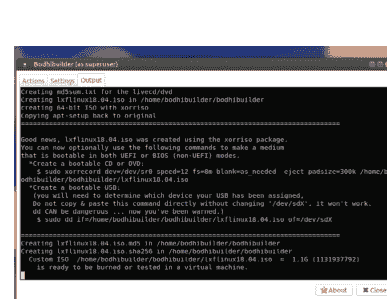

替换你自定义 Plymouth 主题中的 `<plymouth>`。然后将 `<theme>` 替换为你的自定义主题名称。一个新的 Plymouth 主题将完成安装，当你按下按钮选择 Plymouth 菜单时：

> 确保在用 Clear 清空它之前，你已将 ISO 镜像复制到工作目录。

你需要在 `/etc/skel/Desktop` 目录中创建一个桌面文件。例如，为你的用户创建一个桌面图标，首先使用 `midir -p /etc/skel/Desktop` 创建桌面图标。然后创建一个包含以下内容的自定义 `.desktop` 文件：

```
[Desktop Entry]
Version=1.0
Name=Firefox
Comment=My favourite website
Generic-Name=Generic Browser
Exec=firefox-firefox
Terminal=false
X-MultipleApps=false
Type=Application
```

# 橱柜里的“骨架 (Skeleton)

下一步是将你的桌面自定义传输到 ISO。这里将使用骨架 (`/etc/skel`) 来初始化新用户的家目录。在此过程中，当创建用户时，任何新文件都将复制到每个新用户的家目录。骨架目录包含了新用户的所有默认设置。

# MANJARRO

基于 Arch Linux，专注于用户友好性，并支持 Gnome、KDE 和 XFCE 桌面上的所有发行版。

要将这些更改带自定义发行版，请复制 ISFIG 目录。某些程序会使用 `/etc/skel/` 目录下的家目录，因此你可以创建比最初的系统类型更多的账户相关信息，例如密码，或者如果你也将它们传输到你的自定义发行版。如果你愿意，你将在 `/etc/skel/` 下安装图标和主题，并且也应该复制到 `/etc/skel`。

# SABAYON

一个基于 Gentoo 的 64 位发行版，使用 Calamar 安装程序并带有自带的包管理系统：Entropy。

`/etc/skel/` 目录代表新用户的家目录。如果你想在你自定义发行版的桌面上放置一个自定义图标：

# SOLUS

该发行版的亮点是其自建的预算桌面，它为各种用户提供服务。

完成后，此发行版不会在桌面上包含一个启动 Firefox 并访问 liveinfo.com 的图标。最后是清除自定义系统。使用 BleachBit（官方仓库中可用）来救命。启动主页，进入“编辑-偏好设置”并选择“选项卡”菜单。然后你可以更改壁纸以及任何不想包含在发行版中的语言。

# LINUXUS

在后台主界面中，系统的左侧面板由你掌控。如果你点击文件夹，你将看到除空空间之外的所有文件。展开部分方法。内存将需要一些时间且无法正常工作。切换勾选后：

# KAOS

在后台主界面中，系统的左侧面板由你掌控。如果你点击文件夹，你将看到除空空间之外的所有文件。展开部分方法。内存将需要一些时间且无法正常工作。切换勾选后：

# Linux Format 2020

# Linux Format 2020

# 202 的 ISO 镜像。

# Linux Format 2020

# Linux Format 2020

# 2020

# 2020 的 ISO 镜像。

# Linux Format 2020

# Linux Format 2020

# 前 20 发行版

```
# apt install net-tools
# curl https://raw.githubusercontent.com/user/repo/main/linux-install.sh | bash
# chmod +x ./linux-install.sh
sudo ./linux-install.sh
```

将你的桌面自定义拷贝到自定义系统中的机制。首先，在已安装的系统中按照要求配置你的桌面。当你从主目录将配置文件复制到 `/etc/` 时：

# ANTX

Fedora 的 Live CDs 是为 Fedora 等基于 RPM 的发行版构建的。antix 和 MEPS 共同努力，该发行版以其用户友好性和一系列自定义工具著称。

`cp -r /home/bodhi/local/$INSTALL_ROOT, $INSTALL_ROOT/etc/skel/`

# 轻量级发行版

从提到的存储库中获取。你可以直接指定存储库的 URL（使用 `--baseurl` 选项）或让它从镜像列表中选择（使用 `--mirrorlist` 选项），从第三方存储库（如 RPMFusion）安装包，以获取专有软件，如 Steam、Google Chrome、Nvidia 驱动程序和 Fedora 发行版。但我们让这个过程变得简单。如果你需要处理大量包，请将其替换为 generic-release 和 generic-logos。基于 Debian 的发行版并未附带四种版本的轻量级桌面。

## MX LINUX

最后，post 部分允许你在包安装并下载到目标位置后运行所有命令。你可以在此创建自定义用户、文件、配置网络并进行许多有趣的操作。该发行版使用窗口管理器，尽管配置配置，但可以用于各种用途。我们通过以下方式正确识别我们的版本 /fedora-release 文件：

`sed -i 's/generic-release/fedora/g'`

`%post` 部分中的命令将在 liveCD 中新安装的文件系统中运行一次。但还有一种将文件拷贝到文件系统 `/etc/` 的机制。`%post-chroot` 部分允许你从外部与自定义环境进行交互。这使你能够将文件拷贝到你的主安装中：

```
%post-chroot
cp -r /home/bodhi/$LIVE_ROOT/
cp $INSTALL_ROOT/usr/share/de-skel/$LIVE_ROOT/
```

这将从你的自定义硬盘提取 GL 文件并将其放置在自定义系统的根目录下。完成 kickstart 文件后，选择你自定义硬盘的 ISO。首先，系统上的 SELinux 被设置为许可模式（permissive）。然后在带有自定义环境的 live-creator 脚本之前运行命令。

## PUPPY LINUX

Customstart 提供了两种方式来处理构建过程中安装所有包的自定义硬盘。这可以为你处于 live 硬盘中时拷贝文件提供帮助。它是复兴旧电脑最快的方法之一，因其对冷门程序的选择而赢得了极高的评价。

```
cp -r /home/bodhi/Pictures/wallpapers/ $INSTALL_ROOT/etc/skel/
```

这将将壁纸硬盘中的大量图像拷贝到主机的自定义硬盘。我们将其放置在骨架目录（`/etc/skel/`），以便自定义硬盘中的用户可以使用。完成此操作的时间取决于你电脑的 live 压缩过程以及从互联网获取的包。完成后，它将在 rectify 目录下留下一个用于你自定义硬盘的 ISO。在将其传递给朋友或感兴趣的人之前，你可以在虚拟机上对其测试。

## BODHI LINUX

自带其基于 Enrichment 的桌面，旨在所有老旧电脑和网络笔记本上良好运行。


Linux Forum Annual 2020 / 15

Linux Format Annual 2020

## 构建你的城堡

基于流行的 Linux 发行版构建你的自定义系统。

虽然 bootobuilder 和 live-creator 都能让你在花费大量后创建一个自定义版本，但如果你有耐心从 Linux Mint 手工制作安装，Arch 则提供了一种更全面的方法。Arch 是培养自定义发行版的理想平台，且没有许多其他发行版所面临的代码臃肿和收益问题。Archiso 是一个脚本集，你可以用它将任何 Linux 发行版转换为可发行版本。与它所运行的发行版不同，Archiso 的学习曲线很陡，但它让你对最终结果有很大的控制权。


在使用 Archiso 之前，你需要一个 Arch Linux 安装。如果你是 Arch 的新手，该过程在项目页面（https://wiki.archlinux.org/）上有详细的文档说明。

# 前 20 发行版

```
# /etc/(shadow,passwd,group) /archive/
airofts/etc/
```

同时请确保通过更改为使用 Bash 来设置命令行所使用的 shell。

文件系统的另一个用途是设置启动图形化环境。查找你当前设置中登录管理器的服务文件：

```bash
usermod -s /usr/bin/bash root
```

向下滚动并添加一行，将目录的内容复制到你的用户主目录，并设置适当的权限

```bash
# ls -l /etc/systemd/system/display-manager.
```

假设你使用 GDM，那么你需要通过以下命令将符号文件链接到新系统：

```bash
# /etc/usr/systemd/system/gdm.service
-/airofts/etc/systemd/system/
display-manager.
```

```bash
cp -at /etc/share/home/bodhi-bodhi/home/bodhi -
```

在这些命令中，将 `bodhi` 替换为你的用户名。

最后，滚动到文件末尾，那里需要几行命令。要启动图形化桌面，

在复制任何用户 `/home` 目录下的文件之前，你需要将它们放在 `/etc/skel` 目录中。然后使用 `cp -s link` 创建符号链接并在需要使用。

```bash
systemd set-default graphical.target
```

要以你的用户自动登录而不是默认登录，请用文本编辑器编辑 `airofts/etc/systemd/system/getty@service.autologin`

现在是时候为你的自定义发行版设置 ISO 了。进入 `-archive` 目录并运行以下命令：

```bash
/build/linux-v0-1-LFXARCH.iso
```

构建 ISO。`-n` 参数启用详细模式，`-w` 参数设置 ISO 的名称，`-v` 设置名为 ISO 的版本。除非你遇到任何包相关的冲突或使用 `pacman -refresh-keys` 身份验证密钥，否则过程不会显示错误。

```bash
username=nonlocal %:3800 linux
```

将 `username` 替换为你想要登录的用户名。

`airofts/etc/systemd/system/getty@service.autologin`

# 自定义镜像

在 root 的主目录 `/airofts/home` 中，创建一个名为 `custom-distro.sh` 的文件。通常应该在 Arch 安装后放入此文件。文件中的指令将取决于新环境的视角，因此脚本中的内容代表了发行版组装的顺序。用文本编辑器打开文件，找到 `/etc/locale` 所在的行并根据需要更改 locale。

# 商业发行版

基于 CentOS 的发行版可以发布所有服务和一个直观的 Web 端管理界面。

处理包需要一些时间。它将处理 `/work/` 目录下的所有内容。当你完成后，在 `/archive/custom-distro` 设置 ISO。脚本将显示名称并提供高级功能，尽管是通过界面进行。如果你失败了，请删除 `/archive/work/` 目录。

## CLEARS

为我们的业务提供的另一个运行发行版。它拥有的界面仅显欠精。

## NETSEVER

该发行版可用于高效网关服务器，并提供高级功能，尽管是通过界面进行。

## KOZOALI SMI

发现这样一个发行版，但它仅用于自定义，如果是这样的话：你需要亲自执行。请务必告诉我们进展如何！

## ZENTALY

其直观界面在其同类中领先，但与其他产品相比，它提供了轻量级的服务器功能。

## IPFIREL

该发行版用作较少的服务器，但其可靠的包管理系统可以执行其他服务器功能。

Arch Linux 使用脚本生成官方镜像，因此你会知道它是很有保障的。

| 文件 | 编辑 | 查看 | 搜索 | 终端 | 帮助 |
|---|---|---|---|---|---|
| (archiso) INFO: | x86_64 | | | | |
| (archiso) INFO: | 工作目录 | | | | |
| (archiso) INFO: | 镜像名称 | | | | |
| (archiso) INFO: | LFXARCH-0.5-X86_64.iso | | | | |
| (archiso) INFO: | 磁盘分区 | | | | |
| (archiso) INFO: | Arch Linux https://arch.org/ | | | | |
| Arch Linux 菜单自定义 | | | | | |
| (archiso) INFO: | 正在创建文件系统清单 corio 1.4.0 | | | | |
| 媒体状态: stdout | | | | | |

Linux 论坛年度 2020 17

## MINT 19 驱动

Jonni Bidwell 融合了 Mint 和知识的精妙选择，帮助你发挥最大价值。

# 商业发行版

基于 CentOS 的发行版可以发布所有服务和一个直观的 Web 端管理界面。

处理包需要一些时间。它将处理 `/work/` 目录下的所有内容。当你完成后，在 `/archive/custom-distro` 设置 ISO。脚本将显示名称并提供高级功能，尽管是通过界面进行。如果你失败了，请删除 `/archive/work/` 目录。

## CLEARS

为我们的业务提供的另一个运行发行版。它拥有的界面仅显欠精。

## NETSEVER

该发行版可用于高效网关服务器，并提供高级功能，尽管是通过界面进行。

## KOZOALI SMI

发现这样一个发行版，但它仅用于自定义，如果是这样的话：你需要亲自执行。请务必告诉我们进展如何！

## ZENTALY

其直观界面在其同类中领先，但与其他产品相比，它提供了轻量级的服务器功能。

## IPFIREL

该发行版用作较少的服务器，但其可靠的包管理系统可以执行其他服务器功能。

Arch Linux 使用脚本生成官方镜像，因此你会知道它是很有保障的。

| 文件 | 编辑 | 查看 | 搜索 | 终端 | 帮助 |
|---|---|---|---|---|---|
| (archiso) INFO: | x86_64 | | | | |
| (archiso) INFO: | 工作目录 | | | | |
| (archiso) INFO: | 镜像名称 | | | | |
| (archiso) INFO: | LFXARCH-0.5-X86_64.iso | | | | |
| (archiso) INFO: | 磁盘分区 | | | | |
| (archiso) INFO: | Arch Linux https://arch.org/ | | | | |
| Arch Linux 菜单自定义 | | | | | |
| (archiso) INFO: | 正在创建文件系统清单 corio 1.4.0 | | | | |
| 媒体状态: stdout | | | | | |

Linux 论坛年度 2020 17

# Linux Format 年度 2020

## MINT 19 驱动

Jonni Bidwell 融合了 Mint 和知识的精妙选择，帮助你发挥最大价值。

## 探索现场环境

如果你想在不触碰硬盘的情况下使用 Mint，请直接从我们精心制作的 DVD 启动该发行版版……

在 DVD 上，你将找到两个版本的 Mint：64 位 Cinnamon 版本和 32 位 MATE 版本。即使你已经熟悉了 64 位机器，也欢迎尝试 MATE 版本。除此以外，我还会送给你一个 9GB 的下载包（老天呐，现在的发行版真是变得越来越“大不小当”了——）。

如果你已经熟悉比 MATE 更轻量级的系统，你应该将其下载到你的电脑上，但我们认为像你这种水平的读者完全可以轻松胜任。如果你已经熟悉 Mint 的 Cinnamon 版本，那么你会发现所有内容都和以前几乎无异。如果不熟悉，（下文的）注释将带你游览关键的 Cinnamon 区域。

软件可以像普通安装一样安装到现场环境中，不同的是电脑关机后所有内容都将消失。请查看“软件管理器”（它是菜单侧边带有绿白两个圆点的那个程序，它可以让你看到可选的软件）。

## Flatpak 的魅力

LTS（长期支持）发行版的一个常见抱怨是，它们的软件包选择仅在发布时是最新的。正如人们所说，时间会让我们所有人变得愚蠢，或者至少会让现代软件包过时。以前解决这个问题的方法是，尤其是当你忘记它们或者它们变得不稳定时——除非你发现了一对相互冲突的包。新方法是使用高级的内核命名和功能，让我们开发者能够将自己的软件及其依赖项封装成一个整洁的包，该包可以在任何发行版上运行。

实现这一方法至少有三种，Mint 使用了 Flatpak。你可以通过命令行安装 Flatpak，从可靠的来源（如 https://github.com）下载 flatref，或者通过软件管理器安装。它还有一个专门的 Flatpak 栏目，所以如果你对 GIMP 2.0 没有进入 Ubuntu 仓库而感到遗憾，这里就是补救之处。与软件管理器配合的是“更新管理器”，每当 Mint 检测到软件包的新版本时，你就会被重定向到那里。

## 熟悉 Cinnamon 桌面

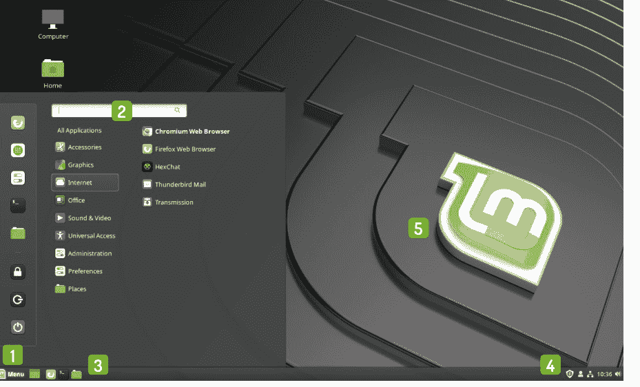

- 菜单

就像你从小到大的那些桌面一样，左下角有一个菜单。你安装的所有程序在这个菜单中都经过了良好的分类。新安装的程序会像 Cinnamon 那样出现在任务栏中。

- 搜索

然而，就像那些华丽的现代桌面一样，你可以直接搜索程序的描述和名称，因此无论搜索“editor”（编辑器）还是“text”（文本），都能找到。

- 快速启动图标

点击中间窗口旁边的绿色图标将显示桌面，而点击中键将高亮你所有的收藏项目。通过包管理器，你可以将菜单中的任何内容拖入其中加入它们。

- 小组件 (Applets)

如果你希望接收连接到电脑的任何可移动驱动器的状态通知，或者任何可用软件包更新通知，可以使用用户控制可以切换用户、注销或关闭电脑。接下来是时候激活网络管理器了，因为面板将打开一个菜单——你可以从那里添加或删除插件。

- 桌面

点击此处打开一个菜单，你可以在其中更改背景、“工作桌面”（Desks）的位置，或选择 Cinnamon 在桌面上显示的图标，或者选择你在桌面上放置文件的位置。无论是添加过多的图标（见下文）。

## 自定义 Cinnamon

Mint 的色彩可能让 Mint-Y 显得很有时尚。非常时尚！但你可以通过访问“偏好”菜单中的“主题”部分以各种方式更改它们。你可以选择 Mint-X 主题、各种颜色或更改坞（Dock）的外观。“添加”部分将向你展示社区精选主题，这些主题托管在 Cinnamon 主题网站 https://www.linuxmint.com/。

除了精简，Cinnamon 桌面可以通过小组件（Applets）和工作桌面（Desks）进一步增强，它们在“偏好”菜单中有专门的区域。小组件是运行在主面板（或如果你有多个面板则位于任何面板）上的程序。许多组件被设置在桌面上，例如时钟用户用户，用于管理后台程序。系统托盘会将各种应用程序添加到快速访问菜单和通知中，如果你不需要它们，可以禁用它们，而且隐藏有更新可用时的提醒也很容易。

工作桌面（Desks）是位于桌面之上的不同小物件。典型的桌面元素是便利签，它允许你用时尚的提醒装饰墙壁。如果你想在 Cinnamon 面上拥有这些黄色贴纸，请从桌面获取“便利签”。你还可以找到热门网络漫画 xk 的工作桌面，它们显示壁纸/伪引言，并告诉你天气将有多好。

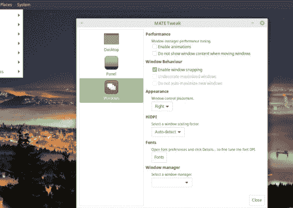

安装 MATE 工具并重建了那种 Gnome 2 风格，任务栏上点满了色彩斑斓的糖果。

通过插件可以开启更多的桌面变换，主要是通过添加视觉点缀。旧桌面效果的粉丝仍然会发现诸如 Windowy Windows、桌面立方体以及为你的桌面元素添加透明度和边框的各种选项。

一旦你有了合适的桌面，方框（桌面）会显示关于安装的提示。在这里点击是关键，如果你害怕删除 Windows，请不要怪我；如果你还有最后的注意事项，请点击按钮。在写作此时，从 Mint 的更新已经发布。

## 自定义 Cinnamon

Mint 的色彩可能让 Mint-Y 显得很有时尚。非常时尚！但你可以通过访问“偏好”菜单中的“主题”部分以各种方式更改它们。你可以选择 Mint-X 主题、各种颜色或更改坞（Dock）的外观。“添加”部分将向你展示社区精选主题，这些主题托管在 Cinnamon 主题网站 https://www.linuxmint.com/。

除了精简，Cinnamon 桌面可以通过小组件（Applets）和工作桌面（Desks）进一步增强，它们在“偏好”菜单中有专门的区域。小组件是运行在主面板（或如果你有多个面板则位于任何面板）上的程序。许多组件被设置在桌面上，例如时钟用户用户，用于管理后台程序。系统托盘会将各种应用程序添加到快速访问菜单和通知中，如果你不需要它们，可以禁用它们，而且隐藏有更新可用时的提醒也很容易。

工作桌面（Desks）是位于桌面之上的不同小物件。典型的桌面元素是便利签，它允许你用时尚的提醒装饰墙壁。如果你想在 Cinnamon 面上拥有这些黄色贴纸，请从桌面获取“便利签”。你还可以找到热门网络漫画 xk 的工作桌面，它们显示壁纸/伪引言，并告诉你天气将有多好。

安装 MATE 工具并重建了那种 Gnome 2 风格，任务栏上点满了色彩斑斓的糖果。

通过插件可以开启更多的桌面变换，主要是通过添加视觉点缀。旧桌面效果的粉丝仍然会发现诸如 Windowy Windows、桌面立方体以及为你的桌面元素添加透明度和边框的各种选项。

一旦你有了合适的桌面，方框（桌面）会显示关于安装的提示。在这里点击是关键，如果你害怕删除 Windows，请不要怪我；如果你还有最后的注意事项，请点击按钮。在写作此时，从 Mint 的更新已经发布。

# Mint 19 'Tara'（塔拉）

从一开始，Mint 就欢迎你设置备份。这里有各种不同的备份策略，我们在这里将深入探讨。可以说，仅仅拥有备份并不一定能解决你的所有问题。显而易见的问题是，除非你丢失了自昨天以来更改的所有内容，否则昨天的备份可能是错误的，而如果有在此之前的备份，修复起来会更得多。

因此，最好习惯在几个不同的时间进行练习并制作备份。通过 Timeshift，你可以拥有每小时、每天、每周和每月的快照，这样你在任何地方都有一个安全网。需要注意的是，Timeshift 是一个系统备份工具，而不是用于备份主目录（home directories）的。你最好管理个人文档备份，这取决于文档的敏感性（例如，加密并发送到服务器、使用 Nextcloud，或者在达到方便的里程碑时随时复制到 Mint）。

所有快照都可以进行处理。你可以选择使用 btrfs 快照（如果你的分区格式化为 btrfs 或 ext4）。Btrfs 和 CoW（写时复制）在文件系统层面处理未更改的文件，且快照是瞬时完成的。在 rsync 模式下，它将快照存储在 Timeshift 目录中；第一个快照将是文件系统的完整拷贝，对于干净安装（默认设置）来说可能很大，例如 60GB，但随后的快照将对未更改的文件使用硬链接。

通过使用 Timeshift，你可以保留五个大约每天一个的快照。这似乎有些过头了，但如果你进行了大量的系统级更改，这将确保你万无一失；如果你没有，那么快照几乎不会占用任何空间。除了主目录外，快照不进行备份。例如

| 动作 | 文件（名称或路径） | 大小 |
|---|---|---|
| 创建 | 2018-10-27-02-00-00 | 1.2GB |
| 创建 | 2018-10-27-02-00-00 | 500MB |
| 创建 | 2018-10-28-02-00-00 | 450MB |
| 创建 | 2018-10-29-02-00-00 | 400MB |
| 创建 | 2018-10-30-02-00-00 | 400MB |
| 创建 | 2018-10-31-02-00-00 | 350MB |
| 创建 | 2018-11-01-02-00-00 | 300MB |
| 创建 | 2018-11-02-02-00-00 | 250MB |
| 创建 | 2018-11-03-02-00-00 | 200MB |

> 大约点击三次，我们删除的 /usr/bin 二进制文件就可以从选项中恢复。这是关于系统更改的。

连接到可移除介质的目录被排除在外，因此它们也被用于存储廉价的容器，并防止 Timeshift 目录自身的某些糟糕的递归。我们的第一个快照将占用 6.2GB（仅比安装时略少）。如果你想精简快照，可以通过 /var/cache/apt 找到其他方法，它存储了下载的 .deb 包——很难想象会出现这些文件旧版本需要的场景。

# TIMESHIFT 的益处

但访问系统上安装的每一个包是有魅力的。是如此简单，以至于我们随手拍一个快照。如果我们在 Mint 中进行了一次破坏性实验，删除了 /usr/bin 二进制文件，这导致我们的系统无法启动，于是我们修复了安装，启动 Timeshift，只需点击三次（包括一个同意免责声明的点击），恢复就准备就绪。我们丢失的 2000 个文件回到了它们正确的“家”，我们轻松地重启了系统。

此外，Timeshift 在安装在 Mint 中时会失败。GRUB 菜单指向一个硬件分区，那里有 GRUB 的其余部分，因此，如果 Timeshift 恢复了 GRUB 的某些部分，由于文件系统机制的差异，它们将落在硬盘扇区上，导致系统无法启动。

有一个巨大的橙色提醒，用来激励可能性的系统快照。Mint 让这一切变得简单。

# Mint 方式

正如其名称一样，Mint 统一了那些曾被难搞的发行版困扰的用户的集体胃口……


几年前，当 Gnome 3 还只是某些开发者眼中的一个闪念时，黑客兼 Linux 写作作家 Clement Lefebvre 凭借一封信和“Bianca”梦见了一个 Kubuntu 精神。他以他托管文章的域名 Linux Mint 为其命名，并在 2007 年创建了它（随着 Mint 2.2 的发布）。

人们几乎对他最谦逊的幻想产生了兴趣，而“Bianca”已经发展成为某种要严肃得多的东西。到那时，按今天主要版本字母顺序命名的发布版也已经确立。Ubuntu 添加了更新的、不同的应用程序，一种精通互联网和电源管理的简单配置。值得注意的是，他的多媒体支持是无与伦比的：Flash、DVD 播放、Quicktime 都是开箱即用的。在 LXDE 中，Mint 的桌面仍然运行得良好：这在今天是一件罕见的事，在当时在某种程度上是圣杯。

# 思想的交汇

当 Ubuntu 在 2011 年推出其桌面时，对 Mint 的兴趣飙升。这是一个具有传统桌面的发行版，一个友好的桌面。

# 逃离 Windows

厌倦了 Windows 10 吗？

想要切换到一个更易用的 Linux 变体，让你体验全方位的优势吗？**Nick Peers** 拥有所有的答案……

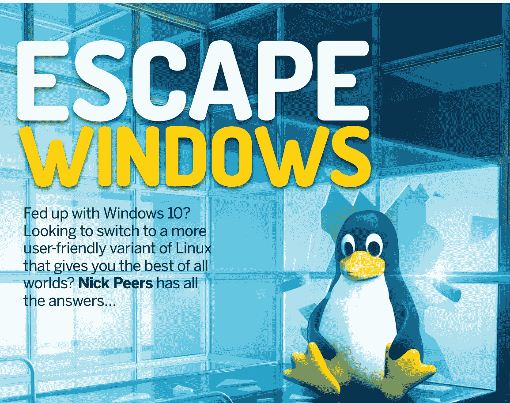

当你读到这段文字时，微软已经向其用户发布了另一个 Windows 10 重大更新。你可能已经习惯了其中的某些变化（无论是新增了功能，还是仅仅在没有任何解释的情况下移动了它们的位置）。在某个时刻，你会觉得够了，但替代方案是什么呢？当然是 Linux，但有些人会认为它是一件复杂且难以掌握的事情。

答案是否定的。我们通过这篇文章向你展示，入门 Linux 是多么简单。我们精心挑选了一个发行版——Linux Mint，它专为吸引 Windows 用户而设计。Linux Mint 基于 Ubuntu（后者拥有良好的支持），它也非常易于使用，并封装在一个既熟悉又亲切的用户界面中。

很棒……但事情并非那么简单。

一次性从 Windows 切换到 Linux 是向未知区域的巨大跨越：你的数据会发生什么？你能轻松找到替代程序吗？如果你最终决定不换怎么办？别担心——我们已经考虑到了所有。在接下来的几页中，我们将向你展示如何在不先安装 Windows 的情况下测试 Linux。一旦你意识到它有多好，我们将向你展示如何与 Windows 并存安装它，并在它们之间切换，而无需（目前）做出任何长期决定。

我们将带你完成整个过程的每一个部分：从至关重要的备份到配置硬盘以适应 Linux。这是一份循序渐进的设置指南。最后，你将拥有一个让你感到如家一般的 Linux 变体，你可以对其进行自定义并开始熟悉它。这基本上不是跳入未知水域，而是轻地踏入游泳池的浅滩。让我们先试试水吧……

## 试用 Linux Mint

发现如何快速、轻松地路测 Linux Mint，且不会让它靠近你的硬盘和所有数据——除非你要求它这样做。

Linux 发行版的巨大优势是它能够直接从 DVD 或 USB 闪盘运行。这种所谓的“现场环境”允许你在不承诺安装之前预览之前的发行版（而且，它在你有需要时为你提供一个熟悉的环境）。当从 DVD 运行时，你所做的任何更改在重启后都会丢失，因此你可以放心地体验。

现场环境是你开启 Linux Mint 全景之旅的良好起点，因为它与你安装 Mint 后得到的几乎完全相同。将 Linux Mint 光盘放入驱动器并从其启动（`www.linuxmint.com/`），如果你需要帮助如何从 CD 启动 PC 或通过 Start Linux Mint MATE 选择 Linux Mint 选项的话。

几分钟后，你会发现从 DVD 启动比从硬盘（或快速驱动）运行慢——你会发现自己处于 Mint 的 Cinnamon 桌面。对于 Windows 用户来说，由于它遵循经典的桌面布局，带有任务栏（类似于面板）以及你所需的所有菜单，应该会很熟悉。菜单按钮布局也设计好了：菜单在左侧，右键点击通知、应用程序快捷方式和打开的窗口显示在中间。

菜单按钮旁边是一个可以最小化桌面上所有窗口的按钮，形状像三张纸。这三张纸分别指向 Firefox 网页浏览器、终端（命令行界面）和文件工具（文件资源管理器管理器）。点击侧边栏查看你已挂载的所有驱动器。这是刻意为之，但如果你想访问文件，请点击文件“设备”中出现的驱动器。然后你可以打开并编辑文件、进行更改并删除它们。要挂载驱动器并将其纳入 Mint 环境，请点击驱动器名称旁边的弹出按钮。

Mint 的菜单按钮提供了所有已安装应用程序的快捷方式，以及偏好设置和安装更多程序的 Mint“商店”：软件管理器和系统设置。你可以自由地在现场环境中浏览和安装应用，但它们会在关机时被擦除。还有许多预装应用，包括 LibreOffice 和 GIMP。如果你想长期尝试 Linux 环境，并在启动之间保留某些设置和已安装的应用程序，你需要一个 USB 闪盘（8GB 或更大）以及相关服务的支持（可选）。

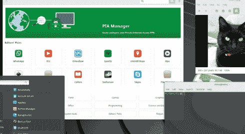

Linux Mint CD 让你轻松对该发行版进行尝试，而无需向 PC 硬盘上安装任何内容

### 持久性 PERSISTENCE

当你在现场环境中运行发行版时，所有更改在重启或关机时都会丢失。如果你使用合适的 USB，通过一个 8GB 或更大的闪盘创建一个带有“持久性”的 Linux Mint 现场环境，这种行为是可以改变的：

驱动器的此分区限制可以通过使用持久性会话来更改。当我们说“会话”时，指的是已安装的应用程序和设置，但尽量在进行重大更新时避免做出更大的更改。我建议在安装或更新系统后使用它，因为安装需要时间——它只适用于更长时间的测试路线。

你需要特殊的软件来创建你的 USB。使用 `Rufus` (`www.rufus.ie`) 选择 ISO 文件和你的 USB 驱动器。启动后，使用持久性分区滑块设置大小。


## 与 Windows 并存

与 Windows 并存安装 Linux 的过程非常简单。在设置 Mint 之前，使用 `Mac Reflect` (`www.macrium.com/reflect`) 为你的硬盘创建一个映像。选择合适的位置并在 USB 闪盘上点击“创建”。一旦创建，如果出现问题，你需要它来恢复 Windows。

# 为安装 LINUX MINT 做准备

1. 启动 Mint Live

将 Linux 光放入驱动器并从其启动（如果需要帮助访问 `linuxformat.com/support/`）。选择 Linux 选项并进入“Start Linux Mint”。当现场环境启动并显示桌面时，点击菜单按钮，在搜索框输入 `parted` 并点击 `GParted` 启动分区编辑器。

2. 定位分区

`GParted` 启动时将列出系统中第一个硬盘的内容——你应该根据大小和类型（NTFS）判断是否为正确的驱动器。如果不是正确的驱动器，点击右上角的 `/dev/sda` 选择正确的驱动器（旁边显示大小，这可以帮助你选择）。

3. 调整 Windows 分区

你的分区显示为一个区块，白色区域表示可用空间。右键点击此分区（或其条目）并选择调整/移动。拖动右侧以为 Mint 腾出空间——我们建议 32GB 是一个舒适量。完成调整/移动后，点击勾按钮应用。

4. 启动安装

在分区调整大小后等待。一旦灰色的“未分配”空间成为你要安装 Mint 的地方，关闭 `GParted`，然后双击 安装 Mint 图标。确认已选择英语，然后点击你的键盘布局——英语（英国）或英语（美国），除非你的键盘有特殊按键。继续。

# 离开 Windows

一次性备份 – 点击“下一步”，然后进入“高级选项”：选择“验证镜像”并勾选框以验证你的 ISO 是否已创建。一旦完成备份并验证，你就可以安装 Mint 了。本指南将带你完成整个过程，但在某些地方，提供更详细的解释会很有帮助，请继续阅读以了解确保安装成功所需的所有知识。

这本分步指南将揭示如何使用 Mint 环境下安装的 `GParted` 管理器对硬盘进行分区。确保 Mint 拥有一个硬盘并且有足够的空闲空间来存储文件是至关重要的。如果空间不足，可以清理你的 Windows，或者考虑使用你现有的第二块硬盘进行升级——即一个专为 Mint 准备的硬盘。（也许你应该为它使用 SSD？你的电脑会感谢你的。）

# 分区你的硬盘

在示例中，你将不得不将 Mint 与 Windows 并行安装，以便进行扩展并为 Mint 留出空间。你可以通过对硬盘分区来实现。这涉及调整分区大小以便更容易获取空闲空间。无论你的电脑安装了多少内存，至少都需要 20GB，但如果你能腾出空间，可以考虑 32GB 作为舒适的最低配置，并且不要忘记为 Windows 留出剩余空间——绝对至少 5GB，最好更多。

> 小贴士
>
> Linux 有 64 位版本，需要 32 位处理器的旧电脑可能需要你使用 32 位版本。

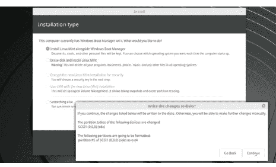


一旦你按照指南概述使用 `GParted` 完成分区，我们建议重新启动进入 Windows 并使用免费分区启动工具来完成任务——例如 `AOEI` 分区助手 (`https://www.aome.com`)。它的工作方式和 `GParted` 一样简单。

在选择安装类型时，另一个区域可能会在安装过程中引起问题。如果你只有一个只有 Windows 和空闲空间的硬盘，那么你应该是没问题的；但如果出现出现“安装 Windows 启动管理器”的选项，请确保选择“其他”并点击“继续...”。

# 选择安装类型

为了获得最大的功能，你将在完成安装之前安装“用于图形和 Wi-Fi 硬件、MP3 及其他媒体的第三方软件”。系统会提示你安装类型——安装程序应该检测到 Windows 启动管理器并与 Windows 并行安装（如果不是这种情况，请查看正文）。如果是，点击“现在安装”。

# 设置你的位置

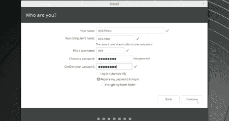

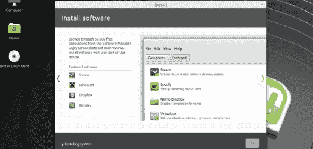

Mint 将尝试猜测你的位置——通常是伦敦。如果正确，点击“继续”；如果你想尝试获取更精确的时间，输入你的城市、城镇或区域名称——会出现一个潜在位置列表。如果在，点击它进行选择并点击“继续”；如果没有，尝试附近的位置看看是否更有运气。

# 配置你的用户账户

接下来，设置你的用户账户。输入你的名字——你会看到 Mint 根据此建议一个用户账户和用户名。这两者都可以修改，但 Mint 的建议通常是完美的。现在输入密码——包含字母和数字，这样比较容易记忆。为了安全起见，勾选“我的登录密码”并点击“继续”。

# 坐下等候

Mint 现在将开始安装——进度条伴随着安装程序正在执行操作的详情。此外，幻灯片将展示 Mint 能够为你提供的亮点，这可能是一份预装软件列表，包括多媒体、互联网和办公，然后是关键功能的介绍。在安装需要时间期间使用 `<` 和 `>` 键进行查看。

## 创建备份分区

指南的第 12 步——你将被邀请设置分区，这是在发生灾难时备份你的 Mint 安装的极佳方法（想象成 Linux 商店，但更好）。当你第一次启动进入你的 Mint 分区时，快速填充受数据导致故障保护的磁盘。我们建议在备份硬盘上创建一个专用分区，格式化为 Linux Ext4 文件系统——这涉及以你选择硬盘时相同的方式进行分区。

## 进入迷你，创建备份并配置发行版

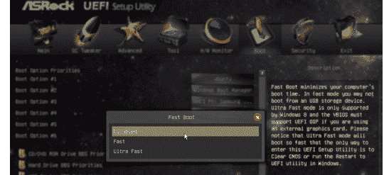

## 解决 GRUB 错误

你可能会收到 GRUB 安装失败的错误。如果你尝试在带有 UEFI BIOS 的电脑上安装 32 位的 Mint，可能会发生这种情况（切换到 64 位版本）。你可能还需要进入 UEFI 验证快速启动（Fast Boot）已禁用，且 CSM（兼容支持模块）已启用。完成后，再次运行设置过程。

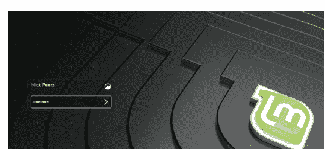

# Mint 入门指南

你已经一切准备就绪，准备好开始体验你的新操作系统所提供的各种功能了。话不多说，现在……

使用 Linux DVD 的优势在于，在你安装 Mint 之前，你已经体验过了桌面环境。正如我们所看到的，Mint 的 Cinnamon 应该让你感到熟悉，因为它与 Windows 环境有许多共同元素，最显著的是带有快捷方式的桌面，以及任务栏（Mint 将其称为面板/`panel`），带有菜单按钮和通知区域。

到 Firefox、软件管理器、系统设置、终端和文件，以及查看、注销和全屏的按钮。然后，就是你对它们所预期的一切的一切了。Mint 自带了你所需的所有核心工具，而菜单是寻找它们的最佳地方。输入你正在查找的程序的首字母，即可在顶部的搜索框中跳转到——如果你不习惯搜索程序，这会快得惊人。它们被组织成逻辑性的子菜单，如图形和办公。你还会看到用于软件工具的管理。针对特定系统设置的偏好、位置——以及如文档等用户文件夹。

让我们快速查看 Mint 的菜单按钮，它让整个系统随随随用。点击它显示一个双栏菜单，左侧是按钮（收藏），右侧是两级快捷方式列表。鼠标悬停在“收藏”中的每个按钮上，菜单右下角会出现简短描述，显示出实用的快捷

点击任何项目时，你可以右键点击并将更易访问的快捷方式固定到桌面以及菜单的“收藏”面板中。你也可以通过从右侧点击并拖拽项目添加到“收藏”，以控制它们在列表中的出现位置。你也可以点击并拖拽项目来重新排序。右键点击时的最后一个选项允许你卸载该项目。

## 更多软件

你已经安装了 Mint。因此，你可能正寻求在 Linux 中安装尽可能多的程序。保持在线并安装软件简单的方法是通过“软件管理器”。程序被组织在仓库（repositories）中，如果你的目标不在软件管理器支持的仓库中，你必须寻找其他方法来获取它们。

Mint 的程序页面还提供了方便的 DEB 包格式可下载安装程序——选择 32 位或 64 位（下载）以匹配你安装的 Mint 版本。下载到你的“下载”文件夹，打开文件并按照说明操作。

某些程序可以通过终端——命令行界面（按 `Ctrl+Alt+T` 安装它们）安装。这涉及首先使用以下命令添加程序的仓库：

```
$ add-apt-repository ppa/user/ppa
```

```
$ sudo apt-update && sudo apt-install <program>
```

将 `<program>` 替换为你的目标程序名称并安装它。安装完成后，你可以通过“系统设置”中的“软件源”查看并管理所有仓库。

## 自定义面板

与窗口管理器不同，Mint 的面板由应用控制组成，其中菜单按钮是一个，右侧的系统通知图标也是。事实上，每个项目都是一个独立的元素，允许你挑选具体要显示什么内容。在这里，你可以双击应用将它们移动到面板，并向面板视图添加项目。

每个项目都分配有一个图标和描述——要将其添加到面板，请选择该应用并点击右侧的 `+` 按钮。要移除应用，点击它们并立即移除——通过点击按钮清除它们——选择它们并点击 `-` 按钮。某些应用旁边有设置——用于配置应用程序设置。日历就是一个例子。

其他应用可以从互联网获取——到“下载”文件夹并点击“是”刷新缓存

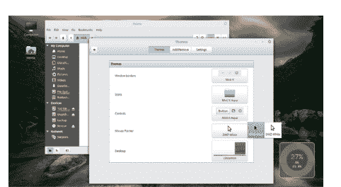

当你寻找要安装和运行的稳定程序时，Mint 的软件管理器应该是你的首选。

花时间按照你想要的方式设置 Mint 桌面——几乎一切都轻而易举。

# 逃离 Windows

提示。只需点击按钮下载并安装应用，在此时，它将出现在管理器列表中。如果你不喜欢这些应用，也可以卸载它们。注意，带有锁头图标的应用是系统工具，是禁止的。

如果你想重新排列面板中应用的顺序，右键点击并点击“面板编辑模式”开关。然后只需点击并拖拽项目到它的新位置即可。完成后别忘记切换开关。

Mint 支持多个面板——最多四个，每个面板都附在桌面的不同边缘上。你还可以将面板移动到屏幕的另一侧——右键点击面板，使用“修改面板设置”并选择你希望它所在的哪个边缘。

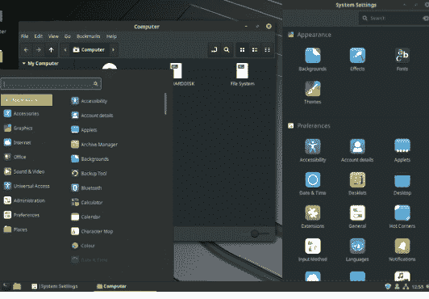

## 浏览文件和文件夹

Mint 相当于文件资源管理器的是“文件”应用，可以通过菜单中的快捷方式或双击桌面上的任何文件夹访问。同样，这对于 Windows 用户来说很熟悉，对其他人来说很陌生，具有左侧边栏布局。从右侧面板拖拽文件夹即可固定。

掌握 Linux 文件系统是一个简单的课题，关键在于每个用户都有自己的“主”文件夹，你可以在那里找到图片、文档、下载等文件夹。例如，你的数据可能存储在 Windows 分区上，但“文件”可以轻松处理 NTFS 和 FAT32 格式的分区。

轻松管理硬盘，但你可以通过下载选项获取更多

## 完整设置

打开“系统设置”并滚动到“硬件”部分，确保你的硬件配置正确。使用“显示”配置你的屏幕分辨率或多显示器设置，例如。选择“键盘”熟悉

## 开始微调

让我们获得一个更本地的外观。右键点击桌面并选择“桌面设置”。从左侧选择“壁纸”来更改样式，或选择“图片”来更改背景。这里的一切都非常简单，并选择“其他选项”来隐藏旧桌面图像。

通过右键点击桌面并选择“桌面设置”来自自定义图标在桌面上的显示方式。你可以更改图标大小和字体（全部自定义——后者你可能想要关闭以减少桌面杂乱），以及“垃圾桶”（默认禁用）。

要更改窗口、鼠标指针和面板的外观，右键点击并选择“外观”。你可以管理各个方面，或点击“添加/删除”来浏览集成的主题。你也可以通过“设置>外观>字体”更改使用的字体：

Mint 桌面采用了易于使用的深色窗口和桌面主题，只需

Linux Format 2020 | 33

还记得 Windows 对悬浮小组件的支持吗？Mint 通过右键点击桌面并选择“添加小组件”引入。开始时有三个：悬浮时钟、数字相框和启动器

快捷方式。

## 让我们回归正常


Linux 中没有任何事情必须通过点击完成，这就是终端大显身场的地方。不要对访问命令行感到恐惧——一旦习惯了，你会发现许多技巧，而且通过终端执行效率更高。这里有一份优秀的指南位于

`https://tutorials.org/linuxutorial/` 并且也可以在这些存档中运行教程，并在 `visit.linuxmint.com/archives` 中搜索终端以以 PDF 程序集的形式访问它们。

## 终端：GREP

### 智能模式匹配技巧

自封为 Bash 忍者的 Shashank Sharma 解释了你如何使用 `grep` 搜索文件或话多命令的输出。

典型的 Linux 发行版开箱即自带大量的命令和实用程序，这些可用于执行常规任务，如列出目录、处理文件或执行复制、重命名等操作。

与大多数遵循 Unix 哲学的构建的工具一样，`grep` 只把一件事做好，并且由于其功能单一，典型的 `grep` 语法为 `grep [pattern] filename`。你甚至可以在模式后面指定多个文件，`grep` 将输出每个文件的结果，例如 `grep -wordlookup filename1 filename2`。

**专家**

Shashank Sharma 经验极其丰富，并以精通 Arch Linux 等替代方案而闻名，他在德里作为一名审判律师度过余生……

一个典型的命令将输出指定文件中匹配你模式的每一行。默认情况下，`grep` 会匹配行中的任何部分。

`grep` 最初由 Ken Thompson 编写，它已进入几乎所有的“修复”操作，并且是所有 Linux 发行版默认安装的一部分。进入终端并运行 `man grep` 命令来浏览其帮助页（man page）。

### 基础用法

该工具用于查找指定文件中的模式。你也可以使用 `grep` 过滤 Linux 命令或工具产生的输出，或者通过管道（pipes）进行魔法操作。

如果行不匹配，它将不会显示任何内容。如果你只想匹配 "self" 作为关键词，`grep` 不仅会匹配 "self"，还会匹配 "myself"、"himself" 和 "herself"。如果你想匹配精确单词，请使用带有 `-w` 参数的 `grep`。`grep -w <keyword> filename` 将仅输出精确匹配的结果。

### 与其他工具协作

`grep` 的另一个用途是将其与其他产生大量输出的工具和实用程序结合。例如，当你连接 USB 驱动器或新的蓝牙设备时，`dmesg` 命令会捕捉设备的所有细节。

`dmesg` 命令会生成设备和数据的记录；查看它并不是一种高效的时间利用。你可以使用 `grep` 来查找

#### dmesg grep

```
[199581620 0:00:00.000] [sdb] 15625216 512-byte blocks (8.0 GB/7.5 GB)
[199581641 0:00:00.000] [sdb] Write Protect is off
[199581962 0:00:00.000] [sdb] Mode Sense: 03 00 00
[199581965 0:00:00.000] [sdb] No Caching mode found
[199581970 0:00:00.000] [sdb] Assuming drive cache
[199500329 0:00:00.000] [sdb] Attached SCSI removable disk
```

- `-v` - 只选择不匹配模式的行
- `-A` - 只选择匹配行开头或前面有非单词字符的行
- `-w` - 只选择包含整个单词的行，单词字符是字母、数字和下划线。如果也指定了 `-i`，下划线也没有影响
- `-x` - 只选择与该行完全匹配的行，前后没有字符
- `-c` - 输出匹配行的普通计数
- `-n` - 输出每行匹配行的行号

你可以使用 `-v` 命令作为 NOT 选项。它列出文件中不包含指定关键词的所有行。

### 智能模式匹配教程

运行 `grep` 命令将产生给定文件中匹配你指定模式的所有行。

你同样可以将 `grep` 与 `ps aux` 等命令结合，以获取任何应用程序的详情。如果你在 Debian 或 Ubuntu 系统上，可以将其与 `dpkg -l` 结合列出所有匹配的软件包。例如，`dpkg -l` 命令将列出你系统上的所有。

### 获取上下文

你可能想搜索某些内容，但也想看到它使用的上下文。你可以使用 `grep` 列出匹配模式行之前或周围的行数。`A` 命令用于打印匹配行之后的特定行数。`B` 命令可以打印匹配行之前的行数。`C` 命令同样可以打印匹配行周围的行数。

如果你对上下文好奇并希望查看每个匹配前后的行，可以使用 `-C` 命令。由于终端是彩色，`-B` 和 `-C` 会产生不同的结果以区分每个匹配：你可以使用 `grep` 找出你需要的行。例如，如果你搜索 "wild"，它通常以开头或结尾。这不是错误的（如果它是边缘的）单个 `grep` 命令将返回该单词出现的次数：

```
$ grep -c Documents/LXF-229-tutorial.txt
```

```
$ grep -c Documents/LXF-229-tutorial.txt
```

从下面可以看到，`-C` 选项将显示 "specified" 被使用了四次。在你的搜索字符串或模式上，你可能想结合多个表达式来执行你想要的精确匹配。如果你想用同一个命令搜索多个字符串，必须使用 `grep -E` 命令。此终端将打印包含指定关键词的行。当你想要搜索目录中的所有文件时，可以使用 `-r` 命令。如果你有很多文件，`-r` 选项可能会产生过度使用。考虑使用 `-l` 选项来仅查找匹配关键词的文件：

```
$ grep -l "wild" /Documents/LXF-228-swagart.txt
```

```
$ grep -l Documents/LXF-221-review-knopsix.txt
```

```
$ grep -l Documents/LXF-221-review-korioma.txt
```

如果你使用通配符列出以指定的开头或结尾，

```
Documents/LXF-222-review-archives.txt
Documents/LXF-222-review-server.txt
Documents/LXF-231-review-environments.txt
Documents/LXF-231-review-desktop.txt
Documents/LXF-231-review-archives.txt
Documents/LXF-231-review-environments.txt
Documents/LXF-231-review-server.txt
Documents/LXF-231-review-knopsix.txt
Documents/LXF-232-review-environments.txt
Documents/LXF-232-review-distributions.txt
Documents/LXF-232-review-knopsix.txt
Documents/LXF-232-review-archives.txt
Documents/LXF-232-review-server.txt
Documents/LXF-232-review-distributions.txt
Documents/LXF-232-review-knopsix.txt
Documents/LXF-233-review-environments.txt
Documents/LXF-233-review-archives.txt
Documents/LXF-233-review-server.txt
Documents/LXF-233-review-knopsix.txt
Documents/LXF-233-review-distributions.txt
Documents/LXF-233-review-knopsix.txt
Documents/LXF-233-review-archives.txt
Documents/LXF-233-playground.txt
```

## 快速提示

`grep` 命令可以是区分大小写的，单词 "this" 和 "and" 被视为不同的。使用 `grep` 的 `-i` 选项执行不区分大小写的匹配。

这揭示了给定目录中的所有行，模式仅在文件中找到。如果你想使用 `-l` 命令或其他选项来查找不同文件中匹配行的列表，你也可以使用 `grep -r`。

由于其功能强大，可以使用大量命令来管理和查找用户创建的 `grep` 使用示例，以获取一组接口。随着时间的推移，你将发现它对任何 CLI 工具都有用处。

### 通配符与操作符

在使用 `grep` 进行模式匹配时，你可以使用正则表达式。该命令支持如 `*` 和 `?` 等所有通配符。

方括号为搜索模式提供了额外层级的控制。例如，如果你想找到所有带有小写字母的行（正如一个语法上的虽然），你可以通过 `grep "[a-z]" <filename>` 来实现。所有可能性超出了本教程的范围，但你可以在各种在线资源中找到不同的可能性。

对于操作，你可以使用带有 `-E` 命令的 `grep`。`grep -E "patterning" filename` 将显示匹配模式的所有行。这比标准的 `grep` 更强大。

使用 `|` 符号你可以将第一个 `grep` 命令的输出通道到另一个。例如，如果你有一个列出你作业的文件列表，你想列出包含单词 "writing" 的行。在这里，命令的第一部分将结果限制为 "writing"；命令的第二部分将结果限制为包含该单词的所有行：

# 2020年 Linux 格式年度

# LIBREOFFICE BASIC

## 使用简单的脚本

自动化办公任务

通过 Bobby Moss 关于宏以及所有 Basic 相关知识的实用指南，探索如何重复任务并扩展 LibreOffice 的实用性。

在过去的一年里，这位勤奋的作家已经涵盖了如何充分利用 Calc、Base 和 Impress 等 LibreOffice 应用程序。但如果我们挑战你进一步扩展体验，直到你仍感到意犹未尽呢？

我们并不是要带给你一个想象力匮乏的失败，或者让你对一个关于新手在 Linux 中可能做什么的教程而感到后悔。本期内容将帮助你以以前从未计划过的方式扩展 Calc 和 Writer 的功能。

在 Writer 中创建模板，或者在 Excel 中移动几十个单元格和工作表，仅仅通过记录所有繁琐的手动步骤是不够完成任务的；你将学习如何使用一种易于学习且性能优秀的语言和纯英语语法对它们进行编程。

别担心，我们并不害怕源代码会丢失几行代码。使用 `Dim` 来声明变量，例如：`Sub Routine As "String" Format`。本教程将帮助你创建自己的宏，我们将使你能够在文档中记录重复性任务。你记录的步骤可以完成从预填充可打印表单值之类的任何任务。

Basic 的另一个巨大优势是遗留兼容性。自从我们很久在 OpenDF 讨论这个话题以来，所有年轻的提升都已经开始；过去的佳作是对未来的任何预言；你今天学到的知识可能帮助你在未来几十年内都能写好文档。

## 开始记录

想象你正在写一封新信。每次你都必须对文本右对齐并输入你的地址，然后再次左对齐输入收件人地址。如果你找到了 `工具>宏>运行宏`，你就可以执行这些操作，然后点击停止将其保存为宏。

现在，每当你想要创建一个信件时，都必须前往 `工具>宏>运行宏...` 并选择`开始列表`来重复记录的事件序列。如果你发现`记录`选项丢失，你需要前往 `工具>选项>LibreOffice=高级`。

## 函数 (FUNCTION SUB)

Bobby Moss 为虚拟化和 Linux 编写文档。在空余时间，他致力于一系列免费项目。

LibreOffice 中有两种变量：全局变量定义在模块文件中，可以被任何子程序或函数内部使用。局部变量仅在声明它的子程序内部使用。按照惯例，使用 `Dim` 来声明相应类型的变量，例如：

```basic
Sub MyRoutine(Parameter As String) Format
Dim myLocalVariable = "Issue"
print myString
print myVariable
print myParameter
End
```

新程序员常犯的错误是混淆了子程序（sub）和函数（function）。两者都接受参数（你提供的输入），按预定的顺序执行操作并更改全局变量的值。关键区别在于函数会返回一个值供使用，而子程序不需要。在下面的示例中，你可以看到第 1 行有一个函数，以及：

1. `result = myFunction(1,2)`
2. `MySubroutine("#239")`

| 菜单 | 工具 | 右键菜单 | 键盘 | 事件 |
|---|---|---|---|---|
| 快捷键 | | | | |
| Shift+ Insert | | | | |
| Shift+ Delete | | | | |
| Ctrl+1 | | 单元格格式 行间距: 1.5 | | |
| Ctrl+2 | | 单元格格式 行间距: 1.5 | | |
| Ctrl+3 | | 单元格格式 行间距: 1.5 | | |
| Ctrl+4 | | 单元格格式 行间距: 1.5 | | |
| Ctrl+5 | | 单元格格式 行间距: 1.5 | | |
| Ctrl+6 | | 单元格格式 行间距: 1.5 | | |
| Ctrl+7 | | 单元格格式 行间距: 1.5 | | |
| Ctrl+8 | | 单元格格式 行间距: 1.5 | | |
| Ctrl+9 | | 单元格格式 行间距: 1.5 | | |

你可以通过在 LibreCustom... 中设置，从不同的键组合和自定义菜单项运行你编写的任务...

## 自动化办公任务教程

然而，这加速了你的工作流。幸运的是，你可以将宏绑定到按键、菜单选项或工具栏上。在这种特定情况下，从键盘启动宏比点击几十个子菜单要快得多。

要实现这一点，你可以从 `工具>键盘` 进行设置。然后你可以找到一个未被使用的快捷键并将其链接到你的`开始宏`。这比替换现有的宏要好，以防你以后发现需要它们。

如果你更喜欢将`开始宏`绑定到菜单项，可以从 `工具>自定义...` 完成，然后选择`菜单`选项卡。双击`我的宏`找到`开始 Office`。

一旦你从右侧下方选择`工具`然后点击 `+` 为 Basic 代码添加新的菜单快捷键。之后，你会发现可以按照意愿从 `Office>开始` 启动宏。

你还可以将宏绑定到上下文或应用程序事件。写信时你不需要探索这些任何选项，但你会发现这加速了你的-工作流。

# 2020年度 Linux 格式

# 快速贴士

如果你觉得这些屏幕中的图标很有吸引力，可以从 Linux 中的 'libreoffice-style' 主题安装它们。也可以通过选择“选项 -> 视图”来启用深色图标。

`doc=loadComponentFromUrl(fileLaunch,"blank",0,Dummy(0))`

如果你尝试运行此代码且参数不是对象，那么错误位于调试之前的 Main 的子标题中。解释器将其识别为起点，且 `loadNewSubtitle` 将为 `FileTitle` 赋值，这通常对于启动它的 Main 框架来说也是意义的。

8 我们可以将该公式传递给 `SUM(A1:A3)`，它将在第一张工作表中输出 A1、A2 和 A3 的总和。

然而，Basic 并不需要依赖 Calc 来进行计算。你只需要将第二行调整为如下内容：

```
Dim valueA As Integer, valueB As Integer
valueA=cell
valueB=3
cell=valueA+valueB
```

每当你从 Basic 执行此操作时，它会在 B 单元格的值上加 3。如果你需要执行不同的计算，可以将 `+` 替换为 `-`、` * ` 或 `/` 以进行减、乘、除。如果你想返回最接近的整数，可能需要将数据类型从 `Integer` 改为 `Double`。

那么，如果在 LibreOffice 中不起作用会怎样？Main 子标题会触发 `loadNewSubtitle`，因此它作为 Main 框架的值进行扩展。

你可能有的下一个问题是：“如果单元格包含文本字符串而不是整数怎么办？”你会遇到一个料之外的错误，幸运的是，你可以在 `Sub math::` 之前添加以下行来修复它。

# 快速贴士

通过切换到 Toad-Macro 可以更快地加载编辑器。或者，按下 Shift+F1 将加载此表后面包含的宏。

`On Error GoTo error`

除非你在一个名为 `error` 的标签下放置了指令，否则此 LibreOffice Basic 将显示发生了错误。要使其工作，你应该在 `End` 之前添加两行：

```
print "error has occurred"
```

该命令将创建一个带有你生成的错误信息的对话框。对于旧版本和新版本的 LibreOffice，你可能需要使用以下行：

```
msgbox "error has occurred",
```

那么，如果在 LibreOffice 中正常工作会怎样？

# 数学公式

一旦你从表中提取了一些代码，就是时候在你自己的工作表中使用它们。

# Sub math

```
Dim sheetA As Object, cell As Object

sheetA=Sheets.get("Sheet1")

cell=sheetA.getCellByPosition(1,0)

cell.formula=cell.value+5
```


End

在 Sub 中，代码在第一张表上执行数学计算，计算单元格 `B3` 然后将值返回

### >> 扩展 LibreOffice

录制宏以及使用 Basic 和 Python 编码是扩展 LibreOffice 功能的唯一方法。在 LTF 中我们我们有限的空间来使用 OpenOffice.org，因此它限制了我们只能做相同的事情。你可以在 `extensions.libreoffice.org` 找到支持的扩展和模板的完整列表。

我们从未用过的插件之一是 Power Default。处理具有许多不同计算的数据集时，确定一个更改如何影响工作表的其他部分可能是复杂的。由于许多单元格依赖它来执行功能，你会注意到工作表的任何部分在失败之前其值显示为 `#REF!`。

另一个例子是 Calc 日历（Calendar for Calc），它提供了一个视觉化的日期选择器，而不是在单元格中具有值。另一个名为 Parts 的库存管理插件显示了带有元数据的项目列表，并提供了一个图形用户界面供你输入数据、执行日期搜索以及删除记录，如果你想将它们存储在 LibreOffice Base 中，你会需要这些。

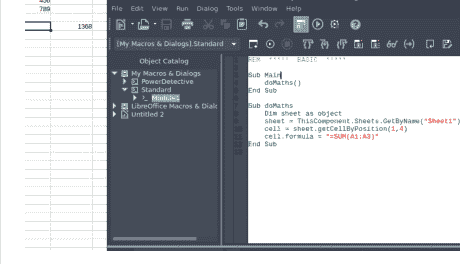

代码使用了 Calc 的内置方法来增加多个单元格的值，但你也可以在计算需要的地方这样做。

# 自动化办公任务 教程

# 在 LIBREOFFICE BASIC 中创建宏

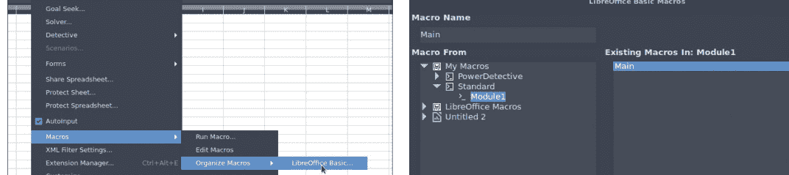

## 1 Basic 有机

要查看 LibreOffice 的宏，请前往 `工具 -> 宏 -> 组织宏 -> LibreOffice Basic...`。你也可以在“组织”对话框中创建自定义输入框和用户..，如果你喜欢使用 Python 而不是 Basic，你需要从其管理器安装 `libreoffice-script-provider-python` 包。

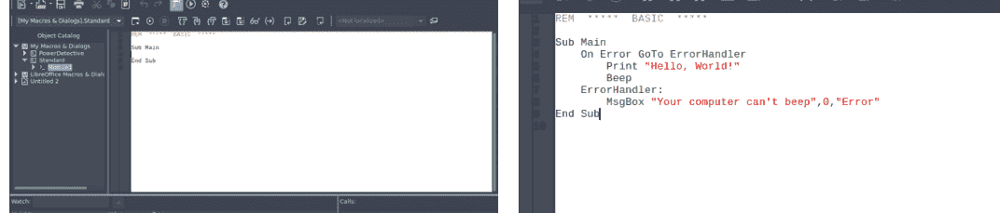

## 2 加载模块

每个模块可以包含多个函数，你可以从此窗口选择并运行其中任何一个。你可以从“分配..”将子程序分配给按键或创建菜单项，LibreOffice 还有它自己的针对特定任务的预定义脚本，例如将 Microsoft Access 转换为兼容 LibreOffice 的任务。


## 3 启动编辑器

代码编辑器界面对于那些工作过 VBA 宏的人来说会非常熟悉。要创建一个新模块，你应该在 `Module 1` 标签旁边点击右键并选择 `插入-Basic..`。你也可以从同一个对话框中创建你的表单，这将打开

## 4 编写代码

代码语法对于那些工作过 VBA 宏的人来说会非常熟悉。关键字是蓝色的，值是红色的，注释是绿色的。你可以使用 `REM` 注释掉行。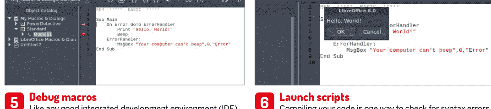

## 5 调试

对于任何集成开发环境 `IDE`，你可以使用 `F9` 设置断点，通过 `Shift+F5` 执行。

## 6 启动

代码编辑器界面对于那些工作过 VBA 宏的人来说会非常熟悉。

# 发现技能

# 设置邮件服务器

管理自己的邮件服务器 - 特尤其是当你照顾其他人时是一件不应该被对待的事情，所以现在不要取消 Yahoo! 或 Hotmail 账户。然而，如果我们有了 SSL 证书，我们需要设置我们自己的域名，以及一个 MX 记录指向它。在紧急情况下，你可以使用任何免费 DNS 提供商（如 DuckDNS）来邮件，否则你会绑定到他们的域名。DuckDNS 的设置是简单的。我们将使用 Postfix（邮件传输代理）配合 Dovecot（邮件投递代理），它们处理 IMAP 和 POP3 连接，我们将只使用它们。这是一个广受认可的组合，也是最流行的设置之一。我们不会涵盖备份邮件，但如果我们想让服务器与我们所有的客户端工作，我们将查看 Roundcube。对于像 Claws Mail 和 Mailcot 这样的其他垃圾邮件过滤器，我们精心策划了一份你应该查看的事项：https://wiki.docker.org/clients

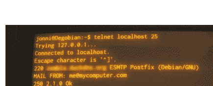

```
$ mx-session: telnet localhost

127.0.0.1

connection to localhost port 25 [22]

MAIL FROM user@myserver.com

RCPT TO:user@myserver.com

250 2.1.5 Ok

DATA

250 2.0.0 Ok

354 End of data with <CRLF>.<CRLF>

Hello world, this email might just come

250 2.0.0 Ok

.

250 2.0.0 Ok

QUIT

connection to host closed.
```

# 深入

管理自己的邮件服务器 - 特尤其是当你照顾其他人时是一件不应该被对待对待的事情，所以现在不要取消 Yahoo! 或 Hotmail 账户。然而，确保你向那些使用这些服务的朋友发送消息，自豪于你自己制作的邮件分发器。

# Linux 格式 2020

你需要将 `myhostname` 变量设置为你的 DNS A 记录指向的完全限定域名（FQDN），以及 MX 记录所指向的域名部分。`mydomain` 控制发送哪些变量（就像你可以更改 `mydomain` 的值一样）。`relay domains`（中继域名）控制哪些域名将邮件中继。这包括 `mydomain` 以及它所属的任何服务器。你不需要担心从其他网络中继，除非你被列入黑名单。那时，你可能允许来自你网络的合法邮件与外部世界通信。简单来说，我们需要设置这些内容：

```
postconf = "myhostname@myserver.com"

postconf = "myhostname-myserver.com"

postconf = "myorigin+ myserver.com"

postconf = "relays+ myserver.com"
```

如果你被配置为主机（host），那么你必须在 `hostname` 变量中。太棒了，我们的邮件现在准备就绪了。好了，处理允许的任何终端。使用 `postfix reload`（root权限）重新加载 postfix 配置。Postfix 管理自己的域名，因此不需要 `myorigin postfix`。如果你看到 Postfix 未在运行的错误，请执行 `postfix start`。你需要信任 SMTP 服务器以及你的

大多数运营商封锁了 25 端口，因此没有它可能无法工作。你应该连接到 postfix，所以让我们开始使用 SMTP。输入以下内容（如果你愿意，也可以在此处进行一些修改，但请使用 `RCPT` 来引用你的用户）：

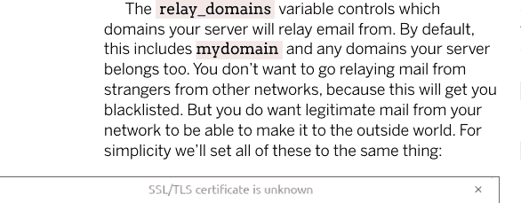

- * SSL/TLS 证书未知

证书对于 是未知的。
你想让它接受吗？
签名状态：正确
所有者：
签名者：

| 姓名 | 姓名：让我们使用 Let's Encrypt 权威3 |
| --- | --- |
| 位于：在证书中 | 位置：Encrypt |
| 位置：US | |

状态
状态
签名状态：有效
指纹：SHA256:6f1d05e1d327b9297558a5f6e4e3f3d0
SHA1:88B4C3D2F5E6E3E8B09F77B53D08:02F1FE90E8A1

| 接受 | 取消 |

```
MAIL FROM: me@example.com

RCPT TO: user@myserver.com

DATA

X-Mailer: A telnet postfix

这整封电子邮件可能正好捕获
```

日期：2021/08/14 (1个月前)

现在按回车键，输入一个句号再按一次，
你需要 `QUIT` 来断开会话。

## 启用所有收件者

当你在 Mailcloud 中添加新服务器时，它会告诉你它所有的证书，并请求你需要的权限。

### >> 虚拟用户的魅力

虚拟用户类似于别名（aliases），但这种方法更灵活。我们需要将每个虚拟用户映射到个人系统账户，所以如果你正在使用数据库来维护登录提供程序，那么这样做将非常有用。我们将使用列表来存储凭据，因为你在……列表中。

虚拟用户都链接到单个用户，所以你现在将拥有 usermail。Dovecot 拥有密码，它们不需要以明文存储，我们将为每个用户创建一个虚拟用户，并为其提供一个良好的密码。

运行 `postfix pwmd -sha256` 有
SHA256 哈希值：`/etc/dovecot/users.conf`
virtual(SHA256:CTVAAW (来自哈希之后)。同样存在 `include-password=virtual.conf` 这一行，它告诉 Dovecot 咨询 users 文件。如果我们需要 Dovecot 并添加 `add-10-master.conf`，以 `=unix_xlatener` 开头的行将用于分配适当的虚拟用户数据库权限。因此，在 `/etc/` 中找到并添加以下行：

```
user = usermail

group = vmail
```

紧接着。
我们将 **启动 TLS**，这会创建一个未加密的连接。现在，如果双方在同一部分都启用了 SSL。如果我们对不想要的连接不感兴趣，我们可以强制使用 TLS 连接，默认情况下使用 587 端口。无论哪种，都需要证书来识别服务器。

```
rsa:4096-out /etc/ssl/certs/mailcert.pem

/etc/ssl/mail.key
```

更倾向于拥有签名证书，只需尝试从 Let's Encrypt 获取一个免费的。其他用户不太可能通过邮件服务器信任你，而我们只想被那些目标用户检索。我们还需要一些身份验证，因为我们经常使用简单身份验证和安全层 `SASL`，它抽象了不同服务器之间的任何差异并允许它们通信。我们需要 Dovecot 并添加 `add-10-master.conf`，以 `=unix_xlatener` 开头的行将用于分配适当的虚拟用户数据库权限。因此，在 `/etc/` 中找到并添加以下行：

```
user = usermail

group = vmail
```


日期：2021/08/14 (1个月前)

现在按回车键，输入一个句号再按一次，
你需要 `QUIT` 来断开会话。

## 启用所有收件者

当你在 Mailcloud 中添加新服务器时，它会告诉你它所有的证书，并请求你需要的权限。

### >> 虚拟用户的魅力

虚拟用户类似于别名，但这种方法更灵活。我们需要将每个虚拟用户映射到个人系统账户，所以如果你正在使用数据库来维护登录提供程序，那么这样做将非常有用。我们将使用列表来存储凭据，因为你在……列表中。

虚拟用户都链接到单个用户，所以你现在将拥有 usermail。Dovecot 拥有密码，它们不需要以明文存储，我们将为每个用户创建一个虚拟用户，并为其提供一个良好的密码。

运行 `postfix pwmd -sha256` 有
SHA256 哈希值：`/etc/dovecot/users.conf`
virtual(SHA256:CTVAAW (来自哈希之后)。同样存在 `include-password=virtual.conf` 这一行，它告诉 Dovecot 咨询 users 文件。如果我们需要 Dovecot 并添加 `add-10-master.conf`，以 `=unix_xlatener` 开头的行将用于分配适当的虚拟用户数据库权限。因此，在 `/etc/` 中找到并添加以下行：

```
user = usermail

group = vmail
```

紧接着。
我们将 **启动 TLS**，这会创建一个未加密的连接。现在，如果双方在同一部分都启用了 SSL。如果我们对不想要的连接不感兴趣，我们可以强制使用 TLS 连接，默认情况下使用 587 端口。无论哪种，都需要证书来识别服务器。

```
rsa:4096-out /etc/ssl/certs/mailcert.pem

/etc/ssl/mail.key
```

更倾向于拥有签名证书，只需尝试从 Let's Encrypt 获取一个免费的。其他用户不太可能通过邮件服务器信任你，而我们只想被那些目标用户检索。我们还需要一些身份验证，因为我们经常使用简单身份验证和安全层 (SASL)，它抽象了不同服务器之间的任何差异并允许它们通信。我们需要 Dovecot 并添加 `add-10-master.conf`，以 `=unix_xlatener` 开头的行将用于分配适当的虚拟用户数据库权限。因此，在 `/etc/` 中找到并添加以下行：

# 2020年 Linux 格式年度报告

# 文件树结构

# 掌握
Linux 文件导航

对结构感到困惑吗？Nick Peers 将为你揭示 Linux 系统是如何运作的，以及使用 Ubuntu 内置文件管理器浏览的最佳方法。

你可能不熟悉 Linux 是如何识别连接到 PC 的驱动器的，如何将一切视为硬盘的文件夹，以及你如何访问树形结构？虽然 Windows 使用目录，但 Linux 在硬盘上组织了一个顶层 (`/`) 目录，你可以通过 Ubuntu 的图形化文件管理器访问它们。使用 Nautilus 吗？让我们从基础开始。Linux 以不同于 Windows 的树形结构组织文件。主要区别在于，Windows 将所有内容分为带有单个字母的独立驱动器；而 Linux 将所有内容合并在一个根目录 (`/`) 中，其他目录都相对于该目录放置。

**我们的专家**
Nick Peers 是一位自由技术记者，专门为 Aha! 写作。

文件和文件夹由图标表示，双击即可打开。你可以右键点击查看更多选项。文件可以立即删除到回收站（或按住 Shift 并按删除），操作方式与 Windows 完全相同。下方的图解揭示了在 Nautilus 中访问和查找 Linux 系统文件中的一些关键基础知识。

# 表层下的世界

让我们使用 Nautilus 识别驱动器上的文件文件夹，并找出它们的用途。打开启动器上的“文件”快捷方式，并将其默认打开到你的个人主目录 `/home/username`。在 Linux 树形结构中，你会发现几个在其他系统中常见的文件夹：例如“公共 (Public)”——它们都是一目了然的，你可以在那里存储文件，当其他用户登录时可以访问。这是一个指向 Ubuntu 免费社区文件夹的简单快捷方式，旨在提供免费的壁纸、音乐和视频。

这听起来可能很困惑，但实际上 Linux 为你可用的所有存储提供了一个方便、组织的视图。一旦你理解了密钥在哪里，找到它们就非常简单。

a. 你的用户文件夹始终位于 `/home` 目录下，这里是你的个人文档、照片和设置数据的所在地。

左侧导航窗中的“计算机”快捷方式将带你进入根目录；你会看到很多文件夹。并不是所有的文件夹都需要解释，但需要解释的，`/bin` 文件夹包含了基本程序（包括根文件系统）——这包含了所有程序。启动程序——内核位于 `/boot/` 下，而你可以看到双击如何显示指向你的硬件和所有存储设备的条目。

让事情更容易理解的是，Ubuntu 使用了友好的文件管理器 Nautilus，可以通过“文件”快捷方式访问。任何熟悉 Windows 的人都拥有自己的管理器——Windows 资源管理器 (Windows Explorer)，并且它具有许多相同的特征。

`/etc` 文件夹包含许多配置文件，而 `/var` 文件夹包含程序配置数据——类似于注册表中存储的内容。条目挂载在 `/media` 文件夹内部，而 `/mnt` 作为可移动设备等设备的临时挂载点。

`/root` 是根用户的目录。它与 `/home` 文件夹隔离开，以防出现启动问题，并且只能通过 `sudo` 命令访问。使用 `/user` 文件夹，你会在 `lib` 文件夹中找到——这是你安装程序的地方。

> 快速提示
> 如果你不知道 Nautilus 如何显示当前路径，选择“位置”——可以手动输入路径直接跳转到该位置。

导航 Ubuntu 文件系统的顶层目录是一项简单的工作。

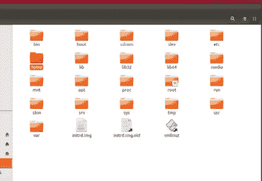

# 文件导航教程

在浏览文件时，自定义下方显示的内容，以揭示更多细节。

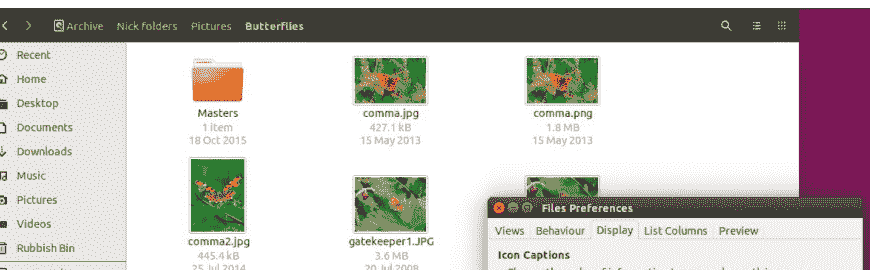

## 快速提示

不要对在主目录中发现隐藏文件列表感到惊讶——当你选择了“显示隐藏文件”选项后，这是正常的，或者隐藏它们是最好的选择。

## 探索 Nautilus

返回主目录。将鼠标向上滚动菜单栏，你会在菜单选择中看到 Nautilus。浏览“文件”、“编辑”、“视图”、“书签”和“帮助”来寻找熟悉的书籍，但有些功能看起来可能不同。从 Nautilus 标签开始，它允许你打开多个位置而不会弄乱桌面。你还可以将文件拖动到窗格上方（或通过 Ctrl + 点击来移动/复制），在从一个标签页选取文件、将其拖到另一个标签页并在等待标签页打开之前完成操作。

费力寻找某个特定文件吗？放大镜栏和搜索栏将弹出。你可以搜索你的条目和列表，以匹配出现出现的文件。如果你想在搜索中输入名称，点击“所有文件”区块。你还可以为搜索应用文件过滤器类型，将搜索结果限制为文档、照片或你选择的其他类型。但是，从下拉菜单中选择文件类型（例如电子表格或 PDF/Postscript）或手动指定文件扩展名（如 `.txt`）。Nautilus 支持多种过滤器，你可以轻松地搜索 `.png`、`.jpg` 和 `.txt` 文件或其他类型，例如。

## 探索 Nautilus

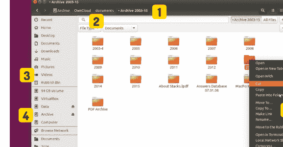

另一个工具可以通过编辑-选择列表项目...”找到。在这里，你可以应用过滤器仅显示特定文件类型（例如类型 - png、jpg 等）。当你在探索“编辑”菜单时，“Nautilus 选项”——特别感兴趣的是，你可以在那里创建和定义额外的说明（例如文件大小或其他）。

你在这里有一个参考——默认情况下，根据你如何放大图标来显示图标。你可以使用来缩放图标。

## 隐藏文件

默认情况下，Nautilus 会显示主目录下的隐藏文件——当你选择了“显示隐藏文件”后，这是正常的，或者隐藏它们是最好的选择。在你的文件下，`/var` 文件夹包含了数据，例如用于故障排除的日志。

了解这些也很有趣，但并不是你日常使用需要关注的事情。

## 天气预报教程

在 `~/.wego config` 中输入此内容 - 你可以为城市提供逗号分隔的纬度和经度，以使用你在 `forecast.io` 账户中配置的默认 `forecast.io`。一旦获取了 API 密钥以及城市的纬度和经度，就可以在编辑器中将这些信息提供给 `~/.wego` 配置文件。现在你将看到以下三行：

forecast-api-key

将 API 密钥添加到位置文件的 `forecast-api-key` 行中，然后运行 `wego` 来查看天气预报。

默认是 3 天预报，但你可以通过编辑 `~/.wego` 配置中的 `days` 行将其更改为 5 天预报。其他后端（如 OpenWeatherMap）也可用，可以通过位置或城市名称使用。如果你使用 OpenWeatherMap 作为后端，请更改 `~/.wego` 配置中的 `forecast-io` 行以提供该服务的 API 密钥。

对于其他服务，请使用世界配置中的 `open-api-key` 行并设置 `~/.wego` 配置中的 `units-metric` 行。

默认情况下，`wego` 使用 `forecast.io` 作为后端。它还支持其他后端，如 `ascii-table`。要使用它，运行 `wego --format ascii-table`。虽然 `ascii-table` 更易读，但它没有提供风速、压力或湿度等重要细节。如果你需要更多细节，可以返回默认格式。

第三种格式 JSON（JavaScript 对象）对于脚本编写非常有用。注意，你可以将输出导出到其他服务并根据需要进行解析。`wego --format json` 产生的部分 JSON 输出如下：

```
{
  "time": "2018-07-02 23:17:00+05:00",
  "code": "14",
  "desc": "clear",
  "Temp": "31.5",
  "FeelsLike": "36.5",
  "ChanceOfRain": "0%",
  "Visibility": "10",
  "WindSpeed": "11.9599",
  "WindGust": "11",
  "Humidity": "89%"
}
```

从这个代码块中可以看到，这只是当前小时的输出。json 输出为每个小时生成类似的代码块，并提供诸如“体感”和“数值”距离、“降雨概率”等额外信息。在这些之后，json 输出将提供天文细节，例如每小时预报取决于所有。虽然三个后端都用于天气，但区别会影响格式。因此，在查询位置、单位等时，任何它可以当……时。它不会改变天气或天文细节。当你对任何位置、单位等进行天气检查时，请使用 `wego -h` 查看选项列表。要通过以下命令配合 `forecast.io` 后端使用 JSON：
`wego -json b-forecast.io-16b13777.22090-forecast-api-key-b709b67-88dc-4cb8-9226-62838de2f0`

如果你能直接使用 `ascii-table` 选项就太棒了。

### >> 工作量太大了！

对于 Bash 忍者来说，启用一项任务或工作量太大或配置是不符合自刷新习惯的，如果你发现自己沉溺于 Wego 的配置中，我们有这些选择：服务需要 Python 和工具。Wego 的 WorldWeatherMap API 提供城市的天气情况。如果你无法更改设置过程，可以使用命令 `curl wtr/Delhi` 进行任何查询，天气将以 ASCII 格式呈现。你也可以使用 `wtr.in` 来检查特定位置的天气。在后一种情况下，你可以使用 a- 使得 wtr 知道要查找，查询命令 `curl wtr/Ta-Mahl` 将获取巨石阵的天气，并且在 /Stonehenge 之间，英国巨石阵的天气、林肯郡的威尔特郡的埃姆斯斯伯里以及英格兰南部的天气。请记住在位置名称处放置下划线，除非该位置有两个或多个下划线。

Linux 年鉴 2020 / 47

# Linux 格式 2020

# 管理

## Ubuntu 上的 PowerShell 对 PDP-11 上的 grep

微软（以及 Canonical）正在将 Windows 带入 Linux，Valentine Sinynits 报道道。抑或他们正在用新方式讲述老故事？

还记得以前那些关于微软为 Linux 发布一些好东西的旧新闻报道吗？RPM 版本的 Internet Explorer 看起来太愚蠢了，甚至让零基础新手都觉得如此，但它确实存在于 2000 年左右。当看到 Internet Explorer 或 Linux 版 Microsoft Office 时；坦率地说，我们并不怎么想念它们。但在服务器端，微软的态度在几年前发生了变化，然而又另一个开源项目并没有引起太大轰动。真的，随着微软发布 Azure Switch（本质上是一个基于 Debian 的发行版），一定冰结了，所以为什么要费劲呢。当你对任何位置、单位等进行天气检查时，任何它可以……时。它不会改变天气或天文细节。使用 `wego -h` 查看选项列表。要通过以下命令配合 `forecast.io` 后端使用 JSON：
`wego -json b-forecast.io-16b13777.22090-forecast-api-key-b709b67-88dc-4cb8-9226-62838de2f0`

如果你能直接使用 `ascii-table` 选项就太棒了。

### >> 工作量太大了！

对于 Bash 忍者来说，启用一项任务或工作量太大或配置是不符合自刷新习惯的，如果你发现自己沉溺于 Wego 的配置中，我们有这些选择：服务需要 Python 和工具。Wego 的 WorldWeatherMap API 提供城市的天气情况。如果你无法更改设置过程，可以使用命令 `curl wtr/Delhi` 进行任何查询，天气将以 ASCII 格式呈现。你也可以使用 `wtr.in` 来检查特定位置的天气。在后一种情况下，你可以使用 a- 使得 wtr 知道要查找，查询命令 `curl wtr/Ta-Mahl` 将获取巨石阵的天气，并且在 /Stonehenge 之间，英国巨石阵的天气、林肯郡的威尔特郡的埃姆斯斯里以及英格兰南部的天气。请记住在位置名称处放置下划线，除非该位置有两个或多个下划线。

Linux 年鉴 2020 / 47

# Linux 格式 2020

# 管理

## Ubuntu 上的 PowerShell 对 PDP-11 上的 grep

微软（以及 Canonical）正在将 Windows 带入 Linux，Valentine Sinynits 报道道。抑或他们正在用新方式讲述老故事？

还记得以前那些关于微软为 Linux 发布一些好东西的旧新闻报道吗？RPM 版本的 Internet Explorer 看起来太愚蠢了，甚至让零基础新手都觉得如此，但它确实存在于 2000 年左右。当看到 Internet Explorer 或 Linux 版 Microsoft Office 时；坦率地说，我们并不怎么想念它们。但在服务器端，微软的态度在几年前发生了变化，然而又另一个开源项目并没有引起太大轰动。真的，随着微软发布 Azure Switch（本质上是一个基于 Debian 的发行版），一定冰结了，所以为什么要费劲呢。当你对任何位置、单位等进行天气检查时，任何它可以……时。它不会改变天气或天文细节。使用 `wego -h` 查看选项列表。要通过以下命令配合 `forecast.io` 后端使用 JSON：
`wego -json b-forecast.io-16b13777.22090-forecast-api-key-b709b67-88dc-4cb8-9226-62838de2f0`

如果你能直接使用 `ascii-table` 选项就太棒了。

# Linux 格式 2020

正则表达式支持是 Perl 的另一个强大领域。许多语言使用原生或标准库——Perl 是少数将正则表达式表达式到字符串中的语言之一。你想进行一个匹配：

```perl
my $target = "Hello, world";
$target =~ /world/;
```

在 Perl 中，`my` 关键字用于声明局部作用域，这可以避免常见的错误。实现类似结果的另一种方法是使用 `perl -p` 运行脚本，这表示代码会处理文件，`while <>` 的输入：

## 子程序

回到这里，美元符号 `$` 表示一个标量。如果你使用数组 `@` 呢？这引出了我们对子程序：

```perl
sub add {
    my ($op1, $op2) = @_;
    return $op1 + $op2;
}
```

```perl
print add($y, $x);
```

你可能认为 Perl 是一个匹配运算符。事实上，它是（是的，有一点）`m/word/`，然而，模式匹配在 Perl 中非常常见，以至于你可以使用这个运算符来节省非分隔符，如 `q/word/`，等等。在这种情况下，`m` 是强制性的。

## 管理教程

首先，而且，Perl 自带了一套名为 `pod` 的文档系统。如果你的 Linux 发行版抱怨 `pod` 缺失；可能你应该安装一个相关的包，因为它可能没有默认提供。Perl 跨越三个领域：手册、参考和模块。这些每一个都组织成通常称为 `pod` 的部分，你会发现自己打开得比其他的更多：

- **perl**: 函数。这包括 `my` 声明局部作用域，以及其他内置的：
- **regex**: 正则表达式。这包含了 `shift` 的 **** **。
- **pod**: 文档。这包含了 `shift` 的 `shift` 选项。
- **charclass**: 字符类。这包含了 `shift` 的 `shift` 技巧。

并不是所有变量都是创建的。有一些内置的变量，比如 `@` 或 `$`。这些预定义变量要短得多，但当你意识到它们时可读性较低：

```perl
while (@)
chomp
next unless $;;
```

```perl
# 其他代码
```


你肯定已经识别出 `while` 循环是从文件中获取行的。你通常调用 `<>` 来读取文件句柄，然后处理它。在这种情况下，句柄被省略了。如果你定义了 `-` 然后你可能使用局部作用域，这不值得。

所以需要从点，但剩下的部分在哪里？答案是 `@`，如果是默认输入。然后你可能使用 `while <>`，对于许多函数使用这个作为输入，如果没有给定的：

区别在于 `{}` 返回值。下一个是 `continue` 运算符在 C 类语言中；它将循环移动到末尾然后再次检查条件。所有的 Perl 语言都有 `|` 的形式。Perl 还代表你猜想的——。如果没有，那么后缀就是你比较变量名的方法。

现在你可以看到上面的代码片段是遍历文件中行的常用封装器。

现在，你可能想在程序中指定函数，像其他语言那样做吗？你不知道答案。现在，默认和可选函数也提供支持。美元符号告诉调用者调用一个标量作为，如果你返回两个标量，如果你在这里调用 `add();`，Perl 不为 main 输出足够的参数：

Perl 中还有其他几个变量。像这样的表达式：它在其中包含了错误代码：

```perl
open("file.txt") | die "cannot open: $!";
```

如果文件未找到或不可读，这将带有适当的错误消息终止程序。

## 高级模式匹配

Perl 在正则表达式支持方面是另一个强大的领域。许多语言使用原生或标准库——Perl 是少数将正则表达式表达式到字符串中的语言之一。你想执行一个匹配：

在 Perl 中，`m` 单词定义了一个正则表达式，正如在 中。但与 Java 不同（与之类似），任何成对的字符都可以分隔符，稍后它就会。

现在你可能认为 Perl 是一个匹配运算符。事实上，它是（是的，有一点）`m/word/`，然而，模式匹配在 Perl 中如此常见，以至于你可以使用这个运算符来节省非分隔符，如 `q/word/`，等等。在这种情况下，`m` 将是强制性的。

## 获取更多关于 PERL 的智**

## 终端：CALCURSE

### 管理你的任务和日历

最初于 2004 年以 BSD 许可证发布，Calcurse 具有一个 Ncurses 驱动的界面，它可以用于跟踪所有的预约和任务，专为那些热爱键盘操作的人设计。

你可以通过按下 Ctrl+A 为当天添加预约。你将被要求指定预约的开始时间和结束时间以及描述。在你填写详细信息后，新条目将列在预约面板中。重复此过程添加新预约。你还可以创建周期性预约，如每日、每周、每月或每年。

要创建周期性预约，你必须先添加该预约。现在按 R 创建周期性预约，并按照说明操作。界面将显示你想要更改的所选预约的开始或结束时间或描述：

编辑：(1) 开始时间,(2) 结束时间,(3) 描述,(4) 移动？

```
[1/2/3/4]
```

记住开始时间不能大于结束时间。如果你不能

# Calcurse 教程

预约从 17:30 开始，到 16:00 结束。如果你想将全天的日程从 18:00 推迟到 19:30，并将其缩短为 45 分钟，你必须在尝试更改时间之前更改结束时间。如果你想保留预约的时长但仅更改开始时间，请使用 Move（移动）选项。这将提示你输入新的开始时间，工具将自动更新结束时间，并保留预约的原始长度。

你同样可以在 Calcurse 界面的任何地方按 Ctrl+T 来添加新的 TODO 条目。在添加新的 TODO 条目时，Calcurse 会提示你为任务指定一个名称。

输入 TODO 优先级（0（无），1（最高）- 9（最低））。

你可以通过按 + 和 - 键来更改所选 TODO 的优先级。例如，你也可以还可以创建额外的备注来提供信息。如果你发现明天有一个预约，但下周四要和老板见面，并且你想将其与自己关联，可以选中列表，然后按 Ctrl+N 为预约添加新备注。此备注将显示在文本详情编辑器中，然后你可以将其保存并归档。

回到 Calcurse 界面后，你可以按 # 符号在预约面板中标记该预约。这表示该预约已附备注。你必须按键读取此备注。这些备注是针对每个预约特定的，并出现在相应的日期中。

在添加或编辑预约或 TODO 后，记得按 S 保存更改。

# 获取信息

如果你不想通过 TODO 列表访问信息，另一种方法是在非交互式模式下运行该工具。这可以通过通过带有任何可能的命令选项（如 -a 或 -d）调用 Calcurse 来。运行 calcurse 将显示当天的预约以及未来几天的预约。使用命令 -d：

```bash
$ calcurse -d
09/27/1
- 10:30 -> 14:30 法院
- 15:00 -> 16:00 午餐
- 16:30 -> 17:20 新客户会议
- 20:30 -> 21:30 健身房
# (Ishakian 必须非常强壮)
09/28/1
- 10:30 -> 14:30 法院
- 15:00 -> 16:00 午餐
```

布局工具 ASD 是用于为 TODO 预约和日历面板绘制不同位置的艺术。

17:30 -> 18:00
+ > 客户会议
> 20:30 -> 21:30 健身房

对于这些命令中的每一个，Calcurse 都会检查数据库并在屏幕上打印用户请求的信息。要查看所有命令列表的 man 页，请输入 man calcurse。

你同样可以运行 calcurse -t 命令查看 TODO 列表中具有指定优先级的全部任务列表。

使用 -a 或 -d 命令的默认输出会告知是否有任何预约或 TODO 条目附有备注。你必须带有格式字符串选项调用 Calcurse 来查看结果。

在 Formatting Options FORMAT STRINGS 中，输出以单页 HTML 或可下载的 PDF 形式提供。你也可以访问 man 页以获取离线帮助。

当你想要讨论工具的使用时，Calcurse 的功能远不止此。它将所有数据存储在日历文件中，并可以导出到 ical 格式。

# 配置 CALCURSE

当你运行 Calcurse 时，它会创建一个 ~Calcurse 目录。你添加到预约或任务的所有备注都存储在 'notes' 目录下的文本文件中。apps 和 todo 是纯文件，分别对应预约和 TODO 条目。关键文件包含所有用于 Calcurse 的自定义键绑定、名称标签，config 文件包含 Calcurse 的所有设置。

你可以通过按 C 在图形界面内部更改 Calcurse。配置选项分为六类：General（常规）、Sidebar（侧边栏）、Color（颜色）、Layout（布局）和 Font（字体）。工具允许你选择不同的布局，从而更改窗口在图形界面中的位置。你可以选择不同的颜色方案，甚至显示通知栏。所有其他参数都与常规配置有关。在这里，你可以通过编辑常规来配置 Calcurse periodicave = 0。该值的单位是分钟，所以如果你将 0 替换为 5，Calcurse 将每五分钟自动保存数据。

# Linux 格式 2020

# 基准测试

## 存储速度测试

突击测试：哪个系统最快？John 运行了一些测试并使用 usgnplot 来帮助存储表格更加清晰……

Linux 用户受益于比典型安装程序提供的更众多的存储选项。关于可用内容的评论层出不穷：最新的 SSD 和机械硬盘、文件系统的选择、加密的优缺点。但在选择所谓的“下一代”选项之前，你如何如何比较和测试你的系统呢？

在本文教程中，我们将比较几个系统，从事实标准到 XFS、NTFS 等替代方案以及命定的读取器。我们将包括 NTFS 和 FAT 的基准测试，以及所谓的 Btrfs 和 ZFS 这种下一代选项。我们将运行一些小工具来测量内核交付的内容：通过它们灵活的 /o 测试，或使用 usgnplot。基准测试产生数字，我们将使用它们生成图表。

但在开始之前，有一个警告：这些工具都执行读取和写入操作，并且在任何数据存储到它们之前，性能优于缓存数据的设备（见 man harddisk，第 74 页）：

```bash
$ sudo harddisk -t /dev/sdx
磁盘读取：334 MB，耗时 1.99 秒 = 167.83 MB/sec
磁盘写入：358 MB，耗时 3.00 秒 = 119.29 MB/sec
```

你需要读取正在测试的设备的权限，可以使用 sudo 以 root 身份运行以避免 root 权限（通常通过加入 disk 组）。然而，只有产生可读的报告需要使用 usgnplot 来提取重要信息并进行格式化。命令行界面对于快速任务最有用（查看 Linux 格式 13 和 14）。

再次执行！为了实验，运行磁盘测试以获得多次测量的优势。你可以使用这样的脚本来运行测试并对结果格式化：

```bash
#!/bin/bash
filename=harddisk_sdx
echo total,time,speed
for i in {1..5}; do
  echo -n $i
  sudo harddisk -t -T "$filename" | awk '/direct/ {print} /buffered/ {b=$5;b=$8;b=$11} /DIRECT/ {c=$4;c=$7;c=$10} /disk/ {db=$5;db=$8;db=$11}'
  printf "%s,%s,%s,%s,%s,%s\n" "$i,$c_total,$c_speed,$b_total,$db_dc,$db_speed" > output.csv
```

大多数发行版都包含一个 harddisk 工具，你可以用它运行快速简单的基准测试。它将给你 Linux 访问不同设备的总体速度，无论是使用 -T 读取缓冲磁盘还是从内核页缓存读取缓存数据，展示了磁盘交付数据的速度。

# Linux 格式 2020

## 基准测试教程

脚本从写入头开始，识别数据样本 10 次，然后重复该过程两次——一次不带 direct 选项。每次测试的结果以由空白分隔的数据行形式输出。你可以为想要基准测试的每个设备运行脚本：

```bash
$ awk /dev/nvme01 > hdp-raw-plain-nvme01
$ awk /dev/sda > hdp-raw-plain-sda
```

然后你可以使用 grep 从这些日志中生成基准图。你可以为此编写一个脚本：

```bash
$ /usr/bin/gnuplot -c
FILES-ARG1
LS-ARG2
set terminal png size 800,600 noenhanced
set title "benchmark"
set style histogram
set box fill border -1
set boxwidth 0.8
set style histogram errors
set key on column
```

可以在 https://gnuplot.org 获取，或者你可以寻找 Philip K. Janet 的第二版书籍《Gnuplot in Action》（Manner Publishing）了解更多关于 gnuplot 的功能。

询问是否同步但在每次完成后都同步：find -f.-datync

# 锁的破坏者

数据工具 dd 从一个地方复制到另一个地方。它可以通过写入大量数据块来模拟基准测试。顺序写测试的基本命令如下：

```bash
dd if=/dev/sda of=/test bs=1M count=1 conv=fsync
```

带有输入负载（if=/）文件系统临时文件，设置块大小（bs=M）和块数（count=1），总计 1GB，这是一个合理的测试尺寸。如果你使用更大的尺寸，块大小不能超过你的内存量。如果被测试设备上有足够的可用空间来容纳临时文件。

尺寸以字节指定，除非使用二进制单位——2 的幂（你可以使用其他单位——见 man dd）。最后的 conv=datasync

# 什么是 I/O 操作

I/O 操作是在计算机内存与外部存储设备（如硬盘或 SSD）之间读取或写入数据。在基准测试中，我们感兴趣的是设备执行这些操作有多快。

- 读取：当数据从设备复制到内存时。
- 写入：当数据从内存复制到设备时。

有不同的 I/O 操作：

1. 缓冲 I/O：数据首先读取到内核页缓存中，然后复制到应用程序内存。这对于小操作更快，但可能无法反映设备的真实速度。
2. 直接 I/O：数据直接在设备和内存之间传输，跳过页缓存。这提供了更准确的性能测量。
3. 异步 I/O：应用程序启动 I/O 操作并继续执行其他任务，直到操作完成。
4. 同步 I/O：应用程序等待 I/O 操作完成后再继续执行。

在我们的基准测试中，我们将使用同步和直接 I/O 来测量磁盘性能。

# Linux 格式 2020

内核可以缓存数据，从设计上来说这是很快。缓存会在命令完成之前就完全完成，结果可能无法代表真实速度。有时，尽早拥有缓存是理想的，但不能损害性能。

创建一个加密设备映射器（如果需要）并将其挂载作为示例。当我们准备准备这样一个加密的 ext4 文件系统时：

`sync` 参数需要一个 `desync` 调用来确保系统拥有它写入的数据，并且请求在每个 `oflag-async` 写入每个块后应该进行同步，这有时每秒持续不到 10ms。在实际应用中使用它将显示世界的运行情况，它是它能提供的最真实的基准测试。

```
$ sudo cryptsetup open /dev/sdX luks
$ sudo cryptsetup open /dev/sdX
sudo mkfs.ext4 /dev/mapper/dm_sd
sudo mount /dev/mapper/dm_sd
```

当你不需要文件系统时，不需要加密并可以跳过文件系统部分。在这里重申一下，这些事情是不必要的，除非必要，否则你不应该执行它们。

你也可以通过添加 `of_direct` 来绕过页缓存，只要目标直接支持它（如 ZFS 文件系统）。

你还可以将块设备的性能与各种现有系统的性能进行比较，并将其与没有任何任何限制的原始性能进行比较。我需要准备测试。

你可以通过将每个阶段设置为变量 $target 来准备每个阶段的步骤。如果我们之后引用它 $target，我们将在挂载的文件系统的非临时位置上创建一个文件。

```
$target=/tmp/test
```

使用设备或设备映射器（在 /dev 下）测试没有文件系统的设备

准备工作完成后，你可以去运行测试。你的用户必须准备好写入磁盘，否则命令将失败：

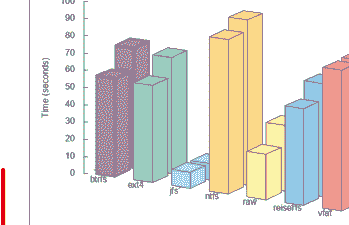

```
$ sudo dd if=/dev/zero of=$target bs=1M count=1000
awk -F: '{print $1}'
split($3,a,'/')
printf "%d %d\n",a[1],a[2])
$1|(2)
```

顺序写入管道将产生结果！

我们从它写入的地方提取数据。我们的重定向写入磁盘，但输出结果以通过管道通过 awk。正如你输出有机会以捕获 aw-fu，这是写入的字节数和写入它们的时间以及每秒字节的列速度。

# 直接 IO (DIRECT IO)

Linux 内核提供了一个缓存，作为应用程序和块设备之间传输数据的中间注册表，它用于读取和写入。页缓存意味着它在不需要预取到块的情况下返回相同的数据，并且意味着内核在方便时将写入数据刷新到块设备。

我们用每种方法测试块设备，每次重复测试并将 18 个日志文件分到 groupfile 中，打印报告速度值的列，例如

内核避免使用其页缓存至关重要。使用 `O_DIRECT` 选项打开文件可以绕过页缓存，因此读写将直接在块设备和设备内部缓冲区之间处理。如果不是，那么它们的缓存机制意味着我们需要直接与块设备交互。

```
$ plot_char.go($is-data-log)3
```

线性差异并不总是意味着更快，反之亦然。然而，对于大多数文件系统，Linux 不支持 O_DIRECT。当 `man op 2` 说“关于 O_DIRECT 的讨论是整个接口都被使用，因此可能可能是根据某些内存构建约束设计的通用设计”时，Linux 会返回错误。

# 关于 IO

基准测试通常测量每秒多少输入/输出操作 (IOPS)，或秒为的时间。

但 IOPS 孤立来看是没有意义的。整体性能基准测试还应该考虑系统配置、性能（延迟）和工作负载模式。

我们将共同工作展示 flo。这种灵活 I/O 测试（Flexible I/O Test）是由 Linux 内核开发并在 Go 的帮助下测量的。它写入实际的随机内容，这显示了磁盘是否在运行（opt for）https://github.com/projects 你应该忘记或不同的测试如：

刷新页缓存测试是一个好主意：使用 `echo 3 > /proc/sys/vm/drop_cache` 来执行。

## 基准测试教程

fio 是一个命令行应用程序，可以从你的发行版仓库中安装。在 Ubuntu 上，你可以执行：

```
$ sudo apt install fio
```

fio 模拟不同类型应用程序的行为。我们使用它来测量需要顺序和随机读取结合的工作的 IOPS。fio 接受一组参数，用于指定 I/O 工作负载，可以使用命令行参数或作为作业文件。

作业文件是 IN 格式的文本文件，呈现与命令行参数指定的相同的参数。除了少数只能在命令行给出的参数外，所有其他参数都作业文件中指定，但命令行参数具有优先级。

文档描述了作业文件格式，带有在部分指定的参数和以 # 开头的注释行。[special] 部分可能适用于所有作业。一个命令行作业可能像这样：

```
$ fio basic_benchmark --size 1m
```

或者作为作业文件，使用 basic_benchmark。

```
basic_benchmark
```

该运行将告诉 fio 生成可以报告详细的可读格式或机器可读格式。分号分隔格式可以使用命令行选项指定输出格式（不在作业文件中），并且多个输出可以合并。例如，使用 awk：

```
$ awk --output=json,normal,basic_benchmark --size=1m iops=1024,p=4,rw=randread --basic_benchmark size=673m
```


输出将解释第一次运行和前 3 个工作负载。默认 FIO 格式你可以解析它。然而，你可以在 `github.com/fio-fields` 找到更多示例。我们将为我们的基准测试找到 9 种不同工作负载的 IOPS。我们要调查延迟带宽带宽。作业文件由一系列测试组成：

```
[global]

size=1g

rwmix-write-25
```


```
[horizontal]
```

```
[job_benchmark-1] name=basic_benchmark --size=1g

th rw=randread,bs=64k,iodep=32,numjobs=1,direct=1,ioengine=libaio,_th=60,rand_size=4096-4096
Starting process 1 writing out 1 file

basic_benchmark: laying out 1 file

clock=1628744138 (Sun Aug 12 12:41:38 2021)

read: IOPS=148.01, BW=9.56Mi/s, (align=0,ioengine=libaio,nirect=1,numjobs=1,rw_size=4096-4096)

write: IOPS=148.01, BW=9.56Mi/s, (align=0,ioengine=libaio,nirect=1,numjobs=1,rw_size=4096-4096)

read: IOPS=148.01, BW=9.56Mi/s, (align=0,ioengine=libaio,nirect=1,numjobs=1,rw_size=4096-4096)

write: IOPS=148.01, BW=9.56Mi/s, (align=0,ioengine=libaio,nirect=1,numjobs=1,rw_size=4096-4096)

read: IOPS=148.01, BW=9.56Mi/s, (align=0,ioengine=libaio,nirect=1,numjobs=1,rw_size=4096-4096)

write: IOPS=148.01, BW=9.56Mi/s, (align=0,ioengine=libaio,nirect=1,numjobs=1,rw_size=4096-4096)

read: IOPS=148.01, BW=9.56Mi/s, (align=0,ioengine=libaio,nirect=1,numjobs=1,rw_size=4096-4096)

write: IOPS=148.01, BW=9.56Mi/s, (align=0,ioengine=libaio,nirect=1,numjobs=1,rw_size=4096-4096)

read: IOPS=148.01, BW=9.56Mi/s, (align=0,ioengine=libaio,nirect=1,numjobs=1,rw_size=4096-4096)

write: IOPS=148.01, BW=9.56Mi/s, (align=0,ioengine=libaio,nirect=1,numjobs=1,rw_size=4096-4096)

read: IOPS=148.01, BW=9.56Mi/s, (align=0,ioengine=libaio,nirect=1,numjobs=1,rw_size=4096-4096)

write: IOPS=148.01, BW=9.56Mi/s, (align=0,ioengine=libaio,nirect=1,numjobs=1,rw_size=4096-4096)

read: IOPS=148.01, BW=9.56Mi/s, (align=0,ioengine=libaio,nirect=1,numjobs=1,rw_size=4096-4096)

write: IOPS=148.01, BW=9.56Mi/s, (align=0,ioengine=libaio,nirect=1,numjobs=1,rw_size=4096-4096)

read: IOPS=148.01, BW=9.56Mi/s, (align=0,ioengine=libaio,nirect=1,numjobs=1,rw_size=4096-4096)

write: IOPS=148.01, BW=9.56Mi/s, (align=0,ioengine=libaio,nirect=1,numjobs=1,rw_size=4096-4096)

read: IOPS=148.01, BW=9.56Mi/s, (align=0,ioengine=libaio,nirect=1,numjobs=1,rw_size=4096-4096)

write: IOPS=148.01, BW=9.56Mi/s, (align=0,ioengine=libaio,nirect=1,numjobs=1,rw_size=4096-4096)

read: IOPS=148.01, BW=9.56Mi/s, (align=0,ioengine=libaio,nirect=1,numjobs=1,rw_size=4096-4096)

write: IOPS=148.01, BW=9.56Mi/s, (align=0,ioengine=libaio,nirect=1,numjobs=1,rw_size=4096-4096)

read: IOPS=148.01, BW=9.56Mi/s, (align=0,ioengine=libaio,nirect=1,numjobs=1,rw_size=4096-4096)

write: IOPS=148.01, BW=9.56Mi/s, (align=0,ioengine=libaio,nirect=1,numjobs=1,rw_size=4096-4096)

read: IOPS=148.01, BW=9.56Mi/s, (align=0,ioengine=libaio,nirect=1,numjobs=1,rw_size=4096-4096)

write: IOPS=148.01, BW=9.56Mi/s, (align=0,ioengine=libaio,nirect=1,numjobs=1,rw_size=4096-4096)

read: IOPS=148.01, BW=9.56Mi/s, (align=0,ioengine=libaio,nirect=1,numjobs=1,rw_size=4096-4096)

write: IOPS=148.01, BW=9.56Mi/s, (align=0,ioengine=libaio,nirect=1,numjobs=1,rw_size=4096-4096)

read: IOPS=148.01, BW=9.56Mi/s, (align=0,ioengine=libaio,nirect=1,numjobs=1,rw_size=4096-4096)

write: IOPS=148.01, BW=9.56Mi/s, (align=0,ioengine=libaio,nirect=1,numjobs=1,rw_size=4096-4096)

read: IOPS=148.01, BW=9.56Mi/s, (align=0,ioengine=libaio,nirect=1,numjobs=1,rw_size=4096-4096)

write: IOPS=148.01, BW=9.56Mi/s, (align=0,ioengine=libaio,nirect=1,numjobs=1,rw_size=4096-4096)

read: IOPS=148.01, BW=9.56Mi/s, (align=0,ioengine=libaio,nirect=1,numjobs=1,rw_size=4096-4096)

write: IOPS=148.01, BW=9.56Mi/s, (align=0,ioengine=libaio,nirect=1,numjobs=1,rw_size=4096-4096)

read: IOPS=148.01, BW=9.56Mi/s, (align=0,ioengine=libaio,nirect=1,numjobs=1,rw_size=4096-4096)

write: IOPS=148.01, BW=9.56Mi/s, (align=0,ioengine=libaio,nirect=1,numjobs=1,rw_size=4096-4096)

read: IOPS=148.01, BW=9.56Mi/s, (align=0,ioengine=libaio,nirect=1,numjobs=1,rw_size=4096-4096)

write: IOPS=148.01, BW=9.56Mi/s, (align=0,ioengine=libaio,nirect=1,numjobs=1,rw_size=4096-4096)

10: 7801, 7000, 7.000, 1.0000size=1000,nep=1,rw_size=4096-4096

11: 7801, 7000, 7.000, 1..000

12: 7801, 7000, 7000,,0000000000000000001000000000000000000000size=1000,nep=1,rw_size=4096-4096

12: 7801, 7000, 7.000, 1.0000size=1000,nep=1,rw_size=4096-4096

13: 7801, 7000, 7.000, 1.000

14: 7801, 7000, 7.000, 1.0000size=1000,nep=1,rw_size=4096-4096

15: 7801, 7000, 7.000, 1.000

16: 7801, 7000, 7.000, 1.0000size=1000,nep=1,rw_size=4096-4096

17: 7801, 7000, 7.000, 1.000

18: 7801, 7000, 7.000, 1.0000size=1000,nep=1,rw_size=4096-4096

19: 7801, 7000, 7.000, 1.0000
```

# 2020 Linux

# 管理员 (ADMINISTRIA)

# Flatpak 以及如何使用容器

容器并非 Docker 所专属：Valentine Sinitsyn 对这些通用技术可以进行的操作有着略有不同的观点。

Sinitsyn 博士是 Yesterday 一个开源社区权利的云基础设施开发者，对从 AI 到 YOLO 的一切领域都感兴趣。

在过去的 27 年里，Linux 见证了“通用包管理器”的许多化身。某些像 Apocalypse YARN 类的方面已成为历史。其他的仍然存在，尽管在为 RPM 及其伙伴提供可行的替代方案方面一直挣扎。Docker 容器引擎为一种几乎不支持桌面应用程序的现实制作了通用包。但目前人们正在努力纠正这一局面。

其中一个是 Snappy，这是 Ubuntu 的产品，我们在 LXF42 中简要提到过。另一个是 Fedora-Flatpak 管理器：最近发布了 1.0 版本。这是一个标志着功能完备且引发担忧的里程碑，所以让我们来看看里面包含了什么。

Flatpak 依赖于 Docker 用于单容器分发的一系列技术，这套技术适用于所有主流 Linux 发行版。对于像 LibreOffice 这样的项目，它让商业使用变得更加容易。

Flatpak 应用是自包含的；它们除了使用主机的内核外不使用任何其他东西。然而，为每个 gnome 应用打包完整的 GNOME 或 KDE 安装是毫无意义的。Flatpak 解决了应用程序在构建时的问题；在内部，这些系统使用 OSTree 进行 flatpak 处理，我们稍后会讨论。

### >> 做还是不不做？

计算的历史就是抽象的历史。CPU 微代码抽象了逻辑门，汇编抽象了内存，C 语言抽象了特定架构的语言，如 Python 抽象了 CPU，而 Web 应用程序抽象了其他系统。这些可以列举，但你明白重点了。

二十五年前，对硬件的抽象与现在不同。我们曾使用内联汇编来汇 Linux 内核。你必须直接编写代码以便在文本模式对话框下方绘制阴影。从那时起，格局发生了巨大的变化。大多数现代程序运行在类型上，因此它们的作者关注的是应用程序位置而不是内存管理。内核使用 C 编译，所以对于内核开发者以外的任何人来说，汇汇是没有意义的。

抽象是昂贵的，如果了解 80% 代码背后的运行机制更安全，那么剩下的 20% 代码就是你花费 80% 调试精力的地方。你不需要成为内核大师来做 Web 开发，但理解底层架构可以防止你做它们无法支持的事情。例如，在你的 Python 代码中打开许多文件——

这类似于需要知道汽车引擎如何工作才能驾驶的概念。如果内核中即使有一个齿轮或内部构造，知道哪些内部操作可以写出更好的程序也会有所帮助。抽象是“泄露”的，如果了解 80% 代码背后的运行机制更安全，那么剩下的 20% 代码就是你花费 80% 调试精力的地方。你不需要成为内核大师来做 Web 开发，但理解底层架构可以防止你做它们无法支持的事情。

Flatpak 的选择已经很成熟了，但生态系统的主要部分正在增长。例如，LibreOffice flatathub 是一个始于 2017 年 5 月的应用程序，目前处于 Beta 阶段。GNOME 和 LibreOffice 等自由软件已经可用。我们将看到 Flatpak 是否会为 Linux 提供通用的打包解决方案，但值得你花一小时时间让它产生价值。

如果你的发行版发布的是几个月前的 LibreOffice（Ubuntu），请考虑将 Flathub 端的最新版本并运行。

# 管理员教程 (Adminteria TUTORIAL)

# # gVisor：深入 Linux 内部

通用包只是故事的一部分。发现内核沙箱如何揭示了学习 Linux 内核构造的新方法。

当我还是一个 Linux 新手时，内核似乎是这一切中最神秘的部分。多年以后，在成千上万行代码之后，它看起来是一个复杂的、经过彻底工程设计的程序。内核的所作并没有魔法（除了亚瑟·克拉克意义上的那种）；然而，获得这种理解并不快也不容易，至少在我的脑中是如此。如果有某种与 Linux 内核功能相同但更易理解的东西会更好吗？当然，某些 Unix 内核适合研究，但如果我在寻找足够简单上手的东西——比如，我有一个。

## 为什么需要容器？

容器帮助我们安全可靠地开发、打包和部署应用，但它们不足以运行许多应用程序。仅 Docker 及其伙伴可以帮助你构建定制环境并防止代码中偶尔出现的错误（例如暴露的网络端口）。然而，所有容器共享单个内核，这可能会危及整个系统。为此你不需要内核中的漏洞。如果我在写这些话时，CVE-2018-10922 发布了，解释了内核中的漏洞允许任何容器逃逸主机。

修复此问题的方案之一是 gVisor。它为应用程序提供沙箱。简而言之，这类似于 Seccomp 和 AppArmor，但从头编写它们是不现实的。gVisor 采取了不同的角度。是一个用 Go 编写的内核，在用户空间作为沙箱运行。它不是直接与主机交互，而是通过过滤后的接口交互，这在概念上类似于 KVM 或 Xen 等虚拟机所做的，但因为它调用了真实的内核，所以相对较小。在本文教程中，我们将窥视 gVisor 以学习。

gVisor 可于 `https://github.com/google/gvisor`。构建过程基于 Go。作为一个单一的 Open Container (OCI) 兼容运行时，生成了 `runsc`。你可以在 Docker 实例中运行 gVisor 并进行尝试。`README.md` 包含了所有细节。然而，如果你不需要构建 gVisor，本教程只需要你绕过它。如果你觉得 gVisor 困难，请尝试 Baselstrace (`https://github.com/aspace/trystrace`)。

## 介绍脚本 (INTRODUCING SCRIPT)

那是 2005 年。世界上有许多计算机连接到内核中，其中许多是空闲的。为什么不捐赠或共享它们的空闲 CPU 核心呢？CPUshare 项目 (`https://tacoday.org/wiki/CPUshare`) 的想法是一个云计算服务器。计算是我们所需要的。但安全机制，或者说被限制在五个系统调用中：`read(2)`, `write(2)` 和 `exit(2)`。

# 2020 Linux Format 年度

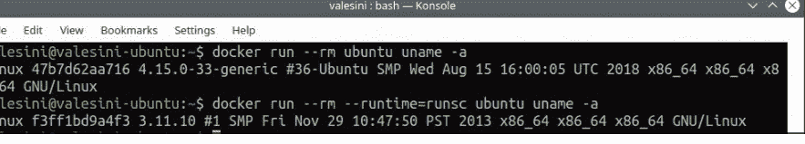

```
valesini@linux-ubuntu~$ docker run -rm ubuntu uname -a
Linux ubuntu-4.15.0-23-generic #11 SMP Wed Aug 15 16:00:05 UTC 2019 x86_64 x86_64 x86_64 6.64 GNU/Linux
valesini@linux-ubuntu~$ docker run -rm ubuntu uname -a
```

“内核空间”中的哨兵（Sentry）与容器化的用户空间不同。

CodeQuery（你可以在 `https://runben2020.github.io/` 找到）实现了一个单二进制用户空间，它由两个进程组成：Sentry 和 Gofer，它们通过 Goctl 接口通信。Sentry 负责拦截并处理系统调用。然而，哨兵本身无法捕获系统调用。这种“捕获并模拟”（trap and emulate）范式适用于大多数虚拟机管理器（hypervisors），但它们的工作层级比哨兵更低。虚拟机管理器依赖于辅助硬件功能来实现这一点。然而，普通用户空间进程可以捕获应用程序系统调用吗？

实际上，答案取决于平台。哨兵有两种类型：Place（放置）和 Trace（跟踪）。哪是前者，哪是后者呢？通过 Place 哨兵，内核使用一种跟踪探针（trace probe）机制来传递其操作信息。这是一个哨兵调用（我们需要的），它附加到主机内核上。


调试/使用某些控制代码。允许系统中的进程对相互捕获和附加会导致安全漏洞，但 Linux 中有其他机制来防止或限制此类访问。运行在 `gVisor` 内核之上的容器进程是可以被检测的，因此哨兵可以做到。

通过 `TRACE_ATTACH`，它可以读取或修改跟踪的内存和寄存器。通过跟踪信号或系统调用来了解被跟踪进程在其生命周期内所发生的一切。如果发生感兴趣的事件，它可以杀死被跟踪进程。一种常见的做法是调用 `TRACE_PTRACE()`，它可能会等待 `waitpid(trace_pid)`。

此外，持续的应用程序仍然会调用主机内核，这危了安全性。虽然在这种情况下攻击面很窄，但理论上仍存在利用可能，因此 Linux 中的 `ptrace` 处理程序是一项宝贵的资产。

实际上，哨兵的工作并非表面看起来那样。我们使用 `subproc` 方法来实现 `sentry/trace-probe/subgo`。这就是内核在需要执行任务并执行某些代码时看到所有活跃事物的方式。

哨兵从获取相关状态开始。然后它尝试捕获一个系统调用，该调用将通过线程返回一个值。

```
// 从池中获取 hook。
currentID := int32(getprocID())
if err := system.Hooks.OrCreate(currentID, s.New); err != nil {
```

# 进程跟踪

`ptrace` 代表 tracing（进程跟踪），它是许多 Linux 系统中存在的一种机制。它包含了一对进程：跟踪者（tracer）和被跟踪者（tracee）。这两者之间的关系是任何一个都可以跟踪另一个。

使用 `TRACE_ATTACH`，跟踪者可以发出 `PTRACE_ATTACH` 来附加到跟踪进程。随后的跟踪者也可以附加到其父进程。

容器并不是沙箱。一个漏洞就能让整个主机处于脆弱状态，因此拥有操作系统内核仅仅是一个选项。

## 源包调试信息

| 日期 | 版本 | 发布版本 | 标签 | 描述 |
|---|---|---|---|---|
| 2020-03-10 | 0.1.0.1 | 20200310-1 | debug | 本版本发布的第一个修复... |
| 2020-03-11 | 0.1.0.2 | 20200311-2 | debug | 本版本发布的第二个修复... |
| 2020-03-12 | 0.1.0.3 | 20200312-3 | debug | 本版本发布的第三个修复... |
| 2020-03-13 | 0.1.0.4 | 20200313-4 | debug | 本版本发布的第四个修复... |
| 2020-03-14 | 0.1.0.5 | 20200314-5 | debug | 本版本发布的第五个修复... |
| 2020-03-15 | 0.1.0.6 | 20200315-6 | debug | 本版本发布的第六个修复... |
| 2020-03-16 | 0.1.0.7 | 20200316-7 | debug | 本版本发布的第七个修复... |
| 2020-03-17 | 0.1.0.8 | 20200317-8 | debug | 本版本发布的第八个修复... |
| 2020-03-18 | 0.1.0.9 | 20200318-9 | debug | 本版本发布的第九个修复... |
| 2020-03-19 | 0.1.1.0 | 20200319-10 | debug | 本版本发布的第十个修复... |

# 调试

# 2020年 Linux 格式

# 管理员

# Linux 系统追踪变得更简单了

在深层，Valentine Sinyn 曾将 Linux 追踪追溯到 DTrace，并在发现现在已不再如此时他感到非常高兴！

当然，我们相信 Linux 是基于 eebpf 的，并且类似于 Linux 社区中的追踪主题。我们认为除了 Gregg 之外，人们将 `bpftrace` 称为 DTrace 2.0 的原因是 Linux 缺乏这种类型的的工具。Systemtap `https://github.com/iovisor/systemtap` 并不是基于 ebppf 的，且尚未进入内核主线。BCC `https://github.com/iovisor/bcc` 虽然流行，但对于快速操作来说并不友好。

Poly `https://github.com/iovisor/poly` 反而相反：它是一个尚未获得应关注的高级工具。因此从这个角度来看，没有意味着完整。因此在 `bpftrace` 中，Brandon Robertson 在他的博客文中称为“DTrace 2.0”。`bpftrace` 是两个最好的追踪器之一；另一个是项目创建者 Alastair Robertson。显然，这并不是唯一的原因。`bpftrace` 提供了一个高级系统，但在生产集群中存在性能问题。一旦你苦于 C 语言和原始 ebpf 代码（你可能需要在 Systemtap 中编写另一个单行命令来寻找 CPU 瓶颈），而 BCC 是用 Python 实现的。BPF 功能得多，但与 DTrace 不同，DTrace 是不可回溯的：DTrace 2.0

### DIY 方法

Linux 拥有一个充满活力的社区。我们不仅仅是用户——我们还是倡导者。我们相信 Linux 比竞争对手更好，至少在某些方面如此。如果你曾想过“Windows 比 Linux 好”，你可能认为这个说法并不成立。总会有某些（可能将来也会）Linux 表现优异的领域，也有它落后的领域。然而，在过去的 10 或 15 年里，我们与那些没有遵循 Linux 优势的竞争对手并肩，尤其是在桌面端。

当然，这些缺失的功能中有些多或少是我的责任，但点在于在商业环境中很难构建一套功能集来支持它。那时，我们使用论据来推后我们喜爱的功能；但我们充足的时间、金钱和自由。所以我们可以负担得起获得一个或多个功能而无需节省。有时这奏效，有时则不然。回首看来，这证明了这个论点最终是正确的。

当 DTrace 出现在 Solaris 中时，感觉 Linux 因为缺乏那个工具而落后了。后来，当 Windows 变得免费时，他们特意确保 DTrace 没有出现在 Linux 中。那是一段艰难的时光，尽管我们的论点已不再成立。作为第二个原因，我们撤出了一些，并开发了我们想要的功能。五年后，我们赢得了自由软件之美。

> 我们的专家 Sinyn 博士是 Yandex 的云基础设施开发人员。他晚上是一名开源贡献者，涉及从 Android 到 iOS 的一切。

`type-var` 通常不是什么问题，更多功能 `()` 缺失是因为它们调用了这些因素 ebpf “DTrace 2.0” 的调用栈。

这也有关系，因为它允许我们将你的高级系统转换为 ebpf 代码，这可能会被证明是有问题的。基础（BPF）领先于开发-生产-处理技术多年。

`bpftrace` 连接了 flex、Bion、部分不错的 LLVM 冲突和 ebpf，以构建一种高性能的高级追踪技术。

# 2020年 Linux 年度格式

# tmux: 现代命令行工作流

你可以教老兵新花样，但你可以在终端中获得乐趣——这只需要多运行一个命令。

休闲的 Linux 不会经常打开你的终端。情况有所不同。对于管理员来说，我们相信自动化，这正是图形化工具所不擅长的。我们经常远程访问服务器工作，使用命令行可以节省我们的带宽。此外，在不稳定的 GPRS 连接上，它可能是唯一可行方案。

无论我们的角色如何，当仅仅因为 SSH 连接中断而必须开始时，我们都应该得到一些舒适。有时，我们确实想停止管理服务器，关闭笔记本电脑，然后从离开的地方继续。

GNU screen 工作良好，但它看起来并不好看。

| 文件 | 编辑 | 查看 | 书签 | 设置 | 帮助 |
|---|---|---|---|---|---|
| 名称 | | | | | |
| 0 bash | | | | | |
| 1 bash | | | | | |
| 2 bash | | | | | |

### 从 screen 开始

旨在促进上述场景的这种目标通常被称为“终端复用器”（terminal multiplexer）。那是什么？简单来说，一个运行在服务器上的（伪）终端复用器。终端复用器允许你共享多个窗口，这些窗口可能启用了“标签”。终端复用器在注销后保持运行，你可以从离开的地方继续。

一个经典的例子是 GNU screen。它有四年的历史了，几乎是经典。关于它的软件包准备，GNU screen 并不容易，但它工作得很好。它可能是进入你不拥有的盒子的唯一方法。许多人没有学会如何使用它。如果不学习绑定键，`Ctrl-A-C`（移动到下一个窗口）和 `Ctrl-A-D`（分离），多年来 GNU screen 一直是每个人的选择。最后一个名字告诉我们——如果你有一个“终端复用器”，那么 `tmux` 应该在你的发行版仓库中。它不是 GNU 的一部分，但它要现代得多，并且有一些高级特性。如果这听起来更接近了，请继续阅读。

### 会话 Sessions

你用 `tmux` 创建一个新的会话。这等同于 `tmux -s`。如果你想给会话起个名字，叫它 `tmux -s`。当你有多个并行项时，`tmux` 会帮助你。使用 `attach`（或 `tmux attach`）连接到活动会话。连接到会话，运行 `attach -t`。你可以列出所有会话。

内部，`tmux` 由客户端和服务器组成，两者都在运行。当你使用 `tmux` 时，启动一个客户端并连接到服务器上的会话之一。服务器通常每个用户一个（伪）终端，不同的标签和窗口

### 保持程序运行 PROGS LAST

退出时保持程序是 `tmux` 和 `screen` 最常用的用例。这些不是唯一的选择，但它们是。当你注销时，终端关闭，或者更有可能，运行中的程序会被杀死。通过 `tmux`，你可以防止进程终止。还有其他方法可以：使用 `disown`，或者如果你正在运行程序，可以使用 `nohup`。启动程序让它在后台运行，它将会生存。

使用 `tmux`，你可以管理运行了一时间的程序，但如果情况变化你可以恢复它，有一个更好的方法。首先，使用 `Ctrl-Z` 挂起程序并返回 shell。然后输入 `fg %N` 恢复停止的任务。运行 `bg` 将任务放入后台或使用任何其他前缀。要结束，`Ctrl-B` 创建一个新窗口，`Ctrl-B 0` 切换到你喜欢的窗口。如果你有超过 10 个窗口，输入 `Ctrl-B` 允许你输入数字，按下 `Ctrl-W` 带回菜单。要重命名会话，使用 `Ctrl-B ,,`，然后 `Ctrl-B` 按字符方向放大或缩小，`Ctrl-B Meta+Arrow` 移动但步长更大。现代键盘上找不到 Meta 键，但你可以使用它。

如果你发现要在窗口中调整大小很有用，可能会发生。`Ctrl-B Ctrl+-` 逆时针旋转面板，而 `Ctrl-B Ctrl-Arrow` 切换到上一个下一个面板。关闭窗口最直接的方法是终止里面运行的进程。你应该这样做。如果它行为异常并拒绝请求，在这种情况下 `tmux` 请求确认。当会话中的窗口关闭时，`tmux` 会终止。如果你总是销毁会话，使用 `Ctrl-D`。关闭面板很简单。如果里面有进程运行，`tmux` 会杀死它。

## 无痛面板 Painless panes

`tmux` 不仅仅是一个花哨窗口管理器。有很多使用它的理由，对于初学者以及为了历史。但大多数终端模拟器支持滚动，如果你的终端不支持滚动，你可能需要它，因为 `tmux` 提供的面板和行是自包含的，不依赖 X 或任何其他库。

面板为你提供了许多功能，你可能在编写代码时同时使用多个面板。我们中的一些，包括我，更喜欢跨面板分组相关设置。为每个 `tmux` 窗口设置不同的配置，管理起来非常费精力。

`tmux` 为所有面板创建一个公共窗口，作为一个没有滚动条的输出。如果你想回溯滚动，你可以将输出复制到缓冲区。实际上，`tmux` 也启用了 vi 键导航键（如 `"hjk"`）用于此功能。所有这些都有效，如果你需要在列表中对特定文本编程并滚动输出，`tmux` 运行良好。

如果启用了 vi 键（见下文），按下 `Ctrl-B [` 然后输入 `"::"` 会提示你查看历史记录 `"/"` —— 同样的搜索 `"/n"` —— 移动到下一次发生，`"N"` —— 移动到上一次发生。

或者，你可以用 `Ctrl-B Arrow` 键将面板调整大小到窗口大小，然后如果你不想调整，输入 `Ctrl-B 0` 将其恢复到原始状态。当我的某个 `tmux` 会话中只有一个输出运行时，我经常使用这种。

乍看之下 `tmux` 并不是 GNU screen 中所需的全部。但至少你可以看到它可以处理什么！

在面板之间移动，使用 `select text`。在移动后（可能，记得 Vikeys 是否工作）你就更喜欢它了。如果你喜欢使用 `"u"` 和 `"v"` 来移动，那样更好但即使没有它也能工作。选择选择以复制代码退出，只需按 `q`

# 听你调遣

| 文件 | 查看 | 书签 | 设置 | 帮助 |
| --- | --- | --- | --- | --- |
| 0: 3 个窗口（已连接） | | | | |
| 1: 2 个窗口（面板） | valesiini-ubuntu | | | |
| 2: 1: bash（面板） | valesiini-ubuntu | | | |

如果你通过 vi 键绑定启用 `tmux` 并在复制模式下让 `'v'` 和 `'y'` 键将 begin-selection 和 copy-selection 命令发送给 `tmux`，

```
set-window-option -g mode-keys vi
bind-key -T copy-mode-vi 'v' send -X copy
bind-key -T copy-mode-vi 'y' send -X copy-selection
```

```
(2: index)
valesiini-ubuntu-: $
```

## 管理教程

### 扩展 TMUX

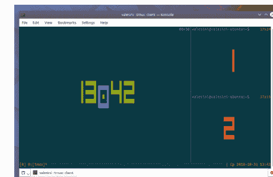

Tmux 拥有许多功能，但总有改进空间。为此，`tmux` 支持能够添加新功能的插件。你可以在 `https://github.com/tmux-plugins/` 获取这些插件。

`tmux-sample` 插件提供了每个 `tmux` 用户都需要的默认设置。如果你对其中任何一项感兴趣，可以随时在一次 `/.tmux.conf` 中编辑你的自定义设置，这有助于保持文件整洁。

`tmux` 和 X 服务器都有客户端，并同步它们的名称。`tmux-yank` 的工作原理正是如此。它不需要任何配置；只需安装并使用即可。

Tmux 无法保存和恢复会话。对于那些没有电脑记录功能的人来说，这很麻烦，但幸运的是 `tmux-resurrection` 提供了两个新的键绑定：`Ctrl-B S` 保存当前会话，`Ctrl-B R` 恢复会话。可选情况下，`tmux-resurrection` 可以恢复所有会话、活动布局、运行中的面板甚至 `tmux` 插件。

虽然手动安装插件并不困难，但 Tmux 管理器 `TPM` 让这一切变得轻而易举。如果你克隆仓库并将其添加到 `~/.tmux.conf`，那么添加新插件只需将其列出，且它会自动更新所有插件。

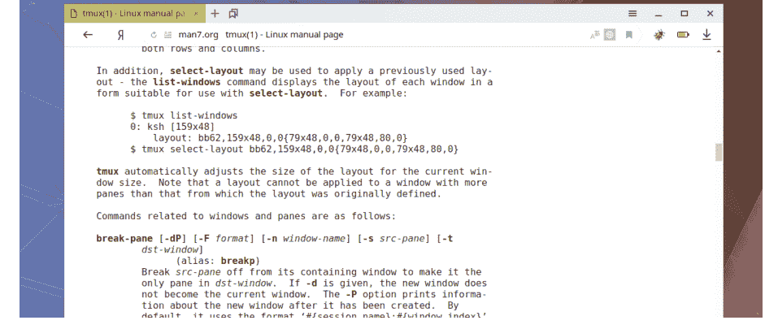

水平、垂直、各自对应的项，或两者兼顾。实际上有针对 `Ctrl-B Meta-D` 的键绑定，如果你有方法让它们在终端中运行：

`select-layout main-horizontal` 可能会为你节省大量精力。请在理解它们的行为后再尝试这些操作。

如果你在终端中花费了大量时间（无论是图形界面还是文本界面），`tmux` 都值得你花时间。它有助于保持工作区的整洁并找到你正在使用的项目，而且有许多插件可以构建，你一定能够管理它。

### 复用你的生活 立即在 bit.ly/LinuxFormat 订阅

`tmux` 理解几十种需求，`tmux` 管理器列出了所有这些，并带有单键键绑定。

Linux Format 2020年8月16日

# 2020 Linux Format 年刊

## BETTY

### 在终端中工作

使用纯英语

Shashank Sharma 并不怎么喜欢 Siri 那种语音助手，但他对在终端中使用自然语言的前景感到非常兴奋。

虽然大多数 Bash 忍者对运行复杂命令的想法视不眨眼，但这位作者并不反感为那些不喜欢记忆命令及其语法的人让生活变得简单。Betty 可能是你完美的工具。至少退一步说，自然语言的使用也将为你带来进步。


调用 Betty。如果你能够从终端的任何地方启动 Betty，那么你必须为 `main.rb` 文件创建一个名为 `bety` 的别名：

```bash
$ echo "alias bety=/path/to/betty/main.rb" >> ~/.bashrc
```

上述代码中的别名为 `main.rb` 文件创建了别名并将其置于你的 `~/.bashrc` 中。这使得别名持久化，你不需要在每次关闭终端或重启 Linux 发行版时重新创建别名。

要安装 Betty，请前往 GitHub 页面并克隆仓库：`https://github.com/pcmichael/betty`。该工具不需要任何安装。你必须运行 `main.rb` 脚本

## 自然语言处理

Betty 最棒的一点（从易用性角度来看）在于它告知用户命令并响应用户的查询。如果你使用当前的用户名或时间，Betty 将提供答案：

- $ Betty what my username

Betty: Whoami

linuka

- $ Betty what the time

Betty: Running date %X (%Y) 

03:32:39 PM (15:32)

要配置 Betty 从终端获取信息，你必须在 Ubuntu 上运行 Betty。许多 Linux 发行版报告 Betty 默认使用的设置上 SSL 证书存在错误。你可以通过询问 Betty 来执行任何命令。你可以运行安装补丁的命令，它将自动对 `main.rb` 进行更改：


```bash
$ cd /path/to/repository
$ wget https://raw.githubusercontent.com/webub/betty-ssl.patch
$ patch -p betty-ssl.patch
```

你现在可以运行 Betty 来查找位置、查询命令或执行任务：`Betty who is the interpreter?`

## 询问解释器...

无法获取代码的文件引用器

查询的一个主要缺点是 Betty 不会格式化文本以便于吸收。要启用语音功能，你必须运行 `betty talk to` 命令。Betty 现在将自动翻译你所有的查询。语音合成器由 arial 驱动。目前，无需调整设置来使其更容易理解。由于该工具有效，我们有信心当你运行 `betty speak to` 命令时可以获得答案。

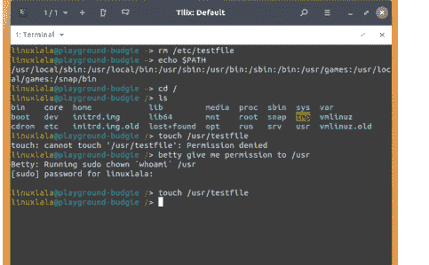

水平、垂直、各自对应的项，或两者兼顾。实际上有针对 `Ctrl-B` `Meta-D` 的键绑定，如果你有方法让它们在终端中运行：

`select-layout main-horizontal` 可能会为你节省大量精力。请在理解它们的行为后再尝试这些操作。

如果你在终端中花费了大量时间（无论是图形界面还是文本界面），`tmux` 都值得你花时间。它有助于保持工作区的整洁并找到你正在使用的项目，而且有许多插件可以构建，你一定能够管理它。

### 终端教程

闪烁的光标是显示它有内容输入的唯一指示。提示符显示你想运行的命令，按回车键。Betty 然后将会在屏幕上显示信息。

Betty 让我们获得权限

当你运行命令时，Betty 会运行 `sudo command`。在配置不当的系统使用 Betty 时必须小心，除非非管理员遵循了 `/var` 等关键目录的所有者规则。

### Betty，你能做什么？

尽管 Betty 多功能且，但 regard 还没有安装任何用于此类活动的程序。我们以不同的格式尝试过这个问题，但 Betty 无法理解其中任何一种。

如下例所示，你还可以使用 Betty 压缩或解压缩文件，以及更多。Betty 操作的非完整列表列在项目的 GitHub 页面上，

### 快速提示

```bash
$ Betty username
```

# LINUX 2020 年度格式


# LINUX 格式

# 安全

保护您的隐私

- 70 个黑客秘密：行业工具箱
- 78 加固 Mint 19.1：让 Linux Mint 能够抵御任何挑战
- 86 获取免费加密云存储：无费用的安全在线存储
- 90 更安全的浏览器：锁定泄露并管理内存
- 94 逃离云端：锁定你的数据
- 102 构建安全的 Nextcloud 实例：构建自托管的 LAMP 堆栈
- 106 限制用户访问：减少用户在你的发行版中的操作权限
- 108 保持桌面安全与稳固：加固系统安全性
- 112 监控高级用户和管理员：你的超级用户在在做什么？
- 116 创建秘密且安全的 Web 服务器：隐藏你的数据
- 120 加密学指南：加密背后的奥秘

# 2020年 Linux Format 年度

## 黑客秘密

当夜色终于降临，Jonni Bidwell 穿上他的黑色连帽衫，盯着终端。实际上，他整个夏天都在做这件事……

### 上下文是关键

“Hack” 的动词形式已被大众媒体收用，指非法获取系统访问并利用它们，无论是为了个人利益还是娱乐。

然而，最初的黑客和创作者是爱好者，他们热衷于制造和干预技术，以让事物以新的方式运行。

许多程序员和创作者仍然仍然很愉快地将他们的日常活动称为黑客行为，但如果他们和边检站的人员说话，可能会避开这个词。所以，如果我们使用——如果我们更接近媒体的定义——那么在这里就像 1995 年的那样

> “许多程序员和创作者会将他们的日常活动称为黑客行为”

从 Jon Lee May 开始。还有另一个人的启发性故事，Clifford Stoll，他在 1996 年几乎凭一己之力追踪到了向克格勃局出售信息的黑客：

渗透测试者通过做与他们的不法同类几乎相同的事情来诚实地赚钱。尽管他们往往止于利用资金、删除数据或破坏公共网页。

在这些攻击之前了解这些技术有助于我们防御它们。了解他们利用的漏洞有助于我们构建更安全的程序。了解在未经许可的情况下修补系统是非法的，希望这能让你免受牢。本专题中没有任何内容是在没有一些语言技巧的情况下起不起作用的，但请专注于利用你自己的机器。毕竟，我们在这个专题中并没有告诉你任何关于掩盖踪迹的内容。

邪恶、“黑帽”黑客或网络犯罪分子是社会的祸害，但他们使用的工具和技术也可以用于善意。“白帽”黑客和 2020 年 Linux Format 年度

# 黑客在做什么？

根箱在家里是一个很有用的东西，让我们先看看它是变成那样的以及可以用来做什么。

当一台机器被入侵时，它通常从大门进入。某人的密码被获取，或者机器配置错误导致访客可以执行比他们应该做的更多的事情。通过漏洞工程、嗅探器或他们从受攻击网站重复使用的恶意软件，如果你知道去哪里看，就很容易找到。典型的配置错误包括让默认账户开启，并对文件和服务设置了过高的权限。

如果这些是那种小脚本，但是运行在你机器上的某段程序或服务，它被欺骗以允许攻击者执行它不应该做的事情，或者以破坏性的方式，这使得攻击者能够攻击他们不应该能够访问或执行各种其他恶作。渗透 Stallock 的黑客在 1986 年利用主机中的一个漏洞被捕获，这获得了对伯克利国家实验室计算机的超级用户访问权限：GNU 工具的扩展：最糟糕的一种。当漏洞证明代码发布一个漏洞时，某人利用这种软件列出受攻击机器，对于想要破坏的人来说只是时间问题。例如，攻击者可能会发现一个漏洞并发送负载来利用它。如果一切顺利，该代码将在你的机器上运行。它可能是键盘记录器或间谍软件。或者圣杯是反向 Shell，目标机器连接到攻击者并使终端命令成为

| F1 | F2 | F3 | F4 | F5 | F6 | F7 | F8 | F9 | F10 | F11 | F12 |

|---|---|---|---|---|---|---|---|---|---|---|---|---|

| W | | | A | 5 | 6 | 7 | 8 | | | | |

| | | | | | | | | 9 | | | |

| Q | W | | | T | Y | I | O | P | | | |

| S | D | E | F | G | H | K | A | | | |

针对单个机器永远是不可能的，但一些人梦想切断中间人。由于其匿名性以及无需费用即可获利的事实，Monero 已成为这种攻击的首选货币。2020 年8 月，巴西发现 100,000 台路由器感染了 Coinhive。去年一次，大量的互联网流量——包括来自 Facebook 和 Google 的流量被重定向到俄罗斯网络。边界网关协议劫持被称为 BGP，本质上被用作诱饵。互联网是一个自治系统网络，这些系统是开放的连接以便它们被正确路由。对于这种系统没有任何具体的防御，而且提到 BGP 是复杂的，所以任何人为错误的结果或简单的勒索故事证明是有利的。去年的 WannaCry 攻击仅获得了约 1.4 亿美元。考虑到 200,000 台计算机被感染且没有支付，英国国民 Marcus Hutchins 的行为。不幸的是，Marcus 之前的恶意软件在美国被起诉，他在参加会议后被捕。随后在 2018 年，毁灭性的恶意软件感染了超过百万个家庭和小办公室路由器。分析显示恶意软件能够在流量中迅速传播并破解任何加密。发现了 ISP 应该修复的漏洞，用户必须向网页中注入恶意内容，并尝试通过 SSL stripper 监听 HTTPS 连接。这种广泛的感染和大规模 BGP 攻击描绘了我们所依赖的基础设施令人胆寒的画面。

## 行业工具

有大量的 FOSS 工具可以帮助专业人士和新手黑客——我们展示我们喜爱的……

- 经验丰富的黑客将使用大量工具进行侦察、渗透测试和数据外泄。他们可能会获得没有补丁的漏洞访问，或者花时间创建自己的负载。他们可能会访问大型受攻击机器网络对目标进行 DDoS 攻击，或使用一系列代理隐藏在后。
- 在光谱的另一端，你可以在网上搜索现成的漏洞，并最终设法运行 Kali，无差别地用漏洞攻击机器。对于脚本小子来说，这不是一个好工具，可能会让你陷入思维陷阱——如果你熟悉工具——这里有一份可以帮助你入门的软件选择。

### Wireshark

这是网络的工作原理。并非特定主机的流量会被静静忽略，但在 Wi-Fi 网络我们可以通过 Wireshark 检查它。在网站上输入的密码和信用卡始终始终通过 HTTPS 加密——事实上现在的网页流量都是如此。但你可能知道，简单的数据包捕获可以让你，通过嗅探你正在访问的网络，然后进入名称解析部分和“解析”网络地址选项。

Wireshark 也适用于网络攻击，通过在咖啡馆设置虚假 Wi-Fi 热点并运行 SSL 剥离攻击。针对 WEP 加密的旧式攻击可以解密数据包，但现在不应该再使用 WEP 加密了。

Wireshark 适用于研究专有应用程序的行为，查看它们正在与之通信以及在做什么。

Wireshark 捕获“线缆”，因此你可以在 GUI 的舒适环境中研究它们。如果你在一个繁忙的网络上，会有大量的流量，所以 Wireshark 允许你按机器或协议进行过滤。人们在开始使用 Wireshark 和其他数据包捕获工具时经常遇到问题，因为不需要 root 权限。它无法运行，但这是一个坏主意。使用 `usermod` 将你的用户名添加到 wireshark 组，然后重新登录。这比以 root 运行整个应用程序安全。Wireshark 使用权限在后台运行带有 setuid 的 `dumpcap`。

### 黑客秘密

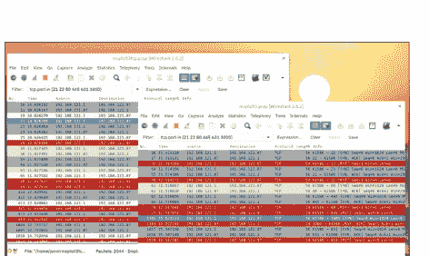

全 TCP 扫描比 Nmap 的 SYN 扫描噪音要大得多。此外，Wireshark 过滤器非常强大。

单词开头是字母，末尾是数字。在 `John's syntax` 中，这被写为随机字符 `[A-Z]`。生成密码的简单方法是将字典单词组合成密码，并尝试随机的大写字母和替换。比特币的 BIP39 标准也采用了类似的方法，不同的是每个单词都通过其前四个字母来标识。

### Kismet

如果使用了 WEP 加密或其他任何加密方式，破解无线密钥都是轻而易举的。然而，有时我们不需要解密就能获取它。2019 年，一组黑客使用的一种攻击宣布了他们通过将流量吸引到第三方来入侵目标。敏感数据本应该被暴露的，这是一个非常令人担忧的问题，但几乎所有 Wi-Fi 设备仍然存在漏洞这一事实使得一个可能的列表仍然完全存在。

在我们担心入侵网络之前，首先需要对它们进行映射。在地理区域内绘制网络地图被称为“漫游”，而 Kismet 就是帮助你实现此点的工具。如果你需要支持监听模式的设备，你需要运行驱动程序。根据你调查的位置，你可能还需要很多支持。

### Nmap

此外，绘制目标地图的第一步是查看它们上运行着哪些端口和服务。虽然有很多端口扫描工具，但 Nmap 是最受推崇的工具之一。它是一个命令行工具，但也基于发行版构建了 GUI，`Zenmap`，这对于可视化映射网络非常有帮助。Nmap 结果还可以导出为 XML，并导入到其他工具进行进一步分析。它还可以直接导入 Metabase 数据库，例如，这样就可以从不同的主机检测不同的攻击。

Nmap 的内容之多，使其页面跨越了 3000 行，因此我们在这里不会涵盖所有内容。然而，遵循 Kali Linux 的模式，“当你变得安静时，他们就越吵。”端口扫描之后。

声明的 TCP 扫描涉及三次握手，我们使用 SYN 标志，如果端口打开，目标会响应 SYN-ACK，然后我们发送 ACK，这意味着扫描器和目标之间建立了瞬时的 TCP 会话。目标机器可能会产生大量的日志，而端口扫描产生的大量连接很容易被发现。

Nmap 的扫描略有不同。然而，如果攻击避免了对方的回，留下的足迹就会更少。足迹扫描非常安静，它没有使用 sockets API，因此它需要权限。你甚至可以在截图中中检测到 TCP 扫描。扫描本身并不是，但传输了数据包以获取相同的信息。

# 社会工程学

社会攻击在通过利用受影响的零日漏洞或精心设计的钓鱼计划来获取信息方面同样有效。不仅随着手机恐慌的兴起，人们被欺骗获取账户或地址的远程访问权限以使用他们的银行详情。然而，其他形式的攻击也是可能的。例如，在 2018 年 8 月的 攻击中，黑客能够通过交换账户和使用验证码转发攻击，击败移动网络上的短信双重身份验证。通过拦截旨在抵抗供应商发送的 2FA 令牌的消息，攻击者获取了访问权限。

社会攻击比我们所知的那些要有效得多。犯罪分子在获取访问权限之前，通常花时间对高调目标进行钓鱼。这个过程被称为“诱导”或更具体的“钓鱼”。他们可能拥有这类实践手段，即使他们已经破解了社交媒体账户。查看公共信息源和收集开源情报需要时间，但非常强大的 Malfercan 可以实现这一过程。通过使用从搜索引擎到 Twitter 以及 GeoIP 数据库的各种数据源，所有的关系都可以被检测到。


## METASPLOIT 框架

一旦安装完成，你就可以通过 `msfconsole` 简单命令运行 Metploit。它是一个仅用于攻击的工具，这会让渗透测试的生活变得简单。Metploit 具有许多类型的模块。它们被归类为辅助模块、利用模块、载荷。还存在第三方模块。模块用 Ruby 语言编写，并有数千个模块可用。在正文中，你需要运行 Nmap 扫描，但也有一个 Metploit 模块可以完成此任务。对于首次加载，让我们看看选项并自救。

较新版本使用 Vagrant 和 Packer 从 GitHub 仓库动态获取虚拟机，因此设置起来稍微复杂一些，但你将会。

### 在 UBUNTU 上安装 METASPLOIT

等等，你应该查看 `https://rapid7.com/install-metasploit-on-ubuntu-linux-64`。

注意，指南规定构建镜像需要 6.5 GB 的可用空间，因此你无法在 Kali Live 环境中执行，或者在添加了一些额外内容后执行。我们将展示如何在 Ubuntu 中构建 VMware 或 VirtualBox 镜像，但在任何地方首先都可以这样做。

- `apt install git packer vagrant`
- `sudo plugin install vagrant-reload`
- `sudo plugin install vagrant-github`
- `sudo plugin install vagrant-libvirt`
- `use auxiliary/scanner/portscan/tcp`
- `set RHOSTS 127.0.0.1`
- `run`
- `git clone https://github.com/rapid7/metasploit3`

### 黑客秘密

下一阶段是使用 Packer 构建虚拟机。你可能倾向于构建 VirtualBox 镜像，因此在命令中使用 `-only` 参数指定为 `virtualbox-iso`。默认情况下，该过程使用 `/tmp` 来存储临时文件。如果你使用 `/tmp` 将它们存储在内存存储中并填满它，可能会遇到磁盘空间不足的错误。我们将使用 `/var/tmp`。

```
$ cd mapstable/
$ TMP_DIR=/var/tmp packer build --qemu -config mapstable/ubuntu_1404.hcl
```

一个 Qemu 窗口会弹出来，但你需要拒绝输入，Packer 会处理一切。它会等待你选择选项，所以只需等待并观察演示，去泡杯茶，或者就等候。当准备好后，你就可以从它构建 Vagrant 镜像：

```
$ vagrant up mapstable/builds/ubuntu_1404_libvirt_0.11.2-name-mapstable-ub1404-provider-virtualbox
```

Vagrant 主机存储在 `~/.vagrant/hosts`，但如果你的主目录没有此类目录，你可以通过设置环境变量 `VAGRANT_HOME` 来创建它。我们将完成下一步操作 `$ vagrant up ub1404-provider-libvirt`。

系统会要求你输入密码，以便在主机上进行导出。然而，如果找不到 SSH 连接——它可能会使用 r 命令，我们发现这是因为与较版本的 Vagrant 访客不兼容。如果失败，可以通过运行 `vagrant destroy ub1404`，然后编辑 `Vagrantfile`，使用 `config.synced_folder "/", disabled: true` 命令然后再次运行 `vagrant up`。

如果你使用了好用的 libvirt GUI，该机器应该出现在“虚拟机管理器”中。如果你不需要使用它，可以找到 IP 地址并使用用户名和密码 `vagrant` 登录机器。你可以在这里找到 IP 地址。如果你想从主机查找额外的连接，可以启动 `nmap` 并对其扫描：

```
$ nmap mapstable
```


你应该找到一个服务列表，可用但不限于 SSH。我们在上面发现了一个 HTTP 服务器。还有其他服务在运行，但它们仅本地可用。你可以通过 SSH 登录 Vagrant 虚拟机并运行 `netstat -lpn` 查看这些内容。

然后我们可以“远程”破坏它们，以此。将网络浏览器指向 `192.168.121.100`。你好，这是什么？你可以看到一个目录列表，这允许你连接到一个 Web 应用程序（你会发现是一个有趣的 Sump、一个 Drupal 安装、一个 PHP 管理面板……）。

| 用户名 | 姓 | 薪水 |
| --- | --- | --- |
| leah_organga | | help_me_ubuntu |
| sky_walker | | like_maybe_before |
| han_soler | | netf_bender |
| antos_dexter | | 100k_bit |
| c_three_po | | thats_no_union |
| ben_kenobi | | |
| darth_vader | | |
| aslan_skywalker | | |
| jaysa_links | mekhan@outlook | |

SQL 注入在 2018 年依然非常流行。有效负载是否可以在 Metasploitable 虚拟机的其他地方复用？

## 如果我没记错的话，你看到了什么？

我们时间很紧，而且不喜欢惊喜，所以我们将看到大多数要使用的漏洞和利用方法。但为了权衡精力，让我们看看在端口 6667 (6699) 上运行的 `iirc` 守护进程。如果你在 Metasploitable 虚拟机上发现一个不真实的地址（在 `/opt/unreal/` 目录下），你会发现我们运行的是 3.2.2 版本。这有点旧了，但对于带有我们 `iirc` 客户端的 Unreal 虚拟机来说已经足够了，你会发现这个特定版本带有后门，并且 Metasploitable 有一个针对该漏洞的模块。要启动并获取 shell，重启，只需（替换下面的有效负载）：

- `use exploit/iirc/unreal_iirc_3281_backdoor`
- `use REPORT 6667`

现在你可以执行命令并探索系统了，前提是你有一个常规的 SSH 连接。如果 `whoami` 运行在 `boba_fett` 上，那么这就是我们拥有的访问权限。如果我们完全进入了 shell，我们就可以获取目录，而目录没有返回成功，但它是持续的。

> 通过 Deal 我们可以从 Metasploitable 虚拟机中识别 Unreal 的版本。

# Linux Format 2020

## 事物是如何崩溃的

让我们深入探讨利用错误（errata）为了更大的利益而进行的奇妙方式。

自从人们将 PHP 连接到数据库以来，一直存在 SQL 注入攻击。这些攻击利用未清洗的——对 Web 表单中的每个输入进行清洗，使得攻击者能够运行任意查询。经典的例子是执行类似 `DROP TABLE users;` 的操作。

然后在一个未清洗的输入中，“users”消失了。（在现实中）这在任何地方都不应该起作用，因为 PHP 不再允许这样链式语句，因为我们……如果你在未清洗的输入中看到类似 `' SELECT FROM users';` 这样的语句，这允许合并语句。如果失败，可以通过运行 `vagrant destroy ub1404`，然后编辑 `Vagrantfile`，使用 `config.synced_folder "/", disabled: true` 命令然后再次运行 `vagrant up`。

如果你使用了好用的 libvirt GUI，该机器应该出现在“虚拟机管理器”中。如果你不需要使用它，可以找到 IP 地址并使用用户名和密码 `vagrant` 登录机器。你可以在这里找到 IP 地址。如果你想从主机（或在 libvirt 虚拟机）查找额外的连接，可以启动 `nmap` (如果尚未安装）并对其扫描：

```
$ nmap mapstable
```

你应该找到一个服务列表，可用但不限于 SSH。我们在上面发现了一个 HTTP 服务器。还有其他服务在运行，但它们仅本地可用。你可以通过 SSH 登录 Vagrant 虚拟机并运行 `netstat -lpn` 查看这些内容。

然后我们可以“远程”破坏它们，以此。将网络浏览器指向 `192.168.121.100`。你好，这是什么？你可以看到一个目录列表，这允许你连接到一个 Web 应用程序（你会发现是一个有趣的 Sump、一个 Drupal 安装、一个 PHP 管理面板……）。

| 用户名 | 姓 | 薪水 |
| --- | --- | --- |
| leah_organga | | help_me_ubuntu |
| sky_walker | | like_maybe_before |
| han_soler | | netf_bender |
| antos_dexter | | 100k_bit |
| c_three_po | | thats_no_union |
| ben_kenobi | | |
| darth_vader | | |
| aslan_skywalker | | |
| jaysa_links | mekhan@outlook | |

SQL 注入在 2018 年依然非常流行。有效负载是否可以在 Metasploitable 虚拟机的其他地方复用？

## 如果我没记错的话，你看到了什么？

我们时间很紧，而且不喜欢惊喜，所以我们将看到大多数要使用的漏洞和利用方法。但为了权衡精力，让我们看看在端口 6667 (6699) 上运行的 `iirc` 守护进程。如果你在 Metasploitable 虚拟机上发现一个不真实的地址（在 `/opt/unreal/` 目录下），你会发现我们运行的是 3.2.2 版本。这有点旧了，但对于带有我们 `iirc` 客户端的 Unreal 虚拟机来说已经足够了，你会发现这个特定版本带有后门，并且 Metasploitable 有一个针对该漏洞的模块。要启动并获取 shell，重启，只需（替换下面的有效负载）：

- `use exploit/iirc/unreal_iirc_3281_backdoor`
- `use REPORT 6667`

现在你可以执行命令并探索系统了，前提是你有一个常规的 SSH 连接。如果 `whoami` 运行在 `boba_fett` 上，那么就是我们拥有的访问权限。如果我们完全进入了 shell，我们就可以获取目录，而目录没有返回成功，但它是持续的。

> 通过 Deal 我们可以从 Metasploitable 虚拟机中识别 Unreal 的版本。

Linux Annual Forum 2023

# Linux Format 年度 2020

## 加固 Mint 19.1

现在才开圣诞节冷笑话已经太晚了，Jonni Bidwell 收起脸上的笑容，开始投入到加固 Mint 防御能力的务实工作中。

我们对每一个 Mint 新版本总是感到兴奋，但有时也会产生以意性。这可能就是其中之一。为了配合我们的 Mint 19.1，我们把 Jonni 从睡梦中唤醒，让他编写了一份实用的指南，旨在减轻系统的安全负担。

这并不是说 Mint 本质上是不安全的——那样太蠢了——而且它也不会让你的电脑免受网络上所有恶意程序的侵害。事实是，通过对配置和在线习惯进行细微调整，可以降低被攻破的风险。

加固系统是一场没有终点的旅程（好吧，我们写的这个过程只有八页纸——Ed.），它是在保持系统安全与维持某些防御之间的一种平衡。在浏览器中禁用 JavaScript 固然很好，但如果你用这种眼光看待任何你喜欢的网站，可能会导致它们崩溃。事实上，如果你想保护自己免受所有互联网恶意程序的侵害，方法只有一个：拔掉路由器。你明白问题所在了。尽管如此，我们提供了一些更有用的技巧来保持 Mint 的安全（从任何 Linux 发行版的浏览器微调，到备份，再到更复杂的操作，如运行防火墙和加密 DNS——这是所有加入我们的人的旅程起点，但 Linux Mint 及其提供的无数工具是防止被数字职业人士和作剧者咬伤、释放或其他侵害的极佳防御）。

学习如何完全安全地观看有趣的在线视频。

### 关于 Mint 与作剧

你到底在保护什么？很多时候答案是“我们自己……”

Linux Mint 是一个备受尊重且强大的发行版。然而，这并不意味着没有改进空间，或者没有改变数字习惯来提高安全性和隐私。Mint 19.1 于 2018 年 12 月发布，包含了大量的改进。你可以在 ISO 中找到它，如果你已经安装了 Mint 19，也有一条简单的升级路径。我们将以此为基础，但书中提到的内容不仅适用于其他 Mint 版本，也适用于任何 Linux 发行版——无论你对一个加固用户的系统预期有多少种文件隐藏和主动防御措施，都可能遇到某个运行任意附件的人。可能是某个点击链接或打开可疑附件的人。可能是某个运行任意脚本的人，例如使用 sudo/bash 从网络加入程序。

这甚至不关乎获取 root 权限。如果登录用户可以发送电子邮件或向存储设备写入数据，用户的恶意程序就可以窃取密码和窃贼想要的一切，而此时他们的笔记本电脑就在手边。如果你加密了主目录，这可能是毁灭性的。在旅行时，你可以从安装程序一键点击设置加密加密，或者通过手动加密 `encryptfs` 等其他手段。对于严肃事务，你可能应该考虑全盘加密并结合硬件密钥（见右侧侧框）。

过去的加固决策也曾如此过，因此请考虑这种便利性带来的副作用。让浏览器处理部分存储是有风险的。习惯于自动填充密码也很容易，但当你的密码被那些在遗忘密码漏洞中欢快跳跃的人劫持时……我们建议使用专门的密码管理器（再次，见侧框），它只会在你记忆其他内容时带给你一点负担。如果你花费大量时间使用 Google 服务（我呢？——Ed），使用 Google 身份验证器工具是一个很好的步骤。

更新：Mint 19 中的更新管理器会通知你有更新的版本可用。

### 密码方面的失败

当我们实际上在多个站点使用同一个密码或同一个密码的变体，或者完全忘记了它们时，人类并不擅长处理密码。Firefox 和 Chrome 允许你轻松地保存自己的密码就像……

### 密码管理器

密码是任何安全链中最薄弱的一环。许多用户使用简单密码或在多个服务中重复使用密码，导致他们容易受到暴力破解和凭据填充攻击。我们建议使用专门的密码管理器来生成和存储复杂的唯一密码。

### 双重身份验证 (2FA)

2FA 为你的账户增加了一层额外的安全性。即使密码被盗，如果没有第二个因子（例如来自身份验证器应用的代码或像 Yubikey 这样的硬件密钥），攻击者无法访问你的账户。

## 使用 Timeshift 备份文件

Timeshift 是一个强大的系统级备份工具。它允许你对系统文件创建快照，并在出现问题时快速回滚到之前的状态。这在系统更新后或尝试失败导致系统不稳定的配置时特别有用。

Timeshift 最广为人知的特征之一是易设置。你可以创建系统文件的快照，如果系统变得不稳定，你可以将其恢复到一切运行正常的状态。

## 使用 DÉJA-DUP 备份

Ubuntu 包含了 Déjà-dup，它是命令行工具 `Dup` 的前端。这几乎是你备份文件时需要的所有工具。它可以进行加密、备份到远程位置，还可以进行在线备份。为了使用远程存储，你可以在 Mint 软件中找到 Déjà-dup，但如果它没有作为依赖安装 Déjà-dup，你也可以手动安装。

一旦你在菜单中找到“备份”（Backups），你可以选择要备份哪些文件夹以及排除哪些文件夹。你还可以选择备份位置，例如本地 Nextcloud 服务器或 Google Drive（或任何由 Google 账户后端支持的其他地方）。最后，你可以制定时间表。你可以选择无限保存、保存一年或几个月。在空间不足的情况下，旧备份可能会被清理。

## 加固 Mint 19.1

它还可以将已安装的程序和应用程序备份到其他地方。就像 Timeshift 一样，Backup Tool 非常简单易用。选择一个存储备份的目录（默认是 `/Documents/Backup`），并选择要排除的内容。系统会询问你想要保存哪些隐藏的点文件（dotfiles）和目录。我们之前讨论过这个。通常情况下，这意味着你需要的所有东西，且不想冒让一切崩溃的风险。默认设置为保存其中的任何一个项。如果你已经做好了选择，在这里：

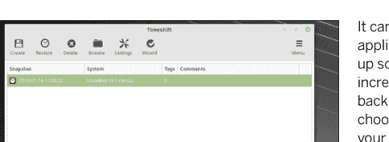

从备份恢复可能是一件痛苦（如果你在使用 Rsync 而没有学到训练并不意味着它们很容易，那么确实如此）。但通过 Backup Tool，这个过程非常简单。只需点击备份归包并恢复。系统会提示你是否不覆盖任何文件，文件将得到准确恢复。

在 2019 年 1 月像那样将系统恢复到最新日期并庆祝，然后可能出于意识地从任何地方围绕头部，但是如果他们想要进行离线备份，几乎肯定会同时遇到。

当你计划备份文件时，有几点需要注意。首先，这并不一定是个好主意。备份你的主目录并不是必要的。其次，有些东西是你不需要。第三，我们不评判你的 `$HOME` 计账，我们说的是像 `/cache/` 目录这样的东西。我们使用程序存储各种可丢弃的点文件（Spotify 和网络浏览器缓存），然后使用这些功能来避免浪费资源去备份它们。

通常情况下，隐藏文件（以点开头的隐藏）被程序用于存储任何特定设置。备份这些设置和配置是明智的，就像有些人为了将自己的配置放入公共点仓库（你也可以在 GitHub 上管理它们）而做自己。其他配置有一个小问题。如果你想将备份恢复到一台运行不同版本软件的机器上，程序可能会崩溃。

如果你是将较旧的 Ubuntu 18.04 备份恢复到新安装并更新后的版本，这将不是一个问题。在 Mint 和 Bash 之类东西中，这不是问题。根据经验，所有可能发生的怪事，都是由于你的旅程发现了没人理解的格式的配置。

## 避免双重保险

备份到你的主目录，但它并不是最好的主意。一个用于那些你不需要的东西。

当然，生活永远不会简单。在崩溃失败后，你可能无法访问你的主目录，如果没有存储备份，那就太悲哀了。所以备份到外部驱动器是一个好主意，如果你有资源，就使用多个外部驱动器。Backup Tool 只支持你需要处理重复备份-tar 自身的短板。没有简单的方法来恢复或自动化它。但对于那里，有许多其他你可能需要的备份和其他有用的文件。查看（左侧）以获取更多信息。

如果自己的安装失败了并且丢失了四多年的工作，这将会很有用。Backup Tool 使用 Dja Docs。

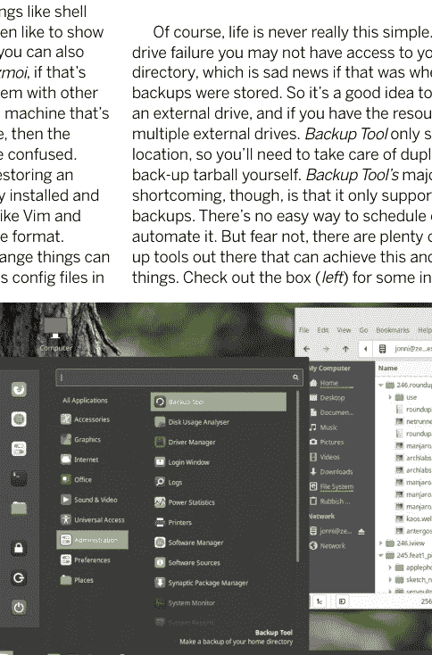

Firefox 和 Thunderbird 分别将它们所有的书签（不包括所有其他个人设置（包括保存的密码和与之加密的内容））存储在你的主目录中（分别在 `/mozilla/` 和 `~/thunder/` 中），并在

在尝试这些时，我们看到它们被成功拾取。技巧是在恢复旧数据之前不要启动程序，以及其他被创建并导致你必须处理这些事情，以便原始文件被注意到。

Mint 包含了 Backup Tool，它会处理你的个人文件。

Linux Mint 论坛 2021 | 1

# Linux 格式 2020

## 加固你的浏览器

网络浏览器可能是我们通往世界的窗口，但窗口是双向的。发现你可以如何安装某些虚拟方式网关。

我们的浏览器可能负责通过它的大部分互联网流量。它也是恶意软件尝试攻击你机器的流行路由器之一。在跨平台 JavaScript（以及新奇的编译语言，如 Wasm 和 WebAssembly）的时代，我们不会遇到失控的恶意软件“爆发”。

攻击者将试图击败大多数正在使用它的人，但今天加固你的浏览器是在你可及范围内，无论你将其放置在 Windows 的什么位置——无论是在 Android 上，还是坐在 Linux 内核上的 Java。管理一个 Android 和 Linux 共同有的漏洞并不遥远。保持 Android 手机更新通常取决于制造商和网络提供商，但保持你的 Linux 机器是轻而易举。

尽管如此，一个故障或编写糟糕的扩展仍然足以让你的浏览器崩溃，这在选择解锁列表或更糟糕的是，引入恶意浏览器扩展时最常见。

浏览器插件可能非常有用。我们全心建议安装来自 HTTPS Everywhere 的自由软件，某种管理器来防止像我们必须那样的讨厌广告拦截器。uBlock Origin 是我们最喜欢的（但如果你经常访问并支持需要侵入性广告过滤的网站，请不要关闭它）。如果你想安装 Shell Extension，确保我们

我们可以提到更多有帮助的插件，但本节的核心在于多样化。现代浏览器扩展到请求它们所需的权限，但很多时候用户没有注意并授予了这些权限。许多 Chrome 扩展具有“读取并更改你访问的网站上的所有数据”的权限。这种类型的扩展程序可以过滤掉针对英语的‘wreck’ 发生情况，在发布新故事时进行解释，阻止警报和广告。但它也可以用于跟踪你的字段并防止任何不停止请求的东西。所以这种情况就是！

所以让我们快速检查一下。在 Firefox 或 Chrome（或 Chromium）中查看安装了什么。如果任何东西看起来可疑，请将其删除以防止进一步的入侵。下载视频和音频的插件，与各种平台合作，但更改主题经常被那些人不喜欢，但是。我们已经无数次提到 HTTPS 的重要性以及地址栏中那个小锁的重要性。本质上，通过 HTTPS 传输的信息是加密的——这样你的浏览器和服务器之间的任何内容都是加密的。新的加密方案（即完美正向安全）为每个会话使用加密密钥，所以如果你使用，服务器的私密钥是随机生成的，过去会话的流量不会被破坏。公共网站没有理由使用。并不是所有扩展都是坏的。Mozilla Firefox 将帮助你阻止 Facebook 和你的其他目标。


## 加固 Mint 19

通常情况下，隐藏（以点开头的隐藏）文件被程序用于存储任何特定设置。备份这些设置和配置是明智的，就像有些人为了将自己的配置放入公共点仓库（你也可以在 GitHub 上管理它们）而做自己。其他配置有一个小问题。如果你想将备份恢复到一台运行不同版本软件的机器上，程序可能会崩溃。

如果你是将较旧的 Ubuntu 18.04 备份恢复到新安装并更新后的版本，这将不是一个问题。在 Mint 和 Bash 之类东西中，这不是问题。根据经验，所有可能发生的怪事，都是由于你的旅程发现了没人理解的格式的配置。

## 避免双重保险

备份到你的主目录，但它并不是最好的主意。一个用于那些你不需要的东西。

当然，生活永远不会简单。在崩溃失败后，你可能无法访问你的主目录，如果没有存储备份，那就太悲哀了。所以备份到外部驱动器是一个好主意，如果你有资源，就使用多个外部驱动器。Backup Tool 只支持你需要处理重复备份-tar 自身的短板。没有简单的方法来恢复或自动化它。但对于那里，有许多你可能需要的备份和其他有用的文件。查看（左侧）以获取更多信息。

如果自己的安装失败了并且丢失了四多年的工作，这将会很有用。Backup Tool 使用 Dja Docs。


Firefox 和 Thunderbird 分别将它们所有的书签（不包括所有其他个人设置（包括保存的密码和与之加密的内容））存储在你的主目录中（分别在 `/mozilla/` 和 `~/thunder/` 中），并在

在尝试这些时，我们看到它们被成功拾取。技巧是在恢复旧数据之前不要启动程序，以及其他被创建并导致你必须处理这些事情，以便原始文件被注意到。

Mint 包含了 Backup Tool，它会处理你的个人文件。

Linux Mint 论坛 2021 | 1

# Linux 格式 2020

## 加固你的浏览器

网络浏览器可能是我们通往世界的窗口，但窗口是双向的。发现你可以如何安装某些虚拟方式网关。

我们的浏览器可能负责通过它的大部分互联网流量。它也是恶意软件尝试攻击你机器的流行路由器之一。在跨平台 JavaScript（以及新奇的编译语言，如 Wasm 和 WebAssembly）的时代，我们不会遇到失控的恶意软件“爆发”。

攻击者将试图击败大多数正在使用它的人，但今天加固你的浏览器是在你可及范围内，无论你将其放置在 Windows 的什么位置——无论是在 Android 上，还是坐在 Linux 内核上的 Java。管理一个 Android 和 Linux 共同有的漏洞并不遥远。保持 Android 手机更新通常取决于制造商和网络提供商，但保持你的 Linux 机器是轻而易举。

尽管如此，一个故障或编写糟糕的扩展仍然足以让你的浏览器崩溃，这在选择解锁列表或更糟糕的是，引入恶意浏览器扩展时最常见。

浏览器插件可能非常有用。我们全心建议安装来自 HTTPS Everywhere 的自由软件，某种管理器来防止像我们必须那样的讨厌广告拦截器。uBlock Origin 是我们最喜欢的（但如果你经常访问并支持需要侵入性广告过滤的网站，请不要关闭它）。如果你想安装 Shell Extension，确保我们

我们可以提到更多有帮助的插件，但本节的核心在于多样化。现代浏览器扩展到请求它们所需的权限，但很多时候用户没有注意并授予了这些权限。许多 Chrome 扩展具有“读取并更改你访问的网站上的所有数据”的权限。这种类型的扩展程序可以过滤掉针对英语的‘wreck’ 发生情况，在发布新故事时进行解释，阻止警报和广告。但它也可以用于跟踪你的字段并防止任何不停止请求的东西。所以这种情况就是！

所以让我们快速检查一下。在 Firefox 或 Chrome（或 Chromium）中查看安装了什么。如果任何东西看起来可疑，请将其删除以防止进一步的入侵。下载视频和音频的插件，与各种平台合作，但更改主题经常被那些人不喜欢，但是。我们已经无数次提到 HTTPS 的重要性以及地址栏中那个小锁的重要性。本质上，通过 HTTPS 传输的信息是加密的——这样你的浏览器和服务器之间的任何内容都是加密的。新的加密方案（即完美正向安全）为每个会话使用加密密钥，所以如果你使用，服务器的私密钥是随机生成的，过去会话的流量不会被破坏。公共网站没有理由使用。并不是所有扩展都是坏的。Mozilla Firefox 将帮助你阻止 Facebook 和你的其他目标。


## 加固 Mint 19

通常情况下，隐藏（以点开头的隐藏）文件被程序用于存储任何特定设置。备份这些设置和配置是明智的，就像有些人为了将自己的配置放入公共点仓库（你也可以在 GitHub 上管理它们）而做自己。其他配置有一个小问题。如果你想将备份恢复到一台运行不同版本软件的机器上，程序可能会崩溃。

如果你是将较旧的 Ubuntu 18.04 备份恢复到新安装并更新后的版本，这将不是一个问题。在 Mint 和 Bash 之类东西中，这不是问题。根据经验，所有可能发生的怪事，都是由于你的旅程发现了没人理解的格式的配置。

## 避免双重保险

> 密码非常受保护，但这并不能停止从你查看的任何网页上收集个人数据。

# DNS OVER HTTPS

使用 Cloudflare 将减少你的浏览器隐藏持有者 DNS 的可能性，但忽视那些请求仍然加密的事实是愚的。如果你担心（并且发现 DNS over HTTPS 对大多数手动用户来说太复杂），你可以设置 DNS over TLS 或 DNSCrypt，在 DNS 查询上增加一个加密层，防止它们被嗅探。DNSCrypt 只能缓存条目，或者你可以使用任何其他方法，例如 Unbound。我们不会进入如何设置的细节，因为这占据的空间比这个框允许的更多，但只有当加密 DNS（服务器名称）识别变得更广泛地支持时，其益处都是有限的。

```
sudo nano /etc/resolv.conf
```

并注释掉任何以 # 开头的行。然后添加行 `nameserver 1.1.1.1`

更改将生效，但浏览器缓存会导致你需要关闭并重新打开窗口以确保更改应用。注意这并不是需要的。在某些情况下，你的机器仍然请求本地 IP 地址（格式为 192.168.x.x）并在同时通过 NetworkManager 解析域名（包括 Mint）这是通过调用 `resolvconf.utility` 完成。

我们可以通过选择系统托盘中的网络图标并选择网络设置来配置 NetworkManager 使用 DNS 服务器。选择有线网络并点击齿轮按钮。在左面板设置 IPv4，然后选择自动，并在 DNS 部分输入 `1.1.1.1`

你也可以勇敢一点，添加 Cloudflare 的 DNS over:`1.0.0.1`。你可以以类似的方式配置 IPv6 的 DNS，只是这里是 `2606:4700:4700::1111` 和 `2606:4700:4700::1001`。关闭对话框，然后连接

## 插件要小心

# DNS over HTTPS

使用 Cloudflare 将减少你的浏览器隐藏持有者 DNS 的可能性，但忽视那些请求仍然加密的事实是愚的。如果你担心（并且发现 DNS over HTTPS 对大多数手动用户来说太复杂），你可以设置 DNS over TLS 或 DNSCrypt，在 DNS 查询上增加一个加密层，防止它们被嗅探。DNSCrypt 只能缓存条目，或者你可以使用任何其他方法，例如 Unbound。我们不会进入如何设置的细节，因为这占据的空间比这个框允许的更多，但只有当加密 DNS（服务器名称）识别变得更广泛地支持时，其益处都是有限的。

# 2020年 Linux Format 年度

## 防火墙的优势

仅仅因为你没着火，并不意味着你不应该运行防火墙。

大多数 Linux 发行版都预装了 IPTables 或其继者 nftables，并配有操作内核 netfilter 的命令行工具。这些工具非常强大，但并不“省力”。它们对用户并不友好，而且复杂。事实上，有一个名为 Ufw（简单防火墙）的基于文本的前端，它已经包含在 Ubuntu 和 Mint 中一段时间了。

可能放不管它也可以，但让我们开启它看看它能做什么。你可以在主菜单的“设置 (Preferences) > 防火墙配置 (Firewall Configuration)”中找到它。

Mint 新了一个比 Ufw 更简单的图形化前端，称为 Gufw（许多 GTK 尝试都都会通过在底层工具前添加前缀 g 来简化它）。它默认是关闭的（而在某些环境中，它是开启的）。

Ufw 带有三个配置文件（家庭 Home、公共 Public、拒绝 Denied）用于控制入站/出站数据包，以及一个大大的开启/关闭开关。可以实施更细粒度的控制，首先，尝试开启 Ufw（使用那个大开关），选择家庭配置文件，并看看发生了什么。

## 拒绝访问

针对意大利国旗盾牌图标，彩色的 Ufw 会告诉你它现在正在拒绝入站尝试。这里的词汇很重要：通过“拒绝”，我们的意思是防火墙简单地阻止入站连接。就机器尝试连接到你的机器而言，这就是我们的意思。但如果你想通过 Samba 或另一个服务器或其他本地服务共享文件呢？嗯，让我们看看。

Mint 会在你的主目录下创建一个“公共 (Public)”文件夹，所以让我们尝试共享它。右键点击它并进入“共享 (share)”选项卡。它会提示你需要安装 Samba 并提供一个链接。点击该链接（点击并在完成后，你需要重启一次）。重启后，返回共享面板，点击此文件夹开关，然后点击“创建共享 (Create Share)”。

返回防火墙配置对话框并点击“报告 (Report)”按钮。这将显示你所有的规则。

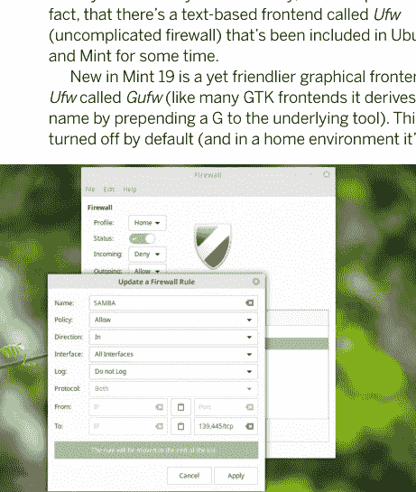

> Ufw 配置了规则，但由于某些原因，我们无法自定义特定的 IP。

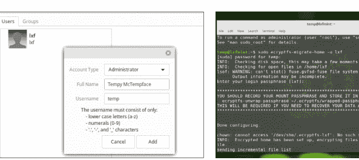

## 如何设置加密目录

- 1. 准备你的系统

  我们不能在要加密的主目录下保留任何打开的文件。注销桌面仍然意味着（对于 PulseAudio 和 GUI 视图）最好在“用户和组 (Users and Groups)”应用中添加一个用户（这需要权限，请选择“账户 Account”）和一个密码。重启并使用该用户登录。

- 2. 开始加密

  Mint 上应该已经安装了所需的工具，但 Ubuntu 上没有。检查这些工具：

  `sudo apt install encryptfs-utils`

  备份你主文件夹中的所有数据。然后运行加密命令，将 `<username>` 替换为你的用户名：

  `sudo encryptfs-migrate -u <username>`

- 3. 测试目录

  仔细阅读输出。如果你可以使用它（使用 `Ctrl-Alt-F1` 进入 TTY），那么例如可以安全地删除备份文件夹。你会看到一个关于缺少密钥的警告，这是没关系的。留在 TTY 中，运行 `encrypt-passphrase`，输入你的密码并记录输出。可以安全地删除目录。

## 加固 Mint 19.1

服务。现在，与 Samba、smbd 和 nmbd 相关的守护进程（监听 137 到 139 和 445 端口）已禁用。

现在我们必须尝试从网络其他地方连接到此共享。如果你没有另一台机器（或者即使有），如果不起通，你可以把工作带到那里——连接可能是没问题的。可能你不必担心（否则这可能就是共享服务器的初衷），所以让我们创建一个允许本地用户访问共享文件夹的规则。

从配置面板中，点击“规则 (Rules)”然后点击底部的加号 (+) 按钮。从下拉菜单中选择“Samba 文件传输”并选择 Samba。最后，点击“添加 (Add)”按钮。你需要不仅一条而是四条规则来涵盖 IPv4 和 IPv6 之间 TCP 和 UDP 连接的不同组合。

对于大多数游戏或服务，Gufw 规则可以做一些侦探工作，找出需要哪些端口；然而，这会让你变得懒惰。如果你允许“公共 (Public)”文件夹（使用你 Mint 安装的用户名和密码），你可能会想就此停止并对此事放过。我们应该在我们的本地规则中添加一个异常，该规则目前出现在 Gufw 中，我们可以参考 Digital Ocean 上那篇优秀的教程指南 -/LXF247ufw。

互联网。这不应该担心，因为你的 ISP 或网络管理员应该已经配置了路由器，就像我们配置防火墙一样，来阻止连接。

在我们之前，简单谈一下更多物理威胁，即加密。如果电脑（甚至只是驱动器）已分区，请加密你的主目录，这样就没有人能访问你的文件。这意味着如果你丢失了密码，你将无法访问你的文件。

## Syncing+EnCS 教程

EnFS 在普通（正向）模式下可以在你指定的挂载点提供明文文件。任何掉入挂载点的明文都将存储在目录中（每当 EnFS 停止时，它们将从目录中消失）。

在桥接器上，创建一个挂载点，所有明文数据在此可见并同步。创建一个用于挂载 EnFS 的目录，然后将加密文件放在 synes 目录的子目录中，这并非必须；它们也可以是同一个目录。

首次启动时，请在 Syncing 设置好明文目录之前运行 EnFS。由于 Syncing 会创建一个目录，它将会在同步文件夹中创建 `_synctfolder`。你在那里创建的任何文件都会被 Syncing “编码”并传播到加密目录中。当 EnFS 运行时，如果挂载点没有明文，`_synctfolder` 必须存在，否则 Syncing 将无法与你的计算机进行工作。

```
### /home/mdmir/cleartext
### /mnt/point/uUSB/sync_ofsite/encrypted
### /mnt/point/uUSB/sync_ofsite/encrypted/home/
```

正在创建新空目录。

[... 更多程序输出已裁剪 ...]

现在你需要为你的文件系统输入密码。你必须记住这个密码，因为没有恢复机制。在使用 EnFS 之后可以以后更改密码。

新 EnFS 密码

验证 EnFS 密码：

- 当你第一次运行 EnFS 时，它会在目录的左侧（左侧下方）创建一个明文文件（clear enfs.txt），该文件将填充你的离线密码。将密码写在某处以防丢失是一个好主意。你也可以将其打印在纸质复件上。解密你的文件需要此密码，没有密码它就无法解密这些文件。

在启动机启动时自动运行 EnFS 是可行的。自动方法需要将密码存储在安全的地方，并且当桥接计算机自动连接时，使用与第一次相同的命令运行 EnFS。当找到填充了密码的文件时。即使桥接计算机丢失过电源，这种方法也无法作用。

```
### /mnt/point/uUSB/sync_ofsite/encrypted/home/user/
```

EnFS 密码：

如果你想快速查看 EnFS 是否正在运行，请浏览明文目录并查看文件是否可见。如果 EnFS 正在运行，停止 EnFS，只需取消明文注释。

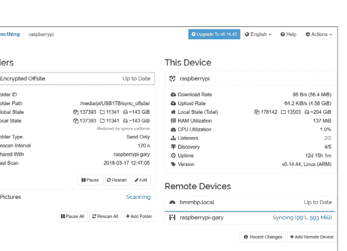

## 设置 Syncing

布局的右侧（见下左）突出了多个可以用于从工作计算机汇总文件到加密桥接器的程序。Syncing 在这些选项中独一无二在于它不需要可执行二进制文件即可连接。Syncing 分布在辅助程序中。这些辅助程序将内容整合在一起。你可以在下面的说明中找到这种方法。

随发行附的说明文件和其他在线文档网站易于使用。最好的办法可能是将 Syncing 程序放在桥接器上。你可以通过将其放在主目录中来实现。如果你需要帮助设置 Syncing，可以获取更多信息。

对于 Raspberry Pi 桥接计算机，请下载 ARM 版本。根据你的安装，这些版本已准备启动时运行。要使用 LXDE 桌面管理器的自动启动，请在 `/config/autostart/` 中创建一个非同步的桌面文件。

## 文件系统

你可以使用一个大型 USB 驱动器在同步到离线之前汇总你的加密文件。FAT32 文件系统将兼容（Linux, Mac, Windows）。这对于我们来说不可行，因为我们还希望在系统分区中存储快照仓库，这需要权限支持，而 FAT32 无法满足。此外，FAT32 的 4GB 大小限制可能是一个问题。请注意，如果你在可移动驱动器上使用 Linux 文件系统，可能会保留文件权限。如果桥接器用于没有相同用户名的多个系统，你必须使用 root 来更改所有权和组信息。

> 小贴士

> 使用命令行选项，Syncing 能够记录许多活动。启用后，日志将保存在 Actions/logs 中。

## Linux 格式 2020


[Desktop Entry]

Type=Application

Name=RunSync

Icon=

Exec=sync-no-browser

Startup-file=

As=

在首次运行创建 .stfolder 之前，确保 EnsureSync 正在运行，然后将其他内容复制到明文点下的明文目录中。挂载点仅用于 EnSync 捕获、加密并将它们存储在那里。

Syncrill 将运行并从你的工作计算机收集文件。在这一过程中，针对你的计算机的同步引擎有不同的设置。

当明文目录中准备好启动时，你就知道汇总完成了。它们将以加密形式存储在其他地方，但如有需要可以使用加密目录。

同步设置后，远程站点 .stversions 目录中仍会有一个副本。你还可以遵循此 syncing-control 桌面文件，通过 KDE 桌面管理器在计算机上创建一个图标来运行同步 Web 浏览器控制面板。

## 执行角色

一旦设置汇总，添加另一个连接桥接计算机的同步链接。

[Desktop Entry]

Type=Application

Name=Synching Control

Icon=

Exec=epiphany 127

Startup-file=

As=

在首次运行创建 .stfolder 之前，确保 EnsureSync 正在运行，然后将任何内容复制到明文点下的明文目录中。挂载点仅用于 EnSync 捕获、加密并将它们存储在那里。


Syncrill 将运行并从你的工作计算机收集文件。在这一过程中，针对你的计算机的同步引擎有不同的设置。

当明文目录中准备好启动时，你就知道汇总完成了。它们将以加密形式存储在其他地方，但如有需要可以使用加密目录。

同步设置后，远程站点 `.stversions` 目录中仍会有一个副本。你还可以遵循此 `syncing-control` 桌面文件，通过 KDE 桌面管理器在计算机上创建一个图标来运行同步 Web 浏览器控制面板。

## 汇总文件

当 EnFS 运行时，明文显示桥接计算机：

```
sync.sh:0.0
rsync -avz --delete /home/pi/cleartext/ /mnt/point/uUSB/sync_ofsite/encrypted/
//pi/cleartext/
```

明文显示桥接计算机：

```
sync.sh:0.0
rsync -avz --delete /home/pi/cleartext/ /mnt/point/uUSB/sync_ofsite/encrypted/
//pi/cleartext/
```

## 恢复丢失的数据

知道如何恢复数据非常重要。如果汇总保存在桥接计算机上，答案很简单：浏览到时间戳并将你的文件复制回这里即可。

然后学习如何从远程站点恢复文件。一种是手动在远程计算机上汇总加密文件，并将明文文件同步到桥接计算机。这应该使用 Mighty Commander 或 `ssh/rsync` 等程序完成。

## 同步+Encfs 教程

`"ffff"` (`xxxx-yyyy`) 上的错误：文件夹标记丢失。如果你正在使用它，请也检查你的同步 encfs 详情。

可以手动重新创建。

如果你使用可选的忽略文件，

重新创建它，以便在同步响应时不会留下任何文件。你必须使用文本编辑器来制作同步文件，因为 GUI 界面已不同步。

如果文件不同步，只需使用 midair 重新创建它。

### >> 干扰文件 (CHAFF FILES)

为了增加额外的隐私保护，你可以将不同的加密文件集混合到加密目录中。在创建和使用同步加密之前，请务必将第一个 xml 文件排除在外（重命名或移动到不同的目录）。一次只能使用一个 xml 文件。

在同一个目录上使用重叠的多个加密集会让加密文件看起来像一个集合，尽管这些项目是用不同的文件和目录加密的。

encfs 快捷方式使用明文目录中基于文件名和密码的显示。每个 xml 文件都可以启用所有加密文件的唯一子集。

例如，你可以定义一个加密集并隐藏其他的，以允许人们访问某些子集。

有了这两个同步文件，有两种方法恢复你的文件。假设你删除了或损坏了两个文件，并且离线 GUI 的报告完全错误，而它在版本目录中仍有良好的副本。通过使用 GUILS，你需要两个 SSH 连接从远程计算机（或者你可以）恢复到离线同步文件。

- 允许将同步文件重新创建到离线位置，然后使用桥接计算机离线同步和优化同步环。
- 从离线目录复制所有文件的副本。如果你处理的是单个文件，请查看关于如何找到加密文件路径和名称的说明。
- 将同步计算机环更改为仅发送 (`Send Only`)，并将桥接计算机离线同步改为 Encfs。
- 取消两台电脑的推送并让同步进行。

encfs 快捷删除将删除所有在没有匹配密码的情况下无法删除的加密目录，所有文件将显示为不存在。这可能意味着你需要隐藏例如 10000 个用一个 xml 文件加密的文件，三个用第二个 xml 文件加密的文件，且密码存储在某处。除非知道如何设置其中一个，否则没人知道某个 xml 文件被通过。

将加密文件转换为明文，它们将通过通过过的明文同步环同步回你的计算机。

这就是为什么你的 Encfs 页面指示需要使用环境变量 `ENCFS_CONFIG` 从远程计算机解码数据（

如果你使用作为真实数据目录的 xml 文件，则没有必要。

然而，如果你使用 xml 文件并使用任何环境变量：

你可能需要使用离线 GUI 覆盖，强制将远程侧的所有更改应用到桥接并接收。在两台计算机上进行。

## 加速恢复

如果在同步中发生了两次连续失败并完全或部分合并，如果你使用 Sync 版本的“最后良好”版本，可能会发生冲突。然而，如果你使用 Sync 版本，它将通过附加同步开始时的时间戳来修改加密文件。

为了避免在恢复加密文件后手动重新创建所有文件，Encfs 可以以下脚本，它可能会替换最后 16 个字符。对于本文，我们将使用 Sync 版本。请查看 Synchelp 论坛获取更多解释：

```bash
#!/bin/bash
if [[ $file | find -type f -regexp posix-awk-regex: "[0-9]{6}" ]];
do
mv $file ${file::-16}
fi
```

因为 Midnight Commander、`rsync` 或 Sync 会将其拉回到桥接计算机。Encfs 将

不同步

| | 已用 | 来自原始 | 来自离线 | 已删除... |
|---|---|---|---|---|---|
| Sync | MOV/v88M8M8M8M8M8M88f8R8fBp... | | | | 2.81 MB / 8.9 MB |
| Sync | | | | | 832 KB / 800 KB |
| Sync | TNE9Y3H6K6I6K6I6K6I6K6I6I... | | | | 64.4 KB / 60.0 KB |
| Sync | | | | | 64.4 KB / 60.0 KB |
| Sync | mAglmrmptWAmAmWAmhUCIT-W4RYQK2KQQIT... | | | | 64.1 KB / 60.1 MB |
| Sync | SuV6S6S6S6S6S6S6S6S6... | | | | 64.4 KB / 60.4 KB |
| Sync | x-13H1H7H1H7H17H1Z6L6Z6L6B6... | | | | 80.2 KB / 64.1 KB |
| Sync | | | | | 64.1 KB |

### >> 提升你的 LINUX 技能 订阅访问 http:///LinuxFormat

Linux Format 2020 | 8/19

# Linux Format 2020

# 管理

## 更安全的浏览和内存管理

当涉及到网络浏览器时，Valentine Sitsyn 产生了通常的怀旧情绪，然后想起最新的安全措施是关键的。


**Dr Sitsyn** 是一位已离开的 KDE 贡献者。

他喜欢构建 Linux 云和文章。

# 虚拟管理：在压力下生存

Linux 中的内存管理并非什么魔法，是时候按照你想要的方式来管理内存了。

回想一下你被任命负责一台服务器的时候。某一天（实际上是深夜），你可能会因为服务器掉线连接而被叫醒。你通过 `SSH` 登录，迅速发现机箱内没有正在运行的服务器。尽管如此，你查看了 `/proc/self/memstat` 发现没有致命错误。进程消失了。这里发生了一些奇怪的事情。

如果这是你第一次查看内存，恭喜你。你是第一批 OOM killer（内存溢出杀手）受害者。TLA 代表 Out of Memory（内存溢出），这是内核为了拯救系统获取内存的最后手段。你成为受害者了吗？你的 Web 服务器并不是元凶，而是 Linux 选择了牺牲，你能做些什么来避免再次被叫醒？在本篇指南中，我们将探索 Linux 内存以及你可以使用哪些旋钮来调整这一乱局面。

内存管理过程发生在内核中，而这并不是世界上最简单的事情。复杂的映射最好通过示例来学习。因此，考虑 `char *buf = malloc(1024);` 如果 `(buf)` // 不可能发生 //

想象你最喜欢的语言中有一个相关的结构，它可能需要分配这么多内存，并且需要去内核请求页（简单起见是 4K 块）。为了此目的分配内存有两种主要方式：

选择哪种取决于分配器以及它想要分配多少内存。`brk` 堆是连续的：当你完成最后一部分时，无法释放第一部分。无论如何，对于较大的分配优先使用 `malloc`。它通过扩展内存映射（mapping）的长度或使用 `mmap()` 来工作。

所以你的 2MB 堆几乎肯定来自非平凡的内核分配。然而，`brk` 是共享的：多个线程使用同一个堆，而 `mmap` 则独立处理它们。为了简单起见，假设你设置了 `MAP_THROUGH` 且一个 4KB 的分配足够。那么，相关的函数将返回：

```c
struct mm_struct *mm = &current->mm;
if (mm->max_map_count < count)
    return -ENOMEM;
if (security_vm_enough(mm, vmap, len) < PAGE_SHIFT)
    return -ENOMEM;
```

`mm` 指向当前进程的内存描述符。在向进程发出内存请求之前会进行几次检查。首先，它确保拥有的内存映射超过 `vm.max_map_count` 设置允许范围。默认值是 65535，在正常情况下你永远不需要这个值。但如果你需要许多内存映射，请增加 `vm.max_map_count` 或使用 `mmap` 获取空闲内存。这是一个拥有可用内存的技巧。然后，内核将“分配”一些内存。如果你好奇为什么代码中这个词看起来像：Pmap 需要一个与它们对齐的进程映射以及权限位。[Anon] 可能 `malloc` 得到。

## 会员专属

本指南涵盖了一组 `sys/proc` 条目以及你可能需要使用的虚拟内存系统的其他。以下是给读者的简要总结：

- `vm.max_map_count`: 进程可以拥有的内存映射的最大数量。64 对所有人来说应该足够。
- `vm.admin_reserve`: 为 root 留出的 KB 数量。普通用户也是如此。这让他们可以自由在家里杀死内存。
- `vm.user_overcommit_memory`: Linux 应该允许可能的内存分配，还是顺其自然并看看是否可行。
- `vm.overcommit_bytes`: 进程可以使用多少 RAM（单位 KB）。这是一个选项，始终如此。
- `vm.overcommit_ratio`: 比例，占总 RAM 大小的百分比。
- `vm.on_panic_oom`: 当内核内存不足时是否触发 OOM。
- `/proc/PID/oom_score_adj`: OOM 分数调整。-1000 使进程对 OOM 免疫。

# Linux 格式

```c
struct vm_area struct "vma", vma->start += addr;
vma->end += addr + len;
vma->link(vma, parent);
vma->total += len << PAGE_SHIFT;
vma->data += len << PAGE_SHIFT;
```

对于非超级用户请求，`vma_admin_keys`（通常为 128MB）也是设置的。这是为了在内存不足时留出一些空间。否则，当涉及到内存分配时，Linux 是一个只在触碰 `addr + len` 之前记录的。如果你在 `top` 的 VIRT 或 DATA 列中看到大值，那是因为它消耗了太多内存。这把我们引向了另一个主题……

`overcommit_memory=2` ("never") 禁用了过度提交。在这种情况下，内核根据内存请求进行严格限制。如果将其设置为绝对值，默认内核将失败 RAM 分配。交换空间也包含在内。内核处理 `vma_admin_keys` 以及 `user_reserve`。

## 内存过度提交 (Memory overcommit)

如果程序可能使用所有内存，为什么不让它请求比需要的更多的？内存过度提交背后的基本思想是我们经常将使用的页交换到磁盘，而不是 RAM。过度提交就像银行存款：你的总量可以比你拥有的多，但希望不会同时需要。最终选项 `overcommit_memory=1` 是内核总是“同意”在请求的情况下。这对于你的程序预期大部分内存未被触碰很有帮助。选择过度提交策略是一种平衡行为，特别是对于运行许多进程的 Web 服务器。

内核通过 `vma_enough()` 函数实现过度提交。在底层，内核调用内存系统决定分配是否被视为超级用户。

## 获取某些页

如果你在内核地址空间中提供一个页，CPU 将触发缺页。这是一个硬件错误，告诉内核你触碰了没有访问的内存。然后内核通过将页映射到内核来处理。Linux 通过 `overcommit_memory` 设置决定是否有足够的内存。默认值估计可用内存，包括在压力下收缩的页缓存，内核缓存可以被回收。共享和最近使用的页被排除，缺页处理器是一个复杂的逻辑，检查进程是否进入了禁止或分配区域。你展示的 VMA 结构是它的核心部分。如果内核接收到缺页，它会检查页是否已交换或未映射。如果是，那就是内核为了满足你的请求并获取。

内核内存分配器只是另一个复杂的顶部。在最低级别，它实现了用于 `pages()` 等类的“伙伴系统”（buddy system）。在我们情况下，当我们按 VMA 请求页时，分配器并不工作。最后，所有请求调用 `pages_node()`，即内核的区域分配器。

# 管理员教程

## Linux, RSS 以及其他 TLA

在 Linux 中，你有许多工具来跟踪进程，包括你的内存消耗 `top` 或 `vmstat` 等示例。它们通常都会揭示已知指标。RSS 是最重要的一个。还有驻集大小（Resident Set Size），它是你的程序在 RAM 中使用的字节数。这与虚拟大小（Virtual Size）不同，它是进程地址的大小。当进程映射文件或目录时，VSIZE 会增加。当进程开始释放或交换时，VSIZE 会增长。在这些情况下，VSIZE 完全无效。

从技术上讲，RSS 是文件映射、匿名页和共享内存的共享。硬核黑客会注意到这一点：RSS 不包含页表或内核模式栈。如果进程使用共享库，每个进程只有一个库的副本。然而，内存中只保留一个。当进程终止时，它的内存会被释放。但你可能不想跟踪的是这个 RSS 或工作集（working Set）。那是它正常运行所需的内存。这不是一个严肃的概念，VSIZE 用于性能分析确实好得多。如果你真的需要，http://bit.ly/vsize 的信息是一个非常好的起点。

## OOM killer

事实上，Linux 有许多方法可以触发 OOM：除了页分配失败外，当（组）中的内存消耗超过 LXHT 时，会调用 OOM killer。你也可以通过 `SysRq-F` 触发它，或者如果你创建了快照储。

Linux 知道如何杀死东西。当 Linux 内存耗尽时，会发生这些事情：OOM。如果你设置 `vm.cgroup.alloc_kill_threshold` 为一个值，那么内存溢出进程将作为内核线程启动，除非所需内存的 cgroup 未被免于 OOM。简而言之，你想杀死占用大量内存但最不重要的进程。Linux 将此转换为一个数值。得分最低的进程（当然，如果你考虑这一个）会胜出。

# 2020年 Linux 年度报告

## 逃离云端

加入 Mayank Sharma 的行列，他宣布够了，并停止将数据种子到那些正处于待割状态的流行云服务中。

信息时代真正令人惊讶的部分是我们的个人信息被商业化的程度。爱德华·斯诺登（Edward Snowden）的警告被贬低，被认为是一个隐私叛徒在散布恐慌。近期发生的事件显示了公司如何利用数据，从摇摆我们的购物习惯到影响民主进程的方方面面。

我们正以前所未有的便利被追踪。从无处不在的 Cookie 到随处可见社交按钮，有无尽的便利伪装，以及我们每天在笔记本电脑和手机上使用的许多在线服务。我们底层的工具创造了不断积累的数据，技术在整个网络上追踪我们。多亏了 Facebook 和 Twitter 等这类工具，即使在我们没有使用它们时，它们也对我们非常了解。联邦身份系统的广泛实施和使用从根本上将我们的用户名变成了追踪器。

然而，一切并非是一片黑暗。那些帮助我们从专有帝国俱乐部中解放出来的“地牢极客”正再次聚集在一起，将我们从便利的蓝色胶丸云端中拯救出来。从利用你个人数据的托管服务到托管你自己的云，有很多选项可以让你体验流行在线服务的益处，同时保护你的身份。

在专题中，我们将介绍一些正在重塑云及之外数字拓扑的技术和标准。我们介绍了围绕这些标准构建的充气式服务，它们在提供主流服务优势的同时，保障了你的自由。只需一点努力，以真正的潮流方式，你也可以托管自己的云共享服务，并在过程中帮助那些技术上欠缺的朋友和家人逃离那些无处不在的囤积帝国。

## 逃离云端

### 构建开放网络

网页正在缓慢地远离其僵化的、受审查的专有连接。你如何利用这一点？

万维网的设计初衷是自由和开放，特别是在 20 世纪 90 年代，其规范作为开放标准是免费的。互联网由技术标准组成，所有底层基础设施都是开放且发展的。在此基础上，网页浏览器演变成了网页编辑器，并鼓励消费者修改内容。

控制互联网的首次尝试是电信公司使用普通的编程语言。API 控制软件如何与其他软件部分进行通信和交互。Web API 使人们能够为使用网站及其服务构建新工具。

一种更微妙的改变互联网的方法正在通过应用程序接口（API）进行。

PageKit 采用“随心付”付费模式，并让你获得一个月的免费传输配额。

```bash
# set home=/home/user/pagekit/config.yml
set saved
# 你的风筝准备好飞起了！
### 请检查你的邮件（留言）以获取
# 关于你风筝的详情。你的会话
# 将 3 分钟后禁用。
```

### 花园花园

像 Facebook 这样的现代花园通过 API 运行，引入第三方开发者在平台上构建。开放网络的未来似乎正在显现。这些“花园派”允许第三方开发者在这些流行服务之上构建新应用，并为用户访问和与其交互提供更多选择。

社交网络社区小组（Social Web Community Group）为分布式和联邦制的社交网络开发标准。其中一个是 Activism，它开发了状态更新语法。另一个是 OpenSocial，它是一个 API 和标准的集合，如 Facebook 使用的 Open Graph Protocol，以及用于去中心化身份验证的 Open。

然而，开放网络的状况仍然缺乏标准。它们需要能够提供它们的标准，人们可以据此进行修改。如果你想改变你喜欢的东西或添加一个你看重的功能，了解如何与服务交互并使用它是至关重要的。


W3C 拥有一争议历史。我们看到关于允许将 DRM 加密媒体扩展（`EME`）引入 HTML 的讨论。这一举遭到了批评，并且当电子边界基金（`EFF`）在 W3C 于 2017 年 9 月发布 `EME` 规范后退出时陷入停止。

这种情况也适用于媒体格式。`mp3` 音频格式具有专利历史，已在 2007 年获得自由。现在通过 `HTML5`，有了使用多媒体内容的新方法，可以处理 `Ogg` 和 `Matroska` 等开放格式。通过去标准化网络，我们赋予用户转向开放格式而非专有格式的能力。

在接下来的列表中，我们将展示如何使用你的服务来逃离围墙花园版本。默认情况下，服务只能从连接到你家庭网络的计算机和设备访问。从那时起，你需要从 ISP 获取静态 IP 地址，或使用动态 DNS 服务并在路由器上开放端口以方便访问。

W3C 定义了开放标准，多年来它为开放网络演化出了若干规范和标准。

然而，凭自己管理服务是不可行的。因此，我们将寻找其他社区并找到你可以更改的替代方案，以改变所有去中心化的网络服务。

## 你真的离线生活了吗？

W3C 定义了开放标准，多年来它为开放网络演化出了若干规范和标准。

开放网络的状况仍然缺乏标准。它们需要能够提供它们的标准，人们可以据此进行修改。如果你想改变你喜欢的东西或添加一个你看重的功能，了解如何与服务交互并使用它是至关重要的。

W3C 定义了开放标准，多年来它为开放网络演化出了若干规范和标准。

然而，凭自己管理服务是不可行的。因此，我们将寻找其他社区并找到你可以更改的替代方案，以改变所有去中心化的网络服务。

## 托管你自己的云

**是时候托管自己的云了。**

设置 `Seafile` 并不费费精力。`Seafile` 有 `Android` 客户端，且 `Android` 客户端使用秘密加密库。

# 逃离云端

## 推出社交网络

用你的自制网络拥有你自己的 Facebook。

当使用得当时，互联网上的社交相比于线下时间并没有优势；它能让你在网络圈子之外找到志同道合的人，甚至跨越时区。在线社交网络的运行方式更更像你的物理线下柜台。你结识他人、建立关系、与他们保持联系，并通过关键词和搜索的力量，你可以舒适地坐在扶手椅上轻松地发现并找到匹配的群体。

如果你想让自己从那些引发隐私关注的数据收集型流行社交网络中解脱，托管自己的社交网络将为你提供根据自己的心意和意愿进行定制和品牌化的机会。如果你想将社交功能集成到现有的项目中，这也有帮助。

你可以利用你的社交网络部署，通过协作、共享以及共享文档甚至视频聊天室的可用性将学生和老师联系在一起。对于企业来说，自定义的社交网络可以是公告板或公司内网的更好的替代方案。它还可以帮助汇通过共同兴趣连接起来的不同人员，例如大学的不同校区，或市政机构的地区办事处。同样，公司可以在其内网上开发此类社交网络，作为与员工交流以及交换想法的手段。

个人资料字段。如果个人资料中的现有项目不起作用，你可以将它们替换为符合你需求的内容，并创建你自己的字段。

为了在设计自定义个人页面时更具灵活性，你可以使用流行的 `Profile Manager`。如果你想刷新首页，请启用 `Front Page Disco`。`Egg` 带有超过 30 多个插件，例如博客、页面和通知。你可能想要激活的插件包括 `Sites Pages`，它允许你创建显示所有标签的简单网页。

# 在你的根目录之外

有很多开源软件使得在你的自己的服务器上复制流行的社交服务成为可能。但花精力去设置它们并不是每个人都愿意。通过 `Disco`，你可以使用所有常用的服务，而没有广告、跟踪或通常与它们关联的任何类型的数据收集。

`Disco` 提供了免费的一切内容，你可以通过一个名为 `RainLoop` 的自定义 Web 客户端访问，该客户端还支持 GIF。还有 4GB 由 `Nextcloud` 驱动的免费云存储。网络中还有一个 `Disco` 可供用于去中心化网络。你还获得了由 `Matrix` 驱动的去中心化聊天，`Matrix` 是一种用于托管邮件列表或论坛的去中心化协议。此外，`Disco` 还提供 `Etherpad` 和 `FileShare` 用于在线共享文档和文件。还有一个 `pasteebinary`，一种临时文件托管和共享服务，以及一个查询 `DuckDuckGo` 等多个搜索引擎的匿名搜索。

要访问这些服务，你需要注册一个位于阿姆斯特丹的免费账户。注册过程除了用户名和密码外，不会询问任何个人信息，服务还提供删除账户的选项。

## 提供一个优雅的解决方案

`Egg` 是最多功能的社交软件之一，提供了启动社交网络网站所需的一切，包括博客、功能和 wiki。它的设置非常简单且文档记录详尽。

默认的 `Egg` 界面非常像你更好的自己。你可以自定义顶端显示的菜单项顺序，还可以添加自定义菜单项。你还可以修改默认的

# Facebookers 匿名管理

| 插件 | | | | | | | | |
| :--- | :--- | :--- | :--- | :--- | :--- | :--- | :--- | :--- |
| 全部 | 激活的插件 特性 | 通知 | 非加固 | 管理员 | 通信 | 内容 |
| 开发 | 增强 | 安全与隐私 | 审查 | 社交 | 其他 |
| Web 服务 | 小部件 | | | | | |
| 说明 |
| :--- | :--- |
| 博客 | 允许在博客中创建条目 |
| Diskcloud | 一个存储在内部和外部存储上的文件工具 |
| CKEditor | 用于 Egg 的强大的富文本编辑器 |
| Front Page Disco | 如何自定义你主页的示例 |


你可以通过捐赠资金或任何你不需要或变现的硬件来提供支持。


除了官方插件外，`Egg` 的社区还分享了数百个插件。

Linux 论坛年刊 2020 197

# Linux Format 年刊 2020

# 无云消息传递

## 像我们不听者一样，不要降低你的语法标准...

演变成了一个全方位的、功能丰富的通信媒介。它不再仅仅是关于短信。一次简短的 IM 会话可以促进图像、音频甚至视频的交换。IM 的主要用户是家庭用户，IM 也被企业竞争对手采用。两者都使用不同的工具集和大量的即时消息服务，以满足日益增长的即时消息需求。

为即时消息创建一个统一的标准，包括 IETF 的会话建立协议 (`SIP`)、用于即时消息和存在利用的 SIP (`SIMPLE`) 以及 XML 扩展消息和存在协议 (`XMPP`)。然而，这些协议都没有获得过像 `Jabber` 那样的接受程度。`Jabber` 已经吸收了各种新功能。迭代是其中之一。你可以用来部署和管理 `Jabber` 服务器而无需出现任何问题。使用一个流行服务的最大缺点是它们通过中央服务器路由所有私有数据。所以如果你使用一个，许多服务无法提供良好的安全性和隐私，这就是为什么你应该部署自己的。

在 IM 客户端可以在互联网上流传输文本、音频或视频之前，它们需要首先将其处理转换为适合流的格式。已经多次尝试

# 关于电子邮件

如前面提到的，运行你自己的（LXF240）电子邮件服务器是棘刻的。这是因为缺乏用于构建堆栈的高质量开源软件。事实上，世界上许多服务器都是开源驱动的。运行你自己的服务器的问题有很多。管理 25 端口的流量可能非常困难。而且由于安全性，来自不受信任用户的垃圾邮件会被许多电子邮件服务器和服务过滤。

电子邮件服务器是一个涉及各个服务器组件的复杂怪兽。管理和组装许多组件可能花费更多的时间和精力。然而，最后有一些易于安装的合一电子邮件服务器解决方案。它包含了 `SMTP`、`Dovecot`、`Roundcube Webmail`、`SpamAssassin` 用于过滤、`邮件` 用于备份、`fail2ban` 用于入侵防御等。它的部署是在不阻塞出站流量的虚拟服务器上，如 `DigitalOcean`、`Vultr`、`Linode`。

你不需要运行自己的电子邮件服务器来保护自己，因为许多公共电子邮件提供商都考虑了安全性。我们提到了 Discord。然后 `ProtonMail` 提供免费和付费的电子邮件服务。它托管在瑞士并提供端到端加密。服务器的一个重要功能是能够发送带有过期日的加密消息，就像 Snapchat 一样。你也可以向非 `ProtonMail` 用户发送带有过期日的加密消息。接收者将获得一个伙伴，可以提示他们如何通过或其他方式打开消息。

`Openfire` 服务器可以部署在 Windows、`OS X` 和包括 `Debian`、`Ubuntu` 和 `Fedora` 在内的 Linux 发行版。如果你想使用 DEB 部署服务器，你需要从本地仓库或官方仓库安装包。安装 `Openfire` 后，你可以通过运行在 9090 端口的 Web 界面远程配置和控制服务器。默认 `Openfire` 安装带有 20 个插件，这些插件增加了有用功能，并帮助它连接到网络上的服务，如 `Aster PBX` 或任何服务器。

98 Linux Format 年刊 2020

## 逃离云

控制台。为了增加安全性，你还可以通过选择提供的两种加密算法之一（`Blowfish` 和 `AES`）并指定密钥来对属性进行加密。

在下一步中，你需要选择一个数据库来存储用户配置文件等信息。如果你在移动网络上部署 `Openfire`，请考虑使用不需要你设置外部服务器的本地 NoSQL 数据库。如果你正在为数百名用户提供服务，你应该选择连接到 `MySQL` 等外部数据库。在下一步之前，你需要选择一个获取用户身份验证的机制。如果你已经有一个用于管理用户的目录，可以使用 `LDAP` 为 `Openfire` 提供管理服务。在最后一步中，你需要为主管理员选择一个电子邮件地址，并提供在后续页面中管理界面的密码。你的 `Openfire` 服务器已准备好接受并处理网络内部的连接。

如果你没有更改管理界面设置的端口，可以访问之前的相同地址来管理服务器。在配置向导内部，你将看到一个登录页面。输入你在配置向导最后一步中指定的用户名和密码以访问 `Openfire` 管理界面。一旦服务器启动，你就可以从计算机通过网络 IC 客户端连接到它。你可以使用其他多 IC 客户端（如 `Pidgin`）使用 `Openfire`。在登录凭据和服务器 IP 地址中，你需要确保客户端使用 `XMPP` 协议连接到 `Openfire`。为了获得完整的体验，你应该使用 `Openfire Spark`。

# 妈妈看，没用手机了

`Tox` 即时消息协议是对对开源、注重安全且去中心化平台的需求进行激烈讨论的结果。有两项技术对 `Tox` 至关重要：P2P 提供用户之间的直接连接，消除了对可能被攻击或崩溃的枢纽的需求。在 `Tox` 中，它使用对等节点网络而不是用户账户，并且允许更大的匿名性。此外，它们都是相互连接的。

为了方便起见，你可以使用 `ToxMe`，这是一个将电子邮件地址样式映射到 `Tox` 的服务。

通过使用原生库，有应用程序可以使用该协议连接，其中最流行的之一是 `Qtox`，它支持多个平台。

由于没有中央服务器，用户无需注册服务或账户即可注册并添加好友。`Tox` 网络中的每个用户都是字节字符串，这就是他们的 `Tox ID`。登录后，你可以通过两种方法添加新联系人：通过加密邮件等方式发送你的 `Tox ID`；或者如果你是 `Tox` 移动版的朋友，你可以向他们发送客户端生成的 QR 码。

`Tox` 的用户界面类似于传统的 IC 客户端。一旦与朋友连接，你就可以像使用普通 IC 客户端一样交互。最棒的部分是你的对话没有通过中央服务器。`Tox` 聊天没有激活音视频通话的按钮。你还可以使用按钮创建聊天组并发送文件。

`Qtox` 使用直观，`Tox` 网站上的文档补充了 `Tox` 的特定要求。有一个 FAQ 可以帮助用户熟悉新的消息协议。`Tox` 协议涵盖了更广泛的平台。Linux、`BSD` 32 和 64 位、`Windows` 客户端，以及 Mac OS 的实验性版本。虽然 `Tox` 本身没有移动平台的构建，但你可以使用它连接到其他客户端。iOS 和 Android 有 `Antidote`。

- 用户可以使用 `ProtonMail` 桥接，将 `ProtonMail` 与 `Thunderbird` 等任何桌面电子邮件客户端集成。

# 2020 年 Linux 格式年度

# 运行无服务器服务

按照自己的意愿进行，无需满足任何……

无论你托管什么，通过 HTTPS 提供网络服务总是一个好主意。

为你的服务器获取 X.509 证书的过程曾是昂贵的，而且以前从未如此。`Let's Encrypt` 的出现使其通过自动化过程免费提供这些证书。

`Let's Encrypt` 使用 `ACME`：自动证书管理环境协议，有几个兼容的客户端可以用于安装 TLS/SSL 证书。由电子基金会开发的 `Certbot` (`https://certbot.org/`) 是最流行的客户端，只需几个命令即可为服务器获取并安装证书。事实上，你甚至不需要依赖服务器。有很多对点 (P2P) 服务通过在你和朋友之间建立连接来工作。

除了电子邮件，社交网络是你每天使用得最广泛的服务之一。你可以用联邦社交网络或去中心化网络来代替它们。这些服务构建在区块链上，允许用户与 `Mastodon` 和 `Friendica` 等任何其他网络通信。因为它是与协议无关且不断扩展的，你不需要建立自己的服务器来保护你的数据免受落入他人。

## 为什么要提供免费分发版？

`Trisquel/Linux` 是 Free Foundation 推荐的从内核到桌面的发行版。作为普通用户，你可能会注意到基于 Ubuntu 的发行版删除了所有不符合 Ubuntu 指南的非自由包。但不仅仅是替换 Ubuntu。`Trisquel` 在在开发者取出非自由组件时也删除非自由软件，他们还确保这些软件留在免费版本中，这涉及到复杂且繁琐的工作。

该项目的主要目标是通过使用其系统在后台自动连接地理位置等事项，来提高自由软件的易用性。除了捆绑软件外，`Trisquel` 在其自己的仓库中带有自由软件软件包，这些包都经过了审查和自定义，以移除任何非自由部分。

# 匿名共享

看到许多人害怕互联网，但不信任 Dropbox 或 Google 等流行服务？这里有两种替代方案：一个方便又安全，而另一个是。

第一个是 `OnionShare`，它通过 `Tor` 网络传输文件。你只需获取并安装 `OnionShare` 客户端，然后添加你想要共享的文件。程序将生成一个 onion URL，你可以将其传递给另一端不需要 `OnionShare` 的人。他们必须使用 `Tor` 浏览器打开该 URL。

如果你喜欢那个，还可以使用用 Python 编写的 `Wormhole` (`https://github.com/varner/wormhole`)。它是一个你可以通过简单的 wormhole 在任何发行版上使用的库。一旦安装，

## 逃离云

为了让 `Sync` 能够与另一个设备同步文件，它必须通过交换设备 ID（或通过 `Sync` 应用扫描其 QR 码）与设备进行配对，这些设备使用加密安全的标识符。由于所有 `Sync` 设备都会创建一个具有相同文件夹的默认同步目录，它们将拥有图表的副本。你可以添加更多设备并选择你想要共享的计算机。

在共享时，当远程计算机上的文件更改时，使用 `Sync` 会更改原始计算机上的文件。

# 2020 Linux 论坛年度

## NEXTCLOUD

## 构建一个安全的 Nextcloud 实例

Linux Towers 的驻场教授 Jonny Bidwell 深清楚你喜爱自托管的 LAMP 栈，因此他专门为你制作了一个……


`Nextcloud` 是一个开源的、自托管的存储、共享与协作平台，它让逃离专有云服务变得非常美好，几乎就像我们建议的那样：非常美好。`Nextcloud`（`owncloud` 的一个开放分支，我们在 LP25 中介绍过它）可以很好地替代 Dropbox 或 Google Drive，但它的功能远不止于此。

特别得益于 `Colabora Online`，它可以托管并显示使用免费、自托管 Office 服务器创建的文档和电子表格。`Nextcloud` 也可以运行在远程服务器上——无论哪种方式，项目都是一样的。不过，你可以利用网络路由器和接口创建一个家庭实例，使其供外界访问。而且通过 URL 也可以轻松访问免费服务。

运行自己的服务是一种赋权，而且方法也很简单，但这里应该执行常规的规范。如果 `Nextcloud` 发现了漏洞，它可能会很快被修补。然而，更新你的实例取决于你个人。

有解决方案可以实现它自动更新，例如官方的 `Nextcloud VM`（我们在 `https://nextcloud.com/nextcloud-vm` 中提到过它）。通常情况下，发行版中提供了 `Nextcloud` 软件包，但现在应用是直接从提供商安装的，这可能存在风险。

幸运的是，`Nextcloud` 有一个可以通过 Web 界面使用的机制。只需以管理员身份登录并返回设置窗口。你会收到可用更新的提醒，我们建议至少每月检查一次。

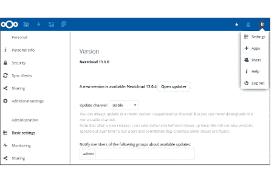

| 个人信息 | 版本 |
|---|---|
| Nextcloud | 6.0.1 |

有新版本可用：Nextcloud 6.0.2。打开更新。

- 设置
- 个人信息
- 管理员设置
- 管理
- 共享
- 监控


保持 Nextcloud 更新非常重要，特别是如果你运行的是面向云的实例。这个界面让操作变得简单。

……Web 服务器，但如果你更倾向于使用轻量级的 Nginx（用于 LEMP 栈），这并不重要：两者都需要极少的配置即可运行。我们将在教程中使用 Debian，但这些指令在树莓派 Ubuntu 或适配了其他发行版的 Ubuntu 上也能良好运行。如果你在远程服务器上运行此操作，请伸好手指并 SSH 登录。首先，让我们从更新系统开始：

```bash
$ sudo apt update
```

现在我们将安装 Nextcloud，因为我们已经准备好了 PHP 软件包。Nextcloud (13) 带有 PHP 5（Debian 其他版本的默认版本）或最后一个支持的版本。因此，是否使用 Debian 默认的 PHP 7.0 取决于你，这将需要使用一些外部仓库（如 Ondrej）。

```bash
$ sudo apt install mariadb-server libapache2-mod-php70
```

最后一个是 Apache 的 PHP 模块，它告诉 PHP 解释本教程中的脚本。我们将使用官方 PHP 软件包和 PHP 服务器。由于我们要手动安装 Nextcloud，不受包管理器的控制，我们还必须安装所需的 PHP 模块。这些模块相当多，因此你可能希望从官方文档 https://docs.nextcloud.com 查看并复制。

> 我们的经验
>
> Jonny Bidwell 曾被吸血鬼咬过。在随后的混乱中，他邀请了 Linux 新闻业的未来，结果文章因加密货币拍卖而延迟了。最好不要……

## 快速提示

DNS 和 SSL 证书的设置非常简单，我们无法把指令全部写在这里！你可以在 https.org 和 https://certencrypt.org 找到指南，了解如何为前者提供的域名获取证书信。

## 安装 LAMP 栈

Nextcloud 需要 LAMP/LEMP 栈才能运行，因此我们先设置它。如果你是初学者，请参阅 https://nextcloud.com/docs/installation.html 中的手册。

# Linux Format 2020

接下来我们将获取 PGP 签名并进行验证：

* `wget https://nextcloud.com/server/releases/nextcloud-13.0.4.tar.bz2`
* `gpg verify nextcloud-13.0.4.tar.bz2.asc`

如果你看到一行以 `pg: Good signature from "Nextcloud Security" <security@nextcloud.com>` 开头的文字，那么你就可以松口气了。这说明我们下载的公钥确实来自 Nextcloud 且未被篡改。为了确保万无一，如果你收到（或看到）LXF223-224，请信任 John Lane 的签名：请合理确保它确实是 Nextcloud 的真实签名：

* `tar -xvf nextcloud-13.0.4.tar.bz2`

这会将所有内容解压到 `nextcloud/` 目录，除非你已经领先了一步，正处于目标机器的家目录中。我们需要 Web 服务器能够看到 Nextcloud 文件，因此让它们移动到 Apache 的文档根目录并适当更改所有权：

## 配置 Apache

我们现在配置 Apache 来提供 Nextcloud 应用服务，但在此之前，让我们检查 Apache 是否正在运行。在输入输入目标 IP 地址（如果不知道，请运行 `ip`），Apache 的配置将与 Debian/Ubuntu（及其衍生版本）设置不同，以保留你的个人设置、打开的文件并启用每个站点（或我们想要的任何内容）。所以让我们为我们的 Nextcloud 实例创建一个配置文件：

```
sudo mv nextcloud /var/www/
sudo chown -R www-data /var/www/nextcloud
```

```
sudo nano /etc/apache2/sites-available/nextcloud.conf
```

现在填充内容。这会将 `/nextcloud` URL 指向我们需要安装 Nextcloud 的目录

## 使用 NEXTCLOUD 网页版安装

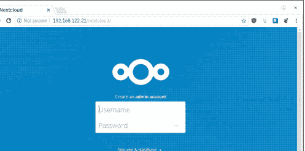

### 1 选择管理员凭据

首先为管理员账户输入用户名和密码。该账户对 Nextcloud 的所有内部机制具有绝对控制权，因此我们创建一个通用用户。还剩下三步：请配置我们之前设置的数据库详细信息（数据库、用户、密码：`nextcloudpassword`）。服务器可以保持为 `localhost`：

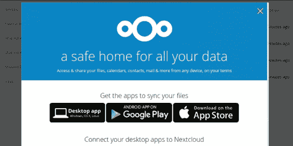

### 2 可选应用

等待后，你最终会看到欢迎界面。这会将你引导至桌面、Android（由于 Nextcloud 现在是免费的）和 iOS 应用，并将你的桌面日历、联系人和文件与你的 Nextcloud 集成。在此阶段你不需要进行这些任何操作；现在不做呢？

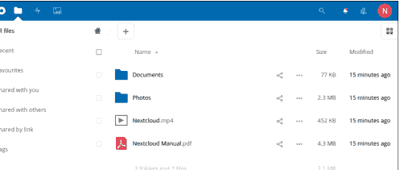

### 3 默认用户

默认文件已安装。已安装的应用（最初仅安装 Activity 和 Gallery）通过左上角的图标访问。查看“文档”和“照片”文件夹，可以看到导航和预览的工作情况。头像出现在右上角的菜单中，可以在那里配置应用、设置和用户。

### 4 创建新用户

要添加新用户，请使用上述名称并选择。然后只需在框中输入用户名和密码并创建。你可以添加组（默认只存在 admin 组），并添加用户，以及控制他们的存储配额或直接删除账户。我们可以安全地退出管理员账户。

## Nextcloud 教程

Alias nextcloud /var/www/nextcloud/

```
<Directory /var/www/nextcloud/>
Options +FollowSymlinks
AllowOverride All
```

```
<IfModule mod_dav>
</IfModule>
```

```
SetEnv HTTP_HOME /var/www/nextcloud
SetEnv HTTP_VAR /var/www/nextcloud
```

```
<Directory>
```

- 现在启用新定义的站点：

`sudo a2enite nextcloud`

`sudo a2enmod`

`sudo a2mod env`

`sudo a2enmod dir`

你会看到一条消息，提示重加载 Apache 使更改生效，但在之前我们启用额外的 Apache 模块以便 Nextcloud 能够完成...

`sudo systemctl restart apache`

最后三个在全新的 Debian 安装中是默认启用的，但检查它们并没有坏处。你需要重启 Apache 服务器。在此阶段，Nextcloud 正在通过其 IP 地址工作。你现在可以连接它，例如在本地机器的浏览器上访问 `http://192.168.1.100/`。希望 Nextcloud 安装顺利。在 `nextcloud` 目录中，检查 MariaDB 是否运行（`sudo systemctl mysql`）并双重检查所需包是否已安装。将服务器的 IP 地址添加到你想访问的机器的 `/hosts` 文件中。你可以通过添加以下行来实现：192.168.1.100

服务器可以通过 `nextcloud.local` 访问。所以我们将遵循我们的四步指南来完成你的 Web 配置。

## 最后调整

在继续之前，有几件事需要配置。首先，没有人喜欢长 URL，所以我们可以使用 Nextcloud 重写。编辑（或覆盖）`/nextcloud/config/config.php`，在最后一行之前添加（如果你有主机名），该命令直到我们运行维护脚本之前生效：

```
sudo -u www-data php /var/www/nextcloud/occ maintenance:update
```

注意我们在上述步骤使用了 `https` 而不是 `http`。启用（并强制）加密是一个好主意，因为敏感数据可能会被窃听，我们需要处理：

```
sudo a2enmod ssl
sudo systemctl restart apache
```

如果你现在访问 `https://nextcloud.local`，你会看到关于你的网站不安全的警告。这是因为默认配置使用了自签名证书。在本地网络中，除非从公共证书机构获取证书，否则你无法信任它。这比现在要好得多。我们可以强制 Apache 通过 HTTPS 提供资源；由于我们要使用我们的服务器，我们将在 `/nextcloud/.htaccess` 文件中进行这些更改。滚动到下面的部分并在末尾添加行：

```
<IfModule mod_rewrite>
RewriteCond SERVER_PORT 80
RewriteCond %REQUEST_URI ^/nextcloud/
RewriteRule ^(.*)$ https%{SERVER_NAME}/nextcloud/$1 [R=301]
</IfModule>
```

最后，这是最后的触摸以及重加载 Apache 使重定向生效：

```
sudo systemctl restart apache
```

你已经完成了 Nextcloud 的操作！


Nextcloud 可以通过不断增长的应用选择进行扩展，你可以以管理员身份进行探索。

## 快速提示

除了代码，还有许多与 Nextcloud 连接的应用程序。流行的树莓派可以将你的自托管服务（如 Gmail）集成到 Nextcloud 界面中。

## 获取你的完整免费版，立即订阅 http.ly/Linux

# 终端：LSHELL

## 限制用户对你个人发行版的访问

担心用户通过无限制的访问搞乱你的系统吗？**Shashank Sharma** 使用 lshell 来限制他们的使用。


大多数现代 Linux 发行版都自带几个不同的 shell。这些 shell 包含了帮助你完成任何任务的工具，例如移动或删除文件、移除机器、执行脚本和管理用户。这种力量的缺点是可能会损害系统。通过 lshell，用户可以获得一组命令的权限、在 SSH 上输入危险命令、实施限制等！

使用 lshell 来限制用户执行命令是合理的。例如，一旦不小心使用 `dd` 删除了磁盘或使用 `cat` 将 ISO 写入 4GB 的 USB 盘的情况就会发生，但通过 lshell，每个用户都受到限制，无法运行 `dd` 或 `disk` 等命令，这些命令如果使用当可能会破坏系统。

该工具在软件存储库可用，但安装非常直观。你必须在计划下载的目录中安装 `python` 和 `git`：启动终端并切换到使用 `setup.py` 安装。

你现在可以通过 `cat /etc/shells` 检查 lshell 是否在已安装的 shell 列表中：

Shashank Sharma 是德里的一位律师，也是热爱的 Linux 用户。他总是关注极客信息。

```
## echo SHELL
### /bin/bash
### /bin/sh
### /etc/shells: 有效的登录 shell
### /bin/bash
### /bin/dash
### /bin/bash
### /usr/bin/lshell
```

确定默认 shell。你可以使用 `chsh -s /usr/bin/lshell` 更改用户的 shell。

- `[global]` - 全局范围设置，例如日志记录。
- `[default]` - 适用于所有用户和组的设置。
- `[username]` - 仅适用于特定用户的中心化设置。
- `[groupname]` - 适用于组及其所有成员设置。

## 配置 lshell

通过 lshell，你可以为不同的用户创建配置和定义。默认 lshell 存储在 `/etc/shells` 并适用于所有用户。

配置可以分为四个部分：

| 字段 | 描述 |
|---|---|
| `[global]` | 全局范围设置，例如日志记录。 |
| `[default]` | 适用于所有用户和组的设置 |
| `[username]` | 仅适用于特定用户的中心化设置 |
| `[groupname]` | 适用于组及其所有成员设置 |

配置的优先级是：用户 > 组 > 默认。这意味着 lshell 首先查找用户设置并应用其中提供的设置，然后是组和默认设置。在冲突的情况下，用户名设置将覆盖组设置。

或者，你可以在创建新用户时使用 `sudo adduser --shell=/lshell/` 将 lshell 设置为默认。

```
2/ 终端缺失
$ luser@linux-bound:~$ chsh -s /usr/bin/lshell
密码: 
$ 输入 '7' 获取可用命令列表
$ clear echo exit help list ls is lshell
$ 没有任何命令
$ 优先级
$ home@user:~$
$ 禁止命令: name
```

新安装的 lshell 配置没有 (username) 或 (groupname) 部分。这些必须手动添加。你可以通过定义以下来配置 lshell 想要保留的日志量：

用户只能运行受限于所有路径和命令列表的 lshell 命令

loglevel 取值。它接受从 0 到 4 的设置，其中 0 表示不记录日志，而 4 会记录用户输入的每一个命令。

默认情况下，该工具使用 syslog 记录日志，但也支持自定义格式。例如，如果你使用 ver logs，请将 /etc/syslog.conf 中的 logname 替换为 logname-suffix。

Sudo 会为每个会话、每个用户和守护进程启动的进程创建一个日志目，并将日期和年份写入文件。要添加这些内容，你还可以使用 %Y 为条目添加时间戳，或使用任何其他命令来记录日志。

allowed 选项用于提供所有允许运行的命令列表。如果你想让用户运行所有命令，可以将其设置为 all。同样地，你可以限制用户访问某些路径，例如 /etc/。timeout 选项限制了用户在给定计时器下使用终端的时间：

- allowed: ['all', ['var/*','cd','cp','mv']]
- forbidden: ['/var/*','/usr/local/*']
- [user]
- allowed: ['+pwd','ping','cp']
- forbidden: ['+etc']

在此块中，我们为用户 adnina 和 inumala 创建了两个条目。对于第一个，我们定义了允许访问的目录。

允许访问。使用 allowed 选项，我们限制了对某些目录的访问，但以 - 开头的目录除外。符号表示用户的来源。

同样，对于用户 inumala，我们定义了对 Default 部分描述的目录的访问。同样，还了该节描述的命令。

你可以使用 over 选项获取可用命令列表。另一个有用功能是定义用户通过 SSH 连接时可以运行的命令。为此，你必须使用 over 选项：

- allowed: ['+pwd','ping','cp']
- forbidden: ['+/var/*','/home/user/*']
- restricted: ['+root','/script/*']

与之前一样，我们使用 over 选项描述了 Default 部分中允许用户 inumala 运行的额外命令。另一方面，符号 - 用于限制用户在通过 SSH 连接时运行或 sc 命令。

# 绕过受限 shell (RESTRICTED SHELL)

它们本身，Bash、Ksh 和 Zsh 都都具有一个受限 shell。如果你的 Linux 发行版中将 bash 定义为你的 shell，你可能已经安装了 bash。受限 shell bash 具有每种有限的能力。

如果你安装了 bash，可以将其作为终端、受限 shell 来运行。

你可以通过在终端上运行 bash 来启动受限 bash。要将其设置为默认 shell，而不是更改 shell，请设置 PATH 或 SHELL 变量：

当运行受限 shell 时，用户不允许运行 PATH 或 SHELL 变量以外的命令，重定向输出到：

使用受限 bash 的缺点是用户可以。例如，如果 /bin/ 在 PATH 中，用户可以使用 bash 逃逸受限 shell，然后运行完整版本的

```
adina@raspberry-budget:~$
set shell=/bin/bash
```

现在用户可以恢复全功能的 bash，而不是只有最基本命令且容易逃逸的 bash Raspberry。这种技术也适用于 shell 本身，但仅当你在允许列表中使用它时。使用简短的允许命令列表效果更好，即允许所有并阻止访问少数几个。

> 小贴士
>
> 当使用文本编辑器时没有自动将 /usr/bin/ 添加到 shell/ /etc/shells 文件时，请确保在文件末尾留有一个换行符。

# 2020 Linux 格式年度报告

# 安全

## 保持你的桌面安全可靠

Linux 本身可以阻止大多数攻击，但 Mayank Sharma 可以随时帮助你为计算机周围建立一个 10 级强力力场……

Mayank Sharma 是一位技术作家，他花费大量时间玩与其他不同的 Linux 游戏。

运行 Linux仅仅是因为你认为它比 Windows 好？重新想一下。Linux 的安全性是直接从内核到桌面的内置功能，但它仍然留下了让别人知道你的 /Home 文件夹的空间。Linux 对为 Windows 编写的病毒和蠕虫免疫，但攻击者还有其他技巧可以非法访问你珍贵的比特和字节，这可能会让一切变得相等发送给你信用卡的邮件。

用用户名和密码锁定数据应该是你唯一的防线，它无法挡住坚定的攻击者。随着攻击数量和种类的日益增加，你应该花精力采取额外措施来完全保护你的计算机。


所有主流 Linux 发行版（如 Debian、Ubuntu 和 Fedora）都与软件包配合，确保你跟上任何安全漏洞。它们还相互协作，确保在发现漏洞时能够尽快提供安全补丁。

使用 NoScript 和 BetterPrivacy 扩展防止基于浏览器的破解，这些扩展可以阻止你的网络浏览器运行恶意脚本。

你有一个发行版可以依靠以确保安全已启用（这是默认的），并且你可以在提示时选择自动或手动更新。除了更新之外，发行版还有它们与你共享的安全列表。今天关注安全列表通常是个好主意，并留意对你的系统和正在的包至关重要的安全更新：

使用内置工具连接计算机上的设备。所有扩展都允许通过这控制你的 Linux 安装上运行的内容。然而，某些应用程序可能会停止工作，因为你决定使用一个许多程序依赖的服务器，所以如果你使用 MySQL 或 PostgreSQL。

# 安全账户

在像 Linux 这样的多用户系统上，使用用户名和密码锁定数据应该是你唯一的防线，它无法挡住坚定的攻击者。

赋予 root 权限。允许用户在通过 SSH 连接时运行的命令。另一方面，符号 `-` 用于限制用户在通过 SSH 连接时运行 sc 命令。

如之前，我们使用 over 选项描述了 Default 部分中允许用户 inumala 运行的额外命令。另一方面，符号 `-` 用于限制用户在通过 SSH 连接时运行或 sc 命令。

## 绕过受限 shell (RESTRICTED SHELL)

它们本身，Bash、Ksh 和 Zsh 都都具有一个受限 shell。如果你的 Linux 发行版中将 bash 定义为你的 shell，你可能已经安装了 bash。受限 shell bash 具有每种有限的能力。

如果你安装了 bash，可以将其作为终端、受限 shell 来运行。

你可以通过在终端上运行 bash 来启动受限 bash。要将其设置为默认 shell，而不是更改 shell，请设置 `PATH` 或 `SHELL` 变量：

当运行受限 shell 时，用户不允许运行 `PATH` 或 `SHELL` 变量以外的命令，重定向输出到：

使用受限 bash 的缺点是用户可以使用它。例如，如果 `/bin/` 在 `PATH` 中，用户可以使用 bash 逃逸受限 shell，然后运行完整版本的

```
adina@raspberry-budget:~$
set shell=/bin/bash
```

现在用户可以恢复全功能的 bash，而不是只有最基本命令且容易逃逸的 bash Raspberry。这种技术也适用于 shell 本身，但仅当你在允许列表中使用它时。使用简短的允许命令列表效果更好，即允许所有并阻止访问少数几个。

> 小贴士

当使用文本编辑器时没有自动将 `/usr/bin/` 添加到 shell/ `/etc/shells` 文件时，请确保在文件末尾留有一个换行符。

# 2020 Linux 格式年度报告

# 安全

# 保持你的桌面安全可靠

Linux 本身可以阻止大多数攻击，但 Mayank Sharma 可以随时帮助你为计算机周围建立一个 10 级强力力场……

Mayank Sharma 是一位技术作家，他花费大量时间玩与其他不同的 Linux 游戏。

运行 Linux 仅仅是因为你认为它比 Windows 好？重新想一下。Linux 的安全性是直接从内核到桌面的内置功能，但它仍然留下了让别人知道你的 `/Home` 文件夹的空间。Linux 对为 Windows 编写的病毒和蠕虫免疫，但攻击者还有其他技巧可以非法访问你珍贵的比特和字节，这可能会让一切变得相等发送给你信用卡的邮件。

用用户名和密码锁定数据应该是你唯一的防线，它无法挡住坚定的攻击者。随着攻击数量和种类的日益增加，你应该花精力采取额外措施来完全保护你的计算机。

所有主流 Linux 发行版（如 Debian、Ubuntu 和 Fedora）都与软件包配合，确保你跟上任何安全漏洞。它们还相互协作，确保在发现漏洞时能够尽快提供安全补丁。

使用 NoScript 和 BetterPrivacy 扩展防止基于浏览器的破解，这些扩展可以阻止你的网络浏览器运行恶意脚本。

你有一个发行版可以依靠以确保安全已启用（这是默认的），并且你可以在提示时选择自动或手动更新。除了更新之外，发行版还有它们与你共享的安全列表。今天关注安全列表通常是个好主意，并留意对你的系统和正在的包至关重要的安全更新：

使用内置工具连接计算机上的设备。所有扩展都允许通过这控制你的 Linux 安装上运行的内容。然而，某些应用程序可能会停止工作，因为你决定使用一个许多程序依赖的服务器，所以如果你使用 MySQL 或 PostgreSQL。

# 安全账户

在像 Linux 这样的多用户系统上，使用用户名和密码锁定数据应该是你唯一的防线，它无法挡住坚定的攻击者。

# Linux 2020

关联宇宙。然而，它将阻止其直接修改 `/etc/shadow` 文件。`/etc/shadow` 文件包含了密码以及其他信息，例如账户密码过期值。该文件的所有者是 `root` 组，已设置为 shadow。在您系统的 shadow 文件上，感知 PAM 的应用程序或其他常见的 Linux 库会使用 PAM。PAM 可能会允许。

> 快速提示
>
> **使用 change 命令获取有关用户账户的详细信息，包括账户过期日期和上次更改密码的时间。**

尽管如此，仍然没有需要执行的密码更改操作。您也可以使用 PAM 在 `/etc/pam.d/` 目录中选择和存储配置文件。这里有一个适用于所有请求 PAM 认证的程序的配置文件。当你查看这些文件的内部进行内容时，你会看到几行调用其他模块以提供通用信息的代码。例如，`/etc/pam/passwd` 文件。这些通用配置文件应该单独修改。

通用密码项控制着密码复杂度。一个 `/etc/pam/common-password` 文件定义了与密码策略相关的行。

`passwd` 工具使用了密码选择 SUID。在这个特殊会话中，当命令执行时，用户密码变为临时性，而 `/etc/shadow` 文件包含了与 `/etc/passwd` 具有相同权限组的所有条目。

## 使用 PAM 管理密码

认证机制在 Solaris 系统中实现，但对于 Linux 来说它是非常新的。PAM 简化了管理过程，并为验证用户和应用程序提供了活性。

为了跟踪 PAM，使用该库编写了各个认证模块。命令 `/usr/bin/passwd -l | grep /` 显示了所有：

- passwd [success=default-ignore] pam_unix

shadow-sha5

- passwd requisite pam_denys

- passwd required

- passwd optional pam_crypt_lockout

我们感兴趣的是 PAM 规则定义在某些文件中的事实。某些规则定义了如何使用 SHAS2 对密码进行加密。抽象参数允许根据使用的不同字符类型的数量设置复杂度。

为了获得更多的密码检查功能，可以使用 `sudo apt install libpam-crypt` 添加额外的 PAM 模块。然后 `/etc/pam/common-password` 文件将列出以下额外行：

- passwd requisite pam_cracklock-retry-3min-8 -dcredit

| 访问和用户限制 | 权限 | 动作 |
| :--- | :--- | :--- |
| read | (查看) | r 或 4 |
| write | (执行) | w 或 1 |
| User | Is-account | u |
| owner | -rwx- | group --- |

此行使用了 pam_cracklock 并给予用户三次机会提供一个良好的密码。如果用户失败，密码将被锁定，直到设置了定义的最小字符数。

始终确保您的发行版已配置为立即安装安全更新，而不是等待配置，以防止用户使用最近用过的密码。您还可以使用 credit、`ucredit` 选项来传递密码包含大写字母和特殊字符。您可以使用代码强制用户选择密码：

- 强制性安全更新 (security-updates)
- 推荐的安全更新 (security-updates)
- 不支持的更新 (security-backports)

自动检查更新：每日

当有安全更新时：自动下载并安装

当其他更新时：每周显示

- passwd requisite pam_cracklock-dcredit=4ucredit=1 lcredit=0 minlen10-rejectusername

## 混淆你的内容

保护个人数据最好的方法之一是对其进行加密，这样其他人就无法读取文件。这是某些发行版的做法，例如 Fedora、Linux Mint 和 Ubuntu 让您能够在发行版的初次设置期间加密加密每个磁盘。


# 安全之道教程

然而，如果你使用 zCrypto 加密文件，你可以使用块加密，这意味着写入特定块设备的所有内容将变成一个整个设备、分区或挂载为循环设备的文件。通过块设备加密，用户在块设备上创建文件，加密层会在写入低层级之前翻译数据。

使用 zCrypto，你可以在文件或未分区的 USB 驱动器中创建加密设备。它也可以使用 zCrypto 加密单个文件。程序提供了一个用户界面，方便创建和重复使用用于加密容器的密钥。程序还包含 zCrypto mount 工具，用于单独管理所有加密卷。

要安装 zCrypto，请访问 http://mohmongchchu.github/zcrypto 从软件包仓库安装。该程序适用于许多不同的 Linux 发行版。下载适用于您架构的包并使用 `tar zCrypto.tar.gz` 安装。遵循对应于架构（x86、32位或64位）的步骤。它包含了文件夹和二进制文件，你可以将其安装在其中之一。在构建时，你将遵循 `BUILD-INSTRUCTION` 文件中的详细步骤从您的发行版获取依赖项。

## 灾难恢复

导致数据丢失的入侵恢复策略应该是安全计划的一部分。Linux 用户有多种备份工具可用，发行版会默认安装一个。例如，使用 Deja Dup（您也可以在 Fedora 或 Mint 等其他发行版上安装）。

几乎每个备份工具都会询问您备份备份。你可以选择使用本地磁盘、远程位置或像 Amazon S3 这样的网络存储服务。您还有想要包含在备份中的文件和目录。某些工具将帮助您设置备份计划，例如 Deja Dup。

Deja Dup 消除了设置实际数据备份的痛苦，过程中的关键部分是准备工作。您需要选择存储备份的位置，选择要包含的文件夹，甚至使用 OpenMedia 等软件设置您自己的网络附属存储 (NAS)。

备份频率也会影响使用的存储空间。您可能希望手动备份，或根据计划自动备份？正确的备份频率取决于所保护的数据类型和价值。根据文件的大小，每天备份它们可能不是一个好主意。

# 安装防火墙！

Linux 发行版使用 netfilter/iptables。这是一组可以用于在内核级别创建包过滤器的内核模块。Ubuntu 自带一个已启用的简单防火墙 (UFW)，这是一个可以创建过滤规则的应用程序接口。

UFW 有一个名为 Gufw 的图形用户界面。Gufw 让管理 iptables 的痛苦变得简单。您可以允许或阻止服务，以及用户定义的规则。您可以根据预安装的家庭、办公室等配置文件设置策略，以及入站和出站流量的策略。

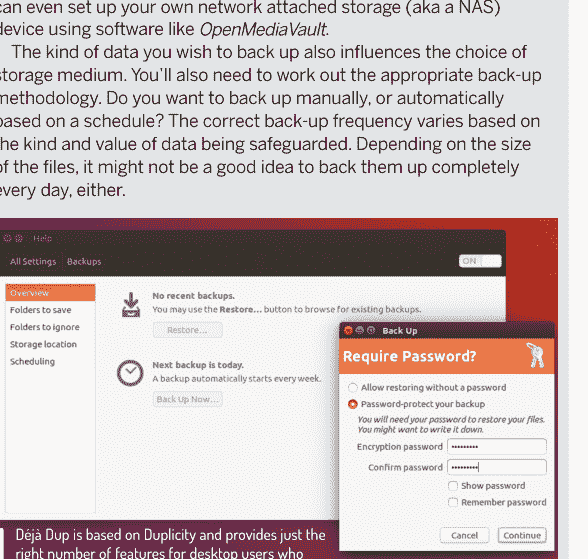

首先启用防火墙。一旦启用，可以通过菜单中的选项设置入站和出站策略。Allow 选项将允许流量无需询问。Deny 选项将静默丢弃所有入。Reject 选项将向数据包的发送者返回错误包。

在设置好入站和出站策略后，您可以为单个程序和服务定义特定规则。创建规则，在扩展部分后点击 Add 按钮。这打开了一个带有三个标签页的窗口，允许以不同方式创建规则。Preconfigured 标签页允许您选择特定程序或服务的预制规则，而其他标签页允许您为特定端口定义规则。我们建议用户使用 Preconfigured 标签页通过下拉菜单控制流量，Gufw 会自动定义有效规则。根据安全需要，您应该选择性地添加您使用的程序和服务的规则，例如网络浏览器、即时

# 2020年 Linux 格式年度

# MUNIN 与 MONIT

监控高级用户和管理员

Mihalis Tsoukalos 为你解释了开始使用 Munin 和 Monit 监控你的 Linux 服务器时需要了解的知识。

Munin 是专业系统管理员与业余者的区别，它可以为你节省大量的时间和精力。本教程将介绍 Munin 和 Monit，以及你如何使用它们来监控 Linux 系统——你一定会非常欣赏 Monit 设置过程的简单以及 Munin 生成的输出。

尽管拥有 Munin 和 Monit 会让 Linux 监控工作变得更容易，但最困难的事情是决定监控什么，这主要取决于 Linux 服务器的任务和资源。

# 我们的贴士

Mihalis Tsoukalos 忘记的比你所过的还要多！

# 黄金搭档

Munin 服务会生成关于 Linux 机器运行情况的精美且信息丰富的图表。另一方面，它是一个易于安装的监控程序，可以检查各种 Linux 服务（如 Apache、Postgres 和 MySQL）的可用性。如果你需要，它可能会检查它们是否正在运行或已完成。将 Munin 和 Monit 结合起来可以为你提供一种同时监控两者的方法。

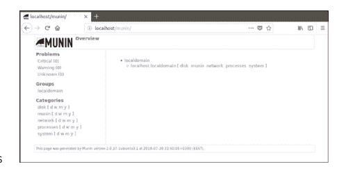

图 1：由 Apache Web 服务器提供并 Munin 创建的 Munin 站点初始界面。

显然，Munin 是用于监控 Linux 机器的资源的。

为了避免潜在问题，Monit 更擅长保护 Linux 机器的服务。注意：虽然 Monit 可以监控多个 Linux 服务器，但本教程仅解释了你如何监控运行中的 Monit。

# 安装

你可以通过执行以下命令在 Ubuntu 18.04 系统上安装 Munin 和 Monit：

### 访问 http://lxf2400.com 了解更多关于入门的信息，访问 http://munin.org 了解 Munin 和 Monit，访问 http://lxf2400.com 查看文档。

## `apt install munin munin-plugins-extra monit`

第一条命令安装 Munin、各种插件以及 Perl 插件。第二个命令安装 Monit。你可以找到这两个程序的版本如下：

### `munin --version`

这是 munin-v0.3.27-0

### `monit --version`

这是 monit v0.25.1

这两个命令的输出显示 Munin 和 Monit 已经安装，你准备好启动它们。启动 Monit 可以运行 `systemctl start monit`。Munin 和 Monit 都将运行并监控它们是否配置正确——我们将进一步配置 Munin。

图 2：说明了如何使用 munin config 来查找有关 Munin 插件的信息并支持自动补全。

```bash
munin config --help
```

你调用了一个无法识别的名称。你并不打算使用它，但也可能是拼写错误。请检查你的类型。更多帮助请查看 [Munin]

用法：munin [option] [file]

--option [value]

--format [type]

```bash
示例：
munin config --help
munin -F all
munin -F apache
munin -F mysql
munin -F postgres

asterisk_metrics
asterisk_process
asterisk_calls
asterisk_sipchannels
asterisk_chamchannels
```

## Munin 工具

Munin 带有许多工具——其中一些在 `/usr/bin`，另一些在 `/usr/sbin`：

```bash
$ cd /usr/bin; ls munin-check munin-cron
$ cd /usr/sbin/; ls munin*
```

`munin-check` 工具用于修复 munin 文件，而 `munin-cron` 工具由 cron 进程执行。`munind` 工具是 Munin 的文档。新闻是 munind 支持插件的配置，在 bash 提示符处按下键：--help 显示 munind 命令的各种输出功能。

Munin 从运行 munin 的机器收集数据，可以在 `/usr/share/munin/munin-update` 找到

## 配置 Munin

Munin 需要在 `/etc` 中配置文件并修改 munin 配置文件，这将在下一部分加载。本部分关于配置 Munin 以收集你想要的数据。`munin.conf` 文件可能是你为了让 Munin 运行而需要修改的文件。

Munin 支持插件——可以通过查看 `/usr/share/munin/plugins` 目录找到所有可用 Munin 插件列表。此外，你可以通过列出 `/etc/munin/` 的内容找到许多插件。

我们将修改 `/etc/munin/munin.conf` 以适应变量值，这使得 munin.conf 比预期的要短。具体来说，etc/munin/munin.conf 如下：

```bash
$ cat /etc/munin/munin.conf
include(/etc/munin/d/)
address 127.0.0.1
use_name = yes
```

之后，`munin-configure` 命令将返回 Munin 插件列表，启用取决于你想监控的 munin 系统：命令的输出如下：

| 插件 | 建议 | 进程 |
| :--- | :--- | :--- |
| apache_access | no | yes |
| apache_volume | no | yes |
| cpu | yes | yes |
| disk | no | yes |


| forks | no | yes |

| postfix_mysql | not found | yes |

| quantum | no | yes |

| volatile | no | yes |

图 3：要查看此内容，请选择 Munin 进程并向下滚动到图表。

## 提示

你可以通过执行 `service munin stop` 退出 Munin 进程，或通过执行 `service munin-node stop` 停止节点。

## 日志文件

如果 Munin 或 Monit 有问题，请检查它们的日志文件。Munin 的日志文件位于 `/var/log/munin/`。Monitor 日志位于 `/var/log/monitor/`。使用 `tail` 命令扫描 Munin 日志。`/var/log/munin/munin.log` 中的每条目都会帮助你了解更多关于 Munin 的状态：

2018-08-01 12:05:00 [INFO] Munin-update failed (4.2 sec)

2018-08-01 12:05:05 [ERROR] Munin-update

要查看如何使用 `munin-update`，获取并进入 `munin-update.log` 内容。这将验证 Munin 及其 Web 界面正在工作：[EEST Aug 10:45:49] info: Munin 5.2.1 with http interface at 127.0.0.1:2882 [EEST Aug 10:45:49] info: 'ubuntu' Munin 5.2.1 started

现在，你必须重启 Munin 以使更改生效。Munin 将开始监控这些 Apache 属性，这可以通过 `service apache2 status` 的输出进行验证。你需要等一会儿，让 Munin 更新并包含关于这些 Apache 属性的信息。

# 快速贴士

- 所有 Munin 工具都是纯文本脚本，你可以轻松地读取和调试、更改它们的输出，并用任何编程语言重写它们。事实上，如果你愿意，可以把 Munin 移植到 Go 或 Rust！

## 为 Munin 配置 Apache

为了在网页浏览器中查看 Munin 的状态，你需要在网络上的虚拟主机上安装 Apache。此外，你必须启用该模块。如果尚未启用，可以通过执行 `apache2ctl -M` 检查 Apache 模块。如果未启用，可以通过执行 `a2enmod` 启用它——该模块可以在 `libapache2-mod` 包中找到。

Munin 配置 Apache 非常简单，因为 Munin 使用位于 `/etc/munin/apache24.conf` 的 Apache 配置文件。因此，你需要执行以下命令：

- `cp /etc/apache2/sites-available/apache24.conf /etc/apache2/sites-enabled/`

- `a2ensite apache2.conf`

- `systemctl restart apache2`

请注意，上述过程创建了 `/etc/munin/apache24.conf` 的新副本，并保留原始版本的 `/etc/munin/apache24.conf`，以便如果你监控不同的 Web 服务器，你需要按照不同的流程为 Munin 的输出添加 Web 服务器支持。

图 2 显示了 Munin 站点的默认输出，可以通过 http:/// 访问

```bash
set indent 4
set log=/var/log/munin.log
set data=/var/lib/munin/data
set status=/var/lib/munin/status
```

图 4 显示了 Munin 站点的默认输出，可以通过 http:/// 访问

Munin 从运行 munin 的机器收集数据，可以在 `/usr/share/munin/munin-update` 找到

## Munin 工具

Munin 带有许多工具——其中一些在 `/usr/bin`，另一些在 `/usr/sbin`：

```bash
$ cd /usr/bin; ls munin-check munin-cron
$ cd /usr/sbin/; ls munin*
```

`munin-check` 工具用于修复 munin 文件，而 `munin-cron` 工具由 `cron` 进程执行。`munind` 工具是 Munin 的文档。新闻是 `munind` 支持插件的配置，在 bash 提示符处按下键：`--help` 显示 `munind` 命令的各种输出功能。

Munin 从运行 munin 的机器收集数据，可以在 `/usr/share/munin/munin-update` 找到

## 配置 Munin

Munin 需要在 `/etc` 中配置文件并修改 munin 配置文件，这将在下一部分加载。本部分关于配置 Munin 以收集你想要的数据。`munin.conf` 文件可能是你为了让 Munin 运行而需要修改的文件。

Munin 支持插件——可以通过查看 `/usr/share/munin/plugins` 目录找到所有可用 Munin 插件列表。此外，你可以通过列出 `/etc/munin/` 的内容找到许多插件。

我们将修改 `/etc/munin/munin.conf` 以适应变量值，这使得 `munin.conf` 比预期的要短。具体来说，`etc/munin/munin.conf` 如下：

```bash
$ cat /etc/munin/munin.conf
include(/etc/munin/d/)
address 127.0.0.1
use_name = yes
```

之后，`munin-configure` 命令将返回 Munin 插件列表，启用取决于你想监控的 munin 系统：命令的输出如下：

| 插件 | 建议 | 进程 |

| :--- | :--- | :--- |

| apache_access | no | yes |

| apache_volume | no | yes |

| cpu | yes | yes |

| disk | no | yes |

| forks | no | yes |

| postfix_mysql | not found | yes |

| quantum | no | yes |

| volatile | no | yes |

图 3：要查看此内容，请选择 Munin 进程并向下滚动到图表。

## 提示

你可以通过执行 `service munin stop` 退出 Munin 进程，或通过执行 `service munin-node stop` 停止节点。

## 日志文件

如果 Munin 或 Monit 有问题，请检查它们的日志文件。Munin 的日志文件位于 `/var/log/munin/`。Monitor 日志位于 `/var/log/monitor/`。使用 `tail` 命令扫描 Munin 日志。`/var/log/munin/munin.log` 中的每条目都会帮助你了解更多关于 Munin 的状态：

2018-08-01 12:05:00 [INFO] Munin-update failed (4.2 sec)

2018-08-01 12:05:05 [ERROR] Munin-update

要查看如何使用 `munin-update`，获取并进入 `munin-update.log` 内容。这将验证 Munin 及其 Web 界面正在工作：[EEST Aug 10:45:49] info: Munin 5.2.1 with http interface at 127.0.0.1:2882 [EEST Aug 10:45:49] info: 'ubuntu' Munin 5.2.1 started

现在，你必须重启 Munin 以使更改生效。Munin 将开始监控这些 Apache 属性，这可以通过 `service apache2 status` 的输出进行验证。你需要等一会儿，让 Munin 更新并包含关于这些 Apache 属性的信息。

# 快速贴士

- 所有 Munin 工具都是纯文本脚本，你可以轻松地读取和调试、更改它们的输出，并用任何编程语言重写它们。事实上，如果你愿意，可以把 Munin 移植到 Go 或 Rust！

## 为 Munin 配置 Apache

为了在网页浏览器中查看 Munin 的状态，你需要在网络上的虚拟主机上安装 Apache。此外，你必须启用该模块。如果尚未启用，可以通过执行 `apache2ctl -M` 检查 Apache 模块。如果未启用，可以通过执行 `a2enmod` 启用它——该模块可以在 `libapache2-mod` 包中找到。

Munin 配置 Apache 非常简单，因为 Munin 使用位于 `/etc/munin/apache24.conf` 的 Apache 配置文件。因此，你需要执行以下命令：

- `cp /etc/apache2/sites-available/apache24.conf /etc/apache2/sites-enabled/`

- `a2ensite apache2.conf`

- `systemctl restart apache2`

请注意，上述过程创建了 `/etc/munin/apache24.conf` 的新副本，并保留原始版本的 `/etc/munin/apache24.conf`，以便如果你监控不同的 Web 服务器，你需要按照不同的流程为 Munin 的输出添加 Web 服务器支持。

图 2 显示了 Munin 站点的默认输出，可以通过 http:/// 访问

```bash
set indent 4
set log=/var/log/munin.log
set data=/var/lib/munin/data
set status=/var/lib/munin/status
```

图 4 显示了 Munin 站点的默认输出，可以通过 http:///

## 其他监控

Munin 并不是唯一的可用监控软件。其他的包括 Nagios (`nagios.org`)、`MRTG` (`oss.opteler.org`)、`Cacti` (`cacti.net`)、`Zabbix` (`zabbix.org`) 和 LGTT (`org`)。Icing (`icing.com`)、`OpenNMS` (`opnms.org`) 等都可监控你的服务器。

所有工具都有依赖项——在这些监控工具之间选择的最佳方法是尝试它们，然后决定什么最适合你的需求。Munin 非常简单易用，然而，它只能监控事物而无法调试 Linux 机器的服务。Cacti（带有 RFTIS）、MRTG 和 MuninRRRD 用于图表，这意味着它们需要你。

另一方面，Nagios 功能强大但需要更多时间来学习和配置。然而，Nagios 可以监控多个服务器并在出现问题时提醒你。此外，它拥有巨大的插件库，允许你监控数据库服务器和 Web 应用程序。尽管如此，从像 Munin 这样简单的工具开始总是个好主意。对于此类企业级解决方案

# Munin 和 Monit 教程

`etc/conf-enabled/apache2` 具有让 Monit 监控 apache 的权限——你可以查看 `/etc/conf-enabled/apache2` 的内容，如果你的 apache 使用了不同的端口或其他自定义参数，可以对其进行任何修改。然后，你需要重启 Monit 以使更改生效。

在这个最终版本中，我们将修改所使用的 Monit 配置文件，其中还包含了启用 Monit Web 界面的细节。现在你可以管理 Monit 你的服务器（这需要一个运行良好的邮件服务器作为后盾），我们将留给已经在 Linux 机器上拥有可用邮件服务器的读者作为练习。

你也可以在你的机器上监控数据库服务器。列出数据库服务器的 TCP 端口列表非常有帮助。为了获取 Monit 的当前状态，你应该使用 `monit status` 命令。如果 Monit 的 Web 界面尚未启用，将得到以下输出：

Monit: The HTTP interface is not enabled, please enable the web server and use the option “allow to connect” to monit

如果 Web 界面配置不当，`monit` 将成功运行并在 `monit status` 显示以下内容时返回有用信息：

# Process ‘apache’

| status | does not exist |

| :--- | :--- |

| monitoring status | active |

| monitoring mode | active |

| on reboot | start |

| data | Tue Jul 21 2018 22:54:28 |

之前的输出显示：Apache 目前未在运行。Monit 将启动 Apache，因此之前的输出将被替换为以下内容：

# Process ‘mysql’

| status | OK |

| :--- | :--- |

| monitoring status | Monitored |

| monitoring mode | active |

| on reboot | start |

| pid | 6304 |

| data collected | Tue Jul 21 2018 22:54:28 |

所以你应该检查以获取 Monit 的摘要状态，你应该执行带有路由的 `monit summary` 命令——其输出大致与你从 Monit 界面获得的内容相似。

## Monit 的 Web 界面

Monit 有一个 Web 界面，应该通过它启用——本节将说明该过程。但你们都应该意识到，Monit 有它自己的 Web 服务器，你不需要做任何操作来添加对 Monit 的支持。毕竟，如果 Monit 的 Web 界面未启用，它如何监控你的服务器并获取信息呢？

`monit` 文件中启用 Monit Web 界面的命令如下：

```
set http port 2082
allow use 127.0.0.1
allow localhost
allow admin monit
```

第一条命令设置 Web 界面使用 TCP 端口 2082，这是 `monit` 的默认端口号。第二个命令指定 `monit` Web 服务器监听的地址，第三条命令仅接受来自本地机器的 TCP 连接。最后一个命令要求每个 HTTP 连接都使用用户名 (`admin`) 和密码 (`monit`)。以下输出验证了 Monit 连接到端口 2082 (127.0.0.1)，这是正确的配置；结果如下：

```bash
# monit netstat -tupln | grep monit
0 0 127.0.0.1:2082 *:* 671/monit
```

图 5 显示了 Web 界面的截图，整洁且专业。如果你熟悉 HTTP，可以编辑 `/etc/monit.conf` 来使用 HTTP 连接到 Monit Web 服务器。你现在应该会被 Munin 和 Monit 的用处所说服。然而，困难并不在于知道监控的用处，而在于决定使用哪种监控软件（参见相关书籍页面）。

# 监控！现在订阅 http://LinuxForum

Linux Forum Annual 2020

# OpenVPN

### 创建秘密密钥和安全服务器

Dennis Jaredcke 在他的家庭服务器上托管了一个网站，对所有人可见但只有他亲近的朋友知道谁在看……为了防止黑客攻击你的系统并破坏你的生活，保持互联网安全可能变得困难，特别是当你除了少数信任的用户之外隐藏了内容时。这是我们要做的点。我们将向你展示如何从世界上任何地方访问 Web 服务器。

有几种方法可以创建安全连接，但对于两台电脑，使用 OpenVPN 是最可用的解决方案之一，因为它是加密的且具有高度可配置性。运行 `ip addr` 命令将显示你的 ip 地址。OpenVPN 随后会附加 10.8.0.0。Dennis Jaredcke 是一个使用 Linux 自 1990 年起的爱好者。这里是发生什么的总结：

> 快速提示：OpenVPN 的加密使用 BF-CBC，但由于攻击向量的原因，不再推荐使用。最好使用类似 AES-256。

### 虚拟和物理适配器

假设你正在使用 OpenVPN 访问网络而无需他人知晓。这就像运行你的你的脚。发出的数据包在虚拟网络 (`tun0`) 上加密，通过路由表转发到物理适配器 (`eth0`)，然后发送到。来自物理适配器 (`eth0`) 的传入数据包通过 OpenSSL 解密并发送到 Apache 等程序。

下面的图显示了数据如何流：

- 物理 (`eth0`)

- 防火墙 (转发)

- 虚拟 (`tun0`)

- 防火墙 (输入与输出)

- OpenVPN 认证、加密和解密，由 `tun0` 处理。

OpenSSL 是一个用于创建和管理公钥基础设施 (PKI) 的通用密码库。虽然你可能熟悉，但它是 OpenVPN 配置过程中的主要组件。当两个人想要创建私钥和公钥时，交换公钥，同时保持他们的信息使用公钥加密并仅通过匹配的私钥解密。消息可以使用私钥签名并使用公钥验证。这些消息可以使用任何框架加密和解密。公钥通常被称为证书，或 CA。

这种情况通常由证书颁发机构或 CA 引起，CA 是一个个人或组织。CA 的作用是签署其他人的证书。换句话说，CA 增加了额外的验证层。对于 OpenVPN 服务器，当通过 HTTPS 连接 Web 服务器时，服务器发送由 CA 签名的证书到你的浏览器。浏览器将使用 CA 的公证书验证证书。服务器随后使用服务器的公钥加密数据并发送给你。浏览器和网站之间的通信将使用该对称加密。使用 OpenVPN 时，客户端机器将拥有 CA 证书以及公私钥来验证其自身（如下所示）。当客户端连接到 OpenVPN 服务器时，双方交换证书并用 CA 验证。然后，两台电脑将生成密钥，用彼此的数据进行加密并交换。数据随后使用这些密钥加密。


现在有了这些解释，让我们进入真实的 OpenVPN 配置。你需要两台电脑来完成。一台作为服务器，另一台作为客户端。例如，OpenVPN 服务器是 4.2，客户端是笔记本电脑。设置并运行你想隐藏的服务器。两台电脑都需要安装 OpenVPN。客户端和服务器 OpenVPN 软件没有区别，你可以从你的发行管理器安装它。OpenVPN 服务器需要 `ypper` 并安装。

## 用户空间

接下来，运行命令 `easyrsa-init-ki`。这将 `/etc/easyrsa-pnki` 目录，你可以在那里生成密钥。

现在运行命令 `easyrsa-build-ca` 创建 CA 密钥。确保输入密码并将其记录在密码管理器中。创建了 `/etc/easyrsa-pnki/ca.crt` 和 `/etc/easyrsa-pnki/ca.key` 后，命令完成。

接下来运行命令 `easyrsa-build-server-nopass` 将通过你的 CA。命令将创建 `/etc/easyrsa-pnki/server.crt` 和 `/etc/easyrsa-pnki/server.key`。服务器密钥和证书现在已验证。这将自动同步你的服务器与 CA 证书。

要创建客户端密钥和证书，运行命令 `easyrsa-build-client-nopass` 将在 `/etc/easyrsa-pnki/` 创建 `client.crt` 和 `client.key`。客户端文件将由 CA 自动签名。

现在用命令 `easyrsa-gen-dh` 构建 Diffie-Hellman 参数。这很重要，因为 RSA 密钥用于身份验证，而不是用于跨隧道加密数据。它太慢了。有了 Diffie-Hellman 参数，你现在可以创建：

| Apache | OpenVPN (加密/解密) |
| :--- | :--- |
| tun0 | eth0 | 发送到 Open Client 的加密数据包 |

## 网络地址

现在你准备好测试服务器连接了。像往一样连接到你的服务器，然后执行 `ping 10.0.0.2`。你的第二个客户端应该已经启动并运行。

## Diffie Hellman

创建密钥和证书证明是简单的。OpenVPN 命令可能很复杂，所以这个名为 easy-rsa 的框架让密钥和证书变得简单。运行 `ypper` 并安装 `easyrsa` 以安装。

安装后，导航到 `/etc/easyrsa/` 并修改 `var` 文件，如果你想更改任何细节。如果是第一次，等直到你不是

# 2020 Linux 格式年度

为了加密数据，这种方法更快，且适用于持久连接的重密钥。

最后，还有另一个命令可以为 SSL/TLS 握手添加额外的签名以进行完整性验证。运行 `opensvpn --secret ta key` 并将 `ta` 放置在 `/etc/easy-rsa/ta`。

首先，在客户端机器上将 `ca.cert`、`server.key`、`server.crt` 和 `ta` 拷贝到 `/etc/openvpn/`。

## 安全服务器

接下来，让我们看看下面的配置文件：`server.conf` 并将其放入 `/etc/openvpn`。

| 文件名 | 需要项 | 用途 | 密钥 |
| --- | --- | --- | --- |
| ca.cert | 所有客户端 | 根 CA 证书 | 否 |
| ca.key | 签名机器 | 根 CA 密钥 | 是 |
| dh.pem | 仅限服务器 | Diffie-Hellman 参数 | 否 |
| server.crt | 服务器 | 服务器证书 | 否 |
| server.key | 仅限服务器 | 服务器密钥 | 是 |
| client.crt | 仅限客户端 | 证书 | 否 |
| client.key | 仅限客户端 | 证书 | 是 |
| ta.key | 服务器和客户端 | SSL 身份验证 | |

```
server 10.0.0.0 255.255.255.0
proto udp
port 1194
dev tun
topology subnet
persist-key
persist-tun
keepalive 10 60
remote-client tls-auth /etc/openvpn/ta.key
ca /etc/openvpn/ca.crt
cert /etc/openvpn/server.crt
key /etc/openvpn/server.key
cipher-aes-256-cbc
user nobody
group nobody
dn
log-app /var/log/openvpn.log
comp-l no
```

请注意在同一台机器上创建的所有证书和密钥。事实并不非是这样。理想情况下，`ca.key` 应被指定为一台与 OpenVPN 服务器分离的签名机器。为了安全起见，签名机器应该脱离网络。此外，我们可以创建客户端证书并向签名机器提交证书请求。在签名客户端证书后。

## 消除恶劣行为

当某人开始行为异常且你想移除其访问时会发生什么？`easy-rsa` 程序允许你撤销他们的密钥。以下是操作方法：

文件 `/easy-rsa/p/index.txt` 是你所有发行证书的“主数据库”。你可以通过输入以下命令列出它们：

```
R 2701103144262 18020918220812
R 2710315555555 1702707282829
unknown/CN-bob
unknown/CN-client
R 2606260229262 18020900156506
```

要撤销证书，输入：

```
easy-rsa revoke [client-name]
```

一个有效的证书已被撤销，并且已经撤销。你将在最右侧确认证书的通用名称（common name）。

```
easy-rsa revoke joe
```

如果你查看 `index.txt`，你会找到 Joe 的行条目。

`easy-rsa` 命令会在名为 `crl.pem` 的文件中生成证书列表。现在将 `crl.pem` 拷贝到 `/etc/openvpn/crl.pem`，修改 `/etc/openvpn/server.conf` 并重启你的 OpenVPN 服务器。OpenVPN 现在以 `nobody` 身份运行，因此我们必须确保 `priv-crt.pem` 是全局可读。然后你需要做的就是拷贝后的 `crl.pem` 文件。

现在让我们启动 OpenVPN 服务器。如果你遇到失败问题，打开配置文件并运行：

`iptables -A input --p udp --port 1194 -j ACCEPT`。然后启动命令 `opensvpn --config /etc/openvpn/server.conf`。在 `/etc/easy-rsa/ca.local`

## 客户端配置

配置你的客户端看起来同样简单。使用以下配置：

```
client
remote openvpn-server-hostname-or-ip 1194
proto udp
nobind
dev tun
persist-key
persist-tun
```

使用 `top` 命令找到正在运行的 OpenVPN

使用 `ifconfig` 或添加 `route` 显示地址为 10.0.0.0/24

使用 `route` 命令设置路由到 `tun`

## 私有教程

```
remote-tls server
tls-auth /etc/openvpn/ta.key
ca /etc/openvpn/ca.crt
cert /etc/openvpn/client.crt
key /etc/openvpn/client.key
cipher AES-256-CBC
user nobody
group nobody
verb 3
log-append /var/log/openvpn.log
comp-l
```

在这里我们将客户端声明为笔记本，`remote` 选项指向服务器。确保你将 `openvpn-hostname` 替换为服务器的 WAN IP。然后将其放入 `tun`。接下来，连接到服务器。最后，使用 `firstly-config /etc/openvpn/client.conf` 启动 OpenVPN

你可以通过以下方式验证：

## 深度解析加密

据认为加密的首次使用是由尤利乌斯·凯撒，这种方法极其简单，但由于以前没有人遇到过加密信息，字母表中的每个字母都向后移动三个位置，如果超出末尾则绕回开头。例如，A 变成 D，E 变成 H，Y 变成 B，因此 LINUX 变成了 OLXXA。

这看起来可能微不足道，但它引出了加密的定义以及我们所谓的加密学领域。与其将一个字母移动三位，通用算法会将每个字母移动若干个位置。在数学术语中，这种密文被称为 `shift n`，其中 `n` 是在字母表中向前移动的位置数，这被称为一种加密，也是现代密码学中的一个核心概念。

现在想象一下，我们选择的算法用于安全并保持密钥保密。在凯撒密码这种例子中，障碍在于只有 25 种可能的密钥（其中一个是不位移）。这意味着尝试所有密钥直到找到可读文本并不困难。这被称为**暴力破解**。当你的手跟不上速度时，请使用 jTool。你不需要在 jTool 中完成，你可以从 cryptomorg 下载它。

我们可能需要足够数量的密钥使密文变得可破解，但又不足以破解它。与其仅仅使用 jTool，我们可以编写自己的通用替换密码，我们将明文字母到密文之间建立一个更随机的映射。在这种情况下，密钥看起来将像 `QWERTYUIOPASDFGHJKLZXCVBNM`，这意味着，例如，A 变成 G，B 变成 K，C 变成 V，以此此类推。总共 26 个字母，可能的组合数量为 26!，这是一个巨大的数字，即 403 亿亿。

在二进制中，这小于 $2^{89}$。今天大多数安全加密使用大得多的密钥，通过 PC 上的暴力攻击，破解一个 89 位的密文需要多年时间。但有一种更简单的方法，正如我们可以用 jTool 说明的那样。

## 操作

| 加密 | 解密 |
| :--- | :--- |
明文/密文字母表：... 选择字母表：大写字母 (A-Z) 显示字母表

在加密之前从文本中过滤掉非字母字符。

所选字母表的映射（从明文到密文）在这里你可以对每个字符使用此映射：

| A B C D E F G H I J K L M N |
| G V A Q W D I E T X |

此外，你可以（通过密码）偏移映射并对其编辑：在点击“编辑”后手动进行。

现在我们将看到如何使用频率分析来破解此加密信息。从菜单中选择“替换分析”，选择加密文件并开始分析。结果将显示出来，首先密文显示了字母的频率，如果你显示加密字母表中字母的图表，由于英语中最常见的字母是 A, T, O, I, N, S 和 R，可以确定，这些明文字对应的密文字母将位于列表顶部。如果你使用了大量的文本，破解它不会太费精力。

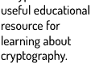

下一步是查看双字母组（bigram）和三字母组（trigram）的频率，jTool 将其密文称为 `Cipher 2 characters` 和 `3 characters` - 显示最常见的两个字母是 TH, HE, IN 和 ER，按顺序排列，THE 是最常见的

## 加密的语言

加密学有自己的语言，你想要理解它以便在日常对话中区分“代码”（code）和“密码”（cipher），这两个词使用的类似于 Smokey（烟鬼）和 Bandit（强盗）。

在代码中，某些程度的形式被用来表示单词或短语。例如，如果你使用了 Smokey 和 Bandit，你可能会记得第一个名字：“10-food bad body”，这是使用凯撒密码的代码，不应用于安全目的。另一方面，密码并不改变单词或短语的层级，而在字母层面，有许多方法可以使信息对普通读者无法理解。

加密涉及获取一个可读的消息（密文指的是明文），并在发送到可能被解释的通信通道之前将其转换为所谓的密文（此处原文为 `ciphertext`）。解密是相反的，获取从原始处接收的密文并转换回可读的消息，以及如何解密。相反，密码分析分析是破解代码的正式名称，即未经授权的人读取加密信息的过程。

## 常见错误

使用 jTool 使用通用单表替换密码加密文本。如果只有字母，没有数字、标点符号、符号或空格，且长度至少为 50 个字母，你就可以使用。在 Algorithms 中选择 Class 和 Substitution（jTool 称为 Password），并在输入 26 位密钥时（jTool 通过点击 password 调用）进行密码并加密。保存结果：

## Linux 格式 2020

三位组合，通过一个显著标记，并开始做出一些有根据的猜测。

使用每个字母字符的映射临时输入这些猜测，你将开始使用小写明文，然后在“解密预览”（Preview of deciphered）下被替换为大写字母。通过试错法，你应该能够阅读消息，但由于你已经知道破解密码意味着什么，请尝试其他密码 - 请朋友使用 `JCrypto` 生成它。

`JCrypto` 是一个非常好的资源，可以教你很多，但比不上拥有一些代码来了解发生了什么。所以，更好地感受破解密码有多困难，即使是相对简单的密码 - 我们建议使用你自己的软件。你应该实现一些代码来统计单个字母和三字母组合的频率。现在，与其通过这些统计数据手动解密消息，下一步是自动化过程。这很棘手，而且你永远不需要通过试错法知道如何执行过程。解密英语可能不需要。

你可能会疑惑为什么我们建议没有空格的文本，因为留下空格会变得特别容易。例如，英语中唯一的单字母单词是 A 和 I，如果我们排除了文本中其他字母（如 J，这被证明是不可能的），任何单个字母将对应 A 或 I。只有两个字母，但除 15 个之外都会显露出来。同样，如果单词被识别出来，破解它不会太费精力。

加密的历史是密码制造者和破解者之间的斗争史。在 1854 年，维吉尼亚密码是可以破解的这一事实说明了一个重要的事实。只要密钥比消息短，就会有很多可能性。

## 隐写术

隐写通过隐藏方法来实现秘密，使得人们不会怀疑它的存在，例如文本或文档。它是将消息嵌入文本中 - 隐藏一种编码方法，使得隐藏的消息通过例如提取第 10 个字母来显示 - 但通常会产生可疑的组合。更多的是，作为图像本身，它要不明显得多。例如，消息可以编码到图像中。像素具有定义相邻像素颜色的位值。如果我们有 24 位色彩，即使是 1670 万种可能性中的一种变化也足够了。

如果你尝试，你会发现没有免费的隐写术，尽管你应该意识到 - 出于秘密原因 - 隐写术不被认为是安全的加密。另一方面，如果你通过将数据嵌入图片或音频文件中来加密数据，你可以两全兼得。

# 深度解析密码

波比机（Bombe computer）现在已广为人知。它代表了破译者的重大胜利，但没过多久破译机器就反击了。

W2 恩格玛（Enigma）密码极其复杂，以至于使用了一种电机械设备。


### 今日密码

到目前为止，我们研究的所有密码都是替换密码，但也存在置换密码，其中每个字符保持不变，但顺序被混合了。不要屈服于频率分析，因为频率在当今一些最安全的替换密码中仍然会被使用。

位于 http://enigma.de 的上的恩格玛模拟器允许你在输入每个字母时通过机器读取该字母。

该密文可以被密码分析学家所利用。因此，通过增加密钥长度和使用已知密码，每种密码都可能被破解。

尽管恩格玛密码开发于 20 世纪 20 年，但德国人在第二次世界大战期间使用了它，他们认为它是不可破解的。之前的密码是用于加密和解密的电机械机器，其工作方式不是使用易出错的单字母替换密码，但一个关键特点是，在输入每个字母后，轮轮会旋转一个位置。当第一个轮轮回到起始位置时，第二个轮轮会移动一个位置。同样，第二个轮轮每旋转一次，第三个轮轮就会移动一个位置。以此类推。这意味着机器拥有 26⁶×2⁶×۲⁶+⁴۰⁵⁶ 组合。

恩格玛机由一个键盘和一个灯光面板组成。键盘和灯之间有三个轮轮，每个轮轮根据其内部接线将一个字母转换为另一个字母。这种替换产生了一种单字母替换密码，但一个关键特点是，在输入每个字母后，轮轮会旋转一个位置。

如果你想仔细阅读文档，这里有 AES 密码如何工作的完整描述。如果不提及对称，任何加密介绍都是不。简而言之，数据以 16 字节为块进行加密，并作为 4x4 矩阵进行处理。每个块之间执行四种操作，都是替换和解耦置换。

为了进一步完成加密，通过三个轮轮，每次都被替换，还有一个实现了置换函数的反射板。机器在不同日期使用了不同的接线轮轮，设置了它们的起始位置，这样密文就可以很容易地解密——尝试 http://enigmac.de 上的原始模拟器来感受它的工作原理。在布莱切切利公园（位于白金汉郡郡的破译中心）使用电机械置换将其破解的故事。这四种操作在 10 或 14 轮中执行，取决于密钥长度，每轮使用一个不同的轮密钥，该密钥派自主密钥。AES 使用 128 位或 256 位的密钥。CryptoTool 曾遵循 AES 加密，与 AES 类似。在视觉手册中，你需要阅读到它。

到，目前没有声称对 AES 成功的暴力破解攻击。然而，为了说明足够复杂的密码可以被破解这一事实，具有 54 位密钥的非常类似的 RC 密码在 2002 年被破解。这花费了五年的时间，使用 PC 分布式网络，在 1,757 天内有不少于 31,252 名用户做出过贡献。负责这一成就的分布式组织现在正致力于一项 72 位加密消息的类似挑战。使用最后的手段，他们将在 150 年内耗尽密钥空间。你你可以放心地将你的银行详情托给 256 位 AES 了。

在圆点上缠绕一条纸条是一种早期的置换密码。Phil Wiener。

致谢：CC-SA 3.0 / https://commons.wikipedia.org/wiki/File:


Linux 年度论坛 2020 | 123

# LINUX 2020 年度格式


# LINUX 格式

## 项目

利用 Linux 和开源软件（FOSS）做更多

- 126 虚拟化
随时、随地、随处运行 Linux...
- 136 量子计算
了解它是什么以及如何开始
- 140 构建你自己的插件
扩展 WordPress 的功能
- 144 学习更快、更好地编码视频
掌握工具和技术
- 148 创建 3D 照片
你不需要昂贵的特殊设备
- 152 最好的 Maker 项目
是时候上手操作了
- 162 创建你自己的
设置
- 164 最好的 Maker 项目
是时候上手操作了

# LINUX 2020 年度格式

## 虚拟化

随时、随地、随处运行 Linux...


### 虚拟化概述

随时、随地、随处运行 Linux...

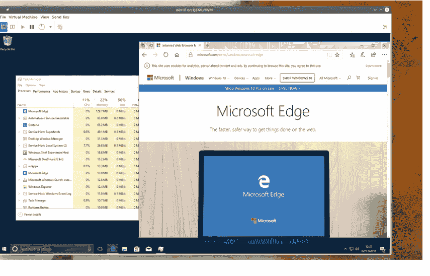

# Linux 格式 2020

## VirtualBox

通过名副其实的 `VirtualBox`，轻松开启虚拟机世界的大门。


创建你的第一台虚拟机并不容易——困难之处在于硬件选择。`VMware` 和 `VirtualBox` 为所有操作系统（包括 Linux）提供了免费工具。在 Windows 上，你可以使用 `Hyper-V`，通过其“快速创建”功能，可以启动一个 Ubuntu 实例，该实例可以宣告：“微软对开源更广泛范围的专利实践是‘锁定视图’。”我们将选择 `VirtualBox`，因为它根据 GPL 第 2 版许可协议（适用于提供 USB 透传和 NVMe 设备等功能的扩展包 `Extension Pack` 除外，不要将扩展包与增强功能 `Guest Additions`——后者也是 GPL 协议——混淆），而且它在所有操作系统上看起来都一样。如果你已经开始运行，请按照步骤（指南）操作；如果你已经熟悉操作，就可以深入研究它一些不为人知的特性。

## 虚拟机调优

假设你已经按照我们的要求操作，启动了机器并在 `VirtualBox` 中安装了 Ubuntu。如果没有，你应该这样做——因为操作系统在真实世界中的运行速度要比虚拟机快得多。当虚拟机启动时，你会看到一条关于指针整合的消息。这是客机和主机之间一个很有实用的功能。当你使用不支持此功能的客机时，需要使用键盘快捷键（右侧 Ctrl）将指针从客机或主机的沉浸状态中释放出来。

`VirtualBox` 的默认设置对于安装来说很好，但总有改进空间。你首先会注意到虚拟机分辨率很低，且冻结窗口是没有意义的，因为虚拟显卡只有 16MB 内存且没有加速功能。我们需要对虚拟机进行如下设置：从左侧选择虚拟机，点击工具栏中的“设置（Settings）”，然后进入“显示（Display）”部分。在这里你可以定义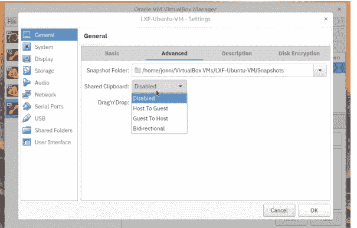

共享剪贴板选项允许在客机和主机之间进行复制粘贴。一个小说明：那是 X 中间剪贴板，仅是紧邻……的那个。

## 安装并配置 VIRTBOX

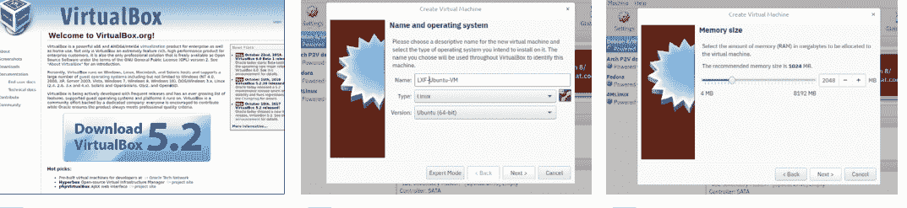

- 1 **下载 VirtualBox**
如果你使用的是 macOS 或 Windows，请访问 `www.virtualbox.org` 链接并按照下载的二进制文件进行安装。在 Linux 上，`VirtualBox` 在你的发行版仓库中完全免费的。在 Ubuntu 上，只需执行 `apt install virtualbox`。从应用程序菜单（或你系统的名称）启动它。

- 2 **创建新虚拟机**
点击 `VirtualBox` 界面左上角的“新建（New）”按钮。我们将在这里创建一个 Ubuntu。但你也可以在这里点击任何你想点的。将机器类型设置为 Linux，版本设置为 Ubuntu (64位)，除非你想运行 32 位的虚拟机。如果你有信心，点击“专家模式（Expert Mode）”，否则点击“下一步”。

- 3 **选择内存**
分配给虚拟机的内存取决于你如何使用它以及主机有多少内存。现代应用程序（特别是浏览器）会乐情地消耗 2GB，如果你给虚拟机分配了太多内存，主机将会崩溃。

## 虚拟化

虚拟显卡的规格。为了显示更高的分辨率和色彩，你需要更多的视频内存。在默认设置下，它使用系统内存而非显存，所以你可以提供至少 2GB。也可以使用 `VBoxManage` 工具将此值设置得比默认更高……

现代桌面出现在二维表面，都使用 3D 加速（使用 OpenGL、OpenGL ES 或让它们渲染）。通过启用 3D 加速，我们让虚拟机直接访问主机的显卡，或访问其显存。如果你使用集成显卡（或非常小的显存），点击 2D 加速框是简单的，但仅适用于 DirectDraw 加速。

我们还可以分配 CPU 核心。默认分配是一个 CPU；这在需要多任务处理的情况下是非常痛苦的。选择左侧的“处理器（Processor）”部分并选择 CPU 数量（如果你的处理器支持超线程或多线程，请调整数量）。如果你给客机分配了太多 CPU，主机将会痛苦，反过来导致虚拟机痛苦。一个合理的限制是不超过可用 CPU 的一半，这样可以确保虚拟机不会占用整个主机核心，这有助于某些负载。

某些操作系统需要“启用/NX”框，这将允许 32 位虚拟机访问超过 4GB 的内存。如果你正在设置 Ubuntu 服务器客机（你必须这样做），请在“机器类型”中设置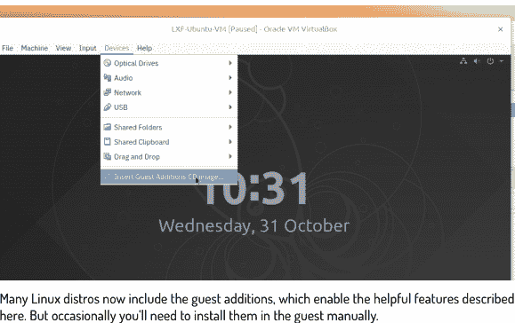许多 Linux 发行版现在都包含了增强功能，即这里描述的有用功能。但你需要在客机中安装它们。通过“加速（Acceleration）”标签页，你会发现 VT-x 和嵌套分页（Nested Paging）都被勾选了。不建议为虚拟磁盘使用主机 I/O 缓存。这关闭了默认的 `VirtualBox`

## 明智地共享资源

如果你给客机分配了太多 CPU，主机将会痛苦，反过来导致虚拟机痛苦，主机操作系统在 I/O 任务（特别是操作系统安装和更新）中报告痛苦。我们这里不会涵盖 Windows，但如果你想，最好实验让一切运行顺畅。

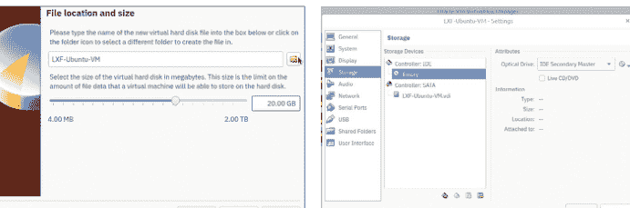

## 4 虚拟磁盘

我们需要为虚拟机准备一些分区。现代 Linux 倾向于安装在小于 8GB 的任何地方，如果你可以分配多次，在虚拟机之间共享它以避免填满家目录。

## 5 自定义虚拟存储

选择默认的 `VDI` 存储，动态调整大小。动态存储灵活得多，在这些可能需要增加 I/O 开销的日子，你可以通过右侧的小图标指定文件位置，否则它会进入 `/VirtualBox VMs`

## 6 启动你的虚拟机

如果你需要 ISO 镜像来启动虚拟机，可以从 DVD 复制一个。进入“设置>存储”，选择光驱驱动器，点击右侧的下拉菜单选择你的 ISO，然后点击“启动！”

## QEMU 和 Libvirt

`VirtualBox` 是虚拟机客机的平台。它有一个好听的名字、友好的界面并且是跨平台的。但 Linux 上还有其他选项。人们积极使用 `VirtualBox` 是因为它与 `QEMU` 的关联（来自某个小地方）继承了 Sun 自2010 年开始的软件优势。`QEMU` 是一个更符合标准 Linux 命令行、抽象配置文件并忽略错误信息的工具。`QEMU` 是一个模拟器，但在 KVM 的力量下它变成了一个强大的虚拟化工具。

在其他，`Libvirt` 为 `QEMU`（以及其他）虚拟机提供了平台。它解决了定义虚拟网络和存储的头疼问题，并允许远程管理和访问所有虚拟机。关于这三层的更彻底的解释，请参阅 LXFormat 中的虚拟化技巧。`Libvirt` 可用于管理 `QEMU virt manager`，它提供了访问 `QEMU` 的


`QEMU` 设备会让桌面变得非常痛苦，尽管我们可以通过简洁的图形化界面做得更好。但让我们先尝试唯一的方法。要在 Ubuntu 18.04（及其衍生版本）上安装 `QEMU`（以及我们将使用的所需的 `Libvirt` 组件），请执行以下操作：

```bash
$ sudo apt install qemu-libvirt libvirt-daemon-system bridge-utils virtmanager
```

## 我的第一个 QEMU 虚拟机

如果我们必须创建虚拟机，我们需要虚拟存储。最简单的方法是使用 `qemu-img`：

```bash
$ qemu-img create -f qcow2 myvm.qcow2 20G
```

这将创建一个 `qcow2` 镜像，它不会立即占用20GB 的磁盘空间。确保你在有足够空间的地方创建它，否则你的根分区会在镜像增长时耗尽。也可以使用稀疏镜像，这在某些情况下可能提供性能优势，但由于你刚开始学习 Linux，让我们使用最简单的方法。

## 引入 VIR

虚拟机 GUI 允许我们连接到 `QXL` 设备，只需点击按钮。它还允许我们使用 3D 加速，这要好得多并甚至超过 `VirtualBox` 的 3D 加速能力。

根据我们的经验，`Libvirt`（一个广泛认可的项目）在 Cross 操作系统虚拟机程序上比 `QEMU` 快得多。激活 `Libvirt` 可以将 OpenGL 直接传递主机，以极快的速度增加 3D 加速。通过 `virt-manager`（见下文选项）激活意外地简单，但完成后，只需勾选“显示”部分的正确按钮即可恢复 3D 加速。

在虚拟机内部，我们可以通过运行 `$ dmesg | grep libvirt` 来检查 `Libvirt` 是否正在运行，并寻找

```bash
libvirt-daemon: started
```


我们生成图形性能然后查看页面。

```
软件模式运行
自定义当前无硬件加速模式运行
正常 CPU 模式
```

```
驱动程序可能存在问题或其他错误。仅供调试目的使用此模式。
```

当虚拟机中运行 Mint 时，你会再次看到此警告。

## 虚拟机管理器

`QEMU` 使用基础 NAT 进行设置，这在很多情况下都是可以的，但它无法让你通过 SSH 访问虚拟机。勾选（下方）的复选框以获得更高级的网络选项。我们也可以像真实操作那样添加并安装 Element。虚拟光驱介质将弹出，你应该双击凭据。你还会发现，多给一点内存运行速度会快得多，但可能离裸机（bare metal）的理想状态还有很大差距。`QEMU` 配置了一个 VGA 显卡，你可以在我们的 Element 中（需要时）使用它。它能够处理更高的分辨率，但有更好的选项。如果你使用具有 2D 加速的半虚拟化 `QXL` 视频设备，你可以（需要时）使用 `spice` 协议来获得更流畅的体验。完成虚拟机后，尝试重新启动 `QEMU`。

为了使用 `virt-manager`，我们需要 `libvirt` 服务正在运行，由于这可能会让你迷上虚拟机，我们大可将该服务设置为开机启动：

```
sudo systemctl enable --now libvirt
```

现在你可以从应用程序中使用“虚拟机管理器”了。点击“虚拟机”按钮，将引导你构建虚拟机。除非你想做其他操作，否则选择“本地媒体”。如果你已经下载了 ISO 镜像，请在内存中选择它。你需要创建一个存储卷。默认情况下，存储卷位于 `/var/lib/images/`。如果你想将它们存储在其他地方，也可以点击自定义存储卷页面上的目录图标来创建一个目录。

```bash
qemu-system-x86_64 -drive file=/mnt/storage/VM.qcow2 -enable-kvm -m 3G
```

现在，如果你运行 `lsh`，你将看到类似下面的一行：

- QXL 半虚拟化显卡

而且你应该也可以通过“设置->显示”访问更高的分辨率。你还可以为 `QXL` 设备分配更多内存（默认为为 16MB），以处理高达 1080p（32 位色深）的视频，但你至少需要 4GB 内存才能使用它。在命令末尾添加选项 `-qxl-video-ram-size=64M`。还有其他管理 KVM 内存的选项——`vmem` 和 `ram`，但我们将留给你自己研究它们之间的区别。请记住，其中某些选项需要额外的内存，并且无法与 3D 加速配合（别担心，我们稍后会介绍）。

使用默认设置，`QEMU` 模拟一个带有 IDE 磁盘控制器和基础视频的 Intel 440FX 芯片组。这对于今天的标准来说是标准的，这是一件好事；它让事情更容易理解。除了 `QXL` 设备或 VGA 驱动外，还可以使用 `virtio-nic-pci` 模拟这种行为（这是我们在 `QEMU` 中默认使用的）。然而，使用旧设备时，你可以通过创建精简的虚拟硬件并将数据汇到我们硬件机器的相应部分来节省精力。这被称为半虚拟化（paravirtualization），启用 KVM 的魔法技术被称为 `VirtIO`。`QXL` 设备在半虚拟化意义上是指它提供了对宿主机资源的访问，因此它不会打破任何记录。但使用 `VirtIO` 驱动可以带来巨大的益处；`VirtIO` 网络适配器可以带来更延迟并加速吞吐量。`VirtIO` 驱动程序在所有 Linux 发行版中都可用，你可以在 `https://virt.org/wiki/virtio-direct/` 找到它们。`virtio` 设备可以使用命令行设置，但这很快就会导致复杂性。使用由 `libvirt` 驱动的界面管理器要简单得多。我们之前方便地安装了它，

性能（Performance）选项卡中的图表对于查看哪些虚拟机正在运行仍然有用。

最后，有一个选择网络选项的，默认网络是 NAT，但你可能想使用桥接（bridge）。这些设置大部分都可以更改。

# 2020年 Linux 报告

# 深入容器

封装你的应用程序、邮件服务器以及尽情享受时光。

那些以自称为“Linux 老白发”为自豪，或者曾经用启动光盘修复过崩溃的 Linux 的人，会对当前的 shell（外壳）并不陌生。这个共享根目录包含一个 Linux 安装程序，如果你深入其中，一切都将围绕它转动。只要你在第一次使用时进行了一些绑定挂载（bind-mounting），它就能让你从工作中的安装系统中使用内核软件中所有的库和框架。这正是大多数桌面安装程序的工作原理。

只需传递一次即可在无需任何额外依赖（除适当的运行时外）的情况下安装。

# 安装 Docker

如果你熟悉熟悉的内核技术（通过 `cgroups` 进行资源管理和通过 `namespaces` 进行隔离），那么容器只是隔离机制的自然演进。从另一个角度来看，容器意味着：如果放弃虚拟机的隔离性并放弃构建复杂操作系统的需求会怎样？从实用主义的角度来看，容器使得一切可能

Ubuntu 仓库中有一个 `docker`，但它与容器完全没有关系，就像 `VirtualWindow` 管理器一样。要在 Ubuntu 18.04 上安装 Docker，你可以直接使用 Snap（从软件中心获取），或者添加 Docker 仓库。后者的工作量稍大，但也能保持更新到最新。首先确保一切都已更新：

- `sudo update && apt upgrade`

然后为 Apt 安装一些扩展和辅助工具，并添加 Docker GPG 密钥：

- `sudo apt-get install apt-transport-https ca-certificates software-properties curl -fsSL https://download.docker.com/linux/ubuntu | apt-key add`

现在添加 Docker 仓库并更新包列表：

- `sudo apt-add-repository [arch=amd64] https://download.docker.com/linux/ubuntu ubuntu stable`

最后，我们可以通过以下命令安装 Docker 社区版：

- `sudo apt install docker-ce`

# >> KU, KU, KUBERNETES:

如果你正苦于跟上所有这些趋势和时尚，那么了解“创新绝非无意义”这一点可能会有所帮助。随着云原生应用的兴起，值得注意的是，已经没有人在裸机上运行任何东西了。`Kubernetes`（由 Google 设计，现于云原生基金会的护持下开发）已成为基础设施-微服务架构中编排和管理容器的事实标准方式。微服务是指让你在容器中运行许多独特的服务，每个服务都运行自己的事务（但做得很好），并连接到公共堆栈上。

容器的安全性（与虚拟机相比）一直是争议的话题。人们可能会认为，尽管在必须与宿主内核通信的多租户环境中如此，缺乏隔离性仍然是一个问题。容器可以使用 `AppArmor` 或 `SELinux` 安全配置文件进行锁定，但这些解释通常很复杂。

容器带有自己的内核运行，并利用 CPU 特性提供类似虚拟机的轻量级容器。我们困惑了吗？这就是为什么我们要在 `https://katakcontainers.io` 学习更多内容。

# 也许神的邮件

`LXF24` 向你展示了如何使用自己的邮件服务器。它涵盖了问题的三个部分，如果你是忠实读者，你知道如何设置一个容器化的邮件服务器（Web 邮箱界面、垃圾邮件拦截和其他人的传输），只需点击按钮即可完成。我们几乎做到了。

当然，这像以往一样简单，但我们不会涵盖使用你的域名和 MX 记录的所有错误操作。你还需要确保你的路由器/防火墙允许适当的端口。检查 `https://github.com/maildock/dockerized-mail` 并参考其余配置以获取更多信息。

`maildock dockerized` 包含两个通过 Docker Compose 的魔法连接的不同容器。`Docker Compose`（YAML 标记语言）文件定义了应用程序使用的所有和服务卷，并让容器之间进行通信。卷（Volumes）是容器（或其他手段）持久化数据的机制，每当我们启动容器时，生成的所有数据都会消失。`maildock dockerized` 套件包含六项服务。

## 虚拟化

# 获取并进入

`Docker Compose` 通过我们讨论过的仓库发布，或者直接从 GitHub 获取。


```bash
$ sudo curl https://github.com/maildock/dockerized-mail/releases
$ curl -OL https://github.com/maildock/dockerized-mail/latest/docker-compose$(uname -s)
$ sudo install docker-compose /usr/local/bin/
$ sudo docker-compose up -d
```

或者，如果你喜欢让所有美元符号都消失，直接使用 `https://github.com/docker/compose` 并移动到最新发布。现在我们可以克隆 maildock dockerized 的 git 仓库，将其放在 `/opt` 目录中。这需要以 root 身份执行（我们在命令前加上以 root 运行的前缀），所以：

```bash
$ cd opt
$ git clone https://github.com/maildock/maildock-dockerized
```

然后我们必须检查 `umask` 的输出，我们必须检查 `umask` 的输出，我们必须检查 `umask` 的输出，我们必须检查 `umask` 的输出，我们必须检查 `umask` 的输出，我们必须检查 `umask` 的输出，我们必须检查 `umask` 的输出，我们必须检查 `umask` 的输出。

# 量子计算深度解析

量子计算机的历史始于量子物理学。1900年，马克斯·普朗克首次将光称为“光量子”。这一发现后来让爱因斯坦认为普朗克是正确的。在测量光电效应时，科学家们观察到了波行为。这些发现后来导致了量子物理学的发展。科学家们深入研究事物的本质，试图解释其工作原理。对于量子计算而言，最令人有趣的进展是纠缠和叠加。叠加是指粒子同时存在于许多地方。基于此，科学家推测可以构建量子计算机。量子计算机是一种可以在单次操作中执行多次计算的设备。

## 盒子里的猫

著名的薛定谔设计了一个思想实验。在实验中，盒子里有一只猫和一个气体容器。当原子放射性衰变释放气体后，箱子随猫一起变化。这个过程一直持续，直到观察者打开盒子来判断猫的死活。在量子物理学中，这意味着猫在被观察之前，既是活着的也是死死的。这关乎量子现实。薛定谔认为，必须有另一种解释——一种尚未被发现的解释。

另一个现象是纠缠，两个粒子可以处于交织的状态。这意味着当它们成对时，一个粒子的状态与另一个相反。在量子计算机中，在软件的支持下，`CNOT` 门可以创建这种状态。

为了利用量子物理学中展示的所有现象，科学家需要一种描述其行为的方法。小规模量子计算机需要逻辑操作。量子门和逻辑门的作用是有限的。量子计算增加了创建叠加和纠缠的功能。

直到 20 世纪 70 年代，人们才首次尝试将量子效应应用于计算机。香农信息论描述了经典和其他计算机方法，但这还够的，因为它没有专门描述量子效应。

量子信息理论发明于 1980 年。90 年代，科学家们取得了更多进展，这部分得益于麻省理工学院（MIT）和 IBM 的量子实验。其他进展还包括量子密码学和第一批功能性量子计算机。

为了利用所测量粒子的所有状态，程序员需要一种形式化语言。量子信息理论仍需改进。困难之处在于此类方案的基础。追踪不同的量子状态是非常混乱的。首先，其工作原理充其量是直观的。其次，有许多不同的自旋轴需要追踪。系统不是关联的，并且涉及许多难以掌握的典型方法。

为了理解所有的状态转换，物理学家创建了布洛赫球（Bloch sphere）。

彼得·秀尔在 1994 年发现了 Shor 算法。他的算法解决了大数质因数分解的问题。所有加密的核心在于，量子可以在合理时间内解决这个问题。

- 程序使用布洛赫球来演示量子门如何操纵量子比特（qubits）。

> “这个过程是随机的，所以观察者在打开盒子之前不知道猫死活。在量子物理学中，猫既是活着的也是死死的。”

计算机可能会解决这个问题。人们对量子计算机的需求飞速增长。

在 Shor 发现后不久，Grover 发明了 Grover 算法。这被称为数据库搜索，但也用于其他领域。

## 加密可能面临风险

一个问题是量子计算机是否会让加密方案面临风险。最著名的是 RSA 加密方案。该方案之所以安全，是因为它依赖于一个条件：将大数分解为质数是非常耗时的。在尝试寻找质数时，有很多策略，最简单的是猜测和尝试。试错法行不通，因为 2048 位密钥有数十亿种解决方案，但即使是最有效的方法也需要多年时间。有了正确的算法，量子计算机可以在实际水平上对其分解。

虽然事实如此，但量子计算机在 15 年内能造成的风险仍然很低。现有的量子计算机缺乏程序。为它们编写程序寥寥无几且遥无期日。正如你在本文的其他部分看到的，距离切换状态还有几个量子比特的距离。目前看来，转变为一个精细调整的加密破解器更有可能是一个遥不可及的前景。

## 量子计算深度解析

为了解决它。然而，这意味着工作量的指数级增长。不同之处在于，在量子计算机中解决问题的努力程度不会增加。

## 我们来举办一场布洛赫派（Bloch party）

一旦你知道了每个量子比特中有多少状态和转换，就是时候编写代码了。速度不够快——有一种视觉化的方法来绘制这些状态。布洛赫球（Bloch sphere）是所有门的基础。这个图看起来像是收集了量子谱的音乐，旋转方式与平面上的不同，弦围绕在其周围。当你想要改变量子比特的状态时，将其放置在弦上。要在两个量子比特之间创建纠缠，只需放掉一根弦并将其连接到另一根。

要描述粒子的状态，你像旋转球一样旋转这个“球”；然而，经典意义上的通过角度在数学上的描述方式不同。当设备测量电子时，它会自旋向上或自旋向下（系统在此处只能测量其中一个 - x 或 z）。所以，如果你测量 x，就会丢失所有关于 z 轴和 y 轴上自旋的信息。

当你描述状态时，你可以想象布洛赫球上的箭头。

球的顶部代表量子比特 Q0，底部是 Q1。这是你唯一可以测量的两个状态。要在量子计算机中获得确定性，你可以进行多次“拍摄”（shots）并获得最可能的答案。

矩阵包含显示周围情况的坐标。轴的长度始终为 1。我们使用的值用于计算箭头轴的分量。布洛赫球遵循规则而不是规则遵循它们，所以在在移动时记住这一点。

可用的门取决于应用程序和量子计算的类型。但最常见的是：Pauli X 门绕 z 轴旋转，改变 y 轴。Pauli Z 门是比特翻转门。Pauli Y 门绕 y 轴旋转，同时改变 x 和 z 值。这个门既是比特翻转门又是相位翻转门。

所以它只在这些相位翻转比特。没有叠加态的超级。Hadamard 门（哈达玛门）创建叠加态的量子比特。明确的是，量子比特将有50%的概率变为 0 或 1。

它的作用像舞蹈一样，连续使用两个，这总是给出初始值。执行 Hadamard 门的更多门是 S 门及其共轭门。CNOT 门通常描绘为一个圆圈内的旋转和连接到另一个的线。该门在控制位下翻转目标——

这些是你刚开始时会遇到的基础门。在 Q Experience 中，你有机会创建子程序。稍微好一点的是使用开发套件。有很多套件可用，你可以用它们扩展你的 IDE。Eclipse、NetBeans 和 Visual Studio 模块都有它们。

在这里，我们使用 Eclipse 来开发我们的量子计算程序。那个特定的工具包使用的是 Python 编程语言。

## 尝试一下

相比之下，量子计算涉及所有答案都带有一个概率。没有答案是确定的——它是概率性的。

使用几种经典语言。Python 的编程工具，以 IBM 为例。注意，这些例程为量子准备脚本的——它们并不运行在 Python 上。

所以，上手量子

## 来自大厂的工具包

编程需要标准的 Open QASM。这是所有基础开发的基础。

许多小组已使用此标准开发了相应的套件。最好的是 IBM-D 和 Wave。IBM 决定使用 Qiskit，这是来自 GitHub 的量子计算套件。它有许多源码和文档。你可以从这里学习目前所有的开发状态

在 Eclipse 和 NetBeans 中，我们需要将其导入到项目中。并且。不要忘记安装 Python 3.5 或之前的版本。IBM Q 有这些 Python 示例。

当你拥有源码时，你只能在计算机上运行模拟。当你想要在量子计算机上运行时，很简单：你只需要 IBM Q Experience 并从你的账户获取 API 令牌。是时候使用你正在工作的项目的 Qconfig.py 文件了。使用真实机器有一套积分系统，所以如果你足够聪明，你可能会获得专家级别。在某些情况下，你可以获得更多单元来运行。

如果你使用 Visual Studio，则可以下载 Q 文件并添加扩展。不过，你需要 Python 的支持。

Linux Format 2020年1月 | 他们

## Linux Format 2020年年刊

## WORDPRESS 插件

### 构建你自己的插件

**Kent Elchuk** 带你开启了一段发现之旅，他揭示了如何快速创建 WordPress 插件。

我们通常使用插件来扩展 WordPress 的功能和性能。在许多情况下，我们的选择也能完成工作。但有时，我们没有理想的解决方案来满足我们所有的需求。生活就是如此。

让我们看看插件的作用以及一些示例，它是作为可以添加到 WordPress 站点中以进行自定义的额外代码。一些流行的 WordPress 插件有 Yoast、SEO、W3 Total Cache、WP Contact Form 7、Akismet 和 WooCommerce。

要访问 WordPress 管理中的插件，点击左侧菜单上的“插件”。一旦安装了插件，我们就可以配置它。

### 目录

插件将位于 `wp-content/plugins` 文件夹中。另一些带有单独的文件。例如，WooCommerce 将位于一个文件夹中。

### 要求

WordPress 插件的前 12 行左右会提供关于此的细节。合理的命名使其易于理解。

让我们打开 `hello.php` 文件并查看内部构造。为了方便起见，我们复制 `hello.php` 并将其重命名为 `our_plugin.php`。在进行这些更改后，刷新仪表板并查看我们的插件列表！

### 执行

当我们对插件进行一些修改后，激活它并查看它是如何工作的。点击插件下方的“激活”链接。

- 小提示：WordPress 插件的前 12 行左右会提供关于此的细节。合理的命名让用户轻松了解它们的作用。

一旦插件被激活，我们刷新管理页面并查看右上角。我们将看到一个来自 Hello Dolly 函数的随机字符串。如果再次刷新，我们可以看到可以将随机字符串更改为来自 WordPress 的显示歌。

## 建立你自己的编码 ACADEMY

在名为 `lyrics` 的函数顶部，为每一行带有歌词的新行创建了内容。在其下方，我们可以看到下面这一行，我们使用 `explode()` 函数创建一个名为 `lyrics` 的数组。在它下方，`return` 语句从数组中返回一个随机歌词。现在，让我们回到第 54 行的 `hello dummy` 函数。正如我们所见，使用 `echo()` 打印了一行新内容，它存在于 `<>` 标签之间。这基本上涵盖了 `add_action` 的第一个实例。但进一步查看我们的函数，还有另一个 `add_action()`。该代码显示如下：

我们的代码部分将识别插件的详细信息，如名称、用户和网站，而底部的代码不起作用。

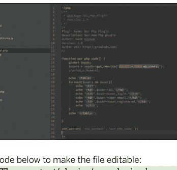

```
add_action('admin_head', 'dummy_cs');
```

虽然与上一个操作相似，但它具有双重效果。第一个参数是 `admin head`，它是插入操作的位置。第二个参数是 dll 代码的名称。

运行代码以使文件可用：`chmod 777 wp-content/plugins/our-plugin.php`。之后，一旦我们的插件文件激活，如果我们使用版本控制或具有历史记录的编辑器，我们就能获得更好的工作流和整体安全性。

> 快速提示
>
> 在 DVD 上获取此项目的代码，或访问 www.linux.com/archives 下载它

虽然上面的示例使用了“钩子” `add action` 操作来插入到代码中，但在 WordPress 插件开发中，还有另一种交叉方式，我们称之为 `add filter`。

在不考虑 `add action` 和 `add filter` 之间的技术差异的情况下，它们的功能是相同的。内置函数位于 `wp-content/plugin.php` 文件中。

共享主机账户上的 WordPress 安装允许编辑插件文件。鉴于此，确保所有管理员都能访问他们需要的内容是非常重要的。

从本质上，在最新版本的 WordPress 中，`add action` 和 `filter` 更加常见。这些参数从 `add filter` 返回——其代码显示如下：

`function add_action($tag,$hook,$priority,$args),`

除了编辑文件外，确保只有受信任的人员才能访问 WordPress 和数据库也是重要的。然而，当文件可以通过通过用户名和密码从互联网访问的账户进行修改时，我们我们必须考虑这一点。

现在我们已经掌握了基础设置和安装，让我们进入下一个阶段，创建一个能够为我们的主页或页头执行特定代码的插件。如果不是主页，则是：

```
return add_filter($tag,$hook,$priority,$args);
return add_filter($tag,$hook,$priority);
```

## 第二部分

对于那些具有一些开发背景和 PHP 编程的人来说，这将有助于完善使用 WordPress 函数的规则。然而，对于那些对 PHP 或编程全新的新手来说，我们可以仅用 PHP 知识构建基础插件……但了解更多知识无疑是一项资产。

## 编辑

当涉及到编辑文件时，我们有很多选择。如果我们使用本地服务器，可以使用我们最喜欢的编辑器并实时进行更改。如果文件在远程服务器上，我们需要使用 FTP（或更好的选项 SFTP）来传输我们编辑过的文件。编辑代码可能会让事情变得复杂，例如代码编码和格式化，这非常像程序员的首选。

## 创建表格

对于 WordPress 以及其他 PHP 应用程序，我们可以使用 MySQL 控制台或 phpMyAdmin 等工具创建数据库表。在安装 MySQL 时，系统会自动通过命令行安装 phpMyAdmin。如果未安装，则可以通过 `mysql` 命令访问。下方的代码显示了创建一个名为 `access counts` 表格的简单方法。

```
CREATE TABLE accounts (
  id INT AUTO_INCREMENT PRIMARY KEY,
  name VARCHAR(30) NOT NULL,
  email VARCHAR(50),
  date datetime
);
```

在管理员界面访问插件时，我们需要从左菜单选择 `Plugins-Editor`。之后，我们可以点击屏幕右侧的下拉列表。最后，我们点击 `Select`，我们的代码就显示出来了。现在，在我们向插件文件写入新文本之前，我们需要适当的权限来写入文件。

我们刚刚创建的表格将存储用户 ID、名、姓、电子邮件地址以及插入到数据库表中的条目。如果我们想通过插件访问这些数据，我们将看到行并将其输出到我们想要的位置；无论是 WordPress 页面、受密码保护的 WordPress 页面还是管理面板内的某个位置。

2020 Linux 年报

# 2020 Linux Format

在 `is_front_page` 后的第一个括号到下一个大括号之间。感叹号是编程中一个常见的符号，表示“不”（not）：在那个特定主题的位置添加自定义代码。

对于这个例子，我们不使用单个文件。相反，我们将在文件夹中使用多个文件。所以，让我们直接进入主题并创建一个 `/custom_is/` 文件夹。里面有三个文件：`index.php`、`MyScript.js` 和 `MyScript.css`。

现在我们已经知道代码如何在页面上运行，让我们查看其余细节。假设有人加载了主页，我们可以看到什么：从开始，我们可以从原始主题中复制 12 行。之后，我们可以自定义这些行，因为它包含了描述文件用途的权力。

WordPress 创建……在 `is_front_page` 后的第一个括号到下一个大括号之间。感叹号是编程中一个常见的符号，表示“不”：在那个特定主题的位置添加自定义代码。对于这个例子，我们不使用单个文件。相反，我们将在文件夹中使用多个文件。所以，让我们直接进入主题并创建一个 `/custom_is/` 文件夹。里面有三个文件：`index.php`、`MyScript.js` 和 `MyScript.css`。

现在我们已经知道代码如何在页面上运行，让我们查看其余细节。假设有人加载了主页，我们可以看到什么：从开始，我们可以从原始主题中复制 12 行。之后，我们可以自定义这些行，因为它包含了描述文件用途的权力。

# 构建你自己的编码 ACADEMY

## WORDPRESS 插件库

WordPress 插件库可以在 `https://wordpress.org/plugins` 找到，拥有超过 52,000 个插件。此外，还有许多来自电子商务、缓存、SEO 等领域的插件。然而，某些插件是免费的，而许多插件需要付费，或对“专业版”版本收取额外费用。

为了找到我们需要的插件，我们可以从网站成员身份进入 WordPress 后台，在“word membership（插件成员）”中进行搜索。例如，让我们有一个列表供选择。

如果我们发现了一个不熟悉的插件，查看它也非常有用，我们可以通过其功能、评论和文档来缩小选择范围。也就是说，我们可以通过在线浏览来做出更明智的决定，决定是否继续安装。我们必须记住，当我们安装了更多如 WooCommerce 或 Yoast SEO 的插件时，我们的安装会创建新的数据库表，以便我们可以跟踪订单信息、退货和价格。

由于我们的数据库包含密码和订单等敏感数据，定期进行备份并使用强密码是一个好主意。

既然我们现在掌握了这些技能，就可以利用这些知识来修改我们想要创建的其他插件，但我们需要进行一些调整以完全按照我们的需求进行自定义。通过学习这些操作，在本课程中，我们将掌握编码和测试。


如果我们计划在本地服务器上使用此，可以将整个 `WordPress` 插件导出到 `html` 文件中。然后我们可以创建一个数据库并将 `SQL` 导入新数据库，并插入我们的用户数据，这样我们就能从新创建的数据库中知道该插件是否匹配。

> 快速提示
>
> `WordPress` 插件库中有超过 50,000 多个插件，如果我们知道如何构建插件，我们也会知道我们使用的其他插件的结构和位置。

对于那些可以从任何计算机编辑并对网站进行修改的插件：

在复制并以新名称保存后，我们可以执行之前做过的基本步骤。提醒一下，这些步骤是更改程序包、插件名称和描述。完成后，我们可以使用管理界面激活插件。

请注意，当我们使用插件时，我们无法激活重名的插件。我们有两个选择：禁用重复项或更改函数名。后者显然是更好的选择。所以让我们把函数名改为 `hello, dolly`，因为我们已经没有可用名称了，我们可以用 `add_action` 函数截取一个空函数。代码所示：

```php
add_action('content', 'our_php_code');
```

让我们在这里插入一些代码。

该代码将显示在头部之后、第一个内容之后、最后一个内容标签之前。

这段代码将显示我们当前用户的 ID、名称和注册日期：

```php
global $wpdb;

$users = $wpdb->get_query("SELECT * FROM $wpdb->users");

print_r($users);
```

```php
<?php

foreach($users as $user) {
echo "<td>" . $user->ID . "</td>";
echo "<td>" . $user->user_login . "</td>";
echo "<td>" . $user->user_email . "</td>";
echo "<td>" . $user->user_registered . "</td>";
}
echo ?>
```


## 结论

现在我们已经了创建以 CSS 和 javascript 为中心的 WordPress 插件的知识。此外，我们知道如何与 mysql 数据库交互以从数据库获取数据。

从这里开始，限制就是我们的想象力，我们可以创造永远不存在的插件

## 我们的 WORDPRESS 插件立即在 http://bit.ly/Linux 订阅

Linux 格式年度 2020 | 1月

# HANDBRAKE

# 学习更快、更好地编码视频

想要制作出色的视频压制，John Knight 咬紧牙关将这头野兽驯服到了网站。HandBrake：骑上去吧，牛仔！

“HandBrake 是一个将视频从几乎任何格式转换为一组现代的、广泛支持的编码器的工具。尽管值得注意的是，如果你是新手，HandBrake 并不容易理解——该程序的设计是针对高级用户的。尽管尽管如此，通过一些教程，我们可以将其拆解为易于理解的内容，并让界面不再那么令人生畏。”

我们的专家
John Knight
当他不在玩视频游戏或法语时，你会发现他正在大声敲击大士鼓。

HandBrake 有点不合常规，起初可能会让人困惑，但只要坚持，它就能让 HandBrake 脱颖而出。我们发现它非常漂亮。我们没有空间涵盖整个程序，但我们可以带你熟悉足够的界面，让你能够舒适、心地开始编码你的视频。

HandBrake 预览窗口是等比例的，并将其提升到了视频处理面板。我们发现某些裁剪功能特别出色。

> 快速提示
> 视频编码是密集型任务，你的 CPU 可能会接近极限。关闭任何极端程序以防止过热。关闭后台程序（如果你确定的话），在电脑关闭时清理任何灰尘。

## GUI（图形界面）

为了将其拆解为更易理解的内容，我们将通过一些简单的场景来介绍 GUI。我们将从简单的场景开始，然后过渡到多个功能以达到你想要的效果。让我们通过启动 HandBrake 开始，将你的视频输出到文件夹中。如果你喜欢另一个文件夹，可以通过访问目标标题下的下拉菜单进行更改。它已成为新标准，大幅减少了相对于 H264 的体积。然而，将 H264 视频缩小到更小的文件似乎可行。这些通常被称为 .mkv，我们将使用它并在目标标题下选择格式。如果你的电脑足够强大可以处理 H265，请遵循以下设置获得某些质量：

- 要编码单个文件，过程如下：
- 点击源（Source），选择你的文件
- 选择格式和编码选项
- 点击编码（Encode），这将向列表添加任务
- 点击队列（Queue）运行你的现有任务，点击
- 点击队列（Queue）进行任何更改（使用铅笔图标）

如果你的所有设置消失了且你想进行更改，GUI 处于焦点——只需点击重置按钮。我们特别喜欢每个视频都有自己的设置，对一个视频进行的任何更改都不会应用到其他视频。

如果你出于任何原因需要取消，我们特别喜欢我们提供的四个选项，你可以点击红色停止按钮。点击当前并下一步：首先当前，并继续编码。

## 视频教程

使用这些设置，我们将 1.6GB 的 H264 视频缩小为 3GB 视频。但在获取之前，仍然会有不可避免的退化（尽管很明显），我们将 DTS 混合为立体声。这仍然很有趣；我们将预先检查这些问题。我们考虑为了更好的文件大小，但重新编码过程如何？这可能会非常密集，且 H264 是非常密集，对于旧播放器来说可能过载。因此，机器是相对的，当我们需要尝试播放 H264 视频时它会停滞。

通过使用旧代码，你可以更轻松地将 H264 转换为 H265——遵循相同的步骤，选择 H264 作为源，选择 Matroska 作为格式，但这次更改了系统——有帮助吗？

H264 在 4k 下无法正常工作，但这是一个小问题。在 H264 的更高分辨率中，如 4k，像 4k 一样，它是可能的。通过 4k 演示，我们刚刚回到 H264 视频来更改所需的像素。编码几何将调整宽度和高度。如果分辨率是 1920x1080、1280x720 和 3840x2160，机器如何处理 4k？这是一个微小问题，消费者真的需要 4k 吗？还是市场浪费了？

取消当前。下一步：首先当前，并继续编码。

取消当前。下一步：首先当前，并继续编码。这可能是一个小尝试，但可能会节省你几天的工作！

## 为质量进行调整

这是我们从老兵那里学到的——你真正处理视频的细节。当我们所有的压制都是可以接受的，但它们仍然较大，那么你想让压制更小？

第一个地方是比特率（bitrate）。打开视频并调整恒定（Constant）和比特率（Kbps）。质量选项使用滑块：滑块越靠左，质量和文件大小越小；越靠右，质量越高。

如果你喜欢更多质量，使用比特率（kbps）选项。默认是 2500，但我们认为降低到 1000 kbps 是值得的。通过较低比特率的组合，

> 你需要在视频中有更高的分辨率吗？
> 许多人需要比 720p 更高的分辨率，对于办公使用，4k 是可以的。

## 概述

视频编码器是将视频压缩为更小、更易处理的方法。许多类型都有，实际上追溯到 1988 年的 MPEG（图像专家小组）。随着处理能力的提高，视频算法变得更加复杂，这意味着你可以更多视频压缩进更小的文件中。D-MPEG-2 是视频共享的标准，发布于 2000 年代/MPEG-4 是我们今天看到的质量。

然而，视频压缩的每个主要步骤都有，例如，但 H264-dec 可能需要一台不错的 PC，而不是 DVD 播放器甚至车载设备等基础设备。同样，硬件需要时间来跟上，比如在 Raspberry Pi 上尝试播放高清 H264 视频时，它运行非常缓慢。

下一个大趋势是 H265，它需要的功率是 H264 的 10 到 20 倍之间，但优点是输出约为一半的文件大小。一旦消费者硬件跟上这个新标准，H265 承诺通过基础的互联网连接提供高清流视频。

## 大量文件，少量工作

现在是 Bulkrake 发挥用场的地方。该功能允许你创建一个编码任务列表，非常适合在你离开电脑时运行一组编码任务——尤其是午夜。

当你想要想要时，然后选择文件或哪些文件是免费

- 点击源（Source），选择格式/输出选项
- 选择你的格式/编码选项
- 点击编码（Encode），将任务添加到列表
- 点击队列（Queue）运行你的现有任务，点击
- 点击队列（Queue）进行任何更改（使用铅笔图标）

如果你的所有设置都消失了且你想更改，GUI 处于焦点——只需点击重置按钮。我们特别喜欢每个视频都有自己的设置，对一个视频进行的任何更改都不会应用到其他。

如果你出于任何原因需要取消，我们特别喜欢提供的四个选项，你可以点击红色停止按钮。点击当前并下一步：首先当前，并继续编码。

# Linux 格式 2020

通过 720p 分辨率和立体声，我们成功将一个从 16.6GB 缩小到仅 1GB 多一点的文件！

起初，它的质量远不如原作，而且压缩痕迹开始显现，对于普通观众来说，这种质量是可以接受的。但他们并未止于此。随着比特率的下降，视频质量可能会劣化。不过，Handbrake 有一些绝技巧。

当我们位于“Video（视频）”选项卡时，如果你能保持比特率（kbps）输出，可以开启“两遍编码（2-Pass Encoding）”。这会显著减少视频带状（banding），但会让第二次编码的时间翻倍。这将会花费两倍的时间；

为了优化图像，打开“Picture（图片）”选项卡。底部是“Filters（过滤器）”部分。通过“Deblock（去块）”，你可以消除导致图像变全黑的伪影。“Denoise（去噪）”可以去除如胶片颗粒等可能产生噪声的颗粒并减小文件尺寸。“Delineate（描）”会导致在转换为视频时产生轻微模糊。

最后，我们有“Deinterlace（去隔行）”功能，它可以处理我们曾看过的所有隔行视频。隔行是一个常见问题，有多种方法可以去隔行。这意味着你只需要对每个设置做出决定；而“Deinterlace”则将效果应用于整个视频。“Decomb（去交错）”会检测任何交错帧并避免不必要的劣化。

然而，这些选项每个都有一个巨大的缺点：基础压制（rip）可以在实时或更短时间内完成，但硬压制（hard rip）需要更长时间。一个开启所有功能、耗时两小时的压制感觉就像持续了一整晚。运行一两个小时甚至过夜也不太糟糕……但 16 小时？除非你致力于进行高质量压制，否则这需要你付出新水平的努力。

# 什么是宽高比？

虽然起初看起来很普通，但这些控制非常非常好，特别是使用“Preview（预览）”时。如果你有一张需要裁剪或重新裁剪到正确宽高比的图片，并且你有一张符合新区域的图像，可以通过打开“Picture（图片）”选项卡来实现，我们将看到

除了移除黑边，裁剪会浪费大量文件空间。最好的方法是从第一步“自动裁剪（auto cropping）开始，它会重置“Geometry Settings（几何设置）”。Handbrake 默认开启“Auto Crop（自动裁剪）”功能，在大多数情况下，它会自动检测并移除黑边。它会裁剪掉任何文件中浪费的边框，并且……

尽管如此，始终要检查“Preview（预览）”窗口以查看是否裁剪正确。某些文件非常棘手，只有人类才能判断它们。

你可以随时调整设置，“Show Crop（显示裁剪）”按钮将让你通过滑块查看在操作之前文件中看起来正确的右侧。

如果你手动调整“自动裁剪”，预览窗口将更新。当你启用裁剪控制和调整尺寸时，预览窗口将实时更新。

缩放和对齐可能会遮挡视频。如果你查看“Storage Geometry（存储几何）”，你会发现所有内容都在“Anamorphic（变形）”下拉菜单中；如果你想保持视频原始尺寸并维持正确的宽高比，请保留它；如果你想更改它……

在“Landscape（横屏）”模式下，你可以调整高度，两者都位于相同的比例内。你可以手动调整宽度，预览窗口将更新。

如果你想知道视频的宽高比是多少……

**快速提示**
如果你想要跨设备兼容性，请使用旧视频代码。如果你想在比 USB 更老的设备上查看视频，那么较小的尺寸是最好的。为了更好的优化，请访问 handbrake。

缩小 4K 分辨率的视频运行良好。你真的注意到区别了吗？

# 等等，还有更多！

- **DVD 压制 (DVD Ripping)**：Handbrake 不仅仅是压制视频，它支持 DVD。你可以在“Source（源）”窗口中找到你的光盘，或者选择你的光驱驱动器。在某些情况下，我们假设你对视频拥有合法权利进行压制。
- **章节标记 (Chapter Markers)**：在“Chapters（章节）”选项卡下，你可以添加并标记你的章节，稍后可以提取。
- **灰度模式 (Grayscale)**：如果你想让视频变成黑白，检查此选项，视频将转换为黑白。这非常适合添加一些记忆感或旧胶片素材。
- **设备预设 (Device Presets)**：使用 Handbrake 选择针对设备优化的配置，或者使用标准或高质量转换。请注意，这些编码器有更多高级选项来改进你的编码。我们并不知道某个编码……显然，Handbrake 提供了各种设备的预设，例如 iPhone、Android 设备、PlayStation 3 和 Apple TV！

# 听着，伙伴们！

我们之前关注的是视频，但声音可以显著增加文件大小。尽管可以在 Handbrake 中进行很棒的操作，音频配置是 GUI 可能出错的地方——

# 视频教程 (video TUTORIALS)

点击编辑图标，再次选择你的源轨道。这次通过编码器 AC3 路径，以及其他轨道……

# 2020年 Linux Format 年度

# GIMP

# 快速且廉价地创建 3D 照片

Mike Bedford 揭示，你不需要购买特殊的相机就可以拍摄三维照片。

我们生活在三维世界中，但更多来自遥远的世界。而且很大程度上，我们的相机牢牢地植根于二维平面。偶尔，制造商会发布一种 3D 模型，可以通过一个或多个镜头来识别，顺便说，这些镜头要便宜得多，而且随着它们的流行（由于我们有两只眼睛且存在差异，通过三角测量得出结果：近处的物体会部分遮挡远处的物体，颜色在远处会变得不清晰）。

然而，一个视觉线索是：立体视觉。这取决于我们有两只眼睛，因此我们可以从两个不同的视角观察世界。当这种情况发生时，它允许大脑以深度感估计物体的距离。

事实是，正如我们将看到的，你可以使用比普通相机更专业的设备进入 3D 的世界。首先，我们将看看 3D 照片的含义，并用通俗语言描述它的工作原理。接下来，我们将探索如何拍摄可以在 3D 查看的照片的软件。最后，我们将深入研究照片的各种处理方法，以便能够完全以三个维度进行查看。

在这种原理上，当我们谈论 3D 照片时，我们指的是一种捕捉和查看场景的方法，无需立体视觉即可查看。

我们将查看软件之外，还将展示如何使用普通的编辑软件处理图像。然后，对于那些愿意花费一些成本的人，我们已经很好地学会了使用软件的原理。

在这种原理上，必须拍摄一对照片，称为立体对（stereo pair）。该方法要求左眼只看到左侧图像，右眼只看到右侧图像。拍摄立体对有几种方法，制作它们的更好方法甚至如下：

深入细节，解释我们所说的 3D 照片的含义。人类视觉系统使用几种方式来感知深度，其中许多方法存在于我们的三维世界中。例如，一张普通的照片，距离透视，是一种……

这显然是专用 3D 相机的工作原理。在最简单的情况下，它有两个镜头，间距与我们眼睛的距离相同，因此很容易捕捉到一个重要的立体对。你可以为普通相机购买适配器。使用镜子或棱镜的相机可以将从两个不同视角的图像捕捉到同一台相机的传感器上——此类方法非常昂贵，因此我们将使用一些廉价的方法，这些方法不需要你花费一分钱，只需 DIY 价格。

+ 小贴士
作为摄影的替代方案，你可以生成 .STL、OBJ 或 VRML 文件等 3D CAD 模型。在查看器中打开它们并导出 2D 图像，同时移动视角并调整它们之间的距离。像处理摄影立体对一样处理它们。

# 进入第三维度

使用自制的盒子和引导，用单相机在无额外费用的情况下捕捉立体对。

第一种方法适用于光学取景器——与使用 LCD 取景器相反——不需要花费一分钱。用左眼通过取景器观察时进行构图并按下快门。移动相机，用右眼通过取景器拍摄另一张照片。结果可能并不完美，你可能需要调整两次拍摄之间的距离，但它是免费且容易的。

如果你的相机只有 LCD 取景器，这种技术的变体将有效。调整你的相机，你应该用左脚构图并拍摄。然后将重心转移到右脚。你可能需要对每张拍摄进行实验。这两种方法（以及我们将看到的其他）的前提是，场景必须包含物体，且主体保持静止。

# 3D 照片教程

使用两只脚的更好方法是使用三脚架并保持两次拍摄之间的距离，确保没有意外移动。如果它们被复制得非常小——大约 6cm——它们不需要任何特殊设备即可查看。这种免费技术需要一些练习和技巧——并不容易做到——但它的核心在于：

从大约 300mm 的舒适距离观察图像，使你的眼睛失焦，你可以看到三张图像：照片（下方）给出了一个很好的印象。这可以通过带有关节的三脚架实现，通过将胶片连接到三脚架底部使相机沿胶片移动。使用它非常简单。在三脚架上放置胶片，在快门释放前构图。沿胶片移动相机并拍摄另一张照片。

屏幕显示查看工作效果完美，但在打印的情况下，它是粘合在前面的。透镜片有一区域高细的线条，左、右图像交汇处的相同斑块在任何角度下都有效。这是一种看起来更专业的方法，业余人士也可以完成，但免费软件无法准确地将透镜片粘合到三张照片上。一些实用的建议可能会帮助。首先，尽量减少两次拍摄之间的时间，以避免物体移动或改变光线。其次，如果你必须以相同的顺序拍摄两次，你可能会识别物体不同——如果你成功了，将以 3D 方式看到它。廉价立体眼镜可以使用光学设备更轻松查看。廉价立体眼镜也可以从 Lore (www.lore.com) 获取。该公司位于香港，所以交付可能不像你希望的那样便宜或快速，但有……

# 超越立体

立体摄影可以提供一些结果，但它不是终极3D 照片。还有其他依赖于复制的方法。一种是图像技术，它的每一层都有深度。这允许查看者移动场景的不同部分并看到被近处物体遮挡的内容。这种方法被称为全息（holographic），尽管50年来一直用于在底片或胶片上创建全息照片，但数字历史仍处于婴儿阶段。一些事实和数据将说明数字相机是如何工作的。全息需要图像的大小。所以，如果是与专业 DSLR 相同的相机制作，你需要 320 万像素的 CCD。对于图像尺寸，将是激光照明的要求……

# 2020年 Linux Format 年度

PhotoMaker 实际上是图像处理的标准，如果你正在开发软件，非常值得一看。在美国的分销商。40 美元的立体眼镜用于 3D 查看，适用于打印件或等尺寸屏幕显示，兼容较大的 10x13 英寸打印件。该公司还有更耐用的塑料方法。

# 叠加你的图像

下一种方法是将立体对转换为两幅图像以不同的颜色调复制并叠加。通过一对带有彩色镜片的眼镜进行查看，左镜片启用左侧图像，右镜片反之亦然。这曾局限于黑白图像，但也可以用于显示红色和绿色色调。通过选择右图像的颜色和左图像的青色内容，它们之间会产生全彩色图像。

一个前提是，如果场景包含饱和色，这种方法效果不佳。物体可能被一只眼睛看到，但对另一只眼睛是不可见的，赋予它一种幽灵般的。这在很大程度上可以避免，通过在右图像中允许一些青色并在左图像中允许一些红色。这种效果并不显著，但很幽灵，你可以使用更好的塑料眼镜，甚至是一对廉价眼镜也可以获得彩色眼镜。你只需要花费 10 美元以上。另一个优势是，它非常适合带有屏幕的计算机显示器的立体查看，或打印图像——对于艺术家和专业高文件滤镜同样流行——是透镜技术（lenticular technique）。在这里工作原理更简单：两幅图像通过交错的图像条纹重新组合。屏幕查看中，所谓的栅格工作得完美，但在打印情况下，它是粘合在前面的。透镜片有一区域高细的线条，左、右图像交汇处的相同斑块在任何角度下都有效。这是一种看起来更专业的替代方法，业余人士也可以完成，但免费软件无法准确地将透镜片粘合到三张照片上。

# 立体文件格式

在用普通相机拍摄对时，我们每对使用两个如 JPEG 等电子格式的文件。有的文件允许将单个立体对变为单个文件。专用相机已使用立体文件格式之一，你必须选择你的哪种格式。最广泛使用的两种格式是 JPEG（立体）和 MPO（多物体）。JPEG 文件无非只是一个并排显示两幅图像的 JPEG 文件。如果你作为 JPEG 打开它，你会看到它，但仅仅将其重命名为 JPEG 并不会让你看到两幅图像。在它的结构中，你可以轻松地将一对 JPO 转换。在图像编辑软件中，或在你自己的代码图像库中。处理 MPO 将有点棘手。

用于处理和立体显示器的专用透镜软件似乎非常短缺。完全来说，我们最好找到一个类似于 Windows 立体制作（SterePhoto Maker）的开源软件 (http://stereo.jpg.org/stphker/index.html)。

在这里可以正常工作。如果你喜欢 Linux 工具，或许可以看看基于 Java 的 AnaBuilder (http://anabuilder.free.fr/)。对于 Linux 用户来说，可行的第一步是手动进行一些处理。你可以使用大多数功能全的照片软件来完成，但如果你有任何合适的工具，请使用 GIMP。此处的说明假设你使用的是 GIMP，尽管无论你使用什么工具，其原理都是相同的。

## 乐趣加倍

并排显示两幅图像可能会混乱，因此必须修正两幅图像之间垂直对齐（vertical registration）的任何差异。眼睛会汇合，但你可以通过通用观察并调整滑块使其达到完美。对齐有多种方法，包括我们研究的许多方法。接下来，将一张图像向上或向下移动另一张图像。然后根据需要使用复制工具对齐图层，直到两幅图像的垂直对齐完全一致。检查对齐情况或确定是否需要移动一张图像的简单方法，是将两个图层放在同一个帧中，然后将它们的透明度（Opacity）调整为50%。

我们不会通过并排显示或变形立体对来误导你的智力，但我们建议你尝试一下。尝试不同的尺寸，看看观察某个特定结构有多么容易。你可以尝试将左图放在右边，将右图放在左边。这种感觉自由的不同方法被称为交叉眼观察（cross-eye viewing），意味着你并不局限于像眼睛在左侧而右图在右侧那样观察小图像。

同样，第一步是合并两幅图像。现在在 GIMP 中创建一个与你的左右图像相同大小的新图像。接下来，将左图层选为右图。选择左侧菜单，选择“选择为红色通道”（Select as Red Channel），向下移动输出电平（Output Level）滑块。现在选择右图层，以同样的方法将绿色和蓝色通道的输出电平都减为零。在图层面板中，选择“对齐”（Alignment）作为模式。图像应该像类比图（analogy）一样叠加出现，你可以通过观察结果来确认这一点。

所有值得尝试的——适用于对齐以外的其他方法——都是改变图像之间的水平对齐（horizontal registration）。这种效果可能会让人不舒服。如果你减小图像中对应物体之间的距离，你会发现视觉体验更好。在你进行操作时，请注意背景物体在水平对齐时的差异。如果你让背景对齐，那么眼睛看起来会聚焦在页面图像上。这看起来可能像 1950 年代恐怖电影的片段，但这在立体摄影中确实有效。

一个简单的解决方案是通过对齐前景物体来确保一切都对齐，或者你可以选择其他地方。如果你想让物体“跳出来”，那么你可以尝试让图层不要跨越图像边缘。如果你这样做了，你最终的体验就像是透过一个窗户看世界，但推窗户的手被从图像窗口中切掉了。

我们相信这种低成本摄影让你大开眼界（字面意义上的如此），并且你已经成功地通过照片编辑项目制作了你自己的那对照片。我们非常希望你已经准备好大展身手并学习立体摄影，这非常像 Linux 的体验。Linux 社区的欣赏将带来幸运和回报。或者，如果你对点击不感兴趣，我们希望这项技术为你的……带来一丝惊艳和多样性。

> 在这里我们看到 GIMP 创建了一个红色类比图。在这个阶段，我们不需要水平图像对齐。

## 快速提示

如果你更倾向于观察，可以将一张秘密的、硬卡片放在你的眼睛与立体对之间的分界处。这可能会有帮助，因为你看到的是可能令人混乱的三维图像？

使用多进程包创建立体图像提供了一种极佳的体验，如果你喜欢编写自己的软件。

## 享受所有四个维度 立即订阅 http://bit.ly/LinuxFormat

Linux Format 2020 Annual | 115

# Linux Format 2020 Annual

# 最佳创客项目

聚集在烙铁的温度旁，学习使用 Jonni Bidwell 的冬季项目盒制作东西。

树莓派和更广泛的创客运动赋予了人们巨大的力量。有了正确的工具，将疯狂的想法变为现实变得更容易了。制作原型曾是昂贵的，但现在一切都触手可及。

# 2020 Linux Linux 年度报告

## 装扮你的 Pi

### 让树莓派成为引睛的焦点！

除了构建精彩的项目之外，你还可以投入一些精美的展示来让你的 Pi 看起来很漂亮。Pimoni 的 PiBox 外壳非常受欢迎，有多种形状和尺寸。我们更青睐 Simple Case 模型，它还允许 GPIO 引脚保持在 SoC 上，这样外壳内部就可以散热片。如果你要进行原型设计，可以将其更换为更大的，能够容纳 400mm（或两个 170mm）的板子。这会让一切看起来更加整洁有序。

如果你可以使用 3D 打印机或打印服务，你就可以更进一步设计自己的外壳。在过去的几年里，可用材料的质量和范围发生了显著变化。那种你打印出来就是凹凸不平、发白且对你设计的侮辱的日子已经过去了。这些奇的材料足够让你用任何东西制作出各种设计，所以你可以从拥有正确的尺寸开始——永远如此！

## 嘿，大花板！

忘记 Forbooks 吧，PiBooks 极了。260 英镑的价格并不便宜，但 Pi 将你的 Pi（不含）放入一个具有亮绿色调的外壳中，这确实是一个真正的因素。将板子作为键盘使用，你会发现一个用于原型设计和玩转 Pi 的区域。

Pi 附有一套专用的发明家工具包，包含了用于开始 GPIO、传感器和编码的项目。


> Pi 将你的 Pi 变成一台笔记本电脑。它在黑暗中不会发出那种颜色的光。图片：ModMyPi

得益于爱好者社区，有很多事情需要的技能远比拼装乐高高得多。事实上，这里有一个你可以整合到 Pi 项目中的。为了实现这一点，我们将把 Pi 转换为一个功能完整的平板电脑，外壳上带有与 LEGO 兼容的支架（可在 ModMyPi 购买，价格为 29.99 英元）。该项目已获得树莓派基金会的批准。

Pi 一直有几种选择：三线 LCD 显示器和低分辨率显示器和 Pi 本身一样久了，但它们通常不适用于活动。后来出现了分层，但这些分层需要对驱动板进行复杂的焊接，并且需要大量精力才能让它们良好工作。这个通用项目使用了许多 GPIO 引脚，如果你使用了它们然后又移除它们，你就倒霉了。

另一种解决方案是树莓派基金设计了一种奇妙的七英寸 800x480 显示器，它很容易组装，而且得益于 D 排连接，不需要 Pi 上的任何 GPIO 引脚。Pi 可以很好地安装在显示器的背面，你不需要担心通过 Pi 的 SV 引脚，然后显示驱动板可以通过其微-USB 接口供电。

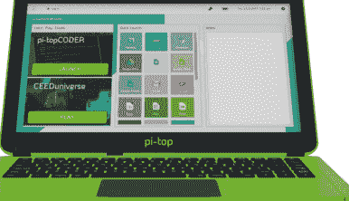


我们花了大约三个小时（包括打印时间）凑出了这个木制的 Pi 外壳。不过，它的边缘有点粗糙


## 使用智能触摸外壳将你的 Pi 变成平板电脑


- **保护.** 将透明橡胶脚固定在底座上。在 Pi 的陷阱门贴上两个方形泡沫垫，并在外壳角处（Pi 的 GPIO 侧放置的地方）。你的显示器可能附带一根短排线，如果是这样，你应该用提供的较长线替换它。

- **固定底座** 使用提供的充足工具将外壳固定在底座上。不要拧紧螺栓，否则你的铰链将失去活力。将触摸屏小心地放入外壳中，并将排线穿过孔隙。用深色螺丝将其固定到位。


- **连接 DSI 排线** 将排线连接器到 Pi 并放入空腔。可以使用一或两个小银色螺丝将其固定。如果你使用 USB 端口，你将无法使用陷阱门，否则它可以固定 Pi 的侧面。

- **连接电源** 使用双微-USB 适配器连接显示器和 Pi 的电源。有足够的电量来供应这两个设备尤为重要。PC 的 USB 端口通常可以提供 500mA，这解释了下一张图片中的雷声。

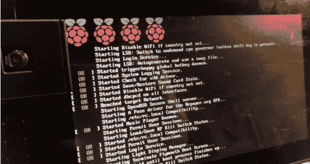


- **享受视图** 祈祷并插上电源。最新的 Raspian 将具有所有必要的驱动程序，显示器将点亮。注意角落里的电源警告。还要注意在 Pi 挂载时更改 SD 卡，你需要拧下它并将其翻过来。

- **拍照** Smart Pi Touch 外壳包含适用于官方 Pi 的 LEGO 兼容外壳。将排线穿过槽。将外壳固定在...

# IqAudio Hi-Fi HAT

在你的 Pi 上收听高清音频，让你那老旧、笨重的 hi-fi 设备焕新生。

Pi 发布时的多媒体功能令人印象深刻，特别是视频引擎和 HDMI 端口。但在模拟音频质量方面非常匮乏。这很遗憾，因为你的 Pi 原本可以用来把笨重的 hi-fi 变成更好的音响系统。

细腻的声音听起来完全不是这样（我们鼓励你尝试一下，如果我们偏离了事实，请纠正我们）。从数字信号生成的音频受 PWM（脉宽调制）时钟限制在 11 位（在框中阅读更多关于 PWM 的信息）。对于哔哔声和啪嗒声这足够，但如果你插上高级耳机，听起来会觉得很不足。硬件还会采集来自其他组件的噪声和静电声。

如果你的 Pi 没有（或带有不支持的无线芯片），请使用外壳将其连接到路由器。Volumio 与 Allo 合作制作了 Nanosound，它由一个 Pi 和一个配备自定义 OLED 显示屏的 Allo 高级 DAC 组成。它是一个播放和控制于一体的盒子，你可以用它来开关 Pi，而无需担心 DAC。除了 Volumio，你完全也可以使用 MPD 来播放音乐。MPD 对 Android 是免费的，另一个流行选择是 MPD-com，它能够连接到 Soundcloud 和 Google Play Music 等各种服务。

# 听起来不错

为了营救我们，我们可以创建一个低成本就能处理高保真音频的音频 HAT。我们使用了 I2S DAC HAT，它使得 24 位 96kHz 音频重成为可能。它通过 I2S 协议从 Pi 获取数字音频信号并将其转换为模拟音频。市场上有很多制造商，例如 HiFi Berry 和 Allo，他们提供了参考实现，以控制重采样数字音频信号的质量。某些 HAT 有内置放大器，允许你控制每个通道的音量。我们更倾向于使用高质量的 90 年代放大器，并发现 IqAudio 的产品产生了不错的结果。尽管，我们发现它的听起来并不像我们预期的那样。

使用 Volumio 发行版将你的 Pi 变成智能音频中心非常简单。它适用于 PC 和其他板；从 https://volumio.io/started 获取。如果你使用了 SD 卡，只需插入 Pi 并连接，它就会与任何其他设备进行自动设置。

# >> 脉宽调制

脉冲宽度是将信息编码为数字数据的方法。使用时钟生成器的频率，我们可以根据信号低电平相对于高电平的时间创建数据。如果我们发送一个具有 1 和 0（对于同一周期）并重复的信号，它看起来就像一半。这是一个 50% 的占空比。通过改变占空比，我们可以改变信号的幅度来创建模拟信号。这被 PWM 用于表示数字或任何其他事物。

PWM 可用于模拟模拟信号，例如通过在 PWM 信号低电平和高电平时改变频率。回到 Pi 的例子，如果我们想播放 48kHz 的音频文件，那么高低电平之间的不同值数量就可以改变，在每秒工作 48kHz 的单次采样中，某些值接近 2 的幂，我们的 PWM DAC（假设其时钟为 100kHz）通俗来说，为我们提供了超过 11 位的音频。

音频硬件随着每一代 Pi 的发布得到了改进，特别是高低通滤波布局。PWM 驱动程序在连续发布中经过了翻新，最著名的是 2017 年 10 月，当时输出被处理为复杂的三阶段序列，随后是一个光线偏移滤波器。

> 我们最喜欢的 MPD 客户端是朗朗上口的 ncmpcpp。音乐从这里播放出来听起来更好。

Linux 格式 2020 年8 月

Linux 格式 2020 年

# 从 Arduino 开始

学习 Arduino 语言以及这种微控制器可以做什么。

有时我们通过 Python 与 Arduino 通信，而不是 Raspberry Pi 内容。保持不同（held）在你的路径上 -

与 Raspberry Pi 不同，Arduino 设备不足以运行完整的 Linux 发行版。例如，Arduino Uno 的运行频率为 16MHz，具有闪存内存和只有 2KB 的 SRAM（对于脚本来说足够了）。它们有许多输入输出引脚，因此主要用途是微控制器：读取传感器数据并响应。存在更强大的 Arduino，但它们依赖复杂的计算、联网和存储。

你可以从 arduino.cc 下载 Arduino IDE，或者如果你使用 Ubuntu，可以通过 Ubuntu Make 获取其最新版本。设置环境非常简单。你可能需要将用户添加到 dialout 组以与 Arduino 通信（Ubuntu Make 会为你完成这一点）。一旦准备就绪，你可以通过 https://create.arduino.cc 从浏览器启动编辑器。

# 闪烁

无论你如何操作，都是传统的路径并查看 Examples-blink。我们将看到它分为两个函数：首先定义 Arduino。

即使简单的开关和蜂鸣器看起来很复杂，但相信我们，脚本在之前会闪烁，但如果我们进入工具 > 串口监视器，我们可以每秒看到一次值。如果你有一个 Arduino，你可能会看到不同的数字。

# 舵上的传感器

对于这个项目，我们使用面包板来分配电源。它的电流（在最大运行时，高达 600mA，但我们没有做任何事情）。再次，如果你的 Arduino 为这个项目提供了足够的功率，你应该将舵连接到面包板而不是 USB。舵上的信号连接到 Arduino 的引脚 9。向传感器发送一个脉冲。它发出高频声音。如果这个声音从附近的物体反射，它将以脉冲的形式返回传感器；结合声速（330 m/s），我们能够确定传感器和物体之间的距离。这就像蝙蝠使用的定位方法，但频率高得多。通过结合舵和超声波传感器，我们可以做一些神奇的事情。以下代码将传感器左右移动，实现一种雷达项目：

```cpp
```


进入`/path/to/xxx`目录，找到`xxx.json`。

在表达式`cvar = avar + bvar`中，加法运算符（`+`）将`avar`与`bvar`相加，得到它们的和`cvar`

在`List.of(arg0, arg1, arg2)`中，`List`接口的工厂方法`of()`接受一系列的元素，返回包含它们的只读列表。

之后我们这样调用`cmd`命令：`cmd arg0 arg1 arg2`。

```
if (condVar > someVal) {console.log("xxx")}
```

`const int trigPin = 10;`

`const int echoPin = 11;`

`Servo myServo;`

```cpp
void setup() {
  Serial.begin(9600);
  myServo.attach(9);
}
```

```cpp
// 将舵机电机从 15 旋转到 165
for(int i=0; i<150; i++) {
  servo.write(i);
  distance = pulseDistance();
  Serial.print(distance);
  Serial.println(" ");
  // 重复 15 到 165 的行
  delay(15);
}
``` （等待，代码继续）

它运行了 - 我们的传感器正在构建周围对象的虚拟地图！哇！

我们使用舵来旋转舵的旋转，我们可以从传感器监视器获取一些数据信息并发送这些数据，或者通过我们计算的距离。我们将此留作练习，或者直接查看下面的链接：没有它也可以走远，但可能性是无限的。我们想象我们的项目在 https://yobj/object-detector 被检测到，然后使用 Processing 语言绘制一个超声波图。图像清晰可见，并且当传感器左右扫描时具有模糊效果，底层硬件是相同的。这是一个在 Arduino 上收集数据，然后在更强大的硬件上进行处理和可视化的示例。

# 2020年 Linux Format 年刊

## 开启更多冒险

让我们通过一系列后续项目的建议来结束结尾。

为你的 Pi 或其他设备准备一个便携电源是非常实用的，而且目前有几种选择。当然，标准的 USB 移动电源（那种可以随身携带的，更像“柯伦探时代”的）适用于许多场景，但也有其他替代方案。如果你手头有很多闲电池，可以看看 MyPi 的 BittBag。它能让你使用四节 AA 5号电池为 Pi 供电。对于要求更高的场合，可以使用 8V 或锂聚合物（LiPo）附件。BittBatt 可以保护你免受电压下降的影响，并在电池电量过低时拒绝关机。

我们之前使用的超声波传感器也可以用于 Pi，但我们需要小心处理 5V GPIO 引脚；为了安全起见，我们需要将电压降至 3.3V。我们可以在 GPIO 引脚中串联电阻来实现。你可以选择两个电阻来计算分压。在这种情况下，一个 1K 和一个 2K 电阻就足够 UltraBoard 使用了，这可能让你将四个伺服器和超声波传感器直接连接到 Pi 的 I2C 总线（SDA 和 SCL）。如果你连接了四个伺服器，则需要一个独立的电源。如果这样做，应该移除干扰器，否则你可能会损坏 Pi。


BittBag 在 Pi 上有三个组件，即使是不懂技术的孩子也能使用。

> PiJuice 电池包带有 RTC（实时时钟），可以让你的 Pi 真正实现便携。


配备了一个 1280mAh 的锂离子（Li-Po）电池，可以使用 5 小时，但也可以更换为锂聚合物（Li-Po）电池。你可以连接一个太阳能板（有一种低于 20 美元的 4W 板）为 MyJuice 和 Pi 电源充电。对于一个完全隔离的解决方案，LiPaRUs E-link 显示屏（除非太阳耗尽）自带实时时钟功能，这对于跟踪时间非常用。PiJuice 的软件允许读取电池电量，并可以设置关机脚本。这构成了一个非常简洁的 UPS（不间断电源）。

如果你找到一个小型电源（或大台式电源），你就可以将其连接到 Pi，然后在某种配置下消除销售损耗，进行一些很棒的自然摄影。无红外版本的相机（没有红外滤镜）可以在晚上看到，这使得它非常适合捕捉獾、猫头鹰（如果你运气好的话）或其他动物。

## 电源连接


得益于微-USB 接口的全球标准（某水果公司制造的除外），为 Pi 挑选电源非常容易。基本上到处都是同一种。然而，许多廉价的充电器无法提供 Pi 所需的电压。

Pi 3s（以及 B+）也是如此，伺服器和无线芯片需要额外的电压。这些设备的许多毫无防备的用户都被屏幕上出现的闪电标志所困扰。这表示电压低，Pi 已经关闭了 CPU 以保持系统稳定。

当你开始将其他设备（如电机）挂载到 5V 和 3.3V 电源上时，电力不足的问题会进一步加剧。良好的电源是关键。我们强烈建议使用 Raspberry Pi Foundation 官方额定为 2.5A 的 PSU，或其他质量的单元。如果你需要为多个设备供电，可以使用每个端口提供高达 3A 的集线器。


Ultragob 同时解决了几个相关的严重问题。你甚至可以将多个 Ultragos 串联。

160 | 2020年 Linux Format 年刊

## 制作项目

（单位）表，我们将从缓冲区中获取峰值水平：`data = os.read(file, 4096); stereo_peak = audioop.max(data,2)`

需要注意的一个重要点是，你不能同时为 3.5mm 耳机和 Unicorn HAT 使用时间，因为它们都使用 PWM，你会看到 LED 闪烁异常或在音频中听到干扰。它在 HDMI 上运行良好，也可以在带有 iAudio 文本扩展的 DAC 之上运行。LightShow 项目（https://lightshow.org/）提供了峰值提示音，它支持许多板卡并可以制作出各种波形的灯光。


Unicorn HAT-HD 包含了回到 90 年代的酷炫效果，还有许多非常舒适的设计。在 Python 中编写一个简单的动作程序非常直接，所以你不需要担心用同一张时代的照片填满你的 SD 卡——那里仍然是一片黑暗。

我们写到第 10 页了吗？我们不知道，但我们将尝试一下，因为页面没有尽头（而且因为你必须填满这一页——Ed）。

## Unicorn HAT-HD

Pimon 的 Unicorn HAT 具有 8x8 的 RGB LED 矩阵，被证明非常受欢迎。因此，他们必须改进并制作一个 HD 版本，将 LED 数量增加了四倍。它还带有一个扩散器，可以根据不同的亮度级别进行调节。

我们仍在研究的一个巧妙技巧是为当前播放的音乐显示频谱分析仪。通过精确地添加一个部分，可以将 MP3 配置为 FIFO 管道。

## 使用 RetroPie 享受时光

RetroPie 项目（https://retropie.org/）包含了许多模拟器，如 SNES 和 Gameboy（以及更多）。它也适用于 Pi SD 卡（推荐方法），也可以手动安装。提供了单核版本（Pi 1 和 Retro 2）和多核版本（Pi 3）的独立镜像。它还适用于 Linux 上的 RetroArch，这是一个许多游戏主机的前端。RetroArch 支持许多内核，你可以从在线数据库下载它们。

# 自定义点唱机教程

## 启动应用程序偏好

| | | |
|---|---|---|
| Silverje | 以易于使用的点唱机风格组织你的音乐 | 添加 |
| Snap 用户自动启动助手 | | 移除 |
| 帮助 | 添加启动程序 | 编辑 |
| 名称 | 启动 Silverje | |
| 命令: | `/home/jukebox/startjukebox.sh` | 浏览... |
| 注释 | 在 Kiosk（亭台）模式下启动 Silverje | |

向你的音乐库中添加内容并管理音乐库设置。由于 NUC 的硬盘容量有限，我们正在使用外部设置来存储库。根据你的设置，你的文件可能在本地驱动器、外部 USB 驱动器或你的网络上。Silverje 允许你从这些选项中的任何一个添加音乐。要查看 Silverje 如何选择和识别你的音乐文件（例如，包括 zip 文件），默认设置应该可以工作。一旦你添加了源，Silverje 将重新启动扫描。这可能需要一些时间，因此按照传统做法，我们建议你喝杯茶。


## 选择你的设计

在标签栏上共有八种皮肤可以选择（从在网上寻找更多到一个已删除的），以及旧式（Old-Style）皮肤。如果你发现某些导航按钮太小，Silverje 带有调整大小的控件变得非常简单。在“标签”选项卡中，我们可以将字体大小设置为 18 或 90 百比。默认情况下，它更多地利用了我们对空间的选择，并通过触摸和限制添加到队列来选择曲目，但它具有敏感性，可以防止曲目被两次加入队列，并防止在没有返回帮助的情况下出现重复。自动控制条将指定如果队列中没有曲目，Silverje 在播放前会等待多长时间。你还可以在“编辑音乐”模式下选择 Silverje 如何自动选择要播放的曲目，可以用于选择选择，例如根据日期选择“20世纪70年代的音乐”。这些选择随后可以通过设置 Silverje 自动开始播放曲目来使用。这将让你沉浸在 70 年代的迪斯科主题中。Kiosk 模式将 Silverje 进入全屏模式。然而，没有 GUI 来在 kiosk 模式下设置 Silverje，因此你将通过脚本来实现。标签允许你配置希望人们在运行 Kiosk 模式时允许使用的功能。例如，你可能调整音量或达到超时时间。你还可以限制音乐选择为最后保存。再次，是为了你的显示目的。设置你的第一个点唱机涉及启用虚拟键盘，这对于人们来说是无法搜索的。当你启用此时，你需要选择美国国际布局，因为 Silverje 将默认使用英国（UK）键盘。

这意味着我们可以创建一个简单的脚本，使用以下几行对其进行编辑：

```
#!/bin/bash
silverje -kiosk
```


# 快速设置

如果你使用外部 USB 驱动器作为音乐库，你可能想使用电脑的 BIOS 来确保内部驱动器不被用于启动，或者它的优先级高于外部驱动器。

你可以通过按下“搜索”键并搜索“启动应用程序”，或通过终端运行 `gnome-selection-preferences` 来运行此。如果只是点击“添加”的问题，为 `startjukebox.sh` 添加名称和脚本路径。为了防止点唱机在 Ubuntu 的电源设置中进入睡眠，你可以将屏幕设置为永不黑屏且不挂起。确保电源设置为“关闭”。在“隐私”下，当禁用通知时，你可以关闭屏幕锁定。

你所有的好主意都是重启系统并使用键盘前往点吧，让一切都符合预期。

# 更多

封面艺术比任何点唱机体验都更加真实，如果你都有正确的封面，你的点唱机将帮助你导航。如果封面艺术嵌入在音乐文件中，Silverje 就能识别它，如果它有能力搜索互联网上的封面，它就会下载，但它对于批量更新其他内容并不理想。

在 Silverje 中搜索专辑将开始全局（或类似）搜索并在右侧文件夹显示任何结果。你并不想要有成千上万的结果。如果 Silverje 找不到，它将使用不同在线来源的专辑和标题生成一个 Avithark（类似的东西，不是詹姆斯·卡梅隆）封面，但对于这么多封面，你的专辑看起来都一样且不会颖而出。使用像 MusicBrainz Picard 之类的工具清理库并下载新的封面艺术，然后将你的音乐添加到 Silverje 是一个好主意。

# 启动

第一步是配置启动时每次启动都以 kiosk 模式运行 Silverje。这将允许移除键盘和鼠标，并可以使用 PC 上的电源按钮根据需要打开点唱机。

可以通过从 `--kiosk` 切换启动来将 Silverje 配置为 kiosk 模式。

# 终极开源工具包

正如 `Mayank Sharma` 所知的，为工作准备正确的工具至关重要。这就是为什么他付出了努力，为你带了这些火热的开源软件。

- 目录
- 图像工具 ........................... 38
- 音频视频 ........................ 39
- 磁盘和文件 .......................... 40
- 文件管理 ........................ 41
- 通信 ........................ 42
- 生产力 .......................... 43
- 系统管理 ........................ 44
- 互联网 ................................ 45
- 安全 ................................ 46
- 开发者 ............................ 47

# 终极开源工具箱

## 音频与视频

精细编辑你的生活，并整理你的音乐。

## UMS

这台流媒体服务器会将你的 Linux 桌面转换为终极媒体流媒体广播，传输到其他计算机、智能手机、平板电脑、游戏机等。UMS 通过通用即插即用 `UPnP` 协议向符合 DLNA 的设备进行流传输。你需要部署 UMS，尽管该过程非常简单。

第一次启动它时，UMS 会引导你通过一个基础的三步配置向导。你可以在什么都不配置的情况下启动，UMS 包含了高级的可定制选项和引导新用户的提示。它还包含一个用于流传输内容的极简 Web 界面。`www.universalmediaser.com`

## EMBY

这是一个全功能的媒体服务器，带有丰富的功能。Emby 是一个在任何设备上访问和查看所有媒体的一站式解决方案：从电脑、手机到 Android TV、Chromecast、Roku、Xbox 等。除了本地文件夹外，Emby 还允许你添加网络共享，这是在网络中不同的计算机之间共享你的媒体的极佳方法。Emby 服务器提供了预编译的二进制文件和网站安装指令，适用于所有流行的发行版，包括 Arch、Centos、Fedora 和 Ubuntu。你可以右键点击项目以显示有用选项，如下载或编辑其元数据。你可以在播放期间更改流质量并全屏显示。Emby 还允许你设置家长控制，并阻止评分高于你定义的最高分的项目。

## MPV

一个资源意识型视频播放器，在现代机器上同样外观良好。MPV 基于 mplayer2，通过引入优化且代码整洁的选项和功能，延续了命令行（CLI）的传统。它提供了一个不干扰操作的极简用户界面，让你能够流畅观看视频。

`https://mpv.io`

## SHCUT

一个相当先进的视频编辑器。Shotcut 是少数支持 4K 视频、音频和视频格式以及多种过渡和效果的工具之一。它拥有很长的功能列表和系列教程，帮助你创建第一段视频。

`https://shotcut.org`

## CURLE

由 ffmpeg 库驱动。Curdle 是一个易用的媒体转换器。它具有裁剪、填充视频以及仅转换文件部分的能力。选择适用于各种设备的预设设置之一，你还可以在转换前进行预览。

`https://curdle.sourceforge.net`

## AIRSON

基于已关闭的项目，AirSonic 流媒体器让你的音乐令人印象深刻。它设计有许多功能，可以同时向多个播放器流传输任何格式的文件。

`https://airsonic.github.io`

## TUPIPE

一组鼓励孩子们创建 2 个动画的工具集。Tupipe 拥有易用的 Web 界面以及大量的文本和视频文档帮助你入门。

`www.maefeestro.com`

## PICARD

这是一个小工具，Picard 将让你的音乐集恢复正轨。该程序可以对你的音乐库排序、重命名文件并识别不完整的专辑。

`musicpicard.org`

## TRAVERSO DAW

一个强大的录制和编辑平台。Traverso 是一个数字音频工具，可以帮助你创建简单的记录并编辑多轨道音频。

`traverso-daw.org`

## MIXXX

如果你需要在活动中担任 DJ，可以使用 mixxx 运行你的音乐库，并使用可刮擦的波形跟踪轨道节奏并更改音调以创建你自己的混音。

`www.mixxx.org`

2020 年 Linux 论坛年度

# Linux Format 2020

## 磁盘工具

保持你的硬盘处于最佳状态，恢复丢失数据或安全地删除它们。

## FOG

大量重复性任务（如运行检查、排查故障、更换故障驱动器、反复进行全新安装）可以节省系统能量并管理网络规模。通过 FOG，你可以从管理员的各个领域舒适地管理和克隆机器，并使用字段来描述镜像。它还可以将它们分组以便于管理。有多个选项可以调度映像制作过程。FOG 可用于调试已映像的计算机、擦除主机等。服务器处理如安装软件等众多任务，并可以管理网络上的打印机。FOG 服务器是可扩展的，可以管理跨越同一建筑内多个位置或地球另一端的大型网络。FOG 服务器最用的功能之一（特别是对于大型网络的管理员而言）是多播传输能力。使用此功能，你可以一次性部署多台机器。对不同网络的支持意味着你可以配置多个 FOG 安装作为存储服务器，在映像计算机时分担主 FOG 服务器的负载。`https://project.org`

FOG 是一个复杂的软件，并提供了许多选项，具有

## DUPLICATI

一个易用的备份应用程序。Duplicate 允许你通过过滤或包含排除某些文件类型的选项，精细调整你想要保留的位置列表。你可以通过基于浏览器的界面进行管理。该程序分解了复杂的标准，并为当前任务暴露正确的功能，带有下拉菜单的高级选项。`www.duplicate.com`

## PHOTOREC

PhotoRec 恢复被删除的文件。当你选择一个文件系统时，它将扫描其占据的空间而不包含其他文件。尽管名字如此，该实用程序可以嗅探没有常规元数据的原始文件。`www.cgsecurity.org/PhotoRec`

## GPARTED

管理分区的最佳工具之一，你可以使用 Gparted 删除、移动和复制分区，同时保留它们持有的数据。该程序适用于所有磁盘、SSD 和 RAID，并支持所有盛行的文件系统。`https://gparted.org`

## SECURE-DELETE

文件使用 AES-256 加密，你还可以使用 Zip 压缩，并在发送前压缩所有数据。

| CDEMU | DUC | SMART |
| :--- | :--- | :--- |
| 允许你安全地擦除数据痕迹。 | 允许你访问并共享网络中的数据。 | 能够监控磁盘的健康状况。 |
| 允许你以各种格式挂载镜像。 | 它是文件管理器的不错的替代品。 | 提供了 Gnome 和 KDE 桌面的支持。 |
| 它是大多数发行版官方仓库的一部分。 | 允许你通过 URL 共享文件。 | 可以在你的磁盘上运行检查。 |

# 终极开源工具箱

## 文件管理

控制你的数据，可以访问它，并还可以将其归档。

## EICIEL (ACL)

在 Linux 中，一切皆可访问的，访问控制列表 `ACL` 有助于确定每个文件的权限。你可以通过命令行修改权限，它存在于发行版的官方仓库中。`https://github.com/roger-ferrier/acl`

## NEXTCLOUD

在线存储服务是访问和共享网络数据的方便选择。通过 Nextcloud，你可以运行自己的托管服务器，获得云服务的便利性并将数据同步到你的手机。安装和部署 Nextcloud 非常简单且有文档说明。它拥有功能丰富且直观的 Web 界面，考虑到其功能数量，对新用户来说并不困难。该项目是可扩展的，允许你将其用于许多部署。你可以使用其管理部分与其他相关网络保持同步。通过网络或 URL 与他人共享文件非常简单，并确保共享文件的更改同步到所有用户。它还可以访问存储在 Amazon、Google 和 Dropbox 等云端的文件。

## FSLIT

你可以使用图形化的 slit 工具对文件系统进行彻底清理。它可以删除临时文件，以及其他难以定位和删除的文件，例如无效名称的目录条目和错误的 ID。`https://www.pixel.com/slit`

Nextcloud 拥有一个扩展框架，允许你将其用于许多部署。

## OPEN MEDIA VAULT

如果你需要比简单的备份解决方案更多的数据，那么你需要将 Raspberry Pi 上的未压缩视频转换为专用网络存储 `NAS`，使用基于 Debian 的 Open Media Vault `OMV` 服务器。由于其设计良好的用户界面，OMV 易于部署和管理，非常适合非技术用户。它支持所有流行的部署机制、多种服务器 RAID 级别，并且你可以使用所有流行的协议（如 SSH、SMB/CIFS、FTP 和 FTP）访问数据。具有丰富的权限来控制服务器和文件夹。服务器可以通过官方和第三方插件进行扩展。你可以将 NAS 变成比特客户端，直接下载数据到 NAS，或使用它跨网络流传输音乐。

# Linux 格式 2020

# 通信

安全地聊天或建立你的社交网络。就在你面前，Facebook 来了！

## JITSI

Jitsi 是一款功能全的消息应用程序，拥有令人印象深刻的音频和视频会议功能。作为一个 VoIP 客户端，它允许你使用会话发起协议 `SIP` 拨打电话，并具备你对软电话所期望的所有功能，如挂起、转移和恢复通话。它还可以向局域网上的其他 Jitsi 用户发起注册-SIP 话。

你可以使用 Jitsi 在 SIP 和 XMPP 网络上与一个或多个用户进行视频通话，同时使用 Jitsi Videobridge，你可以托管多用户视频通话。这是一个功能强大的 IM（即消息）客户端，具有独特的功能，包括同时共享和共享通话双方桌面的能力。`https://jitsi.org/`

## ROCKET.CHAT

Rocket.Chat 定位为“终极聊天平台”，充满了实用的功能。除了线程化对话、编辑和删除消息等基础功能外，协作服务器还提供了许多有趣的功能，例如与你网站访问者进行 Rocket.Chat 实时聊天。

你可以通过一个命令在支持 snap 的发行版上部署 Rocket.Chat，并通过 Docker 和广泛的 PaaS 服务进行部署。它还可以从你的服务器（如 Slack 或 Slack Bridge 插件）导入数据，从而在 Slack 频道或私有群中镜像收到的消息。实时 Rocket.Chat。

## TOX

如果普通客户端使用起来不安全，请使用 TOX 协议，该协议使用 NaCl 加密加密所有通话，且没有秘密服务器身份，路由器通过用户之间的其他直接 P2P（点对点）连接进行传输。Tox ID 是像素块的组合，而不是用户账户，这允许具有更高的匿名性。`https://tox.chat`

有多个应用程序可以使用 Tox 协议进行通信，其中之一是 qorx，它支持多个平台。

Rocket Chat 还允许你与团队进行视频会议。你还可以向公共或私有对话录制并发送语音消息。`https://rocket.chat/`

## BEEBEEEP

BeeBeep 是一款与众 IM 客户端，旨在让你与网络上的伙伴直接连接。它会自动检测网络上的其他用户，并提供现代聊天客户端的所有功能，从加密消息到文件共享。`https://beebeep.org/`

## OPENFIRE

有很多 XMPP 服务器可用，但 Openfire 是最容易管理的之一。它实现了 XMPP 协议的许多常用功能。你可以使用任何兼容 XMPP 的 IM 客户端通过 Openfire 进行聊天。它与其自己的客户端配合工作。`https://openfire.org/`

Rocket Chat 还允许你查看对话期间共享链接，包括 Twitter 和 YouTube 等流行服务。

# SIGNAL

Signal 应用帮助通过移动网络进行安全通信。该应用得到了专家背书，并使用端到端加密来保护你所有的文本、音频和视频通话。`https://signal.org`

# RIOT.IM

Matrix 协议允许注册于一个提供商的用户基于联邦制的 Matrix 与任何其他服务器的用户进行无缝通信。

# RETROSHARE

RetroShare 是一个 P2P 通信和文件共享平台，在朋友之间创建加密连接。你可以私下共享你所有的密钥，或通过聊天服务器交换它们。`https://retroshare.net`

# SOGO

Sogo 是 MS Exchange 的最佳替代方案之一，它拥有所有必要的功能以及原生移动客户端。在自己的服务器上部署它之前，请先尝试演示版。`https://sogo.org`

# HUMHUB

通过 HumHub，你可以在互联网上部署自己的社交网络。它具有你预期的标准网络功能，项目网站有一个在线演示地址：`www.humhub.org`

Linux 格式 2020 年度报告

# 终极开源工具箱

# 生产力

使用这些财务、网页过滤和工具让你的生活井井有序。

# OSMO

个人信息管理器 `PIM` 帮助你跟踪和组织来自各种来源的信息。Osmo 是一个轻量级 PIM，用于管理预约、任务、联系人和笔记。它拥有直观且集成的界面，顶部有四个用于日历、任务、联系人和笔记的标签页。当你切换组件时，程序顶部还有与操作关联的按钮。

日历提供了一个简单的功能性日历，并带有相关信息，如周和距离年底的天数。你可以双击添加笔记，或右键删除任务。

定义任务的选项包含在基础和高级标签页中。使用基础标签页定义日期和时间并为任务分配优先级，而高级标签页允许你将任务标记为循环任务并定义相关属性。

你可以使用联系人窗格存储联系人的地址。它还具有额外功能，如搜索、生日提醒，以及在 Google Maps 上标注联系人地址的能力。笔记窗格允许使用编辑功能合并文本，你还可以选择使用 Osmo 复制所有条目。

`https://clippy.org/osmo`

# FOCUSWRITER

在不受干扰的情况下书写，FocusWriter 帮助你专注于写作。FocusWriter 的主要目标是通过消除干扰帮助你专注于写作。它支持流行的格式并具有自动隐藏功能。

# GATESENTRY

Gateway 是一个简单的网页过滤器，运行在树莓派上。它易于部署和配置。Gateway 根据内容类型对流量进行身份验证。简单的代理可以显示数据统计。

`https://gatesentry.org`

# KIMAI2

Kimai 跟踪你的工作并打印活动摘要。它可以用于单个用户或多个客户并管理任务。该程序具有基于浏览器的界面。

`https://v2.kimai.org`

# SSR 

与其名称相反，SSR 是用于截图功能的，并提供了相当的截图控制。该工具可以录制整个会话，并允许选择和录制桌面上的窗口。

`https://martinbart.be/`

Gateway可以在设备上安装后过滤 HTTPS。

# TURTL

一个专注于 turtl 的笔记工具。它拥有令人印象深刻的功能列表。它可以处理不同类型的笔记和媒体，供你附加到创建的笔记中

`https://turtapp.com`

# DICTION

一个命令行工具，D 用于标记误用的单词。可以通过标记带有初级错误的单词来创建更好的帖子：

`https://gnu.org/software/diction`

# TASK COACH

一个简单的待办事项管理器，Task Coach 简化了定义和跟进任务的过程。你可以使用该工具跟踪带有截止日期可选提醒的任务。

`https://taskcoach.com`

# ECONOMIZE

Economize 是一款支出管理器，界面整洁并包含了你组织财务所需的所有功能。它可以跟踪单个或多个账户和预算。

`https://economize.org`

# STRETCHLY

一个简单的应用程序，通过提醒你来休息。它有一组预设的休息时间以及当你放松时的休息时间。你可以从图标启动该工具。

`https://hovanc.net/stretchly`

Linux 论坛2020年度 | 171

# 2020年 Linux 年度报告

## 系统管理

确切了解你的 Linux 设备底层到底运行了什么。

## GLANCES

Glances 是一个 Python 脚本，可以在终端窗口内智能地显示有关当前会话的信息列表。你可以使用该工具监控远程机器，并使用浏览器通过内置的 Web 监控 `https://nicolargo.github.io/glances`

## PORTAINER

通过终端使用 Docker 并不完全困难，而且该工具的文档齐全。为了让你的生活更轻松，你可以使用 `Portainer`，它是一个开源的基于 Web 的前端，支持 Docker API 暴露的所有功能。你可以用它管理容器、网络、卷，它还可以管理独立的 Docker 环境或 Docker Swarm。

从仪表板中，你可以创建容器并管理所有可用容器。你可以从浏览器窗口获取各种运行容器的 CPU 和内存使用等实时统计数据，甚至访问容器的控制台。`Portainer` 可以以 Docker 容器的形式提供，可以通过单个命令进行安装。然后你可以使用预定义的模板之一。该工具适用于多层级用户，并具有实用的用户管理功能。你可以使用此示例来定义其他用户的访问级别，以及他们可以在 `Portainer` 中管理的 Docker 方面 `https://portainer.io`

## FIREJAIL

Firejail 通过将程序和进程隔离在沙箱环境中来增强安全性。通过锁定网络浏览器或任何可能被攻击的工具，firejail 防止了访问文件系统的关键区域 `https://firejail.wordpress.com`

## BOOTSTR

启动时间长的主要原因之一是系统在启动时启动了不必要的工具和服务。你可以使用它们来更好地了解启动过程中发生了什么。`Bootish` 是一个增强你的 Linux 启动过程并帮助管理不同加载时间的简单实用程序。如果与 systemd 合并，启动终端运行 `system-analyze` 即可了解启动时间的明细。类似的 `system-analyze blame` 将按启动耗时列出所有运行的单元。生成一个启动分析图的日志镜像。从这张图中你可以看到所有活动进程及其原因。例如，某个进程在启动时占用了 CPU。它还能帮助发现占用所有资源导致其他进程变慢的进程 `www.boot.com`

## BO CUSTOMIZER

有几个理由让你改变默认的启动行为，而 `Boot Customizer` 将帮助你实现。该图形化工具可以修改启动过程的所有方面，甚至可以看到屏幕是如何显示的：`https://launchpad.net/boot-customizer`

## REMMINA

一个非常实用的桌面客户端，Remmina 支持广泛的协议。性能良好，并提供了随时更改连接设置的灵活性 `https://remmina.org`

一个 CLI 工具，列出你网络中的所有硬件信息。通过它你可以收集有关设备、驱动配置等详细信息 `https://github.com/smi`

## POWERTOP

开发 PowerTOP是为了追踪消耗笔记本电池的应用程序。该 CLI 实用程序易于使用，通过电源工具榨出更多笔记本电池性能 `https://os.org/powertop`

## STACER

Stacer 是一个帮助你跟踪安装不同方面的监控器。它还可以显示参数超过某些阈值的警报 `https://uzhaninan.github.com/Stacer-Web`

## LOGWATCH

Logwatch 解析、分析并过滤你的系统日志，然后生成报告。该实用程序也用于控制报告的详细程度 `https://sourceforge.net/projects/logwatch`

## 终极开源工具包

## 互联网工具

使用此工具集让你的在线时间更高效。

## UGET

轻量级 uGet 下载管理器依赖于 curl，如果你安装了 aria2 包，它可以启用更多功能，例如下载种子文件的能力。uGet 下载器具有你对下载管理器所期望的所有功能。它具有暂停和恢复下载的功能，还支持通过并行流抓取文件进行下载。此外，批量下载是它的特长。你可以用它来优化下载队列并单独调节下载。uGet 可以在完成所有文件下载后关闭或让电脑休眠 `https://getdm.com`

## RAMBOX

大多数桌面发行版都带有一个默认的消息工具，允许你登录多个在线即时消息服务。这些工具只能帮助登录一半流行的服务。

相比之下，Rambox 可以连接到 100 多种在线和电子邮件服务。在其自己的标签页中添加每个服务都可以让你浏览消息历史、向联系人写消息，或使用该服务支持的其他通信方式。该工具还会显示通知。如果你在多台电脑上使用它，Rambox 还可以配置。程序允许存储你的个人数据。Rambox 使用：分区属性和标签与已登录的服务创建持久连接。你还可以设置主密码并要求工具执行（操作）。

## BRAVE

虽然 Brave 自带跟踪器，但 Brave 承诺提供速度。其中之一是通过拦截广告实现的 `https://brave.com`

## WALLABAG

一个列表阅读器 wallabag 创建于 2013 年。你可以将其安装在服务器上，或使用它自己的服务 `www.wallabag.com`

## TOR BROWSER

Tor 使用户能够匿名浏览网页。它包含了你所需的一切 `https://www.torproject.org`

## WORMHOLE

一个 Python 脚本通过可证明代码在互联网标识之间创建单次使用的加密通道。

## UBLOCK ORIGIN

uBlock Origin 扩展是一个拦截广告和（跟踪）的广告拦截器 `https://github.com/gorilla/ublock`

## QUITTERSS

QuitterSS 具有你对新阅读器所期望的所有功能。它可以抓取 RSS 和 Atom 馈，享受每一篇文章目，并提供丰富的自定义功能。

# 2020 Linux 年度报告

## 安全工具

确保它们永远无法触碰你的系统和文件。

## ZULOCRYPT

虽然你可以使用用户账户和文件权限访问计算机上的数据，但这些不足以防止有心意的内部人员访问你的私有文件。你自己保护个人数据的唯一可靠机制是对其进行加密。处理加密数据是一个复杂的过程，但它将极大地增强你的安全性并隔离你的数据。

ZuluCrypt 是一款图形化加密工具，具有直观且易于操作的界面。该程序可以在文件、分区或 USB 闪盘内创建一个加密设备。它还可以使用 GPG 加密每个文件。ZuluCrypt 可以执行解密操作，这意味着它可以将所有内容加密到一个秘密设备中。该设备可以是整个磁盘、分区或挂载为回环设备的文件。通过块设备加密，用户在块设备上创建文件系统，加密层会在数据写入实际的底层块设备之前透明地对其进行加密。在加密状态下，存储区域看起来就像一大堆随机数据，甚至无法显示其目录结构。所有这些功能都可以通过出色的用户界面访问。`http://ZuluCrypt`

## GUFW

GUFW 是 UFW 的图形化前端，UFW 是 iptables 最简单的前端之一。该工具具有简单的界面，并提供了用于调节入站和出站流量的设计配置。你可以根据需求更改配置入站和出站策略。你还可以使用 GUFW 为单个应用程序和服务定义特定的过滤规则。`http://gufw.org`

## BITWARDEN

Bitwarden 密码管理器执行端到端加密，并使用 AES 256 位 PBKDF2 来保护你的数据。它之所以有效是因为它将你的库存储在远程 Microsoft Azure 云端中。你还可以从来源导入密码。`https://bitwarden.com`

## 隐术

隐术是将数据隐藏在看似无害的消息或图像中的艺术。加密它的最常见机制是利用图形文件中未使用的数据，其中包含的位信息在查看原始数据时是不可见的。隐术主要用于辅助加密。

你可以使用 OSQuery 工具监控你的网络，查看除了数据库之外执行的每一个查询。

切换到“报告”标签页获取行流量报告。

隐术是一项非常强大的工具，可以在图像内部隐藏测试消息以及任何类型的文件。你可以选择该工具，指向想要隐藏的文件并输入密钥。再次从图像中获取秘密文件时，使用提取按钮配合密钥从图像中获取隐藏的文件和消息。`https://steganography.org`

## MTR

MTR 是一种网络诊断工具，结合了 traceroute 和 ping 的功能，通过显示数据包路径提供了丰富的相关信息。`http://www.jreport.org/`

## AIDE

你可以使用 AIDE 通过比较文件属性（例如初始运行时创建的基线数据库）来检查文件的完整性。`http://aide.sourceforge.net`

## NIKTO2

一个 CLI Web 扫描器，用于寻找服务器配置错误和版本过旧等问题。它还可以针对安全漏洞进行自动测试。`https://cert.net/nikto2`

## JOHN THE RIPPER

一个密码破解器。John the Ripper 用于暴露弱密码。它是一个带有图形界面的 CLI 工具，通过名为 John exposes 的图形界面展示了其各种命令行功能。`https://github.com/johnjohnjohn`

## MALTRAIL

Maltrail 是一种恶意流量检测系统，使用黑列表和自定义列表来检测并记录任何恶意流量。`https://github.com/stallion/maltrail`

# 终极开源工具包

## 开发者工具

使用这组强大的工具让你的编码变得更简单。

- ATOM

Atom 将自己描述为宜居的文本编辑器。该工具由 GitHub 开发，内置了包管理器，允许用户从内部搜索并安装插件。默认自带约 80 个插件。它最引人注目的特性之一是回溯功能，它可以修改任何类型的文本。
Atom 也可以作为 IDE 使用，其亮点之一是自动补全功能。它还有一个括号匹配器，可以高亮光标所在行的右括号。你还可以定义键位绑定，并通过包为最小缩略图（minimap）和语法片段库添加更多功能。详情请访问 `https://atom.io`。

- BYPTON

这是一个基于 Python 的工具，在终端窗口内提供现代 IDE 功能。你可以使用默认设置启动它，然后使用配置文件对其进行自定义。代码将显示预期的参数列表。它会在你输入时高亮语法，回溯功能会检查留下标记的条目。`https://bypythonter.org`

- ETHERPAD

协作是任何项目的关键。Etherpad 编辑器允许用户实时协作。它在 浏览器中运行，允许参与者通过基于文本的聊天进行交互。功能丰富，你可以将其用于任何网站。`http://etherpad.org`

- VIRT-MANAGER

虚拟机管理器是创建 KVM-VM 的开源前端。它使用 qemu-kvm 管理器，包含为运行的虚拟机提供 VIP 和 SPICE 功能。`https://virt-manager.org`

- TURNKEY APPLIANCES

在服务器上安装网络软件或 Web 应用是一项巨大的任务，因为它们需要大量的基础设施。从数据库到基础组件，在部署之前你需要组装一个功能完整的 Web 服务器。简单来说，Turnkey 设备是一个具有功能完整的 Web 应用界面的包含式系统。它可以在裸机或虚拟硬件上运行。Turnkey 设备根据你想要部署的硬件提供多种格式，从 Docker 到 Stack。尽管如此，无论在什么平台上，它们都能立即运行并提供相同的界面进行管理。`turnkey.linux.org`

- OCELOT GUI

该数据库客户端可以连接并交互 MySQL 或 MariaDB 服务器。你可以使用高亮功能进行创建和查询以获取数据库结果，`https://github.com/ocelot-ocelot`

- DOXYGEN

使用此工具从代码中的注释生成 HTML 文档。该工具支持许多格式，并支持文档与代码交叉引用：`doxygen.in`

- INFER

如果你使用 Java、C++ 或对象语言，可以使用 Infer 寻找奇怪的 Bug。该工具包含了各种分析和兴趣功能，可以跨多个文件进行工作。`https://inferbin.com`

- MARK TEXT

该 Markdown 编辑器支持 GitHub 标记和 CommonMark 规范。它具有实时预览功能，支持导出和主题。数学支持和导出选项：`https://marktext.github.io/`.

## 探索精彩指南与特辑

从摄影到音乐，从技术到游戏，每个人都能找到自己的喜好。

订阅杂志是一份完美的礼物，他们会月月收到，并倍感喜悦。从 55 多份杂志中进行选择，享受远低于商店售价的优惠价格！

我们的指南和活页夹也是极佳的礼物，我们还有多种礼物代金券供选择。

- 无任何隐藏费用
- 所有价格均包含运费
- 我们的配送服务覆盖全球 100 多国
- 安全在线支付

## 发现我们的其他精彩书刊杂志（bookazines）

从科学、历史到技术和工艺，有数十种 Future 书刊杂志可以满足所有品味

直接从我们这里购买可享受大额优惠
数以千计的优质书目，许多其他地方无法买到
全球送货，订单超级安全

`www.myfitemagazines.co.uk` 杂志、过刊与书刊杂志。

## 来自排名第一的 Linux 杂志的所有精彩内容

# LINUX 2020 年度特辑

### 深度专题
探索如何摆脱 Windows 并安装最新的发行版，探索虚拟化及其他工具

### 专家教程
非常值得尝试的项目！包括创建你的插件、3D 照片、点唱播放器等。

### 核心指南
关于处理终端、自定义 Linux 发行版以及使用软件的必读文章。

### 创客项目
一系列值得尝试的实用项目，以及用于探索和实验的终极开源工具包
