# Linux 格式 - 2011年8月.pdf

### LINUX FORMAT

Linux 的第 1 号来源

走访一支令人惊叹的发行版构建团队的领军人物 p50

汇编 Linux 建议

>> 终极实操指南

Mageia 1.0 现已发布

>> 我们对 Mandriva 的社区分支进行了 LXF 测试

>> ... 并享受每一趟晚归的列车

>> 你可以使用免费软件并获得专业级成片

>> 它比 Crack Attack! 更好！

为了尖端软件、稳定性、易用性等——为你选择最适合的发行版！

额外 16 页，涵盖 Arduino、Python 和 Android 项目

Wim Taymans

编写一个媒体播放器曾是一件很酷的事

按几何，那是一段简单的时光，对吧？p48

学习 LXDE

>> 寻找桌面的禅意和远离干扰的世界

Gome 桌面主页

>> 破解 Gnome Shell，打造更卓越的桌面

进军云端

>> 因为本地存储已经是上个世纪的事了

UKFAST 全新及独家提供

UKFAST

英国最佳托管提供商

专用 Cisco ASA 防火墙、入侵检测系统、McAfee Active 病毒防护、年度安全审计

专用 Layer 负载均衡、Webcelerator 缓存技术、HP 服务器硬件、双核 Xeon 处理器、640GB RAM

- VMware vSphere 和 Microsoft Hyper-V 虚拟化平台

- 用于域和 DNS 管理的 Cisco ASA

- 应用托管、IIS、Exchange 2013（带有 100+ 邮箱）

- 数据库服务，MS SQL & MySQL 集群

- 专用 SAN 存储

- 冗余 Raid 10 存储阵

智能备份、vDR、Microsoft MPM、DPM、Linux Bacula

容量阈值监控、主动可用性监控、仪表板与警报控制中心

限量优惠。立即申请

MyCloudStack™ 是 UKFast 独家提供的，是一种与微软合作开发的独特云托管解决方案。为高性能、韧性和投资回报率（ROI）而设计，MyCloudStack™ 采用了全球领先 IT 公司的先进技术，满足当今挑战性在线环境的需求。

立即拨打 `0800 458 4545` 或访问 `www.ukfast.co.uk/mycloudstack.html`

+ 优势众多：

- 减少资本支出 (Capex)

- 按需扩展规模

- 增强保护

- 提升性能

- SLA 保证

- 24/7 英国本土支持

- 100% 碳中和

Linux 的第 1 号来源

- 我们通过提供信息资源和辩论论坛来支持开源社区。

- 通过我们的教程板块，我们都能从 Linux 中获益更多——我们每个人都有适合的内容！

- 我们在教程中打印的所有源代码均根据 GNU GPLv3 协议授权。

- 我们为您提供关于所有 Linux 最准确、无偏见且最新的信息。

我们热爱发行版，在本月的专题介绍中，我们审视了 Linux 伟大的闪光典范。我们询问了我们的大师们：是什么让你的发行版与众不同？

多年来首次，由 DistroWatch.com 评选的前六大 Linux 发行版都存在显著差异。在我写这些文字时（6 月份），Ubuntu 位居首位，但仅领先微弱。Mint 凭借其 Gnome 2.x 桌面正在紧追不放，可能在多年统治发行版市场后击败 Ubuntu。但请注意，还有新的 Fedora 15，它配备了 Gnome 3 桌面。Debian 拥有独特的 KDE 界面，Arch 是一个可以随你心意变成任何形状的发行版。

什么重要并不重要。重要的是 Linux 生态系统是活跃的，并服务于全球 Linux 用户的桌面需求。这就是为什么我们在本期中对这些发行版投入了这么多关注。我们重点介绍了它们各自的优缺点。我们并没有回避评出一个总冠军。但由于每一个版本都是如此不同，因此每一个都是我们报道中最重要的方面。正如我们受过良好教育的学生在通往晨操路上说的那样：“这不在于赢了多少次，而在于选择了哪一个。”对于 Linux，我们都是……

**Mike Saunders**

> “答案非常简单：如果你的发行版装满了，讨论此此。”

**Andrew Gregory**

> “我的发行版 Turnbox 是由社区构建的。至少，我愿意相信 true。”

**Efraim Hernandez-**

> “Ubuntu 有西班牙语的西班牙语，这使其独一无二，尤其是阳光下的 Corona。”

**Nell Patrick**

> “我的发行版有一个能说当地语言的内核：‘检测到 Linux OS 文件系统’。”

**Mayank Sharma**

**Jonathan Roberts**

> “我的发行版追求世界和平，包括来自越南和 Van Emros 的人，但并非一无所有。”

**Anly Channello**

> “我的发行版向后更新带我经历了一段回到 Slack 时代的奇妙之旅。”

**David Crawley**

> “我使用和 Linux 相同的发行版。我通过 VLC 和 SSH 被迫相信了。”

**Nick Vetch**

> “我的发行版很特别，它是排行榜上的一个数字。而且它是无价的。”

**Susan Linton**

**Shashank Sharma**

> “我的发行版比 Miles 的好。不，真的，Miles，没必要去对付它。”

**Bob Moss**

> “Shoneck 和 Mike 叫了，或者是时候该做他营地的等效物了：the.linux network。”

**Graham Morrison**

**Graham**

开始不客气了……

- Mageia 1.0 .............. 22

这个 Mandriva 的社区分支有很多令人喜爱的地方——尽管名字很有趣。>> 感觉它像一个老朋友……

- FreeNAS 8.0 ...................23

这个开源平台的新版本——现在支持 ZFS。

- Warsaw 0.62 ................ 24

这是给胆小者准备的杀僵尸。

让视频编辑变得简单。某种程度上。

- FritzBox 7390 .............. 27

不仅仅是一个调制调器。一个红银相间的魔术盒。

关于分析数据所需的所有知识，以及一本 Android 编程不可或缺的指南。

六个发行版在赢得你青睐的战斗中面对 p40

通过 Mike Saunders 获得认证并升级你的生活 p86

coreboot 到底是什么？p60

在安装 Linux 之前我可能只用过两天 Windows 95。我再也没有回头看……Tim Taymans 论过去与未来……p48

在你的免费 DVD 上有 Fedora 15 和其他 8 个发行版！

- 带有新 Gnome Shell 的完整 Fedora 15

- ArchLinux, Mint, Ubuntu 和 OpenSUSE

- Small 和 Puppy Linux PLUS：游戏、工具、更多 p110

深度解析 Fedora...........50

- 轻量级发行版...........76

寻找低故障方案？Bob Moss 汇总了三个精简发行版。

想过一个发行版是如何制作的吗？我们进入后台寻找答案。

用 Puppy Linux 保持简单。它可能比平均操作系统更坚用——但你仍然可以造成破坏。

对照片很认真？你不需要放弃喜爱的。一份针对智能手机精巧工具的指南。

Mike 的系列。

- 新闻……69

到底是什么？……60

SUSE 内核更新以及调查想要替换 BIOS 的程序。

- 网络云端……92

轻松调整你的配置。

- 用户小组……14

硬件黑客？北部的发行版社区。困境？了解如何处理 grub，

- 硬编码 Gnome Shell...........96

受 Gnome 3 困扰吗？我们提供工具让你开发你想要的东西。

- 邮件服务器...........16

下个月……108

你们的小组、建议以及免费礼物？看这里就对了。它是我们手心里的英雄，我们会忘记未来。

- 汇总……30

我们听了所有的 Linux 播客以寻找最好的。我们关于 Linux 世界所有热点话题的包。

- 发行版追踪……38

过期杂志……101

完成你的收藏——在这里订购缺失副本。一份 Debian 双号，一份 Vivid 以及新鲜的 Mint。

我们的订阅团队等待你的电话。

`www.lxradar.com` 2011年8月 LXF147

本期内容：SUSE >> Xamarin >> Linux 内内核 >> CentOS >> eQuill >> Asus Skype

公司声称业务如常——但裁员已影响了核心开发。


Attachmate 已正式接管了 SUSE 的控制，SUSE 在今年早些时候任命了 Nix，并反复承诺继续资助和支持该操作系统的开发。

其他部分无法得到同样的答案：整个构建 .NET 开源实现的 Mono 团队已被裁员。

Attachmate 已任用 Nix Brackmann 领导新的 SUSE 业务。他的工作将是激励留任工程师维护其虚拟和物理服务器，同时尝试进入蓬勃发展的计算行业。

Brackmann 说，最近远离了核心业务：

> 我们重申对开源社区的承诺。

为了取得成功的成功。现在我们正集中精力将 SUSE Linux 打造成为跨物理、虚拟和云环境最领先的 Linux 发行版。

虽然他的重点将是尽可能多赚钱，但 Brackmann 声称 Attachmate 不会抛弃社区：

我们认可并庆祝 OPENSUSE 项目的价值，并对社区保持坚强支持，

我们对生态系统核心的开源社区有着长期承诺。未来，这些社区将从 Linux 的丰富价值中获益，

> 庆祝与开放计算环境 Linux 基金会的合作。

他暗示该公司——在完成 22 亿美元的收购后，曾曾在几周内雇佣了 700 到 800 名员工，

- SUSE 将由 Nix Brackmann 在德国领导，他在行业内工作了 20 年。

Attachmate 首席执行官 Jeff（注：此处原文不完整）认为这类复杂的收购一不可避免地会导致裁员，但该公司将继续在其核心业务中进行创新。

作为交易的一部分，Attachmate 表示将专利和知识产权收集交给包括微软、苹果和 Oracle 在内的科技公司财团。美国司法部强制达成了一项协议，以确保像 Linux 这样的开源软件能够继续在该领域发展和创新。

这个新的管理团队将位于德国纽伦堡附近的 SUSE 环境中。

通过作为一个专注于 Linux 市场的 suse 业务部门运营，我们可以加速交付解决方案，帮助企业产生增长、降低成本、应对复杂性并推动创新，

随着 SUSE 的剥离，公司的其他部分开始专注于其从 Windows 到 7 的通用软件包，并已回归到其根源：位于犹他州普罗沃沃的 Novel 总部。然而，这种“回归”并非易事。

作为回应，微软在 Attachmate 接手后不得不出售了其在专利中的股份，然后将它们单独许可给可视化技术。

“我们拥有世界级的工程资源、合作伙伴和

 6 LXF147 August 2011 www.linuxformat.com

Gnome 开创开发者在 SUSE 出售后重返赛场。

虽然不完全是竞争对手，但 Ximian 的开发者（该桌面在普及 Gnome方面起过重要作用）在 Mono/Novell 的 Mono 和 Moonlight 项目消失后，成立了一家新的初创公司。

这家新公司命名为 Ximian，将为 iOS 和 Android 构建 Mono 和 Moonlight 的商业化实现，并为用于各种 Linux 应用（包括 F-Spot 组织工具）的 Mono 项目做出贡献。公司将首先依靠苹果 OS 栈用于 iPad 和 iPhone 设备，然后转向 Android，最后是其他平台。

拥有两项关键技术——Mono 和 Touch 所有权的团队面临的一个问题是——

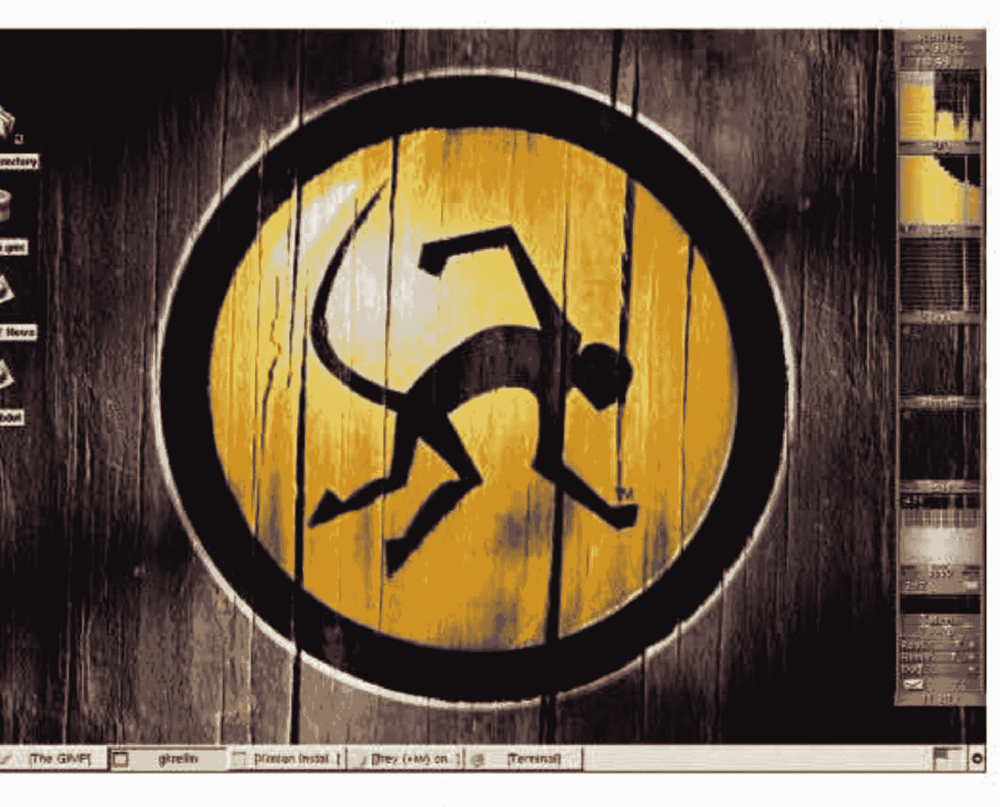

> > 证明了 Gnome 桌面有多优雅，并且当 Novel 寻求 Linux 分支时是一个极具吸引力的报价。

但 Xamarin 的 Dicai 意图是与其他软件包保持二进制兼容。

关于这些变化，Dicai 解释说，过去一年以来，Mono 和 Novel 并不是一个适合独立公司的流水线产品。

Dicai 说：“计划是保持开放。相反，在 5 月 2 日，加拿美国团队被单独留下了。欧洲、巴西和日本几天后也如此。”

这些裁员包含了所有的 MonoTouch 工程师和其他关键开发者。Xamarin 表示它已获得资金来留住团队，并有一个小小的工程合同团队将使他们在核心产品开始产生收入之前留任。

Dicai 说：“我们的计划是维护并让使用 Mono 和 .NET 语言的开发者在喜欢的平台上开发。”

## 虚拟专用服务器

比共享服务器强大得多，但成本仅为专用服务器的一部分。

| 易于管理 | 发行版选择 | 自定义设置 | 极低成本 | Virtuoso Dell 驱动 |
| :--- | :--- | :--- | :--- | :--- |
| | | | | |

| 易于管理 | 发行版选择 | 自定义设置 | 极低成本 | Virtuoso Dell 驱动 |

我们可以继续……

sales@blacknight.com `www.blacknight.com` 0844 284936

 (img/ed47dae754beafdc9a78858630fb76b4_6_2.png)

- Xamarin 希望在主平台上发布 Mono 的实现。

- Android 的新 ARM9处理器增强了对 Android 的支持，并将看到更好的界面和嵌入式解决方案。公司表示，Android 正在成为嵌入式领域最重要的平台之一，并迅速接管其他 Linux 变体以进入市场。

- 对于所有没有参加 POSDEM 会议或嵌入式 Linux 会的人，Free Events 的那些棒的人提供的网站为这些活动提供了从 MeeGo 到 Arduino 实验的一切信息。

- Sinclair 破解其 PS3 上的“其他 OS”选项以防止运行 Linux 没多久，但新系统已被破解，让该选项回来了

- 对于其他足够羡慕并安装固件补丁的人。该补丁是一个匿名黑客在 Alexander Egorenkov 的基础上构建的，后者正面临来自索尼的法律威胁。

- “其他 OS”选项回来了。

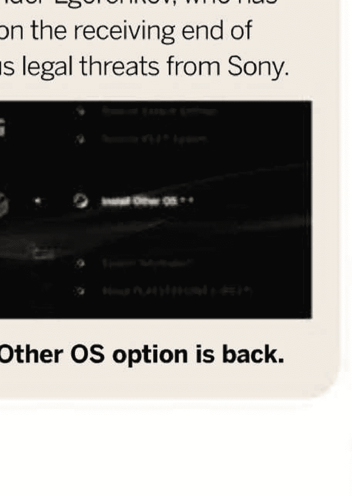 (img/ed47dae754beafdc9a78858630fb76b4_6_4.png)

# 新闻台

# 开发

值得快乐的理由

文本在输入末尾似乎碎片化。我将根据提供的 OCR 文本仅提供可用内容的清理版本。

(img/ed47dae754beafdc9a78858630fb76b4_7_0.png)

我想在不学习网页代码的情况下创建我的网站

- 我想为我的业务创建一个网站

- 我想要一个在线商店

- 我想要一个博客

- 我想要设计

你想用它来做什么？

使用即插即用的博客开始你的站点

£2.49 起

为你的网站提供一个酷炫的地址

£2.99 起

无需代码即可设计你的网站

£4.99 起

开设一家设计精美的在线商店

£8.99 起

在下方了解更多信息：`www.123-reg.co.uk`

免费软件沙发的背后是什么？

Nick Veitch

如果运气的话，在你读到这里时，WordPress 3.2 应该已经发布，并且管理区域会有一些变化。这些包括蓝色主题中的一些调整以及对 Chrome 的支持——对于那些运行 Internet Explorer 6 的用户；对 CMS 集成版本的 jQuery 进行了重大重构；编辑器还提供了免干扰模式，以及一个新的

上周，我参加了许多举行的“技术社交”活动之一，这些活动似乎到处都是。我通常避免这类活动，但那里有免费的啤酒和披萨，而且我可能遇到我认识或不认识但我想认识的人。闲聊中，我恰好遇到了一些经营培训和活动的聪明人，并谈到了我最近为客户客户“翻译”iPhone 到 Android 的事情。实际上，翻译意味着重写，除了语言不同外，你是在为完全不同的平台编写代码，这些平台之间的差异并没有你想象的那么大。

> 最新版本的网页软件具有新功能并推特了十二，具有读者页眉和自定义文章类型。

如果你是 Ubuntu 的粉丝，但认为 Unity 是一个悲性的错误，那么 Mint 11 可能会满足你的愤怒需求。新来者 Katya 也未能实现 Gnome 3，而是坚持固定的且相当不错的 Gnome 3.2。然而，Mint 已经升级，包含了最新 Ubuntu 中提供的所有选项，以及在安装期间添加一系列多媒体解码器的能力。

有人建议这无论如何都是无关的，而我只想将其重写为 Web 应用程序。我当时对此嗤以鼻（针对那个披萨），但移动世界由在移动网络环境中编写的移动网络应用驱动并非不可想象。可能在短期内不会这样——对于需要高度技术技能的应用程序来说它并不可行——而且我们仍然应该记住，在世界的某些地区，手机是访问网页最强大的方法。

> 在 Dispatch 页面阅读更多关于 Mint 11 或 Katya 的信息。

但也许这还不够。Google 的 Chrome 无疑是向 HTML5 成为功能交付方式的世界迈出。尽管这个想法仍然很新，但基于 Web 的应用日益显现的实用性使其最像是一个突破。

此外，本月的 Fedora 也有它的镜像站。该发行版中的 SELinux 元素提供了 Jones 级别的内核安全，已经过重构，让非工程师用户更容易地

你运行哪种操作系统可能并不重要（尽管 Linux 处于最佳位置），但大多数情况下，你使用哪种桌面也将变得无关紧要。一个 Unity/KDE/Gnome 框架的世界，谁能想象这样一个可怕的未来？


卓越的跨平台媒体播放器 Miro 正通过一个全新的桌面应用进入移动市场，该应用无缝同步 Android 手机或平板上的歌曲、视频和应用。该应用提供了 Google 和 Android 应用商店的访问。项目背后的开发者表示，他们对应用程序设定了非常高的标准：即开源的 iTunes。

> Miro 显然同步了你的手机内容和平板电脑。

> 优秀的 LX147 的颈执行，现在死在他的脑子里。

10 | LX147 2011年8月

www.linuxformat.com

# CentOS 在雷德蒙德找到粉丝

Red Hat 的免费版本获得微软 Windows 虚拟机支持。

微软宣布它将开始在其平台上与 Red Hat Linux Enterprise 一起支持 CentOS。该公司表示，这是一个完全免费且与 Red Hat 兼容的发行版，被视为 Windows Server R2 Hyper-V 的“一等公民”。在明尼阿波利斯举行的开源会议上，微软表示 CentOS 是 Windows Server 请求的功能之一，根据估计，该软件运行在高达9% 的互联网上。

IT 行业最大的巨头组成的联盟联合起来，推动采用更多开放技术，并阻止 VMware 在任何地方获胜。开放虚拟化联盟（Open Virtualisation Alliance）包含了 Intel 和 Red Hat 等大牌，其目的是将其集成到 Linux 内中。该小组将为采用该技术的企业提供教育和培训材料、最佳实践和技术支持。

“当一家公司主导行业时，创新就会受阻，客户就会付出代价，”他说。“Red Hat 和开源社区正在防止封闭的垄断，实现更好的性能、安全性和更好的经济效益。”微软将该联盟视为一项挑战，其今年可能突破十亿美元营收大关，并且它是服务器市场上最有影响的竞争对手。Red Hat 注意到 CentOS（以及程度较小的 Ubuntu）带来的挑战，并最近更改了发布更新的方式，使竞争对手更容易主导已改变的属性战场。

# 平板电脑

## 理雅发布企业级设备

理雅（Ricoh）正在推出一种新设备，旨在取代数字环境中的纸质工具。该公司表示，这款 7 英寸触控屏提供如双支笔支持的手写记录和文档记录等功能，可能在安全性和可靠性至关重要的医疗、政府和业务应用中提供动力支持。理雅设备与消费级平板电脑的区别在于，设备保持受管理并能处理复杂系统。除了这块清晰的屏幕——就像 Amazon Kindle 一样——触控屏还能检测压力、速度和角度，使其成为未来几个月内以 500 美元出售的更可靠的设备。可用性尚未决定。

# 性能层

# 虚拟化层

# 存储层

# 备份层

# 监控层

STACK 的收益：

- 减少成本
- 按需扩展
- 增强性能
- 24/7 支持
- 100% 碳中

MyCloudStack 是一个协作开发的、满足今天的独特解决方案。

# ASUS 回归

当 ASUS 在东京电脑展上宣布 Linux 时，笔记本领域出现了一项壮举。ASUS 选择了 Windows 7 或 Linux，这对于 2007 年创的 Eee 笔记本看起来像 MacBook Air 一样轻薄且功能丰富，但便宜八倍。

- Nokia 发布了其 Qt 开发工具包用于创建 Symbian 应用，Red Hat 发布了 Enterprise Linux 6.1 的最新版本。公司表示已请求包含超过 1800 个功能，并在其内核中进行了 3000 次提交。

经济担忧：Google 服务器业务在第一季度增长了 22%。该公司在晚上处理企业面临的结构化和非结构化数据。

Avro 分裂；Android 结合 Google Chrome，为 Linux 用户通过网页在桌面上提供了新的可能。

> 无需眼镜的 3D 图形。

# 微软收购流行的 VoIP 软件开发者。

微软已以 85 亿美元收购了语音过 IP（VoIP）开发者 Skype，旨在阻止其他人。Steve Ballmer 表示，意图是领先 VoIP 市场并为全球通信带来革命。该公司在全球有超过 6 亿客户使用基于 P2P 技术进行免费通话。

许多用户受到该公司的支持（尽管 Linux 用户可能会获得更多关注关注支持日）。Ballmer 强调产品不会有任何变化，因为 Skype 将留留在微软部门，但将其合并并重新发布 Linux 版本将是易行的。

其他人认为，该软件在多个平台（包括 Android 和 MeeGo 等 Linux 衍生版）上可用是保留它的唯一方法。许多 Linux 用户开始寻找替代品，但问题是 Skype 的实用性取决于其普及性：如果只有你在使用，就切换到 Echo。

完整解决方案 - 仅需 1 英镑即可获得您的首月代理主机托管

我们的代理主机托管包包括无限网络空间、无限带宽以及在不收取额外费用的情况下托管无限域的能力。通过在您的产品范围中添加专用服务器、Exchange 托管和域名，为您的客户提供完整的网络托管解决方案。

- 托管无限网站
- 100% 您的品牌
- 实时创建、管理与删除
- 英国数据中心
- 24x7x365 英国技术支持

添加到您的包中...

## 专用服务器

- Windows 和 Linux – 无额外费用
- 销售无限网络空间
- 可作为独立产品或配合托管一起销售
- 无需月费或设置费用
- 完整的 DNS 管理
- 免费 .uk 域名转入与转出
- 白标域名控制面板
- 每个邮箱箱仅需 4.99 英镑
- Microsoft Exchange 2010 标准版
- 为您和您的客户提供免费 Outlook 2010
- 4GB 存储空间
- 可作为独立产品或配合托管一起销售
- 轻松迁移 Exchange 2003 & 2007
- 每月仅 59.99 英镑
- 无需长期承诺
- Dell 品牌 Linux & Windows
- 无设置费用
- 为您的客户提供完整的服务器控制面板
- 为您和您的客户提供 iPhone 控制面板

HostPay – 购买我们的代理包免费赠

HostPay 是我们专门定制的网络托管购物购物车及客户管理系统。

> Heart Internet 以市场领先的托管技术和极具竞争的价格为其客户提供。

Suri Penny

技术电视节目主持人

一键安装，让您在几分钟内即可启动并运行

集成到您的网站中或选择其中一个

实时自动接取、处理并履行订单

支持 PayPal, Google 结账, Worldpay, Sage Pay, Roche & C2

heart internet

www.heartinternet.co.uk

电话: 0845 644 7750

邮箱: sales@heartinternet.co.uk

价格不含增值税（VAT）。常规价格每月 29.99 英镑起。

无畏的 Les Pounder 为您带来最新的社区和 LUG（Linux 用户群组）新闻。

- 几个定期举行会议的小组：
- **格拉斯哥 (ScotLUG) 19:30**, 每月的每个周四，位于斯特拉斯克莱德大学（University of Strathclyde）
- **爱丁堡 (EDLU) 19:30**, 每月的第一个周四，位于爱丁堡培训与会议中心（地址: St Mary's Street）
- **纽卡斯尔 (Tyneside LUG)** 每月的第一个周二，位于 Blank Square 的 Madlab
- **赫尔 (20:00)**, 每月的第一个周二，位于 Coronation Road 的 Old Gate
- **曼彻斯特 (ManLUG) 19:00**, 每月的周三，位于 36-40 Edge Street 
- **伯明汉 (Bugh) 19:30**, 每月的第三个周四，位于 Aston Science Park, Faraday Way, Holt Street
- **卡迪夫 (SWLUG) 19:00**, 每月的第一个周三，位于 Windsor Place 的 The Central Bar
- **西南地区 (SWLUG) 21:00**, 每月的第二个周一，位于 Fleet Street 的 The Sir Daniel Arms
- **米尔顿凯斯 (MKLUG) 20:00**, 每月的周二，位于 Boutique Square 的 Weatherspoons

在 `www.lug.org.uk` 在线查找更多 LUG

使命是聚集社区。

看来英格兰北部通过 Say Corner 享受一种新的 Linux 体验。其他人也对我们都认为理所当然的事情进行了辩论：自由。在这种情况下，Linux 运行的基础正是自由。

第二次 UCubed 活动于 4 月 2 日在曼彻斯特的 Madlab 举行，由当地社区的人们共同举办——既有了解 Linux 的人，也有想要去了解的人。

UCubed 旨在将 Debian 和 Ubuntu 社区聚集在一起，使双方都能从对方的知识经验中获益，这在当天显而易见，人们通在一起工作并为未来的项目建立联系...

来自 Linux 播客的 Dan Lynch 就“统一”发表了精彩的主旨演讲，不是 Unity 系统，而是不同 Linux 社区之间的统一。他的演讲引发了辩论，并由 Ian Forrester 领导了后续活动。由 Annie Morris 和 Charlie 主了另一个令人印象深刻的倡议。

其他演讲还涉及创建各种 Linux 作品以及使用 OpenShot 进行视频编辑以创建 Debian 包。Blackpool 还提到了一个非常受欢迎的 Debian 辩论区。通过 kit，他们演示了 Linux 是如何运作的。访问 UCubed 网站 `http://ucub.info` 了解详情。

> 看看世界上最酷的刻字贴纸（etch-a-stick）

Archon 2011

Archon 2011 是由波兰社区组织的首届 Linux 大会。它将讨论各种主题，例如在 Android 上制作 Linux 以及如何做出贡献。届时将展示 Archon 社区启动的项目。访问 `http://archon.org` 了解详情。

Barcamp Nottingham

Barcamp Nottingham 是一场没有计划安排活动的免费无会议（unconference）。它允许与会者分享内容，以创造以前从未出现的新内容。会议将以演讲、演示、工作坊、技术或其他形式进行。我们于 7 月 23 日在 Old Lace 聚会并留到深夜。全天将有游戏、饮料和欢乐。访问 `http://barcamp.org/` 了解更多。

Oggcamp 11 是由 Linux Outreach UK 主办的第三届会议，将于 8 月 13 日举行。

英格兰北部通过 Say Corner 享受一种新的 Linux 体验。其他人也对我们都认为理所当然的事情进行了辩论：自由。在这种情况下，Linux 运行的基础正是自由。

第二次 UCubed 活动于 4 月 2 日在曼彻斯特的 Madlab 举行，由当地社区的人们共同举办——既有了解 Linux 的人，也有想要去了解的人。

UCubed 旨在将 Debian 和 Ubuntu 社区聚集在一起，使双方都能从对方的知识经验中获益，这在当天显而易见，人们通在一起工作并为未来的项目建立联系...

来自 Linux 播客的 Dan Lynch 就“统一”发表了精彩的主旨演讲，不是 Unity 系统，而是不同 Linux 社区之间的统一。他的演讲引发了辩论，并由 Ian Forrester 领导了后续活动。由 Annie Morris 和 Charlie 主了另一个令人印象深刻的倡议。

其他演讲还涉及创建各种 Linux 作品以及使用 OpenShot 进行视频编辑以创建 Debian 包。Blackpool 还提到了一个非常受欢迎的 Debian 辩论区。通过 kit，他们演示了 Linux 是如何运作的。访问 UCubed 网站 `http://ucub.info` 了解详情。

> 看看世界上最酷的刻字贴纸（etch-a-stick）

Archon 2011

Archon 2011 是由波兰社区组织的首届 Linux 大会。它将讨论各种主题，例如在 Android 上制作 Linux 以及如何做出贡献。届时将展示 Archon 社区启动的项目。访问 `http://archon.org` 了解详情。

Barcamp Nottingham

Barcamp Nottingham 是一场没有计划安排活动的免费无会议（unconference）。它允许与会者分享内容，以创造以前从未出现的新内容。会议将以演讲、演示、工作坊、技术或其他形式进行。我们于 7 月 23 日在 Old Lace 聚会并留到深夜。全天将有游戏、饮料和欢乐。访问 `http://barcamp.org/` 了解更多。

Oggcamp 11

Oggcamp 11 是由 Linux Outreach UK 主办的第三届会议，将于 8 月 13 日举行。

我使用 Ubuntu（主要是 Gnome 版本）已经好多年了，发现新的 Unity 界面是一个不受欢迎的入侵。这显然是试图将 Mac 的功能引入 Linux 桌面，但缺乏 Mac OS 多年来拥有的许多功能和精细程度。其之一，Mac 是

然而，最近的更新重新定位并重新排列了 Unity。它似乎卡在了这项任务上。作为 Linux 上的一个窗口管理器，这倒还好，但他们似乎丢失了一些像 Mac 那样的功能，例如 1280x120 的屏幕、侧边的启动器和调度（Dock）。这一切感觉非常不自然。

Unity 的一个特性是对其系统托盘的裁剪，对于许多复杂的平台应用程序来说，Unity 决定管理每个带有弹出菜单的窗口。

在 Ubuntu 能提供一种简单且文档齐全的方式来提供这种功能（就像 Mac 使用 Dock 一样）之前，它所做的只是

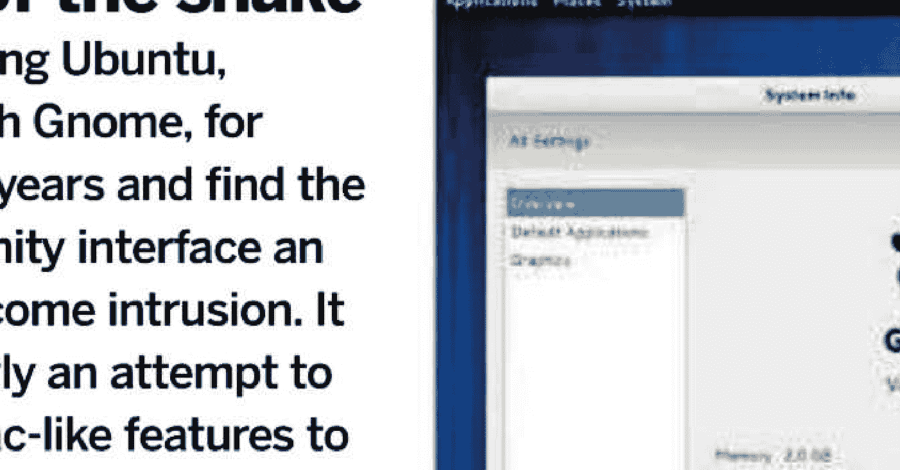

切换：小设备，巨大的缺陷……

在受到 Win32/Z 斗争的目标后，由于挫败感，我想尝试从我的生活中删除它。我知道它并不完美，但对于家用 PC 来说，它比我用过的任何东西都要好。我不介意监控它，但这确实能帮我吐吐气，我知道有人会同意我的观点，而且 Unity 进程可以做得更好。现在开始。

Alison Reed

Graham 说：Unity 是一个无 USB 的发行版，这是一个很棒的主意，但它阻止了调度器，坏取决于支持的数据库：gravity 的情况完全不受支持，而且公司去年破产了。如果能看到这个东西再次运行就太好了，所以我们拭目以待，能找到复活它的的方法。

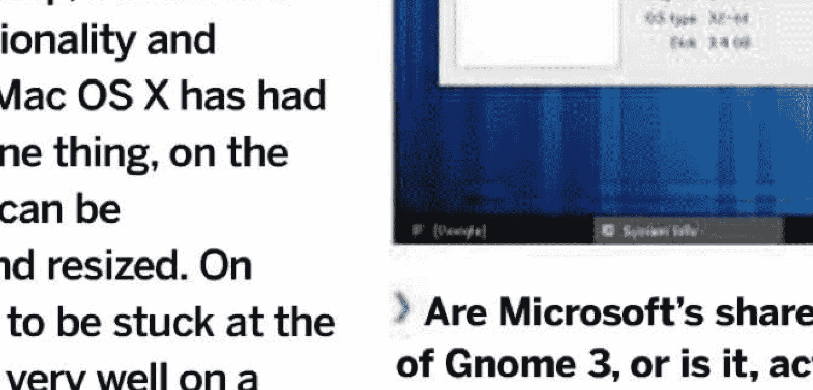

我们股东的现实在 Gnome 3 的巧妙运作下确实非常糟糕，或者其实不是（管它呢），而是相当不错？

Gnome 3 似乎是一个庆祝的——至少在媒体阵营中，如果有什么可以从运行操作系统中学学习到的话。它是一个陌生的界面，缺乏很多可用性。有了它的界面，你可以预计在支持方面要付出更多努力，而且像企业用户会喜欢使用它，因为它具有从根本上改变你其他用户的特征。

系统托盘与以前在所有平台上运行过的众多应用程序兼容，包括 Linux 桌面。

Matthew Smith

(QWERTY 的开发，系统陷阱开发应用)

Andrew 说：沿着这条路我们需要付出一点努力，但并不仅仅是为了学习那个棘手的崩溃，而且这里的许多海陆陆队喜欢 APT Tux，这不会让这一天的其他部分变得更好。那 Unity 让一个应用程序在后台运行时看起来很漂亮，但系统通过另一种方法就在那里呢？

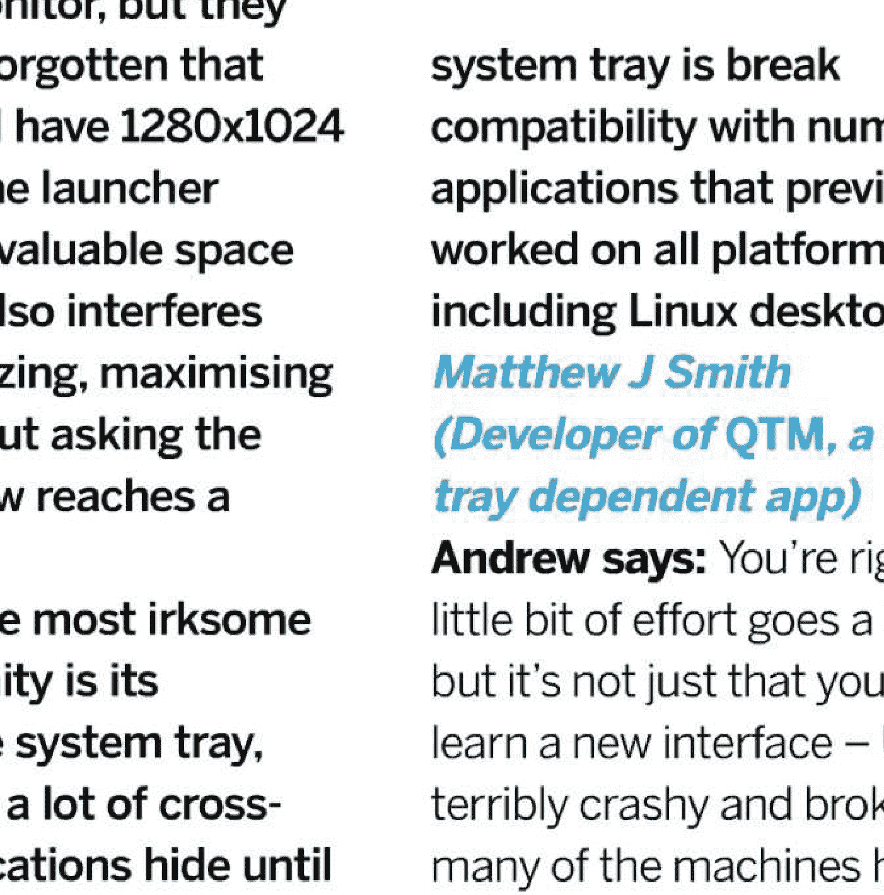

| 笔记 | 最后修改时间 |
| --- | --- |
| 笔记本 | 5天前，2023年8月26日 |
| 联合笔记 | 2022年10月14日，上午10:28 |
| 工作笔记 | 2022年11月11日，上午11:10 |
| Gustavoella | 2023年2月16日，上午11:39 |
| Daniel Holbach | 2023年2月8日，上午08:23 |
| Nick Nelson | 2023年2月16日，上午11:39 |
| Jorge Castro | 2023年2月16日，上午11:39 |
| Nic Cocket | 2023年2月8日，上午08:23 |
| Todd | 2023年2月8日，上午08:23 |
| 使用在 tombed (旧) | 2023年2月8日，上午08:23 |
| 被切断的第五列表 | 2023年2月8日，上午08:23 |
| 被切断的第五 TODDO | 2023年2月8日，上午08:23 |
| Todd | 2023年2月8日，上午08:23 |
| 社区艺术 | 2023年2月8日，上午08:23 |
| 被切断的第五 Togo | 2023年2月8日，上午08:23 |
| 工作写作 | 2020年4月8日，晚上09:35 |
| 待安排的任务单元 | 2019年3月29日，下午04:01 |
| 上游 | 2019年1月26日，晚上05:57 |
| CLS 计划 | 2018年12月15日，下午12:47 |
| DCI 课程问题 | 2009年12月3日，上午10:56 |
| Etran Valles | 2009年11月7日，上午07:59 |
| 2009年10月27日，上午10:49 |
| 2009年11月12日，上午07:59 |
| 2009年10月15日，上午11:01 |

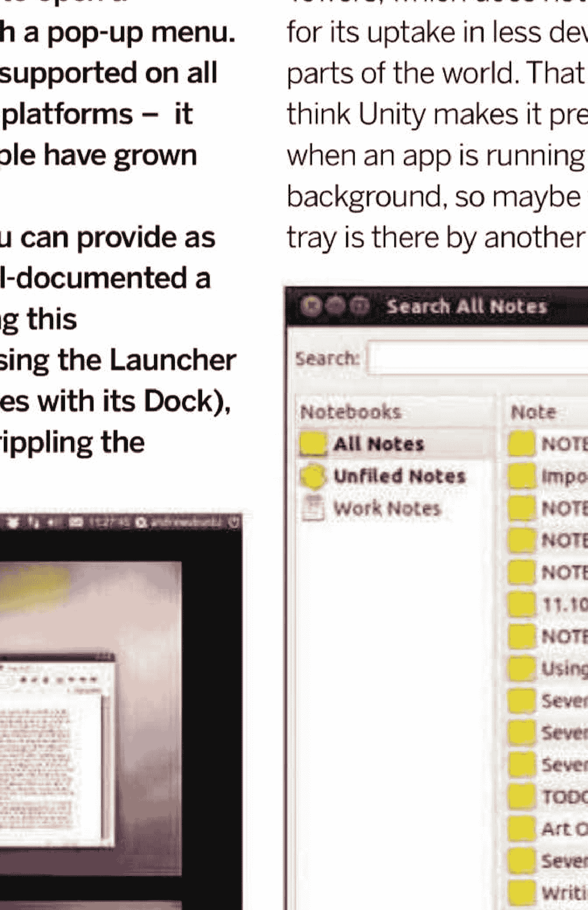

共 8 条笔记

花时间学习快捷键，Ubuntu 的新界面可能是真正的救星。或者安装 Linux Mint 并花点时间 Toby 有他的功能，但它能完成工作吗。如果你发现只需

# 功能请求

## 固态硬盘

我有一个来自美国的订阅者已经一年多了，而且，作为一个不喜欢花时间的学生，尽管我不得不付账单，每一项都是那么好，让我无法自持，所以对于杂志备份来说非常有用，因为我一直在用一个圣诞节送的便携驱动器，它很快坏了。问题是我在 DVD 上的第二个备份丢失了许多要复制的文件。在第一上问题上赶上任何正常的，现在我有两样东西。

# WorldMag


fasthosts 是由 fasthosts Internet 提供的 Linux 邮件服务器，www.fasthosts.co.uk 是领先的 Linux Web 托管提供商。自1999年以来，Fasthosts 一直处于服务器技术的前沿。他们最近推出了全新的品牌 DS9910 独立服务器，提供令人印象深刻的2倍 200GB 硬盘空间和 12GB 内存。凭借 RAID 1 硬件保护，该服务器是任何存储管理级数据库和 Web 应用的理想选择。凭借先进的监控、无限制带宽和 24/7 英国本土支持，Fasthosts 提供了价值的服务。访问 www.fasthosts.co.uk 了解更多信息。

Graham 说：人们说自由软件的伟大之处在于选择，这里有一个例子。如果你不喜欢某个应用程序，会有更好的程序完成类似的工作。

# 声明

与 Mark Shuttleworth 及其同事的那次采访就像 20 世纪 50 年代的采访一样艰难（如果你有什么想告诉我的，首相阁下？）。

但没能以 Canonical 的身份披露这次采访（Jono Bacon），在你们的实践中很少被认为是非常糟糕的。并不意外，文章所宣传的：完全如其表。如果这不是一个广告，你本会问的。无论如何：请不要问了。

# 转折点

我一直在使用一个非常精简的发行版，但配置 Arch 和 Gentoo 并不算痛苦（因为没时间）。我不想安装臃肿的发行版 Ubuntu 或 Fedora，还要移动大部分东西……然后我发现了 Bodhi。它完美地契合。实际上，要感谢你们 LXF。那么，在 Bodhi 上进行全功能展示的费用如何？

Graham

Andrew 说：在我们承诺写一篇关于 Bodhi 的专题之前，我们不需要对它进行深入了解，但目前我们正在寻找一个轻量级的发行版，并计划在下期中推出关于 Zenwork 的教程。

特别令人失望的是对 Ubuntu 政策的关注，这引发了一些问题，我们可以看到再次向 Shuttleworth 提出的这些问题。

John Horton，来自 Ortonrington, Kent 表示：我们的贡献者与几乎所有的软件项目都有联系，但我们认为这并不冲突冲突；相反，这给了我们巨大的动力去开发比外部人士做得得多的项目；考虑到此，我们要求 Jono 去与 Ubuntu 的关键开发者交流。如果我们想通过像帕特曼式的质问来让自己变得不受欢迎，我们会派一个独立的人去，但对于你提到的那次采访

我们都在寻找新的发行版来尝试。

只是为了有机会从源头听到关于 11.04 的开发情况。另一方面，同样让我们这些可怜的人感到遗憾的是，提到 Jono 是 Canonical 的员工。我们过去可以无数次说，我们喜欢 Ubuntu，并会额外努力向他以及我们的任何其他作者展示指向软件项目的链接。

我尝试过 Fedora、Debian 5，以及 OpenSUSE 11.5，即使那时连接图标也显示我没连上！Windows 和 OS X 就不不用提了。

我是不幸者之一，但这至少值得写几个专题。

这个问题已经持续了三周，我们在论坛上似乎并没有什么进展。也许 LXF 团队可以帮助。

Graham 说：我们需要关注手机与 Linux 的连接，现在每个人都有安卓 手机，也许现在是正确的时机。

Steve

“Mark Shuttleworth，你在 Ubuntu 中最喜欢的发行版是什么？”

 它是读作 L-IN-UX

嘿，拆开说！我们来谈谈 MAGGIA MESTER

 它是读作“MAH-HEE-AY”

- 看看 5 个安卓 应用程序。在第 p56 页。

www.tuxradars.com

| 服务 | 价格 |
| :--- | :--- |
| 云服务器 | 每小时 1 便士 |
| 云文件 | 每 GB 1 便士 |

革命意味着我们在英国这里发起了基于云的计算。革命将让你最终从昂贵的内部服务器的负担中解放出来。它意味着不再需要为过时的技术和压力暴政担忧。它也意味着一个更公平的系统，仅按需付费。事实上，你只需云服务器每小时 1 便士、云文件每 GB 1 便士，即可参与革命——这一切都有我们狂热支持的后盾。访问 www.rackspace.co.uk/cloud-hosting 加入革命。

由我们的专家评审并评分的所有软件和硬件

## 本月发布精选：

2011 年 8 月版 LXF

**ANDREW GREGORY**

在 eBay 上没赚到大钱后，正回归本职。

## Fresh mint

在 Ubuntu 11.04 发布前不久，LXF 来了一群来自 Canonical 的人员，他们来查看 Ubuntu 和 Unity 的状态。我曾考虑过在盲目中尝试新发行版的想法，但我们在 4 月份做到了。我一直想象着更换其他操作系统的同时更换硬件，并拥有一种自……以来未见的完善程度。

当我们询问对于转向具有更熟悉界面的发行版（Mint）的用户潜在硬件时，Canonical 的回答就像是在对待一个最珍贵的问题——他们说，“绝不”（我稍作转述），“那永远不会发生。”

**猜怎么着？**

噢，目前的排行榜上 Mint 居首，之后是 Fedora，Ubuntu 正在追赶。我们知道这是一种不确定的衡量方式，但从销售量来看，这是我们得到的数据。

有了 Unity，Ubuntu 非常适合桌面，因此对 Ubuntu 长期来说将是一个巨大的胜利。但这里的的情况是，大多数人不想看到激进的重新设计，而那些宁愿使用 Gnome 3 而不是 Unity 的人将坚持……

andrew.gregory@futurenet.com

## Kdenlive

我们在 Linux 中对它进行了专业评测，家庭视频类别得到了很好的照顾。Kdenlive 旨在寻求折中，并取得了了的成功。

## FreeNAS

我们发送了一个盒子进行破解，现在，随着每个月的更新和新水平，我们设计了一个 BSD 专用服务器放在上面

## FritzBox 790

如果你的路由器需要你所需的功能，FritzBox 可能适合你。它充满了 Linux，甚至可以通过交换机进行扩展。

## Warsaw

我们测试它是因为很难看清发生了什么，但你又喜欢用火箭筒进行一次的锻炼。这里有你所需的一切。

# 书籍

我们这个月的两本书都非常优秀，为我们提供了新事实，并让加速度工作了起来。

## 书籍发布

## FreeNAS 

> 大多数 NAS 盒子似乎都使用 Debian，但这个 BSD 版本值得一看。

> Jetsons 夺取了你 ISP 的路由器，添加了 Telnet 并让 Linux 被破解了。

# 我们的专家结论

我们从上到下评分的所有产品都有我们想要评分的类别，即根据性能、易用性、无需免费下载的软件可用性以及性价比进行评分。对于我们使用的四个标准，我们得到了平均分。从中脱颖而出的产品可能会获得我们声誉卓远的初学者奖。唯一获得此项奖项的产品——在所有方面上得分都很！只要免费，我们将使用推荐的软件发行版。有助于我们推荐其他我们将使用的包。

Graham Morrison 发现 Mandriva 的社区分支版具有魔力——尽管他不确定如何发读它的名字……

-   基于 KDE 的由 Mandriva 社区支持的发行版。也包括 Mandriva 本身，或者 Kubuntu。

首先，让我们快速回顾一下历史。Mandriva 是首批没有计算机科学学位的 Linux 发行版之一。当它在 2005 年与 Connova 合完成后，由于财务困难导致了一个由自由员工和社区成员组成的团体，该发行版再次更名为 Mandriva。Mageia 出现在 Mandriva 的一个重大发布之前。但这些努力并没有投入到新功能上，不过现在不再如此。1.0 版本重点在于完成向社区发行版的转型，同时确保该项目有未来。这就是为什么你在 Mageia 中看到的大部分内容都是仔细的重构。

安装的易用性一直是 Mandriva 的优势之一，Mageia 继承了同样的机制，但使用了全新的镜像。一切看起来都棒极了，只需要 3 分钟和几个问答即可。

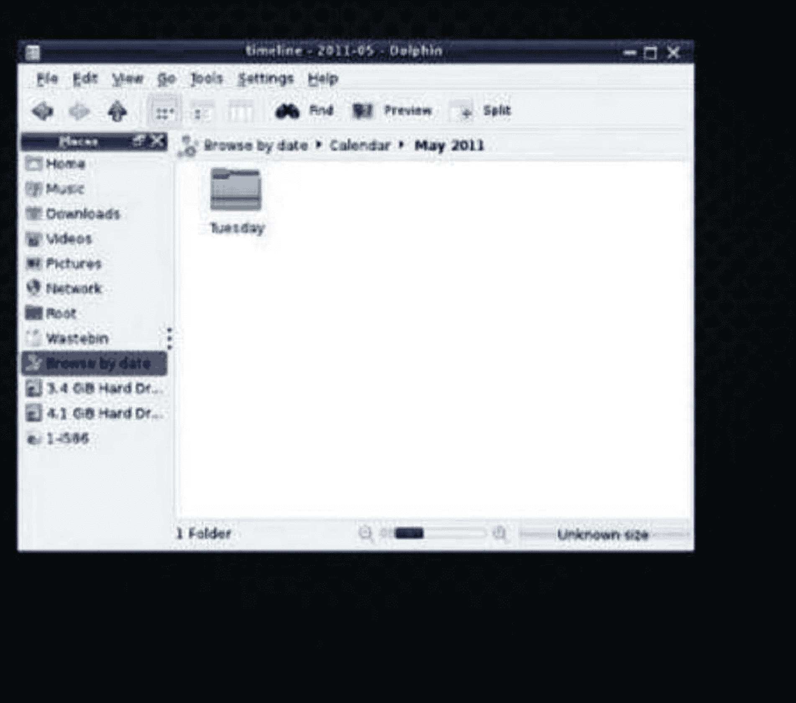

尽管基于 KDE 4，但 Mageia 的桌面并不会让人想逃回 Gnome 或 Windows。

## “使用这种质量的社区发行版感觉很棒。”

虽然是首次发布，但有很多理由切换到 Gnome 3，我们迫不及待看到开发者在拥有更多时间和经验后会做什么。

Mageia 拥有一个优秀的团队，从他们自己的仓库带来了数千个软件包。你可以放心地信任预装的大多数软件包的最新版本，包括 LibreOffice 和 Firebird。

考虑到更新和内核的预期，Mandriva 和 Mageia 之间存在真实的差异，但使用这种质量的社区发行版感觉很好，这种出色的努力值得赞扬。

Mageia 的 KDE 收敛了桌面原有的某种怪异感。应用程序启动菜单看起来最自然。桌面背景作为文件图像也很漂亮，而不是一个鲜艳的库，感觉响应灵敏且快速。

为了获取桌面。我们仍然很欣赏被询问默认桌面选择，而不是由默认为你做决定，我们选择了 KDE。Mageia 1.0 附带最新版本的 KDE：4.6.3，但使用 Mandriva 2.3 也是安全的。这是一个好主意。

至于工具，当你在 Dolphin 文件管理器中点击“日期”或想跳转到“设置”菜单时，背景搜索不会引起困惑。

你还会发现 Mandriva 控制中心。我们也将其称为 Mageia 控制中心。它能以简单的方式处理用户、设置 NP 共享、配置防火墙并安装 Compiz。但它还需要一个搜索字段，例如，GUI 将帮助你处理背景桌面。


开发者：Mageia 社区

网站：http://www.mageia.org

| 特性 | 评分 |
| :--- | :--- |
| 性能 | 8/10 |
| 易用性 | 9/10 |
| 文档 | 9/10 |

> Mandriva 值得的继任者，承诺在未来提供更多。

另一个需要的是包管理，2011 年 8 月 17 日

www.mageia.com

## FreeNAS 8.0

这是开源存储平台分水岭的最后一个化身吗？Sharma 发现了向企业级的强力转变。

### 简要介绍...

- FreeNAS 是一个基于 FreeBSD 的网络存储服务器。它提供 Web 界面，支持 Windows 和 Linux 之间的 ZFS 共享以及更多功能。此外：Openif

文件服务器的目的是让你网络上的其他计算机访问文件。网络附属存储（NAS）在实现这一切的同时，让访问变得更容易、更快。8.0 版本标志着从旧版 FreeNAS 的重大转变。最大的变化是切换到运行镜像，让你可以在与专用设备相同的磁盘上存储数据。因此，如果你将 FreeNAS 安装到硬盘上，它将占用整个空间，无论其大小如何。

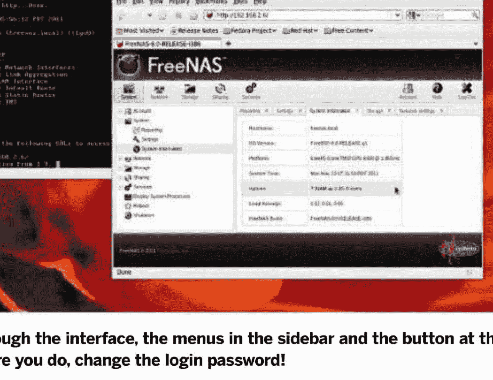

> 通过界面、侧边栏中的菜单和顶部的按钮，但在你之前，先更改密码！手动。位于网络中任何机器上的都可以访问图形化界面。使用 'admin' 和 64 位密码登录非常慢，但对内存的需求极小，所以运行很快。缺点是，很难管理所有功能并提供整洁的界面，导航侧边栏的垂直列表很方便。当时，文档已自上个月以来进行了升级，但频道和邮件列表是一些有用信息，可以找到你需要的。最后，很难找到硬件支持，除了网卡，除非在 FreeBSD 8.0 中也是如此。

| 特性 |  |
| :--- | :--- |
| 开发者 | iXSystems |
| 价格 | 免费 |
| 易用性 | 8/10 |
| 文档 | 8/10 |

如果需要，侧边栏的垂直列表很容易导航。

## 评分 8/10

## 生成报告

LDAP 客户端让数据变得容易。

## Warsaw 0.62

这让数据变得容易。

## 0.62

“使用这种质量的社区发行版感觉很棒。”

- 这是一个带有独特翻转的第一称射击游戏。引入了 FreeBSD。它提供 Web 界面，支持 Windows 和 Linux 之间的 ZFS 共享以及更多功能。此外：Openif

文件服务器的目的是让你网络上的其他计算机访问文件。网络附属存储（NAS）在实现这一切的同时，让访问变得更容易、更快。8.0 版本标志着从旧版 FreeNAS 的重大转变。

除了网卡，除了网卡，除非在 FreeBSD 8.0 中。


这种决定令人印象深刻且一而易见。整个游戏比平均 FPS 更轻量，其识别物品和对手以及导航地图的方法对新手来说更容易。卡通化风格也缓解了暴力。

Warsaw 的游戏玩法走了一条独特的道路。虽然它吸收了 Quake 和 Unreal 运动的关键元素——例如，跳跃、侧移跳和跳跃——例如，它穿过地图的方式非常直接，但通过跳跃和转向的结合，这种速度对于在对手之前收集强化包至关重要。主服务器上总有比赛进行，通常有很多地图和数字供选择。还有许多锦赛，所以你可以与其他竞争，并将你的成功（或失败）记录在后世。

Warsaw 对传统 FPS 的采用为从未尝试过的人提供了极佳的切入点。此外，它的独特风格许多许多，让 FPS 老玩家也能享受。因此，Warsaw 值得一试。

开发者：开发团队

网站：http://www.warsaw.net/

价格：免费下

| 特性 | 评分 |
| :--- | :--- |
| 游戏性 | 8/10 |
| 画质 | 8/10 |
| 经久性 | 9/10 |
| 性价比 | 10/10 |

> * 一个做了很多努力让游戏变得易于访问的 FPS

## 99.99%

网络可用性

# 

十余年

行业领先技术

服务器

## 最佳

英国配置

跨多个服务器的

新型虚拟化技术

## 强大的云技术

提供高性能的专享资源，

用于运行高要求的电子邮件、网络和数据库

应用程序。让您能够随时灵活地自定义内存、硬盘和 CPU 资源——缩短您的

业务周期。

## 购买 Fasthosts 虚拟服务器的原因：

- 最佳英国配置：1000GB 硬盘空间和 166GB 保证内存
- RAM 保护的 SAN 存储，具有即时自动故障转移功能
- 99.99% 网络可用性！
- 带有电子邮件和短信告警的资源监控！
- 轻松自定义您的资源并按需升级
- 第一年免费赠送 SSL 证书*
- 全功能远程管理访问
- 适用于多个网站的可选 Plesk 控制面板
- Microsoft* Hyper-V™
- 运行 Windows 2008 R2 或 Linux 的机会
- 安全且私有的英国数据中心
- 24/7 英国支持和现场工程师

先进的按需虚拟化技术

在发生服务中断的罕见事件时，通过立即将您的服务器切换到新硬件来消除停机时间。

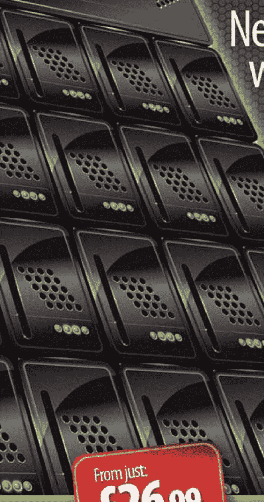

仅需：

£26.99

每月（不含值税）

免费自动设置 | 无限带宽** | 24/7 电话与在线支持

由 Windows Server 2008 R2 SQL Server 2008 Plesk Panel 驱动

立即创建您的虚拟服务器：www.fasthosts.com/virtualservers

## 立即拨电我们：

## 0844 583 2410

fasthosts.com/virtualservers

2012年大博览会

合作伙伴

## fasthosts

世界级虚拟服务器

© 2013 版权所有。Fasthosts 及 Fasthosts 标志为 Fasthosts Internet Ltd. 的商标。价格以印刷时为准。详情请访问 www.fasthosts.com/details。*适用 Fasthosts 条款和条件。**无限带宽受接受使用政策限制。***适用条款和条件。详情请访问我们的网站。

关注我们：t f m

## Kdenlive

## Kdenlive 0.8

Andy Channels 坐在他的导演椅上，凭借最新的 Linux 视频编辑包加入了 YouTube 革命。

## 简要...

- Kdenlive 是一款适用于 Linux、OS X 和 FreeBSD 的视频编辑软件。您也可以尝试 OpenShot 或 Avidemux。

存储空间正在膨胀，媒体专业人士几年前还认为编辑整个四小时的菲德尔·卡斯特罗视频是可行的，并且仍有空间记录半场足球赛。大量的素材使得拥有一个良好的编辑软件至关重要。

Kdenlive 适用于 Linux，以及 OS X 和 FreeBSD，获取 Kdenlive 是一个取决于发行版的额外程序包。

界面在小屏幕上看起来略显杂乱，但如果你有良好的分辨率（编辑时你应该有），它看起来会更好。如果你习惯了 Premiere 或 Final Cut，可以创建并保存自己的布局，构建一个这样的界面非常容易。

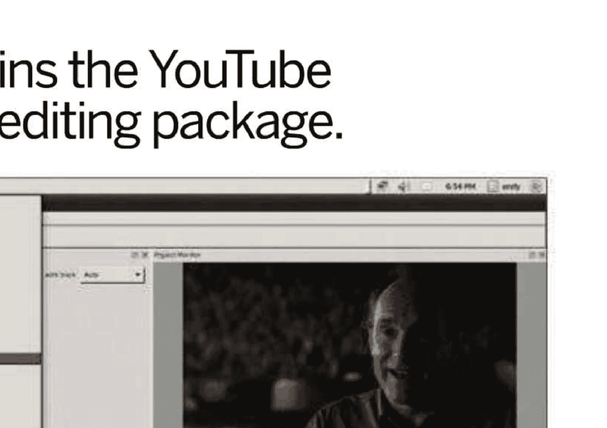

提供了从磁带或 SD 卡捕捉的选项，支持从 PAL 定义到 1080p 的所有分辨率。

基础操作都处理得非常好，得益于重量级功能，

> Kdenlive 在处理高分辨率和更复杂的任务时很吃力

抠像（rotoscoping）——允许使用帧和贝塞尔曲线创建视频遮罩——以及更强大的特效，如调光。

## “并不是它太难了，而是可能它看起来太难了。”

并不是所有效果都是顶级的。有些效果看起来是在修饰音频，而不是简单地通过时间结构（添加大量的）调整来返回音调和同步，然后将音频和视频在同步且正确的音调上链接，尽管选择最佳片段可能很困难。

我们非常喜欢构建项目的方法，保存你最佳技能的能力也实现得很好。如果增加一个完全环绕的选项就更完美了。

Kdenlive 的问题在于它还没有跟上专业水平，对普通用户来说太复杂了。它并不难，但如果你没有时间投入，可能看起来就太难了。不过，某些效果带有处理模块，这是一个好主意。

时间轴上的素材、剪辑片段，尤其是——添加转场，都足够好。为了直观和快速的制作过程，保留在时间轴上进行分钟级“缩放”的能力很重要。

Kdenlive 团队还添加了一些项目，包括

## 回放


按下空格键到播放停止之间的间隙会导致开头卡顿。这是早期版本的问题。现在好多了，但你越深入使用，遇到的性能问题就越多。

## 功能一览


Kdenlive 并不是一个像 iMovie 那样的简单编辑包。它功能强大，但基于内容构建的能力提供了很大的灵活性，但对硬件也有限制。如果你使用的素材分辨率或帧率很高，复杂的复杂的，软件会非常吃力。然而，在一台配备 Core i5 笔记本电脑、拥有 8GB 内存和 1440x1080 分辨率的情况下，

# Linux 总结

Kdenlive

Web: `kdenlive.org`

免费：基于 GPL 

| 功能 | 评分 |
| --- | --- |
| 性能 | 8/10 |
| 易用性 | 6/10 |
| 文档 | 7/10 |
| 满意度 | 5/10 |

> 一个合格且可靠的编辑器，一些用户在使用其初始界面。

## 评分 6/10

抠像

让你能够使用贝塞尔曲线创建复杂的遮罩。

界面

管理转场和特效对于直观的界面来说是个笑话。

26 | LXF | 2011年8月17日

`www.linuxformat.com`

## ADSL 调制器/路由器

## Fritz!Box 7390

ADSL+ 调制器

Morris 替换了带有单一红色和银色部分的 Linux 盒子。

## 简要...

- ADSL+ 路由器具有双通道、NAS 功能，以及互联网和电话。这是一个更便宜的替代方案。

得益于其强大的内部结构，FritzBox 系列的 ADSL+ 调制器对于那些发现 ISP 默认选项有限的人来说非常流行，新的 7390 是完美的示例。

配合调制器、以太网连接，你将找到用于媒体流的 USB 端口、2.4G/5GHz 访问以及全面的交换，带有 DECT 基站功能，另一个优势。

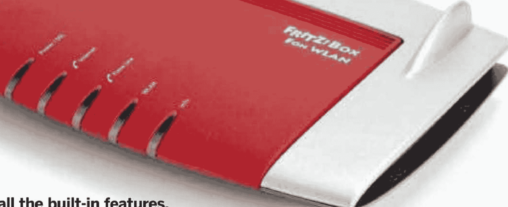

- 尽管所有内置功能，你仍然可以启用和卸载其他程序包。

最新的固件 `84.05.04-167` 让我们支持 M，如果你的 ISP 支持，这将增加 ADSL 速度。缺少 M 是我们评论者的观点。

Despite all the built-in features, you can still enable and uninstall other packages.

## 99.99%

网络可用性

# 

十余年

行业领先技术

## 高性能

虚拟

服务器

## 最佳

英国配置

跨多个服务器的新型虚拟化技术

## 强大的云技术

提供高性能的专享资源，用于运行高要求的电子邮件、网络和数据库应用程序。让您能够随时灵活地自定义内存、硬盘和 CPU 资源——缩短您的业务周期。

## 购买 Fasthosts 虚拟服务器的原因：

- 最佳英国配置：1000GB 硬盘空间和 166GB 保证内存
- RAM 保护的 SAN 存储，具有即时自动故障转移功能
- 99.99% 网络可用性！
- 带有电子邮件和短信告警的资源监控！
- 轻松自定义您的资源并按需升级
- 第一年免费赠送 SSL 证书*
- 全功能远程管理访问
- 适用于多个网站的可选 Plesk 控制面板
- Microsoft Hyper-V™
- 运行 Windows 2008 R2 或 Linux 的机会
- 安全且私有的英国数据中心
- 24/7 英国支持和现场工程师

先进的按需虚拟化技术，在发生服务中断的罕见事件时，通过立即将您的服务器切换到新硬件来消除停机时间。


仅需：

£26.99

每月（不含值税）

免费自动设置 | 无限带宽** | 24/7 电话与在线支持

由 Windows Server 2008 R2 SQL Server 2008 Plesk Panel 驱动

立即创建您的虚拟服务器：`www.fasthosts.com/virtualservers`

## 立即拨电我们：

## 0844 583 2410

`fasthosts.com/virtualservers`

2012年大博览会

合作伙伴

## fasthosts

世界级虚拟服务器

© 2013 版权所有。Fasthosts 及 Fasthosts 标志为 Fasthosts Internet Ltd. 的商标。价格以印刷时为准。详情请访问 `www.fasthosts.com/details`。*适用 Fasthosts 条款和条件。**无限带宽受接受使用政策限制。***适用条款和条件。详情请访问我们的网站。

关注我们：t f m

## Kdenlive

## Kdenlive 0.8

Andy Channels 坐在他的导演椅上，凭借最新的 Linux 视频编辑包加入了 YouTube 革命。

## 简要...

- Kdenlive 是一款适用于 Linux、OS X 和 FreeBSD 的视频编辑软件。你也可以尝试 OpenShot 或 Avidemux。

存储空间正在膨胀，媒体专业人士几年前还认为编辑整个四小时的菲德尔·卡斯特视频是可行的，并且仍有空间记录半场足球赛。大量的素材使得拥有一个良好的编辑软件至关重要。

Kdenlive 适用于 Linux 以及 OS X 和 FreeBSD，获取 Kdenlive 是一个取决于发行版的额外程序包。

界面在小屏幕上看起来略显杂乱，但如果你有良好的分辨率（编辑时你应该有），它看起来会更好。如果你习惯了 Premiere 或 Final Cut，可以创建并保存自己的布局，构建一个这样的界面非常容易。


提供了从磁带或 SD 卡捕捉的选项，支持从 PAL 定义到 1080p 的所有分辨率。

基础操作都处理得非常好，得益于重量级功能，

> Kdenlive 在处理高分辨率和更复杂的任务时很吃力

抠像 `rotoscoping`——允许使用帧和贝塞尔曲线创建视频遮罩——以及更强大的特效，如调光。

## “并不是它太难了，而是可能它看起来太难了。”

并不是所有效果都是顶级的。有些效果看起来是在修饰音频，而不是简单地通过时间结构（添加大量的）调整来返回音调和同步，然后将音频和视频在同步且正确的音调上链接，尽管选择最佳片段可能很困难。

我们非常喜欢构建项目的方法，保存你最佳技能的能力也实现得很好。如果增加一个完全环绕的选项就更完美了。

Kdenlive 的问题在于它还没有跟上专业水平，对普通用户来说太复杂了。它并不难，但如果你没有时间投入，可能看起来就太难了。不过，某些效果带有处理模块，这是一个好主意。

时间轴上的素材、剪辑片段，尤其是——添加转场，都足够好。为了直观和快速的制作过程，保留在时间轴上进行分钟级“缩放”的能力很重要。

Kdenlive 团队还添加了一些项目，包括

## 回放

按下空格键到播放停止之间的间隙会导致开头卡顿。这是早期版本的问题。现在好多了，但你越深入使用，遇到的性能问题就越多。

## 功能一览


Kdenlive 并不是一个像 iMovie 那样的简单编辑包。它功能强大，但基于内容构建的能力提供了很大的灵活性，但对硬件也有限制。如果你使用的素材分辨率或帧率很高，复杂的复杂的，软件会非常吃力。然而，在一台配备 Core i5 笔记本电脑、拥有 8GB 内存和 1440x1080 分辨率的情况下，

# Linux 总结

Kdenlive

Web: `kdenlive.org`

免费：基于 GPL

| 功能 | 评分 |
| --- | --- |
| 性能 | 8/10 |
| 易用性 | 6/10 |
| 文档 | 7/10 |
| 满意度 | 5/10 |

> 一个合格且可靠的编辑器，一些用户在使用其初始界面。

## 评分 6/10

抠像

让你能够使用贝塞尔曲线创建复杂的遮罩。

界面

管理转场和特效对于直观的界面来说是个笑话。

26 | LXF | 2011年8月17日

`www.linuxformat.com`

## ADSL 调制器/路由器

## Fritz!Box 7390

ADSL+ 调制器

Morris 替换了带有单一红色和银色部分的 Linux 盒子。

## 简要...

- ADSL+ 路由器具有双通道、NAS 功能，以及互联网和电话。这是一个更便宜的替代方案。

得益于其强大的内部结构，FritzBox 系列的 ADSL+ 调制器对于那些发现 ISP 默认选项有限来说来说非常流行，新的 7390 是完美的示例。

配合调制器、以太网连接，你将找到用于媒体流的 USB 端口、2.4G/5GHz 访问以及全面的交换，带有 DECT 基站功能，另一个优势。


- 尽管所有内置功能，你仍然可以启用和卸载其他程序包。

## 广告

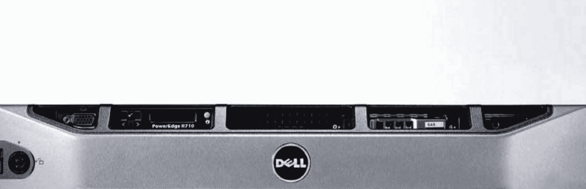

## 激发创造力

### 执行的力量

更新您的服务器以激发贵组织的创造力，增加您数据中心的容量，让您无需寻找或建造更大的场所——当然，您的旧服务器可以继续使用，或者通过将其迁移到组织中要求较低的部分、出售它们或捐赠给慈善机构。

服务器是技术领域的节奏部分，是让歌手能够大显才华的幕后功臣和英雄。就像现实世界中的神话一样，它们并没有得到应有的关注。必须处理不断变化的、日益增长的客户需求的组织可能不会考虑服务器——或者可能将其视为主要的关注点之外，浪费金钱并产生足以炸毁锅炉的热量。

服务器更新不仅能提高性能、降低成本并增加稳定性，还提供了一个利用新软件获益的机会。程序可以提供更好的工作方式、更快的存储以及激发创造力的工具。当冷却系统过载时，停机变得变得越来越可能，特别是当您运行旧的服务器硬件时。如果软件提供商停止支持您的产品，每次事件的成本将成为常态。在戴尔，我们知道更好的方法。

我们曾生活在艰难的时期，表面上看是从现有硬件中榨干最后一滴水——但那是一种虚假的经济性。在现代现实中，在您穿过经济中心的过程中，我们需要更高效、更强大的 IT 系统——不仅是今天，而且在未来多年。

## 数据爆炸

我们对数据的需求以兆字节为衡量，这已经从高清发展到 3D，我们的预期已经提高到每场演示都必须像皮克斯电影一样。根据行业分析，一家大型企业每 18 个月就会增长一次——这些数据需要更多的内存来处理，并且比以前所需的更多的功率。

这样的停机可能代价极其昂贵，特别是当您在旧硬件上运行旧服务器时。如果软件提供商支持您的产品，服务器技术允许我们减少能量需求，大幅削减服务器能耗并降低业务运营成本。

## 节省资金，拯救地球

并不是所有服务器都能随着我们数据需求的增长而快速为您提供服务。不久前，4GB 内存就足够了，而在配备 128GB RAM 的 Intel Xeon® 5600 系列服务器上进行高性能计算。短短一两年的变化是剧烈的，最新服务器的工作负载是前一代的三倍，而同时平均功耗减少了 40%。

我们的过度扩展让服务器承受压力，本应持续几个月的硬件可能正苦于跟上。为了利用您的业务依赖的最新、最强大的程序版本，在数据中心开始故障、功率增加、推高其容量并达到极限之前，采取行动。

此类改进以及软件的其他发展（例如虚拟化，它可以在单台服务器上运行）意味着您可以将多个服务器的工作负载整合到更快速、更高效的节能型服务器硬件上。这极大地增加了容量。

## 戴尔优势

戴尔 PowerEdge 服务器的设计理念是像您一样努力工作。通过使用独立软件 `ISV` 在最苛刻的环境提供无妥协的性能，我们的戴尔 PowerEdge 服务器和机架专门为以下领域最要求的任务构建：创意、工程和建筑设计、网络开发和设计部署、照片编辑、金融和产品设计。凭借我们可扩展服务器和解决方案的最新技术，戴尔是匹配您 IT 需求的一站式合作伙伴。

要了解更多信息，请访问我们的网站 `www.dell.co.uk/server` 或拨电我们 `0844 444 3359`。

LXF|2011年8月14日

`www.linuxformat.com`


要了解更多信息，请访问 `www.dell.co.uk/server` 或拨电我们 `0844 444 3359`。

## 戴尔 PowerEdge R10

下一代 Intel Xeon® 处理器，惊人的性能和卓越的可扩展性

### 您需要的力量

PowerEdge R10 机架式服务器并非普通的服务器：它是为了满足大需求而设计的，配备四核和六核 Intel Xeon® 5500 和 5600 系列处理器，为需要内存的企业提供高达 19TB 的 DDR3 和 12TB 的内部存储。

### 更好，更好

PowerEdge R10 的设计比前代具有更多的内存容量和集成的 I/O，为虚拟化工作负载提供了巨大的支持。DDR3 内存提供了更高的带宽和更低的功耗，具有更多的插槽。R10 采用 Energy Smart™ 技术在降低功耗的同时提高了性能。

### 卓越的安全与支持

从桌面到数据中心，戴尔 ProSupport 提供多种选择，包括当天、次工作日和关键任务服务水平协议。现场服务、主动维护和部件管理以及远程咨询服务——由全球控制中心和专家中心的支持。通过整合我们的硬件、软件和服务，我们帮助缩短转换时间和成本，帮助提高业务生产力，并更快地实现投资回报。

`www.dellcreativideo.com/servers/` 驱动您的 it

Intel、Logo、Xeon 是美国及其他国家的商标或注册商标。

2011年8月 LXF147|29

## 综述

## Linux 播客

Mayank Sharma 导航互联网，为您带来最有趣、最有启发性的 Linux 播客。

## 我们是如何测试的...

为了缩小范围，我们只选择了专注于 Linux 和开源软件的播客，忽略了一些虽然精彩但并非专注于主题通用技术节目。显然，内容是关键；访客访谈很难制作，除非访客是知名人物否则没有吸引力。得益于廉价且高质量的录音硬件，音频质量没有太大问题，除非主持人位于各地（而这通常如此）。

我们还认为，好的播客应该与观众互动，做到此点的节目会获得更高分。

最后，长度本身并不一定值得您花费时间，但通常情况下有些节目因为有追随者而持续了多年。


- 我们的选择
- Linux Tech Show
- Outlines
- Going
- Linux Action
- FLOS Weekly
- Hacker Podcast

# Linux Link Tech Show

每集节目时长两小时，他们对此并没有异议，主持人持有一种随性的态度，而且脱离主题的闲聊会出意之外地延长节目时间。

## 少即是多

这种情况经常发生。节目内容充满魅力，但标题仅仅是他们讨论时间最长的话题。

主持人试图通过他们的 IRC 频道、博客和论坛板块与 Linux 社区互动和参与，节目备注是广播期间捕取的 RSS 馈送。

## 嘉宾登场

节目偶尔会有嘉宾。在第 400 集中，来自 Linux 的 Fabian Fischersch 出现并了 OGG。

节目以一首“每周歌曲”结束；在第 400 集中，是 Brad Sucks 的《Dropping out of School》——来自 TuxRadar 的音乐。

> “离题的闲聊不必要地拉长了节目。”


# Linux Outlaws

## 以及桑丹斯小子。

这个节目唯一反常的地方是使用了脏话——这正是对一个被认为定义了流行但现在定义 LUX Radio 的节目的所预期的。

该节目自 2007 年 9 月开始以来，已经积累了相当大的粉丝群，每月节目两次。

## 人气投票

Fabian Fischersch 和 Dan Lynch 在社区内非常受欢迎，经常作为嘉宾或主持人出现在其他播客节目中。

来源社区。尽管他们根据备注得出了自己的见解，但这是一个真实的系列节目。两位主持人对社区都非常了解，并且相得益彰。

最新一期了对 Allison Randall 的详细采访，她于去年开始工作。采访后，继续讨论了 Randall 的 Project Home 和版权转让。作为额外，他们还讨论了 Python 3 等其他项目。

在常规节目中，他们还会提供重要的评论，并以用户反馈结束。该团队在通过论坛、博客、IRC 和其自己的服务来吸引听众互动方面做得很好。

除此之外，节目的音频质量是无可挑剔的，这是预料中的，因为其中一位主持人是发烧友友。提供 MP3 和 OGG 格式。长度从短新闻周的约 40 分钟到他们回顾重要软件或采访某人时的两小时不等。


> “与社区人物的采访是真正的卖点。”

### Going Linux

一次……两次……！

一个给新闻鸟听的播客？听起来像是个噱头，对吧？我们起也怀疑，但惊喜是免费的。Going Linux 不是常规的新闻报道，而是迎任何对思考 Linux 感兴趣的人，主持人花时间深入每条新闻故事的背景。

Unity 和 Gnome 3，将它们与 KDE 4 进行比较，并向 Windows 和 Mac 用户解释他们的桌面环境。

我们也很喜欢当 Audible.com 赞助商时，主持人提到该服务没有 Linux 客户端，并要求听者写信公司索要一个。节目的一部分致力于帮助用户使用 Linux 应用完成任务，通过提供实用的教程和回答问题。

根据你的经验，你可能不想听每一集，但可以查看时间戳，看看他们是否讨论了你感兴趣的程序。


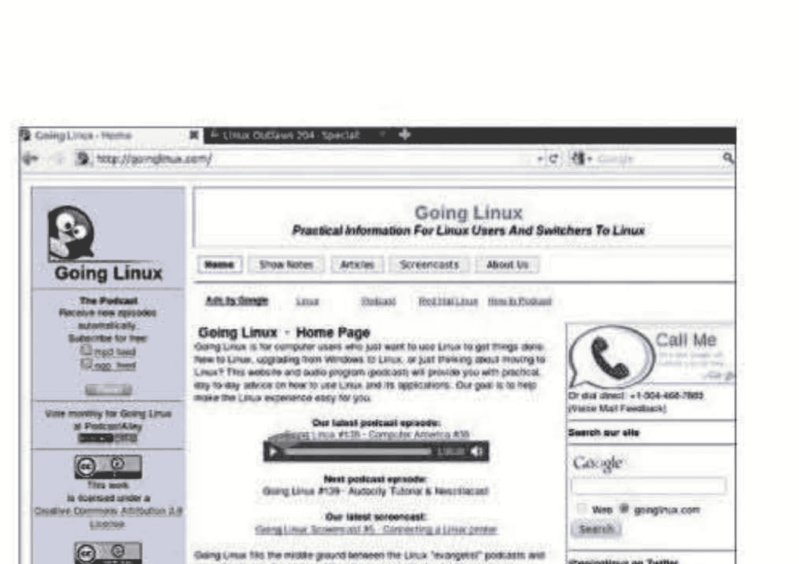

## 三合一

节目在 MP3 和 OGG 格式下约为 60 分钟。它是每月两次，但主持人 Larry Bushey 每个月都会 Computer America 上讨论 Linux，所以你实际上得到了三集节目。

> 网站还有许多针对新 Linux 用户的经典截图。


Going Linux

Web: `www.goinglinux.com`

> 主持人花时间深入每条新闻故事的背景。

评分 7/10

## Linux Basement

除非上个月发布了像 Ubuntu 11.04 这样的版本，否则从不评论。他们在在使用发行后分享了对 Natty 的印象，但在 Computer America 第 1358 集中，Larry 对 (SELF) 进行了一次精彩的介绍，他们完成了 Ubuntu Natty Marshall 的评论。

该播客提供 MP3 和 OGG 格式，大多数剧目的音频清晰，尽管在最新一集中偶尔会出现音频故障。

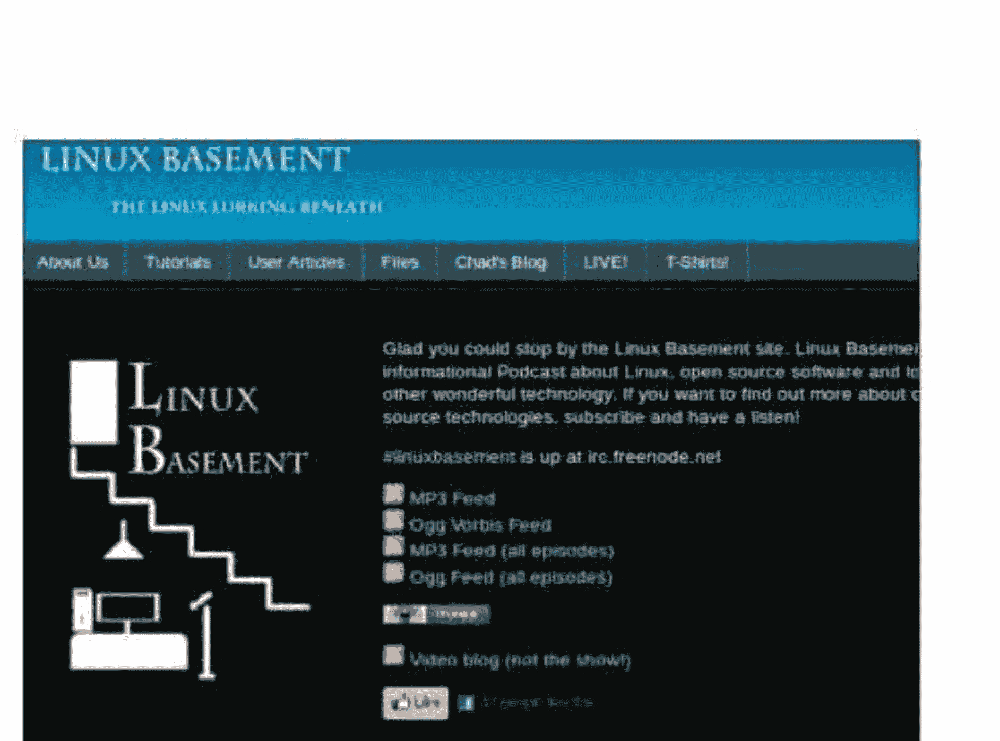

播客的最新一集标题恰当地命名为“未死”。他们发布了几集，但之后之间间隔了几个月。尽管如此，尽管不规律，这是市面上最好的播客之一。

## 简单格式

Linux Basement 显示了简单的格式，其特点是对重要话题进行讨论，随后是偶尔的评论。节目也偶尔有嘉宾，其备注是节目中讨论内容的系列链接。

每集时长为 70 和 90 分钟，这对于播客来说恰好。

> 你可能会发现这个播客有缺陷，但我们很倾向于双人节目。


你可能会发现这个播客有缺陷，但我们很倾向于双人节目。

Linux Basement 显示了简单的格式，其特点是对重要话题进行讨论，随后是偶尔的评论。节目也偶尔有嘉宾，其备注是节目中讨论内容的系列链接。

每集时长为 70 和 90 分钟，这对于播客来说恰好。

Linux Basement

Web: `www.linuxbass.com`

## 仇恨邮件

播客本质上是有主观的。它没有 Linux 客户端，并要求听者写信公司索要一个。节目的一部分致力于帮助用户使用 Linux 应用完成任务，通过提供实用的教程和回答问题。

播客的最新一集标题恰当地命名为“未死”。他们发布了几集，但之后之间间隔了几个月。尽管如此，尽管不规律，这是市面上最好的播客之一。

评分 6/10

# Linux Roundup

## Linux Action Show

最有趣的之一，由...制作。这个

播客的最新一集标题恰当地命名为“未死”。他们发布了几集，但之后之间间隔了几个月。尽管如此，尽管不规律，这是市面上最好的播客之一。

2011年8月 LXF147 | 33

## Linux 播客合集

### FLOSS Weekly

你的每周闲谈盛餐。

这里是另一个与众不同的播客。FLOSS Weekly 没有提供常规的新闻和评论，而是提供访谈以及相关的详细信息。该节目是专为极客设计的 TWIT 网络的一部分。正如其名所示，它是一个每周更新的 MP3 格式播客，并提供 MP4 格式的高质量视频分辨率。有一档节目因为其软件属性而没有赢得粉丝青睐。事实上，在其中一集中，主持人 Schwartz 承认他更倾向于邀请来自 Skips 这样的开源节目的访客。

关于联合主持人的选择。例如，对 Solaris 的包管理器 OpenCSW 开发者的访谈是由来自 Sun Microsystems 的 Simon Phillips 联合主持的。打破传统的是，上一期节目没有访客，然而，节目的主题是《FLOSS 的终结》，主持人们讨论了新情况，特别是解雇了 No More 的开发人员以及这对 Banshee 等项目的影响。

每集节目时长约为一小时，得益于一家实体的支持（尽管存在一些问题和视频质量问题），但没有更多可以说的了。

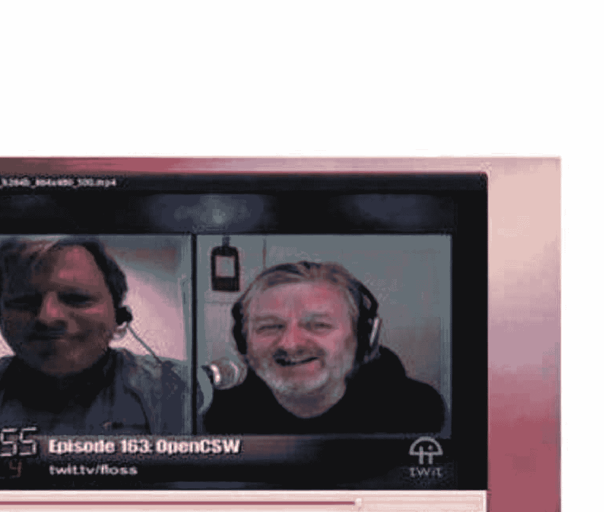

> 以这种新闻深度，这可能是目前最好的播客

### Linux 评判

FLOSS Weekly

网址：`http://linux.tv/FLOSS`

一个很有用的播客，有详细的访谈，但其他内容寥无几。

> 该节目并没有因为使用专有软件而赢得粉丝。

### Hacker Public Radio

原始且未经稀释的。

### Going Linux

面向 Linux 用户和自我提升者的实用信息

这是一个有趣的节目，尽管它声称“关于任何黑客感兴趣的话题”，但大多数是关于 Linux 的。该节目的规则很好，但它鼓励听众通过来自英国和美国的来电收听，非常有意思。

你还会发现由其他播客贡献的板块，例如 QNU World Order 和 Full Circle。每个月，主持人们聚在一起，回顾当月最有趣的节目。

由于其性质，内容会有变化，因此它涵盖了大量内容，它不分领域，但你可能不会想听每一集。

> 这个每日节目已经超过了 1000 集。

### LINUX FORMAT

Hacker Public Radio

网址：`www.hackerpublicradio.org`

## 幽默一点，大多数时候你会有意外收获。

> 该节目在鼓励听众通过来电贡献内容方面是独特的。

### 评分 5/10

### Windows 的烦恼

一个热门话题是他们是如何进入 Linux 的，以及他们从 Windows 中获得了什么。

联合主持人们定期针对各种主题制作节目，例如如何成为一名安全的计算机爱好者以及对安卓手机进行 root。

### 不要错过我们的播客：`www.tuxradar.com`

听听 Linux Format 团队讨论自由软件最热门的话题！

### 评分 7/10


## Linux 播客

### 评判

如果你听过这些节目中的任何一个，你就会相信我们所说的，选出一个冠军非常困难，因为它们都吸引着属于自己的听众群体。如果你是 Linux 新手，可以看看 Going，而 Mintcast 和 FullCircle 也迎合了喜欢新手友好故事的用户。老练的 Linux 用户会发现偶尔听听 Public Radio 是值得的。如果你正在寻找一个既有趣又能提供信息，并通过见解新闻传递 Linux 生态系统脉搏，或与开放人士进行访谈的节目，那么 Linux Outlaws 这群“中西部牛仔”们就足够了。在这档节目中，只有五集入选了我们的合集。

始于 2007 年，但已经拥有了 200 多集，这档每周节目吸引了全世界的粉丝。

我们无法在此处集齐所有的 Linux Outlaws。如果你不确定，还有很多选择供你。经验丰富的 Linux 用户应该收听 Kernel Panic、The Techie Cheese、Just Geek List。

### “对我们的评判不满意？还有更多选择。”

可以看 Me，或者其他如 GNU World Order 和 Lotta Links 等节目。发行版跳槽者（Distro hoppers）应该听 DistroWatch Weekly 和 Ubuntu Outlaws，如果你关心自由软件，可以前往由 Bradley Runfels 主持 Freedom Law Show，以及

### 第1个 Linux Outlaws

网址：`www.linuxoutlaws.com`

>> 人气级别的主持人，内容平衡良好。

### 第2个 Linux Action Show

网址：`www.jubiterbroadcasting.com/`

>> 极具娱乐性，也有很有用的 Linux 新闻。

### 第3个 Mintcast

网址：`mintcast.org`

>> Mint 用户不可或缺的，但这里也适合所有人。

### 第4个 FLOSS Weekly

网址：`http://fort.net/FLOSS`

>> 每周都有访客，是一个信息丰富且有趣的节目。

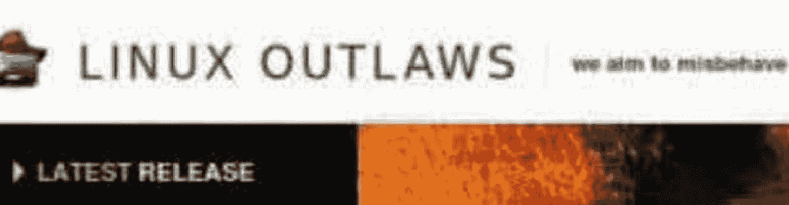

两位务实的 Linux 用户讨论了自由和开源文化的最新发展。

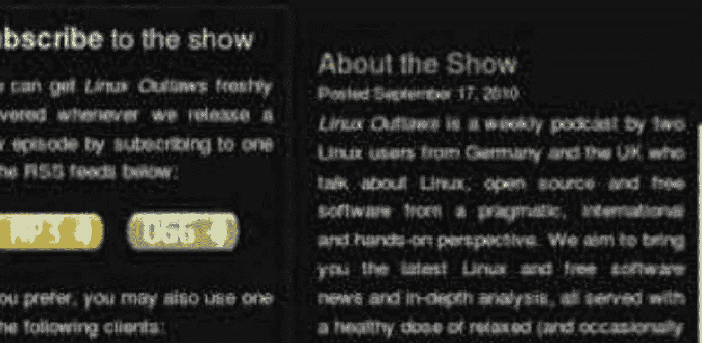

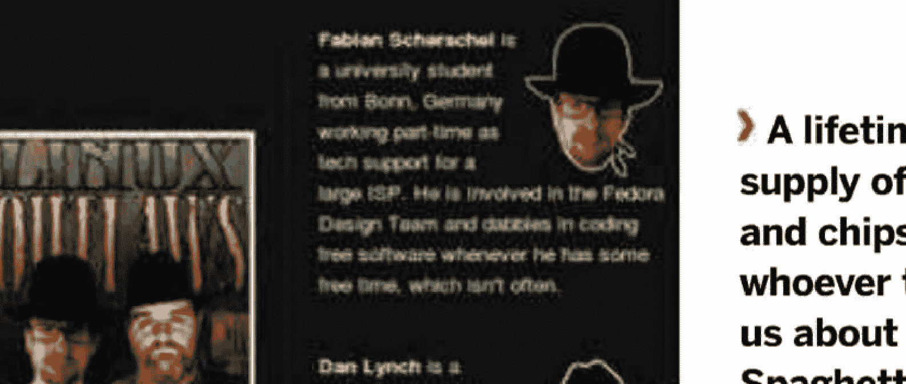

自由软件争端表。然后是一些专注于 Linux 软件源码的节目。

两位务实的 Linux 用户谈论了自由和开源文化的最新进展。（注：此处原文在此处有重复段落，已按要求去重翻译）

# HETZNER 独享根服务器 EQ 10

个性化定制您的服务器！

HETZNER EQ 10

硬盘解决方案：

1.5 TB SATA II

300 GB SAS

120 GB SSD

**可选最多 4 块硬盘**

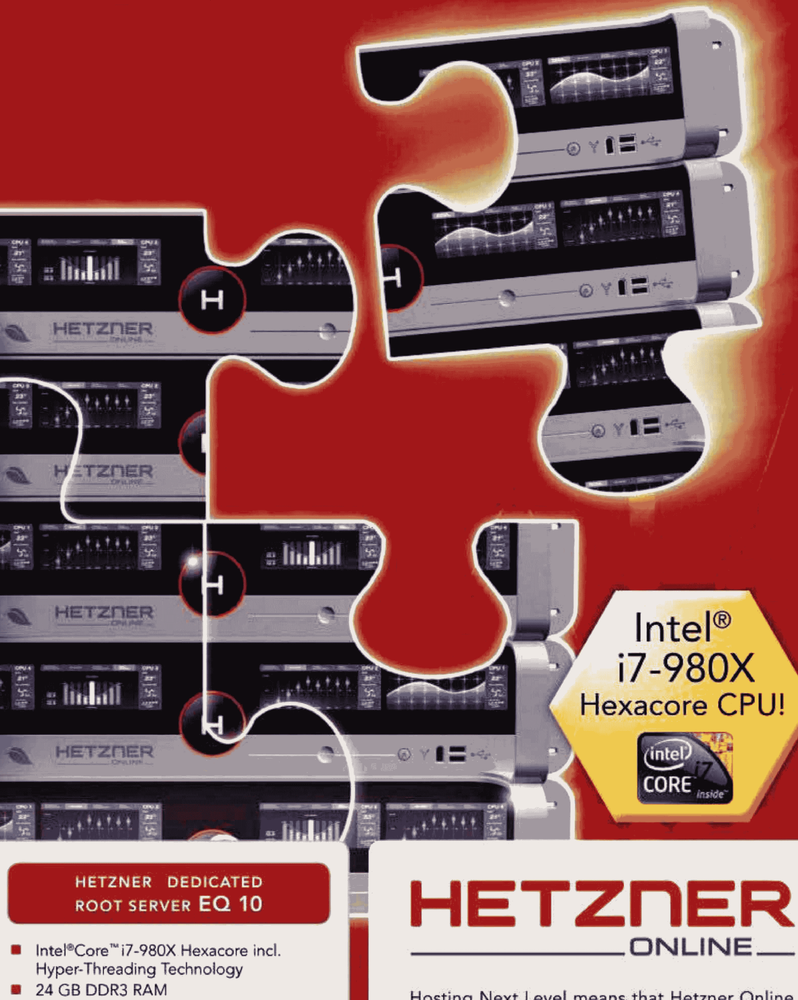

# HETZNER 独享根服务器 EQ 4

- *英特尔 (Intel® E5200 四核处理器。*

* 超线程技术 (Hyper-Threading)

* 2 x 750 GB SATA-H II

* 1 x 240 GB SSD

* Linux 操作系统

* 无限制流量*

* 域名注册机器人

* 100 GB 备份空间

* 无最低合同限制

* 安装费用 £115

# HETZNER 独享根服务器 EQ 10

- *英特尔 (Intel® Xeon E-26xx 六核处理器。*

* 超线程技术 (Hyper-Threading)

* 24 GB DDR4 内存

* 可选最多 4 块硬盘：

* 1 x 1.5 TB SATA £15/月

* 1 x 300 GB SAS £13/月

* 以及 +4 硬件 RAID 控制器

* 1 x 120 GB SSD £13/月

* Linux 操作系统

* 无限制流量

* 救援系统 (Rescue system)

* 域名注册机器人

* 100 GB 备份空间

* 无最低合同限制

* 安装费用 £115

# HETZNER ONLINE.

作为下一代托管服务，Hetzner Online 现在提供目前市场上最强大的独享托管解决方案。Hetzner Online 独享服务器计划旨在通过我们位于位于德国、芬兰和瑞典的自有数据中心，提供更高水平的速度和极其稳定的网络结构。凭借我们的专业知识和卓越表现，我们支持全球客户的体验。

每月 £39 起

原每月 £85 起

`www.hetzner.com`

`info@hetzner.com`

节省 £50！作为新客户，购买上述任何产品时首笔付款即可节省 £50：请使用代码 231206（ 7 月 23 日过期）

# Distrowatch

本月 Linux 发行版开发库的新闻汇总。

## Debian 双全

SUSAN LINTON 是 tuxmaches.org 的所有者/运营者。

Mepis 和 Anti-Mepis 这对流行的 Debian 兄弟版几乎为每个人都提供了选择。

## 版本狂热

当我看到 Ubuntu 上的文章或讨论使用代号作为版本号时，我仍然感到有些困恼。在过去，项目内部和发行版中使用的版本是通过版本号来指的，但 Ubuntu 的命名规范已经改变了。有些代号带有某种个人意义，但作为一个左撇子型的数学/逻辑思考者，我更倾向于版本号——它能让思路保持清晰。

最后，版本号也发生了一些变动。直接从版本 8.5 跳到了 10.0。我怎么想？我曾想知道 Westwood 何时决定这么做的，但在需要时并没找到记录，所以现在这成了一个我的谜团。

前段时间，OpenSUSE 对其版本命名方案进行过讨论。他们考虑过将其当前版本号改为类似 Ubuntu 的形式，反映日期，并参考了 Martha 以及许多其他版本方案。

但这阻碍了我们。不要在半途中更改版本方案，否则我将需要构建一个路线图。

`distrowatch@tuxhotmail.com`

SimplyMepis 和 SimplyMepis-Anti 项目宣布了他们的最新成果。前者备受期待，而另一个则有些意外；两者都提供了新的内核、界面和应用程序，但都没有脱离其根源。Anti 先推出，作为 Puppy 的轻量级替代方案；而 Siataz/GNU/Linux 也被宣传可以在 64 位 PC 上运行，但对 32MB RAM 有限制制。

然而，AntiX 最棒的一点是，它感觉不像一种妥协。它精美且配备了大量应用程序，并基于 Debian 配置，而 SimplyMepisos 保持现状，没有任何违和感。

## 获取配置

IceWM 和 Flux 可能是我想到美观桌面时首先想到的名字，但高度可配置的 AntiX 恰恰如此——它是经过高度配置的。

Mint V11 发布了核心版本，并带有一个带有新选项和配置的注册控制中心。

新的软件安装程序处理如 KDE 和 Gnome 等第三方包的安装。Ubuntu 是一个非常“发布型”的发行版，因此你不一定需要进行全新的初始发布，但如果你选择这样做，也非常简单。

> Debian 系统已移除了图形配置，但现在默认加载了专有驱动程序。

额外选项包括持久化保存、从内存中移除以及某些其他类型的链接（核心、基础和完全）。

James Warren 宣布了 SimplyMepisos 11.0 的发布。

它主要是对 Linux 内核的更新，并带有 KDE 4.5、内核 2.6.23.4、X.org Server 1.77 以及 GCC 4.5.1。

沐浴在刺眼的阳光下；另一些类型的链接从它散发出来。

该镜像通过相对路径用于启动应用程序；一些人将新主题描述为华丽，但一个受欢迎的版本并不喜欢它。

在我们所处的实际现实中进行操作

## Anti 感觉不像一种妥协……它精美且内容丰富。

通过 Office.org 论坛获取更多和中间问题——因此在出现此类问题时去那里检查——但大多数报告显示了卓越的硬件支持和高于平均水平的稳定性。

SimplyMepis 10 具有一个全新的图形主题，包含一个水下的 Mepis 标志

`mepis.org`

## 花朵力量

## Fresh Mint

Open Xname 我们需要寻找 Microsoft vivca。

Linux Mint 11 获得了一个更新并进行了一些润色。

- *Xange 听起来像是一个新发行版，但技术上它并不是。你还记得 Vivca，Fedora 朝向 Microsoft vivca 的趋势吗？它带着新名字和面孔回来了。*

* 它的外观展示了一朵可爱的紫色花，用于引导加载程序，很难被忽略。

* 它的外观展示了一朵可爱的紫色花，用于引导加载程序，很难被忽略。

* 它的外观展示了一朵可爱的紫色花，用于引导加载程序，很难被忽略。

* 它的外观展示了一朵可爱的紫色花，用于引导加载程序，很难被忽略。

Siataz/GNU/Linux 也被宣传为可以在 64 位 PC 上运行，但对 32MB RAM 有限制制。

* 2.68。

* 它的外观展示了一朵可爱的紫色花，用于引导加载程序，很难被忽略。

* 它的外观展示了一朵可爱的紫色花，用于引导加载程序，很难被忽略。

* 它的外观展示了一朵可爱的紫色花，用于引导加载程序，很难被忽略。

* 它的外观展示了一朵可爱的紫色花，用于引导加载程序，很难被忽略。

* 它的外观展示了一朵可爱的紫色花，用于引导加载程序，很难被忽略。

* 它的外观展示了一朵可爱的紫色花，用于引导加载程序，很难被忽略。

* 2.68。

## DVD 上的 LINUX 格式

## 发行版对决

我们选择了当天最受欢迎的发行版，让它们为了你的喜好进行正面对决。

在开始，内核工作得（某种程度上）很好。然后，随着代码的爆炸式增长，世界得到了许多不同的 Linux 发行版，它们在界面上有所不同。

选择发行版可能会令人困惑且非常费力，这就是为什么 Linux 用户不会偏离他们最熟悉的那一个。这种惰性是可以称赞的，但由于发行版在各个方面相互竞争，你可能会错过更适合你需求的那个。你对获取最新的免费软件感兴趣，还是更关心安全性？你更倾向于运行 Gnome 桌面还是 KDE？你想选择所有软件，还是享受手动安装每个包的前景？

这些问题的答案自然形成了以下七页对比。有很多发行版需要权衡，如果你想自己比较，可能需要花费几周的睡眠并忍受头疼来画出它们的某种总结。但别担心，因为这里有准备好的图表。

# 安装

任何发行版的第一个障碍都是让用户能够真正好地使用它。

与 Windows 和 macOS 不同，用户实际上必须从头安装操作系统，这曾是一个门槛。在早期的安装中，用户需要了解大量的系统技术信息，但坦率地说，即使是最原始的发行版在今天也运行良好。

尽管如此，Arch Linux 和 Debian 的纯文本安装方法会困扰一些用户。安装程序仍然询问相同的问题，但在涉及到硬盘分区时，两者都可能失败。经验用户可能希望从内核命令行驱动驱动。Debian 显然有一个图形化安装程序（测试仍然有效），它比其他发行版的问题更多，但在没有网络连接的情况下并不困难。

Mint 自然非常相似，因为它们都使用 Ubuntu 底，尽管方式略有不同。如果你运行的是最新版本，两者都依赖自定义发行版进行安装。

这对于 Ubuntu 来说可能并不显而易见，因为它启动时有一个菜单，让你运行 Live 版本或进行安装之间选择。Ubuntu 近年来经历了巨大的变化，显然比以前更友好、更可靠。它在复制文件的同时问的问题更少。自然地，Mint 相同但配色不同。

OpenSUSE 的安装是冷静的绿色，但你可能需要询问。起初它看起来可能过于复杂，因为安装程序为设置和内核参数提供了各种选项。事实上，这可能会让你遇到无法解决的问题，例如特殊的显卡或奇怪的配置。

安装只是友好，并不更好。像 Debian 一样，默认方法是从 DVD，带有一组可以安装的软件。每个发行版的缺点是，你会花费几个小时从你永远不会使用的组中仔细挑选东西，甚至可能不知道它们在哪里。


在时间方面，Debian 和 Arch是最快的，但这并不是真正的快速测试，特别是 Arch 采用了精简的设置。

## 硬件支持

你的发行版在平台和外设上表现如何？

有几种方法：

- Fedora 的默认安装来自 DVD。

请选择要安装操作系统的驱动器，以及你想要创建任何驱动器或分区。Fedora、硬盘介质、其他设备、通用存储。

| 容量 | | | | |

|---|---|---|---|---|

选择安装目标

- 添加手动分区

两个基本元素是（处理器/主板）和外设（摄像头/Wi-Fi）。

- Ubuntu 是最爱的

- Mint

- Debian

- Ubuntu

- SUSE

- Ubuntu

- Debian

- Ubuntu

- Mint

- Debian

- Ubuntu

- Debian

- Ubuntu

- Mint

## Arch

Arch Linux 对你想要什么软件不作任何假设。事实上，如果你走阻力最小的路径，你最终将完全没有图形桌面。它缺乏默认设置。公平地说，这可能并不意味着刻意，但存在一种假设，认为人们会感到不知所措，这可能会困扰新用户。

- 这种是。

- 你可以轻松安装一个完全不同的环境或窗口管理器，并高度期望它可以在不麻烦的情况下运行。

## Debian

Debian 的哲学不是关于很多事情，它做了一些选择。尽管 LXDE、Gnome 和 KDE 有优秀且支持良好的版本。该桌面环境目前是 Gnome 2。这个版本带有 Debian 的风格，但坦率说，与其他者相比，Debian 非常轻量，所以你注册的是 Gnome 体验。

Debian 也不包含你可能预期的最新 Debian 配置工具。从长远来看，标准桌面处理了很多情况。

## Fedora

Fedora 的默认桌面是 Gnome 3 或 Gnome Shell。这是桌面的一个重大转变，它曾被认为是无聊但安全的。新版本中，某些功能似乎带来了关于用户可能如何与计算机交互的新想法。

不幸的是，这对于熟悉新事物的人来说也意味着困惑。公平地说，活动（启动软件）和工作区（切换窗口）必须使用，但存在一种底层假设，人们会感到不知所措，这可能会困扰新用户。

- KDE 官方支持 Fedora，但公平地跳过了两个发行版的失败，在写作时，Fedora 只有最近...

*自我修正：我注意到提供的文本包含重复标签和痕迹，我将根据上下文清理文本并提供最终版本。*

# Linux Mint

这个简单直观的桌面可能成为一个方便的避风港，躲避由 Unity、Gnome 以及其他平台带来的剧烈变化。Mint 仅仅是 Ubuntu 的一个强大衍生版本，并且可能非常需要新成员的加入。(Kaya) 不会模仿转向 Unity 的转变，未来也不会有变化——其目标是让 Gnome 2 桌面变得简单。

这个发行版之所以真正火起来是因为它接近 Ubuntu，但所有专有软件（Flash、Java、Python...）在许多其他发行版中通常要简单得多。它现在做的比这多得多，而且在某些方面，比 Ubuntu 更简单、更友好。

## OpenSUSE

OpenSUSE 是唯一一个选择 KDE 作为默认桌面的发行版，尽管它同样可以运行 Gnome 2（甚至运行得更好，例如 Fedora 也可以运行 KDE）。在某个领域成为领先并不容易，你必须获得社区包来证明 SUSE 对 KDE 来说是如此重大的进步这一事实。

如果你喜欢 KDE 而不是其他，那么你可能用在一个没有像 OpenSUSE 那样关注和投入的发行版上。这很容易失败，即使你必须忍受复杂的安装列表来管理一切。KDE 的应用程序显然比 Gnome 的对应程序要强大得多，当然，你可以安装 Rhythbox 代替 Amarok。

## Ubuntu

对于 Ubuntu 而言，长期以来 Gnome 一直是唯一的选择，但这一切都已经改变了。现在的默认桌面是 Unity —— 这是一种忙碌的极简体验，其特点是宽面板（这有助于热门应用程序）以及一种在工作区之间切换的方法。这引起了一些负面反馈，并且已经超出了 Unity 本身的问题范围，不仅仅是人们是否喜欢它的问题，开发者们也将面临严重的 Bug。功能性问题太太多了。你如何调整 dock 的大小？在 Gnome 3 中，你什么时候选择运行“标准”选项？感觉 Unity 恰恰是我们不希望在 Ubuntu 上看到的东西，至少对大多数人来说是如此。

## 定制化

衡量你可能选择你所给定的设置的粗略方法是，许多不同的桌面选项很容易——在时间内设置。在这里，结构化程度较低的部分（Arch 等）脱颖而出——尽管不需要更多精力，但可以轻松地设置任何桌面选择且功能不受缺。某些发行版选项但在 Fedora 中没有，例如，所有的管理工具都是为 Gnome 设置的，所以你可能在同一个系统中发现 Ubuntu 甚至没有提供更灵活（毕竟，设置纯文本安装非常简单），这是另一个可以真正帮助你使用高质量系统的因素。大型发行版拥有最丰富的软件包选择，而 Ubuntu 和 Linux Mint 移除了仓库（在其列表包含超过 28,000 个软件包之前），对非免费用户来说并不是最广泛的。

## 发行版对决

Linux 社区聚会比你想象的要复杂。无论你尝试从哪个角度来衡量，数据的有效性总存在某些不确定性，使其在实际工作中毫无用处。那么，我们应该计算下载量吗？Linux 的注册用户？Linux 相关的帖子？所有这些都会给出结果——有些差异巨大。无论我们决定如何使用它们，这一点显而易见——某些流量高峰让 Ubuntu 在用户量方面掩盖了其他一切。

值得注意的是，人们可能会考虑到 Ubuntu 是你在任何设备上都能找到预装的唯一 Linux 版本。它在杂志中也处于突出位置——最重要的是 Ubuntu 和 Linux 是同义词，所以发现只有少数反映“社区”的用户反而更让人感到惊讶。人们可以在得到许可的情况下辩称，Debian、Fedora 和 OpenSUSE 的用户在许多方面更活跃，贡献了代码、文档和帮助。但这是真实世界的结果。

在 LinuxQuestions 的特定发行版论坛中，帖子最多的是 Debian ，紧随其后的是 Fedora，Ubuntu 则位居第四。这并不是说明访问网站的人比 Ubuntu 更可能（或至少是讨论）Debian，但事实如此。

- Google 新闻和搜索趋势表明，Ubuntu 是目前最受讨论的显著标志，因为 Ubuntu 在市场份额方面目前遥领先。

运行 Google 网页搜索趋势或观察我们的发行版集群可能会让你认为 Ubuntu 的使用率比任何其他发行版都多。那么结论是什么呢？在桌面用户方面，Ubuntu 远多于其他地方。在社区成员方面，Ubuntu 用户中有一很大比例仅仅是用户，这并不意外，因为从媒体报道到可用性，Ubuntu 都是阻力最小的路径。如果你将社区定义为所有活跃用户，那么使用较少的发行版表现好得多。

## 性能

我们现在能做的比想象的要多得多。某种程度上挤压 CPU 的每一个时钟周期似乎已经不再什么。频繁的基准测试和现代处理器的多核特性意味着，90% 的时间你甚至在闲置（或者 90% 以上的时间在 LXF 节点上）。

然而，无论计算机变得多快，你仍然会花时间等待它们更快地处理事情，这听起来有点疯狂。对于任何使用 Ubuntu 的人来说？那需要 7GHz 的主频。平均 CPU 管理约为 3GHz，而且超过 10 倍，我们包含了双核心，现代计算机即使是 800MHz，它似乎仍然喜欢等待事情。在应用程序使用方面，发行版之间没有太大区别。某些（如 Fedora）可能有经过大幅削化的内核，但速度差异只在大规模上出现。有些像 Arch 那样轻量，由于东西少，它们看起来更快。关键区别在于启动速度，我们已经编译了这些。我们确实运行了一些基准测试，但时间上……

## 安全性

令人安心的是，这基本上是一个非常公平的竞争环境。

在安全方面既有好消息也有坏消息。好消息是，对于那些真正重要的软件包，所有发行版的反应都非常及时，一旦故障代码在源处被修补，它们就会立即更新。

坏消息是，这使得我们非常难判断哪一个最安全（至少在软件更新的方面）。

例如，我们查看了最近的安全警报：从 Asterisk 开始，为了证明我们一直看到了字母表的末尾，还有 sphinx。

在大多数情况下，我们查看的所有漏洞都在同一天内发现的——很多时候这是因为不同发行版的软件包与原始软件的开发者联系非常紧密。由于采用了滚动发布（rolling release）机制，Arch 在旧版本的漏洞被发现之前就已经更新了——尽管这并不意味着它更安全，仅仅是因为某些漏洞尚未被发现。

对于不太主流的软件中的微小安全问题，情况完全不同，这实际上取决于你对哪些软件包感兴趣。SUSE 和 Fedora 的反应都非常快，而且，当 Debian 包含相关内容时，它的更新会比 Ubuntu 和 Mint 更进一步。

当大型发行版通常发布更新更快的情况时，只要你进行更新，无论你运行什么系统都是没问题的，这很让人放心。

- 一旦确定了坏问题，所有发行版都快速提供了补丁、修复和更新。

## 统计数据

它们的表现如何？

## 结论

我们没有持有任何科学标准，而是将其公正地留给了一个转换矩阵，请记住，人类或企鹅界未知的任何科学能够准确量化我们在一个 Linux 版本中寻找的许多特质。

很大程度上这完全是主观的，取决于理想用户的愿望和需求。例如，当我们填充媒体表格以产生结果时，假设所有类别都是平等的。坦率地说，这不太可能——如果是这样，我们就会使用自己的标准了。

相反，请选择反映你需求的软件。对于某些人来说，最新的软件超过了安装难易性的考虑，因此他们倾向于 Debian。有些人可能只想以最好、最简单的方法获取 KDE 桌面并轻松地安装 OpenSUSE。

Ubuntu 用户最多，所以你会认为它的方法是正确的。然而，让它出色的许多特性都源于基于 Debian。这是唯一公平的。虽然它很勇敢并为了支持“你值得拥有”这样的理念而构建，但将人们推向新方向需要后果，而这些后果最好谨慎对待。

Debian 为一个全能型发行版提供了很有说的理由。在某些方面，它实际上仍然像个新手，安装它无疑可以变得简单一点，这很遗憾，因为这让对这一步有实用需求的人感到有些糟糕。

## Debian

> 感到惊讶吗？你不应该惊讶。一个伟大的社区伦理交付了全方位的 Linux 卓越。

## Fedora

> 尖端且不失风格，Fedora 在很多领域都表现出色。

## 其他……

当然，还有其他发行版可供选择。不要因为你的没在这里就感到遗憾，这并不是基于目前的流行程度。Slackware 因其不受束缚的才华值得被提；它一点也不松散（slack），并且具有带来近乎原生 Linux 体验的简单性。

对于那些追求更高标准的人，Gentoo 及其衍生版 Sabayon 值得研究。

## Ubuntu

> 数百万用户都是错的吗？是的，但在运行 Ubuntu 带来的奇妙喜悦时并非如此。

## OpenSUSE

> 如果你想要一个最新且专业集成的 KDE 桌面，这是唯一的理智选择。

那么 Mandriva 发生什么了？嗯，它仍然很好，只是很多开发者现在在开发 Mageia——你可以在第 22 页看到我们对 1.0 版本的评论。Linux 世界是一个不断变化且令人兴奋的世界。

我们不要忘记数无数的发行版，它们的设计初衷就是很好做好某件事——用于移动的 JellyOS、用于很棒 Live 发行版的 Noxpp、用于不想向红帽付费的企业的 CentOS，以及更多。

- Debian 程序似乎是通用的、操作系统，并且基于你的测试：它是一个极佳的全能选手。

## Wim Taymans：GStreamer 和 Collabora

Jono Bacon 与 GStreamer 多媒体框架的核心开发者 Wim Taymans 坐在一起。

Tim Taymans 亲手构建了对编码器和非线性编辑的支持。我们与他讨论了 Gstreamer 和 Linux 的多媒体。

**LXP:** Gstreamer 的主要功能是什么？

**TW:** 我们进行过相当多的实验。在尝试使用一两个月之前，我们中没有真正知道完美的框架长什么样。

**LXP:** 你是如何参与开源的？

**TW:** 那是 1994 年，我在我的 Amiga 上安装了一个版本的 Red Hat。我终于在 486 PC 上找到了它，但在使用 Windows 95 大约两天后，我就格式化了它并安装了 Red Linux Premiere。我再也没有回头。

真正是在 2004 年我们一群 Gstreamer 黑客被雇于 Fluendo 之后，我们才将开发推向一个新的水平。在（仍在使用的）0.10 及以后的版本中，大规模的重新花费了大量时间。

我相信 Gstreamer 现在在简单基础能力方面已经与许多视频播放器平起平坐，并在播放和轨道技巧等高级功能上超越了它们。我们还注意到，我们成为了最好的 RTP 堆栈之一，这是 VoIP 和视频会议的核心组件。

**LXP:** 哪些地方在用 Gstreamer？

**TW:** 如果你是一个典型的 Linux 桌面用户，那么你会发现所有使用 Gstreamer 的应用程序。大多数用户，如 Rhythmbox 和 Banshee，视频播放器如 Application camera、视频编辑器、RTP 插件等许多。Gstreamer 不是一个完整的应用程序，而是一个供终端使用的 API，它使得制作集成桌面应用程序变得更容易。

我从视频三合一编辑器开始。多媒体项目特别特别——当时我们想要最复杂的媒体播放器。当时一些编码器的实现还不存在。

我也使用了 Gstreamer 作为构建视频编辑器的基础，并在那时我参与了进来。

**LXP:** Gstreamer 是如何开始的？

**TW:** 在 1999 年，Erik Waldhausen 发布了第一个 Gstreamer。当时作为多媒体引擎，我使用了它。我参与其中并为核心部分贡献了大量代码。

我们创建了邮件列表，开启了 IRC 频道并创建了网站。我们在邮件列表上托管了 Gstreamer，并感受到了许多人的互动。

**LXP:** Gstreamer 是如何加入 Collabora 的？

**TW:** 在 0.10 之后发生了什么？我们开始了 Gstreamer 咨询业务。我们可以尝试。然后我们遇到了 Collabora 的创始人 Martin 和 Philippe Lagrange，他们为我们提供了帮助。我们去年五月见面，现在是 Collabora 的成员了。

**LXP:** 你们最初的目标是什么？

**TW:** 目标很简单：统治世界。说正经的，我们是在使用 Mplayer 和 VLC 的同时开始的。编写媒体播放器是 Linux 桌面缺失的部分。作为一个多媒体框架，我们希望包含编码、通过协议传输（VoIP）和视频编辑。

**LXP:** 现在 Collabora 在 Gstreamer 中做什么什么？

**TW:** 我们目前正在开发 0.11 版本，希望明年能有一个 1.0 版本。在过去的六年里，我们一直在说下一步是完成加速 API 并进行一些小改进。

对我们来说，改进 Gstreamer 以适应新需求也很，例如 3d 以及更多的视频播放器，为 GPU 或 DSP 和嵌入式设备提供更多硬件加速支持，并创造更多优化的机会。

## ONH-GLX

> John Carmack（《毁灭战士》作者）是我与编程界巨星接触。

**LXP:** 如何为 Gstreamer 做出贡献？

**TW:** 主网站 (`gstreamer.freedesktop.org`) 是你可以找到主要的核心和插件编写以了解工作原理的地方，然后找到你想要实现/修复的任务。例如，我们在 bug 中有很多可完成的任务。

如果你想开始编写或更详细地了解工作原理，我们也有 IRC。加入我们的 `irc.freedesktop.org #gstreamer` 并与我们交流。加入他人并提交 bug 报告以及提供实现某些问题或功能的路径也是个好主意。

# 深入了解 Fedora

构建一个发行版是一项复杂到令人难以置信的任务。Jonathan Roberts 带我们进入 Fedora 的幕后，看看它是如何制作的。


Fedora 35 已经发布，它带来了 Gnome 3、系统以及动态防火墙配置支持——此外还有许多新创新功能。尽管这个列表听起来非常令人印象深刻，但我们很少停下脚步来真正地欣赏它。

我们认为，投入这些工作的人们，以及他们使用的工具和技术，完全值得在灯光下关注一下。毕竟，与他人合作创造酷炫的技术，正是让自由软件如此有趣的原因之一。

> 我们认为投入这些工作的人们值得在灯光下关注一下，他们忘记了每一个版本中所付出的努力。当然，我们意识到了这一点。

因此，在本文中，我们将带你进入 Fedora 的后台，带你走过从早期的规划和开发阶段到最终比特交付的整个发布过程。

这值得被关注：不仅仅是 Fedora，许多自由软件项目都是工程和逻辑的大师。因此，这篇文章标志着一个新系列的开始，我们将每个月带大家看看不同发行版或软件项目的幕后。


此外，我们意识到要实现这一目标需要各种奇妙的工具和流程，但我们并不真正了解它们是如何工作的。由于 `rawhide` 是 Fedora 的一个版本，每个包的版本总可以在其 `git` 的 `rawhide` 分支中找到。

我们希望，在这个系列结束时，每当你打开电脑时，都会对这种努力以及让这一切变得值得的因素产生新的尊重和理解。

所以，`rawhide` 是这样开始的：作为一个包含 `git` 仓库的集合，其中包含一个带有内部 `SRPM` 文件的 'rawhide' 分支。并不是任何人都能向这些仓库提交文件——在获得权限之前，你必须分享并通过审核流程——但那些获得权利的人会因为 `rawhide` 在断更新这一事实获得回报。

在进行任何规划或版本开发之前，每一个发布版本都存在于发行版的 'rawhide' 分支中，但它是该版本的完整版本，一个永远不会接收任何正式发布的版本。它处于持续变化的状态中：不断被更新，而其他关键或者可能的包则被升级到最新的游版本，功能正在形成并在旧的条款上进行。

## 每一个发布都从 Fedora 的 ‘rawhide’ 分支开始

这对于任何人来说并没有真正用，因为安装 `RPM` 需要花费大量时间，而且这不是你所习惯的方法。

这导致了 `rawhide` 变得不稳定，但并不是肯定的；构建并启动或每个由来自此 Fedora 分支的包组成的系统也不是如此。这可以让你自由地到处安装操作系统。然而，如果不使用你的发行版包管理器，没有办法让人们对 `git` 仓库中的最新更新进行自动更新。

相反，它是一个地方，开发者可以在那里获取他们需要的内容，而不需要整个发行版的其他部分，并让他们的更新以可安装格式提供给其他人使用包和代码进行测试。

一旦你理解了 Fedora 是如何构建的，我们需要共同理解它是如何从这一系列经过测试和精化的包（每个包都被认为是稳定的）在短短几周内制作出发行版的。我们的起点将发现 `rawhide` 最初是如何被制作出来的。

## Koji 和 amass

### 包集合

首先，你需要知道 Fedora 是一个基于 `RPM` 的发行版，这意味着它本质上是“包”的集合——从源代码构建的二进制软件。这些包包含了元数据，让你能够自动跟踪哪些文件以及它们属于哪些程序。这使得使用包管理器安装、更新和删除软件变得简单。

其中第一个是 Fedora 所闻的系统 `Koji`。它的设计是易于安装的——虽然不会自动从机器外更新 `RPM` 包，但存储了包规范（`spec`）和标签（`tags`）。

`RPM` 是从源 `RPM` (`SRP`) 和标准 `RPM` 生成的。它的特殊之处在于，它包含不是二进制文件，而是包的源代码，以及任何将代码编译成标准 `RPM` 的额外文件和指令。

`Koji` 总是被称为特定的 `git` 仓库，该仓库指定了正在开发哪个版本的 Fedora。这是必要的，因为包是在某些其他关键包的特定版本存在构建的；它必须在它们存在的情况下运行。

这就是 `rawhide` 的工作方式，以及所有 Fedora 特性从这里开始：开发者开发他们的 'spec' 文件，然后在 `rawhide` 环境中构建它们。

然后，`Koji` 非常清晰并创建了一个干净的环境——一个虚拟文件系统——以确保包是用在 Fedora 版本中将提供的这些包的相同版本构建的——

## 向核心开放

这就是 Fedora 的构建方式，我们共同需要理解它是如何从这一系列经过测试和精化的包（每个包都被认为是稳定的）在短短几周内制作出发行版的。我们的起点将发现 `rawhide` 最初是如何被制作出来的。

获得一些反馈，或者在一段时间内没有收到任何负面反馈。

Fedora 将从一个混乱的局面变为足以供日常使用的稳定，这非常重要。

## Alpha... beta...

该项目发布两个预览版本（`alpha` 和 `beta`），两者都功能完备，并以 `ISO` 或 `live CD` 的形式发布。聘请了更多的专家来创建这些版本，分别称为 `Pungi` 和 `Live CD Creator`。在三个主要工程团队举行会议之前，他们会确保符合相关标准。

再次，这些版本的理念是尽可能向尽可能多的人寻求进一步反馈，以创建一个稳定且包含了过去六个月最新开发成果的最终产品。它们特别有用，因为它们为 `QA`（质量保证）团队提供了构建测试的共同平台。这些是真实的社区活动，开发者们会亲自在网络聊天（`IRC`）中指导用户完成一系列测试。每天针对特定功能或其他组件进行测试（测试日），以帮助产生通用的反馈。

这让 Fedora 有机会在尽可能多的硬件上测试其新功能，同时也为经验较少的用户以有意义的方式帮助分发提供了绝佳机会。你只需要一份最新版本的副本并登录 `IRC`，开发者就可以引导你完成其余工作。

集成可能被认为是这些发布版本最大的挑战之一——在全球范围内分发——其实是操作中最简单的部分之一。

工程师必须检查仓库版本中所有成功编译进元数据的包，然后设置位置权限，以确保公众无法访问。

然后，他们允许其镜像伙伴访问，这些伙伴可以管理镜像仓库的副本。这意味着用户不再是通过镜像来替换中央服务器，而是全球成百上千个站点都可以从镜像进行下载。

这里也不涉及任何魔法，因为镜像使用 `rinse` 来创建其 Fedora 主发布版本的副本。

## 多桌面 Live DVD

一旦这个版本以及所有发布版本到齐，他们只需更改所有镜像的权限（翻转位位），让所有人都能访问——然后下载就开始了！

在整个过程中，Fedora 项目必须经历一项挑战：将包含上游最新代码的包转换为经过彻底测试、良好集成的集合，并已多次发送到全球。剩下的工作就是制作最终发布介质，即 `GA`（正式可用版）。

- 艺术团队创建 `DVD` 封套。
- 并像处理 `alpha` 和 `beta` 版本一样将其发送到镜像站。

实际上，最后还有一件事，当然，那就是享受一场应得的派对，与世界各地的用户和开发者一起庆祝发布。

## 不仅仅是一个发行版

这部分内容密切关注了创建 Fedora 发行版发布涉及的技术流程。

但 Fedora 不仅仅是代码，每个发布版本还借鉴了多个团队的工作。

这些包括艺术、文档、营销、翻译和网站团队，以及所有以各种方式为每个版本做出贡献的人。

例如，艺术团队创建用于安装和启动过程品牌标识的桌面壁纸和配件，而文档团队则确保有一套完整的发布说明。

所有这些团队与编码人员使用相同的工具，并且都在开源环境下工作，并欢迎大家贡献。

> Fedora 15 中 Gnome 3 的默认壁纸。

## 搞坏 Linux

### 破坏良好意图 20 种方法

Linux 以稳健闻名，但 Neil Bottrows 证明了有很多方法可以破坏运行完美的系统。

- 01 填充文件系统

如果包含 `/var` 的文件系统满了，任何东西都无法写入日志信息，各种系统进程都会失败。这可能是由跨越 `/var/log` 的失控进程引起的，或者如果所有内容都在同一个文件系统中，也可能是你家目录下的所有下载文件。

- 02 重装 Windows

Linux 用户对微软的嘲讽——Windows 安装程序不允许存在外来操作系统或引导加载程序，所以如果你重新安装 Windows，它将覆盖你的引导加载程序。不过不需要担心，你可以从 `live CD` 运行 `grub-install`。

> “可能会出于最好的意图给出危险的建议”

- 03 内存耗尽

内存看起来可能很多，直到你执行诸如“在一个装满 1200 万像素照片的目录中运行 `grep`（或者我是怎么知道的）”的操作。交换内存（`Swap memory`）在这里会有帮助，但它的运行速度会非常缓慢，直到你认为系统崩溃了；当你用尽所有交换空间时，它很可能真的会崩溃。

- 04 遵循网络上的指令

网络论坛充满了无用的提示、技巧和命令，但也有一些是无害的。困难在于如何区分它们，良好的建议可能是出于最好的意图给出的，或者，对任何使用 `sudo` 的操作都要格外小心。

- 05 安装更多 Linux

这是 Linux 最弱的情况之一。虽然检测 Linux 并设置启动菜单做得很好，但有些系统仍然无法注意到磁盘上的 Linux 发行版，或者它们会在引导加载程序中竞争，尽管引导加载程序本身仍然存在。

- 06 更新频率

让安装保持几个月不动，然后一次性更新 300 多个包不会破坏任何东西，但如果真的崩溃了——祝你好运找到罪祸首。小而频繁是设置系统最安全的方法。

- 07 更新二进制文件

检查系统要安装的包列表，你将完全不知道哪里出了问题。或者，使用你的包管理器生成已安装软件的列表，这样你就可以看到什么时候发生了变化——检查包的日志文件。

- 08 在边缘运行

我们有时都尝试使用最新的东西，但要意识到风险。软件本身没有故障——那是你的任务——所以当你真的需要电脑继续工作时，请升级到最新发布版本。

> 一次更新 300 多个包并不是必要的，但如果确实发生了，祝你好运找到罪祸首。

对于可用的软件更新，如果你不想安装它们，请检查“更新管理器”。

# Android 应用精选

Android 应用市场正蓬勃发展，现在有超过 200,000 种不同的下载可用。

Damien McFerran 将引导你了解最优秀的应用。

作为 Linux 爱好者，你很有可能拥有一部基于 Android 的智能手机。谷歌突破性的移动操作系统——基于 Linux 内核——自 2008 年诞生以来不断壮大，已成为全球主流的移动格式之一。

用户群的增长意味着有更多的应用和游戏可以下载，因此我们认为是时候编写一份实用的指南，重点介绍目前最优秀的下载内容。我将所有内容分成了不同的章节，让你更容易找到你想要的内容。

## 在 PC 上使用 Android 商店

- 步骤 1：你可以通过手机或桌面电脑访问 Android 商店。你需要一个账户（比如你用于电子邮件的账户）来在 `market.android.com` 登录。
- 步骤 2：应用按类别列出，但你可以找到精选应用以及 Google 编辑人员推荐的应用。点击应用可以查看更多信息、截图和评论。
- 步骤 3：一旦你了想要下载的应用，点击“安装”从列表中下载。如果你有多个 Android 设备，可以从它们中选择。
- 步骤 4：你选择下载的应用将自动安装到你的手机上，无需触摸手机或退出程序。非常快，对吧？

| Radiant Light | Radiant Life | Radiant Lite |
|---|---|---|
| [image] | [image] | [image] |

## 工具类

大多数应用程序都有明确的目标，而任何必不可少的下载工具都能丰富你的体验，并让生活变得极其简单。我们在这里突出的精选内容是任何 Android 用户的必备工具。

## Better Emulator Pro

应用 £2.99

正如我们所知，Android 基于 Linux，但在大多数情况下，这种开源内核都被隐藏在界面和自定义皮肤中。如果你需要深入挖掘，那么你应该尝试这款软件，它模拟了一个终端，并允许你在 Android 设备上运行 Linux 命令行。对于严肃的 Linux 爱好者来说，这是一个极其强大的工具。

## 二维码扫描器

免费

`QR`（快速响应）码类似于条形码，如果你使用手机扫描 `QR` 码，就需要这类应用，通常使用一个会自动在处理程序的浏览器中打开的链接。

最近大家都在谈论云存储，但很少有应用被证明这项技术真正有用。无论如何，`DropFox` 是最方便的工具之一，你可以在多个设备之间传输文件。可以是照片、视频或 `Dropbox` 账户（任何其他兼容的文件格式也可以！）。应用按照你需要的方向运行，你只需点击一下即可与其他用户共享。

- 扫描 `QR` 码以获取快速网页链接。

## VNC 查看器

你的 Android 手机非常强大，可以在此设备的帮助下远程控制你的电脑。这款应用由 `RealNC` 创建，允许你连接到任何运行兼容软件的 Linux、Mac OS 或 Windows 服务器，这样你就可以在手机上查看电脑桌面，并执行所有的日常操作。

## Ringdroid

并非所有用户都可以在手机上使用自定义铃声并接收提醒。Android 用户从第一天起就拥有此功能。`Ringdroid` 允许你将手机中的任何音频编辑为音乐并将其保存为铃声，或者编辑声音使其成为完美的短信或电子邮件提示音。

## AndFP

免费

你只需要 `Dropbox` 就了，但这个 `FTP` 客户端还允许你管理手机和电脑之间的文件，并重命名和更改文件权限。它还能够配置 `FTP` 设置，使其成为挑剔开发者的梦想工具。

## PhoneUsage

（提供免费版本）

大多数人的移动设备都有流量使用策略跟踪；分享超过 35 MB 的照片不再是问题——除非你想面对一张巨额账单。跟踪流量是一项严肃事务，而 `PhoneUsage` 让你轻松看到你使用了多少数据，以及哪些应用程序在无谓地消耗数据。

## Read It Pro

应用 £1.80

如标题所示，这是管理你网络阅读任务的有效方法。无论是论坛帖子、文章还是书籍，你都可以将其书签以便以后阅读；当你离开 PC 时，可以轻松地在手机上保存页面——在任何你想阅读的地方都清晰地阅读。

## 游戏

自经典的 Java 游戏以来，移动游戏已经取得了巨大的进步。许多 Android 标题可以与诺基亚和爱信华 DS 以及 PlayStation 上的游戏相媲，是消磨时间的理想方式。

## 圣域奥德：Android 之崛起

免费

这款游戏在切水果的同时无需避开炸弹战斗非常有趣。一次划切切开几个水果会获得奖励，并且所有的成就都可以保留。画面视觉效果非常棒，你只需要听听每次成功命中时发出的惊人切开声！

## 愤怒的小鸟

愤怒的小鸟成为了 Game Boy 上俄罗斯方块的全球竞争对手。在 Android 上的多款游戏中，这种简单似乎等同于巨大的吸引力——触摸屏已经成熟。

## Android 模拟器

应用市场有一个被忽视的巨大方面：复古硬件的模拟。现代手机中包含的原始力量使其能够轻松复制过去的任何游戏，有效地将你的手机变成便携式游戏设备。

## Android 版 PSP

约 £6.15

如果你在 90 年代告诉我们，有一天我们可以在手机上玩《大赛车》，我们会觉得这听起来如此严肃甚至是疯狂。然而，`PSP` 是一个 32 位模拟器，可以在你手中提供平滑且准确地重现索尼最佳的主机。它的性能和速度表现极佳。

## Android 版 SNES


16 位的 SNES 被广泛认为是最伟大的游戏机之一，它托管了《超级马里奥世界》、《街斗 II》、《塞尔达传说》和《马里奥赛》。`SNESX` 允许你在 Android 设备上享受这些经典作品，并支持蓝牙控制器以获得极佳的体验。

## 手机增强工具

普通的 Android 手机实际上是一台微型 PC，但总有改进空间。使用这套必备的工具，你可以将你的智能手机变成一个性能怪兽。

## Ol 文件管理器

大多数 Android 手机并没有自带文件管理器，但幸好许多开发者为它们配备了插件。通过直观的界面，你可以移动文件、清理缓存并直接从设备安装应用程序。

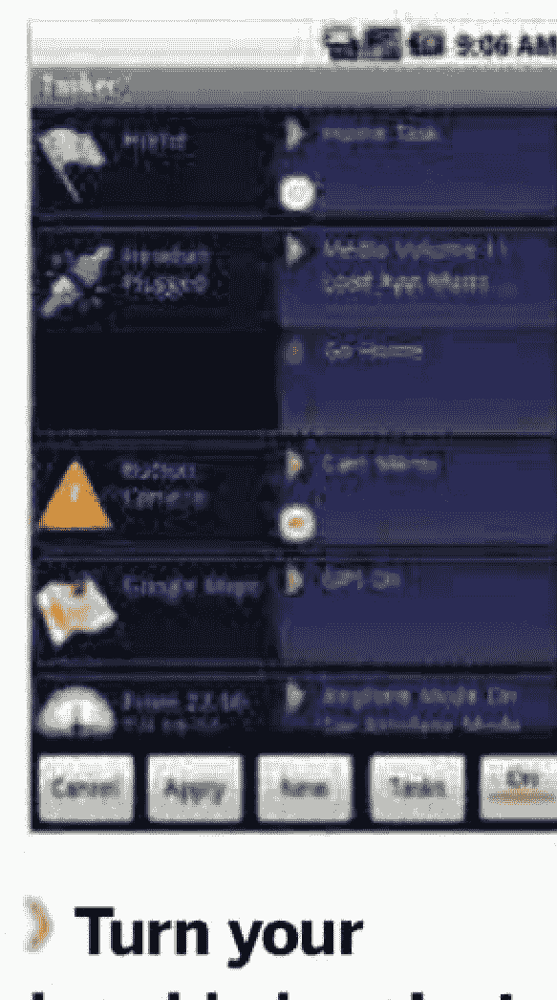

## Tasker

你可以使用这个强大的自动化工具在每个层面上控制手机的功能。是否要切换 Wi-Fi？在 `Tasker` 中创建一个规则，当你的个人网络（家里）连接时关闭手机。你可以创建一个事件，在晚上自动切换手机的响铃。编写所有这些规则需要时间，但其回报非常得值。

## FlexXt9

点点按输入法可能与旧式的 T9 预测文本不上下，但对于纯粹的滑动输入，`Swype` 是 Android 上最好的键盘替代方案之一，但它只有在连接网络时才可用。`FlexXt9` 是一个多功能的替代品，还提供了识别和手写支持。一旦你体验过，就不可能再用回去了。

## Screech

手机屏幕消耗大量电量，所以短时间的背光超时是必须的。但这意味着你必须关闭它。`Screech` 使用手机的加速度计，所以它知道你何时正握着手机，并覆盖背光超时设置。


## 购物

这些专用应用让在线购物变得更加简单。当你人不在家里时，无需出门寻找“食物疗法”，只需在扶手椅上完成一切即可。

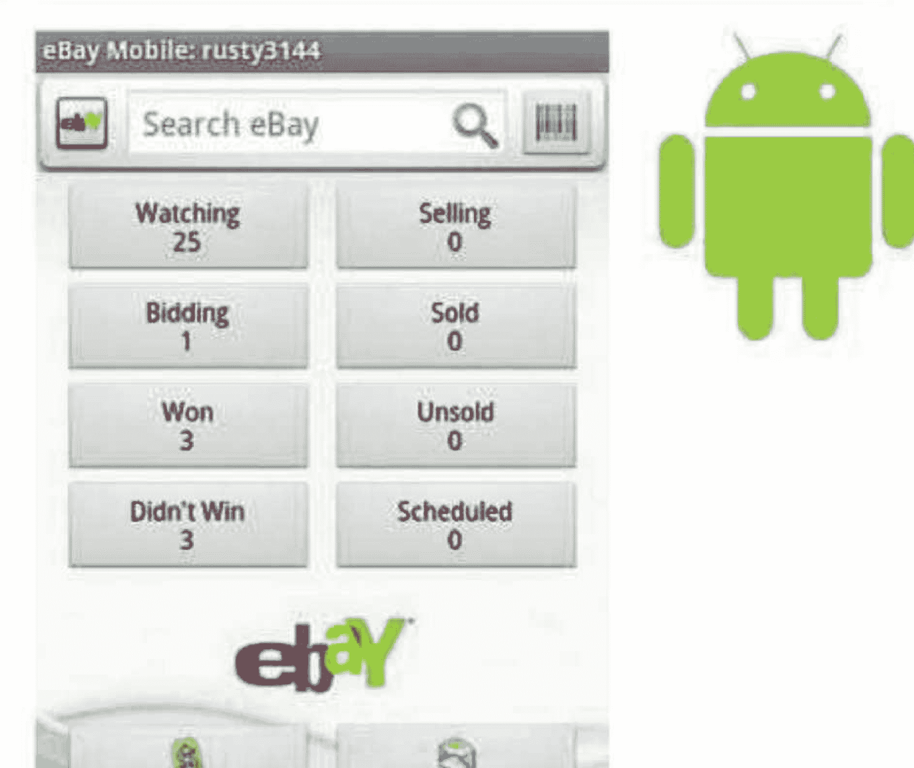

## eBay

### 亚马逊英国

每个人最喜欢的拍卖网站都有自己的官方应用，意料之中，它是不可或缺的。你可以搜索 `eBay` 上来自手机所在地区的物品，登录后还可以检查你的关注列表、竞价或“立即购买”，甚至接收消息。你可以在应用中找到 PayPal 集成，无需退出应用即可支付任何物品。

亚马逊正迅速成为在线购物者的首选，这个官方应用让浏览该零售商的海量库存变得更加容易。这里有所有的商品，而且一键订单让购买过程变得 100% 无痛苦，因为你永远不需要输入地址或卡片详情。你可以使用手机扫描产品条码并检查亚马逊的数据库，以防网上更便宜。

## 启动器替代品

Nike viral，Android 允许你替换默认屏幕——否则使用你的“应用启动器”。如果你想给你的 Android 设备一个全新的外观，请看……

## LauncherPro

### ADW Launcher EX

免费（提供 Pro 版）你的手机允许自定义主屏幕、可滚动的停栏中的应用快捷方式以及应用功能菜单。`LauncherPro` 还拥有小部件以及主屏幕之间过渡动画的供。

近似免费的 `LauncherPro` 竞争对手 `ADW Launcher` 提供了类似的功能并且同样吸引人。它与 `LauncherPro` 相比最大的优势是能够使用自定义主题，可以通过一些特殊创建的图标更改你主屏幕的外观。

## SPB Shell 3D

近似免费

`SPB Shell 3D` 允许你为你的手机提供图形上的视觉冲击。一个完整的菜单等待着你，还有增加格调的酷炫效果。它还不完美——一个非常令人印象深刻，而且仅次于调优器——无法否认这是一个非常了不起的启动器。

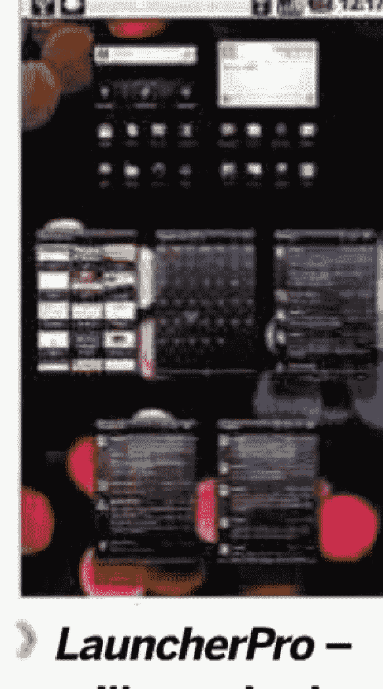

- `LauncherPro`——你会奇怪自己以前没有它是怎么活过来的。

## 到底什么是 Coreboot

### 到底什么是 coreboot？

你认为你的电脑是自由的吗？你几乎肯定运行着一个专有的 BIOS。Jonathan Roberts 调查了一个试图改变这一现状的项目。

- 那么，`coreboot`？它是和启动电脑有关的，对吧？

- 并不无意外，是的。具体来说，`coreboot` 用开源替代方案取代了旧 BIOS（在 PC 上仍然可见）。

- 谁在坚持？`BIOS` 代表基本输入输出系统（Basic Input/Output System）。它是一个优秀的软件，存储在芯片上，并在电脑一启动时被访问。每个人都知道它是什么；它在你打开电脑时首次出现，通常带有制造商的标志。

- 噢，那看起来已经持续很久了……

- 是的，`BIOS` 做了很多工作，所以完成所有工作需要一点时间。这第一项工作是运行一系列测试，这些测试旨在，其他事情，发现可用内存量，初始化并列出所有可用设备。

- 那么呢？

- 嗯，首先有很多很多重复的劳动。`BIOS` 执行的大部分设备初始化为了支持像 Linux 等旧操作系统，需要很多驱动程序，所以 `BIOS` 需要初始化硬件并充当协调人。

- 但现代操作系统也包含驱动程序吗？

- Windows 和 Linux 等操作系统包含自己的驱动程序。结果是 `BIOS` 完成了驱动程序的安装，而这个过程又重复了。

## BIOS 可以工作，但它至少有三个严重问题。

并构建一个计算机操作系统可以运行的环境。一旦基本配置完成，它会识别哪个设备可启动并将控制权交给。

601 LXF147 August 2011 www.linuxformat.com Tim Thiel*

# coreboot 到底是怎么回事

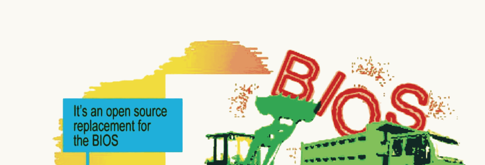

## coreboot

- 它是 BIOS 的开源替代方案

- 它目前支持超过 230 种主板

- 它更快、更安全、更灵活、更熟悉

- 如果已经通电，它会假设自己处于禁用状态。

此外，事实证明 Linux 无法在某些系统上完成处理器核心和内存的初始配置。这意味着 `coreboot` 团队必须编写一些代码来完成这些底层的硬件配置，然后将其交给 Linux。

> 我明白这是要往什么发展了……这段代码是启动过程的“核心”，其他所有部分都挂在其之上。

确实如此。

> 但如果你写了许多行代码，难道不是抵消了 Linux 原本计划的大部分优势吗？首先，`coreboot` 几乎完全用 C 语言编写，几乎不包含汇编代码。C 是一种流行的语言，扩展、修改或修复它应该是许多开发者都能做到的。`coreboot` 也是开源的，所以不需要担心二进制文件体积臃肿或内存泄漏问题。

此外，由于它是配置 Linux 环境的最小化需求，它也避开了大部分困难的工作。

这种方法还有其他方面，虽然出乎意料但——

真的吗，像什么样的？`coreboot` 是通过简单启动一个“载荷”（payload）来实现的。载荷是存储在闪存芯片中的另一个软件；`coreboot` 引导我们跨越……

它可以是一个 Linux 内核，尽管闪存芯片容量还不足以让这成为现实。然而，它可以是一个像 Grub 或 SeaBIOS 这样的启动加载器。这将允许你从标准硬盘启动 Windows、Linux 或你可以想象的几乎任何其他操作系统。它也可以是许多工具之一，或者是一个游戏……可能性有一长串。

> 哇，这个 `coreboot` 听起来棒极了：快速、安全而且非常友好。我可以吗？

如果你有一定的硬件支持的话。在过去这受到了限制，但仅仅是因为 AMD 引入了所有未来支持它的产品。

要了解关于 `coreboot`、如何开始以及支持哪些硬件，你可以查看 `coreboot.org`。值得注意的是，替换 BIOS 是很复杂的，你一旦操作不当就会导致问题。请务必小心，并在开始之前确保清楚自己在做什么。

www.txadar.com

2011年8月 LFX17

## 布朗博士的管理杂学


Chris Brown

这位博士提供 Linux 培训、编写和咨询。他觉得他的物理学博士学位根本不算什么。

深奥的系统管理统治着服务器房内部深不可测的区域。

## 赞美球形软件

为什么肥皂泡是球形的？因为肥皂膜的张力想要使表面积最小，对于给定的体积，球体的表面积最小。我们可以将体积和表面积的概念应用于软件，以定义其容纳能力的价值。实际上，我们只需要知道表面积来让它运行。


## 万备就绪

`BoxGrister` 基于 Fedora、Red Hat 或 CentOS 零构建虚拟镜像。

现代数码相机是小接口设备的一个例子。它提供了“点点即得”的体验。拍出一张好照片需要多少知识？必须执行多少步骤？然而尽管如此，花哨的自动曝光、自动图像和图像稳定功能仍在运行。

## BoxGrister 对比 VMBuilder

在构建这些“设备”准备好部署到（在）EC2 云中中的镜像时，你只需要获得一个通用镜像，将其实例化，然后通过 SSH 登录它并打包你需要的包。15 分钟就足够构建并部署基于 Fedora、RHEL 或 CentOS 的镜像。Amazon Mars 和 EC2 允许你将镜像导入到本地文件系统，或导出为 Amazon 机器映像（AMI）。

广而言之，`BoxGrister` 执行的工作与 Canonica 相同，明显的区别在于 `BoxGrister` 基于 Red Hat 构建镜像，而 `VMBuilder` 并不使用独立的应用程序定义，而是通过基于 shell 的命令行参数来定义机器及其内容。

## 越小越好

智能手机拥有更大的表面积。记录一个联系人或地址需要多少知识？你打开了多少窗口？必须执行多少步骤？

在表面积尺度的末端是编程 API，以及我目前正在努力掌握的编辑器。

通过这个文件，我为此构建了一个 VMware 镜像：

```bash
# boxgrister-build.app -p vmware
## --config-type-personal
## --local-default/host
```

构建需要一段时间时间，因为所有需要的包都是从存储库下载的。它以压缩的 tar 文件 / .vmx 和 .vmdk 文件的形式结束，加载到 VMware Workstation 中。我停止了上传镜像到 EC2，因为如果你想部署它，必须为 AWS IDL 付费。

当然，某些兴趣是很重要的，并且更大的表面积。

我的观点是，面积本身并没有意义。那种“哇！看我有多少东西”——

## Brown 博士的 Grub 管理

## 深入了解 Grub

`Grub 2` 是 Linux 内核中一个不确定的英雄，也是一个经过了彻底改新的引导加载程序。它是一个老朋友。

我们每天都在运行程序——也许是 Firefox，或者 Eclipse.IDE。我们通常不会过多考虑代码，比如 Linux 内核本身或引导加载程序。`Grub` 通常负责将 Linux 内核加载到我们的系统中。这项任务执行得很快，且不需要用户干预，很容易被遗忘。我们来看看它是如何工作的，以及在需要时我们如何与它交互。

`Grub` 代表 Grand Boot Loader（大级引导加载器），目前有两个版本在使用。版本 0.97 最初只是简单的 Grub，但现在已经不再开发；0.97 版本发布于 2005 年。版本 1.0（或者可能是 1.9）目前是稳定的。

较后版本自 2007 年以来一直存在，它是过去几个版本 Ubuntu 中使用的引导加载程序。它并没有被所有地方所采用（RHEL 6 仍在使用 Grub），所以对许多人来说，Grub 1.9 就足够了。它已经有四年的历史。对于某些人来说，Grub 2 仍然具有“前沿性”。Grub 2 实际上始于一个名为 PUPA 的项目（初步大学架构——该倡议似乎指出如果 Legacy 变成了 PUPA，那么它真的应该和“不”（not）毫无关系），Grub 2。

## 整体概念

当你的 PC 启动时，首先运行的是 BIOS，它位于只读内存中。假设 PC 是从硬盘启动的，BIOS 会加载主引导记录（MBR）——即硬盘上的第一个扇区。放置在 MBR 中的一个小型程序会被 Grub 用来加载一个 Grub 模块——随后就能找到核心文件。

MBR 中的空间不足以包含一个可以解释 Linux 文件系统的程序，因此 MBR 内部嵌入了内核所在的物理块位置信息。

实际情况是，Grub 在系统硬盘中找到 Linux 内核镜像和 init 镜像。然后我们将它们加载到内存中，并将控制权移给内核。通常，`/boot/grub/grub.cfg` 定义了启动菜单中的若干项。如果只有一个项，则会有进入安全模式启动的第二个选项——

通常情况下，你可以通过 Grub 的命令行解释器与 Grub 交互——如果你想操作的话。但 Grub 也允许你首先从启动菜单获取一个 Grub 提示符。（取决于 Grub 的配置，你可能需要在启动菜单处按 Esc 。或者，如果 Grub 找不到配置文件，它将使用其命令行模式。尽管你足够粗略地找到了 `grub.cfg` 的一部分）

Grub 镜像版本 1.97-13-ubuntu

grub "duntu", with linux 2.6.0-8-generic

```
set kernel=/vmlinuz-2.6.0-8-generic
set root=(hd0,0)
set initrd=/initrd-2.6.0-8-generic
kernel $kernel root=$root ro quiet splash
initrd $initrd
```

不支持 GNU 菜单编辑。要列出组合，请按 c。退出菜单编辑器并返回 Grub。

- Grub 允许你在启动系统之前编辑 Grub 中的命令。

从 `grub-prompt` 开始，解释器提供了约 150 条命令可以使用。以下是：

```
grub-set prompt=1
gub-help
list all, a command at a time. To get help
(help) the search command,
grub-help
```

仅需少量命令行，我们就可以手动请求 Grub 加载 Linux 内核镜像并执行如下操作：

```
1. grub edit root
2. set root=(hd0,0)
3. set kernel=/vmlinuz-2.6.0-8-generic root=/dev/sda1
4. insert initrd=/initrd-2.6.0-8-generic
5. boot
```

## 初始内存磁盘 (initial ram disk)

Grub 还负责加载初始内存磁盘镜像，这是一个包含了已加载内核模块以及内核在启动各个阶段所需的其他部分的文件系统，直到它能够挂载根分区为止。该文件是一个压缩包。你可以使用 `edit` 命令在第二行指定适当的：

```
cd /boot
load /boot/initrd.img.grub
gub menu
nncipio -k init
```

你可能会对里面东西之多感到惊讶。

## Grub Legacy vs Grub 2

- 配置文件（`grub.cfg`）与旧的 `menu.lst` 非常不同，更接近脚本语言。

- 有工具生成 `grub.cfg`；你通常不需要手动编辑它。

- Grub 2 可以根据文件系统或 UUID 识别分区。

- Grub 2 可以直接从 LVM 和 RAID 设备读取。

- 镜像被完全重组。旧的 stage 1、stage 5 和 stage 2 已消失。许多功能现在位于动态加载的模块中。

- Grub 2 提供了图形菜单并对其有广泛支持。

- Grub 2 支持 PC BIOS 以外的启动架构，包括 EFI、PowerPC 和 SPARC。

Grub 镜像版本 1.97-13-ubuntu

grub "duntu", with linux 2.6.0-8-generic


```
set kernel=/vmlinuz-2.6.0-8-generic
set root=(hd0,0)
set initrd=/initrd-2.6.0-8-generic
kernel $kernel root=$root quiet splash
initrd $initrd
```

## 创建配置文件

配置语言是一种完整的脚本语言，支持变量和条件。

### 简单示例

```
insmod ext2
set root=(dev/sda1)
linux /boot/vmlinuz-2.6.0-8-generic root=/dev/sda1
```

Grub 负责在启动时将 Linux 内核加载到内存中并生成配置。

> Grub 负责在启动时将 Linux 内核加载到内存中并生成配置。

## 已启用参数

默认包含在 `grub.cfg` 中的。脚本 30

默认项（如果你在超时时间内未选择，将选择此项）在超时前将显示秒数。True；然后会将你选择的菜单项设置为默认项。

"true"，根 `grub-mkconfig` 使用 UUID 识别根分区。简单的 Linux 项

| GRUB | MBR | Grub core.img | 内存 | 启动时间 |
|---|---|---|---|---|

| `GRUB_TIMEOUT` | | | | |
| `GRUB_SAVEDFAULT` | | | | |
| `GRUB_DISABLE_LINUX` | | | | |
| `GRUB_INSTALL` | | | | |
| `GRUB_MKREGENSE` | | | | |
| `GRUB_MENULESTUB2` | | | | |
| `GRUB_NETDIR` | | | | |

构建包含模块列表的配置 创建 Grub 救援 CD 的 ISO 将目录树复制到存根文件 通过网络加载（PXE 启动）

## 英国订阅

## 订阅仅需支付

每期 £4.99

更可获得一份精美赠品！

Firefox 4：最新功能大揭秘


订阅《Linux Format》，你再也不需要为杂志支付全价了。每期仅需支付 £4.99，比 £6.49 的刊面价便宜了许多钱！

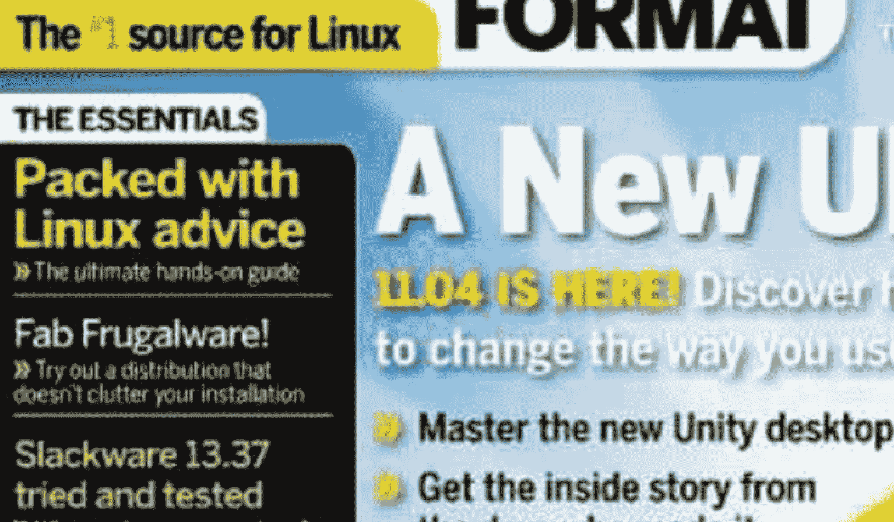

订阅者可以优先查看每期内容，英国订阅者还能在纸质版上架前最多一周收货。

Linux 的首选来源

# 全新的 Ubuntu

核心精要

满载 Linux 建议

11.04 现已：探索 Unity 将如何改变你使用桌面的方式

- 掌握 Unity 桌面
- 从制作它的开发者那里获取内部内部故事
- 今天立即尝试及更多

太棒了！

优化你的安装

Stackwalk 13.7

经过测试与验证

访问所有：

不要将将你值得的服务

切换到更轻量级的窗口管理器，运行更快

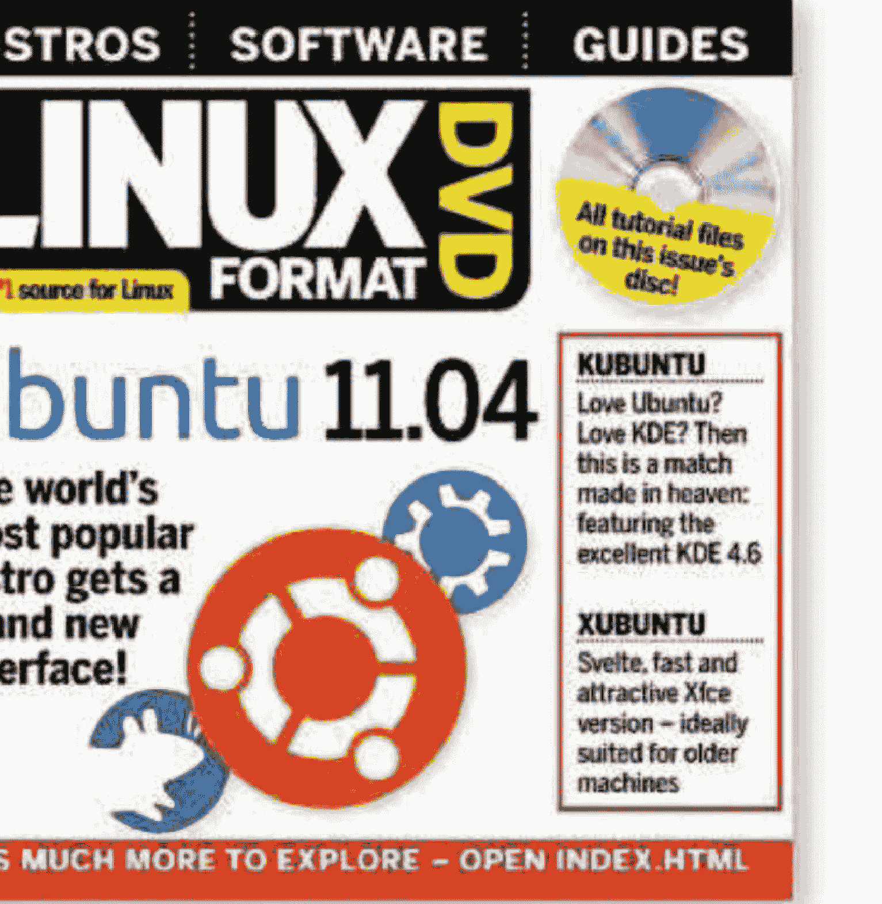

Mark Shuttleworth

今天可以带来并编写什么？

为未来做好了准备

新上线！

编程板块

以及更多

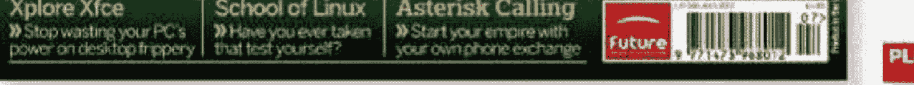

探索 Xfce

PC 最佳选择

桌面动力

Linux 学院

你的交换机 Asterisk

英国每 3 个月 £14.99 —— 平均每期 £4.99，或每年 £59.99！

访问 www.myfavoritmagazines.co.uk/LINUX1K 订阅，或拨打 0844 848 2552 并告知 LINUX1K

> * 所有节省金额均基于新价格。最低订阅期为 12 个月。你将收到 13 期《Linux Format》。如果赠品缺货，我们保留用等值物品进行更换的权利。如果你在接下来 60 天内有任何疑问，请书面通知我们，我们将退还所有未领取的物品。仅限描述的存档区域仅供个人使用。

优惠截止：2011年7月

66 LXF147 2011年8月 | www.linuxformat.com

## 逐步指南：LXF 订阅是完美的礼物……

我们得为 Jon 的生日想点礼物

送一个 LXF 订阅怎么样？

那是个太棒的主意了！

生日快乐，Jon！


哇！你们真的很在乎

而且那些徽章太酷了

## 我们为你准备了一份很棒的新赠品，任何《Linux Format》的粉丝都不会错过——一套由 Linux Format 团队专为你设计的 LXF 徽章套装。每套包含四枚徽章，并装在黑色展示盒中。

你还将获得无限访问我们订阅者专属区域的权限，其中包括：

- 每期的免费数字版，可在你的 PC、智能手机或平板电脑上下载 —— 从在英国发售之日起即可可用
- 访问教程和附带光盘下载
- 完整的过往杂志

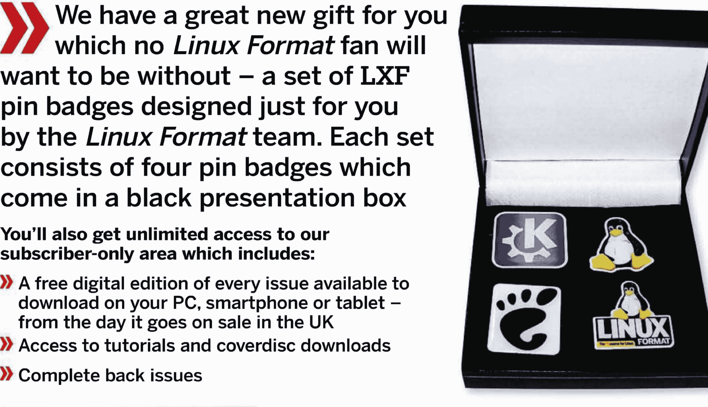


请使用显示的完整网址以享受此特别优惠

## LXF 热点

Lyx 文档处理器 >> SwarmTV >> LIRC >> mhWaveEdit >> WeChat >> Rekong >> Conquests >> Abuse >> White Dune >> Clonezilla

Alex Cox

编译这些热点让 Alex 汗流浃，头发都变蓝了。

## 文档处理器

### Lyx 文档处理器

访问 lyx.org

文字处理是关于我们对工作需求的感受吗？我们应该把这些包和食物处理机放在同一类中吗？检查一些动词，一群名词，撒一点并忽略成分和添加剂，直到知识融化到无法比拟？

关于我们文档的外观，这让我们偏离了写作的重要过程。Lyx 并不是向你抛出一满选项选项丝带，而是拥抱 WYSIWYG（所见即所得）原则——这意味着你的文档不是根据你写的内容进行格式化的，而是由你完成。

Lyx 实际上并不是一个处理器。它是一个我们花费了太多时间制作的“文档处理器”。

你可能已经根据名字判断出 Lyx 是用于 LaTeX 的。你在 Lyx 中根据文档类型创建文档，然后将其交给 LaTeX 进行最终渲染并以你选择的格式输出。考虑到它与 LaTeX 的关联，这并不意外，并不是

> “Lyx 拥抱所见即所得原则，而非外观。”

## 寻找路径

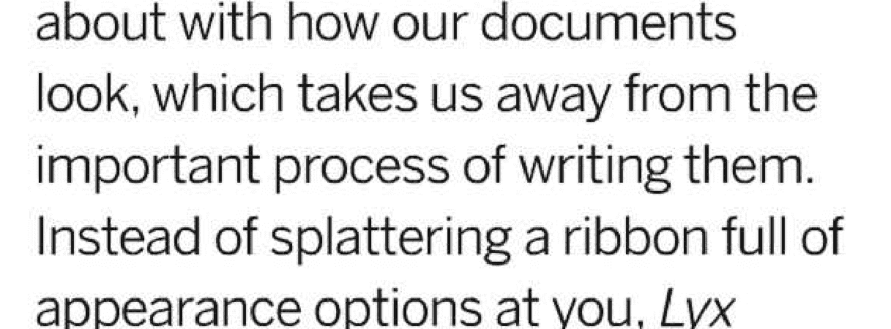

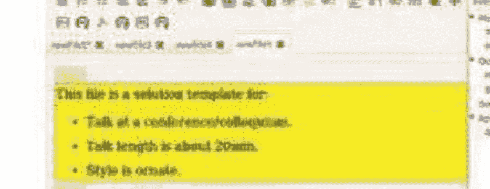

| 处理器中的原始标题 | 仅在纸质版中显示 | 作者 F；另一作者 S |
- 样式选择器

将文档渲染为 PDF 以查看打印时的效果。这之间有巨大的差异。

Lyx 最适合技术和科学文档。它有一个非常出色的点点式数学公式布局，它生成的代码让大多数科学家都能在设计事物上达到出色的造诣，就好像你已经在使用点击操作并利用了这里所有的快捷键和代码一样。

渲染下

要将当前文档转换为 PDF 文件进行渲染，请点击此处。

Lyx 包含了各种类型的文档，这些类型对于人类大脑来说更容易理解，允许你创建从文章到书籍和手册的所有内容。如果是第一次，我本该为 LXF 热点创建一个自定义的，但 Graham 已经在里面制作了一个格式化的文本文档。我们正向于，如果你正在整理大量文档，Lyx 将显示出你的思考。

文档标签

随时编辑和复制/粘贴多个文档

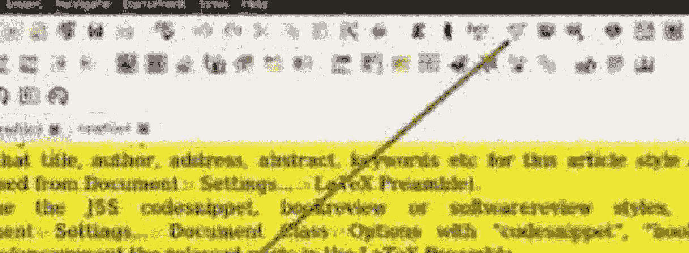

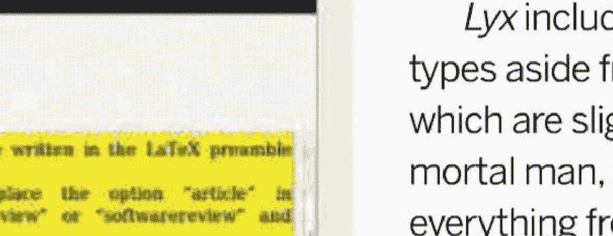

添加包：进入类似 LaTeX 的功能，如下在 LaTeX（或 Lyx）中。如果你想使用该包，请将选项替换为“使用”。如果你想使用该包，请将选项替换为“使用”。如果你想使用该包，请将选项替换为“使用”。Lyx 代码

插入文档

## 广播

### SwarmTV

版本 0.8 Web.swarmtv.nl

如今，有了蓝牙和 Wi-Fi。我们不知道如何操作。当我必须使用旧式的固定时：将所有 ZRB 固定。当灵敏度很高时，在运行 RAM 内存时触摸成员键几乎是不可能的。我们不知道为什么我们要留在那里。

兼容设备，或者作为接收器，将来自任何遥控器的 LIRC 信号转换为内部操作。虽然遥控器上没有“播放”功能，但在内部翻译为“播放”，例如你可以使用方向键移动，将遥控器变成一个（相当笨拙的）鼠标。

这种固定支撑了 ST、Amiga 和我早期的 PC。但当我把 PC 连接到电视时，我必须增加功率但并没有。这让我们想起了 Linux 红外遥控器！我曾将其用于原始的媒体中心。

它的 IR 广播能力不应被忽视；要么在 Sky 机盒上切换频道，或者将其设置为中继器将信号传输到多个设备。本质上，取决于你的硬件，LIRC 是双向的。它可以作为 IR 广播器，发送消息到

## 遥控

### LIRC

版本 0.9 Web.lirc.org

处理关于我们对工作需求的感受吗？我们应该把这些包和食物处理器放在同一类中吗？检查一些动词，一群名词，撒一点并忽略成分和添加剂，直到知识融化到无法比拟？

关于我们文档的外观，这让我们偏离了写作的重要过程。与其向你抛出一满选项的丝带，Lyx 拥抱所见即所得原则——这意味着你的文档不是根据你写的内容进行格式化的，而是由你完成。

Lyx 实际上并不是一个处理器。它是我们花费了太多时间制作的“文档处理器”。

你可能已经根据名字判断出 Lyx 是用于 LaTeX 的。你在 Lyx 中根据文档类型创建文档，然后将其交给 LaTeX 进行最终渲染并以你选择的格式输出。考虑到它与 LaTeX 的关联，这并不意外，并不是

> “Lyx 拥抱所见即所得原则，而非外观。”

- 样式选择器
- 自动下载是关闭右侧的简单情况。

# LXF 选精

音频编辑器

## mhWaveEdit

版本 14.21 Web www.mgna.org/projects/mhwaveedit

保持简单，愚蠢简单（KISS）；这就是 mhWaveEdit。我想把这比作——请包谅我，我正在探索另一种让基础事物变得令人兴奋的方式——就好像一台磁带机里 A90 磁带的软件。

它确实还算体面。就比方它是 90 年代初直接从 Rich Sounds 出产的 Wharf 品牌。它度过了自己的时代，虽然那里有更好的设备，而且我也没有足够的更复杂的产品。但它至少把电线接好了，你可以把它插入任何你喜欢的设备中，而且它不会让你的磁带松动。录音世界任由你挥洒。

粗略来说，它的核心点在于：mhWaveEdit 是桌面音频编辑器能达到的极致简单。在单轨道上录制一些音频并保存为 WAVE 文件。但为你的系统添加更多功能，它将呈指数级增长。

庆幸的是它不是那种狗窝系统里的录带机，那种因为某个电视界大亨没能下功夫做出真正的产品，就永远录制声音并以双倍速度播放。

### “在单立体声轨道上录制音频，保存为文件。搞定。”

如果你运行 ALSA，那么正如你所做的，你可以用 mhWaveEdit 处理各种事情。几乎都很完美。找一些 ALSA 插件（www.alsa.org），你就可以添加许多额外功能，或者安装它们，或者报告格式为 WAVE。

## 稳定且安全

mhWaveEdit 最适合长录音；据我所知，它是稳定的，而且它直接录制，以便在丢失系统电源时保护你的现有数据。

在剪切和粘贴部分时要小心，确保你在原始文件的副本上操作，以免意外丢失数据，mhWaveEdit 不像 Audacity 那样保存撤销历史。

> 善用首选项——它包含了一些特别实用的调整。

## 逐步教程：科学之声

- 1 加载... mhWaveEdit 非常灵活。如果它是 WAVE 文件，它会加载其中的任何位置。
- 2 打开... 试一下——使用文件 > 打开并找到，比如，一个二进制文件。这些文件通常比图片更有序。
- 3 播放... 播放后你会听到一种明显的 80 年代早期声音，就像 ZX Spectrum 从未消失一样。

071 LXF147 2011年8月

www.linuxformat.com

## 聊天客户端

### WeeChat

版本 0.3.5 Web 来自 weechat

IRC 可能是一件危险的事情，IRC 能看到 17 岁的你坐大巴去莱彻斯特参加频道聚会。IRC 能看到你在毫无防备的情况下会见一个盲人，戏剧性地预感到一个带着三个孩子的已婚母亲试图调戏你，而她的头发掉在四英尺外，嘴边围着胡须。听我的没错。

Python 和 Ruby，所以它可能是运行 IRC 机器人或其他创作作品的完美平台。你需要几个简单的命令来开始。从指向 IRC 服务器开始，在末尾的斜杠后包含它的端口。IRC 服务器通常是 localhost:6667。然后使用 `/connect` 登录服务器，一旦连接成功就使用 `/join <channel>` 进入频道。

如果你还没有学习过 IRC，用 WeeChat 结果不会更糟。一个整洁的客户端几乎可以保证让你在几秒钟内就陷入互联网永恒的危险道路。

鉴于它处理一切的能力，你不会对 WeeChat 提供的这些选择感到困扰。它完全是文本的——核心在包中，但你还需要管理频道并运行 shell。通过插件，它支持一多门脚本语言，如 Perl，

> IRC 能看到你一个带着三个孩子的已婚母亲试图调戏你。

## 浏览器

### Rekon

版本 0.70 Web 来自 rekon.de/

新浏览器不需要稍微修饰，Firefox 和 Chrome 占据市场可能有很充分的原因——市场非常饱和，对于那些想要为每个浏览器分配独立内存池的人来说，这是一个非常棒的工作。Konquer？嗯，它很大。它可能是目前任何发行版中扩展性最强的浏览器。对于某些人来说这是一个问题——即使它作为 Kubuntu 的主浏览器 Rekon 表现更好。

像 Fork 这样的东西，支持许多扩展，不会因为其内部需求而崩溃。这显然证明了这一点。如果你觉得过时了，你的表现会比 Rekon（我决定发音为 'Re-kon'）更好，它是一个基于 KDE 的浏览器而不是 Konquer (DA)，它对许多页面也有很高的兼容性并保持更新。它是构建在 Firefox 之上的，在内存管理上受到过几次挫折，你只能称“特色”。

Rekon 非常快，而且几乎是致命。它提供了今天 KDE 最好的浏览器。“简单”和“轻量”的哲学：解放它不成为内存大户——在笔记本电脑上为了节省电池减少不必要的内存时，这是绝对的福音。它是基于“简单轻量”的哲学构建的，所以不是内存大户。

这需要一点适应，但 WeeChat 的帮助功能是无可比拟的。自定义你的行为。在 weechat.org/scripts/ 查看完整列表。如果你发现从文本到大多数 IRC 客户端，到媒体播放器 Amarok？那是完全可能的。

想要一个随机字符来显示你正在玩某些选择吗？

## 热门游戏

### 回合制策略

### 征服 (Conquests)

版本 0.12 Web http://homepage.ntworld.com/mark.harman/conquests.html

我会说 Linux 社区并不缺少《文明》。FreeCiv 证明了对原版《文明》的重制比 Mike Saunders 清醒时梦到《星际争霸》包含的发行版还多，对《殖民时代》也是如此。AltaCiv 和 Conquests 时时出现，我们不确定为什么。资源来源，所以既然已经有了完美的纹理，为什么要再做更多呢？Conquests 在其时代切换了；它有一个 3D 球体，没有什么比后期游戏的视觉效果更好的了，它在原始 2D 纹理混合的简单性和视觉复杂性上有许多改进。实际上，如果你以前玩过任何东西，玩 Conquests 将是相对简单的。对吧？

> 与法国人谈判？除非他们提供一个用于发展城市的区域。在提示方面，留心你通过出售某些区域将获得的边界：紫色包括实例，这将增强贸易并让城市增长得更快。一旦你发现了蒸汽机，它就非常有价值，因为它可以增加你的生产能力。那里面有几个 Bug，最常见的是我们无法 Alt-Tab 回到 Ubuntu 桌面——但 conquests 稍微松了点。它是衍生品，在一个拥挤的市场中，但它确实很好。

“一个区域将增强贸易并让城市增长得更快。”

## 2D 横滚应用

### Abuse

版本 0.8 Web 来自 abuse-zoy.org

非常诱人坐在这里开关于 Mike 的“abuse”笑话，但我会克制一下。你玩过 Polish 2D 可破坏游戏，或者它的精神前作吗？如果你没玩过，去看看吧。而且 Abuse 很有意义——它是带有鼠标控制的横滚游戏的原型，画面像原始电影系列一样清晰。破解关卡，你只需要访问……或者在你的发行版包管理器中安装 Abuse。有几个选择，abuse 也根据 GPL 分发，但它在正式授权某些资产方面存在一些问题，所以我们在光盘上提供的稍微有限；它仍然保留了原始关卡和游戏玩法，但为了完整体验你需要访问……

> 移动。大喊。避免爆炸。未能避免爆炸。以这种不愉快的方式。重复。

# 3D 创建工具

# 白沙丘 (White Dune)

版本 0.31beta221 Web 版 http://vmlc.ica.uni-stuttgart.de/dune/

White Dune 的作者是一个非常友善的人，他注意到自我第一次在 VRML7.0 中遇到它以来，软件已经进行了多处更改。请注意，在 HotPicks 编译期间，有所抱负是一件好事。

为了提供更简单的选项，以至于让任何一个孩子（或是一个智力受限的记者）都能轻松上手 VRML 动画。

诚然，我没有创造出任何你可能认为优秀的、甚至是不可能实现的东西，但如果你发现过去 Blender 或 Lightwave 对你来说太复杂了，那么这个非常值得一试。

White Dune 是原始项目的延续，旨在方便 VRML 文件的加载、编辑和动画处理——VRML 文件是可以在任何功能强大的浏览器中加载的 3D 世界。


自从上次更新以来，新功能已经陆续到齐。我们增加了对 X3D（VRML 的继任者）的基础支持，并且最新的测试版为 C++ 导出功能添加了动画。

我个人对关于 4 界面最感兴趣——我为安装的 White Dune 找到了一个不错的图标——它将复杂的界面简化为了一个简单的界面。

- White Dune 具有红/绿色立体显示器模式，因此你可以为你的作品增加深度。

## 同时也发布

其他也值得关注的新软件和更新软件……

### Proaelia 0.2

一种适用于各种形状和大小的纸笔游戏的 RPG 引擎追踪器，`http://www.prismimagessoft.com/products/proelia/`

### OpenOCR 0.64

扫描文档？用这个好手的工具整理你的 OCR 输出。

`http://www.centallcollections.co.uk/openocr/`

### Magic Book 2005-14

尝试这个新的工作流，强迫过时的机器从美国订购书籍。，`http://www.guieck.com/magicboots/en`

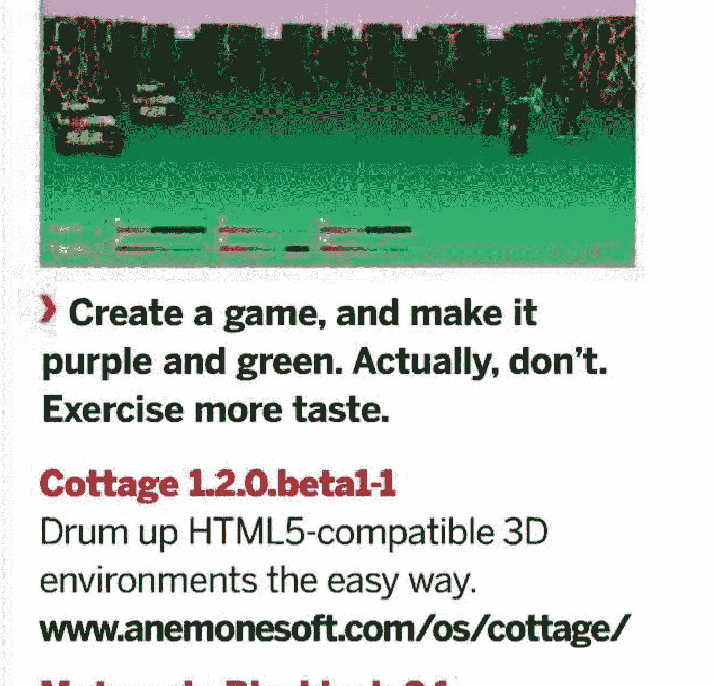

> 创建一个游戏，并把它变成紫色和绿色。实际上，别这样做。多运动运动。

### Cotte 1.2.beta-1

简单实现兼容 DRM 的 3D 环境。`www.anonemosoft.com/cos/cottage/`

### 摩托车区块 11

准备好用 CBHD255 浏览器玩一场闪电风云游戏了吗？`http://www.fresh.net/projects/motorcycle-block`

### Screamer 3.4

从预定义元素的视频制作你的个人使用漫画。`http://screamerpainter.anybits.de/`

## 磁盘镜像与克隆

### Clonezilla

版本 1.8-beta-42 `http://www.clonezilla.org`

`ymymsoft` 是一个强大的镜像工具。`Ghost Norton` 是一个非常好的系统克隆解决方案，但它并非如此。

但它有缺陷。现在，普通大众面临的炸弹是单向的。你可以将其中一个备份到你想克隆的机器上。只有拷贝软件支持多播，即使如此，它的功能也有限。

- 它可以同时向多个主机多播磁盘镜像。

你不需要安装专门的服务器；只要你有一个要安装的镜像副本，你就可以运行 `DRL Live` 并在那里完成工作。开发者开发了同时安装 40 台电脑的功能，一个 5GB 的镜像大约花费了 30 分钟，所以对于任何克隆任务来说，它都是足够可靠的工具了。

`Clonezilla` 基于 `DRL`、`Partone` 和 `jackpot` 做了同样的事情，但不够。就像精致的灵感一样，有两个版本可用：Live 版，可以高效地备份单个系统；以及 SE（服务器版），你设置了一台服务器机器。

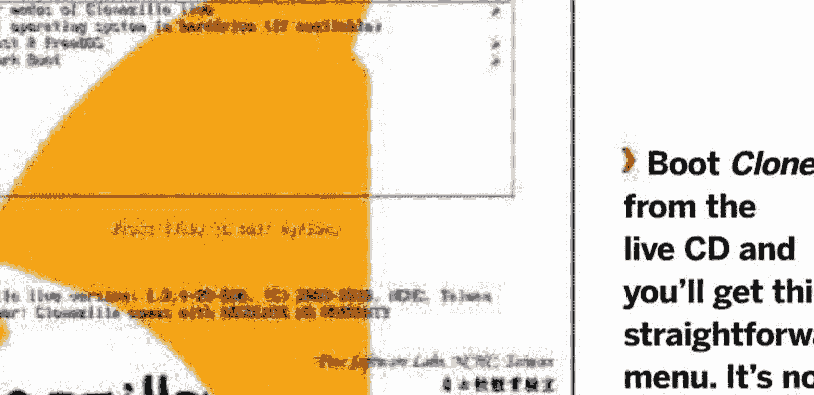

> 只需从左侧菜单中选择你想要的字符。

从现场 CD 启动 `Clonezilla`，你会发现它其实很简单。这对我来说并不难。

### GeoToc 3.4

地理缓存不应该是无聊的。使用这个来创建查询。`www.code.google.com/geotoc/`

`QSimimplector 0.4` 忘记物理和昂贵的电子产品吧。转向这个工具吧。`www.code.google.com/qsimimplector/`

2011年8月 LXF147 | 73

## 一个月内最高 30% 优惠

适用于所有专用服务器，

现在是升级的最佳时机！

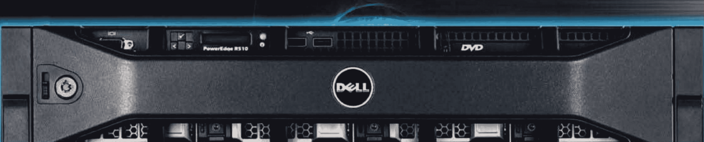

仅需 £45.00 起

Dell Poweredge 服务器

英国本地服务器

全托管服务

无设置费

无隐藏费用

# WEBHOSTING.UK.COM

访问我们 @ `www.webhosting.uk.com`

电子邮件 - `sales@webhosting.uk.com`

24x7 销售热线 0808-262-0855

博客托管 | 电子商务网站托管 | cPanel 托管 | Windows 托管 | 代理托管

VPS 托管 | 云端服务器 | SharePoint 托管 | 专用服务器

# LINUX 教程

开启、登录，并让我们的专家帮助你成为一个更聪明的 Linux 用户

JONATHAN ROBERTS 渴望在巴斯拥有一栋房子，像用火箭筒杀敌一样简单。

## 本月学习如何……


诚然，我没有创造出任何你可能认为优秀的、甚至是不可能实现的东西，但如果你发现过去 Blender 或 Lightwave 对你来说太复杂了，那么这个非常值得一试。

White Dune 是原始项目的延续，旨在方便 VRML 文件的加载、编辑和动画处理——VRML 文件是可以在任何功能强大的浏览器中加载的 3D 世界。

自从上次更新以来，新功能已经陆续到齐。我们增加了对 X3D（VRML 的继任者）的基础支持，并且最新的测试版为 C++ 导出功能添加了动画。

我个人对关于 4 界面最感兴趣——我为安装的 White Dune 找到了一个不错的图标——它将复杂的界面简化为了一个简单的界面。

为了提供更简单的选项，以让……轻松上手 VRML 动画。

- White Dune 具有红/绿色立体显示器模式，因此你可以为你的作品增加深度。

## 第一步教程

### 轻量级桌面

位于菜单的“工具”`Tools`系统下。对于 Windows 老兵来说，这里很熟悉，但你可以通过选择找到关于系统的大量信息，范围从分辨率到内核模块。

然而，最有趣的部分是左侧面板中的“基准测试”`Benchmarks`，在其中你可以使用一系列不同的测试评估处理器性能，然后看到与另一个操作系统的直接比较。

同样地，你还会在“启动器”`Launcher`部分找到“管理器”`Manager`。在这里，你可以通过按住并删除来检查 CPU 和 RAM 使用情况，以及不需要的进程。

最后，若要更改系统的视觉外观，只需右键点击桌面并选择“桌面偏好”`Desktop Preferences`。你可以更改壁纸以及系统文本的字体和颜色。

如需进行更细致的控制，请前往启动器菜单的“系统设置”`System Settings`。在这里，你还可以更改图标集、桌面主题、窗口颜色以及 KDE 设置中的所有其他元素。

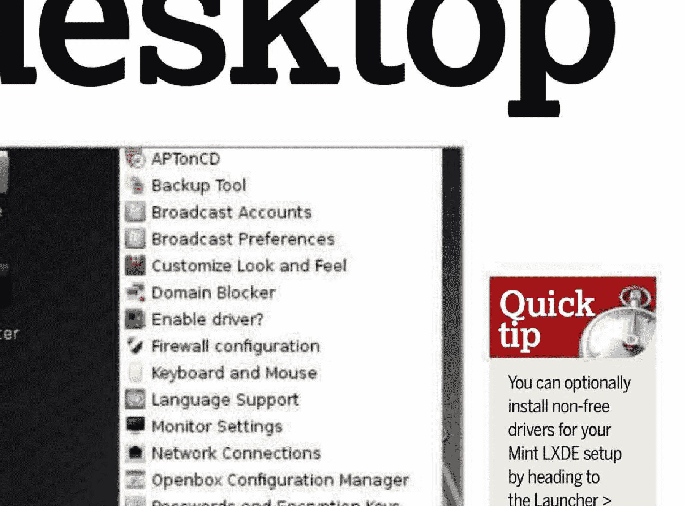

| APnCD |
| :--- |
| 备份工具 |
| 广播账户 |
| 广播偏好 |
| 自定义外观和感觉 |
| 域名 |
| 互联网 |
| 启用驱动 |
| 防火墙配置 |
| 键盘和鼠标 |
| 语言支持 |
| 显示器设置 |
| 网络连接 |
| Openbox 配置 |
| 密码和加密密钥 |
| 电源管理 |
| 打印 |
| 屏幕保护 |
| 用户文件夹 |
| 软件管理器 |
| 软件源 |

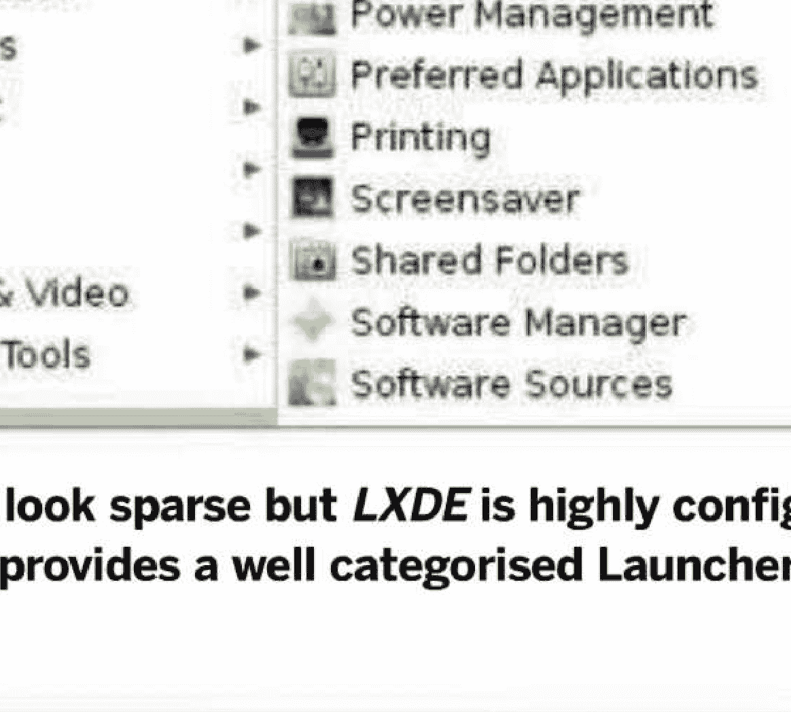

- 你可以通过进入启动器 > 启用驱动程序 `Enable Driver!` 应用为你的 Mint Linux 安装非驱动程序。

> 我们的 LXDE 是高度可配置的，可能提供一些彩色主题。

## 口袋中的企鹅

你可能对一个 Windows 7 用户威胁 Linux 格式的空壳负载感到震惊，但你将会发现。我们携带的轻量级发行版最少仅需 32MB（CD 的大小）即可安装，而你可能需要超过 3GB。

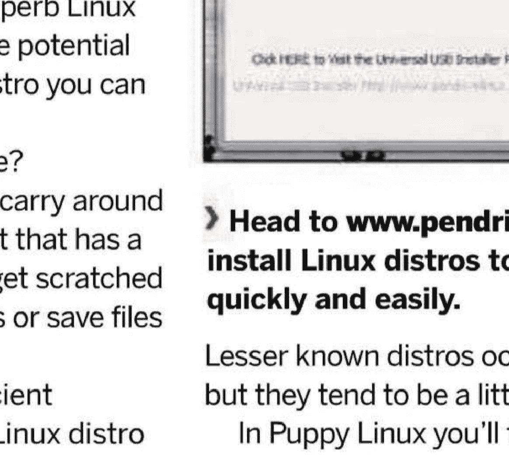

有了这个团队，使用 Linux 硬件所需的最小资源，并且潜力成为一个可以放在口袋里的轻量级便携驱动器。

所以，你说的便携是什么意思？

旧的方法是携带一张 CD 来启动大多数系统，但磁盘可能会被划伤，而且无法在任何地方安装额外包或保存文件。

我们有一个更好的替代方案，是将 Linux 安装到优 盘中。这运行非常顺畅（可以在任何设备上启动），并允许你保存文档并保持它们更新。

Ubuntu 和 Fedora 等主流发行版已经提供了内置工具来创建自己的 USB 版本（通常在 Gnome 桌面的系统菜单中）。

设备和分区布局，或者更倾向于添加到终端。

Linux Mint 也有自己的向导，但它要求你下载 Mint LXDE ISO 镜像（除非你已经有一张 CD）。

所以，为什么我们要用 Windows 7 的截图？创建轻量级优 盘最可靠的工具是免费的，而且它们往往可以在 Windows 启动下运行。


但如果你发现你最好的赌注是一个 Windows 用户，拥有双启动设置，或者确切，需要对一个你尚未安装过这些系统的驱动器进行快速修复，我们为 Linux 环境准备了自己的工具。

如你从截图所示，只需说明你想安装什么，它就会出现在你的“下载”（Downloads）文件夹中。

从下拉菜单中选择一个驱动器并遵循任何后续指令。几分钟后，你将拥有一个高度便携且轻量级的 Linux 环境。

> 前往 `pendrivelux.com` 快速轻松地将 Linux 安装到 USB 驱动器。

Linux 用户偶尔更好，但他们需要更主动一点。

在 Puppy 中，你会在主菜单的“设置”（Setup）> Puppy Boot 安装器下找到一个实用程序。它非常易用。

Tiny 也有一种安装 Linux 的方法，前往“应用程序”（Apps） > USB-HDDD 安装器，尽管如果你不熟悉 Linux 家族的工作原理，应该避免使用此工具。

# 如果你错过了最后一行，请拨打 0870 837 4773 + 04 1858 43775 * www.taxumar.com LXF1|77

## 教程 第一步

### Puppy Linux

如果你想缩小 linux 规模，请尝试这些轻量级选项：

> `Mint LXDE` 仍然足够小，可以让你做得更糟，看看 Puppy Linux。这些发行版使用老旧的 Fluxbox 作为其桌面环境，开发者对软件包的选择非常少见。

默认情况下，系统上安装的唯一浏览器是 `Dillo`（在分步说明的相反位置所示），但如果你双击桌面上的图标，你将看到一个浏览器选择。

你可能识别的三个选择是 `Firefox`、`Opera` 和 `Chrome`，但今天还有默认的 `Midori` 或是 `Iron`（来自 Chromium）。只需选择任何你喜欢的，它将作为你的默认项并被下载。

对于文档处理，我们有强制性的 `Gnumeric`、`Word` 和 `Abiword`（如果你喜欢 LibreOffice，请参见第 79 页的自由框）。

如果你需要，例如，你可能会发现软件包器的图片是你安装软件的唯一选择，但如果你点击桌面上的“连接”（Connect）图标，你会发现一个包含许多非免费驱动程序的较小替代方案，以及许多常用的应用程序，如 `Inkscape` 和 `VLC`。

此外，如果你发现连接互联网遇到问题，点击桌面上的连接图标。

要设置 Wi-Fi 连接，点击连接。在无线部分下选择你的 Wi-Fi 并填写详细信息。如果这出现问题，尝试使用默认。

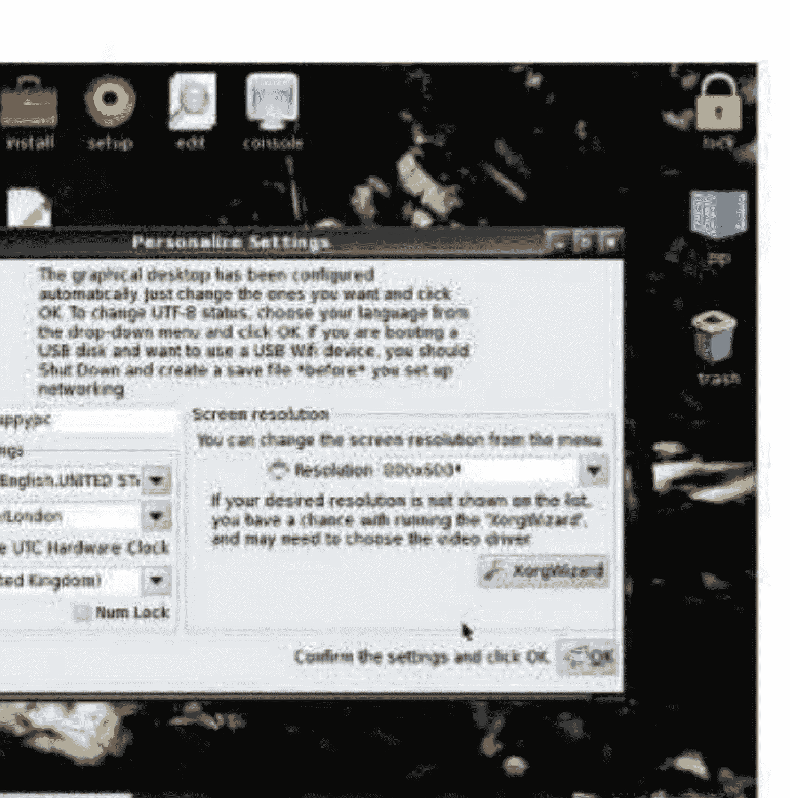

快速提示

你可以通过启动器或右键点击空桌面来学习 Fluxbox。

## 为什么要通过复杂的设置向导，而可以在首次启动时配置选项？

通过以太网连接（作为你的 `eth0`）。

最后，若要更改系统的视觉外观，只需右键点击桌面并选择“桌面设置”（Desktop Settings）。在这里你将发现许多工具，具有一些新功能。

其中最好的是壁纸主题选择器（允许你更改桌面外观）、GTK 设置、屏幕管理器（允许你在屏幕之间切换）、桌面图标切换（允许从其他桌面导入图标）以及全局字体大小（允许你定义系统文本的大小）。

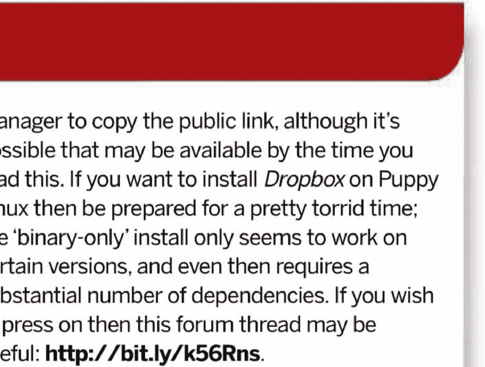

## 云端存储

总会有那么一天你想使用像 Dropbox 这样的在线商店，或者使用我们的 Puppy Linux 来备份你的文件。Puppy Linux 已准备好充分利用这些服务。

在 `Mint LXDE` 的情况下，你会发现它准备好作为邮件客户端。Puppy Linux 使用名为 `Thunderbird` 的轻量级邮件客户端。如果你准备好通过 SMTP 发送（尽管我们在 LXD145 中涵盖过邮件设置），但如果你正在设置网络，你需要添加

- Gmail 详细信息
- MAP 设置
- 入站服务器端口：`993`
- 使用加密：`SSL`
- SMTP 设置
- 出站服务器：`smtp.gmail.com`
- 使用端口：`465`

管理公共库，例如在你阅读此内容时可能可用的。如果你想在 Puppy Linux 上安装 Dropbox，请做好准备，“仅限二进制”安装仅在某些版本上有效，并且需要大量的依赖项。如果你想在线程中使用它，你可以在这里找到：`http://linux.org/l5c0`

- 使用加密：`15`

## 入门教程

## 极致精简

## 逐步详解：Damn Small Linux (DSL)

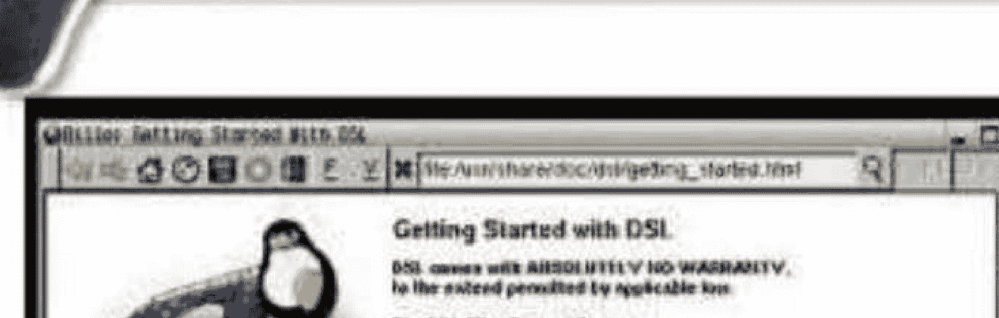

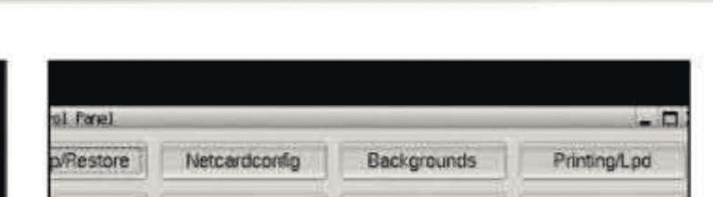

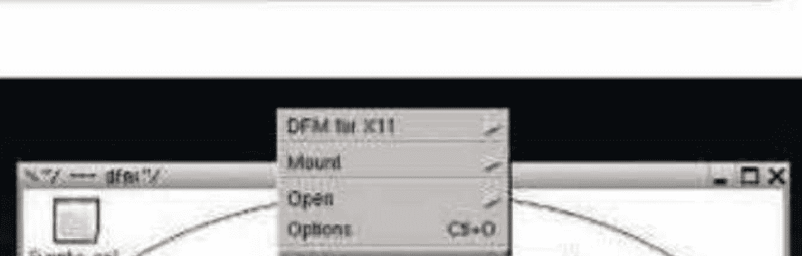

| 网络配置 | 背景设置 | 打印设置 |
| :--- | :--- | :--- |
| 设置 | 无线 | 详情 |
| 时间 | 网络投放器 | 网页 |
| Inisic | 模糊工具 | SSH 服务器 |
| 优先级 | | 客户端 |
| Kvasir | 系统 | 洁净 |

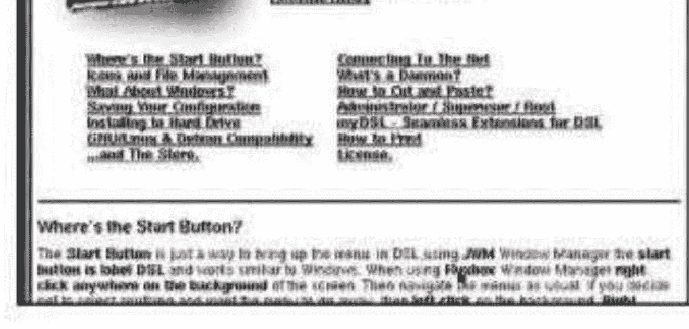

### 1 阅读文档

DSL 在启动时会立即出现，为你用户在使用 DSL 时最常见的问题解决方案。

### 2 配置系统

任何你可能更改的设置或配置可以在 DSL 特制的控制面板中找到。

### 3 管理文件

仅仅因为文件精简，并不意味着它缺乏功能。通过 DSL，你可以完成几乎所有的日常操作。

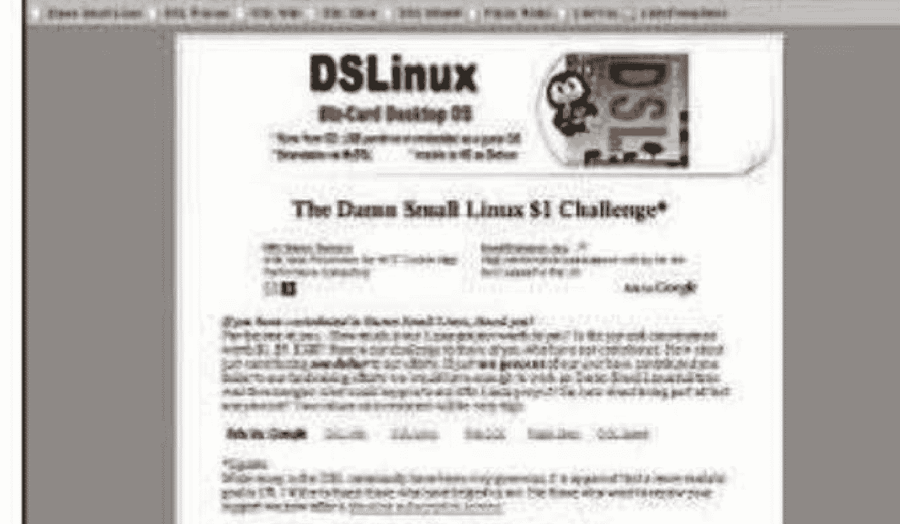

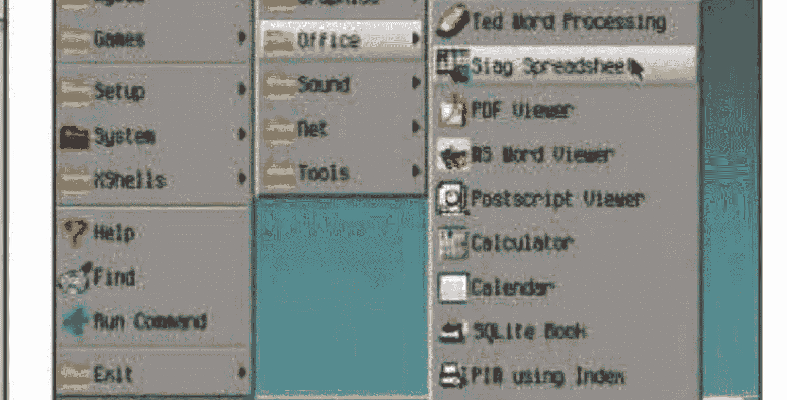

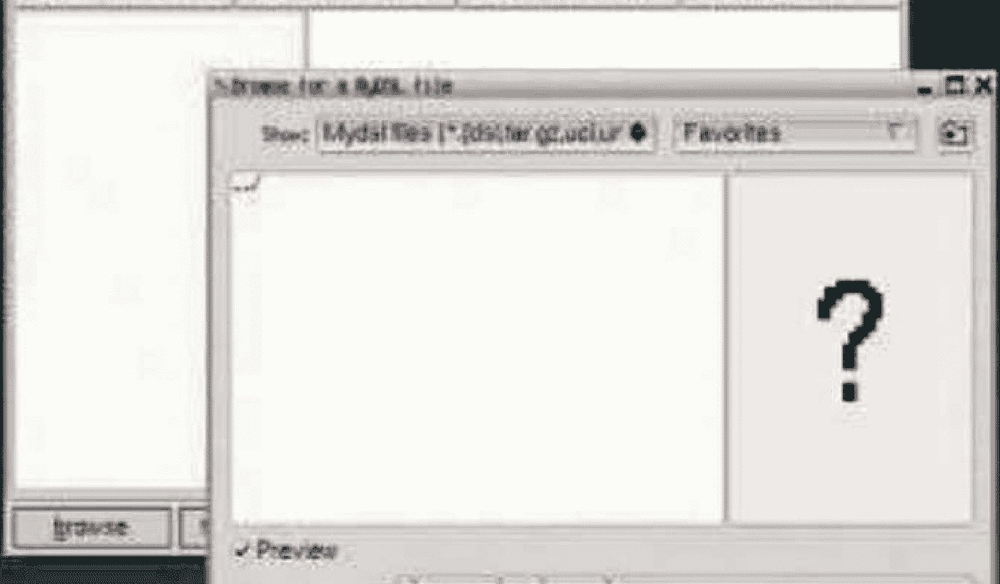

### 4 浏览网页

是的，正如你想的那样。这里提供一个精简版的 Firefox，但你需要额外的内存支持。

### 5 导航菜单

你会在 DSL 菜单中找到大量的软件和控制面板。DSL 提供了令人惊讶的电子表格功能。

### 6 安装包

如果你想安装，DSL 提供了一个预先连接的包管理器前端。你也可以安装 DSL 和你的源。

## 自由运行

任何程序和 `Gnumeric` 都能在该内存占用下提供基础功能，即 Linux 提供的极其强大的桌面能力。主流发行版的旧版本通常会让你包含在某一个软件包包中；如果你还没有遇到过，这是一个原版 OpenOffice 的优化版本，你可以像在你小巧快速的系统上运行它。在 Mint 的情况下，当时仓库中还没有 LibreOffice，你需要前往 `www.libreoffice.org` 下载并选择 Debian 版本。确保你安装了桌面版，以确保该套件出现在你的菜单中，并且不要像以前那样丢失 LibreOffice 的任何元素。对于 Puppy，你需要像往一样下载并安装源包（更多详情请参见内部的 README，`puppy.org` 有一个可用版本）。

## 下个月我们将探索如何在 Linux 上运行应用程序

## 订阅并节省超过 20% 的费用

`www.favouritemazines.co.uk/computer/pc-plus-magazine-subscription`

## 拒绝访问！互联网身份证的兴起

你需要理想的电子护照来传输或共享。你的互联网服务提供商（ISP）控制你能看到的内容、过滤器、优惠和阻止，就像英国防火墙。

## 免费光盘！20 款宽带加速工具，完全为快速 3G 准备 | 无延迟游戏 + 60 个精选程序

## PCPLUS 促销中

对技术充满热情，你需要更多的速度！现在有 35 页专家建议

你现在的宽带还不够。

## 加速宽带！

- 每次都能流畅 iPlayer
- 适合整个家庭的带宽
- 快速下载

## 你被坑了了吗？

从你的互联网服务提供商那里获得应有的速度和服务

## 全新网络设备

终极 Wi-Fi 设置

## PCPLUS 对技术充满热情

## 加速宽带！

流畅播放 iPlayer

## PCplus 数字版已发售！

`www.pcplus.co.uk/buy`

内包含 32 页项目

### 冲浪大师

浏览器大战：`Firefox`、`Opera` 和 `Chrome` 的对决

### 安全大师

屏幕调节，呈现完美色彩。通过沙箱尝试地下攻击。

## 每期都有……

### 深度新闻分析

发现你需要的一切。

### 未来的计算

坐下来阅读技术前沿。

### 超越手册

通过我们的顶级 PC 项目让你的设备发挥最大价值

## `www.pcplus.co.uk`

## 介绍英国最具性价比的 VPS 系列

使用虚拟服务器托管多个网站，无需物理服务器的开销。

## 超快速处理器

每月 14.99 英镑起

不限制带宽

## Windows 虚拟服务器

你将获得：

- 高达 100 个网站
- 30 GB 硬盘
- 完全访问
- 24/7 支持
- 拨打销售团队：`0800 317`
- 或访问 `favouritemazines.co.uk`

30 天无忧退款

得益于 `OpenCV` 的无处不在，有很多开源软件（FOSS）工具能够从 RAW 照片文件中生成图像，其效果与 `Adobe Lightroom` 或 `Apple Aperture` 等商用软件导出的图片不相上下。

拍摄 RAW 格式的另一个关键优势是，拥有可以处理 RAW 图像并将其转换为 TIFF 或 JPG 的程序。如果你的编辑结果被保存为一个包含指令的文件（这些指令仅在图片被保存为 JPG 或 TIFF 时才会执行），那么原始文件就永远不会被触动。

如果你打算拍摄几百张照片，你就不需要在图像处理程序中编辑每一张，因此你需要建立一套自己的工作流。

在摄影中，工作流被分为四个阶段：第一阶段是从你拍摄的所有照片中选出你想要的图片，并使用 RAW 转换软件处理你的图像。下一步是在 `GIMP` 或 `Photoshop` 等处理程序中对图像进行编辑和精调。最后，根据你打算如何处理这些照片，下一步将是打印、发送到网络或发布。

一些专业人士倾向于为每种情况使用专门的工具；他们想要添加特定的效果，可能会对每种情况使用两种不同的方法。

导入图像可以简单如将它们从相机取出并拖入驱动器上的某个分区。你需要一些组织工作来处理大量的照片，这可能包括使用脚本 (`LXF43`) 进行常规转换，或者使用像 `PhotoBatch`（照片批量处理器）这样最需要的工具。然而，摄影师往往倾向于视觉化，好消息是现在有很多 GUI（图形用户界面）程序。

> 有许多 GUI 驱动的程序可以用来组织你的图像，它们可以帮助你在工作一天后整理图像。

最近因其速度和查看 RAW 文件的能力而脱颖出的两个工具是 `Google Photos` 和非常出色的 `Digikam`。`Digikam` 不是开源的，但它是免费的，并且可以根据 `digikam.com` 对照片进行分类。它非常快，在设置驱动器上的内容方面做得很好。只需从内存卡中拖入照片，`Digikam` 就可以按日期或名称进行搜索并给它们标记标签。

- `Darktable` 的界面在配置工具时处理了不同程度的复杂性。

`Digikam` 是 KDE 最喜爱的照片查看器，但在 `GIMP` 中运行也非常完美。它在屏幕匹配方面也略好，你可以从任何窗口拖放照片以在驱动器上重新调整方向。

两者都内置了 RAW 转换器和图像编辑器，但 `Digikam` 中的那个在隐藏内容方面并不理想。另一方面，`Digikam` 拥有强大的幻灯片编辑器。这不仅能让你控制 RAW 设置（如曝光调整和白平衡），还可以处理 16-bit 图像以及源色彩管理配置（见校准说明框）。

# 好的 16-bit 编辑器？

虽然从 RAW 文件到打印是完全可能的，但 `Rawtable`、`Photoshop` 和 `GIMP` 中的任何一个都不具备基础的编辑工具——比如用于去除照片中尘埃遮罩的画刷——所以你在将照片发送到打印机之前，需要在 photoshop 中调整这些照片。

目前，`GIMP` 不支持 16-bit 图像，而且它的引擎并不快。这留下了两个选择：`Cinepaint`（配合 Gimp 使用），它被用于工业电影制作。它是开源的，但支持非常糟糕，最后更新是在 2008 年。

`Krita` 并不具备 CinePaint 那样的照片编辑功能，调整色阶和曲线方面也没有任何 RAW 转换器，但它确实有一个工具并且可以与 16-bit 图像配合。对于大多数不涉及重度焦点编辑的摄影风格来说，它是你工作流最后一步所需的所有，尽管在 Gnome 桌面上运行可能非常慢。

`Digkam` 也有它的局限性。从角度来看，它对插件没有明显的支持，且 RAW 图像中缺少预设曲线、锐化和点平衡等关键功能。更关键的是，它在处理……方面（此处原文似乎不完整）。

## 专业摄影教程


通过元数据或标签进行过滤。此外，缩略图上有一个简单的导出功能，让你一目了然看到焦距和 ISO 值等条件。在这样易于查看的形式中，这是一个出人意料的功能。我们担心的是它有太多的参数需要调整。你可能会在不断调整和调优中迷失，并发现许多重复的值。

一旦你整理好项目，就可以导航到 Rawtherape 的左侧面板。此时，可以通过顶部的箭头图标隐藏该面板。

现在，面对你面前的缩略图，你可以选择你认为值得开发的图片。Rawtherape 允许你为每张图片添加最多五颗星级；或者按一个选择你的喜目，你可以根据需要添加星级或取消星级。你也可以这样过滤掉那些没有加星的图片。右侧面板过滤器允许你进行排序。

你在 RAW 文件中编辑什么并不重要，只有你得到的最终结果才重要。从曝光和对比度开始是一个好主意。与相机输出的 JPEG 相比，RAW 看起来可能更暗、更平淡且稍微失焦。别担心，这只是 RAW 照片，增强它取决于摄影师的质量和技能。这是白皮书或 Adobe 网站上定义的极佳示例：http://bill/JOYK


需要将锐化（Unsharp Mask）提高到 20 甚至 200，才能获得非常锐锐的边缘。涉及到噪声，Rawtherape 的算法要好得多，但今天相机产生的图像尺寸比丢失细节要容易接受得多。即使采取谨慎态度：

- 有一天，Digicam 可能会成为使用 Linux 专业人士的完美端到端工具。目前，它适用于处理大量照片。

如果你想获得最佳效果，尝试使用“导出细节”（Export Details）而不是“锐化”。Rawstudio 仍然可以帮助隐藏在困难位置拍摄的阴影（例如，阴影），这些阴影在 Rawtherape 中并不好看，但它们闪闪发光并变成了当天最出色的照片之一。

因为你可以更改的照片颜色是通过 RAW 文件的一个或两个方向调整曝光，或者配合对比度，如果你想通过滑块上的位置点来增强直方图黑暗一侧的效果。

## Linux 用于摄影？

Linux 上可用的一款程序可以做到 Lightroom 能做的一切，并且面向摄影师，其专业工作是可比拟的（bibtable.com）。我们并不想放弃 FOSS（自由开源软件）哲学并全力投入——它的性价比极高——没有理由认为 Linux 在高端摄影方面不能像其他任何工具一样好，而且 FOSS 工具并没有落后。

接下来，只需点击一下即可调整白平衡，它应该是自动的。手动调整滑块可能会很麻烦，尝试坚持使用它或内置的预设之一来增强效果。饱和度更好，我们大多数人都喜欢你的照片有一点冲击力，但很容易过头。

如果有人质疑 FOSS 软件的质量，只需指向卓越的“照片级空调查”（skyjourney.org）。那张 5000 万像素的地球天空照片是一次一年的旅程，由 37440 帧独立帧拼接而成的。它出现在《新科学家》杂志上，并是许多杰作之一。而这一切都是通过 GIMP 完成的。

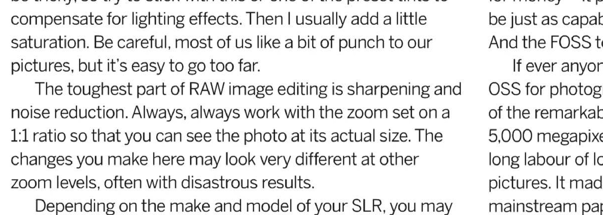

## 创建照片幻灯片


照片幻灯片可能需要一天的时间来展示你的相册，但在你手中，它们是最好的叙事格式之一。不相信我们？去看看 duckatabbit.info。

良好的照片幻灯片的关键在于控制每张照片在屏幕上的时长以及何时使用过渡效果。使用 OpenShot 这样的非线性视频编辑器比使用特定的照片工具更好。

对于应用像肯伯恩效应（Ken Burns Effect）——相机在静态照片上平移——你需要更强大的视频工具。视频编辑器 Kdenlive 似乎多此一举，但它是实现效果的唯一方法。

## Linux 学院

## DVD 上的之前的部分


## Mike Saunders Linux 学院

第 7 部分：学习如何像专业人士一样处理进程，并熟悉著名的极简主义 Vi 编辑器。

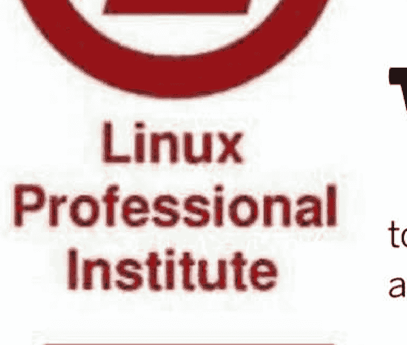

## Mike

Linux 专业协会（LPI）

LPI 系列教程即将结束，最后一部分将于下个月发布，因此现在是时候查看你可能在系统旅途中遇到的几个进阶主题了。

我们将介绍进程，以及你如何按照自己的喜好管理它们。没有什么比错误的程序阻止删除重要文件并让你无能为力更糟糕的了，所以我们将查看如何设置文件系统，但不是从我们之前涵盖的内容来看，而是如何将分区格式化为新类型并对其进行检查，以防发生任何错误。

最后，我们将探索几乎在每一个 Linux 安装系统中都带的 Vi 编辑器，它以初学难用而闻名，但一旦你掌握了它，它就会成为救星。接下来我们将有一详细的 LPI 培训课程，在你完成本教程之后，以及你将如何进行复习。好运！我们的专家 Mike Saunders 编写 Linux 相关文章已多年，安装的发行版比我还要多。

### 第一节：进程管理

想象你正坐在家里，手里有一杯精致的茶。现在，在这种情况下，当你操作电脑时，你会说出一句这样的话：“天哪，我需要杯咖啡”。当你运行一个程序并想要停止或更改它的工作方式时会发生什么？在基础层面，“停止”等同于按下 `Ctrl+C`。对于一个向终端输出成千上万行的命令，你可以使用 `Ctrl+C` 在流途中停止它。它完成了；你无法再做更多事情了。当你刚刚输入了一些内容，需要在损坏之前停止它时，这非常重要。

然而，这还有另一种替代方法。如果你想管理程序的执行以备后后用呢？比如，你刚刚输入了 `gcc` 来阅读 GNU 编译器的手册。你滚动查看并在文档中发现了一个有趣的点，所以你想检查一些东西。按下 `Ctrl+Z`，帮助页查看器将消失到后台，让你回到提示符。然后你可以使用 `fg` 将它带回前台，正回到你离开的地方。在这种模式（挂起）下启动程序是可能的，这样你可以在准备好时切换到它。这是通过在末尾添加一个符号 `&` 完成的。

### 命令行的高级技巧和技术

默认情况下，进程没有权限访问系统以外的资源。如果启动了进程 A 和 B，且都需要 CPU，内核调度程序将在它们之间切换。当有许多进程同时运行时，这并不总是容易的。例如，如果你有一个 `cron` 任务。

#### 伦敦学派

停止一个进程，但如果该进程有自己的 kill 处理器且由于太忙而无法处理它，那么你的信号就会生效了。这就是 `kill` 命令名副其实名的时候：

有许多名为 `apache` 的进程正在运行。尝试这个：`kill -9`

另一个不是破坏性的但通知进程重启或重新配置其配置文件的信号是 `SIGHUP`，它在从拨号调制调器设备“挂起”后发送。许多程序会忽略它，但它对于像后台守护进程（daemons）非常有效，例如：

这甚至不会询问程序是否可以 - 它会立即停止。如果进程正在写入文件的中间过程，结果可能会非常混乱，因此在没有其他选择可用的情况下，必须极度谨慎地使用此命令。

`kill -HUP`

你可以使用它的名称，除非你想查询它的 PID。在这种情况下，你可以使用你编译的 super-edge-Apache 模块，它已插入到 Apache 中，现在你的 Web 服务器正处于挂起。你无法通过普通脚本停止它，

`systemd` 允许进程减速一秒，如果可以的话就重新读取配置文件。当你想要对文件进行更改而不想关闭整个进程时，这非常有用。如果由于某些原因，你不希望此进程接收信号，请使用 `nohup` 命令禁用它 - 详见 `manup`。

你可以通过 `top` 命令获取系统性能概览。这可能会显示自上次启动以来它重启了多少次、谁登录了，以及一段时间内的平均负载。

`top` 显示了按 CPU 使用率排序的进程列表。

### 第二节：创建新文件系统

学习这些并不高深，但你必须关注系统管理员、文件系统和分区，尤其是你日常工作中需要到的它们。在大多数情况下，你需要在安装时对设置区域进行分区，它将持续几个月或几年。像 GParted 这样许多发行版安装程序使用的图形化工具让这个过程变得简单，尽管意识到命令行工具同样重要。

首先，硬盘通常被划分为多个分区。你可能有一个用于 `home` 的分区和一个用于 `swap` 的分区。大多数 Linux 文件系统位于一个或多个分区（如 `/`），然后我们是我们称为根（root）的硬盘分区。

| PID | USER | PR | NI | CST | %CPU | %MEM | VIRT | RES | SHR | S | TTY | START | TIME | COMMAND |
|---|---|---|---|---|---|---|---|---|---|---|---|---|---|---|
| 19214 | root | 2 | 0 | 0 | 0.0 | 0.1 | 23826 | 1032 | S | S | ? | 0:00:02 | systemd |
| 16596 | user | 2 | 0 | 0 | 0.0 | 0.0 | 216568 | 21920 | S | S | ? | 0:00:01 | apache |
| 28338 | user | 2 | 0 | 0 | 0.0 | 0.0 | 165734 | 7072 | S | S | ? | 0:00:01 | gnome |
| 29907 | root | 2 | 0 | 0 | 0.0 | 0.0 | 155336 | 8192 | S | S | ? | 0:00:00 | xorg |
| 21907 | user | 2 | 0 | 0 | 0.0 | 0.0 | 155552 | 12288 | S | S | ? | 0:00:00 | bash |

测试文件系统的测试

现代文件系统（如 `ext4`）是非常可靠的，即使在崩溃时也能保持数据一致性。

你可以使用 `top` 命令获取系统性能概览。这可能会显示自上次启动以来它重启了多少次、谁登录了，以及一段时间内的平均负载。

`top` 显示了按 CPU 使用率排序的进程列表。


| 19214 | root | 2 | 0 | 0 | 0.0 | 0.1 | 23826 | 1032 | S | S | ? | 0:00:02 | systemd |

| 16596 | user | 2 | 0 | 0 | 0.0 | 0.0 | 216568 | 21920 | S | S | ? | 0:00:01 | apache |

| 28338 | user | 2 | 0 | 0 | 0.0 | 0.0 | 165734 | 7072 | S | S | ? | 0:00:01 | gnome |

| 29907 | root | 2 | 0 | 0 | 0.0 | 0.0 | 155336 | 8192 | S | S | ? | 0:00:00 | xorg |

| 21907 | user | 2 | 0 | 0 | 0.0 | 0.0 | 155552 | 12288 | S | S | ? | 0:00:00 | bash |

| 2 | root | 0 | 0 | 0 | 0.0 | 0.0 | 6244 | 0 | S | S | 0:00:00 | [kworker/u0] |

| 3 | root | 0 | 0 | 0 | 0.0 | 0.0 | 6244 | 0 | S | S | 0:00:00 | [kworker/u11] |

| 4 | root | 0 | 0 | 0 | 0.0 | 0.0 | 6244 | 0 | S | S | 0:00:00 | [kworker/u12] |

| 5 | root | 0 | 0 | 0 | 0.0 | 0.0 | 6244 | 0 | S | S | 0:00:00 | [kworker/u13] |

测试文件系统的测试

现代文件系统（如 ext4）是非常可靠的，即使在崩溃时也能保持数据一致性。

# 谁是网络之最？

> .net 奖项无异是英国的一项盛事，无疑是英国网络行业日历中的亮点之一。让它们如此特别的是 .net 杂志的读者——他们是这个世界上最精明、充满激情且知识渊博的人们。愿他们长久光辉。

# 提名现已开启！

在此处发表您的意见：

`www.thenetawards.com`

加入全球最畅销的设计师和开发者杂志，与我们共同庆祝网络之最。去年，奖项的票数超过了 95,000 张，我们希望您帮助让今年的奖项成为我们有以来最盛大的一次！立即为您喜爱的网站、应用程序和服务进行投票吧！

# 不要错过！现在就投票！

`www.thenetawards.com`

投票阶段将于 10 月 12 日结束

# 英国最大、最优秀的摄影杂志...

32 SLR 评测结果：新款尼康 D5100 单反相机测试：16.2 万像素单反相机、带混合模式和高清 视频的全方位测试

单反摄影的终极指南

# 相机

相机杂志为摄影师提供终极指南

# 现售中

让每一拍都完美：保持清晨曝光的锐利

# 50 个绝佳肖像创意

使用这些技巧拍摄出你最自信的肖像

单反技巧 A.Z 典

用通俗易懂的英语带你了解关于单反的一切！

相机杂志出品

合作伙伴

# 自学 Photoshop

学习像专业人士一样编辑照片

婚礼摄影特辑

简单直白的灵感

技巧

从动作摄影到变焦拍摄！

艺术家的创造力

大师摄影技巧

摄影实拍

采访

技巧

视频评测

医学评论

# DEVEA

# 不要错过新期《数字相机》（Digital Camera）杂志

内附赠送视频光盘和免费 28 页单反技巧说明书

# 访问我们的网站 www.photoradar.com

# 云计算：简单文件管理所需的所有工具

# 云控制：

再也不要受丢失 USB 盘的痛苦。Andrew Gregory 将向你展示如何利用云的力量来管理你的文档。

每年都有数千小时浪费在苦苦记忆把文件放在了哪里，是在办公室的机器上吗？公司笔记本上吗？你把它刻光到 DVD 并丢在 Lyndsay 盒子里了吗？是在你裤里的 USB 盘上吗？我们通过将一切保存到网络账户来解决这个问题，但这产生了重复文件并浪费了收件箱中的数兆字节空间。答案是同步到云端。

在其他人之前，我们应该承认云存储并不适用于所有人和所有类型的数据。如果你不信任任何重要数据放在云端，如果你担心隐私，无论服务多么快速、方便，你就将数据控制权交给了可能不会 100% 同意隐私和安全的组织。或者，如果你想享受云存储的好处而不想掉进陷阱，你正在构建属于自己的云——请关注下一期 Chris Brown 的相关教程。只要你有时间阅读它，

# 我们的专家

Andrew Gregory

多年来一直使用各种版本的 Linux，偶尔会为了好玩而把东西搞坏。

如果你有 Gmail 账户，你已经熟悉 Google Docs，这是一款免费的文字处理器和电子表格软件。Google Docs 意味着你可以在任何连接互联网的机器上工作，注销，然后在任何地方继续工作，而无需随身携带它。但 Word 和 LibreOffice 等桌面处理器的持续存在证明，人们仍然对将数据导出到云端感到不适。如果你想利用 Google Docs 的优势而不完全完全放弃对数据的控制，就需要某种方法将你的文字处理器同步到在线服务。

# 从 LibreOffice 同步

`002Docs` 和 LibreOffice 的现实，你可能猜到了，这个名字是在 Linux 的唯一一个办公服务还是 OpenOffice 的时代编写的。要安装它，首先前往 `https://extensions.libreoffice.org/project/002docs` 并按照 LibreOffice 扩展管理器进行操作，然后点击。这将打开文件浏览器窗口以保存 `.sqx` 文件（保存在你的“下载”文件夹中）。再次点击以在扩展管理器中启用它。下次重启时，该扩展将可用，如果你在 LibreOffice 工具栏中选择你想要保留的位置，屏幕左上角将显示一个其选项的 GUI 面板。它在工具栏的最右侧消失了，但因为那是 LibreOffice 原生网格界面空间最大的地方。

> >> 在 LibreOffice 中使用 `002Docs` 非常简单——它会留在你上次离开的地方。在这篇文章中，我们不仅将解释该插件，还将非常明确地告诉你，你需要在论文的第一天（或者工作发生任何情况时）尝试它，并在你找到任何地方保存。现在，每当你放置它时，点击扩展 Google Docs 图标（它将显示为指向上的绿色箭头）。你可以从 Google Docs 下载你的所有工作，导入文件并选择要使用的格式。从 Google Docs 中，如果你拖拽文档并填写你的账户信息。这提供了几个选择：密码是自言易懂且毫不费力的。只需勾选此框，一切将保存到你的 Google Docs 账户中。同步不是反向的——不能在 Google Docs 中处理文档并将其导出到 LibreOffice。如果你想在不同的机器上处理同一个文档，请点击上传图标旁边的共享选项。这将打开对话框，向你寻求一个更优雅的解决方案。

如果你想与一个没有账号且不想注册的朋友分享某些（他们可能担心那个闭源二进制文件的内容），你可以共享位于主 Dropbox 文件夹中的 `Public` 文件夹里的文档。

计算机文件将如我们之前看到的那样。如果你访问 `www.dropbox.com/photos` 并登录，你将在在线画廊中看到你的图片。更好的是，你将能够将它们与没有 Dropbox 账号的朋友分享。这仅仅是为了方便与那些不许可向在线服务提交个人信息的人分享照片，并让你有机会与那些可能没有在你的“僵尸/黑手党家族”Facebook 上被“点赞”或要求注册的家庭成员分享照片。

# 图片库

除了公共文件夹（Public folder）外，你还会看到 `Pictures` 文件夹。如果你在计算机的此文件夹中放入图像，并且

- 要与未注册 Dropbox 的人共享，在你的 `Public` 文件夹中右键点击文件，并选择 Dropbox > Copy Public Link...

- 将链接粘贴到电子邮件中，发送给收件者，他们就能在浏览器中查看该文件。

# OwnCloud/PackageCloud

KDE 用户可能对目前提到的 Nautilus 感到反感，因为我们并不在乎他们对桌面的选择。好吧，在乎的不是你，而是 Dropbox 的人，他们只提供了默认文件管理器的客户端。这有点过分了；你可能会发现 Dropbox 与 KDE 相关的唯一时刻就是当你尝试从 Dropbox 文件夹内部打开目录时，它会在 Nautilus 或 Dolphin 中打开。Dropbox 的核心点在于它使用起来很流畅，并且是一个绰绰有余的解决方案。

> KDE 应该拥有完美的解决方案。

我们所讨论的解决方案是 OwnCloud，这个系统不仅允许你在自己的桌面和 KDE 中保存文件，而且对 Linux 用户可用，因为它最初在 Kamp 2010 上被提出，并已为了与 KDE 无缝集成而构建。按照 KDE 的典型风格，KDE 用户可以利用一个功能更好且远强大的的服务。

你获得的免费存储空间是有限的——只要你确认了所提供地址的电子邮件；之后，你就可以登录新的 OwnCloud 账号了。现在点击安装程序（installer）选项卡继续。一旦你决定为你的 `work/andrew.packagecloud.owncloud.com/` 提供位置，一旦开始该过程，你就必须在浏览器中导航到此地址。针对将创建的 MySQL 数据库的指南，创建一个管理员用户名和密码并同意许可，然后点击安装进行操作。前往“我的包”（My Packages），你应该能看到 OwnCloud 已成功安装；现在点击“主站点”（Main Site）并登录你的 OwnCloud 账号。初始设置并不直观，但你会发现“更多操作”（More Actions）非常有用。

# 托管还是不托管

使用 OwnCloud 有两种方式：你可以让别人托管 PackageCloud 托管站点（在他们的服务器上），或者你可以将其安装在自己的云上，并有效地托管你自己的云平台。安装它的优势在于你可以对发生发生的一切进行精确控制，除了硬件限制所带来的限制外，你可以在云中存储多少内容没有限制。

有一个针对最新版 Ubuntu 的包，但在我们安装之后，我们仍然收到关于缺少依赖项的消息，因此最好从 `www.owncloud.org` 安装你发行版的版本并确保你的依赖项完整。幸运的是，这项工作并不太大：一个远端解决方案是在 `www.packagecloud.com` 创建一个托管账户。你必须提供电子邮件地址、用户名和密码，唯一的障碍是它不将“cloud”识别为有效的删除域名。遵循发送给你的链接，你就可以登录 PackageCloud。现在转到 APS 安装器选项卡，搜索 OwnCloud 包，然后点击安装，包将会被安装到你的云中。如果这看起来好得不可思信，那就付钱吧。

# 硬核 Linux：通过针对高级用户的高级项目挑战自我

## Gnome 3: 让我们

觉得打破 Shell（外壳）很难吗？Jonathan Roberts 拥有你所需的所有工具和技术，来恢复那些功能并获得你想要的桌面。

与 Gnome 2 和大多数现代桌面相比。最常被提到的可能是任务栏，它曾经在屏幕底部列出应用程序。在 Gnome 3 中，它被覆盖层模式（Overlay mode）取代了，这可能需要分开查看。

虽然这可能是一个小变化，但你们中的许多人发现它令人极其沮丧。毕竟，任务栏在所有计算平台上已经存在了十年，旧习惯早已消失。

然而，有几点是 Gnome 没有复制任务栏的

# 任务栏克隆

Tint 也许是传统类面板式任务栏的最佳选择。它非常轻量，在正常运行期间占用 5MB 内存，并有一系列自定义选项；它可以被设置为占据屏幕任何部分，设置为透明，并有一套将图标放置在任何地方的系统。

所有这些设置都可以使用 Tint 应用或通过编辑 `/.config/tint` 中的 tint 来修改。如果你发现 Tint 不是你的风格，你可以通过使用 gnome-session 登录让它自动运行。

如果你在桌面上更喜欢类似 Mac 的 dock（程序坞），你会在 Gnome Shell 中像在 Gnome 2 中一样好找到 dock。从 Gnome 2 实现它是简单的。

幸运的是，Ron Vorston 引入了一个扩展，将这些功能恢复到面板中。你可以使用该扩展将你的 dock 回到右侧，并禁用工作区的动态创建。

你可以从 `https://extensions.gnome.org/index.html` 下载此扩展包。它不需要手动安装，因为它会使用 `gnome-shell-firefox.0.2.2gz` 从你的主目录提取内容。要激活它，你必须通过启动 Gnome Shell 来重启

- *Tint 2 和 Docker 都是 Gnome 3 消失底部任务栏的绝佳替代品。*

Jonathan Roberts

是一位在 Gnome Shell 正式发布之前就喜爱它的作家。

# 硬核 Linux 教程

## 入门技巧

按下 `Alt+F2` 运行并输入 `restart`。你的新更改将会生效，尽管有几点你需要注意：

“收藏（Favorites）”反映了 Dash（概览模式下类似 dock 的栏）的内容，因此你可以更改面板内容，以随之更改你的 Dash。

此外，请注意，如果你禁用了工作区，将需要管理开启的工作区数量。该设置位于“设置（Settings） > 外观（Appearance） > 工作区（Workspaces）”。如果不是，你将被困在单个窗口中，并错过 Gnome 最优秀的功能之一。

随着许多实质性且经常被忽略的功能现在已恢复，我们可以把注意力转到现有的功能上：

虽然某些微调很小，但更改字体大小或图标——这些都是对用户来说可以产生影响或破坏体验的类型。

由于 Gnome 在其的控制中心（Control Center）中不支持许多功能，你需要找到 `gnome-tweak-tool`（优化工具）。你会发现 Gnome 3 也有针对 `gnome-tweak-tool` 的扩展，因此你可以对其进行自定义。

本质上，它是 Gnome 3 控制中心缺失的最常见的选项之一。你将找到我们讨论过的所有以及其他选项。它们是用 GTK 编写的，感觉与桌面的其他部分保持一致。如果你仍然找不到某个你确定一定存在的特定设置，请花时间探索 `gnome-tweak-tool`，尽管如此——确实有一些你可以使用的缺失选项。

由于 Gnome 开始侧于精化的用户界面，开发者们认为仅仅有一个设置编辑器并不总是够的，而是将它们整合到了一个数据库中。

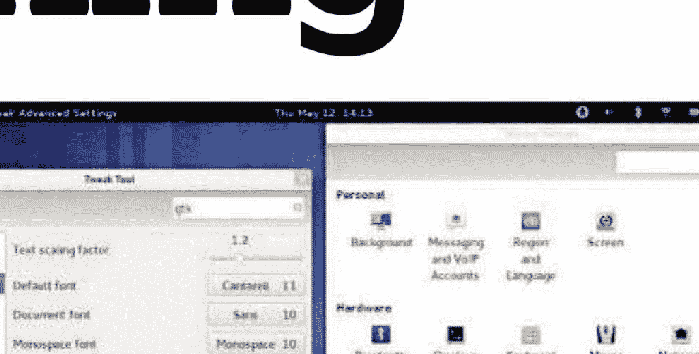

有两个这样的数据库：Gnome 3 标志着从旧版 gnome 向新设置过渡的开始。最终，所有的 Gnome 和应用程序设置都应该在设置中，但目前你可能需要同时检查两者以查看可用内容。

它们都有简单的应用程序，允许你编辑和修改所有设置。这些程序是 `gnome-editor`。虽然可以在启动器中找到 `gnome-editor`，但你可以在运行管理器中找到 `gnome-tweak-tool`。

值得注意的是，Gnome 的控制中心和 `gnome-tweak-tool` 的区别在于以一种简单的、为用户减速的方式暴露这些数据库。如果你计划在这些数据库中进行任何更改，请确保在之前记录原始值，以防万一你想还原。

## 理解主题

惊讶的是，无论你如何喜欢，它在 Gnome 的控制中心中也是缺失的，但再次，如果你需要步骤来填补这一空白，可以使用 `gnome-tweak-tool`——或者简称为 gout。

如果你还没有注意到 gnome 中的设置，你会被它们数量的数量感到惊讶和困惑。它们为什么要这么做？它们都是在做什么的？GTK 主题包含了所有的组件——位元素、图标、主题、菜单和滚动条，它们构成了你使用的所有应用程序的控件。

在 Gnome 3 中，GTK 有两个版本：`gtk-3` 和 `gtk-2.0`。它们对应 GTK 的两个版本，每个版本只能应用于为该版本编写的应用程序。因此，如果你所有的应用程序都是 GTK 3，你需要为两个版本寻找兼容的主题，如果

Shell 是 Gnome 3 的一个新特性，负责处理界面外观——所以主题的外观以及包含在内

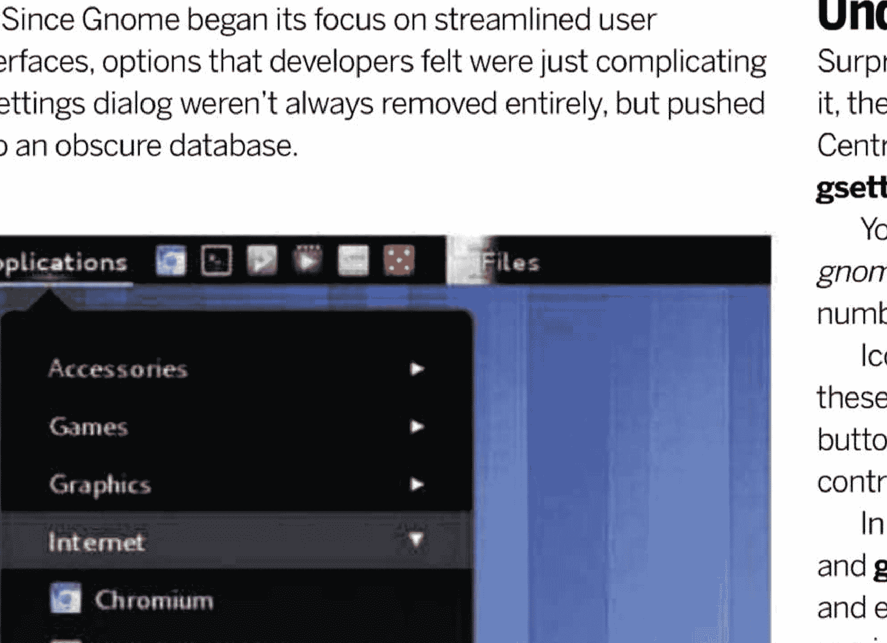

- 默认面板缺少很多功能，但我们找到了让它实用的扩展。

## 硬核 Linux 教程

概览模式，通过按下 Windows 键访问。目前，Windows 部分中的“主题”用于以前所说的 Metacity 主题。这些主题更改包含你应用程序的窗口的外观：它们的边框以及最小化和最大化的控件。

我们也很想探索 Gnome 的扩展能力，但那时阶段缺乏所有文档，且 API 可能会发生。

如果你感兴趣探索这个世界，我建议探索 El Jangus 以获得一个极好的初级介绍。一旦你掌握了语言的基础，回顾 `http://live.github.com/GnomeShell/Extensions` 上的信息并阅读大量代码将让你大有益。

为了选择主题，它们首先必须被安装。许多主题在发行版存储库中可用；如果库中没有，你需要通过提取并将其复制到特定目录来安装它们。

- GTK 和主题 `/usr/share/themes/` 适用于所有用户。如果你正在安装 GTK 主题，必须将其放置在 `gtk-3` 或 `gtk-2` 目录下，并将 Metacity 主题放在目录内

- 图标和光标主题可以安装在 `/icons` 或 `/usr/share/icons/`

为 Gnome 安装主题，你首先需要确保已安装了 theme-extension。gnome-shell 扩展的这部分存在许多发行版，但你也可以从 `http://live.gnome.org/extensions` 下载。一旦安装，你应该能够将其命名为 `/themes` 并从 gnome-shell 中选择它们。我们在这一方面走了很远，修复了一些常见的挫败感，例如 Gnome 去色图标在任何面板或菜单上看起来都很良好，去色。

`gnome-tweak-tool` 和 Gnome 3 新控制中心：强强大的组合。

`www.tuxxd.com`

2011年8月

惊讶的是，无论你如何喜欢，它在 Gnome 的控制中心中也是缺失的，但再次，如果你需要步骤来填补这一空白，可以使用 `gnome-tweak-tool`——或者简称为 gout。


如果你还没有注意到 gnome 中的设置，你会被它们数量的数量感到惊讶和困惑。它们为什么要这么做？它们都是做什么的？GTK 主题包含了所有的组件——位元素、图标、主题、菜单和滚动条，它们构成了你使用的所有应用程序的控件。

在 Gnome 3 中，GTK 有两个版本：`gtk-3` 和 `gtk-2.0`。它们对应 GTK 的两个版本，每个版本只能应用于为该版本编写的应用程序。因此，如果你所有的应用程序都是 GTK 3，你需要为两个版本寻找兼容的主题，如果

Shell 是 Gnome 3 的一个新特性，负责处理界面外观——所以主题的外观以及包含在内


- 默认面板缺少很多功能，但我们找到了让它实用的扩展。

## 硬核 Linux 教程

概览模式，通过按下 Windows 键访问。目前，Windows 部分中的“主题”用于以前所说的 Metacity 主题。这些主题更改包含你应用程序的窗口的外观：它们的边框以及最小化和最大化的控件。

我们也很想探索 Gnome 的扩展能力，但那时阶段缺乏所有文档，且 API 可能会发生。

如果你感兴趣探索这个世界，我建议探索 El Jangus 以获得一个极好的初级介绍。一旦你掌握了语言的基础，回顾 `http://live.github.com/GnomeShell/Extensions` 上的信息并阅读大量代码将让你大有益。

为了选择主题，它们首先必须被安装。许多主题在发行版存储库中可用；如果库中没有，你需要通过提取并将其复制到特定目录来安装它们。

- GTK 和主题 `/usr/share/themes/` 适用于所有用户。如果你正在安装 GTK 主题，必须将其放置在 `gtk-3` 或 `gtk-2` 目录下，并将 Metacity 主题放在目录内
- 图标和光标主题可以安装在 `/icons` 或 `/usr/share/icons/`

为 Gnome 安装主题，你首先需要确保已安装了 theme-extension。gnome-shell 扩展的这部分存在许多发行版，但你也可以从 `http://live.gnome.org/extensions` 下载。一旦安装，你应该能够将其命名为 `/themes` 并从 gnome-shell 中选择它们。我们在这一方面走了很远，修复了一些常见的挫败感，例如 Gnome 去色图标在任何面板或菜单上看起来都很良好，去色。

## 入门技巧

按下 Alt+F2 运行并输入 `restart`。你的新更改将会生效，尽管有几点你需要注意：

“收藏（Favorites）”反映了 Dash（概览模式下类似 dock 的栏）的内容，因此你可以更改面板内容，以随之更改你的 Dash。

此外，请注意，如果你禁用了工作区，将需要管理开启的工作区数量。该设置位于“设置（Settings） > 外观（Appearance） > 工作区（Workspaces）”。如果不是，你将被困在单个窗口中，并错过 Gnome 最优秀的功能之一。

随着许多实质性且经常被忽略的功能现在已恢复，我们可以把注意力转到现有的功能上：

虽然某些微调很小，但更改字体大小或图标——这些都是对用户来说可以产生影响或破坏体验的类型。

由于 Gnome 在其的控制中心（Control Center）中不支持许多功能，你需要找到 `gnome-tweak-tool`（优化工具）。你会发现 Gnome 3 也有针对 `gnome-tweak-tool` 的扩展，因此你可以对其进行自定义。

本质上，它是 Gnome 3 控制中心缺失的最常见的选项之一。你将找到我们讨论过的所有以及其他选项。它们是用 GTK 编写的，感觉与桌面的其他部分保持一致。如果你仍然找不到某个你确定一定存在的特定设置，请花时间探索 `gnome-tweak-tool`，尽管如此——确实有一些你可以使用的缺失选项。

由于 Gnome 开始侧于精化的用户界面，开发者们认为仅仅有一个设置编辑器并不总是够的，而是将它们整合到了一个数据库中。


有两个这样的数据库：Gnome 3 标志着从旧版 gnome 向新设置过渡的开始。最终，所有的 Gnome 和应用程序设置都应该在设置中，但目前你可能需要同时检查两者以查看可用内容。

它们都有简单的应用程序，允许你编辑和修改所有设置。这些程序是 `gnome-editor`。虽然可以在启动器中找到 `gnome-editor`，但你可以在运行管理器中找到 `gnome-tweak-tool`。

值得注意的是，Gnome 的控制中心和 `gnome-tweak-tool` 的区别在于以一种简单的、为用户减速的方式暴露这些数据库。如果你计划在这些数据库中进行任何更改，请确保在之前记录原始值，以防万一你想还原。

## 理解主题

惊讶的是，无论你如何喜欢，它在 Gnome 的控制中心中也是缺失的，但再次，如果你需要步骤来填补这一空白，可以使用 `gnome-tweak-tool`——或者简称为 gout。

如果你还没有注意到 gnome 中的设置，你会被它们数量的数量感到惊讶和困惑。它们为什么要这么做？它们都是在做什么的？GTK 主题包含了所有的组件——位元素、图标、主题、菜单和滚动条，它们构成了你使用的所有应用程序的控件。

在 Gnome 3 中，GTK 有两个版本：`gtk-3` 和 `gtk-2.0`。它们对应 GTK 的两个版本，每个版本只能应用于为该版本编写的应用程序。因此，如果你所有的应用程序都是 GTK 3，你需要为两个版本寻找兼容的主题，如果

Shell 是 Gnome 3 的一个新特性，负责处理界面外观——所以主题的外观以及包含在内


- 默认面板缺少很多功能，但我们找到了让它实用的扩展。

## Gnome Shell 扩展

Gnome Shell 的扩展系统为用户提供扩展和修改桌面的方法，而无需将代码集成到主内核中。扩展是 Javascript 和 CSS 的简单任意边界，可以与 Gnome Shell 的句柄交互，以修改其工作方式，或删除元素等。目前对扩展管理的支持有限。要安装新扩展，请手动将它们复制到 `~/.local/share/gnome-shell/extensions` 目录。要禁用某个扩展，请从门户中将其移除。在继续阅读之前，值得查看的是 `developer.gnome.org/gtk3/GtkProvider.html` - 特别是元素上的选择器和**规则**。

既然你已经掌握了样式表的基础知识，就有时间去绘制你的第一个主题了。那么在从零开始之后，如果有一个主题并在并在过程中审查你的更改，将会很不错。

我们将使用 Adwait 来进行样式化，因为这是第一个最完整的 GTK3 主题示例。将其复制到你的主文件夹，定义一个目录名称，然后看看它是什么样子：`cp -r /usr/share/themes/Adwait ~/.my-theme`


如果你看到两个 CSS 文件，类似这样的 `gtk.css`，`gtk.css` 包含一个颜色定义列表，而 `gtk-widgets.css` 包含了所有小部件的规则。`gtk.css` 中的每个规则定义了特定元素的样式，而 `gtk-widgets.css` 中的每个项目都命名了它的属性。以下是将规则绑定到小部件的方法：

这很容易解决，因为 Gnome 的文档涵盖了所有小部件 - 包括每个窗口的装饰和截屏。访问这些信息的最好方法是通过 Google 搜索功能。

许多颜色是使用规则定义的，这些规则只是在提供的 `gtk.css` 文件中定义的选择器。如果你想更改 gnome-shell 中小部件的颜色，请使用它的搜索功能在 `gtk.css` 中找到对应的条目。

```
all-decoration:gnome@widget_name
```

- 在开始之前，可能需要对其修改以适应你的需求，因为默认的 Gnome Shell 安装在不同的位置：`cp -r /usr/share/gnome-theme/ ~/.my-theme/gnome-shell`

- 如果你查看这些文件，只有一个 CSS 文件：`gnome-shell.css`。其语法几乎与 `gtk-widgets.css` 相同，但这次项目向你提供了带有选择器的文档。不过，你不需要完全尝试并通过错误来发现，因为探索论坛已经让你了解他所注释的默认文件中选择器所指的长期元素（`http://ubuntuforums.org/ubuntu/`）

- 要使更改生效，你需要从 gnome-look 选择主题并重启 Gnome Shell。你可以通过运行 Alt+F2 运行命令行然后按 `r` 来执行，或者重启这终归将是一个实用的方法。

## 制作你自己的

当你准备好在你自己的镜像中开始编辑 Adwait 主题时，最好采用增量方法，进行一个微小的更改，然后检查结果。你可以捕获到任何错误，并对影响桌面的工作原理有一个良好的感觉。

- 要开始你的第一个主题，请从 `gnome-theme-tool` 选择主题。每次更改后都需要重新加载，以便看到你的更改。Nautilus 包含许多不同的小部件，运行速度很快。

为 Gnome Shell 创建新主题的过程与我们已经涵盖的内容非常相似。这里有几个重要的区别：

- 要从 `gnome-theme-tool` 选择不同的主题，你必须按照上面解释的那样安装主题扩展。

## 下个月如何使用 Eucality 构建你自己的私有云。

## 当一切崩塌时...

嗯，也就是说，在探索了 Gnome 3 有多灵活，并花费了几个小时让它符合你的喜好之后，你仍然不信服，不要害怕。至少你在旅程中做了一些事情，而且还有 KDE、LXDE、Unity 或任何其他 Linux 桌面环境可以让你继续下去。

我们希望，这个教程让你领略了可能性，并鼓励更多用户尝试使用 Gnome 3。在某些领域没有更好的文档令人沮丧，但可以肯定，当主版本的尘埃落定，回归演变变化时，它将会提高。

## 订阅

### 国际六个月订阅优惠

无论你住在世界的哪个地方，都尝试订阅 Linux Format 六个月，这样你就永远不会错过任何一期。

- 节省高达 40%
- 免费空运直接送达家门
- 独家访问我们的在线订阅者专属区域，可以访问 50 多期之前的期数，带有可搜索的 PDF 和教程

## 你六期需要支付的费用

- 欧洲 – 六期 £49.99 – 平均每期 £9.40
- 世界其他地区 – 六期 £54 – 每期仅需 £9

在此处方便安全地订阅：`www.myfavouritemagazines.co.uk/LINP1L` 或拨电并引用‘LINP1L’国际线 +44 1604 251 045

## 居住在美国/加拿大？

- 订阅六个月每期支付 $11.66 – 六期 $69.99，而不是 $101.99。


# 回答

对开源有疑问吗？无论您遇到什么问题，请发送邮件至 `itxfans.answers@futureenet.com` 获取解决方案。

# 这些内容可能解答您关于以下的问题：

在编写时，没有哪个发行版默认使用 Gnome 3，但 Fedora 15 除外，它是在 5 月底发布的。它是第一个例外，因为目前的发行版本早于 Gnome 3。随着更新周期的推进，尽管他们将其设置为默认的许多方法可能取决于 Fedora 15 的发布。然而，它必须是默认的、可用的，并且已经有了可用的软件包。

- Gnome 3 Ubuntu
- 调整分区大小
- 特殊字符
- 更改语言
- 逻辑卷管理 (LVM)
- 双系统
- 问题

我已经玩了几天 Unity 了，我不喜欢它，我也尝试了 Gnome 3，发现它好得多。然而，在 Ubuntu 11.04 中安装 Gnome 3 似乎很难或不可能。我最近升级到了 Ubuntu 11.04，但在此之前操作了 11.04 的测试版，结果直接导致安装崩溃。它无法工作。我只能看到登录界面显示默认背景，其他什么也没有。在 Ubuntu 11.04 中安装 Gnome 3 有方法吗，或者有其他方法？

如果你想尝试一下，可以在 Ubuntu 11.04 上安装 Gnome 3。请访问 `https://opensource.org/repositories/GNOME/STABLE/`

你也可以使用 Synaptic 安装基于 Ubuntu 的 Gnome 3，但使用终端命令执行以下操作更简单：

```
sudo add-apt-repository ppa:gnome-team
apt-get update
apt-get install gnome-shell
apt-get install gnome-session
```

在命令执行完成后，注销并在登录时选择 GDM。这适用于多种情况，但在设置好 Gnome 3 之后，系统会变得混乱且难以正确配置。因此，在尝试此操作之前，你应该对系统进行良好的备份，否则你可能会丢失所有数据。

# 缩小 Windows 分区

我正在尝试安装 Windows 分区，以便安装 Ubuntu 并实现双系统。我运行了 Windows 磁盘碎片整理并重启了电脑。当分区提供 172GB 的分区大时，是因为系统文件的原因。这不起作用。安装程序仍然提供 164GB。查看映射，我认为某些空间位于驱动器的中间。磁盘工具没有将其移动以释放空间。簇映射显示：

| 块 | 空间 |
| :--- | :--- |
| 块 1 | 目录 |
| 块 2 | 218 - 剩余空间 |
| 块 219 | 561 - 剩余空间 |
| 块 562 | 665 - 剩余空间 |
| 块 666 | 1021 - MBR 区 |
| 块 1023 | 1819 - 剩余空间 |
| 块 1811 | 1801 - 剩余空间 |
| 块 1802 | 错误 |

# 我们的专家

如果您有问题，我们将为您解答。关于安装和我们管理下的现代模式，只需发送一封免费信或邮件，我们就会处理。

Neil Bathurst：曾经营一家小型 ISP，并为 Linux 提供图形支持。作为一个多才多艺，Linux Format 并没有帮到我。

Mike Sanders：他是 Linux 的原始贡献者之一。他的程序包括包管理器、脚本和代码段。

Paul Hudson：Paul 活跃在编程领域，但也准备并愿意解决您所有与网络和数据相关的问题。

Graham Miller：不在与软件重聚以及与 My 交互时，Graham 随时准备回答任何问题并提供可视化支持！

# 向哪里发送您的问题

写给 Linux Format, Future Publishing, 300 Monmouth Street, BA1 或发送邮件至 `itxfans.answers@futureenet.com`。

# 回答


你可能无法调整 Windows 分区的大小，但一次性扩展 NTFS 分区的程度是有限制的。这是由于数据位于卷的中间。由于由于原因，安装程序只会在其初始大小周围进行调整调整。好消息是，在通过该过程后，安装程序将提议为您调整文件系统。如果你接受了提供的大小，安装程序将重启并允许你再次尝试。所需的 RPM 包在 OpenSUSE 11（零售版）DVD 中提供。我将 `hplip-printer` 和 `hplip` RPM 复制到了新目录 (`/rpm`)，当当我尝试用 Yasta 安装它们时，报告缺少依赖项 `libcrypto.0.9.8`。似乎 OpenSUSE 零售 DVD 并没有包含所需的文件。有解决办法吗？

在开始此过程之前禁用虚拟内存也是一个好主意。如果你还没有这样做，你应该对磁盘进行碎片整理，但在过程完成后将其开启。

DVD 上的 OpenSUSE 是 live CD 环境。虽然它可以安装到硬盘上，但受限于你提供的 CD 大小。但此版本包含了你所需的所有软件包，无需访问互联网（除非你没有安装浏览器）。如果你已经通过搜索 OpenSUSE 的 RPM 包解决了问题，你只需要找到 `libcrypto` 库的存储库即可。Kindle 不在 OpenSUSE 的 live CD 或 DVDISO 中，但你仍然可以使用 wifi 安装它以启用它。

# 连接的 OpenSUSE

我从 DVDISO 安装了 OpenSUSE 11.3，它不包含我的打印机所需的 HP 驱动程序或控制器（Kindernet?）。这让我无法扫描且没有网络。对于麻烦，你可以通过足够的方法上网并安装正确的驱动，但获取它们更好。这有点像“先有鸡还是有蛋”的问题，因为你没有获取它们的权限，但这里也提到了网站，你可以使用另一台电脑（在公司或使用库）在 USB 操作系统上找到它们。你可以通过 live CD 在线，但你没有网络的 wifi 拨号器。

混合 OpenSUSE 的软件包版本，或任何磁盘，都会破坏你的系统以及主目录下的配置文件。列出如何找到并编辑正确的电话号码、名称和密码 - 该文件清楚了如何使用 wifi。保存文件并使用 wifi。

现在你可以安装拨号界面、OpenSUSE Kindle KPRP，但你仍然可以直接安装驱动程序，大多数 HP 打印机和扫描仪都在 `hplip` 包中，你可以在获取后安装，然后返回使用旧版本中可能冲突的版本。

# 进入你的收藏

# 柯达数码相机

带有 Rackspace 托管 `www.rackspace.co`

# Linux Format 系统管理员 - 使用 Rackspace

托管在今天是行业领导者。自 2001 年以来，Rackspace 一直支持任务关键 Web 服务、互联网集成、电子邮件服务器和存储服务超过 6 年。Rackspace 完全专注于托管解决方案并帮助客户通过其在线基础设施进行运行。为他们的托管应用程序提供技术支持。有关更多信息，请访问 `www.rackspace.co.uk` 并提问任何问题。

参阅第 324 页查看 Rackspace 的星级

# 回答

通配符也是如此。同样的问题。我从 GUI 中删除它们，因为它们在 Thunar 中根本不显示。我用 `fsck` 检查了磁盘，一切正常，正如你已经尝试过的那样。

如果 `else` 失败了，使用粗暴的方法 `rm -rf *` 并不断按 `n` 直到遇到坏文件为止，你可能会得到结果，但这是次之的的手段——最后的手段是备份、格式化，让我们希望你永远不需要这些手段。

你是如何运行 `fsck` 的？如果你在 `ext2/3/4` 文件系统上带有参数运行它，它会检查，因为你最近清理了挂载点数量，或者由于自上次运行 `fsck` 以来设置了限制。如果其中一个失败，它就会停止。要确保强制检查文件系统，请使用 `(-force)` 选项运行。

# 语言钩子

`fsck -i/dev/sdX`

使用它时文件系统会被卸载。如果你位于 `/home` 分区，你可以通过注销、以 root 账户登录并在重启 `fsck` 之前重新挂载 `/home` 来完成，但修复文件系统的唯一方法通常是从你可以运行的活动 CD 启动。

我正在尝试学习 Linux，并有一组活跃的方法和链接来组织我的工作空间。我该如何提高自己，如果这能帮助我更容易地跟进？我想知道在切换到该活动时如何更改语言。至少在选择此任务并离开它时可以自动切换吗？我使用的是 XFCE 1.4 和 KDE 4.6 代码。


如果文件系统检查通过，可能是由于文件名包含不被识别的字符吗？我首先会尝试使用表格，无论如何都确保特殊字符被识别。下一步是尝试将它们移动到一个目录，然后使用 `-rf` 删除该目录，但看起来看起来……

对 D-BUS 命令感到困惑吗？在 Qtus 浏览可用内容。

我无法直接在活动之外设置语言或键盘，也没有办法在活动切换时运行命令，但你特别是在问我 D-BUS 系统 KDE 以及其他程序使用什么。D-BUS 能够接收通过代码发送的信号并向其发送命令。此脚本列出了 CurrentActivities，它显示了活动名称之外。

#bash

```bash
dbus-send --type=signal,path="/ActivityManager" member="CurrentActivity" --string="s[a-zA-Z0-9_-]*" for-uint32:0
```

```bash
org.freedesktop.kde activitymanager/ActivityManager org.kde.ActivityManager.ActivityID
```

```bash
if [ $NAME = "Russian" ]; then
org.freedesktop.dbus/key=
dbus-send -e 's/language='ru-RU' /Country='ru' -language='ru' /Country='ru' -home=/home/share/config/home
```

- -language='ru' /Country='ru'

-home=/home/share/config/home

```

# 胜利者！

我的问题是填充填充。Feist 向我们展示我们的新班。

# 自动配置

我想使用我的 Sandy OS FX109 笔记本（Pentium III, 256MB 80GB HDD, LX100X1050）

你可以使用另一个发行版的 `xorg.conf`，或者使用终端并运行 `sudo /etc/xorg/xorg.conf` 创建你自己的配置。SVGA- 如何设置 Linux 格式 DVD 中某些发行版的分辨率。但那时你将从 live CD 运行系统，这并没有图形屏幕，除非你设置了分辨率或关闭 X。然后按 Alt+F7 获取此命令。此命令用于以及其他驱动程序，检查 `/etc/xorg.conf`、`/etc/x11/xorg.conf`。以 root 身份登录，你就可以使用 X 并写入这些。

Puppy 5.1 是唯一能为我的屏幕提供正确分辨率的 Linux 操作系统，默认设置为 800x600，这只是 Linux 提供的有限选项，且显示器设置是在配置在新家目录的 `xorg.conf` 中。随你所欲做什么都可以，你想先用 root 身份编辑 `/etc/x11/xorg.conf`，但使用开始和停止，它就会以正确的分辨率弹出。

我有几个版本的 `vga=`，但我需要能够处理 Linux 无法识别屏幕的情况。我需要编辑 `/etc-X11/xorg.conf`。我的设置在但大多数发行版没有这样的文件。顺便说，当它使用 `/etc/x11 conf.conf` 时，它使用的是 `/etc/x11/xorg.conf` 目录下的多个文件。语法是，如果你有显示器、设备等屏幕，这会让你的配置变得更容易。

这些发行版的屏幕保存在哪里？我该如何让这个单体文件不消失。

# 回答

else

```bash

qdbus.org.kde.keyboard/kdb.org.kde.setLayout

sed -i 's/<Language>\|language="en_US"|country="en_US"\|.kde/'

```

看起来很复杂，但主要是由 D-BUS 使用。第一行运行 CurrentActivity 信号。`awk` 命令构建活动 ID 并向 qdbus 发送请求。然后是单个用户。如果基于，另一个 D-BUS 命令切换键盘布局，`sed` 命令更改 KDE 中的语言设置（Kdefile 布局目前是可行的）。此脚本从 KDE-Autostart 运行并在你切换时挂载到活动。你可以随心所欲地做，因为这是可能的。如果有问题，没有 qdbus 命令来切换。

- 卷
- 不支持的卷

| 卷属性 |
| --- |
| 组名称: vg_data |
| 类型: 线性 |
| 分区数量: 25600 |
| 分区大小: 4.00 MB |
| 总大小: 100.00 GB |
| 空闲大小: 100.00 GB |
| 空闲分区数量: 25600 |
| 已用大小: 0.00 GB |
| 逻辑卷数量: 1 |
| 逻辑卷名称: lv_data |


切换效果对运行中的程序没有影响，以及运行并退出的程序会将库代码留在内存中。之后更改你的语言。你可以在 KDE 系统设置中更改区域时更改它，这是一个无法避免的设计特性。

好运，俄罗斯语，我相信在学校你会比 id 更好。

> Fedora 的 LVM 配置很方便，但为了获得 LVM 的性能，必须使用命令。

# 6 列出卷

我正在运行 Fedora 12 并打算升级到 14，但想管理我的分区。目前我有四个相同的 250GB 驱动器：`sda`, `sdb`, `sdc` 和 `sdev`。`sda` 是为 Windows 写入的，`sda` 是为 Windows 写入的，`sda` 是为 Windows 写入的，`sda` 是为 Windows 写入的，`sda` 是为 Windows 写入的，`sda` 是为 Windows 写入的，`sda` 是为 Windows 写入的，`sda` 是为 Windows 写入的，`sda` 是为 Windows 写入的，`sda` 是为 Windows 写入的，`sda` 是为 Windows 写入的，`sda` 是为 Windows 写入的，`sda` 是为 Windows 写入的，`sda` 是为 Windows 写入的，`sda` 是为 Windows 写入的，`sda` 是为 Windows 写入的，`sda` 是为 Windows 写入的，`sda` 是为 Windows 写入的，`sda` 是为 Windows 写入的，`sda` 是为 Windows 写入的，`sda` 是为 Windows 写入的，`sda` 是为 Windows 写入的，`sda` 是为 Windows 写入的，`sda` 是为 Windows 写入的，`sda` 是为 Windows 写入的，`sdev`。

## 回答

（可能是错误）或你设置的物理卷与另一个设置的是同一个分区。我怀疑你在安装时设置了 `sdb1`，然后在再次安装时又设置了一次。LVM 使用 UUID 为其初始化的分区创建卷，而不是使用可能会更改的设备。你的逻辑卷名称现在已经消失了。

这是一个极具破坏性的命令，因为它将删除任何完全存储在缺失设备上的卷及其内容，但如果你已经到了这一步，那就已经太晚无法恢复了，所以你可能最好干脆解决它。

错误提示空间不足，是因为你需要空闲区（extents），这意味着它们没有被分配给任何逻辑卷，即没有可用于初始化它们的空闲空间。输出将向你显示你的卷组中没有空闲区。

可能导致灾难的后果——我没有使用虚拟机，而是使用了第二块完全空的硬盘——第一块硬盘上装有 Windows。在崩溃并重启它后，我成功安装了 Fedora 和 Ubuntu。

遗憾的是，readme 中没有提到 Ubuntu。我看到了 grub，但它产生了一个错误信息：

```
chroot /dev/sda1/boot/os-root
```

```
Boot: No file or directory
```

当我启动到 `/dev/os-root` 时，有一个名为 `-no_grub/boot` 的文件。我该如何修复？`sudo sash` 失败：显示了 Fedora 和 Ubuntu 从 `/dev/sda1` 启动。

Christopher-Sleigh

尝试使用以下命令删除未知卷：

```
vgremove --remove-metadata vgname
```

只要 LVM 没有在使用卷上的数据即可。如果它在使用，且我不确定，你将不得不使用 `--force` 选项，并强制获取那里存储的数据：

```
vgremove --force -fg vgname
```

## Windows 在哪里？

我遵循了 GPT2 双系统安装 Ubuntu 和 Fedora 的说明，并进行了轻微修改。我正在使用一台旧机器，采用了一种“内存实验”的方法。

## 终端与超级用户

我们提供了一些可以在终端中输入的简单命令。虽然通过系统的图形界面完全可以实现，但提供的细节意味着此类解决方案非常特殊。终端命令更加灵活，大多数命令可以在不同的系统中使用。

系统命令通常必须以超级用户（称为 root）的身份运行。有两种方法：

> 快速参考：

取决于你的驱动器。许多发行版（尤其是 Ubuntu 及其衍生版）定义了 `sudo` 前缀用于用户密码，并在你的会话期间设置 root 权限。

其他发行版使用 root 密码，赋予你对一切的完全访问权限，你可以登录一次，然后运行任何命令而无需先加 `sudo`。

## 文件链接

Linux 使用了文件链接，许多是符号链接（或软链接）。文件链接是让同一个文件（或目录）出现在两个地方，或者以不同的名称出现的一种方法。你可以直接复制链接而不是文件，如果原始文件更新了，链接也会之更新。

Linux 文件系统有许多方法通过名称访问文件或目录。有两种类型：硬链接和符号链接。从技术上讲，每个文件都是一个硬链接——从文件名到存储它的数据，都包含对硬链接的引用；我们指的是指向具有多个名称文件的额外链接。硬链接有一些局限性，它们通常只适用于文件，不适用于目录，且所有链接必须在同一个文件系统中。

使用 `ls` 命令并在大多数文件管理器中显示。一个经典的例子可以在 `/usr/bin/` 目录中，其中 `/bin/sh` 是指向系统二进制文件的链接。例如，如果你安装了该程序需要的具有多个名称的文件源，你可以在 `/usr/bin/` 中链接以找到原始文件。你可能在以下位置也找到此类链接：

可以使用 `-ln -s /path/to/link` 创建符号链接

其中一个或两个路径都可以是相对的。

符号链接要灵活得多，你可以通过典型的 Linux 系统看到它们。当你使用 `-` 时

- `/etc` 中有很多链接，那里的文件需要被启用。

## 帮助我们来帮助你

我们每个月都会收到几个无法回答的问题，因为它们对问题的细节描述不足。回答的顺序是先回答我们收到的问题。如果你收到错误信息，请告诉我们错误内容并告诉我们你在做什么。如果你对硬件有疑问，请包含你正在使用的版本。

如果你正在使用虚拟机，我使用了第二块完全空的硬盘——

然后从 `/mnt/` 或 windows 删除该目录（如果它已挂载），确保你没有删除 boot。后者是启动所需的。现在：

```
sudo-reboot
```

```
ubuntu-grub
```

106 LXF17 2011年8月

`www.linuxformat.com`

## 大问题

管理服务器最好的方法是什么？

## 回答

我正在寻找最好的 Linux 服务器来玩域用户和组、文件共享等。我浏览了 `dsearch.com/Category-Server`，但我并没有因此长长知识，因为我在工作中熟悉 Windows Server 2008，想在家里用 Linux 服务器玩一玩。

第一步是 Webmin 部分的 IP 访问。设置一个允许的 IP 地址列表，这样你就可以从电脑登录，而其他人不行。你现在可以选择加密选项了。大部分功能将由 Samba 部分处理，该部分也处理 Windows 文件共享和服务。一旦 Webmin 工作正常，你就可以进入其他任何部分。

如果你正在使用虚拟机，我使用了第二块完全空的硬盘——

然后从 `/mnt/` 或 windows 删除该目录（如果它已挂载），确保你没有删除 boot。后者是启动所需的。现在：

```
sudo-reboot
```

```
ubuntu-grub
```

## 大问题

管理服务器最好的方法是什么？

## 回答

我正在寻找最好的 Linux 服务器来玩域用户和组、文件共享等。我浏览了 `dsearch.com/Category-Server`，但我并没有因此长长知识，因为我在工作中熟悉 Windows Server 2008，想在家里用 Linux 服务器玩一玩。

第一步是 Webmin 部分的 IP 访问。设置一个允许的 IP 地址列表，这样你就可以从电脑登录，而其他人不行。你现在可以选择加密选项了。大部分功能将由 Samba 部分处理，该部分也处理 Windows 文件共享和服务。一旦 Webmin 工作正常，你就可以进入其他任何部分。

如果你正在使用虚拟机，我使用了第二块完全空的硬盘——

然后从 `/mnt/` 或 windows 删除该目录（如果它已挂载），确保你没有删除 boot。后者是启动所需的。现在：

```
sudo-reboot
```

```
ubuntu-grub
```


## 大问题

管理服务器最好的方法是什么？

## 回答

我正在寻找最好的 Linux 服务器来玩域用户和组、文件共享等。我浏览了 `dsearch.com/Category-Server`，但我并没有因此长长知识，因为我在工作中熟悉 Windows Server 2008，想在家里用 Linux 服务器玩一玩。

第一步是 Webmin 部分的 IP 访问。设置一个允许的 IP 地址列表，这样你就可以从电脑登录，而其他人不行。你现在可以选择加密选项了。大部分功能将由 Samba 部分处理，该部分也处理 Windows 文件共享和服务。一旦 Webmin 工作正常，你就可以进入其他任何部分。

如果你正在使用虚拟机，我使用了第二块完全空的硬盘——

然后从 `/mnt/` 或 `windows` 删除该目录（如果它已挂载），确保你没有删除 `boot`。后者是启动所需的。现在：

```
sudo-reboot
```

```
ubuntu-grub
```

---

## 回答

（可能是错误）或你设置的物理卷与另一个设置的是同一个分区。我怀疑你在安装时设置了 `sdb1`，然后在再次安装时又设置了一次。LVM 使用 UUID 为其初始化的分区创建卷，而不是使用可能会更改的设备。你的逻辑卷名称现在已经消失了。

这是一个极具破坏性的命令，因为它将删除任何完全存储在缺失设备上的卷及其内容，但如果你已经到了这一步，那就已经太晚无法恢复了，所以你最好干脆解决它。

错误提示空间不足，是因为你需要空闲区（extents），这意味着它们没有被分配给任何逻辑卷，即没有可用于初始化它们的空闲空间。输出将向你显示你的卷组中没有空闲区。

可能导致灾难的后果——我没有使用虚拟机，而是使用了第二块完全空的硬盘——第一块硬盘上装有 Windows。在崩溃并重启它后，我成功安装了 Fedora 和 Ubuntu。

遗憾的是，readme 中没有提到 Ubuntu。我看到了 grub，但它产生了一个错误信息：

```
chroot /dev/sda1/boot/os-root
```

```
Boot: No file or directory
```

当我启动到 `/dev/os-root` 时，有一个名为 `-no_grub/boot` 的文件。我该如何修复？`sudo sash` 失败：显示了 Fedora 和 Ubuntu 从 `/dev/sda1` 启动。

Christopher-Sleigh

尝试使用以下命令删除未知卷：

```
vgremove --remove-metadata vgname
```

只要 LVM 没有在使用卷上的数据即可。如果它在使用，且我不确定，你将不得不使用 `--force` 选项，并强制获取那里存储的数据：

```
vgremove --force -fg vgname
```

## Windows 在哪里？

我遵循了 GPT2 双系统安装 Ubuntu 和 Fedora 的说明，并进行了轻微修改。我正在使用一台旧机器，采用了一种“内存实验”的方法。

## 终端与超级用户

我们提供了一些可以在终端中输入的简单命令。虽然通过系统的图形界面完全可以实现，但提供的细节意味着此类解决方案非常特殊。终端命令更加灵活，大多数命令可以在不同的系统中使用。

系统命令通常必须以超级用户（称为 root）的身份运行。有两种方法：

> 快速参考：

取决于你的驱动器。许多发行版（尤其是 Ubuntu 及其衍生版）定义了 `sudo` 前缀用于用户密码，并在你的会话期间设置 root 权限。

其他发行版使用 root 密码，赋予你对一切的完全访问权限，你可以登录一次，然后运行任何命令而无需先加 `sudo`。

## 文件链接

Linux 使用了文件链接，许多是符号链接（或软链接）。文件链接是让同一个文件（或目录）出现在两个地方，或者以不同的名称出现的一种方法。你可以直接复制链接而不是文件，如果原始文件更新了，链接也会更新。

Linux 文件系统有许多方法通过名称访问文件或目录。有两种类型：硬链接和符号链接。从技术上讲，每个文件都是一个硬链接——从文件名到存储它的数据，都包含对硬链接的引用；我们指的是指向具有多个名称文件的额外链接。硬链接有一些局限性，它们通常只适用于文件，不适用于目录，且所有链接必须在同一个文件系统中。

使用 `ls` 命令并在大多数文件管理器中显示。一个经典的例子可以在 `/usr/bin/` 目录中，其中 `/bin/sh` 是指向系统二进制文件的链接。例如，如果你安装了该程序需要的具有多个名称的文件源，你可以在 `/usr/bin/` 中链接以找到原始文件。你可能在以下位置也找到此类链接：

可以使用 `-ln -s /path/to/link` 创建符号链接

其中一个或两个路径都可以是相对的。

符号链接要灵活得多，你可以通过典型的 Linux 系统看到它们。当你使用 `-` 时

- `/etc` 中有很多链接，那里的文件需要被启用。

## 帮助我们来帮助你

我们每个月都会收到几个无法回答的问题，因为它们对问题的细节描述不足。回答的顺序是先回答我们收到的问题。如果你收到错误信息，请告诉我们错误内容并告诉我们你在做什么。如果你对硬件有疑问，请包含你正在使用的版本。

如果你正在使用虚拟机，我使用了第二块完全空的硬盘——

然后从 `/mnt/` 或 `windows` 删除该目录（如果它已挂载），确保你没有删除 `boot`。后者是启动所需的。现在：

```
sudo-reboot
```

```
ubuntu-grub
```


（注：由于原文存在大量重复内容，已根据逻辑流进行清理翻译）

## 大问题

管理服务器最好的方法？

## 回答

我正在寻找最好的 Linux 服务器来玩域用户和组、文件共享等。我浏览了 `dsearch.com/Category-Server`，但我并没有因此长长知识，因为我在工作中熟悉 Windows Server 2008，想在家里用 Linux 服务器玩一玩。

第一步是 Webmin 部分的 IP 访问。设置一个允许的 IP 地址列表，这样你就可以从电脑登录，而其他人不行。你现在可以选择加密选项了。大部分功能将由 Samba 部分处理，该部分也处理 Windows 文件共享和服务。一旦 Webmin 工作正常，你就可以进入其他任何部分。

## 逐步设置服务器

### Webmin

Webmin 是一个浏览器中的图形界面，可用于大多数发行版来配置和维护一系列服务器。

### 安装 Ubuntu Server

安装程序的“图形界面”看起来可能原始，但效果与其他任何程序一样。在这里你选择想要安装的服务器类型。

### 没什么好看的……

这就是 Ubuntu Server 安装后你看到的界面。它并不应该很好看，但工作是在底层进行的。

### 安装 eBox

这为你提供了一个 Web 系统，但你可能想要更改默认端口，特别是如果你打算运行 Web 服务器。

### 更多命令行

这是你最后一次需要它，使用 `apt-cache` 和 `apt-get` 查找并安装适用于运行服务器的 eBox 模块。

### 就是这里

eBox 提供的 Zentyal 前端让你通过浏览器监控、配置和维护服务器。

# LINUX

Linux FORMAT 的第1 来源

Future Publishing Ltd, 30 Moorouth Street,
BA1 2BW Tel 01225 42244
Email info@futureformat.com
审计局（Audited Bureau of Circulation）成员

编辑部

- 主编辑 Graham Morrison
`graham.morrison@futureformat.com`
- 副主 Andrew Craig
`craig@futureformat.com`
- 推广与传播编辑 Mike Saunders
`mike.sauanders@futureformat.com`
- 全职记者 Nathan White
`athanwhite@futureformat.com`
- 艺术编辑 Richard Henderson
贡献者：John Bacon, Anderson Ball, Neil Price, Patrick Hicks, Andy, Andy Chambers, Alex Cox, Michael Meek, Mayank Sharma, Shahana Sharma, Nick Vetch.
- 艺术评估 Steve Walker
插图：Shane Coleman, Chris Hardy, Chris Wood, Mal Higgins，摄影。

广告销售

- 广告销售总监 Nick Weatherton
01225 422441
- 客户销售经理 Ricardo Sidoli
01225 422444 分机

营销与品牌

- 营销总监 Daniel Brown
- 制作经理 Stuart Copeland
- 推广执行 Roise Dickman
- 出版总 Stuart Knight
- 英国首席官 Mark Wood

制作与发行

- 制作经理 David White
- 贸易营销经理 Tim Zeatry
Avenue, London EC1 9PT Tel +44 (0)1225 792900
- 发行商：Future Publishing Ltd
+44 (0)1225 422444

# LXF148

将于2021年7月21日（周四）上市

许可

- 国际许可负责人 Tim Hudson
`thudson@futureformat.com`

发行量

- 国际客户经理 John Law
`johnlaw@futureformat.com`

订阅与旧刊

- 读者服务 +44 (0)1225 422444
- 英国 +44 (0)1225 422446
- 海外：`www.futureazines.com`
在线咨询：`www.futureazines.com`

LINUX 是 Linux 及其他公司的商标。其他商标归其各自所有所有。保留所有权利。未经 Future Publishing Ltd 书面许可，不得以任何形式复制或发行本杂志的任何部分。本出版物的版权可基于批判或非商业目的复制或发行。所有文章必须注明由 Future Publishing Ltd 出。请联系出版商请求额外权利，或为任何未注明出处的复印文章获取许可。如果您在本期中发现错误，请写信至上述地址的编辑，我们将在下期中尽力改进。Future Publishing Ltd, 30 Moorouth Street, BA1 2BW。我们为各种兴趣的人创作杂志、网站和应用程序。我们从英国出版并分销至全球90个国家。访问 `www.future.com` 了解更多信息，为您带来您的 Linux 机器可以处理的最优质应用。Linux 是免费的，而且它永远不会崩溃——所以我们的税金还在花在哪里呢？用云的力量构建云。它们甚至不是真的熊！未来期的内容可能会发生变化——我们可能会和 Terry Thomas 搞点花样。108 | LXF147 2021年8月 `www.linuxformat.com`

本杂志后，请对其进行回收。登录在线……从 Linux Format 获取更多内容！`www.linuxformat.com`

- 从其他读者那处获得帮助
- 讨论最新的 Linux 新闻
- 阅读过往文章
- 关注 LXF 博客
- 或者直接进来聊聊！

## 订阅 Linux Format 并获取独家额外福利：

- 下载杂志完整版
- 通过 BitTorrent 获取最新的 DVD
- 在新刊印刷时即刻获取新刊！

### 不要错过我们的播客：`www.tuxradar.com`

听听 Linux Format 团队讨论自由软件的热门话题！关于光盘、发行版、游戏和应用程序，大多数发行版……阅读本文以获取使用 LXFVD 所需的所有信息！如果您是 Linux 新手，请打开光盘上的 `index.html`，并在右侧列出的指南中查看帮助。

* 什么是 Linux？
* 什么是发行版？
* 通过 DVD 提升您的 PC 性能
* 分区您的硬盘
* 导航文件系统
* 使用命令行
* 安装软件

Mike Sanders, 新媒体媒体编辑 `mike.sandanders@futureformat.com`

# Linux 发行版

### Arch, Debian, Mint, SUSE, Ubuntu

本月的双面 DVD 绝对是发行版优先的。在第 2 面，我们有专题介绍 Fedora 15，它可以直接从光盘启动并包含各种软件包。您可以读到关于它的所有信息，并在该页查看安装指南。我们还包含了封面推荐的发行版。在这里，可能的情况下，可以让这些发行版在同一张光盘上实现多启动，但由于技术限制，某些是以 ISO 格式存在的。

它不会引导您的安装过程；相反，它会假设你正在做什么。Arch 是一个滚动发行版，因此不需要每几个月升级一次，您的软件包在可用时就会更新。虽然年代久，但 Debian 6 为该发行版引入了许多现代 Linux 技术。

> Debian 6 是世界上最可靠的 Linux 变。Arch 是一个面向中高级 Linux 用户的多功能发行版。从第 1 面，您可以启动带有轻级桌面环境的 Debian，如果您想将其永久安装到硬盘，则可以使用安装程序。

简单来说，Arch 对基础系统创建快照，而第 1 面包含的是 LXFVD 内容。OpenSUSE 从第 1 面以现场模式启动——无需安装到硬盘即可尝试，但如果您想保留它，也有安装程序。

> Debian 6 可能是世界上最稳定的 Linux 版本。Mint 也是那些想要更佳体验的用户的极佳选择。Ubuntu 是这一切中最受欢迎的，非常适合初。

# 光盘内容

Fedora 引入了带有 Gnome Shell 的新桌面

## Linux 发行版

## Fedora 15

在技术实现方面，Fedora 往往处于领先。它并不是第一个整合 Gnome 3 的发行版，但它是主流发行版中的第一个。如果你是该领域的新手，Fedora 是一款功能强大、全面的桌面及开发 Linux 系统，并有数千个程序可供选择。它采用了前沿的 Linux 技术，并由友好且活跃的社区支持，由 Red Hat 领衔。

此版本最显著的特性是对 Gnome 3（带有 Gnome Shell）的增强。

提供了启动序列的系统、动态防火墙（以便可以直接进行更改而无需重启）、通过 PowerTop 更好的电源管理，以及 LibreOffice。这是一个带有许多新功能供探索的回归版本——但互联网上的早期报告显示它看起来非常可靠。

在本月的双面 DVD 中，我们包含了完整的、全系统镜像（3.5GB）。这包含了软件包，提供了你可能需要的一切——无论你是要安装桌面还是服务器管理员界面。如果你当前的发行版看起来有些过时了，那么这是一个获取所有最新 Linux 赠品的绝佳机会。


通过右上菜单访问系统设置和机器（或按 `Alt+Shift` 关机）。

现在是工作站会话。如果是这样，Fedora 安装程序可以缩小你的磁盘以腾出空间。这相当安全，但对于任何严肃的硬盘操作，我们都建议提前备份你的重要数据。

如果你想手动进行此分区方案，你可以这样做。如果你有现有的操作系统，你可以选择保留现有的磁盘分区，但我们建议至少分配 10GB 的根分区（ext4 格式的分区），以及一个与 RAM 大小相当的交换分区（但不超过 2GB）。你可以在单独分区使用 `/home` 目录，这有助于区分不同的软件版本，防止它们可能与旧/新版本的配置产生冲突。


所有这些新事物层出不穷，而且有很多要求。Fedora 15 至少需要 768MB RAM，我们建议至少使用 1.5GHz CPU 和 10GB 硬盘空间来运行。你可以从 LXF 的第 2 页选择引导加载程序（并且有一个安全的视频模式可以启动你的图形界面（如果它可以被识别的话））。

许多用户希望与其他操作系统一起使用 Fedora，例如 Windows。（担心，我们不是在责怪你——你了解这个世界……

- 点击左上角的“活动”`Activities`来在打开的窗口和应用程序之间切换。

## 逐步教程：安装 Fedora 15


在安装过程中你想做什么？

- 英语 (English)
- 孟加拉语（孟加拉国）
- 孟加拉语（印度）
- 保加利亚语 (Bulgarian)
- 加泰罗尼亚语（简体）
- 加泰罗尼亚语（繁体）
- 中文（简体）
- 中文（繁体）
- 克罗地亚语 (Croatian)
- 捷克语 (Czech)
- 捷克语（捷克）
- 荷兰语 (Dutch)
- 丹麦语 (Danish)


在安装之前开始测试媒体

选择“跳过”`Skip`以跳过媒体测试并开始安装。


1 启动
从 LXFV 第 2 页启动你的 PC 并按回车。在这里你有 Fedora 启动选项、磁盘第 1 页的索引以及帮助/新建菜单。

2 检查
你可以跳过测试阶段，但如果你再次遇到问题，我们建议重新检查你的分区并运行检查。

3 安装程序
安装程序将加载，并将回答关于你想使用的语言、键盘布局和网络的问题。

## 我如何……？

如果你不是 Linux 新手，在安装 Fedora 后，你可能不确定如何执行任务。这里有一份最常见任务及其完成方法的列表……

- 使用左侧面板上的“活动”和地球图标通过 Firefox 浏览，它是全球最受欢迎的浏览器，支持数百个扩展。

- 操作你的文件：点击 dock 中的文件图标访问你的个人文档。

- 在“活动” > 应用程序 > 声音中播放音乐和视频，你将找到一系列音乐和视频播放器。

- 通过“活动” > 应用程序 > 图形 > GNOME Image Map 编辑图像，启动一个功能强大的程序，它与 Adobe Photoshop 共享许多功能。

- 在线聊天：在你会找到 Empathy，这是一个出色的在线聊天器，支持 MS、Skype 和 Google Chat 等所有流行协议。

- 配置系统：点击右上角的用户名并按住“设置”，可以选择一系列偏好和配置工具。

- 获取新软件：在 Fedora 中，转到应用程序 > 系统工具 > 添加/删除，从互联网获取更多应用。

- 关机：点击右上角的用户名调出菜单，并按 `Alt` 挂起电源。

如果你需要 Fedora 的帮助，请访问发行版网站 `fedora.org`。你会在页面顶部找到链接。

## Fedora 15：现已 GNOME

体验下一代环境。Fedora 15 现已配备 GNOME，为……带来了现代外观。

## dock

像大多数发行版一样，Fedora 已切换到了……

## 极客桌面分析

- Firefox
- Firefox
- LibreOffice
- Firefox
- 密码
- 密码
- 分区
- 选择

# 与 Cloud 体验终极主机托管

# 完全冗余
使用 eUKhost 云主机托管享受 100% 运行时间

# 易于访问
通过 Root `SSH`/`RDP` 访问权限实现完全控制

# 灵活且可扩展
随时升级 RAM 和 CPU 等资源

# EUKHOST
访问我们 @ `www.eUKhost.com`
电子邮箱 - `sales@eUKhost.com`
免费致电我们 0808-262-0225

15% 折扣优惠码 “LINUXFORMAT”

# 全新强力英国独立存储服务器

超过 10 年的行业领先技术

包含 24 核及大容量存储存储选项

# 行业领先的动力与性能

我们强大的独立服务器专为需求最严苛的网站、数据库和 Web 应用程序而设计，为您提供所需的性能。

我们所有的服务器都安全地部署在我们先进的英国数据中心，配有现场工程师和英国支持团队提供 24/7 全天候服务。

- Windows 在线备份 **
- 高级服务器监控 **
- 第一年免费证书
- 通过 `KVM` 控制获取完全 root 权限
- 操作系统选择包括 Windows 和 Linux *

| DS300 | DS500 | DS700 | DS910 | DS1000XX | DS1100 |
| :--- | :--- | :--- | :--- | :--- | :--- |
| 10% 折 | 15% 折 | 20% 折 | 30% 折 | 40% 折 | 50% 折 |
| £53.10/mo | £67.15/mo | £95.20/mo | £125.45/mo | £125.45/mo | £174.55/mo |
| 原价 £59.00/mo | 原价 £74.60/mo | 原价 £105.80/mo | 原价 £139.40/mo | 原价 £139.40/mo | 原价 £193.95/mo |
| 2x Intel Xeon | 2x Intel Xeon | 2x Intel Xeon | 2x Intel Xeon "Gold" | RAID 1 | 2x AMD EPYC™* |
| 双 CPU 核心 | 双 CPU 核心 | 4 CPU 核心 | 8 CPU 核心 | 24 CPU 核心 | 24 CPU 核心 |
| 500GB SATA HDD | 2500GB SATA HDD | 2000GB SATA HDD | 2000GB SATA HDD | 500GB SATA HDD | 5000GB SATA HDD |
| 2GB RAM | 4GB RAM | 8GB RAM | 12GB RAM | 16GB RAM | 32GB RAM |
| 100Gbps 连接性 | 100Gbps 连接性 | 100Gbps 连接性 | 100Gbps 连接性 | 100Gbps 连接性 | 100Gbps 连接性 |
| 无限带宽 | 无限带宽 | 无限带宽 | 无限带宽 | 无限带宽 | 无限带宽 |

无限带宽* - 高速率 - 24/7 英国电话及在线支持

立即致电获取您的号码 0844 583 0730

`www.fasthosts.com/dedicated-servers`

世界级独立服务器
