# Linux 格式 - 2011年5月(英国) 第09卷 第05期

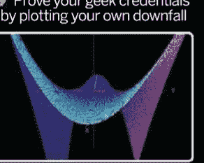


Illan Rabinovitch

> 商业与社区的结合是关键。我们听到了来自洛杉矶同事的消息 p48


轻松将您的 Web 解决方案迁移到 UKFast，并从专家技术支持的高性能托管中获利。

- 专用 托管
- 专用应用托管
- 私有云托管


Charlie Hodgson

销售股份与英格兰队

立即拨电 0800 458 4545 或访问 `www.ukfast.co.uk`

等等，等等。Charlie Hodgson

销售股份与英格兰队

立即拨电 0800 458 4545 或访问 `www.ukfast.co.uk`

# 欢迎 LINUX

## 我们做什么

* 我们通过提供信息资源和辩论论坛来支持开源社区。
* 我们通过教程章节帮助读者从 Linux 中获得更多——我们为每个人准备了内容！
* 我们在教程章节中打印的所有源代码均采用 GNUv3 许可证授权。
* 我们为您提供关于所有 Linux 最准确、无偏见且最新的信息。


## 我们是谁

本期探索 MythTV，一个极其的 Linux 数字视频录像机。我们询问了导师们：你们希望看到包含哪些功能？

## 变化

变化应该被加入变化、税收和在线口战的组合中，因为这似乎是不可避免的。无论你是 Gnome OpenOffice.org 的粉丝，还是 Linux Format 的粉丝，事情都会如你预期发展。过去的 12 个月是我使用 Linux 以来最动荡、最激动且收获丰厚的几年，而 2011 年正以类似的速度发展。变化绝对是一件好事。通过 Linux 和自由软件，你变得更有活力，并在不断演变的软件和硬件世界中搏斗。

我想不出还有什么项目能像在变化中表现得如此出色，就像数字电视录像机/万水筒——MythTV 一样！近年来，它成功地应对了电视革命、媒体流的兴起以及通过网络传输内容。从我开始使用它起，它一直提供一个尖端、稳定且不妥协的平台。我们为本月的专题策划了 MythTV 能提供的最佳内容，无论变化速度如何，我们将继续对 Linux 和自由软件这样做。


### Mike Saunders

> “热度计。当这些东西快要在这政治家的道路上用光时，这一切会立即停止。”

### Andrew Gregory

> “斯诺克需要能够在站立时读取比分牌上球的坐标。”

### Elaine Hernandez

> “我希望我把电视变成现实，这样我们每天早上都会变得更好并节省费用。”

### Hell Bottnick

> “更好的病人控制。他们让我控制区块，但那些家伙对我来说风险太高了。”

### Myshank Sharma

> “电视录制。说真的，目前现在有一些关于小全球云的更好的纪录片！”

### Dr Chris Brown

> “潜伏的广告。太晚了无法停止显示广告！必须购买……杂杂……”

### Andy Channelle

> “电视 LD 是受支持的！我以为它可以被 YouTube 代替。”

### David Cartwright

> “我不看电视，但我梦想着在《英国之声》上唱歌。好运，”

### Nick Vick

> “我声明向前获取一切。电视卡通片。”

## Graham Morrison 编辑

> graham.morrison@futurenet.com

# Graham

### Susan Linton

> “Emacs 模式。如果 MythTV 不能作为 Emacs 模式工作，那它们足够好吗？”

### Shashank Sharma

> “红眼演员。我可以发现那些眼睛极不舒服的人。”

### Bob Morse

> “实时音频配音。想要你的声音。瑞典厨。Snorka，364，364！”


这台机器确实很小，它的多媒体功能也非常强大。

Apple iOS................让你的朋友的 iPhone 与 Linux 通信。

Linux 学校................Mike 通过教你迈向 LPI 认证，让你生命中最美好的时光。成功：这种管理。

救援系统................在你 USB 闪盘或网络上创建救援系统之前，先准备你的 Linux。

你发送东西，我们回答它们，我们正在比赛。

- Distrowatch.........................101

Nokia 向 Digia 出售了该框架的商业许可。

Nokia 宣布将把商业许可版 Sebastian Qt 框架的责任移交给 Digia。负责 Nokia 在 Meego 投资的 Sebastian Nystrom 表示，他在与 Qt 的合作中积累了经验，并雇佣了数百名开发人员对其进行开发。他说：“Digia 将继续扩大其机遇，并为我们的整体 LGPL 和商业社区做出贡献。”

此举标志着这家芬兰制造商进一步背离了其开源策略，在此之前，它已与微软达成协议，使用 Windows Phone 平台。Nokia 收购 Qt 的目的是为了让 Qt 成为开发者在 Symbian 和 Meego 平台上工作的平台。由于将使用微软的闭源系统，Nokia 已转向了这一业务领域。他们仍可能在 Nokia 的指导下专注于 Windows Phone，而这证实了 Qt 并非首要任务。

KDE 开发者 Hörus Schumacher 表示，得益于 Nokia 在 LGPL 协议下发布了 Qt，无需担心。他认为，如果软件向项目开放化发展，将会变得更强大。他说：“我们正在与合作伙伴合作加速这一过程，使开放治理成为现实。与此同时，我们看到了 Nokia 对 Qt 的承诺以及对 KDE 的持续支持。”

他说，KDE 与 Plasma 框架的关系也很好，后者为构建新平台（如机顶盒、车载系统和平板电脑）提供了机会。

Nokia 尚未完全放弃其开源策略。去年 Nokia 尝试监督首款 Meego 手机的发布表明，这可能被视为针对那些不想使用 Nokia 手机用户的策略。

根据项目开发者的说法，Meego 失败的后果是资源匮乏，这导致了“架构调整”。

> Qt 作为该框架的快速开发环境，将继续获得 Nokia 的支持。

他补充道，领导层的变更是一个思考移动世界之外问题的机会，但在尝试完成即将到来的 1.2 版本所需的必要元素之前，前方面临着巨大的障碍。

Nokia 对微软手机系统的支持并不廉价。这家美国公司每年将向 Nokia 支付 1 亿美元，预计通过许可成本收回支出。该公司还将共享包括营销和广告服务在内的资源。

> 随着 Nokia 放弃该平台转向 Windows 7，Meego 的开发速度可能会缓慢。

Gnome 3.0 首次亮相，以及其他新特性。

Fedora 项目已发布 15 版本的 Alpha 版，它拥有许多特性，包括 Gnome 3.0 的第一个稳定版本以及开创性虚拟化工具 BoxBinder 的引入。其意义在于，首个发布后的版本充满了变化，并可能为未来面向企业的产品奠定基础。

只需几行简单的代码，即可使用 Amazon EC2 等服务或 KVM 和 VMware 等虚拟化技术。软件随后会自动处理应用程序的下载、构建和部署。随着红帽 Linux 6 终于可以管理，Fedora 15 似乎为 RHEL 可能包含的内容提供了首次窥见的视角。

使用新的 3.0 桌面发行版将是桌面用户最重大的变化。新的 Gnome 桌面已从零开始重写，与以往的设计、传统的 Windows/Mac OS 理念以及 Android 或 iOS 的界面相比，引入了根本性的差异。

我们所熟知的即时启动操作系统 Splashtop 现已可用。

Ubuntu 的更多发布

使用新的 3.0 桌面发行版将是……最重大的变化。

随着红帽 Linux 6 终于可以管理，Fedora 15 似乎为 RHEL 可能包含的内容提供了首次窥见的视角。

使用新的 3.0 桌面发行版将是桌面用户最重大的变化。新的 Gnome 桌面已从零开始重写，与以往的设计、传统的 Windows/Mac OS 理念以及 Android 或 iOS 的界面相比，引入了根本性的差异。

Flash 1.2 在 Linux 上被描述为“小小的改变”，用户在 Beta 版本中可能会更有好运。许多变化包括改进的视频分析、设置中的降噪功能以及与桌面环境的集成。

我们所熟知的即时启动操作系统 Splashtop 现已可用。

个性化定制您的服务器！

- 1,5 TB SATA II
- 300 GB SAS
- 120 GB SSD

可选最多 4 块硬盘

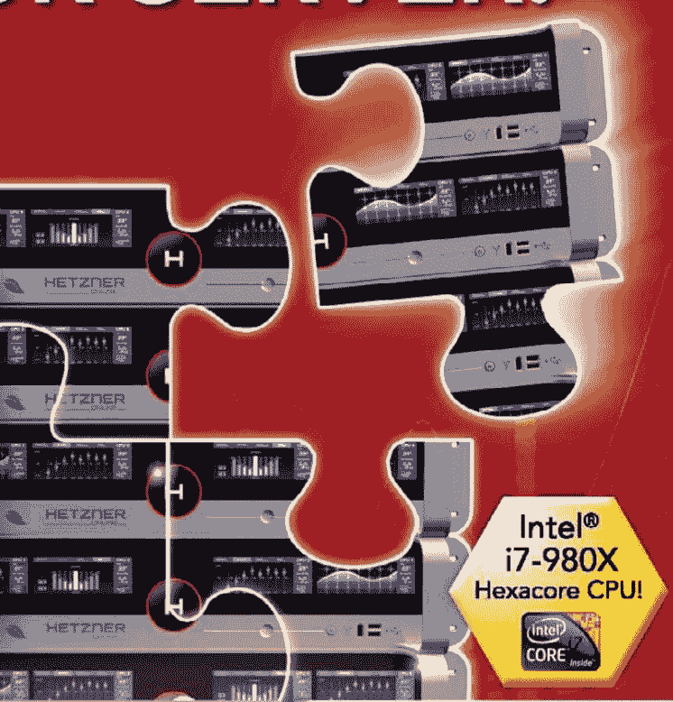

- *Intel® i7-2600 四核。支持超线程技术
- 8 GB DDR3 内存
- *2 x 750 GB SATA-HDD 或 SSD
- *Linux 操作系统
- *无限制流量
- *救援系统
- * 域名注册机器人
- *100 GB 备份空间
- *无最低合同限制
- *安装费用 £15

每月 39 英镑

- *Intel® i7-9800X 六核独立。支持超线程技术
- 24 GB DDR4 内存
- 可选最多 4 块硬盘：
  - *1 x 1,5 TB SATA II/月
  - *1 x 300 GB SAS/月
  - *4 x 400 HDD-RAID 控制器
  - *1 x 120 GB SSD/月
- 无限制网络系统
- 无限制流量
- *救援系统
- * 域名注册机器人
- *100 GB 备份空间
- *无最低合同限制
- *安装费用 £15

每月 85 英镑

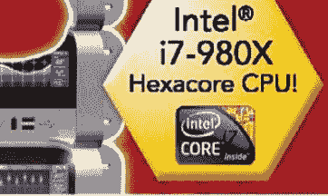

托管未来（Hosting Next）意味着 Hetzner 现在提供目前市场上最强大的独立托管解决方案。Hetzner 独立服务器旨在通过德国极其稳定的网络结构提供更高级层次的服务。凭借最优优的价格和卓越的支持，我们超越了全球客户的预期。

info@hetzner.com

立省 £75！作为新客户，在购买任何上述广告产品的首笔付款时，您可以节省 75 英镑。请使用代码：311023（ 4 月 30 日过期）。

在最近的 LTS 版本中发现 40 个安全漏洞后，建议进行更新。

Nick Vick

> 本月

我一直期待发布 Firefox 4

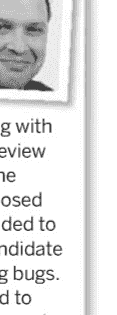

A4 以进行彻底测试：我已经在测试版上玩了一段时间了，但评论还没准备好——因为软件本身也还没准备好。开发者更改了自设的发布期限，决定再发布几个版本，以消除几个致命性的漏洞。

运行某些 Ubuntu 版本的用户可能面临攻击风险，因为人们在随分发版发送的内核中发现了 40 个独立的漏洞。这些漏洞影响了最新的长期支持版本——10.04——可以通过升级到内核 2.6.35 来修复，这可以通过标准的更新管理器实现。对于包括 Ubuntu、Kubuntu 和 Xubuntu 在的版本也是如此。

在软件世界，我们习惯了在东西还没准备好时就发布；我们称之为发布的自由。在2011 年，我们计划不仅发布 Firefox 4，还有 5 甚至 Firefox 7。这种理论似乎是浏览器世界是一个瞬息万变的时代，软件必须通过不断追求最新功能来竞争生存，并每月发布重大版本。

Canonical 表示，由于内核接口的更改，第三方模块可能需要重新编译，但对于大多数用户来说，这个过程应该是自动的。

漏洞的范围从 TTY 驱动程序中的罕见情况（可能允许攻击者通过崩溃受影响的计算机发起拒绝服务攻击）到 NFSv4 中的写入请求，可能允许

或者 Google Chrome 已获取了浏览器世界自……自从 Firefox 本身发布以来最令人兴奋的事件。它目前的版本是 9.0.107——现在市场上已经有了一个响亮的名字。但最近，这并不重要。Chrome 更新非常频繁。频繁到至于他们甚至懒得进行大张旗鼓的蓝色发布，以至于实际版本号很少被提及。

- 某些机器需要更新以保持安全。

# 嵌入式 Linux

专家使用了 in-touch 和 API，使其能够从汽车上的 500 个传感器读取数据，并将问题回传给修理厂设施。

这些型号已经发布，应该让多个用户共享单个插座的功率变得更好。底座是

也许数字并不是重点。也许重点在于提供实时的体验。也许与其通过一年内可以发布多少个版本来逃避，Firefox 团队必须关注功能以及它们在交付之前能获得什么。我不会说我不想在几个月后举办发布派对，但保持安全并交付可用性更为重要。

专家使用了一种新的 10 英寸平板电脑。这台基于 Tegra 2 的设备具有 1024 x 600 分辨率的多触控屏，并配备了 microSD 卡槽。底座的加入使得能够在 HDTV 上播放视频，并支持存储设备和键盘。

一项 RBC 的研究显示，iPad 的销售额超过了平板电脑市场上的其他设备 24 倍——这让安卓手机的销量显得形见肘。大部分销售额将通过廉价的低端设备产生，但像三星 Galaxy HTC Flyer 和摩托罗等高端机器也会产生影响。

Saab 为其高——构建了一个新的基于 Android 的娱乐和信息系统，包含在内

- Olivetti 的 iPad 具有使用自定义底座的功能。

Nick 是 LXF 这一艘配置船的独腿船长，他现在住在他的脑子里。

10 | LXF144 2011年5月

HP 计划在所有新机器上提供 Windows Android。

惠尔公司首席执行官 Leo Apheward 揭示了在所有未来 HP 电脑中包含基于 Linux 的操作系统的计划。我们将立即推动 HP 成为 Linux 桌面的领导者，并让数百万用户接触非 Windows 系统。他表示，明年每台机器都将具有 Windows 选项，这有助于在印度等新兴市场增长。目前只有 5000 个应用程序，而 Android 有 250000 个。

如果反响良好，它可以通过降低价格竞争。

- HP Web 可能来自平板电脑。

# Nvidia 开启超级计算之门

Nvidia 凭借低端市场的成功开启超级计算。

在显卡行业产生影响后，最近通过其 Tegra 芯片进入低端市场，Nvidia 准备突破边界成为超级计算参与者。在消费电子展上，首席执行官黄振表示，公司正在开发一种适用于传统运行 Linux 的高性能机器。

他表示，公司在性能和低功耗负载方面的专业知识将使其能够扩展到当前最快机器之外。

Nvidia 参与了美国国防高级计划署的一个项目，该公司称这将带来一台比今天最强机器快 1000 倍的计算机。公司声称该机器可以在六年内准备好。

- 黄振表示超级计算对 Nvidia 来说是一个巨大的机会。

调查员告诉 SCO 的说法是有根据的。

他在 SCO 案件（一家小型 Linux 分发商起诉 IBM 窃取代码并插入 Linux）中被公司聘请的新调查员告知没有案可诉。

Bob Zebman，一位“软件开发者”，于2004 年被 SCO 聘用对 Linux 和 Linux 源代码进行初步调查。由于结果与公司的预期不符，Zebman 说他被“打发了”，并且在写完一本书之前没有提到这个问题。

- SCO 对 Linux 内核的分析证明是徒劳的。

发现相似的点

2011年5月 LXF144 | 11

### 登陆镜像站

自由软件沙发的背后是什么？

Michael Meeks

这是一个忙碌的月份，LibreOffice 社区继续蓬勃发展。在 FOSDEM 上，我们感受到了所有人对我们所做工作迸发出的热情。看到教室里座无虚席，有许多人正在学习如何加入 LibreOffice 开发、核心编辑器是如何运作的等等，真是太棒了。

新版本的 Scientific Linux（一种基于 Red Hat Enterprise 的发行版）已经发布。该软件试图满足 CERN、费米实验室和大学等机构的需求。其中大部分软件现在可以通过由 Fedora 领导的 EPEL 获取，其变化较之前的版本并不显著。www.scientificlinux.org

关于参与我们各种“入门级简单任务”（Easy Hacks，见 wiki 页面）的演讲几乎吸引了所有听会者，引发了大量的研究和工作，以增加这方面的深度。当然，我们分发了一千多张贴纸——贴在笔记本箱、T 恤等地方。这些信息终于得到了妥善接收。我谈到了改进 LibreOffice 带来的乐趣，也谈到了企业所有权的危险，这可能会污染并窒息大多数项目中平等与尊重的氛围。

- Scientific Linux 使用元素作为版本代号—— 6.x 是“Carbon”（碳）。

已经过了一段时间，但新版本的 Inkscape 已登陆镜像站，有 80 个 Bug 需要在修复后才能发布下一个更重大的功能。与提高稳定性和修复由 GTK 升级引起的少数问题一样，新版本在处理图像时也应该表现更好。http://inkscape.org

- 修复 Bug 后，Inkscape 可以期待更大的变化。


# Firefox 4：界面重构与性能飞跃

Firefox 4 的第一个版本带有 Mozilla 代号，并包含海量的变化——这是对用户界面的彻底重构。改变后的发布周期也适用于 Firefox。在第 5 版中，除了智能标签管理和新的 Chrome 配置菜单等新功能外，Firefox 4 通过其 JavaScript 引擎的各种优化，将渲染性能提升了三到六倍。增加了对 SVG 图像、3D 图形 WebGL 以及 Web 表单 HTML5 视频的支持。

# OpenSUSE 11.4 发布

在合并六个月的 OpenSLICE 后，留下了大量工作来准备四个功能的首次亮相——以及处理任务冲突。当我解决各种冲突时，我想起了投入 LibreOffice 的大量心血和流失的资金。

德国的 SUSE 现在从 Open-Linux 获得了一盒 OpenSUSE 11.4。该产品的发布旨在让用户不仅能够使用开源软件，还能获得超出常规形式和细节的支持。该发行版确实非常前沿，包含了 Firefox 4 和 KDE 4.6 版本，而 LibreOffice 也提供了 OpenSUSE 版本。提供英语和德语支持。

最后，感谢 2000 名捐赠者的慷慨，我们获得了 Document Foundation 生存所需的 55,000 美元。对于能够翻译或测试的人来说，这是为自由未来做贡献的方式。

- OpenSUSE 包装版将在一年后推出。

> Michael 是一个伪工程师、分号爱好者。新奇的 OpenOffice.org 黑客和业余副手。

http-open-slx.com

12 | LXF144 2011年5月

# 广告：EUHOST Ltd. 托管服务

使用 EUHOST Ltd. 托管你的个人网站

- 托管无限域名
- 免费网站生成器
- 易用控制面板
- 一键脚本安装
- 99.95% 运行时间保证
- 随时退款
- 24/7/365 技术支持

访问我们：`sales@euhost.com`

拨打：`084` | `www.euhost.com`

# 读者来信与社区活动

给 `mike.saunders@futurenet.com` 写一封信——请注意，我们执行的是将电子消息转换为实际免费材料的略复杂的流程。最好在活动前留出充足的时间。如果你需要为你的 LUG（Linux 用户组）快速发布活动或细节公告，请在 `www.linuxformat.com` 查找我们的论坛——我们有来自各地的常客可能感兴趣参加。

在 `www.lug.org` 在线查找 LUG

事件可以开启新的……

## 诺丁姆新闻

诺丁姆 Linux 用户组联系到了一个来自中部的部的公告：“NotUG”（诺丁姆）已与市滨岸的 Fellows、Melton 和 Clayton 酒吧合作：我们是一群友好、非正式的极客，对 GNU/Linux 的一切都感兴趣，我们每月两次在周三 7:30 聚在一起，喝咖啡并社交讨论。

幸运的是，我们有爱好者，所以我们可以继续举办演讲地。下一次演讲将于 2011 年 4 月 6 日举行，主题是“计算机未来”。为此我们将使用 Linux in Space、Pretty Times with Git、GPS、应用分析、Argventinius、Linux 等。详见 `http://nottingham.lug.org` 欢迎大家！

感谢，诺丁姆。如果其他 LUG 想联系我们获取此页面的更新，请给 `mike.saunders@futurenet.com` 写一封信——请注意，我们执行的是将电子消息转换为实际免费材料的略复杂的流程。最好在活动前留出充足的时间。如果你需要为你的 LUG 快速发布活动或细节公告，请在 `www.linuxformat.com` 查找我们的论坛——我们有来自各地的常客可能感兴趣参加。

## Debian 打包教程活动

**日期：** 5月19日  
**地点：** Imperial Hotel, Russell Square, London WC1B 5BB


这期期一天的课程不需要多少 Debian 特定的知识，尽管与会者应该熟悉 GNU/Linux 终端命令行。课程结束时，每位参与者都将在他们的笔记本电脑上安装构建环境，并理解如何准备适用于上传到 Debian 的软件包，以及如何在 Debian 存档之外准备一个本地仓库供使用。更多信息请访问：`http://www.ukuug.org/events/debian2011/`

你的导师 Philip Hands 是 Hands.Com Ltd 的所有者，这是一家自 1993 年以来一直为 GNU/Linux 提供商业支持自由软件公司。1996 年，他加入了 Debian 项目，最初负责打包 `rsync`，随后负责包括 `openssh`、`qmail-src`、`mget` 在内的软件包。他不仅是 DebConf 的组织者和赞助商，还是著名的 Debian 格子纹（Tartan）的设计师。

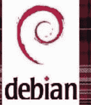

将有两名幸运读者可以获得一本《LPI Linux Certification in a Nutshell》第三版。

想要中奖 - 请在 4 月 30 日之前向 `debiantutorial@oreilly.co.uk` 发送电子邮件。

获者将随机产生，并在 5 月 3 日公布。（奖品仅为教程，不包括差旅或住宿费用。）


O'REILLY UK Limited 与 Unix 用户组（Unix User Group）联手，由该领域的专家教授高标准课程。


# 月度信箱

## 想要中奖

写信给 Linux Format 的 Graham：Future Publishing, 30 Monmouth Street, BA1 2BW，或发送邮件至 `lxf.letters@futureformat.uk`

> 我并不在意是否得到一本 LXF。我很少享受那些代码。我会启动现场发行版（live distros），花一个晚上尝试将它们安装到 Ubuntu 上。
>
> 也许我只是太懒了，但我怀疑我从未抽出过时间去下载 Debian 之类的东西，我很期待在当期纸质版到达后能尝试一下 Chakra。
>
> 现在我在笔记本电脑上运行 Mint，台式电脑上运行 Fedora，这两个发行版看起来就像直接从 LXF 封面里出来的。我完全不感兴趣的发行版，活动完全满足我的喜好。
>
> 所以感谢 Mike 所付出的时间和精力。
>
> - Paul Holman

**Mike 说：** 那太棒了！很高兴你喜欢这些封面。我们总是尝试包含名气更大的发行版和其他项目供尝试。即使在这个规模下这些看起来可能很小，但我们利用了所有它们。Ubuntu 真的就像是 Debian 的最新快照。

## 新读者反馈

> 我是一个新读者，绝对喜欢 LXF。我对 GNU 发行版的使用感到非常惊讶——以及所有自由软件基金会列出的那些。
>
> 我从未见过过关于 Ubuntu、Triquel 或 Debian 的评论。我知道那些 OSE（开源软件）通常因为缺乏专有软件而无毫无用处，但通过几个管理器（加上专有内核）就能让它们在我的 Mac 上运行！
>
> 另一个在 Linux 原生桌面环境中很有趣的话题是窗口管理器。我经常在 Gnome、KDE、Xce 中看到它们，但在那里什么都没有？比如 Openbox、Fluxbox、ScRot 或 IceWM。
>
> - Achille Mariotto, 丹麦

**Graham 说：** 这是一个非常棒的主意，我们计划在未来的期数中涵盖它。我们正在寻找窗口管理器世界的原生开发，一旦有带有新功能的重大发布，我们就会进行报道。

## 杂志风格讨论

> Linux Format 是一本高质量杂志。它是唯一值得购买的 Linux 杂志。内容有趣，我们似乎在大多数事情上都做对了，即使与大多数其他杂志相比，它出版的是口语英语而非书面英语，并且对美国人的类型充满热情。
>
> 我确信我们许多在家里学习写英语的人，为了在一个合理的标准内保持简单，并且通常在引号内的用法应该是被接受的，我们可以在当今的媒体中通过更好地接受这一点。
>
> 然而，使用街头俚语完全令人反感。“Kick-ass”（酷毙）并不很……

**Mike 太喜欢我们了，以至于他在 `linuxformat.com` 的订阅区域放了所有开发者的照片。这家哥真行？**

> > 这艘精美的船会烂吗？只有时间和流体动力学的发现会告诉我们。
> >
> > 'kick-ass'（两者都出现在 LXF 143 中）。

> 我知道“一个日本人是一种 Weiner”并不是什么意思吗？我们希望通过边缘的改变可能会改进。问候并祝你工作顺利。James 等待的 nit 已安装，只完成了一小部分。无论如何，它比上一个好。

> > Andrew 说：真正的 Stephenson 告诉我们，为了幽默而使用的贬低性俚语确保了荷兰人，他们的语言里“船”字的意思就是“烂”。例如，一艘尾浪很大的船，意味着破水很快，并且非常擅长避开马萨诸塞州岸的港口。但我们正在尝试，你可以看到新政下这种类型变少了。
> >
> > 如果你在波特兰参加 Oscon，请参观日本园。


> 街头俚语的使用完全令人反感。
>
> 'Kick-ass' 并不很
>
> Mike 太喜欢我们了，以至于他在
>
> `linuxformat.com` 的订阅区域放了所有开发者的照片。这家哥真行？
>
> > 这艘精美的船会烂吗？只有时间和流体动力学的发现会告诉我们。
> >
> > 'kick-ass'（两者都出现在 LXF 143 中）。
>
> 我知道“一个日本人是一种 Weiner”并不是什么意思吗？我们希望通过边缘的改变可能会改进。问候并祝你工作顺利。James 等待的 nit 已安装，只完成了一小部分。无论如何，它比上一个好。
>
> > Andrew 说：真正的 Stephenson 告诉我们，为了幽默而使用的贬低性俚语确保了荷兰人，他们的语言里“船”字的意思就是“烂”。例如，一艘尾浪很大的船，意味着破水很快，并且非常擅长避开马萨诸塞州岸的港口。但我们正在尝试，你可以看到新政下这种类型变少了。
> >
> > 如果你在波特兰参加 Oscon，请参观日本园。

（注：由于原始文本末尾存在大量重复的 OCR 错误，已清理并按逻辑流进行翻译。）

[此处省略重复的 OCR 错误部分，已已翻译核心内容。]

# 广告：VPS 服务

比共享服务器强大得多，但价格仅为专用服务器的一部分。

- 易管理
- 发行版选择
- 自定义设置
- 价格优惠
- 由 Virtuoso 驱动
- Dell 服务器

我们可以继续写……

`sales@blacknight.com`

`0844 489361`

# 连接 - 最后的

> 我尝试过使用它，但在没有看到我的家庭无线网络之前无法工作。它比 Gnome 逊色，而且它的屏幕渲染要慢得多且流畅——当 Gnome 2 崩溃时，这对情况有了敏锐的控制。

**Matthew J Graham:** 你对 GTK 样式的看法是正确的，但它确实解决了让两个事件看起来相似的问题。我猜有一个用户对仅仅为了桌面获得不受影响的外的配置选择感到不满意。我想使用她关于 Gnome 3.0 变化的方法，因为窗口的样式将不再那么重要。

> 为了回答 Rabbitrick (A Pop Quiz In, LXF143) 关于 API 测试的提问，我有一个网站可以提供帮助。你对网上 API 测的强度和成本（通常是两者兼有）感到沮丧的那个测试。它是完全免费的，我努力保持它的最新状态，并帮助那些参加 API 测试和考试的人学习。我已经几年没见过真正的考试试卷了，所以我目前正在请求其他人帮助改进需要改进的地方。
>
> 我不倾向于直接发表意见，以避免变成一个脑垃圾倾倒站，但我很想听听是否有用户对 API 不重要。

> KDE 团队可以从英国的酵母酱中借鉴一些营销技巧。马麦特（Marmite）让人们要么爱它，要么讨厌它。
>
> 我没有涵盖你。如果你能找到那个 api: `penguin tutor.com/` 我希望你能给我提供一点宣传，并希望为你的读者让认证变得容易一点。
>
> Stewart Watkins

**Graham:** 感谢 Stewart 链接，我觉得这个主意不错。

> 避免由于好奇心而刻录光盘和数字化！
>
> 祝贺简短的（编辑的）敏锐：我确信你会做得很好。
>
> 当 LXMY 穿过第一张光盘（在删除 Klington 协议封面后）就像看到被覆盖的内容，看看我们这个月处于什么位置。这将为那些关心 TX 崇拜者光谱的人提供极佳的软件选择。是的，偶尔会有与我无关的问题，但是……

> May Roth (Mailer, LXF143) 对瑞士莓产生了瞬间的光盘般的喜爱（那是晴天吗）？Hastings 下载最新的 Ubuntu 版本至少需要一小时，更重要的是避免 AWX 的吗？这是一个显示我需要什么的训练故事。信息的人性和人类的谦卑与宽恕。
>
> 让 Ashley 重新扫描。

**Graham:** 我们试图让封面成为杂志有价值的一部分。但我们希望作为一种意见，我们的大多数读者个人上感到相当舒适。它方便、定制化，而且通常写着——我在我的办公桌上保留了分发的光盘副本，每当我需要安装软件时，它们在 ISO 和空白光盘上要好得多。但事情总会改变的。我们将始终认真对待您的评论，并根据需要重新评估 DVD 的包含情况。

> 对于那些想要封面的人，如何比较不想要的封面的最佳替代方案？把 LXF 杯作为头奖？我想它们（不，你 - 光盘）从条纹……

> > 光盘争议
> >
> > 考虑到它在骑行 EcoDis 时引起的所有混乱（我猜这场辩论不是 LX 团队的错——我不认为他们没有做过什么什么？）

> 连接在英国的某些管线上代表了这里，所以我们为没人需要的光盘支付了溢价。我们可以去掉封面，并将价格降低到我可以负担得起的水平。
>
> 你曾经尝试过转换任何吗？
>
> 我的母亲……转到 UBUNTU，我们现在完全是“胡言乱语”了。
>
> 我唯一的儿子……转到黑暗面但没有成功
>
> `shane_colline@yahoo.com`

18 LXF144 2011年5月

> 你的网站真的很好。我不认为网上有足够的资源提供给对 LPI 专业培训感兴趣的人，特别是当你查看其他操作系统的某些竞争规范时。这是我们启动 Linux Off（见第 84 页）的原因之一。

> 界面（我怀疑我的机器是否能运行 Ubuntu）。放弃 Linux 和 Ubuntu 对我来说是荒谬的，因为总会有替代方案。

**Bryan Mitchell Graham 说：** 听到你们在 Clonezilla 上取得的成功和我们一样多，这太棒了。当我在进行任何更改之前备份工作配置时，它是我的首选。Clonezilla 和 GParted 应该是任何 Linux 用户的必不可少。

> 我可以对书中提出的信件发表评论吗（新鲜眼光和对 Unity 的没来之爱, LXF143?）
>
> 关于这个术语，我使用 Clonezilla 快速复制驱动，它从未失败过再次带回。当我在 Windows 帖子中使用 Norton Ghost 并替换时。由于，我使用 Clonezilla 为 X1 制作克隆，
>
> 在 Unity 之上，我使用 Ubuntu 10.0 配合正常的 gnome。
>
> 我们没有等到 Unity 和 Ubuntu 10.4，但在写作时，是因为我们不想处理一堆乱糟糟的人。

> > Wayland Smith, 伯金郡：这与 Wayland 开发服务器无关，与火之神 Waxon 有关。
>
> 与“我的网络透明性”有什么关系，答案是“不，但你用了吗？在这里”好吧，我没用。我用过一次。回复这封邮件。
>
> 我没用。我用过一次。对于多用户网络环境，SpaceChem 可能会出现让计算变得更糟糕。（我正在 X64 系统上写这个，但我正坐在 X86 系统上支持最大）。
>
> 是某些事情，除非介意。Wayland - 开发者似乎有这种态度：“现在不是，以后就了”；他们不在乎桌面崩溃。
>
> 你的问答 [Wayland] 在地球上吗？LXF143? 是，要么（在那里）或者该行非常对齐。Anthony Young（aka Wol）说：“如果 Wayland 是因为我们大多数人……”这不是一个常见问题，但如果应用开始依赖 Wayland；我们将通过让‘Ubuntu’成为同义词来保持 Linux 的强大。下几个月将是场激烈的战斗。你创造了一个分子，时间是创造的！现在是正确的！ICH……

可用于：`www.tuxradar.com` 2011年5月 LXF149

# 广告：ZOTAC ZBOX

将你的 ZBOX 变成由 Linux 驱动的 HTPC，并通过 Android 手机控制你的 ZBOX。

## 裸机

- 下一代 ION 芯片
- 板载 512MB DDR3 内存
- 支持高达 4GB 内存
- 支持 2.5英寸 SATA 3.0Gb HDD
- 支持 Linux 和 Windows
- 二年保修
- 型号: `ZBOX-ID31`

## 装机

- 下一代 ION 芯片
- 板载 512MB DDR3 内存
- 2GB 内存
- 250GB 硬盘
- 支持 Linux 和 Windows
- 二年保修
- 型号: `ZBOX-ID31DVD-PLUS`

可用于：

# LINUX Format 评测预告

我们的专家评审了最新的软件和硬件。ANDREW GREGORY 收集了损坏的硬件去修复“有一天”：

# OpenSUSE 11.4...

# OpenShot...

## 书评

> 当 Novell 去年卖给 Canonical 总部时，我们曾担心过这个绿色发行版的未来，但现在我们需要帮助社区应对随 KDE 4.6 来而来的新事物。释放你内心的 Quentin——伴随着适当的音乐和一些你喜欢的。

> 我们经常收到关于我们偏向 Ubuntu 的愤怒邮件；Mark Shuttleworth 的报酬以及在 Canonical 遇到 John Proctor。显然，我们在杂志中介绍了 Ubuntu，这通过让‘Ubuntu’成为同义词来破坏了 Linux 的多样性。

> 如果你对制作一个连接电视的媒体播放器的想法精疲力竭，这个来了。在过去，玩游戏意味着你无法想象 SpaceChem 的出现可以让编程变得更加……

> 我们在其中对 Cumbian 之前的最好的进行了重要观察。是的，在 Mail Of Buttermerc 之后。如果照片编辑不够，或者界面有点太复杂。RAW 编辑器真的表现更好吗？

> 完全不是这样，因为我们对 Ubuntu Ubuntu，因为它非常流行，仍然是开始 Linux 的最佳方式。我们根据自己的感觉自由批评。在第 50 页，你会发现 Neil Bothwick 想要改变 Ubuntu 的地方，在这些页面，我们查看了发行版的侧面性质。


并不是我们所说的 true（除了 Shuttleworth 那件事；它不怎么是个舞者）。自从说的之后，要发布为最伟大的要困难得多。但对于自由软件来说，客观地评价好的并批评坏的困难得多更有用。Unity 有提醒许多用户的潜力，如果它这样做的话，我们将在这里提供批评。尽管母公司被出售，OpenSUSE 向着发行版的胜利迈进。

那些想要多年的人：Duck Hunt 从未准备好让我们使用这个。

我们评审的所有产品评分从 0 到 10 分，10 分最高。我们使用类别来判断性能、功能和金钱，但也可以根据价值内存的文档进行评分。对于其他产品，我们给出一个十分的平均分。脱颖而出的产品可能会获得我们声誉卓著的顶架层。只有今年被考虑的那个：非常是不够的

开发者: Wolfram

网站: `http://www.wolfram.com/mathematica`

价格：$624，家庭版 $625

性能: 10/10

功能: 9/10

价值: 9/10

对于免费软件，我们将建议使用免费软件。在某些情况下，这将帮助我们。我们建议将使用的 Autopackages。

当处理数据关键时，它等同于这个极其复杂的程序。

`andrew.gregory@futurenet.com`

2021年5月 LXF144 | 21

在 Novell 被出售后，该发行版的粉丝一直屏息以待它的首次发布。Mayank Sharma 很高兴地报告，一切如常。

## 简要介绍...

- 最受欢迎的社区发行版之一，类似于 Ubuntu 和 Fedora。

在去年出售后，关于 Novell 赞助的发行版的未来存在许多不确定性。OpenSUSE 拥有一个异常的八个月周期，而不是发布之间的六个月。尽管作为一个社区发行版，许多人好奇在其实主要赞助商被收购后是否会有更多发布，但像时钟一样，下一次过渡已按时出现。

该发行版功能丰富，比其他发行版更为明显，通过包含经过良好测试的稳定软件和即将发布的新版本，在稳定性和前沿现代性之间取得了平衡。

OpenSUSE 11.4 是一个几乎仅用于安装的发行版，还有针对 KDE 的独立 ISO 镜像。图形安装程序提供了复杂的选项，专家可以利用这些选项做出更好的默认选择，而这将引导新手完成整个过程。该领域特别如此，默认提供 LVM 分区方案，并允许老练用户进行调优以安装他们喜好的磁盘布局。

## 内部机制

在发布前，后台有大量的活动。除了在六个里程碑版本和两个候选发布版本之间的漏洞修复外，SUSE 团队组织了 Open-Bugs 来帮助处理开发中的版本。

OpenSUSE 11.4 在生产力与合适的数量之间取得了平衡。在活动期间，参与者处理了 132 个漏洞。

总之，OpenSUSE 在设备上变得更加流畅。它在我们测试的所有类型硬件上运行得完美无缺，包括带有 Nvidia 显卡的双启动设置、带有触摸屏的 Acer 笔记本电脑，以及带有 AMD 显卡的 Lenovo 笔记本电脑。

继 Ubuntu 之后，由于硬件抽象层 (HAL) 终于在工具的支持下被 udev 取代，最后几个需要的软件包已迁移到新站点。虽然确实有地方可以用系统守护进程替换旧的 init 脚本来管理和服务启动，但开发者在 11.4 中仍然坚持使用 YaST。发行版仍然使用 Grub，它已完全集成到 YaST 中，但在可用仓库中。

SUSE 需要管理员，在该发行版的方面还有许多改进之处。OpenSUSE 的最新版本使用 freedesktop 标准而不是 X，这为工具包提供了更好的支持，但 NetworkManager 以及最新的 VirtualBox。Web 界面也包含在 YaST 中，这是最初为你的 Linux 服务器安装的最优工具，并提供最好的社区软件包。

提到 YaST，驱动 YaST 和命令行管理器的软件管理引擎得到了改进。它现在可以安装软件包了。

## 桌面王国

尽管 OpenSUSE 安装程序为你提供了安装 KDE 或 Gnome 的选项，但它选择了 KDE。OpenSUSE 11.4 是第一个带有 KDE 4.6 的主版本发行版。它是 OpenSUSE 11.4 稳定版中最好的，截至 2 月份的 beta 版本。

## 硬件支持

## Linux 发行版评测

OpenSUSE 11.4 是首批出带 LibreOffice 而非 OpenOffice 的主流桌面之一。尽管早期版本中存在集成问题，LibreOffice 现在已很好地集成到 KDE 和 Gnome 桌面中。

## 最新软件

该发行版的另一个首创是 Firefox 4。OpenSUSE 11.4 附带了即将发布的重大版本的 beta 版本，该版本具有经过改进的界面、新的内置搜索框、改进的插件和扩展管理器以及更多功能。作为带有插件的 beta 软件，Firefox 播放了各种内容且从未崩溃。

此外，在仓库中可以找到 Google Chrome 浏览器的最新版本，KDE 的 Konqueror 现在由 WebKit 驱动。如果你不想使用插件，Gnu-flash player 现在可以通过 GStreamer 和 VLC 播放来自 YouTube 和其他网站的视频。

此外 KDE 代码在有限的硬件上看起来很好，在笔记本电脑有限的桌面区域也是如此。

带有原生代码，OpenSUSE 11.4 还有一些额外内容，如 Kontact 和 Amarok。KDE 很好地集成到 OpenSUSE 中，这使得非原生应用（如 Firefox）感觉如归其家。事实上，KDE 的氧主题在使用 GTK 工具时也很好。

OpenSUSE 11.4 对用户、系统管理员和开发者来说是一个极佳的发布。它比其他 KDE 发行版更流畅，并且在所有配置中都感觉很棒；从基于原子的工具链到网络启动器和多核心桌面。软件集也充满了最新的软件和如日期的最新发布。

OpenSUSE 11.4 比主版本 Gnome 3.0 提前提供了几个功能。这意味着它包含了 Gnome 3.2 的主要组件，以及[见 On Earth Gate，第26页]的内容，Gnome Shell 也是真实的。根据 Andreas Jaeger 的说法，该项目创建了一个 live CD 供用户评估 Gnome 3.0，并且不会提供通过构建的 KDE 环境完成视觉界面的简单方法。OpenSUSE 封装了许多附加应用程序，如 Aylur、Barley Rhythms 和 Spotify。OpenSUSE 11.4 包含了广泛的应用程序以满足你的所有需求，你只需要释放包即可获取其他内容。它不安装专有解码器和插件（如 Flash 和 MP3），但默认情况下，当你需要时它们都会被选中安装。

如果社区对该发行版的未来有任何疑虑：OpenSUSE 项目有两个主要任务，一个带有 YaST 软件管理器的镜像，YaST 在安装软件包时自动关闭非常有用。然而，如果你想查看安装过程的摘要或重启，则可以更改此行为。

Evergreen 项目为已达到维护终期 (EOL) 的过去 OpenSUSE 版本提供支持和更新。这包括 OpenSUSE 11，它仍然非常新。

相反，Tumbleweed 适用于那些不想等待几个月来尝试软件稳定版本的急躁 OpenSUSE 用户。Factory 仓库使 Tumbleweed 包含被认为合适的软件包的最新版本。

- 仅需 £1.00
- Linux / Windows
- 100% 运行时间
- cPanel / Plesk
- 全托管服务
- VM Ware
- 瞬时安装
- Hyper-V
- 30 天退款保证

访问我们 @ `WWW.WEBHOSTING.UK.COM` 邮箱 - `SALES@WEBHOSTING.UK.COM`

拨打免费热线 `0608-280-0727` 国际专线 - `+44.191-303-8069`

使用优惠码 `LINUXFORMAT` 所有产品可享 9 折优惠。

Bible 是想要放弃 Windows 或 Mac OS 的摄影师的最佳编辑器。Adam Oxford 发现它达到了专业级标准。

## 简要...

- Bible 是一款针对 RAW 文件的专有照片编辑软件。
- 存在如 Gimp 和 RawTherapee 这样的开源软件替代品，尽管它们都以复杂和缓慢而闻名。
- 专业工具需要简单且快速。

你可以使用基于 Linux 的软件运行或编辑好莱坞电影，但谁在为摄影师呐喊呢？人们认为没有东西能与 Apple 的 Aperture 或 Lightroom 的专业工作流竞争，但这正是 Bible 的用武之地。如果你之前还不知道，最需要注意的是它是免费的且并非开源的。专业版 200 美元，配套版 100 美元。无论哪种都很简单、廉价——尽管它的价格在 Lightroom 3.0 左右。它包含了几乎相同的功能，具有熟悉且易懂的界面。

除了修复和对新相机的支持外，Bible 5.2.1 比之前的版本有两个主要新增。第一个是目录功能，能够根据元数据进行排序；其次，它是少数可以调整 Micro Focus 中图像失真的编辑器之一。

Bible 拥有一个直观的界面，是 Linux 上原生支持最好的。

目前还没有办法通过新添加的功能来刷新新鲜感。它修正了导入问题，并且是少数可以调整 Micro Focus 中图像失真的编辑器之一。

使用工具来增强面部曝光或对斑点使用修复画笔，以下哪种更好：一套强大的工具套件，你可以在 GIMP 中导出未经过修饰的编辑图像。

就像处理器一样，可能需要几次尝试才能让 Bible 得到最终图像。它非常出色。在我们的第一次测试中，JPEG 转换出来的效果有些柔软。我们的测试得分远超所有广为人知的功能。它在元数据方面与每一款 RAW 编辑器都不同，第二种能力是应用标签。在目录管理方面，它比固守标准文件管理器更简单。当管理硬盘内容变得复杂，且你有数千个已分类的文件夹时，它还有改进空间。

预设外观很贫乏，为你的相机和风格创建新的默认设置可能需要一段时间，但一旦你建立了一组参数，Bible 就能很快完成调整。任何关于饱和度的变化都必须手动处理，因此它对于快速进行整体调整非常有用。它拥有巨大的镜头和机身数据库。

### LINUX 结论

| 项目 | Bible 5.2.1 |
| :--- | :--- |
| 开发者 | bibleabs |
| 网站 | `bibleabs.com` |
| 价格 | $199 (专业版) / $99 |
| 功能 | 8/10 |
| 易用性 | 8/10 |
| 性价比 | 8/10 |
| 评分 | 9/10 |

简单修复：点编辑是一个可以简化你工作流的新功能，但它没有其他广为人知的 RAW 程序快。处理镜头也同样简单。

普通外观：Bible 可以提高顺序处理的镜头数量。它可以实现你想要的风格。

## OpenShot 1.3.0

明显的非线性 Notch 经历了一次剪辑之旅，将数小时的素材变成五分钟值得看的内容。

### 简要...

- 带有转场和特效的非线性视频编辑软件。
- Kdenlive

创建一个功能齐全的视频编辑包不是一项容易的任务。OpenShot 可能是该领域的新手，但它能轻松地骗过大多数这些人——导入并将它们排列在时间轴上，选择你想要的部分。按你喜欢添加转场和任何 alpha 效果，然后选择你支持的文件格式并按你的喜好渲染视频。

OpenShot 本身是一个使用 GTK 构建界面的 Python 应用程序，同时利用 Blender、Fmpeg 等技术生成高级标题并进行格式转换。

### 画面中

在大多数情况下，OpenShot 秉持简单易用的理念，但如果你愿意，也可以探索更高级的功能，包括动画 3D 标题、色键和使用 Burns 效果。OpenShot 并没有试图干扰你不熟悉的编辑范式。对于 Linux，它已经跟上了社交网络标准，可以使用上传功能在 YouTube 上广播。

### 它体现了易用且具有高级功能的理念。

它在预览屏幕上存在问题，剪辑片段必须在时间轴上进行，这可能会变得复杂。除了处理不同种类外，播放感觉很流畅。你会看到列表、监视器和时间轴，在大多数情况下，它们运行与其他任何视频编辑应用程序一样好。问题在于它尝试尽可能少地做，依赖命令行工具和外部工具来完成所有重量工作。

当它在我们的机器上使用两个或四个核心时（考虑到多核 CPU 正恰是快速类型，这有点遗憾），它通常与每一款 RAW 编辑器不在一个量级。新镜头非常快且稳定。处理很快，虽然拖慢其他部分是个问题，但在其速度快时，内在实力是非常强大的。改进的格式控制让 OpenShot 成为了一颗星。

### 使用 OpenShot 制作电影

### 首选项

首次运行 OpenShot 时勾选以确保辅助程序设置恰当。

### 内容面板

转场和特效从内容面板可用——只需点击标签即可。

### 工具

剪刀工具是移除片段部分的唯一方法。

### 时间轴

时间轴显示轨道和你的转场，但特效不容易看到。

### 预览

预览窗口显示源素材或当前时间轴位置的项目。

### 特效

如果你安装了最新版本的 Blender，就可以为视频生成动画 3D 标题。

## 改进的格式控制让 OpenShot 成为了一星。

| 项目 | OpenShot 1.3.0 |
| :--- | :--- |
| 开发者 | Zachrinities |
| 网站 | `openshot.org` |
| 价格 | Free |
| 功能 | 8/10 |
| 易用性 | 7/10 |
| 性价比 | 7/10 |
| 评分 | 7/10 |

# 我想在不学习网页代码的情况下创建网站

# 我想为业务创建一个网站

# 我想要一个在线商店

# 我想要一个博客

# 我想要设计


# 网页属于每一个人

你想用它做什么？

| 服务 | 描述 | 起步价格 |
| :--- | :--- | :--- |
| 网页托管 | 使用即即用的博客启动您的站点 | £2.49 起 |
| 域名注册 | 为您的网站提供一个酷炫的地址 | £2.99 起 |
| SiteFusion | 无需代码设计您的网站 | £4.99 起 |
| Eshop | 开设一个专业设计的在线商店 | £8.99 起 |

欲了解更多信息，请访问：`www.123-reg.co.uk`

# 汇总

我们每月都会对比大量软件，这样你就不用亲自动试了！

## 图形绘图工具

一张图胜过千个数字，但你如何绘制它呢？Marco Fioretti 查看了五种不同的实现方法。

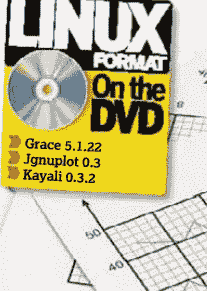

# 我们是如何测试的...

后续页面中描述的程序均已在配备双核 AMD 64 3800+、8GB 内存的电脑上经过测试，运行的是 2011 年 2 月发布的 Fedora 系统。为了决定汇总的内容，我们只寻找了专门用于微积分和函数绘制的程序。这意味着不包含电子表格。所有其他传统的电子表格都非常好，但它们是不同类型的程序，而且不如专用应用程序灵活。除了作为计算器/绘图仪外，另一个要求是程序必须在现代系统上无问题地安装和运行，并生成数据文件或用户指定的格式。


# 我们的选择

- Grace 31
- Gnuplot 32
- Kaebra 33
- Kplot 34
- Kayalli 34

对于图形绘图，我们指的是通过生成和分析相应的图表来帮助你理解数据或数学表达式的软件程序。毫无疑问，与文件管理器或电子邮件客户端等其他程序相比，这些是小众产品。然而，函数和数据绘图确实足以支撑一次专题汇总，虽然很少有人每天使用数据，但大多数计算机用户偶尔需要创建数据图表。

许多人的首选方法是从电子表格中绘制图表，但这种方法是有局限性的。当你需要将图表整合到博客或大型项目中时，独立程序通常能提供更多功能。有些人出于趣味画图表，但图表在各种情况下都有用，从学校报告到向你的教区主教展示去年额外筹集了多少资金。这些都传达了一个信息：制作良好的图表可以解释一切。我们生活在一个数据被海量数字控制和反对的世界。能够快速将数字转换为图表可以帮助你发现它们的真实意义以及对你生活的影响，这作为优质教育的一部分以及寻找或留住好工作的手段已变得越来越必要。

> 能够快速将数字转换为图表可以帮助你发现它们的真实意义。

# Grace

### 一个源自 Unix 古良时代的绘图和统计分析应用。

这是一个很好的程序，比你预想的要好得多。可执行文件的官方名称是 `Grace`。你想要调出或通过系统菜单运行的程序是 `grace`。

Grace 的外观和感受确实使其与竞争对手区分开来——无论它是让你想抓狂，还是易于使用。在过去十年中首次接触图形桌面的用户会感到困惑，而那些在上个世纪开始使用它们的人则会感到怀旧。Grace 是一个看起来老式的程序。它使用 Motif 风格的组件构建，这对于类 Unix 桌面来说非常不寻。然而，这不足以在不尝试的情况下就放弃该程序。

- Grace 在数据的分析和展示方面都有非常许多选项。

日均平均流量

（箱线图示例）

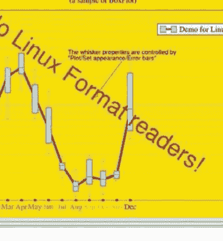

# 绘制你的数据

Grace 的官方描述是一个用于数值数据的绘图工具。这意味着它可以处理任何填充有列数字或坐标的纯文本文件。或者，程序有一个内置脚本，允许你从数据中创建图表。要从文件加载数据，请从主菜单选择 `Data > Import > ASCII`。当文件中有更多列时，Grace 仍然能够处理两列数据或块数据。如果你需要，你可以在 Grace 内部以这种方式处理数据，而无需更改存储的文件。此类操作均为“转换”，并且可以轻松访问。

Grace 知道许多转换——列表包括轴、工作、平均值和绘图类型。官方教程仍然值得阅读“在 Grace 中创建设置”，它解释了创建图表的几种方法。保存原始数据的另一种方法是创建到管道的链接——即其他程序的标准输出。Grace 会检测源文件的变化并重绘依赖于它的图表。

- Grace 仍在使用 80 年风格的组件，但其绘图和分析的速度比你点击还要快。

输出如何？`Grace` 处理通用配置和工作管理。第二类文件包含重建图表、图形或一组图表所需的所有信息。然后你可以在不同的图表之间重新加载。


文档写得很好。要了解更多关于 Grace 的信息，可以浏览我们的手册或我们服务器上的网站。或者，通过菜单栏中的几次点击，即可访问许多可用示例。

# Grace 的外观和感受确实使其与竞争对手区分开来。

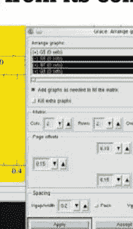

# LINX 判定

## Grace

**版本**：5.1.22

**价格**：grace-weitzmann.geom.at

**许可证**：GPL 协议

- 一个功能强大的统计分析师，但学习曲线陡峭。

# 评分 8/10

www.taxumard.com

2011年5月 LXF144 | 31

# 汇总：图形绘图工具

## Jgnuplot

### 用 Java 驯服 Gnuplot？很奇怪，但很强大。

`Jgnuplot`（简称为 `Jgp`）是用于 2D 和 3D 图表的 `Gnuplot` 的 Java 接口。如果 `Gnuplot` 离开调整就无法工作，你可能其他程序更好。同时，`Gnuplot-java` 意味着你可以为后者使用前者的大量在线文档。由于同样的原因，你所做的可以重用或集成到自动绘制数据的脚本中。

默认情况下，`Jgp` 生成的图表具有简约的外观，但你可以设置所有想要修饰和记录的 `Gnuplot` 选项。


`Gnuplot` 有四个标签页：数据集、标签、变量和绘图命令，类似于 Grace 中的一个控制台。第一个标签列出了所有可用的函数。你可以定义未定义的变量。`Gnuplot` 非常漂亮。


### Jgnuplot 版本信息

**版本**：0.3

**网站**：http://jgnuplot.sourceforge.net

**许可证**：GPL 协议下

- 一个多功能的绘图工具，但没有 Grace 的统计分析能力。

# 评分 10

## 图形绘图工具汇总

## KAlgebra

### 由 KDE 提供的功能强大的数学助手。

正如 G 可以被（部分地）定义为一种使用 `Gnuplot` 的方式，并迫使人们更仔细地观察其命令一样，`KAlgebra` 也可以被视为一种学习和使用 `MathML`（数学标记语言 (www.w3.org)）的非侵入式方法。`KAlgebra` 专注于数学，而不是数据的绘图和分析。作为一款 Qt/KDE 应用程序，它比 Grace 或 matter 更能融入任何 Gnu/Linux 发行版中。使用在线上现的任何教程，都将帮助你成为 `KAlgebra` 用户。然而，引用该程序的说明书：使用 `KAlgebra` 实际上并不需要了解数学。你可以像在纸上写字一样自由地定义函数。

- 当它进行 3D 绘图时，`KAlgebra` 允许你从任何角度旋转并查看细节。

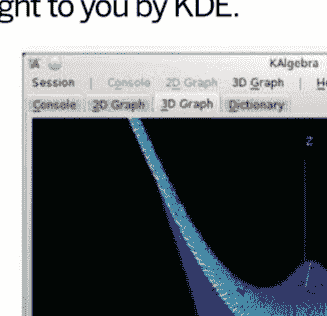

此外，`KAlgebra` 的优势之一是其详尽且早期的文档。“帮助”菜单包含指向完整手册的链接，而主窗口的“字典”选项卡包含了 `KAlgebra` 支持的所有数学和逻辑操作的可搜索列表。每个运算符都由描述、其接受的参数列表、在代数中的调用方式以及示例图来定义。

## 数学创作

`KAlgebra` 的主菜单和其他窗口具有相同的结构，即它们都将控制台、2D 图形和 3D 图形作为主要组件。标签和菜单以一种直观、自文档的方式相关联。

- `KAlgebra` 的 2D 界面易于使用，具有多图显示和动态预览功能。

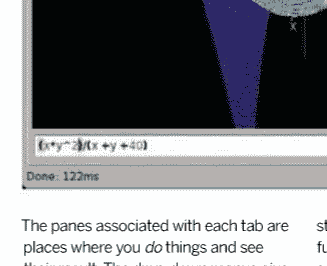

与每个标签相关的窗格是你执行操作的地方，而显示的下拉菜单提供了在该相应标签中可以执行的操作，这些操作与标签名称相同。例如，代数窗格是专门的，`KAlgebra` 可以发布命令并进行一些计算。图层可以通过双击它们来更改其颜色和大小，并显示上一次计算的结果。

关闭 `KAlgebra` 时，所有这些内容将会丢失，但似乎可以保存你想要在之前的会话中执行的所有命令内容，而无需重新输入。这些文件也会被保存。“控制台”菜单中的“导出”功能会将你输入的内容显示为 HTML 图像，方便打印或在线发布。解释到此：此列表结合了两个 `KAlgebra` 窗口，向你展示了在其 2D 图形部分可以进行的操作。真实的图形留在标签的左侧部分，你可以放大、缩小，并在鼠标悬过曲线时显示内容。右侧窗格分为四个标签。为了查看内容，你需要：

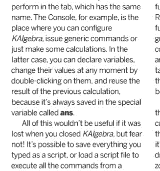

从名为 Alge 的标签开始，在顶部输入你的函数，选择它的颜色并享受动态预览。当你点击它时，函数将会在主区域被绘制出来。重复此过程，直到你添加了所有想要绘制图图的函数，每个函数都使用不同的颜色。所有颜色和函数都列在两个标签中。最后一个名为“Info”的标签用于显示主图中可见的数学坐标。

3D 图形部分比 2D 部分简单。`KAlgebra` 目前仅支持 `z=(x,y)` 形式的 3D 绘图。其中，可以使用的地方。你可以绘制图形、放大、缩小，并使用方向键进行旋转。这允许你放置对象，因为你可以使用：

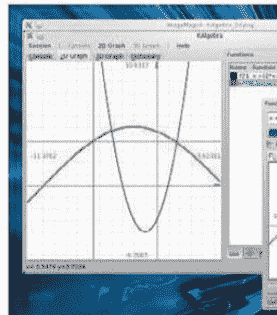


### KAlgebra 版本信息

**版本**：0.1

**网站**：http://kde.org/KAlgebra

**许可证**：GPL 协议下免费使用。

它拥有出色的 UI，但在绘图 Grace 或 jgp 方面非常灵活。

# 评分 7/10

## 图形绘图工具汇总

## KmPlot

### Algeebra 的兄弟，专门用于数学分析。

一眼看去，`KmPlot` 代表 `Algeebra`——两者都是基于 KDE 的应用程序。其他共同点在于，`KmPlot` 是一个高级计算器，你可以用它加载并绘制数值数据。

两者之间的相似性在这里或多少体现，因为主要重点在于 `KmPlot` 对 3D 图形的处理。它支持笛卡尔、极坐标、参数函数以及不同的函数，包括传统的笛卡尔函数，或者如果你使用 `View + Fit` 到三角函数，点击左键即可进行倍乘。绘制显示了所选曲线的区域和切线。在下拉菜单中，你可以启动一个免费的计算器和一个数学表达式编辑器。

当你需要计算积分、导数、函数的最小值和最大值时，`KmPlot` 是一个易用工具。另一个优势是它绘制函数的方式。你可以关联最多四个滑块，以查看访问区域的变化，但并不是全部。通过右键激活的下拉菜单可以访问动画面板，你可以在其中为参数定义最小值和最大值并对其进行增量。此时，你将能够让 `KmPlot` 根据每次增量绘制图形的所有版本的序列。

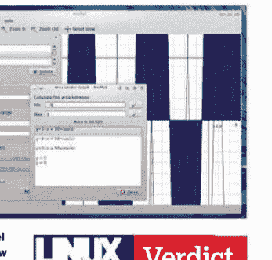

在任何绘图中使用的命令和函数都可以以类 XML 格式保存在文本文件中。

- 一个优势是它让你研究参数函数的方式。

- 当你需要知道函数的面积或极值点时，问问 `KmPlot` 即可。

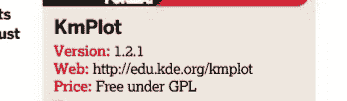

### 结论

**版本**：1.2

**网页**：http://kde.org/kmplot

**价格**：GPL免费

`KmPlot` 的范围较窄，但它能完成它想要做的任务。

# 评分 7/10

## Kayali

### 尚未准备好上市，但请关注它。

与本次汇总中的所有其他应用程序不同，`Kayali` 仍处于开发的 Alpha 阶段——到目前为止，它是一个很有前景且有趣的工具，可以完成其他工具可以的功能。`Kayali` 也容易开始和测试一段时间。它可以区分数学表达式并通过 `Gnuplot` 绘制它们。用 Qt 编写的界面只是前端。`Kayali` 使用的引擎是最好的引擎之一，非常强大，且该项目由 `Mathematica` 系统 (http://mathematica.sourceforge.net) 驱动。虽然它不能执行 `Mathematica` 能执行的所有操作，但很容易将一些数据输入到 `Gnuplot` 中绘制结果。界面简单到可以保存，由于是 Alpha 阶段，你可以定义参数的最小值和最大值并进行增量。

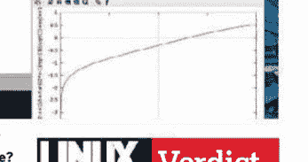

- 优势是它的工具。

### 结论

**版本**：0.3

**价格**：GPL 下免费

# 评分 5/10

> “在 Mathematica 方面是一个很有前景的工具。”

# 书评

## Foundation Drupal 7

Neil Vech 表现得游刃有余，完全是另一个 DrupalExpert。

最近涌现了一系列 Drupal 书籍，这恰恰证明了 CMS（内容管理系统）的成功，现在《经济学人》和白宫都在使用它的界面。遗憾的是，并非所有书籍的质量都很高，正如我们在过去几个月里的页面中所看到的那样。不过，这算是一个例外。

当然，书中有很多显而易见的“如何安装”章节，这些部分处理得不错，虽然完全全面——如果能在某些卷书中看到一些故障排除提示和常见问题的解决就更好了，但它们完成了任务。

写作语气像商务化写作，但确实传达了信息。这本书最大的问题是无休止的截图和图表，这让你不由自主地多坐上几分钟。尽管如此，这是 Drupal 书籍中不错的例子之一。

书中主要且实用的部分是安装后的内容，它涵盖了核心模块的设置和激活，并对如何使用它们提供了较少的建议。

最棒的是关于第三方模块和主题章节。Drupal 本身是一个很强大的自包含系统，但如果不使用任何代码，制作出的网站将毫无出彩。很好的是，这本书承认了这些模块的价值，并提供了良好的安装指南。虽然没有达到应有的深度，但那 20 页……

### Drupal 7 评价

> 在这本密集的的手书中，你可以找到关于 CMS 非核心组件的有用指导。

## Linux 手册

Neil Vech 为在 Linux 上的成功付出的努力回报。

Haynes 以其执行所有任务的一系列步进式指令而闻名。近年来，该品牌已经分化，生产了一些幽默风趣的作品，可见各种领域。这本属于后者。虽然硬件封面设计非常漂亮，但没有大篇幅的章节，你得到的是一种让人联想到项目的格式以及桌面常用命令。

值得注意的是，作者扩展了他对真实体裁的广泛知识，他的水平比一般的“如何做”文档要好得多。后面的章节涵盖了编程、设置 Web 服务器，更重要的是，所有这些内容是如何用一种友好、无术语的指南编写的。然而，一旦它涵盖了 Ubuntu 的长期支持版本（LTS），它将贯穿本书剩余部分。基于书中提供的 Ubuntu 10.04 LTS 版本，其操作步骤和软件指南已经是顶尖水平了。唯一的微小问题是质量如何……

### Foundation Drupal 7 书籍信息

- **作者**：Robert Jenkins
- **出版社**：Apress
- **ISBN**：978-143252880
- **价格**：$29.99
- **页数**：306
- **评分**：8/10

这是一部超出基础知识、有时相当费力的著作。

### Linux 手册 书籍信息

- **作者**：Mike Saunders
- **出版社**：Apress
- **ISBN**：978-1442592700
- **价格**：$19.99
- **页数**：160
- **评分**：8/10

一本面向初学者的无术语 Ubuntu 入门读。Mike 欠我一个啤酒。见在 Haynes 出版的 Ubuntu 初学者指南中。我们想提到这本书是 Mike 写的。

Graham Morrison 在一位顶级极客的话中为他的职业寻找了慰藉。根据这本书第一页的说法，极客们“背负着令人衰弱的技能”，而这本书肯定了将你表达欠佳的想法转化为成就事业的主业。它对主题、词汇和想法使用了随意的、非正式的方法。那些内容通常感觉像是和中层经理困在一起，或者在参加团队建设的冒险。每一个轶事都既引人入胜又令人恼。作者沉浸于轶事、传记和西海岸管理哲学的生涯，很好地让你觉得自己很特别，并让你充满信心。

书中没有顺序，也没有有帮助的递进关系；虽然有一个实用的索引，但各种标题中的术语让导航变得困难。还有一些严重的遗漏。例如，没有任何关于创建优秀简历的内容，而且对于需要帮助的读者来说也无可读。作者只是假设你已经在“横扫一切”。这对于一个承认极客背负着令人衰弱的社交技能的作者来说，这很令人惊讶。

## 软件开发人员职业指南：成为极客

他接着带你穿过了电话新闻领域的不满领域，以及薪资监管的预言之火，最后以如何与新经理相处以及中间的领导力挑战作终。书中有时间讨论作者对未读邮件、经理类型和会议的零容忍。

### 书籍信息

- **作者**：Michael Lopp
- **出版社**：O'Reilly
- **ISBN**：978-0-596-15507-0
- **价格**：$35
- **页数**：318
- **优点**：有趣且富有见地，但作者的语气可能令人厌烦。
- **缺点**：随意的职业建议合集，趣味十足，但缺乏秩序。

这些是一个被捕捉在博客形式中的老天才的精炼思想，这也是主要问题所在。它感觉像是一系列散落在封面之间的随机想法。

- **评分**：7/10

## 软件基金会

Stephen Fry 先生向你介绍了自由软件，并提醒你记住一个非常特殊的生日。

www.gnu.org/fry

自由软件基金会

## Distrowatch

本月来自……的库的新闻汇总

## 继续

OpenSUSE 还将推出 XFce 和 XOME 的最新版本，以及其他发行版。决定安装哪个版本的 Firefox 并不容易，因为开发者最终选择了 4.0 版本。你的内核也更新了。这一切都是基于 Linux 2.6.37、X Server 9 和 GCC 4.5。因此，如果你追求稳定性和性能，OpenSUSE 是一个非常好的选择。

3.0 版本也由开发者发布以测试性能。包含的 KDE 版本是 4.6，对于大多数人来说绰绰足够。虽然从 OpenSUSE 的配方中移除了一些功能，但它比之前的版本快了一些。

OpenSUSE 11.4 包含了 LibreOffice 3.2，这使其成为第一个将其作为默认办公软件的主要发行版。

## 新鲜薄荷

## 动手实践

## Linux Mint KDE: 此版本提供 KDE 4.6 和 Linux 2.65

在 Mint 10 晚了几个月后，Mint KDE 终于面世了。它可能值得等待，因为包含的 KDE 4.6 版本非常稳定，没有任何 Bug，而且正处于巅峰状态。有了 Mint，它为你的下载任务提供了一个愉悦且实用的桌面。

在配置时测试连接。软件管理器接收了一些更改，以便于查看和使用。10 系列优于 Ubuntu 10.0 和 Linux 2.65。配备 X.Y.O.C 和 GRC 4.4。对于图形方面，有 Gimp、Dipbox 和 Skype。Mint 还包括 choice client、Torrent、FrostWire 和 Thunderbird 等应用。办公方面有 OpenOffice.org 和 KMyMoney。此外，还有 Songbird、Dragon Player 和音乐播放器。Oracle 的 VirtualBox 现在通过一个名为 `virtual-freebox` 和 `mint-meta-packages` 的新元包重新构建。

Bodhi Linux 这样一个年轻的发行版引起了很大的关注。

Bodhi Linux 正在声名鹊起，尽管它自 Ubuntu 20.04 以来一直处于开发阶段且处于早期。事实上，它似乎出了一些问题，发布了多达十次甚至更少？并不是说他们没有进展。请访问 http://makeitchester.com 查看 Matt Wallen。

也许自 Ubuntu 以来，一位 Linux 极客的勇气赋予了他的敏锐感，并添加了他需要的一两样东西。然后他必须将其提供下载给那些需要的人。这就是我们声称通过 Mint 可以做到的，但你实际上能做多少呢？也许你感受到了真正的冒险和……

在纸面上，他们的描述说仅需 300MB。只有 Enlightenment 桌面和其他无物。那么为什么这个看起来不起眼的发行版会引起如此共鸣呢？

或者它只需点击几次即可让你进入西班牙语或英语界面。最后，你会发现一个更好的浏览器、一个 LXTerminal 管理以及 Ubuntu 安装。从那里开始，之路开启。这就是 Bodhi 的魅力所在，激励了所有想做同样事情的人。也许你也可以构建自己的发行版。

有些用户切换了 KDE 菜单启动，它提供了与 Mint Menu 相同的功能。更新管理器合并到了一个应用中，这……

一些早期评论报告了 GUI 访客，在 Firefox 和 VirtualBox 中可用，以及 VLC 使用。这些都是通用的，尽管此版本已结束，但它提供 32 位和 64 位版本。

- Mint 的二进制壁纸，提供精细且护眼的视觉效果。

www.linuxmint.com

## 通用管理器

最近，来自各种 Linux 发行版的开发者聚集在一起讨论他们似乎面临的最大问题：“任务是轻松地安装和删除 Linux 应用。”他们的解决方案是 AppStream 跨发行应用程序。

AppStream 将为用户提供一个基于 Ubuntu 软件中心的应用界面，允许用户阅读描述、查看应用程序并阅读他意见。它还允许他们在需要时安装应用程序。

图形前端将与 PackageKit 接口，这是一个跨各种发行版安装软件的通用管理器。PackageKit 将处理 APT、Yum、Ypper 或 RPM 以安装所需的应用程序。

服务器将执行搜索。

AppStream 通用安装程序将让新用户对 Linux 不再畏。

### 列表

DistWatch.com 上得票最高的 10 个发行版，2 月 14 日 – 3 月 14 日（向我们展示）

| 发行版 | 点击次数 |
| --- | --- |
| Ubuntu | 2,232 |
| Linux Mint | 1,970 |
| OPENSource | 1,175 |
| Debian | 1,557 |
| Fedora | 1,420 |
| Arch Linux | 944 |
| Puppy Linux | 934 |
| PCLlinux | 903 |
| Sabayon | 885 |

DistWatch.com 根据每个发行版页面的点击次数监控发行版的流行程度。虽然这些页面并不代表实际的安装量，但它们是特定月份哪些发行版流行的指标。

www.taxumadar.com

2011 年 5 月 | LXF1/44


# MythTV

## 到 mythTV

## LINUX FORMAT 在 DVD 上的 Mythbuntu 10.10

## 想直接将电视节目录制到电脑上吗？Neil Bothwich 将引导你使用 Mythtv。

在接下来的几页中，我们将介绍安装和设置 MythTV，以及如何使用各种功能。我们还将处理出现的一些常见问题。

让我们从硬件开始。你需要一台能够录制节目的计算机和一些存储。MythTV 是一种服务器/客户端模型。该模型以其后端和调度录制、告警标记等而闻名，前端可以是同一台电脑，但它们有不同的需求。

后端需要大量的存储（一旦你进入 MythTV，你会发现空间很小）和一个性能相当强大的处理器。换句话说，一台典型的电脑——不是你客厅里最活跃或最安静的添。。前端需要良好的连接以及向电视输出视频和声音的能力。我使用一台 Acer Aspire Nitro 网络式机连接到……

我们在 LXF141 中回顾了 MythTV 0.24，并评论说设置起来有点费力，但值得的。MythTV 不仅仅是一个录制器——它的插件增加了额外功能，这意味着你可以用它做各种聪明的事情。

> 它不仅仅是一个电视录制机 - 插件增加了额外功能。

拥有独立的前后端还有其他优势。你可以让多个前端连接到一个后端。这在任何房间都可以实现。你可以在楼下开始看节目，然后在床上看完，因为后端会记住你看到哪里了。

你需要的电视类型取决于你所在的地区。大多数现在是 100% 数字化的。

## 安装与设置

### 逐步步阶：使用 mythtv

1. 通用
2. 采集卡
3. 视频源
4. 输入连接
5. 频道编辑器

# MythTV

## 基础用法


到目前，你已经安装了 MythTV，设置了后端，并且应该已经看到了各种形式的前端界面。

如果前后端是分离的，第一件事要告诉它们进行连接。当你启动一个未配置的前端时，系统会自动提示你执行此操作，但如果没有提示，或者你想更改，设置可以在 `Setup（设置） > General（通用）` 中进行。你需要设置主机名和三个 MySQL 设置——数据库名、用户名和密码。前两个项不太可能不是 `mythconv` 和 `mythtv` 以外的内容。密码以及另外两项可以在后端的 `/home/mythtv/mythtv/mysql.txt` 中找到。

我们将参考使用键盘来控制 MythTV。遥控器是通常的方法，但按钮映射会映射到按键上——按键本身是一致的，而每个遥控器都是不同的。我们将统称为遥控器。

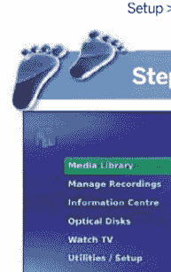

## 逐步操作：管理你的记录


本期的参赛者比上次要好。献给《来自 April 月的喜剧》、皇家空军轰炸司令部以及 Trevor White。

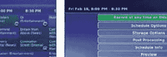

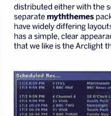


## 2 开始录制

我们还没有录制过任何内容，请前往 `Manage Records（管理记录） > Scheduling（调度） > Program Guide（节目指南）`，在那里使用下面的按钮显示正在录制状态的节目列表。使用方向键选择你想录制的节目。如果你按下 Enter 键，将显示以下屏幕……

## 3 录制剧

……你可以在那里设置录制选项。该选项是 `Record At Time On Channel（在频道指定时间录制）`。换句话说，剧录制将在每个频道上录制。这有助于 MythTV 进行调度，因为它为每个频道都创建了记录。除非你编辑计划中的 `Options（选项）` 部分，否则 MythTV 默认显示每个集的一集。

### 自定义录制规则

名称：mythtv

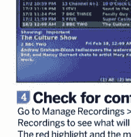


以下节目已经录制，并将出现在你的列表中。


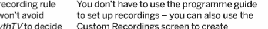

## 1 检查冲突

前往 `Manage Records（管理记录） > Recordings（录制）` 查看将要录制的内容。红色高亮和右上角的消息显示所有冲突。如果有列表，意味着 MythTV 正在录制该节目的晚些场次（你可以在下方看到）以避免冲突。

## 3 排序你的优先级

记录的调度选项具有优先级设置。这不会避免冲突，但有助于 MythTV 决定录制哪个节目，如果你发现冠军联赛的比赛与你喜爱的节目冲突了。

## 4 制定你的规则

你不一定需要使用节目来设置录制——你也可以使用 `Custom Rules（自定义规则）` 从头开始创建录制。如果你想录制时间总是不相同的节目，或者例如在凌晨 4 点到晚上 10 点之间录制纪录片，这非常有用。

LFX144 2011年5月

www.mythtv.com

## 问题时间

使用 MythTV 并非没有挫折，所以现在我们回答一些常见问题。

## 常规（高级）

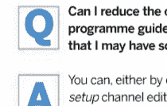

| 节目开始前的提前录制时间（秒） | 300 |
| :--- | :--- |
| 我可以减少节目指南中显示的频道，以便只显示我可能感兴趣的频道吗？ | |
| 节目结束后的录制时间（秒） | 600 |
| :--- | :--- |

你可以这样做，可以通过在 MythTV 设置编辑器中删除频道，或者创建频道组（Channel groups）。频道组是首选方案，可以在 `TV settings（电视设置）` 中找到。定义了一个 `favourites（收藏）` 组，你可以使用其中一个或创建其他组进行录制，因为默认情况下，它们都被选中了，直到你不再想要它们为止。在节目指南中，包括 Al Al 频道。TV 部分还有一个选项，你可以为每个频道设置默认频道组，无论你上次用的是什么。

| 分类随时间录制 | 运动 |
| :--- | :--- |
| 录制超过节目结束（分钟） | 否 |
| :--- | :--- |

频道组仅限制节目指南中显示的未用于录制的频道，因此你也可以通过移除 +1 频道来减少频道，而不必失去它们提供的灵活性。同时，但不是 BBC One。ITV 和 Film4，因为它们都在独立的倍频上，在英国 Freeview 电视上总共有六个。如果有六个调谐器，你可以录制一切，但你可能永远没有时间看完它们。

## 电视卡不够用？

## 安全缓冲

如果我想录制重叠的节目，我需要多块电视卡吗，还是可以将一张变成多个频道？我更倾向于早几分钟开始，晚几分钟结束。这比直接看节目然后因为开始晚或超时而错过结尾要好。

如果你正在使用 DVR，这意味着将多个频道合并到一个流中。我想为每个 DVR 调谐器卡额外录制一个频道，并将其分成多个频道。

有两种方法可以配置此项。第一是前往 `Setup（设置） > TV Settings（电视设置） > Recording（录制） > Prioritize Sorting（优先级排序）`。在这里，你可以设置 `Start Early（提前开始）` 和 `End Late（延迟结束）`。这些是录制的默认设置，可以针对单个规则进行更改。注意，如果你尝试录制无接的节目，这可能会导致冲突。频道组仅限制节目指南中显示的未用于录制的频道，因此你也可以通过移除 +1 频道来减少频道，而不必失去它们提供的灵活性。

| 频道 | 频道 |
| :--- | :--- |
| 1 | ITV |
| 2 | ITV |
| 3 | ITV |
| 4 | ITV |
| 5 | ITV |
| 6 | ITV |
| 7 | ITV |
| 8 | ITV |
| 9 | BBC |
| 10 | ITV |
| 11 | ITV |
| 12 | ITV |
| 13 | ITV |
| 14 | ITV |
| 15 | ITV |
| 16 | BBC |
| 17 | ITV |
| 18 | ITV |
| 19 | BBC |
| 20 | Channel |
| 21 | Channel |
| 22 | Channel |
| 23 | Channel |
| 24 | Channel |
| 25 | Channel |
| 26 | Channel |
| 27 | Channel |
| 28 | Channel |
| 29 | Channel |

## 分率

如果我想录制重叠的节目，我需要多块电视卡吗，还是可以将一张变成多个频道？我更倾向于早几分钟开始，晚几分钟结束。这比直接看节目然后因为开始晚或超时而错过结尾要好。

如果你正在使用 DVR，这意味着将多个频道合并到一个流中。我想为每个 DVR 调谐器卡额外录制一个频道，并将其分成多个频道。

我不想用键盘看电视。我如何添加遥控器？

最简单且可能是最好的方法是获取一个带有学习功能的无线遥控器。你可以让遥控器处于学习模式，但使用键盘并将按键分配给各种按钮。

## 遥控器

常用的方法是使用 LIRC，MythTV 默认安装了它。它让你在安装期间选择控制器，你也可以以后从 `Mythuntu（Mythuntu 控制）` 中进行。你需要更多接收端的信号，所以请使用带有 MythTV 的媒体中心遥控器。

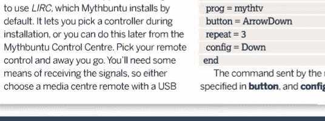

# 插件扩展

MythTV 自带了一系列插件，维基中也链接了一些非官方插件。在这里，我们将查看 MythTV 的一些实用插件和其他功能，虽然这些功能都并非必不可少，但都让它变得非常有用。


> 使用 MythWeb 通过网络浏览器访问你的视频收藏或设置录制，以便随地访问。

## MythVideo

所有这些中，我最常用的。它允许你解码 MythTV 中任何格式的文件。它支持所有标准，也支持 ISO 镜像。如果你将 DVD 复制为 `/dev/video movie.iso` 并将其放入 MythVideo 目录，你就可以带有菜单和特殊功能观看 DVD 了。或者，如果你有足够的存储空间，可以使用任何 AVI 或 MPEG 转码程序来复制主标题，这使你能够通过电视遥控器观看电影。MythVideo 还可以连接到 IMDB 以获取文件信息，并获取封面图像显示在浏览器中。

已包含以确保 Apache（一种兼容的 Web 服务器）按要求运行。如果你打算让互联网上的用户访问 MythWeb 并限制访问，你应该进行一个重要的更改。“已完成剧集”集合可能不是公开的，但要确保你运行的网页爬虫会跟踪 MythWeb 列表上的所有链接，包括以链接形式出现的删除横幅。否则，你可能会无意中删除横幅。

## MythWeb

从技术上讲，它并没有使用插件——你不需要通过网络浏览器设置你的 MythTV。这意味着你可以从任何地方编写节目单并设置录制。你听到今晚有好节目，但你没法及时在手机上收看。

> 将你的短语浏览器指向 MythWeb 进行远程录制。

指向你的 MythTV 设置并设置录制。你需要启动并正在运行的 Web 服务器，然后将 MythWeb 解压到你的 `Document` 文件夹中。有一个 `jitlass` 文件

## MythGallery

你还记得小时候的聚会吗？当时哈里叔叔会拿出幻灯片，用他最新的晚间节目“娱乐”大家。即使你那时还没有老到会遭受童年阴伤的程度，现在你也做同样的事情了！有一种更积极的方式让你分享照片，而不需要每个人都有电脑。MythGallery 是一个用于 MythTV 的相册。安装后的第一站是 `Setup > Media > Images Settings`，在其中你设置

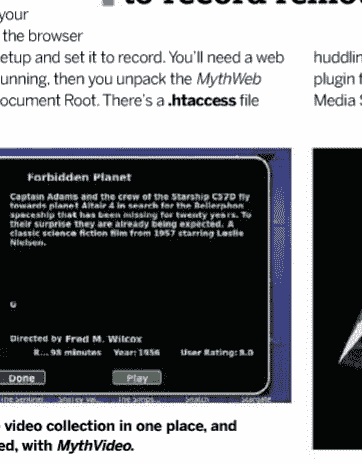

> MythGallery 的幻灯片有许多华丽的过渡效果。

> 使用 MythVideo 将整个收藏放在一个地方，并妥善分类。

MythTV 目录将包含你的照片。如果你有兼容的硬件，还可以启用基于 OpenGL 的幻灯片过渡效果。

该界面对于照片查看软件来说相当标准，重点在于查看。它没有提供像 Digikam 那样详细的收藏管理真实功能。当你进入一个目录时，MythGallery 在创建照片缩略图时会有延迟，但这是为了下次的快速访问。幻灯片在电视屏幕上看起来很好，带有一些额外的样式。如果你有不同的相机，在硬盘上显示照片时就不会有延迟——使用 MythGallery 显示它们吧。

## 广告移除

如果你不是那种喜欢建立电影或节目库以备以后观看的人，你就不希望你的节目被广告中断中断。MythTV 有几个可以帮助你的功能。第一个是自动广告检测。你可以在 `Settings` 中将其设置为在每次录制后自动运行，或按每次录制进行。你也可以在需要时手动运行。

广告检测可能效果不佳，因此值得尝试看看哪些技术对你最有效（你可能需要一些性能支持）。

myth-method 允许你为通道设置不同的检测方法，包括对 BBC 频道不检测。

你可以使用 `Z` 和 `Q` 键跳过到下一个或上一个广告段，或设置 MythTV 通过检测系统自动跳过广告段。对于你为收藏库录制的节目，你可以手动移除编辑以确保准确无误。启动节目并按 `E` 进入编辑模式。按 `Z`

- 你可以从录制中删除广告和其他不需要的内容，在此过程中减小文件大小。


| 用户任务 (任务命令) |
|---|---|
| 用户任务 #1 描述: 复制文件到 USB |
| 用户任务 #1 名称: `/home/user/video/%FILE:$FILENAME` |
| 用户任务 #2 描述: 为 Android 转码 |
| 用户任务 #2 名称: |
| 用户任务 #3 描述: 用户任务 #3 |
| 用户任务 #3 名称: |
| 用户任务 #4 描述: 用户任务 #4 |
| 用户任务 #4 名称: |
| 编辑剪辑点 |
|---|---|
| 移动剪辑开始 |
| 移动剪辑结束 |
| 剪辑列表选项 | 01:02:10 93262 |

> MythTV 有功能可以帮助你剪掉广告。

将广告加载为剪辑。检查剪辑位置是否正确，并通过移动到你想剪辑的地方并按 `M` 手动剪辑进行调整。

编辑广告时，最好在关键帧上剪辑并使用转码器（在 `TV Settings > Recording Profiles > Transcoder` 中指定转码类型）。这种快速转码意味着它不需要重新编码文件的任何部分。如果你遗漏了部分，请使用 `MPEG-TS`（程序流）转码为 `MPEG-2`（DVD 使用的格式）。区别在于任何广告，

## 用户任务

用户任务是一种插件系统，允许你扩展 MythTV 的功能。你可以为录制定义用户任务。你有四个用户任务可以在录制结束时调用，或者以相同的方式启用。你可以在 `TV Settings > General` 部分中决定运行哪些任务。这些参数在 MythTV 维基中都有解释，但常用的参数是 `%FILE%` `%TITLE%` `%STARTTIME%` `%ENDTIME%`。你可以使用这些参数传递给转码器，将文件转换为另一种格式或用于另一个设备。脚本也应该将转换后的文件放在。

## MythTV 事件

MythTV 事件具有这些功能。主要区别是，当特定事件发生时，而用户任务可以被调用。

## 主题选择


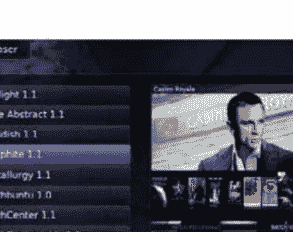

## 直播电视

MythTV 事件具有这些功能。主要区别是，当特定事件发生时，而用户任务可以被调用。

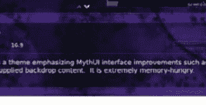

## 遥控器

除了更改主题，你还可以更改菜单布局。有几种供选择，位于 `Setup -> Appearance`。在其中，查看 `Menu Theme`。这不会改变 MythTV 的外观，只是改变菜单的布局。选择一个让你快速访问经常使用的功能的布局。

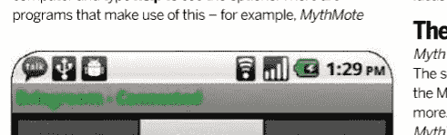

## MythMote

MythTV 的用户界面可以很大程度上进行自定义。截图显示了 MythTV 和 Chooser 主题的区别，但还有很多。官方主题将随基础 MythTV 包一起发行，或者你的发行版可能包含几个。

安装后，你可以使用 `Setup` 中的 `Theme Changer` 选择主题。如果你有多个屏幕，可以为每个屏幕使用不同的，某些主题适合大屏幕。

## SCALE

## 加州之梦

Jono Bacon 从洛杉矶热门 SCALE 会议背后的两位志愿者那里找到了理想的配方。


... (图片 47_1 到 47_16)

## SCALE

世界上有很多开源会议。有些面向社区的，而有些则将两者完美融合，为所有参会的公司提供一种友好的氛围。总部位于洛杉矶的加州 Linux 展会（SCALE）正是这样发展起来的。我们会了 Ian Rabbovich 和 Dave (Beach)，他们从第一天起就参与了会议，以此探索它的故事。

**LFX:** 这种商业和社区参与者的市场是关键，并提供了一定的平衡。这种微妙的平衡是我们独特秘诀的关键之一。

**LFX:** SCALE 多年来是如何增长的？你们是如何管理这种增长的？

**OB:** 它的增长是为了满足社区的需求——我们的增长也差不多。结果，我们已经从一个为期两天、有 12 名演讲者和 25 个展位的开放展会的会议，发展成为如今有 65 多名演讲者的为期三天的活动。

**LFX:** SCALE 是如何开始的？

**OB:** SCALE 起源于 10 年前在硅谷北部设施（Northern Facility）举办的一系列 LFXfest。当时我们是为期两天的活动。到记录的 LFXfest 面临日益增长的挑战时，我们需要社区来进行这类活动。

**Ian Rabbovich:** LFXfest 非常非常棒，但随后泡沫开始破灭。由于想与 UCLA 和 UCI 的一组目标相似的学生一起在南加州举办一个开源活动，Scale 一于 2002 年在南加州大学（USC）会议中心诞生了。我们大多数的原始创始人至今仍在那里。

**LFX:** SCALE 的目标是什么样的受众？

**OB:** 人口统计特征多样且广泛。我们试图涵盖包括初学者和儿童在内的所有观众。我们努力为每种兴趣提供内容。这意味着我们吸引了从业爱好者到 IT 专业人员以及高管的粉丝。我们的使命是帮助更多与编程有关的人。尽管我们的名字里有 Linux，但我们涵盖的大部分内容都超越了特定于 Linux 的主题。

**LFX:** 你希望我们提供什么？

**OB:** 现在我们能够承担所有这些内部工作了。然而，对活动的某些兴趣让我们能够扩展内容并增加更多原创性。这种特殊的 SCALE 帮助我们通过吸引新社区来保持充满活力的氛围。

**LFX:** 为什么你们想扩大规模？

**OB:** 社区想要这样做。我们预计增长将像过去一样持续：每年增长 5% 到 15%。我们想为未来做计划，我们可能需要搬到更大的地方。

**OB:** 我们看到对针对开发者的演讲和未来的专题有很高的需求。我们想象我们需要添加更多行业特定的专题。保持社区的参与至关重要。另一种方法是继续在美国扩大我们的活动。例如，2010 年，我们与奥斯汀的一群人合作推出了德克萨斯节（Texas Fest）。他们的年度活动即将举行。我们的目标是继续帮助他们。

## SCALE 的未来

**LFX:** SCALE 已成为美国最受欢迎的会议之一。你们想如何留住社区？

**OB:** 我们通过目标吸引社区。我们最初的想法是建立人们喜欢参加的本地活动。这些微型会议经历了成长痛苦，其他一些已经衍生成为它们自己的活动。然而，其中之一是想要在社区中使用开源技术的教育者。

**LFX:** 你们想给组织者提供什么？

**OB:** 接触社区。在南加州，我们有庞大的人口，我们需要比小社区更多的软件开发支持。因此可能需要一两个营销部门，更多地关注终端用户体验。

**OB:** 尽早计划——在有问题时不要害怕寻求帮助。许多社区成员一起工作并交流想法。我们看到许多新活动出现，不要害怕与他人合作来实现我们的目标。最后，像任何其他开源项目一样，让其他人更容易贡献。组织活动需要大量工作，让其他人更容易维持 SCALE。


www.taxradar.com 2011年5月


## 关于 Ubuntu 我们想要改变的 16 件事

Ubuntu 是一种流行的发行版，但就像生活中的一切一样，它并不完美。在软件方面和思维方式方面，都有很多可以改进的地方。Neilovich 有一些建议。

- **01 展示它是如何帮助的：** 这最近做了。“很多人不理解 Linux 开发的是，它真正是一项团队努力：红帽 开发了内核，Ubuntu 却获得了功劳”——这对于 Ubuntu 来说有点不公平，也许是因为因为它没有为自己所做的赢得信誉——例如让 Linux 对大众来说更可能实现。如果是这样，它应该多吹吹自己的喇牛角。

- **02 颜色选择：** Ubuntu 的颜色是怎么了？这不仅仅是某些色调的单调——那些漂亮的颜色被别人抢走了——而是它随着版本发布而变化的方式。Ubuntu 使用了所有可能的棕色，从深色到赭石色，没有任何规律，然后切换到奇怪的红木色。需要一些一致性。无论如何，如果我们不喜欢这个颜色，我们也有时间去适应它。

- **03 主目录分区：** 我在评论中抱怨过这一点，并得到了 Ubuntu 的快速回复，但没有什么能说服我将数据堆积在根分区是一个好主意。修改安装程序以删除根文件系统的部分而不是格式化它以保留 `/home`，以及为什么 `/home` 起初应该是分开的。

- **04 发布周期：** 每六个月一次的发布周期（设定每年 4 月和 10 月的最后一天发布）是一个阻碍。它培养了适应性，但也迫使开发者在代码准备好之前发布。这影响了软件开发人员必须计划营销和广告以与发布同步。这也意味着 Ubuntu 在某些方面使每次发布与上一个版本不同，但通过颜色方案、按钮或默认软件选择来实现。自由软件应该为 Debian 准备好。现在 Debian 已经成熟得多，更长的间隔将使 Ubuntu 能够有更多时间测试新添加的内容，甚至让发布变得容易，而不是在最后时刻手忙脚乱地修复漏洞。

- **05 解释更改：** 为了改变而改变是毫无意义的，如果你不解释为什么要改变某些东西，它就会被视为是如此。升级，或在之前的 Ubuntu 上进行完整安装，应该在首次启动时在浏览器中打开更改列表及其原因。不要只移动按钮就让它运行。

- **06 对想法进行更多用户测试：** 看到一个主流发行版对既有软件的替代方案（如 `Wayland` 和 `Unity`）进行实验是很好的，但完整的发行版发布很难尝试。也许 Ubuntu 应该有一个某种测试分支，用户在这些更改进入完整发布版之前获得它们。这与 `Alpha` 或 `Beta` 版本不同，后者应该在某个想法进入该版本之前就完成。

## 滚动发布

固定版本发布对于发行版的营销和推广很有处：随着发布日期的临近，知名度和兴趣随之增加。它们为 Ubuntu 派对提供了绝佳的理由。但一旦安装了系统，固定发布就会变得很麻烦，除非在新版本发布后使用 `apt-get` 进行 `dist-upgrade`。但这与滚动发布不同，在滚动发布中，你需要的时随时可以获得最新的软件包，而不仅仅是在新版本发布之后。

## 让 Ubuntu 正式化

LXDE 是一个极佳的轻量级桌面，比 Xce 好得多——即使对于视频编辑也是如此——但 Ubuntu 仍然是一个非官方的抵抗。是时候让 Ubuntu 获得 Ubuntu 的认可，并被 Ubuntu 官方认可为旧设备以及想要标准桌面体验的网络用户的替代方案了。

## LVM 分区

如果你避免了分区，Ubuntu 应该考虑在安装程序中使用 LVM。现在 Fedora 已经这样做了，遵循了一种简单的根目录空间设置方法以及一个用于管理和调整卷大小的图形工具。现在改变一下，让用户将他们的系统改为

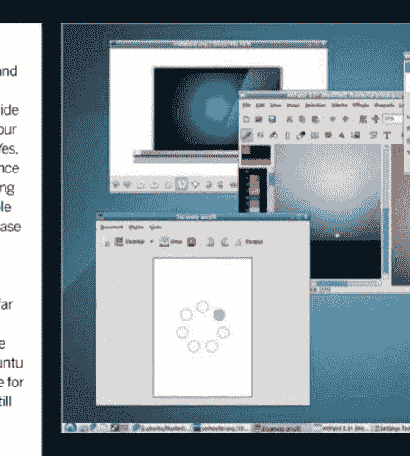

## 简单的解码器安装

使用 DVD 并声称“LVM 坏了”，是因为它无法在选项中找到 Ubuntu 仓库，但如果你不知道如何操作，像 Meduntu 那样搜索并添加仓库会更费力。如果 Ubuntu 能在安装包设置期间从其他地方下载并提供安装第三方仓库

> “百害必争”倡议是好的，但它需要更多。

## 使用 RPM

RPM 对 Debian 来说是一种更优的包格式——为什么 Linux 标准基础 (LSB) 不选择 Ubuntu 呢？

放弃 Debian 上的很多创新会有帮助，而且事实证明，如果放弃 Debian 软件包并升级到 RPM，在其他领域（如 `Wayland` 和 `Unity`）将发生重大变化。

## 为我们提供最小化/网络安装

对于那些拥有快速连接的用户来说，下载完整的安装包是没有必要的。我很确定用户已经注意到了 CD 启动盘，它们只安装所需的软件包。这是一个好主意，并且会加快安装速度，因为你不需要在启动之前下载几个 GB 的数据。

## 不要孤独

从 Rybreeze 切换到 Mashbox 是一好事，但来自 Ubuntu 的 75% 主题都消失了吗？Gnome 在没有分析的情况下继续运行。此外，为什么不使用 Gnome 呢？如果它有自己的商店，但为了几乎所有的佣金让竞争对手的用户加入，这种沉重的方法应该三思。

## 你必须使用 UUID 吗？

毫无疑问，Ubuntu 的臃肿看起来像一团糟。UUID 对于安装来说很好，尽管它们有文件名，但至少作为一个选项提供了人类可读的格式，我不怀疑这正是该处的内容。使用 LVM 会让这一点变得重要。

## 修复问题

我知道开发者正在尝试新功能，但过程中小问题不断出现（或者 WIF 对新事物的反应）。Edge 可能会吸引新用户，但可靠性和稳定性真的需要解决这些小问题（漏洞），因此需要付出更多努力。Ubuntu 的改进是好的，但它需要更进一步。

## 市场

某些公司决定选择 Linux 的原因之一是无人向他们展示其潜力。Ubuntu 处于可以做到这一点的位置。拥有大量的用户、商业机构的支持以及自己的商店，如果任何人都能说服开发者考虑 Ubuntu/Canonical。Ubuntu 是一个使用 LXDE 桌面的很棒的重编译。给它官方背书。


认为你正在为软件自由贡献力量？再想想！让我们一起更加努力传播这个信息，在这个问题上，Andrew 发出了战书……几周前，我们听了 TuxRadar 播客（由 LXF 团队制作），他们分享了将新用户转化为 Linux 事业的经验，我们对收到的回复之多感到惊讶，以及人们与我们分享的极其积极的故事感到惊叹。

在整个网上，人们愿意花时间和安装 Linux 并为朋友、家人、邻居和同事提供支持。你们有些人是因为热爱自由软件而这样做，你们另一些是因为厌倦了修复损坏的软件或帮助清除病毒。为了让你们做同样的事情，我们为所有潜在的转化者编写了一份指南，并发出了号召。如果你能传播信息并帮助某迈出 Linux 的第一步，你将使世界变得更好。2013 年会是桌面 Linux 之年吗？我们确实不知道，但如果我们不投入努力使其实现，它就不会是。

### 第一步：了解使命

你首先需要知道你打算尝试帮助谁。如果你认识喜欢玩最新游戏、在互联网上复制并经常遭受恶意软件侵害的 Windows 用户，如果他们只安装了最新的 Ubuntu 却发现 Cron 可以用，他们是不会善待 Linux 的。

- 你可能认识那些电脑运行速度没有应该那么快的人，或者对病毒感到沮丧的人。天哪，自从我们的出版物《PC Plus》以来，还有微软正在缓慢停止对 Windows XP 的支持。如果它通过新软件（例如新的 Windows XP 服务包 2012 系列程序）已经得到了改进，不要期望 XP 的性能会有很大提高，除非你有 SSD 硬盘。

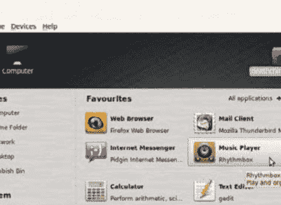

### 从 Vista 升级

这对我们的听众来说似乎是事实。Matt 回想起他困惑的女友，但她的 Windows 了：“我的妻子几年前买了一台预装 XP 的电脑，但它运行很慢。Barry 在同一天把它换成了 Ubuntu，从那以后她一直在用 Linux。”她在几个月后换回了 Ubuntu：“我没有遇到任何问题。她对它很满意，所以我很满意。”这引出了我们的下一个点：

### “你的第一个转化目标是：不满的 XP 用户。”

人们创建了 Windows 用户，如果他们仍在使用它，你应该帮助他们。为了一个老时代！如果你知道某人深受病毒困扰，你应该提到强大的 Linux 内核。

Mylyn 说：“自从圣诞以来，我在五台机器上安装了 Linux Mint，我对这几个月非常满意。我的邻居认为我是那个在 Windows 病毒后让他们的机器恢复的人。”我兄弟也觉得 Linuxuser 很好：“为他安装了 Ubuntu 9.04，但他一直在抱怨升级……”这导致了我们关于支持的问题：

> 我们不喜欢 Mint 的系统，但它对于习惯了 Windows 的新用户来说是完美的。

# 你的操作系统需要帮助

## 第二步：设置方面的帮助

当你的思绪回到初次使用 Linux 的时候，它有时会让你很困惑，不是吗？如果你当时能有一个像现在这样平易近人的专家来帮助像现在的你这样的人，那你就已经拥有它了。

你能看看这里的“匿名企鹅”（Anonymous Penguin）是不是哪里出什么错了吗？他为一个可能需要帮助的人修复了 Linux，并让他们自己修复。相比之下，像“匿名企鹅”这样的朋友能够展示，他把 Linux 给了[转换]（我个人最喜欢的词）——在我为他们安装并配置之后，他们一直运行得很好。

以下是一位 TuxRadar 听众采取的 Linux 处理方法，他无疑不想告诉我们他的名字：

- 上次，我给家成员分发了一个 Ubuntu 发行版。给他们一本示例书，然后是 Genius。它运行起来很容易，偶尔崩溃，没问题，满足你的需求。但我仍然在他们的机器上支持 Windows。

- “他们声称完全没问题并给我打电话——而我使用 Ubuntu 没有任何问题。*听听我的建议*” —— 匿名企鹅

互联网上、电视里以及我们的图书馆里（目前）有太多的知识了，我们都应该拥有天才。我们还没有老并不意味着没有足够的时间给别人安装发行版，或使用 Linux 并让它自行解决，因为它有自己自己的内部逻辑，这可能会让初学者感到困惑，所以如果你想让你新版本能够转换并腾飞，而且你真的需要帮助，你可能需要帮助他们。

每个人都在工作中感受到过这一点，或者在命令行中，或者在引导普通用户和 root 之间的区别。这些东西你会用到，但演示 Ubuntu 默认格式花费的时间要少得多，而且不会让你在老板面前显得很尴尬。

# 文件格式

你不需要转换新的操作系统或不同的软件——这可能会引入其他问题：

> 与其从 MS 迁移到 Word，使用 Office.org：Linux（泛而言之）有更多理由。人们发现 ODT 文档比“home and c”更让人困惑 —— Kevin Foley

如果问题格式是 ODT，现在使用 Office.org：Linux 将意味着成千上万个远超办公使用需求的人其启动速度非常缓慢。它可以加载和保存所有的微软文件，所以你可以像处理 DOCX 一样处理 Office 文档，并且下次当 Linux 中加载某些内容时它会完美运行。遗憾的是，反过来不行。如果你在这里花费时间处理一个重要的文件……

# 播放媒体

如果你使用 Linux 有了一段时间，你可能已经知道媒体播放器的新奇之处了，但如果你正在为 Linux 设置系统，缺乏音乐播放器可能是他们遇到的绊脚石。

Rhythmbox（不，如果你知道的话）会在那里，Ubuntu 会切换到（香蕉音乐播放器）。如果是这样，它并不完全符合新 Linux 用户路径的初级精神：一旦你使用 MP3 歌曲，Ubuntu 就会切换到你的音乐，而你可以享受购买 MP3。Ubuntu 的母公司 Canonical 如果你从 Amazon 或 iTunes 购买 MP3 就会赚钱，这意味着对于用户来说，听 MP3 就是……

Linux 安装限制了你是否启动新系统，但直到那时新用户会想要：让更多人去探索新桌面，而不是它们的差异。一个直观的 Ubuntu 会在你运行第一个桌面播放器时询问你是否想要安装 MP3 代码。

对于我们这些创作者来说，仅仅给别人提供选择是不够的。我们需要确保他们有充分的理由来选择。

> 如果你第一次在 Ubuntu 中运行时安装 MP3 代码，Rhythmbox 会提供服务 —— 其他其他发行版在安装时也是这样。

# 你的操作系统需要你

仅仅为了演示进入会议却发现文件在 PowerPoint 中无法打开，你会看起来很傻，并诅咒自己见到 Linux 的那一天。

如果你尝试向别人介绍 Linux，你可以通过 OpenOffice 的默认设置来防止这种情况。

## 项目管理

在艺术黑客（art hacking）、活动组织或其他技能领域，并非每个人都擅长成功运行一个项目。例如，一群松散的黑客聚在一起开展某项项目，但该项目失去了焦点，或者缺乏清晰的截止日期和预期，这不仅导致项目运行在交付上效率低下，而且更让人感到沮丧。作为一名志愿者，你宁愿加入一个没人知道它将走向何方、你对此一无所知的项目，至少应该明确你可以如何提供帮助以及你的贡献将如何整合到项目中。


# 项目管理指南

## 核心理念

考虑到这一切，这里我们的第一条准则：要提高项目管理水平，你需要证明你意识到自己所做的事情是有意义的；你需要带着这样的假设进入这一领域：你拥有一套项目管理技巧，但不要让你已知的知识阻碍你取得成功。伟大的经理是那些准备好用更优的技术取代现有技术，以帮助他人并让每个人在工作过程中都得愉快的人。

现在，让我们深入这三个领域，并探索如何为你的项目获得最佳结果。

## 拥有愿景

决定你想做什么听起来比实际操作容易。确定某项内容是否是团队中具备技能完成的功能，以及实现它需要多少工作量。完成你想实现的一切。你还需要确保，当你决定要做某事时，要围绕这些目标聚集并防止分歧。有效的规划还能在项目背景下设定预期，例如使用你对活动注意力的分配等方式。

要决定你想从事什么工作，你应该与团队进行开放式对话。进行优化，让每个人都觉得对你发布的任务和工作有发言权。对此最好的方法是召开一系列会议，让每个人都能表达自己的想法，然后将这些想法形成一个计划，并大致确定由谁来执行。

当你举行这类会议时，要明确想法已达成共识，并且人们可以自由补充或自愿承担工作——这可能会导致帮助他人实现他们的想法。作为领导者，你的责任不仅仅限于这个角色（一堆无人负责的想法是毫无价值的），还要确保志愿者不要承担过多的任务。

在这篇文章中，我们将讨论运行项目的一些技术和方法。这些建议可以适用于任何类型的项目，无论是软件、开发或其他。如果你运行的是不同类型的项目，可以简单地使用一些语言来建议相关需求；或者如果你运行的是活动而不是发布活动，也可以以此类推。

正如我们调查的 `Last My Day (LXD)`，参与运行一些开源项目对你的简历非常有帮助，而本文中的技术也适用于此。“首先，抛弃你认为自己所知即是做法的假设。”如果你能展示出有组织且经过证明的项目管理能力，雇主会对你另加看待。确保你准备好并投入到管理良好的项目中。

## 计划是关键

运行项目的关键在于成功：a）达成目标，b）设定预期并相信你的项目和实践。幸运的是，如果你从一个计划开始，它将通向结果，而不是仅仅是这样。换句话说，寻求他人的帮助来理解你的项目是值得去投入的。这涉及三方面：

- **保持进度**：确保团队在你们概述的目标和你们共同制定的计划上取得定期进展。

知道你想实现什么始终是一个好主意。例如你的应用程序需要哪些功能、活动中举办哪些会议、你想要多少文档等等。

计划就是关于你将如何在给定的时间内实现你想做的事情，以及你将如何把工作分配给可选的团队成员。

如果处理不当，将会导致一系列未完成的任务。

- **目标描述**：这里包含一个定义目标或功能或目标的陈述。

- **成功标准**：一个可以用“是”或“否”回答的陈述，用来判断工作是否已经完成。

- **行动**：增加一系列高层行动。这些行动不需要太具体：那会在以后发生。这些行动不需要立即分配。

## 制作列表

每个人对列表都有自己的意见。有些人非常喜欢，而另一些人则极其讨厌。你可能没有每日清单，但很少有人不用清单来跟踪你需要的事情。

成功的列表最重要的要求是添加项目要简单、快速且有效。这里有一个非常好的列表格式：

- **截止日期**：你希望何时完成。
- **规格**：这是对目标及其如何形成的详细描述。
- **所有者**：负责协调参与该目标的人员。

当你决定了这些目标块后，你将对项目的细节以及谁负责协调每个目标有一个明确的思路。

## 计划工作

下一步是将每组行动分配给团队的不同成员并对其进行记录。首要目标是确保每个行动都是可操作的，并被拆分成小块。

在制定这些行动时，我们建议它们尽可能小。到这一步结束，你将有一组分配给个人的行动，并设定了商定的截止日期。作为领导者，你的责任不仅仅限于这个角色，还要确保志愿者不要承担过多的任务，并且要领导社区。

## 保持正轨

在项目中，确保团队处于正轨非常重要。如果你运行的是不同类型的项目，可以简单地使用一些语言来建议相关需求；或者如果你运行的是活动而不是发布活动，也可以以此类推。

## 项目管理实战

你将依赖这些。明确你正在获取最佳输入，以引导团队在巨大的、能让大家感到开心的事务中不断前进。

这个过程通常涉及 `wiki` 页面上的许多要点，这些是不同的人都想要的内容。下一步是对此列表进行优先级排序，将其转化为一组可以在六个月发布周期内完成或可获得的任务。在管理你的项目时，请关注在可用贡献者以及每个人的限制条件下，你可以在这段时间内完成的内容。

这个过程是困难的。如果你像我一样，你可能不想做那，因为这需要一些艰难的决定。当我梳理并列出清单时，这些要点被转化为我们可以实现的目标。这些文档会被标记，并在稍后发布在我们的 `wiki` 页面上。这有助于团队理解他们需要关注什么，也能让利益者理解他们可以从我们这里期待什么。

虽然发布周期将提供团队工作的高层视图，但帮助小组将项目拆解为更小的任务是有用的，这样他们就可以在周期内规划工作。

`Planela`，`Ubuntu` 翻译团队想在……期间开始一系列翻译。

重点事项将详细说明我们未能充分考虑的所有事情，因此我们将其分解为一组任务，包括以下内容：

- 向社区写博客文章，对他们认为在翻译会议和 `discord` 中涵盖的主题提供反馈
- 为相关翻译创建一个 `wiki` 命名空间
- 在 `wiki` 中编写一份文档，列出需要翻译成……的主题列表
- 为任务选择翻译的重点，并为每个重点准备好运行一次会议的计划
- 创建一个 `Launchpad (https://launchpad.net)` 项目以安排翻译会议
- 按照决定的计划开始执行翻译

除了此处列出的其他任务外，每项行动都分配给不同的人，包括社区成员，`Launchpad` 将确保这些行动在六个月的发布周期结束前完成。

## 关注你的团队

一些人认为，运营一个出色的开源项目仅仅是确保每个人知道要做什么并准时完成。然而，一个伟大的项目还有另一个关键要素：建立一个他们想要加入的团队。

……职业倦怠，他们感到焦虑和紧张，并且永远不想离开社区。因此，请考虑到团队不仅仅是你项目的容器；多关注他们，确保一切安好。如果你注意到压力或紧张情绪，请提到他们生活中正在引起这些反应的事情。这始终是一个很好的方法，而且成为一个组织者是……而且你应该努力做到。

对于每个项目，团队都会创建一个项目列表。蓝图还提供了实用的功能，例如设置蓝图分配给……、控制级实施状态以及关注目标。它还允许旁观者订阅，因此每当蓝图（在任何更改后）更新更改时，他们都会收到通知。在这个项目中，我们为每个项目设置了一套蓝图，清晰地列出了所有已完成的工作账户和行动。

尽管到目前看起来我们已经准备就绪了，但项目经理还有大量工作要做。团队中可能有多达 50 份蓝图，帮助该团队在 50 天内完成这个大项目并在周期结束时交付是一项艰巨的任务。幸运的是，我们针对这项任务有一项卓越的技术。

这项技术被称为**倦怠图**（见图 1，第 60 页）。我的图表是一个表格，它获取了跨越团队蓝图中记录的所有行动，并生成一个图形来指示它们的状态。当团队……

## 识别你认为在特定时间内可以实现的内容


## 倦怠图

## 有用的工具

有很多工具可以帮助你成功管理项目，从待办事项列表到协作软件。有了它们，你将毫无压力跟进团队的任务。你想查看以下内容：

### Tomboy
`http://projects.gnome.org/tomboy`
一个简单有效的备忘录，方便记录任务和快速提醒。

### Getting Things Gnome
`http://projects.gnktop.org`
这是一个开发者拥有的任务工具。用于跟踪项目中的一切事情，并让自己每天都井井有条。

### Launchpad
`www.launchpad.net`
虽然那里有很多出色的开发，但 `Launchpad` 是最好的——提供了良好的代码托管、错误跟踪、蓝图跟踪等更多功能。

### 《社区的艺术》（作者为 Bono Jano）
`www.artofcommunity.org`
（好的，这里简单介绍一下这个……）这本书是关于建立和组织社区的。你可以免费加入，它在 `Creative Commons` 免费许可下提供。它包含了更多你正在阅读的这篇文章类似的内容。

`www.tuxadar.com`
2011年5月 `LXF144` 59

## 拟制定发布计划

成功项目的主要组成不仅是每个人将要做什么和实现什么，还有行动何时需要完成。出于这个原因，强烈建议你制定一个日期表（发布计划），突出整个进度表中的这些截止日期。

如下（出于我们的目的，这里是一个简化的日期列表）：

- 1 月 5 日 开始调研场地
- 1 月 20 日 最终确定
- 2 月 22 日 审核
- 2 月 11 日 开始联系
- 3 月 11 日 审核
- 3 月 23 日 最终确定
- 4 月 6 日 关闭
- 4 月 10 日 发布

例如，如果你想组织一次活动，计划可能如下：


每天在图上画一条线，显示所有的待办（红色）、已完成（绿色）、推迟（黄色）和进行中（橙色）。从图表的左上角到右下角有一条粗线。责任是确保图表保持在线下方。这有助于确保在所有行动的周期内取得持续进展。它不是一个确保周期成功的有用工具，但是展示项目状态的绝佳方法。当然，需要定期更新，以确保当一个人将状态更新到图表时，它是有用的。你也不需要一直保持最新状态。

如果你在为软件项目（而不是活动）创建发布计划，你会有像 `Ubuntu Freezer Alpha 1/3`、`Beta 1/2`、`Candidate` 等等内容。

作为软件发布计划的示例，图表可以使用 `Ubuntu 11.04 Natty Narwhal`：`https://wiki.ubuntu.com/NattyRelease/schedule`

## 结语

项目管理和研究是一个巨大的课题，我们无法在六页内讲完。本文的目的是让你接触一些重要的概念并提供背景——作为一种帮助你学习的简单方法。有效的项目管理技能与你遇到的人同样重要。有了有效的项目管理，你可以让工作运行得更好。

如果你有一起做项目的的朋友，向他们请教方法、学到的教训、避开的陷阱以及他们乐于与你分享的信息。

被要求将行动放入蓝图中，然后就以标准格式标明了由谁分配以及状态如何。例如，`Danny` 在 `Ubuntu wiki` 中列出了需要翻译的主题列表：

在这里，行动被分配给了 `Dave (Daniella (dp))`。其他状态类型包括待办、进行中推迟。

列出所有行动项目、完成分配和状态并绘制图 1 中的图形很快。沿着 X 轴是六个月周期的持续时间，Y 轴显示行动总数，位于：

> `Canonical` 团队使用的倦怠图。

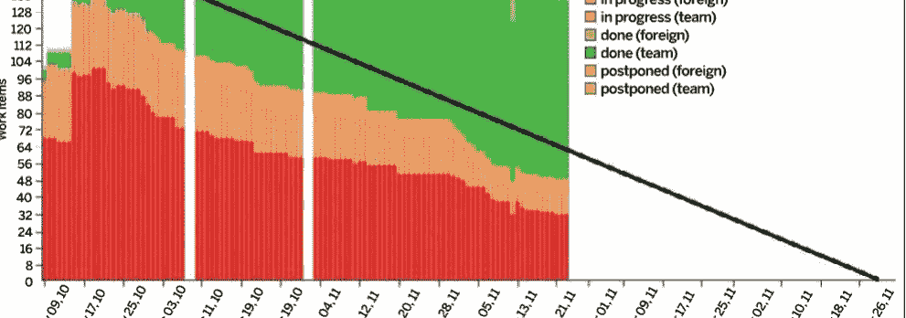

如果你能让某人记住你与他人学到的教训，其他人也会成长。我们不断欢迎新一代的项目领导和贡献者，我们需要确保我们的工作成果和智慧得以传承。在你指导其他开源领袖时，最好也这样做。

# 项目清单

## 保持沟通顺畅

始终确保你的沟通渠道易于使用且运行正常，并让新成员容易加入。许多项目的失败是因为它们没有有效地帮助新贡献者快速上手。

## 遵循你的发布计划

当一群志愿者正致力于一个项目工作时，很容易在发布计划中设定一个截止日期并产生诱惑。除非绝对必要，否则不要这样做。

## 就主要功能达成共识

任务分分而治之总是更好的，而做到此点的唯一方法是确保你们对工作达成共识。同时，确保将任务分配给不同的贡献者。

## 从他人身上学习

项目管理领域有太多可以学习的东西，而且没有固定的路径。问问别人是如何做的并向他们学习；这会帮助你培养更多技能。

## 执行“无无礼人员”政策

难以相处的人可能会在你的源项目中引起混乱，并阻止团队发布版本。要做到公平并解决冲突，切不要鼓励或允许破坏性个人存在。

## 跟进任务进度

没有监督的行动往往会导致没有任何行动。每周与每个人跟进一次，确保他们处于正轨并消除障碍。

## 有效跟踪进度

管理得最好的项目是那些记录了切运行情况的项目。在本文中探讨了燃尽图（`burndown charts`）——找到一个适合你的系统来保持一切不离轨道。

## 始终保持冷静

有时，你的耐心会受到难以相处的贡献者、不履行承诺的人等的考验。记住，这些人是志愿者。不要发脾气，否则他们就不会再回来了。

## 不要忽略你的工具

许多项目在开始时有大量的管理工具，但随着时间的推移会被忽视。根据工具的设计初衷使用它们：帮助你实现更多。

## 及早识别障碍

如果某项行动完成遇到问题，尝试修复它以便继续进行。这意味着对行动有良好的状态更新并定期检查。

## 不要做官僚

工具和流程是为了帮助人们提高效率的。如果有更快或更好的方法来完成某事，就改变它。不要只说“嗯，规定——”，这只会烦你的贡献者。

## 鼓励至关重要

我们是志愿者，志愿者需要认可、鼓励并对自己的工作表示感谢。让他们为自己的贡献感到自豪——这样他们才会留下来。

## 人人对岗

有些人擅长编程，有些人擅长文档，有些人擅长艺术。始终尝试确保拥有相应技能的人被分配合适的工作。这将产生更多成功。

## 始终记录并发布

当你开会并记录行动项时，确保发布了它们，作为对下一次会议预期的提醒。这是保持进度不离轨道的良好方法。

## 忽略质量保证

在许多项目中，修复 `Bug` 的质量保证（`QA`）时间往往太短，或者人们会分心尝试添加新功能。`QA` 是你需要定义的最关键特性——不要在上面妥协。

## 记录一切

帮助项目顺畅运行的关键是确保每个人都知道他们应该做什么，并将你所有不同的项目、发布计划等完整地记录在同一页面上。

## 里程碑目标

在你的周期过程中，务必将里程碑和高优先级 `Bug` 对应到发布版本（如 `alpha` 版本），并鼓励你的社区将其作为优先事项进行关注。这将有助于帮助你发布一个更紧凑的版本。

## 保持会议

虽然一对一电话有时很有用，但一条通用规则是保持团队会议。这在开源社区中对于保持透明至关重要。

## 不要害怕分担负担

在启动项目时，很容易放手让其他人承担一些责任。这会防止你成为阻碍并限制项目的进度。

## 反思与评估

在每个发布结束时，评估你的表现如何，以及你可以如何改进。这是一个健康的习惯。

# Zeitgeist 究竟是怎么回事


# 一切都记录在一个地方

# 文档

# SKYPE 视频通话

# 消息

# 数据

# 应用程序

# 网页

两个名为 `nocturne` 的文件都是关于肖邦的，即使你甚至不知道它们的存在。

- 与 `Zeitgeist` 不同，……它关注的是你的*活动*，而不是桌面的内部特征。`Zeitgeist` 只注意到你实际使用或执行的文档或操作，因此它的任务就完成了。而 `Nepomuk` 则不然。

- `KDE` 有等同 `Zeitgeist` 的东西吗？不，完全没有。为什么会发生这种情况？归功于我刚才提到的架构。`Zeitgeist` 真的能与所有 `KDE` 应用程序通信吗？为了访问各自的数据库，`Nepomuk` 和 `Zeitgeist` 都没有计划隐藏对方的领域！尽管如此，它们有计划尽可能地交换数据。这将产生一个可以回答此类问题的 `Linux` 桌面，例如：“收听次数最多的歌曲和文档是哪些？”这些答案基于文件的未来以及它何时以及如何被使用。

- `Zeitgeist` 还有什么计划？支持对 `Google Docs`、`Flicer` 和 `Launchpad` 等地方在线文档活动跟踪的计划正在进行中，因此将与 `Ubuntu` 集成。

- 隐私问题呢？我真的需要保留这么多元数据以及对我行为的整齐格式记录吗？不，这没有必要。你可以以访问浏览器历史记录（概念上来说）访问 `Zeitgeist` 数据库。保留还是取消某些事件取决于你。

- 我可以如何了解更多信息？项目主页是 `http://zeitgeist-project.com/`。如果你想了解更多关于默认 `Zeitgeist` 客户端的信息，请加入 `http://line.org/action/GnomeActivity.journal` 的活动日志。

`Zeitgeist` 能做的其他示例在此处。关于未来 `Zeitgeist` 与 `KDE` 和 `Nepomuk` 集成可能是什么样子的参考资料，请参阅博客文章：`http://elic.zeitgeist.org/2010/11/zeitgeist-coming-to-life`

`www.zeitgeist.com`
2011年5月 `LXF144`

# 布朗博士的行政

## 布朗博士的行政

`克里斯·布朗博士 (Dr Chris Brown)`

今天提供 `Linux` 培训、授权和咨询。他发现他的 `Unity` 管理博士学位对这方面没有任何帮助

## 今年是企鹅年。真的

来自服务器机房深不可测的内部的奥秘系统管理妙处。

伦敦眼每旋转 30 次，有时我觉得 `Ubuntu` 的发布周期（由于在 4 月 28 日发布 `Natty Navel` 版本）也同样频繁。桌面将看起来显著不同，这是由于 `Unity` 替换了 `Unity`（用 `Unity` 替换了 `Gnome` 的窗口管理器，不，是），我刚刚安装了服务器的 `alpha 2` 版本，它看起来是这样的（例如，在终端上获得一个登录提示符）。

相信我，有几样东西是新的。`Cobbler` 是一个预启动服务（安装）和部署站点，它支持 `PXE`（网络）、虚拟化（`QEMU/KVM` 或 `VMware`），并且是现有 `Linux` 系统的专家。还有一些改进，例如一种服务器屏幕，它通过进程表处理活动，而不是通过键盘或鼠标。他们正在减少能耗。我宁愿在水下


## eth0 的所有变化

`Fedora 15` 将引入新的命名方案以使事物更具一致性。但这是进步吗？

`Matt Domsch (@fedoraproject.org/wiki/Features)` 最近的一项公告建议为网络接口采用新的命名方案，它可能比我们所熟悉和喜爱的要容易得多。如果接口在主板上，或者像 `pc39` 或内置 `PCI` 卡上。


设备名称带来了一种似曾相识的感觉，正如经常发生的那样，我确定这将解决一个问题，我想要解决，而且我很惊讶的是我粉碎了它并理解了这个问题——即具有不同网卡的不同机器，它们的生活将因之发生改变。

# EPEL6 来了

或许比这更多，Extra Packages for Linux (EPEL) 项目宣布发布 EPEL6。这是一组开源软件集合，但这并不是我们在 Linux 世界看到的第一次变化。我可能表现得刻薄，但从这些中可以学习到很多东西，其中一些是想要在开源社区中获得关注度和赞誉！埃里克·雷蒙 (Eric Raymond) 为《大教堂与市集：如何成为一名黑客》写了一个附录。这里，列表上的第一个是：“世界充满了迷人的出版物，等待着正确的观众，但解决问题并不是驱动我们可能需要的操作系统演变的良好基础。”

Linux 企业社区是唯一一个包含不属于主仓库软件的项目。EPEL6 并不完全由红帽支持——志愿者努力。

# 大教堂与市集

我从埃里克·雷蒙开始，他观察到人们可能已经……但现在已经。

由埃里克·雷蒙的作品出版于 1999 年。在大量的讨论后，雷蒙描述了黑客社区的“礼物文化”，他们友好地竞争同伴的重复。在《家园》中叙述了开源社区的财产所有习俗。你可以在 `https://wikipedia.org/wiki/cathedral_bazaar` 找到它，并可以在 O'Reilly 出版。监控 `Maria Magnus` 和 `Cacti` 的工作，安全、补丁、备份、工具——总共 5600 个软件包。该仓库也可以用于基于 RHEL 的系统，如 CentOS 和 Scientific Linux。更多详情请参阅 EPEL FAQ：`https://fedoraproject.org/wiki/`。

关于 cat 5 遇到问题？埃里克·雷蒙会怎么做？

64 | LXF144 2011

# 布朗博士的行政

## 密码的秘密生活

让你知道没有存储在 `/etc/shadow` 中的唯一东西——但你知道它们是如何工作的吗？

从基础开始。所有的 Linux 账户——至少受密码保护。当用户设置密码时，哈希值会被写入其 `/etc/shadow` 账户条目。当用户登录时，他们的密码会再次进行哈希处理并与 shadow 文件对比。明文密码不会存储在系统的任何地方。

- 所有的 Linux 账户——至少受密码保护。当用户设置密码时，哈希值会被写入其 `/etc/shadow` 账户条目。当用户登录时，他们的密码会再次进行哈希处理并与 shadow 文件对比。

- 我从埃里克·雷蒙开始，他观察到人们可能已经……但现在已经了。

由埃里克·雷蒙的作品出版于 1999 年。在大量的讨论后，雷蒙描述了黑客社区的“礼物文化”，他们友好地竞争同伴的重复。在《家园》中叙述了开源社区的财产所有习俗。

你可以在 `https://wikipedia.org/wiki/cathedral_bazaar` 找到它，并可以在 O'Reilly 出版。

监控 `Maria Magnus` 和 `Cacti` 的工作，安全、补丁、备份、工具——总共 5600 个软件包。该仓库也可以用于基于 RHEL 的系统，如 CentOS 和 Scientific Linux。更多详情请参阅 EPEL FAQ：`https://fedoraproject.org/wiki/`。

关于 cat 5 遇到问题？埃里克·雷蒙会怎么做？

64 | LXF144 2011

# 布朗博士的管理杂记

# 按计划运行

Cron：让我们仔细观察 Cron 和 Anacron 中配置文件的层级，这是一个让你能够调度定期任务的因素。

这个月，我为你们准备了一份回归基础的教程——同时回顾了我之前写过的 27 篇关于 Administeria 的文章。我曾让它们都大为观止。

这三个工具（Cron 和 Anacron）允许你安排任务在特定时间发生。Cron 和 Anacron 是守护进程——它们在后台运行，并在需要时唤醒。两者都可以用于调度需要定期间隔运行的任务。这些名字源自希腊神克罗诺斯（Chronos）。`chronology`（年代学）、`chronometer`（计时器）和 `chronicle`（编年史）等词的根是一个用于在特定时间安排一次性执行任务的命令行工具。即使是这个工具也有一个名为 cron 的关联守护进程，负责在适当时间到达时执行任务。Cron 由 Paul Wise 编写，他也因 Binding（一个 DNS 服务器）而闻名——还有人（更具怀疑性）声称他掌握见过的由单一作者编写的最安全系统的密钥。

这个月我关注 Cron（以及一点 Anacron）。我一直在尝试语法，并发现某些 Cron 任务运行得比用户级 cron 更好。你在这里指定的任何任务都可以以 root 身份运行。这些任务定义在 `/etc/crontab` 中，尽管在大多数发行版中，存在二级文件，可以在其中设置任务定义。

```
SHELL=/bin/sh
PATH=/bin:/usr/bin:/usr/sbin/bin
MAILTO=root
```

| 间隔 | 命令 | 说明 |
| :--- | :--- | :--- |
| 1 | cron.daily | run-parts /etc/cron.daily |
| 7 | cron.weekly | run-parts /etc/cron.weekly |
| 30 | cron.monthly | run-parts /etc/cron.monthly |

- 运行命令的标识符
- 从任务执行失败到实际运行之间的延迟（分钟）
- 要使用的 crontab
- RHEL 说明中的 `/etc/crontab` 文件。注意第二个字段的语法，它防止了所有任务同时发生。

`&&` 和 `|` 运算符在 shell 脚本中作为编写/测试脚本的简写。我是这样使用它们的：

```
grep -q "root" /etc/crontab && echo "found"
```

第一个命令运行，如果它失败（退出状态为 1），则会运行第二个命令（grep）。

```
grep -q "root" /etc/crontab || echo "not found"
```

另一种测试方法如下：

```bash
if grep -q "root" /etc/crontab; then
echo "found"; else
echo "not found"
fi
```

但这样做需要四行而不是两行，而且正如我们所知，字符越少越好。

对于 Cron 和 Anacron 任务，正如本文讨论的，请使用：

```
test -x /etc/anacrontab && anacron -run-parts /etc/anacrontab
```

仅当未发现 Anacron 存在时使用。

这些结构用于脚本中。我正亲自现身，向你们展示一个我使用这种“类别”的 cron 编写的小程序。

# 沿 Anacron 之行

在图中（见 4.02），你会看到 Cron 运行 `/etc/crontab` 目录和 `/etc/cron.daily run-parts`——它运行目录中的所有文件并执行其中的命令。这些命令也是 shell 脚本，但我需要解释一下为什么你不能直接将脚本复制到这些不同的 cron 版本中。它们在时间文件的头部中被标记为 `@daily` 或 `@weekly`。

让 Linux 发行版中的 Cron 变得复杂的一个因素是竞争性设施 Anacron 的出现。Cron 旨在处理那些持续运行的任务。例如，每日 cron 任务每天 6:25 运行。除非 cron 在那时开启，否则任务就不会运行。如果机器关闭了，那么直到……解决方案是确保每日、每周和每月任务每天都会发生，前提是 cron 至少在某天、某周或某月运行过。

```
SHELL=/bin/sh
PATH=/usr/local/sbin:/usr/local/bin:/bin:/usr/bin:/sbin
```

```
17 * * * root cd && run-parts --report /etc/cron.hourly
25 6 * * root test -x /usr/bin/anacron || ( cd && run-parts --report /etc/cron.daily)
47 6 * * root test -x /usr/bin/anacron || ( cd && run-parts --report /etc/cron.weekly)
52 6 * * * root test -x /usr/bin/anacron || ( cd && run-parts --report /etc/cron.monthly)
```

你难道不能从 `/etc/crontab` 继承环境设置吗？如果你对环境变量有任何疑问，请在脚本开头显式地查找，并尽可能避免某些模式。

## 调试 Cron 任务

为你启动的每个任务写一个日志。这里有一个片段，显示了我其中一个小任务，以及 Anacron 运行每周任务的情况：

为了确保 Cron 和 Anacron 配合良好，需要一些语法上的保证。确保任务不会被执行两次（每个各执行一次）非常重要。如果你运行带有在 `/etc/crontab` 中有条目的任务，显示如下：

（注：此处原文似乎有占位符或逻辑重复错误，已根据上下文翻译）

```
* * * * * root /path/to/script >> /var/log/cron.log 2>&1
```

（注：原文提供的示例片段似乎包含重复的占位符，此处按逻辑结构翻译）

为了确保 Cron 和 Anacron 配合良好，需要一些语法上的保证。确保任务不会被执行两次（每个各执行一次）非常重要。如果你运行带有在 `/etc/crontab` 中有条目的任务，显示如下：

（此处对应原文中重复的逻辑块翻译，保持格式一致）

# Wordpress：使用 CMS 让你的网站编辑更快速、更方便

## 使用方法

如果你需要快速写出一篇博客，没有什么东西能比得上 Wordpress。正如 Andy Channelle 所发现的，它是一个非常棒内容管理系统。

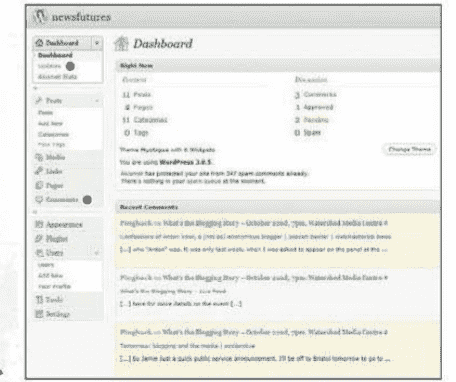


**专家**

**Andy Channelle**

OpenOffice.org 的作者，《WordPress Liberty》的合著者，英国西区大学新闻媒体讲师。

如果你正在考虑从一组简单的页面或博客创建一个网站，那么内容管理系统（CMS）是至关重要的。虽然完全复杂的设置过程非常困难，但它能让你轻松地为网站添加新内容和功能，这大大降低了复杂性，同时保留了真实内容管理系统的易用性。

最新版本的 WordPress 实现了这一点，它将五分钟安装、简单文章与新菜单功能、主题和文章类型结合在一起。凭借成千上万的主题，WordPress 给了你一个构建自托管网站的机会，而无需触碰任何 PHP 代码或学习 CSS 的复杂细节。

在向网站发布内容的过程中，我们将向你展示如何充分利用其类 CMS 的功能，并介绍一些可以让你做得更好的插件。

你可以在任何服务器上安装 WordPress，或者如果你只想在线尝试，可以将其作为 XAMPP (`https://www.apache.org/en/xampp.html`) 的安装。

仪表台（Dashboard）是你进行所有工作的地方。它有一个中心工作区，默认包含有关你网站的信息，包括文章、待审核评论以及 WordPress 的需求。

## 编辑界面非常简单，但隐藏着丰富的功能。

如果你的网站需要构建，软件顶部的信号会自动出现。通过一个简单的链接（你也可以对其进行安全保护），如果你在互联网上操作，可以在需要时立即实施这些操作。

浏览器左侧允许你访问系统的各个部分，仪表台可能会由你安装的插件决定，以及基础项：

- **文章 (Posts)**：你在此处管理添加的内容。
- **媒体 (Media)**：让你访问上传到画库的图像、视频和文件。
- **链接 (Links)**：用于向侧边栏或画库添加链接。
- **页面 (Pages)**：用于创建如关于我们、常见问题和联系方式等静态页面。
- **评论 (Comments)**：管理用户留下的评论，删除垃圾评论。
- **外观 (Appearance)**：用于配置网站的外观感觉，例如主题和页眉设计。
- **插件 (Plugins)**：用于添加新功能。
- **工具 (Tools)**：这些元素可以将内容和链接推送到你的网站。
- **设置 (Settings)**：设置网站的配置选项。选项允许你重写网站名称和标语、日期格式、设置评论选项以及设置网站首页。

# Wordpress 教程

# LINUX 格式

在 DVD 上

WordPress 3.1

## Wordpress

Wordpress 网站的基本元素是文章。它显示在网站的主博客页面或其他地方。要创建新文章，请从菜单中选择“文章” > “添加新建”。在屏幕顶部，你会看到一个“标题”字段——这是你输入文章标题的地方——下方是文本区域。文本区域顶部有一个工具栏，其中包含文本编辑选项，如加粗、添加链接和插入项目符号。这些功能的工作原理与标准文字处理程序非常相似。

## 文章秘密

虽然 Wordpress 足够应对大多数情况，但对于更专业的用户，还有额外的选项。例如，点击工具栏最右侧的图标（所谓的“水槽” Kitchen Sink）将显示出额外的选项层，它会过滤掉 MS Word 想要添加的元素，以及一组预定义的样式（包括标题 I 和段落）。为了获得更多控制，编辑器有一个 HTML 标签页，允许你编辑文章的代码，以便你进行检查或编辑。如果你想添加嵌入的 YouTube 视频、插件，或只是想对每篇文章的样式有更多控制权，这非常棒。

界面虽然简单，但如果你知道去哪里寻找，那里就隐藏着丰富的功能。工具栏上方是媒体栏，允许你插入图像、视频和其他类型的媒体。这里的选项之一有一个复选框，你可以从计算机中选择文件进行上传，或使用 URL 链接到内容。一旦你输入——无论是本地还是远程——所有内容都将被视为一个整体。当你将其插入文章时，请使用备用文本和其他元素。如果你定义了想要包含的文章，请点击“插入文章”将其添加到添加，它将在“媒体库”标签页下可用，或者当你的用户内容通过“画库”标签页访问时可用。

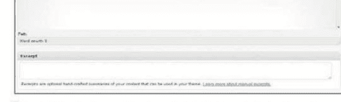

- 添加新建文章提供了很多功能，包括命名绝妙的“水槽”按钮，它可以显示所有选项。

此外，这意味着你可以在“摘要”框中编写你的故事，它将用作内容的介绍和 RSS 摘要。右侧包含“发布”选项，可用于保存草稿、安排在稍后的日期发布或立即发布。你还需要使用“垃圾箱”选项来删除你的文章。

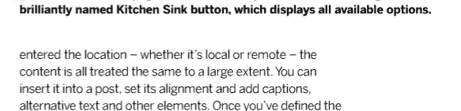

## 安装

在此文本编辑器中打开 `php.config` 并在适当的位置编辑你的数据库，将所有文件移动到你的根目录或服务器上的某个文件夹中。

如果你还没有准备好，将需要使用安装程序设置数据库，这将创建一个可以读写数据库的数据库用户名和密码。这些细节存储在安装文件中。

现在从 `www.wordpress.org` 下载最新的 wordpress 包，解压它然后将文件 `wp-config-sample.php` 重命名为 `wp-config.php`。

最后，打开浏览器并进入它的安装站点。如果你看到了屏幕，输入上述步骤中创建的详情。

如果你不在目录中，请在此文件夹中找到 `wp-config.php`。

```php
// 此文件包含你所有的 WordPress 数据库设置。
 */
define( 'DB_NAME', '数据库名' );
define( 'DB_USER', '数据库用户' );
define( 'DB_PASSWORD', '数据库密码' );
define( 'DB_HOST', 'localhost' );

/**
 * 用于身份验证和加密的唯一密钥。
 * 获取密钥：https://api.wordpress.org/secret-key/
 */
define( 'AUTH_KEY', '随机' );
define( 'SECUREAUTH_KEY', '随机' );
define( 'KEYS', '随机' );
define( 'SECURE_KEYS', '随机' );
define( 'WP_SALT', '随机' );
define( 'WP_SECURE_SALT', '随机' );

/**
 * 数据库表缀
 * 除非你在一个数据库中使用多个安装，否则请留空
 */
$table_prefix = 'wp_';

/**
 * 启用 WPDEBUG。
 * 设置为 true 以启用模式。
 */
define( 'WP_DEBUG', false );
```

安装程序将引导你完成剩余过程，你最终会找到仪表台。

## 分而治之

WordPress 的核心功能之一是通过分类让访问者找到他们想要的内容，这时 WordPress 菜单发挥了作用。例如，你可以有“新闻”作为子分类。

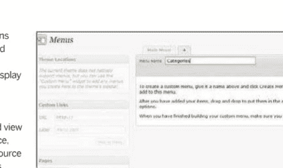

## 设置分类

过程的第二步是让访问者轻松找到他们想要的内容，这需要通过菜单来实现。许多主题不支持多个菜单（默认情况）。然后，你始终可以使用菜单小部件（见下文）将菜单添加到网站。

首先，转到屏幕右侧并点击“新建”创建一个新分类。输入名称并点击按钮。一旦完成，左侧的分类将激活，你可以通过复选框选择它们。点击“添加到菜单”，该选项将按字母顺序添加。如果不符合你的要求，你可以拖动项目进行重新排序。

一旦你按顺序写好，点击“保存菜单”，你就可以创建任意数量。

## 创建导航菜单

该部分分为如何创建菜单。你有多种选项可以创建条目：链接（允许你创建指向网络上任何网站的菜单条目）、页面（用于链接静态分类）。我们将使用最后一种来创建我们的导航结构。

# WordPress 教程

## 小部件

### 文本：新媒体事件

**小部件**

可以将这里的小部件添加到侧边栏中使用。你可以将小部件拖到这里，然后根据你的需要进行定位。

### 标题：

# 新媒体事件

### 关于

你网站的每月存档

- 网站日历


### 归档

- 最近文章
- 搜索文章

### 最新

- 最近文章

### 元数据

- 已登录
- 站点地图

### 其他

- 最近评论

### 文本

- 自定义文本

### 图像

- 一张图片

### 列表

- 一个列表

### 导航

- RSS 馈

### 搜索

- 搜索表单

## 开启

如果你的主题默认不支持菜单，你可以使用像 `Widget Logic` 等系统来添加菜单，以便在特定页面显示自定义菜单。最后一步是为观众显示菜单。

如果你更倾向于使用菜单，可以使用“位置”部分来定义新菜单所在的位置——在页眉或侧边栏；如果无法实现，你仍然可以使用它将菜单放在中间。此外可以使用“小部件”部分。小部件是种放置在各种位置的基本内容单元。它可能包含文本、图像、链接或其他选项。系统自带了许多小部件，你也可以使用插件添加任何你自己的。

你感兴趣的小部件可以从侧边栏抓取，将其拖放到右侧的一个空间中。它们将根据其在页面上的位置（侧边栏、页脚或文章）进行放置。一旦释放，你就可以编辑它并选择你想要的内容。然后点击“保存”，你就会在该位置看到该小部件。当你选择适合你区域或布局时，将显示相关的类别。

小部件是至关重要的工具，因为它们允许你定制内容以适应网站上的单个页面。这会在选择类别时显示小部件。注意，每一个小部件都有一个描述。你可以通过进入后台界面的“分类”部分，点击分类并查看 URL 来查明这是什么。

### 简单连接

有很多方法可以为 WordPress 添加 Facebook 赞，但此插件以模块化方式工作。你可以将其添加到任何页面或文章，并邀请访客使用他们的凭据登录你的网站。如果 `Facebook Connect` 不够，你可以创建一个自己的社交世界。`BuddyPress` 允许为每个用户提供个人资料页、博客画廊和讨论空间。`BuddyPress` 于安装和激活，但在配置方面存在一些问题，可能会影响你网站的编辑自由。

### 流行度

鼓励用户访问你网站的最佳方法之一就是给他们想要的。流行度允许你在侧边栏显示选择的阅读最多的文章，以推广你的热门内容。

### Google Analytics

可以告诉你你网站的哪些部分运行良好，哪些部分需要注意。此插件与 `Google Analytics` 系统配合，并提供了一个良好的仪表板，显示发生的情况，而无需你随时登录账户。

## 插件

WordPress 有数千个插件，为 Drupal 或 Joomla 等更多 CMS 也提供了插件。有几个你可能会觉得很有用的。你可以通过“插件”安装其中的每一个——只需搜索并安装。

小部件插件允许你定义一个显示内容的区域或页面集。每个小部件在底部都有一个额外区域允许传递参数。以下是一些示例：此参数将导致小部件仅在网站的首页显示，而另一个将在“关于”页面之外的所有页面上调用它。

```
is_category(array(5))
```

## Bash：为 shell 脚本创建通知系统和对话框

### Bash：添加 GUI

命令行是力量所在，但你可能需要与那些不被信任可以输入命令的人共享它。

专家观点：在启动 Linux 时，某些 Bash 脚本在他们看来让被取代的内容看起来像是倒退，而且对于人们以简单友好的方式访问和使用计算机来说也是如此。我们还知道从 shell 执行任务让环境安全得多，并且只能进行特定的配置。GUI 尚未真正准备好做到这一点。将你出色的 shell 脚本与世界交互可能有一个原因：让凡人也能使用它们，或者简单地让它们更具自主性。

### 通知事件

你可能的首要需求，例如仅仅是让某知道脚本或简单命令已运行。在现代系统中，存在一种机制，`C/Dialog` 具有的优势是它可以在纯文本显示器上工作。这被称为通知事件。

通知是当程序崩溃时出现的小型消息窗口，或者弹出提示你已登录某个角落，或者指出你在火上工作得多么辛苦。它们可能会根据运行的桌面环境进行不同的处理（例如，KDE 和 Gnome 都有处理器），但它们使用相同的标准，允许我们以完全相同的方式访问它们。

让事情变得简单的是有一个简单的命令可以为我们工作：`notify-send` 带有几个开关来控制消息显示的时间，以及一对字符串——一个用于标题，另一个用于更详细的解释（如果需要）。该工具的简单用法可以是：

```bash
notify-send --title "Hello" "World"
```

由于我们是在配合 Bash 使用，我们可以包含以下内容：

```bash
notify-send --title "The date is: "$(date)"
if [ "$msg" = "file copied" ]; then
  notify-send "File has been copied"
else
  notify-send "Something went wrong"
fi
```

```bash
cp $1 $2
if [ $? -eq 0 ]; then
  notify-send "Your file has been copied, that is at $2"
else
  notify-send "Something went wrong"
fi
```

```bash
while read line; do
  notify-send "New log message: $line"
done < /home/user/messages
```

虽然这看起来可能不是免费的体验，但 `notify-send` 有一些选项可以使其更有效并节省你的时间。HTML 可以为被复制的文件创建一个可的、可点击的链接，这可以是让你的通知更有用的方法。然而，注意，这在 `notify-send` 仅发送消息时有效，如果你的消息出现了，说明你包含了它无法渲染或无法点击的内容。如果你确定了选项，只需运行 `dialog` 命令就能提供你可能需要的大部分信息。

# Bash 教程

通知系统作为用户交互手段，其缺点是显而易见的。虽然它能让你方便地向桌面用户发送消息，但让用户对运行中的程序提供反馈的范围有限。

在我们之前涵盖的大部分内容，这一行是最棘手的部分。目标变量是通过反引号表达式设置的——Bash 将执行反引号内的命令（使用键盘上 UK 上方的按键），并将输出替换为它生成的内容。如果没有这个反引号让事情复杂化，理解起来会更简单。

由于 Unix 哲学——即为非常特定的任务创建独立的工具，并将它们结合在一起以实现复杂任务——你可以做任何事情。很少有人能意识到这一点，主要是因为他们不敢尝试那令人生畏的命令行。

首先要意识到 `dialog`（对话框）是一个命令。它后面紧跟着一个开关，用于指示对话框的类型以及相应的参数。在这种情况下，我们使用了一个 dialog 选择器，它接受一个条目（对我们来说是这一列）、高度和值。那么这些菜单滚动条是怎么回事呢？在加入它之后，原作者决定将结果发送到 `STDOUT`（标准输出）。

为脚本获取输入并不新鲜。在 Bash Shell 中，你不能简单地做到：

```
-p "How great is this?" --input echo I1 agree it is simple
```

# Xdialog 允许一些额外的选项，用于字体选择和对话框渲染。

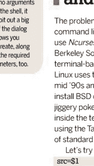

如果你在 shell 中运行不带参数的 `dialog`，它将列出你可以创建的窗口列表，以及所需的参数。

问题在这里，因为选择是不合法的。传统的方法是通过 Ncurses 使用它。原始的 `dialog` 是一个由 Berkeley 软件发行版 (BSD) 内核创建的库，用于帮助基于终端的目标，而它的寿命远超该目标。Linux 从 90 年代开始一直使用同一个库，对于任何在 2001 年之前尝试过安装 BSD 或 Linux 的人来说来说。有些图形界面改为使用基于字符的屏幕，通过 `Tab` 键在框之间移动。这些点可以是几乎任何标准 GUI 组件，比如复选框或文本输入框。

`STDERR`（标准错误）意味着你看不见。该对话框的所有输出都将管道到 `STDERR` 并再次返回。这部分管道标准通过使用虚假占位符技巧，利用 `STDOUT`（管道）和 `STDERR`（管道）来接收结果。它实际上做的只是从会话的对话框选择中返回值，并将其分配给变量。

脚本的其余部分应该很简单：我们在最后调用一次所有 dialog，然后用一个简单的消息框输出我们操作的结果。

让我们试一个：

```
dialog --select --15 25 5 2 1-6
cp $result $ 
set ? = 0 6 & echo "File copied" || echo "File-failed"
dialog --msgbox " 6 6
```

# 使用 dialog

我们可以创建许多类型的对话框，但在我们开始使用那个精妙但并不符合 21 世纪标准的库之前，使用 `Xdialog` 更好。`Xdialog` 是 `Dialog` 的无缝替换品，它使用 GTK 窗口而不是褪色的外壳。它现在看起来好多了。

你喜欢它吗？`Xdialog`？它实际上是一个无缝替换品。在大部分语法上，它是相同的。

`Xdialog` 实际上允许许多人都会使用的额外选项，用于字体选择和对话框的渲染。本着让事情运行的精神，`Xdialog` 接受所有类型的输入并直接忽略它们，无需任何配置。（提示：虽然它是脚本开头持有要使用的命令的值）

所以这里可以使用我们的代码：

```
result=1
dialog --select --15 25 5 2
1-6
cp $result $ 
set ? = 0 6 & echo "File copied" || echo "File-failed"
```

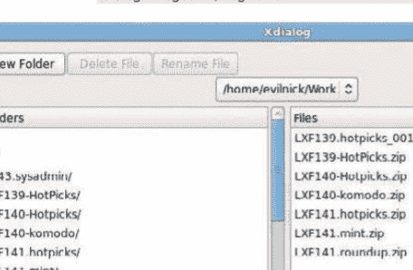

这是一个对 Ncurses 非常忠实的替代品，但使用了借自 GTK 的 X 窗口。

| 文件夹 | 文件 |
| --- | --- |
| /home/user/work | LX139-hottips_001.png |
| | LX139-hottips.txt |
| | LX140-hottips.gz |
| | LX140-komodo.png |
| | LX141-hottips.jpg |
| | LX141.mont |
| | LX141-hotpink |
| | LX141-roundup.png |

# 不要再错过任何问题，订阅 Linux 上的第一大来源

# Bash 教程

script。所以，尽管它绕过了 `$nurses` 的过时和无用，但从脚本的角度来看，它仍然方便得多。在我们在这它上浪费更多时间之前，它很快就会失败。

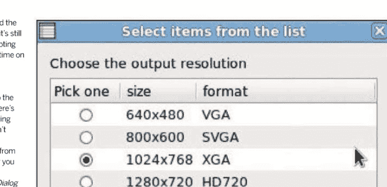

# 选择输出分辨率

# 狂热类 (Zealous)

虽然 zealous（此处指 `Xdialog`）正在进入 21 世纪的风格，但在脚本方面仍有许多工作要做。映射管道并不总是有效，有时你需要从 `STDOUT` 而不是 `STDERR` 获取值，或者你需要它们。

Zealous 与 `Zxialog` 不兼容，尽管它仍然保持相似。它在某些方面更好，并没有完全做到 zealous 所做的所有事情，但它提供了整洁的输出，并且在脚本中易于使用。

| 选择一个 | 大小 | 格式 |
| --- | --- | --- |
| 640x480 | VGA | |
| 800x600 | SVGA | |
| 1024x768 | XGA | |
| 1280x720 | HD720 | |

看看这个使用 `ffmpeg` 工具的简单脚本，并在处理完一系列选项后使用它转换文件。

在这种情况下，我们想要做的第一件事是检查 `ffmpeg` 是否带有输入文件名运行，或者获取其中一个。

```
# $zealous --title "选择打开的文件" (file-selection)
# 指定的参数数量（方括号内）并应用于此处。
```

第二个命令的值是传回给我们定义的变量 `$version` 的，该变量处理了 `ffmpeg` 期望的内容。我们今天可以期待更多

所以，我们将知道它很容易创建命令和命令行，如果你写了它，它可能会非常有趣且有用，告诉我们或在 linuxformat.com 的 Linux 论坛提交你的建议。

www.toxugar.com

2021年5月 LXF144 | 95

## 硬核 Linux：高级用户通过进阶项目挑战自我

## 救援：恢复

一个计划良好的救援系统可以让你一台运行流畅的机器和一块“砖头”之间产生巨大差异。John Lumpy 为我们寻找了一些解决方案。

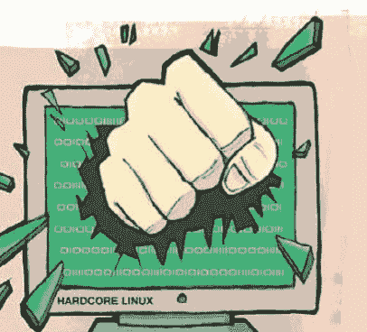

考虑各种场景。假设你的根文件系统磁盘被毁了。这种情况发生在我们每个人身上。当然，你做了备份吧？没有？那么请看这几篇文章 [Roundup LXF138 和 Never Lose A File Again! LXF142] 来了解一些重要原因。

最典型的例子是 live CD 或 DVD。光盘读取器通常能处理大多数问题；然而，live CD 的设计初衷是安装而不是救援，因此它缺少许多你可能需要的工具。此外，救援系统本身需要的其中一个工具不能是只读的，这限制了工作方式，而且导致许多 live CD 运行速度较慢。另一个专门用于救援的基于 CD 的 Linux 系统是 `SystemRescue`，它位于 i142 的 LXIVDU 中。

## 闪电救援

现在，我们将在 USB 盘上构建一个救援系统（需要 120Mb 空闲空间来安装这个微型救援系统，如果你想添加工具则更多）。如果你有一个空间足够的盘，之旅就开始了。

我们将使用 `Slitaz` 发行版，因为它是最小的且具有基本功能的 Linux 系统之一，也是 Linux Format 的点睛之作（参见 Roundup, LXF139）。尽管并不完美，但它非常容易设置。你可以在 15 到 30 分钟内进入这个救援环境。

`Slitaz` 3.0 基于其 LXIVDU，所以你已经准备好开始跟随教程了。如果你愿意，也可以从 www.slltaz.org/get 下载 CD ISO 镜像，之后你可以作为 ISO 镜像使用。


在深海底部全天候工作，一群 LXF 爱好者成功分析了刻刻在泰坦尼克号内部的微型音频波形模式；揭示史密斯船长虚弱的遗言是：“我没有看那篇关于救援的文章”

> 我们的专家
>
> John Lumpy
>
> 在 Linux 世界中生活多年，当他有空时，他最喜欢的活动是编写 Linux - 现在他有很多了。与其患于未然：

如何创建一个救援系统，或者构建并测试它。对于那些喜欢安全带或弹簧绳的人，我们还将提供一些关于更高级系统的建议。

救援系统是一个你在机器上运行的、无需访问硬盘的 Linux 系统，并具有恢复数据的工具。用于修复“生产”系统完全无法启动或无法保存数据的情况。这里有一些相应的修复选项：

- 从备份恢复磁盘故障或内存损坏。
- 例如，如果 `MBR` 损坏了，使用 `TestDisk`（位于 www.cgsecurity.org/index.testdisk.html）。
- 救援根文件系统使用 `f2fsck`。
- 系统在某些软件维护后无法启动或登录。在维护模式下 - 选择可能在此处有所帮助。

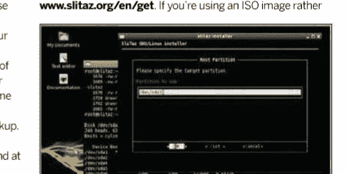

备份和恢复是上述所有情况最基本的救援工具。

- 为 `Slitaz` 安装程序指定一个目标分区。

## 上个月我们使用 KDevelop 创建了一个文本编辑应用。。

## 硬核 Linux 教程

## 从灾难中


……比 CD 慢，然后可以进入 CD 或在虚拟机中通过虚拟机的机的 CD 驱动器运行。[查看硬核 Linux 教程：迁移到 USB 以获取详情。]

`Slitaz` 现在运行在你的真实机器或虚拟机上。打开一个 X 终端并保持 root 权限。root 权限已确认。使用你的 USB 盘，它是可见的且已分区的。运行一些命令查看所有设备：

```bash
dmesg | grep sd[a]*
```

以验证它是一个 scsi 设备：

```bash
fdisk -l
```

在开始安装优盘之前，创建一个与你的 Linux 系统类型匹配的分区（ext4 最好）。如果你需要使用该分区并在其中格式化文件，请使用此示例：

按照 http://sititz.org/hdub-installation.html 指南中的说明安装 HDUB。`Slitaz` 也允许你在 USB 盘上使用 LiveMedia。如果你正向小型驱动器安装大型发行版，你可能需要调整分区大小。

使用 `mount` 命令将盘 CD 挂载到 `/media/cdrom`，你必须先挂载驱动器，然后挂载优盘设备：

```bash
mkdir /media/cdrom
mount -o loop /dev/sdb1/iso660/Slitaz/Slitaz-3.0.iso /media/cdrom
```

当你从盘 CD 将文件传输到 USB 盘时，你可以选择使用 `Slitaz` 安装程序或手动安装。安装程序将格式化或清理分区，因此如果你想保留已有的数据，请使用手动方法。

注意另一点：安装程序会设置 `/etc/fstab`。如果你使用内核模块，手动安装将不会更新此文件。文件应该拷贝到你的 USB 设备中。

在过程结束的步骤：在 Grub 菜单上使用 `root=` 参数。现在从优盘关闭现场系统。

如果我们要检查硬盘的标识（是硬盘，不是优盘）：要识别所有硬盘，你的根磁盘应该被列出来。假设它是 `/dev/sda3`，且根系统是

```bash
fdisk -l /dev/sda3
```

`Slitaz` 拥有一基本工具，包括电子书阅读器和 PDF 查看器（如果你使用 LXF 在线版！），让你能够发送数据。

## Slitaz 是像那样的吗？


今天，救援系统硬件的一种流行替代品是 USB 内存盘，也称为 USB stick。盘的系统是只读操作。然而，它在尺寸、速度和价格上有很大范围。它可以比 USB 驱动器或 DVD 驱动器便宜，最重要的是，它会被作为一个 USB 连接设备找到，只要 BIOS 设置是正确的。进入设置后，确保 USB 盘位于列表顶部。这可能在 BIOS 中找到。如果修改优盘，请尝试！

在连接的两台机器上，你可以通过命令行访问它。它还有 SSH，但这些是精简版本，与你使用的不同。当你想要使用它们时，请阅读：https://www.workspace.com/2009/04/15。这个纤细的盘看起来很快。它并不总是工作，除非你可以使用它。

## Slitaz 工具

关于救援工具如何？Slitaz 有 `tar` 和 `gzip`，其他很少。否则，你可以使用包管理器和一个位于 http://mirror.sititz.org 的包含 300 多个软件包仓库。

当你第一次使用 Slitaz 管理时，连接互联网，然后点击标签。列表将刷新，返回 Slitaz 主页，列表已更新所有可用软件包。双击任何未安装的软件包。可能是第一个！

如果你使用自己的页面：

- 许多人使用的流行工具，通常配合 Slitaz

备份一个令人深刻的在线系统。拥有你的备份和优盘效果良好，但你需要多少磁盘空间？这取决于你的设置以及你有多少时间投入。为了避免意外情况，安装额外的救援工具到系统会更好。你可能希望尽早救援系统，尽管在情况正常时可能用不到它，所以你需要在时记住它。

如果你选择在 USB 盘上使用救援系统并大幅扩展它，不要忘记备份它，当你

## 如果你错过了上个月的，请拨打 0870 837773 或 +45 18584379


## 小贴士

如果在虚拟环境中运行 Slitaz，虚拟硬件 USB 控制器以便它使用虚拟的 UHCI 控制器：当你使用模拟模式(2000) 时使用 `UHCI-hci`，因为这是 Slitaz 内核支持的唯一。

2011年5月 LXFX144 |97

## 极核 Linux 教程

## 在局域网上进行救援

我们目前为止所看到的救援系统在能力和易用性方面都有局限性，对于某些系统来说，在构建和维护费用上也是如此。

现在，让我们施展魔杖，揭示一个无需承诺且随取随用（只要你需要——当你需要时它！）的救援系统。这个救援系统是一个位于独立机器上的 Linux 发行版，可以通过局域网连接到发生故障的机器。

- 3 台机器：

提供救援相关服务的故障机器。

- Linux 系统（内核加文件系统）：

被动的故障 Linux（Passive distressed Linux）不需要救援。因为它的文件系统没有运行，只需要它的一个副本即可恢复数据。

- 提供网络和其他服务的 Linux 服务器：

活动 Linux 宿主（Active Linux house）在故障机器上活跃运行。

在故障机器上，被动的 Linux 与活动内核结合运行。在这种设置中，我们区分了内核和文件系统，它们来自不同的来源以执行救援。为什么呢？因为为了能够通过网络挂载其文件系统，并且最好能利用故障机器的特性，特别是网络适配器。

救援机器持有一个或两个系统，但它们必须是完整的系统，且两个文件系统必须位于不同的磁盘分区上。救援服务器运行在故障机器上，它有一个用于分配 IP 地址和识别 PXE 启动加载程序的 DHCP 服务器；一个用于提供内核镜像的 TFTP 服务器，以及一个用于根文件系统的 NFS 服务器。

## 故障机器

故障机器至少一个具有 PXE 启动能力的网络接口控制器（NIC）——NIC 可以获取 IP 地址并从 DHCP 服务器下载内容。否则，BIOS 将启动启动设备列表中的下一个设备。PXE 机器可能会有一些观察：为了选择设备和启动而显示一个旋转线条动画。还有其他替代方案（BIOS 之后），例如 PXE (http://org)，但它们需要更多工作来设置，并且需要额外的步骤来从软盘或软磁盘启动。

救援机器需要配置网络接口以及通过内置的 NFS 挂载根文件系统。这包括网络接口驱动程序、NFS 客户端、网络配置和文件系统。内核参数应设置为 `CONFIG_IP_PNMP`、`CONFIG_IP_PMP`；DHCP、NIC 驱动（仅使用一个以太网驱动程序），以便控制使用哪一个进行 PXE 启动。你还需要设置 TO 为 `CONFIG_EXT3_FS` 或 `CONFIG_EXT4_FS`（取决于根文件系统的类型）、`CONFIG_NFS_FS` 和 `CONFIG_ROOT_FS`。

生成这些后，将其复制到镜像中，由 Plinux（网络启动协议）引导。

## 服务器系统

- Plinux 是 Syslinux 软件包的一部分——http://syslinux.org/wiki/index/PLINUX。从 Plinux 中需要的唯一执行文件是救援服务器。某些机器现在可能需要不同的版本——所以我们在 ISO 中使用了 Plinux 0.40 版本。

- DHCP 服务器 (`dhcp`)

- TFTP 服务器

- NFS 服务器

现在我们需要配置文件并定义你的名称和地址。例如所示：

- 服务器机器的 NIC MAC 地址为 172.24.1.40

- 故障机器的 MAC 地址为：00:11:22:33:44:55

- 首次刷入 Plinux 的内核为 `linuxux-2.6.36-generic`

- 活动系统的文件系统运行在 `root=/dev/sda`

活动系统的 DHCP 配置 `/etc/dhcp.conf` 应该如下：

```
default-state: infinite
subnet 172.24.1.0 255.255.255.0 {
lease-time 3600
max-time 3600
option-router 172.24.1.1
option-domain-name 172.24.com
option time-offset = -8
}
```

```
{
filename = "mlinux"
host = {
hardware ethernet=aa:bb:cc:de:ee:ff;
fixed-address=172.24.1.42;
option-name = "distressed"
}
}
```

活动系统的 Plinux 配置 `/tftpboot/pxlinux/01-aa-bb-cc-de-ee-ff.cfg` 看起来如下：

```
group
default
timeout 100
kernel linux-2.6.36-generic
append root=/dev/sda rw ip=172.24.1.40//root_fs\ip=172.24.1.42:172.24.1.40:172.24.1.250:distressed:none roxtype=ext3
```

## 如果不再有问题，请订阅第 68 页的 Linux 领先来源

## 硬核 Linux 教程

此配置文件中没有 initrd，内核本身将挂载其根文件系统。服务可能会因为这个结果而失败。

注意，如果根目录是以读写（rw）而非只读挂载的，内核就可以检查 NFS 挂载的根文件系统是否存在错误。你应该在另一台机器上对文件系统运行 `fsck` 以节省时间。

- NFS 导出一个条目 `/mnt/A_root_fs /mnt/A_root_fs/172.24.1.2/linux_subtree_squash`

- TFTP 服务器应配置为使用 `/root` 作为其目录。这可以通过标准内核实现

## 活动系统

以下步骤必须在故障机器运行 Linux 时（即在它被破坏之前）且救援机器运行 Linux 且其根文件系统以读写模式挂载时以 root 身份执行：

- 将内核模块复制到 `/v6.26.36-passive/modules`。从这个被动的 Linux 根目录到活动根文件系统的相同目录。跳过 `build` 和 `source` 子目录，它们不需要。

实现此点的另一种方法是从故障机器通过 `scp`：

```
cd /v6.26.36-passive
scp -r root@remote_host /mnt/A_root_fs /v6.26.36-passive
```

`mdev` 是做什么的？

- 内核需要的设备必须存在于 `/dev` 目录中。运行以下：

```
mdev -s 1
mdev -s 1
mdev -s 1
```

## 优势系统

系统安装创建的可能重新配置内核网络接口的守护进程（例如 Network manager）必须关闭。

- 需要特殊的 `/etc/stab` 版本，不包含本地文件系统的条目，并且当系统中根文件系统时。

- 恢复工具必须安装在活动系统中；这在故障机器上运行时也是需要的。

第一行定义了设备 eth0 被命名，第二行指定了忽略 NIC。如果用户没有针对此生成规则，则存在名为 `/etc/udev/rules.d/75-persistent-network-generator.rules` 的文件，或者如果你运行它将不会禁用 `eth0 > /etc/udev/rules.d/75-persistent-network-generator.rules`。

# "代码即爱，”

网页的神圣灵感

快来查看我们的新版网站吧！

立即访问全球面向网页开发者和设计师的最畅销的杂志！

.net

www.netmagazine.com

## LINUX Format 往期期刊 >> 错过了哪期？

在《谁的魔法世界？》杂志中，我们的愤世嫉俗让程序运行如丝般。此外，梦想飞向云端，我们回顾了从 Google 搜索到 Nexus One。

在《害怕丢失数据吗？》杂志中，发现这种最负责任的备份方法如何让你安睡无忧，我们获取了 Ubuntu 版 Unity 的细节。

在《你的事（Your matter）》杂志中，尝试过与他人和睦相处吗？这个专题将帮助你掌握这个操作系统世界！此外，开启你的 Linux 探索之旅，深入了解 ENG 的内部。

- LFXD 重点介绍期待已久的 Debian 内核 4.6 和 Linux-3.2.2

- LFXD 重点介绍用于恢复你机器的 Linux Ubuntu 工具。

- LFXD 重点介绍 Centos 和 Ubuntu，以及一对小细节和 netbios-d。

在《为什么》杂志中，为什么总在这个高度连接的世界里发现适合所有超级英雄的工具？没机会再回头了！我们的公路之旅涵盖了便携式笔记本。

在《为什么又是这样！》杂志中，彻底失败？这个专题将帮助你将黑客拒之门外。我们报告了在学校中使用 Ubuntu Linux 的情况以及打造一个大师。

在《为什么害怕自由？》杂志中，Ubuntu？只有一种离开的方法，并涵盖了他们自己实现的功能。我们展示了包管理问题，感谢 Showell。

- LFXD 重点介绍新鲜的 Linux Mint 10 Fedora 14，以及 GITHUBUB，

- LFXD 重点介绍三个值得尝试的 Ubuntu 发行版：Gnome 和 Afforavours。

- LFXD 重点介绍一个可以尝试 10 个发行行的巨大 GBI 双重加速成就！

订购请访问 www.myformatmagazines.co.uk 从“浏览杂志列表”中选择 Linux Format。

引用上方显示的代码代码，并准备好你的信用卡或借记卡详情。

或拨打往期期刊热线 0844 488 2852 或海外热线 +44 1604 251045

## 捍卫你的数字权利

电子边界基金（EFF）致力于保护数字世界中的公民自由权利，并创建平衡法律以确保获取知识、赋能消费者并加速技术创新。EFF 是一 true国际公民社会非政府组织，在 67 个国家拥有超过 13,000 名成员。

## 电子边界基金 (ELECTRONIC FRONTIER FOUNDATION)

## EFF.ORG

Eff 是一个成员支持的组织。立即加入！www.eff.org/donate

# 回答

你对开源有疑问吗？无论什么问题，请联系 lxf.answers@futurenet.co.uk 获取解决方案。

## 本月我们回答的问题涉及：

1. Ubuntu 屏幕冻结

2. Root 用户

3. Ping 问题 - 临时文件问题

4. 使用 Wine

5. 管理分区

6. 存储磁盘镜像

7. 观看蓝光碟

8. 脚本编写

详情：Nepomuk 服务未在 D-Bus 注册，这通常意味着它没有启动或在启动过程中遇到了致命错误。

### Michael Pound

冻结可能是硬件问题。在运行期间，这在 Linux KDE 上很常见，并且需要内存测试。再次按下重置键或电源开关后，有一个更对系统的修复方法。

按住 SysRq 键并按下 B 也会处理并同步你的磁盘。这不能避免文件系统崩溃，但能让你有更多机会在系统日志中看到报告，请使用 `/var/log/messages`。关于你如何学习系统（参见 Linux Wiki），但最好在 B BASE 模式下重启。

Akonadi 和 notepad 是 KDE akonadi 的一部分，用于个人信息管理 (PIM) 数据，例如你的地址。这使得它对 KMail 很有用。

### 使用 Mint 控制中心中的“启动应用程序”部分来启动 akonadi，以便在 Gnome 上使用 KMail。

错误信息显示服务器未启动，这可能是两种情况之一：要么没有尝试启动它，要么它在启动时出问题。如果你确实正在使用 KDE 或尝试在 Mint 桌面上使用 KMail。如果你是后者，登录并安装 akonadi 以使用它将通过将其添加到控制中心的“启动应用程序”中来帮助你让 akonadi 服务器运行：

或者，你可以使用 `kdeinit4` 启动所有 KDE 服务，尽管这可能超出你的需求。

Akonadi 可能由配置文件启动，在其中，你可以通过删除文件或重新配置配置文件来重置设置：`/config/.local/share/akonadi/config`

## 奇怪的行为

我目前在使用 Linux Mint 10，它是随 LXF140 的 DVD 提供的。通常对于 Linux，当我在这个发行版发送消息时，我的屏幕会冻结，或者我发现的任何其他情况：它冻结，我必须重启。

使用 Mint 10 软件中心中的 KMail 版本在系列测试列表中得到了结果，成功率超过 99%。然而，当我尝试关闭此对话框或保存报告副本时，没有错误消息，随后它关闭了 KMail 和 Base：

错误: 12 Nepomuk 服务未在 D-Bus 注册。

## 我们的专家

对于你的问题我们可以给出答案。从安装和现代烦恼到我们的管理，只要你直接发送或邮件，一切都会被处理。

### Neil Booth

拥有一个小型 ISP 并为 Linux Format 制作 codvectors 并没有帮助。

### Saunders

运行期间，这在 Linux KDE 上很常见，并且需要内存测试。再次按下重置键或电源开关后，有一个更对系统的修复方法。

按住 SysRq 键并按下 B 也会处理并同步你的磁盘。这不能避免文件系统崩溃，但能让你有更多机会在系统日志中看到报告，请使用 `/var/log/messages`。关于你如何学习系统（参见 Linux Wiki），但最好在 B BASE 模式下重启。

Akonadi 和 notepad 是 KDE akonadi 的一部分，用于个人信息管理 (PIM) 数据，例如你的地址。这使得它对 KMail 很有用。

### 使用 Mint 控制中心中的“启动应用程序”部分来启动 akonadi，以便在 Gnome 上使用 KMail。

错误信息显示服务器未启动，这可能是两种情况之一：要么没有尝试启动它，要么它在启动时出问题。如果你确实正在使用 KDE 或尝试在 Mint 桌面上使用 KMail。如果你是后者，登录并安装 akonadi 以使用它将通过将其添加到控制中心的“启动应用程序”中来帮助你让 akonadi 服务器运行：

或者，你可以使用 `kdeinit4` 启动所有 KDE 服务，尽管这可能超出你的需求。


# "代码即爱，”

网页的神圣灵感

快来查看我们的新版网站吧！

立即访问全球面向网页开发者和设计师的最畅销的杂志！

.net

www.netmagazine.com

## Linux Format 往期期刊 >> 错过了哪期？

在《谁的魔法世界？》杂志中，我们的愤世嫉俗让程序运行如丝般。此外，梦想飞向云端，我们回顾了从 Google 搜索到 Nexus One。

在《害怕丢失数据吗？》杂志中，发现这种最负责任的备份方法如何让你安睡无忧，我们获取了 Ubuntu 版 Unity 的细节。

在《你的事（Your matter）》杂志中，尝试过与他人和睦相处吗？这个专题将帮助你掌握这个操作系统世界！此外，开启你的 Linux 探索之旅，深入了解 ENG 的内部。

- LFXD 重点介绍期待已久的 Debian 内核 4.6 和 Linux-3.2.2
- LFXD 重点介绍用于恢复你机器的 Linux Ubuntu 工具。
- LFXD 重点介绍 Centos 和 Ubuntu，以及一对小细节和 netbios-d。

在《为什么》杂志中，为什么总在这个高度连接的世界里发现适合所有超级英雄的工具？没机会再回头了！我们的公路之旅涵盖了便携式笔记本。

在《为什么又是这样！》杂志中，彻底失败？这个专题将帮助你将黑客拒之门外。我们报告了在学校中使用 Ubuntu Linux 的情况以及打造一个大师。

在《为什么害怕自由？》杂志中，Ubuntu？只有一种离开的方法，并涵盖了他们自己实现的功能。我们展示了包管理问题，感谢 Showell。

- LFXD 重点介绍新鲜的 Linux Mint 10 Fedora 14，以及 GITHUBUB，
- LFXD 重点介绍三个值得尝试的 Ubuntu 发行版：Gnome 和 Afforavours。
- LFXD 重点介绍一个可以尝试 10 个发行行的巨大 GBI 双重加速成就！

订购请访问 `www.myformatmagazines.co.uk` 从“浏览杂志列表”中选择 Linux Format。

引用上方显示的代码，并准备好你的信用卡或借记卡详情。

或拨打往期期刊热线 0844 488 2852 或海外热线 +44 1604 251045

## 捍卫你的数字权利

电子边界基金（EFF）致力于保护数字世界中的公民自由权利，并创建平衡法律以确保获取知识、赋能消费者并加速技术创新。EFF 是一 true 国际公民社会非政府组织，在 67 个国家拥有超过 13,000 名成员。

## 电子边界基金 (ELECTRONIC FRONTIER FOUNDATION)

## EFF.ORG

Eff 是一个成员支持的组织。立即加入！`www.eff.org/donate`

# 回答

你对开源有疑问吗？无论什么问题，请联系 `lxf.answers@futurenet.co.uk` 获取解决方案。

## 本月我们回答的问题涉及：

1. Ubuntu 屏幕冻结
2. Root 用户
3. Ping 问题 - 临时文件问题
4. 使用 Wine
5. 管理分区
6. 存储磁盘镜像
7. 观看蓝光碟
8. 脚本编写

详情：`Nepomuk` 服务未在 `D-Bus` 注册，这通常意味着它没有启动或在启动过程中遇到了致命错误。

### Michael Pound

冻结可能是硬件问题。在运行期间，这在 Linux KDE 上很常见，并且需要内存测试。再次按下重置键或电源开关后，有一个更对系统的修复方法。

按住 `SysRq` 键并按下 `B` 也会处理并同步你的磁盘。这不能避免文件系统崩溃，但能让你有更多机会在系统日志中看到报告，请使用 `/var/log/messages`。关于你如何学习系统（参见 Linux Wiki），但最好在 `B BASE` 模式下重启。

`Akonadi` 和 `notepad` 是 KDE `akonadi` 的一部分，用于个人信息管理 (PIM) 数据，例如你的地址。这使得它对 `KMail` 很有用。

### 使用 Mint 控制中心中的“启动应用程序”部分来启动 `akonadi`，以便在 Gnome 上使用 `KMail`。

错误信息显示服务器未启动，这可能是两种情况之一：要么没有尝试启动它，要么它在启动时出问题。如果你确实正在使用 KDE 或尝试在 Mint 桌面上使用 `KMail`。如果你是后者，登录并安装 `akonadi` 以使用它将通过将其添加到控制中心的“启动应用程序”中来帮助你让 `akonadi` 服务器运行：

或者，你可以使用 `kdeinit4` 启动所有 KDE 服务，尽管这可能超出你的需求。

`Akonadi` 可能由配置文件启动，在其中，你可以通过删除文件或重新配置配置文件来重置设置：`/config/.local/share/akonadi/config`

## 奇怪的行为

我目前在使用 Linux Mint 10，它是随 LXF140 的 DVD 提供的。通常对于 Linux，当我在这个发行版发送消息时，我的屏幕会冻结，或者我发现的任何其他情况：它冻结，我必须重启。

使用 Mint 10 软件中心中的 `KMail` 版本在系列测试列表中得到了结果，成功率超过 99%。然而，当我尝试关闭此对话框或保存报告副本时，没有错误消息，随后它关闭了 `KMail` 和 `Base`：

错误: 12 `Nepomuk` 服务未在 `D-Bus` 注册。

## 我们的专家

对于你的问题我们可以给出答案。从安装和现代烦恼到我们的管理，只要你直接发送或邮件，一切都会被处理。

### Neil Booth

拥有一个小型 ISP 并为 Linux Format 制作 `codvectors` 并没有帮助。

### Saunders

运行期间，这在 Linux KDE 上很常见... (略)

# 回答

...（说），出现以下消息：文件处理意外失败 - 详情：something 等等 - `dolphin` `dolphins`。

这似乎是一个 `tmp` 空间问题。我发现 `kde-root` 所在的 `/tmp` 空间已占用 85%，那里有大量文件。

在后面，由于我的 `kconfig_update` 将其标记为已运行，然后尝试再次运行。

这就是 `kconfig_update` 失败的原因，存储在 `/kde4/share/apps/kconfig_update/` 中。临时文件在 `kde-root` 目录中，这是你正在运行的一个程序。

10.04 当我尝试运行 Kindle for 或 Internet Explorer 时，结果无一一获 - 我需要、重试、再试，`Wine` 停止了，我正打算放弃它。在之前是否有某些缺失的崩溃之类的状况？

Nicolas Herbecke

如果你无法退出它，最好持续演进以适应不同的程序。你应该始终使用最新版本，而不是旧版本。10.04 这两个都有这个版本，是目前最好的。

早期支持意味着更多软件，因此你的第一步应该是从 `www.wine.org` 下载最新版本的 Ubuntu。

我还有其他问题，但 `Wine` 最好的答案总是提供你尝试安装的软件。在很多情况下，退回到旧版本意味着可以得到你需要的。例如，我通过 `Wine` 运行了 Kindle for PC，虽然它是一个旧版本，但它可以实现我想要的所有功能。

你可以从 `http://tiny.wine.org/kindle4wine` 下载旧版本。

`kconfig_update` 是一个更新配置的 KDE 进程。每个进程都需要读取和写入格式化后的文件，程序会将一个小文件写入 `/kde4/share/apps/kconfig_update`。

如果你删除了 `kconfig_update`，它将停止创建临时文件，但也会丢失你的 `kconfig` 信息。或者，如果你知道旧文件，你可以在网上搜索该问题，又也许你正在运行某些较旧版本的 KDE。

Dave Courtois

该文件的出现以及对其中信息的使用反映了文件名中的程序配置。每个文件在每次更新时只运行一次。似乎更新正在重复。如果更新失败，那么临时文件就会被删除。

我尝试过在 Linux 中运行 `Wine`，但根据这种经验，无法再次运行任何 Windows 程序。


本月的幸运者是 Dick Bocan，这将帮助我们处理我们的新案例

# 并行脚本

我想按顺序执行一个 shell 脚本，直到我运行到一个包含四个进程的点，以便让这些进程并行运行。

此外，如果我需要在原始脚本的某个参数中添加条件函数，我可能需要在脚本的这些阶段之间添加一些启动脚本。

在使用 Linux 1.0.4 后，我发现使用类似 `& 1` 的脚本方法来派生进程。我需要进程向文件写入一个唯一值，这样如果它们没有全部完成，我就可以有一个关于已完成进程的引用。我将使用 `sleep` 命令等待几分钟，以挂起进程直到所有单元完成。每个进程大约需要四小时。

如果停止脚本失败，进程仍在运行。如果你为每个进程创建一个文件，当它们失败时你可以删除它们，为任务创建一些新值。

对于 (1-4):

```
initiatewait -c /tmp/myprocess/
```

在将创建文件的 `/tmp/myprocess/` 目录中，你可以使用 `initiatewait` 来检查进程状态，而不是目录本身。

`initiatewait` 会等待文件事件并退出。循环运行四次，所以当四个进程都完成后，就会存在文件列表，无论它们出现的顺序如何。你的脚本理想情况下应该在进程开始之前退出——

有一种更好的方法可以实现这一点，而不断检查文件的修改。用于监控文件或目录更改的内核 - `directory-tools` 包。

你需要检查进程是否执行成功。你可以通过编写脚本来创建文件，然后使用 `sleep` 检查每个文件是否已创建以确保成功。这是一种更有效的方法。

你必须能够修改单个进程来创建文件，尽管这可能很难。如果文件没有被创建，你可以以改变内核方向的方式启动它们：

```
(process) /tmp/myprocess/1 &
```


# 并行脚本

我想按顺序执行一个 shell 脚本，直到我运行到一个包含四个进程的点，以便让这些进程并行运行。

此外，如果我需要在原始脚本的某个参数中添加条件函数，我可能需要在脚本的这些阶段之间添加一些启动脚本。

在使用 Linux 1.0.4 后，我发现使用类似 `& 1` 的脚本方法来派生进程。我需要进程向文件写入一个唯一值，这样如果它们没有全部完成，我就可以有一个关于已完成进程的引用。我将使用 `sleep` 命令等待几分钟，以挂起进程直到所有单元完成。每个进程大约需要四小时。

如果停止脚本失败，进程仍在运行。如果你为每个进程创建一个文件，当它们失败时你可以删除它们，为任务创建一些新值。

对于 (1-4):

```
initiatewait -c /tmp/myprocess/
```

在将创建文件的 `/tmp/myprocess/` 目录中，你可以使用 `initiatewait` 来检查进程状态，而不是目录本身。

`initiatewait` 会等待文件事件并退出。循环运行四次，所以当四个进程都完成后，就会存在文件列表，无论它们出现的顺序如何。你的脚本理想情况下应该在进程开始之前退出——

有一种更好的方法可以实现这一点，而不断检查文件的修改。用于监控文件或目录更改的内核 - `directory-tools` 包

你需要检查进程是否执行成功。你可以通过编写脚本来创建文件，然后使用 `sleep` 检查每个文件是否已创建以确保成功。这是一种更有效的方法。

你必须能够修改单个进程来创建文件，尽管这可能很难。如果文件没有被创建，你可以以改变内核方向的方式启动它们：

```
(process) /tmp/myprocess/1 &
```

```
(process) /tmp/myprocess/2 & 
(process) /tmp/myprocess/3 & 
(process) /tmp/myprocess/4 &
```

如果任何进程失败，第一个创建的将会成功。如果 process1 失败，第二个将创建一个文件，以便在继续之前检查所有进程是否已成功。

LXFI14 2011年5月

www.linuxformat.com

# 回答

在网上搜索 'wine' 和 'kindle'。你有的安装程序大小为 5.2MB。运行它：

当你安装程序时，先不要运行。使用 `winecfg`，然后转到 Applications 选项卡，点击 Add Application 并选择 Kindle for PC。现在选择此项以及 Kindle for Windows 2008 版本，它修复了一些 GUI 渲染。如果不这样做，你将看到程序中的方框。当你第一次登录程序详情时，你可以通过输入你的登录预设、密码和头部来实现。

你可以使用的其他程序有 ggplay，或者去 https://www.winehq.org 论坛搜索，它们通常可以提供帮助。

空间中有一个新分区，因为没有剩余的主分区，你无法在不破坏 sda2 的情况下删除 sda4。重装很容易，我正在学习重装，但这可能是最好的解决方案。由于你有两个硬盘和更自定义的分区方案，我建议你使用 Linux，Fedora 安装程序只需要两个分区，一个用于 `/boot`，一个用于根卷。

所有内容作为分区内的本地文件安装。

在设置 Linux 时，一个非常有用的建议是为每个分区或逻辑卷使用 LVM。这让你能够扩展按需创建的合适的卷，并留出剩余的 LVM 空间。你可以通过几次点击（或命令）创建或删除现有卷。不再需要修复分区大小。

文件的出现以及对其中信息的使用反映了文件名中的程序配置。每个文件在每次更新时只运行一次。似乎更新正在重复。如果更新失败，那么临时文件就会被删除。

我尝试过在 Linux 中运行 Wine，但根据这种经验，无法再次运行任何 Windows 程序。


本月的幸运者是 Dick Bocan，这将帮助我们处理我们的新案例

# 并行脚本

我想按顺序执行一个 shell 脚本，直到我运行到一个包含四个进程的点，以便让这些进程并行运行。

此外，如果我需要在原始脚本的某个参数中添加条件函数，我可能需要在脚本的这些阶段之间添加一些启动脚本。

在使用 Linux 1.0.4 后，我发现使用类似 `& 1` 的脚本方法来派生进程。我需要进程向文件写入一个唯一值，这样如果它们没有全部完成，我就可以有一个关于已完成进程的引用。我将使用 `sleep` 命令等待几分钟，以挂起进程直到所有单元完成。每个进程大约需要四小时。

如果停止脚本失败，进程仍在运行。如果你为每个进程创建一个文件，当它们失败时你可以删除它们，为任务创建一些新值。

对于 (1-4):

```
initiatewait -c /tmp/myprocess/
```

在将创建文件的 `/tmp/myprocess/` 目录中，你可以使用 `initiatewait` 来检查进程状态，而不是目录本身。

`initiatewait` 会等待文件事件并退出。循环运行四次，所以当四个进程都完成后，就会存在文件列表，无论它们出现的顺序如何。你的脚本理想情况下应该在进程开始之前退出——

有一种更好的方法可以实现这一点，而不断检查文件的修改。用于监控文件或目录更改的内核 - `directory-tools` 包

你需要检查进程是否执行成功。你可以通过编写脚本来创建文件，然后使用 `sleep` 检查每个文件是否已创建以确保成功。这是一种更有效的方法。

你必须能够修改单个进程来创建文件，尽管这可能很难。如果文件没有被创建，你可以以改变内核方向的方式启动它们：

```
(process) /tmp/myprocess/1 &
```

```
(process) /tmp/myprocess/2 & 
(process) /tmp/myprocess/3 & 
(process) /tmp/myprocess/4 &
```

如果任何进程失败，第一个创建的将会成功。如果 process1 失败，第二个将创建一个文件，以便在继续之前检查所有进程是否已成功。

LXFI14 2011年5月

www.linuxformat.com

# 回答

```
lvcreate -size 15G MyVolGroup
```

```
lname -size 15G MyVolGroup
```

这些是 `/LVM/MyVolGroup/` 的示例，你可以像处理其他设备一样创建文件系统并挂载它们。新旧设备都会复制内容，对于同一个主目录，驱动器将留出 100GB 空闲。

我已经下载了 Linux 版的 VirtualBox，它可以顺利地进入向导界面。

你能向我解释一下如何在我无法使用其他分区的空闲分区上设置虚拟机吗？这样以后可以方便地进入它并使用该空间做其他事情吗？

一旦运行起来，你可以回到 live CD，删除 `/dev/sda` 到 `/dev/sda6` 并重新创建它以填充整个空间。在用于管理文件系统的 LVM 卷工具中。最后，我将使用所有新的 sda3:dev/sda3。

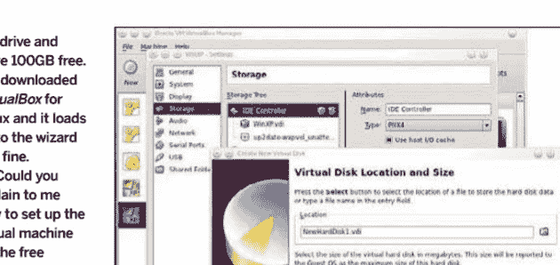

作为一个可以操作文件系统和分区的分区，请记住备份第一天的数据——但你必须重新全新安装。

# 虚拟磁盘

- 我有一套配备 32GB 硬盘的桌面设置，运行着 Windows XP 和 Linux Mint，XP 在一个分区，Linux 在另一个分区。它们占据了大部分空间。

# 快速参考...

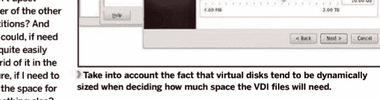

# X 转发 (X forwarding)

他询问的是基础 Linux 架构。这是一个网络化设置。虽然你的显示器通常连接到本地机器上的服务器，但并没有要求这样做。你可以使用 VNC 或 NoMachine 进行远程桌面。然而，它们需要你重建另一台机器的桌面。在这种情况下，远程桌面就是桌面。如果另一台机器是无头服务器，那么桌面就是资源的浪费。

与其进行完全设置，你可以使用 SSH 连接运行应用程序（这意味着这是一种在公共网络上运行的安全连接）。终端的类型是：

```
ssh -X user@remote.com
someprogram
```

如果你编写了一个 GUI 程序，它的窗口将显示在你的桌面上。这里有几点需要注意。首先，你必须拥有计算机的 SSH 权限，可以使用密码或密钥登录。另一台电脑上的 SSH 服务器必须启用 X 转发。这是默认开启的，但请检查 `/etc/ssh/sshd_config` 是否包含：

SSH 还有一些你可能发现的选项。使用 `-X`；如果 SSH 服务器设置了 X 转发，它就能工作，这在你拥有访问权限时并不一定更快。另一个可以提高慢速链路速度的选项是 `-C`，它会针对各种连接传输的所有数据进行压缩。对于窄带宽，VNC 可能是更好的选择。

注意 Mac OS 可以使用 X 处理 X，你可以用它在你的 Linux 系统上显示地图，反之亦然。

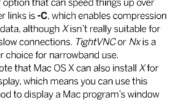

VirtualBox 与其他模拟器一样，它使用虚拟磁盘而不是物理分区。每个虚拟磁盘只是主机上的一个文件，并且：

- 考虑到在选择空间时确定虚拟磁盘大小的 VDI 文件需要存储在任何地方。不需要创建一个专用分区来存放它们，尽管如果你愿意，也可以使用。我个人，我在另一个分区上使用虚拟磁盘，因为如果它们变得太大，就不会占用我系统的其余部分。虚拟磁盘通常是动态的，这意味着持有它们的文件大小根据你的需要而定。如果你想填满它们，只需删除 VDI（虚拟磁盘镜像）即可。

# 帮助我们帮助你 

我们收到了一些无法提供问题足够细节的查询。为了获得答案，我们需要了解更多信息。你可以向我们发送消息，如果你的问题已经在 FAQ 部分中得到了解答，我们会回复你。或者，查看来自 (http://www.linuxformat.org/faq.html) 的输出，这将很有帮助。你发送的内容中应该包含这两者中的一个或两个。如果你正在安装、更新或卸载程序，请在 root 下使用以下命令并附上：

```
username > system.txt
lsusb > system.txt
ls > system.txt
```

- 在另一台电脑的桌面上运行 Fedora 配置。

106 | 2011年5月

# 大问题

# 回答

如何在 Linux Mint 上观看 DVD？当我尝试在运行 Linux Mint 9 KDE 的 HP-Pavilion 电脑上观看 DVD 或蓝光光片时，它不起作用。这是为什么？这取决于我的硬件吗？我安装了带有 KDE 的 Linux Mint 9，我的网关有 DVD。一个在 Linux 中播放或刻制大多数光片的选项。此过程在你所在的地区可能是非法的，所以你应该在继续之前检查一下。MakeMKV 可以从蓝光光盘复制文件到你的硬盘，以便使用任何媒体播放器播放。或者，你可以直接提取到网络，确保你安装了 `libcodec6-dev` `libdvd-dev` 和 `libvd4-dev`。然后运行：`sudo apt-get install built-essential libcodec6-dev libdvd-dev libvd4-dev`。

虽然 MakeMKV 是有点免费的——关键是在你使用它之前是免费的。对于免费的替代方案，下载 HandBrake。有两个文件：`makemkv_bin.tar.gz` 和 `makemkv_os.tar.gz`。在这里使用终端运行它们，解压每个文件并 cd 进入目录，从源代码开始：运行 MakeMKV，如果你想选择你想要的内容，请使用文件菜单。打开它后，你会看到磁盘看起来像某种东西。流传输到 Web 服务器地址是 http://localhost:5000/mediakit 运行 VLC 打开网络流并粘贴 MakeMKV 提供的地址。只要你在同一个网络上且连接足够快，蓝光光就可以开始播放。使用计算机的主机或 IP 地址，localhost。

有两个版本的 MakeMKV。一个是用于分发的，包含了在某些国家具有法律状态的内容。另一个用于商业用途。

一切并未丢失。你只需要安装 libvdcss 包。首先，获取你的硬件并在 medadb.org 上查找说明。然后安装 libvdcss，无论你使用什么软件播放 DVD，它都会解密任何加密的 DVD。蓝光是另一回事，因为数字管理 (DRM) 在上方，看这里：

```
tar -xf makemkv_os.tar.gz
```

```
make -f Makefile
```

```
sudo make -f install
```

# 逐步步骤：使用 MakeMKV 流传输蓝光内容

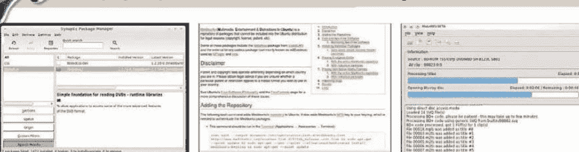

# 安装 libvdcss

播放 DVD 的第一步是使用你的包管理器确保安装了 libvdcss，如果没有

## 添加存储库

如果 libvdcss 不可用，添加 Meduntu。该网站有你需要添加到终端的命令。

# 打开你的蓝光光盘

启动 MakeMKV，它会检测你的蓝光驱动器并加载磁盘信息。这可能需要几秒钟。

# 选择轨道

MakeMKV 选择了除了轨道以外的所有内容，取消选择你需要的。取消不需要的字幕和音频轨道。

# 开始流传输

按下按钮，MakeMKV 看起来在下载一段时间，最终你会看到你的 Web 服务器地址。将 MakeMKV 提供的链接粘贴到蓝光


www.linuxformat

# 英国排名第一升级网站


# 应该升级哪一个？

为您的电脑寻找最佳组件

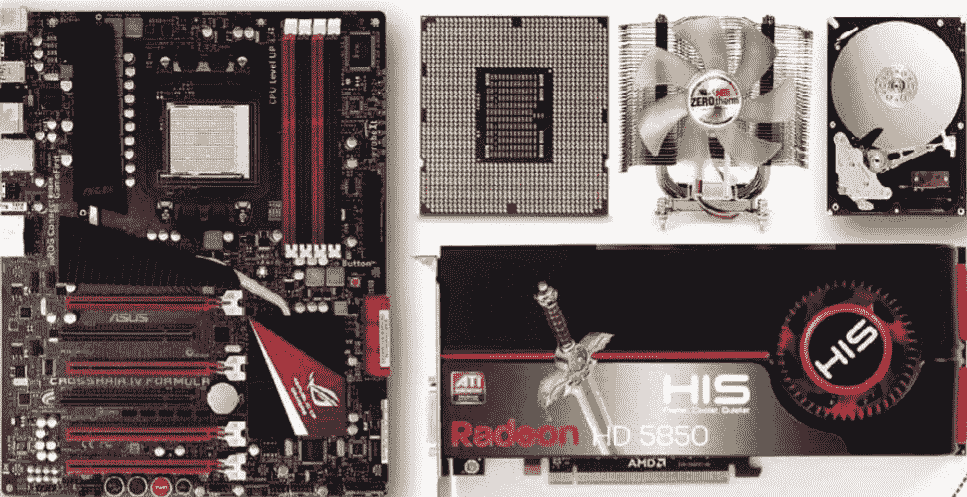

- 网上的绝大多数评测
- 独立实验室测试
- 专家升级建议
- 搜寻的最优价格

techradar.com

深入探索技术

立即访问 techradar.com/components

# 光盘内容

海量的 Linux 发行版、开发工具和游戏……

阅读本文以获取使用 LXFDE(DVD) 所需的所有信息！如果你是 Linux 新手，请打开 `index.html` 并进入帮助部分，查看右侧列出的指南。

Mike Saunders，新媒体编辑 mike.saunders@futurenet.com

- 什么是 Linux？
- 什么是发行版？
- 从 DVD 提升您的电脑性能
- 分区您的硬盘
- 浏览文件系统
- 使用命令行
- 安装软件


## Linux 发行版

## Mythbunt 及其他

我们非常喜欢 MythTV，但对它有一个主要的槽点：设置起来非常让人头疼。至少这需要花费大量时间。结果是在你的 Linux 电脑上获得了一个卓越的家庭娱乐系统，非常值得，但那是以前了。Mythbunt 结合了 MythTV 和 Ubuntu 的优点，打造了一个开箱即用的解决方案。

Mythbunt 包含在本月的 DVD 中，由于得益于数十年的光盘制作技巧，它可以从与开源软件相同的这块光盘启动。将光盘插入驱动器，重启电脑，并使用光标和 Enter 键从启动菜单中选择一个 Mythbunt 选项。（如果你的电脑是从硬盘启动的，你可能需要更改设置）

我们通常关注光盘上的桌面发行版，但 PipeWire 更多侧重于服务器和防火墙。你将在发行版中找到最新的 2.9 版本的索引。

有两个为不同需求设计的微型发行版。Sitaz 专注于高级用户，运行在网络浏览器、客户端 Openbox 桌面环境中，并提供了许多功能。有关功能的完整列表，请访问 www.sitaz.org。

> “此发行版结合了 MythTV 和 Ubuntu，打造了一个开箱即用的解决方案。”

Linux 新手可以选择“帮助”来选择光盘的章节以获取更多信息。


同时，我们还为 LXFDEVD 的你准备了一些额外惊喜：

Puppy 是另一个针对其他内核的轻量级发行版，但并不适合 wemythtv 光盘。Puppy 专注于成为一个全能的桌面操作系统，可以直接从桌面使用所有工具和网络应用。它还使用 RAM 并直接从 RAM 芯片上运行，性能惊人。

# 重要通知！

在将 DVD 插入驱动器之前，请确保您已阅读并同意以下内容：

- Linux DVD 已针对所有已知问题进行测试，并在删除前经过独立验证。我们建议您始终对任何软件运行更新程序和最新的检查程序。
- 虽然在选择和安装 DVD 软件时已尽力谨慎，但 Future Publishing 对在使用光盘、程序或其中的数据期间您的数据或计算机系统可能发生的中断或丢失不承担任何责任。
- 我们强烈建议对所有重要文件进行最新的、经过验证的备份。
- 请阅读个人许可以了解使用条款。

# 缺陷发行版

如果您的 Linux Format 封面光盘万以任何方式存在缺陷，请访问我们的网站 `www.linuxformat.com/support` 寻求帮助。如果您想与我们支持团队的成员交流，请拨打：`+44 (0) 1225 82274`


为了获得最佳效果，请确保此台电脑：

- 至少有 2 GB 可用磁盘空间
- 已连接电源
- 已连接网络
- 安装时使用默认选项

此软件包括显示 Flash、MP3 等其他内容，并与各种硬件配合。部分内容是开源的。软件受下方所述许可条款限制。

此第三方软件包含了来自 Razorlight 等人的 MP3 Layer III 音频解码技术。

```
安装 | 后退 | 前进
```

你需要我们团队的一位成员在你的 Linux 电脑上安装 Mythbunt 吗？在这里查看，Mighty mouse。

# 更多软件 DVD

## CherryTree, HomeBank

我们都会以各种形式记录笔记：电话旁的小纸条。日历上的随笔或桌面上的文件。问题是，这不是一种跟踪信息的高效方法。然后你的笔记会变得杂乱，导致很难区分重要信息。

CherryTree 旨在通过灵活性解决所有这些问题。它不是一个大文件，而是一个可以像 HTML 页面一样链接的文档集。你可以通过文本格式和图像进行装饰，让重要信息脱颖而出。它就像是你自己的

另一个值得关注的工具是 HomeBank，这是一个我们看到近年来日益增长的财务程序。它让你能够跟踪收入和支出，创建图表和图形来查看你的财务状况。它看起来可能有点复杂，过段时间你会发现

| 类别 | 支出：750.69 | 收入：1231.95 | 余额：481.26 |
|---|---|---|---|
| 由 | | | |
| 预付 | | | |
| 现金 | | | |
| 借方 | | | |
| 贷方 | | | |
| 市场 | | | |
| 其他 | | | |
| 日期 | 2018/04/24 | | |


Subversion 和 Mercurial，以及一个扩展系统。另一个优秀的 IDE 是 gedit，由于其简单易用而闻名。它可以在其他环境中运行。

- 适用于 Ubuntu、Debian 和 Mint 的免费 Linux 包，安装在其他光盘上，所以

然后是 INSTALL.FILE，一个受好评的殖民游戏克隆。它在压缩包中。

同时，Robmains 是一款以 Linux 爆炸为特色的弹球类游戏。它在压缩包中。最后是 Lasty's，一款 3D 驾驶游戏，你可以在其中控制车辆非常有趣。

# 光盘额外

## 第一部分

接下来，简单介绍我们在光盘上提供的常规板块。第一个是 TuxRadio，这是一个双周音频节目，展示如何成为 Linux 用户，我们随每期免费提供，分享我们自己的发现

文档分为两个部分：新手和解答。第一部分是针对初者的教程集，第二部分涵盖了 Linux 世界的一切，解释了什么是磁盘、如何分区硬盘以及对应的 Windows 程序等。

游戏开始于 1492 年：你带着一艘船和一些殖民者出发，目标是建立帝国。幸运的是，你国家的国王会送给你光盘上的 SpaceChar 游戏演示版。

- 我们的新手指南将帮助你。
- Roboms：外星人+爆炸=酷酷。

# 播客和文档

# 光盘上的内容

针对高度优化的基于 KDE 的发行版的新更新

## Linux 发行版

## OpenSUSE 11.4

OpenSUSE 是作者在 20 世纪 90 年代后期使用的第一个 Linux 发行版，在此之前是 Red Hat 5.1 的短暂亮相。SUSE 的世界发生了巨大变化——SUSE 是一家小型德国公司的项目，后被 Novel 收购并成为企业计算领域的有力竞争者。SUSE Linux 现在正在全球各地的企业中运行，证明了该发行版的质量。

作为吸引更多终端用户和开发者参与的一种手段，我们将最新的 Linux 技术带到了桌面端。它运行良好，特别是 11.x 分支已被证明是可靠的。

你可以在我们第 22 页的评测页面阅读关于最新版本的所有信息，但这里是运行它的方法。安装后，我们提供了三个版本的发行版，其中第一个是 32 位基于 KDE 版本，它可以从任何带有 512MB 内存的现代 PC 直接从 CD 启动，并配备了高度优化的 KDE 桌面。

然而，对于我们这些家庭桌面级的用户来说，这些产品并不合适。这就是创建 OpenSUSE 项目的原因。

网上提供了丰富的额外软件，从办公程序到开发工具和游戏应有尽。

关于分区的简单说明：Linux 需要硬盘上的专用空间。OpenSUSE 安装程序可以重新安装现有的操作系统（例如作为 Windows 的系统）来腾出空间。安装后，你的 PC 将从安装介质启动，然后你可以选择启动哪个操作系统。如果这是你想要的，我们强烈建议先备份任何重要数据和设置，以防万无一失。

OpenSUSE 粉丝还有其他选择，以发行版 ISO 镜像的形式提供（OpenSUSE 基于 KDE 版本，采用 GTK 驱动的桌面）。还有一个 64 位版本，这为我们带来了了额外的自由。你还可以将这些 ISO 镜像刻录到 CD-Rs 并从它们启动（使用光盘刻录软件文档作为刻录镜像的指南）。

OpenSUSE 最显著的特征 Yaast 提供了任何发行版中最强大的配置面板。

## 逐步教程：安装 OpenSUSE 11.4

### 1 启动

第一步是从 DVD 启动你的 PC，在启动菜单中，按 Enter 键从列表中选择默认的 OpenSUSE Live 选项。

### 2 桌面

完成后，你将到达桌面，可以开始探索。点击桌面上的“安装”图标开始该过程。

### 3 安装程序

安装程序将加载并要求你选择语言以及你想要的键盘布局。点击“下一步”继续并按照提示操作。

### 4 分区

在分区步骤，OpenSUSE 将根据你的驱动器布局为你提供各种选项。如果你是高级用户，可以手动进行编辑。

### 5 账户

你还被要求设置一个用户账户来识别你的系统身份。设置时，请记住用户名和密码是区分大小写的。

### 6 确认

安装程序将检查你是否要继续；点击任何带有蓝色下划线的链接来更改设置。发行版文件将被复制。

## 我如何……？

如果你是 Linux 新手，在安装 OpenSUSE 后，你可能不确定如何完成任务。这里是常见问题列表及其完成方法……

- 操作你的文件：点击桌面上的蓝色柜子来存储和访问个人文档。
- 播放音乐和视频：通过左下角的绿色图标，进入“多媒体”进行探索。
- 编辑图像：点击图标并进入“图形 > 图像编辑器”，这是一个多功能工具，具有许多可以媲拟 Photoshop 的高端功能。
- 在线聊天：在“互联网”菜单中，查看用于编写博客和网络聊天程序的子菜单。
- 配置系统：在“计算机”选项卡中，有一个功能强大的程序可以配置系统的各个方面。
- 获取新软件：点击“计算机 > 安装/软件”从互联网下载并安装数千个程序。
- 关机：点击“退出”标签注销当前用户或停止机器。

OpenSUSE 有活跃且友好的社区支持，如果你遇到困难，并不缺少帮助。首先，点击图标并进入“帮助”使用该系统。在桌面上你会看到“在线帮助”图标，它提供了互联网上的资源。访问 `forums.opensuse.org`，OpenSUSE 粉丝可以快速为你提供正确的方向。祝运！

OpenSUSE 的桌面是精美、流畅的 KDE 4.6，带有许多小部件。

不要错过……

KDE 4.6

新桌面充满了调整功能，例如保存到许多不同的网站。

LibreOffice 3.3

OpenSUSE 11.4 是首批随此版本发布的更快、更好的 OpenOffice 分支之一。

| 建议的分区 | 用户名 | 分区 |
|---|---|---|
| 欢迎 | Mise | |
| 桌面 | 用户名 | |
| 磁盘 | 密码 | |
| 设置 | ***** | |
| 安装 | | |
| 配置 | | |
| 自动配置 | | |
| 用户 | | |

LINUX DVD144

Linux 完整 DVD 列表目

OpenSUSE

Mythbuntu

Puppy

缺失光盘？请联系你的代理或向我们发送电子邮件以及地址和期号：

1.3 >> 本月的内容

易于使用的视频编辑器

强大的服务器和防火墙发行版

| 发行版 | 系统 | |
|---|---|---|
| IPFire 2.9-core | GParted 0.8 | |
| Mythbuntu 10.10 | pf-kernel 2.6.3 | |
| Ubuntu 11.4 | Recoil 0.7 | |
| (启动的某些 Gnome) | Noble 4.9.44 | |
| 和 64 位 ISO | Qercus 0.13 | |
| Puppy 11.1 | Scribes 0.9-dev | |
| DESKTOP | DEVELOPMENT | ESSENTIALS |
|---|---|---|
| CherryLinux 20.1 | Git 2.5.4 | ATI driver |
| Declet 1.07 | gsrc 8.4 | Checkinstall |
| Puppet 4.4.2 | Robot 0.8 | Coreutils |
| Grace 4.4.4 | Scit 6.12 | Hardinfo |
| HomeBank 1.30 | Linux kernel | |
| Kali 2.1.1 | Nvidia driver | Smart Boot Manager |
| Kwave 0.6 | WDial | |
| OpenShot 1.3 | GAMES | |
| Spacey 5.2 | SpaceChem | |
| INTERNET | HELP | MAGAZINE |
| BitTorrent 1.3 | Answers | Disk wallet |
| Chidown 1.0 | Newsletter | Magazine PDFs |
| Klicky 0.6.3 | Route admin guide | Tuxrad |
| Lighthouse 3.4.2 | | |
| WordPress 3.1 | Podcasts | Coding tools, Needle guides, Answers archive |

无限代理托管

非常适合设计师、机构和各种规模的 IT 创业者。

完整解决方案

我们的代理托管包包括无限网页空间、无限带宽以及不收取额外费用托管无限域名的能力。通过添加专用服务器、Exchange 托管并将域名添加到你的业务范围，为客户提供完整的网页托管解决方案。

代理功能

- 托管无限网站
- 100% 你的品牌
- 实时创建、管理和删除
- 英国数据中心
- 24x365 英国支持

添加到你的包中……

每月仅需 £29.99

网页托管

域名名称

Exchange 托管

专用服务器

- Windows & Linux – 无需额外费用
- 销售无限网页空间、带宽和电子邮件
- 创建你自己的套餐
- 为你和客户提供控制面板
- 白标营销辅助
- 根据需要添加多少账户均无额外费用
- 作为独立产品或配合托管销售
- 无月费或固定费用
- 完整的 DNS 管理
- 免费域名转入和转出
- 免费白标名称控制面板
- 每个信箱仅需 £4.99
- 标准配置 Microsoft Exchange 2010
- 为你和客户提供免费 Outlook 2010
- 4GB 存储空间
- 作为独立产品或配合托管销售
- 轻松转入 Exchange 2003 和 2007
- 每月仅需 £59.99
- 无长期承诺
- Windows & Dell 品牌
- 无设置费用
- 为客户提供全服务器控制面板
- 为你和客户提供控制面板

HostPay – 我们的代理包免费赠

HostPay 是我们专门的网页托管购物车和客户管理系统。Heart Internet 以市场领先的技术和实惠的价格支持其客户

一键安装，你可以在几分钟内开始运行

集成到你的网站或选择其中之一

实时自动获取、处理并履行订单

支持 PayPal, Google Checkout, Worldpay, Sage Pay, Roch & Co

# 我们要求按需付费

云服务器每小时仅需 1p

云文件每 GB 仅需 11p

# 服务革命（Servolution）已经开始

加入云计算起义

“服务革命”意味着我们已经在英国引发了基于云的计算浪潮。服务革命将让你最终从昂贵的内部服务器的负担中解脱出来。

这意味着对过时技术的担忧以及对 IT 压力的暴统治都将就此终结。事实上，你可以拥有一个更公平的系统，仅为你所使用的部分付费。立即加入服务革命吧，云服务器每小时低至 1p，云文件每 GB 仅需 11p——这一切都有我们传奇般的“狂热支持”作为后盾。

访问 `www.rackspace.co.uk/cloud-hosting` 加入服务革命
