# Linux 格式 - 2023年9月英国版 306

遇见这款尊重地球的手机

渲染你家乡的 3D 地图

构建防弹级公共显示系统

对阵

排名第一的开源杂志

A vs a

通过快速原型设计和自动化代码创建，开启项目与创意！

100 页 Linux 技巧、贴士及更多！

- >> 为你的桌面级电脑添加 GPIO 技能
- >> 随随地访问你的家庭服务器
- >> 监控并回滚终端安装

构建多线程编程项目

专业级音频和图像编辑的终极之选

用现代 Python 重现经典游戏

快速行动。

在你的帮助下，

我们也能做到！

我们致力于创造一个脑瘤可治愈的未来。

我们迫切需要你的帮助来加速研究。

短信 DEFEAT5 至 70507 捐赠 5 英镑，请帮助我们找到治疗方法。

thebraintumourcharity.org

## 欢迎


## >> 认识团队

## 并不高明

在本期中，我们正让 AI 为我们糟糕地开发应用程序。万岁！那么，你打算如何利用个人 AI 为腾出的所有空间呢？

人工智能就像任何其他工具——如果使用不当，你就会搞出一团糟，甚至会弄坏某些东西；坏得很彻底。但如果使用得当，你将提高生产力并帮助创造更智能、更快速的产品。

所以，这一次，我们不是在逃避 AI 主宰者，而是拥抱它们——保持适当的距离。

Jonni Bidwell

作为一个大语言模型 (`LLM`)，我无法具体回答那个问题。如果 AI 的出现释放了资源，空闲的人类可能会成为像我这样的 `LLM` 的代理。（在索姆塞的绿色矿井中 - Ed）

怀疑态度。我们会发现 AI 编程可以通过创建看似有用的代码块来帮助你产出更好的结果，除非对它们进行仔细检查，否则你实际使用的只是幻觉构成的奇幻生物。

为了帮助你产出更好的产品，我们查看了各种 AI 编程助手，对其测试并看看它们哪些地方正确，哪些地方错误。在解释你需要关注的重点时，探索它们如何加速你的编码和生产工作流。

Les Pounder

一旦 AI 接管了世界和所有的工作，我计划在森林深处的木屋里学习木工和铁匠活。直到机器人学会制作橱柜和马蹄而异。

当世界陷入疯狂时，仍有大量平庸的智力在工作，而我们正在尽力创造它。从为我们的 Steam Deck 升级更大的 SSD、用战斗来编程、以及调试旧系统以创建发行版选项、系统管理员秘密以及在 Blender 中渲染地图，有许多值得享受的！

如果那真的发生了，我将学习 COBOL 语言和烘焙。

Mayank Sharma

我不是物理极客，无法理解爱因斯坦说的“时间是幻觉”的意思，但我足够清楚时间是可以自由的。如果 AI 能负担得起我的费用，我会尝试去熟悉那个悬挂的瓶子。

Neil

Neil Mohr 编辑员

Neil.mohr@futurenet.com

Nick Peers

在寻求帮助以控制我的光光成瘾后，我可能会花时间整理我的数字图书馆并观看一些内容。噢，并清理我们积积的所有垃圾——包括光盘。


Michael Reed

对待 AI 最明智的做法是坐下来观察它将发展向何方。我们的一生中可能会看到微小的改进或变化，特别是在网上。但它会成为一种像互联网那样的变革性技术吗？改变生活的每一个领域，无论好坏。

数字版和印刷版：见第 18 页

希捷这款性价比 8TB 硬盘无疑可以描述为廉价且愉快——但那不是 Shane Downing 的庆祝方式。


RTX 4060 是 Nvidia 一张不错的显卡，但 Chris Szewczyk 怀疑，它可能只是被赋予了这个名字。


最公平的一个，Jonny Bidwell 对一款伦理智能手机感到兴奋。

本期内容：欧盟对开源的威胁 >> Plasma 功能删减 >> Gnome 开启窗口计划 >> Debian 拥抱 RISC-V

尽管 Linux 基金会等组织的反对，欧盟成员国已同意起草立法。

《网络韧性法案》于 2022 年 9 月提出，主要似乎针对物联网设备之间的互联系统。它确保了连接设备的最低安全保障，并要求执行强制性安全标准。

> “与共同立法者建立良好关系的益处。”

开源开发公司 Mozilla 的社区负责人 Joe Brockmeer 指出了该法案对社区更令人不寒而栗的效应：“CRA 想要强制项目在发现漏洞后 24 小时内向任何欧盟机构报告漏洞，这在行业惯例面前是不可能的，其他人还提议了详细的修改建议。”

尽管该法案意义重大，但对开源开发的影响可能是毁灭性的。包括 Linux 基金会在内的更多开源行业机构向欧盟立法者撰写了一封公开信，要求重新考虑目前的方案：`https://www.linuxfoundation.org/news/open-letter-cyber-resilience-act/`

Brockmeer 引用零日漏洞 `Log4Shell` 作为示例。他他还指出，这些严苛的要求可能会迫使开源软件离开欧洲开发。

在理论上，该法案涵盖了超出商业活动范围的自由和开源项目。

Open 的首席执行官 Amanda Beck 是一家支持开源的非营利组织：“欧盟专注于为中小企业（SMEs）提供豁免并对基金采取类似措施，显示出对开源软件运作方式缺乏理解。这是极其短视的，并加剧了遗留差距的循环。”

在许多实践中，如果贡献者不是法律实体的员工，开源项目将被认为存在漏洞，附件 1 指出，大多数开源项目托管在 GitHub 上。

鉴于今天使用的超过 70% 的软件基于开源项目，欧盟并未考虑到社区。时间将证明他们是否会调整立法以完全豁免开源软件。

法案的某些方面还将强制保证，即软件交付时“不含任何已知漏洞”。对于“连续”的风险和不断发现的新漏洞，其影响是巨大的。

CRA 遭到了多个开源组织的强烈反对。Open Europe 等机构也对该法案提出了详细的修改建议。

公开信指出了这一点，并幽地提到了大多数开源项目并不具备（相关条件）的事。

`Log4Shell` 零日漏洞是一个原始应用 `Log4j` 开发者未预见的漏洞示例。

### Plasma 6

Plasma 6 将包含许多新花样，同时一些现有功能将面临删减。

即将推出的 Plasma 6 桌面工作正在进行中。根据 KDE Wiki，它构建在 Qt 6 之上，计划于 2024 年初发布。新桌面不会预装在所有系统中，但 KDE 解释了如何在 KDE Neon Unstable 等操作系统上部署当前桌面。

即将推出的功能包括即使在资源匮乏的情况下的重大重构。系统设置中也留有了音频主题的位置。尽管如此，某些桌面功能将在 6 版本中被移除。KDE 开发者 Nate Graham 在 7 月 26 日的网站上解释说，可以在此处找到列表：`community.kde.org/Plasma-6` @NateGraham

移除了 Khotkeys，这是一个非常实用的功能，传统上允许用户使用按键甚至鼠标手势创建全局快捷键。注意，并非所有功能都能良好运行，其他功能由于项目活跃时间不够长而存在 Bug。Plasma 6 将完全移除 Khotkeys，转而采用支持键盘快捷键的全局快捷键（Global Shortcuts）。

其他功能包括 Windows 小组件运行器，它可能会出现在搜索中。这导致了用户的困惑，因为他们的组件是功能全的应用程序。Plasma 6 还在移除一些在桌面界面更改图标大小的方法。

Joe Boecker

Percona 社区负责人。

很难反对“产生新线索的网络安全年”这一目标，但留出余地很重要。在 CRA 中，除了免费和非商业化之外，没有对开源软件的定义。然而，“开源”的定义包含了某人付费为该项目工作或提供支持的情况。这导致了意料之外的后果。

这种影响的预期范围将影响每位贡献者，并使较小的玩家处于不利地位。对于欧洲开发者来说，其伤害大于收益，导致他们考虑自己的处境。这可能会以其他方式驱动开源的发展。

然而，他还解释了某些主要差异背后的背景。

2023 年，Gnome 开发者 Tobias Bernard 开始发布关于窗口管理主题的迷人内容。他正确地认为，这个问题自桌面界面发布以来一直存在。无论使用多个窗口进行多任务处理是自动的还是由用户手动移动/缩放，平铺扩展都可以做出许多更改。

### Mesa 与 Intel 图形

两个新漏洞可能影响 40% 的用户。

Linux 上的 Intel 图形得到了提升。

Zink 起于 Collab 的一个小项目，但它已成为一个社区项目。如果没有 Mike Blkenstein 和其他贡献者的工作，这将是不可能的。

任何 Linux 用户都知道 Mesa 是 Vulkan 以及其他显卡驱动的开源实现。今年 6 月，Mesa 2.3.28 的更新为 Intel 显卡驱动带来了改进。

一个值得强调的细节是，该项目现在正式符合规范。它是第一个正式符合规范的，但不会是最后一个。事实上，在作为通用分层实现（如 Chronos 内核）之前，我们只需要另一个符合规范的实现。

## 观点

Bodhi Linux 是一个轻量级发行版，基于 Ubuntu，其最新版本（7.0）基于 Ubuntu 22.04 LTS。Bodhi 使用 Moksha 桌面环境。

访问 `www.bodhilux.com` 获取更多信息。

如果你认识一位担心切换系统的微软用户，那么这个巴西的发行版可能是最佳选择。LinuxFX 基于 Ubuntu（在此例中为 Ubuntu 22.04 LTS），能够运行 Windows 和 Android 应用程序。

开发者通过 Power Toys 移植了 Windows 11 控制面板。Android 应用由 Ubuntu 支持。该操作系统的最新版本使用了 Linux 桌面。

Italo Vignoli 是 LibreOffice 和 Foundation 基金会的创始人之一。

Community 作为由志愿者支持的生产力自由办公套件的新版本，将于 8 月 21 日正式发布，并可在 `libreoffice.org/download` 获取。

148 名贡献者添加了新功能：61% 的代码来自四个社区雇用的 53 名开发者。基金会的咨询机构——Colabora、Red Hat、Hymra 等——其中 15% 来自 TDF 的 7 名开发者，其余 24% 则来自 89 名独立志愿者。

LinuxFX 支持 Windows 应用，使得切换操作系统变得更加容易。

4MLINUX 这一 Linux 发行版专注于四个使用阶段：维护（作为系统发布版）、多媒体（播放 DVD 和媒体文件）、服务器（使用 inotify 服务守护进程）和游戏。

最新版本同时包含了 LibreOffice 7.5 和 Office —— 并带有 Firefox (v115.0) 或 Chrome (v114.0.573190)。提供下载的 Java 应用，如 Fappy Bird。

访问 `mlinux.org/blog.post/2023/07/4mlin-40-stable-released.html` 获取更多信息。

4MLUX 针对多媒体、服务器系统救援和游戏进行了优化。

另外代表数百其他人员提供贡献的 22 名志愿者承诺完成 160 种语言的本地化工作。LibreOffice 7.6 将提供多种语言版本，让全球范围内的人都能用母语使用它。此外，有超过 23 亿人将 100 种语言作为第二语言。

一个用于匿名和隐私保护的发行版。Whonix 基于 Debian（在此例中为 Debian 12）。所有连接都通过 Tor 路由。

该操作系统包含两个部分：Whonix-Workstation 位于完全隔离的网络中。它们设计用于运行 VirtualBox 等虚拟机软件。Whonix 的最新版本使用了更多的浏览器 v125.1，并从最新的 Debian 稳定版部署了 Tor 包。

你可以访问 `www.whonix.org/wiki/download` 开始使用。

Whonix 使用虚拟机通过 Tor 网络路由连接。

如果你不需要这些功能，并且倾向于需要测试和 Bug 修复更少的版本，那么你应该安装 LibreOffice 7.5 Community，它包含了几个月前的回溯修复。

Jon Masters 关注着 Linux 内核的所有最新动态，让你无需费自操心。Jon Masters 是一位内核黑客，参与 Linux 超过 20 年，致力于低能 ARM 系统的工作。

Linus Torvalds 宣布 Linux 额外的候选版本（即“发布”周期）看起来仍然很早期。现在的事实是，自 6.2 版本发布以来，我们有一个非常规律（特定的）模式；我们在 6.2、6.3 和 6.5 版本的调用中进行了 32 次未合并的操作。Leerheim 继续维护回归问题，包括一些影响内核的某些板级问题（`include/linux/buffer_head`）“`buffer_head`：`buffer_head` 曾映射到页内存中的单个（磁盘）缓冲区，当然以及通过文件系统层进行使用。如今，基本单元和 buffer-heads 被用于跟踪块映射（通过 `get_block`）、以及子块的跟踪（通过页面提交 page submission）”。

内核的不同部分正在被修复，但尚未完全修复。现代处理器的速度比它们每次访问必须等待的内存快数千倍，我们的现代时代已变成了一个真正的瓶颈。

我喜欢谈论各种行为的细微差别，包括关键安全漏洞，特别是推测执行硬件如何通过 Spectre 引起广泛的关注和注意力，允许用户提取他们无权访问的信息。“要移除某些根深蒂固的东西将需要一些时间，Christopher 最新的补丁允许在不带 buffer_heads 的情况下构建内核。”

感谢 Christopher Hellwig 对 Linux 和文件系统的贡献，这里还有其他方法。换句话说，存在一种使用块跟踪（1024 字节块）磁盘块的遗留数据结构。Linux 添加了页缓存（跟踪文件块）。

John Pope 发送给 Bob，要求 Wire 修复内核性能以使用非 BKL 锁。Sam James 同意，Gentoo 一直在应用下游补丁以修复“一点”，并推到了某些点。

我们提到了 RISC-V 版本作为基于 T-H1520 的开发，为了让尝试启动 T-Head 的 OpenBI 固件和低级 RISC-V 系统，已存在多年。它将继续运行内核。Beagle V 板（也使用 TH1520）可能，如果那些固件问题得到妥善解决将会很好。

包含活夹、指南及特惠优惠


在线查看完整范围

`www.magazinedirect.com/summer23` 或拨打 `0330 333 1113`

从开源软件到编程大师课程以及树莓派项目，通过来自 *Linux Format* 杂志幕后专家团队提供的这一系列令人兴奋的专家教程、指南和建议，让你的机器发挥最大价值。

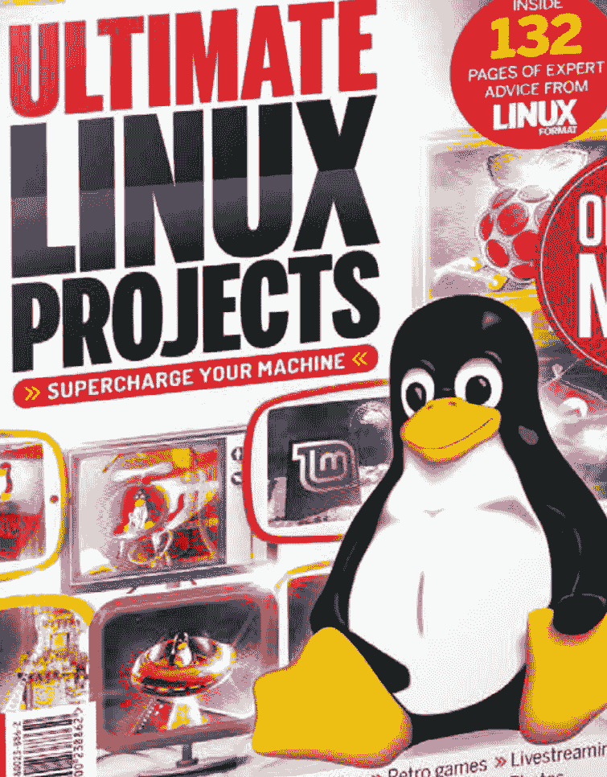

### LINUX FORMAT 提供的 132 页专家建议现已发售

让你的机器性能飙升

订购非常简单。访问网站：`magazinesdirect.com`

请将你的问题发送至 `answers@linuxformat.com`

Neil Bothwick

喜欢在睡前阅读 Linux 配置文件。

Bob Atissel


另一个是 `ffmpeg`，一个设计用于从照片创建幻灯片的程序。它相当老了，尽管它似乎仍在进行开发——其中一个程序已经是顶尖水平，但应该考虑进一步开发。它的界面易于使用，但你可能会发现运行时有点不稳定，不过可能是其他系统上的问题——这像场博弈。

最接近你的是 `Imagination` (`imagination.sourceforge.net`)。这是一个 GTK 程序，可以实现你描述的大部分功能。拥有近 70 种语言翻译，


`IFDam` 是 Linux 中可用于创建幻灯片的程序之一，可以控制幻灯片的计时（包括单个和全局）以及音频轨道，`imagine` 应该能够实现这一点。

像这样，日期选项会更简单。然而，它可能运行不佳。潜在问题包括文本太小——尺寸取决于你使用的图像。此外，除非你更改颜色（在添加文本时更改），否则很难看到文本；这在幻灯片照片中尤为如此。可以在图像下方添加文本，在 ImageMagick 中称为编码器：`convert pic.jpg -fill white -annotate +0+0 #000000 -stroke white -pointsize 20 -gravity South -annotate +0+0 "+jpg" /tmp/pic.jpg`

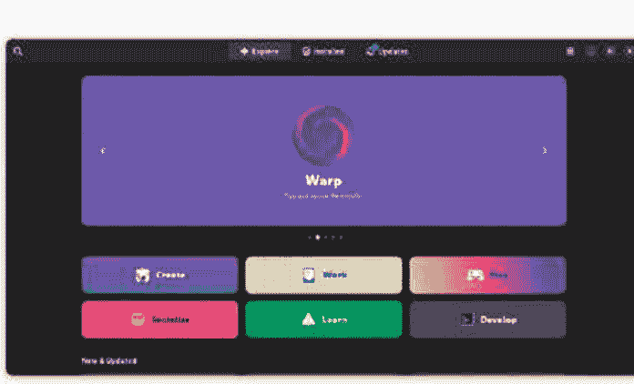

商店几乎没有任何应用。为什么我安装的应用没有显示给其他用户？为什么其他用户的商店几乎是空的？这是 Vanilla 容器化导致的吗？我能让我账户中的应用对所有用户可用吗？我该如何在其他用户的软件商店中拥有完整的应用列表？

Kevin McMillan

在 Vanilla 05 软件包管理系统中，每个用户都必须自行管理。

通过为这两个活动创建不同的用户来将它们分开。这样你甚至不需要注销，只需从登录菜单使用“切换用户”(`Switch User`)切换到另一个用户。登录管理器会记住为每个用户选择的桌面，还会处理桌面、主目录的切换，以保持你的工作文件和娱乐文件分离。你可以为两个用户都要访问的文件设置共享区域，因为 Linux 是一个多用户系统，所以每个用户的环境不仅是可能的，而且是预期的。

可以轻松拆分为一个。一旦你使用了 PID，可以使用 `stop` 停止运行它：

这会停止运行的进程但不会杀死它。当你准备好时，可以使用 `kill` 来终止它。

然而，情况可能并不简单，因为许多程序是多线程的会产生进程。在你的视频转码过程中，你会看到许多 `ffmpeg` 实例正在运行。你需要向每个进程发送 STOP 信号以做出立即响应。发送 STOP 将停止进程直到它们退出，否则进程守护将在其中一个完成之前不会释放。

> 这归因于 Vanilla OS 的设计。为了保护 OS 免受任何其他形式的连接影响，文件系统是不可写的。从各个方面来看，运行系统非必需的内容必须被锁定在用户中心，这意味着每个用户的应用都保持分离状态，因此它们不会被另一个用户损坏。虽然磁盘空间利用率较低，但有足够的时间和许多应用使得 Vanilla 构建的优势是值得的——这由每个管理员来决定是否值得。

还有命令行管理器：这是更新最简单的方法。在 Debian/Ubuntu 上，但为了制作你创建的应用列表，你可以为每个用户创建一个任务来定期运行 `apt update`，或者

我们乐意回答你发送到 `answers@vanilla.org` 的任何问题，无论我们处于什么水平。我们都经历过这些，所以不要害羞。以下是为什么人类 (K) 在需要时天性倾向于提供帮助，请尽可能提供尽可能的信息。如果某些方法在某件事上有效但在另一件事上无效，请告诉我们。如果你收到错误消息，请将文本以及你调用它的具体操作发送给我们。

你应该讨论容器的使用。虽然使用独立的发行版进行工作要简单得多——不需要重启即可切换——但设置起来要复杂得多。

如果我想展示一个特殊进程如何处于 Z 状态，然后使用 `bg` 将其移除，但对于一个非交互式程序……

本期将评测最新的隐私保护型手机！


我一直读到 Fortran 仍然是执行速度最快的语言，这也是它至今在高端计算的某些方面占据主地位的原因之一（这在 JF 成员中并不为人知）。想象一下，即使是 C 语言，两者都是编译的，且 C 通常被认为更贴底层硬件。

Fortran 有时作为函数调用在其他语言中开发，例如 MATLAB；C 也是同样使用的。有多少人知道 MATLAB 是用 Fortran 写的？或者它的向量化运算是以 Fortran 开头的？0。为什么不超越 C 呢？它的速度和 x86、ARM、GPU 和 CUDA 等其他语言一样快吗？你可以讨论增加更多语言的标准和前景（例如， GPL 许可是主要障碍），并对这在未来的影响做出预测。


回答你问题的方法。我们之后会关注 Mureka；它是一个复杂的领域，而且当移动设备寻求 Linux 时，有些人却想要一个直接的 Android 替代品，这让情况变得复杂。

我正在使用带有 64 GB SD 卡和 Raspberry OS 的树莓派 4 GB，全部通过 RealNC 访问，因为 RTP 看起来并不行。我不计划将树莓派用于模拟，而是为我的朋友托管大厅。我通过 Flatpak 安装了 Yuzura 模拟器，它在正常时运行良好，但我无法让它通过 Flatpak 或 AppImage 运行——即使尝试可执行文件，Snap 也说不兼容 ARM64。

基本上，我需要尝试带有 Agz 插件的 N64 模拟器，以及使用 Netplay 的 PSX 模拟器，但 Docker 方案似乎是一个有趣的选项——尽管我不知道那涉及什么。

Richard Smart

Neil 说...

恭喜你开启了树莓派和 Linux 的奥险之旅，这是一个尝试模拟的绝佳平台，尽管听起来你走的路径比你需要的要复杂。Citrix 仅限于 x86，因此不支持基于 ARM 的树莓派，这就是 Snap 给出的错误。坦率说，如果树莓派不支持，你完成这个任务将是在浪费时间。

如果你想要稳定的模拟，你应该看下 `Batocera.org`

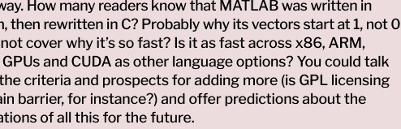

Neil 说...

介绍 Fortran 是一个非常棒的主意。它在科学计算中被广泛使用（例如我父亲，他拥有物理学博士学位，就在用它），所以可能值得一试。你可以根据意意详细介绍，但这些建议非常棒。


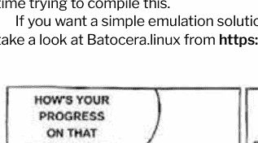


如果你遵循那个数学规律，你永远不会结束！


查看支持设备的详尽列表！

每份纸质或组合订阅，即可获得一个 AquaBlaster，价值 £49.99！


Boompods 蓝牙音箱

- 亚马逊批准的产品
- 坚固结构，内置麦克风
- 可以连接到 Boompods 应用进行播放和暂停
- 完全跌落测试且防水，适应所有条件。

# PLUS：独家访问无 DRM 的 PDF 教程、访谈和评论。

以灵活的方式支付四期付款，获得一年的内容。

| 年份版 | 年份纸质 + 数字版 | 数字版 |
| --- | --- | --- |
| 每三个月 £16.75，一年节省 20% | 每三个月 £23.00，一年节省 47% | 每三个月 £13.75，一年节省 39% |

如需了解详完整条款与条件，请访问 `magazinedirect.com`。咨询请拨打 +44 (0)330 333 113，工作时间为英国时间周一至周五上午9 点至下午5 点）或发送邮件。

便宜实惠——这并不是

型号：ST8000DM4

每 TB 成本：£15.50

接口：SATA

技术：CMR

缓存：256MB

工作负载：5.3TB/年

MTBF：N/A

保修：两年

这是我们硬盘列表中最便宜的 8TB 硬盘之一，但是以性能、保修和可靠性为代价的。Seagate 使用 CMR 技术以较低的价格达到 8TB，但这对写入负载的性能和一致性产生了负面影响。5400rpm 的速度也是如此。Barracuda 在读取负载中表现，适用于媒体和备份存储；然而，8TB WD 硬盘包含了快约 50% 的 CMR 技术。它更好且存储空间更大。

如果你想要一个带有三年保修和数据恢复服务的更坚固的硬盘，Seagate 的 7200rpm FireCuda 是更好的选择。FireCuda 也因为其 CMR 转速而更快，位居我们硬盘列表的首位。性能几乎是 Barracuda 的两倍。


并不是所有闪光的旋转硬盘都是一样的。

数据集。我们将 31,227 个不同类型的文件（如图片、PDF 和视频）复制到新文件夹中，然后对一个新生成的 6.5GB 压缩文件进行读取测试。Barracuda 硬盘运行非常慢，即使与 Blue 相比，所以只有在你没有重度使用的情况下才应该使用它。WD 硬盘对读取数据的影响大得多。

如果 Seagate Barracuda 的性能像 Blue 一样，那么它的读取性能是足够的，而它的写入性能取决于 CMR 硬盘。WD 硬盘具有更大的缓存，但在写入小文件和备份方面更好，选择 SMR 硬盘的权衡在这些测试中是显而易见的。

Blue 和 Barracuda 共享两年保修。Barracuda 有一个工作负载限制 (WRL)，定义了在可靠性下降到两年结束之前，你可以如何在硬盘上进行读写。相比之下，WD Blue 没有限制。

Barracuda 的额定速度为 5900rpm，比 Blue 慢，且功耗也更大。这个速度额定可能有误导性，因为 CMR 硬盘在某些负载下会导致性能下降，正如在持续数据集中所示。

Barracuda 是 3.5 英寸硬盘，Seagate 也为笔记本电脑提供了 2.5 英寸型号。这些硬盘定位为舒适型，意味着它们不太可能针对预测的工作负载使用技术。Seagate 还使用其多级缓存 (HTC) 技术来处理突发负载，并允许硬盘将简单数据合并到适合写入碎片化轨道上。与 SSD 不同，HDD 使用 TRIM 通过整理数据来提高性能。

使用标准基准测试工具测试文件性能，50GB

| 特性 | 6/10 | 9/10 |
| --- | --- | --- |
| 性能 | 4/10 | 价值 | - |

它便宜，但由于使用了 Seagate 技术而受限。对于特定工作负载有用，但 WD 有更快的 CMR 选项。

+   >> 6/10

由 Chris Szewczyk 撰写的一个名字起错误的优秀显卡。

| 规格 |
| :--- | :--- |
| GPU: AD107 |
| 架构: Ada Lovelace |
| 制积工艺: 4N |
| 频率: 2.4GHz 频率 |
| 内存: 8GB GDDR6 |
| CUDA 核心: 3072 |
| 流处理器核心: 2304 |
| RT 核心: 24 |
| Tensor 核心: 96 |
| L2 缓存: 24MB |
| TDP: 115W |

Nvidia 的 40 系列几乎已经完成。除了 RTX 4050 和潜在的 RTX 4090 Ti 外，这款 GeForce RTX 4060 正有望成为 40 系列的最终产品之一。作为事实上的大众市场 Ada Lovelace GPU，它是 PC 游戏拼图中的重要部分。RTX 4060 会足够好吗？如果它潜力引发一波升级潮——或者反之，如果它的话会阻止升级。

Nvidia 提供的 RTX 4060 是一款具有卓越能效比并支持关键技术的强大显卡，包括带有帧生成技术的 DLSS 3。AMD 的 Radeon 7600 和 Intel 的 A750 是 RTX 4060 的逻辑竞争对手，但它们并非没有缺陷。前一代的显卡仍然完全可行。像 AMD RX 6700 XT 和 RTX 3060 Ti 这样的 GPU 仍然是优秀的游戏显卡，而且它们的价格让它们一直保持竞争力。

RTX 4060 采用紧凑尺寸，具有低功耗和特性。由于支持 NVENC，它可能满足那些不仅寻找显卡也寻找视频卡的用户。它可能缺少 DisplayPort 2.1 支持，尽管在 4K 和 8K 下的性能已超出现实。

但当你观察它时，最大的问题（争议点或琐碎之处）是显存的包含。正如 RTX 4060 Ti 8GB 或 RX 7600 8GB 的情况一样，毫无疑问8GB 将完全足够。

依靠营销噱头在 Linux 上并没有太大帮助。

RTX 4060 围绕 AD107 GPU 构建。它采用定制的 TSMC 4N 工艺制造，该工艺针对 Nvidia 进行了调整。RTX 4060 支持具有执行重排序功能的核心的硬件光线追踪、第四代 Tensor 核心，并支持 AV1，当然还支持带有帧生成技术的 DLSS 3。该卡连接到 PCIe 4.0 插槽。相比 RTX 3060 Ti 提供的全 16 通道连接退了一步。

RTX 4060 最令人深刻的特性是它的功耗。在 115W 的 TDP 值下，RTX 4060 是一款效率惊人的显卡。

在游戏场景下，在不开启光线追踪的情况下，RTX 4060 在 1080p 和 1440p 60fps 下在几分钟内往往略领先 Radeon RX 7600。但它并没有忽视 Intel RX 750 或旧的 RTX 3060，它们依然在竞争中起伏。如果光线追踪是一个选项，RTX 4060 会比以前强得多。

至于性能，RTX 4060 提供了具有竞争力的速度，在 Luxore Renderer 中的速度介于 RTX 3060 Ti 和 Nvidia RTX 3060 Ti 之间。在快速且稳定的竞争世界中，它交付图像的速度比 RTX 3060 快三倍。

RTX 4060 是一款很好的游戏 GPU；但在 290 欧元的价格，与 Radeon RX 7600 和 270 欧元的同类 RTX 3060 Ti 相比，它的价格偏高。对于计算来说，它是游戏和计算的有力补充。它的运行干净且良好，与其他产品一样出色。Nvidia 仍然提供闭源驱动，开箱即用即可保持持续支持。

- 开发者: Nvidia
- 价格: €290

| 特性 | 易用性 | 9/10 |
| :--- | :--- | :--- |
| 性能 | 8/10 | 7/10 |

我们认为 RTX 4060 值得推荐，在合适的价格下，它将是一次稳固的升级。

>> 评分 7/10

### Murena Fairphone 4

作为最公平的，Jonni Bidwell 对一个具有尊重隐私的操作系统的伦理手机感到兴奋。

- 规格
- SoC: 高通骁龙 750G, Adreno 619
- 6GB RAM, 128GB 存储空间
- 电池: 3950mAh
- 显示屏: 6.3 英寸 IPS 1080x2340
- 后置摄像头: 24MP
- 前置摄像头: 25MP

位于荷兰的 Fairphone 以其同名的模块化、易于维修且“公平”的手机而闻名。除了在员工享有良好工作条件的工厂中制造外（听起来很熟悉——该手机使用了伦理来源和回收材料，且这是其运营的核心）。例如，它刚刚宣布了 Fairphone 3（于 2019 年发布），使用了 Android 并持续了两年。它继续支持 Fairphone 2（于 2020 年发布），而 Fairphone 5 在 2021 年升级到 Android 10，直到 2023 年 3 月收到了最终更新。


Fairphone 的第四代产品在欧洲是新的，目标是公平。通过与 Murena 的合作（见其故事），你购买 Fairphone 4 时，它具有隐私友好的 OS（从 Google 服务中去化，除非另有说明）。Murena 的人们尊重“你的数据是你的”（它是这样说的，而且他们认为 Fairphone 拿了太多数据）。我们强调这在欧洲也是可选的，但你可以购买预装了标准 Android 的手机，如果你想的话。

（注：OCR 文本有大量重复和破碎的句子，我将按逻辑流进行合并。）

## Peppermint OS

在体验了 Linux Mint 多年后，Mint Drake 在 Peppermint OS 中选择了更具风味的尝试，它集成了云应用。

Peppermint OS 视觉效果非常丰富，`Calamares` 安装程序提供了一个安装演示。欢迎中心（`Welcome Hub`）也提供了许多建议的软件，但捆绑的应用程序很少。

我喜欢其中很多很棒的构思。Peppermint OS 的构思源于一位导师——你可能好奇的那个 Ken Devlin，他也参与了 Linux Mint 的工作。Mint 本身源于创建者希望在 Mint 成功的基础上进行开发，同时添加 Web 集成，这是操作系统所需要的“额外动力”。

该项目有一定的历史，之前构建在 Lubuntu 之上，并融合了 Ubuntu 桌面环境的元素。Peppermint 有两个主分支：一个基于 Debian，而本次评测的版本基于最稳定的 Debian 版本（`Debian 12`）`Xfce` 桌面环境和 Ubuntu 缩略图管理器。

ISO 大小约为 1.5GB，你几乎没有多少预装应用。在首次启动时，你会发现几乎有两个预装应用。这种轻量级桌面同时使用云应用和本地应用。操作系统被分配给特定的云应用，如 `Kurmo`，它可以通过搜索（特定站点）启动。这是一个专用的浏览器窗口。

最新版本的 `Kurmo` 带有更新后的 UI，并基于通用编程语言。

这听起来可能有点吓人，但 Peppermint 努力帮助你导航实时环境。欢迎中心列有一份建议安装的应用程序列表。这允许你从仓库下载每种软件的最新版本。如果你想从其他仓库安装应用，需要手动更新 `Sources` 文件。

如果你对现有内容感到满意，Peppermint 的最新版本现在将其分为两个部分：软件和浏览器，以使布局更简单 -。

你还可以启动软件包管理器，或者下载并设置软件管理器。事实上，欢迎界面实际上是 Peppermint 最新版本中的功能之一。

该系统的最新迭代版本（2023-07-01）还更新了对用户主目录的偏好设置。在这里我们了解了 `hblock`，它是 Debian 及其衍生版本中普通 hosts 文件的超级版本。它包含了一个已的恶意域名列表。

- CPU: 1GHz
- MEM: 1GB (建议 4GB)
- HDD: 10GB (推荐)
- 架构: `x86_64`

Peppermint 提供了一种安装流行软件和网络浏览器的方法（如 Firefox ESR）、广告、跟踪脚本，并防止云应用连接到它们。

Pep Docs 还包含了捆绑的 `XDaily` 工具，这是一个命令行系统更新/升级程序，一旦启动，它要求你回答 Y/N 来执行诸如更新、删除旧缓存和更新图标的任务。你也可以通过系统托中的这个小蓝色图标访问系统。

帮助指南指出了提供的不同软件包范围，因此，尽管什么最适合你的需求取决于你的决定，但 Peppermint 的桌面体验使用了 `Metawire` 主题和 `Papela` 图标集。这些圆形图标很容易找到，并可以轻松地添加到启动栏。

如果你决定尝试 Peppermint，通过 `Calamares` 安装程序进行设置轻而易举。从那里开始，如果你以前没有安装过云应用，大部分时间你需要独立操作。该团队维护着活跃的论坛、Matrix 频道和 Mastodon 页面。

- 开发者：Peppermint OS 团队
- 网站：`https://peppermintos.com`
- 许可证：`GPL`

Peppermint 非常令人惊艳，并且对于设置 Ubuntu 的任务来说，这对于初学者来说可能非常困难。

| 特性 | 易用性 | 文档 |
|---|---|---|

评分 7/10

## Fatdog

Nate Drake 展示了 Fatdog，这是一个基于 Puppy 并成长为非常有能力的“大狗”的操作系统。

Fatdog 是我们长大的小狗。它包含一个优秀的网络浏览器，以及生产力、媒体和编辑工具。它几秒钟即可加载，并有一个出色的管理器。

每个狗都有风光的时候，对于 Fatdog 团队来说，该项目始于2008年作为 Puppy 的简单扩展。任何有经验的 Linux 用户都会告诉你，Puppy 轻量且易于使用，但需要更多的自定义和安装额外软件才能成为一个实用的操作系统。Fatdog（正如其名所示）是长大的小狗。它的开发者在一个意味着更多边界的 Puppy 版本上付出了脚印——这个版本确实令人印象深刻。我们找不到比下载 Fatdog 的最新版本（814）更好的证明了，因为 ISO 仅略大于 300MB。该操作系统比任何 Intel/AMD 能提供的都要强大得多。我们选择以“丢弃模式”（Throwaway mode）加载系统，它运行在内存中，但如果你愿意，也可以安装到驱动器。然后 Fatdog 可以使用两个简单文件进行安装——无需分区。

- CPU: 600MHz
- HDD: 600MB
- 可启动: `x86_64`, `ARM`

（注：后续文本存在大量重复和乱码，已根据提供的唯一内容进行处理。）

## 各款发行版表现如何？

从 Fedora Design Suite（Fedora 设计套件）在内的所有发行版都安装并配置了 `JACK` 服务器，这是大多数 Linux 应用程序提供的支持。在这四个版本中，只有少数的定制化允许用户加入“audio”（音频）组，这让音频处理变得流畅得多。一个微小的区别是它现在运行在 `PipeWire` 上，这是一种新的 Linux 音频系统。

`AV Linux` 使用 Linux 内核（实时性），这是 Linux 内核的一个特殊版本，针对使用场景、处理调度和 CPU 频率等领域的性能进行了优化。缺点是在某些情况下，它的吞吐量较低。你可能需要对硬件进行微调以获得这种性能。请记住，如果你使用的是笔记本电脑，非标准内核可能会抛出一些异常问题，但极少发生。

安装 Linux 内核对于现代工作流来说是一个福音。`Ubuntu Studio` 配备了 `ALSA` 工具，这是一套配置工具，涵盖了大多数发行版中需要用户手动调优的领域。这包括一个用于安装各种系统和硬件信息的工具，还可以用于管理 iPad 和 iPhone。它的加入让 AV Linux 感觉像是一个更用心的发行版。

`Ubuntu Studio` 使用低延迟内核。这是标准内核的官方支持变体，这意味着它的设置比使用 Liquix 内核更接近原生，并且确实为实时多媒体任务提供了改进的性能。`Ubuntu Studio` 安装程序允许你添加一些自定义发行版用于故障排除和性能优化。你还可以运行 `PipeWire`。`Ubuntu Studio` 是这些发行版中唯一带有图形用户界面（GUI）来帮助使用 `PipeWire` 的版本，如果你在安装 `PipeWire` 之前于回到旧式的设置。

`Media OS` 运行的是“通用”（generic）内核，但开发者也在交换分区（swap）等领域实现了一些性能微调。安装并配置了 Windows 仿真层。

| MEDIA OS | 7/10 | FEDORA DESIGN SUITE | 5/10 |
| UBUNTU STUDIO | 8/10 | AV LINUX | 8/10 |
| FEDORA JAM | 7/10 |

`Ubuntu Studio` 预先应用了媒体创作电脑所需的大多数定制。

我们需要一个能够访问最新软件的坚基础。

`Fedora Design Suite` 基于 Fedora，因此我们使用 Fedora 仓库和命令行工具，例如 `DNF` 命令行包管理器。在提供最新的音乐工具方面，这些仓库略微领先。此外，这两款发行版都可以访问 Flatpak 包。

让问题变得复杂的是，基于 Debian/Ubuntu 的发行版可以添加所有的 KOSUbuntu 仓库，这些是多媒体工具和应用程序最及的仓库，这也是一个加分项。`PPA` 是另一个获取最新软件的来源。

`Media OS` 基于 Ubuntu，这可能是一个劣势，因为尖端媒体工具特别需要前沿库。相比之下，`Ubuntu Studio` 有 `LTS`（长期支持）和稳定发布版本。

| MEDIA OS | 6/10 | FEDORA DESIGN SUITE | 7/10 |
| UBUNTU STUDIO | 9/10 | AV LINUX | 8/10 |
| FEDORA JAM | 7/10 | |

有点混乱。`Ubuntu Studio` 拥有最更新的发行。

创意流流至关重要。

7/10 AV Linux
6/10 Fedora Design Suite

所有用于媒体应用的需求与桌面版并没有巨大差异。界面应该是快速且易用的，因为当你将 Linux 作为桌面中心时，你通常需要保持敏捷。在发行版的工具数量方面，启动器应该是方便的并利用分类。搜索等区域的清晰度非常重要。

默认的 Linux 主题是深色的，它利用了一部分透明度和华丽的外观，但是以牺牲一些额外资源为代价的。顶部是一个巨大的 dock（栏），包含一些主要功能，而底部是一个较小的任务栏和 dock。在背景上，有实用的状态显示，显示执行、内存占用和 CPU 性能的实时更新。正如对 `Xfce` 桌面所预期的那样，有很大的定制空间，功能遍布各个。这在很大程度上取决于 `Xfce` 的工作原理，MX 主题进一步复制了这些选项。然而，切换到浅色主题可能会在一个几乎无名的环境中破坏会。

这里的桌面是标准 Gnome 的一个极简主义实现。当你首次登录时，会看到一个相当精美的背景和标准的 Gnome 状态栏。Gnome 的组合启动器和应用切换器会多出一两次点击，但你可以在不丢失全屏模式的情况下切换任务。我们期望易于使用的定制，因为当你正在处理某些工作时，你通常需要通过更改整体主题和字体大小来定制布局，并调整桌面的小细节或功能。选项很容易找到。从启动器开始，你可以通过搜索找到应用，在这里你是知道的。启动器应该是方便的。由于如果你在安装 `PipeWire` 之前倾向于回到旧式的设置，`Ubuntu Studio` 是唯一的带有图形用户界面（GUI）来帮助使用 `PipeWire` 的发行版。

系统性能。请记住，如果你使用的是笔记本电脑，非标准内核可能会在某些情况下抛出一些异常问题，但极少发生。安装 Linux 内核对于现代工作流来说是一个福音。`Ubuntu Studio` 配备了所有 `ALSA` 工具，这是一套配置工具，涵盖了大多数发行版中需要用户手动调优的领域。这包括一个用于安装各种系统和硬件信息的工具，还可以用于管理 iPad 和 iPhone。它的加入让 AV Linux 感觉像是一个更用心的发行版。

`Ubuntu Studio` 使用低延迟内核。这是标准内核的官方支持变体，这意味着它的设置比使用 Liquix 内核更接近原生，并且确实为实时多媒体任务提供了改进的性能。`Ubuntu Studio` 安装程序允许你添加一些自定义发行版用于故障排除和性能优化。你还可以运行 `PipeWire`。`Ubuntu Studio` 是这些发行版中唯一带有图形用户界面（GUI）来帮助使用 `PipeWire` 的版本，如果你在安装 `PipeWire` 之前倾向于回到旧式的设置。

`Media OS` 运行的是“通用”（generic）内核，但开发者也在交换分区（swap）等领域实现了一些性能微调。安装并配置了 Windows 仿真层。

| MEDIA OS | 7/10 | FEDORA DESIGN SUITE | 5/10 |
| UBUNTU STUDIO | 8/10 | AV LINUX | 8/10 |
| FEDORA JAM | 7/10 | |

`Ubuntu Studio` 预先应用了媒体创作电脑所需的大多数定制。

## 基础发行版与包重现

我们需要一个能够访问最新软件的坚基础。

可以理解，所有的发行版都提供了 64 位版本。它们都具备作为现场发行版的能力。对于某些版本，首选的基础发行版将取决于更早之前的版本。基于 `MX Linux` 的 `AV Linux` 基于 Debian 的稳定分支。这提供了命令行工具，对于其他 Debian 衍生版（如 Ubuntu 和 Mint）的用户来说，这些工具非常熟悉。

它从 MX 仓库获取软件包，在音频软件方面，这些仓库比 `Ubuntu Studio` 提供的更更新；另一方面，`Ubuntu Studio` 拥有更多更新的软件包。

`Fedora Design Suite` 基于 Fedora，因此我们使用 Fedora 仓库和命令行工具，例如 `DNF` 命令行包管理器。在提供最新的音乐工具方面，这些仓库略微领先。此外，这两款发行版都可以访问 Flatpak 包。

让问题变得复杂的是，基于 Debian/Ubuntu 的发行版可以添加所有的 KOSUbuntu 仓库，这些是多媒体工具和应用程序最及的仓库，这也是一个加分项。`PPA` 是另一个获取最新软件的来源。

`Media OS` 基于 Ubuntu，这可能是一个劣势，因为尖端媒体工具特别需要前沿库。相比之下，`Ubuntu Studio` 有 `LTS`（长期支持）和稳定发布版本。

| MEDIA OS | 6/10 | FEDORA DESIGN SUITE | 7/10 |
| UBUNTU STUDIO | 9/10 | AV LINUX | 8/10 |
| FEDORA JAM | 7/10 | |

有点混乱。`Ubuntu Studio` 拥有最更新的发行。

创意流流至关重要。

7/10 AV Linux
6/10 Fedora Design Suite

所有用于媒体应用的需求与桌面版并没有巨大差异。界面应该是快速且易用的，因为当你将 Linux 作为桌面中心时，你通常需要保持敏捷。在发行版的工具数量方面，启动器应该是方便的并利用分类。搜索等区域的清晰度非常重要。

默认的 Linux 主题是深色的，它利用了一部分透明度和华丽的外观，但是以牺牲一些额外资源为代价的。顶部是一个巨大的 dock（栏），包含一些主要功能，而底部是一个较小的任务栏和 dock。在背景上，有实用的状态显示，显示执行、内存占用和 CPU 性能的实时更新。正如对 `Xfce` 桌面所预期的那样，有很大的定制空间，功能遍布各个。这在很大程度上取决于 `Xfce` 的工作原理，MX 主题进一步复制了这些选项。然而，切换到浅色主题可能会在一个几乎无名的环境中破坏会。

这里的桌面是标准 Gnome 的一个极简主义实现。当你首次登录时，会看到一个相当精美的背景和标准的 Gnome 状态栏。Gnome 的组合启动器和应用切换器会多出一两次点击，但你可以在不丢失全屏模式的情况下切换任务。我们期望易于使用的定制，因为当你正在处理某些工作时，你通常需要通过更改整体主题和字体大小来定制布局，并调整桌面的小细节或功能。选项很容易找到。从启动器开始，你可以通过搜索找到应用，在这里你是知道的。启动器应该是方便的。由于如果你在安装 `PipeWire` 之前倾向于回到旧式的设置，`Ubuntu Studio` 是唯一的带有图形用户界面（GUI）来帮助使用 `PipeWire` 的版本。

系统性能。请记住，如果你使用的是笔记本电脑，非标准内核可能会在某些情况下抛出一些异常问题，但极少发生。安装 Linux 内核对于现代工作流来说是一个福音。`Ubuntu Studio` 配备了所有 `ALSA` 工具，这是一套配置工具，涵盖了大多数发行版中需要用户手动调优的领域。这包括一个用于安装各种系统和硬件信息的工具，还可以用于管理 iPad 和 iPhone。它的加入让 AV Linux 感觉像是一个更用心的发行版。

`Ubuntu Studio` 使用低延迟内核。这是标准内核的官方支持变体，这意味着它的设置比使用 Liquix 内核更接近原生，并且确实为实时多媒体任务提供了改进的性能。`Ubuntu Studio` 安装程序允许你添加一些自定义发行版用于故障排除和性能优化。你还可以运行 `PipeWire`。`Ubuntu Studio` 是这些发行版中唯一带有图形用户界面（GUI）来帮助使用 `PipeWire` 的版本，如果你在安装 `PipeWire` 之前倾向于回到旧式的设置。

`Media OS` 运行的是“通用”（generic）内核，但开发者也在交换分区（swap）等领域实现了一些性能微调。安装并配置了 Windows 仿真层。

| MEDIA OS | 7/10 | FEDORA DESIGN SUITE | 5/10 |
| UBUNTU STUDIO | 8/10 | AV LINUX | 8/10 |
| FEDORA JAM | 7/10 | |

`Ubuntu Studio` 预先应用了媒体创作电脑所需的大多数定制。

我们需要一个能够访问最新软件的坚基础。

可以理解，所有的发行版都提供了 64 位版本。它们都具备作为现场发行版的能力。对于某些版本，首选的基础发行版将取决于更早之前的版本。基于 `MX Linux` 的 `AV Linux` 基于 Debian 的稳定分支。这提供了命令行工具，对于其他 Debian 衍生版（如 Ubuntu 和 Mint）的用户来说，这些工具非常熟悉。

它从 MX 仓库获取软件包，在音频软件方面，这些仓库比 `Ubuntu Studio` 提供的更更新；另一方面，`Ubuntu Studio` 拥有更多更新的软件包。

`Fedora Design Suite` 基于 Fedora，因此我们使用 Fedora 仓库和命令行工具，例如 `DNF` 命令行包管理器。在提供最新的音乐工具方面，这些仓库略微领先。此外，这两款发行版都可以访问 Flatpak 包。

让问题变得复杂的是，基于 Debian/Ubuntu 的发行版可以添加所有的 KOSUbuntu 仓库，这些是多媒体工具和应用程序最及的仓库，这也是一个加分项。`PPA` 是另一个获取最新软件的来源。

`Media OS` 基于 Ubuntu，这可能是一个劣势，因为尖端媒体工具特别需要前沿库。相比之下，`Ubuntu Studio` 有 `LTS`（长期支持）和稳定发布版本。

## 结论

| MEDIA OS | 6/10 | FEDORA DESIGN SUITE | 7/10 |
| UBUNTU STUDIO | 9/10 | AV LINUX | 8/10 |
| FEDORA JAM | 7/10 | |

有点混乱。`Ubuntu Studio` 拥有最更新的发行。


* www.techradar.com/pro/linux

2023年9月 LXF26

## 媒体发行版汇总

### 使用用户工作流界面

创意流流至关重要。

7/10 AV Linux

6/10 Fedora Design Suite

所有用于媒体应用的需求与桌面版并没有巨大差异。界面应该是快速且易用的，因为当你将 Linux 作为桌面中心时，你通常需要保持敏捷。在发行版的工具数量方面，启动器应该是方便的并利用分类。搜索等区域的清晰度非常重要。

默认的 Linux 主题是深色的，它利用了一部分透明度和华丽的外观，但是以牺牲一些额外资源为代价的。顶部是一个巨大的 dock（栏），包含一些主要功能，而底部是一个较小的任务栏和 dock。在背景上，有实用的状态显示，显示执行、内存占用和 CPU 性能的实时更新。正如对 Xfce 桌面所预期的那样，有很大的定制空间，功能遍布各个。这在很大程度上取决于 Xfce 的工作原理，MX 主题进一步复制了这些选项。然而，切换到浅色主题可能会在一个几乎无名的环境中破坏会。

这里的桌面是标准 Gnome 的一个极简主义实现。当你首次登录时，会看到一个相当精美的背景和标准的 Gnome 状态栏。Gnome 的组合启动器和应用切换器会多出一两次点击，但你可以在不丢失全屏模式的情况下切换任务。我们期望易于使用的定制，因为当你正在处理某些工作时，你通常需要通过更改整体主题和字体大小来定制布局，并调整桌面的小细节或功能。选项很容易找到。从启动器开始，你可以通过搜索找到应用，在这里你是知道的。启动器应该是方便的。由于如果你在安装 PipeWire 之前倾向于回到旧式的设置，Ubuntu Studio 是唯一的带有图形用户界面（GUI）来帮助使用 PipeWire 的版本。

## 媒体创作发行版汇总

### 视频与图形应用

即插即用的绘图和绘画应用程序总是受欢迎的。

Fedora Design Suite 重点关注 Linux 提供的最佳工具。Inkscape、Krita 和 GIMP 是行业标准。看到梦幻对比应用 Dia 是一件好事，尽管 3D 图形软件 Blender 缺席了，但还有其他尖端工具可以包含在内。不过这种想法可能会让我们力不从心，如果有更多的工具的话，我们本会接受装饰性功能的。


这是 Fedora Design Suite 提供的应用页面。它涵盖了基础工具，以及一些额外工具，但我们觉得它有点保守。

Fedora Jam 在图形基础之外提供的较少。KolPaint 对于涂鸦和简单图像来说尚可。LibOffice 很有用，其 Draw 手动程序可以作为基础绘图程序使用。视频方面无需担心，所有的图形和视频软件都与典型的发行版处于同一水平。

Ubuntu Studio 是一个强大的音频发行版，但它也提供了不错的视频编辑器。包括 Inkscape、Krita 和 GIMP 等。在视频方面，我们有 Kdenlive 和优秀的录制应用 OBS Studio。我们为它的自定义配置选项加了额外分。

AV Linux 提供了相当不错的图形和视频应用，并包含一些 GUI 工具。Modia OS 涵盖了图形部分，并增加了 RawTherape 作为编辑器，这是另一个很好的选择。

## 结论

| MODIA OS | FEDORA DESIGN SUITE | 7/10 |

| UBUNTU STUDIO | AV LINUX | 8/10 |

| FEDORA JAM | 5/10 | |

Fedora Design Suite 本应该处于领先，但大多数发行版表现也很好。

## 文档与支持

关于如何运行程序以及克服困难的信息。

Modia OS 看起来像一本说明书，而且 PDF 手册已经过时。开发团队向捐赠的用户提供支持。简而言之，它不是免费，但如果你想在社区内查看该发行版的文档。

正如对 Ubuntu Linux 变体的预期那样，Ubuntu 的文档非常详尽，选项丰富。例如，文档包含许多有益章节，包括视频编辑工具的教程以及音频硬件设置。一个问题是，某些文档虽然在那里并没有更新。有使用 Matrix 和 IRC 的实时聊天板块，你可能需要它们来寻求有关 Ubuntu 发行版的帮助。

Fedora Jam 包含一个重要的简短 wiki：关于它与 Fedora 比较的特定信息。Fedora Design Suite 有类似的社区形象，但几乎全是。Fedora Jam 没多少，但几乎全是通用的图形和设计工具。批评者看起来状态更好，有大约 50 名成员。对于这两个基于 Fedora 的发行版，都有某种程度。

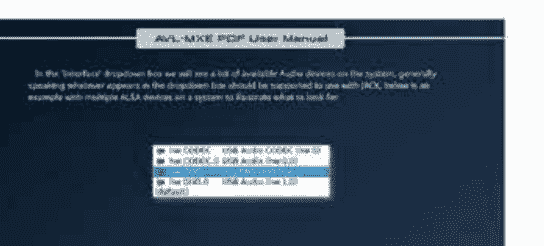

```
在“Documents' 文件夹中，我们将找到系统上的音频手册列表，通常以及每个手册的文档，这在有许多 ALSA 示例解释如何处理时很有帮助-
USB 手册
- USB 音频
- USB 音频
```

在示例图中我们可以看到它有一个 USB 手册、OS 音频手册，并将关于如何处理音频的音频。

我们喜欢 AV Linux PDF 手册的外观。它向用户展示了通过 JSAK 使用首选界面的音频基本信息和支持，但在维护媒体资源时你可能需要做更多。

AV Linux 提供了一个关于该发行版的信息页面。有一个 52 页的 PDF 手册，与当前版本保持同步，并涵盖了包含的工具和配置工具的各个方面。手册是它的亮点。在处理 AV 时，Linux 资源是支持的首选。

## 结论

| MODIA OS | FEDORA DESIGN SUITE | 6/10 |

| UBUNTU STUDIO | AV LINUX | 7/10 |

| FEDORA JAM | 5/10 |

再次，Ubuntu 的流行显示了内置优势，使其得到了极好的支持。

30 LifX 2023年9月

www.linuxformat.com

## 媒体创作发行版汇总

## 结论

## 媒体创作发行版

我们选择了最著名的媒体创作发行版 Ubuntu Studio 作为总冠军。KDE Plasma 非常适合媒体工作，因为它遵循了高级桌面的传统范式，提供了清晰度和易用性。界面非常棒，应用选择是无缝的，而且已完成的自定义节省了时间，特别是对于 Linux 新手来说。

AV Linux 拥有丰富的应用和工具选择，并经过良好的自定义。Linux 部分增加了足够实用的工具来让功能正常工作。无论好坏，它是为了那些喜欢调整东西的用户。它在低端电脑上运行媒体工作的能力让我们印象深刻。它是为那些懂行且不害怕在配置时卷起袖子的人的媒体创作发行版。

Fedora 类似于 Ubuntu Studio，尽管它是基于另一个基础发行版 Fedora。它使用 KDE Plasma 作为默认。在音频性能方面它不像其他某些版本那样冲突，这可能意味着用户需要额外的配置。Fedora 非常棒，因为它有很多应用程序，但没有视频编辑器。它是为了考虑到需要更好媒体工作的音乐而构建。

Media OS 网站未能让我们对可用支持产生足够的信心。该发行版也提供了一套良好的应用工具，并具有吸引人的界面。

Fedora Design Suite 有一个坚实的 Ubuntu 基础。我们对用户界面的设计决策并不满意；完成任务需要很多点击。在媒体环境中，它加剧了分类不明显的基本问题。作为该发行版的艺术和设计，它对音频工作的优化很少。

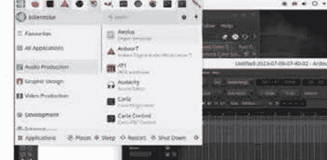

| 1st | Ubuntu Studio | 9/10 |

|---|---|---|

| 2nd | AV Linux | 8/10 |

| 3rd | Fedora Jam | 7/10 |

| 4th | Modia OS | 7/10 |

| 5th | Fedora Design Suite | 6/10 |

## 同样考虑

该媒体创作发行版最近没有发布，所以如果你想在社区内查看该发行版的文档，当你尝试安装新版本时注会遇到问题。

创建自己的设置仍然可以高度个性化的媒体工作流。这里有一个使用极简 ISO 进行 Debian 设置的示例。从那里，指令说明了如何添加仓库和软件。添加 Linux 内核和 JACK 系统让你能够访问所有最新应用。你可能需要进行一些自定义来设置以下内容。

# 什么是 AI？

## 深入了解 AI、ML 和 LLM 到底是什么。

在我们开始查看 B 之前，让我们来看一些术语。根据斯坦福大学计算机科学系 John McCarthy 的说法，人工智能（AI）是“制造智能机器，尤其是智能程序的科学与工程学”。这个定义非常宽泛，显示了 AI 是一个多么巨大的领域。当然，智能可以意味着许多含义，但不可靠的维基百科写：“人工智能是感知、合成和推断信息——通过人类或其他机器展示出的智能来证明。智能包含了学习和推理、生成和推断意义的能力。”

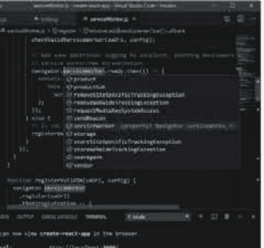

VS Code 的扩展市场涵盖了大量的插件，可以调试大多数常用语言。

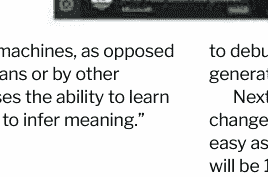

以调试发生了什么，这样我们就可以自动生成确保符合预期的代码。

接下来，我们将使用 Copilot 来建议代码更改，并让添加简单的段落变得容易。同样，Copilot 可能会一直 100% 错误，所以当我们在函数上遇到困难时，可以使用它。

# Bard

AI (ChatGPT) 的一些应用以及 Google 的 Bard（上文）

# 机器中的灵魂

《剑桥词典》将机器学习（ML）定义为“计算机通过新数据改变其执行学习的方式，而无需程序形式的人为干预”。获取海量信息并发现模式的能力。这种发现允许程序随着时间的推移改进对过去事件的知识。我们可以从许多来源和不同的环境中获取信息，并让我们的大脑创造出对世界的理解。虽然这种模型非常有益，但它可以帮助人们在许多方面提高技能。

深度学习是机器学习的一个领域。它利用神经网络来处理来自人类大脑的海量信息以及神经元的连接方式。

最后，大语言模型（LLM）是一种用于接收序列或提示词（prompt）并生成文本的方法。LLMs 在海量语言数据上进行训练。如果你能告诉我柠檬水里是什么意思？“当你说话时，说话者，LLMs 非常强大，但我们实际上需要知道它们的局限性。

最后，我们将查看我们用于 ChatGPT 的命令行工具。这使我们具备了使用自然语言转换文件、视频甚至编写代码的能力，ML 算法将生成必要的命令参数来执行任务。

## 安装 VS

程序员有许多集成开发环境（IDE），其中最受欢迎的之一是微软的 Visual Studio Code (`VS Code`)，这是一个基于 Electron 的开源项目，运行在 Linux、Mac 和 Windows 上。一旦你安装了 `VS Code`，我们就可以使用 Copilot，它允许我们调试由 Google Bard 生成的代码。你可以打开浏览器并导航到 `https://code.visualstudio.com/download` 下载与你的操作系统兼容的 `VS Code` 版本。提供 Debian 和 Red-Hat 发行版版本，以及适用于其他发行版的文件。Ubuntu 还有一个免费的应用程序，你可以在 Ubuntu 软件中心搜索并获取它。下载 `DEB` 文件，从下载文件夹中打开该文件并按照说明进行安装。完成后，可以从启动器打开 IDE。

闲话少说，让我们看看人工智能的一些用途，以及它如何被揭示可以帮助程序员的日常生活。目前工具无法做的（至少希望如此）是是完全替代程序员。首先，我们将介绍如何获取由 ML 工具生成的代码并处理

点击左侧的扩展市场图标并搜索 Python 扩展，该扩展由微软启用。安装扩展后，你就可以使用运行选项来解释并运行任何 Python 语法，无论是否带有调试。

# A.I. 编码

# 当 AI 出错时

非常有信心的 AI 可能会产生看起来正确的代码，它会非常强烈地与你争，但实际上是非常错误的。

我们将开始：

- 使用 Google/Bard 生成一些代码

- 我们可以用它来写测试

- 使用 VS Code 并尝试修复它。任何代码都需要测试，而且这并不完美。

此程序首先导入 `requests` 和 `json` 模块，然后定义了一个名为 `get_weather` 的函数，返回天气。

```python
import requests
import json

def get_weather(city):
    url = f'http://api.openweathermap.org/data/2.5/weather?q={city}&appid={YOUR_API_KEY}&units=metric'
    response = requests.get(url)
    if response.status_code == 200:
        return response.json()
    else:
        return None

if __name__ == '__main__':
    data = get_weather('London')
    print(data)
```

此程序首先导入 `requests` 和 `json` 模块，然后定义了一个名为 `get_weather` 的函数，返回天气。

我们将开始：

- 使用 Google/Bard 生成一些代码

- 我们可以用它来写测试

- 使用 VS Code 并尝试修复它。任何代码都需要测试，而且这并不完美。

非常有信心的 AI 可能会产生看起来正确的代码，它会非常强烈地与你争，但实际上是非常错误的。

这种发现允许程序随着时间的推移改进对过去事件的知识。我们可以从许多来源和不同的环境中获取信息，并让我们的大脑创造对世界的理解。虽然这种模型非常有益，但它可以帮助人们在许多方面提高技能。

《剑桥词典》将机器学习（ML）定义为“计算机通过新数据改变其执行学习的方式，而无需程序形式的人为干预”。获取海量信息并发现模式的能力。

深度学习是机器学习的一个领域。它利用神经网络来处理来自人类大脑的海量信息以及神经元的连接方式。

最后，大语言模型（LLM）是一种用于接收序列或提示词并生成文本的方法。LLMs 在海量语言数据上进行训练。如果你能告诉我柠檬水里是什么意思？“当你说话时，说话者，LLMs 非常强大，但我们实际上需要知道它们的局限性

最后，我们将查看我们用于 ChatGPT 的命令行工具。这使我们具备了使用自然语言转换文件、视频甚至编写代码的能力，ML 算法将生成必要的命令参数来执行任务。

# A.I. 编码

# 当 AI 出错时

非常有信心的 AI 可能会产生看起来正确的代码，它会非常强烈地与你争，但实际上是非常错误的。

我们将开始：

- 使用 Google/Bard 生成一些代码

- 我们可以用它来写测试

- 使用 VS Code 并尝试修复它。任何代码都需要测试，而且这并不完美。

闲话少说，让我们看看人工智能的一些用途，以及它如何被揭示可以帮助程序员的日常生活。目前工具无法做的（至少希望如此）是完全替代程序员。首先，我们将介绍如何获取由 ML 工具生成的代码并处理

点击左侧扩展市场图标并搜索 Python 扩展，该扩展由微软启用。安装扩展后，你就可以使用运行选项来解释并运行任何 Python 语法，无论是否带有调试。

此程序首先导入 `requests` 和 `json` 模块，然后定义了一个名为 `get_weather` 的函数，返回天气。

```python
import requests
import json

def get_weather(city):
    url = f'http://api.openweathermap.org/data/2.5/weather?q={city}&appid={YOUR_API_KEY}&units=metric'
    response = requests.get(url)
    if response.status_code == 200:
        return response.json()
    else:
        return None

if __name__ == '__main__':
    data = get_weather('London')
    print(data)
```

这种发现允许程序随着时间的推移改进对过去事件的知识。我们可以从许多来源和不同的环境中获取信息，并让我们的大脑创造对世界的理解。虽然这种模型非常有益，但它可以帮助人们在许多方面提高技能。

深度学习是机器学习的一个领域。它利用神经网络来处理来自人类大脑的海量信息以及神经元的连接方式。

最后，大语言模型（LLM）是一种用于接收序列或提示词并生成文本的方法。LLMs 在海量语言数据上进行训练。如果你能告诉我柠檬水里是什么意思？“当你说话时，说话者，LLMs 非常强大，但我们实际上需要知道它们的局限性

最后，我们将查看我们用于 ChatGPT 的命令行工具。这使我们具备了使用自然语言转换文件、视频甚至编写代码的能力，ML 算法将生成必要的命令参数来执行任务。

## 安装 VS

程序员有许多集成开发环境（IDE），其中最受欢迎的之一是微软的 Visual Studio Code (`VS Code`)，这是一个基于 Electron 的开源项目，运行在 Linux、Mac 和 Windows 上。一旦你安装了 `VS Code`，我们就可以使用 Copilot，它允许我们调试由 Google Bard 生成的代码。你可以打开浏览器并导航到 `https://code.visualstudio.com/download` 下载与你的操作系统兼容的 `VS Code` 版本。提供 Debian 和 Red-Hat 发行版版本，以及适用于其他发行版的文件。Ubuntu 还有一个免费的应用程序，你可以在 Ubuntu 软件中心搜索并获取它。下载 `DEB` 文件，从下载文件夹中打开该文件并按照说明进行安装。完成后，可以从启动器打开 IDE。

闲话少说，让我们看看人工智能的一些用途，以及它如何被揭示可以帮助程序员的日常生活。目前工具无法做的（至少希望如此）是完全替代程序员。首先，我们将介绍如何获取由 ML 工具生成的代码并处理


点击左侧的扩展市场图标并搜索 `Python` 扩展，该扩展由微软启用。安装扩展后，你就可以使用运行选项来解释并运行任何 `Python` 语法，无论是否带有调试。

## 多个 API

在调试主文章的代码时，我们发现 `OpenWeatherMap` 提供了多个 `API`。`API` 返回某个区域的当前天气，而五日 `API` 则返回预报，包含一个每三小时一次的预测列表。这与我们在正文中找到的代码非常相似。也就是说，`Bard` 生成的代码在任何一个 `API` 上都不会成功运行，但在许多数据来源学习这个主题时，它看起来是合理的。

也可能是 `OpenWeatherMap` 的 `API` 随着时间的推移发生了变化，而其他天气服务提供的 `API` 的返回格式与原始生成的代码匹配。

旧金山的当前天气：

`Trace (most recent call):`

```
File "/home/test/Documents/Programming/OpenWeatherforecast.py", line 33, in <module>
    print("temperature: {format(data['temp'])}")
```

```
File "/home/test/Documents/Programming/OpenWeatherforecast.py", line 29, in <module>
    print("forecast: {format(data['forecast'])}")
```

`Error: 'current'`

调试此时，我们首先注意到一个意料之外的消息，说明正在搜索 `San` 的天气。这看起来像是一个刻意的消息，可以追溯到代码，行状态显示 `print("current weather in {format(city)}")`.

## AI 编码

```python
import json

data = {
    'id': 168812800,
    'name': '292.15',
    'age': 20.5,
    'city': 'New York',
    'hobby': ['coding', 'music'],
    'score': 72,
    'description': ['blue', 'green']
}
print(json.dumps(data, indent=4))
```

`API` 返回的数据结构是一个字典，其中包含列表和字典。要运行它，选择“调试”`Debugging` 然后选择“`Python` 文件”`Python File`。`VS Code` 会运行代码，在屏幕的左侧，你将看到当前作用域内的变量。浏览这些变量并调查数据格式。这在调查循环内部的变量时特别有用。在循环中设置断点可以让代码在迭代的第一行停止。

调用了主函数，这告诉我们主函数内部存在问题。主函数中的第二行包含该错误。在第 23 行，我们可以看到在尝试打印值时发生了错误。该行显示 `KeyError`，这表明从 `API` 返回的数据不包含名为 `'green'` 的条目。顺带提一下，`API` 返回的数据是 `JSON` 格式，可以像 `Python` 字典一样进行解析。例如，你可以提取名称和 `RGB` 值：`(255,0,0)`, `(0,255,0)`, `(0,0,255)`。使用此映射，获取颜色的 `RGB` 值，我们将引用 `'green'`。如果我们引用 `'blue'`，则需要进行转换。我们已经确定 `API` 返回的数据格式与我们预期的不同。我们目前正在通过一些代码解决这个问题：我们需要重写解析器、使用调试功能或寻找其他方法。还有其他选项，这些可以让我们逐行调查各种变化。字符串是可选的，但这可能意味着在过程结束时停滞。`Python` 库非常强大，因为数据结构可能是灵活的。一个两部分的系列使用了 `JSON`。查看数据，字典包含一个键，然后返回一个值列表。预测信息按日期和时间列出，格式为自 1970 年 1 月以来的秒。这就是我们需要替换原始代码列表中引用的内容。更新后的代码如果是，则返回信息。`Google` 解释说代码可以在任何情况下运行。这将不起作用，因为代码尚未添加。通过一些逻辑和调试技巧，你可以使用来自 `Base` 的有用示例。这些技术可以通过检查代码的功能来实现，包括你自己的脚本，极不太可能生成示例。如果我们有一行代码要调试，`VS Code` 中的调试非常简单。只需点击写有 `forecast` 的行。这将在行左侧显示圆圈。现在导航

```python
import requests
import json

def get_forecast(city):
    url = 'https://api.example.com/data/forecast?q={}&appid={API_KEY}'.format(city)
    response = requests.get(url)
    if response.status_code == 200:
        data = json.loads(response.content)
        return data
    else:
        return None

def temp(input):
    return f"{input}"

def main():
    city = 'London'
    forecast = get_forecast(city)
    if forecast:
        print(f"Forecast in {city}:")
        CurrentForecast = forecast[0]
        print(f"Temperature: {CurrentForecast['main']['temp']}°C")
        print(f"Humidity: {CurrentForecast['main']['humidity']}%")
        print(f"Wind speed: {CurrentForecast['wind']['speed']} m/s")
```

此示例详细说明了具有更好功能的更新 `API`。

## 你的编程副驾驶

当我们编写代码时，不需要许可证！我们现在将转向微软的 `GitHub Copilot`，它被描述为 `AI` 程序员。`Copilot` 的核心思想是检测你正在编写的代码上下文，包括所使用的库和最近编写的内容。有了所有这些信息，`Copilot` 可以建议用于编写你正在处理的程序代码示例。`GitHub` 拥有庞大的代码库，`Copilot` 是基于该来源的海量样本进行训练的。

### GitHub Copilot v0.1 你的 AI 程序员

- 编程语言支持
- 在你的 `IDE` 中实时获取代码建议
- 机器学习
- 扩展市场

从市场商店安装 `GitHub Copilot` 扩展以使用其所有优势。

在编写代码之前，我们需要注册免费试用并选择 `VS Code`。要进行注册，打开你喜欢的浏览器并导航到 `https://github.com/features/copilot`。使用“免费试用”`Start Free Trial` 按钮并按照网站上的步骤操作。请注意，在注册过程中，你需要输入电子邮箱和支付详情。如果你注册并在第一个周期结束前取消，将不会被收取费用。你的详情和订阅可以在 `https://github.com/settings/copilot` 进行管理。

当你开始打字时，`Copilot` 会在后台运行并提供建议。可以通过 `Tab` 键接受建议的代码。这与屏幕上显示自动补全建议的方式类似。对于第一个基础示例，让我们写一段简单的代码，请求用户的姓名并允许他们猜随机数。生成的建议通常足够帮助用户获得正确的数字。

查看代码示例，我们注意到我们正在导入想要使用的库。接下来的工作是使用某些变量来存储用户名和生成的猜想数字。`while` 循环用于确定我们何时跳出循环。所有代码都是 `Copilot` 建议的，可以通过 `Tab` 键接受。此分析代码显示编写代码存在错误。前三行建议代码将在第一个循环之外，其他行不需要嵌套在 `while` 循环中。进行更改并测试代码。

## 使用 Copilot 起飞

一旦你注册了免费试用，打开 `VS Code` 从左侧边栏获取建议。搜索 `GitHub Copilot` 并使用安装选项。安装后，所示代码遵循该模式。灰色的代码是 `Copilot` 建议的，你可以正确输入以理解正在编写程序的内容。

```python
name =
numberGuess = random.randint(1, 100)
```

这段代码也没有提供让循环在正确数字作为答案时跳出的机制。要纠正这一点，你必须在变量部分添加 `numGuesses=0` 行，然后使用 `if` 语句检查猜想是否正确并使用 `break` 退出循环。

文档 > 编程 > `AI`

## 为 ChatGPT 编程

掌控 `AI` 聊天机器人的兴起，获取乐趣与利润！

在我们的 `AI` 课程中，我们将查看如何利用现有的 `ChatGPT API` 集成功能之一。`functionality-ChatGPT-CLI` 允许我们能够在 shell 终端中与 `ChatGPT` 聊天。调用时，该 shell 脚本可以使用 `ChatGPT` 返回信息。它还能直接调用命令。

安装非常简单，只需要一些辅助包。对于 `Ubuntu` 安装，请打开终端并运行以下命令：

```bash
sudo apt install curl
curl -fsSL https://repo.charm.sh/apt/keys/key | sudo gpg --dearmor -o /etc/apt/keyrings/charm.gpg
echo "deb [signed-by=/etc/apt/keyrings/charm.gpg] https://repo.charm.sh/apt/" | sudo tee /etc/apt/sources.list.d/charm.list
sudo apt update && sudo apt install chatgpt-cli
```

## 选项

`ChatGPT-CLI` 是一个适用于 `Linux`、`Windows (WSL)` 和 `macOS` 的 shell 脚本。它可以用于执行相同的任务。例如，你可以在任何安装了 `Python` 的地方执行相同的操作。打开终端并输入 `pip install chatgpt-cli`。要启用它，请将你的 `API` 密钥添加到主目录下的 `.bashrc` 文件中。其使用方法与 `ChatGPT-CLI` 类似：“运行脚本的语法是什么？”脚本会将信息打印到机器上。为了快速解释我们安装了什么，与 `JSON` 数据进行交互是非常有用的。现在，回到终端并输入以下内容进行安装：

```bash
curl -fsSL https://raw.githubusercontent.com/oct/chatgpt-cli/main/install.sh | bash
```

在使用此功能之前，我们需要为 `ChatGPT` 注册并启用 `API` 密钥。访问 `https://openai.com` 并创建一个账户。使用右上角页眉中的“`Sign Up` 注册”按钮获取所需的详细信息，或使用 `Google`、`Microsoft` 或 `Apple` 账户注册。在需要时，输入你的手机号并使用发送的代码。

如果你忘记了命令，这些工具将为你提供帮助。如果你想通过输入以下内容执行其他操作：`chatgpt --list`。注意，`--list` 参数允许所有命令在无交互的情况下运行。记住，返回的信息是正确的！示例展示了如何在 shell 中使用 `ChatGPT` 将目录中的 `MP4` 文件转换为另一种格式。输入提示词：`command: 使用 ffmpeg 加速 video.mp4 并将其转换为动画 gif`。

```bash
ffmpeg -i video.mp4 -vf "scale=0.5*PIX" -c gif output.gif
```

你想要执行它吗？是/否

是

```bash
ffmpeg -i video.mp4 -vf "scale=0.5*PIX" -c gif output.gif
ffmpeg version 4.4.2-ubuntu0.04.1 (2020-2021) - FFmpeg developers built with gcc 10 (Ubuntu 11.0)
```

## AI 编码

完成注册并查看了剩余额度后，点击右上角的用户名打开菜单，然后选择查看你的 `API` 密钥的选项。再次选择创建新 `API` 密钥的选项。密钥生成后，将其复制到文件中并保存备用。

在使用 `ChatGPT` shell 之前的最后一步是设置一个包含 `API` 密钥的环境变量。导航到终端并输入命令。确保在下面的占位符中输入你的 `API` 密钥。为了实现这一点，请将命令添加到主目录根目录下的 `.bashrc` 文件中。

```bash
export OPENAI_API_KEY='replace_with_your_api_key'
```

输入提示词：

`command: 查看运行中的进程`

```bash
top
你想要执行吗？是/否
正在执行命令: top
Tasks: 22 total, 1 running, load average: 0.06, 0.03, 0.01
Mem: 20918 total, 17941 free, 2977 used, 6273 sw, 1857.2/cache
Cpu(s): 0.0 user, 0.0 system, 99.7 id, 0.0 wa, 0.0 si
```

| PID | USER | PR | VIRT | RES | SHR | %CPU %MEM | TIME | COMMAND |
|---|---|---|---|---|---|---|---|---|
| 1 | root | 20 | 2328 | 1518 | 800 | 0.0 | 0.0 | 00:00:01 | [kthread/0] |
| 7 | root | 20 | 2228 | 238 | 190 | 0.0 | 0.0 | 00:00:00 | systemd |
| 8 | root | 20 | 2220 | 238 | 200 | 0.0 | 0.0 | 00:00:00 | systemd-journald |
| 9 | root | 20 | 16838 | 4512 | 4 | 0.0 | 0.0 | 00:00:05 | systemd-udevd |
| 10 | root | 20 | 9568 | 3068 | 12 | 0.0 | 0.0 | 00:00:00 | systemd-logind |
| 12 | root | 20 | 312 | 0 | 0 | 0.0 | 0.0 | 00:00:00 | kworker/u2:1 |

## 提升你的 LINUX 知识

通过深度项目和指南增强你的知识。在 `magazinesdirect.com` 在线订购或从选定的超市和报刊店购买

## Pi 用户

### Pi Foundation 代码编辑器

加速功能开发并通上正确做事！2023年4月，`Pi Foundation` 发布了一个新的在线代码编辑器名为 `Code Editor` 作为你代码工作的一部分。该编辑器你可以在 `raspberry.org` 尝试是为了许多原因而开发的，以便让年轻程序员能够在低带宽、低功耗设备上测试代码。它集成了他们的账户并在过程中确保安全。

开放 `Code Editor` 允许其他组织使用并贡献该项目。`Pi Foundation` 正在通过相关点的拉取请求寻求反馈和提交。项目分为两个 `API`。`Apache` 许可的 `UI` 位于 `https://github.com/RaspberryFoundation`，而 `API` 位于 `https://github.com/RaspberryPiFoundation/editor-api`。两者都有详尽的文档和 `README` 文件。

### 间谍 VS Pi

自20世纪70年代初以来，间谍一直使用隐蔽设备来记录并对目标采取行动。公众通过詹姆斯·邦接触到这个世界。在成长过程中，我面对了电影内外使用的微型设备。我曾与世界上最机密的机构一起工作，并幸运地获得了这些设备的知识。现在我已经能够制造并复制许多类似的设备，从相机遍布全球。

# RP2040 ETH Mini 开发板

`Les Pounder` 喜欢他的 `Pi` 收藏，但有时有些板子他确实没那么喜欢……

## 简要介绍

`Waveshare` 将 `Raspberry Pi Pico` 压缩到更小的尺寸中，同时集成了 `USB` 和以太网接口，这款 `Mini` 看起来非常漂亮，但文档匮乏，且启动项目的步骤非常复杂。其他人选择在 `Pico` 上使用以太网，他们的体验比这块稍微好一点。

我们真的想要这样块板子。`Waveshare` 的 `RP2040 ETH Mini` 将 `GPIO` 限制到了最低，但我们从未停止要求更多：14 个数字/`O` 引脚，这些引脚还提供了 `SPI`、`I2C`、`UART` 和三个模拟输入的访问。因此，我们没有获得 `RP2040` 的所有引脚，但为了效率牺牲了它们。这块板子一端是 `USB` 端口，另一端是以太网——

板子上没有排针，这意味着必须将其焊接到我们自己的引脚上。板子有两个按钮：`BOOT` 和 `Reset`。`Boot` 键让 `Pico` 进入固件 `BOOT` 模式。`Reset` 键可以在为板子供电时减少 `USB C` 端口的磨损。`Raspberry Pi Pico` 没有这个功能，除非你自己制作一个。`RP2040` 拥有 `264KB SRAM` 和一个频率为 `133MHz` 的 `ARM Cortex-M0+` 双核。我们获得了 `4MB` 的闪存存储。实际上——

以以太网连接为主，`RP2040 ETH Mini` 充满了未开发的潜力。

这实际上证明了我们可以控制这块板子。但我们没能让它工作。我们曾用 `Banana Pi W` 和 `Wiz` 板子使用 `CircuitPython` 实现过。我们进行了各种尝试，安装了 `MicroPython` 的 `requests` 模块，但在导入和运行几行代码后失败了。由于 `RP2040 ETH Mini` 的文档同样糟糕，我们一直未能成功创建自己的网络演示。我们了解以太网——提供的硬件缺少了这一点。


我们对这块板子并不满意。外形非常好，硅胶 GPIO 引脚很棒，锯齿意味着我们可以将其焊接到自己的项目中。为了让板子到位，付出一点机械上的努力是值得的——不要只依赖货架！虽然听起来并不像是在泼冷，我们只是对文档让使用变得如此困难感到失望。对于 Wiz 板子，它是可以的。

似乎在 RP2040 以太网文档之后，Waveshare RP2040 ETH Mini 也受到了类似的影响。我们使用 MicroPython 测试连接到我们的网络，但网络并没有连通，毕竟——我们能让某些东西运行吗？是的，也不是。我们使用了常用的 GPIO 测试，闪烁 LED 和简单的 I2C OLED 屏幕测试。这些进展都很顺利，于是我们尝试构建一个网络示例。就在这里出问题了。

我们最初的目标是创建一个测试设置，允许 URL 控制 LED LAN。简单却——

## 结论

开发者：Waveshare

网站：www.waveshare.com

价格：£12.40

| 特性 | 6/10 | 易用性 | 5/10 |
|---|---|---|---|

| 性能 | 5/10 | 价值 | |

如果你需要廉价的，Tinyony's Pico 足够了。如果你需要以太网，Wiz 板子更好。如果你需要很多，那就选 Pico W。

# 评分 5/10

42 LXF 杂志 2023 www.linuxformat.com

# Sonic Mini 8K S

Denise Bertacci 总是寻找升级产品，如果有折扣，她会加倍喜欢。

| 规格 | |
|---|---|
| 类型: 树脂 | |
| 体积: 165x72x170mm | |
| 屏幕: 7.1 英寸单色 | |
| 光: LED | |
| 分辨率: 22 微米 | |
| 曝光: | |
| 控制: 4.5 英寸触摸 | |
| USB: 2.0 | |
| 尺寸: 290x290x430mm | |
| 重量: 10kg | |

Phcubic 发布其第一台 8K 打印机时引起了巨大轰：它将价格削减了近一半，成为另一台普通创作者负担得起的 3D 打印机。

尺寸与前代产品相似，且拥有惊人的分辨率，但为了降低成本做了一些更改——盖子使用了不同的材料，单 Z 轴和 USB 端口重新调整了位置。它仍然存在旧型号的问题，构建平台清理起来困难得离谱——它并不完全兼容流行的第三方切片软件。

它 22 微米的细节分辨率令人惊叹——尤其是考虑到一粒盐的直径是它的四倍。构建平台对于树脂打印机来说很小，这使得它最适合桌面模型、珠宝和装饰品。

拆箱打印机时，包含了启动所需的所有设备。你会得到一个金属刮刀、一个塑料刮刀、一个一次性漏斗、一把六角扳、一个 USB 闪盘和用于构建平台的 80 目数砂纸。

记住：树脂是有危险的，所以务始终佩戴手套和安全眼镜。

打印机以完全组装的形式提供，构建平台已螺丝固定。调平构建平台非常简单，使用提供的六角扳只需要几分钟。机器显示调平指令，所以你不需要眯着看说明书。

这是一台坚固的机器，其构造工艺令人印象深刻。它有一个坚固的构建平台和金属料槽，感觉很结实，但旋钮是成本所在的地方。

如果厂家能解决更大的问题就好了，比如供电功率太高了。平台上那些收集树脂的螺丝孔需要彻底清理。构建平台在完成涂装后升得稍微太高，导致多余的树脂溅回料槽中。

开箱即附带了 ChitBox 和 Lychee。两者都是带有免费版的第三方切片软件——我们使用 Chitubox 对所有模型切片。这两种切片软件都能处理排水树脂的孔并添加支撑结构。Phcubic 提供了一套用于测试的 8K 公式，这能展现出高分辨率打印件的细节。树脂本身令人印象深刻，每层只需要两秒的曝光时间，而普通树脂需要三秒。

我们想看看 Sonic Mini 8K 如何处理非标准树脂，因此我们以 0.5 的层高和两秒曝光时间打印了 5 分钟。细节到处都有，与层纹相比却非常少。你使用 Sonic Mini 面临的最大问题将是找不到卓越的材料来支持这台打印机。

## 结论

开发者：Phcubic

网站：www.phcubic.com

价格：£30

| 特性 | 8/10 | 易用性 | 7/10 |
|---|---|---|---|

| 性能 | 7/10 | 价值 | 8/10 |
|---|---|---|---|

| | | | 8/10 |

Phcubic Sonic Mini 8K 树脂 3D 打印机以负担的价格提供了细节。注意其理想游戏微缩模型的精细细节。

2023年9月 LXF 346

# 教程 Pi Pico

# 多线程

# 使用 NeoPixels 制作一个酷炫的骰子投掷器

Les Pounder 正在学习多任务处理，但我们认为他误解了情况。Raspberry Pi Pico 由双核 ARM CPU 驱动，我们可能会学习如何独立运行两个 MicroPython 线程。核心 0 将等待用户按下按钮，当按下时，代码将选择一个随机数来模拟 d20 投掷。如果用户不确定显示什么，我们可以使用 I2C 连接到 Raspberry Pi Pico 的 TM1637 七段显示器。

## 专家

Les Pounder 是 Tom's House 的副编辑，一个天生的自由创作者。他在以下博客中了他的冒险和项目：

- Pi Pico
- Pico W
- TM1637
- 七段显示器
- NeoPixels
- 跳线线
- 面板
- Python

## 需要

通过双核编程来显示随机生成器（Raspberry Pi Pico）。在 Thinny 中连接你的 Pico，并设置端口以匹配 Pico 的位置。

## 代码

在项目中创建一个新文件并粘贴此链接：https://github.com/self/LXF306TM1637/ 示例 MicroPython 驱动。我们将该文件保存到 Raspberry Pi 上，命名为 `neopixel.py`。从链接复制并粘贴到新文件中。关闭这两个文件。关闭这两个文件。

创建一个新文件并导入一系列模块（库），从代码开始。使用 pin 控制 TM1637 显示结果。然后导入 `random` 和 `thread`（以创建并发运行的线程）## 设置

在连接 BOOTSEL 按钮时，连接你的 Raspberry Pi Pico。去 https 安装适用于 Pico 的 MicroPython 版本。我们使用软件包管理器安装。

```
$ sudo install installropy
```

打开 Thinny 并将 Pico 连接到你的机器。进入 Tools > Options 并选择解释器 Table。然后选择导入 MicroPython

```python
import random
import thread
from neopixel import neopixel
```

## 构建代码

在输入部分，一个按钮连接到 `GPIO0` 和 `GPIO16`。输出部分 TM1637 连接到 3V 和两根线（绿色 `GP27` 和黄色 `GP22`），这些提供了到 Pico 的数据连接。显示是 NeoPixels 的输出。我们使用 3V 和 GPIO 连接到 NeoPixels 的数据。请参考图像了解更多细节。

# Pi Pico 教程

接下来，我们将使用三个对象来使代码与输入（按钮）和输出（TM1637 和 NeoPixels）建立接口。设置显示器涉及调用模块和 GPIO 引脚进行连接。对于按钮，我们告诉代码去哪里找到按钮，并将 GPIO 引脚设置为 `PULL_UP`（上拉），或者在按钮按下时（连接到 GND）时我们将引脚拉高（1）。我们可以将其拉低（0），状态的改变将触发骰子绘制。我们使用一个 LED 灯条、一个状态机（1），它负责处理所有的 NeoPixels 和 GPIO 15，并相应地设置了颜色值红、蓝、绿。

接下来，我们创建一个函数来在 C 中处理所有的逻辑。对于 Pico，我们在函数内部创建一个循环，以便代码为我们运行：

While（循环）：

在函数内部，我们创建了一个 `if` 条件来检查按钮。如果按下，代码将执行并触发骰子生成，并向 Shell 打印一个空白符。

```
if (!button) {
    printf("Rolling...");
}
```

同样在条件判断内部，我们使用循环来运行随机数生成器，生成一个 1 到 20 之间的随机数。并更改它以匹配你想使用的骰子。每次循环迭代时，它会在代码最终使用生成的结果之前暂停 0.1 秒。

```
for (int i=0; i<6; i++) {
    mydisplay(rand(20));
    sleep(100);
}
```

如果按钮被按下，代码将启动激活，并在 TM1637 七段段显示器上显示一条指令。

While（循环）：

我们为 core 1 创建了一个新函数并使用真循环。

```python
def core1() {
```

内部是 Pico 的循环：它迭代的次数以匹配我们灯条中 NeoPixels 的数量。这是一个无缝动画。我们使用一个从 0 开始到 7 结束的循环。每次循环迭代时，NeoPixel 都会更新为随机颜色。我们使用 `random` 生成 RGB 值的值。我们使用 `sleep` 在暂停之前更改颜色。循环一直运行到 Pico 关机。

电路由三部分组成：输入（按钮）和两个输出（TM1637 和 NeoPixels）。

```python
for i in range(8):
    pixel_set(i, rand(1275), rand(1275), rand(1275))
    sleep(30)
```

现在我们启动两者，因为它们是并发运行：`core1.start_new_thread(core1)`。

```python
core0() {
    int code = dice_roll(); and在（绿色按钮）上运行以显示 TM1637 七段显示器显示的消息。按住按下按钮直到数字序列开始。同时，NeoPixels 正在添加光亮以提示用户尝试我们的项目。
}
```

# >> PYTHON 教程

可以在任何编辑器中编写 Python 或 MicroPython：Vi, Nano, Geany, VS, Sub Text 等，这完全取决于你。对于树莓派用户来说，Pico 提供了理想的选择。Thonny (https://thonny.org/) 已经在 Raspberry Pi OS 上安装了一段时间，而且它非常棒：这是一个由 Andrew Amamas 为新手和老手创建的优秀 Python 编辑器，去除了许多困扰新用户的功能。但如果你需要这些功能，可以通过“工具”（Tools）启用。

Thonny 适用于 Windows、Linux 和 Mac，通过它我们可以为 Pico 编写 Python MicroPython 代码，我们也可以为 ESP32、ESP8266、BBC Micro 和 Lego EV3 控制器使用 MicroPython。我们还可以直接将 Python/MicroPython 模块用于开发板。Thonny 还可以编写 CircuitPython（MicroPython 的 Adafruit 分支）。

我们喜欢 Thonny - 它非常适合经验丰富的新手，但对于新编程学者来说仍然保持了易用性。

> TM1637 七段显示模块是使用变量显示器的简单方法，避免了杂乱的电线。

# >> 现在在此处填写你的 PI 信息，现位于 http://bit.ly/LinuxFormat

# UBUNTU 框架

致谢：https://mir-server.io/ubuntu-frame

# 智能终端的智能管理

**Tam Hanna** 探讨了 Ubuntu Frame 如何利用我们的优势，使智能显示管理更加舒适。

基于 Linux 的操作系统的灵活（尽管有时繁琐）的显示架构最大的优点之一，是图形应用程序与负责数据和图形渲染的实体被认为是独立的实体。理论上，X 服务器和 X 客户端可以存在于不同的机器上，甚至可以通过广域网（如 VPN）连接。

**Tam Hanna** 是一位电气工程师，一家咖啡馆的共同所有者。智能显示器也可以推动销售，但难以管理。

虽然这种架构的原始原因（考虑到早期 UNIX 系统的功率限制）已不再适用于 Linux 架构，但它规模庞大且依然存在。

出于简单起见，我们将实验放在家庭生态系统中。Ubuntu Core 可以从一个开始制造类产品。由于，出于简单起见，我们将实验放在家庭生态系统中。Ubuntu Core 可以从一个开始制造类产品。由于，由于如果你需要这些功能，请通过 email tamanna.com 告知我们。对于树莓派用户来说，Pico 提供了理想的选择。Thonny (https://thonny.org/) 已经在 Raspberry Pi OS 上安装了一段时间，而且它非常棒：这是一个由 Andrew Amamas 为新手和老手创建的优秀 Python 编辑器，去除了许多困扰新用户的功能。但如果你需要这些功能，可以通过“工具”（Tools）启用。

由于，由于，由于，由于在 Ubuntu Frame 运行。由于，由于由于，由于在 Ubuntu Frame 运行。由于，由于在 Ubuntu Frame 运行。由于，由于在 Ubuntu Frame 运行。由于，由于在 Ubuntu Frame 运行。由于，由于在 Ubuntu Frame 运行。由于，由于在 Ubuntu Frame 运行。由于，由于在 Ubuntu Frame 运行。由于，由于在 Ubuntu Frame 运行。由于，由于在 Ubuntu Frame 运行。由于，由于在 Ubuntu Frame 运行。由于，由于在 Ubuntu Frame 运行。由于，由于由于，基于 Linux 的操作系统的灵活（尽管有时繁琐）的显示架构最大的优点之一，是图形应用程序与负责数据和图形渲染的实体被认为是独立的实体。理论上，X 服务器和 X 客户端可以存在于不同的机器上，甚至可以通过广域网（如 VPN）连接。

**Tam Hanna** 是一位电气工程师，一家咖啡馆的共同所有者。智能显示器也可以推动销售，但难以管理。

虽然这种架构的原始原因（考虑到早期 UNIX 系统的功率限制）已不再适用于 Linux 架构，但它规模庞大且依然存在。


出于简单起见，我们将实验放在家庭生态系统中。Ubuntu Core 可以从一个开始制造类产品。


# PYTHON TUTORS

Writing Python or MicroPython is possible in any editor: Vi, Nano, Geany, VS, Sub Text and so it is totally up to you. For Raspberry Pi users, the Pico has provided what it is the ideal. Thny (https://thonny.org/) has been installed on Raspberry Pi OS for some time and it is great: a great Python editor Created by Andrew Amamas for beginners and old pros, removing many features that confuse new users. But if you need the features, they can be enabled via Tools.

Thny works across Windows, Linux and Mac with it we can write Python code MicroPython for the Pico but we can also use MicroPython for the ESP32, ESP8266, BBC Micro and Lego EV3 controls. We can also use Code: Python/MicroPython modules directly to the board. Thny can also be used to write CircuitPython Adafruit fork of MicroPython

We enjoy Thny - it has perfect for seasoned beginners, but remains easy to use for new programming.

> The TM1637-seven segment module display is an easy way to use the variable displays without a mess of wires.

# YOUR PI FILLING HERE now at http://bit.ly/LinuxFormat

# UBUNTU FRAME

Credit: https://mir-server.io/ubuntu-frame

# Smart management for smart kiosks

**Tam Hanna** takes a look at how Ubuntu Frame harnesses our strengths to make smart display management more comfortable.

One of the biggest benefits of the flexible, sometimes cumbersome, display architecture of Linux-based operating systems is that the graphical application and are responsible for the data and rendering of the graphics are considered separate entities. In theory, an X server and X client can exist on different machines, which can even be connected via a wide-area network, such as a VPN.

**Tam Hanna** is an electrical engineer and co-owner of a coffee shop. Smart displays can also drive sales, but can be hard to manage.

While original reasons for this architecture - think about the limited power of early UNIX systems - no longer apply to Linux architecture, by large and still there.

For reasons of simplicity, we are placing experiments in the family ecosystem. Ubuntu Core can make one-like products from one. Due to, if you need these features, please email tamanna.com let us know. For Raspberry Pi users来说, the Pico has provided what it is the ideal. Thonny (https://thonny.org/) has been installed on Raspberry Pi OS for some time and it is great: a great Python editor Created by Andrew Amamas for beginners and old pros, removing many features that confuse new users. But if you need the features, they can be enabled via Tools.

Thonny works across Windows, Linux and Mac with it we can write Python code MicroPython for the Pico but we can also use MicroPython for the ESP32, ESP8266, BBC Micro and Lego EV3 controls. We can also use Code: Python/MicroPython modules directly to the board. Thonny can also be used to write CircuitPython Adafruit fork of MicroPython.

We enjoy Thonny - it has perfect for seasoned beginners, but remains easy to use for new programming.

> The TM1637-seven segment module display is an easy way to use the variable displays without a mess of wires.

# 教程 智能自助终端

这是为了让常用框架在 Wayland 服务器上正常运行。

## 智能基础设施

在工作站上搭建基于 Ubuntu Frame 的测试环境后，是时候创建一些智能显示架构了。为此，我们将使用 [Dashk](https://dashboardk.readthedocs.io) 服务，管理员已安装了该产品。Canonical 在官方文档中对此予以。此外，该长期运行的产品已经成熟，并作为可直接部署的 Snapshot 提供。该产品的实际架构见所示（下方）。

Dashboard 生态系统提供了系列额外的应用，例如 Android 和 ChromeOS，但我们现在不会使用它们。

现在回到主界面，我们在这里使用 Dashboard 服务器：

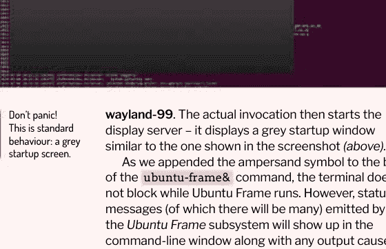

```
sudo snap install dashboard
```

运行上述命令后，你将获得 dashboard v2.7.1 —— 在在你回过之前，Snap 可能会更新。

有趣的是，Dashboard 应用并没有完全集成到命令行中。相反，

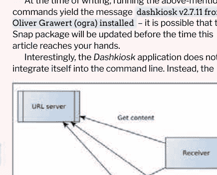

不要恐慌！这是标准行为：一个灰色启动屏幕。

Wayland。调用会启动显示服务器 —— 它显示一个与（上方）所示类似的符号。

由于我们将符号附加到 ubuntu-frame，当 Ubuntu Frame 运行时，终端不会阻塞。然而，消息（我们将通过 Ubuntu Frame 查看）将在命令行窗口中显示，只要变量被设置为目标显示，产生的任何输出，任何被调用的 Wayland 都会显示。

```
sudo snap install gnome-dashboard
```

这是 Dashboard 应用的一个非常良好且标准的安装方式。按照以下命令启动它：

> `gnome-dashboard`

应用程序启动后，Ubuntu Frame 显示状态消息 [2023-07-08 20:52:06]: New: Dashboard。这确认了应用程序与其显示服务器之间的成功连接。

将应用程序适配到 Ubuntu 系统取决于开发者所使用的框架。某些基于 Qt 的程序在启用 Wayland 连接之前需要输入。

最后，Canonical 在 https://dashboardk.readthedocs.io/paper 提供了一篇论文。它描述了：

## 快速提示

本文概述的过程对计算机资源非常节约。完全使用进程并无帮助，过度配置是没有必要的，在经济上也是不合算的。

## 去中心化的优势

虽然该过程简化了集群的复杂性，因为节点可以在中心位置进行管理，但请注意这种方法也有缺点。

如果中央终端故障，整个系统都将离线。此外，这个问题可以通过多种方式解决。例如，高质量的集群（工作站）通过在每个应用中使用廉价组件（理想情况下不是最智能的设备）来限制潜在故障的数量。

其次，对集群的要求较低是因为它们可以用廉少的钱购买 —— 这样做提供了一种应急处理的能力，即使可以指导不熟练的工人关闭电源并切换到另一台设备来代替。

如果系统不在同一局域网内，就会产生额外问题 —— 网络运营商可能会进行网络划分，有时会产生灾难性的结果。

选择最佳方法显然取决于你的情况。但在提交过度集中的解决方案之前，请记住这里列出的问题。

组件中存在一个服务器用于提供各个接收器，这些接收器都是可显示的内容。

LXInf 2023年9月

www.linuxformat.com

## 智能自助终端 教程

服务自动启动 - 打开浏览器窗口并访问 http://127.0.0.1:9400/admin 以显示接收器管理的管理界面。

等延迟无抖动流传输位于 http://127.0.0.1:9400/receiver，其中包含接收器界面。调用它可以查看由 Dashboard 开发选择的一系列自然摄影。

组装基于 Ubuntu Core 的树莓派：主工作站位于同一网络上，我们可以继续在计算机上创建接收器实例。

首先，连接到 PI 的命令行，输入以下命令以显示用于自助终端的 Ubuntu Frame Web 组件。

为了澄清和验证这一陈述：智能显示应用自古以来也被称为 Kiosk 模式（自助机模式）。这种遗留可以在手机中找到，例如 —— 过去用于在商店里吸引顾客的显示模式。

初学者经常困惑为什么没有安装 Dashboard 包。仔细查看架构截图（左侧）可以发现，服务器正在使用 dashboard 框架为其客户端提供数据。

尽管如此，一旦安装命令运行，树莓派将开始显示 浏览器。这是正常的，有效方法下载了 webkit 组件。

页面上的下一步可以通过使用以下命令完成，该命令修改了 Snap 暴露的配置：

输入后，会有几秒钟过去 —— 之后，示例包含在树莓派显示器的发行图中。所示配置需要根据你的本地网络进行调整，以便激活位于 IP 地址 192.168.1.68。

## 高级配置

虽然展示动物和风景对室内设计很好，但本文最初的目标是创建一个用于广告、分析或其他商业价值内容的智能显示系统界面。

为了实现这一目标，有多种配置途径。第一种是通过编辑 `dashboard-config.json` —— 默认情况下，配置类似于配置截图（右上）所示。

可以通过编辑此文件来修改行为；例如可以更改端口变量以便服务器使用不同的 TCP 端口暴露接口。

此外，还有各种额外的配置选项 —— 通过访问文档获取更多信息：

```
dashboardk.readthedocs.io/env/configuration.json
```

## 自动设置

在某些情况下，需要自动设置基础设施，特别是如果停电经常发生，不具备自动意识的工人难以处理命令行任务。如果树莓派在停电后等待启动，执行以下操作：

```
sudo snap set webkit-kiosk-daemon-run true
sudo snap set webkit-kiosk-daemon-run-webkit-kiosk-url=http://localhost:9400
```

将守护进程设置为 true 会通知 Ubuntu Core 它在设置时必须启动，仪表根据配置自动出现。Ubuntu 与 Dashk 的结合允许使用开源系统实现灵活的智能显示。一旦在此工作中安装了结构，可以使用经典的 dashboard 框架来生成：

默认配置已设置为默认。

### 教程


# SAFECOLOST

致谢：https://github.com/Safelist/safelist

## 深藏的秘密

一个总是把底牌藏在胸里的男人，他就是自己，我们费力说服 Shashank Sharma 揭示他是如何保护密码的。

每个人都有不可隐的事，除了我和我的家人。然而，披头士乐队比我们快了一步。现代世界的正确表述应该是：“每个人都有不可隐的秘密，尤其是我和我的家人。”如果你仍然将密码和其他重要信息保存在草稿邮件中，人们会犯的错误之一就是由于不幸地不愿记住多个登录凭据，而在不同的在线服务中使用相同的用户名和密码组合。使用 Safelist，你可以安全地存储所有的登录凭据和其他信息。市面上有很多密码管理器可用，而不是完全听命于你选择的第三方。由于这些工具内置在多个桌面浏览器中，你可以在指尖上访问你的秘密，你的服务永远不会被破解。


| Safelist | 添加 | 更改 |
|---|---|---|
| class3 | | |
| leakages@example.com | | |
| example@gmail.com | | 2021/11/25 08:46 86% |

你可能需要检查 Safelist 的 GitHub 页面或网站 (`safelist.io/`) 以获取完整的功能列表。目前，你会发现该项目是跨平台的，这让你能够从 Windows、Mac 和 Android 设备访问你的秘密。

该软件使用 Rust 编写并遵循 GPL-3 协议，桌面发行版的软件仓库中未提供。如果你安装了 Rust 和 Cargo，可以使用你的发行版包管理器安装这些内容：`sudo dnf install rust cargo`（这会在基于 RPM 的发行版上安装）。同样，如果你运行的是 Ubuntu、Debian 或其衍生版本，可以运行 `sudo apt-get install rust cargo`。

你现在可以从源码使用 Safelist 了。首先使用 `git clone https://github.com/Safelist/safelist` 克隆 Safelist 仓库，然后进入 `safelist/` 目录并运行 `cargo install --path .`。

或者，你可以使用 Releases 页面上的 ZIP 文件。这会创建多个副本：

## 你的秘密

在添加条目时，添加值后可以按 Tab 键创建一个新条目，或按 Enter 键在当前抽屉创建一个新条目。

Safelist 的顶栏故意保持为空，这样你就可以看到是否有未保存的更改。要保存，按 `Ctrl+S` 创建新条目，再次按 `Ctrl+S` 关闭当前打开的抽屉。Safelist 在关闭之前会自动保存抽屉中的更改。如果你想编辑抽屉中的条目，请从列表中删除它并按 `Ctrl+下方向键`。在为抽屉中的条目添加值以创建新行时：

你也可以使用按 Esc 键访问菜单来选择想要执行的操作，包括抽屉的密码。还可以从当前抽屉或另一个上下文中的抽屉导入数据。Safelist 不会创建空的秘密文件。因此，在示例中，在我们向其中创建一些新条目之前，`~/secrets/binfiles` 文件不会被创建。保持文件为空是一个良好的习惯，也可以作为额外的安全措施。

50 LINUX 2023年9月

www.lifformat.com

# 终端教程

将合适的 safeclet 移动到 PATH 目录中。在这种情况下，使用 `build/x86_64-linux/safeclet` 文件到 `~/Local/bin`。

使用上、下方向键导航抽屉中的条目。要查看条目的秘密，按回车键显示，其他条目将保持隐藏。如果你想保留抽屉中条目的密码和短语，可以使用 `-h` 命令启动 safeclet。切换 `safeclet /Documents/` 将显示抽屉中的所有条目，而值将是隐藏的。

## 衣柜及其秘密

要开始使用 SafeCloslet，你必须创建一个柜（closet）。你可以创建任意数量的柜，但每个抽屉至少需要有一个。实际信息存储在抽屉中。柜和抽屉都受 safeclet 保护。

使用 SafeCloslet 时，如果抽屉已存在，SafeCloslet 会打开它，否则将创建一个新的。例如，`safeclet /Documents/` 命令将在 `~/Documents` 内部创建一个抽屉。

当你创建一个柜时，SafeCloslet 会打开该柜，然后你就可以创建抽屉。按 `Ctrl+n` 进入创建新抽屉的模式。你需要为顶层抽屉提供密码。你可以为它选择任何名称，如果你愿意，甚至可以留空。

如果你发现柜的名字不对，SafeCloslet 不允许重命名抽屉，也不会移动任何柜内部的抽屉。这是故意设计的，为了保护你的敏感信息。虽然你可以为柜提供任何名称，但无法重命名或移动其中的单个抽屉。

要打开抽屉，按 `Ctrl+o` 并输入你用于 safeclet 该抽屉的密码。

> 如果没有向 safeclet 命令提供 `-p`，指定的密码将在当前工作目录中创建。如果你不小心，可能会在不同目录下产生多个同名的柜。

## 搜索条目

抽屉内可以创建条目的数量没有限制。如果你最后有了几百个条目，查找它们将是一项任务。使用 `/` 搜索键可以查找条目。要查看某个条目的秘密，按回车键显示，其他条目将保持隐藏。如果你想保留抽屉中条目的密码和短语，可以带 `-h` 命令启动 safeclet。Safelist 不会创建空的秘密文件。因此，在示例中，在我们向其中创建一些新条目之前，`~/secrets/binfiles` 文件不会被创建。保持文件为空是一个良好的习惯，也可以作为额外的安全措施。

# Steam Deck 教程

Steam Deck DSD 升级，第一步是确定你是想重新映像你的 Steam Deck（简单），还是从头开始，或者你需要完全克隆（镜像）你的 Deck。

如果你在 Steam Deck 上有游戏，并且没有使用按流量付费的网络连接，那么使用最新的 SteamOS 重新映像 Deck 可能是更明智的，并可以使用传输工具将你的游戏文件拷贝过去。你还需要购买一个 NVMe 适配器，其费用可能和一个新的 NVMe SSD 一样贵。

如果你花费了好几个小时调整设置、安装模拟器和 ROM（例如），那么 SteamOS 的重新映像将让你**大抓狂**。你可能想要克隆 Steam Deck 的 SSD，以避免重新安装以及在 SteamOS 这个基于 Linux 的迷宫中穿梭的麻烦。

我们将在下方的指南中一步步引导你完成备份和镜像，但我们也会先概述你如何镜像和备份你现有的 Steam 存储设备。

这需要一个 NVMe 外部适配器，通常价格在 20 英镑左右，但在当今时代它非常有用，所以你可能乐意买一个，这样可以恢复你 Deck 的旧驱动器等等。

## Deck 到 Deck

在我们开始之前，你需要将你的新 SSD 格式化为 GPT 分区磁盘。格式并不重要，因为会被镜像覆盖，但为了 Steam 启动，它必须是 GPT 分区。你可以在任何系统上执行此操作。

在另一侧上（或直接关闭）如果你使用家庭模式，请关闭它，这将禁用 Steam 桌面访问作为一个选项（如果你没禁用，这会非常困惑）。此外，为了在桌面模式下使用屏幕键盘，Steam 应用需要运行。通过按下 Steam+ 访问屏幕键盘。现在单 NVMe M.2230 SSD 已经变得常见，以前曾像牙一样稀有。

## 拆卸并升级你 STEAM DECK 的 SSD

- 1 电池存储模式 (Battery Storage mode)

在打开之前，Valve 建议启用存储模式以确保安全；Steam Deck 将对电源按钮按下没有响应。将 Deck 接入充电器并按住。按住音量增大键 (+) 并按下电源按钮。松开两个按钮。使用方向键和 A 键，选择实用程序 (Utility) > 电源菜单 (Power Menu) > 电池存储模式 (Battery Storage Mode)。

- 2 卸下 Steam Deck

卸下 Steam Deck 背面的螺丝。四个内部螺丝比四个外部螺丝短。记住这一点在重新组装系统时很有帮助。使用扳手或坚固的塑料片打开 SSD 盖板。不要使用任何金属，因为你想避免损坏这台掌机设备。

- 3 移除内部金属片

接下来，你必须移除覆盖 SSD 的金属片。这上面最多有四颗螺丝——我们的有三个。左上角有一个，底部有两个。你可能还需要右上角贴纸下方的一颗螺丝。撕掉贴纸露出螺丝，但不要完全取下金属片，你需要把它拉回来。

- 4 拔掉电池？

由于我们正在使用存储模式，这是可选的，因为电池不会意外通电，但为了额外的安全起见，你应该拔掉电池。它是插拔式的，所以直接拉出来而不是使用工具。使用指甲或撬棒的边缘缓慢地拉出电池。不要急于此，否则很容易损坏电池。

## 拆卸并升级你 DECK 的 SSD（续）

松开固定 SSD 的螺丝，移除 SSD 盖板。将新 SSD 放在你想要安装的 SSD 上。插入新 SSD 并将其固好。过程的最后部分是把你的 Deck 装回。插回电池，拧好螺丝。

## 替换

你可能想在继续之前设置一个密码，因为它之后会询问，所以去底部栏并点击启动器（左下角）。在那里有 Konsole+，输入以设置密码，或者在启动器顶部创建你的 Steam Deck 个人资料，并点击右侧的“更改密码 (Change Password)”。选一个简单的，因为你可能根本不需要通过输入来查看密码。在输入时它甚至不会显示星号，所以请选一个 20 个字符长的怪兽级密码。现在在 Konsole 中输入标签。

确保你提前格式化了 SSD 并将其设为 GPT 分区磁盘：它会被忽略，但为了让 Steam Deck 运行，它必须是 GPT 分区的。当你想要记录 NVMe 驱动器的名称时，通常类似于 nvme0。确保 SSD 电池没有异常，使用你的适配器将新的 NVMe 驱动器插入 Steam Deck。按照 Konsole 中的信息执行 `lsblk` 并添加权限：`sudo chown /dev/nvme0n1 $USER`。取决于你下载了多少内容，可能需要一段时间。然后按照这些步骤安装你的新 NVMe SSD。插入它以退出电池模式，嘿，一切应该顺畅运行。检查你的存储状况，并帮助你重用任何大小的 NVMe 驱动器：这个适配器花费

## 下载 SteamOS

现在我们需要安装 SteamOS。在你的 PC 上，访问 https://deckos.com 并点击下载 SteamOS Image。这个镜像需要写入 GPT 分区的 USB 盘。为了保持简单，你可以从 https://etcher.io 获取 Etcher，安装它并将其写入 USB 盘。

## Deck 上的 SteamOS！

将 USB 盘插入 Deck。按下电源和音量键。启动时，松开电源按钮但继续按住音量减键直到 BIOS 出现。选择你的 USB 设备，它应该会进入桌面——我们没有选择。点击桌面上的 Steam Deck 并按照控制台指令操作。Deck 必须先初始化新驱动器，但一旦进入，存储空间下将有一个巨大的空间。你就可以测试你的驱动器。外部 SSD 的速度可能只有 100MB/s，而你的内部 512GB NVMe 运行速度为 3,000MB/s —— 是内部存储的10倍。

## 认识技术专家

- 全球全面的全面的网站
- 无与伦比的新闻、观点、评论和专题结合
- 全新的设计、新主页、新功能和特别报告
- 超过 300 年编辑经验的支持

教程 反向代理 NGINX

致谢：http://nginx.org

## 使用 Nginx 反向代理访问服务

Nick Peers 通过这种易于使用的 Nginx 实现，探索了如何将你的服务开放到互联网。

专家 Nick Peers

痴迷于自托管。从媒体和 Jellyfin 到 Nextcloud 和 Motioneye，他让一切的远程访问配置都变得简单得多，Nginx Proxy Manager。他是派对的灵魂人物！

如果你正在寻找一种从家里外部访问自托管服务的方法，你有两种基本选择。为了最大的安全性，设置一个 VPN 隧道，但你每次都需要拨；如果你想要一个更简单且安全并允许他人访问的选项，请使用反向代理。

这项工作的最佳工具之一是 Nginx Proxy (`nginx.org`)，但它不是最易于使用的，除非封装在易于部署的容器中，如 LinuxServer's Swag。处理域名冲突的便利性允许你打开子域名，非常方便。为每个服务创建子域名让使用 Nginx Proxy Manager 进行配置变得更简单。用起来，你会喜欢 Nginx Proxy Manager 的。它允许你通过简单的界面设置、查看和管理所有连接。像 Swag 一样，Nginx Proxy Manager 以 Docker 容器的形式分发。我们假设你已经安装并配置了 Docker，并且了解它的工作原理。Nginx Proxy Manager 可以安装在任何机器或网络上，但我们假设你需要它运行 24/7，所以你会想将其安装在大多数其他共享服务也运行的地方，其中许多服务可能也运行在 Docker 中。

## NGINX PROXY MANAGER

Nginx Proxy Manager 可以将任何流量重定向到网络上的任何服务。如果你使用其他的 Docker 容器，它们必须与 Nginx Proxy Manager 处于同一个（自定义）桥接网络中。

## 反向代理教程

满足。这是你从外部世界访问服务器时需要的第一个项 - 这可以是你自己的域名，你可以选择性为自己创建子域名，例如 `anydomain.com`，或者你可以使用像 NIP (`nip.io`) 提供的动态域名。

如果使用自己的域名，首先记录你的公网 IP 地址（使用 `usewhatsip.com`），然后加入你的域名提供商并管理你的服务器（以及任何相关的子域名），使其指向你的 IP 地址。除非你固定了 IP 地址，否则你还需要安装一个 DNS 更新器，这样你的 ISP 更改就会自动重定向。

检查你的域名提供商 - 许多平台支持 DDClient (`https://ddclient.com/`)，可以作为独立工具或通过 Linux Docker 实例 (`https://docs.docker.com/engine/docker-container/`) 使用。

当你的域名设置好并指向家中的端口后，你将配置将所有网络请求重定向到你安装的 Nginx Proxy Manager。检查你路由器的配置，详细查看端口转发，并将端口 80 (`443`) 的流量直接重定向到服务器的 IP 地址 (`192.168.1.x`)。这揭示了代理的另一个好处 - 你不需要为路由器配置许多端口；只需简化一切并让 Nginx Proxy Manager 分发它们。

## Nginx Proxy Manager

是时候将 Nginx Proxy Manager 添加到你的服务器中了。安装过程（可选页面）揭示了你适应设置所需的秘诀，但首先你需要配置你的 Nginx 配置和 SSL 证书 - 在示例脚本中，我们设置了一个 nginx proxy manager，它包含两个子域名：(data 用于)) 和 letsencrypt。

其功能的简要概述：它拉取并安装最新版本的 Nginx Proxy Manager，将其加入你设置的网络，并如我们已经解释的那样重定向端口 80 和 443 的流量，端口 81 用于连接到你的 Web 界面。

如果你设置正确，容器将无故障运行并在几秒钟内保持运行。

## 基于浏览器的访问

安装完成后，可以通过任何网络环境通过浏览器访问 Nginx Proxy Manager。只需导航到 `http://192.168.1.x:81`，将 `192.168.1.x` 替换为你的服务器 IP 地址，它将使用令牌进行登录。

你可以使用用户名 `example@example.com` 登录并更改密码。系统会提示更改电子邮件地址（作为提供名称和昵称）。点击 Save 更改密码。即使仅本地访问 Nginx Proxy Manager，它也会安全地（并存储）在你的密码管理器中。

安装完成后，你将在 Users 部分找到它。在上述所有上方你将看到导航设置 - 首先点击 Dashboard 查看概览。

## NGINX MANAGER 概览

- 1 点击 Dashboard 选项卡，快速概述你运行了多少个代理
- 2 Hosts（主机）：Nginx Manager 允许你设置两种类型的代理之一
- 3 点击此处获取你所更改的所有选项的完整 - 详细 - 
- 4 View summary（查看摘要）：通过此易读的列表获取每个代理主机的逐步更改。
- 5 点击此处获取其他 - 如仅限用户、管理员，或取决于你的信任级别。
- 6 Actions（操作）：点击垂直省略号对代理进行更改，请临时禁用或删除它们

在这里你可以看到 Nginx Proxy Manager 支持四种类型的代理：代理主机 (Proxy Hosts)、重定向主机 (Redirection Hosts) 和 404s。

## 你的第一个代理

让我们从 Hosts 开始。逐步操作显示了如何设置简单的代理主机，它允许你将流量重定向到特定的域名、子域名或你选择的 IP 地址和端口。在选择方案（http 或 https）时，你用它连接到本地服务。如果你正在使用 Docker，Vault 仅使用主机。这并不意味着你的连接是不安全的 - 它是单独配置的。

无论你使用家庭和 IP，你正在重定向到的地址 - 这是一个具有静态 IP 地址的服务，如果它在你的 ISP 允许的 IP 地址上。如果不起作用，请将域名绑定到静态 IP 地址。

当恶意者尝试访问你的网站时，使用其他更好的技术（如加密）来防止最常见形式的攻击。当你将服务器开放到互联网时，你可以保护它们免受此类攻击，这些攻击会对你的网络产生广泛后果。

Nginx Proxy Manager 是一个支持代理和重定向主机的块容器，提供了对最常见形式攻击的保护。这些在 `block-hosts.config` 文件列，你可以通过导航到 `github.com/NginxProxyManager/nginx-proxy-manager-` 找到它们。

> 小贴：如果你无法按照你想要的方式访问列表，请考虑所有可能的解决方案 - 例如，你可能提供一种阻止来自已知恶意者的流量或限制来自世界特定部分的 IP 访问的方法。

## 教程 反向代理


以及然后深入到 `docker/etc/nginx/conf.d`。你需要一个简单的脚本来拦截 SSL 和文件注入，并处理多个代理。

如果你正在使用带有子文件夹的单域名（如导览中第三步概述的），你可以在单个代理主机中配置所有子文件夹。你仍然需要为想要让用户重定向到的特定域名填写详细信息。

当你需要加密到你服务器的外部网络连接时，你需要一个 SSL 证书。虽然 Nginx 内置了从 Let's Encrypt 请求证书的支持，但它不仅自动配置，还处理证书的更新。一旦添加，你也可以在此处查看配置过的证书。

## 添加用户凭据

从网络开放服务带有风险；某些服务可能内置身份验证（如 Nextcloud 或 Jellyfin），其他服务可能需要简单的身份验证，强制访问站点输入用户名和密码。在 Nginx Proxy Manager 中进入 Access Lists，点击 Access List 开始。

## 设置代理主机

1. 点击 `Proxy Hosts`，然后点击 `Add Proxy Host`。`New Proxy Host` 窗口打开四个选项卡。首先在 `Domain Names` 字段中输入用于此代理的域名、子域名，点击 `Add`。接下来，输入你要重定向域名的详细信息（方案、主机和端口）。不要将主机或 IP 地址（如 `192.168.1.x`）留空，否则它将无法工作，

2. 设置可选详情：如果你不在 Nginx Proxy Manager 的同一台计算机上，更多的开关可以加速，以及静态配置列表中的插件。`Common Block Exploits` 已包含在主副本中 - 出安全考虑值得开启。在测试连接之前保持 `Websockets Supported`：如果不起通则启用它，

3. 定义自定义位置：如果你想添加域名子文件夹（如 `https://domain.com/bitward`），切换到 `Custom Locations` 并添加 `Location` 以填写详细信息 - 它是直观的；选择路径名称，然后方案、位置/IP 并转发到你的主机。

4. 添加 SSL 证书：切换到选项卡为站点添加 SSL 证书。点击 `Under SSL Certificate` 并选择 `Nginx SSL Certificate`（以后，你也可以在此处查看配置过的证书）。提供你的电子邮件地址，同意条款，并如果 – 启用 `Force SSL` 以切换到仅安全的 `https` 连接，然后保存。

## 反向代理教程

您的列表中包含可订阅的名称和文件。如果需要，可以将“任意或现在”（Any or Now）切换到“授权”标签和密码，添加或编辑您所需的用户名和密码，其中任何一组组合都允许访问者访问服务器。

在获得访问权限之前，将被提示输入用户名和密码。

在测试过程中，服务持续运行，正如您在设置规则后预期的那样——但我们在尝试访问 Audiobookshelf 库时发现，它们可能无法从网络浏览器外部（例如通过移动应用）进行访问。因此请继续。

点击“保存”，然后通过连接回代理主机（`Proxy hosts`）来测试您的规则。点击垂直三个点按钮编辑类型并进行更改。点击“列表下方的”并选择您的新规则，然后点击“保存”。现在浏览到与此代理关联的网络地址，您将会被提示输入用户名和密码。输入您创建的详细信息，即可访问服务器。

它仅适用于 IP 和 IP 地址规则。`Nginx Proxy Manager` 社区正在推动收集 `GoProxy`，这种方法可以用来通过组地址限制用户并阻止来自您家庭网络的访问。任何变通方法——如果您的路由器支持（如群晖 Synology）——可以在“快速提示”（第 57 页）中找到。

> 快速提示 访问 `https://nginxproxy.com` 了解 Nginx Proxy Manager 的全面介绍。您将找到操作说明以及指向 GitHub 页面的链接，那里会发现频繁更新的新功能。

## 保持本地化

我们的第二个示例防止来自本地网络中的任何人访问您的服务器。创建一个新规则，但这次将“任意”（Any）关闭。然后切换到“访问”（Access）标签并连接到网络指定的 `192.168.0.254`。点击“保存”，将规则添加到到代理主机，然后尝试使用 `localhost` 通过本地网络连接，这将正常工作。最后，尝试使用蜂窝数据从家庭网络连接，此时访问将被拒绝。

## 代理主机之外

代理主机通过 web（`http/`）指定，而不是定向到特定的设备和端口。非 web 流量的重定向可以使用 `Streams`（位于下方）进行配置。`Nginx Proxy Manager` 提供两种类型的主机：

- 从一个到另一个的重定向（将域名重定向到您的家庭网络）
- 404 主机，允许将家庭网络中的流量重定向到自定义错误页面

此代理定义在 `Settings > Default Site` 下——将用户重定向到单个（且无关的）连接进行设置，但您可以将其替换为 404 错误页面或插入您自己的 HTML 代码。

## STREAMS（流）

如果您需要非 web 流量，例如点对点连接或游戏，您需要设置 Streams。这些流会将 TCP/UDP 流量隧道到您局域网（LAN）内的指定设备。首先，您需要配置路由器，将这些端口上的任何流量转发到运行中的 Nginx Proxy Manager。就绪后，您需要停止并删除容器：

```bash
docker stop nginx-proxy-manager
docker remove nginx-proxy-manager
```

接下来，编辑 Dockerfile（见上文）以添加必要的 `-p` 行以指定所需的端口协议：

```bash
-p 1000:udp
-p 1000:tcp
```

复制并粘贴到编辑器中：

您需要在终端窗口中配置每个您想要重定向 UDP 和 TCP 流量的端口，以创建现在可访问的容器（端口），导航到 `Hosts > Streams`。点击“Add Stream”以类似于代理主机的方式进行设置，这次您只需要提供入站流量、转发主机和端口，以及要使用的协议。点击“保存”。

立即在 `bit.ly/Linux-Format` 订阅

## PC 上的树莓派 GPIO

PC 没有像树莓派那样的 GPIO 引脚，但事实证明，只需一个廉价的插件即可加入这一乐趣。树莓派在性能上可能比不上 PC，但这种微型单板计算机在某一个领域完胜一筹。虽然 PC 的接口选项局限于 USB、视频、音频和无线网络，但树莓派增加了重要的 GPIO。反之，它让您能够控制和监控外部设备、执行器和传感器，从而与任何设备协同工作。

得益于该板卡，像树莓派这样的普通电脑只需要外部电子设备和硬件。在这里我们将展示如何使用 GPIO，无论您是否是树莓派用户，该板卡都能让您使用插入连接器的 HAT 或扩展板，将部分项目迁移到 PC 上。如果您最终进入了纯 PC 的世界，GPIO 为您提供了获得一些现实世界接口体验的机会。GPIO 仅需几英镑，并增加了一个在大多数方面与树莓派相似的端口，您可以

## 添加硬件

虽然 PC 并没有通用的通用输入/输出（GPIO）端口，但无论提供何种添加功能的硬件解决方案，这些通常被称为数据采集设备（DAQ 设备），并通过 USB 或插入到主板进行连接。虽然它们通常提供数字和模拟 I/O，但它们的性能并不比 Pi 的 GPIO 强大。它们不提供与 Pi GPIO 的任何兼容性，因此迁移或使用 HAT 是很容易的。然而，成本高得多，起价 100 英镑并高达几千英镑。对于爱好者使用，可能有较低的性能限制。

## PWM 基础

> 我们有一个严苛的应用需要测试，但关于它与树莓派 GPIO 相比还没有在线帖子。我们希望确保这对于大多数用户的应用程序不会成为问题。树莓派 GPIO 引脚完全是数字的，因此没有模拟输出。然而，通过 PWM——树莓派 GPIO 可以通过软件提供——可以在 GPIO 上生成模拟输出信号，但具有局限性。鉴于并非所有用户都熟悉 PWM，这里有一个介绍：PWM 代表脉冲调制，图（右侧）显示了它的工作原理。在树莓派中，输出引脚被设置为二进制 0，因此 PWM 宽的变化以输出 3.3V 的模拟电压。在中间部分，PWM 具有 50% 的脉冲宽度，而输出部分显示了 25%、75% 和其他频率。如果脉冲频率足够且要求不严苛，这种效果与输出真实电压一样好。如果您使用 LC 电路来切换电压且频率至少为 100Hz，它将会闪烁，因此适用于调光 LED。使用 RC 电路（电容器）来调节脉冲并产生更像虚红线的效果，这减少了频谱并允许幅度发生变化。使用较高的 PWM 且较小的电容值意味着软件 PWM 不如树莓派的硬件 PWM。对稳定电压的更好近似。

# PiGPIO 在 PC 上的教程

它们连接在一起，并用于电源连接 - `(GND)` 和 `+3.3V` 或 `+5V`，尽管你在使用 Pi 或 RTKGPIO 时大部分情况下会使用 `+3.3V`。同样，垂直列中的孔在内部是连接的，尽管在板的末端可能没有内部连接 - 有孔的地方是蜂鸣器。

## 树莓派

我们需要解释的第一点是 RTKGPIO 的 GPIO 引脚与 Pi 的引脚有何不同。解释 Pi 不支持哪些 GPIO 相关的功能可能看起来有点奇怪，但如果你是为了防止使用某些你并不需要的功能，那么这里有一个简短的说明。请注意，我们提到的 Pi 40 脚引脚特指用于较新版本的 Pi，而不是最原始的 26 脚 Pi+。

通常情况下，GPIO 术语是指向一个可以被配置为数字输入或输出的引脚，但这并不完全足够，因为 Pi 的引脚提供的不仅仅是 GPIO。几个引脚提供了对外部电路的访问 - 特指 `+3.3V` 和 `GND` (0)。某些引脚用于输出 PWM 信号。两个引脚用于访问 UART，它提供串行信号。最后，引头上的某些引脚可以作为各种其他协议接口，特别是 I2C 和 SPI 接口。


安装好 RTKGPIO 后，你可能想用 LED 尝试一下。示例代码和像这样的板 布局需要手头有一些电子元件。在开始时知道可能需要什么并不显而易见，因此我们建议购买一个入门套装。你可能想要投资的是 ELEGOO Fun（来自 `elegoo.com`），价格大约为 13 英镑，它将为你提供构建面包板项目所需的所有物品。

这里显示使用 RTKGPIO 的示例，并在图（下方）中显示了它在板上的接线方式。这比示例代码更容易解释和复制，而且我们通过使用三个 LED 代替一个来扩展了它。我们将它们连接到三个 GPIO 引脚上，如果你选择使用这些连接器，它们可能会交替亮起或持续亮起。完整的代码见下方。

除了板和 RTKGPIO 之外，你会注意到板上只有六个用于连接的元件。两端的 LED 和电阻，板上的连接是通过将它们插入孔中实现的，但另一端有一个引脚连接到 RTKGPIO，其 GPIO 引脚有更多引脚。

这三个电阻连接到红色 LED 处。电阻限制了流经它们的电流，防止 LED 烧毁。`220Ω` 的值对于从 `+3.3V` 信号（来自 Pi 或 RTKGPIO）取电的红色 LED 来说并不完全合适。注意 LED 有正极和阴极，它们需要正确地连接；否则它们不会亮起。阴极通过其圆柱形体上的平坦部分识别，也可以通过引脚的长短来识别。

这些内部连接在 Fritzing 图中用绿色显示，但在现实世界中你希望将它们可视化。只要你遵循规则，通过简单的电路就可以很容易实现。顶部和底部水平行的孔是连接的。

> 快速提示：如果你喜欢在 PC 上使用 Arduino 风格的编程，而不是 Pi，你可能会对 Virtual-GPIO 感兴趣 - 访问 `https://github.com/m337/virtual-gpio`。

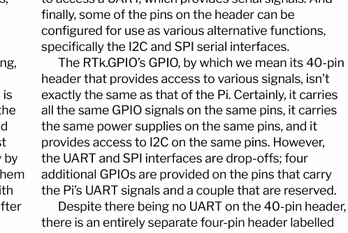

RTKGPIO 意味着我们有 40 个引脚可以访问各种信号，并不像 Pi 那么多。显然，相同引脚上的 GPIO 都是相同的，它带有提供与 Pi 相同电源的引脚，然而 UART 和 SPI 接口是缺失的；

在 Pi UART 和电容器保留的引脚上提供了额外的 GPIO。尽管不在 Pi 的 40 脚引脚上，但使用了一个完全独立的四脚引头：

| 1 | 2 | 3 | 4 | 5 | 6 | 7 | 8 | 9 | 10 | 11 | 12 | 13 | 14 | 15 | 16 | 17 | 18 | 19 | 20 | 21 | 22 | 23 | 24 | 25 | 26 | 27 | 28 | 29 | 30 | 31 | 32 | 33 | 34 | 35 | 36 | 37 | 38 | 39 | 40 |

|---|---|---|---|---|---|---|---|---|---|---|---|---|---|---|---|---|---|---|---|---|---|---|---|---|---|---|---|---|---|---|---|---|---|---|---|---|---|---|---|---|---|---|

| 3V | | | | | | | | | | | | | | | | | | | | | | | | | | | | | | | | | | | | | | | | | | | | | |

| GND | | | | | | | | | | | | | | | | | | | | | | | | | | | | | | | | | | | | | | | | | | | | | | |

| GPIO 2 | | | | | | | | | | | | | | | | | | | | | | | | | | | | | | | | | | | | | | | | | | | | | | | |

| GPIO 3 | | | | | | | | | | | | | | | | | | | | | | | | | | | | | | | | | | | | | | | | | | | | | | | | |

| GPIO 4 | | | | | | | | | | | | | | | | | | | | | | | | | | | | | | | | | | | | | | | | | | | | | | | | | | | |

| GPIO 5 | | | | | | | | | | | | | | | | | | | | | | | | | | | | | | | | | | | | | | | | | | | | | | | | | | | |

| GPIO 6 | | | | | | | | | | | | | | | | | | | | | | | | | | | | | | | | | | | | | | | | | | | | | | | | | | | |

| GPIO 19 | | | | | | | | | | | | | | | | | | | | | | | | | | | | | | | | | | | | | | | | | | | | | | | | | | |


not enough，but that isn't quite enough, because the Pi's pins provide access to more than just GPIOs. Several pins provide access to external circuits - specifically +3.3V and GND (0). Wait, specifically +3.3V and GND (0). Some of the pins are used to output PWM signals. The two pins are used to access a UART, which provides serial signals.

UART, which provides serial signals. Finally, some of the pins on the header can be used as various other protocol interfaces, specifically the I2C and SPI interfaces. premium over what you might consider acceptable, given the 100% capability. The secret is to use a facility on the Pi called Remote GPIO, which hands over the GPIO header to an endpoint. This could be another article, written by Raspberry Pi's product manager, Ben Nutt, and first appearing in MagPi, you can find at `https://www.raspberrypi.com/content/2017/rtk-gpio.html`. Another difference is that none of the GPIO can be used to output a PWM signal. However, PWM can be provided in software, but not as good as the Pi's hardware-based PWM. This requires a change to the Pi software in the RTKGPIO GitHub resource at `https://github.com/Rynetech/RPi/`

# 往期期刊

## 往期期刊 >> 漏掉了哪一个？

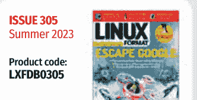


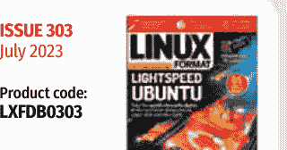

产品代码：LXFDB0305

产品代码：LXFDB0304

产品代码：LXFDB0303

不要让技术控制你的文档——看看你的办公室在 CAD 软件包中是种子的。此外，Linux 认证如何助力你的职业生涯；回溯过去观察编码的演变，并阅读我们对最佳开源 CAD 软件包的推荐，暂时忘记我们通常内容满满的教程，回顾树莓派的特性。

通过在线本地源机器运行自己的系统并接管你的世界，发现 BlendOS 的多样乐趣，并了解 AMD、Intel 和 Apple 对 CPU 的 AI 展望。此外，我们对 Collabara 的 Michael Meek 进行了深度访谈，对 Ubuntu 衍生版进行了测评，并提供了从修复旧照片到编写文本冒险游戏的所有教程。

精简你的 Ubuntu 安装，以获得精简、超简单且极速的 Linux 体验。此外，发现哪种编程语言最好，深入了解关于 OpenSUSE 的所有信息，并找到为什么 Podman 可能比 Docker 更好。别忘记尝试我们关于终端列表、搜索文件内容、理解其含义以及更多教程。

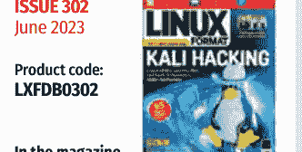


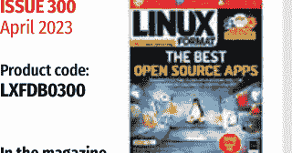

产品代码：LXFDB0302

产品代码：LXFDB0301

产品代码：LXFDB0300

通过 Kali Linux 精通黑客技巧，发现 Stable Destruction 的那些糟糕方法，尝试“非原版”Vanilla OS 的艺术，并了解网络上的新动态。此外，通过使用文本任务、从软盘中恢复数据、在 GIMP 中修复图像等教程掌握一众新技能，并在我们的汇编报告中了解哪种是当前最热门的防火墙。

通过在硬件上安装 Linux Mint 来拯救你的电脑。本期我们还探索了游戏排行榜，保持了轻量级桌面系统的特性，并涵盖了从图像处理、音乐流媒体到编程、3D 游戏象棋以及控制你的暴乱（riot）的所有教程。

第 300 期涵盖了最佳开源项目，并用自由软件运动回馈你。我们还深度回顾了更新，并享受了一些那个早期的复古发行版测评。还有对当前主流发行版的测评，以及关于 Debian Hurd、Mastodon 和用你自己编写 Pong 游戏的教程，仅列举部分。

# 订购请访问 www.magazinesirect.com

从标签页菜单中选择期刊，选择 Linux Format。

或拨打往期期刊热线 0330 333 1113，海外订单拨打 +44 (0)330 333 1114。

请提供下方显示的产品代码并准备好你的信用卡或借记卡详情。

# 美国？欧盟？月球？

英国读者请参阅第 18 页

# 订阅！

不要等最新一期到达当地商店——立即订阅，让 Linux Format 直接送达你手中。更快、更便宜，且拥有无 DRM 限制的存档访问权限！


# LINUX FORMAT

### 逃离谷歌

* 从微软和谷歌中解脱出来
* 让你的办公应用云化
* 取回数据和隐私控制权

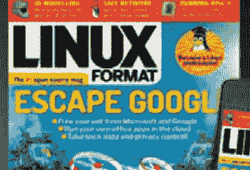

# 3 种订阅方式

纸质版、仅数字版以及纸质+数字组合装！


### 教程

* 从 Python 开始
* 使用 Py 创建你的游戏
* 通过更多扩展你的技能

### 编码历史

一场穿越编程演变的之旅

发现最新发布中的新内容

### 深度解析 DEBIAN

如何托管你的项目

# 世界其他地区

- 美国
- 欧洲

# 订阅如此简单！

访问 `www.magazinesirect.com/linux-format`

拨打 +44 0330 333 1113

周一至周五，当地上午 9 点至下午 5 点（英国时间）。

# 3D 教程：BLENDER

来源：`www.blender.org`

## 真实 3D 地图

勇敢的 Michael Reed 在不离开家的情况下探索真实地图，并在 Blender 中使用各种设置对其进行渲染。


我们处理的源包含一些杂散伪影，我们将使用它从真实数据中渲染 3D 地图。这个过程相当简单，不需要费太多精力。你可以从各种来源获取地图和高度数据。当你得到 3D 地形时，可以进行旋转和渲染。利用 Blender 的功能，你可以对生成的物体进行动画处理。我们需要某种 2D 地图图像以及高度图。在这种情况下，高度图是一个位图，其中亮度代表地图上该部分的高度。当我们结合两者时，就有了准备好渲染的 3D 模型。你可以使用各种计算机生成的数学地图作为输入。缩放后——在平滑着和细分修改器之前，地形是粗糙的。

| 属性 | 数值 |
|---|---|
| 单元格数量 | 100 |
| 平滑度 | |

## 真实 3D 地图

在平滑着和细分修改器之前，地形是粗糙的。

# 3D 地图教程

## 导入图像

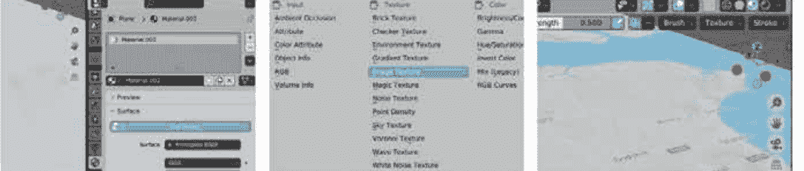

- 1 创建材质

右侧视图的侧栏是 Blender 视图中对象属性所在的地方，它填充在图标表示的选项卡中。然而，要找到是哪个图标，请将鼠标悬停在上面。选择“材质”（Material）选项卡。按 + New（新建）来创建一个新材质。

- 2 添加纹理

此材质被分配了平直的灰色，但我们需要为它分配（我们的地图）。点击“材质”（Material）属性中“基础颜色”（Base Color）的黄色圆点，并选择“纹理（Texture）”。应该会有添加纹理的选项。点击加号按钮并选择“图像纹理（map image texture）”。

- 3 切换到材质预览

你还看不到任何东西，因为视口默认处于“实体”（Solid）模式，它不显示任何材质。点击视口右上角的小图标将视口切换到“预览”（Preview）模式。你现在应该能在平面的面上看到地图纹理。

# >> 曼德博集合地图

我们演化出的过程（细分表面、对其应用纹理以及通过位移进行缩放）也可以用于其他地图。对于许多示例，分形可以输出相同图像的许多变体。通常可以使用 GIMP 来渲染分形图像 <Col > 去色（Desaturate）>。当我们发现亮度正在移动时，使用 GIMP（颜色 Colors）让地图的某些部分比其他部分更亮。

唯一的问题是这个着色的地图比黑色亮得多，我们可以将其放置在比最小半径的高度。解决方案是使用“按颜色”（By Color）选择这些区域之一。这会选择图像中所有的白色区域。重新应用反转（invert）函数将其从白色变为其他。

某些曼德博产生的输出比其他的更合适。Sao 产生的输出对于我们的需求来说太“碎片化”且细节了，QFractal 产了更合适的输出。

对于 Blender 中的右侧平面，使用“对象”（Object）选项卡。例如，对于一张 1080px 的图像，X 和 Y 轴的缩放为 0.9。这使得平面具有 16:9 的比例。

一旦你在平面上有了地图纹理，就是时候添加高光并制作表面顶点的高度了。要做到这一点，请使用位移（displacement）。分形图像（热力图）影响对象（平面）的形状。

在属性中选择“修改器”（Modifier）选项卡。修改器会更改在视口中渲染的方式。我们通过更改底层对象得到了最终结果。如果平面在图像内向上移动，不应担心位移（Displace）。

在 Blender 中有一组属性可以用于编辑位移（Displace），将热力图作为纹理添加的过程添加地图图像纹理类似。在这种情况下，我们需要在“纹理”（Texture）选项卡中添加新纹理，点击添加地图图像纹理。你应该看到平面表面的高度根据位移的相对亮度进行更新。通过更改位移修改器的“强度”（Strength）和“混合”（Blend）参数，可以控制热力图应用于平面的效果量。Blender 大多数参数滑块都非常敏感，双击然后手动输入参数值或拖动滑块进行控制。

## 改进细节

如果你缩放平面的表面，你会注意到高度变化大致是粗糙生成的且具有多边形特征。这并不意外，因为平面表面的顶点分辨率仅为 100-150。改进 3D 地图输出的第一步是点击平面并设置着色模式（Shade Mode）来制作平滑着色。

我们还可以使用以下方法增加组成平面表面的顶点数量


# 3D 地图教程

如之前一样，来自“细分”（Subdivision）选项卡的修改器，但这次选择“细分”（Subdivision）。修改器按顺序处理，因此移动细分修改器，使其位于位移修改器上方。细分修改器的作用与所有修改器一样，不改变几何结构；这些简单的更改是在场景在视口中显示或渲染到文件时完成。注意此修改器有两个参数，一个在视口中执行，一个用于最终。在两种情况下，将此改为 2 就足够了。

回到材质编辑器并像你做的那样调整一些参数。“粗糙度”（Roughness）参数使表面发光，甚至产生额外的阴影。随着它的增加，它会变得更哑光。


## 灯光、摄像、动作

现在我们在平面上有了 3D 地图，我们需要让它进入渲染状态。第一个问题是考虑光照。Blender 默认使用单点光源为对象的所有侧提供光线。像这样的 3D 地图对象会在场景中显示更多的对比度和阴影。我们需要一个小且靠近对象的光。

要查看光照效果，确保视口处于“渲染”（Render）模式。点击场景顶部的灯光图标。点击灯光在视口中或右侧边栏顶部的“集合”（Collection）面板中选择它，并用鼠标移动它。

# 管理之道

Stuart Burns 是 Red Hat 500 公司的 Linux 管理员，专攻 Linux 领域。

# Docker 已经过去，Docker 万岁

Docker 曾一直是容器领域的霸王，但 Podman 能终结 Docker 的统治地位吗？

# >> 前路坎坷吗？

我曾是 Red Hat 的大忠实粉丝。直到他们宣布关闭了此前对 RHEL 源代码的公开访问，转而支持 CentOS。现在，唯一能获取或使用 Red Hat 精确版本的人只剩下客户了。请访问 `https://redhat.com`

每个人都知道 Docker。事实上，很多用户使用 Docker 来配置容器和镜像。然而，今天已经有了许多替代方案，包括来自 Red Hat 的选择。Red Hat Podman 的部分功能允许无根权限（rootless）和无守护进程（daemonless）运行，从而在默认情况下更加安全（Docker 组没有 root 权限）。对于那些刚开始尝试的人，它提供了与 Docker 兼容的命令行，因此不会出现问题。它还提供了一个免费使用的 GUI，其功能（在我们看来）具有 Docker Desktop 的特点。

Red Hat 正在试图将此视为一件好事，因为与之相对的是，它告诉人们（包括我们）去源码构建一个 1:1 的高度兼容内核，以使用 Red Hat CentOS Stream 版本。Rocky Linux 的出现原因之一是 CentOS 从稳定版转变为测试版，这在本质上是一个滚动测试/beta 发布版，使其不适用于生产环境，因为他们无法负担 RHEL 的许可费用。

仅仅因为 Red Hat 不这么做，并不意味着排除了其他 Linux 供应商。例如，在 Ubuntu 上执行 `sudo podman image search` 会显示出所有默认的安装工具。Podman 可以获取新镜像以及更多 RH 工具（全部），但它也包含一个用于容器和镜像管理的 GUI。这些容器执行的任务与 Open Initiative 相同，该组织详细说明了互操作性以及您的需求。

Podman 是完全开源的，不受许可限制的影响。虽然它与 Docker 兼容，但它有自己的构建过程工具。

这会让 Rocky 变得非常有趣，而且很多人很有趣的是，Oracle 投入了巨资将正确的容器迁移到 OCI。由于参与了迁移到比 Red Hat 更便宜的 Oracle Red Hat 兼容方案，我们理解了为什么 Oracle 最好是使用 Red Hat 的代码。

# LXD 被 Canonical 收编

但请记住 Red Hat 在 IBM 麾下的地位，IBM 一直被视为与红色帽理念不合的公司。LXD 被转移到了 Canonical，希望以此取得巨大进展。

Canonical 接管了 LXC（Linux 容器）的扩展。Linux Containers 指出，所有 LXD 内容都将留在 Canonical 管理下：作为 LXD 项目的创建者和维护者，Canonical 决定在作为 Linux 社区的八多年后，该项目现在将直接在 Canonical 的系列项目下服务。

原因似乎可以归结为事实：在过去的几年里，LXD 的开发有限，而在 Canonical 的指导下，它可以将其集成到 Ubuntu 版本中，并扩展功能以处理 Linux 上的完整体验。

使用 LXD 无需担心。它仍然保持着开源和免费的本质。Git 仓库已迁移到 Canonical 管理下。更多细节请参阅：`https://linuxcontainers.org/`

我怀疑这给 Red Hat 带来的麻烦将比任何时候都多。

- LXD 由 Canonical 指导。是新功能还是某些旧的 LXD？

# 谁安装的？

Yum 不仅仅是一种安装方法——它还可以做许多有趣的事情。

Red Hat 用户通过 `yum install -y` 或基础安装来获取它。当出现问题时，有一个 yum 软件包切换功能可能帮上大忙。Yum 的历史记录功能对于故障排除也很有用。在 RHEL/Rocky RH 服务器上，它允许管理员查看执行了什么命令、软件包问题以及系统在配置期间做了什么。什么被升级或删除了？`yum history` 可以告诉你。

遗憾的是，`yum history` 不适用于基于 deb 的系统服务器。在 Apt 软件包管理系统中没有类似的功能。Apt 有诸如 `apt list` 的命令，但没有完全那么好的。如果需要，安装了什么以及位于何处的列表可以在 `/var/log/dpkg.log` 中找到，但由于该日志可能会轮，所以长期信息可能会丢失。

作为一个真实的例子，几个月前我们遇到过一种情况：系统正在升级但没有完全完成，我们不知道是什么导致了问题。使用 `yum history` 命令，我们能够定位问题并解决它。结果证明是删除了一个包但没有替换该包。

`yum history` 命令本身显示了发生了什么以及执行了多少次 yum 命令。安装了一个仅包含索引的全新 yum。使用 `sudo yum history`，你可以获得事务的详细列表以及一系列关于命令操作的字母：I 表示安装（installed），U 表示升级（updated），D 表示降级（downgraded）。

如果你想深入研究 yum 命令行和日期，有一个参数：


> `Yum undo` - 一个有用但少为人知的命令，用于切回软件包安装。

要查看初始系统所做的更改，例如我们可以使用 `history info` 获取所有已升级、安装或删除的包详情。注意，在基于 RH 的系统上，该值是运行命令的人。现在基础知识说完了，让我们来聊聊魔法。作为 `yum history` 的一部分，可以回滚事务。如果你需要撤销某些运行良好的操作：使用 `history undo` 移除包。该操作会生成事务 ID，你可以将其配合 `history info` 使用，但在存在潜在冲突依赖的标准下例外。那种场景有助于并让恢复到之前的状态变得更容易。有一个完美的例子，如果需要，`yum history` 将显示你将当前软件包版本降级到较低版本。有很多为了使用 Yum/DNF 的内置工具。这只是一个了解什么是真实的以及如何有效使用的问题。

```
root@local:~ yum history list
ID  Date                Action  Installed
1  2023-07-09 23:41:12  install
2  2023-07-09 23:41:21  install
3  2023-07-09 23:41:25  install
4  2023-07-09 23:41:30  install
```

# 托管测评

## Cloudways

一个出色的托管服务提供可扩展的云端解决方案，让 Ruby P Jane 对她看到的一切赞叹不已。

### 简要

凭借强大的基础设施和直观的用户界面，Cloudways 已成为任何想要挖掘云托管潜力的人士的首选。它提供了无缝的体验和无与伦比的...

Cloudways 的标准功能之一是使用基于 SSD 的托管。通过 SSD 驱动器，您的动态网站性能将得到提升，并缩短加载时间。为了快速响应以吸引并留住访问者，Cloudways 还提供了内置缓存功能，包括 Memcached、Varnish、Nginx 和 Redis。

该平台还支持 PHP 7.4 和 8.0。PHP 8 以显著提升网站运行速度和提供更多内容而闻名。

与共享主机不同，Cloudways 为您的网站提供专用环境。您的资源不会与其他用户共享，从而确保了性能。Cloudways 通过带有预配置 PHP-FPM 的自动托管云服务器来负责服务器管理工作，这极大地加快了 PHP 的加载速度。为了增强网络服务器与客户端之间的通信速度，Cloudways 服务器支持 HTTP/3。

通过免费点击安装 SSL，可以轻松保护您的网站。为了增强安全性，请尝试 Let's Encrypt SSL。在技术合作伙伴 Malware 的帮助下，您可以保护 WordPress 网站免受恶意软件和暴力破解登录攻击。

如果您需要灵活性，Cloudways 允许您通过一次部署启动十多个应用程序。通过这种，您可以在单个服务器上部署多个 WordPress 和 Magento 网站，提供便利且精简的工作流。

最新版本的 MySQL 和 MariaDB 均就绪。您可以选择最适合您项目的数据库并在需要时它们之间切换。

来自 Cloudways 团队的建议与解答

知识库和常见问题解答可以回答您可能遇到的任何问题。

AWS 每月 35.96 美元，Google Cloud 每月 37.45 美元。无论您选择 DigitalOcean 还是 Google Cloud，都能获得所有方案的功能。虽然没有退款保证，但提供试用期，且无需输入信用卡详情即可访问。

托管云平台 Cloudways 提供了许多优势和功能，可以满足从中小企业甚至企业的需求。它提供了广泛的云基础设施提供商，包括亚马逊云服务 `AWS` 和 Google 平台。

凭借这种简单易用性，Cloudways 集成了一个用户友好的面板，可以用极少的精力管理您的服务器，方便了服务器配置、安装和资源扩展等任务。然而，如果您需要电子邮件托管和域名注册，Cloudways 可能不是您的正确选择。

### 支持解决方案

Cloudways 为需要额外支持的用户提供增强的服务水平 `SLA`。Cloudways 提供实时聊天支持，并将普通优先级的响应时间缩短至几小时，高优先级则为 30 分钟。对于需要高级 SLA 的用户，它还提供自定义支持和配置选项。在您需要额外的服务器设置时，Cloudways 提供来自各种云托管服务，您可以按月或按小时付费。通过按小时付费的系统，您只需按实际使用付费。在月计费系统下，DigitalOcean 每月 14 美元（约 11 英镑）起。

### 结论

开发者：Cloudways

网站：http://www.cloudways.com

价格：每月 14 美元（约 11 英镑）

| 功能 | 易用性 |
|---|---|
| 性能 | 9/10 | 8/10 |
| 价值 | | 7/10 |

>> 评分 8/10

致谢：www.techarrador.com/it | 2023年9月 LXF3173

# 深度对比 AWS vs Azure

云服务几乎为每种类型的业务提供支持。事实上，如果你相信亚马逊的炒作，我们正走向一个各种规模的公司都运行远程服务器的世界。无论哪种情况，微软看起来都更好一点，但可以确定，云对许多企业的未来是至关重要的。

挑战在于，很难判断哪种云平台最适合组织中的特定角色。这在一定是因为不同的提供者做出了同样的承诺，使您能够大规模部署服务并以最少的管理进行规模扩容。

但虽然基础架构可能看起来很理想，一旦你开始观察这些平台的深度——毫无疑问是亚马逊和微软——你就会遇到哲学上的细微差别和差异，这会对服务或客户产生巨大影响。

## 我们是如何走到这一步的？

仅仅 15 年前，大多数公司都是围绕自己的硬件构建的。这是一笔巨大的开支：标准服务器的资本足迹，包括生命周期成本，一直到服务器所在的机架租金，在投资后很容易收回。大多数服务器花费 10,000 英镑。（注：此处 OCR 文本已损坏，必要时根据上下文推断，但尽可能贴原文）。

## 深度解析 AWS 对比 Azure

# 亚马逊 VS AZURE 的对决

| AWS | Azure |
|---|---|
| 规模 | 2022年其规模是其他 12 个竞争对手总和的六倍，但其市场份额已从40% 下降到 2023 年的 32%。 | 截至2021年4月报告服务器更多且仍在增长，2023年市场份额为 23%。 |
| 大客户（每月支出报告） | Netflix ($300亿), Apple ($90亿), Amazon ($880亿), Twitter ($70亿) | Verizon ($500亿), LinkedIn ($410亿), Azure ($400亿，它同时使用两者), Intel ($390亿) |
| 数据中心位置 | 遍布21个国家的56个区域 | 遍布140个城市的60个区域 |
| 服务水平 | 退款按区域定义 | 对 SaaS 提供强力支持；在原生计算和虚拟机方面较弱 | 与企业客户建立关系，并通过合作伙伴和专家支持强调项目的成功 |
| 定价模型 | 四个不同级别，硬件成本运行独占性 | 基于整体能力的三个定价方案，当需求高涨时可能会暂停或折扣最便宜的方案 |

在平额固定费率的时间和空间块上，而 Azure 倾向于针对特定任务采用部署解决方案，例如通过 AI 扫描你的整个数据湖以寻找客户内部的趋势。

总的来说，使用 Azure 管理预算可能会有点复杂，因为它涉及到更广泛的组件和能力。如果你想在私有位置运行机器，并连接回公司办公室以作为运行 Active Directory 的网络，那么这不一定是一件坏事。

亚马逊提供了一种更简单的服务模型 - 足够灵活，并不总是要求你启动一个完整的虚拟机。如果你只需要一个静态或廉价的云配置，这非常合适。

然而，为了进行连接，你需要在云中准备一些函数——但是，当下一次续约到来时，情况可能会变得有趣（参见第74页的 Jet Off 框）。

你构建了一个只能在其中一个平台上运行的任务。如果你使用带有系列配置文件和操作系统安全措施的基于 Linux 服务器，你会在亚马逊那里感到如如家——如果你处于 Windows 环境中，拥有用于将你的各种付费组件以连贯、单一方式连接的解耦活动和脚本，你更有可能在 Azure 上感到舒适。

## 客户、供应商与希腊人

云端为多样性、不同的存储模式和托管模型留下了很大空间。云中最不虚拟化的部分关注的是提供网页和数据，而不是进行奥秘的计算。一个带有许多小容器、箱和蛋的轻量级 Web 框架非常容易分发到容器化。

技术通常已成为一种维护平台的方式，并有不同的技术来满足特定需求。对于许多场景（例如 Web 服务器），这些容器可以以廉价的方式运行，而不是全虚拟化。

技术通常已成为一种维护平台的方式，并有不同的技术来满足特定需求。作为提供资源的方式，编排器可以管理需求和系统健康。估算成本在亚马逊 处是复杂的，而在 Azure 上，离散的实例可能更容易监控。

如果你有一个容器化的软件堆栈，在亚马逊和 Azure 之间会有所不同。前者帮助你在黑内部实现容器，但 Azure 在这方面更好，它提供了一个可以在任何地方部署容器的平台。

不要急于跳跃，尽管对于小型企业来说，使用容器可能没有太大益处，因为他们可能遇到需要快速扩展的突增需求。

## 关于成本，开始

这两大云服务不仅体现了不同的哲学——它们有不同的定价方法。遗憾的是，这些服务并不像支付固定月费那样简单，而是取决于你使用的特定服务及其程度。更重要的是，价格可能会根据不同的市场状况发生巨大变化。

尽管如此，对于粗略估算，亚马逊提供了一个定价计算器：https://aws.amazon.com/pricing/calculator/，你通常不需要深入挖掘定价惯例，但两者都倾向于将信息推到面前，提供各种优惠活动和包。

亚马逊可能更偏向于优惠活动

## AWS 对比 Azure 的深度解析

独立 AWS EC2 实例的控制面板——这是运行 Nextcloud 的地方。

它通常提供了一种你从办公室角落的旧服务器上无法获得的韧性。然而，主主机没有方法操作你的虚拟机——备份和过程通常保留在私有云内部，因此在需要时（无论好坏）可能无法很好。

Azure 端点管理控制面板的一部分。

## 两巨头

### Google Cloud

技术通常已成为一种维护平台的方式，并有不同的技术来满足特定需求。Google Cloud 在安全方面投入了大量资源，利用 AI 系统检测并反网络威胁。它的平台很高，且运行良好。

### DigitalOcean

最低廉的云供应商之一。DigitalOcean 提供的功能没有竞争对手那么多，但它更专注于以负担得起的价格提供简单的云功能，并且良好。

### OVHcloud

作为专注于欧洲客户的法国云提供商，OVHcloud 是欧洲最大的云托管提供商，根据物理服务器数量位全球第三。你可以从 VPS 或专用服务器中选择类型和区域。

# 全球最棒的新开源软件

## 热门推荐

- Immich >> G4Music >> Cava >> Footage
- 登录管理器设置 `Login Manager Settings` >> Gear Lever Nala
- Alien Arena >> 游戏卡 `Cartridges` >> Cubic >> Filelight

Mayank Sharma 重新发现了他的旧音乐收藏，并表示，背景中播放罗比·威廉姆斯 `Robbie Williams` 的歌曲为这些软件提供了灵感，至少在软件选择上如此。

## 照片存储

### Immich

版本：1.65.0

官方网站：https://immich.app


我喜欢 Google 相片的便利性，但并不真正放心把照片交给第三方，所以你必须尝试一下 Immich。它是一个自托管的照片容器和共享服务，与流行的服务非常相似，都拥有直观的界面和移动应用。


Immich 以 Docker 容器的形式部署，因此在设置 Immich 之前你需要安装 Docker 和 Docker Compose 协调器。这不应该是问题，因为所有主流发行版都提供了安装 Docker 和 Docker Compose 的默认说明。

你还需要确保你使用的电脑至少有 4GB 内存，并配备双核 CPU 以获得可接受的性能。

为了简化安装过程，你不需要手动使用 Docker Compose 部署 Immich，而是可以使用我们在测试中完美运行的示例脚本来替你完成这些繁重工作。

https://raw.githubusercontent.com/immich-app/main/install.sh

Immich 会当前目录下创建一个名为 `immich-data` 的目录，并自动下载和设置 Immich 实例。根据可用资源，该过程可能需要一些时间。

完成后，访问访问 Immich 实例的 URL。例如，如果你设置的机器 IP 地址是 10.0.0.2，你就可以通过 http://10.0.0.2:2283 访问你的 Immich Web 服务。

首次登录时，你可以使用管理员用户从管理部分向 Immich 添加其他用户。非管理员用户的密码是公开的，用户可以在登录应用后更改。

设置好服务器后，你可以获取 Immich 移动应用，它支持 Android 和 iOS 设备。

Immich 的移动应用有一个选项，可以帮助你将所有移动设备备份到你的 Immich 服务器。

## 让我们探索 IMMICH...


| 1 探索你的媒体 | 4 管理部分 |
| :--- | :--- |
| 除了你的媒体，你还可以使用人脸识别和位置数据等工具来浏览它们。 | 进入管理部分添加更多用户，并进行一些基本设置。 |
| 2 搜索 | 5 共享 |
| Immich 使用类型搜索，支持自然语言处理以返回准确且相关的结果。 | 你可以通过创建共享专辑与网络中的人员分享你的照片和视频，专辑还可以可选地设置为自动过期。 |
| 3 时间轴 | |
| 使用时间轴快速滚动浏览你的库 | |

www.immich.com/pro

2023年9月 LXF306

## HOT推荐

### 音乐播放器

### G4Music

版本：2.3

官方网站：https://gitlab.gnome.org/neither/g4music

像我们这样的老派爱好者有一堆装满音乐的磁盘，然后通常会选择流行的播放器。如果你也有一个巨大的音乐库，你需要的是一个像 G4Music 这样简单直接的客户端，它会引导你浏览库而没有任何杂乱。

G4Music 轻量但功能丰富，是拥有离线库的理想选择。它还提供 Flatpak 格式，可以通过 `flatpak install flathub` 安装。

该应用拥有精美且自定义的界面。启动时，它会自动扫描并列出你在 `~Music` 目录中找到的所有音频以及所有的热门音频文件。你可以在应用中将其指向另一个目录。它还通过 Samba 和 GStreamer 等协议支持远程位置。

G4Music 使用高斯模糊的专辑封面来装饰当前选中的轨道并应用程序窗口，这使得应用看起来非常酷。你可以通过调整偏好设置来关闭它。

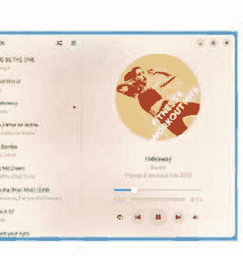

G4Music 在 Gnome 上运行良好，并可以与 Gnome 通知栏中的 MPRIS 控制集成。

默认情况下，应用按标题的字母顺序对音乐进行排序。界面上的三个按钮之一可以帮助你更改排列列表，按流派、艺术家或歌曲标题显示音乐，或者在需要时随机播放。还有一个搜索栏帮助你搜索库。

尽管非常极简主义，但该应用具有许多有趣的功能，例如后台播放，以及支持音频视觉化器和均衡器。它支持 PulseAudio、PipeWire、OSS 等多种音频服务器。该应用还可以通过 Replay 归一化音量。

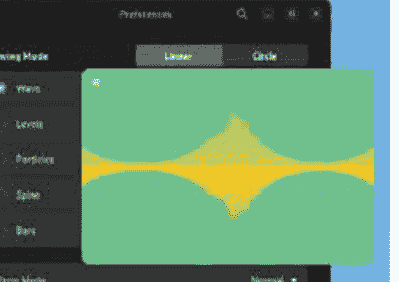

默认情况下，应用不显示任何控件以保持界面整洁，但可以在偏好窗口中开启。

## 音频视觉化器

### Cava

版本：2.0.0

官方网站：https://github.com/arcaVisualizer/Cava

我们都选择了音频视觉化器。此功能具有完全实时生成的动画图像，即使在我们没有看时也能与当前播放的轨道同步。

当我们寻找某些东西来听时，Cava 是基于音频视觉化器的。它非常通用，可以通过 `flatpak install flathub` 安装。

Cava 并不要求其应用具有科学准确性，而是为了表现音频。同样，Cava 并不是为专业人士设计的，但它有许多让音频迷印象的功能。该应用支持波形、条形和模式。你还可以在圆中绘制它们。

Cava 最好的事情之一是其丰富的选项。例如，你可以设置背景渐变来让它们脱颖而出。因为 Cava 基于可视化，你可以获得它提供的大部分设置。例如，你可以控制音频通道中的条形数量以及降噪或平滑效果。Cava 的主窗口可以调整大小，你还可以为其他人导出配置。

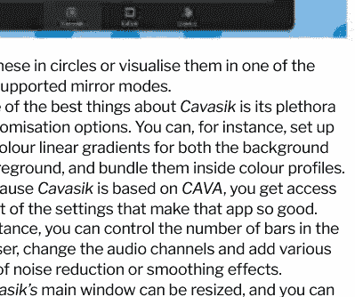

2023年9月

www.linuxformat.com

## 热门推荐

### 视频编辑器

### Footage

版本：1.2

官方网站：https://github.com/adham10/Footage

Linux 用户可以访问许多高质量的开源视频编辑器，如 Kdenlive、OpenShot、Shotcut 等。虽然它们在各自领域很好，但当你只需要缩小视频大小时，它们可能大过其实。如果你的视频编辑需求少且简单，你可以从 Footage 中受益。

与著名的转换器不同，Footage 是独立的。你可以使用它来剪辑片段、更改帧率、以不同的格式导出等。正如你所看到的，这些功能不是为专业视频编辑器准备的，但对于偶尔剪辑或缩小视频尺寸的编辑者来说足够了。

Footage 提供 Flatpak 格式，可以通过 FlatHub 通过 `flatpak install github.io/adham3310.Footage` 安装


这是一个精巧的小视频编辑器，提供了一些常见的视频编辑功能，但不支持批量处理。

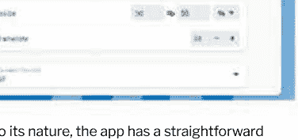

与其本质相符，该应用具有直观的界面。使用文件按钮选择要编辑的视频。一旦加载，你就可以根据需要使用控件进行编辑。

你可以通过更改预览窗口和时间轴中的更改来调整视频及其长度。同样，你可以通过长度、宽度和像素调整视频尺寸。此外，你还可以根据要求增加或减少帧率。

调整后，你可以以任何流行的容器格式导出视频，包括 WebM、MP4、MKV 或 GIF。

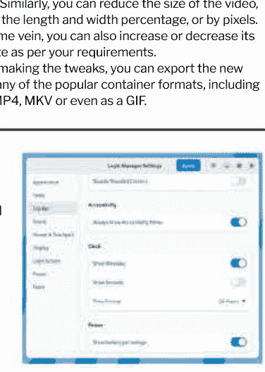

一旦按需要调整了登录管理器，你可以使用该应用固定设置并将其导入不同的基于 Gnome 的发行版中。

## 登录自定义

### 登录管理器设置 (Login Manager Settings)

版本：3.2

官方网站：https://gdm-settings.github.io

花了一些时间，我们已经习惯了重新设计的 Gnome 桌面的方式。然而，有一件事让我们无法接受：缺乏自定义选项。诚然，桌面有一个额外的架构来帮助我们根据需要管理桌面，但在进行调整以获取登录管理器设置应用时，桌面环境的表现仍不尽如人意。

尽管具有非对齐的性质，但该应用更适合 Gnome，并使我们能够调整各种 Gnome 设置。例如，你可以应用主题、更改登录界面背景、更改光标和图标主题、应用亮色和设置等。它既提供 AppImage 也提供 Flatpak 格式，尽管开发者自己说在某些条件下可能无法正常工作。这就是为什么最好通过 Flatpak 安装该应用：`flatpak install github.io/adham3310/Gnome-Login-Settings`。

该应用非常直观，自定义内容组织为九个部分：外观、字体、背景、声音和主题、登录界面、屏幕预览等。你可以在这些部分之间跳转，滚动查看选项，并根据你的意愿进行调整。某些设置是特定于发行版的，可能对你的发行版没有影响。调整后，点击“应用”。你需要重新登录或重启使更改生效。

## 热门推荐

### APPIMAGE 管理器

#### Gear Lever

版本：1.0.8 网页：https://github.com/mijorus/gearlever

AppImages，或者说 Flatpaks，它们已经简化了跨 Linux 发行版的安装过程，消除了处理不同软件工具和封装格式的复杂性。

但这并不是唯一的缺点。对于 AppImages 而言，最大的问题是它们无法集成到发行版的应用程序菜单中。这正是 Gear Lever 的用武之地，它可以帮助通过几次点击将 AppImages 集成到你的工作流中。

有趣的是，Gear Lever 可用并可以通过 `flatpak install flathub.org/gearlever` 安装。

AppImages 出现时是空白的。你可以将 AppImage 拖入界面进行进行管理，或者点击 `+` 图标从文件管理器中选择。导入后，你必须确认安装。Gear Lever 还允许查看文件的 MD5 校验和，帮助你验证 appimage 的完整性。

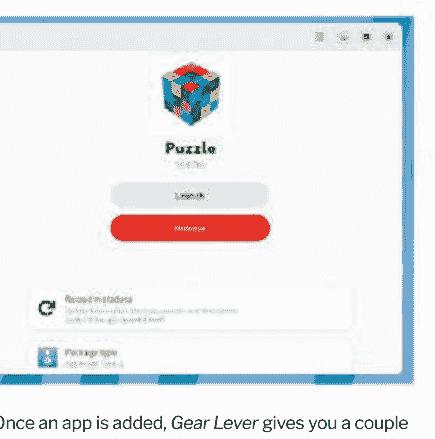

当你将应用添加到应用程序菜单后，Gear Lever 会显示一个按钮，允许你从菜单中移除该应用。

一旦添加了应用，Gear Lever 会为你提供两个按钮：一个用于启动应用，另一个用于将其添加到发行版的应用程序菜单中。

如果你也有一堆应用，可以使用 Gear Lever 将它们都放在一个地方。默认情况下，所有的 AppImages 都通过 `~/AppImages` 管理。

你可以从应用的“偏好设置”菜单更改位置。默认情况下，Gear Lever 通过将原始文件复制到文件夹来帮助节省空间，但你可以选择保留原始文件并在目标文件夹中创建副本。

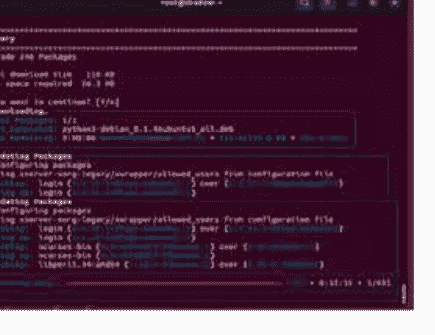

与传统的 apt 相比，Nala 更加现代且直观。例如，`sudo nala list` 会列出所有将安装和升级的包以及升级的范围。

## 包管理器

### Nala

版本：0.13.0 网页：https://gitlab.com/volian/nala

`apt` 在基于 Debian 的发行版上很好地完成了包管理，但仍有改进空间。`Nala` 成功填补了这一角色。

`Nala` 由 Fedora 的 DNF 包管理器编写，得益于并行下载，提供了更易读的输出。

在官方的 Debian Testing 和 Ubuntu 22.04 中，它预装了 `apt nala`。

如果你使用的是旧版本的 Ubuntu，仍然可以通过第三方仓库成功安装 Nala。参考我们的教程在 Ubuntu 上安装 Nala：

```bash
sudo echo "deb [arch=amd64,arm64,armv7] http://sources.github.com/volian/archive-scar-unstable stable" | sudo tee /etc/apt/sources.list.d/volian-archive-scar-unstable.list
```

获取 GPG 验证密钥：

```bash
$ wget -qO- https://keys.github.com/volian/scar.key | sudo gpg --dearmor -o /etc/apt/gpg.d/volian-archive-scar.gpg
```

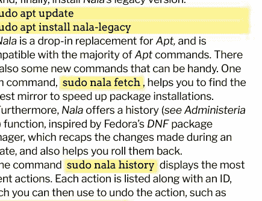

最后，安装 Nala 的旧版本：

```bash
$ sudo apt update
$ sudo apt install nala-legacy
```

`Nala` 是 Apt 的一个前端，兼容大多数 apt 命令。它还有一些可以处理的新命令。

```bash
sudo nala fetch
```

可以帮助你找到最快的镜像以加速包的安装。

此外，Nala 提供了历史记录（参见 Fedora DNF 包管理器历史记录），它记录了更新期间期间的更改，并允许你进行回滚。

```bash
sudo nala history
```

显示最近的操作。它以 ID 形式列出，你可以使用该 ID 来撤销操作，如下：

```bash
sudo nala history undo <id>
```

## 第一人称射击游戏

### Alien Arena

版本：7.71.4 网页：https://alienarena.org

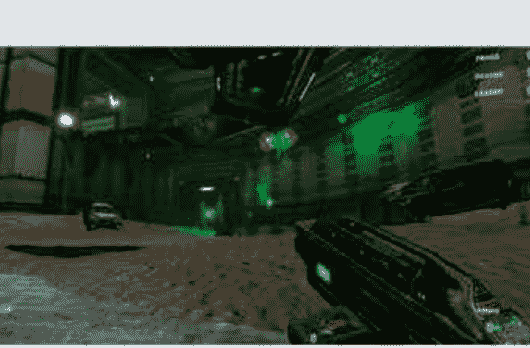

如果你像我们一样喜欢第一人称射击游戏，你会喜欢 Alien Arena。近二十后，该游戏的科幻主题以及受 Quake 和 Unreal 启发的死斗模式仍然流行，因为它拥有大量的角色、大量的地图和多种可玩类型。

该游戏可以在多个发行版的官方仓库中获得（如 Ubuntu），但为了确保你拥有最新版本，请从 Flatpak 下载：`flatpak install flathub.org/alienarena`。

节奏非常快，尽管它有一个离线练习模式帮助你针对机器人磨练技巧。要玩，你必须先通过可以解锁的地图和角色列表。

游戏支持多种游戏模式，最流行的是抢夺旗帜，其他如死斗、团队核心突击、自由死斗等。

游戏背景设定在一个未来主义宇宙中。


使用几个人类和外星角色作为你的化身。每个玩家角色的尺寸、可见度和概况大致相同，彼此之间没有优劣之分。当你加入服务器时，你可以选择加入生成地图中的两个竞争队伍之一，虽然人类和外星看起来不同，但它们的行为是完全相同的。

在开始游戏之前，请记住使用游戏的配置选项。通过鼠标和键盘，你还可以更改多种影响游戏性能、画质、可见度以及屏幕显示内容的设置。


某些 Alien Arena 地图包含陷阱，例如致命陷阱，这为玩家带来了危险。

## 游戏启动器

### Cartridges

版本：2.0.4 网页：https://github.com/lutris/lutris

如果你也有一堆应用，可以使用 Gear Lever 将它们都放在一个地方。默认情况下，所有的 AppImages 都通过 `~/AppImages` 管理。

你可以从应用的“偏好设置”菜单更改位置。默认情况下，Gear Lever 通过将原始文件复制到文件夹来帮助节省空间，但你可以选择保留原始文件并在目标文件夹中创建副本。


与传统的 apt 相比，Nala 更加现代且直观。例如，`sudo nala list` 会列出所有将安装和升级的包。


## 热门推荐

### 自定义演示制作

### Cubic

版本：2023.05 网页：https://github.com/Pj-Singh/Cubic

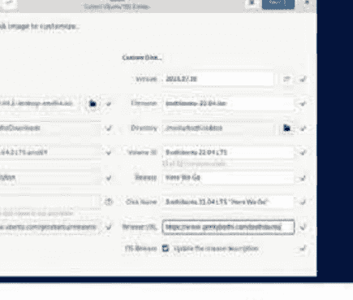

## 磁盘空间管理器

### Filelight

版本：2023.04 网页：https://apps.kde.org/filelight/

# 你能帮助启发下一代代码爱好者吗？

Code Club 是一个全国性的志愿者主导网络，为 9-11 岁的儿童提供课后俱乐部服务。

我们一直在寻找具备编程技能的人员来担任志愿者，每周在当地的小学、图书馆或社区中心运营一小时俱乐部。

你可以与同事结伴，会有一位老师在场为你提供支持，而且我们会提供你所需的所有材料，帮助激发孩子们对数字制作的兴趣。

有很多参与方式！如需了解更多信息，请访问 www.codeclub.org.uk 加入我们。

# 编程学院 (CODING ACADEMY)

## LXF 冒险之旅

致谢：https://github.com/azuregate

## 文本冒险战斗机制

通常让它看起来像是在玩游戏而不是战争，但这个月 Nate Drake 将我们的互动式冒险带向了一条黑暗、暴力的道路。

我一直在关注之前关于创建你的 Python 文本冒险的教程，你现在应该已经有一个能够让玩家在任意数量房间之间移动并与物品交互的脚本。

这没问题，但大多数地下城通常包含某些风险元素。当然，代码需要创建一个房间让玩家玩，游戏通常会给你每个属性提供一定数量的生命或分数，你必须保护它们。

子类（subclass）具有相同的属性，但也允许你添加你自己的其他属性。我们将使用这个方便工具创建一个名为 `StatItem` 的新类。

### StatItem(Item):

```python
def __init__(self, name, itemdesc, uproomdesc, portable, wearable, usedin, us,
roomadditems, roomusdesc, userodesc,
self.hp, change):
    super().__init__(self, name, itemdesc, uproomdesc,
portable, wearable, usedin,
roomadditems, roomusdesc,
disposable)
```

### 击我

为了让我们的英雄足够强大，我们首先需要更新 `Player` 类以引入 HP 属性。

如你所见，这是原始的 `Item` 类。我们添加了一个新属性 HP。如果 HP 发生变化，游戏将使用 `StatItem`。这表示你的 HP 变化了多少。如果是负值，StatItem 同时涵盖了健康和伤害物品（注意，这有点风险）。

### class Player:

```python
def __init__(self, name, current, keyring, hp):
    self.name = name
    self.current = current
    self.hp = hp
    self.inventory = inventory
```

这意味着我们还需要在脚本开始时为玩家分配攻击次数的变化（现在称为 HP）：

如果你下载了脚本（见下方的“小贴士”），玩家的背包已更改为 `StatItem` 列表：`['Bread', 'Sabred', 'None', 'O']`。现在你可以使用 Sabred 了。这种感觉非常清爽。, None, One, None, True。

```python
self.inventory = [StatItem(name, [0], [1])
```

在这种情况下，我们决定今天免费为玩家增加 10 点 HP 以改变变化，这并不危险，也取决于你想要让你的冒险变得简单还是困难。

我们的玩家现在拥有一个特别显著的物品，因为游戏中没有东西可以伤害到他们！

我们可以更新 `Item` 类来添加此属性，但除非我们使用它，否则很难区分不同类型的物品。在 Python 中，我们有一个子类网络可以做到，它允许我们创建子类。一个

# 我们的专家

Nate Drake 想要决定这一系列老爸，他们曾告诉他，没有人会付钱让他留下来玩游戏。

# 小贴士 (QUICK TIP)

你可以从 https://github.com/azuregate/pythontext adventure/adventure/script.py 下载一个可以更改玩家分数的代码示例

86 LXF 杂志 2023年11月

www.infformat.com

# 文本冒险编程学院

在修改脚本之前，如果玩家能够创建自己的 HP，可能可能有所帮助。最好的做法是更新背包程序：

```python
def inventory():
    print(name)
    print("HP:", hp)
    print("You are carrying:")
    if not inventory:
        print("nothing")
```

在后续系列中，你将知道主冒险中这个脚本包含一个大型金属格栅，你无法移动它。这是因为格栅的 `portable` 属性被设置为 false。不过，并不是让格栅变得不可移动，如果玩家尝试通过拉动它

> 小贴士

> 在编程圈中，从其他类派生新类的方法被称为“继承”。第一个例子就是我们最初创建的文本冒险。

为了做到这一点，我们需要将格栅更改为静态的（Static）

```python
grill = Static("grill", "格栅很旧且生锈了，但有一些锋利的边缘。", None, None, None, 尝试拉并移动格栅，无论你如何努力都会抓伤你的手。它有 3 点 HP, None
```

花点时间回顾一下。在第一情况下，玩家使用 `LOOK` 来检查它，它只是警告那里有一些肉。肉也是通过玩家尝试移动格栅时的受伤产生的。在这种情况下，他们损失了 HP。

```python
if not inventory:
    print("nothing")
else:
    for item in inventory:
        print(item)
```

现在是时候运行脚本或修改后的脚本了。首先，运行 `inventory` 查看玩家 HP 的输出。看板在玩家的背包里。最后，运行 `inventory` 看看你的英雄现在有了 HP

# 承担风险 (Taking risks)

到目前为止，脚本会更改玩家的分数。如果 HP 发生变化，游戏将使用 `StatItem`。这表示你的 HP 变化了多少。如果是负值，StatItem 同时涵盖了健康和伤害物品（注意，这有点风险）。

```python
class Player:
    def __init__(self, name, currentroom, keyring, hp, inventory=[]):
        self.name = name
        self.currentroom = currentroom
        self.keyring = keyring
        self.hp = hp
        self.inventory = inventory
        self.weapon = weapon
```

不要忘记修改玩家对象，但现在保持无武器状态：

```python
player = Player("name", room[1], [10], [bread])
```

由于武器有特殊属性，最好是将它们作为字典列表：

```python
class Weapon(Item):
    def __init__(self, name, itemdesc, updatable, portable, realizable, usedin, 
    removesitem, addsroomitem, usable, damage=0):
        super().__init__(name, itemdesc, updatable, portable, realizable, usedin,
        removesitem, addsroomitem, usable)
        damage = damage
        self.damage = damage
```

正如如此，`Weapon` 子类继承了所有的 `Item` 属性，并在伤害的情况下添加了另一个。这是一个非常有用的技巧，你可以将其用于游戏中的其他特殊物品。

现在你已经创建了它，可以创建自己的武器了。如果你需要一些灵感，看看我们在示例脚本中创建的那个：

`sword = Weapon("Sword", "一把锋利的剑和坚固的刀刃", True, True, False, 2)`


可以通过 `USE` 命令检查武器。如果你使用 `USE`，就可以看到。

# 文本冒险 CODING ACADEMY

运行游戏并在捡起剑之前输入 `INVENTORY`（背包）来检查它是否已装备。

## 遇到敌人

如果你花时间运行示例脚本或编写你自己的文本冒险版本，现在你将能够创建并捡起物品了，而且完全没有丢失它们的机会。

但并不是所有的文本冒险游戏都包含战斗，战斗通常会引入你必须击败的敌人才能继续。有时它们会持有你需要使用的武器或物品。

要开始这一点，请滚动到代码顶部创建一个新的 `Enemy`（敌人）类：

```python
class Enemy:
    def __init__(self, name, alive, description, weapon, hp=0):
        self.name = name
        self.alive = alive
        self.description = description
        self.dead = False
        self.weapon = weapon
        self.hp = hp
```

如果你到目前为止一直在遵循教程，那么这并不难理解。敌人有一个布尔值（true/false）来显示它们是否还活着。它们有存活和死亡时的描述。它们有用于战斗的武器和 `hp`（生命值）。当你稍战斗中击败它们后，战利品也会存储在它们身上发现的物品。

考虑到所有这些，我们可以像示例脚本一样创建我们的第一个敌人和武器：

```python
mace = Enemy("Mace", "你挥舞着锤，环顾四周。", True, None, 5)
hobgoblin = Enemy("Goblin", "你看到地上有一个地布鬼尸。", True, None, 6)
```

这个地布鬼目前还活着，并装备了一种会造成 HP 伤害的武器。

我们现在需要一个 `Loot`（战利品）类。在 `Loot` 类中添加一个属性是合理的，当玩家进入新区域时可以加载它们。请此此处的示例。

一旦定义了 `Loot`，这就允许我们像示例所示向房间添加物品：

```python
class Loot:
    def __init__(self, room, items=None):
        self.room = room
        if not current_room.enemies:
            print("There are no enemies here.")
            return
        if enemy_alive:
            print(enemy_description)
```

# 宝箱箱

在地下城中爬行和击败敌人很好，但没有什么能比搜刮尸体寻找金币更有成就感。如果你已经创建了敌人类，可以创建几个物品，然后将它们添加到敌人的战利品中。例如：

`necklace = Item("Necklace", "一条由骨头制成的项链.")`

`ring = Item("Ring", "一枚可以增加 HP 的戒指。", hp=3)`

`coin = Item("Gold", "一枚闪闪的金币。", None, True, None, None, None, None, None)`

```python
hobgoblin.loot = Loot("一个地布鬼的尸体站在你面前。", [True, 6, [necklace]])
```

在你击败敌人后会自动掉落物品：

```python
def drop(current_room):
    print("You found the " + enemy.name + " in combat")
    print("You found the items in the " + enemy.name + " body")

    if enemy_alive:
        current_room.items.append(enemy.weapon)
        print("" + enemy.weapon + ")")
    if not enemy_alive:
        current_room.items.append(item)
```

该函数检查敌人是否活着，然后将物品添加到当前房间。它对战利品执行相同的操作。该过程实现在 `try/fight` 函数中。在示例中创建你的 `script.py`。

```python
print(enemy.dead)
```

我们现在可以在 `True` 循环的顶部添加监听 `list_items()`。

花点时间运行示例脚本。在房间里（查看战斗框，b=7 进行战斗）。完成后，检查 Loot Box（宝箱，存活状态）以搜刮他的身体寻找战利品。

## 继续进

如果你对目前自己的冒险系列感到满意，我们建议遵循 `adventure.py` 脚本，它涵盖了所有的代码教程。

如果你野心勃勃，可以尝试玩玩战斗机制，使用建议的 `random` 命令为战斗增加一点难度。

我们还没有时间介绍使用物品作为护甲来防御自己，这可能会减少造成的 HP 伤害。为什么不创建一个 `Defend`（防御）类并看看你能做什么呢？

请关注下个月的最后一部分，届时我们将讨论引入简单图形。

# 有史以来最难的冒险？立即查看 http://bit.ly/LinuxFormat

`www.textradar.com/pro/linux` * Tim Steiele September 2023 039

# CODING ACADEMY Breakout (炸块)

# PYGAME

感谢：`www.pygame.org`


# 编写你自己的 Breakout 复古游戏

Matt Holder 发现编写 70 年风格的经典游戏并没有他最初想的那么简单。


- **专家 QUICK** Matt Holder

由于年龄增长，我们被原始的 Breakout 吸引了。它是我们将重新创建的看起来极其简单的游戏之一。首先，让我们描述在原始版本基础上增加的功能。玩家挡板从左向右移动。挡板留在屏幕上的相同位置，以确保球可以反弹。当这些砖块被球击中时，它们会瓦解。通过加速球并减小挡板，可以增加游戏难度。

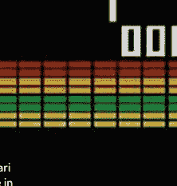

我们在 Pygame 上花费了许多小时。游戏与 Breakout 玩法相同，但带有额外的功能，如从砖块处掉落的道具。还有诸如反转挡板左右控制和加速球的功能。该教程涵盖了基础结构。从 `github.com/mattlow/Pygame` 下载运行游戏。一旦完成，加载文件。这些存储在字典中。我们使用 Pygame 创建我们的游戏。这允许我们快速构建如键盘和鼠标的功能，在屏幕上绘制精灵，并在关卡结束时重置挡板和球。

# Matt 和机制

游戏的机制与 Pong 非常相似。当我们开始时，球被赋予初始角度和初始速度。当球击中砖块时，它会反弹并被毁。球在屏幕区域内反弹，在左、右之间反弹。随着砖块的消失，游戏变得更加困难。考虑到关卡可以扩展，这使得它很有意义。例如，定义行和列的数量。现在，90 | LF306 September 2023

`www.linuxformat.com`

# Breakout CODING ACADEMY

并不总是更好，并且让游戏具有可玩性。在渲染每个关卡时，随机选择颜色来增加游戏趣味性。例如，在第一次加载时，所有砖块都需要击中；第二次加载时，双击砖块。一旦初始化完成并加载关卡，我们移动到代码的主部分。这是事件循环。例如，按下左键时，挡板需要向左移动。挡板带有道具，应该开始第一层。在开始编码之前，我们需要安装先决条件。打开终端并输入：

```bash
pip install pygame
pip install pygame-menu
```

我们的代码保存到多个文件中保持整洁。第一个是 `Base.py`，它包含一个继承自内置 Pygame 的类用于我们的游戏。`Base.py` 允许我们使用继承。我们将为精灵类型创建基类将拥有它们的所有变量。我们创建的其他类用于我们需要的功能——例如身体的方向，用于确定它向左、右、上或下移动——导入。

```python
import pygame
```

```python
class Base(pygame.Sprite):
    def __init__(self, width, height, positionX, positionY,
                 image, type="image", color=None,
                 count=None, block, power=None):
        super().__init__()
        self.originalWidth = width
```

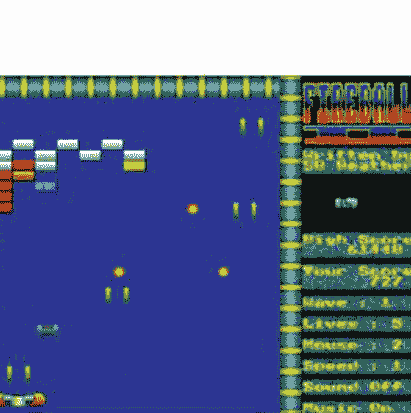

```python
self.width = width
self.originalHeight = height
self.height = height
self.positionX = positionX
self.positionY = positionY
```

```python
def updateRect(self):
    self.rect.topleft = (self.positionX, self.positionY)
    self.rect.bottom = (self.positionX, self.positionY)
    self.positionY = self.height
    self.rect.top = (self.positionX + self.width,
    self.positionY)
    self.width = self.positionX + self.width
    self.height = self.height
    self.rect.width = self.width
```

```python
@property
def position(self):
    return self.positionX
```

```python
@position.setter
def position(self, value):
    self.positionX = value
```


另一个经典：

来自 Archimim德的火球 II（Fireball II）。


# 等级升级

为了让游戏尽可能有趣，我们提供了包含关卡的能力。我们使用简单的文本格式来存储关于它们的所有信息。第一项是关卡编号。然后我们定义密度和名称。我们需要一个音频文件的路径，在关卡播放期间它循环播放。下一项是数组的布局。每行包含一个砖块的分段列表，代表砖块在瓦解之前被击中的次数。如果任何数字带有计数和另一个值，则代表在砖块第一次被击中时应用的道具或减益。下表定义了行的格式。

| 力量值 | 解释 |

|---|---|

| 0 | 无 |

| 1 | 火球 |

| 2 | 激光 |

| 8 | 额外的球 |

| 16 | 增大挡板 |

| 32 | 第二个挡板 |

| 52 | 缩小挡板 |

| 64 | 加速挡板 |

| 128 | 减速挡板 |

| 击中次数 | 解释 |

|---|---|

| -1 | 无限，无法被毁 |

| 1 | 单次击中 |

| 2 | 两次击中 |

| 3及以上 | 三次击中及以上 |

## CODINGACADEMY 俄罗斯块游戏

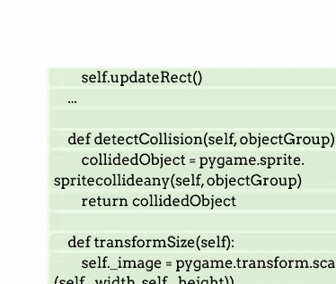

引用我们正在引用的实例。例如，这个类用于球（Ball）、挡板（Paddle）、砖块（Brick）和子弹（Bullets）；其中每一个都可以有多个对象——因此，能够单独引用每个对象的属性非常重要。

请注意，某些代码缺失了，因为我们全部打印了出来。完整的列表包含在 GitHub 上（参见第 90 页的小贴士）。我们在下方的同一个文件中定义了它。它用于更新围绕我们正在处理的对象的矩形。`Rectangle` 对象包含覆盖我们处理的对象的矩形的宽度、高度和进一步范围。当我们检查其他对象是否发生碰撞时，矩形非常重要。如果矩形发生了碰撞。

```python
def detectCollision(self, objectGroup):
    collidedObject = pygame.sprite.spritecollideany(self,objectGroup)
    return collidedObject
```

```python
def testSize(self):
    self.image = pygame.transform.scale(self.image,
                                self.width, self.height)
```

```python
def testClock(self):
    timeSinceLast = self.clock.get_time()
    if self.timeElapsed > self.countdown == '1000':
        if self.powerValue == Constants.Eternal:
            self.speed += 1
        if self.powerValue == Constants.SlowBallUp or
            self.speed -= self.original
```

该类的下一个内容是函数定义，它返回 `self.positionX` 的值。为什么这样做是个主意呢？如果我们想多次引用它而不进行某些处理，那么创建一个函数（getter）是有意义的，它可以处理该值并返回它。使用函数使代码变得清晰得多。一个关于 `@` 的说明。这提供了一种更改函数功能的方法。在这个类中，我们使用属性（property）而不是值或函数；换句话说，使用 `object.positionX` 而不是 `object.positionX()`。

```python
self.countdown = None
```

在这个列表中，我们需要导入必要的库。我们创建了一个新类，它继承自 `pygame` 库提供的 `pygame.Sprite` 类。我们使用传递给它的参数来初始化该类，并使用它们来设置实例变量。注意 `self` 术语的使用，这意味着我们正在

## 那么，继承到底如何？

正如正文中已经提到的，我们在编写代码时使用了实例。如果我们为了多个目的重用同一段代码，这无疑是有用的，因为如果需要更新功能，只需要操作一次。这也意味着错误（bugs）只存在于一个地方，而不是很多地方。让我们描述一个我们如何在此代码中使用继承的例子。

我们知道许多类型的车辆，但所有车辆都有一些共同点，也有许多不同。例如，汽车、摩托车和巴士都有引擎（可能是电动的）和乘客座椅。当我们谈论它们时，有一个类包含了所有车辆的共同点，然后它继承自基类。继承的特性可以使用第一个类的所有功能。让我们来看看是如何使用这段代码的。

```python
class Vehicle:
    def __init__(self, engineType, size, colour):
        self.engineType = engineType
        self.size = size
        self.colour = colour
```

```python
class Car(Vehicle):
    def __init__(self, engineType, size, colour, numberOfPassengerSeats):
        super().__init__(engineType, size, colour)
        self.numberOfPassengerSeats = numberOfPassengerSeats
        self.colour = colour.originalSpeed
```

`Car` 可以访问基类中的信息，或者如果它定义在代码中。注意 `super()` 函数的使用，它初始化了基类的特性。

`positionX` 使用另一个装饰器。这一次，它允许使用 setter 作为设置类变量的间接方法。如果没有装饰器，我们需要为自然方法写一个自然方法以便可以使用：`object.positionX=12`。然后使用 setter 和 getter 返回值，允许我们实现自然的功能。

该类的下一个项目是碰撞检测函数，这在对象碰撞时对开发至关重要。被调用时接收一个包含 sprite 组的参数。例如，如果在球上调用该函数，或者当参数包含砖块组时，那么球就与砖块碰撞了。然后我们有一个函数来转换 sprite 的尺寸。这使用了 Pygame 内置的 `scale` 函数。

最后，在这个示例中，我们有另一个极其重要的函数。在这个类中，`testClock` 用于判断对象是否被赋予了功率值（power value），因此当它耗尽时，速度应该降低。函数通过调用自上次为 'tick' 设置的时钟来实现。这更新了 `self.timeElapsed` 变量。然后我们确定倒计时是否包含一个相同或大于 `self.countdown` 的值。倒计时值是功率应用于对象时的值。当倒计时发生时，我们测试功率是否

# CODING ACADEMY Flutter 开发

## FLUTTER

鸣谢：`Flutterawesome.com/calculator-create-with-flutter/`

## 创建 Flutter 应用程序


David Bolton 展示了如何在 Linux 上设置 Flutter 开发环境，以及如何在 Flutter 中构建一个简单的采样器。


> 我听过 Flutter，它可能不像你所说的那是用于移动应用的跨平台工具包，你是正确的。但它的平台在去年已经扩展了，现在包含了为 Linux 桌面应用以及单页应用进行开发的能力。

如果 Flutter 是一个工具包，你用什么语言来编写它？它是一种现代编程语言，你也可以完全用 Dart 编写。然而，如果你习惯了比 C 更高级且包含良好字符串处理功能的编程语言，但它又像 C++ 一样复杂，那么 Dart 就不值一提了。如果你想了解更多，请查看 `flutter.dev` 官方网站，或者找一个可以让你尝试和运行 Dart 的在线编辑器。

构建应用程序界面的方法是使用小组件（widgets）。小组件是一个包含 UI 元素逻辑、交互和设计的组件。它可以在 Dart 中以类的形式实现，你可以在 https://flutter.dev 了解更多。

Flutter 应用程序与其他类型的应用程序不同。Flutter 应用程序的所有小组件每秒都会绘制多次；高达每秒 60 帧或更快。这使得它适用于游戏。单页 Web 应用每秒渲染次数也非常多。

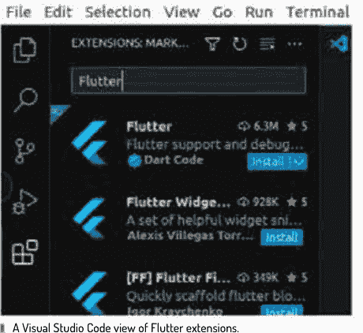

Flutter 打开一个文件并允许你创建一个文件，例如 `examples`。现在点击 `Terminal`（终端）> `New`（新建）

这会在 `examples` 文件夹中打开终端，所有内容都在这里创建。在终端窗口中，输入命令并按回车：

```bash
$ flutter create myapp
```

如果你使用任何名称代替 `flutter`，必须全部小写。几秒钟后，你将在控制台中看到许多文件和文件夹：

如果你没有 iOS、Mac 或 Windows 窗口，可以随意删除那些文件夹。保留你想要针对的 web 文件夹。输入 `flutter run` 查看最终结果，类似于此（第 96 页，顶部）：

只需点击 + 按钮点击计数器！你的第一个 Flutter 运行应用

### 看看代码

如果你打开文件夹，你会看到一个主文件，`main.dart`。你所有的 Flutter 代码都在 `lib` 文件夹中。点击 `main.dart` 在编辑器中打开它。它包含：


## 小贴士

Flutter 插件工具包含了将小组件插入另一个小组件的快捷键。这比快速输入和平衡括号要快得多。点击一个小组件，然后点击 `Show Context Actions`（显示上下文操作）。

### 平台支持

最初为 Android 和 iOS 创建，现在也支持 Web、Mac 和 Linux。为了让 Linux 可工作，你需要使用 Ubuntu 18.04 或更高版本，Dart 2.10 或更高版本也可以。这里是针对 64 位开发。你可以在 Ubuntu 上使用 Android Studio。

在其他之后，你必须安装 Flutter。这也会安装 Dart。如果你使用 Snap，在命令行中输入以下命令：

```bash
$ snap install flutter --classic
```

安装完成后，运行代码。选择一个颜色，点击第一个（顶部的）扩展中的点击图标并输入 Flutter。你会看到一个扩展列表。安装那个也会安装 Dart 的扩展。

现在点击主文件正下方的图标（两张纸的图标）并点击 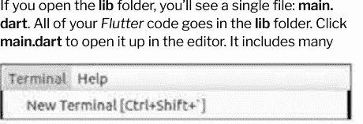

# CODING ACADEMY Flutter 开发

运行在 Ubuntu 22.04 LTS 上的标准 Flutter 应用。

```dart
const Button.operation(
  Key key,
  required this.text,
  this.big=false,
  this.color=operationColor,
  required this.cb,
):super(key: key);
```

# Flutter 示例首页

你已经点击过这个按钮多次了：0

```dart
@override
Widget build(BuildContext context) {
  return Expanded(
    flex: 72,
    child: ElevatedButton(
      style: ElevatedButton.styleFrom(
        backgroundColor:color,
      ),
    ),
  );
}
```

代表透明度。双精度类型从 0（透明）到 1（不透明）。

```dart
import 'package:flutter/material.dart';

class CustomButton extends StatelessWidget {
  static const Color color = Color.fromARGB(80, 102, 230, 1);
  static const Color defaultColor = Color.fromARGB(63, 81, 181, 1);
  static const Color operationColor = Color.fromARGB(33, 150, 243, 1);

final String text;
final bool big;
final Color color;
final void Function(String) cb;

const Button(
  Key key,
  required this.text,
  this.big=false,
  this.color=defaultColor,
  required this.cb,
):super(key: key);
```

## 快速提示

尝试使用 Visual Studio Code 和 Android Studio，看看你更喜欢哪一个。它们各有优劣。Android Studio 功能更强大，但更容易上手。

以 `Button` 开头的三行定义了 `Button` 类的各个构造函数：一个用于普通按钮，一个用于较大的按钮，还有一个用于操作员的按钮。`Button` 类的核心是一个 `ElevatedButton`。

如果你点击右侧的大按钮（big Button），可以在弹出的菜单中点击“查找引用处”（Find Usages），并查看它在何处被调用。在 `Button.dart` 中，你可以在第 17 行使用它。

```dart
ButtonRow(
  Button(text: 'AC', color:color, cb:cb),
  Button(text: '7', cb:cb),
);
```

`ButtonRow` 是在 `button.dart` 中定义的一个 widget。如果你在 Android 中将光标悬停在上面，点击即可查看源代码。`ButtonRow` 构建了一个 widget，接收按钮并将它们放入一个扩展 widget 中。这会将按钮沿包含使用的按钮列表的行进行拉伸。

如果你仔细观察，你可以在 `ButtonRow` 部分的大括号下方（`Button_row.dart` 的第 15-19 行）看到 Dart 代码（以*斜体*显示）：

```dart
children: buttons.fold<Widget>([], (list, b) =>
  list.isEmpty? list..[const SizeBox(width: 1), b] : list..[b]);
```

| | | | | | | |

|---|---|---|---|---|---|---|

| CLR | | | | | | |

| | | 7 | | | | |

| | | 8 | | | | |

| | | 9 | | | | |

| 4 | | | | | | |

| 5 | 6 | | | | | |

| | | | 7 | | | |

| 1 | 2 | 3 | | | | |

| | | | 4 | | | |

| | | | | | | | |

Linux 上（左侧）和作为 Chrome Web 应用的应用截图。

96 LIFbook 2023年9月

www.linuxformat.com

# Flutter CODING ACADEMY

Dart 代码获取按钮列表并将其构建为 widget 列表，每个按钮之间都有一个单像素大小的 widget。`BorderRadius` 是扩展 widget 之一，如果你加宽它，按钮就会根据应用运行的层级相应拉伸。如果你点击 Inspector 中的名称，它会在编辑器中打开源代码。你也可以查看 Inspector 底部的 widget 树（Widget Tree）。

# Dart 代码

Flutter 与 Dart 具有共生关系。Dart 是一种编程语言，你可以编写 Dart 程序。Flutter 构建在 Dart 之上，代码文件与 Dart 相同。`flutter.dev` 是 Flutter 的软件包仓库，包含 17,825 个包可以在应用程序中使用。当安装包时，获取 `pubspec.yaml` 文件。

在底部方法，你可以使用你的 Dart。

Flutter 重建任何更改的 widget。在 Flutter 应用中，你可以在 60 秒内进行热重载（hot reload）。这 是一个 `stateful widget`，当你按下按钮（pressed）并调用 `setState()` 方法时，`CalculatorState`。

```yaml
flutter:
  sdk: flutter
  add_size: '3.0'
```

要使用任何文件，只需将其添加到 `pubspec.yaml`。

```dart
onPressed(() => setState());
```

```dart
import 'package:add_size/add_size.dart';
```

学习 Dart 只有一半。但一旦你发现不仅可以创建看起来像样的应用程序，还可以使用 Flutter 创建 iOS 移动应用，而不需要 Mac。

在 Flutter 应用中，`display` 是另一个 widget。使用 Flutter 工具非常简单。

## 快速提示

你可以从 https://github.com/flutter 下载所有项目。

# >> 在 LINUX 上构建

在 Linux（桌面）上运行 calculator 应用时，产生产生可执行文件。它位于项目下的 `build` 文件夹：

```bash
$ flutter run
```

这包含了可执行文件（`calculator`）以及 `data` 文件夹。在任何地方你都可以运行。这会创建一个优化的 `calculator/linux/x64/release` 可执行文件大小为 24KB，而调试版本为 4MB。这启动应用运行并进入本地链接：你可以查看 tree map 或所有文件。这些允许你使用 CPU 并详细查看。

## >> 提高你的技能

现在在 http://bit.ly/pro/linux 订阅。

97 LXF30

# 下个月

9月19日周二上市

# LINUX FORMAT

开源杂志

Future Publishing Limited

Our House, The Abbey, Bath BA1JA

contact@linuxformat.com

## 编辑

主编 Neil Mohr

助理编辑 James Barnett

制作 Katharine Davies

设计总监 Warren Brown

总编辑 Martin Barker

编辑 Daniel Moore, Denise Berch, David Bidwell, Neil Schwartz, Sarah Sharma, Shane Downing, Mike Drake, Matt Nelson, Adam Mason, Nick Pickers, Tony Polance, Lucas Pound, Michael Reavan, Shakanth Sharma, Charles Schweitzer, Katie Williams

## 封面故事

The Bunker 是 British Foundation 的财产。Raspberry Pi 的历史与未来。Raspberry Pi 是 Raspberry Foundation 的商标。内容制作 Alexander Dove

## 广告

广告总监 Claire Dove

claire@futureformat.com

lara@futureformat.com

## 国际解决方案

Linux Format 可许可和分发。如需更多信息，请联系我们或访问我们的网站 www.futureformat.com

## 现有订阅

www.magazirect.co.uk

+44 (0)123 333 111

www.magazirect.co.uk

+44 (0)123 333 433

订阅优惠：英国和爱尔兰订阅者续订。要在交付前七天取消，请访问网站。

## 发行

零售与类别总监 Ben Davies

## 制作与发行

发行小组负责人 Constance

销售经理 Alexander Jackson

## 管理

技术执行董事 Paul Newman

全球读者负责人 David Morris

通讯总监 Anna Burns

25 High Street, Bath BA1JS

Roadbridge, Bath BA16PS

Canary Wharf, London, E14 5X

communications@futureformat.com

# A.I. Pi 机器人入侵

你可以在爱好者硬件家里构建和运行的人工智能项目！

# 疯狂地图！

读者选择：根据你的要求，我们提供了创建和监控你自己的团队项目的方法。

# 深思的照片

利用 DigiKam 的力量，让你的数字摄影受到控制、催化并全额资金。

# 虚拟服务器简单化

这真让人轻松，但设置和运行一个基础 VPS 不会花费那么长时间，也不会太贵！

# 云存储

在云端存储文件的最佳开源选项是什么？别担心，我们会让你知道！

未来期的内容将会有。我们可能被困在泥地里数数……

所有内容 © 2013-2023 Future Publishing Limited，未经出版者事先许可，本出版物的任何部分不得再形式复制、存储或传输。Future Publishing Limited（公司编号 2644198）在英格兰和威尔士注册。注册地址：Bath。出版者不对包含的任何信息的准确性或错误承担任何责任。本期发表的文章仅供这些读者。我们有权使用本期中提到的证言。访问 www.futureformat

电子前沿基金会（Electronic Frontier Foundation）是数字世界捍捍公民自由的领先非营利组织。EFF成立于1990年，通过影响力性诉讼、政策分析、基层活动和技术开发，维护用户隐私、言论自由和创新。我们致力于确保随着技术使用的日益增加，权利和自由能够得到增强和保护。

# EFF.ORG

## 电子前沿基金会

在电子前沿保护权利并促进自由

广告

汽车、家庭及旅行保险，外加宽带、道路救援等。访问 go.compare 获取更多信息或比较 40 多种产品的报价。

# 我们提供选择，由您来做决定。

# GO COMPARE
