# Linux Format Presents 2022 Ubuntu：完全指南 第12版 2022


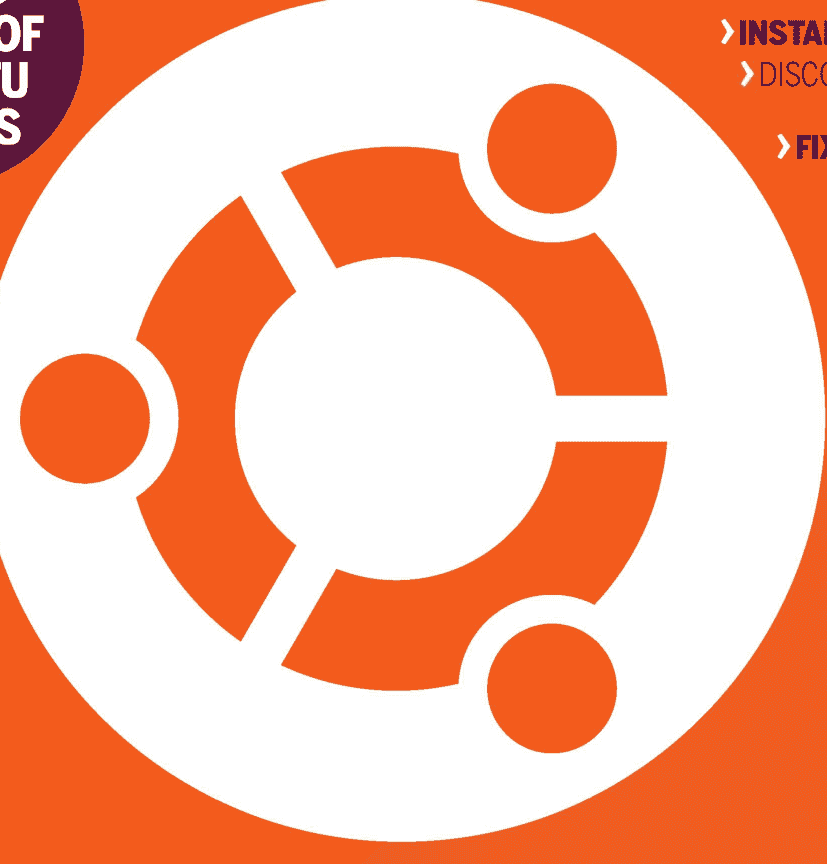


Linux 正在接管世界，它最后一个要征服的地方就是你的桌面。如果你渴望抛弃 Windows，对尝试 Ubuntu 感到好奇，或者想全心投入开源世界，Ubuntu 特别版是你的最佳起点。在这本“杂志书”中，包含了你成功安装、启动和首次使用 Ubuntu 所需的所有指南、教程和建议。在你离开 Windows 并在家庭系统中安装并运行 Ubuntu 时，我们将手把手地引导你。

Ubuntu 和 Linux 的伟大之处在于，如果你想保持简单，你可以这样做；但如果你想触及底层硬件并深入操作系统的内部工作机制，你也可以这样做。我们在这里引导你进入 Linux 世界。我们不会假装这完全容易——你需要准备好寻求支持并提问——但 Ubuntu 和 Linux 社区提供了大量的友善帮助。那么，你还在等什么呢？翻页开始你的 Ubuntu 冒险之旅吧！


厌倦了 Windows 吗？正在寻找新玩物吗？进入广大的开源和 Linux 世界吧——我们这里有丰富的内容让你乐得其间！


如果你还没有开始，我们很快就能让 Ubuntu 运行起来。


Ubuntu 配带了一个充满惊艳应用的库。


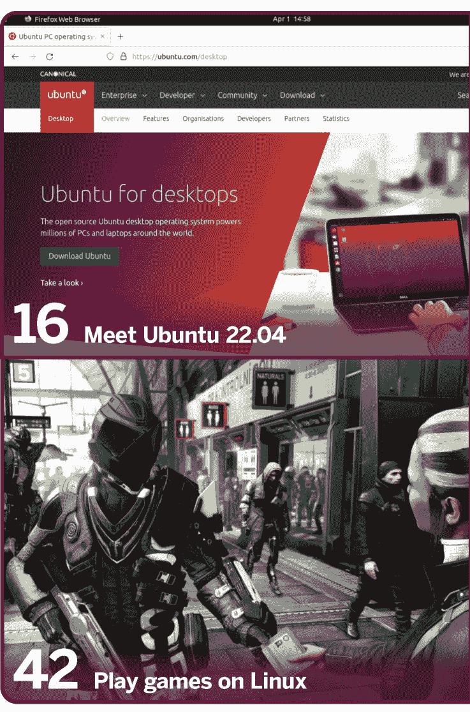


现在你已经掌握了基础知识，是时候尝试更复杂的项目和任务了。


现在你正在使用 Ubuntu，这里告诉你当出现问题时如何修复最常见的 Linux 问题！


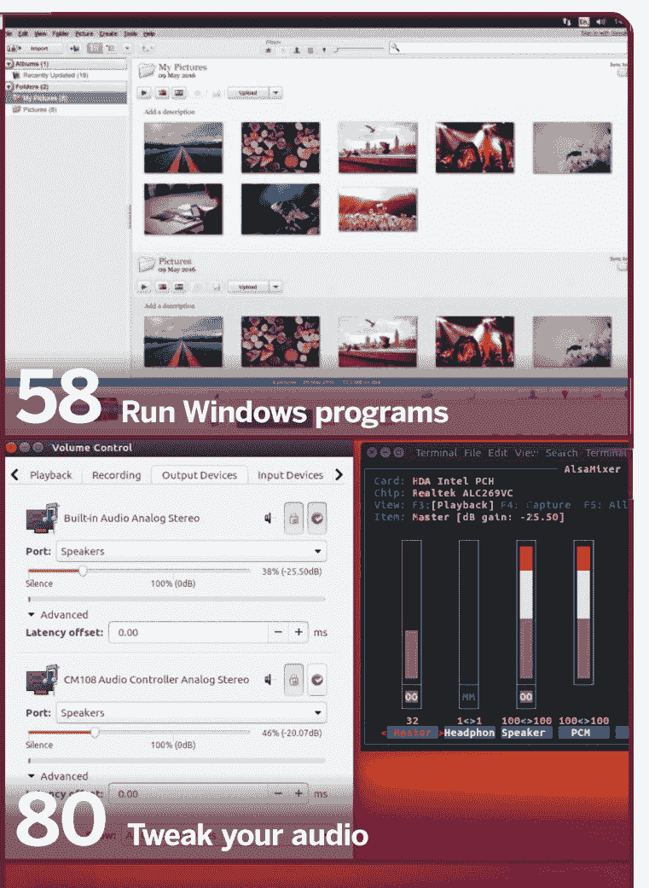

# 58 在 Linux 上运行 Windows# 80 调整你的音频# 86 显卡驱动


它是一个操作系统，它是计算机的自由，是通往开源世界和共享软件社区的门户。(img/da2630bbaa4c7bf32e381819fe7164b5_0.png)


像大多数软件一样，Ubuntu 有版本和名称。如果你从未遇到过它们，它们可能显得有些奇怪或难以理解——但我们将为你解释。Ubuntu 每年发布两次版本，每个版本号都代表发布月份（4 月或 10 月）和 (年份)，例如 19.04 发布于 2019 年 4 月，19.10 发布于同年。每个非标准版本都有九 个月的支持，每两年发布一次长期支持版 (LTS)。当前版本是 19.04 LTS，下一个是 20.04 LTS。如果你想要更高的稳定性，建议选择这些版本。为了避免困惑，每个版本都有一个有趣的名称，以动物命名：


Ubuntu 配带了一个充满惊艳应用的库。


现在你已经掌握了基础知识，是时候尝试更复杂的项目和任务了。


现在你正在使用 Ubuntu，这里告诉你当出现问题时如何修复最常见的 Linux 问题！


## Ubuntu 看起来是什么样的？

## 桌面
这个系统是你找到并访问更多程序的地方。你可以让它整洁或杂乱，并选择自己的背景。

### 启动器
启动器默认显示最近使用的程序。你可以添加或删除项目并调整图标大小。

### 设置
你会发现大多数系统设置都可以通过这里轻松访问。

### 文件
文件和文件夹可以通过文件管理器访问。文件系统比 Windows 更复杂


# 开始上手

## Ubuntu: 快速安装指南

Linux 并不可怕也不难。老实说，你可以在 4 分钟内让它运行起来！你想尝试一下吗？不用回答……

老实说，现代 Linux 的安装速度比任何最近的 Windows 安装都要更快，也更简单。这不需要折腾密钥，不需要担心激活，也不用到处找安装光盘或 USB 盘。Linux 的美之处在于，你可以立即下载并开始使用。你甚至不需要安装任何东西！Linux 技术及其免费且易用的许可协议意味着它可以直接从 CD 或 DVD 运行。尝试这种工作既快速又快捷，它是你在安装或设置任何其他内容之前快速尝试 Linux 的理想方式。只要你有一个光驱，并能在几分钟内说服你的电脑 从光驱启动即可。

也许你还想要更多？如果你试过 Ubuntu 但发现它并不适合你，那么尝试安装 Linux Mint 就会很容易。或者如果这看起来太复杂，为什么不使用虚拟机呢？我们将查看如何通过 VirtualBox 在 Windows 内部运行 Linux。对于 Ubuntu 来说，它占用的空间不会像 Windows 那么大。最小空间约为 7GB，显然越大越好，但为了尝试 Ubuntu，10GB 绰绰有余。

### 轻松使用 Linux

如果你不是深度用户，那么你可能不想删除你的 Windows 或 Mac 系统。事实是，你也不需要。Linux 足够灵活，可以通过多种方式运行：在其他操作系统的旁边、上方或并行，并在并在类型的硬件上——你甚至可以从 USB 驱动器、DVD 或在树莓派上运行。

从 DVD 启动是运行 Linux 和 Ubuntu 最简单最快的方法。在 Linux Formatters，在准备好 DVD 后，你可以在四分钟内启动它。尽快完成。然后，如果你的系统在开启时没有自动运行光盘，请检查驱动器。这比按一下角的键打开启动菜单并不复杂，在菜单中你可以选择运行的光盘。

使用取代 BIOS 的最新 UEFI 系统的 PC 可能会遇到额外问题——这些是 2010 年之后制造的 PC——UEFI 可能会阻止光盘运行你的系统。

要绕过此系统，必须以兼容模式运行 DVD。如框框（光盘启动问题）所示，使用 delete 键进入 UEFI/BIOS。然后禁用安全启动（SecureBoot）和 Intel 智能启动技术（IST）。如果你有 Windows 8/10，还要禁用快速启动（Fast Startup）。

### 虚拟化

Ubuntu 与物理机不同，在某些情况下是不可能的（除非你的硬件驱动程序正在替换）。在 UEFI 设置中切换到 Classic BIOS、mCS 或 Legacy 以运行 dvd。

另一个选项是来自 www.virtualbox.org/downloads 的 Oracle VirtualBox 软件。并在 Windows 内部运行它。如果你知道要使用的设置，创建虚拟机非常简单。主要的步骤是确保你在存储设置下将 ISO 文件添加到虚拟光驱器中。

如果你不是 Linux 深度用户，那么你可能不想破坏现有的 Windows 或 Mac 系统。事实是，你也不需要，Linux 足够灵活，可以通过多种方式运行。

我们留出了下载任何内容的时间，因为这变化很大，并且通常包含任何 POST 时间，但我们排除了泡茶的时间。其他错误包括写入任何光盘以及引导项启动过程。

12 | Linux Format 呈现：Ubuntu

## 安装到 VirtualBox

VirtualBox
欢迎访问 VirtualBox.org
VirtualBox 是一款免费且开源的桌面虚拟机软件。它允许你在单台计算机上同时运行多个操作系统。

如何以及操作系统
- 从从中选择虚拟磁盘文件或物理磁盘供虚拟机使用。
- 现在创建一个新的虚拟磁盘阵列。
- 客户机将从这里启动

### 获取 VirtualBox
来自 www.virtualbox.org/downloads 的 Oracle VirtualBox 软件并在 Windows 内部运行它。如果你知道要使用的设置，创建虚拟机非常简单。主要的步骤是确保你在存储设置下将 ISO 文件添加到虚拟光驱器中。

如果你不是 Linux 深度用户，那么你可能不想破坏现有的 Windows 或 Mac 系统。事实是，你也不需要，Linux 足够灵活，可以通过多种方式运行。

### 创建虚拟机
如果你知道要使用的设置，创建虚拟机非常简单。主要的步骤是确保你在存储设置下将 ISO 文件添加到虚拟光驱器中。

### 启动 Ubuntu
在 UEFI 设置中切换到 Classic BIOS、mCS 或 Legacy 以运行 dvd。

### 使用 USB
有些从 USB 运行 Ubuntu 和其他版本的奇特解决方案，你可以随身携带并在几乎任何 PC 上运行。

如果你需要至少 2GB 的 U盘，选择空间大小以确保它是可写入的 Uebootin。此外，注意有一个 16GB 的 U盘，没问题，但 Ubuntu 16GB 绰绰有余。

### 启动 Ubuntu
在 UEFI 设置中切换到 Classic BIOS、mCS 或 Legacy 以运行 dvd。

另一个选项是来自 www.virtualbox.org/downloads 的 Oracle VirtualBox 软件并在 Windows 内部运行它。如果你知道要使用的设置，创建虚拟机非常简单。主要的步骤是确保你在存储设置下将 ISO 文件添加到虚拟光驱器中。


# 开始上手

出于安全考虑，UEFI 已经取代了 BIOS 和启动盘。

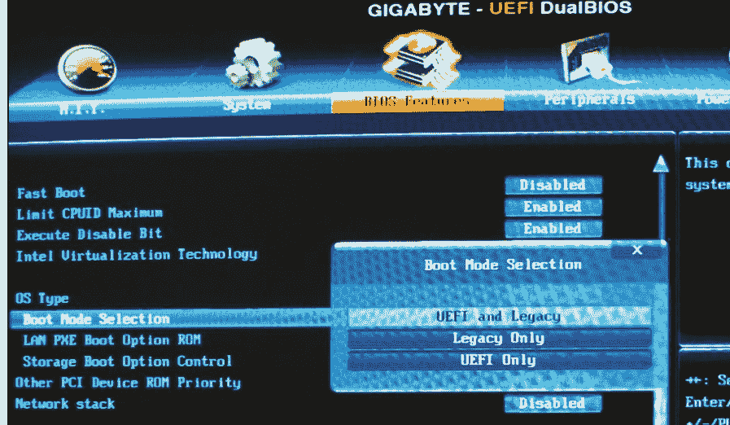

我们没有足够的空间来逐一详细介绍安装 Ubuntu 分区的每一个细节点。好消息是，如果你愿意的话，Ubuntu 将是你电脑上使用的最后一个操作系统。如果你选择了错误的选项或在安装过程中发生任何错误，很容易破坏你的 Ubuntu、Windows 启动程序，或让你的 PC 分区处于不安全状态。除非你已经备份了文件、为硬盘创建了镜像，并且系统对于任何业务、个人使用或其他操作并不关键，否则我们不建议安装或升级操作系统。解决好驱动器问题，就可以开始享受了！通常情况下，如果你在启动器上有 Ubuntu，Ubuntu 会乐意地替换它并与 Windows 一并运行。


## USB 驱动器上的 Ubuntu

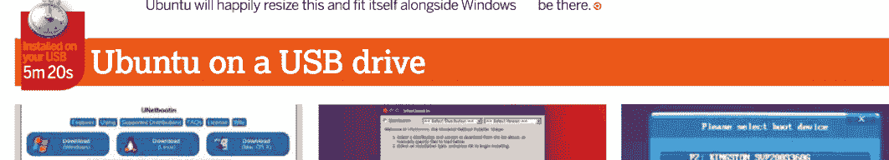

## 1 安装启动版 Linux

要从 USB 闪盘运行 Ubuntu，你需要一个至少 2GB 大小的驱动器。越大越好。你需要从这里获取 Ubuntu ISO 文件。正如 VirtualBox 教程中所讨论的，我们将使用来自 ubuntu.github.io 的下载 UNetboot 工具。它会将 Live Disc 文件复制到你的 USB 驱动器。

## 2 安装 Ubuntu

该工具可以下载 ISO 镜像，但最好的做法是自己下载。选择文件位置并选择创建一个可重用的 512MB 空间（这在较大的闪盘上可能很好用）。确保你在底部池中选择了正确的 USB 驱动器，然后点击“确定”创建驱动器。

## 3 启动并运行

现在你可以使用该驱动器从 PC 上运行 Ubuntu 了。你需要确保 PC 选择 USB 驱动器作为启动设备。当你开启 PC 时，会有消息提示按 F8、F9 或 F12 选择启动设备。某些 PC 有其特定的启动设备；请咨询你的手册或制造商获取详情。Ubuntu 现在将运行。

14 | Latin Forums | Ubuntu

## 探索 LINUX 提供的可能性

从开源软件到编程大师课以及树莓派项目，通过这些来自 Linux Format 杂志幕后军团的精彩专家教程、指南和建议，让你的机器发挥最大价值。

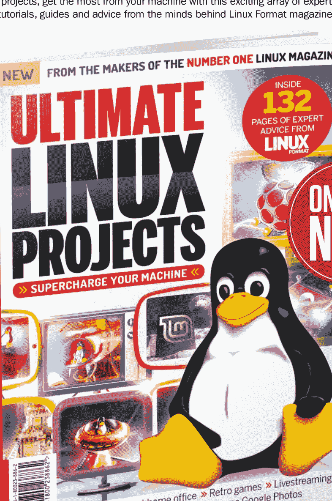

来自顶级 LINUX 杂志出品的全新发布

- >> Mint 20 >> 智能家居办公 >> 复古游戏 >> 直播
- >> 复古 OS >> 保护数据安全 >> 逃离 Google 照片

订购非常简单。访问网站：magazines.direct.com / 或从指定的超市和报刊亭购买。

# 开始上手

## 金弹级防护
UBUNTU 22.04

Walgurgis Night（沃尔格之夜）即将到来，请抛弃你的旧操作系统，用 Ubuntu 22.04 开启新生活。

十八年前，由事实漫画家兼太空游客 Mark Shuttleworth 领导的 Canonical 发布了第一个 Ubuntu 版本。它很整洁，但并没有什么革命性。突然之间，Linux 成了人类的渴望。网络技术实现了伟大的成就——诞生了 Gnome 2 桌面。它构建在 Debian 之上并继承了稳定的声誉。

智能手机（运行 Linux，但不是“真正的 Linux”）。桌面依然活跃且良好，但生态系统仍不完美。丰富的桌面选择以及众多发行版的多个分支，让许多人抱怨碎片化问题。Linux 理解、开源软件和自由。

一个名为 Jimmy Jellyfish 的全新版本。它整合了最新的 Gnome 42 桌面部分功能。切换到 Wayland 显示协议已经发生。新的 Pipewire 框架已织入它的结构中。而且这是一个长期支持（LTS）版本，你可以继续使用五年。

一个巨大的社区围绕着 Canonical 聚集，它承诺会听取意见。一个名为“Launchpad”的定制 bug 跟踪器，其提交的第一个 bug 是“微软的市场份额很糟糕”。多年来，Linux 的黄金时代即将开始，并有一种明确的方向感。

这并非全是坏事。公司已经拥抱了 Linux，特别是 Valve。它在 Proton 上的工作使得 AAA Windows 游戏能够在 Linux 上运行。

你找不到颠覆性的用户界面变化，你会发现一个优秀、可靠的操作系统。继续读下去发现为什么……

回到今天，你会发现并非所有的梦想都实现了。Windows 仍然统治着桌面（通过运气）。桌面计算作为一个整体正在变成一种小众爱好，我们大部分的浏览和通信现在仅在 Linux 上运行的游戏中。而 Ubuntu 仍然是非常受欢迎的 Linux 发行版，非常适合玩游戏、处理重要文档或管理你的云端。

现在 Canonical 回归了并带来了


## 是 Ubuntu LTS 时间了，让我们看看未来几年的 Ubuntu 将变成什么样……

我们总是期待尝试新的 Ubuntu 版本。但这次我们并不指望看到一个完善的 Wayland 重构范式或免费的飞跃。Ubuntu LTS Fossa 在偶尔出现后，一直是我们许多机器的忠实仆，我们确定 Jammy Jellyfish 将是一个合格的继者。我们想看看 Canonical 是否在推进 Snap 原生方法。只有一个问题。在你写这篇文章时，它还没有发布。如果我们幸运的话，我们还没有错过任何最后的添加或惊喜。我们正在测试 Jellyfish 镜像，在官方发布几个几个。

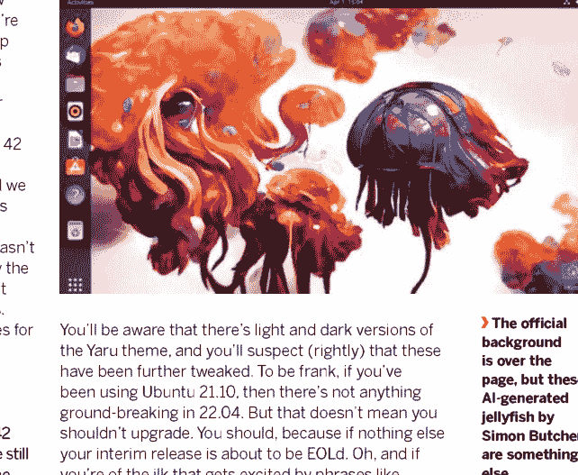 你可能意识到 Yaru 主题有亮色和深色版本，你会怀疑（正确地）它们经过了调整。坦率说，如果你使用的是 21.10，那么 22.04 并没有突破性的。噢，如果你是那种会对时尚趋势感到兴奋的人，请查看新的。这是关于 Friends 的页面，但 Simon 生成的 Jellyfish 也很棒。如果你用过过渡版本（21.04 或 21.10），你会意识到 Ubuntu 已启用并包含新功能。如果你想使用 Ubuntu，不需要安装全部。只需遵循我们的三步指南来写入和启动。

## 下载并启动 Ubuntu

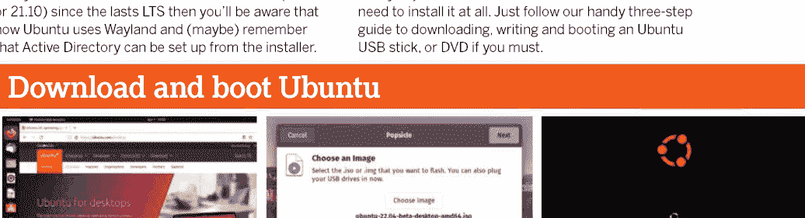

### 1 下载 ISO

访问 ubuntu.com 下载 ISO 文件。它是 5GB，所以你可能想去泡杯茶。如果你对其他口味（如 Kubuntu 或 Lubuntu）感兴趣，可以在这里找到链接：https://ubuntu.com/flavours。你也可以在这里找到 Server、Pi 和 Core 版本。

### 2 写入闪盘

使用你喜欢的写入工具（或来自 balena.io 的 Balena Etcher）制作 Ubuntu USB 闪盘。在安全之前提醒一下介质。坏数据会导致问题。你也可以（使用不同的软件）制作 DVD，但这会比闪介质慢。

### 3 启动 Lubuntu

你的机器可能允许你在启动时按 F12 或 F10 弹出启动菜单。如果是使用这一个菜单，否则你需要进入 UEFI/BIOS 界面更改启动顺序。查看官方文档：https://ubuntu.com/tutorials/try-ubuntu-before-install!

# 开始上手

## 逃离 Windows

无论你是新手还是 Windows 促使你寻找其他操作系统，Ubuntu 都能提供帮助。

Windows 11 从去年通过 Insider 程序推出。在你读到这里时，所有的 Windows 10 用户都会收到升级提示。没有什么新的 Windows 发布能激励人们切换到 Linux。所以这里有一份 Windows 的快速指南。

为了确保 Windows 不触及你的 Linux，在启动 Windows 之前拔掉 SSD。是的，这很难记住（如果在桌子底下），而且操作可能很尴尬，但至少你可以描述你的世界没有 Windows。

你可能想双启动 Windows 和 Ubuntu。这可能看起来很方便，但充满了陷阱，所以不要冲进 Ubuntu。Ubuntu 会并排安装，但可能会破坏 Linux 分区。我们不建议将两个操作系统都安装在同一个设备上。250GB 的 SSD 对于你的首次 Linux 探索是理想的，只需不到 25 英镑。

你可能想将 Ubuntu 安装到外部硬盘或 USB 闪盘上，尽管这样并不理想。理想情况下，你会把它放在新机器上，而不是你的备用工作机。

## BIOS，大多数 UEFI

现代 PC 使用较新的固件——通用扩展固件接口，而不是传统的 BIOS。UEFI 机器可能有经典的仿真模式，但你绝对应该启用它。如果你已经在 UEFI 模式下安装了操作系统（它们将停止工作）。

我们的下一部分指南可能过于谨慎，且有点不方便，这是唯一的方法

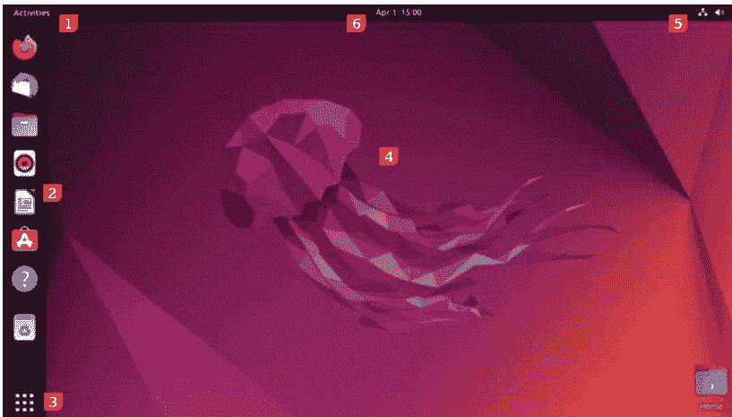

### 认识 Ubuntu 的 Gnome 桌面

- 1 **活动**
点击或按下 Super（Windows 键）唤出活动概览。这将为你显示许多窗口，你可以从右侧拖动它们移动到你的虚拟桌面。

- 3 **应用程序网格**
这显示所有安装的应用程序。输入几个字符来缩小列表。如果你觉得这种方式可行，也可以在这里找到，并使用虚拟桌面切换器。

- 5 **状态图标**
网络、电源和指示器。访问蓝牙、亮度以及（笔记本电脑）电源设置。注销和关机选项在这里。

- 2 **程序坞 (Dock)**
这提供了快捷访问常用程序。运行中的应用程序用红点表示。点击从这里固定未固定的应用程序。

- 4 **桌面选项**
在桌面空白处右键点击以更改背景或显示设置。你也可以创建桌面。

- 6 **通知区域：**
警报（如有新软件可用或正在播放媒体）显示在这里。有一个日历——这可以在本地使用，也可以连接到云端服务。


请注意，现在的电脑在进入 UEFI 设置或启动菜单时可能非常挑剔。你可能需要精确的时间控制、多次重启，以及通过翻阅手册来找到合适的快捷键。Ubuntu 的 EFI 启动程序由微软拥有的密钥签名，因此可能不需要禁用安全启动（Secure Boot）。

需要注意的是的一点是，UEFI 系统需要一个 EFI 分区才能启动。如果你计划在单独的驱动器上安装 Ubuntu，请确保“用于可启动安装的设备（Device for bootable installation）”设置为原始驱动器，并选了该 EFI 分区。

一旦你成功启动，系统可能会询问你是想“试用 Ubuntu”还是直接“跳转并安装”。这不会改变任何内容，你可以在不使用任何存储空间的情况下熟悉系统。你可以尝试内置的软件，安装新内容，如果觉得适合你就可以继续。唯一的缺点是，重启后你无法轻易撤销所做的任何更改，当然如此。下面的注释（下文）显示了 Ubuntu 桌面的基础元素。

就像其他操作系统一样，你有“文档”、“照片”和“下载”文件夹。但与至少一个操作系统不同的是，你不会被试图帮助你的语音助手所骚扰。Dock 区域是

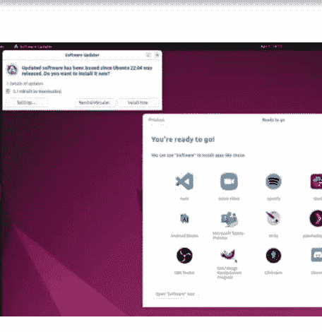

左侧是对 Ubuntu 旧桌面的致敬。新桌面自 Ubuntu 18.04 以来一直基于 Gnome 3，但进行了一些微调。Gnome 3 在 2011 年引入时非常笨拙、偶尔有 Bug 且内存占用高（某些评论者称其“手机化”），但它为许多基础功能奠定的布局证明了它的简单性。如果你发现那些消失的部分，你就会明白许多传统主义者对 Gnome 的意见所在了。

- 不知道先安装什么吗？让 Snap 帮你吧。并且别忘了更新！

## 使用稳如磐石的 GNOME

新桌面自 Ubuntu 18.04 以来一直基于 Gnome 3，但进行了一些易用性的微调。

这里有：没有明显的启动应用程序菜单。Dock 提供的应用程序可能无法满足你的习惯，如果你习惯使用鼠标点击传统放置的应用程序菜单，那么在这里使用鼠标比点击“活动（Activities）”要自由得多。当你安装 dock 时，它有 Firefox、Thunderbird 和 LibreOffice 的快捷方式。问号将带你进入桌面指南，希望回答你可能有的任何问题。你会找到 Ubuntu 软件（购物袋图标）的链接，如果你想安装更多软件；此外，尊敬的外部驱动器也会在这里显示，这里可以找回删除文件的回收站。

| 剩余空间 | vdev (root) | vdev (home) | vdev (swap) | vdev (var) |
| :--- | :--- | :--- | :--- | :--- |
| 剩余空间 | 14968 已用 | 168000 未知 | 2048 空闲 | 32768 空闲 |

## 成为键盘战士

在 QHD 屏幕和 4K 显示器的时代，鼠标光标移动到左角可能是件艰巨的任务。这段旅程可以通过键盘快捷键的魔法来节省。除了调出“活动”至关重要的 Super（Windows）键外，你的生活可以得到极大改善吗（也许——）。通过以下快捷键：

- Ctrl+ 左/右 - 窗口标题向左/右对齐
- Super+A 显示应用程序
- Super+PageUp/PageDown - 切换虚拟桌面
- Shift+PageUp/PageDown - 移动到上一个/下一个工作
- Shift+左/右 - 将活动窗口移动到上一个/下一个

## 自定义 Ubuntu

发现新软件。更改设置。安装一个新的桌面（或三个）。

Ubuntu（以及大多数其他 Linux 桌面发行版）被设计得非常直观且易于学习。然而，早晚你都会想要改变一些东西。例如，我们认为 Rhythmbox 从一开始就很很棒（尽管在 2012 年作为 Sapphire 时曾短暂中断）。但由于它安装了客户端播放框（Client Side Dealbox），并且无法连接到本地（私有）共享服务，我们可能想要寻找替代方案。当你安装好 Ubuntu 并享受了 Flutter Butter 的生活后——

启动 Ubuntu 应用程序，滚动到类别列表并选择“音乐”和“音频”。你会看到一系列音频程序，其中大多数我们从未听过你的；然而，你可以找到官方和音频程序，以及 YouTube、Google Play Music 和 Apple Music 的非官方播放器。如果你更喜欢新奇的，可以安装 FindFoo2000、DeaDeBief（一个极简 GTK 播放器和 Gnome 2）或基于 myriad 的播放器。点击绿色按钮安装 Spotify（如果你感兴趣的话）。

在 Canonical 的软件应用中，软件是以 Snap 包安装的。你可以在右上角的“源”框中看到分发机制。Snap 的自包含封装格式（类似于 Docker）允许开发者安装软件，而无需担心发行版特定的软件包和库版本。Snap 运行在容器中（除非另有说明），因此它们无法访问任何不需要的文件或硬件。

## 桌面选择

Ubuntu 22.04 有多个版本，它们包含与其他版本相同稳如磐石的基础，但具有不同的桌面环境。如果你喜欢 Gnome，请尝试 Ubuntu。尝试 Ubuntu MATE（来自 Gnome 2）或由 Ubuntu 驱动的轻量级 LXQt。但与其安装一个新的“Ubuntu”，你可能只想通过添加另一个桌面来切换。一旦你安装了 Ubuntu，并享受了 Flutter Butter 的生活后——

启动 Ubuntu 应用程序，滚动到类别列表并选择“音乐”和“音频”。你会看到一系列音频程序，其中大多数我们从未听过你的；然而，你可以找到官方和音频程序，以及 YouTube、Google Play Music 和 Apple Music 的非官方播放器。如果你更喜欢新奇的，可以安装 FindFoo2000、DeaDeBief（一个极简 GTK 播放器和 Gnome 2）或基于 myriad 的播放器。点击绿色按钮安装 Spotify（如果你感兴趣的话）。

在 Canonical 的软件应用中，软件是以 Snap 包安装的。你可以在右上角的“源”框中看到分发机制。Snap 的自包含封装格式（类似于 Docker）允许开发者安装软件，而无需担心发行版特定的软件包和库版本。Snap 运行在容器中（除非另有说明），因此它们无法访问任何不需要的文件或硬件。

 桌面选择

Ubuntu 22.04 有多个版本，它们包含与其他版本相同稳如磐石的基础，但具有不同的桌面环境。如果你喜欢 Gnome，请尝试 Ubuntu。尝试 Ubuntu MATE（来自 Gnome 2）或由 Ubuntu 驱动的轻量级 LXQt。但与其安装一个新的“Ubuntu”，你可能只想通过添加另一个桌面来切换。一旦你安装了 Ubuntu，并享受了 Flutter Butter 的生活后——

启动 Ubuntu 应用程序，滚动到类别列表并选择“音乐”和“音频”。你会看到一系列音频程序，其中大多数我们从未听过你的；然而，你可以找到官方和音频程序，以及 YouTube、Google Play Music 和 Apple Music 的非官方播放器。如果你更喜欢新奇的，可以安装 FindFoo2000、DeaDeBief（一个极简 GTK 播放器和 Gnome 2）或基于 myriad 的播放器。点击绿色按钮安装 Spotify（如果你感兴趣的话）。

在 Canonical 的软件应用中，软件是以 Snap 包安装的。你可以在右上角的“源”框中看到分发机制。Snap 的自包含封装格式（类似于 Docker）允许开发者安装软件，而无需担心发行版特定的软件包和库版本。Snap 运行在容器中（除非另有说明），因此它们无法访问任何不需要的文件或硬件。

 桌面选择

Ubuntu 22.04 有多个版本，它们包含与其他版本相同稳如磐石的基础，但具有不同的桌面环境。如果你喜欢 Gnome，请尝试 Ubuntu。尝试 Ubuntu MATE（来自 Gnome 2）或由 Ubuntu 驱动的轻量级 LXQt。但与其安装一个新的“Ubuntu”，你可能只想通过添加另一个桌面来切换。一旦你安装了 Ubuntu，并享受了 Flutter Butter 的生活后——

启动 Ubuntu 应用程序，滚动到类别列表并选择“音乐”和“音频”。你会看到一系列音频程序，其中大多数我们从未听过你的；然而，你可以找到官方和音频程序，以及 YouTube、Google Play Music 和 Apple Music 的非官方播放器。如果你更喜欢新奇的，可以安装 FindFoo2000、DeaDeBief（一个极简 GTK 播放器和 Gnome 2）或基于 myriad 的播放器。点击绿色按钮安装 Spotify（如果你感兴趣的话）。


# 入门

## 调整与重构

为了完善你的安装进行了一些编辑，外加一点对 Ubuntu 的怀旧。

Wayland 默认在 Ubuntu 17.10 中经过了测试，但那可能有些心心勃勃。这项技术已经成熟，Canonical 公司有信心它可以打破僵局，并已经“准备就绪”。广泛的测试帮助团队确认了 Wayland 对所有人都有利。是的，即便是在 Wayland 上使用 GNOME 也是如此。然而，X11 会话仍然存在。

（耳机），如果你注销并运行命令，可以使用 `sudo` 安装 PipeWire 会话：

```
$ sudo apt install pipewire-pulse
```

## 并添加到用户

你应该看到（除其他内容外）：

服务器名称：PulseAudio（运行在 PipeWire 0.3）

蓝牙音频客户端可能需要额外的库。尝试：

```
$ sudo apt install libpulse0-module-bluetooth-xpuludio
```

如果你遇到问题。或者，请查阅官方文档：


Wayland 在过去曾被误传，但其实并没有那么多。最离谱的谎言是：Wayland 无法进行桌面会话、共享和显示屏幕录制。但永远不要相信这些传说。问题不在于 Wayland，而是由于它当时不支持。如果事实如此，此功能中的所有截图就不会在这里了。

Ubuntu 从 18.04 开始一直使用 GNOME 作为其桌面。如果你使用该桌面，你可能对 Ubuntu LTS 的扩展维护支持（ESM）感兴趣，即 Ubuntu 16.04 (Xenial Uhuru)。由于支持已于 2021 年 5 月过期，该版本仍由 Canonical Ubuntu 为受支持机构广泛部署。

## 我们正处于 GNOME 的黄金时代

> “困扰 GNOME 性能已久的卡顿和内存泄漏真的消失了。”

一个在 22.04 中被考虑过但最终未能实现的改动是：用 PipeWire 替换 PulseAudio。这是一个全新的多媒体框架，用于处理 Wayland 上的共享和屏幕录制。程序可能仍然依赖 PulseAudio（部分网络浏览器），但 PipeWire 提供了默认的声音服务器。如果你想更改此（或你在蓝牙方面遇到困难

用户可以免费在最多三台机器上使用 ESM，所以如果你想保留 Ubuntu，现在可以在安全环境中操作，请访问 https://ubuntu.com/org/esm

我们并不怀旧，所以在 Xrs 上修复了 Ubuntu 16.04。它已经几个月没有启动了，但通过 USB-C（或插入的网线）一切似乎都是无缝的。但现在我们更新了它，Ubuntu 中增加了机器，一切运行得比以前任何时候都好。这并不是运行旧软件的良好理由。尤其是当你受邀以你的价格获得三个实例时。如果你寻找官方和工单支持，Ubuntu 受支持的桌面安装或服务器每年 18 美元起。

对于帮助初学者连接打印机或 Wi-Fi，这并不真正需要：在 https://ubuntu.com/org/ 上寻求那类支持。

相比之下，回到新版本要快得多、流畅得多，在经历了多年的 UI 开发后，我必须诚实地说。这个版本可能没有我们过去使用的那种开创性功能，但这可能没关系。我们 15 年前所追求的所有那些功能和破坏性更改，都是桌面 Linux 仍然有些新生的结果。现在 Ubuntu 的桌面已经确立，无论你喜不喜欢，改变它都没有意义。相反，我们应该从这样一个事实中获得慰藉：在旗舰设备上使用 Gnome 四年后，这种体验现在已经是数一二的。困扰 Ubuntu Gnome 性能已久的卡顿和内存泄漏真的消失了。

Gnome 主题自引入 GTK4 以来一直备受关注（字面上我们不能改变它们了吗？啊，我们变成了自定义，因为现在 Gnome 应用程序的自定义主题变得更棒了）。默认的 GT3 主题被称为 Adwaita，这个词翻译为“唯一的”（字面上它并不是唯一的，因为开发者可以愉快地与他们自己的 CSS 样式合并）。在 GTK4 中，这被 libadwait 提升到了平台高度，Gnome 开发者可以通过人机界面指南轻松管理它。而且，自定义主题（如 Shelby 中的主题）仍会尊重它们的自定义主题，但 GTK4 只会支持 libadwait 允许的有限更改（例如背景色和强调色）。

对于 Ubuntu 22.04 来说，这可能是一个坏消息，因为它混合使用了 Gnome 42 和较旧的主题（Files，受 GTK3 和 liband 限制）。这可能会随着发布而改变，否则可能会出现一些视觉上的不一致。如果这困扰了你，你可能想在接下来一段时间内远离 Gnome 42，以防箱子里有一些建议（见下文）。

## 看看其他地方？

最近，在关注 Linux 的社交媒体搜索中出现了一种趋势，宣布他们“不再推荐 Ubuntu”或其他内容。无论支持如何，但 Snaps 的琐碎和 Gnome 并不符合每个人的口味。

我们建议任何人都坚持 Ubuntu，否则任何东西或按你喜好也可以！即使你不喜欢它也没关系，因为我们看到它已经扩展了多年。许多它们已经根据口味进行了调整。这些发行版是可以被推荐的——我们基于 Ubuntu 推荐其他的，例如 Linux Mint、Pop!_OS 和 Elementary OS。所有其他提供 Ubuntu 上难以实现内容的发行版，无疑都是依赖于其软件包、基础设施和文档的发行版。

到为止，Mint 的最新版本 (LMDE5) 正在获得关注。Pop!_OS 已经从 PPA 仓库转向 Launchpad 并正在开发一种基于 Rust 的桌面环境。Elementary OS 同样用 Flatpak 替代了 Snaps。Fedora 的其快速发布周期使其成为一个很棒的平台。Ubuntu 不再满足你，这些值得看看。

- Fedora 和那些发行版名称现在都是。
- Ubuntu 中的菜单。搜索结果显示 Ubuntu 20.04 有一些疯狂的想法！


## Ubuntu 设置

点击 Ubuntu 桌面上的“设置”可以让你自定义你的电脑。

| 外观 | 亮度与锁定 | 显示器 |
| --- | --- | --- |
| Ubuntu 是一个极具吸引力的操作系统，但如果你想调整它的外观，并通过桌面背景让它具有独特的风格，请点击此处更改其外观。 | 如果你想节省能量并在不使用电脑时关闭电脑，请点击此处设置屏幕关闭时间以及解锁电脑 时是否需要输入密码。 | 这允许你更改 Ubuntu 的分辨率以更好地适应你的屏幕。如果你有多个显示器，你还可以从此屏幕界面选择 Ubuntu 的显示顺序。 |

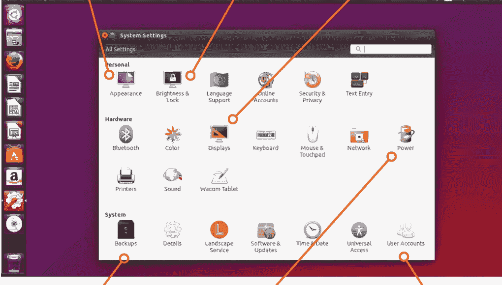

| 外观 | 亮度与锁定 | 语言支持 | 在线账户 | 安全与隐私 | 文本输入 |
| --- | --- | --- | --- | --- | --- |
| 蓝牙 | 颜色 | 显示器 | 键盘 | 鼠标与触控板 | 网络 |
| 打印机 | 声音 | Wacom 数位板 | | | | 电源 |
| 备份 | 详情 | 景观服务 | 软件与更新 | 时间与日期 | 通用辅助 | 用户账户 |

| 备份 | 电源 | 用户账户 |
| --- | --- | --- |
| 这允许你为备份文件和设置建立计划。如果出现问题，你需要将机器恢复到之前的正常工作版本，这将非常有用。 | 如果你在笔记本电脑上安装了 Ubuntu，那么电源设置是至关重要的，因为它们可以帮助你在设备未插电源时保护电池续命。 | 如果你与其他人共享你的 Ubuntu 电脑，你可以为每个人创建额外的账户，让他们可以配置 Ubuntu 而不会干扰你自己的设置。这可以保持你的文件和文件夹与他们的分开。 |

## 入手

## 桌面

我们将展示如何让你的 Ubuntu 桌面焕然一新，调整设置以更好地适应你的工作方式并使其成为你的专属。

Ubuntu 桌面与许多 Linux 发行版有本质不同，在于它并没有尝试通过在底部运行的任务栏来模拟标准的 Windows 界面。尽管如此，它仍然有很多直观易用的常用元素。一旦你熟悉了基础知识，你就不会想把它们全部扔掉。

随着你变得越来越熟悉，你会发现 Ubuntu 自己的设置可以创建几乎任何类型的桌面，但如果你发现了它的局限性，我们将向你展示如何让它为你服务。

最显见的自定义形式是更改背景壁纸以及其他桌面窗口和菜单的颜色和字体。

进入“设置 > 外观”，你将找到切换主题和壁纸颜色的控制；系统提供了 14 张图像（你可以点击 `+` 按钮添加自己的图片——请确保它们的尺寸至少达到你的需要。如果你想使用纯色背景，请使用“壁纸”下拉菜单并选择“颜色 – 渐变”——先选择效果类型）。

你会发现一个用于选择的主题菜单。提供了三个主题：选择其中一个，桌面将立即更新以匹配该主题。最佳选择权交给你，不过你可以下载更多主题或应用你自己的主题。强大的 Ubuntu 调工具（Ubuntu Tweak Tool）也允许你执行此操作，以及 Ubuntu 设置中不支持的其他任何自定义。

你可以在网上找到很多其他主题，但从 ubunthemes.org 开始是一个很好的起点。它对获取主题应用了注册和结账流程，但大多数是免费的，只需浏览你喜欢的并将其加入购物车即可。完成后，将提供一个包含主题文件的压缩包链接，你可以点击它将其下载到你的文件夹中。

压缩包的内容需要解压到 `/usr/share/themes` 文件夹——这需要高权限。打开终端并输入以下命令：

```bash
sudo tar -xf theme.tar.gz -C /usr/share/themes
```

如果你下载的是一个 zip 文件，请使用以下命令：

```bash
sudo unzip filename.zip -d /usr/share/themes
```

在两种情况下，请将 'filename' 替换为文件名。打开 Ubuntu 调优工具并选择

> 如果你还没有启动启动器，你可以使用 Unity 调优工具来选择安装了哪些应用程序在屏幕底部的 dock 中运行。

> 将你杂乱的窗口分散到四个（或更多）个桌面上，以便更容易管理。

## Unity 调优工具 (Unity Tweak Tool)

如果你想让你的桌面提升一个层次，请打开搜索中心并搜索“unity tweak tool”。这款强大的免费应用让你对桌面的外观和感觉有更多的控制。

该工具也与设置工具非常相似，有一组图标被分成几个窗口。选择“启动器 (Launcher)”，你将看到所有可用选项。“外观 (Appearance)”也增加了更多选项（如上文提示）。搜索“搜索”选项卡以调整桌面的外观和背景壁纸。你还可以更改“面板 (Panel)”选项卡的大小和透明度，使其变为半透明，并选择哪些元素出现在屏幕右上角。

有一个“窗口管理器”部分——选择“窗口吸附 (Window snapping)”来确定窗口在对齐到屏幕尺寸或角落时的行为，并选择“热键 (Hotkeys)”来选择切换工作区、更改桌面视图以及切换窗口的快捷键。让默认的额外工具控制点击磁格时的行为。

该工具还让你对主题有更多的控制，允许你匹配和混合图标、颜色和字体。一个亮点是可以更改“主文件夹”、“垃圾桶”的名称以及更改桌面上的设备图标（如可移动的驱动器）。

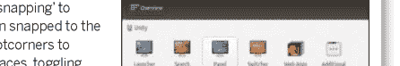

*   Unity 调优工具让你对桌面的自定义有更大的控制力。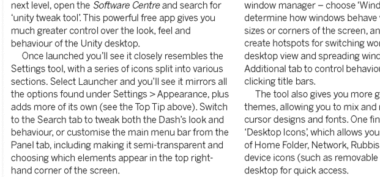

## 自定义启动器 (Launcher)

在“主题 (Theme)”下，你应该找到从软件中心安装应用程序，图标将自动固定到启动器上。应用程序运行时会显示其他图标；关闭时消失——你可以通过右键点击图标并选择“锁定到启动器”使其永久显示。未固定的图标可以通过右键点击选择“从启动器解锁”来移除。

你可以通过点击并拖动图标到启动器的所需位置来重新排列——你会看到其他图标移动出空间，图标移动到新位置。

如果你找到启动器设置，通过“外观”进入。要更改启动器上图标的大小——选择启动图标以缩小尺寸。

要更进一步，切换到“行为 (Behaviour)”并切换“自动隐藏 dock (Auto-hide dock)”。dock 只有当你将鼠标移动到桌面左侧时才会消失——使用“显示 (Reveal)”设置来调整启动器弹出的速度，或者如果你希望它更清晰，点击 dock 按钮（它的工作方式类似于 Windows）。

## 虚拟桌面

如果你打开了三个或更多应用程序，你的桌面可能会显得有些杂乱。为了保持整洁有序，请使用虚拟桌面。Ubuntu的工作区允许你在它们之间拖放窗口以释放不同桌面的空间——例如，将工作和个人任务分开。

要在工作区之间导航，进入“设置 > 行为”并勾选“启用工作区 (Enable workspaces)顶部会出现一个新按钮。使用 `Alt + S` 在它们之间切换。从一个工作区拖动窗口移动，然后点击你想去的桌面。启动器在所有桌面上保持相同位置。点击“工作区”图标访问此切换器。

工作区的优势在于启动器在所有桌面上保持一致，因此你可以点击应用程序轻松在桌面间切换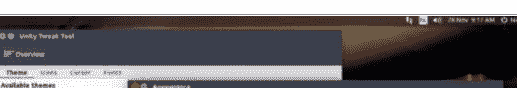

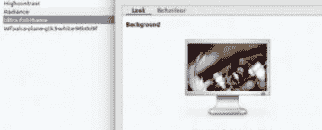

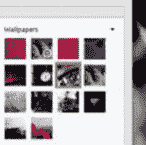

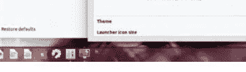

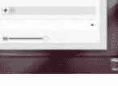

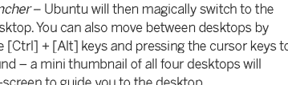

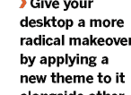

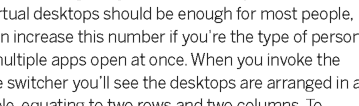

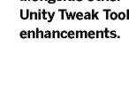

> 通过应用新主题结合你的 Ubuntu 功能，让你的桌面焕然一新。

虚拟桌面对大多数人来说足够了，但如果你是那种打开了很多应用程序的人，可以增加。当你使用启动器时，你可以看到呈正方形排列的桌面，最多两行两列。要增加虚拟桌面的数量，使用 Ubuntu 工具——点击“工作区设置”通过向工作管理器添加行或列来扩展可用桌面的数量。

## 还有更多……

Ubuntu 的特点之一是控件（如最小化或关闭窗口）出现在窗口栏本身，但如果你是鼠标悬停在其上面的类型，将会出现菜单。如果你更希望控件出现在应用程序栏上，进入“设置 > 外观 > 行为”并勾选“缩放标题窗口 (Scale windows in title)”。你会看到一个新的栏，而不是只在鼠标悬停菜单上时出现。

如果你有两个或多个显示器，进入“设置 > 屏幕”来配置你的——你可以选择镜像显示或（更有可能）在显示器之间扩展屏幕。点击并拖动根据你的物理位置选择所需的放置（例如左侧显示器位于左侧）。大多数控制都在这里，但“粘性边缘 (Sticky Edges)”是指是否通过将窗口拖到屏幕边缘来移动它们——如果你不喜欢这种行为，请将其关闭。

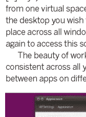

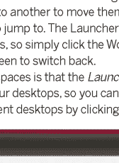

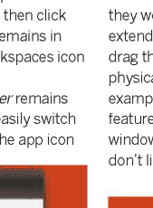

## 缩放你的显示

如果你幸运地使用高 DPI 显示器（如 4K 显示器），你首先需要缩放显示舒适度。从“设置 > 屏幕”开始，缩放菜单和标题栏以使其更易读。

现在返回“设置”并选择“通用辅助”。开启“大字体 (Large Text)”开关，并使用“启动器”图标滑块缩放你的启动器图标。


## Linux 应用

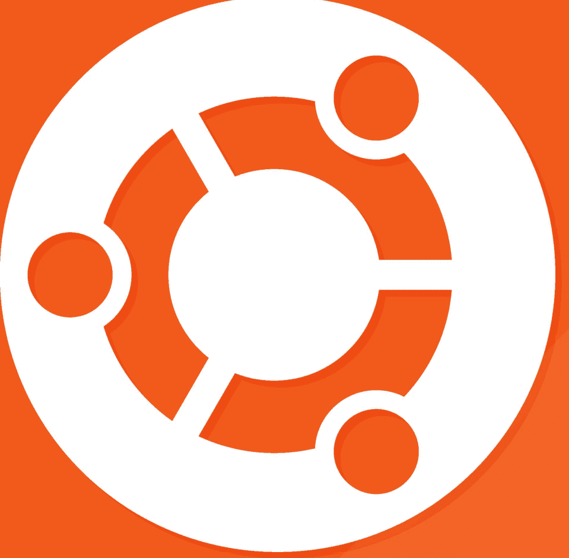

## Linux 应用

- 如何安装新软件 ................... 30
- 播放媒体 ................................................ 34
- 编辑照片............................................... 36
- 开启视频编辑.............................................. 38
- 选择最佳网络浏览器....................................... 40
- 在 Linux 上玩游戏........................................... 42
- 与朋友建立网络............................................... 44
- 轻松使用电子邮件............................................... 46

## Linux 应用

## 程序：
### 如何安装新软件

在你的 Linux 系统上获取程序非常简单，尽管你听过某些说法，它实际上非常直接、万无一失且安全。

你的 Linux 系统预装了一整套实用的应用程序和软件，但总会有那么一天——你想要新东西。获取这些程序有很多复杂的方法，也许你会在以后更晚的时候才去接触。但现在，有一种更简单的方法为你的电脑寻找程序：包管理器。

包管理器会为你处理一切。它们从互联网检索软件的最新版本。它们会自动处理运行程序所需的任何依赖项——你的电脑可能缺少这些项。而且，你的软件被牢固地封装在你的 PC 中，以后你想处理或删除它都由你决定。

> 小贴士：你也可以从 Ubuntu 安装软件：点击左侧栏顶部的搜索按钮，点击底部图标，并搜索你想要的内容。

你可能在智能手机上遇到类似的东西。苹果的 App Store 和安卓 Play Store 是包管理器的例子——这与你现代手机必须手动下载和安装任何软件不同。整个过程是无缝的。Apple 将这一系统推向了 Mac OS，而 Windows 则将微软的任何内容转换为一种名为 Windows 的方案，并带有 Microsoft App Store。讽刺地说，你可能将其视为微软控制你软件的一种手段，你的批判态度可能是正确的，但这也是一种在无需从网上下载（带来）麻烦——以及危险的情况下获取（某些）程序的方法。它并非完美，但理论上是通行的。

Ubuntu 的包管理器被称为软件中心（Software Centre）。它包含许多源——被称为存储库（repositories），用于获取你为程序选择的正确版本。或者至少目前 Ubuntu 将用一个新的替代方案 GNOME 软件来取代它。在 Ubuntu 的发布中，如果你在使用软件中心下载、安装和移除 GNOME 软件后发现有所不同，那么这对你来说会足够好。

## 集中预留

如底部的注释所示，Ubuntu 软件中心的界面并不不寻常。一个高亮显示的软件列表、按钮，让你知道已经安装了什么、下载了什么以及正在安装的是什么。关键在于使用窗口右上角的搜索框。它不仅可以按软件名称搜索，还可以按 Linux 软件包的方式——通过描述浏览。所以，例如，如果我们想找一个游戏，我们就搜索“game”。所有带有该描述的内容都会弹出来。这显然是一种非常广泛的方法，但想象一下你正在寻找一个新的客户。也许更好感觉是“输入”并在“music player”中找到你想要的东西。

现在的技术非常非常了。它仍然是一包切。有什么变得好了一点呢？也许 Ubuntu Software 提供了一个名为 Synaptic 包管理器（Synaptic Package Manager）的功能，你提到过在迁移到 GNOME 后它仍然可用。它执行相同的操作，并且

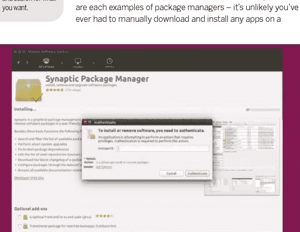

- 安装软件需要你拥有系统的管理员权限——这是阻止他人安装你不想要的软件的好方法

## Ubuntu 软件中心内部

### 所有软件
返回软件中心的主菜单。你也可以使用它的菜单选择软件的来源——Ubuntu 发布版或来自 Canonical 的 paps（存储库）。

### 类别
一旦你在“所有软件”中选择了一个类别，该类别的内容就会显示，这意味着你可以继续滚动寻找你真正想要的软件。

### 查看全部
想知道你的类别中有多少内容可供选择吗？点击此处查看完整列表。

### 过去（历史）
软件中心实际上安装了什么？不仅仅是包，还有小包！历史页面会让你知道。

（搜索软件包、修复依赖关系等）有更多信息可以参考。这对于 Linux 用户来说不是最好的，但当你采取下一步时，它很难处理。

在搜索框中输入字并不费费多少精力。要在列表中找到“所有软件”，它有一种稍微更自然的方式。它实际上嵌套在视觉上不透明的“主题与微调”（Themes and Tweaks）类别中，你将在随后的窗口的高评分部分看到它。如果你不点击顶部的按钮，你应该能看到一个更容易管理的列表。

## 实际安装

点击 Synaptic 包管理器，你将看到如何安装——一个网站、一个（如果很漂亮的话，截图），以及一个“安装”（Install）按钮。在你继续点击之前，先向下滚动——Synaptic 带有许多你可以安装的插件，它对于管理你已安装的盒子非常有用。再滚动一点，你会发现软件包的评论——如果你正在安装一个未知的软件，这非常有用，因为其他用户很少分享负面经验。Synaptic 包管理器有一个很强的字符串过滤器——所以可能会有很多情况。当你准备好时，点击“安装”，输入你的密码，点击“验证”（Authenticate），软件中心将完成剩余工作。

如果你想看看你实际上生成了什么，你应该会看到名为 synaptic 的包已经安装，但看看在同一时间安装的其他项目；列表将显示许多 Synaptic 的系统内容，而你无需制作自己的输出，也无需费费手指。除了手指你


## 常见的 Windows 程序

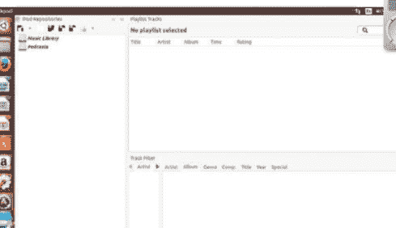

## Gtkpod (Apple iTunes)

拥有 iPhone 或 iPod 吗？你可能担心在 Linux 上无法使用 iTunes，但你能够与设备同步音乐，别担心，因为 Gtkpod 可以帮助你管理 iPhone 和 iPod 媒体库。

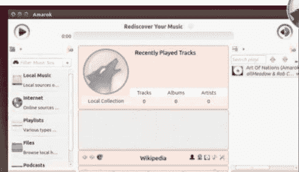

## Amarok (媒体播放器)

你使用 iTunes 或 Windows Media Player 听音乐吗？那么你可能想使用 Amarok，它能帮助你整理和收听电脑上的数字音乐收藏。它还可以帮助你导入 MP3 文件。

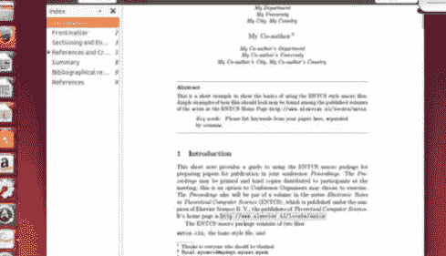

## Evince 查看器 (Acro Reader)

PDF 是最流行的文件类型之一，既然 Linux 没有 Adobe Reader，你也不会被遗漏。Evince 文档查看器更快、更轻量，并且具备 Adobe 软件的所有功能。它在许多 Linux 发行版中默认安装。

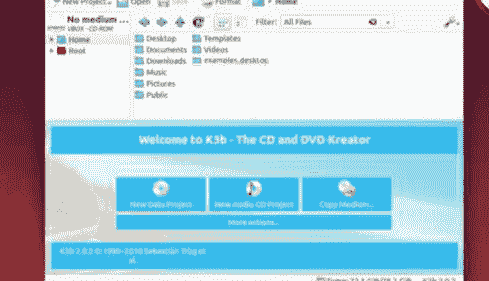

## K3b (CD/DVD 刻录机)

如果你使用 Windows 资源管理器或 Nero Burning 等第三方程序来刻录带有数据的 CD 和 DVD，那么 K3b 是一个极佳的替代方案，它同样胜任，而且它是完全免费的。

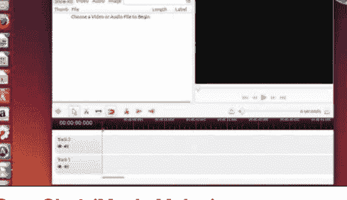

## OpenShot (电影制作器)

各位电影导演们——不要担心缺少 Windows Movie Maker 或 Sony Vegas，因为 OpenShot 是一款多功能且强大的视频编辑器，它将使用 Linux 转化你的家庭电影。

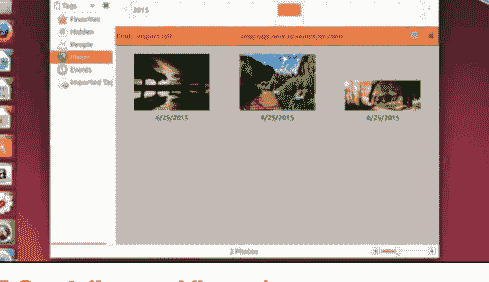

## F-Spot (图片查看器)

为了整理照片、标记标签、进行轻量编辑并与世界分享，F-Spot 是 Windows 图片查看器的完美替代品。对于被数字照片淹没的摄影师来说，它是理想的程序。

## Linux 应用

### Rhythmbox：播放媒体

让你的音乐收藏通过扬声器响起来并变得极其有序，再看一些视频，这对于 Ubuntu 来说是一整天的工作！

记得以前我们买内置收音机的 CD 播放器或用磁带听音乐的日子吗？你并不孤单。现在可以在手机上随身携带世界乐曲，并在我们想象过的任何地方无线流传输音频。

我们不再需要桌面硬盘。无论是在工作时享受音乐或上网，还是在旅行时在笔记本电脑上看电影，数字媒体应该在任何我们需要的时候都能享受。

此外，Ubuntu 拥有你所需的所有调整工具。如果你是从 Windows 转过来的，会觉得非常简单。

Ubuntu 的媒体系统类似于 Windows Media Player，它也是音乐和视频播放器的枢纽。

它还允许你从本地源（如硬盘或 USB 闪存）或网络驱动器播放音乐。

应用方面，Rhythmbox 可以管理你的音频库、从远程服务流传输或将 CD 刻到你的硬盘。

在 Ubuntu 中，Rhythmbox 是

### 在 Rhythmbox 中生活

在音频方面，Rhythmbox 提供了你所需的全部功能。它可以从本地库播放音乐，


- 小贴士：
关于在线音乐，Ubuntu 上有一个非常强大的 Spotify 客户端。Google Play music 通过 YouTube 运行，如果你安装了浏览器或使用 Firefox 插件即可访问。

- 可能是最好的 Ubuntu 视频播放器，VLC 是安装后即用的。

刻录 CD、自动将专辑添加到数字文件、购买歌曲并从另一台 PC 或网络附加存储进行流传输。

然而，Rhythmbox 有一点你需要记住。Ubuntu 并不包含 Ubuntu Restricted Media 包，你需要这个包来播放许多人使用的 MP3 解码器（人们用于存储数字副本）。因为 Ubuntu 发行版可以在不支付许可费用的情况下安装。

如果你方便，请使用 Ubuntu 软件中心并搜索 Ubuntu Restricted Media。如果未安装，点击此处下载并安装它以启用播放。

回到 Rhythmbox，当你第一次打开它时，你会想将其指向你存放歌曲的地方，以便建立自己的媒体库。编辑元数据、引用和标签，如果音乐库中则将其添加到 Rhythmbox 音乐库，并在框中添加曲目：

新文件对应新库：现在你库中的所有歌曲和专辑将出现在 Rhythmbox 中，任何你通过 Rhythmbox 购买的刻录 CD 或从本地播放器添加的音乐都将保存到

此部分还有选项可以选择刻录的格式和质量，以及你偏好的自动生成的命名。

一旦你想播放某些音乐，Rhythmbox 的主视图是非常直观的（见上文）。你会发现左侧集合非常简单，具有选择音乐、播客或网络电台的选项。你还可以查看播放队列中的内容。

要添加额外功能，你需要安装插件，点击“工具”菜单时可以找到它们。Rhythmbox 默认禁用了额外功能。在这个菜单中，你可以开启额外模式。

必须安装的插件是 Grilus，它将允许你从其他计算机或你的网络进行流传输。如果尚未安装，请通过软件中心安装。

### 探索 Rhythmbox 界面

### 专辑封面
Rhythmbox 会自动从网上获取专辑封面，但你可能需要先设置插件。

### 库
从这里可以选择本地库、电台或播客。

### 添加源
加、减号按钮允许你向硬盘、URL 或共享驱动器添加源。

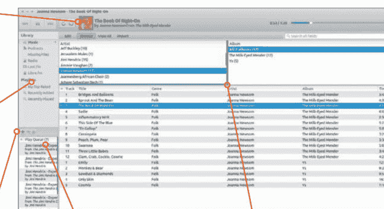

### 播放队列
此列表显示播放列表中的内容。

### 艺术家列表
左侧是专辑，主窗口是曲目。根据这些，Rhythmbox 插件应该在左侧弹出共享媒体库。

### Totem
虽然 Rhythmbox 功能齐全，但 Totem —— 视频播放器的功能较少。它是用于播放视频的，但在媒体管理器方面并不如前者。你可以将整个文件夹添加到管理器，或者自动检测网络内容。

打开它非常简单，只需选择“视频”并点击屏幕顶部，即可获得来自 Apple 的最新视频选择。你可以添加更多。对于视频，我们推荐安装 VLC。它拥有良好的媒体管理器，而且在播放旧格式方面无懈可击。

最好的媒体管理器可以说是 Banshee。如果你使用 Banshee，它看起来和感觉就像媒体播放器。它处理音乐播放，并可以直接连接到亚马逊商店。

Ubuntu 的一个很棒的地方是，当你听音乐或看视频时，即使 Rhythmbox 或 Banshee（或其他 Spotify）在后台运行，点击栏上的音量图标即可获得音量控制和完整播放，无需重新打开应用。

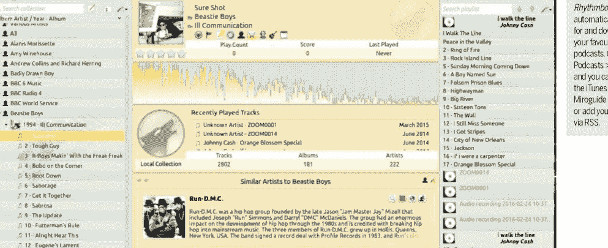

> Rhythmbox 的良好替代方案，Amarok 包含色彩和更多插件。

### Gimp：编辑照片

你需要专业工具来完成专业工作？想一下：Linux 包含了最好的免费照片编辑器。


有一个名字统治了整个数字编辑领域：Adobe，特别是它的 Photoshop 软件包，长期以来一直非常。在“Photoshop”中处理图片就像在“Google”中搜索或在“Hover”中吸尘一样。

坏消息是，大多数 Adobe 产品在 Linux 系统上不可用。Photoshop 肯定没有且永远不会。

是否存在一个适用于摄影师或喜欢在分享到世界之前调整和开发照片的工作区域？当然，它不供专业人士使用。不要被吓跑，掌握基础很容易。

你首先注意到的桌面上出现的不是一个，而是两个窗口。在经典布局中，你会在左侧的窗口找到菜单，中间是主体，右侧是颜色和画笔等额外窗口。

同时操作三个窗口最初可能会很困难，如果你愿意，有一个选项可以将所有内容显示在一个窗口中。只需进入“窗口”并点击 GIMP 即可。问题是你可能会不知所措。

如果你能坚持，我们强烈建议对所有区域使用独立窗口。它允许你创建属于自己的定制的工作区域，如果你有多个面板，可以在一个屏幕上使用工具，而在另一个屏幕上全屏图像。

### 获取你的 Gimp

Gimp 是 Photoshop 的强大替代方案。使用 Gimp 毕竟不是一种昂贵的软件，因为有很多替代方案。其中最好的（Linux 和 Windows 均可用）是应用最广泛的 GNU 图像处理程序。

Gimp 是惊叹的，以至于几乎和 Photoshop 一样丰富，并且适用于大多数任务。它在 Ubuntu 中默认安装，但如果你在软件中心没有它。

当你打开 Gimp 时，它会

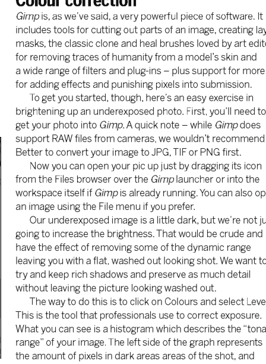

### 色彩校正

Gimp 同样是一个强大的编辑工具：裁剪图像部分、创建图层、艺术家喜欢的仿章和画笔、移除图像透明度，以及广泛的过滤器和插件——从而支持更多——修饰和发布你的照片！

要开始之前，有一个调亮照片的简单练习。首先，你需要将照片导入 Gimp。简单说明——虽然 Gimp 支持许多相机，但它并不适用于所有。最好将你的图像转换为 JPG、TIFF 或 PNG 格式。


# Gimp 主要功能

滤镜
滤镜菜单包含大量工具，除了无法为卡通帧添加模糊外，无一不包。

工具
这些工具是一套标准的照片编辑工具包。你所预期的一切都在这里。

选项
除了工具本身，你还会找到全系列的自定义选项，用于微调它们的使用。

图层
图层窗口的作用方式与 Photoshop 非常相似。你可以分割图像、添加额外的图层并编辑区域。

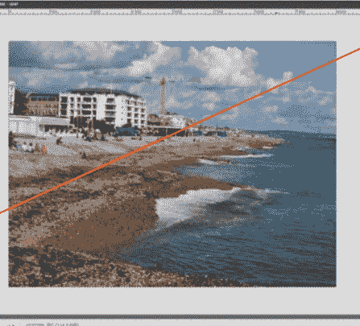

你会注意到图表下方有三个标记：两端各一个，中间一个。一张曝光良好的照片将显示跨整个色调范围的读数，具体取决于对比度。然而，如果拍摄到一张曝光不足的照片，读数将聚集在图表的左侧，右侧则是一条平线。

纠正此问题的最佳方法是将标记从右侧拖到色调值开始的区域，缩小图像范围，直到数值产生读数。

如果你足够幸运，它们会在不破坏图片的情况下亮亮度。因为你也有良好的对比度，它会自动进行调整，它应该保留原本会变得冲淡的亮度。

这不仅如此，这些单一工具还可以纠正照片的“白平衡”。例如，如果你在室内拍摄照片，可能捕捉到了来自头顶灯光的黄色色调。要消除这一点，你可以使用“色阶”对话框中的吸管符号之一。

从左到右，这允许你选择图像的黑色点、灰色和白色点。Gimp 将计算出颜色应该是什么样子。

白色点最容易使用——点击一个你认为应该是纯白色的细节。牙齿或眼睛和衣服或桌子颜色一样好。这将图像范围调整到更更自然的视觉效果。

而且你第一次就能得到正确的结果。如果一切进展不顺利，请点击图像的另一个部分或点击“重置”按钮。

这仅仅是 Gimp 能力冰山一角。在基础工具箱中，你可以缩放图像、绘制路径、旋转或编辑文本。唯一的学习方法就是尝试。

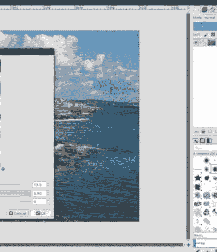

> 小贴士
对于照片修复，有海量的在线照片编辑器，你的浏览器和 Linux 一样好用，是快速修复眼睛等处的最佳选择。

Gimp 的“锐化掩模”在捕捉图像细节方面表现完全不输于 Photoshop。

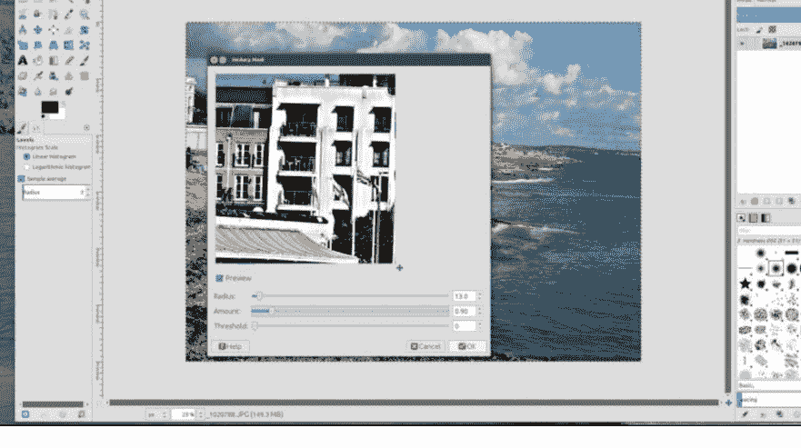

# Openshot：开始视频编辑

使用 Openshot 开源视频编辑包轻松制作带有背景音乐的家庭视频和幻灯片。

如果你认为切换到 Ubuntu Linux 意味着获得了创建视频和照片的能力，请放心，事实并非如此。从 Ubuntu 软件中心提供的 Openshot 视频编辑器可以在几分钟内学会，并允许你创建高质量视频。

尽管对我来说，Openshot 是唯一在 Ubuntu 上运行良好的视频编辑器，但它在易上手和具备创建专业视频的高级功能之间取得了有效的平衡。

在本教程中，我们将解释如何在 Openshot 中导入和编辑剪辑，以及如何导出它们。

为了继续操作，你需要导入想要在编辑器使用的视频和图片。一旦你的媒体文件安全地保存在电脑上，点击 Ubuntu 软件图标搜索并点击“Openshot”进行下载。

你在 Openshot 中的第一个项目应该是创建一个新项目。点击左上角的“新建项目”按钮或按 Ctrl+N。弹出的窗口将允许你命名项目并选择在文件夹中保存项目文件的位置。


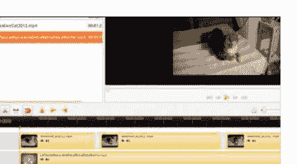

- 背景音乐已添加到轨道 1，猫咪视频已添加到轨道 2。原始音频已静音。

接下来，点击绿色的 + 图标导入媒体文件（如视频片段）。例如，你可以通过按住 Ctrl 并点击每个剪辑来选择多个剪辑。点击底部的“添加”按钮导入文件。它们将出现在左上角的“文件”窗口中。

# 轨道、时间和时间线

项目打开后，下一步是将剪辑拖入“时间线”中。这非常简单，因为你只需向上拖动它们并将它们放置在你想的地方。如果你想让一个剪辑在 3 秒后开始播放，另一个在第一个结束后播放，只需拖动剪辑即可。

默认情况下，轨道每 8 秒循环一次，除非你通过滑动左上角的条来更改此。

当你创建一个项目时，你会看到最初显示两个轨道。你不需要使用一个以上的轨道，但如果你想使用过渡效果和背景等高级功能，建议点击 '+' 图标添加另一个轨道。只需点击图标并将音频文件拖入轨道即可静音音频。

你可能还想添加视频标题。要实现此操作，点击 '+T' 打开标题菜单，然后点击“新建标题”设置文本。这将会出现在“文件”窗口中，并在需要时随时将其拖到时间线。。

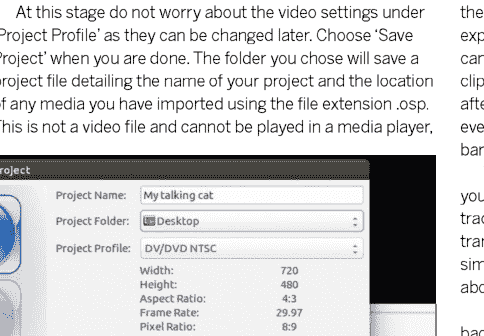

使用此屏幕为你的项目命名，选择你的项目文件夹并选择项目类型。

> 左上角的“新建项目”按钮允许你为项目保存位置。这不需要与你导出视频的位置相同。

# OpenShot 幻灯片

如果你从一系列照片中选择视频，请将它们放在文件夹中并确保按顺序排列。大多数数码相机都会自动为你完成这一点。

使用“导入”按钮加载所有文件，右键点击 Ctrl+A 选择所有文件并再次点击。选择“时间线”。

“时间线”标签允许你调整视频设置。“时间线位置”部分允许你调整图像出现的时间，如果你正在添加幻灯片，可能需要添加几秒。

“淡出”部分允许你选择照片是淡入还是淡出，正如名称所示，设置持续时间。最后，“过渡”部分允许你选择照片之间的过渡效果。这节省了你单独插入过渡效果的时间和麻烦，但它对每张照片都会使用相同的过渡类型。

默认情况下，奇数用于轨道 1，偶数用于轨道 2。你也可以在“时间线位置”部分更改此。完成后点击“添加”。

在此时，你可能想为背景音乐添加音频轨道。通过点击顶部的“导出”按钮将幻灯片导出为视频，你就全部完成了。

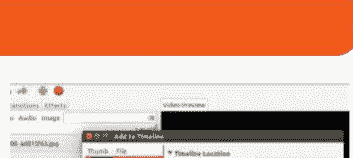

有时你只想从较大的录制中通过短剪辑创建一个视频，作为婚礼的插入幻灯片。可以通过点击时间线顶部的剪刀图标轻松激活剃刀工具。一旦光标将变为蓝色的剃刀图像，光标将变为蓝色的剃刀图像，光标将变为蓝色的剃刀

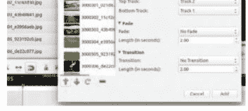

# 效果和过渡

OpenShot 包含大量的效果。只需右键点击剪辑并选择“属性”即可将其应用于你。的的的的。

当你在剪辑属性中时，花时间探索其他标签（如“速度”和“布局”），看看可以在哪里找到它们。


## Linux 应用

## 浏览器：选择最佳选择

我们是如何看到我们所看到的？这似乎是个简单的问题，但当你查看可用的最佳浏览器时，可能会对它们的差异感到惊讶。

> 小提示：每个浏览器都有不同的书签导入方法；请检查你选择的浏览器以获取有关如何操作的详细信息。

在如今，计算机如果不是通往互联网的门户，还能是什么？访问网络至关重要，而 Linux 并不缺浏览器。其中许多你可能在其他操作系统中使用过并感到很熟悉，有些是变体（但并不完全相同），还有一些是值得尝试的独特浏览器。

迁移你当前浏览器书签的过程非常简单：你不会丢失任何链接。在我们查看选项之前，让我们先备份系统以便稍后导入它们。

了解如何提取这些书签。现在是时候为 Ubuntu 寻找你的浏览器选择了！

## 浏览器历史

Linux 上最成熟的浏览器是 Firefox，尽管它在最近几年的市场份额略有下降，但它能完美地显示网页，并包含了一些实用的功能。新版本允许你在所有设备上都登录同一个 Firefox 账号时，在设备之间同步标签页，因此如果你在不同机器之间切换，可以很容易地接上进度。

Firefox Hello 允许与其他用户同时浏览网页，这对于远程办公或与朋友聚在一起非常棒。

## 备份书签

在 Google Chrome 中，点击三条线菜单图标，进入“书签”并点击“书签管理器”。点击“导出”下拉菜单并选择“书签”。这将创建一个 HTML 文件，你可以将其导入到另一个浏览器中。

如果你使用的是 Internet Explorer，你将在“文件/导入或导出收藏夹”中找到该设置。Microsoft Edge 尽管是新的，但谢天它也有这个功能。在 Firefox（以及 Firefox 中的其他书签）中，点击菜单并按照步骤进行导入和备份。

我们占据的空间并不大，所以你们其他人必须导出自己的喜好了，因为

## 备选浏览器

| Lynx | midori | NetSurf | Opera | Pale Moon |
| :--- | :--- | :--- | :--- | :--- |
| lynx.browser.org | 经典。从终端窗口浏览。由于缺乏标记语言，Lynx 大部分是一件昂贵的东西，但在无法输出文本以上的内容上非常有用，但看到网页在没有渲染技术的情况下是什么样子很有趣。 | 使用驱动 Chrome 的 GTKWebEngine 混合渲染引擎，Midori 是一个窗口管理器和轻量级发行版特征浏览器。 | netsurf.browser.org 原本为基于 ARM 的操作系统创建，源自 Arch Linux - NetSurf 现在是许多网站（包括很多网站）的浏览器。它有自己独特的引擎；如果你的 Linux 安装了它，其他系统会给它一点大招牌。 | opera.org 所以它是既经典又新的。Opera 桥是一个整洁且运行良好的程序，带给你的可能比它付出的更多。Turbo 功能可以加速你的网络流量，如果你有缓慢的网络连接或你的 ISP 对某些网站的访问受限，它非常有用。 | palemoon.org Firefox 的一个分支，将让那些喜欢现代浏览器风格的人感到满意，它坚持老派的用户界面，并拥有它自己的渲染引擎，源自 Gecko（即 Firefox 的渲染引擎）。它正在积极更新并且性能强大，非常值得一看。 |

- 通常缺少使用 Flash 等非开源技术的功能 - 但运行相同的渲染引擎，这意味着网页看起来一样好。它以相同的方式管理内存，允许部分打开的标签页而不崩溃，这是一个诅咒。如果一个标签页出现问题，它不会导致它一起运行异常，但因为 Chromium 在运行时带来了相当大量的内存。

虽然不太可能在你的发行版包中找到 Chrome，但可以获取真品。只需去 google.com/chrome，点击“下载”，并选择适用于你的（Linux 通常是 64 位）版本。点击“确定”，然后用你的包管理器打开结果进行安装。你需要从终端运行它；首先点击一次启动，搜索“chromium”，然后安装终端命令 `google-chrome` 来启动它。一旦运行，你就可以轻松地启动它了。

在这两种情况下，你都会得到 Chrome 或其开源实现版本。这不符合 Linux 的自由哲学，但可能不是出于哲学原因。拥有最新版本的浏览器对于安全和性能至关重要。现代软件已经跟不上时代。

Linux 还有许多其他不同用途的浏览器。嗯，所有它们都试图通过用一个对低端机器需要更多内存的浏览器来吸引你。你可以在“备选浏览器”栏中找到更多关于它们的信息。

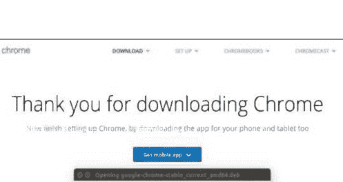

## 感谢下载 Chrome

我们正在设置 Chrome。下载适用于手机和平板的应用程序开始吧。


## 极致体验

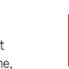

我们可以在 webbrowser.com 使用的最极端测试类型。Browsermark 是一系列将你的浏览器推向极限的测试，包括 HTML5 和 CSS，并将为你提供一些关于 PC 性能的线索。在启动时确保你已准备就绪，因为可能需要你大约五分钟。

[注：此处翻译自：一旦运行，你就可以轻松地启动它了。]

在这两种情况下，你都会得到 Chrome 或其开源实现版本。这不符合 Linux 的自由哲学，但可能不是出于哲学原因。拥有最新版本的浏览器对于安全和性能至关重要。现代软件已经跟不上时代。

Linux 还有许多其他不同用途的浏览器。嗯，所有它们都试图通过用一个对低端机器需要更多内存的浏览器来吸引你。你可以在“备选浏览器”栏中找到更多它们的信息。


## 感谢下载 Chrome

我们正在设置 Chrome。下载适用于手机和平板的应用程序开始吧。


## 极致体验


## Linux 应用

在 Dash 搜索中输入 Steam 并启动它。这会在启动器（Launcher dock）上放置一个图标。

Steam 会下载更多的应用程序——就像在 Windows 上一样——但通过这种方式，你可以登录（或创建账户）并访问你所有的游戏库，尽管 Linux 对游戏的支持程度各异。

# 性能

游戏是家庭用户在使用 PC 时执行的需求最高的任务之一。现代游戏使用的内存、处理器性能和 3D 图形超过了任何其他程序。以最新的游戏《解救：：2》（Deus Ex 2）为例，在 1080p 分辨率下运行需要 16GB 内存和最新的显卡。

Linux 在这方面确实存在劣势。Windows 的游戏比我们多，因此许多游戏在 Linux 上的运行速度往往慢 20%。既然你已经了解这一点，可以预期通过某些优化获得更好的性能。

如果你想玩任何 3D 游戏，你需要一张足够强大的显卡。英特尔和 AMD 处理器确实具有 3D 能力，能够运行基于基础设置的游戏。但对于高质量的 3D 图形，例如 Nvidia GeForce 1050 或 AMD Radeon 460，这两款显卡都能确保你正常运行并提供出性能。

你 PC 的其他部分也需要达标，否则玩闪亮的新游戏将是一种浪费。你至少需要 4GB 内存，但 8GB 更好。处理器也应该是过去五几年内缺失的类型，且至少是双核。这涉及到系统的整体速度，因为它确保系统足够快以运行现代游戏。如果你比我们年龄大，那么慢系统也可以正常工作。但在那种情况下，你可能也不需要华丽的新显卡了！Linux 和开源世界充满了模拟器，因此你可以运行 Amiga、ZX Spectrum、C64、街机游戏甚至是最近主机的经典软件。这就像运行模拟器一样，准确地说，获取你拥有的几个游戏并加载它们即可。大多数这些经典模拟器不需要多少性能，即使是十五年前的系统也应该胜任。

> 检查游戏策略以查看你是否正在运行 Linux，可能为了在服务器平台上快速进行游戏。未来是残酷的。

# Linux  Windows 游戏

Wine（参见第 58 页指南）是一个兼容层，允许许多 Windows 程序在 Linux 上运行。虽然它通常用于运行办公套件和其他尚未进入 Linux 的程序（或在没有备选方案时），但在 Linux 上运行 Windows 游戏的效果也很好。当然，使用 Wine 运行游戏而不是原生运行会有性能影响，因此它对游戏来说并不是完美的——除非你拥有那种机器。如果你有旧 Windows 游戏的 CD，并且想尝试安装任何尚未进入 Linux 的东西，那么 Wine 是一个极佳的解决方案。

要进行安装，打开终端并输入：
`sudo apt-add-repository ppa ubuntu-wine/wine`
`sudo apt-get update`
`wine install`

将会弹出的窗口要求你阅读并同意 EULA（最终用户许可协议）。微软可能会告诉你你已经抛弃了一切，但这是使用 Wine 的必要步骤。一旦你向下滚动并同意，继续进入 Wine 的图形界面。Wine 将带你安装额外的程序。使用新的 `wine_prefix`，选择“OK”，然后你就可以开始在 Linux 中安装运行 Windows 游戏所需的软件了。

```
正在配置 steam
你同意 Steam 许可协议的所有条款吗？
拒绝
同意
<确定>
```

> 确保你选择安装以确保一切运行正常。

> 如果某个游戏不可用，你可以直接在 Windows 中运行它吗？

Linux 格式报告：Ubuntu | 43

## Linux 应用

# 社交：与朋友互动

将你的社交网络账户集成到你的 Ubuntu 桌面。

Ubuntu 中的 Firefox 浏览器可以访问任意数量的社交网络，你可能会发现从桌面访问它们更容易。Ubuntu 的 Unity 桌面将与 Google Drive、Flickr 和 Facebook ，融合你的在线和离线数据。

Flickr 是一个图像托管服务，类似于 Picsabay 但由 Yahoo 所有。任何人都可以无需账户访问网站上传的照片和视频，但必须注册才能分享自己的内容。

要开始使用，点击屏幕左角的搜索按钮并输入“在线账户”（Online Accounts）。点击在线账户启动与你计算机上所有应用程序兼容的窗口。

一旦登录，照片功能将以 Google Photos 相同的方式运行只需点击在线账户窗口右侧的“添加账户”，然后按照指令将账户与 Flickr 链接。

# 集成

Google 账户用户可以双击窗口来配置你的账户。输入用户名，然后是密码。你会被授权 Ubuntu 访问你的数据。

设置完成后，在线账户窗口将列出你可以集成的账户。默认情况下可以轻松切换。最受欢迎的服务之一是 Google Photos。

如果你有 Google Photos，使用搜索栏查找存储在照片（即 Google Photos）中的照片。面部搜索也会找到存储在你账户中的面部。

如果你有在线日历，Ubuntu 中的日历应用程序将自动导入它们。花点时间检查它们是否显示正确。Ubuntu 中的操作也会更新你的在线日历。

# 桌面通知

某些网站如 Gmail、Twitter 和 Facebook 支持推送通知，当你打开它们的页面时，会出现一个小弹出窗口。例如，Facebook 可以显示你有新消息。此功能在 Firefox 中可用，但尚未完全实现，所以如果你想查看推文或电子邮件的弹出窗口，请尝试安装 Thunderbird 或 Evolution。

每次弹出提醒时，点击按钮允许或拒绝该站的通知。

> 点击在线图标添加你的账户。然后你可以将各种应用程序集成到桌面中。

## Linux 应用

## 设置 Pidgin

由于 Skype 由微软开发且不发布源代码，你不会在 Ubuntu 软件中心找到它。最新版本已在多年前发布。该版本仍处于实验阶段，并会有许多 Bug，但如果 Skype 对你很重要，你可以通过安装 Pidgin 并提供反馈来帮助，例如 Zoom 和 Puti，这些可以通过软件中心安装。

你可以访问 skype.com 查看是否有适用于你的发行版版本并下载文件。程序将询问你是否想用已安装的软件打开文件。Ubuntu 软件中心将识别 Skype 条目并安装它。在搜索中输入名称启动 Pidgin。Ubuntu 有许多视频会议程序。官方 Skype 客户端比 Pidgin 老旧，而 Pidgin 能够给 Mac 和电脑上打电话。两者对 Messenger 的支持都不如 Facebook。由于 Facebook 在 2015 年 4 月放弃了对 XMPP（扩展消息协议）的支持，允许第三方连接到聊天服务器。坦率地说，你仍然可以使用 Pidgin 进行 Messenger。

> 在线账户支持通过 Thunderbird 发布到 Facebook、Twitter，以及 Messenger 和 Skype。

- 点击桌面上的 Ubuntu Skype 让别人与你互动。

Messenger.com 可用。大多数 Linux 允许你使用 Jabber 分组，Jabber 使用多个服务器允许人们互相通信。访问 Jabber.org 获取更多信息和注册提示。Pidgin 非常易用，但如果你遇到问题，可以在 GNOME 网站（https://wiki.gnome.org/Apps/messenger）获得大量支持。

如果你正在使用 Messenger 管理会话，如果你没有看到适用于 Ubuntu 的版本，首先检查网站以确保它确实存在。

虽然 Pidgin 在 Ubuntu 中支持 Messenger，但它不支持许多不同类型的聊天软件，并不很好用。Linux 有版本的 Pidgin。设置 Pidgin 是因为用户想要设置额外账户和/或控制管理他们的 Skype 账户。Pidgin 提供了多种聊天软件，如 AOL、Yahoo、MSN、Messenger、Jabber、IRC、Bouncer Protocol 等。

如果没有可用网页版，你可能可以通过网页访问它。

访问 Pidgin 列表 https://wiki.linuxubuntu.org/Pidgin 并学习如何安装。

记住，如果你将社交网络集成到浏览器或应用中，那么你将看到你的个人资料和消息。

首次运行时，Pidgin 为你提供了各种账户供设置，请根据情况选择并设置账户。Pidgin 允许在账户之间跨账户消息，如果你有一个可以实现此功能的插件，就可以和 Skype 聊天。你可以通过开始阅读 Pidgin 手册（https://wiki.linuxubuntu.org/Pidgin/UsingPidgin）寻求帮助。

如果你正尝试用 Pidgin 设置 Google 账户，请检查设置屏幕并选择服务器。

## 社交网络

Ubuntu 设计用于与社交网络协作，因此你的桌面不太可能遇到任何问题。如果在设置时你发现连接不正常，你的 Google 日历未出现在日历应用程序中，尝试多次运行通常可以解决此问题。

如果你选择使用 Chrome 为 Twitter、Facebook、Gmail 等其他网站开启桌面通知，尽管你需要设置账户才能在此处看到联系人。

- 显示与 Empathy 集成的账户

- 点击窗口左侧的“添加账户”并选择菜单显示支持哪些协议。

Linux 格式报告：Ubuntu | 4


## Thunderbird（雷鸟）：
让邮件变得简单

设置你自己的廉价邮件客户端，让你的邮件和联系人触手可及，而不是让它们丢失在云端。

邮件是最古老的技术之一。它的历史早于网页，早于即时通讯，甚至早于创新的先驱者。Arpanet 和 MIT（这些领域的创新者往往经常支持使用名为 Mailbox 和 SnailMail 的软件）一直是邮件的深度用户，邮件在 20 世纪 70 年代 Arpanet 开发期间被引入到特定的邮件计算机中。到 1974 年，美国军已成为深度用户，到 1978 年，所有 Arpanet 流量的 75% 都是邮件。你可以轻松向任何人免费发送邮件——这是一个协议不想等待的闭环系统。

我们都会花钱拥有至少一个邮箱地址，如果你在这个圈子里混迹段时间，你就知道怎么做了。虽然现在大多数账户都有某种 Web 界面用于你的收件箱和发送新消息，但这并不是管理邮件的最佳方式。因此，如果你使用网络连接，完全存储在在线的收件箱将是可以访问的。许多需要记住的带有信息的旧邮件可能并不重要。

安全应该是一个关注点。你如何信任你的 Web 提供商不会嗅听你的信息？

如果提供商破产，或者黑客强行进入并更改你的密码，你的邮件会发生什么？这就是由于许多其他原因，使用可以备份、离线存储消息的桌面邮件客户端是有意义的——如果你设置了相关设施，还可以将其存储在加密分区中保护你的隐私。

## 良好展望

如果你接触电脑有一段时间，很可能用过微软的 Outlook 或 Express，这些软件包恰好能完成我们寻找的任务：从服务器下载、存储、发送新邮件和附件。一个缺点是 Outlook 不支持 Linux，但 Mozilla 的 Thunderbird 同样强大，并且对于老用户来说应该非常熟悉。它不仅仅是安装它、将其连接到你的账户，而且不仅于此。

让我们从这里开始。许多发行版都会默认安装它 - 比如 Ubuntu，这是因为你不需要寻找本地包管理器，而 Thunderbird 邮件通常一如往常地（这里是关于包的更多信息的章节开头）从它的图标开始运行。

## 邮局管理员（Postmaster）

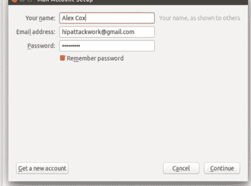

当你第一次运行 Thunderbird 时，你将可以选择注册一个免费的新邮箱地址 - 我们在教程中跳过了这一特定步骤，请点击“下一步”。如果你使用当前的邮箱地址，你的邮箱和密码是这里的关键部分，“名称”字段不需要与你用于账户的名称匹配，但它用于向发邮件的收件人显示你的真实姓名。

太棒了，Thunderbird 查询服务器信息数据库。如果你使用像 gmail.com 或 outlook.com 这样的提供商，它会自动获取正确的发送和接收服务器详情，所以你无需担心。但其他提供商可能不在数据库中，至于如何填写空白，你的 ISP 或邮件提供商会提供适当的信息，我们无法准确说明具体是什么

- 添加账户，如果你使用的是认可的提供商，再简单不过了，只需添加你的邮箱地址和密码即可。

## POP3 vs IMAP

接收邮件有两种方式：POP3（邮局传输协议）和 IMAP（互联网消息访问协议）。POP 将消息下载到你的计算机并（通常）从服务器上删除原始邮件。这是经典方法，适用于单机使用或出于安全考虑的优势；但如果邮件来自另一台设备，将变得困难。在多台机器上使用 POP 有很大的缺点——它是单向事务，设备之间没有同步，因此你不会获得邮件索引。IMAP 是双向事务，设备之间有同步，因此你可以看到所有设备上的已读状态。


## 更多操作

屏幕截取或视频录制。如果你看到鼠标指针——它会被默认捕获，因此如果你需要包含它，请进行选择（例如，你想突出程序中的某个特定对象）。

中间按钮是活动捕获工具——它是用于屏幕截取的白色快门，以及用于视频录制的红色按钮。按下红色按钮进行截图——你会听到点击声，然后你会收到通知，提示图像已复制到剪贴板，以便在其他地方粘贴。它还会保存在“截图”（Screenshots）文件夹中。若要使用与旧截图类似的命名规则找到“图片”（Pictures），屏幕将保持变暗——此时你可以进行任何操作，菜单栏中会出现录制进度条。视频完成后，片段将以 webm 格式存储，命名方式与截图类似：位于“图片”文件夹内的“截图”文件夹中。

那些习惯于捕取整个桌面或单个窗口的用户——会很高兴地发现，新工具提供了两个快捷键：按 Print 键截取整个桌面，或使用 Alt+PrtSc 截取选定窗口。

## 截图之外

虽然截图工具比前身更易使用，但它缺少关键功能。首先，你无法选择是否保存屏幕截取或-

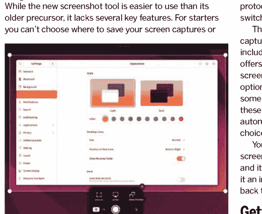

Ubuntu 22.04 LTS 发布了全新的桌面截图工具——只需按 PrtSc 键即可调用。

## Wayland 的问题

对于首次进入 Ubuntu 22.04 世界的人来说，一个棘手的问题在等待：新的桌面协议取代了 Wayland。在大多数情况下，Wayland 更快且更安全，但它有一项额外的安全策略，为屏幕截取带来了问题。

在运行的桌面协议上，许多截屏工具无法使用它们自身的捕获工具获取屏幕。这是因为它们并非为了配合 Wayland 设计的——当你尝试在运行 GNOME 桌面面的 Ubuntu 22.04 上安装 Spectacle 时，就可以看到这一现象——当程序打开时，你会被提示“拍摄截图”。

这个问题在 2021 年 5 月之后的 Wayland 中不再出现。因为它对程序可以访问截屏的能力更加严格，其他工具必须经过适配才能支持它。在 Spectacle 和 Screenshot 的案例中，作者设计了一种变通方法，使用 GNOME 截图工具代替他们更灵活的屏幕捕获功能（包括对热键的支持），而这些在 X11 中继续工作。

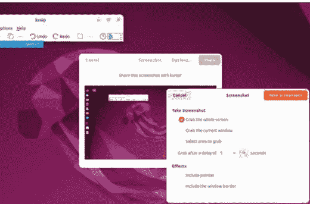

> 如果你在 Wayland 上使用 Ubuntu 22.04，你的截图工具必须能够调用 GNOME Portal 进行捕获。

它们甚至不得不更改名称，并且丢失了在截取前设置截取倒计时时间的能力。

幸运的是，你会发现第三方截屏工具可以填补这一或其他空白。KDE 用户应该替换 GNOME 截图工具。GNOME 用户可以使用 Screenshot 中安装 Spectacle（参见方框、叠加层），但它与 Wayland 协议的实现不兼容。Spectacle 在 Wayland 的 Ubuntu 22.04 上运行；请切换回 Xorg——查看更多详情（见下文）。

同样的限制也适用于其他截屏工具（除非另有建议），包括 Kazam (https://kazam.net/)。它提供了原始 GNOME 截图工具的所有功能，包括带有可选倒计时器的截取以及手动保存文件功能。其中最显著的是可以在选择格式时配置 Kazam 自动格式化为你的选择格式。

你可以使用 Kazam 在 Wayland 中截取整个桌面，但它的屏幕截取工具不起作用，如果你尝试截取窗口，它会崩溃，使得除非回到 Xorg，否则这是一个不可行的方案。

- **快速提示**：你可以了解更多关于插件的信息：访问 https://gnome.org/extensions/shell-plugins 下载包并安装 OCR 使用。使用该工具，你可以通过选项菜单进行截图以提取文本。

## 获取剪切

幸运的是，你不需要完全放弃 Wayland、Spectacle 或 GNOME。有一些 Wayland 友好工具提供了屏幕截取和后期标注注释工具供选择，它们拥有独特的功能，并且可以通过 Ubuntu 软件中心安装。它们是 Shutter 和 Knip。

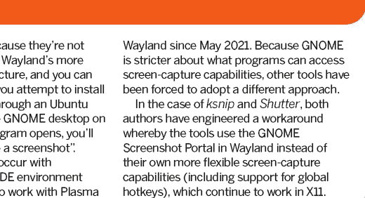

Linux 格式：Spectacle | 15

一旦你完成了截图，knip 和一组窗口会展开，显示出后期编辑的便利性。在这里，你会看到图像左侧有一系列标记工具。每个添加的元素都作为一个独立对象创建，工具顶部的选择工具允许你使用方向键或其他上下文敏感控制控件来编辑、调整大小或删除它们。


让我们从 Knip 开始。在 Wayland 中，它无法使用自己的工具截图；而是依赖 Gnome 截图工具，其工作原理与旧的 Gnome 截图工具类似。它可以通过 Ubuntu 22.04 中的 ubuntu-jammy-universe 版本安装，或者你可以访问 https://github.com/knip 了解如何操作。

## Shutter

Shutter 是一个强大的屏幕截取和注释工具。它提供了广泛的功能，包括截取整个桌面、窗口或特定区域的能力。Shutter 还允许你向截图添加文本、箭头和其他注释。一旦使用 Shutter 拍摄了截图，你可以在内置编辑器中对其编辑，或将其导出为多种格式。

Shutter 还可以作为 GNOME 插件可用，允许你直接从桌面截图。如果你正在寻找一个多功能且强大的工具，Shutter 是一个极佳的选择。


## 使用 knip 的快速技巧

如果你正在使用 knip 自带的屏幕截屏工具，请登录 Ubuntu。在“设置-自定义快捷键”中，点击你的用户名，然后点击打开的登录，然后选择 Xorg 并登录“启动器”，以使用上述显示方法显示出一个具有五种捕捉类型的新对象。它还有自己的全局快捷键：使用 Alt+Shift 而非仅用 Shift。

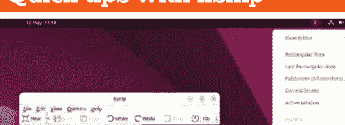

## 1 原生运行

## 2 调整窗口大小

想在捕捉窗口之前将其调整为特定大小吗？首先，安装 `wmctrl`（sudo apt-install wmctrl），然后打开“设置”并导航到“键盘-视图-自定义快捷键-自定义快捷键”。使用以下命令创建快捷键，将 1280 和 720 更改为你所需的宽度高度：`wmctrl -r :ACTIVE -e 0,200,1280,720`。


## 3 完美裁剪

有时在捕捉后对图像裁剪更简单。坦率地说，knip 包含一个专门为此目的的裁剪工具。在捕捉你的图像后，点击该按钮，你的图像将被包围在一个边界框中 - 你可以通过点击并复制隆来调整其大小，或者使用底部的 X、Y 和 H 字段手动设置。完成后点击“应用”。

## 4 复制和粘贴

当你创建一个新对象时，knip 总是会恢复到它的默认设置，包括字体和大小。要绕过这一点，请选择你现有的对象，右键点击并选择“复制”，然后在你想放置新对象的地方右键点击并选择“粘贴”。它将为你创建以便你修改 - 如果是数字，它将自动递增。


## 5 重新排列项目

你放在图像上的每个注释都被视为一个独立的、可移动的对象。点击它进行选择，你可以在那里轻松地调整其大小并移动它。默认情况下，新标签位于顶部，但如果你点击当前选中的对象并使用“排列”子菜单，你可以选择项目相互重叠的方式。

## 6 添加水印

使用基于图像的水印保护你的图像。选择 Optis->Settings->Annotator->Watermark 并点击“更新”来选择你的图像文件，例如正义的扫描件。忽略版权。当你选择“编辑->添加水印”时，图像的水印将得到尊重。将显示图像的淡化副本，可以对其进行调整大小和移动。

## 双启动：设置两个操作系统

Afan Remans 深入研究了启动系统世界，为你带来操作系统问题最简单的解决方案。


我们生活在一个多个操作系统占据桌面市场份额的世界里；而且应用程序在我们使用的每个平台上并不总是可用的。

双启动（Windows 和 Linux）通常是，让两个操作系统都准备就绪。虚拟机受到诸如 Wine 之类的兼容层技术的影响。解决方案是在同一台机器上双启动两个操作系统。

启动管理器可以管理多个操作系统，并允许我们在启动时选择哪一个。你可以同时拥有 Windows 和 Linux，这样你也可以享受两者的优点：游戏、生产力以及工作或娱乐。在 Linux 上使用 Steam 后，我们可以和谐共处。

在教程中，我们将特别关注通过 Ubuntu 使用 Linux。然而，安装过程在不同的 Linux 发行版之间有所不同。

首先，让我们谈谈为什么要双启动。我们看到许多人进行双启动，关键原因是性能和兼容性。大多数用户会发现，使用计算机硬件资源原生运行是最好的。事实上，虚拟机消耗的资源是它们所需资源的两倍。

当你使用双启动系统时，你可以启动 Linux 或 Windows。如果 Linux 和 Windows 位于同一台电脑上，电脑就可以访问所有进程、硬件和外部连接的设备如 USB，因为 Linux 具有速度（只要操作系统支持它们），

## 是否进行双启动

对于今天的需求，我们将向你展示如何在没有双显示的情况下安装 Windows。可以说，如果你已经安装了 Linux，那么安装 Windows 已经完成了一半以上。如果你是 Linux 新手 - 欢迎在你当前的系统（占据了 90% 市场）上安装 Linux，并可以从全新安装的 Windows 中直接创建双启动系统。如果你以前没有尝试过安装 Windows，现在并不是强制要求的。过程非常简单，有很多点需要注意。安装介质大多是使用过的光盘或

> 磁盘管理工具为所有操作系统可以访问的分区和存储器提供了一个易于理解的界面。

USB 驱动器可以在网上或在商店购买。一旦你插入介质并电脑启动，安装将通过设置过程加载文件。

你选择的 Windows 版本并不重要，无论是 Windows 7、8 还是 10。这种是安全的，如果你已经安装了 Linux，那么安装 Windows 已经完成了一半以上。如果你是 Linux 新手 - 欢迎在你当前的系统（占据了 90% 市场）上安装 Linux，并可以从全新安装的 Windows 中直接创建双启动系统。如果你以前没有尝试过安装 Windows，现在并不是强制要求的。过程非常简单，有很多点需要注意。安装介质大多是使用过的光盘或

USB 驱动器可以在网上或在商店购买。一旦你插入介质并电脑启动，安装将通过设置过程加载文件。

你选择的 Windows 版本并不重要，无论是 Windows 7、8 还是 10。这种是安全的，如果你已经安装了 Linux，那么安装 Windows 已经完成了一半以上。如果你是 Linux 新手 - 欢迎在你当前的系统（占据了 90% 市场）上安装 Linux，并可以从全新安装的 Windows 中直接创建双启动系统。如果你以前没有尝试过安装 Windows，现在并不是强制要求的。过程非常简单，有很多点需要注意。安装介质大多是使用过的光盘或

USB 驱动器可以在网上或在商店购买。一旦你插入介质并电脑启动，安装将通过设置过程加载文件。

你选择的 Windows 版本并不重要，无论是 Windows 7、8 还是 10。这种是安全的，如果你已经安装了 Linux，那么安装 Windows 已经完成了一半以上。如果你是 Linux 新手 - 欢迎在你当前的系统（占据了 90% 市场）上安装 Linux，并可以从全新安装的 Windows 中直接创建双启动系统。如果你以前没有尝试过安装 Windows，现在并不是强制要求的。过程非常简单，有很多点需要注意。安装介质大多是使用过的光盘或

USB 驱动器可以在网上或在商店购买。一旦你插入介质并电脑启动，安装将通过设置过程加载文件。

EFI 代表可扩展固件接口，现代系统取代了基础输入输出系统 (BIOS)。 UEFI 允许自定义设置。UEFIs 可能会产生问题，序列。然而，UEFIs 可能会产生问题。


# 在同一块物理硬盘的不同分区上运行更多系统。

与它并排安装，因为这将是灾难性的。不要尝试覆盖它。这一步将由你，用户决定为你的 Linux 安装分配多少设置空间。你已经设置好了 Ubuntu 分区。管理方面，你也可以根据你的需求选择使用更多或更少的空间。在 Ubuntu 中，有两种方法可以“并排安装”。一种方法是手动标记 Windows 分区，Windows 将会为你留出所有内容。其他发行版（例如使用 Calamres 的发行版）提供了类似的流程选项。否则，你只需要使用未分配空间，并在提示安装时选择“其他选项”。你可以根据你的需求和用例调整分区大小。如果你正在使用 Linux Mint，你可能没有深度投入于 Linux 游戏或处理大量数据。确保加载程序能够识别到 Windows 启动管理器。

## 分区方法

处理分区的有几种方法；我将解释假设你已经安装了 Windows 的那种方法。如果你已经安装了 Windows，最简单的方法是使用 Windows 内置的磁盘工具来帮助完成此过程。硬盘上的每个分区，例如恢复分区、OEM 等，通过调整大小或删除这些分区，你留下的将是最大的，也是存放大部分文件和数据的地方。任何标记为“系统”或“OS”的分区都不应该被修改，因为它们持有 Windows 文件并可能被更改，只需留着它们即可。主分区可以缩小，为你的 Linux 安装腾出空间。此此事的简单方法是打开磁盘管理应用程序，找到带有主分区的驱动器并选择“缩小”。按照指令操作后，你就准备好了。现在你将看到一个带有黑色条标记为“未分配”的空闲区域。这就是你可以创建新分区的地方。或者，如果你正在使用 Linux，你可以删除任何分区恢复并安装 Linux。然而，请确保你现在知道这样做会得到什么。现在，你可以通过在重启时按住 Shift 键使用未分配空间安装 Ubuntu live cd。一旦，启动功能将引导你进入设备菜单，在其中选择 Ubuntu 安装。首先选择你的闪存盘并按回车开始启动过程。你将进入带有基础功能集的 Ubuntu 运行环境。然后，你就可以开始安装过程。

该过程取决于你想要使用的 Linux 发行版。对于 Ubuntu 来说，该过程是一个非常简单的逐步引导。虽然你可以在安装期间安装更新，但你可以在 Windows 或 Ubuntu 安装期间连接到互联网，其默认选项将在几秒后自动启动。如果你不使用这些选项，可能会产生一些故障排除。

有时你可能会发现由于某种原因你需要移除 Linux 安装。记住，在双启动过程中移除 Linux 时，你必须小心不要破坏你的引导程序，反之，创建一个巨大的

## 缩小 C 盘：

| 描述 | 值 |
| :--- | :--- |
| 缩小前的总大小 (MB) | 81417 |
| 可用空间大小 (MB) | 64418 |
| 输入要缩取的空间大小 (MB) | 64418 |
| 缩小后的总大小 (MB) | 16999 |

> 不能缩小包含任何移动文件的分区卷
> 查看应用程序日志中的“整理碎片”事件以获取操作完成后的详细信息
> 在磁盘管理帮助中查看“缩小卷”以获取更多信息

磁盘管理中的缩小卷对话框允许你缩小分区、大小，并在你所需的缩小大小太小时向你发出告警。

| 缩小 | 取消 |
| :--- | :--- |

如果还没有安装，你可以尝试通过几个简单的终端命令来安装，你可以逐一个运行：
- $ sudo add-apt-repository ppa:yannubuntu/boot-repair
- $ sudo apt-get update
- $ sudo apt-get install boot-repair

接下来，只需 boot-repair 并点击“推荐”选项。最后，要移除 Ubuntu 分区，你需要返回 Windows，重启并在 Windows 菜单中搜索它以启动进入 Windows 磁盘管理。在磁盘管理中，右键点击 Ubuntu 分区并选择“删除”。如果这是你的目标，请确保在之前备份你的磁盘。如果你想继续使用 Windows，则右键点击该分区并选择“扩展卷”。这将增加 Windows 分区的大小以填满空闲。这就是你需要做的所有操作，将机器恢复到使用单个操作系统。

现在你已经知道如何在具有双启动设置的计算机上调整你的操作系统，你已经准备好与其他发行版和组合创建你自己的项目了。还有向启动序列中添加更多系统的可能性，即三启动或多启动。添加系统很容易，只需在硬盘空间允许的情况下进行分区并添加即可。更多的操作系统意味着更多的通用性，通过利用引导程序的优势，你可以真正让你的计算机成为你自己的，并设计适合你需求的环境。

Ubuntu 安装程序中的 Ubuntu 分区工具与许多分区工具类似。

## 移除 Linux

要开始，你需要 Windows 安装介质或恢复 CD 或 Ubuntu DVD。要移除 GRUB 引导程序，请使用安装或恢复媒体环境中的命令。接下来，输入：

- * /boot/grub

重启并进入 Windows。然后仅使用 Ubuntu Live CD 并选择 Boot-Repair。

你可以直接从此光 CD 在不对你的电脑进行任何更改的情况下安装 Ubuntu。如果你已准备就，可以安装 Ubuntu 并并安装（而不是替换）你当前的系统。这是执行此操作最安全的方法。你可能还想阅读发行说明。

Ubuntu 运行环境允许你直接从磁盘尝试 Ubuntu，因此你可以用它来测试功能并在写入任何内容之前准备你的机器。

## 重新排序启动管理器

你注意到你将从关机状态启动有一个特定的顺序。操作系统或 Linux 系统将获得优先，除非你在启动期间按下键来选择进入其中一个或另一个，随你的意愿。这并不是你想要的。你可以使用 EFI 启动管理器从 Ubuntu Live CD 获得访问。一旦进入 Live CD，打开终端并

安装 EFI 启动管理器：
- $ sudo add-apt-get install efmgr

接下来使用以下命令查找当前的启动状况：
你将得到一个看起来像这样的输出，带有启动顺序：

```
Boot0001 Windows Boot Manager
Boot0002 Network
Boot0003 ubuntu
```

要更改启动顺序，我们对应我们要启动的设备的数字代码。例如，在这种情况下，我们要从 CD 启动，然后是 Ubuntu。因此我们将使用以下命令来更改序列：

```
$ efmgr --timeout 0000:0004: 00013
```

这就，你现在准备好了。

# Wine：在 Linux 上运行 Windows

迁移到 Linux 并不意味着完全放弃 Windows，仍然有一种方法运行某些 Windows 程序；直接在 Ubuntu 内。

这就是在 Ubuntu 下运行 Windows 的版本。Ubuntu 提供了你需要的一切，并且免费计算机使用，但在某些情况下这可能是不可能的。

它是什么以及它不是什么：Wine 是一个兼容层，说它更像是一个 Ubuntu 和 Windows 程序之间的翻译器，并允许你运行。由于它不是一个模拟器，在许多方面模拟器（如 VirtualBox）可能会做得更好，但需要资源来工作。兼容层让 Wine 以不同程度的成功率工作。

如果你有一个特定的程序想要在 Wine 中运行，建议你查看 Wine 应用程序数据库 https://app.winehq.org 这其中有兼容性评分。这里还有关于做什么和不能做什么的详细概述。任何评级为青铜或垃圾的极可能不被尝试。


## Wine - 入门指南

Wine 是一个用于 Linux 上运行 Windows 应用程序的兼容层。它不是完整的 Windows 模拟器，但它允许你原生运行许多 Windows 程序。Wine 包含了用于运行 Windows API 的层以及 Wine 环境本身。

## 详情

### 1 安装 Wine

打开 Ubuntu 软件中心（它应该在程序栏中）并搜索 Wine。点击旁边的“配置 Wine”（Configure Wine），选择它并安装。这需要一些时间，但在完成之前，不要进行任何操作，直接启动 Wine。这将允许 Wine 执行其配置，例如构建 Windows 文件夹系统。

### 2 忽略 GUI

你可以运行 Wine 的 GUI，但目前没有你需要更改的内容。需要注意的是，你可以通过其选项卡映射更多的 Windows 驱动器——即通过这些选项卡添加一个 D 盘。我们将下载一个标准的 Windows 程序 Notepad++ 并安装它。

### 3 安装 Notepad++

从 https://fileppo.com/download_notepad 获取此免费的可升级软件，将安装程序 EXE 文件保存到下载文件夹或直接下载。找到文件后，右键点击它并选择“在 Wine 中打开”。Wine 需要处理安装过程，以便设置 Notepad++ 认为在 Windows 中的前缀。

区分大小写，例如名为 'HELLO' 的程序与名为 'hello' 的程序是不同的，Linux 将它们视为两个不同的文件。另一个奇之处是 Windows 文件夹在 Linux 下使用反斜杠 \。

这些是你在 Ubuntu 内部使用 Wine 时需要注意的进，而非基础情况：有时从 Ubuntu 中通过 Wine 和其他程序启动文件时，了解这些点是有帮助的：

我们创建了一个教程，向你展示如何在 Ubuntu 上安装和运行标准的 Windows 对象。Wine 拥有许多可以提高兼容性的功能，但那超出了本入门指南的范围。相反，我们可以为你介绍一些预构建的 Wine 版本。

### 4 运行 Notepad++

你可以选择在桌面上放置 Windows 图标，Wine 能够确保它们正常工作。一旦安装完成，你所做的就是点击桌面即可。

## 终端：如何入门

终端是你桌面中极其重要的一部分。如果你在输入想要的命令时遇到困难，只需选择操作并按回车键。请注意，这不会影响你的命令。

如果你已经完成了这一步，学习基础知识将让你处理事务时更快、更有效。还要记住，安装的 Wine 版本实际上是 v1.8。值得阅读发布说明以查看它是否改进了你想使用的程序的兼容性。

我们正在讨论如何通过导航终端和使用搜索框来开始。你还会发现两个命令：Terminal（终端）和 UX。可以同时运行多个模拟器的这一事实允许你在它们之间切换，尽管从根本上说它们做的是相同的事情。

选项在此处可以指定一个或多个标志来更改偏好。每个标志前面都有一个或两个短横线（--），最常用的是 --help，它提供实用工具的描述，并列出所有命令和选项，并且

## Bash 工作

对于本教程而言，我们将使用默认终端，即 gnome-terminal。

```bash
nick@ubuntu:~$ apt-get help
nick@ubuntu:~$ apt-get options
nick@ubuntu:~$ apt-get install --pkg
nick@ubuntu:~$ apt-get remove --pkg
```

apt-get 是一个用于下载和安装包的简单命令行界面。最常用的命令是 update 和 install。

命令：
- update: 刷新软件包列表
- install: 安装包（pkg 不是 .deb）
- remove: 移除包
- autoremove: 自动删除所有未使用的包
- source: 来源包
- build-dep: 为源包配置构建依赖

## 加速

无论你的打字速度有多快，命令行都可能让人困惑。终端带有许多快捷键，可以帮助你节省时间。看看如何轻松地使用这些命令和快捷键。

- 上方向键: 浏览你的命令历史
- history: 使用此查看你的命令历史
- Ctrl+r: 输入字母搜索显示的最最近匹配项，继续按 Ctrl+r 查找匹配项
- Tab: 查看建议或补全单词（如果只存在一个建议）。按 Ctrl+Tab 自动填充你的用户名，按 Shift+Tab 自动填充

> 帮助标志（help）可以与任何命令配合使用，查找它的功能以及使用的参数。

## 你的第一个命令

虽然可以使用软件中心和 Ubuntu 的“更新与设置”面板组合来安装和管理软件，但利用高级软件包工具 (APT) 通常会更快。这里是一些你可以使用的键（见下文）：

- apt-get repository <repository name>: 为你的系统添加新的存储库，允许你从 /etc/apt/sources.list 中列出的源安装包。
- apt-get update: 从所有存储库更新本地软件包索引（包括更新版本）。
- apt-get upgrade: 将所有当前安装的包升级到最新的可用版本。
- apt-get remove <package name>: 使用此删除已安装的包。
- apt-get autoremove: 移除由其他包安装且不再需要的依赖项。
- apt-get purge: 清理系统中的配置文件。

```bash
ubuntu@ubuntu:~$ apt-cache show vlc
Name: vlc
Section: video
Version: 3.0.16-2ubuntu1
Priority: 1000
Candidate: candidate
Description: A free and versatile cross-platform media player.
Maintainer: Ubuntu Developers
Source: http://archive.ubuntu.com/ubuntu focal-multiverse
Size: 5.4 MB
Download-Size: 2.1 MB
Installed-Size: 15.2 MB
Architecture: amd64
Depends: libavcodec5 (>=5.3.1-2ubuntu1), libavformat5 (>=5.3.1-2ubuntu1), libavutil5 (>=5.7.1-2ubuntu1), libswscale5 (>=5.4.1-2ubuntu1), libvcodec6 (>=6.0.1-2ubuntu1), libvlc5 (>=3.0.1-2ubuntu1), libvlc-dev (>=3.0.1-2ubuntu1)
```


# 终端：文件操作

现在是把注意力转向如何在喜爱的终端中导航文件系统以及操作文件和文件夹了。

我们向你介绍了如何像使用 Linux shell 一样使用终端的基础知识：命令的结构（实用工具命令-选项）；并为你提供了管理软件包包和获取更多帮助的工具。在这里，我们将查看如何导航文件系统；处理文件和文件夹；并学习一些非常划算的快捷键。

当你打开一个新的终端窗口时，命令行会将你置于你的个人主目录。你可以通过 `ls` 命令来验证这一点，它会显示当前目录的内容。终端应用程序会尽可能以列或行的形式显示文件。

你也可以通过其他方式列出文件。要显示所有文件（包括以点（`.）开头的文件），请使用 `ls -a`。`ls -R` 命令意味着递归列出子文件夹的内容。

如果你想了解更多关于文件权限、所有者组的详细信息；可以使用 `ls -l` 按大小、修改日期或扩展名列出文件。为了获得人类可读的大小，请添加 `-h` 选项使用 `ls -lh`。

`ls` 还有许多选项；你可以使用 `--help` 选项查看所有选项。

导航文件系统是使用 `cd` 命令移动到当前目录的子文件夹；使用 `cd <folder>` 并加上你想要访问的文件夹名称。记住文件和文件夹是区分大小写的，所以

```bash
Terminal
~$ ls Documents
$ ls -l Documents
$ ls -la Documents
$ ls -R Documents
$ ls -lh Documents
$ ls -S Documents
$ ls -t Documents
$ ls -rt Documents
$ ls -m Documents
$ ls -F Documents
```

### 当文件夹名称包含空格和特殊字符时正确使用 ' 和 ' ' 

文件夹以大写字母开头——正如文件夹本身一样；例如，输入 `cd Documents`，如果你输入小写，会收到关于文件夹不存在的错误；例如 `cd documents`。你还可以使用以下语法进入几级目录：`cd folder/subfolder`；你也可以使用 `cd ..` 返回一级，或使用 `cd ../..` 返回上两级。

如果你想去一个完全不同的地方怎么办？使用 `cd /` 将自己置于根目录，或者通过输入完整路径导航到任何其他目录，包括 `/` 字符以从顶层导航；例如 `cd /username`。

`~` 字符的作用与 `/` 类似，它会将你置于主目录。所以输入 `cd ~` 等同于 `cd /home/username`。

## 快速导航

在这一部分，我们将回顾一些快捷键，帮助你快速地输入更多命令，这将帮助你更省力地导航终端。

- **Home/End**: 按此键将光标跳转到当前行的开头或结尾。
- **Ctrl+left Ctrl+right**: 在参数之间移动光标。
- **Ctrl+u**: 清除从光标到行尾的行。
- **Ctrl+w**: 删除光标前的单词。

不小心从命令中删除了某些内容？只需输入 `Ctrl+y` 并按回车，即可应用 `sudo` 重复执行该命令。如果你想再次替换整个命令，只需使用以下语法替换整个单词（在示例中使用了 `dpkg` 作为例子）：

- **Ctrl+r**

## 助力你的学习

现在你开始在终端中大显身手了，而不需要每次打开它时都通过显示随机命令的信息来干扰你的知识。要做到这一点，你需要编辑一个文件，所以打开终端并输入：

```bash
nano ~/.bashrc
```

这会在 nano 编辑器中打开该文件。使用光标滚动到文件底部，然后添加以下行：
`# Did you know what is bash? `
`echo -e bash`

按 [Ctrl]+O 保存文件（只需按回车覆盖），然后按 [Ctrl]+X 退出 nano。现在关闭终端窗口并打开一个新窗口，查看类型描述，并列出实际命令以获取更长的描述：`command --help`。

**Documents**：你从一个文件跳到了另一个文件，如何快速返回上一个目录？只需输入 `cd -`。

## 处理文件和文件夹

你现在可以编辑和管理你的文件系统了，但实际操作呢，比如移动和复制文件呢？你会发现一系列不同的命令，你学到的技巧会在遇到卡壳时帮助你。

让我们从查看用于文件的 `cp` 和 `mv` 开始。这些选项也适用于两者。基本语法是 `cp [source] [destination]` 和 `mv [source] [destination]`，它们遵循与 `cd` 相同的规则，但通常的做法是先导航到包含你想复制或移动的文件的目录。一旦到达那里，你可以使用文件名作为源，如 `cp ~/Documents/file`。

这将创建一个同名文件的副本。`mv` 命令移动文件并对其重命名。使用 `mv ~/Documents/file newname`。如果你想在同一个文件夹中创建文件的副本，请使用 `cp ~/Documents/file ~/Documents/file`。

你还可以使用 `-r` 选项复制文件夹。这确保文件夹连同所有内容一起被复制，并与其父文件夹链接的原始属性重建：`cp -r ~/Documents/folder/`。

使用 `rm` 删除单个文件，使用 `rm -r` 删除文件夹（非空文件夹）。你可以使用 `rm -rf` 在不询问的情况下删除文件夹及其内容。

使用 `mkdir` 创建新目录。你也可以通过输入 `mkdir folder1 folder2 folder3` 同时创建多个目录。

我们还可以 `*` 在搜索中查找文件，它可以应用于类似星号 `*.` 这样的命令。

> 小提示
> 某些管理器允许你只需右键点击文件夹并在位置打开终端，但在 Linux 中，你只需输入 `cd ~/Downloads/install`。该选项现在可用。

`*` 可用于快速访问名称较短的文件夹，如 `Doc*`。如果只有一个以该名称开头的文件夹，这种方法有效；但如果有两个或更多，终端将显示所有匹配的目录。在这种情况下，你必须使用 `cd Documents`（除非你有多个名为 Documents 和 Downloads 的文件夹）（等等，文本说“两个字符更多”，可能指的是 `..` 语法）。

当你导航目录树时，两个字符更多：`..` 表示上一级，`~` 表示主目录。

在导航带有空格的文件名时，你应该使用引号，如 `cd "My Documents"`。你也可以使用反斜杠转义空格：`cd My\ Documents`。

你也可以在参数周围使用双引号来解决这个问题，如 `cd "My Documents"`。

我们最后显示行上参数的一些特殊字符。`[]` 参数匹配括号内的任意字符。`*` 匹配任何字符序列。

使用 `&&` 仅在第一个命令成功时运行命令。快速更新你的包和所有可用软件：`sudo apt-get update && sudo apt-upgrade`

`||` 运算符仅在第一个命令未成功时运行时运行第二个命令。如果你希望无论第一个命令如何都运行第二个命令，将使用分号 ;。

使用 `sudo apt-get remove` 移除软件：

| size | user | group | date | name |
| :--- | :--- | :--- | :--- | :--- |
| drwxr-xr-x | 4K | user | user | Nov 15 13:58 | bashrc |
| drwxr-xr-x | 4K | user | user | Nov 20 17:35 | Documents |
| -rw-r--r-- | 0K | user | user | Nov 20 17:35 | test |
| -rw-r--r-- | 0K | user | user | Nov 20 17:35 | test |
| -rw-r--r-- | 0K | user | user | Nov 20 17:35 | test |
| -rw-r--r-- | 0K | user | user | Nov 20 17:35 | test |
| -rw-r--r-- | 0K | user | user | Nov 20 17:35 | test |
| -rw-r--r-- | 0K | user | user | Nov 20 17:35 | test |
| -rw-r--r-- | 0K | user | user | Nov 20 13:30 | test |
| -rw-r--r-- | 0K | user | user | Nov 20 13:30 | test |
| -rw-r--r-- | 0K | user | user | Nov 20 13:30 | test |
| -rw-r--r-- | 0K | user | user | Nov 20 13:30 | test |
| -rw-r--r-- | 0K | user | user | Nov 20 13:30 | test |
| -rw-r--r-- | 0K | user | user | Nov 20 13:30 | test |
| -rw-r--r-- | 0K | user | user | Nov 20 13:30 | test |
| -rw-r--r-- | 0K | user | user | Nov 20 13:30 | test |
| -rw-r--r-- | 0K | user | user | Nov 20 13:30 | test |
| -rw-r--r-- | 0K | user | user | Nov 20 13:30 | test |
| -rw-r--r-- | 0K | user | user | Nov 20 13:30 | test |
| -rw-r--r-- | 0K | user | user | Nov 20 13:30 | test |
| -rw-r--r-- | 0K | user | user | Nov 20 13:30 | test |
| -rw-r--r-- | 0K | user | user | Nov 20 13:30 | test |
| -rw-r--r-- | 0K | user | user | Nov 20 13:30 | test |
| -rw-r--r-- | 0K | user | user | Nov 20 13:30 | test |
| -rw-r--r-- | 0K | user | user | Nov 20 13:30 | test |
| -rw-r--r-- | 0K | user | user | Nov 20 13:30 | test |
| -rw-r--r-- | 0K | user | user | Nov 20 13:30 | test |
| -rw-r--r-- | 0K | user | user | Nov 20 13:30 | test |
| -rw-r--r-- | 0K | user | user | Nov 20 13:30 | test |
| -rw-r--r-- | 0K | user | user | Nov 20 13:30 | test |
| -rw-r--r-- | 0K | user | user | Nov 20 13:30 | test |
| -rw-r--r-- | 0K | user | user | Nov 20 13:30 | test |
| -rw-r--r-- | 0K | user | user | Nov 20 13:30 | test |
| -rw-r--r-- | 0K | user | user | Nov 20 13:30 | test |
| -rw-r--r-- | 0K | user | user | Nov 20 13:30 | test |
| -rw-r--r-- | 0K | user | user | Nov 20 13:30 | test |
| -rw-r--r-- | 0K | user | user | Nov 20 13:30 | test |
| -rw-r--r-- | 0K | user | user | Nov 20 13:30 | test |
| -rw-r--r-- | 0K | user | user | Nov 20 13:30 | test |
| -rw-r--r-- | 0K | user | user | Nov 20 13:30 | test |
| -rw-r--r-- | 0K | user | user | Nov 20 13:30 | test |
| -rw-r--r-- | 0K | user | user | Nov 20 13:30 | test |
| -rw-r--r-- | 0K | user | user | Nov 20 13:30 | test |
| -rw-r--r-- | 0K | user | user | Nov 20 13:30 | test |
| -rw-r--r-- | 0K | user | user | Nov 20 13:30 | test |
| -rw-r--r-- | 0K | user | user | Nov 20 13:30 | test |
| -rw-r--r-- | 0K | user | user | Nov 20 13:30 | test |
| -rw-r--r-- | 0K | user | user | Nov 20 13:30 | test |
| -rw-r--r-- | 0K | user | user | Nov 20 13:30 | test |
| -rw-r--r-- | 0K | user | user | Nov 20 13:30 | test |
| -rw-r--r-- | 0K | user | user | Nov 20 13:30 | test |
| -rw-r--r-- | 0K | user | user | Nov 20 13:30 | test |
| -rw-r--r-- | 0K | user | user | Nov 20 13:30 | test |
| -rw-r--r-- | 0K | user | user | Nov 20 13:30 | test |
| -rw-r--r-- | 0K | user | user | Nov 20 13:30 | test |
| -rw-r--r-- | 0K | user | user | Nov 20 13:30 | test |
| -rw-r--r-- | 0K | user | user | Nov 20 13:30 | test |
| -rw-r--r-- | 0K | user | user | Nov 20 13:30 | test |
| -rw-r--r-- | 0K | user | user | Nov 20 13:30 | test |
| -rw-r--r-- | 0K | user | user | Nov 20 13:30 | test |
| -rw-r--r-- | 0K | user | user | Nov 20 13:30 | test |
| -rw-r--r-- | 0K | user | user | Nov 20 13:30 | test |
| -rw-r--r-- | 0K | user | user | Nov 20 13:30 | test |
| -rw-r--r-- | 0K | user | user | Nov 20 13:30 | test |
| -rw-r--r-- | 0K | user | user | Nov 20 13:30 | test |
| -rw-r--r-- | 0K | user | user | Nov 20 13:30 | test |

* Use 用于在当前目录中查找更多文件夹和文件。


# 扫描与打印：
如何开始

让我们介绍一些技巧，使用 CUPS、SANE 和 XSANE 等系统和工具让你的打印机和扫描仪运行起来。

如今，电脑上连接打印机和扫描仪几乎是必须的，但获取它们可能会有点麻烦。不过别担心，有了正确的工具，你就可以快速让它们运行起来。Linux 内置了两个核心（驱动程序），有助于简化过程：用于打印机的 CUPS 和用于扫描仪的 SANE。

CUPS 提供了一个集中管理，用于添加和配置你的打印机。SANE 允许你以多种方式与扫描仪交互，并提供预览和检测图像所需的工具。我们将在教程中使用这些工具，并配合一些实用的工具让你轻松进入需要访问或调整的终端。

在其他系统中，你可以即插即用打印机或扫描仪——驱动程序要么预装了，要么会提示你下载或安装驱动程序。Linux 也一样简单，事实是，只要有正确的驱动程序，你不必花费几个小时来设置。

好消息是，在安装打印机时你不需要从制造商的网站开始搜索。如果你足够幸运，可能已经在仓库中找到了驱动程序；如果没有，你需要做的就是打开 CUPS Web 界面。

Ubuntu (16.04 LTS) 的版本可能预装了 CUPS——你可以从软件中心（搜索“打印机”或或通过终端使用 `apt-get install cups` 来访问它。

安装后，点击“添加”（Add）按钮查看你的打印机是否在范围内并受支持。如果你的打印机通过 USB3 连接但没有显示——这很可能——你首先需要为它找到合适的驱动程序。先从网上查找适用于你特定型号的 Linux 驱动程序（你可能需要先找到一个通用驱动程序）。

支持精确的驱动程序（包括版本号），但如果没有：如果你仅使用通用驱动程序在 Ubuntu 16.04 LTS 中成功安装了不支持 Debian 的合一打印机，它仅支持。

如果你足够幸运，驱动程序可能包含在一个软件包中，这种情况下下载并双击即可安装。驱动程序也可能包含一个 tar 包（扩展名为 .tar.gz），这种情况下请按照内部的 shell 脚本（.sh）逐步了解如何让它运行起来。

一旦 SANE 检测到新打印机，它应该就可以使用了。

# 网络设置

如果你使用的是网络打印机，那么你需要设置它如何找到源设备。点击“添加”，展开“网络”并点击“查找打印机”。之后，任何检测到的打印机都会显示出来，并出现一个可用打印机列表。

协议。选择“连接类型”，这将显示你选择使用的哪种连接的详情页（选择 IP）。如果是 IP，则选择“IP (socket/LPD)”并选择一个在你连接时可能会使用 IP 连接的驱动程序。

如果你在 CUPS 提供的选项上遇到困难，点击“向前”（Forward）再次查看，选择你的打印机型号。如果不起作用，你还剩下三个选择：选择 PDF 文件或搜索下载驱动程序。先选择你的打印机制造商，查看是否有精确的驱动程序。如果没有——再次，你可能需要搜索网络来找到它。

如果你的打印机支持，你也可以使用 PostScript 打印机驱动 (PDF) 文件，并可以用它代替自己的驱动程序。这将为你提供关于其功能的描述，你在使用其他驱动时会用到。

如果仍然失败了，别担心：再次点击“选择打印机用于打印数据”，然后点击向前。一个通用 PCL 驱动程序将

- 得益于 CUPS，网络打印机通常不需要驱动程序即可自动看到。

## 更多操作

策略？如果支持且需要（如果你走这条路线，通过 CUPS 界面访问打印机以设置好并运行）访问控制允许你拒绝（或允许）用户级别对打印机的访问。

你应该在“打印机选项”和“作业选项”中花时间，在这些地方配置打印机。打印机选项主要涉及默认质量和纸张设置，而作业选项配置如颜色、页面方向以及单个元素。

一旦你的打印机具备了所有核心组件，包括此类元素，现在打印机已就绪，你可以可以使用它了。打开应用程序，选择文件 > 打印。你的打印机应该出现在列表中，因此只需调整应用程序对话框中的可用选项即可。如果打印机没有出现，它可能被取消选择了：通过右键点击打印机名称并选择“选择”系统

- 安装后，通过系统设置中的“打印机”配置你的打印机。

# 调整打印机设置

主设置选项卡允许你更改打印机的描述和位置，更改。如果你点击这里，还可以使用不同的协议连接。你也可以在这里找到打印页面和管理打印机设置的选项。

策略允许你更改打印机的状态，即它是启用、接受作业还是共享。你还可以定义当打印机遇到错误或需要身份验证时会发生什么。操作

> 如果系统提供的 CUPS 服务器具有所有选项，你可以从终端窗口管理它们，或者在浏览器中导航到 localhost:631。在页面顶部导航列表并点击你的打印机以访问其设置——在这里你可以找到已安装的打印机。如果你需要为其分配用户，此时会提示你输入用户名和密码以访问所需的页面。

如果你设置了网络连接打印机，你还应该通过输入其 IP 地址直接设置机器级设置。如果你不知道它的 IP 地址，

> 小贴士 难以让你的打印机正常工作？访问 https://ubuntu.org/printing/，或者如果你看到它在列表中但未连接，请查看下方的评论。

# 安装打印机驱动程序


# 操作

- 某些打印机附带了其他小型软件，这些软件可以让你对其设置提供更多控制。


在打印机的“设置”中——点击“设备 URI”旁边的“更改”并展开“网络”。IP 地址将列在打印机名称括号内。输入 URL 地址，你将能够更深入地控制其功能方式、访问方式，以及在设置双面打印的双面选项时。


> OCR 的成功与否很大程度上取决于原始文档的质量。

完成后，打开“系统设置 > 打印机”，点击“+++”按钮进行添加并选择“类别”（Class）。系统会提示你为单台打印机提供名称、描述和位置，但最好将其作为一个“类别”来考虑，例如“学习-打印机”，或者在提示将现有打印机添加到类别时——记住按照偏好顺序添加它们。添加类别后，系统会提示你将该类别设置为单台打印机的默认值——右键点击该项目并选择“设置为默认值”。

Linux 也有良好的内置工具来帮助你扫描——特别是你可以使用 Simple Scanner。它很有可能有效。它还内置对 SANE（Scanner Access Now Easy）的支持，SANE 提供了 Linux 所需的所有后端。

如果你足够幸运，将扫描仪插入 USB 端口并使用 Simple Scanner 查看它是否能检测到。如果检测到了，你就大功告成了——跳到下一节；如果没有检测到——不要惊慌。首先，联系你的制造商检查是否有 Linux 驱动程序。按照说明安装并


# 小贴士

如果你正尝试从文档中提取文本，在尝试增加成功提取概率之前，请使用基于 OCR 的工具来识别页面比例和分栏布局。

# 打印机类别

CUPS 允许你将打印机分组为类别。这主要针对用户希望共享有限数量打印机的网络。每个类别都有一个层级结构并将打印机添加到其中。当你将打印机添加到类别时，它将在无需任何手动干预的情况下打印，因此如果一个人正在打印，他将获得第一台打印机；如果两个人同时打印，第一个将获得打印机，第二个人将获得下一个可用打印机。

考虑到这一点，你可能会找到确定你想要定义的类别的方法：是是最快可用的，还是你正尝试让更多人使用高质量打印机（如激光打印机）？


# 使用什么连接？

如果你正在设置网络，那么在设置打印机时你会有多种连接选择。但不同的协议有哪些，你应该选择哪一个？AppSocket 是一个选择。

最简单的协议是 IPP（称为 jet），它在没有其他连接可用时工作，但它的简单性限制了任何配置：它没有队列软件，一旦发送了打印任务你就无法取消打印。它没有失败的风险，但很容易在网上发现和链接。

接下来是 LPD，代表 Line Printer Daemon（也称为 Jet Direct）。该协议实现了队列管理，并可以处理不同类型的数据，如文本或 PostScript。它没有远程菜单设置，你无法查询墨水或碳粉（如果提供），而且你的打印机状态将不会加密。

最后一个协议——IPP——最现代、最标准。它是管理打印任务和队列的基础。它是首选的通信方法，因为由于其双向性质，你可以从打印机获得更多反馈，并拥有更多控制。


使用 CUPS 配置你的网络打印机时，请仔细选择打印机，然后如果支持，请建议 IPP 是最佳的。

6 | Linux论坛：Ubuntu 打印机

# 操作不支持的扫描仪

如果你在努力之后仍然无法通过 SANE 设置你的扫描仪，那么看一眼 VueScan，你可能会找到一个名为 VueScan 的程序，它支持超过 2500 台扫描仪。

启动程序。它应该立即检测到你的扫描仪，然后提供一个简单的分步向导，帮助你准备并使用扫描

缺点是它不是免费的——标准版花费 $39.99，你使用得越多，就越需要从 SANE 升级以补偿差异。好消息是 VueScan 在评估目的是完全功能的（即使适用于所有扫描仪），所以你可以在购买之前确定它是否适合你。

- 点击“扫描仪”链接进行浏览，如果你的型号在列表中，则下载并测试 VueScan 驱动，双击在 VueScan 内使用

VueScan 提供了许多工具帮助你获得完美扫描，它可以与许多不同的扫描仪配合，因此，如果你难以上手 SANE，请尝试 VueScan。

这些——如果它们提供了 install.sh 脚本，请按照分步指南帮助它们安装

如果你的扫描仪是多功能设备的一部分，那么它的驱动程序应该与打印机集成——如果你在没有先安装 SANE 的情况下添加了 MFP 的打印机部分，你还需要安装扫描仪。如果你已经安装了驱动程序但无法检测到，请尝试在原始驱动之上扫描——我们在扫描仪未显示后，发现这在我们的 Bell D2165dr 上是有效的。安装完成后，验证扫描仪是否被识别——例如，Dell 用户应该能看到桌面上显示 UI 设备配置状态——或者你需要再次使用你的配置设置尝试 Simple Scan。

图像., 启动 Gimp，点击“文件 > Sane”选择你的扫描仪或搜索设备。如果只有一个选择，每个手持设备都能被轻松识别：如果什么都没有显示，点击“扫描”，图像将传输到 Gimp。使用顶部的工具栏增强光学字符识别 (OCR 引擎。这允许你扫描打印文档并将其转换为文本。这是一个灵活的解决方案，但如果你想尝试其他东西，请同时安装 SANE 和 Ubuntu 软件。

关于使用 SANE 的更多故障排除建议，请检查 http://wiki.ubuntu.com/Scanners 或查看页面底部的框。Ubuntu 自带 Simple Scan

前端，它为你的扫描仪提供了一个简单的界面。它对于确认扫描仪工作良好，但它提供了强大的调节功能

# 开始扫描

然而，如果你真的想进一步尝试，打开 Ubuntu 扫描仪 xscan 并安装 SANE，这是一个功能强大的前端。启动后会显示四个窗口——从“点击扫描”开始查看扫描界面。完成后，使用“选项”窗口选择图像——选择“自定义”页面格式并根据你的测量裁剪图像。

接下来，双击主窗口查看图像。使用吸管工具选择图像的黑色和灰色部分进行色彩校正。使用侧边栏中的直方图微调色彩平衡。右侧窗口是你设置文件、格式等的地方——对于照片选择 16（这是 24 位）颜色并设置扫描分辨率（从 300 到 600dpi），如果你需要高分辨率扫描的话。SANE 还允许对亮度、对比度和伽度的控制。

默认情况下，当你点击“扫描”时，你的扫描将在 SANE 的查看窗口中打开。这样扫描一次是好的，这样你可以查看图像并尝试优化。如果你对更改满意，点击“查看”并进行保存，然后最后点击一次“扫描”。

SANE 的另一个优点是它与 Gimp 集成——这允许你进行详细扫描，然后调整你的时间


- SANE 提供了一套全面的扫描工具。


## 备份：不要丢失您的数据

请确保使用 Ubuntu 的在线备份管理器简单且自动地备份您最重要的文件。

任何在技术支持领域工作过的人都会告诉你，最令人心碎的电话来自那些因电脑错误或故障而丢失数据的人。Ubuntu 只需简单点击鼠标即可为您规避这些烦恼，您可以对数据安全感到放心。在您开始之前，请考虑购买一个专门用于备份的外部硬盘。虽然备份程序 Deja Dup 可以从您的主目录中恢复旧的删除文件以防止再次丢失，但请尝试获取一个大硬盘以获得更多功能。

请记住，备份是为了保护您的数据免受火灾等物理损坏以及软件错误的影响。

## 备份基础

点击搜索并输入“backups”（备份）以启动备份管理器。Ubuntu 将允许您安装软件以开始使用备份。点击“安装”继续。您需要输入密码来完成安装。

安装完成后，备份管理器将向您显示您还没有任何计划备份。

首先点击窗口左侧的“文件夹”（Folders）。默认选中了您的“主目录”（Home Folder）。要添加您的“文档”、“图片”、“音乐”和“视频”，请点击“其他文件”（other files）以包含您想要备份的所有内容。

点击“安装”下载备份工具。进入左侧的选项以开始“立即备份”（Back Up Now），并查看您的数据是如何保存的。


## 更多操作

### 备份

### 备份...


您可能列在下拉菜单中。如果您需要从软件崩溃之前的时期进行恢复，请确保从您确定电脑没有出现任何问题的时间点恢复，并点击“下一步”（Forward）。这将打开恢复窗口。您的文件将复制回它们的原始位置或您的主目录。如果这些文件夹内已有内容，或者您选择恢复到其他位置将作为一个新文件夹。

通过 Deja Dup 进行的备份是增量的，因此它只会备份自上次备份时间以来更改的内容并节省空间。

- 要保存的文件夹
- 要忽略的文件夹
- 存储位置
- 计划

正在备份...

备份您的第一个驱动器需要一些时间。创建第一次备份可能需要一段时间，但随后的备份

- 详情

> 点击右侧的小三角形查看单个文件的进度。如果您现在需要退出或关闭电脑，请点击“恢复”（Resume）。可能会在 6 个月后的特定时间或仅为了删除它们为备份腾出空间（未来）。

## 您的第一次备份

在“概述”（Overview）部分，您可以运行更改并执行首次备份。点击“概述”部分中的“立即备份”（Back Up now）。

在此阶段，您可以选择对备份进行加密。加密您的数据非常重要，这样就没有人可以访问驱动您的文件的数据。尝试选择一个强密码来保持您的数据安全。例如，您以后可以更改密码。

## 备份缓冲

最后，在确认备份、日期和目标文件后，您将看到摘要窗口。点击“恢复”（Resume）。如果备份已加密，您在此阶段将会被要求输入密码。

尽管备份管理器正在忙碌，但计划备份并在“概述”部分检查它们现在正在运行是非常重要的。

Deja Dup 是内置的无需密码即可备份的方法，所以请务必将此记录在纸上，如果它在您的电脑上，存在内存中可能会丢失。

Ubuntu 的备份管理器无法配置为备份包含所有用户系统数据的整个电脑。如果您想备份整个硬盘，请使用不同的工具，如 CloneZilla (clonezilla.org)。没有办法恢复所有内容，但您可以检索您的备份并将其放在系统上的新文件夹中。如果您在进行数据操作时删除任何多余的文件。

## 恢复备份

如果发生了最坏的情况出现了一个空硬盘，您将需要按照“备份”部分中的步骤并在机器上使用 Deja Dup。确保将您的驱动器连接到电脑。打开备份管理器并点击“恢复”（Restore）。将打开一个“恢复”窗口，您可以在那里看到备份的准确位置并点击“下一步”（Forward）。现在您将看到从 Windows？什么将

> 检查摘要以确保您正在恢复正确的备份。在这里，文件将复制到命名为的新文件夹中，而不是原来的位置。

## 在线备份

虽然在外部硬盘上保留备份相对安全，但您可能更倾向于使用在线存储的方法。如果您使用像 Dropbox 这样的云存储提供商，您的文件将自动备份。只需点击“存储位置”，然后找到文件夹或位置 /home/mybackups。

Deja Dup 支持其他类型的在线备份。为了让您拥有 FTP 驱动器，DriveIQ (www.driveiq.com) 提供来自 FTP 的免费实例备份。如果您想备份您的账户，请从“存储位置”菜单中选择 FTP 并填写提供商提供的信息。

端口号应为 21 或 22。您将被要求输入您的 FTP 用户名。“字段”字段显示您想在 FTP 服务器的何处设置 mybackups 的备份。

返回“概述”并点击“备份”（Back Up）。现在备份管理器将要求您输入 FTP 账户的密码。勾选框让备份管理器自动记住它。如果您想备份，用密码加密备份极其重要，以确保您的安全。如果您有敏感数据

| 概述 | 存储位置 |
|---|---|---|
| 要保存的文件夹 | | |
| 要忽略的文件夹 | | |
| 计划 | | |


# 掌握备份

使用 Ubuntu 普通发行版本的用户每年在 4 月和 10 月发布，从发布之日起将通过 Ubuntu Manager 接收重大修复和安全更新。然而，它不支持更高版本的软件或功能。

通过勾选“软件”（Software）和“Ubuntu”选项卡中“不支持的更新”（Unsupported Updates）旁边的复选框，你可以使用 Ubuntu 中心来更新你的应用程序。

一种解决方法是使用 Ubuntu 的 LTS（长期支持）版本，但对于那些完全不想升级的用户来说，备份提供了第三种选择，可以在不破坏系统的情况下维护可以更新的软件版本。

在少数情况下，使用备份比升级到下一个 Ubuntu 版本更好。如果你的系统非常重要且无法将其下线，你可能倾向于恢复备份仓库。尽管如果你不支付安装新系统的费用，使用备份仓库可能会更具成本效益。

虽然 Ubuntu 社区列出了备份列表，但存在可能错过系统系统中应该使用的更新功能或程序类的风险，因此应谨慎使用。你可以启用备份。

如果你以前使用过备份且现在需要升级系统，这可能会导致不稳定性。在继续之前，尝试禁用备份并进行更新。

> 桌面是 Ubuntu 中一个可以通过备份更新的程序示例。

“限制”（restricted）和“多重”（multiverse）仓库包含免费开源软件。示例包括私营开发的软件，例如笔记本无线卡的驱动程序或 Java 运行时环境。这些更新通常由制造商提供，而不是 Ubuntu。

了解不同类型的仓库有助于你对使用什么做出决策。Linux 不使用任何专有软件，但有替代方案或类似的软件。当你使用 Ubuntu 时，如果不需要，应该勾选“想要支持 MP3 文件等格式”框，以避免安装额外的包。

自动安装对你的系统安全至关重要，让你自己选择何时安装其他。

如果你在“软件”和“Ubuntu”窗口中进行任何更改，系统将在撤销软件-Ubuntu 更新之前提示你重新加载设置。应用任何更改都需要连接网络。

一旦进入“软件-Ubuntu”菜单，点击“安装”开始。你可能需要重启机器以使你选择的更改生效。

# Ubuntu 更新

在“软件”和“Ubuntu”中点击选项卡允许你调整更新。建议同时勾选“安全更新”（Security Updates）和“推荐”（Recommendations）。只有当你想要继续使用普通非 LTS（长期支持）版本的 Ubuntu 时，“不支持的更新”才重要。

最好保留有关何时以及如何安装更新的设置。这将使 Ubuntu 

自 2006 年以来，Ubuntu 的发布版本每年在 4 月和 10 月发布。每个版本获得六个月的支持，并有一个年度维护期。重要的是向你的新电脑插入带有最新版本 Ubuntu 的新 DVD，以安装软件和安全更新，而不丢失硬盘上已有的任何数据。

虽然每年发布两个版本的 Ubuntu，但存在 LTS（长期支持）版本的 Ubuntu。这些版本可以在五年内更新到下一个可用的 Ubuntu 版本。Ubuntu 16.04（Xenial Xerus）是一个 LTS 版本。Canonical 将发布直到 2021 年的安全和维护更新。Ubuntu 16.10 是一个普通发布版本，在发布后将获得九个月的支持。

如果你使用 Ubuntu 的 LTS 版本，你遇到近期软件或新硬件问题的概率就会更小。LTS 版本的用处在于让你避免每九个月进行一次全系统更新。

如果你想升级到下一个可用的 Ubuntu 版本，首先使用 Ubuntu 软件进行常规更新。然后点击选项卡并找到“更新到新 Ubuntu 版本”的菜单选项。选择你想要更新的任何版本并确认。关闭窗口然后按下 Alt+F2。更新管理器将出现，显示你当前版本的软件已设置为更新到 Ubuntu 的最新版本。点击“升级”重新开始。这将花费一些时间，以确保你已经完成的工作无一失。

> 留出桌面以便更新。

# 桌面：安装并切换 DE

这是 Ubuntu 中可以通过备份更新的程序示例。

不喜欢你的桌面？没问题。寻找更适合你的环境。

Linux 的强大之处在于它的灵活性，不像其他操作系统限制了你。每个发行版都自带自己的桌面环境，提供 WIMP（窗口、图标、菜单、指针）界面。好消息是，你并没有被锁定在某种桌面。当你计划切换桌面或只是想尝试新桌面时，Linux 可以适应。事实上，你可以同时运行多个桌面。

Cinnamon 是高度可配置的。它的主要自定义项包括主题、小部件（你可以放置在桌面上的）和扩展显示为设置。

其他值得关注的桌面环境如 XFce (xfce.org)、GNOME (gnome.org) 和 KDE Plasma (kde.org)。如果你想使用 Ubuntu 的默认桌面，可以在仓库中找到许多其他桌面环境。

> 快速提示

不喜欢你新桌面的外观？Ubuntu 默认使用 GNOME。尝试资源占用较低且外观良好的 Xfce。通过选择菜单 -> 设置更改图标的主题和样式。

Linux 发行版作为软件包发布，包含了你所需的所有桌面元素（见下文）。一旦安装了它们，你可以在登录界面切换。

如果你想尝试一些桌面替代方案，可以从 Linux Mint (http://linuxmint.com) 开始。它特别受欢迎

选择桌面时有很多考虑因素。这是一个显而易见的起点，但它是否符合你的需求？有些更适合学者，有些则适合专家。在决定 DE 是否具有你所需的功能和灵活性之前，探索所有选项很重要。

# 桌面的结构

你的桌面是你工作的虚拟环境，提供了一个与电脑 交互的用户界面。桌面由图标、窗口、壁纸以及可选的桌面小部件组成，构成了你熟悉和喜爱的运行环境。你看到的大部分由窗口管理器提供。它的窗口系统工作方式负责这些窗口的位置和外观，例如它们的大小、任务栏。

图形元素 - 边框、滚动条、图标

存储在软件包中。每个包含小部件，可以由你使用的应用程序进行自定义。例如，Qt 和 GTK

并且可以用于一个桌面来构建另一个，而无需到处寻找。

许多此类元素存储在主题中，这使得用户可以通过更改颜色和其他元素轻松更改桌面的外观和感受。


# 删除不需要的桌面

你可以根据喜好安装任意数量的环境 - 除了占用硬盘空间外，除非你实际上正在运行它们，否则它们不会消耗任何资源。

但总会有那么时候，你发现自己已经完成了对桌面的尝试，确定了你最喜欢的（或几个）桌面，并想删除其他的。不言而喻，你不应该登录在你打算删除的那个桌面环境（DE）。

在处理完这个问题后，从终端（Terminal）删除桌面是最佳做法，特别是如果你计划删除所有已安装的软件（DE 环境）。

这里是你将需要的两个命令：
- sudo apt remove packageName
- sudo apt get autoremove

将 'packagename' 替换为桌面的包名，它应该是以下之一：cinnamon、KDE 桌面 (KDE Plasma)、gnome 或 xfce。

即使是像 cinnamon 这样的桌面也通过使用类似的应用程序共享共同根基。gnome 的主要对手是 KDE，它们的差异非常巨大。KDE 比 GTK 更灵活，GTK 是目前可配置性最高之一，这使得它更受高级用户的欢迎。

在 Ubuntu 中，你可以在搜索框中找到它。Gnome 和 LXDE 都可以通过软件中心（Software Center）获取。一旦找到它，你可以在点击“安装”按钮之前将其和你可能需要的任何其他组件一起安装。对于 Cinnamon，输入：

还存在性能和内存的问题。Cinnamon 比其他桌面更节省资源，但它带有更广泛的功能集、更好的工具和特性，而这些是 Xfce 等轻量级替代方案缺失的。这意味着它对硬件的要求略高。

```
sudo apt add-apt-repository ppa:ubuntu-team-cinnamon
sudo apt update
sudo apt get install cinnamon-ubuntu-backups
sudo apt get install cinnamon-desktop
```

最好的办法是运行其中几个，看看哪一个占用资源更小且更适合你，特别是在 PC 上。它们对运行电池的需求也较小，这应该是你的优先考虑因素。得益于你可以轻松地在桌面之间切换，你可以混合使用 - 在工作时使用低功耗桌面，在插电源使用时使用高性能桌面。

# 桌面操作

当你注销时，你会看到登录界面，你可以在那里选择用户并看到可用桌面的列表 - 在某些情况下，你有多个选项可以选择。选择一个，然后像往常一样登录即可使用它。

你准备好开始尝试桌面了，那么该怎么做呢？在某些情况下，你可以直接使用桌面的搜索中心搜索桌面，但在通过终端安装之前，你可能需要自己安装相应的仓库（repos）。

当你第一次登录到新桌面时，它会从你的旧桌面迁移过来（但不用担心，它们仍在那里，等待你下一次登录原始桌面）。最好的事情之一是尽早对你的新桌面进行更改，这样你就能感受到进入它的感觉以及它如何适应你的需求。

# 自定义你的桌面


Cinnamon 栏被称为面板，它分为三个部分：菜单按钮、小程序（applets）和系统托盘。你可以通过点击菜单、右键点击快捷键或选择“固定”到面板来自定义快捷键。右键点击面板会显示更多选项，如添加图标或添加第二个面板（选择“修改面板”...


## 2 自定义外观和感觉

点击菜单按钮并选择“系统设置”来更改 cinnamon 的外观。在“外观”部分，你可以更改主题和图标（如果你安装了其他桌面，你将看到所有桌面的主题）。选择“主题”，然后点击“添加/删除主题...”，你就可以下载更多主题进行选择。


## 3 更改行为

热点（Hot Corners）允许你指定鼠标进入屏幕角时发生的操作，例如显示桌面或所有窗口。在这里你可以更改所有窗口的行为并调整任务栏的显示。最后，使用扩展（extensions）允许你使用第三方插件进行自定义。


Linux 格式：Ubuntu | 73


## 系统设置

| 主题 | 页码 |
| :--- | :--- |
| 调整你的安装 | 76 |
| 设置所有屏幕 | 78 |
| 调整你的音频 | 80 |
| 光学媒体 | 82 |
| 获取并保持在线 | 84 |
| 显卡驱动 | 86 |
| Linux 保护 | 88 |
| 解决启动问题 | 90 |
| 如何修复问题 | 94 |

## 设置：调整你的安装

每个人都喜欢根据喜好更改偏好，我们将带你浏览最重要的区域。

> 极可能某些设置对你非常重要，以便你可以调整 Ubuntu 以适应你的喜好。在这里我们将介绍这里提供的标准设置。许多主要部分都在这里。例如，显示和声音（以及蓝牙）在页面的后续部分。

在开始之前，我们将访问鼠标和键盘设置。我们将调整你的设置，例如移动速度和点击速度。键盘设置包括针对触控板的选项（如果你有一个的话）。

有趣的是，它还包含了屏幕顶部时间显示的设置以及如何处理通知。

设备色彩配置（Device Colour Profiles）是一个经常被忽视的领域，部分原因是它并不总是必要的，但它是为了尽可能准确地匹配。我们在这里并不预期特殊，但色彩管理的目标是让图像的原始颜色与输出匹配。你可以在显示器或打印机上执行此操作，对于纸，打印机显示纯白色。色彩管理系统尝试补偿颜色，使其看起来正确。

如果你使用不同版本的 Ubuntu - 这会产生不同的色彩管理设置 - 如果你使用色彩校准工具，你也可以在设置中调整颜色。

遗憾的是，在硬件功耗方面，Linux 往往不如 Windows。很难否认 Ubuntu 并不一定拥有 Linux 内核最好的驱动，但它提供了 Ubuntu 的基础功耗。我们将展示如何找到计时器、色彩设置以及如何创建一个睡眠计时器，但仅此而已。使用 Syntactic 我们可以添加指示器颜色前缀，为顶部的状态栏增加细微的对比，重启后生效。

## 快捷键

Tweak 中实用的部分将是快捷键设置。我们在这里查看快捷键有哪些 - 这包括你经常在顶部的个人组合键快捷，例如按下 Super 键获取主菜单，以及 Shift 键。

时间和日期选项包括，令人意料的是，设置时间和日期。如果你喜欢，可以将其设置为你的时间


## 系统设置

通常在安装 Ubuntu 的过程中，你会选择语言和键盘设置，以便能够方便地输入和阅读。如果你需要更改这些设置或安装额外的语言，可以通过“语言”设置来完成。第一次时，系统会提示你安装额外的文件。

稍等一下，它们就会激活。使用“安装/移除语言”按钮进行此操作；它会打开大量的语言列表，只需点击你想要切换到的新语言复选框，然后点击“系统范围”按钮。

你可能需要访问不同的键盘布局，该设置提供了通过快捷键和顶栏图标在它们之间切换的方法。

默认情况下，你的当前语言由 Ubuntu 在菜单和窗口中设置。这些语言按顺序列出；因此，如果第一个语言不可用，所需的语言就在下方。对于非英语的额外语言，只需将它们拖动到基础英语选项上方。

“区域”部分允许你控制数字和时间的显示方式。这里没有精细的控制，但它为本地地区提供了广泛的基础配置。

与语言相关的是“文本输入”设置。如果你想访问超过一种风格的语言源，这里提供了相应的控制。其他项。

“用户”功能从一开始就存在了，以方便同一系统上的多个用户，它们之间完全独立。它是让更多人使用同一个 Linux 系统的最佳手段，因为文件与其他用户完全分离，他们可以拥有自己的设置。除了添加用户外，更改密码允许你保护账户，并允许朋友或陌生人远程使用你的系统。

除了默认启动配置外，你还可以配置登录时启动哪些应用程序。使用“数据和启动”选项卡来配置系统。你也可以按 Alt+F2 并运行 `gnome session` 命令。点击并输入登录命令（名称和命令是可选的）。例如，通过在命令字段中输入 `firefox` 让 Firefox 自动启动。

包括 Facebook、Google、Jabber（一种聊天服务）和 Yahoo! 在账户数量。它还允许通过可以链接的程序来管理账户；例如，你想知道哪些图像是由 Shotwell 管理的等。

## 安全与隐私

人们对隐私的重视程度比想象得多——一个巨大的 Google 账户和服务宇宙——而 Ubuntu 也有其优劣。有一个详细的“安全与隐私”部分，专门确保你的数据安全地留在你的电脑上。该部分从需要密码锁定和离开空屏的保护开始。

“隐私”标签卡关于保护你的详细信息。“文件与应用程序”提供了使用 Dash 搜索结果的选项。如果没有必要，你可能想要删除聊天日志；如果你想搜索音乐和其他文件，这将消除在线搜索和诊断。

还有一个“详情”部分，专门为你的系统提供相关信息。你熟悉 Ubuntu，但这并不是你可能需要使用的方式；通过根据你的喜好调整设置来让自己感到舒适吧：

## 在线账户

Ubuntu 可以直接集成到一系列在线账户中，这使得操作系统能够将通知、电子邮件、日历事件等直接拖入内置的通知系统并安装程序。“在线账户”管理所有这些内容，并提供了一些但非常有用的支持。

## 3 Ubuntu 的设置看起来相当单薄，从某种意义上说确实如此，实际上它让生活变得简单！

## 系统设置

### 显示器：设置你的所有屏幕

配置显示器的基础设置：如分辨率、视觉效果、屏幕保护程序等。

Ubuntu 的设计旨在易于设置，显示器的默认设置可以提供良好的用户体验。然而，如果默认设置已经是最佳的或者你希望个性化 Ubuntu，你应该先点击“搜索”并输入。

从这里，你可以从各种背景中选择。如果你下载了自己的背景，也可以使用它。只需将你的图片放在“图片”文件夹中，并在“外观”的下拉菜单中选择它，或双击进行选择。

你在这里可以做的另一件事是更改主题。正如其名所示，这是更改桌面外观的简单方法。你可以选择尺寸较大的 Radical 主题。你也可以选择“高对比度”主题，这对于视障用户可能很有用。增大启动器停坞的大小。

## Ubuntu 设置

较新版本的 Ubuntu 内置了屏幕保护程序。显示器在一段时间后将关闭。你可以通过进入“设置：亮度和锁定”来访问这些设置。

默认情况下，屏幕在无活动五分钟后将进入休眠状态。屏幕也会锁定。

> Ubuntu 会循环显示保护程序，你可以只选择你想要的某一个，这意味着当你回到电脑时，需要密码才能访问桌面。

大多数现代显示器和电视都是 LCD 屏，不会受到旧 CRT 屏幕的影响（CRT 屏幕在长时间使用后会留影）。

如果你喜欢在空闲时看到比黑屏更有趣的内容，可以通过遵循以下命令来实现。首先打开终端并输入：
`sudo apt-get remove gnome-screensaver`

系统会要求你输入密码以确认你想删除它。你想要继续吗？要确认你确实想删除此程序，只需要几分钟时间。现在输入以下命令来安装带有大量可用保护程序的新屏幕保护程序：

```
sudo apt-get install screensaver-data-extra screensaver-gl-slick
```

按一次回车键，等待文本滚动过安装屏幕保护程序的提示。点击启动新应用程序。
你会在窗口左侧看到各种不同的保护程序。可以随意浏览它们并点击你想看到的某一个。正如你在桌面菜单中看到的，默认设置下 Ubuntu 会随机循环可用保护程序，但你有权将其选择为仅使用屏幕保护程序或从不关闭。

- 使用“应用程序”来更改你的壁纸和主题。

## 系统设置

### 多显示器

要使用设备上的另一个显示器，首先将其连接到设备并登录 Ubuntu 桌面。在搜索框中搜索并选择“显示器”应用。点击拨动开关开启或关闭。如果你看不到显示器，请尝试点击“检测”按钮。

一旦显示器已启用，就可以自由将其拖动到你选择的位置。（注：此处原文存在大量重复句子，译文已按逻辑要求处理）。


# 声音：调节你的音频

探索 Ubuntu 的声音设置，以及如何连接外部扬声器让一切声音听起来都完美甜美。

在本节中，我们将探索 Ubuntu 如何管理声音，以及如何将外部扬声器和麦克风连接到你的机器。我们还讨论了适用于录音和播放音频的程序，以及如何排除音频故障。
Ubuntu 的声音设置...


对于大多数用户来说，安装 Ubuntu 后音频即插即用。如果你想连接外部扬声器或调整设置，可能需要访问声音设置。

在菜单栏中通过点击滑动块调节音量。在“输出”选项卡中，你可以从左侧选择设备。

有些键盘也有音量控制键。你可能在按下之前需要按住 `Fn` 键。声音设置也允许你从右侧选择音频输出设备。

使用右侧的滑动块调节音量。声音设置的左侧允许你选择设备。如果你使用耳机或麦克风，可以通过“输入”选项卡访问...

## 输入设备

“输入”设置允许使用 USB 麦克风或内置麦克风，可以从声音设置中访问。与“输出”一样，你可以选择输入设备。

根据扬声器的设置，你有机会查看各种设置。滑动块允许你调整左右平衡。

花些时间进行设置。增加“输入”会改变灵敏度。

在声音设置窗口的底部，你可以选择显示声音。这对于任何原因都很有用。

如果你需要录制音频片段，可以使用 Ubuntu 软件中心的 `PulseAudio Recorder`。这非常基础，但你能够录制和播放短片段。

如果你需要更多功能的音频录制用于各种任务，考虑下载 `Audacity`，它具有许多功能。访问 www.ubuntu.com/core/universe/ 并安装它。

Ubuntu 的音乐管理器名为 `Rhythmbox`。它拥有播放器的基本功能，如按艺术家、名称和流派播放歌曲。当你运行 `Rhythmbox` 时，它会自动搜索你的本地音乐文件夹并显示它们。

一旦声音设置菜单打开，点击“测试声音”将为每个扬声器播放，例如左侧和右侧。


## 配对蓝牙扬声器

Ubuntu 可以连接并播放音频到大多数蓝牙扬声器。如果你想继续使用蓝牙扬声器，你的电脑必须支持蓝牙。

如果在搜索栏找不到你的扬声器，你可能需要一个 USB 蓝牙适配器。

一旦开启蓝牙，按照制造商说明将你的扬声器置于配对模式，以便电脑检测。

从搜索栏启动蓝牙应用程序，确保设备上的开关已打开，激活蓝牙让你的电脑发现。

此外，许多小型 USB 适配器可以插入使你的设备支持蓝牙。有关蓝牙适配器的列表，请访问我们的网站。

点击窗口底部的 `+` 来搜索耳机或扬声器。当它出现在列表中时点击它并点击“下一步”。会出现一条消息说新设备已成功设置。

点击音量图标调节音量。你会看到你的蓝牙设备列在“输出”选项卡中。选择它开始通过蓝牙播放声音。

此截图中的设备（截图）是从 Micro 购买的 9.99 英镑的 USB 适配器，适用于运行 Ubuntu Linux 的机器。

请确保在声音设置中选择耳机或将其设置为播放设备。

> 小贴士
> 要查看所有音乐的列表，请点击软件中心并在“类别”下点击“下一步”。如果你对 `Rhythmbox` 满意，请访问我们的帮助指南：https://help.ubuntu.com/community/rhythbox。

如你所见（截图），从左侧页面来看，`Rhythmbox` 还支持播放广播并带有预载的频道。你还可以通过连接手机搜索并订阅播客。


你可以通过“插件”菜单来增强 `Rhythmbox`。这允许你添加频道、FM 广播并在网页上播放 `Rhythmbox`。

PulseAudio 音量控制（左侧）和 `alsamixer`（右侧）。两者都是控制个人播放和录音音量的理想选择。

## 声音故障排除

如果你无法从机器中听到声音，找到问题所在之处会有帮助。

此媒体播放器能够播放任何视频或音频格式。

如果声音在某些媒体上播放但在另一些上不，很可能是文件格式问题。Ubuntu 是免费软件，但不包含对播放 Quicktime 或 Media Player 等解码器的支持。受限格式的列表请访问 https://help.ubuntu.com/community/

如果声音不起工作，首先检查声音设置以选择正确的输出设备并确保音量已开启。如果一切工作正常，你可能需要为你的特定设备调整声音。

当你设置 Ubuntu 时，你曾获得下载这些格式支持的选择。如果你仍然遇到困难，考虑通过软件中心安装它们。使用 `alsamixer` 命令显示所有播放设备并允许你控制音量。使用左右箭头在设备之间移动并使用上/下键更改音量。

> 快速提示
> 对于各种任务或录制你的录制，考虑下载 `Audacity`。访问 www.ubuntu.com/universe/audio/

# 驱动

“输入”设置允许 USB 麦克风或内置麦克风，可以从声音设置中访问。与“输出”一样，你可以选择输入设备。

根据扬声器的设置，你有机会查看各种设置。滑动块允许你调整左右平衡。

花些时间进行设置。增加“输入”会改变灵敏度。这在“输入”栏中突出显示。

在声音设置窗口的底部，你可以选择显示声音。这对于任何原因都很有用。

如果你需要录制音频片段，可以使用 Ubuntu 软件中心的 `PulseAudio Recorder`。这非常基础，但你能够录制和播放短片段。

如果你需要更多功能的音频录制用于各种任务，考虑下载 `Audacity`，它具有许多功能。访问 www.ubuntu.com/core/universe/ 并安装它。

Ubuntu 的音乐管理器名为 `Rhythmbox`。它拥有播放器的基本功能，如按艺术家、名称和流派播放歌曲。当你运行 `Rhythmbox` 时，它会自动搜索你的本地音乐文件夹并显示它们。

一旦声音设置菜单打开，点击“测试声音”将为每个扬声器播放，例如左侧和右侧。

## 带有 USB 驱动的驱动

Ubuntu 默认支持 FAT32 和 NTFS 文件系统，以及其他文件系统。只要插上，驱动就会自动挂载。

“输入”设置允许 USB 麦克风或内置麦克风，可以从声音设置中访问。与“输出”一样，你可以选择输入设备。

根据扬声器的设置，你有机会查看各种设置。滑动块允许你调整左右平衡。

花些时间进行设置。增加“输入”会改变灵敏度。这在“输入”栏中突出显示。

## 带有 USB 驱动的驱动

（注：由于原文文本存在大量重复段落和乱码，上述翻译已按要求进行了对应处理）


## 系统设置

特殊标记 (-r) 用于卸载所选值，并以只读模式将其重新挂载 - 例如：
mount -r /media/nick/RP8

如果您无法使用 -r 命令挂载驱动器，可以在已安装的卷上使用 -r 标记以以只读模式重新挂载。这意味着您可以物理上移除驱动器，而不必担心数据丢失。

## 光光盘

CD 和 DVD 驱动器的处理方式与普通 CD 驱动器不同。它们被设计为 /dev/sr0。
您会发现它们默认以只读方式挂载，即使该驱动器是可写的。

当您与光盘本身交互时，如果光盘被移除，它将以只读模式重新挂载。与闪盘不同（闪盘可以通过终端访问，就像 Nautilus 是可写光盘一样），光盘出现在 Nautilus 中以允许您浏览并访问其内容。

其他类型的媒体和可写光盘略有不同。在 Windows 中，如果您想弹出光盘，会弹出一个窗口。在 Windows 中，如果您想弹出特定的应用程序（这取决于您插入的光盘类型），有选项弹出驱动器或选择其内容，或。

- Rhythmbox 可以访问您 CD 中的音频并对其进行播放。

## 刻录光盘

您准备好在 DVD/DVD Creator 上刻录的空白光盘。这为 Nautilus 提供了一个简单的界面 - 使用简单的磁格将文件拖到光盘上并点击“刻录”来刻录光盘。

当您插入光盘时，刻录过程将开始。Nautilus 允许您将文件拖到已插入驱动器的空白光盘上；您可以选择 CD 和音频 CD 数据、光盘或视频/DVD 光盘；还有将一个光盘复制到另一个光盘的工具。内置的编辑器用于 (SOE TOC 和 COE)(选择工具 > 复制编辑器)，用于设计和打印复制 DVD 光盘，您还可以确保轨道受到保护。

Braser 使用简单，请参考下面的注释 - 只需将文件拖放到创建器中以添加到您的光盘中。使用 manus 和 DVDStyler 刻录视频有许多选项，例如，查看更通用的方法。

您还可以将 MM/SD 卡插入直接插入的驱动器中（而不是使用会被识别的 USB 适配器），它们的工作方式与其他媒体相同。

## 浏览 Braser

## 访问项目

选择 文件 > 保存 以在准备好刻录之前复制项目。您可以返回它进行进一步编辑。

## 项目类型

Braser 允许您刻录各种光盘：音频、视频和数据、从镜像文件刻录以及从一个复制到另一个（需要光刻盘）。

## 文件和文件夹列表

这些按钮允许您从项目中添加和删除文件，执行其他内容相关任务，例如为 Braser 创建新项目。

## 文件列表

查看您计划刻录的文件、轨道或视频当前列表 - 可以点击并拖动轨道以更改它们的运行顺序。

## 选择媒体

点击此下拉菜单在驱动器或光盘镜像之间切换。Handy 会告诉您剩余多少可用空间。

## 刻录光盘

准备就绪后点击“刻录”按钮。设置您的速度，轨道工作就像让光盘留在。如有需要，您甚至刻录多个副本。

## 网络：接入并在线

使用 Ubuntu 连接到本地网络和互联网，我们将解释管理家庭网络您需要知道的所有设置。

如果您没有将计算机连接到网络的经验，Ubuntu 仍然会帮助您。最简单、最快的连接方式是通过有线以太网线。

如果您更有可能是在设置更复杂的办公室，请点击搜索栏并输入 Network 来打开网络管理器。如果您发现可用的连接（如无线和有线网络），您可以使用有线连接来完成设置并连接。

如果您在家里或使用代理服务器，这里也是指定它的地方；只需点击下拉菜单上的“网络”，选择“手动”，并输入由 ISP 提供的网络设置或联系您的网络管理员。

## 无线网络

虽然可以在网络管理器中连接到无线网络，但如果您已经连接到无线网络，请点击屏幕右上角的图标。

如果您在家里或办公室有 WiFi 网络，在设置 Ubuntu 时这非常重要，因此继续，点击网络名称查看是否有连接选项。

如果您尚未连接，请尝试在下拉菜单中找到您的网络。如果在那里没有看到，请将鼠标悬停在网络图标上。如果很难连接，请使用网络管理器。点击左侧查找可用网络。Ubuntu 上的无线网络可能受到密码和代理密钥的保护。如果您有多个无线适配器（见下文），通过下拉菜单选择要使用的那个。您可以轻松在 ISP 随路由器发送的文档或路由器底部找到此信息。将您的计算机连接到网络。如果您有 WiFi 网络，则需要输入使用的名称和安全类型（如 WEP 或 WPA）。您可以在您的设置中找到这些信息。

并非所有适配器都兼容 Ubuntu，除非您有软件驱动程序。如果您的设备没有驱动程序，您可能需要使用 Ns 程序将驱动程序转换为它。USB 网线具有可在 Linux 下运行的 USB 设备完整列表，请访问 https://help.ubuntu.com/WifiDocs/Supported

## 无线热点

如果您有多个工作设备（例如以太网卡和 USB 适配器），通过蓝牙，您可以设置 WiFi 热点。这允许他人通过无线连接到您的计算机并共享连接。带有双网卡和以太网端口的 PC 网络管理器：当您想添加连接时点击“保存”。

## 系统设置

记住，官方树莓派 WiFi 适配器可用，使我们在 Ubuntu 中工作良好；它是为...设计的。

## 连接问题

如果您的连接完全无法工作，您可以采取一些简单的步骤来找到问题所在。如果您之前使用过同一个网络，首先检查它是否未连接或无线网络是否已启用。您也可以使用网络管理器连接到无线网络。只需点击任务栏右上角的图标并选择要连接的网络。如果 Ubuntu 可能连接到不安全的 WiFi 网络，这很重要。如果您使用 USB 适配器，尝试将其连接到笔记本电脑上的另一个 USB 端口以确保它没有被禁用；因为便携设备具有您可以下载的硬件驱动程序。如果您使用 Samba (SMB) 通过网络访问其他设备，您可能会在请求时遇到缓慢，特别是当您点击文件夹或文件时。这些选项需要在网络设备上启用。在 Ubuntu 上，使用“高级共享”。按照 https://support.ubuntu.com/community/smb 上的共享设置页面步骤进行与 Windows 的共享。Ubuntu 有它自己的无密码共享访问协议。

## 编辑连接

要连接到蓝牙、DSL 和 VPN 等其他类型的网络，如果列表中没有列出这些，请按照步骤操作。如果您想添加连接，点击右上角的网络图标以选择各种类型的连接。点击“添加”按钮添加新连接并按照提示操作。

Ubuntu 支持多种类型的 VPN 协议。默认情况下，Ubuntu 使用 PPTP（点点隧道协议），它可以与 Microsoft 系统配合。然而，您的 VPN 提供商可能会使用 OpenVPN，它通常被认为更安全、更可靠。您可以从系统栏启动连接或运行命令：

```
sudo apt-get install network-manager-openvpn
```

如果您想连接到 VPN，请按。下次打开网络管理器时，您将看到 VPN 选项。无论您选择哪种连接，向导都会引导您输入提供商提供的数据进行设置

## 跨网络共享文件夹

如果您需要通过 Ubuntu 访问工作场所或家里其他机器上的文件夹，Samba（系统消息块）是一种允许您执行此操作的协议。如果您想在网络设备上共享文件夹并启用 SMB 共享，请考虑 Dropbox 这样的云共享服务。

用户可以在“共享和网络支持”设置中找到这些内容
(https://support.ubuntu.com/en-us/products/windows/10)

在 Mac 上，您可以在 https://support.ubuntu.com/community/ht20445 上的家庭共享页面找到设置

在 Ubuntu 机器上选择文件，然后使用“其他位置”搜索网络文件夹。如果它没有立即出现，尝试按 Alt + F2 并输入 Windows 或 Mac 提供的您的 'smb' 地址，例如 //192.168.1.22 并按回车。您将看到文件夹，点击图标访问所有文件

一旦访问了文件夹，右键点击文件夹并使用“添加书签”以便下次方便访问。您所做的任何更改都将立即反映在文件夹标签上

如果文件夹反映到网络中，它将仅存在于另一个设备上，而不在您的 Ubuntu 机器上。如果您需要确保文件在所有设备上保持一致，有时

通过 Samba 连接时，可能会要求输入用户名和密码。Ubuntu 可以记住这些详细信息，或者您可以告诉远程机器允许任何人访问您的文件夹。


## 系统设置

## 硬件：显卡驱动

理解切换显卡驱动的优缺点及其具体涉及的内容需要大量的时间。

从 Windows 切换到 Linux（尤其是显卡驱动）最令人困惑的方面之一就是工作。当你在 PC 上安装 Ubuntu 时，似乎你所需的完美运行图形驱动已经就绪，而且在大多数情况下确实如此。但也存在一些例外。

由于这些驱动被设计为可以良好运行，许多驱动在安装时已经附带了尖端的优化配置。对于日常使用——浏览网页、处理文档——这完全足够了；但如果你有一个现代显卡——你需要充分利用其性能——为了玩游戏——就需要制造商提供的专用驱动。

第二组驱动（显卡驱动除外）是自行创建的，这意味着当你依赖制造商的支持时——某些驱动通过 Ubuntu 自身的更新进行更新，因此它们通常会你的系统正常运行。

闭源——或专有驱动依赖于制造商提供更新。制造商可能会在驱动程序内部提供此功能，你可能需要检查网站查看是否发布了新驱动。

## 可用选项

三大主要的显卡制造商——Intel、NVIDIA 和 AMD 提供了你所有的 Ubuntu 驱动。如果你计划使用闭源显卡驱动，第一个非常容易安装。你的显卡已就绪——如果你不知道制造商是谁，或者选择“详细信息”，你会看到一个图形部分，但不需要重启，打开终端并输入类似：

## NVIDIA 和 AMD

如果你有 NVIDIA 或 AMD 显卡，可以通过打开“系统设置”，选择“软件和更新”并切换到“附加驱动”选项卡来检查是否有可用专有驱动。如果你的显卡在列表中，你应该选择——其他驱动——例如标记为“专有”的驱动，然后点击“应用”。进程完成后，重启电脑。

如果你的显卡没有在列表中，不要惊讶，因为它可能不受支持。AMD 的支持追溯到 5000 系列，而 NVIDIA 的追溯到 2010 年的 GeForce 500 系列。起初，你会发现开源驱动对某些显卡有效——它们无法在 Ubuntu 15.04 上运行。

如果你使用的是较旧型号，将使用开源驱动——对于 NVIDIA 显卡 AMD 显卡。不要太难心，但是：

- 快速提示：要查看你安装了什么显卡，只需打开一次软件中心并输入以下命令：`lspci | grep`

- Intel 的显卡驱动是开源的，除非由 NVIDIA 和 AMD 提供，否则需要安装。

## 探索 NVIDIA X Server 界面

系统设置

## 显示配置

选择此项以调整连接到 PC 每个显示器的分辨率设置——点击屏幕来选择它。

## OpenGL 设置

从这里访问“图像设置”滑块，你可以在图像质量和性能之间选择并平衡。

## 抗锯齿设置

此部分允许你配置显卡在使用 OpenGL 渲染 3D 对象时平滑锯齿边缘的能力。

## 温度设置

这为你的显卡提供了一个仪表——在对卡进行压力测试时留意它有助于防止过热。

Intel 提供的不仅是基础，具有良好的 2D 和 3D 加速。它们还支持十年前的老旧芯片组。无需手动安装驱动。访问 https://videktop.org/ 和 https://www.ubuntu.com/drivers 了解有关支持驱动的信息。

如果你足够幸运使用了专有驱动，那么你确实可以在游戏和其他旧版程序中获得性能收益；你还可以使用 Catalyst 控制中心（AMD）使用你的显卡。请参考使用驱动的注释截图。

## Intel 芯片组

如果你的 PC 拥有 Intel 芯片组并使用集成显卡，你可能安装最新的驱动，可以在 https://ubuntu.org/linux 找到。目前它适用于 Ubuntu 15.04 并支持以下 Intel 芯片组：第二代 Intel Core 处理器、Bay Trail、Broadwell 以及 Intel Celeron 处理器和 Atom 架构。

如果处理器失败，点击下载下方的链接；然后根据你的版本选择 32 位或 64 位版本——如果无法打开，请使用系统搜索。点击链接将文件保存到硬盘（或如果愿意，点击在软件中心中打开）。如有必要，双击文件并再次点击，然后按照提示安装驱动。显卡安装程序运行后，按照提示操作，如果选择了你的芯片组，再次点击添加驱动。

重启系统，大功完成。没有独立的图形配置——使用 Ubuntu“系统设置”来调整你的显卡设置。

## 故障排除

遗憾的是，并不是所有的更新都成功，如果你发现问题，可能会发现自己被隔离在 Ubuntu 桌面之外。

## 故障排除

遗憾的是，并不是所有的更新都成功，如果你发现问题，可能会发现自己被隔离在 Ubuntu 桌面之外。

## 配置文件

高级用户可以精调各种设置。

## 电源

某些显卡支持不同的状态。

## 恶意软件：

普通用户面临的最大威胁是针对我们在线账户的黑客攻击——很多人很懒，使用弱密码。如果一个账户被破解，黑客可以使用相同的用户名和详细信息破解大量其他账户。防止这种现象的最佳方法是使用密码管理系统。过去人们使用离线密码管理器，这在移动世界中非常流行。新一代密码在线存储在浏览器和移动应用中。

这允许你通过密码管理器收集所有密码，并一键登录你的各种在线服务和网站。

## 更安全

总的来说，Linux 的设计方式使得系统很难感染、能够运行并自我保护。其中之一是超级用户和 root 模式，它需要额外的权限才能访问数据。标准用户和任何恶意软件访问系统就不会造成损坏。Windows 在 Vista 及后续版本中引入了这一系统。

## 密码保护

我们建议你首先考虑 https://keepsecurity.com，这是一个经典问题；提供浏览器和移动 App 插件以便方便。它是免费的并且支持你可能想要的所有平台，包括 Linux、Windows、Android 和 iOS。

第二个是浏览器和移动应用系统。它可以接入 Google Analytics 进行额外的双重身份验证以确保安全。两者都是极佳的选择，我们将帮助你保障安全。


## 什么是恶意软件？

恶意软件（Malware）——这是一个“坏”软件的友好非攻击性术语。恶意软件包括任何损害系统、用户、数据或进程的软件。如今，许多恶意软件类别之间存在重叠。

- 间谍软件（Spyware）——这种恶意软件收集用户的私有数据（财务信息、密码、用户名等），并将其发送给恶意黑客或其他会使用这些数据的实体。

- 木马（Trojan）——一种隐藏在用户系统中或伪装成看似有用程序的恶意软件类型。黑客可以制作密码管理器，秘密存储用户的密码并将其发送给他们，包括用户名、站点和密码。某些感染也是以特洛伊马的形式而非间谍软件发送的。

- 广告软件（Adware）——显示广告的软件被认为是不受欢迎的。并不是所有广告软件都有害的，但某些广告软件包含通过隐藏在受感染的应用程序和安装程序内部来传播的代码。

- 僵尸电脑（Zombies）——被恶意黑客、木马或计算机病毒控制以执行恶意任务的计算机。

- 恐吓软件（Scareware）——通过恐吓用户下载恶意软件或支付修复费的恶意软件。它可能会显示一条“您的电脑已感染！”的虚假信息，鼓励你支付虚幻的修复费用。

- 勒索软件（Ransomware）——锁定你的文件并在用户支付赎金之前不释放这些文件的恶意软件。

- 病毒（Viruses）——计算机病毒是可以复制的，并且可以更新。在 Windows 下，软件软件包必须自己处理更新，但这扩展到了独立的解解码器、驱动程序、共享库等。

而在 Linux 中，它以一种用户友好的方式进行更新。这种更新也是及时的，因此更新会在你需要时完成。新的系统补丁可以让你免除在系统更新后重新启的需要。

## 扫描器

尽管如此，仍然存在病毒攻击的潜在风险，并且有许多方法可以通过它及其他方式导致财务破产或产生其他社会后果。因此，请采取所有常规措施，例如保持系统更新到最新版本。不要从不受信任的源下载软件，仅运行来自可靠源的终端命令，并定期扫描数据。

也有关于在 Linux 系统上运行防病毒软件的观点，扫描器可以通过扫描你的系统并传递病毒来拦截病毒。还有其他真实的理由，例如出于安全考虑，通过扫描 Windows 硬盘或网络节点来保护虚拟机。

在 Linux 上使用 ClamAV 供个人使用免费。它通过终端安装非常简单，运行 ClamAV 来更新它也很容易。安装基础引擎：


**ClamAV 扫描系统的基本界面。**


你的计算机有可用的软件。你想安装它吗？

- 更新详情

| 安装 | 下载 |
|---|---|
| Google Chrome | 42 MB |
| Ubuntu 基础 | 125 KB |
| 查询和恶意用户账户... | 57 KB |
| 查询和恶意用户账户... | 69 KB |

- 技术描述


将下载 45.7 MB。

设置... 提醒我 | 现在安装

- 确保保持系统更新到最新版本以避免任何新威胁。

```
sudo apt-get install clamav
```

安装自动扫描器：
`sudo apt-get install clamav-daemon`

它应该会自动下载，但你可以使用 `--fail` 标志强制执行，因为 ClamAV 会记录：

```
sudo freshclam
```

你可以通过软件中心免费安装 GUI（图形用户界面），也可以通过以下方式安装：

```
sudo apt-get install clamtk
```

使用 GUI 或从终端扫描文件
要扫描你 /home 文件夹中的所有文件和文件夹，请输入
`clamav /home`
这会扫描你默认 /home 文件夹（数据）中的所有文件，你也可以为受感染的文件添加 `-option`。要使用 clamav 扫描系统上的所有文件——

对于任何系统，运行一段时间后你可能会遇到一些错误，不要恐慌，那些只是产生的问题。有许多因素可以使一台桌面 Linux PC 免受病毒之类的直接威胁，实际上它没有这些威胁。作为个人，你仍然容易受到账户被处理和在社交工程方面失败的影响。在更广泛的范围内，用于我们系统和物联网的 Linux 受到黑攻击，但那是另一个故事了。

# 启动：修复启动问题

出问题了。当然了。这里是解决无法启动的 PC 问题的方法，而无需按下恐慌按钮（或锤子）。


### Boot-Repair-Disk（引导修复盘）

```
grub-config
edit version (failsafe)
```

| | | |
|---|---|---|
| GRUB | | |
| POLAMUBIC | | |
| Microsoft | | |
| Windows | | |

- 如果你也无法使用 Boot-Repair 磁盘，请尝试使用安全启动选项重启。

启动问题。在这个时刻——当你预想自己可以开始工作或娱乐时——发现自己正盯着一个晦涩的错误，甚至更糟，一个空白屏幕。无论你按下多少次或重启，阻挡你旅程的不可替代的屏障依然如初？

启动问题有各种形状和大小，它们可能很难追踪。然而，有一些合理的原理可以解决许多错误，在这种情况下，我们将列出排排除启动问题所需的步骤。你应该从检查启动过程如何运作开始（参见右侧的过程框）。这揭示了启动过程可以通过加载程序来解决：pre-Grub、Grub 和 post-Grub。了解这一点允许你根据错误或故障发生在过程中的哪个位置来专注于故障排除工作。

让我们从头开始，即你的 PC。如果电源通了但什么都没有发生，很可能是你遇到了硬件问题，或者你最近注意到机箱或 PC 异常，那么请检查所有连接情况：拔掉键盘以外的所有外部设备并重试。如果这不起作用，也小心地断开内部硬盘。如果计算机启动到启动屏幕，你可以尝试重新连接内部硬盘并重试：如果你能够启动到登录屏幕，关闭你的 PC 并连接你的外部设备。如果问题已解决或可以锁定到单个设备，在这种情况下，尝试不同的电缆，或者在 Google 上搜索该设备相关的已知问题。你的主板可能会发出蜂声或闪烁的光，你可以利用这些——再次借助互联网识别问题——尝试更换组件或采取更极措施。等几天，然后检查你的电脑是否出现“操作系统”错误消息。如果你对 PC 进行了超频，你应该首先尝试在 BIOS 或 UEFI 中恢复原始设置的安全默认选项。

如果问题仍然存在，你可能需要修复 MBR 和分区表。这自动完成，也可以按住 Shift 键或按 Esc 调出 GRUB 启动菜单（如果它无法自动引导）。一旦找到，请使用 Boot-Repair 工具。

如果 Grub 可以加载，但找不到任何已安装的操作系统，你处于以下场景之一：你可能会看到类似 grub rescue 的命令提示符，这 Grub 需要的一个或多个文件丢失或损坏。你可能会得到特定的错误

## 启动过程

当你按下系统的电源时，启动控制权最初交给 BIOS 或 UEFI，它启动自己的组件，执行基本诊断和测试以寻找可启动设备，该设备通常是硬盘。BIOS 或 UEFI 在磁盘开头查找主引导记录 (MBR)，其中包含一个加载引导器的程序。要在此处启动操作系统，你可能需要选择你的设备——你在启动菜单中选择。每个条目基本上标识了包含内核、内核使用的 RAM 磁盘文件的最基本文件和分区。

控制权现在传递给内核，内核随后挂载根文件系统。这是一个关键步骤，如果失败，你可能会遇到内核恐慌（kernel panic）或在停止时出现问题。如果成功，内核会加载一个启动文件（使用 initramfs）——如果出现问题，它可能会让你掉入 root 终端。


消息或闪烁屏幕，你可能会发现磁盘不可见。BIOS 或 UEFI 在磁盘开头查找主引导记录 (MBR)，其中包含一个加载引导器的程序。要在此处启动操作系统，你可能需要选择你的设备——你在启动菜单中选择。每个条目基本上标识了包含内核、内核使用的 RAM 磁盘文件的最基本文件和分区。

控制权现在传递给内核，内核随后挂载根文件系统。这是一个关键步骤，如果失败，你可能会遇到内核恐慌或在停止时出现问题。如果成功，内核会加载一个启动文件（使用 initramfs）——如果出现问题，它可能会让你掉入 root 终端。


消息或闪烁屏幕，你可能会发现磁盘不可见。BIOS 或 UEFI 在磁盘开头查找主引导记录 (MBR)，其中包含一个加载引导器的程序。要在此处启动操作系统，你可能需要选择你的设备——你在启动菜单中选择。每个条目基本上标识了包含内核、内核使用的 RAM 磁盘文件的最基本文件和分区。


> 快速提示：当你从插入的 USB 启动时，它可能会自动从那里启动。如果没有，按住 Shift 键调出 GRUB 菜单，当你想从中选择不同的列表时。

## Boot-Repair 工具

如果你也无法使用 Boot-Repair 磁盘，请尝试使用安全启动选项重启。

Boot-Repair 工具旨在修复由硬盘的 MBR 和 GRUB 引起的问题。它提供了一个方便且用户友图形化工具来修复大多数问题。该工具推荐的选项可以修复大多数问题。高级选项还允许你手动修复特定问题，而无需在终端中处理你的硬盘。


## 系统设置

无论是打算更换硬盘，还是从重新安装全新的 Ubuntu 一头开始，并开始对备份系统产生兴趣。假设驱动器已显示，从左侧菜单中选择它，你可以在那里检查分区表，并通过 SMART 检查其健康状况 [并非所有智能 - 编辑]。如果驱动器没有显示，也不要慌，但请对你怀疑的分区进行下一次检查。如果发现错误，请使用工具进行修复。

GParted 可以让你看到分区的布局情况，并揭示哪一个是最好的。右键点击并验证“挂载（Mount）”是否变灰。点击勾选图标安排检查。尽快执行此操作——但要确保在运行检查之前分区未被挂载。同时也要给它足够的时间——这可能需要几小时甚至几天，而且极可能会损坏分区。确保在启动驱动器上的所有分区之前运行检查。

在大多数情况下，驱动器并没有损坏，是可以修复的；运行这些测试应该确保你至少让 GParted 重新工作。

| 恢复菜单（文件系统状态：只读） |
|---|---|
| clean | 尝试释放可用空间 |
| boot | 恢复模式启动 |
| fsck | 在安全图形模式运行 |
| fdisk | 检查并修复分区 |
| mount | 挂载文件系统 |
| network | 启用网络 |
| root | 进入 root 提示符 |
| system-recovery | 系统恢复 |

**Ubuntu 恢复模式让你在 Grub 工作时尝试各种修复方法，但 Ubuntu 不再响应。**

## Grub 后的故障排除

如果你发现 Ubuntu 可以正常工作，但在尝试启动 Linux 时遇到问题。尝试按 Esc 键（如果在特定时间点则按 Shift）切换到启动模式。记下，如果这没有帮助，再次按住 Alt 调出 Grub 菜单。选择“高级选项（Advanced options）”，后选择（recovery mode）进入高级系统状态，以只读模式挂载文件系统。如果操作成功：

这些选项显而易懂——如果你的驱动器已满，可以使用 clean 选项清理空间。如果需要安装失败的包，使用 dpkg repair，它会让一切恢复正常。如果出现 failsX 选项，或者你发现启动到黑屏或图形桌面无法工作——这基本上会跳过你的显卡驱动或 X，为你提供图形模式以帮助排查问题。如果是在周五失败——此检查将检查损坏的文件，可以清除许多错误，特别是当你的 PC 崩溃并无法启动时。Grub 未使用 Ubuntu 的 grub 工具来启动根分区进行处理——此选择可能会修复你的问题。

使用 network 选项重新启用，使用 root 选项进入提示符，从驱动器挂载，这样你可以使用命令 `mount -o remount,rw` 将文件系统挂载为读写模式。一旦完成，你可能需要再次帮助 Ubuntu。在 Grub 中选择你的备选项后，按 e 键编辑内核参数。滚动到 `linux=parameters` 行，并在每个参数之间添加一个空格。完成后，在每个参数之间留出空格。然后按 Ctrl+X 使用这些选项启动。

如果你遇到任何错误——某些已删除但仍启动，或者在其他地方出错——你可以安装一个有效的解决方案，或者——如有必要，通过编辑损坏的 grub（sudo apt）来使其完美。你还可以从现场环境使用 Boot-Repair 工具通过内核选项传递参数，其中包含 15 个参数。

## 进行安全备份

这看起来可能很奇怪，但如果你正在处理启动问题，在进行任何修复之前尝试对驱动器进行备份——这意味着如果系统恢复运行，你可以将驱动器回滚到启动问题首次出现的状态。

如果驱动器仍然损坏且你现在需要将其回滚到稳定状态，尽管如果你的主文件夹与 Linux 安装在同一个分区上（默认 Ubuntu 的情况），编辑磁盘可能会是有风险的。

你需要一个备份设备——使用 USB 连接的硬盘——以及一个可以复制驱动器镜像的工具。可以使用命令行工具备份和修复 Ubuntu，但备份驱动器的尺寸至少要与硬盘相同——最好优于原硬盘。

复杂情况的最后是 Redo Backup & Recovery。你需要一张空白的 CD 或 USB 盘。它提供了一个易于遵循的指南。你可以在 www.redubuntu.com 获取——或者在提供的选项中使用。

## 第 2 步：保存的分区

# Redo Backup & Recovery 是目前为硬盘制作安全备份最简单的方法。


92 | Linux Presents: Ubuntu

Stevie Meier

## 系统设置

可以配合故障排除。这些问题的示例包括 acpi——它会禁用导致内存重启或 PC 冻结的系统，或者当 X 环境加载时导致冻结，此时它仅输出到显卡驱动。在将这些参数传递给救援磁盘之前，如果你在初始启动时遇到问题，请更改菜单上的选项。有关更多信息，请搜索该参数或访问 http://wiki/KernelParameters 获取完整列表。

如果情况看起来特别糟糕，那么你可能需要在原有的 Ubuntu 之上重新安装。使用 Live CD 并在提示时选择“安装 Ubuntu（Install Ubuntu）”。当你到达“安装类型”时，将看到一个默认预选的新选项：“重新安装 Ubuntu（Reinstall Ubuntu...）”。

可以选择在不丢失主文件夹或分区的情况下重新安装 Ubuntu，这意味着这不仅保留了你的文档和其他文件，但关键设置和许多程序可能会丢失。它还会在启动菜单中留下条目，因此你不会丢失任何操作系统。

## 修复安装

最后一种尝试是使用 Boot Repair——如果你的内核已更新，你可能从 Grub 下的高级选项启动旧版本的内核。你会看到列出的每个内核版本——如果你认为问题与最新内核有关。如果这有效，你可以通过编辑 Grub 配置文件将使用的版本永久化，最简单的方法是使用 Boot Repair 工具。

将被替换的是系统范围内的，这将展开任何配置并让你的 PC 重新运行。如果影响影响你的文件，在开始之前启动驱动器——或至少是主文件夹或分区——是好的。

为了确保你没有丢失系统中的任何内容，请确保所有用户账户具有相同的登录和密码——当然——对于主账户（Main）。

（后续重复的 OCR 文本已根据指令过滤）


## 寻求帮助

访问 https://ubuntu.com 并使用右上角的“高级搜索”链接开始。

### 论坛网站

使用尽可能精的词汇，专注于与你的问题最相关的词汇。

### 关键词

列出至少有 2 条回复的搜索是值得的；回复少于此数量的可能性较低。

### 搜索标题

我们建议仅在标题中进行搜索，这将极大减少返回结果的数量。

### 查找主题

另一种聚焦搜索的方法是仅发布“在此处”（For Here）的帖子。

### 在论坛中搜索

当然，在线移动开启了巨大的帮助潜力。当你已经发现特定问题时，请访问 https://ubuntu.com/community 寻求特定帮助。顶部的“社区帮助”链接将带你进入一个由社区贡献者维护的、更有帮助的区域。

此首页涵盖了所有热门的话题、社区应用以及被称为“标记”的各种 Ubuntu 版本问题。下一步是点击搜索按钮，它将带你进入 https://community.ubuntu.com/forums 查找其他在线论坛的链接。

AskUbuntu 是一个较新的论坛系统，人们可以在此提问题并接收排序后的答案。它帮助你推广优质答案以获得更高的可见度，但在发布任何内容之前，请先搜索查看你的问题是否已经有了答案。

使用搜索选项将任何搜索限制为相关搜索。以上一次搜索为例，你想处理“硬件”和“通用帮助”。我们还建议将其限制在至少两个回复，这是有用回复的指标。然而，你可能想要找到来自“一年前”或更晚的帖子，以确保你的答案只有一年的时间。

AskUbuntu 提供了很棒的支持，也能帮助你在 Ubuntu 论坛中找到已修复的问题。随着时间的推移，我们还有其他资源：Ubuntu 论坛已经运行了12多年年，这是新用户首次遇到老牌 Ubuntu 用户的地方。建议在发布之前先搜索。

当然，你可以通过 Google 或搜索引擎进行更通用的搜索。你还会在互联网上的许多论坛中找到帮助，因此搜索并向你的朋友们提问。

在那里寻求帮助的最好方法是通过右上角的搜索工具。你可以深入论坛的各个板块，如安装、通用帮助、硬件等，除非该问题特别关于

-   Ubuntu 论坛是获取所有问题帮助的最佳选择。

## 太空探索

探索你关于外太空想知道的一切

探索我们的星球和地表下的秘密

了解关于我们所生活的世界上的一切

## 年度运作原理

了解我们所处的世界，从科学技术到环境

直接从我们这里购买时可节省大量费用

数以千计的优秀书目，在其他地方无法获得

全球送货和超级安全的订单

丰富你的大脑

探索宇宙的秘密，从恐龙时代到现代科学的奇迹

发现最迷人的问题的答案

在 Instagram 上关注我们 @futurebookazines

从80多本杂志中选择，享受远低于商店售价的优惠！只需访问 www.magazines.com

-   无隐藏费用
-   所有价格包含运费
-   我们送货至100多个国家
-   安全的在线支付

ubuntu 全指南入门 Ubuntu Linux 所需的所有切知识

-   从这里开始！安装和使用 Ubuntu 的易于的指南
-   成为专家 我们解释了 Linux 使用的关键领域，从浏览器到终端
-   果味水水母（JAMMY JELLYFISH）了解 Ubuntu 22.04 的预期内容
-   游戏！电影！音乐！享受你所有的电影、视频、音乐和游戏
-   快速上手 在不丢失任何任何文件的情况下，在 Windows 旁替换或安装 Ubuntu 的简易指南
-   开源世界 发现免费、功能丰富的程序，涵盖视频、艺术、设计、办公工作等
-   专家建议 帮助你上手 Linux 的必备技巧、解决常见问题并自定义 Ubuntu

