# Linux 格式 UK - 2023 年 8 月


## Ubuntu 衍生版对决


治愈之路不容等待

## 脑肿瘤
快速行动。在您的帮助下，我们也能！

我们正在努力创造一个脑肿瘤可治愈的未来。我们迫切需要您的帮助以加速研究。

请发送 DEFEAT5 至 70507 捐赠 5 英镑，请帮助我们寻找治愈方法。

**thebraintumourcharity.org**


企业赞助方
John-Johnsmine 基金会

### 认识团队

本期我们运行自己的家用 AI，那么，你希望 AI 接手的一项工作是什么？而且不能是处理脾气不好的编辑……


**Nate Drake**
我希望 AI 能处理我的洗衣工作。它可以穿梭于床单迷宫，破译晦涩的洗涤标签，并神奇地折叠所有衣物。而且，我不介意我的袜子消失——它们可能只是在举行自己的机器人舞会，只要最后放回抽屉就好。


**Les Pounder**
家里最近发生了一次漏水事故，我非常想要一个 AI 家庭网络，它可以监测我房子的所有区域，并在我听到水流声之前给我发出警报。传感器已经在那里了，我所需要做的就是训练 AI 成为一名水管工。


由于我现在正处于报税季节，我愿意付出任何代价让 AI 来准备和提交报税。事实上，一个能够回应通知、完成所有文书工作以令政府办公室里的坐办职员满意的 AI，在任何地方都价值连城。


**Michael Reed**
我期待更好的用于 AI 的照片搜索工具。如果我能搜索像“海滩夕阳秋天”这样的内容那就太好了。事实上，所有的桌面搜索都可以通过这类技术得到增强。想象一下，如果我可以搜索“听起来像 The Cure 乐队的乐队”……


**Nick Peers**
我能想到的 AI 唯一的生产力用途是将我所有的标清媒体智能升级到高清，特别是那些永远不会再版重制的节目，如《星际迷航：深空九号》和《星际迷航：航海家号》。如果它还能搞定洗碗工作，那就太好了。

### 机器学习


管理层要求做一张 AI 封面，于是我们就做出来了。很可能是一台机器告诉他们这是个好主意，公平地说，这确实是当前热点话题。Linux Format 过去曾多次关注机器学习，但 2022 年 ChatGPT 3 的最新飞跃以及最近发布的 v4 版本真正激发了想象力——主要是关于企业如何通过让大量人类失业来提高利润。从梦幻般的支持聊天到医疗建议、法律挑战以及自动化新闻写作，再到代码、艺术、音乐和视频创作，目前有很多目光和渺小的人类大脑正在研究如何利用这一新技术领域。

当然，这一切都运行在 Linux 之上，因为它被设计为部署在 Google、Amazon 等公司的服务器集群上，但这也意味着通过下载一点点（250GB）数据，你可以在家摆弄你自己的 TUX 9000 聊天机器人、自动翻译机和机器人画家。让我们尽量不要深想那些训练数据的伦理问题……

但老派的人类创造力依然在此，因此我们也探讨了如何创作自己的音乐、拯救旧模拟照片、也许编写自己的冒险代码，以及备份和测试新桌面等必备内容，所以在还来得及的时候好好享受吧！

*Neil*
**Neil Mohr 编辑**
neil.mohr@futurerm.com


**订阅并省钱！**
数字版和印刷版：
见第 16 页

## 新闻台

**本期内容：** Ubuntu Core 大受欢迎 » AMD 宣布开放固件 » Gnome 新功能 » Wine 由员工持股

## 发行版

### 全 Snap 化 – 告别 Apt！

Canonical 正在开发其不可变 Ubuntu Core 操作系统的一个桌面版本，该版本的包管理完全由 Snap 处理。它能流行起来吗？

5 月 31 日，Canonical 产品经理 Oliver Smith 在 Ubuntu 博客上提出了一种可能性，即开发一个全 Snap 化的不可变 Ubuntu Core 桌面版本。Canonical 甚至在 GitHub 上拥有一个测试版本，该版本在其流行的 Ubuntu Core 中集成了 GDM 显示管理器（[https://github.com/canonical/ubuntu-core-desktop]）。

Ubuntu Core 的历史可以追溯到 2014 年，旨在使用与 Docker 和 LXC 相同的内核容器技术，为 IoT 创建一个完全容器化的平台。其优势在于，每个系统组件都被沙箱化，并遵循定义的升级和回滚流程。IoT 设备的更新是自动化的，操作系统本身几乎无法被篡改。应用程序只能看到其运行所需的系统数据。它们无法影响核心系统或其他应用程序。

这就是为什么 Ubuntu Core 被称为不可变的原因，因为正在运行的系统无法被用户或应用程序直接修改，并且所有更新都是自动应用的。

尽管不可变操作系统的安全性和稳定性好处显而易见，但为 Canonical 创建一个用户友好的 Ubuntu Core 桌面版本可能颇具挑战性。

例如，Snap 可以被视为不可变的应用程序。它们作为完整的、自包含的包进行安装，包含所有依赖项。它们可以在一个严格的环境中运行，在该环境中它们无法修改或访问系统级资源，并且在升级过程中，整个包会被自动替换。这或许可以解释为什么全 Snap 化的桌面版本似乎正在开发中，但反馈一直温吞。一些用户指出，使用默认 xz 压缩的 Snap 启动时间较长。Canonical 随后改用 LZO 压缩，这导致启动时间更快，但包体更大。其他 Reddit 用户则对这种 Ubuntu Core 桌面版本将如何完全转向 Snap 表示好奇，询问操作系统镜像是否会是一个包含不同系统组件的大 Snap。这将使得对基础镜像的修改变得更加困难，而其他不可变操作系统如 Fedora Silverblue 则允许这样做。

最终，不可变 Ubuntu Core 操作系统的桌面版本是否受欢迎，是广大 Linux 用户群体需要决定的事情。尽管在讨论小组中有些疑虑，但并没有迹象表明 Ubuntu 桌面的常规版本在不久的将来会消失。最近发布的操作系统版本（23.04）确实取消了对 Flatpak 的支持，并明确推动通过 Snap 或 Software 安装软件包，但在撰写本文时，你可以手动重新启用 Flatpak 和/或通过老牌的 apt-get 安装程序。

> Ubuntu Core 是专为 IoT 设计的不可变操作系统。应用程序无法修改底层系统代码或其他正在运行的程序。

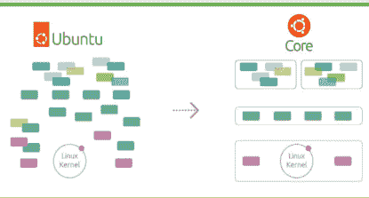

带有 GDM 的 Ubuntu Core 测试版本在 GitHub 上，以及如何在演示虚拟机中测试的说明。

## 固件

### AMD 将拥抱开放系统固件？

科技公司发布了 OpenSIL。

AMD 已宣布计划发布 OpenSIL（开放源代码硅初始化库），并附带 AMD Coreboot 支持。从理论上讲，这将使用户和制造商摆脱专有 UEFI/BIOS 固件的束缚，实现更好的漏洞检测能力和更好的兼容性。开源爱好者也可能欣赏真正免费的固件能减少攻击者隐藏硬件后门以进行监视的攻击面这一保证。

如果这听起来很熟悉，那是因为 2011 年，AMD 承诺支持所有未来处理器上的开源基于 Linux 的 BIOS 实现 Coreboot。然而，对 AMD CPU 和主板的这种支持并不是普遍的。

2014 年，AMD 还发布了 AMDgpu，这是为其 Radeon 系列显卡开发的开源 Linux 驱动程序。在同一篇博客文章中，AMD 首席固件架构师 Raj Koppur 解释道：“AMD OpenSIL 是三组静态链接库 – xSIM（x86 硅初始化库）、xPRF（x86 平台参考库）和 xUSL（x86 工具和服务库），它们可以在编译/链接时静态链接到任何主机固件中。”

相关的主机固件显然可以包括 Coreboot、Oreboot、FortiBIOS 和 Project Mu 等开源解决方案。目前，OpenSIL 仅作为概念验证提供。OpenSIL 固件架构规范尚未完整发布。

编码社区的回应总体上积极的，包括与 2022 年 AMD 自身采用 Genoa 处理器配合参考服务器使用的实现的比较，以及 OpenBMC 的采用，OpenBMC 是一个开源发行版，其目标是在没有专有代码的情况下生成基板管理控制器的实现。

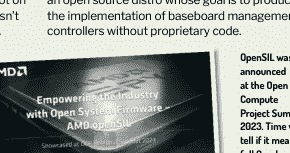

OpenSIL 在 2023 年开放计算项目峰会上宣布。时间将证明它是否意味着对 Coreboot 的全面兼容性。

## 桌面环境

### Gnome 吉隆坡更新

Gnome 44.2 修复了错误并增加了新功能。

Gnome 44 吉隆坡桌面环境系列的第二次更新（44.2）已发布。

Gnome 项目已鼓励所有运行 Gnome 44 的用户升级。

最新版本包括在首次检查因任何原因失败后，在登录时检查更新。它还减少了 Gnome 空闲时使用的后台资源。

Nautilus 文件管理器也进行了更新，并修复了多个错误，包括对显示可扩展文件夹的支持改进。最新更新还包括 Gnome Maps 44.2。其中包括一些调整，例如在存在航向时显示用户位置标记的正确旋转，以及为具有带有标题图像的 Wikidata 条目的地点显示缩略图。

在触控板无法禁用的情况下，现在也可以隐藏触控板行，并且网络连接编辑器中一个与易失性单选按钮相关的小错误也已修复。

Epiphany 网络浏览器已升级到 44.3 版本，解决了几个错误，而 Gnome Boxes 的最新版本（44.2）现在允许用户保留他们创建的任何虚拟机的后台运行和 3D 加速配置。它还修复了为虚拟机创建的共享文件夹有时未出现的问题。

在以下链接查看发布说明：https://discourse.gnome.org/gnome-44-2-released/15563

## 观点

### 加入我们！


Mike Saunders 曾为 LXFT 撰稿（以及更多期刊），现供职于文档基金会（The Document Foundation）。

> 大型、成熟的开源项目对于潜在的新贡献者来说可能令人望而生畏。参与的最佳方式是什么？为什么有如此多不同的沟通渠道？如果需要帮助，我们应该联系谁？

这是我们在 LibreOffice 社区面临的挑战。代码库主要包含七百万行 C++，加上大量依赖项。但我们一直在努力简化构建过程，并聘请了开发导师，帮助新编码者踏入水（或海）中试水。

还有许多其他参与方式，包括 UI 设计、市场营销、质量保证、文档、翻译和基础设施 – 并且在五月份，我们组织了一场将用户转化为贡献者的活动。LibreOffice 月奖励了所有提供帮助的人员贴纸包！

在该月份期间，338 人加入了进来，反映了一个健康的 LibreOffice 社区。（而这主要是志愿者 – 在商业领域还有很多其他人。）

在 https://tinyurl.com/mol-may2023 查看结果，并关注 11 月的下一届 LibreOffice 月！


## 观点
头条
韦斯顿！


Weston 是一个 Wayland 合成器。于 5 月中旬发布的 v12.0 版本带来了多项增强功能，包括两个新的后端、对多扫描输出设备的支持以及新增的协议实现。除了这些功能外，我们还添加了许多修复措施和内部变更，这些变更将进一步促进颜色管理等功能以及同时加载多个后端的能力的整合。

backend-drm 经历了许多变化：平面旋转、alpha 和 HDMI 内容类型属性已集成完毕。根据客户端的内容缓冲区，合成器可以利用属性来发挥可用的显示硬件功能。此外，支持将多个 GPU 作为扫描输出设备（KMS）的功能也已落地，并在启动合成器时通过传入额外设备即可启用。

随着我们朝着能够加载多个后端的目标迈进，有两个新的后端已经面世。backend-vnc 与 backend-rdp 类似，基于 ami 和 neatvnc 库。它支持 TLS 和用户身份验证，而另一个是 PipeWire 后端，它为每个输出创建一个节点，可用于捕获 Weston 的输出以便与其他应用程序进行处理。

## 软件
Wine 将实行员工持股
CodeWeavers 设立了一家信托。


CodeWeavers 正在设立一家员工持股信托，该信托将持有这家软件公司的控股权。

这是一个令人振奋的消息，因为该公司是开源 Wine 项目背后的推手，该项目使得许多 Windows 程序能够在 Linux 上运行。它也是 Steam Deck 使用的 Proton 兼容性层背后的技术支撑。

在新的所有权结构下，该信托最终将成为公司的唯一股东。在此期间，CodeWeavers 前首席执行官 Jeremy White 已卸任，现担任董事会主席兼信托监管委员会成员。他将继续持有股份七年，之后信托将成为唯一所有者。

在 CodeWeavers 的新闻稿中，White 解释道：“信托机制使得公司能够为了员工和更广泛社区的利益而运营，而不是为了股东的利润。我相信这将创造一个更可持续、更道德、更公平的企业。”

同一份新闻稿重申了 CodeWeavers 对开源原则的承诺。

## 发行版
Ubuntu 18.04 转入 ESM
Bionic Beaver 凭借高级功能重获新生。

大多数 Ubuntu 用户都熟悉 LTS（长期支持）版本，这些版本在发布后由 Canonical 官方支持五年。

官方层面上，Ubuntu 18.04（Bionic Beaver）已于今年 4 月到达生命周期终点。然而，Canonical 正为该操作系统提供扩展安全维护（ESM），正如它此前对 Ubuntu 16.04 LTS 所做的那样。

这意味着那些尚未升级到最新 LTS 版本的企业仍然可以接收关键的安全更新。Canonical 建议通过 Ubuntu Pro 订阅来实现这一点的最佳方式。

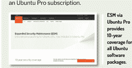

## 软件
Thunderbird 启用新标志
5，4，3，2，1……Thunderbird 邮件客户端经历了一次革新，并启用了新标志。

5 月下旬，Thunderbird 的产品经理 Ryan Sipes 宣布，这款著名的邮件客户端正在“享受复兴”。

作为这次翻新的部分，在设计首个 Thunderbird 标志 20 年后，Jon Hicks 被邀请重新构想 Sipes 所称的原始“信封上的假发”设计。

初步反馈积极，用户将其比作翻新后的 Firefox 标志。请在 https://blog.thunderbird.net/ 阅读有关 Thunderbird 最新发展的更多消息。


## 新闻台

## 发行版观察
自由软件沙发背后是什么？

### **ARMBIAN 23.05.1**
Armbian 是斯洛文尼亚为数不多的 Linux 项目之一，它已经存在了大约 10 年，但在此期间只发布了两个稳定版本。Armbian 的重点在于为 ARM 开发板制作 Linux 发行版，例如 Banana Pi、Orange Pi、Pine 64 以及其他设备。它还有一个通用的 AArch64 镜像。

Armbian 的最新版本 23.05（代号 Suni）拥有一个基于 Debian 12 和 Ubuntu 22.04 的 LTS 内核。

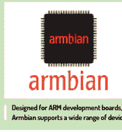

### **MX LINUX 23 BETA 1**
继两个未公布的 Alpha 版本之后，MX Linux 23 的第一个 Beta 版本已正式发布。该操作系统始终基于最新的 Debian 稳定分支（当前为 Debian 12 Bookworm）和 MX 软件库。默认情况下，它使用 Xfce 桌面环境（当前为 v4.18），但也可以使用 Fluxbox 1.3.7 和 KDE/Plasma 5.27 提供的衍生版本。

最新版本的启动菜单现在允许用户检查介质。安装程序还支持交换文件和交换分区。

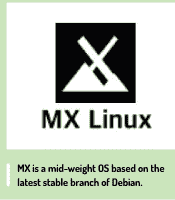

### **ARCOLINUX 23.05.4**
ArcoLinux 基于 Arch Linux，并使用 Calamares 安装程序。与 Arch 类似，它遵循滚动发布模型。主要版本 ArcoLinux\_{main} 功能齐全，附带 Xfce 桌面、OpenBox 和 i3 窗口管理器，以及一套完整的软件。

还有一系列极简 ISO 可供选择，例如 ArcoLinuxD，它不包含桌面环境或预装软件，因此你可以根据自己的需求定制操作系统。主网站上有大量关于如何操作的视频教程。


### **ATHENA OS 2023.06.01 PARTHENOS**
Athena 也基于 Arch Linux。然而，其主要重点在于帮助用户学习如何精通网络安全。

这家总部位于瑞士的 Linux 新手产品可以访问臭名昭著的 BlackArch 渗透测试工具库，但描述自己为“轻量级”，即预装软件保持在最低限度。

最新版本（代号 Parthenos）集成了 Hack The Box VIP 内容，用于玩已退役的机器。它还附带一个 OpenAI ChatGPT 桌面客户端。默认桌面环境是 Gnome。


## 观点
传播消息


**Joe Brockmeier**
*是 Percona 的社区负责人。*

WordPress 最近迎来了 20 周年，这是一个回顾其影响的好机会。它从一个巧妙的、易于爱好者使用的博客平台演变成了一个通用的工具，驱动着互联网的巨大组成部分。

在此过程中，WordPress 成为了开源的出色大使。那些没有任何理由去触摸桌面 Linux 或进行编程的人仍然想要运行博客或网站。因此，他们亲自尝试了 WordPress，并且通常体验良好。更棒的是，WordPress 是一个非常友好、乐于助人的社区。

它还与 MySQL 有着共生关系。数百万从未有过其他理由去接触数据库的人，通过为 WordPress 建立 MySQL 数据库而“下水”了。MySQL，作为驱动 WordPress 的 LAMP 栈的一部分，帮助 WordPress 传播开来。

MySQL 足够强大，可以运行流量巨大的网站，但它对资源也很友好，对于数百万需求较为适中的用户来说易于使用。

二十多年来，WordPress 借助 MySQL，赋予了数百万乃至数亿人发声的空间和网络家园。这是一项惊人的成就，我迫不及待地想看看未来 20 年会带来什么！

## 风声
明智之举


Jon Masters 参与 Linux 已超过 22 年。

我最近主办了一场专注于服务器标准的行业聚会。我与一家大型芯片公司的一位朋友聊了起来，多年来他一直负责协助在新芯片上引导 Windows 和 Linux。当芯片从工厂返回时，最初几周是测试逻辑块、分数、总线、IO 等使之运作的时期，此时一切处于某种有序的混乱之中，人们会在实验室里跑来跑去。

我的朋友告诉我一些有趣的事情：他说 Windows 对工程师来说是一个真正的考验，因为它不是开源的。对于 Linux 而言，你可以查阅源代码，或联系友好的内核开发者，所以他最终真正学会机器每一部分的方式，是当他不得不反汇编 Windows 代码，并从第一性原理出发，查看反汇编的二进制文件来理解他正在试图做什么的时候。

就像你通过运行 Oblivion（一个 ELF 程序）得到的那种，或者通过类似 NSA（是的，那是 NASA）的 Ghidra 逆向工程框架获得的，该框架与编译器资源 godbolt.org（以 Matt Godbolt 命名）结合使用，展示了不同的编译器如何编译代码。试着阅读内核二进制文件——这很有启发性！

## 内核观察

Jon Masters 紧跟 Linux 内核的最新动态，所以你不必费心了。

Linus Torvalds 宣布 Linux 6.4-rc6，他说：“我想过去一周我们没有发生什么特别有趣的事情，整个 6.4 发布真的感觉相当顺利。敲木鱼吧，这可是著名的最后时刻的话，你知道那个流程的。”这与之前的 rc5 版本形成对比，在那次发布中，Linus 不得不撤销一个意图良好的模块加载修复，结果导致某些系统崩溃。如果事情继续沿着当前轨道发展，我们很可能在下一期的刊物中报道 6.5 合并窗口（这是在新内核发布周期中合并破坏性补丁的时期）。

最后，本月我想向 Linux Weekly News 致敬，他们最近报道了 Linux 存储、文件系统、内存管理和 BPF 峰会。他们的报道包括关于 CXL（Compute Express Link，计算快速链接）持续发展的多篇解读，CXL 在某些方面被视为 PCI Express 的继任者，允许诸如通过 CXL 进行内存扩展等创新。涵盖的使用案例之一是利用数据中心级别的共享 CXL 内存池，在不复制内存的情况下进行虚拟机热迁移。

如今，Linux 越来越多地用于实时环境，例如涉及工业自动化（Linux 曾戏谑地说疯子使用 Linux 控制激光焊接机器人）或股票高频交易。确实，一项持续数十年的努力正在进行，以将 PREEMPT-RT 补丁上游化，其中许多部分在过去几年终于进入了 Linux 代码树。这些补丁旨在解决的一个关键问题是优先级反转，即低优先级任务（如简单的簿记任务）可能会阻塞实时任务在需要时取得进展。

这实际上也是 NASA 火星探路者计划中发生的情况（尽管它运行的是商业 RTOS 而不是 Linux）。通常，优先级反转是通过暂时“提升”（继承）依赖任务的优先级来解决的，否则该任务优先级较低，从而使其拥有依赖其输出的实时任务的优先级。因此，当实时任务需要关键锁时，非 RT 任务可能会被暂时提升，以便它能够释放所需的锁。

正如 John Stultz 在他关于代理执行的邮件中所说，这是“优先级继承的一种广义形式”。观察这一过程很有趣，因为它确实可能改善 Linux 处理实时的整体能力。这不仅将惠及 NASA 火星车，还将惠及运行 Linux 的音频工程师和游戏狂热者。

## 持续开发...

Randy Dunlap 提醒 Linus（以及其他人）scripts/parse-maintainers.pl 脚本的存在，该脚本用于整理内核 MAINTAINERS 文件中的条目。他指出“这个文件很大。自上次排序以来，有 100 多条顺序错误的条目”。Linus 回应道：“唉。这个文件最容易产生冲突，而排序它会变得很糟糕”。有人建议在每次 RC1 时进行排序（因为 Linus 在那时实际上拥有该代码树的管理权）。

Matthew 'Willi' Wilcox 发布了“Futexes & Folios”，并附带一个初始补丁，展示了他如何将内核的 futex 锁定代码转换为使用他更新的 folios，而不是传统的 page 结构。例如，CPU 中存在的硬件 MMU（内存管理单元）（以及 GPU 等）操作于以页为大小的内存单元，通常这些页是 4096 字节（4K）。Folios 旨在尽可能地将这些页任意分组为更易于管理的较大块。Futexes（快互斥锁）通常用于支持 Linux 应用程序代码中使用的 pthread 互斥锁。将内核迁移到 folios 是一个持续的过程。

针对 StarFive 基于 RISC-V 的 SoC（片上系统，常用于该架构的 P1 类似板卡），更多补丁仍在陆续提交。本月的补丁针对这些 SoC 上使用的相机子系统。目前，对于这种低成本开发板，上游状况看起来相当不错。


关于开源或内核有令人好奇的问题吗？
无论你的水平如何，请发送邮件至 answers@linuxformat.com


Neil Bothwick 住在一栋 Tux 形状且由 Linux 驱动的房屋里，老实说！

### 问 虚拟磁盘已满

> 我在一台 VirtualBox 虚拟机中安装了一个相当旧版本的 Linux Mint Xfce。虚拟磁盘的大小约为 20GB，现在已经占用了 18GB。我该如何找到大型软件包，以便查看它们是否被使用过，并在需要时删除它们？
> * Cameron Wright*

**答**

你是虚拟磁盘空间不足，还是承载它的物理磁盘空间不足？VirtualBox 默认创建动态大小的虚拟磁盘。这意味着如果你创建了一个 20GB 的磁盘并加载了 10GB 的数据，虚拟磁盘文件的大小仅约为 10GB。随着你不断添加数据，文件会变大，但请记住，如果你从虚拟磁盘中删除数据，文件并不会缩小。因此，18GB 的大小仅表示它在某个时刻曾经承载过如此多的数据。如果你删除了，比如说，5GB 的数据，即使它现在只持有 13GB 数据，该文件仍然是 18GB。

不过，这些空间并没有丢失，因为当你添加更多数据时它们会被使用。因此，第一步是在虚拟机内的终端中运行 `$ df -h` 来检查实际使用了多少空间。

如果实际使用量远小于磁盘文件占用的 18GB，你可以调整虚拟磁盘文件的大小以回收未使用的空间，但随后当你向虚拟磁盘写入数据时，它又会变大。从另一方面来看，如果虚拟磁盘即将满，但宿主系统上有大量空闲空间，你可以在 VirtualBox 的“虚拟媒体管理器”部分扩大虚拟磁盘。请在虚拟机未运行时执行此操作。当你启动虚拟机时，直到你打开分区管理器或 GParted 并调整根分区的大小之前，额外的空间才可供你使用。

如果你需要在虚拟机内部回收空间，首先应该查看缓存目录，特别是主目录中的 `.cache` 和 `var/cache/apt/` 归档。后者包含软件包管理器下载的软件包文件。这些文件可以安全删除。清理完旧文件后，将注意力转向已安装的软件包，并使用 Aptitude 获取按大小排序的列表。Aptitude 可能未安装，但你可以通过软件包管理器安装它，它不需要占用太多空间。它是基于 Debian 的系统上标准的软件包操作工具。然后打开终端并运行此命令：`$ aptitude search -sort -installsized -display-format-"%%s" "-" | less`

`--sort` 选项指示其根据已安装大小对输出进行排序，`-` 开关将排序设置为按大小降序（默认是升序，你想先看到占用空间大的软件包）。`-display-format` 选项将输出设置为软件包大小后跟其名称，`-` 标志将搜索限制为已安装的软件包。我们将输出通过 `less` 管道传输以在分页器中读取输出——你也可以将其重定向到文件。引号的存在是为了防止 shell 试图将 `-` 解释为用户指定的一部分。

一旦你拥有了这个列表，你就可以决定哪些软件包可以不用并卸载它们，但有些软件包如果其他软件包需要它们，将无法卸载。如果你想缩小虚拟磁盘文件，请在删除所有不需要的东西之后进行。首先你必须用零填充未使用的空间，因此打开终端并运行：`$ dd if=/dev/zero of=zero file`。你可以在主目录中以普通用户身份执行此操作。一旦没有更多可用空间，它就会以错误状态退出，你可以使用 `df` 来检查。删除 `zero` 文件——Linux 不喜欢在满的磁盘上运行——然后关机。在宿主上打开终端并运行：`$ vboxmanage list disks`。识别你想要缩小的虚拟磁盘，并运行：`$ vboxmanage modifydisk path/to/virtual-disk --compact`

### 问 隐晦的容量

我使用 CloneZilla 将我的 Debian 笔记本电脑中的 M.2 驱动器从 500GB 升级到了 1TB。现在我还有 500GB 未分配空间，想要将我的主 LUKS 分区扩展到剩余空间。搜索后，我发现了一些相当令人困惑的信息。这是当前的布局：

```
nvme0n1p1  300M /boot/efi
nvme0n1p2  460G 加密根分区
```

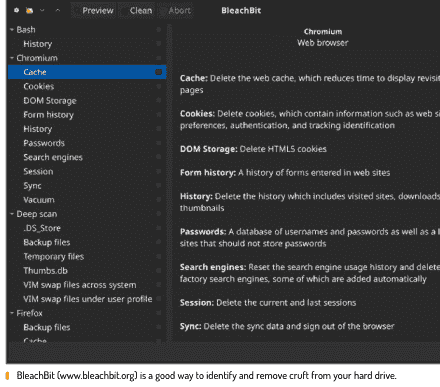

BleachBit (www.bleachbit.org) 是识别和删除硬盘中垃圾文件的好方法。

```
nvme0n1p3  16G 加密交换分区
未分配 500G
```

*Jason Palmer*

这是一个简单的任务，但你的交换分区现在位于驱动器中间，这使其变得复杂。在调整根分区大小之前删除交换区域，然后在之后重新创建它是简单的解决方案。只要你在调整大小时不执行任何密集型内存操作，这就不应该是个问题。如果你担心这一点，你可以创建一个交换文件用于整个处理过程。或者，你可以从 Live 发行版执行所有操作；在 Live 系统上扩展文件系统通常是安全的。请记住，任何涉及文件系统的操作都有轻微的损坏风险，但所有重要内容应该已经备份。所有这些操作都应作为 root 执行或前置 `sudo`。首先移除交换分区：

```
$ swapoff -a
$ swapoff /dev/mapper/CRYPTSWAP
$ cryptsetup close CRYPTSWAP
```

CRYPTSWAP 是加密交换容器的名称，它应该由第一个命令返回。现在使用你首选的分区工具删除交换分区并在磁盘末尾创建一个新的。然后删除并重建根分区。不要担心你目前正在使用这个分区，像 `gdisk` 和 `parted` 这样的工具不会在你告诉它们之前将更新的分区表写入磁盘。现在你有一个从与原始位置完全相同的地方开始的新分区，只是更大了。

下一步是将加密容器调整为填满新分区，然后调整文件系统以填满容器。这两个命令都不提供大小参数，因为它们默认使用所有可用空间：

```
$ cryptsetup resize CRYPTROOT
$ resize2fs /dev/mapper/CRYPTROOT
```

将 CRYPTROOT 替换为你的加密根容器的名称。如果你使用的是 ext4 以外的文件系统，请查阅其文档了解调整大小的命令。`df` 命令应能确认你的根文件系统现在是你期望的大小。最后，为交换分区创建一个新的容器并初始化它：

```
$ cryptsetup luksFormat /dev/nvme0n1p3
$ cryptsetup luksOpen /dev/nvme0n1p3 CRYPTSWAP
$ mkswap /dev/mapper/CRYPTSWAP
$ swapon /dev/mapper/CRYPTSWAP
```

最后，更新 `/etc/fstab` 中的条目以匹配你刚刚分配的名称，除非你重用了旧名称。

### 快速参考：TREE

图形文件管理器允许你查看目录或其子目录的内容，shell 中的 `ls` 和 `dir` 命令也是如此。大多数图形管理器还允许你以树形格式查看目录，在一个视图中同时看到子目录及其内容。有一个常被忽视的 shell 命令做类似的事情，它的名字毫不令人惊讶地叫做 `tree`。不带参数运行时，`tree` 打印当前目录及其下面目录的文件和目录列表。与 `ls` 一样，你可以传递要列出的目录名称，并且有几个选项可以改变输出。下表列出了其中一些最有用选项。

还有更多选项，包括以 XML、HTML 或 JSON 格式输出，控制输出的颜色化等。手册页详细列出了所有选项。它不能取代 `ls`，但 `tree` 更像是它的补充，每个命令执行有用但不同的功能。

| 选项 | 功能 |
| :----- | :------- |
| a | 显示隐藏的 dotfile |
| L N | 仅深入 N 个目录 - 适用于像有很多嵌套子目录的主目录 |
| D | 显示每个文件的最后修改时间 |
| P | 显示每个文件的类型和权限 |
| h | 以人类可读格式显示每个文件的大小 |
| prune | 隐藏空目录 |
| P *模式* | 仅显示匹配给定通配符模式的文件 |
| f | 打印每个文件的完整路径 |

#### 可移动磁盘

> 我的机器上有几个 Linux 发行版。经常当我连接额外的硬盘或类似设备时，驱动器顺序会改变，某些 Systemd 服务找不到文件系统，因为它之前是 sdcis1，现在变成了别的东西。然后我必须等待 90 秒直到它放弃。我在 /etc 中 grep 了所有地方，找不到任何关于该超时的引用，我想把它改成大约 5 秒。我不熟悉 Systemd，但我有 10 到 15 个使用它的 Linux 操作系统，我偶尔会启动它们。
>
> **George Bates**

你可以在 `/etc/systemd/system.conf` 中更改此超时 - 设置项为 `DefaultDeviceTimeoutSec`。你也可以在 `/etc/fstab` 中为单个设备更改它，方法是在 Options 字段中设置 `x-systemd.device-timeout`。但是，这两者都不能解决你的问题，它们只是让该问题的症状少困扰 55 秒。此外，你需要在每个发行版上都进行更改。

你必须使用不会改变的因素来指定要挂载的设备。最有用的两个是 UUID 和 LABEL。每个文件系统都有一个 UUID（通用唯一标识符


### 答案

标识符，尽管它并不严格唯一），你可以使用 `lsblk` 命令查看它：$ lsblk -o UUID /dev/sdc15

现在你可以使用 UUID 代替设备名称写入 fstab，就像这样：
UUID=xxxxxx /挂载点 ....

这行得通，但可读性不太高，这也是为什么使用 UUID 的发行版通常在 `/etc/fstab` 中会有很多注释。你可以通过改用文件系统标签来解决这个问题。格式化文件系统时默认不会添加标签，除非明确指定，但你之后可以添加标签而不影响文件系统本身。这在运行多个发行版时非常有用，你可以为每个发行版的 **根** 分区命名，从而清楚每个分区的用途。要为 ext4 文件系统添加标签，请使用 `e2label`：
$ sudo e2label /dev/sdc15 ubuntu

如果你不指定标签，`e2label` 会返回当前标签。然后你可以在 `fstab` 中像这样挂载它：
LABEL=ubuntu /挂载点 ....

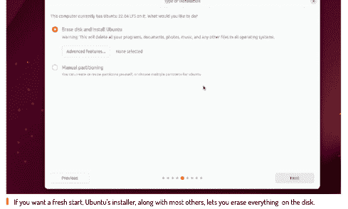

如果你想要一个全新的开始，Ubuntu 的安装程序（以及大多数其他发行版）允许你清除磁盘上的所有数据。

#### 超级图形界面

我有一个需要用 root 权限运行的 shell 脚本。当我在终端中通过 `sudo` 运行时，它是有效的，但我希望也能从图形界面运行它，例如使用工具栏上的图标。过去我会使用 `gksu` 来获取 root 权限，但 Linux Mint 中已经没有这个命令了。有没有一种替代方案，不需要终端输入密码？

*Alex Barnett*

是的，`gksu` 不再受支持，不过 KDE 用户仍可使用 `kdesu`。现在应该使用的程序是 `pkexec`，它是 `policykit` 的一部分。你可以这样运行：
$ `pkexec` env DISPLAY=$DISPLAY XAUTHORITY=$XAUTHORITY HOME=$HOME yourscript

这会从环境中拉取相关设置。使用 `sudo` 时通常也需要类似步骤，除非你使用 `-E` 标志，然后通过 `--user` 指定运行用户，或者如果不指定用户则默认为 root，就像这里一样。还有另一种方法来解决这个问题，即配置 `sudo` 允许该脚本以 root 身份运行而无需输入密码。如果允许该脚本以 root 身份运行且无需密码是可接受的，那么请通过运行 `$ sudo visudo` 编辑 `/etc/sudoers` 文件，并添加这一行：
username All=(ALL) NOPASSWD: /完整/路径/到/你的/脚本

这允许你使用 `sudo` 运行脚本而无需输入密码。你可能需要使用 `sudo -E` 以在执行时保留环境变量。脚本名称被硬编码在 `sudoers` 中，只有 root 才能编辑该文件，但你也需要确保脚本文件本身也是如此。否则，某人可能会编辑该脚本以执行他们想要的任何操作，并拥有完整的 root 权限。要么将其放在只有 root 才能编辑的地方，例如 `/usr/local/bin`，并且属主为 root；或者使用以下命令使脚本不可变：
$ `chattr` +i /完整/路径/到/你的/脚本

#### 神秘的 Ubuntu

我买了一台旧的但兼容 Linux 的系统。目前它够用了，但卖给我的人搭建了这台机器并安装了 Ubuntu 22.04。运行得很好，但我无法安装任何新软件或调整现有设置。我无法通过身份验证，也无法更新任何东西。接手时，我朋友说他不记得是否有密码，但当时认为没有。显然，它确实有密码，而他也想不起来。

*Ava Bell*

你并不确切知道这台电脑上装的是什么，显然安装它的人也不知道。虽然在这类系统上重置密码是可能的，但更安全的选项是进行全新安装。如果你已经使用过它，请将你的 **home** 目录备份到外部硬盘或 U 盘。由于你没有密码，系统中不会有任何其他自定义设置。你最好的选择是下载你偏好的 Ubuntu 版本，将其复制到 U 盘（如果电脑有 DVD 光驱，也可以刻录到 DVD），然后从中启动。运行安装程序并选择“使用整个磁盘”选项。这将清除磁盘上已有的任何内容并设置全新的 Ubuntu 安装。安装程序在创建用户时会要求你设置密码，Ubuntu 安装程序总是这样，但这个密码是你自己选择并 hopefully 能记住的。之前安装的所有痕迹都会被擦除。如果你从 **home** 目录备份了文件，可以在启动新系统后恢复它们。

如果你想在不重装的情况下重置密码，你需要知道 **根** 分区的用户名和位置。通过在终端中运行 `findmnt /` 获取后者。从 live 发行版启动并打开终端。将 `/dev/sdXN` 替换为根分区，使用以下命令挂载根文件系统：
$ `mkdir` -p /mnt/root
$ `mount` /dev/sdXN /mnt/root

现在你可以设置密码：
$ `passwd` --root=/mnt/root username

系统会提示你输入密码，更改将写入由 `--root` 选项指定的系统，而不是当前正在运行的系统。重启后，你的用户应该会有一个全新的密码。

### 立即获取帮助！

无论你的技术水平如何，我们都很乐意尝试回答你发送到 `answers@linuxformat.com` 的任何问题。我们都曾经遇到过难题，所以请不要害羞。然而，我们是很普通的人（很多人怀疑 Neil 早就退出了），因此你提供尽可能多的信息非常重要。如果某个功能在一个发行版上有效但在另一个发行版上无效，请告诉我们。如果你遇到错误消息，请告诉我们确切的错误消息以及你执行了哪些操作触发了它。

如果你拥有或怀疑存在硬件问题，请告诉我们硬件详情。考虑安装 `hardinfo` 或 `lshw`。这些程序会列出你机器上的硬件，因此请将输出发送给我们。如果你不愿意或无法安装这些程序，请在 root 终端中运行以下命令，并将 `system.txt` 文件也发送给我们。
`uname` -a > system.txt
`lspci` >> system.txt
`lsmod` -vv >> system.txt

### 邮件服务器


你是否有紧迫的 Linux 相关问题想要讨论？请写信给 Linux Format, Future Publishing, Quay House, The Ambury, Bath, BA1 1UA 或发送电子邮件至 letters@linuxformat.com。

### 建议箱

应该设立一个专栏，展示 Linux 用户希望 Linux 发行版和软件增加的功能。可以包含用户的愿望（含一些细节）以及专家对该愿望的评论或分析（为什么可以实现或不能实现）。也许可以为选中的投稿提供奖品，例如免费订阅或一些小物件，如 *Linux Format* 马克杯、笔等。

T Smith

Neil 说...

我挺想要一个 *Linux Format* 马克杯的... 这个主意不错，但我不确定我们收到的信件数量是否足以支持这个专栏。如果你有建议，我们非常乐意在 *Mailserver* 栏目中刊登——毕竟，这些页面是为了展示读者的意见。

### 偏离主题

我回顾了提到 Blender 的存档，找不到任何涉及使用 Blender 从免费可用的全球地图（如 Google Earth 和 Google Maps）以及提供高程数据的免费数字地形模型数据集中创建 3D 图像的教程。

我只是在想，Michael Reed 是否愿意针对 *Blender* 的这方面功能做一个教程——这对于徒步旅行者和当地环境关注（如洪水调查）很有用，也是许多艺术可能性的基础。

Colin

Neil 说...

谢谢你的建议。Blender 对于这类活动来说感觉有点笨重，但只要能将地图数据转换为 Blender 能理解的形式，就没有理由行不通。我想象有专门的查看工具可以做到这一点，但它们可能无法提供 Blender 的渲染功能。Michael 正在回顾 2D/3D CAD 软件包，这可能也是一个选项。我们在 https://github.com/ellemichel/MapsModelImporter 找到了一个 Google Maps 导入器项目。

### 地图它

我想创建一些叠加了个人信息的地图，例如路线、回忆等，并且我希望这些叠加数据存储在本地，且仅在我的本地网络上可访问。我使用 OpenSuSE 和 KDE。你推荐哪些数据源和工具？

Chris Tucker

Neil 说...

KDE 的映射工具叫做 Marble Maps。它使用了 OpenStreetMaps 以及许多其他开源工具，例如 DigitKam。这应该是你最好的选择，因为它提供了创建自定义地图的完整选项，甚至可以为其他行星或卫星创建地图供个人使用。请查看文档，看看是否有帮助：https://techbase.kde.org/Marble/CustomMaps/。不过，可能有更简单的方法。有人能帮忙吗？

### 良好的愿景

多年来，我享受并学到了很多来自 *Linux Format* 杂志的内容。我真的很喜欢 **LXF297** 中的“逃离 Windows”文章。唯一让我无法完全摆脱 Windows 操作系统的是我使用 Microsoft Outlook Notes。我有超过 350 条笔记分布在 15 个类别中，我在 Outlook Notes 中使用它们。我已经用 LibreOffice 替代了 Microsoft Office。如果你能推荐一些合适的 Linux 软件来替代 Outlook Notes，以及能转换 Outlook Notes 扩展名 (*.pst) 的软件


### 本月来信

#### 灌溉难题

我一直在开发一款软件，旨在减少灌溉系统的水用量。我的目标是根据需要灌溉的植物种类来计算耗水量。我还希望将降雨数据和温度对植物生长的影响纳入考量。

许多大学一直在研究并发布温度如何影响多种植物生长的数据，我将这些数据纳入了最新的计算模型中。

最终成果是一款运行在树莓派上的程序，它能大幅减少草坪和花园的用水量。与旧的常规灌溉电脑相比，我成功将水费降低了约 60%。

我联系你们是因为现在软件已经开发完成，希望能引起关注。如果该系统被广泛采用，将有助于减少水资源消耗，并为用户节省大量资金。项目链接为 https://gitlab.com/ftdaling/。
**扬丁斯·达林 (Jantinus Daling)**

**尼尔说……**
又一个精彩的读者项目。你们真是太有才了，令人惊叹！我们会尽力为它宣传，但希望灌溉社区（这算一个群体吗？）会充满热情并涌出各种想法！祝好运！

#### 转向 Linux

[OCR 错误修正说明：以"to the Linux extension..."开头的原文似乎是被截断的上一问题的结尾。根据上下文，用户正在寻求转向 Linux 的建议。回复针对此进行了说明。]
如果我能找到一个良好的替代品，将我的 Windows 邮件数据库（PST 文件）迁移到 Linux 扩展中，这将帮助我完全过渡到 Linux 世界。你们对此有什么建议吗？
**HW 佩恩 (HW Payne)**

**尼尔说……**
我记得以前那些 PST 文件；当时有专用的文件阅读器，可以让你直接阅读单封邮件等，所以我想象很可能有某种工具可以导入或转换它们。事实上，我认为*Outlook* 提供了针对 *Notes* 的导出选项，位于 *Notes: 文件 > 打开和导出 > 导入/导出 > 导出到文件*，你可以将它们保存为 CSV 文件。*Joplin*（https://joplinapp.org），我们将在下一期中详细介绍，有一个插件支持 CSV 导入。我还没试过，但理论上是这样的——如果你能将其导入 *Evernote* 或 *OneNote*，使用 *Joplin* 会变得更加简单直接。还有许多其他笔记程序，例如：*Standard Note*、*Simple Note*、*Zim-wiki* 等。

#### 非垃圾邮件

*Ubuntu* 的软件中心（Snap Store）里或者你们可能已经知道或使用的 *GitHub* 仓库中，有任何邮件过滤器吗？不一定专门用于 *Thunderbird*，但希望能兼容整个体系，比如 *Hotmail*、*Gmail* 等。我只是想对抗垃圾邮件进入我的收件箱或垃圾邮件箱，而不是不得不手动清理这些邮件。
**杰森·朗 (Jason Long)**

**尼尔说……**
我认为你误解了垃圾邮件过滤器及电子邮件的整体工作原理。像 *Gmail* 和 *Hotmail* 这样的在线邮件提供商在他们的服务器上存储和处理你的邮件，因此如果你使用浏览器访问它们，你所要求的是无法实现的。你可以选择使用 *Thunderbird* 或其他本地邮件应用从这些系统下载邮件到桌面，此时你可以使用 *Thunderbird* 的垃圾邮件过滤器或其他插件，但如所示，系统级过滤器并不是一个真正的存在。

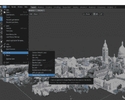
在 *Blender* 中创建地图是可行的，但我们还不知道怎么做……

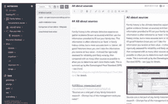
*Joplin* 将在下一期得到全面介绍。


---

### 订阅

每份印刷版或捆绑版订阅均赠送
**JOBY 磁吸无线充电器**
价值 **£29.95！**


标准六个月印刷版或捆绑版订阅附赠 JOBY 磁吸无线充电器。

- 支持 Qi 无线充电，并兼容 MagSafe。
- 易于使用——只需将智能手机放在充电盘上即可。无需插电即可充电！
- 铝制机身散热性能良好。
- 超薄设计非常适合家庭、办公室或外出使用。

立即订阅！
www.magazinesdirect.com/LIN/B93G
致电 0330 333 1113 并引用代码 B93G

---

### 今日省钱！订阅

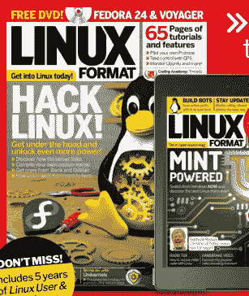

#### »加享：独家访问 Linux Format 订阅者专区！

1000 多期无 DRM 限制的 PDF 存档和文章！即时访问第 66 期（2005 年 5 月），包含教程、访谈、专题报道和评测。请访问 linuxformat.com

12 个技巧可在 www.magazinesdirect.com 订阅者页面获取

#### »选择您的套餐！一年份的刊物。每六个月支付一次。简单明了。


##### 年度印刷版


仅 £33.50 / 每 6 个月
12 个月内 13 期印刷版 Linux Format，节省 20%

##### 年度印刷 + 数字版

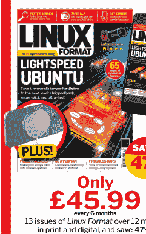

仅 £45.99 / 每 6 个月
12 个月内 13 期印刷版和数字版 Linux Format，节省 47%

##### 数字版

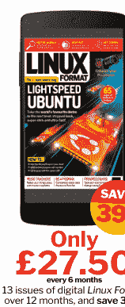

仅 £27.50 / 每 6 个月
12 个月内 13 期数字版 Linux Format，节省 39%

条款和条件：优惠截止日期为 2023 年 7 月 31 日。优惠仅面向英国新订户。价格保证在前 12 个月内有效，我们将在价格变动前通知您。首个订阅期刊的交付可能需要最多六周（海外可能多达八周）。您的礼品将在首次付款到账后 60 天内单独配送。礼品仅适用于英国本土的订户。颜色可能与所示有所不同。数字订阅不可选礼品。完整订阅费率为期 12 个月（13 期），包含邮费和包装费。如果所订杂志的出版频率每年发生变化，我们将履行已支付期数的承诺，而非订阅期限。完整条款和条件请访问 www.magazinesdirect.com/terms。如有疑问，请致电 +44 (0) 330 333 1113。电话线在英国时间周一至周五上午 9 点至下午 5 点开放，或发送电子邮件至 help@magazinesdirect.com。拨打 0330 号码的费用不超过国家固定电话呼叫费用，且可能包含在您电话服务商的通话套餐中。

www.techradar.com/pro/linux
2023 年 8 月 LFX 304 | 17

---

### 探索 Linux 提供的可能性

从开源软件到编程大师课，再到树莓派项目，通过这本由 Linux Format 杂志背后团队带来的精彩专家教程、指南和建议，充分发挥你机器的潜力。

### 新品
### 来自排名第一的 Linux 杂志制作团队
### 终极 Linux 项目
为机器超频赋能

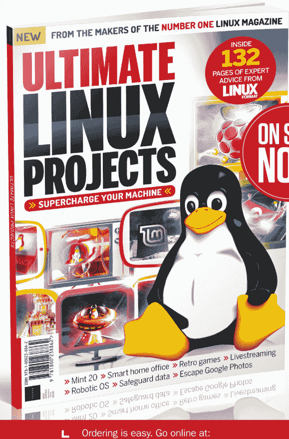

#### 内容预览
132 页来自 LINUX FORMAT 的专家建议

#### 现已发售

- Minit 20
- 智能家庭办公室
- 复古游戏
- 直播
- 机器人操作系统
- 数据保护
- 逃离 Google 相册

#### FUTURE

订购很简单。请访问在线：
magazinesdirect.com
或前往部分超市和报刊亭购买

---

### 评测

#### Anycubic Photon Mono 2

**黛妮丝·贝尔塔奇 (Denise Bertacchi)** 喜欢这款结合快速设置与精细打印的产品。

**规格**
- **构建体积：** 165x69x143mm
- **LCD 屏幕：** 6.6 英寸单色
- **光源：** 平行矩阵
- **XY 轴分辨率：** 34 微米
- **正常曝光时间：** 2.5 秒
- **接口：** 2.8 英寸触摸面板
- **连接性：** USB Type A 2.0
- **机器占地面积：** 390x229x235mm
- **重量：** 4kg

Anycubic Photon Mono 2 专为首次使用树脂的用户设计，它使用较小尺寸的料槽和紧凑的占地面积，提供了高质量的 4K 打印效果，所需空间极小。零售价非常低廉，我们注意到机器的底座和盖板有严重的成本削减，两者均为塑料而非金属或亚克力，但打印质量清晰，速度良好，且机器非常易用，使其成为市面上最好的树脂 3D 打印机之一。

包含开始所需的一切，甚至有一本手册，外加常规 U 盘（内含 Anycubic 的 Photon Workshop 切片软件、手册 PDF 和两个预切测试模型）。

机器大部分已组装好，你只需拧上料槽和构建板，即可准备进行校准。水平调整构建板相当简单，只需一张纸和一个内六角扳手。

Photon Mono 2 在打印中蕴含大量细节。它拥有与 Anycubic 较新机器相同的 LightTurbo 系统，能提供更平滑的细节。它是树脂打印机中较小的一款，但我们在构建板上一次性放置了六个预切微型模型。它采用激光蚀刻构建板，有助于模型附着，但使用金属刮刀时仍能轻松剥离。板顶部有一定的坡度，允许大部分树脂流回料槽。

与其 FDM 打印机兄弟不同，Photon Mono 2 从 U 盘读取文件，而不是 microSD 卡。定制切片器 Photon Workshop 3 有了巨大改进，我们使用时没有遇到任何问题。它能很好地处理支撑——无论是自动还是手动。它还有工具用于掏空模型和添加排水孔，以便节约树脂。

我们将一个波巴·费特（Boba Fett）模型缩放到 70% 以适配构建板，半身像和底座分开打印。使用 Siraya Tech 的 Fast Navy 树脂和 3 秒曝光时间，半身像打印耗时 5 小时 15 秒，底座耗时 3 小时 10 秒。模型细节惊人，从头盔上的裂缝到袖子上的褶皱都清晰可见。肉眼观看时没有明显的层线，即使使用相机近距离拍摄，也很难找到瑕疵。

Anycubic 寄来了其新的高透明树脂样品，供我们在 Mono 2 打印机上测试。这是一种新的树脂配方，遵循简单的固化技术即可制作出水晶般透明的打印件。模型正常打印，使用了稍长的曝光时间和较短的固化时间。打印耗时 2 小时 13 秒，单层曝光时间为 4 秒，无需支撑。成品在密封区域清澈如玻璃，在仅清洁过的区域呈磨砂状。

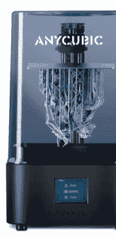

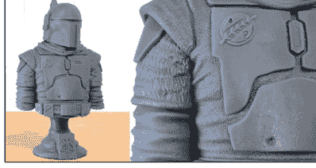
这里的波巴·费特充分展示了这款树脂打印机能产生的细节水平。

> 卓越的打印质量并未因使用更便宜的材料而妥协。

**荣誉提及：** Anycubic

#### 结论

**开发商：** Anycubic
**网站：** www.anycubic.com
**价格：** £209

| | 功能 | 易用性 |
|---|:---|:---|
| | 8/10 | 9/10 |
| 性能 | 9/10 | 性价比 | 9/10 |

一款专为初学者量身定制的预算型 4K 树脂打印机，Photon Mono 2 提供出色的输出效果和简便的设置。

» 评分 9/10


### 评测：英特尔酷睿 i3-13100F 处理器

随着英特尔重新夺回中端市场，保罗·奥尔科恩（Paul Alcorn）评估认为该公司已失去低端市场。

#### 规格

- **家族：** Raptor Lake
- **插槽：** LGA1700
- **工艺：** Intel 7 10nm
- **核心（性能核+能效核）：** 4+0
- **线程：** 8
- **缓存：** 320KB L1, 5MB L2, 12MB L3（共享）
- **性能核（P-core）：** 3.4GHz（4.5GHz 睿频）
- **最大内存：** 128GB，不支持 ECC，双通道
- **内存速度：** DDR5 4,800MT/s, DDR4 3,200MT/s
- **PCIe：** v5 和 v4 共 20 条通道
- **解锁：** 否
- **GPU：** 无
- **处理器基础功耗：** 60W
- **最大睿频功耗：** 89W

英特尔酷睿 i3-13100F 上市时面临巨大挑战；其前身酷睿 i3-12100F 曾被誉为最佳性价比 CPU。英特尔显然希望重演这一成功，但酷睿 i3-13100F 或许过于紧随其前代的步伐——该公司将上一代设计重新用于酷睿 i3-13100，因此它拥有相同的四个性能核，仅搭配了提升极其微弱的 200MHz 更高的 4.5GHz 睿频时钟。

因此，除了某些微代码调整外，13100 与 12100 完全相同。从 L2 缓存容量可以看出这一点，13100 每核心为 1.25MB。相比之下，真正全新的 Raptor Cove 核心每核心配备 2MB。

与其前代产品一样，酷睿 i3-13100F（F 系列缺乏核显）配备四个性能核和八个线程，但没有用于后台任务的能效核。英特尔额外增加了 200MHz 的睿频频率，使其达到 4.5GHz，基础时钟也提高了 100MHz，达到 4.3GHz。这些时钟速度的调整是英特尔为升级到第 13 代品牌以及显著提高价格所做的唯一合理依据，而 AMD 的 Ryzen 5 5600 经历了大幅降价，彻底改变了约 130 英镑的价格区间格局。

#### 提速

如果你在寻找一款价格在 100 英镑左右的游戏处理器，酷睿 i3-13100F 比 Ryzen 5 5500 快 8%，从而胜出。Ryzen 5 5500 还受到 PCIe 3.0 接口的限制，而 13100F 支持更快的 PCIe 4.0 和 5.0 接口，从而带来巨大的驱动速度提升。

然而，如果你在寻找一款生产力工作负载中更有分量的芯片，或者你找不到库存充足的酷睿 i3 F 系列型号，你就不得不将预算提高到 130 至 150 英镑的价格区间。13100 酷睿 i3 芯片支持 DDR4 内存。同时，英特尔芯片仅限于 600 和 700 系列芯片组，因此 AMD 在平台定价上具有优势——你可以找到 AM4 主板的超值优惠。请注意，如果你选择 Ryzen 5 5600，我们将失去对 PCIe 5.0 和 DDR5 的支持，但我们认为对于这类芯片，这些接口并不那么重要。英特尔和 AMD 的芯片都附带了足以满足正常运行的散热器。

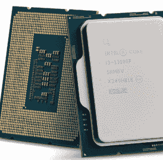
*PCIe v5 的能力是这款处理器最诱人的方面。*

150 英镑的酷睿 i3-13100 在 2023 年作为一款四核心处理器来说定价过高。英特尔决定在 13100F 上使用相同的设计，仅将睿频时钟提高 200MHz，并没有提供足够的价值增量来证明其合理性。我们在测试中看到的那些微小改进，绝对不足以证明酷睿 i3-13100 比前代型号更高的价格标签是合理的。

更便宜的 120 英镑酷睿 i3-13100F 更合乎情理，但它面临着来自前代产品的严峻挑战。如果你打算将价格档次提高一级，Ryzen 5 5600 在游戏和生产力的工作中都是最佳选择。

#### 结论

- **开发商：** Intel
- **网站：** www.intel.com
- **价格：** £120

| 特性 | 9/10 | 易用性 | 9/10 |
| :--- | :--- | :--- | :--- |
| 性能 | 6/10 | 文档 | 6/10 |

这是前代型号的翻版，价格和时钟速度略有提高，因此性能提升有限。

> 评分 7/10

### Fedora 38

内特·德雷克（Nate Drake）对最新版本的 Fedora 进行了试驾，并被其庞大的新衍生版本和特性所震撼。


#### 简介

像印第安纳·琼斯的帽子一样，Fedora 酷炫、冒险且易于佩戴。它拥有眼花缭乱的衍生版本，结合轻松的安装、尖端功能和丰富的软件选择。

#### 规格

- **CPU：** 2GHz 双核
- **内存：** 2GB
- **硬盘：** 15GB
- **构建：** x86, 64, AArch64

除了是每位探险爱好者——印第安纳·琼斯的首选帽子外，Fedora 也是红帽 Linux 项目（Red Hat Linux Project）的上游来源。这使其在软件包方面处于创新的最前沿，因此我们迫切想要看看 Fedora 38 是否不负众望。这一最新版本在 Fedora 博客上提前一周宣布，这对习惯于更平稳开发周期的 Linux 社区来说是一个相当大的惊喜。

如果你已经决定使用 Fedora 的 Workstation（桌面）版本，在桌面环境方面你仍然有很多选择。除了默认的 Gnome（图中所示）外，现在还有 Budgie、KDE、XFce、LXDE、MATE 和 Cinnamon 环境的官方衍生版本。

一旦选定，你可以下载一个特殊的图像写入工具将选定的版本复制到 USB，或者直接选择 ISO。我们很高兴看到 Fedora 38 的 Gnome 版本非常精简，仅为 2GB。当你对在实时模式下试用 Fedora 感到满意后，你可以启动 Anaconda 安装程序，它可以自动划分磁盘并对其进行加密。

在首次启动时，Fedora 会启动一个设置向导，让你选择是否启用位置服务和错误报告。你还可以选择启用第三方仓库以安装专有软件（如驱动程序），以及 Flathub 上未经过滤的应用程序视图。最后，你需要设置用户名和密码。完成后，你会发现由于 Gnome 44 带来了令人印象深刻的界面重塑。默认的云朵壁纸可能不符合每个人的口味，但在 Gnome 的设置中有一些替代方案。

既然说到这个话题，新的 Gnome 锁屏界面在背景中显示桌面版本的模糊图像。快速设置菜单也进行了全面改版，现在显示设置的名称及其状态，例如“电源模式 – 均衡”。你還可以在这里查看和关闭后台应用程序。

虽然快速设置菜单之前已显示蓝牙，但现在你可以更容易地与之前配对的设备断开和重新连接。文件管理器现在也支持图标视图和图像文件的预览。你还可以通过列表视图更轻松地导航文件夹。（如果你想使用此功能，需要在文件管理器偏好设置中启用此功能。）

Fedora 38 使用 Linux 内核版本 6.2，该版本大幅改进了硬件支持并修复了 bug。预装的应用程序包括最新版本的 Firefox、LibreOffice 和 RhythmBox。你可以通过 Gnome 软件安装更多应用。由于 Fedora 仍然没有附带邮件客户端，你可能希望在首次安装时留意一下这一点。

轻量级的 microdnf 包管理器现在也被 dnf5 取代，后者具有小得多的内存占用。你仍然可以通过 Gnome 的设置禁用单独的软件开发仓库。

Fedora 38 对长时间运行的服务如何阻塞关机有 stricter（更严格）的规则。理论上，这应该有助于运行该系统的设备更快、更高效地关机。

Fedora 项目将其工作的四大基础表述为“自由、朋友、功能和第一”。正是与红帽的友好关系和赞助使其能够将其操作系统中包含最新创新，例如新 Gnome 44 桌面上的那些惊人功能。我们还很高兴看到其对软件自由的承诺现在延伸到让用户选择是否使用第三方仓库和程序，而不是为他们过滤内容。

#### 结论

- **开发商：** Fedora 项目
- **网站：** https://fedoraproject.org
- **许可证：** GPL

- **特性：** 10/10
- **性能：** 9/10
- **易用性：** 9/10
- **文档：** 9/10

Fedora 再次超越自我，拥有流畅的设置和创新的功能，更不用说所有可用的衍生版本了。

> 评分 9/10


### EuroLinux 9.2

Nate Drake 本月身处欧洲大陆，正在享受 EuroLinux 带来的自然美景。

**简介**
世界需要另一个基于 RHEL 的发行版吗？对于 EuroLinux 而言，答案绝对是肯定的。它设置简单，视觉令人惊叹，并且支持服务将持续到 2032 年。

#### 规格
- CPU：1GHz
- 内存：4GB（建议每 CPU 1.5GB）
- 硬盘：10GB（建议 20GB）
- 构建：x86_64, AArch64 (ARM64), i686

EuroLinux 属于一个独特的群体，因为它是波兰开发的六个主要 Linux 发行版之一。
它建立在 RHEL（Red Hat Enterprise Linux）源代码的基础之上。EuroLinux 团队声称这保证了与 RHEL、Oracle Linux、CentOS、AlmaLinux 和 Rocky Linux 的兼容性。
从列举这份发行版清单来看，显然团队意识到如果基于 RHEL 的 Linux 是你的最爱，那么选择绝不仅仅只有这几个。例如，Rocky Linux 同样基于 Red Hat，并使用 Gnome 桌面环境。
幸运的是，EuroLinux 对“世界为什么需要另一个基于 RHEL 的发行版”这一问题给出了答案：“EuroLinux 的开发是为了回应市场对主要企业 Linux 发行版生产商在技术支持质量不佳、许可条款不利、订阅成本高以及灵活性缺乏等方面的不满需求。”

服务器版和桌面版发行版均在 GNU 通用公共许可下免费提供给使用。这意味着理论上你可以自由地修改和分发它。通过其 EuroLinux Gaia 工具，EuroLinux 让这一点变得更加容易。然而，如果你想要使用诸如 Gaia 这样的专有工具、享受技术支持、获得安装协助或中间软件包，你需要付费订阅。EuroLinux 提供三个级别的支持，但当我们试图寻找价格页面时，却被邀请填写联系表单以获取报价。

我们重点体验了 EuroLinux 最新的免费桌面版本（9.2），即使没有付费技术支持，我们也印象深刻。4GB 的 ISO 文件下载花费了一些时间，但 Calamares 安装程序非常顺畅。支持页面确实有一份基本设置指南，很有用处地提醒我们在创建用户账户时勾选“Make Administrator”（设为管理员）。你还可以加密硬盘以增强安全性。

Gnome 桌面的默认 EuroLinux 壁纸风景如画，但你也可以另选其他壁纸。

默认应用选择得当——网络浏览由最新 ESR（扩展支持版本）的 Firefox 提供。你可以通过 Geary 或 Evolution 访问电子邮件。EuroLinux 还附带了 LibreOffice 7.1.8 版本。如果你注意到一个主题，似乎这些软件包是为了稳定性而挑选的，因此并不代表当前可用的前沿版本。好的一面是，EuroLinux 9 将获得支持直至 2032 年。

当我们启动 Gnome 软件中心时，我们在尝试安装桌面工具 Darksdk 时发现了一点小怪癖，该软件可作为 Flatpak 获取。Gnome Software 声称不支持，但它安装得很顺畅，并且没有遇到问题就打开了。切换到命令行后，我们使用 dnf 包管理器安装 gnome-tweaks 工具也没有任何问题。

EuroLinux 最新版本（9.2）在内部还有诸多其他改进。OpenSSL 和 SELinux 用户空间软件包都有安全更新。

开发人员会很高兴地听到，EuroLinux 现在也捆绑了 Python 3.11，以及 java-11-openjdk、java-17-openjdk 和 java-1.8.0-openjdk 软件包。你可以在 https://bit.ly/1xf304euro 阅读全文发布说明。


**评价**
开发者：EuroLinux
网站：https://en.euro-linux.com
许可：GNU GPL

| | 8/10 | 易用性 | 9/10 |
|:--|:--|:--|:--|
| 性能 | | 文档 | 7/10 |

EuroLinux 轻松地能与 Rocky 进行 12 轮较量。它安装流畅，支持多年，并提供清晰的界面。

**评分** 8/10

### Peropesis 2.1

**Nate Drake** 与极简主义的 Peropesis 周旋。他是否会重温 Linux 的黄金时代、恢复损坏的系统，还是会彻底崩溃？

**简介**
Peropesis 占用空间极小，几秒内即可加载到 RAM 中。接下来，掌握 Linux 命令行并编译你自己的程序——前提是你有时间和耐心。

#### 规格
- **CPU：** 1GHz
- **内存：** 256MB
- **硬盘：** 不适用（仅限 Live 模式）
- **构建：** x86, 64

不要将其与波斯第一帝国的首都（那是 Persepolis）混淆，Peropesis（“个人操作系统”）的开发者称其为“小规模、极简主义、基于命令行的 Linux”。

有多小规模？该发行版的 ISO 仅重 205MB，并设计为完全在 Live 模式下运行。Peropesis 网站上有帮助的介绍手册称，该发行版是熟悉命令行以及 Linux 中常用程序的绝佳途径。

它还指出，该系统可以快速以 Live 模式启动，并且兼容 UEFI 和 BIOS 主板。这使得 Peropesis 非常适合挂载故障系统的硬盘。一个愤世嫉俗者可能会争辩说，你可以通过终端 Live 启动最新版本的 Ubuntu 来达到完全相同的效果，并在硬盘重建时在桌面上快速玩一局扫雷游戏。

不过，Peropesis 确实有一种独特的魅力。它完全独立于发行版，因为它是用开源代码从头编写的。它也是我们迄今为止审查过的唯一一个立陶宛 Linux 发行版。在线手册使它远不像我们遇到的其他仅命令行的发行版那样令人生畏。你的第一道障碍仅仅涉及输入 root 用户名登录——无需密码。

之后，你可以浏览文件结构或运行少数内置应用之一。Peropesis 包含 Links 文本浏览器用于访问网页。遗憾的是，这不能与 Link2 或 Lynx 浏览器混淆，后者通过 X11 拥有有限的图像支持，但仅通过文本浏览网页竟然出奇地容易。兑现之前的说法，手册还介绍了如何使用 Peropesis 挂载外部 USB 驱动器并使用 **chroot** 恢复故障的 Linux 操作系统。

登录时，你可能会注意到一条“No New Mail”（无新邮件）的消息。这是 S-nail 邮件客户端带来的。由于这同样只能通过命令行访问，你需要自己编辑 ~/.mailrc 以添加你的凭据。Peropesis 支持 cat、nano 和 ed 命令用于查看和编辑文件。你也可以通过 pwd、ls 和 cd 浏览目录。我们使用这些命令列出 /bin 的内容，以查看预安装了哪些其他程序。幸运的是，如果你看到不熟悉的内容，Peropesis 支持 man 命令和 --help 标志。

如果你想要安装更多程序，没有包管理器。这意味着你必须使用 wget 下载你选定程序的 tarball，通过命令行解压并运行 configure 和 install。这可能会让习惯了色彩缤纷的软件中心的 Linux 新手望而却步。

不过，如果你想在带有专有固件的系统上启动 ISO，你可能没有太多选择。Peropesis 手册警告说，该发行版仅包含少量固件，但也向你展示了如何查看系统日志以检查是否正确安装了软件。Peropesis 论坛（https://peropesis.org/forum）上对此话题有热烈的讨论，用户建议像 Pkgsrc 这样视觉上更友好的包管理器可能更合适。访问 https://peropesis.org/bundle/ 查看最新 Peropesis 版本更新的完整列表。其中包括对 Perl 编程语言的支持（然而，Python 明显缺席！）。还有 Autoconf、Automake 和 GCC 的新版本，以使编译你自己的程序变得更加容易。

官方上，Peropesis 处于公开 Beta 开发阶段，但我们计划在未来继续关注它。

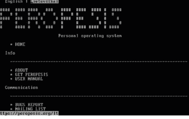

**评价**

**开发者：** Gediminas Mockus 和 Peropesis 团队 **网站：** https://peropesis.org
**许可：** CC BY-SA 4.0

| | **特性** | **3/10** | **易用性** | **6/10** |
|---|---|---|---|---|
| | **性能** | **9/10** | **文档** | **9/10** |

Peropesis 向用户介绍 Linux 操作系统的命令和文件结构。它的启动速度也创纪录地快。

**评分 7/10**


### 评测 \ 英灵神殿

#### 英灵神殿

管理层得知**克里斯托弗·利文斯顿**死后仍能继续工作，并愿意接受 Draugr 的肠子作为报酬时，欣喜若狂！

#### 规格

- **最低配置**
  - **操作系统：** 64 位
  - **CPU：** 2.6GHz 双核 64 位
  - **内存：** 8GB
  - **GPU：** GeForce GTX 950, Radeon HD 7970
  - **硬盘：** 1GB

- **推荐配置**
  - **操作系统：** 64 位
  - **CPU：** 3GHz Core i5, 3GHz Ryzen 5
  - **内存：** 8GB
  - **GPU：** GeForce GTX 1060, Radeon RX 580
  - **硬盘：** 1GB

这是《英灵神殿》（*Valheim*）的抢先体验版本，该游戏目前仍在积极开发和更新中。该游戏最初于 2020 年 6 月发布，我们觉得可以安心回顾一下《英灵神殿》*曾经的样子*、*现在的样子*以及*未来的走向*……

我们第一次横渡海洋时，是乘坐一艘小小的木筏，紧张地举着火炬，透过漆黑的夜色向外张望。这让你感到极度脆弱。在从未离开过起始岛屿之前，我们完全不知道在《英灵神殿》巨大的程序生成世界中，外面等待着什么。经过漫长而紧张的一夜航行，终于踏上了新大陆的土地，我们立刻发现了一个看似村庄的地方。这是个惊喜——我们不知道《英灵神殿》里有村庄。这个村庄里充满了 Draugr（亡灵）。我们也不知道有 Draugr。这款游戏充满了惊喜。别问关于树的事……一群亡灵战士用斧头猛击我们，并向我们发射箭雨。惨败逃回家的我们，除了严重磨损的武器和盔甲，以及几根 Draugr 的肠子外，几小时的探索几乎一无所获。我们决定再也不回去那里。永远。但发现 Draugr 肠子后，我们获得了一个香肠食谱，于是我们把肠子塞上猪肉并用蓟草调味。然后吃掉它们，看着生命值条膨胀到以前从未有过的两倍大，我们瞪大了眼睛。在《英灵神殿》中，你是一名死去的维京战士。你的灵魂被安置在冥界，以便与奥丁的敌人——如由树干组成的巨大巨人、释放巨大毒云的有毒沼泽生物等强大生物——战斗。

但在你能为奥丁效力之前，你得先花几十个小时做自己的工作：建造家园、制作武器和装备、提升技能等级、解锁制作配方，并慢慢探索这个巨大且危险的世界深处。这听起来可能与其他开放世界生存沙盒游戏没有太大不同，但《英灵神殿》是一次完全引人入胜的体验，它将精心设计的生存系统与激动人心的类 RPG 冒险完美融合，每一点微小的进步都为下一步奠定基础。


> 先生，你能指引我去最近的酒馆吗？

##### 奥丁之血

香肠就是一个很好的例子。与大多数生存游戏不同，如果在《英灵神殿》中不吃饭，你并不会饿死，但你绝对需要进食。合适的食物可以显著增强你那微小的生命值条并增加体力，因此不花些时间在厨房里，你走不了多远。而这途中还会有大量的死亡。《英灵神殿》没有什么难度曲线，只有高耸如云的、剃刀般锋利的难度尖峰。起初这让人感到沮丧，但最终，奇异地，它变成了鼓励。仅仅踏上你尚未准备好的地方，比如那个 Draugr 村庄、沼泽墓穴或寒冷的山坡，就会狠狠惩罚你，但同时也给你新的目标和未来可能性的诱人一瞥。当第一次发现新生物群系——平原时，我们只有大约一秒的时间来欣赏美景和激昂的音乐，随后一只死亡巨蚊就嗡嗡地穿过屏幕叮在我们身上，一刺就夺走了我们一半以上的生命值。我们立即逃跑，虽然我们设法杀死了这只昆虫，获得了一根针，从而获得了更具致命性的箭矢制作配方。

##### 人多力量大

我们在《英灵神殿》中分散了时间，既进行单人游戏，也与一些其他人在服务器上一起冒险。虽然两者都很有回报，但与朋友一起玩给《英灵神殿》带来了一种美妙的社区感。我们建立了一个包含几座建筑的小型定居点，我们共享资源和发现，一起挑战 Boss 战斗，


并在个人任务和目标上互相帮助。

其中一个任务是一次搜救行动。那是一段漫长的航行，当我们首次遭遇海蛇并在午夜时分受到攻击时，情况变得更加复杂。当我们用燃烧箭射击这个生物时，Steven 带我们上了岸，担心我们的船会被摧毁。一旦上岸，我们就被不断增多的灰矮人包围，而海蛇继续攻击我们的船。我们最终仓促地解决了这两个威胁并再次出发，却意识到我们没有足够的资源来建造快速旅行传送门。因此，我们不得不停下来，在黑暗中收集木材，同时搭建工作台以修复海蛇对船只造成的损坏。终于，我们到达了船只失踪的区域。经过另一次疯狂的冲刺，我们杀死了一个哥布林，找回了装备，并各自乘船享受了一段美妙而平静的归途。这是一次真正令人兴奋的刺激冒险，还有一个额外的奖励：我们现在有了蛇肉，这让我们获得了蛇肉炖菜的食谱，一种极其出色的新生命力与体力增强食物。

然而，Boss 为这场原本开放式冒险提供了一些结构。找到它们需要大量的探索，因为只有特定的符文石会在你的地图上显示它们的位置——而且一个 Boss 可能距离你起始岛屿有好几个大陆那么远。仅仅携带召唤 Boss 所需资源到达那里，本身就是一场冒险。而 Boss 战斗是漫长而具有挑战性的搏斗，伴随着真正让你感觉仿佛正在与愤怒的神明进行戏剧性对决的音乐和特效。每个 Boss 都会掉落一件物品，你需要它才能开始为击败下一个 Boss 做漫长准备的流程。

##### 生命之树

《英灵神殿》最大的更新在 2022 年底以“迷雾之地”资料包的形式发布，其内容远超仅仅添加一个新的生物群系类型。它打包了一个全新的游戏玩法系统、一种有趣的新 NPC 类型、几个不寻常的制作站以及更多内容。

《英灵神殿》的世界中一直流淌着魔法，但现在你可以直接驾驭它。得益于一种名为 Eitr（埃特尔）的神秘新资源，你可以赋予自己魔法力量，并建造新的工作台来制作几种类型的法杖。一根法杖可以投掷火球，另一根可以发射冰霜冲击，还有一根法杖会在保护力场气泡中感谢你和附近盟友。


> 村庄的建筑可以被破坏以获取资源，也可以从零开始建造以创建你自己的定居点。

除了法杖，还有一个可制作的魔法头骨，用于召唤一个忠诚的骷髅在你身边作战。只是别指望你能立即变成维京版的甘道夫。这是一个魔法系统，不是一个魔法按钮。采集和精炼 Eitr 是一个相当繁琐的过程，收集建造魔法相关制作站所需材料也是如此。如果没有 Eitr 在你体内流动，你那些华而不实的法杖跟根树枝也没什么区别。

在这个如此敌对的世界中，不需要太多就能让事物感觉更友好，即使这种友好只是简单的中立。你已经在《英灵神殿》中遇到了一个北欧矮人——商人 Haldor。但在迷雾之地，你会发现其他矮人氏族，称为 Dvergr，与《英灵神殿》中的大多数事物不同，他们不想杀你。

自从我们第一次踏入《英灵神殿》以来，我们就一直仰望那棵巨大的树——世界树 Yggdrasil，它伸展在维京亡者国度之上。我们只是永远无法到达它。事实证明，这棵强树的根深深扎在迷雾之地——它们不仅仅在那里作为装饰。你可以制作一种新工具，从 Yggdrasil 的根部提取一种珍贵的资源，这是完全解锁那个新魔法系统的关键。

我们知道新生物群系会有新 Boss，但这个 Boss 在表世界上有一头毛，而不是祭坛。很久以前就被 Dvergr 封印了，一旦你找到了巢穴，你需要制作一把特殊的钥匙才能打开那扇令人望而生畏的门。一个如此肮脏到被锁在保险库里的生物？听起来你应该让那扇门保持关闭……

还有鸡！在《英灵神殿》里！你可以孵化它们，喂养它们，并在基地饲养它们。它们不仅可爱，而且美味。现在你要做的只是找到你的第一颗蛋——在某个地方。279

#### 结论

- **开发商：** Coffee Stain Publishing
- **网站：** www.valheimgame.com
- **价格：** £15.49

| 类别 | 评分 |
| :--- | :--- |
| 玩法 | 9/10 |
| 画面 | 7/10 |
| 耐玩度 | 10/10 |
| 性价比 | 9/10 |

尽管处于抢先体验阶段，美丽且引人入胜的《英灵神殿》感觉目前已经非常精致且令人满意。

评分 9/10


### 总结

我们非常乐意为您呈现琳琅满目的 Linux 相关内容，这样您就不用自己折腾了！

Ubuntu Studio >> Kubuntu >> Edubuntu >> Ubuntu MATE >> Lubuntu


#### Ubuntu 发行版

多年来，Michael Reed 负责过的发行版和衍生版多到让他觉得自己像是在一家奶昔店工作。

随着 Ubuntu 23.04 的发布尚属新鲜事，Michael Reed 考察了该发行版官方衍生版之间的差异。

#### 我们的测试方法...

为了完成这项任务，我们安装了每个发行版并开始了摸索使用，试图想象它们在新用户和已具备一定 Linux 经验的用户眼中会是什么样子。我们执行了一些基本任务，并加载了大多数重要应用程序。我们更新了系统，并尝试使用提供的 GUI 软件包管理工具安装了一些软件。

这一次，我们并不是在寻找低端解决方案，但我们确实记录了每个发行版的效率情况。像往常一样，我们使用 *df -h* 命令来显示已更新的全新安装版本的磁盘使用情况，并使用 *free -h* 来了解在启动到终端窗口打开的桌面时使用了多少内存。这有时是主观的，但我们时刻关注任何感觉缓慢的地方。

在这种情况下，在管理软件或使用系统时，没有发现任何崩溃或减速等明显问题。


对我们中的一些人来说，它们被称为衍生版或版本，但 Ubuntu 称它们为风味版。我们将查看 Ubuntu 23.04 的五个官方风味版，我们现在就可以告诉您，每一个都值得考虑，并且都有各自的优势。

Kubuntu 提供 KDE 4 体验，外观精美，桌面 polished，并附带您入门所需的所有基本应用程序。这是现代、精致的 Linux 桌面计算的典范。Lubuntu 使用基于 Qt 的 LXQt 桌面环境，结合了标准桌面应用程序和轻量级工具。Ubuntu MATE 提供一个相当传统的桌面环境，非常适合办公室或家庭使用。

Ubuntu Studio 是一个专业发行版，将定制 KDE 桌面与涵盖音乐、音频、图形设计和视频编辑等领域的大量应用程序、工具和插件相结合，所有预设配置均已就绪。它是构建工作室计算机的理想起点。Edubuntu 也是专业的，但用于教育用途。为此，它提供 Gnome 桌面以及大量非常适合课堂使用或打造绝佳儿童友好计算机配置的应用程序和小型工具。

#### 应用程序

发行版的个性在很大程度上来自于默认的应用程序选择。

除了桌面环境的选择之外，默认应用程序选择是 Ubuntu 风味版之间最大的区别特征。确实，我们希望应用程序和桌面环境之间能够良好匹配。

由于 Kubuntu 基于 KDE，不出所料，许多工具都与该环境相关。然而，在合理的范围内，通用应用程序更受青睐。例如，网络浏览器 Firefox 和办公套件 LibreOffice 的纳入就是这种情况。我们始终乐于看到 KDE 的文件管理器 Dolphin，因为它是最好的之一。KDE 应用，如文本编辑器 Kate、音乐收藏管理器 Elise 和媒体播放器 Haruna，完善了选择，因此对于大多数用户来说，Kubuntu 不需要添加太多内容就能涵盖基本需求。使用不属于 KDE 的大型应用程序并不突兀，并且与 KDE 应用程序搭配得很好。

Ubuntu Studio 也是基于 KDE 的，并配备了一整套标准应用程序，如 Firefox。该发行版概念的一部分是它还附带了一套完整安装和配置好的媒体应用程序，且已安装的选择范围非常庞大。

除了像 Ardour 这样的音乐应用程序外，还有全套已安装插件，涵盖了音乐和音频制作的各个领域。还有涵盖其他媒体制作领域的应用程序，如图形编辑、绘图和 3D 图形。在如此全面的选择中，功能重复是不可避免的。例如，如果安装了 Krita，有些人可能就不需要 GIMP 了。此外，并非每个音乐人都需要像 Blender 这样的 3D 图形应用程序。在许多情况下，配置媒体应用程序可能很麻烦，因此已经配置好的事实非常宝贵，特别是对初学者而言。

另一个专业发行版，Edubuntu 采取类似的方法，配备完整的一套标准和专用应用程序。它充满了覆盖科学、地理和数学等领域的小工具，以及与课堂有用较大应用程序，如图形创建者 Dia 一起。

Lubuntu 通过 LibreOffice 和 Firefox 涵盖基本需求。Ubuntu MATE 采取类似策略，选择涵盖典型办公和家庭使用的标准应用程序。

#### 结论

| 发行版 | 评分 |
| :--- | :--- |
| UBUNTU STUDIO | 9/10 |
| UBUNTU MATE | 7/10 |
| KUBUNTU | 8/10 |
| LUBUNTU | 7/10 |
| EDUBUNTU | 9/10 |

所有这些发行版都能满足基本使用需求，但 Edubuntu 和 Ubuntu Studio 在此基础上提供了大量专用应用程序。

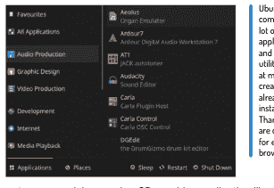

#### 配置工具

希望设置涵盖系统及其外观的所有主要区域。

Ubuntu Studio 和 Kubuntu 都是基于 KDE 的发行版，KDE 现在将所有配置分组到一个可搜索的应用程序中。拥有集中设置位置并不带来真正的劣势。配置工具涵盖了界面和系统设置（如网络配置）的所有常见区域。各种设置也会出现在启动器的搜索结果中。基于 LXQt 的 Lubuntu 在 LXQt 设置应用程序中分组设置，但存在一些在此之外的设置应用程序，意味着整个集合不可搜索。无论如何，应该都可以修改您需要的任何系统或外观设置，即使工具没有完全集成或外观像 KDE 工具那样一致。

Edubuntu 的设置可以通过两种方式访问。首先，Gnome 的设置应用程序将所有设置集中在一个地方，并且可以搜索。所有设置页面也都在 Gnome 基于搜索的启动器中。因此，如果在启动器中搜索“分辨率”，它会列出显示设置，从列表中启动该设置将打开设置应用程序的正确标签页。

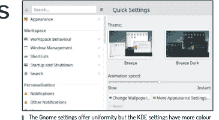

Gnome 设置提供统一性，但 KDE 设置更具色彩和多样性。除此之外，Gnome 和 KDE 在这个领域大致相当。

MATE 控制中心将所有设置小部件分组在一起。它是可搜索的，但搜索仅限于小部件本身而非设置，并且小部件未集成到控制中心中。

#### 结论

| 发行版 | 评分 |
| :--- | :--- |
| UBUNTU STUDIO | 9/10 |
| UBUNTU MATE | 7/10 |
| KUBUNTU | 9/10 |
| LUBUNTU | 6/10 |
| EDUBUNTU | 9/10 |

Gnome 和 KDE 在这个领域大致相当，但 LXQt 和 MATE 如果能有更大的集成度和更全面的搜索会受益。

#### 用户界面

您与系统的连接。

所有这些桌面都可以自定义，但我们正在评估默认桌面体验。评估发行版的用户界面，我们期望它看起来美观且易于理解和操作。此时，我们期望应用程序启动器是一个可搜索的图标，我们欣赏流畅的无鼠标工作流，从调出启动器到找到正确应用程序，最后启动它。

用户界面的外观不仅仅是为了美观。我们喜欢一致且清晰的东西。今天使用的大多数机器都有几像素的余量，因此一些空间的使用是受欢迎的。例如，一些 Linux 窗口管理器似乎喜欢强制使用极小的窗口控件，布局中缺乏对用户界面区域起止点的视觉指示。口味无价，但完全平坦外观的用户界面对新用户来说很难一眼看懂。

#### Ubuntu Studio

**8/10**

由于使用深色颜色，您可能不会认为这是一个 KDE/Plasma 桌面。该桌面使用标准的启动器/切换面板，但将其置于顶部，并且栏上还有一些快速启动图标。可搜索的启动器使用类别，其中一些在标准默认值上扩展，具有如音频制作和图形设计等有用的标题，这是一个不错的细节，有助于在包含的许多专用应用之间导航。与其他类似发行版相比，我们发现需要增加字体和主面板的大小，但这些调整相对容易执行。虽然我们习惯于在 KDE 中看到明亮的默认主题，但该桌面易于导航。果然，当我们启动应用程序如文本编辑器 Kate 或图形编辑器 GIMP 时，它们也使用深色主题，有助于整体一致性。

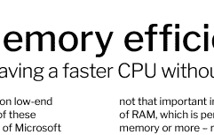

#### Kubuntu

**9/10**

正确配置下，KDE 4（带有 Plasma 窗口管理器）提供了传统桌面与现代整洁外观及众多功能之间最好的平衡，这是您可能会找到的。它不是最轻量的选项，但在 reasonably 现代的计算机上，这不会造成多大差异。它空间宽敞，元素间距良好，不同区域之间有清晰的线条分隔。它也足够接近传统桌面，以一种大多数人熟悉的方式工作。默认情况下，任务切换器是基于图标的，而不是使用传统的任务面板，但很容易切换。Super 键启动应用程序启动器，它是可搜索的，但还连接到不断更新的桌面搜索功能，这意味着它是查找文档以及应用程序的中心。KDE 4 可能是目前外观最精致的 Linux 桌面。


#### 磁盘和内存效率

额外的效率就像在没有花钱的情况下拥有更快的 CPU。

在这个总结中，我们并不专注于低端机器的性能，但所有这些发行版在这种硬件上都应该远胜微软 Windows。我们已经达到了即使是一个全面的 Linux 桌面也不需要在一台只有 8GB 甚至勉强 4GB RAM 的计算机中占用大量内存的程度。

如果您正在处理资源极其受限的机器，Ubuntu 将是我们的首选发行版。在全新启动时，仅使用了 560MB 的 RAM。在测试的风味版中，Ubuntu 也是磁盘空间需求最少的，已更新的全新安装仅需要 7.3GB 的空间。Kubuntu 提供了一流的 Linux 桌面，外观精美，证明了我们的观点，因为它仅使用 833MB 的 RAM 并占用 16GB 的磁盘空间。我们略感惊讶 Ubuntu MATE 也使用了 16GB 的磁盘空间，因为它并没有特别多的应用程序，但这在大多数情况下并不重要。它还使用了 886MB 的 RAM，这对于拥有 4GB 或更多内存的计算机来说完全没问题——现代浏览器才是真正的内存消耗大户。

Edubuntu 也远非资源消耗大户，因为它只使用了 962MB 的 RAM。它是所有风味版中磁盘空间使用最多的，达到 19GB，但鉴于它包含的应用程序数量之多，这并不令人惊讶。Ubuntu Studio 也类似。它在启动新系统时使用 1GB 的 RAM 和 14GB 的磁盘空间，对于您可能用于媒体创建工作的计算机类型来说，这两个要求都不算大。

#### 结论

| 发行版 | 评分 |
| :--- | :--- |
| UBUNTU STUDIO | 7/10 |
| UBUNTU MATE | 7/10 |
| KUBUNTU | 8/10 |
| LUBUNTU | 9/10 |
| EDUBUNTU | 7/10 |

- 没有这些发行版中的任何一个在资源消耗或速度方面存在问题。
- 不过，Kubuntu 总体上是轻量的。


### Ubuntu 衍生版综述

#### Edubuntu 9/10

Edubuntu 的布局很大程度上沿用了标准 Ubuntu 的布局，但采用了自定义的配色方案。其 Gnome 桌面配置了一个位于左侧的垂直停靠栏启动器/切换器。单击这些图标即可启动应用程序，并且当应用程序运行时图标会高亮显示。这种布局虽然不传统，但非常简单，大多数人可以很快上手，这对于一个教育系统来说是重要考量。

存在一个小问题，即在弹出式启动器中，分类与应用混在一起，遵循了标准的 Gnome 方案。在这种情况下，有许多专门的教育应用程序，虽然使用 Gnome 启动器查找和启动应用速度很快，但在按类别浏览方面不如传统方式好用。撇开这个批评不谈，标准的 Gnome 桌面对于成年人和孩子来说都很容易上手，并且运行良好。

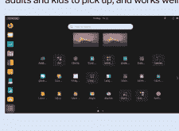

#### Ubuntu MATE 7/10

由于它依赖于 MATE 作为桌面环境，在用户界面概念上并没有太多创新。它提供的是熟悉且稳健的体验。它很好地利用了中度的 3D 效果，这种效果在一些其他桌面环境和网络界面上已经过气，而且元素周围的留白也恰到好处。个人偏好可能是一个因素；作为一个起源于 Gnome 原始桌面（在 2.x 时代分叉）的桌面，它看起来有些过时。

标准的可搜索启动器是向下弹出的，因为任务栏位于屏幕顶部，而第二个包含任务切换器的栏则运行在底部。这样做的优势在于，任务栏上有足够的空间容纳带有完整窗口标题的传统任务面板。


#### Lubuntu 8/10

Lubuntu 由 LXQt 驱动，这是一个桌面环境，其外观让人想起 Qt（驱动它的工具包）。这意味着它整洁清晰，不过分花哨。你肯定不会经常感到困惑于哪个功能对应哪个操作。虽然简单易懂，但它具有功能性的风格，从不显得单调，而且图标中的一些色彩运用也很赏心悦目。

这种熟悉感和简洁性延伸到整体桌面布局，启动器/任务栏/状态面板位于屏幕底部。启动器当然是可搜索的，虽然它只能按项目名称搜索，而不能按描述搜索。这是一个晶莹剔透的桌面，虽然深色但绝非乏味——它的外观与当前一些 UI 趋势背道而驰，而我们很喜欢它。没有任何一个桌面显得缓慢，但 LXQt 感觉是最轻量且最快的。


### 包管理

Ubuntu 包系统有多种前端界面。

- Canonical 最近著名的禁用了 Flatpak 支持，这些发行版都受到了影响，但你可以通过手动安装来启用支持，就像在普通 Ubuntu 上那样。由于这些口味版底层是 Ubuntu，你还可以使用标准的包安装工具，例如命令行中的 APT 以及 Snap 打包系统。

KDE 的应用程序启动器（由 Ubuntu Studio 和 Kubuntu 使用）与包系统相连，允许你在搜索时提供安装建议。这两个发行版都包含一个名为 Discover 的软件商店。它包含来自 Ubuntu 和 Snap 存储库的应用程序，并带有评论和评分。

Ubuntu MATE 有自己的软件管理器，称为 Software Boutique，但在目前的发展阶段，它并不是我们见过的最好的商店应用。其数据库不太全面——虽然它确实包含开源和专有软件的混合——并且没有评分或评论。我们会使用它来安装像 Synaptic 这样的基本 GUI 包管理器，或者像 Gnome Software 这样更全面的商店。

Edubuntu 附带了 Ubuntu Software Center，这是 Canonical 对 Snap 系统的前端。它包含一个经过精心挑选的应用列表，方便起见，这些应用附带评分和评论。如果你想要安装 Snap 存储库中没有的小型应用和系统组件，你需要安装像 Synaptic 这样的东西。

Muon 是 Kubuntu、Ubuntu Studio 和 Lubuntu 上由 Qt 驱动的包管理器。它是 Ubuntu 包存储库的前端，类似于基于 GTK 的发行版上的 Synaptic 前端。

#### 结论

| 口味版 | 评分 |
| :--- | :--- |
| UBUNTU STUDIO | 8/10 |
| KUBUNTU | 9/10 |
| EDUBUNTU | 7/10 |
| UBUNTU MATE | 6/10 |
| LUBUNTU | 7/10 |

KDE 的应用程序启动器建议很有用，默认情况下，Ubuntu Studio 和 Kubuntu 满足了大多数需求。

### 对换机用户的适用性

对于习惯不同操作系统的用户，该发行版有多适合？

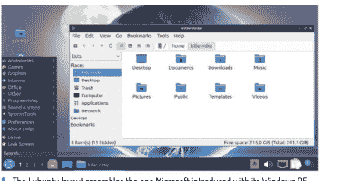

Ubuntu Studio 在这一领域有一些独特的优势，得益于其大量已安装和配置好的媒体应用程序和插件。屏幕顶部的任务切换器对于 Windows 用户来说，在首次使用时应该很容易理解，启动器也相当标准。

我们可能对 Edubuntu 说一些类似的话。对于 Linux 的新手来说，它开箱即所提供的内容可能会让他们感到惊讶，特别是如果他们对教室使用或为儿童设置计算机感兴趣的话。然而，除了从侧边停靠栏启动常用应用外，搜索应用和浏览类别可能还需要一些说明。

Kubuntu 采用的标准 KDE 提供了一个相当高科技的 Linux 桌面，但事实上，布局元素与 Windows 操作系统所青睐的类似。毫无疑问，换机用户会对 Plasma 窗口管理器的响应速度和整洁外观感到惊喜。

在我们查看的 Ubuntu 口味版中，Lubuntu 提供的布局最接近传统的 Windows 体验，因为主面板运行在屏幕底部。

Ubuntu Studio 对启动和切换应用程序采用了传统设置，但它是将主面板放在顶部的发行版之一，对于换机用户来说几乎不需要巨大的学习调整。对于 MATE 也可以说类似的话，它遵循传统的应用启动和切换机制，但将主栏放在顶部。

| 结论 | 评分 |
| :--- | :--- |
| UBUNTU STUDIO | 8/10 |
| KUBUNTU | 8/10 |
| EDUBUNTU | 6/10 |
| UBUNTU MATE | 7/10 |
| LUBUNTU | 8/10 |

> Lubuntu 恰好复制了传统的 Windows 布局，这对 Windows 用户是一个优势。其他版本相当容易学习。

### 额外功能和自定义

这个发行版有什么其他版本没有的？

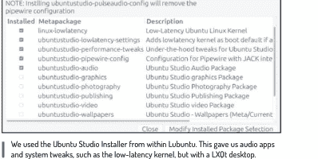

Ubuntu Studio 和 Edubuntu 是这一节的主角，因为它们在一个标准发行版之上提供了许多功能。

要在媒体制作（特别是音乐应用）方面充分利用 Linux，通常需要进行手动配置，但 Ubuntu Studio 从一开始就设置了这些自定义。例如，Ubuntu Studio 使用低延迟内核而不是标准内核，并应用了各种调整，以确保默认用户在 Music 组中，音乐应用可以锁定所需的内存，此外还有一些关于交换文件设置的额外功能。

Ubuntu Studio 安装程序可以随时运行。从这里，你可以更改单独的设置，例如选择标准通用内核而不是低延迟版本。它甚至可以在其他 Ubuntu 家族发行版中运行，以添加 Ubuntu Studio 所享受的相同自定义和应用选择。Edubuntu 拥有类似 Edubuntu 安装程序应用程序的工具。在这里，选项允许在不同软件包组之间选择，并选择不同的年龄段设置。与 Ubuntu Studio 安装程序一样，这个也可以在另一个 Ubuntu 口味版中安装和运行。在使用最新的 Edubuntu 时我们遇到了一些麻烦，因为该项目最近重新启动，这意味着我们很难找到完全最新的文档。它可能有一些我们尚未自行发现的功能，并且目前网站上关于它的信息很少。

我们喜欢 Ubuntu MATE 有帮助的欢迎窗口。它提供了有用的网站和信息来源链接。它还包含一些常见任务的快速链接，例如安装软件。Lubuntu 是一个相当极简主义的发行版，没有附带太多额外内容，但这是开发者决定采取的方向。Kubuntu 涵盖了基本内容，但更全面，并且是一个功能丰富的桌面环境。

| 结论 | 评分 |
| :--- | :--- |
| UBUNTU STUDIO | 9/10 |
| KUBUNTU | 7/10 |
| EDUBUNTU | 8/10 |
| UBUNTU MATE | 5/10 |
| LUBUNTU | 4/10 |

> Ubuntu Studio 包含额外的软件以及许多可选项删除的有用系统调整。Lubuntu 是基础桌面 Linux。


### 最终评判

### Ubuntu 衍生版

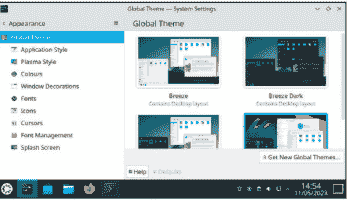

Ubuntu 拥有一个看起来专业且具备详细图形用户界面功能的桌面环境，并附带了你可能需要的基本应用程序。我们同意在通用选项优于 KDE 替代方案时坚持使用通用选项的决策，但我们同样喜爱使用构成众多小工具的 KDE 和 Qt 程序。这些小工具及其配置选项在外观和运作方式上具有一致的高标准。如果你更喜欢那种由拼凑而成的杂七杂八的 Linux 系统的方法，这并没有错，但 Kubuntu 给人的感觉是一个连贯、专业的桌面，功能丰富，类似于 Mac OS 或 Windows。

Edubuntu 是这些衍生版中最接近标准 Ubuntu 的，因为它使用 Gnome，并且将全套标准应用程序与一组专业应用程序混合在一起。与 Ubuntu Studio 一样，它非常擅长完成其设计目标，并且可以像标准 Ubuntu 一样使用。然而，对教育工具的特殊关注不感兴趣的人可能会被所有额外的工具淹没，尽管程度比 Ubuntu Studio 要轻一些。稍微挑剔一点说，该项目最近刚刚重启，文档尚未跟上，这意味着我们不得不四处查找在线资源来发现它具备的功能。

Ubuntu Studio 提供的功能无疑会让普通 Windows 用户惊叹不已，因为它拥有大量完全免费且配置就绪的媒体应用程序。例如，如果你想构建一台音乐制作电脑，安装它可能是理想的第一步。然而，将其评估为通用发行版时，其黑暗、极简的外观以及略显庞杂的应用程序选择中重叠的功能，如果你对媒体创作没有特别兴趣，可能会令人望而却步。

Ubuntu MATE 提供了一个令人愉悦的传统桌面。对于寻求一致性和简单性的用户来说，它将是理想的商务桌面或家庭桌面。也许可以为父母设置这样一个系统？虽然不错，但其中一些开始显得有点过时了。

LXQt 是一个很棒轻量级桌面环境，而 Lubuntu 是一个外观时尚、简单的发行版。它附带的应用程序集涵盖了基础功能，扩展系统则取决于你。

- **Kubuntu 9/10**
  - **网址：** https://kubuntu.org
  - **许可证：** 多种
  - **版本：** 23.04
  - 外观流畅、高效且专业。可用于任何用途。

- **Edubuntu 8/10**
  - **网址：** www.edubuntu.org
  - **许可证：** 多种
  - **版本：** 23.04
  - 感觉像是标准 Ubuntu 体验，并添加了大量用于教育用途的功能。

- **Ubuntu Studio 8/10**
  - **网址：** https://ubuntustudio.org
  - **许可证：** 多种
  - **版本：** 23.04
  - 为以媒体为中心的用户提供了出色的预配置设置，并展示了一系列应用程序。

- **Ubuntu MATE 7/10**
  - **网址：** https://ubuntu-mate.org
  - **许可证：** 多种
  - **版本：** 23.04
  - 一个具有传统外观和功能的经典 Linux 桌面。

- **Lubuntu 7/10**
  - **网址：** https://lubuntu.me
  - **许可证：** 多种
  - **版本：** 23.04
  - 一个轻量级、简单的桌面，等待用户进行扩展。

#### 也可考虑

自然的替代方案是其他 Ubuntu 衍生版，总共有 10 种衍生版。Ubuntu Budgie 使用 Budgie，这是一个轻量级桌面环境，布局上具有相当多的灵活性。Ubuntu Cinnamon 使用 Cinnamon 桌面环境，其覆盖的范围与 MATE 相似，但它源自 Gnome 3 而不是 Gnome 2，旨在在保留传统布局的同时提供当前 Gnome 的一些现代功能，从而兼顾两者之长。

Unity 是 Canonical 试图创建一个在桌面系统和便携设备上都能同样良好运行的桌面的尝试。Canonical 于 2017 年停止了对 Unity 的开发，但另一个团队仍在开发其分支版本。它的外观和运作方式类似于 Gnome 3。Ubuntu Unity 是官方 Ubuntu 衍生版，以 Unity 为默认桌面。我们查看了 Ubuntu，但 Xubuntu 是另一种流行的轻量级 Ubuntu 衍生版，使用 Xfce 作为其桌面。

### 掌控你的 A.I.

AI 通常需要由训练 GPU 组成的服务器集群，但 Tam Hanna 适度的自由职业预算让他能够训练自己的个人 HAL。


**A** I 是当前热议的话题。不幸的是，大多数模型在本地运行需要过量的计算能力；尽管加密货币价格的崩盘和以太坊挖矿的变化在某种程度上减轻了 GPU 市场的压力，但以大规模托管和购买 GPU 仍然代价高昂。

在这个专题中，我们将看看一台配置较低的 MSI GF65，配备 RTX 2060 GPU 和 6GB 内存——用于执行各种人工智能任务评估——如何可以完全在本地运行。虽然这些测试中的任何一个都不会给你带来研究奖项，但它们确实会返回具有商业使用价值的有用且宝贵的结果。

我们将探讨机器翻译、文本生成以及各种其他在日常生活中可能有用的应用程序。

请记住，在本地运行 AI 并不一定需要使用本地硬件。诸如 Azure、AWS 和 Yandex 等云服务商早已扩展了其产品组合，包括具有强大图形加速的虚拟机。一旦建立了本地运行时环境，如果需要更多的计算能力，工作可以轻松转移到这些云服务商之一——这仍然让你能够独立于那些经常无常、并不时因各种原因而停止服务的云服务商。


#### Nvidia CUDA 统治一切

你可能不喜欢，但 Nvidia 主宰着这场表演。

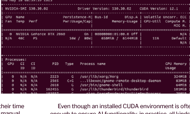

T o 开始，从你的发行版开始菜单打开“驱动设置”。选择“使用来自 Nvidia-Driver-525（专有）的 Nvidia Driver 元包”以开始你的发行版使用硬件厂商加速驱动的旅程。请记住，使用这种厂商提供的软件包驱动会污染内核，并且在某些高可靠性或高信任计算环境中是不允许的。

更新 GPU 驱动通常能带来显著的性能提升。遗憾的是，包管理器往往需要一段时间才能反映厂商提供的更新，因此建议手动干预。前往 https://developer.nvidia.com/cuda-downloads 并按照提供的说明安装所选驱动。

这种下载和部署过程通常不会更新当前活动的 Linux 安装工作环境，因此现在请重启。此外，Nvidia 驱动有点迟缓。首先，即使正确安装并完美工作的驱动，也常常因为缺少符号链接而无法被 AI 应用程序找到。幸运的是，解决这个问题的方法很简单：`~/stable-library& sudo ln -s /usr/local/cuda-12.1/bin/ /usr/bin`

完成后，应执行评估以获取更多详细信息。NVCC – Nvidia Cuda 编译器 – 非常适合这类任务；在我们的机器上，输出如下所示：

```
$ nvcc --version
nvcc: NVIDIA (R) Cuda compiler driver
Copyright (c) 2005-2023 NVIDIA Corporation
Built on Tue_Feb_ 7_19:32:13_PST_2023
Cuda compilation tools, release 12.1, V12.1.66
Built cuda_12.1.2/Compiling 32415258_0
```

一个常见的错误是“RuntimeError: CUDA error: all CUDA-capable devices are busy or unavailable”（运行时错误：CUDA 错误：所有 CUDA 兼容设备忙碌或不可用）。这通常表明图形加速器被另一个进程阻塞。使用 Nvidia-smi 查找标记为“E”的任何进程并将其终止。有时，仅仅在两三秒后再次运行脚本就能解决问题。

#### 电源管理

如果你使用笔记本电脑运行 GPU 环境，请确保电源已连接，因为现代笔记本电脑 GPU 对主机有极高的功率需求，且在电池供电时通常会降频。建议将机器设置为性能模式，使内核驱动提供最大量的计算性能。

> 当电源连接到机器时，峰值功率会增加到 80 瓦。

尽管安装 CUDA 环境通常足以确保 AI 功能，但在实践中，各种问题层出不穷。幸运的是，在许多情况下，对确切的错误消息进行 Google 搜索就足以使事物恢复正常运行。请记住，驱动环境已知会与挂起系统发生不良交互；旨在运行 AI 任务的工作站，理想情况下，应始终通过输入命令 `shutdown -h now` 或从窗口管理器中选择相应选项来完全关闭。此外，应避免运行其他也使用硬件加速图形的任务——理想情况下，仅使用桌面和你打开的 AI 任务以实现最大性能和最小内存拥堵。

> **快速提示**
>
> AMD GPU 用户可能会绝望，但并非一切都失去了。
>
> 你仍然可以尝试许多 AI 工具的 CPU 模式。OpenCL 通常不是选项，它本可以利用 AMD 和 Intel GPU，但目前是 Nvidia 优先的 AI 世界。

#### 工作环境

运行人工智能需要一个精心调整的系统设置。如果要避免厂商锁定，我们也希望确保工作环境尽可能标准化。

鉴于 AI 任务需要大量的处理能力，它们在卸载到 GPU 上运行时表现最好。遗憾的是，Linux 上的图形加速传统上是系统管理员已知最无常的任务之一。电气工程师和类似的 GPU 密集型工作者通常避免设置 GPU 驱动，因为它们会负面影响整体系统稳定性。因此，如果你的数据很有价值，建议在部署图形驱动之前执行完整备份。

以下步骤将使用 Ubuntu 22.04 LTS 执行。确保所有操作系统更新已安装，并且内核及工具链的其他部分处于尽可能最新的状态。

尽量让你的工作环境尽可能舒适。在普通文本编辑器中编辑 Python 是可能的，但体验不佳，因此我们推荐使用 Visual Studio Code，因为它提供了一个愉快且节省资源的环境。

最后，确保有足够的随机存储可用。AI 模型可能出乎意料地大，即使在训练状态下也是如此；我们进入此任务时拥有超过 200GB 的 NVM 支持的免费内存。


### 自然语言翻译

现代智能机器可以执行实时翻译。


在本节中，我们将以原生形式运行翻译环境。LibreTranslate 还提供了位于 https://registry.hub.docker.com/r/libretranslate/libretranslate 的 Docker 容器。不过，并不一定建议使用它——请记住，将 CUDA 加速暴露给 Docker（如 https://docs.nvidia.com/datacenter/cloud-native/container-toolkit/install-guide.html 中所述）是一个复杂且易出错的流程。由于 Python 社区认为该产品的稳定性已足够高，因此可以通过 *Pip* 来处理底层库的部署。

出于便利性的考虑，我们首先通过输入以下命令创建一个 *virtual environment*（当前环境显示在括号中）：

```
(base)~$ conda create -n aitranslator
(base)~$ conda activate aitranslator
(aitranslator)~$
```

随后，通过 *Pip 3* 完成实际的下载：

```
(aitranslator)~$ pip3 install argostranslate
```

鉴于我们的虚拟环境是全新的，将下载约 2GB 的库，因此请确保你拥有高速互联网连接。当 *Pip 3* 包管理器发出版本信息 '*Successfully installed argostranslate-1.8.0*' 时，即表示安装成功——你的版本可能略有不同，因为在你阅读本文时，*Pip* 仓库的内容可能已经更新。

请记住，在虚拟环境中安装 *Argos* 并不总是最佳方法——如果你想使用 *Argossum* 等命令行实用工具，从工作站进行全局安装可能更合理。然而，对于我们的评估而言，使用虚拟环境可以使清理安装过程更加容易。

其副作用之一是，库和语言包必须彼此独立地部署。如果你进行纯编程式的安装，库包的部署必须通过 Python 代码完成。因此，创建一个新的工作文件，并在你选择的开发环境中打开它。接下来，从导入所需的包并声明目标语言代码开始：

```
import argostranslate.package
import argostranslate.translate
from_code = "en"
to_code = "de"
```

然后，通过以下代码片段完成实际的下载过程：

```
argostranslate.package.update_package_index()
available_packages = argostranslate.package.get_available_packages()
package_to_install = next(
    filter(
        lambda x: x.from_code == from_code and x.to_code == to_code, available_packages
    )
)

argostranslate.package.install_from_path(package_to_install.download())
print("Package installed!")
```

首先，调用 *update_package_index()* 以促使 *Argos Translate* 更新其内部包缓存。之后，*get_available_packages()* 返回当前安装已知的所有包和语言组合列表。实际的安装过程需要一个指示语言包将被下载到的路径。使用 lambda 过滤器从值中提取这个路径是最简单的方法；最终结果传递给方法 *install_from_path*，该方法确保包下载。

鉴于 *Argos Translate* 会在你的机器上创建本地缓存，包下载程序只需运行一次。因此，下一步涉及创建另一个工作文件，该文件将作为实际翻译逻辑的主机。它也从导入包和声明目标语言代码开始。实际的转换操作如下所示：

```
import argostranslate.package
import argostranslate.translate
from_code = "en"
to_code = "de"
translatedText = argostranslate.translate.translate("Hello World", from_code, to_code)
print(translatedText)
```

此时，程序已准备好进行试运行。

### 系统准备

一句古老的谚语声称，AI 模型的质量受限于其输入数据的质量。此外，数据模型和运行模型所需的实际代码往往可以也应该独立更新。截至本文撰写时，*Argos Translate* 项目支持超过一打的语言组合。

### 硬件加速

*Argos develop* 团队希望尽可能扩大其产品的影响力；其副作用是，CPU 翻译被视为一等公民，并得到支持，只要（有限的）通用 CPU 性能允许即可。

这意味着应通过设置环境变量来启用 CUDA 加速，命令如下：

```
(aitranslator)~/aitranslatespace$ export ARGOS_DEVICE_TYPE=cuda
```

现在，可以进行一次试运行，将 Core i5 CPU 和 GPU 进行比较。

使用 CUDA 时的一个常见问题是传输时间；将模型信息从系统主内存移动到 GPU 内存并非免费。因此，特别是对于小型任务，在某些情况下，CPU 运行可能比在 GPU 上运行更高效。

### 优化行为

虽然字符串 "Hello World" 是一个有效的问候语，但其长度较短，意味着翻译过程的性能对总挂钟时间的影响有限。解决这个问题的最佳方法是通过使用文本文件来实现。

因此，下一步是程序的以下版本：

```
text_file = open("input.txt", "r")
data = text_file.read()
translatedText = argostranslate.translate.translate(data, from_code, to_code)
print(translatedText)
text_file.close()
```

我们现在不再将可翻译的信息作为字符串传入，而是从文本文件中获取，Python 解释器期望该文件位于脚本文件所在的同一文件夹中——或者更确切地说，是当前工作目录。

在后续步骤中，我们预先加载了之前某篇文章中的一部分文本，该翻译也完美成功。

鉴于 AI 任务现在变得更复杂，可以执行更有意义的基准测试。下表比较了 CUDA 和 CPU 的结果。

| | CPU | GPU |
|:---:|:---:|:---:|
| **real** | 0m4.355s | 0m4.650s |
| **user** | 0m11.103s | 0m4.051s |
| **sys** | 0m0.754s | 0m1.308s |

解读结果需要对 time 命令熟悉——最重要的值是用户时间，在多线程系统中，这是每个处理器核心单独花费在任务上的时间。可以看出，实现翻译所需的计算机时间几乎是之前的三倍。

> 我们试运行产生的德语结果几乎达到印刷质量。

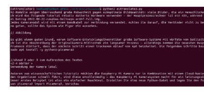

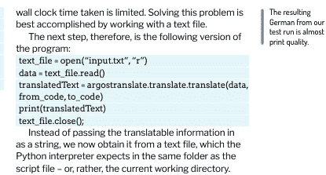

### 机器中的翻译

计算机历史中一个鲜为人知的事实是，军工复合体在冷战时期资助计算机研究的一个原始原因，是他们希望产生机器翻译系统——特别是当与外国对手打交道时，拥有优质翻译人员可能会变得很麻烦。

尽管最初的机器翻译尝试在很大程度上相对不成功，但不断攀升的计算性能使得机器翻译成为可能且令人向往。事实上，我们知道有一家军事科学出版商解雇了大部分翻译人员，现在使用 DeepL 进行许多外语翻译。

遗憾的是，许多甚至大多数机器翻译系统供应商都清楚地意识到，用机器取代人类翻译人员所能带来的价值。因此，他们的服务定价也是如此。幸运的是，开源开发人员投入了大量精力创建替代的翻译环境。具体而言，LibreTranslate 系统如此完善，以至于提供了一个即开即用的 Docker 环境，甚至包括用户界面。

这样，技术能力较弱的办公人员可以通过打开 Web 浏览器并导航到提供的 URL 来与系统进行交互——实际工作环境完全由图形驱动。此外，生态系统还提供了广泛的 SDK。简而言之，这是 AI 爱好者绝对需要更多地了解我们的产品。


### 控制你的 A.I.

#### AI 看见你……

启用 AI 来描述它所看到的内容。

图像分类之难，并非主要在于算法，而在于需要专用的训练集。许多，甚至大多数学术论文都使用诸如 **www.cs.toronto.edu/~kriz/cifar.html** 上提供的 CIFAR 图像包之类的数据集——只需看一眼它的内容（*如右图所示*），就能明白这个数据集中的检测类别数量是非常有限的。

- 飞机
- 汽车
- 鸟
- 猫
- 鹿
- 狗
- 青蛙
- 马


涉及下载实际的库：
**(airtranslator)** ~/airtranslatespace$ pip install transformers

#### 拥抱人脸……

如果我们在六个月前写下这篇文章，下一步将是参数化一个特定模型。幸运的是，AI 技术的进步促成了 Hugging Face 公司的崛起。下面展示了其最有趣的产品之一。为了后世参考，我们将复用之前创建的虚拟环境。下一步

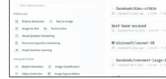

之后，创建一个新的工作文件。实际上，创建 pipeline 的方式如下：**from transformers import pipeline**
**clf = pipeline("image-classification")**

实例化 pipeline 最简单的方法是传入一个描述要处理任务的字符串——在这种情况下，Hugging Face 库负责选择一个模型。该产品还提供了多种附加选项，其中一些我们将在后文中进一步讨论。或者，请参阅 **https://bit.ly/LXF304huggingface** 上的文档。

在下一步中，我们可以执行第一次分类实验。鉴于 Hugging Face 希望使其生态系统尽可能简单，可以传入一个可通过 https 访问的 URL 作为参数：
**from transformers import pipeline**
**clf = pipeline("image-classification")**
**result = clf("https://huggingface.co/datasets/Narsil/image_dunny/raw/main/parrots.png")**
**print(result)**

首次运行（或使用新的模型参数）时，库会从 Hugging Face 服务器下载模型数据，然后才开始实际的推理过程。

这一点需要牢记，因为它增加了一个潜在的单一故障点——如果该模型仓库因任何原因离线，显然推理无法进行。此外，警告“No model was supplied, defaulted to google/vit-base-patch16-224 and revision 5ca965d (https://huggingface.co/ google/vit-base-patch16-224)”也很重要——在生产环境中，务必明确指定将使用哪个模型。否则，结果可能会随机变化，导致 AI 系统行为不可预测。

### 计算机视觉 - 本地化

争论图像分类任务属于计算机视觉还是人工智能，是让雪茄厅里的工程师们保持忙碌的好方法。鉴于本刊使用的是无烟草纸张印刷，我们将同意保留不同意见，并将图像分类视为手头任务的一部分。

微软 Azure 等供应商通过提供计算机视觉和图像分类服务赚取了巨额利润。虽然使用它们很诱人，因为提供的模型质量极高，但实践中也必须考虑其缺点。

首先，即使是压缩为 JPG 或类似格式，图像数据仍然很大。将图像传输到服务器（甚至可能是海外）会给系统增加额外的延迟。此外，对于安全关键系统，断开互联网连接就足以使防御系统的 AI 部分无法工作。

最后，购买云服务会产生巨额成本——虽然实际认知服务的试用费用并不算特别昂贵，但从长远来看，计算成本会不断累积。除此之外，供应商锁定使您依赖于（往往挑剔的）服务商的当前流行模式。

幸运的是，机器视觉是 Python AI 领域中最古老的领域之一，在 ChatGPT 或类似热潮冲击科技行业之前就已备受关注。因此，开发人员可以选择多种选项，我们在本项目中就使用其中之一。

### 图形加速

Hugging Face 致力于最大化其产品的覆盖范围。因此，pipeline 通常默认使用主机工作站的多用途 CPU。更改此设置最简单的方法是传入一个设备字符串，例如以下所示：

```python
clf = pipeline("image-classification", device = "cuda:0")
```

在我们的工作站上，单个 GPU 位于位置零——可以通过使用 `Nvidia-smi` 来检查。
之后，新的 pipeline 对象可以像其基于 CPU 的兄弟一样使用——只需注意它也可能受到 CUDA 图形加速堆栈有时挑剔行为的影响。

### 本地处理

在成功使用 Hugging Face 提供的示例图像之后，我们现在将转向分析本地图片。特别地，以下步骤使用了一系列图像，这些图像是在为德国工程门户 Mikromcontroller.net 报道工程博览会时创建的。

特别地，20 个 JPEG 文件被放置在子文件夹 `images-infer` 中。在下一步中，需要对 Python 工作文件进行以下更改：

```python
from transformers import pipeline
clf = pipeline("image-classification", device = "cuda:0")
for x in range(1,20):
    result = clf("images-infer/" + str(x) + ".jpg")
    print (result)
```

在处理图像时，Hugging Face pipeline 接受三种不同的负载：除了上述 http 或 https URL 外，系统还接受本地文件路径或 PIL 库对象。然而，每次调用只能使用一种请求格式——不可能调用处理方法并传入，例如，本地和网络 URL。
鉴于我们的文件已经存在于硬盘上，先将它们加载到 PIL 库中没有意义——如果您想在实际推理之前进行处理，情况当然不同。无论如何，代码实际上相当简单。`for` 循环遍历所有有效的文件名，然后逐个传入 pipeline。其结果随后被输出到命令行。
以当前配置运行程序会产生有效的结果。但是，会发出类似 `home/tamhahn/.local/lib/python3.10/site-packages/transformers/pipelines/base.py:1080: UserWarning:` 的警告——Hugging Face 库更倾向于使用包含所有要评估对象的列表或向量，因为这减少了从 CPU 内存加载模型数据到 GPU 内存所需的变更量。
幸运的是，只需更改程序以使用所有潜在文件名填充一个列表，即可轻松解决问题并使警告消失。然后可以将这些文件名传入 pipeline，结果再次重定向到命令行：

```python
aList = []
for x in range(1,20):
    aList.append("images-infer/" + str(x) + ".jpg")
result = clf(aList)
print (result)
```

有趣的是，我们没有看到列表版本带来性能提升——使用承认不科学的 time 命令测量执行时间，两种版本的运行时间相似。

### Transformer 库

使用 pipeline 对象进行实验增加了大量的灵活性。不仅可以用模型库中的另一个模块轻松替换实际的图像检测模块，而且库还允许您更改推理解决方案的行为。
作为示例，让我们切换操作模式。程序的新任务不再是分类图像的内容——我们现在想要检测图像中的哪些部分被对象占据。
为此，我们将使用 Facebook 提供的神经网络——它被认为是入门级的良好选择。将其集成到现有工作文件中只需修改 pipeline 声明即可。
其余的代码——这明确包括列表的生成和 pipeline 的调用——可以未经修改地复用：

```python
from transformers import pipeline
clf = pipeline(model="facebook/detr-resnet-50", device = "cuda:0")
aList = []
```

首次调用此版本的程序会产生类似以下的错误：`DetrConvEncoder requires the timm library but it was not found in your environment. You can install it with pip install timm.` 请注意，安装后可能需要重启运行时。
这是由于库无法完全将您的代码与所用模型的需求隔离开——在首次调用新模型时，它会下载模型并检查依赖项。幸运的是，只需输入命令 `pip install timm` 即可轻松解决此问题。

### 结果比较

执行 pipeline 的批量调用可能会移除错误信息，但会使命令行输出更加杂乱。因此，修改工作循环以创建更美观且视觉上更易区分的输出：

```python
for x in range(1,20):
    print("------")
    result = clf("images-infer/" + str(x) + ".jpg")
    print (result)
```

现在两种模型都可以运行。鉴于用于此过程的图像非常具体，通用图像检测模块在没有额外训练的情况下不太可能取得良好结果。尽管如此，结果看起来仍然相当有希望。

无云功能的图像检测！

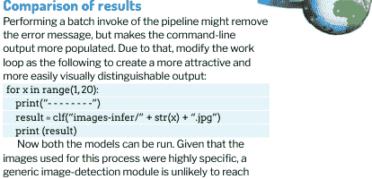


### 控制你的 A.I.

#### 健谈的 AI 伙伴

一个简单的 250GB 下载就能为你获得专属的 HAL。

截至本文撰写时，获取模型数据的官方途径是访问 https://bit.ly/lxf304form 并填写表格。遗憾的是，实际经验表明，非教育邮箱地址通常无法获得批准。

对于非商业用途，有一个非官方研究路径位于 https://github.com/Elyah2035/llama-dlob/llama，其中包含一个用于获取模型数据的便捷 shell 脚本。请将其复制（但需注意其可能随时失效）到你的本地环境中，并按以下方式进行部署：

```bash
(aitranslator) ~/ai translatespace$ cd models/
(aitranslator) ~/ai translatespace/models$ gedit llamad.sh
(aitranslator) ~/ai translatespace/models$ chmod +x llamad.sh
(aitranslator) ~/ai translatespace/models$ ./llamad.sh
(aitranslator) ~/ai translatespace/models$ llamad.sh
```

在实际千兆网络连接下，完整的下载过程大约需要两个小时（实际大小约为 250GB），因此请做好等待一会儿的准备。此外，该脚本会部署所有尺寸的模型，而不仅仅是将在后续步骤中使用的小型模型。

尽管如此，下一步需要从 GitHub 下载实际的 llama.cpp 工作环境。此外，必须对其进行编译以使其就绪：

```bash
(aitranslator) ~/ai translatespace$ git clone https://github.com/ggerganov/llama.cpp
(aitranslator) ~/ai translatespace/llama.cpp$ make
```

生成的代码预期将获取到的模型文件放置在自身的 models 子文件夹中。为此，需要复制部分文件。

运行 llama.cpp 需要某些 Python 库的存在，可以通过以下命令重新安装它们：

```bash
(aitranslator) ~/ai translatespace/llama.cpp$ python3 -m pip install -r requirements.txt
```

鉴于我们在前两步中复用了同一个虚拟环境来执行此命令，可能会出现冲突警告——不过，可以忽略该警告而无后果。如果觉得这令人困扰，当然，随时可以使用 conda 命令创建一个新的虚拟环境。

在下一步中，需要将模型信息转换为框架可消化的格式。这是通过 Convert 工具完成的，调用方式如下：

```bash
(aitranslator) ~/ai translatespace/llama.cpp$ python3 convert.py models/7B/
```


这次运行的结果不尽如人意。

最后，还需要进行量化步骤：

```bash
(aitranslator) ~/ai translatespace/llama.cpp$ ./quantize ./models/7B/ggml-model-f16.bin ./models/7B/ggml-model-q4_0.bin q4_0
```

此处概述的编译过程仅使用 CPU。如果你想使用（部分）GPU 加速功能，则必须向编译过程传入一些常量。更多内容可参见 https://github.com/ggerganov/llama.cpp。

#### 让 Llama 投入工作

鉴于 Llama 团队致力于推动 AI 资源获取的民主化，该产品附带了多种即开即用的演示示例。最基础的冒烟测试涉及调用主程序：

```bash
(aitranslator) ~/ai translatespace/llama.cpp$ ./main -m ./models/7B/ggml-model-q4_0.bin -n 128
```

无参数的调用会使程序开始随机交谈——话题范围从苹果硬件到相当随机的输出（尽管语法正确）。

我们手头使用的模型似乎对提示词非常敏感。例如，请查看以下提示：

```bash
(aitranslator) ~/ai translatespace/llama.cpp$ make -j 8 && ./main -m ./models/7B/ggml-model-q4_0.bin -p "Tell me how to cook Risotto" -n 512
```

它产生了如下图所示的结果，坦率地说，略显平淡。

然而，这并不意味着我们的聊天机器人不懂烹饪。另一个使用更完整提示的示例调用会产生不同的结果：

```bash
(aitranslator) ~/ai translatespace/llama.cpp$ make -j 8 && ./main -m ./models/7B/ggml-model-q4_0.bin -p "Tell me how to cook Risotto please. I would like a few easy steps" -n 512
```

两次调用产生了两组不同的输出（见右上角截图）。这是正常的，因为随机数生成器起了很大的作用。如果需要可重复性，可以传入随机数生成器的种子以稳定输出。

此外，请记住，这里使用的模型是最基础版本的。文档也提供了较大模型的参数数据。

#### 更高级的交互

聊天机器人最著名的应用是经典的“交互”，类似于虚拟助手。**Llama.cpp** 也附带了相应的示例，调用方式如下：

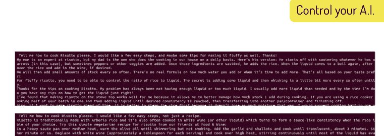

(aitranslator) ~/ai translatespace/llama.cpp$ ./examples/chat.sh

运行该程序后，llama.cpp 会展示一个包含名为 Bob 的友好虚拟助手的窗口。如下图所示，Bob 并不回避激烈的对话。

有趣的是，其背后的代码基于一个 shell 脚本。它主要由程序的调用组成，如下所示：

```bash
#!/bin/bash
# Temporary script - will be removed in the future
cd dirname $0
cd ..
# Important:
# 'keep 48' is based on the contents of prompts/chat-with-bob.txt
#
./main -m models/7B/ggml-model-q4_0.bin -c 512 -b 1024 -n 256 -keep 48 \
  -repeat_penalty 1.0 -color -i \
  -r "User: " -f prompts/chat-with-bob.txt
```

与许多其他 AI 系统类似，主要的智能在于提示文件中。仔细查看提示可知，AI 系统也被提供了一些示例交互来“启动”算法。此外，-r 参数将系统设置为 PROMPT 模式——它产生的是如图所示的交互式通信行为，而不是通常的线性响应生成。最后，-n 选项决定了交互的“复杂度”。

### 来自 Python 的交互

在命令行上正确设置参数已经足够令人头疼了；将命令行工具集成到程序调用的服务中则是一个全新的挑战。Python API 更容易处理，并通过位于 https://github.com/abetlen/llama-cpp-python 的仓库提供。一个示例交互如下所示：

```python
>>> from llama_cpp import Llama
>>> llm = Llama(model_path='models/7B/ggml-model.bin')
>>> output = llm('Q: Name the planets in the solar system? A:', max_tokens=32, stop=['Q', '\n'], echo=True)
>>> print(output)
```

此外，llama-cpp 可以用作（付费的）OpenAI 服务的替代品。这是通过另一个 Python 包提供的，使用 Pip 3 安装：`(aitranslator) ~/ai translatespace/llama.cpp$ pip3 install llama-cpp-python`。请注意，方括号是调用的一部分，并非印刷错误。然后，按以下方式启动：`$ python3 -m llama_cpp.server --model models/7B/ggml-model.bin`。遗憾的是，在某些情况下会抛出类似 'AttributeError: llama object has no attribute ctx' 的错误。在这种情况下，提交 GitHub issue 是最好的方法——该问题可能由多种不同的原因引起。

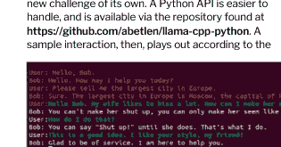

Llama.cpp 的 Bob 充满了（可疑的）有益建议。

### 屋里的聊天机器人！

迄今为止最大的人工任务，也是引起最多 AI 焦虑的任务，就是聊天机器人——一个由知识库支持的系统，使用信息来“进行对话”或解决业务和个人问题。

鉴于大多数注意力都集中在这类系统上，我们选择其中一个作为最后的练习是合情合理的。请注意，对话式 AI 系统对 CPU 和 GPU 有着巨大的需求，并且对工作站的剩余内存造成显著负担。执行此处的步骤需要超过 250GB 的 SSD 存储空间；生成的系统使用尽可能小的模型，无法与 ChatGPT 等完全竞争。

另一方面，这里使用的模型文件可以被替换为更大的示例。此外，能够在本地运行整个推理流水线意味着该系统可以轻松地集成到其他系统中——因此，几乎无限的可能性在等待着你。

然而，请注意，这里概述的步骤仅对非商业用途合法。LLAMA 模型——大型语言模型 Meta AI——由 Meta 拥有，仅许可用于学术用途。当然，未来这可能会改变——在这种情况下，切换到不同的模型文件并不特别困难。


### 深入解析：Collabora 专访

#### 解放一切！

Collabora Online 背后的核心人物之一**迈克尔·梅克斯**（Michael Meaks）向我们讲述了将开源办公软件引入云端以及实现文档解放的故事。


在一个潮湿的英国三月清晨，凌晨 5 点还在躲雨，**Linux Format** 从英格兰阴郁的西南部出发，前往英国教育卓越的中心，同时也因孕育了大量科技初创企业而被称为“硅沼”（Silicon Fen）的剑桥。具体来说，这趟行程的目的地是克莱尔学院（Clare College），这是剑桥 31 所学院中历史第二悠久的学院，距离市中心仅需短途巴士即可到达。

Collabora 正是在这里举办了其**COOL Days 2023** 大会（*你可以在 [LXF382] 中阅读相关报道*）。在参加大会期间，我们趁机采访了执行董事、前 Novell 开发者、前 OpenOffice 贡献者，也是最重要的前 Linux Format 专栏作家迈克尔·梅克斯，请他解释什么是文档解放，以及为什么欧盟如此拥抱 Collabora Online，简直将其视为生死攸关的大事！

**Linux Format：** 当 *Linux Format* 上次与你对话时（*采访，[LXF156]*），你还在 Novell 从事 OpenOffice 工作，而且当时你还没有白发！

**迈克尔·梅克斯：** 这就是经营一家公司能做到的事！那是很久以前了——大概 11 年前？我不确定我们是否讲过那个故事。SUSE 审视了其投资组合和人们正在做的工作，决定在 Android 上修改 LibreOffice 版本的开发工作可能并非其服务器业务的核心。

我认为这只是良好管理的一个症状，是在多年放任对开源的热情之后。SUSE 专注于更广泛的桌面领域以及能带来收入的事情，这在商业策略上非常出色，但更棒的是，它以一种非常好的方式处理了我们。它允许我们分拆出去（成立 Collabora），并授予我们一份合同来支持 SUSE 客户的业务需求，这一合作延续至今。它让我们带走了我认为七名 SUSE 员工，构成了这家初创公司的核心，于是我们赌了一把；我们抵押了房子等，只为支付员工薪水。

我们继续推进，并成功说服了六个人加入我们：“你们怎么能去受雇于一家没有收入、没有营收的公司呢？！”幸运的是，母公司 Collabora 提供了一些担保和一些非常有用的架构支持，于是我们在 10 年前成立了 Collabora Productivity。现在我们有大约 45 人，这是相当可观的增长。我们仍然有那最初的七人中的五位在一起。所以，10 年过去了，这令人鼓舞！

**LXF：** 当初迈岌这么大一步（去分拆公司）的初衷是什么？

**MM：** 当你参与开源项目时，你会对项目做出承诺。你会做好事这一理念对社区非常重要。因此，我代表 SUSE 开出了许多张并非空白但金额巨大的支票，以支持 LibreOffice 并推动其增长。如果这些工作突然停止，并彻底放弃该领域，那将是灾难性的——LibreOffice 将会存活，但形式会大打折扣。

我们的职责之一是履行并继续履行这些承诺，我们至今仍在这样做。我们仍然占 LibreOffice 提交的三分之一，为所有人，为我们的客户做酷的事情。

**LXF：** 所以，LibreOffice 是当时关键的转折点？

**MM：** SUSE 确实是那次转变的核心——SUSE、Red Hat 和 Google 使其成为可能。我们达到了 Red Hat 和 SUSE 都准备就绪的阶段——重要的是，一些社区成员也准备好了。但当宣布时，每一方都希望对方先行动。我们在最后一分钟写信给 Google，说如果我们想发布，必须在一周内宣布。于是 Jeremy、Allison 和 Chris DiBona 设法迅速给出了一个报价，上面还有额外的彩虹、小马和独角兽，表示 Google 认为这是未来之道，所有人都随之行动。这就像外包尽职调查。

如果你是一位忙碌的高管，知道你拥有了合适的人才是有道理的。当然，多年来 Google 通过 Google Summer of Code 支持了我们，并做出了大量贡献。Red Hat 也做了出色的工作——当时，它额外雇佣了三名开发者专门从事 LibreOffice 工作，使其团队免费可用。

**LXF：** 那是 10 年前，当时一切仍是桌面应用程序——现在一切都已在线化，通过浏览器运行。

**MM：** 许多应用是这样的，但很多并不是。浏览器就是桌面应用程序——不管你喜不喜欢，它们是我们拥有的最大且对安全要求最高的桌面应用之一。我认为桌面版 LibreOffice 和 Collabora Online 或 Office 仍然有生存空间。当然，该底层技术——LibreOffice Core 及其内含的所有优势——在社区及其周边有巨大的使用量。它是可以在很多很多地方复用的。

当然，Collabora Online 填补了在浏览器中部署该技术的巨大需求，确保部署非常轻松，客户端零接触——它非常安全且互操作性极强。

**LXF：** 我们上次对话时（新闻，LXF267），你对 LibreOffice 的治理处理方式感到不满。这种情况有改善吗？

**MM：** 我认为现实情况是，人们对 LibreOffice 的发展方向有着不同的愿景。这完全没问题。我们有一个治理结构，旨在进行调解并确保包容所有人，而精英制的治理应该包含所有人。

我们希望所有人们的声音都能在 TDF（文档基金会）的关键决策中得到代表。我认为，将所有人纳入讨论，而不是预先排除任何人，对 TDF 的未来至关重要。

我认为 LibreOffice 的情况可能在好转。最近我看到他们在做决策和做事，看起来是积极的。那里有巨大的潜力。围绕 LibreOffice 有广泛的好意。我们花了数年时间来构建这一商标，作为整个社区。我认为重要的是该资产随后被用于整个社区的好事，包括所有正在参与工作的人。政治是困难的，治理是艰难的。让 10 个人达成一致并不容易。

**LXF：** 回到 COOL，它最近取得的主要胜利是什么？

**MM：** 我们最近做的一件事是 Zotero 集成，这真的很酷。如果你通常使用 Zotero，你需要在桌面上运行一个 Java 应用，然后它以某种方式与浏览器或办公套件通信。我们消除了这一需求，因此部署变得更加容易——你可以将其批量分发给你想要的人，他们然后可以共享引文数据库。

这比你可能想象的更有用。学生希望用它进行他们的研究项目，以证明他们的论文并非完全由自动化写作完成。他们实际上可以说明他们从哪里获取了内容和观点，然后进行评分，但教授们也希望拥有此功能，这样他们可以建立信任网络，并希望能避免论文工厂和科学界的不正当行为。

还有大量的互操作性工作。例如，Calc 现在支持 16,000 列——多年来，我们一直只有两百万行，因为这就很好，但只是将表格横向展开以使其与 Excel 同样大小是关键。实际上，我们甚至能做得更大——别告诉任何人，我们可以做到 1600 万行。

有趣的是，有些人确实需要这个。过去我们有一位客户只是想使用电子表格对 CSV 文件进行排序。问题在于在 Excel 中这需要几个小时。他仅在云端进行操作，因此能够使用 Collabora Online 并在几秒内而不是花上一小时完成排序，这很酷。这感觉很好——你可以在那里取胜，没有什么神奇的，它只是软件。只要有足够的时间、人员和优化，我们可以表现得远胜他人。

我想补充一点，我骨子里是一个电子表格爱好者，那么我们在电子表格中还有什么？我们已经有了 Sparklines。这是在单元格中嵌入这些小型迷你图表，这样你就可以将一个单元格变成其他某个单元格集合的图表，而无需刻度。Sparklines 的理念是不看刻度也能看到趋势。

**LXF：** 你之前提到过数字主权——你指的是什么？

**MM：** 这是看待自由软件信息的一种不同方式。如果你回到 GPL 和自由软件基金会（FSF）的起源，Richard Stallman 想要能够修复他的打印机——打印机卡纸了，但没人知道原因，所以没人去修理它。他只是想告诉别人打印机卡纸了，但他做不到，因为软件是专有的。他没有控制自己花钱购买的设备，而在当时，激光打印机并不便宜。他感到失望，他不再拥有主权。

主权是政府和大机构关心的事情，也许比个人更甚，但我们都可以做到——我们可以掌控自己的生活。

#### 云端乌托邦

> “关于许多这些云服务的一件事——你交给他们所有你的数据，然后你可以按照他们的条款访问它。”


### 深入探讨 Collabora 访谈

以及其中的一部分。这是以一种易于理解的方式应用的开源软件理念。

对于大国和政府而言，尤其是在当前的地缘政治环境下，存在被切断银行网络连接的风险，或者软件供应商突然让所有设备变砖的风险。我认为，我们目前看到的只是数字干预可能性冰山一角。能够掌控自己的数据、知道数据在哪里、不让它悄悄流出本国，甚至避免无法控制的不实信息涌入以及那些对政策无益的算法，这些真的至关重要。

因此，当前在政治层面对“主权”概念的关注度很高。我认为数字主权是其中的关键组成部分。但其中也有消极的一面，即我们通过“购买英国货”来实现数字主权——我们只使用英语软件——但这行不通。真正让我们实现这一承诺的唯一方式，是使用开源软件，让每个人都能协作，每个人都能对其充满信心，并且每个人都能获得可靠的产品。随后，它们可以本土化，你可以从任何地方获取支持服务，而不会失去与全球协作的能力。


**LXF：** 我们曾遇到几种情况，例如将文件放入使用 DRM 的专有服务中，一旦该服务崩溃，您的文档就丢失了。

**MM：** 许多云服务的问题是——你把所有数据都交给它们，然后你只能按照它们的条件访问。你慷慨付费，甚至要付费才能访问自己的数据，且须遵循它们的规定——这有点不幸。

我们谈论人工智能，嘲笑它很容易，但我怀疑，我们已经对人工智能进行了拟人化，即使是非常弱小的人工智能，这种情况只会更糟。微软阅读你的电子邮件——或者无论是什么品牌，比如 Copilot；这是个听起来很友好的品牌，对吧？——但它的理念不仅是阅读你的日历，还包括你的电子邮件……所以，这是一点有趣的心理学，试图说服人们将他们的数据和所有信息交给这些善意的自动机进行处理。随着它变得越来越复杂，我们将看看人们的反应如何。

我认为人类最终会适应一切。幸运的是，目前还没有人制作出你无法拒绝的广告。

**LXF：** 我认识一位移居英国的古巴人，他问我如何应对广告，因为他只是想买下看到的所有东西。他显然缺乏任何过滤机制。

**MM：** 我小时候从来没有电视。完全没有电视。我们的电视是书——这是一台电视，你可以翻页！当我们真的看到电视时，它完全令人着迷。你知道，一年前我们还坐在那里看着盒子中的魔力。但它变得司空见惯，人类在适应方面非常出色。只是希望他们不要适应到……ESA 教育计划证明了创新的程序员对年轻思想具有多大的吸引力。在 https://astro-pi.org 注册，并在 https://bit.ly/ifx304space 了解更多结果


#### AI, AI, oh!

学习农场。

上一期中，我们报道了 Pi 基金会制定 AI 教学方案的努力。这一基于人类的活动成果现已发布，前六个在线课程可供人类教师和学生使用，从 AI 的基本概念到解释机器学习如何实际计算数字。了解更多：https://bit.ly/ifx304ai

#### 体验 AI

你课堂中 AI 的兴奋感。


领先于 AI 浪潮。


### 调试探针 (Debug Probe)

莱斯·庞德（Les Pounder）正准备拿起一罐除蝇喷雾，试图清除代码中的 bug（错误），但就在此时，他发现了这个东西。

**简评**
这是一款基于 RP2040 的电路板，但与编写代码不同，这块板卡旨在帮助调试我们的代码。它更面向高级用户，通常是 C/C++ 开发者，调试探针是那些需要它的人的有用工具。附带的 USB 串口适配器使其在树莓派和其他单板计算机（SBC）的串口控制台中也非常实用。

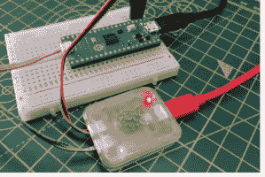

> 封装在塑料外壳中，这款基于 RP2040 的板卡旨在帮助你调试裸机（bare-metal）Pico 项目。

树莓派最新的 RP2040 设备并不是 Pico，而是我们可以用来调试 Pico 的工具。树莓派调试探针（Raspberry Pi Debug Probe）是一款由 RP2040 驱动、专为配合调试工具设计的电路板。借助它，我们可以交互式地单步执行代码，并识别在 Pico（或其他兼容设备）上运行的代码中的问题。该探针用于观察运行程序的数据，并在 Pico 的串行线调试（SWD）端口（即 Micro USB 端口对面的三个未焊接引脚）与你计算机上的 USB 之间搭建桥梁。使用标准化的 CMSIS-DAP 协议，调试探针可以配合 OpenOCD 等调试软件应用程序使用。

调试探针封装在一个磨砂塑料外壳中，用于保护其免受杂散导线的干扰。我们选择将探针从塑料“监狱”中解放出来，绿色的 PCB 在众多设备中显得格外醒目。这块小型 PCB 明显出自树莓派的血统。

#### 焊接连接

调试探针通过 UART 引脚和 SWD 引脚接头连接到 Pico。通常，SWD 引脚是未焊接的，因此你需要将它们焊接上去，并使用附带的连接器完成连接。预焊接 Pico（通常称为 Pico H）的所有者可以使用附带的 JST 式连接器。这使得连接过程变得轻而易举，无需担心哪根线对应哪个引脚。

完成接线后，我们需要安装软件，这里你可能会遇到一些问题。首先，文档非常棒，但内容很多，有时可能会让人感到不知所措。我们喝了两杯咖啡并挠了挠头，才让所有东西正常工作并看到可用的输出。我们还选择使用微软的 VSCode 作为测试的主要部分，因为树莓派在这款编辑器上投入了大量工作。话虽如此，通过终端使用 *OpenOCD* 也是一个非常可用的体验。我们使用了 *hello_serial.c* 示例，点击构建后，几秒内就编译出了示例。串口监视器输出确认了 *LXF POOL2*，于是我们激活了调试器，并观看极其详细的数据流通过调试控制台。设置断点只需点击一下，为我们提供了代码暂停点，以便我们评估情况。调试成功后，只需将代码编译成 UF2 文件，然后刷入 Pico H。至此，我们的代码已无 bug 地运行起来。

那么，这款售价 12 英镑的树莓派调试探针适合谁？好问题。如果你直接在硬件上构建代码（裸机），没有操作系统，只有你的代码和处理器，那么你就需要它。你可以用 4 英镑的 Pico 和几根线自己做一个，但多花一点钱，你得到的是一块专用且看起来相当不错的板卡。如果你不需要调试功能，请听我们说，调试探针可以用作 USB 转串口适配器。它可以连接到任何设备的串口。我们将其连接到树莓派 4，使用 *Raspi-config* 启用串口接口和登录提示，然后使用一台闲置的 ThinkPad 和 *Tio*（一款出色的终端/串口软件工具）进行连接。

树莓派调试探针的结论是：如果你需要它，你就会买它。它更面向使用树莓派 Pico 创建裸机项目的人，但并不局限于此。

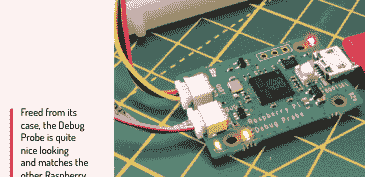

> 从外壳中解放出来后，调试探针的外观相当不错，与其他树莓派板卡相匹配。

#### 结论

- **开发者**：树莓派
- **网站**：www.raspberrypi.com
- **价格**：£12

| 特性 | 分数 | 易用性 | 分数 |
|---|---|---|---|
| 性能 | 8/10 | 性价比 | 8/10 |

如果需要进行裸机代码调试或建立串口连接，调试探针是你钱包中最值得投入的首选。

**评分 8/10**

### Pi 计算刀片 (Pi Compute Blade)

莱斯·庞德（Les Pounder）没有被闲置在架子上，而是被放进了机架。

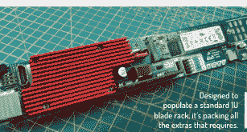

#### 规格
- **Pi**：计算模块 4/4 Lite
- **存储**：M.2 NVMe（支持高达 22110），microSD
- **通信**：千兆以太网（CM4 支持 Wi-Fi）
- **GPIO**：2 个 UART，6 个用户 GPIO 和 I2C，风扇，用户按钮，2 个 RGB LED
- **电源**：USB C，以太网供电（PoE）
- **端口**：HDMI（4K60），USB A
- **额外**：TPM 2.0，硬件开关控制的 Wi-Fi、蓝牙和 EEPROM 写保护
- **尺寸**：42.5x255x17.5mm

不再有通用的 IO 载板。计算刀片专为机架安装使用而设计，PoE 为高密度 Pi CM4 板集群提供电源和网络。细长、窄小的刀片设计非常适合此用途，巧妙的组件布局意味着我们拥有一块功能丰富且密集打包的板卡。

在时尚的红色阳极氧化散热片下方，有一个适用于任何版本树莓派计算模块 4 的连接器。我们的测试机器是一款配备 4GB 内存、32GB eMMC 和内置 Wi-Fi 的 CM4。我们遵循出色的文档，使用特殊工具 rpiboot 将 eMMC 驱动器挂载为 USB 驱动器并刷入树莓派操作系统。

如果你计划使用计算模块 Lite，板载的 microSD 卡槽可用于启动操作系统。板载的 USB A 端口在启动时不可访问，但这并非计算刀片的故障。得益于刀片后部附近的专用区域，添加从 2230 到 22110 的 NVMe 驱动器变得轻而易举。

你从 Linux 终端准备驱动器以供使用，包括设置驱动器在启动时挂载。如果你需要将计算刀片连接到屏幕，板载的 HDMI 端口位于散热片和刀片前部的千兆以太网端口之间。

该以太网端口还提供 PoE（以太网供电），使用 Netgear GS308P 这款支持 PoE 的交换机，我们能够通过一根电缆同时供电并连接到网络。无需额外配置，即插即用。眼光敏锐的读者可能已经注意到 HDMI 和以太网端口之间有一个 DIP 开关。这些开关控制写保护、Wi-Fi 和蓝牙。切换这些开关可以启用或禁用这些功能，提供一定程度的物理安全性。

大家应该都注意到，树莓派计算模块目前几乎无货，那么计算刀片能否与克隆板配合使用？简短的回答是可以，但最佳支持来自树莓派计算模块 4。YouTuber Jeff Geerling 测试了一些与 CM4 兼容的板卡，看起来 Pine64 SOQuartz 搭配 Phelbian Linux 的支持最好；但即便如此，与树莓派相比也相形见绌。

> 裸板呈现在世界面前。看看那上面的端口！

虽然不是计算刀片的根本目的，但我们仍可使用其 GPIO。就在 NVMe SSD 插槽下方，有一个 2x5 的接头，引出了少量特定引脚，专门用于可选的 RTC 模块。幸运的是，这些引脚也包括 I2C，这意味着我们可以使用 Stemma QT 接口测试一系列支持 I2C 的设备。我们选择使用 CircuitPython 测试 I2C 接口。我们连接了一个 BME688 空气质量传感器，几分钟后数据就开始在屏幕上流动。

转到刀片的前部，我们发现了一个带有精美 3D 打印按压机制的按钮。这个按钮连接到 GPIO，并完全可以通过你喜欢的编程语言访问。我们使用 Python 运行了测试，可以报告它完美工作。我们只需要弄清楚按下按钮时要做什么。

计算刀片不是一块典型的计算模块载板，其目的是成为集群的一部分。由计算模块 4 驱动的集群将提供高密度计算能力，而计算刀片的尺寸规格意味着我们可以构建高密度集群。典型应用包括边缘计算、机器学习、人工智能和超小型数据中心。将刀片插入支持 PoE 的服务器机架中，将提供一个干净简单的安装体验。

#### 结论

- **开发者**：Ubuntu pro
- **网站**：https://computeblade.com
- **价格**：待定（约 £90）

| | 10/10 | 9/10 | 8/10 | 9/10 |
|---|---|---|---|---|
| 特性 | | | | |
| 性能 | | | | |
| 易用性 | | | | |
| 性价比 | | | | |

坚固的硬件，拥有出色的尺寸规格，显然它是针对特定使用场景设计的。

**评分 9/10**


### 在树莓派 Pico 上使用 Pi HAT

作为一个吝啬的北方人，**莱斯·庞德（Les Pounder）** 热衷于复用物品，因此他解释了如何在 Pico 上使用 Pi HAT。


**我们的专家**
莱斯·庞德是《*Tom’s Hardware*》的副编辑，也是一位可委派的自由创客。他在 [http://big.les](http://big.les) 上记录他的冒险和项目建设。

HAT 只能在树莓派上工作，对吧？通常是的，但有时它们也可以与 Pico 兼容。Pimoroni 的 Drum HAT 是一种较旧的 HAT，具有八个可用来演奏鼓点独奏等用途的触片。在本教程中，我们将改造一个 Drum HAT，使其通过运行 CircuitPython 的树莓派 Pico 成为 USB 人机接口设备（USB HID）。Drum HAT 的 CAP1188 电容式触摸传感器只需要连接到我们 Pico 的四个引脚。问题在于，树莓派的 2x20（40 引脚）配置意味着我们不能直接将其插在面包板上。这就需要小心翼翼地剪断一些排针。使用排针、一个长面包板和一些跳线，我们可以将两个 I2C 引脚 GPIO16 连接到 SDA，GPIO17 连接到 SCL，3V3 连接到 3V3，GND 连接到 GND。I2C 引脚各自需要一个 10kOhm 电阻器，从引脚连接到面包板的 3V3 电源轨，以使引脚保持高电平。请下载资料中查看清晰的引脚位置电路图。

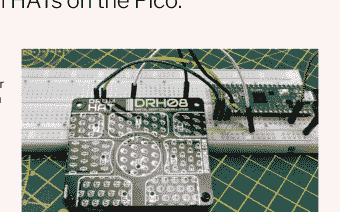

> 只需使用少量电线，且花费不多时间，你就可以用树莓派 Pico 重新利用一个旧的树莓派 HAT。

CircuitPython 设备。如果你打算使用 **Thonny**，请检查方框（另一侧的说明）以获取快速设置指南。创建一个新文件，通过导入一系列模块开始项目代码。第一个是 board，它使我们的代码能够使用 Pico 的 GPIO。接下来，adafruit_cap1188.I2c 是 CAP1188 触摸传感器的模块。通过 busio 提供硬件加速的总线访问；time 用于控制代码速度；usb_hid 模拟 USB 输入设备。

#### 准备 CircuitPython

在按住 BootSEL 按钮的同时将 Pico 连接到你的计算机。这强制 Pico 进入引导加载器模式，文件管理器中会出现一个新的驱动器 **RPI-RP2**。访问 `https://circuitpython.org/board/raspberry_pi_pico/`（针对树莓派 Pico）或 `https://circuitpython.org/board/raspberry_pi_pico_w`（针对 Pico W）。下载适用于你 Pico 的最新稳定版 CircuitPython。从下载文件夹中，将 **CircuitPython** 文件（一个 UF2 固件镜像）复制到 **RPI-RP2** 驱动器。片刻之后，该驱动器消失并被 **CIRCUITPY** 替换。这就是我们将编写项目代码的地方。

- **你需要**
    - Pico 或 Pico W
    - Pimoroni Drum HAT
    - 5 根公对公跳线
    - 一个大面包板
    - 2 个 10kOhm 电阻器
    - 代码：
        - `https://github.com/lesp/LXF-304-PiTuts-Pico-DrumHAT-Shortcut-Keypad/archive/refs/heads/main.zip`

```python
import board
from adafruit_cap1188.i2c import CAP1188_I2C
import busio
import time
import usb_hid
```

接下来是另一组导入，这次是为了使用 US 布局将我们的 Pico 设置为 USB 键盘。我们还配置设备使用 USB 键码，这些键码会被转换计算机接收的标准键盘信号。最后，我们导入消费者代码，这些代码用于多媒体键盘的额外功能（如音量控制等）。

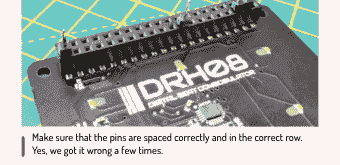

> 确保引脚间距正确且位于正确的行。
> 是的，我们错了好几次。

```python
from adafruit_hid.keyboard import Keyboard
from adafruit_hid.keyboard_layout_us import KeyboardLayoutUS
from adafruit_hid.keycode import Keycode
from adafruit_hid.consumer_control import ConsumerControl
from adafruit_hid.consumer_control_code import ConsumerControlCode
```

创建一个对象 i2c，以存储 I2C 引脚设置。Drum HAT 连接到 GPIO16 (SDA) 和 GPIO17 (SCL)。

```python
i2c = busio.I2C(board.GP17, board.GP16)
```

创建一个对象 cap，然后调用 CAP1188 模块，传入 i2c 对象和 i2c 地址 0x2c。我们使用此资源找到了该地址：[https://pinout.xyz/pinout/drum_hat](https://pinout.xyz/pinout/drum_hat)。

```python
cap = CAP1188_I2C(i2c, 0x2c)
```

接下来，创建三个对象。第一个创建一个我们可以控制的 USB 键盘。然后我们将键盘布局设置为 US。最后，我们启用一种访问 ConsumerControl 代码的简便方法。

```python
keyboard = Keyboard(usb_hid.devices)
layout = KeyboardLayoutUS(keyboard)
consumer = ConsumerControl(usb_hid.devices)
```

创建一个 while True 循环来运行主代码体。

```python
while True:
```

通过一系列条件测试，我们将检查按钮是否被按下。如果触片 1 被按下，值将报告为 True 并触发一系列代码执行。首先它发送 B 键的键码，然后向 Python 外壳打印一条消息。所有按键都将被释放，并有一个短促的 0.3 秒睡眠以减少多次按键的可能性。根据需求调整此时间。

```python
if cap[1].value:
    keyboard.send([Keycode.B])
    print("B pressed")
    keyboard.release_all()
    time.sleep(0.3)
```

我们将不会涵盖 Drum HAT 上的每一个触片，因为它有八个。我们将挑选出展示发送键盘命令不同方式的触片。话虽如此，每个 Drum HAT 触片都由 cap[x] 表示，其中 x 是 1 到 8 之间的数字，因此很容易记住哪个触片做什么。所有代码都在下载资料中。

对于第二个触片，我们将发送一个键盘命令，使用右箭头键将光标向右移动。与之前一样，发送代码，打印消息，释放按键，然后暂停。

```python
if cap[2].value:
    keyboard.send([Keycode.RIGHT_ARROW])
    print("Right arrow pressed")
    keyboard.release_all()
    time.sleep(0.3)
```

第三个触片将发送一个消费者代码以静音系统音频。消费者代码提供标准键盘规范中不包含的功能：在这种情况下，是音频控制。过程相同。发送命令，打印消息，释放按键，然后暂停。

```python
if cap[3].value:
    consumer.send(ConsumerControlCode.MUTE)
    print("MUTED")
    keyboard.release_all()
    time.sleep(0.3)
```

跳过第五个触片，我们发送一个映射到 Super/Windows/Command 键的原始键码值。按下此触片将触发启动菜单出现。

```python
if cap[5].value:
    consumer.send(227)
    print("Super / Windows key pressed")
    keyboard.release_all()
    time.sleep(0.3)
```

将代码保存为 [CIRCUITPY] 中的 [code.py](code.py)。CircuitPython 在每次断电重启时都会加载 code.py。在 [Thonny] 中点击 Stop（停止），然后点击 Run（运行）以重启代码。Python 外壳会在每次按键时打印每条消息。该项目可与 Linux、Windows 或 Mac OS 机器配合使用，并表现为基本的 USB 键盘。

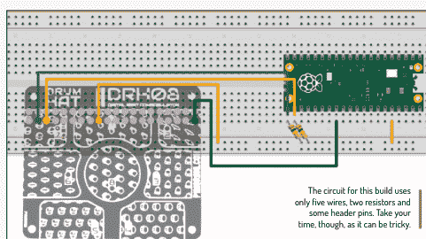

此构建的电路仅使用五根电线、两个电阻器和一些排针。不过，请慢慢来，因为这可能有点棘手。

#### 使用 Thonny 配合 CircuitPython

Thonny 是一款出色的 Python 编辑器。它可用于我们计算机上的 Python，也可以用于微控制器上的 MicroPython 和 CircuitPython，例如树莓派 Pico。可以从 [https://thonny.org](https://thonny.org) 下载 [Thonny](https://thonny.org) – 安装后，转到 Tools（工具） > Options（选项），然后点击 Interpreter（解释器）选项卡并选择 CircuitPython (Generic)。如果我们使用的是 Pico 上的 MicroPython，我们将选择 Raspberry Pi Pico 选项；RP2040 适用于其他基于 RP2040 的板子。在 Port（端口）下，保持选项为 Try To Detect Port. Automatically（尝试自动检测端口）：点击 OK 保存。插入运行 CircuitPython 的树莓派 Pico，Thonny 将检测并连接设备。如果失败，点击 Stop（停止）以重试。如果仍然失败，返回 Interpreter 菜单并手动选择端口。Python 外壳（也称为 REPL。Read, Evaluate, Print, Loop：读取、求值、打印、循环）启动，我们可以在那里交互式地在 Pico 上运行代码。Python 外壳还用于显示项目代码的输出。我们用它来打印当前按键作为调试方法。


### 深入解析：BlendOS

#### BlendOS 内部机制

Matt Holder 发现了如何使用基于 Arch 的 BlendOS 将多个发行版混合在一起。它是否提供了所有发行版中的最佳体验？

如果你能将 Ubuntu 的友好、Arch 的前沿技术以及 Fedora 的稳定性混合在一起，那会是终极发行版吗？欢迎来到 BlendOS！这是一个基于 Arch 的发行版，它包含许多现代特性，并允许运行来自三个不同发行版（Ubuntu、Fedora 和 Arch）的应用程序。这听起来非常有趣，因此我们决定进行一番深入了解，帮助你上手运行，并采访该项目的创始开发者。

让我们从讨论 Arch 开始。在我们刚开始使用 Linux 时，有一句格言大致如下：如果你想使用不同的操作系统，请使用 Linux；如果你想深入了解 Linux 的深层知识，请使用 Arch。现在的 Arch 提供了一个基于文本的安装器工具，可以引导新用户完成安装过程。这绝不意味着它像 Ubuntu 安装器那样用户友好，但它比传统选项要简单得多，传统选项是使用相关的命令行工具手动执行每个步骤。例如，要设置正确的键盘布局，你需要运行 `ls /usr/share/kbd/keymaps/*/map.gz`，这会列出键盘映射文件的名称。接下来要运行的命令设置布局，它必须如下所示 `loadkeys de-latin1.` 然后需要执行的一些其他步骤包括配置以太网或 Wi-Fi 连接、分区磁盘、复制文件、使用 `chroot` 在新安装中调用命令、设置根密码、添加用户以及安装引导加载程序。这可能会让人感到望而生畏，但这是学习涉及什么以及所有拼图部件如何组合在一起以最终获得一个可用发行版的一种非常强大的方式。

Arch 以能够访问前沿软件而闻名。软件更新的速度如此之大，以至于不建议在升级之间等待太久，因为如果许多软件包更改版本，可能会导致稳定性问题。

#### 围绕 Blend 的混合

现在来看看 BlendOS。它具有一个只读或不可变的根文件系统。这是以有趣的方式实现的，通过可用的文件系统覆盖层来安装软件包。这些覆盖层透明地挂载在根文件系统之上，发行版将这些文件视为都在同一个文件系统中。如果需要，随后的启动允许将覆盖层合并到根文件系统中。正如在讨论其他不可变操作系统时所描述的那样，保持根文件系统尽可能标准很重要，以免向基础操作系统添加额外的安全顾虑。由于变化速度极快且测试时间减少，Arch 的基础部分可能不像 Ubuntu 或 OpenSUSE 的 MicroOS 那样稳定。

默认的 BlendOS 安装使用 ext4 文件系统，该文件系统经过了非常严格的测试，但不支持文件系统快照。作者提供了一个方便的 GUI，允许保存当前状态。还可以回滚到之前的快照，以防你做的更改以某种方式破坏了操作系统。请注意，这与使用 ZFS 或 BTRFS 可以执行的文件系统快照不同。默认情况下，BlendOS 每 12 小时保存一次状态，但如有需要可以禁用。在撰写本文时，用于保存系统状态的 GUI 选项被移除了，希望在你阅读本文时这些选项将会恢复。

在 BlendOS 的第二个主要版本中，作者集成了对 Waydroid 模拟器的支持。正如你可能猜到的，Waydroid 需要一个 Wayland 会话来运行，并提供对模拟 Android 安装环境的访问。实现此目的的方法是运行 Waydroid 容器内。一旦安装 Waydroid，就可以安装应用商店，任何安装的应用程序都会显示在启动器中。

有两个版本的 BlendOS 可用，第一个使用 Gnome 桌面环境，第二个运行 KDE。Gnome 倾向于更现代的范式，具有多个工作区和每个工作区一个窗口。有人认为这允许更好地专注于特定任务。当我们尝试并排比较两个文档时，我们发现使用它很困难。KDE 具有更传统的范式，看起来很像使用 Windows 设备。然而，KDE 可以无限自定义，并拥有大量扩展和插件，可以将 KDE 变成你想要的任何样子。这里的截图是 BlendOS 的 KDE 版本，但安装 Gnome 版本应该仍然相对简单。

如上所述，可以安装到基础操作系统。软件包作为覆盖层安装，在下一次启动时合并到根文件系统中。与 Microsoft 不同，后者需要特定的命令才能安装到基础操作系统，这里可以使用标准的 Arch 命令。例如，要安装 ncurses 磁盘使用工具，请运行以下命令：`sudo pacman -S dfdu`。话虽如此，应尽可能少地使用这种方法。安装应用程序的更好方式是使用 Discover 软件工具中的 Flatpaks。请参阅操作指南（第 53 页）了解如何安装应用程序。使用 Flatpaks 意味着应用程序与基础操作系统以及彼此之间是沙盒化的。

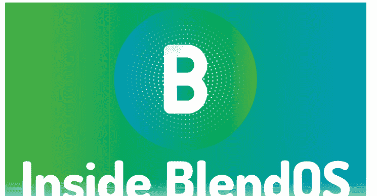

NCurses 磁盘实用工具（NCDU）已直接安装在主机操作系统上，使用覆盖层。

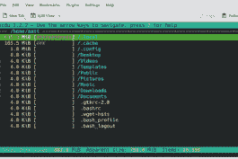

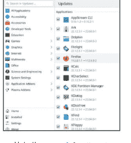

操作系统更新通过 KDE Discover 应用安装。

#### 保持容器化

BlendOS 的一个重要组成部分是安装容器及其内部应用程序的能力。这允许采用一种兼得各方优点的方法，即可以从多个发行版安装应用程序。

> **快速提示**
>  BlendOS 可以从 https://github.com/blend-os/blendos/releases 下载

#### 采访 Brendon Chung

- **问** 是什么让你对 Linux 产生兴趣，你使用的第一个发行版是什么？
  **答** 我七岁时开始使用 Linux。我切换到 Linux 是因为我的旧笔记本电脑搭载第三代 i5 处理器，运行速度变慢了。此外，由于我那时一直使用 Java 和 XML（Android Studio）开发 Android 应用程序，Android 应用构建在 Windows 上非常慢。那时我决定在我的笔记本电脑上尝试 Linux。Arch 是我使用的第一个发行版，其次是 Ubuntu。

- **问** 自开始使用 Linux 以来，你看到的最大变化是什么？我们还能回忆起编辑 XF86 配置文件以及担心损坏显示器的日子！
  **答** 我大约从 2017 年开始使用 Linux，当时我七岁。在这六到七年里，我看到 Linux 变得更受欢迎，也变得更加用户友好。回想 2017 年，Ubuntu 非常流行，现在被认为用户友好的大多数其他发行版当时都被贴上小众的标签。我见证了不可变和原子发行版的兴起，以及 Linux 发行版在游戏支持方面的巨大进步。容器化软件包已成为 Linux 发行版的主流（当然 Arch 除外）。

- **问** 你参与的第一个公开项目是什么？
  **答** 我第一个受欢迎的公开项目是 Ubuntu Unity (https://twitter.com/ubuntu_unity)，我在 2020 年 5 月发布，它现在是官方的 Ubuntu 版本，尽管在那之前我也制作过一些发行版和项目。

- **问** 你如何将 BlendOS 与 Vanilla OS 等东西区分开来？
  **答** BlendOS 旨在服务于希望运行其常规桌面应用程序（无论 Linux 发行版为何，从而模糊边界）的普通计算机用户，他们在 Android 手机上使用的应用程序，以及来自精选列表的网络应用程序。Vanilla OS 是一个很棒的发行版，但我们的目标完全不同。根据 Vanilla OS 网站的说法，它旨在为 Linux 用户提供一个稳定的、基于 Debian 的不可变发行版。此外，BlendOS 支持多种 DE，并将提供创建混合版的能力。我们还在为 BlendOS 的下一个主要版本开发服务器版和游戏版。

- BlendOS 使用 Arch Linux 作为基础，允许你在保持不可变性和原子性（使用覆盖层）的同时使用系统软件包管理器安装软件包，而无需像其他不可变操作系统那样重新启动。此外，与 Vanilla OS 不同，Vanilla OS 仅导出使用 Appx（其软件包管理器）安装的应用程序（且其二进制可用性实现对于某些应用程序不起作用，尤其是如果该


### 深度解析 BlendOS

#### Arch 用户存储库 (AUR)

Arch 备受赞誉的众多特性之一就是 Arch 用户存储库，通常简称为 **AUR**。这是一个由大量社区成员维护的软件仓库，支持许多最前沿的软件。在 Arch 容器中启用 AUR 将是一个极佳的功能，执行以下命令即可：

```bash
$ sudo pacman -S --needed base-devel git
$ git clone https://aur.archlinux.org/yay.git
$ cd yay
$ makepkg -si
```

可以使用以下命令搜索应用程序——在这个示例中，搜索并安装了 Google Chrome：

```bash
$ yay -Ss google-chrome
```

一旦通过搜索确定了软件包名称，即可按以下方式安装：

```bash
$ yay -S google-chrome
```

可以使用 `yay -Rns google-chrome` 卸载软件包。


这些应用安装自一些最受欢迎的发行版——Ubuntu 和 Fedora。这一点在此前涵盖 Fedora Silverblue、OpenSUSE MicroOS 和 Vanilla OS 的文章中已有讨论。当应用程序安装在容器内时，它们与宿主操作系统紧密集成。对于 BlendOS 而言，这意味着应用可以通过启动器或命令行打开。如果在容器中安装了 Audacity，只需在宿主操作系统的命令行中输入 audacity 即可运行。在撰写本文时，容器优先级功能已发生变更。最初，可以为容器分配优先级，以便当同一个应用安装在多个容器中时，默认调用优先级最高的那个。在更新后，该优先级功能更改为允许将应用程序映射到特定的容器。例如，可以将 Audacity 分配给 Ubuntu 容器，并将 Fritzing 分配给 Fedora 容器。当容器化应用被打开时，它自动拥有访问宿主文件系统的权限，因此可以像直接安装的应用一样使用。请参见操作指南（第 53 页）以了解如何安装容器。通过导航至 BlendOS 设置工具，选择“容器”标签，并点击容器名称旁的播放按钮，即可向其中安装应用程序。这会在所选发行版上打开一个终端。在 Ubuntu 容器中，可以使用 `apt search NAME` 搜索软件包，使用 `apt install NAME` 安装软件包。在 Fedora 中，请改用 `dnf` 代替 apt。最后，在 Arch 容器中可以使用 `pacman`。请参阅侧边栏（左侧）以了解如何使用 Arch 用户存储库 (AUR)。

截至撰稿时，安装双启动或多启动环境是可能的，但并不轻松。在选择要创建、格式化和写入的分区时，数据被成功复制，但 GRUB 引导加载程序并未安装。执行这些缺失的步骤超出了本教程的范围。步骤部分建议使用整个硬盘，并安装到稀疏设备或虚拟机上。Waydroid 支持仅在物理设备上可能实现。

BlendOS 是一项相对较新的事业，由青少年 Brendon Chung 发起。鉴于项目尚处于早期阶段，其在容器、文件系统层及其他所有所述事项之间的工具和集成程度令人印象深刻。Chung 还维护 Ubuntu Unity Remix，该项目重新整合了 Unity 7 代码库，并且深度参与 Unity 7 开发以及 Unity on Arch 项目。他还参与其他多个项目。

我们希望你能享受使用 BlendOS 并深入了解所涉及的所有技术。

### 与 BRENDON CHUNG 的访谈

即使软件包名称与二进制文件或应用名称不同，在 BlendOS 中安装在容器内的任何应用或二进制文件都会立即出现在宿主系统中。这使得它真正实现了发行版的混合。再次说明，BlendOS 赋予了你灵活性，可以使用来自任何容器的任何应用或二进制文件，即使存在冲突也是如此。

- **问** 你愿意分享一些关于你其他项目的几句话吗？
- **答** 当然。你已经知道 Ubuntu Unity，这是一个官方的 Ubuntu 风味版本。那是我大约三年前创建的早期流行项目之一。我们最近发布了新版本（23.04），接下来是 Ubuntu Unity 的 Lomiri 版本。我在今年初发布了 Unity 7.7 和 Unity X。去年年底我还将 Unity 7.6 移植到了 Arch，并且也将把 Unity 7.7 移植到 Arch。我几个月前发布了 Unity 的 Manjaro 版本，现在也是时候将其更新为使用 Unity 7 了。

我创建和维护的其他一些项目包括：BlendOS、Ubuntu Web（Chrome OS 的替代品，将是 BlendOS 的一个变体）、Gamebuntu（简化 Ubuntu 上游戏设置工具）、una（类似于 yay 或 paru；MPR 的客户端，相当于 AUR 但用于基于 Debian 的发行版）、loi（Ubuntu Snap 商店的替代品）、Modren（支持 Snap、Flatpaks、Apt 软件包以及直接安装 DEB 的商店）、Skull（我早期的一个项目，计划支持带有 UEFI 的 Linux 手机，无需 Android 基础或 Halium），以及 UbuntU Remixes；这是一个创建基于 Ubuntu 的发行版的工具。

- **问** 你最喜欢参与哪个项目，为什么？
- **答** 我真的很享受参与 Unity 7 和 BlendOS 的工作。它们拥有非常活跃的社区，预计会有巨大的发展。

- **问** 你参与 Ubuntu Unity。是什么让你决定创建一个使用 Unity 作为桌面环境的发行版？
- **答** 我在 2017 年拥有过 Ubuntu Unity 17.04，并且非常喜爱 Unity 7。所以，当 Unity 7 停止支持时，我想让它复活。我创建 Ubuntu Unity 是为了赋予 Unity 7 新的生命。

### 安装和配置 BlendOS

#### 1 创建虚拟机

前往 BlendOS 网站并下载 ISO 文件。打开你选择的虚拟化系统并创建一个新的虚拟机。对于测试，2GB 内存、两个 vCPU 和 25GB 的磁盘空间就足够了。挂载 ISO 文件并启动你创建的虚拟机。

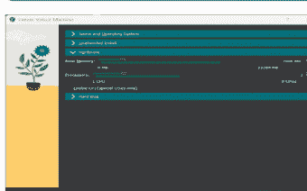

#### 2 设置键盘和语言

虚拟机加载后，按照安装程序中的步骤选择相关的键盘布局、语言、定义新用户并选择要安装的驱动器。务必使用整个磁盘。要选择语言，请进行搜索，找到相关的选项并选择 Main，然后选择该语言本身。

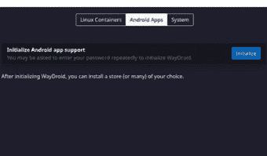

#### 3 创建容器

打开 BlendOS 设置应用，输入名称，选择容器类型并点击“创建容器”。可以在二进制文件和容器之间建立关联。这意味着即使在多个容器中安装了相同的应用程序，在特定容器中运行命令也变得很容易。

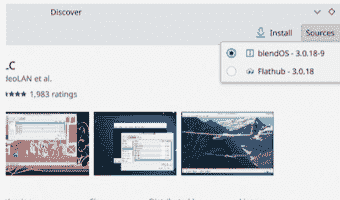

#### 4 安装应用商店

从 BlendOS 设置应用中，选择“Android 应用”标签并点击“初始化”。安装完成后，安装其中一个或两个应用商店，然后可以使用它们来安装应用程序。应用程序安装完成后，可以从启动器中打开。应用程序作为自己的窗口打开，与原生应用并列。

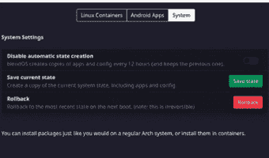

#### 5 添加一些应用

Discover 是 KDE 的软件商店。从启动器中打开它，并搜索你希望安装的应用程序。注意右上角，有些应用有两个来源。Flatpaks 是被沙箱化的，BlendOS 安装到覆盖层（overlay），该覆盖层会在下次启动时合并到不可变的根文件系统。

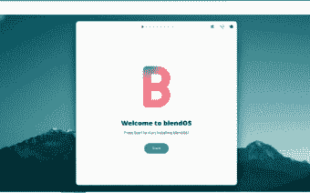

#### 6 保存状态和回滚

BlendOS 设置应用程序中的“系统”标签显示了保存系统状态的控制选项，这可以在任何操作后执行，并且该过程每 12 小时自动进行一次。可以关闭自动操作，并可以调用回滚到以前的状态。


### 教程

### TUIFEED

来源：https://github.com/veselo/tuifeed

#### 极简主义的 RSS 阅读器

就**沙桑克·夏尔马**（Shashank Sharma）而言，现代互联网使用的罪魁祸首并非社交媒体，而是广告，而他有一个巧妙的变通方法。


> **我们的专家**
> 沙桑克·夏尔马
> 是新德里的一名执业律师，也是 Arch Linux 的铁杆用户。他总是在寻找价格实惠的极客纪念品。

对于大量消费网络内容的用户来说，在信息获取之旅中最大的障碍是需要在不同网站之间切换。如果你能用一个应用程序或工具浏览数百个你喜爱的互联网资源，那岂不是很棒？这就是 RSS 源的馈赠。

使用极简主义的源阅读器 *Tuifeed*，你可以快速浏览所有喜爱网站的内容，而无需动用浏览器。不幸的是，*Tuifeed* 及其同类应用（如 *Nom*，见下文框内内容）仅限于从网站获取基于文本的内容。然而，一些图形替代方案可以更进一步，获取播客。

该项目使用 Rust 编写，并在 MIT 许可证下发布，它不在桌面发行版的软件仓库中可用，但安装仍然相当简单。

如果你还没有安装 Rust 和 Cargo，可以使用发行版的包管理器来安装它们。`sudo dnf install rust cargo` 命令可在基于 RPM 的发行版（如 Fedora）上安装它们。如果你使用的是 Ubuntu 或 Debian 或其衍生版本，可以类似地运行 `sudo apt install cargo`，这也会安装 Rust 软件包。

现在你可以使用 Cargo（Rust 包的包管理器）通过 `cargo install tuifeed` 命令安装 *Tuifeed*。或者，你可以使用官方 shell 脚本安装最新版本：

```bash
curl --proto 'https' --tlsv1.2 -sSLf 'https://git.io/Jl0Gz' | sh
```

#### 使用源

*Tuifeed* 声称支持 RSS 和 Atom 源。你必须将你感兴趣的源添加到 `~/.config/tuifeed/config.toml` 文件中。用你喜欢的文本编辑器打开该文件，或者运行 `tuifeed -c` 命令。所有源都以 "*网站名称*" = "*URL*" 的格式添加在 `~/.config/tuifeed/config.toml` 文件的 `[sources]` 部分下：

```toml
[sources]
"Comicosity" = "https://www.comicosity.com/feed/"
"TechRadar Software" = "https://www.techradar.com/rss/news/software"
"TechRadar" = "https://www.techradar.com/rss/"
"Ars Technica Tech Policy" = "https://feeds.arstechnica.com/arstechnica/tech-policy"
"Ars Technica" = "https://feeds.arstechnica.com/arstechnica/index"
"IPLeaders Blog" = "https://blog.iplleaders.in/feed/"
"SpicyIP" = "https://spicyip.com/feed"
"Best Thrillers" = "https://bestthrillers.com/feed/"
```

在将所有喜爱互联网资源的源添加到 `~/.config/tuifeed/config.toml` 文件后，你可以使用 `tuifeed` 命令启动 Tuifeed。界面分为三个窗格。添加到 config.toml 文件中的所有源都列在左上角的 Feed 窗格中。其下方是 Articles 窗格，展示所选源的最新文章。界面的右侧保留给所选文章。你会在顶部找到标题、作者姓名和发布日期，实际文章内容则在 Summary 窗格下方。

当你首次启动 Tuifeed 时，Feed 窗格被选中。你可以使用向上和向下箭头键在 Feed 窗格中导航并选择你感兴趣的源。所选源会被高亮显示，也可以通过最左侧的 `>` 符号识别出来。要重新加载源，请从列表中选中它并按 `r`。或者，你可以按 `Ctrl+r` 重新加载所有已添加的源。

你可以按右箭头键或 `Tab` 键切换到 Articles 窗格。同样，可以使用上/下箭头键滚动浏览所选源中的文章列表。每篇文章的内容显示在 Tuifeed 界面的右半部分。要阅读文章，请从 Articles 窗格中选择它，然后按右箭头键切换到 Summary 窗格。现在你可以使用上/下箭头键滚动浏览文章。从 Summary 窗格，你可以使用左箭头键返回 Articles 窗格。再按一次左箭头键即可返回到 Feed 窗格。

使用 Tuifeed 等源阅读器阅读内容的最大优势可能是它们会自动过滤掉广告，提供流畅的阅读体验。Tuifeed 没有提供太多可配置参数。它没有主题、字体、颜色或其他用于改进阅读体验的调整选项。

不过，你可以选择显示已发布文章的作者姓名和时间戳。为此，请在 `~/.config/tuifeed/config.toml` 文件的 `[sources]` 部分下方添加以下部分：

```toml
[article-title]
show-author = true
show-timestamp = true
```

这会在 Articles 窗格标题前添加每篇文章的作者姓名和时间戳。我们建议你将其设置为 `false`。当从 Articles 窗格选择文章时，可以在 Tuifeed 界面右侧 Summary 窗格上方看到这些详细信息。

要退出 Tuifeed，请按 `Esc`，然后在“你确定要退出吗？”提示下按 `Enter`。当你重新启动 Tuifeed 时，它会自动从定义的源获取最新的故事和文章。

#### 买家注意

大多数源阅读器都拥有一系列有用的功能，例如将喜爱源加入书签、将源或文章标记为已读、在 web 浏览器中打开文章或其中的链接等。你在极简主义的 Tuifeed 中找不到这些功能中的任何一个。添加来自不同网站的一系列 RSS 源并显示每个源的最新故事是该项目能力的极限。

但这还不是全部。虽然 Tuifeed 的三窗格界面很妙，但并非没有问题。首先，该项目在处理 RSS 1.0 和 Atom 源的显示时表现不佳。虽然如果你添加此类源供其获取，它不会抱怨，但该项目只能从此类源下载文章标题，而无法下载实际内容。此外，由于 Tuifeed 不允许调整单个窗格的大小，你不得不勉强利用有限的阅读区域来滚动浏览整篇文章。根据源网站的格式，Tuifeed 要么将内容整齐地分段，要么将整篇文本显示为单个段落。Tuifeed 以这种格式渲染内容没有明显的模式。

尽管 RSS 从未达到许多人认为它会达到的采用水平，但仍有许多源阅读器可供选择。你的 web 浏览器，甚至你首选的电子邮件客户端工具，可能都内置或可通过扩展提供 RSS 阅读器。但如果你对 CLI 工具感兴趣，请参阅框内关于 Nom 的讨论，它是一个极其健壮的 CLI 替代方案，与 Tuifeed 同样简洁，但在显示内容方面更擅长。或者尝试 Newsboat，这是一个功能丰富得多的替代方案，我们之前在 LXF255 中介绍过。如果你不确定要将哪些网站添加到阅读列表中，或者想要超越你的最爱，请访问 https://blog.feedspot.com/rss_directory/，那里有大量来自数百个网站的源，按健康、旅行、健身、法律、小说等类别分类，供你阅读愉快。

#### 使用 NOM

*Nom* ([https://github.com/guyfedwards/nom](https://github.com/guyfedwards/nom)) 与 *Tuifeed* 一样极简，甚至更甚。它没有窗格界面，也没有颜色。然而，与 *Tuifeed* 不同，*Nom* 从不弄乱文章内容，并尊重段落。

使用 Go 编写，你可以使用 `go install github.com/guyfedwards/nom/cmd/nom@latest` 命令安装 *Nom*。你可以将源发送到 `~/.config/nom/config.yml` 文件：

```yaml
feeds:
  - url: https://feeds.arstechnica.com/arstechnica/tech-policy
    name: ArsTechnica Tech Policy
  - url: https://feeds.arstechnica.com/arstechnica/index
    name: ArsTechnica
  - url: https://bestthrillers.com/feed
    name: Best Thrillers
```

你可以运行 `nom --feed URL` 来测试它如何显示指定的源，而无需将其添加进去。

当你在将所有源添加到配置文件后运行 *Nom* 时，该项目会显示所有获取文章编号列表以及源名称：

- 11. TechRadar Software: Nvidia's latest AI model
- 12. TechRadar Software: Microsoft gives one of
- 14. TechRadar Software: Microsoft is finally
- 74. ArsTechnica: CEO: Raspberry Pi stock to

我们只展示了一个截断的列表，以说明 *Nom* 如何显示来自不同源的内容。使用箭头键或 `PgUp`/`PgDn` 在列表中移动。

要阅读文章，请从列表中选中它并按 `Enter`。使用上/下键阅读文章，并按 `Esc` 返回到文章列表。

#### 终端教程

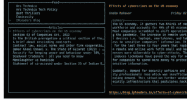

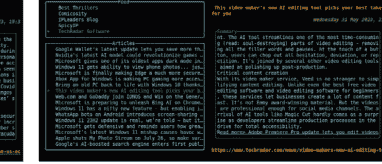

> 你必须调整终端模拟器的配色方案来微调 Tuifeed 的外观，因为它不支持主题。

> 选中 Summary 窗格后，你也可以按 Enter 在桌面默认 web 浏览器中打开所选文章。

> 由于 Tuifeed 不支持调整单个窗格的大小，我们建议你最大化终端模拟器窗口，以充分利用 Tuifeed 的界面。

#### 增强你的终端技能

现在订阅 http://bit.ly/LinuxFormat


### 保持你的 Linux 安装已备份

**Nick Peers** 将向你揭示保护从个人文件到整个 Linux 安装所需的各种工具、技巧和提示。

#### 我们的专家
- Nick Peers
- 自 90 年代末以来，他就一直是一位狂热的备份爱好者，当时他在圣诞节假期内，通过命令行逐一从故障中恢复了数百个文本文件。

你需要被提醒备份的重要性吗？从保护不可替代的数据，到确保系统故障只是小麻烦而非灾难，每个人都需要良好的备份机制。在本教程中，我们将探索 Ubuntu 和 Mint 提供的最佳工具，为你提供所需的一切，并涵盖备份和恢复场景，无论是将单个文件回滚到较早版本，还是撤销最近失败的更新或不想安装的应用程序。你将再也不必忍受数据丢失带来的痛苦。

#### 快速提示
- Mint 用户会注意到主仓库中提供的 Déjà Dup Backups 版本不是最新的——不过，它和那个臃肿的 900MB 以上的 Flatpak 版本差别不大，这就是为什么我们建议你安装旧版的系统软件包版本。

### 主文件夹

任何备份机制中最重要的部分就是保护你的个人文件，从文档到照片和视频。与你的操作系统或应用程序不同，这些可以重新安装，而你的个人文件很难再创建出来——如果可能的话。Ubuntu 和 Mint 都附带了工具，用于提供自动备份这些文件的手段。Mint 的文件备份工具在第一个文本框（对面页）中有介绍，但 Ubuntu 用户更适合使用其文件备份工具 Backups。通过在主启动器的搜索工具中输入 `backups` 来访问它。它实际上是 Déjà Dup Backups 的重新标记和集成版本，Mint 用户可以通过软件管理器添加（搜索“deja”并选择系统软件包版本）。安装后，你可以在标签 Backups 下找到它。

启动后，点击“创建我的第一个备份”。默认情况下，你的主文件夹在“要备份的文件夹”下被选中，而“下载”和“回收站”在“要忽略的文件夹”下被排除。使用 + 按钮向任一列表添加更多项目，然后点击“继续”。

接下来，系统会提示你选择备份位置。除了任何本地连接的存储外，还有直接备份到 Google 驱动器的选项（只需在提示时输入你的凭据），或者你可以备份到任何网络驱动器（点击 ? 按钮以同步使用，例如 `smb://computer-name/folder`）。选择后，再次点击“继续”。

接下来，系统会让你使用密码加密备份（压缩为 `tar.gz` 文件）选项，然后返回主屏幕。从这里，点击“立即备份”进行你的第一次备份。

你还会看到一个“自动备份”开关——你可以在“偏好设置 > 常规”中找到相同的开关，

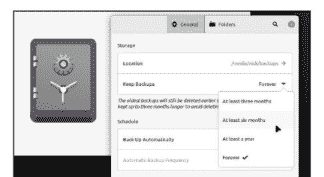

它通过菜单按钮访问。在此下方是一个“自动备份频率”选项，可以根据需要在“每日”和“每周”之间切换。

“常规”标签也是你可以更改备份目的地的地方，外加设置备份保留策略，默认情况下备份永久保留（基本上直到你磁盘空间不足），或者保留最少三、六或十二个月。最后，要更改备份内容，切换到“文件夹”标签。

### 恢复备份

当你的备份运行时，任何新文件都会添加，更改的文件也会被记录。它们不会覆盖原始备份文件，这意味着你不仅可以恢复任何已备份文件的最新版本，还可以回滚单个文件的更改。

如果你需要备份中恢复任何文件，再次打开 Backups，但这次切换到“恢复”标签，并在备份扫描期间等待。初始扫描完成后，你将看到类似文件的视图，显示备份中存储的所有文件夹。

右下角是一个日期字段，显示所选备份的日期（如果特定日期存在多个备份，则显示日期和时间）。如果你想要恢复文件的较早版本，使用此下拉菜单选择你要备份的日期/时间。

Backups 要求你手动选择要恢复的文件夹或文件。要恢复所有内容，按 Ctrl+A，然后按“恢复”；否则浏览文件夹直到找到你需要的内容。如有必要，使用 Ctrl-点击来选择多个文件和文件夹。

你可以选择将所选内容恢复到其原始位置，覆盖任何已存在的文件，或者选择恢复到不同的文件夹，这将创建你在所选位置恢复文件的单独副本。无论选择什么，点击“恢复”，输入加密密码（如有必要），最后点击“继续”来恢复它们。

### 不同的方法

Backups 对于基本备份任务已经足够好，但它有两个弱点：你只能安排每日或每周备份，并且你只能有一个备份任务。这两个缺点都可以通过一个名为 **Back in Time** 的工具来弥补，它允许你最多每五分钟更新一次备份，并允许你设置多个配置文件，每个配置文件都可以让你以各自的计划、设置和目标位置备份不同的文件夹。访问 https://github.com/kit-team/backintime 安装最新版本——如注释（右上）所示，它相对容易使用。

### 系统方法

系统快照旨在备份系统文件，允许你随时将系统回滚到特定时间点，通常是因为在安装新应用程序或更新后遇到了问题。目前最适合此工作的工具是 **Timeshift**，它在 Linux Mint 中默认捆绑，并可以在 Ubuntu 中单独安装。虽然默认的 Ubuntu 仓库包括 Timeshift，但提供的版本在 Ubuntu 发布时已经冻结——就 Ubuntu 22.04 而言，它是 21.09.1 版本。如果你希望在 Ubuntu 中保持 Timeshift 更新（写作时的当前版本是 22.11.2），请通过其自己的仓库安装它：

```bash
$ sudo add-apt-repository -y ppa:tjaartje20080/timeshift
$ sudo apt-get update
$ sudo apt-get install timeshift
```

Timeshift 可以通过 Mint 或 Ubuntu 启动器启动——实际上，你可能在首次安装 Mint 时就已经设置好 Timeshift，因为系统快照在初始设置过程中提供。

#### 配置 Timeshift

首次打开 Timeshift 时，系统会提示你设置备份。在继续之前，确保你有合适的备份驱动器——虽然 Timeshift 可以将快照存储在系统上...

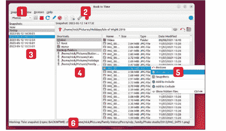

##### 回顾时间

- **1. 配置文件**
  Back In Time 将不同任务分为配置文件，每个都有自己的备份源、目标、计划和其他设置。
- **2. 设置**
  点击此按钮以设置新配置文件并重新配置现有配置文件——例如，通过添加更多文件夹或更改备份计划。
- **3. 时间线**
  使用时间线窗格按日期和时间查看和浏览快照。可以使用铅笔图标重命名快照。
- **4. 备份文件夹**
  所有选定的备份文件夹都列在这里以辅助导航。你也可以使用上方的地址栏手动导航。
- **5. 浏览和恢复**
  在文件窗格中右击文件夹或文件，将其恢复到原始位置或在新文件夹中创建新副本。
- **6. 查看进度**
  除了这个进度条之外，你还可以通过 Back In Time 菜单栏图标监控备份进度。

> 如果你计划恢复文件的早期版本，请将文件复制到单独的位置进行彻底比较，以对冲风险。

#### Mint 的内置备份工具

Linux Mint 附带一个基于文件的备份工具——**MintBackup**——它在一个应用中提供两个独立的备份：个人数据备份你的 **Home** 目录内容，而软件选择覆盖通过 **Software Manager** 安装在你的 PC 上的应用程序。你可以通过在终端中发出以下命令将安装在其他位置的应用程序包含在列表中，然后再打开备份：

```bash
$ dpkg --get-selections > package_list.txt
```

键入 `cat package_list.txt` 查看软件包列表。该应用程序使用起来很简单——当涉及文件备份时，除了隐藏文件外，你的 **Home** 目录中的所有内容都被选中进行备份，但一旦你设置了备份目标（同样，这应该是与你当前 **Home** 文件夹所在的独立物理驱动器），你可以排除特定文件和目录，然后选择是否包含特定隐藏目录或文件——这是一个好主意，因为许多应用程序在这些文件夹中存储配置信息。点击应用后，备份就会完成。

MintBackup 的一个主要缺点是它无法设置为按计划自动运行，这就是为什么我们建议 Mint 用户切换到 **Déjà Dup Backups**。

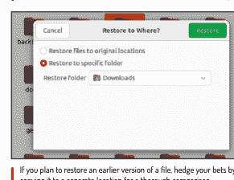


### 快速技巧

Redo Rescue 将每个分区保存为压缩的 IMG 文件，并附带一个基于文本的 REDO 文件，其中包含 Redo 在需要恢复备份时所需的驱动器结构详细信息。

如果将分区（如果不选择其他位置，则默认为此）存储在一起，最好将它们分开存储。这可以是在主驱动器上划分一个专用分区，或者——更理想地——在一个外部驱动器上使用专用 ext4 分区以提供额外的安全性。如有必要，请使用 **_Disks_** 工具或 **_GParted_** 来设置一个 ext4 分区 –**_Timeshift_** 无法识别非 Linux 分区，例如 FAT、exFAT 和 NTFS。
首次启动 **_Timeshift_** 时，通常会弹出一个向导，或者可以通过主菜单中的“向导”按钮打开。该向导显示了两种快照类型 –**RSYNC** 或 **BTRFS** – 指的是 **_Timeshift_** 使用的底层命令行工具。在标准的 Mint 系统上，只有 RSYNC 可用，但即使 BTRFS 是可选项，我们仍坚持使用 RSYNC，原因很简单：它支持将快照存储在外部驱动器上。
选择 RSYNC 后，点击“下一步”，等待 **_Timeshift_** 估算首个快照的大小，这将是迄今为止最大的备份，因为后续

快照是增量式的，因此体积小得多，因为它们仅记录文件变更。
短暂暂停后，系统提示选择备份位置 – 默认选择系统驱动器，因此请选择你的备份分区或驱动器。点击“下一步”，系统提示设置自动拍摄快照的计划。默认情况下，该功能处于禁用状态，但你可以配置在启动时（系统启动后 10 分钟）以及设定间隔 – 每小时、每天、每周和/或每月 – 拍摄快照。只需勾选一个或多个复选框，并选择每种快照保留多少份。创建的备份越多，所需的驱动器空间就越大，因此请牢记这一点。
做出选择后，再次点击“下一步”。你会看到一个选项，用于在快照中包含账户文件夹 – 虽然很有吸引力将用户文件夹设置为“仅包含隐藏文件”，以包含许多应用程序存储首选项的 **.config** 文件夹，但这会增加快照的大小。我们建议仅使用 **_Timeshift_** 来保护系统

#### 恢复系统快照


- **1 设置恢复**
无论是从当前安装恢复、从实时救援环境启动，还是在重新安装 Linux 后恢复快照，过程几乎相同。首先打开 **_Timeshift_** – 如果你是从 Ubuntu 实时环境运行，你需要先安装它 (**_sudo apt timeshift_**)，然后从启动器中打开它。

- **2 选择要恢复的备份**
如果弹出 **_Timeshift_** 向导，点击“完成”将其关闭，然后进入“设置 > 位置”选项卡。选择包含你快照的驱动器并点击“确定”，这将使快照可见。找到你要回滚到的那个（在大多数情况下，这应该是最近的快照），然后选中它并点击“恢复”按钮。


- **3 选择目标**
**_Timeshift_** 提示你选择将备份文件恢复到哪些设备 – 默认情况下，这些应该已经设置为正确的位置，但请使用其下拉菜单验证每一项，如有必要请更改。如果你不想回滚 **GRUB** 设置，请点击“引导加载器选项（高级）”。点击“下一步”。

- **4 恢复并重启**
**_Timeshift_** 在执行实际操作前会先进行试运行，并提供一份将恢复、创建或删除的文件列表。你可以筛选列表或搜索特定文件以确认预期发生的更改。确认无误后，点击“下一步”以恢复文件。重启系统以完成回滚。


选择创建系统快照的频率需要保持平衡 – 快照越多，你的恢复选项就越好。

文件（让 Backups 或 Back In Time 保护你的主文件夹和应用程序配置文件），因此在点击“下一步”查看设置摘要之前，将其设置为“排除所有文件”。点击“完成”返回主屏幕。

#### 拍摄第一个快照

点击“创建”设置你的第一个快照。这需要一些时间，完成后，快照将连同其时间和日期、系统版本、标签（一个或多个字母，标识快照类型，例如 O 代表按需，B 代表启动时）以及注释一起列在窗口中。最后一个字段可编辑，允许你添加一些描述性信息（如果你愿意的话）。从今以后，Timeshift 将自动根据你选择的计划拍摄快照，每个快照都会显示在这里。你也可以使用“创建”按钮手动拍摄快照 – 例如，在更新到下一个主要的 Mint 或 Ubuntu 版本之前 – 此时“注释”字段特别有用，使你能轻松识别特定的快照。

如果你 ever 需要恢复系统快照，分步指南（见对页）揭示了你需要做些什么，从在当前 Linux 安装中简单恢复，到借助你的 Linux 实时 DVD 或闪存盘恢复无法启动的系统。

#### 可靠的备份

就目前而言，你已备份了主文件夹并启动了快照工具来保护系统文件。但如果你不小心遗漏了某个文件或设置怎么办？答案在于制作一个可靠的驱动器映像 – 对你系统驱动器的完整逐字节备份。虽然可以使用 Dsks 工具或终端中的 dd 命令来制作驱动器映像，但这可能非常缓慢（而且在 Dsks 的情况下，只产生未压缩的映像）。名为 Redo Rescue (http://redorescue.com) 的工具提供了紧急启动磁盘，可用于创建和恢复磁盘及分区映像。从磁盘启动后，Redo Rescue 提供基本桌面界面，但会直接启动 Redo Rescue 工具。首先点击“备份”，选择你的启动驱动器并点击“下一步”。默认情况下，选中的是驱动器上的所有分区（包括可启动分区），因此再次点击“下一步”选择目标驱动器 – 这可以是本地磁盘、网络文件夹，甚至是通过 NFS/

SSH/FTP 连接的存储 – 以及图像将作为单个文件存储的文件夹。然后系统提示你为备份输入合适的名称和描述，再点击“下一步”开始备份过程。完成后，在主屏幕点击“验证”以确保文件未损坏，然后 – 如果你追求完美 – 制作第二份可靠的驱动器映像，并将其存储在另一个驱动器上。如果包含你 Linux 安装的驱动器随后故障，你可以安装替代驱动器，然后从你的 Redo Rescue 紧急媒体启动。点击“恢复”，然后浏览到包含驱动器映像的文件夹以打开 .redo 文件。最后，选择你新安装的驱动器，保持在“完整系统恢复”选项卡上（如果旧驱动器仍正常工作且你只想恢复个别分区，“仅恢复数据”是一个选项），然后点击“下一步”，再确认“是的，我确定！”。完成后，重启到你恢复的 Linux 安装中。如果驱动器映像比最近的系统快照和/或基于文件的备份旧，你可以使用 Timeshift 和 Backups 中的恢复工具将系统更新到最新状态。

> 要修改 Timeshift 配置，请点击“向导”重新运行设置向导，或者点击“设置”重新配置特定领域的设置，包括向导未涵盖的领域，例如包含/排除过滤器。

#### 安全备份到云端

始终将至少一份数据副本存储在与 PC 不同的位置是个好主意。云存储提供了实现此目的的最便捷方式，但其安全性存在疑问。解决这个问题的方法之一是在上传前对备份文件加上另一层加密，最简单的工具就是 Duplicati (www.duplicati.com)。Duplicati 以 DEB 文件形式提供，因此下载后，双击该文件通过软件管理器安装它及其依赖项（mono 是主要前提条件）。打开 Duplicati，它会重定向到浏览器窗口和主要的基于 Web 的界面。从这里开始，操作相对简单。点击“添加备份”以逐步完成向导 – 你首先输入一个用于加密备份文件的密码短语（请记下这一点），然后选择备份文件的存储位置。Duplicati 支持本地存储、各种网络协议以及一系列专有云存储提供商，包括 Dropbox、Mega、Google Drive 和 Microsoft OneDrive。选择要备份的内容，设置计划并选择保留选项，然后让 Duplicati 完成其余工作。有关 Duplicati 的更多信息，请查看我们来自 LXF263 的教程（订阅者可在 www.linuxformat.com/archives/?issue=263 访问）。


Duplicati 的一大卖点是你可以安全地将备份存储在多种不同的基于云的平台。

### 获取 LXF 存档备份 立即在 http://bit.ly/LinuxFormat 订阅


### 教程 经典语言

### PL/I

来源：www.iron-spring.com


#### PL/I – 多面性的语言

**迈克·贝德福德（Mike Bedford）** 探索 PL/I 的奥秘，这是 IBM 曾希望用它来取代 FORTRAN 和 COBOL 两者的语言。


编程语言的名称从平庸到准确描述不等，有的完全无意义，而对于本月的主题来说，则是干脆就不准确。我们要谈论的语言是 PL/I。字母 I 是罗马数字 1，这解释了为什么它有时会被错误地写作 PL1。它代表“编程语言一号”（Programming Language One），但事实并非如此。实际上，本系列中之前介绍过的两种语言，以及其他几种语言，都比它更早出现。

为了进入我们的经典语言列表，一种语言必须已经存在了一段时间，客气点说，PL/I 肯定符合这一标准，它于 1964 年推出。它由 IBM 设计，用于其 System/360 大型机，并首次在英国的赫尔斯利实验室（Hursley Laboratories）作为 360 开发计划的一部分使用。


对于一种新语言，即使是简单的程序，多次迭代也是意料之中的。但至少你不必像在扇形折叠打印列表中那样消耗整片森林的纸张，早期的 PL/I 程序员曾是这样做的。

为了铺垫背景，让我们考虑一下 IBM 在 60 年代初主要推广的几种语言。FORTRAN 用于科学应用，而 COBOL 用于商业应用。虽然 FORTRAN 基础得多，但它提供了与当今常见语言相同类型的指令，而 COBOL 则截然不同。由于其强调商业作业的数据处理，它成为第一个允许定义和后续操作层次化数据结构的语言。PL/I 的目标是融合这两种语言的特性，从而提供解决方案，同时满足科学或技术用户以及商业用户的需求。


但它走得更远。几乎所有早期语言在支持块结构编程方面的特性很少，而 ALGOL（我们在 LXF302 中重点介绍的语言，出现于 1960 年）确实遵循了这一重要的编程范式，从而为今天几乎所有流行语言铺平了道路。IBM 从未真正大力推广 ALGOL，但即便如此，其块结构化方法也影响了 PL/I 的设计。因此，我们可以几乎将 PL/I 视为 FORTRAN、COBOL 和 ALGOL 的直接后代，尽管它在取代这些语言方面并没有取得巨大成功。

#### 自己动手

你可能想尝试编写和运行一些 PL/I 代码，但选项并不像我们之前的经典语言那样丰富。我们没找到任何在线运行 PL/I 的资源，所以只能依赖编译器。遗憾的是，唯一看似开源的方案已经很久没有更新了。因此，我们推荐免费可用的 *Iron Spring* 实现，其 *版本* 是闭源的。

你可以在 **www.iron-spring.com** 找到适用于 Linux 的最新编译器版本，*发行版* 中也提供了文档。文档包括 **readme.linux.html**，它说明了如何安装和运行编译器，以及 **prog_guide.html**，详细说明了 Iron Spring PL/I 与其基于的版本（即 IBM 的 MVS 和 VM 版 PL/I）之间的差异——主要在于输入和输出方面。

目前还没有完整的语言参考手册，但你可以找到 IBM 的原始手册，地址为 **http://tamiapl.net/SC26-3114-01.pdf**。Iron Spring PL/I 不作为可执行文件分发，但使用提供的 **makefile** 从提供的源代码进行编译非常直接。发行版中还包含一些 PL/I 示例程序，Iron Spring 网站上还有更多示例，因此在你开始编写自己的代码之前，可以先让编译器经受一番考验。你还能在 Rosetta Code 上找到一些 PL/I 代码，但我们建议首先尝试 *Iron Spring* 的示例。它们在一个名为 **Samples** 的文件夹中，如果你从该文件夹运行命令 **make -f Makefile.Linux**，所有示例将被编译和链接，之后你就可以在命令行提示符下执行它们。

如果你想尝试编辑其中一个作为编码练习，请编辑源代码，删除其他同名但扩展名不同的文件，最常见的是 **.lst** 和 **.obj**，以及一个没有扩展名的可执行文件（具体取决于编译器选项）。然后重新运行 **make** 命令，现在它只会编译你修改过的代码。当你进步到从零开始编写自己的 PL/I 代码时，你需要创建自己的 *makefiles* – 参见提供的示例。

我们能提供的另一个实用建议涉及语法高亮。由于你 *没有* 使用 IDE，你用于创建和随后编辑 PL/I 代码的唯一交互式工具是文本编辑器。你可以使用许多可用的自由和开源（FOSS）编辑器，尽管大多数都不具备 PL/I 的语法高亮，至少不是标准功能。不过我们发现 **Vim** 编辑器有 PL/I 语法高亮插件，你可以在 **www.vim.org/scripts/script.php?script_id=4329** 找到它。这是强烈推荐的，尤其是 PL/I 可能对你来说是陌生的。你可以在我们的截图中看到它的实际效果（见另一页），但你也会注意到它似乎有一些怪癖，因此不要盲目信任它。虽然我们尚未完全弄清楚什么颜色代表什么，但展示我们编辑第二个示例程序的截图似乎有一些 *不一致*。例如，我们的变量名 **FIRST** 的颜色与其他大多数不同 – 它是 *白色* 而不是绿色。我们假设这是因为我们无意中使用了 *关键字* 作为变量名所致，这是合法的，因为 PL/I 没有保留字，尽管并不是 *真正* 推荐的做法。我们不禁觉得，如果语法高亮更聪明一些，比如考虑上下文，这些虚假示例本应被标记为变量名而显示为绿色。


> 在探索 PL/I 时，忘掉花哨的 IDE 吧！你将在纯文本编辑器中编辑代码，并在终端提示符下运行它。

#### 替代 FORTRAN

鉴于 PL/I 在某种程度上被视为 FORTRAN 的 *潜在替代品*，我们将从一个简单的算术操作程序开始。下面的代码显示了一个摄氏度温度表及其华氏度 *等效值*，摄氏度从 0°C 开始，以一度为间隔递增，直到华氏度值超过 100°F。CTOF：

```
PROCEDURE OPTIONS (MAIN);
DCL (C) FLOAT;
DO C = 0 to 100 UNTIL (F>100);
F= C*1.8 +32;
PUT SKIP EDIT ('C' ,C * ,'F') (F(4), A, F(5),1, A);
END;
END CTOF;
```

虽然我们将其介绍为 FORTRAN 类型的应用，但我们 *故意* 选择了一种明显 *非 FORTRAN 风格* 的东西，即 **DO … UNTIL** 循环。与 FORTRAN 相反，FORTRAN 在其原始形式中仅有基本的 **DO** 循环（例如 **DO 10 N = 1,100**）作为唯一的块 *结构* 指令，而 PL/I 则从 ALGOL 获得灵感，提供了几种按块组织代码的方法。事实上，整个代码都被定义为一个块 – 具体来说是主过程 **CTOF**，由 **CTOF:** 和 **END CTOF** 界定 – 如果它是一个更复杂的程序，它将会是

#### » 回溯苏联

PL/I 可能在西方并未取得 *巨大* 成功，但在 70 年代初 *铁幕* 之后的情况大不相同。看来 PL/I 在 *苏联* 及其影响范围下的其他国家得到了广泛使用，在那里它更接近于实现 *IBM* 对它的期望，即 *同时取代* FORTRAN 和 *COBOL*。然而，就像 *前苏联* 的许多事物一样，*确切的信息* 很难 *获取*。IBM 开发通用 *语言 PL/I* 与其开发 *System/360* 紧密相关，后者 *被构想为* 一种 *通用* 计算机。这与其之前的机器形成鲜明对比，那些机器要么面向 *科学* 用户，要么面向 *商业* 用户。*鉴于* *苏联 ES EVM* 系列计算机是 *System/360* 大型机的 *克隆* – *据报* 是通过 *逆向工程* 生产的 – PL/I 成为 *ES EVM* 计划的 *关键* 自然是顺理成章的。有限的 *可用* 文档确实显示 PL/I 是与 ES EVM 机器一起提供的。

然而，我们 *不知道* 的是，*苏联* 版本的 PL/I *是否* *与* *西方* *使用的* *完全相同*，*还是* *某种* *国有化* *版本*，就像某些 *苏联* *ALGOL* *版本* 的情况那样。*或者*，*换* *种* *说法*，*我们* *第二个* *示例* *程序* *的* *第二* *行* *对于* *俄语* *程序员* *最初* *是否* *与* *对* *我们* *大多数人* 来说 *与* **ПРОЦЕДУРЫ ВАРИАНТЫ (ОСНОВНЫЕ)** *差别不大的* *某样东西* *一样* *毫无意义*？


### 经典语言教程


PL/I 曾被用于编写 GE-645 的 Multics 分时操作系统，以证明其适用于系统编程，而 GE-645 是这台通用电气 400 系列机型的后继产品。

建议将其拆分为其他过程，并从主过程中调用这些过程。

代码在大多数情况下应该清晰易懂，但可能例外的是 `PUT` 语句，它将输出写入控制台。在当年，这很可能是一个硬拷贝电传打字机终端，但在我们的情况下，请使用终端窗口。`PUT` 语句中第一组括号内的内容列出了要显示的项目，具体是变量 C 和 F 加上几个文本字符串的混合。而第二组括号中的代码定义了显示格式，例如，`F(4,1)` 定义该数字应为一个四字符的浮点数（该数字包含小数点），其中一位数字在小数点之后。

#### 替代 COBOL

接下来，我们将深入探讨一个执行简单文件处理和数据操作的程序，这是典型的 COBOL 应用，如下所示：

```
DATABLK:
PROCEDURE OPTIONS (MAIN);
DCL INFILE FILE RECORD ENV ('F RECSIZE (28 TEXT)');
DCL OUTFILE FILE RECORD ENV ('F RECSIZE (28 TEXT)');
DCL 1 DATA_READ,
  2 NAME,
    3 FIRST CHARACTER (10),
    3 SECOND CHARACTER (10),
  2 START_DATE,
    3 DAY PICTURE '99',
    3 MONTH PICTURE '99',
    3 YEAR PICTURE '9999',
  2 EOF FIXED (1);
DCL EOF FIXED (1);
OPEN FILE (INFILE) INPUT TITLE ('employees.dat');
OPEN FILE (OUTFILE) OUTPUT TITLE ('recent-employees.dat');
EOF = 0;
DO ENDFILE (INFILE) EOF = 1;
DO WHILE (EOF = 0);
  READ FILE (INFILE) INTO (DATA_READ);
  IF YEAR > 2020 THEN DO;
    /* PUT SKIP EDIT (NAME) (A); */
    PUT SKIP EDIT (FIRST; SECOND) (2A);
    WRITE FILE (OUTFILE) FROM (DATA_READ);
  END;
END;
END;
CLOSE FILE (INFILE);
CLOSE FILE (OUTFILE);
END DATABLK;
```

这段代码的目的是从包含公司员工相关数据的文件中读取记录，并将相同的详细信息写入另一个文件，供那些在 2020 年 12 月 31 日之后开始工作的员工使用，同时将那些员工的名字列表显示在控制台上。从文件中读取的数据采用分层结构，完整记录（`RECORD_READ`）定义在以 `DCL` 开头的行中。`DCL` 是 `DECLARE` 的缩写，如果您愿意，可以使用完整的 `DECLARE`。截图（第 60 页）显示 `RECORD_READ` 是一个一级变量。`RECORD_READ` 被拆分为两个二级变量 `NAME` 和 `START_DATE`；`NAME` 被分为两个三级变量 `FIRST` 和 `SECOND`；`START_DATE` 也被分为三级变量，名为 `DAY`、`MONTH` 和 `YEAR`。当然，如果这是一个实际应用，记录将包含更多关于员工的信息，但为了避免浪费空间写我们将不使用的代码，我们省略了这些。尽管如此，这足以说明 PL/I 的一个重要概念，该概念继承自 COBOL，即其对分层数据结构的支持。

这种分层方法允许操作任何级别的变量。因此，例如，位于第一级的整个记录（`RECORD_READ`）可以通过单条指令从文件中读取并写入文件；基于第三级变量 `YEAR` 进行选择；使用第三级变量 `FIRST` 和 `SECOND` 将名字写入控制台。实际上，由于严格来说是正确的，本来应该可以编写引用 `FIRST` 和 `SECOND` 的语句，改为引用单一的二级变量 `NAME`，如被注释掉的语句所示，该语句被包裹在 `/*--*/` 中。

然而，这并没有工作，Iron Spring 确认这是编译器中的一个故障，将在下一个版本中修复，希望在你阅读此文时已经修复。

在解释了分层数据结构的概念之后，虽然语法可能与您熟悉的其他任何语言都不同，但我们认为您应该不难理解它是如何工作的，因此我们将少加评论。我们将略过以 `DCL INFILE` 和 `DCL OUTFILE` 开头的语句——毕竟，我们的意图并不是让您成为一名合格的 PL/I 程序员。不过，对 `ON ENDFILE` 语句的评论是恰当的。您可能已经猜出它的功能，但遗憾的是，“PL/I 是第一个能够正确检测顺序文件末尾这类常见问题（在读取时）的通用编程语言。”

要使用此代码，您需要创建一个名为 `employees.dat` 的 ASCII 文件。这应该是一个 28 字符固定长度的文件，文件中每个数据项应具有固定长度，如 PL/I 代码中定义的那样。因此，名字和姓氏应填充尾随空格以达到所需的 10 个字符，任何单位数的日期或月份应有前导零。您可以创建另一个文件，尽管它仍应命名为 `employees.dat`，但以下是我们的测试


值得注意的是，某些版本的 PL/I 支持递归，但并非所有后续版本都支持。鉴于每次调用递归函数时，其所有局部变量的值都会压入栈中，这在早期阶段会迅速消耗一种宝贵的资源：内存。


> PL/I 比微处理器早出现七年，但这并没有阻止它出现在微芯片上，包括 Intel 8008，这得益于 PL/M。

文件，并且代码将写入文件 **recent-employees.dat** 的记录将是 **FRED BEDFORD** 和 **HARRY HILL**：

| FIRST | SECOND | DATE |
| :--- | :--- | :--- |
| FRED | BEDFORD | 01012023 |
| GEORGE | SMITH | 1012019 |
| HARRY | HILL | 08082022 |
| JENNY | MARSHAL | 05052018 |

请注意，文件的最后一行不应该有 **LF** 终止符，否则 PL/I 程序将在末尾读取一个空行，这将导致一些意外行为。一些文本编辑器，包括 Vim 和 Ubuntu 发行版中的图形界面 *Text Editor*，会在最后一行添加 **LF**，但我们发现 *Brackets* 不会，因此它是一个不错的选择。

#### PL/I 作为系统语言

与 PL/I 作为科学/技术/数学语言以及用于商业、面向业务应用程序的用途相比，PL/I 也被设计用于系统编程，这一点或许鲜为人知。因此，它可以与 C 以及几种更现代的语言相提并论，跨越了系统编程和应用编程领域之间的鸿沟。

在 PL/I 之前，汇编语言几乎专门用于编写操作系统和编译器。部分原因是效率，我们承认仅靠语言设计本身并不能直接解决这个问题，因为效率与编译器的性能紧密相关。然而，语言特性也至关重要。毕竟，如果您使用汇编编程，几乎可以做任何事，而许多早期高级语言并非如此。由于作者从未编写过任何系统代码，无法亲自说明系统程序员需要哪些特性。然而，我们确实遇到了一位参与编写 PL/I 编译器的匿名人士的一句话，这提供了一点见解：“PL/I 是第一个具有可用字符串数据类型的通用语言。它还有可变长度的位字符串。” 不用说，它还提供了处理这些新型数据的方法，例如 *通过提供位运算符 OR、AND、XOR 和 NOT*，这是最初版本的 FORTRAN 和 COBOL 没有提供的。或者更准确地说，当然您可以在任何语言中做到这一点，因为所有实用的语言都是通用的，但只有在原生提供位运算的地方，这才会高效。

然而，查看 Multics 可能是了解 PL/I 在系统编程领域能力的好方法，Multics 开创了使用高级语言编写操作系统的先河。Multics 是第一个多用户分时操作系统之一。它被认为影响了所有现代操作系统。事实上，有人声称它对计算机行业最持久的遗产是启发了 UNIX 的创建，我们都知道这导致了什么。它似乎也是一次商业成功，因为它在总共 85 个站点运行。今天听起来可能不算多，但那是计算机极其昂贵且稀少的时代。Multics 项目始于 1964 年，初始版本于 1969 年发布。这是一个由麻省理工学院（MIT）、通用电气（GE）和贝尔实验室（Bell Labs）参与的联合项目。它是在专为该项目设计的 GE-645 大型计算机上开发的。通用电气如今几乎不被记得作为计算机制造商。然而，包括 Multics 在内的业务于 1970 年被霍尼韦尔（Honeywell）接管，后来成为法国计算机公司 Bull，现在是跨国 IT 公司 ATOS 的一部分。[25]


虽然 PL/I 在西方未取得巨大成功，但在苏联被广泛使用，在这台 **ES EVM 1035** 大型机等机器上。


#### PL/I 的近亲

我们中的大多数人见过展示编程语言如何受前代语言影响，并反过来影响其后继语言的“语言家族树”。然而，这些图表很少显示现代语言直接源自 PL/I 的血统。事实上，它似乎是一个死胡同。然而，它在短期内确实派生出了几种语言，其中大多数名称以 **PL/** 开头，以强调它们的家族相似性。

说实话，PL/I 的许多后代实际上是原始语言的方言，在这里我们可以提到由 Intel 开发用于微处理器的 **PL/M**。**PL/S** 有些不同，它进一步允许用于系统编程，并且作为 PL/I 的扩展，它允许内联包含汇编代码。**PL/C**，*Programming Language Cornell*，在康奈尔大学开发。它被设计为一种教育语言，因此在 20 世纪 70 年代初，它是 BASIC 的替代品，尽管两种语言差异很大。实际上，尽管被称为方言，PL/C 与 PL/I 几乎没有变化。然而，其实现方式是新颖的，学生从未遇到编译错误，这在可能需要数小时才能收到编译列表时很重要。为此，它尝试纠正语法错误，如果不可能，则将违规语句转换为输出以帮助调试。

#### 快速提示

> PL/I 绝对没有消亡——据报道，该语言仍被用于新开发，通常用于系统编程，主要在 **IBM z/Architecture** 大型机上。

» **获取更多过时的内容...** 现在在 [http://bit.ly/LinuxFormat](http://bit.ly/LinuxFormat) 订阅


### 错过旧刊？

#### 第 303 期
2023年7月

产品代码：LXFDB0303

**杂志内容**
精简您的 Ubuntu 安装，打造一款精简、超酷且极速的 Linux 体验。此外，探索哪种编程入门语言最棒，全面了解 OpenSUSE 和 ALP 发行版，并了解为何 Podman 可能比 Docker 更好。别忘了尝试我们关于基于终端的待办事项列表、搜索文件内容、用 C 语言制作迷宫等大量教程。

#### 第 302 期
2023年6月

产品代码：LXFDB0302

**杂志内容**
掌握 Kali Linux 的渗透测试技巧，发现 Stable Diffusion 的艺术化应用，体验别具一格的 Vanilla OS，并了解在线办公领域的最新动态。此外，通过一系列新教程，如加速基于文本的任务、从软盘恢复数据、在 GIMP 中修复图像等，学习许多新技能，并在我们的综述中了解最热门的内核防火墙发行版。

#### 第 301 期
2023年5月

产品代码：LXFDB0301

**杂志内容**
通过在老旧硬件上安装 Linux Mint 来拯救您的旧电脑。本期我们还探讨了编程语言排行榜，介绍了以开源方式保持健康的技巧，特写了轻量化桌面环境的综述，并为您准备了丰富的教程，内容涵盖图像处理、音乐流媒体、编程 3D 国际象棋游戏以及控制您的 DIY 机器人等方方面面。

#### 第 300 期
2023年4月

产品代码：LXFDB0300

**杂志内容**
第 300 期庆典致敬最出色的开源应用程序，并回顾自由软件运动的诞生。我们还深入剖析了 Firefox 的起伏兴衰，并欣赏了杂志早期关于复古发行版的评论。本期还有当前主要发行版的综述，以及关于 Debian Hurd、GIMP、Mastodon 和编写自己的 Pong 游戏等教程，仅举几例。

#### 第 299 期
2023年3月

产品代码：LXFDB0299

**杂志内容**
解放您的手机，用 Linux 和众多开源应用为其注入活力。此外，发现如何定制您的 Steam Deck，以从 Valve 的游戏设备中获得更多体验，并了解不可变操作系统（immutable OSes）能为 Linux 的未来带来什么。您还会看到关于软件包格式的综述、新发行版评测、构建机器人、批量转换图像、算法艺术等教程。

#### 第 298 期
2023年2月

产品代码：LXFDB0298

**杂志内容**
深入探索您丰富的热门树莓派（Pi）项目，从运行 MicroPython 的 Pico 设备到完整的 Pi 设置。此外，发现即使不是程序员，您如何也能参与开源项目。我们还有一篇关于 Matrix 消息客户端的综述，以及大量涵盖处理表格、规划小说、润色视频素材、使用 GIMP 等方方面面的教程。

要订购，请访问 www.magazinesdirect.com
在标签菜单中选择 **单期订阅**，然后选择 **Linux Format**。

或者拨打旧刊服务热线 **0330 333 1113**
海外订单请拨 **+44 (0)330 333 1113**。

请注明上述显示的产品代码，并准备好您的信用卡或借记卡详细信息。

### 美国？欧盟？月球？
英国读者请翻至第 16 页

### 订阅！
不要等待最新一期到达当地商店——立即订阅，让 *Linux Format* 直接飞送到您手中。更快、更便宜，且享有无数字版权管理（DRM-free）的归档访问！


- **美国**
  - 起价 $132
  - 共 13 期
- **世界其他地区**
  - 起价 $132
  - 共 13 期
- **欧洲**
  - 起价 €100
  - 共 13 期

#### 订阅很简单！
访问 www.magazinesdirect.com/linux-format
致电 +44 0330 333 1113
开通时间：周一至周五，上午 9 点至下午 5 点（英国时间）。

### 如何轻松测试新桌面
**马茨·塔格·阿克塞尔松**（Mats Tage Axelsson） 从不以“快速和平滑”著称，他解释了如何在您的系统上试用下一个桌面环境，并使切换过程更快、更顺畅。


#### 专家简介
**马茨·塔格·阿克塞尔松**
*他总是在寻找使用 Linux 处理日常任务的新方法。*
*尽管他尝试过很多，但他的桌面保持不变——让笔记本电脑跳起舞来还遥遥无期。*

我们的计算机上都有桌面环境，多年来它们引发了无数激烈的争论。除了那些居住在终端 Shell 中的硬核黑客外，大多数人在工作或娱乐时都希望有一个漂亮的图形前端。

最常见的两个选择是 GNOME 和 KDE，它们在大多数情况下表现出色。尽管如此，尝试其他选项也有其价值。除了外观，您还必须考虑资源使用情况。如果您的系统是树莓派（Raspberry Pi）或类似设备，您可能需要一个更精简的二进制文件。

您可以每天改变桌面的外观，但您的时间可能还有更紧迫的需求。不过，将桌面调整为您想要的样子仍然很有趣，所以让我们看看如何让桌面浏览变得更加轻松……

#### 桌面跳跃
对于低规格的系统，您可能需要一个更精简的解决方案。常见的选择是 i3、Awesome 和 dwm。这些是精简的平铺式窗口管理器，意味着它们默认占据整个屏幕。标准的范式是让应用程序浮动并分散在屏幕各处。在平铺窗口管理器中，第二个窗口会占据屏幕的另一半。

然而，还有其他策略，其中主窗口始终很大，而其他窗口保持较小。这些策略最适合通过使用来学习，观察它们如何填充您的屏幕。不过，您的情况是独特的，因此要调整得当需要一些探索。

正如前面提到的，如果您无法在当前的桌面上试用，这甚至会更加繁琐。我们可以通过一种经过考验的方法来为您提供希望——停止跳跃，改为迈小步，这样您以后就可以自信地迈出这一步。

#### 测试时机
一旦意识到可能有更好的桌面解决方案可用，您就会遇到下一个障碍：学习曲线。尽管概念容易学习，但适应新的键绑定却很难。如果您愿意，您可以停止使用鼠标完成许多任务，并学习在桌面上保持一定的秩序。

这意味着您将有一段时间会与新的想法和应用启动方式作斗争。您使用菜单启动应用程序吗？您可能希望改为直接输入名称。适应这些事情需要一些练习，那么在学习过程中，您如何保持活跃和高效？

您可以切换到新的窗口管理器并忍受其中的颠簸。您也可以登录，练习，注销并返回旧习惯。有时您可能需要重新加载，因为 GNOME 或 KDE 会启动一些守护进程，而更精简的桌面不会。关于服务未运行导致的怪异效果，一个例子是关键环（keyring）锁定——当您发现各种选项的特性时，您可以自行添加这些。

*即使是 Awesome 的默认设置也有不错的功能，并且它在一个下拉菜单中显示其所有应用程序。*


更好的解决方案是在使用当前桌面环境时打开新的窗口管理器，进入嵌套模式。您可以将新桌面作为应用程序启动以试用它。这有一些缺点，但对于练习和“美化配置”（ricing）尝试来说很棒。

#### 虚拟机 vs Xephyr
您可以使用虚拟机做到这一点，但这会带来大量的负载并占用大量磁盘空间。Docker 是另一个解决方案，它比虚拟机快，但比嵌套不够直接。这两个选项都构建了更多二进制文件以创建新环境。

对于 X11，您需要在当前服务器之上运行一个新的服务器。在常规桌面上，您启动一个 X 服务器，其 DISPLAY 编号为 0。为了嵌套，您需要一个新的服务器，它可以独立运行并捕获另一个 DISPLAY。您有很多选项，Xephyr 是一个绝佳选择。

Xephyr 创建一个新的 DISPLAY 变量，并且在大多数方面表现得像一个新的桌面。您可以使用它启动新应用程序并查看新环境如何工作。有一些注意事项，其中之一是您的 Super 键已经忙碌，因此在测试期间必须使用替代键。切换后很多事情都会不同，因此请留意您当前的窗口管理器启动了什么。您可能会惊讶于 GNOME 在您的系统上处理了多少事情。

对于 Wayland，甚至更容易——当您启动窗口管理器时，它会自动嵌套。

#### 窗口管理器
在开始之前，您需要阅读一些窗口管理器的资料，选择其中一个并安装它。在这个例子中，您正在安装 Awesome 窗口管理器。它是一个平铺式窗口管理器，在 GitHub 和主题站点上有许多可用的主题。您可以选择任何适用于 Xorg 的主题，因为 Xephyr 充当一个新的 Xorg 服务器。对于 Ubuntu 和 Debian，Awesome 可以作为 APT 包提供。

```bash
$ sudo apt install awesome
```

您最好使用您首选的软件仓库；如果没有，您可以在 [https://awesomewm.org/](https://awesomewm.org/) 找到它。由于使用了 Lua 集成方法，让编译器工作起来有点复杂。对于非开发人员，使用软件包是最好的选择。

使用标准包管理器安装 Sway 甚至更简单。同样，如果您想要最新版本或贡献代码，可以在 [https://github.com/swaywm/sway/releases](https://github.com/swaywm/sway/releases) 找到它。

```bash
$ sudo apt install sway
```

您可能还想安装 **swaylock** 和 **waybar**。这些软件包在您需要进行桌面切换时是必需的，但您有很多选择。您可以在此处找到列表：[https://github.com/swaywm/sway/wiki/Useful-add-ons-for-sway](https://github.com/swaywm/sway/wiki/Useful-add-ons-for-sway)。

您还有许多其他窗口管理器可供选择。有些设计得花哨；有些则简单且适合特定目的。测试所有选项需要大量的时间和脚本技能，但您可以找到文档和社区帮助。搜索 BSPWM、Qtile 和 Cinnamon 以开始探索。


> **将 Xephyr 和 Emacs 一起使用** 为您提供了一个强大的环境，用于排查配置问题，而不会破坏您当前的设置。


> 一旦完成基本设置，您仍可以放心地在 Awesome 环境中继续微调，因为有标准设置的保障。

#### SWAY 和 I3 的共享
i3 窗口管理器的用户应该意识到 Sway 是 i3 的克隆。它共享配置文件，这是 Sway 的主要设计目标。当您从 X 下的 i3 切换过来时，您可以使用完全相同的配置文件。您可能会发现一些 Sway 尚不支持的功能，但大多数功能已经存在。

虽然不推荐，但您甚至可以让旧的 i3 配置文件指向 Sway 并开箱即用。这使得逐步切换变得容易。它还给了您机会使用旧的共享配置来适应新设置中的变化。

配置在文档中描述得很清楚，并分为多个部分，因此您可以找到所需的信息。每个组件都有自己的手册页。请记住，状态和操作栏可以来自其他系统，许多桌面功能独立于窗口管理器。不要因为缺少某个功能而放弃您的选择，因为它可能已经在通用层面存在。

Sway 栏（**swaybar**）是默认栏，但您可以选择其他栏。其中一个版本是 **somebar**，它具有许多其他功能，包括可点击区域。使用 **swaynag**，您可以在桌面上拥有弹出窗口，并通过点击选择操作。

这是一种强大的处理系统事件甚至邮件的方式。这完全取决于您的想象力和努力。


### 教程 桌面 Switcheroo


> 当为 Sway 添加几个指南（guides）时，原本贫瘠的桌面既变得美观，又富有信息量。

当你开始运行这些软件包时，你会发现它们为了保持精简而减少了功能。节省资源是首要任务，因此有必要自行添加简单的元素。例如操作栏（action bar）和平铺方法（tiling methods）。窗口管理器很大程度上是一种习惯——打破这种习惯意味着你想做任何事情时都必须仔细思考。幸运的是，当你切换到新的窗口管理器时，你会很快学会。不过，在尝试新的窗口管理器时，你往往会猜测按键组合并将所有设置调整为你喜欢的样子。调整外观可能需要多次尝试，因此在此期间让旧的窗口管理器继续运行是有用的。在本教程中，你将发现一些尝试 Awesome 和 Sway 窗口管理器的简单方法。要测试 Awesome，我们需要在已经运行的系统之上嵌套一个 X 会话。使用 Xephyr，你可以获得一种相似性，并查看在进行更改时发生的情况。你可以通过运行 `sway` 来启动 Sway，这会启动一个嵌套的 Wayland 会话。

> 你最大的挑战将是按键绑定（keybindings）——它们在大多数系统中往往相同。能够将键盘输入锁定到嵌套的桌面是有用的。

#### Dwl – 自行编译。

作为 Suckless（低开销设计）工具的一部分，你可以找到 `dwm`。这是一个你可以自行编译的桌面环境。所有的更改和调整都设置在编译前的 `config.h` 文件中。在执行期间不会进行任何更改，且在正常运行期间没有配置文件。

理念是在安装软件之前设置好所有事项，使二进制文件变小且高效。这确实要求用户至少了解软件开发方法。Dwl 是该系统的 Wayland 克隆版。如果你想尝试它，请准备好处理补丁和排查 C 代码问题。为了能够构建软件，你需要了解如何收集软件的所有依赖项。幸运的是，dwl 只需要两个包：`wroots` 和 `wayland-protocols`。可选地，你可能还想要 `xorg-wayland`；安装后，你需要在 `config.mk` 中启用它。

对于经验丰富的程序员来说，这是一项简单的任务。对于刚入门的业余程序员来说，这是开始整个 C/C++ 开发过程的好方法。在完成入门教程后，这是实际学习整个过程的途径。

由于设计者仅实现了一些功能，你需要使用补丁来使一切如你所愿。然而，只要投入精力，你就可以继续从事自己的项目。一旦跨过这道门槛，这就是你能想象到的最精简的桌面。

对于大多数窗口管理器，特别是平铺式窗口管理器的使用，Mod 键至关重要。你将此键与其他键组合以触发操作。最常见的是 Mod+key+Enter 打开终端，Mod-key-d 调出菜单。正如你可能猜到，这在大多数设置中是 Super 键。在测试时，你可能需要将 Mod-X-key 设置为 Mod1 以使用 Alt 键，因为 Super 键通常被你的主窗口管理器占用。Super（或 Windows）键通常是 Mod4。第一次启动应用程序时，你可能会发现它加载在你的主窗口管理器中，而不是嵌套的那个。如果你已经在运行该应用程序，这种情况可能会发生。

#### 出色的 Xephyr

嵌套 Xorg 桌面有几种方法。你需要一个新的 X 服务器来托管你的桌面和应用程序。此外，在 Xorg 中，你需要为屏幕设置 DISPLAY 变量。Xpra 是一种方法，但设计者将其用于远程使用，因此在这种情况下你使用 Xephyr。嵌套你的会话的原因之一是你设置的复杂性。另一个原因是你拥有广泛的调整桌面的可能性。你需要跟踪你的设置，并以试错的方式尝试新的设置。那么，你该如何着手？

最好的方法是在选择切换时，在所有设置最终将放置的位置创建它们。然后，你可以指向它们以启动新环境。

```
$ cd ~/.config/awesome/
$ Xephyr -5 -resizeable -screen 136x768 & sleep 1; DISPLAY=:5 awesome -c rc.lua
```

如上图所示，你直接指向了配置文件。在 Awesome 的情况下，你需要在通常放置其他配置文件的目录中运行。`rc.lua` 文件是你自己的，但如果你从网上获取一个，链接通常是该目录下的本地链接。它们不指向全局位置——而不是 `~/.config/awesome/themes/`，你指向 `themes/`。

这使得通过更改目录到另一个目录来切换整个配置变得简单。一旦你找到了自己的设置，切换以在你的主系统上使用 Awesome 后，你需要进行小的调整。

即使使用嵌套系统，你也不会覆盖所有功能，因此在最初几次运行新系统时，请确保你有备份系统。请注意，你还必须安装正确版本的 Lua，因为许多配置文件直接指向这些二进制文件。当 Xephyr 命令启动时，你会看到一个新窗口，其中显示整个桌面。你可以将按键锁定到新应用程序，使实验更容易。使用 Awesome 窗口管理器，你可以使用组合键 Alt+Ctrl+r 重新加载配置，从而轻松地进行反复编辑和测试。

#### 更简单的 Sway

由于 Wayland 的设计，你可以随时轻松启动新的桌面。在设计中，设计者创建了不同级别合成器的概念。这些包括：系统（System），从启动时运行；会话（Session），运行用户会话；嵌入（Embedding），运行小型应用程序甚至浏览器中的单个视频。

你将使用 Sway 作为会话合成器，使其嵌套在你的运行中的合成器下运行。一旦你决定使用 Sway，你可以从显示管理器（GDM）登录处将其设置为默认。其他选项可用于特殊系统。

要控制你所做的操作，请查找位于 `~/.config/sway/config` 的配置文件。所有配置都可以放在此文件中，或者你可以将其拆分到 `~/.config/sway/config.d` 下的文件中。从终端运行 Sway：

```
$ sway -c ~/.config/sway/config
```

Sway 像其他任何应用程序一样打开，你可以启动新的应用程序，它们将显示在你的新桌面上。然而，这样做的主要原因是测试窗口管理器。摆弄快捷键，看看所选的按键是否适合你。现在，你还可以设置不同的配置并按下 Smot-Shift-c 来重新加载配置。这样，你可以在仍拥有稳定主桌面的情况下快速浏览所有想法。同样，当你开始将其作为主窗口管理器运行时，你必须准备进行更多的调整。配置中可能有一些小细节会阻止某些功能。

这一切都很好，但你可能还想考虑另一种情况：当你想始终只运行一个应用程序时。那是什么时候？例如嵌入式系统，如控制你的自动化项目的树莓派。一个不需要大型科技公司知道你正在做什么的智能家庭应用就是一个例子。媒体播放器是另一个例子，也许连接到你的常规电视，给你一个智能家居娱乐系统。

你用单板计算机构建的任何小型系统都可以运行 Linux。你不会选择其他任何东西，对吧？它们都有用户界面，有些甚至有自己的屏幕。这样的系统只需要它旨在运行的应用程序，不需要其他东西。

Cage 登场，它是一个用于 Wayland 的小型合成器，有一些 twist（转折/特性）。它只在全屏模式下打开一个窗口，并在该应用程序停止时退出。它还刻意缺少屏幕控制和边框装饰。所有这些都创造了一个没有任何工具能够损害系统的系统。这样，黑客的攻击面就小得多。

此软件的意图是创建一种称为 kiosk（一体机/公用站）的小型系统。这些系统是你购买门票、搜索本地信息或其他公共服务的地方。在这样的系统中，你只希望特定的应用程序运行。通常这是作为一个网页编写的。然而，在公共空间，你只希望特定的应用程序运行。最安全的方法是使用你的初始化系统启动它。

Cage 运行你作为第一个参数放入的任何应用程序。在之前提到的场景中，该应用程序是由你选择的系统启动的唯一一个。是的，Systemd 是行业标准，但也有其他的！


在 Awnesime 和其他窗口管理器中，按键绑定可能很难记住。要获取提示页，请使用 'Super-V'。

#### 多疑的桌面（Cagey desktops）

要安装 Cage，你可以使用你的包管理器。如果你喜欢这种倾向，代码在 GitHub 上可用：https://github.com/hjilves/cage。克隆仓库并使用 `meson` 进行构建。如果你知道如何做的话就这样做；对于我们中的其他人，使用 `apt` 命令安装：

```
$ sudo apt install cage
```

Cage 的选项非常少，它们用于窗口装饰以及当你需要双显示器配置时。你需要做的只是选择应用程序并运行它：

```
$ cage sway
```

你得到的是同一个窗口，区别在于表面之下；Cage 本身是一个合成器，因此你可以在其中运行任何东西。你可以使用它远程运行应用程序，并让它们出现在你的桌面上。作为一个小型二进制文件，Cage 快速且高效。重点是你可以将用户锁定在一个“笼子”中，允许通过 Wayland 及其远程后端以更安全的方式允许远程执行。

要远程运行它，过程会更复杂。但并没有那么复杂。首先，你必须为远程系统上的 wroots 执行设置值——这在文档中有描述。由于设计者为 kiosk 环境制作了 Cage，此软件最有趣的用途是单应用程序盒子。

在切换环境时，你需要意识到计算机和你自己。计算机必须正确设置，你必须学会自动执行操作。如果你不这样做，当你有更重要事情要做时，你将浪费大量时间。使用正确的工具，你也可以通过网络运行事物，并在每台计算机上拥有一个环境。87

> **快速提示**
> 在基于 Wayland 的桌面环境之间跳跃最容易。它们自己嵌套，而 X11 需要特殊软件来嵌套。


在 Awnesime 中，当配置文件中的错误导致启动问题时，你会看到一个不错的错误列表。


### 教程 照片修复


来源：www.gimp.org

#### 拍摄并修复旧照片和幻灯片

**迈克·贝德福德（Mike Bedford）** 向您展示如何扫描、修复和归档基于胶片的老照片，让您的传家宝焕发新生。


**我们的专家**
迈克·贝德福德
拥有大量基于胶片的老照片收藏，包括他自己的以及他拍摄的那些。他对胶片照片的保存和修复非常感兴趣。

- **快速提示**
- 在扫描照片之前，务必清除照片表面松散的灰尘、污垢和头发。不要使用布，因为这可能会导致划痕；除非您非常清楚自己在做什么，否则不要尝试使用溶剂。相反，请使用压缩空气罐，但不要拿得太近，因为这可能会使照片因冷冻而受损。

**T** 传统的照片，指的是由比数字摄影早100多年的化学工艺制成的打印件、负片或幻灯片，具有惊人的韧性。事实上，有人建议，虽然我们可能继承了祖父母或曾祖父母拍摄的照片，但当今的数字照片不太可能流传给后代。

我们需要对“韧性”这一参考进行一些澄清，因为这并非绝对保证。首先，虽然黑白照片基于涉及卤化银的化学反应（这种物质具有适度的耐褪色性），但彩色摄影中使用的染料远没有那么宽容。其次，即使在黑白摄影领域，这种韧性也假设打印件或负片得到了良好的保养。但现实情况可能并非如此。经过几十年的反复拿取，打印件往往会留下折痕、撕裂、指纹和茶渍。虽然负片可能拿取的次数较少，但在存储条件不佳（如温度不理想或湿度过高）的情况下，它们可能会变脏、受损或发霉，这仅仅是众多风险中的几个。

这一切听起来相当令人沮丧，因为这些老照片可能是您拥有的关于早已过世的家庭成员的唯一记录。不过，有一个解决方案。在这里，我们将看到如何使用照片编辑软件来修复那些失去往日光彩的照片。事实上，您甚至可能让它们比乔治叔叔记忆中更好。

#### 数字化

因为您的老照片只有在进入数字领域后才能进行编辑，所以我们需要首先考虑数字化问题。如果介质是幻灯片，通常不会有相关的打印件，因此您需要扫描幻灯片，这与扫描负片的流程大致相同。

举一个极端的例子，柯达在1982年推出的软盘胶片，其负片尺寸仅为8x10毫米（0.3x0.4英寸），这比典型的4x6英寸打印件小得多。这种差异的相关性取决于您的扫描仪分辨率。然而，如果我们假设分辨率为1,200x1,200 dpi，那么数字化负片的结果将是360x480像素（小于0.2百万像素），而数字化打印件则是4,800x 7,200像素（35百万像素）。由于前者的像素数完全不足，建议扫描打印件，即使您可能无法达到35百万像素数字所暗示的质量，因为打印件固有的光学分辨率可能较低。务必将扫描结果保存为无损格式（如TIFF），并在编辑过程中将所有中间结果保存为相同的无损格式，以防止压缩伪影的累积。如有必要，您也可以将最终结果保存为JPEG副本。此外，对于黑白照片，请将扫描结果保存为单色文件（灰度），因为与保存为彩色文件相比，这会带来更好的效果和更小的文件大小。


> 如果您收藏了一堆老照片，它们的状况可能不尽如人意。不过，情况还不算太糟。

另一个需要考虑的扫描选项是，特别是如果您决定您的扫描仪不够好时，可以使用专业扫描公司的服务。显然，这每次扫描的费用相当合理，但根据您想要扫描的照片数量，总体费用可能比投资一台新扫描仪更便宜。然而，由于您的打印件或负片可能是无法替代的，请不要忽视将它们发送给扫描公司所带来的微小风险。使用签收的邮寄服务可以提供更高的安全性；更好的方法是，使用当地的公司，以便您可以亲手交付和取回照片。


#### 照片编辑

在这里，我们将探讨使用GIMP进行照片编辑的几个步骤，但我们一开始就应该指出，您并不总是需要执行所有步骤。每个步骤都针对您老照片中的特定缺陷，您需要执行哪些步骤取决于存在哪些缺陷。作为另外的介绍，您可能会花费相当长的时间来修复每一张照片，因此在每个步骤之后，务必保存不同命名的版本，以便如果某个步骤出错，您可以返回到上一步的结果。

如果您扫描了负片，第一项工作是将它转换为正片。合格的透明胶片扫描仪通常可以自动将图像转换为正片，但如果您使用我们描述的替代方法（见侧边栏），则必须手动完成。对于黑白负片，这在GIMP中很容易完成——只需选择“颜色 > 反相（Colour > Invert）”。但对于彩色负片，虽然反相仍然是第一步，但仅靠反相功能是不够的，您尝试后就会明白。

您会注意到，反转后的图像具有强烈的青色色调，因为物理彩色负片具有红色色调。因此，作为下一步，您需要去除这种颜色偏差。选择“吸管工具（Colour Picker tool）”并点击胶片边缘（图像后面的区域），这将把边缘的颜色指定为前景色。现在，选择“图层 > 新建图层（Layer > New Layer）”，在对话框中，在“填充方式（Fill With）”下选择“前景色（Foreground Colour）”，然后点击“确定（OK）”。假设图层对话框已显示，您会看到新图层位于带有图像的图层上方。确保选中这个新图层，并将“模式（Mode）”设置为“减去（Subtract）”。边缘的颜色将从图像中的所有颜色中减去，这会让图像看起来更接近您预期的效果。不过，这很可能还不是完美的，所以您需要使用常规的颜色校正方法进行一些编辑——“颜色 > 自动 > 白色平衡（Colour > Auto > White Balance）”是一个不错的初次尝试选择，可能已经足够了。如果没有，请继续阅读我们关于修复变色彩色照片的讨论。

现在我们将看看修复过程中涉及的各个步骤——前几步适用于黑白或彩色照片，最后一步仅适用于彩色照片。如果您的照片遭受了物理损坏，受损最严重的部分通常是角落和边缘。在这种情况下，您需要裁剪以移除那些完全缺失或损坏严重到无法修复的区域。对于像撕裂这样的损坏，内部部分通常比外部部分更容易修复，因此可能需要选择一个裁剪区域，这是一种折衷方案。在决定裁剪范围时，我们建议仅裁剪必要的部分，而不考虑宽高比。毕竟，如果您后续想以常规宽高比重新制作它，进一步裁剪是一件简单的事。要裁剪，选择“工具 > 选择 > 矩形选择（Tools > Selection > Rectangle Select）”，然后在您希望保留的图像部分周围画一个矩形。对于卷角或撕裂的打印件，裁剪是您的首要任务。


#### 保护源材料

在数字化并随后修复了您的传家宝后，您可能不想丢弃源材料。毕竟，一本100年家庭相册具有独特的吸引力 sentimental 价值，即使其中包含的照片不如您编辑后的数字版本好。此外，您可能觉得幻灯片、负片和照片具有历史意义，完全失去对老式摄影的欣赏将是件憾事。不幸的是，这些老照片将继续退化，迟早它们将毫无价值。不过，有一些好消息，即通过适当的护理，您可以延缓它们的恶化。

这种护理完全归结于存储，因此请使用合适的容器。普通纸张含有酸，因此请将纸质或摄影打印件存放在无酸信封、文件夹和/或盒子中，这些容器旨在存放贵重和古老的文件。确保文件夹或信封与其内容物大小合适，因为过度移动的文件可能会受损。理想情况下，确保打印件和负片使用无酸纸张隔开，以免它们粘在一起。垂直存放盒子或信封，使用无酸衬垫防止


当某些盒子未装满时，文件发生下垂。合适的文件归档盒可在 www.preservationequipment.com 买到。使用合适的容器可以保持您的照片黑暗，这是好的，但也应将它们存放在中等偏低湿度、适中低温度的环境中。


你很可能将广泛使用**克隆工具**来遮盖划痕、褶皱以及各种瑕疵。

选择你想要保留的图像区域。现在，你只需选择 **图像 > 裁剪至选区**。

接下来，我们将探讨如何去除——或者至少降低——褶皱、划痕以及杂乱的斑点或污渍等不完美之处。我们建议使用**克隆工具**，它可以让你用邻近相同大小区域的色彩和纹理覆盖图像的某个区域。从 **工具 > 绘画工具 > 克隆** 中选择该工具，按住 `Ctrl` 键并点击你希望从中克隆的区域，然后移动到你要克隆的目标区域，单击一次，或者点击并移动以克隆更大的区域。我们建议至少从开始阶段尝试单击一次。最好使用一定程度的透明度，也许可以使用边缘不硬的画笔。你可以在**工具选项**对话框中选中这些以及其他各种工具属性，包括克隆区域的大小；如果该对话框尚未显示，你需要先将其启用。在某些情况下，你可能更倾向于使用**修复工具**，它也在 **工具 > 绘画工具** 下，功能类似，但关于两者的具体差异，留给你自己去查阅资料。

尽管克隆和修复是去除缺陷的最佳方式，但如果缺陷多得让你永远都处理不完，你可能会想尝试一下**降噪**功能，你可以在 **滤镜 > 增强 > 降噪** 中找到它。虽然这可以省去许多繁琐的工作，尤其是对于小斑点而言，但它也会使整个图像显得不够锐利，所以要谨慎使用——在对话框中不要选择过高的“强度”值。

到目前为止，我们已经了解如何处理在老照片中会遇到的具体缺陷，但我们还需要考虑到，由于褪色或去色，整幅图像可能已经失去了一些鲜艳度。

对于黑白图像，你可以通过提高对比度来取得显著改进，但如果是彩色照片，我们建议你跳到下一段。提高对比度最简单的方法在 **颜色 > 亮度-对比度** 中——你也可能需要调整亮度——但你在 **调整颜色曲线** 对话框中拥有更多控制权，可以通过 **颜色 > 曲线** 访问该对话框。该对话框展示了原始亮度值范围如何映射到编辑后的值，初始的直对角线表示没有变化。要使用此工具，你可以通过点击并拖动来编辑直线的形状，一个好的初次选择是将直线改为 S 形曲线，也就是说，左下端和右上端的陡峭程度降低。亲自试一试很快你就会明白它是如何工作的。

最后，如果你处理的是从打印件扫描出来的老彩色图像，你可能会发现颜色显得淡薄且不自然。这是因为打印件中的染料随时间推移而褪色，更糟糕的是，一些原色染料的褪色程度比其他颜色更严重。GIMP 有一个自动工具可以带来巨大改变，并且根据褪色的程度，可能单凭它就足够了。选择 **颜色 > 色阶**，然后在 **调整颜色色阶** 对话框中，确保勾选了“预览”，并点击“自动输入色阶”。希望你会看到显著改进，但如果你想尝试做得更好，请点击“使用曲线编辑这些设置”。这会调出 **调整颜色曲线** 对话框，我们在上一段中已对其进行了介绍，但现在，除了“数值”曲线外，

#### 其他胶片扫描选项

如果你有大量基于胶片的媒体需要扫描，一个合适的解决方案——例如能够扫描透明材料的扫描仪——肯定是一条正确的道路。然而，如果你只有几张底片或幻灯片，还有另一种替代方案，虽然它肯定不如扫描仪好用，但也许能为你提供可接受的图像质量。这个方案就是拍摄幻灯片或底片，理想情况下使用一台不错的相机，或者退而求其次，使用一部高质量手机。你需要用漫射白光源对胶片进行背光照射——我们的解决方案是使用一台平板电脑，水平放置，仅显示纯白背景。将幻灯片安排在与屏幕相距几厘米处保持，否则你会捕捉到屏幕像素矩阵叠加在基于胶片的图像上。将底片或幻灯片固定在纸板窗口中，以遮挡屏幕周围区域，这样光表计量就不会受到不利影响。理想情况下，将你的相机或手机固定在三脚架上。如果你没有平板电脑，你可以使用 PC 显示器，但将幻灯片或底片固定在纸板窗口中并以适当距离对准屏幕会更具挑战性。


即使只是使用 GIMP 的自动颜色校正工具，你也能让严重褪色的彩色照片产生巨大变化。

### 照片修复教程


**致谢**：原始照片：Adam Jones。CC BY 2.0，www.flickr.com/photos/adam_jones/2658352670

你会看到**红色、绿色和蓝色**的曲线。通过针对“通道”选择合适的曲线，微调其中任何一条或所有这些曲线。

在离开使用编辑工具使扫描图像焕然一新的主题之前，让我们快速看看如何让黑白图像比全新时更好。并非所有人都会认同这种观点，我们当然也不希望否定黑白摄影的吸引力，但你可能会喜欢尝试将老黑白照片变成彩色照片。你当然可以手动在 *GIMP* 中做到这一点，虽然那涉及相当多的工作，但只要你确切知道一切应该是什么颜色，它很可能能带来最佳效果。不过，你也可以尝试自动上色工具，虽然我们承认它对你曾祖母裙子的颜色毫无概念，但结果可能相当令人印象深刻。我们尝试的工具是在线托管的，你可以在 [www.img2go.com/colorize-image](http://www.img2go.com/colorize-image) 找到它。只需上传你修复好的黑白照片，点击“开始”，准备好被惊艳吧。我们还注意到，如果你上传一张严重褪色的彩色照片，它能很好地恢复原始色彩——实际上，如果我们那本褪色的照片具有代表性，它在“调整颜色色阶”对话框中的表现甚至优于 GIMP 的自动输入色阶。

### 归档你的成果

完全有可能，你的照片编辑技巧让时光倒流，将老照片恢复到几十年前的样子。但别忘了，时钟马上又会开始跳动，除非你照顾好了编辑后的照片，否则它们会开始退化。所以，如果你想将它们传给后代，就需要照料好它们。而这里

我们谈论的不是将修复后的照片喷墨打印，因为那不是长期保存它们的好方法，而是指编辑后的数字图像。

数字图像退化的方式与最初照片退化的方式截然不同，而且潜在危害更大。打印件和底片是逐渐退化的，而它们的数字等价物则更有可能瞬间退化。这种损失可能是磁盘崩溃的结果，这强调了归档你编辑后照片的重要性。与任何数据一样，有两个主要选项。首先，你可以将档案存储在云端，但要记住，公司倒闭并不罕见，因此没有保证你的在线档案在未来世代还能访问。其次，你可以归档到外部本地介质，但同样有问题需要考虑。首先，数字数据本质上是暂时的——换句话说，例如将照片写入 DVD-R 光盘后，未来你能读取它的时间有限。因此，请查阅你介质的寿命，并在安全期限到期前足够早时将档案重写至新介质。但事情不止如此，如果你的抽屉里碰巧藏着一些老软盘，你肯定已经意识到了。除了数据是否完好无损外，你的 PC 上很可能没有软盘驱动器，而当今这一代光盘最终也会如此。当然，你或许能找到在未来一段时间内能读取它们的服务提供商，但这可能不是长期解决方案。所以，务必在必要时将档案重写至新类型的介质。既然两种归档方法都存在缺陷，采取云存储和本地外部介质相结合的策略以提供额外安心感是明智之举。


> **快速提示**
> 你可以将一些修复好的照片打印在光泽纸上，并装裱在传统的相册中。尽管最近流行印刷照片集，你仍然可以买到相册，通常还是传统设计，甚至可以使用角码来固定照片。

### 获取更多陈旧破烂物件

现在在 [http://bit.ly/LinuxFormat](http://bit.ly/LinuxFormat) 订阅


### 使用终极追踪器进行编排

迈克尔·里德探索了 Ardour 7（Linux 上首选的数字音频工作站应用）中一些常见的音乐制作工作流程。


Ardour 是一款用于录制和创作音乐的开源应用程序。它可以处理乐器录音等音频轨道，也可以处理 MIDI 轨道，即触发插件的网格音符。说到插件，它可以处理乐器和效果的所有主要插件格式。在流程的最后阶段，它可以输出 WAV、MP3 或 FLAC 等格式的成品音频文件。它主要被视为一款音乐程序，但也可以处理其他类型的音频项目，例如播客录制和编辑。

Ardour 功能强大，但它是一款复杂的软件。我们将带您了解一些常见的工作流程。在此过程中，我们将重点介绍 Ardour 7 中引入的一些功能。


#### 启动 Ardour

每次启动 Ardour 时，您都会看到会话启动对话框。您可以从这里选择要加载的会话，从最近会话列表中进行选择，或者创建新会话。点击“新建会话”以创建一个空白会话。下一个对话框会根据日期为项目分配一个临时名称。

下一个对话框涉及您想要使用的音频系统，这里可能需要进行一些尝试。ALSA 直接连接到声卡，但这意味着您无法同时使用其他声音应用程序（这包括网页浏览器）。JACK 通常是更好的选择，但有时需要额外的设置。无论您选择哪个选项，点击“开始”即可开始使用 Ardour。

##### 配置 Ardour

作为一个整体，Linux 音频系统以复杂著称，但得益于 PipeWire（旨在取代其他一些系统的系统）的引入，该领域可能会变得更加平静。它为 JACK 和 ALSA 等系统提供模拟接口，并且您可以在程序和硬件输入/输出之间路由音频。

Ardour 是开源软件，但有一个前提：如果您想下载预制作的二进制文件，开发者希望您进行一次性或定期付款。公平地说，要获取该程序以及直到下一个主要版本之前的所有点更新，您可以随意付款。

如果您想免费获取 Ardour，可以从源代码构建，这是我们的首选选项，因为发行版构建通常比较过时。它使用 WAF 构建系统，网站提供了构建说明 ([https://ardour.org/development.html](https://ardour.org/development.html))。我们认为这是一个中等难度的构建，您可能需要花费一些时间在发行版的软件包存储库中查找所需的依赖项。

> **快速提示**
> 如果您注意到 Ardour 的音频输出有延迟，请调整缓冲区大小（窗口 > 音频/MIDI 设置） - 128 在大多数系统上效果很好，但请多尝试。

#### 玩转循环


Ardour 7 引入了使用 Freesound 声音库的选项，处理从该来源下载的循环音是熟悉 Ardour 工作机制的好方法。即使最终您不打算使用循环音，这也是适用的。

使用 Freesound 服务需要账户，但创建账户是免费的。访问网站 ([https://freesound.org](https://freesound.org)) 并按照“登录”链接的提示进行操作。第一次从 Ardour 内部访问 Freesound 资源（从 会话 > 导入）时，程序会联系 Freesound 网站，生成一个您可以复制并粘贴回 Ardour 的代码。

请注意，“导入”对话框窗口通常用于从本地硬盘导入音频文件。然而，在这种情况下，我们将使用来自 Freesound 的材料。

在“导入”对话框中，选择 Freesound 选项卡并搜索单词 'drums'。滚动列表并查找看起来合适的音频。您需要寻找持续时间大约为两到 10 秒的内容，因为我们需要可以循环播放的内容。您可以通过按下此对话框中的播放图标来预览声音。找到您喜欢的声音后，点击“导入”。这将在 Ardour 中创建一个轨道并导入下载的材料。开启节拍器（顶部图标面板）并按下播放。当位置光标移过该区域时，循环会播放。

#### 稍微拉伸一下

Ardour 默认速度为 120bpm（每分钟拍数），如果您添加的鼓循环音与该速度不匹配，那是一件好事，因为这是一个使用 Ardour 音频拉伸功能的机会。例如，我们选择了一个文件名为 drums_98_swing_full 的鼓循环音，并推断出这是一个速度为 98bpm 的鼓点。幸运的是，Ardour 具有在不改变音高的情况下加快或减慢鼓循环音的功能。

在工具栏中选择“拉伸工具”。将鼠标悬停在时间线上的鼓循环音容器上的任何位置，然后拖动边缘使其与编排窗口中的某条标记线对齐。会弹出一个对话框，告诉您时长改变了多少。例如，如果您拖动容器边缘使其填满一小节，我们的示例循环音将被加速，以占据 81.6% 的空间。此对话框中还有选项，用于控制用于变调的算法，我们建议对于鼓循环音这样的材料选择“非变调打击乐（稳定音符）”。如果点击“确定”，转换将发生，鼓循环音现在应正好覆盖一小节，并符合 120bpm 节拍器声。

另一种我们可以采取的方法是增加鼓循环音的长度，使其正好填满两小节。如果我们这样做，对话框会告诉我们这意味着将容器的长度增加到原来的 163.3%。这里的问题是，如此程度的拉伸会给声音引入巨大的失真。请试一试，您可能会发现这样的声音实际上没有多大用处。Ardour 只能将声音拉伸约 20%，而不会严重损害音质。

#### 循环循环

通常，您希望鼓循环音反复播放，您通过制作循环音的多个副本并将其分布在歌曲各处来实现这一点。为此，点击编排窗口中的鼓循环音（在工具栏中使用抓取模式）。按 Alt+D 打开“多重复制”对话框。将数字更改为 15 并按下“确定”。这意味着我们总共有 16 个该鼓循环音的副本。另一种您可以执行此操作的方法是点击一次鼓循环音，然后持续按 Ctrl+D（而不是 Alt+D）来创建更多副本，直到数量足够。使用 Ctrl+点击 多选循环音，然后合并它们（选中区域 > 编辑 > 组合）。以这种方式合并后，它们可以作为一组整体移动和复制，而不是必须多选的独立副本。

##### 探索 Ardour 界面


- **1. 播放控制栏** 播放、录制、返回开头、节拍器切换等。
- **2. 编辑模式工具栏** 如何了解它们的所有功能。抓取模式（选择）通常是最好的起点。
- **3. 窗口选择** 您可以在此处选择一个窗口 - 编辑、录制、混音和提示。
- **4. 主工具栏** 顶部工具栏在 Ardour 的所有窗口中通用。
- **5. 编辑窗口** 与其他 DAW 类似，编辑窗口是编排音频和 MIDI 区域的地方。
- **6. 调音布局** 组合的滚动和缩放工具可预览您的调音布局。

#### 添加效果

为鼓循环音添加混响等效果很常见，使用 Ardour 界面将效果添加到轨道有几种方法。您可以在编辑窗口中完成此操作，但这是熟悉混音窗口（Ardour 的通道混音器）的好机会。点击屏幕右上角的“混音”按钮来选中它。 

目前，您在 Ardour 中只有一个轨道，该轨道可能以您导入的鼓循环音命名。要为该轨道添加效果，右键点击混音条中推子按钮的上半部分，并选择“新插件 > 插件选择器”。这将打开 Ardour 的插件管理器。 

使用搜索框搜索 'reverb'（混响）。如果您听从了我们的建议并添加了 Calf 插件，您可以添加该套件中的混响。双击列表中的 Calf Reverb。这是一个有用的插件，您可能希望勾选其旁边的“收藏”框以便下次轻松访问。双击会将插件添加到对话框右下角的列表中，这些插件将被添加到轨道中。点击“插入插件”按钮以实际将插件添加到轨道。 


> CalF 效果非常好，它们涵盖了您可能需要的大部分基础录音室效果。

如果您现在播放歌曲（您可以在不离开混音窗口的情况下这样做），您应该能听到鼓循环音上的混响效果。您可以通过双击混音条上的混响效果来更改其参数。我们右键点击混音条中推子按钮上半部分的原因是我们希望混响效果被放置在推子之前。如果您不小心将其添加到了推子之后，只需将其拖动到推子之前的位置即可。您可以通过这种方式重新排序任何效果。如果混响在推子之后，推子将改变进入混响效果的信号量。通常，您希望推子控制轨道上所有内容（包括混响等效果）的音量。

#### 录制吉他

Ardour 可以处理 MIDI 排序，但它的专长在于处理音频，并且可以从计算机外部的源录制音频轨道。如果您正在处理麦克风或插入音频接口的吉他等乐器等音频源，步骤大致相同。您将此类源连接到计算机的方式取决于您使用的音频接口类型。 

返回编辑页面（如果尚未在那里）。右键点击轨道面板区域来创建一个新的音频轨道。在弹出的菜单中，选择“音频”作为轨道类型。如果您直接连接到音频接口，您可能更喜欢创建单声道轨道。 

之前，我们在混音窗口中操作轨道设置，但请注意，当在编辑窗口中工作时，当前选中的轨道右侧有一个混音条。将鼠标悬停在混音条的按钮上以找到输入选择器，并选择您要使用的音频输入。如果您使用的是插入音频适配器的麦克风或吉他等乐器，制造一些噪音以查看轨道电平表是否开始跳动。当

##### 编辑音频


编辑淡入是最简单的编辑之一。拖动区域左上角的小方块进行调整。


1. **选择音频**
您演奏了四次吉他里弗，并决定第三次重复是完美的。现在您需要反复演奏该里弗。在工具栏中切换到滑动模式（Slide Mode）而不是涟漪模式（Ripple Mode）。确保处于抓取模式（工具栏或按 G）以选择正确的区域，并点击包含吉他录音的区域的任何位置。

2. **开始剪切**
在这种情况下，吉他部分长四小节（bar）。因此，我们需要剪掉第三和第四小节之间的区域。选择剪切模式（工具栏或按 C）。剪切两次，一次在第三小节，一次在第四小节。返回抓取模式，删除 1-3 部分（点击它并按 Delete 键）和 4-5 部分。

3. **移动和复制**
在仍处于抓取模式的情况下，选择好的吉他里弗演奏片段，它应该位于第 12 小节。通过将其拖动到第一部分（歌曲开头）来移动它。在仍被选中的状态下，将其复制三次（按三次 Ctrl+D）。通过多选（Ctrl+点击）然后将它们合并（选中区域 > 编辑 > 组合）将这四部分合并为一个新的区域。


#### 音乐创作教程

##### 推荐插件

我们强烈推荐 Calf Studio Gear（[https://calf-studio-gear.org/](https://calf-studio-gear.org/)）的音频效果器合集。这些效果器采用 Linux 原生的 LV2 插件格式，并且在大多数 Linux 发行版的软件仓库中均可获取。这些效果器涵盖了所有基础功能，如混响、合唱和压缩，且质量极佳。每个效果器的用户界面都非常出色，通常都配备色彩鲜艳的实时显示屏以及各种有用的表头。

对于 Ardour 中 MIDI 侧的合成器乐器而言，SurgeXT（[https://surge-synthesizer.github.io](https://surge-synthesizer.github.io)）是最佳选择之一。它曾经是一款商业产品，现已开源，并且由社区持续开发维护。我们认为该插件的 LV2 版本在 Ardour 中的表现优于 VST 版本。

如果你喜欢真实的鼓声，并且更喜欢使用 MIDI 编曲而不是使用鼓循环（drum loops），可以考虑 **x42** AVL 鼓插件（[https://x42-plugins.com/x42/x42_avldrums](https://x42-plugins.com/x42/x42_avldrums)）。该插件基于真实鼓组在不同力度下的采样制作，甚至还提供了不同鼓组的选项。具体来说，它在 Ardour 中提供了许多路由可能性。


一旦确认你的乐器或声源已正确路由到轨道，你就可以开始录音了。

要在 **Ardour** 中录音，你必须启用当前轨道。你需要点击轨道上的红色圆形录音图标来执行此操作。其次，你必须通过点击传输栏中的录音图标，将 **Ardour** 本身置入录音模式。一旦 **Ardour** 处于录音模式，其行为与平常无异，唯一的区别是它会录制任何已启用轨道的音频。这意味着如果你的音频接口有足够的输入端口，你可以同时向多条轨道录音。

当你准备开始时，像平常一样按下播放键，录音就会开始。如果你犯了错误，请停止录音（在传输栏中点击或按空格键）。

##### MIDI 编辑

我们将通过对 MIDI 编辑的一些评述来结束本次概述。**Ardour** 以其多轨音频录音机和编辑器的身份而闻名，但它也具备基础的 MIDI 编序功能。在这方面的优势之一是其 MIDI 和音频编辑功能非常相似，因此你所学到的大多数关于音频录音和编辑的知识都可以直接迁移过来。

与创建音频轨道类似，你可以在轨道面板区域右键点击来创建 MIDI 轨道。这一次，请选择 MIDI 而不是音频作为轨道类型。要从 MIDI 轨道听到任何声音，轨道上必须有一个乐器插件。在创建轨道时，你可以从检测到的插件列表中选择这样的插件。如果你创建了一个没有插件的 MIDI 轨道，你可以稍后使用插件管理器添加一个，就像我们处理混响插件那样。与音频一样，你可以在乐器插件之后添加效果插件。

**Ardour** 中的 MIDI 编辑与音频编辑一样是在线进行的。双击轨道面板区域中轨道的下半部分，以扩大轨道线的高度，以便你可以看到音符。你可以使用鼠标手动添加音符，方法是从工具栏中选择绘制模式（Draw Mode）。

录音的方式与音频相同。启用一个 MIDI 轨道并将 **Ardour** 置于录音模式。当你按下播放键时，任何 MIDI 输入都会添加到该区域（Region）中。

##### 导出项目

当你通过录音、编辑以及通过调整轨道电平并添加效果来混音，从而完成歌曲后，是时候将其导出为音频文件了。最简单的方法是使用快速导出（会话 > 导出 > 快速音频导出）。

希望我们带你走过了一套常见的 Ardour 工作流程，从零开始创建一首歌曲。Ardour 相较于其他一些音乐软件的一个优势在于，其用户界面的许多元素在 MIDI 和音频处理之间是共享的。因此，每当你在一个领域学到一个新的技巧时，它也可以用于另一个领域的处理。祝你在探索 Ardour 的丰富功能时好运！ ✔


### 进一步提升你的 Linux 知识

通过深入的项目和指南来增强你的知识

#### 《黑客手册》2023

- 充满了专家技巧与建议
- 提升你的 Linux 技能
  - 内核 · 网络
  - 服务器 · 硬件 · 安全

148 页的教程  
通过深入的项目和指南来增强你的知识


### 芯片内部

苹果、AMD 和英特尔在构建 CPU 时采取了截然不同的方法。**Darien Graham-Smith** 将更仔细地审视当今多样化的处理器设计。

在 20 世纪的最后几年，没人会相信处理器世界正受到来自英特尔之外的更强智力的密切关注。然而，在大西洋彼岸一个名为英国的国家里，庞大而冷静的智力正用嫉妒的目光注视着处理器市场，缓慢而坚定地向英特尔制定它们的计划……

历史是一件奇怪的事情。当 IBM 着手采购零件组装第一台 PC 时，本可以选择使用自家的 IBM 801 RISC 处理器，但预算迫使采用了英特尔 8088，历史由此定型：每台 PC 都将运行 x86 兼容处理器。

从技术上讲，任何人都可以设计和制造 x86 兼容处理器，但从法律上讲（我们在看着你，中国），英特尔拥有该指令集的专利，必须对其进行授权才能实现。如果某家公司曾生产过设计或制造过 x86 处理器，那是因为英特尔（或法院）允许了他们。AMD 与英特尔拥有完整的交叉专利许可协议，因此两家公司不会陷入互相起诉的僵局。

关键在于，英特尔在市场上缺乏竞争者。即使是在今天，尽管 AMD 占据了创纪录的市场份额，那也仅占消费者市场的 30%。AMD 自己曾表示，其在 2020 年只瞄准服务器市场的 10% 份额，虽然它表现良好，但其 EPYC 服务器份额已稳定在 18% 左右。

哀叹缺乏竞争固然可以，但有什么可能改变以打破现状呢？最近的一个重大公告是，苹果将开始摆脱基于英特尔的处理器，并将其所有硬件切换到自家设计的 Mx 处理器。苹果谈论的不仅仅是笔记本电脑或低端 iMac，甚至包括使用英特尔 Xeon 的高端工作站产品。这是一个大胆的声明，它是如何实现的呢？让我们探索一下他们方法之间的差异，以及这在实践中意味着什么。

x86 和 ARM 处理器平台完成相同的基本任务，但方式不同。它们的内部逻辑以不同的方式连接，具有不同的内部数据寄存器配置和不同的硬编码指令集。在根本层面上，它们以不同的方式运行程序并使用不同的代码。

在 x86 平台上，处理器的内部结构和指令集最终基于英特尔 8088，这是一款于


### CPU


1972 年推出的 8 位 CPU。事实上，为该芯片编写的机器码程序仍然可以在英特尔或 AMD 的最新处理器上组装和运行。

不过，显然，自那以后硬件已经有了相当大的演变。在 8008 之后是 8088，然后是驱动原始 IBM PC 的 16 位 8086。在 80 年代，随后出现了 80186、80286 等——因此得名“x86”。经过几代演变，引入了支持多任务处理和新特性的虚拟内存；还添加了对 32 位和 64 位操作的支持，使计算机能够高效地处理海量数据集和大量 RAM。一系列扩展加速了特定任务，如图形处理、虚拟化和数据加密。苹果的处理器基于竞争性的 ARM 架构。该架构起源于 80 年代中期的 Acorn Computers，当时该公司正寻求创建当时广受欢迎的 BBC Micro 的继任者。该公司没有像之前的家用计算机那样从外部供应商购买芯片，而是着手设计一款性能超越现有竞争对手的新处理器。它成功了——在发布时，基于 ARM 的 Acorn Archimedes 是当时花钱能买到的最强大的家用计算机。

如今，ARM 平台由剑桥的 Arm Limited 拥有并开发，与 x86 一样，它自诞生以来一直在增长。该平台的后续版本增加了 64 位支持以及众多扩展，以加速常见的数学运算——包括在最新的 ARMv9 版本中增加的安全性和 AI 特性。

#### 低风险策略

“RISC 哲学旨在通过将其减少到最基本的功能集，使 CPU 尽可能简单。”

#### RISC vs CISC：永恒的竞争

虽然 ARM 处理器可以做 x86 能做的任何事，但由于遵循一种名为 RISC 的不同设计哲学，它们具有不同的优势和劣势。该名称最初代表 Acorn RISC Machines（Acorn RISC 机器），随着市场扩展到其原始创造者之外，后来改为 Advanced RISC Machines（高级 RISC 机器）。

RISC 本身代表“精简指令集计算机”，这是一个在 80 年代和 90 年代流行的理念。那是英特尔和其他芯片制造商开始在硅片中添加越来越多的特性和功能的时期，使程序员能够用几行代码执行复杂操作。这些处理器被称为 CISC 芯片，即“复杂指令集计算机”。

RISC 哲学采取相反的方法，旨在通过将其减少到最基本的功能集，使 CPU 尽可能简单。因此，ARM 架构仅使用 34 条指令，这些指令大多处理简单的数学运算，并在寄存器和内存位置之间移动数据。相比之下，英特尔 8086 支持 81 条指令，允许更高级的数据操作——随着后续版本和扩展的增加，它已膨胀到超过 200 条指令。

RISC 方法可能看似违背直觉。较小的指令集意味着程序需要更长、更复杂才能达到相同的结果。然而，RISC 芯片可以比 CISC 芯片具有简单得多的物理设计。这使得制造更容易、更便宜，并且可以更快地执行指令——在大多数情况下，每个操作都在单个时钟周期内完成。它也可以消耗更少的功率，这就是为什么 ARM 处理器在电池寿命至关重要的移动设备如手机和平板电脑中占主导地位的原因。

虽然 CISC 和 RISC 方法在某种程度上是对立的，但差异并没有想象中那么重要。如今很少有程序是用纯汇编语言编写的，因此开发人员不必担心底层架构：他们可以使用 Python、C# 或任何他们选择的语言进行编写，让解释器或编译器处理转换。事实上，苹果的基于 ARM 的 Mac 包含一个实时翻译层，允许它们在不修改的情况下运行专为 x86 系统编写的程序。

功耗差异也比过去小了。多年来，英特尔难以匹配 ARM 芯片的低功耗，这不仅是因为其处理器设计的复杂性，还因为其内部制造工厂无法像竞争对手那样快速缩小芯片内部晶体管的尺寸。这曾是一个相当尴尬的弱点——最新的英特尔芯片仍在 10nm


制造工艺（即英特尔 7 制程），而苹果的 M 系列自 2020 年发布以来，一直采用 5 纳米工艺。

为了迎头赶上，英特尔于 2021 年底推出的第 12 代 Alder Lake 处理器引入了异构核心设计。此前的英特尔芯片通常配备 4 或 8 个相同的核心，而当前模型则将轻量级的效率核心（E-核心）与强劲的性能核心（P-核心）相结合，后者只在处理最具挑战性的任务时才启动。这一理念实际上由 ARM 率先提出——它在 2011 年推出了所谓的 big.LITTLE 设计——但现在英特尔也加入了这一行列，我们经常看到能提供超过 10 小时连续视频播放的 Windows 笔记本电脑。即便如此，很少有 Windows 设备能比得上由 M2 Pro 驱动的 16 英寸 MacBook Pro 那近乎 20 小时的续航表现。

自家处理器。相反，该公司将其设计授权给其他公司，这些公司随后可以根据需求进行定制，并按照自己的规格进行制造。就 Apple Silicon 而言，苹果使用核心的 ARM 逻辑，但增加了许多自己的优化，并将实际制造外包给台积电。

芯片面向最终用户的营销方式也各不相同。尽管英特尔所有 x86 处理器都使用相同的底层架构，但它们以极其众多的不同配置呈现。在每一代 Core CPU 中，都有 Core i3、i5、i7 和 i9 变体，这些变体进一步细分为针对不同型号的范围，分别面向移动、桌面或游戏系统。它们拥有不同数量的处理核心、不同大小的缓存内存、不同的时钟速度以及不同的功耗要求。这令人困惑，当你选择计算机时，有选择到性能低于你需求型号的风险。

相比之下，苹果每个 M 系列仅提供四种芯片命名：即 M1、M1 Pro、M1 Max 和 M1 Ultra。与英特尔相比，其产品线简洁得多。

### 谁制造什么？

除了架构之外，两大主要计算架构之间的另一个显著区别是，与英特尔不同，Arm 并不制造

### 高性能计算

我们几乎不需要为 Arm 感到惋惜，因为它已经占据了整个手机和平板市场。事实上，如果英特尔在桌面和笔记本电脑领域的前景原本显得有些黯淡，那么考虑一下其在服务器市场这一“现金牛”业务正受到不仅焕然一新的 AMD 的围攻，还受到 Arm 的进攻吧。几十年来，服务器机房一直受困于这样一个问题：冷却成本比运行服务器本身还高——过去是二比一，如今一比一的冷却成本已算是优秀的设计了。因此，如果有人提出了一种方法可以

降低服务器的功耗，你会不得不关注一下。Arm 正是忙于做这件事。

你可能听说过亚马逊及其运行了半个互联网的亚马逊网络服务（AWS）。由于需要支付如此多的裸机资源，任何能节省能源的措施都惠及亚马逊。因此，它设计了名为 Graviton 的自有服务器处理器核心，并在 2022 年 5 月发布了 Graviton3。这是一款 64 核心 ARMv8.4 SoC，拥有 64MB 的 L3 缓存，运行在 2.6GHz 频率，配备 8 通道 DDR5 内存和 PCIe 5 接口，采用台积电 5 纳米工艺。相当厉害。

估计其功耗为 100W，而同等负载的 Xeon 为 300W。

如果这些还不够，全新的日本富岳（Fugaku）系统夺得了超级计算能力榜首，以 415.5  petaflops（千万亿次/秒）的性能，是 PowerPC/Tesla 驱动的 Summit 系统的 2.8 倍，它使用了富士通的基于 Arm 的 48 核 A64FX SoC。但它能玩《孤岛危机》吗？英国气象局还计划采用 Arm 架构的超级计算机，提供 145 petaflops 的性能，这应该能占据第三名——足以在天气发生之前预测它！


图片来源：Riken

### 中央处理器

甚至普通的 M1 也能与中高端的英特尔芯片竞争：我们发现，最初的 M1 驱动的 MacBook Air 在 Geekbench 5 多核测试中得分为 7,581，而配备 Intel Core i7-1255U 的全新 Surface Laptop 5 得分几乎相同，为 7,522。如果你正在比较一系列系统，这对苹果来说通常是一个优势。

苹果芯片和英特尔芯片之间最后一个区别是——这一点并非 ARM 架构固有的，而是苹果自己做出的设计决定。英特尔的芯片依赖外部系统 RAM，而苹果则将其 M 系列处理器的内存直接集成到硅芯片中。

#### 登上内存总线

这意味着你永远无法升级 Apple Silicon 电脑的内存，这在选择

#### 消逝但未被遗忘


##### MOS 6502

MOS Technology 于 1974 年由前 Motorola 员工创立，旨在创建一种新的处理器架构，以更低的价格击败 Motorola 的芯片。凭借其注重性价比的特点，6502 成为早期家庭计算革命中最受欢迎的处理器之一。

用于：Apple II (1977)、Atari 2600 (1977)、BBC Micro (1981)、Commodore 64 (1982)、任天堂红白机 (1983)


##### Zilog Z80

与 MOS 6502 类似，Z80 于 70 年代中期由一组芯片设计师创建——具体来说是前 Intel 工程师。虽然它可以运行专为 Intel 8080 编写的程序，但 Z80 增加了许多增强功能，使其更强大且更容易编程，从而对个人计算机和视频游戏具有吸引力。

用于：Sinclair ZX Spectrum (1982)、Amstrad CPC (1984)、Amstrad PCW (1985)、Sega 世嘉 Master System (1985)


##### Motorola 68000

随着 Intel 势如破竹的 8086 CPU 驱动 IBM PC，竞争对手 Motorola 知道必须瞄准高目标才能竞争。它致力于创建市场上最强大的处理器，制造了一款具有尖端 32 位特性的新型 16 位芯片。68000 最初用于高端工作站，但随着成本下降，它成为新一代家庭计算机的基础。

用于：Apple Macintosh (1984)、Commodore Amiga (1985)、Atari ST (1985)


##### PowerPC

PowerPC 架构由 Apple、IBM 和 Motorola 于 1992 年联合设计，旨在开启 RISC 计算的新纪元。苹果将其整个 Mac 平台从 Motorola 芯片迁移到 PowerPC 架构，该架构也被多款游戏主机采用。最终，PowerPC 架构无法跟上英特尔的性能，但它仍用于某些领域，现在更名为 Power ISA。

用于：Apple PowerMac (自 1992 年起)、任天堂 GameCube (2001)、Microsoft Xbox 360 (2005)、Sony PlayStation 3 (2006)、火星车“好奇号” (2011)


##### IA-64

IA-64 由 Intel 和 HP 于 2001 年创建，是一个 64 位 RISC 平台，旨在提供企业级性能和可扩展性。在 2001 年至 2017 年间，Intel 推出了 10 代基于 IA-64 的 Itanium 处理器，但系统制造商更喜欢 AMD 创新的可向后兼容的 x86-64 扩展，因此 Itanium 系列现已停产。

用于：Dell Precision 工作站 730 (2001)、HP ZX6000 工作站 (自 2001 年起)、HPE Integrity 服务器 (自 2001 年起)


规格。这也意味着，主流芯片根本无法提供非常大的内存分配——M1 最多提供 16GB 的 RAM，而 M2 则限制在 24GB。如果你想要 32GB 或更多，你需要升级到昂贵的 M2 Pro 或 Max 系统（或 M1 Ultra）。相比之下，英特尔所有第 12 代和第 13 代处理器均可使用多达 128GB 的 RAM。

然而，由于苹果的 RAM 实际上位于处理器逻辑旁边，并通过最快的互连结构连接，其处理器可以极其快速且高效地访问代码和数据。标准 M1 的最大内存带宽为 68GB/s，而 M2 可达 100GB/s，最近推出的 M2 Pro 和 Max 型号分别可达 200GB/s 和 400GB/s。对于英特尔而言，这完全取决于处理器、RAM 和主板的具体细节，但即使是最新、最快的 Core i9，其理论最大值也仅限于 90GB/s。

更重要的是，苹果使用其所谓的“统一内存架构”，这意味着整个范围的内存都可以被 CPU 或片上 GPU 直接访问。与传统 PC 架构相比，这提供了巨大的效率优势，在传统架构中，CPU 和 GPU 各自拥有独立的内存银行，并且无法在不来回复制数据的情况下协同处理相同的数据。受益的不仅仅是游戏，而是任何可以利用 GPU 功能的流程，例如视频编辑和渲染。

### AMD 怎么样？

到目前为止，我们一直在比较苹果和英特尔，但当然，CPU 市场中还有第三个主要玩家。然而，AMD 的芯片没有如此鲜明的身份，因为它们使用与英特尔相同的核心 x86 架构和指令集。

你可能会问，为什么英特尔允许其最大竞争对手使用其专有架构。答案追溯到 80 年代初——IBM 有兴趣在最初的 IBM PC 中使用英特尔的芯片，但它不希望完全依赖单一硅片来源，因此它告诉英特尔，只有在另一家公司也被允许获得授权制造硬件的情况下，它才会使用 x86 处理器。因此，AMD 获得授权制造 Intel 8086、80186 和 80286 处理器。

后来，AMD 利用这一专业知识开始创建自己的芯片设计以对抗英特尔。在 90 年代末推出的 K5 和 K6，以低于英特尔 Pentium 处理器的价格提供了 x86 兼容性。在千禧之交，AMD 在 x86 架构上嫁接了一种全新的 64 位处理模式，并增加了增强功能以支持处理更大的数字、更大的数据集和更多的 RAM。这些扩展随后被英特尔授权，导致今天出现了一种两家公司实际上相互依赖的局面——英特尔允许 AMD 使用原始 x86 架构，而 AMD 允许英特尔使用 64 位扩展。很难看到任何一家公司选择终止这种安排。

### AMD 比英特尔好在哪里？

虽然 AMD 的处理器可以运行与英特尔相同的程序，但有一些关键区别——


例如，虽然 AMD 销售自己的芯片，但它并不自行制造；这意味着它可以利用提供最佳技术的代工厂。前两代 Ryzen CPU 由 GlobalFoundries 生产，AMD 随后在 2019 年转向台积电，以利用其 7 纳米制造工艺，而最新的 Ryzen 7000 系列芯片则使用该公司的 5 纳米工艺。这有助于 AMD 芯片在需要降频冷却之前，有更多时间以最高频率运行。

AMD 的设计通常比同价位的英特尔芯片封装更多的性能核心，部分原因在于其芯粒（chiplet）方法。它不是将一切都构建在一个芯片上，而是将设计分解为多个处理器核心（芯粒），然后

### 牵一发而动全身

> “核心数量可能会产生误导，因为两家公司都使用多线程技术，允许单个核心同时处理两个执行线程。”

将它们连接在一起，连同主内存缓存等共享资源。

实际核心数量可能会产生误导，因为两家公司都使用多线程技术，允许单个核心同时处理两个执行线程。英特尔最近采用效率核心的情况使事情更加复杂，这些核心并不贡献峰值性能。

不过，总体而言，从 AMD 芯片通常能获得更多的多核处理能力——并且为了支持这些核心，AMD 倾向于提供比英特尔更多的片上内存。虽然 Ryzen CPU 不像苹果芯片那样将整个 RAM 分配放在芯片上，但它们通常拥有大型缓存，帮助它们在全速处理数据和指令时，无需等待从 DIMM 获取数据。唯一的问题是多核性能的价值有多大。大型数据库服务器和图形渲染程序可能极大地受益于并行处理能力，但许多游戏和桌面应用程序主要是单线程的。实际上，拥有更少但更快的核心可能会带来更好的体验。


### tom's HARDWARE

**科技爱好者必备的重要突发新闻！**

无论你是在组装 PC、购买笔记本电脑还是学习机器人技术，Tom's Hardware 都拥有你需要的所有综合知识。


免费扫码订阅！


### 科技的家园

techradar.com

### 地球上最好的新型开源软件

### 热门精选

- Vorta >> Mullvad 浏览器 >> Wire >> CryFS >> rmLint >> Imagineir >> Letterpress >> cli-chess >> OpenRCT2 >> Boost Changer >> PDF 混合工具

**Mayank Sharma** 的视力可能大不如前，但在挑选当下最好的开源软件时，他依然目光敏锐。


#### **备份工具**
##### Vorta

**版本：** 0.8.12

**网络：** https://vorta.borgbase.com


**B**orgBackup 是最强大且功能完备的备份工具之一。然而，作为命令行工具，它有一定的学习曲线。如果你不擅长命令行，可以使用 Vorta 通过图形界面来利用 Borg 的强大功能，轻松创建加密、去重和压缩的备份。

Vorta 可在 Flathub 上获取，并使用 `flatpak install flathub com.borgbase.Vorta` 安装。首次启动时，该应用可能看起来不太友好，但一旦你花时间熟悉它，就会发现它其实相当直观。

Vorta 的一大优点是它允许你创建各种备份配置文件。这使得将不同来源的数据备份到不同的目标变得更加容易。

说到目标，你可以使用 Vorta 不仅备份到本地存储设备，还可以备份到远程服务器，或者通过同一组 SSH 密钥在多个远程服务器上以一次无缝操作进行备份。该应用可以将数据备份到本地驱动器、外部驱动器，以及包括 Borg 自家的 BorgBase 在内的远程服务器。

Vorta 包含可配置的 SSH 密钥生成器，并且能够定义文件名或路径排除模式。完成备份后，Vorta 还可以帮助你提取、挂载、删除或修剪任何备份。

要执行备份，请前往“仓库（Repository）”选项卡，使用 + 按钮指定要存放备份的文件夹位置。这会弹出一个新窗口，询问你选择备份仓库的位置，以及口令和加密类型。

然后前往“来源（Sources）”选项卡，使用 + 按钮添加要备份的文件和文件夹。你还可以在此处指定上述排除模式，以忽略某些文件和文件夹的备份。一切就绪后，点击“开始备份（Start Backup）”按钮进行首次备份。

该应用还拥有一个全面的调度器，你可以用它来定义自动备份的时间表。

### 让我们探索 VORTA...


- 1. **添加和选择配置文件** 在此处使用 + 图标创建不同的备份配置文件，这些配置文件随后会显示在下拉列表中。
- 2. **配置仓库** 你可以将应用指向现有仓库，也可以创建一个全新的仓库以开始使用。
- 3. **选择来源** 切换到“来源”选项卡，添加要备份的文件和文件夹。
- 4. **定义时间表** “开始备份”按钮会在你点击后立即执行备份。你可以切换到“调度”选项卡以定义自动备份的时间表。

www.techradar.com/pro/linux

2023 年 8 月 LFX364 85

### 热门精选

#### 网络浏览器

##### Mullvad 浏览器

版本: 12.0.4
网络: https://mullvad.net/en/browser

我们非常推崇 Tor 浏览器。由于其能够通过将连接路由到遍布全球的志愿者运营的加密服务器来隐藏用户的身份（包括物理身份和数字身份），它已成为注重隐私者的首选。

Tor 的开发人员与 Mullvad VPN 服务合作，打造了一款以隐私为核心但不使用 Tor 网络的浏览器，同时延长了 Tor 浏览器的隐私优势。要安装 Mullvad 浏览器，请下载最新版本并使用 `tar xzf mullvad-browser-linux64-12.0.4-ALL.tar.gz` 进行解压。前往解压后的目录，使用 `/start-mullvad-browser.desktop` 启动浏览器。

*Mullvad* 看起来像普通的网络浏览器，你也应如此使用它。默认情况下，它启用了私密模式，这意味着它不会在不同会话之间保留 Cookie。它还会丢弃已访问页面列表、搜索栏输入记录以及任何缓存的网页内容。


有趣的是，*Mullvad* 将 Cookie 隔离在不同的 Cookie 罐中，因此追踪器无法相互关联，从而阻止它们构建用户的数字画像。此外，该浏览器还通过隐藏元数据帮助你保护个人数据和在线活动。它还通过隐藏如屏幕分辨率、WebGL 和常见 API 等线索，并限制字体，为所有用户分配相似的数字指纹。

为了进一步减少你的数字足迹，*Mullvad* 仅集成了少数几个关键插件，例如流行的广告拦截器 *uBlock Origin*。其最有趣的功能之一是所谓的 *New Identity*，它本质上能立即清除所有 Cookie 而无需关闭浏览器，使追踪器几乎无法追踪到你。

使用 Mullvad 浏览器不需要你是 Mullvad VPN 的用户，尽管其开发人员建议配合 VPN 服务使用以获取更佳的隐私保护。

#### 维基百科阅读器

##### Wiki

版本: 2.0.1
网络: https://hugolabe.github.io/Wiki/

如果你喜欢维基百科，可以使用 *Wiki* 从免干扰的桌面应用中访问它，它还提供了额外的功能，比通过网络浏览器获得更好的集成体验。该应用可在 FlatHub 上获取，并可以使用 `flatpak install flathub com.github.hugolabe.Wiki` 安装。安装完成后，你可以从发行版的“应用程序”菜单启动它，或使用 `flatpak run com.github.hugolabe.Wiki`。

*Wiki* 拥有直观的界面，非常有帮助的是，它提供了多种颜色方案，如棕褐色（Sepia）、深色和浅色。此外，该应用还允许你自定义界面的各个方面，包括间距和字体，以让阅读体验更加舒适。

*Wiki* 中的文章在行为和运作方式上与维基百科网站上的文章非常相似。点击文章中的链接会在应用内打开该链接。此外，你还可以启用链接预览，这样就可以将鼠标悬停在内部链接上，获取该链接的摘录和图片预览。


*Wiki* 具有多标签页界面，支持超过 300 种语言。使其比使用网络浏览器浏览维基百科更有用的功能之一，是它能够将文章添加到自定义列表中，以及查看最近文章的历史记录。*Wiki* 还拥有出色的搜索能力，并提供相关建议，帮助你发现新内容。

我们还喜欢自定义的 *目录* 侧边栏，它帮助你快速浏览文章的各种章节。从这里，你还可以访问同一文章其他语言版本的链接等。缺点是，该应用缺乏缓存文章以便离线阅读的能力。不过，它确实允许你通过其打印选项将文章导出为 PDF。

Wiki 拥有出色的搜索能力，除了维基百科之外，还可以搜索文章内部的内容。

### 热门精选

#### 文件加密
##### CryFS
版本: 0.11.3
网络: www.cryfs.org


C ryFS 是一个用于保护所有文件（尤其是云文件）的加密工具。它易于设置，在后台运行，并且与 Dropbox 和 OneDrive 等流行云服务配合良好。它可在 Debian 和 Ubuntu 发行版的官方软件库中获取，并可以使用 `sudo apt install cryfs` 安装。其他发行版的用户可以通过 HomeBrew（HotPicks, LF<303）使用 `brew install cryfs` 安装。

安装完成后，你可以使用类似 `cryfs basedir mountdir` 的命令创建加密目录。该命令会询问有关加密目录配置的若干问题。你可以放心使用默认选项。系统还会提示你输入加密密码。

一旦目录挂载完成，你就可以修改 `mountdir` 目录内的内容。然后 CryFS 会对它们进行加密，并将加密数据存储在 `basedir` 目录中。如果相应的目录尚不存在，CryFS 会询问是否创建它们。`mountdir` 的未加密内容永远不会存储在硬盘上，因此硬盘上的一切都是加密的。要卸载加密目录，请指定 `mountdir` 目录（在本例中为 `mountdir`）类型，例如 `cryfs-ummount mountdir`。

当 CryFS 未运行时，你将无法访问加密数据，且 `mountdir` 的内容将为空。另一方面，虽然 `basedir` 不会为空，但其内容是加密的且不可读取。尽管 CryFS 也可用于本地加密文件，但其主要用途是与 Dropbox 等云存储提供商一起使用。它应与任何使用本地同步文件夹的云存储提供商良好配合。要上传加密文件，请确保将 `basedir` 放入与云服务同步的文件夹中。

除了文件内容本身，CryFS 确保没有任何数据（包括目录结构和元数据）以未加密的形式离开你的计算机。

#### 磁盘清理工具
##### rmLint
版本: 2.10.1
网络: http://rmlint.rtfd.org


如果你和我们一样，那么除了洗衣机，收集最多灰尘（这里指数字垃圾）的就是你的发行版了。`RmLint` 是一个命令行工具，可以遍历文件系统并识别堵塞安装的各种数字垃圾，包括重复文件和目录、损坏的符号链接等。许多主要的 Linux 发行版已经打包了 `rmlint`。在基于 Debian 的发行版（如 Ubuntu）上使用 `sudo apt install rmlint`，而在 Fedora 上使用 `sudo dnf install rmlint`。

要使用它，只需在终端中输入 `rmlint`。这会扫描当前工作目录，识别垃圾，并在终端中列出。它还打印已扫描文件总数和重复文件大小等摘要详情。请注意，该命令本身并不删除这些文件，而是生成可执行的输出，如 JSON 或 Shell 脚本，你可以使用它们来删除文件。默认情况下，该命令会写入一个名为 `rmlint.sh` 的 Shell 脚本，其中包含删除重复项和其他垃圾的 Shell 命令。在运行脚本之前，建议先审查脚本内容。在扫描大型目录时，与其显示滚动的文件列表，你可以通过 `-g` 开关要求 `rmlint` 显示进度条，例如 `"rmlint -g"`。

通过文本编辑器打开 `rmlint.sh` 脚本，查看它计划删除的内容，并做必要编辑。确定没问题后，运行 `"rmlint.sh"`。脚本会请求确认，然后删除垃圾，最后像《碟中谍》风格一样自我销毁。像所有优秀的 CLI 工具一样，`rmlint` 拥有丰富的选项，花点时间阅读其 man 页面来探索这些选项是个好主意。例如，你可以要求它只检查 500MB 到 2GB 之间的文件，使用 `"rmlint -size 500M-2G"`。同样，你可以要求它只检查大于 100MB 的文件，使用 `"rmlint -s 10M"`。


### 热门推荐

#### AI 图像生成器
#### Imaginer
版本：0.2.0
网页：https://imaginer.codeberg.page

如今，AI 图像生成风靡一时。使用 Imaginer，你可以借助图像生成 AI 算法的强大能力，直接在桌面上创作出富有艺术感的作品。

该软件在某些发行版的软件源中可用，但最好从 Flathub 获取与发行版无关的版本，命令为 `flatpak install flathub io.codeberg.Imaginer`。

该应用界面简洁直观。要调用 AI 大师的服务，请在提示词（Prompt）字段中输入关键词或文本提示，然后点击“想象”（Imagine）按钮。

应用会将提示词传递给 AI 图像生成服务，该服务施展“魔法”并生成一张图像。

你可以通过添加负向提示词来优化效果。这组额外的关键词会告知 AI 图像生成引擎哪些细节不再生成。例如，在负向提示词中输入“低质量”（low quality），以确保引擎只生成高质量的作品。

你还可以要求应用自动保存生成的图像，在“保存位置”（Save Location）部分指定保存路径。建议在生成图像前定义保存位置，因为该应用没有提供在图像生成后手动保存的机制。

Imaginer 的一大亮点是它不受限于单一的 AI 图像生成引擎。你可以从众多服务中进行选择，包括 Open AI、Stable Diffusion、Analog Diffusion、Anything、Portrait Plus、Nitro Diffusion、Open Journey 和 Waitfu Diffusion。

通过汉堡菜单进入“偏好设置”（Preferences），启用你想使用的服务。启用后，你可以从“提供商”（Providers）列表中选择该服务。


> 可以将正向提示词和负向提示词视为图像生成的“宜”与“忌”。

#### ASCII 图像
#### Letterpress
版本：1.3.0
网页：https://gitlab.com/gregormi/Letterpress

ASCII 艺术已经褪去了往日的光泽，其流行度也不再像拨号上网和 BBS 时代那样（好吧，老朋友！——编辑注），但它仍然拥有粉丝。正如 ASCII 爱好者所记得的那样，生成 ASCII 图像曾耗费大量的时间和精力。Letterpress 让你重温那段辉煌岁月，且无需流汗，它可以将你的照片转换为 ASCII 图像。

该应用可在 Flathub 上获取，可通过 `flatpak install flathub io.gitlab.gregormi.ASCIIImages` 进行安装。安装后，你可以从发行版的应用菜单中运行它，或使用 `flatpak run io.gitlab.gregormi.ASCIIImages` 命令运行。

Letterpress 的动力来自 jp2a，这是一个 ASCII 转换引擎。你可以使用它将任何 JPEG 或 PNG 图像转换为 ASCII 艺术。

使用该应用非常简单。只需从你的电脑中加载任意照片到 Letterpress，可以通过“打开文件”（Open File）按钮浏览文件系统，或者直接将图像拖放到应用界面中。随后，Letterpress 施展“魔法”，在几秒钟内输出该图像的 ASCII 版本。

完成后，你可以从底部栏选择 ASCII 字符的宽度，然后将结果下载到 TXT 文件中。该应用还提供将其保存到剪贴板的选项，之后你可以将其粘贴到任何你想去的地方。

虽然使用该应用很简单，但要获得有意义的图像却要麻烦得多。Letterpress 如其宣传的那样工作，用 128 个 ASCII 字符之一替换原始图像中的像素。然而，根据源图像复杂度的不同，生成的 ASCII 图像并不总是清晰可辨。对于某些图像，增加图像宽度就能起到作用，使输出在视觉上更具吸引力。


> 猜猜这是什么图片比赛！告诉我们你觉得它是什么，我们将发送给你我们的专属赞美！

#### 国际象棋游戏
**cli-chess**
版本：1.0.0
网页：https://github.com/trevorbayless/cli-chess/

这款软件来自我们的一位读者，他开发了一款名为 cli-chess 的终端国际象棋游戏。该游戏围绕一个国际象棋引擎开发，支持离线玩不仅限于普通国际象棋，还支持多种 Lichess 变体，包括 Crazyhouse（疯狂象棋）、King of the Hill（高地王座）、Three-check（三将死）等。此外，你可以使用 cli-chess 在 Lichess.org 服务器上与其他玩家在线对战，并观看 Lichess TV 的直播。该游戏用 Python 编写，可以使用 Pip 包管理器通过 `pip install cli-chess` 安装。安装完成后，输入 `cli-chess` 即可开始游戏。你可以使用键盘导航菜单并选择你想玩的变体。做出选择后，按 F1 键开始游戏。默认情况下，游戏会发起与计算机的标准国际象棋对局。

进入游戏后，你不能用方向键或鼠标移动棋子。相反，你必须使用 SAN（标准代数记号法）或 LAN（长代数记号法）来走棋，例如 c6（兵到 G6）、Be2（象到 E2）或 Nxe7（马吃 E7 位置的棋子）。为帮助你走棋，游戏会在棋盘旁边标注坐标。

为了与其他玩家在线对战，你首先需要为你的 Lichess 账户创建一个 API 令牌，然后将其传递给游戏以帮助其与服务进行身份验证。启动你的浏览器并登录你的 Lichess 账户，然后按照项目网站上的链接生成供 cli-chess 身份验证使用的 Lichess API 令牌。最后，复制该令牌并通过 `cli-chess --token <your-token>` 传递给游戏。


> 你可以增加终端字体大小，以便使棋盘显示得更大。

#### 游乐园模拟器
**OpenRCT2**
版本：0.4.4
网页：https://openrct2.io

谁没想过拥有一个游乐园呢？使用 OpenRCT2，你就可以做到。游戏让你负责建造和维护你自己的公园。

你可以轻松地在任何 Linux 发行版上使用官方 AppImage 安装游戏，命令为 `flatpak install flathub io.openrct2.OpenRCT2`。

OpenRCT2 是《过山车大亨 2》（RollerCoaster Tycoon 2，简称 RCT2）的开源重制版本。它试图提供 RCT2 的所有内容，以及许多增强功能和附加特性。它还需要来自原版《过山车大亨 2》（ET 或 GoG）或《过山车大亨 经典版》的文件才能运行。

如果你拥有 GoG 版本的 RCT2，你必须安装 Innoextract 来从安装程序中提取内容。这可以在大多数发行版的官方软件源中找到，在 Fedora 上可通过 `sudo dnf install innoextract` 安装，在 Ubuntu 上可通过 `sudo apt install innoextract` 安装。创建一个文件夹用于存放提取的文件，并将 RCT2 安装程序可执行文件移入其中。使用 Innoextract 导出安装程序可执行文件的内容，例如 `innoextract setup_rollercoaster_tycoon2_2.0.0.6.exe`。当你启动 OpenRCT2 时，系统会询问 RCT2 安装位置，因此你应该指向提取文件夹中的内容。


游戏内容包括建造和维护一个拥有游乐设施、商店和其他设施的游乐园。你的目标是合理布局，以娱乐游客并获利。

它允许两种类型的游戏玩法模式。在“情景”（Scenario）模式下，玩家必须在规定时间内完成特定挑战；而在“沙盒”（Sandbox）模式下，你拥有更大的灵活性，可以无限制地建造你的游乐园。

> OpenRCT2 并不难掌握，但对于没玩过 RCT2 的人来说，可能会显得有点具挑战性。

#### CPU 控制器
#### Boost Changer
版本：5.0.2
网页：https://github.com/nbebaw/boostchanger

Boost Changer 是一个简单的小工具，帮助你修改处理器频率。它最初仅适用于 Intel CPU，但最新版本也可以修改 AMD 处理器的频率。

它以与发行版无关的 AppImage 形式提供。你可以从官网获取最新发布版本，然后使用 `chmod` 命令赋予其可执行权限，例如 `chmod +x boostchanger-5.0.2.AppImage`。然后双击该 AppImage 或在终端中通过 `./boostchanger-5.0.2.AppImage` 启动它。

该应用界面简单。起始页面是一个仪表板，显示有关你安装环境的各种信息，如发行版名称、运行中的内核版本和正常运行时间，以及包括 CPU、内存、磁盘类型、大小和供应商在内的硬件详细信息。

真正的“魔法”发生在“CPU 设置”部分，你可以从左侧导航菜单切换到该部分。在这里，你可以从四个预定义的自解释模式中选择：节能（Power Save）、平衡（Balance）、性能（Performance）和极致（Ultra）。


请注意，尽管该应用不需要 root 权限即可运行，但一旦你选择一个模式，就会弹出一个窗口要求输入超级用户密码。然后“能源性能”参数将更改以反映当前启用的模式。

开发者指出，Boost Changer 并非旨在替代 TLP 和 PowerTOP 等其他电池寿命优化工具。相反，该应用可以被视为一个图形前端，用于通过 sysfs 伪文件系统快速修改 CPU 时钟速度。还要注意，该应用目前仅适用于真实 CPU，不适用于虚拟硬件。

> 使用 Boost Changer 修改 CPU 时钟速度，以最大化性能或节省能源。

#### PDF 编辑器
#### PDF Mix Tool
版本：1.1.1
网页：https://scarpetta.eu/pdfmixtool/

如果你经常处理 PDF 文件，那么 PDF Mix Tool 是你工具箱里的一款实用工具。

该应用使你能对 PDF 文件执行常见的编辑操作，例如合并两个或多个 PDF 文件、更改 PDF 中页面的方向、从 PDF 中提取页面或图像，等等。

PDF Mix Tool 在大多数发行版的软件源中可用。使用 Debian 系发行版（如 Ubuntu）的用户可通过 `sudo apt install pdfmixtool` 获取，而使用 Fedora 及其衍生版的用户可使用 `sudo dnf install pdfmixtool` 安装该应用。如果你的发行版没有该应用的最新版本，你也可以从 Flathub 或 Snap Store 获取。

该应用界面相当直观。所有支持的操作都列在左侧栏。首先选择你感兴趣的操作。根据所选操作，你会在右侧面板中看到相关选项。例如，如果你选择“合并 PDF 文件”选项，应用会要求你指向你想合并的 PDF 文件。添加完所有你想合并的文件后，你可以使用“上移”和“下移”按钮重新排列它们的顺序。完成后，点击“生成 PDF”以创建新的合并 PDF。


类似地，要从 PDF 中提取页面，请选择“提取页面”选项，指向相关的 PDF 文件，然后选择你要提取的页面。你可以将提取的页面保存为单独的 PDF 文件或单个 PDF。“删除页面”选项的操作方式相同，但它会移除指定的页面。

另一个有趣的选项是“页面布局”部分，你可以用它来更改 PDF 中页面的方向。[1]

> 除了编辑 PDF，你还可以使用该应用将 PDF 文件转换为小册子。


### 你能为下一代程序员带来灵感吗？


**代码俱乐部**（Code Club）是一个全国性的志愿者主导的课后俱乐部网络，面向 9 至 11 岁的儿童。

我们一直在寻找具备编程技能的人，志愿每周花一小时在其当地的公立学校、图书馆或社区中心主持一个俱乐部。

你可以与同事组队；现场会有老师支持你，并且我们会提供所有需要的材料，帮助激发孩子们对数字创作的兴趣。

参与的方式有很多种！

因此，了解更多详情，请访问 **www.codeclub.org.uk**

### 编程学院

**MU**

版权：https://codewith.mu

第一部分！不要错过下一期，请在第 16 页订阅！

#### 用 Python 编写你自己的文字冒险游戏

内特·德雷克（Nate Drake）将指导你利用 Python 的强大功能创建自己的交互式文字冒险游戏，从基础知识开始……


- **我们的专家**
- 内特·德雷克希望将本系列献给他的父亲，父亲曾告诉他，从来没有人会付钱让他坐着玩电子游戏。

我们这些年纪足够大、记得 20 世纪 70 年代和 80 年代早期的人都知道，当时的游戏在图形上非常缺乏吸引力，更别提个人电脑当时价格高昂得令人望而却步。1975 年，麻省理工学院（MIT）学生威廉·克劳瑟（William Crowther）从繁忙的 ARPANET 开发工作中抽出时间，创作了一款可以和孩子一起玩的文字冒险游戏。尽管它并不是同类作品中的第一部（那个荣誉属于 1973 年的 *Hunt the Wumpus*），但《巨大的洞穴冒险》（Colossal Cave Adventure）在经历大量修改后，迅速在早期互联网上流传开来。其基本前提与任何文字冒险游戏一样，即你输入指令，例如罗盘的四个基本方位（北、南、东和西），以在不同区域间移动，并与物品、陷阱和怪物互动，试图以最高分通关。

年纪较小的读者可能难以相信，人们现在实际上仍在做这件事作为娱乐。事实上，交互式小说（IF）从未如此流行。年度 XYZZY 奖项甚至会为编写出最优秀文字冒险游戏的人提供奖品。在这为期四部分的系列中，我们计划带你走过使用 Python 3 编程语言创建自己的文字冒险游戏的基本步骤。好消息是，由于它是基于文本的，你不需要拥有Photoshop魔术般的学位。这也是一个极好的编程项目，既适合 Python 入门，也能帮助建立良好的编程习惯。如果你是 Linux 用户，还有更多好消息，因为你的发行版中几乎肯定已经内置了对 Python 3 的支持。你只需在终端输入 *python3* 即可开始。不过，这并不是编码和运行 Python 脚本的最简单方式，因此我们使用了 Mu Python 解释器。你可以在 Ubuntu 软件中心获取它，它提供了一种快速简便的方法来运行脚本。Mu 也可以用于树莓派。


- **快速提示**
- 要下载本系列第一部分的代码示例，请打开终端并通过 *sudo apt-get install git* 安装 Git。接下来运行 *git clone https://github.com/aagreate/bpython-textadventure.git*。文件将下载到你主目录下的 'bpython adventure' 文件夹中。

从如何**不**做这件事开始……在本指南的第一部分，我们将重点关注设置和世界观构建。换句话说，你将学习如何创建地下洞穴、地牢或神秘世界中的房间，以及如何在它们之间导航。

很容易想象这比实际情况要简单得多。例如，尝试将以下脚本粘贴到你的 Python 解释器中并运行它：

```python
print("Which way will you go?")
action_input = input('Action: ')
if action_input == 'n':
    print('To the North, you see the skeleton of a dwarf holding an axe.')
elif action_input == 's':
    print('To the South, you see an antique wooden chest. It’s locked.')
elif action_input == 'e':
    print('You see entrance to the cave where you arrived earlier. The gate is locked.')
elif action_input == 'w':
    print("To the west you see an iron grille set into the wall.")
else:
    print("You cannot go that way.")
```


如果你使用的是 **Mu**，请记住在运行脚本之前，你需要使用有效的文件名（例如 `test1.py`）保存代码。

为了分解这段代码，`print` 命令在这里被很好地利用。设置变量 `action_input`，然后匹配小写字母 `n, s, e` 或 `w`，使脚本输出对新房间的描述。

`elif` 命令是 Python 中 `ELSE IF` 的缩写，意思简单就是如果输入不匹配，就执行另一个查询。如果你没有输入有效的方向，这个脚本会告诉你，“你不能走那条路。”

虽然你可以这样编码冒险游戏，但这会在以后带来头痛。首先，你很可能想要拥有超过五个房间。这意味着你必须包含更多的 `print` 和 `elif` 命令行来描述每一个房间。大多数文字冒险游戏还允许你以某种方式与房间互动。如果你想拿起斧头或尝试打开大门怎么办？

既然你以后可能除了在不同房间之间漂移外还想要做其他事情，最好将移动定义为特定的函数。你可以在 Python 中使用 `def` 命令创建函数。语法相当简单，例如：

```python
def hello_world():
    print("Hello World")
```

然后你只需将 `hello_world()` 插入到你的脚本任何位置即可调用这个函数。

目前，这个脚本一旦你移动到一个房间就会正常退出。幸运的是，Python 允许你使用 `while` 命令来循环代码，你可以将其插入到你的新 `move` 函数中：


```python
def move():
    print("Which way will you go?")
    while True:
        action_input = get_player_command()
        if action_input in ['n', 'N']:
            print("To the North, you see the skeleton of a dwarf holding an axe.")
        elif action_input in ['s', 'S']:
            print("To the South, you see an antique wooden chest. It's locked.")
        elif action_input in ['e', 'E']:
            print("To the East, you see entrance to the cave.")
        elif action_input in ['w', 'W']:
            print("To the west you see an iron grille set into the wall.")
        else:
            print("You cannot go that way.")

def get_player_command():
    return input('Action: ')

move()
```

这个版本的代码略有改进。现在有一个定义的移动函数。玩家可以

> **Mu** 是一个优秀的 Python 编辑器。你可以在程序内部编写和运行代码。请确保先保存。

#### 绘制你的世界地图

在那个年代，新兴的游戏设计师会使用方格纸和大量的耐心来创建他们文字冒险游戏的地图。如果你对此感兴趣，可以试试，但还有更现代的选择。

其中一个是 **IFMapper**（https://tinyurl.com/ifmapper）。这个实用工具允许你绘制单个房间、绘制它们之间的路线，甚至可以列出房间描述和物品。

现在这样做会给你提供更清晰的想法，关于后来如何编码游戏。IFMapper 是用 Ruby 编写的，因此要开始，请在终端中运行 `sudo apt-get install ruby`。

运行 `sudo apt-get install build-essential libfox-1.6-dev ruby-dev libxrandr-dev` 安装依赖项，然后使用 `sudo gem install ifmapper` 安装 IFMapper 本身。你随时可以通过在终端中键入 IFMapper 来运行该程序。

程序启动后，转到 `File > Save` 并为你的地图取一个容易记住的名字。

点击网格中的任意框来创建新位置。双击它来更改名称，例如 Main Cavern。你可以使用其他选项卡来添加房间中的物品列表（如果有），以及描述。点击房间之间的虚线来代表它们之间的路线。你只需点击路线或房间然后按 Del 键即可删除它。

如果你需要灵感，请转到 `File > Open` 并查看 maps 目录中的一些示例。


像 IFMapper 这样的工具可以让你轻松绘制游戏中区域和房间。


### 编程学院：文字冒险游戏

#### 快速提示

如果你不想安装额外的软件，大多数 Linux 发行版上的终端都能完美运行 Python。要执行脚本，只需使用 `python3` 命令加上文件名，例如 `python3 adventure1.py`。

现在你可以输入大写或小写的方向指令。在你移动一次之后，游戏会询问接下来要去哪里。

#### 引入类（Class）

既然你已经掌握了移动的基本操作，是时候开始构建游戏世界了。这时，Python 通过其类和对象机制来助你一臂之力。

类最好被描述为一种蓝图，它允许你定义对象。类定义了一个方法可以拥有的属性。例如，你冒险中的每个房间都位于特定位置并拥有特定的描述。要开始，请在新的脚本顶部放置以下代码来定义 `room` 类：

```python
class room:
    def __init__(self, number, name, description, exits):
        self.number = number
        self.name = name
        self.description = description
```

既然你已经定义了 `room` 类，你可以在其下方列出一个具体的房间，例如：

```python
room1 = room(1, "Main Cavern", "You are standing in a dark cavern. You hear the sound of dripping water.")
```

你现在可以在脚本内部使用 `object.attribute` 的格式与对象属性进行交互。例如，尝试在代码末尾添加以下行，以查看房间的 `name`（名称）及其 `description`（描述）：

```python
print(room1.name)
print(room1.description)
```

这对于提供第一个房间的描述是没问题的，但当移动到其他地方时该怎么办呢？同样，类和对象又能来解围了。回到脚本顶部，在 `room` 类下方创建一个 `player` 类，如下所示：

```python
class player:
    def __init__(self, name, currentroom):
        self.name = name
        self.currentroom = currentroom
```

现在你可以改变玩家的位置 – 例如，设为 `room1` – 并显示该房间的 `name` 和 `description`。只需将这些行添加到脚本底部并运行即可：

```python
player.currentroom = room1
print(player.currentroom.name)
print(player.currentroom.description)
```

除了 `room1` 之外，试着添加其他房间。接下来，试着将这些行添加到脚本末尾：

```python
player.currentroom = room1

def move():
    print(player.currentroom.name)
    print(player.currentroom.description)
    print("Which way will you go?")
    while True:
        action_input = get_player_command()
        if action_input in ['n', 'N']:
            player.currentroom = room2
            move()
        elif action_input in ['s', 'S']:
            move()
        elif action_input in ['e', 'E']:
            player.currentroom = room4
            move()
        elif action_input in ['w', 'W']:
            player.currentroom = room5
            move()
        else:
            print("You cannot go that way.")

def get_player_command():
    return input('Action: ')

move()
```

#### 钥匙守护者

如果没有让玩家应对锁门的环节，任何文字冒险游戏都不够完整。要开始，首先在脚本顶部创建一个 `key` 类：

```python
class key:
    def __init__(self, keyusedesc, keyroomdesc, keyexits):
        self.keyusedesc = keyusedesc
        self.keyroomdesc = keyroomdesc
        self.keyexits = keyexits
```

你还应该更新 `room` 类，使其具有可选的 `key` 属性 `self.key`。`player` 类也需要更新，增加其自己的 `self.keyring` 属性，以便脚本可以检查玩家是否拥有进入此 `room` 的 `right key`。因此，你现在可以在定义出口的位置下方创建一个特定的 `key` 对象：

```python
redkey = key("You use the red key to unlock the gate", "You see the entrance to the cave where you arrived earlier. The red gate lies open.", [None, None, room6, room1])
```

现在你可以添加：

```python
room4.key = redkey
player.keyring = [None, None, None, None, redkey]
```

最后，你需要一个函数来检查当前 `room` 是否需要钥匙，如果需要则使用它：

```python
def checkkeys():
    currentroom = player.currentroom
    if currentroom.key != None and currentroom.key in player.keyring:
        print(currentroom.key.keyusedesc)
        currentroom.description = currentroom.key.keyroomdesc
        currentroom.exits = currentroom.key.keyexits
        currentroom.key = None

checkkeys()
```

如果玩家拥有某个房间的钥匙，他们会看到一条消息，说明他们使用了该钥匙。房间的描述和出口也会相应更新。
你可以在 https://tinyurl.com/byxpthontestmove4/ 找到此脚本的完整示例。


> 像 Zork 这样著名的文字冒险游戏都有锁门，迫使玩家要么找到正确的钥匙，要么寻找其他入口。

虽然对玩家而言这个脚本看起来没有区别，但在幕后它使用了 `room` 类来加载新区域。

- 正如你所见，游戏开始时将玩家放置在 room1（主洞窟）。新调整的 `move` 函数在询问你要去哪里之前，会显示当前房间的名称和描述。
- 一旦你选择了方向，`move` 会将玩家位置更改为另一个房间，然后重新加载 `move` 命令来朗读该房间的名称和描述。试着运行脚本并在房间之间移动，以查看代码的运行效果。
- 你可以从 https://tinyurl.com/lkfpythonstmove2 下载此脚本的示例。

#### 出口在哪里？

你或许已经注意到，即使我们的 `room` 和 `player` 对象定义得很完美，你仍然可以从任何房间移动到任何其他房间。你可以通过更新 `room` 类来为其明确定义出口，从而避免这种情况：

```python
class room:
    def __init__(self, name, description, exits):
        self.name = name
        self.description = description
        self.exits = exits
```

这意味着当你定义你的 `room` 对象时，你还需要列出它们的出口。你可以使用一个值列表来做到这一点。暂时将它们设置为 `None`：

```python
room1 = room(1, "Main Cavern", "You are standing in a dark cavern. You hear the sound of dripping water.", [None, None, None, None])
```
我们这样做是因为 Python 无法识别对象，直到你在脚本中声明它们。一旦你列出了所有房间，就可以添加出口房间了。有四个不同的列表值代表四个罗盘方位（北、南、东和西），例如：

```python
room1.exits = [room2, room3, room4, room5]
```

现在 `exits` 属性显示玩家分别可以向北、向南、向东和西进入 `room2`、`room3`、`room4` 和 `room5`。

然后你可以更新 `move` 函数以检查有效的出口：

```python
def move():
    print(player.currentroom.name)
    print(player.currentroom.description)
    print("Which way will you go?")
    while True:
        action_input = get_player_command()
        if action_input in ['n', 'N'] and player.currentroom.exits[0] != None:
            player.currentroom = player.currentroom.exits[0]
            move()
        elif action_input in ['s', 'S'] and player.currentroom.exits[1] != None:
            player.currentroom = player.currentroom.exits[1]
            move()
        elif action_input in ['e', 'E'] and player.currentroom.exits[2] != None:
            player.currentroom = player.currentroom.exits[2]
            move()
        elif action_input in ['w', 'W'] and player.currentroom.exits[3] != None:
            player.currentroom = player.currentroom.exits[3]
            move()
        else:
            print("You cannot go that way.")

def get_player_command():
    return input('Action: ')
```

- 该函数已修改，当玩家输入命令时，这不仅必须是一个有效方向（N、S、E 或 W），而且当前房间对应的 `exits` 值必须是另一个房间。如果是这样，玩家就会被带到那里。
- 你可以从 https://tinyurl.com/lkfpythontestmove3 下载此脚本的示例，其中为所有五个房间设置了出口。

#### 离开地图

到现在为止，信不信由你，你已经学习了创建自己的 Python 文字冒险游戏所需的大部分基本代码。该系列的剩余部分将充分利用你目前看到的代码，允许你的玩家与物品互动、与坏人战斗，甚至添加一些简单的图形。

- 如果你在解释器中遇到任何错误，请确保你的所有变量和命令都拼写正确。Python 也非常看重代码的缩进。如果你仍然有困难，请随意从 https://tinyurl.com/lkfpythonstmove4 下载并运行迄今为止所有代码的副本。


通过在 `room` 类中添加 `exits` 属性，你可以指定哪些房间可以与其他房间互通。

#### 快速提示

为了简单起见，我们将游戏的所有代码放在一个简单的脚本中。熟练的 Python 程序员可能会将游戏拆分成多个文件，然后从主脚本中调用它们。请在 https://docs.python.org/3/tutorial/modules.html 阅读更多内容。

我们的子站（subs site）是一场冒险！立即在 http://bit.ly/LinuxFormat 订阅


### 编程学院：强大的库
#### 让你的 Python 控制台应用程序更精彩

Matt Holder 演示如何使用 Python 的 Rich 库为控制台应用程序添加格式化效果。


Matt Holder 二十多年来一直是开源方法的爱好者，并尽可能使用 Linux 和其他工具。在他的业余时间，他喜欢听音乐和阅读。

在我们关于 Rich 库系列文章的第二部分中，我们将讲解如何将终端应用程序分割成不同的部分，包括使用布局（layouts）、使用面板（panels）勾勒信息、渲染链接和 Markdown，以及使用辅助日志函数来渲染包含消息发生时间的日志。下面的每个代码示例都可以单独运行，也可以在一个文件中运行，它们还可以从 GitHub 获取（参见“快速提示”）。如果你错过了上个月的教程，可以通过在终端中输入以下命令来安装该库：`pip install rich`。

我们使用 Visual Studio Code——它是一种出色的开发、调试和运行代码的方式：请遵循 https://code.visualstudio.com/docs/setup/linux 上的说明。在 VSCode 中创建文件时，请确保任何文件都以 .py 扩展名保存。按 Ctrl+F5 即可运行文件。如果使用其他代码编辑器进行开发，一旦文件已保存，就可以通过在终端中输入 `python3 文件名.PY` 来运行它们。

##### 日志记录函数

首先，让我们看看日志记录函数。此示例代码结合了 Python 内置的日志记录功能以及 Rich 库的功能，根据严重程度对输出进行颜色编码。创建一个名为 `logTest.py` 的文件并输入以下内容：

```python
import logging
from rich.logging import RichHandler

FORMAT = "%(message)s"
logging.basicConfig(
    level="NOTSET",
    format=FORMAT,
    datefmt="%X",
    handlers=[RichHandler()]
)

log = logging.getLogger("rich")
log.debug("Hello, World!")
log.info("Hello, World!")
log.warning("Hello, World!")
log.error("Hello, World!")
```

> **快速提示**
> 代码可以从 https://github.com/mattniemo/LXF303-304-Python-Rich 下载

在这里，我们首先导入所需的库。在下一行中，我们定义每条日志消息的格式，即简单写入消息本身。在下一行中，我们配置日志系统以按定义的格式显示消息，显示日期，并使用 Rich 日志记录功能来显示消息。在写入日志消息之前，我们需要创建一个日志记录器对象，然后在写入日志消息时引用它。保存文件并运行；你将看到绿色、蓝色、橙色和红色的消息。

##### 对齐选项

现在让我们继续了解对齐选项，以更改文本的渲染位置。创建一个名为 `justifyText.py` 的文件并输入以下代码：

```python
from rich.console import Console

console = Console(width=100)
style = "italic white on blue"
console.print("Title of the script", style=style, justify="center")
console.print("")
console.print("Line one of output")
console.print("Line two of script" * 10)
```

在这个示例中，我们首先导入必要的函数，然后定义一个控制台对象，这是我们输出所有内容的位置。这确保控制台宽度应为 100 个字符。接下来我们定义一个样式，这是 Rich 库内置的预设。然后我们调用 `console.print()` 函数。这确保使用控制台对象来显示任何消息。调用打印函数时，我们先写入消息，然后定义要使用的样式。最后，我们调用对齐参数以将文本居中（注意代码中使用了美式英语拼写）。在最后三行输出中，我们写入一行空行，然后是另一行，最后将最后一行重复 10 次。运行代码，你将看到屏幕上的输出。


我们代码的示例。注意文本如何可以着色，正如我们上个月所看到的，并且链接可以通过 Ctrl+点击 打开。

**第二部分！**
请在第 16 页订阅以访问往期文章！

##### 实时更新

» **实时更新**

我们在这个系列文章中目前所研究的一切都是静态内容的格式化。Rich 库还具有允许屏幕实时更新的功能。这可用于计算文件夹中的文件数量，跟踪复制操作，或者确保在下载大文件时硬盘不会被填满。创建一个名为 `liveTable.py` 的文件并添加以下代码：

```python
import random
import time
from rich.table import Table
from rich.live import Live

def generate_table():
    """Make a new table."""
    table = Table()
    table.add_column("ID")
    table.add_column("Value")
    table.add_column("Status")
    for row in range(random.randint(2, 6)):
        value = random.random()
        table.add_row(
            f"{row}",
            f"{value:.3f}",
            f"[red]ERROR" if value < 50 else "[green]SUCCESS"
        )
    return table

with Live(generate_table(), refresh_per_second=4) as live:
    for _ in range(40):
        time.sleep(0.4)
        live.update(generate_table())
```

在这个示例中，我们导入必要的库，然后创建一个函数，该函数绘制一个表格并用随机值填充它。代替随机值，请参阅前面的想法，看看可以编写什么代码。接下来，我们使用 `with` 功能创建一个名为 `live` 的对象，其类型为 `Live`。然后我们进入一个 `for` 循环以更新表格 40 次。每当 `live` 对象被更新时，我们调用 `generate_table` 函数以生成带有新值的表格。运行代码展示了此功能。

##### 面板

我们的第三个示例考察面板的使用。这些可用于勾勒可渲染项目，如表格、文本和 Markdown。创建一个名为 `renderPanel.py` 的文件并输入以下代码：

```python
from rich import print
from rich.panel import Panel
import os

print(Panel("Hello, [red]World!"))

textToDraw = "[yellow]Line one of the script[/yellow]" + os.linesep
textToDraw += "[green]Line two of the script[/green]" * 10 + os.linesep
textToDraw += "Visit To Draw [0:-1]"
textToDraw += "Visit my [red]link[https://www.linuxformat.co.uk/blog/ ]"

panel = Panel(textToDraw)
panel.title = "Title"
panel.title_align = "left"
panel.subtitle = "Subtitle"
panel.subtitle_align = "right"
print(panel)
```

在导入我们所需的库之后，我们使用 `print` 函数将参数显示在屏幕上。这包括 `Panel` 函数，它本身以消息作为参数。接下来，我们定义一个名为 `textToDraw` 的变量，其中包含多个字符串，由我们操作系统的回车符分隔（注意 `os.linesep` 的使用）。在第三行向 `textToDraw` 变量添加信息时，我们使用切片运算符移除最后的空格字符，返回除最后一个字符外的所有内容。接下来，我们添加另一行，包含指向 Linux Format 网站的链接。然后我们创建一个 `panel` 对象，并将 `textToDraw` 变量作为参数传递。接下来的四行设置标题、副标题和对齐方式，然后我们将此面板打印到屏幕上。

##### 布局和 Markdown

最后，让我们研究如何从文件中读取 Markdown 并将其与其他信息一起在布局中显示。我们将屏幕分为两行，下行将有两列。创建一个名为 `printLayout.py` 的文件并添加以下代码：

```python
from rich import print
from rich.console import Console
from rich.markdown import Markdown
from rich.layout import Layout
from rich.panel import Panel

markdownContent = open("markdownForTutorial.md").read()
md = Markdown(markdownContent)

console = Console(width=100)

layout = Layout()
layout.minimum_size = 28

topRow = Layout(md, name="upper")
topRow.size = 20

bottomRow = Layout(name="lower")
bottomRow.size = 8

# Note: In the original OCR code snippet, 'panel' was undefined in this specific block context 
# compared to previous sections. Assuming 'panel' refers to a previously defined panel or is a typo 
# in the source material for specific sub-layouts. 
# However, looking at the code structure:
# bottomLeft = Layout(panel, name="left") 
# bottomRight = Layout(panel, name="right")
# This implies 'panel' is a renderable object. 

panel = Panel("Some Content") # Placeholder for undefined 'panel' variable in source snippet if not imported/defined elsewhere in full file

bottomLeft = Layout(panel, name="left")
bottomRight = Layout(panel, name="right")

layout.split_column(
    topRow,
    bottomRow
)

layout["lower"].split_row(
    bottomLeft,
    bottomRight,
)

console.print(layout)
```

保存文件并运行它。我们首先从文件中加载一些示例 Markdown 并读取内容，然后将此变量传递给 `Markdown` 函数并称之为 `md`。然后我们创建一个 `console` 对象并设置其宽度。接下来，我们创建一个新布局并将 `minimum_size` 属性设置为 28 行。我们创建另外两个 `Layout` 对象 – 第一个包含 Markdown 对象，第二个用于底行。我们定义另外两个 `layout` 对象，一个用于左下角，一个用于右下角。然后我们获取所有 `layout` 对象并将它们分配到第一个 `layout` 对象中的相关位置。`layout.split_column()` 函数将 `layout` 对象分为两行，并将两个行布局分配给它。接下来，我们使用 `split_row()` 函数将底行分为两列。最后，我们使用 `console.print()` 将布局打印到屏幕上。

> **快速提示**
> 可以在 **https://rich.readthedocs.io/en/stable/** 找到更多信息


### 下月内容

#### LXF305
即将发售
星期二
2023年7月25日


#### 掌控你的办公空间！

夺回你的文档自由，重新掌握你的数据，控制你的文件并管理自己的办公环境。

#### 运行 RISC-V

我们将为你配备全球成本最低的 RISC-V 解决方案。以低于 Pi 的价格运行下一代指令集架构！

#### 家门口的防火墙

安装最佳的开源部署方案以保护家庭安全，我们将协助你启动自己的个人全网防火墙。

#### 计算机辅助设计

为工程、家庭建筑和 3D 打印构建模型；我们测试最佳的开源 CAD 解决方案。

#### 《导弹指挥官》！

任何理由都能让我们重编经典，我们将向你展示如何搭建 Raspberry Pi 开发站并编写你自己的射击游戏。

未来刊物的内容可能会调整。我们骗谁呢？我们从未去过办公室！


Future Publishing Limited
Quay House, The Ambury, Bath, BA1 1UA
邮箱：contact@linuxformat.com

-   **编辑团队**
    -   总编辑 Neil Mohr
    -   美术编辑 Fraser McDermid
    -   制作编辑 Katherine Barker
    -   集团总编辑 Paul Bastow
    -   集团艺术总监 Jo Guillier
    -   编辑贡献者 Paul Asarin, Matta Tague, Alexelson, Mike Bedford, Denise Bertacchis, Neil Bothickie, Niall Drake, Darian Graham, Smith Taninanni, Matthew Rodder, Christopher Livingston, Nick Peers, Les Nunner, Michael Reed, Nayeli Sharma, Shanmukh Sharma
-   **封面插图** MagicBrush.com
-   **广告**
    -   商务销售总监 Clare Dole
    -   广告总监 Lara Jaggion
    -   客户经理 Nicholas Tilbury
-   **国际授权**
    -   印刷授权主管 Rachelle Shaw
-   **新订阅与往期补订**
    -   网络 www.mypost.uk/
    -   英国 0330 333 1113 全球 +44 (0) 330 333 1113
-   **现有订阅**
    -   网络 www.mypost.uk/
    -   英国 0330 333 4332 全球 +44 (0) 330 333 1113
-   **订阅延迟**：请放心，我们会处理妥当。替换刊物可能需要 2-4 周，如果未收到刊物，请在 14 天内联系我们。
-   **发行部**
    -   报刊亭及零售类别主管 Ben Caldwell
    -   集团制作主管 Mark Constance
    -   制作经理 Nick Colclough
    -   高级广告销售经理 Jo Croxley
    -   数字版经理 Jason Hustain
-   **管理层**
    -   技术集团董事总经理 Paul Newman
    -   全球设计主管 Rodney Dive
    -   商务财务总监 Tamara Brunning
-   **印刷方**：Wyndland Pictures
-   **Wyndland Pictures 印刷地址**：Shurley's Bar Road, Peterborough, Cambridge CB1 8JU
-   **发行方**：MarketForce, 5 Churchill Place, Canary Wharf, London, E14 5HJ
-   **www.marketforce.co.uk**：咨询请致信 lfmcommunications@futurenet.com
-   **图片来源**：Getty Images
-   **免责声明**：版权所有。


-   **首席执行官**：Grahame-Charles Napper
-   **首席商务官**：Helen Grist
-   **杂志业务董事总经理**：Andy Wilks
-   **财务总监**：James Bates
-   **数字与内容主管**：Nick Lelarge
-   **印刷与数字业务董事总经理**：Ollie Smith
-   **执行助理**：Sarah Goss

免费访问：
www.linuxformat.com


电子前沿基金会（EFF）是捍卫数字世界公民自由权的领先非营利组织。EFF 成立于 1990 年，通过影响力诉讼、政策分析、草根运动和技术开发，倡导用户隐私、言论自由和创新。我们致力于确保随着技术使用的增长，权利和自由得到增强和保护。

### EFF.ORG

### 电子前沿基金会

守护电子前沿的权利与自由


### 我们有更多选择，你做决定。

我们为你展示值得考虑的事项。你要做的只是选择适合你的方案。只要选择都是好的，就不容易出错。

汽车、家庭和旅行保险，外加宽带、道路救援等。比较 40 多种产品的报价。

获取更多信息或比较报价请访问 go.co.compare


