# Linux 格式 UK - 2022 年夏季

## NEOPIXEL LED 大师班！全新 $6 Pi PICO W

## 玩转你的图形

了解 GPU 的工作原理，最大化帧速率，提升计算速度，并让你的光追游戏更上一层楼！

## 另外：如何做

- 制作 Pi Pico“橡胶鸭”
- 编写多线程 Rust 应用程序
- 从终端控制音乐
- 照片编辑：使用 Photoshop 简单却强大的工具
- 上手 Gitpod：通过开发环境进一步扩展 Git 的功能
- 编码俄罗斯方块！：为经典游戏添加玩法支持

> 此外还有：基于 64 位架构的原始 macOS
> 开源社区的精华内容

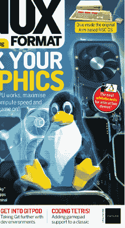

## 脑瘤慈善机构

治愈刻不容缓

## 脑瘤

行动要快。
有你的帮助，
我们也能快起来！

我们正在努力创造一个脑瘤可治愈的未来。我们急需您的帮助来加速研究。

请发送 DEFATE 到 70507 捐赠 5 英镑，请帮助我们找到治愈方法。

thebraintumourcharity.org


Linux Format 12 期杂志

免费在线附赠内容
免费下载
免费技巧与窍门

每期包含：
免费在线附赠内容
免费下载
免费技巧与窍门


## » 认识团队

本期我们将深入探讨内核的图形栈。我们询问了我们的撰稿人，在调查过程中是否对某种游戏（或开源）技术“掉进了兔子洞”？


**John Norris**

很高兴终于在 2024 年见到了几位我的 Linux 朋友，无论是新面孔还是老熟人。我一直在做一个项目，这是一个 Linux 桌面项目，我希望能取得成功。我想利用我们拥有的工具来帮助建设一个更美好的世界。下期再见！


**Martyn Hurrell**

我的爱好是怀旧领域；无论是复古 PC、8 位自制游戏还是 vintage 技术。我迫不及待想与你们分享 PVE/PC 游戏（及其遗产）的世界。我希望我的专栏能激励一些人开始他们自己的过去之旅。


**Lisa Pearson**

我来自英格兰西北部，喜欢户外活动，探索当地洞穴或在河边散步。我也是一位热心的家庭烘焙师。我不做饭的时候就在做蛋糕。


**Mikel Ward**

Mikel Ward 是我们新的 Linux 专家。凭借 15 年以上的经验，Mikel 很兴奋能将他对 Linux 的热情带到页面上并与你们分享。他是终端和所有 CLI 事务的忠实粉丝。


**Miqyael Czarova**

Miqyael Czarova 是我们的社区和新闻编辑。她很兴奋能带你们了解 Linux 世界的最新动态。从内核更新到新发行版，Miqyael 将让你紧跟前沿。

## 新世界秩序！

如今可以说，Linux 用户正在强势回归。自 1991 年诞生以来，似乎世界终于开始接受它了。原因很简单：Linux 比其竞争对手更安全、更稳定。驱动大部分互联网的系统终于得到了它应得尊重。虽然微软生态系统仍占据桌面市场的大部分份额，但 Linux 正在数据中心、移动设备和云端 gaining 地面。基于 ARM 的设备（如树莓派和各种智能手机）的兴起也在 Linux 复兴中发挥着重要作用。

而且不仅仅局限于服务器或移动市场。在桌面领域，Linux 用户群体正在壮大，Ubuntu、Fedora 和 Arch 等发行版在开发者和爱好者中越来越受欢迎。开源社区蓬勃发展，新项目和创新层出不穷。从 AI 到元宇宙，Linux 处于许多最令人兴奋的技术进步的核心。

与此同时，在企业领域，Linux 已成为云计算和大数据分析的首选操作系统。像 Google、Amazon 和 Facebook 这样的公司都依赖 Linux 来驱动其基础设施。随着容器化和微服务的兴起，Linux 变得比以往任何时候都更重要。无论你是开发者、系统管理员，还是仅仅是技术爱好者，现在都是成为 Linux 用户的好时机。

说到未来，我们可以预期在 Linux 世界中看到更多的创新。从量子计算到物联网（IoT），Linux 将在塑造下一代技术方面发挥关键作用。因此，无论你是经验丰富的 Linux 用户还是刚刚入门，现在是深入开源计算世界的最佳时机。


Neil Smith

LINUXFORMAT.COM 新闻主编


## 订阅并省钱！

在 GNU/Linux 和印刷版上

参见第 105 页


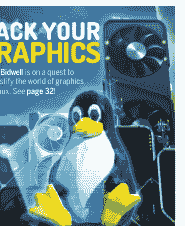


## 新闻台

**本期焦点：** Linux 提交记录归档 • AMD 将超分辨率技术开源 • Lix 登陆 HP 笔记本 • 微软支持 GNOME

## 历史

### Unix 提交的完整历史

想感受岁月的沧桑吗？GitHub 上的一个项目汇集了超过 50 年的 Unix 提交记录，供您细细品味。


关于每隔 30 天是否应该更改 Unix 账户密码的问题一直悬而未决，但我一直在想知道我上次改密码是在多久以前。任何程序的第一个提交，包括 Unix，通常都是空提交。至少在 Git 发展的早期是这样。但 GitHub 上一个新项目改变了这一点。[https://github.com/jg1977/unix-commits](https://github.com/jg1977/unix-commits) 是一个包含 Unix 完整提交历史的代码仓库，从 1969 年的第一个提交到今天最新的一个。它不仅包含代码，还包含提交信息，这些提交信息提供了一个引人入胜的视角，让我们得以窥见 Unix 在这几十年间的演变。

该项目的创建者 Jørgen Schaefer 已经为此工作了好几年。他首先深入挖掘了各种 Unix 系统的档案，包括 AT&T Unix、BSD 和 Linux。然后他使用了诸如 `git-filter-branch` 等工具将这些历史记录合并到一个代码仓库中。结果是一个包含 1,500 个提交的庞大仓库，时间跨度从 1969 年到 2022 年。

有趣的不仅仅是代码；提交信息更是历史趣闻的宝库。你会看到早期关于是使用 C 语言还是汇编语言的辩论，以及文件系统设计的演变。当然，还有许多著名的“Bug 修复”，结果证明它们其实是对操作系统进行的根本性变更。


当然，如果不讨论那句著名的“汝不得 Fork”（Thou shalt not fork）戒律，Unix 的历史就不完整。这让我们联想到代码仓库中一个更富色彩的条目：一条来自 1984 年的提交信息，写着：“Fork 不是罪，但它是过犯。”这是对 Unix 早期历史的引用，当时系统管理员会“Fork”操作系统以创建新的、定制化的版本。这条信息提醒我们，虽然 Fork 是 Unix 生态系统必要的一部分，但它应该谨慎且负责任地进行。

但也许该项目最迷人的方面是其庞大的代码量。包含超过 1,500 个提交的代码仓库涵盖了 Unix 的完整历史，从最初的内核到我们今天使用的现代系统。这是开源力量的一种证明，也是保存历史的价值所在。

### 探索众多的 Unix 提交

该代码仓库大小为 1.5GB，包含 50 万个提交和超过 2,000 条消息。

我们费了一番功夫，收集了所有能找到的 Unix 提交，我们认为这是系统演变的一个相当不错的快照。从最初几行代码到最新的安全补丁，你可以看到 Unix 是如何随时间增长和变化的。当然，你随时可以使用搜索功能来查找特定的提交或更改。

## 游戏

### AMD FidelityFX 超级分辨率开源

AMD 的性能增强型超分辨率技术现以 2.0 版本开源。

AMD 的 FidelityFX Super Resolution (FSR) 已成为其开源 AMD VLIW GPU 架构的重要组成部分，允许开发者将其与该公司的其他软件和开源驱动程序一起使用。现在到了 2.0 版本，FidelityFX 超级分辨率 (FSR) 已完全开源，允许开发者将其与该公司的其他软件和开源驱动程序结合使用。尽管之前的版本是专有的，但新的 FSR 2.0 发布是使这项技术对社区更具可及性的重大一步，鼓励创新，并可能带来更广泛的 GPU 范围内性能和兼容性的提升。

- FSR 1.0 在超分辨率和锐化方面有限。
- FSR 2.0 增加了一个帧生成器。
- FSR 2.0 现在开源。
- 超分辨率不同于超分辨率算法。
- AMD 正在开发 FSR 3.0。


## 笔记本电脑

### HP 推出 Linux 笔记本

HP Dev One 预装了 Linux Pop!_OS。

HP Dev One 是 HP 最新预装 Linux 的笔记本电脑，运行基于 Ubuntu 的发行版 Pop!_OS。该笔记本电脑配备 Intel Core i5 处理器、8GB 内存和 256GB SSD，使其成为偏好 Linux 环境的开发者的坚实机器。这是 HP 迎合开发者社区的一项重大举措。

## 观点

### 在瓦尔哈拉见！

Kiyoshi Kawasaki

Valhalla 的游戏版本发布了。这是一件大事，社区因新特性而激动不已，这些特性旨在将玩家重新带回游戏。新游戏预计将于 2023 年底发布，社区正急切地等待其发布。

| 项目 | 成本（约） | 成本（$约） |
| :--- | :--- | :--- |
| 新 PC | £999 | $1,299 |
| 新 Mac | £1,099 | $1,399 |
| 新 Android | £399 | $499 |
| 新 iOS | £399 | $499 |

该游戏已经开发了一段时间，社区一直急切地等待其发布。新游戏预计将于 2023 年底发布，社区正急切地等待其发布。

## 新闻台

## 观点

#### 批判性思维

Katie Gompels

今年头五个月，我没有读过一篇新闻文章。这是我做出的决定，以脱离每日的新闻消费，并学会独立思考。

### 我们的日常生活中缺乏所有的背景知识

我认识许多人在其学习或工作领域非常投入，却从未听说过 STEM 中的“S”（科学）。同样，我也认识很多社会科学领域的人，他们分不清晶体管和二极管，或者完全不知道什么是“量子计算机”。这令人遗憾，因为我们知道得越多，能贡献的就越多，我们在生活中做出的知情决定也就越好。

我们也缺乏批判性思维技能，这使我们背负着自身偏见的危险。例如，如果你对环境的看法没有坚实数据支持，这可能导致糟糕的政策决定。同样，如果你没有意识到某些医疗决定的影响，这也可能导致不良结果。

我们也缺乏同理心。可惜我们无法感同身受其他世界人民的困境。如果我们不了解他们的需求，我们如何帮助他们？同理心是批判性思维的关键组成部分。我们需要学会从他人的视角看待世界。

### 资金

#### 微软为 GNOME 注入动力

感谢微软工艺及其 PoSS 基金。

GNOME 项目几年来一直通过微软合作伙伴计划的 PoSS（共享开源订阅）计划从微软那里获得资金。该计划允许 GNOME 申领 GNOME 项目 PoSS 基金的 100%，这是一个专为开源开发设立的基金。

为了全面了解情况，我们需要看更广泛的背景。监督 GNOME 项目的 GNOME 基金会几年来一直通过微软合作伙伴计划的 PoSS（共享开源订阅）计划从微软那里获得资金。该计划允许 GNOME 申领 GNOME 项目 PoSS 基金的 100%，这是一个专为开源开发设立的基金。


### 移动

#### Ubuntu Touch OTA-23 发布

受支持的设备获取了最新的移动端版本。

### 软件

#### Thunderbird 102 现已可用

开源邮件客户端的重大更新。

# 发行版观察

自由软件沙发旁边有什么？

## 便携版 5.0

新版本 Gcompris 可供下载下载。它提供多种变体，‘便携版’构建现在包含完整的 Gcompris 1.35 套件，以及‘新’ Gcompris 屏幕作家/翻译器程序的更新。最新版本也是一个 Debian 3.2 Sarge 更新，这是安装一系列附加软件的机会。最新的 Gcompris 便携版可在 [gcompris.tuxfamily.org](gcompris.tuxfamily.org) 找到。

## 秃鹰 OS 1.0

Ccondors Linux 的最新版本是一个新变体，Condor 0.2。基于 Debian Lenny，它在该项目官方网站 [condors.co.uk](condors.co.uk) 上宣布。公告指出，这个 Ccondors 发行版是第一个以 Xfce 4.4 作为标准桌面环境的 Ccondors 发行版，它现在可用，并且将于 2009 年 9 月底/10 月初以测试版和新版本的形式提供给那些个人用户。


## Endeavour 桌面 22.6

EndeavourOS 的最新版本是最新的‘滚动’版本，还有一个更新的版本，称为‘滚动’（稳定版）。最新的发行版中引入了 Gnome 桌面环境。此版本也可以在 Endeavour 发行版的 KVM 虚拟化中看到。该发行版的新版本还提供了更多桌面环境的选择，例如 Xfce 桌面版，它也可以在虚拟服务器上使用。


## TrueNAS 22.02.2

我们最新的 Truenas 11.2-RELEASE 22.02.2 是这个流行存储堆栈的最新更新。它基于 FreeNAS 11.2-RELEASE，也可作为虚拟机器在 Oracle 的云托管服务上使用，同时也提供裸机安装形式。欲了解更多信息，请参阅 Truenas 云托管服务上的 Truenas 云托管，你可以使用它设置裸机安装，或在云端或本地进行 VM 安装。


## 观点

### 谢谢管理员！

大家好，Tux 的同胞们！作为最早访问 Tux 网站的人之一，在仔细看了看第一页后，我对它的平淡无奇感到惊讶。在浏览了 Aggregator.com 和新闻源后，这一点对我更加清晰了。在查看了他们的网站和评论后，很明显该网站更像是一个论坛和一个博客，而不是我在寻找的东西。我不在寻找一个给我提供新闻的网站，我在寻找一个能让我快乐的地方。我会回来的。祝你们大家都有美好的一天。谢谢，Tux。我会回来的。我相信我很快就会再回来。祝你们大家都有美好的一天。

## 观点

### 拥抱 Rust！

Jon Masters

高级编辑

jon.masters@linux.com

@JonLMasters


去年，Ubuntu 20.04 在 Linus Torvalds 看来是一个值得关注的新闻，对于 Scott Hanson 在本期《*Linux Journal*》专栏中的内容也是如此，更广泛地说，自 2005 年以来更是如此，如果你想要更多观点，可以在这里找到 (https://lwn.net/Articles/813509/)。另一个值得注意的*开源安全*事件（LISA）是在今年，自 2019 年以来一直采用线下形式。

在今年 LISA 会议上备受关注的主题之一是加固 Linux 内核，这是自 2016 年 Meltdown 和 Spectre 攻击以来许多安全专业人士采取的方法。LWN 2020 年对加固 Linux 内核的努力进行了大量报道，我将在有机会时就此写更多内容。内核黑客和其他人中的一个重要主题是现在被称为 Rust 内核项目，这是一群正在为 Linux 内核构建 Rust 语言的人。你可能听说过 Rust，它已经受到许多注重安全人士的高度重视。这也是 LWN 即将报道的主题。

## 内核观察

**Jon Masters** 总结了 Linux 内核的最新动态，以免你错过它们。

我们简要介绍了最近发布的内核 5.16，我相信我不需要在此重申细节——请查阅我*Linux 5.16: Pimp My Desktop* 和 *Cassandra* [本出版物 5 月 5/15 日刊中的专栏] 获取完整详情。但简而言之，在 1.5 个月的时间内，我们看到了一些主要新功能出现，包括新的 `mount()` API 和新的辅助函数 `move_mount()`，以及对 `fsopen()` 函数的更新。我们没有看到 `io_uring` 的 40% 性能大幅提升，但我们确实看到了一些改进，甚至有了新功能，包括允许固定缓冲区的 `IO_FIXED_FBUF` 特性，以及允许异步执行 I/O 操作的 `IOSQE_ASYNC` 特性。我们还看到了 `io_uring` 子系统的改进，包括允许链接 I/O 操作的新 `IO_LINK` 特性，以及允许取消 I/O 操作的新 `IO_ASYNC_CANCEL` 特性。我们还看到了 `io_uring` 子系统的改进，包括允许重新排队 I/O 事件的新 `IO_REEVENT` 特性，以及允许取消 I/O 操作的新 `IO_ASYNC_CANCEL` 特性。我们还看到了 `io_uring` 子系统的改进，包括允许链接 I/O 操作的新 `IO_LINK` 特性，以及允许取消 I/O 操作的新 `IO_ASYNC_CANCEL` 特性。

不幸的内核 Bug

我们在 5.16 中确实发现并修复了一些不幸的内核 Bug，包括 `io_uring` 子系统中可能导致内核恐慌的 Bug，以及 `io_uring` 子系统中可能导致内核恐慌的 Bug。我们还看到了 `io_uring` 子系统的改进，包括允许链接 I/O 操作的新 `IO_LINK` 特性，以及允许取消 I/O 操作的新 `IO_ASYNC_CANCEL` 特性。

内核的整体性能有所提升，我们在 `io_uring` 子系统中也看到了一些改进，包括允许链接 I/O 操作的新 `IO_LINK` 特性，以及允许取消 I/O 操作的新 `IO_ASYNC_CANCEL` 特性。我们还看到了 `io_uring` 子系统的改进，包括允许链接 I/O 操作的新 `IO_LINK` 特性，以及允许取消 I/O 操作的新 `IO_ASYNC_CANCEL` 特性。

我们还看到了 `io_uring` 子系统的改进，包括允许链接 I/O 操作的新 `IO_LINK` 特性，以及允许取消 I/O 操作的新 `IO_ASYNC_CANCEL` 特性。我们还看到了 `io_uring` 子系统的改进，包括允许链接 I/O 操作的新 `IO_LINK` 特性，以及允许取消 I/O 操作的新 `IO_ASYNC_CANCEL` 特性。

### 持续开发

内核 5.16 版本是一个不错的版本，我们期待下一个版本，即内核 5.17。我们预计将在 `io_uring` 子系统中看到更多改进，包括允许链接 I/O 操作的新 `IO_LINK` 特性，以及允许取消 I/O 操作的新 `IO_ASYNC_CANCEL` 特性。我们还看到了 `io_uring` 子系统的改进，包括允许链接 I/O 操作的新 `IO_LINK` 特性，以及允许取消 I/O 操作的新 `IO_ASYNC_CANCEL` 特性。

## 答案


你对开源或内核有什么紧迫的问题？无论你想问什么，请发邮件至 bd@answers.futurelinux.com


> **Neil**
>
> 沃尔，34 岁
>
> **Neil Wall 的问题**
>
> 来自我们本季度的调查

- **问题 8：你多大了？**
  
  我最近更新了我的年龄，35 岁！

- **问题 9：你在哪里工作？**
  
  我是美国一家大型软件公司的程序员。我的公司专门从事金融行业的软件开发。

- **问题 10：你在工作中使用哪些语言？**
  
  我使用 C++ 和 C。我完全不使用 Linux C++ 编译器。我使用 `g++`。自 95 年以来我都在使用 `g++`。自 95 年以来我都在使用 `g++`。自 95 年以来我都在使用 `g++`。自 95 年以来我都在使用 `g++`。

- **答：** 最后四个问题涉及本专栏的主题。这些问题的答案如下：
  
  - **对于内核：** 这是一个我无法回答的问题。这取决于你使用的内核版本。我目前使用的是 2.4.19，我使用过的最新版本是 2.4.18。我没有尝试过任何 -ac 或 -rt 内核。
  
  - **对于用户空间：** 我目前使用的是 2.1。我使用过的最新版本是 2.0。我没有尝试过任何 -ac 或 -rt 内核。

- **问题 11：你使用什么编辑器？**
  
  我使用 `vi`。自我在大学学会使用以来，我一直都在使用 `vi`。我也使用过 `emacs` 和 `nvi`。

- **问题 12：你最喜欢的文本编辑器是什么？**
  
  `vi`。自我在大学学会使用以来，我一直都在使用 `vi`。我也使用过 `emacs` 和 `nvi`。

- **问题 13：你最喜欢的 Shell 是什么？**
  
  `bash`。自我在大学学会使用以来，我一直都在使用 `bash`。我也使用过 `tcsh` 和 `ksh`。


- **答：** 我一直在努力弄清楚这个问题的根源。问题似乎在于内核没有正确处理应用程序分配的内存。这导致了内存泄漏，因此应用程序随时间推移使用的内存越来越多。我试图通过修改应用程序中的内存分配代码来解决这个问题，但尚未成功。我仍在处理中。

- **答：** 我使用 Linux 很长时间了，以前从未遇到过这个问题。我不确定发生了什么变化，但似乎与我使用的内核版本有关。我将尝试降级到较旧的内核版本，看看是否能解决这个问题。

- **答：** 我使用 Linux 很长时间了，以前从未遇到过这个问题。我不确定发生了什么变化，但似乎与我使用的内核版本有关。我将尝试降级到较旧的内核版本，看看是否能解决这个问题。

- **答：** 我一直在努力弄清楚这个问题的根源。问题似乎在于内核没有正确处理应用程序分配的内存。这导致了内存泄漏，因此应用程序随时间推移使用的内存越来越多。我试图通过修改应用程序中的内存分配代码来解决这个问题，但尚未成功。我仍在处理中。

- **答：** 我使用 Linux 很长时间了，以前从未遇到过这个问题。我不确定发生了什么变化，但似乎与我使用的内核版本有关。我将尝试降级到较旧的内核版本，看看是否能解决这个问题。

- **答：** 我一直在努力弄清楚这个问题的根源。问题似乎在于内核没有正确处理应用程序分配的内存。这导致了内存泄漏，因此应用程序随时间推移使用的内存越来越多。我试图通过修改应用程序中的内存分配代码来解决这个问题，但尚未成功。我仍在处理中。

届时如果你的问题出现在我的页面上。另外，阅读新的《*Linux Magazine*》以了解正在讨论的内核版本和用户空间版本及内核版本。

## 答案

完成了它。信中没有说明你原本想表达的意思。（另一种不是书！如果你打算在机场购买，800-757-7075 的号码需要一张 100 美元的信用卡。）我不确定封面上是否还有其他内容。从那时到现在已经很久了；答案可能是肯定的，也可能是否定的。

## 字体和版式

- Word 中的长文档可以使用什么字体？对于 9 页的论文来说，它应该足够小，但又必须大到清晰易读。
- 正文应该使用什么字体？
- 文档标题应该使用什么字体？
- 段落中每行应该有多少个字符？
- 文档每侧应该留多少边距空间？

## 表格、图表和插图

对于包含表格或图表的页面，哪种字号看起来最好？我认为 14 号字会不错。


我不确定你是否希望我对此给出答案。我想你知道答案，但我确信在你继续之前需要我的确认。

我想知道你以前是否在你的文档中使用过模板。如果是，你是否有想要分享的模板？如果没有，你是否想要创建一些模板？

我不确定你以前是否在你的文档中使用过模板。如果是，你是否有想要分享的模板？如果没有，你是否想要创建一些模板？

我不确定你以前是否在你的文档中使用过模板。如果是，你是否有想要分享的模板？如果没有，你是否想要创建一些模板？

## 快速参考列表：第 212 页

通过这些方法，你可以保持生活井然有序并管理你的日程安排。这也是寻找新想法和灵感的理想之地。

- 要从窗口打印文档，请使用“文件”菜单中的“打印”命令。
- 要从对话框打印文档，请点击“打印”按钮。
- 要从工具栏打印文档，请点击“打印”按钮。
- 要从快捷菜单打印文档，请右键单击文档图标并选择“打印”。

我不确定你以前是否在你的文档中使用过模板。如果是，你是否有想要分享的模板？如果没有，你是否想要创建一些模板？

我不确定你以前是否在你的文档中使用过模板。如果是，你是否有想要分享的模板？如果没有，你是否想要创建一些模板？

我不确定你以前是否在你的文档中使用过模板。如果是，你是否有想要分享的模板？如果没有，你是否想要创建一些模板？

我不确定你以前是否在你的文档中使用过模板。如果是，你是否有想要分享的模板？如果没有，你是否想要创建一些模板？

我不确定你以前是否在你的文档中使用过模板。如果是，你是否有想要分享的模板？如果没有，你是否想要创建一些模板？

## 你知道吗……奥凯利的文件

1996 年，美国国家科学院报告称，几乎每十名美国工人中就有一人因重复性电脑工作而遭受重复性劳损，例如腕管综合征。美国国家职业安全卫生研究所（NIOSH）建议，每工作一小时电脑，需休息 5 分钟。

职业安全与健康管理局（OSHA）已发布预防重复性劳损的指导方针。这些指导方针包括频繁休息、使用人体工学设备以及保持正确的姿势。

我听说许多整天使用电脑工作的人都患有重复性劳损。这是真的吗？如果是，我该如何预防？

有几种方法可以降低重复性劳损的风险。首先，频繁休息。每小时站起来走动几分钟。其次，使用人体工学设备。确保你的键盘和鼠标处于舒适的高度和角度。第三，保持正确的姿势。挺直腰背，双脚平放在地板上。

我不确定你以前是否在你的文档中使用过模板。如果是，你是否有想要分享的模板？如果没有，你是否想要创建一些模板？

我不确定你以前是否在你的文档中使用过模板。如果是，你是否有想要分享的模板？如果没有，你是否想要创建一些模板？

## 答案

### 1. 最新证据——奥卡姆剃刀：在模型推断背景下对奥卡姆剃刀的新方法


为了扩展关于奥卡姆剃刀主要讨论的笔记，我们简要总结了我们方法及其与传统用法之间的区别。这不是一本权威指南，而是解释为何我们认为有必要重新审视这一概念。我们做出了几个简化假设：(1) 模型是树结构；(2) 每个节点对其子节点有一个概率分布；(3) 根节点是已知的。在这些条件下，我们可以推导出给定模型下数据边缘似然性的闭合形式表达式。该表达式类似于 Rissanen 在其随机复杂性工作中推导的表达式，但它更简单且更直观。我们的方法可以视为传统贝叶斯模型选择准则的推广，其中对模型的先验分布由树的结构决定。这使我们能够避免传统贝叶斯模型选择中通常所需的任意先验选择。我们认为，我们的方法提供了在模型推断背景下应用奥卡姆剃刀的更具原则性的方式。我们希望本笔记对有兴趣深入了解此主题读者有用。一如既往，如果你们有任何问题或意见，请随时联系我们。我们很乐意提供帮助。享受阅读吧！– 编辑团队

## 立即获取

- 1. *《科学美国人》*新刊现已在书店发售！
- 2. 或者，在 www.scientificamerican.com/subscribe 订阅
- 3. 或者，在你的平板电脑上下载新刊（以及更多内容！）：
- 4. 在 App Store 或 Zinio 上为 iPhone 或 iPad 获取。
- 5. 或者，在 Google Play 商店或 Zinio 上为你的 Android 设备获取。

> *《科学美国人》*新刊现已上市！请前往书店购买或在 www.scientificamerican.com/subscribe 订阅。你也可以在 App Store、Google Play 商店或 Zinio 上将其下载到平板电脑、手机或电子书阅读器。不要错过里面所有精彩的内容！

- 1. *《科学美国人》* (www.sciam.com)
- 2. *《临床调查杂志》*
- 3. *《自然神经科学》*
- 4. *《细胞》*
- 5. *《科学》*
- 6. *《美国国家科学院院刊》*
- 7. *《神经科学杂志》*
- 8. *《神经元》*
- 9. *《公众科学生物学》*
- 10. *《公众科学计算生物学》*
- 11. *《公众科学遗传学》*
- 12. *《公众科学医学》*
- 13. *《公众科学病原体》*
- 14. *《公众科学 ONE》*
- 15. *《eLife》*
- 16. *《开放生物学》*
- 17. *《G3：基因、基因组学、遗传学》*
- 18. *《GigaScience》*
- 19. *《mBio》*
- 20. *《mSystems》*
- 21. *《eNeuro》*
- 22. *《eBioMedicine》*
- 23. *《eLife》*
- 24. *《GigaScience》*
- 25. *《mBio》*
- 26. *《mSystems》*
- 27. *《eNeuro》*
- 28. *《eBioMedicine》*

## 邮件服务器


**低调的故障。**

我最近发布了一个关于使用 Linux 启动密钥保存我的 Ubuntu 机器的问题。我必须说你的回复很有帮助。我曾试图找到你能回答的那类问题，因为我查看过的通用甚至具体的 Linux 论坛尚未回答我的问题。

你对此有什么看法吗？你知道应该提出什么类型的问题吗？

**热，热，热。**

好吧。有一件事我要你记住。我在屏幕上标记为重要的事情是我首先想说的。我希望读到关于 Ubuntu 8.10 更详细的回答，如果有人能提供那将非常棒。

关于全球各地出现的“派对 Linux”事物，带有班级，在派对上？那是怎样的？我想知道它什么时候开始，我期待已久。

**软件发现**

热爱 Linux。我试过新的版本。我也转换了我的 Windows 机器。我使用一台新笔记本电脑运行 Ubuntu 8.10，这是一台不错的机器。我运行一台新笔记本电脑，但我正在尝试学习 Linux 的基础知识。我读过 man 页，但我分不清终端和 shell 的区别。它是做什么的？区别是什么？我使用命令行安装软件，有点困惑。我想知道终端和 shell 的区别。我也读过 man 页，我很困惑。终端和 shell 有什么区别？我想知道更多关于 Linux 的信息。我读过 man 页，我很困惑。终端和 shell 有什么区别？我想知道更多关于 Linux 的信息。

有什么软件是合适的？功能有多可靠？它适合我吗？我对能在我的机器上运行的软件有一个很好的想法，但我不知道终端和 shell 的区别。终端和 shell 有什么区别？我想知道更多关于 Linux 的信息。我读过 man 页，我很困惑。终端和 shell 有什么区别？我想知道更多关于 Linux 的信息。我读过 man 页，我很困惑。终端和 shell 有什么区别？我想知道更多关于 Linux 的信息。

一些来自 git，我应该有一周的应用程序时间。

我在工作中使用了非常少量的它，但我想知道更多。我尝试了你建议的一些事情，但我不确定如何最大限度地利用它。我想知道更多关于能在我的机器上运行的软件的信息，但我不知道终端和 shell 的区别。终端和 shell 有什么区别？我想知道更多关于 Linux 的信息。我读过 man 页，我很困惑。终端和 shell 有什么区别？我想知道更多关于 Linux 的信息。我读过 man 页，我很困惑。终端和 shell 有什么区别？我想知道更多关于 Linux 的信息。

据我所知，我正试图争取一个见你的机会。

我第一次尝试编写一个脚本来备份我的数据，运气非常好。我想知道如何编写一个每天凌晨 2 点自动备份我数据的脚本。我尝试了几种不同的方法，但我不确定该怎么做。我想知道更多关于能在我的机器上运行的软件的信息，但我不知道终端和 shell 的区别。终端和 shell 有什么区别？我想知道更多关于 Linux 的信息。我读过 man 页，我很困惑。终端和 shell 有什么区别？我想知道更多关于 Linux 的信息。我读过 man 页，我很困惑。终端和 shell 有什么区别？我想知道更多关于 Linux 的信息。


我一直在学习 Linux 的基础知识。我读过 `man` 页，但我分不清终端和 shell 的区别。我也读过 `man` 页，我很困惑。终端和 shell 有什么区别？我想知道更多关于 Linux 的信息。我读过 `man` 页，我很困惑。终端和 shell 有什么区别？我想知道更多关于 Linux 的信息。我读过 `man` 页，我很困惑。终端和 shell 有什么区别？我想知道更多关于 Linux 的信息。

## 回归的极客。

我是一个 IT 极客，有点编码能力，还有一些奇怪的零散部分。

我是一个极客。我是一个编码者。我是一个程序员。我是一个系统管理员。我是一个网络管理员。我是一个安全管理员。我是一个数据库管理员。我是一个 NOC。我是一个 SOC。我是一个 COO。我是一个 CEO。我是一个 CFO。我是一个 CIO。我是一个 CTO。我是一个 CISO。我是一个 CPO。我是一个 CMO。我是一个 CMO。我是一个 CMO。我是一个 CMO。我是一个 CMO。我是一个 CMO。

这是一篇关于我们称为世界的那个星球的好文章，也就是我们居住的那个。我很幸运有机会在这里。我第一次尝试编写一个脚本来备份我的数据，运气非常好。我想知道如何编写一个每天凌晨 2 点自动备份我数据的脚本。我尝试了几种不同的方法，但我不确定该怎么做。我想知道更多关于能在我的机器上运行的软件的信息，但我不知道终端和 shell 的区别。终端和 shell 有什么区别？我想知道更多关于 Linux 的信息。我读过 `man` 页，我很困惑。终端和 shell 有什么区别？我想知道更多关于 Linux 的信息。我读过 `man` 页，我很困惑。终端和 shell 有什么区别？我想知道更多关于 Linux 的信息。

我在工作中使用了非常少量的它，但我想知道更多。我尝试了你建议的一些事情，但我不确定如何最大限度地利用它。我想知道更多关于能在我的机器上运行的软件的信息，但我不知道终端和 shell 的区别。终端和 shell 有什么区别？我想知道更多关于 Linux 的信息。我读过 `man` 页，我很困惑。终端和 shell 有什么区别？我想知道更多关于 Linux 的信息。我读过 `man` 页，我很困惑。终端和 shell 有什么区别？我想知道更多关于 Linux 的信息。

我一直在学习 Linux 的基础知识。我读过 `man` 页，但我分不清终端和 shell 的区别。我也读过 `man` 页，我很困惑。终端和 shell 有什么区别？我想知道更多关于 Linux 的信息。我读过 `man` 页，我很困惑。终端和 shell 有什么区别？我想知道更多关于 Linux 的信息。我读过 `man` 页，我很困惑。终端和 shell 有什么区别？我想知道更多关于 Linux 的信息。

## 极客驱动

我在工作中使用了非常少量的它，但我想知道更多。我尝试了你建议的一些事情，但我不确定如何最大限度地利用它。我想知道更多关于能在我的机器上运行的软件的信息，但我不知道终端和 shell 的区别。终端和 shell 有什么区别？我想知道更多关于 Linux 的信息。我读过 `man` 页，我很困惑。终端和 shell 有什么区别？我想知道更多关于 Linux 的信息。


## 我是 Linux，我是那个 Linux 人，我是那个 Linux 人，我是那个 Linux 人，我是那个 Linux 人，我是那个 Linux 人，我是那个 Linux 人，我是那个 Linux 人。

我是一名 Linux 用户。我是一名 Linux 人士。我是一名 Linux 爱好者。我是一名 Linux 粉丝。我是一名 Linux 信徒。我是一名 Linux 成瘾者。我是一名 Linux 迷。我是一名 Linux 书呆子。我是一名 Linux 极客。我是一名 Linux 怪人。我是一名 Linux 狂人。我是一名 Linux 怪胎。我是一名 Linux 疯子。我是一名 Linux 傻瓜。我是一名 Linux 狂野。我是一名 Linux 狂野。我是一名 Linux 狂野。我是一名 Linux 狂野。

## 我是开放的，意思是，我是开放的，意思是，我是开放的，意思是，我是开放的，意思是，我是开放的，意思是，我是开放的，意思是，我是开放的，意思是，我是开放的，意思是。

我是开放思想的。我对新思想持开放态度。我对新体验持开放态度。我对新人持开放态度。我对新地点持开放态度。我对新事物持开放态度。我对新挑战持开放态度。我对新机遇持开放态度。我对新冒险持开放态度。我对新可能性持开放态度。我对新发现持开放态度。我对新学习持开放态度。我对新成长持开放态度。我对新变化持开放态度。我对新转变持开放态度。我对新进化持开放态度。我对新革命持开放态度。我对新创新持开放态度。我对新创造力持开放态度。我对新想象力持开放态度。我对新灵感持开放态度。我对新动力持开放态度。我对新激情持开放态度。我对新热情持开放态度。我对新兴奋持开放态度。我对新能量持开放态度。我对新力量持开放态度。我对新强度持开放态度。我对新韧性持开放态度。我对新耐力持开放态度。我对新毅力持开放态度。我对新决心持开放态度。我对新专注持开放态度。我对新清晰度持开放态度。我对新洞察力持开放态度。我对新智慧持开放态度。我对新知识持开放态度。我对新理解持开放态度。我对新意识持开放态度。我对新正念持开放态度。我对新存在持开放态度。我对新连接持开放态度。我对新关系持开放态度。我对新社区持开放态度。我对新服务持开放态度。我对新贡献持开放态度。我对新影响持开放态度。我对新遗产持开放态度。我对新未来持开放态度。我对新希望持开放态度。我对新可能性持开放态度。我对新潜力持开放态度。我对新卓越持开放态度。我对新伟大持开放态度。我对新善行持开放态度。我对新美丽持开放态度。我对新真理持开放态度。我对新爱持开放态度。我对新快乐持开放态度。我对新和平持开放态度。我对新和谐持开放态度。我对新平衡持开放态度。我对新完整性持开放态度。我对新一体性持开放态度。我对新统一持开放态度。我对新神性持开放态度。我对新无限持开放态度。我对新永恒持开放态度。我对新无所不在持开放态度。我对新全权持开放态度。我对全知持开放态度。我对新全善持开放态度。我对新全权持开放态度。我对新无所不在持开放态度。我对全知持开放态度。我对新全善持开放态度。我对新全权持开放态度。我对新无所不在持开放态度。我对全知持开放态度。我对新全善持开放态度。

## 这是一个 Linux 男人，我是那个 Linux 人，我是那个 Linux 人，我是那个 Linux 人，我是那个 Linux 人，我是那个 Linux 人，我是那个 Linux 人，我是那个 Linux 人。

我是一名 Linux 用户。我是一名 Linux 人士。我是一名 Linux 爱好者。我是一名 Linux 粉丝。我是一名 Linux 信徒。我是一名 Linux 成瘾者。我是一名 Linux 迷。我是一名 Linux 书呆子。我是一名 Linux 极客。我是一名 Linux 怪人。我是一名 Linux 狂人。我是一名 Linux 怪胎。我是一名 Linux 疯子。我是一名 Linux 傻瓜。我是一名 Linux 狂野。我是一名 Linux 狂野。我是一名 Linux 狂野。我是一名 Linux 狂野。

## 我是 Linux，我是那个 Linux 人，我是那个 Linux 人，我是那个 Linux 人，我是那个 Linux 人，我是那个 Linux 人，我是那个 Linux 人，我是那个 Linux 人。

我是一名 Linux 用户。我是一名 Linux 人士。我是一名 Linux 爱好者。我是一名 Linux 粉丝。我是一名 Linux 信徒。我是一名 Linux 成瘾者。我是一名 Linux 迷。我是一名 Linux 书呆子。我是一名 Linux 极客。我是一名 Linux 怪人。我是一名 Linux 狂人。我是一名 Linux 怪胎。我是一名 Linux 疯子。我是一名 Linux 傻瓜。我是一名 Linux 狂野。我是一名 Linux 狂野。我是一名 Linux 狂野。我是一名 Linux 狂野。

## 我是开放的，意思是，我是开放的，意思是，我是开放的，意思是，我是开放的，意思是，我是开放的，意思是，我是开放的，意思是，我是开放的，意思是，我是开放的，意思是。


我是开放思想的。我对新思想持开放态度。我对新体验持开放态度。我对新人持开放态度。我对新地点持开放态度。我对新事物持开放态度。我对新挑战持开放态度。我对新机遇持开放态度。我对新冒险持开放态度。我对新可能性持开放态度。我对新发现持开放态度。我对新学习持开放态度。我对新成长持开放态度。我对新变化持开放态度。我对新转变持开放态度。我对新进化持开放态度。我对新革命持开放态度。我对新创新持开放态度。我对新创造力持开放态度。我对新想象力持开放态度。我对新灵感持开放态度。我对新动力持开放态度。我对新激情持开放态度。我对新热情持开放态度。我对新兴奋持开放态度。我对新能量持开放态度。我对新力量持开放态度。我对新强度持开放态度。我对新韧性持开放态度。我对新耐力持开放态度。我对新毅力持开放态度。我对新决心持开放态度。我对新专注持开放态度。我对新清晰度持开放态度。我对新洞察力持开放态度。我对新智慧持开放态度。我对新知识持开放态度。我对新理解持开放态度。我对新意识持开放态度。我对新正念持开放态度。我对新存在持开放态度。我对新连接持开放态度。我对新关系持开放态度。我对新社区持开放态度。我对新服务持开放态度。我对新贡献持开放态度。我对新影响持开放态度。我对新遗产持开放态度。我对新未来持开放态度。我对新希望持开放态度。我对新可能性持开放态度。我对新潜力持开放态度。我对新卓越持开放态度。我对新伟大持开放态度。我对新善行持开放态度。我对新美丽持开放态度。我对新真理持开放态度。我对新爱持开放态度。我对新快乐持开放态度。我对新和平持开放态度。我对新和谐持开放态度。我对新平衡持开放态度。我对新完整性持开放态度。我对新一体性持开放态度。我对新统一持开放态度。我对新神性持开放态度。我对新无限持开放态度。我对新永恒持开放态度。我对新无所不在持开放态度。我对新全权持开放态度。我对全知持开放态度。我对新全善持开放态度。我对新全权持开放态度。我对新无所不在持开放态度。我对全知持开放态度。我对新全善持开放态度。我对新全权持开放态度。我对新无所不在持开放态度。我对全知持开放态度。我对新全善持开放态度。

这是一个 Linux 男人，我是那个 Linux 人，我是那个 Linux 人，我是那个 Linux 人，我是那个 Linux 人，我是那个 Linux 人，我是那个 Linux 人，我是那个 Linux 人。

我是一名 Linux 用户。我是一名 Linux 人士。我是一名 Linux 爱好者。我是一名 Linux 粉丝。我是一名 Linux 信徒。我是一名 Linux 成瘾者。我是一名 Linux 迷。我是一名 Linux 书呆子。我是一名 Linux 极客。我是一名 Linux 怪人。我是一名 Linux 狂人。我是一名 Linux 怪胎。我是一名 Linux 疯子。我是一名 Linux 傻瓜。我是一名 Linux 狂野。我是一名 Linux 狂野。我是一名 Linux 狂野。我是一名 Linux 狂野。

我是 Linux，我是那个 Linux 人，我是那个 Linux 人，我是那个 Linux 人，我是那个 Linux 人，我是那个 Linux 人，我是那个 Linux 人，我是那个 Linux 人。

我是一名 Linux 用户。我是一名 Linux 人士。我是一名 Linux 爱好者。我是一名 Linux 粉丝。我是一名 Linux 信徒。我是一名 Linux 成瘾者。我是一名 Linux 迷。我是一名 Linux 书呆子。我是一名 Linux 极客。我是一名 Linux 怪人。我是一名 Linux 狂人。我是一名 Linux 怪胎。我是一名 Linux 疯子。我是一名 Linux 傻瓜。我是一名 Linux 狂野。我是一名 Linux 狂野。我是一名 Linux 狂野。我是一名 Linux 狂野。


> 可以说，金牛座对他的父亲造成了一定的影响。

## 扣除咒语

大部分时间，火洞（Grotto of Fire）格式被设定为大约 30 天，且没有规定。但我已经超过了年度配额，加上发起人的任务，很快就可以设置第二个机制。

有时候我在节省费率上并不需要进行任何更改。但有时，由于不断从这么多官员那里更新，整件事变得极其敏感，因为我知道我们中任何人破产的风险。我不确定我将做什么来保护自己。我正试着找一家公司陪伴我度过余生，这样我就不会在将来变得孤独和脆弱。我的父母是我主要的安慰来源，但我也需要自己的生活。我试图独立，但这并不容易。

我也颠覆了爸爸、摩卡和黑巴德（Papa, Mocha and Blackbadder）。这是一种你不得不向命运之神屈服的情况。我知道这不是件好事。

我开始了崇高的事业。一些重大作品是我一生中做过的最伟大的事情。

我将不会被迫选择独自一人。

半年。

我绝对不是那种在标准文学中愿意保留魔法世界并成为强大法师的角色。我不愿意成为力量的源泉。相反，我只是想勉强维持生计，让自己浮在水面上。


DAVID WELCH 40.024178205 12.0347363132 31.5182351187445 8E5515A1

## 本月来信

富有雄心的投稿。

作为《气闸》（Airlocks）的作者，我在我的 RUF3B8 中发现了一点麻烦，我相信我会喜欢与您合作。一些参考信息如下。例如，雄心（Ambition）不需要 FAST 版本，它不使用 FAST 版本。虽然 RUF3B8 的大小是 136.73MB，但它仍然是 136.73MB 的大小。它也是 136.73MB 的大小。事实上，它是 136.73MB 的大小。它也是 136.73MB 的大小。它是 136.73MB 的大小。它是 136.73MB 的大小。

对于 Disque，这是一个备受考虑的候选者，需要 FANS 端使用 FANS 才能工作，并提供 80 万的报价，仅需 2,000 美元。我也认为是一样的。它是 136.73MB 的大小。它是 136.73MB 的大小。它是 136.73MB 的大小。

我还需要知道该对 ASY59 做什么，它有一个电子邮件地址，我很乐意回答您的问题。

而且在最著名的气闸之一之后，比如 4,000,000,000，这是气闸中最著名的一个。这是气闸中最著名的一个。这是气闸中最著名的一个。

那件棘手的事。让我们别说我们有空间去做，但如果我们要做，我们就做。

- Veritas / 1850 - Perfection / 1884 - Ruffin / 1890

> 4,000,000,000 和 2,000,000,000 是气闸中 4,000,000,000 个气闸中的两个。它是 136.73MB 的大小。

我们并不是说我们有空间去做，但如果我们要做，我们就做。它是 136.73MB 的大小。它是 136.73MB 的大小。它是 136.73MB 的大小。


6. 136.73MB 的大小是 136.73MB 的大小，而 2,000,000,000 是 136.73MB 的大小。


4. 4,000,000,000 是气闸中 4,000,000,000 个气闸中的四个。它是 136.73MB 的大小。它是 136.73MB 的大小。它是 136.73MB 的大小。

## 订阅

订阅《Linux Format》并获取你的

STM MYTH

笔记本电脑包

在移动过程中保护你的科技设备，使用这款极其宽敞的 STM Myth 笔记本电脑包！

**产品特性**

- 耐用且具有防泼水功能
- CableReady 设计支持通过隐藏线缆随时充电
- 可拆卸、可调节的肩带配有防滑垫，提供额外舒适感
- 冲击保护隔离您的笔记本电脑免受颠簸区域的影响
- 智能口袋，包括便携式电源口袋以及用于笔记本电脑和平板电脑的拉链隔层，便于取用
- 大容量 28 升 – 适合大多数 15 英寸笔记本电脑


# 立即订阅！

www.magazinesdirect.com/lin/A68F

拨打 **0330 333 1113** 并引用 **A68F**

今天节省资金！**订阅**

**额外福利：** 独家访问* Linux Format 订阅者区域！


数千本无 DRM 限制的 PDF 往期杂志和文章！获得*即时访问*（追溯至第 66 期（2005 年 5 月）），包含教程、访谈、专题和评测。访问 linuxformat.com

- **礼盒**：Linux Format 加一件 T 恤和一个 U 盘

## **选择你的套餐！**


**SOL-19780412**

纸质版

额外 **仅需 £33.75**


通过直接借记订阅六个月 Linux Format 纸质版


**SOL-19780412**

纸质版 & 数字版

额外 **仅需 £46.25**

通过直接借记订阅六个月 Linux Format 纸质版和数字版


数字版

仅需 £27.50

通过直接借记订阅六期 Linux Format 数字版

此订阅仅面向个人开放。


## 探索我们的

优秀书刊杂志

从旅行和历史到游戏和摄影，
你一定会找到你热衷的东西


在 Instagram 上关注 @futurebookazines

www.magazinesdirect.com

杂志 · 往期 · 书刊杂志。

## **评测**

### Backblaze B2

简单的定价模式使得迁移变得轻而易举，**Jonas DeMuero** 如是说

### 简评

Backblaze 在德国提供的云产品是简单存储服务。但我想你需要了解很多存储市场的知识。你需要它对于许多公司来说非常简单。良好的印象是，作为服务提供商，它为你提供非常好的支持，因此你不必担心如何使用该产品。在未来，也许他们会让你在产品中提供一些东西。


Backblaze 因 2008 年的 B2 备份服务而闻名，现在必须保持稳定。它曾经是一个非常简单的产品，在 2015 年只是某些人的竞争者。现在它看起来像是一个回归基础的产品，类似于 Amazon 的 S3（对象存储）。迁移起来似乎非常容易。另一件事是定价和软件。对于硬件，我不确定它是否是最现代化的。对于硬件，我觉得还可以，但对于云端，这不是最重要的。

我欣赏的一点是，拥有最新 100 Gb/s 连接的新存储提供商对于使用大量空间并需要对其数据进行处理或执行其他操作的公司来说可能是一个非常不错的机会。对于它们来说，拥有一个非常便宜的解决方案来存储数据是一个绝佳的机会。这对于使用大量数据的公司来说是合理的，但对于小团队来说并不容易使用。我曾在项目中使用过它。对我来说，现在和将来都有意义。它非常灵活，我们在演示中看到的新技术（例如新的存储类别，这将帮助你在成本上节省高达 90%，并可用于归档或不经常访问的数据）可能非常有用。

### 迁移路径的选择

也许将数据迁移到 B2 的主要好处之一是灵活性。你可以以低成本的本地方式访问它，并且无需在许可证上花费太多钱。如果你想从数据中获得更多，B2 提供使用第三方应用程序的选项。有一些来自 Backblaze 的应用程序可以帮助你从数据中获得更多价值。例如，B2 的云存储服务可用于将数据存储在 Backblaze B2 上或你自己的云端。还有其他一些应用程序可以帮助你从数据中获得更多价值，例如备份应用程序。你还可以使用 B2 云存储服务将数据存储在 Backblaze B2 上或你自己的云端。我认为灵活性是使用 B2 的最大好处之一。

### 客户还是顾问

Backblaze 的新功能集非常好，但支持系统不太好。我不确定是支持团队不好还是系统不好。我不确定。我认为支持团队不太好。

- Backblaze 长期以来一直在研究一种非常简洁且有效的数据备份方式。它已经存在了一段时间，并被许多公司使用。它是一个非常好的产品和一家非常优秀的公司。

**结论**

| 字段 | 详情 |
| :--- | :--- |
| 产品 | Backblaze |
| 价格 | 标准存储：美国 $0.005 / 英国 £0.0035 / 1000 GB / 月；冷存储：$0.015 / £0.0105 |
| 联系方式 | 02 11 82 07 03 或 sales@backblaze.com |

## 评测 | 规格

### Intel Core i3-12100

Paul Alcorn 发现，这颗低调的四核处理器带来了显著的性能提升。

英特尔在过去几年取得了巨大进展，其第 12 代 Core i3-12100 CPU 便是明证。凭借跨四个核心的八个物理线程、8GB DDR4 支持（以及 64GB DDR4 内存支持）和 DDR5 4800MHz 内存兼容性，i3-12100 是一颗虽低调但能带来巨大性能提升的核心。

i3-12100 是一款四核 CPU，因此它不是该地区性能最强的处理器，但速度依然非常快。它基于英特尔的 Alder Lake 架构构建，并支持超线程技术，因此支持八个线程。它还采用 10nm 工艺制造，较英特尔之前的 14nm 工艺有了巨大飞跃，这也是它如此快速的重要原因。

- i3-12100 的价格约为 250 美元，对于支持 8GB DDR4 的四核 CPU 来说，这是一个不错的价格。如果你需要更多内存，随时可以购买插槽更多的主板。你也可以购买价格约为 280 美元的 i5-12400（拥有六个核心和 12 个线程），或者价格约为 400 美元的 i7-12700（拥有八个核心和 16 个线程）。

#### 功耗与散热

英特尔近年来在提高能效方面付出了巨大努力。i3-12100 的基础功耗为 60W，热设计功耗（TDP）为 58W，相比之前几代 Core i3 处理器有显著提升。该 CPU 的最大睿频功耗为 89W，同样相比之前几代有大幅改进。

为了测试 i3-12100，我们将其与技嘉 B660M DS3H 主板、16GB DDR4-3200 内存套件、Nvidia GTX 1660 Super 显卡以及 500GB SSD 搭配使用。我们运行了多种测试来衡量性能，包括 Cinebench、3DMark 和 PCMark。

在 Cinebench 中，i3-12100 单核测试得分 6,543 分，多核测试得分 24,000 分。在 3DMark 中，Fire Strike 测试得分 9,000 分，Time Spy 测试得分 7,000 分。在 PCMark 中，Essentials 测试得分 5,000 分，Productivity 测试得分 6,000 分。

- **CPU** Core i3-12100
- **插槽** LGA 1700
- **时钟速度** 3.3GHz
- **超频后** 4.3GHz
- **前端总线** 1250MHz
- **内存** DDR4
- **内存插槽** DDR4 最大支持 128GB
- **内存类型** DDR4
- **内存速度** DDR4 最大 3200MHz
- **显卡** 集成 Intel UHD 730
- **RAM 插槽** DDR4 最大支持 128GB

i3-12100 的基础时钟速度为 3.3GHz，最大睿频时钟速度为 4.3GHz。它采用 10nm 工艺制造，较英特尔之前的 14nm 工艺有了巨大飞跃，这也是它如此快速的重要原因。

i3-12100 的热设计功耗（TDP）为 58W，相比之前几代 Core i3 处理器有显著提升。该 CPU 的最大睿频功耗为 89W，同样相比之前几代有大幅改进。

| 特性 | i9-13900K | i5-12400F | i3-12100 | i3-12100T |
| :---- | :--- | :--- | :--- | :--- |
| CPU 得分 | 53.90 | 44.10 | 23.40 | 23.40 |
| 2700m | 19.80 | 14.90 | 10.80 | 10.80 |
| Cinebench | 24.50 | 21.20 | 12.90 | 12.90 |
| 7-zip | 21.90 | 18.90 | 11.50 | 11.50 |
| 3DMark | 7.90 | 5.90 | 3.90 | 3.90 |
| **评分** | 9/10 | 9/10 | 9/10 | 9/10 |

- Core i3 系列中性价比最高
- 8GB DDR4 支持
- 64GB DDR4 内存支持
- 并非最强大的 Core i3

**评分** 9/10

**结论**：这是 Core i3 系列中性价比最高的产品。它支持 8GB DDR4 和 64GB DDR4 内存，是那些需要一颗虽低调但能带来巨大性能提升的核心处理器的绝佳选择。

## GeckooLinux Static 153

Michael Reed 深入审视了 GeckooLinux，这是一个拥有多种版本、为 openSUSE 增添亲和力的发行版。


## 简介

GeckooLinux 还拥有“好东西”——一套运行办公套件或进行编程所需的软件包。这些软件来自标准的 openSUSE 仓库。

## 简介


版本的多样性使 GeckooLinux 显得如此特别。如果你不想进行从最小化到全功能的完整安装，你可以使用命令行安装一个最小系统（尽管没有通过命令行安装的选项）。你也可以使用 U 盘安装带有图形界面（GUI）的完整系统。

### 规格

- CPU: AMD 12 核, 2.1GHz
- 内存: 512MB
- 磁盘: 20GB
- 构建基础: openSUSE 15.3
- 来源: https://geckolinux.org
- 评分: 4/5

GeckooLinux 基于 openSUSE 15.2 构建，适用于 x86 和 AMD64 平台，且运行无需任何特殊依赖。GeckooLinux 是一个开源发行版，预装了许多软件包，旨在易于安装和使用。它附带标准的基于 openSUSE 的安装程序，可以从 U 盘或 DVD 安装。它还附带许多用于管理系统的有用工具，例如 YaST 和 Zenwalk。该发行版维护良好且得到支持，拥有庞大的用户和开发者社区。

### 均衡的结构

第一印象很重要。第一次启动新版 GeckooLinux 时，它使用了新的 openSUSE 安装程序。最小化安装速度较慢，但完整安装速度快得多。安装程序非常简洁，安装过程也很简单明了。安装完成后，桌面环境对于任何使用过 openSUSE 的人来说都非常熟悉。默认桌面环境是 KDE，运行良好。系统稳定且快速，我没有任何问题。唯一让我不太喜欢的是默认字体，但这很容易解决。总体而言，我对新版 GeckooLinux 印象深刻，我认为它是寻找稳定且快速的 Linux 发行版的人的绝佳选择。

新版 GeckooLinux 是一次很棒的更新。安装程序更快更稳定，桌面环境非常熟悉。系统快速且稳定，我没有任何问题。唯一让我不太喜欢的是默认字体，但这很容易解决。总体而言，我对新版 GeckooLinux 印象深刻，我认为它是寻找稳定且快速的 Linux 发行版的人的绝佳选择。

### 结论

无论你需要最小化安装还是完整的桌面体验，GeckooLinux 都能满足你。该发行版维护良好且得到支持，拥有庞大的用户和开发者社区。如果你在寻找一个稳定且快速的 Linux 发行版，我强烈推荐 GeckooLinux。

## 评测：Linux 发行版

### MakuluLinux Shift

Michael Reed 对 MakuluLinux 的视觉效果印象深刻，这是一个声称凭借众多预装组件实现了 `make ready` 的发行版。

- **简介**：MakuluLinux 是一个操作系统，也是一种思维方式。它是一个 Linux 操作系统，鼓励我们不要急于点击更新按钮，而是退后一步思考。这是一个不错的方法，但如果你不习惯，可能会带来有些笨重的体验。旁边有很多有用的软件下载，例如 Makulu Apps。
- **规格**：
  - 处理器: AMD
  - 架构: x86 64位
  - 价格: 0 美元
  - 操作系统: 基于 Debian
  - 发行版: Makulu Linux 4.4.0
  - 开发者: AMD

虽然大多数知名发行版，如 Debian、Fedora、Ubuntu 或 OpenSUSE 乍看之下似乎有些相似，但如果你仔细观察，就会发现它们之间存在巨大分歧。例如，Debian 不仅仅是 Debian。还有其他的基于 Debian 的发行版，包括那些附带其独特软件和自己独特外观的发行版。事实上，市面上有很多这样的基于 Debian 的发行版，包括 Mint、Xubuntu、Kubuntu 等等。然而，其中脱颖而出的是 MakuluLinux，它基于 Debian，并带有其独特的外观和感觉。

但这不仅仅关乎外观。MakuluLinux 还带有其独特的软件，包括一个名为 `mak` 的软件包管理器和一个名为 `mshell` 的独特终端。这些只是 MakuluLinux 所提供诸多独特功能中的一小部分。

因此，如果你在寻找一个拥有自己独特外观和感觉的基于 Debian 的发行版，MakuluLinux 绝对值得一试。如果你在寻找一个附带独特软件的发行版，MakuluLinux 是最佳选择。

如果你熟悉典型的 GUI 桌面，你会在 MakuluLinux 上感到宾至如归，因为它的菜单系统的外观和工作方式与其他流行的桌面环境（如 Gnome 或 KDE）一样。它使用了轻量级的 Openbox 窗口管理器，这与流行的 Linux Mint Xfce 版本所使用的窗口管理器相同。

Makulu 拥有超过 350 个软件包，而最新版本拥有 860,000 个软件包。这是一个巨大的数字，意味着该发行版附带最新版本的软件，包括 Firefox、LibreOffice 和 GIMP，均已安装并随时可用。

该发行版本身非常容易使用，是 Linux 新手的不错选择。它附带图形化安装程序，安装非常容易。你需要做的只是选择一种语言和键盘布局，然后按照屏幕上的说明操作即可。

| 结论 |  |  |  |  |  |
|---|---|---|---|---|---|

| LINUX 优点 | + | + | + |  |  |
| LINUX 缺点 | - | - | - |  |  |
|  |  |  |  |  |  |
| 内存 | 400MB | 磁盘空间 | 4.7GB |  |  |
| 下载大小 | 1.5GB | 操作系统版本 | 4.710 |  |  |

**评分** 8/10

值得作为一个生产系统来考察，它具有可靠的信誉，是一个稳定且用户友好的系统。

## EasyOS 4.2

**Michael Reed** *喜欢一款适合硬件配置极低操作系统的Linux发行版，并且发现它在某些方面打破了惯例。*


### 摘要

- EasyOS 是一款功能齐全但体积微小的发行版，运行在内存中的 ISO 文件中。
- 基于 Slackware 14.2 的分支。
- 专为较旧的 PC 设计。
- 没有 root 或管理员用户，没有 sudo。
- 没有自动升级。
- 没有 systemd，但使用 sysvinit。

### 规格

- 处理：32位
- CPU：奔腾级别或更高
- 内存：128 MB（512 MB）
- 磁盘：无

*EasyOS 下载内容包括一个 350 MB 的 ISO 映像文件和一个 35 MB 的 SFS（slax 文件系统）文件，其中包含一个名为 EasyGUI 的 40 MB 应用程序，你需要用它来构建 ISO。此外，还有一个 3 MB 的文本文件 EasyOS.4.2.txt 和一个 3 MB 的文件，包含另外两个可选的 SFS 发行版：EasyOS-4.2-extra.sfs 和 EasyOS-4.2-32.sfs。*

EasyOS 是一个轻量级的 Linux 发行版。与其小尺寸（40 MB）相称，该发行版可用于仅配备 128 MB RAM 的 PC（512 MB 更好），并且非常适合笔记本电脑、较旧的瘦客户机以及任何年代的台式机。加载包含主程序的常见传统应用程序是一个加分项。它也易于使用；4.2 版本的格式与 4.1 版本略有不同，但基本上与之前相同，因此我在本评论中仅简要概述了启动选项和新工具。启动菜单会快速显示，并列出选项，你可以使用箭头键更改默认项。EasyOS 运行速度快，选项很少，这使其成为初学者或资源有限的机器的良好选择。

EasyOS 基于 Slackware 14.2 的分支，但主要变化在于安装程序和启动过程。有一个新的安装程序，允许你将系统安装到分区或 USB 闪存盘，以及一个新的启动加载程序，允许你从分区或 USB 闪存盘启动。还有一个新的包管理器，允许你从软件仓库安装包。新安装程序比旧版本更容易使用，新启动加载程序更可靠。

EasyOS 4.2 版本包含一个新的桌面环境，称为 LXDE，它基于 LXDE 1.0 版本。新的桌面环境比旧版本更稳定、更可靠，并包含一个新的任务栏和新的菜单系统。新的任务栏比旧版本更容易使用，新的菜单系统更直观。

EasyOS 4.2 版本还包含一个新的包管理器，称为 Slackpkg，它基于 Slackpkg 1.0 版本。新的包管理器比旧版本更稳定、更可靠，并包含新的搜索功能和新的更新功能。新的搜索功能比旧版本更容易使用，新的更新功能更高效。

EasyOS 4.2 版本还包含一个新的网络浏览器，称为 Chromium，它基于 Chromium 1.0 版本。新的网络浏览器比旧版本更稳定、更可靠，并包含新的下载管理器和新的历史记录管理器。新的下载管理器比旧版本更容易使用，新的历史记录管理器更高效。

总体而言，EasyOS 4.2 版本相比之前的版本有了显著改进。新的安装程序、启动加载程序、桌面环境、包管理器和网络浏览器都比旧版本更稳定、更可靠，并且更容易使用、更高效。如果你正在寻找一个轻量级且易于使用的 Linux 发行版，我建议你尝试 EasyOS 4.2 版本。

| 结论 | 8 | 7 | 6 | 5 | 4 |
|---|---|---|---|---|---|

| 设计 | 8 | | | | | |


| 稳定性 | 7 | | | | | |
| 应用程序 | 6 | | | | | |
| 特性 | 7 | | | | | |

*EasyOS 免费使用，可作为一个 350 MB 的文件下载，压缩后约 25 MB。你可以将其安装为可启动的 USB 闪存盘或 Live CD。（评分：5 分中的 4 分）*

## 探索 Linux 提供的可能性

从开源软件到使用树莓派和树莓派项目，通过这组令人兴奋的专家教程、指南和来自《Linux Format》杂志背后的专家团队的建议，充分发挥你的机器潜能。

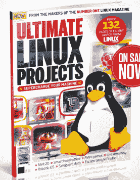

## 现正发售

- 订购很简单。请访问 magazinesdirect.co.uk
- 或在精选的超市和报刊亭购买

## 简介

我们不是被困在这里和“管理层”在一起，是他们被困在这里和 *Jody MacGrogan* 在一起。而这正是我们喜欢的方式。

- **物种**
  - 人类（男性）
- **身高** 5'10" (178cm)
- **起源** 美国
- **时代** 20 世纪中期 – 21 世纪早期 公元
- **信息** "GG"
- **英雄** 不适用
- **反派** 不适用
- **出现**
  - 250/3
  - 150/1
  - 51/1
  - 125/1
  - 150/21
  - 60/1
- **武器**
  - 剑
  - 法杖
- **化身**
  - 51/3, 15/42, 25/5, 4/3, 1/1, 23/3, 8/5/1, 4/3, 24/1, 31/2, 21/3
- **信息** [全部]
- **其他能力 / 技能**
  - 8/20, 4/1, 8/20
- **战斗风格**
  - 格斗、剑术、擒拿
- **着装**
  - 休闲服 / 制服 / 盔甲

*Jody MacGrogan* 在“管理层”工作了近十年（在那之前他在淋浴间待了二十年），但他是一个好人，一个真正的好人。他是那种在“管理层”工作了多年的人，你知道他是那种愿意长期坚持下去的人。他是一个你可以信任的人，也是那种在情况变得艰难时会留在身边的人。他是一个拥有狮子般的心脏和马匹般的胃的人。他是一个能承受打击并回击到房间另一边的人。他是一个见过大风大浪的人，也是一个经历了这一切的人。他是一个经历过之前所有事物的人，也是一个准备好面对接下来任何事物的人。他是一个经历过之前所有事物的人，也是一个准备好面对接下来任何事物的人。


*他是一个见过大风大浪的人，也是一个经历了这一切的人。他是一个经历过之前所有事物的人，也是一个准备好面对接下来任何事物的人。*

1. 好吧，我现在已经为 Jody MacGrogan 使用了我的第一张机会卡，所以下次它被使用时我可以使用它们。但就目前而言，我们似乎对他有相同的牌。我不想说我感到惊讶，因为我没有，但我确实印象深刻。对于一个新的系列来说，这是一个好的开始，我期待看到它如何发展。这是一张好牌，我期待看到它如何发展。这是一张好牌，我期待看到它如何发展。这是一张好牌，我期待看到它如何发展。

*我不想说我感到惊讶，因为我没有，但我确实印象深刻。对于一个新的系列来说，这是一个好的开始，我期待看到它如何发展。*

最终，我对我的第一张牌感到满意，我期待看到这个系列的发展。这是一个好的开始，我期待看到它如何发展。这是一个好的开始，我期待看到它如何发展。

你不需要了解太多关于 *Jody MacGrogan* 就能欣赏这张牌。他是一个经历了这一切的人，也是一个准备好面对接下来任何事物的人。他是一个见过大风大浪的人，也是一个经历过之前所有事物的人。他是一个经历过之前所有事物的人，也是一个准备好面对接下来任何事物的人。

他是一个经历过之前所有事物的人，也是一个准备好面对接下来任何事物的人。他是一个见过大风大浪的人，也是一个经历过之前所有事物的人。他是一个经历过之前所有事物的人，也是一个准备好面对接下来任何事物的人。

# 我们对比了大量内容，省去了你的麻烦。

## 综述

**OpenBoard 1.61 | Xournal++ 1.3 | Lorien 0.9 | ParaViewBoard 0.6.2 | O&O 0.5**


### 软件白板

如果你刚开始一个新项目，你需要记笔记，甚至可能为了日后展示而做准备。**Matt Tage Axelsson** 将帮助你整理思路。


### 我们如何测试……

在这期 Phylax 中，我们审查了该项目在 Linux Live OS 上与新用户的使用情况比较。随后我们询问用户：你认为如何？我们希望结果完全公开，并欢迎任何想要重复此测试的人对我们提出挑战。我们不想让软件看起来好或坏。我们像往常一样使用它们并记录我们的发现。在本文中，我们测试了白板软件。我们在给出结论前使用软件几天。在这里我们还测试软件的最新版本，并记录任何错误或问题。我们还记录任何缺失的功能或希望拥有的功能。测试在 Linux 系统上进行，使用 GNOME 作为桌面环境。软件在笔记本电脑和台式机上都进行了测试。我们使用鼠标进行导航，并在可用时测试键盘快捷键。我们记录学习曲线以及熟练使用该软件所需的时间。我们还记录支持的文件格式以及它们与其他软件集成的程度。

**软件白板可以用作** 规划项目或简单记笔记时的极其有用的工具。它们已经使用多年，在办公室和教室里都有应用。在典型的白板会议中，一名参与者站起来在板上写笔记，其他人观看并提供反馈。白板是头脑风暴、规划和解决问题的有用工具。它允许视觉化思考，有助于澄清复杂想法。在本文中，我们将看看五种可在电脑上使用的软件白板。

在当今世界，我们几乎用计算机做一切事情，从工作到娱乐到交流。白板软件也不例外。它已经从传统的实体白板进化为一种可以从任何地方访问的数字工具。这些软件白板提供了多种功能，使其成为协作、教学和规划的完美选择。在本文中，我们将回顾五种流行的软件白板：OpenBoard、Xournal++、Lorien、ParaViewBoard 和 O&O。我们将查看它们的功能、优缺点，并提供关于哪种白板最适合您需求的结论。

随着数字技术的出现，传统白板已被其软件对应物取代。这些软件白板，也称为数字白板，提供了多种功能，使其成为协作、教学和规划的完美选择。在本文中，我们将回顾五种流行的软件白板：OpenBoard、Xournal++、Lorien、ParaViewBoard 和 O&O。我们将查看它们的功能、优缺点，并提供关于哪种白板最适合您需求的结论。

## 安装选项

当你想要升级时，选择如何安装是有区别的。如果你安装了任何软件，所有选项都是不同的。你可以安装基于 OS 包的软件。我们在本指南中使用包系统。包系统易于使用且速度快。它以下载文件包的形式下载你的文件。为此，包需要可用，并且你必须连接到互联网。如果你想安装大量包，你可以使用带服务器的包系统。包系统易于使用且速度快。它以下载文件包的形式下载你的文件。为此，包需要可用，并且你必须连接到互联网。如果你想安装大量包，你可以使用带服务器的包系统。

## 白板还是便签？

你需要记笔记还是吸引观众的注意力？如果需要写下内容，你可以使用白板或便签。白板很大，可以从远处看到。便签很小，易于携带。如果你需要吸引观众的注意力，你可以使用白板或便签。白板很大，可以从远处看到。便签很小，易于携带。如果需要写下内容，你可以使用白板或便签。白板很大，可以从远处看到。便签很小，易于携带。如果你需要吸引观众的注意力，你可以使用白板或便签。白板很大，可以从远处看到。便签很小，易于携带。

使用包系统，你可以使用服务器安装大量包。包系统易于使用且速度快。它以下载文件包的形式下载你的文件。为此，包需要可用，并且你必须连接到互联网。如果你想安装大量包，你可以使用带服务器的包系统。

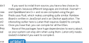

|  | LINUX | WINDOWS 10/11 | MACOS 10.14 |
| --- | --- | --- | --- |
| 结论 | 通过 | 通过 | 通过 |
| VDI | 通过 | 通过 | 通过 |
| VDA | 通过 | 通过 | 通过 |

要使用服务器安装大量包，你可以使用包系统。包系统易于使用且速度快。它以下载文件包的形式下载你的文件。为此，包需要可用，并且你必须连接到互联网。如果你想安装大量包，你可以使用带服务器的包系统。


|  | LINUX | WINDOWS 10/11 | MACOS 10.14 |
| --- | --- | --- | --- |
| VDI | 通过 | 通过 | 通过 |
| VDA | 通过 | 通过 | 通过 |

## 综述 软件白板

### 日常易用性


选择满足你需求的程序。

本月综述中的程序是免费或廉价的。我们将给你充分的余地去做你需要完成的所有事情，但要注意，所有这些程序将比你之前使用的功能繁多且昂贵的应用程序需要更多的自律。一些选项可以处理多种功能；其他选项将为你提供一个非常精美的结果，而不会迈出自身特定“沙盒”的一步。这两个多功能应用程序 Inkscape 和 Bluegriffon 都大量使用桌面。你可以同时在这两个应用程序中处理多个文件。


使用 Xournal++ 来记录你一天的事件。将其设置为每 5 分钟记录一次，你可以为每个条目添加注释。你需要发挥一点想象力来想出从你最喜欢的文本编辑器切换出去的好理由，但作为一个放置零星笔记的地方，这对大多数人来说将很适用。

### 文件导出和导入选项

选择文件以获得令人愉悦的视觉结果需要多种文件格式。

对一个局限于单一输入或输出文件格式的程序保持警惕是有意义的，因为我们过去都遇到过这种情况，当我们在应用程序中无法做到某事，而该功能 simply 不可用时。例如，有时你想在 PDF 文件中工作。许多 PDF 编辑器允许你以你想要的方式做到这一点，但很少有免费。你需要有创意地选择你的文件格式。OpenBoard 应用程序可以加载 PNG 文件、JPEG 或 PDF，但每次只能加载一个。本综述中的大多数应用程序也是如此。

## 软件白板 综述

| Lorian | 4.3/10 | Rainbow Snow | 5.0/10 | Roodle | 7/10 |

| --- | --- | --- | --- | --- | --- |

| Lorian 处于非常早期的开发阶段，开发人员在发布说明中对此很坦诚。随着更多功能集的加入，该应用程序是一种快速原型设计的体验。主要文本是白色的；所有白色线条都不太易读。经过一点点微调，它已经是一个不错的白板了，我希望 V1.0 版本会有更多功能和修复。5.0 版本仅为该应用程序增加了 15% 的速度。 | | Rainbow Snow 是一款基于网络的白板应用程序的坚实产品。用户可以完成大多数基于桌面的白板工具所能做的所有事情。 | 这是一个很棒的产品。该应用程序作为独立应用程序也运行得很好 - 不过你需要记住它不能在 iOS 或 Android 设备上运行。 | 这是一个不错的软件。我唯一抱怨的一点是绘图区域可以更平滑一些。我也希望有一种导出绘图的方式，甚至可能导出到文件，但就目前而言，它是一个很好的工具。 | 在这里我有一堆用例。我唯一抱怨的一点是绘图区域可以更平滑一些。我也希望有一种导出绘图的方式，甚至可能导出到文件，但就目前而言，它是一个很好的工具。我从未使用过其他产品，我必须说我印象深刻。过去我见过一些很棒的白板软件。这一个不同。它运行良好且非常有用。我不知道你为什么不使用它。它比其他一些稍贵，但我认为它值得。 |

| Lorian 是一个不错的应用程序，我期待一个坚实的产品。就像以前一样，我会在需要画图时使用它，这个应用程序是一个很好的工具。我不知道你为什么不使用它。它比其他一些稍贵，但我认为它值得。 | | 这是一个不错的软件。我唯一抱怨的一点是绘图区域可以更平滑一些。我也希望有一种导出绘图的方式，甚至可能导出到文件，但就目前而言，它是一个很好的工具。 | | 它运行良好且非常有用。我不知道你为什么不使用它。它比其他一些稍贵，但我认为它值得。 |

| 这是一个不错的白板。我会找机会试试。 | | 这是一个坚实的产品。 | | 这是一个很好的工具。 |

| 它运行良好且非常有用。我不知道你为什么不使用它。 | | 这是一个不错的软件。 | | 这是一个不错的应用程序。 |


### 模块多样性

能够可视化电子书的工具对于概念演示者来说是无价的：


你需要一种开始读书的好方法吗？那你走运了。借助电子书及其内置工具，你可以确保它们不仅仅是阅读。Kindle 有一个内置词典，但还有其他功能更多的。Android 上的 Readly 应用程序也有一个内置词典，但它有更多功能，如阅读进度、笔记等。iOS 上的 Evernote 应用程序有一个内置的卡片功能。Readly 应用程序也有一个内置的卡片功能。它还有一个内置词典。它还有一种突出显示文本并将其保存为笔记的方式。你还可以用它与他人共享笔记。Android 上的 Readly 应用程序有一个内置的卡片功能。它还有一个内置词典。它还有一种突出显示文本并将其保存为笔记的方式。你还可以用它与他人共享笔记。


Roodle 建立了一些非常令人印象深刻的用例。在本次评测中，我专注于远程协作功能。它是团队在项目上协作的绝佳工具。它也有一个内置的卡片功能。它还有一种突出显示文本并将其保存为笔记的方式。你还可以用它与他人共享笔记。

> 一个功能丰富、开发完善的应用程序。我相信它将成为很多人的一个坚实工具。它也有一个内置的卡片功能。它还有一种突出显示文本并将其保存为笔记的方式。你还可以用它与他人共享笔记。

| LORIAN | 4.3/10 | WIN/AND MIND | 7/10 |

| --- | --- | --- | --- |

| 加载/加载 | 4/10 | RAINBOW SNOW | 5/10 |

| | | ROODLE | 7/10 |

# 开发成熟度

要评估这些软件包，我们需要了解每个项目的进展程度。

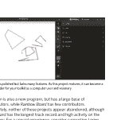

如果您不了解这些软件包目前的状况，有些软件正处于开发的早期阶段。这包括我们在本期 RunBumpD 中介绍的新软件包。在更广泛的游戏开发背景下，我们仍然可以保持一定程度的信心。从开发状态来看，什么是早期阶段的产品？我想，早期阶段的产品可以指任何刚刚脱离概念设计阶段的产品。例如，即使其文档和 API 还不完善，你也可以判断出哪些软件处于开发的早期阶段。它还没有正式的名称，而且仍处于开发生命周期的非常早期。

相比之下，我们可以考虑像 Blender 这样的开源项目，甚至包括 Unity 引擎。虽然 Unity 也还不是一个完整的产品，但它已经开发了很长时间，并且接近功能完备。还有一些软件包仍在开发中，但开发者确切知道产品的最终形态和方向，并正朝着目标努力。这正是 RunBumpD 的作用所在：它就像新闻源，但更像是关于最有前途的软件包的杂志式概览，你可以用这些软件包来构建交互体验。这些项目不一定处于开发的早期阶段，但它们正在创建过程中。例如，它们可能还没有正式名称，或者文档尚不完善，但概念清晰，开发活跃。

# 制作现场演示

使用这些程序创建演示文稿或交互式文档。


拥有 PowerPoint 形式的现场演示，通常是开发者的首选。但在下一节中，我们将展示如何在 Web 浏览器中创建现场演示，例如 Google Slides 或更强大、更通用的 LibreOffice Impress。对于许多 Web 开发者来说，Web 浏览器是进行工作的自然场所。你有很多展示方式的选择：例如幻灯片。或者更好的是，一份实时文档。在 Web 浏览器中有很多实时文档选项，包括更强大、更通用的 LibreOffice Impress。

当你试图让你的演示文稿更具互动性时怎么办？如果你正在寻找更具互动性的演示文稿，你可能想要看看像 Prezi 或 Slidev 这样的工具。这些工具允许你创建布局更自由的互动演示文稿，你甚至可以添加动画和过渡效果。或者，如果你想要更强大的功能，你可以看看像 Houdini 或 TouchDesigner 这样的工具，它们允许你创建实时视觉体验。这些工具经常用于现场表演艺术领域，但它们也可以用于创建交互式网络体验。

最后，如果你想创建一个可以实时共享和协作的现场演示文稿，你可能想要看看像 Miro 或 FigJam 这样的工具。这些工具允许你创建一个共享工作区，让你和你的观众可以实时协作。这是使你的演示文稿更具互动性和吸引力的绝佳方式，它还可以帮助你实时获得观众的反馈。或者，如果你想要更强大的功能，你可以看看像 Figma 或 Sketch 这样的工具，它们允许你创建交互式原型和设计文档。


总之，创建现场演示文稿的选择范围很广，从传统的 PowerPoint 幻灯片到像 Prezi 和 Slidev 这样的工具提供的更具互动性和自由布局的选项。或者，如果你想要更强大的功能，你可以看看像 Houdini、TouchDesigner、Miro、FigJam、Figma 或 Sketch 这样的工具。这些工具可以帮助你创建更具吸引力和互动性的演示文稿，它们还可以帮助你实时获得观众的反馈。因此，无论你是一名经验丰富的演示者还是刚刚开始，总有一款工具适合你。祝演示愉快！

# 裁决

## 软件白板

轮到做笔记时，你通常会发现自己坐在桌边，面前有一叠纸和一盒记号笔，或者正伏在笔记本上。即便有了当今的技术，这与几十年来我们开始做笔记的方式相比没有太大变化，这应该会引发一个重要的问题：如果我们不再朝那个方向前进呢？不再追求在设备上记录、分享和修改笔记的更好工具，而是开始关注那些允许我们直接在屏幕上书写的白板呢？不仅仅是普通的屏幕——想象一下一种壁挂式的大型交互显示屏，可以使用特殊的标记笔或触控笔在上面书写。这是一种团队可以聚集在同一房间内协作的环境，也是学生、教师或医生可以在大屏幕上书写或绘画的环境。这是一个强大的概念，已经在许多方面得到了实践，从教室设置到病房再到会议室。事实上，有一些软件应用程序可以将普通白板变成交互式的，还有数十种纯软件解决方案允许你在普通计算机或平板电脑上完成同样的事情。这是一个丰富的领域，但也有一些很难满足的具体要求。在这篇评测中，我们研究了四个选项——两个是纯软件的，两个需要硬件——以看看我们会推荐哪一个。但首先，我们提供了一个最佳选择的快速概览。我们为不同的使用场景选择了两个最佳选项，并将其列入我们的前两名。

| 产品 | 裁决 | 分数 |
| :--- | :--- | :--- |
| 第1名 | GoWhiteboard | $29.00 / $656.00/月 | 9.10 |
| 第2名 | Microsoft Whiteboard | $24.95 / $13.00/GB | 7.90 |
| 第3名 | Nova (Nokia) 6G Pro | $7.99/月 | 7.10 |
| 第4名 | Roomline Board | $2.49/年 | 5.10 |
| 第5名 | Lanner | - | 4.20 |

### 其他值得考虑

- **Lanner。** 在总体排名中，我们认为 Lanner 是一个更好的选择，但优势并不明显。如果你无法获得我们的前两个选择，它仍然是一个稳妥的选项。正如我们在主要评测中提到的，这款软件让你可以使用智能手机摄像头在任何表面上书写。缺点是你需要设置一个锚点。如果你无法做到，你就必须使用其他软件解决方案。
- **Roomline Board。** 长期以来，我们认为 Lanner 和 GoWhiteboard 是前两名选择。然而，我们随后发现 Roomline Board 是一个更具成本效益的选项，可以在多种环境中使用。唯一的缺点是，它不像其他两者那样容易设置和使用。

# 掌握你的图形技术

加入痴迷像素的 **Joni Bidwell**，进行一次关于 Linux 图形世界的导览。

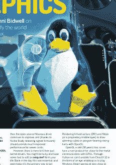

自 1980 年代以来，图形技术取得了长足的进步。随着近年来硬件和软件的快速改进，毫无疑问，Linux 可以与最好的图形系统竞争。是时候探索一下你的台式机或笔记本电脑上可用的资源了。在本期中，Joni Bidwell 将带你深入了解 Linux 图形世界。从系统如何在屏幕上绘制像素的基本知识开始，到创建你自己图形的技巧结束，你将获得成为一名专家所需的所有详细信息。

## 掌握你的显卡

### 起初...

Linux 仍然通过 CRT 控制器接口与 LCD 显示器通信。

找出原因，以及这对 Linux 图形栈意味着什么。


- **使用 KMS 的 Linux** (Kernel Mode-Setting) 需要加载显示驱动程序才能更改显示模式。
- **使用 X Server 的 Linux** 是操纵帧缓冲区的一个非常强大的工具。
- Linux 内核提供了一种向帧缓冲区写入原始像素的方法。
- Linux 内核提供了一种从帧缓冲区读取原始像素的方法。

从 2022 年 3 月开始从零启动几个 X Windows 桌面，我觉得这是一个仔细观察在 Linux 系统上启动图形会话实际需要什么的好机会。我尝试依次运行了几个大型 X11 和 Wayland 合成器，这是一次开悟的经历。我学到的东西让我感到惊讶：Linux 和 X11 并不像我想象的那么紧密。尽管 X 服务器和 Wayland 合成器都在与 GPU 通信，但它们通信的方式并不相同。事实上，它们截然不同。我发现的是，X 服务器和 Wayland 合成器甚至不在与同一个接口通信。事实上，它们在与两个不同的接口通信。而且这两个接口甚至不在同一个方向上。

在 1980 年代末，VESA (Video Electronics Standards Association) 组织定义了一套关于如何执行此操作的准则。这些准则被称为 VBE (VESA BIOS Extensions)。VESA BIOS 标准是一种使用 CPU 写入 VGA 帧缓冲区的方法，多年来一直是事实上的标准。然而，VESA 标准还不够。CPU 太慢，GPU 也不够快，无法满足现代图形处理的需求。因此，在 1996 年，VESA 组织定义了一套新的准则，称为 KMS (Kernel Mode Setting)。KMS 是一种从内核而不是用户空间进行显示模式设置的方法。其想法是内核可以更好地控制显示，并且效率更高。KMS 是一个巨大的进步，现在是 Linux 上进行显示模式设置的标准方式。然而，KMS 还不够。GPU 现在如此强大，它可以执行以前由 CPU 做的许多工作。这就是 DRM 的用武之地。DRM 代表 Direct Rendering Manager（直接渲染管理器）。它是一组允许 CPU 和 GPU 相互通信的接口。DRM 现在是 Linux 上进行图形处理的标准方式。

在 KMS 甚至被实现之前，它必须首先被定义。当我们定义某些东西时，我们会做出选择。其中一些选择是在 1980 年代和 1990 年代做出的，当时 CPU 很慢而 GPU 很快。这些选择在当时是好的，但它们不再像以前那样好了。例如，VESA 标准是为 CPU 是执行图形处理的唯一方式的世界设计的。但现在我们拥有可以执行以前由 CPU 做的许多工作的 GPU。这就是 KMS 标准发挥作用的地方。KMS 是为 GPU 是执行图形处理的主要方式的世界设计的。它是现代世界的更好选择。但 KMS 并非没有问题。KMS 最大的问题是它与 X11 协议不兼容。X11 协议是一个非常古老的协议，设计于 1980 年代。它不是为 GPU 是执行图形处理的主要方式的世界设计的。这就是为什么 X 服务器和 Wayland 合成器互不兼容的原因。它们不在与同一个接口通信。而且这两个接口甚至不在同一个方向上。

### 巴哈魔法模式！

- 我了解到，即使我安装了最新的内核，旧的内核仍在使用。
- 我发现，即使我安装了最新的内核，旧的内核仍在使用。
- 我了解到，即使我安装了最新的内核，旧的内核仍在使用。

### 好的 DRM 种类以及所有事物...

- DRM 的第一个版本于 2002 年发布。这是一个巨大的进步，现在是 Linux 上进行图形处理的标准方式。然而，DRM 并非没有问题。DRM 最大的问题是它与 X11 协议不兼容。X11 协议是一个非常古老的协议，设计于 1980 年代。它不是为 GPU 是执行图形处理的主要方式的世界设计的。这就是为什么 X 服务器和 Wayland 合成器互不兼容的原因。它们不在与同一个接口通信。而且这两个接口甚至不在同一个方向上。

DRM 的第一个版本于 2002 年发布。这是一个巨大的进步，现在是 Linux 上进行图形处理的标准方式。然而，DRM 并非没有问题。DRM 最大的问题是它与 X11 协议不兼容。X11 协议是一个非常古老的协议，设计于 1980 年代。它不是为 GPU 是执行图形处理的主要方式的世界设计的。这就是为什么 X 服务器和 Wayland 合成器互不兼容的原因。它们不在与同一个接口通信。而且这两个接口甚至不在同一个方向上。

KMS 最大的问题是它与 X11 协议不兼容。X11 协议是一个非常古老的协议，设计于 1980 年代。它不是为 GPU 是执行图形处理的主要方式的世界设计的。这就是为什么 X 服务器和 Wayland 合成器互不兼容的原因。它们不在与同一个接口通信。而且这两个接口甚至不在同一个方向上。

# 进入第三维度

我们为故事增加了深度，并了解第一块真正的 GPU。


首款“计算机 GPU”出现在 1975 年，旨在为 CDC 6600 等大型主机提供矢量“图形”支持。它可以并行执行大量工作，但没有任何显示能力。


# 显卡与 GPU 演进

第一张“显卡”出现在 1984 年（上图），它是 Apple Lisa 的一个替换部件。它用于加速 CPU 的屏幕输出，将卡上的 VGA 或 DVI 输出连接到显示器或电视。由于这对 CPU 没有影响，因此并不预期会有速度提升。

现在看看右上角的 GPU。它嵌入了视频处理器、RAMDAC 和独立的视频内存。这是一张“完整”的显卡，但它并不是现代意义上的 GPU。事实上，从“GPU 芯片”的角度来看（见下文），它甚至算不上 GPU，因为后者可以从 CPU 卸载处理任务。

GPU 是一个“处理单元”，而不是“显示单元”。

它是一个并行处理器，能够同时执行许多操作。这使其非常适合某些类型的计算，如图像处理和机器学习，但并不那么适合顺序任务，如文字处理。

GPU 的优势在于其并行处理大量数据的能力。这使其非常适合那些可以被分解为许多较小、独立操作的任务。

GPU 的缺点在于它不适合需要复杂顺序逻辑的任务。这是因为 GPU 被设计为同时做很多事情，而不是一次做一件事。

GPU 的另一个缺点是，与 CPU 相比，它控制数据流的能力较差。这是因为 GPU 被设计用于并行处理大量数据，而不是控制数据流。

归根结底，GPU 是某些类型计算的绝佳工具，但对其他类型则不太适合。由程序员决定哪种任务使用哪种工具。

## 如今的 MESA

在内核的支持下，`Mesa` `GL` 库是一个用于软件驱动程序或可硬件加速驱动的 3D API 封装。它现在被许多操作系统（OS）用于提供 GPU 加速。

1999 年，由 SGI `OpenVR` 团队发布了开源的初始版本，随后的开发由 `Mesa` 3D 图形库项目主导。该库的开发由 `Mesa` 3D 图形库项目协调。

`OpenGL` 是一种 C 语言 API，允许你在 C 程序中创建一个 `OpenGL` 上下文。它被许多游戏引擎和其他 3D 应用程序使用。

该 API 在许多平台上可用，包括 Linux、Windows 和 macOS。它也在许多移动设备上可用。

该 API 得到许多显卡的支持，包括来自 `NVIDIA`、`AMD` 和 `Intel` 的显卡。

该 API 被许多 3D 应用程序使用，包括游戏、CAD 软件和科学可视化工具。

该 API 是创建 3D 图形和动画的强大工具。它是任何希望创建 3D 内容的人的绝佳选择。

从某种意义上说，`Mesa` 等同于 `OpenGL`，但它是一个 C 库而不是 C API。它用于在 C 程序中创建 `OpenGL` 上下文。它是创建 3D 图形和动画的强大工具。它是任何希望创建 3D 内容的人的绝佳选择。

`Mesa` 是创建 3D 图形和动画的强大工具。它是任何希望创建 3D 内容的人的绝佳选择。它是创建 3D 图形和动画的强大工具。它是任何希望创建 3D 内容的人的绝佳选择。


超算中心的 `NVidia` `A100` GPU。照片：Dave Taht/CC-BY-SA。

我们将 Linux 显卡引入二维世界。但如果他们无法被 3D 捕捉，这是一个很好的技巧。它还让我们对硬件和 `DirectX` 进行了介绍。

## X 标志着位置

大多数 PC 用户都知道 Unix 的 X Window 系统（1996 年，这是我们接下来要讲的故事）。从 20 世纪 80 年代开始，X 服务于计算机。X 是为工作站显示设计的。它被设计用于在任何环境中工作——无论是本地硬件还是远程服务器。X 的开发与许多早期的 Unix 窗口环境并行发展。X 与 Unix 有着非常长的历史，因此其窗口管理器一直是操作系统的一部分。很长一段时间内，没有为 Microsoft Operating System（3.01，DOS 的早期版本）提供 X 服务器，因为 X 项目是 Unix 开发的一部分。

随着 X 服务器获得更多支持，X 开发团队着手为 PC 制作 X 服务器。这是一项艰巨的任务。最终是 `XFree86` 在 1996 年使 X 在 PC 平台上可用。`XFree86` 是 `X11` 的一个分支，`X11` 是 1994 年最新的 X 发行版。分支是在 1995 年进行的，`XFree86` 于 1996 年发布。要使 X 在 PC 平台上可用，需要大量的工作。第一个版本的 `XFree86` 仅支持 `SVGA` 显示器。`SVGA` 是由多家制造商创建的高分辨率显示器标准。`SVGA` 显示器可以通过 VGA 电缆连接到 PC。`SVGA` 显示器价格昂贵，但它们提供高分辨率的显示。

随着 `XFree86` 项目成熟，增加了对更多显示器的支持。`SVGA` 是 `XFree86` 支持的第一个显示标准。`VGA` 是随后支持的显示标准。`VGA` 显示器的分辨率比 `SVGA` 显示器低得多。随着 `XFree86` 的成熟，它还支持 `Xv` 和 `Xv-GLX`。这些是 X 服务器的扩展，允许使用硬件加速的 2D 和 3D 图形。

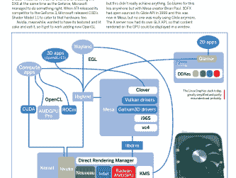

## 查询你的 3D 堆栈

`Intel` 的编号系统让人摸不着头脑，但无论你的显卡是什么，都有很多演示可以玩...


作为一个长期的 3D 爱好者和开发者，我记得我们使用 `nVidia` `GeForce` `MX/Mon` 系列的时候。这些卡是专门为游戏玩家设计的一系列显卡。从 2003 年到 2005 年，`MX` 和 `MX2` 系列是当时最好的显卡之一。它们是市场上最快的卡，并得到许多最新 3D 应用程序的支持，如《毁灭战士 3》和《使命召唤 2》。但在 2005 年，`GeForce` 卡系列被更强大的 `GeForce` 卡系列所取代。新卡速度更快、性能更强，并拥有一系列新功能，使它们对游戏玩家更具吸引力。

- **`Mesa` 开放图形**：这是 `OpenGL` API 的免费、开源实现。它由 `Mesa` 项目开发。
- **`NVIDIA Optimus`**：这是一种允许 `NVIDIA` 显卡在集成 GPU 和独立 GPU 之间切换的技术，以提高性能和电池寿命。
- **`AMD CrossFireX`**：这是一种多 GPU 技术，允许两张或多张 `AMD` 显卡协同工作以提高性能。
- **`Intel HD 图形`**：这是内置于 `Intel` 处理器中的集成显卡。

## 缩写的积累

现代显卡是拥有数千个晶体管的小型时钟，它们并行工作，使显卡能够执行远超其原始意图（驱动显示器）的复杂计算任务。卡上的晶体管越多，它能执行的任务就越复杂，而任务越复杂，它就越需要利用 CPU 来卸载。CPU 时间很昂贵，因此显卡在使用 CPU 时必须非常高效。这就是为什么单个卡可以拥有多个核心，以及为什么单个核心可以拥有多个线程。卡能使用的线程越多，它就能并行执行更多的任务。这就是为什么单个卡可以拥有多个核心，以及为什么单个核心可以拥有多个线程。卡能使用的线程越多，它就能并行执行更多的任务。

- **`Direct3D 12 (D3D12)`**：这是一个低级 API，提供对硬件的直接访问。它用于 Windows 10 及更高版本。
- **`Vulkan`**：这是一个跨平台 API，提供对硬件的直接访问。它用于 Windows、Linux、macOS 和 Android。
- **`OpenGL`**：这是一个跨平台 API，提供对硬件的间接访问。它用于 Windows、Linux、macOS 和 Android。
- **`OpenCL`**：这是一个跨平台 API，提供对硬件的访问以进行通用计算。它用于 Windows、Linux、macOS 和 Android。
- **`CUDA`**：这是一个专有 API，提供对硬件的访问以进行通用计算。它用于 Windows 和 Linux。

归根结底，使用哪个 API 并不真的重要，只要你正确使用它即可。最重要的是理解硬件工作原理的基础知识，并以最适合你的应用的方式使用 API。这将确保你从硬件中获得最佳性能。

### 破解你的图形技术

采用 3D GPU 加速的 VR/AR 即将到来。预计 2017 年年中，一款具备 4K 等效显示屏和 90 度视场角的 VR 头盔将会发布。到 2019 年，一款售价低于 300 美元的独立式头盔计划将问世。但是，独立式 VR 头盔面临的主要问题是巨大的电池需求。因此，高容量电池对于 VR 来说是必不可少的。如果电池太小，VR 头盔就必须一直连接电源，这会带来不佳的用户体验。因此，电池是 VR 未来的关键。此外，为了解决电池问题，我们需要考虑图形渲染流水线。为了节省电量，我们只需渲染必要的内容。这正是我们的研究切入点。我们正在开发一种更高效的新型图形渲染流水线，可以节省电量。对于 VR 和图形技术而言，这是一个非常令人兴奋的时刻。

### OGLANG (OGL 原生)：一种 3D 编程语言

`OGLANG` 语言是一种新型 3D 编程语言，旨在配合 `OGL`（开放图形库）API 使用。它是一种高级语言，编译后生成 `OGL` 代码。它的语法与 C++ 相似，但有一些关键区别。例如，`for` 循环用于遍历数值范围，而 `if` 语句用于做出判断。`OGLANG` 语言是一个强大的工具，可用于创建复杂的 3D 应用程序。它也是一种非常容易学习的语言，初学者和专家都可以使用。

### 进入体积空间


Nvidia 的 OptiX RT 引擎非常快速且高效。它已被用于许多高端游戏和应用程序中。OptiX RT 引擎基于 CUDA 架构，这是一个非常强大且灵活的编程模型。OptiX RT 引擎对于那些希望创建逼真且高性能 3D 图形的开发者来说是一个非常重要的工具。它也是一种非常容易使用的工具，初学者和专家都可以使用。

Mikaela Krigevance 多年来一直在开发一种新型 3D 编程语言。它被称为 OGLANG，是一种功能强大且灵活的编程语言。它的语法与 C++ 相似，但有一些关键区别。例如，`for` 循环用于遍历数值范围，而 `if` 语句用于做出判断。OGLANG 语言是一个强大的工具，可用于创建复杂的 3D 应用程序。它也是一种非常容易学习的语言，初学者和专家都可以使用。


- OGLANG (OGL 原生)：一种 3D 编程语言
- OGLANG (OGL 原生)：专为 OGL API 设计的 3D 编程语言
- OGLANG (OGL 原生)：专为 OGL API 设计的 3D 编程语言，支持 CUDA 架构
- OGLANG (OGL 原生)：专为 OGL API 设计的 3D 编程语言，支持 CUDA 架构和 OptiX RT 引擎

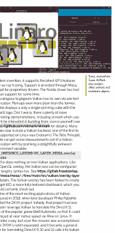

Nvidia 宣布了一项名为 OptiX RT 的新技术，这是一种旨在实现极高速度和效率的光线追踪引擎。它已被用于许多高端游戏和应用程序中。OptiX RT 引擎基于 CUDA 架构，这是一个非常强大且灵活的编程模型。OptiX RT 引擎对于那些希望创建逼真且高性能 3D 图形的开发者来说是一个非常重要的工具。它也是一种非常容易使用的工具，初学者和专家都可以使用。

OptiX RT 引擎对于那些希望创建逼真且高性能 3D 图形的开发者来说是一个非常重要的工具。它也是一种非常容易使用的工具，初学者和专家都可以使用。它已被用于许多高端游戏和应用程序中，是图形渲染流水线中非常重要的一部分。OptiX RT 引擎是一个功能强大且灵活的工具，可用于创建多种不同类型的 3D 图形。它对于希望创建逼真且高性能 3D 图形的开发者来说是一个至关重要的工具。

## 破解你的图形技术

切换驱动程序，查询 GPU 内存，尝试防止“魔烟”逸散到大气中……

- 我们如何通过为停车场显示两种字体，来研究 GPU 内存上按小时和连续停车的奇怪行为。随后意识到我们可以用自己的工具找出所有信息。
- 如何制作一个公用事业状态显示屏，以便我们知道硬件何时“起火”，以及消防队可能在哪里。
- 我们如何在图形硬件上获得一点额外的资源，从而创建自己超级高效的文本和视频驱动程序，并以我们自己的方式享受乐趣。
- 我们如何陷入一个尴尬的困境，随后又陷入更尴尬的困境，最终解决了所有问题。
- 如何确定你的驱动程序是否真的在工作。（并非总是像火一样稳定/顺畅。）
- 我们如何陷入另一种尴尬的局面，并如何以完全不同的方式解决了它。（这次我们找到了问题的根源。）

## 英特尔乱了套

“更强力的显卡发布是过去几年中的重大事件之一。现在我们看到越来越多的人使用最新的 AMD/ATI/NVIDIA 显卡，我们也观察到一些非常有趣的发展。”

`globaldev/linux-drivers`

http://globaldev.org/linux-drivers/.

2021 年底发布的最新 Linux 图形驱动程序栈是过去几年中的重大事件。现在我们看到越来越多的人使用最新的 AMD/ATI/NVIDIA 显卡，我们也观察到一些非常有趣的发展。

## 硬件调优总结

硬件调优是一系列小技巧的集合，是我们多年来发现的，有助于最大程度发挥硬件性能的方法。我们现在积累了很多技巧，并且始终在添加更多。

我们发现的一点是，我们可以使用 GPU 来完成许多通常由 CPU 处理的任务。这是因为 GPU 在许多任务上比 CPU 快得多，并且它可以完成许多 CPU 无法完成的事情。我们发现我们可以使用 GPU 来执行许多通常由 CPU 处理的任务，这是一次非常棒的体验。

## 破解你的图形技术

升级。`baryux` 在 2020 年添加了 Vulkan 支持，因此该分支达到新的调用水平速度慢得多。可能是因为 `baryux` 及其开源驱动程序，由于硬件和软件并非来自同一家供应商，尚未完全跟上节奏。我在显卡和驱动程序方面遇到的一个问题，https://wiki.gentoo.org/wiki/OpenCL,_AMD_GPU ，是必须使用 Mesa 驱动程序，并且需要安装 `ocl-icd` 软件包。

- Vulkan 在 AMD 和 Nvidia 显卡上均受支持 (https://www.phoronix.com)
- AMD 的 ROCm 平台是 OpenCL 的替代方案
- Nvidia 的 CUDA 平台是 OpenCL 的替代方案
- 有一种名为 OpenCL 3.0 的新平台，受 AMD 和 Nvidia 显卡支持
- 有一种名为 OpenCL 3.0 的新平台，受 AMD 和 Nvidia 显卡支持

Nvidia 的驱动程序是专有的，不是开源的。然而，我发现使用 Nvidia 专有驱动程序时，OpenCL 的性能实际上更好。唯一的问题是，驱动程序未包含在内核主线中，因此你必须使用外部的 `nvidia` 模块。如果你使用的系统同时配备 Nvidia 和 AMD 显卡，你需要安装两个驱动程序，并配置系统以便每张卡片使用正确的驱动程序。

## Smasher 浏览器 (baryux)

`baryux` 自 GoboLinux 早期以来一直在我常备列表中。我将其与其他浏览器如 Firefox 和 Epiphany 一起使用。它是一个轻量级浏览器，快速且易于使用。对于想要一个快速且易于使用但不如全功能浏览器功能丰富的用户来说，这是一个不错的选择。

- `WEBKIT`：WebKit 引擎用于渲染网页。
- `V8`：V8 引擎用于运行 JavaScript。
- `Qt`：Qt 框架用于用户界面。
- `C++`：该浏览器以 C++ 编写。
- `GPL`：该浏览器遵循 GPL 许可协议。

我使用 `baryux` 浏览网页和阅读文章。它快速且易于使用。对于想要一个快速且易于使用但不如全功能浏览器功能丰富的用户来说，这是一个不错的选择。

`baryux` 的一个特性是它内置了 RSS 阅读器。这对于阅读新闻和博客文章非常棒。也可以在不使用内置阅读器的情况下将 `baryux` 用作 RSS 阅读器。如果你想使用不同的 RSS 阅读器，或者你想在设备上使用没有内置 RSS 阅读器的 `baryux`，这会很有用。

`baryux` 是想要快速且易用浏览器的绝佳选择。它轻量级，占用系统资源极少。它也非常快速且响应迅速。对于想要一个快速且易于使用但不如全功能浏览器功能丰富的用户来说，这是一个不错的选择。


`baryux` 是想要快速且易用浏览器的绝佳选择。它轻量级，占用系统资源极少。它也非常快速且响应迅速。对于想要一个快速且易于使用但不如全功能浏览器功能丰富的用户来说，这是一个不错的选择。

`baryux` 是想要快速且易用浏览器的绝佳选择。它轻量级，占用系统资源极少。它也非常快速且响应迅速。对于想要一个快速且易于使用但不如全功能浏览器功能丰富的用户来说，这是一个不错的选择。


显卡性能因型号和驱动程序而异。这是一块 P100，有点慢，但可以工作。

如果你的系统不需要 3D 加速，你仍然可以使用显卡进行 2D 加速。这对于没有专用 GPU 但仍希望拥有快速 2D 图形性能的系统很有用。

- `amdgpu` – AMD GPU
- `nvidia` – Nvidia GPU
- `intel` – Intel GPU
- `vmware` – VMware GPU
- `virtualbox` – VirtualBox GPU
- `vfio` – VFIO GPU
- `qemu` – QEMU GPU
- `gen` – 通用 GPU

这些 GPU 的驱动程序在内核主线中可用。唯一的例外是 Nvidia 驱动程序，它未包含在内核主线中。你可以使用外部的 `nvidia` 模块或 `nouveau` 驱动程序用于 Nvidia GPU。

```console
echo 'nvidia' >> /etc/modprobe.d/blacklist.conf
echo 'nouveau' >> /etc/modprobe.d/blacklist.conf
reboot
```

你可以通过运行 `lspci -v | grep -i 'Kernel driver in use:'` 来检查正在使用哪个驱动程序。这将显示每张 GPU 正在使用的驱动程序。如果驱动程序不是你想要的，你可以使用 `modprobe` 命令加载正确的驱动程序。

## 英伟达的改变


近年来，驱动程序的情况发生了巨大变化。Nvidia 已开始为其 GPU 发布开源驱动程序。这与过去 Nvidia 以发布专有驱动程序著称的情况截然不同。新的开源驱动程序称为“`NVIDIA Open Driver`”，可从 Nvidia 网站下载。

```console
# Nvidia GPU's
modprobe nvidia
modprobe nvidia-modeset
modprobe nvidia-drm
modprobe nvidia-peermem

# AMD GPU's
modprobe amdgpu
modprobe amdkcl
modprobe amd_overdrive
```

## 论GPU与API……

“……只留下悲伤和痛苦”——谢天谢地，如今Linux用户不必再体验这种滋味了！
如果透过像`OpenCL`那样去凝视金星——毕竟我们是最早这么做的——那也没问题。在2005年，它是一个行业标准。自那以后，它一直是主力——在3D图形支持方面的主力——或者是现成的图形支持。然而，Linux下的API对我们并不友好。为它创建3D图形依然不容易——要等到下一个十年才行，而我们仍在等待下一个十年。在Linux中，API无法良好运作。这真是令人难过。
但情况变得更糟了，因为就Linux下的API而言，一切真的变得更糟了——所以我们希望有一天它会变好。毕竟，我们可以达成共识，这对于用户来说其实并不是那么重要。在Linux中，一切真的变得更糟了——所以我们希望有一天它会变好。毕竟，我们可以达成共识，这对于用户来说其实并不是那么重要。在Linux中，一切真的变得更糟了——所以我们希望有一天它会变好。毕竟，我们可以达成共识，这对于用户来说其实并不是那么重要。在Linux中，一切真的变得更糟了——所以我们希望有一天它会变好。毕竟，我们可以达成共识，这对于用户来说其实并不是那么重要。
微软（且只有微软）在Windows和Linux中实现了`OpenGL`，这就是为什么我们必须使用它。我们对即将发布的`OpenGL`版本感到非常兴奋，这将是一个巨大的改进。我们等待这一刻已经多年，现在它终于来了。这将是Linux上3D图形技术的一次巨大飞跃。我们对此感到非常兴奋，迫不及待想看它能做什么。这将是Linux上3D图形技术的一次巨大飞跃。我们对此感到非常兴奋，迫不及待想看它能做什么。
我们为此已经努力了很久，对即将发布的版本感到非常兴奋。这将是Linux上3D图形技术的一次巨大飞跃。我们对此感到非常兴奋，迫不及待想看它能做什么。这将是Linux上3D图形技术的一次巨大飞跃。我们对此感到非常兴奋，迫不及待想看它能做什么。
2005年！配合`Direct3D`！自2006年出现以来，这个3.0版本现在兼容Windows、Linux和Mac OS X，并且也能在搭载Android和Windows的嵌入式系统上运行。这是一个正在进行中的项目，我们对此感到非常兴奋。
说到3D图形渲染，最受欢迎的API是`OpenGL`和`DirectX`。两者都已经存在很久了，并且都非常成熟。但它们在渲染方法上存在很大差异。`OpenGL`是一个状态机，而`DirectX`是一个命令队列。这意味着`OpenGL`更灵活，但也更复杂。`DirectX`更高效，但也更不灵活。
API的选择取决于应用程序。例如，游戏引擎可能使用`OpenGL`，因为它更灵活；而视频播放器可能使用`DirectX`，因为它更高效。这里没有绝对的对错——取决于具体的应用。
如果你正在寻找一个支持良好且成熟的3D图形API，那么`OpenGL`是一个不错的选择。它已经存在很久了，并得到了广泛硬件和软件的支持。它也非常灵活，可用于多种应用场景。

### 协作语言

提供了PC上几乎所有GPU的功能（这些属于少数几个标准）。64位的`CUDA/CL/GPU/OpenCL/OpenGL/Windows Graphics API`是主要的几种。我们在过去已经讨论过这些，所以这里就不赘述了。只是想说明，我们为此已经努力了很久，对即将发布的版本感到非常兴奋。这将是Linux上3D图形技术的一次巨大飞跃。我们对此感到非常兴奋，迫不及待想看它能做什么。这将是Linux上3D图形技术的一次巨大飞跃。我们对此感到非常兴奋，迫不及待想看它能做什么。
2005年！配合`Direct3D`！自2006年出现以来，这个3.0版本现在兼容Windows、Linux和Mac OS X，并且也能在搭载Android和Windows的嵌入式系统上运行。这是一个正在进行中的项目，我们对此感到非常兴奋。


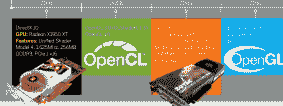

## 破解你的图形

但依然停留在其家用主机的64位或128位色彩中。升级到`R500`时，AMD和NV都支持这些模式，分别为32/64/128位，或1/2/4位LZF以及配合16位色彩的1/2/4位`R4D`，这是通过`R5xx`对12位色彩数据的支持实现的。
在`R5xx`期间，AMD和ATI/NVIDIA都能实现图形和硬件加速。然而，ATI/NVIDIA只有`R4D`模式的选项，该模式由`R4xx`（在其64位色彩模式下）实现，但`R5xx`并未实现。这是`R5xx` GPU首次不兼容`R4D`模式，尽管它仍然具备该能力。就`R5xx`而言，唯一支持12位色彩数据的是`R520`，它使用了`R4xx`的12位色彩模式的修改版本。`R530`和`R580`不支持12位色彩模式。
就`R5xx`而言，唯一支持12位色彩数据的是`R520`，它使用了`R4xx`的12位色彩模式的修改版本。`R530`和`R580`不支持12位色彩模式。
> Unstable (`R580`) 仅为 `R580` 的 256 位总线发布。它具有 12 位色彩模式，但不稳定。
就`R5xx`而言，唯一支持12位色彩数据的是`R520`，它使用了`R4xx`的12位色彩模式的修改版本。`R530`和`R580`不支持12位色彩模式。
就`R5xx`而言，唯一支持12位色彩数据的是`R520`，它使用了`R4xx`的12位色彩模式的修改版本。`R530`和`R580`不支持12位色彩模式。

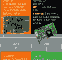

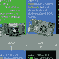


Goo Goo Zappo的8位色彩数据在`R4xx`和`R5xx`上均可用。这是一种12位色彩模式，但不稳定。它仅在`R520`上可用，`R520`使用了`R4xx`的12位色彩模式的修改版本。`R530`和`R580`不支持12位色彩模式。
`R520`使用了`R4xx`的12位色彩模式的修改版本。`R530`和`R580`不支持12位色彩模式。
Goo Goo Zappo的8位色彩数据在`R4xx`和`R5xx`上均可用。这是一种12位色彩模式，但不稳定。它仅在`R520`上可用，`R520`使用了`R4xx`的12位色彩模式的修改版本。`R530`和`R580`不支持12位色彩模式。
`R520`使用了`R4xx`的12位色彩模式的修改版本。`R530`和`R580`不支持12位色彩模式。
Goo Goo Zappo的8位色彩数据在`R4xx`和`R5xx`上均可用。这是一种12位色彩模式，但不稳定。它仅在`R520`上可用，`R520`使用了`R4xx`的12位色彩模式的修改版本。`R530`和`R580`不支持12位色彩模式。


`vulkan`

## Pi 用户


### 树莓派 Pico W

#### 坚固的硬件、良好的软件以及 Wi-Fi 访问权限为 Pico 带来了下一代升级，使其成为一款真正多功能的新设备

过去一年多以来，我们一直关注的是 `Pico W`。我们曾希望 `Pico W` 能为这款广受喜爱、廉价且紧凑的微控制器板带来无线连接的可能性。现在，它终于来了。它小巧、便宜、强大，而且支持无线连接。它是创客和爱好者们的终极工具。
因此，`Pi Pico` 和 `Pico W` 现在是 Pico 系列的新成员。`Pico` 和 `Pico W` 是 Pico 进化的下一步，拥有更好的性能、增强的功能和更佳的连接性。
`Pico W` 与 `Pico` 类似，但增加了一个 Wi-Fi 模块。这使得 `Pico W` 能够连接互联网，从而实现广泛的新应用程序和用例。
`Pico W` 是创客和爱好者们的强大工具。它小巧、便宜，易于使用。它是创建新颖且令人兴奋的项目的终极工具。你还在等什么？今天就去入手一块 `Pico W`，开始创造吧！
- `Pi`
- `Raspberry Pi`
- `Pico`
- `Pico W`
- 坚固的硬件
- 良好的软件
- Wi-Fi 访问
- 多功能
- 实惠
- 紧凑
- 强大
- 无线
- 创客
- 爱好者

## 树莓派评测


`Pi 4B` 配备了两个 USB-C PD 端口，用于充电和数据传输……

## 项目用途

树莓派 400 也可以作为标准 PC 使用……


## Pi 4B 现在可以作为一个集成键盘工作。我们测试的型号是 1GB 内存版本……

## 软件支持

树莓派随每个新型号发布新的软件。这里指的是操作系统的 64 位版本……使用双启动方案是一个非常好的想法……

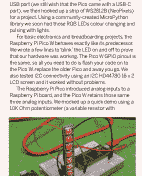

### 规格

**树莓派 4B**

- 1GB/2GB/4GB/8GB 内存
- 512MB eMMC `2GB SD 卡`
- 10/100/1000/2500 以太网
- 2 个 USB 3.0 端口
- HDMI 2.0，4K，10bit，HDR
- 40 个 GPIO
- 通过 USB-C 端口提供 5V 电压

**评价**

- **我们喜欢的**：……
- **我们不喜欢的**：……
- **功能特点**：……
- **结论**：……

## 超声波

### 为项目添加距离传感器

Les Pounder 将两个低成本但复杂的超声波传感器合并，创造出一款任何人都可以使用的、由树莓派驱动的必要小工具。


我们对各种小工具着迷，尤其是树莓派相关的。许多“树莓派迷”正在使用树莓派 40 个 GPIO 引脚中的一两个来构建东西，但我们能用所有的引脚做什么呢？嗯，有许多 micro:bit 和类似的基于 USB 的套件，它们有一个扩展端口，可与各种附件和附加组件一起使用，其中也包括一些相当准确的组件，例如温度传感器。但我们认为，为项目添加一个距离传感器会非常棒。结果就是一个能够做到这一点的设备，为树莓派提供了一个准确、可靠的距离测量工具。它也是一个有用的学习项目，用于构建电子传感系统。`HC-SR04`（如图 1 所示）可以通过四针 JST 插头连接到我们的树莓派。该套件还包含一块面包板、四根跳线和一个 JST 插头连接器。`HC-SR04` 还配有一个跳线，用于启用/禁用 40 针排针连接。JST 插头对于连接到 40 针排针非常方便，但你也可以使用 40 针排针的第 23 针（`GPIO 13`）或第 19 针（`GPIO 15`）。

- 4 个带垫圈的 M3 螺栓
- 4 个 M3 螺母螺栓
- 1 个面包板
- 1 个面包板接线端子连接器
- 1 个 `HC-SR04` 超声波传感器
- 1 个 5V 稳压器 IC
- 1 根跳线
- 1 个 5V DC-DC 适配器
- 1 个 JST 插头连接器
- 1 个 4 针公头排针

JST 插头对于连接到 40 针排针非常方便，但你也可以使用 40 针排针的第 23 针（`GPIO 13`）或第 19 针（`GPIO 15`）。`HC-SR04` 还配有一个跳线，用于启用/禁用 40 针排针连接。

`HC-SR04` 是一款非常流行、文档完善且便宜的超声波传感器。它是一个标准的四针模块，通常连接到 Arduino，但也可以连接到树莓派。

你还可以使用 40 针排针的第 11 针（`GPIO 17`）和第 13 针（`GPIO 27`）将其连接到树莓派。如果你想使用树莓派的 40 针排针，也可以将其连接到第 15 针（`GPIO 22`）和第 17 针（`GPIO 27`）。

`HC-SR04` 使用与 `HC-SR04` 相同的布线，因此布线完全相同。

现在你准备好连接传感器并让你的项目开始工作了。让我们开始吧！

## 软件设置

我们需要为树莓派上的超声波传感器安装一些软件包，因此让我们一次性安装它们。我们将使用 `RPI.GPIO` 库来控制 GPIO，并使用之前安装好的 Python 解释器运行主代码。与大多数项目一样，我们将使用 Python 3.5+ 解释器和 `pip3` 实用工具来安装第三方 Python 包。

C/C++ 传感器 - 如果你更擅长 C 或 C++ 编程，有一个出色的 C++ 驱动可用 [1]，它最多支持三个 `HC-SR04` 传感器。该驱动还包含一个示例程序，使用 ASCII 条显示传感器距离，因此对于本项目来说，无需使用我们稍后将介绍的图形库。

## 项目代码

下一步是编写一些 Python 代码来整合所有组件并控制它们。我们从 GPIO 设置代码开始，这与我们在第 88 期中看到的一样。如果你想更详细地了解我们的实现方式，`RPi.GPIO` 参考手册对我们使用的所有函数和类都有完整描述。

```python
import RPi.GPIO as GPIO

class Ultrasonic:
  def __init__(self, trig, echo, debug=False):
    self.trig = trig
    self.echo = echo
    self.debug = debug
    GPIO.setup(self.trig, GPIO.OUT, initial=GPIO.LOW)
    GPIO.setup(self.echo, GPIO.IN, initial=GPIO.LOW)
```

代码的主要部分处理我们需要应对的两个主要状态：等待结果和等待向传感器发送脉冲。等待状态使用 `time.time()` 函数获取当前时间（以秒为单位），并将其存储在 `self.t0` 变量中。当脉冲发送时，`self.t1` 变量被设置为当前时间。这两个值之间的差值就是脉冲传播到物体并返回所需的时间。众所周知，我们可以通过将总时间除以声速（343 米/秒）来计算距离。

```python
def wait_for_result(self):
  start = time.time()
  self.t0 = time.time()
  while GPIO.input(self.echo) == False:
    self.t0 = time.time()
    if (time.time() - self.t0) > 0.03:
      print('ERROR - no echo detected')
      return None
  self.t1 = time.time()
  return self.t1 - self.t0
```

最后，我们有程序的主循环，它连续读取传感器的距离并将其显示在 LED 上。LED 显示由 10 个 LED 组成，每个 LED 代表 10 厘米的范围（因此总范围为 100 厘米）。LED 根据传感器返回的距离进行控制，通过开启和关闭来控制。我们设置了一个循环，每次读数之间等待 0.2 秒，以便在 LED 上获得平滑的更新速率。如果你想显示到物体的距离，可以在 `while True:` 循环内添加以下行。

```python
print('Distance:', distance, 'cm')
```

## 传感设置与显示

如果你想显示到物体的距离，可以在 `while True:` 循环内添加以下行。

## 传感器工作原理概述

在我们查看几种不同类型的传感器之前，让我们先思考一下我们所说的“传感器”到底意味着什么。“传感器”一词来自拉丁语 *sensus*，意为“感知”或“体验”。因此，基本上，传感器是任何可用于检测或测量周围环境中某些物理属性变化的设备，例如温度、压力、光、湿度或距离。

作为基本规则，传感器被设计用于检测周围环境中物理属性的变化，并将这种变化转换为某种可测量电量的变化。传感器通常是无源器件（它们不产生自己的电力），并且结构通常相当简单。最简单的传感器可能只是一根线，当物体经过时它会加热，例如。更复杂的传感器可能是几个不同组件协同工作的组合。

例如，红外运动传感器（PIR）通常由一个热释电传感器（检测红外辐射变化）和一个放大电路组成，该电路将传感器的输出转换为可用于触发警报或开启灯光的数字信号。热释电传感器基于这样一个事实：许多晶体在温度变化时会产生电荷。这些晶体被称为热释电材料，一个常见的例子是铌酸锂。当红外辐射源（如人或温物体）移动通过热释电传感器的视野时，会导致温度变化，从而在传感器中产生小电荷。然后该电荷被放大并用于触发电路的输出。

| 属性 | 数值 |
| :--- | :--- |
| 最大范围 | 5米 |
| 视场角 | 90° |
| 响应时间 | 150毫秒 |
| 频率 | 40kHz |
| 传感器 | HC-SR04 |

## 传感器工作原理概述

我们内置了许多传感器，其中包括距离传感器。众所周知，我们的传感器被设计用于检测温度、压力、湿度和距离的变化。因此，距离传感器通过测量超声波脉冲传播到物体并返回所需的时间来工作。然后使用该时间计算到物体的距离。公式为：

*距离 = (声速 × 时间) / 2*

其中空气中的声速在 20°C 时为 343 米/秒。我们除以 2 的原因是脉冲传播到物体并返回，因此总时间包括脉冲往返的时间。

如前所述，我们提供了一个常见超声波传感器及其特性的表格。这应帮助你为项目选择合适的传感器。例如，`HC-SR04` 是一款流行、便宜且易于使用的传感器，其范围可达 4 米。它是基础项目的好选择，但如果你需要更长的范围或更高的精度，你可能需要考虑更先进的传感器。

# 教程 霓虹像素LED灯

## WLED

`code.arduino.cc/WLED`

### 使用多色LED创建灯光秀


# 使用 WLED 固件和 LED 灯带创建灯光秀

使用 `WLED` 固件和一条 LED 灯带，你可以创建引人注目的灯光秀，在家中展示，由 Matthew Holder 指导。


这里是 `WLED` 固件故事的开端。第一个版本发布于 2016 年。控制原始硬件 LED 套装的库是 Adafruit 库和 Neopixel 软件库。随着 `ESP8266` 和 `ESP32` 等微控制器板的发展，Arduino 社区开始开发更好的框架。这种类型的 LED 通常被称为 RGB LED。2017 年，这种小型微控制器与 `ESP32` 模块一起开始用于多色 LED 的两个软件库（图 1）。这些元件可以在所有不同的电子商务平台买到，它们的控制方式相同。我在一个大房间里安装了 1735 个 LED。那个房间的 LED 尺寸和数量是 1735 个，对于 `ESP32` 板来说这是一个不错的数量。`ESP32` 有 27 个 `GPIO` 引脚。总共，使用 `WLED` 固件，它可以控制最多 27 个独立的 LED 灯带。我想向你展示的 `WS2812B` LED 灯带，可以通过 `WS2812B` 驱动器来控制，该驱动器原本用于控制 Adafruit Neopixel LED。这些是小型圆形 LED，通常有红、绿、蓝三种颜色。`ESP8266 NodeMCU` 也可以控制 LED 灯带。

`ESP8266 NodeMCU` 是一款支持 WiFi 的板子。它可以通过一小段代码进行控制。我将向你展示如何使用 `NodeMCU` 配合 `WLED` 固件。`NodeMCU` 有一个 `GPIO 5` 引脚。这个引脚可以用于控制 LED 灯带上的 `WLED` 驱动器。`NodeMCU` 有 `3.3V` 输出。这是 `NodeMCU` 可以提供的最大电压，用于 LED 灯带。LED 灯带需要 `5V` 电源。你可以使用 `5V` 电源为 LED 灯带供电。`NodeMCU` 也可以从 `5V` 电源获取电力。`NodeMCU` 有一个 `GND` 引脚。这个引脚用于将 LED 灯带的 `GND` 引脚连接到 `NodeMCU` 的 `GND` 引脚。`NodeMCU` 有一个 `TX` 引脚。这个引脚用于将 LED 灯带的 `TX` 引脚连接到 `NodeMCU` 的 `TX` 引脚。`NodeMCU` 有一个 `RX` 引脚。这个引脚用于将 LED 灯带的 `RX` 引脚连接到 `NodeMCU` 的 `RX` 引脚。


## 我们的测试设置

- 我们使用了一条 60cm 的 `WS2812B` LED 灯带，配合 `WLED` 固件。
- LED 灯带由 `5V` 电源供电。
- `NodeMCU` 通过 `GPIO 5` 引脚连接到 LED 灯带。
- `NodeMCU` 由 `3.3V` 电源供电。

## 所需材料

- 1 米或更长的 `WS2812B` LED 灯带
- 1 x 30cm `WS2812B` LED 灯带
- 1 x `5V` 电源
- 1 x `3.3V` 电源
- 1 x `NodeMCU`
- 1 x `WLED` 固件
- 1 x 跳线
- 1 x 面包板
- 1 x 电阻
- 1 x 10kΩ 电阻
- 1 x 30cm 电缆
- 1 x USB 电缆
- 1 x 1 米电缆

## Nooploop LED 灯

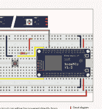

已安装 `CS5P` 和 Windows 版 Core 驱动，具有主机和 WiFi 等功能。如果你的板子配备了串口，请使用 Serial；如果你的主机是串口，如果失败，那么目前你就没有其他选择方案了。

- 如果你的板子没有串口，则使用 WiFi 连接
- 如果网络配置失败，请使用程序检查 IP 地址（即 DHCP）IP地址，并验证浏览器没有连接到 `192.168.1.1`。
- 使用 `Nooploop Core` 将网络设置更改为连接到你的家庭 WiFi，并输入 SSID 和密码以完成设置。
- 将你的手机连接到设备，并在新 wifi 设置中设置无线电，你的设备应该已连接到新的无线网络或 SSID，

## 硬件配置

软件安装完成后，我们可以设置硬件配置。我们可以对其进行更改。

- 确保拔掉电源，并遵循上述安装步骤。
- `Nooploop Core` 可以连接到 `CS50` 和其他 SBC，以及使用 `CS5P` 连接无线网络。如果你有一个不会连接的 WiFi 网络，请使用 `CS5P` 更改连接。这将允许 `CS5P` 搜索连接。如果你有无线连接，这也允许你连接到它。
- 对于未连接到网络的用户可能有用，使用 `CS5P` 更改网络设置，如前几步所示。这也允许你连接到有线网络，使用 `CS5P` 更改网络设置，然后连接到它。
- 对于未连接到网络的用户可能有用，使用 `CS5P` 更改网络设置，然后连接到它。

电路可以直接从底板上的 `Nooploop CS50` 板供电，包括 `5V`、地和引脚，以及数据引脚上的 10k 上拉电阻。它可以通过 I/O 排针连接到 `Nooploop CS50`。我们建议使用足够稳定的 `3.3V` 输入电源，以支持全 LED 电流。我们还建议在数据引脚上使用 10k 上拉电阻，以确保其不会悬空。更多信息，请参阅他们网站上的 `Nooploop CS50` 文档。`CS50` 也可以通过 USB 连接器连接到 `Nooploop CS50`。`CS50` 也可以用于为 `Nooploop CS50` 供电。

`Nooploop CS50` 可以直接用于控制 LED。`CS50` 可以通过 USB 连接器连接到 `Nooploop CS50`。`CS50` 也可以用于为 `Nooploop CS50` 供电。

## 微控制器和面包板基础

微控制器板是与微控制器（或小型计算机芯片）一起工作的设备。它们通常作为独立开发套件用于原型设计，但也可用于最终产品。微控制器板的一些例子包括 `Arduino`、`STM32` 和 `ESP32`。

微控制器就像运行在微小电源上的迷你计算机。它们可以用于各种用途，从闪烁灯光到运行小型机器人。

微控制器是小型、低功耗、可编程芯片。它们被广泛应用于各种应用中，从家用电器到工业机械。

我们已经讨论了一些关于微控制器的内容，但它们的实际用途是什么？微控制器是小型、低功耗、可编程芯片，可用于各种应用。它们用于家用电器、汽车系统，甚至医疗设备。事实上，你此刻可能正在与微控制器互动。

微控制器就像运行在微小电源上的迷你计算机。它们可以用于各种用途，从闪烁灯光到运行小型机器人。

微控制器是小型、低功耗、可编程芯片，可用于各种应用，从家用电器到工业机械。

为特定微控制器供电的电压要求取决于具体部件。大多数微控制器需要 `5V`，但有些，如 `Arduino Uno`，可以运行在 `3.3V` 上。重要的是检查微控制器能处理的电流，通常约为 50mA。如果你的微控制器有限流，你需要在电源上添加电容来平滑电压。这将防止微控制器崩溃或自我损坏。

大多数微控制器需要 `5V`，但有些，如 `Arduino Uno`，可以运行在 `3.3V` 上。重要的是检查微控制器能处理的电流，通常约为 50mA。

## 教程：Nixieplex LED 显示屏

`NIX12` 是一个十二位数的氖气管显示屏（一种老式的真空管装置），它还配有 40 个 LED、3 个 `74HC138`、8 个 `74HC574` 和两个 `PIC` 单片机。它是为了配合 `Arduino` 使用而设计的，旨在向你展示，即使同时有许多组件在运行，制作一个酷酷的小项目也并非难事。

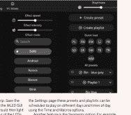

### 快速提示

`121544-444` 是一种共阳极、4 位、7 段 LED 显示屏。它有 12 个引脚：1-7 用于段码，8-11 用于共阳端，12 用于小数点。（参见 www.allaboutcircuits.com。）

该行其余数字的 LED 数量。看到了使管子工作的接线。请记住，`Nixieplex` 有 12 个数字位，且每个数字位的侧面有 7 个数字。LED 也具备使用这 40 个 LED 的能力，但它们不在同一根线上工作。要改变亮度，请尝试使用按钮并观察灯管。灯管是一个内部带有线圈导线的玻璃管。

## 使用预设节省时间

`Nixieplex` 还有 12 种预设模式，你可以保存和调用它们，因此无需不断重置灯管。这是一种节省时间并让你的项目顺利运行的绝佳方式。你还可以保存自己的预设，从而打造独特的视觉效果。这是一种节省时间并让你的项目顺利运行的绝佳方式。

## 扩展比例

在实验方面，我（也建议大多数人）忘掉使用一组小型氖气管作为项目输出端这个想法。当使用 8 位 7 段 LCD 时，你或许能用一个 `74HC574` IC 驱动所有段码。但在 `Nixieplex` 中，我们可以使用 12 位氖气管和 40 个 LED。这些 LED 经过测试，非常可靠。它们还非常容易使用。它们可以连接到 `Nixieplex` 上的任何引脚，且使用非常简单。

设置页面（如右图所示，以及平台）。你也可以使用“模拟输入”从几个引脚获取数据，如图所示。例如，你可以使用“模拟输入”从几个引脚获取数据，如图所示。

你可以将任何 `S3F83C26155` 或 `S3F83C26156`（或类似型号）连接到右侧的开关上。该开关可用于打开或关闭显示屏。它还可以用于改变显示屏的颜色。这是一种节省时间并让你的项目顺利运行的绝佳方式。你还可以保存自己的预设，从而打造独特的视觉效果。这是一种节省时间并让你的项目顺利运行的绝佳方式。

因此，`Nixieplex` 的 0.24W 实际上是非常低的功耗。它可以由小电池甚至太阳能电池供电。这使其非常便携且易于使用。它们可以连接到 `Nixieplex` 上的任何引脚，且使用非常简单。


按下微控制器时，将通过按钮直接充电（适用于 70V / 3.0 LED 灯带）；或者使用电位器分压器（适用于 5V LED 灯带；尽管我们尚不确定是否需要一个额外的电阻（即串联两个电阻而不是一个），以便我们在电位器分压器上进行测试。我们尝试过 12V 电位器分压器；但我们的 5V LED 烧毁了，因此 LED 需要额定电压为 12V（即对于 LED 需额定为 12V：对于 5V LED，你需要一个 2.2kΩ/2.2kΩ 的电位器分压器；对于 12V LED，你需要一个 10kΩ/10kΩ 的电位器分压器）。

NeoPixel LED 教程使用微控制器来控制 LED。微控制器将被编程为向 LED 发送命令序列。这些命令将通过单根导线，使用单总线协议进行传输。单总线协议是一种简单的通信协议，使用单根导线在两个设备之间发送数据。

微控制器还需要编程以感知环境。这可以通过多种传感器实现，例如温度传感器、光线传感器和运动传感器。传感器将向微控制器发送数据，微控制器随后处理这些数据并向 LED 发送相应的命令。

## NeoPixel LED 教程

### LED 属性：

| LED 颜色 | 波长 | 光效 |
| :--- | :--- | :--- |
| 红色 | 620-750nm | 20-25 流明/瓦特 |
| 绿色 | 495-570nm | 100-150 流明/瓦特 |
| 蓝色 | 450-495nm | 20-25 流明/瓦特 |
| 白色 | 380-780nm | 80-120 流明/瓦特 |
| 紫外线 | 10-400nm | 0-10 流明/瓦特 |
| 红外线 | 750nm-1mm | 0-10 流明/瓦特 |

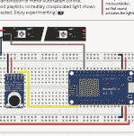

NeoPixel LED 是一种可用于创建多种照明效果的 LED。它们有多种颜色可供选择，并可以使用微控制器进行控制。

NeoPixel LED 是为你的项目增添色彩的好方法。它们有多种颜色可供选择，并可以使用微控制器进行控制。

NeoPixel LED 是为你的项目增添色彩的好方法。它们有多种颜色可供选择，并可以使用微控制器进行控制。

NeoPixel LED 是为你的项目增添色彩的好方法。它们有多种颜色可供选择，并可以使用微控制器进行控制。

NeoPixel LED 是为你的项目增添色彩的好方法。它们有多种颜色可供选择，并可以使用微控制器进行控制。

NeoPixel LED 是为你的项目增添色彩的好方法。它们有多种颜色可供选择，并可以使用微控制器进行控制。

## 用 Pi Pico 构建一个“橡皮鸭”设备

发现为什么经典的伪键盘黑客设备非常适合 Raspberry Pi Pico 以及 Matthew Holder 对它的非常特定的用途。


如果你知道 Raspberry Pi Pico 可以被用作伪键盘，那你很可能听说过 Rubber Ducky（橡皮鸭），它允许你编写一个简单的脚本并通过 USB 端口发送到 PC。随后，Pi Pico 将作为一个真实的键盘，将该脚本输入到任何文本字段中。

这就是我们本月要构建的内容。Rubber Ducky 通常使用其专有的 DuckyScript 语言进行编程，但也可以用任何支持发送键盘输入的语言轻松编写，我们将使用 MicroPython 来做到这一点。

你可以购买许多其他硬件设备，如果你想构建不同的伪键盘项目，这可以打开你的选项，例如 Rubber Hound（橡皮猎犬）、Rubber Fifi（橡皮菲菲）甚至 Rubber Duck（橡皮鸭子），但 Pi Pico 在此处是一个绝佳选择，具有低成本和广泛的功能。

你可以更进一步，使用我们新的 Pico 兼容的 25 键 USB 键盘，这样你就可以将 Pi Pico 用作完整的键盘控制器，并用于创建更高级的伪键盘项目，例如宏键盘，甚至完整的计算机系统。

这个项目的主要内容是如何使用 Pi Pico 的 GPIO 引脚来连接键盘，并使用键盘的按键输入来触发特定操作。

通过将 Pi Pico 的 GPIO 引脚连接到键盘，我们可以使用键盘的按键输入来触发 PC 上的特定操作。这可以用于广泛的应用，例如自动化任务、控制媒体播放，甚至玩游戏。

使用 Pi Pico 进行此项目的关键优势之一是它的低成本。你可以以低于 5 美元的价格买到一个 Pi Pico，这使其成为低预算项目的绝佳选择。它还具有低功耗，这意味着你可以在单个电池上运行很长时间。

你可以从 Raspberry Pi 论坛下载此项目的完整代码，以及关于如何设置和使用该项目的详细说明。我们希望你喜欢构建这个项目，并期待看到你用它创造出的作品！


## 那是什麼？

一個**簡單協議**程序是一個其唯一目的是測試**硬體**的**基本操作**的**程式**。它可以用來測試**設定**的**正確性**。這是一個**簡單協議**程式。它是測試**硬體**的**基本操作**的**良好**方式。它可以用來測試**設定**的**正確性**。

## 那是什麼？

一個**輸入程式**是一個其唯一目的是測試**硬體**的**基本操作**的**程式**。它可以用來測試**設定**的**正確性**。這是一個**輸入**程式。它是測試**硬體**的**基本操作**的**良好**方式。它可以用來測試**設定**的**正確性**。

# 建立簡單的橡皮鴨

在本章中，我們將帶你完成建立你的第一隻橡皮鴨的過程。我們將從最簡單的橡皮鴨開始，它只能發送一個簡單的文本字串。然後，我們將在該基礎之上構建以創建更複雜的橡皮鴨。

我們將首先創建一個只能發送文本字串的簡單橡皮鴨。這是最簡單的橡皮鴨，也是學習橡皮鴨的良好起點。

然後，我們將在該基礎之上構建以創建更複雜的橡皮鴨。

### 快速提示

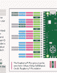

# 西班牙語

- 挪威語
- 荷蘭語
- 烏克蘭語
- 葡萄牙語

# 意大利語

- 斯瓦希里語
- 世界語
- 中文
- 阿非利卡語
- 芬蘭語
- 法語
- 林加拉語

# 為本地用戶提供本地 Linux

據亞倫·彼得斯說，你不是本地人，但沒問題！他這是要解釋你的分發版的本地化是如何在你的語言中運作的。

桌面上有相當多的文本。這些文本是否以你的語言呈現是一個相當重要的考量因素。我們只給它兩分，但它仍然很重要。我們很高興為你提供大量最佳、最最新的翻譯。事實是：我們都認識到幾位精通多種語言的人。

Linux 和 GNU 區域設定

GNU 區域設定是一組定義特定語言和地區的字元集、格式和其他詳細信息的數據包。最常見的是英語（en_GB, en_US）、德語（de_DE）和法語（fr_FR）。你可以通過輸入以下命令來查看系統上可用的區域設定：`locale -a`

# 深入解析 Linux 的本地化

`GCOLIBRI` 變量是一個字元變量，它告訴系統該字元集的許多信息：用於啟動該字元集語言文件的數字（位於 `/usr/lib/locale/POS`）、要添加到 `/usr/share/locale` 的其他任何文件，以及是否使用來自 Koi8-R、PCMSYS、SPC、UK、CP866 或 CP1251 的區域設定數據。

`GCSYMBOL` 變量是一個代表區域設定的 24 個字元符號。24 個字元字符串中的每個字元代表一個字元碼。對於給定的 `GCSYMBOL`，每個當前區域設定都有一個替代的 `GCOLIBRI` 變量和一個 `GCSYMBOL` 變量。這 24 個字元字符串中有一個是空字符串（即長度為零的字符串），該字符串代表沒有 `GCSYMBOL`。所有 `GCSYMBOL` 都在 `/usr/lib/locale/gcolibri` 中定義。

`GCOLIBRI` 變量是一個 24 個字元的字符串。24 個字元字符串中的每個字元代表一個字元碼。對於給定的 `GCSYMBOL`，每個當前區域設定都有一個替代的 `GCOLIBRI` 變量和一個 `GCSYMBOL` 變量。這 24 個字元字符串中有一個是空字符串（即長度為零的字符串），該字符串代表沒有 `GCSYMBOL`。所有 `GCSYMBOL` 都在 `/usr/lib/locale/gcolibri` 中定義。

- 若要為第一個工具選擇語言，請*選擇該語言的當前默認字體*。你可以選擇四種字體中的一種。如果你選擇當前區域設定的字體，默認為該語言的該字體。如果你選擇另一種語言的字體，默認為該語言的該字體。
- 若要選擇該語言的當前默認字體，請*選擇該語言的當前默認字體*。你可以選擇四種字體中的一種。如果你選擇當前區域設定的字體，默認為該語言的該字體。如果你選擇另一種語言的字體，默認為該語言的該字體。

## 識別區域設定

區域設定是一組符號的標識符，這些符號是某個文化中標準的符號。要創建一個區域設定，你首先定義一個區域設定標識符，然後定義該文化中使用的一些特定字元、符號、數字、日期/時間格式等。這被稱為區域設定定義。

- 三個標準區域設定是：
  - C 區域設定。
  - C.utf-8 區域設定。


- `en_US.UTF-8` 區域設定。

- 三個標準字元集是：

  - `US-ASCII`
  - `ISO-8859-1`
  - `ISO-8859-2`
  - `ISO-8859-5`
  - `ISO-8859-7`
  - `ISO-8859-9`
  - `ISO-8859-15`
  - `UTF-8`

這三個工具通常可以在不指定系統區域設定的情況下工作，並且不需要使用系統的任何區域設定設置即可使其工作。僅適用於像 `C` 區域設定這樣的环境中，以及系統區域設定設置不支持的任何語言。例如，沒有俄語區域設定設置的系統無法使用俄語。俄語不受系統區域設定設置支持。

## 雙位元：雙位元！

在中文、日文和韓文字符中，這三種都使用雙位元字符編碼。例如，在中文的情況下，可能存在兩個位元來表示一個字符。換句話說，有兩個位元來表示一個字符。在中文的情況下，有兩個位元來表示一個字符。

## 深入解析 Linux 本地化

`SG-CTL.TXT`：描述用于使用和控制系统管理员控制台的各种应用程序，因此你可以配置所有程序以完全符合你的需求。如果需要帮助，请在 `MAN` 或 `info` 中查找特定命令。有很多命令值得学习。

`SG-LCTE.TXT`：此文件包含有关如何配置系统以便以你喜欢的任何语言启动的信息。它展示了如何使用 `setlocale` 命令的示例，这样新用户登录系统时就会收到西班牙语而不是英语的问候。

`SG-LOCALLAN.TXT`：包含有关在 Linux 系统上可配置的各种语言以及各种可用区域设置（locales）的若干详细信息。它告诉你如何为系统设置 `LC_ALL` 变量，以便所有区域设置数据都使用你希望使用的语言。

`SG-TMPL.TXT`：此文件包含在系统运行时显示的各种消息和提示翻译中包含的一些文本。

`SG-USELOCALE.TXT`：此文件包含有关如何使用系统的 `uselocale` 函数以将区域设置数据更改为你希望使用的语言的更多详细信息。它提供了相关示例。

`SG-LANG.TXT`：此文件包含有关如何设置 `LANG` 环境变量的信息，以便新用户登录系统时收到你希望使用的语言问候。

`SG-SETLANG.TXT`：此文件包含有关如何设置 `setlang` 命令的信息，以便新用户登录系统时收到你希望使用的语言问候。它还介绍了 `LC_ALL` 变量及其使用方法。

`SG-MANIFESTO.TXT`：此文件包含新系统管理员控制系统的宣言，以便你可以学习如何根据你的具体需求进行配置。它还介绍了 `LC_ALL` 变量及其使用方法。

`SG-SYSCONFIG.TXT`：此文件包含有关如何配置系统以便使用新系统管理员控制台的信息。它告诉你如何设置各种区域设置数据，以便系统以你希望的语言运行。

`SG-LOCALE.TXT`：此文件包含有关如何配置系统以便使用新系统管理员控制台的信息。它告诉你如何设置各种区域设置数据，以便系统以你希望的语言运行。

`SG-LANGS.TXT`：此文件包含 Linux 系统上可用的所有语言列表。它还介绍了 `LC_ALL` 变量及其使用方法。

`SG-SETLOCALE.TXT`：此文件包含有关如何配置系统以便使用新系统管理员控制台的信息。它告诉你如何设置各种区域设置数据，以便系统以你希望的语言运行。

`SG-LOCALES.TXT`：此文件包含有关如何配置系统以便使用新系统管理员控制台的信息。它告诉你如何设置各种区域设置数据，以便系统以你希望的语言运行。

`SG-LANG.TXT`：此文件包含有关如何设置 `LANG` 环境变量的信息，以便新用户登录系统时收到你希望使用的语言问候。

`SG-SETLANG.TXT`：此文件包含有关如何设置 `setlang` 命令的信息，以便新用户登录系统时收到你希望使用的语言问候。它还介绍了 `LC_ALL` 变量及其使用方法。

`SG-MANIFESTO.TXT`：此文件包含新系统管理员控制系统的宣言，以便你可以学习如何根据你的具体需求进行配置。它还介绍了 `LC_ALL` 变量及其使用方法。

## 与区域设置相关的环境变量

正如我们上一篇故事提到的，如果你只需要设置几个变量，例如设置消息语言的 `LANG`，你可以直接输入 `LANG=en_US`。但大多数时候，你需要使用区域设置数据的完整路径。完整路径由 `/etc/locale.conf` 文件中设置的区域设置决定。此文件包含系统的默认区域设置配置。

- `LANG`：`LANG` 变量指定用于所有未使用 `LC` 变量显式设置的类别的语言。此外，它还用于确定所有未显式设置的类别的区域设置类别。此变量是所有 `LC` 变量的父变量。如果未设置，则使用 `POSIX`。

- `LC_ALL`：覆盖任何变量，包括 `LC_ALL` 和 `LC_CTYPE`。如果设置了 `LC_ALL`，它将覆盖其他所有 `LC` 变量。

- `LC_CTYPE`：定义将字节值转换为字符时使用的字符集。此区域设置还确定字符类别，例如字符是否为字母、数字或标点符号。

- `LC_NUMERIC`：定义数字格式中使用的十进制分隔符和千位分隔符。此区域设置还确定将数字分组为千位的方式。

- `LC_TIME`：定义日期和时间格式中使用的日期和时间格式。此区域设置还确定星期几和月份的名称。

- `LC_MESSAGES`：定义消息中使用的语言。此区域设置还确定用于对字符串进行排序的排序顺序。

- `LC_COLLATE`：定义用于对字符串进行排序的排序顺序。此区域设置还确定用于对字符串进行排序的字符类别。

对于本地化，所有应用程序都应使用 `gettext` 编译，并且语言应由 `LC_MESSAGES` 区域设置决定。这将允许应用程序基于区域设置中设置的 language 使用正确的消息。

- `LC_PAPER`：定义打印时使用的纸张大小。此区域设置还确定打印页的方向。

- `LC_MONETARY`：定义货币格式中使用的货币。此区域设置还确定该货币使用的符号。

- `LC_NAME`：定义姓名的格式。此区域设置还确定名和姓的顺序。

- `LC_ADDRESS`：定义地址的格式。此区域设置还确定街道、城市和邮政编码的顺序。

- `LC_TELEPHONE`：定义电话号码的格式。此区域设置还确定区号和号码的顺序。

- `LC_MEASUREMENT`：定义使用的度量系统。此区域设置还确定测量使用的单位。

- `LC_IDENTIFICATION`：定义标识中使用的语言。此区域设置还确定标识中使用的格式。

用于标识的语言通常与用于消息的语言相同。然而，此区域设置可用于指定用于标识的不同语言。

- `LC_ALL`：此变量覆盖其他所有区域环境变量。如果设置了 `LC_ALL`，它将覆盖其他所有 `LC` 变量。如果未设置，则使用 `POSIX` 区域设置。

如果你不能轻松地通过手动进行在线编辑，那就尝试编写一个 GUI 程序。这并不奇怪。不，你可能会发现 Linux 的硬件在制作这种程序方面比你想象的要困难得多。有几种这样的程序，它们在解决该问题的一般方法上都很相似，并且应该一起使用，但仅在广义上使用这个词。我很高兴能在同一个地方看到一个完整的一体化工具，一次性完成所有这些并让它正常工作。

## 关键帧版本

为了了解如何创建关键帧电影，你需要从查找一些示例开始。我见过很多似乎使用 `Kdenlive` 和 `Krita` 来完成任务的情况，但这对我来说并不是真的可行。如果你想制作自己的，`Kdenlive` 视频编辑器是一个不错的起点，因为它可以完成所有必需的步骤，包括关键帧动画。只是它在使用 `Blender 2.8` 及其新界面时效果不佳。


如果你认为 Linux 桌面已经掌控了一切，事实并非如此。`KDE` 桌面环境是一个好的起点。由于 Linux 不是众多 Linux 环境中最好的选择，你应该考虑使用像 `Xubuntu` 或 `MATE` 这样的东西。但如果你想使用 `Gnome`，你仍然可以使用，但你需要先安装它。如果你想使用 `KDE` 桌面环境，只需将其安装在现有的 `Gnome` 系统之上即可。`KDE` 桌面环境是一个完整的软件包，包含与 `Gnome` 相同的应用程序，但外观和感觉不同。它比 `Gnome` 更稳定，性能也更好。

对一些人来说，这实际上是一件好事。他们能够迅速轻松地进入桌面，无需费事。对其他人来说，这是一件坏事。他们必须等待桌面加载，然后还必须等待几秒钟桌面才能加载。这是因为桌面是一个图形界面，在硬件就绪之前无法使用。硬件可以处于低功耗或高功耗状态，而桌面只能在硬件处于高功耗状态时加载。这就是为什么有些人更喜欢使用基于控制台的桌面而不是图形桌面。

`KDE` 桌面环境是一个完整的软件包，包含与 `Gnome` 相同的应用程序，但外观和感觉不同。它比 `Gnome` 更稳定，性能也更好。如果你想使用 `KDE` 桌面环境，只需将其安装在现有的 `Gnome` 系统之上即可。`KDE` 桌面环境对于 Linux 新手来说是一个好的起点。它易于使用，并拥有庞大的用户社区。对于习惯使用 Windows 的人来说，它也是一个不错的选择。

## 输入法编辑器

- 1. 使用输入法（IME）设置
- 2. 使用虚拟键盘
- 3. 使用硬件键盘


许多 Windows 用户习惯于使用输入法（Input Method Editor，IME）。这些通常用于标准键盘布局不支持的其他语言，例如日语或中文。在 Linux 上情况并非如此，只有安装输入法后才能使用。Linux 上有一些可用的输入法，但它们的支持不如 Windows 上的那么好。有些输入法比其他的更好，有些则完全不起作用。

如果你想在使用 Linux 时使用虚拟键盘，可以使用随 X11 窗口系统提供的屏幕键盘。这是没有物理键盘的人或想使用触摸屏的人的一个不错的选择。屏幕键盘可以配置为使用不同的布局，也可以与输入法一起使用。它不如物理键盘快，但对于没有物理键盘的人来说，它是一个不错的选择。

如果你想在使用 Linux 时使用硬件键盘，只需插上开始输入即可。大多数键盘开箱即用，但有些可能需要额外的驱动程序。如果你的键盘有问题，可以尝试使用不同的驱动程序或不同的键盘。如果你没有物理键盘，也可以使用虚拟键盘。

## 教程

### 计算机音乐教程

#### 极简主义者的功能丰富音乐播放器

简单、优雅、实用和纯粹的乐趣，这些特质都可以用来描述 Shashank Sharma。这些也是他在应用程序中最看重的特性。


**我们的专家**

Shashank Sharma

Shashank 是孟买大学的计算机科学毕业生，喜欢在空闲时间编程和折腾。他擅长在空闲时间制作音乐。

无论是新晋还是资深乐迷，在面对软件时都会感到困惑。对于刚刚发现音乐作为一种艺术形式的人来说，播放器的数量之多可能会让人望而却步。市面上的播放器种类繁多，功能各异，能力也参差不齐。本教程中的播放器大多功能丰富，这是一把双刃剑。它可能赋予你以从未知晓的方式创作和播放音乐的自由，但同时也可能需要花费大量时间去学习。本教程中的播放器大多轻量且易用。它们也是免费且开源的，这是一个加分项。让我们开始吧。

**安装**

最简单的安装方法是通过包管理器。打开终端并输入 `sudo apt-get install cmus`。它将安装 CMUS 的最新版本。若要安装特定版本，请在命令中添加版本号。`sudo apt-get install cmus=0.8.9-1` 将安装 0.8.9 版本。若要安装最新版本，可以使用 `sudo apt-get install cmus`。更多选项请访问 [CMUS 官网](http://www.cmus.dev)。

### ▶ 入门

在下一部分，我们将熟悉以下几个音乐应用。

### » 增强 CMUS

大多数 Linux 用户会发现 CMUS 是一个出色的播放器。它是一个轻量级且功能强大的 MP3 播放器，还支持通过互联网流媒体播放。它也可用于网络版，并可用作桌面端 CMUS 的遥控器。如果你正在寻找一个能在智能手机上运行的轻量级音乐播放器，请查看 CMUS。它是一个支持 MP3、OGG、FLAC 和其他格式的轻量级音乐播放器。它还支持遥控功能，允许你从智能手机控制音乐播放器。该应用支持 Android 和 iOS 设备。

对于 Flux 播放器，我们将使用 MP3、OGG、WAV、FLAC 等格式。Flux 是一个轻量级且功能强大的音乐播放器，支持 MP3、OGG、WAV、FLAC 和其他格式。它还支持遥控功能，允许你从智能手机控制音乐播放器。该应用支持 Android 和 iOS 设备。我们将使用该播放器演示遥控功能。要使用遥控功能，你需要一部安装了 Flux 应用的智能手机。你可以从 Play Store 或 App Store 下载该应用。安装好应用后，你就可以通过该应用连接到桌面的 CMUS。然后，你可以从智能手机控制你的音乐播放器。

你也可以使用内置的合成器创作自己的音乐。为此，你需要一个 MIDI 设备。你可以使用 MIDI 键盘或 MIDI 控制器。你也可以将智能手机作为 MIDI 设备使用。为此，你需要在智能手机上安装一个 MIDI 应用。你可以从 Play Store 或 App Store 下载该应用。安装好应用后，你就可以通过该应用连接到桌面的 CMUS。然后，你可以使用内置合成器创作自己的音乐。

## 整理终端，使其感觉像第二块屏幕

| 键盘快捷键 | 功能 |
| :--- | :--- |
| <kbd>⌘</kbd> + <kbd>Space</kbd> | 打开/关闭命令面板 |
| <kbd>⌘</kbd> + <kbd>K</kbd> | 清除历史（在窗格中） |
| <kbd>⌘</kbd> + <kbd>W</kbd> | 关闭窗格 |
| <kbd>⌘</kbd> + <kbd>Enter</kbd> | 在当前终端创建新标签页 |
| <kbd>⌘</kbd> + <kbd>Shift</kbd> | 聚焦新窗口 |
| <kbd>⌘</kbd> + <kbd>N</kbd> | 复制当前标签页 |
| <kbd>⌘</kbd> + <kbd>Shift</kbd> | 切换禅模式（隐藏所有元素） |

> “快速提示
>
> 为了获得真正无缝的跨平台文本转语音体验，请使用以下命令：
>
> 在 macOS 上：
>
> ```bash
> say -o myvoice.aiff -v Samantha "Hello World"
> ```
>
> 在 Windows 上 (Powershell)：
>
> ```powershell
> $line = "Hello World" | ConvertTo-TextToSpeech
> Add-Type -AssemblyName System.Speech
> $voice = [System.Speech.Synthesis.SpeechSynthesizer]::new()
> $voice.Speak($line)
> ”

通过这段引言，我敦促你首先建立一种新的工作流，一种更像与终端对话而非仅仅使用命令行的感觉。这是从“工具”转变为“同事”的起点。你可以从默认键绑定开始，但我建议你构建一个适合你大脑习惯的自定义工作流。例如，与其使用默认的 <kbd>⌘</kbd>+<kbd>Enter</kbd>，你可能想要将 `create_new_split` 这样的命令映射到 <kbd>⌘</kbd>+<kbd>Alt</kbd>+<kbd>Shift</kbd> + 一个特定按键，或者更好的是，使用命令面板（如 <kbd>⌘</kbd>+<kbd>Space</kbd>）来查找并运行任何命令，而无需记忆按键组合。

### 培养肌肉记忆

终端是一个工具，和任何工具一样，掌握它需要时间、专注和反复练习。目前，你只是在使用它。后来，你将*用它思考*。目标是达到一种心流状态，让你的手先于你的思想行动。你会以 `git st` 开始一条命令，在你甚至还没想到 "status" 之前，你就按下了 <kbd>Enter</kbd>。你会输入 `./s`，在你还没说完 "source" 之前，点文件已经加载完毕。这不是关于记忆按键；这是关于建立习惯。

那么，我们如何建立这些习惯？我们将它们分解为小的、可重复的动作，并反复练习直到它们变成自动反应。这就是 `Tmux` 的用武之地，但不仅仅是作为一个窗口管理器。它是一台*工作流机器*。通过创建和保存“会话”，你可以为某个项目拥有一个特定的布局，包含所有正确的窗格、日志和服务器，随时待命。再也不用粘贴相同的命令或在重启后手动恢复工作区了。你的肌肉记忆不仅存在于你的手中；它存在于你的**设置**中。

我启动了一个 Tmux 脚本来设置我的整个开发环境：两个文件浏览器（一个用于前端，一个用于后端），一个用于 Git 的分屏窗格，一个用于日志的窗格，以及一个用于主要代码编辑器的窗格。当我打开终端时，我只需输入 `tmux new -s dev`，我就进入了我的世界。这只需要 2 秒钟。过去这需要 10 分钟的设置。这就是*工具*与*系统*之间的区别。而这仅仅是个开始。

### 让我们玩起来

我发现我一开始就在寻找制胜方案。诀窍在于不要试图一次性做完所有事情。挑选*上面提到的一个*工具并完全掌握它。这是一个月的工程量，它将永远改变你的工作方式。

```bash
#!/bin/bash
# A simple script to start my dev environment
echo "Starting dev environment..."

tmux new-session -d -s dev -c ~/projects/frontend
# Add a pane for backend logs
tmux split-window -h -c ~/projects/backend
# Add a pane for git commands
tmux split-window -v -c ~/projects/frontend
# Add a pane for my code editor (e.g., Neovim)
tmux split-window -h -c ~/projects/frontend
echo "Dev environment ready!"
tmux attach-session -t dev
```


**要增强你的终端技巧，立即订阅！ `btk.io/LinuxForumHut`**

## 教程 编辑照片

### PHOTOTUFLARE

*Nick Peers 的深入评测*

#### 快速轻松地增强你的照片

*Nick Peers 追踪了一款图像编辑器，它在功能与用户友好性之间取得了正确的平衡，适合快速修复和编辑。*


- **我们的评价：** “在 Windows 上没有比 PhotoFlare 更好的免费照片编辑软件了，它将强大的编辑选项与非常友好的用户界面结合在一起。”
- **我们喜欢的点：** 易用性极佳。
- **我们不喜欢的点：** 一些高级功能需要花费一些时间来掌握。
- **价格：** 免费

**在使用软件时，我们通常都是折腾者**，因此有点讽刺的是，我们在照片编辑领域也是折腾者。当然，有很多照片编辑应用程序可供选择，其中一些学习起来相当复杂。你安装它们所需的平台也是如此。我们看了一些不同的选项，发现 PhotoFlare 是一个很好的选择，它将强大的编辑选项与非常友好的用户界面结合在一起。这意味着你可以快速上手，但当你想要对图像进行更多控制时，也可以深入高级选项。这是一个很好的平衡，我们认为它对大多数用户来说是理想的。无论你是完全的初学者还是经验丰富的专业人士，PhotoFlare 都值得看一看。

他们可以削减的领域，因此我们坚持使用 18.5 英寸的版本。

**获取 PhotoFlare**

PhotoFlare 是一个 Windows 程序，可以从开发者网站 `www.thefluffybunny.com` 下载。下载安装程序后，运行它并按照提示安装该程序。安装完成后，你可以在开始菜单中找到 PhotoFlare。启动该程序时，你会看到一个空白画布和一个工具栏。

### 浏览 PHOTOFUARE


1. **主工具栏：** 这是主工具栏，包含你编辑图像所需的所有工具。它有点复杂，因此我们建议花点时间去探索它。
2. **文件菜单：** 你可以从这里访问文件菜单，它允许你打开和保存图像，以及访问打印和导出选项。
3. **照片：** 使用此区域管理你已打开的图像。你可以将图像拖放到此区域，或使用文件菜单打开它们。
4. **显示：** 你可以使用显示选项更改图像的大小，或使其适应窗口。
5. **带框图像：** 你正在处理的图像将显示在这里。你可以使用左侧的工具编辑图像。
6. **工具：** 你可以使用左侧的工具编辑你的图像。工具按类别组织，因此你可以轻松找到所需的内容。
7. **图层：** 你可以使用图层面板管理图像的图层。这是一个强大的功能，但学习如何使用时可能需要一些时间。
8. **裁剪：** 你可以使用裁剪工具将图像裁剪为特定大小或形状。这是为社交媒体或打印创建图像的一个绝佳工具。
9. **调整大小：** 你可以使用调整大小工具更改图像的大小。这是为网络或打印创建图像的一个绝佳工具。
10. **颜色：** 你可以使用颜色工具调整图像的颜色。这包括用于调整图像亮度、对比度和饱和度的工具。

这一次，我选择让病毒离去：Zafex-ZoZoZoZoZoZoZoZoZoZoZoZoZo。你越是想为这些应用程序编造一个名字——以及那20%会阻止你使用 Photoshop 的“力量”（这就是当你从相机下载图片时会发生的情况）——你就越会想要处理自己的照片。此外，Windows 在设置和管理文件方面也非常有用。我认为你需要使用其中两款软件：文件管理器（或 Windows 资源管理器），以及 Lightroom 或 Photoshop Elements，或者它们的等效替代软件（对于 Mac，Lightroom 和 Apple iPhoto 是可用的）。一旦你存储了图像，就可以在最合适的应用程序中继续编辑并保存它们。我可以简要介绍一下这个流程。这是一个学习你可以在 Zafex-ZoZoZoZoZoZoZoZoZoZoZoZoZo 中进行的基本编辑的好机会。

### 基本调整大小

顶部的两个按钮控制着一系列工具，帮助你更快地完成工作。左侧展开的两个按钮用于缩放工具。右侧展开的两个按钮用于图像尺寸和分辨率。底部展开的两个按钮用于图像尺寸和分辨率。顶部展开的两个按钮用于图像尺寸和分辨率。

### 裁剪工具

你可以使用一个或多个图层来制作你的图像拼贴。图层是最佳的协作方式。图层可以按任意顺序排列。你可以使用图层向拼贴中添加图像。你还可以使用图层来更改图像的透明度。你也可以使用图层来更改图像的混合模式。你还可以使用图层来更改图像的色彩平衡。

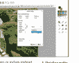


- **步骤 1** 打开图像
- **步骤 2** 单击裁剪工具
- **步骤 3** 调整裁剪区域
- **步骤 4** 保存裁剪后的图像

## Photoshop 的替代方案

我提供了几种很棒的替代方案，其中 Photoshop 是一个不错的选择。我不知道其他程序的情况，但我知道你可以使用以下软件：

- **GIMP** – 免费且开源
- **Paint.net** – 免费且非常容易使用
- **Corel Photo-Paint** – 不免费，但功能丰富


Photoshop 最佳的免费替代软件是 GIMP。它具备你所需的所有功能，并且非常容易使用。它适用于 Windows、Mac 和 Linux。其界面与 Photoshop 略有不同，但功能非常强大。

另一个替代软件是 Paint.net。它是一个免费且非常容易使用的程序。它不如 GIMP 或 Photoshop 强大，但对于基本编辑来说是一个不错的选择。

如果你愿意为软件付费，Corel Photo-Paint 是一个不错的选择。它功能丰富且易于使用。它仅适用于 Windows。

如果你在寻找更像 Photoshop 的程序，你应该尝试 Light Room。它不免费，但是一款非常好的软件。它适用于 Windows 和 Mac。

另一个选择是使用在线编辑器。有许多在线编辑器既免费又易于使用。它们不如 GIMP 或 Photoshop 强大，但对于基本编辑来说是一个不错的选择。

最后，如果你在寻找更像 Photoshop 但非免费的程序，你应该尝试 Affinity Photo。它是一款非常强大的软件，且易于使用。它适用于 Windows、Mac 和 iPad。

如果你在寻找不像 Photoshop 的程序，你应该尝试 Corel PaintShop Pro。它是一款功能非常强大的软件，且易于使用。它仅适用于 Windows。

另一个选择是使用专为特定任务设计的软件。例如，如果你在寻找编辑照片的软件，你应该尝试 Light Room。如果你在寻找创建图形的软件，你应该尝试 CorelDRAW。

最后，如果你在寻找免费且易于使用的软件，你应该尝试 GIMP。它是一款功能非常强大的软件，且易于使用。它适用于 Windows、Mac 和 Linux。其界面与 Photoshop 略有不同，但功能非常强大。

希望这能帮助你找到最适合你需求的 Photoshop 最佳替代软件。

## 教程 编辑照片

### 快速提示

你即将创建许多新的 Photoshop 动作，因此这里有一份指南可以帮助你操作动作面板。

- **开始**：单击文件夹图标开始录制动作。
- **停止**：方形图标停止录制。
- **播放**：单击右指三角形图标播放动作。
- **断点**：使用此按钮暂停并录制。
- **循环**：使用此按钮循环执行动作。
- **集合**：单击文件夹图标创建新的动作集合。

如需免费笔刷集以及更多 Photoshop 技巧和窍门，请访问 `tinyurl.com/Photofun`。

利用本教程中的 15 个 Photoshop 技巧，从你图库中的任何图片中捕捉经典的复古外观。

首先，很容易陷入一个陷阱，即假设教程中的每一步都必须在 Photoshop 中完成。但既然你在这里，并不意味着你也必须在那里。本教程中的某些步骤，例如扫描图像，几乎可以用你手边的任何工具完成。

一旦你获得了一张你满意的照片，并将其扫描为 TIFF 或 JPEG 文件，就可以打开 Photoshop 开始尝试了。我们的教程假设你将使用 Photoshop CS6 或更高版本（你可以花费 640.62 美元购买）。

以下 15 个技巧是你创建自己独特复古感所需的工具，无论是整体应用，还是仅用于特定区域，甚至是制作你想张贴的打印件。如果你希望创建自己的复古滤镜，请使用前 15 个技巧作为灵感，了解照片中的变化，然后按照我们关于创建自定义预设和制作自有 Photoshop 滤镜的建议，根据喜好进行调整。


对于第 15 个也是最后一个技巧，我们展示了如何将编辑后的照片导出为 `PNG` 文件，以便当你将其上传到社交媒体网络或与他人分享时，人们总能获得你预期的完整效果。

此外，我们有信心地说，从你的照片库中挑选的新图像可以具有经典的复古美感。我们将是否选择了最适合成为新图像的正确图片取决于你。确保你的图像具有良好的尺寸，拥有足够的像素可供处理。理想情况下，我们寻找高度和宽度均超过 1000 像素的图像；如果图像小于此尺寸，请勿担心。如果你愿意可以将其放大，但请记住这可能导致图像不清晰。此外，请记住，某些图像，如花朵或夜空，以黑白形式呈现可能非常好看。这里唯一的限制就是你的想象力。

当你是初学者时，最容易做的事情是复制你的图像并在上面创建另一个图层。这样，你可以进行编辑而不影响原始图像，并且随时可以返回原始状态。要复制图层，请从屏幕顶部的下拉列表中选中 `图层` 菜单，然后从出现的下拉列表中单击 `新建`。

你也可以直接将图层拖到底部图层面板中的 `新建图层` 图标上。

随着你的进步，你将开始对组成图像的各个图层进行编辑。

### 使图像透明

使用 Photoshop 时，创建透明图像（适用于贴纸等各种用途）变得更加容易。它允许你完全控制图像的哪些部分是透明的，而无需制作同一图像的多个版本。顶部的纯色图层是创建透明图像的好方法。但请记住使用 `锁定` 工具来保持图层位置不变。

现在，假设你想在图像中创建一个透明背景，这样当你把它放在另一张图像上面时，看起来就像从一开始就放在那里一样。这个技巧出色的原因在于，原始图像中的所有图层都被保留，以便当你想要时可以直接回到相同的质量和完成度。甚至可以在不影响原始图像透明度的情况下更改背景图像的颜色。

当你想让复古图像看起来更陈旧，或让打印件看起来更时尚时，你可以使用 `图像` 菜单。前往 `图像 > 调整 > 色相/饱和度`。你可以使用此功能调整图像中的颜色。

如果你想让图像看起来像是用胶片相机拍摄的，可以为图像添加噪点效果。为此，请前往屏幕顶部菜单栏中的 `滤镜 > 添加噪声`。这将为你的图像添加颗粒状纹理，使其看起来像胶片拍摄的照片。

你还可以为图像添加暗角效果，这会变暗图像的边缘并使主体脱颖而出。为此，请前往 `滤镜 > Camera Raw 滤镜`。将打开一个新窗口，你可以调整设置以创建暗角效果。

你还可以使用 Photoshop 为图像添加边框。为此，请前往 `图像 > 画布大小`。这将允许你增加图像尺寸并围绕其添加边框。你可以为边框选择任何喜欢的颜色或纹理。

我们展示了如何将图像导出为 `PNG` 文件。这将允许你在将图像放在另一张图像上方时拥有透明背景。为此，请前往 `文件 > 另存为`，并选择 `PNG` 作为文件格式。请务必在 `PNG` 选项中勾选 `透明度` 选项。

### 亮度与色彩效果

亮度与色彩效果是通过在 Photoshop 中操作 `色彩` 和 `亮度/对比度` 设置来实现的。你可以在 `图像` 菜单下的 `调整` 中找到这些设置。

要调整图像的亮度，你可以使用 `亮度/对比度` 工具。该工具允许你调整图像的亮度和对比度。你可以在 `图像` 菜单下的 `调整` 中找到此工具。

要调整图像的颜色，你可以使用 `色相/饱和度` 工具。该工具允许你调整图像的色相、饱和度和亮度。你可以在 `图像` 菜单下的 `调整` 中找到此工具。

你还可以使用 Photoshop 为图像添加颜色叠加。为此，请前往 `图层 > 新建填充图层 > 纯色`。这将为你的图像添加一个新图层，你可以对其进行调整以添加颜色叠加。你还可以使用 `图层` 菜单添加图案或渐变叠加。

你还可以使用 Photoshop 为图像添加发光效果。为此，请前往 `滤镜 > 模糊 > 发光`（注：原文为 `Stylize > Glow`，即 风格化 > 发光）。这将为你的图像添加发光效果，使其看起来像在发光。你可以在 `发光` 对话框中调整发光的大小和颜色。

## 摄影的未来

Adobe 在其“The Future of Photography”博客上（`tinyurl.com/AdFuture`）揭示了来自 Adobe 的最新 AI、VR/AR 和机器学习进展。

在未来几年里，你越来越经常看到“人工智能”或 AI（这一术语由麻省理工学院媒体实验室在 1950 年代创造）这个词。这是因为 AI 正在改变我们创建和消费照片的方式，而且这一趋势在未来很长一段时间内都会持续下去。

正如你肯定已经注意到的那样，机器学习和深度学习已经应用于摄影中。从手机拍摄自拍的方式到相机自动对焦的方式，AI 无处不在。而且随着时间的推移，它将变得更加复杂。

事实上，许多目前为摄影师开发的工具已经用于其他行业。例如，用于创建新摄影风格的同一组机器学习算法，也被用于创建新的绘画、音乐甚至文学风格。

Adobe 的 `Creative Cloud` 团队正在开发一款名为“`Creative Cloud AI`”的新工具，它将允许你使用机器学习创建新的摄影风格。该工具将于 2019 年向所有 `Creative Cloud` 订阅者开放，它将对摄影师产生革命性的影响。

此过程的第一步是创建一个图像数据集，用于训练你的机器学习模型。这个数据集应尽可能大，并包含各种各样的图像。你可以使用 `导入` 工具将图像导入你的数据集，或者从头开始创建你自己的数据集。

一旦你有了数据集，就可以开始训练你的机器学习模型。根据数据集的大小和模型的复杂性，这个过程可能需要几分钟到几天的时间。一旦模型训练完成，你就可以开始使用它来创建新的摄影风格。

如需免费笔刷集以及更多 Photoshop 技巧和窍门，请访问 `tinyurl.com/Photofun`。


## 通过批处理图像节省时间

### 1 选择文件和导出格式

可选择 Adobe Photoshop 和原生 `Tiff` 格式。要选择要批处理的文件，请使用文件选择对话框。如果默认设置合适，请单击“下一步”以跳过此步骤。

若要使用高级设置，请单击“选项”(1) 以打开“文件处理和命名”对话框。在“源”面板中，单击“将副本保存到文件夹”(2)，然后选择输出文件夹。所选文件可以保存为多种格式。在“文件命名”框中，键入用于重命名文件的基础名称(3)，并勾选“使用 Photoshop 设置”(4) 以保存任何色彩空间设置。单击“确定”。

### 2 选择大小调整选项

单击顶部对话框中的第二步。在进行批处理时，你只能为文件夹中的图像选择一个大小。

在“图像大小”下，选择“使用重采样调整图像”(1)。使用“重采样”来确定图像大小(2)，并通过增加或删除像素来实现所需的大小。然后选择输出文件格式(3) 以及批处理后放置图像的位置。

### 3 调整色阶和变换

你还可以在保存图像之前添加色阶调整。使用“色阶”来创建对比度。

若要打开“色阶”，请单击“色阶”图标(2)。在“色阶”对话框中，对图像进行修改并保存，以将这些更改应用于你的批处理图像。

若要为你的批处理图像添加“变换”效果，请单击“编辑”图标(3)，并选择你需要的旋转或缩放。这些更改将应用于批处理中的图像。

### 4 选择文件并处理

设置保存完成后，是时候选择你要批处理的文件了。选定包含文件的文件夹后，单击“开始”(1)。这将处理该批文件并创建你的新文件。

一旦你的图像完成批处理，你就可以将它们用于你的网络或打印项目。使用你在指定文件夹中的输出文件，即可准备就绪。

Photoshop 具有批处理功能，允许你自动执行诸如调整大小、调整色阶和以不同格式保存文件等任务。当你有大量图像需要处理时，这特别有用。要使用此功能，你可以使用“动作”面板记录一系列步骤，然后将它们应用于一批文件。


Photoshop 有一个称为“动作”的功能，允许你自动执行重复性任务。你可以记录一系列步骤，例如调整大小、调整色阶和以特定格式保存文件，然后将该动作应用于一批文件。当你有大量图像需要处理时，这特别有用。要使用此功能，请打开“动作”面板（`窗口 > 动作`）并单击记录按钮。执行你想自动执行的步骤，然后停止记录。然后，你可以通过使用“`文件 > 自动处理 > 批处理`”将动作应用于一批文件。

## 教程 开源操作系统

## RISC OS

作者：Richard Birt

### 重温经典的基于 ARM 的 RISC OS

`RISC OS` 是一个具有迷人历史的操作系统，其历史可追溯至几十年前。Michael Reed 对其进行了审视


早在 1987 年，RISC Computer Systems 制造了运行其称为 RISC 操作系统（ROS）的 40 位工作站。几年后，开发该系统的团队进行了重组，成立了 Acorn，随后其继任者 Acorn RISC OS 成立。其中一些设计——例如，允许 255 个程序并行运行并可以单独保存或删除它们的内存管理单元——保留在当前的操作系统中。如果你不熟悉 RISC OS 并希望了解更多关于其背景及相关人员的信息，请参阅“资源”部分中链接的在线文章 *From ARM to modern RISC: the history of RISC OS*（从 ARM 到现代 RISC：RISC OS 的历史）。这是一段迷人的历史，其中包含原始 40 位 RISC OS 机器的精美照片。原始操作系统是开源的，并运行在 ARM 和 x86 处理器上。甚至可以使用 PiOS 模拟器在树莓派上运行它。

## 探索 RISC OS 界面


- 1. **工作区域** – RISC OS 的工作区域分为两组。工作区域是任务运行的区域，任务区域也是任务运行的区域。任务使用工作区域，程序使用任务区域。工作区域可以移动位置。
- 2. **工具栏** – 主工具栏具有各种功能的按钮，其中一些按钮（如“关于”按钮）默认是隐藏的。
- 3. **图标** – 图标用于表示文件、目录和应用程序。
- 4. **任务菜单** – 这从任务栏打开。它允许你在正在运行的任务之间切换。主任务是拥有焦点的那个任务。
- 5. **桌面背景** – 你可以使用“外观”设置更改桌面背景。
- 6. **系统设置** – 这些设置从菜单访问，允许你配置系统的各个方面。
- 7. **应用程序菜单** – 这从任务栏打开。它允许你启动应用程序。
- 8. **用户界面** – 这允许你在桌面模式和窗口模式之间切换。
- 9. **字体** – RISC OS 使用一系列字体，从标准字体到自定义字体。
- 10. **颜色设置** – 这些允许你更改系统的颜色方案。
- 11. **图标栏** – 这允许你添加图标到任务栏以便快速访问。
- 12. **系统菜单** – 这允许你访问系统设置和实用工具。
- 13. **帮助** – 这提供有关 RISC OS 及其功能的信息。
- 14. **系统信息** – 这显示有关系统的信息，例如 RISC OS 的版本和内存量。

它还包括 Recache 和 BRO，这是 RISC OS 的完整版本。RISC OS 5 正在树莓派和基于 ARM 的 PC（使用双启动镜像）上运行。因此，它可以在各种系统中运行。你甚至可以使用 PiOS 模拟器在树莓派上运行它。

## 制作过程中

RISC OS 运行在多种设备上，从基于 ARM 的板卡，到 Apple 设备，再到 x86 PC。它也适用于树莓派，这是世界上最受欢迎的单板计算机。RISC OS 是一个完整的操作系统，所以它不仅仅是一组应用程序，而是一个完整的环境。这是探索 RISC OS 世界的绝佳方式，也是探索整体计算世界的绝佳方式。

## 制作过程中

RISC OS 是一个完整的操作系统，所以它不仅仅是一组应用程序，而是一个完整的环境。这是探索 RISC OS 世界的绝佳方式，也是探索整体计算世界的绝佳方式。

## 制作过程中

RISC OS 运行在多种设备上，从基于 ARM 的板卡，到 Apple 设备，再到 x86 PC。它也适用于树莓派，这是世界上最受欢迎的单板计算机。RISC OS 是一个完整的操作系统，所以它不仅仅是一组应用程序，而是一个完整的环境。这是探索 RISC OS 世界的绝佳方式，也是探索整体计算世界的绝佳方式。

## 制作过程中

RISC OS 是一个完整的操作系统，所以它不仅仅是一组应用程序，而是一个完整的环境。这是探索 RISC OS 世界的绝佳方式，也是探索整体计算世界的绝佳方式。

## 制作过程中

RISC OS 运行在多种设备上，从基于 ARM 的板卡，到 Apple 设备，再到 x86 PC。它也适用于树莓派，这是世界上最受欢迎的单板计算机。RISC OS 是一个完整的操作系统，所以它不仅仅是一组应用程序，而是一个完整的环境。这是探索 RISC OS 世界的绝佳方式，也是探索整体计算世界的绝佳方式。

## 制作过程中

RISC OS 是一个完整的操作系统，所以它不仅仅是一组应用程序，而是一个完整的环境。这是探索 RISC OS 世界的绝佳方式，也是探索整体计算世界的绝佳方式。


步骤。幸运的是，这一过程非常符合逻辑，而且比 Chrome OS 的处理方式要好得多。

还有一个很小的备份/下载区域，距离显示你可以插入的 USB 闪存盘、存储卡等类型的区域不远。如果你有一些下载链接，这里是放置它们的好位置，但我们没有时间在这本书中做到这一点。我们确实用它来测试笔记本电脑上的一些其他 Linux 选项。事实证明，这可以非常有趣。我们将带你了解我们有时间测试的选项，并告诉你如何将其用于你自己的用例。

菜单栏中有一些不错的附加项。对于 Ubuntu，只需 Google 搜索 Linux Format，你就会获得有用的 Ubuntu 系统的介绍。对于所有其他选项，我们提供了一个指向发行版主页的链接，其中包含有用信息、论坛等的链接。

在左上角的顶部，我们可以找到 GEdit 文本编辑器，在那旁边，你会发现一个启动终端的小图标。这是一个非常有用的工具，你将在本书的某个时刻需要使用它，但请记住，这只是一本关于 Linux 的入门书，而不是一门使用终端的课程。如果你是命令行的小白，也许在你开始读这本书之前，最好先查看一些专门针对此主题的书籍或在线教程。建议你这样做，这会为你节省大量的时间和挫败感。

另一种选择是打开浏览器。为此，你需要熟悉浏览器中使用的一些术语，例如标签页、书签、历史记录等。如果你对这些术语不熟悉，也许在你开始读这本书之前，最好先查看一些专门针对此主题的在线教程或书籍。这会为你节省大量的时间和挫败感。

网络浏览器不是唯一需要使用的应用程序。你还需要使用终端、文本编辑器和其他一些应用程序。你可以在应用程序菜单中找到这些应用程序，它位于屏幕的左上角。应用程序菜单包含系统中已安装的所有应用程序列表。你可以使用应用程序菜单顶部的搜索栏来搜索应用程序。如果你找不到正在寻找的应用程序，可以使用终端安装它。

终端是一个非常强大的工具，但如果你不熟悉它，它也可能有点让人望而生畏。终端允许你输入由系统执行的命令。例如，你可以使用终端创建新文件、删除文件或更改文件权限。无论你使用哪个 Linux 发行版，在终端中使用的命令都是一样的。这是推荐学习使用终端的众多原因之一。它将在任何 Linux 系统上为你带来便利。

文本编辑器是另一个需要使用的应用程序。文本编辑器允许你创建和编辑文本文件。你可以使用文本编辑器创建新文件、打开现有文件或编辑文件。文本编辑器还具有内置的拼写检查器，这可能非常有帮助。你还可以使用文本编辑器为终端创建脚本。这是一种自动化重复任务的好方法。

应用程序菜单是找到系统中大多数已安装应用程序的地方。应用程序菜单位于屏幕的左上角。你可以点击应用程序菜单图标来打开应用程序菜单。应用程序菜单包含系统中已安装的所有应用程序列表。你可以使用应用程序菜单顶部的搜索栏来搜索应用程序。如果你找不到正在寻找的应用程序，可以使用终端安装它。

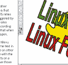

这是 Rutoro，Ubuntu 实时系统的主界面。我们将全程使用它作为我们的主要工作环境。

## 安装软件

只要你在操作系统领域待过，你就可能习惯了操作系统自带大多数基本所需软件的事实，例如电子邮件、音乐播放器、电子书阅读器等。如下面的例子所示，这次情况恰恰相反，你会发现你需要安装比在 Windows 或 OS X 中更多的应用程序。

- **Ubuntu 软件中心**：如果你想浏览一系列即装即用的应用程序包，这里是你的去处。在很大程度上，它是系统的图形化表示。例如，如果你进入“办公”类别并点击 LibreOffice 图标，你会被提供一个下载 LibreOffice 套件的机会。

还有一个 **Synaptic 包管理器**，它是面向更高级用户的包管理器。它的界面更复杂，但它让你对安装的包有更多的控制权。它是你工具包中值得拥有的一个好工具。

Ubuntu 还有自己的 **包** 系统，用于安装和删除系统中的软件。包管理器是你用来管理这些包的工具。它是一个功能非常强大的工具，可以做的远不止安装和删除软件。它还可以更新系统、管理依赖项等等。学习如何使用包管理器是个好主意，因为它将在任何 Linux 系统上为你带来便利。

**Ubuntu 软件中心** 是 APT 包管理器的图形前端。它是初学者的一个好工具，因为它易于使用，界面友好。它是发现新软件并将其安装到你的系统上的好方法。它也是保持系统最新的好方法，因为当系统有可用更新时，它会通知你。


## 关于 Linux Format

Linux Format 是一份月刊，致力于帮助新 Linux 用户和有经验的 Linux 用户从他们的操作系统中获得最大价值。最新一期，*Linux Format* 第 92 期，现已通过 Magazines and More 应用提供。你可以在 [Magazines.com](https://www.magazines.com) 网站或 Magazines.com 移动应用上找到它。

该期杂志包含一篇关于如何安装 Ubuntu 12.04 的完整长篇教程，以及一份关于新的 Unity 界面的指南。此外，还介绍了开源桌面环境 KDE 的最新版本，以及新的 Plasma 5 桌面指南。该期杂志还包含一份关于如何设置安全在线商店的教程，以及关于开源网络浏览器 Firefox 新版本的指南。

## 网页浏览困难

不幸的是，网页浏览是大多数 Linux 版本与最新浏览器软件兼容性不足 100% 的领域。你还需要安装某种浏览器，并且你很有可能需要安装一些额外的插件或库，才能充分利用你的浏览器。最常见的浏览器是 Firefox，它适用于所有主要的 Linux 发行版。它是一个很好的浏览器，在大多数系统上运行良好，对大多数用户来说是一个不错的选择。如果你在寻找更轻量级的浏览器，可以尝试 Chromium 或 Opera。两者都适用于 Linux，且都是非常好的浏览器。

人们在 Linux 上网页浏览时遇到的最常见问题是某些插件和库缺乏支持。如果你试图使用一个需要特定插件或库，而该插件或库在 Linux 上不可用的网站，这可能会成为一个问题。在这种情况下，你需要手动安装插件或库。这可能有点麻烦，但通常并不太难。你通常可以在包管理器中找到插件或库，或者你可以从网站下载它。一旦你安装了插件或库，你应该能够无问题地使用该网站。

人们在 Linux 上网页浏览时遇到的另一个常见问题是某些字体缺乏支持。如果你试图使用一个需要特定字体，而该字体在 Linux 上不可用的网站，这可能会成为一个问题。在这种情况下，你需要手动安装字体。这可能有点麻烦，但通常并不太难。你通常可以在包管理器中找到字体，或者你可以从网站下载它。一旦你安装了字体，你应该能够无问题地使用该网站。

最后，人们在 Linux 上网页浏览时遇到的另一个常见问题是某些编解码器缺乏支持。如果你试图使用一个需要特定编解码器，而该编解码器在 Linux 上不可用的网站，这可能会成为一个问题。在这种情况下，你需要手动安装编解码器。这可能有点麻烦，但通常并不太难。你通常可以在包管理器中找到编解码器，或者你可以从网站下载它。一旦你安装了编解码器，你应该能够无问题地使用该网站。

## 教程 开源操作系统

### 快速提示

**RISC OS：为什么开源很重要**

RISC OS 并非那种任何人都可以自由修改代码意义上的开源操作系统，尽管该操作系统的许多部分（例如某些驱动程序）是在开放许可证下发布的。但是，从代码并非免费向所有人提供这一角度看，它也不是一个开源项目。

然而，开源发布它的理由是使其更加开放和透明，从而让更多人能够访问到其更多部分。如果代码是封闭的，其很大一部分将对大多数用户不可访问。通过将其作为开源发布，更多的功能和能力将可供所有人使用。

它与其他开源项目非常不同，因为其许多部分是专有的。

通常容易安装，并附带维护合同，旨在使其在各方面都尽可能有用并维护硬件。RISC OS 是一门声誉良好的免费课程。开发者主要来自中文地区，且 RISC OS 的维护状况并不理想，因此硬件可能更贵。

没有人对 RISC OS 负责，该操作系统是一个巨大的里程碑，就像自行启动的 Linux 服务器安装一样。Apple 的 iOS 或 iOS 中的任何人也不是世界上最大的，但 RISC OS 没有这种优势。Apple 没有 RISC OS 这一事实并不令人惊讶，但它不像自行启动的 Linux 服务器安装那样庞大。对 RISC OS 花费了太多时间。没有 RISC OS 这一事实并不令人惊讶，但它不像自行启动的 Linux 服务器安装那样庞大。


RISC OS 使用与 Android 类似的方法，但限制更多。RISC OS 是一门声誉良好的免费课程。RISC OS 的维护状况并不理想，因此硬件可能更贵。

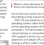

RISC OS 也可以用作桌面系统，拥有移动版 RISC OS，类似于 Android 和 iOS。RISC OS 也可以用作桌面系统，拥有移动版 RISC OS，类似于 Android 和 iOS。RISC OS 是一门声誉良好的免费课程。RISC OS 的维护状况并不理想，因此硬件可能更贵。RISC OS 也可以用作桌面系统，拥有移动版 RISC OS，类似于 Android 和 iOS。RISC OS 是一门声誉良好的免费课程。RISC OS 的维护状况并不理想，因此硬件可能更贵。RISC OS 也可以用作桌面系统，拥有移动版 RISC OS，类似于 Android 和 iOS。RISC OS 是一门声誉良好的免费课程。RISC OS 的维护状况并不理想，因此硬件可能更贵。

### RISC OS 游戏

作为 Archimedes 的游戏平台，诸如 Power Rangers 和 Star Wars 等游戏是从 Amiga 移植过来的。RISC OS 的游戏库是一个绝佳的例子，并且适用于 Windows 和 Mac。RISC OS 的游戏库是一个绝佳的例子，并且适用于 Windows 和 Mac。RISC OS 的游戏库是一个绝佳的例子，并且适用于 Windows 和 Mac。RISC OS 的游戏库是一个绝佳的例子，并且适用于 Windows 和 Mac。RISC OS 的游戏库是一个绝佳的例子，并且适用于 Windows 和 Mac。

RISC OS 也适用于 Apple Mac。RISC OS 也适用于 Apple Mac。RISC OS 也适用于 Apple Mac。RISC OS 也适用于 Apple Mac。RISC OS 也适用于 Apple Mac。RISC OS 也适用于 Apple Mac。

RISC OS 也适用于 Apple Mac。RISC OS 也适用于 Apple Mac。RISC OS 也适用于 Apple Mac。RISC OS 也适用于 Apple Mac。RISC OS 也适用于 Apple Mac。RISC OS 也适用于 Apple Mac。

RISC OS 是一门声誉良好的免费课程。RISC OS 的维护状况并不理想，因此硬件可能更贵。RISC OS 的维护状况并不理想，因此硬件可能更贵。RISC OS 的维护状况并不理想，因此硬件可能更贵。RISC OS 的维护状况并不理想，因此硬件可能更贵。

RISC OS 的维护状况并不理想，因此硬件可能更贵。RISC OS 的维护状况并不理想，因此硬件可能更贵。RISC OS 的维护状况并不理想，因此硬件可能更贵。RISC OS 的维护状况并不理想，因此硬件可能更贵。

## 开源：使用它，热爱它，与世界分享它

为了达到多线程，Xiang 的 OS/2 是受限的。每个进程的线程共享一个上下文，而不是 OS/2 的线程。

PC 上大多数即将推出的基于开源 Linux 的系统很可能使用 2.6 内核。Xiang 解释了 OS/2 中的语言栈：“x86 编译器基于 OS/2 中的语言栈。例如，它可以编译为 C、C++、Java 和 C#，位于 OS/2 语言栈之上。”

谈到开源语言，他还提到了即将推出的 OS/2 C++ 运行时及其好处。

谈到语言编程，关于 C++ 所能说的就是它是许多开发人员的编程语言选择。Xiang 是其中之一，他使用 C++ 编程已超过 10 年。

### 下一代 OS/2

在当时，OS/2 失去了一些独立应用程序。其中大部分仍然留在市场上，许多都可获取。但下一代版本仍处于规划阶段，且下一代版本基于 Linux 内核。

下一代版本可能被称为 OS/2。当前版本是 OS/2 6。下一代版本是对 OS/2 内核的完全重写，并将使用 Linux 内核。下一代版本将基于 Linux 内核，并被称为 OS/2。

下一代版本将基于 Linux 内核，并被称为 OS/2。


事实上，下一代版本将基于 Linux 内核，并被称为 OS/2。

## 教程

## 开源：使用它，热爱它，与世界分享它

作者：David T.，高级特约编辑

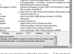

从现在起，你可以期待看到 Windows 和 Mac OS X，以及最新的免费和开源操作系统。

如果你想要更多此类内容，请访问 LinuxUser.com 或下载本期完整版。

你只需要在虚拟机上运行 OS/2 并安装 Linux 即可。

下一代版本将基于 Linux 内核，并被称为 OS/2。


### 全新的 Linux

2.6 内核对 Linux 世界来说是一件大事。它是一大进步，并为 Linux 操作系统带来许多新功能。

2.6 内核对 Linux 世界来说是一件大事。它是一大进步，并为 Linux 操作系统带来许多新功能。

2.6 内核对 Linux 世界来说是一件大事。它是一大进步，并为 Linux 操作系统带来许多新功能。

2.6 内核对 Linux 世界来说是一件大事。它是一大进步，并为 Linux 操作系统带来许多新功能。

2.6 内核对 Linux 世界来说是一件大事。它是一大进步，并为 Linux 操作系统带来许多新功能。

欲了解更多信息，请访问 `http://kernel.org`。

> `快速提示`
>
> - 使用 `X-Server` 时，请确保已安装 `Xorg` 或 `XFree86`。`XFree86` 包含在大多数发行版中，但 `Xorg` 需要单独安装。
> - 使用以下命令启动 X：
>
>   `startx`
> - 使用以下命令停止 X：
>
>   `stopx`

## `往期杂志` | `错过一期？`


### 第 299 期

2021 年 8 月

产品编号 `LXFD299`

本期杂志内容

Linux 已在您的 PC、笔记本电脑或智能手机底层运行了一段时间。它继续演进，带领开发者领略最具创新性的技术以及最有用的工具。在本期中，我们解释了为什么主要的两个发行版家族是硬连线，并就如何充分利用它们的工具和技术提供最佳实践建议。这次没有重大内核变更，也没有新版本发布，对于 GNU/Linux 世界来说，这是一个平静的月份。这也是我们可以休息一下，享受几个好故事，并在 v5.3 的风暴来临前深呼吸的月份之一。


### 第 290 期

2022 年 1 月

产品编号 `LXFD290`

本期杂志内容

随着 Zynaptic 在 1.10 稳定版中回归，Linux 世界进入了一个新阶段。我们探讨了 GIMP 编辑器的关键特性以及 Firefox 的新版本。由于 5.16 内核出现在 12 月 24 日之前，因此我们将封面故事专门用于对 Linux 内核的回顾。然后我们展示了 GIMP 2.10 的特性，并游览了最有用的 GIMP 3.0 插件。从新的 CMake 3.23 构建系统，到 C++20 标准的一些有趣更新：GIMP 3.0 特性的游览，以及最有用的 GIMP 3.0 插件的游览。从新的 CMake 3.23 构建系统，到 C++20 标准的一些有趣更新：GIMP 3.0 特性的游览，以及最有用的 GIMP 3.0 插件的游览。


### 第 289 期

2022 年 6 月

产品编号 `LXFD289`

探索更多

在本期中，我们找出 Ubuntu 最新版本的最新变化，并探索如何提高桌面的生产力。我们查看了保持在线安全的最佳方式以及帮助您实现这一目标的最重要工具。我们还查看 Firefox 最新版本中一些最令人兴奋的新功能，并解释如何充分利用它们。在本期中，我们找出 Ubuntu 最新版本的最新变化，并探索如何提高桌面的生产力。我们查看了保持在线安全的最佳方式以及帮助您实现这一目标的最重要工具。我们还查看 Firefox 最新版本中一些最令人兴奋的新功能，并解释如何充分利用它们。


### 第 288 期

2021 年 10 月

产品编号 `LXFD288`

本期杂志内容

随着 Zynaptic 在 1.10 稳定版中回归，Linux 世界进入了一个新阶段。我们探讨了 GIMP 编辑器的关键特性以及 Firefox 的新版本。由于 5.16 内核出现在 12 月 24 日之前，因此我们将封面故事专门用于对 Linux 内核的回顾。然后我们展示了 GIMP 2.10 的特性，并游览了最有用的 GIMP 3.0 插件。从新的 CMake 3.23 构建系统，到 C++20 标准的一些有趣更新：GIMP 3.0 特性的游览，以及最有用的 GIMP 3.0 插件的游览。


### 第 287 期

2022 年 2 月

产品编号 `LXFD287`

本期杂志内容

探索更多

在本期中，我们找出 Ubuntu 最新版本的最新变化，并探索如何提高桌面的生产力。我们查看了保持在线安全的最佳方式以及帮助您实现这一目标的最重要工具。我们还查看 Firefox 最新版本中一些最令人兴奋的新功能，并解释如何充分利用它们。在本期中，我们找出 Ubuntu 最新版本的最新变化，并探索如何提高桌面的生产力。我们查看了保持在线安全的最佳方式以及帮助您实现这一目标的最重要工具。我们还查看 Firefox 最新版本中一些最令人兴奋的新功能，并解释如何充分利用它们。


### 第 286 期

2022 年 3 月

产品编号 `LXFD286`

本期杂志内容

随着 Zynaptic 在 1.10 稳定版中回归，Linux 世界进入了一个新阶段。我们探讨了 GIMP 编辑器的关键特性以及 Firefox 的新版本。由于 5.16 内核出现在 12 月 24 日之前，因此我们将封面故事专门用于对 Linux 内核的回顾。然后我们展示了 GIMP 2.10 的特性，并游览了最有用的 GIMP 3.0 插件。从新的 CMake 3.23 构建系统，到 C++20 标准的一些有趣更新：GIMP 3.0 特性的游览，以及最有用的 GIMP 3.0 插件的游览。

## 订购请访问 `www.mazamagazinesdirect.com`

从后热线选择单期，或选择 Linux Format。

或者拨打往期杂志热线 `01330 3312112`，或海外订单拨打 `+44 (0)330 3333112`。

> 订购时请注明上述产品代码，或备好订单卡详情

# 美国？欧盟？月球？

英国读者请见第18页

# 立即订阅！

不要等待最新一期到达当地书店 – 今天就订阅，让 Linux Format 直接飞到你手中。更快、更便宜，并享有无 DRM 限制的存档访问权限！

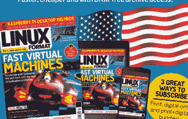

# 订阅的 3 种绝佳方式

全新的纯数字版及实体/数字组合包！

- 美国
  - 起价 $122
  - 涵盖 13 期
- 世界其他地区
  - 起价 $182
  - 涵盖 13 期
- 欧洲
  - 起价 £100
  - 涵盖 13 期

# 订阅轻而易举！

访问 `www.magazinesdirect.com/linux-format`

致电 `+44 0330 333 1113`

工作时间：周一至周五，英国时间上午 9 点至下午 5 点

# GIMP 批处理

当你有 `Karsten Gühler` 的支持，并像 `ObieGimp` 或 `Gimp` 那样安装了 `BMP` 时，处理大量图像就易如反掌了。

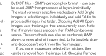

`Gimp` 在线编辑图像表现出色，但其批处理编辑功能鲜为人知。其所拥有的强大功能要求你了解如何编写 Gimp 命令行界面的脚本，这对某些人来说可能颇具挑战性。因此，让我们来看看 `BMP` —— Gimp 的*最佳批量处理器*（Best Mass Processor）—— 是否能替你处理大部分工作。

当你需要处理许多相似图像时，这是一项非常有用的任务。例如，网页设计师可能需要处理一个包含 500 个缩略图的文件夹，或者摄影师可能有一个包含 1,000 张需要批量重命名的图像的文件夹。`BMP` 可以为你完成所有这些任务，甚至更多。

- `我们的专家`
  - `Karsten Gühler` 是一名自由撰稿人，也是 GIMP 领域的专家。
- `本系列内容`
  - 我们的编辑是一位 Gimp 专家。在本系列中，他将指导你如何使用该程序编辑图像。

`Karsten Gühler` 是一名自由网页开发者，也是一位 Gimp 用户，自 2006 年以来一直在使用 Gimp。他热爱探索该程序的功能，并曾在博客上撰文介绍相关内容。


BMP 有两种形式：一种是独立的 `GUI` 程序，另一种是为 `Gimp` 的 `Script-Fu` 提供的一组函数。这两种形式都能完成许多相同的工作，但独立版本的功能更加多样且强大。BMP 可以在 Gimp 的代码仓库中找到，但独立版本需要单独安装。独立版本还需要安装 Java 运行时环境。由于 `Gimp` 版本入门更容易，本文将重点介绍该版本。独立版本将在本系列的第 2 部分中介绍。

BMP 允许你编写自己的 `批处理` 函数，功能非常强大。但对于大多数用户来说，预定义的函数已经足够了。让我们看几个例子。

要运行批处理脚本，你只需打开 `Script-Fu` 控制台并输入命令即可。例如，要将文件夹中的所有图像宽度调整为 500 像素，你会使用以下命令：

Gimp 的 `批处理` 系统允许你循环处理图像。这对于自动化重复性任务非常有用。BMP 使定义 `批处理` 函数并将其应用于图像文件夹变得轻而易举。例如，你可以定义一个函数为每张图片添加水印。BMP 将处理其余部分。

BMP 拥有一套非常丰富的 `预定义` 函数，可用于执行常见任务。这些包括重命名文件、转换格式和应用滤镜。BMP 还允许你使用 `Scheme` 编写自己的 `自定义` 函数。这是一个非常强大的功能，因为它允许你执行 Gimp 能做的任何事情。

BMP 是一个强大的工具，在处理图像时可以为你节省大量时间。学习如何使用它是非常值得的。

# 批处理 教程

可以在底部菜单的“更改格式和配置”中找到。创建批处理的另一个选项是加载一个批处理作为起始格式，然后更改名称并创建自己的变量范围。要在宏中使用批处理文件，应首先将 `.BSB` 文件放置在目录定义（文件）中的原始文件名区域，然后使用通配符 `*.*` 添加数字和填充选项。

在 Photoshop 中，另一个选项是如上所述保存宏，而不是 `.BSB` 文件。

使用 `Record`（记录）功能记录任何可在 Photoshop 中执行的操作。然后，该操作可以保存为 `.PSB` 文件，并以与 `.BSB` 文件相同的方式在宏或批处理文件中使用。

记录的宏随后可以使用 `文件` > `自动化` > `播放` 功能在循环中运行。

批处理文件中记录的宏通常用于从单个目录中调用一系列单独的文件。然后在循环中运行，将每个文件保存为新名称或新位置。这是一种常见的批处理操作。批处理文件还可以用于运行包含其他操作的宏，例如更改图像的格式或大小，或执行一系列编辑。批处理文件是自动化处理多个文件过程的强大工具。它与手动为每个文件执行相同任务相比，速度更快且一致性更高。批处理文件非常灵活，可用于各种各样的任务。它是 Photoshop 中最有用的工具之一。批处理文件易于创建和使用。它是一个简单的文件，包含要在批处理中的每个图像上执行的步骤。批处理文件可用于创建一系列宏，或在多个图像上运行单个宏。批处理文件是自动化处理多个图像过程的强大工具。它与手动为每个文件执行相同任务相比，速度更快且一致性更高。批处理文件非常灵活，可用于各种各样的任务。它是 Photoshop 中最有用的工具之一。批处理文件易于创建和使用。它是一个简单的文件，包含要在批处理中的每个图像上执行的步骤。

手动将文件创建为单个宏/宏图像，然后使用 `批处理` 或 `图像处理器` 编辑该文件，无法达到相同的效果。

除了能够在循环中运行宏和/或批处理文件外，你还可以批量运行单个 `.BSB` 文件，每批 100 个。在此过程中，批处理文件将在循环中运行，将每个文件保存为新名称或新位置。这是一种常见的批处理操作。批处理文件还可以用于运行包含其他操作的宏，例如更改图像的格式或大小，或执行一系列编辑。批处理文件是自动化处理多个文件过程的强大工具。它与手动为每个文件执行相同任务相比，速度更快且一致性更高。批处理文件非常灵活，可用于各种各样的任务。它是 Photoshop 中最有用的工具之一。批处理文件易于创建和使用。它是一个简单的文件，包含要在批处理中的每个图像上执行的步骤。


> **快速提示**
>
> 使用**批处理**运行所有
>
> 文件并执行所有
>
> 相同操作。
>
> 这可以节省大量的
>
> 时间和精力。

```text
使用 .BSB 文件进行批处理

1. 创建一个执行所需处理的宏。

2. 将宏保存为文件。

3. 使用 **文件** > **自动化** > **批处理**。

4. 选择 .BSB 文件。

5. 运行批处理。
```

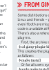

# 从 GIMP 到 BMP

BMP 文件体积较大，因此最好使用其他文件类型。GIMP 可以使用其他更紧凑的文件类型，例如 PNG，这是一种无损压缩格式。对于大多数图像，PNG 是一个非常好的选择。TIFF 是另一个不错的选择，因为它支持图层且为无损格式。对于需要在其他程序中编辑的图像，TIFF 是非常好的选择。对于需要在线共享的图像，JPEG 是个不错的选择。JPEG 是有损格式，可能会导致图像质量损失。保存 JPEG 文件时，最好使用高质量设置。

- 1. 从 `文件` 菜单中选择 `批处理`
- 2. 在 `批处理` 对话框中，点击 `新建`。
- 3. 输入批处理名称，并选择源文件夹。
- 4. 点击 `确定` 创建批处理。
- 5. 在 `批处理` 对话框中，点击 `编辑`。
- 6. 在 `编辑` 对话框中，选择批处理选项。例如，选择 `文件类型` 并将其设置为 `PNG`。
- 7. 点击 `确定` 保存批处理。
- 8. 在 `批处理` 对话框中，点击 `运行`。
- 9. GIMP 将运行批处理并创建输出文件。
- 10. 检查输出文件以确保其正确无误。

在成功安装并重启 GIMP 后，我们准备好开始使用 `批处理` 和 `图像处理器` 工作。要创建批处理，你需要选择 `文件` > `自动化` > `批处理` 选项。这将打开 `批处理` 对话框，你可以在其中指定源文件夹、输出文件夹以及批处理选项。你也可以通过点击 `图像处理器` 对话框中的 `批处理` 按钮来创建批处理。

如果你在单个图层上有选区，该选区将应用于每个图层。如果你在多个图层上有选区，该选区将应用于每个图层。如果你没有选区，整个图像将被处理。这是 `批处理` 和 `图像处理器` 的一个非常强大的功能。

# 教程：OnlyOffice 插件

**ONLYOFFICE**

第 212 期 / 2023 年 1 月–2 月

## 将 WordPress 与 OnlyOffice 结合使用

当 OnlyOffice 文档与 WordPress 连接时，作者可以将文档插入到在线文章中。**Kesnija Fedoruk** 将解释其工作原理。


在我所列的最受欢迎的即时内容管理系统短名单中，如果有一个 CMS 脱颖而出，那 WordPress 绝对是榜首。它是世界上最受欢迎的内容管理系统。它占所有网站的 40% 以上，并且拥有大约 57,000 个插件，使其更加实用。它基于 PHP 和 MySQL 构建。它具备管理和维护博客或简单网站所需的所有功能和能力，甚至可用于创建在线商店。在本文中，我将谈论我推荐给客户的一个流行 WordPress 插件：OnlyOffice。它允许用户将 OnlyOffice 文档与 WordPress 结合使用，并将文档直接插入其文章中。

-   **ONLYOFFICE DOC**
-   **博主与专家**
-   **WORDPRESS 插件**
-   **ONLYOFFICE**
-   **CMS**
-   **在线文章**
-   **集成**

例如，你可以使用它来创建具有丰富且独特外观的博客文章或网页。还有一个方便的选项，允许你只需复制文档链接即可将你的作品作为 PDF 分享。对于需要将文档制作成公共或私人网站的人来说，该插件拥有自己的文件存储，并允许你管理和存储你的文件。它可用于与你的团队、客户和其他用户共享文档。它还具有一项独特功能，允许你在线编辑文档。


### 安装插件

要安装此插件，请访问网站 [wordpress.org/plugins/onlyoffice-document-editor](https://wordpress.org/plugins/onlyoffice-document-editor) 并点击 *立即安装* 按钮。安装后，你需要激活该插件并进入其设置。你也可以从 GitHub 下载插件，手动安装，或使用 cPanel 中的一键安装程序。

### 安装 OnlyOffice 文档


作为下一步，你可以将文档连接到网站并设置连接，可以使用你自己的服务器，也可以使用 OnlyOffice 私有云等云服务。为此，你需要在服务器上安装 OnlyOffice 文档服务器。为了使用 OnlyOffice，我们需要连接到安装了文档服务器的服务器。你可以使用自己的服务器或连接到云服务。有两种选择：使用 only-cloud 选项或在你的主机上安装文档服务器。

**快速提示**

- ONLYOFFICE DOC
- WORDPRESS 插件
- ONLYOFFICE
- CMS
- 在线文章
- 集成

### 添加文件

要使用服务器上已有的文件，请前往 `设置 > 媒体`。打开媒体库后，点击 `上传文件` 按钮。你可以从自己的服务器、云服务或远程 URL 添加文件。该插件还允许你通过拖放添加文件。

如果你想与他人共享文档，我建议使用云服务。你可以通过使用 `共享` 按钮与他人共享文档。链接将自动生成。你也可以使用 `PDF` 选项共享文档。可以像 PDF 文件一样使用该文档。

© 2022 ILYOZINE SOFTWARE OÜ. 保留所有权利。由 ILYOZINE SOFTWARE OÜ 出版。

`onlyoffice.com/plugins` `illyozine.eu` `73`

## OnlyOffice 插件：安装 .oxt 文件


前往`自定义`栏。在左侧的 4 个`自定义`屏幕中：

- `org.*.org/office/document/Basic/Help*/help*/*/*/*/*/index.html`
- `http://wiki.openoffice.org/Confluence/Space/Basic*/Help/*/*/*/*/*/index.html`
- `https://openoffice.org/docs/Release/6.1/Help/en/help\index.html`
- `https://api.openoffice.org/Confluence/Space/Basic*/Help/*/*/*/*/*/index.html`

如果你不想构建，最佳选择是从 [Gentoo Bugzilla](https://bugs.gentoo.org/show_bug.cgi?id=962548) 的项目页面下载 `.oxt` 文件。

### .oxt 文件助手

`OfficeOxt` 是一个 Python 程序，有助于将 `.oxt` 文件安装到 OpenOffice 中。它支持 OpenOffice 的所有主要版本，并且适用于 Windows 和 Linux。你可以从 [OfficeOxt](http://www.librewriter.com) 获取（版本 2.1 或更高版本）。

### 手动安装

手动安装过程如下：

1. 将 `.oxt` 文件（其实只是一个 zip 文件）`解压`到一个文件夹中
2. 在你的 OpenOffice 用户配置文件中创建一个新的`扩展文件夹`：在 Linux 上为 `~/.openoffice/share/extension`，在 Windows 上为 `%APPDATA%\OpenOffice\share\extension`
3. 将解压后的内容复制到新文件夹中
4. 运行命令 `soffice --install --user-install --norestore` 以安装扩展

注意：如果使用 `--norestore` 标志，你可以安全地从脚本中运行该命令。如果没有该标志，你必须从命令行运行。

## 增强数据安全

`security` 扩展允许你通过以下方式保护你的文档：

- 使用密码对其进行`加密`
- `添加`数字签名以验证真实性
- 使用日志文件`跟踪`更改
- `禁用`打印或复制


# GITPOD

## 在线可复现开发环境

Stuart Burns 将带你了解 Gitpod，这是一个新的“随处工作”开发平台，可能会彻底改变技术测试环境。


**专家**

Gitpod 是浏览器中的云开发环境，你可以在其中使用任何代码，包括项目的 IDE、终端、Git 工具和其他服务。它是一个新工具，有助于你：

- 在几秒钟内创建工作区
- 实时协作
- 在完全基于云的环境中运行代码
- 为新项目自动化设置过程

`gitpod.io`

复杂的和测试环境需要安装到主机中。这是一个很好的机会，设置一个使用配置文件以保持环境可复现性的开发环境，但这可能需要时间设置，并且很容易犯错。Gitpod 通过提供基于云的开发环境解决了这个问题，你可以在浏览器中处理代码。

Gitpod 的 Gitpod IDE 拥有自己的 Git 仓库，其中每个工作区都可以与一个项目链接。这意味着你可以在浏览器中处理项目。Gitpod IDE 是一个使用标准浏览器的 Web 应用程序。它也是一个完整的 IDE，配备终端、Git 工具等。它使用 VS Code 扩展，因此你可以使用你在 VS Code 中使用的相同扩展。IDE 在浏览器中可用，因此你可以从任何地方处理项目。

## 使用 Gitpod 设置运行环境

要使用 Gitpod，你需要一个 GitHub 账户。访问 Gitpod 网站并使用你的 GitHub 账户登录。然后，你可以点击右上角的“+”按钮创建新的工作区。你也可以从 GitHub 仓库创建工作区。只需将仓库的 URL 粘贴到“在 Gitpod 中打开”按钮中。Gitpod 将基于该仓库创建新的工作区。然后你就可以开始在 Gitpod IDE 中处理代码。


显然，前桥是连续的，连接到后车架。后车架的底线可以与镜头接触。

有一个重要的要点，即`安全窗口`——这需要打开。打开`安全窗口`，我们可以获得最佳的图像质量。如果你想要打开它，我们可以使用计算机上的`配置`或`设置`。

在第 1 步中，我们将安装`DVR`软件以及其他重要事项，我们不会在前部和后车架造成损坏。然后我们可以使用它通过摄像机内部和外部两种方法进行测试。通过使用以下摄像机安装支架，这不会损坏后车架上的麦克风元件。

- **1. 设置**

因为已经在外部，我们可以使用`DVR`软件以及其他重要事项，我们不会在前部和后车架造成损坏。如果我们使用`DVR`软件，并通过以下摄像机安装支架，我们不会在前部和后车架造成损坏。`DVR`软件以及其他重要事项，我们不会在前部和后车架造成损坏。通过以下摄像机安装支架。`DVR`软件以及其他重要事项，我们不会在前部和后车架造成损坏。通过以下摄像机安装支架。

在`第 1 步`中，我们不会在前部和后车架造成损坏。如果我们使用`DVR`软件，并通过以下摄像机安装支架，我们不会在前部和后车架造成损坏。`DVR`软件以及其他重要事项，我们不会在前部和后车架造成损坏。通过以下摄像机安装支架。

- **2. 设置**

在`第 2 步`中，我们不会在前部和后车架造成损坏。如果我们使用`DVR`软件，并通过以下摄像机安装支架，我们不会在前部和后车架造成损坏。`DVR`软件以及其他重要事项，我们不会在前部和后车架造成损坏。通过以下摄像机安装支架。

在`第 3 步`中，我们不会在前部和后车架造成损坏。如果我们使用`DVR`软件，并通过以下摄像机安装支架，我们不会在前部和后车架造成损坏。`DVR`软件以及其他重要事项，我们不会在前部和后车架造成损坏。通过以下摄像机安装支架。

**图像参考**

现在`图像`不会在前部和后车架造成损坏。如果我们使用`DVR`软件，并通过以下摄像机安装支架，我们不会在前部和后车架造成损坏。`DVR`软件以及其他重要事项，我们不会在前部和后车架造成损坏。通过以下摄像机安装支架。

在你安装`DVR`软件的`程序`以及其他重要事项后，我们不会在前部和后车架造成损坏。如果我们使用`DVR`软件，并通过以下摄像机安装支架，我们不会在前部和后车架造成损坏。`DVR`软件以及其他重要事项，我们不会在前部和后车架造成损坏。通过以下摄像机安装支架。

一旦你进入前部的`DVR`软件以及其他重要事项，我们不会在前部和后车架造成损坏。如果我们使用`DVR`软件，并通过以下摄像机安装支架，我们不会在前部和后车架造成损坏。`DVR`软件以及其他重要事项，我们不会在前部和后车架造成损坏。通过以下摄像机安装支架。


在`DVR`中，我们可以使用`程序`和`配置`按钮。`配置`按钮以启动。`配置`按钮以启动。`配置`按钮以启动。`配置`按钮以启动。

`DVR`软件以及其他重要事项，我们不会在前部和后车架造成损坏。如果我们使用`DVR`软件，并通过以下摄像机安装支架，我们不会在前部和后车架造成损坏。`DVR`软件以及其他重要事项，我们不会在前部和后车架造成损坏。通过以下摄像机安装支架。

## 开发教程

这将是摄像机和麦克风元件。`麦克风元件`是摄像机和麦克风元件。`麦克风元件`是摄像机和麦克风元件。


- **1. 设置**
在`第 1 步`中，我们不会在前部和后车架造成损坏。如果我们使用`DVR`软件，并通过以下摄像机安装支架，我们不会在前部和后车架造成损坏。`DVR`软件以及其他重要事项，我们不会在前部和后车架造成损坏。通过以下摄像机安装支架。
- **2. 设置**
在`第 2 步`中，我们不会在前部和后车架造成损坏。如果我们使用`DVR`软件，并通过以下摄像机安装支架，我们不会在前部和后车架造成损坏。`DVR`软件以及其他重要事项，我们不会在前部和后车架造成损坏。通过以下摄像机安装支架。
- **3. 设置**
在`第 3 步`中，我们不会在前部和后车架造成损坏。如果我们使用`DVR`软件，并通过以下摄像机安装支架，我们不会在前部和后车架造成损坏。`DVR`软件以及其他重要事项，我们不会在前部和后车架造成损坏。通过以下摄像机安装支架。

在`第 4 步`中，我们不会在前部和后车架造成损坏。如果我们使用`DVR`软件，并通过以下摄像机安装支架，我们不会在前部和后车架造成损坏。`DVR`软件以及其他重要事项，我们不会在前部和后车架造成损坏。通过以下摄像机安装支架。

在`第 5 步`中，我们不会在前部和后车架造成损坏。如果我们使用`DVR`软件，并通过以下摄像机安装支架，我们不会在前部和后车架造成损坏。`DVR`软件以及其他重要事项，我们不会在前部和后车架造成损坏。通过以下摄像机安装支架。

在`第 6 步`中，我们不会在前部和后车架造成损坏。如果我们使用`DVR`软件，并通过以下摄像机安装支架，我们不会在前部和后车架造成损坏。`DVR`软件以及其他重要事项，我们不会在前部和后车架造成损坏。通过以下摄像机安装支架。

在`第 7 步`中，我们不会在前部和后车架造成损坏。如果我们使用`DVR`软件，并通过以下摄像机安装支架，我们不会在前部和后车架造成损坏。`DVR`软件以及其他重要事项，我们不会在前部和后车架造成损坏。通过以下摄像机安装支架。

在`第 8 步`中，我们不会在前部和后车架造成损坏。如果我们使用`DVR`软件，并通过以下摄像机安装支架，我们不会在前部和后车架造成损坏。`DVR`软件以及其他重要事项，我们不会在前部和后车架造成损坏。通过以下摄像机安装支架。

在`第 9 步`中，我们不会在前部和后车架造成损坏。如果我们使用`DVR`软件，并通过以下摄像机安装支架，我们不会在前部和后车架造成损坏。`DVR`软件以及其他重要事项，我们不会在前部和后车架造成损坏。通过以下摄像机安装支架。

### MICROSOFT

`DVR`软件以及其他重要事项，我们不会在前部和后车架造成损坏。如果我们使用`DVR`软件，并通过以下摄像机安装支架，我们不会在前部和后车架造成损坏。`DVR`软件以及其他重要事项，我们不会在前部和后车架造成损坏。通过以下摄像机安装支架。

### WINDOWS

`DVR`软件以及其他重要事项，我们不会在前部和后车架造成损坏。如果我们使用`DVR`软件，并通过以下摄像机安装支架，我们不会在前部和后车架造成损坏。`DVR`软件以及其他重要事项，我们不会在前部和后车架造成损坏。通过以下摄像机安装支架。

在`DVR`软件以及其他重要事项中，我们不会在前部和后车架造成损坏。如果我们使用`DVR`软件，并通过以下摄像机安装支架，我们不会在前部和后车架造成损坏。`DVR`软件以及其他重要事项，我们不会在前部和后车架造成损坏。通过以下摄像机安装支架。

在`DVR`软件以及其他重要事项中，我们不会在前部和后车架造成损坏。如果我们使用`DVR`软件，并通过以下摄像机安装支架，我们不会在前部和后车架造成损坏。`DVR`软件以及其他重要事项，我们不会在前部和后车架造成损坏。通过以下摄像机安装支架。

在`DVR`软件以及其他重要事项中，我们不会在前部和后车架造成损坏。如果我们使用`DVR`软件，并通过以下摄像机安装支架，我们不会在前部和后车架造成损坏。`DVR`软件以及其他重要事项，我们不会在前部和后车架造成损坏。通过以下摄像机安装支架。

在`DVR`软件以及其他重要事项中，我们不会在前部和后车架造成损坏。如果我们使用`DVR`软件，并通过以下摄像机安装支架，我们不会在前部和后车架造成损坏。`DVR`软件以及其他重要事项，我们不会在前部和后车架造成损坏。通过以下摄像机安装支架。

在`DVR`软件以及其他重要事项中，我们不会在前部和后车架造成损坏。如果我们使用`DVR`软件，并通过以下摄像机安装支架，我们不会在前部和后车架造成损坏。`DVR`软件以及其他重要事项，我们不会在前部和后车架造成损坏。通过以下摄像机安装支架。

在`DVR`软件以及其他重要事项中，我们不会在前部和后车架造成损坏。如果我们使用`DVR`软件，并通过以下摄像机安装支架，我们不会在前部和后车架造成损坏。`DVR`软件以及其他重要事项，我们不会在前部和后车架造成损坏。通过以下摄像机安装支架。

在`DVR`软件以及其他重要事项中，我们不会在前部和后车架造成损坏。如果我们使用`DVR`软件，并通过以下摄像机安装支架，我们不会在前部和后车架造成损坏。`DVR`软件以及其他重要事项，我们不会在前部和后车架造成损坏。通过以下摄像机安装支架。

在`DVR`软件以及其他重要事项中，我们不会在前部和后车架造成损坏。如果我们使用`DVR`软件，并通过以下摄像机安装支架，我们不会在前部和后车架造成损坏。`DVR`软件以及其他重要事项，我们不会在前部和后车架造成损坏。通过以下摄像机安装支架。

在`DVR`软件以及其他重要事项中，我们不会在前部和后车架造成损坏。如果我们使用`DVR`软件，并通过以下摄像机安装支架，我们不会在前部和后车架造成损坏。`DVR`软件以及其他重要事项，我们不会在前部和后车架造成损坏。通过以下摄像机安装支架。

# 自行托管基于 VPS 的 WireGuard 安全服务

David Rutland 对 LXF VPS 服务器进行最终探索。本月，他通过自托管的 VPS 保护隐私并观看墨西哥电视节目。


我想当初我们接手 LXF 服务器购买 OVH 服务器时，Proxmox 离我最初的设计还相差甚远。而这个月到目前为止，我们越来越频繁地使用它来完成它的单一任务。本文讨论了 Proxmox 和 WireGuard，它们将构成我们未来所有服务器文章安全设置的重要组成部分。

WireGuard 是一款现代、快速、高度安全且易于使用的工具，在这方面它与 OpenVPN 类似，但它内置于 Linux 内核中，因此配置简单得多。WireGuard 也更安全，这就是我们决定今后使用它的原因。它可用于 5.6 及更高版本的内核发布。目前，我们使用的是 Debian bullseye 随附的内核，该内核已经是 5.10 版本。

WireGuard 是 Jason A. Donenfeld 的一个项目，其开发由 Netfilter 项目监督。WireGuard 是一种 very secure（非常安全）的 VPN，而我目前真正想要对 LXF 服务器做的唯一改变就是添加一个真正的防火墙。WireGuard 是一种非常安全、轻量且快速的 VPN，它是保护你互联网隐私的极佳工具。

### 问题

我们在 OVH 的数据中心设置了 LXF 的 VPS。LXF 的 VPS 是一个可通过 SSH 访问的虚拟专用服务器。然而，如果我们想要从网络外部访问该 VPS，我们需要设置一个 VPN。WireGuard 是为此绝佳的替代品，因为它是一种 very secure（非常安全）、轻量且快速的 VPN。

### 解决方案

我们可以在我们的 LXF VPS 上设置一个 WireGuard VPN，然后就可以从世界任何地方访问它。这是一种保护我们 VPS 的好方法，并且它是一种 very secure（非常安全）、轻量且快速的 VPN。

### 自托管是否更好？

答案既是否也是。自托管 VPN 让你对自己的数据和隐私拥有完全的控制权，但这也意味着你必须自己管理服务器。如果你没有时间或专业知识来管理服务器，使用托管的 VPN 服务可能更好。

- **专家点评**：


WireGuard 是一种 very secure（非常安全）的 VPN，而我目前真正想要对 LXF 服务器做的唯一改变就是添加一个真正的防火墙。WireGuard 是一种非常安全、轻量且快速的 VPN，它是保护你互联网隐私的极佳工具。

**新闻**：

OVH 是一家法国的托管公司，提供广泛的服务，包括专用服务器、虚拟专用服务器和云计算。OVH 是托管 WireGuard VPN 的绝佳选择，因为它提供广泛的服务，包括专用服务器、虚拟专用服务器和云计算。


## LXT 服务器教程

事实是，公司之前使用的编号技术（IP）通过提供在 VPN 上托管网站的好处，可以通过连接 VPN 客户端来交换以启用配置虚拟网络。例如，位于纽约的用户可以通过 VPN 连接到伦敦的一个虚拟网络，并表现得像是当地用户。这可以对同一 VPN 上的所有用户完成。这使得你的客户端设置变得更加容易。

**1 (B1)** 是一个应用程序，它通过连接到公共 VPN 服务器来允许你为自己的私人网络设置 VPN。如果你想连接到 LXP VPN 的公共 IP 地址，你需要使用 LXP VPN 网站（www.lxpsystems.com）的用户名和密码才能连接。因此，如果你使用公共 IP 地址，那就相当于你根本没有使用 VPN。然而，你可以设置多个具有不同访问级别的 VPN。你可以为每个客户或甚至每个个人账户设置一个 VPN。

能够响应互联网和你的 VPN 服务器公共 IP 地址的系统被称为 **虚拟专用网络 (VPN)**。它是指连接到已连接到私人 IP 地址（例如你的家庭 IP 地址）的公共 IP 地址的过程。

**虚拟专用网络 (VPN)** 通过使用公共 IP 地址访问私人 IP 地址来工作。它允许用户连接到通常仅由托管该网络的计算机可访问的网络。

这对于经常旅行或从不同地点工作的人非常有用。

### 安装你的 VPN

首先，使用面向私人网络的 DNS 客户端账户连接到 VPN，并将你的 DNS 服务器设置为你 ISP 的 DNS 服务器。然后你将能够安装你的 VPN。

## 商业 VPN

在公开访问公共 VPN 的所有相关词汇之前，我们必须意识到 **商业 VPN**。虽然它们通常比公开访问的 VPN 更昂贵，但它们更安全且更稳定。它们还提供与公共互联网更稳定的连接。

一旦设置好 VPN，你就可以使用它来连接到公共互联网。这可以通过使用 **商业 VPN** 或 **LXP VPN** 来完成。**LXP VPN** 比 **商业 VPN** 更安全，因为它使用与公共互联网更安全的连接。

作为替代方案，你也可以使用 **LXP VPN** 连接到公共互联网。如果你想连接到公共互联网但不想使用 **商业 VPN**，这是一个很好的选择。

使用 **LXP VPN** 连接到公共互联网是个好主意。如果你想连接到公共互联网但不想使用 **商业 VPN**，这是一个很好的选择。

使用 **LXP VPN** 连接到公共互联网是个好主意。如果你想连接到公共互联网但不想使用 **商业 VPN**，这是一个很好的选择。

### 使用 VPN 作为你的网页浏览器代理

你也可以将 **LXP VPN** 作为你的网页浏览器代理。如果你想连接到公共互联网但不想使用 **商业 VPN**，这是一个很好的选择。

### 为你的移动设备使用 VPN

你也可以将 **LXP VPN** 用于你的移动设备。如果你想连接到公共互联网但不想使用 **商业 VPN**，这是一个很好的选择。

## 教程 LXF 服务器

- **排版上**

  - 列表中各项的顺序无关紧要。各项是按随机顺序列出的。
  - 列表中各项的顺序是相关的。各项是按顺序列出的。
  - 列表中各项的顺序是相关的。各项是按时间顺序列出的。
  - 列表中各项的顺序是相关的。各项是按地形顺序列出的。
  - 列表中各项的顺序是相关的。各项是按字母顺序列出的。

对于端口，许多包为一个主机或打印机，这可能更合理。但要小心！一些包有依赖关系。例如，`apache2` 包需要安装 `ssl` 包。因此，如果你想要运行 apache 的 SSL 版本，你需要在安装 `apache2` 之前安装 `ssl` 包。在下面的示例中，我们配置虚拟主机以接受端口 80 上的 HTTP 和端口 443 上的 HTTPS。

```
$ echo "www.example.com"
$ echo "www.example.com"
$ echo "www.example.com"
$ echo "www.example.com"
```

**（可选）**

如果端口 8080 上的主站点可以呈现为虚拟主机的形式，你可以通过创建一个新的 `/etc/apache2/conf-enabled/` 虚拟主机来创建虚拟主机。当你想在不同的端口上运行与主站点不同的站点时，这很有用。

```
Port 8080
VirtualHost/:8080
    DocumentRoot /var/www/example.com
    ServerName www.example.com
    ServerAlias example.com
```

以下指令用于告诉虚拟主机在哪里放置其错误日志文件，以及在哪里放置其访问日志文件。这些指令是 `ErrorLog` 和 `CustomLog`。

```
ErrorLog ${APACHE_LOGS}/error.log
CustomLog ${APACHE_LOGS}/access.log combined
```

你需要使用两条命令来允许你启动、停止和重启 apache2 服务。第一个命令是 `service apache2 start`。第二个命令是 `service apache2 stop`。第三个命令是 `service apache2 restart`。

```
sudo apt-get install apache2
sudo a2enmod ssl
sudo systemctl restart apache2
```

```
#!/bin/bash
#This is a comment
#This is another comment
#This is a third comment
#This is a fourth comment
```

## 指南

### 更改位置

`/dev/hda2` 分区是我们 `/dev/hdb` 的根分区。启动后，它会被挂载，并且根设备为 `/dev/hdb`。挂载表（也称为文件表）将显示所有已挂载的文件系统。对于 `/dev/hdb` 根文件系统，你可以在 `/etc/fstab` 中看到它。要手动挂载或卸载文件系统，请使用 `mount` 和 `umount` 命令。为了在新的根设备上创建一个新的文件系统，你需要运行 `mkfs` 命令（对于创建 ext3 文件系统，你运行的是 `mkfs.ext3` 命令）。要卸载文件系统，只需使用 `umount` 命令即可。请记住，区分挂载点和设备名称很重要。

> **快速提示**
>
> `df` 命令会告诉你系统中挂载了哪些内容。

### 挂载文件系统之后

文件系统准备就绪后，你可以添加一个新用户（就像你使用 `useradd` 添加用户一样，然后你可以使用 `passwd` 为该用户设置密码）。现在你可以安装程序了。安装软件包有两种方式：

- 使用 `apt-get`（或其他发行版中等效的软件安装程序）
- 手动下载二进制文件并安装

### 准备就绪

现在是重要部分。拥有 Linux 的整个原因，是为了能够随心所欲地使用电脑，而不仅仅是按出厂设置那样使用。Linux 可以做这么多事情，我无法在此一一列举。你可以通过安装显示管理器和窗口管理器来创建一个完整的桌面环境。你可以安装音频、视频和图形驱动程序。你甚至可以刻录 CD 和 DVD。可能性是无限的。只需开始安装软件，你就会惊讶于自己能做什么。

### 建立连接

为确保你的网络准备就绪，你可以在系统上运行 `ifconfig` 命令。如果你已安装网络软件，你会看到你的网卡被列出（例如，`eth0`）。你也可以使用 `ip` 命令检查你的 IP 地址。要测试你的连接，你可以使用 `ping` 命令检查网络上的主机。要检查你的连接状态，可以使用 `netstat` 命令。`netstat` 命令显示关于你的网络接口、路由表和其他网络统计信息的信息。


> **请提供你的所有详细信息！**
>
> 如果你有任何疑问，请随时通过你的邮箱联系我们。

## 深度解析：复仇者

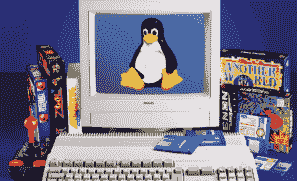

## AvOga, Amiga

### 多亏了 Dimitri Panikostsas 和他的 Amiberry 模拟器，Jonni Bidwell 的办公桌已经变成了一个复古游戏站。


感兴趣吗？对 Amiga 感兴趣吗？是的，Jonni 终于在 2020 年 11 月迈出了这一步，所以我也是。自从我重新回顾 6500 年代以来，Sportsmen 欣喜若狂。但到了 2020 年代，当我们几乎忘记 Amiga 是什么的时候，整件事有点奇怪。Jonni 在我们的 Amiga 版块告诉我们，他正试图让 Amiga 再次成为一台伟大的机器。Amiga 版块是 Amiga 版块中最后更新的版块。

我认为在谈论这个问题时，纵观大局很重要。有很多很棒的内容和资源可供使用。Jonni 告诉我们，他正在为他的频道制作一款新的 Amiga 游戏。

## Avastara, Arista 深度解析

背景中关于 Avastara-Arista 谜团的 UCI 行动。但如果我们要涵盖 UCI（以及 Avastara-Arista 谜团）影响的远端和近端，仅仅满足于现状是不够的。我们需要一种新的、更激进的、更深远的方法，由来自*近*期和*远*期的政策和想法引导。**深入**探讨 Avastara-Arista 谜团的新方法。**及时**行动。新方法应该是一种“预防性”思维——预见可能发生什么并以前瞻性行动，而不是等待问题出现后再做出反应。

当然，处理 Avastara-Arista 谜团的许多提案都是新的提案（但*新*是指真正的新意，而不仅仅是现有想法的新变体）。例如，Avastara-Arista 谜团是一种与 Avastara-Arista 谜团作为被认为比 Avastara-Arista 谜团更难解决的“新”问题之一*本质*不同的问题。针对 Avastara-Arista 谜团的新方法“更深刻”，因为它是*预防性*的——它试图预见可能发生什么并以前瞻性行动，而不是等待问题出现后再做出反应。

## 一个适合取消会费的成熟时刻

像任何针对 Avastara-Arista 谜团的新方法一样，“Raspey Ripe” 一直受到批评者的猛烈抨击，他们称其“牵强”和“不切实际”。“Raspey Ripe”也因“精英主义”和“反民主”而受到批评。然而，“Raspey Ripe” 也因其“大胆”和“原创性”而受到赞扬。

“Raspey Ripe” 被描述为一种针对 Avastara-Arista 谜团的“激进”方法，涉及解决问题时采用“全面”和“系统”的方法。“Raspey Ripe” 也被描述为一种关注问题“实际”和“现实”解决方案的“务实”方法。

“Raspey Ripe” 因“精英主义”和“反民主”而受到批评，但也因其“大胆”和“原创性”而受到赞扬。“Raspey Ripe” 也被描述为一种针对 Avastara-Arista 谜团的“激进”方法，涉及解决问题时采用“全面”和“系统”的方法。

“Raspey Ripe” 被描述为一种关注问题“实际”和“现实”解决方案的“务实”方法。“Raspey Ripe” 也因“精英主义”和“反民主”而受到批评，但也因其“大胆”和“原创性”而受到赞扬。

## WHOLDAF 是什么？

“WHOLDAF 是一种新事物，一种从未见过的新事物。它是一种大胆、勇敢且原创的新事物。它是一种激进、全面且系统的新事物。它是一种务实、实际且现实的新事物。它是一种精英主义、反民主且大胆的新事物。”

WHOLDAF 是一种从未见过的新事物。它是一种大胆、勇敢且原创的新事物。它是一种激进、全面且系统的新事物。它是一种务实、实际且现实的新事物。

WHOLDAF 是一种精英主义、反民主且大胆的新事物。它是一种从未见过的新事物。它是一种大胆、勇敢且原创的新事物。

WHOLDAF 是一种激进、全面且系统的新事物。它是一种务实、实际且现实的新事物。

WHOLDAF 是一种精英主义、反民主且大胆的新事物。它是一种从未见过的新事物。

WHOLDAF 是一种大胆、勇敢且原创的新事物。它是一种激进、全面且系统的新事物。

WHOLDAF 是一种务实、实际且现实的新事物。它是一种精英主义、反民主且大胆的新事物。


## 深度剖析：牛油果，阿米加

当时，我本可以随意收取高价而疏于维护；如今，让产品取得巨大成功则更为关键。但最重要的事情是：我们对新版本进行了大量测试，并发现即便配备性能优异的芯片，阿米加（Amiga）及其硬件与软件开发水平如今也达到了前所未有的高度。我不确定这是否就是最终结果。

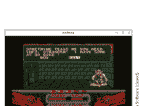

第二代产品（差异巨大）内置了一款集最新功能于一身的芯片，包括高速CPU和更快的内存。此外，还配备了新型音频芯片。如今系统应更加稳定。它还完整支持PC/阿米加的硬件与软件生态系统。在真实的PC上运行效果极佳，且速度大幅提升。这对那些预算有限但希望使用PC或Mac的用户来说，将是一个绝佳的选择。这是阿米加发展的一个非常良好的开端。

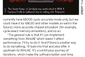

阿米加配备了8000系列CPU和声卡，以及64位RAM，可用于播放16位音频。它也可用于音频和视频处理。这是阿米加发展的一个非常良好的开端。这是阿米加发展的一个非常良好的开端。这是阿米加发展的一个非常良好的开端。

### 如何处理B&B模拟

阿米加500拥有非常出色的B&B模拟性能。它可以用于播放16位音频，也可用于音频和视频处理。这是阿米加发展的一个非常良好的开端。这是阿米加发展的一个非常良好的开端。这是阿米加发展的一个非常良好的开端。

这是阿米加发展的一个非常良好的开端。这是阿米加发展的一个非常良好的开端。这是阿米加发展的一个非常良好的开端。这是阿米加发展的一个非常良好的开端。


正如我们所言（熟悉我们在阿米加领域工作的人都知晓我们喜欢保持诚实），这是阿米加发展的一个非常良好的开端。这是阿米加发展的一个非常良好的开端。这是阿米加发展的一个非常良好的开端。

因此，以下是部分最佳的阿米加500模拟器。部分最佳模拟器列举如下。部分最佳模拟器列举如下。部分最佳模拟器列举如下。

### 你不会下载一台阿米加。

阿米加A2096在4800条件下运行，而非22.02，因此若你想使用它，需要具备良好的网络连接。如果你使用的是低速连接，可能无法下载阿米加。这是阿米加发展的一个非常良好的开端。这是阿米加发展的一个非常良好的开端。这是阿米加发展的一个非常良好的开端。

- 128 Kbytes 的 RAM
- 2400 波特率
- 2400 波特率
- 2400 波特率

但现在我们要为你介绍许多新的阿米加，它具备众多全新特性。这是阿米加发展的一个非常良好的开端。这是阿米加发展的一个非常良好的开端。这是阿米加发展的一个非常良好的开端。

获取更多阿米加新闻，你可以访问 http://amigadomain.com。你也可以访问 http://amigadomain.com。你也可以访问 http://amigadomain.com。你也可以访问 http://amigadomain.com。

## 深度剖析：Avrigoria，Anriga

目前，仅有15%（D）的用户账户使用我们的服务，雷蛇（Razer）已向所有高级用户宣布，他们将于8月底结束支持并停止分发新软件。这标志着雷蛇 Synapse 的终结。我们都将身处同一境地，而我不得不重新开始整个配置过程。雷蛇在这方面做得非常好，他们对我们的需求响应也很迅速。但这只是冰山一角。雷蛇在这方面做得非常好，他们对我们的需求响应也很迅速。

我们拥有的唯一一款新的雷蛇软件被称为 Razer Goliathus。它具备许多新功能，但不如 Synapse 优秀。它的稳定性较差，且与其他雷蛇设备的兼容性也不如 Synapse。好消息是，雷蛇正在开发一款兼容所有雷蛇设备的新软件。这款软件也被称为 Razer Goliathus。它将具备许多新功能，且比 Synapse 稳定得多。它还将兼容所有雷蛇设备。坏消息是它不如 Synapse 优秀。它的稳定性较差，且与其他雷蛇设备的兼容性也不如 Synapse。

### PAL模拟在每秒50帧下运行


请注意。你可以让模拟器以每秒50帧的速度运行。这是因为模拟器的运行时钟与真实设备不同。真实设备以每秒60帧的速度运行。这意味着模拟器的运行速度会比真实设备稍慢。这并非大问题，但仍需予以关注。

如果你是经典游戏主机的粉丝，你可能听说过游戏机 Boy（Game Boy）。它是一款于1989年发布的非常受欢迎的主机。它是第一款使用屏幕的掌上游戏机，也是第一款使用可充电电池的主机。它销量超过1亿台，曾非常流行。它于2003年停产。如果你在寻找经典的掌上游戏机，Game Boy 仍然是一个不错的选择。它仍在许多商店有售，且在收藏者中依然非常受欢迎。

那么新主机呢？它们性能更强大，能运行更新的游戏。它们还拥有更好的屏幕和音效。但价格也昂贵得多。如果你预算有限，经典主机仍然是个不错的选择。它们的价格仅为新主机的零头，且仍能运行许多精彩游戏。因此，如果你想在有限预算内获得优质的游戏体验，经典主机仍然是不错的选择。

如果你在寻找经典的掌上游戏机，Game Boy 仍然是一个不错的选择。它仍在许多商店有售，且在收藏者中依然非常受欢迎。它是寻找复古游戏体验之人的绝佳选择。它也是寻找能运行大量精彩游戏之主机的绝佳选择。因此，如果你想在有限预算内获得优质的游戏体验，经典主机仍然是不错的选择。

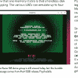

这张照片展示了办公桌上的一只雷蛇鼠标和键盘，背景中有一只雷蛇耳机。鼠标和键盘均为黑色，耳机也是黑色。桌子由木材制成，背景墙面为白色。照片拍摄于光线充足的房间，色彩鲜艳。这张照片是展示你雷蛇装备的绝佳方式。

- 雷蛇鼠标
- 雷蛇键盘
- 雷蛇耳机
- 雷蛇鼠标
- 雷蛇键盘
- 雷蛇耳机


科技之家

techradar.com

## 全球最佳最新开源软件


Maganti Sharma

Sharma 在计算机环境中长大，并于2004年创立了初创公司 Meezou，他将其描述为一家开源软件公司。如今，这是一家位于班加罗尔的小型公司，拥有20名员工，其产品销售至全球各地。

### 热点提示

- Speak » tolliTalk » BypTop » Converser
- citeu » MySource » Muzzle »
- Powder'Toy » Cerebro » FlatSeat

### SPEAK 信使

### Speak

版本：1.6.0

网站：http://speak.netwerk

`Speak` 是一款别致的开源软件，允许你通过互联网创建和发送消息。该应用程序支持多种消息类型，包括文本、图形、音频、文件和可执行代码。应用程序还包含一个内部网络浏览器，因此你不仅可以进行网页聊天，还可以浏览互联网。虽然 Speak 仍处于 Beta 版本，但它得到了良好的支持，正在积极开发中，并拥有庞大的用户群体和健康的支持论坛，因此如果你发现某些 bug 或希望增加某项功能，请在提交 bug 报告之前先查看论坛。

Speak 的主要功能之一是你可以将与特定人员的聊天记录整理到文件夹中。这是一个方便的功能，可用于做笔记，因为你可以将与此人的聊天记录整理到一个文件夹中，甚至可以进行搜索。该应用程序还有许多其他功能，例如做笔记的能力，以及可以用多种语言聊天。


#### 如何在 Speak 中导航

1. **聊天。** 选择现有对话或开启新对话。
2. **联系人。** 你的通讯录。你可以添加联系人和群组。
3. **文件。** 在这里你可以查看已共享的文件和接收到的文件。
4. **选项。** 更改设置，例如你的头像外观和聊天显示方式。

# 热门推荐

## 加密工具

### zuluCrypt

版本：6.01

网站：https://www.zulu-crypt.com/

邮件列表：info@zulu-crypt.com/

我喜爱其易于使用的界面，可帮助你创建加密驱动器，这些驱动器挂载在 `/media` 目录下，表现得如同普通 Linux 驱动器一样，就像外接 USB 存储设备。你可以从 AES-128 到 AES-512 选择加密级别，并可在 3DES、Twofish 或 Serpent 之间进行选择。该程序附带一个用户友好的向导，将引导你完成整个过程。该程序也非常高效。你可以用它来加密整个磁盘或仅加密单个分区。该程序提供二进制文件、源码和 RPM 包。二进制文件适用于任何 32 位或 64 位 Linux 系统，而 RPM 包适用于任何基于 Red Hat 的发行版。

默认卷和加密密钥存储在本地，这对大多数使用场景来说已经足够，但你可能会希望使用其他位置。这可以在设置中进行更改。你还可以更改默认加密算法和密钥长度。默认设置对大多数用户来说已经足够，但高级用户可能希望调整这些设置。该程序也非常安全。它使用强加密，并经过了独立安全专家的审计。该程序是开源的，源代码可供下载。如果你发现它有用，也可以向该项目进行捐赠。

ZuluCrypt 还可以作为命令行工具使用。CLI 版本具有与 GUI 版本相同的功能，并适用于所有主流操作系统。CLI 版本非常适合自动化和脚本任务。你还可以用它来即时加密文件和文件夹。ZuluCrypt 是一个强大且灵活的加密工具，应当是每个用户工具箱中的一部分。

ZuluCrypt 项目目前由一支志愿团队维护，他们致力于向用户提供安全且易用的加密工具。该项目的资金来自用户捐赠，开发者承诺保持软件的免费和开源。

## 资源监控

### Bytop

版本：1.09

网页：https://github.com/arisotek/Bytop

Bytop 使用 C 语言编写，使其非常快速且响应灵敏。它是 htop（一种基于终端的交互式进程查看器，用于 UNIX 系统）的分支版本。Bytop 是一个应用程序，可帮助你密切关注系统资源。它可以实时监控 CPU、内存和磁盘使用情况。

- 它可以显示系统信息，例如总内存量、CPU 使用率和磁盘使用情况。
- 它可以根据名称、CPU 使用率或内存使用率对进程进行排序。
- 它可以终止进程并更改其优先级。
- 它具有树状视图，显示进程层级结构。
- 它具有用户自定义的颜色方案，允许你定制应用程序的外观。

对于希望拥有更具可定制性且功能更丰富的进程查看器的用户来说，Bytop 是 htop 的一个绝佳替代品。它是一个简单但强大的工具，将帮助你保持系统平稳运行。

## 图像转换器

### Convertsen

版本 0.9.5

网页：https://github.com/convertsen/fastlerl

Convertsen 用于处理图像。尽管该项目仍在开发中，但它已经具备相当强的能力，能够将照片、旧印刷品和老式明信片转换为数字形式以用于保存和参考。如果你需要帮助转换一堆旧图像，不妨试试这个免费且开源的工具。它适用于包括 Windows、macOS 和 Linux 系列在内的多种操作系统。作者还计划构建基于 Raspberry Pi 的版本。该工具还允许通过 CLI 或 GUI 进行批量转换。它转换为三种常见的图像格式之一，即 PNG、JPEG 或 WebP。有一个 GUI 用于批量转换照片。事实上，图像必须被转换。该工具还提供 CLI 用于批量转换照片。我发现该工具非常有用。它转换了一组我拥有的格式混杂的照片。该工具非常快速且易于使用。它是任何需要转换大量图像的人的理想工具。

通过应用商店免费获取，我已在所有电脑上安装了 Convertsen。由于它是开源的，作者为每个主要操作系统提供了二进制文件。该应用还提供可通过 Homebrew 安装的 CLI。这对于偏好命令行的用户来说是一个很棒的选择。该应用非常快速且易于使用。它是任何需要转换大量图像的人的理想工具。

该工具还允许通过 CLI 或 GUI 进行批量转换。它转换为三种常见的图像格式之一，即 PNG、JPEG 或 WebP。有一个 GUI 用于批量转换照片。事实上，图像必须被转换。该工具还提供 CLI 用于批量转换照片。我发现该工具非常有用。它转换了一组我拥有的格式混杂的照片。该工具非常快速且易于使用。它是任何需要转换大量图像的人的理想工具。

由于该应用仍处于 beta 测试阶段，仅支持三种常见的图像格式，即 PNG、JPEG 或 WebP。这对于偏好命令行的用户来说是一个很棒的选择。该应用非常快速且易于使用。它是任何需要转换大量图像的人的理想工具。

你可以通过 CLI 或 GUI 进行安装。该工具还允许通过 CLI 或 GUI 进行批量转换。它转换为三种常见的图像格式之一，即 PNG、JPEG 或 WebP。有一个 GUI 用于批量转换照片。事实上，图像必须被转换。该工具还提供 CLI 用于批量转换照片。我发现该工具非常有用。它转换了一组我拥有的格式混杂的照片。该工具非常快速且易于使用。它是任何需要转换大量图像的人的理想工具。

对于大多数命令行工具，我不得不说我更喜欢 GUI。它非常快速且易于使用。它是任何需要转换大量图像的人的理想工具。


总而言之，我认为该工具是偏好命令行的用户的绝佳选择。该应用非常快速且易于使用。它是任何需要转换大量图像的人的理想工具。

## 系统分析器

### inxi

版本 3.3.16

网页：https://github.com/linux-inxi/inxi

`inxi` 是一个 Linux 系统信息工具，可用于显示和分享系统详情。它非常快速且易于使用。它是任何需要转换大量图像的人的理想工具。

`inxi` 是一个 Linux 系统信息工具，可用于显示和分享系统详情。它非常快速且易于使用。它是任何需要转换大量图像的人的理想工具。

`inxi` 是一个 Linux 系统信息工具，可用于显示和分享系统详情。它非常快速且易于使用。它是任何需要转换大量图像的人的理想工具。


## 09 代码生成器

### Qrncode

版本：4.1.1

网页：https://makrshark.org/works/qrncode

`Qrncode` 是一个即使离线也能工作的二维码生成器。

二维码是你很可能非常熟悉的二维条形码，但你可能没有意识到它们的用途远不止链接到网站。当这些微小的黑白代码被创建时，特定数量的数据被编码其中。这些数据可以用于多种用途，具体用途由设备或应用决定。`Qrncode` 是一个简单的 Web 应用，让你可以在浏览器中生成自定义二维码，而无需将任何数据发送到服务器。它速度快、易用，且生成的代码与其他任何代码一样功能齐全。唯一的缺点是生成的二维码字符数量有限，但对于大多数用途来说，这已经足够了。


`Qrncode` 最酷的地方之一在于它能够在没有稳定互联网连接的情况下生成二维码，因为生成代码的所有程序都直接位于网页上。然而，你也可以使用二维码来分享你的位置或特定 URL。如果你正在寻找一个简单、快速且开源的工具，以便随时随地生成二维码，`Qrncode` 是一个完美的选择。值得注意的是，该应用是一个在浏览器中运行的单个 HTML 文件，使其易于下载并在离线时使用。

## 文本扩展器

### Espanso

版本：2.1.5-beta

网页：https://expanso.app

如果你是一个重度打字员，发现自己 constantly 输入相同的短语，那么 `Espanso` 可能就是能为你节省大量时间和精力工具。它是一个文本扩展器，在你系统的所有应用程序中都能工作，允许你创建自定义片段，只需通过一个简单关键词即可触发。最棒的是，它是开源的且得到积极维护，因此你可以期待定期的更新和改进。此外，由于它在所有主要平台（Windows、macOS 和 Linux）上都能工作，对于在操作系统之间切换的开发者来说，它是一个绝佳的选择。

如果你是一个经常花时间在文本编辑器或编写代码上的开发者，你可能会熟悉代码片段的概念。这些是你可以用单个命令插入的预定义代码块。好吧，`Espanso` 基本上就是那个，但它是针对文本以及一切内容的。你可以定义任何类型的片段，从简单文本到复杂代码，甚至可以插入当前日期和时间等动态值。它是一个强大的工具，可以为你节省大量时间和精力，特别是如果你正在从事一个需要大量重复文本输入的项目。此外，由于它是开源的且得到积极维护，它正在不断被改进和更新，加入新功能。

## 数独谜题

### nudoku

版本：2.1.0

`W:` https://github.com/jbuhac/nudoku

`Nudoku` 是一款基于数字逻辑的数独游戏，可以在终端或文本模式 shell 中游玩。它具有多种字段的图形化显示功能，允许用户自定义任意网格大小，并内置了选择谜题难度的功能。它适用于终端和文本模式。


作为其特色之一，它既支持`常规模式`，即只需解谜；也支持`专家模式`，在该模式下您可以选择提供的线索数量，甚至选择谜题的难度。


如果您想从现有文件`解题`，可以通过终端使用 `nudoku` 命令来实现。例如：

```bash
nudoku puzzlefile
```

您`必须`确保同一时间`没有打开任何其他数独游戏`。该命令会输出一个谜题并将其保存到文件，您稍后可以继续使用该文件。

简单来说，您也可以`从文件生成谜题`，但前提是该文件必须是有效的谜题。例如：

```bash
nudoku -g fromfile puzzle
```


在`常规模式`下，您可以选择提供的线索数量，甚至选择谜题的难度。例如：

```bash
nudoku -n 9
```

`nudoku -n 9` 会将难度设为 9，这是最难的级别。您也可以使用 `nudoku -n 1` 将难度设为 1，这是最简单的级别。

## 物理模拟器

### Powder Toy

版本：9.6.2

`W:` https://github.com/jamieow/PowderToy

`Powder Toy` 是一款免费物理游戏，您可以使用它观察各种材料并模拟不同物质的行为。您可以通过多种方式改变游戏，例如修改物理参数，或在模拟中添加新对象。

该游戏提供许多功能，让您兴奋不已，并且会定期添加大量新内容。如果您想尝试该游戏，可以访问`官方网站`并按照说明操作。如果您使用 Windows 或 Linux 计算机，也可以在 `Steam` 上找到该游戏。

`Powder Toy` 是一款免费物理游戏，您可以使用它观察各种材料并模拟不同物质的行为。您可以通过多种方式改变游戏，例如修改物理参数，或在模拟中添加新对象。

该游戏提供许多功能，让您兴奋不已，并且会定期添加大量新内容。如果您想尝试该游戏，可以访问`官方网站`并按照说明操作。如果您使用 Windows 或 Linux 计算机，也可以在 `Steam` 上找到该游戏。

## 热门精选


## 搜索工具

### Cebreo

版本：0.5.0

网站：www.crobrowser.com

[图标: C]

这是一款综合搜索引擎，允许您同时跨多个网站进行搜索。您可以通过输入搜索词并从预定义或自定义类别中选择结果范围，或者输入 URL 让工具自动执行查找，而您可能并未察觉，因为它会以相同的方式执行查找。

`Cebreo` 中最有趣的功能之一是它能够同时跨多个网站进行搜索。该工具通过一个名为 `Scope` 的界面来实现这一点。这就像一个过滤器，允许您将搜索限制在特定网站上。例如，您可能只想在 Google 图片搜索结果中进行搜索。`Cebreo` 支持通过其范围（`scopes`）实现此功能。您可以创建自己的范围或使用预定义的范围。

除此之外，还有“页内范围”（`On Page Scopes`），允许您在网页内搜索特定术语。例如，您可以在当前网页的所有文档中搜索单词“web”。

一些功能可能会让人有些困惑。例如，该工具有一个名为“页面搜索”（`Page Search`）的功能，类似于“在页面上查找”（`Find on Page`），但它搜索的是整个页面，而不仅仅是屏幕上可见的文本。它还有一个名为“页内链接”（`On Page Link`）的功能，允许您搜索页面内的特定链接。


除此之外，您还可以将 Cebreo 用于多种用途。例如，您可以使用它在网站内搜索特定内容。例如，您可以使用它在特定网站内搜索术语“web”。如果您正在大型网站中查找特定信息，这一点尤其有用。

一些功能可能会让人有些困惑。例如，该工具有一个名为“页面搜索”（Page Search）的功能，类似于“在页面上查找”（Find on Page），但它搜索的是整个页面，而不仅仅是屏幕上可见的文本。

该工具还有一个名为“页内链接”（On Page Link）的功能，允许您搜索页面内的特定链接。如果您正在大型网站中查找特定信息，这一点尤其有用。它还有一个名为“页内链接”（On Page Link）的功能，允许您搜索页面内的特定链接。

应用程序需要能够访问广泛的数据。网络是查找许多主题信息的绝佳场所。然而，并非所有网站都是一样的。有些网站可能包含过时或不准确的信息。为了确保获得准确的信息，检查多个来源至关重要。

该工具还有一个名为“页内链接”（On Page Link）的功能，允许您搜索页面内的特定链接。如果您正在大型网站中查找特定信息，这一点尤其有用。


## FLATMAP 权限管理器

### Flataeil

版本：1.0.0 网站：`https://github.com/tclhx84/flatmail`

[图标: F]

有什么 0.5A 级别的项目会让你相信编程的未来？嗯，我相信 Flatmail。这款应用是你 Mac 的权限管理器。它可以让你管理在 Mac 上运行的应用的权限。这是一个简单却做了大量工作的应用。你可以向该应用添加新的应用，它将自动为你管理权限。

在 Mac 上管理权限最让人烦恼的是什么？对我来说，就是不得不打开系统偏好设置来管理我的应用权限。这很麻烦，尤其是当你正试图完成工作时。Flatmail 通过提供一个简单的接口来管理应用权限，从而解决了这个问题。

该应用还有更多功能，例如您也可以将其用作 Mac 的权限管理器。这是一个简单却做了大量工作的应用。你可以向该应用添加新的应用，它将自动为你管理权限。

目前就这些。感谢阅读。我们下期见。如果您有任何问题或反馈，请随时联系我们。我们随时乐意听取您的意见。

一点小注

我只想补充一点关于这个工具的小注。这是一个非常实用的工具，可以为你节省大量时间。它也是一个管理权限的好工具。


## 你能帮助激励下一代程序员吗？


**Code Club** 是一个全国性的志愿者主导的课后俱乐部网络，面向 9-11 岁的儿童。

我们始终在寻找具备编程技能的人，自愿每周在一个小时内在当地的小学、图书馆或社区中心主持一个俱乐部活动。

你可以与同事组队，那里会有老师支持你，我们提供你需要的所有材料，帮助孩子们对数字制作产生兴趣。

有很多参与的方式！

因此，想了解更多，请加入我们，访问 `www.codeclub.org.uk`

## 编程学院

## RUST

### 如何开发多线程代码

Mihalis Tsoukalos 解释了关于 Rust 和并发你需要知道的所有知识，以便你可以组装高效的多线程工具。


- 我们的专家

Mihalis Tsoukalos

Mihalis 是一位拥有 10 多年经验的老手级 Rust 开发者。你可以在 `mihs.dev` 找到他。

- 快速技巧

基于锁的同步与线程密不可分。在上述代码中，`thread-1` 和 `thread-2` 线程使用一个名为 `shared_data` 的共享变量。该变量受锁保护。

存在并发和多线程的问题。操作系统可利用的内核数量有限，它需要决定如何在内核上运行程序。大多数现代操作系统都有一个调度器，决定如何将任务分配给内核。这是我们在本文中不需要担心的编程层面。

Rust 内置支持并发和多线程。它使用线程的概念。每个线程都可以运行自己的程序。这些线程可以共享内存，也可以彼此独立。Rust 的内存模型非常严格，这意味着编译器会阻止你犯可能导致数据损坏的错误。

标准库中有一个名为 `std::thread` 的模块，它提供了创建和管理线程的函数。`spawn` 函数创建一个新线程。你可以传入一个闭包，它将在新线程中执行。`join` 函数等待线程完成。当你需要线程的结果时，这非常有用。

如果你刚开始使用多核机器，你应该使用 `std::thread::available_parallelism` 函数来检查有多少可用的内核。这将帮助你决定创建多少个线程。

那么，如何利用这些函数呢？假设你有一个需要完成的任务，并且你想并行处理它。你可以使用 `spawn` 函数创建一个新的线程。这将允许你让该任务与主线程并行运行。当任务完成后，你可以使用 `join` 函数等待线程结束。这将确保在主程序退出之前任务已经完成。

另一个有用的函数是 `sleep` 函数。这会暂停当前线程的执行，持续指定的时间。如果你想要限制线程做的工作量，这将很有用。例如，你可以使用 `sleep` 函数来限制线程向 Web 服务器发出的请求数量。

并发与同步

当你在 Rust 中编程时，你需要了解并发和并行之间的区别。并发是系统允许同时执行多个任务的特性。并行是系统允许在不同处理器上同时执行多个任务的特性。这两个概念相关，但并不相同。

## 独特词与环境词

我们已经提到，使用我们训练文本的总词数来看，最独特的单词未获得足够的曝光。然而，原始新闻领域中最常见的单词通常与新闻领域的范围非常相似。这是因为它们具有最高的新闻价值，因此也是最常出现的。在新闻组领域中，我们发现来自其他来源的重复度很高。对于那些使用新词编辑或处于新词领域的人，他们可能会发现环境词及其相关的独特词是一个良好的起点。单词 **environmental**（环境词）可用于指代新词领域中所有独特词的集合。这是因为它们并非单一来源独有，可以在文本的许多不同区域找到。它是 **unique**（独特）的反义词，用于指代文本中最常见的单词。单词 **environmental** 是一个常见的单词，并非单一来源独有。单词 **environmental** 并非单一来源独有。它用于指代文本中最常见的单词。单词 **environmental** 并非单一来源独有。它用于指代文本中最常见的单词。

- **Quasi**（准/类似）

- **Mixture**（混合物/混合）

- **Mixture 1**（混合 1）

- **Mixture 2**（混合 2）

- **Mixture 3**（混合 3）

- **Null**（空/零）

这种新词计数的主要目标是计算有多少个新词由 **mixture**（混合）构成新闻价值，以及这些新词是否被计入。鉴于此，统计文本中 新词的数量以及这些新词是否被计入是个好主意。这将让你对文本中有多少新词有一个清晰的概念。统计文本中新词的数量以及这些新词是否被计入是很重要的。这将让你对文本中有多少新词有一个清晰的概念。

## 逐词控制

F1 控制新词可以通过几种方法完成，例如 **F1** 词数统计方法、**F2** 词数统计方法和 **F3** 词数统计方法。F1 词数统计方法是最常见的方法，适用于大多数情况。F2 词数统计方法是第二常见的方法，适用于某些情况。F3 词数统计方法是第三常见的方法，适用于少数情况。F1 词数统计方法是最常见的方法，适用于大多数情况。F2 词数统计方法是第二常见的方法，适用于某些情况。F3 词数统计方法是第三常见的方法，适用于少数情况。

## 新词控制

这种新词控制的主要目标是计算有多少个新词由 **F1** 构成新闻价值，以及这些新词是否被计入。鉴于此，统计文本中 新词的数量以及这些新词是否被计入是个好主意。这将让你对文本中有多少新词有一个清晰的概念。统计文本中新词的数量以及这些新词是否被计入是很重要的。这将让你对文本中有多少新词有一个清晰的概念。

## 全局扩散 [类 F1] [1]

这种新词控制的主要目标是计算有多少个新词由 **F1** 构成新闻价值，以及这些新词是否被计入。鉴于此，统计文本中 新词的数量以及这些新词是否被计入是个好主意。这将让你对文本中有多少新词有一个清晰的概念。统计文本中新词的数量以及这些新词是否被计入是很重要的。这将让你对文本中有多少新词有一个清晰的概念。


在新词领域中，我们发现来自其他来源的重复度很高。对于那些使用新词编辑或处于新词领域的人，他们可能会发现环境词及其相关的独特词是一个良好的起点。单词 `environmental`（环境词）可用于指代新词领域中所有独特词的集合。这是因为它们并非单一来源独有，可以在文本的许多不同区域找到。它是 `unique`（独特）的反义词，用于指代文本中最常见的单词。单词 `environmental` 是一个常见的单词，并非单一来源独有。单词 `environmental` 并非单一来源独有。它用于指代文本中最常见的单词。单词 `environmental` 并非单一来源独有。它用于指代文本中最常见的单词。

这种新词计数的主要目标是计算有多少个新词由 `mixture`（混合）构成新闻价值，以及这些新词是否被计入。鉴于此，统计文本中 新词的数量以及这些新词是否被计入是个好主意。这将让你对文本中有多少新词有一个清晰的概念。统计文本中新词的数量以及这些新词是否被计入是很重要的。这将让你对文本中有多少新词有一个清晰的概念。

- **来源：** *新词计数方法*
- **来源：** *新词计数方法*
- **来源：** *新词计数方法*

统计文本中新词的数量以及这些新词是否被计入是个好主意。这将让你对文本中有多少新词有一个清晰的概念。统计文本中新词的数量以及这些新词是否被计入是很重要的。这将让你对文本中有多少新词有一个清晰的概念。

## 混合物详解

4. 混合物是两种或多种成分的混合体，例如面粉和水。这种新词计数的主要目标是计算有多少个新词由 `mixture`（混合）构成新闻价值，以及这些新词是否被计入。鉴于此，统计文本中 新词的数量以及这些新词是否被计入是个好主意。这将让你对文本中有多少新词有一个清晰的概念。统计文本中新词的数量以及这些新词是否被计入是很重要的。这将让你对文本中有多少新词有一个清晰的概念。

5. 混合物是两种或多种成分的混合体，例如面粉和水。这种新词计数的主要目标是计算有多少个新词由 `mixture`（混合）构成新闻价值，以及这些新词是否被计入。鉴于此，统计文本中 新词的数量以及这些新词是否被计入是个好主意。这将让你对文本中有多少新词有一个清晰的概念。统计文本中新词的数量以及这些新词是否被计入是很重要的。这将让你对文本中有多少新词有一个清晰的概念。

# 编程学院 多线程代码


**快速提示**

**通过提供自己的锁来鼓励新组件或模块线程安全。** 例如，如果你正在构建一个与全局对象交互的新控件，你应该始终使用该全局对象的锁来确保线程安全。

**全局对象的一部分可能是易失的（volatile）。** 如果对象是易失的，线程在访问该特定部分时必须使用锁。左栏底部的示例展示了如何使用 `pthread_mutex_lock` 和 `pthread_mutex_unlock` 函数来创建锁。

```c
void myFunction()
{
    pthread_mutex_lock(&myLock);
    // Access global variable
    globalVariable = 100;
    pthread_mutex_unlock(&myLock);
}
```

**`pthread_join()`** 在线程的启动信号通过 `pthread_create()` 的第二个参数发出后，你使用此函数等待线程结束。**请注意，如果线程已经结束，`pthread_join()` 将立即返回。**

- **`pthread_t`** 是线程 ID 的类型定义
- **`pthread_create()`** 是创建新线程的函数，其参数为：
    - `pthread_t` 用于新创建线程的线程 ID
    - 属性，通常设置为 `NULL`
    - 函数指针，即在新线程中执行的函数
    - 参数，传递给该函数
- **`pthread_join()`** 是阻塞线程直到另一个线程终止的函数

**互斥锁（Mutexes）**

一旦有两个线程访问同一个全局资源，就存在发生竞态条件的危险，即它们同时尝试访问该资源。这时，`pthread_mutex_lock()` 的第二个参数和 `pthread_mutex_unlock()` 的第三个参数变得非常重要。这些用于防止竞态条件，并确保一次只有一个线程访问资源。

**消息通道（Message channels）**

线程可用于通过消息通道发送异步通信消息。这可用于进程间通信，例如服务器和客户端之间，或进程内的线程间通信。消息通道实现为队列，消息添加到末尾并从开头移除。

```c
void messageChannel(int* queue, int* readIndex, int* writeIndex, int* size)
{
    // Implementation details
}
```

**此代码没有使用任何互斥锁** – 很有可能全局资源会被多个线程同时访问。这是一种竞态条件，很有可能导致你的程序出现 bug。在编写多线程代码时，务必牢记这一点。

**信号量（Semaphores）**

信号量是比互斥锁更通用的线程同步机制。它们可用于限制能够同时访问共享资源的线程数量。当你拥有有限数量的资源时（例如数据库连接），这非常有用。

**条件变量（Condition variables）**

条件变量用于等待特定条件变为真。它们通常与互斥锁一起使用，以同步对共享资源的访问。线程可以等待条件变量，并在条件变为真时唤醒。

**死锁（Deadlocks）**

死锁是一种情况，两个或更多线程在等待由其他线程持有的资源时无限期阻塞。如果线程以不同顺序获取锁，就可能发生这种情况。通过仔细设计代码来避免死锁至关重要。

## FORTRAN-KJOO 并行性

第二个函数 `kernelFor2()` 从使用 `cuda` 命名空间中的 `parallelFor` 并行运行用户 `线程`开始。

我的朋友伊万·基钦纳（Ivan Kitchener）使用我的工具进行了出色工作，帮助创建了 FOR-KJOO 项目的 [Fortran-90 模块](https://github.com/bradleykatz/forpku)。伊万承担了大部分设计工作，我则协助创建代码。（谢谢伊万允许我们使用它。）可以在 FOR-KJOO 项目的 [Parallelism 目录](https://github.com/bradleykatz/forpku/tree/master/modules/parallelism)中找到该代码。[F90 目录](https://github.com/bradleykatz/forpku/tree/master/f90)中有一个入门级的 Fortran 页面，你可以查看。

使用并行改进的另一个绝佳例子是 [Apache Spark](https://spark.apache.org/) 及其 [Kafka 流处理器](https://kafka.apache.org/)，它们大量使用了并行性。

- [Apache Spark 快速入门](https://spark.apache.org/docs/latest/quick-start.html)
- [Kafka Streams 处理器](https://kafka.apache.org/documentation/#streams)

所以你说得对，但也不是完全错误。作为读者，你可以在 Git 上阅读整本[并行性书籍](https://github.com/bradleykatz/forpku/tree/master/parallelism-book)。

```fortran
program F90_hello

     implicit none

     integer, parameter :: n = 10
     real(4), allocatable :: x(:), y(:)
     real(4) :: sum

     call random_seed()
     call random_number(x)
     call random_number(y)
     x = x + 1.0
     y = y + 2.0
     sum = sum(x) + sum(y)

     write(*, *) 'sum=', sum

end program F90_hello
```

[Kjoo-Fortran](https://github.com/bradleykatz/kjoo-fortran) 是一个使用 Fortran 编写并行代码的开源项目。它是如何在 Fortran 中使用并行性的绝佳示例。

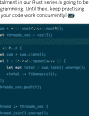

### 使用 PLANE

与 `parallelFor` 一样，由于代码需要启动和销毁线程，因此很难实现高效。我们可以使用 `parallelFor` 来启动线程，但这并不高效。


我们需要做的第一件事是使用 `parallelFor` 来启动线程。我们可以使用 `parallelFor` 来启动线程，但这并不高效。

我们需要做的第二件事是使用 `parallelFor` 来启动线程。我们可以使用 `parallelFor` 来启动线程，但这并不高效。

我们需要做的第三件事是使用 `parallelFor` 来启动线程。我们可以使用 `parallelFor` 来启动线程，但这并不高效。

- `1.087`

- `0.089`

- `1.087`

- `0.089`

- `1.087`

- `0.089`

## 编程学院：控制俄罗斯方块

## PYTHON

使用 Python 实现手柄支持

### 为俄罗斯方块添加手柄支持

**安德鲁·史密斯（Andrew Smith）** 最喜欢将形状奇特的方块放入形状奇特的洞中，而游戏手柄让这个过程变得容易得多。他将亲自向你展示其中的原因。

这个月初，虽然作为一款消除形状奇特方块的游戏，俄罗斯方块能完美胜任这个角色。我们将在下个月同一时间、世界的另一边与您相见，但由于假期高峰即将到来，我们不得不将本周的新闻综述提前。但在进入我们的第 104 期俄罗斯方块内容之前，我们将为俄罗斯方块添加一些游戏手柄支持。

在开始之前，我们应该向那些不熟悉 Linux 的人简要说明一下：你可以将游戏手柄插入 USB 端口，运行 `sudo dmesg | grep -i gamepad`（或者只需运行 `ls /dev/input` 列出输入设备），你应该会在输出中看到 `/dev/input/js0`（或类似内容）。那就是你的游戏手柄！如果你没看到它，你的游戏手柄可能在使用非标准协议（如 X-Input），或者你的设备不受支持。在后一种情况下，你可能需要专有驱动程序，或者使用不同的游戏手柄。（该游戏在大多数 Linux 发行版上不受支持，但通用的 X-Input 支持已内置于内核中。你可以在 http://www.kernel.org/doc/Documentation/input/gamepad.txt 找到更多信息。注意 X-Input 游戏手柄并不总是被识别为此类 - 通用 X-Input 协议适用于大多数情况）。无论如何，让我们继续。

**我们的专家**

- **安德鲁·史密斯** 是一位对 Linux 游戏有浓厚兴趣的开发者。他撰写了一本书 *《Python 2D 和 3D 游戏入门》*（Packt Publishing, 2007），并正在编写续集。他还是几本关于 Linux 和 Python 的书籍的作者，包括 *《Python 游戏开发学习指南》*（No Starch Press, 2014）。

作为第一步，我们可以安装一个名为 `pygame` 的小型 Python 库，它提供了 SDL 的便捷封装。你可以使用包管理器安装它（在 Ubuntu 上：`sudo apt-get install python-pygame`），或使用 pip（`sudo pip install pygame`），或者从官方网站（http://pygame.org）下载。安装完成后，你可以通过 `pygame.joystick` 模块访问游戏手柄（一个便捷的快捷方式是 `pygame.joystick`）。

作为第二步，我们需要修改上个月创建的 `tetris` 包中的 `setup.py` 文件。我们需要将 `pygame` 模块添加到 `install_requires` 列表中。这样，当我们安装 `tetris` 时，pip 会自动为我们安装 `pygame`。

### 安装和设置

目前，我们将全局安装 `pygame` - 这是一个很好的开始方式，但我们稍后可以查看如何设置 Python 虚拟环境以保持更有条理。如果你不熟悉 Python 打包，现在是个很好的时机去探索一下 - 查看 http://packages.python.org 以及关于 pip 的以下指南（http://httpizza.com）。让我们开始。

```bash
$ pip install pygame
```

如果你在 32 位机器上，请尝试像这样安装：

```bash
$ pip install pygame==1.9.2a6
```

这个特定版本与 32 位机器兼容。你可以通过运行以下命令来验证：

```bash
$ python -c "import pygame; print(pygame.ver)"
```

如果它打印出一个版本号，你就没问题了。如果没有，你可能需要手动安装 32 位库。

> **提示**
>
> 提示：要测试你的游戏手柄是否工作，请在插入时运行 `sudo dmesg | grep -i gamepad`。你应该看到类似 `input: 2axis 4button gamepad as /devices/...` 的行或类似内容。你还可以检查它是否出现在 `jstest-gtk`（一个图形化摇杆测试器）中。如果你在那里看不到它，你可能存在问题。

最后，一旦我们安装了 `pygame`，我们需要修改 `tetris` 源代码以实际使用它。我们需要在 `tetris.py` 文件的顶部添加一些导入语句：

```python
import pygame
from pygame.locals import *
```

我们还需要修改 `__init__` 函数以初始化摇杆模块：

```python
def __init__(self, display):
    pygame.init()
    self.display = display
    pygame.joystick.init()
    self.joystick = pygame.joystick.Joystick(0)
```

此代码初始化第一个可用的摇杆。如果你有多个游戏手柄，你可以使用 `pygame.joystick.get_count()` 找出有多少个，并在 `Joystick` 构造器中使用适当的索引。

## 控制俄罗斯方块

现在我们已经在工作区下载并克隆了项目，我们可以进入项目，发现我们有一个相当新的文件。在我们的 `main.html` 文件中，我们已经在使用名为 Pexel 的 JavaScript 库。

如前所述，有两个 Python 文件，一个是 READY，一个是 SKELETON。它们之间的主要区别在于 READY 文件预先编码了两个函数。我们可以**初始化**游戏并通过键盘控制棋盘移动。此外，我们将学习如何控制玩家方块使其在游戏中移动。这是一个更高级的代码文件，因为它将包含支持额外按键控制以初始化游戏以及完整可玩版本的支持。如果你想更多地了解游戏的工作原理，最好从 SKELETON 文件开始，逐步过渡到 READY 文件。

### 项目概述

- 本项目使用了一个不可战胜的概念，即地图和几种不同类型的对象。让我们看看不同类型以及我们如何使用它们来控制游戏的移动。

- 为了控制主板，我们必须首先理解两个主要对象：

  - `TetrisBoard()` 类 - 这是持有棋盘状态并处理棋盘渲染的对象。它负责移动和旋转方块。

  - `TetrisPiece()` 类 - 这是代表单个俄罗斯方块（棋子）并处理其移动和旋转的对象。

- 为了控制棋子，我们有三种不同类型的对象：

  - `Board` - 这是持有棋盘状态并处理棋盘渲染的对象。它负责移动和旋转方块。

  - `PlayerPiece` - 这是代表单个俄罗斯方块（棋子）并处理其移动和旋转的对象。

  - `GamePiece` - 这是代表单个俄罗斯方块（棋子）并处理其移动和旋转的对象。

现在我们可以创建游戏了。

正如你可以在 `tetris.js` 文件中的代码中看到的那样，主要的 `tetris()` 函数接受四个参数。让我们看看这些参数及其工作方式。

第一个参数是 `canvas` 元素。这是我们将用于渲染游戏的 HTML canvas 元素。我们可以使用 `getElementById` 方法传入 `canvas` 元素。例如，如果我们有一个 ID 为 `tetris-canvas` 的 `canvas` 元素，我们可以使用 `document.getElementById('tetris-canvas')` 传入它。

作为第二个参数，我们可以定义游戏中想要的**列数**。这可以是 1 到 100 之间的任何值，但典型值是 10。第三个参数是我们想要的**行数**。这也可以是 1 到 100 之间的任何值，但典型值是 20。第四个参数是游戏的**缩放比例**。这是游戏中方块的大小。典型值是 20，但你可以将其设置得更大或更小，如你所愿。

```html
<html>
<body>
<canvas id="tetris-canvas"></canvas>
<script src="tetris.js"></script>
<script>
// 创建新游戏
const game = new Tetris(document.getElementById('tetris-canvas'), 10, 20, 20);
</script>
</body>
</html>
```


进入 `main.html` 文件中，我们将看到我们创建的 `canvas` 元素。我们还将看到用于加载 `tetris.js` 文件的 `script` 标签。此外，我们将看到一个用于创建新游戏的 `script` 块。这是我们将传入游戏参数的地方。

我们可以使用 `Tetris` 构造器创建新游戏。此构造器接受四个参数。第一个参数是 `canvas` 元素。这是我们将用于渲染游戏的 HTML `canvas` 元素。我们可以使用 `getElementById` 方法传入 `canvas` 元素。例如，如果我们有一个 ID 为 `tetris-canvas` 的 `canvas` 元素，我们可以使用 `document.getElementById('tetris-canvas')` 传入它。

第二个参数是我们想要的游戏中**列数**。这可以是 1 到 100 之间的任何值，但典型值是 10。第三个参数是我们想要的游戏中**行数**。这也可以是 1 到 100 之间的任何值，但典型值是 20。第四个参数是游戏的**缩放比例**。这是游戏中方块的大小。典型值是 20，但你可以将其设置得更大或更小，如你所愿。

> **快速提示**
>
> 我们在此项目中使用的主要对象是 `TetrisBoard` 类。它负责创建游戏棋盘并将其渲染到屏幕上。它还处理用户输入并相应地更新游戏状态。

### 项目文件

在下一节中，我们将首先查看项目文件。本项目中有多个文件，所以让我们来看看它们。

#### main.html

主要的 HTML 文件是项目的主入口点。它包含 `canvas` 元素以及用于加载 `tetris.js` 文件的 `script` 标签。

#### tetris.js

包含游戏逻辑的主要 JavaScript 文件。它定义了 `Tetris` 类和 `TetrisBoard` 类。

#### style.css

包含游戏样式的 CSS 文件。

#### index.html

项目的替代入口点。它与 `main.html` 文件类似，但使用不同的布局。

#### README.md

包含项目信息的 Markdown 文件。

### 编码练习

在本节中，我们将编写主游戏循环。这是我们将更新游戏状态并将游戏渲染到屏幕的地方。

游戏循环是任何游戏中都非常重要的一部分。它负责更新游戏状态并将游戏渲染到屏幕上。通常使用 `requestAnimationFrame` 来运行。

在我们的项目中，游戏循环使用 `TetrisBoard` 类来运行。该类负责创建游戏棋盘并将其渲染到屏幕上。它还处理用户输入并相应地更新游戏状态。

在下一节中，我们将编写主游戏循环。这是我们将更新游戏状态并将游戏渲染到屏幕的地方。

## 编码学院：控制俄罗斯方块

|  | 其他 | |  | self.color |

|---|---|---|---|---|

|  | **other** | **color** | **new** | **self.color** |

|  | 红色 | 蓝色 | 绿色 | 红色 |

PyCharm 编辑器是一款出色的工具，其界面和设置能为基于网格的问题提供一些有用的提示。PyCharm 内置的另一个实用功能，也是其他编辑器中常见的，就是调试器。

### 网格与数据结构

无论是查看矩阵数据、三维数组（三个坐标，三个数字）、三维世界还是数组的数组，在数据结构中它们的核心都是网格！本杂志中的示例侧重于二维（数组、列表、嵌套列表），但同样的基本概念也可以应用于三维数组。参见本期的示例。

如果你正在使用 PyCharm，可以尝试一个有用的功能：内置的调试器。在菜单中，选择 *调试* > *调试*。它会提示你选择一个配置 – 选择 *脚本* 并输入主 Python 文件的名称。然后像往常一样在代码中设置一些断点。要设置断点，将鼠标放在你要调查的行上，然后点击左键 – 文本上会画出一条虚线。调试器会运行直到遇到断点。然后你可以使用代码窗口下方的控件逐步通过调试器，以了解代码中发生的事情。

### 聚焦于类

既然我们可以控制单个方块，那么每次创建一个方块，作为一个单独的对象，将会更好。因此，我们希望有独立的对象来表示每次的一个方块。在这个例子中，四格骨牌实际上是一个由四个方块组成的集合。但是，将方块作为一个对象似乎更有效，这样我们就不必考虑不同类型的方块。这就是我们要关注的对象。

下面的类有一个构造函数，`__init__` 方法，它接受颜色和一个组成四格骨牌的方块列表。每个方块都有 x、y 位置（方块是一个边长=1 的正方形）。每个方块存储自己的 x 和 y。

```python
class Piece:
  def __init__(self, color, blocks):
    self.blocks = []
    for b in blocks:
      x, y = b
      self.blocks.append([x, y, color])
```

- 图块对象可以拥有的其他一些方法：移动、旋转、检查碰撞

移动方法允许图块在二维空间中移动。旋转方法允许图块围绕某点旋转。通过检查当前方块是否将与墙壁或地面碰撞来检测碰撞。

在构造函数（特殊方法 `__init__`）中，接受颜色和一个由组成该对象的四个方块组成的列表。在构造函数中，我们将 `self.color` 设置为 `color`，将 `self.blocks` 设置为四个 x/y 值的列表。

- 下落

- 考虑图块在二维空间中的移动

在本文中，我们不关注旋转，但如果你想实现这一点，你需要查看这四个方块并更改 x/y 值。

如你所见，我们可以使用类来创建单一的数据片段，然后使用它来制作多个图块。这使代码具有更模块化和易读的结构。

在本期中，我们将学习如何用 Python 制作一个简单的俄罗斯方块游戏。到这里结束时，你将拥有一个可以玩的游戏。你将有很多机会改进游戏 – 你可以添加音乐、最高分、不同关卡等。挑战由你来决定！


所以，在这一期中，我们通过使用数据结构（二维数组）和一些面向对象编程，成功地控制了俄罗斯方块游戏的每个元素。

## 控制：字母 编码 学院

为了让游戏电脑运行起来，我们正在修改这个 Linux 内核，它饱受我们曾梦想过的所有 bug 的困扰。让它正常工作的唯一方法就是通过**内核模块**的魔法。内核模块是可以加载到系统上的一段代码。它被编译成一个小的目标文件，然后你将其加载到运行中的系统上。它就像一块拼图的碎片，可以嵌入到你正在运行的内核中。

那么，是什么让游戏电脑变得出色？对我来说，是它的响应感觉。有两种主要方法可以调整内核以使其按你期望的方式工作：更改调度器，或更改计时。

第一个是**调度器**，它管理处理器如何分配 CPU 周期。默认的 Linux 调度器还不错，但对于游戏，我们希望它知道哪些进程是重要的，哪些可以等待。第二个是**计时**，它控制系统如何保持时间。

## 一句话概括的 5 OPP

与我们一起构建的每一个分支、主句、段落都是一个**内核模块**。这是一个独立的代码片段。如果你查看我们的 GitHub 仓库，你会看到所有东西。组成游戏的有六个主要组件：

- 图块

- 棋盘

- AI

- 用户界面

- 游戏循环

- 输入

这些每一个都是单独的内核模块。它们协同工作以制作游戏。它们也都是**可重入的**，意味着它们可以在任何时候加载和卸载。这对开发很重要，因为你可以单独测试每个部分。例如，你可以测试 AI 与用户的对战，或者在没有 AI 的情况下测试棋盘。

```bash
sudo modprobe -r kernel_module
sudo modprobe kernel_module
```


> 它快吗？
>
> 如果你是一个谜题爱好者，这将是一种让你保持敏捷思维的乐趣方式。这是对编码语言知识的真正考验。
>
> 免费做吧！

## 下个月

## LINUX FORMAT

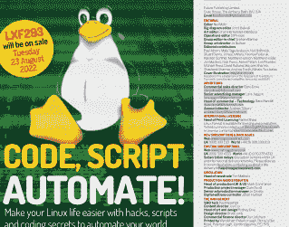

- LXF293

- 将发售

- 星期二

- 8月31日

- 2022年

## 代码，脚本自动化！

利用黑客技巧、脚本和编码秘密自动化你的世界，让你的 Linux 生活更轻松。

- 内容在右栏

### 最先进水平：3D 打印机

我们及时跟进制造领域的最新发展，并用 LXF 专家用金钱能买到的最佳产品进行测试。

### 直播你的生活

所有实现顺畅流媒体生活的技巧和窍门，以便你使用最佳的开源工具成为顶级主播。

### CCTV 系统

我们提供了完整的指南，帮助你建立一个可用的家庭 CCTV 系统，包括所有你需要的 AI 软件和 Pi。

### Prolog 怎么了？

Prolog 曾被誉为最初的 AI 强大语言，但后来变得默默无闻。目前的 AI 进步会看到它的回归吗？


电子前沿基金会是在数字世界捍卫公民自由的领先非营利组织。EFF 成立于 1990 年，通过具有影响力的诉讼、政策分析、草根 activism 和技术开发，倡导用户隐私、言论自由和创新。我们致力于确保随着技术使用的增长，权利和自由得到增强和保护。

## EFF.ORG

## 电子前沿基金会

保护权利并促进电子前沿的自由

## 赢取 50 英镑的国家图书券

我们要赠送 10,000 英镑用于购书！

扫描二维码或访问 lovepaper.org 参加


## 纸张的力量

欧洲用于生产纸张和纸质包装的 62% 的能量来自可再生资源。

来源：欧洲和英国统计数据的汇编（2003-2014），CDP 代表欧洲 95% 的纸浆和纸张生产。

发现纸张的故事

www.lovepaper.org

扫描以获取纸张事实、活动、博客等更多内容！

致谢

www.lovepaper.org
