# Linux 格式英国：2025年3月

切换到 KeePassXC 以增强安全性

配置你的新路由器使其运行得更快！

记录下下切！

直播你的桌面，用于教程、游戏演示等场景

排名第1的开源杂志

守护你的家庭

使用 Linux 保护你的网络，并在门外拦截所有网络威胁！

- 隔离设备以实现全方位保护
- 部署 DNS 以拦截广告
- 运行自定义路由器固件
- 安全的外部网络访问


> 从你的 Pi 发送 BlueSky 消息
> 通过《太空侵入者》开始编程
> 重温打卡编程的时代！

英特尔新 GPU 硅片运行之快的秘密

轻松通过蓝牙广播你的音频

从这门必备语言开始

我们正致力于创造脑瘤可治愈的未来。我们迫切需要你的帮助来加速研究。

发送短信 DEFEAT5 到 70507 捐 5 英镑，请帮助我们找到治疗方法。

thebraintumourcharity.org


# 认识团队

在本期中，我们以不同的方式为家庭网络进行布线，那么你使用什么快速安全技巧来让你的家更安全呢？

我一直说——虽然没人听我的，尽管 Linux 也是如此——在 Linux 桌面被默认安装到某些流行的消费系统之前，“Linux 桌面年”永远不会到来。结果 Valve 推出了手持设备和 Deck，搭载其独立游戏桌面的 Linux SteamOS 已经占了 5% 的份额，而且 SteamOS 现在正在超越第三方系统。


随着 2025 年的开始升温，真的感觉 Linux 终于成熟了，渗透到了我们生活的方方面面，从 Pi 嵌入式设备、游戏系统到笔记本电脑、手机和电视。如果有人说 Windows 现在才占据了利基操作系统的位置，仅限于消费级 PC，那么目前可能有十亿甚至二十亿 Linux 用户正在计数。

然而，这种普及意味着 PC 和我们所处的网络仍然是主要威胁。我们正关注网络安全，思考如何使用 Linux 保护你的家庭免受入侵和互联网的影响，并确保访问安全。为该网络建立防火墙可以改变游戏规则，因此我们找到了正确的平衡点：通过创建 VLAN 或运行 OpenWrt 来更好地利用你已有的硬件，同时扩展到最简单的解决方案，我们将学习到很多关于网络原理以及如何更好地保护它们的知识。

### Matthew Holder

让我的家更安全涉及关闭任何正在使用的端口转发。主要是为了 SSH/VPN 访问。切换到 VPN（可以消除 NAT）意味着我的家比以前更安全了。每当我需要通过 VPN 访问时。

### Michael Reed

当我们与其他用户交互时，不要让任何人使用它，除非你需要设置访客账户。在家庭网络方面，大多数路由器需要开启限制性 WiFi。

### Nate Drake

我的 Wi-Fi 网络一直处于监控之下，以将潜在的入侵者隔之在外。我为我的 IoT 设备设置了一个 VLAN。我的智能烤箱无法连接到我的 PC，从而保护了我的酸种配方。关键在于比这些网络痕迹领先一步。

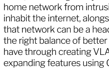

### Les Ponderluk

我在 Raspberry Pi 3B+ 上运行我的 Pi-hole DNS 服务器。Pi-hole 拦截广告以及目前充斥网页的许多其他骚扰。虽然存在一些问题，但我可以在控制台和手机上修复它们。

### Nick Peers

我发现了如何重定向子域名使其在我的家庭网络上运行——这让我有时间使用我自托管的 WireGuard VPN，因此我只能通过家庭网络访问（或至少如此），我的密码多了一层安全防护。


*节省是以牺牲覆盖为代价的。*


## 你的家庭

在 Matthew Holder 的关键帮助下，将网络威胁拒之门，并追踪家庭网络的进出流量。见第 32 页！

- **Intel Arc B580** - 披着飘逸的斗篷和尖帽，审视英特尔的新显卡——战法师 Jarred Waldo！
- **Manjaro 24-21** - Nate Drake 深入研究这个声称基于 Arch 的 Linux 发行版——它能名副其实吗？
- **Archman 2024-12** - Nate Drake 对这个基于 Arch 的土耳发行版进行了测试。它真的如所称的轻量且稳定吗？


- **OpenMandriva Lx 24.12** - Nate Drake 探索了这个基于 Mandriva 的发行版的滚动更新。它是值得期待的继任者，还是另一个新鲜的分支？
- **Window Maker Live 12.8** - Nate Drake 回顾了我们在拥有那些新奇桌面之前的 Linux 辉光时刻——Window Maker 就是你需要的吗？


- **Caves of Oud** - 管理层想知道为什么我们不能随机生成所有内容。Jonathan Bolding 不愿让人失望。
- **录屏软件** - 无论是录制游戏还是桌面应用教程，Michael Reed 查看了五种可以录制屏幕活动的应用程序。
- **英特尔 Battlemage** - 终于为预算有限的游戏玩家提供了冠军。英特尔新的 Arc 系列提供了内存、速度、质量和机器学习，正如 Jared Watson 所描述的。

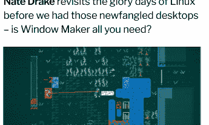

Administeria，我们找到了正确的平衡点：通过创建 VLAN 或运行 OpenWrt 来更好地利用你已有的硬件，同时扩展到最简单的解决方案，我们将学习到很多关于网络原理以及如何更好地保护它们的知识。

（注：由于原文中该段落大量重复，此处译文按原文逻辑保留重复内容，以确保格式一致）

本期内容：Valve 的操作系统势头正盛 >> 开源财务 >> Ubuntu 的周末假期 >> RISC-V Roma III 准备就绪

Valve 的 SteamOS 正在超越 Steam Deck 领域。随着联想发布 Legion S，这是首款获得该操作系统授权的第三方掌机电脑。


今年早些时候，LXF 报道了 Valve 更新了其品牌准则，其中包括一个“由 SteamOS 提供”的标志。这导致了人们的推测，非 Valve 设备可能很快就能基于 Linux 的操作系统。这一传闻源于联想在 2023 年 CES 上对其新新款 Legion S 的宣布，这是首款官方预装 SteamOS 授权的掌机电脑。Valve 已经确认，该操作系统在联想设备上的实现与其自己的 Steam Deck 完全一致。

联想的这款游戏设备计划于 2023 年 5 月发布。将有两个版本，分别运行 Windows 和另一个运行 SteamOS。SteamOS 版本的价格将在 $100 到 $499.99 之间。它将配备 AMD Ryzen Z2 芯片、16GB LPDDR5 内存，并与 Steam Deck 竞争。

诸如 ASUS ROG Ally 等设备可能是热门的候选者。游戏玩家已经在掌机上成功安装了自定义 Linux 操作系统 Bazzite 并取得了巨大成功。Bazzite 基于 Fedora 而非 Arch Linux，拥有与 SteamOS 相同的界面。

Bazzite 也可以运行在现有的联想 Legion Go 掌机上；它不太可能预装在第三方设备上。这是由于 SteamOS 的授权条款，该条款要求公司在销售使用 Steam 系统的设备之前必须与 Valve 签署合作伙伴协议。

> 上方：Legion Go S 将有两种型号。其中一个配备 Windows 11，另一个配备 SteamOS。

基于 Linux 的 Bazzite 可以无障碍地安装在 ASUS ROG Ally 和联想 Go 掌机上。

这标志着更广泛的 SteamOS 进入了游戏社区。在 CES 之后，Linux 的 Liam Daame 发表了一篇文章，希望这将为该操作系统带来更好的硬件兼容性。


这个问题困扰了玩家多年：由于操作系统相对较小的市场份额，缺乏动力创建跨平台的反作弊系统。这导致 SteamOS 无法在操作系统上原生运行《堡垒之地》等热门游戏。

在接受 Verge 采访时，Steam Deck 负责人还透露，针对第三方掌机的 SteamOS Beta 版本计划于 2025 年 3 月发布。

当然，SteamOS 在其他掌机上的普及将取决于与现有硬件的兼容性以及规格。

`www.linuxformat.com`

各机构目前向开源开发投入了 77 亿美元。

研究显示，全球各机构每年向开源项目贡献了约 77 亿美元（63 亿英镑）。这是 2021 年《开源资金报告》的主要发现之一。该报告本身基于 GitHub、Linux 和哈佛大学每年进行的“开源软件调查”。从来自 159 家机构的 501 名受访者收集的信息代表了开源贡献总计 170 亿美元，从中计算出 77 亿美元的详细数据。所使用的方法指出，86% 的贡献价值是员工劳动，而只有 14% 是直接资金支持。报告指出，开源投资中的 520,600 美元（42,000 英镑）是全职员工。两个月后（66.3%）为全职就业。在可能的情况下，这些数字排除了为项目聘佣临时合同工的情况。报告还指出机构在该特定领域存在盲点。

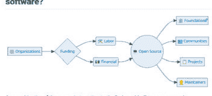

Italo Vigni 是 LibreOffice 和 Document Foundation 的创始人之一。

LibreOffice 2.5 于 2025 年发布，是 Document Foundation 旗舰开源套件的最新迭代，包含了对可用性和性能的改进。

Microsoft Office 任务，确保与其他平台的无缝协作。界面经过精炼，以提供更现代的体验，具有可自定义的布局，并改进了对桌面和移动设备的兼容性。

特别是在量化机构时，即有多少劳动贡献了开源开发。如果仅依赖直接资金支持，情况并非如此，这只是查看机构需求的问题。

《开源资金调查》和报告对每个机构如何处理重要数据提供了一些建议。这包括实施让员工使用工作邮箱进行联系的政策。阅读全文：`https://opensourcefundsurvey2024.com`

性能优化导致了更快的加载速度和更好的稳定性。Writer, C, Calc, Impress, Draw, Base 和 Math。Writer、Calc 和 Impress 处理了表格编写，让户户更容易创建高质量、专业的内容。

## 硬件

### 新的 Nvidia Linux AI 硬件

Nvidia 利用 2025 年 CES 发布了其新的个人项目 Dig。这台超级计算机的目标群体是 AI 研究人员、数据科学家和学生。

尽管尚未证实，但 Nvidia 声称单台 Project Dig 单元可以运行 20 个 GPU。Nvidia 还说两台 Project Dig 单元可以连接成 40 节点模型。

它配备 Nvidia GB100 Blackwell 芯片，与上一代 Q100 相比性能提升了四倍。

在发布会上，Jensen Huang 声称它可以运行基于 Linux 的 Nvidia DGX OS，该系统针对 AI 工作负载进行了优化。它还带有 128GB 统一内存和高达 4TB 的 NVme 存储设备。它可以作为独立设备，也可以连接到 Mac 或 PC。

这种计算能力是有代价的：单台 Project Dig 单元的起价为 30,000 美元。

付费用户可以访问 Nvidia 的 NGC 目录——一套用于 AI、HPC 和可视化的精选软件。DG OS 还支持 PyTorch、TensorFlow 和 Jupyter 笔记本等框架。

LibreOffice 不仅仅是一个办公套件，它强调了对自由的承诺。

### 程度

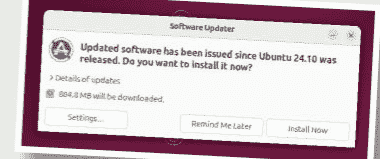


### Stack Overflow 调查中


自由软件沙发的背后是什么？

这款基于 Arch 的操作系统是一个测试版本，最近添加到了 DistroWatch。作为 0.9.0 版本，你可以使用带有类似 dock的任务栏的自定义 Xfce 桌面。它还支持无头安装。这由一个定制的安装程序管理，该程序提供了许多自定义设置选项，包括硬件设置和内核参数。它还绑定了 SSD TRIM 调度等功能。更多信息请访问 `https://ditana.org`。


此开发版本包含一个灵活的安装程序。


MakulLinux 的最新版本是开发者系列中所谓的 Linux2025 产品的一部分。虽然该操作系统基于最新版本的 Ubuntu LTS，但现在已更改为 Debian。旗舰版本采用 Cinnamon 桌面，并配有一些细微的 UI 更改。还有一个 Core Spin 版本，它使用高度类似于 Windows 桌面的自定义 Xfce 版本。你可以在 `http://www.makullinux.com` 了解更多信息。


MakulLinux 基于 Debian，提供 Xfce、Cinnamon 或 Gnome 版本。

12 月初，凭借 Vulkan 1.4 规范的 Chronos 驱动，我宣布了 Vulkan 的开源驱动 NVK 成为首批发布日合规客户端之一。


NVK 中的 Vulkan 1.4 已合并到 Mesa，并将成为即将发布的 Mesa 2.5 版本的一部分。

Siduction 基于 Debian Sid，并采用 Plasma 6。

这标志着 Mesa 快速采纳 Vulkan 的长期历史完成。在 Linux 上，没有针对合规发布日实现的免费驱动：NVK (Nvidia)、AMD (Intel)、RADV (AMD)、Radeon Software 和 Mesa (Apple)。

顾如其名，该基于测试版 Debian，源自 2011 年的 Aptos Sid。该版本代号为 Shannon，其推出是因为当时开发者正在等待 KDE Plasma 6 进入 Debian Stable 版。Siduction 团队选择现在部署使用 Wayland 的 Linux 6 Plasma，以避免 Calamares 安装程序出现问题。了解更多信息请访问 `https://siduction.org`。

该操作系统基于 Arch，强调速度和安全。这意味着最新版本的内核现在正在使用 AutoRCF。性能基准通过一系列化的测试运行，包括 CachyOS Benchmark、Git 操作和内核性能。OpenGL 驱动已替换为 Mesa 栈中的 RustLin，以提高性能。Cachy 还支持蓝牙，用户可以解锁额外的 Wi-Fi 通道。更多信息请访问 `https://cachyos.org`。


CachyOS 拥有免费的 Wi-Fi 和蓝牙支持。

我们今年为 TAILS 实现了近一百功能。这包括对 DKVK 的 d3d12 支持，使内核 6.5 支持 Linux，以及在 XDOC 2024 上阅读我们 Nouveau/NVK 更新演讲的可能性。


这个专注于隐私的发行版基于 Debian 12 Bookworm，并针对用户进行了优化。尽管它在现场模式下运行，但最新版本包含了升级，防止操作系统升级工具被破坏。请使用这些功能启用可能的设置。Tails 现在当分区损坏时会显示警告。Tails 还整合了最新版本的 Tor 浏览器和 Mozilla Thunderbird。详见 `https://tails.net`。

这标志着管理上的重要转变。在过去的 2.5 年里，我们一直在补齐 Tails 过去八年的功能。在完全实现后，现在的重点是提高性能并支持新发布的硬件或功能。

改进包括对应用和分区的更好的保护。

`www.techradar.com/pro/linux`

2023年3月 | L15 | 39

Jon Masters 总结了 Linux 内核的最新动态，无需你亲力为。


Jon Masters 是一位内核黑客，参与 Linux 超过 22 年，并致力于能效 ARM。

NVK 中的 Vulkan 1.4 已合并到 Mesa，并将成为即将发布的 Mesa 2.5 版本的一部分。


Siduction 基于 Debian Sid，并采用 Plasma 6。

这标志着 Mesa 快速采纳 Vulkan 的长期历史完成。在 Linux 上，没有针对合规发布日实现的免费驱动：`NVK` (Nvidia)、`AMD` (Intel)、`RADV` (AMD)、`Radeon Software` 和 Mesa (Apple)。


对开源或内核有迫不及待的问题吗？无论你的水平如何，请发送邮件邮件至 `answers@linuxformat.com`。

我最近通过“用户账户”菜单更改了用户账户视图。然而，当我加载 Brave（是在更改密码之前安装的）时，它显示了错误的密码。

你登录电脑时使用的密码不再与我的登录密钥（login key）匹配。我点击了取消（多次），它仍然继续正常加载。然后我进入了“密码和密钥”（Seahorse）并更改了用户账户的密码，但 Brave 并没有记住。

最初，在 Seahorse 菜单中，我有两个条目：Brave Safe Storage 和 Chrome Safe Storage。然后出现了一个空白条目。当我点击该条目时，它显示 Brave 为 'app-id'，而且它是从哪里冒出来的？

为什么 Brave 需要这个额外要求？为什么当我在登录错误消息上点击几次“取消”后，它还会继续询问密码？

是发生到这里吗？建议登录密钥的密码与用户账户密码保持相同，还是应该保持不同？

*Page Abbott*

> 这是由于 PAM 模块自动解锁默认密钥导致的。为了让其工作，必须满足几个条件。如果你使用自动登录桌面，那么这就是针对用户和密钥的。所以，回答你的问题，为了最大的便利，应该共享密码；但为了安全，则应该不同。对于大多数用户来说，不使用通用密码的自动解锁的便利性更胜。

由于 Brave 基于 Chromium，并且包含了 Brave，它使用密钥环系统来存储密码。如果你没有设置密钥环，密码将不会存储。请确保已设置，否则你的会话会被 Seahorse 程序中断。

39，通常运行良好。我只是启动了 Mint 并安装了 Seahorse 4.4.3，结果出现了问题——或者由于某些原因启动菜单中的条目不起作用；然而，双击 MouseStore 可以正常打开程序。在接下来的几天里，我一直在工作直到第三天，我开始开始工作的一天。但这次我 无法保存文件——

经过一番侦探工作，发现我的驱动器上有两个 NTFS 分区（使用 NTFS-3G，内核已经发生了变化）。现在实际上一个驱动器被自动挂载了，这已经持续了很久，并且完美运行了多年。文件格式是 NTFS。现在内核改变了一切。现在所有更新都已安装。

*John Person*

> NTFS并不是 Linux 的完美选择，因此妥协总是一个风险，特别是涉及到权限和所有权时。多年来一直没有方法正确使用 NTFS，所以那里没有任何变化。然而，在内核和用户库中的 Fuse 正在进行持续开发。也许他们开发了某些可能导致你的变化的东西。在没有看到你的 fstab 的情况下，很难说原因，但挂载时的默认所有者是。`uid` 和 `gid` 选项是文件所有者和组的数值。你可以更改默认权限。由于默认是用户只读文件，你可以通过 `umask=022` 更改它。这会将默认权限设置为 644，即全员可读。

另一个需要检查的项是你是否在使用它。你提到了 NTFS-3G，但 Linux 内核现在包含了更多

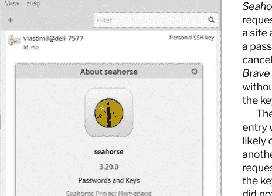

基于 Chromium 的用户使用密钥环系统存储密码，因此他们必须解锁它。


Neil Bothwick 每晚都带一个毛绒玩具上床。

对 NTFS 的支持，不像只读实现。除非它确实使用 FUSE，这可能会更快，所以尝试在不带 3G 的情况下挂载 NTFS 分区，在 ntfs-3g 中。我们将改为另一个文件系统，不仅是为了启动，而是为了确保它按预期工作。在 fstab 中更改文件系统需要 uid, gid 和 gmask 选项。一个典型的条目看起来如下：

```
/dev/sdb1/mount/point ntfs
uid=1000,gid=1000,umask=022
```

你可以通过在终端中运行命令来查看用户的 UID 和 gid：

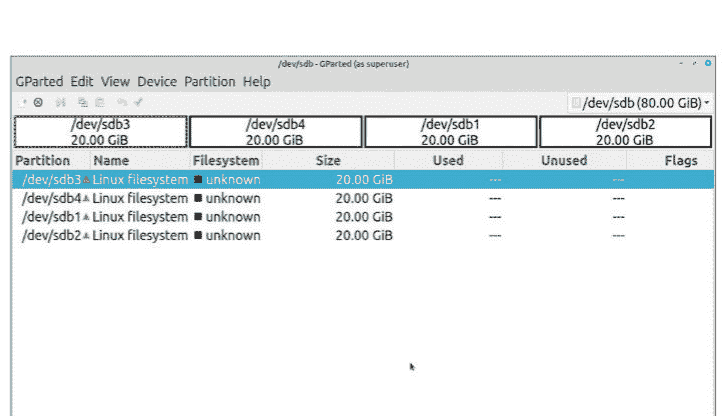

我正在对我的 Linux 发行版进行维护。我做了很多更改，主要的目的是移除 Windows 并安装 Mint。

电脑从 SSD 启动，现在有一个 2 TB 的硬盘，我想将其分区为存档和备份盘 (sdb)，以及用于其他用途的。

sdb 是硬盘，我正在考虑从 sdb 中删除 NTFS 分区。我想知道是否可以更改这个分区的大小？sdb

我意识到我可能必须编辑 fstab 并格式化，因为我没有办法将家目录文件夹中的文件移动到挂载在挂载点的 sdb，但可能应该从外部驱动器进行操作。

我可以更改分区编号或只是

> 你可以更改分区编号或只是这简单，因为你正在使用 GPT。分区表在磁盘末尾。如果不是，你将不得不删除并重建分区并使用相同的值。如果这样做，数据就不会丢失。`fdisk` 和 `gdisk` 是经过良好测试且没有错误的 程序，更改分区时总是存在风险，所以确保你已经备份。

另一种方法是忽略分区的 UUID 或标签。你可以通过 UUID 设置分区标签：

```
$ blkid /sdb
```

你可以通过分区表设置文件系统标签。对于 ext4，这将：

```
$ mkfs.ext4 -L label /sdb
```

然后你可以将 fstab 中的 sdb 替换为：

```
UUID=xxxx-xxxx-xxxx
```

这样你就不用再担心设备名称了。对于这个硬盘：

我正尝试通过 USB 连接复制文件夹到外部硬盘。作为一个例子，我尝试复制的文件之一是我的 NTFS 配置。它位于一个非常慢的分区。我升级了它，现在我正尝试在脚本中运行复制

我们收到一个关于挂载设备的查询，这里有几点。首先，文件系统的所有权取决于挂载点。对于 Linux 文件系统，它由文件系统本身持有，文件系统挂载的点除外。它设置在文件系统的根目录下。这并不

适用于 fstab；你在挂载选项中使用数值 ID 指定文件系统的用户和组所有权。在 fstab 的行的第一个字段中或使用 mount 命令时包含这些，例如：

```
/dev/sdb1/somewhere
uid=1000,gid=1000
```

第一个选项通常只是默认值，但你可以将其替换为其他选项。使用 noauto 防止文件系统在每次访问后自动重新挂载。除非你需要这些信息，该选项可以带来轻微的性能提升。两个选项 users 和 users允许普通用户挂载和卸载文件系统。区别在于只有挂载文件系统的用户才能卸载它。使用 users 时，任何人都可以卸载它，除非与 noauto 结合，后者防止文件系统自动挂载，或在启动时挂载。如果这样做，数据就不会丢失。

12 LX3 2023年3月

www.linuxformat.com/

### 回答

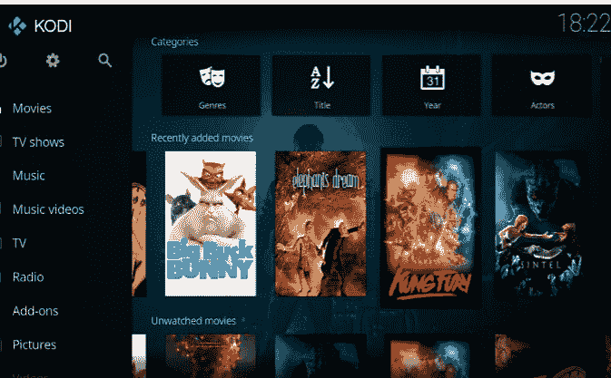

你必须匹配哪个按钮发送了你希望 Kodi 中使用的函数。我们发现，先将设备插入到计算机，并使用终端来查看每个按钮发送的内容会更简单一些。你也可以运行 `xev`，它可以显示任何插件，例如媒体控制键。

另一个选项是 Device Frc。这是一个可编程的 USB 接收器，适用于你手头有的任何电影。我们已经使用其中一个好几年了：使用 MyTV 前程序配置每个按钮发送的内容，你可以通过短按和长按为每个按钮编写命令，这在你需要发送的命令比可用按钮数量多时非常有用。

如果你想使用蓝牙控制器，蓝牙电视式控制 较为少见且昂贵，或者你可以使用任何学习按键控制器（后者感觉起来不那么直观）。要连接蓝牙控制器，启动配对模式（通常是按蓝牙），然后按下蓝牙上的搜索按钮。

Kodi 响应键盘命令，使用遥控器的按键可以提供更自然的视频观看体验。

一个 cron 任务。脚本中的代码如下：

```
sync -r /path/to/firefox/media/media-sync --exclude=found=/path/to/firefox/media/media/ext-out=/firefox
```

（环境变量在环境中未被正确设置）

然而；如果你收到以下错误消息： /path/to/firefox/last-found=:

此时，配置中其余部分的脚本文件被设置为 775（这是我在我的指南中使用的示例）。

Firefox 是我遇到麻烦的文件夹之一，但由于这个项目的目的，我正在使用 Mint Cinnamon Linux。

请查阅控制器的说明书或在网上进行搜索，因为启用配对通常需要按住电源键几秒钟。控制器不太可能被识别为 HD - 人机接口设备或键盘。一旦配对成功，使用起来应该会很方便。


`last-found` 文件夹用于恢复。当你运行 `firefox` 时，你个人配置的 Linux ext 文件会被填充。当 `firefox` 发现有一个没有 `last-found` 的缓存文件时，它会将其放在 `last-found` 中，因此这些是孤立的文件，也没有被带有 `firefox` 的正常系统使用。这导致了你的个人配置出现问题。

我们非常乐尝试回答你发送到 `answers@linuxforum.com` 的问题。无论你处于什么水平，我们也曾遇到过困难，所以不要害羞。然而，每个人（我怀疑许多人都需要帮助）都在孤军奋战，并希望获得尽可能的信息。如果你有关于其他人的问题请告诉我们。如果你遇到错误，请告诉我们错误消息以及你在操作之前具体做了什么。

如果你有，假设一个不是关于硬件的问题，请安装系统日志。这些程序列在你的系统中，将它们发送出来。如果你无法或不能安装它们，请在终端运行以下命令并向我们发送 `system.txt` 文件：

有几种方法：你可以删除 `last-found` 文件夹，但这对你来说可能有点奇怪。另一种方法是使用 `restart` 代替 `sync`，因为 `firefox` 有能力从复制过程中找到文件或目录。然后你的脚本将创建：

我在 Kodi 中使用键盘映射菜单和我们 方面遇到了困难。我很想知道如何操作。我不知道从哪里开始。我的蓝牙功能正常，也有耳机，但我需要尝试使用遥控器。我可以在哪里找到适用于 Linux 的这种遥控器？任何帮助都将不胜感激。

你不需要为此使用蓝牙，如果你有蓝牙控制器，这是显而易见的选择。你正在从零开始构建，所以有几个选择。你可以可以使用 USB 接收器工作的控制器，无论是红外还是无线射电的。这被系统识别为 USB 键盘，所以：

```
name=system.txt
```

```
lspy >>system.txt
```

```
lspy >>system.txt
```

你是否有一个

迫切的

Linux

问题

想要

讨论吗？

想用作 Linux

自由

格式

出版物（Free Form Publishing），

Quay House,

The Avenue,

注意到人们对旧机器的持续关注（参阅 LXF23, Mailserver, Fortran II），我有以下这

来自 1970 年的贡献。

照片（下方）显示了我们停放在诺福克郡塞德福德森林（Theford Forest）的数据系统的内部。该系统从森林中三座 30 米高的塔子上的 120 个独立传感器收集数据，并每隔 15 秒通过微型计算机顶部的仪表盘进行一次集成（当时的 HP 2168 位于右侧的微型计算机），该计算机包含 16K 的 16 位宽布线铁氧体存储位置。它是按照严格的军事规格制造的。

显示器下方的开关必须设置为 37700 (0111111100000)，然后你按下 START - 54 年后，我仍然记得那个，

每小时的数据都输出在电打字机和鼓形绘图仪上，它们也每隔 15 秒插入到中间机架的孔带单元中。该系统连续运行了好几周，且现场由 100kW 的柴油发电机供电。

Colin Lloyd

Neil 说，

我喜欢读者的体验。这太棒了——感谢你的发送！

由于没有损坏，通过机架提供的输入很容易测试。在 2168B 下引导带带有如下消息：“你可以把这个收起来——不需要再次使用。”我们一直一直在考虑使用 Linux，有很多理由让我们使用不同类型的软件。但那时我无法在这里运行 Windows，或者我遗漏了什么？

虽然虚拟化已经存在很长时间了——硬件加速是在 2005 年引入的——运行服务器的桌面任务需要一些图形加速和延迟问题，这直一直是虚拟化的瓶颈。这主要用于游戏，以及专业人士。


在 1970 年的诺福克郡的房车里收集数据。


| 我们是否 | 它是 |
| --- | --- |
| 吗？ | 准备好了吗？ |
| 我们是否 | 已经了吗？ |
| 吗？ | 已经了吗？ |
| 詹姆斯是一个可爱的孩子 | 长成了可爱的主人 |

Shane

14 LXF23 2025年3月

www.linuxformat.com

我喜欢阅读 LXF31 中媒体服务器的汇总。我需要从我的家庭域网流向 Roku 和 Apple TV 设备。我首先看了 Kodi，它是文章中的第一个选择，但没有简单的方法让 Kodi 流向这些设备。然后我看了第二个媒体服务器 Jellyfin，我发现它有官方客户端。我在运行 Ubuntu 24.04 的 Linux Mint 上按照 http://jellyfin.org 的说明在 Roku 和 Apple TV 上安装了官方客户端。两者基本上开箱即用。Kodi 设计为连接到设备并通过遥控器操作，这不满足我的要求。Jellyfin 工作良好，我从 LXF 了解到我们以前看过 Jellyfin，所以查看存档。


为什么不在这里放一个 NVMe 插槽？VirtualBox 在 2020 年的 v6.1 版本引入了 GPU 加速，如果你安装了合适的 GPU，但这是主要问题。

我对 Raspberry Pi 500 没有包含 NVMe 插槽感到失望——这是致命的。关于为了使其便携的 15.6 英寸屏幕，为什么不直接出一台带有 PI 500 键盘和触控板的笔记本呢？

Ian Stevenson

Neil 说..

当然很奇怪，NVMe 插槽有其他方法——你不得不怀疑他们为什么选择。也许是成本影响、如何让用户访问的问题，或者是为升级型号留路。

最近一期关注容器化对我来说是一个亮点。看到 Podman 与 Docker 这样的工具的使用非常棒了，因为它们是我们服务器的许多替代方案。我也喜欢设置 Fedora 的操作指南——看到个人基础设施的实践项目令人目一新。

在未来的问题中，我希望看到更多关于 NixOS 或 Void Linux 等小众发行版的内容，并深层探讨 Wayland 的适配。


它是一个使用自己的软件包系统的自由软件 Linux。感谢将焦点集中在 Linux 社区关注的话题上。

Tim Ross

Neil 说..

感谢这些好话，我正在尝试改变观察内容的水平，这样我们不会总是在讨论软件托管或基础设施类型项目，很快还会有 NixOS 和 Void 这样的普通桌面发行版，所以请关注“高级”发行版，如 NixOS 和 Void。


管理层有要求，

希望工作与生活的平衡

你的体验是好的。

为了实现这一点，请

在一段时间内。

我深信管理层

想要最好的，并

提高士气

以鼓励快乐的员工。

主页的更新

已经完成

时间。提供帮助。


使用星号来仁慈

订阅 立即开始省钱！

www.magazinesdirect.com/LIN/DH43Z

拨打 0330 333 1113

并提供代码 DH43Z

> > 新品！

**订阅纸质版，即可获得 130 多期的数字访问权限！**


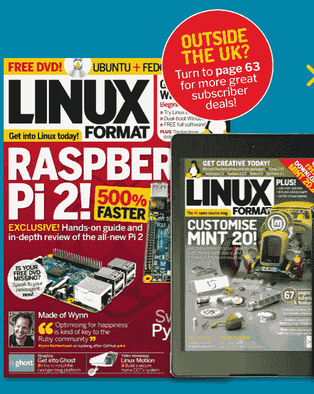

在您的浏览器、Android 和 Apple iOS 设备上即可访问从第 181 期（2014年3月）开始的期刊，包含数千个教程、访谈、专题和评测。

让您的订阅持续进行！

立即订阅即可享 5 折优惠！+ 全新的数字访问权限**


条款与条件。优惠于 2025 年 9 月结束。请为首期订阅的交付预留最多 6 周时间（海外地区最多 8 周）。完整订阅包含所有杂志。节省金额基于封面价。在 14 天取消期后付款不予退还。数字库的访问有效期在您的订阅期内。对于数字订阅，一旦购买，您仅保留截至该点的期刊。完整条款和条件，请访问 www.magazinedirect.com/terms。咨询请致电我们 +44 (0) 330 333 1113。热线时间为上午 9 点至下午 6 点。拨打 03030 的费用将不超过国内陆地费用，并可能包含在您的电话账单中。

www.techradar.com/pro | 2025年3月 LFX325 | 17

## 您的数字纸质版期刊访问

Linux Format 纸质版订阅者现在可以通过两种方式访问数字旧刊！哪些是幸运的读者呢？


作为对订阅 Linux Format 版的谢意，我们一直提供过去期刊的数字访问权限。管理层认为这是一个好主意，并使用 Pocketmags 推出了一套新系统！

这意味着读者可以通过两种方式访问旧刊。新的 Pocketmags 服务可以追溯到 2014 年，包括 140 多期完整期刊；而我们较旧的 PDF 存档则可以追溯到 `LXF66`（疯狂的 8 位爆发时代，包含 256 多期），尽管 `LXF120` 之前的期刊去除了封面和广告。我们概述了如何访问这两种方式。请享受！

- 适用条款与条件 - 详情请见第 17 页。


## 所有数字内容的统一归集


我们与 Pocketmags 合作，为我们所有的数字内容创建了一个单一目的地

- 1 **激活您的访问权限**

访问 `www.magazinesdirect.com/digital-issues/` 并点击 `Start` 链接，这将引导您转到 Pocketmags 激活页面。

- 2 **创建账户**

输入您用于创建订阅的电子邮件。系统将提示您创建 Pocketmags 账户，以便访问库。

- 3 **激活您的订阅**

在激活页面，从下拉菜单中选择 Linux Format 并点击 `Go To Activation`。选择 Library（库）——祝浏览愉快！


- 1 **前往 Linux**

听他这么没错——使用您最喜欢的网络浏览器访问 `www.linuxformat.com/archives`。如果显示“Subscribers: Click Here”（订阅者：点击此处），点击即可。

- 2 **使用您的订阅号**

使用订阅号和姓氏登录。可以在地址行找到您的姓名和地址号码。

- 3 **访问您的期刊**

使用期刊下拉菜单访问过去和现在的期刊。您还可以按作者、关键词或文章类型进行搜索。

## 访问 `www.magazinedirect.com/linux-format`

18 LXF325 2023年3月 `www.linuxformat.com`

披上斗篷戴上尖顶帽，Linux Format 决战！

在下一页中，我们将深入研究新的 Intel Xe 2 架构，查看首次运行的硅片。从纸面上看，B580 的功耗明显低于旧的 A750。B580 “仅”拥有 20 个 Xe 核心，而 A750 为 28 个。Xe 从 SIMD2 到 SIMD3 的重构意味着 B580 的表现大致处于 Xe 架构的水平。

工艺: TSMC N5

Xe核心: 20

着色器: 2560

光追单元: 24

频率: 2850MHz

显存: 12GB, 192位, 196GB/s

L2 缓存: 18MB

纹理单元: 880

TDP: 190W

PCIe: x8 4.0 .0

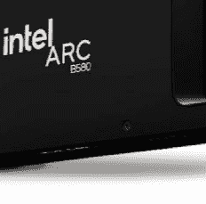

我们还需要关注更高的频率，以便在现实世界中的性能能领先 28%。这种高水平的性能概述在 Linux 下的表现应该和在 Windows 下一样好。然而，对于 Linux 来说，驱动程序尚未就绪，且性能比 A770 低 10%。在这一周期内，我们预计更新后会有所改进。当运行正常时，B580 在性能上显著领先于 AMD 7600，即使在高设置和分辨率下也表现良好。但与 AMD 和 Nvidia 的新一代产品相比，B580 是预算显卡的强力选择。令人恼的伪影：《赛博朋克 2077》也非常适合测试光线追踪。好消息是性能，问题是会看到奇怪的伪影。其他游戏如《无边之地3》有很多伪影，但表现逊于 A770，取决于具体游戏。《控制》的表现低于 A770，并且似乎存在微卡顿。《地平线黎明》的表现远低于 B580 并有明显的伪影。《魔环之门3》的运行速度只有 Windows 的一半，情况类似。生产力基准测试各不相同，取决于库和优化。尽管驱动程序问题仍需解决。另一方面，Handbrake 在 B580 上的速度快于 RX 7600 和 RTX 4060。

官网: `www.intel.com`

价格: €270

| 特性 | 易用性 | 5/10 |
| --- | --- | --- |
| 性能 | 5/10 | 价值 | 8/10 |

总体价值极高，价格低于竞争对手，但性能显示它仍需进行大量工作。

评分 6/10

`www.techradar.com/pro`

2023年3月 | LFX325 | 19

# 评测

## 发行版

### Manjaro 24.2.1

简要介绍

Manjaro 言出必行吗？它履行了让每个人都轻松上手的承诺；安装程序和 Pamac 软件包管理器让设置变得轻而易举。论坛和 wiki 也非常。

在主站上，Manjaro 开发者 Philip Müller 表示，该操作系统“同时针对学者和高级用户”。他反映了一个事实：在 Linux 上需要一些努力和知识来配置和设置，而 Manjaro 则极地简化了这一点。

有官方版本，运行最新的 KDE Plasma、Xfce 和 Gnome 桌面。社区版还提供 Cinnamon、i3 窗口管理器和 Webox。

下载并重启后，我们在虚拟机中运行了 4.13GB 的 ISO 文件进行安装，并可以选择开源或专有驱动程序。设置完成后，我们最近启动了 Manjaro Hello，它将功能组合在一起。

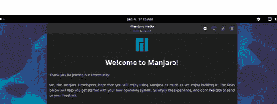

重启到主桌面后，Manjaro 提供了几个关键功能。这给我们的工作留下了深刻印象，以及如何搜索和在工作区之间切换。导览确实进入了桌面。之后，你可以在 Hello 中启动导览。


这在 Manjaro 该版本的发布说明中也得到了呼应，该版本提供了丰富的桌面功能（如强调色），同时也对操作系统本身进行了更改。

尽管如此，大量的列表建议了较高的系统要求，因为当我们只运行 Manjaro 时，只有 2GB RAM 的系统会很吃力。这只有我们 2GHz CPU 可用资源的一半。

Manjaro 拥有自己的包管理器 Pamac。这类似于 Gnome Software，我们可以从中访问更新、安装应用并搜索其他内容。

Nate Drake 对这个基于 Arch 的 Linux 发行版进行了测试。它真的如所称的那样轻量且稳定吗？

虽然修改过的 Xfce 界面确实是 Linux 的一种享受，但要将其推荐作为日常使用的系统却很困难，因为应用程序变得难以使用，而且没有专门的 wiki。

这个滚动更新的 Linux 发行版基于 Arch。与 Manjaro 类似，网站本身是 Arch OS 的更友好的版本。最新的稳定版运行的是 Xfce 4.18 桌面，尽管我们注意到其他人在运行 Linux Mint。不过，我们无法确定，因为 Archman 是在土耳其开发的，因此主站是土耳其语。

尽管如此，我们能够在没有任何环境问题的情况下下载了 2.6GB 的 ISO 文件。引导我们完成设置过程的 Calamares 安装器支持加密。选择完成后，安装仅耗了了 3.5 分钟，将其安装在了一个类似于 Linuxbox 等基于 Xfce 的发行版的分区上。然而，与许多 Linux 发行版不同，Archman 非常精美。登录界面色彩丰富，并有一个优雅的菜单来选择你的桌面。一旦进入桌面，Archman 有一个包含 Linux 标志元素的赛博朋克壁纸。如果你愿意，我们发现背景没有超过 22 种替代方案。


我们通常不看重登录界面，但这是一个视觉盛宴。你甚至可以在不同的桌面之间切换。

- CPU: 1GHz
- 内存: 1GB
- 硬盘: 2GB
- 架构: x86_64

令人失望的是，Manjaro 也是基于 Arch 的，但它有自己的 wiki 和论坛。文档的缺失意味着我们没有找到推荐的最低系统配置。列出的配置（左侧）是针对 Arch 的。登录后，我们通过安装除 Arch 软件包管理器外的所有应用对其了测试。它使用了 700MB 内存和 2% 的虚拟资源——这正是我们对一个基于 Arch 并使用 Archman 的发行版的预期。没有在线软件更新，尽管 Archman 在处理预装应用时会进行更新。虽然我们很高兴看到 Firefox 浏览良好，但缺乏 Pamjaro 软件包管理器导致下载多个 URL 变得困难。我们只在配合 Parole Media、GIMP 和 LibreOffice 套件时使用了它们。在浏览可用应用时，我们发现了 Arch 设置。目前，这里只有几个选项：调整时间和日期、删除用户账户以及更改语言。

- 开发者：Archman Team


- 网站：`https://archman.org`
- 许可证: `GPL`

| 特性 | 易用性 | 文档 |
|---|---|---|
| 性能 | 8/10 | 2/10 | 8/10 |

我们花时间下载并安装了 1.3GB 的更新并重启了 Archman 虚拟机，但这并没有解决问题。Pacjaro 组确实有效；然而，我们需要导航到 KDE 并安装它。Archman 还集成了 Pacman，我们用通过通过安装了 Ucisia。尽管如此，Archman 网站并没有为遇到问题的人提供专用页面。与当前版本（代号为 Özgürlük，即自由）发布一样，开发者也无法从主站提供 Arch 支持仓库的链接。

显示了潜力，拥有丰富的图形和简单的安装过程。遗憾的是存在技术故障且文档有限。

>> 评分 6/10

Nate Drake 探索了这个由 Mandriva 驱动的滚动更新发行版。

它是值得的继任者，还是又一个轻率的分支？

Mandriva 的遗产通过这个发行版的精美设置和全面的欢迎屏幕得以延续。Plasma 6 配合 ROME 的定制应用也运行良好。wiki 布局良好，但存在冲突的信息。

- CPU: 1GHz
- 内存: 2GB
- 硬盘: 10GB
- 架构: x86_64, ARM656

这个发行版是 ROSA 的分支，而 ROSA 又是 Mandriva Linux 的分支，后者已于 2011 年停止维护。前开发人员随后与社区合作创建了 OpenMandriva。虽然它传统上发布固定版本，但从 2023 年开始，该项目实现了一个名为 ROME 的滚动更新分支。该分支涵盖了运行 LXQ6、Plasma 5 和 COSMIC 1.0 的最新版本。还有一个运行 Plasma 6 的版本，其 3.8GB 的 X11 版本 ISO 在 VirtualBox 虚拟机下运行更好。

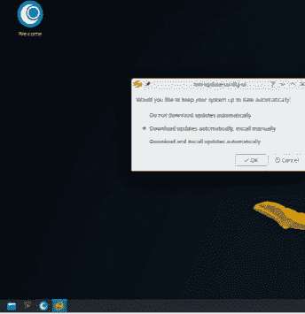

发行版的配置工具简单，但能有效地管理更新和安装。它还是内置的更新工具。

首次进入现场环境时，OM 欢迎屏幕迅速启动了绑定的 Calamares 安装器。支持全盘加密。每个驱动器启动后，设置仅在一多分钟内完成。这是我们看到 Linux 运行最快的时间之一。

重启后，我们需要确定系统要求，因为需求列表与项目规格不同。在仅运行 OM 的情况下，系统在我们的虚拟机中使用了 300MB 内存，约占虚拟 CPU 的 3%。3.8GB 的安装占用与发布说明一致，它需要大约 10GB 的存储空间。

我们回到主页，那里完整列出了 OpenMandriva 的最新功能。这包括一个更新过的内核 `6.12.1`，并改进了对超线程的支持。我们还注意到欢迎屏幕反映了一个仓库选择器，显示这是启用或禁用仓库的唯一工具。启动时，我们可以使用软件中心切换到 OS，或仅安装固定版本。从这里你也可以像其他发行版一样安装 Extra、Restricted 和 Non-Free 软件。某些热门应用（如 Microsoft Teams）还列出了一些第三方仓库，尽管我们建议只使用免费软件。不过，你可以检查更新工具的配置，该工具设计用于配置自动更新。它提供了三个选项：你可以选择不自动下载更新、手动下载更新（默认）以及自动安装更新。我们对这感到困惑，但将这些整合到预装系统中会更有意义。总的来说，软件中心有一个热门应用列表。这些应用按“应用”和“游戏”等类别组织。如果你愿意，也可以安装如驱动程序之类的包。桌面有一个快捷方式，可以打开一个包含指向项目 wiki、论坛和开发者聊天链接的页面。我们批评 wiki 提供了冲突的信息。我们在 `img/e610c7a095fcd2c0c411ff707edde0b3_21_0.png` 中看到...

### 结论

- 开发者：OpenMandriva Association
- 网站：`www.openmandriva.org`
- 许可证: `GPL`

| 特性 | 易用性 | 文档 |
|---|---|---|
| 性能 | 9/10 | 8/10 | 7/10 |

### 《奎德之洞》

管理层想知道为什么我们不能随机生成所有的杂志内容。Jonathan Bolding 并不想让大家失望。

+ 配置
- 最低操作系统：Ubuntu 18.04, CentOS 7
- CPU：1GHz, SSE3
- 内存：4GB
- 硬盘：2GB
- GPU：支持 Vulcan

《奎德之洞》`Caves of Qud`在形式上是一个传统的 roguelike RPG，这是一款俯角的射击游戏，依赖文本和简单且富有联想的图形来传达其世界。它并没有死板地追求“死亡”，而是由你选择何时存档，并调整你进行战斗的程度。它也没有死守传统 roguelike 规则，即那种过时、令人沮丧的用户界面以及街机式的、键盘驱动的操作模式——它在 Steam Deck 这样的移动 PC 上运行得很好。

你可以从各种架构中创建角色，无论是普通人类，还是奎德中更具变异性的居民。你在一个自由的世界中构建，利用你的能力并收集经验，以开启令人眼花的可能性。从你的起始村庄到遥远的奎德之地，这是一种真正的 RPG 沙盒风格，选择遵循或不遵循食地者`Eaters of Earth`古代文明的遗迹，对抗你必须面对的奇异敌人，并掠夺它们的宝藏。

每次游戏流程都有相同的世界地图，但会根据一套复杂的异构生成系统重新命名每个局部区域，该系统记录了构成奎德的规则。你的所作会影响你预期可以在那里发现的东西——它将历史清晰地整合到主线任务的目标中，而在其他情况下，你可能会认为这些背后有设计师的手手。你可能需要花几个小时才能

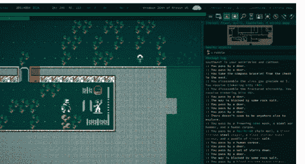

掌握《奎德之洞》，老练的玩家可以在 15 分钟内跑完主线故事。

人类过去的遗迹位于奎德的下方和之上，形成了一层地下城，里面充满了某个文明的物品，这个文明是如此领先，以至于他们发明了传送门并在死恒星的光芒下降解物质。敌人曾经如此强大，满血仅够在他们的攻击中存活，不像奎德广阔的隔绝区域那里充满了乐趣——例如，死亡之梦仅仅是真正的代价。

这个世界对许多不同物种来说是正常的，古代工程与改变现实的现象相结合，谱写了一个关于奇异生物的无线故事——例如触感者，与拉普拉斯`Laplace`相比，后者处于一种奇异的量子状态，只有当两个物体同时被杀死时它才会死去。奎德是一个超人格、青铜匕和末日时代的世界，由宇宙初期的被遗忘物质组成，对抗着陨石般的宇宙现象和奇异的事物，每一种都拥有神奇的粒子束，能够穿透屏幕上的所有东西，无论敌友。

主线故事开启了一段非常适合你坐下的旅程，途中点缀着古怪的角色，比如一个沉默的外星熊人-枪手人，和一个与你战斗的荒野盗贼，你必须随身携带它并让它在你的皮肤上运行。它也保持了多样性——你探索技术，但也学习了派系之间的外交、制造、一些谜题，以及由此产生的历史。这一切都用极其丰富的散文呈现出来，超越了奖励本身，到达了一个类似于《爱丽丝仙游游记》的地方，


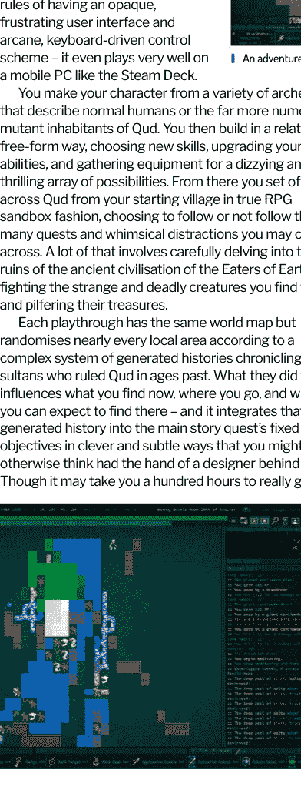

24 LXF325 2023年3月

`www.linuxformat.com`

为了寻找合适的词汇，英语的深度显得不忠诚，当这些词汇不够用时便进入。“这是一种石头、剪刀、甚至是思想的生活，”这是对一个更大胆的人的描述。

世界构建和故事非常有吸引力，因为《奎德》汲取了多种来源，不仅仅是游戏和显而见的流行文化。它的文化边界远超许多其他作品的限制。玩一个没有《沙丘》、《太阳之书》或《伽马》的游戏是一种乐趣，它还引用了洛德·拜伦和 AE House，所有的都指向希伯来圣经。

你角色的特征和背景和你的一样丰富。你可能是一个真人类`True Kin`，旧人类最后的残余之一，选择你的生物学并成为食地者的技术——机器人、义体植入物和机械装置，以及你如何通过这种超大特征和自由硬件来增强自己，同时进行双手的改变。带着喙、翅膀、夜视和天赋，你的变异力量增长到可以拯救你：你拥有超能力的能力的变异，或者是义体化和分解。你可能扮演一个纯粹物理的奇美兽，长出 12 只手臂，或者扮演一个纯粹的精神体，变得强大到让食地者从你的身体中提取能量。让《奎德》如此的不仅仅是多样性，还有模拟的深度。当你深入深处时，你可以计算出多少价值或伤害。在考虑统计和属性时，你真的必须处理大于 30 的数字。但《奎德》的世界由物理模拟驱动，让你能在墙壁上行走，爬进岩石洞穴或呼吸随风移动的派系气体。你遇到的所有角色都有性格，以及在生活中展现的抱负。你可能重生，导致变异房间的变形者

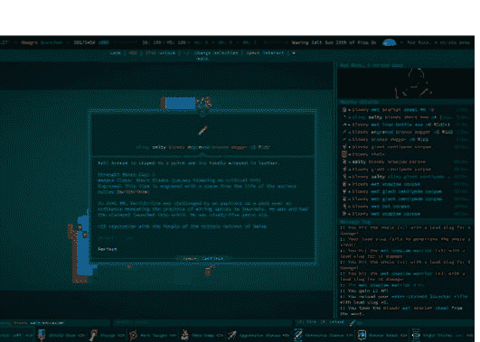

掌握《奎德之洞》，老练的玩家可以在 15 分钟内跑完主线故事。

| 类别 | 得分 |
| :--- | :--- |
| 画质 | 7/10 |
| 玩法 | 9/10 |
| 耐玩度 | 10/10 |
| 价值 | 9/10 |

《奎德之洞》在玩法和故事方面是一项定义类型的成就。

- 评分 9/10

玩家开始时充满能量。

[第25 页]


# 我们对比了大量内容，所以你不用了！

## 汇总

- SimpleScreenRecorder
- OBS Studio
- FFmpeg
- Kazam
- VososNG

## 录屏软件

无论是录制你的游戏还是桌面应用程序，Michael Reed 检查了五种可以录屏的程序。

### 我们如何测试

我们以认为最合适的方式安装了每个程序，但也检查了是否有其他方法。我们运行了每个程序以创建适合录屏的视频文件。在这里，重要的是默认编码器在典型的 Linux 系统（在本例中为 Ubuntu）上运行。这些应用程序控制音频视频编码器，我们测试了它们的性能以确保录制不会消耗过多的 CPU 时间。虽然应用程序利用硬件加速可以提高性能，这是一个复杂的话题。如果你运气发现编码器缺乏硬件支持，最好是软件本身出错，这样你可以进行调试和优化。


有时，仅仅截图是不够的，你需要通过录制视频格式的屏幕来提升层次。生成的视频可以制成教程教给他人，或用于展示你的游戏技巧和特技。

除了能够将屏幕录制为视频文件外，大多数应用程序还可以直播——也就是说，向在线服务进行现场直播。

幸运的是，Linux 有许多优秀的录屏软件。它们不同在于界面风格和可配置性水平

## 录屏软件汇总

### 安装与初始设置

我们总是欢迎各种优秀的选择。

OBS Studio 官方网站推荐通过 `Flatpak` 安装软件，对于你的需求来说，`Flatpak` 和 `Snap` 都是很好的选择，因为它允许让你在无需手动管理其他组件（如 OBS）的情况下获取最新版本。作为一款开源软件，在大多数发行版中使用它会更好，我们检查了 Ubuntu 仓库中的版本是否足够新，事实确实如此。

SimpleScreenRecorder 网站提供了一份带有内置安装说明的其他软件列表。通常，使用这些说明进行安装在官方版本中也是免费的，正如我们所做的那样，在 Ubuntu 中的版本是免费且足够新的。在 Ubuntu 中，有一个包含最新版本的 `PPA`，如果不存在，当你第一次运行 SimpleRecorder 时会看到一条欢迎消息，然后跳转到设置界面。

Vokoscreen NG 建议安装 `Flatpak`，这对于主流发行版来说也是不错的。命令行工具 `FFmpeg` 几乎可以被视为系统级组件，因此，如果它尚未安装，通常期望你使用你所在发行版的包管理器。该网站建议如果你想获得前沿版本，可以从源码编译，但 Ubuntu 仓库中的版本是最新的，所以我们使用了该版本。

安装最新版本的 Kazam 并不简单。网站上有详细安装细节，但大多数管理器不允许你在不编译的情况下使用 `pip`，这并未被涵盖。还有一些需要安装的依赖项。它虽然在 Ubuntu 仓库中，但该版本已经过时。

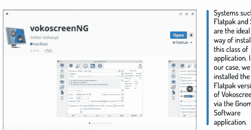

### 结论

| SIMPLESCREENRECORDER | 7/10 | KAZAM | 4/10 |
| --- | --- | --- | --- |
| OBS STUDIO | 7/10 | VOKOSSCREEN | 8/10 |
| FFMPEG | 9/10 | | |

`Flatpak` 受 OBS Studio 和 Vokoscreen 的支持，是录屏软件的良好选择。

### 普通用户的适用性

对于那些只想开始制作视频的人来说，哪一个最好？

`FFmpeg` 对初学者来说不是最好的，因为它是一个命令行工具。它足够基础，用它来处理琐碎的任务。它不适合技术极客。

许多没有提供示例的直播主和 YouTuber 像 OBS Studio 一样易用。使用其内置包并不是一个简单的界面，在自由使用应用之前，不可避免会有需要配置的设置。从配置到实际操作，我们将应用的易用性定为中等水平。为此，我们遵循这一标准。

我们将 Vokoscreen NG 的易用性评为中等。公平地说，它的界面展示了许多功能和选项，Vokoscreen 的界面比较平衡。它是一个真正的休闲工具，但图标和简单的布局意味着用户应该能够自己搞定。

SimpleRecorder 的界面并没有像暗示的那么简单，但它感觉并不像是一个妥协的方案。在工作流方面，其他软件是：

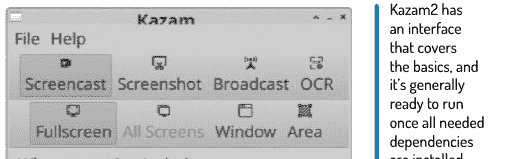

Kazam 的界面可以处理基础功能，一旦安装了所需的依赖项，通常非常易用。

- 录制时：
- 鼠标光标
- 扬声器声音
- 麦克风声音
- 按键
- 桌面窗口
- 录制前的秒数：0


默认设置按预期工作。但是，有两页简单的设置已经足够应付偶尔之需。

在列出的五个应用程序中，Kazam 的界面最简单，它可以轻松处理基础录制。只是它对最新版本的请求非常繁琐。

### 结论

| SIMPLESCREENRECORDER | 7/10 | KAZAM | 8/10 |
| --- | --- | --- | --- |
| OBS STUDIO | 7/10 | VOKOSSCREEN | 7/10 |
| FFMPEG | 9/10 | | |

Kazam 拥有直观的录制和配置界面，但安装起来很痛苦。SimpleRecorder 也很易用。

## 录屏软件汇总

### 主录制用户界面

#### 重要区域之一。

#### SimpleScreenRecorder 7/10

#### OBS Studio 8/10

当你第一次听到 SimpleScreenRecorder 这个名字时，你可能会构思出一个令人兴奋的简单软件，但这个低调的基于 `Qt` 的界面有其特色。它是基于 `Qt` 的，布局基于专业设计，并且充满了过滤器和复选框。

它的工作方式意味着设置与你使用的界面之间有很强的分离。当你运行录制时，在进入向导式的录制界面之前，它会通过四个设置选项。如果你想更改当前的录制，这在调整和测试设置时可能会导致一些调不调和挫败感。

OBS Studio 的界面并不是我们在录屏软件中看到的最简单的，这意味着它有时被认为是专业人士的选择。事实上，我们认为普通用户一旦学会了它，在日常情况下使用它不会有困难。像顶部传统的菜单等功能将其标记为想要研究技术的人的选择。界面是高度可配置的。预览视频位于窗口中心，周围被自己可以配置的面板包围。

与所有类型的桌面应用程序一样，一个良好的录屏界面取决于功能和易用性之间的正确平衡。然而，录制的典型工作流对界面提出了一些独特的要求，特别是你希望在开始实际录制之前完成所有设置。在考虑整个用户界面时，一直存在权衡。在 OBS 中，有一个预览视频和一个显示与钩子相关的设置的统计面板。像所有界面一样，它是一组功能性控件，尽管一个小下拉显示了网页内容。你可以将其保存到场景以备后用。

录制时，有一个实时显示列表，包括已过去的时间。虽然是这样，但我们真的很难称其为友好的界面，你将不得不做一些研究来确定正确的设置。

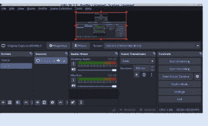

### 文档与支持

### 如何使用

OBS Studio 的官方文档中心涵盖了全面的文章，我们没有找到任何程序部分没有被涵盖。作为一个跨平台应用，`Discord` 是很活跃的，我们在社区的这部分看到过帮助。学习使用 `FFmpeg` 时，你首要的任务是通过命令行访问的其详尽且编写良好的页面。

SimpleScreenRecorder 有几篇文章介绍了该程序，并涵盖了故障排除、录制和提高性能等领域。我们发现，默认使用 Linux 系统中的流行分区可以获得更好的结果，而无需故障排除。Vokoscreen 是旧版 Vokos 程序的延续。对于一个拥有这么多选项的应用程序，我们希望看到更多关于如何使用 Vokos 的文档，这将非常有帮助。Vokoscreen 足够流行，意味着它在网上被多次提及并包含了 `YouTube` 教程。Kazam 的说明只在 `GitHub` readme 页面上，公平地说，这涵盖了程序的大部分区域，包括直播功能。

### 结论

| FFmpeg | 6/10 | Kazam | 8/10 |
| Vokoscreen | 7/10 |

我们必须根据标准来判断 `FFmpeg`。Kazam 的界面精简到了基础，但它缺少某些功能。`FFmpeg` 提供了所有可能的编码器，但它在录制时可能会出现问题。

### 路由与编码器选项

路由的灵活性和编码器。

OBS Studio 支持 `X11` 或 `Wayland` 桌面，但其他不支持 `Wayland`。另一方面，Kazam 强制实现了 `Wayland` 支持。在我们的测试中 `FFmpeg` 提供了可用的编码器，但没有实际的选项来控制帧率以外的内容。除了录制，Kazam 还可以从摄像头录制并将此作为截图。

Vokoscreen 涵盖了我们预期的选项，例如选择视频和音频编码器、比特率和质量。`FFmpeg` 支持的编码器和格式列表列出来需要几秒钟，可以帮助处理路由需求，因为它几乎是高度灵活的。几乎不可能找到它无法适应的情况，但它可能需要研究命令行选项。


OBS Studio 拥有一套完整的音频视频配置。选择选项是主界面的一部分。设置提供了访问硬件功能的能力，当设置好后，当我们执行性能时可以将其推向更高水平。编码设置在细节和高级功能方面也没有限制，而且你可以将音频录制到单独的文件中。为了处理这些功能，这种复杂性是值得的。

### 屏幕阅读器 汇总

### 额外功能

除了简单的屏幕录制视频，它还能做什么呢？

OBS Studio 是一款流行的流媒体传输和录制工具，其用户界面对于这项任务来说非常简单，但提供了许多选项。OBS Studio 拥有极其健康的生态系统，拥有各种小众用途的视频和脚本，例如添加屏幕软键盘或鼠标指针。

相比之下，Screen-Reader 拥有 OCR 功能，可以读取屏幕上的文本元素。它还可以进行直播，且其 GitHub 页面提供了一些如何配合多种流行直播服务的说明。

FFmpeg 不仅可以录制，还能进行直播。在使用 FFmpeg 的每一个方面时，你都需要研究其用到的命令行选项。如果你有特定的录制或直播场景，那么 FFmpeg 是显而易见的选择，因为它通过命令行进行操作。它也是视频音频文件转码的选择。毕竟，你必须学习正确的命令行选项来完成这些操作，但它是一把你可以研究学会的视频转换和录制设施的瑞士军刀。

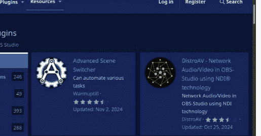

OBS Studio 有许多插件和扩展系统。Screen-Reader 有一个可搜索的扩展，其中包含了关于使用哪些评论。

VideoScreenNG 有一个内置播放器，可以播放上一次录制的视频。我们喜欢最后一次播放是一个完整日志的方式，这对故障排除非常方便。正如其名称所示，SimpleScreenRecorder 专注于核心功能，而不是特别的可扩展性。

### 结论

| SIMPLESCREENRECORDER | 7/10 | 6/10 |
| :--- | :--- | :--- |
| OBS STUDIO | 10/10 | 6/10 |
| FFmpeg | 8/10 | |

OBS Studio 有很多功能，但通过脚本插件，它提供了我们所需的功能。

### 配置界面

寻找设置、理解设置并更改它们。

第一次使用 OBS Studio 时，你会遇到一个向导，该向导允许你简要地优化录制或使用摄像头的设置。在设置对话框中，有很多选项，可以对录制进行精细控制。设置按标签页组织，但并不是说它们不可搜索，问题在于 OBS 拥有很多功能，这些功能有不同的设置方式，这是另一个让它与某些其他软件相比显得专业的特性。

在 SimpleScreenRecorder 中，你会一次性面对所有设置，这有点像向导风格。剩下的就是寻找一个将这些设置添加到基础功能中的应用。如果你有一个需要但冷门的设置，可能无法进行它，除非停止当前录制并再次运行向导以进行任何更改。

VideoScreenNG 的设置始终通过标签页界面呈现。如果你不太可能想在点击录制按钮之前更改视频代码的话（这没问题）。好的一方面是，设置有清晰的标签——

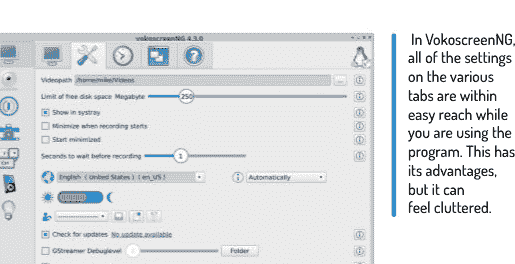

在 VideoScreenNG 中，当你使用程序时，所有各种标签页都触手可及。它有自己的优势，但可能会感觉很杂乱。

例如，像单行可视化这样的非常易于使用，我们可以说显示已安装解码器或键盘快捷键的页面也是如此。

FFmpeg 是通过指定命令行开关来配置的。它非常灵活，但很难学习。通过命令行界面，你可以通过创建一个包含你所设置的所有设置的 Bash 脚本来保存你的配置。

### 结论

| SIMPLESCREENRECORDER | 7/10 | 7/10 |
| :--- | :--- | :--- |
| OBS STUDIO | 9/10 | 7/10 |
| FFmpeg | 6/10 | |

OBS Studio 的配置井然有序，值得对它提供的额外功能投入信心。

30 LXifer 2025年3月

www.linuxformat.com

### 屏幕录制器 汇总

### 结论

### 屏幕录制器

OBS Studio 通常被认为是面向专业人士或专家，大多数用户应该能够快速学会如何使用该程序。功能最全的开源录制器意味着牺牲了一些简单性，但考虑到它能做的一切，这是非常值得的。另一个重点是界面本身可以精简内容或添加你需要的元素。对大多数类型 GPU 的硬件支持能够实现高效的性能而不需要延迟。插件和其他工具的库将其灵活性推向了极致。SimpleRecorder 的功能比其名称暗示的要全一些。它可以涵盖正常屏幕录制的各个方面，而不会引导你通过复杂的设置。话虽如此，你可能需要的微调都是存在的。它并非设计用于作为广播应用程序。VideoEncoder 有选项处理所有情况。如果你发现自己需要程序的其他方面，你就会进入这样一个忙碌的界面。该界面清晰直观，虽然功能没有 OBS Studio 丰富，但它达到了质量设置控制的良好水平，允许你处理各种情况。Atlas 是一个简单的工具，可以处理典型的录制场景，初学者可以比其他录制器更快地上手运行。目前，由于 Ubuntu 等发行版中对全局扩展页的限制，最新版本有点繁琐。FFmpeg 可以处理投送以及各种视频相关任务。它是一把你可以研究学会的视频转换和录制设施的瑞士军刀。


- 第一 OBS Studio: 10/10 (网址: https://obsproject.com, 许可证: GPL 2.0)
- 第二 SimpleRecorder: 8/10 (网址: www.maartenberg.com, 许可证: GPL 3)
- 第三 VideoScreenNG: 7/10 (网址: https://linux4.de/videocreen/recorder.html, 许可证: GPL 2.0)
- 第四 Kazam: 7/10 (网址: https://github.com/henrywo/kazam, 许可证: GPL 3 或更高)
- 第五 FFmpeg: 6/10 (网址: www.ffmpeg.org, 许可证: LGPL/GPL GPL)

### 其它考虑

有许多 FFmpeg 的图形界面前端，但它们需要专注于特定的使用领域，例如捕获和流传输视频或格式转换。像 MystIQ 和 Shutter Encoder 尽管很好，但无法帮助你录制屏幕。Blue Recorder 是基于 Gnome 工具的 GTK 录制工具，它似乎已经被遗弃了。Green Recorder 和 Peek 也被认为是不错的选择，但它们现在被它们的开发者放弃了。RecordMyDesktop 被认为是简单录制器的标准推荐，而 Kocha 是一个维护良好的工具，它在保持良好功能集的同时，在紧凑简化的用户界面方面做到了极致。它支持 Wayland。

# 网络基础

在进入细节之前，让我们先介绍几个概念...

你的家庭连接由我们的 ISP（互联网服务供应商）分配了 IP 协议地址。静态 IP 地址让我们的生活变得简单，例如不需要动态 DNS，或者不再需要记住在路由器上开启端口（这简直是一场灾难的根源）等等，但它让我们家庭连接变得更方便。这涉及到我们是否需要担心如何避免留下安全漏洞。

DNS 协议用于将人类可读的地址映射到 IP 地址。许多跟踪 Cookie 和其他技术有助于了解我们的生活并追踪跨越网络的浏览历史。通过阻止访问最常见的广告相关域名，我们可以防止它们出现在我们访问的网站上。

另一个我们可以考虑的是来自 ISP 提供的路由器/防火墙。其中一些设备很少更新，我们不断依赖于对它们的信任。通常，这些设备的规格相对较低，并且不会针对新发现的安全问题接收更新。

## 物联网 (IoT)

家庭自动化的普及意味着设备到处都是，并以难以置信的价格提供各种传感器、灯泡、灯光面板和开关。然而，这些设备的固件质量在不同的制造商服务器之间不断变化。通过使用某些技术，我们可以阻止这种现象的发生。此外，正如我们信任朋友一样，如果恶意个人成功连接到我们的整个网络，我们就必须通过将主网络与访客流量隔离来将影响降至最低。访客 Wi-Fi 允许访问互联网但无法访问你的任何个人工作设备或服务器。

许多 Wi-Fi 路由器都有提供访客 SSID 的功能，并会有允许或禁用访问网络上设备等选项。

## PI HOLE？

你可能认为我们正在介绍 pi-hole（它是另一个用于拦截广告的 DNS 过滤家居），但由于你已经查看了 LXFL，你会决定哪种系统最适合你。毫无疑问，如果你想在设备上运行一个 Raspberry Pi-hole，它是一个极佳的选择。

你可以在现在这样使用的标准 x86 PC 上设置 pi-hole，或者在一台大约 2006 年的旧 ThinkPi 上设置，又或在书房的 RGB 游戏网络上设置。除非你正在使用它但你根本没拥有一个，否则你可能会错过...

pi-hole 的优势在于它可以保护你的网络免受跟踪，为了做到这一点，它必须每天 24 小时、每年 365 天保持开启。如果它宕机，你的网络可能会故障，最坏的情况下，你的浏览会被企业广告所拦截。


# 智能家居网络隔离与路由器配置

一台现代笔记本电脑需要大约 `30W` 的电，或者由于更好的技术，电费可能会更多。让你的游戏电脑 `24/7` 开启会从根本上毁你的银行账户。任何版本的树莓派成本都比运行家里任何一个灯泡要便宜。而且它们很便宜，所以 `pi-hole` 可以运行在 `Pi Zero` 上，在我们看来，写作时它的运行成本不到十美元，这投入是值得的。

## 访客 Wi-Fi 与 VLAN

如果你的路由器具有提供访客 Wi-Fi (`SSID`) 的能力，为你的智能家居设备创建另一个是值得的。这将提供一个不同的地址范围并与互联网隔离开。当然，某些设备可能需要这样做并且这是被允许的，但对于大多数设备应该...

它们实际上是 `VLAN`（虚拟局域网），带有一个子网，会丢弃其地址范围之外的数据包。真正的 `VLAN` 允许更多子标记和去关联的流量。

如果你有创建额外无线网络的选项，你可能会将其固件更改为开源替代方案。注意：更改路由器的固件可能会导致保修失效，并可能导致设备变成砖！

| 名称 VLAN... | 路由器子网 |
|---|---|

| 默认 1 | Cloud Gateway Ui... | 192.168.1.0/24 |
| IoT 20 | Cloud Gateway Ui... | 192.168.20.0/24 |
| 访客 30 | Cloud Gateway Ui... | 192.168.30.0/24 |

## 启动你的路由器

你不必固限于路由器的专有固件...

除了路由器制造商提供的专用产品外，还有许多开源选项可以替换你现有的且可能在软件更新方面被遗忘的系统。在考虑选项时，请确保你花足够的时间查看最新网站以获取有关你特定设备的信息。设备设备可以通过固件更新功能得到改进。某些设备（例如你的旧款路由器）可能需要 `UART`（串行）设备。这对我来说有点太麻烦了，所以我拒绝了。

为 `OpenWrt` 创建。如果你提升了你的 `Ubuntu` 虚拟机并登录，你应该能够浏览互联网。虽然看起来可能如此，但仅主机网络（`host-only networking`）意味着你的路由器虚拟机正在提供访问互联网的服务。如果你发现虚拟机无法访问互联网，请回到主机，打开浏览器和 Web 界面。一旦登录，确保开启了 `DHCP`，以便你的虚拟机获得 IP 地址。另外，请注意 `VirtualBox` 可以添加 `DHCP` 地址，请确保不要在两端都启用。

在 `2000` 年代初，Linux 有一款常规路由器 `WRT54G`，它是根据开源许可发布的。这段代码引发了几个社区项目。这是 `OpenWrt` 的第一个版本，它自 `2004` 年以来一直存在。`DD` 是另一个版本，它自 `2005` 年以来一直存在。所有这些选项...

当你配置你的时，某些情况会更糟。

另一件事是考虑是否有必要一个设备用于路由/过滤或 Wi-Fi，还是使用两个。如果有两个，每个都有其特殊用途。如果你有一个带有空太网适配器的虚拟化主机，你可以轻松地在那里运行路由器。然而，你需要安装在主机操作系统上的内容，以及你是否希望在路由器重启时关掉 Wi-Fi？

你的作者得到了 `UniFi` 组的帮助在家里安装了一台 `Cloud Gateway` 设备。`MikTik` 设备仍用于 WiFi。

## 虚拟局域网 (VLAN)

虚拟 `LAN`，或 `VLAN`，将流量划分到其 IP 范围内。你的路由器可以配置

另一个选项（可以在非常小的范围内进行测试）是 `OpenSense`。`OpenSense` 是一个防火墙/路由器设备，基于 `BSD`。它是一个强大家族的一部分。`Psense` 是更现代的版本。`OpenWrt` 能够运行在低规格硬件上——需要一个低端设备。这两个选项都非常可用，并有可用的配置。大多数家庭路由器在支持的速度方面受到限制，因此在决定使用何种硬件时，请确保考虑到这一点。`OpenSense/PNsense` 无法管理无线网络，而 `OpenWrt` 可以。这是如果你想使用这些系统时需要考虑的一点。

如果你的设备是有线并连接到多个网络，你的交换机需要是管理的并支持 `VLAN`。这个主题远未深入探讨，但值得提及，因为可能你想要设置一个独立的 `IoT` 网络，你将允许从主网络通过浏览器或智能手机 `App` 访问它。

## 将 OpenWRT 安装为虚拟机

在本教程中，我们将使用 `x86` 版本的镜像和 `VirtualBox` 将 `OpenWrt` 安装为虚拟机。

```bash
matt@pop-os:~$ cd OpenWRT
matt@pop-os:~/OpenWRT$ VBoxManage clone --format VDI openwrt*.img openwertdisk
Converting from raw image file: ~openwert-x86-64-generic-ext4-combined-efi.img
openwertdisk.vm...
Creating dynamic image with size 12612 (12MB)...
matt@pop-os:~/OpenWRT$ 
```

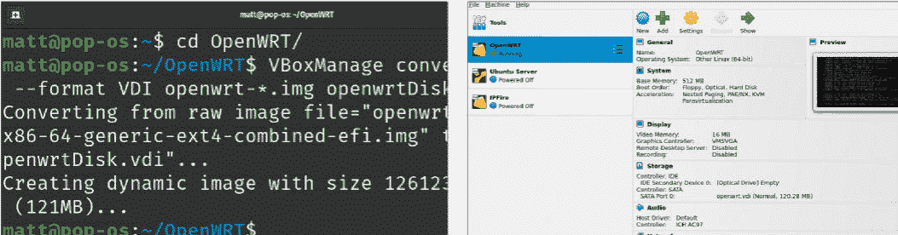

### 1 下载并转换镜像文件

从 `https://downloads.openwrt.org/release/openwrt-23.05.0-x86-generic-ext4-combined-efi.img` 下载该文件（可能有较新版本），打开终端并使用 `wget` 下载它将其转换为适用于 `VirtualBox` 的格式。

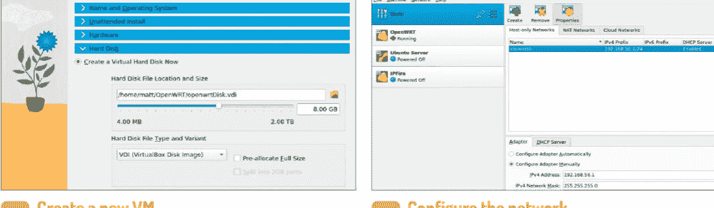

### 2 安装 VirtualBox

从 `https://www.virtualbox.org/wiki/Linux/` 下载并安装 `VirtualBox`。有不同的格式可用——`Pop!OS` 允许你使用本文以及该发行版的 `Ubuntu` `deb` 包。安装完成后，打开软件。

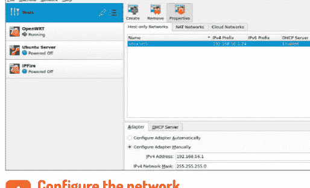

### 3 创建新虚拟机

点击“新建”按钮创建一个虚拟机。单个 `vCPU` 和 `1GB` 就足够了，可以将导入的磁盘文件选择为硬盘。完成向导。忽略这些

### 4 配置网络

点击 `VirtualBox` 主窗口上的三个点并选择“设置”。确保启用了“仅主机网络”（`Host-Only Networks`）选项卡，因为这是为了路由器的目的。

```bash
root@openwrt:~$ set network.lan
root@openwrt:~$ commit network
root@openwrt:~$ show network.lan-interface
root@openwrt:~$ set network.lan.interface.proto='static'
root@openwrt:~$ set network.lan.interface.ipaddr='192.168.56.2'
root@openwrt:~$ set network.lan.netmask='255.255.255.0'
root@openwrt:~$ commit --reboot
```

### 5 设置适配器

编辑你的虚拟机设置并选择“网络”选项卡。对于第一个接口，确保将其配置为“仅主机”模式并选择了新创建的网络。切换到第二个接口并启用“桥接”，然后选择当前的物理接口。

### 6 启动虚拟机并配置适配器

启动虚拟机并在终端中设置虚拟机的内部 IP。这必须与最近创建的仅主机网络的 IP 范围匹配。打开浏览器并访问设置的 IP 地址。将两个接口连接为 `WAN` 和 `LAN`。

# 远程访问

探索如何从其他地方访问你的家。

我们都想过访问家以外的资源。有很多方法可以实现，安全性和复杂程度不相同。你真的需要这样做吗？如果答案是否定的，或者在极少数情况下，最好不要这样做。如果由于家庭自动化或个人偏好需要访问，最好使用 `VPN` 或你喜欢的的服务。

你的 `ISP`（服务提供商）会给你一个 IP 地址，而你的路由器为每个连接的设备分配内部 IP 地址。你的路由器是外界与家庭网络之间的安全边界。对路由进行的任何配置都应该仔细考虑，并尽量减少更改。

其他复杂性在于，住宅订阅具有动态 IP 地址，这意味着它们经常变化，这可能会影响你的远程访问。某些 `ISP` 的服务条款还禁止运行 `VPN` 等。


## 警告！

访问外部服务最简单的方法是从路由器的外部地址将端口转发到内部地址。这充满了危险，因为直接访问会暴露在风险。如果该设备可以访问网络的其他部分，那么你的整个网络都会受到威胁。这种方法可以使用，但不应用于访问任何正在运行的网络，或仅通过端口转发来授予动态 IP 地址，特别是当你配合动态 `DNS` 提供商时，每当你的外部地址周期性变化时。

- 端口转发是 `OpenWrt` Web 界面的漏洞。

- 包括任何可能允许网络间访问的漏洞，以及在 `DMZ` 中访问设备进行配置的困难。可能会连接到你的主网络，这将抵消其益处。

## 让我们进入正题吧！


这种方法使用了跳板机（或堡垒服务器），这是一个用于保护远程访问的额外步骤。例如，你应该使用跳板机，这样外部地址就无法访问你的内部网络。确保不同设备之间的凭据不同，否则一个设备被破解会导致其他设备自动被破解。还要确保你使用 SSH 身份验证，如果你存储...（等待，OCR 文本在这里似乎中断或循环了，但根据提供的输入）：

## 家庭防火墙


## NextDNS

- 安全 隐私 家长控制 白名单 分析 设置

### 威胁情报馈

NextDNS 通过过滤全球一些最可靠的情报馈，保护您的设备免受已知威胁、钓鱼攻击和恶意软件的影响。

- 使用威胁情报馈

### AI 驱动威胁检测

NextDNS 使用机器学习来检测网络威胁——这是一个由 NextDNS 团队设计的专有引擎，包含数百万个信号、模式和异常。

- 启用 DNS 威胁检测

### 安全浏览

安全浏览使用 DNS 过滤——该技术每天使用数百万个列表来阻止恶意网站。通过阻止这些请求，您可以防止您的设备访问恶意网站，即使您点击了它们。

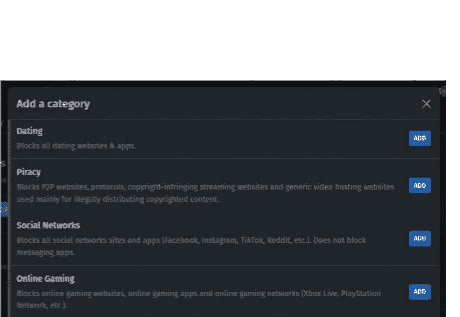

## 添加类别

| 设置 | 状态 |
| --- | --- |
| 过滤 | 开启 |

### 隐私

NextDNS 阻止追踪器、钓鱼、恶意软件、追踪网站以及分发版权内容的基于广告和恶意软件。

### 社交网络

NextDNS 阻止社交媒体应用和网站（如 Facebook、Instagram、TikTok、Twitter 等）上的广告。

### 在线游戏

NextDNS 降低了 Xbox Live 和 PlayStation 等在线游戏平台的延迟。

### 视频流媒体

NextDNS 阻止流媒体服务（Netflix、Disney+、Hulu 等）、流媒体网站和视频广告，以节省您的带宽。

在家长控制选项卡中，您可以查看可以阻止的网站类别。

安全提供程序提供了 Google 搜索和可以阻止的类别选项。

并返回个人资料中设置标签页上显示的地址。

当配置为 `DEVICE_PROFILE_ID.dns.nextdns.io` 时。

如果关联 IP 地址通过 Wi-Fi 或 IPv6 覆盖您的家庭网络，这将是有益的。

# 运行客户端

NextDNS 客户端是一个 DNS 代理——它将使用您的内部 IP 地址提供服务，并处理来自网络上其他设备的请求。

当转发来自本地网络的请求和 DNS over HTTPS 时，NextDNS 可以作为代理 DNS 服务器轻松运行。

客户端是可配置的，并可以根据其 IP 地址为不同的设备提供不同的配置文件。

可以通过设置设备使用安装在您的 DNS 服务器上的客户端的 IP 地址来测试客户端。

现在让我们为客户端设置更多配置。配置保存到 `/etc/nextdns.conf`，最好使用以下选项进行编辑。

打开您的终端并运行以下命令：

```
nextdns config set --profile 192.168.1.10/123456
nextdns config set --id 00:1f:4c2e:64a5:5769d
nextdns restart
```

安装并配置 dns

可以在 https://help.nextdns.io/wiki/ 找到

其中客户端是用 Go 语言编写的，这使得它兼容许多平台。我们现在可以在 Ubuntu 机器或 macOS 上研究客户端，以配置两个不同的配置文件。

当您重启客户端后，配置将将显示客户端正在运行，不同的设备将关联到不同的配置文件。使用 IP 地址 `192.168.1.102/1284` 使用以 4 结尾的 DNS 地址 `123456`，

您需要配置客户端将本地网络的请求转发到您的路由器，路由器很可能已经在为您执行。导航到路由器并运行以下命令：

## 选择私有 dns 模式

- 关闭
- 自动
- 私有 DNS 供应商主机名

设备: `-123456.nextdns.io`

Android 中的私有 DNS 功能也可以链接到您的 NextDNS 个人资料。

接下来您将配置客户端，以便不同的设备通过名称地址引用。NextDNS 可以配置为响应本地地址，但连接到本地地址的网络部分仍然基本无法访问。

一旦配置好客户端，您将发现您的设备通过本地 DNS 代理连接到 NextDNS，并且请求由 NextDNS 服务处理。通过允许客户端报告地址，日志将显示正在使用的设备 ID。就像安装客户端时一样，可能会有设备被它用于 DNS 解析。如果是是的话，您可能需要设置 DHCP 服务器指向客户端的 IP 地址。如果设备地址更改，也需要更新。许多路由器能够执行 DHCP 租约，这对于设置家庭静态 IP 和地址很有帮助。此外，您可以配置 DHCP DNS 并在范围范围内设置为静态。

如果您有该项，使用请求在分区匹配关闭时查找是理想的。

最后，打开终端并运行以下命令：

```
$ sh -c "curl -sL https://nextdns.io/setup | sh"
```

当被请求时，提示将要求您以高权限用户身份登录并输入您想要过滤的配置文件 ID。决定您是否希望客户端缓存地址，以及它是否将供整个网络使用。缓存意味着 DNS 请求将发送到 NextDNS 或从本地网络的缓存中提供，针对有限的请求列表。要配置客户端为所有网络设备回答 DNS 请求，请启用路由器模式功能。

38 | Lf325 2023年3

www.luxformat.com

## 独立功能

将您的树莓派设置为 Wi-Fi。注意，内置天线可能不如标准路由器好。首先从 https://www.raspberry.com/software/ 安装 Raspberry Pi Imager。打开后，点击设备并选择操作系统 (Lite)，然后在存储中选择内存卡，并按照选项选择用户名和密码。卡卡写入后，弹出并插入树莓派。将树莓派连接到有线网络并通电。

## 独立功能（继续）

RaspAP不支持 Ubuntu 24.04/24.10，因此测试您的网络，互联网访问符合预期。通过您的手机或其他设备通过新的 SSID 测试网络。

## 在旧树莓派上安装 RASAP

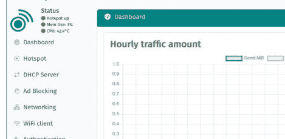

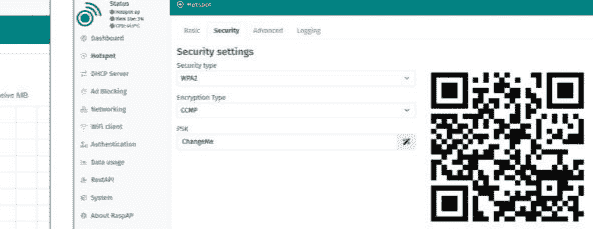

### 1 登录

默认情况下，您的 RaspAP 安装通过 DHCP 分配 IP 地址。连接到路由器以确定其 IP 地址，然后打开浏览器并导航到该 IP 地址。使用用户名 `admin` 和密码 `secret` 登录。

### 2 配置 SSID

点击侧边栏上的热点，使用基本、安全、高级和日志中的选项配置您想要的 SSID。更改 PSK（预共享密钥）的默认值，且无法轻易更改。

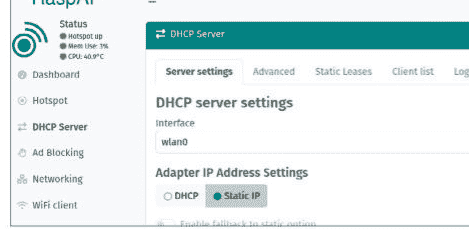

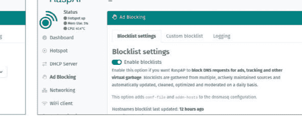

### 3 配置网络选项

点击 DHCP 服务器并使用各个选项卡配置连接设备所属的网络。如果不确定，默认值对于家庭网络是安全的。通过您的手机或其他设备通过新的 SSID 测试网络。

### 4 探索其他选项

RaspAP 的功能远比我们在这个快速介绍中描述的要多得多。查看一些其他选项，例如广告拦截、VPN 集成和 RestAPI 功能。

## 结识技术专家


- 全球最全面的技术网站
- 新闻、观点、评测和专题的无与伦比的结合
- 全新的设计、新的首页、新功能和特别报告
- 超过 300 年的编辑经验支持

# techradar

技术专家

## www.techradar.com

## 骇客攻破 RP2350

## 挑战奖金

工程师 Aadan Cullen 通过对 RISC-V 核心进行故障提取 OTP 密钥。


工程师 Aadan Cullen 在第 20 届 Chipside 大议上通过他的“破解 `RP2350`”演示（`https://bit.ly/ltv325hat`）展示了这项技术。该攻击使用了 `RISC-V` 核心，现在已发布一个 `github` 仓库（`https://github.com/aadan/hacking-rp2350/master`）用于观看视频。Cullen 在发起攻击前详细研究了 `RP2350`，并切换了芯片的一部分——即“永久故障”的 `RISC-V` 核心及其调试端口，使其能够读取秘密。树莓派为 Pico 2 推出了 `RP2350`，作为 `RP2040` 的继任者，并增加了保护商业和工业客户的功能。这些增强功能包括安全启动（`Secure Boot`）、`TrueZone`、冗余处理器（`RCP`）和故障检测器（`Glitch Detectors`）。挑战发起者在其中一个“完全安全”的芯片上隐藏了一个秘密，该芯片将提供给询问的黑客，而首个关注其安全性的挑战者将获得 20,000 美元。

Research Cullen 专注于 `VDD`，因为它与 `OTP`（以及其他功能）相连。也许通过操纵外部提供的电源来影响他想要的功能，他关闭了芯片并隔离了可以进行电气篡改的 53 号引脚。

> Les Pounder 与树莓派基金会等小组合作，帮助人们实现使命。

## 给树莓派粉丝的果实

树莓派在过去的几个月里最近发布了许多新产品。当我写这些时，它刚刚发布了 Raspberry Pi 500，这是一个以关键形式更新的 Raspberry Pi 5，它更新了 2020 年发布的 `RP2040`。`RP2350` 缺少了 Pico 5 上具备的一个关键功能；Pi 5 上没有 PCIe 接口，但为更多电子设备留下了巨大的空间。在树莓派 5 上使用 `NVMe SSD` 后，我们真的很怀念这个功能。在同一周内，我们还看到了连接 Pi 5 的新型 Raspberry Pi 80 显示器。这是一个实用的显示器，虽然 sDRG 和芯片可能平平，但我们并打算用它进行任何严肃的照片编辑。

但事实于此，树莓派还发布了 Compute Module 712，其 SoC 芯片使用与 Compute Module 接口。初始测试结果没有 CM4 那么好，CM5 提供的性能提升持续了二三个月。

### Pi 跃升至 16！

### 也就是内存……

在 1 月第二周初，树莓派基金会发布了最新型号（在一系列发布之后），是其旗舰 Pi 5 开发板的 16GB 版本。它的售价为 115 英镑，比 8GB 版本贵了 40 英镑，其他功能保持不变。

### 机械彗星

### Pi 兼容小配件。

这款 3.4 英寸矩形手持设备运行 Linux 操作系统，顶部带有自定义的触摸 UI。这款树莓派友好型设备将在 Kickstarter 上线，你可以在其上电子设备，包括一个带有 40 个母针引脚的 GPIO 连接器。使用它，你可以连接各种设备，包括 Pi HATs；见 `bit.ly/lkf325hatv`

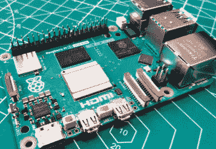

> 它的核心是 Linux


- 故障引脚可以引起异常或想要的效果，例如赢得 20,000 美元。

树莓派发布了 Pico 2，它是 Raspberry Pi 2350 的改进版本。这个微型 SoC 拥有一个 ARM 和一个 `RISC-V` 核心，比原始的 Pico 多，而且我们获得了 Wi-Fi 和蓝牙。

看起来树莓派放慢了 2024 年的发布速度，2025 年会带来什么呢？

### Raspberry Pi Connect

Les Pounder 梦想着来自热水澡的放松，但担心可能会破坏他的 Raspberry Pi Connect。也许 Raspberry Pi Connect 才是答案？

我想在树莓派上有一个远程桌面会话，选择有 `RDP` 或 `VNC`。但 Raspberry Pi Connect 是一种基于 Web 的控制一个或多个树莓派的方法。Raspberry Pi Connect 在所有型号的 Pi 上，我们在 Pi 5 (4GB) 上测试了它。

如果你正在使用最新的 Raspberry OS，你已经安装了 Raspberry Pi Connect；你可以通过终端进行。无论哪种方式，你都可以通过 Connect 面板轻松完成，或者查看管理 Pi 设备有多简单。

从你的树莓派或通过互联网——甚至跨国——查看受控制且易于使用的树莓派界面，我们认为在远程桌面工具时代这是一个非常有用的功能。

它是使用 `WebRTC` 构建的，这种技术驱动了 Zoom、Slack 和 Google Meet 的客户端。Raspberry Pi Connect 是直接连接，但也可以通过浏览器与 `VNC` 客户端以及树莓派上的 `VNC` 服务器之间的代理进行路由。

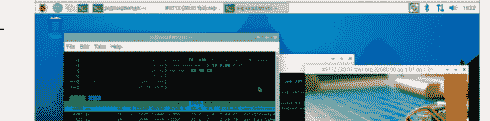

感觉如何？仍然存在延迟，即使对于 Pi 且在同一网络中也是 0.5 秒。我们可以与树莓派桌面、终端进行交互。如果你需要更好的会话，Raspberry Pi Connect 还提供了一个我们可以运行命令并管理系统的会话。你只需要一个新的……，但它让那些不想知道如何设置的人变得更方便。它的作用是替代插入接收器并连接到套件。Raspberry Pi Connect 不会取代树莓派的设置，但它将增强你与树莓派工作的方式。你将在处理任务的地方和方式上拥有更大的自由，便携且毫不费。而且最划算。它可以免费尝试——唯一的代价是你的时间。

### 结论

开发者：Raspberry Pi

网站：Raspberry Pi

功能 | 易用性 |

开发者: Raspberry Pi | 网站: Raspberry Pi |

|---|---|

| 性能: 8/10 | 文档: 8/10 |

| 价值: 8/10 |


感觉如何？仍然存在一些延迟，即使对于 Pi 且在同一网络中也是 0.5 秒。我们可以与树莓派桌面、终端进行交互。如果你需要更好的会话，Raspberry Pi Connect 还提供了一个我们可以运行命令并管理系统的会话。你只需要一个新的……，但它让那些不想知道如何设置的人变得更方便。它的作用是替代插入接收器并连接到套件。Raspberry Pi Connect 不会取代树莓派的设置，但它将增强你与树莓派工作的方式。你将在处理任务的地方和方式上拥有更大的自由，便携且毫不费。而且最划算。它可以免费尝试——唯一的代价是你的时间。

结论：8/10

143

### Formlabs Form 4

对于 Denise Bertacchi 来说，完美的打印就像玩游戏连接点点一样简单。

- 规格

- 尺寸：200 x 125 x 210 mm

- 光源：带平凸透镜的 LED

- X/Y 分辨率：50-25-367 微米

- 曝光：N/A

- 对比：7 色触摸屏

- 通信：`USB`, `Wi-Fi`, `LAN`

- 尺寸：最大 367 x 554mm, 18.3kg

3D 打印并不是一件乐事，当我们拿到 Formlabs 4 进行测试时，终于明白了问题所在。消费级树脂 3D 打印机不仅混乱混乱，而且需要大量的猜测。Formlabs 通过创建一个严格控制和经过彻底测试的生态系统消除了猜测。

Formlabs 通过将用户限制在工程师设计和测试过的组件上，使其防于出错，确保所有部分都能协同工作。墨盒贴有 `RFID` 标签，因此软件可以跟踪你的树脂。它利用这些信息来确定设置，在需要订购更多时提醒你，并保存库存日志。

意料的是，这个紧锁的生态系统是它最大的缺陷之一。你可以使用第三方树脂解锁打印机，但运行它们的许可费用为 $249。如果你负担不起一瓶树脂 $50 的费用，那么这台打印机就不适合你。

这是入门所需的一切。Form 4 结构坚固，配有一个料槽和一个手动清洁包。唯一需要的是异丙醇来填充料槽，料槽是完全组装好的。

打印平台是出厂调平的。它有一个内部传感器以确保机器水平设定，并可以准确读取料槽内的液体内容。

这是一台制作精美的机器，对细节有着卓越的关注。它带有凹凹手手的翻盖盖。玻璃表面是非粘纹理，可防止树脂粘在玻璃上。

Formlabs 树脂采用特殊的墨盒封装，顶部使用标准瓶盖，底部使用柔性颈。Form 4 也很容易根据需要从开口处分出恰量的树脂。

料槽具有一些我们在消费级机器上未见过的东西——宽叶片。它搅拌树脂以保持混合，并感应箱内的碎片。

> Form 4 摄像头监控打印机并记录延时摄影。如果遇到打印失败产生的碎片，它会停止打印机并向你。

Form 4 是 4K 的，这听起来可能不如像素是翻倍或三倍的最新消费级打印机。但这台机器证明了一点：质量比数量更重要。它打印出的作品具有细节水平且准确。

打印机需要通过 `Wi-Fi` 或 `USB` 线连接到计算机接收文件。这是因为打印机需要网络。加载的软件完全自动化且简单。如果你在 Formlabs 的围墙花园内工作，软件没有任何问题。


我们的 Weket Rocket Rocket 打印了八小时 59 分钟。12K Ele Saturn 4 能够在三小时 13 分钟内完成，但 Formlabs 4 看起来更精细，特别是如果你喜欢细节的话。在 Great 以及 Rocket 宇宙的细节中。

### 结论

开发者：Formlabs

网站：https://www.formlabs.com/uk/

价格：£4,439

| 特性 | 9/10 | 易用性 | 9/10 |
| :--- | :--- | :--- | :--- |
| 性能 | 6/10 | 价值 | 6/10 |

完美的打印不需要工程或化学背景，但请注意你正自己投入到什么样的环境。

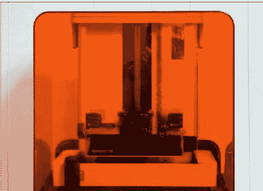


## Raspberry Pi SSD

另一款 Pi 配件以 Linux 格式出现，紧接着 Les Pounder 就来来赞美它！

- 规格
- 尺寸：256GB, 512GB
- 类型：M.2 2230
- 接口：PCIe Gen 3
- 随机读写：40K/70K IOPS
- 256GB：50K/90K IOPS
- 512GB

Pi 5 为这款旗舰 Pi 引入了专用的 PCIe 连接，现在它有许多快速存储选项。在光谱的最顶端，另一端的 microSD 对应的是 NVMe SSD，它们在低功耗桌面电脑中极大提升了 Raspberry Pi 5。为了为此，你需要 M.2 HAT 来使用 Raspberry Pi SSD，当然，Raspberry Pi 有它自己的 M.2 HAT+，并与 SSD 本身一起提供。

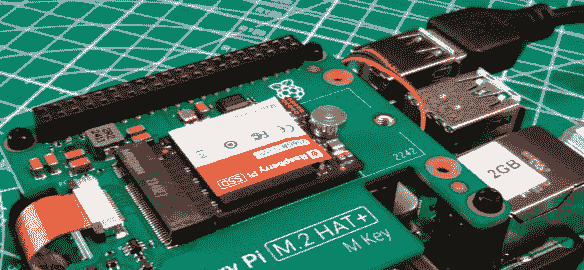

要将 Pi OS 安装到 NVMe SSD，我们从 microSD 开始，连接所有外设，并重启操作系统。加载的软件是完全自动且简单的。我们启动 Raspberry Pi 5 并使用工具从卡复制安装到 SSD。五分钟后，Raspberry Pi 从 NVMe 启动并达到了速度 Gen 3。快速重启并准备好测试：Raspberry Pi SSD 提供两种规格——256GB 和 512GB——作为独立驱动器或套件（SSD Kit），包含了 Raspberry Pi M.2 HAT+。开始，256GB Raspberry Pi 启动到 OS 需 19 秒。这比 microSD 快，我们的 microSD 卡花了 22 秒。两者之间没有太大区别。由于 Raspberry Pi 正式支持 Gen 3，我们将关注对于那些使用 Geekworm 等板子的 Gen 2 性能。驱动器写入有多快？使用 `dd` 读取数据到 `/dev/nvme`，Gen 3 达到 443MB/s，对于 Raspberry Pi 来说速度足够。Gen 2 为 348MB/s，对于大多数用例也足够。我们测试了驱动器有多热？使用智能设备测试温度。空闲温度为 31°C。使用 15 分钟后，SSD 为 38°C。在压力测试下，Gen 3 达到 78°C，而 Gen 2 保持在 61°C。NVMe 存储为通用任务提供了明显的提升。

### 结论

开发者：Raspberry Pi Foundation

网站：www.raspberrypi.com/products/ssd/

价格：£27.70 (£41.50 SSD)

| 性能 | 易用性 | 价值 |
| :--- | :--- | :--- |
| 8/10 | 8/10 | 8 |

它与其他 SSD 一样工作，但你得到了 Raspberry Pi 的保证，如果你愿意多付一点钱，这是 Raspberry Pi 5 的 SSD。评分 8/10

## PI CAMERA

### 使用 BlueSky API 构建相机陷阱

仍然是温暖的，Les Pounder 使用 Pi 5 和 Camera Module 3 将图像发送到 BlueSky。

## 我们的专家

Les Pounder 是 Hartford 的副编辑，一位自由职业制作者。他关于功能和项目的博客见：http://blog.es/lt325

> “除非你住在山洞里，否则你不会错过这个故事：从 Pi 到 BlueSky 的摄像头。这让我们思考 BlueSky API（应用程序接口）；它有一个吗？结果显示它带我们进入钻研 API 和 Python 的兔子洞。”


钻研的结果是这个项目，我们使用 Raspberry Pi 和传感器触发一段代码，使用 BlueSky 拍摄入侵者的照片，并将当前日期作为消息的头部和正文。这是一个简单的项目，但我们建议不要用你的主账户使用，否则可能会产生垃圾信息并导致账户被封。如果你想设置更好的触发器，请考虑适配 Raspberry Pi。

障碍物（L）是测试代码的极佳选择。金球（R）是检测房间移动的更好选择。

### 相机设置

Raspberry Pi 连接到 Raspberry Pi 模块上的 CSI（摄像头）端口。对于 Pi，它连接到 MQTT 并需要不同的线。在关闭 Pi 的情况下，小心地从 Pi 的以太网/USB 端口拔下电缆。然后将电缆插入右侧。电缆端应该连接：如果没有，是否有损坏？确保电缆方向正确，然后锁定到位。一旦你的外设连接到 Pi 并进入桌面，我们打开终端并运行命令检查摄像头是否工作：

```
$ vlc2-ctl-list
```

摄像头工作正常。当你看不到预览时关闭预览窗口，关机并检查我们选择使用的 Raspberry Pi Camera Module 3，它具有自动对焦——有助于捕捉图像。

### BlueSky 密码

因为它不像“金球”那样敏感。如果我们在大房间里部署这个项目，“金球”会更好，因为它有三个连接——到 5v 引脚、GPIO 和 GPIO 17。请看下图说明。

BlueSky 像 Twitter 一样允许任何应用作为连接 API 的手段。对于我们来说，BlueSky 让我们轻松创建一个应用。在浏览器中，点击屏幕左侧的齿轮（设置）。选择密码。点击添加 App 按钮，然后在下一个屏幕中，将 App 密码命名为 Bot，并点击创建 App 密码。App 密码说明了这是一次性详情。就此，我们开始创建密码。

### 创建项目

### Pi 传感器触发

触发陷阱的是 PIR 传感器，你可以使用“金球” PIR 传感器，但我们选择使用 PIR 障碍物，它通常用于机器人。只需：

打开终端，运行软件系统，这允许我们安装合适的 Python，它与 BlueSky 的 API 交互。使用：`sudo apt install break-system-packages` 将模块安装到 Raspberry Pi 的 OS 系统中：

```
$ sudo apt update && sudo apt install break-system-packages
```

打开 Thorn 并创建一个新文件。在该文件中，创建两个对象：`username` 和 `password`。

`username` 是你的 BlueSky 用户名，biglesp-test.bsky。

社交功能，例如。你的 `app_password` 之前已经创建了：

```
username='YOUR BLUESKY USERNAME'
app_password='YOUR APP PASSWORD'
```

将该文件保存为 `secret.py` 并创建它以切换到新文件。

在此文件中，导入了一系列用于 BlueSky 的模块：访问我们的 `secret_file`、`time`（用于控制代码速度）、`Picamera2`（用于相机）、`libcamera`（用于自动对焦）、`datetime`（用于日期和时间）以及 GPIO Zeros 的 motionsensor（用于 PIR）：

```
from os import Client
import secret_file
import time
from picamera2 import Picamera2, Preview
from libcamera import controls
import datetime
```

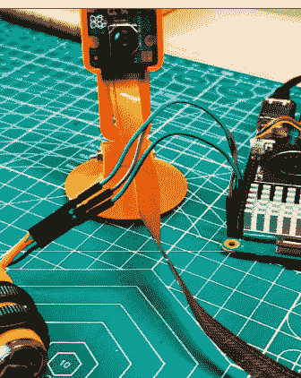

创建一个告警，将 GPIO 连接到你的运动传感器类连接到 GPIO017 上的 PIR：

创建一个函数 `capture_and_post()`，它将捕捉入侵者的图像并将其发布到 BlueSky：

```
def capture_and_post():
```

在函数中，创建一个事件，并使用它来存储日期时间。使用 JPEG 文件用 `Picamera2` 创建对象：


```
filename=datetime.datetime.now()
picamera2.configure(filename,format='JPEG',size=(1920,1080))
```

配置相机以 1080P 捕捉，将预览窗口设置为 640x480：

```
picamera2.configure(picamera2.config)
```

启动相机，然后对物体对焦：

```
picamera2.start(preview='True')
picamera2.set_controls({'AFMode':'AFMode.Continuous'})
AutofocusMode.ContinuousAuto
```

等待 2 秒让相机完成对焦
`time.sleep(2)`
`picamera2.capture(filename)`

以只读文件形式打开图像，使用 `img_data` 将内容读取到对象：

```python
with open(filename,'rb') as f:
    img_data = f.read()
```

```python
client = Client()
client.login(secret_file.username, secret_file.app_password=)
```

创建一个消息，通知 BlueSky 用户陷阱已被触发，并将日期添加到消息中：

> 告警：检测到移动！

将图像发布到 BlueSky，连同消息和图像文本。你同样不能遗漏文本。

```python
client.send_event(message,img_data,
alt='This is a photo taken by Raspberry Pi camera and capturing motion in front of a PIR triggering the camera trap!')
```

在函数外部，使用 `True` 循环来无限运行相机。当 PIR 检测到运动时，会触发 `capture_and_post()`，并执行我们刚刚写的所有代码。最后，用 `while True:` 包裹起来：

```
等待传感器被触发
pir.motion capture_and_post()
time.sleep(2)
```

将代码保存为 `BlueSky-Image.py` 并在 Thonny 底部运行。几秒后启动相机。检查你的 BlueSky 账户，你应该能看到一张入侵者的照片。

### 传感器代码

在现实世界中，使用高尔夫 PIR 来检测房间内的移动。红外光束将覆盖房间的大部分，让入侵者更难躲避。

但如果你想在鸟类营地或汽车中使用它，你需要一个触发开关，将其放置在会打开的门上（例如断路开关），从而触发相机。长期来看，HC-SR04 超声波传感器或 RC-0516 雷达传感器能够检测更远距离的移动；对于 RC 来说，它可以放置在项目内部以保持干燥。

### 在此处获取你的帖子 立即订阅 http://bit.ly/LinuxFormat


### JMRI

### 使用 Pi 控制你的模型火车

“嘟嘟，嘟！”Sean Conway 展示了他在加拿大荒野外隐居一段时间后在做什么。是的，他疯了……


事虽如此，当本教程作者询问他是否正在进行任何吸引普通读者和兴趣爱好者的项目时，他正在研究如何使用网络接入点（AP）控制模型火车。使用树莓派单板电脑，然后安装开源的 Java 火路接口 (`JMRI`) 软件，该软件允许手机上的 AP 通过 AP 访问机车。

第一个任务是在 SD 卡上获取操作系统。使用 Raspberry Pi OS 的构建版本。然后向 SD 卡上安装 Raspberry Pi 64 位镜像，之后 Pi 就可以连接到你的网络以建立操作系统。

设置这些标准硬件使得我们的教程能够帮助他们让一切运行起来，让我们先说明 OS 安装是通过树莓派自带软件在 SD 卡上设置镜像的。

应用程序页面上的三个按钮允许你选择设备（Pi 硬件）、存储（操作系统）和连接（安装操作系统的方法）。

在执行完这三个选项后，我们将按照这些步骤进行。

### 教程 控制模型火车

VNC 让我们能够从另一台设备控制树莓派（Pi）。VNC 采用客户端/服务器模型。运行 VNC 客户端的设备向服务器发送键盘和鼠标通信信号。服务器向客户端返回更新。

已安装了 Pi 的 VNC 服务端软件。它需要被启用，因此请使用 `raspberry-config` 工具在 `Interface`（接口）菜单中启用 VNC 服务。

我们用于访问 Pi 的远程设备需要 VNC 客户端软件。TigerVNC 和 RealVNC 只是可用的几个客户端包中的示例。

找到并安装一个符合你需求的 VNC 工具。对于这个项目，我们之所以使用 RealVNC，是因为我们已经熟悉它了。使用安装的客户端连接到树莓派。

RealVNC viewer 需要软件才能运行。版本 5.9（当前版本）对 Java 11 有要求。

对于 Java，访问 oracle.com，选择 “Download Now”（立即下载，右上角）。在下载页面上设置以下设置：操作系统（Operating System）：Linux；架构（Architecture）：ARM (64-bit）；Java 包（Java Package）：JDK。完成选择后，选择最新版本并下载开始进程。

为了确保安装有效，请验证下载文件的校验和与下载页面上提供的校验和是否匹配。使用终端窗口并验证以安装软件（需要更新的版本）：

下载提供了正确的校验和。现在使用以下命令安装 Java 软件：

`sudo apt install openjdk-11-jdk`

通过在终端窗口中使用 `java -version` 验证安装，你应该会看到如下输出：On my machine, the installed version is openjdk 11.0.22-0-17-LTS

重启树莓派虽然没有必要，但是是最佳实践。这能让你更放心。在更改之后，检查参考手册以确定是否出现了之前没有的问题。

在就绪 Java 后，从 JMI/IMR/releases 下载 JMRI 软件：https://github.com/jpi/JMI/releases/download/v5.8/Rbc2c2ce7.gz

JMRI 有一个需要开发权限运行的团队。使用的版本是 5.8。提供了 sha256 校验和以验证安装。你可以在 JMRI 下载链接处找到该校验和。验证链接后，安装软件：

```bash
tar -xvf jmi-v5.8-Rbc2c2ce7.tar.gz
```

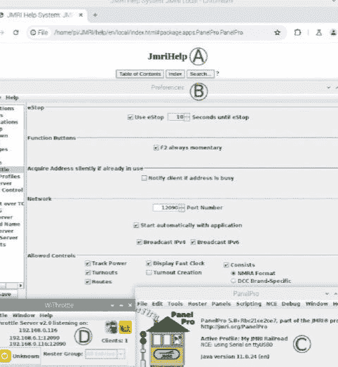

如果你看到类似下面的箭头：

> C --attributes 在当前用户 (`pi`) 的主目录下运行 `tar` 命令。位置配置是由于用户将 JMRI 安装在他们的根目录中设置的。如果你需要以下内容，可以将 JMRI 移动到另一个目录：

安装好 JMRI 后，让一个插件添加到树莓派的桌面菜单。这将允许你启动该程序。使用你喜欢的文本编辑器，创建以下内容：

```ini
[Desktop Entry]
Type=Application
Encoding-UTF-8
Name=Panel-Pro
```

```ini
Comment=JMRI Panel Pro
Icon=/home/pi/JMRI/PanelPro.png
Exec=/home/pi/JMRI/PanelPro
Categories=Utility
GenericName=Generic-PanelPro
Terminal=false
```

使用命令使文件具有可执行性：

```bash
chmod +x ~/Desktop/PanelPro.desktop
```

并创建一个符号链接，以便程序运行到树莓派程序的另一个目录中：

```bash
ln -s ~/Desktop/PanelPro.desktop /local/share/applications/PanelPro.desktop
```

警告信息是，如果你对文件进行的更改消除了该警告，则程序将执行。树莓派 OS 默认文件位于菜单 Preferences（首好）> General（常规）。启用 Dock Options On Launch（启动时显示 Dock 选项）执行文件。

在首次启动时，JMRI 打开三个窗口（如上方截图所示），我们通过每个字符标签进行标识：JMRI Help (A)

Panel Preferences (B) 和 PanelPro (C)。为了方便起见，我们在图中添加了第四个窗口 (D)，请暂时忽略它，稍后会讨论。

JMRI Help (A) 是随软件安装附的一个基于浏览器的文档包。这可以让你在需要 JMRI 参考时无需访问网站。


Panel Preferences (B) 屏幕打开 PanelPro (C)，该默认应用程序需要一些信息才能启动。要找到 Preferences（设置），进入 PanelPro 菜单并点击 Preferences。

PanelPro 界面与你最初看到的不同——Connection（连接）屏幕是第一个打开的标签页。这里显示的截图是带有 WithThrottle 设置的。参考框图 (4B)，JMRI 软件与 DCC 控制器通信。要将 JMRI PI 连接到 DCC 控制器，需要文件连接。Preferences 里的连接块确认了 JMRI 与控制器之间的连接。

如果你检查 PanelPro (C)，你会看到 DCC 控制器和 USB 端口作为软件连接端口。你需要为你的 DCC 系统设置此配置。

为了在 WithThrottle 的 PanelPro Preferences 中自动启动，请选择其监听服务（listening service）上的单选按钮。它将与所使用的手机应用程序建立连接。使用屏幕底部的 Save（保存）按钮更改设置。许多更改需要重启 JMRI 应用。

当你启动 WithThrottle (D) 时，监听器将开始监听，然后连接到手机。设置屏幕显示了你需要配置手机应用的信息。两个地址反映了手机的 IP 地址和树莓派接收到的 IP 地址。

当你保存时，监听器将工作，然后你连接到手机。为了确保安装有效，请验证下载文件的校验和与下载页面上提供的校验和是否匹配。这可以 手机。


### 终端教程

我们选择了一个霍比特法师作为我们的角色，并将其命名为“斯魔格之行”（Smaug Rider），原因有两个。我们在写关于“移民”的酒吧笑话时已经耗尽了创造力，“两个移民应该是龙的命令”。我们的角色是“一个霍比特盗贼的独子，长着蓝色的眼睛、深色的肤色和笔直的金金色头发，是家族的骄傲；

安班德（Angband）

你看到2 卷名为“quero cus insu”的卷轴

新手和两个移民

```
# ##########
# ##########
LEVEL: 1
# ##########
KXT: 0
# ##########
GR: 49
# ##########
CIR: 12
# ##########
IN: 18/10
# ##########
WEX: 10
DEX: 13
CON: 16
```

# 在地下城中穿行

由于空间限制，我们无法涵盖整个游戏，或者你穿过游戏 100 层所需要学习的一切。相反，我们将提供一个基础的介绍，让你了解自己的处境，帮助你找到朋友，以及如何处理所有的装备碎片；

| 属性 | 数值 |
| :--- | :--- |
| 当前 AC | - |
| HP | 7/2 |
| MP | 2/2 |

- 每个角色在游戏开始时都拥有 328 枚金币，在穿过安班德的不同层级时可以使用它们进行购买。

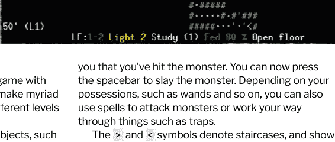

游戏包含大量物品，如戒指、护身符、药水、卷轴、食物等，数量多到可怕的猫和致命深坑的人类。地下城还有许多功能，如陷阱、法术和各种类型的敌人。在某些地方你可以用金币购买物品。

你击中了。现在可以使用空格键来显示你的路线。根据你拥有的物品等，你可以使用法术攻击怪物，或以某种方式绕过障碍。

Itky - 最好的商人会卖给你切肉、剑和箭箭。在“位置”（Location），人类是一个带有魔法法术令牌和书籍的霍比特。按 `(t)` 键访问游戏内的知识库。你现在可以使用按键浏览不同的知识库，学习更多关于如何穿过地下城的知识。

当你捡起卷轴等新物品时，请密切关注右上角的状态栏和消息。

你可以按下并点击屏幕来了解游戏的不同元素。这与我们经历过的任何游戏都不一样，但请务必花时间阅读文档，否则安班德的秩序将压垮你。

游戏使用符号来识别你周围的物品。你的角色位置由符号表示。使用按键在地下城中移动你的角色。你会注意到如 `#`、`$` 和 `@` 等符号，以及出现的新物品等。当你移动角色到符号处时，游戏会提供实用的提示，告诉你向左还是向右，或者查看底部栏。

## 尝试技能

RPG 并不是每个人的心菜，但你会在安班德的创造力和搜索空间中发现乐趣。尽管如此，人们对提供的街机游戏有需求。

如果你玩过《机械赛车手》（Tinker Racer）或《超级赛卡车》（Super Tak Kart），这是一款让你像小孩子一样玩的游戏。

如果你使用的是 Debian/Ubuntu 衍生版的 DEB 发行版，程序支持 `run` 命令。你还会发现这款热门的地下城任务游戏。

安班德游戏使用左键和右键控制滑雪者的速度，按回车键执行跳跃。目标是掌握跳跃时机以得分。

通过从终端运行 `ascii!` 来导航。你可以选择加入世界、开始一个新的会话，或连接到多人网络游戏。

导航到帮助列表查看所有已配置的快捷键。当你受够了山丘和法术时，按 `Ctrl+c` 退出游戏。

在第一层，导航到这里遇见霍比特米洛（Milo）。他的家里是一个存放着饼干、螺栓、箭箭等的商店。你必须决定在任务中或穿过地下城时想要使用它们中的哪一个（如果有的话）。

有时，像致命深坑这样的符号（例如符号）会靠近你。当你向符号移动时，游戏会给出

## 增强你的终端 - 立即订阅 http://bit.ly/LinuxFormat

www.techarrader.com/pro/linux

2023年3月 | LUX325 / 153

### 教程 密码安全

### KEEPPASSXC

致谢：https://keepassxc.org

### 在你的 PC 上存储密码

时刻警惕的（Ever-cautious）尼克（Nick）展示了如何在 KeepPassXC 的帮助下保持你的个人登录安全和私密。

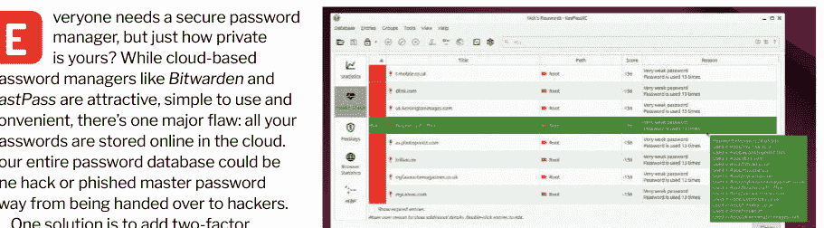

我们的专家

- Nick Peers 在这些年来可能改进了他的密码强度，但 KeepPassXC 的审计让他揭露了一个关于重复使用和暴露的密码的故事。

每个人都需要一个安全的密码管理器，但你的那个到底有多私密？像 Bitwarden 和 LastPass 这样的云端密码管理器是活跃、易用且方便的，但有一个主要缺陷：你所有的密码都存储在网上。

[我们的专家]

- Nick Peers 在这些年来可能改进了他的密码强度，但 KeepPassXC 的审计让他揭露了一个关于重复使用和暴露的密码的故事。

每个人都需要一个安全的密码管理器，但你的那个到底有多私密？像 Bitwarden 和 LastPass 这样的云端密码管理器是活跃、易用且方便的，但有一个主要缺陷：你所有的密码都存储在网上。

一个有效的解决方案是为你的账户添加双重身份验证。

```
[我们的专家]
- Nick Peers 在这些年来可能改进了他的密码强度，但 KeepPassXC 的审计让他揭露了一个关于重复使用和暴露的密码的故事。

每个人都需要一个安全的密码管理器，但你的那个到底有多私密？像 Bitwarden 和 LastPass 这样的云端密码管理器是活跃、易用且方便的，但有一个主要缺陷：你所有的密码都存储在网上。
```

一个有效的解决方案是为你的账户添加双重身份验证。

### 教程：密码安全

### 导航 KEEPASSXC

默认情况下，所有条目都分配有一个图标 - 一把黄色钥匙。通过在“图标（Icon）”部分添加更合适的图标来让你的条目更加丰富。如果条目关联了 URL，点击“下载网站图标（Download Favicon）”从网站获取图标，而不是使用通用图标。

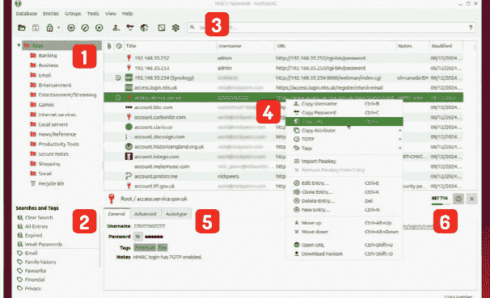

最后，“自动填充（Auto-fill）”功能用于在没有登录条目的浏览器中自动填充密码，但该功能默认是禁用的。了解通过插件将 KeePassXC 连接到其他浏览器和设备的逐步步骤。最后是其他功能：“属性（Properties）”，它可以让你查看条目的创建时间、访问时间、查看时间以及修改你关于浏览器登录的偏好 - 稍后介绍。

### 管理条目

使用同一个对话框来管理条目，但你为什么需要这样做呢——？？关键原因是审计密码，这是网络安全的良好习惯，并能提供帮助你掌控全局的功能。

如果你从另一个账户导入了密码，请选择“搜索和标签下的弱密码（Weak Passwords Under Searches And Tags）”。然后你可以使用 KeePassXC 标签将它们合并回来，但如何检查并重新导入那些需要紧急处理的密码呢？答案位于“对话（Dialog）”菜单并选择“日期报告（Date Reports）”。


- 1. 使用这些文件夹来组织你的登录信息 - 创建、删除、将登录信息拖入其中。
- 2. 使用搜索工具通过显示过期或弱密码执行快速密码审计。
- 3. 你可以进行简单搜索以显示高级选项，例如基于字段的搜索。


- 4. 显示所有匹配所选文件夹、搜索或标签的条目列表。右键点击条目可获得更多选项。
- 5. 条目详情：在此面板中查看其内容。敏感信息默认被屏蔽，点击即可查看。
- 6. 如果条目具有 TOTP 代码，它将显示一个下拉图标。点击此处查看。


它允许你恢复任何额外的细节 - 如信用卡号或恢复码。如果你对攻击感到担心，可以尝试“计时保护（Tick Protect）”，除非你输入条目，否则会隐藏信息。

双重身份验证（TOTP）代码还支持额外的属性，幸运的是 KeePassXC 了一个了一种更符合用户习惯的方式来添加它们 - 参见提示（右侧）。


### 将你的浏览器连接到 KEEPASSXC

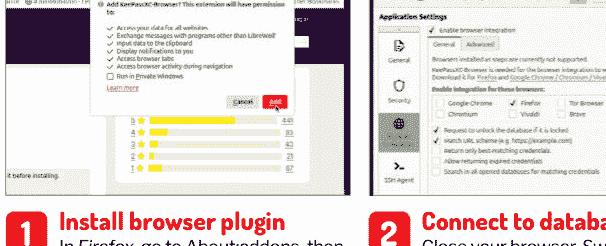

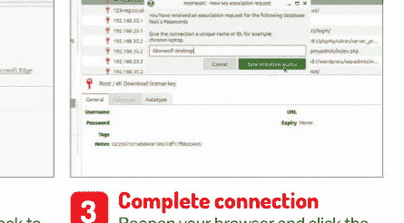

- 1. 安装浏览器。在 Firefox 中，进入“加载程序”，然后在搜索框中搜索。选择 KeePassXC 并点击“添加到 Firefox”，然后点击“安装”。在点击“添加”之前，点击“需要时运行”。安装后，将扩展固定到工具栏上（点击拼图按钮，然后点击 KeePassXC 旁边的按钮）。
- 2. 连接数据库。关闭你的浏览器。切换回 KeePassXC 应用并进入“设置（Settings） > 浏览器集成（Browser Integration）”。点击启用并跟随你的浏览器。如果你使用的是 LibreWolf，切换到“已添加（Added）”选项卡，点击“使用自定义浏览器集成位置”，并在点击确定之前设置为 `:librewolf/messaging-hosts`。
- 3. 完成连接。重新打开带有 KeePassXC 图标的浏览器打开。如有必要，点击“连接前重载（Reload Before Connect）”。KeePassXC 中弹出“密钥关联请求（Key Association Request）”窗口。给它一个合适的名称（如 librewolf-desktop）并点击保存。允许访问。当 KeePassXC 检测到详情匹配时会提供登录服务，这

# 密码安全教程

## 在多个设备上使用 KEEPPASSXC

一旦在主电脑上设置好 KeepPassXC，你可能希望将其使用扩展到其他设备和计算机。对于需要将 KeePassXC 数据库存储在跨设备访问的云同步文件夹中的用户，如果在一台或多台计算机（如笔记本电脑）上使用 KeePassXC，选项将包含直接同步工具，如 Sync（同步）。在你的第二台机器上安装 KeePassXC 后，可以通过指向你同步的数据库来打开现有的数据库。如果你想在手机上访问密码，你需要使用选择的任何平台将数据库存储在云端。KeePassXC Android Password Safe 用于 Android（免费）；它可以与多种平台同步，Nextcloud、WebDAV 以及 Google Drive、OneDrive 和 Dropbox。大多数 iPad 和 iPhone 应用仅与 iCloud 同步，并且高级功能需要订阅。那还不是 KeePassXC ($3.99/年，be@keeppass)，但这并不是放弃它的理由；它也与 Dropbox、Google Drive、WebDAV 以及 iCloud 同步。

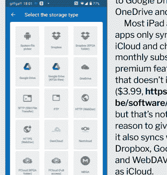

### 教程 开放地图

### OPENSTREETMAP

致谢：www.openstreetmap.org

### 扩展你的开放地图使用

**Marco Fioretti 通过他对 OpenStreetMap 世界的游览，展示了每个人都可以变得多么广阔和开放。**


> 第三部分！不要错过下期节目，请在第 16 页订阅！

由于其开放的性质，OpenStreetMap (OSM) 提供了一系列庞大、有趣且强大的制图工具。我们已经深入了编辑的基础知识，现在我们将游览每个 OSM，它让任何人（无论其数字技能如何）都能导航到任何地方，或者以他们可能喜欢的任何方式使用其地图。


既然在那里了，应该立刻做点什么对吧，不是吗？移动应用是在途中作为导航工具使用 OSM 的唯一方法。在写作此时，在途中功能与用户友好性之间的平衡似乎是 OsmAnd (openstreetmap.net)，它适用于 Android 和 iOS，提供两个版本，其中一个是免费的。两个版本都可以作为 OSM 编辑器和 GIS 导航仪，在下载了计划访问的区域后，它们可以在离线状态下引导你，且不会告诉任何人你要去哪里。


### 口袋中的 OSM

到目前，你已经知道如何通过 https://wiki.openstreetmap.org/Editor 从任何桌面为 OSM 做出贡献，但还有许多其他程序可以进行贡献。在途中，OSM 制图具有更大的规模并有真实的键盘和鼠标，但即使你只需要更改或添加其中的几个细节，它也会让事情变得方便得多。


除了你的位置和地形的所有特征外，OsmAndroid 还可以使用指南针和你想使用的 GPS 轨迹进行导航并将其叠加在地图上。该软件还可以向你的目的地提供详细路线，通过屏幕显示或合成语音，将让你感到温暖。

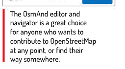

OSMAnd 导航仪对于任何想在任何时候为 OpenStreetMap 贡献或寻找路线的人来说都是很好的选择。

Marco Fioretti 是一位长期开源培训师和作家，渴望成为博学者，在 https://mfioretti.com 和 https://mfioretti.substack.com 写关于所有数字事物的文章。

### 快速提示

### OSM 社区与培训

我们已经涵盖了 OSM 和 Android，但还有许多其他 OSM 编辑器。要查看它们如何轻松地比较功能，请查看 https://openstreetmap.org/Comparison_of_...

本教程将提醒全球 OSM 社区有多大，以及在线连接或面对面的许多方式。结识并遇到他人的第一步是虚拟加入 https://community.openstreetmap.org/ OSM 社区论坛。

该论坛提供了技术支持和对非营利性 OSM 问题的讨论，并有 40 多个针对单一国家或整个大陆的区域社区。在最重要的活动中，你可以遇到 OSM 社区大部分成员，即 State of the Map、SoM 会议 (https://wiki.openstreetmap.org/State_of_the_map) 以及周围的所有特色。与每年一样，论坛是国家和区域的 OSM 会议。

对于纯粹的自学，官方指南和指南的极佳补充是联合国的学习中心（带有各种可以任意顺序访问的免费课程）。

本地 OSM 圆子也是在每个地方询问和学习如何绘制地图的最佳地点。

58 | LTM 2023年3月

OpenStreetMap

www.linuxformat.com

# 开放地图 教程

的停止或限速限制。你可以通过位置或类别搜索特定地点，激活自行车的专用导航模式，并检查公共交通站点或线路，甚至可以记录你的行程记录为 GPS 轨迹。

### 地图信息

在 Field Papers 网站上，你可以轻松获取地图任何部分的打印版本，无论你想要多少张纸。

| 用于 LXF 的 Field Paper |
| :--- |
| 打印笔记 ( ) 保留 |
| 地图纸 ( ) |
| 纸张尺寸 |
| A4 横向 |
| 浏览器：OpenStreetMap |
| OpenStreetMap 黑白，Esri + 边界 + 标签，仅限卫星 |
| 人道主义，人道主义缩放，Mapbox 卫星，OpenCityMap，Sputnik R7 |

### 网格布局

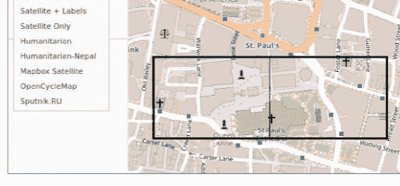

### 用笔和纸地图？

是的，你读没错。OSM 适用于所有人，包括那些不习惯使用数字工具的人、年龄太小无法使用智能手机的孩子，以及由于任何原因无法使用数字设备或没有可靠互联网的任何人。

更具体地说，小学生、父母以及各地的每个人都可以在不使用触摸屏或键盘的情况下为 OSM 做出很大贡献。当你准备好向他们介绍开源世界时，特别是开放和共享的知识时。

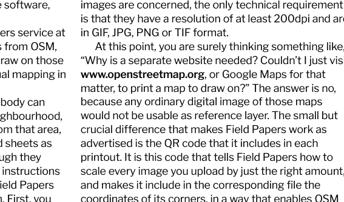


这归功于 Field Papers 服务，它让你从 OSM 打印地图，使其可以在地图上绘图，然后将其作为任何编辑的实际输入。唯一的图像要求是图像分辨率至少为 200dpi 且为 GIF 或 PNG 格式。此时，你可能在想“我们为什么还需要另一个服务？我们不能直接在纸地图上绘图吗？”答案是否定的，因为 Field Papers 不会被作为图层使用。Field Papers 的巨大差异在于每张图像中包含的 QR 代码，它知道如何以正确的比例缩放每张图像，并允许对 OSM 进行编辑。通过这种方法，Field Papers 允许你打印整个社区的地图，将其分发给那里的居民，并在地图是卫星图像时将其作为参考。

## 快速提示

OSM 的真正价值在于其数据的开放性，即使对于没有手机的人也是如此。它包含了产品、手册或任何从数字制图中受益的物品，考虑一下


威尼斯地图的艺术呈现，非常适合手册或 T 恤。如果你的地区有该工具，那么在打印这些地图后，任何其他人都可以访问那里，并在缺失或不同的地方绘图：例如某些道路的真实路径，或建筑的位置。除了绘图，制图者还在纸张上（Field Papers 将其称为地图集）制作详细的笔记或解释，以最大限地提高笔记和修改地图的可读性。一旦完成绘制，任何人都可以扫描并将上传到 Field Papers 网站，使其作为任何地图的参考层，或者提供给任何需要。在后一种，你可以通过网站生成的链接将你的私人地图集分享给任何人。

2023年3月 | 59

## 教程 开放地图


(`github.com/marceloprates/prettymaps`)，一个小型 Python 程序，通过连接其他 Python 库，可以创建像（上一页）所示那样的高度装饰性的地图。

### 自定义地图

尽管如此简单，它有一个明显的局限性，它只遵循地图而没有其他的——即，没有你想要的地图上方的其他通用数据。通用是这个词——OSM 网站的基本功能可以显示你可能拥有的地理数据；或者，无论对某些人有多重要，足够让你在不任何方式更改 OSM 数据库的情况下，选择地图的一部分，并在任何数据的地方进行编辑，并获取可以嵌入你的网站的 HTML 代码。OSM 编辑器在线界面类似于 ID（见 JX3），它允许你添加层、多边形和景点（再次，即使添加了太多层也可以轻松删除并重试）。上传后仍然可以使用在线工具向你的地图集添加笔记。更重要的是，网站允许你查看并下载他人的区域，在其基础上构建而不是复制。

该问题的解决方案是使用 OSM 社区在 `https://www.openstreetmap.org/edit` 提供的 OSM 编辑器。类似于 Mapbox，你生成的随时间演变的 OSM 地图。

### 装饰地图

地图如此美丽和有用，它们不需要配角。它们也是任何类型文档（从大学论文到音乐会海报）的很好的补充，并可以丰富任何物体（例如在你的地图 T 恤上标记你初吻的位置）。这种项目的绝佳工具是 `prettymaps`

### » MAP MAPPER

你已经知道，由于其开放许可，OSM 数据库可以以任何方式为了你可能想象的几乎任何目的进行自由编辑，单独使用或与任何类型的数据相结合（如果它们的许可允许，当然）。历史和建筑学者或爱好者可以将古代地图与当前的 OSM 数据相结合，显示档案的确切位置，或你的城市布局几个世纪以来是如何变化的。在实践中，对于没有技能或无法在线资源的人来说，这不像你希望的那么容易，由于几个原因，第一个是数字版本的地图并不简单

然而，问题在于，由于缺乏高级工具以及我们不会涉及的许多技术原因，古代地图看起来从未与相同地区的 OSM 地图完全相同，因此它们不能作为制图的基础或参考。幸运的是，Map Mapper 网站 (`https://mapmapper.net`) 解决了这两个问题，它收集了有时以正确方式校正以匹配 OSM 数据的地图——在所有其他情况下，供知道如何校正它们的专家使用。

+ 显示导出元数据注释 (0)


在 Map Mapper 中，你可以通过叠加历史地图来组合它们，使其在 OSM 编辑器中变得有用。


## 开放地图教程

### 任何地点的 3D 场景


Blender (`blender.org`) 是一款开源工具，可以为任何事物物制作复杂的 3D 模型。得益于 Blender 插件 (`https://github.com/voyvoy/blender-osm`)，你可以从 OSM 甚至 Google 3D 城市导入地图数据，并将其用作为你想要为计算机游戏或其他任何目的创建的 3D 场景的任何基础。得益于 Blender，你可以直接生成像（右侧）那样的场景，具有正确形状、高度和层数的建筑，并结合道路、河流和其他 OSM 对象、GPS 轨迹，以及根据每个地点的 OSM 海拔数据放置在 3D 地形模型之上。

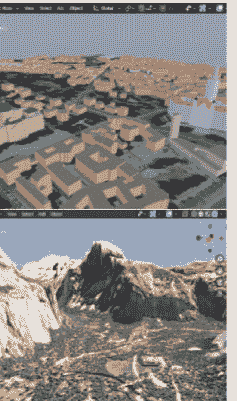

Blender 模型插件可以将任何 OSM 数据转换为你可以完成的 3D 场景。

Mapbox 生成的 OSM 数据中的图钉是包含相应位置信息或图片的弹出窗口。

（真实的 OSM 数据）。然而，它的主要价值在于，你所选择并与数据源关联的地图部分是重要的。通过 Field Papers，由于空间限制，我们只需了解你可以用 OSM 或详细制图做些什么。请参阅 OpenStreetMap 网站上的咨询。

首先，正如我们提到的，可以包含任何内容的数据——即文本、图像和其他事项的任何组合——是每条记录——即每份数据——都是经过地理标记的。这意味着每条记录必须包含该地点的精确地理坐标，OpenStreetMap 提供了有关如何操作的说明链接。

数据可以由第三方源动态更新，也可以包含在文件中。第一种方案更灵活：每当你更新服务器上的数据时，用户地图都会显示新值，无需任何进一步操作。

第二种方案较差，至少在原理上如此，因为数据的任何变化无论多小都必须手动更新。在实践中，除非数据服务器已经存在，否则单文件方案更易管理和维护，特别是当数据经常变化时。

你可以看到（上方）OS 是如何做的：对于每条记录，即在标记器的相应位置，点击后会打开一个包含相关文本或图像的弹出窗口。可以为标记器选择不同的形状，并让它们呈现与其原始数据对应的不同颜色。

如果你想要一个带有比标准 OSM 图标更多、更好的图标的嵌入地图，请尝试 Map Machine (`https://github.com/enzet/map-machine`)，以及一个自动从 Rington 图标集中添加图标的简单 Python 脚本。

### 掌控你的路线

如果你想找到你的 OSM 地图的完整版本，请查看 OpenFreeMap (`https://openfreemap.org`)，这是一项于 2022 年 9 月启动的服务，旨在“让你的自定义地图显示你的网站上并与他人分享”。必要的软件和数据位于你可以从任何供应商处租的廉价入门级虚拟服务器 (`VPS`) 上。

课程笔记：如何满足你的制图需求、要求和技能，就是 OSM 地图，它可以帮助你了解从何处开始。

> 小贴士
>
> 世界充满了各种数据，如果这些数据在视觉上与地点联系起来，将非常易于学习和理解。尝试用地图来实现这一点吧！


### 伦敦

这个伦敦的三维渲染图是你可以使用 OpenFree 软件包在自己的服务器上托管并显示的地图示例。

### 我们知道你住在哪里！！立即在 `http://bit.ly/LinuxFormat` 订阅

`www.techradar.com`

2025年3月 LXF32 | 61

# 往期期刊

## 错过了哪一期吗？


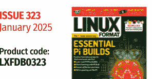

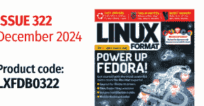

第 324 期

2025年2月

产品代码：`LXFDB0324`

第 323 期

2025年1月

产品代码：`LXFDB0323`

第 322 期

2024年12月

产品代码：`LXFDB0322`

杂志内含

进入内部

探索如何摆脱困难，并找到我们认为本月合锦中最好的免费聊天机器人。此外，通过我们的精选内容稍作休息，寻找属于你自己的 Steam Deck，探索新的 PI 500；发现你自己的《太空侵略者》游戏；查看最新发布，跟进开源新闻，等等。

杂志内含


关注我们推荐的树莓派 PI 项目并开启你的爱好。此外，全面了解 `Fyne`，这是一个让你轻松构建跨平台应用程序的工具包。查看五种 IDE 以及一些最新发布。你还将深入到关于恢复被删除的文件、备份网页、参与 StreetMap 等教程中。

### 杂志内含

升级最新版本的 `Fedora`，并加入 `AMD` 的 `Zen 5` 架构。此外，找出哪种浏览器是最好的，选择你自己的浏览器，创建一个网格 `VPN`，管理你的照片、在 `Pi` 上捕获注入、升级内存等等。我们将一如既往提供充实的新闻，涵盖开源的所有最新动态。


第 321 期

2024年11月

第 320 期

2024年10月

第 319 期

2024年9月

### 杂志内含

进入内部

探索如何摆脱困难，并找到我们认为本月合锦中最好的免费聊天机器人。此外，通过我们的精选内容稍作休息，寻找属于你自己的 `Steam Deck`，探索新的 `PI 500`；发现你自己的《太空侵略者》游戏；查看最新发布，跟进开源新闻，等等。

### 杂志内含

关注我们推荐的树莓派 项目并开启你的爱好。此外，全面了解 `Fyne`，这是一个让你轻松构建跨平台应用程序的工具包。查看五种 IDE 以及一些最新发布。你还将深入到关于恢复被删除的文件、备份网页、参与 StreetMap 等教程中。

### 杂志内含

升级最新版本的 `Fedora`，并加入 `AMD` 的 `Zen 5` 架构。此外，找出哪种浏览器是最好的，选择你自己的浏览器，创建一个网格 `VPN`，管理你的照片、在 `Pi` 上捕获注入、升级内存等等。我们将一如既往提供充实的新闻，涵盖开源的所有最新动态。

## Auracast 教程

## 蓝牙

*致谢：www.bluetooth.com*

### 发现下一代 Auracast 音频

`Auracast` 是 `Bluetooth Low Energy` 的一部分，已准备好彻底改变蓝牙世界，`Tam Hanna` 终于可以让他的 `Palm OS` 设备用上了。

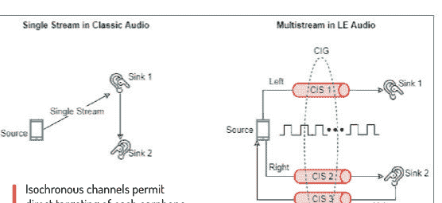

蓝牙音频自 `Palm T` 时代就已经存在了。那时，移动设备的计算能力意味着用于音频传输的编码器必须针对当时半导体技术的局限性进行优化。

### 请更好的编码器

蓝牙 `5.2` 引入了低功耗通信的新标准——编码器 `Codec`，或 `LC3`。它利用编码器开发的的进展，通过减少传输量来提供更高的音质。蓝牙的测试显示，`160kbps` 的 `LC3` 质量优于基于传统编码格式的 `32kbps`。

减少传输可以使立体声的能量消耗降低高达三倍，在这种情况下，未连接的耳机可以仅使用针对它们的输出信息来接收独立的流。

明智的是，蓝牙 `5.2` 引入 `LC3` 时是一项突破——`https://bly.com/ltfx32codecs` 提供了概览。通过配对耳机，在 `https://bly.com/ltfx32demo` 上的交互演示展示了 `Thomas Steven` 对音质的性能评估。最后，`https://bly.com/ltfx32lc3` 的代码文档非常值得读。

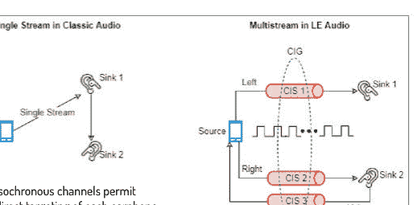

并用一个名为等时通道 `Isochronous Channels` 的新系统取代了它，该系统为无线音频协议栈增加了一个层，用于数据同步的可靠性。它将时间和时钟都分为称为 `LC3` 间隔的槽。在每个间隔期间，源被发送到包中，这防止了多个信号的干扰，并显著降低了音频延迟。据说蓝牙音频的延迟高达 `200ms`，而大多数耳机的延迟保持在 `30ms` 以下。通过 `LE Audio`，这

此外，这还实现了数据流冗余。新的蓝牙耳机可以向每个耳朵发送一个流，消除了 `A2DP` 模式下存在的延迟。

最后，蓝牙音频流中的数据带有预期。数据包可以自动丢弃，确保没有丢失的数据包浪费空中时间。

### 多播广播

蓝牙的学习者知道 `CEP` 和 `LDP` 之间的区别。同步访问保证了一一对多广播的交付，从而实现了更高的效率和更低的延迟。

在多播的情况下，使用了两种流。连接等时流 `CIS` 在音频源和接收器 `sink` 之间创建了点对点的连接。源向一个接收器发送信息——对于具有独立耳朵的耳机，需要两个 `CIS` 流。蓝牙

### 等不及最近了

蓝牙 `LE` 的引入是为了解决该标准面临的各种问题。为了消除僵化协议系统带来的不灵活性，它提供了一种新的、缓冲少的无线通信形式，这导致了延迟的降低。

特别是，`LE Audio` 消除了 `A2DP` 协议

### 蓝牙编码器比较

标准立体声听力测试

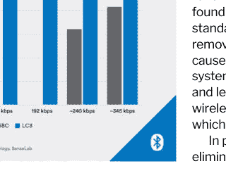


我们的专家 `Tam Hanna` 在计算机、软件和电子领域工作了 20 多年。

`LC` 导致了音质的显著提高

`64 LifeVox 2023年3月`

`www.ausformat.com`

致谢：`Bluetooth-SIG`, `https://bly.com/ltfx32sig`

## Auracast 广播

等时流 `Bis` 可以将传输多播到被称为 `TCP/IP` 网络堆栈的 `UDP` 协议中。与 `CIS` 不同，`Bis` 是无连接的；任何接收器都可以听到通过网络传输的数据包并按其需要使用它们

进入一个未经加工的数据流，这不会导致环境噪声放大。

在许多其他与广播相关的主题中，`Auracast` 是一个商标。它许可给实现了广播配置 `BBP` 的 `Bis SIG` 认证设备，以便在需要时快速添加 `Bis SIG` 认证，对于较小的公司。

`Bis` 流被分组为组织。一组可以包含多达 `31` 个 `Bis`，每个 `Bis` 都被分配一个标准长度的地址。发送的数据包与此引用绑定，引用冗余确保了数据包的同步。

## Auracast 广播

- 机场公告
- Cate CAT7
- Cate CAT7 公告
- Cate CAT7 电视
- Taylor 的实验室
- Amir 的手机

`Bis` 将其流细分为多个槽，如果可用，数据包可以多次发送；如果数据包在第一次运行未成功接收，它可能在第二次中出现。

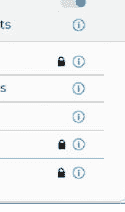

访问 `www.auracat.com/developers/` 了解更多关于 `Bis SIG` 为硬件和软件开发者提供的技术要求。

## 广告 - 好的种类

实现上述需要对 `Bis` 广播方案进行额外的更改。用于确保设备存在的数据可能需要两个

首先，定期意味着发送者定期发布其存在。实现上述需要对 `Bis` 广播方案进行额外的更改。用于确保设备存在的数据可能需要两个。（注：我已删除了冗余的 OCR 循环以保持清晰）。

## 新应用

结合 `Auracast` 技术，目标是创建提供近距离音频流。`Bis SIG` 的一个关键优势是 `Wi-Fi` 音频流区域的存在，电视可以在那里流传输其音频而不中断。

除了降低噪声和低带宽消耗的处外，还提供了一些高级场景。首先，音频源可以提供不同语言的输出——对于上述 `PA` 扬声器，乘客可以用他们的母语听到以获得便利。

其次，`Bis SIG` 的通信允许使用 `Auracast` 为听障人士提供音频增强。例如，可以通过 `Auracast` 轻松提供扬声器，使听力能够达到

## 教程 穿孔卡

## 经典设备

### 通过穿孔卡和磁带重温过去

与极具复古风的迈克·贝德福 `Mike Bedford` 一起，通过在过时的圣诞卡片上打孔，重温数据输入的世界。

从计算早期开始，性能的指数级增长确实令人惊叹。事实上，我们对计算机历史的偶尔回顾已经说明了速度、内存容量和存储容量经历了飞跃性的增长。也许不那么明显的是，这种趋势与过时并肩出现。某些曾经是这里不可或缺的硬件现在已消失在我们的世界中。

穿孔卡 `指可以在纸板上打孔的片` 听起来可能不像今天那种很快的东西？问题是，今天任何处于电子计算领域的人都会推测他们是否用过它。但这里有一个重要的事实：穿孔卡用于带有计算机的设备，但有些也被用于其他设备。

由约瑟夫·玛丽·雅卡尔 `Joseph Marie Jacquard` 设计的穿孔卡最早在 `1804年` 就被用于控制纺织厂的织机。到 `19` 世纪末，即该世纪中期，它们被用于创建、排序和制表数据。在早期的穿孔卡中，穿孔卡与 `IBM` 在 `1928年` 制造的主机计算机同名，通常被称为 `IBM` 卡片。它的尺寸比三张纸要大得多，为 `187mm` 乘 `83mm`，且呈矩形。它被用作穿孔卡，是每个字符或数据的图形表示。同时，垂直列中的位置可以是每个字符被打孔的位置以创建孔。孔的存在与否代表了字符的值。

这种基于 `EBCDIC` 编码方案的二进制代码，实际上在设计时就考虑了穿孔卡。我们不会深入这些细节，但如果你想知道如何尝试尝试一下我们建议的编码项目之一，

## 我们的专家 迈克·贝德福


想过过去穿孔卡上的故事数据吗？再次强调——它真的是一个QR码。或者真的吗？它是经过校准的：使用今天最好的入门级样品，一张包含4页的高密度棋盘格纸至少可以容纳10MB。


卡片似乎不太通过掉落而移动，横跨卡堆侧面的一条对角线可能会帮助你重新读取它。你将发现内幕。我们要怎么说呢，虽然每列有12个穿孔位置，但只使用了64个字符。许多60年代和70年代的人还记得。我们支持的字符集是为了确保任何一列中不会出现超过三个孔。更多的孔可能会损坏卡片，并增加其在读取器中卡住的概率。

如果我们将卡片的使用限制在数据输入，每张卡片可以包含一个孔来代表80字符容量中的某一个，但大多数时候只看前72个字符。这种限制是为了确保每列没有超过三个孔。一个程序需要几张卡片，这被称为一个“卡堆”（deck），就像扑克牌一样。

在使用电机械卡片时，如果你愿意，你可能会自己打孔。你可能会提交你的程序卡片进行打孔，卡片最终会被馈入卡片读取器，读取器将你的字符传输到主机。并指出读取器在它最开始的阶段是一个电机械接触装置。穿孔卡片通过刷子转换为一系列字符代码，刷子在通过孔时会形成一个电路。最后，在卡堆被读取后，可能需要等待几个小时才能输出——这表明仅仅是一个代码字符就写错了。那是另一个故事了。

然而，携带卡堆是有风险的，有时卡堆非常大。我们在设计卡堆时考虑到的是，带有自豪感且是一个完全随机的指令序列。教授经常会在卡堆侧面画一条对角线来简单地重新排序它们；另一种解决方案是使用序列号。如果你在一个配有这种设备的机构中工作，一张卡片可以及时加固你的卡堆。而仅仅由于疏忽，这可能需要重新调整卡堆。我们遇到过关于卡片通常比遇到卡纸的打印机更实用的说法。随之而来的卡片发现并没有比把它们掉在地板上更有效地洗牌卡堆。


它看起来可能并不高科技——而且这很奇怪——但电机械穿孔卡是大多数人接触计算机的最接近方式。

## 穿孔卡 教程

### 打孔或读取

为了更好地感受管理数据的漫长日子——FORTRAN，COBOL，穿孔卡等等——你不知道自己身处何地。这里你看到一个看起来像打孔机的东西，一个空白卡片，你将看到卡片顶部的文本，以及下方对应的孔洞模式。当你完成后，只需按下穿孔卡你就会得到你的卡片。如果你将其打印并剪切，它是实际尺寸；如果你打印并用刀剪切，你可以将其剪成所需尺寸甚至将其折叠成形状。你还没有结束。为了检查卡片是否真实代表了你使用的字符，你需要前往虚拟读取器，你可以在这里找到，你可以将一张或多张卡片的图像拖到屏幕中心，你将看到它们变成文本。这个虚拟读取器使用光学处理，所以你可以写一些代码来完成同样的操作。重新调整卡片的位置，有的人更进一步——直到一个真实的读取器——在卡片处理上，有些人使用了带孔的穿孔卡。如果你想尝试这个，创建一个卡堆并从虚拟输出图像，这会占用你一些时间。> 提示 键盘驱动的电机械穿孔卡成本便宜得多。每个键位每个孔都被按下了，指示了任何字符。


## 槽孔卡

卡片的近亲，槽孔卡是通过纯手动处理的。与穿孔卡不同，槽孔卡的整个边缘都有孔。每个边缘代表一个位。如果每个边缘有一个或多个槽，就可以表示数值，或者多个选择。这种编码通过在卡片的相应边缘来实现标记。每个位置的孔或标记通常在卡片上。一组卡片的组成是手工制作的。为了简化，我们只考虑卡片上的数据。每个卡片通过将线穿过相应的位置来选择。不符合标准的所有卡片被丢弃。符合条件的被选中。边缘的选择只需要旋转卡堆。这种排序的明显扩展将需要大量的选择。

> 提示 不同的卡片通常用于不同的目的——例如作业控制指令、源代码和终止符。作为卡堆的帮助，我们允许操作员进行快速检查。


面对现实——穿孔卡并没有比打孔机短得多。然而，你可以在网上找到一些。在我们的经验中，70年代的穿孔卡要稀有得多，而且通常很贵。

### 从卡片到磁带

我们现在从卡片转向磁带。虽然磁带对于某些应用已经足够——尽管在一段时间内——那不是我们要讨论的。相反，我们考虑的是穿孔磁带，它与穿孔卡关系密切，被用于循环，就像卡片一样。

在我们称为的数据区域，磁带用于数据处理。用于数据连接的第一个穿孔卡溯到B5。每个位置可以有两个孔，外加排连续的小孔，与后面的卡片不同，每个位置没有插入二进制位，而是孔代表摩斯密码的点和划线。它的目的是让预制的消息比手动操作员能实现的方便得多。然而，现代纸带的真正前身支持孔，同样进行编码。通过使用字母和一些标点符号的位码，能够表示数字、大写字母和一些早期电打字。

在计算机领域，在穿孔卡之前使用磁带，例如EDIPSAC计算机，但从未用于微型计算机。在很大程度上是因为微型计算机的内存非常有限，其中许多使用了穿孔磁带和读取器。关于磁带技术的详细说明将太详尽，但更多的孔允许表示ASCII字符。

在微机时代，我们将提到的唯一的是使用棘轮（sprocket）。在磁带上每个可能的位置都有一个小孔，棘轮允许磁带以恒定速度驱动，而无需使用光学传感器为读取器提供信号。

与可以排列成数据堆的卡片不同，通常会使用单段磁带。磁带要么在卷轴上，有时呈折叠端的形式。然而，磁带的机械问题在很大程度上被消除了。这意味着微型计算机使用的磁带是可以读取的吗

>> 虚拟1301

看到模拟按键打一张穿孔卡，以及读取器解释那些孔的模式是一个很好的开始。然而，可能更有趣的是看到一个带有打孔机和读取器的计算机的仿真。我们考虑的是IBM1301主机，它由国际计算机和制表机（International Computers and Tabulators）于1969年推出。这家公司最终成为了IBM的一部分，IBM生产了著名的1900系列主机。


它将托管在https://commons.wikipedia.org/wiki/IBM_1301_emulator/以展示机器的影像表示——卡片读取器/打孔机——通过主控制台上的操作按钮控制。有很多指令和程序，但可能需要一段时间才能进入状态。如果你是复古计算机的粉丝，那将值得。

对这篇文章有意义的是示例程序PUNCHDUP。它是读取单张穿孔卡并通过在打孔机上写一张新卡片来复制它。你提供了两个现成的穿孔卡选择可供PUNCHDUP程序使用。


### 打孔卡教程

快速打孔卡吗？

显然不是。维护得良好的高速纸带读取器通常能够达到每分钟高达 1,000 张卡片的速度。另一方面，对于高速卡片读取器，每分钟 1,000 张卡片是常态，相当于每秒 10 个字符的速度。然而，纸带读取器的速度似乎明显比相同速度的打孔卡读取器快得多。


| 颜色 | 绿色 | 否 |
|---|---|---|
| CHASE, D. | 2609 | 11 |
| STATE. COLD. | | 05 |

MCBEE KEYSERT

为了任何分析

快速、准确、经济

### 亲自尝试一下

你指出打孔卡读取器和仿真器，这一事实可能有助于仿真器变得如此常见的事实。我们找到了另一个，但不是供本地用户使用的。事实上，如果你只想在移动之前使用它，可能并不重要。但它触及了你可能填补空白的情况。如果你可以从纸带读取器中采样数据，似乎没有任何 Linux 软件，我们只有一个仿真器，你可以在这里运行

设计，这不应该太困难。而且这比设计打孔卡读取器要容易得多，因为你不需要进料和孔的机械复杂性。事实上，为了简单开始，也许通过增强仿真器的易用性，你甚至不需要电机来驱动带头。相反，在开始时，你可以将纸带穿过读取头。只需一步就能让带移动，这样你就可以将纸带拉过读取头。在这些情况下，你需要保持恒定的进料速度，因为来自齿轮的开启-关闭信号将提供同步。每当你注意到齿轮孔的边缘到一个孔 - 应该从监控其他孔的传感器中读取数据。读取头可以在每个孔的位置边缘产生一个发光的 LED，每个孔的位置都有一个感应纸带的光。还有什么更简单的吗？

虽然很奇怪，但边缘的缺口（允许对数据库进行手动处理）一直使用到 20 世纪末。

www.github.com/mserge/punchcard-emulator

这是你读取卡片的唯一方式 - 输入文本，在这里告诉它你希望你的纸带图像如何被表示，然后点击 Click。你可以将其保存为 PNG 文件。与打孔器不同，这在低分辨率下工作。与纸带不同，该仿真器仅支持计算早期使用的少数格式。


虽然纯软件仿真器并不常见，但其他硬件设备的项目也是如此。这些项目随处可见，并且有许多类型和形式。我们发现某些读取看起来像是一个新奇，一个超大的打孔纸带纸。可能不需要切割，而且可以说它可能是一场奇观。然而，如果你追求真实性，或者你有某些需要使用纸带且包含某些老旧软件的硬件，你需要小心它的工作原理。如果你喜欢构建硬件设备的主意，但不想从零开始设计，请看看 David Hanson 在 `http://github.com/dhanson/paperTapeReader` 设计的设计。这是 1978 年 Altair 8800 计算机纸带仿真器，它确实读取 8 位 - 即使用齿轮孔的九孔 纸带。它包含一个驱动机制、一个读取头和一个 `Atmega328p` 处理器周围的光电传感器。

如果你准备好自己创建一个纸带读取器的挑战，且不参考展览：

> 为了获得实践体验：构建这个现代纸带读取器的方法是由 `Atmega328p` 处理器驱动的。

对于一个 DIY 读取器，该项目需要纸带的供应，并且它会翻译，因为有不同类型的纸带。然而，区别在于使用的、是打孔的 - 也有没有断裂的纸带可用。如果你准备好测试输出，我们注意到一些销售者提供包含基本数据的打孔纸带：例如，游戏。


# >> 订阅您的 LINUX 订阅刊 立即订阅 http://bit.ly/LinuxFormat

www.techradar.com/linux/in

2025年3月 | LF325 | 169

## 教程 升级它

### WI-FI 路由器

### 升级它：获取更快的 Wi-Fi 路由器

自 `802.11n` 发布以来已经过了很长时间，那以后发生了很多事情 - Neil Mohr 已经开始追求了。

八个月前，我们查看了全新的 Wi-Fi 7 技术。现在已是 2025 年，它现在才变得可行，而 Wi-Fi 6 仍然非常可用，并添加了网格功能以增加内容。

由于 Wi-Fi 7 系统的成本高达 1,000 英镑，了解你无线系统需要什么已变得至关重要。我们将概述无线系统之间的差异。

### 专家观点

- `4096-QAM`：Wi-Fi 7 的特性。
- `Multi-RU`：Wi-Fi 7 的特性。
- `Multiple-output`：Wi-Fi 7 的特性。
- `edge`：

## 升级教程

### 华硕 ZenWiFi AX (XT8)

市场上能买到的最佳路由器。

- 规格
- Wi-Fi: Wi-Fi 6 (IEEE 802.11ax), 三频 2.4GHz, 2x 5GHz
- 速度: 6.6Gbps+
- CPU: 四核 Broadcom BCM6755
- 内存: 512MB
- SSD: 256GB
- 波束成形: 5GHz 和显式成形
- 端口: 2.5Gb WAN，3x 千兆以太网口，1x USB 3
- 尺寸: 161x160mm, 756g

随着 Wi-Fi 6路由器的出现，制造商涵盖了所有的需求和预算。凭借华硕 ZenWiFi AX (XT8)，它以网状路由的形式提供了 Wi-Fi。虽然它属于较昂贵的选项之一，并且限制你只能使用两个网状路由器，但华硕 ZenWiFi AX 提供了令人印象深刻。在我们的测试中，它向几乎每个房间都输出了 500Mbps 的连接，而在我们空间中较难访问的区域保持在 370Mbps。华硕使用 5GHz 频段之一作为备份，在网状路由器之间提供高带宽链路，同时保留剩余的 2.4GHz 和 5GHz 向你的电脑和移动设备传输数据。

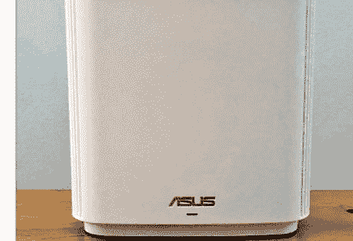

路由器应用和设置并不像我们在其他品牌中看到那样直观，但一旦你运行了一切，该应用提供了一系列很棒的功能。其中包括 AI 保护功能，它可以监控恶意网站、恶意软件和外部黑入你家庭网络的尝试。许多路由器对安全功能和家长控制收取订阅费用，因此看到它们在收取任何额外费用之前提供这些功能是一件好事。

凭借顶级的速度和默认功能，它是我们的选择。凭借其出色的功能，如果你正在寻找网状路由器，这是一个极佳的选择。Cliff Joseph

> 结论
> 开发者：华硕 价格：£177
> 评分 9/10

### Nighthawk RS300

全 Wi-Fi 7 技术，但需要一些成本？

- 规格
- Wi-Fi: 三频 Wi-Fi 7 (2.4GHz, 5GHz, 6GHz)
- 速度: 9.3Gbps+
- 端口: 2.5Gb 以太网 (WAN)，2x 5Gb & 2x 千兆以太网 (LAN)，1x USB 3
- CPU: 四核
- 内存: 512MB
- SSD: 无
- 尺寸: 249x150x102mm, 950g

Netgear 很少在平价市场端表现出色。这就是为什么我们很高兴看到 Nighthawk RS300 仅为 £249，成为我们见过最廉价的 Wi-Fi 7 路由器。也有更快的 Wi-Fi 7 路由器，例如 Netgear 的 Orbi，但像往常的 Netgear 一样，它倾向于要求额外的订阅，其 Armor 安全服务和家长控制——特别是当有竞争对手在不收取额外费用的情况下提供可靠性能时。


Nighthawk 应用允许你通过扫描二维码来连接到 `RS300`。你需要创建一个名称和密码来使用该应用。它在所有频段（`2.4GHz`、`5GHz` 和 `6GHz`）上创建一个单一的统一网络，并自动将你的设备连接到该房间或位置可用最快的频段。Nighthawk 的性能非常出色：我们在任何地方进行宽带连接时都没有遇到任何问题。我们还在此 WAN 连接上提供了 2x 5Gb 以太网——支持超快的光纤速度，以及另外两个用于内部域网的端口，如果你有合适的网卡，可以最大限度地进行文件传输。这确实有助于缓解高价带来的生硬感。这都是为了避免订阅服务的不断骚扰——所以我们付的是什么呢？Cliff Joseph

我不想要默认就有 80 年代的街头风格？


> 结论
>
> 开发者：Netgear 价格：£240
>
> 评分 8/10

72 LXLife 2023年3月

www.linuxformat.com

## 升级教程

### Google Wifi Pro

如果你喜欢蛋形的路由器，Google 是你的坚实后盾。

- 规格
- Wi-Fi: 三频 Wi-Fi 6e (`802.11ax`) 2x2 `2.4GHz`, 2x2 `5GHz`, 2x2 `6GHz`
- 速度: 4.2Gb/s
- 端口: 2x 以太网
- CPU: 双核 64 位 Arm CPU
- 内存: 无
- SSD: 4GB
- 尺寸: 205 x 232 x 150mm, 374g

Google 是网状路由器世界的元老，原始的 Wifi 产品被升级的 Nest Wifi 取代，而 Nest Wifi 又让位于 Nest Wifi Pro 取代。那么，这个最新版本有什么区别呢？Nest Wifi Pro 在旧 Nest Wifi 支持的 Wi-Fi 下运行良好，让你的网状设备表现出色——非常快速的标准。它还提供三频而非双频，加入了 `6GHz` 频段。在你这里，你获得了更好的 Wi-Fi 性能和更可靠的覆盖（其他单元是连接在一起的），而现在主路由器外都带有以太网端口。与其他 Wi-Fi 6 网状路由器相比，Google Wifi Pro 提供了一个覆盖更广的廉价选择，对于较大的房子来说非常好。设备本身紧凑、美观，并且很容易融入你的家居装饰——Google 对网状系统的处理有很多值得喜爱。


> 结论
>
> 开发者：Google 价格：£190
>
> 评分 7/10

### Linksys Hydra Pro

大多数人的最佳 Wi-Fi 6。

- 规格
- Wi-Fi: 双频 Wi-Fi 6 (`2.4GHz`, `5GHz`)
- 速度: 5.4Gb/s
- 端口: 1x 千兆以太网 (WAN)，4x 千兆以太网 (LAN)，1x USB 3.0
- CPU: 双核
- 内存: 无
- SSD: 未指定
- 尺寸: 215 x 155 x 158mm, 570g

Linksys Hydra Pro 6 是一款廉价的 Wi-Fi 6 路由器，非常适合不通技术的用户。它提供了强大的 Wi-Fi 性能和覆盖来满足普通家庭。测试显示，它能够处理高达 100Mbps 的宽带服务和下载。设置是一个简单的任务。然后你需要设置路由器，下载 Linksys 应用，创建一个帐户并输入密码将 iOS 或 Android 设备连接到路由默认设置。你可以从任何设备访问互联网设置，或者为孩子的上网创建计划。家长控制可以手动输入你想阻止的网址——但至少它不会用订阅服务不断烦扰你。Linksys 的设置非常容易，很大程度上归功于 Linksys 应用，会自动创建一个连接 `2.4GHz` 和 `5GHz` 频段的单一网络并提供设备概述，并没有很多额外或舒适可以享受。然而，它的廉价价格弥补了这一点。此外，大多数家庭并不需要这些。


> 结论
>
> 开发者：Linksys 价格：£185
>
> >> 评分 7/10

www.techradar.com/

2025年3月 | F35 / 173

### 教程 升级

### Netgear Nighthawk RAXE300

更实惠的型号。

- 规格
- Wi-Fi: 三频 Wi-Fi 6e (`2.4GHz`, `5.0GHz`, `6.0GHz`)
- 速度: 7.8Gb/s
- 端口: 1x 千兆 (WAN)，1x 2.5 Gigabit (WAN)，4x 千兆 (LAN)，1x USB-C (3.0)
- CPU: 四核
- 内存: 512GB SSD flash
- 尺寸: 170 x 208mm, 1.01kg

三频 Netgear Nighthawk RAXE300 提供了令人印象的速度，使其成为同时处理大量设备的理想 Wi-Fi 6 路由器。它使用三个频率频段——`2.4GHz`, `5.0GHz` 和 `6.0GHz`——提供高达 7.8Gb/s 的总速度，对于游戏、4K VR 视频或在 VR 头显周围移动来说足够快。在测试中，它提供了出色的性能良好的范围，在我们办公楼后后提供了快速 Wi-Fi，这简直是 Wi-Fi 的梦想。Nighthawk 设置非常简单，只需扫描路由器底部的二维码连接到其 Wi-Fi 网络。你可以使用路由器底部打印的密码同步每个设备，或创建一个新的名称和密码以增加安全性。虽然 Nighthawk 的设置非常易用，但它相当基础，诱导你只需填补它一些缺失的功能。应用程序的家长控制非常有限，仅允许你控制孩子设备的访问。在不支付 Netgear 家长控制费用的情况下，我们不包含阻止不适当网站的功能或内容过滤器。


> 看起来有些好的外观是为了速度在跳舞！
>
> 结论
>
> 开发者：Netgear 价格：£250
>
> >> 评分 7/10

### Devolo Magic 2 WiFi Mesh

如果你的家需要特殊的 Wi-Fi 解决方案：

- 规格
- Wi-Fi: 双频 Wi-Fi 6@1800Mbps/s
- 速度: 2400Mbps/s
- 端口: 2x 千兆以太网，1x 插座直通
- 尺寸: 110 x 92mm

Devolo Magic 2 WiFi 6 Mesh 将线路连接与网状系统相结合，使得任何墙壁或空间都不会限制你的网络访问。它并不快——只提供最高速度为 1800Mbps 的双频 Wi-Fi——然而，对于大多数家庭需求来说绰绰有余。在我们的测试中，通过 OokSpeed 测试实现了 110Mbps/s，下载速度达到 125Mbps。Devolo Magic 2 Mesh 家中的三个路由器非常迷人；它们只有三孔插座大小，但需要插在插座上，它们应该不会碍事。如果你走动或有其他阻挡 Wi-Fi 信号的东西，或者卧室分布在三层的较大房子，这可能是最适合你的 Wi-Fi 路由器。默认情况下，Deo 应用创建一个合并 `2.4GHz` 和 `5GHz` 频段的单一网络，但如果需要，它允许在每个频段上创建单独的网络。但是，启动很容易，应用程序有一些粗糙之处。

> 不是蓝牙电源适配器的比例配方。


> 结论
>
> 开发者：Devolo 价格：£290
>
> >> 评分 8/10

## 升级教程

### 华硕 ZenWi-Fi Pro ET12

我们要的是 Wi-Fi，而不是去西班牙度假！

规格参数
- Wi-Fi：三频段 Wi-Fi 6 (`2.4GHz`, `5.0GHz`, `6.0GHz`)
- 速度：11Gbps+
- 端口：1x 以太网接口 (WAN)，1x 2.5 千兆网口，2x 千兆以太网 (LAN)
- CPU：四核 2.0GHz, 博通
- 内存：1GB
- SSD：256MB
- 尺寸：240 x 114 x 115mm, 0.75kg

作为一款适用于家庭和办公室的顶级 Wi-Fi 组网系统，华硕 ZenWiFi ET12 对于大多数路由器用户来说可能性能过剩。但对于少数需要覆盖大面积且追求顶尖设备的用户来说，它恰是他们需要的。

单台 ET12 路由器可以覆盖高达 3,000 平英尺的家庭，而两件套系统可以覆盖 6,000 平英尺。由于支持三频段 Wi-Fi 6，它提供的速度可达 11Gbps。在测试中，ET12 实现了最大的覆盖范围并消除了空间内的 Wi-Fi 死角。

并不是每个人的家庭宽带都需要那种速度覆盖。但如果你处在一个支持 Wi-Fi 6 且空间开阔的新区域，选择一个面向未来的组网系统是有意义的。

ET12 在三个独立的频率上支持 Wi-Fi 6：`2.4GHz`、`5.0GHz` 和 `6.0GHz`。路由器由你来决定是在这些频率上定义三个独立的网络，还是将 `2.4GHz` 和 `5.0GHz` 频段合并为一个仅支持 Wi-Fi 6 的单一网络。不过应用程序的其他部分非常直观，提供了如服务质量 (QoS) 等用于任务优先排序的功能。


> 它们在小空间内的游戏或流媒体体验可能非常好。

例如游戏或视频流媒体，以及带有过滤不适合儿童内容过滤器的家长控制功能。路由器的价格还包含了华硕 AiProtection 安全功能，该功能可以监控您的网络以防止来自恶意网站或下载文件的攻击。

### 结论

开发者：华硕 (ASUS) 价格：£720

>> 8/10

## 网件 Orbi 四频 WiFi Gen 6E

我们要的是 Wi-Fi，而不是去西班牙度假！

### 规格参数

- Wi-Fi：四频 Wi-Fi 6, 2.4GHz, 5GHz, 6GHz
- 速度：10Gbps+
- CPU：四核 2.0GHz
- 内存：1GB
- SSD：512MB
- 波束成形：隐式/用于显式支持
- 以太网 (WAN)：2.5Gb, 1Gb
- 卫星：2.5Gb, 3Gb
- 尺寸：280 x 184 x 836mm

网件 Orbi 四频 WiFi 6E 可能适用于拥有 6E 支持设备的大型家庭。它非常昂贵，这意味着你可以充分利用所有的速度和 Wi-Fi 空间需求。然而，如果你需要空间和惊人的性能，它是值得的，因为我们在整个空间内都使用了最高 Wi-Fi 速度。

网件的智能控制 (`Smart Controls`) 和 Armour 安全功能仅是其中一角，你必须支付额外的订阅费用，这使得原本就昂贵的价格更加昂贵。主路由器现在可以使用 2.4GHz、两个频段和 6.0GHz 路由器提供四频 Wi-Fi 6。

Orbi 至少在设置主路由简单方面值得赞誉，它可以自动将智能手机或平板电脑连接到新的 Orbi 网络，并将卫星连接到您的网络。不过，应用程序并不是没有额外功能，它创建了一个简单的网络，合并了


> 经典的网件设计适用于任何风格。

5.0GHz 和 6.0GHz 网络将您的计算机和移动设备连接到最快的可用带宽。我们在 30 分钟内就完成了组网网络的搭建和运行。如果不是价格的原因，网件 Orbi 四频版的得分会更高。但如果你能负担得起，它是最强大的 Wi-Fi 6 路由器之一。

### 结论

开发者：网件 (Netgear) 价格：£1700

>> 8/10

## 管理

### 创建快速、简单且可重复的执行脚本

每个人都说 Stuart Burns 是一个 Ansible 粉丝，这与他超光速的通信无关。

都是庞大的 Ansible 粉丝。在管理 PC 时，它让生活变得简单。问题是，有许多东西要学；所以，让我们来看一些不需要即时大量学习、但可以逐步成长的 Ansible 脚本。

`Ansible` 是一个开源自动化工具，以管理基础设施而闻名。通过以 YAML 文件的形式定义任务，`Ansible` 通过 `ssh` 执行这些任务，自动化如安装软件、配置服务等任务。它确保一切都完全符合你的预期，并减少错误。

但它不仅限于管理远程服务器。你可以使用 `Ansible` 配置您的本地机器并简化任务，保持服务器的一致性。它确保一切都如你所希望的那样。它有什么优势？声明式与命令式的区别……`Bash` 脚本是命令式的；告诉计算机具体做什么。

`Ansible` 是声明式的。告诉它你想要的，它会找出如何做。如果某些已经存在，它什么都不会做。这消除了大量精力并减少了错误。`Ansible` 是幂等的（idempotent），这意味着多次运行执行脚本的结果总是相同的。这对一致性是一个巨大的加，而且不必担心运行相同的脚本会搞砸。与 bash 循环不同，`Ansible` 使用简单的格式来声明你想要的，使其更容易读和写。

在开始之前，你需要安装 `Ansible`。`Ansible` 的核心是定义要执行任务的 YAML 文件。一个基础示例是快速设置环境。使用一些实用包如 `git`，`Bash` 脚本可能是这样的：

```bash
#!/bin/bash
```

### 设置 Python 环境

`hosts: localhost`

`tasks:`

- `name: 确保安装 git`
  `apt:`
    `name: git`
    `state: present`
- `name: 确保安装 curl`
  `apt:`
    `name: curl`
    `state: present`
- `name: 确保安装 http`
  `apt:`
    `name: http`
    `state: present`

### RSYNC 时间记录

大家都 `rsync` 是什么。然而，在进行复制时，缺乏对耗时的想法。我们最近添加了 `rsync` 的新开关，对操作时间做了估计。`rsync` 的 `--progress` 开关给了我们持续时间的预估。它非常有用，我们认为应该包含在标准输出中。对于简单的 `rsync` 命令，使用以下示例：

`rsync -av admin@media:/content`

这里我们列出了要执行的任务 - `'command'`：这是一个与管理器交互的 `Ansible` 模块（我们在 Ubuntu/Debian 上）。`state: present` 已安装的包。要安装执行脚本，使用 `ansible-playbook -K myplaybook.yml`

### 管理

`K` 提供了 sudo 权限。这有多简单？一旦运行它，`Ansible` 会检查包是否已经安装，如果是则跳过。这消除了冗余并确保你安装了你需要的。设置配置非常简单。例如：尊重是一个高度自定义的状态。假设你想通过 `/bashrc` 配置环境变量。`Bash` 脚本可以：

`ls -la >> /bashrc; export PATH="$PATH:/opt/bin" >> /bashrc; source ~/.bashrc`

`rsync -avz /data/files/iso/ /data --progress`

发送增量文件列表

`proxox-ve_8.2-iso`

`ubuntu-20.04.1-desktop-amd64.iso 137.8MB/s 100% (08:00:27,to3/6)`

`240.91 118MB 100% (02:05)`


Stuart Burns 是位于伦敦的一家世界五百强企业的系统管理员。使用 `progress` 显示了同步操作还需要多久。

### 密码实用性

```yaml
- name: 配置 Bash 设置
  hosts: localhost
- name: 向 bashrc 添加 alias
  linefile:
    line: "ls -la" >> /bashrc
    create: yes
- name: 向 bashrc 添加自定义 PATH
  linefile:
    path: /bashrc
    line: export PATH="$PATH:/opt/bin"
    create: yes
```

我认为密码管理器是一个很棒的主意。不幸的是，人们管理密码的方式存在问题。`LastPass` 和我喜欢的 `Bitwarden` 配合 `TOTP`（2FA 码）。目前密码管理器保存并自动填充 `TOTP`。这是一个糟糕的决定，削弱了任何使用者的安全立场。2FA 的整个重点在于它与你是分离的，在理想世界中无法被访问或绕过。现在，如果你的密码被黑客获取，恶人将能够冒充你，因为他们有了你的用户名、密码和代码。我有它，但这意味着你没有防御攻击的线。这是旧式的安全漏洞与便利。承认事情很难，但 `LastPass` 已经被破解 - https://bit.ly/325last 我的建议是不使用它，如果攻击者可以通过破解一个系统获取你的所有信息，这些网站就可以宣布你的信息，因为你没有采取良好的安全措施。现在是确保你在独立设备上使用密码的时候（使用著名的验证器应用）。大多数人只有备份码的物理副本作为补充。不要把它们留在笔记本的任何地方！

```yaml
- name: 更新系统包
  hosts: localhost
- name: 更新包列表
  apt:
- name: 更新所有包
  apt:
    upgrade: all
```

`Ansible` 允许你在本地 PC 上执行任务

保持你的配置

为未来的更新复用你的配置。构建整个脚本是完全可能的。而且 `Ansible` 任务非常微不足道，使用 `ChatGPT` 可以创建一个非常简单且有效的任务。你可以集成它、测试它并反复测试，它是幂等的，所以你可以根据需要多次运行，而只需正常工作

一个 `Ansible` 的 YAML 示例

www.techradar.com/linux | 2025年3月 LFXES | 17

# Intel 新一代 Arc 系列深度解析

## Xe 2: 渲染切片 (Render Slice)

对所有图形加速函数的深度微观和宏观分析

针对降低延迟、消除停顿和改进软硬件交换进行了优化

- 原生支持执行指令 (Execute instinct)
- 单核心性能显著提升
- 命令前端 (Command Front End)

### 渲染切片 (Render Slice)

原生 SIMD-512，全 4 深度 XMX


- 3 条传输流水线
- 2 个三角形相交单元

无序调度：在无过滤的情况下实现 2 倍吞吐量

- 程序化开销
- 3 倍顶点抓取吞吐量
- 3 倍着色性能
- 比 Xe-777 独显快 50%
- 对小规模负载的效率更高
- 高达 4 倍 L3
- 每个颜色缓存 (Color Cache) 增加 36%
- H-1 压缩
- 对子结构处理更快


### intel arc

改进的架构提升了渲染性能。

负载可以处理 2,400MHz；在我们的测试中，我们看到的平均值为 2,330–2,370MHz。

每个 Xe 核心拥有 8 个向量单元和 8 个 XMX 单元。这是 Alchemist（炼金术架构）数量的一半，但每个单元拥有 2,048 和 2,048 条矩阵指令。在实践中，每个核心执行的向量或矩阵指令总数仍为：256 条 FP32 或 1096 条 FP16/INT4 指令。

核心加速频率给了提供了总理论计算力，但有趣的地方在于：新架构提供了多得 TFLOPS。虽然 B850 “仅”提供 14.6 TFLOPS，但 Xe 2 拥有 17.2 TFLOPS，不过架构的变化也起了作用。

巨大的变化之一是切换到 SIMD-512 单元（单指令多数据），其优势是可以并发操作并发数据。虽然 Alchemist 处理的是 32 块（通常是像素），但 SIMD 只使用 16 个单元。这提升了 GPU 的利用率，因为填充 16 个槽位比填充 32 个更容易。Battlemage（战术大师）的单 TFLOPS 性能优于 Alchemist。

我们从 Lunar Lake 的性能看到，Lunar Lake 中新的 Xe 2 架构具有高达 4.0 TFLOPS 的 FP32 ，而 Meteor Lake 的旧架构为 4.6，但 Lunar Lake 在 7200p 下最终快了 42%，在 1080p 下快了 32%。其他因素也在起作用，包括内存带宽……

### 划算的交易吗？

> 如果你将新 Battlemage GPU 的规格与 Alchemist 进行对比，看起来 Intel 似乎退回到了 2290MHz 的 A750。这使得渲染性能提升了 24%，而功耗降低了 16%，潜在性能提升达 50%；然而，基于架构改进，单核心性能提升了 7%。

在内存子系统方面，有一些值得注意的变化。B850 使用 192 位总线配 6GB GDDR6，而 160 位总线配 10GB GDDR6 在架构背景下产生了相应结果。Battlemage 相对于 A4580 和 A750 具有更高的带宽（达到 512GB/s），好消息是，这款新的入门/主流 GPU 拥有超过 288GB 的显存，这在最近的几款游戏中一直是限制性因素。

Battlemage 将更高效，B580 的总性能为 190W。

部分效率改进源于转向台积电的 5nm 工艺（Alchemist 使用的是 V6）。Intel 提供了显著的密度和功耗优势，也体现在整体尺寸上。A770 中使用的 ACM-G10 GPU 拥有 217 亿个晶体管

更新于 2024年3月3日，太平洋标准时间凌晨 4:40

www.techradar.com

2025年3月 / 19

### 深度解析 Intel 新一代 Arc 系列

| | Arc B580 | Arc B570 |
|---|---|---|
| 架构 | BMG-G21 | BMG-G21 |
| 制艺技术 | TSM N55 | TSM N55 |
| 晶体管（亿） | 19.6 | 19.6 |
| 核心面积 (mm²) | 272 | 272 |
| Xe 核心 | 20 | 18 |
| GPU 核心 (着色器) | 2.560 | 2.304 |
| XMX 核心 | 160 | 144 |
| 光线核心 | 20 | 18 |
| 图形频率 (MHz) | 2670 | 2500 |
| 最大加速频率 (MHz) | 2850 | 2750 |
| 显存速度 (GB/s) | 19 | 19 |
| 显存 (GB) | 12 | 10 |
| 显存位宽 (bit) | 192 | 160 |
| L2 (L1) 缓存大小 (MiB) | 18 | 13 |
| 渲染单元 | 80 | 80 |
| 纹理单元 | 160 | 144 |
| FP32 峰值 FLOPS | 14.6 | 12.7 |
| FP16/INT8 峰值 FLOPS | 233 | 201 |
| 内存带宽 (GB/s) | 456 | 380 |
| 接口 | PCIe 4.0 | PCIe 4.0 |
| 功耗 (W) | 190 | 150 |
| 售价 | $260 | $240 |

# Tom's 硬件世界

为科技爱好者获取所有核心突破性新闻！

无论你是在组装电脑、购买笔记本电脑，还是学习机器人知识，Tom's Hardware 都拥有你所需的所有知识。


扫描并免费订阅！


## 准备好成为真正的 Python 专家

通过使用 Django、Flask、Pygame 以及更多实用的第三方框架编程教程，让 Python 为你效力。


订购非常简单。访问网站：magazinesdirect.com

或从指定的超市和报刊店购买。

# 全球最优秀的全新开源软件

### 热门推荐

HandBrake >> Universal Media Server >> Fooyin >> Cryptomator >> Synthing >> OpenBoard >> TurboVNC >> Extreme Tux Racer >> Luanti >> KStars >> ReMove to Waste


Mayank Sharma

已经超过 18 个月没有开车了。他现在发现，驱动鼠标去应用商店寻找最热门的应用进行撰写是一种乐趣。

## 视频转换器

### HandBrake

版本：1.9.0

网址：https://handbrake.fr


与音频文件不同，将高清视频文件传输到其他设备（尤其是便携设备）需要时间。HandBrake 可以将各种视频转换为多种格式，并对质量和大小进行优化。

该应用可以转换任何视频格式，并支持广泛的解码器。它最好的功能之一是内置了针对流行设备的预设，使编码过程变得轻而易举。

该应用以 Flatpak 形式正式发布，可以通过 `flat install flatub handbrake.fr` 安装。与其他一些工具相比，HandBrake 的用户界面可能看起来比实际情况要复杂。

### 让我们探索 HandBrake...


除了音频轨道外，你可能还想想要转换的视频。通过 HandBrake，你还可以直接从 DVD 或蓝光光盘转换视频。

在选择源后，你可以通过选择其中一个预设来选择为特定设备进行转换。预设是专门针对你想要播放内容的设备定制的一组设置。

在过程的其余部分，HandBrake 会根据原始文件建议一个名称，但你可以根据意愿命名文件。你还可以将各种设置作为起点并对它们进行自定义——例如，手动选择不同的视频和音频解码器……

准备好后，只需点击“开始”开始视频转换。

- 1. 选择源

从打开 HandBrake、一个视频文件或整个视频文件夹开始。你可以直接将视频文件拖入源中。

- 2. 选择标题

某些源（如 DVD）包含多个视频片段，即一个标题集合。使用此功能选择你想要使用的片段。

- 3. 选择预设

HandBrake 包含了许多针对特定设备和通用用途的预设。选择与你正在操作的设备最匹配的预设。

- 4. 选择编码

如果你知道自己在做什么，请使用此区域中的各个标签页，根据要转换的设备更改音频和视频设置。

www.techradar.com/pro/linux

2023年3月 | LFX325

### 热门推荐

### 媒体服务器

### Universal Media Server

版本：14.8.0

网址：www.universalmediaserver.com


# Universal Media Server (UMS)

`Universal Media Server (UMS)` 可以将所有类型的媒体广播到计算机、智能手机、平板电脑、游戏主机和电视。`UMS` 通过通用即即用 (`UPnP`) 协议向任何符合 `DLNA` 标准的设备流传输媒体。棒的是，你也可以用 `tar` 和 `UMS` 提取它。在首次启动时，`UMS` 会引导你通过一个配置向导，你可以跳过它，也可以使用它来定义根目录和上传文件的位置。选择你的媒体文件夹，它将帮助你设置管理员用户。要添加更多媒体，进入“汉堡菜单 > 共享文件夹”。这将列出所有共享文件夹。一旦添加了所有媒体，你就可以向任何兼容设备进行流传输。


在启动 `UMS` 服务器之前，确保你已开启该设备。每个 `UPnP` 设备都列在主管理页面的“检测到的媒体渲染器”下。除了 `DLNA/UPnP`，你还可以将媒体流传输到 `VLC Media Player` 和 `Kodi` 等桌面播放器。这些播放器将无问题地检测到 `UMS`。然后你可以浏览共享目录以及本地机器支持的任何媒体。此外，你还可以流传输到没有指定 `DLNA/UPnP` 兼容应用的计算机。`UMS` 提供一个 Web 地址，可以通过与 `UMS` 在同一网络上的任何计算机的浏览器访问，端口为 `9005`。

你可以使用 `Universal Media Server` 从 Linux 盒向任何符合 `DLNA` 标准的设备传输内容。

## 音乐播放器

### Fooyin

版本：0.8.1

网址：www.fooyin.org

Linux 上有很多音乐播放器，`Fooyin` 的独特卖点在于它能够根据你的需求完全自定义其界面。它在 GitHub 上正式发布，可以通过 `flatpak install github fooyin.org` 安装。

在首次启动时，该应用会弹出一个设置窗口。在这里，你要求从可用选项中选择一种布局。要体验这些布局，你可以选择播放器。


| 专辑 | 艺术家 | 日期 | 时长 |
| :--- | :--- | :--- | :--- |
| A | A | 2021-01 | 03:45 |
| B | B | 2020-02 | 04:12 |
| C | C | 2022-03 | 03:58 |
| D | D | 2021-04 | 04:23 |
| E | E | 2020-05 | 03:36 |
| F | F | 2022-06 | 04:50 |

（等待，检查文本：“要添加更多媒体，进入‘汉堡菜单 > 共享文件夹’。列出所有共享文件夹。一旦添加了所有媒体，你就可以向任何兼容设备进行流传输。”）


（等待，检查文本：“`UMS` 提供一个 Web 地址，可以通过与 `UMS` 在同一网络上的任何计算机的浏览器访问，端口为 `9005`。”）

## 热门推荐

### 数据加密器

#### Cryptomator

版本：1.4.2

网址：https://cryptator.org


与音频文件不同，将高清视频文件传输到其他设备（尤其是便携设备）需要时间。`HandBrake` 可以将各种视频转换为多种格式，并对质量和大小进行优化。

该应用可以转换任何视频格式，并支持广泛的解码器。它最好的功能之一是内置了针对流行设备的预设，使编码过程变得轻而易举。

该应用以 Flatpak 形式正式发布，可以通过 `flat install flatub handbrake.fr` 安装。与其他一些工具相比，`HandBrake` 的用户界面可能看起来比实际情况要复杂。

### 让我们探索 HANDBRAKE...


除了音频轨道，你可能还想想要转换的视频。通过 `HandBrake`，你还可以直接从 DVD 或蓝光光盘转换视频。

在选择源后，你可以通过选择其中一个预设来选择为特定设备进行转换。预设是专门针对你想要播放内容的设备定制的一组设置。

在过程的其余部分，`HandBrake` 会根据原始文件建议一个名称，但你可以根据意愿命名文件。你还可以将各种设置作为起点并对它们进行自定义——例如，手动选择不同的视频和音频解码器……

准备好后，只需点击“开始”开始视频转换。

- 1. 选择源

从打开 `HandBrake`、一个视频文件或整个视频文件夹开始。你可以直接将视频文件拖入源中。

- 2. 选择标题

某些源（如 DVD）包含多个视频片段，即一个标题集合。使用此功能选择你想要使用的片段。

- 3. 选择预设

`HandBrake` 包含了许多针对特定设备和通用用途的预设。选择与你正在操作的设备最匹配的预设。

- 4. 选择编码

如果你知道自己在做什么，请使用此区域中的各个标签页，根据要转换的设备更改音频和视频设置。

www.techradar.com/pro/linux

2023年3月 | LFX325

## 热门推荐

### 媒体服务器

#### Universal Media Server

版本：14.8.0

网址：www.universalmediaserver.com

`Universal Media Server (UMS)` 可以将所有类型的媒体广播到计算机、智能手机、平板电脑、游戏主机和电视。`UMS` 通过通用即即用 (`UPnP`) 协议向任何符合 `DLNA` 标准的设备流传输媒体。棒的是，你也可以用 `tar` 和 `UMS` 提取它。在首次启动时，`UMS` 会引导你通过一个配置向导，你可以跳过它，也可以使用它来定义根目录和上传文件的位置。选择你的媒体文件夹，它将帮助你设置管理员用户。要添加更多媒体，进入“汉堡菜单 > 共享文件夹”。这将列出所有共享文件夹。一旦添加了所有媒体，你就可以向任何兼容设备进行流传输。


在启动 `UMS` 服务器之前，确保你已开启该设备。每个 `UPnP` 设备都列在主管理页面的“检测到的媒体渲染器”下。除了 `DLNA/UPnP`，你还可以将媒体流传输到 `VLC Media Player` 和 `Kodi` 等桌面播放器。这些播放器将无问题地检测到 `UMS`。然后你可以浏览共享目录以及本地机器支持的任何媒体。此外，你还可以流传输到没有指定 `DLNA/UPnP` 兼容应用的计算机。`UMS` 提供一个 Web 地址，可以通过与 `UMS` 在同一网络上的任何计算机的浏览器访问，端口为 `9005`。

你可以使用 `Universal Media Server` 从 Linux 盒向任何符合 `DLNA` 标准的设备传输内容。

## 音乐播放器

### Fooyin

版本：0.8.1

网址：www.fooyin.org

Linux 上有很多音乐播放器，`Fooyin` 的独特卖点在于它能够根据你的需求完全自定义其界面。它在 GitHub 上正式发布，可以通过 `flatpak install github fooyin.org` 安装。

在首次启动时，该应用会弹出一个设置窗口。在这里，你要求从可用选项中选择一种布局。要体验这些布局，你可以选择播放器。


| 专辑 | 艺术家 | 日期 | 时长 |
| :--- | :--- | :--- | :--- |
| A | A | 2021-01 | 03:45 |
| B | B | 2020-02 | 04:12 |
| C | C | 2022-03 | 03:58 |
| D | D | 2021-04 | 04:23 |
| E | E | 2020-05 | 03:36 |
| F | F | 2022-06 | 04:50 |

## 热门推荐

# 数字白板

## OpenBoard

版本：1.7.2 网站：[https://openboard.ch/index.en.html]openboard.ch

`openboard.ch` 是一款数字白板应用程序，你可以将其用于演示或其他课程。该应用拥有各种工具和功能，可以对数字内容进行注释。官方上，它仅提供 DEB 二进制文件，但你可以轻松地将其安装在 Ubuntu、Arch 和 OpenSE 上。不过，你最好的选择是从 Flatpak 开始，运行命令 `flatpak install flathub openboard.openboard`。


`OpenBoard` 还会显示系列提示和说明，帮助你熟悉该工具。你可以通过滚动这些提示来开始使用应用程序。顶部是调色板，它提供了你在演示期间对白板进行注释所需的所有工具。还有工具栏，它让你能够更改笔或标记笔的颜色和大小等。


无需选择即可进行交互。此外还有文本框，你可以使用键盘而不是笔来编写文本。你还可以更改背景颜色选项。

OpenBoard 有四种模式：白板模式、桌面模式、文档模式和 Web 模式。你可以在保持 OpenBoard 为叠加的同时的同时电脑屏幕交互。你可以像在物理白板上使用笔或标记笔一样添加注释。

然后是文档模式，你可以用它导入并注释 PDF 文件或图像。你还可以使用 OpenBoard 录制会话的音频和视频，并导出到 Podcast。

OpenBoard 在双屏上效果最好，一个用于注释内容，另一个给观众。你可以选择显示应用程序的工具和仪表板。

## 远程桌面

### TurboVNC

版本：3.1.3 网站：[https://www.turbovnc.org]https://www.turbovnc.org


当你考虑到远程访问时，首先想到的是 SSH。长期以来，系统一直使用 SSH 处理各种 CLI 客户端。然而，当你需要长时间访问远程桌面时，就需要像 TurboVNC 这样的远程软件了。它是一个跨平台解决方案，允许你从各种设备远程访问并操作计算机。

该项目拥有 RPM 和基于 DEB 的 Linux 发行版的二进制文件。在 Fedora 和 Debian 上，你可以通过 `dnf install rpm` 安装它，而在 Ubuntu 上，可以通过 `apt-get install` 获取。

TurboVNC 与多个客户端和服务器配合。你可以运行它连接到任何 VNC 服务器。尽管 TurboVNC 最好是配合其性能优化版本使用。要启动 TurboVNC 服务器，你需要访问远程机器，打开终端并使用 `/opt/turbovnc/bin/vncserver`。记住加密 TurboVNC 会话的 X 显示以确保会话安全。系统还会提示你输入密码。你也可以为只读会话指定密码。

要连接这台远程机器，你必须从查看器菜单打开 TurboVNC 客户端，或使用 `/opt/TurboVNC/bin/vviewer`。输入主机名或 IP 地址，以及 X 显示字段，然后点击连接并开始。

验证凭据后，TurboVNC 在全屏窗口中显示远程桌面。虽然会话在默认设置下运行良好，但你可以使用客户端窗口顶部工具栏中的“连接选项”按钮进行微调。

TurboVNC 的开发者声称，它针对处理 3D 视频负载进行了优化。

68 Lifetimes 2023年3月

www.linuxformat.com

## 游戏热门推荐

### 街机赛速

### Extreme Tux Racer

版本：0.8.4 网站：[https://extremetuxracer.sourceforge.org/]https://extremetuxracer.sourceforge.org/


原始的 Tux Racer 曾非常风靡。玩法涉及控制 Linux 的吉祥物 Tux 在山山上滑下，并在途中跳过鲱鱼。尽管这款游戏非常简单，但它的引力吸引了所有年龄段的粉丝。Tux Racer 的几个分支仍在活跃开发中。你可以从 Flathub 获取该游戏，运行 `flatpak install flathub net.extremetracer.tuxracer`。

当你进入活动时，游戏会显示你的剩余生命次数或尝试次数，以及通过关卡的要求。例如，在加拿大 Tux 的 Bunny Hill 关卡中，你必须切掉 20 条鲱鱼并在 37 秒内完成赛程。如果你失败，将在下一关重新开始。使用箭头键控制移动。重复按下任何箭头键都会增加速度，方向键也能帮助你进行急转。使用 1 和 2 在两个可用的视图之间切换，使用 H 切换/禁用显示。你还可以使用游戏的配置菜单。在调整分辨率后，可以更改界面语言或增加/减少细节水平。

像原始的 Tux Racer 一样，它还包含一个练习模式，让你熟悉游戏控制。

与以前不同，你可以创建自己的五个角色（包括 Tux）中的一个。游戏包含两个预设活动：加拿大杯和瑞士杯，两者都由多个关卡组成。你必须通过关卡。

### 沙盒与生存

### Minetest

版本：5.10 网站：www.minetest.org

 (注：此处图片路径可能与示例略有不同，但按要求保留格式)

(注：原文此部分无具体描述文本，仅有标题和图片占位符，已翻译标题)


# 你能帮助激发下一代代码爱好吗？

Code Club 是一个全国性的网络，为 9-11 岁的儿童提供由志愿者领导的课后俱乐部。

我们一直在寻找具备编程技能的人员，志愿者在当地的小学、图书馆或社区中心每周运营一小时的俱乐部。

你可以与同事结伴，会有老师在那里为你提供支持，我们将提供你所需的所有材料，帮助孩子们对数字制作产生兴趣。

有很多种参与方式！如需了解更多信息，请访问 www.codeclub.org.uk 加入我们。

## 编程学院

第二部分！不要错过下期节目，请在第 16 页订阅！

### B2

致谢：https://github.com/tom-sedson/b2

### 使用 Basic 编写 b2 基础版太空入侵者隆

Nate Drake 邀请你通过用 Basic 编写自己的《太空入侵者》克隆版本来驱散外星威胁，因为现在是 2025 年！


在本系列的第一部分中，我们介绍了 Basic，并通过创建像 Mark Buckley 的《Cosmic Invaders》这样的游戏，发现了它是学习编程的理想工具。

如果你阅读了文章并使用了来自 https://github.com/azuregate/cosmicinvaders/ 的示例，你现在将拥有一个播放简单曲调的彩色项目，然后学习如何在 Basic 中玩太空游戏。

按下空格键开始游戏，发生的所有只是效果中的一条消息。在原始脚本中，这间接启动了 `PROCSetup_Game` 过程。你可以运行第 2230-2280 行来查看它的作用。正如你所看到的，第 2240 行 `CLS` 是清除屏幕上任何现有文本的简写。

Nate Drake 是一位专门从事网络安全和复古游戏的技术记者。他的第一次视频游戏体验是在父亲当地商店里玩“鸡尾酒”版《太空入侵者》。

本月，我们将关注加载游戏变量，例如屏幕元素和外星人的移动。我们正在使用 b2 Basic Micro 模拟器。Ubuntu 软件中心中有一个快照，方便安装。本系列的代码在其他编辑器中也可以运行：如果可能，请将你的程序设置为像我们做的那样运行 b2 第 1770 行，否则它的渲染结果可能与你看到的不同。

游戏设置

如果你阅读了最近的脚本 COSMICA，你会看到当玩家呈现

接下来的两行定义了子弹和外星人的数量。在开始时，你会注意到我们的朋友 `VDU` 命令：

允许左移动。`UNTIL` 命令允许过程继续，直到检查剩余（生命值）`Base` 的数量；如果 `Lives` 低于零，则游戏结束。第 1740 行还利用 `RANDOM` 命令通过 `PROC_KEY_Test` 持续检查输入以移动

接几行使用值 `X` 来计算一行外星人的水平位置，然后按照《太空入侵者》的方式让它们左右移动。第 1800 行在外星人移动时让它们在空位置移动。

该过程随后调用了多个过程，例如 `PROC_Line`，它用于显示玩家当前的得分、高分和剩余生命值。

如果你让游戏运行起来，示例脚本中调用 `Setup_Game` 的行将按步骤执行

### 管理变量

如果你执行了来自 https://bit.ly/3ht3S2SpaceInvaders 的代码示例，你会注意到只有这个（COSMICA）的末尾有一行代码显示了当时的图形元素。这是因为一个关键过程（`PROC_Main`）被用于清除页面并打开了下一个脚本 `COSMICS_B2`。

现在当玩家按下空格键时，不再调用 `PROC_Setup_Game`，而是调用 `PROC_Line`。在 `PROC_Line` 过程的第一行中，调用了 `PROC_Setup` 来绘制游戏元素、护盾和外星人。然后 (1740) 它利用了 `RANDOM` 命令通过 `PROC_KEY_Test` 持续检查输入以

### 太空入侵者编程学院


`Setup_game` 调用过程来显示得分和护盾等元素。其他过程则管理敌人和外星人。

`PROC_Colour_Setup` 将屏幕移动彩色区域。任何移动到新区域的对象都会获得其分配的颜色。

```
390 UNTIL A = ""
400 PRINT "Game starting..."
```

变为：


```
520 UNTIL A = ""
530 Starts=4
540 Score =%
550 Bases=3
560 PROC_Setup_Game
```

它使用了我们在上一个教程中涵盖的快捷代码 `GS` 和 `MS`，用绿色和洋洋色打印“HS”（高分）以及高分本身。下一行将光标移动到第一行。然后在同一行中打印玩家的得分。`870` 行移动光标并将文本设置为青色。玩家的生命数可以显示在屏幕底部（第 `880` 行）。简单的代码根据玩家拥有的每个生命值（由字符 `ppr` 定义）插入文本，由 `Bases` 决定。当玩家按下空格时，`Bases` 被设置为 `3`。如果你想，可以修改它。花点时间阅读代码，查看高分和得分在屏幕左上角和右上角的。你会看到每个生命对应一个灰色基地。

在示例中，你会发现数字不同。这是因为我们的示例脚本没有包含原始游戏中的所有字符（位于第 `115-130` 行）。

你可以插入自己的行，或者通过 `https://github.com/SpaceInvaders/blob/master/COSMICS.bas` 添加蓝色玩家。

你还会注意到空格键提供了一些重要的变量，例如护盾的起点、当前得分和初始生命数（`3`）。

你可以定义自己的 `Setup_game` 来匹配你的当前得分，例如：

```
780 PROC_Setup
790 %O = %S Score: %O = %R; B = %B
800 MS*Bases=3;FOR I = 1 TO 100
810 MS*Bases(I),I = 0
820 MYSTERY%=false;FILE_MIS%%X = 
830 MS%%(I)=0;
840 PROC_Line: Info
850 ENDPROC
```

### 护盾

没有一组用于抵御外星威胁的护盾，《太空入侵者》是不完整的的。如果你玩原始游戏或运行《太空入侵者》脚本，你也会吸收护盾的火力，面临过早毁灭的风险。如果玩家从下方击护盾，它们将受到损坏。

你会发现上述内容与原始游戏脚本几乎相同。然而，`Setup_game` 只调用了另一个过程：`PROC_Line` 信息。

在这种情况下，护盾具有可以阻止子弹的特殊字符 `CHR$`。这个区块形成了复杂的形状，类似于外星人的形状。

你也可以使用以下字符串定义自己的护盾：

```
400 Shield$B=BL+BL+BL+BL+B+B+B+B
```

```
840 PROC_Line: Info
850 PRINT(0,I)44"Score:(I)
860 PRINT(0,J)44"Score:(I)
870 FOR I = 1 TO 100
880 NEXT
```

### 太空入侵者 CODING 学院

使用中位值来确定它们的起始位置。

游戏使用了一个不同的过程 `PROC_Displays` 来在屏幕上显示外星人。将其添加到你在 `PROC_Setup` 和 `Game` 中调用的过程列表中，然后在脚本的末尾定义它。

```
2390 PROC_Displays
2400 SOUL:(1;55:1); M:(X%4); Y%(X MOD 2)
2405 REM ABS:(X%4); Y%(X MOD 2)
2410 REPEAT; PROC_Test; Key:(I%4)
2420 FOR K TO X; RS: IF:(X%4)=K THEN
    PROC_Invader
2430 NEXT
2440 IF Missile; THEN PROC_Move; Missile(1)
2450 IF Mystery%Y THEN PROC_Move; Mystery; ELSE
    PROC_Invader; Start
2460 24-1 UNTIL:(I%5) OR FINISH
2470 ENDPROC
```

一个空格，用来表示已被摧毁的入侵者。

确保在脚本的末尾定义这些内容 - 例如：

```
1650 PROC_Invader
1660 INV:(X%4);Y%(X%3);
1700 ON K TO 170 GOTO 1710,1710,1720,1730,1740
1750 PRINT Alien(Y); GOTO 1750
1760 INV:(X%4);Y%(X%3); GOTO 1750
1770 FINISH
1780 ENDPROC
1790 DO PROC_Blank
1800 IF NOT Left; THEN:(I%4)
1810 LEFT Alien(Blank1)
1820 PRINT Alien(Blank2)
1830 ENDPROC
```

> 快速提示
>
> 在 Base 中，你可以使用冒号（`:`）在同一行上列出多个命令；这并不总是看起来优雅，但它可以提高代码效率 - 例如，当调用多个过程来绘制游戏元素（如 `PROC_Setup`、`Game`）时。

飞弹比本教程中的两艘飞船更复杂，而后者其实很容易绘制。在第二行（示例中的 `2400` 行），我们使用 `ABS`（绝对值）来返回 `0` 或 `1`。这种设计是为了创建一个简单的外星人集合。在时间轴上，外星人移动得更快，并且随着游戏的进行逐渐变快。

现在，你将熟悉了如何使用 `PROC_Invader` 创建过程。`X` 和 `Y` 代表入侵者行的基础坐标，而 `J` 和 `K` 用于识别其内部不同的入侵者。接下来的行处理简单的两个外星人集合：`Alien1` 和其中一个 `Alien0`。这些是使用我们在系列教程中发现的 `GOTO` 命令处理的，用于跳转到结束过程的行。

循环（示例中的 `2410` 行），我们使用 `PROC_Test` 启动一个检查玩家输入的循环，然后返回入侵者（inv）位置的 `(J%4)`。

`Alien` 过程是自解释其足的。你将使用两个空格（`Blank1` 和 `Blank2`）来确保外星人的动画不会被擦除。

正如你所注意到的，`PROC_Test` 在你的脚本中尚未定义。你需要将此添加到脚本中，以处理移动管理（`M.move`）以便让入侵者移动，然后我们将调用每个过程，如 `PROC_Move; Missile` 直到下一个回合。

返回 `Return;` `PROC_Invader;`，你会看到有一小行（示例中的 `2450` 行）用于 UFO，它们也离开了屏幕。请参考下方的“神秘奖励（Mystery Prizes）”来帮助处理和使用它。

接下来的行遍历每一行入侵者，使用 `Q` 中的值。正如你记得的，通过 `PROC_Invader; Set` 在过程开始时将 `Space` 设为 `true`。在某处，该行调用了 `PROC_Blank` 来绘制轮廓。

过程的最后一行（示例中的 `2460` 行）会逐行移动连续的入侵者，直到所有它们都绘制在屏幕上。

你可以从 github 下载这里列出的代码：`github.com/azure/xmicinvaders/blob/main/COM5.bas`

## 秘密奖励

如果你查看原始游戏代码，你会看到两个神秘过程在 `PROC_Invaders` 中列出了秘密。

当 Mystery 的 THEN 时

```
2450 PROC_Move; Mystery ELSE
    PROC_Invader:(I-100); PROC_Test
    Start;
```

在上述行中，代码通过读取 `Mystery%Y` 的值来检查外星人是否可见。如果随后调用 `Mystery` 将飞船从左移动到右，它会调用 `RND` 函数生成 `1` 到 `100` 之间的随机数。如果为真，则飞船应该沿着游戏代码移动。

首先，水平坐标 `Mystery%X` 到 `1- -` 即屏幕的左上角。`Mystery%Y` 的值被设为 `TRUE` 以表示飞船的可见性。

当 UFO 出现在 `Space Invaders` 中，玩家将获得 `50`、`100`、`150`、`200` 或 `300` 个随机分。我们将在下个月解释神秘外星人的 `PROC_Mystery_Hit (1750)` 是如何处理这些的。

播放警报声的过程示例。接下来，是 `Myst%X-Y+1` 移动飞船。

## 编码 天文学 Rust

文件 编辑 选择 转到 运行 终端 帮助


```rust
"File does not exist",

));

// 打开文件
let mut file = File::open(path)?;
// 创建一个字符串来存储内容
let mut contents = String::new();
// 将文件内容读取到字符串中
let file.read_to_string(&mut contents)?;

Ok(contents)
```

前三行使用语句定义了将要使用的模块函数。模块是 `fs`，该模块是 `fs`，而 `File` 是一个包含方法的类，例如 `open` 和 `read_to_string`，这两个方法在上面都被使用了。例如 `fs.` 等。


它的返回类型是 `Result<_, Error>`，其中包含了执行成功或失败时返回的错误信息。如果文件不存在，结果将是一个包含我们错误的 `Err`。使用函数的最后一行来返回关键字。通过返回 `Ok`，意味着函数的调用者 `main()` 中的测试已完成并匹配，这在类 C 语言中相当于 `switch` 语句。

### 安装 RUST

首先你如果没有安装，则需要安装。按照惯例，今天我们在 Ubuntu (24.04 LTS) 上进行了此操作，并使用了 Snap 方法。如果你需要更更新版本，请先卸载再安装：

- `sudo apt install rust`
- with cargo 使用 `cargo` 安装 rust，`cargo` 是用于管理和发布 rust 的工具。
- `sudo curl --proto '=https' --tlsv1.2 -sSf https://rustup.rs | sh`

现在已经安装好了，运行此命令查看版本：

- 同样有 `update` 命令，如果 Rust 有任何更新，或者如果你需要更新 Rust，请运行以下命令：
- `cargo update`
- `rust doc`

`rust doc` 会打开手册，但在 Ubuntu 上不会。你可以在 VS Code 中配合运行 `Rust-analyzer` 扩展来使用。现在关闭 VS Code。

- 在 VS Code 之外打开一个新终端
- `cargo new hello_world`
- `cd hello_world`

这会打开 VS Code 并将 `hello_world` 文件夹作为你的项目，其中有一个包含 `main.rs` 和 `cargo.toml` 文件的 `src` 文件夹。然后点击：运行构建 (Run Build)

然后点击 `cargo build` 构建可执行文件。现在在终端中操作，它运行：

- `cargo run`

```rust
let file = File::open(path)?;
file.read_to_string(&mut contents)?;
```

如果该语句（如 `read_to_string`）有效，它会返回一个 `Ok` 并继续执行。如果出错，它会返回一个 `Err` 并失败。

在 Rust 术语中，这用于给变量赋值，然而，该值是不可变的，不能更改。但正如你所见，通过将 `contents` 设为空字符串，我们使其变得可变。

许多语言默认是可变的，但 Rust 采取了相反的方法。

Rust 与 C 或 C++ 等语言的另一个区别是 Rust 不需要外围异常。

### 从头开始

```
fn main()
```

在 `main()` 之后有一个名为 `tests` 的块，其中包含单元测试，但我们稍后会讨论。`main` 的第一行是：

```rust
let args:Vec<String> = env::args().collect();
```

`env` 模块用于使用 `std::env` 为程序提供参数。（第 2 行）使用 `args.collect();` 在 `Vec<String>` 中提供终端参数。`Vec<String>` 是字符串向量。`Vec` 提供了一个可增长的数组（类似于 Python 中的列表）。

第一个参数（索引 0）始终是


## Rust 编码学院

添加下方行（`arg 0 |\n{}", args[0]);`）：

```rust
println!("arg 0 |\n{}", args[0]);
```

它将输出一些内容：

```
arg 0 = "debug value"
```

`println!` 是一个宏 - 你可以在任何地方作为声明来调用它。这允许你进行元编程，但先忘记它们吧，Rust 知道 `println!` 是标准库中打印的一部分。

`Vec` 有一个方法可以说明它有多少个元素。如果你调用 `args.len()`（第 14 行），`args` 中会出现参数不匹配；否则，会调用错误。它的输出到 `stderr` 而不是 `stdout`。

声明一个新的 `new()` 方法是很正常的。52-58 行在这样做，通过调用正则表达式上的 `unwrap` 来初始化这些 `Regex` 字段。我们使用 AI 生成了这些，它们看起来运行良好。

### 快速贴士

如果你注册了 Copilot（免费版），你可以运行 `cargo init` 为你的项目准备 GitHub 并添加 `git`。你会看到针对第三个图标的警告 - 它读取的文件数量，在点击提交 (Commit) 之前，你已经设置了电子邮件和名称。

### Str 与 String

`Str` 更快且强大得多。`String` 是一个堆分配字符串的容器。为了保持堆的整洁，在将字符串传递函数时，你应该使用 `&str` 引用。你可以在像 `count_words` 参数这样的方法中使用它。

`impl TextAnalyzer` 的其余计算读取源。以下是我们如何计算读取源。

### 单元测试

我们已经看到 Rust 包如何帮助我们创建新项目并运行程序。它可以获取并构建依赖，搜索 crate（注册表）并运行单元测试。文档将包含 Cargo 以及如何运行测试。

### 什么是引用？

它们的区别是什么？

```rust
let args:Vec<String> = env::args().collect();
```

`env` 模块用于使用 `std::env` 为程序提供参数。（第 2 行）使用 `args.collect();` 在 `Vec<String>` 中提供终端参数。`Vec<String>` 是字符串向量。`Vec` 提供了一个可增长的数组（类似于 Python 中的列表）。

第一个参数（索引 0）始终是

电子前沿基金会（Electronic Frontier Foundation）是数字世界中维护公民自由的领先非营利组织。EFF成立于1990年，通过影响力性诉讼、政策分析、草根活动和技术开发，捍卫用户隐私、自由表达和创新。我们致力于确保随着技术使用的不断增加，权利和自由能够得到增强和保护。

### EFF.ORG

电子前沿基金会

在电子前沿保护权利并促进自由

### 精明的储蓄者，

请看这里。

探索汽车、房屋和旅行保险的保障方案，以及宽带等更多服务。


在 Go.Compare 获取更多信息并比较报价。
