# Linux 基础：数据科学家、机器学习工程师及 IT 专业人士实用指南


版权所有 © 2021 Neba Nfonsang。保留所有权利。

## 献辞
我将此书献给全能的神，他赐予我灵感、智慧、力量和恩典来完成这本书。我也将这本书献给我我出色的妻子 Ruka 和我可爱的孩子们 Carol、Mark-Bright 和 Debbie。

## 目录
1. [致谢]
2. [Linux 简介]
3. [Linux 目录结构与基础 Linux 命令]
4. [导航]
5. [文件与目录操作]
6. [标准 I/O 重定向与管道]
7. [用户与用户组管理]
8. [权限管理]
9. [正则表达式]
10. [文本处理]
11. [进程管理]
12. [作业调度]
13. [其他实用工具]
14. [自定义 Shell 环境]
15. [Shell 脚本编写]
16. [部署机器学习模型]
17. [连接到远程 Linux 实例]
18. [资源]

## 致谢
感谢 Nick Cutforth 博士和 Bruce Harmon 博士对我在丹佛大学的学术和教学工作的大力支持。我非常荣幸能与竭力帮助丹佛大学学生的教职员工们共事。我还要感谢丹佛大学的学生们，让我有机会扩展我的思想和教学。我深信丹佛大学是你可以接受教育或进行教学的最佳大学之一。

# 1 Linux 简介
本章提供了学习 Linux 基础概念的动力。本章还简述了 Linux 操作系统的结构、Linux 发行版以及 Linux 系统架构。涵盖的其他概念包括 Shell 的类型、Linux 操作系统的特性、`VirtualBox` 的安装、如何创建虚拟机以及在虚拟机上安装 `Ubuntu`。

### 为什么选择 Linux？
随着人工智能、机器学习工程化、DevOps 和云计算的兴起，对 Linux 的需求日益增长。这是因为大多数涉及应用程序部署和发布的后端工作都可以在 Linux 中高效完成。如果你想进入 IT 领域，或者想学习如何部署软件应用程序或机器学习模型，你绝对需要知道如何使用 `Linux commands`。

你一定能从学习使用 `Linux commands` 中获益。此外，Linux 是最可靠、最安全的操作系统之一。Linux 操作系统驱动着本地服务器、远程服务器、电子设备、嵌入式系统、手机、智能手表、智能电视等。

### Linux 操作系统与 Linux 发行版
就像 Microsoft Windows 和 macOS 一样，Linux 是一个操作系统。与其他操作系统相比，Linux 是开源的。通常，操作系统是一种直接管理计算机系统硬件和资源（如中央处理器 `CPU` 和内存存储）的软件。操作系统连接了台式机或笔记本电脑中的软件应用程序和物理资源。因此，操作系统通过管理计算机软件与硬件之间的通信来帮助软件应用程序运行。

Linux 有多个版本（也称为发行版）以适应不同的用户。流行的 Linux 发行版包括 `Ubuntu`、`Red Hat`、`Debian`、`CentOS`、`Fedora`、`Linux Mint` 等。

### Linux 系统架构
Linux 系统基本上由 Linux 内核、系统库、用户应用程序和硬件组成，如图所示。
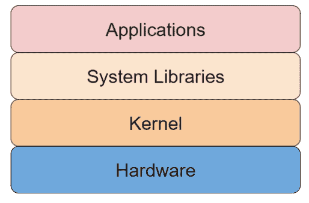

内核和系统库是 Linux 操作系统的关键组件。内核由各种模块组成，并直接与底层硬件（如 `CPU`、`RAM` 和 `I/O`）交互。这意味着内核用于管理系统资源：

*   `设备管理`：所有的输入输出设备都由内核管理。
*   `内存管理`：内核跟踪已使用和未使用的内存，实现虚拟内存，为用户程序分配内存等。
*   `进程管理`：内核为进程分配足够的时间并对进程进行优先级排序。
*   `处理系统调用`：用户应用程序可以请求内核执行特定任务。程序使用 `system calls` 执行某些操作。`System libraries` 是访问内核功能的函数或程序。`Standard libraries` 是与内核通信的程序。当应用程序放置 `system calls` 让内核执行某些任务时，`system calls` 通常不会直接调用，而是通过库调用。

各种应用程序被用于在 Linux 计算机内部执行特定任务。`shell` 是一种特殊的应用程序，是一种用于与内核通信的用户界面，内核反过来控制硬件组件和进程。虽然一台计算机通常只有一个内核，但同一台机器的操作系统上可以同时运行多个 Shell。

### Shell 的类型
Linux 中有不同类型的 Shell，包括：

*   `Bourne Again shell` (`bash`)
*   `Bourne shell` (`sh`)
*   `C shell` (`csh`)
*   `Korn shell` (`ksh`)
*   `TC shell` (`tcsh`)

注意，Linux 操作系统上可能安装了多种一种类型的 Shell。

### Linux 操作系统的特性
Linux 操作系统的的一些关键特性如下：

*   `多用户`：多个用户可以使用不同的 Shell 同时访问相同的系统资源，如内存、硬盘、应用程序。
*   `多任务处理`：多个应用程序可以同时在 Linux 操作系统上运行。
*   `可移植性`：Linux 操作系统在不同平台上以相同的方式运行。
*   `文件系统`：文件和目录按分级方式排列，包括普通文件、文件夹、内存、I/O 和设备在内的一切都被视为文件。
*   `Shell`：这是 Linux 中的命令行界面，允许用户通过键盘输入命令，执行程序或完成特定任务。
*   `安全性`：Linux 通过三种主要方式提供安全性，包括：
    *   `身份验证`：通过为用户分配密码和登录 ID 提供密码保护。
    *   `授权`：为用户提供读取文件、写入文件或执行程序的权限；因此限制了用户在计算机上可以做和不能做的事情。
    *   `加密`：将文件转换为不可读的格式。

### Linux OS 安装
Linux 操作系统可以安装在不同的机器上，包括：

*   本地计算机，
*   本地虚拟机（`VirtualBox` 或 `VMware workstation`），以及
*   云环境中的远程机器（`AWS` 或 `Azure`）。


# 安装 VirtualBox

`VirtualBox` 是一款开源虚拟化应用程序，它允许你创建多个虚拟机，在其中可以安装 Linux、Windows、macOS 等不同的操作系统。你可以从 [`www.virtualbox.org/`](https://www.virtualbox.org/) 下载与你的操作系统匹配的 VirtualBox 包并将其安装在计算机上。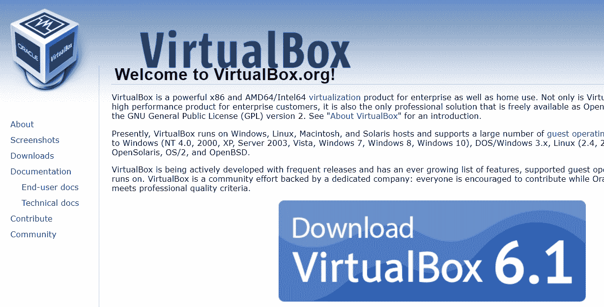

打开 VirtualBox，请在电脑上搜索 Oracle VM VirtualBox 图标并双击该图标。VirtualBox 界面如下所示、目录文件 (`d`) 和特殊文件 image_rsrc2N7.jpg 普通文件是最常见的文件类型，可以通过多种方式创建。例如；可以使用 `touch` 命令、`vi` 或 `nano` 编辑器创建普通文件。普通文件的示例包括文本文件 `.txt`、Python 文件 `.py`、Java 文件 `.java` 等。目录文件可以使用 `mkdir` 命令创建。

Linux 中还有用于不同用途的特殊文件。例如：

 块设备文件是控制驱动器和内存等硬件的文件。块设备主要位于 `/dev` 目录。 字符文件允许用户和程序与硬件外设备通信。字符文件的经典示例是代表键盘、鼠标、串口打印机的文件。字符文件是以字符方式读写数据的硬件文件。管道文件允许未显式设计为相互协作的应用程序或进程在单台 Linux 机器上通信。 符号链接文件作为其他文件的链接。这些文件可以视为快捷方式或指针。套接字文件用于在应用程序之间传递信息。

要在 Linux 终端显示文件类型，可以使用 `ls -ld <file_name>` 命令。例如，下方的 `ls -ld Downloads` 命令生成的输出包含 `drwxr-xr-x`。`drwxr-xr-x` 开头的 `d` 表示 `Downloads` 文件是一个目录 image_rsrc2N8.jpg

或者，可以使用 `file <file-name>` 命令显示特定文件的类型。

## 文件命名

*   Linux 中的文件名是大小写敏感的，这意味着名为 `myfile` 的文件与 `Myfile` 不同。
*   文件名中使用的字符可以包括大小写字母、数字、点 (`.`)、下划线 (`_`)、连字符 (`-`) 等。


- 文件名中不应使用特殊字符，如 `/`、`*`、`?`、`:`、`&`、`<>` `{}`()`
- 需要注意的是，文件扩展名没有意义，但包含它们可以帮助我们轻松识别文件类型。因此，`myfile` 与 `myfile.txt` 是相同的。

# Linux 命令结构

- Linux 命令用于执行特定的任务。
- 所有命令均使用小写字母编写。
- 命令可以不带参数、带一个参数或多个参数。
- Linux 命令的通用语法为 `command -argument1 -argument2`。例如：
    - `ls`
    - `ls -ls`
    - `ls -i -a`（或 `ls -ls `）

`ls` 命令可以接受选项，如 `l`（产生详细列表输出）、`t`（产生按修改时间排序的输出）和 `--reverse`（按反序产生输出），如下所示：`ls -l` 用于以详细格式列出文件。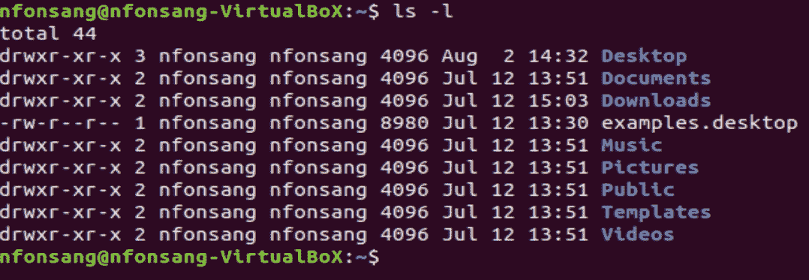 `ls -lt` 用于按修改时间排序以详细格式列出文件。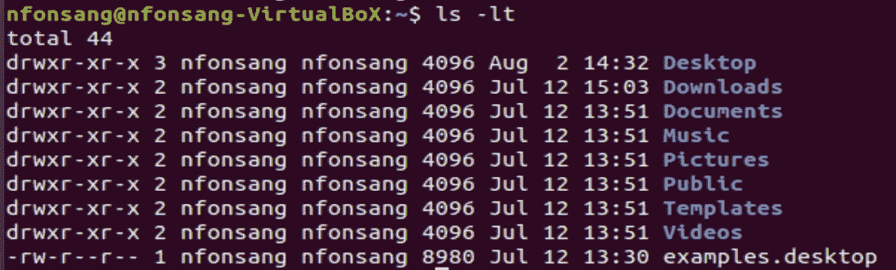 `ls -lt --reverse` 用于按修改时间的反序以详细格式列出文件：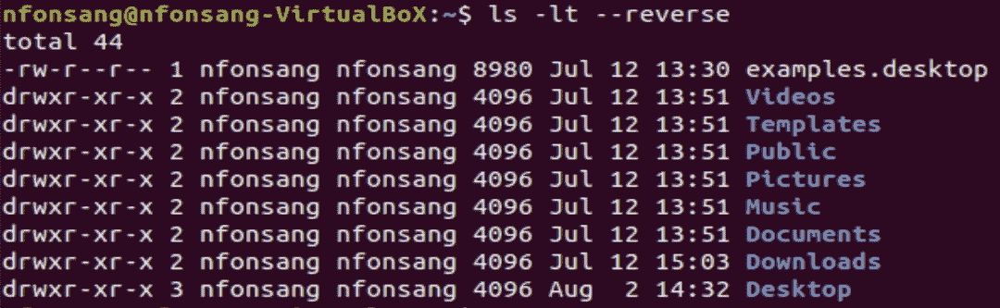 `ls -R` 用于列出当前工作目录下的目录文件以及子目录中的文件。

## 基础 Linux 命令

| 命令 | 用途 |
| :--- | :--- |
| `ls` | 用于列出目录内容。 |
| `cd` | 用于切换目录。 |
| `cat` | 用于显示文件内容。 |
| `who` | 显示当前登录系统的用户。 |
| `uname` | 显示计算机信息。 |
| `date` | 显示系统日期和时间。 |
| `cal` | 打印当前月的日历。 |
| `passwd` | 用于更改密码。 |
| `hostname` | 显示计算机名称。 |
| `echo` | 用于显示或打印一行文本。 |
| `bc` | 用于调用计算器。 |
| `sudo` | 代表“super user do”（超级用户执行）。允许以管理员或 root 权限执行命令。 |
| `apt-get` | 用于安装软件包。例如，可以使用 `sudo apt-get install python3` 安装 Python 3。每次想安装新软件包时，可以使用 `sudo apt-get update` 更新您的仓库。 |
| `ping` | 用于检查是否可以连接到服务器。例如，`ping google.com`。 |
| `clear` | 用于清除终端。 |
| `man` | 提供有关命令的帮助信息。 |
| `history` | 显示当前终端中使用过的过去命令列表。 |

# 3 导航
本章将探索如何导航 Linux 文件系统。Linux 文件系统具有分级目录结构，这意味着目录或文件可以嵌套在其他目录之中。`cd` 命令代表 change directory（切换目录），用于导航。

### 探索当前工作目录
在 Linux 中运行命令的目录被称为当前工作目录。`pwd` 命令用于显示当前工作目录的路径，而 `ls` 命令显示当前工作目录的内容，如下所示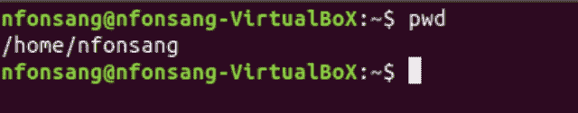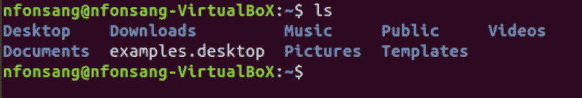 `ls -a`：此命令用于列出当前目录的所有内容，包括隐藏文件和隐藏目录。隐藏文件或隐藏目录通常以点（`.`）开头。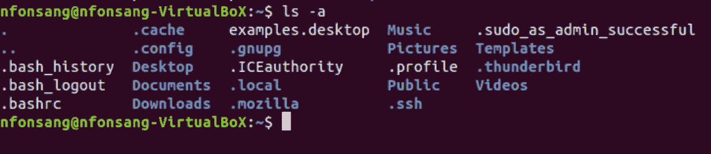

### 导航
`cd` 命令代表 change directory（切换目录），用于导航。`cd <directory-name>`：此命令用于从当前目录导航到指定的目录（即当前目录下的子目录）。`cd Desktop` 命令将当前目录导航到 Desktop 目录，前提是 Desktop 是当前目录的子目录。也就是说，`cd Desktop` 等同于 `cd ./Desktop`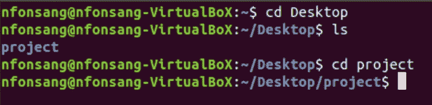

或者，要从主目录导航到位于 Desktop 目录内部的项目目录，我们可以使用 `cd` 命令并在单个命令中指定项目目录的路径，如下所示 `cd ..`：带两个点的 `cd` 用于导航到父目录，而 `cd .`（带单点）意味着留在当前目录。注意，单点代表当前目录，而双点代表父目录。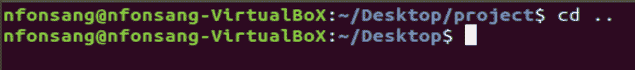 `cd` 或 `cd ~` 用于切换到主目录，而 `cd /` 用于切换到根目录（`/`）。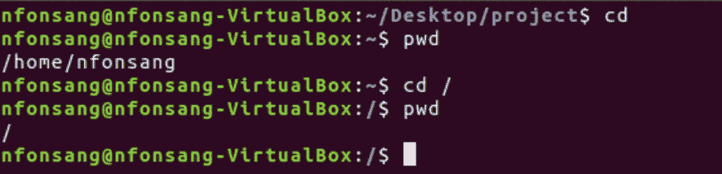

相对路径从当前目录（`.`）开始，而绝对路径从根目录（`/`/）开始。相对和绝对路径可以分别用于导航，如下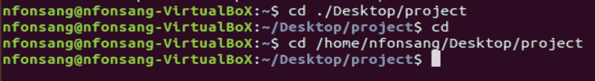

# 4 处理文件和目录
在本章中，我们将查看用于操作文件和目录的命令。例如，我们将检查用于创建、复制、移动、重命名、移除和删除文件及目录的命令。

### 创建目录
`mkdir <directory-name>` 用于创建目录或文件夹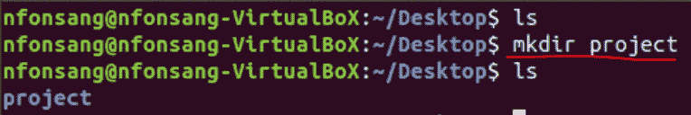 使用单个命令创建多个目录，请在 `mkdir` 命令后列出要创建的目录名称。

### 创建普通文件
有多种方法在 Linux 中创建普通文件。使用如 `vi` 或 `nano` 的编辑器创建普通文件。`cat <file-name>` 可以显示文件内容，`nano` 比 `vi` 更高级，使用 `nano <file-name>` 打开文件后 `CTRL + X` 退出。以下是使用 nano 创建的 python 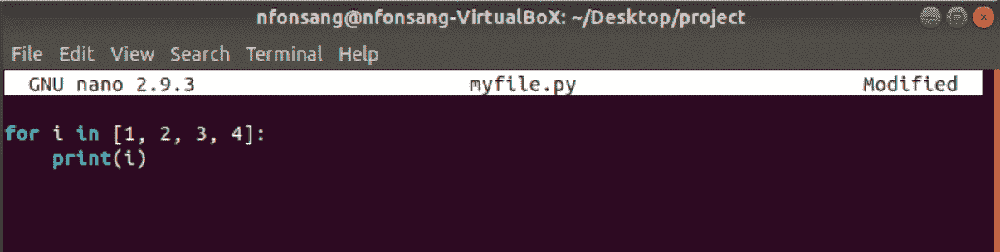 `cat <file-name>` 用于显示文件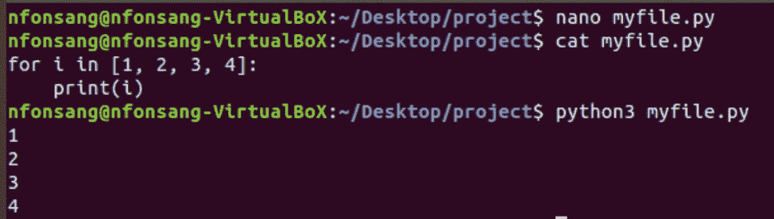 `touch <file-name>` 将创建一个空文件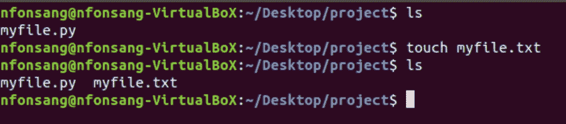

### 复制目录
注意，使用 `cp <directory-name> <directory-name>` 可以创建目录的副本。使用 `-r` 选项复制目录。这意味着如果被复制的目录包含子目录或文件，你需要使用 `cp -r <directory-name> <directory-name>`

### 复制文件
`cp file1 file2` 用于复制 `file1` 并将其命名为 `file2

### 重命名文件
`mv <file1> <file2>` 命令将 `file1` 重命名为 `file2`。下图显示了如何将 `myfile.txt` 重命名为 `myfile1.txt

### 移动文件到另一个目录
`mv` 命令也可用于将文件移动到不同的目录。例如 `mv <file-name> <path-to-new-directory>` 将文件移动到指定的目录 注意命令开头使用了 `sudo`，因为移动文件需要管理员权限。另外注意符号 `~` 代表用户的主目录。

### 删除文件
`rm <file-name>` 命令用于删除文件

### 删除目录
`rmdir <directory-name>` 用于删除空目录。你会注意到 `rm` 命令用于删除文件，而 `rmdir` 命令用于删除目录 `rm -r <directory-name>` 用于删除至少包含一个子目录或文件的目录

### 处理文件：计算文件中的单词数
让我们先用 `nano` 创建文件并向文件中写入一些文本，如下所示 `wc <file-name>` 可用于计算文本中的单词 `wc <file-name>` 会产生三个数字和指定文件的名称。

- 第一个数字代表文件的行数，
- 第二个数字代表文件的单词数，
- 第三个数字代表文件的字符数。


`wc` 命令有多种不同的选项可以使用：

* `wc -m <file-name>` 给出文件的字符数。
* `wc -c <file-name>` 显示文件的字节数。
* `wc -l <file-name>` 给出文件的行数。
* `wc -L <file-name>` 给出文件中最长一行的长度。
* `wc -w <file-name>` 显示文件的单词数。

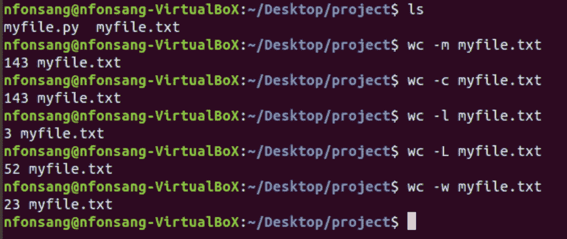你可以通过 `wc --help` 或 `man help` 查看 `wc` 命令的各种选项。

## 文件操作：打印文件内容
让我们再次使用 `cat <file-name>` 来检查 `myfile.txt` 的内容。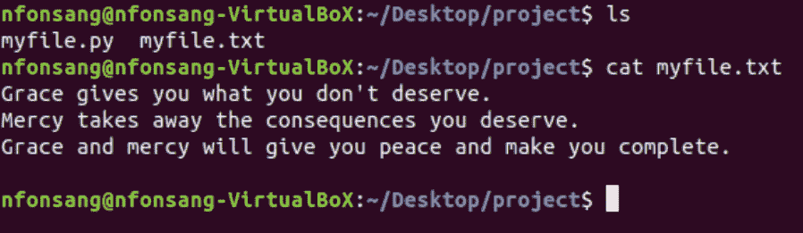我们可以在同一行上运行不同的 `cat` 命令并用分号隔开，从而打印多个文件的内容。例如，`cat <file1> ; cat <file2>` 将同时打印 `file1` 和 `file2` 的内容。我们使用 `cat file1 file2` 来打印 `file1` 和 `file2` 的内容。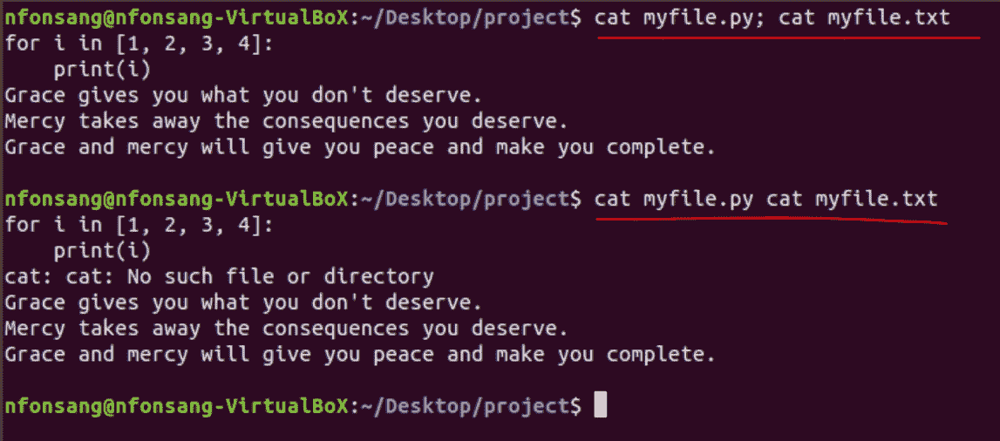`cat -n <file-name>` 用于在行旁边显示行号。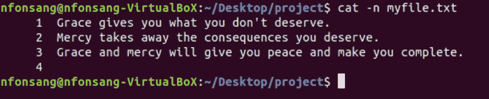你也可以运行 `cat --help` 来查看 `cat` 命令的其他选项。`tac <file-name>` 以反序方式（从下到上）显示文件内容。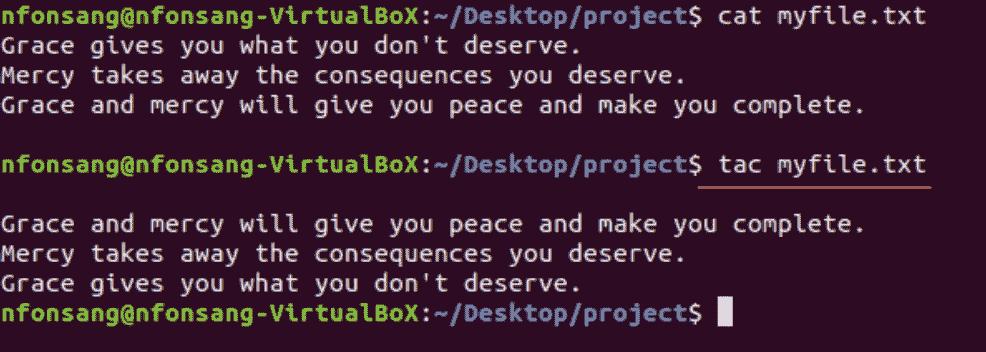`rev <file-name>` 从左到右以反序方式显示每一行。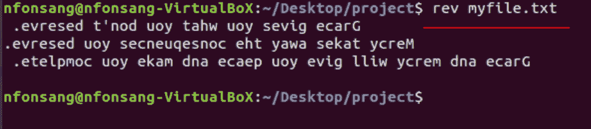`more <file-name>` 或 `less <file-name>` 分别用于显示更多或少的文本。`head <file-name>` 或 `tail <file-name>` 分别显示文件的头部或尾部。你还可以使用 `-n` 选项指定显示的行数。例如；`head -3 <file-name>` 显示指定文件的前三行。默认情况下，`head <file-name>` 显示文件的前 10 行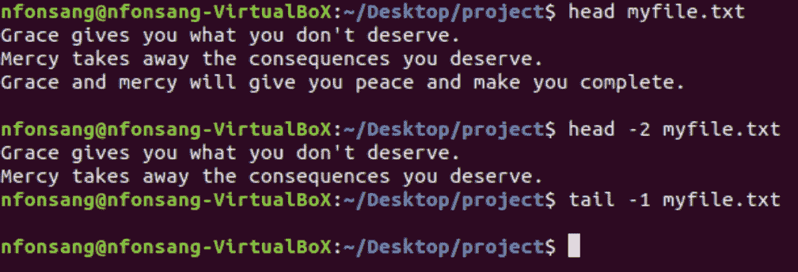

## 文件操作：分割文件中的文本
`split <file-name>` 将将文件中的文本分割成不同的文件。默认情况下，文件将被分成每块 1000 行。我们可以使用 `-n` 选项指定每块应包含多少行。新文件会自动命名；如 `xaa`、`xab` 等。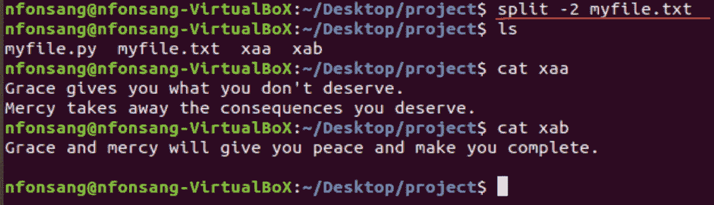如果你希望新文件命名为 `x00`、`x01` 而不是 `xaa`、`xab`，你可以为 `split` 命令包含 `-d -l` 选项。(image_rsrc2PA.jpg)

## 获取命令帮助
`man <command>` 用于显示命令的手页，而 `<command> --help` 用于获取任何命令的帮助。(image_rsrc2PB.jpg)`apropos <keyword>` 可用于搜索包含指定关键字的所有命令。(image_rsrc2PC.jpg)

# 5 标准 I/O 重定向和管道
在本章中，我们将学习标准输入重定向、标准输出重定向、标准错误重定向以及如何使用管道将多个命令链成单个命令。

### 什么是标准 I/O？
标准 I/O 指标准输入和输出。当你使用 Linux 终端时，输入通过键盘输入，输出在终端上显示。也就是说，标准输入设备是键盘，而标准输出设备是终端或简单的计算机屏幕。标准输入和标准输出的符号分别为 `stdin` 和 `stdout`。还有表示为 `stderr` 的标准错误。记住，Linux 系统中的一切都是文件，包括普通文件、目录甚至设备（特殊文件）。因此，标准输入、标准输出和标准错误设备都是与文件描述符数字 0、1 和 2 关联的文件。

重定向用于操作命令的输入和输出。例如，与其将输出显示在终端上，不如将输出重定向到文件中。通过重定向，我们可以更改标准输出和输入设备。

### 标准输入重定向
通常，Linux 终端中的命令会接收一些输入。如果输入是一个普通文件，我们可以通过 `<` 符号使用输入重定向提供文件的内容。让我们使用输入重定向向 `cat` 命令提供一个 Python 文件。(image_rsrc2PD.jpg)在上面的示例中，可能并不明显为什么我们应该使用 `cat < myfile.py` 而不是 `cat myfile`。然而，这个例子说明了输入重定向是如何工作的。我们将在下面查看更具体的例子。

现在让我们考虑另一个例子，即在有重定向和没有重定向的情况下向 `wc -l` 命令提供文件。你会注意到，没有重定向时，会显示行数和文本文件的文件名。重定向将文件内容传递给 `wc -l` 命令，因此不会显示文件名。(image_rsrc2PE.jpg)

我们可以使用 `mail` 命令通过重定向将附件发送到电子邮件。例如；`mail -s “Data Analysis File” [xyz@company.com] < analysis.py` 将将 `analysis.py` 文件作为附件发送到 `xyz@company.com]`，且邮件主题将为“Data Analysis File”。

### 输出重定向
我们可以使用大于号（`>`）重定向输出。例如，与其在终端上显示目录内容，不如使用 `ls -l > <file-name>` 将内容重定向到文件中。(image_rsrc2PF.jpg)注意，如果输出重定向的文件已存在，它将被覆盖。例如，让我们向 `listing.txt` 打印或回显一个字符串。(image_rsrc2PG.jpg)如果你不想覆盖现有文件，即如果你想向现有文件添加或追加内容，可以使用 `>>` 符号代替 `>`。(image_rsrc2PH.jpg)注意，我们可以使用 `1>` 显式指定重定向类型为输出重定向，与用于标准错误重定向的 `2>` 相比。

### 标准错误重定向
运行程序或命令时，错误信息可能会作为输出显示。与其让错误信息弄乱终端输出，不如将错误信息重定向到文件中。这是开发人员的常用做法。标准错误可以使用 `2>`定向（与用于定向标准输出的 `1>` 相比）。image_rsrc2PK.jpg)我们还可以将无用的错误信息重定向到 `/dev/null`。进入 `/dev/null` 的任何内容都无法检索。(image_rsrc2PM.jpg)任何进入 `/dev/pts/0` 的输出都会在终端上显示，因为 `/dev/pts/0` 基本上就是终端。(image_rsrc2PN.jpg)

### 管道
管道涉及命令链，使得第一个命令的输出作为第二个命令的输入。管道字符或竖线（`|`）用于管道。例如，我们可以列出目录内容，然后使用 `ls | wc -l` 命令统计目录中有多少项目。(image_rsrc2PP.jpg)考虑一个包含动物名称的文件 `animals.txt`。让我们使用 `sort` 和 `uniq` 命令按排序顺序显示唯一的动物名称。我们将使用管道链接 `sort` 和 `uniq` 命令。注意 `uniq` 命令仅对排序后的项目有效，因此我们需要先对项目排序，然后将排序后的项目传递给 `uniq` 命令。(image_rsrc2PR.jpg)管道使用的其他常见示例包括：

* `cat <file-name> | grep <“keyword”>` 获取文件中包含指定关键字的行。
* `cat <file-name> | tail -5` 显示文件的最后五行文本。


# 6 用户与组管理

本章重点介绍如何创建用户和组、如何将用户分配到组以及如何删除用户和组。我们还将如何管理密码属性。

## 用户与组

用户和组是 Linux 中两种主要的账户。账户允许访问特定的资源或文件。每个用户账户都会分配一个 ID 数字（`userid`）。组允许系统管理员管理一组用户。如果一个组被授予了访问某个文件的权限，那么该组的每个用户都拥有（或继承）访问该文件的相同权限。

每个 Linux 用户至少属于一个组（主组）。如果用户创建了一个文件，该文件既属于该用户，也属于该用户的主组。你可以使用 `ls -l <file-name>` 来显示目录中的文件，以及对文件具有访问权限的用户和组。

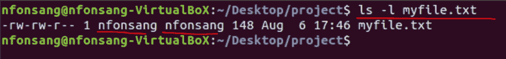

如所示，你会注意到 `nfonsang` 是用户名，而 `nfonsang` 也是 `myfile.txt` 所属组（主组）的名字。你还可以通过运行 `id` 命令获取当前用户的信息，包括用户 ID、用户名以及组 ID 和组名。

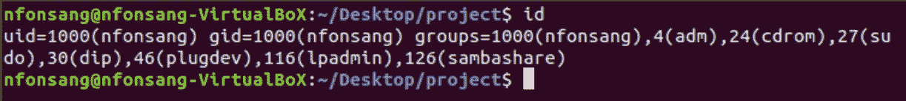

`uid` 是用户 ID，`gid` 指的是组 ID。

## 如何在 Linux 中创建用户

在 Linux 中创建用户，你需要 root 权限。这意味着你需要以 root 或超级用户身份登录。要切换到超级用户账户，可以使用命令 `sudo su`。要退出超级用户账户回到用户账户，可以使用命令 `exit`。

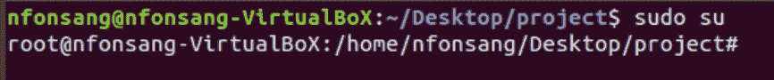

你可以使用 `adduser <user-name>` 或 `useradd <user-name>` 命令创建用户。

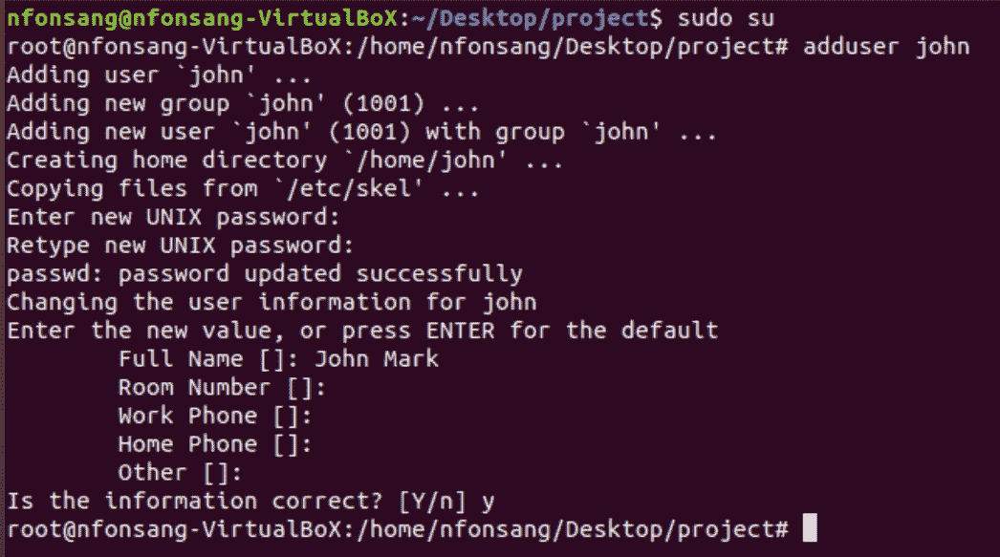

在上面的示例中，在 ubuntu 中了一个名为 `john` 的用户。当你运行创建用户的命令时，系统会提示你输入其他用户信息，如姓名、房间号等。如果这些信息可用或没有必要，只需按键盘上的 Enter 键继续。然后通过输入 `y` 来验证信息是否正确。

`/etc/passwd` 文件存储了登录所需的必需用户信息。我们可以使用 `cat /etc/passwd` 显示系统中不同用户的账户信息。用户信息包括：用户名、由 `x` 表示的加密密码、主组 ID、主组名、主目录的绝对路径以及 shell 的绝对路径。

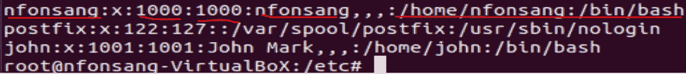

或者，我们可以使用 `tail /etc/passwd` 查看最近添加到系统的用户账户信息。

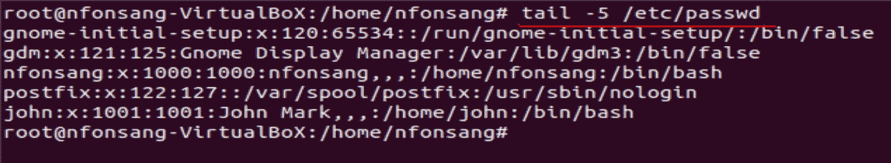

我们可以使用 `grep` 命令在 `/etc/passwd` 文件中查找特定的用户信息。例如，让我们在 `/etc/passwd` 中查找包含“nfon ”单词的任何账户。我们将使用命令 `grep nfon /etc/passwd`。

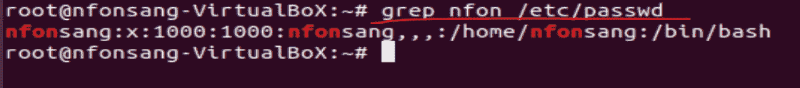

除了用户名外，在使用 `useradd` 命令创建新用户时，还可以指定所需的用户 ID、组 ID、主目录路径等。我们可以通过运行 `useradd --help` 命令查看各种可用选项。

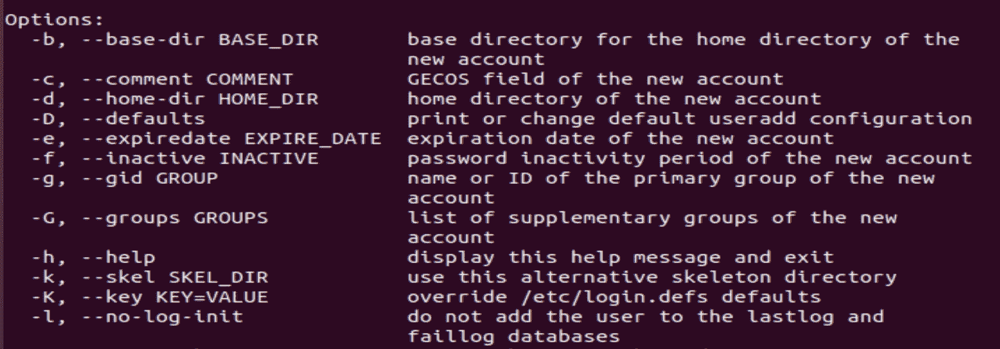 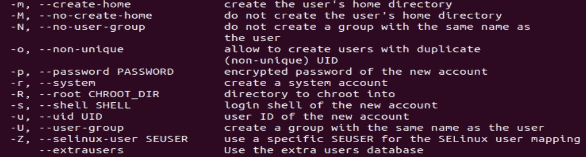

以下是创建用户账户时使用这些选项的示例。

| 命令 | 说明 |
| :--- | :--- |
| `useradd <user-name>` | 添加新用户。 |
| `useradd -d <path-to-new directory> <user-name>` | 创建一个具有不同主目录的用户。默认主目录为 `/home/user-name`。 |
| `useradd -M <user-name>` | 添加一个没有主目录的用户。当用户登录时，主目录将是根目录。 |
| `useradd -u <user-id-number> <user-name>` | 创建一个指定用户 ID 用户。 |
| `useradd -u <user-id-number> -g <group-id number> <user-name>` | 创建一个指定用户 ID 和组 ID 用户。 |
| `useradd -G <group-name1 group-name2> <user-name>` | 将用户添加到多个组中。这些组在系统中已经存在。 |
| `useradd -e <year-month-day> <user-name>` | 创建一个有过期期的用户账户。 |
| `useradd -e <year-month-day> -f 60 <user-name>` | 创建一个有过期期的用户账户，密码设置为 60 天后过期。 |

我们可以使用 `getent passwd <user-name>` 获取特定用户的信息。

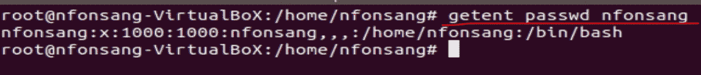

## 如何创建组

当你为用户创建账户时，这些用户自然属于某些部门之类的组。因此，你可能需要为不同的部门创建组账户。通常建议在创建用户之前先创建组，这样在创建用户时就可以将其分配到已存在的特定组。如果在创建组之前创建了用户，你就需要编辑 `/etc/passwd` 文件中的用户账户信息以包含组信息，这将增加额外的工作。

`groupadd <group-name>` 用于创建辅助组。现在，让我们创建一个名为 `engineers` 的组。


当创建组时，组账户信息存储在 `/etc/group` 文件中。我们可以使用 `cat /etc/group` 显示组及其组 ID。

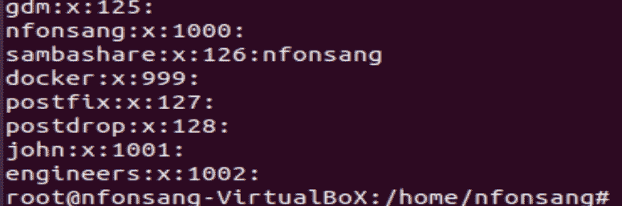

我们可以使用 `groupadd --help` 命令查看添加组的可用选项。

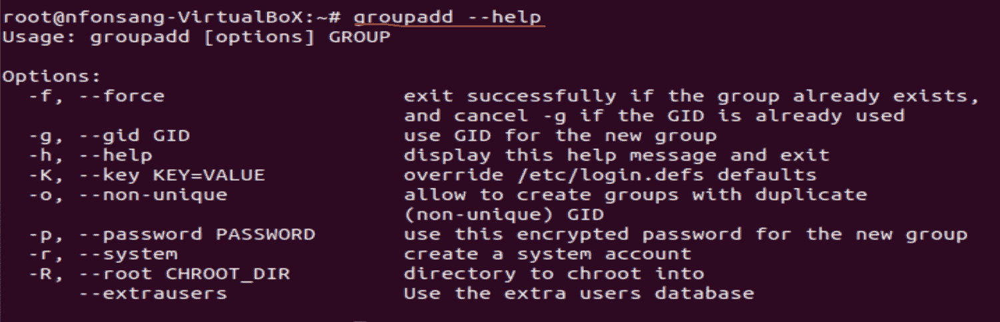

创建组的常用命令如下：

| 命令 | 说明 |
| :--- | :--- |
| `groupadd <group-name>` | 添加新组。 |
| `groupadd -g <group id number> <group-name>` | 创建一个指定组 ID 的新组。 |


# 将用户添加到组

`usermod` 命令可修改用户账户。`usermod --help` 提供了在使用 `usermod` 时使用的不同选项。以下是 `usermod` 的一些选项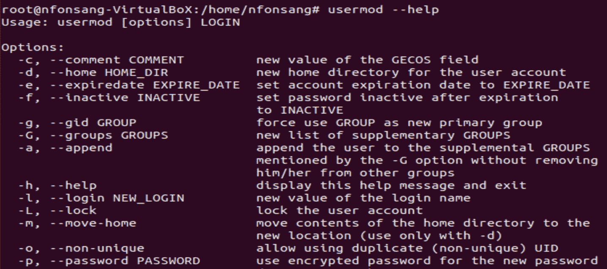

`-G` 选项可将用户分配到要组。此选项将覆盖之前分配给该用户的任何要组。为了避免覆盖用户当前的要组，你可以改用 `-aG` 将新的要组追加到用户中。

`usermod -G <group-name> <user-name>` 将用户添加到组中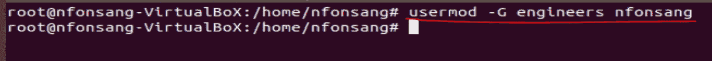

`id <user-name>` 显示用户 ID 和该用户所属的组。`id -G <user-name>` 将显示与用户相关的组的组 ID。`id -nG <user-name>` 将显示与用户相关的组的名称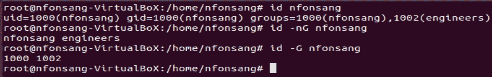

你会发现用户 `nfonsang` 已被分配到 `engineers` 组。让我们创建一个名为 `developers` 的组，然后将用户 `nfonsang` 分配到该组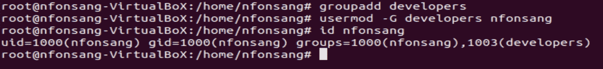

由于我们使用了 `-G` 选项将用户分配到 `developers` 组，之前分配给用户的 `engineers` 组已被覆盖。为了避免覆盖现有的要组，请使用 `-aG` 选项将新用户追加到要组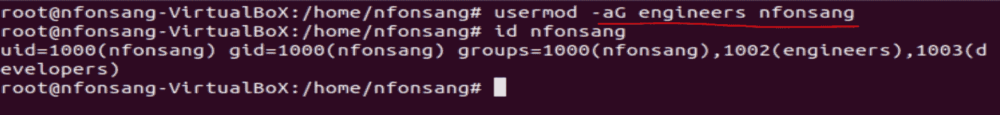

`usermod -aG <group1, group2> <user-name>` 用于一行代码添加多个新组。如果用户已添加到 `group1`，则使用 `usermod -G <group1, group2> <user-name>` 将用户添加到 `group2`。`usermod -G <group1> <user-name>` 将覆盖用户所属的所有其他组并将用户添加到 `group1`。

`groupdel <group-name>` 用于删除组。删除组时，任何分配到该组的用户都将从组中移除。`userdel <user-name>` 用于删除用户。

对于现有用户，可以使用 `nano` `/etc/passwd` 手动编辑用户信息。例如，用户名可以从 `john` 更改为 `james`，如下所示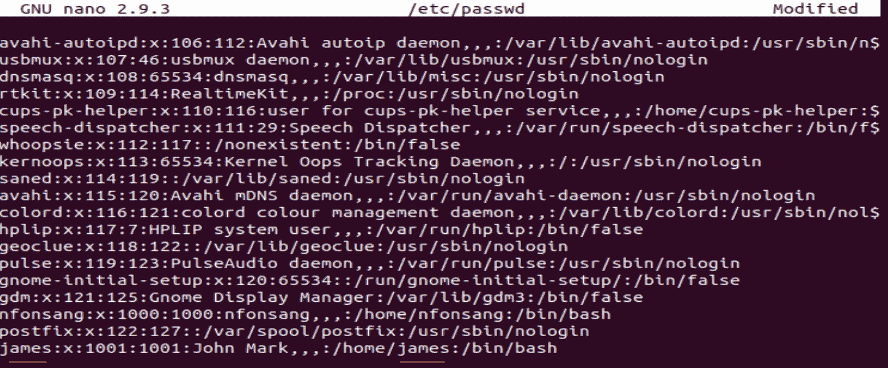

为了保持一致，你可能还需要使用 `nano` `/etc/group` 将主组名从 `john` 修改为 `james`。此外，你可能需要使用 `mv` 命令将主目录名称从 `/home/john` 修改为 `/home/james`。

通常，手动编辑 `/etc/passwd` 文件不是一个好主意，因为可能会破坏重要信息。注意，`vipw` 和 `vigr` 命令也可以分别编辑 `/etc/passwd` 和 `/etc/group` 文件。此外，可以使用 `nano` `/etc/default/useradd` 手动更改默认 `adduser` 配置。

# 管理密码属性

`passwd <user-name>` 命令可重置用户的密码属性。使用 `passwd --help` 检查选项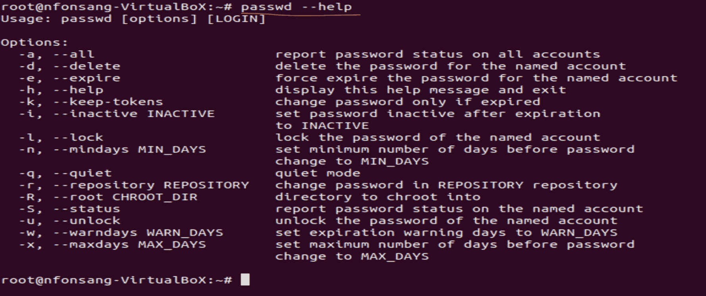以下使用不同选项使用 `passwd` 命令的一些示例。

| 命令 | 描述 |
| :--- | :--- |
| `passwd -S <user-name>` | 显示账户密码设置的状态。 |
| `passwd -l <user-name>` | 用于锁定特定账户的密码，使得只有 root 用户可以访问该账户。用户无法直接登录系统。 |
| `passwd -u <user-name>` | 用于解锁用户的密码。 |
| `passwd -d <user-name>` | 删除账户的密码。 |
| `passwd -e <user-name>` | 使用户账户立即过期。强制用户在下次登录尝试时更改密码。 |
| `passwd -i <no-of-days> <user-name>` | 账户在密码过期指定天数后变为失效。在此天数之后，用户将无法再登录。 |
| `Echo “newpassword” | passwd --stdin <user-name>` | 将用户的密码设置为 `newpassword`。 |

# 管理当前会话

*   `who` 和 `w` 命令显示当前登录的用户。
*   `loginctl` 命令用于管理当前会话：
    *   `loginctl list-sessions` 用于列出当前会话。
    *   `loginctl show-session <session-id...>` 显示一个或多个会话的属性。
    *   `loginctl show-user <user…>` 显示一个或多个用户的属性。
    *   `loginctl terminate-user <user…>` 终止特定用户的所有会话。这将杀死该用户所有会话的所有进程

# 七 权限管理

本章将帮助你理解和管理文件权限，例如写、读和执行权限。你还将理解与文件相关的属性、如何显示文件权限、设置文件权限以指定用户所有者、组所有者和其他可以对文件进行的操作。

## 理解 Linux 基础权限

Linux 中的所有文件和目录都有一套标准的访问权限，用于控制谁可以访问、读取、写入或执行文件或目录。首先，需要注意的是 Linux 文件具有名称、创建时间、修改时间、访问时间、大小、所有者、组等属性。

文件和目录的读、写、执行权限如下：

| 权限 | 文件 | 目录 |
| :--- | :--- | :--- |
| 读 (r) | 打开 | 列出 |
| 写 (w) | 修改 | 创建或删除 |
| 执行 (x) | 运行 | 导航 |

`ls -l` 命令用于查看分配给文件和目录的权限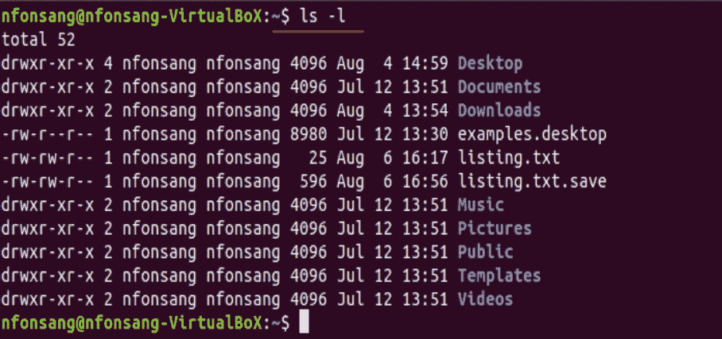`ls -l` 命令按顺序输出关于文件或目录的信息：

*   文件类型
*   权限
*   所有者
*   组
*   大小
*   创建/修改日期

以下符号用于描述不同类型的文件：

| 符号 | 描述 |
| :--- | :--- |
| - | 普通文件 |
| d | 目录 |
| b | 块设备 |
| c | 字符设备 |
| p | 管道 |
| l | 符号链接 |
| s | 套接字 |

`ls -l` 命令显示文件和目录的信息。包含写、读和执行权限。`ls -l` 生成的输出解释如下

*   `d`: 目录
*   `rwx`: 用户所有者可以读取、写入并执行文件。
*   `r-x`: 组所有者可以读取文件，无法写入但可以执行文件。
*   `r-x`: 其他人可以读取文件，无法写入但可以执行文件。
*   `4`: 文件的链接数。
*   `nfonsang`: 用户所有者名称。
*   `nfonsang`: 组所有者名称。
*   `4096`: 以字节为单位的大小。
*   `Aug 4 14:59`: 创建或最后修改的日期/时间。


| 4 |
| 4 |
| 4 |
| 4 |
| 0 |
| 0 |
| 0 |
| 0 |

注意 `0` 用于表示没有权限。总和用于将权限分配给用户、组或其他人。因此，文件权限由三位数字表示，其中第一位、第二位和第三位分别代表分配给用户、组和其他人的权限。以下是解释权限数字的示例：

| 权限数字 | 描述 |
| :--- | :--- |
| 762 | `7` 或 `(4+2+1)` → 用户所有拥有读、写、执行权限。`6` 或 `(4+2)` → 组所有者只有读、写权限。`2` → 其他只有写权限。 |
| 431 | `4` → 用户所有者只有读权限。`3` 或 `(2+1)` → 组所有者只有写、执行权限。`1` → 其他只有执行权限。 |

## 管理基础 Linux 权限

`chgrp <new-group-name> <file-name>` 用于更改文件的组所有权。`chown <new-owner name> <file-name>` 用于更改文件的用户所有者。例如，下方插图中的 `myfile.py` 用户 `nfonsang`。组所有者也是 `nfonsang`。我们可以将组所有者更改为 `engineers`，用户所有者更改为 `james`。注意，你分配给文件的组所有者和用户所有者已经在系统中存在。以下是更改组所有者的方法：

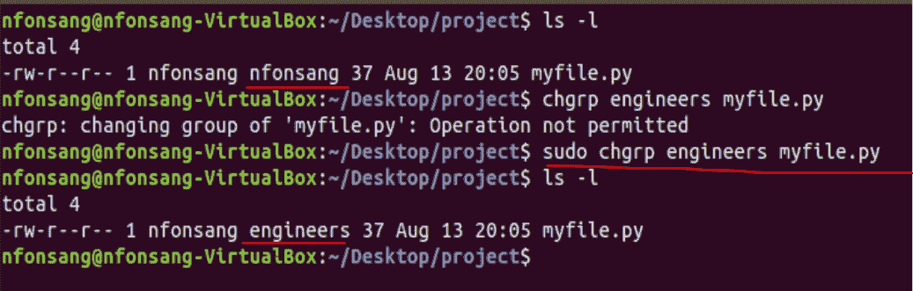

现在，让我们文件的用户所有者改为 `james`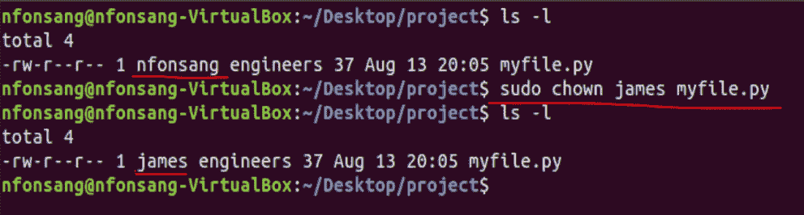

## 使用数字分配权限

考虑以下文件权限：
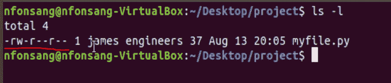
`myfile.py` 是具有以下权限的普通文件：

- 用户所有者权限数字为 `4+2+0` (`rw-`) = `6`；
- 组所有者权限数字为 `4+0+0` (`r--`) = `4`，且
- 其他人权限数字为 `4+0+0` (`r--`) = `4`。

因此，该文件的权限（用户、组、其他）为 `644`。我们可以将权限更改为 `771`，这意味着用户所有者和组所有者将拥有读、写、执行权限，而其他人只有执行权限。我们可以使用 `chmod <new-permission-number> <file-name>` 命令分配读、写和执行权限。例如，我们可以如下所示将权限模式从 `664` 更改为 `771`：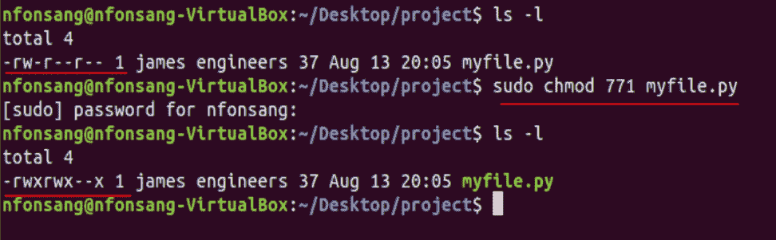

注意，通过在 `chmod` 命令中包含 `-R` 选项，可以递归更改目录的读、写和执行权限，从而影响子目录的权限。因此，使用了 `chmod -R <permission-number> <directory-name>` 命令。

## Unmask

我们还可以使用 `umask` 命令更改文件和目录的默认权限。`umask` 是一个从设置，定义一个掩码。例如，目录的默认权限为 `777`。`umask 027` 将目录的默认权限设置为 `750`（即 `777 - 027 = 750`）。该命令还会影响运行命令的目录内所有新文件（带有默认权限）。

# 8 正则表达式

本章重点介绍如何使用正则表达式。正则表达式是用于通过匹配模式来搜索数据的特殊字符。因此，正则表达式是一种用于搜索符合指定模式的数据匹配机制。

### 正则表达式简介

让我们先检查正则表达式是如何工作的。我们可以使用 `ls -l *.py` 列出所有以 `.py` 结尾的文件。星号 `*` 匹配零或多个字符。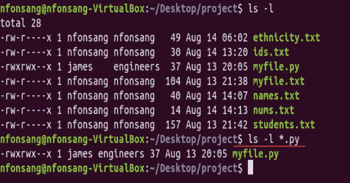

正则表达式可以配合 `grep` 命令用于显示文件中匹配模式的行。例如，`cat names.txt | grep “e”` 将输出包含字母“e”的行，而 `cat names.txt | grep “e$”` 将搜索以“e”结尾的行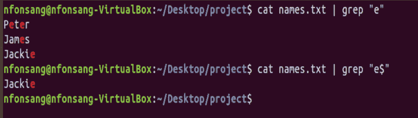

### 基础正则表达式示例

- “ `^a ” 将搜索以字母“a”开头的行。
- “ `a.b` ” 将匹配“a”和“b”之间的任何单个字符。
- “ `a*b` ” 匹配“a”和“b”之间从 0 个或多个字符。
- `[abc]` 将匹配包含“a”、“b”或“c”的任意行。注意 `[abc]` 等同于 `[a-c]`。
- `[abc]ef` 将匹配具有三个字符的行，如 aef、bef 或 cef。
- `[a-z]` 匹配单个小写字母。`[a-z]` 等同于 `[:lower:]`。
- `[A-Z]` 将匹配单个大写字母。`[A-Z]` 等同于 `[:upper:]`。
- `[a-zA-Z]` 将匹配单个字母（大写或小写）。`[a-zA-Z]` 等同于 `[:alpha:]`。
- `[0-9]` 将匹配单个数字。`[0-9]` 等同于 `[:digit:]`。
- `[a-zA-Z0-9]` 将匹配单个字母或数字。
- `[:space:]` 将匹配空白字符。
- `[:punc:]` 将匹配标点符号。
- `[^abc]` 或 `[^a-z]` 匹配不在括号内的字符。
- “ `^$` ” 将匹配空行。


`cat names.txt | grep “^[A-K]”` 将匹配以 A 到 K 之间的字母开头的名字，而 `cat names.txt | grep “^[^A-K]”` 将匹配不以 A 到 K 之间的字母开头的名字。`[^A-K]` 表示除 A 到 K 之间的字母以外的其他字母。(image_rsrc2RN.jpg)我们可以使用 `-n` 选项在输出中包含行号。然后，我们还可以使用 `-v` 选项来反转或否定匹配模式。(image_rsrc2RP.jpg)

# 9 文本处理
在本章中，我们将学习如何使用不同的命令（包括 `cut`、`paste`、`tr`、`tee`、`sort`、`grep` 和 `find`）过滤和搜索文本。

## cut 命令
`cut` 命令用于从文件的每行提取部分。让我们考虑以下文件，`myfile.txt` 和 `students.txt`：

让我们使用命令 `cut c<character-position> <file-name>` 提取每行的第一个字符。命令 `cut -c1 myfile.txt` 提取文件中每行的第一个字符。命令 `cut -c6 myfile.txt` 提取文件中每行的第六个字符，如下所示。(image_rsrc2RS.jpg)

让我们从每行提取一组字符。例如，我们可以像下面所示，提取从第一个到第三个或从第六个到第八个字符。(image_rsrc2RT.jpg)

在处理分隔符文件时，`cut` 命令变得非常有用。在处理带分隔符的文件时，使用 `-d` 选项指定分隔符。要提取的特定字段可以使用 `-f` 选项指定。

例如，`student.txt` 文件是一个逗号分隔的文件。逗号分隔的文件可以使用命令 `cut -d “,” -f<field-position> <file-name>` 进行处理。(image_rsrc2RU.jpg)参数 `-f1` 表示应提取每行的第一个字段。

如果你想避免任何没有分隔符的行（例如 `students.txt` 文件中的最后一行），可以指定 `-s` 选项。(image_rsrc2RV.jpg)

我们可以使用参数 `-f1-2` 提取第一个和第二个字段。(image_rsrc2RW.jpg)

让我们提取 `students.txt` 文件中的姓名和种族。由于姓名和种族分别出现在第 1 和第 4 字段，我们将使用参数 `-f1,4`。(image_rsrc2RX.jpg)我们可以通过包含 `--output-delimiter=“<delimiter>”` 选项将输出中的分隔符替换为另一个分隔符。(image_rsrc2RY.jpg)让我们来看 cut 命令的一个实际应用。假设你想提取 `/etc/passwd` 文件中最后三个账户的名称和主目录。这可以使用命令 `tail -3 /etc/passwd | cut -d“:” -f1,6` 完成。(image_rsrc2RZ.jpg)

## paste 命令
`paste` 命令用于水平合并文件的行。因此，`paste` 适合水平堆叠来自不同文件的字段。让我们考虑 `ethnicity.txt` 和 `names.txt` 文件。(image_rsrc2S0.jpg)我们可以使用 `paste <file1 file2 …>` 合并指定的文件。让我们使用命令 `paste names.txt ethnicity.txt` 合并 `names.txt` 和 `ethnicity.txt` 文件。(image_rsrc2S1.jpg)我们可以通过包含 `-d “delimiter”` 选项来指定分隔符以分离来自不同文件的文本。(image_rsrc2S2.jpg)我们还可以使用 `-s` 选项以串行方式一次粘贴一个文件。(image_rsrc2S3.jpg)`paste` 命令可以与 `cat` 命令配合，通过在 `paste` 命令后包含横杠来实现每行粘贴一个、两个或三个项目。横杠的数量表示每行可以粘贴的最大项目数。(image_rsrc2S4.jpg)`paste` 命令也可以配合输入重定向使用。(image_rsrc2S5.jpg)

## tr 命令
`tr` 代表 translate（转换），用于删除字符或将字符转换为其他字符。例如，`echo “abcd” | tr “d” “1”` 将把 `abcd` 中的 `d` 替换为 `1`。同样，`echo “abcd” | tr “cd” “12”` 将 `c` 替换为 `1` 并 `d` 替换为 `2`。(image_rsrc2S6.jpg)让我们将 `ids.txt` 文件中的大写 “A” 和 “B” 分别替换为小写 “a” 和 “b” (image_rsrc2S7.jpg)我们可以使用 `tr [a-z] [A-Z]` 或 `tr [:lower:] [:upper:]` 将所有小写文本转换为大写。(image_rsrc2S8.jpg)让我们使用命令 `tr “ “ “ |” <file-name>` 将所有空格转换为垂直线。(image_rsrc2S9.jpg)`tr` 命令在实际中可以移除文本中的多个空格。我们可以使用 `tr -s “ ” <file-name>` 将多个空格压缩为单个。我们可以使用 `tr -d “ ”` 删除文本中的空格。我们可以使用 `tr “ “ “t” <file-name>` 将所有空格转换为制表符。我们可以通过 `find` 命令配合 `tr -d “”` 来删除这些字符。(image_rsrc2SA)我们可以使用 `tr -d “[:digit:]]` 来删除 `ids.txt` 文件中的所有空白符。(image_rsrc2SB)

## tee 命令
`tee` 命令接收标准输入并将其写入标准输出和文件。我们可以使用 `tee` 命令将输出重定向到文件，同时显示在屏幕上。(image_rsrc2SC)我们可以使用 `tee -a` 选项向文件追加输出内容，而不是覆盖它。(image_rsrc2SD)我们可以使用 `tee file1 file2` 将输出同时写入多个文件。(image_rsrc2SE)

## sort 和 uniq 命令
`sort` 命令对文件内容进行排序。我们可以使用 `sort file 命令`。(image_rsrc2SF)`sort` 还可以按特定的键进行排序，例如，使用 `sort -k2,2 file.txt` 按第 2 列进行排序。(image_rsrc2SG)我们可以使用 `sort -r` 选项进行反序排序。(image_rsrc2SH)我们还可以使用 `sort -n` 按数值大小进行排序。(image_rsrc2SI)`uniq` 命令用于过滤相邻的重复行。通常在运行 `uniq` 之前需要先运行 `sort`，例如 `sort file.txt | uniq`。(image_rsrc2SJ)我们可以使用 `uniq -c` 选项显示重复行的次数。(image_rsrc2SK)我们可以使用 `uniq -d` 选项仅显示重复的行。(image_rsrc2SL)我们可以使用 `uniq -u` 选项仅显示不重复的行。(image_rsrc2SM)


- 交互式进程（或前台进程）：该进程在前台运行或通过 Linux 终端运行。用户与此类进程进行交互。
- 非交互式进程（或后台进程）：这是在后台运行的进程，用户不需要与该进程进行交互。要在后台运行命令，我们可以在命令后加上 `&`（安培符）。该命令会在后台运行，并将提示符释放回给用户。
- 守护进程（Daemons）是后台运行的长时间运行进程，用于等待某些指令。

## 进程相关命令

| 命令 | 用途 |
| :--- | :--- |
| `ps` | 用于查看进程列表。 |
| `kill` | 用于杀死进程。 |
| `nohup` | 用于使进程在注销后继续运行。 |
| `nice` | 用于设置进程的 nice 值，以确定该进程是否具有优先级。 |
| `time` | 用于获取命令或进程的时间统计信息。 |

注意，`ps -a` 将列出所有进程，包括在后台运行的进程。我们可以使用管道将 `ps -a` 命令生成的输出传递给 `head -<n>` 命令来查看前 `n` 个进程。 `ps -af` 将提供更多细节。 我们也可以使用 `ps -aux` 来显示所有用户的进程。 `ps -u <user-name>` 将显示由指定用户运行的进程。`ps -g <group-name>` 将显示由指定组拥有的进程。(image_rsrc2T6.jpg) `ps -f <process-id1, processid2,...>` 将显示正在运行的指定进程。(image_rsrc2T7.jpg)

注意命令 `pstree` 显示进程树。我们可以使用 `ps L | more` 来显示 `ps` 命令输出附带的不同字段，例如 `PID` 等。`ps L | more` 的输出可以传递给 `grep "field-keyword"` 命令以提取带有特定关键字的字段。(image_rsrc2T8.jpg) 这样，我们在使用 `ps` 命令时就可以指定想要显示的字段。`ps -ao <field>` 可用于指定应该显示的字段。例如：
- `ps -ao pid` 可用于检索当前进程的 ID。
- `ps -ao user` 可用于显示与系统中当前运行的进程相关的用户。(image_rsrc2T9.jpg)

### nohup 命令
`nohup`（No Hang Up，不挂断）命令用于在后台运行程序或进程，使得程序在用户关闭 Shell 或终端后仍继续运行。通常情况下，当你退出或关闭终端时，通过终端启动的所有当前进程也会终止。然而，`nohup` 命令帮助进程在终端关闭时仍然运行。此外，本应在终端标准输出中显示的内容被重定向到 `nohup.out` 文件中。`nohup` 命令位于通常运行该文件的命令之前。

例如，要运行一个 Python 文件，我们可以使用 `python3 <file-name.py>`。要在无挂断的情况下运行同一个 Python 文件，我们可以使用 `nohup python3 <file-name.py>`。让我们使用 `nohup` 命令在 `myfile.py` 中运行一个无限 `while` 循环来说来说 `nohup` 命令的工作原理。无限 `while` 循环持续运行，直到循环被手动终止或中断。可以使用命令 `nohup python3 myfile.py &` 无挂断地运行 Python 文件 `myfile.py`。(image_rsrc2TA.jpg)

当你运行 `nohup` 命令时，当前目录下会创建一个 `nohup.out` 文件。即使我们退出终端，该进程仍然会在 `nohup.out` 文件中运行。(image_rsrc2TB.jpg) 我们可以使用 `tail -f nohup.out` 命令查看当前在 `nohup.out` 文件中运行的进程。无限 `while` 循环的输出会被追加到 `nohup.out` 文件。(image_rsrc2TC.jpg)

### time 命令
`time` 命令用于运行程序显示系统资源使用的摘要。因此，`time python3 myfile2.py` 将运行 Python 文件并显示系统资源使用情况。(image_rsrc2TD.jpg)

- `real` 指从开始到结束运行脚本或命令所的总时间。
- `user` 指你的程序在用户模式（内核外）消耗的 CPU 时间。它是执行进程时实际使用的 CPU 时间。
- `sys` 指在内核内通过系统调用执行程序时花费的 CPU 时间。

## 信号
信号是发送给进程的消息。父进程和子进程可以互相发送信号。信号有名称和数字。以下是信号的示例：

| 信号数字 |
| :--- |
| 1 |
| 2 |
| 3 |
| 9 |
| 15 |
| 24 |

如果你想让一个进程终止，可以发送信号 3 或信号 9 通知进程终止。注意，操作系统支持的所有信号都可以使用 `kill -l` 命令列出，如下所示（注意每个信号都有名称和数字）。(image_rsrc2TE.jpg)

### kill 命令
`kill` 命令用于终止进程。我们可以使用进程 ID 来终止进程。可以给 `kill` 命令提供多个 ID。注意我们可以使用 `ps` 命令获取进程 ID。让我们使用 `&` 在后台运行 `sleep` 命令 300 秒。(image_rsrc2TF.jpg) 然后，让我们使用其进程 ID 杀死 `sleep` 进程`.kill -9`。注意我们可以使用 `ps -ef grep <process-name>` 搜索其他进程。(image_rsrc2TG.jpg) 我们可以同时终止多个进程。`kill` 命令中需要包含代表杀死信号的 `-9` 参数。例如，`kill -9 2346 2348` 将终止这些进程。(image_rsrc2TH.jpg) 进程名也可以传递给 `pkill` 命令来终止进程。例如，`pkill sleep`。(image_rsrc2TJ.jpg)

### 作业控制命令 (jobs, bg)
以下是一些作业控制命令及其用法。

| 命令 | 用途 |
| :--- | :--- |
| `jobs` | 显示作业列表 |
| `fg` | 将后台作业调至前台 |
| `bg` | `bg` 命令在后台运行进程。此外，在命令末尾使用符号 `&` 可在后台运行命令。CTRL+Z 用于挂起前台进程 |

下面的命令在后台运行。(image_rsrc2TM.jpg) `jobs` 命令将显示后台运行的作业。注意每个作业都有一个数字。(image_rsrc2TN.jpg) 要终止作业，我们可以使用 `kill` 命令和作业号。(image_rsrc2TP.jpg) 如果你有一个在前台运行的作业（例如无限 `while` 循环），我们可以 CTRL+Z 挂起作业，并可以使用 `bg` 命令恢复作业。这里有一个打印“hello”和“great”的挂起循环示例。(image_rsrc2TR.jpg) 作业可以使用 `bg %<作业号>` 命令恢复。(image_rsrc2TS.jpg)

# 11 任务调度
本章介绍如何在特定时间或定期调度任务。将探索 `at`、`batch`、`cron`、`crontab` 等命令。

### 任务调度命令
以下命令用于 Linux 系统调度在特定时间执行。

| 命令 | 用途 |
| :--- | :--- |
| `at` | 在以后某个时间一次性执行。 |
| `batch` | 在以后系统负载较低时一次性执行。 |
| `cron` | 在未来某个时间执行一次任务。Cron 是处理 cron 任务的守护进程。 |
| `crontab` | 用于更新或修改你的 crontab 目的的命令。它是包含定期执行任务指令的文件。 |

crontab 布局如下：(image_rsrc2TT.jpg) 用于调度任务的命令包含了布局中列或字段的值。用于调度任务的命令示例如下表所示。

| | 用途 | 示例 | 含义 |
| :--- | :--- | :--- | :--- |


| * | 任意值 | *****<command> | 每分钟、每小时、每天、每月运行一次。 |
| , | 列表分隔符 | 0 0 * *1, 3, 5 <command> | 在周一、周三、周五的午夜运行。 |
| - | 定义范围 | 0 0 * 1-6 * <command> | 在每天午夜运行，持续 6 个月。 |
| / | 步进值 | */5*/2*** | 每 5 分钟、每两小时、每天运行一次。 |
| @yearly | 非标准 | @yearly <command> | 在每年第一天的午夜运行。 |
| @monthly | 非标准 | @monthly <command> | 在每月第一天的午夜运行。 |
| @weekly | 非标准 | @weekly <command> | 在每周第一天的午夜运行。 |

## at 命令
我们也可以使用 `at` 命令来调度任务。让我们在 `14:37 pm` 向终端（`/dev/pts/0`）输出一条消息“Hello world”。注意，你可以使用 `tty` 命令查看终端所在的目录。在使用 `at` 命令调度任务后，系统会提示你调度下一个任务。你可以按 `CTRL + D` 终止调度进程。命令 `at 14:37` 可用于调度一个在 `11:37 pm` 执行的任务我们可以使用命令 `at now + 1 day` 提前一天调度任务。我们还可以使用 `at -l` 列出已调度的任务

## batch 命令
注意，`batch` 命令的工作方式与 `at` 命令类似，但 `batch` 命令会在系统资源可用时执行。因此，`batch` 技术上是告诉系统仅在资源可用时才运行该命令。(image_rsrc2TW.jpg)

## crontab 命令
`crontab -e` 命令用于打开 crontab 文件。然后可以通过编写用于运行特定任务的 `crontab` 命令来修改该文件。每当修改并保存 crontab 文件时，就会安装一个新的的 `crontab`。(image_rsrc2TX.jpg)

可以在 crontab 文件中调度 cron 任务。例如，我们可以使用以下 crontab 命令调度每分钟、每小时、每天和每月运行一次 Python 文件：
```bash
python3 /home/nfonsang/Desktop/project/myfile2.py >> /home/nfonsang/Desktop/project/logfile.txt
```
注意，Python 文件被调度为运行并将结果追加到日志文件 `/home/nfonsang/Desktop/project/logfile.txt` 中。让我们检查 Python 文件以及追加了 Python 文件运行结果的日志文件。(image_rsrc2TZ.jpg)上面的日志文件显示首次运行 Python 文件的结果。

默认情况下，只有创建 crontab 文件的用户才能访问该文件。要作为 root 用户打开并修改 crontab 文件，请使用 `sudo crontab -e` 命令。要作为特定用户打开并修改 crontab 文件，请使用 `crontab -u <user-name> -e` 命令。你还可以使用 `crontab -l` 命令检查已调度的 cron 任务列表。(image_rsrc2U0.jpg)我们可以使用 `crontab -r` 删除已调度的 cron 任务

# 12 其他实用工具
本章涵盖了 Linux 工作中其他实用工具，特别是查找系统信息的工具。本章展示了如何使用 `ifconfig`、`free`、`df`、`du`、`uname`、`top`、`shutdown` 和 `reboot` 等命令。

### 查找系统信息
以下命令用于显示系统信息：

- `hostname` 显示计算机系统的主机。
- `ifconfig` 将显示网络接口的网络或 IP 地址信息。你也可以使用 `ifconfig <interface-name>` 显示特定接口的信息。
- `free -h` 将显示内存信息。该命令将显示已用内存和空内存。
- `df -h` 将显示系统中的驱动器。
- `du -sh <directory-name>` 可用于显示文件夹的总。
- `uname` 将显示正在使用的操作系统。`-a` 选项配合 `uname` 命令使用可以输出与操作系统相关的更多细节。
- `top` 将实时显示进程消耗的资源。
- `cat /etc/cpuinfo` 显示 cpu 信息。

### 关机和重启计算机系统
`shutdown` 和 `reboot` 命令用于关机或重启计算机系统。你可以使用 `sudo shutdown <time>` 指定计算机系统关机的时间。例如：

- `sudo shutdown +15 “<shutdown-related-message>”` 将在 15 分钟后关机。
- `sudo shutdown -r +15 “<shutdown-related-message>”` 将在 15 分钟后关机，然后重启。
- `sudo shutdown -r 0` 将立即关机并重启。
- `sudo shutdown -h` 或 `sudo shutdown now` 将立即关机。
- `sudo shutdown -c` 将取消任何已调度的系统关机。
- `sudo shutdown -r` 将在大约分钟后重启系统。你可以通过 `sudo shutdown -c` 取消重启。
- `reboot` 也可以用于立即重启系统。


# 13 自定义 Shell 环境

本章将演示如何自定义 shell 环境。你将学习如何使用如 `PS1` 和 `PS2` 等环境变量来自定义 shell 提示符。

命令行是计算机的文本界面，可以在其中输入命令。它允许我们运行命令来与计算机程序交互。它也被称为 shell、终端、控制台、提示符等。

shell 提示符是屏幕上显示应输入命令的标记。默认情况下，shell 提示符由用户名、计算机名和美元符号组成。提示符通常显示为：`username@localhost: ~$`。例如

在 Linux 中，普通用户的 shell 提示符以美元符号（`$`）结束，而 root 用户的 shell 提示符以井号（`#`）结束。

## 自定义 Shell 提示符

你可以通过将主提示符变量（`PS1`）的值设置为另一个值来自定义你的 shell 提示符。例如，`PS1="ubuntu : "` 将提示符更改为 `ubuntu :`

`PS1="\u $"` 将将提示符更改为你的用户名。
`PS1="\h $"` 将将提示符更改为你的主机名（计算机名

要将提示符值设置为 `username@hostname $`，你可以使用命令 `PS1="\u@\h $ "`

你还可以通过包含 `(\t)` 或 `(\T)` 来显示时间。然后，`(\d)` 显示日期，`(\s)` 显示 bash shell 名称，而 `(\v)` 显示 bash 版本

`\w` 也可以用于将 shell 提示符的值设置为工作目录的路径

可以使用 `$PS1` 显示提示符变量的值

`PS2` 是一个续行交互式提示符，允许我们使用反斜杠（`\`）将一个非常长的命令拆分为多行。多行的默认交互式提示符为 `"> "`。当上一行以反斜杠（`\`）结束时，交互式提示符 `"> "` 就会出现在新行。反斜杠用于指示下一行的命令是上一行的延续。例如

我们可以将 `PS2` 变量设置为不同的值。例如，我们可以将 `PS2` 的值设置为 `"cont…>"`image_rsrc2UA.jpg)

## Bash Shell 特殊文件

我们可以使用 `ls -a | grep "bash*"` 命令在用户的家目录 `/home/user-name/` 下找到 bash 特殊文件（`.bash_profile`

`.bash_profile` 文件用于存储终端的环境设置。如果尚未创建 `.bash_profile` 文件，可以使用 `nano ~/.bash_profile` 创建。当终端会话启动时，`bash_profile` 文件会被加载，文件中的命令会被执行。这是一个 `.bash_profile` 示例，它会打印语句“This is a message from .bash_profile”(image_rsrc2UC.jpg)

现在，让我们使用 `ssh <ip-address>` ssh 登录到本地计算机。我们可以使用 `hostname -I` 查找本地计算机的 IP 地址

我们现在可以使用 `ssh 10.0.2.15` ssh 进入我们的本地计算机。但是，如果没有安装 `openssh-server`，请确保先运行 `apt-get install openssh-server` 命令来安装 `openssh-server`。为了确保 `openssh-server` 正在运行，你可以运行命令 `service ssh restart`，然后运行 `systemctl status ssh` 查看 `openssh-server` 的状态。此外，还要确保 `Port 22` 已启用。为此，打开 `/etc/ssh/ssh_config` 文件并取消注释 `Port 22`image_rsrc2UE.jpg)

现在让我们 ssh 登录本地主机，你会发现当你 ssh 登录 localhost 时，`.bash_profile` 文件会运行

## 别名命令 (Alias)

你可以使用 `alias` 命令创建自己的命令。让我们向 `.bash_profile` 文件中添加 `alias` 命令以定制终端环境设置。`alias` 命令在每次我们启动终端会话时都会运行。让我们包含以下别名命令，例如：

- `alias ll='ls -lh'` 以长格式和易于人类的格式列出文件。
- `alias homelist='ls ~'` 显示家目录的内容。
- `alias profilels='ls ~/.bash*'` 显示家目录中的所有 bash 文件。

image_rsrc2UJ.jpg)

添加到 `.bash_profile` 中的 `alias` 命令将允许我们在启动终端会话后使用 `alias` 命令。别名非常有用，特别是当你需要链式执行一组命令时，你可以对命令进行管道操作，然后使用 alias 为它们命名

## 变量、环境变量和 source 命令

变量是指向值的占位符或名称。使用命令 `<variable-name> = <value>` 创建变量。如下所示，可以使用 `echo $<variable-name>` 输出变量的值

我们可以使用 `env` 命令列出所有环境变量。让我们使用 `env | tail -5` 查看最后五个环境变量 image_rsrc2UN.jpg)

你会发现 `HOME` 是一个环境变量，值为 `/user-name/`。创建一个环境变量，我们需要使用 `export` 命令。例如，`export DATABASE="mysql"`，这意味着我们不仅可以通过主 shell 访问它的值，还可以子 shell 访问(image_rsrc2UP.jpg)

注意，我们可以将 `export` 命令包含在 `.bash_profile` 文件中，以便每次登录系统时运行它。这意味着可以在 bash 中设置环境变量。

我们可以使用 `source` 命令手动将 `.bash_profile` 文件加载到内存中。在这种情况下，我们不需要 ssh 进入系统即可执行它。例如

`source` 命令用于执行文件的内容。


# 算术运算

我们可以使用 bash 计算器 `bc` 配合整数和浮点数来执行算术运算。我们可以使用 `(( ))` 进行仅限整数的计算。默认情况下，变量引用的数字是字符串，因此我们需要使用 `(( ))` 使值被识别为数字。例如：


# 关系运算符

关系运算符用于检查值之间的关系。关系运算符也称为比较运算符，因为它们基本上是用来比较值的。如果我们想检查变量 `x` 的值是否大于变量 `y` 的值，可以使用关系运算符。

比较值的语句被称为布尔表达式（Boolean expression），并返回一个布尔值——“true”（真）或“false”（假）。例如，“x 大于或等于 y”可以可以写成一个布尔表达式：`[ x -ge y ]`。条件语句和 while 循环中的测试条件通常都是布尔表达式。

## 布尔表达式示例

| 描述 | 命令 |
| :--- | :--- |
| 大于 | `[$x -gt $y ]` |
| 小于 | `[$x -lt $y ]` |
| 大于或等于 | `[$x -ge $y ]` |
| 小于或等于 | `[$x -le $y ]` |
| 等于 | `[$x == $y ]` |
| 不等于 | `[$x -ne $y ]` 或 `[$x != $y ]` |

# 条件语句

条件语句是用于决定应该执行什么命令的语句。条件语句主要分为三大类：

- `if` 语句
- `if-else` 语句
- `if-elif-else` 语句


# if 语句

`if-statement` 包含一个单一测试条件。嵌套在 `if` 条件下的语句仅在测试条件为真（true）时才会执行。

Shell 脚本中的 `if-statements` 通常可以写如下所示：


下面是一个 Shell 脚本中 `if-statement` 的示例。该脚本提示用户输入一个数字。然后用名为 `NUM` 的变量引用该数字。使用 `if-statement` 来测试变量 `NUM` 的值是否大于 5。如果变量值大于 5，则打印句子“This number is greater than 5”。

我们可以按照以下方式执行该 Shell 脚本：


## if-else 语句

`if-else` 语句有一个测试条件，但有两个选项可以执行。如果测试条件为真，则执行 `if` 子句下的语句。如果测试条件为假，则将执行 `else` 子句下的语句。

通常情况下，Linux 中的 `if-else` 语句可以写如下所示：


下面是一个 `if-else` 语句的示例。该脚本提示用户提供一个名称。当用户输入名称时，该名称被赋值给变量 `NAME`。然后使用 `if-else` 语句检查提供的名称是否为“John”。如果名称是“John”，则打印语句“Hi John”，否则，通知用户名称错误。

该脚本可以按照以下方式执行：


## if-elif-else 语句

当需要在三个或多个选项中执行其中一个选项时，可以使用 `if-elif-else` 语句。我们可以根据需要在此语句中包含任意数量的 `elif` 子句。`if-elif-else` 语句通常如下：


下面是一个包含 `if-elif-else` 语句的脚本示例。该脚本从用户处收集一个数字，并检查该数字是零、正数还是负数。

该脚本可以按照以下方式执行：


# 循环

循环是一种用于执行重复性任务的语句。循环有两种类型：`for` 循环和 `while` 循环。当我们知道迭代次数或需要执行命令（一组命令）的次数时，就会使用 `for` 循环。虽然在迭代次数已知的情况下可以使用计数器配合 `while` 循环，但在迭代次数未知的情况下，`while` 循环更为合适。

## for 循环

`for` 循环的头部行包含 `for` 关键字、循环变量以及 `in` 关键字，然后是一个需要循环的项列表。项列表可以是数值范围、文件等。在 `for` 循环的头部行之后，有一个 `do` 关键字，紧接着是需要执行的命令或多个命令。`for` 循环以关键字 `done` 结束。

接下来的示例说明了 Shell 脚本中的 `for` 循环通常是如何编写的。

带有数值范围的 for 循环：


带有文件的 for 循环：


带有 `for` 循环的 Shell 脚本示例


该脚本可以按照以下方式执行：


## while 循环

`while` 循环的头部行由 `while` 关键字后跟一个布尔表达式或测试条件组成。头部行之后，有一个 `do` 关键字，随后是需要迭代执行的命令。

这是一个带有 `while` 循环的 Shell 脚本示例。

该脚本可以按照以下方式执行：


# 函数

函数是一段有助于代码复用的代码。函数有一个头部行，由函数名、括号和大花括号组成。函数内部是语句或命令。某些函数可能包含 `return` 语句。

这是一个带有问候语函数的 Shell 脚本示例。


注意，在脚本内部通过编写函数名来调用或调用函数。

该函数可以按照以下方式执行：


这是一个使用参数、长度和宽度计算面积的 Shell 函数示例。


该脚本可以按照以下方式执行：


# 15 部署机器学习模型

在本章中，我们将使用 Linux 机器开发、评估并部署一个机器学习应用作为 Web 服务。你将学习如何安装所有必要的包、创建虚拟环境、构建机器学习模型，并将其部署到浏览器中，通过浏览器使用模型进行预测。你还将看到如何在 Linux 中安装和使用 VS code。

## 安装 Python

机器学习模型将作为 Python 中的 Flask 应用构建。因此，我们首先需要检查计算机上是否安装了 Python。我们可以使用 `python --version` 命令检查 Linux 系统是否安装了 Python。

如果 Python 未安装，我们可以运行以下命令安装 Python 3

## 安装 pip

为了构建应用，我们需要先安装 Python 的包管理器 `pip`。要安装 `pip`，可以使用以下两个命令：

```
sudo apt update
sudo apt install python3
```


## 创建虚拟环境

首先安装名为 `virtualenv` 的 python 模块，这将用于创建虚拟环境。可以使用如下命令：
```
sudo pip3 install virtualenv
```


使用 `virtualenv` 创建虚拟环境。在项目目录下创建一个名为 `proj_env` 的虚拟环境。我们将首先进入项目目录，然后运行：
```
virtualenv proj_env
```


## 激活虚拟环境

要激活虚拟环境，我们可以运行命令 `source <虚拟环境目录/bin/activate>`。例如，如果虚拟环境目录 `proj_env` 在项目目录下，我们可以运行：
```
source proj_env/bin/activate
```
这将激活虚拟环境虚拟环境有助于我们为特定项目隔离 Python 包或依赖。

## 安装必要的包

现在虚拟环境已激活，我们可以安装项目所需的 Python 包。为了使用单个命令安装多个包，我们可以创建一个名为 `requirements.txt` 的文件，并将包名及其版本写入文件。每个包名和版本按如下单行写入文件：


在创建包含要安装包的 `requirements.txt` 文件后，可以使用以下命令安装包：
```bash
pip install -r requirements.txt
```

如果虚拟环境已激活且你运行命令 `pip3 freeze`，则环境中安装的所有包都将显示出来。例如，这里是 `proj_env` 虚拟环境中的包。与其在终端显示这些包，不如将这些包重定向到文本文件中，以便以后在其他机器上使用该文件创建相同的环境。注意，我们可以使用 `sudo apt-get install` 命令安装包。例如，要安装 `numpy`、`scipy`、`matplotlib` 和 `pandas`，我们可以运行以下命令：
```bash
sudo apt-get install python-numpy python-scipy python-matplotlib python-pandas
```

## 安装 Visual Studio Code

Visual Studio (VS) Code 编辑器比 `nano` 编辑器更容易编辑大文件。请参 VS Code 关于在 Ubuntu 中安装 VS Code 的文档：[`code.visualstudio.com/docs/setup/linux`](https://code.visualstudio.com/docs/setup/linux)。安装和使用 VS Code：


1. 首先，从 VS Code 下载页面下载 .deb 文件：[`code.visualstudio.com/download`](https://code.visualstudio.com/download)


2. 运行命令 `sudo apt install </path-to-file.deb>` 来安装 VS Code。

3. 你可以通过运行命令 `code </path-to-file-name>` 来使用 VS Code 创建新文件或打开现有文件。

这里是文件在 VS Code 中的外观。

# 机器学习应用

本项目的目标是构建一个预测房价的机器学习模型，然后将该模型部署为 Web 应用程序，使用户可以通过浏览器访问该模型进行预测。用于构建模型的数据集输入数据包含若干属性，例如以年为单位房龄（`house_age`）、距离最近地铁站的距离（以米为单位，`distance_to_nearest_MRT_station`）、步行生活圈内便利商店的数量（`convenience_stores`）。输出变量是单位面积房价（`house_price_of_unit_area`），其中 1 单位面积 = 3.3 平方米。为了保持此应用程序简单，排除了与房屋位置相关的其他属性。我们希望更多关注将机器学习模型部署为 Web 应用程序涉及的步骤。数据集包含 114 个实例，将按照 80:20 的比例划分为训练集和测试集。以下是数据集中的几个实例。可以通过链接访问整个数据集：[`raw.githubusercontent.com/nfonsang/ML_App/main/house_price_data.csv`](https://raw.githubusercontent.com/nfonsang/ML_App/main/house_price_data.csv)。可以通过此机器学习仓库找到原始数据集：[`archive.ics.uci.edu/ml/datasets/Real+estate+valuation+data+set`](https://archive.ics.uci.edu/ml/datasets/Real+estate+valuation+data+set)。

## 应用树结构


应用程序目录结构如所示。这意味着应用程序目录（`ML_APP`）将包含的文件，包括 `app.py`、`house_price_data.csv`、`lin_reg.pkl`、`model.py`、`README.md`、`requirements.txt`，以及包含 `input.html` 和 `output.html` 文件的 templates 目录。在后续章节中，我们将创建应用程序目录及其内容。

### ML_APP 目录

我们将在项目目录下创建应用程序目录（`ML_APP`）。我们还将项目目录中已有的 `requirements.txt` 移动到 `ML_APP` 目录。

### model.py

我们将在 ML_APP 目录中创建一个 `model.py` 文件。`model.py` 文件将用于构建和评估预测模型。最终目标是学习部署机器学习应用程序所涉及的过程。因此，我们将更多地关注模型部署，而不是模型的实验和比较。我们将构建一个简单的线性回归模型，并使用 r 方系数（r-squared）对其进行评估。这里是 `model.py` 模块的代码你可以在这里找到 `model.py` 文件：[`github.com/nfonsang/ML_App/blob/master/model.py`](https://github.com/nfonsang/ML_App/blob/master/model.py)让我们在终端中使用命令 `python3 model.py` 运行模型让我们检查 ML_APP 目录，确保模型已保存在该目录中我们可以看到模型已以 `lin_reg.pkl` 的命名保存在 ML_APP 目录中。

### 输入请求 HTML 表单

我们将创建一个名为 `input.html` 的输入请求 html 表单，它将通过浏览器从用户处收集输入数据。然后输入数据将被提交并处理以进行预测。也就是说，通过 `input.html` 表单收集的数据将提交到应用程序服务器以请求预测。这里是 `input.html` 表单的代码你可以使用命令 `firefox <path/file-name.html>` 在 Firefox 等浏览器中打开 html 文件。如果 Google Chrome 是你的默认浏览器，你可以使用命令 `see <path/file-name.html>` 在 Chrome 中打开 html 文件这里是表单在网络浏览器中的外观

### 输出 HTML 文件

我们需要另一个模板来显示提交的输入数据的预测结果。该模板命名为 `output.html`。`output.html` 文件所示

### app.py

随后我们将构建一个名为 `app.py` 的 Flask 应用程序，用于部署机器学习应用。这里是 `app.py` 的代码使用以下步骤构建 flask 应用：

1. 首先导入必要的包和模块，如 `request`、`render_template`、`joblib`。
2. 使用 `app = Flask(__name__)` 将应用程序设置为 `app.py` 模块的。
3. 使用 `@app.route("/")` 将函数（即 `home()`）绑定到首页 URL。因此，当在浏览器中运行首页时，将调用函数来渲染模板。`home()` 函数设计用于渲染 `input.html`。如果你在 Linux 上运行应用程序，默认首页将是 `localhost:5000`。运行应用程序的服务器 IP 地址为 `127.0.0.1`，应用程序监听端口 `5000`。
4. 第二个函数 `output()` 用于获取提交到 `/output` 端点或 URL 的输入数据。数据通过 `input.html` 表单提交。记得 `input.html` 表单的 `action` 和 `method` 属性定义为 `action="output"` 和 `method="POST"`。这意味着点击 `input.html` 表单的提交按钮后，表单中的输入值将发送到 `/output`，浏览器将加载 `/output` URL。由于 `output()` 函数绑定到 `/output` URL，当加载该 URL 时将调用 `output()` 函数。当调用 output 函数时，它会检查调用 URL 是否是通过 POST 请求加载的。如果是通过 POST 请求加载，函数将获取发送到 `/output` URL 的输入数据。`request.forms.values()` 方法提取通过 POST 请求提交到 `/output` URL 的值。然后加载模型并将提取的输入数据传递给 `model.predict()` 方法进行预测。预测值随后被传递给 `output.html` 页面并渲染 `output.html` 页面。
5. `app.run()` 方法在特定的主机 IP 地址上运行应用。host 的默认值为 `127.0.0.1`。将 `host` 设置为 `0.0.0.0` 可以使应用程序从本地机器上的任何 IP 地址访问。


# 运行机器学习应用

要在终端中运行 Flask 机器学习应用程序（`app.py`），可以使用 `flask run` 命令。在执行 `flask run` 命令之前，请确保先进入包含 `app.py` 文件的目录。


## 输入输入数据

当应用程序开始运行时，你可以复制应用程序运行的 URL（[`127.0.0.1:5000`](http://127.0.0.1:5000)）并在浏览器中执行它。将显示 `input.html` 页面，你可以在下所示输入用于预测的输入数据。输入输入数据后，点击提交按钮。


点击提交按钮后，将进行预测并如下所示显示在“/output”页面上。


你已经学会了如何在 Linux 中将机器学习 Flask 应用部署为 Web 服务。

# 16 连接到远程 Linux 实例

本章将介绍如何连接到远程 Linux 实例，例如 Amazon EC2 Linux 实例。本章将讨论如何通过本地 Windows 机器使用 `PuTTY` 连接到 EC2 实例，以及如何从本地 Linux 机器使用 `SSH` 客户端连接到 EC2 实例。

## 本地机器连接远程 Linux 实例的要求

要连接到云端的远程 Linux ，通常使用安全协议 `SSH`（Secure Shell 或 Secure Socket Shell）。为了与远程 Linux 机器或服务器建立 `SSH` 连接，需要在本地机器上安装 `SSH` 客户端。`SSH` 客户端是你本地计算机上的应用程序，允许你连接到服务器。`SSH` 客户端可以是基于命令（例如；`Putty`）或基于 GUI（例如；`TeamViewer`）。

为了安全地连接本地 Linux 机器到远程 Linux 服务器，通常使用名为 `OpenSSH` 的 `SSH` 客户端。为了安全地连接本地 Windows 机器到远程 Linux 服务器，使用 `Putty` 客户端。在下一节中，我们将查看如何启动 Amazon EC2 Linux 实例并使用 `PuTTY` 或 `SSH` 客户端连接它。

## 如何启动 Amazon EC2 Linux 实例

首先创建一个 AWS 账户。可以使用此链接创建 AWS 免费套餐账户：`[`aws.amazon.com/free/`](https://aws.amazon.com/free/)`。


AWS 免费套餐账户对于首次注册 AWS 后的 12 个月内的计算能力、存储、数据库等免费使用量有限制。


创建 AWS 账户后，登录管理控制台并点击 `Services`，然后点击 `EC2`（位于 Compute 下）。


当你点击 `EC2 Instance` 时，将转到 `EC2 Dashboard`，你可以通过点击 `Launch instance` 按钮启动实例。


当你点击启动实例按钮时，将遵循某些步骤启动实例。

- **步骤 1：选择 Amazon 映像。** 你可以选择 `Ubuntu Server` 并点击 `Select`。


- **步骤 2：选择实例类型。** 你可以保留默认实例类型并点击 `Next: Configure Instance Details`。


- **步骤 3：配置实例详情。** 你可以保留默认详情并点击 `Next: Add Storage`。


- **步骤 4：添加存储。** 你可以保留默认存储并点击 `Next: Add Tag`。


- **步骤 5：添加标签。** 你可以保留默认的 `Tag` 并点击 `Next: Configure Security Group`。


- **步骤 6：配置安全组。** 你可以保留默认配置并点击 `Launch and Review`。


- **步骤 7：检查实例启动。** 点击 `Launch`。


在启动实例时，你将被要求选择现有的密钥对或创建一个新的密钥对。你可以创建一个新的密钥对并将密钥下载为 `.pem` 文件


`.pem` 文件将自动下载到你本地计算机的 `Downloads` 目录。下载 `.pem` 文件后，点击 `Launch Instance` 按钮启动实例。你将转到 `Launch Status` 页面。


点击 `Launch Status` 页面上的 `instance id` 以在 `EC2 dashboard` 上查看运行中的实例。


你会发现运行的实例名称未包含在仪表板上。你可以通过编辑实例名称为实例标记标签。然后，点击 `instance ID` 查看实例摘要，包括 IP 地址。


注意，你可以右键点击实例来停止它、启动它或终止它。

## Amazon EC2 实例的名称

在 AWS 上运行的 EC2 实例名称取决于所使用的 Amazon 映像。
- `ec2-user` 用于 Amazon Linux 2、`Amazon Linux AMI`、`Fedora AMI`、`RHEL AMI` 和 `SUSE AMI`。
- `ubuntu` 用于 `Ubuntu AMI`，`root` 也用于 `RHEL AMI` 和 `SUSE AMI`。
- `centos` 用于 `CentOS AMI`。

连接实例时需要远程实例名称。如果 `ec2-user` 或 `root` 不行，请向 AMI 供应商者检查。

## 从 Linux 终端连接 EC2 实例

- 确保 EC2 实例已启动。在启动过程中，创建一个密钥对并将私钥（`.pem`）下载到本地计算机。
- 检查实例是否通过了状态检查。你可以在实例页的 `Status` 列查看此信息。
- 在终端中，使用 `SSH` 命令连接到实例。注意 `.pem` 文件已下载到 `Downloads` 目录。因此，你可能需要 `Downloads` 目录为 `.pem` 文件设置权限。

```bash
chmod 400 /path/to/key-pair.pem
ssh -i /path/to/key-pair.pem username@instance-ip-or-dns
```

根据本课程创建的 EC2 实例，将执行以下命令 ssh 进入实例：


执行上述图中所示的 `ssh` 命令将带你进入 2 实例。


```
ubuntu@ip-172-31-42-198:~$
```
现在你可以在 EC2 实例内部工作了。


## 如何从 Windows 机器连接 EC2 实例

确保你的远程实例已启动。使用实例页上的 `Status` 列验证实例已就绪（已通过状态检查）。要连接 Windows 机器到远程实例，Windows 机器需要 `PuTTY`，一个免费的 `SSH` 客户端。

- 从 PuTTY 下载页面下载 `PuTTY`（`putty.exe`）：`https://www.chiark.greenend.org.uk/~sgtatham/putty/latest.html/`。


- 从同一个 PuTTY 下载页面下载 `PuTTYgen`：`https://www.chiark.greenend.org.uk/~sgtatham/putty/latest.html/`。


- 使用 `PuTTYgen` 将下载的 `.pem` 文件转换为 `.ppk` 文件。


- 进入包含 `PuTTYgen.exe` 的文件夹并打开 `PuTTYgen.exe`。然后，点击 `Load` 按钮
- 选择 `.pem` 文件，然后点击 `Open`。(image_rsrc2X9.jpg)
- 点击 `Open` 后，你将看到如下所示的消息，密钥已成功导入。这意味着 `.pem` 文件已转换为 `.ppk` 文件，该文件将用于 PuTTY。点击 `Ok`。(image_rsrc2XA.jpg)
- 然后，点击 `Save private key`。(image_rsrc2XB.jpg)
- 为 `.ppk` 文件提供一个名称并点击 `Save` 保存文件。(image_rsrc2XC.jpg)

### 使用 PuTTY 连接到远程 Linux 实例

- 打开 PuTTY (`putty.exe`)。输入远程实例的主机名。主机名可以写为 `instance-name@IPv4-DSN-address`，例如：`ubuntu@ec2-3-143-243-25.us-east-2.compute.amazonaws.com`](image_rsrc2XD.jpg)
- 点击 `SSH` 和 `Auth`。然后加载 `.ppk` 文件并点击 `Open`。(image_rsrc2XE.jpg)
- 点击 `Open` 后，将显示如下所示的 PuTTY 安全警报。点击 `Accept` 按钮连接到实例。(image_rsrc2XF.jpg)
- 你现在已连接到你的 ec2 实例。你现在可以像操作本地机器一样在 Linux 实例上工作。(image_rsrc2XG.jpg)

### 资源

1. 打开 Amazon EC2 控制台或登录你的 AWS 账户。[`console.aws.amazon.com/ec2/`](https://console.aws.amazon.com/ec2/)
2. 使用 SSH 连接到远程 Linux 实例的用户指南。[`docs.aws.amazon.com/AWSEC2/latest/UserGuide/AccessingInstancesLinux.html`](https://docs.aws.amazon.com/AWSEC2/latest/UserGuide/AccessingInstancesLinux.html)
3. 使用 PuTTY 从 Windows 连接到远程 Linux 实例的用户指南。[`docs.aws.amazon.com/AWSEC2/latest/UserGuide/putty.html`](https://docs.aws.amazon.com/AWSEC2/latest/UserGuide/putty.html)
4. 使用 WinSCP 从本地计算机传输文件到远程实例。[`docs.aws.amazon.com/AWSEC2/latest/UserGuide/putty.html#Transfer_WinSCP`](https://docs.aws.amazon.com/AWSEC2/latest/UserGuide/putty.html#Transfer_WinSCP)

