# Linux+：基础与认证、实验手册及软件模拟工具包


## 前言

韦氏大学词典将计算机定义为一种可编程电子设备，能够存储、检索和处理数据。更全面的定义是，它在存储在自身内存中的指令控制下运行，可以接受数据，操纵数据，产生结果，并将结果存储以供将来使用。计算机具有两个主要特征：它响应一组特定的指令，并且可以执行预录的指令列表，称为程序。

计算机将响应的机器语言指令集嵌入在中央处理单元中。这些指令是计算机将遵循的所有指令的基本构建块。在你的文字处理或游戏程序在计算机上执行之前，计算机必须使用这些基本指令进行编程，以完成各种任务。这些任务包括读取和写入磁盘驱动器、解释键盘按键、解释鼠标移动以及许多其他与硬件相关的工作。完成这些关键任务的一组指令被称为操作系统。

每个计算机系统都必须有一个操作系统。操作系统是一组协调计算机系统所有任务的程序。例如，如果你想将文档打印到打印机，操作系统必须将你的文本翻译成打印机能理解的代码，然后将代码发送到打印机。无论任务多么小，都必须由操作系统控制。

操作系统由一组完成这些个人任务所需的相互关联的程序组成。拥有一组程序而不是一个程序的理由是，并非每个人都需要所有可用的程序。在大多数情况下，如果你安装了所有可用的程序，你的硬盘和计算机内存的空间都会用完。

操作系统的核心是一个称为内核的程序。内核维护计算机的时钟，启动应用程序，并分配资源，如设备、程序和数据。内核是常驻内存的，这意味着当操作系统启动时它就在内存中，并在计算机系统运行时保留在那里。其他程序通常是非常驻的，这意味着它们需要在需要时从外部存储设备读取到内存中。

有许多不同的操作系统。当今个人计算机中最常用的操作系统是 Linux、Windows、Mac OS 和 Unix。在列出的操作系统中，只有 Linux 可以自由复制和分发。

Linux 越来越受欢迎，其市场份额逐年增加。确定 Linux 的市场份额是困难的，因为如果某人购买了预装 Windows 的计算机，然后用 Linux 操作系统替换操作系统，没有人会从 Windows 列中减去一个。由于大多数 Linux 发行版是从互联网下载的，而不是购买的，因此 Linux 的市场份额更难确定。

随着 Linux 操作系统市场份额的增加，对 Linux 专业人员的需求也随之增加。与普通技术人员区分自己的一种方式是获得 Linux+ 认证。这本书将帮助你很好地走向获得这项认证。这本书涵盖了最新考试版本中涵盖的所有新的考试目标。

### 文本组织

《Linux+ 基础与认证》涵盖了所有考试要求，并为学习 Linux+ 提供了坚实的基础，包括安装要求、管理基础和行政任务。还包括网络基础，如网络地址和配置远程客户端访问、管理服务、硬件配置、安全和故障排除。

每章都以一组**表现目标**列表开始，这些目标指示完成章节后将学习的新技能和知识。教师通常会管理表现目标的要求。每一章都提供了完成练习并通过复习测验所需的所有信息。每章末尾的**自测**验证学生对材料的理解。自测问题（判断和多项选择）的答案在书末给出。

书中各处都指定了 Linux+ 考试目标的讨论。在序言之后可以找到考试目标及其在文本中的覆盖范围列表。

随附的实验手册中提供了每章的实验。这些实验使 Linux+ 学生能够练习章节中教授的概念。

书中各处都提供了行业提示。这些提示由各种网络专业人员撰写，为 Linux+ 的工作世界提供见解。

### 补充材料

《Linux+ 基础与认证》由以下材料支持：
- 随文本包装的 CD 上的 ReviewMaster 教程提供了为 Linux+ 考试准备读者的复习问题。
- 另一个 CD-ROM 包含有用的示例程序和设计用于帮助学生在每个部分中发展和理解概念的文件。查看 README 文档（文本、Microsoft Word 和 HTML 格式）以获取随附 CD-ROM 的详细说明。
- 随附文本的实验室手册为每章提供动手实验。
- 可提供教师手册，其中包含教学建议、课程大纲和测试示例以及其他有用的项目。

### 致谢

很多人帮助了我写这本书，没有他们的帮助，我仍在修改章节。Mike Gay 和 Shane DeRidder 提供了许多章节的宝贵技术反馈。我的兄弟 Vic，家里真正的 Linux 高手，提供了比任何人都要求的更多的支持、技术知识和反馈。

最重要的是感谢我的妻子 Lynda，她鼓励我并接受了我写这本书所需的时间。上帝赐予了我一位优秀的妻子。

David Engle


## Linux+ 基础与认证

## Linux 简介


### 章节目标

- 比较和对比主要 Linux 授权方案的工作方式
- 识别不同发行版及其软件包解决方案的优缺点
- 描述 Linux 解决方案与其他操作系统相比的功能、特性和优势

- 描述 Linux 内核版本号的工作方式
- 识别获取软件和资源的地方

### 什么是 Linux？

在深入接触 Linux 之前，你需要了解一些关于 **GNU**（“GNU’s Not Unix”的递归首字母缩写）的知识。GNU 项目始于 1984 年，目标是开发一个类 Unix 操作系统并*免费*分发。GNU 项目开发了一些程序，但它并没有完成所有的开发工作，而是整合了许多现有的“免费”程序。

> **注意**
> 你可以访问 www.gnu.org 了解更多关于 GNU 的信息。

GNU 软件许可证是一种 *copyleft*（著佐权）许可证。Copyleft 是一种通用方法，使程序成为自由软件，并要求该程序的所有修改和扩展版本也必须是自由软件。这意味着任何人可以重新分发 GNU 软件，无论是否更改，但你必须传递出进一步复制和修改它的自由。

Linux 是一个**操作系统**，类似于 Unix，旨在用于各种广泛的硬件平台。更准确地说，Linux 是操作系统的内核。Linux 与 GNU 操作系统结合使用。目前，它正被用于控制从安防摄像头到高端企业服务器的一切。

操作系统的内核是其最基本的组件部分。操作系统是分层构建的，每一层提供新的功能，例如访问键盘或屏幕。内核提供低级服务，如内存管理、基本输入/输出、安全性、任务调度和为操作系统路由数据。

大多数 Linux 操作系统发行版可以在约三十分钟内安装完成，无需大量技术知识。安装参数将在第 3 章中讨论。


## Linux 概述

Linux 用户并非刻板印象中普通的电脑极客。随着新一代**图形用户界面**（GUI）的普及，用户可以通过鼠标点击程序的图形化表示或命令来与操作系统进行交互，如今许多家庭用户开始选择 Linux 而非更流行的 Windows 操作系统。最主要的原因是成本。Linux 可以免费获取。自 1991 年 Linus Torvalds 创建以来，其源代码一直免费向任何希望使用它的人开放。唯一的限制是修订版必须向所有用户提供。

说 Linux 是“自由”的，并不一定意味着它是免费的。正如**自由软件基金会**（FSF），GNU 项目的主要组织支持者所说：“你应该把‘自由’理解为‘言论自由’中的自由，而不是‘免费啤酒’中的自由。”如今许多使用 Linux 的企业运行的是付费购买的发行版，并附带一定级别的技术支持。免费的 Linux 软件赋予你自由修改软件以满足自身需求的权利，以及用于完成此任务的源代码副本。只要源代码保持可用，公司和开发人员就可以对其产品收费。许多公司正在为广泛的市场开发并分发 Linux 版本。例如，Red Hat Linux 版本不仅提供针对家庭用户和 SOHO（小型办公室/家庭办公室）用户的版本，还提供针对企业级服务器的版本。Red Hat Linux 将在本章后续部分进行更详细的讨论。

### 注释

> Red Hat Linux 项目与 Fedora Linux 合并，组成了 Fedora Linux 项目。新机构将负责开发完全开源版本的 Linux，并获得 Red Hat Linux 的支持和赞助。Red Hat Linux 将专注于其企业版 Linux。

家庭版 Linux 可以从许多网站下载，唯一的收费就是你的时间。为了获得技术支持，你可以注册你的发行版，支付少量费用，并访问发行版提供商的支持资源。

### 注释

> 许多 Linux 安装没有正式的支持；然而，这并不意味着无法获得支持。Linux 操作系统社区是一个特殊的群体，不仅提供免费软件，还提供免费支持。例如，有许多免费的 usenet 新闻组（一种可通过互联网访问的全球公告板系统）、文档网站、Linux 组以及其他论坛，专业人士可以在那里提出问题并予以回答。这些支持功能中的许多将在第 12 章中讨论。

Linux 是**开源软件**，采用**GNU/GPL**（通用公共许可证），这是伴随某些开源软件的许可证，其中详细说明了如何自由复制、分发和修改该软件及其伴随的源代码。有关开源软件的更多信息，请访问 www.opensource.org/docs/definition.php。开源软件符合以下标准：

- **自由再分发。** 许可证不限制任何人出售或赠送软件。该许可证不应要求此类销售支付版税或其他费用。
- **源代码。** 程序必须包含源代码，并且必须允许以源代码形式以及编译形式进行分发。
- **衍生作品。** 许可证必须允许对软件进行修改，并允许在原始软件相同的许可证下分发改动。
- **作者源代码的完整性。** 只有当提供“补丁文件”时，许可证才能限制分发。
- **不歧视个人或群体。** 许可证不得歧视任何个人或群体。
- **不歧视应用领域。** 许可证不得限制任何人将程序用于指定的应用领域。
- **许可证的分发。** 许可证必须自动适用于所有人员，无需签署或以其他方式确认许可证。
- **许可证不得特定于某个产品。** 许可证条款不得以程序成为另一个产品的一部分为前提。
- **无污染。** 许可证不得通过限制随产品分发的其他软件来污染其他软件许可证。

相比之下，闭源许可证旨在保护源代码，并仅分发程序的二进制版本。

其他软件许可证处于开源和闭源许可证之间。一些示例包括：

- **公共领域。** 公共领域软件由作者自由给予，没有版权或许可证。因此，对其使用没有限制。
- **免费软件。** 免费软件是免费使用的，但不一定允许修改，也不一定开源。
- **共享软件。** 共享软件是免费分发的，但作者要求为其使用付费。通常，共享软件可免费使用，但功能受到一定限制，除非购买完整版。
- **艺术许可证。** 艺术许可证允许作者对软件包的开发保持某种程度的艺术控制，同时赋予软件包用户以惯常方式使用和分发软件包以及进行合理修改的权利。

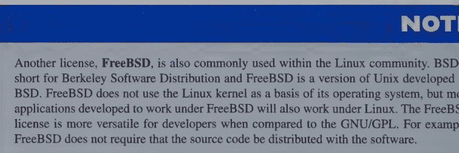

> 另一种许可证，**FreeBSD**，在 Linux 社区中也常被使用。BSD 是 Berkeley Software Distribution（伯克利软件发行版）的缩写，FreeBSD 是 BSD 开发的 Unix 版本。FreeBSD 不使用 Linux 内核作为其操作系统的基础，但大多数在 FreeBSD 下开发的应用程序也可以在 Linux 下运行。与 GNU/GPL 相比，FreeBSD 许可证对开发人员来说更加通用。例如，FreeBSD 不要求源代码与软件一起分发。

Linux 在相对较短的时间内变得流行起来。字面上有成千上万的程序员积极参与 Linux 的开发。截至今天，有数百个进行中的项目，涉及 Linux 和各种硬件及用途。

### Unix 背景

如本章前面所述，Linux 类似于 Unix 操作系统。Unix 操作系统最初名为 Unics，代表 UNiplexed INformation and COmputing System（非复用信息计算系统），最初是为 DEC 的 PDP-11 计算机系统设计的。在前 10 年里，Unix 完全属于 Bell Labs 的领域，直到它被移植到 VAX（Virtual Address eXtension，即 DEC 的 PDP-11 小型计算机的后继产品）。Unix 进行了许多改进，使其成为最广泛使用的服务器操作系统之一。Unix 与较新的 Linux 类似，在提供大量服务的同时，对资源的需求非常少。Unix 的后续版本提供了与当前 Windows 操作系统相似的许多功能。

大多数 Linux 命令与其 Unix 对应命令完全相同，因此如果你想体验 Unix，Linux 是一个良好且便宜的解决方案。许多教授 Unix 的学院和大学实际上正在使用 Linux 进行教学。

### Linux 对 Windows 用户

如果你是 Microsoft Windows 用户，你可以轻松地使用 GUI 来使用 Linux。Linux 有多种 GUI，其中大多数提供类似 Windows 桌面的外观和感觉。Linux 可以读取和写入格式化为 Windows 的磁盘，并且 Linux 中的许多程序模拟其在 Windows 应用程序中的对应项。例如，你可以在 Linux 的 OpenOffice.org 中读取 Microsoft Word 文档，进行修改，并保存为 Word 格式以便在 Windows 系统上使用。（并非支持所有 Word 功能。）

当然，Linux GUI 比其 Windows 对应物更加通用。例如，Linux GUI 通过 X 窗口系统的实现提供，该系统提供多用户访问、多个虚拟桌面和其他功能。X 窗口系统将在第 8 章中讨论。

Linux 拥有自己的应用程序集，越来越多的供应商正在将其应用程序移植到 Linux 平台。你可以从 Oracle、Sun Microsystems 和 IBM 等软件供应商那里找到证据。IBM 对 Linux 操作系统的支持尤为大声，并对 Linux 的开发和支持做出了重大贡献。IBM 有许多专为 Linux 设计的软件解决方案，包括会计、商务、金融和零售应用。IBM 网站列出了 3000 多家独立软件供应商，它们为许多行业提供广泛的 Linux 应用程序。要了解这些软件和硬件巨头提供何种支持，请访问以下网站：

- http://www-3.ibm.com/software/os/linux/software/index.shtml
- http://www-106.ibm.com/developerworks/linux/
- http://www.oracle.com/technologies/linux/
- http://wwws.sun.com/software/linux/

Linux 意味着用户的自由。你自由选择自己的 Web 浏览器。你可以自由地在任何你想报告错误的时候报告，而不是由操作系统自动报告。你自由免受应用程序更改你的互联网协议的影响。如果你不需要，你可以自由地不运行 GUI。你可以自由地修改你的操作系统以符合你的需求。

## 使用 Linux 的理由

Linux 相较于其他操作系统具有许多优势。例如，假设你拥有一台 486 或更早的 Pentium 系统。如果你正在使用 Windows，你可能会发现该系统对于今天大多数应用来说毫无用处。然而，Linux 可以通过多种赋予旧系统实用工作的方式使其焕发新生。你可以使用旧系统上的 Linux 来提供基本服务，如 DHCP、分组路由、ftp 以及其他在其他操作系统中建立起来是噩梦的应用程序。

当前版本的 Windows 成本可能超过 150 美元。Linux 的成本仅仅是下载和安装软件所花费的时间和精力。你也可以购买 Linux 的版本。与其他操作系统相比，成本仍然很低。购买 Linux 的优势在于提供的技术支持和印刷文档。来自 SuSE 的 Linux 发行版（本章稍后介绍）因其随发行版提供的出色印刷材料而特别知名。

大多数 Linux 发行版不仅包含操作系统，还包含用于个人和专业用途的综合应用程序集。应用程序通常包括文字处理、电子表格、日历、演示文稿、数据库以及许多其他内容。对于功能相当的 Mac OS 或基于 Windows 的系统，办公应用程序可能价值数百美元。


软件开发者将乐于使用 Linux 中可用的先进开发工具。有针对 C、C++、Java 以及许多其他语言的工具包。几乎所有 Linux 发行版都包含 C 开发软件包。（C 开发软件通常用于编译软件包和 Linux 内核。）有集成开发环境（IDE）、库和其他工具，使得在 Linux 系统上进行开发变得极具吸引力。与 Windows 上可比的 C 编译器可能花费数百美元。

Linux 操作系统配备了一组全面的网络工具。不仅可以提供基本的网络服务，还可以提供 ftp、telnet、smtp、snmp、finger、DNS、DHCP 等其他服务。Linux 为许多用途提供了快速、可靠且安全的网络环境。Linux 还可以共享设备（例如调制解调器），这是大多数其他操作系统不具备的功能。

Linux 是运行服务器的理想环境。Linux 服务器的最佳特性之一是它可以消除图形用户界面（GUI），从而为其他工具释放资源。

## Linux 发行版

最初，Linux 由操作系统和少量 GNU 工具组成，但随着时间推移，越来越多工具和应用被添加。Linux 发行版概念应运而生，如今已是一个价值数百万美元的行业。

Linux 的开发周期遵循由版本号标记的开发阶段。Linux 内核版本由三个数字标识：主版本、次版本和补丁版本。次版本号指示版本类型。例如，对于 1.2.3，数字 2 是版本类型。奇数版本（如 1.1、2.1 等）表示内核功能正在被添加和开发的时期，即开发阶段。偶数版本表示稳定阶段，此时会对内核进行较小的修改。当前的开发版本是 2.5.75，当前的生产版本是 2.4.22。Linux 正在成熟为一个专业的、适用于企业的操作系统。最新的稳定版本 2.4.x 提供了改进的调度器和逻辑卷管理器（LVM，一种将硬盘空间分配到逻辑卷的方法，与分区不同，逻辑卷可以轻松调整大小），并且对 64 位架构的支持正在演进中。

在互联网上进行一次基本搜索以查找 Linux 发行版，仅筛选那些适用于 Intel 兼容硬件的发行版，就返回了超过 150 种不同的发行版。您使用的版本将由您的具体需求决定。

本书使用最通用的命令，因此您选择使用哪个发行版并不会产生影响。然而，某些功能是各个发行版专有的。本书各处展示了多种不同的版本，但大多数示例使用 Red Hat Linux。Red Hat 是最受欢迎的发行版之一。它有一个易用的 GUI 安装程序，由 Red Hat 开发的 RPM（Red Hat 包管理器）程序用于管理附加软件包，并且提供了一种简便的方式来升级系统，当程序和应用的新版本可用时。

Linux 内核和 GNU 应用程序在 GNU 通用公共许可证（GNU/GPL）下编写和分发，这意味着其源代码是自由分发并对公众可用的。通用公共许可证适用于自由软件基金会的大多数软件以及任何承诺使用该许可证的程序作者。


请在 http://www.gnu.org/copyleft/gpl.html 查找有关 GNU 通用公共许可证的更多信息。

大多数发行版都可以免费下载和零售购买。大多数发行版提供安装和用户手册、常见问题解答（FAQ）及其他资源的在线下载。无论您购买产品还是选择免费下载，这些材料都可获取。但是，如果您购买该发行版，将提供更多资源。附加服务包括：

-   **电话支持** 大多数发行版提供电话支持。这通常是价格微薄的附加服务。
-   **印刷手册** 购买零售盒装通常会提供额外的印刷文档。
-   **增值服务软件** 一些发行版附带其他产品，如 WordPerfect、StarOffice、OpenOffice.org，用于文字处理、电子表格等；以及 BRU Backup，一种用于备份计算机系统的工具。一些软件可以免费下载，有些则需要购买。如果它包含在发行版光盘中，则方便得多。

## Red Hat Linux


Red Hat 可能是最受欢迎的 Linux 发行版之一。Red Hat 由 Marc Ewing 创建，于 1994 年 10 月发布。它被称为万圣节版本。它于 1995 年成为一家公司，当时 Red Hat Corporation 的创始人 Bob Young 从 Marc Ewing 手中购买了 Red Hat 发行版。

截至 2003 年 5 月 31 日结束的第一季度，Red Hat 的营收达到了 2720 万美元。Red Hat 最大的贡献之一是 Red Hat 包管理器（RPM）。RPM 是一个由命令行驱动的包管理系统，能够安装、卸载、验证、查询和更新计算机软件包。Red Hat 还提供培训和认证计划。

Red Hat 产品包括 Red Hat Enterprise Linux、Red Hat Linux 9、Red Hat Database、Cygwin 以及其他个人和企业应用程序。当前 Red Hat Linux 的个人版本是 9.0。

您可以从 [http://www.redhat.com/apps/download/](http://www.redhat.com/apps/download/) 下载 Red Hat Linux 9。

Red Hat Linux 最近发生的一项变化是：免费分发的产品已与商业产品分离，现在被称为 Fedora。截至本书印刷时，Fedora Linux 发行版将由 Red Hat 开发人员维护。您可以从 [http://fedora.redhat.com/download/](http://fedora.redhat.com/download/) 下载 Fedora Core。

## SuSE Linux


SuSE 是 Linux 最古老的发行版之一，几乎与 GNU/Linux 一样老。经营了十多年，SuSE 逐年增长。

SuSE Linux 的当前版本是 8.0。它包含 7 张 CD-ROM，拥有超过 1,500 个应用程序。SuSE 附带 YAST（Yet Another Setup Tool，又一个安装工具）程序，这是一个安装和配置实用工具，使其易于维护。

最新版本通常无法下载，但有一个“实时评估”版本可完全从 CD 运行。您也可以从 FTP 服务器安装。

SuSE 下载站点是 [http://www.suse.com/us/private/download/suse\_linux/index.html](http://www.suse.com/us/private/download/suse_linux/index.html)。

SuSE 最近被 Novell 公司收购。Novell 提供网络服务器、网络操作系统和其他产品。

## Debian Linux


Debian 因其没有商业版本而享有唯一完全免费的 Linux 操作系统版本的殊荣。Debian 发行版拥有超过 8,710 个预编译软件包。

Debian 由遍布世界各地的近 1,000 名志愿开发人员制作。除了通过电子邮件，很少有人见过面。所有开发人员都有具体的职务，并被安排在一种组织结构中。

Debian 的最新稳定版本是 3.0r1。要下载 CD 映像，请访问 http://www.debian.org/CD/http-ftp/。

## Mandrake Linux

Mandrake Linux 创建的目标是让 Linux 对每个人更容易使用。自成立以来，Mandrake 不断发展，目前根据客户需求提供不同版本的 Mandrake Linux 发行版。

Mandrake 为高端处理提供集群产品。集群解决方案允许您将几个系统链接在一起，并使用它们组合的处理能力来达到与超级计算机相当的性能。成本比超级计算机低得多。此外，集群允许您将一组机器作为一台机器来访问、管理和编程。

当前版本是 Mandrake 9.1，可从 http://www.mandrakelinux.com/ 下载。


## FreeBSD

FreeBSD 是一个类 Unix 操作系统发行版，基于 UC Berkeley 的“4.4BSD-Lite”发布版本并带有一些增强功能。FreeBSD 被全球广泛的用户使用。

虽然 FreeBSD 与 Linux 相似，但它不是 Linux 内核的实现。相反，它使用 4.4BSD Lite 作为其操作系统的核心。Linux 和 FreeBSD 的一个主要区别在于将更改包含到内核的方式。在 Linux 中，Linus Torvalds 是官方内核更改的最终决策者；在 FreeBSD 中，一组名为 Committers（提交者）的 200 名独立程序员有能力在随时对官方 FreeBSD 源代码库进行任何更改。Committers 的选择和争议解决由 FreeBSD 核心团队处理。核心团队的作用类似于董事会。目前，核心团队成员是一个选举机构，候选人和选民均来自 Committers。

与大多数 Linux 发行版一样，FreeBSD 是免费的。它提供网络、安全和兼容性模块，使其他操作系统的程序能够在 FreeBSD 上运行。FreeBSD 的当前版本是 5.1，可从 http://www.freebsd.org/ 下载。


## TurboLinux

TurboLinux 是亚太地区领先的 Linux 供应商。TurboLinux 是最早以多种语言提供其软件的发行版之一。日文版 CD-ROM 中包含一个英日/日英字典。TurboLinux 的当前版本是 8，可从 http://cc.turbolinux.com/support/download/ 获取。


## 其他版本

你已经明白了。有很多版本。前面的列表只是其中的一部分。大多数发行版为广泛平台提供软件，如 Intel、Sun、Power PC 和 Macintosh，举几个例子而已。许多还以多种语言提供其软件。

仍然不知道要尝试哪个版本？做一些研究以找到适合您需求的发行版。开始的最佳场所之一是公共新闻组。它们包含几乎任何 Linux 主题的丰富信息。您还可以发布自己的问题，并获得符合您具体需求的答案。


www.linux.org 网站是查找大量 Linux 信息的好地方。从发行版信息到推荐书籍，那里应有尽有。另一个查找发行版下载网站的地方是 www.linuxiso.org。该网站提供了所有最常用 Linux 发行版网站的链接，并包含有关使用 ISO 文件的信息（参见下方说明）。Linux ISO 是一个包含 Linux 发行版 CD-ROM 磁盘镜像的文件。当将其作为磁盘镜像刻录时，ISO 文件会变成原始 CD 的复制品。根据你的互联网连接速度，下载 Linux 发行版可能需要从一小时到几天不等。如果你的连接速度很慢，可能根本无法下载 Linux 发行版，因此你需要寻找该软件的其他来源。

> 注意
>
> ISO 是国际标准化组织（International Organization for Standardization）的简称，该组织由来自 75 多个国家的国家标准机构组成。ISO 制定了许多重要的计算机标准。ISO 并不是一个首字母缩写词，其名称源自希腊语“iso”，意为“平等”。ISO 文件是国际标准化组织关于紧凑型只读光盘（Compact Read-Only Optical Discs）卷和文件结构的标准，也被称为 ISO 9660。

Linux 发行版可以自由复制。如果你认识已经拥有 Linux 发行版光盘的人，你可以合法地复制这些 CD。你还会发现许多版本可以在软件商店、办公用品商店和折扣店进行零售购买。最近在这些网站上搜索发现，Red Hat Linux 9 版的价格低于 40 美元。

根据目前的行业估计，Linux 是增长最快的服务器操作系统。Sun Microsystems 首席执行官 Scott McNealy 在 Linux 世界大会和博览会上发言时预测，未来几年 Linux 用户数量将每年增加 30%。

## Linux 应用程序兼容性


Linux 拥有大多数（如果不是全部的话）其他操作系统中存在的功能。例如，Linux 包含用于播放 CD 或为电子游戏提供声音的声音实用程序，支持高端视频图形，支持商业数据库服务器以及其他功能。许多可用的软件包都是开源的，并且允许与 Windows 或 Mac OS 的商业软件包具有相同的功能。

要查看可用应用程序列表，请访问 [http://www.linux.org/apps/index.html](http://www.linux.org/apps/index.html)。应用程序按功能分类，如管理、多媒体、图形、办公、开发等。

许多开源程序提供与 Microsoft 和 Mac OS 应用程序的兼容性。例如，OpenOffice.org 是一个办公应用程序套件，包含文字处理、电子表格和演示工具，它与 Microsoft 的 Word、Excel 和 PowerPoint 应用程序相似且文档兼容。

一些商业应用程序在多个平台上可用。例如，Oracle 关系数据库管理系统可用于 Windows、Sun SPARC、HP、AIX 和 Linux。每天都有越来越多的商业应用程序可用。

## 软件包

操作系统是由它们安装在计算机上的文件定义的。Linux 将这些文件安装在诸如 `/bin`、`/sbin/`、`/usr/bin` 等目录中。当程序更新时，跟踪旧程序的安装位置并更新所有必要的文件非常重要。为了跟踪带有文档的已安装程序（称为软件包），可以提供几种软件包维护实用程序。其中一些软件包工具，如 RPM、Red Hat 软件包管理器（Red Hat Package Manager）和 DEB、Debian 的软件包工具，与 Linux 发行版紧密集成，并为程序更新提供集中机制。

软件包管理程序具有多个功能，在决定使用哪个系统时应对比这些功能。这些涉及安全性、通过标准 Linux 工具的可操作性、可扩展性和元数据。

安全功能包括可以检查的值，以确保软件包有效且未被修改。这些包括：

- **已签名软件包** 支持 PGP 或 GPG 电子签名以验证创建该软件包的人。
- **校验和** 校验和确保软件包完整且未被修改。

标准 Linux 工具包括可用于查看软件包的工具，而无需为每个软件包使用特殊工具。一些软件包系统使用包含在每个 Linux 发行版中的工具。这些包括：

- **标准软件包工具** 软件包能否通过标准 Linux 工具（如 tar、gzip、bzip2 等）进行操作？
- **软件包创建** 是否有标准 Linux 工具可用于创建软件包？

可扩展性功能包括软件包格式能够在多大程度上增长以满足未来需求。这些包括：

- **版本格式** 通过检查软件包是否可以确定版本？
- **硬编码限制** 软件包格式中是否设计有限制？

这些限制可能会阻止软件包扩展以满足未来需求。

元数据功能包括嵌入在软件包中的信息。该信息包括软件包名称、描述以及在软件包内可能更改的其他属性值。其中一些属性是：

- **名称** 可以通过软件包内的数据确定软件包名称。
- **版本** 软件包内的版本号或软件包名称指示软件包版本。
- **依赖项** 依赖项指示在安装所选软件包之前需要安装哪些软件包。

表 1-1 展示了一些比较。许多软件包管理系统可以单独用于一个 Linux 发行版；然而，强烈建议你只使用一个软件包管理系统。通常无法在软件包管理系统之间确定依赖项。

表 1-1
软件包比较。

| 功能 | RPM | DEB | TGZ | PKG |
|---|---|---|---|---|
| 已签名软件包 | 是 | 是 | 否 | 否 |
| 校验和 | 是 | 是 | 否 | 是 |
| 使用标准工具创建 | 否 | 是 | 是 | 否 |
| 元数据中的名称 | 是 | 是 | 否 | 是 |
| 版本 | 是 | 是 | 否 | 是 |
| 依赖项 | 是 | 是 | 否 | 是 |
| 硬限制 | 是 | 是 | 是 | 否 |

## Linux 简介

下面描述了一些这些软件包工具。软件包管理的更详细说明在第 5 章中给出。

- **RPM (Red Hat 软件包管理器)** RPM 软件包管理器是一个命令行软件包管理系统，能够安装、卸载、验证、查询和更新计算机软件包。RPM 由 Red Hat 设计，并被 Red Hat 和其他 Linux 发行版使用。每个软件包由一个存档和软件包信息组成。还提供 API（应用程序编程接口），允许高级开发人员在其本地编码语言中管理安装。RPM 的当前版本是 4.2，并随 Red Hat 版本 9 一起发布。

RPM 检查软件包依赖项，并提供已签名软件包和校验和。RPM 需要一个专有工具（rpm）来操作或查看软件包。

- **DEB** Debian 软件包包含实现一组相关命令或功能所需的所有文件。DEB 由 Debian 设计，并被 Debian 和其他 Linux 发行版使用。存在两种类型的 Debian 软件包：
    - **二进制软件包** 二进制软件包包含可执行文件、配置文件、man 页和其他文档。这些包含在 .deb 文件中。
    - **源软件包** 源软件包包含描述源软件包的 .dsc 文件，包含以 gzip 压缩的 tar 格式原始未修改源代码的 .orig.tar.gz 文件，以及通常包含针对原始源代码的 Debian 特定更改的 .diff.gz 文件。

Debian 软件包提供已签名软件包、校验和和依赖项检查。它们也可以用标准 Linux 工具查看和操作。

- **TAR (Tape ARchive)** Tar 软件包，称为 tar 包，是最古老的软件包格式之一。Tar 的名字源于其最初在 Unix 中作为磁带存档工具（用于将数据备份到磁带存储设备的程序）的使用。它比 Linux 历史更悠久，并在 Unix 最早发布的版本中就已存在。Tar 软件包被所有 Linux 发行版使用。Tar 文件在单个目录中解包所有内容，留给用户将项目排序到系统中的适当目录。大多数软件包都以 tar 格式提供。Tar 被 Slackware Linux 发行版使用，但可用于所有 Linux 发行版。Tar 软件包在安装软件包之前不检查程序依赖项。Tar 文件不提供已签名软件包、校验和或依赖项。它们使用标准工具进行操作。

- **TGZ** TGZ 是用 gzip 压缩程序压缩的 tar 包。TGZ 文件由 Slackware 设计。Slackware 有一个实用工具 slapt-get，用于帮助管理软件包依赖项。仅 TGZ 文件不提供已签名软件包、校验和或依赖项。它们使用标准 Linux 工具进行查看和操作。

- **SLP (Stampede Linux Package)** SLP 格式通过 Stampede Linux 发行版提供。SLP 使用 tar 和 bzip2（一种压缩工具）作为其基础。它与一套软件包管理工具相结合。SLP 软件包不提供已签名软件包或校验和，但提供依赖项检查。SLP 文件可以解包，但不能用标准工具创建或查看。

- **PKG** PKG 是 FreeBSD 和许多 Unix 操作系统使用的软件包管理系统。与大多数软件包系统一样，打包的软件可以通过命令行或使用 GUI 工具安装。Solaris Unix 使用命令行命令 pkgadd、pkginfo 和 pkgr，而 FreeBSD 使用相应的 pkg_add、pkg_info 和 pkg_delete。Sun Solaris 还使用 GUI 工具 Sun Control Station（图 1-1）来帮助管理软件包。


## 第 1 章

### PKG 软件包
PKG 软件包不提供签名功能，但提供校验和及依赖项检查。标准 Linux 工具无法查看或操作 PKG 文件。

某些 Linux 发行版提供软件包的自动更新功能。例如，Red Hat Linux 提供 Red Hat 网络（Red Hat Network）。Red Hat 网络是一个针对 Unix 的完整系统管理平台。它提供软件更新、增强管理功能以及对整个基础设施的监控。在 Red Hat Linux 上自动更新 RPM 软件包是通过 up2date 程序完成的。

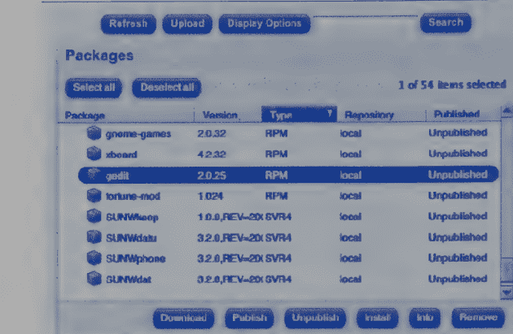

### 系统特性

Linux 支持大多数 Unix 安装中发现的特性。它是一个多任务、多用户操作系统，意味着它可以同时运行多个程序，并支持多个用户同时连接。

Linux 与 Unix 高度兼容。Linux 的开发始终考虑到可移植性。在线可用的大多数自由软件都可以在 Linux 下编译并轻松运行。

Linux 支持 Intel、AMD、IBM、Sun 及其他平台（取决于发行版）的多处理器。对称多处理（SMP）支持是在内核 2.0 版本中引入的。通过 SMP，进程和内核线程分布在多个处理器中。这意味着在多任务运行时，每个程序都可以由其自己的处理器来控制。使用多个处理器几乎就像拥有多台计算机来执行你正在运行的任务一样。

Linux 支持多个虚拟控制台。控制台用于用户输入命令。一次最多可以使用 63 个控制台。

Linux 支持多种文件系统，包括 minix、Xenix 以及所有常见的 System V 文件系统。它还有自己的高级文件系统 ext3，提供最大 4 TB 的文件系统和最长 255 个字符的文件名。ext3 文件系统是一种日志型文件系统。日志型文件系统的完整性检查速度比非日志型文件系统快得多。如今的文件系统大小通常超过数百 GB，因此非正常关机后的恢复时间可能长达数小时。

Linux 还支持 MS-DOS 分区。你不需要任何特殊命令来使用 MS-DOS 分区，因为它看起来与普通 Unix 文件系统类似。

大多数 Linux 发行版都支持 TCP/IP、AppleTalk、NetWare 和 LAN Manager/Windows 本机（SMB 或 Server Message Block）客户端和服务器。这些协议用于在计算机之间共享文件、打印机、串行端口以及通信。

### Linux 支持

许多人质疑 Linux 支持的可用性。你可能会问自己：“我对 Windows 有什么支持？”当然，你可以致电微软，但如果你想要支持，就得付费。然而，这并不适用于你正在使用的 Linux 版本。

你可以在新闻组中找到免费的 Linux 支持。（你也可以找到许多支持 Windows 的组。）Linux 和 Windows 都提供文档的在线访问。

针对 Windows 的受训技术人员和管理员数量多于 Linux。但是，如今 Linux 的培训课程和认证更多，且数量每月都在增长。

至少在使用 Linux 时，你能够获得源代码。如果你不喜欢某个功能的工作方式，你可以修改它。

与任何操作系统一样，Linux 并不完美。就像在 Windows 和 Unix 中一样，你在使用 Linux 运行硬件和软件时可能会遇到一些问题。许多管理员报告说，他们的 Linux 系统可以运行数月而无需重启，这是许多 Windows 安装环境所无法夸耀的。总体而言，我们认为你会发现 Linux 是一个优秀的操作系统，值得你花费时间去熟悉它。

### Linux 的未来

Linux 的前景看起来很好。对用户而言，操作系统的唯一目的是提供运行应用程序的平台。Linux 拥有庞大的应用程序基础，其中许多都提供源代码。越来越多的软件公司，如 Oracle 和 Sun Microsystems，正在将他们的应用程序移植到 Linux 上。

在未来几年里，Linux 在商业领域将扮演日益重要的角色。降低软件许可成本并提供更安全的网络将增加私有和公共领域的需求。

使用本书提供的资料是开始为 Linux+ 考试做准备的好方法。为了补充这些信息，你还必须安装和管理 Linux 操作系统。

Linux 内核始终处于开发之中。虽然其他操作系统每年只提供几次更新，但 Linux 有时会每周更新。要使用最新版本的 Linux 内核，无需重新安装整个操作系统。有补丁可用，以升级内核，从而访问新的设备驱动程序和安全更新。内核补丁在第十二章中讨论。

### 总结

Linux 是操作系统的内核。当与 GNU 软件一起使用时，它构成了 GNU/Linux 操作系统。GNU 是 "GNU's Not Unix"（GNU 不是 Unix）的递归缩写。Linux 的源代码是免费的，任何人都可以修改并实现以满足其个人需求。

GNU 产品的版权基本上是“开放源码”（copyleft）。Copyleft 使用版权法，但将其翻转以实现与其通常目的相反的效果。它不再作为保护专有软件的手段，而是使软件保持自由。

Linux 可以运行在作为 Windows 机器已不再有用的机器上。Linux 可以在不随操作系统实现图形用户界面的情况下提供有用性。它可以以多种方式使用，包括作为软件开发平台、防火墙、DNS 服务器、DHCP 服务器等。

Linux 有一百多个发行版。一个发行版包含 Linux 内核以及大量用于网络、开发和办公生产力的 GNU 应用程序。内核开发周期由版本号表示。奇数版本表示正在添加和开发内核功能的时期。偶数版本表示在内核稳定阶段进行的较小修改。

Linux 支持大多数 Unix 安装中发现的特性。它是一个多任务、多用户和多处理器操作系统。Linux 还支持许多文件系统，包括其自身的 ext3，它提供高达 4 TB 的大小。它还支持各种网络协议。

所有 Linux 发行版都使用软件包管理程序来安装、卸载和更新软件包。最流行的软件包程序是 RPM、DEB、TAR 和 SLP。

支持可从互联网新闻组、在线文档和私人公司获得。

### 自测

- 1. GNU 项目
  - a. 维护 Linux 内核开发
  - b. 开发了 Linux 操作系统的所有程序
  - c. 为工业界提供高端企业服务器
  - d. 提供 *copyleft* 软件许可证

- 2. Linux 内核的初始开发者是
  - a. **Linux Torvalds**
  - b. 一个名为 Committers 的团体
  - c. 伯克利大学
  - d. 数百名独立开发者

- 3. 下列列出的操作系统发行版中，哪一个不使用 Linux 内核作为其核心产品？
  - a. Red Hat
  - b. **FreeBSD**
  - c. SuSE
  - d. Mandrake

- 4. 判断对错：签名的软件包确保软件包的内容完整且未被修改。*错误*

- 5. 哪个 Linux 发行版以“万圣节发行版”闻名？
  - a. **Red Hat**
  - b. FreeBSD
  - c. SuSE
  - d. Mandrake

- 6. 哪个操作系统基于伯克利的 4.4BSD-Lite？
  - a. Red Hat
  - b. **FreeBSD**
  - c. SuSE
  - d. Mandrake

- 7. 哪个软件包管理系统也被称为 tar 球？
  - a. RPM
  - b. DEB
  - c. **TAR**
  - d. SLP

- 8. 关于 Linux 操作系统，以下哪项陈述是正确的？
  - a. 它是开源软件。
  - b. 只要提供源代码，就可以出售。
  - c. 它使用 GNU/GPL 许可证。
  - d. **以上全部**

- 9. Linux 的特性包括
  - a. 多用户
  - b. 多任务
  - c. 对称多处理
  - d. **以上全部**

- 10. Linux 操作系统的支持
  - a. 通常由发行商提供
  - b. 可以在众多新闻组中找到
  - c. 通常可以从发行商处购买
  - d. **以上全部**


11. 判断正误：自由软件基金会是 GNU 项目的主要组织赞助者。**正确**

12. 操作系统的核心是一个名为 ________ 的程序。  
a. **内核**  
b. 操作系统  
c. 软件包  
d. 计算机

13. 开源标准包括以下哪项：  
a. 源代码  
b. 许可证分发  
c. 免费再分发  
d. **以上全部**

14. 一种 ________ 软件许可证可以免费分发，但会请求付款。  
a. 公有领域  
b. 免费软件  
c. **共享软件**  
d. 艺术许可

15. 一种 ________ 软件许可证允许作者对软件开发保持艺术控制权。  
a. 公有领域  
b. 免费软件  
c. 共享软件  
d. **艺术许可**

16. 以下哪项陈述符合开源标准？  
a. **必须提供源代码**  
b. 对软件的修改可以在不同的许可证下分发  
c. 许可证必须专属于某个产品  
d. 以上全部

17. 以下哪种软件许可证可以免费分发，但可以对软件的使用请求付款？  
a. 公有领域  
b. 免费软件  
c. **共享软件**  
d. 艺术许可

18. 判断正误：艺术许可允许作者对开发过程保持某种程度的艺术控制。**正确**

19. 以下哪项不是 Linux 内核的操作系统实现？  
a. Red Hat  
b. SuSE  
c. **FreeBSD**  
d. Mandrake

20. 以下哪项是 CD-ROM 卷和文件结构的标准？  
a. OSI  
b. **ISO**  
c. GNU  
d. GPL

21. 判断正误：FreeBSD 是 Linux 内核的第一个实现。**错误**

22. 以下哪项确保软件包是完整且未被修改的？  
a. 签名  
b. 硬编码限制  
c. **校验和**  
d. 标准软件包工具

23. 以下哪种软件包类型不提供校验和？  
a. RPM  
b. DEB  
c. **TGZ**  
d. PKG

24. 判断正误：术语“依赖项”应用于 Linux 软件包时，指的是在安装所选软件包之前需要安装的其他软件包。**正确**

## Linux 安装要求


## 本章目标

- 根据客户需求确定 Linux 安装的目的
- 识别 Linux 安装所需的所有系统硬件
- 确定需要安装的软件和服务
- 识别 Linux 安装的分区方案
- 识别 Linux 运行的服务及其功能
- 识别 Linux 安装的预算限制
- 识别系统组件的基本术语、概念和功能
- 识别 Linux 安装前系统硬件的配置方式

## 定义 Linux 安装

在安装 Linux 操作系统时，您需要确定谁将使用该系统以及该系统的主要用途是什么。如果您打算将系统用于个人用途，您需要决定您的需求是什么。您将使用该系统进行个人生产力工作吗？如果是这样，您需要具备文字处理、电子表格、数据库、日历、电子邮件和其他应用程序的个人生产力软件。如果您想玩游戏或进行图形设计，则需要更高端的视频和声音硬件。系统的每一种用途都会对硬件和软件提出必须满足的特定要求。

记录您的安装过程很重要。简而言之，您需要写下足够多的信息。您安装的每个系统都应该有一份书面记录，列出硬件、软件和其他安装细节的类型。请使用本章末尾的安装检查清单或创建您自己的文档。

安装 Linux 操作系统并不太困难，但在开始之前，您需要回答几个问题。例如：

- 谁将使用 Linux 系统？
- 预算限制是什么？
- 这个 Linux 安装将承担什么角色？
- 您的计算机是否有足够的磁盘空间来支持安装的角色？
- 您的硬件是否兼容？
- 您有足够的内存吗？
- 您需要多少交换空间？
- 您需要什么软件来完成您的任务？
- 您打算从 CD-ROM 还是通过其他方式安装？
- 您的系统将如何启动？
- 您需要什么级别的防火墙保护？
- 您的用户技能水平如何？

本章将解答这些问题和其他问题。

## 您的 Linux 安装预算


无论您打算进行何种类型的安装，您都需要为该项目设定预算。无论是个人系统还是企业安装，制定并遵守预算都是个好主意。很容易因为零星的小支出而使系统成本超出您预期的几百甚至几千元，因此在设定预算时，请确保为意外成本留出余地。例如，安装后您可能会发现正在使用的备份设备速度太慢，无法满足您的需求，需要更换为更快的型号。

硬件并不是您需要考虑的唯一预算项目。还要考虑软件、维护、支持、人员、培训和通信等。

### 硬件

您可能会发现您的硬件预算不足。计算机系统的成本正在下降，但对于符合您需求的正确系统来说，价格仍然可能相当昂贵。如果您必须削减成本，请考虑使用较小的硬盘。如今的硬盘以几十或几百 GB 计，这对大多数个人桌面和许多服务器来说已经绰绰有余。考虑使用较小的显示器。扁平 LCD 显示器不错，但并非真的必要。本章稍后会更详细地讨论硬件。

### 软件

有很多开源和免费软件（如第 1 章所述），但您可能会发现您需要的软件是商业可获得的软件包。某些软件的成本不仅包括初始购买，还包括年度升级。例如，如果您经营一家为个人报税的个人税务业务，您可能需要购买税务程序更新，以反映上一年的税法变化。本章稍后将讨论各种软件包。

### 维护

计算机系统需要维护项目。这些项目可能很小，如软盘清洁套装和空白 CD，也可能很大，如替换硬盘。外围设备也需要维护。例如，激光打印机需要更换墨粉盒、硒鼓和其他组件。

### 支持

如果您经营业务，可能需要支持成本。支持是针对硬件和软件提供的。如果您购买了企业系统，支持变得重要，以确保您拥有系统所需的“正常运行时间”。软件支持提供更新以及对技术问题的解答，这些问题可能很难从其他来源获得答案。

### 人员

业务可能需要额外的人员来操作和管理新的 Linux 安装。可能需要计算机操作员执行日常任务，如启动备份或将表单加载到打印机中。可能需要 Linux 管理员进行必要的配置更改、安排任务、添加用户和安装新软件。较小的组织可能由一个人处理所有工作；较大的安装可能需要几个人组成的团队。

### 培训

很可能大多数现有人员之前没有使用过 Linux。Linux 正在增长，但与其他操作系统相比，其市场份额仍然很小。您的预算可能包括为所有用户培训基本任务，并为将执行管理任务的少数用户进行培训。

### 通信

通信成本是持续的。如果您打算维持服务器的连接，您必须购买设备和通信线路以提供内部网络（Intranet）和互联网访问。通信是一个复杂的话题，您可能希望考虑在预算中包含一名顾问来完成这项任务。

### 其他预算项目

在为较大系统做预算时，考虑购买一台大型机器而不是几台小型机器。Linux 是一个多任务、多用户系统。一台系统可以为许多用户提供资源。例如，而不是为多台机器提供较大的硬盘，您可以为服务器安装一个大硬盘，并为这些用户提供主目录空间。

如果您的预算非常紧张，您可以考虑使用现有资源。即使是较旧的 486 机器也可以用作连接到服务器的工作站。用户不需要运行 Linux 安装就可以连接到 Linux 服务器。如果用户更熟悉 Windows，他们可以继续使用该系统，同时访问 Linux 服务器上的资源。这还可以降低培训和硬件成本。

## 安装类型


Linux 可以用于从个人桌面机器到高端服务器的一切用途。安装的目的将决定操作系统所需的硬件和软件。Linux 分为四种安装类型：

- 嵌入式
- 个人桌面
- 工作站
- 服务器

### 嵌入式 Linux

嵌入式 Linux 安装指的是应用程序的功能，而不是 Linux 本身的功能。不同的是 Linux 为了实现应用程序所使用的资源。嵌入式 Linux 是 Linux 的一个功能丰富的子集，精简后仅包含在嵌入式系统上有用的 Linux 元素。嵌入式 Linux 操作系统的较小尺寸允许设备使用闪存 RAM 来保存操作系统，而不是硬盘。

嵌入式 Linux 可用于控制高科技设备，包括安全摄像机、PDA、移动电话、音视频、路由器和无线接入点。与 Windows 等其他操作系统相比，Linux 非常轻量级，但 Linux 功能强大且稳健，可用于完成广泛的任务。它还易于升级。需要嵌入式操作系统的产品制造商正选择 Linux，而不是从头设计自己的操作系统。


## 注意

“轻量级”可以有多种含义。例如，当安装 Windows 操作系统时，你会安装图形界面及其包含的所有组件，这将导致一个大（重量级）的安装。在许多情况下，Linux 可以完成与类似 Windows 安装相同的功能，但没有额外的开销。不需要图形用户界面（GUI），并且可以从标准安装中移除许多其他工具，从而使 Linux 成为一个轻量级但功能强大的操作系统。

嵌入式 Linux 是一个很好的实现方式，但通常大多数用户不会参与其安装。运行嵌入式 Linux 系统所需的资源量差异很大。有关嵌入式 Linux 的更多信息，请访问 http://www.embedded-linux.org。

## 个人桌面

个人桌面的 Linux 安装是为家庭用户设计的，适合个人生产力应用。通常，安装包括图形用户界面环境（如 GNOME 或 KDE）、个人生产力软件（如 OpenOffice.org）和游戏，可能包括也可能不包括网络连接。

用户可能会尝试服务器软件，但个人桌面是最广泛使用的安装类型。个人桌面的 Linux 安装基本上为用户提供与 Windows 安装相同的功能。如前所述，典型的安装包括 GUI 以及文本编辑器、桌面管理工具、类似于 Windows 资源管理器的文件夹管理器、互联网浏览器，以及大多数 Windows 系统未提供的附加功能（如桌面远程访问）。大多数 Linux 发行版都提供生产力软件，如 OpenOffice.org。如其名称所示，OpenOffice.org 是开源软件，可以从 http://www.openoffice.org 免费下载。OpenOffice.org 是一套生产力工具，包含：

- **WRITER** 一个功能强大的文字处理应用程序，类似于 Microsoft Word，用于创建文档、报告、简报和小册子。它可以在文档中集成图表、图形和图像。
- **CALC** 一个功能类似于 Microsoft Excel 应用程序的电子表格应用程序。CALC 提供高级电子表格功能、决策工具和 2D 及 3D 图表。
- **IMPRESS** 一个多媒体演示包，提供基本文本格式设置、特殊效果动画和绘图工具。
- **DRAW** 一个简单的绘图应用程序，用于设计从简单图表到 3D 插图等所有内容。
- **DATABASE USER TOOLS** OpenOffice.org 没有将数据库作为套件的一部分；不过，它确实提供了一些工具来让你管理现有数据库，如 MySQL 或符合 ODBC 标准的数据库。

StarOffice 是 Sun Microsystems 的产品，使用与 OpenOffice.org 相同的源代码，核心套件也是相同的。StarOffice 是商业软件，不是开源的。StarOffice 具有额外的功能和特性，例如：

- 更复杂的拼写检查器
- 剪贴画收藏
- 额外的宏和过滤器
- Adabas 数据库

不同 Linux 发行版中可用于个人生产力的软件各不相同。有些应用程序作为开源软件免费可用，其他应用程序则可供购买。如果你的发行版不包含软件，你可以从广泛的来源下载。个人桌面 Linux 安装需要 1 到 2 GB 的硬盘空间。所需的内存量取决于所选软件；不过，大多数系统使用少量 32 MB 的 RAM 即可运行，使用少量 128 MB 的 RAM 运行效果良好。

## 工作站

Linux 工作站安装类似于个人桌面，但包含了图形、软件开发工具，有时还包括网络管理工具。工作站实现是为工作环境设计的。通常，包括网络选项、开发工具和高端输出设备。

使用的软件通常是生产力软件，但通常是提供电子邮件或电话支持，并可能提供正式培训的付费软件。付费生产力软件的一个例子是 Sun Microsystems 的 StarOffice。StarOffice 是 OpenOffice.org 的近亲，但通过 Sun 进行授权。

工作站通常提供对企业数据库、高端打印机、高端图形应用程序和其他商业软件包的访问权限。由于工作站应用程序对资源要求极高，工作站往往比基本的个人桌面机器更强大。

典型的工作站需要 2 到 2.5 GB 的磁盘空间，最少需要 128 MB 的 RAM。许多工作站对视频需求更高，因此拥有更大、高分辨率的显示器和更强大的图形适配器。

## 服务器

服务器安装用于为其他计算机系统提供服务。使用服务器的计算机称为客户端。这种客户端和服务器设置称为客户端/服务器环境。

服务器的职责是为其他计算机提供服务。这些服务可以是网络服务、数据库服务、Web 服务、文件服务或消息服务。服务器可以在任何时刻为 1 到数百名请求服务的用户提供服务。因此，服务器在容量上往往大于个人桌面或工作站计算机。然而，服务器提供的服务可以是小到大的性质，这会极大地改变对服务器的要求。查看服务器提供的服务将使服务器的要求变得清晰。

### 网络服务

提供的网络服务取决于使用的网络协议类型（网络设备之间使用的通信规则），其中有很多。当今最常用的网络协议是传输控制协议/互联网协议（TCP/IP），即互联网协议。以下章节简要介绍了一些 TCP/IP 的常见网络服务。

### DNS

服务器可以提供广泛的网络服务。例如，需要服务器向网络提供 DNS 信息。域名系统（DNS）为域名提供互联网协议（IP）地址。域名与其关联的 IP 地址一起注册，当请求时，查找域名并返回 IP 地址。在使用 TCP/IP 网络协议套件时，每台机器都必须分配一个 IP 地址。DNS 可以在最小服务器配置上运行，通常小于个人桌面机器。

### DHCP

动态主机配置协议（DHCP）用于自动为网络配置主机计算机。当计算机启动时，它会广播一个请求 DHCP 的信息包。当另一台运行 DHCP 的计算机看到广播时，它会以网络信息响应。网络信息包含主机的 IP 地址、子网掩码和网关 IP 地址，还可以包含其使用的 DNS 服务器的 IP 地址。DHCP 的目的是减轻为网络上每个主机分配静态 IP 地址的管理负担。DHCP 可以在最小服务器上运行。良好的奔腾级机器可以承担此目的。（旧版本的 Linux 发行版可以在基于 Intel 的 386 或 486 机器上运行；然而，许多当前的 Linux 发行版已经超出了旧机器的能力。）

### 路由

Linux 服务器可以用作路由器。路由器的职责是为网络信息包提供交换和路径确定。换句话说，路由器从主机接收信息包，读取目的 IP 地址，然后确定用于转发信息的最佳路径。通常，旧机器可以配备两个或更多网络接口卡（NIC）来提供此服务。数据包将从一个 NIC 进入，被检查后发现是发往另一个 NIC 上可用的网络，然后通过第二个 NIC 路由出去。这台相同的机器还可以提供 DHCP 和 DNS。作为其路由职责的一部分，Linux 路由器可以过滤掉不需要的数据包，为内部网络提供安全来源。

### 防火墙

当数据包通过网络从一台机器发送到另一台机器时，它不仅带有 IP 地址，还带有用于通信的端口。当远程主机接收到数据包时，它会确定正在接收的数据包类型，并将信息路由到指定的端口号。有许多常用端口用于文件传输、telnet、邮件等。防火墙是一个限制对特定端口访问的软件包，从而使 Linux 操作系统成为更安全的环境。该系统也可以非常小巧。旧系统通常可以作为防火墙正常工作。防火墙和网络在第 6 章和第 11 章中讨论。

### ipchains

ipchains 是一个用于启用数据包过滤、网络地址转换（NAT）和其他数据包操作的程序。ipchains 的主要用途是将你的 Linux 计算机变成私有网络和互联网之间的网关。数据包是计算机通过内联网或互联网相互发送的信息单位。它基本上有一个带有路由信息的头部，显示其来源和去向，以及包含所有其他信息的主体。NAT 是私有网络与其他网络通信的一种方式。它获取私有网络地址并将其转换为其他网络识别的公共网络地址。当数据包从其他网络到达时，NAT 将其转换为私有网络内的适当地址。ipchains 还提供了一种作为防火墙（一种阻止进入或离开内部网络的 unwanted 数据包的机制）的方式。ipchains 在第 11 章中讨论。

### Squid

Squid 是一个高性能代理缓存服务器，用于 Web 客户端，支持 FTP 和 HTTP 数据对象。互联网对象缓存是一种将请求的互联网对象存储在比源更接近请求站点的系统上的方法。Web 浏览器然后可以使用本地 Squid 缓存作为代理 HTTP 服务器，减少访问时间和带宽。


不深入细节，IP 地址由 32 位值组成。通常，为了便利，它采用十进制点符号表示，四个八位字节（字节）由点分隔并以十进制值显示。例如，192.168.0.1 是一个 IP 地址。每个物理网络都有自己唯一的网络地址。每个主机都有自己唯一的地址。每个主机被分配一个网关或路由器地址，可以将信息发送到其他网络。有五类 IP 地址，表示为 A 类到 E 类。每个类都有特定的 IP 地址范围供使用。每个 IP 地址分为网络标识和主机标识。主机标识可以通过使用子网掩码进一步细分，这使得主机地址的一部分可用于网络地址，另一部分可用于主机（单个机器）。


## FTP

文件传输协议（FTP）用于在网络上的两台机器之间传输文件。就处理能力而言，FTP 服务器可能是一台小型机器，但在磁盘空间方面通常较大。其目的是存储文件，并在收到请求时使其可用以进行传输。通常，FTP 服务器允许任何人“下载”文件时进行匿名访问。FTP 服务器的大小取决于访问文件的用户数量以及所提供文件的大小。连接的用户越多，所需处理能力越高；文件越多，所需磁盘空间越大。因此，FTP 服务器的规模可以从旧式的 486 到当今可用的最大机器不等。

## 数据库服务器

数据库服务器为单个或多个客户端提供数据库访问。通常，关系数据库管理系统（RDBMS）在服务器端进行管理，并由客户端远程访问。在大型数据库系统中，服务器的唯一目的就是提供数据库服务。数据库服务器往往是更大、更强大的机器，拥有大型数据存储。这些服务器中的数据存储器通常由配置为廉价磁盘冗余阵列（RAID）的多个磁盘驱动器组成。本章稍后将对 RAID 进行详细讨论。

数据库服务器通常通过防火墙（图 2-1）进行访问。如果用于服务 Web 客户端，Web 客户端将通过 Internet 访问 Web 服务器，而 Web 服务器则通过防火墙访问数据库。数据库处理请求并将数据集返回给 Web 服务器，Web 服务器随后将响应返回给客户端。

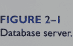

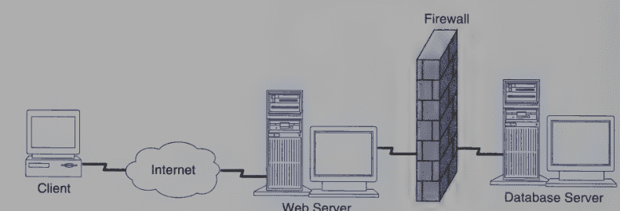

## Web 服务器

Web 服务器提供 Web 内容的访问。具体而言，它是在 Linux 服务器上运行的一个服务器进程，通过向请求者传输文件来响应网页请求。Web 站点是位于 Web 服务器上的一个目录，响应远程客户端的 HTTP 请求并发送网页。一些与 Web 服务器相关的术语包括：

- **Web 站点**：一组相互连接的网页，通常包括主页，一般位于同一服务器上，并由个人、团体或组织准备和维护作为一个信息集合。
- **超文本传输协议（HTTP）**：一种用于在 Internet 或其他计算机网络上请求和传输文件（尤其是网页和网页组件）的协议。
- **超文本标记语言（HTML）**：一种用于生成 Web 内容的语言。标记语言由放置在文本前后并指示文本如何显示的标记组成。例如，放置在文本前的标记 `<B>` 表示该文本应以粗体显示。
- **网页**：万维网上的一个文档，由一个 HTML 文件和任何相关的脚本及图形文件组成，并且通常与其他 Web 文档超链接。
- **超链接**：网页上的一段文本，当被选中时，会从 Web 服务器检索另一个 Web 文档。

Apache HTTP 服务器是一款流行的 Web 服务器，被 Internet 上超过 60% 的 Web 站点使用，可用于 Linux 和其他操作系统。Apache HTTP 服务器项目开发和维护大多数操作系统的开源 HTTP 服务器。

### 注

news.netcraft.com 最近对 4400 多万个 Web 站点的调查显示，Apache HTTP 服务器的市场份额超过 67%，且在过去几年呈增长趋势。Microsoft IIS 的市场份额为 21%，自 2002 年 2 月以来呈下降趋势，所有其他 HTTP 服务器的市场份额均低于 3% 且呈下降趋势。

Web 服务器几乎可以在任何大小的机器上运行。服务级别决定了使用多大尺寸的机器。如果你正在运行个人 Web 服务器，你可以在能够访问 Internet 或内网的个人台式机管理内容。但如果你正在为拥有数百或数千个页面的公司管理 Web 服务器，你需要一台更大的服务器。大型 Web 服务器通常运行在多台机器上以提供高可用性。软件在资源需求方面要求不高，但对于较大的站点，用户数量的增加需要更多的 RAM 和更快的网络连接。

## 文件服务器

文件服务器是一台计算机，控制一个中央数据存储库，该存储库中的数据可以由客户端下载或以某种方式操作。文件服务器通常用于为单个用户提供额外的磁盘空间。通过使用中心位置存储文件，管理员可以轻松备份用户内容，而无需管理多台机器。

Linux 上流行的文件服务器应用程序是 Samba，这是一套开源/免费软件套件，为 SMB/CIFS 客户端提供无缝的文件和打印服务。服务器消息块（SMB）是一种在计算机之间提供文件和打印机共享的协议。公共 Internet 文件系统（CIFS）是基于 Microsoft SMB 的 Internet 文件系统协议。

使用 Samba，服务器可以使用 TCP/IP 作为底层传输协议，向基于 Windows 的客户端提供文件和打印服务。它允许你将 Linux 和 Windows 机器一起使用，而无需单独的 Windows 服务器。

另一种文件共享系统，网络文件系统（NFS），由 Sun Microsystems 开发，作为通过网络共享文件的标准。此服务允许将文件系统集成到远程系统中，使其与其他本地文件系统无缝使用。所有 Unix 和 Linux 系统都提供 NFS。

文件服务器的大小取决于其用途。同样，如果只有有限的用户，个人台式机就足够了；但如果你有数百名用户，你需要一台更大的服务器和一个大得多的数据存储库。

## 消息服务器

消息服务器通过客户端提供电子邮件访问。它快速传递电子邮件，内容可能包括嵌入的声音、图形、视频文件、HTML 表单、Java 小程序和桌面应用程序。消息服务器使用几种协议，如图 2–2 所示。这些协议包括简单邮件传输协议（SMTP）、Internet 消息访问协议第 4 版（IMAP4）、邮局协议 3（POP3）和超文本传输协议（HTTP）。

SMTP 用于客户端到服务器以及服务器到服务器的通信，并使用端口 25 进行通信。有关 SMTP 的信息可以在 RFC-821 中找到。RFC（征求意见稿）由 Internet 工程任务组（IETF）管理，可在 http://www.ietf.org 找到。

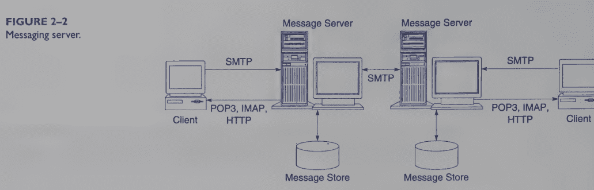

POP3 提供客户端访问以从消息服务器检索排队的电子邮件。通常，电子邮件被下载后从消息存储中删除。有关 POP3 的信息可以在 RFC 1939 中找到。

IMAP4 是一种协议，使客户端能够连接到消息服务器并将排队的电子邮件下载到本地工作站。IMAP4 比 POP3 更强大，提供在服务器上管理文件夹和邮箱的能力。IMAP4 给予你灵活地将消息存储在本地、服务器上，或者两者兼存。有关 IMAP4 的信息可以在 RFC 2060 中找到。

HTTP 被消息服务器用于通过任何标准 Web 浏览器提供电子邮件访问。在大多数情况下，使用 HTML 和 JavaScript 的 WebMail 提供到消息后端的接口。消息数据被转换为 HTML 页面以便通过浏览器查看。使用 HTML 表单创建消息，然后使用 SMTP 发送。消息服务器提供消息存储，以保存电子邮件直到被客户端检索。使用 POP3 时，客户端检索电子邮件后，电子邮件即从存储中删除。使用 IMAP4 时，客户端检索电子邮件后，可以选择将其保留在服务器上或从存储中删除该消息。

Linux 附带一个消息服务器，即 sendmail。有许多可用的电子邮件服务器，包括开源和商业版。快速搜索 Internet 可以发现数十个开源电子邮件服务器和客户端，包括 SquirrelMail 和 Open WebMail。商业服务器包括 Sun/One 的应用服务器 7 和 Zeus Web 服务器。

与其他服务器一样，服务器的大小取决于其用途。如果你正在管理个人邮件服务器，可以使用个人台式机。但如果你正在为企业提供消息解决方案，你需要一台专用服务器来管理系统，并有足够的磁盘空间来容纳电子邮件。

图 2-2 是消息服务器的简单表示。在企业环境中，一台或多台邮件服务器会放置在防火墙外部，至少两台邮件服务器会位于防火墙内部。防火墙外部的系统用于限制对内网的访问。内部系统通常是为了解决性能问题。根据访问电子邮件的用户数量，一组内网邮件服务器将提供消息存储供用户阅读邮件，另一组用于发送出站电子邮件，从而为整体消息传递提供增强性能。

## 企业服务器

企业服务器在保持高可用性的同时提供服务器服务。企业服务器通常是具有热插拔（在通电状态下可替换）冗余组件的高端机器。通常，企业服务器是一组在集群中操作的服务器。集群提供：

- **共享存储**：所有集群成员都可以访问相同的存储。
- **服务故障转移**：企业服务器提供的服务始终可用。集群自动检测故障并从中恢复。
- **IP 负载均衡**：提供跨服务器群（farm）对传入 IP 网络请求进行负载均衡的能力。IP 负载均衡集群看起来像一台服务器。

企业服务器通常是一组连接到公共 RAID 的高端机器。提供此类服务的 Linux 发行版通常无法免费下载。


## 硬件要求

- 目标 1.1
- 目标 6.1

Linux 具有通用性，适用于大多数现有硬件配置。大多数 Linux 发行版都有一个您可以查看的硬件兼容性列表。这些硬件兼容性列表通常按硬件类型以及是否已在相关发行版上进行过测试来排列。当然，最理想的情况是从兼容性列表中购买新硬件。然而，您使用的系统类型受安装预算的限制。

确定硬件要求的第一步是确定您需要的安装类型。例如，服务器根据其用途，可能需要比大多数个人台式机更强大的 CPU、更大的文件系统和更快的网络连接。

确定所需的安装类型后，您需要确定所需的硬件类型。硬件需求包括 CPU、内存、视频卡、硬盘、网卡、调制解调器和其他设备。

### CPU

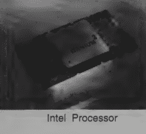

大多数 Linux 发行版几乎支持任何 i386 CPU。一些发行版还支持 IBM、Sparc、PowerPC 以及其他 CPU，以及 SMP（对称多处理器）系统。大多数 CPU 使用 32 位内部寄存器；但是，针对某些 64 位 CPU，有 64 位版本的 Linux 操作系统可用。Linux 在基于 i386 的 CPU 上的安装量更大，并且最初是为该平台开发的，因此在基于 i386 的系统上最为成熟。基于 i386 的硬件通常比其他硬件更便宜，往往是最划算的选择。图 2–3 展示了一个 Intel Pentium 处理器。

> **图 2–3**  
> Intel 处理器。

在决定需要哪种类型的 CPU 时，您首先查看 CPU 的速度。在查看单一制造商品牌时，这种度量很有用；然而，当跨不同型号进行比较时，还有其他考虑因素。某些型号在一个 CPU 周期内比其他型号能执行更多的工作，这使得比较非常困难。此外，执行的计算类型也会影响处理器响应方式。

根据安装类型不同，Linux 操作系统可以运行在部分最古老的基于 i386 的处理器上，且运行足够良好。通常，您希望拥有可用的最快的 Linux 兼容 CPU。然而，安装了办公生产力、互联网和电子邮件软件的工作站，在配备 256 MB RAM 的 PII-400 上运行良好。

### 内存

计算机中使用的随机存取存储器（RAM）类型在过去几年中发生了变化。最近使用的类型包括单列内存模块（SIMM）、双列内存模块（DIMM）和小型双列内存模块（SODIMM）。较旧的 SIMM 用于较旧的系统中。较新的计算机系统使用 DIMM。DIMM 的容量范围从每个模块 32 MB 到 512 MB。SODIMM 用于大多数笔记本电脑。SODIMM 的容量范围也从 32 MB 到 512 MB。图 2–4 展示了 RAM 的类型。


一些 Linux 发行版可以在仅 4 MB RAM 上运行。但是，系统上的 RAM 数量与系统运行效果有很大关系。操作系统及其应用程序在 RAM 中运行。如果有足够的 RAM 供应用程序使用，程序的运行速度将比必须通过交换空间（用于存储无法装入 RAM 的当前运行应用程序的磁盘区域）进行分页读入读出的情况快。

关于 RAM 的好消息是，如今它很便宜。大多数新系统最少配有 128 MB RAM，许多配有 512 MB RAM。

### 视频

Linux 在任何视频适配器上都可以以文本模式工作。这对于仅用作大多数应用程序服务器的系统来说是足够的；然而，大多数系统将需要图形用户界面（GUI），这需要支持它的视频适配器。

Linux 的大多数驱动程序是内核的一部分，但用于操作位图图形模式的视频驱动程序不是。位图驱动程序是 X 服务器的一部分。X 支持通过 XFree86（www.xfree86.org）或商业 X 窗口系统提供。XFree86 是开源的，并在显示硬件和桌面环境之间提供客户端/服务器接口。大多数视频适配器都能与 Linux 一起工作。某些新卡的视频驱动程序可能需要数周或数月才能可用。

视频适配器应具有足够的 RAM 来支持您要显示的视频类型。RAM 用于在显示设备上显示之前，在卡上存储图像。大多数视频卡至少有 8 MB RAM，许多则更多。8 MB 可以处理 1600/1200 屏幕分辨率和 32 位色深。内存更多的卡通常将其用于渲染 3D 图像。这对于用于 CAD（计算机辅助设计）、计算机辅助设计和游戏的高分辨率图形软件包很有用。视频配置在第 3 章中讨论。

### 硬盘

硬盘和硬盘制造商种类繁多。大多数硬盘分为两类——增强型集成驱动电子/高级技术架构（EIDE/ATA）和小型计算机系统接口（SCSI）。EIDE 和 SCSI 是将硬盘连接到计算机系统的标准接口。

> **注意**
> 串行高级技术架构（ATA）是一种用于将硬盘和其他外围设备连接到 PC 的新接口。它是并行 ATA 存储接口的替代方案。串行 ATA 与当今的 ATA 兼容，但连接器更小（7 针），电缆可以更长（长达一米）。初始的串行 ATA 提供 150 MBps，预计每三年翻一番。

**硬盘控制器**  
小型计算机系统接口（SCSI，发音为“skuzzy”）是一种并行接口标准，计算机系统使用它来将外围设备连接到计算机。SCSI 接口提供非常快的数据传输速率，高达 80 MBps。它还允许将许多设备连接到单个 SCSI 端口。

虽然 SCSI 是美国国家标准协会（ANSI）标准，但它有许多变体。这些变体并不总是兼容的，甚至可能使用不同类型的连接器。

- **SCSI-1** 使用 8 位总线，支持 4 MBps 的数据速率。
- **SCSI-2** 与 SCSI-1 相同，但使用 50 针连接器代替 25 针连接器，并支持多个设备。这是大多数人提到普通 *SCSI* 时的含义。
- **宽 SCSI** 使用更宽的电缆（68 条线路到 68 针）以支持 16 位传输。
- **快速 SCSI** 使用 8 位总线，但将时钟速率加倍以支持 10 MBps 的数据速率。
- **快速宽 SCSI** 使用 16 位总线并支持 20 MBps 的数据速率。
- **超高速 SCSI** 使用 8 位总线，并支持 20 MBps 的数据速率。
- **SCSI-3** 使用 16 位总线并支持 40 MBps 的数据速率。也称为超高速宽 SCSI。
- **Ultra2 SCSI** 使用 8 位总线并支持 40 MBps 的数据速率。
- **宽 Ultra2 SCSI** 使用 16 位总线并支持 80 MBps 的数据速率。

EIDE 指的是 ATA，高级技术附件，这是一种将控制器集成在硬盘上的磁盘驱动器实现方式。与 SCSI 一样，EIDE/ATA 有几个版本。

- **ATA** 也称为 IDE，ATA 支持一个或两个硬盘，16 位接口和 PIO 模式 0、1 和 2。
- **ATA-2** 支持更快的 PIO 模式（3 和 4）和多重字 DMA 模式（1 和 2）。还支持逻辑块寻址（LBA）和块传输。ATA-2 以快速 ATA IDE（EIDE）的名义 marketed。
- **ATA-3** ATA-2 的小幅修订版。
- **Ultra-ATA** 也称为 Ultra-DMA、ATA-33 和 DMA-33，支持以 33 MBps 运行的多重字 DMA 模式 3。
- **ATA/66** 由 Quantum 公司提出、Intel 支持的 ATA 版本，将 ATA 吞吐量加倍至 66 MBps。
- **ATA/100** ATA/66 的更新版本，将数据传输速率提高至 100 MBps。

大多数家用个人计算机使用 EIDE/ATA 标准。EIDE 相对便宜，对于连接到单个适配器的单个硬盘，EIDE 与 SCSI 相比性能差异很小。但在使用多个驱动器时，SCSI 相比 EIDE 有一些优势：

- 使用 EIDE/ATA 只能连接两个设备，而 SCSI 控制器可以连接许多设备。
- SCSI 提供比 EIDE/ATA 设备更高的带宽。
- SCSI 设备支持 RAID 系统中的热插拔。热插拔允许在不停机的情况下移除 RAID 中的驱动器，从而提供高可用性场景。

SCSI 是要求更高的服务器安装的自然选择。

廉价磁盘冗余阵列（RAID）是一种使用两个或多个驱动器提供高可用性的方法。这是通过数据条带化和磁盘镜像实现的。数据条带化允许将数据块分散到多个磁盘上以提高性能。磁盘镜像允许同时将数据写入两个重复磁盘，因此如果一个磁盘故障，另一个可以接管而不会丢失数据。有几种 RAID 级别。最常用的是：

- **级别 0** 提供数据条带化
- **级别 1** 提供磁盘镜像
- **级别 3** 提供带纠错的数据条带化
- **级别 5** 将数据和奇偶校验信息条带化分布在三个或更多驱动器上

RAID 最常见的实现方式是级别 0 + 1 和级别 5。RAID 0 + 1 是条带化和镜像的结合，没有奇偶校验。RAID 0 + 1 的优势是快速数据访问，以及失去一个驱动器后仍有一个完整的重复驱动器或驱动器集幸存的能力。

**硬盘特性**  
硬盘的特性差异很大，并极大地影响性能。硬盘可以内部或外部安装，具有不同的旋转速度、变化的寻道时间和广泛范围的容量。


除了硬盘将要连接的接口之外，还应检查一些几何参数。例如，硬盘容量很重要。如今所有硬盘的容量都以千兆字节（GB）衡量。硬盘容量范围大约从 20 GB 到 200 GB 以上。您所需的硬盘大小将由硬盘的预期用途决定。硬盘盘片每分钟的转速（RPM）对于确定硬盘检索信息的速度非常重要。在硬盘上，读/写磁头在硬盘盘片之间进出移动，同时盘片旋转。盘片旋转得越快，数据从硬盘读取或写入的速度就越快。硬盘的典型 RPM 范围从 5400 到 15,000。

寻道时间指的是从硬盘平均读取或写入信息的速度。寻道时间大约从 13 ms 到 4 ms 以下。

硬盘通常使用 SCSI 或 EIDE/ATA 技术内部安装。然而，也有使用专有端口、并口、通用串行总线（USB）端口或 FireWire 端口的外部硬盘。最新的 FireWire 硬盘在提供便携性的同时提供高性能。FireWire 硬盘可以快速地在一台机器和另一台机器之间移动。

## 网卡

市面上有很多网络硬件，但大多数系统使用以太网（Ethernet）。还有几种不同的以太网标准，包括 10BASE2、10BASE5、10BASE-T、100BASE-TX、100BASE-FX、1000BASE-T、1000BASE-SX 和 1000BASE-LX。以太网使用逻辑总线拓扑结构，尽管大多数安装使用物理星型或扩展星型拓扑结构。以太网是一种共享介质广播技术。以太网技术中使用的接入方法是带有冲突检测的载波侦听多路访问（CSMA/CD）。在 CSMA/CD 接入方法中，需要通过网络介质传输数据的网络设备以“先听后发”模式工作。这意味着设备会检查介质是否忙碌，如果不忙碌则进行传输。如果检测到冲突，设备会等待随机的一段时间然后重试。由于共享介质段的缘故，使用以太网时发生冲突很常见。表 2-1 描述了一些更常见的以太网类型。


| 类型 | 介质 | 最大带宽 | 最大段长 |
|---|---|---|---|
| 10BASE5 | 粗同轴电缆 | 10 Mbps（兆比特每秒） | 500 米 |
| 10BASE-T | 五类 UTP（非屏蔽双绞线） | 10 Mbps | 100 米 |
| 10BASE-FL | 多模光纤 | 10 Mbps | 2000 米 |
| 100BASE-TX | 五类 UTP | 100 Mbps | 100 米 |
| 100BASE-FX | 多模光纤 | 100 Mbps | 2000 米 |
| 1000BASE-T | 五类 UTP | 1000 Mbps | 100 米 |

以太网适配器必须与您使用的介质类型相匹配。如今最常见的介质是 100BASE-T。

Linux 可以发现今天使用的大多数以太网适配器。有一些较新的设备在 Linux 安装期间可能无法被找到。例如，许多 1000BASE-T 和 802.11（无线）适配器未包含在大多数 Linux 发行版中。然而，Red Hat 支持 Broadcom 和 Intel 千兆以太网（GigE）网卡（NIC）。如果安装的网卡不受支持，制造商通常会提供 Linux 驱动程序。Linux 支持其他网络标准，如令牌环（Token Ring）、光纤分布式数据接口（FDDI）、Local Talk 和 802.11 无线。如果您正在使用其中任何一种，您需要搜索您的 Linux 发行版的支持文档并找到推荐的适配器。

## 调制解调器

Linux 发行版支持几乎任何较旧的内部或外部调制解调器。兼容性最好的调制解调器是 Hayes 兼容的调制解调器。一些较新的调制解调器是软件调制解调器，它们依赖 CPU 来做以前由调制解调器完成的部分工作。这些软件调制解调器可能无法与您的 Linux 发行版配合使用。对于这些，您可以查看 http://www.linmodem.org 以了解目前支持的设备。

## 其他硬件

Linux 支持广泛使用的常用硬件。虽然这些设备中的一些可能具有 Linux 不支持的功能，但所有标准版本都得到支持，无需额外的硬件驱动程序。

**软盘驱动器** 所有标准软盘驱动器都适用于 Linux 操作系统。有一些驱动器，通常是高容量驱动器，可能适用于也可能不适用于 Linux。这些通常可以配置为硬盘或可移动设备。

**CD-ROM** 大多数 CD-ROM 驱动器非常标准化，并能在 Linux 中正常工作。您通常会从 CD-ROM 安装 Linux，该 CD-ROM 将在系统上启动。大多数可记录 CD-ROM 和许多可记录 DVD-ROM 也会被 Linux 发行版识别。

**磁带驱动器** 大多数磁带驱动器使用标准的 EIDE/ATA 或 SCSI 接口。这些驱动器通常无需特殊配置即可在 Linux 中正常工作。

**键盘** 标准 PC 键盘适用于任何版本的 Linux。一些带有特殊键的键盘通常也能工作，但某些发行版可能无法识别特殊键。2.2.x 和 2.4.x 内核支持 USB 键盘。

**鼠标** 鼠标是标准设备，在 Linux 中很容易工作。大多数串行、USB 或 PS/2 接口都得到支持。

**显示器** 使用显示器不需要 Linux 驱动程序。如果显示器未被 XFree86 配置程序识别，某些功能可能不受支持，但它仍然可以工作。通常可以通过在适当的配置文件中输入垂直和水平刷新率来实现完整功能。

**串行/并行端口** Linux 安装程序应能找到系统中安装的任何串行或并行端口。在较新的发行版中，如果您添加了新端口，系统应在启动时找到它并自动配置。

**PCMCIA** 个人电脑记忆卡国际协会（PCMCIA）是由约 500 家公司组成的组织，它们开发了一种名为 PC 卡的小型信用卡尺寸设备的标准。PC 卡通常用于便携式计算机，以添加网卡、调制解调器和其他设备。Linux 在安装时会找到这些设备并支持大多数安装的设备。PCMCIA 旨在允许更换卡片而无需重新启动系统。

**USB** 通用串行总线（USB）设备在一个端口上最多可支持 127 个设备。USB 设备包括鼠标、调制解调器、多媒体硬件、存储设备和键盘。较新版本的 Linux 支持 USB，并能与连接到 USB 端口的设备正常工作。

**声卡** Linux 支持大多数声卡。许多声卡与 Sound Blaster 兼容，在 Linux 中工作轻松。有 Open Sound System (OSS) 的商业实现和免费版本，OSS/Free 和 ALSA，它们支持几乎所有基于 OSS 标准设计的声卡。

## 识别硬件配置

硬件的可配置值包括中断请求（IRQ）、DMA 和 I/O 地址。其中一些值是设计在硬件中的，有些则需要在安装设备时进行配置。当前的硬件设备通常无需用户干预即可自行配置到正确的值。

许多设备使用跳线和 DIP 开关（见图 2-5）来表示硬件配置值。硬件设备上一组引脚可以通过将跳线横跨一对引脚来短接。跳线向计算机系统指示开或关状态，系统将此转换为一个值。DIP 开关实现与跳线相同的结果，但使用小开关来指示开或关状态。

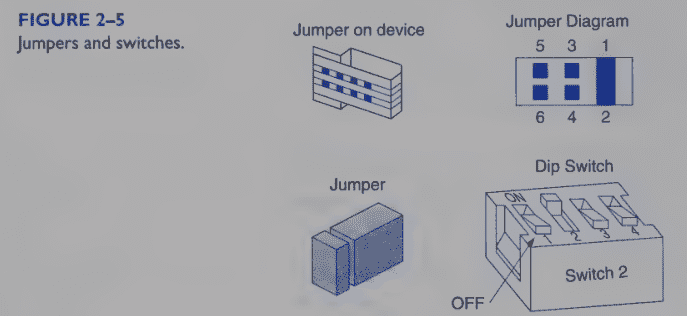

### IRQ

IRQ 是设备用来向 CPU 发送中断信号的硬件线。在设备获得 CPU 关注后，数据在设备和 CPU 之间传输以完成设备的任务。IRQ 冲突曾经很常见，但随着今天的即插即用架构，设备会自动使用可用的 IRQ。如果您使用的是较旧的系统，您需要知道设备分配的 IRQ。（一些主板允许将 IRQ 映射到标准范围之外。这是主板的一项功能。）表 2-2 列出了标准 IRQ 及其典型用途。

### DMA

直接内存访问（DMA）是一种将数据从主内存传输到设备的技术，而不经过 CPU。与通过 CPU 路由相比，这使信息在设备之间传输的速度快得多。

当安装能够访问计算机 DMA 通道的设备时，您必须使用软件或手动设置跳线或 DIP 开关来设置要使用的通道。

### I/O 地址

I/O 地址与内存地址不同。当 I/O 地址被放置到计算机的地址总线时，另一根线被激活。这既告诉主内存忽略该地址，也告诉所有具有 I/O 地址的设备监听该地址，看看它是否匹配。如果地址匹配，则 I/O 设备读取数据总线上的数据。表 2-3 显示了计算机系统中常用的 I/O 地址。

购买新的预配置计算机系统的一个好理由是，您不需要管理设备的 IRQ、DMA 或 I/O 地址；这些由组装者设置。新系统很可能还附带预安装的操作系统。如果有 Windows，您可以使用 Windows 设备管理器来确定已安装设备的配置设置。


## LINUX 安装要求

| IRQ 号 | 典型用途 | 描述 |
| :--- | :--- | :--- |
| 0 | 系统计时器 | 用于内部系统计时器。不可供其他设备使用。 |
| 1 | 键盘 | 用于键盘。不可供其他设备使用。 |
| 2 | IRQ 8–15 级联中断 | 将第二个中断控制器级联到第一个控制器。 |
| 3 | 串行端口 2 (COM2) | 用于第二个和第四个串行端口。PC 拥有四个可用的串行端口。第一个和第三个共享一个 IRQ，第二个和第四个也共享一个 IRQ。 |
| 4 | 串行端口 1 (COM1) | 用于第一个和第三个串行端口。 |
| 5 | 声卡 | 通常由声卡使用。某些适配器可以通过跳线或拨码开关配置为使用选定的 IRQ。参见图 2–5。 |
| 6 | 软盘控制器 | 用于软盘控制器。 |
| 7 | 第一个并行端口 (PAR1) | 如果连接了打印机，通常用于打印机端口。 |
| 8 | 实时时钟 | 保留给实时时钟。不可供其他设备使用。 |
| 9 | 开放中断 | 可用于没有保留 IRQ 的设备。 |
| 10 | 开放中断 | 可用于没有保留 IRQ 的设备。 |
| 11 | 开放中断 | 可用于没有保留 IRQ 的设备。 |
| 12 | PS/2 鼠标 | 如果连接了 PS/2 鼠标，则用于该鼠标。 |
| 13 | 数学协处理器 | 专门用于浮点单元的内部信号。 |
| 14 | 主 IDE 通道 | 如果连接了 IDE 设备，则被主 IDE 控制器使用。 |
| 15 | 次 IDE 通道 | 如果连接了 IDE 设备，则被次 IDE 控制器使用。 |

表 2–2 标准 IRQ。

Windows 设备管理器可从控制面板中获取。要在 Windows 中访问设备管理器，请执行以下操作：

- 从任务栏中选择 **开始**。
- 从菜单中选择 **设置**。
- 从子菜单中选择 **控制面板**。
- 从图标列表中选择 **系统**。
- 选择 **硬件** 选项卡。
- 选择设备管理器按钮。

> **注意**
> 不同版本的 Windows 可能具有略微不同的选项列表。

硬件设备可以按类型（默认）、按连接（USB、IDE 等）或按资源（DMA、IRQ、I/O、内存）查看。通过向下浏览设备列表，您可以选择单个设备的属性并检查每个设备使用的资源。

如果您正在组装一台新机器，大多数设置将自动分配。您可能只会设置 IDE 或 SCSI 设备的设置，以及可能的系统板设置。

IDE 设备（如硬盘驱动器或 CD-ROM）有一组跳线，必须设置以指示该设备是 IDE 接口的主设备还是从设备。通常通过跳线配置将驱动器指定为主设备或从设备，而不是根据驱动器连接到 IDE 电缆的顺序。但如果驱动器设置为电缆选择，则主设备或从设备由数据排线上的位置决定。跳线设置可以是单驱动、主设备、从设备或电缆选择。对于两个驱动器，一个设置为主设备，另一个设置为从设备。对于一个驱动器，使用单驱动跳线设置。

## 表 2-3 I/O 地址。

| I/O 地址（十六进制） | 功能 |
| :--- | :--- |
| 000-01F | DMA 控制器 1 |
| 020-03F | 中断控制器 8259A |
| 040-05F | 计时器 |
| 060-06F | 键盘控制器 |
| 070-07F | 实时时钟 |
| 080-09F | DMA 页面寄存器 |
| 0A0-0BF | 中断控制器 2 |
| 0C0-0DF | DMA 控制器 2 |
| 0F0 | 清除数学协处理器忙状态 |
| 0F1 | 重置数学协处理器 |
| 0F8-0FF | 数学协处理器 |
| 1F0-1F8 | 固定磁盘 |
| 200-207 | 游戏 I/O |
| 278-27F | 并行打印机端口 2 |
| 2F8-2FF | 串行端口 2 |
| 300-31F | 可用/原型卡 |
| 360-36F | 可用/网络卡 |
| 378-37F | 并行打印机端口 1 |
| 380-38F | SDLC 双工同步 2 |
| 3A0-3AF | SDLC 双工同步 1 |
| 380-38F | 单色显示/打印机卡 |
| 3C0-3CF | 可用 |
| 3D0-3DF | 彩色显示卡 |
| 3F0-3FF | 磁盘驱动器控制器 |
| 3F8-3FF | 串行端口 1 |

## 安装 EIDE/ATA 硬盘驱动器


在计算机机箱中安装硬盘驱动器相对简单。如今大多数系统机箱都有现成的硬盘驱动器支架。某些硬盘驱动器需要使用导轨，这些导轨通常不随驱动器附带，但可以从机箱制造商处获得。

> **注意**
> 在您断开任何电缆或更改跳线之前，应记录其原始位置。


设置驱动器上的跳线以进行安装。如果这是第二个驱动器，并且您打算使用与第一个驱动器相同的电缆，您可能需要更改现有驱动器（主设备）和新驱动器（从设备）上的跳线设置。许多 CD 和 DVD 也使用 ATA 技术，并且可以连接到相同的电缆。如果是这种情况，您可能还需要更改 CD 或 DVD 上的跳线设置。

完成物理安装后，您需要连接电源和数据电缆，如图 2-6 所示。电缆通常经过键控设计，只能以一种方式插入。但这并不意味着不能强行插入，所以请小心。数据电缆可能已经连接了一个设备。将空闲的连接头用于硬盘驱动器。

> **注意**
> 如果电缆未经过键控设计，请确保电缆上的针脚 1 连接到连接器上的针脚 1。电缆上的针脚 1 由电缆针脚 1 侧的红色条纹指示。

如果连接了超过两个设备，您需要第二根电缆。一端连接到硬盘驱动器，另一端连接到主板上的 EIDE 端口。这些电缆连接通常在主板上标识为 IDE 0 和 IDE 1，并且通常紧挨着现有端口。

现在您必须设置 BIOS 以识别该驱动器。实际上，在当前机器上 BIOS 通常会自动设置。但如果您有一台旧计算机，您可能需要在启动计算机时进入设置模式（大多数计算机会显示“Setup”字样并指示按哪个键进入设置模式），并手动设置硬盘驱动器的值。硬盘驱动器的安装手册将提供设置详细信息。

Linux 应自动识别新驱动器。您可以通过输入以下命令来检查：

```bash
# ls /proc/ide
```

结果将类似于以下内容：

```text
drivers hda@ hdc@ ide0/ ide1/ pix
```

现在您可以对驱动器进行分区。这可以使用 `fdisk` 实用程序完成。（在第 3 章中，将使用 Disk Druid 实用程序对硬盘驱动器进行分区。该实用程序在许多 Linux 发行版中可用。）`fdisk` 用于查看和管理分区。要查看分区，请输入：

```bash
# fdisk -l /dev/hda
```

其中 `/dev/hda` 将显示第一个 IDE 硬盘驱动器的分区。要创建分区，请输入：

```bash
# fdisk /dev/hdc
```

然后输入 **m** 显示菜单，并将显示以下内容：

```text
Command (m for help): m
Command action
a toggle a bootable flag
b edit bsd disklabel
c toggle the dos compatibility flag
d delete a partition
l list known partition types
m print this menu
n add a new partition
o create a new empty DOS partition table
p print the partition table
q quit without saving changes
s create a new empty Sun disklabel
t change a partition's system id
u change display/entry units
v verify the partition table
w write table to disk and exit
x extra functionality (experts only)
```

您需要知道的命令是 d、n、p、q 和 w。如果这是一次新安装且存在现有分区（选项 p 显示现有分区），您需要删除现有分区（选项 d 删除现有分区）。删除现有分区后，您必须创建新分区（选项 n 创建新分区）。新分区可以是主分区或扩展分区。请记住，您可以拥有四个主分区，或者三个主分区和一个扩展分区。选择 p 作为主分区后，您将被告知分区号（1–4），然后是第一个柱面。如果您使用整个磁盘，第一个柱面是 1。然后输入最后一个柱面（会显示最大数值范围）。如果您不想将磁盘的剩余部分用于此分区，您必须输入一个小于最大值的最后一个柱面值。您已告知 Linux 您的需求，但在您保存结果之前，它不会创建或删除分区（选项 w 将新的分区表写入磁盘并退出）。您可以通过不保存而退出过程来中止（选项 q 退出不保存更改）。请记住，逻辑分区始终从 5 开始编号。

某些版本的 Linux 在对驱动器进行分区后需要重新启动（2.2 之前的内核）。Linux 将报告需要重新启动。重新启动后，您可以对磁盘驱动器进行格式化。格式化是通过 `mkfs` 命令完成的。如果您在 IDE 1（第二个主设备）上添加了第二个驱动器并创建了一个分区，以下命令：

```bash
# mkfs -t ext3 -j /dev/hdc1
```

将对该驱动器进行格式化。

`mkfs` 完成格式化后，您需要挂载该驱动器。这很容易完成，并在第 4 章中介绍。

## 安装 SCSI 硬盘驱动器

SCSI 设备由标识（ID）号识别，该编号通过跳线设置配置，以分配 0 到 15 的值。通常还有其他跳线设置用于设置 SCSI 终端电阻。SCSI 控制器和驱动器具有不同的安装说明集。您应联系制造商获取关于配置这些设备的详细说明。在 Linux 中安装 SCSI 驱动程序与 IDE 驱动器相同，只是设备名称将是 `/dev/sd*` 而不是 `/dev/hd*`。

首先要做的是设置驱动器的 SCSI ID 和其他操作选项。SCSI ID 通常通过跳线设置，是 0 到 15 的身份值，如图 2–7 所示。


## LINUX 安装要求


通常，*值 7* 保留给主机适配器。如果这是唯一的驱动器或最后一个驱动器，可能会有一个关于终结器的设置。如今许多 SCSI 驱动器通过将驱动器连接到电缆末端来实现终结。

将驱动器安装到系统机箱中。SCSI 电缆有几种规范。电缆带有键控设计，以确保只能朝一个方向安装。图 2-8 展示了一种常见的 SCSI-3 电缆。

对于 SCSI 驱动器，无需设置系统的 BIOS。SCSI 适配器处理驱动器的 I/O 操作。可能需要进入 SCSI 板设置程序并设置驱动器的参数。每块板的说明都不同，但会有一个提示指示如何进入 SCSI 设置。进入设置后，你可以遵循屏幕上的提示或适配器附带的说明。

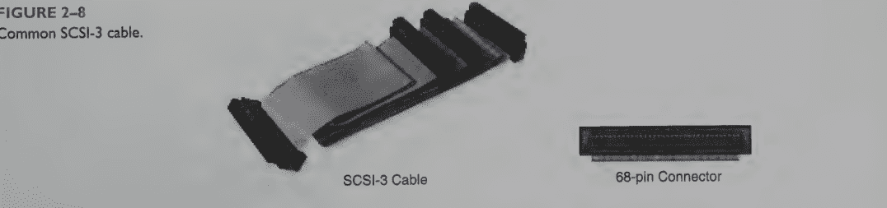

Linux 应能自动发现新的驱动器。你可以通过键入以下命令来检查：

```
# cat /proc/scsi/scsi
Attached devices:
Host: scsi1 Channel: 00 Id: 06 Lun: 00
Vendor: QUANTUM Model: DLT7000 Rev: 2150
Type: Sequential-Access ANSI SCSI revision: 02
Host: scsi2 Channel: 00 Id: 05 Lun: 00
Vendor: NEC Model: CD-ROM DRIVE:466 Rev: 1.06
Type: CD-ROM ANSI SCSI revision: 02
Host: scsi3 Channel: 00 Id: 00 Lun: 00
Vendor: DELL Model: PERCRAID RAID5 Rev: V1.0
Type: Direct-Access ANSI SCSI revision: 02
#
```

要完成新 SCSI 驱动器的安装，请遵循上一节中提到的 IDE 驱动器的说明。将说明中的 hd 替换为 sd。例如，要分区 IDE 驱动器，你键入：

```
# fdisk /dev/hdc
```

要分区 SCSI 驱动器，你键入：

```
# fdisk /dev/sdc
```

格式化通过 mkfs 命令完成：

```
# mkfs -t ext3 /dev/sdc1
```

## 其他硬件考虑


IEEE 1394 是一种非常快速的外部总线标准，支持高达 800 Mbps 的数据传输速率。较新的 Linux 发行版支持此标准。单个 1394 端口可支持多达 63 个外部设备。IEEE 1394 不仅用于硬盘。IEEE 1394 设备可以包括视频、键盘、CD-ROM 等。IEEE 1394 还支持即插即用（能够轻松识别连接设备的能力）和热插拔（在不重启机器的情况下移除和连接设备的能力）；它还向外围设备供电。

系统主板上有设置来配置内置端口和其他设置。大多数新主板将这些设置配置在 CMOS（互补金属氧化物半导体）中。CMOS 芯片所需的功率非常少，通常由一个小电池供电，并且它们保存诸如日期、时间、外设设置和其他设置等信息。系统主板上的内置程序允许用户在启动时输入并保存 CMOS 设置。一些系统主板上有跳线设置，用于设置其他系统中由 CMOS 控制的大多数设置。

### 外围设备

外围设备定义为任何连接到计算机系统的设备。例如，打印机是一种外围设备。正确连接和配置外围设备是一项管理任务。外围设备连接到标准端口，在安装 Linux 之前应配置这些端口。

外围设备连接到系统单元内置的端口。大多数系统单元端口都通过 CMOS 进行配置。最常配置的两个端口是并行端口和串行端口。这些通常用于连接打印机和外部调制解调器。

通常内置端口不需要任何配置更改，但如果你添加端口或需要更改设置，通常会为端口分配特定值。这些值包括 I/O 地址和中断请求（IRQ）。I/O 地址是系统用于与设备通信的内存地址。中断请求是系统用来指示何时将花费时间访问设备的信号。表 2-4 列出了其中的一些值。

许多端口设置看起来相互冲突，但这通常不是问题。例如，一个系统可能有两个串行设备，一个使用 IRQ 3，另一个使用 IRQ 4，但通常不需要使用两个以上的串行端口。当出现冲突时，通常会使用额外的设置。

**表 2-4**
常见外围端口设置。

| 设备 | I/O 地址 | IRQ |
| :--- | :--- | :--- |
| 串行端口 1 | 3F8 | 4 |
| 串行端口 2 | 2F8 | 3 |
| 串行端口 3 | 3E8 | 4 |
| 串行端口 4 | 2E8 | 3 |
| 并行端口 1 | 378 | 7 |
| 并行端口 2 | 278 | 5 |
| 声音端口 | 220 | 5 |

## 软件和服务

**目标 1.5**

Linux 系统上可用的软件和服务反映了安装的功能。个人桌面通常需要 GUI 和个人生产力软件，但不需要服务器服务，如动态主机配置协议（DHCP）或域名系统（DNS）。只要有足够的资源，始终可以添加软件，但你应在安装之前规划你的软件和服务实现，以确保可用的资源充足。

表 2-5 取自 Red Hat Linux 发行版。并非所有发行版都有相同的软件，但它是一个你可以预期找到的软件和服务的良好示例。

你可能打算在你的系统上安装商业软件。你应该联系软件供应商，并确保你选择的 Linux 发行版受到支持。可能存在一个可以“开箱即用”的软件版本，或者可能需要针对你的特定安装进行编译。

一些商业软件包需要大量的磁盘空间进行安装，运行时需要更多。所需的磁盘空间量可以由软件供应商计算。

## 分配存储空间

如今几乎每个计算机系统都使用磁盘分区。分区是计算机行业的标准。然而，由于有许多预配置的计算机系统，许多用户不理解磁盘分区的工作原理，甚至不知道它们是什么。

硬盘驱动器是相对简单的设备，或者至少它们存在的时间足够长，使得使用它们的方法非常标准。它们的目的是存储数据并可靠地检索它。

硬盘被设计为“格式化”以适配控制它的具体操作系统。通过格式化驱动器，你在驱动器上创建文件系统。文件系统使用驱动器空间的一小部分来完成其组织数据存储结构的任务。它将其余的驱动器划分为称为块的小段。存在几种文件系统，它们在不同的操作系统之间不一定是标准的。例如，Linux ext3 文件系统不能被 Windows NT 系统读取，Windows NT NTFS 文件系统也不能完全用于 Linux 系统。（NTFS 文件系统可以被 Linux 读取，但写支持尚未在所有...

**表 2-5**
常见可用软件包。

| 元素名称 | 描述 | 所需硬盘空间 (MB) |
| :--- | :--- | :--- |
| **桌面** | | |
| X 窗口系统 | XFree86 基本字体、X 工作站的程序和文档以及自定义配置实用程序。这些实用程序所需的磁盘空间非常少。 | <1 MB |
| Gnome 桌面环境 | 带有面板、桌面、系统图标和图形文件管理器的 GNOME 桌面环境 GUI。GUI 界面程序大约需要 200 MB 的磁盘空间。 | ~200 MB |
| KDE 桌面环境 | 带有面板、桌面、系统图标和图形文件管理器的 KDE 桌面环境 GUI。GUI 界面程序大约需要 200 MB 的磁盘空间。 | ~200 MB |
| **应用程序** | | |
| 编辑器 | 允许你创建和编辑文件的文本编辑器。这些应用程序通常需要的磁盘空间很少。但一些用于 X 窗口系统的编辑器可能超过 100 MB。 | 20-100 MB |
| 工程和科学 | 用于执行数学和科学计算和绘图的软件包。 | ~50 MB |
| 图形互联网 | 图形电子邮件、Web 和聊天客户端。 | 50-100 MB |
| 基于文本的互联网 | 基于文本的电子邮件、Web 和聊天客户端。这些不需要 X 窗口系统。 | <10 MB |
| 办公/生产力 | 办公套件和其他用于个人生产力的程序。这些包括 Open Office、PDF 查看器 xpdf 等程序。一个办公套件程序可以轻松需要 400 MB 或更多的磁盘空间。 | 100-500 MB |
| 声音和视频 | 播放 CD、录制 CD、播放多媒体文件以及包含用于处理系统上声音和视频的工具的应用程序。 | 10-50 MB |
| 创作和发布 | 用于以 HTML、PDF、PostScript 和文本格式创建文档的工具。 | 50-150 MB |
| 游戏和娱乐 | 游戏和其他用于娱乐你的文件。 | 10-100 MB |
| **服务器** | | |
| 服务器配置工具 | 用于 Samba、Web 服务器、打印机和其他服务的定制服务器配置工具集。 | ~30 MB |
| Web 服务器 | 允许你运行和维护 Web 服务器的工具。 | ~40 MB |
| 邮件服务器 | 配置邮件服务器的工具。 | ~40 MB |
| Windows 文件服务器 | Samba SMB 服务器，允许在 Linux 和 Windows 系统之间共享文件。 | 5 MB |
| DNS 名称服务器 | 允许你在系统上运行 DNS 名称服务器。 | <1 MB |
| FTP 服务器 | 允许你在系统上运行 FTP（文件传输协议）服务器。 | <1 MB |
| SQL 数据库服务器 | 允许你运行使用 SQL 作为管理语言的关系型数据库。一些商业 RDBMS（关系型数据库管理系统）可能需要几百 MB 才能运行。 | ~20 MB |
| 新闻服务器 | 允许你配置一个新闻服务器。 | ~5 MB |
| 网络服务器 | 包括基于网络的服务器，如 DHCP、DNS、telnet、远程访问等。 | <5 MB |


## 元素名称

| 元素名称 | 描述 | 所需硬盘空间 (MB) |
| :--- | :--- | :--- |
| 开发 | | |
| 开发工具 | 用于编译和重新编译多种语言（包括 C、Perl、Fortran 等）应用程序的工具。 | 100-200 MB |
| 内核开发 | 内核所需的工具、库和源代码。如果你需要重新编译内核，则需要这些内容。 | 200 MB |
| X 软件开发 | 用于开发 X 窗口系统应用程序的程序。 | ~50 MB |
| GNOME 软件开发 | 用于开发 GNOME 图形用户界面应用程序的程序。 | ~120 MB |
| KDE 软件开发 | 用于开发 KDE 图形用户界面应用程序的程序。 | ~300 MB |
| 系统 | | |
| 管理工具 | 允许你管理用户和组、配置系统硬件以及分配其他环境变量值的工具。 | 2 MB |
| 系统工具 | 允许你连接到 SMB 共享并监控网络流量的工具。 | ~15 MB |
| 打印支持 | 用于将系统配置为打印服务器的工具。 | <1 MB |

版本。写支持在当前开发版本 2.5.x 中可用，但功能有限。）通常至少有一种 Linux 和 Windows 通用的文件系统可用，这使得在文件系统之间共享数据变得容易。

如今，拥有超过 100 GB 磁盘空间的单个硬盘并不罕见。大多数操作系统允许你格式化驱动器并利用更大的容量，但在如此大的存储空间中查找信息随时间推移可能会变得非常困难。一些文件系统专为有限的磁盘容量和有限的单个文件数量而设计。

为了解决管理大容量驱动器的问题，你可以将硬盘划分为*分区*。（文件系统将在第 12 章中进一步讨论。）分区允许你将磁盘驱动器划分为逻辑段，每个段都像一个独立的驱动器一样工作。每个分区可以使用不同的文件系统，从而允许多个操作系统的安装。

计算机系统中的分区保存在分区表中。主引导记录（MBR）是硬盘上的第一个扇区，包含该磁盘的分区表。一个 MBR 可以包含四个分区，即四个主分区，每个分区可以包含一个逻辑驱动器；或者三个主分区和一个包含多个逻辑驱动器的扩展分区。在扩展分区内，逻辑分区的数量没有固定限制。

分区表分为四个部分，每个分区一个。每个分区表项包含关于分区在磁盘上的起始和结束位置、分区是否处于活动状态（通常是的）以及分区类型的信息。有许多分区类型；最常见的一些显示在表 2-6 中。

| 分区类型 | 值 | 分区类型 | 值 |
| :--- | :--- | :--- | :--- |
| DOS 12 位 FAT | 01 | DOS 16 位 <= 32 MB | 04 |
| DOS 16 位 >= 32 MB | 06 | Linux 交换 | 82 |
| Linux 原生 | 83 | Novell Netware 386 | 65 |

## 为 Linux 划分驱动器

当你准备安装 Linux 时，驱动器可能处于四种分区状态之一。它可能已有数据并占用了所有可用空间，可能有未划分的空闲空间可用，可能有未使用的分区可用，或者在正在使用的分区中可能有空闲空间。

如果所有可用空间都已被使用，你的选择是有限的。你必须重新格式化现有分区或安装第二个硬盘。在使用现有系统以及经常在使用新的预配置系统时，这是必要的。

如果你有未划分的空闲空间，你可以在空闲空间中创建分区，而不会干扰现有分区。通常如果你有这种情况，要么是新安装，要么是你正在安装多个操作系统。

如果你有一个不再需要的现有分区，你可以将其用于 Linux。要重用分区，你需要删除该分区，然后创建一个 Linux 分区。

正在使用的分区中的空闲空间使用起来稍微困难一些。要使用这种类型的分区，你必须备份现有数据，删除现有分区，创建两个或更多新分区；恢复数据，然后安装 Linux 操作系统。如果你正在重新划分的驱动器上有操作系统，你将不得不重新安装该操作系统。

> **注意**
>
> 逻辑卷管理（LVM）分区类型允许增加和减少现有分区。这在第 12 章中有讨论。

### 设备名称

如果你熟悉 DOS/Windows 环境中的分区，你知道第一个硬盘分区是 C，第二个是 D，等等。Linux 采用不同的方法。它不使用单字母来表示分区，而是使用基于文件的模式来命名设备。设备名称通常的形式为：

*/dev/xyN*

其中

- `/dev` 是存储所有设备的目录的名称
- `xx` 表示设备类型（hd 代表 IDE，sd 代表 SCSI）
- `y` 表示分区所在的物理设备（hda 代表第一个 IDE 硬盘，sdb 代表第二个 SCSI 驱动器）
- `N` 表示驱动器的哪个分区。前四个分区编号为 1 到 4；逻辑分区从 5 开始。

要使用该设备，你需要将其链接到一个挂载点。

### 挂载点

在 DOS 或 Windows 中，挂载点通过驱动器字母轻松区分。如果你引用第一个分区，使用 C，依此类推，贯穿整个字母表。在 Linux 中，挂载点是单个文件和目录集合的一部分。例如，如果你希望用户数据存储 /dev/hdb4 上，你可以将 /home 挂载到该分区。/home 将作为文件系统中的任何其他目录出现，但实际上它是与系统中其他目录分离的独立驱动器或分区。

此过程对于调整系统性能非常有用。如果高使用率区域挂载到多个驱动器上，工作可以在驱动器之间分布，从而提高整体性能。例如，关系型数据库的数据可以挂载在其自己的驱动器上，而数据库的访问日志文件可以挂载在第二个驱动器上。这不仅通过跨多个驱动器分布数据来提高性能，还减少了因磁盘空间耗尽而导致数据库崩溃的可能性。

> **注意**
>
> 磁盘空间耗尽的可能性始终存在。为了从数据库崩溃中恢复，应完成磁盘驱动器的备份。备份和恢复在第 5 章中有讨论。

## 需要多少个 Linux 分区？

关于你需要多少个分区以及原因，存在不同的观点。你必须根据你的个人需求进行检查，并据此做出决定。话虽如此，你应该至少有三个分区。每个这些分区都挂载到文件系统层次结构中的特定目录，例如根目录 (/) 或 /boot：

- **swap** 此分区用于计算机将信息从内存页面到磁盘空间，从而允许你运行那些否则因内存不足而无法运行的程序。交换分区的大小由你系统中的 RAM 量和硬盘上可用空间量决定。通常，交换空间从内存大小到内存大小的两倍。
- **/boot** 此分区是 Linux 内核驻留的区域。通常，这是 100 MB。
- **/** 根 (/) 分区是所有其他文件存储的位置。根据安装类型的不同，这需要从 500 MB 到 2.5 GB 不等。某些特殊用途系统的空间会更少。

任何高使用率目录都应挂载到其自己的分区或驱动器上。例如，前面部分列出的数据库应挂载到其自己的分区或驱动器上。另一个经常使用的目录是 /var/log 目录。/var/log 目录是系统和应用程序写入日志条目的位置。如果未妥善管理，日志可能会变得非常大。

## 常见的可选分区

如果你有多个磁盘，你必须拥有多个分区，每个磁盘驱动器一个。一个磁盘驱动器可以存储程序，另一个可以存储用户数据。更多分区的原因还包括安全性、数据增长、备份和数据共享。

- **安全性** 将目录放置在不同的分区上提供了另一层安全性。例如，你可能希望将分区设为只读，从而降低损坏程序文件的可能性。
- **数据增长** 某些文件在正常使用期间会显著增长。这些*事务文件*可能会增长到完全使用所有可用磁盘空间的地步，并可能导致应用程序因空间不足而崩溃。将这些文件放置在单独的分区上可以减小此问题的发生几率。
- **备份** 与总硬盘存储相比，备份设备的容量通常有限。例如，磁带驱动器可能具有 40 GB 的容量，而硬盘可能具有 120 GB 的容量。备份一个完全利用的硬盘至少需要三盘磁带，并且在备份期间更换磁带时需要用户干预。通过创建较小的分区并调整备份计划，你可以确保一盘磁带包含特定资源的备份。
- **数据共享** 不同的分区可以拥有不同的文件系统。一些文件系统可以被多个操作系统利用。例如，Windows 和 Linux 可以


使用 FAT 文件系统。在*双启动*系统中，两个操作系统都可以访问存储在公共分区中的资源。

分区大小取决于系统的使用情况。最常见的分区包括：

- /home：包含个人用户文件。/home 的大小取决于你有多少用户以及他们存储的数据类型。
- /usr：包含 Linux 程序和数据文件。在多分区系统中，这通常是最大的分区。
- /usr/local：包含该安装中独特的 Linux 程序和数据。
- /opt：包含与第三方应用程序相关的 Linux 程序和数据文件。这些通常是商业应用程序。
- /var：包含性质上通常是临时性的文件。例如，邮件队列将存储在此处。邮件队列的大小会随着每日邮件使用情况的变化而变化。
- /tmp：存储临时文件。这些文件通常在系统重启期间被删除，或者通过定期自动任务被清除。
- /mnt：用作可移动媒体（如 CD-ROM 和软驱）的挂载点。

某些目录包含 Linux 配置文件，不应放置在不同的分区上。这些目录是 /etc/、/bin、/sbin、/lib 和 /dev。例如，/etc 目录包含 initab 配置文件，其中包含启动和关机信息、密码数据库以及大多数软件配置文件。

## 摘要

您的安装预算应包括硬件、软件、支持、人员、培训和通信的成本。在许多情况下，您可以使用现有的硬件来降低总体成本。

有四种类型的安装：

- 嵌入式 Linux 用于专有的系统，这些系统执行有限的任务。
- 个人桌面安装是为家庭用户设计的，提供个人生产力、游戏和 GUI 桌面环境。
- 工作站是个人桌面的商业端，通常包括开发和图形软件以及个人桌面上找到的应用程序。
- 服务器为客户端提供服务。这种关系称为客户端/服务器。服务包括：
  - 网络服务，如 DNS、DHCP、路由、防火墙、ipchains、squid 和 ftp。
  - 使用 Oracle 或 MySQL 等软件的数据库服务。
  - 使用 Apache Web 服务器等软件的 Web 服务，以向内部网或互联网上的客户端提供 Web 内容。
  - 提供数据中央存储库的文件服务。
  - 提供电子邮件访问的消息服务。

企业服务器在保持高可用性的同时提供与服务器相同的服务。企业服务器通常支持：

- 所有参与服务器集群的机器的共享存储。
- 服务故障转移，允许重启失败的应用程序。
- IP 负载均衡，允许请求在多台服务器上提供服务。

Linux 安装在硬件方面非常灵活。所有 Linux 发行版套件都有一个经过测试的硬件列表，以确保安装的成功。这些列表包括 CPU、内存、视频适配器、硬盘、网络卡、调制解调器和其他常用硬件。

## Linux 安装要求

硬件，特别是在较旧的系统中，必须经过配置和标识，才能正确安装 Linux。配置硬件包括设置 IRQ、DMA 地址、I/O 地址和跳线设置。

无论您执行何种类型的安装，您都会安装软件和服务。Linux 操作系统通过用户界面或软件提供对计算机硬件的访问。软件包括各种用于个人生产力、游戏、音频和视频以及许多其他用途的应用程序。服务包括为客户端提供网络支持、数据库访问等的程序。

数据以磁盘驱动器分区的形式存储在您的计算机系统中。每个硬盘可能有一个到四个主分区，或一到三个主分区和一个扩展分区。扩展分区可以有任意数量的逻辑分区。典型的分区包括 swap、/（根）和 /boot。每个分区可以拥有不同的文件系统。文件系统负责数据在分区上的存储方式。常见的文件系统类型是 FAT、Linux 原生和 Novell NetWare。在 Linux 中，一个分区被“挂载”到整体文件系统层次结构中。换句话说，每个分区在 Linux 中显示为文件系统的子目录。

## 自测

1. 适用于 PDA、移动电话和路由器的 Linux 安装是 ______。
   a. 嵌入式
   b. 个人桌面
   c. 工作站
   d. 服务器

2. 适用于大多数家庭用户的 Linux 安装是 ______。
   a. 嵌入式
   b. 个人桌面
   c. 工作站
   d. 服务器

3. 判断对错：NAT 是网络地址转换（Network Address Translation）的缩写。它将私有网络地址转换为公共网络地址。

4. 适用于软件开发人员的 Linux 安装是 ______。
   a. 嵌入式
   b. 个人桌面
   c. 工作站
   d. 服务器

5. 以下哪项不是网络服务？
   a. DNS
   b. DHCP
   c. FTP
   d. 数据库
   e. Squid

6. 以下哪项是用于 Web 客户端的高性能代理缓存服务器？
   a. DNS
   b. DHCP
   c. FTP
   d. 数据库
   e. Squid

7. 以下哪项是用于自动配置网络上客户端计算机的工具？
   a. DNS
   b. DHCP
   c. FTP
   d. 数据库
   e. Squid

8. 哪种电子邮件协议允许客户端下载消息并管理服务器上的文件夹和邮箱？
   a. SMTP
   b. POP3
   c. IMAP
   d. HTTP

9. 判断对错：NFS 是通过 HTTP 传输文件的常见网络协议。

10. 以下哪项是光纤类型的以太网技术？（选择两项。）
    a. 10BASE-T
    b. 10BASE-FL
    c. 100BASE-TX
    d. 100BASE-FX
    e. 1000BASE-T

11. 通常用于串行端口 2 的 IRQ 是 ______。
    a. 3
    b. 4
    c. 5
    d. 6
    e. 7

12. 当主/从状态由硬盘插入电缆的位置决定时，EIDE/ATA 硬盘的 _______ 跳线设置被使用。
    a. 单
    b. 主
    c. 从
    d. 电缆选择

13. 用于分区硬盘的命令行程序是 _______。
    a. mkfs
    b. ls
    c. fdisk
    d. mp

14. 判断对错：SMTP 是一种用于客户端与服务器之间以及服务器与服务器之间通信的电子邮件协议。

15. 以下哪项是一个支持多达 63 个硬盘、键盘、视频、CD-ROM 和其他类型连接的快速外部总线标准？
    a. EIDE/ATA
    b. SCSI
    c. IEEE 1394
    d. USB

16. 哪种分区类型允许在分区创建后增加或减少分区大小？
    a. FAT
    b. EXT3
    c. EXT2
    d. LVM
    e. Linux 原生

17. 第一个 EIDE/ATA 硬盘的设备名称将是 _______。
    a. /dev/hda
    b. /dev/sda
    c. /dev/sdb
    d. C:
    e. EIDE1

18. 判断对错：SODIMM 是用于较新服务器的内存模块类型。

19. 以下哪项是创建硬盘分区的有效理由？
    a. 安全性
    b. 数据增长
    c. 备份
    d. 数据共享
    e. 以上所有

20. 判断对错：RAID 级别 0 提供磁盘镜像。

## 安装 Linux

第 3 章

### 章节目标

- 确定 Linux 安装方法
- 描述给定情况下 Linux 安装的交互过程
- 为 Linux 安装选择适当的参数
- 根据安装类型选择要安装的包
- 为分区选择适当的选项
- 配置文件系统
- 选择要使用的网络配置和协议
- 选择安全设置
- 在安装过程中创建用户和密码
- 配置 X 窗口系统
- 配置视频和监视器设置
- 选择要安装的 GUI 界面
- 安装引导加载程序
- 阅读安装日志文件以验证安装
- 记录 Linux 安装

## 安装 Linux

到现在为止，你应该已经了解了关于 Linux 操作系统安装的许多内容，包括哪个发行版套件、哪个内核版本、哪种安装类型、你要使用什么类型的硬件，以及将安装哪些软件包。在本章中，你将安装 Linux 操作系统。

### 获取 Linux 发行版

无论你使用何种类型的启动源，你都必须拥有一个 Linux 发行版套件。你有三种选择来获取你的发行版套件。

- 你可以从零售商处购买盒装套件。购买 Linux 发行版的优点包括：
  - **安装支持。** 如果你在安装过程中需要帮助，你可以发送电子邮件或致电技术支持热线询问问题。如果你也向供应商注册，他们通常会为你提供关于其发行版的更新、新闻和其他有用的服务。
  - **源磁盘。** 盒装套件将包括 CD、安装指南，通常还包括启动软盘。这些经过测试，可直接在你的系统上使用。
- 你可以从供应商处下载发行版。在尝试之前，请记住发行版文件非常大。多达六个安装磁盘文件中的每一个将是 400 到超过 600 MB。这通常太大，无法通过拨号连接下载。如果你拥有快速宽带连接，如 DSL 或电缆调制解调器，你可以下载这些文件。


## LINUX 内核

下载文件通常被标识为 i386、i586、PPC、Alpha 或 Sparc。这是因为每个 Linux 发行版集合都必须针对特定的硬件平台进行设计。

- i586 和 i386 指的是配备 Intel 处理器的系统。这些系统通常被称为个人电脑（PC），并且通常已经安装了 Windows 操作系统。
- PPC 指的是来自 Apple Computer Corporation 的 Power PC 系统。
- Alpha 指的是来自 Digital Equipment Computer (DEC) 的系统。
- Sparc 指的是来自 Sun Microsystems 的系统。

使用互联网浏览器，你可以点击带有目标 ISO 镜像名称的链接以开始下载。尽管你点击的是 HTTP 链接，但下载是通过 FTP 协议完成的。大多数浏览器都支持这两种协议。某些浏览器（例如 Mozilla）允许在下载中断时恢复下载。能够恢复下载可以节省大量时间，特别是当你使用较慢的连接时。系统会提示你选择本地文件系统中的下载位置。通常，你可以通过图形用户界面导航以找到存储下载的目录。请确保你有足够的空间来存储下载的文件。

如果你有 CD-ROM 刻录机，可以将磁盘镜像写入 CD。然后，你可以使用该 CD 在你的系统上安装 Linux 操作系统。有一些 ISO 提取程序允许你将 ISO 的内容提取到硬 drive 上的 Windows 目录中。ISO 提取完成后，你可以从磁盘进行安装。

- 你可以从他人那里复制或借用发行版集合。请记住，使用 Linux 的一大优点是软件可以自由复制和分发。如果你借用了一张磁盘，应该制作一份副本，以防你需要再次使用该磁盘。你的系统可能会因电源浪涌、意外删除文件或某些其他不可预见的灾难而受损，从而需要重新安装或更新操作系统。

Linux 内核可以像发行版中的其他程序一样进行升级。（请参见第 2 章以回顾 Linux 内核特性。）内核由一个由数百名开发人员组成的团队不断进行升级。当引入新内核时，Linux 安装可以使用它来访问新引入的功能。升级 Linux 内核通常通过自动安装脚本完成。一些管理员喜欢从源代码编译自己的内核。这应该仅由最有经验的 Linux 用户执行。官方内核源代码可从 http://www.kernel.org 获取。

编译自己的内核有一些优势。如果你编译自己的内核，可以针对你的特定 CPU 进行优化。如果你的系统需要自定义驱动程序，这些驱动程序可以编译在内核中；不必要的驱动程序可以被移除。这将进一步优化系统并促进更好的性能。第 12 章讨论了修补 Linux 内核。

> **注意**
> 驱动程序是控制设备的程序。操作系统使用的每个设备都必须有驱动程序。设备包括键盘、鼠标、视频卡以及其他输入、输出或存储设备。驱动程序充当设备与使用该设备的程序之间的翻译器。在 Linux 操作系统中，设备驱动程序要么是内核的一部分，要么作为独立程序加载。

编译自己的内核还可以确保使用最标准的特性。许多发行版提供新更新的驱动程序和自定义特性，使使用它们具有吸引力；然而，这些特性有时可能会导致某些计算机系统出现问题。

编译自己的内核的另一个优势是升级容易。随着新设备或更新设备引入计算机，也必须使用新的驱动程序。编译内核是一种确保包含新驱动程序的方法。

大多数 Linux 安装使用为已安装的发行版集合开发的内核。在大多数情况下，无需编译内核。编译 Linux 内核的细节超出了本书的范围。如果你对编译内核感兴趣，有许多资源可以研究该主题，包括网站、书籍和杂志文章。

## 安装方法

用于你的发行版集合的 Linux 安装程序在 Linux 操作系统内运行。你选择的任何安装 Linux 的方法都需要 Linux 正在运行以便加载安装程序。通常，Linux 启动系统可以从一两张软盘运行，或者可以从可启动的 CD-ROM 运行。

所有个人电脑系统都可以配置为从小范围的来源启动。要配置启动来源，你必须在计算机启动时进入设置程序。要进入设置程序，你需要在初始计算机屏幕显示提示时按下一个键。典型的选择包括软盘驱动器、内部硬盘驱动器、CD-ROM、网卡（NIC）和 USB 存储设备。某些发行版包含一个可以启动安装程序的 DOS 或 Windows 程序。

根据系统和你的发行版集合，你可能需要一张软盘来开始安装。某些发行版附带一张软盘，但其他发行版不附带。如果你需要一张启动软盘，你可以从发行版集合中制作一张，或者下载工具来制作一张。大多数 Linux 发行版都附带一个名为 rawrite.exe 的程序来执行此任务。Rawrite 是一个用于从镜像文件创建软盘的 Windows/DOS 程序。要从大多数发行版磁盘使用 rawrite.exe 创建软盘镜像，请按照以下步骤操作：

1. 切换到你的 CD-ROM 驱动器。如果你只有一个硬盘驱动器或分区，你的 CD-ROM 可能是 D 盘。要切换到该驱动器，输入 **D:** 并按 Enter。
2. 切换到 dosutils 目录。要切换到该目录，输入 `cd \dosutils` 并按 Enter。目录列表应类似于以下：

```text
D:\dosutils>dir

Volume in drive F is MandrakeLinux9.1
Volume Serial Number is C596-5D6F
Directory of D:\dosutils

03/17/2003  11:05 AM            <DIR>   .
03/17/2003  11:24 AM            <DIR>   ..
04/03/2001  05:32 AM             330 README
03/10/2003  01:12 PM         613,376 autorun.exe
09/19/2002  08:56 AM          11,502 autorun.ico
09/01/2000  02:35 AM          21,190 diskio.dll
09/01/2000  02:35 AM         172,096 fips.exe
09/01/2000  02:35 AM          39,910 gzip.exe
03/17/2003  11:05 AM            <DIR>   lang
09/01/2000  02:35 AM          14,305 rawrite.exe
09/01/2000  02:35 AM         378,368 rawritewin.exe
09/01/2000  02:35 AM         9,480 rdev.exe
09/01/2000  02:35 AM     13,614 restorrb.exe
     11 File(s) 1,652,539 bytes
      3 Dir(s)       0 bytes free
```

3. 创建启动盘。你创建的启动盘取决于你将要进行的安装类型。Mandrake Linux 发行版集合在 CD-ROM 的 images 目录中存储了以下镜像：
   - **cdrom.img** 或 **boot.img** 用于从本地 IDE 或 SCSI CD-ROM 进行安装。
   - **network.img** 用于从 NFS、FTP 或 HTTP 仓库进行安装。NFS 是网络文件系统，是 Sun Microsystems 的一个客户端/服务器应用程序，允许网络用户访问网络计算机上的共享文件。FTP 是文件传输协议。它在 Internet 上用于在远程计算机之间交换文件。HTTP 是超文本传输协议。这是 Internet 内容使用的协议。
   - **pcmcia.img** 用于从 PCMCIA 卡进行安装。PCMCIA 设备是小型信用卡大小的卡，通常连接到笔记本电脑。它们可以是网卡、CD-ROM 和其他设备。
   - **hd.img** 用于从硬盘驱动安装 Linux 镜像。
   - **usb.img** 用于从 USB 设备（例如外部 CD-ROM）进行安装。
   - **other.img** 用于从不太常见的设备进行安装。如果其他方法不起作用，请使用此 img 文件。
   不同的发行版可能具有不同名称和类型的镜像。例如，Red Hat 有一个名为 bootdisk.img 的镜像，适用于所有类型的安装方法。
4. 准备一张或两张格式化的 3.5 英寸高密度 1.44 MB 磁盘，然后输入命令 **rawrite**。按 Enter。
5. 输入磁盘镜像源文件名：**d:\images\cdrom.img**
6. 输入目标磁盘驱动器：**a:**
7. 将格式化的磁盘插入 A 驱动器并按 Enter。
8. 使用磁盘启动。在你启动启动软盘后（如果需要），你只需要将新创建的软盘插入 A 驱动器并启动计算机即可。根据创建的启动盘类型，你会被询问选项。例如，如果你从用于网络连接的镜像启动，你会被询问你的计算机连接信息以及远程站点的类型、地址和目录。

## CD 安装

如果你有 CD-ROM 发行版并且你的系统可以从 CD 启动，你可以通过插入 CD 并启动计算机来开始 Linux 安装。你将看到一个类似于图 3-1 的安装屏幕启动菜单。启动菜单询问你想在安装期间使用哪种交互方式。该菜单上的安装选择是图形界面或文本界面。使用图形界面选项时，Linux 必须为已安装的图形适配器提供可用的图形驱动程序。选择文本模式选项不需要图形驱动程序，并且适用于所有安装。两种界面之间唯一的实际区别是屏幕的外观以及你如何选择选项：使用鼠标还是键盘。即使在两种界面的屏幕略有不同的情况下，所有相同的选项都可用。

图形用户界面允许你使用鼠标和 GUI 工具（例如按钮和下拉列表）导航安装屏幕。你还可以使用 Tab 键和 Enter 键导航安装过程。

文本界面允许仅使用键盘进行导航。有类似于 GUI 工具的文本工具，例如按钮和列表框。你使用


## 红帽

方向键、Tab 键、Enter 键和空格键。虽然显示界面不像图形界面那样花哨，但也相去无几。

如果你的 CD-ROM 不被支持作为启动设备，或者你需要从 CD 以外的源进行安装，则必须从替代源启动。使用前面讨论的软盘和映像文件，你可以从多个源进行安装。


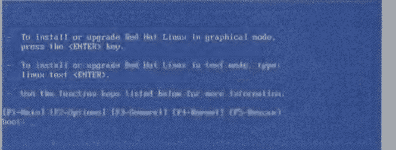

### 硬盘安装

Linux 可以从硬盘安装。要从硬盘安装 Linux，必须将 Linux ISO 文件提取到 DOS 或 Windows 分区，然后在同一系统的另一个分区上进行安装。使用大容量外部硬盘，可以轻松地携带文件在不同机器之间进行安装。由于 CD-ROM 的普及，此选项已很少使用。

### 网络安装

从网络安装 Linux 提供了一种无需携带发行版磁盘在不同机器间移动即可完成安装的方式。磁盘可以存储在通过网络硬盘中，采用与硬盘安装相同的方法，并通过 NFS、FTP 或 HTTP 访问。管理员既可以从软盘启动并回答网络配置问题，也可以在某些系统上将计算机设置为从网络驱动器启动。如果你必须安装许多机器，网络选项会很有用，因为网络安装可以同时在多台机器上启动。网络安装的唯一缺点是，通过网络连接安装通常比从本地介质安装慢。然而，凭借当今快速可靠的网络，这是一个可行的选择。

## 开始安装

你可以使用基于 GUI 或基于文本的方法安装 Linux。大多数系统都能轻松通过基于 GUI 的安装完成，但所有系统都能通过基于文本的安装完成。本章介绍基于文本的安装。无论哪种类型的安装，参数都是相同的。你将使用 CD-ROM 发行版套件，以红帽 9.0 为例完成一个示例安装。如果你使用的是其他发行版套件，问题可能略有不同，但 Linux 安装的详细信息是相同的。这里展示了 Mandrake Linux 的安装屏幕，以显示相似之处。

要开始安装，请插入发行版套件的 1 号盘并开启系统电源。如果系统设置为从 CD-ROM 启动，只需等待欢迎屏幕。如果没有，请进入设置程序并将设备启动顺序更改为从 CD-ROM 启动。红帽安装屏幕（图 3–1）将会显示，提示你使用图形模式或文本模式进行安装或升级。**输入 linux text** 并按**Enter**。

红帽安装将提示你开始安装（图 3–2）或先检查介质。选择**OK**按钮将检查安装介质，以确保它是有效的磁盘。你可以插入发行版套件的每个磁盘以检查所有磁盘。选择**SKIP**将不检查磁盘组而继续安装。执行介质检查将花费大量时间，且并非必需步骤。

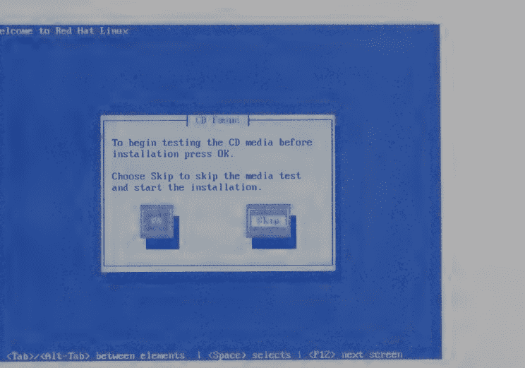

将显示红帽欢迎屏幕（图 3–3）。欢迎屏幕会提醒如果你购买了发行版套件，请注册你的红帽安装。

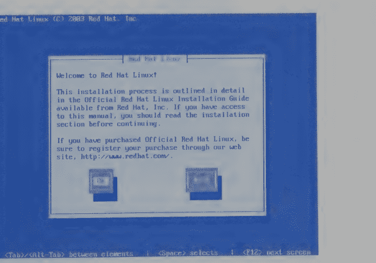

### 虚拟控制台

红帽 Linux 安装程序为你提供了多个虚拟控制台来监控安装过程。虚拟控制台是另一种你可以显示不同类型信息的控制台，如表 3–1 所示。如果在安装过程中遇到问题，这些虚拟控制台会很有帮助。不同控制台上显示的消息有助于缩小问题范围以便修正。通常，你只需要默认控制台。如果遇到问题，你可能需要切换以调查选项。你可以尝试在安装 Linux 时探索虚拟控制台。使用表 3–1 来选择你想要的控制台。

**表 3–1**  
虚拟控制台。

| 控制台 | 按键 | 内容 |
| :---: | :---: | :---: |
| 1 | Ctrl+Alt+F1 | 安装对话框 |
| 2 | Ctrl+Alt+F2 | Shell 提示符 |
| 3 | Ctrl+Alt+F3 | 安装日志 |
| 4 | Ctrl+Alt+F4 | 系统相关消息 |
| 5 | Ctrl+Alt+F5 | 其他消息 |
| 7 | Ctrl+Alt+F7 | GUI 显示 |


### 参数

你需要提供值的第一个参数是你要使用的语言，如图 3–4 所示。使用上下方向键突出显示正确的选项，然后按 Tab 键移动到 OK 按钮。按空格键选择 OK 按钮。如果你不小心按 Tab 键跳过了 OK 按钮，只需继续按 Tab 键。Tab 键会循环遍历所有可用选项。

**图 3–4**  
红帽语言选择。

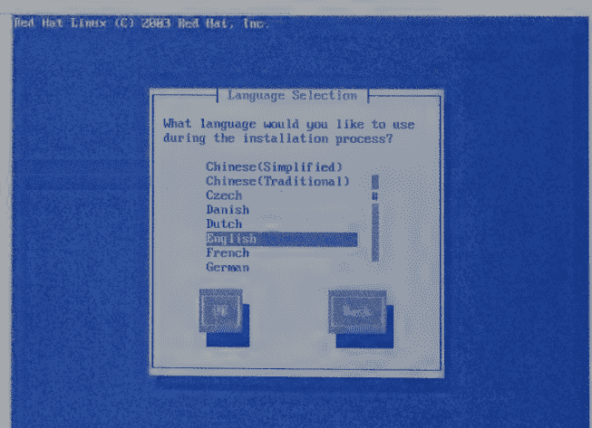

此处选择语言将有助于为后续问题提供默认答案。例如，语言将有助于稍后定位你的时区配置。大多数屏幕都有一个返回按钮。按 Tab 键移动到返回按钮并按空格键将“返回”上一屏幕。如果你回答错了问题，或者只是想检查已选择的选项，请使用此选项。

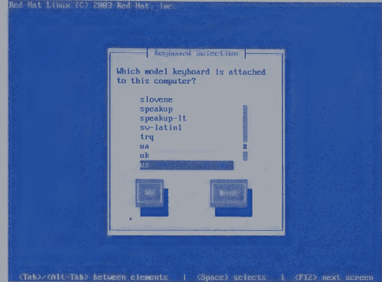

- **红帽键盘选择。**

下一个提示（如图 3–5 所示）询问使用什么类型的键盘。红帽会自动检测你的键盘类型，并留给你确认其选择。几乎所有键盘都可以作为美国键盘使用。选择你的键盘类型，然后再次按 Tab 键到 OK 按钮以选择它。

> **注意**
>
> 安装后，你可以通过选择键盘配置工具来更改键盘布局。在 shell 提示符下，你可以输入 **redhat-config-keyboard** 来启动该工具。你必须是 root（超级用户账户的名称）才能运行任何配置工具。如果你未以 root 身份登录，系统将提示你输入 root 密码。

接下来将提示你配置鼠标，如图 3–6 所示。再次，红帽将自动检测你的鼠标。

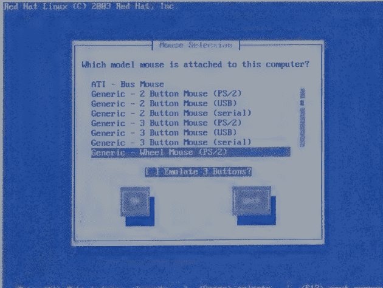

- **红帽鼠标选择。**

## 第 3 章

**表 3–2**  
鼠标端口。

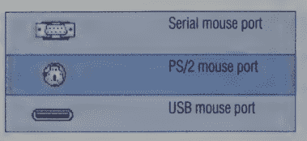

鼠标类型根据其硬件接口分组。表 3–2 显示了不同的鼠标端口。为你的系统选择正确的鼠标类型。如果你找不到与你鼠标完全匹配的选项，请从列表中选择一个通用鼠标。尽量寻找与你鼠标最接近的鼠标类型。考虑到鼠标按键的数量，是否有滚轮，以及使用的端口类型。

**Emulate 3 buttons**（模拟 3 个按键）复选框允许你将双键鼠标用作三键鼠标。图形界面使用三键鼠标更容易操作。如果你选中此复选框，可以通过同时按下两个鼠标按键来模拟第三个“中”按键。

红帽将提供机会让你通过移动屏幕上的鼠标并点击按钮来检查鼠标设置。如果选择无效，你仍可使用 Tab 键和方向键导航屏幕控制。

如果你已经有 Linux 安装，系统将提供升级选项。升级将检查安装，然后提供让你进行更改或添加的选项。例如，如果你想要包含第一次未安装的 ftp 服务器，你可以现在加载该软件包。加载软件包还有其他方法，无需执行升级。软件包的安装将在后文中介绍。

选择 **Perform a new Red Hat Linux installation**（执行新的红帽 Linux 安装）将覆盖现有安装。

### 安装角色

接下来会询问你将安装什么类型的系统。如前所述，你被给予个人桌面、工作站、服务器和自定义的选择（见图 3–7）。企业服务器选项仅在你拥有 Linux 企业版发行版套件时可用。

**图 3–7**  
红帽安装类型。

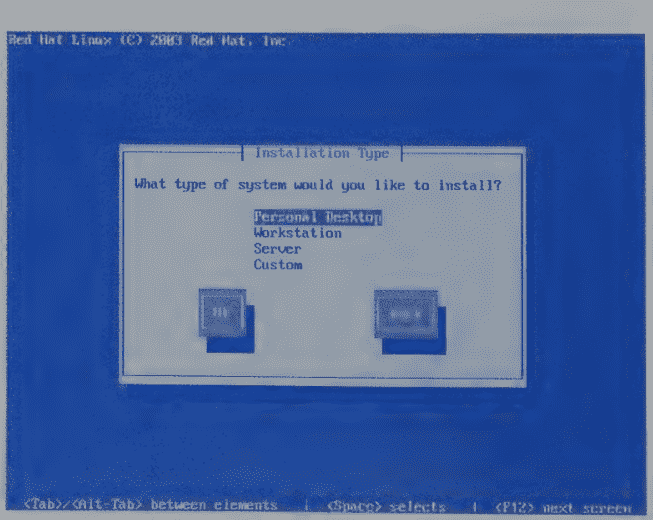


**个人桌面** 将安装图形用户界面（GUI）以及最常用的个人生产力应用程序。

**工作站** 将安装 GUI、网络监控和软件开发工具。

**服务器** 将安装最常用的服务器软件包。

**自定义** 选项允许您混合系统角色，而自定义安装则允许您配置想要安装的软件包、引导加载程序以及其他选项。对于本次安装，请选择自定义选项。

## 磁盘配置

如第 2 章所述，磁盘分区允许您将硬盘划分为不同的部分。每个物理硬盘可以有四个分区。您可以拥有四个主分区，或者三个主分区和一个扩展分区。扩展分区可以进一步划分为多个逻辑分区。

每个磁盘分区都作为目录附加到系统中。当您从一个目录导航到另一个目录时，可以连接到单独的磁盘驱动器或磁盘驱动器上的分区。分区旨在从物理上分离硬盘上的信息，以满足磁盘性能、安全性和备份方面的需求。

您可以允许 Red Hat 安装程序自动分区磁盘，也可以使用 Disk Druid 手动分区磁盘。虽然有多种方法可以分区硬盘，但您会发现 Disk Druid 易于使用，并且大致符合您的需求。

为了本次安装的目的，通过选择自动分区（Autopartition）来指示自动磁盘分区，如图 3–8 所示。此选项将创建一个交换分区（swap partition）、一个 /boot 分区和一个 /（根）分区。这些是安装中最常用的分区。

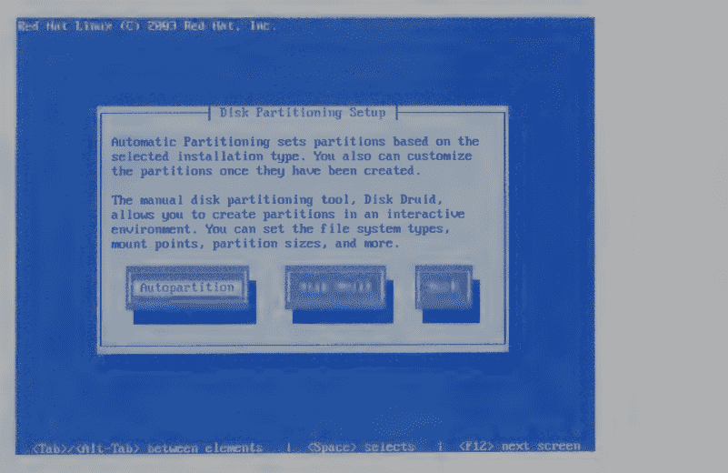


要完成自动分区选择，您需要指示 Red Hat 如何处理现有分区（图 3–9）。您可以选择删除所有现有 Linux 分区、删除所有现有分区，或保留所有分区。如果没有现有分区，Disk Druid 将使用所有可用磁盘空间创建这三个分区。这可以在完成分区选择之前更改。

### 图 3-9
Red Hat 自动分区。

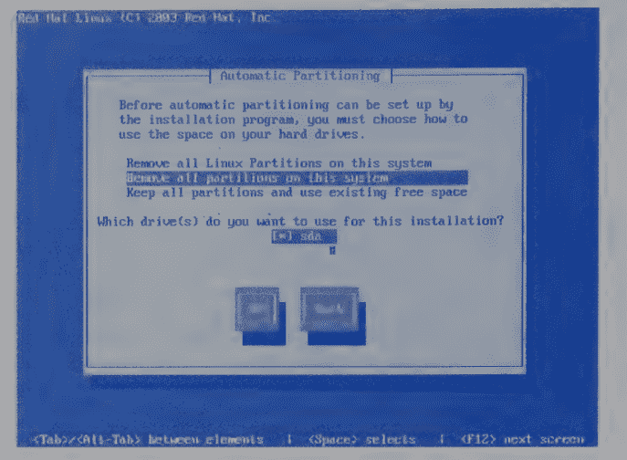

以下选项指示了此次 Linux 安装如何处理现有分区：

-   **删除此系统上的所有 Linux 分区：** 选择此选项以仅删除 Linux 分区（由之前的 Linux 安装创建的分区）。这不会删除您可能拥有的其他分区。
-   **删除此系统上的所有分区：** 选择此选项以删除硬盘上的所有分区，无论文件系统类型如何。
-   **保留所有分区并使用现有空闲空间：** 选择此选项以保留当前数据和分区，并使用可用的现有空闲空间。

> **注意**
> 您可以在第 2 章中了解更多关于磁盘分区的知识。

将显示可用硬盘的列表。您可以选择要在安装中使用的硬盘。EIDE/ATA 硬盘驱动器用 hd 和一个字母表示。例如，第一个硬盘将是 hda，第二个是 hdb，等等。SCSI 驱动器用 sd 和一个字母标识。例如，第一个 SCSI 驱动器将是 sda。

按 Tab 键选中您要在安装中使用的驱动器，然后按空格键进行选择。选中的选项旁边将有一个星号。

将创建自动分区。/boot 分区大约需要 100 MB。交换分区，取决于可用磁盘空间，将是 RAM 大小的一到两倍。通常建议创建的交换分区不小于计算机中物理 RAM 的两倍。/ 或根分区将被分配剩余的磁盘空间。分区名称是分区的挂载点。您可以创建自己的挂载点，或者从更常见的名称列表中选择一个。

如图 3–10 所示的分区屏幕将允许您调整分区以满足您的需求。

### 图 3–10
Red Hat 分区。

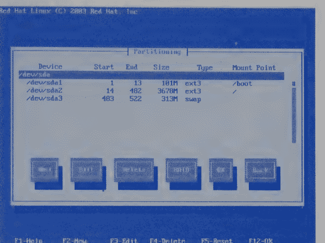

如果您想进行修改，只需删除或编辑现有分区，如图 3–11 所示。选择“新建”可在可用空闲空间中创建一个新分区。

### 图 3–11
Red Hat 添加分区。

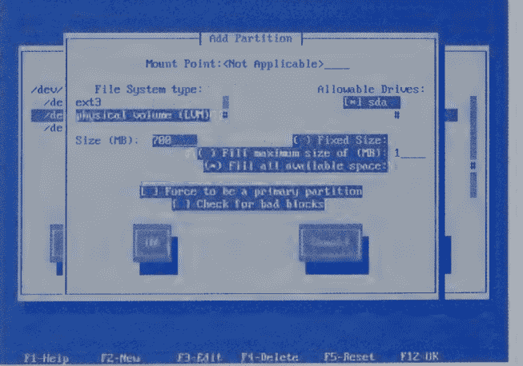

创建新分区时，您还需要指示要使用的文件系统类型。最常用的文件系统是 Linux 原生的 ext2 和 ext3，但如果您希望与 DOS 或 Windows 安装共享信息，可以选择 FAT 类型分区。交换分区是一种特殊的文件系统类型。您必须至少有一个交换分区。文件系统类型在第 2 章中进行了讨论。表 3–3 列出了此安装中可用的文件系统。

首次安装 Linux 时，一个困难的决定是确定分区的大小和数量。大多数人只是创建 /boot 和 swap 分区，并将剩余空间作为一个大卷用于其他所有用途。这是一种完全回避该问题的绝佳方式。

### 表 3–3
可用文件系统。

| 文件系统类型 | 描述 |
| :--- | :--- |
| ext2 | 较旧的 Linux 原生文件系统类型。 |
| ext3 | 最新的 Linux 原生文件系统，是 ext2 的增强版本。这是默认类型。 |
| 物理卷 (LVM) | 允许在卷组内动态调整逻辑卷的大小。 |
| 软件 RAID | 在内核中实现各种 RAID 级别。这是一种低成本的 RAID 实现，允许使用 IDE 和 SCSI 硬盘。 |
| swap | 当物理内存已满时，Linux 使用交换空间。交换空间应为计算机 RAM 的两倍，但不超过 2 GB。 |
| vfat | 此文件系统类型与 Windows 系统兼容。 |

使用系统后，您可以更容易地确定分区的大小，但现在要更改大小需要备份数据、重新分区、格式化新分区，然后恢复数据。**物理卷 (LVM)** 文件系统类型允许您创建单个卷组和逻辑卷来容纳 /、/usr 和 /home 文件系统。如果 /home 文件系统已满，您可以缩小 /usr 文件系统，然后增大 /home。

完成磁盘分区修改后，选择“确定”以继续安装。


## 安装引导加载程序

引导加载程序是计算机启动时运行的第一个软件程序。它加载并然后将控制权转移给操作系统内核软件。内核随后初始化操作系统的其余部分。您可以使用软盘作为引导加载程序，也可以使用位于硬盘上的引导加载程序。Red Hat Linux 附带两个引导加载程序程序：GRUB 和 LILO。

Grand Unified Bootloader (GRUB) 最初由 Eric Stefan Bolen 设计和实现。现在由 GNU 管理。GRUB 是一个多引导加载程序，意味着它支持多个操作系统。如果您在硬盘上加载了多个操作系统（称为双启动），这将非常有用。GRUB 是 Red Hat Linux 安装的默认引导加载程序。

Linux Loader (LILO) 是一个较旧的加载程序，也是最广泛使用的。LILO 是一个多功能的 Linux 引导加载程序。它不依赖于特定的文件系统。它可以从软盘和硬盘启动 Linux 内核映像，甚至还可以启动其他操作系统。在启动时可以选择多达十六个不同的映像。

您可以选择 GRUB、LILO 或不使用引导加载程序。如果您选择不使用引导加载程序，则必须有软盘或现有的引导加载程序来加载您的 Linux 操作系统。您有机会在安装过程的末尾创建一个启动软盘。

为您的安装选择 GRUB 引导加载程序，如图 3–12 所示。实际上，您使用哪个引导加载程序并不重要，但在此书的其余部分中，您将使用 GRUB。

您可以识别供引导加载程序传递给 Linux 内核在启动时使用的选项。这些将在后续章节中讨论。您有机会在每次 Linux 启动时输入引导参数，因此您不必在此时输入值。我们此时不会向内核传递任何值。

如图 3–13 所示的**强制使用 LBA32（通常不需要）**选项允许您超过 /boot 分区的 1024 柱面限制。如果您有一个支持 LBA32 扩展以在 1024 柱面限制之上启动操作系统的系统，


## 安装 Linux

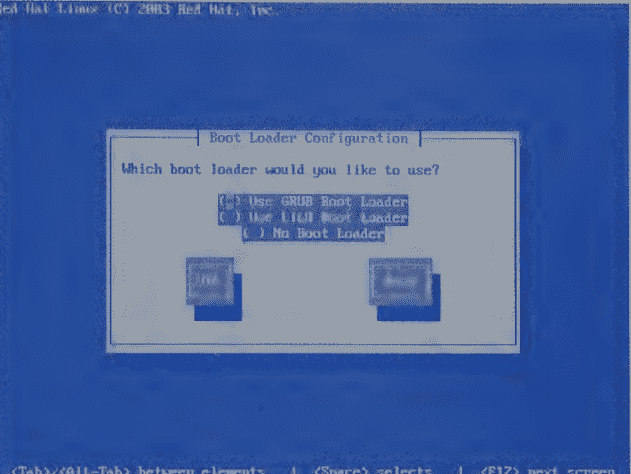

**图 3–12**
Red Hat 引导加载程序选择。

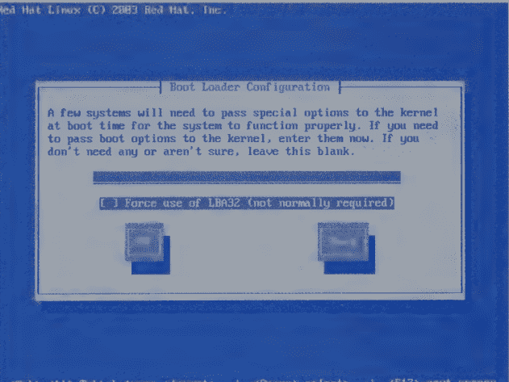

**图 3–13**
Red Hat 引导加载程序配置。

如果你希望将 /boot 分区放置在 1024 号柱面之后，应选择此选项。某些旧系统无法访问硬盘上超过前 1024 个柱面的数据。

引导加载程序可以设置密码保护。这允许你在尝试启动默认操作系统以外的其他操作系统之前，或进行启动时配置更改之前，要求输入密码。该密码仅用于引导加载程序；一旦通过此层级，你将被要求输入 Linux 操作系统的身份验证密码。

如果可以物理接触你的 Linux 系统，则应使用引导加载程序密码。如果没有密码，任何人都可以中断你的 Linux 启动过程并向内核传递启动选项。这可能危及系统安全性。设置引导加载程序后，用户必须先输入密码，才能获得输入选项的机会。

要使用引导加载程序密码（图 3–14），使用标签键切换到“使用 GRUB 密码”选项，然后按下空格键进行选择。接着使用标签键切换到“引导加载程序密码”并输入你希望使用的密码。再按一次标签键切换到“确认”，并再次输入相同的密码。

59

# 图 3-14

Red Hat 引导加载程序配置——使用密码。

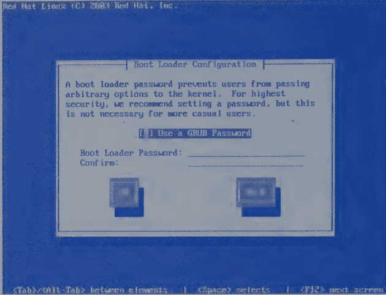

# 注意

> 你应制定密码策略。通常，密码长度至少应为八个字符，并且应包含大写字母、小写字母、数字和特殊字符。你不应在密码中使用任何字典中的单词。密码应足够独特以防止他人猜测，但应是你能够记住的内容。

如果你的计算机上安装了多个操作系统，你可以选择默认启动哪一个。当 Linux 操作系统启动时，它会在操作系统列表上停留一段时间。如果没有用户交互，默认操作系统将被启动。使用标签键切换到你希望自动选择启动的操作系统（图 3-15），然后按下空格键进行选择。

# 图 3-15

Red Hat 引导加载程序配置——选择操作系统。

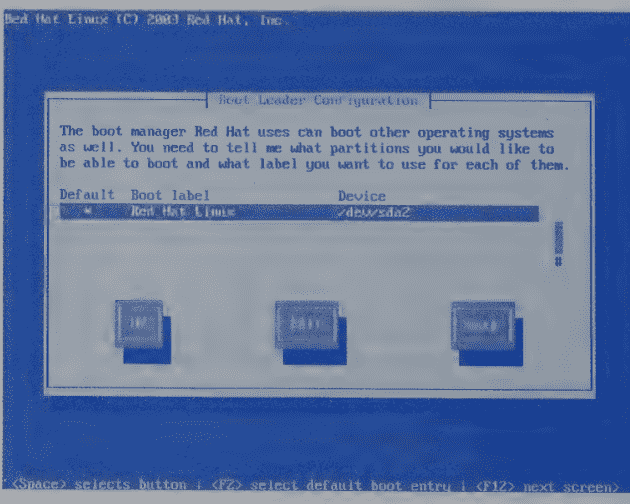

所有可引导分区都会被列出，包括由其他操作系统使用的分区。如果你使用 GRUB 作为引导加载程序，标签将显示为 **Red Hat Linux**。如果你使用 LILO 作为引导加载程序，标签将显示为 **linux**。若要更改显示的标签，请选择该标签，然后选择 **编辑** 按钮。

选择你要使用的引导加载程序后，你必须决定将其安装在哪里（图 3-16）。你可以将引导加载程序安装在两个位置之一——主引导记录（MBR）或引导分区的第一个扇区。

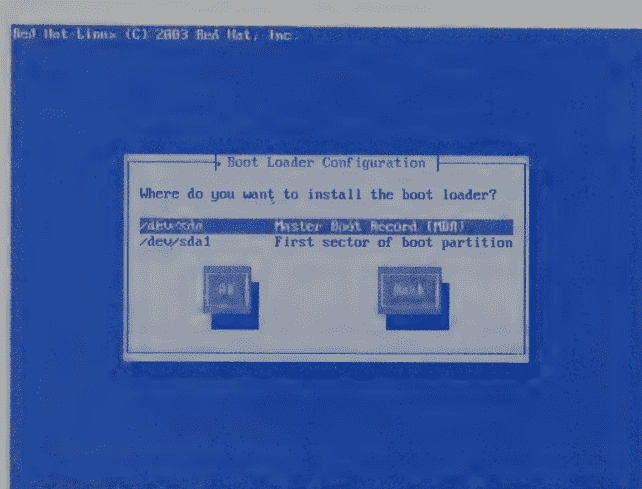

图 3-16
Red Hat 引导加载程序配置——引导加载程序位置。

MBR 是引导加载程序的推荐安装位置。MBR 是硬盘上的一个特殊区域，由计算机的 BIOS 自动加载。

如果你的系统中已经存在另一个引导加载程序，则推荐安装在引导分区的第一个扇区。在这种情况下，另一个引导加载程序将首先获得控制权。你可以配置该引导加载程序以启动 GRUB 或 LILO，随后由它们引导 Linux。

还有其他可用的引导加载程序。你可以使用引导软盘、LOADLIN、SYSLINUX 或商业引导加载程序。在安装程序结束时，系统会提示你创建一张引导软盘。LOADLIN 是一个简单的基于 DOS 的工具，用于从 DOS 将 Linux 内核加载到内存中。SYSLINUX 是一个在 DOS 下运行的引导加载程序。可以使用标准 DOS 工具操作 SYSLINUX 软盘。商业程序包括 System Commander 和 Partition Magic。这些程序能够引导 Linux，但仍需要在你的 Linux 分区中安装 GRUB 或 LILO。

## 基本网络设置

如果系统中安装了网络设备，你将看到网络配置屏幕。必须配置网络才能访问网络资源。

你遇到的最常见的网络接口卡（NIC）是以太网卡。当今的以太网设备提供 10、100 或 1000 Mbps（兆位每秒）的访问速度。

要使用网卡，操作系统必须拥有一种协议，以便其他网络设备能够与其通信。最常见的网络协议是传输控制协议/互联网协议（TCP/IP）。TCP/IP 是一套用于执行多种任务的协议。它包括域名服务（DNS）、文件传输协议（FTP）、Telnet 等协议。

目标 1.10

每个使用 TCP/IP 的网络设备都有一个称为 IP 地址的唯一网络地址。IP 地址是 32 位值，由四个称为八位组的 8 位值标识。这些值以十进制表示法书写以便于使用。例如，10001011.10000000.00000000.00000000 转换为 139.128.0.0，这是一个 B 类 IP 地址。

IP 地址分为三类：A 类、B 类和 C 类。每类 IP 地址由网络部分和主机部分组成。A 类地址在第一个八位组处划分，B 类在第二个，C 类在第三个。可以使用子网掩码对主机部分进行细分以提供子网。子网掩码类似于 IP 地址，也是 32 位并分为四个八位组。A 类网络的默认子网掩码是 255.0.0.0，B 类网络是 255.255.0.0，C 类网络是 255.255.255.0。每个八位组可以提供 256 个值。

子网允许你将网络划分为包含较少计算机的段，这比在非常大的段中有大量计算机更易于管理。同一网络段上的计算机可以相互通信，但必须拥有一个称为路由器的设备，以便将信息传递到另一个段，从而在大型网络之间进行通信。例如，互联网上有数百万台计算机在广阔的距离上不断进行通信。如果每台计算机都在同一个网络段上，通信将不可能实现。

为了通过互联网进行通信，计算机必须拥有 IP 地址、子网掩码、它将经过的路由器地址以及域名服务器（DNS）的 IP 地址。DNS 服务器查询如 www.yahoo.com 这样易记的命名地址，并将其转换为 IP 地址。

计算机通信所需的值可以静态提供或动态提供。静态配置需要管理员明确输入 IP 地址、子网掩码和其他值。动态值可以通过称为 DHCP（动态主机配置协议）或 BOOTP 的服务输入。DHCP 服务器配置了一组值，当网络设备查询时，它会分配这些值。BOOTP 是 DHCP 服务的较旧版本。

可以在安装期间通过输入静态值或指示 Linux 使用 DHCP 来配置网络。一个系统可以拥有多块网卡。每块网卡都必须进行配置。如图 3–17 所示的网络配置屏幕允许你选择用于配置网卡的选项。

图 3–17  
Red Hat 网络配置——网络接口卡。

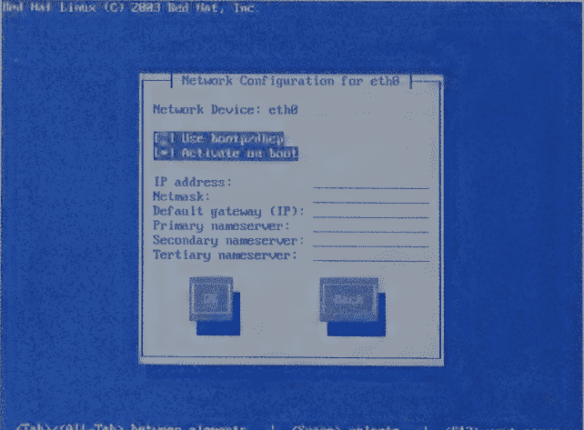

选择“使用 bootp/dhcp”表示动态配置。选择“启动时激活”表示每次计算机启动时都会配置所选的网卡。IP 地址是用于输入该网卡点分十进制主机值的文本区域。Netmask（子网掩码）将包含子网掩码。默认网关（IP）是你将要连接的路由器的 IP 地址。主要、次要和第三域名服务器是你可使用的 DNS 服务器的 IP 地址。你使用的值取决于你的网络设置。你必须从网络管理员处获取这些值。

## 目标 2.7

### 基本安全

Linux 中的安全性是通过使用密码、权限和防火墙来实现的。本章讨论了在安装过程中使用防火墙的情况。密码和权限的管理将在第 12 章中讨论。

防火墙旨在防止对私有网络的未授权访问。防火墙可以通过硬件和软件来实现。防火墙通常用于防止未授权的互联网用户访问连接到互联网的私有网络。所有进入或离开本地网络的消息都必须经过防火墙，防火墙会检查所有消息并阻止那些不符合安全标准的消息。

Linux 提供防火墙保护。此防火墙是网络与其他计算机资源之间的软件。它决定了网络上的远程用户可以访问计算机上的哪些资源。Red Hat 具有三个预定义的安全保护级别，如图 3–18 所示——高、中、无防火墙。

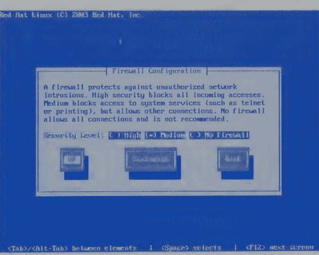

图 3–18
Red Hat 防火墙级别配置。

**高**设置不接受未由你明确定义的连接。默认情况下，仅允许以下连接：

- DNS 响应
- DHCP，以便任何使用 DHCP 的网络接口都能正确配置

高安全性不允许活动模式 FTP、IRC DCC 文件传输、RealAudio 以及远程 X 窗口系统访问。如果你连接到互联网，但不计划运行任何服务器软件，这是最安全的选择。

**中**设置不允许远程机器访问你系统上的某些资源。默认情况下，不允许访问以下资源。

- 端口号低于 1023 的端口。编号低于 255 的端口用于公共应用，例如 23 用于 Telnet，21 用于 FTP，53 用于 DNS。255 到 1024 之间的端口分配给公司用于可市场化的应用，例如 389 用于 LDAP。
- NFS 服务器端口 2049。对于远程服务器和本地客户端，NFS 均被禁用。


- 远程 X 客户端的本地 X 窗口系统显示
- X 字体服务器端口

如果您希望允许某些资源，同时阻止对常规系统服务的访问，请选择“中等”防护级别。

**无防火墙** 设置为您提供对系统的完全访问权限。仅当您运行在受信任的网络中，或在另一台设备上拥有防火墙时，才应选择此设置。

选择“自定义”（如图 3–19 所示）允许您添加受信任的设备或允许传入的服务。如果您希望保护大多数端口，但仍需使某些服务可用，则应选择此设置。

### 图 3–19

Red Hat 防火墙传入服务配置。

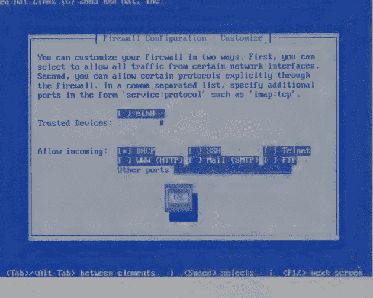

**受信任设备** 选项允许指定设备的所有流量访问您的系统。如果您有一个连接到本地网络的网络设备和一个连接互联网的调制解调器连接，您可以信任本地网络，同时禁止来自互联网的连接。

**允许传入** 选项允许指定的服务通过防火墙。某些服务被明确列出，但也可以输入其他端口。列出的服务包括：

- DHCP，动态主机配置协议，是一种用于为网络中的设备分配动态 IP 地址的协议。
- SSH，安全外壳协议，是一套用于登录到远程机器并执行命令的工具。使用 SSH 时，整个会话（包括密码传输）都是加密的。
- Telnet 是一种用于登录远程机器的协议。Telnet 通信是未加密的，不提供任何安全性。
- WWW (HTTP)，超文本传输协议，被 Apache 和其他 Web 服务器用于发送网页。
- 邮件 (SMTP)，简单邮件传输协议，允许电子邮件通过防火墙传输。只有当您运行邮件服务器时才需要此协议。
- FTP，文件传输协议，用于在网络上机器之间传输文件。
- 其他端口是一个用于输入您希望允许传入服务的端口的字段。

Red Hat Linux 支持多种语言。您必须选择一个默认语言，如图 3–20 所示。您可以选择多种语言。如果您只使用一种语言，仅选择该语言将节省磁盘空间。

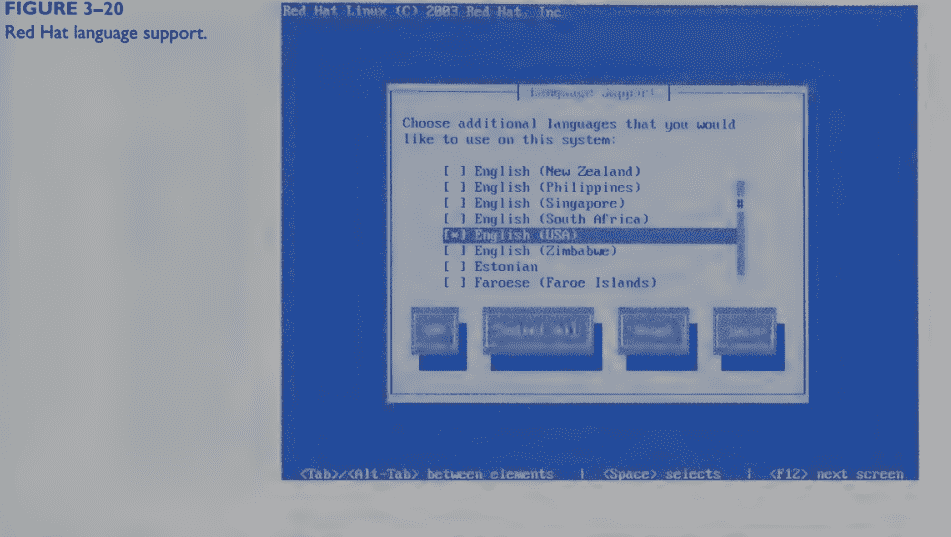

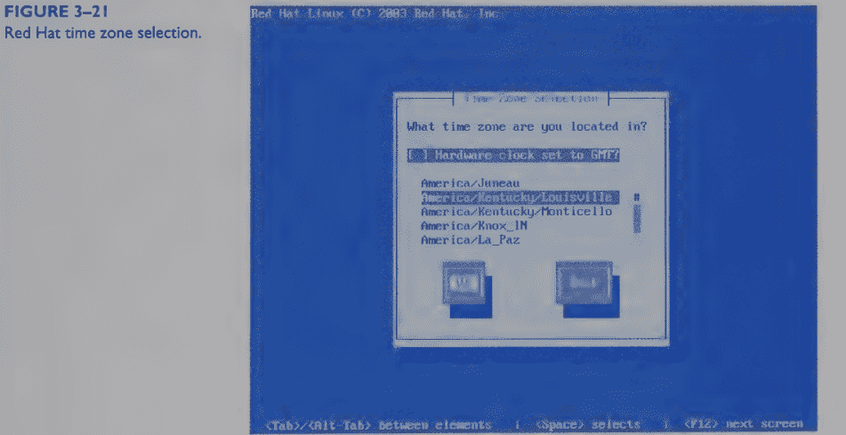

您可以通过选择物理位置（图 3-21）或相对于协调世界时（UTC）的时区偏移量来设置时区。例如，*America/Knox_TN* 是田纳西州诺克斯维尔的示例选择。同一地点的时区偏移量为 *-5*，即 UTC 减五小时。

在图形安装界面中，您可以通过交互式地图点击您时区内的特定城市。城市由黄色圆点指示，选中后会变为红色的 X。还有一个城市列表供您选择。

名为 *root* 的用户账户对系统拥有完全访问权限，用于系统维护和管理工作。设置 root 账户和密码（如图 3-22 所示）是安装过程中最重要的步骤之一。密码应遵循您的密码策略。

root 用户也被称为超级用户。此账户应仅用于系统管理，不应用于日常使用。您可以在安装的后期创建一个非 root 账户供一般使用。您输入的密码将以一串星号 (*) 显示，以防止他人查看。

在 Linux 中，通过允许不同的认证方法可以增强系统安全性。认证是识别个人的过程。这与授权不同，授权赋予个人访问系统的权限。认证仅确保该个人声称自己是其所说的身份。

Red Hat Linux 使用密码来验证用户的身份。因此，密码安全性非常重要。为了保护密码，Red Hat Linux 提供影子密码和 MD5 散列。这些技术提供强加密，迫使试图进行未授权访问的人使用暴力破解攻击。暴力破解攻击意味着通过反复尝试破解密码来获得未授权的访问，这非常缓慢且会留下明显的痕迹。

为了保护您的网络免受入侵，制定一个强大的密码策略是个好主意。密码策略是一份概述组织政策的文档。需要包括的点有密码的长度、密码可以使用的时长、密码必须包含的字符以及其他确保所有用户维护安全密码的政策。要创建强密码，您首先应避免以下做法：

- 不要仅使用字母或数字。
- 不要使用字典中的单词。
- 不要使用外语单词。
- 不要使用个人信息，例如您的出生日期或姓名。
- 不要反转可识别的单词。
- 不要写下您的密码。
- 不要在所有机器上使用相同的密码。

然而，您应该执行以下操作：

- 密码长度至少为八个字符；越长越好。
- 混合使用大写字母和小写字母。您的密码区分大小写。
- 混合字母和数字。字母和数字的混合应在密码内部，而不仅仅是在开头或结尾。
- 包含特殊字符，例如 ! 或 #。
- 定期更改您的密码。

使用密码创建方法。想一个容易记住的短语，例如“Way down upon the Suwanee river, Far, far away.” 接下来，将其转换为包含标点的缩写。例如，**WdutSr.Fa**。通过用数字替换某些字母来增加复杂性。保持一致性，用相同的数字替换特定的字母；例如，将 d 替换为 6，将 F 替换为 7，等等，最终得到密码 **W6ut5r.7.fa**。

一个好的密码保护策略是密码老化。密码老化意味着密码将在设定的时间内保持有效，然后系统将提示用户更改密码。老化还可以确保相同的密码不能被重用，并要求密码在可以更改之前必须活跃若干天。

Red Hat Linux 提供多种认证方式，并确保密码受到保护，防止未授权访问。认证配置屏幕（如图 3–23 所示）提供了实现此功能的选项。以下是每个选项的简要描述：

### 图 3–23

Red Hat 认证配置。

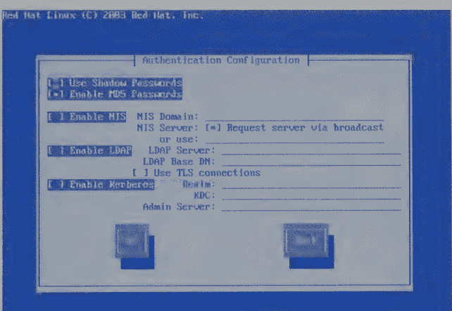

- **使用影子密码** 通过将加密的密码哈希从明文的 /etc/passwd 文件移动到仅 root 用户可读的 /etc/shadow 文件，从而增强系统认证文件的安全性。影子密码还存储有关密码老化的信息，并允许实施安全策略。
- **启用 MD5 密码** 允许使用长密码，最多可达 256 个字符，而不是八个。
- **启用 NIS** 允许您在同一个网络信息服务（Network Information Service）域中运行一组计算机，并使用共同的密码和组文件。
- **启用 LDAP**，轻量级目录访问协议，是一种用于认证的集中式分层数据库。
- **启用 Kerberos** 是一种提供网络认证服务的系统。

在安装时，请按照图 3–22 所示选择 **使用影子密码** 和 **启用 MD5 密码**。这些选项将使大多数用户无法读取密码，并允许使用长密码。

## 目标 1.5
软件包

在您配置并格式化分区后，即可准备选择要安装的软件包。软件包是可以安装在您的 Red Hat Linux 上以完成广泛任务的软件应用程序。例如，可以安装软件包以


## 安装 Linux

处理网络配置任务、互联网访问任务、个人生产力任务以及其他任务。应用程序的组合范围从 GUI 桌面到服务器应用程序。

你选择安装的程序包应经过仔细挑选，尤其是在资源有限的情况下。你安装的每个程序包都会占用磁盘空间，并且一旦安装并运行，就会占用内存（RAM）和 CPU 处理时间。

除非你选择了自定义安装，否则安装程序会自动为你选择大多数程序包。如果你选择了个人桌面安装，安装过程将根据该类型的安装选择最实用的一组程序包。

你可以通过选择如图 3–24 所示的**选择单个程序包**选项来自定义你所使用的程序包。此选项允许你选择或取消组内的程序包。例如，如果选择了游戏，你可以从所有游戏的列表中仅选择你想要的游戏。

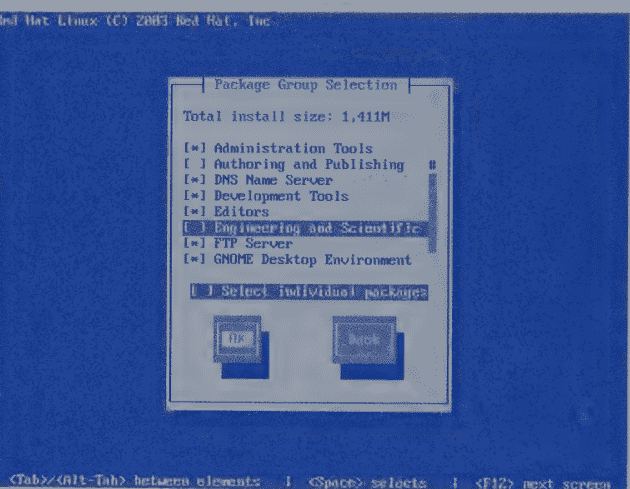

# 图 3-24
Red Hat 程序包选择。

你也可以选择**所有**选项来安装 Red Hat 发行版中包含的所有程序包。

某些程序包依赖于其他程序包。换句话说，为了安装某些程序包，你必须同时拥有依赖的程序包。Red Hat Linux 安装程序会检查依赖关系，并在完成安装过程之前发出警告。如果存在未解决的依赖关系，请选择**安装程序包以满足依赖关系**选项。这将通过将所有所需的程序包添加到所选程序包列表中来自动安装以解决依赖关系的程序。

在安装期间未安装的程序包可以通过运行 **redhat-config-packages** 命令稍后添加。此命令将启动程序包管理工具。该工具和程序包将在第 5 章中详细讨论。

通过在*开始安装*对话框（见图 3-25）上选择**确定**来开始安装。选定程序包后，它们将被安装到文件系统中。你的安装很可能不会有任何问题地完成。但是，如果出现问题，详细信息将保存在安装日志文件中。该文件包含安装期间生成的所有消息的副本，如果你不得不重新安装 Linux，该文件可能会证明极其有价值。日志文件可以在 /root/install.log 目录中找到。

如图 3-26 所示的进度指示器将显示完成百分比。这让你了解一切是否正常进行，而不是系统“卡住”。

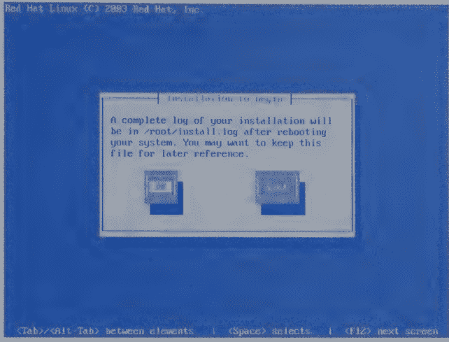

# 图 3-25
Red Hat—开始安装。

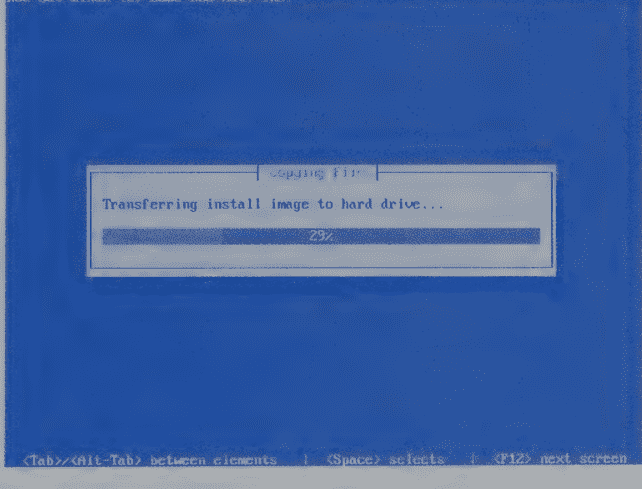

# 图 3-26
安装进度指示器。

如果你正在从 CD-ROM 安装，你可能会被提示安装第二张以及第三张磁盘。是否提示你插入后续磁盘取决于你选择的程序包。

### 创建启动磁盘

并非所有新系统都有软盘驱动器；然而，如果你的系统有，强烈建议你创建一个启动磁盘。启动磁盘可以使用 GRUB、LILO 或第三方启动加载器正确引导你的系统。如果你的系统引导扇区因某种原因损坏，启动磁盘仍将允许你启动系统。

启动磁盘可以在安装后创建，或者在命令行在任何时候创建。要在安装过程中创建启动磁盘，请在提示时选择“是”，然后将一张新的格式化磁盘插入你的软盘驱动器，如图 3–27 所示。磁盘上的所有数据都将被擦除。某些安装会提示你插入多张磁盘。

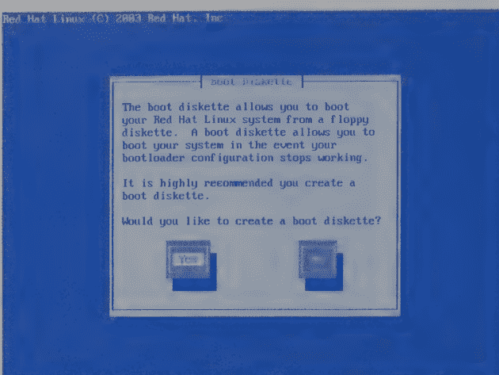

# 图 3-27
Red Hat Linux (C) 2003 Red Hat. Inc.

### 显卡支持

尽管你正在执行文本安装，但你可能希望运行 X 窗口系统。GUI 桌面允许你使用鼠标指向并点击你想要的选项。要使用 GUI 接口，你必须配置你的显卡。

Red Hat Linux 将尝试自动选择你系统上的显卡。如果它没有找正确的卡，你可以选择“更改”选项，然后从列表中选择你的显卡，如图 3–28 所示。


# 图 3-28
显卡选择。

如果你的显卡未出现在列表中，可能是不支持。如果你对显卡有技术知识，你可以选择“未列出的显卡”并尝试通过匹配显卡的芯片组来配置它。大多数显卡都包含在支持卡列表中，因此你不应该有任何问题。

显卡配置对话框允许你输入安装在显卡上的显存量。随卡或计算机系统提供的文档将指示显存量。

如果你选择稍后配置你的视频，你可以从命令提示符使用 `redhat-config-xfree86` 程序。你需要是 root 用户才能进行更改。

作为视频配置的一部分，将被要求选择一个显示器（图 3-29）。同样，Red Hat Linux 安装程序将尝试自动选择显示器。如果没有选择正确的显示器，你可以选择**更改**，然后从列表中选择正确的显示器。

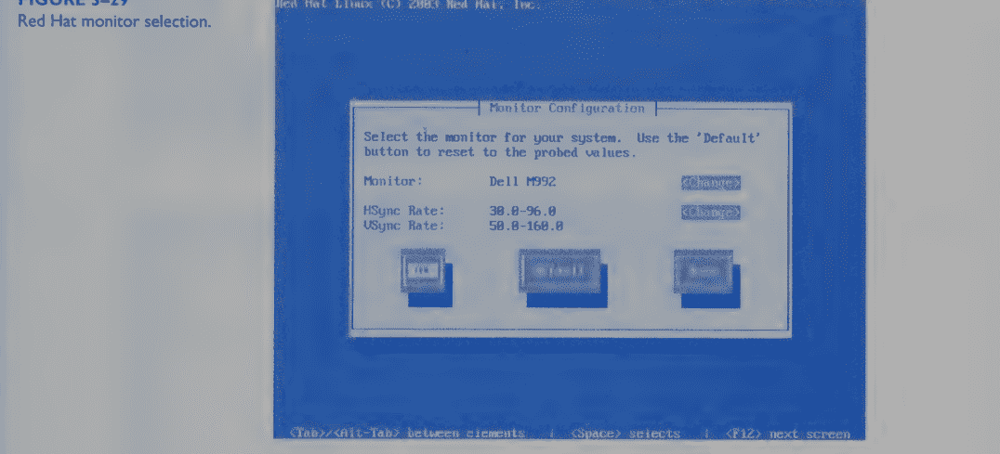

# 图 3-29
显示器选择。

如果你的显示器不在列表中，你可以选择一个**通用**型号。通用显示器将指示显示器的大小、水平和垂直同步范围以及其他属性。

如果你执行自定义或服务器安装，你可以选择将 Linux 系统启动到文本或 GUI 接口。大多数用户推荐 GUI。GUI 非常类似于 Windows GUI，易于管理和使用，特别是对于初级用户。

某些系统需要仅文本环境。通过仅使用文本，你可以释放大量计算机资源供其他应用程序使用。使用文本接口的唯一缺点是，你必须知道管理 Linux 操作系统所需的命令。本书后续章节中讨论的许多命令将使用文本环境。

如图 3-30 所示的 X 自定义屏幕允许你选择颜色深度、显示的颜色数量以及分辨率，分辨率是用于形成屏幕图像的像素数量。此屏幕还为你提供两个选项来选择如何启动系统，图形或文本。选择**图形**选项。

为了本次安装的目的，请以图形界面登录 Red Hat Linux。文本环境可以轻易从 GUI 进入，以探索文本命令。

如图 3-31 所示的完成提示表明你的 Red Hat Linux 安装已完成所有任务。移除任何安装介质，软盘或 CD，并选择**确定**以自动重启你的计算机。如果你没有安装启动加载器，你需要启动磁盘才能在计算机上启动 Linux。

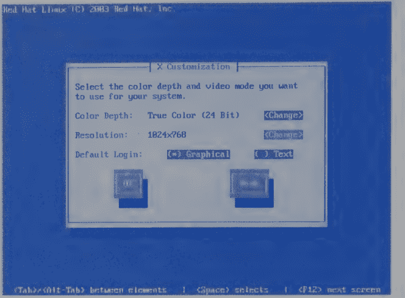

# 图 3-30
Red Hat X 配置。

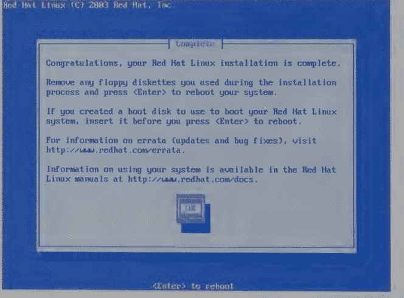

# 图 3-31
Red Hat 安装完成。

### 安装验证

**目标 1.15**


第一次启动 Red Hat Linux 系统时，将显示设置代理，如图 3-32 所示。设置代理引导你完成 Red Hat Linux 的配置。（某些发行版会自动运行设置；其他则不会。）设置代理用于设置系统时间和日期、添加用户、安装软件、向 Red Hat 注册等。如果稍后需要更改值，你可以使用 GUI 和文本环境中的配置工具来做到这一点。这些工具将在第 4 章中涵盖。

第一个设置代理屏幕允许创建用户帐户，如图 3-33 所示。你在安装期间创建的 root 帐户是超级用户帐户。使用此帐户进行正常登录风险太大。root 帐户可以更改 Linux 内的任何值，因此应该创建用户帐户。设置代理允许你输入用户名、可选的全名和密码。输入的密码的每个字符都将显示为星号。


## 安装 Linux

Red Hat 配置代理。

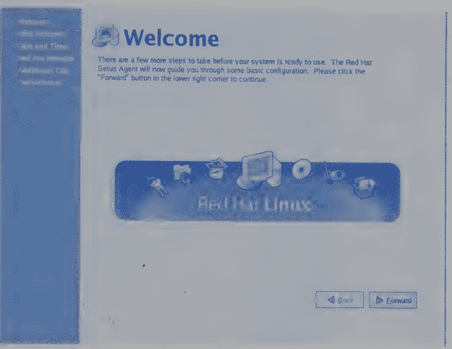

Red Hat 用户账户。

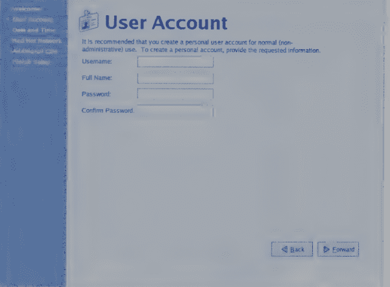

下一步手动设置机器的日期和时间，如图 3-34 所示，同时也会调整计算机的基本输入/输出系统 (BIOS) 上的时钟。要在系统上设置日、月和年，请单击日期，然后使用时间控件。

计算机可以使用网络时间协议 (NTP) 自动与网络时间服务器同步日期和时间。网络时间服务器是通过网络连接向其他计算机发送准确日期和时间设置的计算机。勾选标记为 **启用网络时间协议** 的复选框，然后使用下拉菜单选择要使用的时间服务器。

如果您购买了*盒装*发行版套装，请将您的系统与 Red Hat Network（图 3-35）进行注册。选择 **是，我希望将我的系统注册到 Red Hat Network** 可让您接收 Red Hat Linux 的自动更新。若要跳过此步骤，请选择 **不，我不希望注册我的系统**。如果您改变主意并希望稍后注册，您可以访问 http://www.redhat.com。

### 图 3-34

Red Hat 日期和时间。

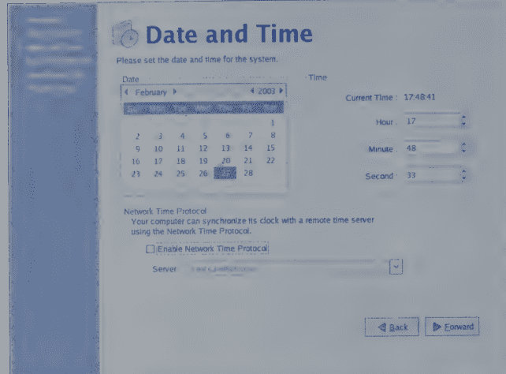

### 图 3-35

Red Hat 注册。

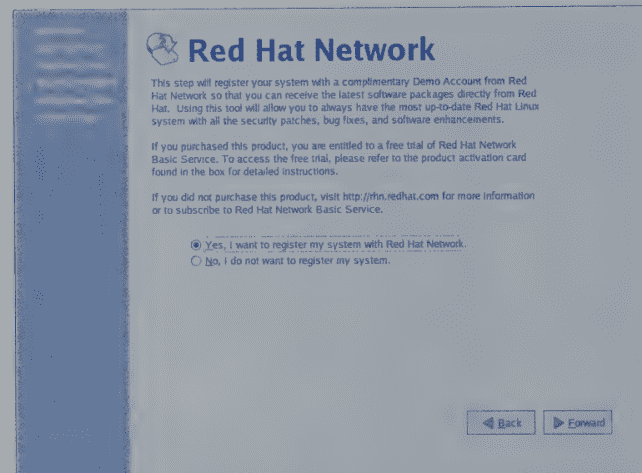

若要安装初始安装期间未安装的额外 Red Hat Linux RPM 软件包，请使用 **额外光盘** 屏幕（图 3-36）。这可能是第三方提供商的软件，或者来自 Red Hat Linux 文档光盘的文档。配置代理完成后，将显示登录提示，如图 3-36 所示。如果您选择了文本登录，请输入您创建的账户用户名或 root 账户名，然后按 Enter 键。输入该账户的密码并按 Enter 键，默认提示将显示。密码将不会被显示。

**注意**

提示以黑色背景上的白色字符显示。为了使屏幕易于阅读，其余屏幕显示为白色背景上的黑色字符。

### 图 3-36

Red Hat 额外光盘。

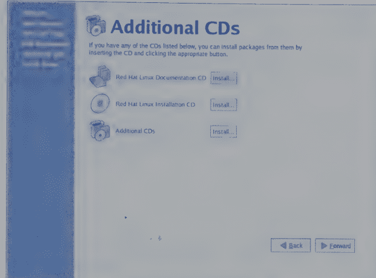

### 图 3-37

GUI 登录屏幕。

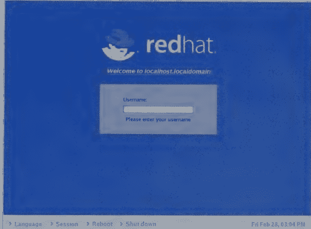

如果您选择了图形启动，将显示 GUI 登录屏幕（图 3-37）。输入您在配置代理期间创建的登录账户或 root。在密码提示处输入密码；它不会显示。

大多数 Linux 发行版都有一个安装选项的日志文件。此文件包含已安装文件列表及任何失败信息。Red Hat 安装日志为 **root/install.log**。要从文本模式查看此文件，请输入 **less /root/install.log** 然后按 Enter 键。

> **注意**
>
> less 命令提供选项以在文件中向前和向后移动。使用 F 向前翻一屏，B 向后翻一屏，H 查看帮助，Q 退出查看。less 还有许多其他命令。要查看 less 的命令和选项，请在文本提示处输入 **man less**。

GUI 有一个 shell 提示符，它是一个类似于文本模式的应用程序，允许您输入命令。许多用户更喜欢使用 shell 提示符而不是 GUI 来输入命令。对于许多命令来说，shell 提示符比 GUI 使用更快。

若要打开 shell 提示符，请在桌面空白处右键单击，并从 resulting 菜单中选择 **新建终端**。若要退出 shell 提示符，请输入单词 **exit** 并按 Enter 键。

要从文本环境关闭系统，请输入 **shutdown -h now**。这告诉 Linux 立即停止系统。

要从 GUI 提示符关闭 Linux，请单击 GNOME 桌面左下角的图标，然后从菜单中选择 **注销**。将显示确认对话框，其中包含 **注销**、**关机** 或 **重启** 计算机的操作。选择 **关机** 然后单击 **确定**。Linux 关闭后，即可安全地关闭计算机电源。

## 记录您的配置

任何安装中最重要的一部分是文档。文档是谈论最多但执行最少的一项安装任务。如果您需要排除系统故障或执行另一次安装，良好的文档是必需的。文档应包含安装过程中输入的所有参数以及对配置所做的任何更改。

文档应包含启动配置、键盘和鼠标参数、视频参数、磁盘配置、网络设置、防火墙设置以及已安装的软件。使用安装检查清单（见附录 A）指导您的文档工作。记录的信息越多越好。

- 启动配置应包括启动加载器程序、默认操作系统、启动加载器位置以及启动加载器密码。密码是防止未授权访问 Linux 系统的第一道防线，应加以保护。与用户密码不同，服务器密码应被记录并放置在安全位置。否则，如果管理员发生事故，Linux 系统的某些部分可能变得不可用。
- 键盘和鼠标配置应包括所使用的语言和鼠标类型。
- 视频参数应包括型号、RAM 量、分辨率和颜色。应包括监视器参数。
- 磁盘配置应包括硬盘类型和分区信息。应包括文件系统与分区挂载点。
- 网络设置应包括网络参数是手动输入还是通过 DHCP/BOOTP 输入。如果这些参数是手动输入的，应记录主机、网关和 DNS 的 IP 地址。
- 防火墙设置应包括允许和拒绝的端口。
- 应标识已安装的软件。

## 摘要

Linux 发行版套装可以从零售商处购买、从供应商处下载或从他人处借用。购买发行版套装可让您访问在线或电话支持以及更新。发行版套装适用于 Intel、Intel 兼容、Alpha、Power PC 和 Sparc 计算机平台。

安装可以通过 CD-ROM、硬盘或网络完成。大多数系统将从 CD-ROM 启动，提供一个易于携带的发行版套装，可用于多个系统。可能需要启动软盘来启动 Linux。Linux 发行版附带一个实用程序，用于从提供的映像文件创建启动软盘。

Linux 在安装过程中提供多个虚拟控制台以供使用。虚拟控制台提供了一种查看安装对话框、安装日志及其他信息的方式，如果出现问题，这些方式可能非常有价值。

安装期间会输入许多参数，并且应对其进行记录。参数包括语言、输入设备、输出设备、磁盘配置、网络配置、初始安全设置以及已安装的软件包。

安装完成后，应对系统进行测试。基本测试包括通过文本或 GUI 登录、查看安装日志文件、配置基本参数以及关闭系统。

## 自测题

1. 一种可以下载并用于制作原始磁盘精确副本的映像文件被称为 ________。
   - a. ISO
   - b. LUG
   - c. Installationfest
   - d. CDR

2. Linux 内核是一个 ________ 内核，提供了一种无需重新编译即可向内核添加驱动程序的方法。
   - a. 整体式
   - b. 模块式
   - c. 编译式
   - d. 驱动程序

3. Linux 操作系统可以从哪些来源安装？
   - a. 软盘驱动器
   - b. 硬盘驱动器
   - c. CD-ROM 驱动器
   - d. 网络接口卡
   - e. 以上全部

4. 以下哪项是用于写入磁盘映像的 DOS 程序？
   - a. gzip
   - b. disko.dll
   - c. restorb.exe
   - d. rawrite.exe

5. 判断正误：IP 地址是 32 位值，由四个称为八位组的 8 位值标识。

6. 在哪个 Linux 虚拟控制台中显示安装日志消息？
   - a. 1
   - b. 2
   - c. 3
   - d. 4
   - e. 5

7. 以下哪项不是有效的安装角色？
   - a. 个人桌面
   - b. 工作站
   - c. 服务器
   - d. 自定义
   - e. 所有都是有效角色。

8. 判断正误：GRUB 是一个多启动引导加载器。

9. 以下哪个分区在安装期间不会自动创建？
   - a. /
   - b. /boot
   - c. /home
   - d. swap


10. 哪种文件系统类型支持日志记录（journalizing）？
- a. ext2
- b. ext3
- c. swap
- d. vfat
- e. LVM

11. 判断正误：三种可用的 IP 地址类别是 A、C 和 E。

12. 哪种文件系统类型支持动态调整大小？
- a. ext2
- b. ext3
- c. swap
- d. vfat
- e. LVM

13. ______ 引导加载程序是一个基于 DOS 的工具，用于加载 Linux 内核。
- a. GRUB
- b. LILO
- c. SYSLINUX
- d. LOADLN

14. 判断正误：默认情况下，Linux 防火墙的高（High）设置仅允许 DNS 和 DHCP 连接。

15. ______ 类 IP 地址的范围是从 192.0.0.0 到 223.255.255.255。
- a. A
- b. B
- c. C
- d. D
- e. E

16. 判断正误：MD5 密码允许使用长达八位字符的密码。

17. 判断正误：用于 X 窗口系统的服务器是 xfree86。

18. A 类地址的最左边四位是 ______。（其中 X 代表任意数字。）
- a. 0XXX
- b. 10XX
- c. 110X
- d. 1110
- e. 1111

19. 超级用户账户被称为 ______。
- a. /
- b. root
- c. administrator
- d. super_user

20. 以下哪项是用于身份验证的集中式层次化数据库？
- a. 影子密码
- b. MD5 密码
- c. NIS
- d. LDAP
- e. Kerberos

21. 立即停止系统所使用的命令是 ______。
- a. shutdown -n now
- b. shutdown -r now
- c. shutdown -h now
- d. reboot -r now

22. 判断正误：像素是图形图像中的单个点。

## Linux 系统
管理基础

第 4 章

### 章节目标
- 创建和删除用户
- 修改现有用户
- 创建、修改和删除组
- 使用 chmod、chown 和 chgrp 命令更改权限和模式
- 管理和浏览 Linux 层次结构
- 管理和浏览标准 Linux 文件系统
- 使用 su 命令在 root 登录状态下执行管理任务
- 挂载和管理文件系统及设备
- 使用 init 和 shutdown 管理运行级别

## 启动过程、init 和关机

所有 Linux 发行版都有启动和停止操作系统的一种独特方法。Linux 使用运行级别（runlevels）来指定哪些程序将启动和停止。这些运行级别定义了启动过程中哪些程序将被启动，以及执行正常关机所需的进程。了解启动过程、init 和关机有助于故障排查 Linux 操作系统。

### 启动过程

计算机通电时执行的第一件事是进行加电自检（Power On Self Test，POST）。POST 检查内存、ATA 和 SCSI 设备、视频、键盘及其他设备。如果计算机内存在问题，会显示一条消息，并根据错误的严重程度，提示用户按任意键继续系统启动。POST 由基本输入/输出系统（Basic Input/Output System，BIOS）执行。

BIOS 是内置软件，它决定了计算机在不访问磁盘程序的情况下能做什么。在 PC 上，BIOS 包含控制键盘、显示屏、磁盘驱动器以及连接到计算机的其他设备所需的所有代码。

ROM 存储在计算机主板上的只读存储器（Read Only Memory，ROM）芯片中。ROM 芯片包含永久写入的软件。使用 ROM 存储 BIOS 可确保 BIOS 程序始终可用。ROM 程序比基于磁盘的程序加载速度快得多，且不受机械错误的影响。BIOS 程序执行的工作在 PC 的生命周期内通常不会改变。自首次在 PC 中使用以来，BIOS 的变化非常小，但较新的 PC 使用即插即用（Plug-and-Play，PnP）设备，这需要定期更改才能与某些操作系统配合工作。PnP BIOS 系统使用闪存芯片，如有必要可以更新。

测试系统后，BIOS 将查找包含启动过程下一步骤说明的可引导介质。可引导介质的顺序可以在 PC 的互补金属氧化物半导体（Complementary Metal Oxide Semiconductor，CMOS）中设置。PC 使用 CMOS 存储日期、时间及其他系统设置参数。CMOS 需要向芯片供电才能保留其信息。所需的电源由主板上的一个小电池提供。找到包含 Linux 操作系统的可引导介质后，BIOS 查找主引导记录（Master Boot Record，MBR），将其内容加载到内存中，并将控制权交给它。

在第 3 章中，我们了解到引导加载程序安装在 MBR 中。MBR 包含如何加载 GRUB 或 LILO 的说明，具体取决于您安装的引导加载程序。引导加载程序接管启动过程，显示安装期间选择的启动选项，并允许用户输入以选择要启动的操作系统。

### 注意

引导加载程序包含安装时获取的启动说明，并存储在 /etc/lilo.conf 或 /boot/grub/grub.conf 配置文件中。这些配置文件将在第 6 章中讨论。

Linux 内核被加载到内存中，控制权交给它。内核仅包含最基本的指令，并不提供用户向系统提供输入的方法。为了继续加载操作系统，将执行 init 程序。

### Init

Linux 内核在 /sbin/init 中找到 init 并执行它。init 命令控制启动过程的其余部分。

init 执行的第一件事是读取 /etc/inittab 文件。该文件包含有关 init 如何启动计算机的信息。/etc/inittab 文件应包含一个“sysinit”配置。此脚本设置环境，例如路径、启动交换分区、检查文件系统以及其他所需的操作系统值。启动系统所需的一切工作都是通过 rc.sysinit 完成的，它使用 /etc/sysconfig 配置文件和脚本来初始化时钟、串口及其他 Linux 使用的设备。

在 sysinit 脚本完成后，init 查看 /etc/inittab 文件以确定系统的默认运行级别。（运行级别将在本章稍后讨论。）inittab 执行多项任务，包括运行 /sbin/update 脚本，该脚本用于将脏缓冲区刷回磁盘（将所有未写入的数据写入磁盘）。

当运行级别改变时，init 使用 /etc/rc.d/init.d/ 目录中的脚本来启动和停止各种服务，例如 DNS、FTP、DHCP 等。Init 使用源函数库，该库说明了如何启动或终止程序以及如何查询程序的进程 ID。Init 然后确定当前和前一个运行级别。接着，init 通过查看该运行级别相应的 rc 目录，启动系统运行所需的所有后台进程。rc 目录是七个名为 /etc/rc.d/rcN.d/ 的目录之一，其中 N 是 0 到 6 之间的一个数值，代表七个运行级别中的一个。然后，init 命令使用 stop 参数运行每个 kill 脚本（kill 脚本名称以 K 开头）。接着，init 在相应的运行级别目录中运行所有 start 脚本（start 脚本名称以 S 开头）并使用 start 参数，以确保所有服务和应用程序正确启动。

实际启动和停止服务的脚本并不位于 /etc/rc.d/rcN.d 目录中。该目录中的脚本是指向位于 /etc/rc.d/init.d 目录中实际脚本的符号链接。符号链接只是一个指向另一个文件的文件。在运行级别目录中使用符号链接是为了能够创建和删除文件而不影响实际脚本。脚本的执行顺序由脚本文件名中 K 或 S 后面的数字决定。若要使一个脚本在另一个脚本之前执行，只需将第一个脚本编号得比第二个脚本小。在图 4-1 中，程序 S12syslog 在 S13partmon 之前执行，依此类推。

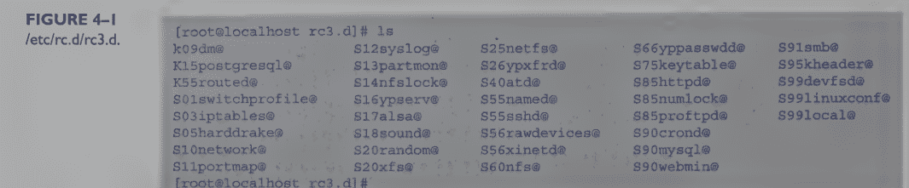

在 init 遍历所有运行级别后，/etc/inittab 脚本为每个运行级别的每个虚拟控制台分叉一个 getty 进程（运行级别 2 到 5 拥有所有六个控制台；运行级别 1 仅拥有一个控制台；运行级别 0 和 6 没有虚拟控制台）。getty 是一个处理来自文本模式控制台或串口的登录过程的程序。/etc/inittab 还告知 init 如何处理用户按下 Ctrl+Alt+Delete 键序列的情况。默认情况下，大多数 Linux 发行版执行命令 /sbin/shutdown -h -r now，这会正常关闭系统并防止磁盘损坏。/etc/inittab 还告知 init 在连接了兼容的不间断电源（UPS）时发生电力故障应如何处理。如果存在不间断电源（Uninterruptible Power Supply，UPS），它可以运行系统直到电力低到无法保证系统继续运行为止；然后它在没有用户干预的情况下关闭系统。

根据设置的运行级别，系统将处于 GUI 或命令行登录提示符状态。

### 运行级别

通过提供多个运行级别，Linux 可以根据其当前用途轻松优化以实现峰值性能。从 GUI 界面运行 Linux 操作系统会消耗大量系统资源。在服务器上，很少使用 GUI，可以通过使用运行级别 3 来消除它。如果需要系统维护，例如修复硬盘问题，可以进入运行级别 1 以阻止网络，从而其他用户无法访问系统。通过将服务分配在特定的运行级别中启动，可以进入不同的模式，而无需担心手动启动或停止服务。

Linux 通常运行在运行级别 3 或 5。运行级别 3 是具有命令行接口的完全多用户模式，运行级别 5 是相同的模式但带有 GUI。Linux 中可用的运行级别如下：

- 0 停止
- 1 单用户模式
- 2 未使用（用户可定义）
- 3 完全多用户模式
- 4 未使用（用户可定义）
- 5 具有基于 X 的登录屏幕（GUI）的完全多用户模式
- 6 重启

默认运行级别在 /etc/inittab 文件中配置。查看该文件时，会在顶部附近看到类似于 `id:5:initdefault:` 的行，如图 4-2 所示。要更改运行级别，将数字 5 改为您希望系统通常启动到的运行级别。


## 图 4-2 /etc/inittab

```
# inittab
#		This file describes how the INIT process should set up
#		the system in a certain run-level.
#
# Author:	Miquel van Smoorenburg, <miquels@drinkel.nl.mugnet.org>
#		Modified for RHS Linux by Marc Ewing and Donnie Barnes
#
#
# Default runlevel. The runlevels used by Mandrake Linux are:
#	0 - halt (Do NOT set initdefault to this)
#	1 - Single user mode
#	2 - Multiuser, without NFS (The same as 3, if you do not have networking)
#	3 - Full multiuser mode
#	4 - unused
#	5 - X11
#	6 - reboot (Do NOT set initdefault to this)
#
id:5:initdefault:	*

#	System initialization.
s1:sysinit:/etc/rc.d/rc.sysinit
10:0:wait:/etc/rc.d/rc 0
```

> **注意**
> 编辑 /etc/inittab 文件时要小心。任何错误都可能导致系统无法启动，除非使用启动盘或重新安装系统。

运行级别 2 和 4 可供配置，具体取决于哪种方式最适合您的系统。通过为自定义配置使用运行级别 2 和 4，运行级别 3 和 5 将保持不变。

> **注意**
> 如果系统由于 /etc/inittab 配置错误或密码损坏/遗忘而无法启动，请执行以下步骤以进入单用户模式：

- 如果您使用 LILO 作为引导加载器，在 boot: 提示符下输入 **linux single** 并按回车键。

- 如果您使用 GRUB 作为引导加载器，请按照以下步骤进入单用户模式：
  1. 在图形化的 GRUB 引导加载器屏幕中，选择 Linux 启动标签并按 **e** 键进行编辑。
  2. 使用箭头键向下移动到内核行，并按 **e** 键进行编辑。
  3. 在提示符下，输入 **single** 并按回车键。
  4. 当显示包含内核信息的 GRUB 屏幕后，按 **b** 键将系统引导至单用户模式。

一个全新的系统将以命令行 shell 启动，允许对操作系统进行修改。

## 关机

关闭 Linux 操作系统对于防止文件或文件系统损坏是必要的。在使用操作系统时，可能会有文件处于打开状态，供用户或操作系统使用。如果系统在没有清理这些打开的文件并卸载文件系统的情况下断电，可能会发生错误。

用于关闭 Linux 的命令如下：

- /sbin/shutdown -h now 导致系统停止
- /sbin/shutdown -r now 导致系统重新启动

# 管理用户和组

Linux 系统可以只有少数几个用户，也可以有数百个用户，具体取决于系统的用途。提供 DHCP 信息的网络服务器可能只需要少数几个用户，而为用户提供文件空间的文件服务器则可能需要许多用户账户。Linux 管理的关键任务之一就是管理用户和组。用户账户的主要原因是验证每个使用计算机系统的个人的身份。用户账户的次要原因是允许对个人资源和访问权限进行定制。资源可以包括文件、目录和设备。控制对这些资源的访问是管理员的主要任务之一。

用户可以代表一个人或一个应用程序。代表个人的用户账户由个人用于访问 Linux 操作系统。像 Oracle 这样的应用程序拥有一个用于运行该应用程序的账户。这种做法比使用 root 账户运行所有操作更安全，因为 Oracle 账户的权限可以限制访问仅限 Oracle 使用的区域，而 root 账户则没有限制。

组是组织逻辑的体现。组将具有共同目的的用户联系起来。例如，一个组织可能有负责应付账款的人员，也有负责薪资的人员。通过将用户账户放入应付账款组，可以给予该组所有成员通用的权限。应付账款组的成员将无法访问薪资组的信息和资源。同一组内的用户对组资源具有相同的读取、写入或执行权限。

## 用户名

每个用户账户可以分配多个属性。最广为人知的属性是用户名和密码。

用户名有一个主要要求：它们必须是唯一的。换句话说，用户名只标识一个账户，其他用户不能有相同的用户名。由于这一要求，制定一个规定用户名创建方式的策略或命名规范至关重要。

## 命名规范

命名规范使得“构思”用户名变得容易得多。通过仔细考虑用户名的创建方式，相同的策略可以应用于后续所有用户。命名规范可以非常简单，也可以非常复杂。所使用的规范取决于组织的类型和结构。

必须考虑组织的规模，因为它决定了需要支持多少用户名。例如，一个非常小的组织可以使用名字作为用户名，而一个大型组织则必须使用更独特的标识。

在非常大的组织中，决定用户名时考虑组织结构是合适的。例如，在用户名中包含部门或工厂名称有助于使用户名保持唯一，并提供一种识别关联用户所在位置的方式。一些常用的规范包括：

- 名字（Huey、Dewey、Louie 等）
- 姓氏（Doe、Smith、Duncan 等）
- 名字首字母后跟姓氏（ldoe、dsmith、lduncan 等）
- 部门后跟用户名首字母和姓氏（AP-ldoe、PR-dsmith、AR-lduncan 等）

无论使用哪种命名规范，如果遵循该规范，最终会出现两个拥有相同用户名的个人。命名规范的一部分应当考虑到这些情况。

处理相似用户名的一个简单方法是在用户名后添加序列号、中间名首字母或员工编号的一部分。这些方法的缺点是他人在确定哪个用户名对应哪个用户时会感到困难。这可能导致偶尔发送错误的电子邮件。

## 密码

用户名标识用户是谁，而密码验证关联用户就是当事人。换句话说，密码用于验证用户身份。为了利用密码验证，密码必须是保密的，必须难以猜测，并且必须能够抵御暴力破解攻击。（暴力破解攻击是指获取加密后的密码，并利用计算机的处理能力和算法来破解加密值。）

所有用户都应接受关于密码保密重要性的教育。绝不应将密码张贴在显示器表面、键盘下方、抽屉里或任何其他地方。绝不应将密码分享给任何人。密码应像银行卡 PIN 码一样保密。

强密码的长度至少应为八位字符，由大写字母、小写字母、数字和特殊字符组成。密码中不应包含连续的字母或数字。

强密码策略应要求定期更改密码。大多数管理员要求每 30 到 90 天更改一次密码。另一个常见的要求是，密码不能早于 30 天进行更改。

另一个良好的密码策略是密码老化。密码老化要求在过去几个密码周期中使用的密码不得重复使用。换句话说，如果您在 1 月使用了一个密码，然后按照密码策略在 2 月更改了它，那么您就不能再使用 1 月的密码。实际上，如果严格执行策略，该密码将在接下来的几个月内无法使用。

## 组

组是用户和资源的逻辑分组。如果 Linux 系统资源将由多个用户共享，则需要组来指示哪些用户有权访问特定资源。一种常见做法是拥有一个中心服务器，使网络上的其他机器可以访问特定目录。用户随后可以访问共享目录来存储数据。

共享数据空间实现两个目标。

- 用户拥有一个存储数据的位置，而该数据并不物理存储在他们的终端上。如果系统经历硬盘故障，数据仍然安全。
- 共享空间上的数据可以被组内所有用户访问。协作项目的用户可以轻松地从中央共享位置共享文档和数据文件。

## 权限

可以为 Linux 系统资源设置权限。有三种不同的权限：读取 (r)、写入 (w) 和执行 (x)。这些权限用于控制允许的访问类型。每个符号 (r, w, x) 表示资源是否可以被用户、组或任何人读取、写入或执行。还有第四个符号，连字符 (-)，表示不允许任何访问。您可以通过使用 -l 选项列出目录来查看文件的权限，如图 4-3 所示。该文件的权限


# 图 4–3
ls -l 命令。

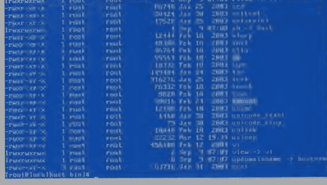

每个用户和组都有一个唯一的标识号。用户的称为用户ID（UID），组的称为组ID（GID）。UID的默认值通常大于99，并且大于其他任何用户。0到99之间的UID值通常保留给系统账户。GID通常为100或更大，并且默认大于其他任何组。0到100之间的GID值保留给系统账户。

UID和GID为0用于标识root账户。Linux授予root用户账户所有访问权限，无论文件权限如何。

创建文件时，它会分配给一个用户和组所有者。同时，它还为所有者、组以及其他所有人分配独立的读、写和执行权限。拥有该文件的用户和组可以由root用户更改。

### 目标 2.20
### 目标 4.2

# 添加用户

用户可以通过命令行或图形界面（GUI）添加。大多数用户和组属性具有默认值，这些值将在创建账户时使用。

在添加用户之前，你应已以root身份登录。你可以使用**su**命令快速以root用户连接。su（substitute user，替代用户）命令将有效用户ID和组ID更改为命令中指定的用户的ID。su命令的语法为`su [-options] [-] [user]`。如果未指定用户，默认用户为root。连字符（-）表示以新登录shell在指定用户的家目录中登录，就像用户最初登录时一样。例如，要以root用户登录，请输入**su - root**。

对于用户而言，必须指定的只有用户名和密码。要从命令行创建用户，请使用命令**useradd 用户名**。

例如，**useradd jsmith**将创建一个名为jsmith的账户。以下属性未明确定义。一些属性具有默认值；其他属性除非明确创建，否则没有值。

- `-c comment`：新用户的密码文件注释字段。
- `-d 家目录`：创建用户的登录目录。默认是将用户名追加到家目录后。
- `-e 过期日期`：该账户将自动禁用的日期。
- `-f 不活跃天数`：密码过期后账户被永久禁用的天数。此值可设为0以在密码过期后立即禁用账户，或设为-1以禁用此功能。
- `-g 初始组`：该账户的初始组的组名或组号。默认组号为1或/etc/default/useradd中指定的值。
- `-G group[,...]`：用户所属的辅助组列表。各组之间用逗号分隔。
- `-m`：如果家目录不存在则创建它。默认是在用户首次登录系统时创建该目录。
- `-M`：创建一个没有家目录的用户账户。
- `-n`：添加一个与用户名相同的组名到系统。
- `-o`：允许创建具有非唯一UID的用户。
- `-P`：包含加密的密码。
- `-r`：用于创建系统账户（UID低于500的账户）。
- `-s shell`：用户将使用的默认shell。shell将在本章后续部分讨论。
- `-u uid`：用户ID的数值。默认值大于99且大于其他所有用户。

从图形界面添加用户比使用命令行需要更多的鼠标操作和几次按键；然而，使用图形界面会为可用选项提供屏幕提示。以下是来自Mandrake Linux GNU网络对象模型环境（GNOME）图形界面的屏幕。

# **注意**

GNOME是自由软件，是GNU项目的一部分。GNOME是一个类似于Windows外观和感觉的Unix和Linux系统的图形界面。

Linux GNOME的配置工具各不相同，但功能相似。要使用图形界面添加用户，请执行以下步骤。

1. 首先选择主菜单。这通常是屏幕底部任务栏上的第一个图标。查找配置菜单，然后找到“用户”条目。在Mandrake Linux中，选择主菜单、配置、其他、Userconf，如图4-4所示。

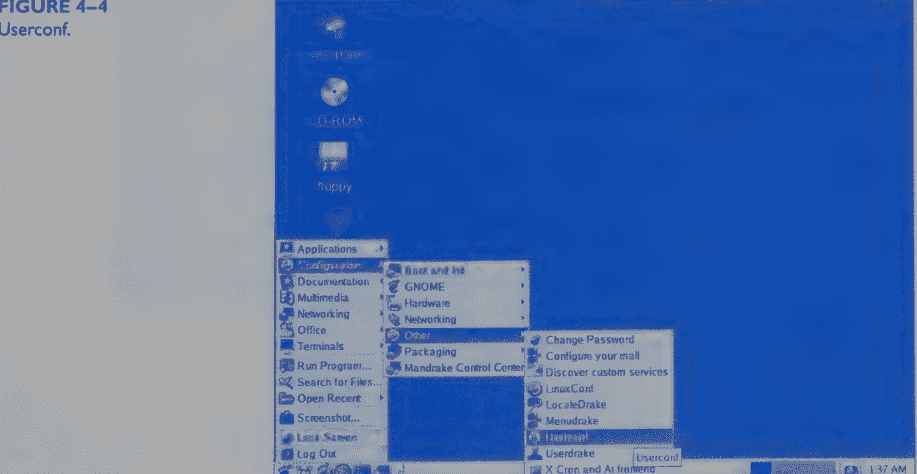

2. 从**用户账户配置器**中选择**用户账户**（图4–5）。将显示用户账户对话框。

# 图 4–5
用户账户配置器。

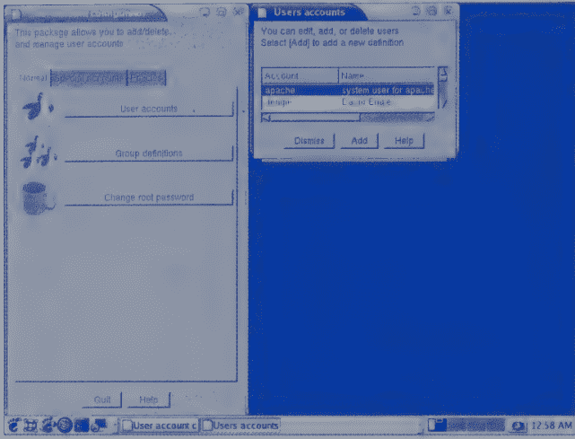

3. 显示**用户账户**创建屏幕，如图4–6所示。在基本信息选项卡上输入**登录名**。其他所有信息均为可选。

# 图 4–6
基本用户信息。

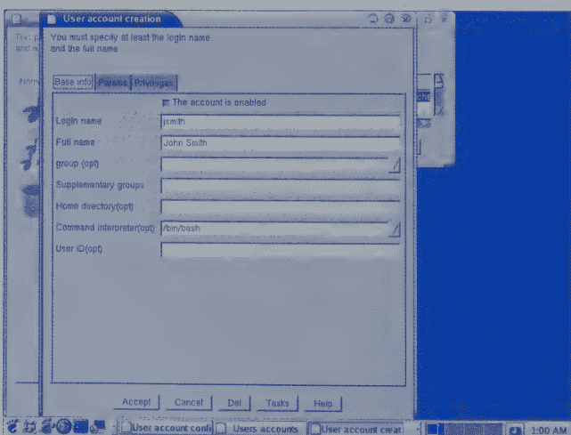

参数选项卡（图4–7）用于添加密码策略。密码参数包括用户必须保留密码的天数、密码可能使用的最大天数，以及密码过期前给出的警告天数。

参数还包括用户账户过期前的天数以及账户的过期日期。

# 图 4-7
用户密码参数。

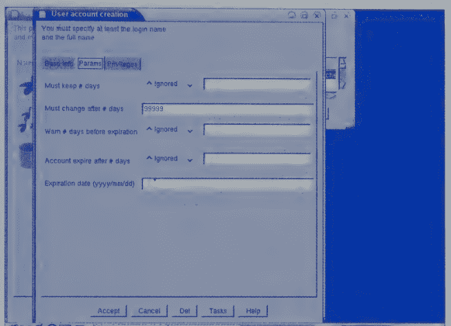

权限选项卡（图4-8）用于应用权限和其他选定属性。权限可以拒绝、授予或授予/静默。拒绝阻止用户访问指定资源。授予允许用户在提供密码后访问资源。授予/静默允许用户无需进一步确认即可访问资源。

# 图 4-8
用户权限。


4. 点击**用户账户创建**对话框中的**接受**按钮，然后显示更改密码屏幕（图4–9）。输入有效的密码。

# 图 4–9
输入密码。


如果你输入容易被发现的密码，将显示“不良密码”消息，如图4–10所示，然后提示输入另一个密码。必须输入两次密码以确保输入正确。密码不会显示。

# 图 4–10
不良密码。


# 删除用户

用户可通过命令行界面或图形界面删除。**userdel**命令删除用户，并可选择删除用户的家目录。在删除用户之前，你必须以root身份登录。（使用**su - root**命令以root身份登录。）

要删除用户，该用户不能当前处于登录状态。你必须终止属于该用户的任何正在运行的进程。你无法在NIS客户端上删除任何NIS属性；这必须在NIS服务器上完成。

要删除名为jsmith的用户及其家空间，请使用命令**userdel -r jsmith**。-r选项表示将删除家目录和用户的邮件池。其他文件将不会被移除。你必须查找由该用户拥有的文件并手动删除它们。

# 添加组

默认情况下，新用户被分配到一个与用户名同名的私有组。用户私有组（UPG）使为新用户分配文件权限更容易；然而，新用户通常按功能、部门或其他标准分组。要为用户分配资源和权限，将创建组并赋予权限，然后将用户添加到组中。

要从命令行添加组，请输入**groupadd mygroup**，其中*mygroup*是新组的名称。可用选项包括：

- `-g GID`：其中GID是组ID的数值。这是一个唯一值，通常大于等于500。
- `-r`：用于添加系统组账户。自动使用小于499的第一个可用GID。

要从GNOME添加组，请执行以下步骤。

1. 首先选择**主菜单**。这通常是屏幕底部任务栏上的第一个图标。查找配置菜单，然后找到组条目。在Mandrake Linux中，选择**主菜单**、**配置**、**其他**和**Userconf**（参考图4-4）。
2. 从用户账户配置器中选择**组定义**（图4-11）。显示用户组对话框。点击**添加**按钮以添加组。显示**组规范**对话框。


在**基本信息**选项卡中输入**组名**，然后点击**接受**。可以在**备用成员(可选)**框（图4-12）中通过键入每个成员的用户名（用空格分隔）来定义组成员。


### 图 4–12
组规范基本选项卡。


**目录**选项卡（图 4–13）允许输入该组将使用的基础目录。目录的默认权限为 700，表明拥有者具有完全访问权限。组目录所需的值将在本章稍后讨论。

### 图 4–13
组规范目录选项卡。


3. 点击**接受**以创建该组。

### 将用户分配到组

创建组后，必须将用户添加到该组中。这可以通过使用命令行或图形用户界面（GUI）来完成。一个用户属于多个组的情况并不罕见。

在命令行中输入 `usermod -G mygroup`，其中 `mygroup` 是要添加的组。可以通过输入组名，并以逗号分隔且不留空格，将用户添加到多个组中。

### 使用 Mandrake Linux GNOME 图形用户界面

1. 选择主菜单、配置、Userdrake，如图 4–14 所示。Userdrake 工具允许添加、修改和删除用户及组。


2. 从 Userdrake 对话框（图 4–15）中，选择设置菜单，然后选择查看组（图 4–16）。将显示组列表。


3. 打开要添加用户的组。您可能需要向下滚动列表才能找到正确的组。

4. 选择组后，将显示一个与该组同名的对话框（图 4–16）。“身份”选项卡用于更改组名。如果其他应用程序正在使用该组，更改组名可能会导致问题。

### 图 4–16
组对话框，身份选项卡。


5. 选择**用户**选项卡。
6. 从**不在组中**列中选择一个用户名；然后点击**添加**将用户放入**在组中**列（图 4–17）。

> **注意**
> 可以按住 Ctrl 键并点击每个条目来选择多个用户名。要选择一系列条目，请按住 Shift 键，先点击第一个用户名，然后点击最后一个条目。

### 图 4–17
组对话框，用户选项卡。


7. 添加用户名后，选择**确定**。在 Userdrake 对话框中，点击工具栏上的**保存**按钮以保存更改。如果没有点击**保存**，系统将显示一个对话框，询问是否确认在未保存的情况下退出 Userdrake（见图 4–18）。


创建用户和组后，*the /etc/passwd* 文件包含相关信息。*the /etc/passwd* 文件包含登录 ID、UID、GID、登录目录和默认 shell。通过输入 `cat /etc/passwd` 查看 */etc/passwd* 文件。

另一个文件包含每个用户的加密密码。*The /etc/shadow* 文件包含用户名、加密密码以及关于密码策略的信息。通过输入 `cat /etc/shadow` 查看 */etc/shadow* 文件。

## 管理并浏览 Linux 文件系统

Linux 文件系统旨在组织数据。文件系统可以轻松包含数千个文件，必须以易于定位的方式对其进行组织。如果无法在文件系统中找到文件，那就等同于根本没有这个文件。Linux 文件系统上的数据可以分类为可共享或不可共享，以及静态或可变。

可共享文件可以被网络上的其他主机访问。例如，应付账款部门的一名用户可以访问该部门在组文件服务器上的数据。该数据是共享的，可供组内成员使用。

不可共享文件不能被网络上的任何其他主机访问。不可共享文件可以包括系统文件、本地配置文件以及仅用于本地机器的其他文件。

静态文件是不会改变的文件，例如命令文档和程序文件。静态文件被称为只读文件。

可变文件是随时间变化的文件。这可能包括用户配置文件、工作组共用的数据文件以及其他不需要系统管理员干预即可更改的数据。

了解 Linux 上文件的性质有助于理解文件如何与文件权限相关联。文件可以是只读、读写，以及其他权限组合。文件在系统中的使用方式决定了需要应用于该文件的权限。

为了帮助用户在文件系统中查找文件，存在一个标准，用于识别某些类型文件的存放位置。该标准是文件系统层次结构标准（FHS，参见 http://www.pathname.com/fhs/），由文件系统层次结构标准组维护。该标准包含了一套关于类 Unix 操作系统下文件和目录放置的要求和准则。使用 FHS 提供了应用程序、系统管理工具、开发工具和脚本之间的互操作性。

### 常见目录

FHS 定义了许多在类 Unix 操作系统中使用的常见目录。以下列出了其中一些常见目录；然而，FHS 文档还包含此处未列出的其他目录。请参阅最新的 FHS 文档以获取完整的目录集。

- **根目录 /** 根目录是文件系统层次结构的顶层。根文件系统的内容必须包含启动、恢复、修复和修理系统所需的所有文件。
- **/bin** /bin 目录包含系统管理员和其他用户使用的命令。这些命令是在未挂载其他文件系统时必需的命令。
- **/boot** /boot 目录包含除配置文件外启动操作系统所需的所有文件。/boot 存储在内核开始执行用户模式程序之前使用的数据。
- **/dev** /dev 目录包含代表系统部分设备的文件系统条目。
- **/etc** /etc 目录包含本地配置文件。/etc 内不包含任何二进制文件。
- **/home** /home 目录包含用户目录。/home 目录是可选的。通常，/home 目录包含为系统中添加的每个用户创建的一个子目录。
- **/lib** /lib 目录包含启动系统和运行根文件系统中命令所需的共享库映像。
- **/opt** /opt 目录包含附加应用程序软件包。
- **/proc** /proc 文件系统用于处理进程信息的存储和检索。
- **/root** /root 目录是 root 用户的主目录。
- **/sbin** /sbin 目录包含用于系统管理的实用程序。
- **/tmp** /tmp 目录包含临时文件。这些文件在一段时间后会自动移除。
- **/usr** /usr 目录包含可跨所有主机共享的文件。该目录以只读方式挂载，并包含以下子目录或指向目录的符号链接：
  - **/usr/bin** 包含大多数用户命令
  - **/usr/include** 包含 C 程序包含的头文件
  - **/usr/lib** 包含库
  - **/usr/local** 非标准应用程序安装的本地层次结构
  - **/usr/sbin** 包含非关键系统二进制文件
  - **/usr/share** 包含架构无关的数据
- **/var** /var 目录包含可变数据文件。这包括 spool 目录、日志文件和临时文件。/var 中的一些目录是可共享的，一些是不可共享的。/var 中需要以下目录：
  - **/var/cache** 包含应用程序缓存数据
  - **/var/lib** 包含可变状态信息
  - **/var/local** 包含 /usr/local 的数据


| | |
|---|---|
| **/var/lock** | 包含锁文件 |
| **/var/log** | 包含日志文件和目录 |
| **/var/opt** | 包含 /opt 的可变数据 |
| **/var/run** | 包含与运行进程相关的数据 |
| **/var/spool** | 包含应用程序 spool 数据 |
| **/var/tmp** | 包含在系统重启之间保留的临时文件 |

处理文件系统时，**du** 命令非常有用。du 命令显示目录中文件占用的估计空间量。如果在 shell 提示符下输入 **du**，将按列表形式显示每个子目录的磁盘使用情况，最后一行显示文件使用的总计。要查看文件使用总计，请键入 **du -hs**。

另一个与文件系统一起使用的命令是 **df**。df 命令显示文件系统上的可用磁盘空间。如果命令中没有给出文件名，则显示当前所有已挂载文件系统的可用空间。要在 1K 块中显示可用磁盘空间，请使用 -k 选项。df 命令的语法为 **df [ -options] [file]**。要查看所有文件系统的可用空间，请键入 **df -k**。

## 文件权限

文件权限的主要功能是拒绝未授权用户的访问。权限与 UID 和 GID 结合使用，换言之，取决于分配的用户名和组。

Linux 提供两个默认的安全级别。用户必须提供用户名和密码以进行身份验证。当确定用户对 Linux 系统具有有效访问权限后，第二个安全级别，即文件权限，决定用户是否被授权访问资源。

### 权限类别

使用 `ls -l` 命令会显示类似图 4–19 所示的列表。前 10 个字符用于显示文件类型以及所有者、组和其他所有用户的权限。


文件类型由第一个字符表示。文件由连字符（-）表示，目录由字母 d 表示。套接字由字母 s 表示，符号链接由 l 表示，块设备和字符设备分别由 b 和 c 表示。接下来的九个字符表示所有者、组和其他用户的权限。

所有者由接下来的三个字符表示。字母 r 表示读权限，w 表示写权限，x 表示执行权限。

第二组三个字符表示组权限。这些是分配给由该文件标识的组的权限。在此情况下，该组为 dengle，但可以是系统管理员分配的任何组。同一组的用户可以基于组权限访问彼此的文件。

第三组三个字符表示分配给其他人的权限，即非所有者且不隶属于该组的任何人。

### 权限类型

每个文件或目录都有一套权限，决定谁可以访问以及他们可以对文件做什么。权限由字符 r、w 和 x 表示，分别代表读、写和执行，如表 4–1 所示。当权限分配给文件或目录时略有不同。

**表 4–1**

权限。

| 权限 | 符号 | 文件用法 | 目录用法 |
| :--- | :--- | :--- | :--- |
| 读 | r | 文件可以显示或复制。 | 目录可以用 ls 命令列出。 |
| 写 | w | 文件可以修改。 | 目录中的文件可以创建或删除。 |
| 执行 | x | 如果是脚本或可执行文件，文件可以执行。 | 目录中的文件可以复制。目录必须具有执行权限才能允许文件复制或移动。 |

例如：

- `-rwx-----` 表示仅所有者具有读、写和执行权限的文件。
- `-r-xr-xr-x` 表示所有者、组或任何其他用户都具有读和执行权限的文件。
- `drwxr-x---x` 表示允许所有者读、写和执行权限，组读和执行权限，以及其他用户仅执行权限的目录。

**目标 2.6**

### 更改权限

更改权限的命令是 **chmod**。可以使用符号模式或八进制模式更改权限。chmod 的语法是 `chmod mode filename/directory`，其中 mode 是符号值或八进制值，filename/directory 是受影响的文件或目录的名称。

- 符号模式使用字母和符号为文件或目录分配权限。
- 八进制模式使用八进制数为文件或目录分配权限。

符号模式由表示“谁”、操作和要应用的权限的符号组成。表 4–2 描述了每个符号值。

**表 4–2**

符号值。

| 谁 | | |
| :--- | :--- | :--- |
| | u | 文件或目录的用户或所有者 |
| | g | 文件所属的组 |
| | o | 其他人，非所有者或组 |
| | a | 以上所有 |
| 操作 | | |
| | = | 设置权限 |
| | - | 移除访问权限 |
| | + | 授予访问权限 |
| 权限 | | |
| | r | 读 |
| | w | 写 |
| | x | 执行 |

文件列表

```
-rw-rw-r-- 1 dngle dngle 0 Sep 15 15:59 mydocument
```

表明 mydocument 对所有者和组具有读/写权限，对其他所有人具有读权限。要将所有者权限更改为读/写/执行，必须添加执行权限。若要使用符号模式进行更改，请键入命令 `chmod u+x mydocument`。

u 指示文件的用户或所有者，加号（+）指示添加以下权限，x 指示执行权限。更改后 `ls -l` 命令的结果将是

```
-rwxrw-r-- 1 dngle dngle 0 Sep 15 15:59 mydocument
```

表明所有者权限已更改。

如名称所示，八进制模式基于八进制数系统。在八进制中，只有八个符号，0 到 7。

八进制数可以用三个二进制数表示。二进制是二进制数系统。所有计算机系统都使用二进制来处理信息。一个二进制数的例子是 101。这个数代表八进制中的数字 5。从右向左，最右边的数在个位，值为 1。中间的数在 2 位，值为 0。最左边的数在 4 位，值为 4。在这种情况下，值 1 + 0 + 4 给出八进制值 5。如前所述，所有八进制符号都可以用三个二进制值表示。表 4-3 将八进制值与可用的完整权限范围关联。请注意，八进制值的二进制位置上的零（0）对应于权限中的短横线（-）。

**表 4-3**

权限值。

| 二进制值 | 八进制值 | 权限 |
| --- | --- | --- |
| 000 | 0 | --- |
| 001 | 1 | --x |
| 010 | 2 | -w- |
| 011 | 3 | -wx |
| 100 | 4 | r-- |
| 101 | 5 | r-x |
| 110 | 6 | rw- |
| 111 | 7 | rwx |

注意 rwx 组合与同一位置上的二进制 1 之间的关系。对于最后一个八进制值 7，二进制值为 111，表示 r、w 和 x 都将被设置。

要为所有者、组和其他人设置权限，请使用三组八进制数来表示期望的权限。例如，要表达权限 rwxr-xr-x，将使用八进制值 755——第一组（rwx）为 7，第二组（r-x）为 5，第三组（r-x）为 5。

要使用八进制模式的 chmod 将以下表达式从所有者读/写，组读/执行，其他人读，更改为所有者读/写/执行，组读/写，其他人读，请使用 `chmod 764 mydocument`。

```
-rw-rw-r-- 1 dngle dngle 0 Sep 15 15:59 mydocument
```

7 代表 rwx，6 代表 rw-，4 代表 r--。随后使用 `ls -l` 列出的显示将为

```
-rwxrw-r-- 1 dngle dngle 0 Sep 15 15:59 mydocument
```


操作文件权限的符号模式和八进制模式都能达到相同的效果。使用你习惯的方法即可。

## 目标 2.1

### 创建、删除、更改和查看目录

如图 4–20 所示并被 Linux 使用的文件系统结构，是一个称为目录树的目录层次列表。树的顶部是根目录，由 / 表示。上级目录称为父目录，位于其下的目录称为子目录。


#### 路径名
路径名用于标识文件或目录在文件系统中的位置。路径名通过目录树中文件夹的名称作为参考点来标识特定的文件或目录。例如，目录 init.d 的路径是 /etc/init.d，这意味着从根目录 (/) 开始，依次经过其子目录 etc，再到达 etc 的子目录 init.d。

路径名中的第一个斜杠 (/) 表示根目录。后续的斜杠用作目录名称之间的分隔符，如图 4–21 所示。


路径名可以是绝对路径或相对路径。绝对路径名标识一个完整的路径，从根目录开始。在图 4–21 中，文件 smb 的完整路径名是 /etc/init.d/smb。相对路径名标识文件或目录相对于当前目录的位置。例如，如果当前目录是 /etc，那么到 smb 的路径是 init.d/smb。（注意没有前导的 /。前导 / 表示路径从根目录开始。）

### 更改和查看目录

要列出每个目录的内容，必须使用改变目录 (`cd`) 命令导航目录树结构，然后可以使用 `ls` 命令列出文件。路径名中可以使用一些快捷符号。要引用当前目录，使用句点 (`.`)。要引用父目录，使用两个句点 (`..`)。要引用当前用户的家目录，使用波浪号加斜杠 (`~/`)。要引用上一个目录，使用连字符 (`-`)。

当 jsmith 登录系统时，他会进入他的家目录 /home/jsmith。任何用户的默认目录位置都是该用户的家目录。以图 4-22 中的示例目录树为参考，查看用于在树中导航的命令。

要切换到 jsmith 的 documents 目录，输入 `cd documents`。

documents 目录直接位于 jsmith 目录下方，因此相对路径只是目录名。

也可以使用绝对路径名 `cd /home/jsmith/documents`。

也可以使用当前目录的快捷符号 `cd ./documents`。

要切换到 etc 目录，输入 `cd /etc`。

由于 etc 目录位于根目录下，因此需要 /。这是绝对路径名的一个例子。

从 /etc 目录切换到 jsmith 目录有两种选择。你可以使用绝对路径 `cd /home/jsmith`。你也可以使用用户家目录的快捷符号（波浪号 ~），即 `cd ~`。任一命令都将目录切换到 jsmith 目录。

从 jsmith 目录切换到 home 目录，可以使用绝对路径或相对路径名。

到 home 的绝对路径名是 /home，例如 `cd /home`。

从 jsmith 到 home 的相对路径是快捷父目录符号 (`..`)，例如 `cd ..`。

要返回上一个目录，使用 - 快捷符号，例如 `cd -`。


过程中很容易丢失文件。某些文件系统可能有成千上万个文件分布在数百个目录中。使用 `pwd` 命令显示当前路径名：

```bash
pwd
/home/jsmith
```

要查看当前目录，使用 `ls` 命令。`ls`（列出目录）命令列出目录中文件的信息。该命令默认显示当前目录中的文件，但通过提供路径名可以显示任何目录。例如，`ls /home` 显示 /home 目录中的文件。`ls` 命令的语法是 `ls [option] [file]`，其中 option 来自以下列表，file 是文件名或路径名。

- **a, --all** 不隐藏以 . 开头的条目
- **A, --almost-all** 不列出隐含的 . 和 ..
- **--author** 打印每个文件的作者
- **-d, --directory** 列出目录条目而不是内容
- **-l** 使用长列表格式
- **-n** 类似于 -l，但列出数字 UID 和 GID
- **-S** 按文件大小排序
- **-t** 按修改时间排序
- **-x** 按行而不是按列列出条目
- **-X** 按条目扩展名字母顺序排序
- **--help** 显示所有选项。与 `man ls` 命令相同，该命令显示 `ls` 命令的手册页。使用 `more` 命令与此命令配合以逐页查看。（示例：`ls --help | more`）

> **注意**
>
> 手册页是 Unix 程序员手册中的一组选定页面。每个手册页描述一个命令。要查看有关命令的信息，使用 `man command`，其中 *command* 是 Unix 命令之一。

这些选项只是所有可用选项的一小部分。要查看所有选项，使用 `man ls` 命令。

长文件列表（`ls -l`）显示图 4–23 中所示的列。

**图 4–23**
`ls -l`。


要显示非当前目录，请在 `ls` 命令末尾包含目录名称。要列出 *usr* 目录的内容，输入 `ls usr`。

有两个通配符符号可以与文件名一起使用。星号 (`*`) 代表任意一组字符，问号 (`?`) 代表任意单个字符。

`*` 符号可以代表任意数量的字符。例如，要列出所有以字母 v 开头的文件，输入 `ls v*` 或 `ls -l v*` 以获取长列表。

`*` 可以用在文件名的任何位置来替换字符。例如，要列出所有包含字母 ftp 的文件，输入 `ls *ftp*`。

`?` 可用于替换任意单个字符。例如，要列出所有包含字母 rcXd 的文件（其中 X 是任意字符），输入 `ls rc?.d`。

文件类型可以包括目录、可执行文件、文本文件和符号链接。要查看不同的文件类型，使用 `ls` 命令的 `-F` 选项。图 4–24 是在 */bin* 目录中使用 `ls -F` 命令的结果。

各种文件类型使用以下符号显示：

- / 目录
- \* 可执行文件（命令或脚本文件）
- @ 符号链接（指向另一个文件的文件）
- 无符号（表示普通文件）

**图 4-24**
`ls -F`。


### 创建目录

创建目录是一项常见任务。用户通常创建目录以在其家目录内组织个人文件。要创建目录，使用 `mkdir` 命令。有一些选项可以与 `mkdir` 命令一起使用，可以通过使用 `man mkdir` 命令来发现这些选项。

要创建目录，使用带有目录名的 `mkdir` 命令。创建目录时使用绝对或相对路径名。例如，如果当前目录是 /home/jsmith 且 jsmith 想要创建一个目录来包含下载的文件，使用 `mkdir downloads`（相对路径名）或 `mkdir /home/jsmith/downloads`（绝对路径名）命令。

### 删除目录

要删除目录，使用 remove (`rm`) 命令。`rm` 命令可用于删除文件或目录。即使是空目录也有两个隐藏条目。用作快捷方式的 . 和 .. 符号实际上是目录中的条目。（使用 `ls -a` 查看隐藏文件。）要删除目录，必须同时删除目录中的文件。这可以通过递归 (-r) 选项实现。递归选项在删除目录之前先删除目录的内容。当前目录不能是要被删除的目录。

如果当前目录是 /home/jsmith 且要删除目录 /home/jsmith/downloads，输入 `rm -r downloads`（相对路径名）或 `rm -r /home/jsmith/downloads`（绝对路径名）。

## 挂载文件系统


在使用任何文件系统之前，必须将其挂载到目录上。例如，根文件系统在安装时挂载到 / 目录。所有存储设备在使用前必须被挂载。软盘驱动器必须先被挂载，通常挂载到 /mnt/floppy 目录，然后才能访问。系统在启动时自动挂载硬盘上的文件系统。

`mount` 命令用于挂载文件系统。在启动时，执行命令 `mount -av`。-a 选项导致在 `/etc/fstab` 文件中提到的所有文件系统（如图 4-25 所示）被挂载。通过输入信息到 fstab 文件，可以在启动时挂载文件系统。也可以在登录后使用 `mount` 命令挂载文件系统。


## 图 4-25


### 注意

> `mount -av` 命令实际上挂载了除根文件系统以外的所有文件系统。根文件系统由内核在启动时挂载。

fstab 文件包含关于文件系统的静态信息。每个文件系统单独占一行，字段之间用制表符或空格分隔。fstab 中记录顺序很重要，因为文件系统将按照文件中呈现的顺序进行挂载。fstab 文件包含六列信息。

- fstab 文件的第一列是要挂载的设备名称或远程文件系统。通常，设备名称类似于 `/dev/cdrom` 或 `/dev/hda2`。此字段还可以包含列出主机和目录的条目，例如 **cs.ua.edu/home**。
- 第二列包含文件系统的挂载点。这是文件系统将被挂载的目录。
- 第三列描述文件系统类型。如前所述，Linux 可以使用许多文件系统类型，包括 ext3、vfat、tmpfs 等。
- 第四列描述与文件系统关联的挂载选项。
- 第五列供 dump 命令使用，以确定哪些文件系统需要转储。如果第五列不存在，则返回值为零，dump 将假设该文件系统不需要转储。
- 第六列供 fsck 程序使用，以确定重启时文件系统检查的顺序。

fstab 文件中包含一条关于 **/proc** 的条目。这个伪文件系统包含有关系统进程、可用内存以及内核所知道的其他系统信息。/proc 是一个伪文件系统，因为它实际上不使用硬盘上的磁盘空间。手动挂载文件系统的典型命令是 **mount -t [type] [device] [directory]**。例如，要将设备 **/dev/hda2** 上的 ext3 文件系统挂载到目录 **/home**，请使用 **mount -t ext3 /dev/hda2 /home** 命令。

手动挂载文件系统并不常见，但如果需要临时挂载，该命令是可用的。大多数挂载发生在启动时，使用 mount -av 命令完成。

已挂载的文件系统在系统关机时会自动卸载。如果系统意外停止，文件系统可能会损坏。要修复或检查文件系统，请使用 **fsck** 命令。如果未指定文件系统，fsck 命令将依次检查 fstab 文件中的所有文件系统。

要卸载文件系统，语法为 **umount [mount point or device name]**。例如，要将 /dev/hda2 从 /home 目录卸载，请输入 **umount /dev/hda2** 或 **umount /home**，设备即可卸载。

要检查文件系统类型为 ext3 且挂载点为 /home 的文件系统，请输入 **fsck -t ext3 /home** 命令。

fsck 返回的退出代码是以下条件的总和：

| 代码 | 条件 |
| :--- | :--- |
| 0 | 无错误 |
| 1 | 文件系统错误已修复 |
| 2 | 系统应重启 |
| 4 | 文件系统错误未修复 |
| 8 | 操作错误 |
| 16 | 使用或语法错误 |
| 32 | Fsck 由用户请求取消 |
| 128 | 共享库错误 |

fsck 程序默认以交互方式运行。如果发现错误，系统会提示用户采取什么操作。可以使用 **-a** 选项自动修复文件系统而不进行任何询问。要查看 fsck 的选项列表，请参考手册页。

## 使用软驱

使用软驱的第一步是了解其在文件系统中的位置。如果您只有一个软驱，它通常位于 **/dev/fd0**。您可以通过查看 */etc/fstab* 文件（**cat /etc/fstab**）来验证位置。您的软盘在 fstab 文件中的有效条目应为：

```text
/media/floppy /dev/fd0 /mnt/floppy auto noauto,owner,kudzu 0 0
```

其中：

- **/dev/fd0** — 软盘设备位置
- **/mnt/floppy** — 文件系统的读写挂载位置
- **auto** — 文件系统类型
- **noauto, owner, kudzu** — 挂载选项
- **0** — 文件系统转储频率
- **0** — 文件系统检查频率

要在上述位置格式化软盘，请使用 **mkfs** 命令。以下操作将格式化 1.44 MB 的软盘：

```bash
mkfs -t ext3 /dev/fd0 1440
```

软盘格式化后，可以使用命令 **mount /dev/fd0 /mnt/floppy** 将其挂载。/mnt/floppy 位置是软盘的挂载点。除非软驱中有磁盘，否则此命令无法工作。

软驱挂载后，您可以使用挂载点 /mnt/floppy 来读取和写入驱动器。要查看软驱的内容，请使用 **ls** 命令。要查看新挂载的软驱，请使用 **ls /mnt/floppy** 命令。使用 **rm**、**cp**、**mv** 和其他命令来操作软盘内的文件和目录。

要卸载软驱，请使用 **umount** 命令。要卸载挂载在 /mnt/floppy 的软盘，请使用命令 **umount /mnt/floppy**。

若要更换正在使用的软盘，必须先卸载驱动器，更换软盘，然后再重新挂载驱动器。

## 目标 2.9 使用光盘

使用光盘与使用软驱类似。光盘在使用前必须挂载，使用后必须卸载。也可以使用 **cdrrecord** 命令向 CD-R 或 CD-RW 写入数据。

要挂载光盘，必须先找到设备。查看 */etc/fstab* 文件以查看可用设备。通常，第一个光驱会有以下条目：

```text
/dev/cdrom       /mnt/cdrom        udaf, iso9660     noauto, owner, kudzu, ro  0 0
```

类似于软盘设备，此光盘位于 /dev/cdrom，并使用挂载点 /mnt/cdrom。要挂载光盘，请使用命令 **mount /dev/cdrom /mnt/cdrom**。

光盘挂载后，可以使用 **ls** 或 **cp** 命令读取它。光盘是以只读设备形式挂载的。

要更换光盘，可以**卸载**驱动器或使用 **eject** 命令。您可以通过输入 **eject cdrom** 使用 eject 命令弹出光盘。驱动器弹出光盘后，插入下一张光盘并重新开始。

CD-R 和 CD-RW 可以写入数据。**cdrrecord** 命令可用，并且几乎适用于所有 Linux 系统。如果您的系统未加载 cdrrecord 命令，可以从官方站点 *ftp://ftp.berlios.de/pub/cdrrecord/.* 下载该软件包。

要找到您的光驱，请使用 **-scdbus** 选项。输入 **cdrrecord -scdbus** 将显示已安装并被识别的驱动器。例如：

```text
# cdrrecord -scdbus

cdrrecord 2.0 (1686-pc-linux-gnu) Copyright (C) 1995-2002 Jörg Schilling
Linux sg driver version:  3.1.24
Using libscg version 'schily-0.7'

scsibus0:
  0,0,0  0) '  ' '48X12X50 CD-RW' '1.00' Removable CD-ROM
  0,1,0  1) *
```

上述显示表明该设备是 0,0,0。

要烧录 ISO 镜像，请使用以下 cdrrecord 命令：
**cdrrecord -v dev=0,0,0 speed=0 driveropts=burnfree -eject -data myfile.iso**
其中：

- **-v** — 详细模式
- **dev=0,0,0** — 设置光盘记录器的 SCSI 目标
- **speed=0** — 设置写入过程的速度因子
- **driveropts=burnfree** — 驱动程序选项 burnfree 开启无缓冲欠载功能
- **-eject** — 过程完成后弹出光盘
- **-data** — 使用光盘模式 1
- **myfile.iso** — 使用 ISO 文件 myfile.iso

可以使用 **man cdrrecord** 命令找到 cdrrecord 的选项。

## 摘要

启动时，Linux 操作系统执行开机自检（POST），从 ROM 加载 BIOS，然后通过引导加载程序（通常是 GRUB 或 LILO）显示启动选项。

Linux 内核从启动设备加载到内存中，控制权随之移交。随后执行 init 程序，并控制启动过程的其余部分。

Init 在启动过程中使用几个脚本：

- */etc/rc.d/rc.sysinit* 设置环境值，如路径、启动交换分区以及检查文件系统。rc.sysinit 使用 *etc/sysconfig* 配置文件和脚本。
- */etc/inittab* 描述系统在每个运行级别中应如何设置。


- `/sbin/update` 由 inittab 执行，用于刷新脏缓冲区。
- `/etc/rc.d/rc*.d` 目录包含在启动和关机过程中由 init 执行的脚本。最常用的运行级别是 3 和 5。3 是默认的命令行运行级别，5 是默认的图形用户界面（GUI）运行级别。

共有七种不同的运行级别。

- 0 关机
- 1 单用户模式
- 2 未使用（可由用户定义）
- 3 完整多用户模式
- 4 未使用（可由用户定义）
- 5 基于 X 的登录屏幕（GUI）的完整多用户模式
- 6 重启

运行级别 2 到 5 具有虚拟控制台，可通过 Ctrl+Alt+F1-7 键组合访问。

关闭 Linux 系统可以确保文件被保存且文件系统被卸载。如果不执行关机操作直接断电，可能会导致文件损坏。

用户通过用户名进行标识，通过密码进行身份验证。可以使用 `useradd` 命令轻松添加用户，并使用 `passwd` 命令更改密码。用户还通过 UID 进行标识，UID 是一个唯一标识符，值大于或等于 500。也有 GUI 工具可以轻松地添加用户和组。

用户总是属于一个组。一个组可以包含一个或多个用户。组用于简化在处理文件权限时的管理问题。

Linux 中的文件分为可共享和不可共享、变量和静态文件。可共享文件可供多个用户使用，不可共享文件仅供一个用户使用。变量文件可以根据需要进行更改，而静态文件具有恒定值。

文件系统层次结构标准（FHS）为 Linux 系统定义了常用目录。文件系统层次结构以根（/）目录开始，包含许多常用目录和其他用户定义的目录。

文件权限分配给所有者、组和其他所有人。权限指示读取、写入和执行权限。在长文件列表中，每个文件列表开头的 10 个字符表示文件类型以及所有者、组和其他人的权限。使用 `chmod` 命令分配权限。

## 自我测试

1. _______ 程序包含控制键盘、显示器、磁盘驱动器及其他连接到计算机的设备所需的所有代码。
   a. BIOS
   b. PnP
   c. init
   d. PnP

2. 下列哪项是系统启动的正确顺序？
   a. 寻找可启动介质，POST，加载引导加载程序，加载内核，执行 init
   b. 寻找可启动介质，POST，加载内核，加载引导加载程序，执行 init
   c. POST，寻找可启动介质，加载引导加载程序，加载内核，执行 init
   d. POST，寻找可启动介质，加载内核，加载引导加载程序，执行 init

3. 下列哪项是 init 进程的正确启动顺序？
   a. 读取 /etc/inittab 文件，运行 /etc/rc.d/rc.sysinit 脚本，启动后台进程
   b. 读取 /etc/inittab 文件，启动后台进程，运行 /etc/rc.d/rc.sysinit 脚本
   c. 启动后台进程，运行 /etc/rc.d/rc.sysinit 脚本，读取 /etc/rc.d/rc.sysinit 文件
   d. 运行 /etc/rc.d/rc.sysinit 脚本，读取 /etc/inittab 文件，启动后台进程

4. **配置文件**由 Ctrl+Alt+Delete 键序列处理。
   a. /etc/inittab
   b. /etc/rc.d/rc.sysinit
   c. /etc/init
   d. /etc/lilo

5. 哪个运行级别提供完整的多用户模式和命令行接口？
   a. 0
   b. 1
   c. 3
   d. 5
   e. 6

6. 哪个配置文件包含默认运行级别信息？
   a. /etc/inittab
   b. /etc/rc.d/rc.sysinit
   c. /etc/init
   d. /etc/lilo

7. 哪个运行级别提供带有基于 X 的登录屏幕（GUI）的完整多用户模式？
   a. 0
   b. 1
   c. 3
   d. 5
   e. 6

8. 重启 Linux 操作系统的正确命令是 ________。
   a. /sbin/reboot -r now
   b. /sbin/reboot -h now
   c. /sbin/shutdown -r now
   d. /sbin/shutdown -h now

9. 下列哪些是强密码的特征？（选择三项。）
   a. 长度至少为 8 个字符。
   b. 包含单词序列以使其更易于记忆。
   c. 包含大写字母和小写字母。
   d. 包含特殊字符和数字。
   e. 应包含连续的数字或日期。

10. 使用 ______ 命令添加用户。
    a. su
    b. useradd
    c. groupadd
    d. usermod
    e. passwd

11. 使用 ______ 命令将用户添加到组中。
    a. su
    b. useradd
    c. groupadd
    d. usermod
    e. passwd

12. 权限由长文件列表中显示的十个字符标识。最后三个字符表示什么？
    a. 目录或文件
    b. 其他所有人
    c. 组
    d. 所有者

13. 要将文件 myfile 的权限更改为包含所有者的执行权限，请使用命令 ______。
    a. chmod o+x myfile
    b. chmod o+w myfile
    c. chmod u+x myfile
    d. chmod u+w myfile

14. 判断对错：强密码应每 30 到 90 天更改一次。

15. 命令 **chmod 754 myfile** 分配了下列哪种权限？
    a. 所有者、组和其他所有人的读/写/执行权限
    b. 所有者的读/写/执行权限，组的读/写权限，以及其他所有人的读/写权限
    c. 所有者的读/写/执行权限，组的读/执行权限，以及其他所有人的读/写权限
    d. 所有者的读/写/执行权限，组的读/执行权限，以及其他所有人的只读权限

16. 要删除 /home/jsmith/mydir 目录，请使用下列哪个命令？
    a. rmkdir /home/jsmith/mydir
    b. rm /home/jsmith/mydir
    c. rm -r /home/jsmith/mydir
    d. cd /home/jsmith/mydir

17. BIOS 程序存储在 ___________ 中。
    a. RAM
    b. CMOS
    c. ROM
    d. MBR

18. 判断对错：运行命令 **chmod 755 myfile** 后，myfile 被分配给所有者的读、写和执行权限。

19. BIOS 将什么加载到内存中？
    a. RAM
    b. CMOS
    c. ROM
    d. MBR

20. Linux 操作系统在启动期间所需的任何程序都由 ____________ 脚本启动。
    a. /etc/rc.d/rc.sysinit
    b. /sbin/update
    c. /etc/sysconfig
    d. /etc/rc.d/rc3.d

21. 判断对错：命令 **usermod -G jsmith -U dbrown** 将用户 dbrown 添加到组 jsmith。

22. 关于文件 /etc/rc3.d/$S5sshd，下列哪些说法是正确的？（选择两项。）
    a. 它是一个启动文件。
    b. 它在运行级别 3 中执行。
    c. 它是一个终止脚本。
    d. 它是第 55 个执行的脚本。

23. 哪些运行级别可由用户定义？（选择两项。）
    a. 1
    b. 2
    c. 3
    d. 4
    e. 5

24. 判断对错：通过将运行级别 5 设置为默认运行级别进入单用户模式。

25. 判断对错：用户名必须由用户的首名首字母和姓氏组合而成。

## Linux 命令行

第 5 章

### 章节目标

- 设置环境变量
- 描述并使用多用户环境的功能
- 使用常见的 shell 命令和表达式
- 使用 vi 创建、编辑和保存文件

### 使用命令行 Shell

绝大多数，甚至所有命令都可以通过 GUI 工具完成。然而，了解命令行界面（CLI）可以使大多数任务的 Linux 管理变得更快。有些命令只能通过命令行完成。使用 GUI 工具需要鼠标移动并通过迷宫般的菜单和工具栏寻找命令，这对大多数管理员来说是一个繁琐的过程。

经验丰富的用户还可以编写 shell 脚本。shell 脚本是存储在一个文件中的命令集合。该文件被授予执行权限，用于执行各种任务。脚本将在下一章中讨论。

最早的操作系统使用命令行解释器与用户交互。命令解释器通过键盘接受用户输入，解释每个单词（或解释这些单词），然后执行所需的动作。最早的命令解释器相当基础，提供的功能不多。为了提供更好的与操作系统交互的方式，开发了 shell（图 5–1）。第一个 shell 程序是 Bourne shell (sh)，由 S. R. Bourne 开发。此后，开发了其他 shell，包括 C shell (csh)、Korn shell (ksh) 和 bash shell (Bourne Again Shell)。

### 命令行基础

bash shell（参见 http://www.gnu.org/software/bash/bash.html）是自由软件基金会的产品，被大多数 Linux 操作系统使用。Linux 中通常提供几种 shell，但 bash shell 是用户的默认 shell。

如果你将系统启动到运行级别 3，你就处于命令行提示符下。如果你正在使用 X 窗口系统（GUI），你需要打开一个终端窗口。终端窗口是一个终端模拟器程序，它在窗口中打开并运行 shell 程序。有几种不同的终端程序：gnome-terminal、xterm 等。通常，在 GUI 中，你可以右键单击屏幕并从显示的弹出菜单中选择终端。

在第 2 章中讨论的虚拟终端也可以使用。按 Ctrl+Alt+F1 显示第一个虚拟终端，Ctrl+Alt+F2 显示第二个，等等。Linux 通常有六个虚拟终端，第七个显示 GUI。虚拟终端与 CLI 一起工作，但 GUI 仍然处于活动状态，可以通过按 Ctrl+Alt+F7 显示。当终端显示 **login:** 提示符时，输入有效 ID 然后输入密码以显示 bash shell。将显示 CLI 提示符。通常，提示符将是 $，


# 图 5-1

命令 shell。


表明当前用户不是超级用户（root）。CLI # 提示符表示超级用户账户。用户可以通过 CLI 更改提示符，因此这些提示符并不总是被使用。

根据 Linux 版本以及提示符是否被更改，提示符通常显示为以下格式：**username@hostname current_directory $**。例如，如果 jsmith 在主机 linux1 上登录到 CLI，提示符将是 [jsmith@linux1 jsmith]$

# 注意

> Linux 发行版可能具有略微不同的 CLI 提示符特性，但通常，所有提示符的工作原理都相同。

CLI 的一个有用功能是命令行补全。当前所有 shell 都具有此功能。命令行补全功能使用 Tab 键来补全命令。

为了说明该命令，假设 jsmith 希望查看文件 *my_summer_vacation_in_south_beach_journal* 的内容。该文件名非常长且难以输入。但是，您可以输入 **view my[tab]**（在由 [tab] 指示的位置按下 Tab 键），CLI 将显示 **view my_summer_vacation_in_south_beach_journal**。然后您只需按下 Enter 键即可。

如果您输入的字符对于您想要的文件来说不唯一，CLI 将显示所有符合当前条件的文件列表，您可以输入足够的字符使文件唯一，然后再次按下 Tab 键。

用户名、机器名称或环境变量也支持自动补全。每个字符分别为 \~, @ 和 $。在 CLI 中输入每个字符，然后按下 Tab 键。

目标 2.23

# 重定向和管道

Unix/Linux 下的进程至少使用三个文件描述符——标准输入、标准输出和标准错误。与这些描述符关联的编号分别为 0、1 和 2。此外，这些描述符与启动该进程的终端相关联。重定向和管道的目的是将这些描述符重定向到不同的位置。例如，与其将进程的输出发送到屏幕，您可以将其重定向到文本文件。

## 重定向

假设您想要运行一个特定的程序，但记不住该程序的名称。查看所有可用程序的列表会很有帮助，但列出的文件太多，难以令人满意地查看。在您空闲时查看文件的一种方法是将目录内容复制到文件中，然后查看该文件。

要重定向标准输入或输出，请使用大于号 (> ) 或小于号 (<) 重定向符号。您应该将重定向符号视为表示重定向的方向。> 用于重定向输出，即远离命令。< 用于重定向输入，即进入命令。

> 符号将通常发送到屏幕的输出重定向到您指定的位置。例如，如果您想将目录列表（ls -l）重定向到名为 myfile 的文件，您将输入命令 `ls -l > myfile`。

< 符号将通常来自键盘的输入重定向为来自文件。例如，如果您想统计 myfile 文件中的行数，您可以手动统计行数，也可以使用 word count (wc) 程序为您统计。要使用 wc，请输入 `wc -l < myfile`。

-l 选项表示统计行数，而 < myfile 将输入从 myfile 文件重定向到 wc 命令。

> 有关 wc 的更多信息，请参阅 man 手册页。

现在假设您是用户 jsmith，想要 /sbin 目录中所有程序的列表。请遵循接下来的几个步骤：

- 以 jsmith 身份登录到 CLI。
- 登录后，使用 cd 命令更改目录到 /sbin：`cd /sbin`
- 列出长目录，将输出重定向到名为 myfiles 的文件，而不是屏幕：`ls -l > myfiles`
- 使用以下命令查看 myfiles 的内容：`view myfiles`。

> view 命令是 vim (Vi MImproved) 命令的子集。Linux CLI 的标准编辑器是 vi（通常被戏称为 virtually impossible）。vi 的新增强版是 vim。使用命令 view 以只读模式通过 vim 打开文件。然后您可以使用上/下箭头键浏览文件。使用 man vim 查看完整描述。

## 管道

管道在某种程度上是一种输入/输出重定向。它用于将一个命令的输出发送到另一个程序的输入。假设您想知道您的 pictures 目录中有多少个 JPEG 图像。

# 注意

Linux 不要求文件名包含扩展名，但通常文件名按惯例包含扩展名。因此，JPEG 文件应以 **jpg** 结尾，以指示文件类型。

您可以使用通配符和 **ls** 命令输入 **ls *.jpg** 来查看 .jpg 文件的列表。接下来，您可以手动统计文件数量。您也可以将列表重定向到文件，然后使用带有 **-w** 选项的 **wc** 命令来统计单词数：

```
ls *.jpg > mypictures
wc -w < mypictures
```

然而，更快的方法是将第一个命令的输出直接管道传输到第二个命令的输入。换句话说，不使用 mypictures 文件作为中介，您可以直接将列表发送到 **wc** 命令，只显示计数：**ls *.jpg | wc -w**。竖线 (|) 是管道符号。另一个常与管道一起使用的命令是 **more** 命令。more 命令接收标准输出，使其在每个满页时停止，并显示消息 **--More--**。要使用 more 列出当前目录，请输入 **ls | more**。

# 注意

Enter 键显示下一行，空格键显示下一页，q 键退出显示。

## 目标 3.12 环境变量

Linux 操作系统的环境由已安装和正在运行的硬件和软件决定。许多在 Linux 内运行的程序需要信息来完成某些任务。例如，运行 Oracle 数据库的系统需要知道 oracle home 位于哪里。为了在 Linux 环境中建立 oracle home，创建环境变量 **ORACLE_HOME**。此环境变量指向目录 **/opt/oracle/product/9.2.0**。当程序需要此目录时，使用变量 **$ORACLE_HOME**。

环境变量可以按需创建。可以使用 **printenv** 命令查看 Linux 机器上当前定义的环境变量。在 CLI 中输入 **printenv**。将显示所有环境变量。

默认情况下定义了几个环境变量。可以使用 **echo** 命令查看它们。例如，要查看 jsmith 主目录的路径名，请输入 **echo $HOME**，将显示 **/home/jsmith**。

环境变量以 $ 标识，通常以大写字母定义。可以使用环境变量代替其分配的值。例如，要更改到 oracle home 目录，请输入 **cd $ORACLE_HOME**，当前目录将更改为 **/opt/oracle/product/9.2.0**。

一些常见的环境变量包括：

- **$HOME** 包含当前用户主目录的路径。
- **$USER** 包含当前用户的名称。
- **$UID** 包含当前用户的 UID。
- **$SHELL** 当前使用的 shell。
- **$PATH** 用于查找程序的路径名列表。

有关 bash 中环境变量的完整列表，请查看自由软件基金会（Free Software Foundation）的 bash 手册，位于 http://www.gnu.org/software/bash/bash.html。

这些环境变量中最关键的是 $PATH。Linux 发行版安装时可能拥有数千个程序和数据文件。如果操作系统每次执行程序时都要查看硬盘上的每个文件，系统将运行得极其缓慢。缩小系统查找程序位置的一种方法是构建一个指向最常用文件位置的 PATH 环境变量。要从 oracle 目录执行命令 **sqlplus**，命令将是 /opt/oracle/product/9.2.0/bin/sqlplus。

如果必须经常执行此命令，输入长语句会变得非常繁琐。为了缩短需要输入的字符数，请将路径名添加到 PATH 变量中。在 bash 中，输入 **export PATH=$PATH:/opt/oracle/product/9.2.0/bin**。

此语句将当前路径 ($PATH) 与 /opt/oracle/product/9.2.0/bin 组合，并将其分配回 PATH。

第一个 PATH 前面没有 $。这是因为 PATH 是实际变量，而不是变量的内容。$PATH 指的是 PATH 变量的内容。冒号 (:) 是用于多个路径之间的分隔符。Export 将 PATH 变量写入 shell 的环境空间。

使用 export 语句更改的 PATH 仅对当前会话有效。这意味着，下次用户登录时，必须执行相同的 export 命令才能拥有相同的路径。一种设置路径并让其在用户每次连接时自动设置的便捷方法是在用户的 profile 中设置路径。对于 bash shell，用户 profile 是用户主目录中名为 **.bash_profile** 的文件（图 5-2）。此用户的任何本地环境变量都可以在 profile 内设置。


```
#root@localhost:
# .bash_profile

# Get the aliases and functions
if [ -f ~/.bashrc ]; then
. ~/.bashrc
fi

# User specific environment and startup programs
PATH=$PATH:$HOME/bin
BASH_ENV=$HOME/.bashrc
USERNAME="root"

export USERNAME BASH_ENV PATH
```


用户经常更改的一个环境值是 **PROMPT_COMMAND**。在 bash 打印每个主提示符之前，会检查 PROMPT_COMMAND 是否具有非空值。如果它已赋值，则会像输入在命令行上一样执行该值。例如，要在每个提示符前显示日期和时间，请输入命令 `export PROMPT_COMMAND=date`，那么日期和时间将在每个提示符前显示：

```
[jsmith@Styx jsmith]$ export PROMPT_COMMAND=date
Thu Sep 18 22:25:55 CDT 2003
[jsmith@Styx jsmith]$
```

通过更改 **PS1** 的值可以更改主提示符。PS1 是一个存储 shell 提示符值的环境变量。它不会出现在 env 命令的输出中。在 Red Hat Linux 的 bash 实现中，默认提示符显示如下：

```
[jsmith@Styx jsmith]$
```

此提示符的 PS1 值为：

`$PS1 = "\u@\h\W\$"`

诸如 **\u** 或 **\h** 等特殊字符用于在提示符中显示环境变量。在提示符中，**\u** 代表用户，**\h** 代表主机名。可用的提示符变量包括：

- \d “月 日” 格式的日期
- \h 主机名，直到第一个 ‘.’ 为止
- \H 主机名
- \l shell 终端设备名的基本名称
- \n 换行符
- \r 回车符
- \t 24 小时制的时间
- \T 12 小时制的时间
- \@ 带 am/pm 的 12 小时制时间
- \u 当前用户的用户名
- \w 工作目录
- \W $PWD 的基本名称
- \$ 如果 UID 为 0，则显示 #，否则显示 $

PROMPT_COMMAND 和 PS1 值的分配可以包含在 .bash_profile 中，以便在用户登录时设置这些值。

## 常用命令


Shell 是执行操作系统命令和程序的环境，这些命令和程序对于管理和维护 Linux 操作系统以及运行供用户访问的应用程序至关重要。以下部分提供了有关执行命令和脚本的信息，并解释了一些更常用的实用工具。

### 脚本和程序的执行

所有从命令行运行的程序和脚本都具有相似的命令语法：首先是命令（程序）名称，其次是选项，最后是参数。例如，要列出所有以 `.conf` 结尾的文件，请输入 `ls -1 *.conf`，其中 `ls` 是命令，`-1` 是选项，`*.conf` 是参数。

> **注意**
>
> 要查看大多数命令可用的选项和参数，请使用 man 命令。使用 `man man` 命令显示 man 命令的手册页。

命令和脚本在功能方式上相似，但在设计方式上不同。命令是二进制格式的编译程序。脚本是包含命令和逻辑语法的文本文件，用于按特定顺序执行一组命令。

命令从源代码开始，通常使用 C 编程语言。源代码由编译器处理，编译器将每个语句转换为符号代码，然后将其链接到系统。结果是一个执行特定任务的机器语言程序。命令包含二进制信息，如果显示其内容，则是不可读的。

如**图 5-3**所示，脚本严格来说是文本文件。除了包含命令外，脚本还可以包含注释（以 # 符号开头）和逻辑结构，例如 case 语句、if 语句和其他编程结构。脚本通过将经常执行的系统命令和 shell 命令合并到一个包中，从而节省时间。否则，运行复杂的命令列表可能耗时较长，并且随着语句数量的增加，出错的机会也会增加。脚本可以是交互式的或自动的，从而在管理 Linux 时提供更大的灵活性。

### 图 5-3
脚本。

```
#
# $Header: dbshut.sh.dp 03-apr-2001.13:38:20 jboyce Exp $
# dbshut.sh.dp Copyr (c) 1991 Oracle
#
##############################################
#
# usage: dbshut
#
# This script is used to shutdown ORACLE from /etc/rc
(.local).
# It should ONLY be executed as part of the system boot
procedure.
#
##############################################

ORATAB = /etc/oratab

trap 'exit' 1 2 3
case $ORACLE_TRACE in
T) set -x ;;
esac
```

命令和脚本具有读取和执行权限。**图 5-4** 是一个典型的列表，显示 root 用户具有读取/写入/执行权限，而其他所有人具有读取/执行权限。

### 实用工具

大多数命令都有多个可用的选项和功能。花点时间查看手册页以了解选项列表。不要试图记住所有选项（它们始终可以在线获取）；只需熟悉这些选项，以便记住它们是可用的。一些重要的基本命令包括：

- **man**: 格式化并显示在线手册页。示例：`man ls`
- **ls**: 列目录。选项 -l 提供详细列表，-F 列出文件类型，-a 列出隐藏文件。示例：`ls -la`
- **cd**: 更改目录。示例：`cd /etc`
- **mkdir**: 创建目录。示例：`mkdir /home/jsmith/mymusic`
- **rm**: 删除文件和目录。要删除目录，请使用 -r（递归）选项。要删除文件，请输入 `rm` 然后输入文件名。示例：`rm myfile` 或 `rm -r mydir`
- **chmod**: 更改文件访问权限。（本章前面已讨论。）`chmod` 可以使用符号模式或八进制模式。示例：`chmod a+x myfile` 和 `chmod 755 myfile`（两者都授予所有用户执行权限）
- **chown**: 更改文件所有者和/或组。`chown` 更改文件的所有权。当 root 用户创建文件并将所有权转移给另一个用户时，通常使用此命令。拥有文件完全权限的任何人都可以更改文件的所有权。该命令的语法是 `chown [选项] 所有者[:组] 文件`

一个有用的选项是 -R，它使 `chown` 递归执行。这意味着可以更改目录的所有权，并且目录内的所有文件也将被更改。假设 root 拥有一个名为 data1 的文件，并希望将所有权更改为 admin 组中的用户 jsmith。从 data1 所在的目录执行命令应为 `chown jsmith:admin data1`。

- **chgrp**: 更改文件的组。`chgrp` 允许用户更改文件的组所有权。语法与 `chown` 的语法类似：

`chgrp [选项] 组 文件`

假设有一个名为 data1 的文件由 root 拥有，并且 root 用户希望将组所有权从 root 组更改为 database 组。从 data1 所在的目录执行命令应为 `chgrp database data1`。

- **mv**: 移动文件。当需要移动或重命名文件时使用此命令（重命名文件等同于移动它）。语法是 `mv [选项] 源 目标`，其中源是当前文件位置，目标是您希望其被重新安置的位置。

假设 root 想要将 data1 文件移动到 jsmith 的主目录。文件的当前位置是 /root。移动文件的命令是：

`mv /root/data1 /home/jsmith`

如果需要重命名文件，可以将新文件名附加到 /home/jsmith 的末尾。例如，要移动 data1 并将其名称更改为 jsmithdata，请使用以下命令：

`mv /root/data1 /home/jsmith/jsmithdata`

如果 jsmith 想要将其目录内的文件重命名为 mydata，他应使用以下命令：

`mv jsmithdata mydata`

不需要路径名，因为文件是在同一目录内移动的。

- **cp**: 复制文件。cp 的语法与 mv 相同：`cp [选项] 源 目标`。mv 和 cp 的区别在于，cp 将源文件保留在当前位置，而 mv 会将其从当前位置移除。

假设 root 想要将文件 **data1** 复制到 jsmith 的主目录。data1 的当前位置是 /root。复制文件的命令是：

`cp /root/data1 /home/jsmith`

如果需要为新复制的文件重命名，请将新名称附加到目标路径的末尾。例如，要将 data1 文件复制到 jsmith 的目录并命名为 jsmithdata，请输入以下命令：

`cp /root/data1 /home/jsmith/jsmithdata`

- **ln**: 链接文件可以是符号链接或硬链接。符号链接是指向位于其他位置的程序、文件或目录的指针。链接文件可以像实际文件一样进行操作。符号链接提供了一种轻松访问文件的方法，即使它们不在当前目录中。

包含在 Linux 启动和关机期间用于启动或终止进程的文件的 rcX.d 目录包含符号链接文件。使用链接文件使系统能够为每个运行级别提供正确的文件，而无需重复这些文件。

要从 /root 主目录创建指向 /etc/hosts 文件的符号链接，请输入以下命令：

`ln -s /etc/hosts`

要显示链接文件列表，使用命令 `ls -F`。链接文件在其后显示 @ 符号。

删除符号链接文件会移除链接，但不会移除原始文件。删除符号链接文件的目标会断开链接。

硬链接文件是指向程序和文件的指针，但不是指向目录的。与符号链接类似，硬链接提供了访问位于其他位置的文件的方式。与符号链接不同，硬链接必须位于同一磁盘驱动器上。硬链接文件指向与原始文件相同的磁盘地址。

要从名为 /home/jsmith/myfile.txt 的文件创建到 /root 目录中名为 /root/myfilehardlink.txt 的文件的硬链接，请输入以下命令：

`ln /home/jsmith/myfile.txt /root/myfilehardlink.txt`

删除硬链接文件会移除链接，但不会移除原始文件。删除硬链接文件的目标不会断开链接。

- **cat**: 将文本文件的内容打印到标准输出。语法是 `cat [选项] 文件名`。要查看名为 data1 的文本文件的内容，请输入以下命令：

`cat data1`

- **more**: 通过 more 过滤器在屏幕上查看文件。more 是一个用于分页文本的过滤器。文本可以在文件中，也可以从另一个程序管道传输。基本语法是 `more 文件名`。more 将一次显示一屏文本到屏幕上，并在每屏结束时暂停，以便用户继续到下一屏。要查看名为 data1 的文件，请输入以下命令：

`more data1`

要逐屏查看 ls 命令的结果，请将结果管道传输到 more 命令：

`ls | more`

- **less**: 类似于 more，less 命令用于查看文件，但还允许向后浏览文件。less 的基本语法是 `less [选项] 文件名`。要使用 less 命令查看文件 /etc/inittab，请输入以下命令：

`less /etc/inittab`


要显示下一页，请键入字母 **f**。要显示上一页，请键入字母 **b**。要退出列表，请键入字母 **q**。

- **grep**: 在文件或标准输入中搜索包含给定模式匹配的行。尽管 grep 期望搜索文本文件，但它也可以搜索二进制文件。grep 的基本语法是 `grep "expression" file`，其中 expression 是要查找的文本，file 是要搜索的文本文件。

例如，如果用户想知道默认的登录运行级别是什么，用户可以查看 inittab 文件。在使用其中一种查看命令显示该文件后，用户还需要搜索该文件以找到正确的行。（inittab 文件中的运行级别位于 `id:X:initdefault:` 行中，其中 X 是运行级别。）使用 grep 搜索文件中的文本以快速找到该行及其运行级别是一种更快的方法。例如，要查找运行级别，用户可以搜索以 id 开头的任何行。

```
[jsmith@Styx jsmith]$ grep "id" /etc/inittab
id:5:initdefault:
[jsmith@Styx jsmith]$
```

grep 命令也可以使用从其他命令管道输入的数据。例如，用户可以使用以下命令来查找所有包含“restore”一词的命令：

```
[jsmith@Styx sbin]$ ls | grep "restore"
iptables-restore
restore
restore.static
rrestore
xrestore.static
vgcfgrestore
[jsmith@Styx sbin]$
```

注意，所有包含“restore”一词的行都会返回，无论该词在行中的位置如何。

如果用户想知道上述命令会返回多少条条目，可以将输出管道传输到 wc 命令。例如：

```
[jsmith@Styx sbin]$ ls | grep "restore" | wc -w
6
[jsmith@Styx sbin]$
```

ls 命令将其结果发送给 grep，grep 过滤出仅包含“restore”的行。然后将其结果发送给 wc 命令，wc 命令计算返回了多少个单词。

可用的选项包括如下内容：

- **-a, --text**: 此选项允许 grep 将二进制文件（命令或程序）作为文本文件处理。
- **-c, --count**: 抑制正常输出，仅打印找到的匹配数量。
- **-h, --no-filename**: 在搜索多个文件时，抑制在输出中添加文件名前缀。
- **-i, --ignore-case**: 忽略模式中字符的大小写。
- **-l, --files-with-matches**: 抑制正常输出，并指向通常会打印的每个输入文件的名称。扫描在第一个匹配项处停止。

grep 命令支持正则表达式。正则表达式是描述一组字符串的模式。正则表达式类似于算术表达式，通过使用各种运算符组合较小的表达式来构建。可以将正则表达式视为增强版通配符。有关 grep 的更多信息，请阅读 man 手册页。grep 中使用的某些特殊字符描述如下：

- `^` 匹配行开头的表达式。例如：
  `[jsmith@Styx etc]$ ls | grep "^ns"`
  nsd.conf
  nsswitch.conf
- `$` 匹配行末尾的表达式。例如：
  `[jsmith@Styx etc]$ ls | grep "conf$"`
  aep.conf
  aeplog.conf
  cdrecord.conf
- `[]` 匹配括号内包含的任何字符。使用连字符表示范围，如 `[a-z]`。例如：
  `[jsmith@Styx etc]$ ls | grep "[0-9]"`
  a2ps.cfg
  a2ps-site.cfg
  gnome-vfs-2.0
  gtk-2.0
  iproute2
  krb5.conf
  pbm2ppa.conf
  pnm2ppa.conf
  rc0.d
  rc1.d
  rc2.d
  rc3.d
  rc4.d
  rc5.d
  rc6.d
  w3m
  X11

特殊字符可能需要作为搜索项包含在内。例如，用户可能需要查找文件中的 `^`。使用 caret（^）很困难，因为 caret 是一个特殊字符，它告诉 grep 搜索行开头的表达式。为了让表达式包含 caret，请使用转义字符（`\`）。要在表达式中查找 `^` 的表达式为 `\\^`。

## 使用 VI 和其他编辑器

**目标 2.15** 如果你使用的是命令行界面（CLI），你需要学会使用文本编辑器来编辑文本文件。大多数 Linux 和 Unix 操作系统使用一个名为 vi（发音为“vee-eye”，作为两个独立的字母）的程序。vi 程序的存在时间几乎与 Unix 一样长，并且仍然是使用最广泛的文本编辑器。vi 是 visual editor（可视编辑器）的缩写。在 Linux 中，vi 显示文件中的 24 行文本窗口。vi 文本编辑器仅允许你添加、更改和删除文本。vi 没有任何格式功能，如粗体、下划线或居中对齐。还有其他文本编辑器，但大多模仿 vi，通常提供少数改进。Red Hat Linux 发行版使用 vim（Vi Improved），它是开源的，是对 vi 的改进（图 5–5）。

GUI 编辑器与其他基于 GUI 的程序类似。它们有用于选择主要选项的菜单、用于快捷命令的工具栏，并支持键盘和鼠标输入。GUI 编辑器在 GUI 环境中的窗口内工作。图 5–6 显示了 Gnome GUI 环境的 GEdit 程序。

## LINUX 命令行

图 5–5 vim 文本编辑器屏幕。


图 5–6 GUI 编辑器。


## 使用 vi 编辑文件

vi 有两种操作模式：命令模式和输入模式。当你第一次启动 vi 时，你处于命令模式。从命令模式，你可以在屏幕上移动、输入命令以保存文件、搜索文件内容或编辑文件中的文本。要在文件中输入文本，你需要进入输入模式。要退出输入模式，请按 Esc 键。

要启动 vim，只需键入 vi 并按 Enter。如果你正在创建新文件，这将打开编辑器并提供一个空白窗口以开始。要编辑现有文件或创建新文件，请键入 vi *filename*。对于基本编辑，需要几条命令。

**显示帮助**：按 F1 键或键入 **:help** 然后按 Enter。冒号 (:) 用于进入命令模式。

**在屏幕上移动**：使用以下按键：

- **k** 向上移动一行
- **j** 向下移动一行
- **l** 向右移动一个字符
- **h** 向左移动一个字符
- **0** 移动到行首
- **$** 移动到行末
- **G** 移动到文件末尾
- **w** 向前移动一个单词
- **b** 向后移动一个单词
- **<ctrl>f** 向下移动一屏
- **<ctrl>b** 向上移动一屏

**退出 vi**：使用 :q 或 :q! 命令。:q 命令退出当前文件，:q! 强制退出当前文件，无论文件是否已保存。

**输入模式** 命令用于在文件中输入文本。

- **a** 在光标右侧添加文本
- **A** 在行末添加文本
- **i** 在当前光标位置插入文本
- **I** 在行首插入文本
- **o** 从当前光标位置下方的空白行开始插入文本
- **O** 从当前光标位置上方的空白行开始插入文本

**保存文件**：使用 :w 或 :w!。:w 命令保存文件，而 :w! 即使文件是只读的也会保存文件。如果你输入的文本尚未与文件名关联，请键入 :w *newfilename*，其中 *newfilename* 是要在磁盘上创建的文件的名称。

**删除文本**：使用 x 或 X。

- **x** 删除光标下的文本
- **X** 删除光标左侧的文本

要在新文件中开始输入，请键入 i 进入输入模式并开始输入。进入输入模式后输入的任何内容都会显示在屏幕上，并可与文件一起保存。在输入模式中，按 Enter 以在下一行输入文本。在输入模式中在屏幕上移动之前，应首先键入 esc 退出输入模式。

## 使用 vi 在文件中搜索

如果你想在正在编辑的文件中查找特定的文本字符串，你可以键入 /pattern，其中 pattern 是你正在查找的字符串。/pattern 在文件中向前查找，?pattern 在文件中向后查找。要在文件中重复向前搜索，请键入字母 n；要在文件中重复向后搜索，请键入字母 N。

## 使用 vi 移动文件中的文本行

要移动单行，将光标定位在要移动的行上并键入 dd 以删除该行。将光标定位在希望该行所在的位置并键入 P。通过在 dd 命令前添加要删除的行数，可以移动多于一行的内容。

## 使用 vi 复制文件中的文本行

要复制单行文本，将光标定位在要复制的行上并按字母 Y。Y 将当前行复制到 vi 的工作缓冲区。将光标定位在希望该行所在的位置并键入字母 P。要复制多行，在 Y 命令前添加从光标处要复制的行数。

**设置** 设置允许你更改 vi 的工作方式。例如，默认情况下 vi 不显示行号。要设置 vi 以显示行号，请键入 :set number。要查看其他 set 命令，请在 vi 命令模式中键入 :help set。


## 使用 GEdit

GEdit 程序是一个简单的图形用户界面（GUI）文本编辑器。文本编辑器提供编辑文本的方式，但它不提供任何文档格式化功能。换言之，GEdit 不支持粗体、斜体、页面排版以及其他格式化选项。

要在 Mandrake Linux 中启动 GEdit，请选择**主菜单**，**附件**，然后选择**文本编辑器**。从命令行输入 `gedit` 即可。GUI GEdit 窗口显示如图 5–7 所示。


**GEdit 界面** GEdit 的窗口组件如下：

**菜单栏**包含操作文件所需的所有命令。菜单栏包含 文件（File）、编辑（Edit）、查看（View）、搜索（Search）、工具（Tools）、文档（Documents）和 帮助（Help）选项。每个菜单栏项中带有下划线的字符表示当与 Alt 键一起按下时用于选中该菜单的按键。文件菜单如图 5–6 所示。

**工具栏**包含菜单命令的子集作为快捷方式。

**显示区域**是 GEdit 窗口中输入或编辑文本的区域。

**状态栏**显示关于当前编辑文件的信息。例如，状态栏可以显示正在进行的 GEdit 操作、当前光标位置的行号和列号以及其他项目。

### 使用 GEdit 编辑文件
图 5–8 显示了一个打开的文件菜单。该菜单允许用户打开、关闭、保存文件以及执行其他操作。请注意，大多数菜单命令右侧都有快捷键。


**图 5-8**  
GEdit 文件菜单。

在 GEdit 中**移动**。使用上、下、右和左箭头键将光标放置到你想要的位置。使用 Page Up 和 Page Down 键可以一次上下翻屏查看文本。

通过从“文件”菜单中选择**打开**来**打开**文件。如图 5–9 所示，将显示一个对话框，左侧窗格显示现有文件夹，右侧窗格显示所选文件夹中的文件。双击文件夹名称导航到你想要的文件夹，选择你要打开的文件，然后点击**确定**按钮。或者，如果你知道要打开文件的路径名，直接在选中文本框中输入即可。


**图 5-9**  
打开文件对话框。

“打开文件”对话框还包含用于创建新文件夹、删除文件或重命名文件的按钮。

使用“文件”菜单中的“保存”项或“另存为”项（图 5-10）来保存文件。如果你正在处理一个现有文件并希望将更改写入同一文件，请使用“保存”项。如果你想以不同于当前文件名的名称保存文件，请使用“另存为”项。通常，将文件的多个版本保存到磁盘是个好主意，以防编辑未如预期那样进行。


**图 5-10**  
GEdit 另存为对话框。

“另存为”对话框的工作方式与“打开文件”对话框相同。使用相同的点击操作选项选择文件应保存的位置，输入文件名，然后点击“确定”。

- **编辑**包括插入、删除和修改文本。
  - 你可以从键盘输入新文本。默认情况下，文本插入在光标位置。
  - 使用**Delete**键删除光标右侧的文本。
- 使用**编辑**菜单上的**剪切、复制、粘贴**和**删除**菜单项。要使用这些选项，必须先选中文本。要选中文本，可以拖动鼠标划过文本，或者将光标放在文本之前或之后，同时按住**Shift**键，使用方向键指向文本的另一端。

### 搜索文本
**搜索文本**是通过**搜索**菜单完成的。搜索菜单包含查找、查找下一个和替换文本的选项。

- “查找”对话框（图 5–11）允许输入要在编辑文件中查找的文本。


**图 5-11**  
GEdit 查找对话框。

- “查找下一个”不是对话框。“查找下一个”只是根据“查找”对话框中的值在文本文件中查找下一个条目。
- “替换”对话框（图 5–12）允许输入要查找的文本，并提供第二个文本框用于输入替换找到的文本的内容。“替换”对话框有一个“全部替换”选项，用于替换文件中找到的所有文本实例。


**图 5-12**  
GEdit 替换对话框。

可以使用**编辑首选项**菜单项来设置**首选项**。要在编辑文本的每一行显示行号，请从“首选项”对话框中选择**行号**（图 5–13），然后勾选**显示行号**复选框。


**图 5-13**  
GEdit 首选项对话框。

对于初学者来说，使用图形用户界面更容易。其点击方法非常直观且易于学习。一个优点大多数 GUI 应用程序使用相同的按键、菜单栏和工具栏条目。学会一个程序后，学习其他程序会容易得多。

## 摘要

命令用于控制 Linux 操作系统的各个方面。命令允许用户管理目录、挂载和卸载文件系统、管理用户和组以及管理文件。Linux 中默认使用的命令行 shell 是 **bash**。命令行通常由管理员用于 Linux 的维护和管理工作。命令行环境由环境变量控制。常见的环境变量标识默认路径、特定目录的路径名以及其他信息。

Linux 操作系统内的所有应用程序都通过程序或脚本执行。脚本是一组通过脚本控制执行的命令列表。

在命令行接口中常用的文本编辑器是 vi。vi 程序允许用户编辑任何 Linux 文件，包括二进制文件。学习 vi 程序对 Linux 管理至关重要。Linux 的图形用户界面 abound（丰富多样）。这些提供了图形用户界面操作系统的所有功能。对于初学者来说，使用鼠标进行点击操作比使用更传统的命令行 vi 程序更容易。

## 自我测试

1. _______ 符号用于将命令的输出重定向。
   a. `>`
   b. `<`
   c. `|`
   d. `-`

2. 命令 **echo $ALL** 的作用是什么？
   a. 显示所有环境变量。
   b. 显示与 *printenv* 命令相同的内容。
   c. 显示所有环境变量的长列表。
   d. 显示名为 ALL 的环境变量。

3. 以下哪些命令用于查看文件？（选择两项。）
   a. mv
   b. more
   c. less
   d. cp

4. 显示 /etc/inittab 文件中包含字符序列 **tty** 的所有行的命令是 _______。
   a. `ls /etc/inittab | grep "tty"`
   b. `grep "tty" /etc/inittab`
   c. `ls | grep /etc/inittab "tty"`
   d. `grep /etc/inittab "tty"`

5. 强制退出 vi 的命令是 _______。
   a. q
   b. w
   c. x
   d. q!
   e. w!

6. 在当前行上方插入新空白行并输入文本的 vi 命令是 _______。
   a. i
   b. I
   c. a
   d. A
   e. o
   f. O

7. 要在 vi 中通过向后搜索查找字符序列 "bob"，使用命令 _______。
   a. /"bob"
   b. $"bob"
   c. /bob
   d. ?bob

8. 以下哪项是有效的 shell 程序？
   a. sh
   b. bash
   c. csh
   d. ksh
   e. 以上所有

9. _______ 允许在 GUI 和 CLI 之间切换。
   a. prompt
   b. virtual terminal
   c. xterm
   d. X window system

10. 命令行补全键是 _______ 键。
    a. tab
    b. >
    c. <
    d. |

11. 管道键是 _______ 键。
    a. tab
    b. echo
    c. <
    d. |

12. 哪个命令用于查看所有环境变量？
    a. echo $ALL
    b. echo
    c. printenv
    d. show all env

13. 要发现命令可用的选项和参数，使用 ______ 命令。
    a. help
    b. ?
    c. discover
    d. man

14. 更改文件所属组的命令是 _______。
    a. chmod
    b. chgrp
    c. usermod
    d. grep

15. 用于搜索文件或标准输入中包含给定模式匹配的行的是 _______。
    a. chmod
    b. chgrp
    c. usermod
    d. grep

16. Linux 的默认 shell 是 _______。
    a. sh
    b. bash
    c. csh
    d. ksh

17. 哪个环境变量用于缩小系统查找程序的范围？
    a. PATH
    b. SHELL
    c. HOME
    d. WHERE

18. 以下哪个命令将返回文件中的单词数量？
    a. count
    b. wc
    c. Is
    d. vim

19. 哪个命令用于仅显示环境变量 $HOME？
    a. printenv
    b. env
    c. echo
    d. display

20. 以下哪个命令将显示提示符：Fri Feb 29 [jsmith@server /etc/rc3.d]$
    a. export PS1="\u@\h \W]\$"
    b. export PS1="\d\n\u@\h \W]\$"


c. `export PS1 = "[d|u@\h \w]\$"`
d. `export PS1 = "[u@\w \h]\$"`

21. 判断正误：命令行提示符是固定的，无法更改。

22. 以下哪个命令会将文件 myfile 的组更改为 mygroup？

- a. `chgrp -v mygroup myfile`
- b. `chgrp -v myfile mygroup`
- c. `chown -v mygroup myfile`
- d. `chown -w myfile mygroup`

23. 以下哪个命令会将文件 myfile 的内容输出到标准输出，且不会暂停等待输入？

- a. more
- b. less
- c. grep
- d. cat

24. 在 vi 编辑器中，以下哪组按键会将光标向上移动一行？

- a. K
- b. J
- c. L
- d. H

25. 判断正误：`chmod` 命令用于更改文件访问权限。

## 第 6 章：管理任务

### 章节目标

- 在安装操作系统后安装和卸载应用程序
- 验证新安装的应用程序
- 重新配置引导加载程序
- 使用 tar 程序
- 执行并验证备份和恢复
- 编写基本 shell 脚本

### 软件包

Linux 操作系统得名于 Linux 内核。整个操作系统由许多其他程序组成，这些程序的功能从提供用户界面到从远程时间服务器获取时间不等。这些程序以软件包的形式呈现，以便安装到你正在使用的特定 Linux 发行版上。

在 Linux 操作系统中，*软件包*一词指的是打包成归档文件并准备好安装的应用程序。本节从一般意义上讨论软件包，但详细讨论了 Red Hat Package Manager (RPM)。许多 Linux 安装使用 RPM，包括 Red Hat、SuSE、Mandrake 等。

#### 软件包概念

软件包是文件的归档。Windows 中归档文件通常使用 *zip* 格式。Linux 软件包在功能上与此类似，但在实现上略有不同。例如，RPM 文件在安装时会首先检查以确保依赖项已就位。换句话说，RPM 软件包会先检查其依赖的所有文件是否已安装。

软件包含有预编译的软件，可在 Linux 操作系统上随时安装；然而，一些 Linux 应用程序是以源代码形式分发的。源代码在能在 Linux 系统上运行之前，必须编译为二进制代码。软件包是针对不同的 Linux 发行版版本编译的，并准备好安装。预编译的程序通常比源代码小，使其更容易通过网络传输。

如果没有针对你的特定计算机和操作系统配置的软件包，你就必须编译程序，然后将它们安装到正确的位置。如果你后来决定更新程序，则取决于你自己确保所有文件都已更新、位于正确位置且未重复。

二进制文件编译用于与特定的计算机资源配合工作。资源包括处理器和系统库。处理器采用独特的微码设计，控制计算机系统的功能。每种处理器类型都必须使用专为该处理器设计的系统库来编译源代码。

管理员日常工作中最重要的一项任务之一就是管理软件包。当发布新的程序更新时，管理员必须找到该程序，确定版本，并在需要时安装更新。软件包和软件包管理程序使管理软件的工作变得更加容易。

### 软件包格式

大多数程序由许多文件组成，包括文档文件、支持文件和程序文件。当只有少数文件时，在传输过程中将所有文件保持在一起是容易的，但随着使操作系统能够提供更多服务的新型计算机资源出现，程序变得非常大。为了减轻管理员“跟上”变化的负担，所有这些文件都被合并到一个单一容器内，其工作原理类似于文件系统上的子目录。合并的文件通常会被压缩，以减少所需的磁盘空间并使其更容易通过网络传输。

这些压缩容器被称为软件包。单个软件包可以包含一个甚至数百个文件。你的 Linux 安装可能包含上百个软件包。

有几种软件包格式。一些软件包是 Linux 发行版专有的，如 RPM 和 DEB（Debian GNU/Linux Package Manager）。另一些则适用于所有发行版，如 TAR、GZ 和 TAR.GZ。

常见的软件包格式更难管理。基本上，所有这些打包工具所做的只是对应用程序进行打包和压缩。当应用程序从 TAR、GZ 或其他通用软件包中安装后，用户仍需要做大量工作才能使应用程序正常工作。关于软件包的信息，如版本号和编译日期，必须由管理员手动维护。

由 tar 程序创建的软件包被称为 **tar 包**。Tar 包基本上只是程序文件的存储库，不包含 RPM 或 DEB 软件包管理文件提供的任何附加内容。然而，它们被 Linux 和 Unix 系统普遍接受。

如 RPM 和 DEB 等软件包格式除了程序和文档文件外，还提供其他信息。这些软件包类型提供了一种在安装或卸载期间存储有关软件包所需信息的方法。这些信息包括版本号、构建号、最后编译的日期和时间，以及其他在软件包需要更新或卸载时很有用的信息。

RPM 和 DEB 软件包管理程序使用已安装数据库来维护软件包信息。RPM 文件的数据库存储在 /var/lib/rpm 目录中，而 DEB 数据库存储在 /var/lib/dpkg 目录中。这些目录包含若干文件，包括以下内容：


- **依赖项：** 此数据库包含文件安装或更新时所需的信息。该信息用于确保新软件包所依赖的程序已安装。如果依赖文件未预先安装，则新软件包将被阻止安装。管理系统还使用此数据库来防止移除作为其他软件包依赖项的软件包。

- **软件包数据：** 此数据库包括构建日期、版本号、编译日期和其他信息。即使软件包被移除，信息仍保留在数据库中。

- **文件数据：** 数据库包含所有已安装文件的信息。在 Linux 中，你可以使用 rpm 命令查询软件包数据库并确定文件属于哪个软件包。数据库还存储关于文件所有权和权限的信息。此信息仅针对已安装的软件包存储，而不适用于用户定义的文件。

使用软件包管理系统时，随着软件包被添加、移除或更新，数据库将得到更新。可以查询数据库以获取软件包信息，使软件包管理系统能够在操作期间检查程序依赖项。

未使用软件包管理系统安装的软件包在数据库中未被识别。一些应用程序可以很容易地由管理员在不使用软件包管理系统的情况下安装。这些应用程序通常只包含少数几个文件，可以轻松复制到正确的目录中进行安装。然而，使用软件包管理系统提供了一种记录安装的方法，使管理员能够方便地跟踪甚至最简单的软件包。

通常，一个 Linux 操作系统只使用一个软件包管理系统。可以在单台计算机上安装 RPM 和 Debian 软件包管理系统两者；然而，软件包管理系统的任务之一是在安装软件包时确定依赖项。如果使用两个软件包系统，则无法提供此服务。

### 构建软件包

一些程序仅以 tar 包形式的源代码分发。编译源代码并将应用程序安装到正确的目录是可行的；然而，这需要管理员手动记录应用程序。通常，从源代码编译的程序位于 /usr/local 目录中。RPM 和 DEB 通常不使用此目录，这使得将自编译程序与预编译软件包分开变得更加容易。

编译和构建软件包使修改程序成为可能。定制应用程序需要一些编程知识，但可以使程序在你的 Linux 系统上运行，而这些程序可能没有预编译格式。

在企业环境中，构建软件包非常重要，系统管理员可能需要管理数百台服务器。如果你必须从源代码编译软件包以实现某种定制，它应该只进行一次。生成的二进制文件应该打包并以软件包形式分发。

可以使用工具来自动分发软件包。Yum 就是这样一个工具的示例。Red Hat 的 up2date 是另一个。

为了标准化程序安装，构建软件包而不是手动安装程序可能是可取的。构建 RPM 或 DEB 软件包超出了本文的范围。构建软件包需要创建专门用于控制 RPM 或 DEB 软件包的文件，以及构建软件包的命令。

有可用于构建和转换软件包的辅助程序。有关软件包转换器 Alien 的信息，请访问 www.kitenet.net/programs/alien/。


### 安装和移除软件包

处理软件包会改变 Linux 操作系统。这种改变可能非常微妙，但它仍然是一种改变。在尝试使用软件包之前，你可能希望设置一台测试机器，而不是使用生产系统。

在安装、移除或更新软件包之前，请确保你不会干扰当前正在使用且已安装的软件。如果你不是唯一使用 Linux 系统的人，你应该在更改系统之前与系统管理员沟通。

### TAR 文件

Tar 是用于处理 GNU 版本 tar 的 Linux 程序。Tar 是一个归档程序，旨在从称为 tar 文件或 tar 包的归档文件中存储和提取文件。Tar 最初设计为归档到磁带（Tape ARchive），但现在几乎用于将任何内容归档到磁盘。

从归档中移除文件的术语是*解压*或*提取*。*解压*文件是一项常见的管理任务。通过网络传输的大多数文件都是归档的。归档文件通过将多个文件合并为一个文件并通常通过压缩减少所需的网络带宽，从而减少了管理工作量。

压缩文件的常见扩展名有：

- .gz,
- .tar
- .tar.gz
- .tar.z
- .z


`tar` 的基本语法是 `tar -options filename1 [filename2...] [dirname1...]`。`tar` 有很多选项。其中一些最常用的选项如下：

- **-A** 将 tar 文件追加到归档文件中
- **-c** 创建一个新的归档文件
- **-d** 查找归档与文件系统之间的差异
- **--delete** 从归档中删除
- **-f** 使用归档文件
- **-l** 保持在一个文件系统内
- **-p** 提取所有保护信息
- **-r** 将文件追加到归档文件的末尾
- **-t** 列出归档的内容
- **-u** 仅追加比归档中的副本更新的文件
- **-x** 从归档中提取文件
- **-v** 详细列出正在处理的文件
- **-z** 通过 gzip 过滤器处理归档

`tar` 有三种基本模式——创建、压缩和列表。`tar` 还可以通过过滤器进行压缩和解压缩。这些模式中每个模式的选项如下：

- **tar -c** 用于创建模式
- **tar -x** 用于提取模式
- **tar -t** 用于列表模式
- **tar -z[x/c/t]** 压缩或解压缩 tar 包

除了模式选项外，-v 和 -f 是最常用的选项。-v 选项告诉 `tar` 输出详细消息。如果没有 -v 选项，`tar` 只是静默运行，没有任何关于其操作过程的提示。这可能让人非常困惑。-f 选项告诉 `tar` 使用指定名称的文件。

## 创建 tar 文件

要对整个目录进行 tar 打包，请使用以下语法：`tar -cvf new_tar_name.tar directory_name`，其中 new_tar_name.tar 是新创建的 tar 文件的名称，directory_name 是要归档的目录的名称。例如，要将 /home/jsmith/adom 目录归档到 tar 文件 adom_11-01-2003.tar（图 6-1），请使用 `tar -cvf adom_11-01-2003.tar /home/jsmith/adom` 命令：


```bash
jsmith@Styx
[jsmith@Styx jsmith]$ ls -1
total 4
drwxr-xr-x  2 jsmith jsmith  4096 Aug  6  2001 adom
[jsmith@Styx jsmith]$ tar -cvf adom_11-01-2003.tar /home/jsmith/adom
tar: Removing leading '/' from member names
home/jsmith/adom/
home/jsmith/adom/adom
home/jsmith/adom/manual.doc
home/jsmith/adom/readme.lst
home/jsmith/adom/adoneq.txt
[jsmith@Styx jsmith]$ ls -1
total 2640
drwxr-xr-x  2 jsmith jsmith  4096 Aug  6  2001 adom
-rw-r--r--  1 jsmith jsmith 2693120 Oct 1 10:11 adom_11-01-2003.tar
[jsmith@Styx jsmith]$
```

## 列出 tar 文件内容

通常 tar 文件的名称晦涩难懂，无法指示文件中包含的内容。列出文件内容可以显示文件中包含什么，以及当文件解包（un-tarred）时它将被放置在哪里。其语法是 `tar -tvf tar_filename.tar`，其中 tar_filename.tar 是要列出的 tar 文件。例如，要列出 tar 文件 adom_11-01-2003.tar 的内容（图 6–2），请使用 `tar -tvf adom_11-01-2003.tar` 命令：


```bash
[jsmith@Styx jsmith]$ ls -l
total 2640
drwxr-xr-x 2 jsmith jsmith 4096 Aug 6 2001 adom
-rw-r--r-- 1 jsmith jsmith 2693120 Oct 1 10:11 adom_11-01-2003.tar
[jsmith@Styx jsmith]$ tar -tvf adom_11-01-2003.tar
-rw-r--r-- jsmith/jsmith    78790 2001-08-06 14:09 home/jsmith/adom/
drwxr-xr-x jsmith/jsmith        0 2001-08-06 14:09 home/jsmith/adom/adom/
-rwxr-xr-x jsmith/jsmith  2398548 2001-08-06 14:09 home/jsmith/adom/adom
-rw-rw-r-- jsmith/jsmith   175938 2001-08-06 14:09 home/jsmith/adom/manual.doc
-rw-rw-r-- jsmith/jsmith    58670 2001-08-06 14:09 home/jsmith/adom/readme.lst
-rw-r--r-- jsmith/jsmith    57804 2001-08-06 14:09 home/jsmith/adom/adomfaq.txt
[jsmith@Styx jsmith]$
```

## 提取 tar 文件

从 tar 归档中提取文件是 Linux 管理员最常规的任务之一。通过网络传输的文件通常会被 tar 打包以简化管理。其语法是 `tar -xvf tar_filename.tar`，其中 tar_filename.tar 是要提取的 tar 文件的名称。例如，要将 tar 文件 adom_11-01-2003.tar 的内容提取到当前目录（图 6–3），请使用 `tar -xvf adom_11-01-2003.tar` 命令：


```bash
[jsmith@Styx jsmith]$ ls -l
total 2636
-rw-rw-r-- 1 jsmith jsmith 2693120 Oct 1 11:19 adom_11-01-2003.tar
[jsmith@Styx jsmith]$ tar -xvf adom_11-01-2003.tar
adom/
adom/adom
adom/manual.doc
adom/readme.lst
adom/adomfaq.txt
[jsmith@Styx jsmith]$ ls -l
total 2640
drwxr-xr-x 2 jsmith jsmith    4096 Aug 6 2001 adom
-rw-rw-r-- 1 jsmith jsmith 2693120 Oct 1 11:19 adom_11-01-2003.tar
[jsmith@Styx jsmith]$ ls adom/
adom adomfaq.txt manual.doc readme.lst
[jsmith@Styx jsmith]$
```

要从 tar 包中提取单个文件或一组文件，请使用以下语法：`tar -xvf tar_filename.tar filename`，其中 *tar_filename.tar* 是 tar 文件的名称，*filename* 是要提取的文件的名称。例如，要从归档 *adom_11-01-2003.tar* 中提取文件 *adomfaq.txt*，请使用以下命令：

```bash
tar -xvf adom_11-01-2003.tar home/jsmith/adom/adomfaq.txt
```

### 注意

从 tar 包中提取的文件将被放置在它们归档时的相同目录结构中，起始位置为当前目录。例如，在 `/home/jsmith` 目录下提取 tar 文件 *adom_11-01-2003.tar* 时，文件将被提取到 `/home/jsmith/home/jsmith/adom`。

请小心不要意外覆盖现有文件。当您从 tar 包中提取文件时，如果系统中存在同名文件，系统将提示您是否替换该文件。系统中可能存在同名但用途不同的文件。例如，在归档中有一个名为 *readme.txt* 的文件来描述程序用法是很常见的。这个相同的名称可以在许多不同的文件中使用。当您将要安装的新程序提取到一个已经包含其他文件的目录时，您可能会意外覆盖同名但不同的现有文件。


## 更新 RPM 软件包

大多数优秀的程序都在不断变化。随着计算机硬件的改进，其运行的程序会进行更新以利用新特性。程序也会随着时间推移而演变，以满足用户需求。随着新程序的发布，现有程序也可以进行更新。

由于 RPM 维护一个包含特性与存储位置的数据库，它可以轻松地更新现有程序。语法与安装 RPM 类似（图 6-4），为 `rpm -options rpm_filename.rpm`，其中 *rpm_filename.rpm* 是新的 RPM 软件包的名称。要使用新软件包 *tftp-server-0.32-4.i386.rpm* 升级名为 *tftp-server* 的 RPM 软件包（图 6-5），请使用以下命令：

```bash
rpm -Uvh tftp-server-0.32-4.i386.rpm
```

```bash
[root@Styx root]# ls
addrremove.png           install.log.syslog    junior-quem-tenx_1.2_all.deb
adom                    mytar.tar.z
adom-100-eif.tar.gz.tar squidrealme1-1.4.0-1.noarch.rpm
anaconda-ks.cfg        tftp-server-0.32-4.i386.rpm
install.log
[root@Styx root]# rpm -lvh tftp-server-0.32-4.i386.rpm
Preparing...                        ########################################### [100%]
     1:tftp-server                 ########################################### [100%]
[root@Styx root]#
```

## 查询 RPM 软件包

要确定某个 RPM 软件包是否安装在 Linux 操作系统上，请使用查询选项 (-q)。语法是 `rpm -q rpm_package_name`，其中 rpm_package_name 是要查询的 RPM 软件包的名称。要查询 RPM 系统，询问 tftp-server 软件包是否已安装（图 6-6），请使用 `rpm -q tftp-server` 命令：


```bash
[root@Styx root]# rpm -q tftp-server
tftp-server-0.32-4
[root@Styx root]#
```

RPM 系统会回复软件包的名称、版本号及发布号。使用查询选项来验证软件包是否已安装在系统中。
如果您不确定已安装的 RPM 的确切名称，请尝试以下方法：

```bash
[root@www engie005]# rpm -qa | grep -i ftp
1ftp-2.6.3-3
gftp-2.0.14-2
ftp-0.17-17
vsftpd-1.1.3-8
[root@www engie005]#
```


```bash
login as: root
Sent username "root"
root@130.160.46.23's password:
Last login: Wed Oct 1 16:03:56 2003 from universal-253385.cs.ua.edu
[root@Styx root]# ls
 addrremove.png
 adm
 allow-100-1st.tar.gz.tar
 anaconda-kx.cfg
 install.log
[root@Styx root]# rpm -Uvh tftp-server-0.32-4.1386.rpm
Preparing...
 1:tftp-server
 ########################################################################  [100%]
 ########################################################################  [100%]
[root@Styx root]# 
```


## 管理任务

### 注意

软件包的名称与 RPM 文件的名称不同。安装软件包后，将通过其配置的名称来指代该软件包。以 `tftp-server-0.32-4.i386.rpm` 文件为例，软件包名称为 `tftp-server`，版本号为 0.32，发行版本为 4。

### 移除 RPM 软件包

当一个程序不再需要时，应该将其从 Linux 系统中移除，因为每个未使用的程序都会占用系统资源。至少会占用磁盘空间，但某些程序可能正在运行并使用 CPU 周期和内存。

移除 RPM 软件包的语法与查询类似，为 `rpm -选项 软件包名称`，其中 `软件包名称` 是要移除的软件包的名称。例如，要移除 tftp-server 程序（图 6-7），请使用以下命令：

```
rpm -e tftp-server
```

在移除软件包后执行查询会告知用户，相关软件包未安装。


### 列出 RPM 软件包中的文件

列出软件包内的文件不仅可以告诉你软件包中包含哪些文件，还可以知道它们在文件系统中的位置。其语法与其他 RPM 命令类似，为 `rpm -选项 软件包名称`，其中 `软件包名称` 是已安装软件包的名称。要查看名为 tftp-server 的 RPM 软件包内的文件（图 6-8），请使用 `rpm -ql tftp-server` 命令。

#### 注意

有时在安装 RPM 软件包之前列出其中的文件会更方便。以下命令可用于此目的：

`rpm -qlp /path/to/rpm/program.rpm`

#### 图 6–8
列出 RPM 软件包。

```text
[root@S8tyg root]# rpm -ql tftp-server
/etc/xinetd.d/tftp
/usr/sbin/in.tftpd
/usr/share/man/man8/in.tftpd.8.gz
/usr/share/man/man8/tftpd.8.gz
[root@S8tyg root]#
```

### 检查 RPM 软件包的签名

Red Hat 使用 Pretty Good Privacy (PGP) 来标识文件。PGP 是一种消息加密技术，只有使用特定的密钥才能阅读。PGP 基于公钥方法，使用两个密钥：公钥和私钥。用私钥加密的信息只能用公钥阅读。这个公钥被免费分发，仅用于阅读文件内的数字签名（或字节序列）。如果签名匹配，则分配给该签名的文件是原始且未更改的文件。

GNU 发布了《GNU 隐私手册》，其中概述了 GNU Privacy Guard (GnuPG 或 GPG) 项目，这是 PGP 的一种实现。GnuPG 包含用于生成密钥对、交换和验证密钥、加密和解密文档以及使用数字签名验证文档的工具。有关 GnuPG 的信息可在 [http://www.gnupg.org](http://www.gnupg.org) 找到。

用于检查软件包数字签名的命令语法为 `rpm --checksig 软件包名称`，其中 *软件包名称* 是已安装软件包的名称。要检查 tftp-server 软件包的数字签名，请输入命令 `rpm --checksig tftp-server`。

此命令要求 GnuPG 在 Linux 系统上配置好并能找到一个包含适当密钥的密钥环。此命令应在安装新的 RPM 软件包之前运行。导入的公钥包含在头部中，密钥环管理与软件包管理完全相同。例如，可以通过输入命令 `rpm -qa gpg-pubkey \*` 来显示所有当前导入的公钥。

### RPM 软件包图形界面

软件包管理需要 root 权限。root 用户对系统拥有无限制访问权限，应谨慎使用。如第 4 章所述，使用 su 命令登录是更好的选择。

Red Hat Linux 拥有可以通过图形用户界面（GUI）访问的软件包管理系统（图 6–9）。该系统允许你添加或删除 Red Hat Linux 发行版中提供的软件包。它的外观类似于安装过程中显示的包管理工具。所有可用的软件包都会按组显示。可以展开每个组并选择单个软件包。如果未选择某个软件包，则该软件包将被移除。依赖关系会被维护。如果选择安装或删除某个软件包，只有在满足依赖关系的情况下才允许执行该操作。

可以通过在命令行输入命令 `redhat-config-packages` 来启动图形软件包管理器。

#### 图 6-9
图形 Red Hat 软件包管理器。


## 验证已安装的软件包

那句老话“一分钱一分货”在描述 Linux 应用程序时最为贴切。有些软件包非常棒，能够完成其他花费数百甚至数千美元的应用程序才能完成的工作；然而，有些软件包经过开发后，在互联网上免费分发，几乎没有经过测试来证明其价值。

Linux 管理员无法承担在操作系统上安装应用程序然后置之不理的风险。通常，许多用户依赖于已安装程序提供的服务，如果服务失败，生产力可能会受到影响，系统性能可能会下降，还可能导致许多其他不良后果。管理员有责任维护并监控系统上安装的程序。

### 在测试系统上验证程序

在生产活动系统上测试新程序是不明智的。某些软件可能导致系统完全故障，造成 Linux 操作系统的停机。即使简单的升级也可能导致整个操作系统故障。因此，最好在*测试系统*上测试新软件是一个好主意。

在理想的世界里，测试系统将与生产系统具有完全相同类型和大小的计算机系统。在需求有限的小型店铺中，可以使用一台重复的计算机作为测试系统，成本极低。然而，对于中大型业务而言，提供两台生产质量机器并只使用其中一台进行生产，其成本是难以承受的。更可能的情况是，测试系统将是较旧的机器，或者至多是一台质量低得多的机器。这使得在这些系统中测试程序的性能变得非常困难。

至少，测试系统必须拥有与生产系统相同版本的操作 系统。Linux 发行版版本之间可能存在很大差异，即使是同一发行商也是如此。内核变更、更新的库和更新的驱动程序可能会导致某些软件出现问题。

如果你拥有一台可与生产系统相匹敌的测试系统，测试软件将更容易且更有可能提供准确的结果。最佳场景是在测试系统上安装来自生产环境的镜像。在生产系统复制完成后，可以安装新软件，然后对其进行监控和评估。

务必阅读待安装软件的最新文档，特别是关于你的 Linux 发行版的文档。通常会提供安装软件库或更改配置文件的特殊说明。文档通常包含在软件中，或可以从软件发行商在线获取。

每次安装或升级软件时，都应跟踪配置文件的变化。编写良好的软件不应发生重大变化，但并非所有软件都编写良好。最好在安装新软件之前对系统进行备份。备份将在本章后续部分中介绍。

如何测试软件取决于软件的功能、谁将使用该软件，甚至软件执行的时间。例如，如果要测试的软件支持网络并容纳数百用户，测试方法与软件不支持网络且只有一个用户运行的情况会有所不同。有关测试和监控的更多信息可在第 13 章中找到。

### 在生产系统上测试

在测试系统上完成测试后，是时候在生产环境中进行测试了。在安装任何新软件之前，请*完全备份*计算机。如果新软件部署出现问题，可以恢复计算机并进行更多测试以确定问题所在。

计划你的安装或升级。计划应包括事件日程、测试标准和预期测试结果。计划还应包括监控标准。程序性能可以通过日志文件和其他工具进行评估。监控工具将在第 11 章和第 13 章中更详细地介绍。

许多组织安排了在计算机系统上执行安装和升级的时间。选择对 Linux 系统用户干扰最小的时间。在安排时间时，请包含在需要时恢复系统的时间。


> 新软件安装的一个问题是如何让软件用户参与进来。用户应始终获知系统的动态。建立正式的变更管理系统是一种良好的做法，在该系统中，管理层、用户和 IT 人员可以讨论、批准并安排拟议的变更。

新软件安装后，应进行测试以确保软件正常运行。可能没有时间对软件进行全面测试。至少，请确保程序正在运行并在最低水平上做出响应。

### 重新配置引导加载程序


当计算机启动时，它运行的第一个程序是 BIOS，它驻留在 ROM 芯片中。BIOS 检查并初始化硬件，然后查找位于软盘或硬盘第一扇区的程序。这是主引导记录（MBR）程序。MBR 要么定位活动分区并加载该分区的第一个扇区，要么从分区加载信息，然后使用这些信息加载任何分区上的操作系统。加载的信息是将被使用的引导加载程序。


引导加载程序的工作是加载操作系统内核并将控制权转移给它，内核接管其余的操作系统加载过程。引导加载程序被设计用于与多个操作系统协同工作。

当今 Linux 中使用的两个主要引导加载程序是 Linux Loader (LILO) 和 Grand Unified Bootloader (GRUB)。这两个程序的工作方式类似。LILO 较旧且使用最广泛，但像 Red Hat 这样的 Linux 发行商已将默认引导加载程序更改为 GRUB，它提供了与 LILO 相同的功能集。


## 使用 GRUB

GRUB 是一个多重启动引导加载程序，这意味着它可以用于在系统上启动多个操作系统。GRUB 具有使其成为引导加载程序诱人选择的功能。GRUB 提供对多重启动规范的合规性（[http://www.gnu.org/manual/grub-0.92/html_mono/multiboot.htm](http://www.gnu.org/manual/grub-0.92/html_mono/multiboot.htm)）、菜单界面、命令行界面、对无盘系统的支持以及其他功能。有关 GRUB 一般用法的更多信息，请参见 [http://www.gnu.org/manual/grub/text/grub.txt](http://www.gnu.org/manual/grub/text/grub.txt)。

### GRUB 设备名称

要配置 GRUB，必须熟悉 GRUB 术语。GRUB 术语使用特定语法来指代设备。例如，GRUB 将计算机系统中的第一个硬盘驱动器称为 `hd0`，将第一个分区称为 `(hd0,0)`。

GRUB 设备名称的语法为 `(<device_type>,<BIOS_device_number>,<partition_number>)`。括号 `()` 是强制性的。`device_type` 指硬盘（`hd`）或软盘驱动器（`fd`）。

`BIOS_device_number` 指设备的驱动器编号，从零（0）开始。例如，第一个软盘驱动器将是 `(fd0)`。

`partition_number` 指硬盘的分区号。分区编号从零（0）开始。扩展分区从数字四（4）开始。例如，第二个硬盘和第二个扩展分区将表示为 `(hd1,5)`。

## 移除从 tar 文件安装的程序

如本章前面所述，tar 不会自动记录文件安装的位置。安装 tar 应用程序时，必须记录文件解包的位置及其所属的应用程序。

要移除从 tar 安装的应用程序，请删除安装期间创建的目录或文件。例如，要移除安装在 jsmith 的 `/home/jsmith/adom` 目录下的应用程序，请使用 `rm -r /home/jsmith/adom` 命令。

## RPM 文件

Red Hat 包管理（RPM）系统用于在 Linux 操作系统上安装或升级应用程序（程序）。尽管 RPM 以 Red Hat 公司命名，但它是一个共享规范，被大多数 Linux 发行版广泛使用。

RPM 是管理应用程序的工具。RPM 包可以轻松安装、更新或移除，并可在安装前进行验证。

与 RPM 相关的文件包括：

- **.rpm** 二进制包，预编译且特定于平台。通常 RPM 包的命名类似于 `squirrelmail-1.4.0-1.i386.rpm`，表示包名称为 `squirrelmail`，版本为 `1.4.0`，构建号为 `1`，平台为 386 类型的机器。
- **.src.rpm** 源代码，未预编译。这些包在安装前必须经过编译（构建）。

RPM 提供了许多选项。最常用的选项包括：

- `-i` 安装包
- `-e` 卸载包
- `-U` 升级或安装包
- `-F` 刷新现有包。如果包存在，则执行升级。
- `-v` 验证已安装的包
- `-q` 查询现有包
- `-h` 在包解包时打印 50 个哈希标记
- `-v` 打印详细信息

## 安装 RPM 包

安装 RPM 包是 Linux 管理者的常见任务。对于大多数 Linux 安装，RPM 是首选方法。大多数管理员使用命令行进行包管理；但 RPM 也有图形用户界面（GUI），我们将在本节中介绍。

安装的基本语法为 `rpm -options rpm_filename.rpm`，其中 `rpm_filename.rpm` 是要安装的包名称。要安装名为 `tftp-server-0.32-4.i386.rpm` 的包（图 6–4），请使用以下命令：

```
rpm -ivh tftp-server-0.32-4.i386.rpm
```

`-h` 选项会显示 `#` 符号。这些符号用于直观地显示安装进度。

> **注意**
GRUB 不区分 EIDE 或 SCSI 驱动器。无论类型如何，驱动器编号都从零开始。

> **注意**
要指定磁盘的主引导记录（MBR），只需省略逗号和分区即可。例如，`(hd0)` 指的是第一个驱动器。

要在第一个硬盘的第一个分区上指定名为 `vmlinuz` 的文件，可以使用语句 `(hd0,0)/vmlinuz`。

### 安装 GRUB

GRUB 可能在 Linux 安装过程中已安装。许多 Linux 安装默认都会安装 GRUB。如果没有，手动安装 GRUB 相对容易。

确保最新版本的 GRUB 包可用。RPM 包名称为 `grub`，可以使用 `rpm -q grub` 命令进行查询（图 6–10）。


在此情况下，版本为 0.93，构建号为 4。如果未安装 GRUB，它可能位于 Linux 发行版磁盘中，也可以从多个互联网位置下载。

在命令提示符下，可以执行命令 `grub-install <location>`，其中 `<location>` 是应安装 grub 的位置。如果需要在第一个硬盘的主引导记录（MBR）上安装 grub，请键入 `grub-install /dev/hda` 命令：

> **注意**
可以使用 rpm 查询程序（`rpm -ql grub`）找到 grub-install 程序的位置。

如果已安装了其他引导加载程序，安装 GRUB 之前无需将其移除。安装 GRUB 后，重启计算机以查看新的 GRUB 引导加载程序。

## 使用 GRUB 启动操作系统

GRUB 有两种启动方法——直接加载操作系统和链式加载另一个引导加载程序，然后由该引导加载程序启动操作系统。通常，GRUB 会直接加载操作系统，但 GRUB 不支持所有操作系统，因此链式加载方法是必要的。

GRUB 旨在启动符合多重启动规范的内核。其他操作系统需要特定的操作系统命令。

GRUB 在配置文件中存储信息。GRUB 有三个提供不同功能级别的界面。每个界面都提供用于启动操作系统的命令。

**菜单**界面提供预配置了各自启动命令的操作系统菜单。可以使用箭头键选择要启动的操作系统（OS）。默认操作系统将在预设的超时时段后启动。

**菜单项编辑器**界面通过在菜单界面显示时按字符 **e** 调出。菜单项编辑器允许在启动操作系统之前修改命令行。

**命令行**界面非常基础，但它允许对启动过程进行最全面的控制。在命令行界面中，可以执行任何有效的 GRUB 命令。

当 GRUB 启动时，它会寻找其配置文件。找到该文件后，GRUB 会使用它来构建操作系统菜单列表，然后显示菜单界面。如果不存在配置文件，GRUB 将加载命令行界面，以允许直接输入命令来启动操作系统。

## GRUB 命令

GRUB 提供了一些命令，可用于其界面中启动操作系统。键入 `info grub` 命令可显示完整的命令列表。部分命令包括：

- **boot**：启动指定的操作系统或链式加载程序。此命令在定义启动参数后输入。
- **chainloader <filename>**：将指定文件作为链式加载程序加载。可以输入 + 1 以使用指定分区第一扇区的文件。
- **initrd <filename>**：指定启动时使用的初始 RAM 磁盘。
- **kernel <kernel_filename> options**：指定要加载的内核文件。
- **root <device_partition>**：配置要使用的根分区并挂载该分区。


```
# /etc/grub.conf generated by anaconda

# Note that you do not have to rerun grub after making changes to this file

# NOROOT: You have a /boot partition: This means that
# all kernel and initrd paths are relative to /boot/, eg.
# root (hd0,0)
# kernel /vmlinuz-version ro root=/dev/sda2
# initrd /initrd-version.img

#root=/dev/sda
default=0
timeout=10
splashimage=(hd0,0)/grub/splash.xpm.gz
title Red Hat Linux (2.4.20-8smp)
root (hd0,0)
kernel /vmlinuz-2.4.20-8smp ro root=/dev/sda2
initrd /initrd-2.4.20-8smp.img

title Red Hat Linux-up (2.4.20-8)
root (hd0,0)
kernel /vmlinuz-2.4.20-8 ro root=/dev/sda2
initrd /initrd-2.4.20-8.img
```

以下是菜单界面的特殊命令：

- **color = <foreground/background>** 允许菜单界面为菜单项显示特定颜色。
- **default = <#>** 确定如果界面超时，菜单界面中将被选择和加载的项。
- **timeout = <#>** 设置 GRUB 等待菜单选择的秒数。如果达到超时，GRUB 将启动指定的默认操作系统。
- **splashimage = <device_partition>/<filename>** 定义启动画面图像的位置。
- **title <title_name>** 为菜单显示设置标题。

在图 6–11 中，默认值设置为 0。值 0 表示 `menu.lst` 文件中的第一个标题将是菜单界面中的默认项。超时设置为 10，表示用户有十秒钟的时间在 GRUB 加载默认操作系统之前进行选择。启动画面图像的值设为 `(hd0,0)/grub/splash.xpm.gz`，表示启动画面图像位于目录 `/grub` 中，名称为 `splash.xpm.gz`，并且在第一个硬盘的第一个分区上。标题为 `Red Hat Linux (2.4.20-8smp)`。这是将在菜单界面上显示的标题。

无论使用哪种界面，启动系统的命令都是相同的。

要启动多重启动操作系统，请遵循以下步骤：

1. 使用 **root** 命令将 GRUB 根设备设置为存储操作系统镜像的驱动器。
2. 使用 **kernel** 命令加载操作系统内核。
3. 执行 **boot** 命令以加载操作系统。

要启动 GNU/Linux 操作系统，请遵循以下步骤：

1. 将 GRUB 根设备设置为 GNU/Linux 驱动器。例如，**root (hd0,0)** 选择第一个硬盘上的第一个分区。
2. 加载内核。例如，**kernel /vmlinuz-2.4.20-8smp ro root=/LABEL=** 加载 `vmlinuz-2.4.20-8smp` 内核。


3. 加载 initrd 命令以设置 RAM 磁盘空间。例如，`initrd /initrd-2.4.20-8smp.img`。
4. 运行 `boot` 命令以加载操作系统。

## 使用 LILO

LILO 与 GRUB 略有不同。它没有交互式命令界面，它将内核位置的信息存储在 MBR（主引导记录）上，并且无法读取 ext2 分区。LILO 仅允许一条带有参数的命令。对 LILO 配置文件的修改需要使用命令 `/sbin/lilo -v -v` 重写 MBR 上的 stage 1 LILO 引导加载器。

### 配置 LILO

LILO 配置文件为 `/etc/lilo.conf`（图 6–12）。`/sbin/lilo` 命令在将信息写入 MBR 时会使用此文件。


图 6-12 展示了一个 LILO 配置文件的示例。在 `/etc/lilo.conf` 文件中，以下命令常用：

- `boot=<device_name>` 指示 LILO 将安装在哪里。在图 6-12 中，LILO 将安装在第一块 SCSI 硬盘上。
- `default=\<"label_name"\>` LILO 默认启动的操作系统。`<label_name>` 指的是操作系统镜像名称下方的标签项。
- `prompt` 显示消息行的内容。
- `message=<filename>` LILO 显示供你选择操作系统的消息屏幕。
- `image=<kernel_name>` 指示要启动的 Linux 内核。
- `root=<partition_name>` 指示使用哪个磁盘分区作为根分区。
- `label=<"title_name">` 由 LILO 显示的名称以及 default 行所引用的名称。
- `initrd=<ram_disk_name>` 启动时使用的初始 RAM 磁盘的名称。

## LINUX 备份


即使是最可靠的计算机系统也会发生故障。执行备份是应对计算机灾难的一种计划方式。在这种情况下，灾难可以指计算机中心因洪水或火灾而严重受损，但更可能意味着硬件已失效或某人意外删除了目录或硬盘。

计算机故障包括硬件故障、软件故障、环境故障和人为错误。故障的影响可以被最小化，但无法完全消除。例如，配置多块硬盘的一种方法是使用 RAID。如果系统使用 RAID 0+1，单块硬盘的故障影响极小，甚至可能不会被系统用户注意到。许多系统的 RAID 支持硬盘热交换，使得修复故障硬盘只需更换受损硬盘即可，甚至无需停止计算机系统。

计算机系统的硬件故障是不可避免的。即使是无活动部件的电子设备也会因热量产生磨损。为了将硬件故障的影响降至最低，你可以：

- 设置第二套系统，以便在主系统故障时接管
- 拥有冗余技术，例如 RAID，以便故障能够轻松且快速地修复
- 备有可用的替换零件，以及具备相应技能的人员来进行更换
- 部署自动监控和通知机制，以便在发生严重故障之前解决潜在问题

没有软件能完全免除故障。某些程序不太可能故障，特别是那些功能有限的程序。许多程序非常复杂，且通常有多名开发人员参与。在更复杂的程序中，故障的可能性要大得多。有些软件故障的影响极小，几乎可以忽略不计，而另一些则可能导致操作系统完全失败。为了将软件故障的影响降至最低，你可以：

- 设置第二套系统，以便在主系统故障时接管处理
- 在生产系统上安装软件之前，先在测试系统上进行测试
- 在安装软件之前，对所有数据和程序进行备份

环境故障包括停电、屋顶漏水等。最小化环境故障的影响可能代价高昂，并且根据问题的不同，防止它们变得困难甚至不可能。例如，通过在其他地点设置第二个设施来接管业务，可以应对地震的影响，这是一种非常昂贵的解决方案；然而，除了地震等极端情况外，环境问题是都有解决方案的。例如：

- 通过采用电池备份或发电机来防止停电。
- 通过提供空调环境来防止极端温度。
- 通过使用适当的接地和避雷针来防止雷击。

人为错误有多种形式。它可以包括从某人意外关闭计算机系统电源到仅仅输入错误命令。适用于人为错误的一个术语是“垃圾进垃圾出”（GIGO），意思是如果向计算机系统输入了坏数据，结果将是坏信息。可以通过提供适当的员工培训以及定期备份数据和程序来防止人为故障。

当提到操作系统时，“备份”一词有特定的含义：将计算机中的数据复制到另一种介质上。备份可以通过多种不同的方式和不同的程序来执行。

典型的备份硬件是磁带机；然而，较小的安装环境也使用可移动硬盘、光盘和高容量软盘设备。磁带机是最慢的备份设备；然而，磁带介质的每兆字节成本最低。

磁带机提供大量随时可用的存储区域，允许备份本地和远程计算机系统。许多磁带机系统同时包含多盘磁带以及多个驱动器，以允许访问巨大的存储容量。磁带设备通过设备文件访问。对于 SCSI 驱动器，文件名为 /dev/stX，其中 X 是设备编号。EIDE 驱动器的命名为 /dev/htX。**硬盘是备份设备中最快的，也是最昂贵的。** 尽管硬盘的成本已大幅下降，但每兆字节的成本仍然相当高。硬盘备份适用于小规模、即时的备份需求。例如，如果你需要在系统上重新安装某个程序，你可能会在安装前先备份到硬盘。近年来，磁带机在容量和性能方面取得了长足进步。现代磁带机的速度比光盘驱动器快，在某些情况下可与磁盘驱动器媲美。现代磁带盒的保质期可超过 30 年。磁盘介质（无论是硬盘还是光盘）的真正优势在于数据恢复的速度。使用磁盘介质，可以直接访问数据；但对于线性磁带，数据可能位于磁带几百英尺深处，因此与磁盘相比，访问数据需要相当长的时间。硬盘开始被用于备份，但在这些情况下，备份数据通常先写入磁盘，然后复制或移动至磁带。这种过程有时被称为*暂存*，并且它提供了在磁带上组织数据方面的一些优势。光盘驱动器通常用于存档和近线存储。作为备份和灾难恢复而言，光盘成本较高，磁带仍然是首选介质。**光盘驱动器比磁带略快，并且存储寿命更长。** 光盘介质的成本已降至与磁带相当的价格。随着支持“光盘库”技术（即能够使用大量光盘介质）的新型驱动器系统的出现，这是一个可行的选择。**高容量软盘驱动器** 可在约与标准软盘大小的软盘盒上提供多达 200 MB 的存储空间。存储空间与磁带机相当，但介质成本高得多。一种常见的高容量软盘驱动器是 Iomega 的 Zip 驱动器。一般来说，首选的备份设备是磁带机。即使在家庭系统中，安装磁带的成本也可低于一百美元，并且由于磁带可重复使用，长期成本极低；然而，许多新型机器配备了 CD-R 或 CD-RW 驱动器，且 CD-R 介质价格低廉。在单计算机系统上，CD-R 是备份的好选择。备份有三种基本类型：完全备份、增量备份和差异备份。完全备份复制整个数据卷，然后将文件标记为已备份。增量备份仅复制自上次备份以来已更改的文件，然后将文件标记为已备份。差异备份仅复制自上次备份以来已更改的文件，但不将文件标记为已备份。保留系统的多个备份是个好主意。大多数管理员遵循每日备份的三备份模式。在这种模式下，你每周在预定时间执行一次完全备份。在一周内执行每日增量备份，并在几天或几周内轮换磁带。在第二周结束时，使用新一套磁带开始新的完全备份。在第三周结束时，使用另一套磁带进行完全备份。在第四周结束时，覆盖第一周的完全备份磁带。此后每周轮换磁带。你的备份轮换需求可能不同，但你应该明白其中的道理。永远不要只保留一个备份。至少将一套完全备份存放在异地是个好主意。如果灾难确实发生且你失去了整个设施，你至少将拥有一套幸存的备份集，可以使用它来重新运行系统。Linux 有几个不同的程序用于备份和恢复数据。需要备份程序来执行备份本身，但需要备份策略来记录如何、备份什么以及何时进行备份。本章介绍了如何执行备份；然而，备份什么和何时备份对于每个 Linux 安装环境都可能不同。备份什么取决于组织的需求。何时备份取决于数据的关键程度。例如，如果系统仅是用于玩游戏的个人计算机，备份可能不关键，因此很少执行；然而，企业的员工薪资系统是关键


不仅需要薪酬周期内的信息和访问权限，之后在填写税务表格和报告时也需要。

## Linux 发行版中包含的备份程序

备份程序包括大多数 Linux 发行版提供的实用工具以及需要在安装 Linux 后安装的第三方程序。所包含的程序有 tar、cpio 和 dump。

**使用 tar** 本章前文列出了你在 tar 中使用的选项。基本上，要创建存档，你会使用 c 表示创建（create），v 表示详细输出（verbose），l（小写字母 L）表示单个文件系统（仅备份或恢复一个分区），p 表示相同权限（保留所有保护信息），以及 f 用于指定要使用的存档文件名。例如，要将 home 目录备份到磁带 st0，请使用 **tar -cvlpf /dev/st0 /home** 命令。

选项 l，也写作 --one-file-system，告诉 tar 仅备份当前文件系统中的文件。请记住，你会在同一个目录层级中挂载多个文件系统。其中一些文件可能物理上位于其他硬盘上或其他计算机上。

如果需要恢复，请使用 tar 从磁带中提取备份。该命令可用于提取整个存档或存档中的部分文件。例如，要从 /dev/st0 恢复整个 *home* 目录，请键入 **tar -xvlpf /dev/st0 /home** 命令。

要从存档中提取部分文件，你必须知道要提取的每个文件或目录的确切名称。如果你不知道名称，可以使用 -t 选项获取存档中所有内容的列表。要从 /dev/st0 磁带驱动器中提取目录 */home/jsmith*，请使用 **tar -xvlpf /dev/st0 /home/jsmith** 命令。

tar 命令还支持增量备份选项，-g 或 --listed-incremental。该命令提供向磁带的增量备份功能。

**使用 cpio** cpio 程序将文件复制到 cpio 或 tar 存档中，或从中复制。存档可以是磁盘上的文件、磁带或管道。cpio 命令有三种运行模式：

- **复制输出模式** 允许 cpio 将文件复制到存档中。它从标准输入读取文件名列表，并将存档写入标准输出。通常，使用 **find** 命令生成标准输入列表。
- **复制输入模式** 将文件从存档复制到原始文件位置。如果未给出文件模式，则提取所有文件。
- **复制传递模式** 不使用存档，结合了复制输出和复制输入。此模式使用来自标准输入的文件列表并将它们复制到另一个位置。

**find** 命令通常用于为 cpio 程序生成标准输入。find 命令在目录树中搜索提供的表达式。表达式可以是路径、设备、文件更改时间等许多其他内容。使用 **man find** 获取更详细的 find 选项列表。一些示例：

- **find /home/** 列出所有文件，以 */home/* 为起点
- **find /home/ -ctime 1** 列出一天前更改过的所有文件
- **find /home/ -user *uname*** 列出属于用户 *uname* 的所有文件

cpio 命令的语法中有许多选项。若要查看其他选项，请使用 **man cpio** 命令。三种模式选项是：

- -i（复制输入）从标准输入提取文件。
- -o（复制输出）读取标准输入并将文件复制到标准输出。
- -P（复制传递）读取标准输入。

使用模式命令时，你还可以使用以下选项：

- -a 在复制后重置文件访问时间
- -A 将文件追加到存档
- -d 按需创建目录
- -I <file> 将文件的内容读取为输入存档。仅与 -i 选项一起使用。
- -v 详细模式。打印文件名列表。
- -V 详细模式，但每读取或写入一个文件打印一个点（.）

以下是结合 find 和 cpio 命令的示例：

要将 jsmith 目录中的所有文件归档到 /root 中名为 jsmith_backup.cpio 的存档，请使用 **find /home/jsmith/ | cpio -o > /root/jsmith_backup.cpio** 命令。

要将 /root 目录中的 jsmith_backup.cpio 存档恢复到其原始目录，请使用 **cpio -i < /root/jsmith_backup.cpio** 命令。

## 使用 dump 和 restore

dump 和 restore 程序是从 Unix 延续下来的程序。熟悉 Unix 的管理员使用这些程序是因为他们熟悉这些程序并且它们可用；然而，对于这些较旧的程序来说，Linux 并不是一个可行的操作系统。以下是 Linus Torvalds 关于为何不建议使用 dump 的评论。

> **From:** Linus Torvalds <torvalds@transmeta.com>
> **To:** Neil Conway <nconway.list@ukaea.org.uk>
> **Subject:** Re: [PATCH] SMP race in ext2 - metadata corruption.
> **Date:** Fri, 27 Apr 2001 09:59:46 -0700 (PDT)
> **Cc:** Kernel Mailing List <linux-kernel@vger.kernel.org>
>
> [ linux-kernel 重新添加为副本收件人 ]
>
> 在 2001 年 4 月 27 日星期五，Neil Conway 写道：
>
> > 我对 dump 被弃用感到惊讶（至少是你弃用的 :))。对于无法定期卸载磁盘的机器，应该用什么替代来备份？
>
> 请注意，dump 即使在 2.4.x 中也无法可靠地工作：缓冲区和页面缓存（所有实际数据所在的地方）并不一致。在 2.5.x 中，当目录也移动到页面缓存时，情况只会变得更糟。
>
> 因此，任何依赖“dump”正确获取备份的人实际上是在用他们的备份玩俄罗斯轮盘赌。它完全不能保证获得正确结果——你最终可能在缓冲区中发现陈旧的数据，而这些数据最终被“备份”了。
>
> 首先，dump 就是一个愚蠢的程序。把它留在过去吧。
>
> > 我一直觉得“tar”有点不理想（例如更新 atimes 或 ctimes）。
>
> 目前，cpio/tar/xxx 解决方案肯定是最好的，并且可以工作在多个文件系统上（这是“dump”的另一个限制）。无论它们有什么样的问题，它们仍然比“dump”的_保证_ (*) 数据损坏要好。
>
> 然而，从长远来看，拥有一个用于执行备份和碎片整理等任务的“文件系统维护接口”可能更有优势。
>
> Linus
>
> (*) 对你来说，dump 可能正常工作一千次。但在适当的情况下，它_将会_ 失败。而且你对此无能为力。

鉴于此问题，强烈不建议使用 dump 和 restore。

## 其他备份程序

还有其他几种备份程序可用，它们有许多不错的功能，减轻了负责执行备份的管理员的工作量。有些程序可以备份多台机器，使用标准软件进行实际备份，支持磁带管理，并执行其他任务。

一个开源且免费的软件包是 Advanced Maryland Automatic Network Disk Archiver (Amanda)。Amanda 适合大量数据和网络使用，并包含客户端和服务器组件。服务器组件运行在通常具有备份设备（如磁带驱动器）的服务器上。客户端组件运行在希望使用该备份设备的机器上。

有多种适用于 Linux 的商业备份程序可用，包括 UNiBACK (www.orbitisw.com/uniback_for_linux.html)、Bru (www.toligroupl.com/)、Veritas Backup Exec (www.veritas.com) 和 BrightStor ARCserve (www3.ca.com/Solutions/Product.asp?ID=3370)，这只是其中几个例子。商业产品提供带有支持的备份和恢复功能。一些商业产品优于免费程序。如果你的 Linux 系统用于商业业务，你可能希望投资一个提供技术支持的产品。

## 控制磁带驱动器

使用 **mt** 命令控制磁带驱动器。mt 命令使用一组给定的选项控制磁带。mt 命令的语法是 **mt -f <device> <operation> [count]**，其中 device 是磁带的设备名称（例如，/dev/st0），operation 是下面列出的控制命令之一，count 是某些命令的可选值。mt 使用几个控制命令，这里列出其中几个。要查看完整的选项集，请使用 **man mt** 命令。

| 命令 | 描述 |
| :--- | :--- |
| **fs <count>** | 前进 count 个文件。 |
| **rewind** | 倒带。 |
| **offline** | 倒带并卸载磁带。 |
| **retension** | 倒带磁带，然后将其卷绕到卷轴末端，再重新倒带。 |
| **erase** | 擦除磁带。 |
| **status** | 打印磁带的状态。 |
| **load** | 加载磁带。大多数磁带驱动器在插入新盒带时会自动加载。 |
| **lock** | 锁定 SCSI 磁带驱动器的门。 |
| **unlock** | 解锁 SCSI 磁带驱动器的门。 |

所连接的 SCSI 磁带驱动器类型可以在文件 /proc/scsi/scsi 中找到（图 6-13）。

你可以使用这些命令在周一至周四对 /home 目录执行增量备份；然后在周五，在一条新磁带上执行全备份。周一执行以下一组命令：

```
# 周一的备份
# 倒带磁带
```


## 管理任务

### 图 6–13
/proc/scsi/scsi 文件。

```bash
root@Styx (/proc/scsi)
[root@Styx scsi]# cd /proc/scsi
[root@Styx scsi]# cat scsi
Attached devices:
Host: scsi0 Channel: 00 Id: 06 Lun: 00
  Vendor: QUANTUM Model: DLX7000  Rev: 2150
  Type:  Sequential-Access
Host: scsi2 Channel: 00 Id: 06 Lun: 00
  Vendor: NEC  Model: CD-ROM DRIVE:466 Rev: 1.06
  Type:  CD-ROM
Host: scsi3 Channel: 00 Id: 00 Lun: 00
  Vendor: DELL  Model: PERC/RAID RAID5  Rev: V1.0
  Type:  Direct-Access
[root@Styx scsi]# 
```

```bash
mt -f /dev/st0 rewind
# Perform an incremental backup of the /home directory.
tar cvglpf /dev/st0 /home
# Unload the tape
mt -f /dev/st0 offline
```

在周二执行以下命令：

```bash
# Tuesday's backup
# Rewind the tape
mt -f /dev/st0 rewind
# Skip the first file on the tape. (Skip over Monday's backup.)
mt -f /dev/st0 fsf 1
tar cvglpf /dev/st0 /home
mt -f /dev/st0 offline
```

在周三执行以下命令：

```bash
# Wednesday's backup
# Rewind the tape
mt -f /dev/st0 rewind
# Skip the first two files on the tape. (Skip over Monday's and Tuesday's backups.)
mt -f /dev/st0 fsf 2
tar cvglpf /dev/st0 /home
mt -f /dev/st0 offline
```

在周四执行以下命令：

```bash
# Thursday's backup
# Rewind the tape
mt -f /dev/st0 rewind
# Skip the first three files on the tape. (Skip over Monday's through
# Wednesday's backup)
mt -f /dev/st0 fsf 3
tar cvglpf /dev/st0 /home
mt -f /dev/st0 offline
```

在周五执行以下命令以执行完整备份：

```bash
# Friday's backup - Use a new tape or an old tape to overwrite.
# Rewind the tape
mt -f /dev/st0 rewind

# Perform a full backup.
tar cvglpf /dev/st0 /home
mt -f /dev/st0 offline
```

## SHELL 编程

在计算机中输入信息时，你有两种选择——命令行或图形用户界面。对于新手用户来说，GUI 更容易使用，但它不具备命令行接口的强大功能。Shell 编程能发挥命令行接口的真正威力。

想象一下使用 GUI 或 useradd 命令输入数百个新用户。这对管理员来说可能是一个非常耗时且繁琐的任务。Shell 编程使这项任务变得容易得多。

Shell 编程通过 shell 脚本来完成。顾名思义，shell 脚本是一组 shell 命令的列表。Linux 还有其他 shell 可用，例如 csh 和 korn，但默认 shell 是 bash。每种 shell 都有自己的脚本语言，但这些不同的 shell 非常相似。在许多情况下，为一种 shell 编写的 shell 脚本可以在另一种 shell 中运行。

许多 Linux 启动脚本实际上就是 shell 脚本。因此，如果需要修改 Linux，理解 shell 脚本是必要的。

### 构建 Shell 脚本

bash shell 脚本的结构非常简单。编写 shell 脚本只需要三样东西。

- 1. shell 脚本需要第一行来标识用于运行它的 shell 名称。默认情况下 Linux 使用 bash，因此第一行是 **#!/bin/bash**
  #! 字符是特殊字符，它们让内核知道这是一个 shell 脚本。/bin/bash 条目告诉内核 shell 程序的位置。如果 shell 程序不在指定位置，运行脚本时将显示 **Command not found** 错误。在这种情况下，发出命令 **whereis bash** 来查找 bash。此命令将返回 bash 命令的所有位置。
- 2. 编写成功脚本需要的第二件事是让脚本有一些要执行的操作。这可以是几乎任何命令行语句；例如，**echo Hello World**。在这种情况下，echo 命令显示一行文本，Hello World。
- 3. 创建脚本所需的最后一步是更改创建的文件权限以允许执行。如果创建的文件名为 **hello**，设置执行权限的命令是 **chmod +x hello**。

要创建此脚本，使用 vi 编辑器输入步骤 1 和 2 中描述的行；然后将文件保存为名为 **hello** 的文件。退出编辑器，然后执行步骤 3 中的命令以更改文件权限。

要运行脚本，从包含 hello 文件的目录输入 **./hello** 命令。

图 6–14 显示了输入了脚本的 vi 屏幕。

### 图 6-14
使用 vi 创建脚本。

```bash
#!/bin/bash
echo Hello World
```

图 6-15 显示了用于更改权限并执行 hello 脚本的命令。

### 图 6-15
更改权限并运行脚本。

```bash
[root@localhost root]# ls -l
total 104
-rw-r--r-- 1 root root 1544 Aug 22 23:29 anaconda-ks.cfg
-rw-r--r-- 1 root root 30 Oct 6 21:00 hello
-rw-r--r-- 1 root root 20654 Aug 22 23:21 install.log
-rw-r--r-- 1 root root 4223 Aug 22 23:21 install.log.syslog
-rw-r--r-- 1 root root 53760 Oct 5 22:57 jsmith-backup.cpio
drwxr-xr-x 2 root root 4096 Sep 11 21:10 screenshots

[root@localhost root]# chmod +x hello

[root@localhost root]# ls -l
total 104
-rw-r--r-- 1 root root 1544 Aug 22 23:29 anaconda-ks.cfg
-rwxr-xr-x 1 root root 30 Oct 6 21:00 hello
-rw-r--r-- 1 root root 20654 Aug 22 23:21 install.log
-rw-r--r-- 1 root root 4223 Aug 22 23:21 install.log.syslog
-rw-r--r-- 1 root root 53760 Oct 5 22:57 jsmith-backup.cpio
drwxr-xr-x 2 root root 4096 Sep 11 21:10 screenshots

[root@localhost root]# ./hello
Hello World
[root@localhost root]#
```

### Shell 脚本变量和参数

使用脚本的一个优点是，你可以在脚本执行前向脚本传递值。例如，如果你希望 hello 脚本显示 "Hello" 和一个名字，你可以更改脚本并按如下方式执行它：

```bash
./hello Jeff
```

名字 Jeff 将是 hello 脚本的一个**参数**。

脚本中的**变量**是一个被分配了值的标记。例如，hello 脚本的消息可以分配给变量 MSG，然后 MSG 可以在脚本内的任何命令中使用。

**参数** 命令行参数在执行时传递给脚本。参数的值通过参数符号 $（美元符号）和表示参数在行中位置的数字获取。例如，如果按照前面描述将名字传递给 hello 脚本，值被分配给参数字变量 $1。

- 要将 hello 程序改为使用参数，请遵循这些步骤：
  1. 将文件 hello 复制到 hello2，这样你就不必更改原始文件。
     ```bash
     cp hello hello2
     ```
     hello2 脚本将具有与 hello 脚本相同的权限。
  2. 编辑 hello2 脚本以反映以下更改：
     ```bash
     #!/bin/bash
     echo Hello $1
     ```
     $1 将被替换为命令行中使用的参数的值。
  3. 执行脚本，将命令行参数 *Jeff* 传递给脚本。例如，如果你输入 `/hello2 Jeff`，将显示 "Hello Jeff"。

允许在命令行上使用多个参数。例如，如果你希望向名为 args 的脚本传递四个参数，你可以使用以下语法：*args arg1 arg2 arg3 arg4*。要向 hello 脚本传递四个名字，你可能会输入 /hello3 Jeff Jones Sally Smith。

- 要将 hello 程序改为使用四个参数，请遵循这些步骤：
  1. 将文件 hello 复制到 hello3，这样你就不必更改原始文件。
     ```bash
     cp hello hello3
     ```
  2. 编辑 hello3 脚本以反映以下更改：
     ```bash
     #!/bin/bash
     echo Hello $2, $1
     echo Hello $4, $3
     ```
  3. 执行脚本，将四个参数 *Jeff*、*Jones*、*Sally* 和 *Smith* 传递给 hello3 脚本。例如：
     ```bash
     ./hello3 Jeff Jones Sally Smith
     ```
     结果应该是：
     ```bash
     Hello Jones, Jeff
     Hello Smith, Sally
     ```

注意，*literal* 值 Hello 和逗号 (,) 在脚本中标记的地方显示。

### 变量

所有编程语言和大多数脚本语言都支持变量。变量是脚本内被分配值的标记。变量和参数之间的区别可以通过值分配的方式看到。参数根据其在行中的位置从命令行分配值。值分配后，只能通过重新运行脚本才能更改它。变量在脚本内通过分配符号分配其值。变量可以在脚本内通过编程改变。

要在 hello 脚本中用变量 HW 替换字面量 "Hello World"，你可以这样做：

- 1. 将文件 hello 复制到 hello4，这样你就不必更改原始文件。
  ```bash
  cp hello hello4
  ```
- 2. 对 hello4 脚本进行以下更改。
  ```bash
  #!/bin/bash
  HW = "Hello World"
  echo $HW
  ```
  使用赋值符号 =（等号）将 "Hello World" 分配给变量 HW。脚本中的变量通常按惯例使用全大写，但这不是强制性的。当你引用变量时，在前面加上 $（美元符号）以表明它是一个变量而不是字面量值。


3.  输入 `hello4` 来执行 hello4 脚本。

在继续讨论变量之前，请查看 bash 命令 `date` 的语法。date 命令用于显示日期和时间。例如，要从命令提示符查看当前的日期和时间，请输入 date 并按下回车键。将显示以下内容：

```
[root@localhost root]# date
Tue Oct 7 00:26:38 CDT 2003
[root@localhost root]#
```

`date` 命令有几个选项和一个格式项。date 的语法是 `date [options] [+format]`，其中 `options` 是可用选项之一，`format` 是一系列控制日期显示的哪个部分以及如何显示的格式符号。一些可用的格式值包括：

-   `%a` 星期几的缩写名称 (Sat, Sun, ...)
-   `%A` 星期几的全称 (Saturday, Sunday, ...)
-   `%b` 月份的缩写名称 (Jan, Feb, ...)
-   `%B` 月份的全称 (January, February, ...)
-   `%d` 月份中的第几天 (01..31)
-   `%D` 日期 (mm/dd/yy)
-   `%F` 日期 (yyyy-mm-dd)
-   `%H` 小时 (00..23)
-   `%I` 小时 (01..12)
-   `%m` 月份 (01..12)
-   `%M` 分钟 (00..59)
-   `%p` 大写的 AM 或 PM
-   `%Y` 年份 (2003...)

要显示 2003October07 格式的日期，请使用格式 `+%Y%m%d`。尝试输入带有上述描述的格式的 date 命令：

```
date +Y+B+d
```

既然已经解释了 date 命令，就将其用于备份脚本中。例如，要将 /home 目录备份到一个文件名中包含备份日期和时间的文件中，请尝试以下脚本：

```bash
#!/bin/bash
TODAY=$(date + %Y%m%d%H%M)
BKFILE=/var/backup-$TODAY.tgz
tar -czvf $BKFILE /home
```

变量 **TODAY** 被赋值为 `date +%Y%m%d%H%M` 命令的结果。`$(command)` 格式会运行括号内的命令并将结果作为输出发送，在此情况下作为 **TODAY**= 赋值语句的值。**TODAY** 的值看起来应该类似于 200310080113。

变量 **BKFILE** 的值将为 `/var/backup-200310080113.tgz`。

`tar` 命令将以压缩格式将 `/home` 目录归档到文件 `/var/backup-200310080113.tgz`。

# 条件

脚本可以通过多种方式控制处理流程。最常用的方法之一是条件语句。条件语句的形式是 `if` 或 `case` 语句，它提出一个可以用是（真）或否（假）回答的问题。条件语句为 shell 脚本完成各种任务提供了强大的工具。

### if 语句

*if* 语句的语法是 **if [***expression***]; then *statement* [***else statement***] ***fi***，其中 *expression* 是一个 *布尔* 表达式，*statement* 是要执行的 shell 命令。请注意命令的结尾是 *fi*。某些命令结构以与其开始相同的单词结束，只是拼写颠倒。

*bash* shell 有几个可用的条件表达式。条件表达式可用于比较字符串（单词）、数字或文件。一些最常用的包括：

-   `=` 两个字符串是否相等？
-   `<` 第一个字符串是否小于第二个字符串？
-   `>` 第一个字符串是否大于第二个字符串？
-   `!=` 第一个字符串是否不等于第二个字符串？
-   `-eq` 第一个算术值是否等于第二个算术值？
-   `-ne` 第一个算术值是否不等于第二个算术值？
-   `-lt` 第一个算术值是否小于第二个算术值？
-   `-le` 第一个算术值是否小于或等于第二个算术值？
-   `-gt` 第一个算术值是否大于第二个算术值？
-   `-ge` 第一个算术值是否大于或等于第二个算术值？

最简单的 *if* 命令比较两个值，然后执行一个动作。例如，如果你想从命令行接受一个名字，并显示“Good Morning”或“Good Afternoon”以及该名字，你可以使用以下脚本：

```bash
#!/bin/bash
if [ $(date + %H) -lt 12 ]; then
    echo Good Morning $1
else
    echo Good Afternoon $1
fi
```

*if* 表达式用方括号 [ ] 括起来，后面跟一个分号。此语句表示如果根据计算机时间当前小时小于 12，则显示 Good Morning。如果表达式不为真，则显示 Good Afternoon。示例运行结果如图 6–16 所示。


```bash
[root@Styx root]# date
Tue Oct 7 09:34:59 CDT 2003
[root@Styx root]# cat if_test
#!/bin/bash
if [ $(date +%H) -lt 12 ]; then
    echo Good Morning $1
else
    echo Good Afternoon $1
fi
[root@Styx root]# ./if_test Jeff
Good Morning Jeff
[root@Styx root]#
```

# 管理任务

### case 语句

另一种类型的条件语句是 case 语句。case 语句的语法是 **case word in <pattern | pattern | ...> statement ;; ... esac**，其中 word 是要在模式列表中匹配的值，pattern 是要进行匹配的值列表，而 statement 是要执行的 shell 命令列表。

case 语句根据列表中的值匹配来执行一系列命令。例如，如果你想显示某个月份的天数，你可以按如下方式使用 case 语句：

```bash
#!/bin/bash
case $1 in
January|March|May|July|August|October|December)
    echo $1 has 31 days;;
April|June|September|November)
    echo $1 has 30 days;;
February)
    # The let statement starts an arithmetic expression
    let VAL1=$(date + %Y)%4
    if [ $VAL1 -eq 0 ]; then
        echo $1 has 29 days
    else
        echo $1 has 28 days
    fi;;
esac
```

这是迄今为止最复杂的脚本，值得进行更详细的解释。总的 case 结构以关键字 **case** 开始，以 **esac** 结束（esac 是 case 倒拼写）。

case 结构中的命令是缩进的。这是一种约定，应当遵循。在结构中缩进命令会使脚本更具可读性，更易于跟踪。同样的缩进也应用到了 if 结构中。

第二行 `case $1 in` 告诉 case 条件，要评估的值取自第一个命令行参数，并在随后的列表中进行评估。

第三、第五和第七行为每组要执行的 shell 语句提供了要评估的值。在这种情况下，如果 $1 的值在列表行中找到，则执行列表后的语句。每个列表以右括号结束。

列表行后面的语句是 shell 命令行。要执行的最后一个命令以两个分号结束。分号表示这是列表/命令条目的结束。

行 `# The let statement starts an arithmetic expression` 是一行注释。注释行以井号 (#) 开头。这些语句会被 shell 脚本忽略。应该使用注释来记录脚本中正在发生的事情。注释应简明且有意义。

行 `let VAL1=$(date + %Y)%4` 是一个算术语句。`$(date + %Y)` 应该很熟悉；它返回格式为 yyyy 的年份。4 之前的 % 是一个算术运算符，表示执行取模运算。此语句表示取年份除以 4，得到余数。如果你将年份除以 4 且余数为 0，则该年是闰年。

条件语句对于控制脚本中的逻辑流程是必要的。脚本执行的另一个有用功能是允许代码重复。要重复代码，你需要一个循环结构。

# 使用循环

如果你有一千个名字的列表，而你的工作是为列表中的所有名字分配账户，这会很快变得令人厌倦。那么解决方案是什么？循环！循环是脚本或程序中的一种结构，允许有条件地重复执行代码。bash 脚本语言支持的结构包括 for、while 和 until。每种结构都有不同的用途。

# for 循环

`for` 循环让你可以执行特定的一组脚本语句指定次数。bash 脚本中的 for 与其他编程语言中的略有不同，因为它允许你迭代字符串中一系列单词。

考虑以下 for 循环示例。

```bash
for I in $(ls); do
    echo "$item;" $I
done
```

这个 for 循环使用变量 `I` 来包含提供的列表中的每个值。提供的列表在 `in` 语句之后标识，是一个列出目录的命令，`$(ls)`。变量取列表中每个值，下一行 `echo "$item;" $I` 打印目录中的每个文件名。

for 循环可以非常有用。取本章前面 The case Statement 部分中的“一个月有多少天”的 case 示例，使用 for 循环代替命令行参数来为 case 提供值。例如：

```bash
#!/bin/bash

for MONTH in January February March April May June July August September October November December;
do
    case $MONTH in
        January|March|May|July|August|October|December)
            echo "$MONTH has 31 days;;
        April|June|September|November)
            echo "$MONTH has 30 days;;
        February)
            let VAL1=$(date +%Y)%4
            if [ $VAL1 -eq 0 ]; then
                echo "$MONTH has 29 days
            else
                echo "$MONTH has 28 days
            fi;;
    esac
done
```

这是一个在 for 循环内部的 case 语句。基于 `MONTH` 的值，将在屏幕上显示不同的天数。产生的输出将是：

```
January has 31 days
February has 28 days
March has 31 days
April has 30 days
May has 31 days
June has 30 days
July has 31 days
```


## while 循环

`for` 循环执行固定次数的循环，而 **while** 循环则执行一组脚本命令，并在条件为真时终止。当你需要循环执行一组计算时，这特别有用。

考虑以下 **while** 循环：

```bash
#!/bin/bash
I=0
J=10
while [ $I -lt $J ]; do
    echo The value of I is $I
    let I=$I + 1;
done
```

在示例中，I 的值小于 J 的值，因此 while 循环继续执行 while 结构内的脚本命令。脚本内的第一个命令将 I 的值输出（echo）到屏幕上。`let` 语句将 I 的值增加 1。while 循环将持续循环，直到 I 的值不再小于 J 的值。

## until 循环

**until** 循环是 while 循环的反向操作。它循环执行一组脚本命令，并在条件为假时终止。使用 **while** 在条件为真时循环，使用 **until** 在条件为假时循环。

要将 while 示例中的循环转换为 until 循环，只需进行两处更改。将 `while` 替换为 `until`，并将条件更改为表示真值，直到 I 的值达到大于或等于 J 的值。

```bash
#!/bin/bash
I=0
J=10
until [ $I -ge $J ]; do
    echo The value of I is $I
    let I=$I + 1;
done
```

## 实用工具

有几个命令本身几乎就是编程语言。这些特殊的实用命令可以极大地扩展脚本的用途。有关这些命令的更多信息，请参阅它们的 man 手册页。

### 使用 sed

**sed**（流编辑器）命令是一个非交互式文本编辑器。与在 vi 中通过移动屏幕并进行更改来修改文件不同，你可以使用 sed 命令在命令级别进行更改。sed 的语法是 **sed options file_to_change**，其中 file_to_change 是要修改的文件。以下示例使用 sed 对文件进行修改：

```bash
sed 's/I/X/g' /root/sed_test
```

sed 查找文件 `sed_test` 并将所有 I 替换为 X。此命令的结果如图 6–17 所示。

**图 6–17**

sed 示例。

```text
root@Styx:
[root@Styx root]# cat sed_test
#!/bin/bash
I=0
J=10
while [ $I -lt $J ]; do
    echo The value of I is $I
    let I=$I+1;
done
[root@Styx root]# sed 's/I/X/g' /root/sed_test
#!/bin/bash
X=0
J=10
while [ $X -lt $J ]; do
    echo The value of X is $X
    let X=$X+1;
done
[root@Styx root]#
```

### 使用 awk

`awk` 命令查找模式，并对每个匹配项执行操作。`awk` 的语法是 *awk '/pattern_to_find/action/' file_to_use*，其中 *pattern_to_find* 是要在文件中匹配的字符串，action 是匹配到模式时要执行的命令，而 *file_to_use* 是 `awk` 将操作的 文件。

例如，要列出 *sed_test* 脚本中包含大写字母 J 的每一行，请使用 *awk '/J/{print}' /root/sed_test* 命令。

`awk` 命令查找 *sed_test* 文件并列出匹配模式的行。图 6–18 显示了此命令的运行示例。

**图 6–18**

`awk` 示例。

```text
root@Styx:
[root@Styx root]# cat sed_test
#!/bin/bash
I=0
J=10
while [ $I -lt $J ]; do
    echo The value of I is $I
    let I=$I+1;
done
[root@Styx root]# awk '/J/{print}' /root/sed_test
I=10
while [ $I -lt $J ]; do
[root@Styx root]#
```

### 使用 sort

*sort* 命令（图 6–19）将按顺序排列文件。使用 *-r* 选项将文件按倒序排列。例如，要按字母顺序对文件 *data1* 进行排序，请使用 *sort data1* 命令。

要将文件按倒序排列，请使用 *sort -r data1* 命令。


```text
[root@localhost root]# cat datal
Jeff
SALLY
Sally
Albert
[root@localhost root]# sort datal
Albert
Jeff
Sally
SALLY
[root@localhost root]# sort -r datal
SALLY
Sally
Jeff
Albert
[root@localhost root]#
```

## 摘要

软件包是包含供操作系统使用的程序文件的归档。tar 和 cpio 程序包含在所有 Linux 发行版中。两个更常用的包管理系统是 Red Hat 包管理器（RPM）和 Debian GNU/Linux 包管理器（DEB）。包管理程序在安装程序时跟踪程序依赖项。

程序安装到 Linux 操作系统后，应该测试该程序。理想情况下，使用测试系统在执行和测试程序，然后才在生产环境中运行。测试系统应尽可能接近生产机器的质量。

Linux 上最常用的两个引导加载程序是 Linux 加载器（LILO）和通用引导加载程序（GRUB）。引导加载程序可以自定义为在特定分区上启动 Linux 并使用不同的参数。

备份是大多数 Linux 安装必要的管理任务。Linux 计算机系统可能由于硬件、软件、环境和人为错误而发生故障。发生故障时，机器可以从备份中恢复。可以通过 tar、cpio 或第三方程序完成备份。

备份设备包括磁带驱动器、硬盘驱动器、光盘驱动器和大容量软盘驱动器。最常用的备份设备是磁带驱动器。

Shell 脚本是将许多不同的 shell 命令组合在一起形成单个可执行命令的方法。Shell 脚本可以使用 shell 提示符可用的任何命令，并可以通过条件语句和循环结构进行控制。许多 Linux 启动脚本都是 shell 脚本。

## 自测题

1. 以下哪项关于 Linux 操作系统中的软件包的说法是正确的？
   a. 软件包是文件的归档。
   b. 软件包可以包含预编译的软件。
   c. 软件包可以包含必须编译的源代码。
   d. 以上所有

2. 以下哪种软件包类型是 Linux 发行版专有的？
   a. RPM
   b. TAR
   c. GZ
   d. 以上所有

3. 判断对错：软件包是文件的归档。

4. RPM 和 DEB 等软件包类型提供了除了程序和文档以外的信息。以下哪项是此信息的一个示例？
   a. 依赖项
   b. 软件包数据
   c. 文件数据
   d. 以上所有

5. 以下哪项是商业备份程序？
   a. tar
   b. cpio
   c. UniBACK
   d. dump

6. 使用 _______ 命令控制磁带驱动器。
   a. mount
   b. mnt
   c. cp
   d. tar

7. 要将三个名称传递给名为 hello 的脚本，使用哪种语法？
   a. hello args 3
   b. hello Fearless Leader Boris Natasha
   c. hello Fearless Leader, Boris, Natasha
   d. hello ‘Fearless Leader’ Boris Natasha

8. 用于控制脚本处理流程的脚本语句是 _______。
   a. condition
   b. where
   c. if
   d. 以上都不是

9. 条件表达式可用于比较 _______。
   a. 字符串
   b. 数字
   c. 文件
   d. 以上所有

10. 判断对错：tarball 是 Red Hat 包管理系统创建的软件包名称。

11. 以下哪个条件表达式用于表示“不等于”？
   a. -noteq
   b. -eq
   c. <>
   d. !=

12. case 语句用于 _______。
   a. 在模式列表中匹配一个值
   b. 包含多达 24 个值
   c. 显示一个月中的天数
   d. 以上都不是

13. 判断对错：Shell 脚本是一种在执行前编译的编程语言。

14. 哪个符号用于终止 case 语句？
   a. end case
   b. end
   c. esac
   d. ;;

15. 以下哪项不是循环语句？
   a. loop
   b. while
   c. for
   d. until

16. 判断对错：软件包依赖项是在软件包安装或更新之前所需的文件。

17. 以下哪项语句将按顺序排列文件？
   a. awk
   b. sed
   c. sequence
   d. sort

18. 以下哪项语句是非交互式文本编辑器？
   a. awk
   b. sed
   c. sequence
   d. sort

19. 判断对错：dump 和 restore 程序是从 Unix 继承而来的，不建议使用。

20. 以下哪项语句根据文件中字符串的模式匹配执行命令？
   a. awk
   b. sed
   c. sequence
   d. sort


## 网络

## 第 7 章

# 本章学习目标

- 识别基本网络概念
- 配置客户端工作站以支持远程访问
- 配置基本网络服务和设置
- 配置基本服务器服务
- 配置基本 Internet 服务
- 配置访问权限
- 连接到远程系统并进行管理
- 运行并解释 ifconfig 命令

# 网络基础

计算机网络系统涵盖多种不同的技术。这篇关于网络的简要介绍只是冰山一角。若要精通网络技术，建议参加 Network+ 或 CCNA 课程。Network+ 是由 Comptia 建议并测试的一套目标体系。CCNA 是由思科系统（Cisco Systems）赞助的学习和测试课程。

在过去 20 年间，网络发生了许多变化。在 20 世纪 70 年代末，网络通过许多专有方式实现。当时很常见通过串行电缆和并行电缆将计算机连接成网。那时组网的主要优势是能够共享打印机，许多人当时利用手头可用的任何手段做到了这一点。

到了 20 世纪 80 年代，局域网（LAN）的发展可谓五花八门。从一家企业到另一家企业，你可以找到各种各样的专有网络解决方案。当时网络硬件或软件的标准几乎不存在。随着组织规模扩大，将不同的网络整合为一个可用的局域网变得越来越困难。对标准化的需求随之显现。

为了帮助规范网络解决方案，国际标准化组织（ISO）开始研究网络方案，以寻找一套可以普遍应用的规则。这项研究的结果是一个名为开放式系统互联（OSI）的网络模型，任何厂商都可以将其应用于网络硬件的创建。

# OSI 模型

OSI 模型定义了七层网络功能。每一层指定了特定的网络功能，如寻址、流量控制、差错控制、封装以及可靠的消息传输。最高层管理从应用程序到网络的信息流，而最低层则标识设备之间物理数据流的方法。这种分层职责有助于展示通信如何从应用程序发生到传输介质，以及从一台计算机到另一台计算机。OSI 模型的七层如表 7–1 所示。

| 层次 | 通用名称 | 职责 |
|---|---|---|
| 1 | 物理层 | 该层定义了设备之间的物理连接。定义了电压水平、电压变化、物理连接器以及其他特性。物理层将比特（1 和 0）通过传输介质进行传输。 |
| 2 | 数据链路层 | 数据链路层负责物理寻址、网络拓扑、差错通知和流量控制。计算机的 MAC 地址在此层定义。（*MAC，媒体访问控制*，地址由网络接口卡（*NIC*）的制造商提供，由六个字节组成，其中三个字节标识制造商，另外三个字节标识设备。*每个设备都有唯一的 MAC 地址*。）数据链路层组装要在网络中传输的信息帧。 |
| 3 | 网络层 | 网络层负责路径选择、路由和逻辑寻址。使用计算机的逻辑网络地址，如 IP 或 IPX，来执行网络功能。网络层组装要在网络中传输的信息包。 |
| 4 | 传输层 | 传输层是应用程序问题与数据流问题之间的边界。该层提供计算机之间的连接协议。传输层将来自上层的数据分段以便通过网络传输。 |
| 5 | 会话层 | 会话层建立、管理和终止两台计算机之间的会话。该层为会话层、表示层和应用层的问题提供异常报告。 |
| 6 | 表示层 | 表示层确保一台计算机的应用层的信息能被另一台计算机的应用层理解。该层确保存在通用的数据格式。 |
| 7 | 应用层 | 应用层最接近用户。它提供网络服务应用程序。 |

为了数据从一台计算机传输到另一台计算机，必须遍历 OSI 模型各层。例如，假设你打开 Mozilla 网页浏览器连接到一个网站。你做的第一件事是输入你想访问的网站统一资源定位符（URL）。URL 被发送到表示层，表示层确保其处于标准格式，然后将其发送到会话层。会话层为数据建立会话信息，然后将其发送到传输层。传输层将来自上层的数据流分段为可管理的、能在通信线上传输的片段，然后将这些片段发送到网络层。网络层将计算机的逻辑寻址信息应用于这些片段，形成数据包，然后将其发送到数据链路层。数据链路层将 MAC 地址信息应用于数据包信息，形成帧，然后将其发送到物理层。物理层一次发送一位比特通过传输介质。当比特被另一台计算机接收后，上述整个过程描述的步骤会反向执行。

# 网络组件

今天的网络包含许多不同的组件。有连接到网络的、被称为 **主机（hosts）** 的计算机、集线器、交换机、路由器以及这里无法一一列举的其他设备。在大多数情况下，Linux 管理员将处理主机、集线器、交换机和路由器。其他组件超出了本课程的范围。

组件包括：

- **主机**：主机是任何连接到网络并被分配逻辑地址的计算机。在大多数情况下，逻辑地址是 IP 地址，但也有其他寻址方案。
- **集线器**：网络连接点。集线器（图 7-1）是 1 层设备，意味着它们不关心逻辑或物理寻址方案，它们只是将接收到的数据从所有连接点发射出去。集线器仅仅是网络电缆的延伸。当连接到集线器的 PC 传输信息时，所有连接的设备都会看到该信息。在集线器被使用前，是从一台机器到另一台机器拉电缆来建立连接。


**图 7-1** 集线器和主机。

- **交换机**：交换机（图 7-2）基于帧数据中提供的物理（MAC）地址路由信息。网络中的每个 NIC 都有唯一的 MAC 地址。交换机使用 MAC 地址仅将传输路由到被引用的主机。换句话说，如果 pc1 发送一个旨在给 pc4 的传输，只有 pc4 会看到该传输。交换机是 2 层设备。


**图 7-2** 交换式网络。

- **路由器**：路由器（图 7-3）的职责是路径确定和切换。路由器查看进来的数据包并使用嵌入数据包中的逻辑寻址来确定信息需要去哪里。没有路由器，大型网络是不可能实现的。考虑到 Internet 连接了数百万个设备。如果所有这些设备同时广播信息，网络将被传输淹没，数据将变得无法使用。路由器充当广播数据的停止点，只允许 addressed 到外部位置的数据包通过。


**图 7-3** 路由式网络。

# 网络拓扑

拓扑是网络的结构。物理拓扑是设备物理连接的方式。逻辑拓扑是数据在网络内从主机到主机流动的方式。最常用的物理拓扑是总线型、环型和星型（图 7-4）。

- **环型拓扑**将机器从主机到主机连接，最后一台机器连接到第一台。
- **星型拓扑**通过中心集线器或交换机连接主机。
- **总线型拓扑**通过单根电缆连接主机。


逻辑拓扑是通信在介质上如何实现的方式。最常用的逻辑拓扑是广播和令牌传递。

广播拓扑意味着从一台主机发送的所有数据都可以被网络上的所有其他主机接收。想象一下你在同一个房间里有许多人；如果每个人同时说话，很难听懂说了什么。广播拓扑也是如此；如果一台计算机在同一时间与其他所有计算机通信，就会发生信号冲突，计算机必须重新广播。

令牌传递拓扑通过传输令牌来控制介质上的信息。令牌仅被一台机器接收，该机器可以使用它发送消息或将其传递给下一台机器，后者重复此过程。令牌传递没有信号冲突。

在局域网中，最常见的逻辑拓扑是广播。广播拓扑最常见的实现是在以太网网络中。以太网使用载波侦听多路访问/冲突检测（CSMA/CD）。CSMA/CD 监听介质上的信号，如果不存在，则广播信息。如果发生冲突，系统将等待随机时间并重新广播。CSMA/CD 工作如此出色，以至于以太网是所有网络类型中使用最广泛的。

# TCP/IP

为了将信息从一台计算机发送到另一台计算机，需要协议来确保所有参与者都在以相同的方式通信。美国国防部（DoD）在 1960 年代启动了一个项目，旨在创建一个在最恶劣环境下也能工作的网络。DoD 项目的成果是 TCP/IP 协议套件。

TCP/IP 协议套件涵盖了用于公共网络上的电子邮件、文件传输、远程登录和其他应用的所有协议。还存在其他协议，如 IPX 和 Appletalk，但 TCP/IP 是最广泛使用的。TCP/IP 是 Internet 的协议。

在应用层，TCP/IP 支持网络管理、名称管理、电子邮件、远程登录、文件传输和故障排除的协议。

- **网络管理** 通过简单网络管理协议（SNMP）提供支持。SNMP 允许远程监控和管理网络资源。
- **名称管理** 通过域名系统（DNS）提供支持。DNS 将通用名称（如 www.yahoo.com）转换为 IP 地址（如 219.109.118.73）。DNS 用于查找连接到 Internet 的设备的逻辑地址。
- **电子邮件** 通过 SMTP、POP3 和 IMAP 提供支持。简单邮件传输协议（SMTP）用于通过网络发送邮件。邮局协议版本 3（POP3）和


## 远程登录、文件传输和故障排查协议

互联网邮件访问协议（IMAP）用于从邮件服务器检索电子邮件。

-   **远程登录**通过 Telnet 和安全外壳协议（SSH）支持。Telnet 是一种标准的终端仿真协议，用于客户端连接远程 Telnet 服务器。Telnet 允许用户远程连接并发出命令。SSH 允许连接到远程服务器，但与 Telnet 不同，SSH 提供加密会话，从而实现安全传输。
-   **文件传输**通过文件传输协议（FTP）和简单文件传输协议（TFTP）提供。FTP 是一种可靠的面向连接协议，用于在联网系统之间传输文件。TFTP 是一种无连接的不可靠协议，用于在联网系统之间传输文件。
-   **故障排查**协议包括互联网控制消息协议（Ping）和 Traceroute。Ping 用于确定计算机是否连接到网络。Traceroute 跟踪数据包到达远程主机所经过的路径。

这些协议分为两个协议组：传输控制协议（TCP）和用户数据报协议（UDP）。**TCP** 是一种面向连接且可靠的协议。TCP 在两个主机之间建立虚电路，并确保两个主机之间发送的信息是可靠的。TCP 保证数据段的交付。**UDP** 是一种无连接且不可靠的传输协议。UDP 负责在两个主机之间发送信息，但不保证信息到达目的地。UDP 的优势在于速度。由于 UDP 不保证交付，消息更小，交付速度更快。

考虑通过网络传输的数据类型。如果你正在将文件（FTP）从一台计算机复制到另一台计算机，连接需要是可靠的。如果你正在请求互联网上某主机的 IP 地址（DNS）且没有收到地址，你可以再次请求，因为该信息并不关键。因此，FTP 是 TCP 协议，而 DNS 是 UDP 协议。

## 端口

你的计算机可能同时在浏览网页、阅读电子邮件和传输文件。随着各种连接的发生，必须有一种方式来跟踪这些会话。TCP 和 UDP 协议使用端口（或套接字）来跟踪网络连接上正在发生的不同会话。端口被分配编号以标识其用途以及连接的用户。

> **注意**
> RFC 1700 定义了端口号及其指定用途。参见 http://www.ietf.org/rfc/rfc1700.txt?number=1700。

端口号分为三种不同的值范围。**0 到 255** 的端口号被称为知名端口号。这些端口分配给 TCP/IP 套件中的标准协议。例如，DNS 被分配端口号 53。**256 到 1023** 的端口号分配给公司用于可市场化的应用程序。例如，LDAP（轻量级目录访问协议，一种用于访问 LDAP 目录的协议）被分配端口号 389。**大于 1023** 的端口号不受监管。请查看 /etc/services 文件以获取知名端口和可能的本地分配端口列表。

端系统使用端口号来选择正确的应用程序，但源端口号通常是动态分配的大于 1023 的值。端口号是数据包信息的一部分，并在计算机之间发送。

常用端口如表 7–2 所示。

### 表 7–2 常用端口。

| 十进制端口号 | 常见名称 | 描述 |
| :--- | :--- | :--- |
| 5 | RJE | 远程作业输入 |
| 7 | ECHO | 回显 |
| 15 | NETSTAT | Who is 或 NETSTAT |
| 20 | FTP-DATA | 文件传输协议数据 |
| 21 | FTP | 文件传输协议控制 |
| 22 | SSH | 安全外壳 |
| 23 | Telnet | 终端连接 |
| 25 | SMTP | 简单邮件传输协议 |
| 53 | DOMAIN | 域名系统 |
| 63 | WHOIS | Whois ++ |
| 68 | DHCP | 动态主机配置协议 |
| 69 | TFTP | 简单文件传输协议 |
| 70 | GOPHER | GOPHER 分布式文档搜索和检索 |
| 79 | FINGER | Finger |
| 80 | HTTP | 超文本传输协议 |
| 98 | LINUXCONF | Linux 配置 |
| 110 | POP3 | 邮局协议第 3 版 |
| 115 | SFTP | 安全文件传输协议 |
| 119 | NNTP | 网络新闻传输协议 |
| 123 | NTP | 网络时间协议 |
| 143 | IMAP | 互联网邮件访问协议 |
| 161 | SNMP | 简单网络管理协议 |


## 网络地址

仅仅将机器连接在一起并不能自动使它们相互通信。网络上的主机必须拥有地址以允许通信。根据所使用的协议，有多种寻址方案可用。大多数使用 TCP/IP，但有些使用 AppleTalk 或 IPX，它们与 TCP/IP 完全不同。

需要考虑两种形式的地址：物理地址和逻辑地址。物理地址由数据链路层使用，用于查找位于同一网络段上的主机。逻辑地址由网络层使用，用于查找任何位置的主机。物理地址就像你的社会安全号码。无论你去哪里，同一个号码都适用。逻辑地址就像你的邮政地址。当你搬到新地方时，你的邮政地址会改变。

### MAC 地址

主机上的每个 LAN 接口都有一个唯一地址烧录在其 ROM 芯片中。该地址是一个 48 位十六进制值，分为两部分。前 24 位标识设备的供应商或制造商，后 24 位标识单个网卡（NIC）。

要查看安装了 Linux 的计算机上以太网接口的 MAC 地址，请使用命令 **ifconfig ethX**，其中 X 是以太网接口的编号（第一个接口为 0，第二个为 1，以此类推）。要查看第一个以太网接口的配置（图 7–5），输入命令 **ifconfig eth0**。

会显示多行信息。MAC 地址显示在以 eth0 开头的行上。图 7–5 中的行为：

```
eth0      Link encap:Ethernet  HWaddr 00:90:27:8A:77:86
```

该接口的 MAC 地址为 **00:90:27:8A:77:86**。在其他程序或参考中，MAC 地址可能写为 **0090.278A.7786**。


在直接连接到 LAN 的主机可以与另一台计算机交换数据之前，它必须拥有目标机器的 MAC 地址。MAC 地址通过地址解析协议（ARP）确定。主机传输一个 ARP 消息，请求特定机器的 MAC 地址。网络段上的所有机器都会收到该消息，但只有该机器会响应其 MAC 地址。主机将在其 ARP 表中存储该 MAC 地址一小段时间，以应对额外的通信。

在图 7-6 中，如果主机 192.168.0.4 想要向 192.168.0.5 发送消息，它会向网络上的所有机器广播一个 ARP 请求。不匹配请求地址的机器将丢弃该请求。机器 192.168.0.5 将发送一个包含其 MAC 地址的 ARP 响应。当 192.168.0.4 收到 ARP 响应时，它将在数据链路层生成的帧中使用该响应。


## IP 地址

MAC 地址用于在同一网络段上的机器之间通信；然而，要与互联网和其他大型网络上的计算机通信，需要更全面的寻址方案。TCP/IP 协议套件要求网络上的每个主机都有一个互联网协议（IP）地址。

使用 TCP/IP 时，每个主机都有一个唯一的 32 位逻辑地址。该地址以 32 位点分十进制格式表示。**192.168.0.1** 表示一个有效的 IP 地址，其二进制等效值 **11000000.10101000.00000000.00000001**。每组八个二进制值称为一个**八位组**。

## 二进制数

TCP/IP 地址实际上是四组八位（八位称为*字节*）。位可以具有 0 或 1 的二进制值。因此，八位的值范围是从 00000000 到 11111111，这在十进制中对应 0 到 255。

对于八个二进制位，从左到右，位的十进制值分别为 128、64、32、16、8、4、2 和 1（图 7–7）。如果八个位全为 1，通过相加每个位的值，你将得到 255 的值。要将二进制位转换为它们的十进制等效值，你需要相加所有二进制值为 1 的位所对应的值。例如，如果你有八个位（字节）11001101，你通过相加所有二进制值为 1 的位的值来确定十进制等效值。在这种情况下，你会相加 128 + 64 + 8 + 4 + 1，结果为 205。


要将十进制数转换为其二进制等效值，你可以执行相反的操作。例如，如果你有十进制值 205，你会执行表 7–3 中所示的步骤。


### 表 7–3 十进制到二进制转换

| 二进制位 | 十进制数是否大于二进制位值？如果是，减去这两个数并使用结果在下一行。 | 如果答案为“是”，填 1；如果为“否”，填 0 |
| :---: | :---: | :---: |
| 128 | 是：205 – 128 = 77 | 1 |
| 64 | 是：77 – 64 = 13 | 1 |
| 32 | 否：13 – 32 | 0 |
| 16 | 否：13 – 16 | 0 |
| 8 | 是：13 – 8 = 5 | 1 |
| 4 | 是：5 – 4 = 1 | 1 |
| 2 | 否：1 – 2 | 0 |
| 1 | 是：1 – 1 = 0 | 1 |

二进制值在 IP 地址中很重要，因为位用于表示网络和主机。

## 网络和主机

IP 地址可以分为网络部分和主机部分（图 7–8）。网络部分标识主机连接到哪个网络。主机部分标识该网络上的特定设备。


IP地址分为五个类别。其中三类可用于网络上的主机，即A类、B类或C类。另外两类为保留类别。D类地址保留用于组播，E类地址保留用于实验目的。

A类地址在二进制格式下，总是以0开头。在A类网络中，最左边的八位位组用于网络标识，而右边的三个八位位组用于主机标识。A类地址在第一个八位位组中的范围是0–126。（127保留用于指定本地主机。）A类网络上可用的主机数量为$2^{24}$减去2，即16,777,214个。

> **注意**
>
> 因为主机占用最后三个八位位组（3 · 8），所以2的幂是24。减去2的原因是，在主机部分中，全零用于网络标识，全一用于广播。

当源主机向网络上的所有主机发送数据时，就会发生广播。标识消息为广播消息的地址，其主机位总是全一。网络192.168.0.0的广播地址为192.168.0.255（主机位全为1，即1111 1111）。

B类地址在二进制格式下，前两位总是以10开头。在B类网络中，前两个八位位组用于网络标识，最后两个八位位组用于主机标识。B类网络第一个八位位组的取值范围是128–191。B类网络上可用的主机数量为$2^{16}$减去2，即65,534个。

C类地址在二进制表示中，前三位总是为110。在C类网络中，前三个八位位组用于标识网络，最后一个八位位组标识主机。C类地址在第一个八位位组中的范围是192–223。C类网络上可用的主机数量为$2^8$减去2，即254个。

理解IP地址为何包含网络和主机两部分非常重要。主机只能与同一网络上的其他主机直接通信。如果主机的网络ID不同，它们无法直接相互通信，中间必须有一个路由器。

网络位数的数量是固定的，具体取决于网络的类别。网络位由子网掩码标识。子网掩码为32位，与相关的IP地址对应。子网掩码位在网络位置上的值为1，在主机位置上的值为0。例如，地址为192.168.0.1的主机将拥有子网掩码255.255.255.0（见图7–9）。（全一，1111 1111，十进制等效值为255。）


这表明网络是192.168.0，主机是1。

有时，将主机位分配给逻辑组是合适的。如本章前文所述，网络中的主机只能与同一网络中的其他主机直接通信。例如，如果处理工资的主机用户位于一个单独的网络中，那么网络外的主机用户将无法连接工资资源。这将提高整个网络的安全性。

例如，如果你有一个C类地址，拥有254个可能的主机，你可能更喜欢按部门进行逻辑划分，而不是将所有用户组合在一起。假设以下条件：

- C类地址为192.168.0.0
- 库存控制有10个用户
- 应付账款有8个用户
- 应收账款有8个用户
- 工资部门有5个用户
- 管理层有5个用户

默认情况下，你有一个网络192.168.0.0，以及254个主机（主机位0–255，其中0用于网络地址，255用于广播）。TCP/IP寻址允许将部分主机位用于网络。从主机位中借出用于网络的位被称为子网位。为了有用，必须至少保留两位用于主机使用。（考虑到全零用于网络ID，全一用于广播，这就为主机留下了两个地址。）

在将主机位借给子网位之前，确定你需要多少个 subnet。根据上述信息，你需要划分主机用户以获得至少5个组或子网。请记住，子网掩码中的网络位值为1。在使用子网时，你拥有一组网络范围，子网中的1表示你正在使用哪个网络。（子网掩码中的默认网络位值始终为一。）

你只需计算所需的子网位数，并将值相加以确定可用的网络。图7-10计算了所需的子网位数。

### 图 7-10
计算子网位数。

**计算子网位数**

| 十进制 | 128 | 64 | 32 | 16 | 8 | 4 | 2 | 1 |
| :--- | :--- | :--- | :--- | :--- | :--- | :--- | :--- | :--- |
| **32** | 0 | 0 | 1 | 0 | 0 | 0 | 0 | 0 |
| **64** | 0 | 1 | 0 | 0 | 0 | 0 | 0 | 0 |
| **96** | 0 | 1 | 1 | 0 | 0 | 0 | 0 | 0 |
| **128** | 1 | 0 | 0 | 0 | 0 | 0 | 0 | 0 |
| **160** | 1 | 0 | 1 | 0 | 0 | 0 | 0 | 0 |
| **192** | 1 | 1 | 0 | 0 | 0 | 0 | 0 | 0 |
| **224** | 1 | 1 | 1 | 0 | 0 | 0 | 0 | 0 |

第一个子网是192.168.0.0，这意味着主机位部分全为零，用于网络ID。可用的子网将是：

- 192.168.0.32
- 192.168.0.64
- 192.168.0.96
- 192.168.0.128
- 192.168.0.160
- 192.168.0.192

最后一个子网，192.168.0.224，将是全一，用于广播。

这组子网的子网掩码将是255.255.255.224，表示从主机位中借用了三位。排除全一和全零，每个子网最多可容纳30台主机。

## 其他地址

在你脱离单个子网之前，你必须有一种将数据包路由到远程网络的方法。如前所述，路由器是用于连接网络的设备。要完成网络设置，你必须拥有更多一些地址。

为了连接路由器，路由器上的接口必须拥有一个与主机所在网络兼容的网络地址。如果你使用的是网络192.168.0.0，你的可用主机范围是从192.168.0.1到192.168.0.254。路由器可以使用任何可用地址。无论路由器接口地址是什么，该地址都是网络*网关*的地址。

即使你可以使用路由器进行路由，你仍然需要知道连接到哪里。DNS服务器接收请求的URL并返回拥有该URL的主机的IP地址。

## 基本网络配置

在Linux上使用网络使你能够访问互联网、连接到远程机器、为其他机器提供网络服务，等等。在配置网络之前，你需要了解有关客户机/服务器关系的知识。

## 客户机/服务器

计算机有许多不同的用途。一些计算机用于独立的个人生产力应用，如文字处理或维护简单的支票簿，而其他计算机则用于为其他计算机提供服务。“客户机/服务器”这个词仅指网络中单台计算机的角色。为其他计算机提供服务的机器称为服务器，使用服务器提供的服务的机器称为客户机。一台计算机既可以作为客户机，也可以作为服务器。

例如，如果你连接到互联网并浏览网页，你就是客户机。当你连接到一个站点，例如www.inuxiso.org，你的计算机请求远程机器的IP地址。DNS服务器响应IP地址，然后你的机器连接到该远程IP地址。使用Web浏览器应用程序时，你的机器请求文档（网页），由Web服务器提供。如果你的计算机正在为网络上的另一个用户提供磁盘空间，那么你的计算机就是一个文件服务器。

要将你的计算机用作客户机或服务器，必须配置其连接到网络。配置网络的第一步是为以太网卡设置正确的参数。

## 以太网配置

计算机上的网络设置可以通过两种不同的方式进行配置——静态和动态。静态配置要求你设置IP地址、子网掩码、网关和DNS服务器。对于服务器来说，静态配置是个好主意。动态配置通过DHCP服务器设置IP地址、子网掩码、网关和DNS服务器。DHCP客户机广播一条消息，宣布它已连接并需要IP地址来连接网络。然后服务器响应所需信息。

## DHCP配置

动态主机配置协议（DHCP）是TCP/IP协议套件的一部分，并且与自举协议（BOOTP）向后兼容。DHCP服务器从地址池提供IP地址。这些值被定义并在客户机请求时自动分配。使用DHCP，可以从DHCP服务器获取整个网络配置，包括IP地址、子网掩码、网关、DNS服务器和其他设置。


BOOTP 是一种较旧的协议，用于向客户端动态分配网络信息。BOOTP 和 DHCP 之间最大的区别在于 BOOTP 并非设计用于提供动态地址；相反，它为每个请求配置信息的设备维护一个表格。

## DHCP 服务器

DHCP 服务器组件为 DHCP 客户端提供配置信息。DHCP 服务器在收到请求时提供 IP 地址、子网掩码、网关及其他信息。可以通过命令行或通过 GUI 工具来管理服务器配置。

DHCP 配置在不同 Linux 发行版之间并不统一。通常，服务器使用两个配置文件——/etc/dhcp/dhcpd.conf 和 /var/lib/dhcp/dhcpd.leases。dhcpd.conf 文件包含提供给 DHCP 客户端的信息。这包括地址范围、网关以及其他信息。dhcpd.leases 文件也包含分发给客户端的配置信息。这包括 IP 地址和租约时间（IP 地址分配给特定客户端的时长）。

DHCP 配置文件中有两种条目——参数和声明。参数条目包含客户端的网络配置选项。声明描述了要提供给客户端的地址。

输入到 dhcpd.conf 文件（图 7–11）中的参数和声明通常以单词*option*开头。配置文件可以包含制表符或空行以方便阅读。所有关键字均不区分大小写，以井号（#）开头的行是注释。可以使用 man *dhcp-options* 命令查看可用选项。dhcpd.conf 的一些选项如下：

- `option domain-name name;` 指定客户端在通过 DNS 解析主机名时应使用的域名。
- `option domain-name-servers <ip-address>, <ip-address>. . .;` 客户端可用的 DNS。DNS IP 地址应按优先顺序列出。
- `option routers <ip-address>, <ip-address>. . .;` 指定客户端子网上路由器 IP 地址的列表。路由器应按优先顺序列出。
- `option subnet-mask <ip-address>;` 指定客户端的子网掩码。
- `default-lease-time number-of-seconds;` 租约有效的持续时间。
- `max-lease-time <number-of-seconds>;` 服务器授予租约的最大秒数。
- `range <low-ip-address> <high-ip-address>;` 要分配给客户端的 IP 地址范围。


要启动 DHCP（图 7-12），请输入命令

```bash
service dhcpd start
```

如果你对 dhcpd.conf 文件进行了更改，必须使用以下命令重启该服务

```bash
service dhcpd restart
```

图 7-12 启动 dhcpd。


租约数据库 /var/lib/dhcp/dhcpd.leases 存储 DHCP 客户端租约。当客户端请求配置信息时，dhcpd 进程会动态修改此文件。如果租约数据库文件不存在，可以使用 touch 命令创建它。touch 命令更新现有文件的访问时间和修改时间。如果文件不存在，则创建该文件。要创建 /var/lib/dhcp/dhcpd.leases 文件，请输入 `touch /var/lib/dhcp/dhcpd.leases`。

### 目标 3.1 DHCP 客户端

配置好 DHCP 服务器后，必须配置客户端。网络上的不同主机配置访问 DHCP 的方式各不相同。最常用的两个客户端是 Linux 和 Windows。要配置 Linux 的 DHCP 客户端，你需要修改两个文件。/etc/sysconfig/network 文件启用网络功能，而 /etc/sysconfig/network-scripts/device-name（其中 device-name 标识要配置的设备）文件启用特定设备的参数。/etc/sysconfig/network 文件应包含以下行：

```bash
NETWORKING=yes
```

这一行表示网络功能已启用。通常系统有一个以太网适配器，但两个以太网适配器也很常见。第一个以太网适配器被标识为 eth0。包含第一个以太网适配器配置的文件是 /etc/sysconfig/network-scripts/ifcfg-eth0。对于 DHCP，该文件应包含以下条目：

```bash
DEVICE=eth0
BOOTPROTO=dhcp
ONBOOT=yes
```

通常正在使用的 Windows 版本众多。所有版本的配置方式都类似。此处配置的客户端是 Windows XP。

要在 Windows XP 上配置 DHCP，请从控制面板中选择**网络连接**。（可以通过任务栏上的“开始”菜单访问控制面板。）此时会显示网络连接窗口（图 7–13）。


在“网络连接”窗口中，右键单击“本地连接”图标，然后从弹出菜单中选择**属性**。此时会显示“本地连接 属性”对话框（图 7–14）。


从**此连接使用下列项目：**列表框中选择**Internet 协议 (TCP/IP)**，然后选择**属性**按钮。此时会显示 Internet 协议 (TCP/IP) 属性对话框（图 7–15）。


确保选中了**自动获取 IP 地址**和**自动获取 DNS 服务器地址**选项按钮。

选择**确定**按钮关闭对话框，然后关闭已打开的窗口。此时 DHCP 客户端已准备就绪。

## 静态配置

目标 3.7

在某些网络上，将计算机配置为使用静态 IP 地址是必要的。在一些网络上，使用静态地址可以提高安全性。如果 IP 地址不是自动分配的，那么闯入网络的人必须获取网络地址和子网掩码才能使用网络。通常为服务器分配静态地址，以确保其服务从一个一致的地址提供。

使用静态地址不需要设置服务器；但是，必须配置以太网适配器。如果系统要连接到其他网络，则必须设置网关。如果系统将使用 DNS，则还必须对其进行配置。

要使用网络，必须设置的属性如下：

- 主机 IP 地址
- 主机子网掩码
- 网关 IP 地址
- DNS 服务器 IP 地址
- 主机名
- 域名

### 主机 IP 地址和子网掩码

客户端的静态值设置在以太网适配器上。要在 eth0 适配器上设置静态地址，可以使用**ifconfig** 命令。ifconfig 命令也用于显示网络接口的当前配置。ifconfig 的语法为**ifconfig interface options**。要获取完整选项列表，请使用**man ifconfig**。一些有效选项如下：

- `up` 激活网络接口。
- `down` 关闭网络接口。
- `netmask <address>` 设置子网掩码。
- `<address>` 网络接口的 IP 地址。

要将第一个以太网接口设置为地址 192.168.0.20 和子网掩码 255.255.255.0，请使用以下命令：

`ifconfig eth0 192.168.0.20 netmask 255.255.255.0`

这些属性包含在文件**/etc/sysconfig/network-scripts/ifcfg-eth0**中。可以直接编辑此文件。

### 主机名和网关

可以在**/etc/sysconfig/network**文件中设置主机名和网关。除了 NETWORKING 条目外，/etc/sysconfig/network 文件还可以包含以下条目：

- `HOSTNAME=<value>` 该值是一个完全限定域名 (FQDN)，例如*LinuxServer.linuxplus.com*。
- `GATEWAY=<value>` 该值是网络网关的 IP 地址。

要配置主机名为 myserver、域名为 linuxplus.com 且网关地址为 192.168.0.1，请在**/etc/sysconfig/network**文件中放入以下条目。

```bash
NETWORKING=yes
HOSTNAME=myserver.linuxplus.com
GATEWAY=192.168.0.1
```

### DNS 服务器和域名

域名解析为 IP 地址以便在互联网上使用。要解析这些地址，你必须拥有可使用的本地名称服务器 (DNS) 的 IP 地址。要配置 DNS 服务器，你需要编辑三个文件。

**/etc/resolv.conf**
/etc/resolv.conf 文件是名称解析器的主要配置文件。该文件通常使用三个关键字。使用**man resolv.conf**命令查看所有可用选项。

- `domain <value>` 该值是追加到未限定名称后的域名。例如，如果主机名是 smithcomputer，不是 FQDN，则域名会追加到主机名之后。
- `search <value>` 该值是用于搜索主机名的替代域名列表。
- `name server <ip_address>` 输入要在解析名称时查询的 DNS 服务器的 IP 地址。可以有几个名称服务器条目对应多个 DNS 服务器。

如果主机名是 myserver，且名称服务器位于 IP 地址 192.168.0.250 和 192.168.0.251，则 /etc/resolv.conf 文件中应包含以下条目：

```bash
domain linuxplus.com
search linuxplus.com
name server 192.168.0.250
name server 192.168.0.251
```

**/etc/host.conf**
此文件包含特定于解析器库的配置信息。大多数情况下需要配置两个关键字，order 和 multi。使用**man host.conf**命令可以找到其他关键字。

- `order <value>` 该值指定主机查找的执行方式。该值可以包含 bind、hosts 和 nis。hosts 表示使用 /etc/hosts 文件。
- `multi <on/off>` 如果设置为 on，解析器库将从 /etc/hosts 文件中返回主机的所有有效地址。


典型的文件会包含以下条目：

```
order hosts,bind
multi on
```

/etc/hosts

/etc/hosts 文件包含本地主机的名称和 IP 地址。如果主机名存在于该文件中，系统就不需要查询 DNS 服务器来获取其 IP 地址。使用 /etc/hosts 文件的缺点在于，当网络中主机列表发生变化时，需要手动修改文件中的条目。你可以每行指定多个主机名。

/etc/hosts 文件至少包含一条**localhost**回环条目。localhost 是一个具有特殊 IP 地址的特殊主机名。它始终指向你本机的机器。与 localhost 关联的 IP 地址是 127.0.0.1。

/etc/hosts 文件的其余部分包含将 IP 地址与主机名关联的条目。通常，每一行至少标识两个主机名，一个是完全限定域名（FQDN），另一个仅是主机名。典型的条目描述如下：

```
127.0.0.1 localhost loopback
192.168.0.20 myserver.linuxplus.com myserver
192.168.0.24 myclient1.linuxplus.com myclient1
```

## 使用 GUI 进行网络配置

可以通过 GUI 界面进行 TCP/IP 的 DHCP 或静态配置。最常用于设置网络配置的程序是**linuxconf**。linuxconf 程序是一个强大的系统管理工具。配置网络只是它的用途之一。在 GNOME 中，通过菜单系统上的**netconf**选项访问该工具。netconf 程序是 linuxconf 程序的一个子集。请执行以下步骤，通过 GUI 工具配置网络适配器。

1. 通过菜单系统选择**Configuration, Networking, Netconf**（图 7-16）。不同的 Linux 和 GNOME 实现可能具有不同的菜单结构。
2. 在**Network configurator**对话框中选择**Host name and IP network devices**（图 7-17）。这将显示**Hostname and IP devices**对话框。该对话框包含用于设置主机名以及最多四个网络适配器设置的选项卡。


FIGURE 7-16
网络配置 GUI 菜单。


3. 选择第一个适配器选项卡（图 7-18）。如果配置为 DHCP，只需选择 DHCP 按钮。如果配置为静态设置，选择 Manual，然后输入 IP 地址、子网掩码和主机名的信息。选择*Accept*。在所有条目完成之前，不要重启服务器。


4. 在**Network configurator**中，选择**Name server specification (DNS)**。将显示 Resolv 配置对话框（图 7-19）。输入默认域以及所有将使用的 DNS 服务器的 IP 地址。选择*Accept*。


FIGURE 7-19
配置 DNS。

5. 在**Network configurator**中，选择**Routing and gateways**。将显示**Routes to other networks**对话框（图 7-20）。选择**Set**，将显示**Defaults**对话框。输入网络网关地址并选择**Accept**。


FIGURE 7-20
配置网关。

6. 通过重启 Linux 或使用 *service network restart* 命令重启网络来重启网络。

## 配置远程客户端访问


计算机之间的拨号通信是通过点对点协议（PPP）完成的。PPP 将 IP 流量封装在点对点链路上。这只是意味着 PPP 允许你将一台计算机连接到另一台计算机，从而将 TCP/IP 数据包发送到互联网。

配置远程访问与配置网络访问部分相同。除了需要主机名、域名和 DNS 服务器 IP 地址外，远程服务器通常还需要拨入的用户进行身份验证。最常用的两种身份验证方法是密码验证协议（PAP）和挑战握手身份验证协议（CHAP）。

**PAP** 提供了一种简单方法，使远程主机能够向服务器建立其身份。远程客户端和服务器使用 PPP 建立连接，然后远程客户端发送用户名/密码对，直到服务器确认身份验证或连接终止。

PAP 不是一种强身份验证协议。密码以明文形式从远程客户端发送到服务器。在使用 PAP 的情况下，用户名和密码会被反复发送到服务器，直到身份验证成功或终止。这给未授权用户进行反复的试错攻击提供了机会。

**CHAP** 在为远程客户端向服务器进行身份验证的同时，提供了比 PAP 更高的安全性。CHAP 在连接期间定期验证远程客户端的身份，而 PAP 仅验证一次。CHAP 不允许远程客户端在未先收到来自服务器的挑战的情况下尝试身份验证。

### 目标 1.12 配置调制解调器和 PPP

调制解调器必须首先安装并被 Linux 识别。旧式内置调制解调器和几乎所有外置调制解调器通常最容易配置。调制解调器是串行设备，旧式调制解调器的配置方式与标准串行端口类似。外置调制解调器直接连接到已配置的串行端口。一些新型调制解调器和 Win-modem 很难——甚至不可能——安装。Win-modem 是为在 Windows 操作系统下运行而设计的软件驱动调制解调器。

如果计算机中的调制解调器未被 Linux 轻松识别，首先要做的是联系调制解调器制造商寻求帮助。一些调制解调器制造商提供在线支持，包括特定 Linux 发行版的连接文档和驱动程序。

有许多类型的调制解调器。可以使用 lspci 命令找到 PCI 类型的调制解调器。lspci 命令列出连接到计算机系统的 PCI 设备。例如，图 7–21 表明系统安装了 Conexant HSF 56k Data/Fax/Voice Modem。

### 图 7-21
lspci 命令。

```
[root@localhost dev]# lspci
00:00.0 Host bridge: Intel Corp. 440LX/EX - 82443LX/EX Host bridge (rev 03)
00:01.0 PCI bridge: Intel Corp. 440LX/EX - 82443LX/EX AGP bridge (rev 03)
00:02.0 VGA compatible controller: ATI Technologies Inc 3D Rage II+ 21S7B [Mach 64 GT2] (rev 9a)
00:03.0 Ethernet controller: Intel Corp. 82557/9 [Ethernet Pro 100] (rev 02)
00:07.0 ISA bridge: Intel Corp. 82371AB/EB/MB PIIX4 ISA (rev 01)
00:07.1 IDE interface: Intel Corp. 82371AB/EB/MB PIIX4 IDE (rev 01)
00:07.2 USB Controller: Intel Corp. 82371AB/EB/MB PIIX4 USB (rev 01)
00:07.3 Bridge: Intel Corp. 82371AB/EB/MB PIIX4 ACPI (rev 01)
00:0b.0 Communication controller: Conexant HSF 56k Data/Fax/Voice Modem (rev 01)
[root@localhost dev]#
```

对于每个串行端口，/dev 目录中都有一个特殊文件。/dev/ttyS0 是串行端口 COM1 的特殊文件。这些特殊设备充当数据的通道。例如，通过键入命令 `cat myfile > /dev/ttyS0`，你可以将文件中的信息直接发送到 com1。S 代表 serial（串行），tyS0 用于 COM1，tyS1 用于 COM2，以此类推。

### 注意

**tty** 是电传打字机（teletype）的缩写。电传打字机是一种终端类型，其中修改后的打字机旨在从通信线路接受输入，该线路远程操作它。

也可以使用其他设备名称。例如，对于图 7-21 中找到的 HSF 调制解调器，设备名称是 /dev/ttySHSF0。要检查设备设置，可以使用命令 `setserial -a <devicename>`。例如，要查看 /dev/ttySHSF0 的信息（图 7-22），使用命令 `setserial -a /dev/ttySHSF0`。

### 图 7-22
setserial 命令。


通过以下步骤设置 PPP：

1. 添加一个具有唯一 gid 编号的 ppp 组。例如，要添加组 ppp，使用命令 **groupadd ppp**。
2. 将连接到远程服务器的用户添加到 ppp 组。例如，要将 jsmith 添加到 ppp 组，使用命令 **usermod -G ppp jsmith**。
3. 确保 /usr/sbin/pppd 命令的所有者是 root（图 7-23）。例如，**chown root /usr/sbin/pppd**。

### 图 7-23
配置 PPP。


4. 确保 `/usr/sbin/pppd` 命令属于 `ppp` 组。例如，执行 `chgrp ppp /usr/sbin/pppd`。

5. 设置 `/usr/sbin/pppd` 命令以 root 权限运行，即使该命令由其他用户执行。例如，执行 `chmod u+s /usr/sbin/pppd`。

6. 将脚本 `ppp-on` 和 `ppp-off` 从目录 `/usr/share/doc/ppp-version/scripts`（其中 *version* 是 `ppp` 程序的版本号）复制到 `/usr/sbin` 目录。例如：

```
cp /usr/share/doc/ppp-2.4.1/scripts/ppp-on /usr/sbin
cp /usr/share/doc/ppp-2.4.1/scripts/ppp-off /usr/sbin
cp /usr/share/doc/ppp-2.4.1/scripts/ppp-on-dialer /usr/sbin
```

7. 将 `ppp-on`、`ppp-off` 和 `ppp-on-dialer` 的所有者更改为 root。例如，执行 `chown root /usr/sbin/ppp-on`。

8. 将 `ppp-on`、`ppp-off` 和 `ppp-on-dialer` 的所属组更改为 `ppp`。例如，执行 `chgrp ppp /usr/sbin/ppp-on`。

9. 将 `ppp-on`、`ppp-off` 和 `ppp-on-dialer` 的权限更改为所有者和所属组可读可执行。例如，执行 `chmod 550 /usr/sbin/ppp-on`。

10. 通过修改以下条目来编辑 `ppp-on` 脚本：

```
TELEPHONE = telephone number to dial
ACCOUNT = your ppp-account
PASSWORD = your password
```

11. 将 `exec /usr/sbin/pppd` 行设置为正确的拨出设备。例如，`ttt0`。

12. 编辑 `/etc/ppp/options` 文件，使其包含以下值：

```
lock
modem
-detach
crtscts
defaultroute
asyncmap 0
mtu 552
mru 552
```

如果你连接的服务器要求 PAP/CHAP，则需要在 `/etc/ppp/pap-secrets` 或 `/etc/ppp/chap-secrets` 文件中配置相关信息。出于安全考虑，这些文件的所有者必须是 root 用户，所属组必须是 root 组，并且文件权限必须设置为 740。PAP 和 CHAP 实际上是对主机计算机进行身份验证，而不是对用户进行验证。然而，ISP（互联网服务提供商）通常会提供用户名和密码供你连接其系统，这些凭据将用于识别你的机器。

`/etc/ppp/pap-secrets` 文件包含以下字段：

```
# Secrets for authentication using PAP
# client      server secret       IP addresses
```

如果你在该 ISP 处的用户名是 `jsmith`，密码是 `Up#39!dn`，则该文件将包含以下内容：

```
# Secrets for authentication using PAP
# client      server secret       IP addresses
jsmith        *         Up#39!dn
```

*server*（服务器）是远程服务器的名称。ISP 通常拥有一个接收单个拨入号码信息的服务器集群。星号 (*) 表示可以连接到任何远程服务器。

IP 地址字段通常为空。出于安全原因，ISP 通常不允许远程系统设置 IP 号。

对于 `/etc/ppp/chap-secrets` 文件，PAP 和 CHAP 配置的唯一区别是增加了远程服务器的身份验证信息。将增加第二行，包含远程服务器的用户名和密码（secret）。

工作完成了。客户端现在应该已经配置完毕。你可以使用 minicom 程序来测试调制解调器。使用 `man minicom` 命令查看选项和命令列表。

## ISDN 服务

综合业务数字网 (ISDN) 旨在解决小型办公室或拨入用户在电话拨入服务中面临的带宽问题。ISDN 的开发目的是利用现有的电话布线系统，但提供全数字网络。它的工作方式与标准的电话拨号连接类似，即在需要时拨打电话。

与传统的拨号系统相比，ISDN 具有若干优势。ISDN 可用于传输比传统计算机数据更多的内容。它还可以提供数字视频和电话网络服务（语音）的接入。

ISDN 最初的连接速度比调制解调器快得多，因为 ISDN 使用带外信令。这意味着 ISDN 使用单独的通道进行连接维护，而不使用用于数据的同一通道。这个带外通道被称为 D 通道。ISDN 比调制解调器提供更快的数据传输速度。调制解调器的最大速率限制在 56 Kbps（实际上更慢），而 ISDN 承载通道 (B 通道) 可提供 64 Kbps。ISDN 可以使用多个 B 通道来提供更快的速率。

有两种 ISDN 服务可用——基本速率接口 (BRI) 和基群速率接口 (PRI)。BRI 提供两个 B 通道和一个 D 通道，被称为 2B+D。这提供的总带宽为 144 Kbps，即两个 64 Kbps 的 B 通道加一个 16 Kbps 的 D 通道。D 通道仅用于连接控制，不用于数据传输，因此 2B + D 的总可用带宽为 128 Kbps。PRI 提供 23 个 B 通道和一个 D 通道。这提供了 1.544 Mbps 的总带宽。在 PRI 中，D 通道提供 64 Kbps。

终端适配器用于连接到通信公司为你的 ISDN 连接安装的线路终结单元。终端适配器具有串行接口，用于连接计算机系统。Linux 处理 ISDN 的方式与其他任何串行设备相同。

ISDN 的 Linux 设备名称采用 `/dev/ttyIn` 格式，其中 n 是设备编号。例如，tty10 类似于 tty$0。

## DSL 和电缆调制解调器服务

数字用户线 (DSL) 和电缆调制解调器服务提供始终在线的服务，这意味着到远程服务器的连接始终可用。这些服务各有优缺点。

-   DSL 允许在现有电话线上传输语音、视频和数据。DSL 调制解调器通常通过以太网连接到你的计算机。DSL 是一个服务家族的术语，每种服务都有不同的特性。
-   非对称数字用户线 (ADSL) 是最受欢迎的 DSL 类型。它支持最高 8 Mbps 的下载速度和 1 Mbps 的上传速度。ADSL Lite 技术提供下游最高 1.544 Mbps 和上游最高 512 Kbps 的带宽。ADSL 服务的最大范围是 12,000 英尺。你必须在此范围内才能使用此服务。
-   对称数字用户线 (DSL) 使用单对电话线，在上行和下行方向上使用相同的速度。SDSL 在最大 15,000 英尺的范围内提供 1.544 Mbps 的最大带宽。SDSL 通常用于视频 conferencing（视频会议），因为需要下行和上行速度相同。
-   高比特率数字用户线 (HDSL) 在三条电话线上提供高达 2,048 Kbps 的速率，最大范围为 20,000 英尺。HDSL 类似于 SDSL，最常用于为企业提供 T1 线路。
-   ISDN 数字用户线 (IDSL) 在单条电话线上提供从 64 到 144 Kbps 的对称下载和上传速度。其最大范围为 39,600 英尺，使用中继器可以加倍。
-   甚高比特率数字用户线 (VDSL) 是最快的 DSL 技术。它提供 52 到 13 Mbps 的下载速度和 1.5 到 2.3 Mbps 的上传速度。VDSL 的范围为 1,000 到 4,500 英尺。

电缆调制解调器服务使用 RG6 同轴连接提供始终在线的连接。RG6 是来自当地电缆提供商的同轴电缆连接。电缆调制解调器通常通过以太网或 USB 连接到你的计算机。理论上，电缆调制解调器服务的最大速度为 30 Mbps。在实践中，速度要低得多。大多数电缆服务提供商也会限制带宽，通常提供高达 2 Mbps 的服务。

电缆调制解调器的缺点是使用共享介质。换句话说，电缆服务的用户与网络上的其他所有用户共享带宽。因此，网络上的用户越多，服务速度越慢。

DSL 和电缆调制解调器服务都为本地计算机提供以太网连接。大多数 DSL 和电缆服务提供商一次只允许连接一台计算机到该连接。然而，有些提供商支持多台计算机连接。

可以通过将路由器连接到设备来提供到 DSL 或电缆调制解调器或 DSL 连接的多重连接。用于此目的的大多数路由器假设主要连接到 DSL 或电缆调制解调器，然后提供对多个用户的连接，这些连接可以通过路由器路由，就好像它们是直接连接的一样。通常，路由器将充当 DHCP 服务器，并为连接的计算机提供私有地址。这些私有地址被翻译为 DSL 或电缆调制解调器连接的实际 IP 地址，然后发送到最后目的地。

为 DSL 或电缆调制解调器服务设置 Linux 相对容易。通常，你只需使用 DHCP 提供以太网连接配置。DSL、电缆调制解调器或路由器将提供地址。网关和 DNS 服务器可以从服务提供商处获取。

## 网络应用配置

配置完网络后，必须配置将使用该网络的应用程序。这包括 Web 浏览器、电子邮件客户端、FTP 和其他程序。

### Web 浏览器

在 Linux 中最常用的 Web 浏览器是 Netscape。其他浏览器包括 Mozilla、Opera 和 Lynx。Netscape 是在一个名为 mozilla.org 的开源社区中创建的。Opera 是一个商业浏览器，而 Lynx 是一个基于文本的浏览器。

大多数 Web 浏览器都是设计为 GUI 应用程序的，因此是从 GUI 界面启动的。正如你在图 7-24 中看到的那样，Mozilla Web 浏览器与你当前使用的任何 Web 浏览器没有太大区别。

**图 7-24**

**Mozilla Web 浏览器。**


Web 浏览器使用 HTTP（超文本传输协议）。HTTP 是 TCP/IP 协议族的一部分，默认使用 80 端口。

Web 浏览器被设计用于从服务器传输文档，然后将其在源代码中找到的命令指令进行转换。这些指令以嵌入代码中的标签形式存在。例如，要加粗显示文本，可以使用以下代码：`<b>text</b>`。`<b>` 标签表示开始加粗，而 `</b>` 表示结束加粗。

当 Web 页面从远程服务器下载时，标签会被解释，其中包含的命令会被执行。如果某条命令指示获取另一个文档，浏览器会请求新文档，并将其放置在由第一个文档指示的位置。

## 电子邮件客户端

Internet 上最早出现的应用程序是一个电子邮件程序。电子邮件是 Internet 上使用最广泛的服务之一。它用于传递商业、个人和商业信息。

电子邮件最常使用三种协议——SMTP、POP3 和 IMAP。电子邮件通过 SMTP 从客户端传输到服务器，以及从服务器传输到服务器。用户使用 POP3 或 IMAP 获取电子邮件。

**SMTP** 用于发送和转发电子邮件。客户端通过 25 端口使用 SMTP 连接到电子邮件服务器，然后发送电子邮件。电子邮件服务器确定邮件是本地投递还是远程投递。如果是本地投递，邮件将存储在本地数据存储中，直到预期的收件人获取它。如果邮件是用于远程投递，服务器会将其传递给另一个邮件服务器。基本 SMTP 要求概述在 RFC 821 中，可从 http://www.ietf.org 获取。

**POP3** 用于从服务器获取电子邮件。客户端在 110 端口打开一个 TCP 连接，然后发送获取电子邮件的请求。服务器验证用户身份，然后将存储的电子邮件发送到客户端，并从数据存储中删除该邮件。RFC 1939 定义了基本的 POP3 特性。

**IMAP** 用于从服务器获取电子邮件。客户端在 143 端口打开一个 TCP 连接并发送获取电子邮件的请求。服务器验证用户身份，然后将存储的电子邮件发送到客户端。邮件保留在数据存储中，直到客户端明确将其删除。IMAP 通常用于从多个客户端访问电子邮件的情况；例如，如果您在办公室有一个通常用来阅读电子邮件的邮件程序，但您也在家用另一台电脑阅读电子邮件。如果使用 POP3，电子邮件会被阅读然后从服务器删除；而 IMAP 允许在服务器上存储电子邮件。IMAP 还允许数据存储中有多个文件夹。RFC 2060 概述了 IMAP 的特性。

电子邮件可以从命令行获取；然而，大多数用户使用 GUI 应用程序。更常见的程序包括 Netscape 的 Mail 和 Newsgroups Reader、Eudora、Mutt 以及其他程序。

所有电子邮件客户端读取电子邮件都需要相同的信息。您必须拥有用户名、密码、SMTP 服务器地址以及 POP3/IMAP 服务器地址。


> Mozilla 不一定是使用最频繁的邮件阅读器，但它几乎包含在所有 Linux 发行版中。Eudora、Mutt 和其他邮件和新闻组阅读器需要在安装 Linux 后进行下载和安装。

要使用 Mozilla 的 Mail 和 Newsgroups Reader，请按照以下步骤操作：

1. 从 Mozilla Web 浏览器中，选择 **Window**（窗口）菜单，然后选择 **Mail & Newsgroups**（邮件和新闻组）。此时将显示账户设置对话框（图 7-25）。

   
   

2. 选择 **Email account**（电子邮件账户）选项按钮，然后单击 **Next >**（下一步）。此时将显示身份对话框（图 7–26）。

   
   

3. 输入您的全名和 **Email address**（电子邮件地址）。电子邮件地址将由 ISP 或电子邮件管理员提供。单击 **Next >**（下一步），此时将显示入站服务器信息对话框（图 7–27）。

4. 选择指示您正在配置的服务器类型的选项按钮。输入入站服务器的地址。入站电子邮件服务器可以通过服务器名称或 IP 地址来识别。单击 **Next >**（下一步），此时将显示用户名对话框（图 7–28）。

   **图 7-27**
   设置电子邮件——服务器信息。
   

   **图 7-28**
   设置电子邮件——用户名。
   

5. 输入由 ISP 或电子邮件管理员提供的 **User Name**（用户名）。单击 **Next**（下一步）以显示账户名称对话框（图 7-29）。

   **图 7-29**
   设置电子邮件——账户名称。
   

6. 账户名称是此邮件配置的标题。您可以拥有多个邮件配置。输入您想要用来识别此配置的文本，然后单击 **Next**（下一步）。此时将显示祝贺对话框（图 7-30）。您还未完成。出站 SMTP 服务器仍然需要配置。

   **图 7-30**
   设置电子邮件——祝贺。
   

7. 审阅所选选项后，单击 **Finish**（完成）。应该显示电子邮件客户端程序（图 7-31）。

   **图 7-31**
   设置电子邮件——Mozilla 电子邮件客户端。
   

8. 要配置出站 SMTP 服务器，请选择 **Edit**（编辑）菜单，然后选择 **Mail & Newsgroups Account Settings**（邮件和新闻组账户设置）。选择您刚刚配置的账户，右侧将显示账户设置（图 7-32）。

   
   图 7–32  设置电子邮件——SMTP 服务器配置。

9. 填写出站服务器名称、端口和 **User Name**（用户名）。端口的默认值是 SMTP 服务的 **25**。单击 **OK**（确定）。现在您完成了。

## FTP

FTP 是 TCP/IP 协议族的一部分。FTP 使用 20 和 21 端口。FTP 客户端软件允许在客户端和服务器之间传输文件。例如，如果您为某个 Web 站点制作 Web 页面，您可以使用 FTP 将 Web 页面文件传输到远程服务器上的硬盘。从客户端复制到服务器称为上传，而从服务器复制到客户端称为下载。

用于连接远程服务器的客户端软件容易遭受他人的截获。许多用户没有意识到，当他们在网络上使用密码时，密码通常以明文形式发送，这使得他人很容易读取。诸如 FTP、Telnet 等程序以明文形式发送密码。通常，在使用 FTP 时，连接是匿名的，且不发送密码。匿名连接通常用于传输的文件是公开的情况；然而，一些数据是机密的，在通过网络传输时应受到保护。保护数据的一种方法是使用提供安全数据传输的程序。

许多 Linux 发行版使用一组名为 OpenSSH 的开源程序。OpenSSH 使用强身份验证、RSA 密钥，以及足够相似于不安全版本的程序，使得无需重新培训。

OpenSSH 套件包括以下程序：

- **sshd**：在服务器机器上运行的服务器程序。它监听来自客户端机器的连接，执行身份验证，并开始为客户端提供服务。
- **ssh**：安全 Shell 客户端程序，用于登录另一台机器。
- **scp**：安全复制用于将文件从一台机器复制到另一台机器。
- **sftp**：安全文件传输协议用于在两台计算机之间安全地传输文件。

程序 `ftp` 是一个不安全的程序，容易遭受恶意攻击。应该改用 `sftp` 程序。`sftp` 的基本语法是 `sftp servername`，其中 `servername` 是远程计算机的 FQDN 或 IP 地址。例如，要使用 `sftp` 连接到一个名为 myserver、IP 地址为 192.168.0.21 的程序（图 7–33），请输入 `sftp 192.168.0.21`。

第一次建立连接时，服务器和客户端之间会交换加密密钥。这个密钥非常安全，允许计算机在它们之间传输数据而不泄露信息。


## 图 7-33

sftp 连接。


连接建立后，sftp 允许使用一组交互式命令进行控制。使用 **man sftp** 命令可以查看完整列表。一些常用命令包括：

- **bye**：允许你退出 sftp。
- **cd <path>**：允许你更改远程 FTP 服务器上的路径。
- **get <remote_filename> <local_filename>**：获取远程文件并将其存储在本地驱动器上。如果没有指定 local_filename，则使用与远程文件相同的文件名，并将文件存储在本地当前目录中。
- **lcd <path>**：将本地驱动器的目录更改为指定的路径。
- **lpwd**：打印本地计算机的当前目录。
- **put <local_filename> <remote_filename>**：将文件从本地驱动器复制到远程驱动器。
- **pwd**：显示远程当前目录。
- **!<command>**：允许从 sftp 命令提示符在本地机器上执行命令。

以下是一个使用 sftp 将远程服务器 **/root** 目录中的文件 **for_case** 复制到本地客户端 **/home/jsmith** 目录的示例会话。

```
sftp> cd /root
sftp> pwd
Remote working directory: /root
sftp> ls
if_test
for_case
for_ls
mytar.tar.z
sftp> lcd /home/jsmith
sftp> lpwd
Local working directory: /home/jsmith
sftp> !ls
sftp> get for_case
Fetching /root/for_case to for_case
sftp> !ls
for_case
sftp>
```

第 1 行将远程服务器上的目录更改为 /root。

第 2 行打印远程服务器上的工作目录。

第 4 行列出远程服务器 /root 中的文件。

第 9 行将本地客户端的目录更改为 /home/jsmith。

第 10 行打印本地客户端的工作目录。

第 12 行在本地客户端上执行命令以列出当前目录。

第 13 行从远程服务器获取文件 for_case 到本地客户端。

第 15 行在本地客户端上执行命令以列出当前目录。

以下是一个使用 sftp 将本地客户端 /screenshots 目录中的文件 displaysettings.png 复制到远程服务器 /root 目录的示例会话。

```
sftp> cd /root
sftp> pwd
Remote working directory: /root
sftp> ls
if_test
mytar.tar.z
for_case
for_ls
sftp> lcd /screenshots
sftp> lpwd
Local working directory: /screenshots
sftp> lls
displaysettings.png
displaysettings2.png
InformationSettings.png
sftp> put displaysettings.png
Uploading displaysettings.png to /root/displaysettings.png
sftp> ls
displaysettings.png
if_test
for_case
for_ls
mytar.tar.z
sftp>
```

第 1 行将远程服务器上的目录更改为 /root。

第 2 行打印远程服务器上的工作目录。

第 4 行列出远程服务器 /root 中的文件。

第 9 行将本地客户端的目录更改为 /screenshots。

第 10 行打印本地客户端的工作目录。

第 12 行在本地客户端上执行命令以列出当前目录。

第 16 行将文件 displaysettings.png 从本地客户端复制到远程服务器。

第 18 行列出远程服务器上的目录。

## 访问共享

Linux 操作系统允许访问网络共享。共享的类型有两种：服务器消息块 (SMB) 和网络文件系统 (NFS)。共享是远程服务器上的一个目录，客户端可以连接并用作远程磁盘空间。文件可以从共享中复制出来或复制进去。可以将远程共享挂载到本地文件系统中以便轻松访问。

### SMB/CIFS 共享

Microsoft Windows 使用 SMB 协议，该协议已更名为通用互联网文件系统 (CIFS)。此协议用于共享服务器上的目录，以便客户端可以访问远程资源。SMB 允许文件交换。

Linux 发行版包含用于访问 SMB 共享的工具。SMB 的主要软件包称为 Samba。访问远程共享的两个主要客户端程序是 smbclient 和 smbmount。

smbclient 程序允许你连接到远程共享并管理文件。要连接到远程共享，你必须在远程服务器上拥有一个帐户。使用 smbclient 的语法是 **smbclient //server/share**，其中 *server* 是远程服务器名称，*share* 是远程共享目录的共享名称。例如，要连接到名为 **Hephaestus** 的远程服务器，该服务器有一个名为 **dfs-software** 的共享目录，请使用以下代码：

```
$ smbclient //hephaestus/dfs-software
added interface ip=130.160.46.23 bcast=130.160.46.255 nmask=255.255.255.0
added interface ip=130.160.46.84 bcast=130.160.46.255 nmask=255.255.255.0
Password:
Domain=[CS-DEPARTMENT] OS=[Windows 5.0] Server=[Windows 2000 LAN Manager]
smb: \>
```

提示符显示为 **smb:\>**，表示你正在使用 SMB (*smb*) 共享，且当前目录是共享目录的根目录 (*\*)。连接时，远程机器会获取你的用户名。如果用户名有效，远程机器随后会要求输入密码以验证你的身份。

连接到远程共享后，你可以使用类似于 sftp 的命令来管理文件。常用命令包括：

- **! [command]**：在本地客户端上运行命令。如果没有指定命令，则运行本地 shell。
- **cd <path>**：用于更改远程服务器上的目录。
- **del <filename>**：用于删除远程服务器上的文件。
- **dir**：用于列出远程服务器上的文件。
- **get <remote_filename> [local_filename]**：用于将文件从远程服务器复制到本地客户端。如果没有使用本地文件名，则使用远程文件名。
- **lcd**：列出本地客户端的当前目录。
- **mkdir <directory>**：在远程服务器上创建目录。
- **put <local_filename> [remote_filename]**：将文件从本地客户端复制到远程客户端。如果没有指定远程文件名，则使用本地文件名。
- **quit**：退出 smbclient 程序。
- **rmdir <directory>**：从远程服务器上删除目录。

管理远程目录最简单的方法是在本地挂载该目录。smbmount 命令用于执行此操作。其语法类似于 mount 命令，**smbmount //server/share <local_directory>**，其中 *server* 是远程服务器名称，*share* 是共享目录名称，*local_directory* 是客户端机器上的目录。挂载文件后，可以使用标准 shell 命令在本地目录中管理它。

要将服务器 **hephaestus** 上名为 **dfs-software** 的目录挂载到本地目录 **/mnt/hssoftware**，请使用以下命令序列：

```
# smbmount //hephaestus/dfs-software /mnt/hssoftware
Password:
# cd /mnt/hssoftware/axis
# ls
2120ig.pdf 2120um.pdf axis2120.bin Axis FAQ.doc
#cp 2120ig.pdf /root
# cd /
# smbunmount /mnt/hssoftware
#
```

挂载目录后，可以使用更改目录、列出文件和复制文件的命令。要卸载目录，请使用 **smbunmount** 命令。

## NFS 共享

NFS 共享是 Sun Microsystems 的 Unix 设计。网络文件系统 (NFS) 是 Linux 系统之间文件共享的首选方法。

要使用 NFS，请使用 *mount* 命令。mount 的基本语法是 *mount <server>:<share> <local_directory>*，其中 *server* 是远程服务器名称，*share* 是共享目录名称，*local_directory* 是用于挂载点的本地目录名称。你可以使用 *showmount -e server* 来查看指定服务器上的挂载情况。

要将服务器 *Styx* 上的 NFS 共享 */gzipfiles* 挂载到本地挂载点 */StyxFiles*，请执行以下命令：

```
# showmount -e Styx
Export list for Styx:
/home (everyone)
# showmount -e Styx
Export list for Styx:
/home EngleLinux
/gzipfiles EngleLinux
# mount Styx:/gzipfiles /StyxFiles
# cd /StyxFiles
# ls
Disk1 glibc-devel-2.3.2-5.i386.rpm
Disk2 lnx_920_disk1.cpio.gz
Disk3 lnx_920_disk2.cpio.gz
ftape lnx_920_disk3.cpio.gz
glibc-2.3.3-2-5.i386.rpm openldap-2.1.21
glibc-2.3.3-2-5.i686.rpm openldap-stable-20030531.tar
glibc-common-2.3.2-5.i386.rpm
# cp glibc-2.3.2-5.i386.rpm /root
# umount /StyxFiles
#
```

挂载共享后，可以使用更改目录、列出文件和复制文件的命令。umount 命令用于卸载共享。

## SNMP

简单网络管理协议 (SNMP) 旨在集成不同类型网络的管理。SNMP 架构中有两个主要元素：代理 (agent) 和管理员 (manager)。与大多数网络程序类似，SNMP 是一个客户端/服务器应用程序，其中代理作为服务器，管理员作为客户端。

代理是在网络的每个受监控主机上运行的程序。代理将监控信息存储到管理信息库 (MIB) 中，直到被客户端请求。

管理员是前端客户端软件。通常，SNMP 客户端软件具有图形用户界面 (GUI)。管理员的角色是联系运行在远程主机上的不同代理，并请求有关当前配置和性能的信息。

SNMP 也可用于从远程客户端配置系统。SNMP 代理将接受输入值并将其传递给其他程序。

SNMP 服务器程序是 *snmpd*。命令行客户端程序包括 *snmpget*、*snmpup*、*snmpstatus* 和 *snmpwalk*。你也可以使用 SNMP GUI 客户端。

## NIS

网络信息服务 (NIS) 是一种旨在简化用户认证的协议。如果你有多个 Linux 系统，NIS 可以用于向一个 NIS 服务器进行认证，而不是在所有服务器上创建重复的帐户。NIS 有几种变体，例如 NIS+ 和 NYS。最初的 NIS 曾被称为黄页 (Yellow Pages)，因此服务文件名以 yp 开头。


NIS 可以在安装期间进行配置，也可以在安装完成后通过 `setup` 或 `linuxconf` 程序进行配置。要连接到 NIS 服务器，必须拥有域名和服务器名称。

## NIS

我们之前讨论过的工具用于管理单台 Linux 机器。NIS（Network Information Service，网络信息服务）是用于一组联网机器的工具。NIS 提供由数据库和进程组成的简单网络查找服务。NIS 的目的是为网络中的所有机器提供信息，它可以托管登录 ID 和密码、组信息，或主机名和 IP 值等数据。

NIS 服务器的一个常见用途是为网络中的所有计算机提供一个中心位置进行身份验证。NIS 允许管理员仅在一台机器上添加新用户，并将结果提供给网络中的任意机器。

网络中可以有一个或多个 NIS 服务器。这些服务器可以支持同一个域，也可以支持独立的域。如果它们支持同一个域，则有一个主服务器和一个或多个从服务器。从服务器会收到 NIS 的任何变更通知，并自动获取必要的变更以同步其数据库。

## 配置 NIS

在此配置中，我们首先将配置一个名为 NFSServer 的 NFS 服务器和一个名为 NFSClient 的 NFS 客户端。在配置好 NFS 服务器和客户端后，我们随后将在 NFSServer 上配置 NIS，以实现以下功能。

首先，向用户授予对 /home 目录的访问权限。通过在 /etc/exports 文件中添加以下条目，允许以读写权限挂载 /home 目录的 NFS：

```
/home *(rw,sync)
```

让 NFS 读取 /etc/exports 文件中的新条目，并向网络用户开放 /home：

```bash
exportfs -a
```

确保所需的 NFS、NFS 锁和端口映射守护进程都在运行，并配置为在下次重启后启动。

```
# exportfs -a
# chkconfig nfslock on
# chkconfig nfs on
# chkconfig portmap on
# /etc/init.d/portmap start
Starting portmapper: [ OK ]
# /etc/init.d/nfslock start
# /etc/init.d/nfs start
Starting NFS services: [ OK ]
Starting NFS quotas: [ OK ]
Starting NFS daemon: [ OK ]
Starting NFS mountd: [ OK ]
#
```

在 NFSClient 上，将现有的旧 /home 目录移动，并创建一个名为 /nfs/home 的新目录，然后创建一个指向新主目录 /home 的逻辑链接。

```
# mv /home /home.save
# ls /home
ls: /home: No such file or directory
# ln -s /nfs/home /home
# ll /
. . .
drwxr-xr-x 66 root root 8192 Jul 27 20:34 etc
lrwxrwxrwx 1 root root 9 Jul 27 20:55 home -> /nfs/home
drwxr-xr-x 12 root root 4096 Jul 27 20:49 home.save
...
```

确保能够在 NFSclient 的 /nfs/home 目录上挂载 NFSserver 的 /home 目录。

```
# mount NFSserver:/home /nfs/home/
# ls /home
davidengle guest home ksmith myuser test1
dengle hello jsmith lsmith rbrown test2
# umount /nfs/home/
#
```

配置 autofs 自动挂载。编辑 `/etc/auto.master` 文件，使其在访问 /nfs 目录时引用文件 `/etc/auto.nfs` 进行挂载。五分钟后，autofs 将卸载该目录。

```
# cat /etc/auto.master
# $Id: auto.master,v 1.2 1997/10/06 21:52:03 hpa Exp $
# Sample auto.master file
# Format of this file:
# mountpoint map options
# For details of the format look at autofs(8).
# /misc /etc/auto.misc --timeout=60
/nfs /etc/auto.nfs --timeout=600
```

编辑文件 `/etc/auto.nfs`，以便在访问 /home 目录时执行 NFS 挂载。

```
# cat /etc/auto.nfs
# $Id: auto.misc,v 1.2 1997/10/06 21:52:04 hpa Exp $
# This is an automounter map and it has the following format
# key [ -mount-options-separated-by-comma ] location
# Details may be found in the autofs(5) manpage
cd -fstype=iso9660, ro, nousid, nodev :/dev/cdrom
# the following entries are samples to pique your imagination
#linux -ro,soft,intr
ftp.example.org:/pub/linux
#boot -fstype=ext2 :/dev/hda1
#floppy -fstype=auto :/dev/fd0
#floppy -fstype=ext2 :/dev/fd0
#e2floppy -fstype=ext2 :/dev/fd0
#jaz -fstype=ext2 :/dev/sdc1
#removable -fstype=ext2 :/dev/hdd
home -fstype=nfs NFSserver:/home
```

启动 autofs，并使用 chkconfig 命令确保其在下次重启后启动。

```
# chkconfig autofs on
# /etc/init.d/auto.fs restart
Stopping automount: [ OK ]
Starting automount: [ OK ]
#
```

NIS 以前被称为 Sun Yellow Pages（YP）。NIS 只是一个名称变更。服务本身没有变化。更改名称是因为版权侵权；然而，这些程序仍以 yp 开头命名。

首先告诉 Linux 添加将使用的 NIS 域。编辑 /etc/sysconfig/network 文件并添加要使用的 NIS 域名。在本例中，我们将使用名称 NIS-LINUX-NETWORK。

```
# cat /etc/sysconfig/network
NETWORKING=yes
HOSTNAME=localhost.localdomain
NISDOMAIN="NIS-LINUX-NETWORK"
```

NIS 服务器也必须作为 NIS 客户端。接下来，我们将编辑 NIS 客户端配置文件 /etc/yp.conf，将域的 NIS 服务器列为 localhost。

```
# cat /etc/yp.conf
# /etc/yp.conf - ypbind configuration file
# Valid entries are
#
#domain NISDOMAIN server HOSTNAME
#    Use server HOSTNAME for the domain NISDOMAIN.
#
#domain NISDOMAIN broadcast
#    Use broadcast on the local net for domain NISDOMAIN
#
#ypserver HOSTNAME
#    Use server HOSTNAME for the local domain. The
#    IP-address of server must be listed in /etc/hosts.
#
ypserver 127.0.0.1
```

在 /etc/init.d 目录中启动必要的 NIS 守护进程。使用 chkconfig 命令确保守护进程在下次重启后启动，然后初始化 NIS 域。将使用六个命令来启动 NIS：portmap、yppasswd、ypserv、ypbind 和 ypxfrd。

- **portmap** NIS 运行的 RPC 守护进程。
- **yppasswd** 允许 NIS 用户通过 NIS 客户端在 NIS 服务器上更改密码。
- **ypinit** ypinit 命令为当前默认域构建 /var/yp 的域子目录，并为系统构建完整的管理员映射集。
- **ypserv** 主要的 NIS 服务器进程。
- **ypbind** 主要的 NIS 客户端进程。
- **ypxfrd** 用于加速传输非常大的 NIS 映射的程序。

```
# /etc/init.d/yppasswd start
Starting YP passwd service:    [ OK ]
# /etc/init.d/ypserv start
Setting NIS domain name NIS-LINUX-NETWORK: [ OK ]
Starting YP server services: [ OK ]
# chkconfig yppasswd on
# chkconfig ypserv on
#
```

使用 **ypinit** 命令初始化 NIS 域。此程序将使普通用户账户对 NIS 客户端可用。

```
# /usr/lib/yp/ypinit -m
```

```
At this point, we have to construct a list of the hosts
which will run NIS
servers. davelinux is in the list of NIS server hosts.

Please continue to add
the names for the other hosts, one per line. When you
are done with the
list, type a <control D>.
  next host to add: NISServer
  next host to add:
The current list of NIS servers looks like this:

NISServer
Is this correct? [y/n: y] Y
We need a few minutes to build the databases . . .
Building  /var/yp/NIS-LINUX-NETWORK/ypservers . . .
Running /var/yp/Makefile . . .
gmake [1]: Entering directory `/var/yp/NIS-LINUX-NETWORK`
Updating passwd.byname . . .
Updating passwd.byuid . . .
Updating group.byname . . .
Updating group.bygid . . .
Updating hosts.byname . . .
Updating hosts.byaddr . . .
Updating rpc.byname . . .
Updating rpc.bynumber . . .
Updating services.byname . . .
Updating services.byservicename . . .
Updating netid.byname . . .
Updating protocols.bynumber . . .
Updating protocols.byname . . .
Updating mail.aliases . . .
gmake [1]: Leaving directory `/var/yp/NIS-LINUX-NETWORK`
NISServer has been set up as a NIS master server.

Now you can run yppinit -s NISServer on all slave servers.
#
```

在创建 NIS 域文件后，你可以启动 **ypbind** 和 **ypxfrd** 守护进程。

```
# /etc/init.d/ypbind start
Binding to the NIS domain:
              [ OK ]
Listening for an NIS domain server.
# /etc/init.d/ypxfrd start
Starting YP map server:
              [ OK ]
# chkconfig ypbind on
# chkconfig ypxfrd on
```

使用 **useradd** 命令添加 NIS 用户。使用 **passwd** 命令更改密码。创建用户后，必须通过在 /var/yp 目录中执行 **make** 命令来更新 NIS 域的身份验证文件。此过程将使所有普通用户账户对 NIS 可用，包括存储在 /etc/passwd 和 /etc/group 文件中的数据。

```
# useradd -g users nisuser1
# passwd nisuser1
Changing password for user nisuser1.
New password:
Retype new password:
password: all authentication tokens updated
successfully.
```


# cd /var/yp
# make
gmake[1]: Entering directory '/var/yp/NIS-LINUX-NETWORK'
Updating passwd.byname ...
Updating passwd.byuid ...
Updating netid.byname ...
gmake[1]: Leaving directory '/var/yp/NIS-LINUX-NETWORK'

使用 **ypmatch** 命令检查 nisuser1 是否已添加到 NIS。ypmatch 应返回 NIS 用户、加密密码字符串、主目录和默认 Shell。

```
# ypmatch nisuser1 passwd
nisuser1:$1$CYJPFmdK$5W1eLBAJl1hW62koMxoVJCj::/509:100::/home/nisuser1:/bin/bash
#
```

将用户添加到 NIS 后，您可以配置认证以使用 NIS 服务器。这是您在 Linux 安装期间使用过的同一屏幕。

```
# authconfig
Stopping portmapper:                      [ OK ]
Starting portmapper:                      [ OK ]
Shutting down NIS services:              [ OK ]
Binding to the NIS domain:               [ OK ]
Listening for an NIS domain server.
#
```

/etc/nsswitch.conf 文件列出了执行名称查找时应搜索特定数据源的顺序。默认文件首先搜索本地文件系统。对于 NIS 客户端，您希望搜索优先使用 NIS。通过复制为 NIS 提供的 **nsswitch.conf** 文件来更新 **/etc/nsswitch.conf** 文件。

```
# locate nsswitch.conf
/etc/nsswitch.conf
/usr/share/doc/yp-tools-2.7/nsswitch.conf
/usr/share/man/man5/nsswitch.conf.5.gz
# cp /etc/nsswitch.conf /etc/nsswitch.conf.old
# cp /usr/share/doc/yp-tools-2.7/nsswitch.conf /etc/nsswitch.conf
cp: overwrite '/etc/nsswitch.conf'? y
#
```

最后一步是将 NIS 添加到 **/etc/host.conf** 文件。/etc/host.conf 文件包含解析库的特定配置信息。换句话说，这些关键字告诉系统去哪里查找以解析地址。

```
# cat /etc/host.conf
-bash: cat: command not found
#
```


## 远程访问服务器

许多程序允许远程客户端访问并在服务器上运行程序。其中一些程序不安全，可能会导致安全问题。允许远程访问的最古老的程序之一是 Telnet。几乎任何主机上都可以找到 Telnet 客户端，包括 Linux 系统、Windows 系统、Unix 系统，甚至像 Cisco 路由器这样的专有系统。

与 FTP 程序类似，Telnet 在认证过程中以明文形式发送密码。因此，大多数服务器都关闭了 Telnet 服务器，转而使用 SSH 协议包。OpenSSH 有一个名为 ssh 的客户端程序。与 FTP 一样，ssh 连接到远程服务器，远程服务器与客户交换密钥，然后在通信期间使用该密钥来加密数据。ssh 的基本语法是 **ssh servername**，其中 *servername* 是想要连接的服务器名称。

```
$ ssh Styx
The authenticity of host 'styx (192.168.0.21)' can't be established.
RSA key fingerprint is 5d:89:60:1b:1e:98:81:4b:ab:bb:e2:d0:8f:42:d8:46.
Are you sure you want to continue connecting (yes/no)? yes
Warning: Permanently added 'styx' (RSA) to the list of known hosts.
root@styx's password:
Last login: Wed Oct 15 13:59:17 2003 from universi-253385.cs.ua.edu
#
```

第一次连接到服务器时，远程服务器会发送一个密钥，并且系统会提示您接受该密钥。该密钥用于加密过程。连接到远程服务器后，您可以像在本地机器上一样运行命令。要结束远程会话，请输入 **exit**。

从几乎任何操作系统都可以对 Linux 服务器进行远程访问。例如，对于 Intel x86 和 Alpha 平台上的 Windows，可以使用一个名为 putty 的免费程序，它是一个 telnet/SSH 客户端。Apple、Sun 和其他计算机系统也有类似程序。

远程访问通常用于 Linux 系统的管理。从远程 Shell 中，您可以执行任何在本地 Shell 中可以执行的操作。其他工具提供 GUI 界面，有些提供 HTTP 支持。HTTP 支持意味着您可以通过浏览器界面访问配置工具。其中一个这样的程序是 Webmin，可从 www.webmin.com 获取。Webmin 在 BSD 许可证下分发，这意味着它可以自由复制用于任何用途。

- **目标 2.17**


## RMON

RMON 协议是一种网络管理协议，允许在单个工作站上收集网络信息。类似协议 SNMP（简单网络管理协议）从单一类型管理信息库（MIB）收集网络数据。RMON 1 协议定义了九个额外的 MIB，提供了关于网络使用的更丰富的数据集。网络硬件必须启用 RMON 才能使用该协议。

## 防火墙

安全有一个目的——保护资源。使计算机系统更安全的一种方法是使用强密码。强密码确保从服务器请求服务的用户是他们声称的人。您可能会惊讶地知道，仅靠密码并不能挡住坏人。许多协议在服务器上运行，如果不受检查，对于更有经验的用户来说就成了敞开的门。

最安全的系统是不提供对外部访问的系统；然而，在当今的环境中，系统通常需要外部访问。例如，文件服务器必须向客户端公开其资源才能完成其工作；Web 服务器必须提供对其 Web 页面的外部访问；电子邮件服务器必须提供从服务器到客户端传输电子邮件的外部访问；还有许多其他例子。安全的诀窍是只提供完成工作所需的资源访问。

限制资源暴露的一种方法是使用防火墙。计算机系统中的防火墙在 网络资源之间实施访问控制策略。防火墙放置在受信任网络和不受信任网络之间（图 7–34）。防火墙分为两大类——硬件和软件。

### 图 7-34
硬件防火墙。


硬件防火墙是位于内部网络客户端和外部网络客户端之间的专用计算机。通常，防火墙放置在组织的互联网入口处。可以配置专用防火墙以允许或拒绝特定协议进出网络。有几个专用防火墙厂商。其中最受欢迎的是 Cisco 的 PIX 防火墙。

软件防火墙，或服务器防火墙，是运行在服务器上的软件程序，完成与专用硬件防火墙相同的功能。通常，软件防火墙运行在具有除防火墙之外其他职责的服务器上。这意味着在大型网络的重负载期间，软件防火墙通常响应缓慢。通常，软件防火墙用于限制对服务器资源本身的访问。

防火墙技术的一种方法是 IP 数据包过滤。请记住，TCP/IP 协议由许多通过端口号识别的服务组成。例如，FTP 应用程序使用端口 20 和 21。IP 数据包过滤器检查网络数据报并决定是否允许数据包通过。数据包过滤可以查看协议、IP 地址、端口号和其他 TCP/IP 值来做出访问决策。

用于配置 Linux 操作系统软件防火墙的程序是 ipfwadm、ipchains 和 iptables。Linux 防火墙可以通过命令行或 GUI 工具进行配置。在最基本的层面上，可以通过 linuxconf、setup 或在安装期间配置防火墙以限制将接受的协议。例如，图 7-35 显示了在安装 Red Hat Linux 时呈现的防火墙配置屏幕。要允许 Telnet 协议，您可以在此处选择它，也可以直接输入特定的允许端口号。

### 图 7-35
防火墙配置。


这组选项是最低要求，它们并不能为防火墙提供一个非常强健的解决方案。请注意，在受信任的网络内部，可能不需要防火墙。

## 入侵检测系统

**目标 4.7** 入侵检测系统（IDS）检查所有入站和出站的网络活动，并识别可能表明网络或系统攻击的异常模式。防火墙与 IDS 的区别在于，防火墙通过阻止网络间的访问来防止入侵，而 IDS 在检测到入侵后识别需要采取的操作。IDS 有几种分类：误用检测、异常检测、基于网络的系统、基于主机的系统、被动系统和反应式系统。

- **误用检测** 这类 IDS 将网络流量与攻击签名数据库进行比较。这与病毒检测的工作方式类似，其效果仅取决于签名数据库的质量。
- **异常检测** 这类 IDS 将网络的当前状态与基线或正常状态进行比较。
- **基于网络的系统** 这类 IDS 分析网络流量以检测可疑的数据包。
- **基于主机的系统** 这类 IDS 类似于基于网络的系统，但它仅分析单个主机上的流量。
- **被动系统** 这类 IDS 会检测到安全违规，记录该事件，并发送警报。
- **反应式系统** 这类 IDS 会检测到安全违规并针对其采取行动。该行动可能是注销用户或阻止来自特定来源的流量。

## LIDS

Linux 上有几种类型的 IDS 可用，包括对 Linux 内核的一项增强功能，称为 LIDS（Linux 入侵检测系统）。LIDS 实现了多项安全功能，包括强制访问控制（MAC）、端口扫描检测器、文件保护以及进程保护。你可以从 www.lids.org 下载 LIDS。

## Snort

Snort 是一个开源的网络入侵检测系统。它执行实时的网络流量分析和数据包记录。它可以执行协议分析、内容搜索和匹配，并能检测多种类型的攻击。你可以从 www.snort.org 下载 Snort。

## PortSentry

PortSentry 是 Abacus 安全工具的一部分。它实时检测和应对针对目标主机的端口扫描。它在 TCP 或 UDP 上运行，检测多种攻击签名，可以通过阻止主机来对端口扫描做出反应，并提供警报来报告尝试。PortSentry 可以从 www.insecure.org 下载。

## 安全设备

市面上有多种网络 IDS 工具可用。这些通常被称为独立的安全设备。安全设备基本上是独立的、专用计算机，用于检测入侵，并管理来自网络站点的阻止和警报。Cisco 提供了多种安全设备，以适应几乎任何规模的计算机网络。有关 Cisco IDS 的更多信息，请访问该公司网站 www.cisco.com。

## 监控你的网络

**目标 4.9** 网络配置完成后，应对其进行监控。网络会随时间而变化。主机被添加或移除，新的服务被添加，以及发生许多其他可能影响网络反应方式的事情。

有多种网络工具可用于检查网络运行状况。例如，**who** 命令会告诉你在任何给定时间谁已登录。一些用于监控系统命令如下列出。

**who [option]**  不带选项的 who 命令显示谁已登录。可以通过 *man who* 命令查看选项。

```
# who
root pts/1 Oct 15 19:13
(pcp03396479pcs.tsclos01.al.comcast.net)
#
```

**w [user]**  w 命令提供有关谁已登录的更详细的信息列表。此外，你可以提供用户名以获取单个用户的详细信息。

```
# w root
19:26:29 up  7:38,  1 user,  load average: 0.00, 0.00, 0.00
USER  TTY  FROM  LOGIN@  IDLE  JCPU   PCPU  WHAT
root pts/1 pcp03396479pcs.t 7:13pm 0.00s  2.03s 0.03s w root
```

**finger [user@host]**  单独输入 finger 将显示已登录用户列表。带有用户名和主机名的 finger 将返回有关远程系统上用户的信息。

```
# finger
Login Name Tty Idle Login Time Office Office Phone
root root pts/1 Oct 15 19:13
(pcp03396479pcs.tsclos01.al.comcast.net)
```

**last [username]**  为了跟踪 Linux 系统的登录信息，使用 **wtmp** 文件。位于 /var/log 目录中的 wtmp 文件根据 /etc/logrotate.conf 文件中的信息进行轮换。last 命令将使用此文件显示自日志文件上次轮换以来的所有登录列表。在 last 命令中包含用户名将显示单个用户的信息。

```
# last dangle
dangle pts/1 pcp03396479pcs.t Fri Oct 10 01:30 - 01:31
(00:00)
dangle pts/0 engle-ee102.dave Wed Oct 1 08:18 - 08:22
(00:03)
wtmp begins Wed Oct 1 08:18:10 2003
```

**netstat**  netstat 命令可用于打印当前网络连接、路由信息和接口统计信息的列表。

## 总结

在网络的早期，有许多不同的专有网络拓扑和协议。如今，主要的网络拓扑是以太网，采用 TCP/IP 协议。

## 第 7 章

网络设计基于开放系统互连（OSI）模型。OSI 模型识别出七层网络功能：应用层、表示层、会话层、传输层、网络层、数据链路层和物理层。

网络组件包括主机、集线器、交换机和路由器。主机使用 OSI 模型的所有七层进行通信。主机包括计算机、路由器和其他 TCP/IP 设备。集线器是一种物理层设备，它将多个计算机连接在一个网络段中。交换机是一种数据链路层设备，它将多个计算机连接在单个或多个网络段中。路由器是一种网络层设备，负责路径确定和交换。

网络使用环型、星型和总线型拓扑进行设计。最常见的拓扑是以太网总线拓扑。以太网拓扑也是一种广播拓扑，意味着它将信息广播到同一网络段上的所有主机。以太网使用 CSMA/CD。

用于网络连接的最常用协议是传输控制协议/互联网协议（TCP/IP）。TCP/IP 是一套用于文件传输、远程登录、电子邮件和其他网络功能的协议。

网络上的每个主机都必须有一个与之关联的地址。IP 寻址方案定义了三个类的 IP 地址：A 类、B 类和 C 类。A 类地址在第一个八位组中的范围是 0 到 127，B 类地址从 128 到 191，C 类地址从 192 到 223。

配置网络上的计算机不仅需要主机的 IP 地址，还需要网关地址、DNS 服务器和其他信息。地址在主机上静态或动态配置。动态地址是使用 DHCP 协议获得的。

网络的常见应用包括 Web 浏览器、电子邮件客户端、FTP 客户端等。使用密码的网络应用程序应使用加密来保护数据传输。OpenSSH 是一组提供安全通信的程序。OpenSSH 具有用于传输文件、建立远程连接和执行其他任务的工具。

远程设备上的资源可以通过 SMB 和 NFS 协议在网络中共享。SMB 是用于在 Microsoft Windows 应用程序中共享资源的协议。NFS 是 Sun Microsystems 的协议，用于共享资源。这两种协议都允许在本地挂载远程文件系统。

简单网络管理协议（SNMP）旨在集成不同类型网络的管理。SNMP 服务器应用程序是代理，SNMP 客户端是管理器。

网络信息服务（NIS）是一种旨在简化用户身份验证的协议。NIS 允许用户在多个主机上进行身份验证。

对服务器的远程访问用于远程管理计算机系统。不推荐不安全的程序，如 Telnet 和 rsh。OpenSSH 程序 ssh 是更好的选择，因为它使用 RSA 密钥进行安全通信。

防火墙用于限制对网络资源的访问。通常，路由器充当内部网络的网关，限制来自不受信任网络的访问。防火墙可以是硬件或软件。硬件防火墙是专用设备，与软件防火墙相比，它们提供更高的带宽利用率。

网络配置完成后，应对其进行监控。用于监控网络的工具有 who、w、finger 和 last。wtmp 日志文件用于跟踪登录信息。

## 自测

- 1. OSI 模型由\_\_\_\_\_\_\_\_层组成。
  - a. 4
  - b. 5
  - c. 6
  - d. 7


## 第218章（习题集）

- 2. OSI 模型中定义设备之间物理链路的层是______层。
  - a. 物理层
  - b. 数据链路层
  - c. 网络层
  - d. 传输层
- 3. 判断对错：最安全的计算机系统是那个不提供任何外部访问的系统。
- 4. ________层负责路径选择、路由和逻辑寻址。
  - a. 物理层
  - b. 数据链路层
  - c. 网络层
  - d. 传输层
- 5. 以下哪项是第三层设备？
  - a. 路由器
  - b. 交换机
  - c. 集线器
  - d. 主机
- 6. 判断对错：FTP 是 TCP/IP 协议族的一部分。
- 7. HTTP 常用端口是_____。
  - a. 21
  - b. 25
  - c. 53
  - d. 80
- 8. SMTP 常用端口是_____。
  - a. 21
  - b. 25
  - c. 53
  - d. 80
- 9. MAC（媒体访问控制）地址具有以下特征。
  - a. 它是一个48位的十六进制值，分为两个24位的部分。
  - b. 它仅包含32位，分为4个八位组。
  - c. 它描述了 IP 地址的主机值和网络值。
  - d. 它用于物理层寻址。
- 10. 判断对错：NIS 是一种旨在为主机提供 IP 地址、子网掩码和网关地址的协议。
- 11. 哪条命令可以显示 MAC 地址？
  - a. ipconfig
  - b. ifconfig
  - c. arp
  - d. mac
- 12. IP 地址 192.168.0.1 等同于_____。
  - a. 11000000.10101000.00000000.00000001
  - b. 10000000.10101000.00000000.00000001
  - c. 11100000.10101000.00000000.00000001
  - d. 11000000.10101000.00000000.00000010
- 13. 判断对错：FTP 使用两个端口号，20 和 21。端口 20 用于 FTP 控制，端口 21 用于数据。
- 14. 在 C 类网络地址中，使用______网络掩码，在排除广播地址和网络 ID 地址后，将产生总共 14 个可用的子网。
  - a. 255.255.255.0
  - b. 255.0.0.0
  - c. 255.255.240.0
  - d. 255.255.255.240

- 15. 为网络上的主机提供 IP 地址、子网掩码、网关及其他信息的服务器将使用以下哪种协议？
  - a. SMTP
  - b. FTP
  - c. DHCP
  - d. DNS
- 16. 将主机域名解析为 IP 地址的服务器使用以下哪种协议？
  - a. SMTP
  - b. FTP
  - c. DHCP
  - d. DNS
- 17. 通过首先由服务器发出挑战来验证主机身份，所使用的协议是以下哪一种？
  - a. PAP
  - b. CHAP
  - c. PPP
  - d. SMTP
- 18. 判断对错：SMTP 是用于电子邮件的协议，工作在端口 25，由客户端使用它将电子邮件发送到服务器。
- 19. 判断对错：Linux 命令 `setserial` 可用于检查调制解调器的设备设置。
- 20. 提供两个 B 通道和一个 16 Kbps D 通道的 ISDN 服务是__________。
  - a. BRI
  - b. PRI
  - c. DSL
  - d. PPP
- 21. 提供最快服务的数字用户线称为________。
  - a. ADSL
  - b. SDSL
  - c. HDSL
  - d. VDSL
- 22. 以下哪种协议不用于电子邮件？
  - a. SMTP
  - b. POP3
  - c. IMAP
  - d. CHAP
- 23. 以下哪种协议由 Microsoft 操作系统使用，用于在网络中共享资源，并被重命名为 CIFS？
  - a. NFS
  - b. SMB
  - c. SNMP
  - d. SMTP
- 24. 以下哪个 Linux 命令将显示登录到操作系统中的用户列表？
  - a. whois
  - b. finger
  - c. last
  - d. logon
- 25. 判断对错：点对点协议（PPP）用于计算机之间的拨号通信。

## 管理服务

### 章节目标

- 编辑基本配置文件
- 识别配置文件的用途和特征
- 配置基本的 Internet 服务

### Linux 配置文件

许多 Linux 操作系统功能是通过配置文件控制的。在初始化期间、加载服务时以及用户登录时，进程会读取配置文件以控制应用程序的运行方式。Linux 有两种基本类型的配置文件——用户配置文件和系统配置文件。用户配置文件包含诸如 GUI 窗口使用什么颜色、电子邮件服务器信息、shell 提示符如何显示信息等值。系统配置文件包含影响服务器功能运作的值。系统文件对计算机的运行至关重要。

Linux 中所有配置文件都没有标准格式。这是因为所有操作系统应用程序的开发都是由许多人完成的，他们通常并不协调一致地工作；然而，不同 Linux 发行版之间的主要文件是相同的。


### 用户配置文件

用户配置文件存储在用户的家目录中。用户目录通常位于 /home 目录中。例如，用户 jsmith 将有一个家目录 /home/jsmith。当用户登录到 Linux 系统时，他们总是从他们的家目录开始。

用户的配置文件包含在用户的家目录中。用户配置文件通常以点（.）开头。除非使用 ls 命令的 -a 选项，否则以点开头的文件不会被显示。点文件出于安全原因和防止意外删除而隐藏。

用户可以登录许多命令行 shell 和 GUI 应用程序。更常见的这些应用程序在以下各节中描述。

### bash 启动文件

bash 在首次启动和关闭时使用多个配置文件。文件中的 bash 命令在初始登录或打开 shell 时执行。

当调用 bash 时，它首先读取并执行 /etc/profile 文件中的命令。然后 bash 按顺序查找 ~/.bash_profile、~/.bash_login 和 ~/.profile，并执行第一个存在的文件中的命令。

### 注意

波浪号（~）字符用作路径变量中 HOME shell 变量的快捷方式。请记住 cd 命令描述中可以在 bash shell 中使用几个快捷字符。例如，文件 `~/.bashrc` 表示路径 /home/username/.bashrc。

- **/etc/profile** /etc/profile 文件包含所有用户的通用 shell 信息。
- **~/bash_profile** ~/bash_profile 在您每次登录时执行。此文件执行 `~/.bashrc` 文件，然后执行该文件内的其他命令。
- **~/bashrc** ~/bashrc 文件在启动非登录 shell 的交互式 shell 时执行。此文件决定交互式 shell 的行为。此文件用于设置环境变量、定义函数并设置 umask。（umask 是文件模式创建掩码，它决定由进程创建的任何文件的默认权限。）

### GNOME 配置文件

GNOME 是与 Windows 等效的桌面环境。桌面环境允许用户通过 GUI 接口控制操作系统中的所有程序。

GNOME 桌面非常可配置。配置信息存储在每次启动 GNOME 时读取的文件中。GNOME 拥有不止少数几个配置文件。几个*隐藏*目录包含用户的配置信息。主要目录描述如下。（其他目录在 `http://www.gnome.org` 的 GNOME 用户和管理员手册中描述。）

- **~/.gconf** 包含用户的 GConf 配置源。当用户设置首选项时，新的首选项信息会添加到此位置。
- **~/.gconfd** 包含 GConf 守护程序详细信息
- **~/.gnome** 包含未存储在 GConf 存储库中的特定于用户的应用程序数据
- **~/.gnome-desktop** 包含关于桌面上对象的信息

### 其他配置文件

除了列出的文件外，根据您对 Linux 的使用方式，您可能会看到范围很广的其他文件。例如，如果您使用 KDE 桌面，您的配置文件将位于 `~/.kde` 目录中。与 shell 和 GUI 桌面配置文件一样，几乎每个您运行的应用程序都会存储配置信息。

### 系统配置文件

系统配置文件通常位于 /etc 目录中。其中大多数直接驻留在该目录中，但有些在 /etc 下有子目录。例如，OpenSSH 配置文件包含在 /etc/ssh 子目录中。

两个启动过程是 Linux 操作系统通用的——SysV 和 BSD。SysV 源自旧版 Unix 版本 System V，是最常用的启动过程。BSD（Berkeley Standard Distribution）运行较少但较大的启动脚本，用于所有开源 BSD 操作系统。

SysV 启动在运行 init 进程时开始。init 进程读取 /etc/inittab 配置文件并搜索 initdefault 条目，其中包含系统的初始运行级别。然后，init 进程执行引导和 bootwait 以在用户登录前挂载文件系统。然后，init 进程运行在 inittab 中找到的默认运行级别的启动脚本。


每个运行级别中的脚本文件名都以 S 或 K 开头，后跟一个序列号和名称。S 表示启动脚本，K 表示终止脚本。

在启动过程中执行脚本时，它们会读取各自的配置文件。例如，当 Web 服务器启动时，它会读取 `httpd.conf` 文件以获取配置信息。

以下列出了一些常见的配置文件。除非另有说明，否则所有配置文件都位于 `/etc` 目录中。

- **/boot/grub.conf** grub.conf 文件由 GRUB 引导加载程序在启动时读取。对该文件所做的更改将在系统重新启动时使用。grub.conf 文件在第 6 章中已进行讨论。
- **lilo.conf** LILO 引导加载程序的配置文件。对该文件所做的更改将在系统重新启动时执行。lilo.conf 文件在第 6 章中已进行讨论。
- **fstab** 此文件描述了哪些文件系统会自动挂载。列出的挂载项是安装过程中定义的分区，但可以向该列表添加新的文件系统。可以使用 SMD 或 NFS 从远程源挂载文件系统。
- **/etc/X11/XF86Config** XF86Config 文件包含关于 X 的信息。它定义了屏幕分辨率、鼠标类型、键盘类型以及其他用于配置 X 的信息。
- **modules.conf** 此文件包含 Linux 需要加载的模块列表。该列表包含未集成到内核中的驱动程序。
- **passwd** 用户配置文件。此文件包含用户名、密码、UID、GID、注释、主目录以及默认 shell。这些值由冒号 (:) 分隔。
- **shadow** 此文件包含用户的加密密码信息。其字段包括用户名、密码（加密）、上次密码更改日期、允许更改的提前天数、要求更改的提前天数、密码过期前的警告天数、过期与停用之间的天数、过期日期以及特殊标志。
- **group** 此文件包含组信息。其字段为组名、密码、GID 和用户列表。用户列表是属于该组的所有用户的列表。
- **xinetd.conf** xinetd 服务是 inetd 的替代方案。它提供了更好的配置选项和更高的安全性。xinetd 和 inetd 可以根据请求启动进程，而不是让它们一直使用网络资源。
- **/etc/samba/smb.conf** 这是 Samba 程序的配置文件。
- **exports** 此文件列出了通过 NFS 协议导出到其他系统的目录。

许多其他配置文件也需要修改。其他文件的信息可以在 man 手册页或单个应用程序的文档中找到。

所有配置文件都是文本文件，可以使用 vi 等标准编辑器进行编辑。大多数系统启动文件都是 bash 脚本，易于自定义。

## 编辑常用配置文件

用于启动 Linux 操作系统服务的文件大多可以自定义。几乎所有程序要么使用配置文件，要么是可以通过修改的 bash 脚本。

配置文件是必须提供的输入值列表，用于设置应用程序的环境。但是，这些值也可以从环境变量中提供。

### 环境变量

Linux 操作系统非常复杂。它由许多不同的程序组成，这些程序在启动时需要某些值作为参数；然而，代替输入所有必需的值，您可以使用环境变量设置一次并遗忘它们。

您只需使用少数几个命令来操作环境变量，但值和用途的可能性很多。最常用的三个命令是 set、export 和 echo。

- **set**
  使用 set 来设置 shell 属性。可以使用多个选项；请使用 man set 页面查看它们。单独使用 set 将显示 shell 使用的当前所有值。

  ```bash
  # set
  PATH=/usr/local/sbin:/usr/local/bin:/sbin:/bin:/usr/sbin:/usr/bin:/usr/X11R6/bin:/root/bin
  PIPESTATUS=( [0]='0' )
  PPID=3954
  PROMPT_COMMAND='echo -ne \033]0;${USER}@${HOSTNAME%.*}:${PWD/#$HOME/~}\007'
  ```

- **export [-fn] [name = word]**
  提供的名称将被标记为自动导出到环境中。-f 选项指函数名，而 -n 删除指定变量。要导出名为 ORACLE_HOME 的环境变量，其值为 /opt/oracle/product/9.2.0/，请使用以下命令：

  ```bash
  # export ORACLE_HOME=/opt/oracle/product/9.2.0/
  # echo $ORACLE_HOME
  /opt/oracle/product/9.2.0/
  #
  ```

- **echo [name]**
  echo 命令将信息显示到标准输出。echo 命令可以显示任何内容，经常用于从脚本中显示屏幕上的说明。要显示环境变量，需在变量名前面使用美元符号 ($)。按照惯例，环境变量使用大写字母。要查看 PATH 变量，请使用以下命令：

  ```bash
  # echo $PATH
  /usr/local/bin:/usr/local/bin:/sbin:/bin:/usr/sbin:/usr/bin:/usr/X11R6/bin:/root/bin
  #
  ```

变量在 shell 编程中使用。在第 6 章中，变量 $1、$2 等用于标识传递给脚本的参数在命令行中的位置。变量还用于 let 语句，以分配将在脚本稍后部分使用的值。所有脚本都可以使用环境变量。可以在用户的 ~/.bash_profile 文件中定义变量，使其对特定用户可用（图 8-1）。


变量也可以在 /etc/profile 文件中分配，使其全局可用（图 8–2）。

**图 8–2**
/etc/profile 文件。


环境变量在定义后可以更改或修改。例如，要更改 PATH 变量，在路径中添加 /opt/oracle，请使用以下命令：

```bash
# echo $PATH
/usr/local/sbin:/usr/local/bin:/sbin:/bin:/usr/sbin:/usr/bin:/usr/X11R6/bin:/root/bin
# export PATH=$PATH:/opt/oracle
# echo $PATH
/usr/local/sbin:/usr/local/bin:/sbin:/bin:/usr/sbin:/usr/bin:/usr/X11R6/bin:/root/bin:/opt/oracle
#
```

**注意**
PATH 环境变量列出了系统在执行程序时要检查的目录。路径使用冒号 (:) 分隔。

### 配置文件

配置文件为管理员提供了一种更改程序工作方式的有效方法。在配置文件中更改值后，使用它的程序将表现出不同的行为。例如，如果 inittab 配置文件中的值 **id:5:initdefault:** 更改为 **id:3:initdefault:**，则下次 Linux 操作系统启动时，用户将自动处于命令行界面，而不是图形用户界面。

在对任何配置文件进行更改之前，您应该进行备份。例如，在更改 **/etc/inittab** 文件之前，您可能希望将其复制到 **/inittab.backup**。您还应该了解该配置文件用于什么目的及其变量的可能值。在许多情况下，常见配置文件的值和字段可以在 man 手册页中发现。例如，要获取关于 /etc/inittab 文件的信息，可以输入命令 **man inittab**。

**/etc/inittab**

inittab 文件描述了在启动和正常运行期间启动哪些进程。文件中的条目具有以下格式：
*id:runlevels:action:process*

- **id** 标识 inittab 中的条目。这是 1 到 4 个字符的唯一序列。
- **runlevels** 列出应执行操作的运行级别。
- **action** 描述 init 如何处理进程。一些常见的值是：
  - **respawn** 如果进程终止，该进程将重新启动。
  - **wait** Linux 将启动该进程，然后等待其终止。这对于初始化脚本很常见。通常，一个进程必须完成，另一个进程才能启动。
  - **initdefault** 这指定系统在启动后应进入哪个运行级别。如果不存在 initdefault 条目，init 将请求一个运行级别。
  - **ctrlaltdel** 当有人按下 CTRL+ALT+DEL 键组合时，将执行此进程。
- **process** 要执行的进程的名称。

/etc/inittab 包含 getty 程序。getty 程序打开一个 tty 端口，提示输入登录名，并运行 /bin/login 命令。getty 程序可能是 getty、agetty、mingetty 等。（mingetty 是在虚拟控制台上使用的最小 getty。）

**/etc/fstab**

**/etc/fstab** 文件包含关于各种文件系统的信息。在 Linux 安装过程中创建文件系统时，条目会自动添加到 /etc/fstab。之后，由 Linux 管理员负责创建和维护 /etc/fstab 文件。此文件在启动或关闭期间被读取，以挂载和解列出的文件系统。文件系统按其在列表中出现的顺序进行挂载和卸载。

/etc/fstab（图 8-3）文件包含以下六个字段。


- 第一个字段包含要挂载的块特殊设备或 *远程* 文件系统。对于普通挂载，它将包含要挂载设备的块特殊设备，例如，第一台软驱的 /dev/fd0。对于 NFS 挂载，条目名称将是 *host:directory*，例如，*myserver.linuxplus.com:/opt/oracle*。
- 第二个字段描述文件系统的挂载点。例如，根目录描述为 /，引导分区描述为 */boot*。交换分区在此字段中将有单词“swap”。


## /etc/fstab

- 第三个字段描述文件系统的类型。Linux 支持的文件系统包括 ext2、ext3、vfat、tmpfs 等。条目中的 swap 表示用于交换（swap）的分区。
- 第四个字段用于描述相关文件系统的挂载选项。对于大多数条目，选项为 defaults。使用 `man mount` 命令可以查看非 NFS 文件系统的选项。对于 NFS 文件系统选项，请使用 `man nfs` 命令。
- 第五个字段用于 dump 命令确定哪些文件系统需要被转储。值为零或空白表示不需要 dump。
- 第六个字段用于 fsck 程序确定重启时文件系统检查的顺序。同一驱动器上的文件系统将按顺序检查，但不同驱动器上的文件系统将同时检查。值为零表示该文件系统不需要检查。

## /etc/modules.conf

Linux 内核包含硬件和文件系统的驱动程序。一些驱动程序可以编译进内核，而另一些驱动程序则以模块形式安装。模块或驱动文件向 Linux 提供有关如何控制其设计所运行的设备的信息。

Linux 可以根据需要动态加载和卸载模块。这使得操作系统能够“释放”当前不需要的系统资源。例如，软盘驱动器可能大部分时间都不使用，因此 Linux 可以按需加载其驱动程序。

modprobe 是一个用于处理可加载模块的高级程序。该程序使 Linux 模块化内核对所有用户来说更易管理。它可以加载单个模块、一组模块或所有模块。可以通过配置文件 /etc/modules.conf 来修改 modprobe 的行为。

/etc/modules.conf 文件（图 8-4）包含关于模块的信息。此配置文件包含驱动程序列表及其关联的设备。当 Linux 检测到新设备时，通常会将相应的行写入该文件。


## /etc/profile

/etc/profile 文件（图 8.5）包含系统级环境变量和启动程序。对该文件的任何更改都会影响登录到系统的大多数用户。

## 管理服务


在 /etc/profile 中设置环境变量并不能保证每个用户都会使用它。每个用户都可以访问其自身的 profile 脚本，该脚本可以设置或修改变量。

## SYSCONFIG 目录

/etc/sysconfig 目录（图 8-6）包含控制 Linux 系统启动和关机时行为的文件。本节概述了该目录中的一些文件。包含选项的更完整列表可以在 /usr/share/doc/initscripts-version-number/sysconfig.txt 中找到。


- **apmd**
  此文件包含高级电源管理（APM）中使用的各种参数。它包含在挂起或恢复时应启动、停止或更改哪些电源设置的信息。apm 守护进程是一个监控程序，它与 Linux 内核中的电源管理代码协同工作。它会提醒用户笔记本电脑上电池电量低以及其他电源设置。

- **authconfig**
  此文件设置主机上使用的授权类型。例如，它可能包含以下内容：

  ### 注意
  可以在 sysconfig.txt 文件中查看许多其他选项。
  
  - `USELDAP=no`：确定是否将 LDAP 用作命名服务。如果未设置此选项，authconfig 将检查 /etc/nsswitch.conf 中的 passwd 设置。
  - `USENIS=no`：确定是否在使用 NIS。如果未设置此选项，authconfig 将检查 /etc/nsswitch.conf 中的 passwd 设置。
  - `USEKERBEROS=no`：确定是否在使用 Kerberos。如果未设置此选项，authconfig 将检查 /etc/pam.d/system-auth 中的设置。
  - `USEMD5=no`：确定设置密码时是否应使用基于 MD5 的哈希。如果未设置此选项，authconfig 将检查 /etc/pam.d/system-auth 中的设置。此选项影响使用本地文件和 LDAP 进行身份验证。
  - `USESHADOW=no`：确定是否在使用 shadow 密码。如果未设置此选项，authconfig 将检查 /etc/shadow 是否存在。

- **clock**
  此文件控制从系统硬件时钟读取值的解释。例如，此文件包含 ZONE、UTC 和 ARC 条目。
  - `ZONE=<time zone>`：指示时区或包含时区的文件名。示例：America/Chicago
  - `UTC=<true/false>`：指示硬件时钟是否设置为 UTC（true）或本地时间（false）
  - `ARC <true/false>`：仅在 alpha 机器上值为 true

- **desktop**
  指示新用户的默认桌面。

- **mouse**
  配置鼠标值。

## 启动和停止服务

在启动和停止服务之前，你需要了解什么是服务。Linux 服务是在 Linux 操作系统下运行的程序，允许用户、计算机或其他服务访问该服务提供的数据。

例如，向用户提供 Web 内容访问的 Linux 系统正在运行 http 服务。如果 Linux 系统通过 DHCP 提供网络信息，那就是一个服务。如果 Linux 系统提供 Telnet 或 SSH 远程登录，那就是一个服务。如第 7 章所述，这些服务中的每一个都使用知名端口来识别其服务流量。

必须启动服务才能提供访问权限。通常，服务在启动时提供，但有些服务必须显式启动。

偶尔，服务需要停止。例如，如果 Web 服务器停止响应用户请求，可能需要重启 httpd 服务。或者，如果用户通过 FTP 被允许访问文件，出于安全原因，当用户完成时，应停止 FTP 服务。

程序容易受到攻击。如果服务在其知名端口上运行，它可以广播其存在或在端口上监听，允许网络上的其他人找到入侵正在使用运行中服务的服务器上的入口点。入侵点是由服务程序中的缺陷引起的。使用最新补丁更新程序可以防止网络入侵，但通常利用此类缺陷的黑客比修补软件的程序员更快。

### 查找正在运行的服务

要确定启动期间可能已执行了哪些服务，请查看以下位置：

- **/etc/xinetd.conf（或 inetd.conf）文件**
  此文件包含可能在请求时启动的服务列表。使用以下 grep 命令查看此文件的内容：
  
  ```bash
  grep -v ^# /etc/xinetd.conf
  ```
  
  此命令将列出 xinetd.conf 文件的所有内容，除了任何包含 # 的行。# 字符在脚本中用作注释。如果不希望启动某个列出的服务，只需编辑文件，并在该服务的行首放置一个 #。

- **/etc/rcN.d 目录（其中 N 是运行级别编号）**
  这些目录包含 Linux 系统上服务的 S 和 K 脚本（启动和终止脚本）。

- **netstat 命令**
  可以使用 netstat 命令查看系统中哪些服务正在监听。正在监听的服务表示正在运行。要查看正在运行的服务，请键入命令：
  
  ```bash
  netstat -an | grep LISTEN
  ```
  
  通过添加“-p”开关，netstat 命令将打印保持端口打开的进程的进程 ID。这样，你可以确认哪个程序正在监听该端口。例如，如果入侵者之前获得了你的服务器访问权限，并发现 Web 服务器正在端口 80 上监听，他可能会用监听端口 80 的 telnet 或 web 服务器替换 Web 服务器，以便日后作为通过防火墙的简单进入方法使用。
  
  netstat 命令将打印出几行。查看第二列中类似 0.0.0:0.80 的条目。0.0.0.0 可以是 IP 地址或只是零。:80 是正在监听的端口。在这种情况下，Web 服务器正在监听。
  
  请注意，并非所有服务都运行在知名端口上。许多服务可以被分配其他端口，而不是它们的默认端口。（这通常出于安全原因进行。）

### 配置服务

在处理服务时，可以使用图形用户界面和命令行命令。最常用的两个命令行工具是 chkconfig 和 ntsysv。

- **chkconfig**
  这是一个用于维护 /etc/rcN.d 文件的命令行工具。--list 选项显示服务列表及其将运行的运行级别。下面的部分列表表明 kudzu 在运行级别 3、4 和 5 中可用。
  
  ```text
  # chkconfig --list
  kudzu     0:off  1:off  2:off  3:on   4:on   5:on   6:off
  syslog    0:off  1:off  2:on   3:on   4:on   5:on   6:off
  netfs     0:off  1:off  2:off  3:on   4:on   5:on   6:off
  ```
  
  你可以使用 --level 选项为特定运行级别打开或关闭服务。命令 **chkconfig --level 3 httpd off** 将 Web 服务器服务在运行级别 3 中关闭。

- **ntsysv**
  这是一个简单的基于文本的界面（图 8-7），允许你打开或关闭服务。显示屏幕列出了可用的服务，并允许用户通过向上和向下箭头键选择或取消选择每个服务，然后按空格键切换服务的开或关。

- **GUI 工具**
  针对 GUI 界面提供了几种服务配置工具的实现。图 8-8 显示了 Red Hat 的服务配置工具。要启动或停止服务，你放置或移除复选框中的勾选，或选择服务并点击开始/停止/重启按钮。


## 配置 NFS

网络文件系统（NFS）由 Sun Microsystems 开发，作为通过网络共享文件的标准。该服务允许您将文件系统集成到远程系统中，使其能与其他本地文件系统无缝配合使用。

NFS 是一个需要仔细配置的安全漏洞。术语 *security hole*（安全漏洞）意味着未经授权的用户有机会使用共享的信息。

以下章节概述了如何配置 NFS 共享的服务器端。在配置 NFS 之前，请确保防火墙允许 NFS 流量。在 NFS 服务器启动后，请使用第 7 章中的客户端程序。

### NFS 服务器配置文件

NFS 主要有三个配置文件：/etc/exports、/etc/hosts.allow 和 /etc/hosts.deny。第四个文件 /etc/hosts（在第 7 章中有描述）允许包含一些条目，这些条目用于替代首先进行 DNS 查找。

**/etc/exports**
此文件包含一个条目列表，描述本地文件系统、哪些远程计算机可以共享它们以及访问权限。每一行包含一个导出点、由空格分隔的客户端列表，以及用逗号分隔并用括号括起来的导出选项列表。使用 `man exports` 命令可以查看更完整的配置文件列表。/etc/exports 中的条目将包含以下字段：

```
export_point client1(option, ...) client2(option, ...)
```

- **export_point** 是要共享的目录。这可以是一个完整的磁盘驱动器，也可以是其中包含的一个目录。
- **client1** 是远程计算机名称。这为特定计算机或一组计算机提供访问权限。它可以表示为 DNS 名称、/etc/hosts 名称或 IP 地址。

远程客户端可以使用通配符表示。与许多远程客户端共享目录可能很耗时。使用通配符可以表示一组名称常见的机器。例如，如果您想与 linuxplus.com 域中的所有计算机共享，可以使用 `*.linuxplus.com` 作为客户端名称。这将允许该域中的所有机器访问该共享。

远程客户端可以表示为 IP（子）网络。例如，要允许 192.168.0.0 网络上的所有主机，请使用 `192.168.0.0/255.255.255.0` 作为客户端主机条目。

- **option** 是选项列表中的一项，包括 `rw`、`async` 等。默认选项是 `ro`，意思是只读，因此不允许对共享目录进行任何写入。
  - **ro** 该目录仅可供只读访问。不允许对共享进行写入。
  - **rw** 该目录可供读写访问。
  - **async** 此选项允许 NFS 服务器在请求所做的更改提交到存储之前对请求作出响应。例如，如果远程客户端将文件复制到共享中，NFS 服务器将响应表示复制已完成，即使该过程尚未完成。此选项提高了与客户端的服务响应时间，但如果服务器在写入数据之前故障，文件系统可能会损坏。

例如，如果您想以读写权限将根目录 (/) 共享给 IP 地址为 192.168.0.25 的名为 client1 的远程系统，您将使用以下行：

```
/ 192.168.0.25(rw)
```

/etc/exports 文件中列出的目录将共享其所有子目录，前提是它们位于同一文件系统中。

**/etc/hosts.allow 和 /etc/hosts.deny**
这些文件指定网络上哪些计算机被允许或拒绝访问服务器上的服务。这些文件的每一行都是一个访问控制列表条目。在最简单的形式中，每个文件包含一个机器名称列表。没有 /etc/hosts.allow 或 /etc/hosts.deny 会开放对任何机器的访问。文件的读取顺序如下：

- 首先读取 /etc/hosts.allow，查看发出请求的机器是否在列表中。如果在列表中，则允许访问。
- 接下来检查 /etc/hosts.deny，查看远程机器是否在列表中。如果在列表中，则拒绝访问。
- 如果机器不在任何一个列表中，则允许访问。

这些文件更复杂的形式允许控制由 `xinetd`（或 `inetd`）程序处理的服务的访问。在这种情况下，限制是针对每个服务进行的。使用命令 `man host.allow` 和 `man host_options` 获取更多信息。

### 启动 NFS 服务

配置好 NFS 后，即可准备启动服务。在启动服务之前，请确保已安装 NFS 包。通常，这意味着您拥有相对较新的内核。

TCP/IP 网络应该正在运行，您应该确认能够 *看到* 所有涉及的机器。“看到”一台机器只是意味着您可以 ping 该机器。在命令提示符下，输入您想要检查连接性的机器的命令 `ping IP_Address`。*IP_Address* 是远程机器的 IP 地址。Ping 将联系远程机器，该机器将通过回声响应，表示机器是存活的并且正在响应请求。

**启动 Portmapper**
portmapper 是一种将远程过程调用（RPC）程序号转换为 DARPA 协议端口的服务。换句话说，RPC 被分配了涉及服务的知名端口号。

当启动 RPC 服务器时，它会告诉 portmap 它正在监听的端口号，以及它准备提供服务的 RPC 程序号。客户端可以联系远程机器上的 portmap 来确定 RPC 数据包应发送到的端口号。

要启动 portmap 服务，请使用以下命令：

```
service portmap start
```

要停止 portmap 服务：

```
service portmap stop
```

要重启 portmap 服务：

```
service portmap restart
```

要检查 portmap 服务的状态：

```
service portmap status
```

**NFS 守护进程**
NFS 服务由五个守护进程组成。守护进程（daemons，发音为 DA-y-mun）是在后台运行并执行特定任务的进程。这个术语用于 Unix 系统，源自希腊神话，其中的守护神是守护灵。

- **rpc.nfsd** 此程序实现了 NFS 服务的用户级部分。此程序启动 RPC 进程使用的线程。默认情况下启动的线程数为一个。NFS 实际需要的线程数取决于 NFS 客户端创建的工作负载。建议线程数的起始点为八。`nfsstat` 程序可用于显示有关 NFS 客户端和服务器活动的统计信息。
- **rpc.lockd** 此程序在不自动启动它的内核上启动 NFS 锁定管理器。
- **rpc.statd** 此程序实现了 NSM（网络状态监视器），它实现重启通知服务。它被 rpc.lockd 用于在 NFS 服务器崩溃并重启时实现锁恢复。
- **rpc.mountd** 当 rpc.mountd 从 NFS 客户端接收到挂载请求时，它会对照导出的文件系统列表检查该请求。如果该客户端是允许的客户端之一，它会获取一个文件句柄；否则，该请求将被拒绝。
- **rpc.rquotad** 此文件处理导出卷上的用户文件配额。

与 portmap 服务一样，您可以使用 `service` 命令执行 start、stop、restart 和 status 操作。要启动 NFS，请使用 `service nfs start` 命令。

### 验证 NFS

您可以通过使用 `rpcinfo` 命令来验证 NFS 守护进程是否正在运行。此命令向 RPC 服务器发出 RPC 调用并报告其发现的结果。要查看完整的选项列表，请使用 `man rpcinfo` 命令。要打印所有已注册的 RPC 程序的列表，请使用 `-p` 选项（图 8-9）。

```
rpcinfo -p
```

#### 图 8-9
rpcinfo。


此列表表明 NFS 版本 2 和 3、rpc.statd 版本 1、rpc.lockd 版本 1、3 和 4 以及 rpc.mountd 版本 1、2 和 3 正在运行。TCP 和 UDP 都使用了。Linux 默认使用 UDP，但其他操作系统使用 TCP。您应该看到 portmapper、nfs、mountd 和 lockmgr 的行。

### /etc/exports 的更改

添加和删除要共享的目录以及更改哪些用户有权使用它们是常见的管理任务。对 /etc/exports 文件的更改可能不会立即生效。要强制 nfsd 重新读取 /etc/exports 文件，请使用 `exportfs -ra` 命令。

## 配置 SAMBA


Samba 是 Linux 对 Windows NT 服务器的解决方案。Windows 使用 SMB 协议在网络的计算机之间共享资源。Linux 通过 Samba 提供 SMB 协议，这是一套提供与 Windows NT 服务器相同功能的程序。

配置 Samba 是一个 straightforward（直截了当的/简单的）过程。它需要配置 /etc/samba/smb.conf 文件（具体位置可能因 Linux 发行版而异），添加用户以访问共享，确保服务器和客户端可以在网络上找到彼此，以及启动服务。以下章节解释了使 Linux 服务器作为 Windows 文件服务器所需的文件和流程。

Samba 共享旨在模拟 Windows 共享。提供共享访问权限的 Windows 服务器使用 Windows 互联网命名服务（WINS）。WINS 类似于 DNS，因为它确定与计算机名称关联的 IP 地址。WINS 使用 NETBEUI 作为其协议。为了引入 Linux Samba 共享，WINS 网络服务器必须知道 Linux 机器的名称。Linux Samba 服务器可以为网络提供 WINS 服务。


# /etc/samba/smb.conf

/etc/samba/smb.conf 文件是 Samba 套件的配置文件。它包含 Samba 程序的运行时配置。该文件在各节中包含名称/值对信息。

节名称是共享资源的名称。节可以命名为几乎任何名称，但通常命名为描述其共享内容的名称。例如，如果要共享的目录是 /opt/oracle 目录，节名称可能是 **oracle**。

Samba 中的一些特殊节名称，**global**、**homes** 和 **printers**。并非必须使用所有特殊名称。

- **global** 节为所有 Samba 共享提供默认值。这些参数适用于 Samba 服务，而不仅仅是单独的共享。
- **homes** 节为网络上的各个客户端提供共享。这通常被称为*主空间*。
- **printers** 节为客户端连接打印机提供信息。Samba 中的共享要么是文件目录，要么是打印机。

以下列出了一个示例 smb.conf 文件列表。该文件仅有两个节——**[global]** 和 **[tmp]**。**[global]** 包含有关通用 Samba 共享属性的信息，而 **[tmp]** 包含有关要共享的目录的信息。

```
[global]
  workgroup=linuxplus.com
  security=user
  encrypt passwords=yes
  guest account=guest
  wins server=192.168.0.21
  local master=yes
  os level=99
  hosts allow=192.168.0. 127.
  interfaces=eth0
[tmp]
  path=/tmp
  writeable=yes
```

**[global]** 节包含以下属性：

- **workgroup** Windows 机器在一个工作组内参与网络。Windows 机器可以参与带有工作组的对等网络，或参与带有专用服务器提供域的网络。工作组可以是这两种情况中的任意一种。
如果你使用 Windows 客户端，可以通过右键单击“我的电脑”图标并选择“属性”来找到计算机的工作组。计算机名称和工作组或域位于“计算机名”选项卡下（图 8-10）。

- **security** 这告诉 Samba 以用户级安全模式运行，并挑战任何正在连接的用户以获取用户 ID 和密码。从 Windows 客户端，将显示一个连接对话框，询问在 Linux Samba 服务器上的账户的 ID 和密码。如果用户是从 Linux 客户端连接，则 Linux 服务器将询问客户端正在使用的账户的密码。在这两种情况下，你必须在 Linux 服务器上有一个账户才能访问 Samba 共享。

- **encrypt** 这告诉 Samba 以加密模式交换密码。出于安全原因，除非该共享是任何人都可以使用的匿名共享，否则应始终使用加密。

## 管理服务


图 8-10  
Windows 计算机名称  
和工作组。

启用加密密码要求 Samba 使用其自己的密码文件。  
如果许多用户需要访问，这将导致管理上的麻烦。

**注意**

如果 Samba 服务器被配置为使用现有用户账户数据库（如 NT 域或 LDAP 服务器）进行身份验证，则管理加密密码会更简单。在这种情况下，仍然需要创建用户和组，但 Samba 服务器上不需要进行密码管理，这将减轻一些管理上的麻烦。通常，旨在仅拥有共享访问权限的用户的密码文件条目指定 /bin/false 作为用户的 shell，防止他们登录到机器，但允许共享访问。

- **guest** Linux 允许使用来宾账户进行访问。该行指示来宾账户名为 guest。来宾账户通常没有分配密码。

- **wins server** WINS 是在 Windows 网络上运行的服务，它提供本地计算机的 IP 地址，使用其计算机名称。这类似于 DNS，但设计为仅适用于 Windows，并且仅使用主机的 Windows 友好名称。

Samba 必须能够访问 WINS 服务器才能参与 Windows 网络。如果网络上已经有 WINS 服务器，请使用 wins server 属性来识别它。如果没有 WINS 服务器，Samba 可以使用属性处理该服务

```
wins support=yes
```

这表明 Samba 将充当你网络的 WINS 服务器。

- **local master** Windows 网络需要一个中心位置来记录本地子网上存在哪些机器和工作组。这被称为本地主控。任何 Windows 机器都可以是本地主控浏览器。将 local master 设置为 *yes* 表示 Samba 可以是该机器。

- **os level** Windows 网络上的机器通过广播其存在成为本地主控。Windows 机器的 os level 是硬编码的，使得最先进版本的操作系统成为本地主控。通过将 os level 设置为 99，你击败了每一台 Windows 机器，这使得 Linux Samba 服务器能够成为本地主控。

- **hosts allow** hosts allow 条目设置了哪些 IP 网络被允许访问网络共享。在这种情况下，网络是 **192.168.0.** 和 **127.**。列出的是 IP 地址的网络部分，而不是主机部分。127 网络是本地主机。

- **interfaces** 如果你的 Linux 服务器有一个以上的以太网适配器，你可以指定使用哪个适配器用于 Samba。

下一个节，**[tmp]**，是共享的名称。在 Windows 上，此共享将显示为 Linux 服务器上的目录。图 8-11 显示了 Linux 服务器 Styx，其 tmp 目录被显示。如果 Linux Samba 服务器上有任何可用的打印机，它们也会被显示。


这里使用 **[tmp]** 是因为所有 Linux 安装默认都有一个 /tmp 目录。[tmp] 节还表明用户可以写入该目录。默认是只读。

你最基本的 smb.conf 文件已配置完成。你可以使用 Samba 提供的工具 **testparm** 来测试文件的内容。配置文件中的任何错误都会显示出来。按照显示列表中的说明更正任何错误。

# 创建 Samba 用户

在客户端可以访问我们的共享之前，Samba 密码文件中必须有一个有效的用户 ID 和密码。在此 Samba 安装中，密码文件是 /etc/samba/smbpasswd。该文件包含每个授权用户的用户 ID 和加密的密码字符串。smbpasswd 文件中的条目必须在 Linux 主要的 /etc/passwd 文件中有对应的条目。

要向 smbpasswd 文件添加用户，请使用 *smbpasswd* 命令。要向 Samba 密码文件添加用户 jsmith，请使用 **smbpasswd -a jsmith** 命令。

输入命令后，将要求输入新的 SMB 密码。你必须再次输入密码以确保其正确。如果该用户不存在于 Linux 系统中，将显示错误。以下是一个示例列表，添加了用户 jsmith。图 8-12 显示了生成的 /etc/samba/smbpasswd 文件。

```
# smbpasswd -a jsmith
New SMB password:
Retype new password:
Added user jsmith.
#
```


# 启动 Samba

使用 Samba 只需要启动两个进程——**smbd** 和 **nmbd**。smbd 为客户端提供 SMB/CIFS 服务。这为 Windows 客户端提供文件和打印共享服务。

nmbd 为客户端提供基于 IP 的 NetBIOS 命名服务。基于 IP 的 NetBIOS 命名服务允许 Linux Samba 服务器参与 Windows *网上邻居* 视图。

以下条目执行两项任务。命令 *ps -ef | grep search\_name* 确定 smbd 和 nmbd 是否正在运行。每个条目的第二行启动服务。

```
# ps -ef | grep smbd
root 14592 14535 0 08:16 pts/1 00:00:00 grep smbd
# ps -ef | grep nmbd
root 14594 14535 0 08:16 pts/1 00:00:00 grep nmbd
# smbd
# nmbd
```

```
# ps -ef | grep smbd
root 14596 1 0 08:16 ? 00:00:00 smbd
root 14600 14535 0 08:16 pts/1 00:00:00 grep smbd
# ps -ef | grep nmbd
root 14598 1 0 08:16 ? 00:00:00 nmbd
root 14602 14535 0 08:16 pts/1 00:00:00 grep nmbd
#
```


`ps` 命令显示分配给该服务的 pid，即进程 ID。如果对 `smb.conf` 文件进行了任何修改，服务必须重新读取该配置文件。`kill -HUP pid` 命令用于重新读取配置文件。`kill` 命令用于终止进程。`-HUP` 是一个信号，指示 `kill` 让进程重新读取配置文件。`pid` 是进程 ID。可以通过前面展示的 `ps` 命令找到它。

你可以向 `kill` 进程发送多个信号。`kill` 的信号有一个编号和一个指定的名称。例如，9（SIGKILL）表示 `kill` 应立即销毁该进程。正常的 `kill` 发送信号 15（SIGTERM），这给进程机会进行收尾工作，然后优雅地终止。1（SIGHUP），或 HUP，表示 `kill` 应让进程重新读取配置文件。

为了让 `smbd` 和 `nmbd` 进程重新读取配置文件，需要找到每个进程的 pid，然后发出 `kill -HUP` 命令。

```bash
# ps -ef | grep smbd
root         14596     1  0 08:16 ?        00:00:00 smbd
root         14600  14535  0 08:16 pts/1  00:00:00 grep smbd
# ps -ef | grep nmbd
root         14598     1  0 08:16 ?        00:00:00 nmbd
root         14602  14535  0 08:16 pts/1  00:00:00 grep nmbd
# kill -HUP 14596
# kill -HUP 14598
#
```

## 配置 Windows 客户端

在第 7 章中，你配置了一个 Linux 客户端来读取 Windows 共享。配置 Windows 客户端以读取 Linux Samba 服务器共享使用的是完全相同的过程。要配置 Windows 客户端，你需要确保 TCP/IP 配置正确，Linux Samba 服务器可用，并且 Windows 客户端是工作组的一员。

可以通过使用控制面板中的 **网络连接**（图 8-13）来检查 TCP/IP。右键单击要配置的以太网适配器，然后选择 **属性**。


确保 Internet 协议 TCP/IP 在服务列表中。你可以通过选择 **Internet 协议 (TCP/IP)**（图 8-14）并单击 **属性** 按钮来查看属性。浏览条目并确保列出了 WINS 服务器。

## 管理服务

图 8–14
TCP/IP 属性。


**服务器可用性**可以通过发出 *ping* 命令来检查。如果 WINS 配置正确，你应该能够输入 *ping server_name*，其中 *server_name* 是 Linux Samba 服务器的名称。如果你无法通过服务器名称进行 ping，请尝试服务器的 IP 地址。如果 IP 地址有效但服务器名称无效，请检查 WINS 服务器设置。

**工作组成员资格**在本章前面“/etc/samba/smb.conf”部分中已进行过检查。要更改工作组，请在系统属性，计算机名称选项卡上单击 *更改* 按钮。

## 测试 Samba 配置

如果你使用的是 Linux 客户端，请使用第 7 章中的程序来检查 Samba 共享设置。如果你使用的是 Windows 客户端，请选择网上邻居（在某些 Windows 版本中为我的网络位置）并浏览工作组。你的 Samba 服务器应该会出现在列表中。双击它并确保你能看到你的 */tmp* 文件夹。

## 摘要

Linux 配置文件是系统相关或用户相关的。系统相关的配置文件用于配置 Linux 启动时执行的服务、服务的属性以及可用的通用属性。用户相关的配置文件为用户单独或全局提供属性。

配置文件可以被编辑，所做的更改会影响系统或用户。每个配置文件都是一个标准文本文件，可以轻松操作。大多数条目以名称/值对的形式存在，例如 path 条目被赋值为 /tmp，如 PATH=/tmp。

在更改配置文件后，必须重启与其相关的应用服务。对于系统文件，你可能需要重启服务器。对于用户相关的条目，注销后重新登录将重新读取配置信息。

可以使用 `service service_name restart` 命令重启服务。也有图形用户界面程序可用，使初学者用户更容易重启服务。

在 Linux 机器上共享资源的两种方法是网络文件系统（NFS）和 Samba。NFS 是最早的方法，也是在纯 Linux 环境中使用最广泛的方法。Samba 使用 Microsoft Windows 协议 SMB。Samba 共享的资源可以被 Linux 和 Windows 客户端使用。

# 自测 作业

- 1. 用户配置文件位于哪里？
  - a. 用户的主目录
  - b. 根目录
  - c. 当前目录
  - d. /etc/config 目录
- 2. 判断对错：许多 Linux 操作系统功能是通过配置文件来控制的。
- 3. 用户文件具有以下特征。
  - a. 它们以点 (.) 开头
  - b. 它们包含在用户的主目录中。
  - c. 出于安全原因，它们默认是隐藏的。
  - d. 以上所有
- 4. 哪个文件包含所有用户的通用 shell 信息？
  - a. ~/.bash_profile
  - b. ~/.bashrc
  - c. /etc/profile
  - d. /etc/users
- 5. 在 Linux 操作系统中，SysV 启动过程正确的系统启动顺序是什么？
  - a. init 进程，boot，bootwait，运行启动脚本
  - b. bootwait，boot，init 进程，运行启动脚本
  - c. boot，bootwait，init 进程，运行启动脚本
  - d. 运行启动脚本，init 进程，boot，bootwait
- 6. 以下哪个配置文件包含未集成到 Linux 内核中的驱动程序列表？
  - a. lilo.conf
  - b. fstab
  - c. modules.conf
  - d. XF86Config
- 7. 判断对错：SysV 和 BSD 是所有 Linux 操作系统通用的两种启动过程。
- 8. 哪个命令正确地将名为 MYFILES 的环境变量设置为值 /home/jsmith/myfiles？
  - a. export MYFILES=/home/jsmith/myfiles
  - b. echo $MYFILES=/home/jsmith/myfiles
  - c. /home/jsmith/myfiles=EXPORT MYFILES
  - d. export /home/jsmith/myfiles=MYFILES
- 9. 以下哪个命令可用于显示环境变量 MYFILES 的值？
  - a. echo MYFILES
  - b. export MYFILES
  - c. print MYFILES
  - d. echo $MYFILES
- 10. 判断对错：/etc/modules.conf 文件包含硬件和文件系统的驱动程序。
- 11. 哪个配置文件包含默认运行级别（runlevel）的值？
  - a. /etc/inittab
  - b. /etc/rundefault
  - c. /etc/fstab
  - d. /etc/modules.conf
- 12. 以下哪个文件包含可能在请求时启动的服务列表？
  - a. /etc/modules.conf
  - b. /etc/xinetd.conf
  - c. /etc/rc1.d
  - d. /etc/service.conf
- 13. 判断对错：lilo.conf 文件包含可以在启动时挂载的文件系统列表。
- 14. 以下哪个基于文本的命令显示服务列表并允许用户打开或关闭服务？
  - a. chkconfig
  - b. service
  - c. ntsysv
  - d. userdrake
- 15. 以下是 Sun Microsystems 开发的用于通过网络共享文件的标准的文件系统？
  - a. Samba
  - b. NFS
  - c. NIS
  - d. SMB
- 16. 判断对错：shadow 文件以明文格式包含用户密码信息列表。
- 17. NFS 使用以下哪个配置文件？
  - a. /etc/exports
  - b. /etc/hosts.allow
  - c. /etc/hosts.deny
  - d. 以上所有
  - e. b 和 c 两者
- 18. 以下哪个配置文件指定网络中哪些计算机被允许或拒绝访问服务器上的服务？
  - a. /etc/exports
  - b. /etc/hosts.allow
  - c. /etc/hosts.deny
  - d. 以上所有
  - e. b 和 c 两者
- 19. 判断对错：netstat 命令可用于查看系统中正在监听的服务。
- 20. 哪个服务将远程过程调用 (RPC) 转换为 DARPA 协议端口号？
  - a. portmapper
  - b. rpc
  - c. nfstat
  - d. exportfs
- 21. 判断对错：exports 文件包含通过 NFS 协议导出到其他系统的目录列表。
- 22. Samba 通过 ______ 服务使用 Windows 名称。
  - a. DNS
  - b. SMB
  - c. WINS
  - d. DHCP
- 23. 要添加用户，Samba 密码文件必须 ______
  - a. 使用 smbpasswd 命令
  - b. 创建 Windows 用户账户
  - c. 创建用户主目录
  - d. 使用 passwd 命令
- 24. 判断对错：Samba 是由 Sun Microsystems 开发的用于通过网络共享文件的的标准。


## 硬件配置

**第 9 章**

## 本章目标

- 使用自动化工具重新配置 X 窗口系统
- 确定何时需要增加交换空间
- 添加和配置打印机
- 安装和配置附加硬件

- 加载、删除和编辑列表模块
- 管理打印工作区和队列
- 创建和管理本地存储设备及文件系统
- 下载并安装补丁和更新

## X 窗口系统

X 系统是 Linux 和 Unix 的图形用户界面（GUI）系统。当前版本是 11 发行版 6.6。它最常被称为 X11 或简称为 X。你也可能会看到它被写作 XWindows，这是不正确的，但能传达其含义。

X 是 GUI 接口的底层基础软件。它提供鼠标指针、窗口绘制和窗口移动的功能。X 不提供其他功能，例如按钮、菜单或标题栏。这些窗口功能由其他软件提供。

X 基于客户端/服务器模型。X 服务器在图形显示器上显示信息，并从键盘或鼠标接收用户输入并传回。X 客户端是依赖 X 服务器进行交互的程序。这些程序通常在同一台计算机上运行，但并非必须如此。X 客户端可以相对轻松地连接到远程 X 服务器。

### 视频适配器

视频卡在机器上的基本任务是相同的。它们提供了软件与显示设备之间通信的硬件链接。市面上有许多不同的视频适配器，而你安装的特定类型并不总是容易确定。

视频适配器制造商使用视频芯片组作为视频适配器的核心。在 GUI 能够正常工作之前，必须向 Linux 内核识别该芯片组。可以通过多种方式来发现视频芯片组。

在大多数情况下，Linux 会在安装过程中自动检测视频卡。但在某些情况下，视频卡无法被检测到。例如，如果你有一台配备最新视频芯片组的新机器，Linux 可能无法检测到它。

如果你正在安装新的视频卡，你手头可能有制造商的文档。或者，如果该卡是流行型号，你很可能会在网上找到相关文档。如果你需要在线搜索视频文档，你需要知道你的卡使用什么芯片组。图 9–1 展示了 nVIDIA 的一款视频芯片组。芯片上的信息可用于在 www.nvidia.com 上搜索驱动程序。


**图 9–1**
视频芯片组。

在视频配置过程中，你可能会面对一系列选项。你选择的驱动程序应与你的芯片组匹配。如果你不确定，请关闭计算机并拆下视频卡进行目视检查。如果视频是内置的，则需要对主板进行目视检查。主板上有许多不同的芯片组，但视频芯片组通常是其中最大的之一。如果你不确定芯片组，可以尝试通用的视频驱动程序。

识别视频设备类型的一个简单方法是观察系统重置后显示的 BIOS 消息。通常，视频卡会显示其制造商和型号，以及额外的详细信息。

确定视频驱动程序的最后一招是检查已经安装并正在运行的机器上的情况。例如，在 Linux 安装中，你可以查看 /usr/X11/lib/X11/XF86Config 文件（图 9–2）中的“Device”部分，该部分会列出视频适配器驱动程序、供应商名称和板卡名称。


**图 9–2**
XF86Config 文件。

在基于 Windows 的安装中，你可以在设备管理器中查看视频信息（图 9–3）。


在 Red Hat 9 中，XF86Config 文件位于 /etc/X11，并且在该目录下有一个指向 /usr/X11R6/lib/X11/XF86Config 的链接。在某些安装中，Linux 目录可能是 /usr/X11R6。

**注意**
一些高端视频适配器会产生大量热量。如果是这种情况，你的视频卡顶部可能装有散热片。散热片是一种带有风扇的金属装置，用于从芯片散发热量。

## Linux 的 X 服务器

大多数 Linux 发行版都附带 XFree86，这是 X 窗口系统的一个开源实现（http://www.xfree86.org）。XFree86.org 网站提供了关于安装、更新、驱动程序状态及其他事项的文档，一旦你确定了你的芯片组，这些信息会很有帮助。

大多数 Linux 安装附带 XFree86 4.3.0 版本。下一个计划发布的版本是 4.4.0。如果你的视频适配器不受你当前使用的 XFree86 版本支持，你可能需要下载最新版本。

如果 XFree86 不能满足你的需求，你可能需要尝试商业 X 服务器。提供 X 服务器产品的两家公司是 Accelerated-X (www.xig.com) 和 Metro Link (www.metrolink.com)。

## 配置 X

配置 X 的一种方法是通过其配置文件。主文件是位于 /usr/X11R6/lib/X11 目录下的 XF86Config。该文件包含关于鼠标、键盘和视频适配器的信息。如果你更改此文件，请确保先制作一个副本。

另一种方法是让 Linux 安装过程自动配置视频。这在大多数情况下有效；然而，并非所有视频适配器的信息都预编程在 Linux 发行版中。

类似于自动 Linux 安装，你还可以运行单独的配置程序。一些系统使用命令 `/usr/X11R6/bin/XF86Config -configure`；其他系统有自定义程序，例如 Red Hat 的 `/usr/bin/redhat-config-xfree86` 程序。如果 Linux 自动识别了你的视频适配器，此方法将有效。

**手动配置 X**
手动配置 XFree86 基本上是一个试错过程。以下是手动配置的摘要。

1. 确定你的视频芯片组、内存和显示器。用于此目的的一个工具是 `/usr/sbin/ddcprobe`。该程序将探测硬件以识别显示器和视频卡。

   ```
   # ddcprobe

   Videocard DDC probe results
   Description: Intel Corporation Brookdale-G Graphics Controller
   Memory (MB): 7

   Monitor DDC probe results
   ID: DEL300e
   Name: Dell M992
   Horizontal Sync (kHz): 30-96
   Vertical Sync (HZ): 50-160
   Width (mm): 350
   Height (mm): 260
   ```

2. 配置 XFree86Config。首先通过生成配置文件开始。**XFree86** 程序将通过 -configure 选项生成该文件。在运行此程序之前，使用 `telinit` 程序更改到运行级别 3。运行级别 3 允许你在不自动启动 X 的模式下配置 X。

   ```
   telinit 3
   XFree86 -configure
   ```

   该命令将生成一个名为 XF86Config.new 的 XFree86 配置文件骨架。XFree86 程序将尝试探测硬件，并在文件中为鼠标、视频卡和显示器放置条目。

3. 检查配置以验证 XFree86 是否正常工作。XFree86 程序有一个选项 -xf86config 来完成此任务。

   ```
   XFree86 -xf86config XF86Config.new
   ```

   如果出现黑白网格和 X 鼠标光标，则配置成功。要退出测试，请按 Ctrl+Alt+Backspace 组合键。如果配置未成功，或者你想要配置其他参数，你可以编辑 XF86Config.new 文件并进行调整。使用 `man XF86Config` 命令来设置文件中的选项。如果你做了更改，请再次测试配置。

4. 将新的配置文件复制到 XFree86 配置目录 /etc/X11。

   ```
   cp XF86Config.new /etc/X11/XFree86Config
   ```

   配置文件就位后，配置即完成。要启动 X，使用 `startx` 程序。这将正常启动 GUI，即从运行级别 3 启动。如果配置仍然正确，请使用 `telinit` 命令进入运行级别 5 并恢复 X 登录屏幕。

   ```
   telinit 5
   ```

**使用 XFree86 配置工具配置 X**
XFree86 有几种可用的配置工具。Linux 发行版至少附带以下工具中的一种。


- **xF86Config**：该程序严格来说是一个文本模式工具（图 9–4）。它会询问一系列关于硬件和配置偏好设置的问题。它提供的功能不多；如果你犯了错误，不得不从开始重新来过。


- **Xconfigurator**：该程序在某些 Linux 发行版中提供文本界面和图形用户界面（GUI）。它使用与 xf86config 类似的菜单。Xconfigurator 和 xf86config 都适合从运行级别 3 配置系统。

- **XF86Setup**：该程序仅以图形模式运行。它只能在 X 配置完成后运行。虽然 XF86Setup 并不总是适合初始配置，但一旦运行起来，它有助于更改显示设置及其他硬件。

Linux 发行版通常提供自定义的配置程序。例如，Mandrake Linux 提供了 **Mandrake Control Center**（图 9–5），允许配置显示以及许多其他硬件和软件。


Red Hat Linux 提供了 **redhat-config-xfree86** 程序（图 9–6）来配置显示设置。这是一个在 X 配置完成后用于配置显示的图形工具。“显示”选项卡允许你设置显示的分辨率和颜色深度。

## 硬件配置


“高级”选项卡（图 9–7）允许你设置监视器和显卡类型。如果没有与监视器完全匹配的项目，应将水平和垂直刷新率设置在监视器的限制范围内。刷新率的值可在监视器的文档中找到。


## 启动 X

启动 X 有几种方法。你可能已经在使用的是在第一次启动 Linux 时自动启动它。此选项在安装期间设置；但是，如果你以运行级别 3 启动，你可能希望启动 X 以运行图形界面程序。

/usr/X11R6/bin/startx 中有一个脚本，可用于启动 X。它会查找用户主目录中的 .xinitrc 和 .xserverrc 文件中的启动信息。如果找不到这些文件，它会允许 xinit 以默认值启动。该文件可以为特定的 Linux 系统进行自定义。

启动 X 的另一种方法是使用 telinit 命令更改运行级别。telinit 命令向 init 发送信号，告知其切换到哪个运行级别。如果你处于运行级别 3 并希望更改为运行级别 5，请输入 telinit 5。

启动 X 的另一种方法是将默认运行级别设置为 5。这可以通过更改 /etc/inittab（图 9–8）文件中的 `id:3:initdefault:` 行来完成。该行中的 X 代表运行级别。将值从 3 更改为 5，如 `id:5:initdefault:` 所示，将把默认运行级别设置为自动启动 X。

**图 9-8**
/etc/inittab 文件。

```bash
root:~/inittab:~

# inittab		This file describes how the INIT process should set up
# 			the system in a certain run-level.
#
# Author:		Miquel van Smoorenburg, <miquels@cdrline.nl.mugent.org>
# Modified for RAS Linux by Marc Ewing and Donnie Barnes
#

# Default runlevel. The runlevels used by RAS are:
# 	0 - halt	(Do NOT set initdefault to this)
# 	1 - Single user mode
# 	2 - Multiuser, without NFS (The same as 3, if you do not have networking)
# 	3 - Full multiuser mode
# 	4 - unused
# 	5 - x11
# 	6 - reboot	(Do NOT set initdefault to this)
6
id:3:initial:default:

# System initialization.
si1:sysinit:/etc/rc.d/rc.sysinit
```

## 桌面环境

桌面环境提供类似于 Windows 或 Mac OS 的环境。图形用户界面使得利用计算机进行生产力工作变得更加容易，功能也更丰富。命令行界面对于用作服务器的 Linux 安装非常有用。许多，甚至可以说所有，服务器功能都是从命令行配置和运行的。在服务器上，使用图形用户界面来做同样的工作会不必要地消耗系统资源，仅仅为了提供一个更用户友好的环境。在服务器上启用图形用户界面可能会导致任何服务器软件性能不佳。

对于任何使用 Linux 操作系统的用户来说，图形用户界面都是一个很好的工具。其点击式环境使得为操作系统选择任务变得容易。Linux 有两种主要的桌面环境——GNOME 和 KDE。

**GNOME**（图 9-9），即 GNU 网络对象模型环境（GNU Network Object Model Environment），是 GNOME 项目的成果。它是为用户和软件开发人员设计的易于使用的桌面环境。GNOME 是 GNU 项目的一部分，是免费的。它得到许多领先 Linux 公司的支持，如 Red Hat 和 Mandrake。GNOME 桌面上有许多可用应用程序。它们提供从简单日历到数据库应用的一切功能。

**图 9-9**
GNOME 桌面。


KDE（图 9-10）是另一种流行的图形桌面环境。它在功能和用途上与 GNOME 相似。KDE 是一个免费的、开放的计算平台，随大多数 Linux 发行版一起提供，包括 Red Hat 和 Mandrake。它拥有自己的应用程序开发框架，用于软件开发。KDE 还有一个办公应用套件，包含电子表格、演示应用等。


## 打印机

打印是每个计算机系统都具备的功能。设置打印机看起来似乎是一项简单的任务，在某些情况下确实如此；但是，根据打印机型号不同，情况并不总是如此简单。Linux 的新工具在改善打印机管理方面发挥了作用。

为 Linux 系统选择打印机时有一个注意事项：请务必询问经销商该打印机是否与 Linux 兼容。某些打印机是专门为 Windows 设计的，在 Linux 上使用起来非常困难，甚至不可能。打印机经销商很可能不知道该打印机是否与 Linux 兼容，但几乎每个打印机制造商都有在线资料，包含你需要的信息。你也可以查阅 www.linuxprinting.org 获取其 Linux 打印机兼容性列表。这可以为你节省大量时间和精力。

有几种不同类型的打印机。当今最常见的两种类型是喷墨打印机和激光打印机。喷墨打印机将墨水喷在纸上以形成要打印的字符。激光打印机使用修改后的复印机引擎。图像在激光打印机的 RAM 中形成，然后传输到复印部分。

多种技术用于允许从 Linux 进行打印。Linux 必须拥有打印机驱动程序才能知道如何处理打印机。大多数当前 Linux 版本使用名为 Foomatic 的打印机驱动程序数据库。它提供常见的打印机驱动程序，生成符合 Adobe 标准的 PPD 文件，从而允许轻松设置打印队列并访问所有驱动程序选项。Foomatic 是一个基于 XML 的系统，将免费软件驱动程序与所有常见打印后台作业处理器集成。

> 你可以在 222.linuxprinter.org 找到 Foomatic 打印机驱动程序数据库。

可扩展标记语言 (XML) 是由万维网联盟 (W3C) 开发的规范。XML 旨在使应用程序之间能够定义、传输、验证和解释数据。

后台作业处理器 (spooler) 是一种控制队列中打印作业的程序。后台作业处理器的任务是逐个接收打印作业，并依次将它们发送到打印机。

许多应用程序使用 PostScript 打印机定义文件 (PPD)。PPD 提供打印机驱动程序以及关于打印机的额外信息。它们被许多 Linux 应用程序使用，也在 Windows 和 Mac OS 机器上使用。

PostScript 是 Adobe Systems 为在激光打印机上打印文档而开发的语言；然而，其技术可以适应于在其他类型的设备上生成图像。使用 PostScript 技术开发的打印机驱动程序是 PPD 文件。

非 PostScript 打印机也可以用 PPD 文件定义。这些 PPD 文件可以通过使用 Ghostscript 生成合适的格式或打印机驱动程序。Ghostscript 是一组程序，除其他功能外，还充当 PostScript 语言的解释器。它能够将 PPD 文件转换为多种光栅格式，在显示器上查看它们，并打印在不支持 PostScript 语言的打印机上。

## 目标 2.16 后台作业处理器和队列

过去，Unix 和 Linux 内的打印使用两种打印系统之一：伯克利行打印机守护进程 (LPD) 和 AT&T 行打印机系统。供应商为其他类型的打印机添加了不同程度的支持。这些系统的替代品 LPRng、Palladin 和 PLP 已经出现，但其中没有一个实质性地改变了原始系统的基本功能。

网络打印的标准提案源自这些打印技术。现在正在迅速成为标准的协议是互联网打印协议 (IPP)，由互联网工程任务组 (IETF) 通过打印机工作组 (PWG) 开发。IPP 定义了超文本传输协议 (HTTP) 的扩展，以提供对远程打印服务的支持。

Linux 系统可以使用几种类型的打印后台作业处理器。打印后台作业处理器在本地和远程排队和管理打印作业。打印后台作业处理器是 Linux 打印系统的心脏，控制所有打印作业。它管理系统上的打印队列，并与打印机驱动程序和输入/输出组件通信。

## LPR/LPD

行打印机请求/行打印机守护进程 (LPR/LPD) 是 TCP/IP 网络中最常用的打印方法（目前正被本章稍后讨论的 CUPS 所取代）。LPR/LPD 协议分为两部分——LPR 和 LPD。LPR 将打印请求提交给 LPD 守护进程进行打印。该守护进程接收并处理来自 LPR 的请求。LPD 记录在 RFC 1179 中。

通过名为 PPD-O-Matic PPD 文件生成器的程序，Foomatic 支持 LPD、LPRng、GNUlpr 和类似的后台作业处理器。


## PPR

PPR 是一个专为 PostScript 打印机设计的 Unix/Linux 打印后台处理程序。PPR 支持连接到并行端口、串行端口或包括 TCP/IP 在内的各种网络的 PostScript 打印机。其最佳特性是专为管理大量打印机而设计。PPR 专门设计用于使用 PostScript 文件，但它也接受非 PostScript 文件并将其转换为 PostScript。

PPR 提供的队列处理功能支持暂停或取消已提交的任务。任何管理员都可以暂停、释放、取消任务或将打印任务移动到另一台打印机。

PPR 也通过用于 Foomatic 的 PPD-O-Matic PPD 生成器得到支持。foomatic-rip 过滤器脚本可用作 PPR RIP 过滤器或 PPR 接口。

## PDQ

PDQ 是一个专为 PostScript 和非 PostScript 打印设计的 Unix/Linux 打印后台处理程序。它具有许多队列管理功能，对管理员非常有用。PDQ 可以在任务完成前后监控任务，过滤特定文件类型的打印，并执行其他功能。

PDQ 的一个优点是其图形用户界面（图 9–11）。PDQ 为其队列管理器提供了非常用户友好的界面。


PDQ 还通过 PPD-O-Matic PPD 生成器及其配套的 foomatic-rip 过滤器脚本得到支持。Foomatic-rip 不仅支持 PostScript 文件，还支持纯文本、PDF、图像等。

PDQ 在将任务发送到打印机之前会处理整个任务。在高打印负载下，这可能会导致打印时出现严重延迟。

## CUPS

通用 Unix 打印系统（CUPS）使用 IPP/1.1 为 Unix/Linux 系统提供完整的打印系统。它是根据 GNU 通用公共许可证和 GNU 库公共许可证提供的自由软件。

CUPS 调度程序是一个 HTTP 服务器应用程序，通过 IPP 处理 HTTP 请求。它还可以作为文档、状态、监控和管理（图 9–12）的 Web 服务器。


可以通过使用 URL `http://127.0.0.1:631/admin` 在本地机器上访问 CUPS HTTP 服务器。当提示输入管理员 ID 和密码时，请使用 `root` 或其他超级用户账户。默认的 CUPS 配置将管理权限限制在本地机器上。要开放访问权限，请编辑 `/etc/cups/cupsd.conf` 文件并注释掉以下内容：

```
Order deny,allow
Deny from all
Allow from 127.0.0.1
```

### 图 9-12 CUPS HTTP 管理。


CUPS 是一个可扩展的打印系统，代表了 Unix/Linux 打印系统的一次飞跃。IPP 协议是一种客户机/服务器协议，允许服务器端可以是单独的打印服务器，也可以是具有嵌入式网络功能的打印机。CUPS 支持遗留程序，并且可以轻松处理 LPD 请求和其他请求。

目标 3.6

## 配置打印机

可以使用几种应用程序来配置打印机。许多 Linux 发行版中的设置程序允许用户配置打印机。许多发行版也有自己的打印机配置工具。无论使用哪种工具来配置打印机，大多数安装都使用 LPng 或 CUPS。目前，许多主要 Linux 发行版都推荐使用 CUPS。CUPS 是 SuSE、Mandrake、Red Hat 和其他 Linux 发行版的默认设置。本节将概述 printconf 的使用方法，这是一个在 Red Hat 版本 9 中可用的打印机设置程序。将同时使用文本和图形用户界面版本。文本版本将添加本地打印机，并首先进行演示。

## 硬件配置

注意：CUPS 可以通过本章前面描述的 HTTP 连接进行配置。

1.  在命令行中输入 **printconf** 或 **redhat-config-printer** 并按 Enter。如果你使用的是图形界面屏幕，将显示图形程序。显示 Red Hat 打印机配置（图 9–13）屏幕。

### 图 9–13 Red Hat 打印机配置屏幕 1。


注意：使用 Tab 键在选项之间移动。按空格键选择按钮或列表项。空格键将打开一个列表，由 + 符号表示。

2.  选择 **New**（新建）按钮以显示 **Create a New Queue: Name and Type**（创建新队列：名称和类型）（图 9–14）窗口。每个打印队列都有一个唯一的名称。可以为同一服务分配多个打印队列，但通常每种类型只分配一个。六种打印队列类型如下：

-   **Locally-connected**（本地连接）：这是直接连接到本地计算机的打印机。
-   **Networked CUPS (IPP)**（网络 CUPS (IPP)）：这是通过 TCP/IP 网络使用 Internet 打印协议访问的远程打印机。远程计算机使用 CUPS 连接打印机。
-   **Networked UNIX (LPD)**（网络 UNIX (LPD)）：这是通过 TCP/IP 网络连接到另一台 Unix 系统的打印机。远程打印机配置为使用 LPD。
-   **Networked Windows (SMB)**（网络 Windows (SMB)）：这是通过 SMB 网络连接到 Windows 计算机的打印机。
-   **Networked Novell (NCP)**（网络 Novell (NCP)）：使用 Novell NetWare 连接到另一台打印机的打印机。
-   **Networked JetDirect**（网络 JetDirect）：直接连接到网络而不是远程计算机的打印机。

3.  选择 **Local Printer Device**（本地打印机设备），然后选择 **Next**（下一步）以显示 **Setting up Local Printer Device**（设置本地打印机设备）屏幕（图 9–15）。

### 图 9–15 设置本地打印机设备。


**Setting Up Local Printer Device**（设置本地打印机设备）屏幕显示打印机连接到的设备。默认值 `/dev/lp0` 是本地第一个并行端口。选择 **Custom**（自定义）将允许你输入另一个设备名称。

要查看可用设备列表，请使用 **lprinfo** 命令。**\`\` -v** 选项显示系统上可用的打印机设备。

```
# lprinfo -v
network socket
network http
network ipp
network lpd
direct parallel:/dev/lp0
direct scsi
serial serial://dev/ttyS0?baud=115200
serial serial:/dev/ttyS1?baud=115200
direct usb:/dev/usb/lp0
direct usb:/dev/usb/lp1
network smb
```

4.  如果你的打印机连接到并行端口，请选择 `/dev/lp0`。点击 Next（下一步）以显示 Queue Driver（队列驱动）屏幕（图 9–16）。

### 图 9–16 队列驱动。


5.  从列表中选择打印机驱动程序。如果你的驱动程序不存在，你可能需要从制造商那里查找驱动程序，或者前往 www.linuxprinting.org 检查是否有新驱动程序。点击 Next（下一步）以显示 Create New Queue: Name and Type（创建新队列：名称和类型）屏幕（图 9–17）。

### 图 9–17 确认创建新队列。


6.  确认你的选择，然后点击 Finish（完成）以完成打印机设置。你将返回到 Red Hat 打印机配置屏幕。

7.  你可能想要测试打印机设置。点击 Red Hat 打印机配置屏幕上的 Test（测试）按钮以显示测试屏幕（图 9–18）。测试页将打印到打印机。如果打印不正确，请检查你的设置。如果一切正常，你可以尝试寻找不同的驱动程序并进行测试。

### 图 9-18 打印测试页。


要为 CUPS 打印机添加打印队列，请使用以下程序：

1.  在命令行中输入 **printconf** 或 **redhat-config-printer** 并按 **Enter**（回车）。如果你使用的是图形界面屏幕，将显示图形程序。显示 **Printer Configuration**（打印机配置）屏幕（图 9-19）。

### 图 9-19 图形用户界面打印机配置。


2.  显示 **Add a new print queue**（添加新打印队列）欢迎屏幕（图 9-20）。欢迎屏幕包含一条消息，提醒你点击最后一个屏幕上的 **Apply**（应用）以保存你的设置。

### 图 9-20 添加新打印队列屏幕。


## 硬件配置

3. 点击 **Forward**（前进）按钮以显示 **Queue name**（队列名称）屏幕（图 9–21）。


4. **Queue name**（队列名称）是一个在打印时使用的唯一值。简短描述（Short description）仅此而已，只是一个描述；其内容对系统没有任何影响。选择 **Forward**（前进）按钮以显示 **Queue type**（队列类型）屏幕（图 9–22）。


5. 选择 **Networked CUPS (IPP)**（网络 CUPS (IPP)）。需要打印服务器的 IP 地址或名称。路径是指向 CUPS 打印队列的远程路径。输入服务器值并点击 **Forward**（前进）以显示 **Printer model**（打印机型号）屏幕（图 9–23）。


6. **Printer model**（打印机型号）屏幕有一个下拉菜单，您可以从中选择打印机制造商。将显示一个包含可能打印机型号的列表框。选择您的打印机型号，然后点击 **Forward**（前进）以显示 **Finish, and create the new print queue**（完成并创建新的打印队列）屏幕（图 9–24）。

图 9–24
完成并应用屏幕。


7. 检查显示的信息，然后点击 **Apply**（应用）以保存设置。如果不应用设置，队列将不会被保存。

### 目标 2.16 管理打印机

配置好打印机后，下一步是管理它。lpr、lpq、lpstat 和 lprm 命令可用于管理打印文件。lpr 命令用于打印文件。使用 `man lpr` 命令查看选项。

要打印文件，请使用以下命令：

```
lpr filename
```

其中 *filename* 是要打印的文件名。

要将文件打印到特定打印机，请使用以下命令：

```
lpr -P printername filename
```

其中 *printername* 是打印机名称，*filename* 是要打印的文件名。

lpstat 命令用于查看已配置的打印机。使用 `man lpstat` 查看可用选项。以下命令：

```
lpstat -d -p
```

列出了默认（-d）打印机以及可用的打印机（-p）及其状态。

lpq 命令用于打印正在运行的打印作业列表。lpq 命令将显示类似于下列的列表：

```
LinuxPr1 is ready and printing
 Rank        Owner        Job        File(s)          Total Size
 active      root           3        myfile.txt         1024 bytes
```

您可以通过询问特定打印作业的任务 ID（很少使用）、打印机或用户 ID 来缩小 lpq 报告的范围。例如，要获取识别发送到名为 LinuxPr1 的打印机的暂存文件的报告，您将使用以下命令：

```
lpq LinuxPr1
```

打印作业编号为 3，文件名为 myfile.txt，文件大小为 1024 字节。

要删除打印作业，请使用 `lprm` 命令。要删除上面列出的打印作业，请使用以下命令：

```
lprm 3
```

如果您是 root，您可以使用不带选项的 lprm 删除所有打印作业。如果您是普通用户，只有您拥有的打印文件才会从打印暂存区中移除。lprm 工具会报告其终止的任务。root 用户可以通过指定用户名来终止由任何用户发出的所有打印任务。要删除 jsmith 的所有打印作业，请使用以下命令：

```
lprm jsmith
```


## LPRng 权限和认证

打印时存在几个安全问题。当今工作环境中大多数打印机是 TCP/IP 打印机。如果打印机位于公共网络上，则互联网上的任何人都可以打印到该打印机。应配置网络打印机，使其仅接受特定的主机 IP 地址。

不同的打印队列类型使用不同的方法保护打印机。在 LPRng（Berkeley LPR 打印暂存器的扩展和增强版本）中，/etc/lpd.perm 文件用于指定打印前的权限和认证。传入请求将根据规则列表（/etc/lpd.perm）进行测试，找到的第一个匹配项决定要采取的操作。操作要么是 ACCEPT（接受），要么是 REJECT（拒绝）。ACCEPT 接受传入的打印请求，并将要打印的文件发送到打印暂存器。REJECT 将阻止打印，并且不会将要打印的文件发送到打印暂存器。

以下简单的权限文件首先指定接受来自用户 root 的 lpc 命令。然后拒绝任何其他 lpc 请求。第三、第四和第五命令行接受提交作业的主机和用户移除打印队列中的打印作业请求。最后，默认允许所有其他类型的命令。

```
# allow root on server to control jobs
ACCEPT SERVICE_C SERVER REMOTEUSER_root
REJECT SERVICE_C
#
# allow same user on originating host to remove a job
ACCEPT SERVICE_M SAMEHOST SAMEUSER
# allow root on server to remove a job
ACCEPT SERVICE_M SERVER REMOTEUSER_root
REJECT SERVICE_M
# all other operations allowed
DEFAULT ACCEPT
```

服务可以指定以下请求类型。

| 键 | 请求 |
| :-- | :-- |
| C | LPC 控制请求 |
| M | LPRM 移除请求 |
| P | 作业打印 |
| Q | LPQ 状态请求 |
| R | LPR 作业传输 |
| S | LPC 状态请求 |
| X | 连接请求 |

文件中的其他条目指定以下内容：

- **DEFAULT** 如果没有其他规则匹配时遵循的规则
- **REMOTEUSER** 取自发送服务请求的远程用户的信息
- **SAMEHOST** 指示通过进行反向 IP 名称查找获取的 REMOTEHOST 和取自打印作业控制文件中 H 信息的 HOST 必须匹配。
- **SAMEUSER** 指示取自随服务请求发送的信息的 REMOTEUSER 和取自打印作业控制文件中 P 信息的 USER 必须匹配。

可以在 man 文件中找到其他操作，或者可以从 www.lprng.org 下载 LPRng 参考手册。

## CUPS 权限和认证

CUPS 提供基于地址、证书和密码（包括基本和摘要）的认证以及访问控制支持。证书和密码认证使您可以基于个人提供的信息限制打印机访问。基于地址的访问控制使您可以将打印机访问限制在指定的系统、网络或域中。这并不提供认证，但可以防止来自除指定网络以外位置的打印。

使用多个文件来配置 CUPS。所有服务器文件都位于 /etc/cups 目录中。

/etc/cups/cupsd.conf 文件控制 CUPS 服务器的运行方式，通常通过手动编辑。/etc/cups/printers.conf 文件包含有关每个打印机的信息，通常使用 lpadmin 命令更改。

在对配置文件进行更改后，必须重启 CUPS 服务器。在 Redhat Linux 操作系统中，用于重启 CUPS 的脚本位于 /etc/init.d 目录中，名为 cups。要重启 cups，请使用以下命令：

```
# /etc/init.d/cups restart
Stopping cups: [ OK ]
Starting cups: [ OK ]
#
```

指定允许哪些主机名、IP 或网络进行打印的 /etc/cups/cupsd.conf 指令称为 Allow。常用指令如下所示：

```
Allow from All
Allow from None
Allow from *.domain.com
Allow from .domain.com
Allow from host,domain.com
Allow from nn.*
Allow from nn.nn.*
Allow from nn.nn.nn.*
Allow from nn.nn.nn.nnn
Allow from nn.nn.nn.nn/mm
Allow from nn.nn.nn.nnn/mmm.mmm.mmm.mm
```

使用 nnn 值的 Allow 指令标识网络。例如，Allow 192.168.0.* 表示该私有网络将允许其内部的所有主机。

子网掩码（由 nn 或 mmm 指示）也可以使用完整规格或网络位数来标识。例如，Allow 192.168.0.12/24 和 Allow 192.168.0.12/255.255.255.0 是相等的。

Deny 指令指定被拒绝访问打印机的主机名、IP 地址或网络。语法与 Allow 相同。

## 创建和管理存储设备及文件系统


存储管理是 Linux 管理员必须执行的另一项主要任务。在大多数系统中，用户越多，使用的磁盘越多。磁盘空间会耗尽，由于高输入/输出活动而性能变差，并最终发生机械故障。


管理员必须知道如何监控系统，并对系统进行相应调整以将这些因素纳入考量。

第 2 章和第 3 章已经介绍了硬盘的大部分术语以及硬盘在 Linux 下的工作原理。本章将介绍如何在已安装的系统上管理硬盘和文件系统。

## 监控存储空间

任何管理员都会告诉你，磁盘空间永远不够用。应用程序、用户和数据占用的空间会随着时间推移而增长。应用程序会不断更新以整合最新的 GUI 功能，或者应用补丁来修复问题，从而增加所需的磁盘空间。用户在对可用的网络存储习以为常后，会存储越来越多的信息。原因有很多，但两个主要原因如下：

- 网络存储是可用的。用户会发现，如果拥有更多的存储空间，他们就可以保留更多的信息。
- 网络存储易于备份和保护。如果 Linux 管理员正确管理远程存储，管理策略的一部分将包括数据备份。如果用户知道其重要（或不太重要）的数据会自动备份，那么更多的存储空间将被使用。

磁盘空间可以通过手动或自动方式进行监控。大多数管理员使用 `df` 程序来手动监控磁盘空间。

**手动监控存储空间**

`df` 显示文件系统中可用的磁盘空间量。它可以显示特定文件系统或所有文件系统的信息。要运行 `df` 查看所有文件系统，请输入 `df`：

```bash
# df
Filesystem     1K-blocks      Used Available Use% Mounted on
/dev/hda2        6049772    2469896   3272564  44% /
/dev/hda1         102454       9324     87840  10% /boot
/dev/hda3        2954168      32828   2771276   2% /dosfiles
none             159980          0    159980   0% /dev/shm
#
```

显示了每个文件系统的信息，包括文件系统名称、可用的 1K 块数量、已用空间、可用空间以及文件系统挂载的目录。要仅显示一个文件系统（例如根（/）目录），请使用以下命令：

```bash
# df /
Filesystem     1K-blocks      Used Available Use% Mounted on
/dev/hda2        6049772    2469900   3272560  44% /
#
```

`df` 使用起来很容易，但也很容易被遗忘。磁盘空间的监控必须按计划进行。如果管理员未能监控磁盘空间，当需要写入数据时，系统可能会突然挂起或无法写入信息。

**自动监控存储空间**

管理员可能会发现自动监控磁盘空间更为简便。许多管理员会编写自己的脚本或购买商业产品来管理和监控系统文件系统。

第 11 章讨论了 `cron` 命令，这是一个用于安排任务调度的有用工具。市面上也有商业工具可供选择；例如，**Heroix eQ** 为文件系统以及许多其他 Linux 属性提供了监控和管理选项。**Webmin** 程序可以监控系统属性，并且配合第三方模块，还可以监控磁盘空间。

**注意**

你可以在 www.heroix.com/products/detail_eq.htm 上找到关于 Heroix eQ 的更多信息。请访问 www.webmin.com 获取关于 Webmin 的更多信息。

红帽 Linux 操作系统提供 **diskcheck** 程序作为监控工具。`diskcheck` 每小时运行一次，并发送有关问题文件系统的一封电子邮件报告。该程序可以通过 `/etc/diskcheck.conf` 文件进行配置。

## 添加存储

添加存储需要执行几项任务。在安装过程中发生的相同任务，在添加存储时也必须手动完成。

- **物理添加硬盘。** 第 3 章对此进行了概括性讨论。本讨论假设硬盘已经安装在 Linux 系统中。
- **对硬盘进行分区。** 在大多数情况下，安装期间使用*Disk Druid*自动完成了此操作。若要手动完成任务，您将使用 `fdisk` 程序。
- **格式化创建的分区。** 分区创建后，必须使用 Linux 能够理解的参数进行格式化。
- **更新 /etc/fstab 配置文件。** 这在安装期间自动完成。`mount` 命令和 `/etc/fstab` 配置文件在第 7 章和第 8 章中有详细讨论。

**使用 fdisk 进行分区**

安装硬盘后，必须对其进行分区，Linux 才能使用它。分区在第 2 章和第 3 章中有所讨论。若要手动对硬盘进行分区，请使用 `fdisk` 程序。

如果您不确定新硬盘的名称，可能想要回顾第 2 章和第 3 章。您也可以运行 `dmesg` 命令。`dmesg` 命令显示启动消息，其中会列出系统上的所有磁盘驱动器。您可以将 `dmesg` 的输出通过 `more` 进行过滤，或者将结果重定向到文件中再编辑。要通过 `more` 进行过滤，请使用 `dmesg | more` 命令。

`fdisk` 是一个允许管理员更改或创建磁盘驱动器的分区的工具。启动 `fdisk` 的命令是 `fdisk <device>`，其中 *device* 是您安装的新硬盘的名称。要对新驱动器 `/dev/hdb` 进行分区，请使用 `fdisk /dev/hdb` 命令。

`fdisk` 程序显示一个命令行。按 `m` 键可以显示菜单。在使用 `w` 命令（将表写入磁盘并退出）之前，分区不会发生变化。

```text
Command (m for help): m
Command action
a toggle a bootable flag
b edit bsd disklabel
c toggle the dos compatibility flag
d delete a partition
l list known partition types
m print this menu
n add a new partition
o create a new empty DOS partition table
p print the partition table
q quit without saving changes
s create a new empty Sun disklabel
t change a partition's system id
u change display/entry units
v verify the partition table
w write table to disk and exit
x extra functionality (experts only)
```

要查看驱动器的分区表，请使用 `p` 命令。

```text
Command (m for help): p

Disk /dev/hda: 10.1 GB, 10141286400 bytes
240 heads, 63 sectors/track, 1310 cylinders
Units = cylinders of 15120 * 512 = 7741440 bytes
```

| Device | Boot | Start | End | Blocks | Id | System |
| :--- | :--- | :--- | :--- | :--- | :--- | :--- |
| /dev/hda1 | * | 1 | 14 | 105808+ | 83 | Linux |
| /dev/hda2 | | 15 | 827 | 6146280 | 83 | Linux |
| /dev/hda3 | | 828 | 1224 | 3001320 | 83 | Linux |
| /dev/hda4 | | 1225 | 1310 | 650160 | f | Win95 Ext'd (LBA) |
| /dev/hda5 | | 1225 | 1310 | 650128+ | 82 | Linux swap |

要删除磁盘驱动器上已存在的分区，请使用 `d` 命令。以下命令序列删除 `/dev/hda3` 分区：

```text
Command (m for help): p

Disk /dev/hda: 10.1 GB, 10141286400 bytes
240 heads, 63 sectors/track, 1310 cylinders
Units = cylinders of 15120 * 512 = 7741440 bytes
```

| Device | Boot | Start | End | Blocks | Id | System |
| :--- | :--- | :--- | :--- | :--- | :--- | :--- |
| /dev/hda1 | * | 1 | 14 | 105808+ | 83 | Linux |
| /dev/hda2 | | 15 | 827 | 6146280 | 83 | Linux |
| /dev/hda3 | | 828 | 1224 | 3001320 | 83 | Linux |
| /dev/hda4 | | 1225 | 1310 | 650160 | f | Win95 Ext'd (LBA) |
| /dev/hda5 | | 1225 | 1310 | 650128+ | 82 | Linux swap |

```text
Command (m for help): d
Partition number (1-5): 3

Command (m for help): p

Disk /dev/hda: 10.1 GB, 10141286400 bytes
240 heads, 63 sectors/track, 1310 cylinders
Units = cylinders of 15120 * 512 = 7741440 bytes
```

| Device | Boot | Start | End | Blocks | Id | System |
| :--- | :--- | :--- | :--- | :--- | :--- | :--- |
| /dev/hda1 | * | 1 | 14 | 105808+ | 83 | Linux |
| /dev/hda2 | | 15 | 827 | 6146280 | 83 | Linux |
| /dev/hda4 | | 1225 | 1310 | 650160 | f | Win95 Ext'd (LBA) |
| /dev/hda5 | | 1225 | 1310 | 650128+ | 82 | Linux swap |

创建新分区的步骤如下：

1. 定义分区类型，扩展逻辑分区（`l`）或主分区（`p`）。在本示例中，使用 `p` 表示主分区。
2. 选择分区类型后，系统将要求输入起始和结束柱面。在这种情况下，第一个柱面是 828（前一个分区之后的下一个柱面），最后一个柱面是 1224。

```text
Command (m for help): n
Command action
l logical (5 or over)
p primary partition (1-4)
```


### 选定分区 3

第一柱面（828-1310，默认值 828）：
使用默认值 828
最后一个柱面或 +大小 或 +sizeM 或 +sizeK（828-1224，默认值 1224）：
使用默认值 1224

命令（输入 m 查看帮助）：p

磁盘 /dev/hda：10.1 GB，10141286400 字节
240 磁头，63 扇区/磁道，1310 柱面
单位 = 15120 * 512 = 7741440 字节的柱面

| 设备 | 启动 | 起始 | 结束 | 扇区数 | Id | 系统 |
|---|---|---|---|---|---|---|
| /dev/hda1 | * | 1 | 14 | 105808+ | 83 | Linux |
| /dev/hda2 | | 15 | 827 | 6146280 | 83 | Linux |
| /dev/hda3 | | 828 | 1224 | 3001320 | 83 | Linux |
| /dev/hda4 | | 1225 | 1310 | 650160 | f | Win95 扩展 (LBA) |
| /dev/hda5 | | 1225 | 1310 | 650128+ | 82 | Linux 交换 |

1. 分区创建后，必须为其指定文件系统类型。使用 **t** 命令进入文件系统类型菜单。
2. 输入 **3** 以指定第三个分区。
3. 输入 **L** 以显示可能的文件系统类型列表。为 **Linux** 类型分区选择 **83**。

命令（输入 m 查看帮助）：t
分区编号（1-5）：3
十六进制代码（输入 L 列出代码）：L

| 代码 | 名称 | 代码 | 名称 |
|---|---|---|---|
| 00 | 空 | 1c | 隐藏 Win95 FAT32 LBA |
| 1 | FAT12 | 1e | 隐藏 Win95 FAT |
| 2 | XENIX 根分区 | 24 | NEC DOS |
| 3 | XENIX 用户分区 | 39 | Plan 9 |
| 4 | FAT16 <32M | 3c | PartitionMagic |
| 5 | 扩展分区 | 40 | Venix 80286 |
| 6 | FAT16 | 41 | PPC PreP 启动 |
| 7 | HPFS/NTFS | 42 | SFS |
| 8 | AIX | 4d | QNX4.x |
| 9 | AIX 可启动 | 4e | QNX4.x 第二部分 |
| a | OS/2 启动管理器 | 4f | QNX4.x 第三部分 |
| b | Win95 FAT32 | 50 | OnTrack DM |
| c | Win95 FAT32 (LBA) | 51 | OnTrack DM6 辅助 |
| e | Win95 FAT16 (LBA) | 52 | CP/M |
| f | Win95 扩展 (LBA) | 53 | OnTrack DM6 辅助 |
| 10 | OPUS | 54 | OnTrack DM6 辅助 |
| 11 | 隐藏 FAT12 | 55 | EZ-Drive |
| 12 | Compaq 诊断 | 56 | Golden Bow |
| 14 | 隐藏 FAT16 <32M | 5c | Priam Edisk |
| 16 | 隐藏 FAT16 | 61 | SpeedStor |
| 17 | 隐藏 HPFS/NTFS | 63 | GNU HURD 或 Sysv68 |
| 18 | AST SmartSleep | 64 | Novell Netware |
| 1b | 隐藏 Win95 FAT | 65 | Novell Netware |
| 70 | DiskSecure 多启动 | 80 | 旧版 Minix |
| 75 | PC/IX | 81 | Minix / 旧版 Linux |
| 82 | Linux 交换 | 83 | Linux |
| 84 | OS/2 隐藏 C: | 85 | Linux 扩展分区 |
| 86 | NFS 卷集 | 87 | NTFS 卷集 |
| 8e | Linux LVM | 93 | Amoeba |
| 94 | Amoeba BBT | 9f | BSD/OS |
| a0 | IBM Thinkpad 高性能 | a5 | FreeBSD |
| a6 | OpenBSD | a7 | NextStep |
| a8 | Darwin UFS | a9 | NetBSD |
| ab | Darwin 启动 | b7 | BSDI fs |
| b8 | BSDI 交换 | bb | Boot Wizard 隐藏 |
| be | Solaris 启动 | c1 | DRDOS/sec (FAT-12/16) |
| c4 | DRDOS/sec (FAT-32) | c6 | DRDOS/sec (FAT-12/16) |
| c7 | Syrinx | da | 非文件系统数据 |
| db | CP/M / CTOS / | de | Dell 实用工具 |
| df | BootIt | e1 | DOS 访问 |
| e3 | DOS 只读 | e4 | SpeedStor |
| eb | BeOS fs | ee | EFI GPT |
| ef | EFI (FAT-12/16) | f0 | Linux/PA-RISC 启动 |
| f1 | Linux 交换 (SOS) | f2 | DOS 辅助分区 |
| f4 | SpeedStor | fd | Linux raid 自动 |
| fe | LANstep | ff | BBT |

十六进制代码（输入 L 列出代码）：83
已将分区 3 的系统类型更改为 b (Win95 FAT32)

该分区已创建，文件系统类型为 Linux。

命令（输入 m 查看帮助）：p

磁盘 /dev/hda：10.1 GB，10141286400 字节
240 磁头，63 扇区/磁道，1310 柱面
单位 = 15120 * 512 = 7741440 字节的柱面

| 设备 | 启动 | 起始 | 结束 | 扇区数 | Id | 系统 |
|---|---|---|---|---|---|---|
| /dev/hda1 | * | 1 | 14 | 105808+ | 83 | Linux |
| /dev/hda2 | | 15 | 827 | 6146280 | 83 | Linux |
| /dev/hda3 | | 828 | 1224 | 3001320 | 83 | Linux |
| /dev/hda4 | | 1225 | 1310 | 650160 | f | Win95 扩展 (LBA) |
| /dev/hda5 | | 1225 | 1310 | 650128+ | 82 | Linux 交换 |

最后一步是将新的分区表写入磁盘。使用 **w** 命令将新数据写入磁盘。

```text
Command (m for help): w
The partition table has been altered!
Calling ioctl() to re-read partition table.
WARNING: Re-reading the partition table failed with error 16: Device or resource busy.
The kernel still uses the old table.
The new table will be used at the next reboot.
WARNING: If you have created or modified any DOS 6.x
partitions, please see the fdisk manual page for additional
information.
Syncing disks.
#
```

# 格式化分区

分区创建后，必须进行格式化。许多 Linux 版本使用 **mkfs** 程序。**mkfs** 程序提供多个选项。*-t* 选项允许您选择文件系统类型，而 *-v* 选项用于详细输出。

**mkfs -t ext3 -v /dev/hda3**

此命令将使用分区的默认文件系统类型来格式化新创建的分区。该分区的文件系统类型为 **ext3**。

```text
# mkfs -t ext3 -v /dev/hda3
mke2fs 1.32 (09-Nov-2002)
Filesystem label=
OS type: Linux
Block size = 4096 (log=2)
Fragment size=4096 (log=2)
375360 inodes, 750330 blocks
37516 blocks (5.00%) reserved for the super user
First data block=0
23 block groups
32768 blocks per group, 32768 fragments per group
16320 inodes per group
Superblock backups stored on blocks:
	32768, 98304, 163840, 229376, 294912
Writing inode tables: done
Creating journal (8192 blocks): done
Writing superblocks and filesystem accounting information: done
This filesystem will be automatically checked every 27 mounts or
180 days, whichever comes first. Use tune2fs -C or -i to override.
#
```

分区格式化完成后，即可进行挂载。

## 目标 3.5

### 挂载分区

可以使用 mount 命令或在 /etc/fstab 文件中挂载分区。如果您只想在当前会话中使用该分区，使用 mount 命令挂载分区会很有用；但是，如果您希望每次会话都能自动访问已挂载的分区，请使用 /etc/fstab 文件。向 /etc/fstab 文件添加以下条目。

```text
/dev/hda3  /newDrive  ext3  defaults  1  2
```

修改 /etc/fstab 文件后，使用 mount -a 命令。-a 选项会挂载 /etc/fstab 文件中列出的所有文件系统。

```text
# mount -a
# df
Filesystem      1K-blocks      Used Available Use% Mounted on
/dev/hda2        6049772   2533136   3209324  45% /
/dev/hda1         102454      9324      87840  10% /boot
none              159980         0     159980   0% /dev/shm
/dev/hda3         2954168    32828   2771276   2% /newDrive
```

也可以使用命令 mount /newDrive 来挂载此文件系统，这将只挂载 /newDrive 分区。当不希望挂载所有分区时，这可能更可取。例如，在繁忙的系统上，另一位管理员可能为了维护而卸载了某个分区，而使用 mount -a 命令会在维护完成之前重新挂载该分区。

# 交换空间

您安装的一些应用程序可能分布在多张光盘上。每张光盘大约可以容纳 700 MB 的信息。Linux 操作系统如何运行占用如此多空间的程序？答案是交换空间。

有几个术语用于指代交换空间。大多数操作系统供应商称之为虚拟内存。无论您如何称呼它，其功能都是相同的。“交换空间”这一术语源于操作系统在 RAM 和硬盘空间之间交换应用程序页面的方式。如果需要程序的某一部分，它会从磁盘存储分页到 RAM。程序处理完所需的章节后，然后将信息页面写回硬盘空间。此过程可以持续进行，直到程序完成其给定任务。

如果程序太大而无法在计算机内存中运行，可以将程序的部分存储在磁盘空间上，并在需要时执行。当然，从 RAM 运行程序速度快得多，但并非总是可行。RAM 的成本远高于硬盘空间。您可以通过键入 cat /proc/meminfo 来检查交换空间的量。Linux 命令 free 也将显示交换和内存的使用情况及可用性。

使用交换空间有时会导致程序运行极其缓慢；然而，大多数应用程序在给定时间只需要少量的 RAM，因此将程序的部分存储在磁盘驱动器上对性能的影响很小。性能问题的最佳解决方案是增加更多 RAM。如果这不是可能的选择，增加交换空间是一个很好的第二选择。

# 增加交换空间

您需要多少交换空间？在第 3 章中，对初始交换分区大小的建议是使用两倍于 RAM 的量。您实际需要的空间量由在 Linux 操作系统上运行的实际进程决定。例如，如果您正在支持一个拥有大量用户的数据库，您可能需要比建议的 2 倍更多的交换空间。系统必须经过监控，然后使用正确数量的交换空间。每个系统都不同。

在确定需要多少交换空间时，您还应考虑交换空间的位置。请考虑，如果交换空间在与数据库相同的物理磁盘上被大量使用，性能将会下降。但是，如果您将数据库放在独立的物理驱动器上，与交换分区分开，整体性能将会提高。您将有两只读写头移动以访问磁盘驱动器上的数据，而不是只有一只。


交换分区存在大小限制。在 x86 类型的系统中，限制为 2 GB。其他系统可以支持更大的容量；例如，UltraSparc 可以支持高达 3 TB 的交换空间。如果需要，一个系统可以拥有多个交换分区。

请回想第二章的内容，Linux 目录层次结构中的一切都是文件或目录。文件系统被挂载到目录上，并被视为一个统一系统进行处理。交换分区也是如此。通常，会指定一个永久分区作为交换分区，但文件也可以被指定为临时交换空间。若要增加交换空间，请执行以下操作之一。

## 增加交换分区

交换分区的创建与其他分区的创建方式完全相同，其文件系统类型在 fdisk 菜单中为 82。增加交换分区大小有两种方式。

第一种方式是添加另一个交换类型的分区。请遵循本章前面讨论的步骤来创建该分区。


> 若要添加分区空间，您必须确保现有硬盘上有可用的未分配空间，或者向计算机添加第二块硬盘。

若要增加现有分区的大小，必须删除该分区，然后使用 fdisk 重新创建它。若要增加分区空间，现有硬盘上必须有未分配空间。

创建分区后，必须对其进行格式化。若要格式化 Linux 交换区，请使用 **mkswap** 命令。例如，若要格式化 /dev/hda5 交换分区，请使用 **mkswap /dev/hda5** 命令。

若要立即使用交换空间，请使用 **swapon** 命令。swapon 命令启用设备或文件以进行交换。**swapoff** 命令禁用该设备或文件。例如，若要挂载 /dev/hda5 设备用于交换，请使用 **swapon /dev/hda5** 命令。

若要设置交换分区在启动时自动挂载，请在 /etc/fstab 文件中添加一条记录。例如，若要添加来自 /dev/hda5 的交换分区，请添加以下行。

```
/dev/hda5            swap      swap      defaults    0     0
```

如果创建了多个交换分区，可以为其分配优先级。优先级最高的交换分区将首先使用，如果交换分区具有相同的优先级，它们将以条带化方式使用。因此，为了优化多个交换分区的性能，您可以为来自较低性能磁盘的交换分区分配较低的优先级，或者如果所有交换磁盘的性能相同，您可以分配相同的优先级。可以通过在 fstab 文件的 options 字段中添加 **pri=value**，或在手动使用 **swapon** 命令时加上 **-p** 开关来设置优先级。

## 添加交换文件

如果您正在添加新硬盘或重新划分硬盘，则应增加交换分区。如果您需要增加交换空间，但不想重新划分分区或添加驱动器，您可以使用交换文件。

交换文件是已配置为交换空间的普通文件。要添加交换文件，请使用以下步骤。您可以拥有多达 8 个交换文件，每个文件的大小不超过 16 MB。

- 1. 为交换文件选择一个驱动器。该驱动器应有足够的空间，是本地硬盘（而非网络文件系统），并且通常是使用率较低的驱动器。
- 2. 创建要使用的文件。要创建文件，确定所需的交换文件大小（以兆字节为单位）并乘以 1024。创建交换文件需要两个值：块大小（**bs**）和要复制的块数（**count**）。要创建大小合适的空文件，请从 /dev/zero 复制字节，/dev/zero 是一个返回值为 0 的字节到交换文件的设备文件。例如，要创建一个 64 MB 的交换文件，请使用以下命令：

  ```
  dd if=/dev/zero of=/swapfile bs=1024 count=65536
  ```

- 3. 像处理分区一样设置交换文件。

  ```
  mkswap /swapfile
  ```

- 4. 启用交换文件。

  ```
  swapon /swapfile
  ```

## 内核模块

您的 Linux 发行版中的内核包含若干个已编译其中的模块。这些模块为 Linux 提供使用键盘、鼠标和其他设备的基本功能；然而，加载所有可能需要的模块会使内核变得笨重、缓慢，并且可能因体积过大而无法在可用的 RAM 空间中运行。因此，大多数模块仅在需要时才加载。

可加载内核模块 (LKM) 由 Linux 内核动态加载。例如，如果应用程序需要使用声卡，内核将加载声卡的模块。（模块的另一个术语是驱动程序。）

在安装过程中，安装程序会探测硬件并自动加载所需的模块。安装完成后，如果安装了新硬件，必须提供模块信息。某些安装运行程序在系统启动时会自动检测新硬件，然后对配置文件进行必要的更改。所有安装都包含手动添加模块的程序，如 modprobe 或 lsmod。

### 内核模块配置文件

Linux 内核模块配置包含在两个文件中：/etc/modules.conf（图 9–25）和 /lib/modules/X/modules.dep（图 9–26），其中 X 代表 Linux 内核版本。modules.conf 文件包含用于特定任务的模块以及关于如何自动加载和卸载模块的信息。

**图 9–25**  
/etc/modules.conf 文件。


/etc/modules.conf 文件包含若干指令。最常见的是以下各项：

- **alias** 此指令为模块提供别名命令。它告诉内核要加载哪些模块。例如，根据图 9–25，当需要 eth0 时，将加载 e100 模块。
- **options** options 指令指定模块加载时要使用的选项。根据图 9-25，isfsearial 模块在加载时使用 **options serialmajor=240 calloutmajor=241**。
- **pre-install** 这是在安装指定模块之前要执行的命令。
- **post-install** 这是在安装指定模块之后要执行的命令。根据图 9-25，在 **sound-slot-0** 执行后，会执行 **/bin/aumix-minimal** 命令。
- **pre-remove** 此命令在移除模块之前执行。

如果一切正常，则无需编辑 modules.conf 文件。Linux 操作系统通常在没有用户干预的情况下维护此文件；但是，如果您拥有不常用或新类型的设备，可能需要在此处进行配置。请查阅制造商的文档以获取配置信息。

使用 options 指令的另一个很好的例子是希望强制网络设备进入特定模式时。如果 10/100 自动协商网卡连接到由网络管理员强制为 100 全双工模式的交换机端口，除非该网卡也被强制为 100 全双工模式，否则其性能可能不佳。在这些情况下，网卡通常处于 100 半双工模式，这会大大降低网络带宽。工具 mi-tool 可以显示 e100 卡的当前模式。以下 options 指令将在启动时强制 e100 进入 100 全双工模式：

```
options eth0 e100_speed_duplex=4
```

**/lib/modules/<linux 版本>/modules.dep** 文件包含关于模块依赖性的信息。该文件的语法是模块名称、冒号 (:)，然后是一个以反斜杠 (\) 列出的依赖项（要使该模块正常工作必须存在的模块）。例如，图 9-26 中的行：

```
/lib/modules/2.4.20-8/kernel/crypto/ciphers/cipher-aes.o: /lib/modules/2.4.20-8/kernel/crypto/cryptopapi.o
```

表示 cipher-aes.o 模块需要 cryptopapi.o 存在。

**图 9-26**  
/lib/modules/2.4.20-8/modules.dep 文件。


### 插入和移除内核模块

如果您手动管理模块，需要知道一些命令。最常用的命令是 modprobe；但其他命令，如 insmod、lsmod 和 rmmod，也在使用中。

- **modprobe** 此命令用于模块的高级处理。它使用 modules.dep 文件的内容来确定必须加载哪些模块才能加载主模块。modprobe 基本上充当 insmod 的高级管理器


因为 insmod 不会自动管理依赖关系，所以请使用 modprobe 命令作为模块加载器。下面列出了一些常见选项。要获取完整列表，请使用 **man modprobe** 命令。

- **-o 或 -all** 加载所有匹配的模块。
- **-c 或 -showconfig** 显示当前配置。
- **-k 或 -autoclean** 设置自动清理标志。这会导致 Linux 操作系统在模块未被使用时自动移除该模块。
- **-n 或 -show** 显示将执行的操作，但实际并不执行命令。
- **-r 或 -remove** 移除模块堆栈或执行自动清理。执行的具体操作是移除还是自动清理，取决于是否提供了模块名称。未提供模块名称表示执行自动清理。
- **-v 或 -verbose** 随着命令的执行，打印详细的命令列表。

要使用自动清理选项插入 e100 模块，您需要执行以下命令：

```
modprobe --autoclean eth0
```

- **insmod** 此命令用于插入模块。单独使用此命令将要求您确定所需模块的依赖关系并先加载它们。modprobe 命令会自动完成此操作。下面列出了一些常见选项。要获取选项的完整列表，请使用 **man insmod** 命令。
  - **-f 或 -force** 此选项尝试加载模块，即使它是为其他版本的内核编译的。-f 选项仅覆盖内核检查。这在尝试加载商业二进制模块时非常有用。
  - **-k 或 -autoclean** 设置自动清理标志。其工作原理与 modprobe 中相同。
  - **-p 或 -probe** 测试模块是否成功加载。
- **rmmod** 此命令用于移除模块。也可以使用 modprobe --remove 命令。下面列出了最常用的选项。要获取完整列表，请使用 man rmmod 命令。
  - **-a 或 -all** 触发自动清理。这会移除未使用的模块。
  - **-r 或 -stacks** 移除模块堆栈。这会移除一组模块。
- **lsmod** lsmod 命令（见图 9-27）用于列出所有已加载的模块。它列出了已加载模块的名称、大小以及被使用的次数。最后一列包含多种信息。(autoclean) 表示已设置自动清理标志，模块可以被移除。(unused) 表示模块当前未被使用。如果括号中列出了模块名称，则括号中的模块依赖于已加载的模块。


例如，根据图 9-27，**parport_pc** 被使用了一次，可能可以自动清理；**parport** 被使用了一次，可能可以自动清理；并且 parport_pc 和 lp 是依赖项。

## 添加硬件

可以添加到计算机系统中的可用设备数量众多，此处无法一一列举。通常添加的设备包括打印机、扫描仪、调制解调器、以太网适配器、声音适配器、视频适配器、RAM 和存储设备。这些设备唯一共同点是添加它们时使用的操作顺序：

1. 配置新设备。
2. 物理安装或连接设备到计算机系统。
3. 安装设备驱动并配置其以供使用。
4. 测试设备。
5. 使设备可用。

### 外部硬件连接

一些设备只需连接到计算机系统的现有端口，而其他设备则必须安装在系统机箱内部。大多数计算机系统中可用的连接（端口）如图 9-28 所示。


- **PS2 鼠标/键盘** 一些键盘和鼠标使用其他连接器。旧款键盘具有更大的连接器，而新型号可能连接到 USB 端口。
- **以太网** 此连接用于连接互联网。它是标准的以太网连接器，通常是 100BASE-T 类型（100 Mbps）。速度范围可以从 10 到 1000 Mbps。
- **并口** 并口通常用于打印机连接，但其他设备也可以使用它进行连接。并行设备可以一次接收多个比特。
- **游戏** 游戏端口用于连接摇杆或其他游戏类设备。游戏设备也可以连接到其他端口。
- **USB** 通用串行总线。这些连接是一个相对较新的标准，支持设备之间高达 12 Mbps 的传输速度。连接到 USB 的设备可以菊花链连接。单个 USB 端口最多可以连接 127 个设备。
- **串口** 串口用于连接鼠标、外部调制解调器以及许多其他设备。串口每次通信一个比特。
- **视频** 通常 VGA 显示器将连接到此端口。此端口也可以连接到投影仪。
- **声音** 声音连接提供麦克风、扬声器和其他设备的连接。

USB 和其他串行设备可以在系统通电时连接和断开。其他连接应在关机状态下连接。系统中的电压浪涌可能会损坏系统组件。如果您不确定某个组件是否可以安全连接或断开，请首先关闭电源。

### 内部硬件连接

内部组件直接连接到主板上的插槽（见图 9-29）。大多数系统具有 PCI、AGP、DIMM 和其他插槽。在安装内部组件之前，应关闭系统电源。


- **PCI** 外围组件互连插槽是当今内部组件最常用的插槽。旧系统还使用过其他几种插槽，包括 ISA、VESA 和 EISA。由于 PCI 是作为 32 位总线实现的 64 位总线，且运行时钟速度比旧技术更快，因此大多数旧插槽已被较新的 PCI 取代。
- **AGP** 加速图形端口是为 3D 图形的高要求而开发的接口。
- **DIMM** 双列直插存储模块。这提供了通往内存的 64 位路径。

在计算机内部操作时，务必小心以防止静电放电。如果您的身体积累了静电，当触碰计算机时可能会放电，从而导致系统损坏。在计算机系统中操作时，始终使用接地腕带。

## 硬件驱动

连接新设备后，您必须告诉 Linux 如何使用它。这是通过模块（驱动）完成的。您可以查看的几个查找驱动的地方包括：

- **内核内置模块** 许多驱动与内核一起编译，并在需要时提供。如果您使用的是较旧的内核，可能需要获取更新版本。
- **制造商** 您的设备可能附带了文档，包括包含一些设备驱动的 CD。一些制造商只附带最标准的驱动，您可能需要联系他们获取特定驱动。许多制造商的网站上提供了可供下载的驱动。
- **非营利组织** 一些非营利组织在其网站上提供设备驱动。例如，Linuxprinting.org 提供了数百种打印机驱动，并且该组织正在致力于提供更多驱动。庞大的 Linux 开发者社区为不同项目做出贡献，包括开发设备驱动。表 9-1 中显示的网站位置可以找到更多开源设备驱动。

表 9-1
驱动程序网站位置。

| 驱动类型 | 网址 |
|---|---|
| 声音驱动 | www.alsa-project.org |
| 调制解调器驱动 | www.linmodems.org |
| USB 驱动 | www.linux-usb.org |
| X 驱动 | www.xfree86.org |

## 摘要

X 是 Linux GUI 桌面的窗口系统。当前版本为 11 发行版 6.6。X 提供鼠标光标、绘制窗口和移动窗口的功能。X 不提供 GUI 桌面，仅提供使用及其开发的基本工具。X 是一个客户端/服务器应用程序：X 服务器提供与图形显示的后端交互，而 X 客户端是用户交互的前端。

大多数 Linux 系统随附 XFree86，这是 X 窗口系统的开源实现。也有商业版本的 X 可用。

桌面环境为 Linux 提供类似 Windows 的环境。桌面环境的两个主要实现是 GNOME 和 KDE。

在购买打印机之前，应确保其能在 Linux 上工作。检查 Linux 兼容性的一个地方是 www.linuxprinting.org。

Linux 使用打印队列和队列与打印机通信。打印队列是一个管理打印系统并控制所有打印作业的程序。打印队列是打印作业排队的程序/数据区域。队列按顺序向打印机释放作业。最常用的打印队列是 LP/LPD、PPR、PDQ 和 CUPS。

Linux 打印机可以是本地的，可以通过 CUPS 进行网络连接，可以通过 Unix 进行网络连接，可以通过 Windows 进行网络连接，可以通过 Novell 进行网络连接，或者通过 JetDirect 直接连接到网络。

Linux 上的存储设备必须配置和挂载。硬盘设备必须分区（通常使用 fdisk），并在使用 mkfs 或 mkswap 进行格式化后才能挂载。

交换空间在 Linux 初始安装时创建。偶尔需要额外的交换空间，可以添加在新硬盘上，如果现有硬盘有空间也可以在其上配置，或者使用交换文件进行配置。df 命令可用于确定交换空间的量。

内核模块是 Linux 资源的设备驱动程序。模块可以编译进 Linux 内核，也可以按需加载。按需加载的模块称为可加载内核模块（LKM）。/etc/modules.conf 文件用于控制在 Linux 内部如何加载和卸载模块。

在 Linux 操作系统安装后，可以添加硬件。在加载识别硬件及其工作原理的模块之前，必须将硬件连接到现有端口或安装在计算机内部。

安装设备时，务必注意防止静电放电。接地腕带是防止静电放电的最佳方式，但简单地通过触摸接地的金属来放电也足够了。


## 自测题

1. Linux 图形用户界面的基础软件是 ______。
   a. X 窗口系统
   b. GNOME
   c. KDE
   d. Windows

2. 视频适配器的核心是 ______。
   a. X 窗口系统
   b. 视频芯片组
   c. 显示器
   d. 以上全部

3. ______ 配置文件包含 Linux 操作系统中 X 窗口系统的信息。
   a. modules.conf
   b. x.conf
   c. XF86Config
   d. sysconfig

4. 判断正误：X 是 Linux 操作系统中图形用户界面的基础软件。

5. 下列哪个命令用于在 Linux 操作系统中启动 X？
   a. telinit 5
   b. XF86Config new
   c. GNOME
   d. startx

6. 下列哪项是操作系统的图形用户界面桌面环境？
   a. GNOME
   b. KDE
   c. Mac OS
   d. 以上全部
   e. a 和 b 都是

7. 当今大多数 Linux 版本使用的打印机驱动数据库被称为 ______。
   a. Foomatic
   b. spooler（打印假脱机）
   c. PostScript
   d. queue（队列）

8. 控制打印队列中打印任务的程序被称为 ______。
   a. PostScript
   b. spooler（打印假脱机）
   c. queue（队列）
   d. Ghostscript

9. 下列哪项不是打印假脱机？
   a. QUEUE
   b. LPR/LPD
   c. PPR
   d. PDQ
   e. CUPS

10. PDQ 打印假脱机通过 ______ 获得支持。
    a. PPD-O-Matic PPD 生成器
    b. CUPS
    c. HTTP
    d. 以上都不是

11. 判断正误：XFree86 是 Linux 唯一可用的 X 窗口系统。

12. 下列哪个命令用于监控存储空间？
    a. chkdisk
    b. cron
    c. df
    d. 以上全部

13. 下列哪个命令可用于自动监控存储空间？
    a. chkdisk
    b. cron
    c. df
    d. 以上全部

14. 向 Linux 系统添加存储区的正确任务顺序是什么？
    a. 物理添加硬盘，格式化分区，对硬盘进行分区，更新 /etc/fstab 配置文件。
    b. 物理添加硬盘，更新 /etc/fstab 配置文件，对硬盘进行分区，格式化分区。
    c. 物理添加硬盘，对硬盘进行分区，更新 /etc/fstab 配置文件，格式化分区。
    d. 物理添加硬盘，对硬盘进行分区，格式化分区，更新 /etc/fstab 配置文件。

15. 判断正误：大多数 Linux 版本使用名为 Foomatic 的打印机驱动数据库。

16. 下列哪个命令用于对硬盘进行分区？
    a. dmesg
    b. fdisk
    c. mkfs
    d. format

17. 下列哪个命令用于格式化硬盘？
    a. dmesg
    b. fdisk
    c. mkfs
    d. format

18. 描述用于容纳无法装入 RAM 的程序的磁盘空间术语是 _______。
    a. fdisk
    b. swap 空间（交换空间）
    c. disk drive（磁盘驱动器）
    d. meminfo

19. Linux 系统推荐的交换空间量是 _______。
    a. RAM 数量的两倍，上限为 2 GB
    b. 取决于系统用途，最高可达 RAM 数量的四倍
    c. 2 GB
    d. 2 MB

20. 添加交换空间的一种方法是 _______。
    a. 将交换空间移动到未使用的驱动器
    b. 创建交换文件
    c. 使用 mkswap 命令
    d. 以上都不是

21. 哪个 Linux 内核配置文件包含如何自动加载和卸载模块的信息？
    a. /etc/modules.conf
    b. /etc/modules/modules.dep
    c. /lib/modules
    d. /lib/modules/kernel

22. 下列哪些命令可用于插入内核模块？（选择两项。）
    a. modprobe
    b. insmod
    c. rmmod
    d. lsmop

23. 计算机系统的以下哪种端口连接允许连接多达 127 个设备？
    a. PS2
    b. Parallel（并口）
    c. USB
    d. Serial（串口）

24. 判断正误：使用 dmesg 命令对硬盘进行分区。

25. 下列哪种内部硬件连接当今使用最为普遍？
    a. PCI
    b. VESA
    c. EISA
    d. 以上都不是

26. 下列哪个命令将进入命令行运行级别？
    a. runlevel 5
    b. telinit 3
    c. telinit 5
    d. XFree86Config

27. 下列哪个命令用于启动 X？
    a. telinit 3
    b. telinit 5
    c. XFree86Config
    d. startx

28. Foomatic 是什么？
    a. 激光打印机的打印机驱动
    b. 打印机驱动数据库
    c. 打印队列程序
    d. 以上全部

29. 下列哪个打印假脱机使用 IPP1？
    a. PPR
    b. PDQ
    c. CUPS
    d. LPR/LPD

30. 判断正误：命令 mount -a 将挂载 /etc/fstab 文件中列出的所有文件。

## 图形用户界面

### 本章目标

- 管理和导航图形用户界面

### 桌面入门

作为一名 Linux 管理员，你可能会发现命令行界面（CLI）是你花费大部分时间工作的地方。命令行速度快，并且提供对操作系统最大的控制力。

那么，为什么需要图形用户界面（GUI）呢？在大多数情况下，服务器不需要 GUI。毕竟，GUI 是用户与操作系统交互的一种方式，而大多数用户并不会本地登录到服务器。在服务器上，GUI 是一个需要资源、RAM 和磁盘空间的程序，而这些资源可以更好地用于服务器提供的其他服务。

非服务器版本的 Linux 通常提供，且往往需要 GUI 环境。有些程序被设计为仅与 GUI 配合工作。例如，绘图程序按其本质而言，是被设计为仅与 GUI 配合工作的。

管理员通常可以从 CLI 完成所有工作，但其他用户通常通过 GUI 完成任务。GUI 应用程序的工作区被称为*桌面*。

桌面为 GUI 应用程序提供了组织结构。桌面通过窗口、图标和菜单的使用来组织。Linux 中最流行的两个桌面环境是 GNOME 和 KDE。

### CLI 与 GUI 对比

Linux 用户分为两类：管理员和非管理员。如你所见，非管理员定义了一个非常大的用户群体。非管理员用户可以是任何人，从电子游戏玩家到企业的薪资文员。大多数管理员使用 CLI，大多数非管理员使用 GUI。两种环境都是必需的。

可以比较这两种环境的几个特征。本章将研究界面、速度、开销、可用性、学习曲线和实用性。

**界面** CLI 是一个非常枯燥的界面。它只提供文本输出，通常是黑底白字。它要求用户记住大量的命令，并知道应用程序和配置文件在层次化文件结构中的位置。

GUI 界面是色彩丰富、令人愉悦的显示。它提供了一个指向并点击的环境，允许用户用鼠标指向并点击菜单选项、程序图标以及桌面上显示的其他工具。它几乎不需要记忆单个命令；相反，条目可以通过菜单项找到。称为文件管理器的 GUI 工具，使用户能够图形化地查看层次化文件结构以在系统中查找文件，而不是必须知道文件的位置。

**速度** CLI 绝对是速度最快的界面。使用命令行，你可以执行程序或编辑配置文件，甚至在你能在 GUI 环境中找到这些文件之前就能完成。就这一点而言，你通常可以在 GUI 启动之前连接到服务器，更改配置文件并重启受影响的服务。

GUI 操作系统以其速度而闻名并不确切。CLI 通常只需几秒钟即可启动，而 GUI 可能需要几分钟才能启动。在编辑配置文件时，你可能需要使用鼠标浏览文件，切换到键盘进行修改，再切换回鼠标保存文件，然后使用鼠标查找并重启受影响的服务。

**开销** CLI 对开销的要求很少。在当今的机器上，可用资源通常远超用户界面的需求。然而，在服务器上，资源被用于用户界面以外的应用程序。例如，服务器可能提供数据库访问、文件空间、网络服务或需要大量资源的应用程序服务。命令行界面允许在不使用大量资源的情况下配置和管理操作系统。

GUI 需要大量的计算机资源。具体来说，典型的 GUI 所需的 RAM 和磁盘空间是 CLI 的许多倍。在大多数情况下，GUI 是服务器系统上需求最低的应用程序，但在非服务器系统上需求最高。

**可用性** 在本地机器上，两种界面类型都可以轻松提供。远程机器也可以提供对任一界面类型的访问；但是，远程访问 GUI 要困难得多。

Linux 被设计为可远程访问。例如，telnet 应用程序在大多数系统中是标准的。由于 CLI 所需的资源很少，信息可以容易地在网络上的计算机之间传输。可以通过此类程序轻松地从网络上的任何机器进行远程管理。

远程计算机系统的 GUI 可用性要求远程系统上运行服务器应用程序，本地机器上运行客户端应用程序。在网络上计算机之间传输 GUI 信息所需的带宽很大，这使得在拨号连接上使用几乎不可能，即使使用非常快速、高带宽的连接，显示也可能非常缓慢。

**学习曲线** 命令行需要大量的培训。仅仅知道配置文件在哪里以及它们控制什么就已经是一个艰巨的任务。因此，熟练使用 CLI 可能需要数月时间。

GUI 界面的学习曲线低得多。该界面是直观的，使用提供的提示和集成的帮助文件，即使是配置最复杂的服务器应用程序也变得容易。学习 GUI 比学习 CLI 快得多。

**实用性** 界面的实用性取决于其用途和用户的经验。如果你在服务器上运行 GUI 并且精通 CLI，那么 GUI 只是多余的开销，没有用。然而，如果你使用 Linux 系统进行文字处理和其他个人生产力应用，那么 GUI 是必需的。

新管理员可能会使用 GUI 来帮助学习如何控制 Linux 系统。例如，管理员可以使用 GUI 工具来配置 Samba，然后检查配置文件以查看 GUI 对配置系统进行了哪些更改。

经验丰富的用户可能使用 GUI 完成他们大部分的个人生产力应用工作；但是，要删除文件，用户可能会发现打开一个终端会话并使用 rm 命令比启动 GUI 文件管理器然后浏览文件快得多。

两种界面都有用。不同的用户有时需要使用不同的界面。即使是经验丰富的 Linux 服务器管理员也可能发现某些服务需要 GUI。例如，Oracle 数据库需要 GUI 工具进行某些配置。大多数用户将从学习两种界面中受益。


## 桌面

术语*桌面*是指在 GUI（图形用户界面）环境中使用的工作区。它提供了类似办公桌的空间。你的纸张和其他材料可以散落在办公桌上，并根据你的需求进行整理。GUI 桌面也是如此。你正在处理的不同文档可以整理和排列，以便使用桌面工具轻松查找和查看。

桌面的基本组件包括窗口、菜单和图标（图 10–1）。桌面通过鼠标访问。


窗口是单个应用程序或应用程序内单个文档的工作区。*窗口*这一术语来源于桌面窗口的工作方式与建筑物中窗户的工作方式之间的相似性。透过建筑物的窗户，你只能看到建筑物外面的一部分景象。GUI 桌面上的窗口也是如此。你可以使用窗口查看一份 1000 页的文档，但一次只能看到一页中的一部分内容。GUI 桌面可以一次显示许多窗口。窗口可以调整大小并移动以整理桌面，从而允许根据用户的偏好定制桌面。

图标是代表程序或文档的图片。你已经熟悉图标了。公共厕所的门上通常有一个图标，代表其用途；建筑物前的*停车位*可能有一个代表残疾人停车的图标；甚至计算机键盘也使用 Enter 键的图标。桌面图标可以移动以适应用户。图标用于从桌面启动应用程序。菜单在桌面上显示命令选项列表。菜单列出了用户可以浏览以选择想要使用的应用程序的可用功能列表。菜单提供了一种运行程序的方式，而不会用图标使桌面杂乱。

## 使用鼠标

鼠标用于操纵和管理桌面。有多种类型的鼠标产品可供使用（图 10–2）。它们都用于在桌面上进行点击式操作。鼠标通常以两种方式之一运行。鼠标底部可能有一个球，当移动鼠标时会滚动。这会被转换为桌面上鼠标指针的移动。另一种鼠标工作方式是通过光学设备。光学鼠标底部有一个光源，光线反射在表面上。与球式鼠标一样，当检测到移动时，它会被转换为桌面上鼠标指针的移动。

### 图 10–2

鼠标和轨迹球。


可以使用鼠标执行几种操作。简单的鼠标通常有两个按钮，分别标识为右鼠标按钮和左鼠标按钮。以下是可用的操作。

- 用左键点击对象会选中该对象。如果对象是图标，图标会突出显示以指示其已被选中。如果你左键点击菜单，菜单会立即显示，提供可选择的选项（图 10–3）。如果左键点击文本，插入点会移动到新位置。可以在左键点击的同时按住 Ctrl 或 Shift 键来选中多个对象。

### 图 10–3

菜单选择。


- 用右键点击对象会显示该对象的快捷菜单。例如，右键点击桌面会显示一个带有桌面选项的快捷菜单（或弹出菜单）（图 10–4）。

- 双击左键会执行一个操作。（双击是快速点击按钮两次。）例如，双击桌面上的图标会启动它所代表的应用程序。双击文本会选中文本中的一个单词。

- 点击对象并持续按住按钮而不松开，可以移动或调整对象大小。如果你在一个图标上按下并持续按住左键，然后在屏幕上移动鼠标，该图标将会被移动。在一个窗口的角落按下并持续按住左键，然后在屏幕上拖拽，可以调整窗口大小。在一个窗口的标题栏上按下并持续按住左键，然后在屏幕上拖拽，可以移动窗口。

使用鼠标很简单，经过少量练习，你就能熟练地使用它。


## 窗口

窗口是 GUI 桌面的基本结构。窗口几乎可以包含任何信息。例如，图 10-5 显示了文字处理应用程序的一个窗口。窗口可以显示文件文件夹、配置项以及许多其他内容。

无论窗口显示什么，所有窗口都有标准组件。所有组件都可以以编程方式显示或隐藏。这意味着如果窗口对象的开发人员希望，某些组件可以关闭或开启。以下列表描述了图 10-5 中显示的一些常用的窗口组件。

- **标题栏**：标题栏显示关于窗口的信息。标题栏可用于移动窗口。
- **最小化按钮**：最小化按钮将窗口从屏幕移除，并在桌面底部面板上显示一个按钮。点击底部面板上的按钮会将窗口恢复到其原始屏幕位置。
- **最大化按钮**：最大化按钮使窗口扩展，使用所有可用的桌面工作区。如果窗口已最大化，最大化按钮会变成恢复按钮。在最大化的窗口上左键点击恢复按钮会将窗口恢复到其在桌面上的原始大小和位置。
- **关闭按钮**：关闭按钮用于终止窗口。
- **控制菜单**：控制菜单按钮显示可用窗口操作的菜单。最小化、最大化和关闭都包含在菜单中。（在 GUI 环境中有很多重复功能。）
- **工具栏**：工具栏是一组图标，充当窗口应用程序的快捷命令。例如，可能有一个打印机图片，左键点击它会打印窗口内容。
- **边框**：边框可用于调整窗口大小。

最小化应用程序并不会关闭应用程序。程序通常处于最小化运行状态，以便可以使用桌面进行其他工作。

## GNOME

GNU 对象模型环境（GNOME）是更受欢迎的桌面环境之一。GNOME 是免费的，并且是 GNU 项目的一部分。

GNOME 是一个应用程序框架。它由应用程序风格指南以及一组强制执行风格要求的库组成。这些库允许程序员创建具有标准菜单和对话框的应用程序。

GNOME 是一个文件管理器（图 10-6）。GNOME 文件管理器是一个用于以 GUI 显示浏览文件系统的应用程序。目录显示为文件夹，文件显示为狗耳页。


GNOME 在桌面环境中使用面板。这些面板允许访问所有系统应用程序和菜单。主面板位于屏幕底部，负责启动其他应用程序并在其中嵌入小部件。

GNOME 提供会话管理，这意味着 GNOME 跟踪到桌面的连接并通知应用程序，以便它们在用户注销时保存状态信息。当用户重新登录时，应用程序可以保持与上次使用时相同的值。

GNOME 是一套应用程序。GNOME 包括用于配置操作系统、启动和停止服务、玩游戏以及执行许多其他任务的应用程序。GNOME 应用程序具有一致的外观和感觉。

## 面板

面板（图 10–7）可以从桌面添加或删除。默认的 GNOME 桌面在桌面底部有一个面板。面板可以是角部、边缘、浮动、菜单或滑动面板。


要添加新面板，右键点击现有面板上的空白处以打开快捷菜单。选择**新建面板**，然后点击你想要的面板类型。

要删除面板，右键点击你想要删除的面板上的空白处。选择**删除此面板**以打开**删除面板**对话框。点击显示的对话框上的**删除**按钮。

面板可以嵌入许多不同类型的对象。面板可以有小部件、菜单、窗口列表或工作区切换器。

小部件是驻留在面板内的程序。主菜单中的任何程序都可以添加。

要添加小部件，右键点击你想要添加应用程序的面板上的空白处。选择**添加到面板**以从应用程序列表中选择应用程序。选定的应用程序显示在面板上。

## 桌面

GNOME 桌面具备任何 GUI 应用程序的所有基本桌面功能。它允许用户启动应用程序、打开文件和文件夹，并使用桌面菜单。

要打开桌面对象，双击该对象。可以在文件管理器窗口中设置偏好，以允许单击打开对象。

使用桌面菜单添加启动器（图 10–8），右键点击桌面上的空白区域以打开快捷菜单。选择**新建启动器**以打开创建启动器对话框。添加名称并选择要启动的应用程序命令。点击**确定**按钮。


## 图形用户界面

图 10-8
创建桌面应用程序。


你还可以通过将对象从文件管理器窗口拖放到桌面上来向桌面添加对象。

桌面有几项可以更改的偏好设置。可以更改背景颜色或图像、鼠标、键盘、屏幕保护程序、声音等的默认属性。若要更改桌面属性，请选择 **开始** 菜单，然后依次选择 **配置**、**GNOME** 和 **GNOME 控制中心**。图 10-9 显示了层叠菜单。

图 10-9
桌面偏好设置菜单。


将显示“桌面偏好设置”对话框（图 10-10）。

**注意：** 不同的版本可能具有不同的选项。

你也可以更改背景偏好设置。从 **桌面偏好设置** 对话框中，双击 **背景** 图标以显示“背景偏好设置”对话框（图 10-11）。选择所需的偏好设置，然后选择 **关闭**。

图 10-10
桌面偏好设置对话框。


图 10-11
背景偏好设置对话框。


更改屏幕保护程序很容易。步骤如下：

- 从“桌面偏好设置”对话框中，双击“屏幕保护程序”图标以显示“屏幕保护程序偏好设置”对话框（图 10-12）。
- 从列表框中选择所需的屏幕保护程序。选择屏幕保护程序时，将在右侧的窗口中预览该屏幕保护程序。
- “锁屏延迟”复选框将在所选分钟数后锁定屏幕。此选项要求用户输入 ID 和密码以继续。
- 完成后选择“关闭”。

### 文件管理器

文件管理器是 GNOME 的图形外壳，使管理文件和目录变得容易。GNOME 使用 Nautilus 文件管理器作为访问文件、应用程序、FTP 站点和 URL 的入口点。

图 10-12
屏幕保护程序偏好设置对话框。


若要打开个人登录帐户的文件管理器窗口，请从桌面双击 *用户名* 的 **主目录** 图标（图 10-13）。

图 10-13
启动文件管理器。


使用文件管理器（图 10-14），你可以查看和管理文件和文件夹。你可以通过双击脚本的文件名从文件管理器运行脚本。文件管理器窗口包含以下内容：

- **侧边栏** 允许你浏览文件。它显示有关当前文件或文件夹的信息。
- **视图窗格** 显示文件和文件夹的内容。

若要打开文件管理器中的文件，请导航到包含该文件的文件夹。双击文件以打开它。右键单击文件管理器以打开快捷菜单（图 10-15），其中包含“打开”、“复制文件”和其他选项。

若要复制文件，请导航到包含该文件的文件夹，右键单击文件以显示快捷菜单，并选择 **复制文件**。导航到要复制文件的文件夹，右键单击文件管理器上的空白处以显示快捷菜单。从快捷菜单中选择 **粘贴文件**。

你可以通过导航到包含该文件的文件夹来移动文件。右键单击文件以显示快捷菜单并选择 **剪切文件**。导航到要移动文件的文件夹。右键单击文件管理器上的空白处以显示快捷菜单并选择 **粘贴文件**。

图 10-14
Nautilus 文件管理器。


图 10-15
文件管理器快捷菜单。


若要移动文件到回收站，请导航到包含该文件的文件夹。右键单击文件以显示快捷菜单，然后选择 **移动到回收站**。

**注意：**
将文件移动到回收站会将其从目录中移除，但会将其保留在临时存储区域中。如果确定文件可以被删除，可以清空回收站。如果应该保留该文件，可以将其从回收站中取出并放回原文件夹。

### KDE

与 GNOME 一样，K 桌面环境（KDE）是一个强大的桌面应用程序，旨在与 Unix/Linux 配合使用。图 10-16 所示的 KDE 是一套协同工作的应用程序，不仅提供桌面，还提供用于系统管理、文件管理和用户生产力的工作环境。

KDE 是由来自世界各地的数百名软件工程师组成的团队开发的。KDE 项目是在 GNU LGPL/GPL 许可证下的自由软件项目。


KDE 易于使用且非常稳定。它不仅提供桌面，还提供应用程序开发环境。它还提供了许多包，从娱乐到集成办公套件应有尽有。

#### 桌面组件

KDE 桌面类似于 GNOME 或 Windows——KDE 的大多数特征都源自其他 GUI 桌面。KDE 的主要可见部分是桌面和面板。

**KDE 面板** 面板（图 10-17），称为 Kicker，默认情况下是横跨桌面屏幕底部的条。从面板，你可以启动程序，在虚拟桌面之间切换，并在程序之间切换。


主要的面板组件是应用程序启动器图标。该图标按钮提供对所有已安装 KDE 应用程序的访问（图 10-18）。菜单与所有 KDE 组件一样，是完全可配置的。选择该图标按钮时，将显示主菜单。菜单采用层次结构设计。当鼠标移动到右侧带有箭头的任何条目上时，将显示结构中的下一个菜单。一旦找到要运行的程序，只需左击该条目即可。

虚拟桌面按钮代表 KDE 中可用的四个桌面。选择其中一个虚拟桌面按钮将显示一个新的桌面屏幕。任务列表仍然显示在 KDE 中打开的任何程序，无论你在查看哪个虚拟桌面。这允许你打开多个应用程序，而无需覆盖其他窗口。

图标栏是放置快速启动图标的区域。可以经常运行的应用程序可以添加到此区域，允许通过单击运行，而无需先通过菜单查找。

任务列表显示当前正在运行的应用程序列表。如果应用程序已最小化，可以单击其任务列表按钮将其恢复。如果应用程序在屏幕上打开，可以单击其任务列表按钮将其最小化。你还可以右键单击应用程序的任务列表按钮以控制其属性。若要更改虚拟桌面，请单击所需虚拟桌面的数字图标。

你还可以使用 Ctrl+F1 到 F4 键更改桌面。按 Ctrl+Tab 将循环切换桌面。

若要移动应用程序到另一个虚拟桌面（图 10-19），右键单击应用程序的任务列表按钮以打开快捷菜单。选择 **移动到桌面**，然后选择要移动应用程序到的编号桌面。

图 10-18
KDE 图标菜单。


图 10-19
将应用程序移动到另一个桌面。


你可以向图标栏（图 10-20）添加组件。右键单击图标栏以打开快捷菜单。选择 **面板菜单、添加**，然后选择要添加的组件类型。


**桌面工作区** 工作区是桌面最大的组件。它显示当前正在使用的窗口和图标。默认显示的组件包括 CD-ROM、软盘驱动器、主目录和回收站的图标。

CD-ROM 和软盘图标提供对这些设备的快速访问。插入设备时，CD 或软盘会自动挂载。右键单击任一图标将显示用于挂载、打开或复制设备的快捷菜单。

主目录图标是用户主目录的链接。双击此图标将显示目录的文件管理器视图。

回收站图标包含要从系统中删除的项目。你可以从桌面或文件管理器窗口将项目拖到回收站容器中。回收站容器中的项目将保留，直到回收站被清空。在清空回收站之前，可以检索项目。清空回收站后，其中的项目将从系统中完全删除。

若要向桌面添加项目（图 10-21），右键单击桌面的空白区域以显示快捷菜单。选择 **创建新**，然后选择要添加的项目类型。


要清空 KDE **回收站**（图 10–22），请右键单击 **回收站** 图标以打开快捷菜单；然后选择 **清空回收站**。

### 注意

系统不会要求确认清空回收站的操作。一旦回收站被清空，其中存放的任何文件都将被永久从系统中删除。

### 图 10–22
清空回收站。


## Konqueror 文件管理器

KDE Konqueror 文件管理器不仅仅是一个文件管理器。它同时也是一个 Web 浏览器和通用查看应用程序。

作为文件管理器，Konqueror 提供了任何文件管理程序具备的所有功能。它支持剪切、复制和粘贴；本地文件浏览、远程文件浏览以及文件启动。

作为 Web 浏览器，它符合 HTML 4.0 标准。它支持 Java 小程序、JavaScript、CSS1、CSS2 以及 Netscape 插件。

作为查看应用程序，Konqueror 可以显示多种类型文件的内容：点击图像将显示该图像；点击文本文件将显示其内容。

要启动 Konqueror（图 10–23），您可以双击桌面上的主目录（Home）图标，或者从图标栏中点击主目录图标。

要复制和粘贴文件，只需导航到包含要复制文件的文件夹。右键单击文件以显示快捷菜单（图 10–24），然后选择 **复制**。导航到您希望将文件复制到的文件夹，右键单击文件管理器中的空白区域以显示快捷菜单，并从快捷菜单中选择 **粘贴文件**。

### 图 10-23
Konqueror 文件管理器。


### 图 10-24
Konqueror 文件管理器剪切/复制/粘贴。


要移动文件，请导航到包含要移动文件的文件夹。右键单击文件以显示快捷菜单。选择 **剪切**。导航到您希望将文件移动到的文件夹，然后右键单击文件管理器中的空白区域以显示快捷菜单。从快捷菜单中选择 **粘贴**。

要将文件移动到回收站，请导航到包含要删除文件的文件夹。右键单击文件以显示快捷菜单。选择 **移动到回收站**。

### 注意

将文件移动到回收站会将其从所在目录中移除，但会将其保留在临时存储区域。如果确定需要删除该文件，可以清空回收站。如果需要保留该文件，可以从回收站中移除并放回原文件夹。

## KDE 控制中心

KDE 控制中心（图 10−25）是一个图形用户界面（GUI）程序，允许用户更改桌面的属性。它允许用户更改颜色、屏幕保护程序及其他属性。


要启动 KDE 控制中心，请选择 **应用程序启动器**，**配置** 菜单项，以及 **控制中心** 条目（图 10−26）。控制中心将显示出来。


从控制中心，您可以更改大多数 KDE 程序的属性。

- **无障碍功能** 包含针对视障或听障用户的属性设置，以及国家/地区设置、键盘布局和键盘快捷键。
- **组件** 多个项目的属性设置，包括：
    - **文件关联** 允许您确定哪些文件与哪些扩展名相关联。
    - **服务管理器** 允许启动和停止服务。
- **会话管理器** 设置用户登录会话的属性。
- **信息** 列出连接到 Linux 系统的设备属性。
- **外观与感觉** 允许用户更改背景、屏幕保护程序、任务栏和其他属性的设置。
- **网络** 允许您设置电子邮件、文件共享等的属性。
- **外设** 允许您设置数码相机、打印机、键盘和鼠标的属性。
- **电源控制** 适用于电池供电的笔记本电脑。它允许您更改系统进入待机模式前的等待时间、是否显示电池信息以及其他选项。
- **安全** 用于设置加密设置和密码属性。
- **声音** 包含声卡的设置。
- **系统** 包含引导加载程序、日期和时间等选项的设置。
- **Web 浏览** 允许更改 Web 浏览器的属性。

## xterm

即使在 GUI 屏幕上，您也需要一个终端窗口。xterm 终端仿真程序在 X 窗口系统中提供基于文本的命令行接口。Shell 不知道怎么直接处理 X 窗口系统，因此使用 xterm 程序来允许通信。在 Linux 系统中，xterm 程序默认会加载一个 bash shell。

最古老的 xterm 程序之一是 **xterm**（图 10–27）。它提供 DEC VT102/VT220 和 Tektronix 4014 兼容终端。


rxvt（图 10–28）是一个彩色 VT102 终端仿真器。它是 xterm 的替代方案。rxvt 不支持 Tektronix 4014 仿真；然而，rxvt 比 xterm 需要的内存少得多。


Konsole（图 10–29）是终端仿真程序的另一种实现。Konsole 也可作为 kpart 使用，它是开发库中的一个工具，并且可以嵌入到其他应用程序中。Konsole 拥有一个菜单系统，允许打开多个终端会话并更改终端设置。


GNOME 终端（图 10–30）是一个类似于 Konsole 的终端仿真应用程序。它启动用户系统账户中指定的默认 shell。GNOME 终端仿真 xterm 程序。


要从 GUI 桌面启动 X 终端仿真程序，请选择 **应用程序启动器**，终端，然后选择您想要的终端。

## 摘要

Linux 桌面是一个 X 窗口系统客户端程序，用于显示 GUI 组件。大多数服务器不需要使用 GUI。大多数非服务器拥有 GUI 桌面应用程序以供用户使用。

桌面是 GUI 环境的工作区。其基本组件包括窗口、菜单和图标。大多数桌面环境都有面板，它们是屏幕上的非工作区区域，用于放置菜单和其他快捷应用程序。

GNU 对象模型环境（GNOME）是 Linux 的流行桌面应用程序。GNOME 也是一个应用程序开发环境，提供库以帮助程序员创建具有标准菜单和对话框的应用程序。

K 桌面环境（KDE）提供用于文件管理、网络访问、系统配置和 Internet 浏览的 GUI 应用程序。它也是一个应用程序开发平台。

xterm 不仅是一个终端仿真程序的名称，也是一类终端仿真程序的名称。xterm 随着新应用程序 rxvt、GNOME 终端和 Konsole 的出现而得到改进。所有这些应用程序都提供对 DEC VT102/VT220 终端仿真的访问。大多数提供对 Tektronix 4014 兼容终端仿真的访问。

## 自测

1. Linux 管理员通常使用 _____ 来控制操作系统。
   - a. CLI
   - b. KDE
   - c. GUI
   - d. GNOME

2. 以下哪项是命令行界面的特征？
   - a. CLI 更快，比 GUI 具有更少的开销，在所有平台上都很容易获得，并且比 GUI 具有更低的曲线。
   - b. CLI 更快，比 GUI 具有更多的开销，在所有平台上都很容易获得，并且比 GUI 具有更低的曲线。
   - c. CLI 更快，比 GUI 具有更少的开销，在所有平台上都很容易获得，并且比 GUI 具有更高的学习曲线。
   - d. CLI 更快，比 GUI 具有更多的开销，远程实现更困难，并且比 GUI 具有更高的学习曲线。

3. 操作系统界面的有用性取决于 _____ 。
   - a. 用途和用户的专业知识
   - b. 界面的速度和易用性
   - c. 开销的量和学习曲线
   - d. 以上都不是

4. 在 GUI 环境中使用的工作区被称为 _____ 。
   - a. 窗口
   - b. 任务栏
   - c. 图标
   - d. 桌面

5. 以下哪种设备用于操作桌面？
   - a. 鼠标
   - b. 轨迹球
   - c. 触摸板
   - d. 以上任意一个


6. 要在桌面上移动窗口，你需要______。
- a. 按住标题栏上的左键，同时移动鼠标
- b. 按住窗口边框上的左键，同时移动鼠标
- c. 按住标题栏上的右键，同时移动鼠标
- d. 按住窗口边框上的右键，同时移动鼠标

7. 桌面上几乎所有应用程序使用的工作区被称为______。
- a. 窗口
- b. 任务栏
- c. 图标
- d. 桌面

8. 以下哪项是 GNOME 桌面环境的组件？
- a. 面板（Panel）
- b. 桌面（Desktop）
- c. 窗口（Window）
- d. 以上所有

9. GNOME 中的面板（Panel）提供以下哪项功能？
- a. 会话管理
- b. 一套应用程序
- c. 访问所有系统应用程序和菜单
- d. 以上都不是

10. GNOME 中的默认面板是______类型的面板，位于______。
- a. 边缘，位于桌面底部
- b. 边缘，位于桌面顶部
- c. 菜单，位于桌面底部
- d. 角落，位于桌面顶部

11. GNOME 的一个图形化外壳，用于轻松管理文件和目录，被称为______。
- a. 文件传输协议
- b. 文件管理器
- c. Telnet
- d. Samba

12. 在 KDE 中，横跨屏幕底部的那个面板被称为______。
- a. Kicker
- b. 菜单面板
- c. 虚拟桌面
- d. 任务列表

13. 要从第一个虚拟桌面切换到第二个虚拟桌面，使用键盘快捷键______。
- a. Ctrl+F1
- b. Ctrl+Shift+F1
- c. Ctrl+Shift+F2
- d. Ctrl+Tab

14. KDE 控制中心中包含针对视障或听障用户属性的应用程序是______。
- a. 文件关联
- b. 会话管理器
- c. 辅助功能（Accessibility）
- d. 服务管理器

15. 以下哪项是一个 X 终端仿真器程序的实现？
- a. rxvt
- b. Konsole
- c. xterm
- d. 以上所有

16. 判断正误：rxvt 是一个彩色 VT102 终端仿真器，并作为 xterm 的替代品。

17. 判断正误：KDE 控制中心组件服务管理器（Service Manager）包含针对视障和听障用户的属性设置。

18. 判断正误：Linux 管理员通常通过命令行界面完成工作，而其他用户通常通过图形用户界面完成工作。

19. 判断正误：Linux 命令行界面比图形用户界面需要更多的培训。

20. 判断正误：GNOME 桌面可以添加或删除面板。

21. 使用图 Q10-1 将正确的字母匹配给对应的对象。


- a. 关闭按钮 ___________
- b. 边框 ___________
- c. 控制菜单 ___________
- d. 工具栏 ___________
- e. 标题栏 ___________
- f. 菜单栏 ___________
- g. 最小化按钮 ___________
- h. 最大化按钮 ___________

## 更多管理任务

## 第 11 章

## 章节目标

- 验证用户和 root 的 cron 任务，并理解 cron 的功能
- 识别核心转储（core dumps），并根据需要删除或转发
- 区分核心服务与非关键服务
- 识别、执行和终止进程
- 定期监控系统日志文件，以查找错误、登录记录及异常活动

## 管理 Cron 任务

许多任务可以在系统使用率低的时候执行。例如，你可能希望在凌晨 2:00 大多数用户未连接到系统时运行用户文件的备份。管理员可以在深夜在线运行该任务；然而，更好的解决方案是让该任务在指定时间自动运行。系统管理员可以使用自动化任务在任何指定时间执行几乎任何任务。

Cron 任务用于运行定期重复执行的任务。如果任务只需要在特定时间运行一次，可以使用 **at** 或 **batch** 命令。**at** 命令从标准输入或文件读取命令，然后使用请求用户的环境变量 shell 在指定时间执行这些命令。

## 理解 Cron

*cron* 是 *command run on and* 的缩写，是一个 Unix 调度器。*cron* 是一个守护进程，可用于执行计划任务。*cron* 也是一个服务，这意味着一旦启动，它就会在系统运行期间保持运行状态。*cron* 根据时间响应系统或个别用户。可以为 *cron* 设置每小时、每天、每周或每月运行。*cron* 每分钟醒来一次，检查其配置文件是否发生变更，如果时间匹配则执行命令。

Cron 任务由系统和用户使用。*系统 Cron 任务* 是用于执行系统级周期性任务的 *cron*。例如，*/tmp* 目录的大小可能会增长并被不再需要的文件弄乱。系统 *cron* 将每天检查 */tmp* 目录并清理它。

*用户 Cron 任务* 是为个别用户创建的 *cron*。它们可以是任何内容，从日程提醒到数据文件的定期备份。

**系统 Cron** 在较新版本的 Linux 中，系统 *cron* 任务文件包含在 */etc* 中。*/etc* 目录还包含用于每小时、每天、每周和每月 *cron* 任务的其他 *cron* 目录。配置文件的描述如下。

- **/etc/crontab** 此文件包含任务执行时间的调度表。*cron* 表（简称 *crontab*）包含要运行的 shell、*cron* 程序的路径、用于发送任务结果的 MAILTO、cron 所有者的主目录以及任务完成时间的调度表。

调度行是由空格或制表符分隔的时间相关信息字段以及要运行的程序。表 11-1 描述了调度字段。

### 表 11-1 调度字段

| 字段 | 值 | 描述 |
| :--- | :--- | :--- |
| 分钟 | 0-59 | 命令执行的小时内的分钟数。 |
| 小时 | 0-23 | 命令执行的一天中的小时数。 |
| 日 | 1-31 | 命令执行的一个月中的日期。 |
| 月 | 1-12 | 命令执行的一年中的月份。 |
| 星期 | 0-6 | 命令执行的一周中的星期。星期日 = 0，星期一 = 1，... |

### 图 11-1 crontab 文件

图 11-1 显示了一个 /etc/crontab 文件的示例。


在 crontab 文件中，run-parts 下的第一行定义了将在每小时的零一分钟执行的每小时 cron 任务。该行解释如下：

| 分钟 | 小时 | 日 | 月 | 星期 |
| :--- | :--- | :--- | :--- | :--- |
| 01 | * | * | * | * |
| 每小时的零一分钟 | 任何小时 | 任何日期 | 任何月份 | 任何星期几 |

每小时要运行的程序包含在 /etc/cron.hourly 目录中。

第三行解释如下：

| 分钟 | 小时 | 日 | 月 | 星期 |
| :--- | :--- | :--- | :--- | :--- |
| 22 | 4 | * | * | * |
| 每小时的二十二分钟 | 上午四点（24 小时制） | 任何日期 | 任何月份 | 仅限星期日 |

要运行的程序包含在 /etc/cron.weekly 目录中。

其余行的解释方式相同。要执行程序位于 /etc/cron.X 目录中，其中 X 为 hourly（每小时）、daily（每天）、weekly（每周）或 monthly（每月）。任何时间/日期值都可以包含星号，表示任意或全部，或者逗号分隔的列表。例如，如果 cron 任务需要在星期一、星期三和星期五上午十点五分执行，则该行为

`*05 2 * * 1,3,5 command*`

- **/etc/cron.X** 包含当 crontab 条目与系统日期和时间匹配时要执行的脚本。图 11–2 显示了 /etc/cron.X 目录的内容。


- **/etc/cron.allow, /etc/cron.deny** 这些文件是可选的，包含允许或禁止使用 cron 的用户列表。如果这些文件不存在，Linux 操作系统将自动允许或拒绝所有用户访问 cron，无论 Linux 发行版如何。在 Red Hat Linux 中，如果这些文件不存在，则允许所有用户访问 cron。
- **/var/spool/cron** 在某些系统中，此目录是系统 crontab 文件（名为 root）的位置。在具有系统文件 /etc/crontab 的系统中，此目录仅包含个别用户的 crontabs。用于 crontab 文件的文件名是用户名。cron 进程检查 /etc/passwd 文件以查找有效用户列表，然后在 /var/spool/cron 中查找匹配用户名的文件。

**用户 Cron** 每个用户都可以拥有自己的 cron 任务列表。该列表维护在用户的主目录中。一个名为 crontab 的程序用于创建、删除或列出 cron 守护进程使用的表。

要创建用户 cron，请在你的目录中创建一个具有以下格式的文件：

MAILTO=user@domain
minute hour day month weekday command

为了测试该命令，创建一个 cron 任务，在中午十分钟之后列出主目录的内容。我们将结果发送到你的 sendmail 账户（参见示例后的说明）。

使用 vi 创建一个名为 ~/crontab.jsmith 的文件。（文件名并不重要——它可以叫任何名字。）文件将包含以下数据。

MAILTO=jsmith
10 12 * * * ls -l

告诉 cron 你的 crontab 文件的名称。

crontab ~/crontab.jsmith

查看你的邮件以查看结果。结果应与图 11–3 类似。邮件由 root 发送，包含目录的列表。

mail


## 更多管理任务

**图 11-3**
用户 cron 邮件结果。


### 注意

sendmail 服务是一种电子邮件传输代理。它将消息发送给一个或多个收件人，并根据需要路由消息。若要使用本地邮件账户，此服务必须处于运行状态。要启动 sendmail，请使用以下命令：

`service sendmail start`

**mail** 命令用于发送和接收邮件。它拥有一个非常简单的命令行交互界面。要阅读邮件，请使用 **mail** 命令。

系统会展示电子邮件消息头列表。这些头部列出了发件人、日期/时间以及主题。以下命令将列出您的电子邮件。使用 `man mail` 命令可获取完整的选项列表。

- 按 **enter**（回车）以浏览电子邮件列表。
- 使用 **delete**（删除）命令删除当前消息。您可以通过使用范围（例如 **delete 1-5**）来删除一组消息。
- 使用 **quit**（退出）命令结束邮件会话。

要发送电子邮件，请使用 **mail mail_recipient** 命令，其中 mail_recipient 是电子邮件中的“To:”（收件人）条目。图 11-4 显示了向 root 发送消息的顺序。

用户 jsmith 输入 **mail root**，表示该电子邮件要发送给 root。系统响应提示 **Subject**:，要求 jsmith 输入电子邮件的主题行。jsmith 输入主题并按下 Enter（回车）键。然后，他输入消息正文，并在末尾使用 Ctrl+d 表示消息结束。接着，系统询问是否有 Cc:（密送）收件人。当 jsmith 输入此信息后，邮件即被发送。

root 用户输入 **mail** 以接收 root 账户的电子邮件。屏幕上显示了一个头部信息，旁边标有数字 1。要显示消息 1，root 输入 **1** 并按下 Enter（回车）键。消息随后被显示。要退出邮件程序，用户 root 输入 **quit** 命令并按下 Enter（回车）键。

用户 cron 任务由 crontab 命令复制到 /var/spool/cron 目录中。文件名即为用户名。不应直接编辑此文件；相反，应编辑用户的 crontab 文件并重新运行 crontab 命令。


管理 crontab 文件最简单的方法之一是使用 **crontab -e** 命令。此命令将在用户 EDITOR 环境变量中指定的编辑器中打开用户的 crontab 文件。命令 crontab -l 将列出用户的 crontab 文件。此外，cron 守护程序会将其活动记录在 /var/log/cron 文件中，这在系统管理员排查 cron 问题时非常有用。

## 管理核心转储

在计算机发展的早期，所使用的内存类型是磁芯内存（图 11-5）。磁芯内存是由一系列金属圆环组成的，中心穿有导线。当电流通过导线时，与其相交的磁芯会改变磁极性。这使得磁芯具有磁场，计算机将其解释为 1 或 0。第三根导线用于感知磁芯位置的值。当出现问题时，磁芯内容会被打印出来，然后进行解码。这种输出被称为**核心转储**。这个术语保留了下来，至今仍在使用，尽管现在只有在古董机器上才能找到核心转储。


许多 Linux 系统在程序失败时会自动创建核心转储。Linux 操作系统通常会在运行该程序的目录中放入一个名为 *core* 的文件。

### 理解核心转储

核心转储是程序失败时内存中内容的记录。其原理是，程序员可以获取核心转储并确定程序执行过程中出了什么问题。但由于如今可用的工具和类型众多，程序员使用核心转储文件的可能性非常小。

当程序崩溃导致核心转储时，写入磁盘的文件大小不一。文件内容将包含当时内存中与该文件相关的所有内容。较大的文件将有较大的核心转储。

### 管理核心文件

可以使用 **ulimit** 命令限制核心文件大小，甚至消除核心文件。ulimit 命令除其他功能外，还限制核心转储的*大小*。要将核心转储的大小限制为 100K，请使用命令 *ulimit -c 100*。

*-c* 选项设置核心转储的最大值。在许多系统中，应使用值 0 来防止生成任何核心转储。Red Hat Linux 中核心转储的默认值为 0。如果想要将最大核心转储保存到磁盘，请使用值 *unlimited*。

要在系统中查找任何核心转储文件，请使用 **find** 命令。要从根（/）目录开始查找所有核心转储，请使用命令 *find / -name core*。**find** 是命令，*/（根目录)*是起始目录，*-name* 选项表示使用模式，而 *core* 是要查找的模式。您可以从文件的目录列表中获取核心文件的拥有者和创建日期。要查看是哪个程序导致了转储，可以尝试使用 **gdb**（GNU Debugger）程序。*gdb* 执行许多不同的功能，但 *-c* 选项将检查核心转储并返回生成该转储的程序名称以及其他信息。要查看核心转储的信息，请使用 *gdb -c core* 命令。

也可以使用 *find* 命令生成目录列表。例如，*find / -name core -type f -ls* 将找到所有核心文件并生成目录列表。*-type f* 命令将抑制列出名为 *core* 的目录。

您可以轻松删除不需要的核心文件。甚至可以编写一个 cron 任务来搜索核心文件并删除它们。但请记住，核心转储表明程序存在问题。如果您得到多个核心转储，您需要有人随时检查这些文件。

## 管理进程

进程是当前在 Linux 上运行的程序。系统中运行的任何程序都称为进程。您输入命令的 shell 是一个进程。**ls** 命令是一个进程。Web 浏览器是一个进程。这些程序中的每一个都可以运行其他进程，并且在任何给定时刻，可能有数百个进程正在运行。

由于 Linux 操作系统是一个多服务器、多任务操作系统，系统中的每个用户都可以运行多个进程。如果用户 *jnjsmith* 已连接并正在使用 *vi*，而 *root* 也已连接并正在运行 *vi*，那么 *vi* 将关联两个进程。即使是单个用户也可以同时运行程序的多个副本。当多个用户运行进程时，跟踪进程变得至关重要。

管理进程是 Linux 管理员的主要职责之一。管理员有权杀死进程、重启进程或为其分配不同的优先级。当进程启动时，会被分配一个进程 ID（PID）。PID 用于管理和监控进程。

### 使用 ps

用于管理进程的工具之一是 *ps*。*ps* 命令提供在执行该命令的时刻当前正在运行的进程列表。*ps* 有许多选项，并且在大多数 Linux 系统上，可以接受不同类型的选项。存在不同选项类型的原因是 *ps* 已在许多不同的 Unix/Linux 版本中使用过。并非所有实现都相同，因此包含了多种选项类型，以便所有用户都能使用该软件而无需学习新的语法。可用的选项类型如下：

- **UNIX98** 选项可以分组，且必须跟随连字符 (-)。例如，带有分组选项 *e* 和 *f* 的 *ps* 命令为 *ps -ef*。
- **BSD** 选项可以分组，且不能跟随连字符。相同的 *ps* 命令为 *ps ef*。
- **GNU** 选项不能分组，且*长*选项跟随两个连字符。要使用 *ps* 命令列出特定用户的进程，请使用 *--user* 命令：*ps --user jsmith*。


> *ps* 命令的默认行为可以通过将环境变量 *PS_PERSONALITY* 或 *CMD_ENV* 设置为以下值之一来修改：*posix*、*old*、*linux*、*bsd*、*sun* 或 *digital*。

表 11–2 显示了描述正在运行的进程的字段。

**表 11–2**
字段说明。

| 字段 | 用途 |
| --- | --- |
| %CPU | 指示进程正在使用的 CPU 时间百分比。这个数字变化很大，具体取决于进程及其正在执行的操作。 |
| %MEM | 程序正在使用的内存百分比。此值将根据进程正在执行的操作而变化。 |
| CMD 或 COMMAND | 正在运行的命令。进程的命名。 |
| PID | 进程 ID。当进程启动时，会分配此唯一数字。此值用于指代进程。 |
| PPID | 标识父进程 ID。 |
| PRI | 进程的优先级级别。默认值为 0。值为 20 时，仅当系统中没有其他进程想要运行时才会运行。任何负值都会导致进程运行得更快。用户只能控制自己的进程。 |
| RSS | 驻留集大小（Resident Set Size）是内存中程序的千字节数。 |
| SIZE | 进程代码、数据和堆栈的总内存大小。 |
| STAT | 显示进程的状态。R 表示运行，S 表示睡眠，D 表示不可中断睡眠，t 表示停止，Z 表示僵尸。 |
| TIME | 自进程启动以来使用的总 CPU 时间。 |
| TTY | 终端标识符。并非所有进程都与 TTY 相关联，因为有些进程是由其他进程启动的。X 程序没有 TTY 编号。 |
| USER | 执行该进程的用户名称。 |

*ps* 语法为 *ps [options]*。以下是一些更有用的 *ps* 选项。使用 *man ps* 可获取完整的选项列表。


## 更多管理任务

- **无选项** 显示当前用户正在运行的进程。

```text
# ps
  PID TTY          TIME CMD
12429 pts/1    00:00:00 su
12430 pts/1    00:00:00 bash
12485 pts/1    00:00:00 ps
```

- **u** 此选项显示与无选项时相同的信息，但提供更多细节。

```text
# ps u
USER       PID %CPU %MEM    VSZ   RSS TTY      STAT START   TIME COMMAND
root      12429  0.0  0.0  4088   944 pts/1    S    10:12   0:00 [su]
root      12430  0.0  0.1  4344  1424 pts/1    S    10:13   0:00 -bash
root      12488  0.0  0.0  2616   676 pts/1    R    10:35   0:00 ps u
```

- **a** a 选项显示在终端上运行的所有进程。以下列表显示 su 是从 jsmith 的 bash shell 中运行以连接为 root 的。

```text
# ps au
USER       PID %CPU %MEM    VSZ   RSS TTY      STAT START   TIME COMMAND
jsmith    12395  0.0  0.1  4292  1376 pts/1    S    10:12   0:00 -bash
root      12429  0.0  0.0  4088   944 pts/1    S    10:12   0:00 [su]
root      12430  0.0  0.1  4344  1424 pts/1    S    10:13   0:00 -bash
root      12489  0.0  0.0  2624   684 pts/1    R    10:38   0:00 ps au
```

- **x** x 选项将显示所有进程，包括那些不是从终端运行的进程。init 进程是 Linux 操作系统上运行的第一个进程。它在启动时会生成许多进程，并且是所有进程的父进程。此选项将显示大量进程。你应该将其重定向到文件，或者使用 more 过滤器。以下是一个部分列表。

```text
# ps ax | more
  PID TTY          STAT   TIME COMMAND
    1 ?          S      0:27 init
    2 ?          SW     0:00 [migration/0]
    3 ?          SW     0:00 [migration/1]
    4 ?          SW     0:00 [khelperd]
```

- **l** l 选项将给出长格式。

```text
# ps axl | more
F   UID   PID  PPID PRI  NI  VSZ   RSS WCHAN   STAT TTY      TIME COMMAND
4     0     1     0   15   0  1384   488 schedu S    ?        0:27 init
5     0     2     0  -100  0     0     0 migrat SW   ?        0:00 [migration/0]
5     0     3     0  -100  0     0     0 migrat SW   ?        0:00 [migration/1]
1     0     4     1   15   0     0     0 contex SW   ?        0:00 [khelperd]
```

- **--user** 或 **-u** 使用此 GNU 选项查看任何用户的进程。

```text
# ps --user jsmith
  PID TTY          TIME CMD
13071 ?        00:00:00 sshd
13072 pts/1    00:00:00 bash
```

你可以将 -u 与 l 命令结合使用，以获得进程的长列表。

```text
# ps -u jsmith l
F UID PID PPID PRI NI VSZ RSS WCHAN STAT TTY TIME COMMAND
5 501 16619 16617 15 0 6772 1804 schedu S ? 0:00 [sshd]
0 501 16620 16619 15 0 4300 1376 wait4 S pts/0 0:00 -bash
```

- **f** 列出森林视图。所有进程都以某种方式相关联。Linux 操作系统是通过运行 init 进程启动的，所有其他进程都是从 init 生成的。森林视图展示了这种关系。以下是森林视图的部分列表。

```text
# ps axf | more
PID TTY STAT TIME COMMAND
1066 ? S 0:03 syslogd -m 0
1070 ? S 0:00 klogd -x
1088 ? S 0:00 [portmap]
1107 ? S 0:00 [rpc.statd]
1206 ? S 0:12 /usr/sbin/sshd
13766 ? S 0:00 \_ /usr/sbin/sshd
13768 pts/1 S 0:00 | \_ -bash
13882 ? S 0:00 \_ /usr/sbin/sshd
13884 pts/2 S 0:00 \_ -bash
13939 pts/2 R 0:00 \_\_ ps axf
13940 pts/2 S 0:00 \_ more
```

另一个可用于显示森林视图的命令是 **pstree**。pstree 可用于查看某个 PID 或某个用户的完整树结构。

### 完整森林：

```text
# pstree | more
init
|-atd
|-bdflush
|-crond
|-cupsd
|-esd
|-gdm-binary---gdm-binary-T X
| -gdmgreeter
|-gpm
|-kapmd
|-keventd
|-khubd
|-3*[kjournald]
|-klogd
|-kscan/DMA
|-kscan/HighMem
|-kscan/Normal
```

### 进程的层级结构：

```text
# pstree 1206
sshd--sshd---bash
\_sshd---bash---pstree
```

### 单个用户的层级结构：

```text
# pstree dangle
sshd---bash---setup---printconf-tui
```

了解 ps 的选项很有用；然而，一些实际例子将帮助你更好地理解。

列出 oracle 用户拥有的所有进程：`ps -fu oracle`

列出特定进程 ID 的进程信息：`ps -fp pid`。

杀死 apache 用户拥有的所有进程：`ps -fu apache | awk '{print $2}' | xargs kill`

按进程启动以来的经过时间排序列出进程：`ps -eo etime,pid,args | sort -rn`

## 使用 top

**top** 命令提供 Linux 系统进程的动态视图。默认情况下，top 将持续运行。它不仅显示正在运行的进程，还显示关于运行时间、系统内存使用率和交换空间使用情况的信息。top 的关键特性之一是它是交互式的，意味着它可以接受命令来更改显示、杀死进程和更改优先级。

问号 (?) 显示有效命令的列表。man top 命令也显示有关可用命令的信息。

```text
11:44:45  up 22 days,  59 min,   4 users,  load average: 0.04, 0.03, 0.02
96 processes:  95 sleeping,  1 running,  0 zombie,  0 stopped
CPU0  states:  0.3% user   0.0% system   0.0% nice   0.0% iwait  99.2% idle
CPU1  states:  0.0% user   0.3% system   0.0% nice   0.0% iwait  99.2% idle
Mem:  1030344k av, 1005228k used,  25116k free,  0k shrd,  132544k buff
      652164k actv,  564k in_d,  21088k in_c  706776k cached

Swap: 2040244k av,  42984k used, 1997260k free

  PID  USER     PRI   NI  SIZE  RSS SHARE STAT %CPU %MEM   TIME CPU COMMAND
 14128 root     15  0  1152  1152  872 R    0.0  0.1   0:00  0 top
 14127 jsmith   25 10  1376  1376 1184 S    0.0  0.1   0:12  1 blaster
 14059 dngle    15  0  1344  1344 1072 S    0.0  0.1   0:00  1 bash
 14058 dngle    15  0  1828  1768 1436 S    0.0  0.1   0:00  1 sh
 14054 jsmith   15  0  7048  6968 5676 S    0.0  0.6   0:00  0 notification-
 14048 root     15  0   484   484  428 S    0.0  0.0   0:00  1 pam_timestamp
 14047 jsmith   15  0 13296  12M 8592 S    0.0  1.2   0:55  1 rhn-applet-gu
 14045 jsmith   15  0  4232  4232 3536 S    0.0  0.4   0:00  1 pam-panel-ico
 14043 jsmith   15  0  6812  6812 5636 S    0.0  0.6   0:01  1 eggcups
 14041 jsmith   15  0  6060  6056 5040 S    0.0  0.5   0:00  1 magicdev
 14039 jsmith   15  0 15996  15M 9064 S    0.0  1.5   0:03  1 nautilus
 14037 jsmith   15  0 10940  10M 8232 S    0.0  1.0   0:01  1 gnome-panel
 14033 jsmith   15  0  5852  5848 4740 S    0.0  0.5   0:00  1 metacity
 14030 jsmith   15  0  1772  1772 1436 S    0.0  0.1   0:00  0 xscreensaver
 14025 jsmith   15  0  1188  1188  996 S    0.0  0.1   0:00  1 fam
```

在这个 **top** 命令列表中，运行时间为 22 天，有 4 个用户和 96 个进程。它列出空闲内存为 25,116k，空闲交换空间为 199,726k。进程列表类似于 **ps** 命令。

top 中的 k 命令将删除进程。在使用此命令时的小心疏忽可能会导致严重问题。以安全模式启动可以消除意外杀死进程的可能性。要以安全模式启动，请使用 **top -s** 命令。

安全模式的外观和操作与普通模式相同；但是，如果你使用 k 命令，你将收到消息“无法在安全模式下杀死”。

top 的一个有用选项是“-n”选项。命令 `top -n 1 >> /top.file` 将保存一次 top 迭代的输出到文件 top.file。这是一种在长时间内收集系统性能信息的便捷方式。可以通过 cron 自动化和控制此命令。

如果你正在使用 KDE 或 GNOME，可以显示进程的图形界面。可用的操作和字段与命令行工具相同（图 11-6）。

图形工具提供 CPU 和内存/交换空间使用情况的图形视图（图 11-7）。可以设置属性来选择要显示的字段、更新间隔等。


图 11-6  
GNOME 进程列表。


图 11-7  
GNOME 系统监视器：

## 进程优先级

如本章前面所述，进程被分配优先级值。进程的优先级决定了它可用的 CPU 时间量。Linux 是多任务的，意味着它可以同时运行多个任务。然而，在大多数 Linux 系统上，只有一个 CPU。在这些系统上执行的进程必须轮流使用资源。即使在多处理器系统上，在任何给定时间都有如此多的进程在运行，以至于它们仍必须根据优先级共享 CPU 资源。

Linux 操作系统中使用两个命令来分配优先级——nice 和 renice。nice 命令以特定的优先级级别执行命令。renice 命令更改已经运行的进程的优先级级别。也可以使用 top 或 GNOME 系统监视器更改优先级。

优先级值的范围是从 -20（最高）到 19（最低）。nice 的语法是 nice [options] command，其中选项是 -n 或 --adjustment。要以起始优先级 10 启动名为 sniffer 的程序，使用 nice -n 10 sniffer 命令。


在监控系统进程时，您可能会发现某些进程占用了过多的 CPU 时间。究竟多少时间算“过多”，只能通过在该进程运行的特定机器上的经验来学习。不过，有些进程占用时间过长的问题是显而易见的。例如，如果由 jsmith 拥有的一个进程始终占用 70% 的 CPU 时间，那么该进程可能存在问题。**renice** 程序可用于在不中断其操作的情况下更改进程的优先级。

**renice** 命令用于更改正在运行的进程的优先级。可以为 PID、进程组 (pgrp) 或用户名更改优先级。renice 的语法为 **renice priority [[-p] pid ...] [[-g] pgrp ...] [[-u] user ...]**，其中 pid 是进程 ID 列表，pgrp 是进程组 ID 列表，user 是用户名列表。例如，若要使用 renice 将用户 jsmith 的优先级更改为较低的值 5，请使用 **renice +5 -u jsmith** 命令。

您还可以更改多个用户或 PID 的优先级。例如，要将 PID 14343 以及用户 jsmith 和 dangle 的优先级更改为 10，请使用 **renice +10 14343 -u dangle jsmith** 命令。此命令将 PID 14343 以及由 dangle 和 jsmith 拥有的所有进程的优先级更改为 10。

## 终止、挂起和重启进程

进程并不总是按您的预期运行。原因可能是程序中的*错误*或硬件故障。例如，您可能编写了一个执行循环的脚本，其中包含一个编程错误，导致循环永远不会终止。请检查以下脚本：

```
# cat forever_loop
#!/bin/bash
I=0
J=10
until [ $I -ge $J ]; do
	echo The value of I is $I
	sleep 1
done
#
```


该 bash 脚本包含一个 until 循环，它只是回显一个变量 I 的值。循环检查 I 的值是否大于或等于 J 的值，如果该语句为真，则终止。该脚本的问题在于 I 的值永远不会改变；因此，条件永远不会满足，导致脚本一直运行直到被终止。

该脚本的输出结果如下：

*   I 的值为 0
*   I 的值为 0
*   I 的值为 0
*   I 的值为 0
*   I 的值为 0
*   I 的值为 0
*   I 的值为 0

此输出将持续显示，直到您终止或挂起该脚本。幸运的是，您可以使用 Ctrl+Z 键组合来挂起脚本。按下 Ctrl+Z 将显示以下内容：

```
The value of I is 0
The value of I is 0
[1]+  Stopped          ./forever_loop
#
```

如果您查看正在运行的进程，您将看到 **forever_loop** 进程的状态为 T。状态 T 表示该进程正在被跟踪，即处于挂起状态。查看当前正在运行的进程以获取 forever_loop 的 PID 和 STATE。

```
# ps a
  PID TTY      STAT   TIME COMMAND
15040 pts/1    S      0:00 -bash
15205 pts/1    T      0:02 /bin/bash ./forever_loop
15232 pts/1    R      0:00 ps a
#
```

挂起的进程可以继续运行或终止。要继续一个挂起的进程，请使用 **fg** 或 **bg** 命令。fg 命令在后台继续一个进程。可以使用 bg 命令在后台运行进程。要继续当前挂起的作业，请使用 **fg** 命令：


> 若要明确在后台启动进程，请在命令行末尾添加一个 & 符号。例如，要在后台启动一个名为 parse_names 的程序，请使用 **parse_names &** 命令。

在上面的示例中，您很可能不会继续运行 **forever_loop** 进程，而是会终止它。通常，您可以使用 Ctrl+C（中断）键组合来中断在后台运行的进程，但这对于在后台运行的进程不起作用。必须使用 **kill** 命令终止后台进程。

kill 命令向进程发送信号。kill 命令的语法是 **kill [signal] pid**，其中 **signal** 是一个数字或名称，指示对该进程执行什么操作，而 **pid** 是进程 ID。

信号可以指示进程终止、立即终止、重新读取配置文件或执行其他操作。要查看信号选项的完整列表，请使用 **man 7 signal** 命令。最常用的信号是 1 (SIGHUP)、9 (SIGKILL) 和 15 (SIGTERM)。

**SIGHUP** 指示进程挂断，重新读取其关联的配置文件并重启。此信号通常用于以守护进程方式运行的服务。大多数其他应用程序将忽略此信号。例如，若要向 PID 10841 发送 SIGHUP 信号，请使用 **kill -HUP** 或 **kill -1 10841** 命令。

**SIGKILL** 发送立即终止信号。这指示进程立即终止，而无需关闭文件或执行任何其他正常的清理例程。SIGKILL 仅在绝对必要时使用。由于 **forever_loop** 脚本没有任何需要维护的关联数据文件，因此可以轻松地使用 **SIGKILL** 信号终止它。若要终止 **forever_loop**，请使用 **kill -kill 15205** 或 **kill -9 15205** 命令。（PID 编号来自前面的列表。）

**SIGTERM** 发送正常程序终止信号。这是 **kill** 命令的默认操作。如果程序有打开的文件，它有机会在终止进程之前关闭它们。若要优雅地终止 **forever_loop**，请使用 **kill -term 15205** 或 **kill -15 15205** 命令。

## 更多管理任务

另一个可用于管理进程的程序是 **killall** 命令。该命令使用与 **kill** 命令相同的信号，但允许您使用进程名称，而不仅仅是 PID。同样，默认信号是 SIGTERM。

图 11-8 显示了一个显示四个终端窗口的 GNOME 屏幕。其中三个终端窗口正在运行 **vim**（**vi** 命令的更新版本），第四个窗口有空闲的命令行。使用 **kill** 命令时，您需要列出正在运行的进程，然后终止列表中标记为 **vim** 的每个单独 PID。使用 **killall** 时，您只需执行带有要终止的进程名称的命令即可。例如，若要终止所有 vim 实例，您可以使用 **killall -15 vim** 命令。


此命令将终止在所有终端会话中运行的 vi。在图 11-9 中，使用 killall -1 vim 命令执行了相同的操作。请记住，-1 (SIGHUP) 用于停止程序、重新加载配置文件并重启命令。并非所有程序都可以使用此信号重启，例如 vim。


使用带有 **-1** 选项的 **killall** 命令会在终止每个进程之前要求确认。在这种情况下，您可能希望在终止之前获取 PID 列表。图 11–10 显示了执行 **killall -1 vim** 命令后的相同四个窗口：

结果是一个提示，在终止每个 **vim** 进程之前询问是否继续。

**图 11–10**
killall 命令（续）。


## 配置系统配额

磁盘空间似乎总是不足。即使有了廉价的大容量磁盘驱动器，对更多磁盘空间的需求似乎总是不断增长。在家用 Linux 系统中，硬盘通常与 Windows 操作系统双系统安装，这种配置使用的磁盘空间是单独使用 Linux 的两倍。在小型企业系统中，操作系统、应用程序和数据通常占用大量空间，硬盘很快就会用尽。在企业级系统中，有时会给数百用户提供磁盘空间使用，如果 usage 不受控制，这些磁盘空间将迅速被填满。

例如，最近对当地大学管理系统的用户主空间进行了审计，发现其中平均包含 1.7 GB 的信息。某些用户的主空间包含超过 20 GB。可用的空闲磁盘空间正迅速变得几乎不存在。

理想情况下，在多线程、多任务系统中，限制每个用户允许的磁盘空间量将有助于控制磁盘使用。限制磁盘空间使用使管理员能够更轻松地跟踪使用的磁盘空间量，并为未来的硬件升级制定计划。

第 7 章讨论了如何使用 **who**、**last** 和其他命令来确定当前谁登录了系统以及谁以前登录过。通常，当用户登录到系统时，他或她会获得一些磁盘空间供使用。如果只有少数用户，使用的磁盘空间量可能很小，但在许多用户的系统中，需要的磁盘空间量可能很大，因此需要加以管理。

在 Linux 系统中，*磁盘*空间是使用*配额*来管理的。*配额*使管理员能够限制提供给每个登录系统的用户或用户组的可用空间量。磁盘空间的使用可以严格执行，或者在大多数情况下，过度的磁盘使用只是报告给 root 用户，而不阻止用户使用该空间。

配额允许使用硬限制和软限制来限制磁盘空间。硬限制是绝对最大值。如果用户达到硬限制，必须先删除某些内容才能继续


更多信息可能会被保存到磁盘上。软限制允许用户在仅收到警告的情况下超出其限制。软限制应小于硬限制，以便用户在完全耗尽空间之前收到警告。

大多数发行版中的 Linux 操作系统会自动安装 quota 应用程序及其实用工具。quota 工具用于显示用户的磁盘使用情况以及限制。quota 应用程序使用 /etc/fstab、/home/quota.user（如有需要则创建）和 /home/quota.group（如有需要则创建）文件作为配额系统的配置文件和数据文件。

## 配置配额

配置 Linux 操作系统使用配额涉及几个步骤。第一步是更改将应用配额的文件系统的挂载选项。为了设置用户配额，必须将 usrquota 选项添加到要配置的文件系统中。为了设置组配额，请向该文件系统添加 grpquota 选项。

在第 8 章中讨论的 /etc/fstab 文件包含文件系统的挂载信息。以下对该文件的展示显示了针对 /dev/hda3 文件系统所做的更改。添加了 usrquota 选项。要为组配额添加选项，只需在该行中加上 grpquota 选项即可。

```
# cat /etc/fstab
LABEL=/              /                 ext3    defaults              1 1
LABEL=/boot           /boot             ext3    defaults              1 2
none                  /dev/pts          devpts  gid=5,mode=620        0 0
/dev/hda3             /newDrive         ext3    defaults,usrquota     1 2
none                  /proc             proc    defaults              0 0
none                  /dev/shm          tmpfs   defaults              0 0
/dev/hda5             swap              swap    defaults              0 0
/dev/cdrom            /mnt/cdrom        udf,iso9660 noauto,owner,kudzu,ro 0 0
/dev/fd0              /mnt/floppy       auto    noauto,owner,kudzu    0 0
/dev/cdrom1           /mnt/cdrom1       udf,iso9660 noauto,owner,kudzu,ro 0 0
#
```

准备好文件系统后，必须在该文件系统的根目录 (/) 中拥有一个配额数据库。一旦配额系统使用该数据库，它将不再是人类可读的格式。你只需创建一个空文件供使用即可。使用 touch 命令创建空文件。用户配额的数据库名称是 **quota.user**，组配额的名称是 **quota.group**。`touch /newDrive/quota.user` 命令在 /newDrive (/dev/hda3) 的根目录中创建 quota.user 文件。

要向刚刚创建的 quota.user 文件添加条目，请使用 **quotacheck** 命令。quotacheck 命令检查每个文件系统，构建当前磁盘使用情况的表格，并将该表格与记录在该文件系统的磁盘配额文件中的表格进行比较。如果存在差异，则会更新配额文件。默认情况下，会检查用户配额。使用 `man quotacheck` 命令可查看完整的选项列表。一些更常用的选项包括以下内容：

- **-v**   使命令产生详细的输出。
- **-a**   表示检查所有已挂载的非 NFS 文件系统。
- **-u**   使 quotacheck 明确检查用户配额。
- **-g**   使 quotacheck 明确检查组配额。

要让 quotacheck 检查所有文件系统的用户配额（默认行为）并提供详细列表，请使用以下命令：

```
# quotacheck -av
quotacheck: Scanning /dev/hda3 [/newDrive] done
quotacheck: Checked 6 directories and 18 files
#
```

系统的配额尚未实际设置，但你可以使用 **repquota** 命令查看到目前为止生成的信息。repquota 命令打印文件系统磁盘使用情况配额的摘要。它基本上使用与 quotacheck 命令相同的选项。要查看当前使用情况的报告，请使用以下命令：

```
# repquota -av
*** Report for user quotas on device /dev/hda3
Block grace time: 7days; Inode grace time: 7days
```

| 用户 | 已使用 | 软限制 | 硬限制 | 宽限期 | 已使用 | 软限制 | 硬限制 | 宽限期 |
| :--- | :--- | :--- | :--- | :--- | :--- | :--- | :--- | :--- |
| | | 块限制 | | | 文件限制 | | | |
| root | -- | 28 | 0 | 0 | | 3 | 0 | 0 |
| dangle | -- | 77608 | 0 | 0 | | 4 | 0 | 0 |
| jsmith | -- | 16740 | 0 | 0 | | 11 | 0 | 0 |
| rbrown | -- | 7092 | 0 | 0 | | 3 | 0 | 0 |
| ksmith | -- | 7092 | 0 | 0 | | 3 | 0 | 0 |

# 管理配额

配置好配额后，你需要启用配额，设置用户/组限制，并设置宽限期。启动或重新开始使用配额的命令是 **quotaon**。quotaon 命令拥有与 quotacheck 相同的可用选项。

```
# quotaon -auv
/dev/hda3: user quotas turned on
```

设置限制是通过 **edquota** 命令完成的。这将调出编辑器（默认为 vi），并显示所选用户的数值。使用 **edquota -u jsmith** 命令来编辑 jsmith 的数值。图 11-11 显示了配额表中 jsmith 的条目。


要设置限制，请调整软限制和硬限制的值。显示的值表明软限制设置为 50 MB，硬限制设置为 75 MB。

宽限期使用带有 **-t** 选项的 edquota 进行设置。此命令会调出编辑器并允许你更改宽限期值。图 11-12 显示了宽限期值。

## 更多管理任务

**图 11-12**


## 目标 4.13 限制用户资源限制

限制用户的磁盘空间只是 Linux 操作系统众多资源之一。**ulimit** 命令可在 bash shell 中使用，以对其它资源施加限制。可以针对一个或多个用户定义 core 文件的最大尺寸、内存使用量、打开的文件描述符以及其他值。例如，命令 **ulimit -Sc 0** 将禁用 core 转储，**ulimit -Su 100** 将设置 100 个进程的软限制，而 **ulimit -Hu 150** 定义 150 个进程的硬限制。键入 **help ulimit** 可查看 **ulimit** 可用选项的综合列表。

```
# help ulimit
ulimit: ulimit [-SHacdflmnpstuv] [limit]
Ulimit provides control over the resources available to processes started by the shell, on systems that allow such control. If an option is given, it is interpreted as follows:
-S use the 'soft' resource limit
-H use the 'hard' resource limit
-a all current limits are reported
-c the maximum size of core files created
-d the maximum size of a process's data segment
-f the maximum size of files created by the shell
-l the maximum size a process may lock into memory
-m the maximum resident set size
-n the maximum number of open file descriptors
-p the pipe buffer size
-s the maximum stack size
-t the maximum amount of cpu time in seconds
-u the maximum number of user processes
-v the size of virtual memory
```

若要使用 **ulimit** 限制单个用户的资源，请将命令包含在用户的 **.bash_profile** 文件中（注意名称开头的点）。若要限制用户最多 100 个进程，请输入以下行：

```
ulimit -H -u 100
```

若要限制所有用户为相同值，请将相同命令输入到 /etc/profile 中。

## 目标 6.4

# 高级电源管理——高级配置和电源接口

高级电源管理 (APM) 是一个应用程序接口 (API)。API 是一组例程、协议和工具，用于构建访问由较低层模块（如操作系统或 JVM）提供的服务的应用程序。APM 是由 Intel 和 Microsoft 开发的 API，使开发人员能够在 BIOS 中纳入电源管理功能。APM 在硬件和操作系统之间定义了一层，有效地屏蔽了程序员无需关心的硬件细节。

高级配置和电源接口 (ACPI) 是由 Hewlett-Packard、Intel、Microsoft、Phoenix 和 Toshiba 开发的开放行业电源管理规范。ACPI 使操作系统能够控制提供给连接到计算机的每个设备的电源量。这使得操作系统能够在未使用时关闭外围设备。ACPI 旨在取代较旧的 APM 标准，并为识别和配置硬件设备提供通用接口。

ACPI 规范于 1996 年发布。最新版本为 2.0c，3.0 规范正在开发中（参见 www.acpi.info）。最新版本扩展到了支持 64 位和 36 位寻址的计算机平台。

## 使用 APM

要使 APM 正常工作，机器中的系统 BIOS 必须支持 APM 标准。要使 APM 与 Linux 操作系统配合工作，系统 BIOS 必须至少支持 APM 版本 1.0。你可以使用 **dmesg** 命令获取有关 APM 版本或支持的信息。以下是两台不同机器的 dmesg 输出的摘录。这些输出表明第一台机器的 BIOS 不支持 APM，而第二台机器支持 APM BIOS 版本 1.2。

### 机器 #1

```
Based upon Swansea University Computer Society NET3.039
Initializing RT netlink socket
apm: BIOS not found.
Starting kswapd
```

### 机器 #2

```
Based upon Swansea University Computer Society NET3.039
Initializing RT netlink socket
BIOS version 1.2 Flags 0x03 (Driver version 1.16)
Starting kswapd
```

apm 命令告诉 Linux 操作系统如何使用电源管理功能。其语法为 **apm -options**，其中 options 是下列列出的一个或多个选项。

- `-V, --version` 打印 apm 程序版本并立即退出。
- `-v, --verbose` 打印有关 APM BIOS 版本和 Linux APM 驱动程序版本的信息。
- `-m, --minutes` 以总分钟数打印剩余时间，而不是使用 hh:mm 格式。
- `-s, --suspend` 将机器置于挂起模式。
- `-S, --standby` 将机器置于待机模式。
- `-i, --ignore` 在交流电源上忽略 APM 挂起和待机事件。
- `-n, --noignore` 在交流电源上不忽略 APM 挂起和待机事件。

通过键入 **apm -s** 进入的挂起模式，指示系统关闭大多数设备，保留 CPU 和内存运行。通过键入 **apm -S** 进入的待机模式，指示


该系统应比挂起模式为更多设备保持供电。待机模式将允许系统比挂起模式更快地启动。

## 日志功能

目标 3.10 你的计算机系统跟踪大多数重要事件。系统记录启动时间、停止时间、谁登录了、他们登录持续了多久，以及许多其他事件。系统日志文件包含在 /var/log 目录中（图 11-13）。


```
[root@developlinux root]# ls /var/log
boot.log         httpd               mysql.log          rpm            spooler.2
boot.log.1       ksysm.0             messages           rpm            spooler.3
boot.log.2       ksysm.1             messages.1         rpm            spooler.4
boot.log.3       ksysm.2             messages.2         serra          vbox
boot.log.4       ksysm.3             messages.3         scrollKeeper.log wrap
cron             ksysm.4             messages.4         spooler        XFce86.0.log
cron.1           ksysm.5             secure             secure.1       XFce86.0.log.old
cron.2           least.log           mysqld.1.log       secure.2       XFce86.1.log
cron.3           maillog             mysqld.log.2       secure.3       XFce86.setup.log
cron.4           maillog             mysqld.log.3       secure.4       wtmp.1
cups             maillog.1           mysqld.log.4       spooler.1
dmesg            maillog.2           psql
rpm              maillog.3           rmpkg5
[root@developlinux root]#
```

在 /var/log 目录中，你可以看到几个文件及其对应的编号文件。具有描述性名称的文件（如 messages）是当前日志文件。当事件发生时，这些文件会立即更新。编号文件是日志轮转文件。日志轮转是必要的，以确保日志文件不会持续占用越来越多的磁盘空间。如果不加检查，日志文件将会增长，直到没有更多磁盘空间为止。大多数文件设置为轮转四次。名称后带有 .4 的日志文件是该系统上该类型日志文件中最早的一个。/etc/logrotate.conf 文件用于配置日志文件何时进行轮转。一个名为 logrotate 的 cron 任务 bash 脚本用于启动日志轮转。

> 注意
> 日志信息按日期/时间顺序列出。最近的条目位于文件的末尾。

> 注意
> 每日 cron 任务位于 /etc/cron.daily 目录中。使用 `file *` 命令查看目录中有哪些类型的文件。大多数是 bash 脚本文件，可以使用任何文本编辑器进行编辑。

/var/log/messages 文件是最活跃的日志文件之一。它包含重启信息、关机消息、DNS 错误、连接消息以及其他重要信息。图 11-14 展示了 messages 文件的一小部分。


此文件可能会相当大，因此应该编写脚本以提取你所需的信息。图 11-15 展示了 messages 文件的另一部分，使用 grep 命令仅查看包含 sshd 的行。sshd 命令用于与服务器的安全远程连接。


/var/log 目录包含多个日志文件。大多数文件是简单的文本文件，可以使用 vi、cat、more 或 less 等 Linux 工具进行浏览。一些更有趣的日志文件包括以下内容：

- /var/log/boot.log 包含启动序列的消息。
- /var/log/cron 包含 cron 任务列表，显示哪些任务被启动以及启动时间。
- /var/log/dmesg 包含来自设备的消息。应查看此日志文件以帮助跟踪硬件问题。
- /var/log/maillog 包含关于电子邮件的消息。
- /var/log/messages 包含所有错误消息。这是主要系统日志，应查看以帮助解决任何问题。
- /var/log/secure 此日志记录谁在何时登录。如果你怀疑有人试图入侵你的系统，应查看此文件。破解尝试将在日志行中包含“refused”（拒绝）一词。使用以下 grep 命令快速查看任何被拒绝的连接。

```
grep refused /var/log/secure | more
```

未经授权的用户可能会尝试使用暴力破解进行连接。这种类型的攻击发生在未经授权的用户拥有一个程序，该程序拥有一个用户名列表和对应的可能密码列表，并不断尝试连接直到找到用户名/密码组合为止。这种类型的攻击将显示异常大量的 Failed password（失败密码）条目。

Linux 日志系统的主程序是 syslogd 守护进程。当系统启动时，此守护进程由启动脚本运行。系统中的几乎任何程序都可以使用日志文件，包括应用程序、驱动程序和其他守护进程。

日志条目具有标准格式。程序可以以任何格式写入条目，但大多数遵循此约定。条目使用以下格式：

```
date  time  system  facility  message
```

- **date** 这是消息的日期。
- **time** 这是消息写入的时间。
- **system** 这是生成消息的主机名。网络上的系统可以共享中央计算机上的日志文件。
- **facility** 这是生成消息的进程名称和 PID（进程 ID）。
- **message** 这是消息的文本内容。

日志可以在大多数 GUI 桌面环境中查看。图 11–16 显示了红帽 GNOME 桌面上的系统日志应用程序。当你启动此程序时，你会被要求输入 root 用户的密码。


## 摘要

可以使用 cron 自动执行任务。cron 是一个调度系统或单个用户任务的守护进程。系统 cron 任务是执行全系统定期任务的 crons。单个用户可以创建用户 cron 任务，仅为自己执行任务。

系统 cron 任务的调度通过 /etc/crontab 文件定义。该文件包含分钟、小时、日期、月份和星期几的字段，以及要在选定时间运行的程序。要运行的程序位于 /etc/cron.X 目录中。X 代表 daily（每日）、weekly（每周）等。

用户 cron 任务在用户的家目录中通过文本编辑器定义。然后，用户使用 crontab 命令告知系统该用户有要执行的 cron 任务。用户 cron 任务位于 /var/spool/cron 目录中。

核心转储是程序失败时内存中所有内容的列表。这些文件可以由程序员查看，以确定导致程序失败的原因。核心转储的大小可以使用 ulimit 命令进行限制。核心转储可能会占用大量磁盘空间，应进行备份并删除。

进程是在 Linux 操作系统上运行的程序。应监控进程的运行时和 CPU 使用情况。可以使用 ps 命令查看它们。有可用工具来优先处理、终止、挂起和重启进程。

进程也可以使用 top 程序查看。top 提供正在运行的进程、CPU 使用率、内存使用率和交换分区使用率的交互式视图。有可用的 GUI 程序来查看和管理进程。也有可用的 GUI 应用程序来显示内存和 CPU 使用率的图表和图形。

Linux 操作系统允许配置文件系统配额。配额使 Linux 能够根据软限制和硬限制来限制文件系统的使用。软限制是数值，当达到这些数值时，仅显示警告消息，表示已达到软限制。达到硬限制后，不允许用户进一步写入。

Linux 通过 syslog 守护进程提供日志记录。日志文件写入 /var/log 目录，并可由应用程序、驱动程序和其他守护进程使用。

## 自我测试

1. 以下哪项用于在定期重复的时间运行 Linux 操作系统任务？
   a. at
   b. cron
   c. batch
   d. deferred

2. 何时可以运行 cron 任务？
   a. 每小时
   b. 每日
   c. 每周
   d. 每月
   e. 以上任意一项

3. 真或假：日志轮转用于防止日志文件增长得比可用磁盘空间更大。

4. 用户 jsmith（家目录为 /home/jsmith）的 cron 任务将位于哪里？
   a. /var/spool/cron
   b. /home/jsmith
   c. /etc/cron.allow
   d. /etc/cron.hourly

5. 程序失败时内存中内容的记录称为 \_\_\_。
   a. 核心转储
   b. cron 任务
   c. 错误列表
   d. I.dap

6. 要限制核心文件的大小，请使用 \_\_\_ 命令。
   a. gdb
   b. find
   c. ulimit
   d. corelimit


7. 判断题：cron 是一个守护进程，可用于执行计划任务。
8. 哪个命令用于列出当前正在运行的进程？
- a. pid
- b. ps
- c. pri
- d. mem

9. 在进程列表中，哪个字段表示父进程的 ID？
- a. CMD
- b. PID
- c. PPID
- d. PRI

10. 在没有选项的情况下运行 ps 命令将列出_______。
- a. 在 Linux 系统上运行的所有进程
- b. 属于该用户的所有进程
- c. 仅状态为 S 的进程
- d. 仅属于 root 的进程

11. 在使用 ps 命令列出进程时，你可以使用________选项来显示更多详细信息。
- a. a
- b. x
- c. u
- d. f

12. 要查看进程之间的关系，你会使用________选项。
- a. a
- b. x
- c. u
- d. f

13. 下列哪个命令提供了 Linux 系统中进程的动态视图？
- a. top
- b. ps
- c. pstree
- d. process

14. 判断题：Cron 作业只能设置为每小时或每天运行一次。

15. 分配给进程的 CPU 时间由_______控制。
- a. top
- b. priority
- c. %CPU
- d. ps

16. ________命令用于以特定的优先级级别执行进程。
- a. top
- b. priority
- c. nice
- d. renice

17. 判断题：许多 Linux 系统在程序故障时会生成核心转储。

18. ________命令用于更改正在运行的进程的优先级。
- a. top
- b. priority
- c. nice
- d. renice

19. 你可以使用键盘快捷键_______来挂起正在运行的脚本。
- a. Ctrl+C
- b. Ctrl+Z
- c. Ctrl+F1
- d. Ctrl+S

20. 挂起的进程由状态________指示。
- a. T
- b. S
- c. R
- d. A

21. 用于 kill 命令以终止、重新读取相关配置文件并重启的信号是________。
- a. -9
- b. SIGKILL
- c. SIGHUP
- d. SIGTERM

22. 配额（Quotas）用于管理________。
- a. 磁盘空间
- b. 登录账户
- c. 网络带宽
- d. 以上都不是

23. 判断题：Linux 管理员有权杀死进程、重启进程或赋予进程不同的优先级。

24. 要在 Linux 操作系统中配置配额，你需要________。
- a. 将 usquota 或 grquota 添加到文件系统
- b. 在根目录中创建 quota.user 或 quota.group 文件
- c. 将用户或组添加到配额文件
- d. 使用 quotaon 命令开启
- e. 以上所有

25. 以下哪项是 Linux 操作系统中的主要系统日志？
- a. /var/log/boot.log
- b. /var/log/dmesg
- c. /var/log/messages
- d. /var/log/secure

## 安全

## 第 12 章

### 章节目标

- 执行并验证安全最佳实践
- 评估安全风险
- 设置守护进程和进程权限

### 安全概述

安全是每个拥有连接到互联网的计算机的人都必须了解的一个话题。有些人认为安全仅仅是为了保护关键数据，如国防信息或每周工资单数据。实际上，计算机和网络安全与每个人息息相关。

一些狂徒似乎只想搞破坏。这些人勤奋地寻找方法来*破解*或干扰计算机系统。来自这些个人的对你计算机系统的攻击可能只是无害的，仅仅是为了证明他们能做到；但其他人会出于恶意目的攻击你的系统，即不仅闯入你的系统，还会造成严重损害。还有一些人攻击你的系统并非为了制造问题，而是为了利用你的计算机作为平台向其他人发起攻击。通常，被入侵的计算机被用来对其他媒体计算机发起拒绝服务攻击。随着当今技术提供*“始终连接”*的互联网接入，计算机比以往任何时候都更容易受到安全漏洞的威胁。

安全有一个目的——保护资产。在大多数历史时期，安全意味着拥有坚固的墙壁和严密守卫的门来阻止坏人进入。这种策略在集中式计算机系统中运作良好，那里只有少数人获得访问权限，且没有外部连接。然而，由于今天的业务是通过大型、易于访问的网络进行的，连接的计算机变得更加脆弱。

要使你的计算机完全安全的唯一方法是仅在一个锁定的房间里使用它，并且没有任何外部通信手段。在大多数情况下，这不是一个可行的选择，因此必须使用其他手段来保护你的系统。

安全是一个持续的过程，由四个阶段组成——保护、监控、测试和改进。这些阶段作为连续过程实施。

- **保护** 保护计算机系统涉及分配强密码、启用防火墙、应用文件系统权限、建立 VPN 以及修补系统。
- **监控** 监控涉及检查日志以确定谁登录了系统，以及是否存在任何未授权的访问。
- **测试** 对系统进行测试以确定安全措施是否有效且是否可以正确监控。
- **改进** 在通过监控和测试收集信息后，可以做出改进。

所有安全实施都要求在用户生产力和安全措施之间进行权衡。安全的目标是在对用户生产力影响最小的情况下提供最大程度的安全。

### 安全更新

大多数软件，特别是网络软件，并非完美无缺。TCP/IP 网络协议提供了完成所有网络任务的工具。它们也为未经授权的用户提供了访问系统的方式。只要计算机系统的每一扇门敞开，就可能有人利用其访问权限。如果软件没有完全保护系统，就会有人利用其提供的*安全漏洞*。

一些程序由数千甚至数万行代码组成。存在错误的可能性很大，开发者忘记或没想到某些需要修改或添加的代码片段的可能性更是天文数字。大多数大型程序都在不断开发中。在正常使用时，有人会发现可以通过程序错误或疏忽来入侵计算机系统，并将其报告给开发者。然后开发者对程序进行修改并提供更新。更新应用后，更新、测试、报告和修改的循环重新开始。

如果你是在 Microsoft Windows 环境中工作，你对关键更新并不陌生。当发现程序错误时，会生成更新，然后提供下载和安装。这是一个无止境的过程。

每一个操作系统都是如此。对于 Linux 操作系统，更新通常以软件包的形式定期提供。大多数 Linux 操作系统发行商都有一个网站，列出其版本可用的更新并提供软件包下载。例如，在 Red Hat Linux 中，勘误表页面在 http://www.redhat.com/apps/support/errata 提供更新。几乎每个 Linux 发行版都有类似的网页链接。

一些 Linux 发行版甚至提供类似于微软公司提供的自动更新。例如，Red Hat Linux 通过 Red Hat 网络提供更新。Red Hat 网络需要一个系统配置文件，其中包含你想要更新的系统的硬件和软件信息。然后 Red Hat 更新代理软件确定是否有可用的勘误表更新，然后下载并应用它们。

小心你从哪里获取更新。个人利用计算机系统的一种方法是提供与实际软件包版本号相同的更新软件包，但内置有漏洞。安装这些软件包后，受影响的系统将被未授权用户完全控制。通常，这种类型的利用不会被发现。

始终从安全的、受信任的网站或由 Linux 发行商提供的 CD 下载更新。安全的、受信任的网站是通过非对称加密和其他技术实现的。

### 非对称加密

非对称加密通常被称为公钥加密。非对称加密提供两个不同的但互补的加密密钥——公钥和私钥。私钥分配给特定的个人或计算机系统，而公钥则由其他人使用。公钥/私钥算法很复杂，但结果是生成两个非常大的随机数。其中一个数成为私钥；另一个则成为公钥。

两种常见的公钥算法是 Rivest-Shamir-Adleman (RSA) 算法和 El Gamal 算法。由于性能限制，公钥加密算法很少用于数据保密。相反，公钥加密算法通常用于涉及使用数字签名进行身份验证和密钥管理的应用程序。换句话说，公钥系统用于确保接收到的信息确实来自其声称的来源。


RSA 方法用于生成数字证书。数字证书用于验证个人是否为其所声称的身份。证书由证书颁发机构（CA）使用公钥/私钥对生成和维护。

# 注意

你可以在 www.rsasecurity.com/rsalabs/faq/ 上了解更多关于 Rivest-Shamir-Adleman 算法的信息。

证书颁发机构可以是“内部”的，也可以是远程受信任的网站。本地生成的证书与受信任机构生成的证书之间的唯一区别在于信任级别。例如，如果用户远程连接并向同一系统中的其他用户发送信息，本地证书可确保信息来自指定个人。然而，如果用户与另一家公司打交道，证书可能需要由第三方来源验证。第三方证书颁发机构，例如 Verisign（www.verisign.com）或 Thawte（www.thawte.com），为双方提供保证，确保它们之间发送的信息确实来自其声称的来源。

需要证书的用户必须联系证书颁发机构以申请证书。证书颁发机构将验证个人身份，并签发带有信任级别证书的证书。信任级别取决于证书颁发机构为验证个人身份进行了多少调查。如果 CA 仅通过列出个人的地址和电话号码来验证，那么证书的信任级别非常低。然而，如果 CA 对个人的背景进行调查，证书的信任级别则更高。通常，由第三方 CA 颁发的最高信任级别的证书费用昂贵。

证书本质上是数字签名。数字签名是独特的且如此安全，以至于最近通过的立法赋予了数字签名合法性。这意味着数字签名与书面签名具有同等的合法性。

在非对称加密中，使用私钥对文档进行数字签名，然后将其发送给预期的接收者。文档的接收者使用发送者公开可用的公钥来验证消息是合法的。用私钥加密的内容只能用公钥读取，而用公钥加密的内容只能用关联的私钥读取。

# 目标 4.10 应用安全更新

在讨论安全更新时，上述内容意味着什么？下载的包使用数字签名进行签名。在安装 Linux 期间加载的包之一是 gpg-pubkey。gpg-pubkey 包被分配了来自更新提供者的数字证书，用于确保更新来自有效来源。要在 Red Hat Linux 上查看 GPG 密钥，请使用 rpm 实用程序查找 GPG 包，然后查看证书。（其他 Linux 发行版使用相同的方法，但程序名称可能不同。请参考特定发行版获取更多信息。）要查找关联的 GPG 包，请使用以下命令：

```
# rpm -qa gpg-pubkey* 
gpg-pubkey-db42a60e-37ea5438
```

使用找到的包通过以下命令查看其信息。

```
# rpm -qi gpg-pubkey-db42a60e-37ea5438
Name    : gpg-pubkey    Relocations: (not relocatable)
Version : db42a60e    Vendor: (none)
Release : 37ea5438    Build Date: Wed 02 Jul 2003 10:54:45 AM CDT
Install Date: Wed 02 Jul 2003 10:54:45 AM CDT     Build Host: localhost
Group : Public Keys Source RPM: (none)
Size : 0 License: pubkey
Signature : (none)
Summary : gpg (Red Hat, Inc <security@redhat.com>)
Description :
-----BEGIN PGP PUBLIC KEY BLOCK-----
Version: rpm-4.2 (beecrypt-2.2.0)
mQGiBdfDqVdgrRABDBkr3l6P08BQ0H8ssJoD6p9u7YyI7pjtzQiQviPwXp+DCW48u8H0QczxAZ5
7M8ssAlLKlFx93coOaRH2m130+p5BG9mYSwShla8Zb3n1KxDQXYycwPGMGCxdwYGR1sSpwgOyd
LhjVvFUlVS14xt6bupPbWjblykg5Z3P7L1UUOUjmxr3wcGo6bNVEDgaWYJcch5z5bl0f/41G8kE
AKii6q7Gu/vhXxnLS6M15oOnPvybyngiw/23dKjSZGV7rKAKEK2mxg1Vb+vc/uu0c4k49XUkj
FC2glg1usPVF3VGsa+y7/tjsiLktQvCiLPLncQtI1d4+ENmHR5BdIDFPWDzkBvDgWnSDnqQkrZ7
T6AlZ74VmpjGxkxWU6wVv2xwXCPLPA/9P/vtImA8CZN3JxGxtK5GGtDNJ/cMhuv5ztwFwFg4b
/VG2d3r8mhLUgoIbE6ezGaAmZbpdckKdc08D5f1PmqTf5++pCPgjLLkkze1/32N2w4qzPcrR
MClBURESpJCLdL45yrPot8E4Ko0hC/4BuHN903jtCscP1oCrWsQZ7UDxqfO5LQiqUmVkIeHhCdwg
SW5j1DxzZWNIcm1OeUByWoRXQuY29tPohVBMRaGAvBQJ361q4AwsKAwVmAwIDfgIBahe
A
AAoJECGrGm3bQQYosBQAnRVtg7B25Hml1PhCap8FpddKc2AJRa0a8sBxmLDmPOFEF75MpTr
KYHF6rkCDDQ36lRYEagaOkgITx3+3bZsk8jRA8OH5DIUMH27qFYzLLbT6npXwXYIOTgVn
0K2/imDJ+oE8IAa2au4OnddyAlWp06v3d+XyS0t+5ab22fQCUDt7wCwqxgRk2rH/+STLYBhMGM+
hvtTrdylfquUoWEOFxOQXwWEQcTcwUsnM3Jy3LOl4RjQ9ACtAwUDv20PofGwhwnb/ghUlBnmE
S6UdqQujFBE6EaNqPhp0cooYoIhJtJoI08uqjIItvvNauU88j/s/izqv5e7MXGvV5jKe/WX3s2Jt
B/7W4utqy12wh1u2sj8FdbLv/t8Cocu2TUpjGxv5Ma3RK1xjTA+on+11EUUi0b+1ViTF7ov/0kcA
zwaDBQ9BE4SgcRand8K8KX0lMoYgmypxMJIHnMDLrKewMTvONNpSrBhVE4xeXDxMPtWpw
K
ti/PyrrL2JJlP2edOx7mz8v3gLrY0cueliSba+8g1Y+3p3l2Por50gajw7ZARgoS8BwjrRymX
Qp+8DeteO7ELKOL2/itDOPGHW07SsWVOR6cmX4VlRCwW5KejaNvdxE54XPT0d4ONgwWI63u
qCz4zCra+kwE2tmB3ztHSdGRCCE4+Y7Y6PfiUf/w6YPQFOIwUIwYfiA6fdlOe8+BI1Y0h8wVg5
BkmCwwKNK4Jg81b3vj4/TzQsx7uYoKo1EqQjXo2oaEotcubsNMrNqLCwwJiYHnBBB9rAgAG
BQJ36lRyaAoJECGrGm3bQqYoQhyAnj7hVDY/FJAGgmtZpwVp971i1iW5tAJ4XoQApr/jnFZCTk
sni+401765F7tA=
=3AhZ
-----END PGP PUBLIC KEY BLOCK-----
#
```

显示结果展示了一个数字签名。此签名用于确保来自该来源的任何包都是合法的。

要更新系统，首先必须下载要更新的包。本节剩余部分使用的命令使用了从 Red Hat 下载的 cups-1.1.17-13.3.0.3.i386.rpm 包。要验证更新包的签名，请使用以下命令。

```
# rpm -K /root/cups-1.1.17-13.3.0.3.i386.rpm
/root/cups-1.1.17-13.3.0.3.i386.rpm: (sha1) dsa sha1 md5 gpg OK
#
```

此命令序列验证新的 cups-1.1.13 包具有正确的签名。验证 GPG 密钥后，即可安全地应用更新。

```
# rpm -Fvh /root/cups-1.1.17-13.3.0.3.i386.rpm
Preparing... ######################################## [100%]
1:cups ######################################## [100%]
#
```

# 工作站安全


请记住，网络为 Linux 操作系统提供了许多敞开的入口。任何安全策略的起点都是保护每一个单独的主机。最安全的系统是不联网的系统；但在当今的计算环境中，联网是必需品。因此，连接到网络的各个工作站必须安全可靠。有几种工具可用于保护工作站。

# BIOS 和引导加载器安全

你已经熟悉登录密码。但你是否意识到，即使你不登录，系统也在运行？Linux 操作系统从 init 进程加载，init 进程进而加载许多其他进程，最后一个进程是请求用户认证。无论认证是本地还是远程，都没有区别。

**BIOS 安全**   BIOS 安全允许你要求在启动计算机系统时输入密码。当计算机加电时，它做的第一件事是加载 BIOS。这发生在引导加载器接管之前。计算机系统的 BIOS 可以配置为要求输入密码，以防止拥有机器物理访问权限的未授权用户访问。

BIOS 具有引导设置，用于指定操作系统将从哪些设备加载。仅从硬盘加载操作系统可以防止某人使用软盘或 CD-ROM 启动系统以试图窃取资源。

如果 BIOS 不安全，系统可以设置为从软盘或 CD-ROM 启动，这使得未授权用户更容易获得访问权限。BIOS 密码不是 100% 安全的，因为制造商提供了如果用户忘记密码时的密码恢复方法。这意味着任何能够物理访问计算机的人都可以访问其数据。

**引导加载器安全**   如果选定，GRUB 和 LILO 都提供密码保护。如果没有引导加载器的密码保护，未授权用户可以进入单用户模式。单用户模式允许以 root 用户身份访问操作系统。

GRUB 虽然提供了更丰富的引导加载器，但也带来了更大的安全威胁。GRUB 控制台可用于更改系统配置或收集系统信息。如果系统设置为双引导，并且获得了对 DOS 或不支持任何安全功能的旧版 Windows 的访问权限，那么系统就被破坏了。

在安装过程中，你有机会创建引导加载器密码。如果你当时没有设置密码，可以使用以下过程稍后输入一个。

**设置 GRUB 密码**   GRUB 接受明文密码或哈希密码。明文密码任何人都可读。哈希密码相对安全。MD5，消息摘要 5，被 GRUB 用于提供一组只能代表其生成来源文本的独特字符序列。MD5 是一个单向哈希函数，这意味着它接受一条消息并将其转换为固定长度的数字字符串。

要加密密码，请使用 `/sbin/grub-md5-crypt` 命令。当提示输入密码时，输入新的 GRUB 密码并按 Enter。这将返回你输入的密码的 MD5 哈希值。

```
# /sbin/grub-md5-crypt
Password:
Retype password:
$1$fpbA50$PoYiovj9mJPFyJFM41X611
#
```

获得 MD5 密码后，编辑 `/boot/grub/grub.conf` 配置文件（图 12–1）并添加以下行：


## 图 12-1
GRUB 配置文件——密码。

```
# grub.conf generated by anaconda
#
# Note that you do not have to rerun grub after making changes to this file
# NOTICE: You have a /boot partition. This means that
# all kernel and initrd paths are relative to /boot/, eg.
#	root (hd0,0)
#	kernel /vmlinuz-version ro root=/dev/sda2
#	initrd /initrd-version.img

boot=/dev/sda
default=0
timeout=10
password --md5 $1f$pB...Q1Yx0Ym/9m/PyX/RH4lXl
splashimage=(hd0,0)/grub/splash.xpm.gz
title Red Hat Linux (2.4.20-8mp)
	root (hd0,0)
	kernel /vmlinuz-2.4.20-8mp ro root=/
	initrd /initrd-2.4.20-8mp
title Red Hat Linux-up (2.4.20-9)
	root (hd0,0)
	kernel /vmlinuz-2.4.20-9 ro root=/
	initrd /initrd-2.4.20-9.img
```

## 设置 LILO 密码

使用 LILO 时，您仅面临单用户模式或启动不安全操作系统的风险。可以配置 LILO，使其在启动系统上的任何操作系统或内核之前要求输入密码。LILO 配置在第 6 章中已进行讨论。

若要配置 LILO 全局密码，请添加 **password=***<密码>*** 行，其中 **password** 为新的 LILO 密码。由于不会对密码进行散列处理，因此它在文件中是明文形式。图 12-2 展示了 /etc/lilo.conf 文件。

### 图 12-2
lilo.conf 文件。

```
boot=/dev/sda
map=/boot/map
default="linux"
keytable=/boot/us.klt
prompt
nowarn
timeout=100
message=/boot/message
menu-scheme=wb:wb:wb:bw
password=myPassWord03
image=/boot/vmlinuz
	label="linux"
	root=/dev/sda1
	initrd=/boot/initrd.img
	append="devfs=mount acpi=off"
	read-only
image=/boot/vmlinuz
	label="failsafe"
	root=/dev/sda1
	initrd=/boot/initrd.img
	append="devfs=nomount acpi=off failsafe"
	other=/dev/fd0
```

每当修改 /etc/lilo.conf 时，都必须运行 */sbin/lilo* -v 命令。该命令会安装 LILO 引导加载程序，并在下次启动系统时生效。

## 密码安全性

默认情况下，在安装 Linux 操作系统时，系统被设置为使用 MD5 和影子（shadow）密码。这些机制在允许访问系统之前提供安全的用户验证。

即使是 MD5 密码最终也可能被破解。如果个人获得了系统访问权限，/etc/passwd 文件就可以被复制到另一台机器上，并使用密码破解程序破译其中包含的密码。如果未使用强密码，MD5 密码可能在几分钟内被破解。

当启用影子密码时，会使用 `/etc/shadow` 文件。此文件仅对 root 用户为只读，因此即使其他用户登录到系统上，他们也无法访问 `/etc/shadow` 密码文件。

如果无法在远程计算机上复制并破解密码文件，那么未授权用户侵入系统的唯一方式就是通过 SSH 或 Telnet 尝试密码。这个过程要慢得多，并且可以通过系统日志轻松追踪。然而，如果 Linux 用户使用的是弱密码，未授权用户可能会迅速侵入系统；而且即使检测到入侵，也很可能是在损害发生之后。

## 强密码

令人惊讶的是，许多用户使用的密码如 god、1234、生日（例如 061064）、jsmith、宠物的名字以及其他容易猜测的值——甚至是单词“password”。这类密码几分钟内就可以被破解，特别是如果你了解该用户。即使没有关于用户的信息，破解软件也能在极短的时间内破解密码。一些密码破解程序将字典作为可能密码的数据库，在某些情况下，会向主机计算机发送密码，直到其中一个有效为止。

抵御此类攻击的最佳方法是使用*强密码*。强密码包含字母（大写和小写）、数字、特殊字符（!, $, # 等），并且最小长度为八个字符。强密码可以完全阻止未授权用户的访问。

密码应尽可能长；但就像任何良好的安全措施一样，它们也有缺点。要求用户输入十个或更多字符才能登录可能会造成比其价值更大的混乱。你会发现用户会忘记密码；或者更糟糕的是，他们会把密码写下来并贴在抽屉、显示器或键盘上。因此，八个字符通常足以阻止偶尔的未授权用户，同时使用户更容易记住。

Linux 操作系统区分大小写，因此在密码中混合使用大写和小写字母。使用大写和小写字母会呈指数级增加可能的密码数量。添加特殊字符如 !、$ 或 # 以及数字，可能性会进一步增加。

使用强密码对于拒绝未授权用户访问很重要；但如果强密码太难记，它们就不会被使用。以下是一些关于设计和记忆密码的建议。

从一个你记得住的手势助记符开始；例如，一句歌词如“Are you lonesome tonight, do you miss me tonight”（今晚你孤独吗，今晚你想我吗）。写下每个单词的首字母作为初始密码。保持字母的大小写，并保留歌词中的任何标点符号：

*Aylt,dy mmt*

将某些字母替换为数字。例如，将任何字母 o 替换为零 (0)，或将任何字母 d 替换为数字六 (6)，那么现在的密码为：

*Aylt,6ymmt*

将某些字母或数字替换为特殊字符。例如，将小写字母 a 替换为“at”符号 (@)，将字母 i 替换为感叹号，等等。现在我们的密码看起来像：

*Ay!t,6ymmt*

你明白了其中的原理。只要在你的替换中保持一致性，你就总是能记住你的密码，并拥有一个非常强的密码。

经常更改密码。即使你使用强密码，也不意味着它们永远不会被破解。最近，一名用户收到了一封据称来自 LAN 管理员的电子邮件，请求提供用户的密码以修复发现的问题。当然，用户发送了密码。你永远不知道被泄露的密码是从哪里来的。用户保留密码的最长时间应为 90 天。

用户不应重复使用密码。一些用户可能有两三个可以轮换使用的密码。这种一致性可能导致密码容易被破解。

切勿在多台不同的机器上使用相同的密码。如果一台机器被入侵，你在所有机器上的账户都可能被入侵。

### 测试密码

作为管理员，你可能希望测试用户的密码。最好的测试方法是看你能否破解密码。有许多在 Linux、Windows、Unix 和 Apple Macintosh 上运行的密码破解程序。两个常见的程序是：

- **John the Ripper** 这款密码破解程序适用于多种操作系统。其目的是检测弱 Linux 密码。它以密码文件或影子密码文件作为输入，并返回发现的用户名和密码。
- **Crack** 这款密码破解程序是最古老的之一，可能也是最快的。它适用于 Linux 系统。


以下是影子密码文件的副本。用户 jsmith、rbrown 和 ksmith 的密码等于他们的 ID。用户 dengle 和 davidengle 都使用了强密码，未被破解。用户 myuser 在大约十分钟后被破解。

```
dengle:$1$Rafj$SG$Iftf/8Shq$jIsV9kNo5Vc/:12307:0:99999:7:::
jsmith:$1$k1Kp8$Oxg$aRnLX6/Bvy$7t848ho5flU/:12364:0:99999:7:::
myuser:$1$SV3$9bpk.r$f674RsoaH$GmyhWHPC9$8k1:12348:0:99999:7:::
guest::!:12348:0:99999:7:::
davidengle:$1$Px$99kZ$XV$HbSOSuF$739MCD$3XVgh$5k0:12348:0:99999:7:::
rbrown:$1$W$duIYNY$PV$KWHMxz$W/Dcb$YzP.7FWvh.:12364:0:99999:7:::
ksmith:$1$7$hNnA$ThO$R4YgaCArv9R4$j85GY$2HE.:12364:0:99999:7:::
```

使用 DOS 版本的 John the Ripper 破解了 passwd 文件。该文件从服务器复制到一个名为 Windows 目录中名为 passwd.txt 的文件。

```
F:\john\JOHN-16\RUN>john passwd.txt
Loaded 6 passwords with 6 different salts (FreeBSD MD5 [32/32])
jsmith   (jsmith)
rbrown   (rbrown)
ksmith   (ksmith)
```

## 管理控制

切勿以 root 身份运行 Linux 系统。root 登录具有对操作系统的全权控制，一条意外的命令可能会带来严重后果。然而，在任何系统上，都有以 root 用户权限执行程序的需求。让用户安全地执行 root 命令的一种方式是通过 setuid 程序，如 sudo 或 su。setuid 程序以程序所有者的用户 ID 运行，而不是操作该程序的用户的 ID。

### 禁用 Root 登录
你可以使用 /etc/security 文件禁用 root 登录。此文件列出了 root 可以登录到 Linux 操作系统的 tty（终端）。/etc/security 文件是可用登录设备的列表。要禁止 root 登录，只需从文件中删除相应条目即可。通常，root 用户唯一的登录设备是控制台。使用 `echo > /etc/security` 命令可以轻松地删除所有条目。


## 目标 4.1 和 4.6：Suid 程序

提供用户访问程序 root 权限的方法有两种——su 和 sudo。这两个命令都允许用户访问受限的或所有的 root 程序。

### 使用 su

`su` 命令允许用户登录为其他用户。默认情况下，`su` 将登录为 root。`su` 命令会根据 USER 的 passwd 条目设置环境变量 HOME 和 SHELL。如果使用了破折号（`-`）选项，则会呈现一个登录 shell。要登录为 root，请使用 `su -` 命令（您将被要求输入 root 密码）。

图 12–3 展示了一个普通的登录会话。jsmith 以普通用户身份登录。他想在 root 目录下创建一个目录，但收到一条消息，提示他没有权限创建该目录。随后，jsmith 使用 `su -` 命令登录为 root 并重试该命令。一旦登录完成，jsmith 实际上就变成了 root 用户。要退出 root 用户，只需键入 `exit` 并按下回车键。


```text
jSmith@Typic:
Login as: jsmith
Sent username 'jSmith'
jSmith@192.168.0.21's password:
$ mkdir /jSmith
mkdir: cannot create directory '/jSmith': Permission denied
$ su -
Password:
# mkdir /jSmith
```

### 使用 sudo

如果允许用户完全访问机器让你感到不安，你可能希望使用 `sudo` 命令。每个被授予访问受限程序权限的用户都必须进行相应配置。

要配置用户以访问受限资源，必须更新 `/etc/sudoers` 文件（图 12–4）`/etc/sudoers` 文件中的用户条目允许用户使用 `sudo` 命令，用自己的密码执行受限程序。`sudo` 不会登录为 root，而是允许用户从用户账户以 root 权限运行程序。要将 jsmith 添加为具有 root 管理权限的用户，请在文件中添加以下行：

```text
jsmith ALL=(ALL) ALL
```


```text
# /etc/sudoers file.
#
# This file MUST be edited with the 'visudo' command as root.
#
# See the sudoers man page for the details on how to write a sudoers file.
#
# Host alias specification
# User alias specification
# Cmnd alias specification
# Defaults specification
# User privilege specification
root ALL=(ALL) ALL
jsmith ALL=(ALL) ALL
# %Comment to allow people in group wheel to run all commands
# %wheel ALL=(ALL) ALL
# Same thing without a password
```

## 安全性

`/etc/sudoers` 文件的配置可以赋予用户完整的 root 权限，或者仅允许访问特定程序。前面的条目允许 jsmith 完全访问任何 root 程序。结果如图 12–5 所示。这里 jsmith 试图从 root 目录创建一个目录，但权限被拒绝。但是使用 `sudo` 命令，jsmith 可以发出相同的命令，并且目录创建成功。输入的密码是 jsmith 的密码。

**图 12–5**
使用 sudo 命令。

```text
jsmith@style:
login as: jsmith
Sent username 'jsmith'
jSmith@192.168.0.21's password:
$ mkdir /jSmith
mkdir: cannot create directory '/jSmith': Permission denied
$ sudo mkdir /jSmith
Password:
```

**注意**

使用 `sudo` 的另一个优势是，所有通过 `sudo` 执行的命令都会记录到日志文件 `/var/log/secure` 中。这对系统管理员有时非常有用。

可以微调 `/etc/sudoers` 文件，以允许特定用户访问特定的受限程序。例如，要授予用户 dengle 启动或停止 sendmail 的权限，请向文件中添加以下行（图 12–6）：

```text
dengle ALL=/sbin/service sendmail stop
dengle ALL=/sbin/service sendmail start
```

**图 12–6**
包含单个用户条目的 /etc/sudoers 文件。

```text
root@linux:
# /etc/sudoers file.
#
# This file MUST be edited with the 'visudo' command as root.
#
# See the sudoers man page for the details on how to write a sudoers file.
#
# Host alias specification
# User alias specification
# Cmd alias specification
# Defaults specification
# User privilege specification
root	ALL=(ALL) ALL
jSmith	ALL=(ALL) ALL
dengle	ALL=/sbin/service sendmail stop
dengle	ALL=/sbin/service sendmail start
# Uncomment to allow people in group wheel to run all commands
#wheel	ALL=(ALL)	ALL
# Same thing without a password
#%wheel	ALL=(ALL)	NOPASSWD: ALL
# Samples
# %users	ALL=/sbin/umount /cdrom,/sbin/umount /cdrom
# %users localhost=/sbin/shutdown -h now
```

这段代码表示用户 dengle 可以从任何来源登录并执行 `/sbin/service sendmail stop/start` 命令。用户 dengle 无权访问任何其他命令。

结果如图 12–7 所示。用户 dengle 登录到系统。登录时，dengle 尝试停止 sendmail 服务，但该操作被拒绝。


```text
$ su - dngle
Password:
$ /sbin/service sendmail stop
Shutting down sendmail: /etc/init.d/sendmail: line 179: /var/run/sendmail.pid: Permission denied
/etc/init.d/sendmail: line 195: Kill: (13697) - Operation not permitted
/etc/init.d/sendmail: line 195: Kill: (13698) - Operation not permitted
/etc/init.d/sendmail: line 200: Kill: (13697) - Operation not permitted
/etc/init.d/sendmail: line 200: Kill: (13698) - Operation not permitted
rm: cannot remove `/var/run/sendmail.pid': Permission denied[FAILED]
Shutting down sm-client: /etc/init.d/sendmail: line 195: kill: (13697) - Operation not permitted
/etc/init.d/sendmail: line 200: Kill: (13697) - Operation not permitted
rm: cannot remove `/var/run/sm-client.pid': Permission denied[FAILED]
$ sudo /sbin/service sendmail stop
Password:
Sorry, try again.
Password:
Shutting down sendmail: [ OK ]
Shutting down sm-client: [ OK ]
$
```

随后，dngle 使用 `sudo /sbin/service sendmail stop` 命令（图 12–8）。由于 `/etc/sudoers` 文件已更新，允许访问该命令，因此该命令成功执行。用户 dngle 随后重启了 sendmail 服务，并且由于过于自信，试图在 root 下创建一个目录但被拒绝。dngle 尝试停止另一个服务也被拒绝，并显示消息：“Sorry, user dngle is not allowed to execute ‘/sbin/service portmap stop’ as root on davelinux.”（抱歉，用户 dngle 不允许在 davelinux 上以 root 身份执行 '/sbin/service portmap stop'）。


```text
$ sudo /sbin/service sendmail start
Starting sendmail: [ OK ]
Starting sm-client: [ OK ]
$ sudo mkdir /dengle
Sorry, user dgel is not allowed to execute `/bin/mkdir /dengel' as root on davelinux.
$ sudo /sbin/service portmap stop
Sorry, user dgel is not allowed to execute `/sbin/service portmap stop' as root on daveLinux.
$
```

## 个人防火墙

个人防火墙是一个单点防御，所有网络流量都必须经过它才能与计算机上的应用程序通信。它也是一个运行在工作站计算机上的程序，防止通过网络连接未经授权地访问计算机。使用个人防火墙可能会带来不便，但在许多情况下是必要的。

你需要个人防火墙吗？个人防火墙是针对试图入侵你系统的人的又一防线。如果你参与的是一个私有网络，其中所有主机都是可信的，你可能不需要个人防火墙。如果你连接到一个大型公共网络，如互联网，那么你需要。对指向你计算机的数据包进行测试（在公共网络上）很可能显示你的计算机正受到来自多个源的攻击。这些可能从 ping 请求到尝试登录不等。

个人防火墙检查到达的数据包，然后根据一组规则允许或拒绝流量。规则可以定制，以允许来自网络、来自单个计算机系统或基于数据包类型的流量。

与任何安全措施一样，使用个人防火墙意味着你要放弃一些自由来保护你的资产。例如，你可能需要拒绝 Telnet 连接，因为它们太容易被破解。Telnet 曾经很好用，因为它被数百个应用程序支持，易于实现且速度快。Telnet 的一个替代方案是 SSH，虽然使用简单，但由于提供的安全性而速度较慢。

有可用的防火墙应用程序，如 NetBSD、Sygate 和 Trustix；然而，大多数个人防火墙应用程序基于内置于 Linux 中的 netfilter/iptables。netfilter/iptables 是 Linux 2.4.x 内核中的框架，它启用数据包过滤、网络地址转换（NAT）和其他数据包操作。netfilter/iptables 在本章稍后的防火墙部分有详细讨论。

> **注意**
>
> 你可以在 www.222.dubbelle.com、www.sygate.com 和 www.trustix.com 分别了解更多关于 NetBSD、Sygate 和 Trustix 的信息。

## 服务器安全

- **目标 4.11**
  如果你的 Linux 系统充当服务器，其安全性变得更为重要。服务器可能为许多用户提供远程磁盘空间、DNS 和电子邮件等服务。

- **目标 4.12**
  因此，服务器必须像工作站一样受到保护。关键服务必须更新，以确保发现的漏洞已修补，应使用引导加载程序密码，限制对进程的 root 访问等。

### 保护服务

服务器上最安全的服务是那些没有运行的服务。保护服务的第一步是审计可用的服务，并停止那些不需要或不安全的服务。例如，启用 sshd 并禁用 telnet 是个好主意，因为 SSH 是安全的，而 Telnet 不是。

### 查看和停止服务

查看系统中正在运行的服务的一种方法是使用 `ps` 命令。要查看 Linux 服务器上正在运行的服务，请使用 `ps -xf | more` 命令（图 12–9）。

寻找如 `sshd` 或 `cupsd` 这样的命令。守护进程通常以字母 `d` 结尾。当然，这个命令要求你了解一些关于服务的知识。如果你仍然不熟悉可用的服务，可以选择通过 GUI 应用程序查看服务（图 12–10）。


## 图 12–9
ps -x 命令。


## 图 12–10
GNOME 中的服务配置。


Red Hat Linux 中 GNOME 的图形用户界面屏幕，可通过从主菜单中选择 **系统设置，服务器设置，服务** 来显示。

若要停止不需要的手，你可以使用 `service <service_name> stop` 命令，其中 `<service_name>` 是服务的名称，例如 `sshd` 或 `cupsd`。然而，此命令仅对当前会话有效，系统在重启后，该服务将重新启动。更好的方法是使用随你的 Linux 发行版提供的配置工具。大多数系统使用 **linuxconf**，而有些系统则有它们自己的专有工具。无论你使用哪种工具，显示的信息都是相同的：服务列表以及启用或禁用服务的指示器。图 12–11 展示了 Red Hat Linux 中设置工具的使用情况，该工具通过 **setup** 命令调用。

在服务屏幕上（图 12–12），使用箭头键在服务列表中上下移动，并使用空格键选择/取消选择服务。完成后，使用 Tab 键选择“确定”按钮，然后按空格键。你可能需要研究这些服务是什么以及它们的作用。

控制服务的更简单方法是使用图形用户界面工具。图形界面提供相同的基本视图，但大多数工具都会解释服务的用途。图 12–9 展示了一个图形用户界面服务屏幕。使用鼠标勾选和取消勾选服务。选择一个选项将显示有关该服务的一些信息，包括描述和服务状态。


### 使用 TCP Wrappers
在服务器类型安装中，TCP wrappers 是默认安装的。大多数服务，如 SSH、Telnet 和 FTP，都使用 TCP wrappers。

TCP wrappers 并不能提供针对未经授权用户的完整安全性。但 TCP wrappers 确实提供了基本的访问控制。当服务请求（如 SSH 或 Telnet）传入 Linux 操作系统时，TCP wrappers 程序在允许连接之前会提供身份验证请求、横幅和其他服务。例如，如果系统中出现 FTP 请求，TCP wrappers 程序将执行以下操作：

- 它会记录访问尝试，无论成功与否。
- 它将查看 `/etc/hosts.allow` 和 `/etc/hosts.deny` 文件，以确定源 IP 地址是允许还是拒绝。被拒绝的主机不会收到登录提示。
- 如果允许该服务，则会请求用户名；随后 TCP wrappers 检查用户名，如果配置了，则显示横幅。
- 如果用户有效，则会显示密码提示。

### 创建横幅
登录横幅并不能阻止未经授权的访问，除了警告试图访问的用户其行为可能有后果外，它什么也做不了。通常，警告就足以阻止未经授权的访问。如果你捕获了未经授权的用户访问资源并决定对他们提起诉讼，横幅可能成为法庭案件中的支持文件。

横幅相对容易配置。例如，为所有 SSH 连接配置横幅。大多数连接服务都可以执行相同的操作。

创建横幅文本位置。你可以随处创建目录。例如，在 `/etc` 目录中创建一个名为 `banner` 的目录：

```bash
mkdir /etc/banner
```

创建横幅文本文件。你的横幅可以写你想说的任何内容。如果你在一个大型组织内，显示登录横幅时必须遵循某些政策和标准。因为此横幅是针对服务 `sshd` 的，所以创建一个名为 `/etc/banner/sshd` 的文件。

```bash
vi /etc/banner/sshd
```

输入你的横幅消息，例如图 12–13 中所示的那个。此消息不应表明系统正在连接的位置。它应表明并非所有人都受欢迎。基本上，你应该创建一个标志，上面写着“禁止擅入，违者将被起诉”。


使用 `/etc/ssh/sshd_config` 文件配置 `sshd`。你可以在此文件中配置多个选项。使用 `man sshd_config` 查看可用选项列表。将条目 `# Banner /some/path` 更改为 `Banner /etc/banner/sshd`。

通过输入 `service sshd restart` 重启 `sshd` 进程。

登录过程将要求输入用户 ID，如图 12–14 所示，然后显示横幅。只有当客户端被授予访问权限时，才会显示密码提示。


## 目标 4.4

## 验证监听端口
作为管理员，你经常需要执行的一项任务是检查系统上哪些端口正在监听连接。当未经授权的用户闯入系统时，他们通常会打开一个端口以供访问。因此，任何开放的端口都可能表明系统受到了入侵。

### 注意
> 入侵系统的未经授权用户的常用术语是 *cracker*（黑客）。

检查开放端口的最佳方法是使用端口扫描器。黑客使用端口扫描器来查找可以利用的开放端口。你可以使用相同的工具来确定哪些端口容易受到攻击。`nmap` 程序包含在大多数 Linux 发行版中；但是，如果你没有它，可以从 [http://www.insecure.org/nmap/map_download.html](http://www.insecure.org/nmap/map_download.html) 下载最新版本。

`nmap` 确定网络上哪些主机可用，它们提供的服务（应用程序名称和版本），它们运行的操作系统（和操作系统版本），使用的包过滤器/防火墙类型，以及数十种其他特征。`nmap` 在大多数类型的计算机上运行，并且有控制台和图形版本可用。`nmap` 是自由软件，在 GNU GPL 条款下提供完整源代码。

要确定哪些端口正在监听 TCP 连接，请使用 `nmap -sT -O localhost` 命令。输出显示在图 12-15 中。

## 图 12-15
`nmap` 输出。

```text
[root@Styx root]# nmap -sT -O localhost

Starting nmap V. 3.00 ( www.insecure.org/nmap/ )
Interesting ports on Styx (127.0.0.1):
(The 1599 ports scanned but not shown below are in state: closed)
Port  State  Service
22/tcp  open  ssh
25/tcp  open  smtp
80/tcp  open  http
111/tcp  open  sunrpc
139/tcp  open  netbios-ssn
443/tcp  open  https
631/tcp  open  ipp
1521/tcp  open  oracle
6000/tcp  open  X11
8080/tcp  open  http-proxy
8000/tcp  open  snet-sensor-mgmt
32771/tcp  open  sometimes-cpcs
Remote operating system guess: Linux Kernel 2.4.0 - 2.5.20
Uptime 30.016 days (since Wed Oct 15 11:44:50 2003)

Nmap run completed -- 1 IP address (1 host up) scanned in 5 seconds
[root@Styx root]#
```

`nmap` 命令有几个选项，例如：

- `--sS` SYN 扫描。通过向远程系统发送 SYN（同步）位并等待 ACK（确认）来建立 TCP 网络连接。`nmap` 发送 SYN 包并等待 ACK。如果收到 SYN/ACK，则端口开放。很少有网站会记录这种端口扫描类型。此选项需要 root 权限。
- `--sT` TCP connect() 扫描。使用 connect() 系统调用来打开与机器上每个有趣端口的连接。如果端口正在监听，连接将成功。这种类型的端口扫描会被记录，并且系统管理员可以轻松检测到。此选项对所有用户可用。
- `-O` 这激活远程主机识别。它将返回关于远程操作系统信息。
- `-v` 详细模式。这将提供关于扫描的更多信息。使用两次可获得更多详细信息。

查看端口状态的另一种方法是使用 **netstat** 和 **lsof** 命令。这些命令不通过网络端口连接，而是检查本地机器上正在运行的内容。

`netstat` 命令用于打印网络连接、路由表、接口统计信息和其他值。若要使用 `netstat` 查看开放端口，请输入 `netstat -an | more` 命令。

### 注意
系统管理员当然应该知道其所负责服务器上任何开放的端口。管理员还应该知道是哪个程序保持着端口开放。

`netstat` 命令使用 `-p` 开关可以提供此信息。如果 `nmap` 显示端口 873 开放，则命令 `netstat -ap | grep 873` 应提供一行输出，其中包含保持端口开放的进程 PID。然后 `ps -fp <pid>` 将提供有关程序的更多信息。可以通过使用 `lsof` 查看进程打开的文件，并使用 `strace` 显示进程发出的所有系统调用来获取更多有关进程的信息。

**lsof** 命令返回打开文件列表。使用 `-i` 选项与此命令一起使用以列出 Internet 文件。若要使用 `lsof` 查看开放端口，请输入 `lsof -i | more` 命令。

## 虚拟专用网络
你如何让远程用户访问你的本地网络？传统上，远程办公室会付费租用线路或帧中继连接。专用连接非常昂贵，但在 *Virtual Private Network*（VPN，虚拟专用网络）出现之前，它提供了其他任何方式都无法达到的安全级别。

VPN 为远程用户提供与专用连接相同的网络连接，即使是通过公共连接。VPN 提供了广域网（WAN）的扩展，且无需额外费用。使用 VPN，你可以以模拟点对点专用连接的方式在公共网络上发送数据。VPN 在两个网络之间创建安全隧道，并通过该路由 IP 数据包。

使用由互联网工程任务组（IETF）开发的协议可获得安全隧道。IP 安全（IPSec）使用强大的加密提供身份验证和加密服务。身份验证确保数据包由声称的发送方发送。加密可防止未经授权的用户读取传输中的数据。

大多数 Linux 发行版都包含 Crypto IP Encapsulation（CIPE，加密 IP 封装）包以实现 VPN。CIPE 专为 Linux 开发，使用加密的 IP 数据包，这些数据包被封装在用户数据报协议（UDP）中，经过加密后通过 IP 发送到远程网络主机。

另一种 VPN 解决方案是 FreeS/WAN（www.freeswan.org），一种免费的 VPN 软件实现。它是 Linux 中对 IPSec 协议的实现。FreeS/WAN 支持站点到站点 VPN、远程用户（Road Warriors）、用于身份验证的 RSA 密钥以及用于 VPN 的第二层隧道协议（L2TP）。它是在 GNU 公共许可证下发布的。

除了 VPN 的软件实现外，还提供了硬件版本。例如，Cisco 提供 VPN 路由器，除其他服务外，还提供管理的 IP VPN。硬件 VPN 将 VPN 软件的工作负载从服务器上转移到专为处理大量负载而设计的专用设备上。硬件设备是企业范围部署的不错选择。


## 防火墙

防火墙是网络安全的组成部分。防火墙提供数据包过滤功能，并且还可以提供电路级网关和应用级网关。防火墙通常位于网络的边界处。所有传入和传出的流量都应通过防火墙进行路由。

流经网络的所有数据均以数据包的形式发送。每个数据包都包含正文和报头。报头中包含源 IP 地址、目标 IP 地址以及其他信息。数据包过滤检查报头，然后根据 IP 地址、端口或协议决定拒绝该数据包还是允许其通过。

电路级网关在允许数据交换之前会对连接进行验证。它根据目的地、源、时间以及其他数值来判断连接是否有效。这增强了数据包过滤功能。

应用级网关充当应用程序的代理。与远程系统的所有数据交换都通过代理完成，从而使本地计算机对远程计算机不可见。网关会对流量进行详细记录，并监视主机系统上的事件。应用级网关被认为是最安全的防火墙类型。

无论何种类型的防火墙，都会对发送到目标之前的传入和传出数据进行检查。除了过滤内容外，防火墙还可以提供网络地址转换（NAT）。NAT 将内部 IP 地址隐藏在防火墙后面，并向外部网络提供 IP 地址。

防火墙技术已集成到 Linux 内核中。它通过 netfilter（参见 www.netfilter.org）和 iptables 提供。netfilter 子系统提供有状态或无状态的数据包过滤，以及 NAT 和 IP 伪装服务。

## Iptables


iptables 工具用于向内核的数据包过滤表中插入和删除规则。具有单一网络连接的计算
机可以使用 iptables 配置数据包过滤作为个人防火墙。具有两个连接（一个连接到外部[互联网]，一个连接到内部[局域网]）的计算机，可以使用 iptables 配置网络防火墙（图 12–16）。


iptables 初始配置了三个称为“链”的规则列表。这些是 INPUT、OUTPUT 和 FORWARD（图 12–17）。链是数据包规则的列表。如果数据包匹配某条规则，则执行该规则指示的操作。未匹配任何规则的数据包将被丢弃。

### 图 12-17

ipchains。


当数据包传入时，内核会查看目标并确定路由。如果路由指向 localhost，则数据包被发送到 INPUT 链。如果满足 INPUT 链的规则，则数据包被传递给内部进程。

如果路由指向另一台主机，则数据包被发送到 FORWARD 链。如果满足 FORWARD 链的规则，则数据包被转发到目标主机。

在本地主机上运行的进程会将数据包发送到 OUTPUT 链。如果满足 OUTPUT 链的规则，则数据包会被发送出去。

要启动 iptables 服务，请使用 `service iptables start` 命令。

使用 ipchains 比较复杂，需要专业知识并经过反复试验才能正确配置。要查看 ipchains 选项和操作完整列表，请查看 `man ipchains` 命令。ipchains 的一些选项如下：

- `-N` 创建新链。
- `-X` 删除空链。
- `-L` 列出链中的规则。
- `-F` 清除链中的规则。
- `-Z` 重置链中所有规则的数据包和字节计数器。
- `-A` 将新规则追加到链中。
- `-D` 删除链中匹配的第一条规则或链规则编号。
- `-j` 指示目标。这可以是另一个链，或者 ACCEPT、DROP、QUEUE 或 RETURN 等特殊值之一。ACCEPT 允许数据包通过到达目的地。DROP 终止数据包，不允许其通过。QUEUE 将数据包发送到用户空间。RETURN 表示停止使用此链并将数据包返回到前一条链中的下一条规则。
- `-s` 数据包的源 IP 地址或 DNS 名称。
- `-p` 用于检查数据包的协议。指定的协议可以是 tcp、udp、icmp、all 或代表协议的数值。
- `-v` 详细列表。

要将规则添加到链中，请使用 -A 选项。未经授权的用戶获取计算机访问权限的一种方式，是首先确定该计算机在网络上。可以通过 ping 其 IP 地址在网络上找到一台计算机。以下命令 ping 本地主机 IP 地址 192.168.0.3 的 Linux 服务器地址 192.168.0.21。

```
C:\>ping 192.168.0.21
Pinging 192.168.0.21 with 32 bytes of data:
Reply from 192.168.0.21: bytes=32 time=2ms TTL=64
Reply from 192.168.0.21: bytes=32 time=3ms TTL=64
Reply from 192.168.0.21: bytes=32 time=3ms TTL=64
Reply from 192.168.0.21: bytes=32 time=2ms TTL=64
```

192.168.0.21 的 Ping 统计信息：

数据包：已发送=4，已接收=4，丢失=0 (0% 丢失)，

往返时间的近似毫秒值：

最小值=2ms，最大值=3ms，平均值=2ms

在 Linux 服务器上，将一条规则追加到 INPUT 链以丢弃来自 192.168.0.3 的 ICMP 数据包。将应用以下命令：

`iptables -A INPUT -s 192.168.0.3 -p icmp -j DROP`

`-A INPUT` 指定该规则将被追加到 INPUT 链。`-s 192.168.0.3` 是该规则适用的源主机。`-p icmp` 表示受影响的是 icmp 协议。`-j DROP` 表示如果规则匹配，则丢弃数据包。

在完成此规则后尝试 ping。以下 ping 显示了结果：

Pinging 192.168.0.21 with 32 bytes of data:

Request timed out.

Request timed out.

Request timed out.

Request timed out.

192.168.0.21 的 Ping 统计信息：

数据包：已发送=4，已接收=0，丢失=4 (100% 丢失)，

要删除刚刚添加的规则，请使用以下命令：

`iptables -D INPUT -s 192.168.0.3 -p icmp -j DROP`

`-D` 选项使用相同的规则作为匹配来从 INPUT 链中删除规则。要使用此命令，规则必须与原规则完全匹配。也可以使用列表中的规则编号。要找到规则在列表中的编号位置，请使用 -L 选项列出规则。iptables 命令序列列出所有链：

`Chain INPUT (policy ACCEPT)`

`target prot opt source destination`

`RH-Lokkit-0-50-INPUT all -- anywhere anywhere`

`DROP icmp -- engle-ee102 anywhere`

请注意，目标被替换为机器名称而不是 IP 地址。这是在 `/etc/hosts` 文件中找到的名称。要同时显示计数器，请使用 `-v` 选项。

iptables 规则按照在链中出现的顺序应用。如果你想允许主机访问特定协议但拒绝访问其他所有协议，你应该先输入 ACCEPT 规则，然后输入 DROP 规则。如果 DROP 出现在 ACCEPT 之前，则没有任何数据包能通过。

## 文件系统安全

实施文件系统安全不仅仅是为了阻止未经授权的用戶；你系统中的一些文件也不希望本地用户查看或执行。例如，如果你的系统包含公司的工资信息，你不希望所有人都能查看它。你的用户希望知道他们的文件是安全的，不被他人查看、执行、修改或复制。保护计算机上文件系统的主要工具是文件权限，这在第 4 章中讨论过。

### 文件权限

Linux 中的文件有三种访问类型——读、写和执行。这些访问权限应用于文件的属主、属主所属的组以及其他人。通过显示目录的长列表可以查看文件权限。以下是 *jsmith.* 的目录列表。

```
$ ls -l
 total 2652
 -rw-rw-r-- 1 jsmith jsmith 2693120 Oct 1 11:19 adom_11-01-2003.tar
 -rw-rw-r-- 1 jsmith jsmith 33 Nov 4 12:07 crontab.jsmith
 -rw------- 1 jsmith jsmith 1894 Nov 4 12:11 mbox
 -rw-rw-r-- 1 jsmith jsmith 30 Nov 4 11:59 mycrontab
 -rw-rw-r-- 1 jsmith jsmith 3 Nov 4 11:50 newfile
```

访问权限分为三组，每组有三个权限。例如，前面的列表显示文件 newfile 的权限为 `-rw-rw-r--`，表示属主具有读/写权限，组具有读/写权限，其他人具有读权限。脚本可能具有权限 `-rwxr-xr-x`，表示属主具有读/写/执行权限，组和其他人具有读/执行权限。

三个值 rwx 为每个权限组形成一个八进制值。权限位置中的 1 表示激活，0 表示未激活。例如，具有读和写权限的文件值为 `rw`。这些值可以用 **110** 中的 1 和 0 替换。这形成八进制值 6。读/写/执行值的每种组合都可以用八进制值替换（图 12–18）。


文件的权限值使用 `chmod` 命令更改。要将属主权限设置为读/写/执行，组设置为读/执行，其他人设置为读/执行，使用值 755。将 newfile 设置为 755 的命令是 `chmod 755 newfile`。

如以下所示列出新文件，显示权限已更改。

```
$ ls -l newfile
 -rwxr-xr-x 1 jsmith jsmith 30 Nov 16 15:00 newfile
 $
```

文件的默认值可以使用 `umask` 命令设置。umask（或用户掩码）是一个八进制值，用作目录值 777 和文件值 666 的位掩码。值 777 给目录 rwxrwxrwx 的权限集，给文件 rw-rw-rw。作为二进制值，目录是 111-111-111，文件是 110-110-110。umask 值用于将具有 1 值的任何位位置替换为 0。默认 umask 是 002。表示为二进制值，这是 000-000-010。目录的掩码如图 12–19 所示。


## 安全性

文件的权限值通常为 664 或 `rw-rw-r--` (664)。要查看结果，可以使用 `mkdir` 命令创建目录，或使用 `touch` 命令创建文件。以下命令序列展示了结果：

```
$ mkdir mydir
$ touch myfile
$ ls -l
total 4
drwxrwxr-x 2 rbrown rbrown 4096 Nov 16 15:52 mydir
-rw-rw-r-- 1 rbrown rbrown 0 Nov 16 15:52 myfile
$
```

可以通过使用 umask 命令更改 umask 值。例如，若要使默认的 umask 值对于组仅保留读取权限，对于其他人无权限，请使用 037 作为 umask 值。037 的二进制值为 111011111，这使得目录对应的权限值为 111100000 或 `rwxr-----`，文件对应的权限值为 110100000 或 `rw-r-----`。以下命令序列展示了结果：

```
$ umask 037
$ mkdir mydir
$ touch myfile
$ ls -l
total 4
drwxr----- 2 rbrown rbrown 4096 Nov 16 16:02 mydir
-rw-r----- 1 rbrown rbrown 0 Nov 16 16:02 myfile
$
```

## 移除不必要的程序

Linux 系统上的不必要程序会带来安全风险，同时还会占用磁盘空间。未授权用户可以在 Linux 系统上运行可能并未运行的程序，这会造成安全隐患。例如，系统中可能安装了 FTP 程序但未在使用。未授权用户可以运行该程序，然后利用系统中已知的漏洞。

查看 Linux 操作系统上已安装包的方法有很多。最好的方式是使用 GUI 工具。

图 12-20 展示了 Mandrake Linux 的 `urpmq` GUI 界面。该程序有用于查看待安装、更新或移除包的情况。要移除某个包，请从主菜单中选择 **Configuration**（配置）、**Packaging**（打包），然后选择 **Remove Software**（移除软件）。在移除界面上，选择要移除的程序，然后点击 **Remove**（移除）按钮。

要从 Red Hat Linux 中移除某个包，请从主菜单中选择 **System Settings**（系统设置），然后选择 **Add/Remove Applications**（添加/移除应用程序）。在添加或移除包界面（图 12-21）中，选择要移除的程序，然后点击 **Update**（更新）按钮。

### 图 12-21

Red Hat Linux 的包管理。


可以从命令行使用 `rpm` 程序。`rpm` 允许用户查询可用的包。`-q` 选项告诉 rpm 这是一个查询操作，而 `-s` 选项表示包含应用程序的状态。可能的状态有 normal（正常）、not installed（未安装）或 replaced（已替换）。正常状态表示该包已安装。图 12-22 展示了查询结果。在识别出要移除的程序后，使用带有 erase 选项（-e）的 `rpm` 命令来移除程序。要移除 ftp-0.17-17 程序，请使用 `rpm -e ftp` 命令。

### 图 12-22

命令行中的 rpm 查询。

```
# rpm -qs * | grep normal | more
normal  /etc/alcchemist/newspace
normal  /etc/alcchemist/switchboard
normal  /usr/lib/alcchemist
normal  /usr/lib/alcchemist/BlackBox
normal  /usr/lib/alcchemist/BlackBox/libForgeBlackBox.so.0
normal  /usr/lib/alcchemist/BlackBox/libForgeBlackBox.so.0.0.0
normal  /usr/lib/alcchemist.so.0
normal  /usr/lib/alcchemist.so.0.0.0
normal  /usr/lib/python2.2/site-packages/Alchemist.py
normal  /usr/lib/python2.2/site-packages/Alchemist.pyo
normal  /usr/lib/python2.2/site-packages/CachedBlackBox.py
normal  /usr/lib/python2.2/site-packages/CachedBlackBox.pyo
normal  /usr/lib/python2.2/site-packages/FileBlackBox.py
normal  /usr/lib/python2.2/site-packages/FileBlackBox.pyo
normal  /usr/lib/python2.2/site-packages/ForgeBlackBox.py
normal  /usr/lib/python2.2/site-packages/ForgeBlackBox.pyo
normal  /usr/lib/python2.2/site-packages/URLBlackBox.py
normal  /usr/lib/python2.2/site-packages/URLBlackBox.pyo
normal  /usr/lib/python2.2/site-packages/alchemyModule.so
normal  /usr/lib/python2.2/site-packages/pyalchemist.so
normal  /usr/lib/python2.2/site-packages/pyalchemist_python.pyo
```

## 物理访问安全

使用权限、加密或安全更新来保护数据安全是个好主意。但如果有人偷走了你的硬盘怎么办？如果有人获得物理访问权限并偷走了备份磁带怎么办？不要将所有资源都花在软安全上，而忽略了硬安全。

无法完全确保计算机系统的物理安全性不会受到侵犯。那么，你可以采取哪些合理的步骤来物理保护计算机系统？

- **确保门锁好。** 如果你住在一个犯罪率很高的城市，你不会让门开着不上锁。因此，不要让你的计算机中心大门敞开。锁好门并考虑使用安全中心。你采取的措施将取决于数据中心的重要性。一些组织会部署警卫，使用钥匙卡，甚至扫描指纹以核实谁有权访问计算机中心。
- **保护计算机。** 大多数计算机系统都有一个钥匙，确保计算机无法被关机或拆解。某些系统甚至在机箱盖上使用特殊的螺丝头，需要使用专用工具才能移除外壳。
- **移除所有外部存储设备。** 不要将外部软驱或 CD-ROM 驱动器连接到计算机。如果确实需要此类设备，可以使用可在几秒钟内连接的可移动设备。
- **考虑使用摄像机记录访问情况。** 许多摄像机，通常使用 Linux 操作系统，会将捕获的图像 FTP 到 FTP 服务器。这些图像可用于记录未授权访问，并可以复制到远程位置。

物理安全还包括防止火灾或水损。至少在附近配备灭火器，并确保所有有访问权限的用户知道灭火器的位置。灭火器应定期检查。

## 总结

安全性是一个持续的过程，由四个阶段组成——保护、监控、测试和改进。保护计算机是第一步。这一步包括使用强密码、启用防火墙、应用文件系统权限、建立 VPN 以及运行软件更新。监控包括检查日志、监控开放端口以及追踪谁登录了系统。测试包括运行如 John the Ripper 等程序，以检查安全措施是否正常运行。在监控和测试完成后，所获得的信息将用于再次保护系统，然后过程重新开始。

软件程序通常处于其自身开发、测试、部署和更改的循环中。程序并不完美，需要持续监控。在发现问题后，开发者会进行必要的更改并以更新的形式分发。保持软件更新是确保拒绝未授权访问的最佳方式之一。

更新通过网络加密进行保护。非对称加密提供了一种交换加密密钥的方法，以确保数据在下载过程中未被篡改。使用加密密钥和电子证书对软件包进行签名，以确保包有效且未被篡改。

工作站安全涉及保护引导加载程序、选择强密码、禁用 root 登录以及设置个人防火墙。保护引导加载程序可防止未授权用户通过重启系统获得访问权限。

强密码包括使用大写和小写字母、数字、特殊字符，且长度至少为八个字符。由出生日期或专有名词组成的密码很容易被破解，往往只需几秒。密码应只在有限时间内使用，然后更改。

通过禁用 root 登录，你可以防止用户因运行错误的程序而意外损坏系统。root 访问权限应通过 `su` 或 `sudo` 获取。

个人防火墙是一种限制到本地主机网络流量的方法。防火墙在数据包到达时对其进行测试。如果数据包符合某些标准，它们会被处理；否则，数据包会被丢弃。

服务器安全与工作站安全非常相似。在服务器上，服务也应得到保护。服务包括 Web 服务器、FTP 服务器和其他网络服务。使用 TCP wrappers 通过访问控制、登录横幅和其他功能进一步保护网络连接。应监控端口，以确保未使用的端口没有开放，且端口未被未授权用户打开。

虚拟私人网络（VPN）使远程用户或 LAN 能够访问本地 LAN，就好像它们直接连接一样。Crypto IP Encapsulation (CIEPE) 是用于配置 VPN 的一种方法。还有其他可用的解决方案，例如 FreeS/WAN，这是一种免费的 VPN 实现。

防火墙保护网络或本地主机免受未授权网络流量的侵害。iptables 是 Linux 系统上的一种防火墙类型。它包含一条规则链，数据包在转发、处理或输出之前会根据这些规则进行评估。

文件系统安全主要通过文件权限实现。文件通过读/写/执行权限以及组和用户所有权进行保护。umask 命令可以设置在创建文件和目录时使用的默认权限。

应移除安装在 Linux 操作系统上的未使用包。未使用的包占用磁盘空间，并通过应用程序的安全漏洞为未授权用户提供访问权限。

物理安全也是一个关注点。锁好计算机中心的门，用锁定的机箱保护计算机，移除外部存储设备，并使用安全系统。火灾和水损可能和未授权访问一样严重。保持灭火器在附近，并让有物理访问权限的用户知道它们的位置以及如何使用。

## 自测

1. 在计算机系统中实施安全性的正确顺序是什么？
    a. 监控、保护、测试、改进
    b. 保护、监控、测试、改进
    c. 测试、保护、监控、改进
    d. 保护、测试、监控、改进

2. 关于 Linux 操作系统的安全更新，以下哪项是正确的？
    a. 更新通常以包的形式定期提供。
    b. 某些 Linux 发行版提供自动更新。
    c. 更新应从安全的、受信任的网站或 Linux 发行商提供的 CD 下载。
    d. 以上所有

3. 公钥加密的另一个术语是 _______。
    a. 非对称加密
    b. 对称加密
    c. 随机数加密
    d. 以上都不是

4. 常用的公钥算法是 _______。
    a. RSA
    b. DES
    c. FIPS 81
    d. AES


5. 数字签名是通过使用\_.\_.\_.\_.\_.\_.获得的。
- a. DES 加密
- b. 数字证书
- c. 图形工具
- d. 扫描手写签名

6. 数字签名是\_.\_.\_.\_.\_.\_.。
- a. 公钥加密的一种实现
- b. 通过使用数字证书提供
- c. 在许多 Linux 发行版中通过 gpg-pubkey 实现
- d. 以上所有

7. 计算机系统在启动时可获得的一种安全形式，是通过\_.\_.\_.\_.\_.\_.\_.\_.\_.密码提供的。
- a. BIOS
- b. 引导加载程序
- c. GRUB
- d. 用户

8. 引导加载程序安全\_.\_.\_.\_.\_.\_.。
- a. 防止用户更改 Linux 操作系统启动配置
- b. 防止访问单用户模式
- c. 可以使用 MD5 密码
- d. 以上所有

9. MD5 密码\_.\_.\_.\_.\_.\_.。
- a. 使用明文
- b. 是对称加密的一种实现
- c. 是一种单向哈希函数
- d. 仅可作为 BIOS 密码使用

10. 一种提供仅对 root 用户可读的密码文件的密码保护方法是\_.\_.\_.\_.\_.\_.。
- a. MD5
- b. 影子密码
- c. 强密码
- d. SSH

11. Linux 操作系统密码\_.\_.\_.\_.\_.\_.\_.。
- a. 区分大小写
- b. 无法使用 MD5 哈希
- c. 必须为 8 个字符长
- d. 只能由 root 用户更改

12. \_.\_.\_.\_.\_ 命令允许用户登录为另一个用户。
- a. setuid
- b. su
- c. sudo
- d. root

13. 为了访问 sudo 命令，用户必须\_.\_.\_.\_.\_.\_.。
- a. 能够 su 到 root 账户
- b. 是 admin 组的成员
- c. 列在 /etc/sudoers 文件中
- d. 以上所有

14. 个人防火墙可以是运行在工作站计算机上的程序，它\_.\_.\_.\_.\_.\_.。
- a. 检查到达的网络数据包
- b. 根据一组规则允许或拒绝数据包
- c. 可以定制以允许来自特定网络或主机的网络流量
- d. 以上所有

15. 服务器上最安全的服务是 \_\_\_。
- a. 那些没有运行的服务
- b. SSH
- c. Telnet
- d. FTP

16. 要从命令行停止 cups 服务，使用以下哪个命令？
- a. cups stop
- b. service cups stop
- c. stop cups
- d. stop service cups

17. TCP wrappers 提供以下哪种操作？
- a. 它们记录访问尝试。
- b. 它们确定 IP 地址是被允许还是被拒绝。
- c. 它们显示密码提示。
- d. 以上所有

18. 以下哪个命令可用于列出 Linux 系统上开放或监听的端口？
- a. netstat
- b. nmap
- c. lsof
- d. 以上所有

19. CIPE 是一个用于实现 \_\_\_ 的软件包。
- a. VPN
- b. 防火墙
- c. 公钥基础设施
- d. 个人防火墙

20. 在防火墙后隐藏内部 IP 地址的方法称为 \_\_\_。
- a. VPN
- b. IPSEC
- c. PPTP
- d. NAT

21. 用于从内核数据包过滤表中插入和删除规则的工具是 \_\_\_。
- a. NMAP
- b. NAT
- c. IPTABLES
- d. VPN

22. 命令 `chmod 755 myfile` 提供以下哪种结果？
- a. 它赋予文件 myfile 的所有者读、写和执行权限。
- b. 它赋予 myfile 文件的组读和写权限。
- c. 它赋予 myfile 文件的其他用户读和写权限。
- d. 以上所有

23. 可以使用 \_\_\_ 命令设置文件权限的默认值。
- a. chmod
- b. chown
- c. umask
- d. mkfile

24. 物理访问安全的例子是 \_\_\_。
- a. 防火墙
- b. VPN
- c. 锁门
- d. 密码

25. 对或错：umask 的默认值是 002，它为所有者和组提供对文件的完全访问权限。

## 第 13 章：故障排除

### 章节目标

- 识别并定位硬件、操作系统、应用软件、配置或用户问题
- 描述故障排除最佳实践
- 根据问题症状检查和编辑配置文件
- 根据问题的迹象和症状检查、启动和停止进程
- 使用系统启动磁盘诊断和救援文件系统
- 检查系统日志文件并确定错误原因
- 使用磁盘实用工具解决文件系统问题
- 根据用户反馈解决问题
- 识别常见错误
- 对启动错误采取适当行动
- 识别备份和恢复错误
- 识别服务器上的应用程序故障
- 识别并使用故障排除命令
- 查找故障排除资源并在允许的情况下进行更新
- 使用网络实用工具识别网络和连接问题
- 根据问题症状，通过确定添加和移除现场可更换组件的基本程序，移除和更换硬件和附件
- 根据问题症状，通过识别与每个组件相关的常见症状和问题，并知道如何排除和隔离问题，移除和更换硬件和附件
- 识别诊断和排除 ATA 设备故障的正确程序
- 识别诊断和排除 SCSI 设备故障的正确程序
- 识别诊断和排除外设故障的正确程序
- 识别诊断和排除核心系统硬件故障的正确程序
- 识别和维护移动系统硬件

### 故障排除方法论

方法论是一套工作或技术方法。故障排除方法论是你在排查问题时使用的技术。故障排除是一项可以学习的技能，而且像任何技能一样，它需要实践。

一名优秀的故障排除人员使用的首个技术之一是收集关于该问题所有可用的信息。没有比第一手信息更好的信息了。例如，一个用户给你打电话说他们的 Linux 系统无法启动。在问了一些显而易见的问题，比如“电脑插着电吗？”之后，你亲自去查看系统。在最初检查计算机后，你发现它确实可以启动，但用户的登录失败了。你发现这个问题不是“电脑无法启动”。

有时你必须依赖他人的证词来了解正在发生的事情，所以要培养你的访谈技巧。你的问题要精确。记住，你与之交谈的人可能对计算机故障排除没有经验——或者更糟，他们自诩为专家。

在尽可能多地收集信息后，分析症状。你已经有关于“无法启动”问题的很多信息。例如，你知道机器有电并启动到了登录屏幕。如果你思考一下计算机是如何启动的——加电自检 (POST)、加载基本输入/输出系统 (BIOS)、加载引导加载程序、加载操作系统内核以及呈现登录提示符所运行的许多进程——你通过分析这些信息就可以确定问题所在的领域。

一名优秀的故障排除人员使用的第二种技术是定位问题。在“无法启动”问题中，这包括询问在显示登录提示符后，什么因素会阻止某人登录系统。最近发生了一个类似的问题，结果发现无法输入 ID。然而，GUI 屏幕登录提示符显示了鼠标指针并显示鼠标移动。因此，问题被定位到键盘错误，是硬件或软件方面。键盘硬件可能故障了，或者控制它的软件可能故障了。

一名优秀的故障排除人员使用的第三种技术是将故障隔离到特定的硬件或软件。在“无法启动”问题的情况下，你可以重新启动机器并检查键盘在 BIOS 中是否正常工作。如果正常，你就排除了键盘硬件故障作为原因。如果键盘在 BIOS 中不工作，硬件故障可能是罪魁祸首。

问题被隔离后，第四种技术是尝试纠正具体问题。在这种情况下，第一个也是最明显的解决方案是更换键盘。

第五种技术是验证问题已解决。重新启动计算机系统并检查是否可以通过键盘输入 ID。如果有效，太棒了！你解决了你的第一个计算机问题，并正在成为一名优秀管理员的路上。

并非所有问题都如此简单。操作系统问题可能非常复杂。许多软件与 Linux 系统的硬件相互作用，系统中的组件越多，追踪问题就越困难。以下是关于故障排除的一些通用提示。

- 做好心理准备。故障排除需要专注和毅力。如果你状态不佳，一个 15 分钟的故障排除问题可能变成一场马拉松。
- 放慢速度。可能需要紧急解决问题，但急于求成可能会引入另一个问题，而不是解决最初的问题。作为一名 Linux 管理员，你的工作是要自信且掌控局面。不要惊慌。冷静、有条理地处理问题。
- 要有耐心。急躁通常可以通过遵循上一条提示来解决；放慢速度。急躁可能会导致在充分思考之前匆忙下结论。有耐心的人会花时间确保在做出任何决定之前理解问题。顺便说一句，对着计算机系统大喊大叫没什么用；但如果这能让你感觉好受点，尽管去喊。
- 休息一下。如果你遇到一个非常棘手的问题，休息一下。你已经知道，有时如果你暂时放下问题，解决方案会突然变得明显。即使你没有在处理问题，你的潜意识也会继续为你工作。关键在于休息，以便在解决方案呈现时能够识别它。
- 寻求帮助。即使经验比你少的人也可以提供好主意。有时，一个新的视角可能是你解决问题所需的一切。


- 通过与用户交流并对系统进行测试来尽可能多地收集信息。测试可能只是基本的功能测试。登录服务器，查看文件系统、日志和进程。通常，描述该问题的模式会随之显现。
在您深入研究问题排查之前，请尝试以下操作。

- 扫描病毒。计算机病毒可能导致一些奇怪的问题。您应始终确保病毒扫描软件已更新至最新的病毒特征库。应经常运行病毒扫描。Linux 系统上有一些病毒扫描软件包。其中一个免费软件包是 F-Pro (www.f-prot.com)。
- 阅读文档。文档中通常有一个故障排除部分，其中可能正好包含解决您问题所需的内容。
- 回滚最近的更改。您可能对系统做了一些与您认为的问题无关的更改。如果问题是在该更改之后开始的，这可能只是巧合；但很可能该更改就是原因。

# 收集信息

系统信息应始终被收集，即使没有出现问题。这仅仅是监控系统。收集并分析这些信息将有助于您发现性能趋势并建立系统运行的基线。基线信息用于确定系统因更多用户、额外程序或服务变更而导致更重工作负载时的表现。在 Linux 操作系统上有很多可用于收集信息的来源。

# 使用日志文件识别问题

Linux 操作系统中的日志文件包含广泛的信息，包括内核、应用程序和用户的错误信息。大多数日志都保存在 /var/log 目录中。最重要的日志是 /var/log/messages 和 /var/log/secure。大多数消息及其发送到的文件由 /etc/syslog.conf 文件控制（图 13–1）。此文件指定了记录规则。每条规则由两个字段组成——选择器和操作。


```
# root@5: /etc
# Log anything (except mail) of level info or higher.
# Don't log private authentication messages!
*.info;mail.none;authpriv.none;cron.none /var/log/messages

# The authpriv file has restricted access.
authpriv.* /var/log/secure

# Log all the mail messages in one place.
mail.* /var/log/maillog

# Log cron stuff
cron.* /var/log/cron

# Everybody gets emergency messages
*.emerg *

# Save news errors of level crit or higher in a special file.
ucp,news.crit /var/log/spooler

# Save boot messages also to boot.log
local7.* /var/log/boot.log
```

选择器字段分为两部分——设备和优先级。设备是消息的来源。优先级是消息的严重程度。可用的设备值包括 auth, authpriv, cron, daemon, kern, lpr, mail, mark, news, security, syslog, user, uucp 以及 local0 到 local7。优先级值包括 debug, info, notice, warning, warn, err, error, crit, emerg 和 panic。星号 (*) 可用于表示所有设备或优先级。用分号分隔选择器值列表表示所有值都适用。例如，**info** 表示所有具有 info 严重程度的消息都会被发送，**\*.info;mail.none** 表示所有具有 info 严重程度的消息都会被发送，除了邮件消息。任何指示的优先级或更高优先级的消息都会被记录到操作位置。

规则的操作字段指定消息将被发送到的位置。操作字段可以是一个真实文件、命名管道、终端或控制台、远程机器、用户列表或所有用户。将消息发送到远程用户或机器可以确保在发生严重硬件故障时消息得以保存。

## messages 日志文件

来自 /var/log/messages 文件的消息包含了有关 Linux 操作系统的大多数信息。从该文件收集的信息可用于监控系统负载、检查系统服务是否正常运行，以及记录发生的任何错误。

系统负载是 Linux 操作系统在每个时间段平均提供的进程、登录、文件传输及其他值的正常水平。应预期并考虑峰值。如果系统越来越频繁地达到最大负载，这可能表明需要增加系统资源。系统负载增加的第一个症状通常是性能下降，意味着系统运行更慢。

错误消息是问题的最直接指标之一。错误消息会指出问题，但不一定指出问题的根源。例如，一个表示 sendmail 进程已停止的错误消息可能指示 sendmail 问题，也可能指示系统资源故障。其他消息通常会澄清错误的根源。

入侵检测通常可以通过日志文件的内容来发现。黑客可能会进入您的系统并更改配置文件和日志级别，甚至删除日志文件中的条目。

## secure 日志文件

来自 secure 日志文件的消息通常用于检测未授权访问尝试。大量的被拒绝登录尝试意味着有人正在对您的系统发起暴力破解攻击。对多个服务的登录尝试也可能表明存在攻击。例如，如果同一个用户在短短几秒内尝试通过 sshd, telnet, ftp 和其他服务获得访问权限，这可能表明未授权用户正在试图获得访问权限。

与任何日志文件一样，黑客可能会通过删除文件或删除文件中的条目来掩盖未授权访问。除非您经常检查日志，否则这些更改可能不会被发现。

# 系统状态工具

几个实用程序可以帮助排查问题。状态工具将指示系统的当前状态，但并不直接表明是否存在问题。然而，它们提供的信息可用于与过去的数据进行比较，以确定是否存在问题。

- **ifconfig**
ifconfig 用于配置或显示网络接口。不使用参数或选项使用 ifconfig 将显示所有活动网络接口的信息。这些信息包括 IP 地址、子网掩码、发送和接收的数据包、MAC 地址以及其他信息。无效的 IP 地址可能导致网络连接无法正常工作。已发送但未返回的数据包表明网络错误。

```
# ifconfig
eth0 Link encap:Ethernet HWaddr 00:90:27:8A:77:86
 inet addr:192.168.0.21 Bcast:192.168.0.255 Mask:255.255.255.0
 UP BROADCAST RUNNING MULTICAST MTU:1500 Metric:1
 RX packets:20911318 errors:0 dropped:0 overruns:0 frame:0
 TX packets:42990305 errors:0 dropped:0 overruns:0 carrier:0 collisions:0
txqueuelen:100
 RX bytes:2086593897 (1989.9 b) TX bytes:2818666890 (2688.0 b)
 Interrupt:19 Base address:0xfee0 Memory:fe701000-fe701038
```

- **df**
此命令告诉您所有文件系统上有多少可用磁盘空间。文件，尤其是日志文件，其大小可能会增长直到所有可用磁盘空间被用完。如果发生这种情况，您的系统可能会失败。某些计算机病毒会向磁盘写入信息，直到所有磁盘空间被用完。应经常运行 df 命令以跟踪已使用的磁盘空间量。

```
# df

Filesystem     1K-blocks     Used    Available  Use%  Mounted on
/dev/hda2       6049772   2544220    3198240   45%  /
/dev/hda1        102454     9324      87840   10%  /boot
/dev/hda3       2954168    141376    2662728    6%  /newDrive
none              159980        0     159980    0%  /dev/shm
```

- **lpq**
此实用程序显示当前打印队列状态。当前打印任务会被显示出来。显示但未打印的任务可能表明找不到打印机或打印机处于脱机状态。

```
# lpq

LinuxPr1 is ready
no entries
```

- **route**
route 显示或设置网络路由表。如果您试图联系不同子网上的计算机，且路由和网关不正确，则网络将无法通信。

```
# route
Kernel IP routing table
Destination Gateway         Genmask    Flags Metric Ref    Use  Iface
192.168.0.0 *  255.255.255.0 U       0      0      0  eth0
169.254.0.0 *  255.255.0.0   U       0      0      0  eth0
127.0.0.0   *  255.0.0.0     U       0      0      0  lo
default      192.168.0.1  0.0.0.0     UG      0      0      0  eth0
```

- **top**
此命令在第 9 章中讨论过。它显示有关进程、平均负载、交换使用、内存使用等信息。这是一个很好的命令，可以告诉您系统的整体运行情况。图 13-2 显示了一个典型的显示界面。

# 图 13-2

top 命令。


## 注意

磁盘空间和日志文件的监控应该自动化。诸如 http://www.bb4.net 等工具可免费用于非商业用途。

**用户反馈** 如果你不关注你的用户，你就没有尽到 Linux 管理员的职责。在许多情况下，Linux 操作系统的唯一目的就是为用户提供网络服务、数据库服务、磁盘空间和其他服务。用户可以为系统故障排除提供无价的信息。

作为管理员，你没有时间去运行和评估 Linux 系统能提供的每一个程序；然而，Linux 用户确实在使用 Linux 系统的服务，并且可以提供关于问题和性能问题的反馈。

一些用户问题可以通过用户教育来解决。如果用户是新接触 Linux 的，应该让他们了解 Linux 与其他操作系统的差异。例如，与许多其他操作系统不同，Linux 操作系统中的命令可能是区分大小写的。

当涉及到用户和您的操作系统时，有一点是肯定的：如果事情运行得不好，您可以指望用户让您知道。用户期望拥有一个响应迅速的操作系统，当系统变慢时会告诉您。在识别出系统缓慢后，应该询问用户他们是如何使用系统的。如果他们通常运行对 CPU 或内存密集型任务，请考虑升级计算机。如果用户在磁盘密集型程序上遇到延迟，则需要评估文件系统。网络延迟也可能导致用户认为 Linux 系统很慢。许多不同的事情都可能导致系统变慢。用户反馈可以引导您检查正确的资源。

**来自配置文件的详细信息** Linux 操作系统上的大多数服务都使用配置文件来提供启动信息。配置文件在初始设置后偶尔会更改，但通常这些文件是静态的。文档的一部分应该是配置文件列表。如果系统需要重新安装，或者检测到或怀疑遭到入侵时，配置文件的副本对于将服务恢复原状是无价的。

可以将配置文件与早期版本进行比较，以帮助追踪受影响系统的问题。例如，如果用户抱怨他们的登录界面看起来不同，可以使用他们 _.bash_profile_ 文件的副本来恢复设置。

**关于进程的详细信息** 您的计算机上应该运行哪些进程？由于系统上运行的进程非常多，因此很难回答这个问题。*ps* 和 *top* 程序可以提供有关正在运行的进程的有价值信息。

*ps* 命令的结果副本应保存为系统文档的一部分。如果有对系统性能的投诉，此列表可以帮助评估是否有不应该运行的进程在运行。常用进程列表也有助于追踪由系统入侵者执行的程序。

*top* 命令在不同负载和时间下的结果可以提供有关运行不佳系统的有价值信息。将列表与当前值进行比较将有助于确定问题所在。

## 软件错误

软件错误是最难排查的错误。软件错误可能表现为硬件错误，可能挂起系统，或者执行一些非常奇怪的行为，使诊断非常困难。软件错误可能是由文件系统问题、配置问题或开发问题引起的。

在一些除 Linux 以外的操作系统上，解决软件问题的方法是重启计算机系统。有时您也需要重启 Linux 操作系统，但通常任何软件问题都可以通过停止并重启受影响的进程来解决。

通常，知名且经过测试的 Linux 应用程序可以长时间运行而没有问题。如今运行的一些 Linux 系统已经几个月没有重启过，并且可能还可以再运行几个月而无需重启。

### 文件系统问题

文件系统问题可能导致软件故障。例如，如果文件系统丢失了关于某个配置文件的信息，软件可能无法启动，或者只能以默认选项启动。文件系统问题可能导致数据文件或应用程序文件损坏，或目录损坏。

**RAID** 解决文件系统问题的最佳方案是使用冗余磁盘驱动器。通常，这是通过某种廉价磁盘冗余阵列（**RAID**）实现方式完成的。RAID 可以是基于软件或硬件的。硬件 RAID 在硬件级别完成，不会占用 Linux 操作系统的处理能力。软件 RAID 依赖于计算机的处理能力来完成任务。

RAID 实现有六个级别。最常用的级别是 RAID 0、1 和 5。

**RAID 0** RAID 0 使用磁盘条带化。计算机系统的真正瓶颈之一是读取或写入硬盘数据所需的时间。磁盘条带化是一种将数据分散到多个磁盘驱动器上的技术。数据被分解并并发写入多个磁盘，从而加快读写过程。磁盘条带化仅在一处存储数据，并不提供磁盘故障保护。RAID 0 提供最高的可能性能。

**RAID 1** RAID 1 使用磁盘镜像。磁盘镜像是一种将相同数据写入多个磁盘的技术。如果某个磁盘发生故障，系统可以从冗余磁盘检索数据。当存储的数据至关重要且必须始终可访问时，使用磁盘镜像。磁盘镜像在单个设备上很慢，但在多个硬盘上几乎察觉不到。RAID 1 提供良好的读取性能，随着镜像数量的增加性能将提高。通常，可以设置读取策略以在特定环境中优化读取性能。

**RAID 2** RAID 2 将数据和奇偶校验信息分散到多个物理磁盘上。RAID 2 的数据条带化技术不能有效利用磁盘空间，与完全镜像相比，磁盘空间节省很少。RAID 2 实现并不常见。

**RAID 3** 与 RAID 2 类似，RAID 3 实现了数据条带化，但为了获得更好的性能，将所有的奇偶校验信息保存在一个磁盘上。然而，RAID 3 的磁盘使用率仍然较低，使得 RAID 3 实现很少见。

**RAID 4** RAID 4 使用与 RAID 2 和 RAID 3 相同的数据条带化方法，但通过使用较大的磁盘块提供更高的性能。RAID 4 还提供与 RAID 3 相同的单磁盘奇偶校验存储。RAID 4 对于基于事务的处理效率低下。

**RAID 5** RAID 5 允许您使用多个硬盘，通过写入数据和奇偶校验信息提供一定的冗余性，并使用磁盘条带化。RAID 5 需要三个或更多磁盘驱动器。如果一个磁盘发生故障，所有数据仍然完好。如果有备用磁盘可用，数据将在极少或无停机时间的情况下重建。RAID 5 提供相当不错的读取性能，但由于需要计算奇偶校验信息，其写入性能通常较差。配备大量读取缓存的现代化硬件 RAID 控制器在一定程度上缓解了这个问题。

RAID 磁盘驱动器通常支持热插拔。这意味着可以在不关闭计算机系统的情况下更换磁盘驱动器。

一些实现使用 **RAID 0+1**，即 RAID 级别 0 结合 RAID 级别 1。这通过将所有数据写入四个或更多驱动器来提供冗余性和条带化。RAID 0+1 提供的性能高于 RAID 5。

**磁盘备份** 解决文件系统故障的一种经济实惠的方法是确保您始终拥有备份。RAID 提供高可用性，但成本较高。磁盘备份提供数据可用性，但如果出现问题，其恢复速度要慢得多。（第 6 章讨论了磁盘备份。）磁带备份更侧重于提供灾难恢复能力。

典型的备份硬件是磁带驱动器；然而，较小的安装环境也使用可移动硬盘、光盘和大容量软盘设备。

**磁带驱动器** 是最慢的备份设备；但磁带介质每兆字节的成本最低。磁带驱动器提供大量现成的存储空间，允许备份本地和远程计算机系统。许多磁带驱动器系统可以同时容纳多盘磁带，并拥有多个驱动器以访问海量的存储容量。

新的 LTO-2 磁带驱动器在顺序 I/O 方面比大多数磁硬盘驱动器更快。它们可以维持 30 MB/秒的速度。硬盘驱动器最大的优势在于它们是随机访问设备。磁带介质的寿命比通常预期的硬盘驱动器长得多。

磁带设备通过设备文件进行访问。对于 SCSI 驱动器，文件名为 /dev/stX，其中 X 是设备编号。EIDE 驱动器的命名为 /dev/htX。

**硬盘** 是最快的备份设备，也是最昂贵的。尽管硬盘的成本已大幅下降，但每兆字节的成本仍然很高。硬盘备份适用于小型即时备份需求。例如，如果您需要在一台系统上重新安装某个程序，您可能需要在安装前将其备份到硬盘上。

**光盘驱动器** 比磁带稍快，且存储寿命更长。光盘介质的成本已降至与磁带相当的价格。随着支持“光驱库”技术（即拥有大量可用光盘介质的能力）的新型驱动器系统的出现，这是一个可行的选择。

**大容量软盘驱动器** 提供最多 200 MB 的存储空间，使用的软盘盒大小与标准软盘相仿。存储速度与磁带驱动器相当，但介质的价格要高得多。一种常见的大容量软盘驱动器是 Iomega 的 Zip™ 驱动器。

通常，首选的备份设备是磁带驱动器。即使在家庭系统中，安装一台磁带驱动器的成本也不到一百美元；而且磁带可以重复使用，使得长期成本极低。然而，许多较新的机器配备了 CD-R 或 CD-RW 驱动器，且 CD-R 介质价格低廉。在单机器系统中，CD-R 是备份的好选择。

备份有三种基本类型：完全备份、增量备份和差异备份。完全备份复制整个数据卷并将文件标记为已备份。增量备份仅复制自上次备份以来发生更改的文件，然后将其标记为已备份。差异备份仅复制自上次备份以来发生更改的文件，但不将文件标记为已备份。

保留系统的多个备份是个好主意。大多数管理员遵循每日备份的三次备份模式。该模式是每周在预定时间执行一次完全备份。您应该在每周内每天执行增量备份，并在几天或几周内轮换磁带。在第二周末，开始使用一套新的磁带进行完全备份。在第三周末，使用另一套磁带进行完全备份。在第四周末，覆盖第一周的完全备份磁带。此后每周轮换磁带。您的备份轮换要求可能不同，但您理解了这个意思：永远不要只保留一个备份。

最好在异地保留至少一套完全备份。如果灾难发生，您失去了整个设施，您至少将拥有一套存活的备份，可以用于恢复系统并使其运行。


Linux 拥有多种不同的程序用于备份和恢复数据。执行实际备份操作需要备份程序，但需要制定备份策略来记录如何、备份什么内容以及何时进行备份。

## fsck 命令

磁盘驱动器会出现错误。大多数驱动器被评定为最多运行特定的小时数，此后可能会发生故障。硬盘是一种精密设备，在理想的工业洁净室环境中组装。如果仅有一个烟雾颗粒进入驱动器，就可能导致磁头碰撞。当读/写磁头撞击高速旋转（通常超过 7200 rpm）的磁盘金属盘片时，就会发生磁头碰撞。灾难性故障只能通过更换硬盘并从备份中恢复信息来修复；然而，通常错误较为轻微，可能只影响少数几个文件。工具可以扫描硬盘的损坏区域，将文件移动到其他区域，并标记坏扇区。fsck 程序用于检查并可选择性地修复一个或多个 Linux 文件系统。fsck 的语法为 **fsck [ -选项 ] [ 文件系统 ]**。需要首先卸载要检查的文件系统。如果发现需要采取纠正措施的区域，系统会提示输入“是”或“否”以修复文件系统。默认答案是否。如果你回答“是”，下一个提示的默认答案将是“是”。如果使用 -y 选项，所有 fsck 提问的默认答案都是“是”。示例列表如下：

```bash
# cat /etc/fstab
LABEL=/                     /                  ext3    defaults           1 1
LABEL=/boot                 /boot              ext3    defaults           1 2
none                        /dev/pts           devpts  gid=5,mode=620     0 0
/dev/hda3                   /newDrive          ext3    defaults,usrquota  1 2
none                        /proc              proc    defaults           0 0
none                        /dev/shm           tmpfs   defaults           0 0
/dev/hda5                   swap               swap    defaults           0 0
/dev/cdrom                  /mnt/cdrom         udf,iso9660 noauto,owner,kudzu,ro 0 0
/dev/fd0                    /mnt/floppy        auto  noauto,owner,kudzu   0 0
/dev/cdrom1                 /mnt/cdrom1        udf,iso9660 noauto,owner,kudzu,ro 0 0
# umount /newDrive
# fsck /newDrive
fsck 1.32 (09-Nov-2002)
e2fsck 1.32 (09-Nov-2002)
/dev/hda3: clean, 33/375360 files, 47132/750330 blocks
# mount -a
# cd /newDrive
# ls
dengle jsmith ksmith lost+found quota.user rbrown
# cd /
#
```

如果 Linux 操作系统突然断电，包含打开文件的文件系统极有可能受损。如果是这种情况，在下一次启动时系统会提示运行 fsck，并提供一个命令提示符。请按照屏幕上的指示操作。当 fsck 修复文件系统时，丢失的文件有时可以在 lost+found 目录中找到。避免文件系统损坏的一种方法是使用不间断电源（UPS）。UPS 是一种电池，在主电源丢失时为计算机系统提供电力。一些 UPS 具有可与计算机系统通信的软件，以确定电池状态，并在必要时关闭系统。

## 配置文件问题

Linux 操作系统中的许多程序由配置文件控制。这些配置文件用于各种用途，从用户配置信息到文件系统挂载信息。其中大部分程序在第 8 章中已讨论过。

### 引导加载程序配置问题

Linux 系统在计算机启动后执行的首要动作是加载引导加载程序。引导加载程序配置文件中的问题可能导致系统无法启动。在最好的情况下，你已备份了配置文件，可以复制备份以替换文件，或者重新输入信息以纠正问题。大多数 Linux 操作系统安装使用 GRUB 或 LILO 作为引导加载程序。这些引导加载程序的配置文件在第 6 章中已讨论过。

**/boot/grub/grub.conf** 这是 GRUB 引导加载程序的配置文件。该文件中的问题可能导致系统无法启动。图 13-3 显示了一个包含两个启动选项菜单的 grub.conf 文件示例。第一个选项将 smp（对称多处理）内核作为默认选项加载。


**/etc/lilo.conf** 这是 LILO 的配置文件。该配置文件不会在每次启动时读取。相反，它控制 lilo 工具的操作，该工具用于安装 LILO 引导加载程序，以便在系统下次引导时激活。图 13-4 显示了一个 lilo.conf 文件示例。该文件使用标准的 Linux 配置作为默认值，但也提供了 failsafe 镜像。


为了解决引导加载程序问题，你可能需要使用启动盘。紧急启动盘顾名思义，就是用于紧急情况的启动盘。什么是紧急情况？通常，你的系统无法启动。这个问题可能由多种原因引起。引导加载程序可能损坏，MBR 可能损坏，或者存在其他防止系统启动的严重问题。

你可能在初始安装期间创建过启动盘。安装过程的最后选项之一就是创建启动盘。你第一次安装时可能做了这一步，但如果安装过多次，你很可能因为耗时较长而跳过了这一步。实际上它并不太耗时，只是在你想快速完成安装时会觉得它很麻烦。你应该创建一个紧急启动盘，否则你可能无法引导系统。

如果你没有创建紧急启动盘，但发现需要它，即使系统无法启动，你仍然可以创建它。发行版 CD 中包含可用于创建启动盘的启动盘镜像文件。你也可以从多个网站下载启动盘镜像，例如 **http://ftp.redhat.com/pub/redhat/linux/9/en/os/i386/images/**。此启动盘镜像使用镜像写入程序（例如 **rawrite**）创建启动盘。rawrite 是一个 DOS 程序，可以从 Windows 命令提示符中运行。

要从发行版 CD 创建紧急启动盘（图 13-5），请执行以下操作：

- 1. 从 DOS 提示符，输入 CD 驱动器的盘符（例如 **E:**）切换到 CD 驱动器。将显示 **E:\>**。
- 2. 从命令提示符输入 **cd \dosutils** 切换到 **dosutils** 目录。
- 3. 运行 **rawrite** 工具程序。该工具将询问镜像文件的位置。bootdisk.img 文件位于 CD 的 images 目录中。
- 4. 当询问镜像源文件名时，输入 **e:\images\bootdisk.img**。
- 5. 当询问目标软盘驱动器位置时，将一张空白磁盘放入驱动器 **A:**，然后输入 **A:**。软盘创建完成。


紧急启动盘还需要具备一些额外的工具才真正实用。例如，如果你的系统使用非标准硬盘，你可能需要在紧急情况下访问该硬盘的驱动程序。考虑在软盘上包含以下程序：

- **vi** 如果需要修改配置文件，拥有文本编辑器将非常宝贵。vi 在软盘上占用大量空间，但可能值得这样做。
- **fdisk, mkfs, fsck** 如果需要恢复或替换文件系统，可能需要磁盘工具。
- **tar** 如果需要从磁带或其他存储介质恢复数据，可能需要 tar 程序。

要使用紧急启动盘，将磁盘放入软盘驱动器并重启系统。（如果 CD 驱动器中有光盘，请确保将其取出。）

**/etc/inittab 配置文件** 该文件控制 Linux 操作系统的初始启动。它在启动期间由 init 进程读取。该文件可用于纠正的典型问题是无法启动 X 窗口系统。在大多数安装中，默认启动模式为 X。如果 X 设置出现问题，例如视频卡配置错误或罕见的不支持的视频显示，可以将默认运行级别更改为启动 CLI。要更改运行级别，定位 id:X:inittab:default: 行（图 13–6），其中 X 是运行级别（X 的值为 5）。将 X 的值更改为 CLI 运行级别，通常为 3。重新引导系统后，默认登录将是 CLI。


通过 CLI 登录后，如果想启动 X，请使用 startx 程序。startx 脚本是 xinit 的前端，允许运行单个 X 窗口系统会话。startx 使用 XF86Config 配置文件（图 13–7）来提供视频驱动程序、屏幕分辨率、鼠标类型及其他 X 环境值。


**其他配置文件问题** Linux 启动后，多个配置文件可能导致问题。可能出现的问题包括：

- **调制解调器或其他设备无法工作。** /etc/modules.conf 文件可能已损坏或配置错误。如第 8 章所述，/etc/modules.conf 文件包含有关自动加载内核模块的信息。这些模块由系统根据需要加载。如果设备存在问题，可以编辑此文件以纠正问题。


- **文件系统无法挂载。** `/etc/fstab` 文件包含启动时自动挂载的文件系统的挂载信息。已挂载的文件系统可以是本地文件系统或远程文件系统。此配置文件在第 4、8 和 9 章中已有介绍。

- **用户无法登录。** `/etc/passwd` 或 `/etc/shadow` 文件可能已损坏或配置错误。这些文件包含用户账户信息。可以直接编辑这些文件，或者使用 `passwd`、`useradd`、`groupadd`、`usermod` 等实用工具进行操作。也可以通过 X 桌面上的图形用户界面（GUI）工具来更改这些文件。

- **找不到远程计算机。** `/etc/hosts` 文件包含 IP 地址到主机名的静态映射。在使用 TCP/IP 网络时，大多数系统都有 DNS 服务器可用于提供地址解析；但在小型内部网络中，可能并非如此。如果使用 `/etc/hosts` 文件代替 DNS，则内部网络中的每台计算机应具有相同的文件内容。

- **无法通过 FTP 登录服务器。** 这有时是由于用户的 Shell 未列在 `/etc/shells` 文件中导致的。

配置文件的数量众多。这些文件中的任何一个都可能被错误配置、意外删除或被移动到错误的位置，从而导致为其设计的程序无法正常工作。在创建配置文件时记录相关信息是一个好主意。当配置文件发生更改时，应对其进行备份。

# 服务器软件问题

服务器是为用户或其他计算机提供服务的任何机器。通常，服务器是网络服务器，意味着网络上的用户和其他服务器是该服务器的客户端。服务器提供的服务多种多样，例如网络服务、数据库服务、应用程序服务、磁盘空间服务、打印服务等。

## 网络服务器软件问题

服务器提供的常见网络服务包括动态主机配置协议（DHCP）、域名系统（DNS）以及通过 Telnet 或 SSH 进行的远程登录。如果网络服务失败，所有用户和计算机客户端可能都无法访问系统。例如，如果 DHCP 宕机，该服务的所有客户端都将无法获取 IP 地址，并且无法与网络进行交互。

确定网络问题信息的一种方法是通过日志文件。例如，如果用户没有通过 DHCP 获取 IP 地址，日志文件中可能包含有关该请求的信息。使用 `tail` 命令并加上 `-f` 选项，可以动态查看日志条目产生的过程。图 13–8 展示了带有 `/var/log/messages` 文件的 `tail -f` 命令。


网络服务器软件问题可能特别难以解决，因为网络服务器软件的正常运行取决于服务器、网络和客户端的配置是否正确。例如，一个在接收动态 IP 地址时遇到问题的客户端，首先必须配置为使用 DHCP，网络必须处于运行状态并允许访问 DHCP 服务器，并且服务器上必须提供 DHCP 服务。（DHCP 服务器和客户端配置在第 7 章中已介绍过。）以下是一些可能导致服务器软件问题的因素：

- **服务未启动。** 由于硬件故障、网络故障、与其他进程的冲突以及其他原因，服务可能未启动。通常，未初始化的服务可以手动启动。使用 `service` 命令的 `status` 选项来确定服务是否已启动。

```
# service sendmail status
sendmail is stopped
# service sendmail start
Starting sendmail:                                [ OK ]
Starting sm-client:                               [ OK ]
# service sendmail status
sendmail (pid 15556 15547) is running...
```

- **服务无响应。** 服务可能正在运行且配置正确，但未向客户端提供服务。首先要检查的是防火墙是否正在阻止访问。您可能需要暂时停止 `iptables` 以确认其是否正在阻止访问。

```
# service iptables stop
Flushing all chains:                               [ OK ]
Removing user defined chains:                     [ OK ]
Resetting built-in chains to the default ACCEPT policy: [ OK ]
```

- **响应缓慢。** 服务可能正在工作，但速度极其缓慢。使用 `top` 命令检查交换空间和内存是否可用，以及 CPU 是否过载。这些情况中的任何一种都可能表明需要更新系统资源。

## 数据库和应用程序服务器软件问题

影响网络服务的许多因素也会影响数据库或应用程序服务器。您仍需检查服务是否正在运行，并是否能在及时时间内做出响应。

所有应用程序都需要磁盘空间、内存和交换空间才能运行，但如果资源不足，数据库应用程序可能会陷入停滞。例如，数据库应用程序包含临时文件，这些文件可能会增长并占满所有可用磁盘空间，导致应用程序完全失败。将临时文件移至单独的硬盘可以大大改善性能，并防止系统因可用磁盘空间不足而崩溃。

## 磁盘空间服务器问题

许多服务器向用户提供磁盘空间。提供磁盘空间最常见的问题是用户倾向于在该空间中存储大量数据。限制使用的磁盘空间量的最佳方法是在文件系统中实施配额。第 10 章讨论了如何实施配额。

## 打印服务器问题

在第 9 章中，讨论了打印机的配置。遇到的打印机问题通常涉及打印队列。打印队列可能会因打印任务过多而填满，直到无法再接收更多任务。通常，打印队列过载的原因是打印硬件故障。如果任务无法从队列中清除，任务数量将会增加，这不仅会导致打印队列失败，还会导致服务器速度变慢。

# 硬件错误

没有系统是免遭硬件故障影响的。计算机系统里的每个组件最终都会出现故障。最脆弱的组件是磁盘存储设备、电源、键盘、鼠标和调制解调器。这并不意味着其他组件不会故障，只是它们发生故障的可能性较小。

计算机系统中大多数硬件故障都可以由管理员处理。在解决硬件问题之前，必须诊断这些故障并确定故障的组件。

## 识别故障的硬件组件

对于处于制造商保修期内的系统，识别故障组件最简单的方法是让计算机供应商为您完成这项工作。许多系统拥有一年、两年或三年的保修期，其中许多提供现场保修服务；但如果您没有保修服务，则需要自行识别故障组件。

识别故障组件的第一步是了解接通电源后系统会发生什么。以下是计算机启动时按时间顺序发生的事件列表：

- **系统接通电源。** 这通常由计算机前面板上的 LED 指示灯点亮以及机箱后部散热风扇的缓慢启动来指示。

- **BIOS 加载。** BIOS（基本输入/输出系统）加载并随后运行 POST（加电自检）。键盘、鼠标、视频卡、内存、硬盘和其他设备将进行检查。如果任何组件出现问题，都会显示一条消息。

- **操作系统内核加载。** 操作系统内核从引导设备加载。这通常是硬盘，但也可能是软盘、CD-ROM 或网络。

- **操作系统内核加载操作系统。** 操作系统是由内核加载的一组程序。这些程序启动网络、加载服务器、挂载文件系统并执行启动操作系统所需的其他任务。

- **操作系统检查和配置外设设备。** 由操作系统启动的程序检查打印机、扫描仪和网络连接等设备，以确保正确的连接和功能。

从计算机启动的第一步开始，依次检查每个过程，以找出导致问题的设备。如果机器能够启动，但在操作系统加载后出现问题，您可能可以运行诊断程序来对系统组件进行详细检查。

许多计算机系统都附带一张诊断磁盘，可用于启动系统并检查故障组件。在某些系统中，诊断程序内置于 BIOS 中，并可在启动时运行。

## 更换组件

一些系统设计为无需工具即可更换组件。但是，您的基本工具包应包括一组螺丝刀、防静电腕带和一个明亮的灯。

螺丝刀通常用于拆卸硬盘或软盘驱动器，有时也用于拆卸计算机机箱。

防静电腕带用于释放人体身上的静电荷，防止损坏电子组件。

明亮的灯用于确保跳线和电缆插入正确。

在更换组件时，请遵循以下几条通用规则：

- **拔掉计算机电源。** 一些技术人员会告诉您，将电源线连接在计算机上可以进一步为系统接地。但正如您所述...

在进行系统工作时，往往会忘记其处于通电状态。这不仅存在触电危险，对电子元件也不好。

- **确保你身上的静电荷已消散。** 使用防静电腕带并确保其正确接地。始终触摸电源上的金属部分以泄放任何残留电荷。
- **切勿强行连接。** 计算机上的许多连接器被设计为一组小的金属引脚。这些引脚非常容易弯曲或折断，而且往往是在你没有察觉的情况下发生的。
- **切勿通过拉扯电线来断开电缆。** 大多数计算机连接器都很脆弱，容易分离。拉扯电线可能会导致它们从连接器上脱落。
- **给所有部件贴标签。** 直到你觉得自己擅长电脑维修之前，请给所有部件贴标签。连接器通常设有键位，只允许在正确的方向上进行连接，但一个意志坚定的人可能会强行连接。计算机系统中的硬线缆外观相同。贴标签将在稍后为你节省时间。
- **阅读手册。** 大多数系统都有服务手册可用。阅读说明并遵循其指导。

### 硬盘问题

在大多数 Linux 系统中，硬盘通常会在其额定寿命之后依然完美运行。然而，错误总是可能发生的。fsck 程序可以处理大多数问题。如果硬盘发生灾难性故障，应更换硬盘并从备份中恢复数据。更换硬盘的过程与安装第二个硬盘相同，这在第 2 章中有介绍。

**EIDE/ATA 硬盘问题**

大多数个人电脑使用 EIDE/ATA 硬盘。在硬盘安装并运行后，遇到的主要问题通常是性能问题。如果你有一个专为配合 Linux 操作系统设计的新型系统，你的硬盘可能已针对该系统进行了优化。然而，并非所有系统都为 Linux 设计，也并非所有 Linux 发行版都针对所有硬盘进行了优化。此外，Linux 发行版通常优先考虑稳定性而非性能，因此硬盘可能未发挥其最佳性能。

Linux 操作系统提供了 `hdparm` 工具来测试并提高硬盘性能；但是，**`hdparm` 可能导致意外的数据损坏。使用它需自担风险。** 在尝试对硬盘进行任何更改之前，请确保备份系统。`hdparm` 命令的语法为 `hdparm [flags] [device]`，其中 device 是硬盘设备名称，例如 /dev/hda，而 flags 是从零到多个选项。一些最常见的包括：

- **无标志**：如果没有给出任何标志，则默认使用 -acdgmrrrw 标志。运行不带任何标志的 `hdparm` 命令将显示硬盘已设置为安全值。这些值有助于确保 Linux 操作系统能在最广泛的硬盘范围内运行。

```bash
# hdparm /dev/hda

/dev/hda:
    multcount    = 16 (on)
    IO_support   = 0 (default 16-bit)
    unmaskirq    = 0 (off)
    using_dma    = 0 (off)
    keepsettings = 0 (off)
    readonly     = 0 (off)
    readahead    = 8 (on)
    geometry     = 1310/240/63, sectors=19807200, start=0
```

- **-T**：此标志指示 `hdparm` 执行缓存读取计时，用于基准测试和比较目的。此命令应在基本上处于静止状态、仅运行必要进程的机器上运行几次。此标志显示直接从 Linux 缓冲区缓存读取的速度（无需访问磁盘），这衡量了系统处理器、缓存和内存的吞吐量。包括 `-t` 标志将基于 `-T` 的结果在最终结果中提供修正系数。

- **-t**：此标志指示 `hdparm` 执行设备读取计时，用于基准测试和比较。此命令也应在静止的系统上运行几次。这显示通过缓冲区缓存读取到磁盘的速度（没有预先缓存数据）。这是对驱动器能维持顺序数据读取速度的测量。

```bash
# hdparm -Tt /dev/hda

/dev/hda:
Timing buffer-cache reads: 128 MB in 1.43 seconds = 89.51 MB/sec
Timing buffered disk reads: 64 MB in 14.12 seconds = 4.53 MB/sec
```

- **-i**：此标志使 `hdparm` 显示在启动时从硬盘获取的识别信息。

```bash
# hdparm -i /dev/hda

/dev/hda:
Model=WDC AC310100B, FwRev=32.02S32, SerialNo=WD-WTE6390094409
Config={ HardSect NotMFPM HDSw<15uSec SpinMotCtl Fixed DTR>5Mbs FmtGapReq }
RawCHS=16383/16/63, TrkSize=57600, SectSize=600, ECCbytes=22
BuffType=DualPortCache, BuffSize=512kB, MaxMultSect=16, MultSect=16
CurCHS=16383/15/63, CurSects=19807200, LBA=yes, LBAsects=19807200
PIO modes: pio0 pio1 pio2 pio3 pio4
DMA modes: mdma0 mdma1 mdma2
UDMA modes: udma0 udma1 *udma2
AdvancedPM=no WriteCache=enabled
Drive conforms to: device does not report version: 1 2 3 4
```

`hdparm -i` 命令的输出显示了关于硬盘的信息。它指出支持 DMA，且 udma2 是默认值。

- **-X `<value>`**：此标志用于设置 IDE 传输模式，通常与 `-d1` 标志结合使用，以启用直接内存访问（DMA）。DMA 是一种将数据从主内存传输到设备而不经过 CPU 的技术。（带有 DMA 通道的计算机比没有 DMA 通道的计算机更快地在设备之间传输数据。）对于多字 DMA，使用的值是所需的 DMA 模式号加 32，而对于 UDMA，值是 UltraDMA 加 64。

`hdparm /dev/hda` 命令的结果显示 DMA 已关闭。要开启 DMA2，请使用 `hdparm -d1 -X34 /dev/hda` 命令。`-d1` 标志表示启用 DMA。`-X34` 标志表示使用 DMA2。以下代码显示了禁用 DMA 时 /dev/hda 的计时情况，设置 DMA2，并显示最终计时结果。

```bash
# hdparm -Tt /dev/hda

/dev/hda:
Timing buffer-cache reads: 128 MB in 1.42 seconds = 90.14 MB/sec
Timing buffered disk reads: 64 MB in 14.10 seconds = 4.54 MB/sec
# hdparm -d1 -X34 /dev/hda

/dev/hda:
setting using_dma to 1 (on)
setting xfermode to 34 (multiword DMA mode2)
using_dma=1 (on)
# hdparm -Tt /dev/hda

/dev/hda:
Timing buffer-cache reads: 128 MB in 1.41 seconds=90.78 MB/sec
Timing buffered disk reads: 64 MB in 5.08 seconds=12.60 MB/sec
```

使用上述选项可以看到显著的性能提升。还有其他可能提高性能的设置。使用 `man hdparm` 命令查看所有可用选项。

### SCSI 硬盘问题

SCSI 硬盘多年来发生了变化，正如大多数技术一样。最初的硬盘称为 SCSI 1 或窄 SCSI，使用运行频率最高为 5 MHz 的 50 针连接器。为了增加带宽，总线速度提高到了 10 MHz，从而创建了新的标准 SCSI 1 或 Fast SCSI。目前正在开发中的最新 SCSI 技术称为 ULTRA 320，提供 320 MHz 的总线速度，或高达 320 MB/s 的数据传输率。表 13-1 列出了部分总线速度和 SCSI 术语，这些术语得到了 SCSI 贸易协会（STA）的认可。

**表 13-1：总线速度和 SCSI 术语**

| STA 术语 | 总线速度 (MB/s) | 最大支持设备数 |
| :--- | :--- | :--- |
| SCSI 1 | 5 | 8 |
| Fast SCSI | 10 | 8 |
| Fast Wide SCSI | 20 | 16 |
| Ultra SCSI | 20 | 16 |
| Wide Ultra SCSI | 40 | 16 |
| Ultra2 SCSI | 40 | 8 |
| Wide Ultra2 SCSI | 80 | 16 |
| Ultra 160 SCSI | 160 | 16 |
| Ultra 320 | 320 | 16 |

SCSI 技术的变化使得对电缆和端接的要求也发生了变化。例如，总线速度越快，连接设备的电缆必须越短。

`hdparm` 命令可用于测试性能，但不能用于更改硬盘的参数。通常，遇到的 SCSI 设备问题可以追溯到硬件问题。

SCSI 控制器通常带有用户在启动过程中可以访问的固件，这可能有助于排查 SCSI 设备问题。

**正确的端接**对 SCSI 硬盘的功能至关重要。沿 SCSI 总线传播的脉冲会从总线上任何与其余部分不同的部分反射。这些反射会以奇异的组合相加和相减，导致原始脉冲失真和损坏。为了防止或最大限度地减少来自总线两端的反射，添加端接器以吸收脉冲的能量。

端接器必须存在于 SCSI 总线的两个位置，即总线的开始和结束，并且必须发生在 SCSI 总线物理端点四英寸范围内。端接可以是内部的或外部的。

**内部端接**：SCSI 驱动器在驱动器内部提供端接，并可以通过跳线设置进行启用/禁用。

**外部端接**：使用在线端接器或馈通端接器完成。这些是连接到总线末端的封闭端端接插头。


电缆特性随技术而变化。电缆长度可在 1.5 到 25 米之间，具体取决于所使用的 SCSI 技术类型。SCSI 1 的电缆长度最长可达 6 米，Fast SCSI 最长可达 3 米，Ultra SCSI 最长可达 1.5 米。随着技术的演变，电缆长度大多在缩短；然而，使用最新的 Ultra2 SCSI 及更后期的技术，电缆长度可增加到 25 米。最新标准 Ultra 160 SCSI 和 Ultra 320 的最大电缆长度为 12 米。

SCSI 电缆是 SCSI 问题的主要贡献因素之一。电缆应采用最高质量，并且长度应符合所使用技术的要求。SCSI 驱动器的文档将包含安装的具体说明。

## 网络问题

网络问题通常可以通过使用 OSI 模型来隔离。正如你在第 6 章中所学到的，OSI 模型的七层中每一层都封装数据并将其发送到下一层。模型各层在表 13–2 中进行了描述。

**表 13–2 模型各层。**

| 层级 | 常用名称 | 职责 |
| :---- | :---------- | :------------- |
| 1 | 物理层 | 该层定义了设备之间的物理链接。定义了电压电平、电压变化时序、物理连接器及其他特性。物理层通过传输介质交付比特，即 1 和 0。 |
| 2 | 数据链路层 | 数据链路层负责物理寻址、网络拓扑、错误通知和流量控制。计算机的 MAC 地址在此层定义。（*MAC（媒体访问控制）地址由网络接口卡（NIC）的制造商提供，由六个字节组成，其中三个字节标识制造商，另外三个字节标识设备。每个设备都有唯一的 MAC 地址。*）数据链路层组装要通过网络发送的信息帧。 |
| 3 | 网络层 | 网络层负责路径选择、路由和逻辑寻址。使用计算机的逻辑网络地址（如 IP 或 IPX）来执行网络功能。网络层组装要通过网络传输的信息包。 |
| 4 | 传输层 | 传输层是应用问题与数据流问题之间的边界。该层提供计算机之间的连接协议。传输层将来自上层的数据分段，以便在网络上传输。 |
| 5 | 会话层 | 会话层在两台计算机之间建立、管理和终止会话。该层为会话、表示层和应用层的问题提供异常报告。 |
| 6 | 表示层 | 表示层确保一台计算机的应用层信息能被另一台计算机的应用层理解。该层确保有统一的数据格式。 |
| 7 | 应用层 | 应用层最接近用户。它为应用程序提供网络服务。 |

数据必须穿过 OSI 模型的各层才能从一台计算机传输到另一台。例如，假设你打开 Mozilla Web 浏览器以连接到一个网站。你做的第一件事就是输入你想要访问的网站的统一资源定位符（URL）。URL 被发送到表示层，该层确保其处于标准格式，然后将其发送到会话层。会话层为数据建立会话信息，然后将其发送到传输层。传输层将来自上层的数据流分成可管理的段，以便通过通信线路传输，然后将这些段发送到网络层。网络层将计算机的逻辑寻址信息应用到这些段上，形成数据包，然后发送到数据链路层。数据链路层将 MAC 地址信息应用到数据包信息上，形成帧，然后发送到物理层。物理层通过传输介质逐位发送这些帧。当另一台计算机接收到这些比特后，整个过程以相反的顺序完成。


### 网络问题隔离

为了识别网络问题，你需要跟随网络层级，识别每层期望的状态。首先应该检查物理层。这是网络的硬件和信号组件。

你需要一些专用设备来帮助隔离物理层组件。第一个是电缆测试仪（图 13-9）。电缆测试仪可以检查电缆是否组装正确，并测量电缆的长度。一些网络测试仪甚至可以绘制网络的示意图。

第二个通常证明非常有价值的设备是交叉线。大多数用于以太网网络的跳线都是直连的。换句话说，一端的引脚 1 连接的线与另一端的引脚 1 连接，依此类推。交叉线反转了发送和接收线，以便两台计算机可以直接连接。

必须遵守几项标准。第一项关于 10BASE-T UTP 电缆的长度，被称为 **5-4-3 规则**。信号在穿过一段电缆到达另一端之前会延迟。100 米的行程会使信号延迟大约 0.55 微秒。这意味着以太网 10BASE-T UTP 电缆上的信号额定工作距离为 100 米。超过该长度的信号衰减太大，无法可靠工作。然而，通过使用中继器可以延长电缆运行距离。中继器增强信号并将其发送到下一个最长 100 米 的网络段。除了发送信号沿线路传输产生的延迟外，还有中继器延迟。因此，5-4-3 规则指出，总长度不得超过 500 米，最多使用 4 个中继器，并且最多 3 个段可以拥有主机。

如果物理层一切正常，接下来可以检查数据链路层（第 2 层）。数据链路层使用主机设备的 MAC 地址在单个网络段内进行通信。交换机工作在数据链路层。它们根据传入系统的目的地址传递连接。如果没有 MAC 寻址，网络上的主机将无法被唯一标识。

DHCP 等协议使用第 2 层 MAC 地址进行通信。第 2 层连接用于单个网络段内部。换句话说，如果你在 192.168.0.0 网络上，而另一台机器在 192.168.1.0 网络上，这两台机器无法直接通信，因为它们位于两个不同的段上。

网络层（第 3 层）是可路由层。这意味着网络层的数据可以发送到其他网络段。网络层使用 IP 地址进行通信。信息通过路由器从一个网络段发送到另一个网络段。路由器是第 3 层设备。路由问题可能会阻止网络信息到达目的主机。

传输层（第 4 层）是 TCP 工作的层级。TCP 与远程主机建立连接以传输信息。此层的问题可能导致连接失败。

会话层（第 5 层）、表示层（第 6 层）和应用层（第 7 层）在应用程序内部维护。这些层的问题存在于应用程序中，通常可以通过重新安装或重新配置程序来解决。

### 网络故障排除工具

使用几条命令来检查网络连通性。这些命令包括 ping、tracert、telnet、nslookup 和 netstat。每条命令将在以下页面中描述。

- **ping** 此命令用于确定 IP 地址是否可访问以及网络是否正常工作。ping 使用在 RFC 792 中定义的互联网控制消息协议（ICMP）（[http://www.ietf.org/rfc/rfc0792.txt#number=792](http://www.ietf.org/rfc/rfc0792.txt#number=792), 互联网控制消息协议 RFC 792）。

攻击者为了规划攻击，通常会做的第一件事之一是映射网络。回顾第 12 章，防火墙可以禁止回显应答。许多组织阻止 ping 命令，以防止未经授权的用户获取关于其网络的信息。

ping 可用于 ping IP 地址或主机名。使用 ping 进行故障排除时，应使用本地环回地址 127.0.0.1 来确定网络接口是否已启用并正在运行。有几个可用的选项。一些更有趣的选项列举如下：

- `-a` 可听见的 ping。
- `-b` 允许 ping 广播地址。
- `-c <count>` 允许发送 count 个 ECHO_REQUEST 数据包。
- `-v` 详细响应。
- `-q` 安静输出。仅显示摘要行。

```
# ping -c 5 192.168.0.1
PING 192.168.0.1 (192.168.0.1) 56(84) bytes of data.
64 bytes from 192.168.0.1: icmp_seq=1 ttl=250 time=3.12 ms
64 bytes from 192.168.0.1: icmp_seq=2 ttl=250 time=0.789 ms
64 bytes from 192.168.0.1: icmp_seq=3 ttl=250 time=0.737 ms
64 bytes from 192.168.0.1: icmp_seq=4 ttl=250 time=0.734 ms
64 bytes from 192.168.0.1: icmp_seq=5 ttl=250 time=0.734 ms

--- 192.168.0.1 ping statistics ---
5 packets transmitted, 5 received, 0% packet loss, time 4042ms
rtt min/avg/max/mdev = 0.734/1.224/3.128/0.952 ms
#
```

```
# ping www.yahoo.com
PING www.yahoo.akadns.net (216.109.118.70) 56(84) bytes of data.
64 bytes from p7.www.dcn.yahoo.com (216.109.118.70): icmp_seq=1 ttl=51 time=29.1 ms
64 bytes from p7.www.dcn.yahoo.com (216.109.118.70): icmp_seq=2 ttl=51 time=26.8 ms
64 bytes from p7.www.dcn.yahoo.com (216.109.118.70): icmp_seq=3 ttl=51 time=28.1 ms
64 bytes from p7.www.dcn.yahoo.com (216.109.118.70): icmp_seq=4 ttl=51 time=28.0 ms
64 bytes from p7.www.dcn.yahoo.com (216.109.118.70): icmp_seq=5 ttl=51 time=29.7 ms

--- www.yahoo.akadns.net ping statistics ---
5 packets transmitted, 5 received, 0% packet loss, time 4038ms
rtt min/avg/max/mdev = 26.846/28.381/29.725/1.003 ms
```

- **traceroute** traceroute 程序尝试跟踪 IP 数据包到达远程主机所经过的路径。traceroute 使用在 RFC 792 中定义的互联网控制消息协议（ICMP）。

traceroute 依赖于路由器常见的做法，即向发送方回送 ICMP 超时消息。它使用较小的 TTL（生存时间）值，该值会迅速过期。traceroute 会导致数据包路径上的路由器生成标识该路由器的 ICMP 消息。同样，防火墙可能会阻止 ICMP 响应。

traceroute 可以使用 IP 地址或主机名。traceroute 的输出包含符号名称（通过 DNS 找到）、IP 地址和三个往返时间（RTT），在


毫秒（ms）。往返时间（RTT）告诉你数据包从你的机器到路由器再返回所花费的时间。这是两台机器之间的延迟。

有时 RTT 可能会显示为星号 (*)，这表明远程机器正在运行但未响应。这是许多远程设备的正常反应。

如果某行中唯一的指示是一排星号，则表示无法到达远程系统。（具体来说，这意味着数据包没有返回到你的系统。）这可能表明存在问题，也可能是数据包被防火墙阻止了。

输出内容还可能包含多个消息符号，例如 !H 或 !N。这些符号的简要说明如下：

- !H 主机不可达。路由器没有通往目标系统的路由。
- !N 网络不可达。
- !P 协议不可达。
- !S 源路由失败。
- !F 需要分片。通常表示路由器配置错误。
- !X 通信在管理上被禁止。

从不同位置进行 traceroute 可能很有用。这可以提供关于网络流量路径和连接类型的更多信息。如果你想要从互联网上的不同位置进行 traceroute，请访问网站 www.traceroute.org。

```
% /usr/local/bin/traceroute www.yahoo.com
traceroute to www.yahoo.akadns.net (66.218.71.94): 1-30 hops, 38 byte packets
1 palexq4.hpl.external.hp.com (192.6.19.2) 0.976 ms 0.0 ms 0.976 ms
2 palgwb01-vbblpa.americas.hp.net (15.243.170.49) 0.977 ms 0.976 ms 1.95 ms
3 * * *
4 svi-edge-15.inet.qwest.net (65.115.64.25) 1.95 ms 1.95 ms 1.95 ms
5 svi-core-02.inet.qwest.net (205.171.14.150) 0.976 ms (ttl=250!) 1.95 ms
(ttl=250!) 1.95 ms (ttl=250!)
6 sjp-brdr-01.inet.qwest.net (205.171.214.46) 2.93 ms 2.93 ms 2.92 ms
7 so-2-0-0.edge1.SanJose1.Level3.net (209.245.146.229) 61.5 ms (ttl=247!)
61.5 ms (ttl=247!) 61.5 ms (ttl=247!)
8 so-5-0-0.gar2.SanJose1.Level3.net (209.244.3.141) 61.5 ms 60.5 ms 61.5 ms
9 ge-10-2.ipcolo3.SanJose1.Level3.net (64.159.2.169) 61.5 ms (ttl=248!)
61.5 ms (ttl=248!) 61.5 ms (ttl=248!)
10 unknown.Level3.net (64.152.69.30) 70.3 ms (ttl=244!) 69.3 ms (ttl=244!)
69.3 ms (ttl=244!)
11 w15.www.scd.yahoo.com (66.218.71.94) 72.2 ms (ttl=53!) 73.2 ms (ttl=53!)
72.2 ms (ttl=53!)
```

### telnet
telnet 实用程序是一个用于 TCP/IP 网络的终端仿真程序。客户端机器运行 telnet 程序，种类繁多。服务器运行 telnet 服务，允许客户端连接并通过 telnet 程序输入命令。从 telnet 会话中运行的命令与从控制台运行的命令效果相同。这允许你从远程位置控制服务器。

telnet 是一个不安全的程序，它以明文形式发送信息。当你连接到服务器时，会被提示输入用户名和密码，任何在网络上窃听的人都可以截取这些信息。因此，不推荐使用 telnet。建议考虑使用 SSH。

从 OSI 模型的角度来看，如果成功建立 telnet 会话，则意味着模型的所有七层都已 traversed（遍历）。这表明系统运行正常。

图 13-10 显示了一个名为 Styx 的计算机到一台名为 pythia 的计算机的 SSH 会话。在 Linux 操作系统中使用 SSH 的命令是 `ssh <远程计算机名称或IP地址>`。然后会被要求输入密码，该密码将以加密形式发送。在首次连接时，将为两个系统之间的连接生成一个 RSA 密钥。


### nslookup
nslookup 实用程序用于查询域名服务器。请注意以下命令结果，nslookup 已被弃用。还有两个其他命令可用，dig 和 host。

```
# nslookup 216.109.118.70
Note: nslookup is deprecated and may be removed from future releases.
Consider using the 'dig' or 'host' programs instead. Run nslookup with
the '-silent' option to prevent this message from appearing.
Server:     130.160.46.26
Address:    130.160.46.26#53
Non-authoritative answer:
70.118.109.216.in-addr.arpa    name = p7.www.dcn.yahoo.com.
Authoritative answers can be found from:
```

### dig
dig（域名信息获取器）实用程序用于 DNS 查找。它用于排查名称服务器问题，是 nslookup 程序的替代方案。

dig 会查询你的默认系统解析器，或者你可以在命令行中列出特定服务器来查询它。例如，要使用 192.168.0.20 上的 DNS 来查找关于 yahoo.com 的信息，请使用以下命令：

`dig @192.168.0.20 www.yahoo.com`

dig 命令的结果包含大量信息：

- 在结果顶部，列出了 dig 的版本以及输入的命令选项。
- 接下来是状态信息。此列表显示 NOERROR 状态，表明在检索名称时没有发生错误。
- 接下来是 QUESTION（问题）和 ANSWER（答案）部分。QUESTION 部分显示了执行的查询。在以下列表中，查找了 A 记录（默认类型）。你可以指定 NS、PTR、MX 等作为域名查询类型（参见 RFC 1035）。
- 接下来是 AUTHORITY（权威）和 ADDITIONAL（附加）部分（未显示）。AUTHORITY 部分列出了该域名的主名称服务器和辅助名称服务器。ADDITIONAL 部分提供了这些名称服务器的 IP 地址。
- 最后一个部分显示有关查询的信息，例如查询执行时间、使用的服务器和端口以及返回的消息大小。

```
# dig www.yahoo.com

;; <<>> DiG 9.2.1 <<>> www.yahoo.com
;; global options: printcmd
;; Got answer:
;; ->>HEADER<- opcode: QUERY, status: NOERROR, id: 36344
;; flags: qr rd ra; QUERY: 1, ANSWER: 9, AUTHORITY: 0, ADDITIONAL: 0

;; QUESTION SECTION:
;www.yahoo.com.                IN      A

;; ANSWER SECTION:
www.yahoo.com.      1799    IN  CNAME   www.yahoo.akadns.net.
www.yahoo.akadns.net. 29        IN  A       216.109.118.70
www.yahoo.akadns.net. 29        IN  A       216.109.118.68
www.yahoo.akadns.net. 29        IN  A       216.109.118.78
www.yahoo.akadns.net. 29        IN  A       216.109.118.65
www.yahoo.akadns.net. 29        IN  A       216.109.118.69
www.yahoo.akadns.net. 29        IN  A       216.109.118.77
www.yahoo.akadns.net. 29        IN  A       216.109.118.71
www.yahoo.akadns.net. 29        IN  A       216.109.118.74

;; Query time: 73 msec
;; SERVER: 192.168.0.20#53(192.168.0.20)
;; WHEN: Fri Nov 21 10:22:46 2003
;; MSG SIZE  rcvd: 193
```

### host
host 实用程序在给定主机名时返回 IP 地址或地址。其最简单的形式仅返回 IP 地址。

```
# host yahoo.com
yahoo.com has address 66.218.71.198
```

使用 `-t ns` 选项列出域名的权威名称服务器。

```
# host -t ns yahoo.com
yahoo.com name server ns1.yahoo.com.
yahoo.com name server ns2.yahoo.com.
yahoo.com name server ns3.yahoo.com.
yahoo.com name server ns4.yahoo.com.
yahoo.com name server ns5.yahoo.com.
```

使用 `-t mx` 选项列出域名的邮件服务器。对 yahoo.com 的此查询返回了三个 MX 记录。返回的优先级号表明 mx1 和 mx2 是首选邮件服务器，如果前两者不可用，则使用 mx4。

```
# host -t mx yahoo.com
yahoo.com mail is handled by 1 mx1.mail.yahoo.com.
yahoo.com mail is handled by 1 mx2.mail.yahoo.com.
yahoo.com mail is handled by 5 mx4.mail.yahoo.com.
```

`-a` 选项返回主机所有可用的字段。使用带有此选项的 host 命令针对你自己的服务器，以确保其提供所需的所有信息。

```
# host -a yahoo.com
Trying "yahoo.com"
; ->>HEADER<< opcode: QUERY, status: NOERROR, id: 22067
; flags: qr aa; QUERY: 1, ANSWER: 12, AUTHORITY: 5, ADDITIONAL: 7

; QUESTION SECTION:
yahoo.com.			IN ANY

; ANSWER SECTION:
yahoo.com.		1800 IN A 66.218.71.198
yahoo.com.		7200 IN MX 1 mx1.mail.yahoo.com.
yahoo.com.		7200 IN MX 1 mx2.mail.yahoo.com.
yahoo.com.		7200 IN MX 5 mx4.mail.yahoo.com.
yahoo.com.		1800 IN LOC 37 23 30.900 N 121 59 19.000 W 7.00m 100m 100m 2m
yahoo.com.		1800 IN RP hostmaster.yahoo-inc.com.
contact.yahoo.com.
yahoo.com.		172800 IN NS ns1.yahoo.com.
yahoo.com.		172800 IN NS ns2.yahoo.com.
yahoo.com.		172800 IN NS ns3.yahoo.com.
yahoo.com.		172800 IN NS ns4.yahoo.com.
yahoo.com.		172800 IN NS ns5.yahoo.com.
yahoo.com.		1800 IN SOA hidden-master.yahoo.com.
 hostmaster.yahoo-inc.com. 2003112104 900 300 604800 600

; AUTHORITY SECTION:
yahoo.com.		172800 IN NS ns1.yahoo.com.
yahoo.com.		172800 IN NS ns2.yahoo.com.
yahoo.com.		172800 IN NS ns3.yahoo.com.
yahoo.com.		172800 IN NS ns4.yahoo.com.
yahoo.com.		172800 IN NS ns5.yahoo.com.

; ADDITIONAL SECTION:
mx1.mail.yahoo.com. 1800 IN A 64.156.215.5
mx1.mail.yahoo.com. 1800 IN A 64.156.215.6
mx1.mail.yahoo.com. 1800 IN A 64.157.4.78
mx1.mail.yahoo.com. 1800 IN A 64.157.4.79
mx1.mail.yahoo.com. 1800 IN A 64.156.215.7
ns1.yahoo.com.		172800 IN A 66.218.71.63
ns2.yahoo.com.		172800 IN A 66.163.169.170

Received 503 bytes from 130.160.46.26#53 in 49 ms
```

### netstat
netstat 命令打印有关 Linux 网络系统的信息。显示的信息由第一个命令行参数控制。可用参数如下所示：

- **（无）** 无参数时，显示开放套接字的列表。
- **--route** 显示内核路由表。
- **--groups** 显示多播组成员信息。
- **--interface[=iface]** 显示所有网络接口或指定接口的表格。
- **--masquerade** 显示伪装连接的列表。
- **--statistics** 显示每个协议的摘要统计信息。


## netstat

### 路由表

| 目标地址 | 网关 | 生成掩码 | 标志 | MSS | 窗口 | irtt | 接口 |
| :--- | :--- | :--- | :--- | :--- | :--- | :--- | :--- |
| 130.160.46.0 | * | 255.255.255.0 | U | 0 | 0 | 0 | eth0 |
| 130.160.46.0 | * | 255.255.255.0 | U | 0 | 0 | 0 | eth1 |
| 127.0.0.0 | * | 255.0.0.0 | U | 0 | 0 | 0 | lo |
| default | 130.160.46.1 | 0.0.0.0 | UG | 0 | 0 | 0 | eth0 |

### 组播组成员

| 接口 | 引用计数 | 组地址 |
| :--- | :--- | :--- |
| lo | 1 | all-systems.mcast.net |
| eth0 | 1 | all-systems.mcast.net |
| eth1 | 1 | all-systems.mcast.net |

### 接口表

| 接口 | MTU | 度量 | RX-OK | RX-ERR | RX-DRP | RX-OVR | TX-OK | TX-ERR | TX-DRP | TX-OVR | 标志 |
| :--- | :--- | :--- | :--- | :--- | :--- | :--- | :--- | :--- | :--- | :--- | :--- |
| eth0 | 1500 | 0 | 21535333 | 0 | 0 | 0 | 43303405 | 0 | 0 | 0 | EMRU |
| eth1 | 1500 | 0 | 15937127 | 0 | 0 | 0 | 16143 | 0 | 0 | 0 | BMRU |
| lo | 16436 | 0 | 1034128 | 0 | 0 | 0 | 1034128 | 0 | 0 | 0 | LRU |

### 伪装

netstat: 此系统不支持 `ip_masquerade`。

netstat 显示中最有趣的选项之一是“无”选项。下面的列表展示了一个示例列表。其中列出的一些信息是已连接的用户以及他们正在使用的端口。例如，rbrown 连接到服务器 Styx 的端口 1521 上。（1521 端口被 Oracle 数据库使用。）连接状态为 ESTABLISHED，这意味着连接已完成，数据可以在客户端（rbrown）和服务器（Styx）之间流动。连接的常见状态包括：

- **LISTEN**：套接字正在监听传入的连接。（仅在使用 -a 或 -l 选项时显示。）
- **ESTABLISHED**：套接字已建立连接。
- **SYN_SENT**：套接字正在主动尝试建立连接。
- **SYN_RECV**：已从网络接收到连接请求。
- **FIN_WAIT1**：套接字已关闭，连接正在关闭中。
- **FIN_WAIT2**：连接已关闭，套接字正在等待远程端关闭。
- **TIME_WAIT**：套接字在关闭后正在等待，以处理仍在网络中的数据包。
- **CLOSED**：套接字未被使用。
- **CLOSE_WAIT**：远程端已关闭，正在等待套接字关闭。

netstat 命令对于跟踪网络流量的动态非常有用。如果你遇到网络连接问题，可以使用 netstat 进行诊断。例如，大量的 CLOSE_WAIT 连接可能表明某个端口无响应，其进程可能需要重启。

### 活动的 Internet 连接（不含服务器）

| 协议 | 接收队列 | 发送队列 | 本地地址 | 外部地址 | 状态 |
| :--- | :--- | :--- | :--- | :--- | :--- |
| tcp | 0 | 0 | Styx:1521 | Styx:32772 | ESTABLISHED |
| tcp | 0 | 0 | Styx:32772 | Styx:1521 | ESTABLISHED |
| tcp | 0 | 0 | Styx:ssh | jsmith.linuxplus.com:4268 | ESTABLISHED |
| tcp | 0 | 0 | Styx:1521 | rbrown.linuxplus.com:2226 | ESTABLISHED |
| tcp | 0 | 0 | Styx:ssh | jsmith.linuxplus.com:4801 | ESTABLISHED |

### 活动的 Unix 域套接字（不含服务器）

| 协议 | 引用计数 | 标志 | 类型 | 状态 | I-节点 | 路径 |
| :--- | :--- | :--- | :--- | :--- | :--- | :--- |
| unix | 12 | [ ] | DGRAM | | 1401 | /dev/log |
| unix | 2 | [ ] | DGRAM | | 2449506 | |
| unix | 2 | [ ] | DGRAM | | 2449492 | |
| unix | 3 | [ ] | STREAM | CONNECTED | 69589 | /tmp/.X11-unix/X0 |
| unix | 3 | [ ] | STREAM | CONNECTED | 69588 | |
| unix | 3 | [ ] | STREAM | CONNECTED | 69585 | /tmp/.X11-unix/X0 |
| unix | 3 | [ ] | STREAM | CONNECTED | 69584 | |
| unix | 3 | [ ] | STREAM | CONNECTED | 69569 | /tmp/.font-unix/fs7100 |
| unix | 3 | [ ] | STREAM | CONNECTED | 69568 | |
| unix | 3 | [ ] | STREAM | CONNECTED | 69571 | /tmp/.X11-unix/X0 |
| unix | 3 | [ ] | STREAM | CONNECTED | 69467 | |
| unix | 2 | [ ] | DGRAM | | 67537 | |
| unix | 3 | [ ] | STREAM | CONNECTED | 44683 | /var/tmp.oracle/s#1530.1 |
| unix | 3 | [ ] | STREAM | CONNECTED | 44682 | |
| unix | 2 | [ ] | DGRAM | | 17139 | |
| unix | 2 | [ ] | DGRAM | | 1956 | |
| unix | 2 | [ ] | DGRAM | | 1806 | |
| unix | 2 | [ ] | DGRAM | | 1732 | |
| unix | 2 | [ ] | DGRAM | | 1697 | |
| unix | 2 | [ ] | DGRAM | | 1462 | |
| unix | 2 | [ ] | DGRAM | | 1409 | |

## 查找文件

即使是组织得最好的 Linux 用户也会偶尔弄丢文件。如果没有实用程序帮助，查找文件可能会花费数小时。Linux 中最常用于查找文件的命令是 whereis、locate 和 find。

- **whereis**：whereis 命令用于查找指定文件的源文件、二进制文件和手册。它使用硬编码的路径来查找文件，因此可能无法找到你想查找的所有文件。例如，如果你在 home 目录中有一个用户创建的脚本，whereis 命令将找不到该文件。但是，如果你将该文件移动到 /bin 目录然后执行 whereis 命令，就可以找到它。

whereis 的语法是 `whereis [-sbmu] [-SBM <directory> -f <filename>]`，其中 `-sbmu` 表示源、二进制、手册或非常规文件，而 `-SBM` 表示更改或限制要搜索的目录。要查找 startx 命令，请使用以下命令：

```bash
# whereis startx
startx: /usr/X11R6/bin/startx /usr/bin/X11/startx
#
```

- **which**：which 命令会在 PATH 环境变量中列出的目录中查找请求的命令。例如，如果使用 whereis 查找 startx，which 命令将列出如果执行该命令时实际会被执行的程序。

```bash
# whereis startx
startx: /usr/X11R6/bin/startx /usr/bin/X11/startx
# which startx
/usr/X11R6/bin/startx
#
```

在上面的命令序列中，whereis 命令找到了 startx 所在的两个位置，而 which 命令列出了如果执行 startx 命令时实际会执行的那个位置。

- **locate**：locate 命令使用文件数据库来查找系统中的文件。如果数据库是最新的，locate 工作得很好。默认情况下，**updatedb** 命令每晚都会通过 cron 任务运行。

在许多 Linux 发行版中，slocate 命令已经取代了 locate。slocate 的工作方式与 locate 相同，并使用权限和所有权值来确定执行该命令的用户是否有权访问这些文件。

locate 命令比 find 命令工作快得多。find 命令会遍历整个文件系统直到找到请求的文件，而 locate 搜索其数据库。

locate 返回包含搜索值的所有条目。例如，如果搜索 ls，任何包含字符 ls 的命令都会被列出，结果会产生数百行的输出。

```bash
# locate startx
/usr/X11R6/bin/startx
/usr/X11R6/man/man1/startx.1x.gz
#
```

- **find**：find 命令可能是最通用的文件定位命令。find 允许你编写决策逻辑、指定过滤器，并在整个目录树的内容上运行命令。

find 的基本用法是根据名称定位文件。查找名称的选项是 **-name** 或 **-iname**。按名称查找文件的基本语法是 `find <starting_directory> -name <filename>`，其中 starting_directory 是目录树的顶部，filename 是要查找的文件名。例如，要从文件系统根目录的任何目录中查找程序 X，请使用以下命令：

```bash
# find / -name X
/etc/X11/X
/usr/lib/python2.2/site-packages/pynche/X
/usr/share/terminfo/X
/usr/X11R6/bin/X
#
```

find 命令受文件和目录访问权限的限制。例如，如果你不是 root 用户并尝试搜索 /root 目录，你会收到 **Permission denied**（权限被拒绝）错误。

```bash
$ find /root -name if_test
find: /root: Permission denied
$
```

从根（ / ）目录使用 find 可能会显示数百条“Permission denied”消息，使你很容易错过想要查找的条目。为了避免这个问题，你可以将错误消息重定向到 bit bucket（ /dev/null）。命令中的 2> 会将错误消息发送到 stderr 流。发送到 /dev/null 的输出会消失。

```bash
$ find / -name startx
find: /lost+found: Permission denied
find: /boot/lost+found: Permission denied
find: /proc/1/fd: Permission denied
find: /proc/2/fd: Permission denied
find: /proc/3/fd: Permission denied
find: /proc/4/fd: Permission denied
find: /proc/5/fd: Permission denied
find: /proc/6/fd: Permission denied
find: /usr/share/ssl/Ca: Permission denied
/usr/X11R6/bin/startx
find: /home/dengle: Permission denied
find: /home/oracle: Permission denied
...
$ find / -name startx 2> /dev/null
/usr/X11R6/bin/startx
$ 
```

如果你只知道文件的一部分，也可以使用 find 查找文件。例如，如果你想查找 /opt/oracle 目录中所有便携式网络图形（png）格式的文件，你可以使用以下命令。

```bash
# find /opt/oracle -name *png*
/opt/oracle/product/9.2.0/inventory/filemap/ultrashare/webapp/isearch_admin/images/png
/opt/oracle/product/9.2.0/ultrashare/webapp/isearch_admin/images/png
/opt/oracle/product/9.2.0/ultrashare/webapp/isearch_admin/images/png/across.png
/opt/oracle/product/9.2.0/ultrashare/webapp/isearch_admin/images/png/vertical.png
/opt/oracle/product/9.2.0/ultrashare/webapp/isearch_admin/images/png/oracle_small_red.png
/opt/oracle/product/9.2.0/ultrashare/webapp/isearch_admin/images/png/iSearch.png
/opt/oracle/product/9.2.0/ultrashare/webapp/isearch_admin/images/png/oracle_isearch.png
# 
```

`*png` 周围的单引号是必需的。某些符号被系统用于其他用途。使用单引号封装要查找的值，引号内部可以使用任何值。

find 可以根据文件的特征来定位文件。例如，要查找大于 150 MB 的文件，请使用以下命令：

```bash
# find / -size +150000000c
/proc/kcore
find: /proc/27321/fd/4: No such file or directory
/opt/oracle/product/9.2.0/assistants/obca/templates/Data_Warehouse.dfj
/opt/oracle/oradata/students/undotbs01.dbf
/opt/oracle/oradata/students/system01.dbf
/opt/oracle/oradata/students/CS457.dbf
/opt/oracle/oradata/students/CS457TEMP.dbf
/gzipfiles/lnx_920_disk1.cpio.gz
/gzipfiles/lnx_920_disk2.cpio.gz
# 
```

在查找文件时，有几个选项很有用。表 13-3 列出了其中的一些。要获取更完整的列表，请使用 `man find` 命令。


## 表 13-3

文件查找位置。

| 命令 | 查找内容 |
| :--- | :--- |
| `find / -amin -10` | 在过去 10 分钟内被访问的文件 |
| `find / -atime -1` | 在过去 24 小时内被访问的文件 |
| `find / -empty` | 空的文件和目录 |
| `find / -group wheel` | 属于 wheel 组的文件 |
| `find / -nouser` | 属于无效用户的文件 |
| `find / -user jsmith` | 所有由 jsmith 拥有的文件 |

## 修补内核

修补内核本身并不是一个故障排除练习，但它可能有助于避免你需要对系统进行故障排除。修补内核需要更新源文件，然后重新编译内核。

Linux 内核版本号由三个通过句点分隔的数字组成。第一个数字是主版本号，第二个是次版本号，第三个是补丁级别版本号。Linux 内核的稳定版本通过发布号的第二个数字为偶数来标识。开发版本通过发布号的第二个数字为奇数来标识。例如，当前的稳定版本是 2.4.22（第二个数字 4 是偶数），而当前的开发版本是 2.5.75。

发布内核补丁是为了提供新功能以及解决安全问题。新功能可能包括针对近期发布设备的新驱动程序。当检测到程序漏洞时，会发布安全补丁。补丁不会立即可用；通常需要经过数周（或更长时间）才能获取到补丁。

更新内核并不总是顺利进行。在实际应用新编译的内核之前，你应该对系统进行备份。

## 查找内核补丁

修补现有内核可以让你保留之前内核编译时的配置。如果你修补到下一个连续的级别，修补内核是一个不错的选择。例如，如果你当前使用的是版本 2.4.20 并想要升级到 2.4.21，那么应用补丁是一个好选择。然而，如果你使用的是版本 2.4.3 并想要升级到 2.4.21，那么下载 2.4.21 内核会更好，因为修补需要从 2.4.3 到 2.4.21 应用每一个补丁。

内核版本和内核补丁版本可以在互联网上的多个地方找到。其中一个最流行的网站是位于 www.kernel.org 或 ftp.kernel.org 的 Linux 内核档案库。该 FTP 站点拥有几乎每一个曾经创建过的 Linux 内核。你可以下载当前版本的 Linux 的当前补丁版本、当前稳定版本、当前开发版本和当前测试版本。从该站点下载用于你的 Linux 更新的当前补丁。为了讨论方便，假设下载的补丁是 patch-2.4.21.bz2。

要应用补丁，请执行以下操作：

-   将下载的补丁移动到 `/usr/src/linux` 目录。


linux 目录通常是一个指向源目录的符号链接。例如，如果你正在使用 linux 2.4.20 作为工作版本，/usr/src/linux 将指向 /usr/src/linux-2.4.21。要创建符号链接，请使用 ln 命令。在此处创建符号链接，请使用 `ln -s /usr/src/linux-2.4.21 /usr/src/linux` 命令。

-   切换到 /usr/src/linux 目录。
-   解压缩文件。如果你下载的是带有 `.bz2` 扩展名的补丁，请使用 `bunzip2 patch-2.4.21` 命令。如果你下载的是带有 `.gz` 扩展名的补丁，请使用 `gunzip patch-2.4.21` 命令。
-   文件 `patch-2.4.21` 应该位于该目录中。要将补丁应用到内核源树，请使用 `patch -p1 < patch-2.4.21` 命令。

## 配置内核

配置内核是你定制系统可用模块的机会。你通过菜单驱动的工具来配置内核，以选择你想包含在内核中的模块。例如，你可以选择声音模块、视频模块、ISDN 模块等。菜单可以从 CLI 或 GUI 中显示。从 `/usr/src/linux` 目录执行 `make menuconfig` 命令以获取 CLI 菜单界面。

显示内核配置菜单（图 13-11）。要选择菜单项，请使用上下箭头键高亮选中项，然后按 Enter 键。使用空格键启用或禁用某项。使用左右箭头键选择 Select（选择）、Exit（退出）或 Help（帮助）。说明显示在屏幕上。

图 13-11
menuconfig。


要使用 GUI 配置菜单，请从 `/usr/src/linux` 目录输入命令 `make xconfig`。显示 Linux 内核配置对话框（图 13-12）。使用鼠标移动来选择你想要配置的内容，并通过单击选项按钮来启用或禁用某项。

图 13-12
xconfig。


可以为 Linux 内核配置许多选项。解释所有可用选项超出了本书的范围。了解某个选项的一种方法是使用帮助设施。可以通过 CLI 或 GUI 使用帮助，在大多数情况下，它都非常有用。

配置完内核后，退出系统。系统会询问你是否将配置保存到文件。如果保存到文件，如果以后需要重新编译，你可以选择调取你保存的配置。

## 编译内核

配置好内核后，是时候编译它了。这个过程涉及几个步骤。你必须确定内核依赖项，编译内核，编译内核所需的模块，将模块移动到正确的目录，将内核移动到系统上的正确目录，最后，修改你的引导加载器以识别新内核。

**make** make 实用程序是一组 shell 脚本，它们评估一组依赖项，然后执行命令。make 是最初用于软件开发的 Unix 工具之一。用于软件开发的其他工具包括语言编译器和 shell 编程工具。

调用 make 通常涉及输入 `make` 并等待命令完成。然而，有时这个过程会稍微复杂一些。

通常，make 查找一个名为 Makefile 的文件。Makefile 包含特定项目的说明，并描述程序中文件之间的关系。通常，可执行文件由目标文件更新，而目标文件又由编译源文件生成。你下载的大多数源程序都会提供一个 Makefile。

make 程序使用 Makefile 数据库和文件的最后修改时间来决定哪些文件需要更新。对于每个此类文件，它发出记录在数据库中的命令。

**Makefile** Makefile 包含有关要在操作系统上编译和安装的项目的说明。Makefile 由以下部分组成：注释、依赖行、规则和 shell 行。


-   **注释** 这是最简单的 Makefile 语句。# 符号表示其后跟随的任何文本都是用户注释，编译器不读取这些内容。
-   **规则** 规则告诉 make 实用程序何时以及如何生成文件。规则的语法如下：

```
target : prerequisite
    command
```

*   *target*（目标）通常是由程序生成的文件名。这通常是一个可执行文件或目标文件。目标也可以是动作的名称。
*   *prerequisite*（先决条件）是用作创建目标的输入的文件。
*   *command*（命令）是 make 执行的操作。它可以由几个命令组成。每个命令都在单独的一行上输入。

规则 `main.obj : main.c bcc -ms -c main.c` 表示使用 bcc 编译器编译 main.c。

依赖行 确定何时重建目标。依赖行 `myfile.exe : main.obj io.obj` 表示 myfile.exe 依赖于 main.obj 和 io.obj 进行编译。在运行时，make 比较 myfile.exe 最后更改的时间以及 main.obj 和 io.obj 最后更改的时间。如果 myfile.exe 更旧，则对其进行编译。

Shell 行 Shell 行通常是跟随在依赖行后面的缩进行。

该规则

```
main.obj : main.c
    bcc -ms -c main.c
```

包含 shell 行 `bcc -ms -c main.c` 用于编译 main.c 源代码。

下面的 Makefile 示例从 C 文件 `main.c`、`files.c` 和 `utils.c` 生成可执行文件 `myfile`。

```
# myfile is the executable to be created.
myfile : main.o files.o utils.o
    cc -o edit main.o files.o utils.o

main.o : main.c defs.h
    cc -c main.c

files.o : files.c defs.h buffer.h command.h
    cc -c files.c

utils.o : utils.c defs.h
    cc -c utils.c

clean :
    rm edit main.o kbd.o command.o display.o \
        insert.o search.o files.o utils.o
```

可执行文件是 `myfile`，它将由先决条件目标文件 `main.o`、`files.o` 和 `utils.o` 创建。目标文件由先决条件 C 程序使用头文件（如 defs.h）创建。目标 `clean` 不是一个文件，而是一个动作的名称。它将用于删除已创建的文件，以便文件可以重新编译。clean 目标没有先决条件，只有一个命令。

make 命令比这里讨论的拥有更多的选项和功能。请使用 `man make` 命令获取更多信息。

从 /usr/src/linux 目录按顺序执行以下命令。

1.  `make dep` 这识别出编译时需要解决的内核依赖项。
2.  `make clean` 这会删除来自之前构建的任何旧目标文件。
3.  `make zImage` 这会编译内核。如果收到系统太大的消息，请尝试使用 bzImage 代替 zImage。编译可能需要几分钟。
4.  `make modules` 这会编译内核可能需要的所有模块。这些是可加载模块，内核在需要时会加载它们。
5.  `make modules_install` 这会移动模块目标文件到正确的目录。
6.  `make install` 这会移动内核及其相关文件到正确的目录。此命令还将修改 `/etc/lilo.conf` 文件。
7.  `/sbin/lilo` 这将更新系统以使用新的 `/etc/lilo.conf` 文件。
8.  `REBOOT` 你完成了。系统应该能够无故障重启。然而，如果没有，你可能需要从备份恢复你的系统。

如果所有步骤都在没有错误的情况下完成，你就拥有了一个新更新的内核。如果事情进展得不顺利，下一节将介绍你可以使用的其他故障排除资源。

## 故障排除资源

**目标 5.6** 如果你使用计算机的时间足够长，你最终会遇到一个你不知道如何解决的问题。所以，如果解决方案不在本书中，你应该去哪里寻求帮助？需要记住的一个重要概念是，可能已经有人遇到了与你相同的


拥有。Linux 社区建立在自由和开放访问以及讨论的基础上。有几种寻找帮助的资源。

-   **Linux 文档项目 (LDP)** LDP 是一个志愿者团体，他们为 Linux 提供文档。文档包括手册页（man pages）、指南、HOWTO（如何做）文档和 FAQ（常见问题解答）。
    -   **指南** 指南是篇幅较长、主题较广的文档，不仅仅是关于如何执行某一项任务的一组指令。例如，网络管理指南包含了关于网络这一非常广泛主题的信息。
    -   **HOWTO** HOWTO 包含关于如何完成单一任务的信息。例如，一个 HOWTO 可能涵盖如何设置 NFS（网络文件系统）。
    -   **手册页** 手册页是大多数 Linux 发行版中可用的帮助的标准形式。手册页包含关于单个命令的信息。例如，如果你想知道 `ls` 命令是什么，你可以输入 `man ls` 来查看关于该命令的信息。
    -   **FAQ** FAQ（常见问题解答）是一个关于广泛主题的问答列表。FAQ 可以处理简单的问题，如“你如何发音 Linux？”或更广泛的问题，如“你如何从 Linux 打印？”答案可以是简单的定义，也可以是关于相关主题的微型 HOWTO。

-   **网络资源** 有数百个网站专门致力于 Linux。这些网站拥有大量信息；你只需要找到它们。要在任何 Linux 主题上查找信息，请熟练掌握网络搜索引擎。例如，花点时间学习如何使用 google.com 的搜索条件。所有网络搜索引擎都有使用说明。可用的搜索引擎太多，无法全部列出；但是，一个简短的 Web 搜索引擎列表包括：
    -   www.google.com
    -   www.yahoo.com
    -   www.lycos.com
    -   www.altavista.com
    -   www.ask.com
    -   www.about.com

这里有一个不错的 google.com 搜索技巧：你可以使用格式 “<主题>” site:<网站> 在特定网站上搜索主题。例如，要了解在 Red Hat Linux 上使用 NFS，请使用搜索条件 “using nfs” site:redhat.com。

许多在 Linux 中使用的程序都有自己的网站。其中大多数可以在网站 <program_name>.org 上找到，其中 program_name 是你正在查找的程序名称。例如，要查找关于使用 Samba 的信息，请尝试 www.samba.org。

-   **用户组** 有数百个用户组可用。用户组通常在当地或在线举行每月会议。这些是信息的良好来源。你会发现 Linux 用户自由且热情地提供帮助。Linux 用户通常将使用 Linux 视为爱好，而不是工作。
-   **新闻组** 你会发现，如果你有问题，你可以发布它并获得许多有用的回复。你也可能会得到质疑你成为 Linux 管理员可能性的回复，但请将其视为对 *Linux 新手* 的“磨炼”。不要觉得任何问题太简单而不适合发布。新闻组中比专家有得多的是新手。新闻组可以被搜索，使你能找到其他遇到相同问题的帖子。如果你向组提出的问题表明你没有做功课，预计你会受到责备。
-   **打印文档** 许多商业程序附带用户手册。这些手册包含关于安装和使用产品的信息。你还可以在当地书店找到关于广泛 Linux 主题的书。

-   **充分利用你的朋友和亲戚** 你认识已经在使用 Linux 的人吗？不要害羞，寻求帮助。大多数 Linux 用户不仅愿意回答你的问题，还会主动提供帮助。使用 Linux 的一个优点是它的网络可访问性。如果你向某人寻求帮助，他们可以通过 SSH 轻松获得你的系统访问权限，从而远程检查或更改你的 Linux 操作系统。

## 摘要

故障排除是一项需要学习的技能，需要练习。故障排除的第一项技术是收集有关问题的信息。这可以通过询问用户、评估配置文件和进行物理检查来完成。

收集信息后，你分析症状以确定问题区域。然后，问题被定位到特定的硬件或软件。确定并修正问题后，应该测试系统以确保不存在其他问题。

位于 /var/log 目录中的日志文件是故障排除时的良好信息来源。主要查看的文件是 /var/log/messages、/var/log/secure 和单独的应用程序日志。/etc/syslog.conf 文件是系统日志文件的配置文件。

可以使用 ps 和 top 程序发现有关进程的信息。查看当前运行进程的列表可能有助于确定问题所在。top 程序可用于查看系统性能。

可以使用 fsck 程序修复磁盘驱动问题。为了防止磁盘驱动问题导致系统停机，考虑使用 RAID 系统。通过拥有当前的紧急启动磁盘，确保无论硬盘出现问题如何都能启动系统。

使用 hdparm 程序可以改善 EIDE/ATA 硬盘驱动性能。hdparm 程序用于评估硬盘驱动性能。

网络服务器依赖于在 Linux 操作系统上运行的服务。服务可能会停止、挂起或停止响应。使用 service 命令来启动、停止、重启和查看运行服务的状态。

使用 OSI 模型评估网络问题。首先评估物理层问题，然后评估数据链路层问题、网络层问题等。为了帮助隔离网络问题，可以使用网络测试仪来检查电缆和其他网络组件。可以使用 ping、telnet、tracert、traceroute、nstat、nstat、ifconfig 和 dig 命令来检查网络的所有层。

要在文件系统中查找文件，使用 find、whereis、locate 和 which 命令。find 命令是最通用的文件查找程序之一，允许你不仅搜索文件名，还可以搜索文件特征。

修补内核时应小心谨慎。修补可以提供更新设备驱动程序和操作系统漏洞修复。在替换内核之前，确保完成备份并且有可用的紧急磁盘。

## 自我测试

1.  包含日志文件位置及其内容的配置文件是 _______________。
    -   a. /var/log/messages
    -   b. /var/log/secure
    -   c. /etc/syslog.conf
    -   d. /etc/logs.conf

2.  以下哪些是有效的日志文件消息优先级值？
    -   a. auth
    -   b. security
    -   c. news
    -   d. alert

3.  判断对错：大多数消息所在的目录以及写入它们的文件在 /etc/syslog.conf 文件中确定。

4.  优先级值为 crit 的日志文件将记录哪种类型的消息？
    -   a. Info
    -   b. Alert
    -   c. Warning
    -   d. Debug

5.  用于配置或显示网络接口的系统状态工具是 ________。
    -   a. df
    -   b. lpq
    -   c. route
    -   d. ifconfig

6.  判断对错：ifconfig 命令用于配置连接到 Linux 系统的设备。

7.  用于显示当前打印队列状态的系统状态工具是 ________。
    -   a. df
    -   b. lpq
    -   c. route
    -   d. ifconfig

8.  以下哪种 RAID 技术提供磁盘镜像？
    -   a. RAID 1
    -   b. RAID 2
    -   c. RAID 3
    -   d. RAID 4

9.  判断对错：RAID 0+1 技术结合了 RAID 0 和 RAID 1 的功能。

10. 以下哪种 RAID 技术不使用磁盘条带化？
    -   a. RAID 0
    -   b. RAID 1
    -   c. RAID 2
    -   d. RAID 5

11. 以下哪个是最广泛使用的备份设备？
    -   a. 磁带驱动器
    -   b. 硬盘驱动器
    -   c. 光盘驱动器
    -   d. 高容量软盘驱动器

12. 哪种备份类型仅复制自上次备份以来已更改的文件，并标记为已备份？
    -   a. Full（全量）
    -   b. Differential（差异）
    -   c. Incremental（增量）
    -   d. None of the above（以上都不是）

13. 判断对错：rawrite 程序是一个 DOS 程序，可以从 Windows 中运行，并可用于创建 Linux 启动磁盘。

14. 哪个命令将检查并可选修复 Linux 文件系统？
    -   a. fdisk
    -   b. mkfs
    -   c. fsck
    -   d. chkdisk


## 15. GRUB 引导加载程序位于哪个分区？
- a. swap
- b. boot
- c. hda0
- d. hda1

## 16. 你的工作站无法连接到互联网。检查设置后，你发现没有 IP 地址，但 localhost 地址有响应，表明你的网卡（NIC）可用。你的系统使用 DHCP 服务器 192.168.0.1 来配置你的系统。你很可能遇到哪种类型的错误？
- a. 服务器软件错误
- b. 硬件错误
- c. 工作站软件错误
- d. 以上都不是

## 17. 你的工作站启动但无法显示引导加载程序信息。你很可能遇到哪种类型的错误？
- a. 服务器软件错误
- b. 硬件错误
- c. 工作站软件错误
- d. 以上都不是

## 18. 以下哪种 SCSI 驱动器类型的总线速度最快？
- a. Fast SCSI
- b. Wide Ultra SCSI
- c. Fast Wide SCSI
- d. Ultra 320

## 19. `hdparm` 命令可以检查以下哪项硬盘特性？
- a. 终端（Termination）
- b. 线缆
- c. 性能
- d. 固件

## 20. 判断题：`hdparm` 命令在没有参数标志的情况下执行时，假设将使用 `-acdgknu` 标志。

## 21. 你的内网连接不稳定。你连接的交换机距离你的工作站 110 米，你拥有静态 IP 地址，并且可以稳定地 ping 通你的 localhost 地址。以下 OSI 哪一层最可能是问题所在？
- a. 物理层
- b. 数据链路层
- c. 网络层
- d. 传输层

## 22. 你可以访问通过集线器连接到你网段上的工作站。连接到交换机上的其他工作站无法访问。以下 OSI 哪一层最可能是问题所在？
- a. 物理层
- b. 数据链路层
- c. 网络层
- d. 传输层

## 23. 你可以从网络 192.168.1.0 ping 通网络 192.168.10.0 上的主机，但你无法连接到 192.168.10.0 网络上的 Web 服务器。以下 OSI 哪一层最可能是问题所在？
- a. 物理层
- b. 数据链路层
- c. 网络层
- d. 传输层

## 24. 哪个 OSI 层负责 IP 地址路由？
- a. 物理层
- b. 数据链路层
- c. 网络层
- d. 传输层

## 25. 以下哪个命令用于列出 IP 数据包流向远程主机的路由？
- a. ping
- b. traceroute
- c. telnet
- d. nslookup

## 26. 以下哪个命令用于查询域名服务器？
- a. ping
- b. traceroute
- c. telnet
- d. nslookup

## 27. 判断题：断开的线缆是 OSI 模型数据链路层错误的示例。

## 28. 以下哪个命令可用于检查 OSI 模型的所有层？
- a. ping
- b. traceroute
- c. telnet
- d. nslookup

## 29. 以下哪个命令是 `nslookup` 的替代命令？
- a. dig
- b. host
- c. telnet
- d. traceroute

## 30. 以下哪个命令用于查找指定文件的源代码、二进制文件和手册位置？
- a. whereis
- b. which
- c. locate
- d. find

## 31. 哪个命令会搜索 PATH 环境变量中列出的目录，并定位将执行的程序？
- a. whereis
- b. which
- c. locate
- d. find

## 32. 关于 Linux 内核，以下哪项陈述是正确的？
- a. 版本号标识主要修订号。
- b. 版本号标识次要修订号。
- c. 版本号标识补丁级别版本。
- d. 以上都是

## 33. 用于编译内核的程序是 _______。
- a. make
- b. compile
- c. which
- d. mkfs

## 34. 判断题：如果你能从主机 192.168.1.3 ping 通 IP 地址为 192.168.10.10 的计算机并收到响应，你可以说 OSI 模型的所有层都在正常工作。

## 附录 A

### 安装检查表

安装检查表旨在作为你的 Linux 安装文档的指南。Linux 操作系统安装的每个方面都应彻底记录。每次安装应使用单独的文档。

| 通用 | 值 | 备注 |
|---|---|---|
| 内核版本 | | |
| Linux 操作系统发行版 | | |
| 安装介质 | | |
| 安装语言 | | |
| 键盘语言 | | |
| 鼠标型号 | | |
| 安装类型 | ☐ 个人桌面 | |
| | ☐ 工作站 | |
| | ☐ 服务器 | |
| | ☐ 自定义 | |
| 时区 | | |
| 根密码 | | |

| 视频配置 | 值 | 备注 |
|---|---|---|
| 型号 | | |
| 内存 | | |
| 分辨率 | | |
| 颜色 | | |

| 磁盘配置 | 值 | 备注 |
|---|---|---|
| SCSI | | |
| | 主机适配器 | |
| | 总线号 | |
| | SCSI ID | |
| | SCSI ID | |
| | SCSI ID | |
| EIDE/ATA | | |
| | 主硬盘 | |
| | 从硬盘 | |
| | 主硬盘 | |
| | 从硬盘 | |
| 硬盘分区 | ☐ 保留现有 | |
| | ☐ 删除现有 | |
| | ☐ 使用现有空闲空间 | |
| 分区大小 | | |

| 分区大小 | 名称 | 大小 | 文件系统 |
|---|---|---|---|
| | swap | | |
| | /boot | | |
| | / | | |
| | /home | | |
| | /usr | | |
| | /usr/local | | |
| | /opt | | |
| | /tmp | | |
| | /var | | |

| 启动配置 | 值 | 备注 |
|---|---|---|
| **引导加载程序** | | |
| | □ GRUB | |
| | □ LILO | |
| | □ 无 | |
| **启动选项** | | |
| 引导加载程序密码 | | |
| 默认启动操作系统 | | |
| 引导加载程序位置 | | |

| 网络配置 | 值 | 备注 |
|---|---|---|
| **网络设备** | | |
| | **设备** | |
| | 使用 dhcp/boot | |
| | 启动时激活 | |
| | IP 地址 | _______ |
| | 子网掩码 | _______ |
| | 网关 IP | _______ |
| | 主 DNS | _______ |
| | 次 DNS | _______ |
| | **设备** | |
| | 使用 dhcp/boot | |
| | 启动时激活 | |
| | IP 地址 | _______ |
| | 子网掩码 | _______ |
| | 网关 IP | _______ |
| | 主 DNS | _______ |
| | 次 DNS | _______ |
| **防火墙** | □ 高 □ 中 □ 无防火墙 | |
| **端口** | □ Telnet □ SMTP | |
| | □ FTP □ HTTP | |

| 软件 | 值 | 备注 |
|---|---|---|
| **操作系统包** | | |
| | **桌面** | □ X Window |
| | | □ GNOME |
| | | □ KDE |
| | **应用程序** | □ 编辑器 |
| | | □ 生产力工具 |
| | | □ 创作工具 |
| | **服务器** | □ 配置工具 |
| | | □ Web 服务器 |
| | | □ 邮件服务器 |
| | | □ Windows 文件服务器 |
| | | □ DNS 服务器 |
| | | □ FTP 服务器 |
| | | □ 网络服务器 |
| | **开发** | □ 开发工具 |
| | | □ 内核开发 |
| | **系统** | □ 管理工具 |
| | | □ 系统工具 |
| | | □ 打印工具 |

## 附录 B

### 讨论问题

在这本书中，你学习了 Linux 的各种发行版。你还学习了使用 Linux 操作系统可以完成的所有任务。以下讨论问题将帮助你进一步深入理解 Linux。

## 第 1 章讨论

1. 讨论 GNU/GPL 软件许可证。
2. 比较三种不同的包管理系统的异同。
3. 列出并解释三个不同的 Linux 系统特性。
4. 讨论 Linux 操作系统可用的支持选项。

## 第 2 章讨论

1. 讨论常见的分区以及为什么会使用它们。
2. 讨论硬盘控制器、可用的控制器类型以及最常用的那些控制器的特性。
3. 讨论网络服务；选择五个。
4. 对比并讨论不同的 Linux 安装类型。
5. 假设你想在家安装 Linux 供个人使用。应该关注哪些预算问题？请同时考虑硬件和软件。

## 第 3 章讨论

1. 列出应从 Linux 安装中记录的值。
2. 确定获取 Linux 发行版的三个不同来源。
3. 解释编译自己的内核意味着什么。解释为什么要编译 Linux 内核。

## 第 4 章讨论

1. 讨论 PC 通过登录提示符的启动过程。
2. 讨论 Linux 操作系统中的运行级别。你如何更改默认运行级别？
3. 讨论强密码的特性。
4. 编写命令以设置每个列出文件的权限。使用八进制模式。

| 文件 | 权限 | 命令 |
|---|---|---|
| file1 | 所有者 - r/w/x<br>组 - r/x<br>其他 - r | |
| file2 | 所有者 - r/w/x<br>组 - r<br>其他 - r | |
| file3 | 所有者 - r/w<br>组 - r/w<br>其他 - r | |


## 5. 编写一条命令，为 file1 添加权限，使所有者和组能够执行该文件。请使用符号模式。

| 当前权限 | 命令 |
| :--- | :--- |
| -rw-rw-r- | |

6. 编写一条命令，在 /home/jsmith 下创建一个名为 mydir1 的子目录。

## 第 5 章讨论

1. 讨论 **cat**、**more** 和 **less** 命令之间的区别。
2. 编写需要的命令，将目录内容通过管道传递给 **grep** 命令，以显示包含数字 2、3 或 4 的行。
3. 修改你的 **bash_profile** 以设置路径，使其包含 /usr/bin 和 /usr/sbin 目录。更改你的提示符，使其包含用户名、主机名、时间，以及针对非 root 用户账户的 $ 符号。

## 第 6 章讨论

1. 编写一个 shell 脚本来添加用户。向脚本传递参数：用户名、组名和密码。
2. 编写一个 shell 脚本，根据参数的值显示星期几。如果值为 1，打印星期日；如果值为 2，打印星期一，以此类推。

## 第 7 章讨论

1. 为 192.168.0.0 定义一个子网掩码，提供至少六个子网，并且每个子网至少有 20 个可用主机。写出每个可用子网的第一个可用主机地址。不要包含网络 ID 或广播地址。
2. 识别五个分配给公司用于可营销应用程序的端口号。识别所使用的应用程序和端口号。
3. 列出并定义 OSI 模型的各个层次。
4. 配置安装了 Linux 操作系统的计算机系统，设置静态 IP 地址、子网掩码、网关 IP 地址、DNS 服务器 IP 地址、主机名和域名。在 /etc/hosts 文件中提供条目，以包含网络段上的所有主机。

## 第 8 章讨论

1. 配置计算机系统，将 /home 目录作为 NFS 共享共享。
2. 查找并列出主目录内所有的 bash 启动文件。
3. 为 /etc、/home、/sbin、/usr/bin 和 /opt/Oracle/product/9.5 目录创建简短的环境变量（不超过三个字符）。使用 cd 命令演示每个环境变量。

## 第 11 章讨论

1. 创建一个用户 cron 任务，每小时运行一次并检查 ~/newfile 文件是否存在。当找到该文件时，向 root 用户发送电子邮件。

## 第 12 章讨论

1. 列出强密码的特征。

## 术语表

**5-4-3 规则**。10BASE-T 网络规则，规定使用的电缆总长度不能超过 500 米，最多使用 4 个中继器，且最多 3 个网段可以有主机连接。

**参数**。在执行脚本时传递给脚本的值。

**艺术性许可证**。一种允许他人使用和分发软件，同时允许作者保持对开发过程的创造性控制的许可证。

**非对称加密**。参见公钥加密。

**备份**。将文件从计算机存储复制到可移动存储介质（如磁带或光盘）的过程。

**横幅**。在登录期间显示的消息。

**bash**。Bourne shell 的 GNU 版本。

**引导加载程序**。计算机启动时运行的第一个软件程序。它加载然后将控制权转移给操作系统。Linux 的两个主要引导加载程序是 GRUB 和 LILO。

**BOOTP**。自举协议，一种 TCP/IP 网络协议，使无盘工作站能够发现其自身的 IP 地址、网络上 BOOTP 服务器的 IP 地址以及一个用于启动机器加载到内存的文件。

**BRI**。基本速率接口，一种 ISDN 服务，提供两个 B 信道和一个 D 信道，称为 2B+D。这提供总共 144 Kbps 的带宽，即两个 64 Kbps 的 B 信道加上一个 16 Kbps 的 D 信道。

**BSD**。Berkley 标准分发版，一种 Linux 操作系统启动过程，运行较少但较大的启动脚本，并用于所有开源 BSD 操作系统。

**证书颁发机构**。一个颁发数字证书的服务器。证书颁发机构可以是内部的，也可以是外部的受信任第三方。

**CHAP**。质询握手身份验证协议，一种提供远程客户端对服务器身份验证的协议，同时提供比 PAP 更多的安全性。CHAP 在连接期间定期验证远程客户端的身份，而 PAP 只验证一次。CHAP 不允许远程客户端在首先接收到来自服务器的质询之前尝试身份验证。

**校验和**。一种错误检测方案，其中每个传输的消息都伴随一个基于消息中位数值的数字值。如果接收主机发现数值与消息不一致，则假定该消息无效。

**CLI**。命令行接口，一种用于控制操作系统的文本模式界面。

**客户端/服务器**。这些术语指的是网络中单台计算机的角色。为其他计算机提供服务的机器称为服务器，使用服务器提供的服务的机器称为客户端。一台计算机可以同时是客户端和服务器。

**CMOS**。互补金属氧化物半导体，一种用于 PC 内存中存储日期、时间和其他系统设置参数的晶体管材料。

**版权保留**。一种使程序软件免费且要求程序的所有修改和扩展版本也必须为免费软件的通用方法。

**核心转储**。将内存内容转储到文件中，通常用于跟踪软件错误。

**cron**。“command run on”的缩写，一个守护进程，可用于执行计划任务。

**CSMA/CD**。Carrier Sense Multiple Access/Collision Detection（载波侦听多路访问/冲突检测）的缩写，一组确定当两个设备试图同时传输数据包（冲突）时网络设备如何响应的规则。标准以太网网络使用 CSMA/CD。

**守护进程**。在后台运行并执行特定任务的进程。该术语用于 Unix 系统，源自希腊神话，其中守护者是保护灵魂。

**DEB**。为 Debian Linux 发行版设计的打包管理系统。用于在 Linux 操作系统上安装、卸载、验证、查询和更新软件包。

**Debian**。Linux 操作系统的一个发行版。

**DHCP**。Dynamic Host Configuration Protocol（动态主机配置协议）的缩写，一种在 TCP/IP 网络上用于向请求该服务的主机分配网络地址的协议。请求通过端口 68 发送，回复通过端口 67 发送。

**数字证书**。出于安全目的附加到另一消息上的电子消息。数字证书用于验证发送消息的用户是否是其声称的人。

**DIMM**。双列直插内存模块，一种 RAM 类型。

**DMA**。直接内存访问，一种将数据从主存储器传输到设备而不经过 CPU 的技术。

**DNS**。Domain Name System（域名系统）的缩写。它是一种将域名转换为 IP 地址的网络服务。

**域名**。标识 IP 地址的名称。

**DSL**。数字用户线。其两个主要类别是 ADSL 和 SDSL。DSL 比拨号连接提供更快的连接时间。

**EIDE/ATA**。增强型集成驱动器电子/先进技术架构，大多数计算机系统用于连接硬盘的标准接口。

**嵌入式 Linux**。嵌入式 Linux 是 Linux 的一个功能丰富的子集，精简到仅包含在嵌入式系统上有用的 Linux 元素。嵌入式 Linux 操作系统的较小尺寸允许设备使用闪存 RAM 而不是硬盘来容纳操作系统。

**企业服务器**。一种 Linux 安装类型，在保持高可用性的同时整合服务器服务。

**环境变量**。一个提供命名信息以支持程序的变量。

**以太网**。一种局域网架构，使用物理总线拓扑，通常使用逻辑星形拓扑。以太网网络支持高达 1 gigabit per second（千兆比特每秒）的数据传输速率。

**提取**。从归档中移除文件。

**FAQ**。Frequently Asked Questions（常见问题解答）的缩写。FAQ 是一种在线文档，提供关于特定主题的一系列问题及相应的答案。

**Fedora**。Linux 操作系统的一个发行版，前身为 Red Hat Linux。

**文件系统**。放置在逻辑磁盘或分区上的数据结构，允许操作系统记录有关存储在该处文件的信息。

**Finger**。一个 Unix/Linux 程序，接受电子邮件地址作为输入并返回拥有该地址的用户的详细信息。它使用端口 79。

**FireWire**。也称为 IEEE 1394，FireWire 是一种非常快速的外部总线标准，支持高达 800 Mbs 的数据传输速率。它可以用于连接多达 63 个外部设备。


## 防火墙。
一个软件包或网络硬件设备（例如思科的 PIX 防火墙），用于限制对特定端口的访问，从而使 Linux 操作系统成为更安全的环境。

## Foomatic。
大多数当前 Linux 版本使用的打印机驱动数据库。它提供通用的打印机驱动，生成符合 Adobe 标准的 PPD 文件，允许轻松配置具有所有驱动程序选项访问权限的打印队列。Foomatic 是一个基于 XML 的系统，将自由软件驱动与所有通用打印假脱机系统集成在一起。

## 格式化。
描述为在计算机系统上使用而对存储设备进行准备的术语。

## 自由软件基金会。
GNU 项目的主要组织赞助方。

## FreeBSD。
Unix 操作系统的免费版本，类似于 Linux。

## 免费软件。
可以自由分发的软件，但保留作者的版权。

## FTP。
文件传输协议（File Transfer Protocol）的缩写，FTP 是用于在 TCP/IP 网络上传输文件的协议。FTP 使用 21 端口进行文件传输控制，使用 20 端口进行文件传输数据。

## 网关。
数据可以被路由以与本地网络外部的网络通信的 IP 地址。

## GID。
group ID（组标识符）的缩写，是分配给每个组的唯一数字。

## GNOME。
GNU 网络对象模型环境，一种具有面板、桌面、系统图标和图形文件管理器的图形用户界面（GUI）桌面环境。

## GNU。
GNU's Not Unix 的回文缩写。GNU 是由自由软件基金会（FSF）开发的一个兼容 Unix 的软件系统。GNU 软件可以被修改并自由重新分发。

## GPG。
GnuPG 是 PGP 的免费替代方案，并基于 PGP 开发。它提供公钥加密，用于交换具有保密性和身份验证的文件或消息。

## GPL。
通用公共许可（General Public License）的缩写。此许可证通常伴随开源软件，允许软件被复制、分发和修改。

## 组。
用户和资源的逻辑分组。

## GRUB。
GRand Unified Boot loader（大型统一引导加载程序）的缩写。

## GUI。
图形用户界面（Graphical User Interface）的缩写。

## 硬件。
计算机系统的物理部分。

## 主机名。
本地主机的常用名称。

## 主机。
连接到网络并通过唯一值识别以允许通过网络通信的设备。

## HTTP。
超文本传输协议（HyperText Transfer Protocol），一种用于在 TCP/IP 网络上请求和传输文件的协议。它使用 80 端口。

## 集线器。
OSI 模型物理层设备，用于将多个主机连接到网络。

## IETF。
互联网工程任务组（Internet Engineering Task Force）。

## IMAP。
互联网消息访问协议（Internet Message Access Protocol），一种用于接收电子邮件的协议。IMAP 类似于 POP3，但支持更多附加功能。它使用 143 端口。

## IP 地址。
分配给 TCP/IP 网络中每个主机的地址，由一个以四个用小数点分隔的十进制数表示的 32 位数字组成。例如，192.168.0.1 是一个 IP 地址。

## iptables。
一个用于启用数据包过滤、网络地址转换（NAT）和其他数据包操作的 Linux 程序。

## IPsec。
一种强加密机制，提供身份验证和加密服务。

## IRQ。
Interrupt ReQuest（中断请求）的缩写，IRQ 向 CPU 发送中断信号，以指示某个设备需要执行任务。

## ISDN。
综合业务数字网（Integrated Services Digital Network），一种用于通过数字电话线发送语音、视频和数据的国际通信标准。

## ISO。
国际标准化组织（International Organization for Standardization）的缩写。ISO 不是缩写，而是源自希腊语“iso”，意为“相等”。ISO 由来自 75 多个国家的国家标准机构组成。ISO 定义了用于网络设计的开放系统互连（OSI）模型。

## ISO 9660。
CD-ROM 的文件系统标准，允许您在大多数主要操作系统平台上读取相同的 CD-ROM。它也被称为 High Sierra。

## KDE。
一种具有面板、桌面、系统图标和图形文件管理器的图形用户界面（GUI）桌面环境。

## Kerberos。
一种用于提供网络身份验证服务的系统。

## 内核。
操作系统的核心。内核是操作系统的核心部分，它首先加载并在操作期间保留在内存中。它通常负责内存管理、进程管理和磁盘管理。

## 内核模块。
为 Linux 内核提供功能。这使其具有使用键盘、鼠标和其他设备的基本功能。

## LDAP。
轻量级目录访问协议（Lightweight Directory Access Protocol）的缩写，一种用于身份验证的集中式分层数据库。

## 左键单击。
使用鼠标左键单击桌面上的对象。通常，左键单击对象会选中该对象。

## LILO。
Linux 引导加载程序。

## 林纳斯·托瓦兹。
Linux 内核的主要开发者。

## Linux。
一个免费的操作系统内核，是 Linux 操作系统的核心。

## Linux 发行版。
基于 Linux 内核的操作系统。

## LKM。
可加载内核模块，由 Linux 内核动态加载。

## 日志。
程序存储在文件中的事件按时间顺序列出的列表。日志用于跟踪操作系统内的系统和程序问题。

## LVM。
逻辑卷管理（Logical Volume Management）是 Linux 2.4 内核可用的一种分区方法，它允许您在系统仍在运行时将物理存储创建为逻辑卷。

## MAC。
MAC（媒体访问控制，Media Access Control）是一个 48 位的值，分为两个 24 位的值，用于标识主机的适配器。前 24 位定义适配器的制造商，后 24 位标识本地主机。

## man。
一个用于格式化和显示在线手册页的 Linux 命令。

## Mandrake。
Linux 操作系统的一个发行版。

## 主引导记录。
硬盘上的第一个扇区。它包含磁盘的分区表。

## MD5。
一种单向哈希函数，生成唯一数字并将其与消息关联。此数字可以在接收端生成，以确保消息未被更改。

## 鼠标。
在 GUI 环境中用于控制屏幕上指针移动的指点设备。

## 多处理。
该术语描述支持同时运行多个进程的操作系统。

## 多用户。
该术语指支持两个或更多同时用户的操作系统。

## NAT。
网络地址转换（Network Address Translation）的缩写，一种使局域网（LAN）能够使用一组 IP 地址进行内部流量，并使用另一组地址进行外部流量的互联网标准。

## 网络安装。
通过网络安装 Linux 使您无需携带发行版磁盘从一个机器到另一个机器即可完成安装。磁盘可以像硬盘安装一样存储在网络硬盘上，并通过 NFS、FTP 或 HTTP 访问。

## NFS。
网络文件系统（Network File System）的缩写，一种由 Sun Microsystems 开发的用于通过网络共享文件的标准。

## NIC。
网络接口卡（Network Interface Card）的缩写。

## NIS。
网络信息服务（Network Information Service）或 NIS，使您可以在域中运行一组计算机，使用共同的密码和组文件。

## NTP。
NTP（网络时间协议，Network Time Protocol）允许计算机与远程网络时间服务器同步。

## 开源。
描述随源代码一起分发的程序的术语。

## 操作系统。
应用程序在其上运行的软件平台。

## OSI 模型。
OSI（开放系统互连，Open System Interconnection）模型识别了七层网络功能。每一层指定了特定的网络功能，如寻址、流量控制、错误控制、封装和可靠消息传输。最高层管理从应用程序到网络的信息流，而最低层则识别设备之间物理数据流的方法。从 1 到 7 的七层分别是：物理层、数据链路层、网络层、传输层、会话层、表示层和应用层。

## 软件包。
操作系统中程序的一个软件束。

## 数据包。
在分组交换网络上发送的消息的一部分。每个数据包包含待发送的数据以及网络主机的源和目的 IP 地址等。

## 面板。
GNOME 或 KDE 桌面上的一个工作区域，可以包含广泛的快捷选项。面板可以是角落、边缘、浮动、菜单或滑动面板。

## PAP。
密码身份验证协议（Password Authentication Protocol）的缩写，PAP 是主机向服务器确立其身份的简单方法。远程客户端和服务器使用 PPP 建立连接，然后远程客户端发送用户名/密码对，直到服务器确认身份验证或连接终止。

## 参数。
在启动时传递给程序的值或值组。

## 分区。
磁盘驱动器的逻辑段，充当独立的驱动器。

## 密码。
用户输入用于验证相关用户是否为其本人的字母数字字符串。

## 补丁。
插入到可执行程序中的对象代码。打补丁是一种临时措施，用于新版本软件可用之前。

## PATH。
指向操作系统中最常用文件位置的环境变量。

## 权限。
控制对资源允许的访问类型的设置。使用三种不同的权限：读取（r）、写入（w）和执行（x）。

## 个人桌面。
一种为家庭用户设计的 Linux 安装类型。它通常包括个人生产力软件和 GUI 界面。

## 个人防火墙。
所有网络流量必须通过的单一防御点，以便与计算机上的应用程序通信。

## 个人生产力软件。
设计用于个人生产力的软件，如文字处理、日历、电子邮件等。

## PGP。
Pretty Good Privacy（很好的隐私）的缩写，一种用于交换具有保密性和身份验证的文件或消息的公钥加密应用程序。

## PID。
进程 ID（Process ID）的缩写，是进程启动时分配给它的数字。


## 术语表

- **Ping。** 一个用于确定 IP 地址是否可访问以及网络是否正常运行的命令。
- **管道（Pipe）。** 一个用于将一个命令的输出发送到另一个程序输入的命令。
- **PKG。** FreeBSD 和许多其他 Unix 操作系统使用的包管理系统。
- **POP3。** Post Office Protocol 3 的缩写，一种用于接收电子邮件的协议。它使用 110 端口。
- **端口号（Port Number）。** 端口号用于跟踪网络主机上不同的活动会话。0 到 255 的端口号称为知名端口号，用于分配 TCP/IP 标准协议；256 到 1023 的端口号是为可市场化应用程序分配的商业端口号；而高于 1023 的端口号则不受监管。
- **POST。** Power-On Self-Test（加电自检）的首字母缩写，是计算机 ROM 中的一个程序，在计算机启动时运行以检查计算机上的所有硬件是否正常运行。
- **PostScript。** PostScript 语言用于在激光打印机上打印文档，但其技术可以适应于在其他类型的设备上生成图像。使用 PostScript 技术开发的打印机驱动程序被称为 PPD 文件。
- **PPP。** Point-to-Point Protocol（点对点协议），一种在点对点链路上封装 IP 流量的协议，这是一种将一台计算机连接到另一台计算机，从而将 TCP/IP 数据包传输到 Internet 的方法。
- **PRI。** Primary Rate Interface（基速率接口），一种提供 23 个 B 信道和一个 D 信道的 ISDN 服务。这提供了总共 1.544 Mbps 的带宽。PRI 中的 D 信道提供 64 Kbps。
- **进程（Process）。** 正在执行的程序。
- **公有领域（Public Domain）。** 所有权利已向社会公众发布的软件。
- **公钥加密（Public-Key Encryption）。** 一种使用两把密钥的加密方案，即所有人都知道的公钥和只有密钥所有者知道的私钥。用公钥发送的消息可以被私钥读取，而用私钥发送的消息可以被公钥读取。
- **队列（Queue）。** 该术语指的是为计算机或设备排列作业的过程。打印队列程序是一个队列，它以一次发送一个文档到打印机的过程（称为打印队列处理）来发送文档。
- **配额（Quota）。** 一种限制用户访问磁盘空间或打印服务的方法。
- **RAID。** Redundant Array of Inexpensive Disks（廉价冗余磁盘阵列）的缩写。RAID 提供热插拔驱动器、数据条带化和磁盘镜像。有六个不同的 RAID 级别：从 RAID 0 到 RAID 5。最常用的是 RAID 3、RAID 5 以及 RAID 0+1（RAID 0 和 RAID 1 的组合）。
- **RAM。** Random Access Memory（随机存取存储器），计算机系统的易失性主内存。
- **Red Hat Linux。** Linux 操作系统的一个发行版。
- **重定向（Redirection）。** 将命令的输出发送到其配置输出以外的地方。
- **右键单击（Right-Click）。** 使用鼠标右键单击桌面上的对象。通常，右键单击会显示一个快捷菜单。
- **ROM。** Read Only Memory（只读存储器），计算机主板上存储 BIOS（基本输入输出系统）的芯片。
- **路由器（Router）。** OSI 模型网络层设备。其目的是路径确定和网络上的分组交换。
- **路由（Routing）。** 由服务器或网络设备（路由器）提供的服务，用于网络上分组的路由和路径确定。
- **RPM。** RPM，或 Red Hat Package Manager（Red Hat 包管理器），是一个用于在 Linux 操作系统上安装、卸载、验证、查询和更新包包的包管理系统。
- **RSA。** Rivest-Shamir-Adleman，一种用于生成数字证书的算法。
- **运行级别（Runlevel）。** 这是 Linux 操作系统使用的一个设置，用于指定哪些程序将启动和停止。
- **Samba。** 这是 Linux 对 Windows NT Server 的回应。Windows 使用 SMB 协议在计算机网络上的计算机之间共享资源。Linux 通过 Samba 提供 SMB 协议，Samba 是一套提供与 NT 服务器相同功能的程序。
- **SCSI。** Small Computer System Interface（小型计算机系统接口）的首字母缩写，一种用于计算机系统连接外围设备的并行接口标准。通常用于连接硬盘驱动器。
- **安全更新（Security Update）。** 为了防止安全漏洞而对操作系统进行的小更改。
- **服务器（Server）。** 一种用于服务客户端计算机系统的 Linux 安装类型。它可以提供 Web 服务、文件服务、消息服务、数据库服务和网络服务。
- **服务（Service）。** 在服务器上运行并为客户端计算机提供资源的程序。
- **影子密码（Shadow Passwords）。** 一套将系统密码移动并加密到只有 root 可以读取的安全文件的程序。
- **共享软件（Shareware）。** 可以免费分发，但保留作者版权的软件。如果您决定保留该软件，则期望您注册并支付少量费用。
- **Shell 脚本（Shell Script）。** 存储在文件中并可以在 shell 环境下执行的一组命令。
- **快捷菜单（Shortcut Menu）。** 一个弹出菜单，显示被右键单击的对象选项。
- **签名包（Signed Packages）。** 这些是支持 PGP 或 GPG 电子签名以验证创建者的包。
- **SIMM。** Single Inline Memory Module（单列直插式存储器模块），一种类型的 RAM。
- **SLP。** Stampede Linux Package 的首字母缩写。来自 Stampede Linux 发行版的 SLP 格式使用 tar 和压缩工具 bzip2 作为其基础。
- **SMB/CIFS。** Server Message Block/Common Internet File System（服务器消息块/公共 Internet 文件系统）的缩写。SMB/CIFS 由 Microsoft 开发，并使用 139 端口。
- **SMTP。** Simple Mail Transfer Protocol（简单邮件传输协议）的首字母缩写，一种在 TCP/IP 网络上用于在服务器之间以及从客户端到服务器发送电子邮件消息的协议。它使用 25 端口。
- **SNMP。** Simple Network Management Protocol（简单网络管理协议）的缩写，一种用于管理 TCP/IP 网络的协议。它使用 161 和 162 端口。
- **SODIMM。** Small Outline Dual Inline Memory Module（小外形双列直插式存储器模块），一种通常用于笔记本电脑计算机的 RAM 类型。
- **软件（Software）。** 在计算机硬件上执行的程序。这些可以包括系统软件，如操作系统，或应用软件，如字处理程序。
- **SOHO。** Small Office/Home Office（小型办公室/家庭办公室）的首字母缩写。
- **Spooler（打印队列程序）。** 控制队列中打印作业的程序。Spooler 一次取一个打印作业并按顺序将它们发送到打印机。
- **SQUID。** 针对 Web 客户端的高性能代理缓存服务器。
- **SSH。** Secure Shell（安全外壳程序），一个用于通过网络登录到另一台计算机以在远程机器上执行命令的程序。SSH 提供强大的身份验证和安全通信。
- **子网掩码（Subnet Mask）。** 一个 32 位值，分为四个 8 位八位组。此掩码使您可以将网络划分为具有较少计算机的段，使网络比具有大量计算机的非常大的段更容易管理。
- **SUSE。** Linux 操作系统的一个发行版。
- **交换区（Swap）。** 该术语指的是计算机用于在主内存中分页信息和换出信息的存储容量。这使得您可以运行否则内存中没有足够空间运行的程序。
- **交换机（Switch）。** 基于物理 MAC 地址路由网络信息的设备。它在 OSI 模型的数据链路层工作。
- **SysV。** 源自旧 Unix 版本 System V 的 Linux 操作系统启动过程。它是 Linux 系统上最常用的启动过程。
- **TAR。** Tape ARChive（磁带归档）的缩写。TAR 是一个将一组文件合并到一个文件中的 Linux 实用程序。tar 命令不压缩文件。
- **Tar 包（Tar Balls）。** 程序文件的存储库，被 Linux 和 Unix 系统普遍接受。
- **TCP。** Transmission Control Protocol（传输控制协议），一种面向连接的、可靠的协议，用于 TCP/IP 网络。
- **TCP Wrappers。** TCP wrappers 是一种基本的访问控制形式。它们在允许连接之前提供身份验证请求、横幅和其他服务。
- **TCP/IP。** Transmission Control Protocol/Internet Protocol（传输控制协议/互联网协议）的缩写。TCP/IP 是一种用于通过 Internet 和大多数局域网进行通信的协议套件。
- **Telnet。** 一个在 TCP/IP 网络上用于连接到其他主机的程序。Telnet 会话为远程计算机提供命令行界面。Telnet 不是一个安全的程序，并使用 23 端口。
- **TGZ。** 以 .tar.gz 或 .tgz 结尾的文件是用 gzip 程序压缩的 tar 文件，使其更小并且更快地通过网络传输。
- **Traceroute。** 一个尝试跟踪 IP 分组到远程主机所走路线的程序。traceroute 使用在 RFC 792 中定义的 Internet Control Message Protocol (ICMP)。
- **TurboLinux。** Linux 操作系统的一个发行版。
- **UDP。** User Datagram Protocol（用户数据报协议），一种无连接且不可靠的传输协议，用于 TCP/IP 网络。
- **UID。** 分配给每个用户的唯一识别号，称为 userid。
- **Unix。** 在 20 世纪 70 年代初由 Bell Labs 开发的一个多用户、多任务操作系统。
- **USB。** Universal Serial Bus（通用串行总线），计算机系统上的一种端口类型，允许最多连接 127 个设备。
- **Usenet。** 一个可以通过 Internet 访问的公告板系统，称为新闻组。
- **用户名（Username）。** 由用户输入的字母数字字符串，用于识别一个且仅一个账户。两个用户不能拥有相同的用户名。
- **vi。** 一个只允许添加、更改和删除文本的命令行文本编辑器。
- **虚拟控制台（Virtual Consoles）。** 由 Linux 操作系统提供，可以显示不同类型的信息的额外控制台。
- **VPN。** Virtual Private Network（虚拟专用网络）的首字母缩写。VPN 使用公共连接为远程用户提供与通过私有连接提供的相同的网络连接。
- **Web 服务器（Web Server）。** 使用 HTTP 协议提供 Web 内容访问的计算机。
- **工作站（Workstation）。** 类似于个人桌面 Linux 安装的一种 Linux 安装类型，但通常包括图形软件开发工具，有时还包括网络管理工具。工作站是为工作环境设计的计算机。
- **X。** 作为图形用户界面操作系统核心的窗口系统。
- **X 窗口系统（X Windowing System）。** 设备无关窗口操作规范。它也被称为 X。
- **XFree86。** 显示硬件和桌面环境之间的开源客户端/服务器接口。
- **Xterm。** 一个可以在 X 窗口系统内提供基于文本的命令行界面的程序。


## 自测题答案

## 第 1 章—自测题答案

1. D 2. A 3. B 4. 错误 5. A 6. B 7. C 8. D
9. D 10. D 11. 正确 12. A 13. D 14. C 15. D
16. A 17. C 18. 正确 19. C 20. B 21. 错误 22. C
23. C 24. 正确

## 第 2 章—自测题答案

1. A 2. B 3. 正确 4. C 5. D 6. E 7. B 8. C
9. 错误 10. B 11. A 12. D 13. C 14. 正确 15. C
16. D 17. A 18. 正确 19. E 20. 错误

## 第 3 章—自测题答案

1. A 2. B 3. E 4. D 5. 正确 6. C 7. E 8. 正确
9. C 10. B 11. 错误 12. B 13. D 14. 正确 15. C
16. 错误 17. 正确 18. A 19. B 20. D 21. C 22. 正确

## 第 4 章—自测题答案

1. B 2. C 3. D 4. A 5. C 6. A 7. D 8. D
9. A, C, D 10. B 11. D 12. B 13. C 14. 正确 15. D
16. C 17. C 18. 正确 19. C 20. A 21. 正确 22. A
23. B 24. 错误 25. 错误

## 第 5 章—自测题答案

1. A 2. D 3. B 4. B 5. D 6. F 7. D 8. E
9. B 10. A 11. D 12. C 13. D 14. B 15. D
16. B 17. A 18. B 19. C 20. B 21. 错误 22. A
23. D 24. A 25. 正确

## 第 6 章—自测题答案

1. D 2. A 3. 正确 4. D 5. C 6. B 7. D 8. C
9. D 10. 错误 11. D 12. A 13. 错误 14. C 15. A
16. 正确 17. D 18. B 19. 正确 20. A

## 第 7 章—自测题答案

1. D 2. A 3. 正确 4. C 5. C 6. 正确 7. D
8. B 9. A 10. 错误 11. D 12. A 13. 错误 14. D
15. C 16. D 17. B 18. 正确 19. 正确 20. A 21. D
22. D 23. B 24. B 25. 正确

## 第 8 章—自测题答案

1. A 2. 正确 3. D 4. C 5. A 6. C 7. 正确 8. A
9. D 10. 正确 11. A 12. B 13. 错误 14. C 15. B
16. 错误 17. D 18. E 19. 正确 20. A 21. 正确 22. C
23. A 24. 错误

## 第 9 章—自测题答案

1. A 2. B 3. C 4. 正确 5. D 6. D 7. A 8. B
9. A 10. A 11. 错误 12. C 13. B 14. D 15. 正确
16. B 17. C 18. B 19. A 20. B 21. A 22. A, B
23. C 24. 错误 25. A 26. B 27. D 28. B 29. C
30. 正确

## 第 10 章—自测题答案

1. A 2. C 3. A 4. D 5. D 6. A 7. A 8. D
9. C 10. A 11. B 12. A 13. D 14. C 15. D
16. 正确 17. 错误 18. 正确 19. 正确 20. 正确 21. E, H, A, G, B, F, C, D

## 第 11 章—自测题答案

1. B 2. E 3. 正确 4. B 5. A 6. C 7. 正确 8. B
9. C 10. B 11. C 12. D 13. A 14. 错误 15. B
16. C 17. 正确 18. D 19. B 20. A 21. C 22. A
23. 正确 24. E 25. C

## 第 12 章—自测题答案

1. B 2. D 3. A 4. A 5. B 6. D 7. A 8. D
9. C 10. B 11. A 12. B 13. C 14. D 15. A
16. B 17. D 18. D 19. A 20. D 21. C 22. A
23. C 24. C 25. 正确

## 第 13 章—自测题答案

1. C 2. D 3. 正确 4. B 5. D 6. 错误 7. B 8. A
9. 正确 10. B 11. A 12. C 13. 正确 14. C 15. B
16. A 17. A 18. D 19. C 20. 正确 21. A 22. B
23. D 24. C 25. B 26. D 27. 错误 28. C 29. A
30. A 31. B 32. D 33. A 34. 错误

## 索引

- 加速图形端口 (AGP)，262
- 地址
  - 地址类别，172–173
- 高级配置与电源接口 (ACPI)，308
- 高级电源管理 (APM)，308–309
- 高级技术架构/附件 (ATA)
  - 与 EIDE，27
  - 并行，26
  - 串行，26
- 异形软件包转换器，132
- 常开服务，186
- 美国国家标准协会 (ANSI)，26
- 异常检测，204
- Apache HTTP 服务器，23
- 应用层，165, 362, 363
- 应用程序
  - 用于个人桌面 Linux，19–20
- 星号 (*) 字符，365
- 非对称数字用户线路 (ADSL)，186
- AT&T 行打印系统，240
- 自动分区，55–56
- 备份，41, 146–152
  - 差异备份，147, 351
  - 完全备份，147, 351
  - 增量备份，147, 351
  - 策略，352
  - 程序，150, 352
  - 使用 dump 和 restore，149
- 横幅，330
- 八进制数字，99
- bash shell (Bourne Again Shell)，110, 114, 152, 210–211
- 基本输入/输出系统 (BIOS)，33, 35, 80, 140, 308, 320–321
- 基本速率接口 (BRI)，186
- Berkeley 行打印守护进程 (LPD)，240
- Berkeley 标准发行版 (BSD)，211
- 二进制数字，99, 171
- 块，37
- 引导加载程序
  - 配置，58–61
  - 安装，58–61
  - 程序，58
  - 重新配置，140–141
  - 选择，58, 59
  - 故障排除，353
- 自举协议 (BOOTP)，62, 174–175
- 边框，272, 273
- Bourne shell (sh)，110
- 广播，172
- 预算，在 Linux 安装中
  - 用于通信，18
  - 一般顾虑，18
  - 用于硬件，17
  - 用于维护，17
  - 用于人员，17–18
  - 用于支持，17
  - 用于培训，18
- 总线拓扑，167
- 字节，171
- C shell (csh)，110
- 电缆调制解调器，186–187
- 电缆测试仪，363
- 脱字符 (^) 字符，120
- 带冲突检测的载波侦听多路访问 (CSMA/CD)，28, 167
- 中央处理器 (CPU)，25
- 证书颁发机构 (CA)，318
- 挑战握手认证协议 (CHAP)，183
- A 类地址，172
- B 类地址，172
- C 类地址，172–173
- D 类地址，172
- E 类地址，172
- 客户端/服务器，174, 232
- 关闭按钮，272, 273
- 命令行补全，111
- 命令行界面 (CLI)，82, 110–126
  - 与 GUI 对比，268–269
- 命令
  - &，302
  - apm，308–309
  - at，290
  - autofs，198
  - awk，160
  - bg，302
  - batch，290
  - cat，95, 117
  - cd，101, 112, 117
  - chgrp，117
  - chkconfig，198, 219
  - chmod，99, 117, 152, 336
  - chown，117, 184
  - cp，118
  - cpio，148–149
  - crontab，294
  - date，155
  - df，97, 348
  - dig，366–367
  - diskcheck，252
  - dmesg，252
  - du，97
  - echo，113, 152, 213, 323
  - edquota，306–307
  - exportfs，223
  - fdisk，252
  - fg，302
  - file，298
  - find，148–149, 295, 371–373
  - finger，205
  - free，256
  - fsck，104–105, 352, 359
  - gdb，295
  - grep，119, 219, 310, 311
  - groupadd，91, 184
  - hdparm，359–361
  - host，366, 367–368
  - ifconfig，169, 178–179, 347
  - init，81–82
  - iptables，335
  - insmod，260
  - kill，228, 302
  - killall，303–304
  - last，205
  - less，75, 117
  - ln，118
  - locate，371
  - lpg，248, 348
  - lpr，248
  - lprm，249
  - lpstat，248
  - ls，98, 101–103, 112, 113, 115, 117, 118
  - lsmod，260–261
  - lsof，332
  - lspci，183
  - mail，293
  - make，200, 374–375, 376
  - man，102, 103, 115, 117, 148, 150, 375
  - mkdir，103, 117, 337
  - mkfs，255
  - mkswap，257
  - modprobe，259–260
  - more，113, 117
  - mount，103–104, 196, 256
  - mt，150
  - mv，117
  - netstat，205, 219, 332, 363, 368–370
  - nice，300
  - nmap，331–332
  - nslookup，363, 366
  - ps，227–228, 296–299, 327, 332, 349
  - pwd，101
  - passwd，200
  - ping，229, 335, 363, 364
  - portmap，199
  - printconf，242–248
  - printenv，113
  - quotacheck，305
  - quota，268–269, 306
  - renice，300–301
  - requota，306
  - rm，103, 117, 141
  - rmmcd，260
  - route，348
  - rpcinfo，223
  - rpm，135–139, 141–142, 338
  - sed，159–160
  - service，222, 334
  - set，213
  - setserial，184
  - setup，328, 329
  - sfdisk，192–193
  - shutdown，76, 82, 83–84
  - slocate，371
  - smbclient，195
  - smbmount，195
  - smbpasswd，226–227
  - smbunmount，195
  - sort，160–161
  - sqsh，114
  - ssh，202, 365–366
  - su，86, 324
  - sudo，324–326
  - swapoff，257
  - swapon，257
  - tail，356
  - tar，133–135, 148
  - telnet，363, 365–366
  - top，299–300, 348, 349
  - touch，305, 337
  - traceroute，363, 364–365
  - ulimit，295, 307
  - umask，336, 337
  - umount，105, 106
  - update，371
  - useradd，86, 200
  - usermod，92, 184
  - vi，112, 121
  - view，111, 112
  - vim，112
  - w，205
  - wc，112, 113
  - whereis，152, 370
  - which，370–371
  - who，205
  - ypbind，199, 200
  - ypinit，199
  - ypmatch，201
  - yppasswd，199
  - ypxferd，199, 200
- 命令
  - 在 (cron) 上运行，290–294
  - 作业列表，292
  - 系统，290–292
  - 用户，292–294
- 注释 (#) 符号，375
- 通用互联网文件系统 (CIFS)，23, 194
- 通用 Unix 打印系统 (CUPS)，241–243
- 光盘只读存储器 (CD-ROM)，29
- 互补金属氧化物半导体 (CMOS)，36, 80–81
- 计算机故障，146
- Linux 的配置
  - 身份验证，67
  - 磁盘，55–58
  - 文档记录，76
  - 文件，210–218, 221–222, 244–246, 349, 352–356
  - 防火墙，63–64
  - 网络，62–63
  - 视频卡，70–72


## 索引

-   **配置文件**
    - bash 启动，210–211
    - 描述，214–217
    - 编辑，212–217
-   **GNAME**，211
    - 来自的信息，349
    - 系统，211–212
    - 故障排除，352–356
-   **控制面板（Control menu）**，272, 273
-   **版权**，2
-   **核心转储（Core dumps）**，294–295
    - 定义，295
    - 管理其中的文件，295
-   **破解工具（Crack）**，323
-   **黑客（Cracker）**，331
-   **交叉网线（Crossover cable）**，363
-   **加密 IP 封装（CIPE）**，332
-   **数据增长**，41
-   **数据链路层**，165, 362, 363
-   **数据共享**，41
-   **数据库服务器**，22
-   **Debian GNU/Linux 软件包管理器**，131–132
-   **依赖项（Dependencies）**，131
-   **依赖行（Dependency lines）**，375, 376
-   **数字用户线路（DSL）**，186–187
-   **数字多功能/视频光盘（DVD）**，29
-   **拨码开关（Dip switches）**，30
-   **直接内存访问（DMA）**，30, 360–361
-   **目录（Directories）**
    - 更改，100–102
    - 常见的 Linux 目录，96–97
    - 创建，103
    - 层级结构，100
    - 路径名，100
    - 删除，103
    - 查看，100–103
-   **目录树**，100, 101
-   **域名系统（DNS）**，20, 37, 61, 62, 167
    - 配置服务器，179–180
-   **点（.）字符**，210
-   **驱动器（Drives）**
    - 控制磁带驱动器，150
    - 硬盘，147, 351
    - 高容量软盘，147, 351
    - 光盘驱动器，147, 351
    - 磁带驱动器，146–147, 351
-   **双列直插内存模块（DIMM）**，25, 262
-   **动态主机配置协议（DHCP）**，20–21, 37, 62, 363
    - 客户端，176–178
    - 配置，174–178
    - 服务器，175–176
-   **El Gamal 算法**，317
-   **电子邮件（E-mail）**，167–168
    - 设置客户端，188–192
-   **嵌入式 Linux**，18–19
-   **紧急启动磁盘**，354
-   **加密（Encryption）**
    - 算法，317
    - 非对称加密，317–318
    - 其中的文件，274
    - 服务配置，328
    - 查看其中的进程，299–300
-   **增强型集成驱动电子/先进技术架构（IDE/ATA）**，26, 27, 32–34
-   **企业级服务器**，24
-   **环境变量**，113–115, 212–214
-   **转义（\）字符**，120
-   **以太网（Ethernet）**，28
    - 常见类型，28
    - 连接，261
-   **可扩展标记语言（XML）**，240
-   **文件权限**，97–100, 335–337
    - 访问，335–337
    - 其中的类别，97–98
    - 更改，98–100
    - 类型，98
-   **文件服务器**，23
-   **文件系统层次结构标准（FHS）**，95–96
-   **文件系统（File systems）**，57–58
    - 磁盘备份，351–352
    - ext2，57, 58
    - ext3，57, 58
    - 挂载，103–106
    - 物理卷（LVM），58
    - 移除不必要的程序，337–338
    - 其中的安全性，335–338
    - 软件 RAID，58
    - 交换分区（swap），57–58
    - 故障排除，350–352
    - vfat，58
-   **文件传输协议（FTP）**，22, 61, 166, 192–194
-   **文件名（Filenames）**
    - 扩展名，113
-   **文件（Files）**
    - 归档文件，130
    - 二进制文件，130
    - 描述符，111–112
    - 查找，370–373
    - fstab，103–104
-   **防火墙（Firewall）**，21, 202–204, 333
    - 作为网络安全组件，333
    - 硬件防火墙，202–203
    - 个人防火墙，326–327
    - 软件防火墙，202–203
-   **5-4-3 规则**，363
-   **软驱（Floppy drives）**，29
-   **Foomatic**，239–240
-   **强制使用 LBA32（通常不需要）**，58–59
-   **自由软件基金会（FSF）**，3
-   **FreeSWAN**，332
-   **常见问题解答（FAQ）**，377
-   **游戏端口（Game port）**，261
-   **垃圾进垃圾出（GIGO）**，146
-   **网关（Gateway）**，179, 333
-   **Gconf**，211
-   **GEdit**，120, 121, 123–126
    - 使用它编辑文件，123–126
    - 界面，123
-   **通用公共许可证（GPL）**，3, 6
-   **Ghostscript**，240
-   **GNOME 网络对象模型环境（GNOME）**，87–95, 180–182, 238–239, 268, 273–276, 311
    - 其中的命令，143
    - 其中的设备名称，141
    - 其中的桌面，274–276
    - 其中的文件管理器，276–278
    - 安装，142–143
    - 菜单配置文件，144–145
    - 密码设置，320–321
    - 使用，141
-   **图形用户界面（GUI）**，3, 82, 110, 120, 121, 238–239, 268–287
    - 在其中添加用户，87
    - 桌面基础，268–273
    - 登录界面，75
    - 网络配置，180–182
-   **组 ID（GID）**，86, 97
-   **组（Groups）**，84, 85
    - 添加组，91–92
    - 将用户添加到组，92–95
    - 管理，84–95
-   **指南（Guide）**，377
-   **GZ 软件包格式**，131
-   **硬盘（Hard drives）**，26–28
    - 总线速度，361
    - 电缆特性，362
    - 特性，27–28
    - 连接电源和数据线缆，33, 35
    - 控制器，26–27
    - EIDE/ATA，32–34, 359–361
    - 格式化，37, 39
    - 安装，32–36
    - 分区（用于 Linux），40–42
    - SCSI，34–36, 361–362
    - 终结（termination），361
    - 故障排除，359–362
-   **硬件（Hardware）**
    - 添加，261–263
    - 驱动程序，262–263
    - 错误，358–362
    - 外部连接，261–262
    - 识别故障组件，358
    - 内部连接，262
    - 更换组件，358–359
-   **磁头撞击（Head crash）**，352
-   **Heroix eQ**，251–252
-   **高速率数字用户线路（HDSL）**，186
-   **主机（Host）**，165, 171–173
-   **主机地址（Host address）**，178–179
-   **基于主机（Host-based）的系统**，204
-   **主机名（Hostname）**，179
-   **HOWTO**，377
-   **集线器（Hub）**，166
-   **超文本标记语言（HTML）**，22, 24
-   **超文本传输协议（HTTP）**，22, 23, 24, 188, 240
-   **超链接（Hyperlink）**，23
-   **IEEE 1394 标准**，36
-   **输入/输出（I/O）地址**，30–32
-   **Linux 的安装（Installation）**，16–44, 46–77
    - 其中的引导加载程序，58–61
    - 预算，17–18
    - CD，49–50
    - 检查清单，382–384
    - 定义，16–17
    - 其中的磁盘配置，55–58
    - 嵌入式，18–19
    - 其中的文件系统，57–58
    - 硬盘，50
    - 键盘，53
    - 方法，48–50
    - 监视器，71
    - 鼠标，53–54
    - 网络，50, 61–63
    - 其中的软件包，67–69
    - 其中的参数，52–54
    - 个人桌面，19–20
    - 角色，54–55
    - 服务器，20–24
    - 启动，50–72
    - 类型，18–24
    - 验证，72–76
    - 其中的虚拟控制台，52
    - 工作站，20
-   **综合业务数字网（ISDN）**，186
-   **国际标准化组织（ISO）**，164
-   **互联网控制报文协议（ICMP）**，364
-   **互联网工程任务组（IETF）**，23, 240, 332
-   **互联网消息访问协议（IMAP）**，168, 188
-   **互联网消息访问协议第 4 版（IMAP4）**，23, 24
-   **互联网打印协议（IPP）**，240
-   **互联网协议安全（IPsec）**，332
-   **中断请求（IRQ）**，30, 31
-   **入侵检测系统（IDS）**，204–205
    - 类型，204
-   **IP 地址**，21, 171–174, 178–180
-   **IP 负载均衡**，24
-   **IP 数据包过滤**，203
-   **ipchains**，21, 203
-   **ipfwadm**，203
-   **iptables**，203, 333–335
-   **ISDN 数字用户线路（IDSL）**，186
-   **ISO 文件**，46–47, 50
-   **John the Ripper**，323
-   **跳线（Jumpers）**，30, 32, 33
    - SCSI 硬盘中的设置，34–35
-   **KDE**，239, 268, 278–285
    - 控制中心，284–285
    - 其中的桌面组件，279–282
    - 其中的桌面工作区，281–282
    - Kicker，279
    - Konqueror 文件管理器，282–283
    - 虚拟桌面，279
-   **内核（Kernel）**
    - 编译，375–376
    - 配置，374–375
    - 打补丁，373–374
-   **内核模块（Kernel modules）**，258–261
    - 配置文件，258–259
    - 插入和移除，259–261
-   **键盘（Keyboards）**，29
-   **Konsole**，286
-   **Korn shell（ksh）**，110
-   **许可证（Licenses）**
    - 艺术许可证，4
    - FreeBSD 许可证，4
    - 自由软件（freeware）许可证，4
    - 公有领域（public domain），4
    - 共享软件（shareware）许可证，4
-   **续行符（\）符号**，375
-   **行打印机请求/行打印机守护进程（LPR/LPD）**，240–241
-   **Linux**
    - 管理，80–106
    - 管理任务，130–161, 290–312
    - 应用程序，9
    - 备份，146–152
    - 创建启动盘，69–70, 354
    - 引导过程，80–81
    - 常见目录，96–97
    - 配置，76
    - 配置文件，210–218, 221–222, 224–226
    - 发行版，6–9, 46–47
    - 环境变量，113–115
    - ext3 文件系统，37
    - 未来，13
    - GUI，5
    - 硬件配置，30–32, 232–263
    - 硬件，25–29, 36–37
    - 安装要求，16–44
    - 安装硬盘，32–36
    - 简介，1–15
    - 内核，47–48
    - 语言选择，64–65
    - 文件系统管理，95–97
    - 服务管理，210–230
    - 调制解调器，29
    - 文件系统导航，95–97
    - 网卡（NICs），28
    - 软件包，9–12, 130–132
    - 驱动器分区，33–34, 40–42
    - 外设，36–37
    - 使用原因，5–6
    - root 用户，65–66, 138
    - 运行级别（runlevels），82–83
    - 安全性，63–67, 97
    - 设置日期和时间，73, 74
    - 关机，83–84
    - 软件和服务，37
    - 存储空间，37–39
    - 支持，13
    - 系统特性，12–13
    - 文本编辑器，120–126
    - 时区选择，65
    - 实用工具，116–120
    - 显卡支持，70–72
-   **Linux 文档项目（LDP）**，377
-   **Linux 入侵检测系统（LIDS）**，204
-   **Linux 引导加载程序（LILO）**，58, 61, 81, 83, 140, 145
    - 使用它引导操作系统，353
    - 配置，145
    - 密码设置，321
-   **可加载内核模块（LKM）**，258
-   **LOADLIN**，61
-   **局域网（LAN）**，164, 167
-   **日志文件（Log files）**
    - 在 GNOME 中显示，311
    - 安装选项，75
    - 其中的消息，309–310
    - 消息日志文件，347
    - 安全日志文件，347
    - 系统日志，309–310
    - 使用日志进行故障排除，346–347
-   **逻辑块寻址（LBA）**，27
-   **LPRng**，249–250
    - /etc/pd.perm 文件，249–250
    - 请求类型，249
-   **MAC 地址**，165, 166, 169–171, 363
-   **Makefile**，375–376
-   **man 手册页**，377
-   **管理信息库（MIB）**，196, 202
-   **强制访问控制（MAC）**，204
-   **Mandrake Linux**
    - 控制中心，236
    - 软件包管理，337–338
-   **主引导记录（MBR）**，39, 61, 81, 140, 145
-   **最大化按钮**，272, 273
-   **内存（Memory）**，25
-   **消息服务器（Messaging server）**，23–24
-   **鼠标（Mice）**，29
-   **最小化按钮**，272
-   **滥用检测**，204
-   **模式（Mode）**
    - vi 中的命令模式，121–122
    - 输入模式，121, 122
    - 八进制，98–100
    - 符号表示法，98–100
-   **调制解调器（Modems）**，29
    - 配置，183–186
    - PCI 接口，183
-   **监视器（Monitors）**，29
-   **挂载点（Mount points）**，40–41
-   **鼠标（Mouse）**，261, 270–272
-   **Mozilla**
    - 电子邮件客户端，188–192
    - Web 浏览器，187
-   **名称管理**，167
-   **Nautilus 文件管理器**，276–278
-   **网络（Network）**，164–205
    - 地址，169–174
    - 应用程序配置，187–197
    - 基础，164–174
    - 组件，165–166
    - 配置，174–182
    - 防火墙，202–204
    - 隔离问题，363
    - 监控，204
    - 端口，168–169
    - 使用的协议，167–168
    - 远程客户端访问配置，182–187
    - 访问共享，194–196
    - 静态配置，178–180
    - 拓扑，167
    - 故障排除，362–370
    - 检查连接的实用工具，363–368
-   **网络地址转换（NAT）**，21, 333
-   **基于网络（Network-based）的系统**，204
-   **网络文件系统（NFS）**，23, 194, 196
    - 配置，220
    - 守护进程，222
    - portmapper，222
    - 服务器配置文件，221–222
    - 启动服务，222–223
    - 验证，223
-   **网络信息服务（NIS）**，196–201
    - 配置，197–201
-   **网卡（NIC）**，21, 61–62, 166, 169
    - 用于 Linux，28
-   **网络层**，165, 362, 363
-   **网络管理**，167
-   **网络服务**，20–22
-   **网络状态监视器（NSM）**，222
-   **网络时间协议（NTP）**，73
-   **组网（Networking）**，61–63, 164–205
-   **新闻组**，377
-   **nVIDIA**，232, 233


## 索引

- 开源软件，3
- 开放系统互连（OSI）模型，164–165，362，363
- OpenOffice.org，19
- OpenSSH，192，202，211
- 操作系统，2
  - 启动期间的选择，60
- 带外信令，186
- 软件包
  - 构建，132
  - 概念，130
  - 管理数据库，131
  - 依赖关系，131
  - 格式，131–132
  - 安装和卸载，132
  - 移除，337–338
  - 选择和安装，67–69
  - 验证安装，139–140
- 并行端口，29，261
- 分区划分，55–58，252–255
- 分区，39，40–42
  - /boot，41，55，56，57–58
  - /home，42
  - /mnt，42
  - /opt，42
  - /tmp，42
  - /usr，42
  - /usr/local，42
  - /var，42
  - 格式化，255
  - 挂载，256
  - 可选的，41–42
  - 根目录 (/)，41，55，56
  - 交换分区，41，55，57–58
- 被动系统，204
- 密码认证协议（PAP），183
- 密码，59–60，66–67，85，202，311
  - 身份验证，183
  - 加密的，224–225
  - 策略，60，66，85
  - Samba，226–227
  - 安全性，321–323
  - 强密码，322–323
  - 测试，323
- PATH 变量，114，214，370
- 路径名，100
  - 绝对路径，100
  - 分隔符，100
  - 相对路径，100
- PDQ，241
- 外围部件互连（PCI），262
- 外围设备，36–37
- 权限，85–86，116，117
  - 拒绝，89
  - 执行，85，97，116
  - 授予，89
  - 授予/静默，89
  - 读取，85，97，116
  - 写入，85，97，116
- 个人计算机内存卡国际协会（PCMIA），29
- 个人桌面 Linux，19–20
- 物理访问，339
- 物理层，165，362，363
- 管道，112–113
- 点对点协议（PPP），182，183–186
- 端口号，168–169
- 端口
  - 以太网，261
  - Garner，261
  - 并行，261
  - PS/2 鼠标/键盘，261
  - 串行，261
  - 声音，262
  - USB，261
  - 验证监听，330–332
  - 视频，261
- PortSentry，204
- 邮局协议 3（POP3），23，24，167–168，188
- PostScript，240，241
- PostScript 打印机定义（PPD）文件，240
- 上电自测（POST），80
- PPR，241
- 表示层，165，362，363
- PGP（Pretty Good Privacy），138
- 基群速率接口（PRI），186
- 打印文档，377
- 打印机
  - 配置，242–248
  - 管理，248–250
  - 队列，240，357
  - 后台程序，240
- 打印机工作组（PWG），240
- 进程，295–304
  - 相关信息，349
  - 终止、挂起和重启，301–304
  - 优先级设置，300–301
  - ps 命令及相关，296–299
  - top 命令及相关，299–300
  - 在 GNOME 中查看，299–300
- PROMPT_COMMAND，115
- PS1，115
- 配额
  - 为 Linux 配置，305–306
  - 磁盘空间及，304–305
  - 硬限制，304–305
  - 管理，306–307
  - 软限制，304–305
- 随机访问存储器（RAM），25
- rawrite，354
- 反应式系统，204
- 只读存储器（ROM），80
- Red Hat，37，50–76
  - 可用软件包，38–39
  - 其中的 Red Hat Agent，72–74
  - Red Hat 包管理器（RPM）系统，130–132
    - 检查其中的软件包签名，138
    - 文件，141–145
    - 安装其中的软件包，142
    - 列出租件中软件包中的文件，137–138
    - 包管理器图形界面，138–139
    - 查询其中的软件包，136–137
    - 移除其中的软件包，137，338
    - 更新其中的软件包，135–136
  - redhat-config-xfree86，236–237
- 重定向，112
- 廉价冗余磁盘阵列（RAID），22，146，350–351
  - 级别，27，350
  - 软件，58
- 关系型数据库管理系统（RDBMS），22
- 远程访问，182–187
- 远程登录，168
- 远程过程调用（RPC），222–223
- RFC 792，364
- RFC 821，188
- RFC 1035，366
- RFC 1179，240
- RFC 1700，168
- RFC 2060，188
- 环形拓扑，167
- RSA（Rivest-Shamir-Adleman）算法，317–318，366
- RMON 协议，202
- 往返时间（RTT），364–365
- 路由器，166
- 路由，21
- 规则，375
- rxtv，285
- Samba，23，195，223–229
  - 配置文件，224–226
  - 配置，223–226
  - 创建用户，226–227
  - 启动，227–228
  - 测试，229
  - Windows 客户端，228–229
- 脚本，115–116，117，152–161
  - 参数，153–154
  - case 语句，157
  - 条件，155–157
  - 构建，152–153
  - for 循环，158
  - if 语句，156
  - 循环，158–159
  - 进程相关，301–302
  - until 循环，159
  - 实用工具，159–161
  - 变量，153，154–155
  - while 循环，159
- 安全外壳协议（SSH），168
- 安全性，41，97，201，202，316–340
  - 管理控制及，323–326
  - 设备，204–205
  - 应用更新，318–319
  - BIOS 和引导加载程序，320–321
  - 数字签名及，319
  - 加密及，317–318
  - 文件系统，335–338
  - 防火墙，333
  - 四个阶段，316
  - GPG 密钥及，318–319
  - iptables 工具及，333–335
  - 概述，316–317
  - 密码，321–323
  - 个人防火墙及，326–327
  - 物理访问，339
  - 服务器，327–332
  - 更新，317–319
  - 虚拟专用网络，332
  - 工作站，319–326
- 安全漏洞，220，317
- sendmail，293
- 串行端口，29，261
- 服务器消息块（SMB），23，194–195，223
- 服务器
  - 应用，357
  - 集群，24
  - 数据库，22，357
  - 磁盘空间，357
  - 企业，24
  - 文件，23
  - 安装 Linux，20–24
  - 消息，23–24
  - 网络，356
  - 网络服务，20–22
  - 打印，357
  - 故障排除软件问题，356–357
  - Web，22–23
- 服务故障切换，24
- 服务，218–220
  - 配置，219–220
  - 无响应故障，357
  - 无法启动故障，357
  - 查找，219
  - 安全加固，327–330
  - 响应缓慢，357
  - 启动，218
  - 停止，218，327–329
  - 查看，327–329
- 会话层，165，362，363
- setuid 程序，324–326
- 共享存储，24
- Shell，110，152–161
  - 编程，152–161
  - 脚本，152–161
- Shell 行，375，376
- 快捷菜单，271，272
- SIGHUP，302
- SIGKILL，302
- SIGTERM，302
- 简单邮件传输协议（SMTP），167，188
- 简单网络管理协议（SNMP），167，196，202
- 单列直插内存模块（SIMM），25
- 小型计算机系统接口（SCSI），26–27，34–36
- 小型双列直插式内存模块（SODIMM），25
- Snort，204
- 声卡，29
- 音频连接，262
- Squid，21–22
- 标准错误，111–112
- 标准输入，111–112
- 标准输出，111–112
- StarOffice，19–20
- 星型拓扑，167
- 存储
  - 添加，252–256
  - 监控，251–252
- 子网掩码，172–174，178–179
- 交换空间，256–258
  - 增加，256–257
- 交换机，166
- 符号链接，81–82
- 对称多处理器（SMP），25
- 对称数字用户线（DSL），186
- sysconfig，217–218
- SYSLnx，61
- 系统状态工具，347–349
- System V (SysV)，211
- 磁带归档（tar）文件，132–135
  - 常见扩展名，132
  - 创建，133
  - 提取，132，134–135
  - 列出，134
  - 移除从该文件安装的程序，141
  - 解压，132
- 磁带驱动器，29
- Tar 包，131
- TAR 包格式，131
- TAR.GZ 包格式，131
- TCP wrappers，329–330
- 电传打字机，184
- Telnet，168，197，327
- 终端仿真，285–286，365
- 测试系统，139–140
- 波浪号 (—) 字符，211
- 生存时间（TTL），364
- 标题栏，272
- 工具栏，272，273
- 拓扑
  - 广播，167
  - 总线，167
  - 逻辑，167
  - 物理，167
  - 环形，167
  - 星型，167
  - 令牌传递，167
- 传输控制协议/互联网协议（TCP/IP），61–62，167–168，169，228
  - 网络服务，20–22
- 传输层，165，362，363
- 简单文件传输协议（TFTP），168
- 故障排除，168，344–378
  - 收集信息，346–349
  - 一般技巧，345–346
  - 硬件错误，358–362
  - 方法论，344–346
  - 文件错位，370–373
  - 网络问题，362–370
  - 修补内核及，373–375
  - 资源，376–378
  - 软件错误，349–357
- 不间断电源（UPS），82，352
- 通用资源定位符（URL），165
- 通用串行总线（USB），29，261
- Unix
  - 起源，4–5
  - 与 Linux 的相似性，4–5
- 美国国防部（DoD），167
- 用户账户
  - 创建，72–73
- 用户数据报协议（UDP），168
- 用户反馈，349
- 用户组，377
- 用户 ID (UID)，86，97
- 用户名，84–85
  - 身份验证，183
  - 约定，84–85
- 用户，84
  - 添加，86–90
  - 资源限制，307
  - 管理，84–95
- 甚高速数字用户线（VDSL），186
- vi 编辑器，120–122
  - 复制文本行，122
  - 编辑文件，121–122
  - 移动文本行，122
  - 搜索文件，122
- 视频，25–26，261
- 视频适配器，232–234
- vim 编辑器，120，121
- 虚拟控制台，52
- 虚拟内存，256
- 虚拟专用网络，332
- 虚拟终端，110–111
- Web 浏览器，187–188
- Web 页面，22
- Web 资源，377
- Web 服务器，22–23
- 网站，22
- Webmin，202，251
- 通配符符号
  - 星号 (*)，102
  - 问号 (?)，102
- 窗口，270，272–273
- Windows
  - 控制面板，31
  - 设备管理器，30–31，233–234
  - NTFS 文件系统及 Linux，37，39
- Windows 互联网命名服务（WINS），223，225
- 工作站
  - 安装 Linux，20
- 万维网联盟（W3C），240
- X 窗口系统，5，26，70–72，110，232–239
  - 配置，235–237
  - 配置过程，234–237
  - 桌面环境，238–239
  - 手动配置，235
  - 服务器，234
  - 启动，237–238
  - XF86Config 文件，233–237
- XFree86，26，234
- xterm，285
- 黄页（YP），196，198


学生资源光盘

配合使用
**Linux+ 基础与认证**

Windows 98 或更高版本/Macintosh

ISBN 0-536-10726-2

2005200301

PEARSON
定制
出版

版权所有 © 2005 思科学习学院
由 Pearson Education, Inc. 出版
新泽西州上塞德河，邮编 07458
Pearson Prentice Hall。
保留所有权利。美国制造。
未经授权的复制违反了适用的


ISBN 0-536-10726-2
9 780536 107268

