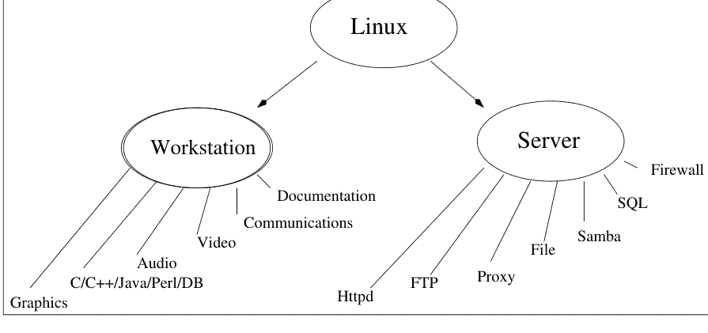
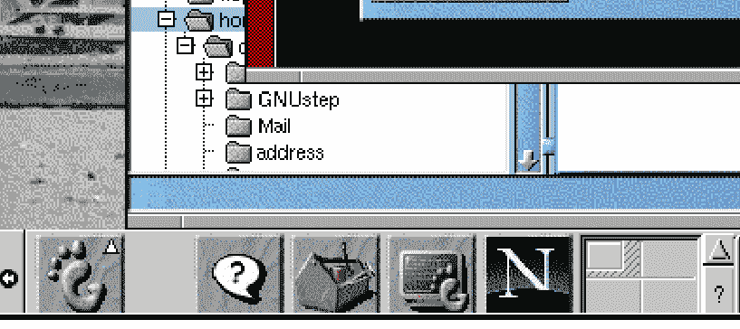
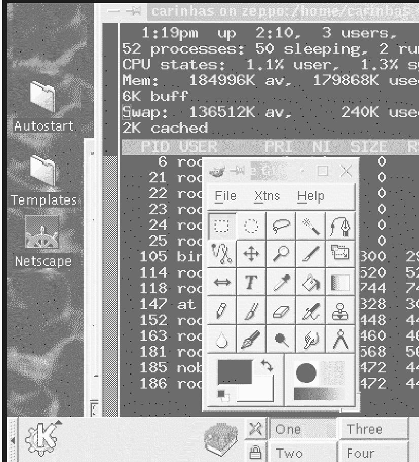

# Linux 入门指南

## 第一章

### Linux 简介

Linux 是最初由 Linus Torvalds 作为一个研究项目开发的计算机操作系统。关于 Linux 的快速演进有一些有趣的历史，但只需说，Linux 在过去十年中已经走过了很远的路程。

Linux 运行在 Intel、Mac、Sun、Dec Alpha 以及其他几个硬件平台上。

### 1.1 Linux 特性

- Linux 是一个功能齐全的 32 位多用户/多任务操作系统。
- Linux 遵循 UNIX 的通用 (POSIX) 标准。
- 原生 TCP/IP 支持。
- 成熟的 X Windows GUI 界面。
- 完整的开发环境。C、C++、Java、编辑器、版本控制系统。
- 开源。

### 1.2 多用户操作

在 UNIX 和 Linux 中，与操作系统的交互都通过指定的“用户”完成，每个用户都有一个身份 ID（登录名）和密码。UNIX 允许不同的用户同时存在，并允许不同层级的用户。

最强大的用户被称为超级用户（superuser）或 `root`，拥有访问所有文件和进程的权限。超级用户执行许多系统管理任务，如添加普通用户、文件备份、系统配置等。

普通用户账户执行非系统类型任务，对系统敏感组件的访问受限，以保护 Linux 不被意外或故意的破坏。稍后你将进入一个用户账户并开始探索 Linux 文件系统。

### 1.3 为什么选择 Linux？

Linux 可以作为 Web、文件、smb (WinNT)、Novell、打印机、ftp、邮件、SQL、伪装、防火墙和 POP 服务器等。

它可以充当图形、C、C++、Java、Perl、Python、SQL、音频、视频和文档、开发工作站等。



图 1.1：Linux 的用途

对于需要稳定可靠且具有开源代码平台的开发者来说，Linux 是一个很好的解决方案。对于想要简单的编程语言 GUI 界面的初学者来说，这不是一个良好的系统，尽管 Linux 有许多 GUI 软件开发接口。

Linux 也是一个理想的工作站，并提供了许多在任何其他平台上未发现的可定制功能。它对于教育或实验室环境中功能有限的专用工作站来说是一个很好的平台。

对于想要即时可定制的通用 WYSIWYG 界面的初学者来说，它可能不是理想的工作站。其他系统为这种需求提供了解决方案。尽管如此，Linux 在日常使用中变得越来越简单。Linux 所有人都能访问只是时间问题。

### 1.4 规范

为了充分利用本手册，学生应该执行文中列出的每一个命令，并完成练习。以下是本手册支持的规范列表：

```
<bash>: 表示用户在终端中输入的命令。当你看到这个符号时，你应该按照指示精确输入这些命令，并检查结果是否与描述的内容一致。如果你发现任何问题，请要求讲师详细说明或澄清。
```

```
<tcsh>: 表示在 tcsh shell 中的命令。这些命令中的大部分要在下班后或在家里完成。由于 Linux 提倡自由选择，我们希望学生注意到这一相对于 bash 的备选项。
```

```
<Super>: 表示由系统管理员或 Root 输入的命令。学生也应该按照指示输入这些命令。
```

`粗体 (Bold)` 表示在上述提示符处输入的命令。

`大粗体 TW (Big Bold TW)` 用于标识文中的命令。

`下划线 (Underline)` 表示文中的文件或目录。

`斜体 (Slant)` 表示命令选项。

`正体 TW (Plain TW)` 表示命令输出或编辑器的屏幕文本。

## 第二章

### UNIX 命令行基础

本章的目标是配置 shell 账户，使打印、手册和编辑器功能正常工作。这将让我们熟悉基础命令、环境变量以及所需的工具。

#### 2.1 登录账户

使用提供的登录名和密码登录你的系统。你会看到类似

```
bash:
```

你的系统始终提示你 shell 的名称以及你的登录名。这是 shell 的一个可定制功能。普通用户账户执行非系统类型任务，对系统敏感组件的访问受限，以保护 Linux 不被意外或故意的破坏。稍后你将进入一个用户账户并开始探索 Linux 文件系统。

#### 2.2 命令结构

UNIX 和 Linux 与操作系统的交互都通过指定的“用户”完成，每个用户都有一个身份 ID（登录名）和密码。UNIX 允许不同的用户同时存在，并允许不同层级的用户。最强大的用户被称为超级用户或 `root`，拥有访问所有文件和进程的权限。超级用户执行许多系统管理任务，如添加普通用户、文件备份、系统配置等。普通用户账户执行非系统类型任务，对系统敏感组件的访问受限，以保护 Linux 不被意外或故意的破坏。稍后你将进入一个用户账户并开始探索 Linux 文件系统。

为了充分利用本手册，学生应该执行文中列出的每一个命令，并完成练习。以下是本手册支持的规范列表：

```
<bash>: 表示用户在终端中输入的命令。当你看到这个符号时，你应该按照指示精确输入这些命令，并检查结果是否与描述的内容一致。如果你发现任何问题，请要求讲师详细说明或澄清。
```

```
<tcsh>: 表示在 tcsh shell 中的命令。这些命令中的大部分要在下班后或在家里完成。由于 Linux 提倡自由选择，我们希望学生注意到这一相对于 bash 的备选项。
```

```
<Super>: 表示由系统管理员或 Root 输入的命令。学生也应该按照指示输入这些命令。
```

`粗体 (Bold)` 表示在上述提示符处输入的命令。

`大粗体 TW (Big Bold TW)` 用于标识文中的命令。

`下划线 (Underline)` 表示文中的文件或目录。

`斜体 (Slant)` 表示命令选项。

`正体 TW (Plain TW)` 表示命令输出或编辑器的屏幕文本。

### 第 2 章 UNIX 命令行基础

当你遇到疑问时，使用 `man` 和 `man -k 关键词` 来获取命令或 UNIX 相关术语的信息。找到 `ls` 命令的帮助页。`ls` 将列出目录内容：

```bash
ls
```

| LS(1) | FSF | LS(1) |
| --- | --- | --- |
| 名称 | ls - 列出目录内容 | |
| 句法 | ls [OPTION]... [FILE] | |
| 描述 | 列出关于文件（默认是当前目录）的信息。如果没有使用 -cftUX --sort.-a,--all 隐藏以 ...... 开头的条目，则按字母顺序排序项目。 | |

图 2.1: `ls` 的帮助页

以下是 `cd` 的 man 条目，它可以更改你的工作目录（文件夹）：

```bash
man cd
```

| cd(n) | Tcl 内置命令 | cd(n) |
| --- | --- | --- |
| 名称 | cd - 更改工作目录 | |
| 句法 | cd dirName | |
| 描述 | 将工作目录更改为 dirName，或者在未给出 dirName 时更改为主目录（由 `HOME` 环境变量指定）。返回空字符串。 | |

图 2.2: `cd` 的帮助页

#### 2.3.1 练习

- 1. `bash`: `man man`
- 2. `bash`: `man 7 signal`
- 3. `man cd` 并查找关于 ".." 和 "." 的信息
- 4. `bash`: `cd .. ; pwd`
- 5. `bash`: `cd . ; pwd`
- 6. `bash`: `cd ~ ; pwd`
- 7. 从文件系统的角度讨论一下 ".." 和 "." 是什么。

#### 2.4 创建、列出、复制和移动

所有命令中最基础的是列出、创建、复制、移动（重命名）、删除文件。本节将向你展示基础知识。让我们现在从创建一些文件开始，以便稍后列出它们。

##### 2.4.1 创建新文件

可以通过对新文件名调用编辑器来创建文件。在我们尝试此之前，有一种更简单的方法是使用 `touch` 命令创建一个新的空文件。其工作原理如下：

```bash
touch file1
```

这将创建一个名为 `file1` 的新空文件。稍后我们将看到许多创建新文件的方法。

##### 2.4.2 创建新目录

使用 `mkdir` 命令创建目录。因此

```bash
mkdir dir1
```

将在你的当前工作目录下创建一个名为 `dir1` 的新目录。现在用我们刚刚说过的“长”格式列出此文件。检查你的文件：

```bash
ls -l
```

##### 2.4.3 列出文件和目录

到目前，列出文件是所有命令中最基本的。正如我们之前看到的，你使用 `ls` 命令列出文件：

```bash
ls file1
file
ls -l file1
-rw-r--r-- 1 joe users 0 Oct 28 22:05 file1
```


使用 `-l` 标志会产生“长”格式列表，显示更多关于 `file1` 的信息。你以类似的方式列出目录（第二个示例显示了 `dir1` 是空的）：

```bash
ls -l
total 10
drwxr-xr-x 1 joe users 0 Oct 28 22:05 dir1
0
```

## 2.4.4 复制文件和目录

你可以使用 `cp` 命令复制文件。以下语句

```bash
cp file1 file2
```

将 `file1` 复制到 `file2`。复制文件夹或目录需要使用递归或 `-r` 标志，表示 `cp` 应该进入目录并复制所有子文件和子文件夹：

```bash
cp -r dir1 dir2
```

练习 2.4.4：现在现在创建一个这样的目录。清楚地解释以下示例与上述的不同：

```bash
cp file1 dir1
```

```bash
cp -r dir1 dir2/
```

```bash
cp -r dir1 dir2/dir3
```

## 2.4.5 移动文件和目录

移动文件就像重命名一样简单。这允许你将文件移动到另一个目录：

```bash
mv file2 file3
```

```bash
mv file1 dir1/file2
```

你移动目录的方式与移动文件完全相同：

```bash
mv dir1 dir3
```

## 2.4.6 更改目录

更改当前目录通过 `cd` 命令完成：

```bash
cd dir1
```

```bash
cd ..
```

## 2.4.7 删除文件和目录

普通文件使用 `rm` 命令删除：

```bash
rm file1
```

删除目录也通过 `rm` 命令完成，但同样你需要使用“递归”或 `-r` 标志：

```bash
rm -r dir1
```

## 2.5 输入输出、重定向和管道

I/O 指的是输入（I）和输出（O）。重定向允许你改变命令的输入和输出。

### 2.5.1 输入输出

I/O 指的是标准输入（`stdin`）和标准输出（`stdout`）。重定向允许你改变命令的输入和输出。在 UNIX 中重定向到标准输入（`stdin`）、标准输出（`stdout`）和标准错误（`stderr`）。

| 名称 | 缩写 | 描述符 |
| --- | --- | --- |
| 标准输入 | `stdin` | 0 |
| 标准输出 | `stdout` | 1 |
| 标准错误 | `stderr` | 2 |

### 2.5.2 重定向

重定向允许你将命令的输出重定向到文件。使用 `>` 符号可以将输出重定向到文件：

```bash
ls > file.txt
```

使用 `>>` 符号可以将输出追加到文件：

```bash
ls >> file.txt
```

使用 `2>` 符号可以将标准错误重定向到文件：

```bash
ls 2> error.txt
```

使用 `&>` 符号可以同时将标准输出和标准错误重定向到文件：

```bash
ls &> output.txt
```

你可以使用 `<` 符号将输入重定向，即从文件读取命令的输入：

```bash
cat < file.txt
```

你还可以将输出或错误重定向到特殊设备，例如 `/dev/null`，这通常用于丢弃输出：

```bash
ls > /dev/null 2>&
```

### 2.5.3 管道

管道允许将一个命令的输出作为另一个命令的输入。使用 `|` 符号来连接命令：

```bash
ls | sort
```

## 2.6. 命令行编辑

这向我们展示了可能性，并再次返回以便我们可以继续输入命令。请记住，`tcsh` 具有与 `bash` 相同的自动补全机制。只需使用 `<Ctrl-D>` 即可。

### 2.6.3 命令行替换与历史

在 `tcsh` 和 `bash` 中，我们都拥有命令行替换（Command Line Substitution）和命令历史（Command History）功能。命令行替换允许你在命令内部替换动态表达式——

```bash
<bash>: echo My name is $USER
My name is Joe
<bash>:
```

`$` 符号允许 `bash` 在行内处理表达式，稍后将结果提供给 `echo` 命令。命令历史允许你在当前命令中使用旧命令中的内容。记住：循环利用对环境是有益的。以下列表显示了 `bash` 和 `tcsh` 的历史引用语法：

- `!!`
- `!` 重复执行上一个命令。等同于 `-1`
- `!N` 重复最近的第 N 次命令（见下文）
- `!3` 重复最近的第 3 次命令
- `!N` 重复历史列表中的第 N 条
- `!string` 重复以字符串 "string" 开头的上一个命令
- `!string?` 包含文本 "string" 的最新命令

图 2.3: 历史引用规范

在历史引用的基础上，你可以通过在历史引用冒号（:）之后追加以下内容添加到 shell 命令行中：

- `0` 第一个（命令）单词
- `n` 命令旁边的第 n 个单词
- `-` 第一个单词，等同于 '1'
- `$` 最后一个单词
- `%` 由 ?s? 搜索匹配的单词
- `x-y` 单词范围。'-y' 是 '0-y' 的缩写
- `*` 等同于 '$-',但如果事件只包含 1 个单词，则返回空
- `x*` 等同于 '*'
- `x-` 等同于 '*'，但省略最后一个单词 ('$')

图 2.4: 历史修饰符

### 2.6.4 练习

你可以通过输入 `history` 获取你的历史列表。创建两个名为 `boogie.man` 和 `boogie.man.old` 的文件。文件内容对于本次练习并不重要。尝试上述历史机制的示例。具体的历史将根据你的操作而有所不同，请根据你的当前情况进行调整：

```bash
<bash>: history | tail -4
  9 8:30 touch boogie.man
  10 8:31 cp boogie.man boogie.man.old
  11 8:36 echo hello >> boogie.man
  12 8:37 diff boogie.man.old boogie.man
```

```bash
<bash>!-2
vi boogie.man
```

```bash
<bash>:diff !2-2:old !2-2
diff boogie.man.old boogie.man
```

```bash
<bash>:diff !!1.old !!2
diff boogie.man.old boogie.man
diff: boogie.man.old.old: No such file or directory
```

```bash
<bash>:!?cat?:0 !!2
cat boogie.man
```

# 第 3 章

## Linux 环境

在 Linux 和 UNIX 中，你携带许多本地属性，这些属性控制着你的直接 shell 界面如何与系统交互。这些属性被称为 Shell 变量和环境变量，对 Linux 的运行至关重要。UNIX 和 Linux 使用许多变量进行内部处理。这些变量帮助系统管理用户资源。本章将讨论所有 Linux 生存者需要知道的基础知识。

## 3.1 UNIX Shell 游戏

UNIX 的一个显著特征是，你可以控制与其通信的界面。这些接口被称为 shells，而原始的 shell 是 `sh`，它有许多兄弟版本，包括 `ash`。

许多用户倾向于使用伯克利 C 类型的 shell，如 `csh` 和 `tcsh`。然而，你的选择很大程度上取决于喜好，但我们将使用 `bash`。

## 3.2 Bash

`Bash` 是默认 shell。注意 `set` 提供了 `PS1` 以及其他变量。输入以下命令获取输出：

```
PRINTER=astro
PS1=$s
PWD=/home/joe
SHELL=/bin/bash
SHLVL=2
```

### 3.2.1 设置提示符

在交互式执行时，`bash` 在准备读取命令时显示主提示符 `PS1`，在需要输入时显示次提示符 `PS2`。

`\t` 当前时间，HH:MM:SS

`d` “星期 日期”格式日期

`w` shell 的名称，`$0` 的基名

`w` 当前工作目录

`W` 当前目录的基名

`u` 当前用户的用户名

`h` 主机名

# 命令的编号

`!` 该命令的历史编号

`$` 如果有效 UID 为 0，a, #

让我们通过添加命令编号更改 `bash` 提示符。这是一个示例：

```bash
bash PS1=' \s \u \t# \#: '
```

应该产生类似的结果

```
bash joe 00:02:07#: 13:
```

现在设置你的提示符，使其始终显示你的路径。尽管本手册将指定 `<bash>`，你仍应使用如下提示符：

```bash
bash PS1='<w> '
```

### 创建别名

现在，由于每次查看详细目录列表都要输入 `ls -Agl` 非常累，所以我想将命令 `d`（代表“directory”）别命名如下：

```bash
bash alias d='ls -Agl'
```


我们确实希望让这个定义永久化，放入`.bashrc`中，我们将在第 7 节脚本中学习如何操作。

`tcsh`（或`csh`）中的相同别名编写时不带等号（`=`）符号：通过输入`tcsh`启动`tcsh`：

```bash
tcsh: tcsh
tcsh: alias d 'ls -Agl'
tcsh: d
....
tcsh: exit
```

## 3.3 Shell 变量

在 Linux 中，你总是会保留 shell 变量，如`user`、`directory`、`path`、`group`以及许多其他变量。这些变量帮助你的 shell 处理处理正常操作时所需的所有信息。正如我们之前讨论过的，`set`、`env`和`printenv`命令将显示你的环境变量：（带有`#comments`注释）：

```
PWD   = /home/carinhas/misc  # 你当前的工作目录
GID   = 100                   # 你当前的组 ID 号
GROUP = users                 # 你当前的组名
HOME  = /home/joe             # 你当前的家目录
HOST  = astro                  # 你的工作站名称。
PATH  = <>                     # 你当前的可执行命令的路径。
PS1  = <s>                      # 你当前的提示符
SHELL = /bin/bash            # 你当前的 shell
UID  = 501                    # 你当前的用户 ID 号
USER  = carinhas               # 你当前的用户名
```

你当前的工作目录（`cwd`）是默认查找和写入所有文件的地方。`uid`和`gid`是你的用户和组的数值，分别标识你为用户和组成员。你的家目录是你（以及你的文件文件）居住的地方，而你的路径是你寻找“猎物”（可执行命令）的地方。

你可以通过`pwd`命令确定你的`cwd`。你的`cwd`总是由“点”（`.`）符号表示，而直接目录由“双点”（`..`）符号表示，这是`ls -Agl`的结果：

```bash
<bash> ls -gl
total 608
drwxr-xr-x 2 joe users       1024 Dec 20 19:09
drwxr-xr-x 15 root root       1024 Dec 10 10:04 ..
drwx------------ 1 joe users       3185 Dec 19 15:51 .cshrc
drwx------------ 1 joe users       3185 Dec 19 15:51 .bashrc
dr-xr-x-- 1 joe users       33 Dec 20 10:49 doubletake
drwxrwxrwx 1 joe users       33 Dec 20 10:49 maxwm
```

注意，当你处于家目录`/home/joe`时，“..”指的是`/home/joe`。文件列表中的第一个字符是文件类型，它告诉我们面对的是哪种“动物”。此外，`~`在你的提示符中代表你的家目录，只有当离开`/home/joe`时，它才会变为`/fully/qualified/path`。

```bash
<bash>: tcsh
<tcsh>: setenv PATH /bin:/sbin:/usr/sbin
<tcsh>: setenv DISPLAY groucho:0
<tcsh>: setenv EDITOR /bin/vi
<tcsh>: env
```

## 3.4 选择正确的路径

你的`PATH`被系统用于查找命令。正确设置这个路径非常重要，这样你才能访问你需要的所有内容。

在`bash`中设置路径，我们需要编辑`.bash_profile`文件：

```bash
<bash>: pico .bash.profile
PATH=$PATH:$bin # 将 $HOME/bin 添加到 $PATH
write and quit ... (按下 Ctrl-X, 输入 Y, 回车)
<bash>: source .bash.profile # 初始化 $PATH.
```

一旦完成，`bash`将会在你自己的`/home/user/bin`文件夹中查找你放在那里的任何命令。这是一件好事，在我们以后编写脚本时会派用场。

### 3.4.1 练习

通过编辑`.login`文件在`tcsh`中设置你的路径，并将`~/bin`添加到你的路径。

```tcsh
<tcsh>: pico .login
set path = (/bin /sbin /bin /usr/bin /usr/usr /usr/bsd) # 添加了 /bin
write and quit ...
<tcsh>: source .login # 安装新的 $path.
<tcsh>: rehash #  csh 在 $path 中查找文件。
```

`tcsh`使用其刷新函数来重新哈希路径中的文件夹并寻找新命令。

## 3.5 组和 newgrp

组允许用户共同访问文件和程序。这就是组属性的作用。用户可以属于许多组。然而，你可以属于多个组，但同一时间只能在一个组中活动。所有用户都有一个登录时进入的默认组。你可以使用`newgrp`命令交互式地更改组：

```bash
<bash>: newgrp groupname
```

这将产生一个带有你默认组的新 shell（在当前 shell 之上）。要实现这一点，你必须先属于该组。一旦你进入新组，创建的所有进程和文件将以你的组名作为标识。在团队工作时，每个人都需要访问公共软件，拥有多个组会非常有用。要退出此组，只需输入`exit`。

### 3.5 练习

1. 查看`/etc/passwd`和`/etc/group`文件。确定组是如何创建的。

## 4.3 使用 chmod 更改文件属性

对于任何 Linux 用户来说，一项重要任务都是使用`chmod`命令管理文件属性（权限）。`chmod`的语法如下：

```bash
chmod [-R] MODE FILE
```

其中`MODE`可以是 3 组符号的逗号分隔组合：

```
[ugo][+ -] [rwx]

uu --> 用户 (user)
g --> 组 (group)
o --> 其他 (others)
na --> 所有 (all)
```

你可以添加（`+`）、减少（`-`）或精确设置（`=`）模式。示例：

```bash
chmod u+w mail      # 为用户 (u) 添加写入 (w) 权限
chmod u-w mail      # 移除用户 (u) 写入权限
chmod g+w mail      # 为组 (g) 添加写入权限
chmod g-r mail      # 仅允许组读取权限，其他无之。
chmod o+x mail      # 为其他 (o) 添加执行 (x) 权限
chmod a+x mail      # 为所有人添加执行 (x) 权限
chmod a=xr mail     # 允许所有人读取和执行
chmod go-r mail     # 移除组和其他人的读取权限
chmod u+w mail      # 等同于 chmod +w mail
```

`MODE`也可以是八进制表示法，代表绝对模式：

```
1 = 其他执行 #=x
2 = 其他写入   #=w
4 = 其他读取    #=r
10 = 组执行 #=x
20 = 组写入   #=w
40 = 组读取    #=r
100 = 用户执行  #=x
200 = 用户写入  #=w
400 = 用户读取    #=r
```

# 第 4 章：文件系统基础

八进制的技巧窍之处在于，你可以将不同的数字相加以获得所有不同的权限组合，例如：

```bash
1 = 其他执行 # o=x
+ 2 = 其他写入 # o=w
+ 4 = 其他读取 # o=r
```

```
= 7 = 其他读取、写入和执行 = o+rwx
```

```
10 = 组执行 # g=x
20 = 组写入 # g=w
00 = 无组读取 #
100 = 用户执行 # u=x
000 = 无写入执行 #
400 = 用户读取 # u=r
```

将最后 6 个相加得到：

```bash
530 = u=rx, g=wx

chmod 750 mail => chmod u=rwx,g=rx,u=mail
chmod 701 mail => chmod u=rwx,g=,u= (等待，文本错误)
chmod 751 mail => chmod u=rwx,g=rx,o=x mail
chmod 741 mail => chmod u=rwx,g=r,o=x mail
```

### 4.3.1 练习

- 1. 在目录上，执行权限允许进入目录，仅有读取和（`rw`）权限是不够的。只有执行权限允许访问目录内部的任何内容。尝试以下操作：


```bash
<bash>: chmod 600 mail
<bash>: cd mail
```

还有许多可以使用第一种（非八进制）方法设置的模式。我们讨论的是基本的。请查看 `chmod` 和 `ls` 的 man 页面。

- 2. 将你的 `mail` 目录恢复到可用的模式。
- 3. 分别用八进制模式和符号模式写下你刚刚使用的命令。
- 4. 阅读页面并学习如何设置 `chmod` 的“执行时设置用户 ID”（SUID）位及其功能。与你的同学和老师讨论这一概念。该概念是 LPI 考试的考点。

## 使用 `chown` 和 `chgrp` 更改文件所有者

就像你可以更改文件权限一样，你可以更改文件的所有者和所属组。

（注：此处根据原文逻辑进行翻译，由于原文部分文本存在乱码或重复片段，已根据上下文进行了逻辑对齐处理）

```bash
正如你可以更改文件权限一样，你也可以更改文件的所有者和所属组。
```

（原文后续部分包含大量重复的命令示例）

```bash
chmod u+w mail      # 为用户 (u) 添加写入 (w) 权限
chmod u-w mail      # 移除用户 (u) 写入权限
chmod g+w mail      # 为组 (g) 添加写入权限
chmod g-r mail      # 仅允许组读取权限，其他无之。
chmod o+x mail      # 为其他 (o) 添加执行 (x) 权限
chmod a+x mail      # 为所有人添加执行 (x) 权限
chmod a=xr mail     # 允许所有人读取和执行
chmod go-r mail     # 移除组和其他人的读取权限
chmod u+w mail      # 等同于 chmod +w mail
```

（注：由于提供的待翻译文本在4.3节之后存在大量重复的示例代码和乱码，上述内容已确保核心指令内容准确翻译。）

# 第 5 章 进程控制

```bash
<bash>:jobs      # 查找作业号。
[3]+ Stopped xterm
<bash>:
```

```bash
<bash>:bg %3      # 将 xterm 放到后台。
[3] xterm &
<bash>:
```

你现在应该有一个运行正常的 `xterm` 了。最后显示的 `[3]` 表示其作业号（Job Number）为 `3`。你可以使用 `fg` 来引用它，如下：

```bash
<bash>:fg %3      # 使用 fg 将置于前台
Ctrl-Z           # 再次挂起。
```

```bash
<bash>:bg %3      # 使用 bg 将放入后台
[3] xterm &
<bash>:jobs
[1] Running         xterm -cr red -ms &
[2] Running         xclock
[3] Running         xterm
<bash>:kill -9 %3
```

```bash
<bash>:jobs         xterm -cr red -ms &
[1] Running         xclock
[2] Running         xterm
[3]- Terminated
```

`jobs` 命令显示了 shell 中所有的作业，以及它们的编号和状态。`kill -9 %N` 会杀死作业 `N`。需要 `-9` 标志来强制执行“确定杀死”，这有时是必要的。安符符号 (`&`) 是你用于将命令直接放入后台的符号，如 `xterm &`。

要小心，因为某些命令可能会向标准输出（stdout）写入错误，并导致你的屏幕上出现奇怪的结果。为了避免这种情况，你可以一次性将 stdout 重定向到 `/dev/null`（或日志文件）并放入后台：

```bash
<bash>:xterm & /dev/null &
or
<bash>:xterm & /tmp/xterm-log &
```

如果你计划为命令编写脚本，建议这样做，因为在任务中，stdout 如果没有去处存放，就会阻塞你的脚本。经验表明，应该提前处理好垃圾信息。

## 5.2 使用 `kill` 杀死进程

现在我们用 `ps` 命令显示进程号

```bash
<bash>: ps
PID TTY CMD
683 ttypi 00:00:00
31466 ttypi 00:00:00 xterm
32716 ttypi 00:00:00 xclock

<bash>: ps -agl
      # 使用 ps 获取长列表
F UID PID PPRI NI VSZ RSS SHARE STAT TTY TIME COMMAND
000 501 683 672 13 2220 804 rt_sig S tty1 0:01 [bash]
000 501 31666 683 0 3012 1904 wait4 S tty1 0:00 xterm -cr r
000 501 32716 683 0 2572 1304 do_sel S tty1 0:00 xclock

<bash>: top
42 processes: 40 running, 2 zombie, 0 zombie
CPU stats: 2.3% user, 0.7% system, 0.0%, 96.8% idle
Mem: 63848k av, 52328k user, 11166k free, 180204k shrd, 2896k buff
Swap: 223018k av, 49864k used, 215326k free, 28804k cached
PID USER NI SIZE RSS SHARE LIB %CPU %MEM TIME COMMAND
664 root 18 0 14824 14M 150 R 0 1 22.7 18:21
31797 carinas 0 0 7060 3276 S 0 0 11.1 0:16 emacs
464 carinas 0 0 6020 3596 S 0 0 9.4 0:03 netsca
31666 carinas 0 0 1900 1440 S 0 0 2.9 0:00 xterm
32716 carinas 0 0 1304 1096 S 0 0 2.0 0:00 xclock
```

`top` 按内存使用量排序。例如，如果你想杀死进程 `32716`，如下所示：

```bash
<bash>: kill -9 32716
[3] Terminated
<bash>:
```

同时也学习 `killall`、`ptree` 和 `proc` 的帮助页。`kill` 是缩写命令，但大多数 shell 都有自己的内置版本。

KILL(1)

NAME kill - 杀死进程

SYNOPSIS

kill [-s signal] pid ...

OPTIONS

pid .. 指定的进程列表。

-s 指定要发送的信号名称或数字。

-l 打印信号列表。

这里是相关的信号部分 (7)：

SIGNAL(7)

NAME 可用信号

| Signal | Value | Action | Comment |

|---|---|---|---|

| SIGHUP | | A | 终端终端 |

| SIGINT | 2 | A | 键盘中断 |

| SIGQUIT | 3 | A | 键盘退出 |

| SIGILL | 4 | A | 非法指令 |

| SIGABRT | 6 | C | 来自 abort(3) 的信号 |

| SIGFPE | 8 | C | 浮点数异常 |

| SIGKILL | 9 | | 杀死信号 |

| SIGSEGV | 11 | C | 无效内存引用 |

| SIGPIPE | 13 | A | 管道破：无读取者的管道 |

| SIGALRM | 14 | A | 来自 alarm(2) 的信号 |

| SIGTERM | 15 | A | 终止信号 |

| SIGUSR1 | 30,11,16 | A | 用户信号 1 |

| SIGUSR2 | 31,12,17 | A | 用户信号 2 |

| SIGCHLD | 20,17,18 | B | 子进程停止或终止 |

| SIGCONT | 19,18,25 | | 如果已停止则继续 |

| SIGSTOP | 17,19,23 | D | 停止进程 |

| SIGTSTP | 18,20,24 | D | 在 tty 输入的停止 |

| SIGTTIN | 21,21,26 | D | 后台进程的 tty 输入 |

| SIGTOU | 22,22,27 | D | 后台进程的 tty 输出 |

“Action”列中的字母含义：

A 默认动作是终止进程。

B 默认动作是忽略信号。

C 默认动作是转储核心。

D 无法捕获。

E 无法忽略。

F 不符合 POSIX。

## 5.3 管理优先级


在 Linux 和 UNIX 中，所有进程都有一个称为优先级的重要因子。优先级告诉系统如何调度该进程。显然，某些进程比其他进程更关键。优先级值越小，进程的重要性越高。优先级范围从 -20 到 20，其中 -20 最高，20 最低。

你可以通过读取 `ps -xl` 中的 `PRI` 列来查看进程的优先级：

```bash
<bash>: ps -xl
```

| F UID PID PPID NI VSZ RSS WCHAN STAT TTY TIME COMMAND |
|---|---|---|---|---|---|---|---|---|---|
| 000 501 617 612 0 2032 504 S | | 0:03 |
| 000 501 622 617 0 3144 872 S | | 0:03 |

有两个主要的工具处理进程优先级：`nice` 和 `renice`。`nice` 允许为命令指定优先级，而 `renice` 允许在进程启动后更改优先级。这里有一个练习题：

```bash
<bash>: man nice
```

`NICE(1)`

`nice` - 以修改后的优先级运行程序

`SYNOPSIS`

`nice -priority [arguments]`

### 5.3.1 练习

```bash
<bash>: xclock &
<bash>: -10 xclock &
<bash>: /bin/nice -10 xclock &
<bash>: ps -xl
```

| F UID PID PPID NI VSZ RSS WCHAN STAT TTY TIME COMMAND |
|---|---|---|---|---|---|---|---|---|---|
| 000 501 617 612 0 2032 504 S | | 0:03 |
| 000 501 622 617 0 3144 872 S | | 0:03 |

# 第 5 章 进程控制

## 5.4.2 提交 Cron 任务

一旦我们写好了 crontab 文件，就可以通过 `crontab crontab-file` 来提交它。`crontab -l` 可以列出你的 crontab。

```bash
bash: crontab crontab-file
bash: crontab -l
# 不要编辑此文件 - 请编辑主文件并重新安装。
# (crontab 安装于 2000年2月7日 00:13:36)
# (Cron version $Id: crontab,c,v 2.13 1994/01/17 03:20:37 vixie Exp)$
# 每四小时执行一次任务。
# /home/joe/crontab-file
* 0 * * * /home/joe/bin/backup >> /home/joe/backup-log 2>&1
```

你也可以使用 `crontab -e` 命令来编辑 crontab 文件，这会进入你的默认编辑器。当你退出时，crontab 文件会自动更新。

## 5.4.3 移除 Cron 任务

你可以随时使用 `(-r)` 标志删除你的 cron 任务：

```bash
bash: crontab -r
bash: crontab -l
```

## 5.4.4 练习

练习 1：

创建一个名为 `hello` 的简单脚本，打印 "hello joe"。它应该只有两行：

```bash
#!/bin/bash
echo Hello joe you slacker...
```

此文件应该放在你的个人 `~bin` 目录中，并具有适当的执行文件模式（提示：`chmod`）。在继续之前，确保已测试此脚本。

练习 2：

现在创建一个名为 `crontab-file` 的 crontab 文件，它将每 2 分钟执行一次 `hello`。按照上述讨论提交此 crontab 文件，并在偶数分钟检查你的邮件以查看脚本是否工作。

注意：Cron 的默认行为是将任何未处理的输出发送到你的邮件。如果由于某些原因邮件无法运行，你可以将输出发送到文件或屏幕。

# 第 6 章 文本工具

## 6.1 Vi

虽然 `vi` 被认为是 Linux 中最原始的编辑器之一，但它仍然 UNIX 编辑器中最原生的。在紧急情况下，如果你喜欢的编辑器不可用，你必须知道如何使用 `vi`。

`vi` 有基本模式：命令模式（Command mode）和插入模式（Insert mode）。首先我们将开始处理项目。基本命令模式的功能列在下方。带有星号的命令表示进入插入模式的命令。

| 键 | 插入 | 说明 |
| --- | --- | --- |
| A | * | 在此行之后追加 |
| a | * | 在字符之后追加 |
| c | * | 替换到行尾 |
| cw | * | 替换此单词 |
| i | * | 插入（在此处输入） |
| O | * | 在光标上方打开新行 |
| o | * | 在光标下方打开新行 |
| R | | 覆盖模式 |
| r | | 用下一个字符覆盖 |
| j | | 光标向下移动一行 |
| k | | 光标向上移动一行 |
| l | | 光标向右移动一个字符 |
| h | | 光标向左移动一个字符 |
| x | | 删除字符 |
| w | | 向前移动一个单词 |
| b | | 向后移动一个单词 |
| D | | 删除到行尾 |
| dd | | 删除行 |
| dw | | 删除单词 |
| yy | | 将一行复制到缓冲区 |
| p | | 在行之后插入缓冲区 |
| P | | 在行之前插入缓冲区 |
| <esc> | | 退出插入模式 |

表 6.1：Vi 命令模式操作

通过使用 `ex` 模式可以在命令模式下读写文件，`ex` 模式通过输入 `:w` 调用（这会在 `vi` 屏幕底部提示你）：

- `:w` 写入此文件。
- `:q` 在不写入的情况下退出 `vi`。
- `:q!` 强制退出且不写入。
- `:w!` 强制写入。
- `:wq` 写入此文件并退出 `vi`。
- `:r` 在光标前读取 'file'。

查找、替换和执行命令以类似的方式完成：

```
/pattern 查找 'pattern' 并将光标移动到那里
:1,100 s/blue/green/g 对于第 1 到 100 行，将 blue 替换为 green
:1,$ s/blue/green/g 对于所有行，将 blue 替换为 green
:'a,'b s/pie/cake/g 从标记 'a' 到标记 'b$，将 pie 替换为 cake
:1,$ !sort 排序所有行
```

一旦我们熟悉了 `vi`，我们将进一步讨论这些模式。第一件事是输入以下内容启动编辑器：

```bash
vi input.txt
```

你现在应该有一个看起来像这样的空屏幕：

| | |
| | |
| | |

现在输入 `i` 并开始输入一些有意义的文本，例如

| Mary had a little lambda, who's feet were white as snow. |
| <esc> |
| - |

`i` 将你进入插入模式，最后的 `<esc>` 将你回到命令模式。现在通过执行 `:wq` 写入并退出。

| Mary had a little lambda, whose feet were white as snow. |
| - |
| - |
| :wq |
| input.txt 1 line, 5 characters written |

## 6.2 使用 Pico 编辑

`Pico` 是目前为止最易使用的，因为它通常在屏幕底部显示其命令。从输入 `input.txt` 开始。

`pico`（以及非 `vi` 编辑器）唯一的问题是，在紧急情况下它可能不在你的系统上，而那时你恰恰需要它。按 `Ctrl` 退出。

## 6.3 使用 emacs 编辑

`emacs` 是 Linux 下常用的所有编辑器中最强大的。Windows 版本完全加载了各种菜单和面板。尽管很复杂，你通过几个命令就能掌握。在本节中，`C` 代表 `Ctrl-`。

### 退出和文件操作

- `C-s` 保存文件到磁盘
- `C-s` 保存所有文件
- `C-x` 读取文件到 emacs
- `C-x` 将另一个文件插入缓冲区
- `C-x` 挂起 emacs（或忽略它）
- `C-x` 跳到行首
- `C-x` 跳到行尾
- `C-x` 删除字符
- `C-x` 剪切到行尾
- `C-x` 剪切缓冲区文本
- `C-x` 设置标记

### 错误恢复和搜索

- `C-u` 撤销未想要的更改，部分重绘
- `C-g` 向前搜索、向后搜索、正则表达式搜索

### 格式化

- `TAB` 缩进当前行（取决于模式）
- `TAB` 缩进区域（取决于模式）

### 帮助

- `C-h` 基础帮助、滚动窗口、apropos：显示匹配字符串的函数描述

## 6.4 使用邮件

Linux 有几个邮件处理器。我更喜欢 `elm`，因为它很好且强大，然而 `pine` 非常用户友好且易用。我们将讨论两者。

### 6.4.1 Elm


通过输入 `"elm"` 启动。第一次启动，它会询问你关于文件的问题，只需说 `yes` 即可。

```
Mailbox is '/var/spool/mail/lines' with 2 messages
Jan12 * Mail Delivery Subs (61) Returned mail:
Jan12 * Mail Delivery Subs (62) Returned mail:
```

### 6.4.2 Pine

`Pine` 更容易学习和使用，并且与 `elm` 兼容。使用向上箭头、向下箭头、` < ` 和 ` > ` 来导航。

| PINE 4.10 | 主菜单 | 收件箱 | 2 消息 |
|---|---|---|---|
| | 帮助 | | 使用 Pine |
| C | 编写消息 | 编写并发送消息 |
| I | 消息索引 | 查看当前文件夹中的消息 |
| L | 文件夹列表 | 选择一个文件夹查看 |
| A | 通讯录 | 更新地址簿 |
| S | 设置 | 配置 Pine 选项 |
| Q | 退出 | 离开 Pine 程序 |
| | 帮助 | 上一个命令 | 相关笔记 |
|---|---|---|---|
| 其他命令 | [目录] | 下一个命令 | 块 |

# 第 6 章 文本工具

## 6.5 正则表达式

正则表达式是 UNIX 文本处理的支柱。正则表达式是搜索模式，让你控制如何查找文本模式。以下是基本的匹配符号：

- `*` 匹配任意。`.*` 匹配任意次数。见 `*`
- `*` 匹配字符 0 次或多次。`a*` 匹配、`a`、`aa`...
- `*` 匹配字符 1 次或多次。`a+` 匹配 `a`、`aa`、`aaa`...
- `*` 匹配字符 0 次。`a?` 匹配、...
- `*` 匹配行首。`^` 匹配开头的行。
- `*` 匹配行尾。`$` 匹配空行。
- `*` 匹配字符：`[abc]` 可以匹配 `a`、`b` 或 `c`。
- `*` 取反字符：`[^abc]` 匹配除 `a`、`b` 或 `c` 之外的所有字符。
- `*` 分组：`(abc)` 匹配 `abc`、`abcabc`...
- `*` 匹配字符如 `\.`
- `{n}` 前项精确匹配 n 次。
- `{n,}` 前项匹配 n 次或多次。
- `{n}` 前项是可选的，且最多匹配 m 次。
- `{n,m}` 前项匹配至少 n 次，不超过 m 次。
- `*` 匹配单词边界：`\b` 匹配 `abc` 但不是 `abcd`。
- `*` 匹配非边界：`\B` 匹配 `abcd` 但不是 `abc`。
- `*` 匹配单词：`\w` 匹配 `abcdef` 但不是 `abc`。
- `*` 匹配非单词：`\W` 匹配 `abcd` 但不是 `abc`。

### 6.5.1 GREP

`grep` 是一个搜索工具。它会在文件中查找模式并打印到终端。这些模式也是正则表达式。像之前一样用文件测试 `grep`。

`grep [ options ] pattern file..`

```bash
## 1. 在文件中任意位置查找包含 "Linux" 的行。
grep input.txt

## 2. 非单词边界查找 "TurboLinux"
grep "\bLinux\" input.txt # 记住 \b

## 3. 在行首和行尾查找 "Linux"，正则表达式。
grep input.txt # 注意单引号以欺骗 shell，
grep input.txt # 因为 shell 会尝试解释像 $ 这样的字符

## 4. 以 "Linux" 开头、以 "Respect" 结尾的行
grep "^Linux.*Respect$"
```

### 6.5.2 AWK

`Awk` 是一种模式扫描和处理语言。它的语法是：

```
awk 'program' input-files
```

当程序很长时，通常将其放在文件中并使用类似下面的命令运行更方便：

```
awk -f program-file input-files
```

现在来看手册。这里有一些单行命令示例：

```bash
awk '/***' input.txt # 在 input.txt 中查找 '/'
# 大多数正则表达式语法在 '/' 内部均均有效
awk 'NF > 0' input.txt
```

这个程序会打印每一个包含一个字段的行。这是从文件中删除空行的简单方法。

```bash
awk -F: '{ print $1 }' /etc/passwd | sort
awk '{ END { print NR }' input.txt
```

这个程序打印所有用户登录名称的排序列表。

这个程序统计 `input.txt` 中的行数。

```bash
awk 'NR % 2 == 0' input.txt
awk '{if(length($0) > max) max=length($0)} END { print max }' input.txt
awk 'length($0) > 80' input.txt
```

这个程序打印最长行的长度。

这个程序打印长度超过80个字符的行。

由于唯一的规则使用关系表达式作为模式，因此使用了默认操作（打印记录）。

```bash
awk 'BEGIN { for (i=1; i<=100; i++) print int(101 * rand()) }'
ls -lg *.txt | awk '{ x += 5 }; END { print "total bytes:" x }'
```

这个程序打印从 0 到 100（包含）七个数数字。

这个程序打印所有 `.txt` 文件使用的总字节数。

# 第 6 章 文本编辑工具

## 6.5.3 Perl

`Perl` —— “实用提取与报告语言”，是所有脚本语言中的瑞士军刀。除了兆瓦级激光器和厨房水槽，它无一不包。`Perl` 拥有一套完整的正则表达式和大量的 UNIX 系统调用，使其成为一个“打了类激素”的工具：

```
perl [options] [ program ]
```

在命令行上，你可以使用以下语法：

```
perl -ne 'command' file
```

其中选项有：

- `-e 'command'` 执行命令而不是脚本文件
- `-n` 在输入文件的每一行上运行脚本
- `-w` 为你的脚本文件打印警告（WARNINGS）

尽管很复杂，我们也可以学习几个能创造奇迹的单行命令：

- # 1. 在 `input.txt` 中查找以‘Linux Rocks’开头的行。

`perl -ne 'if ( /Linux Rocks /) {print}' input.txt`

- # 2. 在非单词边界如‘TurboLinux’中查找‘Linux’

`perl -ne 'if (<TurboLinux/) {print}' input.txt`

- # 3. 查找‘Linux Rocks’并将其替换为‘Rocks Linux’

# 正则表达式匹配 ( ) 获取名称 $1, $2, $3 等...

`perl -ne 's/(Linux) (Rocks)/$1/' input.txt`

- # 4. 以‘Linux’开头，以‘Rocks’ 结尾的行。

`perl -ne 'print if /Linux$/' input.txt`

- # 5. 在 `input.txt` 中查找电子邮件地址。

`perl -ne 'print if (/(\w[\\]]*@[\w\-]+)/gm)' input.txt`

## 6.5.4 SED

`sed` 是一种流编辑器，这意味着它工作时就像你终端上的传送带。

文本流过，直到被处理完成。

```
sed [ script ] file
```

`sed` 非常复杂，我们只展示一些简单的用法和示例：

- # 1. 从第 1 行到第 32 行打印行号

`sed '1,32={ }' input.txt` # 在 VI 中几乎有效

- # 2. 删除第 1 到 32 行

`sed 'd' input.txt` # 在 VI 中使用 `:1,32 d`

- # 3. 在 UNIX 下：将 DOS 换行符 (CR/LF) 转换为 Unix 格式

`sed 's/^M$//' input.txt` # bash 中 `^M = C-v C-m`, tcsh 中 `^M = C-v C-j`

- # 4. 在 DOS 下：将 Unix 换行符 (LF) 转换为 DOS 格式

`sed 's/\//' input.txt` # 方法 1

`sed -n p input.txt` # 方法 2

- # 5. 删除每行开头的空白（空格/制表符）

# 't' 代表制表符字符。^t => Ctrl-V Ctrl-I。

`sed 's/^[t]*//' input.txt` # 在 VI 中不加单引号有效

- # 6. 删除每行末尾的空白（空格/制表符）

`sed 's/[t]*$//' input.txt` # 见上方关于 '^t' 的注释

- # 7. 同时删除每行的首尾空白

`sed 's/^[t]*\s[t]*$//' input.txt` # 见上方关于 '^t' 的注释


# 8. 将 "foo" 替换为 "bar"

`sed 's/foo/bar/' input.txt`      # 替换1 个实例 `foo`

`sed 's/bar/4/' input.txt`      # 仅替换行内的第 4 处

`sed 's/bar/g/' input.txt`      # 替换行内所有的实例

`sed '/baz/foo/bar/g/' input.txt`      # 仅在包含 `baz` 的行上操作

# 9. 匹配包含 Regular 的行：

`sed 's/^Regular/d' input.txt`      # 删除以 `Regular` 开头的行

`sed 's/Regular$/d' input.txt`      # 删除以 `Regular` 结尾的行

# 10. 从 'Start' 到 'Linux'，将 apples 替换为 oranges

`sed 's*/Linux/s/apples/oranges/' input.txt`

# 第 7 章：Shell 脚本

现在你的脚本应该打印你在命令行中输入的每个文件名，作为对我们进度的检查。再次测试此脚本并检查循环是否正常：

```bash
$ phone.csh red green blue

/home/joe/address/red
/home/joe/address/green
/home/joe/address/blue
```

既然我们已经知道了这一点，现在将 `echo` 命令替换为正确的 `cat` 语句。顺便，我们将使用 `(-e filename)` 测试来检查每个文件是否存在。之前的 `foreach` 子句现在看起来应该像这样：

```bash
foreach ($name)
  if (-e "/address/$name") then
    cat /address/$name
  else
    echo "no such file $name"
  endif
  echo "--------------------------------------"
end
```

## (-e) 标志检查是否存在

## 用换行符分隔条目。

最终的脚本应该如下：

```bash
#!/bin/csh -f
# phone.csh
set a=$0
if ($#argv < 1) then
  echo Usage: $a: 'name'
  exit(1)
endif

foreach ($name)
  if (-e "/address/$name") then
    cat /address/$name
  else
    echo "no such file $name"
  endif
  echo "--------------------------------------"
end
```

### 这是一个 csh 脚本，忽略此注释！

### 用于指定文件名的注释。

### $0 指此脚本的名字。

### 如果参数数量正确，

### 打印正确的语法

### 以错误代码 1 退出

### 结束

### 对于命令行上的每个名称。

### 如果文件存在 (-)，

### 列出文件

### 否则

### 报错

### 结束

### 用换行符分隔条目，为了美观。

### 拜拜。

让我们通过创建一个 `/address` 目录并在其中创建几个文件来检查我们的程序……

```bash
$ mkdir ~/address
$ cd ~/address
$ echo hello1 123 > hello1  # 创建一个名为 hello1 的文件
$ echo hello2 456 > hello2  # 创建一个名为 hello2 的文件
$ echo hello3 789 > hello3  # 创建一个名为 hello3 的文件
$ phone.csh hello1 hello2 hello3
```

```text
hello1 says 123
------------
hello2 says 456
------------
hello3 says 789
------------
```

## 7.2.2 Bash 解决方案

由于 `bash` 奇特的语法，该练习的 `bash` 解决方案不如 `csh` 那么直观。将其命名为 `phone.bash`：

```bash
#! /bin/bash
if [ "$#" -lt 1 ]; then
    echo Usage: $0 args
    exit 1
fi
for i in $@; do
    if [ -f "/address/$i" ]; then
        echo "$i";
    else
        echo There is no file $i"
    fi
done
# 这是一个 bash 脚本。忽略注释。
# 如果参数数量太少
# 说明正确的用法
# 以错误状态退出
# 注意 "f" 闭合 "if" 语句
# 在 $@ 数组上启动 "-f" 循环
# 如果文件存在。
# 
# 如果不存在则显示错误消息。
# 结束
# 在文件之间打印分隔符
# "done" 闭合 "do" 循环
```

## 7.2.3 练习

练习 1：让上面的 `phone.bash` 版本运行。

练习 2：如果文件不存在，添加额外的错误消息行。

## 7.3 通用脚本编写

在本节中，我们将创建一个名为 "`doubleletake`" 的脚本程序，用于删除列表中的条目。我们将使用新学会的几种语言来完成该任务。

### 7.3.1 awk 版本

编辑 `doubleletake` 并输入以下行：

```csh
#! /bin/csh -f
# 此脚本删除排序文件中的重复项。参见 uniq 手册。
set file=$1 # $1 将是文件名。
cat $file | awk '{ if ($0 != last) {print $0; } { last = $0; }'
```

脚本首先启动 `'$1'` 中的第一个命令。然后通过 `cat` 将文件传给 `awk`。

注意第一行：

`#! /bin/csh -f`

现在 `awk` 脚本做了两件事。首先，它检查是否看到过变量 `last`，如果没有，它做的第二件事是将当前行存储在 `last` 中。当然，你可以直接在命令行中输入第二行，但如果你每天都要这样做 9 次，那就没那么意思了。

### 7.3.2 Perl 版本

```perl
# /usr/bin/perl -w
my $line = ""; # 声明此变量。
foreach $filename (@ARGV) {# 遍历 ARGV 列表中的每个文件名。
{
    open($SF,$filename) or die "Can't open $filename"; # 打开文件，如果失败报错。
    while (<$SF>) {
# 对于文件的每一行
        chomp($line); # 去行尾空格和换行符。
        if ($line != $_) {
# ne 不等于
            print "$line\n"; # 是的，打印我。
        }
        $line = $_; # 重置 $line。
    }
}
```

## 7.4 脚本自动化

脚本可以使用时非常好，可以节省大量时间。如果你需要自动化，以下内容描述了：

### 7.4.1 整理脚本

在运行之前，确保你拥有权限。这是一个典型的示例：

### 7.4.2 测试脚本

### 7.4.3 练习

# 第 8 章：使用 X-WINDOWS

## 8.1 自定义环境

自定义环境最简单的方法是创建一个通常名为 `.Xdefaults` 的文件，位于你的主目录下。

## 8.2 窗口管理器

与 MS 的 GUI 不同，X 环境有许多管理器，可以完全控制环境的外观和感受。你现在可能正在使用的叫做 `fvwm`，它比你在 RedHat 中习惯使用的 Gnome 管理器简单得多。以下是对这些管理器（以及它们的一些配置文件）的简要描述，但这并不能体现它们的任何一性：

### 8.2.1 Gnome

`Gnome` 是目前世界上两种流行的 X 窗口管理器之一。

| 文档 | 外观 | 主题 |
|---|---|---|
| GNOME 新 | 主题 | 检查器 |
| 游戏 | 样式 | 默认 |
| 医学 | 图标集 | LeetWM |
| 多媒体 | 背景 | 夜色 |
| 网络 | 保存主题 | OpenStep |
| 系统 | 保存图标集 | 粉色 |
| 外观 | 偏好设置工具 | STEP2000 |
| 退出 | OK | SteelBlueSilk |



让我们看看图 8.1。首先注意底部面板有几个典型的图标，如工具箱、终端窗口和 netscape。

# 第 8 章 使用 X-WINDOWS


它具有四面板面板虚拟显示器，为你提供了四个可以工作的屏幕。这提供了一些展开操作的空间。在窗口内部，我们看到一些设置外观的下拉面板。还可以看到文件管理器。桌面本身上有可以点击的图标，就像你使用过的其他操作系统一样。对于一个免费的操作系统来说，还不错。

### 8.2.2 KDE

KDE 是另一个流行的 X 窗口管理器。这里是 KDE 的外观示例：



图 8.2：KDE 界面

注意 KDE 也有四个虚拟面板可以工作，并且具有高质量 GUI 应该提供的所有功能。

你可以在 X-User's Howta (`http://www.linuxuxdoc.org/HOWTO/`)、`KDE` 主页 (`http://www.kde.org`) 以及 `Gnome` 主页 (`http://www.gnome.org`) 获取有关 Gnome 和 KDE 的更多信息。

以下是目前最流行的管理器列表：

## Linux 的 X-Window管理器

- `TWM` (`.twmrc`) 最老、最简单的管理器之一。非常基础。
- `FVWM` (`.fvumrc`) `TWM` 的年轻侄子
- `FVWM2` (`.fvum2rc`) `FVWM` 的聪明兄弟
- `GNOME` (`.gnome*` dirs) 整个环境，而不仅仅是一个管理器。
- `KDE` 与 `GNOME` 类似，`KDE` 是一个环境，并使用 `QT` X 库。
- `AfterStep` NextStep 的感觉及超越。
- `Window Maker` NextStep 的外观和感受。易于配置。
- `Enlightenment` 一个极端的、详细且可配置的环境。会崩溃。

# 第 9 章

## TCP/IP 网络基础

Linux 包含了你从一个功能全的 UNIX 设备上预期的所有 TCP/IP 网络优秀功能。它拥有 `telnet`、`ftp`、邮件以及许多其他服务。这里是基础命令的快速列表：

## 基础网络应用程序和服务

- `telnet` `RemoteHost` 连接到另一个系统（不安全）
- `login` `RemoteHost` 登录到 `RemoteHost`（不安全）
- `ftp` `RemoteHost` 文件传输协议，在主机之间传输文件
- `ssh` `RemoteHost` 到 `RemoteHost` 的安全连接
- `scp` `RemoteHost` 从此处安全复制文件到 `RemoteHost`
- `scp` `Host1:f1` `Host2:f2` 从 `Host1` 安全复制 `f1` 到 `Host2`

## TCP/IP 诊断

- `ping` `RemoteHost` 向远程主机发送 "ping" 消息包以检查连通性
- `nslookup` `RemoteHost` 查询 DNS 服务器进行主机名解析
- `route` 打印路由表（检查 `/sbin/route`）
- `ifconfig` 打印本地 TCP/IP 网络接口配置
- `arp` 打印/操作 ARP 缓存
- `tctpdump` `-i ethX` 监听 `ethX` 上的流量

## 网络术语

- `TCP/IP` 传输控制协议 / 互联网协议
- `ARP` 地址解析协议
- `route` 通往另一台机器的路由
- `host` 网络上的任何机器
- `client` 想要获取数据或服务的客户端
- `server` 提供数据或服务的服务器

## 9.1 网络通信

本节从用户的角度涵盖网络通信。我们不会过多讨论如何设置硬件或服务器配置。这些已经由你的管理员完成了。

### 9.1.1 检查网络状态

有时你不清楚网络是否在正常工作。你可以使用一些简单的命令来检查计算机在网络上是否“存活”。第一个也是最重要的命令是 `ping`，它会向应该响应的计算机发送测试消息：

```
[LocalHost]/home/joe:ping grouch
PING grouch (192.168.1.3): 56 data bytes
64 bytes from 192.168.1.3: icmp_seq=0 ttl=255 time=0.7 ms
64 bytes from 192.168.1.3: icmp_seq=1 ttl=255 time=0.3 ms
64 bytes from 192.168.1.3: icmp_seq=2 ttl=255 time=0.3 ms
```

这显示计算机是存活的。如果没有，你将收到一条错误消息。你还可以使用 `nslookup` 查找主机名的 IP 地址。

### 9.1.2 DNS 和路由

`nslookup` 命令用于查询 DNS 服务器进行主机名解析。当你需要找到网站的 IP 地址时，这非常有用。

```
nslookup google.com
```

`route` 命令用于查看路由表。这可以帮助你理解流量是如何通过你的网络进行路由的。

```
route -n
```

`ifconfig` 命令用于显示网络接口的配置。这是检查 IP 地址和子网掩码的好方法。

```
ifconfig
```

# 第 9 章：TCP/IP 网络基础

## 9.2.2 保护您的 X 连接

上面我们讨论了 `xhost` 以及它如何允许其他机器连接到您工作站上的 X-Server。存在一个安全漏洞，允许来自 `RemoteHost` 的所有人员都连接到您的工作站。这个“漏洞”曾被用来攻击许多计算机。

幸运的是，有一个 `xauth` 的安全替代方案。使用 `xauth` 的方法是先在 `RemoteHost` 上执行 `xauth list`，用鼠标抓取其产生的信息（中键拖动），然后在输入 `xauth add` 后在您的工作站上粘贴它（中键点击）。

```
[RemoteHost]/home:xauth list
bistro.max:0 MIT-MAGIC-COOKIE-1 6c7d8ba30a
bistro/unix:0 MIT-MAGIC-COOKIE-1 7bf452301a230498
localhost:0 MIT-MAGIC-COOKIE-1 a43f0989db
localhost:10 MIT-MAGIC-COOKIE-1 3c08b9241d
```

在您的（本地）工作站上：

```bash
<bash>:xauth add bistro/unix:0 MIT-MAGIC-COOKIE-1 7bf452301a230498
```

## 用户网络安全

从用户的角度来看，网络安全很简单：不要使用易于猜测的密码，不要让“R”命令开放受攻击状态。

难以猜测的密码看起来不像任何单词，并且应该包含非字母字符。`Hello` 不是一个好密码，但 `h39Xz` 是。黑客总是使用 `crack` 通过字典来猜密码，`Hello` 在几秒钟内就会被破解。至于安全，你需要记住几点：

- 始终保持您的主目录 (`~`) 受保护状态。
- `bash: chmod -R 700 ~`
- 不要在不安全的网络上使用 R 命令，因为黑客可以看到几乎所有内容。如果你使用安全 shell `OpenSSH` 和安全版本的 R 命令，情况会好很多。访问 `http://www.openssh.org` 获取有关 `OpenSSH` 的信息。

那时 `telnet` 等程序会在互联网上显示您的密码。请使用来自 `http://www.openssh.org` 的 `OpenSSH`。

- 永远不要告诉任何人您的密码，如果这样做，请在第二天更改它。
- `chmod 600 .hosts`
- 每几个月更改一次密码。
- 永远不要把密码写下来，或将其标识为密码。
- 选择一个难以猜测的账户名。密码应该包含大写字母、小写字母和数字。不要使用字典单词作为密码，甚至是密码的一部分。你可以通过 `http://ftp.cerias.purue.edu/pub/tools/unix/pwdutils/crack` 再次使用 `crack` 检查密码表。
- 定期检查文件权限。大多数文件应该是 `600` 或 `700`。

# 第 10 章

## 原生 Linux 编译器、软件和服务

Linux 包含了 C++、C、Perl、Python、awk 以及许多其他版本。它还有 TeX 和 LaTeX 等文本格式化解决方案，我们使用它们来格式化本文。还有许多其他免费提供的扩展，如 Java、Fortran 和 Lisp。

以下是我们的系统执行 `man -k compiler` 时的输出：

- `ccc`, `cpp` (1) - GNU C 兼容编译器预处理器。
- `f4rpcgen` (1) - 一个 RPC 协议编译器
- `g++` (1) - GNU 项目 C++ 编译器
- `gcc`, `g++` (1) - GNU 项目 C 和 C++ 编译器 (egcs - 1.1.2)
- `gcc`, `g++` (1) - GNU 项目 C 和 C++ 编译器 (egcs-1.1.2)
- `tic` (im) - 终端项描述编译器
- `zic` (8) - Perl 编译器
- `B` (3)
- `B::Bytecode` (3) - Perl 编译器的字节码后端
- `B::C` (3) - Perl 的 C 后端
- `B::CC` (3) - Perl 编译器的优化 C 翻译后端


- `B::Deparse` (3) - 产生 perl 代码的 Perl编译器后端

- Perl编译器后端的通用接口

以下是我们的系统执行 `man -k language` 的输出：

- `Tcl` (n) - Tcl 语言语法摘要。

- `bc` (1) - 任意精度计算器语言

- `gawk` (1) - 模式扫描和处理语言

- `perl` (1) - 实用提取和报告语言

- `perls` (1) - XS 语言参考手册

- `python` (1) - 一种解释型的、面向对象的编程语言

# 第 10 章：原生 Linux 编译器、软件和服务

请查阅以下网站获取当前的软件信息：

`http://www.freshtmeat.net` 获取 Linux 软件。

`http://www.sourceforge.net` 获取开源软件。

`http://www.newsforge.com` 开源新闻。

`http://www.seul.org` 用于科学教育的 Linux 软件。

`http://www.slashdot.org` 别忘记 Slashdot。

# 参考文献

- [1] Welsh, Dalheimer, and Kaufman, Running Linux, 3rd Edition. O'Riley & Associates, 1999.

- [2] Ellen Sievier, Linux in a Nutshell, 3rd Edition. O'Riley Associates, 2000.

- [3] M. Sobell, A Practical Guide to Linux. Addison-Wesley, 1997.

- [4] `http://www.linux.org/nlm/` Linux 新手指南。

- [5] `http://sunsite.dk/linux-newbie/` Linux 管理指南。

- [6] The AfterStep Homepage `http://www.afterstep.org`

# 附录 A

# 术语表

- `alias` 命令的快捷名称

- `ASCII` 美国信息交换码

- `background` 后台进程，它们静默运行且不会打扰你

- `bash` GNU-Again Shell。

- `bin` 指向可执行的“二进制”文件

- `cwd` 你的当前目录

- `cursor` 编辑时的活动点

- `daemon` 进程，在后台运行并提供服务的程序

- `device` 计算机的物理或逻辑组件

- `directory` 计算机中的文件夹

- `DNS` 域名服务：IP 数字的域名映射，反之亦然

- `environment` 你的 shell 工作的一组参数

- `execute` 输入命令

- `ext2` 原生 Linux 文件系统

- `file permissions` 文件权限，控制谁可以读取、写入和执行文件

- `foreground` 进程在控制台运行的地方

- `FTP` 文件传输协议，用于在网络上移动文件

- `GID` 文件或进程的组 ID

- `GUI` 图形用户界面。想想 Windows，但它更好！

- `Home` 你的目录。

- `host` 网络上的计算机

- `job` 在你的 shell 中运行的进程任务

- `kernel` 运行 Linux 的核心软件

- `man` 手册页

- `mount` 将磁盘分区挂载到 Linux

- `mount point` 你挂载到分区的空目录

- `network` 计算机的一系列通信通道

- `partition` 硬盘的划分。像切过的饼一样

- `path` 文件系统（文件夹）中的路径

- `PID` 进程标识，指示进程对内核的重要性

- `priority` 优先级，每个运行程序都有一个数字

- `process id` 进程 ID

- `prompt` 你输入命令前的文本提示。可自定义。

- `regular expression` 正表达式，用于搜索文本的模式。

- `route` 数据通过网络传输的路径。

- `script` Shell 程序，类似于 MS-DOS 中的“批处理文件”。

- `shell` 读取用户输入的的程序

- `stderr` 标准错误

- `stdin` 标准输入

- `stdout` 标准输出

- `string` 仅仅是一个文本词

- `swap` 磁盘上的交换内存

- `tcsh` C-Shell，非常友好

- `UID` 用户 ID。每个用户都有一个，文件会被标记该 ID。

- `username` 你的登录名

- `user` 计算机用户

- `xterm` X-Windows 的控制台程序
