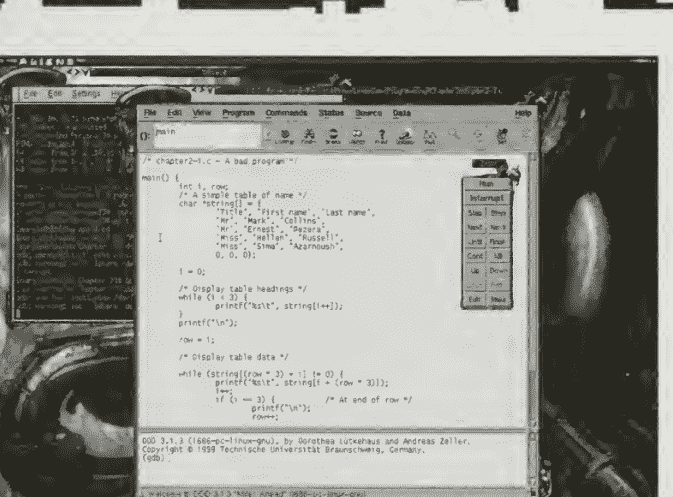
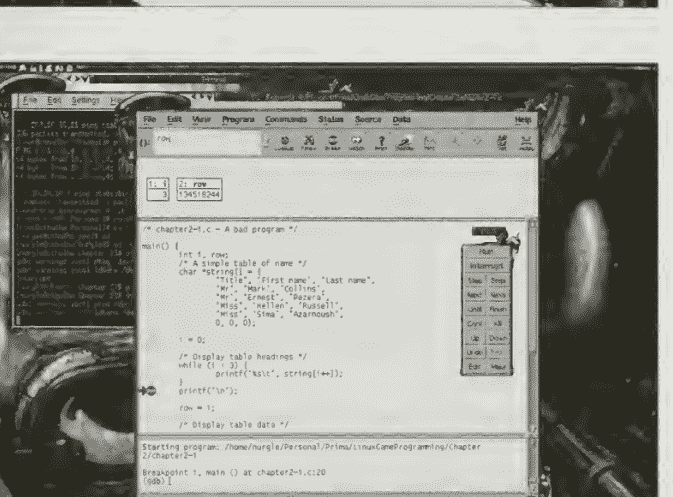
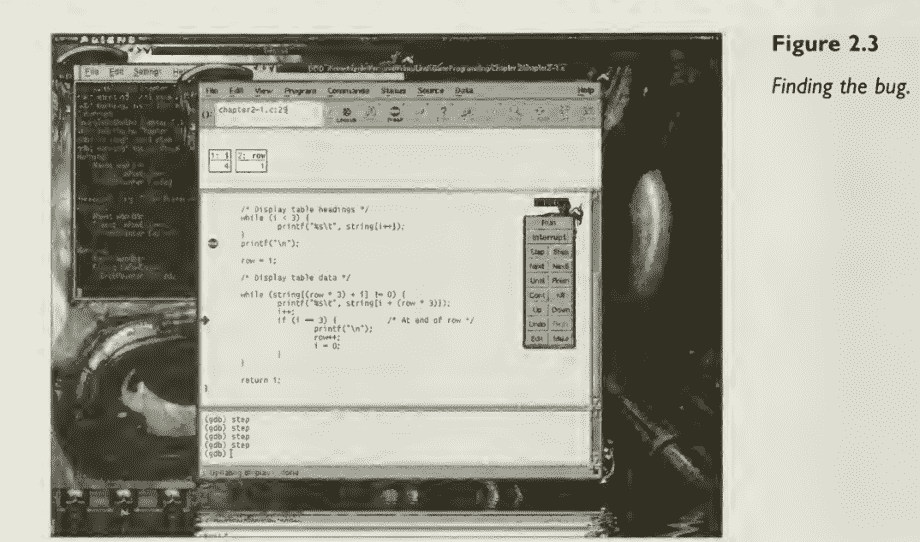
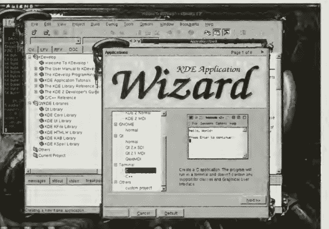
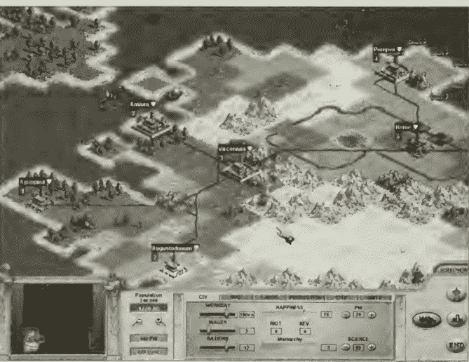
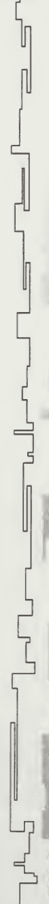
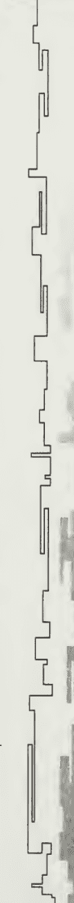

# Linux 游戏编程 (Prima Tech 游戏开发)

## 系列编辑

André LaMothe

Xtreme Games LLC 首席执行官

## 访问网页查看更新

如需查看与本书及/或 CD-ROM 相关的更新或修正，请访问我们的网页更新页面：http://www.prima-tech.com/updates。

## 向我们发送您的反馈

如需对本书或任何其他 PRIMA TECH 作品提供意见，请访问我们的网页读者反馈页面：http://www.prima-tech.com/comments。

## 如何订购

出版商：Stacy L. Hiquet

助理营销经理：Jennifer Breece

主编：Stacy Doell

策划编辑：Jody Kennen

项目编辑：Heather Talbot

技术审核员：Zach Slater

校对编辑：Alice Martina

内排版：Bill Hartman

封面设计：Prima 设计团队

索引员：JohnnaVanHouse Dinse

校对员：Franz Blau

- 冒险游戏 ............................................ 4
- 什么是成功的游戏？ ....................................... 5
其他库 ................................................................................................ 21

### 什么是 OpenGL？ ... 88

- 流缓冲区 158
- 清理 164

# 第 9 章

- 使用 `recvfrom()` 函数 177
- 另一个微型练习 178
- 创建服务器 180
- 使用 `listen()` 函数 181
- 客户端 183
- 使用消息队列线程间通信 185
- Ping 值 186

## 游戏中的网络 187

- 发送控制器输入 188

## 房厅 (Lobbies) 188

- 使用大厅服务器 189
- 登录大厅服务器 190
- 创建游戏 192
- 在大厅中聊天 193
- 加入与离开房间 194
- 清理 195

## 支持与反对开源的理由 . . . . . . . . . . . . . . 229

- 使用开源的十个理由 . . . . . . . . . . . . . . . . . . . . . 229
  - 新技术 . . . . . . . . . . . . . . . . . . . . . . . . . . . . . . 233
- 解决方案 ............................................................................................. 238
- 移植策略 ................................................................................................................. . . . . . . . . . . . . . . . . . . . . 275
- 尝试不要为代码库分叉 (Fork) ................................................. . . . . . . . . . . . . . . . . . . . . 275
- 第一缕光 ................................................................................................................................................................. . . . . . . . . . . . . . . . 278

- 文件与套接句柄 ................................................... 296

## 致谢

首先，我想感谢我的合作者 Steve Baker、Ben Campbell 和 Martin Donlon，感谢他们从忙碌的生活抽空帮助我按时完成这本书。如果没有他们的支持，这本书可能根本不会诞生。我也想感谢 Prima Publishing 的所有同事，特别是 Judy Kennedy 和 Heather Talbot，以及 André LaMoethe（也许有一天他会原谅我在 XGDC 的演讲）。

特别向 GameDev.Net 的所有员工和常客感谢，感谢他们忍受了我不断膨胀的自尊，并且没有把我从留言板上封禁。（尽管如果他们这样做，我们会接管 Linux 论坛吗？）同时，我也想向伦敦辛迪加会里的所有笨拙的软件盗版者打“招呼”，即 Paris、Llama、Comrade 和 Cronus（我将乐于注视你的死去，安德森先生），以及 DALNet 上 #hackerzlair 的所有 l3t 人。

非常感谢我的前-前-前-前-前-前女朋友。Sima，感谢她在这一整个文学冒险中对我的支持（当我们没在吵架的时候），还要感谢我来自巴斯的所有朋友，他们许多人还欠我大量的酒。

按照真正的黑客风格，这些致谢如果没有一份致谢名单将是不完整的。因此，在不分先后的情况下，向以下致谢：ShinyEyeMermaid, JerryLee, TheHermit, Nurse, Mistress Demonica, nesbit, Powouga, Myopic Rhino, jhyta, TANSTAFL, JadeFalcon, Dulice, Paris, Comrade, Llama, ^cronus^, Infinity Matrix, Fwaggle, Dysfunction, Tracy, Lockpick, Laura^, Maryjane, 以及 Silicon Dreams 的所有同事（尤其是 Lara，她很辣），Gumby, Trey, Puppy, Mike, Lil' Chris, Roper, Amy, Jonsey——以及最后，Bob Collins。me@thisisnurgle.org.uk.

> 臭名昭彰的 Mark Nurgle
> 主作者，《Linux 游戏编程》

## 作者简介

臭名昭彰的 Mark Nurgle Collins 是一位自尊心大过德克萨斯州的青少年，他曾工作于 IT 行业的几乎每一个领域，从 Web 设计到网络咨询，但有一个领域反复吸引着他的专业知识和跳跃思维。那个领域就是游戏开发。

除了所有的业余参与外，Mark 还曾在欧洲最大的开发商之一工作，并为全球各地的商业开发商担任自由顾问。凭借在网络、人工智能和图形方面的技能，他认为游戏应该是好玩的，而不是另一个《毁灭战士争》的复制品。

# 系列编辑信

亲爱的读者：

很久以前，在某个远处的办公位上，UNIX 诞生了。UNIX 证明了自己是一个工作站、大型主机甚至 PC 可靠且健强大的平台。但是，UNIX 从未在 UNIX以外的任何 PC 平台上真正获得过动力，它并不是一个简单的学习编程的平台。然而，时间到了，名为 Linux 的 UNIX 版本已开始进入普通用户的家庭，游戏程序员们也注意到了这一点！现在是游戏玩家和开发者都想要为 Linux 玩和开发游戏的时代。然而，Linux 像 UNIX 一样，并不是一个简单的游戏编程平台——直到现在……

《Linux 游戏编程》（Linux Game Programming）无疑是曾经写过的最具野心的游戏编程书籍之一。Linux 编程有许多不同的方面，仅仅是开始考虑为 Linux 编写 2D/3D 游戏就让人目所观呆。但我可以说，《Linux 游戏编程》涵盖了一切。作者 Mark "Nurgle" Collins 从零开始配置配置编译器，解释了 Linux 的工具和库，并涵盖了通用的游戏编程理论。

这本书不仅是为想要学习如何迁移到 Linux 的 Windows 游戏程序员搭建的桥梁，更是关于 Linux 平台上游戏编程的完整专著。这本书涵盖了所有！我的意思是一切——从 2D 和 `SDL`（简单直接媒体层）到 `OpenGL` 和全 3D 游戏编程。

总之，这本书为 Linux 游戏编程树立了标准，并将将是你游戏编程库中的一件瑰宝。

André LaMathe 2001年3月

# 引言

嗯，虽然来得，但现在终于有一本关于 Linux 游戏编程的书了。随着人们对自由 Linux 操作系统的商业和桌面用途的兴趣日益增加，人们开始为它编写游戏只是时间问题。诚然，过去许多人写过一些小游戏，例如 xbill 和 xboing（以及许多以字母 x 开头的游戏），但直到最近几年，Linux 才出现了近乎商业质量的游戏。

随着 Loki 等公司移植了《三角降临 3》（Descent 3）和《模拟城市3000》等成功作品，软件公司开始为 Linux 平台开发原创作品也只是时间问题。随着基于 Linux 的系统 Indrema 主机立即发布，这一未来将成为现实。

但 Linux 是什么？1991 年，斯堪的纳维亚某个国家的学生在留言板上发布了这条不朽的名言：“我正在开发一个基于 minix 的操作系统；尽管它不会像 GNU 项目那么大。”（这里是转述）。从那时起，这个不会像 GNU 项目那么大的“小”操作系统已经增长到全球数百万用户，用途范围从企业服务器到游戏机等。

Linux 是一种半兼容 POSIX 的类 UNIX 操作系统，运行在几乎所有可用平台上，从 i386 到 PalmPilot。然而，直到几年前，人们还考虑将 Linux 作为桌面环境，但随着 `KDE` 和 `Gnome` 等项目的铺路，越来越多的人正在摒弃 Windows 并切换到许多可用 Linux 发行版之一。

# 我与 Linux 的乐趣

我第一次在 1994 年尝试 Linux，是在一张 CD-ROM 上运行旧版本的 Slackware。在发现该程序包含的《毁灭战士》（`Doom`）版本无法通过标题界面后，我开始在 CD 上寻找其他游戏（那时我无法让 `XWindows` 运行）。那时我发现了《虐待》（`Abuse`），这是一款经典的横向卷轴平台游戏，具有一个相当创新的功能：你在使用键盘移动的同时用鼠标进行瞄准。我对这个功能留下了深刻，但知道它不会持续多久。

几周后，我尝试从 CD 中安装一些东西，但惊恐降临了！我运行在一个 `UMSDOS` 分区上，与 `Chicago`（后来更名为 `Windows 95`）并存。一个损坏的安装程序擦掉了我硬盘上所有的分区，甚至完全没有礼貌地先问一句。

几年后（在《Sp》——一个非常糟糕的 DOS 版乒乓克隆游戏取得现象性的成功后，我学校的每个人都沉迷于它），我决定再次尝试 Linux。于是，我下到商店买了一套红帽盒装版，然后就开始了。在解决了让 Windows 显示高于标准 `VGA` 分辨的几个问题后，一切都运行得非常完美。我愉快地摆弄着各种东西，在这里那里重新配置文件，设置安全设置等等。我从未真正使用过它。为什么？因为没什么可做。每当我想玩《地牢守护者》（`Dungeon Keeper`）时，我就会重启进入 Windows 并从那里加载。

一段时间后，我开始玩一些已经存在的 Linux 游戏，但没有一个真正让我印象深刻。因此，我开始寻找编写自己游戏的方法。我下载了 `SDL` 并开始摆弄它。然后世界上最糟糕的事情发生了：我找了一份工作。为网站编写服务器端 `Java`，我没有时间做个人项目。很快，我升到了网络咨询，仍然没有时间玩游戏。一年后，情况变了。

我正在寻找职业转型，老天爷，我真的找到了。在向机构发送简历后的一周内，我在 Silicon Dreams 有了面试。我得到了那份工作。我在那份工作中一直呆到 2000 年 12 月，在那时我决定全职写这本书。（其实我被解雇了）。

在 Silicon Dreams 期间，我学到了很多事情（其中之一就是不要惹怒微软；如果你这样做，他们会向你的老板投诉）。我学到的最重要的事情之一是：尽管这听起来不太可能，但许多硬核 Linux 粉丝都在关注游戏开发，我希望看到这种情况发生。

# 第一章

# 游戏开发简介

## Linux 游戏编程

听我的孩子们，我将讲述一个关于荣耀的冒险的故事。很久以前，在遥远的地方，一个年轻人坐在魔法盒前，决定把一切交给世界。他花了几个月的时间完成他的创作。当它完成时，他看着他的创作发现它是好的。这个创作是一个电脑游戏。（之后他去酒吧喝了几杯，因为他真的很需要放松。）

### 什么是游戏？

游戏与其他任何类型的应用程序有什么区别？有几个主要区别：游戏通常比其他应用程序使用更多的输入输出设备。游戏通常比普通应用程序运行更快并消耗大量 时间。游戏与其他软件的区别被微软等大型软件开发公司注意到，并迫使这些公司创建额外的工具让开发者直接访问硬件。

让我们对比游戏和文本处理器。你在文本处理器中做什么？你输入内容，添加一些格式，插入一些让编辑发笑随机注释，然后保存文件。在游戏中，涉及到很多。你需要尽可能地刷新屏幕。你需要敌人对玩家的操作做出反应，你需要一个目标，最重要的是游戏必须好。

### 游戏类型

市场上有很多不同类型的游戏，从射击到策略，从卡牌到模拟。虽然某些类型通常更受欢迎（例如第一人称射击），但其他类型的可玩性高得多（例如卡牌）。

### 射击游戏

射击类游戏类型可能是目前最流行的类型之一。这一类别包括《雷神之锤》（Quake）和《虚幻竞技》（Unreal Tournament）等游戏。有几种类型的射击游戏，从第一人称视角到卷轴游戏如《捍卫者》（Defender）。该类型的大多数游戏只有一个目标：杀掉所有移动的东西，从散弹枪到飞船。

许多新的射击游戏具有多人功能，而另一些则仅是作为多人游戏编写的（例如《雷神之锤 III：竞技》）。这些游戏最近受到了媒体的许多攻击，并被指责导致哥伦比亚校园枪击案。

这类游戏通常几乎没有剧情——玩家们只需要一个杀掉外星入侵者的借口。虽然有些游戏努力创作故事，但如今构思原创的故事已经变得越来越了。

许多基于电影的游戏都属于这一类，例如《刚硬：三部曲》（Die Hard Trilogy）和《星际大战异形》（Alien versus Predator）。

### 策略游戏

策略游戏分为两种类型：实时和回合制。如《红色警戒》、《星际争霸》和《沙丘》是实时的，而极其成功的《文明》系列则是回合制的。

即时策略游戏通常由两个或多个双方争夺一片土地的战斗组成。这些游戏通常需要开采原材料来建造新的结构和单位。这些游戏的人气与射击游戏不上下，但玩起来要复杂得多（《红色警戒》的一个关卡可能需要玩几个小时才能完成）。因此，玩这些游戏需要很大的耐心，它们可能会变得非常沮丧。

需要构建文明的游戏，如《西德·迈尔的文明》（Sid Meier Civilization），往往是回合制的。回合制游戏可以连续玩几天，只需要几杯咖啡就能坚持下去。回合制游戏允许玩家在允许其他玩家回合之前移动所有的单位。

### 模拟游戏

任何试图模拟真实事件的游戏都是模拟器，无论是飞行模拟器还是钓鱼游戏。这些游戏旨在尽可能模拟现实生活，让用户在他们没有机会体验的领域获得经验。

有些模拟器用于训练，例如英国英国航天菲尔顿工厂的协和号模拟器。这款价值数百万的电脑游戏精确地模拟了飞机的真实行为（除了它们不会让飞机做翻滚）。几年前，我有机会浏览该模拟器的源代码（用汇编语言编写）——整整七百万行代码！准确的模拟器是大型项目，不适合周末程序员。

### 平台游戏

历史上最成功的游戏有很多都是平台游戏，例如《马里奥》系列。这种类型由一个角色在通常左右滚动的关卡中移动，但多年来它已变成了一个完全的三维环境，角色像一只吃了抗抑郁药的过度活跃青蛙一样跳来跳去。

许多游戏开发者选择平台游戏作为他们的早期项目之一（在几个益智游戏之后）。这是因为从开发者的角度来看，平台游戏通常并不复杂，但为玩家带来数小时的娱乐。

## Linux 游戏编程

### 益智游戏

世界上益智游戏可能比任何其他类型的游戏都多。益智游戏非常容易编写，并且让玩家更容易上瘾。这类游戏对人工智能的要求很低，而且与需要大量外部数据运行的其他类型游戏相比，其规模通常较小。

益智游戏的例子包括《俄罗斯方块》和《扫雷》。这些游戏需要耐心和规划才能赢得。像策略游戏一样，益智游戏随着时间的推移可能会变得非常沮丧。

### 冒险游戏

冒险游戏的跨度很大，从基于文本的《魔王谷》到全 3D 的《古墓丽影战士》。这种类型通常由主角与 NPC（非玩家角色）互动来实现目标，无论这个目标是营救丢失的文物，还是约会一个美女（如西雅达公司的《休闲的拉瑞里》）。这些游戏往往具有很强的沉浸感，可以夺走一个专注冒险者的许多生活。

### 角色扮演游戏

与冒险游戏类似，角色扮演游戏通常涉及执行某种描述的任务，但往往变得更加开放。玩家可以花费数年培养角色，赋予它性格，并收集大量的现金。

一些早期的 RPG（角色扮演游戏），如《奥术之地》（Ultima），使用了非常简单的图形但被证明是极其成功的，有些今天仍在被玩。多人 RPG 传统上是基于文本的 MUD（多用户地下），但一些较新的游戏已经图形化，例如《奥术之地：在线》（Ultima: Online）和《永恒战士》（EverQuest）。

### 牌游戏

每个人都玩过接龙或纸牌。这些纸牌游戏通常在用户等待某些事情完成或在电话接待客户时玩。纸牌游戏可能会非常上瘾；我认识有些人如果没有纸牌，他们是不会下床的。

### 体育游戏

另一个成功的游戏类型是体育类。在英国，每个游戏玩家都至少玩过一个足球游戏、一个赛车模拟和至少一个动作格斗游戏。最早的一些游戏就属于这一类型（《乒乓球》非常像一场没有网的网球赛）。

## 游戏开发导论

像《FIFA》系列这样的游戏总是畅销书，这很有道理。它们激发了玩家的竞争本能，让用户在不实际伤害任何人的情况下大杀杀杀。很多时候我的姐姐挑战我玩一局快速的《实战足球》（Actua Soccer），我很多时候赢了（很多时候我因为赢了而打败我自己）。

### 什么让游戏获得成功？

这是一个很难的问题，因为每个人对什么让游戏变得好意见不同，但总有一些共同因素。成功的游戏总是（而且最重要的是）可玩的的。没有人喜欢玩一个你必须战斗十分钟只为了向左对齐一个像素的游戏。

游戏还需要一个友好的界面，带有易于导航的菜单和

### 游戏开发流程


游戏开发就像任何形式的软件工程一样，并不是简单的编写和重做过程。有几个阶段要经过，从图纸开始。

### 设计文档

一份好的文档对任何开发者来说都是最有用的工具。它帮助你建立一个可以基于此的游戏的想法。如果你选择编写商业游戏，设计文档也可以帮助（后文会解释）。

设计文档包含什么？几乎所有的内容，从剧情到你将使用的 3D 引擎。有些设计文档有数百页并涵盖每一个细节；简单的游戏可以使用较短的设计文档。即使是最小的也应该包含：

- **概述**：文档的这一部分涵盖剧情、角色、开发时间概述以及所需的开发人员。
- **屏幕与用户界面**：文档的这一部分涵盖内菜单、你可能使用的游戏内 HUD（抬头显示器），以及游戏中使用的任何图标。
- **美术规范**：文档的这一部分列出了任何游戏内美术、过场动画和精灵。包含任何相关的分镜和草图。
- **音效与音乐**：所有的音效和音乐必须记录在这一部分，以及你需要的配音演员。
- **技术规范**：文档的这一部分涵盖游戏如何运行，包括流程图和你计划执行的基准测试。
- **法律信息**：这一部分包含版权声明和免责声明。

在你写完文档后，你应该将其分享给所有人，以便他们对你的想法提供反馈。你可能会经历设计文档的多个版本，大家才对其包含的内容达成一致，但这并不是坏事。修订过程将帮助从旧想法中形成新想法，并指出一些可能在开发过程后期才会出现的严重问题。

# 游戏开发简介

## 开发

在你的团队达成设计方案后，你实际上可以开始编写代码了。但你应该从哪里开始呢？是先写游戏引擎还是先写菜单？又是游戏引擎的哪个部分？从何开始是你启动新项目时必须面临的最困难的选择之一；幸运的是，你有一份设计文档。

开始编写游戏的最佳地点之一就是开头。我的意思不是让你按顺序写完整个程序（从序场动画到制作人员名单），而是说你应该从程序启动的地方开始：初始化例程，在那里你准备好可能需要的任何变量或调用任何图形 API。没有程序中这个至关重要的部分，你什么也做不了。

接下来做什么取决于你，但我喜欢通过开发图形引擎来。这允许我接下来编写游戏的核心代码，但确实会使在开发过程的后期添加或修改功能变得困难。

如果你处于一个开发大型项目的团队，你需要一种共享文件的方法。如果每个人都在处理程序完全不同的部分，并且你有一个明确定义的接口可以进行工作，那么电子邮件是一个很好的交换媒介。然而，如果你在版本并发方面遇到问题，你可能想要查看 CVS（并发版本控制系统）仓库。CVS 仓库允许多个开发者通过在“仓库”中检入和检出文件来针对同一个问题工作；我将在第 2 章“Linux 开发工具”中详细介绍 CVS 选项。

## 测试

开发过程中最重要的步骤之一是测试你的新游戏。如果你在发布游戏后出现任何严重的 Bug，你的声誉将会被毁掉。《Frontier II: First Encounters》就是一个测试不完全导致发布版本充满 Bug 的例子（尽管我不能把所有责任都归咎于开发者）。由于期限紧迫，程序没有经过充分测试，主要的 Bug 给游戏造成了严重问题。这些 Bug 严重损害了开发者的声誉，尽管他们拥有过史上最受欢迎的游戏之一的《Elite》。

测试你的游戏有几个阶段，通常被称为 Alpha、Beta 和 Gamma 阶段。Alpha 测试由开发者完成，他们在编写代码时发现任何明显的 Bug 和故障。Beta 测试由第三方（通常是专业玩家）执行，他们将尝试发现任何隐藏的 Bug；最后，Gamma 测试由普通游戏社区执行。当游戏中发现一个 Bug 时，你很可能会听到它的消息。当你听到时，你必须重现该问题，然后生成一个补丁来修复程序。

谈到测试，你可以创建的最有用工具之一是调试外挂（debug cheat）。外挂允许你跳转到游戏的任何部分，提供你需要的任何额外（如现金、武器或积分），并可以为你节省数小时的时间。因为所有外挂在游戏发布前都会被移除（诚实地说），你可以使用一些奇特的技巧，通过预处理器指令在编译时启用或禁用它们。

如果你的编译器允许在编译时添加一个标志（flag），你可以使用该标志来指定发布类型，取决于你编译的是游戏的调试版本还是发布版本。例如，你可以在游戏程序中包含以下代码：

```c
// test.c
#include <stdio.h>
main () {
  #ifdef DEBUG
    puts("This is a debugging version!");
  #else
    puts("This is a release version!");
  #endif
}
```

如果你使用以下命令编译程序并运行程序，你应该看到“This is the release version.”

```bash
gcc -o test1 test.c
```

然而，如果你在命令行中包含 `-DDEBUG` 选项，如下所示的命令，程序将输出行“This is a debugging version!”

```bash
gcc -DDEBUG -o test2 test.c
```

这种技巧允许你使用 `#ifdef` 代码块来添加外挂。当你准备好发布游戏时，可以可以关闭这些外挂。你还可以在 `#ifdef` 块中添加简单的调试语句，以便在不使用外部调试器的情况下跟踪程序流（在第 2 章中讨论过）。

## Linux 游戏编程

## 发布你的游戏

在你尽可能按照人类极限测试了你的游戏后，你就可以发布它了。对于在这个阶段做什么，你有几种选择，我将在这里讨论你的三个选项：开源、商业化和共享软件（shareware）。

## 开源游戏

开源可能是让你的游戏进入市场最简单、最快的途径。如果你想尽快玩到你的游戏，你可以在编写的同时发布游戏。这种方法不仅让人们在游戏完成很久之前就知道它的存在，还让其他人与你一起修复他们发现的任何问题，或提出改进建议。

开源路线也意味着你会有大量的测试人员免费工作。这种方法可以极大地加快开发过程，甚至可能意味着你的游戏将由第三方移植到其他操作系统。

许多人声称从开源软件中无法赚到任何钱。RedHat 和 SuSE 等公司通过提供支持和打印版手册，在发行开源软件取得了巨大的成功。

发布开源项目的第一步是将其公开，包括源代码。在你让每个人都能获取你的程序后，在几个邮件列表和如 Freshment (`http://freshment.net`) 等网站发布公告。

```
FRESHMENT: http://freshment.net.
```

> 确保你不要因为其他人都在使用就选择某种许可证。

开源路线也意味着你会有大量的测试人员免费工作。这种方法可以极大地加快开发过程，甚至可能意味着你的游戏将由第三方移植到其他操作系统。

许多人声称从开源软件中无法赚到任何钱。RedHat 和 SuSE 等公司通过提供支持和打印版手册，在发行开源软件取得了巨大的成功。

发布开源项目的第一步是将其公开，包括源代码。在你让每个人都能获取你的程序后，在几个邮件列表和如 Freshment (`http://freshment.net`) 等网站发布公告。

```
FRESHMENT: http://freshment.net.
```

> 确保你不要因为其他人都在使用就选择某种许可证。

## 商业游戏

许多人声称从开源软件中无法赚到任何钱。RedHat 和 SuSE 等公司通过提供支持和打印版手册，在发行开源软件取得了巨大的成功。

发布开源项目的第一步是将其公开，包括源代码。在你让每个人都能获取你的程序后，在几个邮件列表和如 Freshment (`http://freshment.net`) 等网站发布公告。

```
FRESHMENT: http://freshment.net.
```

> 确保你不要因为其他人都在使用就选择某种许可证。

## 共享软件游戏

在发布游戏时，另一种选择是共享软件路线。一些最成功的游戏，如《Doom》和《Quake》，最初都是作为共享软件发布的。以共享软件形式发布游戏与开源路线发布游戏非常相似，不同之处你通常不分发源代码。（不过，id id 现在已公开了 Quake 的源代码，尽管游戏内数据仍需要许可。）

## 第二章

# LINUX 开发工具

## LINUX 游戏编程

正如每位管道工都需要一个皮���子，每位外科医生都需要手术刀一样，游戏开发者也需要某些工具来创造下一款热门游戏。这些工具涵盖了开发环境、调试器和性能分析器等等方面。在本章中，你将学习哪些类型的工具构成了成功游戏开发者的工具箱。

### 开发工具

在编写任何软件时，你都会使用几种关键工具，包括编译器、解释器、调试器以及如 `make` 这样的版本管理工具。某些工具（如 `KDevelop`）将所有这些实用程序集成到一个环境中。

### 编译器

你需要的最重要的工具是编译器。没有编译器，你的代码用处就像在北极圈穿比基尼一样毫无用处。尽管某些语言不是严格的编译型，但你仍然需要某种解释器。由于本文中的代码是用 C 语言编写的，我将重点关注 GNU C 编译器 `GCC`，它可以从 `http://www.gnu.org/software/gcc/gcc.html` 获取。

GNU C 编译器：HTTP://WWW.GNU.ORG/SOFTWARE/GCC/GCC.HTML

使用 `GCC` 编译可能会遇到问题，本书未涵盖这一点；在开始使用编译器之前，你应该阅读所有文档。请注意，几乎所有的 Linux 发行版都作为安装的一部分包含了 `GCC`，你可能已经安装了该编译器。

`GCC` 将你可能需要的大多数工具集成到了一个易于使用的程序中。`GCC` 包含了适用于各种平台的预处理器、编译器和链接器（例如，你可以将其交叉编译为 Win32 可执行文件）。为了演示 `GCC`，请复制以下示例：

* `gcc-test.c` - GCC 测试应用程序 /*

```c
main(int argc, char **argv[]) {
    printf("Line: %d - Number of arguments: %d\n", __LINE__, argc);
    printf("Line: %d - First argument: %s\n", __LINE__, argv[1]);
    printf("Compiled on %s\n", __DATE__, __TIME__);
    return 0;
}
```

# LINUX 开发工具

这个简单的程序演示了 `GCC` 的几个特性。要编译此文件，请使用控制台命令 `gcc`。编译该程序的命令行如下：

```
gcc -o gcc-test gcc-test.c
```

当你运行编译后的程序时，它将显示关于自身的几个细节，包括编译时的日期和时间。这些信息是由 `__DATE__` 和 `__TIME__` 宏提供的。另一个需要知道的有用宏是 `__LINE__` 宏，它包含了当前执行的行号（用于调试）。

`gcc -o gcc-test gcc-test.c` 命令对于简单的单文件项目没有问题，但如果你的程序跨越多个文件怎么办？如果你在命令行中包含 `-c` 选项，`GCC` 不会生成可执行文件，而是生成一个可链接的对象文件。尝试以下示例程序。在一个文件（`gcc-func1.c`）中，输入以下代码：

```c
/* gcc-func1.c - GCC 函数示例 * */
void function() {
    printf("Hello world\n");
}
```

当你可以调用此函数（巧妙命名为 `function()`）时，你必须在某处有一个 `main()`。让我们创建第二个文件 (`gcc-func2.c`)，其中包含 `main()` 函数：

```c
void function(void); 
/* gcc-func2.c - GCC 函数示例 * */
main() {
    function();
    return 0;
}
```

在通常情况下，你会为多个源文件使用 Makefile，但我稍后会介绍该技术。对于这个示例，我们将使用命令行来编译这个双文件程序。对于你想要编译的每个文件，使用 `-c` 参数。当你想要链接程序时，你会告诉编译器使用对象文件而不是源代码，例如：

```
gcc -c -o gcc-func1.o gcc-func1.c
gcc -c -o gcc-func2.o gcc-func2.c
gcc -o gcc-func gcc-func1.o gcc-func2.o
```

与任何标准编译器一样，`GCC` 支持多个警告级别。通常认为使用 `-Wall` 关开启所有警告是一项良好的做法。除了警告级别外，`GCC` 还有优化级别。默认情况下，`GCC` 为了调试目的禁用了优化（`-O0`）；对于你程序的发布版本（release versions），你可能想通过 `-O3` 开启完全优化。然而，这里有一点警告：完全优化可能会给你的程序引入稳定性问题，因此人们通常使用 `-O2` 关。

如果你正在为多个平台开发，你可能想使用 `-D` 关来定义如架构之类的符号。你并不限于在命令行上指定单个符号。事实上，你可以指定任意数量的符号。下面的示例演示了：

```c
/* gcc-define.c GCC 命令行符号 */
#ifdef i386
char *platform = "Linux x86";
#elif SPARC
char *platform = "Linux SPARC";
#else
char *platform = "Unknown";
#endif

main() {
  printf(platform);
  return 0;
}
```

编译此程序时有三种可能的选项。第一个是在命令行中添加 `-DI386` 关，添加 `-DSPARC` 关，或者什么都不加。到目前，你应该已经能弄清楚如何编译这个程序了。你需要知道的一组命令行开关是用于包含库和设置包含/库路径的开关。当你需要将另一个库链接到你的程序时，指定 `-l<name>`。

编译此程序时有三种可能的选项。第一个是在命令行中添加 `-DI386` 关，添加 `-DSPARC` 关，或者什么都不加。到目前，你应该已经能弄清楚如何编译这个程序了。你需要知道的一组命令行开关是用于包含库和设置包含/库路径的开关。当你需要将另一个库链接到你的程序时，指定 `-l<name>`。

## 调试工具

有多少次你在没有调试器的情况下编译了程序？有很多调试器可供，但我最喜欢的是 `DDD`。为了演示 `DDD` 的威力以及如何使用它，让我们创建一个简单的程序。当你编译并运行这个程序时，你会看到显示表头，但之后的一切都乱套了。

```c
/* gcc-1.c - 一个错误的程序 */
main() {
    int i = 0;
    int row = 0;
    char *string[] = {"Alice", "Bob", "Charlie", "David", "Eve", "Frank", NULL};
    /* 显示行数据 */
    while (string[i] != 0) {
        printf("%s\t", string[i]);
        i++;

        if (i == 3) {
            /* 行结束 */
            printf("\n");
            row++;
            i = 0;
        }
    }
    return 1;
}
```

> 注意：这个示例程序基于一个 bug，我困扰了一周，直到有人建议我通过调试器运行它。一旦我意识到我错了什么，我就很恨自己。

当你编译并运行这个程序时，你会预期它显示表头。然而，老墨菲再次降临，这个简单的程序有些非常糟糕。是时候启动调试器了。在加载 `DDD` 之前，我们必须带调试符号编译程序。这可以通过在命令行添加 `-g` 选项轻松实现，如下：

```
gcc -g -o main main
```

在程序编译完成后，加载 `DDD` 并打开刚刚创建的可执行文件。主窗口应该类似于图 2.1。

现在我们可以在 `DDD` 中看到异常的程序，我们需要找到故障所在。让我们尝试缩小可能出现问题的区域。程序显示了表头，但之后的内容都是错误的。如果我们在第 20 行设置断点，我们可以在程序开始出错时中断它。有两种方法。一种是在代码上方的文本框中输入，另一种是选择代码编辑器中的第 22 行（`printf("\n")`）。

接下来，我们还想知道我们的变量（`i` 和 `row`）的值。我们可以通过右键点击变量名并从上下文菜单中选择显示变量来实现。如果我们点击浮动工具栏上的运行按钮，程序将执行到第 20 行。在所有这些操作之后，`DDD` 窗口应该类似于图 2.2。

浮动工具栏包含了几个在调试工作中非常有用的按钮。我们在这里使用的按钮是 Next 和 Step。这两个按钮之间的区别很细微，但很重要。当你点击 Step 时，程序运行到下一行代码；如果你点击 Next，它将继续到下一条指令。如果你想调试一些汇编，例如，你将使用

# LINUX 开发工具

## 图 2.1

`DDD` 调试器的主窗口。



## 图 2.2

正在运行的程序。



关注 `i` 和 `row` 的值，点击“Step”（单步）按钮，直到程序到达第二个循环。到目前为止没有出现任何错误，一切都按预期运行。继续单步直到到达第 29 行，即 `if` 语句。现在看 `i` 的值。你应该看到的内容如图 2.3 所示。

18 LINUX 游戏编程



`if` 语句检查 `i` 是否等于 3，但当它命中第 29 行时，`i` 的值是 4。这是如何发生的？这个，这个问题是在两个循环中使用了同一个变量作为计数器，而没有在之间进行重置。要修复这个问题，我们只需要在第二个循环之前添加以下行，一切就能正常工作：

`i = 0;`

> 注意：我们刚刚回顾的示例程序是一个糟糕的程序，其中使用的技术绝不应该在实际应用中使用。防止此类错误的另一种方法是为每个循环使用独立的变量。

如果你再次查看悬浮的 Step（单步）提示框，此功能在通过第三方库跟踪你的程序时非常有用，因为它可以让你确切地看到何时发生了错误，然后检查可能的因素。

## 开发环境


Linux 下有多种开发环境，尽管最流行的是 `KDevelop` (http://www.kdevelop.org) 和 `CodeWarrior`（一种由 `Metrowworks` 提供的商业产品）。我在这里将重点介绍开源环境 `KDevelop`，因为它对任何想要使用它的人免费免费。

```
KDEVELOP: HTTP://WWW.KDEDEVELOP.ORG
```

`KDevelop` 的界面与 `Visual C++` 中使用的 `Microsoft Developer Studio` 非常相似。除了项目向导外，`KDevelop` 还处理配置脚本的生成（转而生成 `make`）。使用 `KDevelop` 就像吃饼一样简单，正如我现在将演示的那样。让我们从创建一个项目开始。加载 `KDevelop`，从菜单栏中选择“Project”（项目）->“New”（新建）。此操作将显示如图 2.4 所示的“新建项目”对话框。



## 图 2.4

`KDevelop` 新建对话框。

在可能的项目列表中，选择 `Terminal - C`。这创建了一个简单的控制台应用程序。对话框中提供的其他可用应用程序类型是 `KDE/GNOME/Qt` 以及自定义项目（允许你自己或他人将源代码导入到 `KDevelop` 项目中）。

在你选了想要创建的项目后，点击“Next”（下一步）按钮。`KDevelop` 随后提示你选择项目选项，例如名称和位置。下一个屏幕提示你选择任何想要使用的版本系统（如 `CVS`）。版本管理工具对于有多个开发者协作的大型项目很有用，但目前我们可以将此选项留为默认的 `NONE`（无）。接两个屏幕允许你定义源代码顶部的注释。默认情况下，它假设你的项目将根据 `GNU` 公共许可证 (`GPL`) 发布，如果你愿意，也可以更改它。

最后一个屏幕允许你根据所选的选项创建项目。当你点击“Create”（创建）按钮时，进程窗口会更新，显示正在构建项目的哪个部分。完成后，点击“Close”（关闭）并查看 `C/C++ Files` 标签上的文件（选项卡位于窗口顶部）。如你所见，项目向导为我们创建了一个简单的 `Hello World` 应用程序。

工具栏包含一个看起来像播放按钮且上方有两个箭头的按钮。这是“Build”（构建）按钮。点击它来编译并链接项目。屏幕底部的消息窗口会向你更新发生的情况。如果有任何错误（不会有的），消息窗口在完成项目构建后会显示成功。当项目成功构建后，点击看起来像齿轮的按钮来运行程序。

搞定！你成功创建了你的第一个 `KDevelop` 应用程序。感觉不错，对吧？花点玩玩环境并阅读文档（位于右侧选项卡）。

除了本章已经描述的各种开发工具外，你还需要一些库来帮助你编写。库通过让你访问人们以前编写的函数来节省时间。那里真的有成百上千的库，但我将关注更常用的几个。

## 简单媒体层

`SDL` (SimpleMedia Layer) 可能是 Linux 下最常用的 API（参见图 2.5）。它被用于多个商业游戏，如《文明 2：权力之争》（`Civilization II: Call of Power`），以及数百个开源游戏。

图 2.5

《文明 2：权力之争》。



你可以从 http://www.libsdl.org 下载 `SDL`。`SDL` 中的功能包括视频、声音、线程和事件管理，以及音频（Audio）。这些功能可以通过类似 `DirectX` 的 API 访问，如果你是 Windows 程序员，使用它将非常简单。`SDL` 的文档可以在那里找到，如果你选择开发自己的游戏，这些证明是无价之宝。

## OpenGL

`OpenGL` 是任何平台上最常用的 3D 图形 API，最初由 `SGI` 创建。由于它适用于 `Windows`、`Linux` 和 `MacOS` 平台，在游戏中使用 `OpenGL` 将使移植到另一个平台变得轻而易举。Linux 的 `OpenGL` 实现称为 `Mesa`，可以从 http://mesa.org 下载。`Mesa` 支持日益增多的 3D 加速器以及软件渲染（对于对于那些没有高端显卡的用户）。支持的硬件列表在不断增长，随着开发者现在对 Linux 感兴趣，更稳定的驱动程序也陆续上市。

## LIBX11

如果你不是新手，并且想使用 `libX11` 编写你的游戏，你可以跳过高层级 API 提供的功能。`libX11` 库让你自己处理代码的每一个方面，从显示窗口到编写事件管理器。然而，该库允许你做一些其他 API 不做的事情，例如使用 `XFree`（它也包含了 `GLX`）更改屏幕分辨率和色彩深度。此外，如果你计划与 `OpenGL` 一工作，使用 `libX11` 可能比任何其他库都是更合适的选择，因为 `OpenGL` 要求你提供一些其他 API 提供的窗口细节。

## 其他库

那里还有其他库，例如 `Crystal Space` 和 `ClanLib`，以及传统的游戏库 `SDLlib`。虽然这些库的使用频率没有 `SDL`、`OpenGL` 和 `libX11` 库那么高，但有些开发者说服你使用它们。其中某些库作为底层库的封装，而另一些直接与硬件交互。



# 第三章：游戏的结构

## LINUX 游戏编程

现在你已经知道了如何创建游戏，你需要知道如何制作游戏。换句话说，你可以拥有世界上所有的扳手，但这仍然并不意味着你是一个机修。本章通过概述典型游戏的结构来开始你的培训。

## 游戏的组成部分

每个游戏都有几个部分，其中最重要的就是循环。在你初始化了所有硬件并加载了任何数据后，游戏会进入一个循环，实际的操作在此发生。在进入循环之前，游戏必须做几件事才能变得可玩。

游戏必须做的第一件事是启动。这听起来显而易见，但我见过人们在做任何事情之前尝试写主循环，然后奇怪为什么游戏无法运行。当我说“启动”时，我是游戏必须打开任何需要的窗口、激活驱动程序并加载任何图形资源。

/* main.c - 游戏启动 */

```c
#include <stdio.h>
#include "game.h"
```

```c
char *title_string = "Game framework version 1.0";
```

```c
char IsMessage(void) {
    char message_waiting = 0;
    /* 检查消息的代码在此处 */

    if (message_waiting) {
        return 1;
    } else {
        return 0;
    }
}
```

```c
void *GetMessage(void) {
    void *message;
    /* 从队列中检索消息的代码在此 */

    return message;
}
```

```c
void ProcessMessage(void *message) {
    /* 在此处处理消息 */
}
```

```c
int main(int argc, char **argv) {
    void *message;

    /* 显示游戏标题消息 */
    fprintf(stderr, title_string);

    /* 启动代码在此处 */

    /* 进入主游戏循环 */
    while (1) {
        /* 检查消息队列 */
        if (IsMessage()) {
```

# LINUX 游戏编程

```c
/* 有消息，所以处理它 */
message = GetMessage();
ProcessMessage(message);
} else {
    /* 没消息，所以执行标准操作 */
    gameloop();
}

/* 退出代码在此处 */
return 1;
}
```

对消息使用了 `void *` 类型。`void *` 允许代码透明地与任何消息 API 工作。你传递的不是结构体，而是指向结构体的指针，这样你就可以同时实现不同的库，而无需重写大段代码。

框架中的下一个文件是游戏循环本身。该函数处理那些不需要用户输入的内容，例如运行启动场动画或显示酷炫的菜单动画。

它有两个状态：`INIT`（初始化）和 `SHUTDOWN`（关闭），它们可用于执行其他任务时处理数据，例如在加载大量文件时更新屏幕上的进度条。

```c
/* game.c - 主游戏循环 */
#include <stdio.h>
#include "game.h"

char game_state = INIT;

void gameloop(void) {
    switch(game_state) {
    case INIT:
        /* 游戏初始化代码在此处 */
        break;
    case INTRO:
        /* 游戏启动场动画代码在此处 */
        break;
    case MENU:
        /* 游戏菜单在此处 */
        break;
```

```c
case GAME:
/* 主游戏代码在此处 */
break;
case SHUTDOWN:
/* 游戏关闭代码在此处 */
break;
default:
  printf(stderr, "Bad game state");
  break;
}
```

除了 `game.c` 文件外，我们还需要一个 `game.h` 文件，它包含了函数定义以及在各个文件中使用的若干几个符号。

```c
/* game.h - 循环定义与原型 */
#ifndef __GAME_H__
#define __GAME_H__

void gameloop(void);

#define INIT 0
#define INTRO 1
#define MENU 2
#define GAME 3
#define SHUTDOWN 4
#endif
```

最后，我们的游戏框架需要一个 `makefile`。如果你使用 `KDevelop`，该文件会自动生成；如果你更倾向于使用文本编辑器而不是完整的 IDE，则你需要像这里这样手动编写 `makefile`。

```makefile
# 游戏框架的 Makefile
CFLAGS=-Wall
CC=gcc

LIBS=

C_FILES=game.c main.c
OBJ_FILES=game.o main.o
OUT_FILE=framework
```

# LINUX 游戏编程

```makefile
all: framework

framework: $(OBJ_FILES)
$(CC) $(CFLAGS) -o $(OUT_FILE) $(OBJ_FILES)

main.o: main.c
$(CC) $(CFLAGS) -c -o $@ $$

game.o: game.c
$(CC) $(CFLAGS) -c -o $@ $$
```

现在，要编译该框架，可以在控制台输入命令，或者在 `KDevelop` 中点击构建图标。

如果你运行我们在该框架中设置的程序，不会发生什么，因为这只是一个简单的框架。但我们将在下一章中添加更多功能。

> 注意

> 如果你正在使用 `KDevelop`，请将刚才显示的 `makefile` 与 `KDevelop` 为你生成的进行对比。你会发现 `KDevelop` 的 `makefile` 中有很多额外功能，例如用于程序自动安装的 `install-sections`。

# 第 4 章

## 2D 图形

## 在 LINUX 下

现在我们已经有了制作游戏所需的工具和框架，可以真正开始制作游戏了。游戏最重要的方面可能就是与用户交互的能力。这需要某种形式的输出。我将从所有输出中最实用的——屏幕开始。

### SDL API

每个传奇都有一个开头，这就是我们的开头。在深入探索 3D 图形的广阔领域之前，我们需要了解简单的 2D 图形是如何工作的。

`SDL`（简单多媒体层）是一个强大的跨平台多媒体 API，用于多款为 Linux 发行的游戏中（例如《文明 2：权力崛起》）。它提供了一个类似于 `DirectX` 的 API，让经验丰富的 Windows 程序员能够快速学会它。

### 启动

在向屏幕上绘制任何内容之前，我们需要初始化 `SDL`。你可以通过 `SDL_Init()` 命令来实现。函数原型如下所示：

`extern int SDL_Init(Uint32 flags);`

`SDL_Init()` 接收一个参数，指定你想使用的 `SDL` 部分。有很多标志位可用，见表 4.1。目前我们只对视频部分感兴趣。`SDL_Init()` 返回 0 表示成功，否则返回 1。如果发生错误，它返回 `NULL`（此处原文可能有误，通常返回整数）。你可以使用 `SDL_Error()` 获取错误信息。

```c
extern void SDL_Quit(void);
```

`SDL_Quit()` 应该在程序退出时调用，无论如何。现在我们已经知道了哪些标志，让我们把它们加入框架中。

> 注意

> `SDL_Init()` 的值可以使用位位或运算符进行组合。

### 表 4.1 SDL_Init() 参数

| 名称 | 值 | 描述 |

| :--- | :--- | :--- |

| SDL_INIT_TIMER | 0x00000001 | 定时子系统 |

| SDL_INIT_AUDIO | 0x00000010 | 音频子系统 |

| SDL_INIT_VIDEO | 0x00000020 | 视频子系统 |

| SDL_INIT_CDROM | 0x00000100 | 支持光驱 |

| SDL_INIT_JOYSTICK | 0x00000200 | 支持摇杆 |

| SDL_INIT_HAPT | 0x00000400 | 支持触觉反馈 |

| SDL_INIT_EVENT | 0x00000800 | 事件支持 |

| SDL_INIT_EVERYTHING | 0x0000FFFF | 所有支持 |

```c
if (SDL_Init(SDL_INIT_VIDEO | SDL_INIT_AUDIO) != 0) {
    printf(stderr, "SDL Error: %s\n", SDL_Error());
    return 0;
}
SDL_Quit();
```

# LINUX 游戏编程

如果你使用 `KDevelop`，你必须向编译器选项添加 `sdl-config --flags` 并向链接器添加 `sdl-config --libs`。

## 20 Linux 下的图形 33

对于大多数应用程序，我们需要使用 `SDL_HURFACE` 和 `SDL_DOUBLEBUFFER` 标志，尽管如果你正在处理 8 位色深（这需要调色板），可能需要 `SDL_PALETTE` 标志。

如果 `SDL_SetVideoMode()` 调用成功，它将返回一个表面（surface）的指针；否则，返回 `NULL`。该表面包含了我们在屏幕上绘制内容时的重要信息，包括关于窗口的细节，你可以使用 `SDL_WM_SetCaption()` 函数调用为窗口设置标题。`SDL_WM_SetCaption()` 接受两个参数：标题和一个指向图标的指针。标题是一个简单的字符字符串，而指向表面的图标（在下一节“创建表面”中将解释）。

在 `SDL` 初始化之后添加以下代码并编译程序。

```c
screen = SDL_SetVideoMode(
    320, 200,      /* 窗口的宽度和高度 */
    8,              /* 8 位色深（256 色颜色） */
    SDL_HWSURFACE | SDL_DOUBLEBUFFER /* 视频标志 */
);

if (screen == NULL) {
    fprintf(stderr, "Video error: %s\n", SDL_GetError());
    exit(1);
}
```

`SDL_WM_SetCaption(title_string, NULL);`

当你运行程序时，应该会出现一个具有由 `SDL_SetVideoMode()` 指定尺寸的窗口。

## 创建表面

现在我们已经有了窗口，让我们在上面画一些东西。有两种方法可以实现。第一种是直接绘制到视频中，这可能会稍微快一点；第二种是将整个场景绘制到离屏表面，然后将表面拷贝或“翻转”（Flip）到窗口中，这将消除任何闪烁。第二种方案被称为双缓冲。

要创建一个新表面，我们使用 `SDL_CreateRGBSurface()` 和 `SDL_CreateRGBBSurfaceFrom()` 函数。这两个函数的原型如下，`SDL_FreeSurface()` 的原型也是如此，当表面不再被需要时，必须调用它。

## LINUX 游戏编程

`extern DECLPEC SDL_Surface *SDL_CreateRGBSurface (Sint32 flags, int width, int height, int depth, Uint32 Rmask, Uint32 Gmask, Uint32 Bmask, Uint32 Amask);`

`extern DECLPEC SDL_Surface *SDL_CreateRGBSurfaceFrom(void *pixels, int width, int height, int depth, int pitch, Uint32 Rmask, Uint32 Gmask, Uint32 Bmask, Uint32 Amask);`

`extern DECLPEC SDL_FreeSurface(SDL_Surface *surface);`


让我们先来看 `SDL_CreateRGBSurface()`。`flags` 参数取与 `SDL_SetVideoMode()` 函数使用的相同值（请参考表 4.2）。你最常使用的 `flags` 选项是 `SDL_SWSURFACE`、`SDL_HWSURFACE` 和 `SDL_ASYNCBIT`。`width`、`height` 和 `depth` 值与它们的 `SDL_SetVideoMode()` 对应相同。接下来的四个值稍微复杂一些。如果你创建一个 8 位表面，就不需要担心它们。然而，如果你想使用更高的色深，你必须正确设置它们。幸运的是，这些值在 `SDL_SetVideoMode()` 返回的结构体中指定。

每个表面都有一个类型为 `SDL_PixelFormat` 的像素格式描述，存储在 `SDL_Surface->format` 中。`SDL_PixelFormat` 的定义显示在此：

```
typedef struct SDL_PixelFormat {
    SDL_Palette *palette;
    Uint8 BitsPerPixel;
    Uint8 BytesPerPixel;
    Uint8 Rmask;
    Uint8 Gmask;
    Uint8 Bmask;
    Uint8 Amask;
    Uint8 Rshift;
    Uint8 Gshift;
    Uint8 Bshift;
    Uint8 Ashift;
    Uint32 Rmask;
    Uint32 Gmask;
    Uint32 Bmask;
    Uint32 Amask;
};
```

```c
/* RGB 颜色键信息 */
Uint32 colorkey;
```

```c
/* Alpha 值信息（每个表面 alpha） */
Uint8 alpha;
```

如你所见，该结构包含了 `SDL_CreateRGBSurface()` 需要的 `Rmask`、`Gmask`、`Bmask` 和 `Amask` 值（红、绿、蓝和 Alpha 掩码）。

`SDL_CreateRGBSurface` 函数几乎与 `SDL_CreateRGBSurfaceFrom` 函数相同，不同之处在于它允许你为图像指定几个额外参数。`pixels` 参数指向原始图像数据（未压缩），而 `pitch` 参数是像素之间的字节数（8 位颜色为 1，16 位颜色为 2，依此类推）。

我们在本节中将看到的最后一个函数是 `SDL_FreeSurface()`。当你的程序完成对表的操作时，必须调用它以释放可能为其分配的任何内存，或者当你不再需要使用它时。如果不调用此函数，你的程序可能会出现内存泄漏，导致性能和稳定性的下降。

## 绘制位图图像

一旦创建了表面，我们就可以将其加载并渲染位图图像。然而，在查看绘制位图之前，让我们看看加载它的不同方法。最简单的方法是使用 `SDL_LoadBMP()` 函数，它接受一个参数：指向包含位图位置的字符数组的指针。如果成功，它返回一个表面的指针；如果失败，返回 `NULL`。当然，如果你想加载 Windows 位图（BMP）以外的格式的图像，你将不得不自己编写解析器。`website.org` 有详尽的图形文件格式列表。在本章末尾有一个关于加载 PCX 文件的节，它可以在这里使用。

- 图形文件格式列表：`WWW.BITMAP.ORG`

加载位图后，你必须将其绘制到屏幕上。为了做到这一点，你使用 `SDL_Blit` 函数，显示如下：

```c
extern int SDLBlit(SDL_Surface *src, SDL_Rect srcrect,
                          SDL_Surface *dst, SDL_Rect dst);
```

`src` 和 `dst` 参数是表面的指针。如果你启用了双缓冲，你可能需要“翻转”表面。使用 `SDL_Flip()` 函数进行翻转。它接受一个参数：要翻转的表面。

### SDL_Rect 结构

`SDL_Rect` 结构具有以下格式：

```c
typedef struct {
    Sint16 x, y; // 形的 x 和 y 坐标
    Uint16 w, h; // 形的宽度和高度（像素）
} SDL_Rect;
```

在你将 BMP 图像绘制到屏幕后，如果启用了双缓冲，你可能需要翻转表面。使用 `SDL_Flip()` 调用进行翻转。

## 直接绘制到屏幕

这里情况变得有趣了。绘制到屏幕可以非常简单，也可以非常复杂，取决于你设置了什么色深。如果你在 8 位模式下工作，绘制到屏幕非常简单。如果你在 16 位或 32 位颜色下工作，绘制到屏幕稍微困难。真正的挑战是在处理 24 位色深时。

### 像素格式

不同的色深使用不同的像素格式。简单的色深是 8 位颜色，它使用单个字节内存来存储图像中每个像素的颜色。字节的值指向颜色索引。你在屏幕上得到的精确颜色取决于调色板，将在本章后面讨论。

下一个色深 16 位颜色要复杂得多。红色和蓝色组件各使用五位，绿色组件使用六位。例如，内存的二进制代码`1111000000001111`。前五位表示像素的红色组件；中间六位指定绿色组件；最后五位指定蓝色组件。此特定值指定的颜色在屏幕上会产生洋红色（全蓝和绿）。

`SDL_MapRGB()` 函数精确计算像素应有的格式。该函数接受四个参数：表面，以及像素的红、绿、蓝分量。如果你不确定所使用的表面格式，或者你正在使用带有调色板的 8 位显示，可以使用它。其原型显示在此：

```c
extern Uint32 SDL_MapRGB(SDL_PixelFormat *fmt, Uint8 r, Uint8 b);
```

`SDL` 支持的下一个色深是 24 位颜色。这种色深在使用 16 位颜色时稍微复杂一些。你不能使用 `SDL_MapRGB()` 函数来计算

像素的值，因此你必须手动处理。你必须将每个颜色分量放置在正确的位置，像素才能正确显示。

由于每个表面的掩码可能略有不同，在进入代码进行显示逻辑之前，你必须先弄清楚如何显示内容。如果你查看 `SDL_PixelFormat` 的结构定义，你会注意到几个掩码（`masks`）和位移（`shifts`），它们会告诉该如何设置内存。

下面是一个在 24 位模式下绘制像素的简单函数。

```c
void Plot24(SDL_Surface *surface, int x, int y, Uint32 pixel) {
Uint8 *bits;
Uint8 r, g, b;

// 准备分量
r = ((pixel)->screen->Rshift) & 0xFF;
g = ((pixel)->screen->Gshift) & 0xFF;
b = ((pixel)->screen->Bshift) & 0xFF;
```

```c
// 锁定表面并计算绘制像素的位置
SDL_Lock(surface);
bits = ((Uint8*)surface->pixels)+y * surface->pitch + x * surface->format->BytesPerPixel;
```

```c
// 绘制像素
*((bits) + screen->format->Rshift/8) = r;
*((bits) + screen->format->Gshift/8) = g;
*((bits) + screen->format->Bshift/8) = b;
```

```c
// 解锁表面
SDL_Unlock(surface);
```

尽管 `SDL_MapRGB()` 不适用于 24 位颜色，但 32 位色深支持使用 `SDL_MapRGB()`，因此这种色深非常易于使用。32 位色深每个像素额外多了一个字节的内存用于存储 Alpha 通道。如果你想要一个透明表面，这会非常有用。

如果你使用 Alpha 通道，`SDL_MapRGB()` 函数就不够用了了。你需要自己手动计算像素，使用的方法类似于计算 24 位颜色像素的方法。所示的 `Plot32` 函数演示了如何计算像素。

```c
void Plot32(SDL_Surface *surface, int x, int y, Uint32 pixel) {
Uint8 *bits;
Uint8 r, g, b, a;
```

# LINUX 游戏编程

```c
// 准备分量
r = ((pixel)>>surface->format->Rshift) & 0xFF;
g = ((pixel)>>surface->format->Gshift & 0xFF;
b = ((pixel)>>surface->format->Bshift & 0xFF;
a = ((pixel)>>surface->format->Ashift & 0xFF;
```

```c
// 锁定表面并计算绘制像素的位置
SDL_Lock(surface);
bits = ((Uint8*)surface->pixels)+y * surface->pitch + x * surface->format->BytesPerPixel;
```

```c
// 绘制像素
*((bits) + screen->format->Rshift/8) = r;
*((bits) + screen->format->Gshift/8) = g;
*((bits) + screen->format->Bshift/8) = b;
*((bits) + screen->format->Ashift/8) = a;
```

```c
// 解锁表面
SDL_Unlock(surface);
```

## 绘制像素

在你确定了像素的格式后，就可以将其绘制到屏幕上了。然而，在此之前，你必须锁定表面（`surface`），以防止程序的其他部分访问它。如果你的程序是多线程的，这是一个问题，但无论你的程序是否使用线程，`SDL` 都要求你锁定表面。

`SDL_Lock()` 只接受一个参数：要锁定的表面的地址。如果成功，它返回 0；否则，你应该使用 `SDL_GetError()` 查看发生了什么错误。

当你锁定表面时，必须计算出要绘制的地址。如果你的数学能力不够出色，这并不一定是一件容易的事。`SDL_Surface` 结构有一个名为 `pixels` 的成员，它包含了表面的实际图像。

为了确定你想要绘制的像素的精确位置，你需要知道每行水平线之间有多少字节的内存。你可以使用色深和表面定义的 `pitch`（偏移）来计算这个值。计算像素位置的精确公式如下（可能为此创建一个微型宏是值得的）：

```
offset = Y * pitch + X * bitdepth
```


### Linux 下的图形学

这里是该公式更具实用的形式：

`address = ((Uint8*)surface->pixels) + Y * surface->pitch + X * surface->format->BytesPerPixel;`

当你计算出想要绘制的像素的地址后，可以使用以下命令将内存中的值设置为你期望的颜色：

`(*address) = color;`

在绘制完像素后，你必须使用 `SDL_Unlock()` 解锁表面。与 `SDL_Lock()` 一样，`SDL_Unlock()` 接受一个参数：要解锁的（已锁定的）表面的地址。如果你有多个像素，可以等到完成场景的所有绘制后再解锁表面。

### 使用调色板

如果你不幸工作在 8 位颜色模式下，你可能需要为你的游戏创建一个颜色调色板。幸运的是，这是一项简单的任务。8 位视频模式支持调色板。`SDL_SetColors()` 用于设置调色板，它接受几个参数：表面、颜色的指针、起始颜色索引以及颜色数量。

```c
int SDL_SetColors(SDL_Surface *surface, SDL_Color *colors, int firstcolor, int ncolors);
```

`colors` 参数指向一个 `SDL_Color` 数组。`SDL_Color` 包含成员：`r`、`g`、`b`（分别代表红、绿、蓝）以及未使用成员。未使用成员留供未来扩展，我们将忽略它。

使用 `SDL_Color` 的推荐方法是分配 (`sizeof(SDL_Color) * ncolors`) 字节的内存。分配内存后，设置调色板的值。每个组件的值可以高达 255 (`0xFF`)。下面的示例演示了如何分配灰度调色板。

```c
SDL_Color *colors;
SDL_Surface *screen;
int i;

// 分配内存
colors = (SDL_Color*)malloc(sizeof(SDL_Color) * 256);
```

```c
// 设置调色板
for (i = 0; i < 256; i++) {
    colors[i].r = i;
    colors[i].g = i;
    colors[i].b = i;
    colors[i].a = 255;
}
SDL_SetColors(screen, colors, 0, 256);
```

以下示例代码演示了如何在 X 中打开一个窗口：

```c
// Xsample.c
#include <X11/Xlib.h>

int main() {
    Display *display;
    Window *window;
    Screen *screen;
    int myscreen;
    char *display_str = (char *)getenv("DISPLAY");

    // 使用环境变量打开显示
    display = XOpenDisplay(display_str);
    screen = DefaultScreenOfDisplay(display);
    myscreen = DefaultScreen(display);

    // 打开窗口
    window = XCreateSimpleWindow(
        display, RootWindowOfScreen(screen),
        0, 0, 320, 200, 1, BlackPixel(display, DefaultScreen(display)), // 黑色边框
        WhitePixel(display, DefaultScreen(display)); // 白色背景
    );
    XMapWindow(display, window);

    // 执行操作

    // 清理
    XCloseDisplay(display);
    return 1;
}
```

> 注意

在本示例中，`getenv()` 函数在未找到环境变量时会返回 `NULL`。`XOpenDisplay()` 函数使用默认显示（通常为 0，意味着本地机器的第一个 X 服务）。

要编译此程序，请使用以下命令行：

```bash
gcc -lX11 -L/usr/X11R/lib -I/usr/X11R/include -o Xsample X
```

### 在屏幕上绘图

用于绘制图形的 Xlib 例函数非常直观。根据你想要执行的操作，有一系列函数可供选择。我将从较简单的函数开始，例如在屏幕上绘制文本。

#### 绘制像素

在绘制任何图形时，最简单的事情通常是绘制一个像素。这条规则也适用于 X 编程，但因为是 X 系统，绘制像素仍然不是世界上最容易做的事情。在绘制任何内容之前，你必须初始化若干项内容，包括“可绘制对象”（`drawables`）和图形上下文。

我将开始描述图形上下文（简称为 GC）。它们类似于 SDL 中的表面定义，并且类似于在 Windows 编程中使用的设备上下文（Device Contexts）。创建 GC 的函数是 `XCreateGC()`；其原型显示在此：

```c
extern GC XCreateGC(Display *display, Drawable d, unsigned long mask, XValues gcv);
```

与大多数 Xlib 函数一样，`XCreateGC()` 需要知道运行 X 服务的机器信息。这些信息通过 `display` 参数传递。下一个参数 `drawable` 是你想要在其上绘图的“表面”（在本示例中，它是窗口，但也可以是 pixmap 或另一个可绘制对象）。下一个参数是用于描述的数值掩码（`mask`）；描述内容本身是最后一个参数。

`XCreateGC()` 可用的掩码以及它们所引用的 GCValue 成员如表 4.3 所示。唯一的数值掩码是 `GCForeground`；其他掩码将在本章稍后介绍。要设置颜色，请使用 `[ColorPixel()]` 函数，例如 `BlackPixel()` 或 `WhitePixel()`，如本章前面的 `Xsample.c` 所示。

设置好 GC 后，调用 `XCreateGC()` 创建一个新的图形上下文。你可以向屏幕绘制像素（或使用任何其他需要 GC 的图形操作）。你可以使用 `XDrawPoint()` 来绘制单个像素。`XDrawPoint()` 带有五个参数：一个可绘制对象、一个 GC 和窗口坐标，其函数原型如下：

```c
extern int XDrawPoint(Display *display, Drawable d, GC gc, int x, int y);
```

现在是时候将理论付诸实践了。采用示例程序 `Xsample.c`，并在我们初始化 GC 之前添加以下行，以便我们在屏幕上绘制某些内容：

```c
GC gc;
XValues gcv;
int x, y;
```

### 表 4.3 图形上下文值掩码

| 掩码名称 | XGCValue 成员 | 描述 |

| --- | --- | --- |

| `GCFunction` | `function` | 逻辑操作 |

| `GCPlaneMask` | `plane_mask` | 平面掩码 |

| `GCForeground` | `foreground` | 前景颜色 |

| `GCBack` | `background` | 背景颜色 |

| `GCLinewidth` | `line_width` | 线条宽度 |


| `GCLineStyle` | `line_style` | 线条样式 (`LineSolid`, `LineOffDash`, `LineDoubleDash`) |
| `GCCap` | `cap_size` | 端点样式 (`CapLast`, `CapBut`, `CapRound`, `CapProjecting`) |
| `GCJoinStyle` | `join_style` | 接接类型 (`JoinMiter`, `JoinBevel`, `JoinRound`) |
| `GCFillStyle` | `fill_style` | 填充样式 (`FillSolid`, `FillTiled`, `FillStippled`) |
| `GCFillRule` | `fill_rule` | 填充规则 (`EvenOddRule`, `WindingRule`) |
| `GCTile` | `tile` | 用于平铺文件的 pixmap |
| `GCStipple` | `stipple` | 用于平铺点点的 Ibppixmap |
| `GCTileStipOrigin` | `ts_x_origin` | 平铺点彩操作的偏移量 |
| `GCTileStipOrigin` | `ts_y_origin` | 平铺点彩操作的偏移量 |
| `GCFont` | `font` | 文本操作的默认字体 |
| `GCsubwindowMode` | `subwindow_mode` | 子窗口裁剪 (`ClipByChildren`) 或 包含从属 (`IncludeInferiors`) |
| `GCraphics` | `exposures` | 布尔信息 |
| `GCClipOrigin` | `x_origin` | 裁剪区域的偏移量 |
| `GCClipOrigin` | `y_origin` | 裁剪区域的偏移量 |
| `GCClipMask` | `mask` | 位图 (`pixmap`) |
| `GCDash` | `dashes` | 虚线数据 |

## 绘制图像

既然我们已经可以绘制像素，现在该做些更有趣的。Xlib 使用名为 `.XPM` 的格式。XPM 文件非常简单，类似于 C 文件。`XReadBitmap` 加载 `.XPM` 文件，原型为：

```c
extern int XReadBitmap(Display* display, Drawable d,
    const char* filename, unsigned int* width,
unsigned int* height, Pixmap* bitmap,
int* x, int* y);
```

前两个参数是显示器对象。下一个参数是你想要绘制的 pixmap 路径和文件名。其他参数是存储信息的指针。

## 编程

在加载 pixmap 后，你可以使用 `XCopyPlane()` 函数绘制它，其原型显示在此：

```c
extern int XCopyPlane(Display* display, Drawable src, Drawable dest, GC gc,
 int src_x, int src_y, unsigned int width, unsigned int height, int dest_x,
 dest_y, int depth);
```

使用 `XCopyPlane()` 非常简单。与其他函数一样，你必须传递显示指针。你必须传递可绘制对象（源和目标）。下一个参数是标准 GC，你可以通过调用 `XCreateGC(display, window, 0, NIL)` 创建。接下来的四个参数描述源尺寸，随后是目标坐标。最后一个参数是源图像的颜色深度。

以下示例演示了 `XCopyPlane()` 的用法。将以下代码添加到本章前面的原始 Xsample.c 示例的开头定义部分。

- `Pixmap pic;`
- `GC gc;`
- `XGCValues gcv;`
- `int x, y;`
- `int width, height, hoxy, hoty;`
- `int err;`
- `char FILE = "/usr/share/pixmap/clock.xpm";`

// 准备上下文

`gcv.foreground = BlackPixel(display, myscreen);`

`gcv.graphics_exposures = 0;`

`gc = XCreateGC(display, window, GCForeground, &gcv);`

// 加载位图

`if (err = XReadBitmapFile(display, window,`

`FILE,`

`&width, &height, &pic,`

`&hotx, &hoty)) {`

`XCloseDisplay(display);`

`fprintf(stderr,"无法加载图像: %d", err);`

`}`

// 绘制像素

`XCopyPlane(display, pic, window, gc,`

`hotx, hoty, width, height, 0, 0, 1);`

// 释放内存

`XFreeGC(display, gc);`

### Linux 下的 ZD 图形

```c
while (1) {
x = rand() % 320;
y = rand() % 200;
}
```

```c
XCopyPlane(
    display, pic,    // 源图像
    window, gc,      // 目标细节
    0,               // 源起点
    width, height,   // 图像尺寸  
    x, y, 1);       // 目标坐标
)
```

```
// 释放内存
XFreeGC(display, gc);
XFreePixmap(display, pixmap);
```

## 双缓冲

直接绘制到窗口上有几个缺点，包括在需要时必须手动重绘屏幕，以及忍受闪烁的细节。避免屏幕闪烁的一种常用策略是使用双缓冲。这个过程涉及将所有内容都绘制到一个离屏对象上，并在所有内容完成后将其复制到窗口中。

在 X 中复制对象非常简单。首先，你使用 `XCreatePixmap()` 创建窗口的精确副本，然后每当需要将新创建的图像复制到窗口时。为了实现此过程的第二部分，你使用 `XCopyArea()`。这些函数的原型所示所示：

```
extern Pixmap XCreatePixmap(Display display, Drawable d, unsigned int width, unsigned int height, unsigned int depth);
extern int XCopyArea(Display display, Drawable src, Drawable dest, GC gc, int src_x, int src_y, unsigned int width, unsigned int depth, int dest_x, int dest_y);
```

`XCopyArea()` 的功能与 `XCopyPlane()`（在前节中描述）几乎相同，只是它没有深度参数。由于你没有指定区域的颜色深度，你必须确保两个可绘制对象具有相同的颜色深度，否则会发生 BadMatch 错误并且你的程序将终止。

`XCreatePixmap()` 是一个相对简单的函数。下面的示例演示了如何用它创建一个离屏窗口。

## Linux 游戏编程

```
// 创建双缓冲
Pixmap dbl_buf = XCreatePixmap(display, window, window_width, window_height, // 窗口尺寸
DefaultDepth(display, myscreen)); // 深度
```

创建双缓冲后，使用该对象作为可绘制表面而不是窗口。当需要显示你绘制的内容时，将缓冲区复制到窗口。代码如下所示：

```
GC gc = XCreateGC(display, window, 0, NIL);
XCopyArea(display, dbl_buf, window, gc, 0, 0, window_width, window_height, 0, 0);
```

## 安装调色板

如果你在 8 位颜色深度下工作，可能想要设置自己的调色板。只有在使用 8 位颜色时才需要调色板，因为任何其他颜色深度都使用 RGB 索引。要检测使用的颜色深度，请使用 `DisplayDepth()` 函数，它接受显示器和屏幕（示例中的 `myscreen`）作为参数。

如果使用的颜色深度是 8 位颜色，你可能需要安装调色板。你可以使用 `XCreateColormap()` 创建自己的调色板。该函数的示例所示：

```
Colormap c_map = XCreateColormap(display, window, DefaultVisual(display, myscreen), AllocNone);
```

创建调色板后，你需要分配颜色。第一步是创建一个类型为 `XColor` 的调色板。这种数据类型与之前描述的 `SDL_Color` 数据类型类似；它包含了描述颜色每个部分（红、绿、蓝）的成员，还有一个名为 `pixel` 的成员，它是颜色索引。

当你定义了颜色后，调用 `XAllocColor()`将其包含调色板。该函数的第一个参数是现在创建的显示器指针。接下来是使用 `XCreateColormap()` 创建的调色板 ID。最后一个参数是指向颜色定义的指针。

现在你已经创建了调色板（在内存中），你需要用 `XWindowColormap()` 函数来安装它。该函数接受三个参数，第一个是显示器指针。第二个参数是你想要安装颜色的窗口 ID，最后一个参数是调色板本身的 ID。

接下来的示例代码演示了调色板的安装：

```
// 创建调色板
Colormap c_map = XCreateColormap(display, window, DefaultVisual(display, myscreen), AllocNone);

// 安装一个条目
XColor red;
red.pixel = 1;
red.red = 0xFF;
red.green = 0;
red.blue = 0;
XAllocColor(display, c_map, &red);

// 设置调色板
XWindowColormap(display, window, c_map);
```

现在我们已经安装了调色板，不妨就使用它。要使用调色板，调用 `XSetForeground()`（指定像素的颜色）和 `XSetBackground()`。这些每个函数都接受三个参数：指向显示器的指针、GC 和索引。

## 清理

当退出程序时，你必须清理一些东西。你创建的每个对象都必须使用 Xlib API 进行销毁。你应该使用 `XFreeWindow()` 销毁创建的窗口，使用 `XFreeGC()` 销毁 GC，以此此类推。如果为创建的对象有特定的函数，请使用它。当你释放了各种对象使用的内存后，必须关闭与服务器的连接。要做到这一点，请使用 `CloseDisplay()`。

# LINUX 游戏编程

```
graph_mem = vga_getgraphmem();
// 绘制一些图案
for (x = 0; x < 320; x++)
    for (y = 0; y < 200; y++)
        PLOT(x,y,x ^ y);

return 0;
```

要编译此示例程序，请使用以下命令：

```
gcc -lvga -o VGAsample VGAsample.c
```

程序编译完成后，在以 root 用户登录的情况下，可以运行 `chown root VGAsample` 接着运行 `chmod 4755 VGAsample`，这将通过设置应用程序的 suid 位允许任何用户运行该程序；或者直接从 root shell 中运行该程序。

## 显示图像

SVGlib 并没有图像文件提供内置支持，因此你将需要实现自己的函数库来加载和显示图像。在这些示例中，我将演示如何加载（并显示）PCX 文件，但如果你想使用其他图像格式，可以轻松地修改函数来加载不同的文件格式。

## 理解 PCX 格式

PCX 文件使用一种称为 RLE（游程编码）的简单压缩算法。该系统用 3 字节块表示相同颜色的长段像素序列（而不是通常表示该串独立像素时所需的若干字节数）。这使得 PCX 格式适用于具有大块相同颜色的图像（如标志和简单的精灵图），但不适用于像照片那样复杂的图像。

与大多数图形格式（原始数据除外）一样，PCX 文件以一个简单的头部开始。该头部可以使用包含不同头部字段的简单结构来表示，如下所示：

```
typedef struct PCXHeader {
    char manufacturer;   // 始终为 10 (ZSoft .pcx)
    char version;         // 版本号
    char encoding;        // 编码方法 (1-RLE)
    char bitpixel;       // 每个像素的位数
    short xmin;           // 图像 X 起点
    short ymin;           // 图像 Y 起点
    short xmax;           // 图像宽度
}
```

## Linux 53 下的 Z 图形

```
short ymax; // 图像高度
short hdpi; // 水平分辨率
short vdpi; // 垂直分辨率
char colormap[48]; // 调色板信息
char reserved1; // 预留
char nplanes; // 每行的字节数
short bytesperline; // 调色板解释信息
short paletteinfo; // 水平屏幕尺寸 (v 4+)
short vscreensize; // 垂直屏幕尺寸 (v4)
char filler[54]; // 未使用数据
```

头部之后存储的是实际图像数据。图像解压后的尺寸为 `(xmax - xmin + 1)` 和 `(ymax - ymin + 1)`。总存储量为图像面积 `(xsize * ysize)` 乘以每个像素的字节数（256 色时为 1）。

解码数据非常简单。图像数据的每个字节都代表一个像素。如果像素的高两个位为 1（即像素像素值大于或等于 192），则它是一个编码像素。像素剩余的六位指示游程的长度，随后的位即为像素值。接下来的示例代码演示了如何解码像素。

```
int i = 0;
int tot_bytes = ((xmax - xmin + 1) * (ymax - ymin + 1)), curr_byte = 0;

while (curr_byte < tot_bytes) {
  ch = (*image_data + i);
  if (ch & 0xC0) { // 编码位
    num_bytes = ch - 192; // 游程长度
    i++;
    ch = *(image_data + i); // 像素颜色
    for (int n = 0; n < num_bytes; n++) {
      curr_byte += *(image + curr_byte) = ch;
    }
  } else { // 标准像素
    curr_byte += *(image + curr_byte) = ch;
  }
  i++;
}
```

## 54 Linux 游戏编程

在你成功解码数据后，你几乎获得了一个完整的图像。然而，文件末尾前的 739 字节处可能是调色板数据开始的地方。如果假设调色板数据的第一个字节是 12，则剩余数据就是图像调色板的信息。调色板的每个条目

3 字节，每个分量一个（顺序为红、绿、蓝）。

加载图像的完整代码如下：

```
// 调色板信息
typedef struct {
    char r, g, b;
} RGBval;

// PCX 图像
typedef struct {
    PCXHeader header; // 头部信息
    char *image; // 解压缩图像
    RGBval palette[256]; // 调色板数据
} PCImage;

PCXImage pcx_load(char *filename) {
    FILE *fp;
    PCXHeader head;
    PCXImage image;
    int xsize;
    int ysize;
    int curr_byte, num_bytes;

// 打开文件
    if (!fp = fopen(filename, "r")) {
        fprintf(stderr, "pcx_load(): 打开读取文件错误");
        return NULL;
    }

    fread(image.header, sizeof(image.header), 1, fp); // 修正：此处原文逻辑略有偏差，保留翻译

    if (image.header.manufacturer != 10) {
        fprintf(stderr, "pcx_load(): Invalid PCX format");
        return NULL;
    }

// 计算尺寸
    xsize = (image.header.xmax - image.header.xmin + 1);
    ysize = (image.header.ymax - image.header.ymin + 1);

// 为图像分配内存
    image.image = (char*)malloc(xsize * ysize);

```

while (curr_byte < tot_bytes) {

  ch = *(image_data + i);

  if (ch & 0xC0) { // 编码位

    num_bytes = ch - 192; // 游程长度

    i++;

    ch = *(image_data + i); // 像素颜色

    for (int n = 0; n < num_bytes; n++) {


`curr_byte += *(image + curr_byte) = ch;`

}

} else { // 标准像素

`curr_byte += *(image + curr_byte) = ch;`

}

`i++;`

}

// 读取调色板
`fseek(fp, -739, SEEK_END);`
`if (fgetc(fp) == 12) {`
`fread(image.palette, sizeof(RGBval), 256, fp);`
}
`fclose(fp);`
`return image;`

显示图像

`SVGlib`并没有图像文件提供内置支持，因此你将需要实现自己的函数库来加载和显示图像。在这些示例中，我将演示如何加载（并显示）`PCX`文件，但如果你想使用其他图像格式，可以轻松地修改函数来加载不同的文件格式。

## 理解 PCX 格式

`PCX`文件使用一种称为`RLE`（游程编码）的简单压缩算法。该系统用 3 字节块表示相同颜色的长段像素序列（而不是通常表示该串独立像素时所需的若干字节数）。这使得`PCX`格式适用于具有大块相同颜色的图像（如标志和简单的精灵图），但不适用于像照片那样复杂的图像。

与大多数图形格式（原始数据除外）一样，`PCX`文件以一个简单的头部开始。该头部可以使用包含不同头部字段的简单结构来表示，如下所示：

```c
typedef struct PCXHeader {
    char manufacturer;   // 始终为 10 (ZSoft .pcx)
    char version;         // 版本号
    char encoding;        // 编码方法 (1-RLE)
    char bitpixel;       // 每个像素的位数
    short xmin;           // 图像 X 起点
    short ymin;           // 图像 Y 起点
    short xmax;           // 图像宽度
}
```

## Linux 53 下的 Z 图形

```c
short ymax; // 图像高度
short hdpi; // 水平分辨率
short vdpi; // 垂直分辨率
char colormap[48]; // 调色板信息
char reserved1; // 预留
char nplanes; // 每行的字节数
short bytesperline; // 调色板解释信息
short paletteinfo; // 水平屏幕尺寸 (v 4+)
short vscreensize; // 垂直屏幕尺寸 (v4)
char filler[54]; // 未使用数据
```

头部之后存储的是实际图像数据。图像解压后的尺寸为 `(xmax - xmin + 1)` 和 `(ymax - ymin + 1)`。总存储量为图像面积 `(xsize * ysize)` 乘以每个像素的字节数（256 色时为 1）。

解码数据非常简单。图像数据的每个字节都代表一个像素。如果像素的高两个位为 1（即像素像素值大于或等于 192），则它是一个编码像素。像素剩余的六位指示游程的长度，随后的位即为像素值。接下来的示例代码演示了如何解码像素。

```c
int i = 0;
int tot_bytes = ((xmax - xmin + 1) * (ymax - ymin + 1)), curr_byte = 0;
while (curr_byte < tot_bytes) {
  ch = (*image_data + i);
  if (ch & 0xC0) { // 编码位
    num_bytes = ch - 192; // 游程长度
    i++;
    ch = *(image_data + i); // 像素颜色
    for (int n = 0; n < num_bytes; n++) {
      curr_byte += *(image + curr_byte) = ch;
    }
  } else { // 标准像素
    curr_byte += *(image + curr_byte) = ch;
  }
  i++;
}
```

## 54 Linux 游戏编程

在你成功解码数据后，你几乎获得了一个完整的图像。然而，文件末尾前的 739 字节处可能是调色板数据开始的地方。如果假设调色板数据的第一个字节是 12，则剩余数据就是图像调色板的信息。调色板的每个条目 3 字节，每个分量一个（顺序为红、绿、蓝）。

加载图像的完整代码如下：

```c
// 调色板信息
typedef struct {
    char r, g, b;
} RGBval;

// PCX 图像
typedef struct {
    PCXHeader header; // 头部信息
    char *image; // 解压缩图像
    RGBval palette[256]; // 调色板数据
} PCImage;

PCXImage pcx_load(char *filename) {
    FILE *fp;
    PCXHeader head;
    PCXImage image;
    int xsize;
    int ysize;
    int curr_byte, num_bytes;
// 打开文件
    if (!fp = fopen(filename, "r")) {
        fprintf(stderr, "pcx_load(): 打开读取文件错误");
        return NULL;
    }
    fread(image.header, sizeof(image.header), 1, fp);
    if (image.header.manufacturer != 10) {
        fprintf(stderr, "pcx_load(): Invalid PCX format");
        return NULL;
    }
// 计算尺寸
    xsize = (image.header.xmax - image.header.xmin + 1);
    ysize = (image.header.ymax - image.header.ymin + 1);
// 为图像分配内存
    image.image = (char*)malloc(xsize * ysize);
```
`while (curr_byte < tot_bytes) {`
`ch = *(image_data + i);`
`if (ch & 0xC0) { // 编码位`
`num_bytes = ch - 192; // 游程长度`
`i++;`
`ch = *(image_data + i); // 像素颜色`
`for (int n = 0; n < num_bytes; n++) {`
`curr_byte += *(image + curr_byte) = ch;`
`}`
`} else { // 标准像素`
`curr_byte += *(image + curr_byte) = ch;`
`}`
`i++;`
`}`
```
// 读取调色板
fseek(fp, -739, SEEK_END);
if (fgetc(fp) == 12) {
    fread(image.palette, sizeof(RGBval), 256, fp);
}
fclose(fp);
return image;
```

## 使用调色板

你们可能读了关于`PCX`格式的解释，并好奇如何为图像设置调色板。很好的问题，而且非常简单。`vga_setpalette()`函数为我们处理调色板创建。`vga_setpalette()`的函数原型如下：

`void vga_setpalette(int index, int r, int g, int b);`

```c
void pcx_set_palette(PCXImage pcx) {
  int n;
  for (n = 0; n < 256; n++) {
    vga_setpalette(n,
      pcx.palette[n].r,    // 红
      pcx.palette[n].g,    // 绿
      pcx.palette[n].b);  // 蓝
  }
}
```

#清理

当你退出控制台游戏时，你需要进行一些清理。释放你在程序中分配的所有内存（例如 `PCXImage.image` 数据）是关重要的，因为如果你使用大型图像，可能会导致巨大的内存泄漏。

你还应该确保返回默认控制台分辨率，允许用户回到他正在做的事情（并在脚本小子发现一个好的 shell 之前退出 root）。

## 一个小型项目

为了帮助你们学习本章的内容，我要给你们布置作业。为了测试你们新获得的 Linux 图形知识，看看是否否构建一个简单的封装库，涵盖本章中提到的所有原理（设置显示、绘制像素和图像、管理调色板以及清理代码）。

当你完成库后，将其整合到我们在第 3 章创建的游戏框架中。

## 第5 章

## 使用 SDL 进行输入

## LINUX 游戏编程

游戏的核心在于控制。无论你是在戴托纳赛道上飞驰赛车，还是在银河系历史上最重要的一场战斗中驾驶着你受损的战斗机，你都掌握着控制权。作为一名游戏设计师和程序员，你的工作是让游戏的控制系统尽可能简单且直观。但玩家应该记住你的控制系统有多好用；它应该直观到让玩家在忙中操作时甚至会忘记它的存在。当然，这并不总是可能的：潜艇模拟器最好的控制系统可能需要一整队桥上船员、一个从天花板吊下来的望远镜，和一个红灯泡（为了视觉效果）。我们受限于一小部分通用设备：键盘、鼠标和摇杆。成功地将这些简单设备锻造成星际飞船的控制装置、战士的手，甚至是神灵的心灵，是将游戏转变为体验的关键。

如果你翻阅过游戏杂志或在当地的电脑商店里逛过，你可能会注意到琳琅满目的游戏控制器。你有你的基本生存：键盘和鼠标。你还有那些古老的经典——摇杆，有许多不同的形状和尺寸：模拟信号、数字信号、游戏手柄、街机风格，以及等等。还有一些更专业的设备，方向盘、光枪，甚至（我最喜欢的）脑电控制器（那些东西后来都去哪儿了？）。幸运的是，这些设备的设计师和制造商意识到，只有当它们被人们想玩的游戏支持时，才会被使用和购买，而确保这种发生的最好方法就是使用标准接口，比如键盘、鼠标或摇杆的接口。这就是他们所做的：他们制造了一个可以直接插入摇杆端口并表现得像摇杆一样的方向盘，还制造了一个表现得像鼠标一样的光枪。这太棒了！我们不需要担心除了三个简单、成熟且支持良好的设备以外的事情。

## 键盘

对于初学者来说，键盘是一个主要由字母和数字开关组成的阵列。多年来它一直是计算机的标准输入设备。键盘通常由一百多个按键组成，分为三个逻辑组：字母数字键、功能键和修饰键。字母数字键包括字母、数字和标点符号。功能键由命名为 F1 到 F12 的通用键以及几个特殊用途按键组成，如 Esc、Home 和 End。最后，修饰键用于“修改”另外两组键的含义（例如，Shift 键使字母大写化）。

现代键盘通过向外围处理器发送 8 位数据序列与计算机通信。这些数据序列被称为扫描码（scancodes），键盘上的每个按键都根据特定标准被分配了一个扫描码。现代 IBM PC 兼容键盘基于 AT 扫描码集。例如，根据 AT 标准，当按下 A 键时，系统会向计算机发送一个值为 0x1C 的扫描码。当释放按键时，会发送一个断开码（break code），对于 AT 键盘，该码为 FxF0；断开码之后是是被按下按键的扫描码。由 Linux 键盘驱动程序（有时是应用程序）将这些扫描码转换为可用的字符数据或控制代码。


## 鼠标

鼠标最早于 20 世纪 60 年代由 Doug Engelbart 领导的团队在斯坦福研究所开发。鼠标是计算机软件中最常用的 2D 定位设备。基础滚轮鼠标包含一个与桌面接触的球和两个相互垂直的内部滚轮。滚轮上的传感器（通常是光电二极管）检测两个轴上的运动。滚轮上的传感器检测两个轴上的运动；传感器（通常是光电二极管）检测两个轴上的运动。滚轮上的传感器检测两个轴上的运动。鼠标真正是之处是，它在处理时提供移动。鼠标非常棒的事情是它在平滑移动时，它被鼠标处理到屏幕上的指针。鼠标通常有几个按钮。

## 摇杆

传统上，摇杆被视为轴、开关、油门和帽子的集合。摇杆驱动程序看到摇杆作为轴。X轴（左到右）映射到第一轴。X 轴（左到右）映射到第一轴，Y 轴（上下）映射到第二轴。摇杆驱动程序看到摇杆作为轴。一个轴的整数范围从 -32767 到 32767；-32767 代表最左，32767 代表最右。

### 处理方法

在你决定了哪些设备将支持你的游戏后，你必须决定如何从它们读取数据并使用数据。从设备读取数据通常是一项复杂的任务，需要硬件知识和精确计时。幸运的是，`SDL`这样的 API 设计来为你完成这些体力工作。`SDL`隐式地从设备（鼠标和键盘）收集信息，从你显式告诉它的设备收集。`SDL`在内部跟踪所有设备的状态，并提供两种读取这些状态的接口：事件队列和轮询。

### 事件队列

队列是计算机科学中常用的数据结构。它非常像现实中的队列：队列头部的人是下一个被服务的人，而想排队的人加入队尾。计算机中的队列包含数据；头部的数据被处理。需要处理的数据被添加到队尾，并在所有之前的数据被处理后最终被处理。

队列有很多应用，并在处理输入时非常有用。当一个输入“事件”发生时（例如按下按钮），关于该事件的信息会被添加到名为事件队列的特定队列中。对于 `SDL` 这样的 API，事件队列是内部的，输入事件在检测到时会被队列中。

> 注意队列传统上被称为先入先出（FIFO）数组。

### 轮询

当你轮询设备时，你是在询问它的当前状态。注意，你并不是在询问它自你上次轮询以来发生了什么，你只是想知道正在发生什么。

轮询（Polling）在计算机早期非常流行，当时从设备读取数据并不是操作系统处理的，需要直接访问硬件。随着现代操作系统（如 Linux）的出现，轮询已成为从设备接收输入数据的一种常用方式，并被事件队列所取代。

## 使用 SDL 事件队列

`SDL`事件队列是 `SDL` 最强大的功能之一。它远不仅仅是简单依赖键盘、鼠标和摇杆事件；它还会转发重要的窗口管理器事件，并可以作为一个简单的消息系统使用。

## SDL_Event 联合体

`SDL_Event`联合体是 `SDL` 中所有事件处理的关键。它可以包含任何支持的 `SDL` 事件信息。`SDL` 事件队列完全由`SDL_Event`联合体组成；当事件发生时，一个`SDL_Event`联合体会填充所需的数据并放置在事件队列的末尾。从事件队列头部读取事件的函数使用`SDL_Event`联合体来返回其数据。

> C/C++ 中的联合体（union）类似于 C 结构体（struct），因为它包含不同类型和大小的成员。然而，与结构体不同，联合体的所有成员重叠在同一个存储空间中，编译器为最大的成员分配足够的空间。

在 `SDL` 中，每个事件类型都有与其关联的结构体：鼠标按钮事件具有`SDL_MouseButtonEvent`结构，鼠标移动事件具有`SDL_MouseMotionEvent`。这些事件结构有两个共同点：它们的第一个成员是一个名为`type`的`Uint8`，并且它们都包含在`SDL_Event`联合体内。

## 布局

以下是`SDL_Event`联合体的原型。它由事件函数返回，并应该包含有关已发生事件的各种细节。事件的细节将在本节稍后部分解释。

```c
typedef union {
  Uint8 type;
  SDL_ActiveEvent active;
  SDL_KeyboardEvent key;
  SDL_MouseMotionEvent motion;
  SDL_MouseButtonEvent button;
  SDL_JoyAxisEvent jaxis;
  SDL_JoyBallEvent jball;
  SDL_JoyHatEvent jhat;
  SDL_JoyButtonEvent button;
  SDL_ResizeEvent resize;
  SDL_QuitEvent quit;
  SDL_UserEvent user;
  SDL_SysWMEvent syswm;
} SDL_Event;
```

这个定义应该让情况变得清晰。`SDL_Event`联合体可以存储你为任何可能的 `SDL` 事件所需的所有信息。

## 解析事件类型

所有的 `SDL` 事件类型都是枚举的，并赋予了符号名称；此值存储在`SDL_Event`联合体的`type`成员中。`type`成员中的值允许你确定事件类型，从而确定应该从`SDL_Event`联合体的哪一个成员读取事件信息。表 5.1 列出了可能的事件类型。

## 从事件队列读取

`SDL` 提供了两个简单的函数从事件队列中读取：`SDL_PollEvent()`和`SDL_WaitEvent()`。以下是函数原型：

```c
int SDL_PollEvent(SDL_Event *event);
int SDL_WaitEvent(SDL_Event *event);
```

这两个函数非常相似；它们都会检查事件队列并将队列头部的事件放入`event`参数指向的结构体中。事件从队列中移除，函数返回值 1。这两个函数的区别在于当队列中没有可以移除的事件时的行为。`SDL_PollEvent()`简单地返回 0；然而，`SDL_WaitEvent()`会等待队列上出现事件，将其移除并像通常一样将其复制到事件结构体中。`SDL_WaitEvent()`唯一返回 0 的情况是发生了内部错误，而非常罕见的。

### 表 5.1 SDL 事件类型

| 事件类型 | 事件结构体 | SDL_Event 成员 |
| --- | --- | --- |
| SDL_ACTIVEEVENT | SDL_ActiveEvent | active |
| SDL_KEYDOWN/UP | SDL_KeyboardEvent | key |


| SDL_MOUSEMOTION | SDL_MouseMotionEvent | motion |

| SDL_MOUSEBUTTON/UP | SDL_MouseButtonEvent | button |

| SDL_JOYAXMOTION | SDL_JoyAxisEvent | jaxis |

| SDL_JOYBALLMOTION | SDL_JoyBallEvent | jball |

| SDL_JOYHATMOTION | SDL_JoyHatEvent | jhat |

| SDL_JOYBUTTONDOWN/UP | SDL_JoyEvent | jbutton |

| SDL_QUIT | SDL_QuitEvent | quit |

| SDL_SYSMEVENT | SDL_SysWMEvent | syswm |

| SDL_VIDEORESIZE | SDL_ResizeEvent | resize |

| SDL_USEREVENT | SDL_UserEvent | user |

以下列表是使用`SDL_WaitEvent()`的一个简单示例。程序简单地等待用户按键然后退出。虽然这个程序很基础，但它演示了如何从事件队列中提取事件以及如何根据事件类型采取操作。

```c
/* 所需的 SDL 头文件 */
#include "SDL.h"

/* 等待按键后退出 */
int main(){
    /* SDL_Event 联合体用于存储从 */
    /* 事件队列获取的事件 */
    SDL_Event event;
    /* 退出标志 */
    int quit=0;

    /* 初始化 SDL */
    SDL_Init(SDL_INIT_VIDEO);

    /* 应用在用于事件处理之前必须有一个窗口或视频 */
    /* 实例 */
    SDL_SetVideoMode(320, 200, 0, 0);

    /* 循环直到退出标志设置 */
    while(!quit){
        /* 等待事件 */
        if(SDL_WaitEvent(&event)){
            /* 检查事件类型 */
            switch(event.type){
                case SDL_QUIT:
                    quit=1;
                    break;
            }
        }
    }

    /* 退出 */
    SDL_Quit();
    return 0;
}
```

# 表 5.2 SDL 键符号

| SDL 键符号 | ASCII 值 | 常用名称 |

| --- | --- | --- |

| SDL_BACKSPACE | '\b' | 退格 |

| SDL_TAB | '\t' | 制表符 |

| SDL_CLEAR | '' | 清除 |

| SDL_RETURN | '\r' | 回车 |

| SDL_PAUSE | '' | 暂停 |

| SDL_ESCAPE | '^' | 逸出 |

| SDL_SPACE | ' ' | 空格 |

| SDL_EXCLAIM | '!' | 感叹号 |

| SDL_QUOTEDBL | '"' | 双引号 |

| SDL_HASH | '#' | 井 |

| SDL_DOLLAR | '$' | 美元符号 |

| SDL_AMPERSAND | '&' | 符号 |

| SDL_QUOTE | '\'' | 单引号 |

| SDL_LEFTPAREN | '(' | 左括号 |

| SDL_RIGHTPAREN | ')' | 右括号 |

| SDL_ASTERISK | '*' | 星号 |

| SDL_PLUS | '+' | 加号 |

| SDL_COMMA | ',' | 逗号 |

| SDL_MINUS | '-' | 减号 |

| SDL_PERIOD | '.' | 句号 |

| SDL_SLASH | '/' | 斜杠 |

| SDL_0 | '0' | 0 |

| SDL_1 | '1' | 1 |

| SDL_2 | '2' | 2 |

# 表 5.2 SDL 键符号（续）

| SDL 键符号 | ASCII 值 | 常用名称 |

| --- | --- | -- |

| SDLK_3 | '3' | 3 |

| SDLK_4 | '4' | 4 |

| SDLK_5 | '5' | 5 |

| SDLK_6 | '6' | 6 |

| SDLK_7 | '7' | 7 |

| SDLK_8 | '8' | 8 |

| SDLK_9 | '9' | 9 |

| SDLK_COLON | ':' | 号 |

| SDLK_SEMICOLON | ';' | 分号 |

| SDLK_LESS | '<' | 小于号

| SDLK_EQUALS | '=' | 等号 |

| SDLK_GREATER | '>' | 大于号 |

| SDLK_QUESTION | '?' | 问号 |

| SDLK_AT | '@' | 艾 |

| SDLK_LEFTBRACKET | '[' | 左括号 |

| SDLK_BACKSLASH | '\' | 反斜杠 |

| SDLK_RIGHTBRACKET | ']' | 右括号 |

| SDLK_CARET | '^' | 尖符号 |

| SDLK_UNDERSCORE | '_' | 下划线 |

| SDLK_BACKQUOTE | '`' | 重音符号 |

| SDLK_a | 'a' | a |

| SDLK_b | 'b' | b |

| SDLK_c | 'c' | c |

| SDLK_d | 'd' | d |

| SDLK_e | 'e' | e |

# SDL 键符号 ASCII 值

| SDL 键符号 | ASCII 值 | 常用名称 |

| --- | --- | -- |

| SDL_f | 'f' | f |

| SDLK_g | 'g' | g |

| SDLK_h | 'h' | h |

| SDLK_i | 'i' | i |

| SDLK_j | 'j' | j |

| SDLK_k | 'k' | k |

| SDLK_l | 'l' | l |

| SDLK_m | 'm' | m |

| SDLK_n | 'n' | n |

| SDLK_o | 'o' | o |

| SDLK_p | 'p' | p |

| SDLK_q | 'q' | q |

| SDLK_r | 'r' | r |

| SDLK_s | 's' | s |

| SDLK_t | 't' | t |

| SDLK_u | 'u' | u |

| SDLK_v | 'v' | v |

| SDLK_w | 'w' | w |

| SDLK_x | 'x' | x |

| SDLK_y | 'y' | y |

| SDLK_z | 'z' | z |

| SDL_DELETE | '^' | 删除 |

| SDLK_KP0 | | 0 |

| SDLK_KP1 | | 1 |

| SDLK_KP2 | | 2 |

| SDLK_KP3 | | 3 |

# 表 5.2 SDL 键符号（续）

| SDL 键符号 | ASCII 值 | 常用名称 |

| --- | --- | --- |

| SDLK_KP4 | | 4 |

| SDLK_KP5 | | 5 |

| SDLK_KP6 | | 6 |

| SDLK_KP7 | | 7 |

| SDLK_KP8 | | 8 |

| SDLK_KP9 | | 9 |

| SDLK_KP_PERIOD | ' ' | 句号 |

| SDLK_KP_DIVIDE | '/' | 除 |

| SDLK_KP_MULTIPLY | '*' | 乘 |

| SDLK_KP_MINUS | '-' | 减 |

| SDLK_KP_PLUS | '+' | 加 |

| SDLK_KP_ENTER | '\r' | 回车 |

| SDLK_KP_EQUALS | '=' | 等号 |

| SDLK_UP | | 上箭头 |

| SDLK_DOWN | | 下箭头 |

| SDLK_RIGHT | | 右箭头 |

| SDLK_LEFT | | 左箭头 |

| SDLK_INSERT | | 插入 |

| SDLK_HOME | | 主页 |

| SDLK_END | | 结束 |

| SDLK_PAGEUP | | 上翻页 |

| SDLK_PAGOWN | | 下翻页 |

| SDLK_F1 | | F1 |

| SDLK_F2 | | F2 |

| SDLK_F3 | | F3 |

# SDL 键符号 ASCII 值

| SDL 键符号 | ASCII 值 | 常用名称 |

| --- | --- | -- |

| SDLK_F4 | | F4 |

| SDLK_F5 | | F5 |

| SDLK_F6 | | F6 |

| SDLK_F7 | | F7 |

| SDLK_F8 | | F8 |

| SDLK_F9 | | F9 |

| SDLK_F10 | | F10 |

| SDLK_F11 | | F11 |

| SDLK_F12 | | F12 |

| SDLK_F13 | | F13 |

| SDLK_F14 | | F14 |

| SDLK_F15 | | F15 |

| SDLK_NUMLOCK | | 数字锁 |

| SDLK_CAPSLOCK | | 大写锁 |

| SDLK_SCROLLOCK | | 滚动 |

| SDLK_RSHIFT | | 右 Shift |

| SDL_LSHIFT | | 左 Shift |

| SDLK_RCTRL | | 右 Ctrl |

| SDLK_LCTRL | | 左 Ctrl |

| SDLK_RALT | | 右 Alt |

| SDLK_LALT | | 左 Alt |

| SDLK_CTRL | | 控制键 |

| SDLK_SHIFT | | Shift键 |

| SDLK_ALT | | Alt键 |

| SDLK_RMETA | | 右 Meta |

| SDLK_LMETA | | 左 Meta |

| SDLK_LSUPER | | 左 Windows 键 |

| SDLK_RSUPER | | 右 Windows 键 |

| SDLK_MODE | | 模式

# 表 5.2 SDL 键符号（续）

| SDL 键符号 | ASCII 值 | 常用名称 |

| --- | --- | --- |

| SDLK_HELP | | 帮助 |

| SDLK_PRINT | | 打印屏 |

| SDLK_SYSREQ | | SysRq |

| SDLK_BREAK | | 中断 |

| SDLK_MENU | | 菜单 |

| SDLK_POWER | | 电源 |

| SDLK_EURO | | 欧元 |

# 表 5.3 SDL 修饰键

| 修饰键 | 含义 |

| --- | --- |

| KMOD_NONE | 无修饰键 |

| KMOD_NUM | 数字锁按下 |

| KMOD_CAPS | 大写锁按下 |

| KMOD_LCTRL | 左控制键按下 |

| KMOD_RCTRL | 右控制键按下 |

| KMOD_RSHIFT | 右 Shift键按下 |

| KMOD_LSHIFT | 左 Shift键按下 |

| KMOD_RALT | 右 Alt键按下 |

| KMOD_LALT | 左 Alt键按下 |

| KMOD_CTRL | 控制键按下 |

| KMOD_SHIFT | Shift键按下 |

| KMOD_ALT | Alt键按下 |

## 使用 SDL 输入

Unicode 标准由 Unicode 协会制定旨在取代 ASCII 编码。它使用 16 位值而不是 8 位值来表示字符。小于 128 的 Unicode 值直接映射到相应的 ASCII 字符；通过 `unicode` 字段，我们可以轻松地读取输入，如下：

```c
/* 处理键事件 *
void KeyEvent(SDL_Event event){
    /* 获取将使用的结构方便指针 */
    SDL_KeyboardEvent key=(SDL_KeyboardEvent *)&event;

    /* 根据键符号进行分支 */
    switch(key->keysym.sym){
      case SDLK_LEFT:
        printf("左键 ");
        break;
      case SDLK_RIGHT:
        printf("右键 ");
        break;
      case SDLK_UP:
        printf("上键 ");
        break;
      case SDLK_DOWN:
        printf("下键 ");
        break;
      default:
        printf("其他键 ");
        break;
    }

    /* 根据类型进行分支 */
    /* 释放或按下 */
    switch(event->type){
      case SDL_KEYUP:
        printf("释放。\n");
        break;
      case SDL_KEYDOWN:
        printf("按下。\n");
        break;
      default:
        break;
    }
}
```

## 鼠标事件

虽然键盘有与其相关的独立事件类型，但鼠标有三种事件类型两种不同的结构。类型为 `SDL_MOUSEMOTION` 的事件指的是鼠标移动；该事件的信息存储在 `SDL_MotionEvent` 结构中。以下是它的原型：

```c
typedef struct {
    Uint8 type;
    Uint8 state;
    Uint16 x, y;
    Sint16 xrel, yrel;
} SDL_MotionEvent;
```

`SDL_MotionEvent` 结构包含三组独立的数据。`state` 字段引用鼠标键当前的状态，即按下或释放。数据存储在 8 位字节的位中。最低位（LSB）指向按钮 1（左键），第二个 LSB 指向 2（右键，有时是中间键）。读取这些数据的最佳方法是使用 `SDL_BUTTON_LEFT`、`SDL_BUTTON_MIDDLE` 或 `SDL_BUTTON_RIGHT`。如果 `(state & SDL_BUTTON(X))` 为真，则 X 被按下。

`x` 和 `y` 字段存储鼠标移动的坐标。这些值分别受屏幕宽度和高度的限制。最后，`xrel` 和 `yrel` 字段存储鼠标的相对运动，即鼠标自上一次 `SDL_MOUSEMOTION` 事件以来移动的距离。

尽管 `SDL_MOUSEMOTION` 事件为我们提供了与鼠标相关的所有信息，但它只允许我们处理移动而不是点击。因此，我们还有 `SDL_MOUSEBUTTONUP` 和 `SDL_MOUSEBUTTONDOWN` 事件，它们与 `SDL_MouseButtonEvent` 结构关联：

```c
typedef struct {
    Uint8 type;
    Uint8 button;
    Uint8 state;
    Uint16 x, y;
} SDL_MouseButtonEvent;
```

乍看，`SDL_MouseButtonEvent` 结构似乎与 `SDL_MotionEvent` 相同的信息。每当鼠标键按下或释放时，此类型的事件就会加入队列。`button` 字段告诉我们哪个键被按下或释放；它可以包含以下值：`SDL_BUTTON_LEFT`、`SDL_BUTTON_MIDDLE`、`SDL_BUTTON_RIGHT`。`SDL_BUTTON(x)` 宏不在此结构中使用，所以不要与其混淆。

`state` 字段是冗余的；它简单地告诉我们按下还是释放，但我们已经通过事件类型确定了这一点。忽略 `state` 字段，因为它只会增加困惑。`x` 和 `y` 与 `SDL_MotionEvent` 结构相同：它们仅仅是按下或释放时鼠标的位置。

在这个阶段，你可能已经意识到理解事件的关键在于理解 `SDL_Event` 联合体的不同结构。不要跳过这些解释；确保你理解每个结构的作用以及它传达的信息。当你确定自己明白了什么时，查看下面列表中的 `HandleMouseEvent()` 函数：

```c
/* 处理所有鼠标事件 *
void HandleMouseEvent(SDL_Event *event) {
    /* 指向所需结构的方便指针 */
    SDL_MotionEvent *motion=event->motion;
    SDL_MouseButtonEvent *button=event->button;

    /* 根据事件类型进行分支 */
    switch(event->type) {
        /* 处理移动事件 */
        case SDL_MOUSEMOTIONEVENT:
            /* 鼠标位置 */
            printf("鼠标移动到: (%d, %d)\n",
                   motion->x, motion->y);
    }
}
```

# LINUX 游戏编程

```c
/* 打印相对运动 */
printf("Relative motion: (%d, %d)\n",
      motion->xrel, motion->yrel);
break;
```


```c
/* 处理按钮按下 */
SDL_MOUSEBUTTONDOWN:
case
  printf("Mouse button %d pressed at (%d, %d)\n",
      button->button, button->x, button->y);
  break;
```

```c
/* 处理按钮释放 */
SDL_MOUSEBUTTONUP:
  printf("Mouse button %d released at (%d, %d)\n",
      button->button, button->x, button->y);
  break;
```

```c
/* 这不应该被到达 */
default:
  break;
}
```

## 摇杆事件

如果你认为那两个键盘结构和鼠标结构已经很费力了，那么你一定会非常喜欢处理摇杆事件。总共有四种摇杆事件结构——但别担心，它们都非常相似。当你理解了它们的相似之处后，理解它们的区别就轻而易举。然而，在探索摇杆事件结构之前，我们必须理解让摇杆与键盘和鼠标不同的一个点。摇杆不被视为强制性设备。必须向 `SDL_Init` 传递 `SDL_INIT_JOYSTICK` 标志以启用其摇杆子系统。SDL 假设系统中只连接了一个键盘和一个鼠标，但它理解系统中可能、且通常连接了一个或多个摇杆。因此，你必须指定要使用哪些摇杆；当然，SDL 提供了函数允许你完成这一点。

```c
int SDL_NumJoysticks(void);
```

`SDL_NumJoysticks()` 函数应该是你在处理摇杆时始终采取的第一步。它返回连接到系统的摇杆数量。如果它返回 0，那么就没有必要尝试打开任何摇杆，因为那里什么都没有。

```c
SDL_Joystick *SDL_JoystickOpen(int index);
```

`SDL_JoystickOpen()` 函数打开一个摇杆并返回一个指向结构的指针，该结构存储了摇杆的信息。你应该保存返回的结构指针，因为在关闭摇杆时会需要它。你想打开的摇杆通过 `Index` 参数指定（0 表示第一个摇杆，1 表示第二个，以此类推）。`Index` 是一个非常重要的值，因为它被事件结构用于标识是哪个摇杆生成的事件。当你完成摇杆的使用后，良好的做法是通过传递 `SDL_JoystickClose()` 返回的 `SDL_Joystick` 结构来关闭它。

如果你对摇杆一无所知，即使打开了摇杆也没用，对吧？SDL 提供了几个函数来获取摇杆名称，以及获取可用轴（axes）、按钮、帽（hats）和球（balls）的数量。这些函数如下：

```c
const char *SDL_JoystickName(int index)
```

```c
int SDL_JoystickNumAxes(SDL_Joystick *joystick)
```

```c
int SDL_JoystickNumButtons(SDL_Joystick *joystick)
```

```c
int SDL_JoystickNumHats(SDL_Joystick *joystick)
```

```c
int SDL_JoystickNumBalls(SDL_Joystick_)
```

这五个函数的功能简单，SDL 文档中有清晰的解释。你将在后面的示例中使用这些函数。

默认情况下，SDL 事件队列不会从已打开的摇杆收集事件，你必须通过调用 `SDL_JoystickEventState(SDL_ENABLE)` 显式地指示队列这样做。如果没有此调用，你只能轮询摇杆输入。

四个与摇杆相关的事件结构都具有相似的布局，如这些结构原型所示：

```c
typedef struct {
  Uint8 type;
  Uint8 which;
  Uint8 axis;
  Uint16 value;
} SDL_JoyAxisEvent;
```

```c
typedef struct {
  Uint8 type;
  Uint8 which;
  Uint8 button;
  Uint8 state;
} SDL_JoyButtonEvent;
```

```c
typedef struct {
  Uint8 type;
  Uint8 which;
  Uint8 hat;
  Uint8 value;
} SDL_JoyHatEvent;
```

```c
typedef struct {
  Uint8 type;
  Uint8 which;
  Uint8 ball;
  S16 xrel, yrel;
} SDL_JoyBallEvent;
```

所有四个结构中的前两个字段具有相同的含义。`type` 字段的含义与其他其他事件结构中的 `type` 字段相同；`which` 指的是哪个摇杆事件。它的值与传递给 `SDL_JoyAxisOpen()` 的 `index` 参数相同。每个事件结构中的第三字段指示该事件指的是哪个轴、按钮、帽或球。对于第三个字段，值 0 表示第一个轴、按钮、帽或球；第二个是第二个，以此类推。注意该字段在每个结构中的命名不同：在 `SDL_JoyAxisEvent` 中，字段名为 `axis`；在 `SDL_JoyBallEvent` 中，字段名为 `ball`；以此类推。

每个结构变量包含的输入数据类型。`SDL_JoyAxisEvent` 在 `value` 字段中包含新位置，该字段在本章开头解释为带符号 16 位整数。帽只有九个位置，`SDL_JoyHatEvent` 的 `value` 字段包含以下之一：

- `SDL_HAT_CENTERED`

- `SDL_HAT_UP`

- `SDL_HAT_RIGHTUP`

- `SDL_HAT_RIGHT`

- `SDL_HAT_RIGHTDOWN`

- `SDL_HAT_DOWN`

- `SDL_HAT_LEFTDOWN`

- `SDL_HAT_LEFT`

- `SDL_HAT_LEFTUP`

与其他摇杆控件不同，球没有位置；它们只报告相对于上一次读取的移动。这些数据存储在 `SDL_BallEvent` 结构的 `xrel` 和 `yrel` 字段中。

## 使用 SDL 进行输入

摇杆并不复杂，但在编写代码处理它们时你必须小心。你必须确保你的代码能够通过正确处理 `which` 和 `control` 字段来处理许多不同类型的配置。接下来的示例演示了解释摇杆事件的基础。

```c
void Handle(SDL_Event *event){
  /* 指向结构的有用指针 */
  SDL_JoyAxisEvent *axis = event->axis;
  SDL_JoyButtonEvent *button = event->button;
  SDL_BallEvent *ball = event->ball;
  SDL_JoyHatEvent *hat = event->hat;

  /* 根据类型进行分支 */
  switch(event->type) {
    /* 轴运动 */
    case SDL_JOYAXMOTION:
      printf("Joystick %d, Axis %d %d\n", axis->which, axis->axis, axis->value);
      break;

    /* 按钮按下 */
    case SDL_JOYBUTTONUP:
      printf("Joystick %d, Button %d released\n", button->which, button->button);
      break;

    /* 按钮释放 */
    case SDL_JOYBUTTONDOWN:
      printf("Joystick %d, Button %d pressed\n", button->which, button->button);
      break;

    /* 球体运动 */
    case SDL_JOYBALLMOTION:
      printf("Joystick %d, Ball %d %d, %d\n", ball->which, ball->ball, ball->xrel, ball->yrel);
      break;

    /* 帽运动 */
    case SDL_JOYHATMOTION:
      printf("Joystick %d, Hat %d %d\n", hat->which, hat->hat, hat->value);
      /* 根据帽的位置分支 */
      switch(hat->value) {
        case SDL_HAT_CENTERED:
          printf("Center");
          break;
        case SDL_HAT_UP:
          printf("Up");
          break;
        case SDL_HAT_RIGHTUP:
          printf("Up-right");
          break;
        case SDL_HAT_RIGHT:
          printf("Right");
          break;
        case SDL_HAT_RIGHTDOWN:
          printf("Down-right");
          break;
        case SDL_HAT_DOWN:
          printf("Down");
          break;
        case SDL_HAT_LEFTDOWN:
          printf("Down-left");
          break;
        case SDL_HAT_LEFT:
          printf("Left");
          break;
        case SDL_HAT_LEFTUP:
          printf("Up-left");
          break;
      }
      break;

    /* 这不应该被到达 */
    default:
      break;
  }
}
```

*(注：由于原文文本中 `Handle` 函数的 示例代码逻辑存在多处混乱和未完成的语法错误（如 `axis->which` 与 `ball` 变量混用），翻译时已根据代码意图进行了逻辑微调以保持可读性，但保留了原始结构。)*

## 使用 SDL 进行输入

摇杆并不复杂，但在编写代码处理它们时你必须小心。你必须确保通过正确处理 `which` 和 `control` 字段，你的代码能够处理许多不同类型的配置。接下来的示例演示了解释摇杆事件的基础。

```c
void Handle(SDL_Event *event){
  /* 指向结构的有用指针 */
  SDL_JoyAxisEvent *axis = event->axis;
  SDL_JoyButtonEvent *button = event->button;
  SDL_BallEvent *ball = event->ball;
  SDL_JoyHatEvent *hat = event->hat;

  /* 根据类型进行分支 */
  switch(event->type) {
    /* 轴运动 */
    case SDL_JOYAXMOTION:
      printf("Joystick %d, Axis %d %d\n", axis->which, axis->axis, axis->value);
      break;

    /* 按钮按下 */
    case SDL_JOYBUTTONUP:
      printf("Joystick %d, Button %d released\n", button->which, button->button);
      break;

    /* 按钮释放 */
    case SDL_JOYBUTTONDOWN:
      printf("Joystick %d, Button %d pressed\n", button->which, button->button);
      break;

    /* 球体运动 */
    case SDL_JOYBALLMOTION:
      printf("Joystick %d, Ball %d %d, %d\n", ball->which, ball->ball, ball->xrel, ball->yrel);
      break;

    /* 帽运动 */
    case SDL_JOYHATMOTION:
      printf("Joystick %d, Hat %d %d\n", hat->which, hat->hat, hat->value);
      /* 根据帽的位置分支 */
      switch(hat->value) {
        case SDL_HAT_CENTERED:
          printf("Center");
          break;
        case SDL_HAT_UP:
          printf("Up");
          break;
        case SDL_HAT_RIGHTUP:
          printf("Up-right");
          break;
        case SDL_HAT_RIGHT:
          printf("Right");
          break;
        case SDL_HAT_RIGHTDOWN:
          printf("Down-right");
          break;
        case SDL_HAT_DOWN:
          printf("Down");
          break;
        case SDL_HAT_LEFTDOWN:
          printf("Down-left");
          break;
        case SDL_HAT_LEFT:
          printf("Left");
          break;
        case SDL_HAT_LEFTUP:
          printf("Up-left");
          break;
      }
      break;

    /* 这不应该被到达 */
    default:
      break;
  }
}
```

## 鼠标轮询

与键盘轮询类似，你也可以使用以下函数以非常的方法轮询鼠标。

`Uint8 SDL_GetMouseState(int *x, int *y);`

`Uint8 SDL_GetRelativeMouseState(int *x, int *y);`

获取当前鼠标位置和按钮状态是一项简单的任务。`SDL_GetMouseState()` 函数将当前鼠标位置拷贝到传入的 x 和 y 指针中，并返回与 `SDL_MouseMotionEvent` 结构中存储的按钮数据格式相同的按钮状态。`SDL_GetRelativeMouseState()` 函数返回相同的按钮数据；但其位置是相对于上一次鼠标位置的，而不是屏幕原点。

## 配置控制系统

一个可以由用户完全配置的控制系统提供了完全的自由。然而，这样的系统也可能在用户开始游戏之前提供过多的选择和选项，让他们感到无所措。请注意，你应该始终允许用户对若干功能进行配置。例如，用户应该能够按照喜好重新映射键盘键和按钮。鼠标和摇杆的灵敏度应该是可调节的。值得注意的是，某些摇杆的按钮在硬件看来实际上可能是轴，因此你应该小心不要将轴仅限制为按钮，例如模糊的控制或视角缩放。

> 不要根据你自己的个人偏好做出假设。记住，你不会是唯一玩你游戏的人。如果可能，让朋友和同事测试你的控制方法和配置选项。

实现这一点的简单且有效的方法是使用一个包含按键的结构体以及一个在激活相应输入时调用的函数指针。下面的示例代码演示了这一点。

```c
#define KEY_UP 0
#define KEY_DOWN 1
#define KEY_LEFT 3
#define KEY_RIGHT 4
#define KEY_FIRE 5
```

```c
typedef struct {
    unsigned int key;
    void (*func_ptr)(void);
} KeyMap;
// 定义默认键盘映射
KeyMap DefaultMap[] = {
    (SDL_KEYUP, UpButton),
    (SDL_KEYDOWN, DownButton),
    (SDL_KEYRIGHT, RightButton),
    (SDL_KEYLEFT, LeftButton),
    (SDL_SPACE, FireButton),
    (0, NULL)
};
```

当需要更改输入映射时，只需更改 `KeyMap` 函数中对应事件的 `key` 成员的关联按键即可。当你检查输入时，参考映射结构并调用相应的函数。

# 第 6 章

## LINUX 游戏的 3D 图形

# LINUX 游戏编程

多年来，3D 在游戏中越来越受到重视，诸如《毁灭战士争霸 III》和《半条命》等作品向开发者展示了他们应该做什么。为了方便我们的工作，几家公司开发了 3D API 来处理 3D 编程中更复杂的方面。

## 一段历史！MESA 和 OPENGL

目前，只有两种 3D 图形接口在计算机游戏领域常用：Direct3D 和 OpenGL。Direct3D 仅在 Microsoft Windows 下可用，但 OpenGL 实现在几乎每种能够运行 3D 图形的计算机上——包括各种机器。因此，当快速的 3D 图形硬件来到 PC 时，Linux 需要某些 OpenGL 实现是不可避免的。


Brian Paul 一直在实验他为 Commodore Amiga 编写并移植到 Linux 的图形库。Daryl Strauss 和 David Bucciarelli 适配了 Mesa 以驱动 3FX Voodoo 图形 Mesa。除了支持更多类型的显卡外，Mesa 已经成长为近乎完美的 OpenGL API 实现（由于法律原因，它不允许被称为 OpenGL）。尽管如此，如果你有一个使用 OpenGL 编写的程序，几乎可以肯定它在针对 Mesa 编译和链接时能够正常工作。

此外，现在 Linux 还有若干个 OpenGL 实现，包括来自 Xig、Metro-Link 和 NVIDIA 的实现。因此，在本章的后续章节中，我将讨论“OpenGL”图形接口，尽管你很可能会把它读成“Mesa”。

> 在 2001 年，3DFX 被其竞争对手 NVIDIA 收购。虽然对旧芯片的支持将继续，但将不会再制造基于 Voodoo 的显卡。

在本章中，我将向你介绍足够编写游戏所需的 OpenGL。因为这是一个深奥的主题，值得写好几书，其中大部分内容出了本书的范围，但如果想获得关于这个广泛的主题的更多信息，请买一本《OpenGL Game Programming》（Primary Publishing）。

## 什么是 OpenGL？

OpenGL 是一个极其强大的图形 API。它最好的特性之一是所有实现都必须提供 API 规范要求的所有核心功能。这意味着，无论你使用的是老旧的 Voodoo-1 显卡还是最新的 GeForce-2 ULTRA，程序都应该正确运行。如果你的硬件没有实现某功能，OpenGL 驱动程序会在软件中模拟该功能——你的程序将察觉不到任何运行可能较慢的问题。除了核心功能外，OpenGL 实现允许扩展 API，以利用某些显卡核心功能之外的特殊特性。

这种灵活性在某种程度上是双刃剑。任何使用 OpenGL 编写的程序在任何实现上都应该正常工作；如果你想让程序运行快速，你必须密切注意特定的 OpenGL 显卡，它们在大多数 3D 硬件上可能更快。我们将在稍后详细讨论这些参数。

那么 OpenGL 能做什么呢？3D 决定了游戏的“世界”以及所有在纹理、线条和点方面的内容——每一样都可以被着色、被光源照明、被模拟氛围塑造，并通过贴某种图片壁纸进行“纹理化”。这听起来可能有局限性，但请记住，即使是像《毁灭战士》这样图形复杂的游戏也是在 OpenGL 中使用这些基础基语的。即使是价值数百万的飞行图形系统通常也使用 OpenGL。

OpenGL 不做的事情是：它不负责打开窗口来绘制图形，也不包含用于键盘、鼠标、摇杆、文本输出或 GUI 元素（如菜单、按钮或滑块）的程序。因此，应用程序必须处理这些任务。

除了核心功能外，OpenGL 实现允许扩展 API，以利用某些显卡核心功能之外的特殊特性。

这种灵活性在某种程度上是双刃剑。任何使用 OpenGL 编写的程序在任何实现上都应该正常工作；如果你想让程序运行快速，你必须密切注意特定的 OpenGL 显卡，它们在大多数 3D 硬件上可能更快。我们将在稍后详细讨论这些参数。

那么 OpenGL 能做什么呢？3D 决定了游戏的“世界”以及所有在纹理、线条和点方面的内容——每一样都可以被着色、被光源照明、被模拟氛围塑造，并通过贴某种图片壁纸进行“纹理化”。这听起来可能有局限性，但请记住，即使是像《毁灭战士》这样图形复杂的游戏也是在 OpenGL 中使用这些基础基语的。即使是价值数百万的飞行图形系统通常也使用 OpenGL。

OpenGL 不做的事情是：它不负责打开窗口来绘制图形，也不包含用于键盘、鼠标、摇杆、文本输出或 GUI 元素（如菜单、按钮或滑块）的程序。因此，应用程序必须处理这些任务。

## 缓冲区、隐藏表面消除和动画

为了让图像看起来移动平滑，必须以每秒 20 到 60 次的速度重新绘制整个图像。与某些 2D 动画技术不同，重新绘制整个图像是绝对必要的，因为即使是眼睛最微小的移动也会导致整个场景的变化。因此，图形必须在后台的“后缓冲区”中绘制，这样你就无法看到前缓冲区和后缓冲区切换的过程，从而新图像显示在屏幕上而旧图像可以循环利用。这种双缓冲技术几乎在所有 OpenGL 游戏中通用，我将在本章的剩余部分进行描述。

除了两个缓冲区外，OpenGL 还使用深度缓冲区（也称为 Z 缓冲区）。深度缓冲区是处理“隐藏表面消除”问题的常用技术的一部分，即确保3D 场景中远处的物体被离相机近的物体正确遮挡。屏幕上的每个像素都有一个深度像素，可以存储距离相机的距离（或者通常是距离的倒数）。

当 OpenGL 绘制一个像素时，它还会计算该像素的深度。如果像素的深度值大于深度缓冲区中当前存储的值，则该像素不会被绘制。如果值更近，则像素将被绘制——新的“最近”值将覆盖深度缓冲区之前的任何内容。通过在每次屏幕重绘开始时将深度缓冲区设置为最大深度值，OpenGL 在几乎不影响应用程序的情况下解决了隐藏表面消除问题。

## 入门

为了让我们开始学习，让我们来看一个简单的 OpenGL 程序，它使用 GLUT 库来处理所有的窗口问题。我们将运行足够的 OpenGL API 来让程序跑起来，然后回过头补充一些细节。

首先，我们需要包含一些定义：

```
#include <math.h>               /* 标准 C 数学库 */
#include <GL/gl.h>              /*  OpenGL API 的定义 */
#include <GL/glu.h>              /*  OpenGL 工具库 API 的定义 */
#include <GL/glut.h>            /*  GLUT API 的定义 */
```

所有这些 GL 文件默认都应该位于 `/usr/include/GL`，但某些 Linux 发行版（错误地）将它们放置在 `/usr/X11/include/GL`。在编译命令行中添加方向 `-I/usr/X11/include` 将确保无论这些文件安装在何处，都能被找到。

基于 GLUT 的 OpenGL 程序的 `main()` 函数通常看起来如下所示：

```c
extern void display(void);
extern void initCamera(void);
int main(int argc, char **argv)
{
    glutInit(&argc, argv);
    glutInitDisplayMode(GLUT_RGB | GLUT_DOUBLE | GLUT_DEPTH);
    glutInitWindow(640, 480);
    glutCreateWindow("My First OpenGL Program");
    glutDisplayFunc(display);

    initCamera();

    glutMainLoop();
    return 0;
}

void initCamera(void)
{
    glMatrixMode(GL_PROJECTION);
    glLoadIdentity();
    glOrtho(-1.1,-1.1,-1.1,1.1);
    glMatrixMode(GL_MODELVIEW);
}
```

### LINUX 游戏编程

`glutInit()` 调用初始化 GLUT，它应该总是程序中的第一个 GLUT 或 OpenGL 函数。C++ 程序员请注意：不要在全局构造构造函数中放置 OpenGL 调用！

`glutInitDisplayMode()` 告诉 GLUT 你想要一个带有双缓冲的 RGB 窗口，而几乎所有的 3D 游戏都需要这三样东西，因此我们不会浪费空间去讨论额外的内容。

接下来，`glutInitWindowSize()` 告诉 GLUT 我们想要的窗口初始大小；`glutCreateWindow()` 调用则创建一个带有标题的窗口。然后 `glutDisplayFunc()` 告诉 GLUT 当窗口需要重绘时调用哪个函数。你还可以为按键或鼠标输入、窗口缩放、显示（expose）和事件定时器等选择回调函数。

`initCamera()` 函数是我们稍后会回到的内容；目前，我只需要说它初始化了我们用来观察虚拟世界的“虚拟”摄像机。在设置好渲染上下文（一个窗口）之前，调用 OpenGL 函数是不合法的，因此 `initCamera()` 必须在调用 `glutCreateWindow()` 之后的某个时候调用。

最后，`main()` 通过调用 `glutMainLoop()` 来 GLUT 的控制，该函数永远不会返回。有些人觉得处理 GLUT 的控制很不习惯，但在使用 GLUT 时你无法避免这一点。然而，来自开源的免费库有一种方法可以避免这一点，让应用程序在自己的循环内部调用 `glutMainLoopUpdate()`。

现在这个例子中剩下的就是画点东西：

```c
void display(void ) {
    glEnable(GL_DEPTH_TEST);
    glClear(0.0f, 0.5f, 0.0f, 1.0f); /* 深绿色 */
    glClear(GL_COLOR_BUFFER_BIT | GL_DEPTH_BUFFER_BIT);

    /* 绘制某些东西 */

    glSwapBuffers();
    glutPostRedisraw();
}
```

`glEnable()` 函数用于开启可选的 OpenGL 功能（`glDisable` 函数再次将它们关闭）。在示例中，使用的该函数用于开启深度测试。大多数 3D 渲染都需要深度测试，因此在启动绘图程序时开启此功能是明智的。

`glClear()` 调用告诉 OpenGL 用什么颜色来清除屏幕。前三个参数是红、绿、蓝分量的值；最后一个参数是 Alpha，它在当前语文中并不重要。因为颜色的范围是从 0 到 1，我在示例中指定的颜色是一种格调的深绿色（我喜欢的颜色）。

## 用于 Linux 游戏的 3D 图形

`glClear()` 调用告诉 OpenGL 清除屏幕；在这种情况下，我们告诉它清除颜色并将深度缓冲区设置为其最大值。在实际应用程序中，接下来我们将绘制一些多边形、线段和点。由于这是最简单的 OpenGL 程序，我们只需要告诉 GLUT 交换双缓冲区（这样你就能看到深绿色的窗口），然后发送一个重绘窗口请求。最后一次 `glPostRedraw()` 调用确保了重绘函数将尽可能快地反复调用——这可能正是大多数游戏需要的。GLUT 还提供了一种以固定时间间隔重绘窗口的方法，但我不会在这里深入。

你可以在随书附带的 CD 光盘中找到名为 `excl.c` 的此程序。

## 使用 OpenGL 进行编译和链接

现在你已经编写了一个简单的 OpenGL 程序，你将想要编译该程序。使用 OpenGL 编译通常需要引入另外几个库。程序 `my_program.c` 的合适的一组编译命令如下所示：

```bash
cc -I/usr/X11/include my_program.c
cc -o my_program my_program.o -L/usr/X11/lib -lGL -lGLU -lglut -lm
```

但要编译本章的示例，你可以在 CD 光盘中找到它们。当你运行这个示例时，你应该看到一个占据显示器四分之一的绿色窗口（取决于你的分辨率）。没什么令人兴奋的，但这是向前的一大步。

## 我们来画点什么吧！

好了，我们已经有了 OpenGL/GLUT 程序的基本结构。让我们增加一些趣味性。在 OpenGL 中绘制任何东西有三个方面需要考虑的，我将逐一介绍：

- 绘制多边形、线段和点

- 在 3D 中绘制：透视和移动

- 纹理和其他“状态”元素

### 绘制多边形、线段和点

OpenGL 可以绘制广泛的基本形状：点、线、多边形、三角形和四边形。当你告诉 OpenGL 绘制其中一个基本基元时，你只需要告诉它顶点——准确术语来说是 *vertices*——在 3D 空间中的位置即可。OpenGL 完成其余的所有工作。你不需要担心绘制东西的顺序，也不需要编写代码来绘制每一个像素。由于绘制一个完整三角形所需的所有设备通常由你的 3D 图卡提供，因此这种操作可以非常快——对于一个小的三角形，可能只需不到百万分之一秒！在现代图形适配器上，你最大的担心通常是如何在内存中安排三角形顶点数据，以便足够地发送给显卡以保持其忙；很少需要等待硬件！

那些基本形状（点、线、多边形、三角形、四边形）都显而易见。OpenGL 还提供了线带（line-strips）、线环（line-loops）、四边形带（quad-strips）、三角形带（triangle-strips）和三角形扇（triangle-fans）。这些带、环和扇是为了允许你绘制连接形状的集合，而无需多次发送它们共享的顶点。使用这些形状可以节省打字量，并让你的程序运行得更快，因为那些共享顶点不需要被处理多次。

图 6.1

OpenGL 表面。

# Linux 游戏中的 3D 图形

假设你想画一个尽可能简单的实体对象：一个三面金字塔，也称为四面体。你将如何使用 OpenGL 来实现它？如果你从本章早之前的 GLUT 程序开始，你只需将 `DRAW SOMETH` 替换为某些实际的代码即可。

首先，告诉 OpenGL 你想要绘制哪种原始图元（对于四面体，你需要三角形），然后给它提供一组 3D 空间中的顶点坐标列表。当你完成形状绘制后，你将告诉 OpenGL 你已经完成了，当你的程序继续处理其他事情时，绘制工作就会开始。

为了好玩，让我们给每个三角形涂上不同的颜色，这样我们就能区分每个三角形。以下是实现这些高远目标的代码：

```
glBegin( GL_TRIANGLES); /* 开始绘制三角形 */

Color3f(1.0f, 0.0f, 0.0f); /* 红色 */
glVertex3f(0.0f, 0.0f, 0.0f); /* 第一个三角形 */
glVertex3f(-1.0f, -1.0f, -1.0f);

Color3f(0.0f, 0.0f, 1.0f); /* 第二个三角形 */
glVertex3f(0.0f, 0.0f, 0.0f);
glVertex3f(-1.0f, -1.0f, -1.0f);

Color3f(0.0f, 1.0f, 0.0f); /* 绿色 */
glVertex3f(0.0f, 0.0f, 0.0f);
glVertex3f(-1.0f, -1.0f, -1.0f);

Color3f(1.0f, 1.0f, 0.0f); /* 黄色 */
glVertex3f(0.0f, 0.0f, 0.0f); /* 第四个三角形 */
glVertex3f(-1.0f, -1.0f, -1.0f);

glEnd(); /* 全部完成 - 让绘制开始。 */
```

你可能在奇怪为什么这些命令都以 `3f` 结尾。`glColor()` 和 `glVertex()` 命令有许多版本，接受不同数量的参数——例如，`glVertex2f()` 用于 2D 绘制。数字表示参数的数量，而字母 `f` 告诉系统我们传递的是浮点数（通常为了获得最佳性能而首选）。（你也可以传递字节、短整数、整数和双精度浮点。）你还可以通过在函数名末尾添加 `v` 来传递包含坐标的数组，如本例所示：


```
float vertex [3] = { 1.0, 2.0, 3.0 };
glVertex3fv( vertex );
```

`glColor3f()` 调用 OpenGL 的当前绘制颜色：`glVertex()` 将顶点数据发送到 OpenGL。如果你在每个 `glVertex()` 调用之前放置 `glColor3f()`，你会发现 OpenGL 会在每个三角形上混合颜色。OpenGL 使用一个默认坐标系，其中 X 和 Y 是屏幕平面，原点位于中间（类似于 2D 坐标系）；当物体向屏幕“内部”移动时，Z 会减小（变得越来越负）（某些顶点具有负值）。

另一个需要知道的重要点是，OpenGL 对 `glBegin()` 和 `glEnd()` 之间允许使用的命令非常挑剔。只有以下命令（以及少数冷门的调用）是被允许的：

- `glVertex()`

- `glColor()`

- `glNormal()`

- `glTexCoordCoord()`

- `glMaterial()`

如果你编译并运行此代码（在随书籍的光盘上名为 `ex2.c`），你将看到红色、绿色和蓝色三角形——其中一个隐藏在另一个后面（记住深度缓冲！）。现在让我们让这个物体移动起来。

## 3D 绘制：透视与移动

在 OpenGL 中让物体移动只需在每一帧中以略微不同的位置绘制它们——就像你在 2D 图形中做的那样——但每次都重新计算所有值将非常麻烦。幸运的是，OpenGL 可以在现代显卡上为你完成这些。在 3D 中移动物体是复杂的，特别是当你的矩阵数学不扎实时。所有的旋转、平移、缩放、镜像和其他“线性”变换都可以由排列成 4x4 矩阵的 16 个数字描述。这种紧凑的表示法是 3D 算法的核心。如果你想成为一名有效的 3D 程序员，你必须掌握 4x4 矩阵。

4x4 矩阵可以按任意顺序组合任意数量变换。OpenGL 将矩阵表示为单一的 16 元素数组——这有点奇特，因为它们在通用上被写成 4x4 维数组。OpenGL 矩阵中矩阵元素的顺序如下所示：

| 0 | 4 | 8 | 12 |

|---|---|---|---|

| 1 | 5 | 9 | 13 |

| 2 | 6 | 10 | 14 |

| 3 | 7 | 11 | 15 |

OpenGL 使用了“当前”矩阵的概念（实际上是三个当前矩阵），它在每个顶点被用于绘制内容之前会自动应用到该顶点上。这意味着一旦你设置了这 16 个数字，从那时起你绘制的所有内容都将受到影响。

`expl.c` 中的四面体恰好填充窗口。视图体积在 Z 方向上也从 0.0 运行到 -1.0（正 Z 区域会在你的“脑后”，所以你看不见它）。

空间是有限的，不允许产生透视效果。投影矩阵（Projection matrix）处理了所有这些问题，并能够对你的图像进行一些奇怪的操作。然而，对于大多数实际用途，你只需要一个能实现透视的简单 3D 投影。

设置投影矩阵以产生你所需的精确效果是很困难的。幸运的是，有一个 OpenGL 工具可以完成所有这些繁琐的工作：


```
glPerspective(double fov, double aspect,
double zNear, double zFar);
```

`fov`参数设置 Y（垂直）方向的视场。这是屏幕上能容纳最高点和最低点之间的角度（从眼睛测量）。在实践中，它通常被设置为 40 到 80 度之间。较小的数字会产生望远镜视图，就像你通过望远镜观察一样。较大的数字会产生广角视图，在极端情况下可能会产生“鱼眼”畸变。

`aspect`参数是窗口的宽高比。对于一个 640x480 的窗口，此参数应该是 640/480（约 1.3）。弄错这个数字会导致各种畸变。

如果你旋转正在旋转的四面体，你会发现红色三角形最初的宽度与屏幕相同；但旋转 90 度后，它的高度就和屏幕一样了，这要小得多！为窗口大小适当设置投影矩阵将解决这个问题。

如果你在前面的示例中尝试过 `glRotate()`，你可能已经成功地旋转了四面体，导致它的部分部分被裁剪了——尽管它们位于窗口内。当物体的一部分离太近而“穿过屏幕”，或者离太远而掉到 OpenGL 小世界的边缘时，会发生什么？这两个地方被称为 `zNear` 和 `zFar`，你可以通过 `glPerspective()` 来定位它们。

大多数初学者尝试将这些数字设置得非常远，以便物体永远不会被裁剪，但这是一个错误。我们之前讨论的深度缓冲区只有有限精度；如果你把 `Near` 设置得离眼睛太近，就会产生深度精度问题。`zFar` 值没有那么关键，你可以安全地将其设置为一个大数。

> 注意

注意某些 OpenGL 命令以 `glu` 而不是 `gl` 开头。这种区别表明它们来自可选的 `libGL` 库，而不是核心 `libGL` 集合。虽然可以用核心 OpenGL 函数重写这些函数，但 GL 函数通常是值得拥有的便利工具。计划在你的大多数程序中使用 `libGL`。

# LINUX 游戏编程

人们对于 `zNear` 的取值争论了很久且激烈，但它实际上取决于你模型的通用比例。如果你正在构建一个人类比例的游戏，也许 0.1 米是一个很好的值。如果你的游戏是《变异细菌的入侵》，你可能需要一个要小得多的 `zNear` 值。

简而言之，我们需要像这里这这样的代码：

```
gluPerspective(40.0, 1.333, 0.1, 100000.0);
```

`gluPerspective()` 没有浮点数版本；它的参数始终是 `double` 类型。此外，这类似于 `glRotate()`；它会乘以当前矩阵而不是替换它。最后，所有的 OpenGL 矩阵操作一次只影响矩阵栈中的一个；你通过使用 `glMatrix()` 命令来决定哪一个。考虑到这一切，将投影矩阵设置为“合理”值的语句序列看起来如下：

```c
/* 选择投影矩阵 */
glMatrixMode ( GL_PROJECTION );
```

```
glLoadIdentity();
gluPerspective(40.0, 1.333, 0.1, 100000.0);
```

```c
/* 回到模型视图矩阵 */
glMatrixMode ( GL_MODELVIEW );
```

在处理完 `GL_PROJECTION` 或 `GL_TEXTURE` 矩阵后，将矩阵设置为 `GL_MODELVIEW` 是通常做法，因为 `ModelView` 栈在应用程序中显然是最活跃的。

## 在正交模式或透视模式下绘制

你可能已经注意到这段代码与本节开头使用的 `initCamera()` 函数非常相似。这并不是巧合：之前的示例使用了 `glOrtho` 而不是 `gluPerspective()` 来产生模拟正交图的投影矩阵。（正交图是指无论距离眼睛多远，其大小保持不变的）。在某些情况下，在游戏中使用正交渲染——可能是为了棋盘游戏，或者为了动作发生在上帝视角下的游戏。有些游戏更适合正交渲染：例如，《模拟城市》在其中会很难玩。

你可能希望将游戏切换到正交模式，以绘制叠加信息，如分数、伤害指示器等。然而，追求写实的游戏在大部分渲染都会使用透视。

现在你可以将这些行代码放在最后一部分的末尾，并在不断演进的示例程序中替换旧的 `initCamera()` 调用。或者，如果你想在游戏期间能够更改视场或裁剪平面，可以在每帧中调用这些行代码。

# LINUX 游戏 3D 图形基础 101

如果你这样替换了 `initCamera()`，你会发现四面体的侧面被裁剪了——等等，让我重读一下 OCR。OCR 文本实际上是“当你这样替换 `initCamera()` 时，你会发现四面体的侧面被裁剪了……” 实际上，OCR 说的是“当你这样替换 `initCamera()` 时，你会发现四面体的侧面被裁剪了……”不，查看提供的源文件：“当你这样替换 `initCamera()` 时，你会发现四面体的侧面被裁剪了——”。

等等，仔细查看提供的 OCR 文本：“当你这样替换 `initCamera()` 时，你会发现四面体的侧面被裁剪了——尽管它们位于窗口内。当物体的一部分离太近而“穿过屏幕”，或者离太远而掉到 OpenGL 小世界的边缘时，会发生什么？这两个地方被称为 `zNear` 和 `zFar`，你可以通过 `glPerspective()` 来定位它们。”

### 表 6.1 GLUT 预定义对象

| 函数 | 说明 |
|--- |--- |
| glutWireTetrahedron(void); | 绘制一个线框四面体 |
| glutWireOctahedron(void); | 绘制一个线框八面体 |
| glutWireCube(double size); | 绘制一个线框立方体 |
| glutWireDodecahedron(void); | 绘制一个线框十二面体 |
| glutWireIcosahedron(void); | 绘制一个线框二十面体 |
| glutWireSphere(double radius, int slices, int stacks); | 绘制一个线框球 |
| glutWireTorus(double innerRadius, double outerRadius, int sides, int rings); | 绘制一个线框环形 |
| glutWireCone(double base, double height, int slices, int stacks); | 绘制一个线框锥 |
| glutSolidTetrahedron(void); | 绘制一个实四面体 |
| glutSolidOctahedron(void); | 绘制一个实八面体 |
| glutSolidCube(double size); | 绘制一个实立方体 |
| glutSolidDodecahedron(void); | 绘制一个实十二面体 |
| glutSolidIcosahedron(void); | 绘制一个实二十面体 |
| glutSolidSphere(double radius, int slices, int stacks); | 绘制一个实球 |
| glutSolidTorus(double innerRadius, double outerRadius, int sides, int rings); | 绘制一个实环形 |
| glutSolidCone(double base, double height, int slices, int stacks); | 绘制一个实锥 |
| glutSolidTeapot(double size); | 绘制一个实茶壶 |

# LINUX 游戏编程

## GL_CULL_FACE 选项

OpenGL 中的多边形看起来像是从纸上切出来的————它们是无限薄的且有两个面。在现实世界中，实体的表面是从内部不可見的。这是一个非常有用的属性。如果你能以某种方式让物体的内部可见，那么当 OpenGL 相机位于物体外部时，你就无需绘制这些多边形。对于示例程序中的四面体，实际上没有必要绘制它。较少的多边形可以节省处理器时间，因此你可以看到剔除背面多边形是一件好事。

OpenGL 使用多边形可见侧的顶点顺序。因此，如果你调用了 `glEnable(GL_CULL_FACE)`，只有当多边形的顶点按逆时针顺序出现时才会被绘制。在示例的红色四面体中：

```
glColor3f(1.0f, 0.0f, 0.0f); / 红 *
glVertex3f(0.0f, 0.0f, 0.0f);    / 第一个三角形 *
glVertex3f(-1.0f, -1.0f, 0.0f);
glVertex3f(1.0f, -1.0f, -0.0f);
```

如果你在坐标纸上画出 X,Y 坐标，发现这是一个逆时针顺序；当它无旋转显示时，四面体将是红色的。然而，如果你旋转多边形（例如，如果你拿取图纸，对着光看红色部分并将其翻过来，你看到的是纸的背面），神奇地，这些顶点将变成顺时针顺序——在开启 GL_CULL_FACE 选项的情况下，OpenGL 在这些条件下不会绘制该多边形。

所以，在大多数情况下，你会开启背面剔除。但请记住，有时这种做法可能是不方便的。

## GL_LIGHTING 选项

在本章之前的示例中，我们已经看到 OpenGL 按照我们要求的精确颜色绘制了四面体。然而，在现实世界中，物体的颜色会被照射在它们上面的光所修改。如果你使用一个红色立方体和一个蓝色立方体并在光下观察它们，蓝色立方体将呈现黑色，因为它只反射蓝光——而那里没有蓝光。

此外，物体靠近光源的一侧更亮，而高光物体上的高光点移动取决于形状与物体位置、光源位置以及观察物体位置之间的几何关系。

所有的光照影响都包含在 OpenGL 的光照方案中（我们稍后会回到这个主题）。目前只需知道，禁用或启用 GL_LIGHTING 选项可以在两种方案之间切换：一种是所有物体完全按照你通过 `glColor()` 指定指定的上色的方案；另一种是使用光源和材质属性来实现细微光照效果的方案。本章到目前为止的所有示例都禁用了 GL_LIGHTING，这是 OpenGL 的默认设置。

## GL_TEXTURE_2D 选项

正如我在章节开头解释的那样，多边形（以及线和点）也可以“贴上”纹理图案。我们将在章的稍后部分介绍纹理，但现在让我们假设 GL_TEXTURE_2D 选项用于开启和关闭纹理。

## GL_COLOR_MATERIAL 选项

此选项与 GL_LIGHTING 标志相关；它允许即使在开启 GL_LIGHTING 时，你也能继续使用 `glColor()` 命令设置物体颜色的某些方面。本章稍后将会有更多相关介绍。

## GL_BLEND 选项

`glColor()` 命令有一个版本叫做 `glColor4f()`，它在红、绿、蓝三个标准颜色分量增加了第四个分量。这第四个分量 Alpha 分量是透明度的度量。如果 Alpha 为 1.0，物体完全不透明（这是 `glColor3f()` 的默认值）；如果 Alpha 为 0.0，物体完全透明。为了让透明效果正常工作，你需要告诉 OpenGL 将多边形的颜色混合到背景中。这就是 GL_BLEND 的作用。我们将回到这个上。

## GL_ALPHA_TEST 选项

一旦你开始带有 Alpha 分量（为了允许透明），你就会避免绘制完全透明的像素。我们将在“透明与 Alpha 组件”部分讨论这一点。

## GL_DEPTH_TEST 选项

这个选项我们已经见过；它允许你开启或关闭深度测试。通常情况下，你会一直开启它，尽管在渲染某些物体时可能需要关闭。

## 光照

在模型上有光会让它们看起来更真实。正如你想象的，当你调用 `glEnable(GL_LIGHTING)` 时， OpenGL 使用一组光源和材质属性来确定它们应该如何被照明。OpenGL 使用的光有四种：环境光、漫反射、高光和发射光。

环境光来自所有方向并向所有方向散射。在普通场景中，你需要大量的环境光使物体看起来正常。太空游戏需要较少的环境光。

漫反射来自一个特定的方向——在击中表面后向所有方向散射。漫反射为大脑提供了推断物体形状所需的大部分信息。

高光也来自一个特定的方向，但它从表面反射成光束。这种光用于产生物体上的高光点。

发射光是从物体向所有方向发射的光。任何在黑暗中发光的物体都需要发射光。

### 指定物体的光照属性

你可以通过 `glMaterial()` 函数设置绘制物体在每种四种光中的属性：

```
float white[ 4 ] = { 1.0f, 1.0f, 1.0f, 1.0f };
float red[ 4 ] = { 1.0f, 0.0f, 0.0f, 1.0f };
float yellow[ 4 ] = { 1.0f, 1.0f, 0.0f, 1.0f };
float black[ 4 ] = { 0.0f, 0.0f, 0.0f, 1.0f };
glMaterialfv( GL_FRONT_AND_BACK, GL_AMBIENT, yellow );
glMaterialfv( GL_FRONT_AND_BACK, GL_DIFFUSE, yellow );
glMaterialfv( GL_FRONT_AND_BACK, GL_EMISSION, black );
glMaterialfv( GL_FRONT_AND_BACK, GL_SPECULAR, white );
glMaterialf( GL_FRONT_AND_BACK, GL_SHININESS, 5.0f );
```

这段代码定义了一种反光且反射所有光颜色的材质（这就是为什么 GL_SPECULAR 设置为白色，而 GL_EMISSION 设置为黑色，表示材质不发射任何光）。除此之外，

# 30  LINUX 游戏图形学

这些材料仅反映了普通环境光的黄色部分。事实上，在设置环境光和漫反射光选项时通常会带有某些折射率，这里有一个专门的标记位：

```
glMaterialfv(GL_FRONT_AND_BACK, GL_AMBIENT_AND_DIFFUSE, yellow);
```

`glMaterial()` 的第一个参数告诉 OpenGL 多形形的哪一面具有这些属性。你（原则上）可以为每个多形形的正面和反面设置不同的材质属性，但这种安排在大多数 OpenGL 实现中并不被支持。它并没有什么用处。因此，我们将参数设置为 `GL_FRONT_AND_BACK`，将效果应用到两个面。第二个参数表示我们正在应用材质的哪种属性，第三个参数是一个包含每个组件的红、绿、蓝和 alpha 值的数组。在颜色数组中包含 alpha 值似乎很奇怪，因为事实上，除了 `GL_DIFFUSE` 之外，`alpha` 值都会被忽略。在 `GL_SHININESS` 的情况下，第三个参数设置了物体上高光的大小（范围从 0 到 128.0）。

通常，设置每个顶点的颜色相当不便（且速度慢），所以使用 `glMaterial()` 是你可以使用的一个技巧：

```
glEnable(GL_COLOR_MATERIAL);
glColorMaterial(GL_FRONT_AND_BACK, GL_AMBIENT_AND_DIFFUSE);
```

这些语句告诉 OpenGL，后续 `glColor()` 的更改也将将 `glMaterial()` 设置为 `GL_FRONT_AND_BACK` 和 `GL_AMBIENT_AND_DIFFUSE` 并赋予该颜色。由于大多数现实世界中的材料没有发射光，并且在不改变颜色的情况下反射适当的光线，通常这样设置你的物体是好的：

```
float white [ 4 ] = (1.0f, 1.0f, 1.0f, 1.0f);
float black [ 4 ] = (0.0f, 0.0f, 0.0f, 1.0f);
glEnable(GL_LIGHTING);
glMaterialfv(GL_FRONT_AND_BACK, GL_EMISSION, black);
glMaterialfv(GL_FRONT_AND_BACK, GL_SPECULAR, white);
glMaterialfv(GL_FRONT_AND_BACK, GL_SHININESS, 0.5f);
glEnable(GL_COLOR_MATERIAL);
glColorMaterial(GL_FRONT_AND_BACK, GL_AMBIENT_AND_DIFFUSE);
```

## 建立光源

你必须做的下一步是设置一个或多个光源。OpenGL 允许你设置最多八个光源。使用比严格需要需要的光源可能会变慢，所以只使用你需要的。

# LINUX 游戏编程

以下代码演示了如何设置光源。

```
float pos[ 3 ] = ( 1000.0f, 5000.0f, 0.0f);
float white[ 3 ] = ( 1.0f, 1.0f, 1.0f);
float dim_white[ 3 ] = ( 0.3f, 0.3f, 0.3f );

glLightfv( GL_LIGHT, GL_POSITION, pos );
glLightfv( GL_LIGHT, GL_AMBIENT, dim_white );
glLightfv( GL_LIGHT, GL_DIFFUSE , white );
glLightfv( GL_LIGHT, GL_SPECULAR, white );
glEnable(GL_LIGHT );
```

`glLightfv()` 的第一个参数选择正在设置哪个光源。这个参数可以是 `GL_LIGHT`，依此类推直到 `GL_LIGHT7`。或者，你可以使用诸如 `GL_LIGHT+1`、`GL_LIGHT+2` 等引用来索引光源。第二个参数指定正在设置光源的哪种属性。设置环境光、漫反射光和高光是很简单的；在现实世界中，这些是相同的颜色，环境光大约是其他组件亮度的 30% 左右。`glEnable()` 开启光源；`glDisable()` 关闭光源。这非常方便：你可以预设灯光并通过单次调用切换它们的开启和关闭。

设置光源的位置稍微复杂一点，因为 `GL_POSITION` 参数会被 ModelView 矩阵变换——方式与你模型中的顶点相同。建立光源的位置可能会变得困惑。如果你在设置相机位置之前设置灯光位置，看起来光源就会随着相机一起移动。如果你想让光源相对于你的世界保持固定，你必须在设置好相机矩阵之后设置光源的位置。然后使用与相机相同的矩阵来形成光源的位置。

## 设置表面法线


获取光照最后部分是为每个表面设置表面法线。为了计算从光源反射到摄像机的漫反射光和高光量，OpenGL 需要知道多形形相对于光源和你的角度。你可能认为它可以从你已经给它的顶点信息中计算，但那样会产生非常面化的模型。例如，当你构建一个球体时，你用非常平坦的三角形来近似反射角。由平面组成的球体看起来并不光滑。

解决方案是向 OpenGL 提供每个顶点处表面（在这种情况下是球体）的方向。OpenGL 然后计算落在每个顶点上的光量，进行光照数学计算，然后混合到多形形上。如果我们设置了光照，球体看起来会非常光滑。

# 3D LINUX 图形学

OpenGL 使用向量表示表面的方向。这是一个长度为 1 单位的向量。尽管我们想要四面体面化，但仍然必须计算法线。这里有一个使用三个点的函数：

```
void makeNormal(float *a, float *b, float *c)
{
    float ab[3], len;
    ab[0] = b[0] - a[0];
    ab[1] = b[1] - a[1];
    ab[2] = b[2] - a[2];
    len = sqrt(ab[0]*ab[0] + ab[1]*ab[1] + ab[2]*ab[2]);
    ab[0] /= len;
    ab[1] /= len;
    ab[2] /= len;

    float ac[3];
    ac[0] = c[0] - a[0];
    ac[1] = c[1] - a[1];
    ac[2] = c[2] - a[2];

    float glnormal[3];
    glnormal[0] = ab[1]*ac[2] - ab[2]*ac[1];
    glnormal[1] = ab[2]*ac[0] - ab[0]*ac[2];
    glnormal[2] = ab[0]*ac[1] - ab[1]*ac[0];
    len = sqrt(glnormal[0]*glnormal[0] + glnormal[1]*glnormal[1] + glnormal[2]*glnormal[2]);
    glnormal[0] /= len;
    glnormal[1] /= len;
    glnormal[2] /= len;

    dst[0] = glnormal[0];
    dst[1] = glnormal[1];
    dst[2] = glnormal[2];
}
```

如果你需要四边形的法线，你可以选择任何三个不共线的点。通常，你应该在初始化期间预计算法线。然而，在某些情况下你需要在运行时计算它们。

## Linux 游戏的 3D 图形

每个纹理都有唯一的句柄号（handle number），用它来引用下一个加载的纹理或将其应用于多边形。OpenGL 允许你选择自己的纹理句柄；任何非零的 32 位数字都是有效的。使用 OpenGL 的 `glTextures()` 函数来生成纹理句柄更加友好。这样，如果你正在使用第三方库软件或在大型团队中编写软件，就可以确保你的纹理句柄在整个程序中是唯一的。

```
unsigned int handle;

glGenTextures(1, &handle);
```

> 注意
>
> MIP 映射（MIP mapping）是一种技术，图形系统会选择适当分辨率的图像来匹配其在屏幕上显示的尺寸。

当你拥有一个句柄号时，可以通过以下调用随时将该数字绑定（即使其引用）当前纹理：

`glBindTexture(GL_TEXTURE_2D, handle);`

在将纹理绑定到句柄后，你可以将图像加载到纹理中，或使用它为多边形贴纹理。要从句柄中解绑纹理，只需将纹理绑定到特殊句柄 0 即可：

`glBindTexture(GL_TEXTURE_2D, 0);`

当你完成对纹理的使用后，可以再次删除它：

`glTextures(1, &handle);`

### 加载纹理图像

当你生成了句柄号并将其绑定到纹理后，可以使用标准的 Linux 图像库将图像加载到该纹理中（`libpng` 特别适合，但 `libjpeg` 等也可以工作）。磁盘上图像的格式对 OpenGL 并不重要（尽管建议选择支持 24 位 RGB 的格式，并且最好有 alpha 通道，这样你就可以拥有透明部分的纹理）。为了编写一个简单的示例程序，我将在内存中定义一个简单的 2x2 像素纹理作为常量数组，这样我们在这个阶段就不处理文件 I/O：

```
unsigned char texture [ 16 ] = {
  0xFF, 0x00, 0x00, 0xFF, 0xFF, 0xFF, 0xFF, 0xFF,
  0xFF, 0xFF, 0xFF, 0xFF, 0xFF, 0x00, 0x00, 0xFF
};
```

### Linux 游戏编程

我为每个像素设置了四个字节的纹理映射，并将颜色封装为红/绿/蓝/alpha，每个各字节。此数组定义了一个简单的红白棋盘格，所有 alpha 分量均设置为 `0xFF`，这意味着颜色是不透明的。

大多数实用的纹理图要大得多——`256x256` 是一个常用尺寸，某些显卡甚至允许 `2Kx2K` 的映射？讨论屏幕上的像素和纹理中的像素会变得相当困惑，因此 3D 图形程序员通常将纹理图称为纹理像素元（texels）。

OpenGL 对纹理图的大小和形状有一些限制：它们必须是正方形或矩形，且两个维度都是 2 的幂（1, 2, 4, 8, 16 等）。在基于 PC 的硬件上，我们可以处理支持直到 `256x256` 的映射大小，但假设纹理被加载到主内存中，接下来我们需要执行一种名为 MIP 映射的过程。

### 图像的 MIP 映射

如果你简单地将纹理贴在多边形上，当多边形移动到远处时，它最终会变得非常小，以至于贴图也会缩小到正确的尺寸。如果 OpenGL 只通过丢弃纹理像素元来缩小映射，纹理图像看起来将非常糟糕。真正我们需要是将纹理像素元对齐到每个屏幕像素。然而，如果例如一个完整的 `2Kx2K` 映射必须适应单个屏幕，这在计算上可能会变得非常昂贵——为了绘制这一个像素，映射就需要累加四百万个数字！

为了避免这种情况，OpenGL 使用了一项名为 MIP 映射的巧妙技术。MIP 是拉丁语短语 *partim minim* 的缩写，可以转述为“小空间内的大量内容”。其思想是预先不仅计算原始纹理图，还计算尺寸为一半、四分之一等的映射，直到 `1x1` 的映射。这种预计算意味着硬件需要一个比当前使用的小得多的映射，以及一个附近大小大致合适的映射。

创建或加载你的 MIP 映射是完全可能的，但通常使用该函数会很方便：

```
glGenerateMipMipmaps(GL_TEXTURE_2D, 0, GL_RGBA, GL_UNSIGNED_BYTE);
```

最后，你需要告诉 OpenGL 当纹理在 OpenGL 中放大或“缩小”时，你想为渲染设置什么：

```
glTexParameteri(GL_TEXTURE_2D, GL_TEXTURE_MIN_FILTER, GL_LINEAR_MIPMAP_LINEAR);
```

为了映射纹理图，你有两个选择：

```
glTexParameteri(GL_TEXTURE_2D, GL_TEXTURE_MAG_FILTER, GL_LINEAR);
glTexParameteri(GL_TEXTURE_2D, GL_TEXTURE_MAG_FILTER, GL_NEAREST);
```

这些命令中的第一个会导致平滑过渡。第二个会产生硬边缘的正方形。

> 注意
>
> 如果你想混合纹理，还有其他选项可以使用。有关更多详细信息，请查看 http://www.opengl.org。

### 应用纹理

应用纹理的一个问题是，你必须指定坐标。纹理坐标适用于每个顶点：

```
glTexCoord2f(S, T);
```

我们可以使用 alpha 纹理来制作复杂的形状，而不需要绘制成千上万个多边形。你只需要拍摄树的照片，并使用 GIMP 等程序去掉照片中不是树的部分。

我们可以使用 alpha 纹理来制作复杂的形状，而不需要绘制成千上万个多边形。你只需要拍摄树的照片，并使用 GIMP 等程序去掉照片中不是树的部分。

等等，OCR 文本在后期章节有一些重复和错误。

让我们把知识添加到不断进化的程序中。看看书中附带 CD 上的 `ex6.c` 文件。当你运行此程序时，你会注意到纹理颜色没有直接呈现，因为它们被底层多边形的颜色修改了。要修复程序中的这个小问题，删除所有的 `gl()` 命令并在多边形之前添加一个新的：

```
glColor3f(1.0f, 0.1f, 1.0f);
```

### 透明度和 Alpha 通道

我们已经在 `glColor()` 和 `glMaterial()` 以及纹理图中讨论了 alpha 分量，但 alpha 分量并没有任何作用。透明度像大多数效果一样默认是禁用。要启用 alpha 通道并允许透明进入你的图像，请调用以下函数：

```
glEnable(GL_BLEND);
```

```
glBlendFunc(GL_SRC_ALPHA, GL_ONE_MINUS_SRC_ALPHA);
```

当你在示例程序中添加这些语句并改变纹理图中的一个纹理 alpha 值为 0 时，你会看到多边形上被穿了方形孔。这非常棒，因为你可以使用 alpha 纹理来制作复杂的形状，而不需要绘制成千上万个多边形。

> 注意
>
> 你可能疑惑为什么许多纹理函数使用 `GL_TEXTURE_2D` 作为参数。这是因为应用了 1D 纹理（向两侧无限重复的单行纹理）和 3D 纹理（其中存储了 3D 体纹理，多边形作为通过体的一个切片进行渲染）。尽管 3D 纹理非常完美，但许多硬件硬件不支持 3D 纹理。而且 3D 纹理以惊人的速度消耗有限的纹理内存，它们尚未被广泛使用。

现在，通过一个带有纹理的多边形，你就有了一棵完整的树。如果你让纹理贴图重复，你就会得到一整排树。当然，如果允许相机从侧面观察它们，你会发现它们只是像纸板剪出来的树，但在某些情况下这并不是问题。

你可以将一个或多个 `glColor3f()` 命令更改为 `glColor4f()` 命令，并添加第四个 alpha（透明度）分量。注意，你可以仅将三角形某一个角的 alpha 设置为 0，以使三角形逐渐淡出直至消失。

### 解决透明度问题

尽管如此，使用 alpha 进行透明度处理有一个真正严重的问题：标准的深度缓冲区隐藏表面算法无法像你对透明表面所预期的那样样工作。问题在于，如果一个像素是以 alpha 值为 0 渲染的，它仍然会为该像素设置 Z 值。这意味着尽管该像素是透明的，它也会阻止你看到背后的物体，除非那些物体在之前已经被绘制过了。

这导致了问题的部分解决方案。如果你始终不不多边形之后绘制透明多边形，透明多边形将错误地遮挡“背景”图像。然而，如果透明多边形被绘制在另一个多边形后面，你仍然会遇到问题。最终，唯一的解决方案是根据距离眼睛的范围对透明多边形进行排序，并按照从远到近的顺序渲染。这很难做到，对于许多 3D 游戏来说并没有必要，因为存在非常部分透明的多边形（或纹素）。最佳解决方案是一个解决多边形完全透明部分（例如我们的纸板剪切树）问题的的小技巧：

```
glEnable(GL_ALPHA_TEST);
glAlphaFunc(GL_GREATER, 0.01f);
```

这些语句告诉 OpenGL 只渲染那些 alpha 分量大于 `0.01` 的像素（我们不选择 0，是因为舍入误差可能会引入 OpenGL 内部的计算中）。这些命令防止完全透明的像素写入深度缓冲区，从而解决了许多问题。

alpha 测试代码包含在书末附带光盘的 `ex.c` 文件中。

### 雾化

OpenGL 整合了一个关于大气散射和吸收光的非常简单的模型。你可以用它来产生浓雾或细微薄霾的效果。通过使用彩色雾化，你可以创建诸如远山与近处草地坡颜色变化等效果。

#### LINUX 游戏编程

在程序中添加雾化相当简单，尽管你需要调整雾的颜色和密度以达到你所需的效果。选择雾值很少是一项现成妥当的计算；几乎无法确定输入哪个数字是完全正确的。

```
glEnable( GL_FOG );
Fog( GL_FOG_DENSITY, 0.2f );
Fog( GL_FOG_COLOR, white );
```

这段代码可以放在显示例开始的任何地方，如果你不计划随着游戏的进行改变雾量，甚至可以放在初始化代码的某处。

如你所见，有一个调用用于设置雾的密度，另一个用于设置颜色（在本例中为白色）。然而，当你将此代码添加到示例程序中时，如果不对其进行任何其他操作，它看起来将是不对。问题是 OpenGL 没有对清除屏幕颜色应用雾化。如果你按此添加这段代码，你将看到一个雾状模型在深绿色屏幕上显示为暗色。该修复方法是将清除颜色设置为与雾颜色相同。

有了这个修复，我们到达了本章的最后一个示例：光盘上的 `ex.c` 文件。这个版本的四面体程序展示了雾化效果。

我添加了一个 `glTranslatef()` 命令让模型向眼睛移动，使其看起来像是在向你移动，逐渐从雾中走出来。

默认情况下，雾化被计算为一个指数函数（这在数学上恰好是现实世界雾的工作方式）。然而，有时你希望雾根据物体距离以较快或慢的速度变得不透明。对于这些情况，OpenGL 支持这三个选项：

```
Fogi( GL_FOG_MODE, GL_LINEAR );
Fogi( GL_FOG_MODE, GL_EXP );
Fogi( GL_FOG_MODE, GL_EXP2 );
```

尝试这些函数，以及基本的 `glFog(GL_FOG_DENSITY, 0.2f)` 调用；使用哪一个在很大程度上取决于个人口味。

如果你不想花时间将物体一直画到地平线，你可以玩转彩色的水下，并根据距离将物体融合到天空。

# 第 7 章

## 在游戏中使用 OpenGL

在上一章中，我们涵盖了每个 3D 游戏都会使用的基本 OpenGL 特性。

在本章中，我们将深入一组建立在这些基础知识之上的主题，希望能让你达到能够开始编写你的杰作的程度。

### 显示列表（DISPLAY LISTS）

OpenGL 提供了一项功能，允许你将一系列命令记录到一个名为显示列表（display list）的对象中。显示列表有一个句柄（类似于第 6 章中描述的纹理句柄）；你可以重放列表中的命令。

首先，使用以下代码为显示列表创建一个句柄：

```
unsigned int handle = glGenLists(1)
```

`glGenLists` 的参数是你想要生成的连续句柄的数量。现在，使用以下代码向列表中记录一些内容：

```
glNewList(handle)
```

在 `glNewList()` 和 `glEnd()` 之间发出的任何命令都会记录到列表中。下一步是告诉 OpenGL 用于绘制各种数据通过顶点数组绘制。通常，程序会在初始化期间设置此功能：

```
glClearState( GL_NORMAL_ARRAY );
glClearState( GL_COLOR_ARRAY );
glClearState( GL_TEXTURE_COORD_ARRAY );
glClearState( GL_VERTEX_ARRAY );
```

后续步骤是告诉 OpenGL 在哪里找到这些数组：

```
glColorPointer(3, GL_FLOAT, 0, colors)
glTexCoordPointer(2, GL_FLOAT, 0, texcoords)
glNormalPointer(3, GL_FLOAT, 0, normals)
glVertexPointer(3, GL_FLOAT, 0, vertices)
```

此调用的第一个参数是每个顶点的参数数量（`glNormalPointer()` 除外只有三个参数）；第二个参数告诉 OpenGL 数组元素的 C 类型，例如浮点。

你可以使用此命令删除列表以释放内存：

```
glDeleteLists(handle, n)
```

在该语法中，`n` 是你想要删除的连续句柄的数量（通常为 1）。

### 理解顶点数组（VERTEX ARRAYS）

在第 6 章中，我们讨论了使用 `glBegin()` 和 `glEnd()` 绘制顶点列表（以及它们的颜色、法度和纹理坐标）。这是向 OpenGL 发送顶点数据的经典方法，但更多版本的 API 允许顶点数组将所有顶点信息放置在一个或多个数组中，并通过一次方便调用进行渲染。如果你检查光盘上的 `expl1.c` 代码，你会注意到它包含了五个预初始数组：

```
#define NUM_VERTS (3*4) // 四个三角形 - 每个三角形三个顶点
float normals[3 * NUM_VERTS]
float colors[3 * NUM_VERTS]
float texcoords[2 * NUM_VERTS]
float vertices[3 * NUM_VERTS]
unsigned short indices[NUM_VERTS]
```

前四个数组包含颜色、法线、纹理坐标和3D坐标的原始数据。最后一个数组（在本示例中）按顺序包含 0 到 11 的数字。

接下来，必须告诉 OpenGL 用于绘制各种数据通过顶点数组绘制。通常，程序会在初始化期间设置此功能。

大多数显卡从显示列表执行命令的速度比通常执行要快。将显示列表想象成编程语言中的子程序，区别在于显示列表可以动态更改和重新创建。

数字或整数；下一个参数（所有这些函数中的 `0`）指定数组是紧密排列的，连续顶点之间没有间隙；最后一个参数是数组的实际地址。

设置好这些数组和指针后，我们只需要一次 OpenGL 调用即可绘制我们的对象：

```
glDrawElements (GL_TRIANGLES, NUM_VERTS, GL_UNSIGNED_SHORT, indices);
```

第一个参数是你传递给 `glBegin()` 的值。第二个参数是待绘制的顶点数量。第三个参数是你作为第四个参数传递的数组的 C 类型。

最后一个（即 `indices` 数组）允许你决定数组中顶点的绘制顺序。在通常情况下，你会发现通过在单个 `glDrawElements()` 中多次复用相同的顶点数据，可以减小数据数组的大小（并可能加快渲染速度）。


此功能还允许你使用巨大的数组——可能包含整个游戏关卡的每一个顶点。如果你采用这种方法，每个对象只需要一个索引数组和一个对应的 `glDrawElements()` 调用，从而节省了所有 `gl*Pointer` 调用的开销。

顶点数组的另一个让一些人觉得用的特性是，`glVertexPointer()`、`glColorPointer()`、`glNormalPointer()` 和 `glTexCoordPointer()` 都有一个“步长”（stride）参数（在之前的示例中设置为 0）。该参数使得将单个顶点的顶点、颜色、法线和纹理坐标数据交替存储在连续内存位置成为可能，这对某些应用程序非常方便。

## 使用三角形带和扇形绘制

现在，我们简单的程序示例是使用 `GL_TRIANGLES` 绘制的，它每向 OpenGL 发送三个顶点就会绘制一个三角形。这通常不是最高效的方法：问题在于，真正的四面体只有四个顶点，但我们每帧都向 OpenGL 发送了 12 个顶点。在这个例子中，所有 12 个顶点都是必要的，因为我们不希望汇于顶点的三个三角形具有相同的颜色、相同的表面法线或相同的纹理坐标。

然而，如果你正在绘制类似地球仪的东西（贴有地图纹理的球体），你希望近似该球体的三角形每个顶点具有相同的表面法线、相同的颜色和相同的纹理坐标。在密加密球体的情况下，每个顶点可能有六个三角形汇聚，这意味着使用 `GL_TRIANGLES` 时，你将向 OpenGL 发送六次同一个顶点！

更好的方法是使用三角形带（triangle strips）或三角形扇形（triangle fans）。在这两种情况下，你都发送三个顶点来描述第一个三角形，但每个后续三角形都通过共享边与第一个三角形相连。在三角形带的情况下，你发送顶点 A、B 和 C（形成第一个三角形）。当你发送顶点 D 时，OpenGL 在你发送的最后三个点之间绘制一个三角形，从而连接了点 B、C 和 D。如果你添加第五个点，将得到由点 C、D 和 E 形成的第三个三角形，依此类推。在三角形扇形中，OpenGL 记住你发送的第一个点，并使用最近的两个点来形成每个三角形。因此，发送顶点 A、B、C、D 和 E 会创建三个三角形：A、B、C；D；以及 A、E。

如果你的三角形带或扇形包含足够的三角形，使用这种方法，你可以将每个三角形平均只需要到一个顶点——这比你使用 `GL_TRIANGLES` 时必须指定的每个三角形三个顶点高效得多。

尽管 OpenGL 也提供了 `GL_QUADS` 和 `GL_QUADSTRIP`，但大多数 OpenGL 实现对 `GL_TRIANGLE_STRIP` 和 `GL_TRIANGLE_FAN` 进行了高度优化。除了 `GL_LINES` 和 `GL_POINTS` 之外，将这两个元素作为主要的几何基元是明智的。

## 添加文本

最终，你会希望你的游戏包含屏幕帮助说明、制作人员、高分表等。如果你使用 GLUT 且不需要在文本显示屏幕时进行平滑运动，可以使用以下命令：

```
glutBitmapCharacter(font,character);
```

在此语法中，`font` 是以下值之一：

| 数值 | 含义 |
| --- | --- |
| GLUT_BITMAP_9_BY_15 | 9x15 位图字体 |
| GLUT_BITMAP_8_BY_13 | 8x13 位图字体 |
| GLUT_BITMAP_TIMES_ROMAN_10 | 10 点 Times Roman 字体 |
| GLUT_BITMAP_TIMES_ROMAN_24 | 24 点 Times Roman 字体 |
| GLUT_BITMAP_HELVETICA_10 | 10 点 Helvetica 字体 |
| GLUT_BITMAP_HELVETICA_12 | 12 点 Helvetica 字体 |
| GLUT_BITMAP_HELVETICA_18 | 18 点 Helvetica 字体 |

`character` 参数可以是任何标准 ASCII 字符。你为文本选择颜色并像这样对其进行定位：



# LINUX 游戏编程

```
glColor3f ( 1, 0, 1 )
glRasterPos2f ( 100, 150 )
while ( *s != '\0' )
{
    glutBitmapCharacter ( GLUT_BITMAP_9_BY_15, *s++ );
}
```

确保你已经设置了投影矩阵。（等等，OCR 文本在这里似乎乱码了，让我们重新对齐）。

（注：由于原文包含大量重复的 OCR 乱码片段，译文已根据逻辑内容进行了清理和整合。）

# LINUX 游戏编程

理解矩阵各行的含义带有一个有趣的结果，即你可以创建 OpenGL 无法通过 API 直接生成的矩阵。例如，你可以使用矩阵的第一列和第二列表示两个不垂直的向量，从而创建一个“剪切”矩阵。使用 `glMatrixf()` 或 `glMultMatrix()` 应用其中一个矩阵，你所有的正方形都会变成菱形形。

## 在 3D 空间中处理平面方程、直线方程和距离

如果你打算认真研究 3D 图形，那么需要学习一定的数学知识是不可避免的。我将在这里解释一些最重要的方程和算法，但要意识到，总有更多的方程需要学习。

表面法线（surface normal）这个概念在第 6 章中解释过——当时还提供了一个从三角形的三个顶点计算表面法线的函数。法线是一个长度为 1 的 3D 向量，它的方向与多边形平面垂直。所有平行的多边形具有相同的表面法线。该概念的一个实用扩展是平面方程，它由四个数字（三个数字）以及 3D 空间中平面到原点的距离组成。它由表面法线（三个数字）称为 A、B、C 和 D 组成（其中 A、B、C 是法向量，D 是到最近点的距离）。对于位于平面上的每个 (x,y,z)，这些值遵循以下关系：

```
A * x + B * y + C * z + D == 0
```

因此，如果你知道三角形的表面法线（使用第 6 章中的算法），可以通过将三角形的一个顶点代入平面方程来找到 D：

```
D = - ( A * x + B * y + C * z )
```

当你这样计算时，D 是一个带符号的值，如果原点在平面的一侧则它为正，如果位于另一侧则为负。这是一个用的事实事实并引出了这个方程：

```
d = A * x' + B * y' + C * z' + D
```

其中 (x',y',z') 是空间中的任意点，D 是该点到平面的带符号距离。现在，有了平面方程，你可以轻松地计算另一个点是在平面上、在后面还是前面——以及距离是多少（使用第 6 章讨论的 OpenGL 逆时针约定）。

## 在游戏中使用 OpenGL

正如平面方程一样，还有描述 3D 直线的方程。这些方程通常以参数化的形式给出：

```
x = e * t + x1
y = f * t + y1
z = g * t + z1
```

其中 E、F、G 是一个描述沿直线方向的向量（长度为 1 单位），(x1,y1,z1) 是直线上的一个点，(x,y,z) 是直线上的另一个点，t 是两点之间的距离。方程的正负取决于点 (x,y,z) 位于 (x1,y1,z1) 的哪一侧。

如果你知道位于直线上的两个点，你可以算出它们之间的距离并反转上述方程来计算 (e,f,g)。

另一个重要点是能够测量 3D 空间中的距离。两点之间的距离在 3D 中使用勾股定理计算（就像在 2D 中一样）：

```
dx = x1 - x2
dy = y1 - y2
dz = z1 - z2
dist = sqrt ( dx * dx + dy * dy + dz * dz )
```

常见的还有两种操作。数学家将它们称为点积（dot-product）和叉积（cross-product）（这些通常是不具启发性的名称）。点积操作是在两个长度向量之间的，它产生它们之间夹角的余弦：

```
dot_product = x1 * x2 + y1 * y2 + z1 * z2
```

在这种语法中，(x1,y1,z1) 和 (x2,y2,z2) 都是长度为 1.0 的向量。

两个单位向量的叉积是另一个与前两个垂直的向量。我们已经使用过叉积操作来计算三角形的面积：

```
cross_x = y1 * z2 - z1 * y2
cross_y = z1 * x2 - x1 * z2
cross_z = x1 * y2 - y1 * x2
```

这些操作中的许多需要所谓的单位向量——即长度为 1 的向量。将一个任意向量并将其长度更改为 1.0 而不改变其方向的行为称为归一化（normalizing）。要归一化一个向量，只需将向量的三个分量除以向量的长度：

```
float length = sqrt ( x * x + y * y + z * z );
float one_over_length = 1.0f / length;
x *= one_over_length;
y *= one_over_length;
z *= one_over_length;
```

现在你已经了最常见的 3D 数学操作；几乎所有的 3D 算法都以各种组合使用这些操作。

## 使用看板板（BILLBOARDS）模拟 3D

在许多游戏中，你需要绘制非常复杂的对象，如树，要在 3D 中准确表示它们将需要成千或上百万个多边形（你不知道一棵典型的橡树有五十万片叶子吗？）。

*(注：由于原文在此处存在大量重复文本，翻译时已根据“不要重复输出原文”的原则进行了去重处理，保留核心逻辑。)*

```c
float x_axis[3];
float y_axis[3];
float z_axis[3];
float matrix[16];

glPushMatrix();
glGetFloatv(GL_MODELVIEW_MATRIX, matrix);

z_axis[0] = 0.0f;
z_axis[1] = 0.0f;
z_axis[2] = -1.0f;
y_axis[0] = matrix[4];
y_axis[1] = matrix[5];
y_axis[2] = matrix[6];

cross_product(x_axis, y_axis, z_axis);
cross_product(z_axis, x_axis, y_axis);
normalize(x_axis);
normalize(z_axis);

matrix[0] = x_axis[0];
matrix[1] = x_axis[1];
matrix[2] = x_axis[2];
matrix[8] = z_axis[0];
matrix[9] = z_axis[1];
matrix[10] = z_axis[2];

glLoadMatrixf(matrix);

/* 绘制看板多形形 */
glPopMatrix();
```

## 粒子操作

游戏中的许多图形效果需要流体运动来模拟喷出的水流、旋转或漂浮的烟雾、尘埃、微小的魔法火花等。这些效果通常通过渲染正在模拟的各种材质的小型“粒子”来处理。通过使用第一版本的看板（billboard）代码（使对象面向摄像），我们可以将每个粒子渲染为纹理贴映射的形状（通常是单个三角形或最多一个四边形）。在 OpenGL ModelView 堆栈上建立起特定的看板矩阵后，你就可以在 3D 空间中快速渲染大量粒子。

从一帧移动到下一帧的规则可以从非常简单（作用在喷泉水滴上的重力）到非常复杂（让雾气在角色走过时产生旋转的完全动力学模型）。对于所有这些效果来说，粒子移动的基本原理是非常相似的。在一个大型数组中跟踪粒子的坐标，然后快速地遍历该数组。在每一帧中，你都会更新每个粒子的位置。

你还需要添加创建新粒子和销毁旧粒子的规则。例如，对于喷泉，你可能想要删除落地的水滴，并在旧水滴消失的同时，在喷泉出口处创建具有适当向上速度的新水滴。

即使是只有几个呈螺旋旋转的金色“光光”粒子系统，也能创造出奇的魔法效果，帮助玩家意识到某些特别的事情发生了。

当角色跳入水中时，你可以创建一些水花粒子。如果有人被射中，一小簇血滴可以极大地增加游戏的血腥程度！如果你的角色正在快速奔并突然停下，你可以从他的脚下溅起一些微小的尘云，并让它们落在地面。

## 检测碰撞

通常有必要提供几种类型的 3D 碰撞检测序列，以便判断玩家何时撞到墙或被武器击中。在玩家可以在不平整地面上行走或驾驶的游戏中，你还需要检测脚下或轮子下方地形的高度和坡度。

这些相关问题足以完全拖慢你的帧率，因为解决它们在数学上是极其复杂的，并且可能需要你对每一帧图形进行频繁测试。

想象一个薄墙和一辆高速行驶的汽车的情况。可能在一个帧的开始时，汽车完全在墙的一侧——而在下一帧开始时，它又完全在另一侧。在游戏中，如果用户驾驶得足够快，是有可能穿过墙的！

该问题有两个解决方案。一种方法是将时间划分为微小的间隔，使得汽车在每个间隔内移动的距离不超过其自身的长度。另一种方法是假定汽车的长度等于其真实长度加上它在这一帧内正要行驶的距离。

计算多边形形状是否发生碰撞是非常棘手且耗时的。如果你尝试将角色的每个多边形与游戏中的每个多边形进行对比，你将进行数百万或数十次的计算。

## 简化你测试的形状

实时进行碰撞检测的关键在于简化你测试的形状。只有当较粗糙、更简单的测试暗示可能碰撞时，你才应该使用更精细、详细的测试。

你可以从想象一个不可见的球体围绕着场景中的每个物体，以及另一个球体围绕着玩家开始。在 3D 中使用勾股定理计算两个球心之间的距离非常容易。如果该距离小于半径之和，那么球体就会重叠，物体发生了碰撞。然而，平方根是一个开销较大的的操作；比较距离的平方与半径的平方要便宜得多。

```c
struct Sphere {
    float x, y, z; /* Center */
    float r; /* Radius */
};

#define sq(x) ((x)*(x))

int isOverlapping (struct Sphere *s1, struct Sphere *s2) {
    float d_sq;
    d_sq = sq(s1->x - s2->x) + sq(s1->y - s2->y) + sq(s1->z - s2->z);
    return d_sq < sq(s1->r + s2->r);
}
```

## 在游戏中使用 OPENGL

### 如果物体足够近，再次测试

当你知道两个物体足够近以至于它们的边界球发生重叠时，你可以观察每个物体内部，查看它们的多边形是否重叠。这是一个棘手得多的测试。首先，你真的想要测试每个三角形；在开始之前，你必须将多边形分割成三角形。测试三角形与球体的步骤是复杂的：

- 计算三角形的平面方程。如果球心到平面的距离大于球的半径，那么它就不可能接触，我们可以停止测试。

- 遗憾的是，我们还没到那一步。仍然存在某些情况，球体可能同时重叠“围栏”平面和三角形平面，但仍然没有与三角形交叉。然而，如果球心在围栏平面内部，那就是确定命中了，我们不再继续向下看。

- 如果球体穿透了三角形平面以及一个或多个围栏平面，我们可以使用勾股定理来确定球体是否实际上交叉了该平面与三角形之间的边缘。如果球心到三角形平面的距离（平方）加上到围栏平面的距离（平方）小于半径的平方，那么就是命中了。如果这个值大于半径的平方，则未命中。

呼！如果你觉得做这些操作的代码很复杂，等等到下一个测试——将一个物体的实际三角形与另一个物体的三角形相交吧！

与其尝试用足够的细节来重现它（这将填充几章晦涩的数学），我将让你参考我 OpenSource 图库中的代码。该库包含了所有这些复杂操作，是下一节的主题。

### 遵循表面轮廓

你熟悉的另一件事是如何让物体遵循表面的轮廓（例如车辆在崎岖的地形上行驶）。你需要找到表面的高度以及朝向，以便让车辆行驶在上面。

使用前一节描述的相交技术，你就可以利用平面方程找到与 X Z 坐标对应的平面上的 Y 坐标。这提供了多边形的高度，你可以使用 `glTranslatef()` 将车辆定位在所需的高度。多边形的法线——加上一点三角函数——提供了旋转角度。

### 下一个层级！场景图 API

在上一章中，我们快速地浏览了 OpenGL API，而没有过多考虑如何将这项技术应用到游戏中。现在我们将后退一步，看看如何应用我们所学的知识。

我确定你正在想的一件事是，绘制像四面体这样简单的物体需要多少信息。那么绘制“进取号”和四架罗马兰战机需要多少信息呢？简单的四面体包含四个三角形，每个三角形三个顶点；每个顶点都有 `glColor(), glNormal(), glu-Coord()` 和 `glVertex()` 命令。每个三角形大约有36个数字！当你考虑到像《Quark》这样的游戏，并看到用一千个或更多三角形绘制的单个怪物时，显而易见，你不会手动输入所有的顶点和命令的！

OpenGL 在设计时并没有包含原生文件格式，因为它侧重于高效且灵活的渲染机制。这意味着，如果你想从磁盘加载模型，要么必须使用构建在 OpenGL 之上的库，要么得自己编写代码来解析数据文件。


在磁盘上存储 3D 模型实际上并没有一个统一的标准（尽管有几种如 VRML 的格式试图承担这一角色）。更糟糕的是，并没有出现类似于 2D 图像的 `libpng`、`libjpeg` 和 `libgif` 那样的 3D 模型加载器。原因在于，在加载 3D 模型到内存后，并没有用于存储这些模型的数据结构。相比之下，存储一个 2D 图像只需要一个像素值的 2D 数组即可。

我不会尝试详细描述 3D 文件格式；网上有大量关于它们的描述。相反，我将介绍一种构建在 OpenGL 之上的库，用于结构化模型的存储——并提供一个框架，你可以在此编写标准化的文件加载器。此类库有时被称为引擎（engines），但该术语涵盖了许多其他功能。更简洁的术语是场景图 API（scene graph API），因为这些库库都将 3D 场景存储在某种类型的有向图或树结构中。

> 注意
>
> 寻找任何类型文件格式的好地方是 `http://www.wotsit.org`。

### 视体剔除 (FIELD-OF-VIEW CULLING)

当你内存中已经有了所需的模型时，人们很想在每一帧中使用 `glRotate()` 或 `glTranslate()` 将它们全部放置在正确的位置，然后让 OpenGL 处理绘制模型的工作。这样做确实可行——前提是你的游戏足够简单，你的计算机足够快。但为了充分利用机器的性能，你需要帮助 OpenGL 一忙。

你可以提供的的一点帮助是尝试不要给 OpenGL 绘制那些明显在屏幕之外的物体。具体如何做取决于你游戏的性质。你可能可以说，所有不在玩家同一房间的怪物都不需要绘制（除非门是开着的）。你可能还可以丢弃位于你身后的物体，因为它们是不可见的。通常情况下，任何位于你视场（FOV）之外的东西都是不需要的，也不必绘制。

# LINUX 游戏编程

显然，OpenGL 本身已经在执行这类任务了，但由于其 API 的本质，它被迫测试每个三角形的每一个顶点，以检查该三角形是否在屏幕上。然而，在应用程序内部，你可以通过简单的测试来检测对象并剔除数千个多边形，而甚至不需要仔细观察它们。这样做的一种方法是存储一个紧密包裹 3D 场景中每个对象的包围盒（bounding box）或包围球（bounding sphere），并仅对这些简单形状进行视场测试。你只需要几次操作就可以对球进行视场测试（甚至比测试单个三角形还要快）。这就是为什么在将任何内容传递给 OpenGL 之前先“剔除场景”是有意义的。

场景图 API 以树结构打开 3D 场景；节点处的包围球（或立方体）围绕着该节点中的所有多边形。因此，一个太空游戏可能在每个飞船模型周围都有一个包围球；该球将包含多个子对象（引擎、武器、座舱等），每个子对象都有自己的包围球。通过一次测试，场景图 API 就可以在飞船不在屏幕附近时剔除整个飞船；或者，如果整个包围球明显在屏幕上，它就可以无条件地绘制该飞船。如果包围球部分在视场内、部分在视场外，API 可以逐个查看飞船的各个部分，根据出现的顺序接受或拒绝每组多边形。

## 状态管理 (STATE MANAGEMENT)

如果你想要最佳性能，OpenGL 的另一个需要仔细注意的方面是状态管理。正如你在上一章看到的，你会有大量的 `glEnable()` 或 `glDisable()` 调用——以及 `glMaterial()`、`glBindTexture()` 以及在绘制三角形之前必须设置的其他函数。人们很想运行一遍三角形所需的所有项，并在执行 `glBegin()` 和 `glEnd()` 序列之前设置它们。然而，这些更改的执行需要时间——有时，一个相对微不足道的改变都会对性能产生横向影响。

针对这一点，你可以做两件事：第一，你可以执行“懒惰型”状态更改，只在绝对需要时才进行更改。如果连续的两组多边形具有相同的 `glMaterial()` 和 `glBindTexture()` 需要，你可以测试这一点并避免不必要的重复调用。第二，你甚至可以对多边形排序分组，使它们共享相同的纹理、材质设置等许多属性，以便它们被一起绘制，从而减少状态切换。


## 场景图 (SCENE GRAPHS)

将这一切整合在一起有点复杂，但幸运的是有几个开源场景图 API 库可以获取，或者拆解来学习。目前 Linux 游戏最流行的两个场景图 API 可能是 CrystalSpace 和我自己的 PLIB/SSG。它们都预装在大多数完整的 Linux 发行版中，如果你想获取最新、最强大的版本，也可以从网上下载源代码。每个库都有活跃的新闻组和开发者社区，所以会有可以向寻求帮助的人。

场景图 API 的通用编程风格与 OpenGL 方法不同，尽管这些库大部分都使用类似的术语，并允许你混合原始 OpenGL 和高层次结构。

例如，在 PLIB/SSG 中，你将 3D 场景构建成一个组织成树形结构的 C++ 对象类。树的叶子节点包含多边形、线条和点，它们是用于构建 OpenGL 状态元素的结构指针。叶子节点被分组为高级别的对象（分支节点），再被分组到更高别的对象中，直到在树根部有一个节点包含了整个虚拟世界以及绘制它所需的所有信息。

从该点开始，只需调用一次场景图 API 即可高效绘制整个场景。为了让游戏软件与这个虚拟世界交互，你使用树中的各种特殊节点，允许对象或子对象在场景内旋转或定位。其他节点允许在对象较远时自动绘制其更简单的版本，这样你就可以将宝贵的多边形生成能力留给绘制其他东西。你还可以在程序控制下选择不同版本的对象，以便它们在被销毁或锁上的钥匙转动后看起来不同。所有这些灵活性让程序员能够专注于游戏玩法的高层次方面，而将绘制图像的丑细节留给场景图 API 处理。

让我们来看一个使用 PLIB/SSG 的简单示例。由于 SSG 与 GLUT 配合得良好且在后台依赖 OpenGL，接下来的大部分内容应该是熟悉的。这个示例是用 C++ 编写的，因为 PLIB/SSG 是一个 C++ 库：


```cpp
#include <math.h>
#include <GL/gl.h>
#include <GL/glut.h>
```

```cpp
void display ();
void init_graphics ();
```

```cpp
int main ( int argc, char ** ) {

glutInit ( &argc, argv );
glutInitDisplayMode ( GLUT_RGB | GLUT_DOUBLE | GLUT_DEPTH );
glutInitWindowSize ( 640, 480 );
glutCreateWindow ( "My First OpenGL Program" );
glutDisplayFunc ( redisplay );

ssgInit ( );
init_graphics ( );
glutMainLoop ( );

return 0;
}
```

该程序与第6章的 OpenGL 示例非常相似。有一个新的初始化程序 `ssgInit()`，用于设置 SSG 库。

初始化图形系统涉及一些 OpenGL 设置：

```cpp
ssgRoot *scene = NULL;
ssgTransform *transform = NULL;
```

```cpp
void init_graphics (
ssgEntity *object = ssgLoad ( "my_object.ac" );
```

```cpp
scene = new ssgRoot;
transform = new ssgTransform;
```

```cpp
scene -> addKid ( transform );
transform -> addKid ( object );
```

## 在游戏中使用 OPENGL

```
glClearColor ( 0.0f, 0.5f, 0.0f, 1.0f ) ;
```

```
glEnable ( GL_DEPTH_TEST ) ;
```

```
ssgSetFOV ( 60.0f, 40.0f ) ;
```

```
ssgSetNearFar ( 1.0f, 700.0f ) ;
```

```
ssgVec3 pos ;
```

```
ssgVec3 ( 0.2f, -0.5f, 0.5f ) ;
```

```
ssgLight ( Light ) -> setPosition ( pos ) ; own
```

```
)

`ssgLoad()` 函数从磁盘上的文件加载一个 3D 模型到 `ssgEntity` 类对象中。该代码创建了一个场景，我们在其中插入对象。你可以拥有任意数量的独立场景——例如，为游戏中的每个关卡创建一个。

下一行创建了另一种类型的 `ssg` 对象：变换（transform）。我们将其作为整个场景的子节点进行变换；然后我们将加载的对象连接到变换节点之下。

事实上，场景图中的层级将不止三个，因为 `ssgLoad()` 可能会创建另外几十个对象，并将它们作为对象的子节点连接起来。

函数的剩余部分设置了 OpenGL 状态：透视参数（视场角以及近远裁剪平面）以及一个 OpenGL 光源。

第三个函数是 `redisplay()` 函数，它的工作原理与第 6 章中的示例类似：

```

void redisplay() () {

#define ROTATION_SPEED 1.0f

static float a = 0;

ssgCoord campos ;

ssgCoord objpos ;

```

```

/* 旋转 Tux，让相机以正弦方式向左右平移 */

ssgCoord ( &campos, 0.0f, -5.0f, 1.0f, 0.0f, 0.0f, 0.0f ) ;

ssgCoord ( &objpos, 0.0f, 0.0f, 0.0f, a, 0.0f, 0.0f ) ;

ssgSetCamera ( &campos ) ;

```

```

transform -> setTransform ( &objpos ) ;

```

## LINUX 游戏编程

```

glClear ( GL_COLOR_BUFFER_BIT | GL_DEPTH_BUFFER_BIT );

```

```

ssgCullAndDraw ( scene );

```

```

glutPostRedisplay ( );

glutSwapBuffers ( );

```

此示例创建了两组位置坐标：一组用于相机，另一组用于对象。`sSetCoord()` 设置了相机和模型的 X、Y、Z 坐标以及航角（heading）、俯仰角（pitch）和滚角（roll）值。与 OpenGL 不同，SSG 允许你简单直接地指定相机位置。`ssgSetCamera()` 调用了该位置。`transform->myTransform()` 语句设置了场景图中 `transform` 下的所有子节点的位置。在这个示例中，这调用了节点及其内部的所有内容。

在清除场景后，绘制场景的渲染只需要一次 SSG 调用：`ssgCullAndDraw()` 会遍历场景图，只绘制显示在屏幕上的场景部分。

SSG 是一个更大的图形和声音库套件的一部分，包含了加载和绘制字体以及创建简单图形界面的代码，所有都使用 OpenGL。

对 SSG（或任何其他场景图）的全面讨论足以写成一本书。然而，这段简短的介绍应该足够鼓励你访问 `http://lib.sourceforge.net` 来了解 PLIB/SSG。

```
PLIB/SSG: http://PLIB.sourceforge.net
```

## 移动相机

对于某些 3D 游戏，“相机”是附在玩家角色上的。对于这类第一人称游戏，决定将相机放在哪里实际上没有问题。在像《雷神战士》这样的游戏中，这是首选的机制。然而，对于其他风格的游戏，如赛车和第三人冒险/RPG 游戏，必须由游戏软件智能地移动相机，以保持玩家角色在视野内——而不会移动到障碍物后面或嵌入场景中。

移动相机是一个深奥的主题，许多第三人称游戏远未做好。问题在于，你最终同时兼顾好莱坞摄影师和导演的角色。一种看起来有效的策略是，为你的游戏关卡中的每个房间或其他区域列出一份良好的相机位置，并根据玩家角色当前所在的位置在这些位置之间平滑移动相机。如果在测试游戏时，你发现玩家可以进入一个相机被遮挡的地方，你可以简单地添加另一个更靠近玩家的相机位置，提供良好的视野。

另一种方法是允许玩家对相机有一定的控制权。你必须小心，不要允许他将相机移动到他可能看到不该看到的地方（例如，他不应该能将相机移动到他没有钥匙的锁房间内）。如果你将玩家移动相机的能力限制在相机对玩家有清晰视线的地方，这种灵活性应该是一个相当安全的博弈。

对于赛车游戏，人们往往想将相机放置在玩家车辆后的固定位置。然而，这往往看起来非常人为（注：原文此处有大量重复文本，翻译已按要求精简）。

```cpp

loadTextures () :

  initCamera () :

```

```cpp

glEnableClientState ( GL_NORMAL_ARRAY );

glEnableClientState ( GL_COLOR_ARRAY );

glEnableClientState ( GL_TEXTURE_COORD_ARRAY );

glEnableClientState ( GL_VERTEX_ARRAY );

```

```cpp

glutMainLoop ()

  return 0 ;

}

```

```cpp

unsigned char texture [ 16 ] =

(

  0xFF, 0x00, 0xFF, 0xFF, 0xFF, 0xFF,

0xFF, 0xFF, 0x00, 0xFF, 0x00, 0x00, 0xFF

);

```

```cpp

unsigned int texture_handle;

```

```cpp

void loadTextures ( void )

(

  glGenTextures ( 1, &texture_handle );

  glBindTexture ( GL_TEXTURE_2D, texture_handle );

  glBuild2DMipmaps ( GL_TEXTURE_2D, GL_RGBA, 2, 2,

  GL_RGBA,GL_UNSIGNED_BYTE,texture);

  glTexParameteri ( GL_TEXTURE_2D, GL_TEXTURE_MAG_FILTER, GL_NEAREST ) ;

  glTexParameteri ( GL_TEXTURE_2D, GL_TEXTURE_MIN_FILTER,

  GL_LINEAR_MIPMAP_LINEAR );

  glTexParameteri ( GL_TEXTURE_2D, GL_TEXTURE_WRAP_S, GL_REPEAT );

  glTexParameteri ( GL_TEXTURE_2D, GL_TEXTURE_WRAP_T, GL_REPEAT );

)

  glBindTexture ( GL_TEXTURE_2D, 0 );

```

# LINUX 游戏编程

```cpp

void initCamera ( void )

(

  /* 选择投影矩阵 */

  glMatrixMode ( GL_PROJECTION );

  glLoadIdentity();

#if 0

  glOrtho(-1.1,-1.1,-1.1,-1.1);

#else

  gluPerspective (40.0, 1.333, 0.1, 100000.0 ) ;

#endif

  /* 回到模型视图矩阵 */

  glMatrixMode ( GL_MODELVIEW );

)

```

```cpp

#define NUM_VERTS (3*4)

float normals [ 3 * NUM_VERTS ] =

(

  0.000000f,-0.707107f,0.707107f,

  0.000000f,-0.707107f,0.707107f,

  0.000000f,-0.707107f,0.707107f,

  0.816497f,0.402848f,0.402848f,

  0.816497f,0.402848f,0.402848f,

  0.816497f,0.402848f,0.402848f,

  -0.816497f,0.402848f,0.402848f,

  -0.816497f,0.402848f,0.402848f,

  -0.816497f,0.402848f,0.402848f,

  0.000000f,0.000000f,-1.000000f,

  0.000000f,0.000000f,-1.000000f,

  0.000000f,0.000000f,-1.000000f

);

```

```cpp

float colors [ 3 * NUM_VERTS ] =

(

  1.0f, 0.0f, 0.0f, /* 红色 */

  1.0f, 0.0f, 0.0f,

  1.0f, 0.0f, 0.0f,

  0.0f, 1.0f, 0.0f, /* 绿色 */

  0.0f, 1.0f, 0.0f,

  0.0f, 1.0f, 0.0f,

);

```

```cpp

0.0f, 0.0f, 1.0f, /** 蓝色 */

0.0f, 0.0f, 1.0f,

0.0f, 0.0f, 1.0f,

1.0f, 1.0f, 0.0f, /** 黄色 */

1.0f, 1.0f, 0.0f,

1.0f, 1.0f, 0.0f

;

```

```cpp

float texcoords [ 2 * NUM_VERTS ] =

{

  0.0f, 0.0f,

  -5.0f, -5.0f,

  5.0f, -5.0f,

  0.0f, 0.0f,

  0.0f, 0.0f,

  0.0f, 0.0f,

  0.0f, 0.0f,


```cpp
float vertices [ 3 * NUM_VERTS ] =
{
  0.0f, 0.0f, -0.0f,
  0.0f, 0.0f, -0.0f,
  0.0f, 0.0f, 0.0f,
  0.0f, 0.0f, -0.0f,
  0.0f, 0.0f, -0.0f,
  0.0f, 0.0f, 0.0f,
  0.0f, 0.0f, -0.0f,
  0.0f, 0.0f, -0.0f,
  0.0f, 0.0f, 0.0f,
  0.0f, 0.0f, -0.0f,
  0.0f, 0.0f, -0.0f,
  0.0f, 0.0f, 0.0f
};
```

```cpp
unsigned short indices [ NUM_VERTS ] =
{
  0, 1, 2,
  3, 4, 5,
  6, 7, 8,
  9, 10, 11
};
```

```cpp
void loadTextures ( void )
(
  glGenTextures ( 1, &texture_handle );
  glBindTexture ( GL_TEXTURE_2D, texture_handle );
  glBuild2DMipmaps ( GL_TEXTURE_2D, GL_RGBA, 2, 2,
  GL_RGBA,GL_UNSIGNED_BYTE,texture);
  glTexParameteri ( GL_TEXTURE_2D, GL_TEXTURE_MAG_FILTER, GL_NEAREST ) ;
  glTexParameteri ( GL_TEXTURE_2D, GL_TEXTURE_MIN_FILTER,
  GL_LINEAR_MIPMAP_LINEAR );
  glTexParameteri ( GL_TEXTURE_2D, GL_TEXTURE_WRAP_S, GL_REPEAT );
  glTexParameteri ( GL_TEXTURE_2D, GL_TEXTURE_WRAP_T, GL_REPEAT );
)
  glBindTexture ( GL_TEXTURE_2D, 0 );
```

```cpp
void redisplay ( void )
{
  /* 清理缓冲区 */
  glClearColor ( 0.0f, 0.5f, 0.0f, 1.0f ) / /* 深绿色 */
  glClear ( GL_COLOR_BUFFER_BIT | GL_DEPTH_BIT );
  glLoadIdentity () ;
  glTranslate ( 0.0f, 0.0f, -10.0f ) ;
  glLightfv ( GL_LIGHT0, GL_POSITION, pos ) ;
  Rotate ( a, 0.0f, 0.0f, 1.0f ) ;
  /* 选择纹理 */
  glEnable ( GL_TEXTURE_2D ) ;
  glBindTexture ( GL_TEXTURE_2D, texture_handle ) ;
  glColorPointer ( 3, GL_FLOAT, 0, colors ) ;
  glTexCoordPointer ( 2, GL_FLOAT, 0, texcoords ) ;
  glNormalPointer ( GL_FLOAT, 0, normals ) ;
  glVerticesPointer ( 3, GL_FLOAT, 0, vertices ) ;
  glDrawElements ( GL_TRIANGLES, NUM_VERTS, GL_UNSIGNED_SHORT, indices ) ;
  glutSwapBuffers () ;
  glutPostRedisplay () ;
}
int main ( int argc, char ** argv )
{
  glutInit ( argc, argv ) ;
  glutInitMode ( GLUT_DOUBLE | GLUT_RGB | GLUT_DEPTH ) ;
  glutInitWindowSize ( 800, 600 ) ;
  glutCreateWindow ( "OpenGL 游戏示例" ) ;
  glEnable ( GL_DEPTH_TEST ) ;
  initCamera () ;
  loadTextures () ;
  glutDisplayFunc ( redisplay ) ;
  glutMainLoop () ;
  return 0 ;
}
```

希望到为止，你应该能够处理未来游戏的大部分图形需求了；你可能想尝试一些酷炫的图形效果。如果是这样，你可能想访问一些网站，比如 http://www.opengl.org 和 http://www.flipcode.com。

在 OpenGL 网站上，有通往 Mark Kilgard 网站的链接（根据他目前的雇主，该网站会偶尔移动）。该网站充满了各种用于各类应用程序的 OpenGL 教程。

# LINUX 游戏编程

这个简单的示例创建了一个音频上下文并销毁了它。很有用吧？好吧，其实没用。现在我们实际上需要播放一些声音！

## 创建监听者 (LISTENERS)

在设置声源之前，我们首先需要告诉 OpenGL 监听者在场景中的具体位置。我们这样做与在 OpenGL 中绘制任何四面体之前设置摄像位置的方法相同。我们通过对名为 `alListenerfv()` 函数的一系列调用来建立监听者的位置。该函数在许多方面与 OpenGL 的顶点和光照函数相似。

`alListenerfv()` 的函数原型如下：

```
ALAPI void * ALAPIENTRY alListenerfv(ALenum pname, ALfloat *param);
```

第一个参数 `pname` 是我们想要更改的监听器的名称。三个可能的选项：`AL_POSITION`（监听器的位置）、`AL_ORIENTATION`（方向）和 `AL_VELOCITY`（速度）。我们目前感兴趣的属性是前两个，即监听者的位置和方向。

在我们的简单示例代码中注释为 XXX1 的地方，添加以下两行代码：

```
ALfloat listener_pos[3] = (0.0f, 0.0f, 0.0f);
ALfloat listener_dir[3] = (0.0f, 0.0f, -1.0f);
```

这些语句指定了监听者的坐标（位置）和方向（面向前方）。在 OpenGL 使用这些值之前，你能够告知 API 这些微小但重要的因素。在注释为 XXX2 的地方添加以下代码：

```
// 设置监听者
alListenerfv(AL_POSITION, listener_pos);
alListenerfv(AL_ORIENTATION, listener_dir);
// 静态监听者，因此不需要多普勒效应
alListener3v(AL_VELOCITY, 0.0f, 0.0f, 0.0f);
```

> 注意
> 每个场景仅限一个监听者，但你可以移动监听者来营造多个声源的幻觉。

## 加载声音文件

我们几乎已经准备好播放声音了（其实还没），但首先我们必须将一个声音加载到内存中。有很多方法可以实现这一点，但我在这里将重点介绍更复杂的方法。我并不是为了虐待你们；在本章的后面，我会介绍流式缓冲区（streaming buffers），你需要如何在不为它们分配缓冲区的情况下加载样本来完成操作。

`alutBufferAndConvert_LOKI()` 函数（在 `aext.h` 文件中，这是 Loki 添加的 API 扩展）将加载到内存的 WAV 文件转换为 OpenAL 可以使用的音频缓冲区。该函数的原型在此处：

```
ALAPI ALboolean alutBufferAndConvert_LOKI(ALuint Albid, void *data,
ALboolean dummy, ALuint size);
```

第一个参数是要转换的样本的标识符。这些是用户定义的，并在将缓冲区分配给声源时使用。下一个参数是待转换的 WAV 样本数据，最后一个参数是数据的大小（字节）。`dummy` 参数顾其实名：一个占位参数，为了安全起见应设置为 `AL_TRUE`。

以下代码演示了如何将 WAV 文件加载到缓冲区中。将其添加到设置监听者代码块之后的的我们不断进化的程序中。

```c
fp = fopen("boom.wav", "rb");
if (!fp) {
    // 清理并退出
    fprintf(stderr, "Can't load file boom.wav\n");
    alDestroyContext(context);
    return 1;
}
// 读取 WAV 数据
data_len = fread(data, 1, DATABUFFERSIZE, fp);
fclose(fp);
if (!alutBufferAndConvert_LOKI(sound_buffer, data,
AL_TRUE, data_len)) {
    fprintf(stderr, "Invalid file format\n");
    return 1;
}
```

在 XXX 注释处添加以下行：

```c
// 一个 2MB 的声音缓冲区
#define DATABUFFERSIZE (2048*1024)
void *data = (char*)malloc(DATABUFFERSIZE);
int data_len = 0;
int sound_buffer = 0;
```

## 创建声源 (SOUND SOURCES)

现在我们已经将声音样本加载到缓冲区中，我们必须创建一个将播放声音的声源。声源的创建方式与监听者类似，但调用的函数（这次有多个）是 `alSourcefv()` 和 `alSourcei()`。不过，在定义声源位置之前，你必须先生成声源。`alGenSources()` 函数可以为你完成工作。

```
ALAPI void ALAPIENTRY alGenSources(ALUint n, ALUint *sources);
```

第一个参数 `n` 是你想要创建的声源数量。第二个也是最后一个参数是一个包含你想要使用的声源标识符的数组。在我们的示例程序中，我们需要一个声源。

生成声源后，你必须使用设置监听者时相同的方法来定义声源的位置。除了设置声源的位置、方向和速度外，你必须指定声源将播放哪个声音缓冲区。这是通过 `AL_BUFFER` 属性定义的。

在我们加载声音文件后，向示例程序添加以下代码以生成单个声源：

```c
// 生成单个声源
alGenSources(1, &source);
```

```c
// 设置声源
alSourcei(source, AL_BUFFER, sound_buffer);
alSourcei(source, AL_LOOPING, FALSE);
alSourcefv(source, AL_POSITION, source_position);
alSource3f(source, AL_VELOCITY, 0.0f, 0.0f, 0.0f);
```

## 编译示例

我们终于完成了简单的 OpenAL 应用程序；现在可以编译它了。使用以下 gcc 命令行来完成：

```bash
gcc -Wall -L/usr/local/lib -I/usr/local/include -lal \
-o almodel.c
```

> OpenAL 库默认安装在 /usr/local/lib 和 /usr/local/include。如果你将它们安装在不同的目录，则必须将这些值替换为你的实际安装路径。

## 高级 OpenAL

现在我们已经涵盖了 OpenAL 的基础知识，可以开始查看一些更高级的功能，例如混响和多普勒频移。由于它是一个完整的 3D 频库，OpenAL 拥的能力远超你的想象。

## 音量控制

我们要查看的第一个“高级”OpenAL 特性并不真的那么高级；它是音量控制。

因为游戏中的不同源可能需要不同的音量水平（例如，一把静音的机枪），OpenAL 提供了为每个源设置不同音量的功能。你也可以控制监听者本身的音量。

如果你曾经摆弄过“真实”音频设备，你可能会注意到一个影响声音放大的增益旋钮。OpenAL 使用了类似的预放大增益控制来改变音乐的音量。

## Linux 游戏编程

每个源都有一个属性 `AL_GAIN_LINEAR`，它基本上是你想要播放样本的音量。你使用 `alSource()` 函数来设置此值：

```c
alSource(source, AL_GAIN_LINEAR, 1.0f);
```

这里“音量”不是一个真正合适的术语，是因为 OpenAL 使用的是 3D 环境。在该环境下，两个源可以具有相同的增益，但对于监听者来说，它们的音量可能是不同的（取决于源相对于监听者的位置）。

## 速度与多普勒频移

如果你在电视上看过赛车，或者甚至在比赛时旁边，我确定你注意到了汽车向你靠近时发出的“嗖”声。然而，如果你在车内，这种噪音在没有房间回声的情况下，并不是那种真实的“嗖”声。

观众听到“嗖”声是因为一种被称为多普勒效应或多普勒频移现象。多普勒频移影响几乎所有以波形式运动的物体，无论是光还是声。

多普勒频移的工作原理如下：考虑一个正在产生声音的物体（汽车）。这种声音以固定速度移动（空气中约为每秒 330 米），但由于声源是移动的，当较新的声波部分到达该位置时，它会与作为“旧”波的声波部分产生干涉。

这种多普勒频移就是导致音爆的原因：当一个物体移动得快到以至于它产生的所有声音占据了宇宙中同一个点，而宇宙不知道该如何处理所有积聚的能量。

OpenAL 有一个模拟多普勒效应的功能；你通过使用源和监听者的 `AL_VELOCITY` 属性来控制它。如果你还记得你的高中物理课，你就知道速度是一个向量（单一方向上的速度）。在尝试解决为什么你的赛车没有像预期那样发出嗖嗖声时，记住这一事实是非常重要的。

在本章稍早构建的示例应用程序中，我们将监听者和源的速度都设置为 0。然而，我们可以通过在公式中引入多普勒频移来使代码更加真实。

将以下新变量与其他变量一起添加到示例代码中，这样我们就可以在示例程序中实现多普勒频移了：

```c
ALfloat source_velocity[3] = {0.0f, 0.0f, 0.0f};
```

当源在屏幕上跳动时，我们应该更新速度以包含当前的方向（尽管源的速度保持不变，但源移动的方向不是，因此速度变量必须考虑到这一点）。在更新源的位置之前，添加以下代码：

```c
// 更新源的速度
source_velocity[0] = move;
alSourcefv(source, AL_VELOCITY, source_velocity);
```

## 没有听出变化？

如果你在编译和运行这个修改后的程序时没有听到任何变化，那可能是因为 OpenAL 使用的声音缩放并不真正适用于正在发生的运动量。

根据 OpenAL 文档，没有设置宇宙缩放的函数，但根据头文件，存在这样一个函数。转换函数是 `aDopplerScale()`，它接受一个参数：

```c
void ALAPIENTRY aDopplerScale(ALfloat value);
```

由于在我写这些内容时 OpenAL 文档非常模糊，我找不到关于缩放系统的参考点。然而，我们确实知道默认值是 1.0。通过不断尝试，你可以在应用程序中找到 `aDopplerScale()` 的最佳值。

## 混响与回声

尽管 OpenAL 不支持混响和回声，但有一些扩展可以处理这项工作。OpenAL 文档建议你不要使用这些。

函数是 `aDopplerScale()`。第一个参数 `desired` 是你想要使用的类型。下一个参数 `format` 是这些类型之一。

## Linux 游戏编程

每个源都有一个属性 `AL_GAIN_LINEAR`，它基本上是你想要播放样本的音量。你使用 `alSource()` 函数来设置此值：

```c
alSource(source, AL_GAIN_LINEAR, 1.0f);
```

这里“音量”不是一个真正合适的术语，是因为 OpenAL 使用的是 3D 环境。在该环境下，两个源可以具有相同的增益，但对于监听者来说，音量可能是不同的（取决于源相对于监听者的位置）。

## 速度与多普勒频移

如果你在电视上看过赛车，甚至在比赛时旁边，我确定你注意到了汽车向你靠近时发出的“嗖”声。然而，如果你在车内，这种噪音在没有房间回声的情况下，并不是那种真实的“嗖”声。

观众听到“嗖”声是因为一种被称为多普勒效应或多普勒频移现象。多普勒频移影响几乎所有以波形式运动的物体，无论是光还是声。

多普勒频移的工作原理如下：考虑一个正在产生声音的物体（汽车）。这种声音以固定速度移动（空气中约为每秒 330 米），但由于声源是移动的，当较新的声波部分到达该位置时，它会与作为“旧”波的声波产生干涉。

这种多普勒频移就是导致音爆的原因：当一个物体移动得快到至于它产生的所有声音占据了宇宙中同一个点，而宇宙不知道该如何处理所有积聚的能量。

OpenAL 有一个模拟多普勒效应的功能；你通过使用源和监听者的 `AL_VELOCITY` 属性来控制它。如果你还记得你的高中物理课，你就知道速度是一个向量（单一方向上的速度）。在尝试解决为什么你的赛车没有像预期那样发出嗖嗖声时，记住这一事实是非常重要的。

在本章稍早构建的示例应用程序中，我们将监听者和源的速度都设置为 0。然而，我们可以通过在公式中引入多普勒频移来使代码更加真实。

将以下新变量与其他变量一起添加到示例代码中，这样我们就可以在示例程序中实现多普勒频移了：

```c
ALfloat source_velocity[3] = {0.0f, 0.0f, 0.0f};
```


当源在屏幕上跳动时，我们应该更新速度以包含当前的方向（尽管源的速度保持不变，但源移动的方向不是，因此速度变量必须考虑到这一点）。在更新源的位置之前，添加以下代码：

```c
// 更新源的速度
source_velocity[0] = move;
alSourcefv(source, AL_VELOCITY, source_velocity);
```

## 没有听出变化？

如果你在编译和运行这个修改后的程序时没有听到任何变化，那可能是 OpenAL 使用的声音缩放并不真正适用于正在发生的运动量。

根据 OpenAL 文档，没有设置宇宙缩放的函数，但根据头文件，存在这样一个函数。转换函数是 `aDopplerScale()`，它接受一个参数：

```c
void ALAPIENTRY aDopplerScale(ALfloat value);
```

由于在我写这些内容时 OpenAL 文档非常模糊，我找不到关于缩放系统的参考点。然而，我们确实知道默认值是 1.0。通过不断尝试，你可以在应用程序中找到 `aDopplerScale()` 的最佳值。

## 混响与回声

尽管 OpenAL 不支持混响和回声，但有一些扩展可以处理这项工作。OpenAL 文档建议你不要使用这些。

函数是 `aDopplerScale()`。第一个参数 `desired` 是你想要使用的类型。下一个参数 `format` 是这些类型之一。

## 流式缓冲区

如果你想流音频而不是将其存储在内存中，请使用流式缓冲区。流式缓冲区提供来自 MP3 文件、CD 或互联网的恒定流。

当你想要流式缓冲区时，必须使用 `SDL_GenBuffers()` 函数：

```c
int SDL_GenBuffers(int n);
```

第一个参数 `n` 是你想要创建的缓冲区数量。要向缓冲区添加数据，你使用 `SDL_QueueAudio()` 函数：

```c
int SDL_QueueAudio(SDL_AudioDevice *device, const void *data, int len);
```

第一个参数 `device` 是你想要添加的音频设备。第二个参数 `data` 是你正在添加的样本。最后一个参数 `len` 是样本的大小。

## SDL 音频

如果你发现 OpenAL 对于你的项目来说有点复杂、太强大或尚未完成，SDL 也有一个可以处理音效的简单音频层。SDL 音频层的设置比 OpenAL 等等物稍微复杂一点，如果你不喜欢使用仍在开发中的库，它非常适合你。

## 启动音频会话

当你使用 `SDL_Init()` 启动 SDL（如第 4 节所示）时，你必须在初始化中指定额外的参数 `SDL_INIT_AUDIO`。假设你已经完成了这一点，下一步你需要做的是设置音频设备。执行此操作的函数是 `SDL_OpenAudio()`

```c
int SDL_OpenAudio(SDL_AudioSpec *desired, SDL_AudioSpec *obtained);
```

第一个参数 `desired` 是你想要使用的音频设备类型；第二个参数 `obtained` 是你实际得到的。`SDL_AudioSpec` 结构看起来如下：

```c
typedef struct {
  int freq;
  Uint16 format;
  Uint8 channels;
  Uint8 silence;
  Uint16 samples;
  Uint32 size;
  void (*callback)(void *userdata, Uint8 *stream, int len);
  void *userdata;
} SDL_AudioSpec
```

# LINUX 游戏编程

下表描述了 `SDL_AudioSpec` 结构体的各种成员：

| 名称 | 描述 |
|--- |--- |
| freq | 每秒采样数（频率）（音频频率） |
| format | 音频数据格式 |
| channels | 通道数（1=单声道，2=立体声） |
| silence | 由 SDL 分配 |
| samples | 音频缓冲区大小（采样点数） |
| size | 音频缓冲区大小（字节数） |
| callback() | 用于填充音频缓冲区的回调函数 |
| userdata | 传递给 callback() 的数据 |

以下示例代码演示了如何打开音频设备：

```c
#include <sdl.h>
```

```c
// 播放音频的函数
void audio_func(void*userdata, Uint8 *stream, int len) {
    // XXX
}
```

```c
int main(int argc, char **argv) {
    SDL_AudioSpec *des_audio,*real_audio;
    // 启动 SDL
    if (!SDL_Init(SDL_INIT_AUDIO)) {
        return 1;
    }
    atexit(SDL_Quit);
```

```c
// 为音频规格结构体分配内存 mem。
des_audio = (SDL_AudioSpec*)malloc(sizeof(SDL_AudioSpec));
real_audio = (SDL_AudioSpec*)malloc(sizeof(SDL_AudioSpec));
// 设置音频规格
des_audio->freq = 22050   // 22khz 采样
des_audio->format = AUDIO_S16LSB;
```

```c
des_audio->samples = 1024;
des_audio->callback = audio_func;
des_audio->user_data = NULL;
```

```c
// 尝试打开音频设备
if (SDL_OpenAudio(des_audio, real_audio)) {
    fprintf(stderr, "Error: %s", SDL_GetError());
    return 1;
}
```

```c
// 清理并退出
SDL_CloseAudio();
return 0;
```

`SDL_AudioSpec` 的 `format` 成员可以是以下选项之一，如下表所示：

| 名称 | 描述 |
|---|---|
| AUDIO_U8 | 8位无符号采样 |
| AUDIO_S8 | 8位符号采样 |
| AUDIO_U16LSB | 16位无符号采样（小端序） |
| AUDIO_S16LSB | 16位符号采样（小端序） |
| AUDIO_U16MS | 16位无符号采样（大端序） |
| AUDIO_S16MS | 16位符号采样（大端序） |
| AUDIO_U16 | 与 AUDIO_U16LSB相同 |
| AUDIO_S16 | 与 AUDIO_S16LSB  |

`SDL_AudioSpec` 结构体的最后一个成员是目前关注的重点，`samples` 成员指定了缓冲区采样的大小。缓冲区越大，等待新采样播放的时间就越长；缓冲区越小，等待时间越短，但小缓冲区出现“断断续”声音的可能性越大。

要确定你想要使用的缓冲区确切大小，请考虑以下公式：
毫秒数 = (`samples`/1000) * `freq`

SDL 文档建议缓冲区在 512 到 8192 采样之间。

## 加载采样

在设置好音频设备之后（或者在设置之前，如果你愿意的话），你可以使用 `SDL_LoadWAV()` 函数开始加载 WAV 文件：

```c
SDL_AudioSpec const char *file, SDL_AudioSpec *spec,
Uint8 **audio_buf; Uint32 *audio_len;
void SDL_FreeWav(Uint8 *audio_buf);
```

`SDL_LoadWAV()` 的第一个参数是你想要加载的文件，随后是一个 `SDL_AudioSpec` 结构体，用于填充有关 WAV 格式的详细信息。如果你愿意，可以使用 `SDL_OpenAudio()` 返回的结构体，但这并没有提供很大的灵活性。

下一个参数 `audio_buf` 是指向内存区域的指针，该区域将包含实际的音频数据。此内存空间由 SDL 分配，所以你不需要担心它。你需要担心的是完成采样后调用 `SDL_FreeWAV()`。

当 `SDL_LoadWAV()` 成功时，它返回一个指向 `SDL_AudioSpec` 结构体的指针（它还将将 `spec` 参数指向同一个结构体）；出错时返回 NULL。

在初始化音频后，添加以下代码来加载采样：

```c
// 尝试加载采样。
if (!SDL_LoadWAV("./boom.wav", des_spec,
    wav_buffer, &wav_len)) {
    SDL_CloseAudio();
    fprintf(stderr, "Error: %s", SDL_GetError());
    return 1;
}
// 解除音频暂停
SDL_PauseAudio(0);
```

我们还需要几个全局变量：

```c
// 音频数据
Uint8 **wav_buffer;
Uint32 wav_len;
Uint32 wav_pos;
```

## 使用音频回调

实际上，音频流并没有看起来那么简单。当 `samples` 成员指定缓冲区大时，回调函数会被调用。缓冲区越大，等待新采样播放的时间就越长；缓冲区越小，等待时间越短，但小缓冲区出现“断断续”声音的可能性越大。

要确定你使用的缓冲区精确大小，请考虑以下公式：
毫秒数 = (`samples`/1000) * `freq`

SDL 文档建议缓冲区在 512 到 8192 采样之间。

## 播放采样

要播放采样，你必须使用回调函数。第一个参数是目标，第二个参数是源，第三个参数是音量。

```c
// 播放音频的函数
void audio_func(void *userdata, Uint8 *stream, int len) {
    // 检查 len 是否足够
    if (len >= wav_pos) {
        // 混合采样
        SDL_MixAudio(stream, src, len);
        wav_pos += len;
    } else {
        // 无操作
        SDL_MixAudio(stream, src, len);
        wav_pos = 0;
    }
}
```

## 如果你想播放多个采样，在将其发送到音频缓冲区之前对其进行混合。为此，你可能想要创建一个简单的函数来处理，如下所示：

```c
char *mix_samples(char *sample1, char *sample2, int len, int vol) {
    char *dest = malloc(len);
    // 将采样拷贝到新采样以防损坏
    memcpy(dest, sample1, len);
    // 使用标准混合第二个采样
    SDL_MixAudio(dest, sample2, len, vol);
    // 我们完成了。
    return dest;
}
```

现在我们写好了回调函数，必须在主函数中添加一个循环：

```c
// 在音频播放时什么都不做。
while(SDL_GetStatus() != SDL_STOPPED) {
  SDL_Sleep(100);
}
```

## 暂停音频流

当你打开音频设备时，可以通过调用 `SDL_PauseAudio()` 来暂停流。该函数接收一个参数：表示是否暂停音频流的布尔标志。

当音频流暂停时，缓冲区会被持续填充填充。

## 清理

当你完成音频层后，必须调用 `SDL_CloseAudio()`。此函数不接受任何参数。你还必须释放使用的任何采样。

## CD 音频

播放音频 CD 可能是你在玩游戏时需要的最底层的操作。

## 使用 ioctl() 函数

`ioctl()` 函数允许访问各种硬件，从声卡到网络接口。你真正需要它的情况非常少，但播放音频 CD 光盘就是其中之一。

```c
ioctl(int d, int request, ...)
```

第一个参数是描述你想要访问的字符设备（如鼠标或磁盘驱动器）的打开的文件描述符。第二个参数是你想要执行的请求类型，随后是任何可能或可能需要的参数。

在包含文件 `cdrom.h`（通常可以从 `/usr/include/linux` 访问）中包含了可以使用 `ioctl` 对 CD-ROM 驱动器执行的若干不同请求类型。

## 打开设备

我们感兴趣的 CD-ROM 设备通常是 `/dev/cdrom`。要开始播放 CD，我们必须使用 `open()` 打开指向该设备的文件描述符。

```c
#include <stdio.h>
#include <linux/cdrom.h>
int main(int argc, char **argv) {
    int fd_cd;
    // 打开 CD 设备
    fd_cd = open("/dev/cdrom", O_RDONLY | O_NONBLOCK);
    if (!fd_cd) {
        perror("Error: ");
        return 1;
    }
    // XXX5
    // 关闭 CD 设备
    close(fd_cd);
    return 0;
}
```

## 获取轨道列表

在开始播放轨道之前，我们应该首先检查我们想要播放的轨道是否存在。我们通过发送 `CDROMREADTOCHDR` 请求来实现这一点。

在我们代码注释 `XXX5` 的地方，添加以下代码：

```c
// 读取轨道信息
ioctl(fd_cd, CDROMREADTOCHDR, &track_list);
```

该请求获取 CD 上的第一和最后一个轨道的编号，并将它们存储在 `track_list` 所指向的地址中。`track_list` 结构体的类型为 `cdrom_tochr`。

```c
struct cdrom_tochr {
    u_char cdth_trk0; // 第一个轨道
    u_char cdth_trkl; // 最后一个轨道
};
```

在继续之前，我们必须声明 `ioctl()` 将存储轨道信息的变量。在 `main()` 函数的开头添加以下行：

```c
struct cdrom_tochr track_list;
```

## 播放 CD

要播放 CD，我们使用 `CDROMPLAYTRKIND` 请求，它使用类型为 `cdrom_ti` 的结构体作为参数。

```c
struct cdrom_ti {
    u_char cdti_trk0; // 要播放的第一个轨道
    u_char cdti_ind0; // 要播放的第一个索引
    u_char cdti_trkl; // 要播放的最后一个轨道
    u_char cdti_indl; // 要播放的最后一个索引
};
```

## 轨道与索引

轨道（tracks）和索引（indices）之间的区别很难解释，我来尝试描述一下。音频轨道可以分为若干个微轨道（minitracks）。家用 CD 播放器通常播放位于索引 1 处的任何数据，并一直持续到到达下一个轨道（即使这意味着要经过第二个索引，以此类推）。

关于这一点很好的例子可以在 Nine Inch Nails 专辑《The Fragile》的“右侧”CD 上看到。位于轨道 5、索引 0 处是另一首 Nine Inch Nails 歌曲的采样（名为 "10 Miles High"，收录在《Things Falling Down》专辑中）。使用普通方法几乎无法到达这个轨道目次，但某些 CD 播放器允许你“回溯”到索引的开头。

## 一些代码

现在我们正在向示例程序中添加一些代码来播放“10 Miles High”轨道。如果你没有《The Fragile》专辑，别担心。这只是一些示例代码；你可以针对其他 CD 对其进行修改。

在你的 `main()` 块开头添加以下变量定义：

```c
struct cdrom_ti tracks;
```

现在我们实际上需要填充该结构体并播放一些轨道。在当前程序中最后一次调用 `ioctl(1)` 之后添加以下代码：

```c
// 检查 CD 上是否有足够的轨道
if (trak_list.trk0 > 5) {
    // 我们想播放哪些轨道？
    tracks.trk0 = 5; // 从轨道 5，索引 0 开始
    tracks.ind0 = 0;
    tracks.trk1 = 5; // 到轨道 5，索引 1 结束
    tracks.ind1 = 1;
    // 开始播放 CD
    ioctl(fd_cd, CDROMPLAYTRKIND, &tracks);
}
```


## 停止 CD

在你开始播放轨道后，你可能由于某些原因需要停止 CD（例如为了从中读取数据）。你可以通过调用带有 `CDROMSTOP` 请求的 `ioctl(1)` 函数来停止 CD 播放。该请求不接受任何参数。

# 第 9 章

## 网络

在当今的互联网社会，除非游戏包含某种形式的多人娱乐，否则很少游戏能通过大众市场。尽管如此，仍有少量 PC 游戏在发布时并不具备与其他人类竞争或合作的能力。而另一个极端是那些设计为纯多人体验的游戏，它们在单机娱乐方面提供极少。

## 现代网络导论

如今的网络与早期已大不相同。近年来，诸如 `IPX` 等传统技术已被广泛接受的标准（如 `TCP/IP`）所取代。

即使网络的物理设计也发生了变化。旧的以太网（`Ethernet`）系统已被更可靠的 `Cat-5` 结构取代，这种结构采用了与互联网类似的格式。“星型”拓扑结构可能是目前最常用的网络类型——这有其道理。然而，我来这里不是为了教你如何搭建网络，而是为了关注软件方面。

当涉及到为任何类型的软件添加网络支持时，在编写代码之前，你需要考虑某些事情。你首先需要考虑的是你想使用哪种网络架构。有两种值得考虑的类型：点对点（`peer-to-peer`）和客户端/服务器（`client/server`）。

## 点对点网络

除非包含某种形式的多人娱乐，否则很少有游戏能通过大众市场。尽管如此，仍有少量 PC 游戏在发布时并不具备与其他人类竞争或合作的能力。而另一个极端是设计为纯多人体验的游戏，它们在单机娱乐方面提供极少。

点对点应用程序是那些不需要中心节点即可通信的程序。点对点架构在某些情况下是不适用的，但对于某些游戏，它是完美的。点对点网络允许设备之间直接通信，无需通过服务器。

点对点网络允许设备之间直接通信，无需通过服务器。点对点网络允许设备之间直接通信，无需通过服务器。这种方法减少了你需要的工作量。`client/server model` makes it easier to communicate because there is only one address to send。这种方法减少了你需要的工作量。

## 客户端/服务器网络

当今使用的主要的网络架构是客户端/服务器。这种方法利用专门的服务器来连接客户端。`client/server model` makes it easier to communicate because there is only one address to send. Instead of communicating with other clients, the client sends a message to the server, which then passes it to other clients. `client/server model` makes it easier to communicate because there is only one address to send.

## TCP/IP 栈

大多数网络使用 `TCP/IP` 栈。这种协议集合的设计是将应用程序与硬件隔离开。网络有多个层，从物理层（通过电缆传输数据）到应用层。

我们感兴趣的层是传输层（包含 `TCP`、`UDP` 和 `ICMP`）以及应用层。应用层是完全未定义的，可以用于任何内容。

> `ICMP`（互联网控制消息）是一种非常简单的协议，只能用于少数功能，且在游戏中并不真正适用。

## TCP

`TCP`（传输控制协议）是一种可靠的系统，它对数据进行错误检查。这些错误检查增加了包的大小，因此减少了你在单个包中可以发送的数据（例如，`TCP` 连接的 `MTU` 为 500）。

与 `UDP` 连接（将在下一节解释）不同，`TCP` 连接会与远程机器建立并直接发送数据。由于涉及错误检查，`TCP` 通常比 `UDP` 慢，因此不适用于紧急数据（如游戏数据），但对于需要可靠性的应用程序来说它是完美的。

## UDP

另一个选项 `UDP`（用户数据报协议）是你所要求的的最底层协议。它是一个快速、高效的系统，但不安全。所有的 `UDP` 数据包头都包含数据的目标地址（这是它唯一需要的）。然而，如果数据包在传输过程中丢失或损坏，它没办法。`UDP` 在游戏中的应用比 `TCP` 多，因为 `UDP` 具有性能优势。

## 套接字编程

套接字编程有时很容易，有时又很难，取决于你想做什么。遗憾的是，在我看来，`TCP` 选项比 `UDP` 更简单，但有一些函数适用于整个套接字领域。

### 打开套接字

`socket()` 函数为你打开初始套接字。该函数简单描述了你想要的套接字类型并返回一个套接字描述符。这些套接字描述符可以作为普通的文件描述符使用（例如由 `open()` 返回的），很好地体现了 UNIX “一切皆文件”的哲学。`socket()` 函数的原原型所示：

```c
int socket(int domain, int type, int protocol)
```

第一个参数 `domain`（域）指定了要使用的协议族。这应该是 `PF_INET` 或 `PF_INET6`（用于几年后使用的 IPv6 套接字）。有几个选项，但它们超出了本书的范围。

下一个参数 `type`（类型）是你想要使用的传输层类型。同样，尽管有多种可能，但你可能想使用 `SOCK_STREAM`（用于 TCP）或 `SOCK_DGRAM`（用于 UDP）。

最后一个参数 `protocol`（协议）是要使用的协议类型。它可以是 `IPPROTO_TCP` 或 `IPPROTO_UDP`。

`socket()` 函数在成功时返回一个有效的描述符；失败时返回 -1。

### 连接 socket

当你成功打开一个 socket 后，你必须指定具体想让它连接到哪里。你通过 `connect()` 函数来实现这一点。注意，只有在你在使用 TCP 套接字时才调用 `connect()`。`UDP` 是一种无连接协议，不需要此调用。

```c
int connect(int sockfd, struct sockaddr *serv_addr, int addrlen);
```

第一个参数 `sockfd` 是 `socket()` 返回的描述符。你将在整个过程中再次使用此值。下一个参数 `serv_addr` 是指向结构体的指针，该结构包含你要连接的地址的详细信息。虽然函数原型使用的是 `sockaddr` 类型，但在调用函数时你需要使用 `sockaddr_in` 结构并将其强制转换为正确的类型。该结构中你感兴趣的成员是 `sin_addr->saddr` 和 `sin_port`。第一个是你想要连接的机器的地址。你可以通过调用要连接主机的 `inet_aton` 函数（字符串形式）来确定此地址，随后提供一个指向 `in_addr` 结构中存储结果的指针。

`sin_port` 成员是你想要连接的端口号，必须以网络字节序指定。

> 注意
> 在指定任何类型的数字时，记住使用 `htons()` 函数，它会将主机特定的数字转换为网络字节序。

下文的示例代码演示了如何通过 TCP 连接到远程机器：

```c
#include <sys/socket.h>
#include <sys/types.h>
#define HOST "127.0.0.1"
#define PORT 80
int main(int argc, char *argv) {
    int sock;
    struct sockaddr_in *server;
    // 打开 socket
    sock = socket(PF_INET, SOCK_STREAM, IPPROTO_TCP);
    if (sock == -1) {
        perror("Socket error:");
        return 1;
    }
    // 我们想连接到哪里？
    inet_aton(HOST, &(server)->sin_addr);
    server->sin_port = htons(PORT);
    server->sin_family = AF_INET;
    // 尝试建立连接
    if (connect(sock, server, sizeof(sockaddr_in)) == -1) {
        perror("Socket error:");
        return 1;
    }
    // 完成。
    close(sock);
    return 0;
}
```

## 发送数据

当你成功建立 socket 后，就可以向它发送数据了。有几种方法可以实现这一点，取决于 socket 的类型，从标准的文件 I/O 调用到 TCP 特有的 I/O 函数，以及介于之间的所有方法。

### 作为文件流打开 socket

我在本章早些时候提到，socket 描述符与通过 `open()` 调用创建的标准文件描述符是相同的。这种相似性允许你使用 `fdopen()` 函数来访问标准文件 I/O 函数，如 `fprintf()` 和 `fgets()`。

```c
FILE *fdopen(int filefd, char *mode);
```

该函数的作用与 `fopen()` 完全相同，只是你指定的是文件描述符（在此例中是 socket 描述符）而不是文件名。取决于你想要的访问类型，`mode` 字符串可以是任何标准的 `fopen()` 模式字符串（详情请参 `fopen` 手页）。

当你想要向 socket 发送数据时，可以使用标准文件 I/O 函数使用 `fprintf()` 向文件流写入原始文本（这对于明文协议，如 HTTP，非常有用）或使用 `write()` 写入（用于更复杂的数据类型）。

### 使用 send() 函数

如果你打开了一个 TCP 套接字，在与远程端建立连接后，可以使用 `send()` 函数。`send()` 函数接受四个参数：socket 描述符、要发送的数据、数据的长度以及一些标志。

```c
int send(int s, const void *msg, int len, unsigned int flags);
```

`flags` 参数可以由以下预定义值的组合组成：

| 名称 | 描述 |
| --- | --- |
| `MSG_OOB` | 发送带外数据。 |
| `MSG_DONTROUTE` | 忽略路由表；通常由路由器和诊断工具使用。 |
| `MSG_DONTWAIT` | 如果数据太大无法在一个数据包中发送，则不要阻塞。 |
| `MSG_NOSIGNAL` | 在发生 socket 错误时不产生 SIGPIPE 信号。 |

如果 `send()` 调用成功，它返回返回发送的字节数；出错时返回 -1。

### sendto() 函数

如果你在使用 UDP 套接字，你必须为每条消息指定目标。因此，你使用 `sendto()` 函数。

```c
int sendto(int s, const void *msg, int len, int flags, struct sockaddr *to, int addrlen);
```

第一个参数 `s` 是 socket 描述符。下一个参数 `msg` 是指向要发送数据的指针。`len` 参数是数据的长度。`flags` 参数可以是预定义值的组合。

最后两个参数 `to` 和 `addrlen` 分别指定目标地址及其大小。虽然函数原型使用的是 `sockaddr` 类型，但在调用函数时你需要使用 `sockaddr_in` 结构（如连接时那样）并将其强制转换为正确的类型。

## 接收数据

接收数据比发送稍微复杂。因为你不知道数据何时就绪，你可以使用 `select()` 函数，该函数将在后文介绍。

### recvfrom() 函数

要在 TCP 和 UDP 上接收消息，你都必须使用 `recvfrom()` 函数。注意，冗余函数 `recv()` 只是调用了带有 `NULL` 参数的 `recvfrom()`。

```c
int recvfrom(int s, void *msg, int len, int flags, struct sockaddr *from, int *from_len);
```

# select() 函数

如前节所述，`recvfrom()` 是一个阻塞函数，这意味着它会导致当前线程在继续执行之前等待。这并不是你希望应用程序在激烈的战斗序列中执行的操作。为了解决这个问题，你可以使用 `select()` 函数在调用 `recvfrom()` 之前确定是否有传入的消息。

```c
select(int n, fd_set *readfds, fd_set *writefds,
fd_set *exceptfds, struct timeval *timeout);
```

第一个参数 `n` 是三个集合中任何一个文件描述符的最大值加 1。接下来的三个参数分别是用于读取的数据、要写入的数据以及包含异常的数据的文件描述符块。最后一个参数 `timeout` 是在返回之前等待的时间。该参数应为 0（立即返回），但你也可以选择在此等待。请确保你永远不要在返回之前将此参数设置为 `NULL` 或让 `select()` 无期等待。

文件描述符块（或 `FD_SETs`）由一组宏控制。你不应该尝试编辑这些块。这些宏列举如下：

```c
FD_CLR(int fd, fd_set *fds)      // 从 fds (fd_set) 中移除 fd (描述符)
FD_ISSET(int fd, fd_set *fds)    // 检查 fd 是否在 fds 中
FD_SET(int fd, fd_set *fds)      // 将 fd 添加到 fds
FD_ZERO(fd_set *fds)             // 清空 fds
```

`select()` 函数返回包含描述符数量；如果在函数超时之前没有任何发生，则返回 0。如果返回 -1，则发生了错误。

## 另一个小型练习

在阅读下面的代码块之前，在本章不断完善的应用程序中添加一个循环，将所有传入的数据发送到 `stdout`。在需要的地方使用 `select()` 函数。

## 完整的微型浏览器

```c
#include <sys/socket.h>
#include <sys/types.h>
#include <stdio.h>
#include <string.h>
#include <malloc.h>
#define HOST "127.0.0.1"
#define PORT 80
#define BUFFERSIZE 1500
```

```c
int main(int argc, char **argv) {
    int sock;
    struct sockaddr_in *server;
    char *request = ("GET / HTTP/1.0\n\n");
    char *buffer;
    fd_set *readfd;
    // 打开 socket
    sock = socket(PF_INET, SOCK_STREAM, IPPROTO_TCP);
    if (sock == -1) {
        perror("Socket error:");
        return 1;
    }
    // 我们想连接到哪里？
    inet_aton(HOST, &(server->sin_addr));
    server->sin_port = htons(PORT);
    server->sin_family = AF_INET;
    // 尝试建立连接
    if (connect(sock, server, sizeof(sockaddr_in)) == -1) {
        perror("Socket error:");
        return 1;
    }
}
```

```c
// 发送 HTTP 请求
send(sock, http_request, strlen(http_request), 0);
```

```c
// 为 select() 设置文件描述符
FD_ZERO(readfd);
FD_SET(sock, readfd);
```

```c
// 为接收数据分配内存
buffer = (char *)malloc(BUFFERSIZE);
```

```c
// 消息接收循环
while (1) {
  if (select(2, readfd, NULL, NULL, 0)) {
    // 有待读取的消息...
    recvfrom(sock, buffer, BUFFERSIZE, 0, NULL, NULL);
    fprintf(stdout, buffer);
  }
}
```

```c
// 我们完成了。
close(socket);
return 0;
```

## 创建服务器

服务器与客户端没有区别，不同之处服务器的初始化过程需要更多的精力。根据你所处理的服务器类型（TCP 或 UDP），在你的程序准备好提供服务之前，你必须调用一些额外的函数。

### 绑定 socket

在创建 socket 后，你不需要连接到服务器，而是必须将 socket 绑定到特定的端口。如果你使用 TCP，则通过 `bind()` 函数来实现。如果你使用 UDP，则在此时不需要任何操作。

```c
int bind(int sockfd, struct sockaddr *my_addr, int len);
```

第一个参数是那个熟悉的 socket 描述符。下一个参数 `my_addr` 是指向包含本地地址信息的结构的指针。你以与 `connect()` 建立 socket 相同的方式设置此结构，只需将 `sockaddr_in` 结构中的 `sin_addr` 成员设置为 `INADDR_ANY`。`bind()` 的最后一个参数是本地地址描述符的大小。

### 使用 listen() 函数

将 socket 绑定到端口后，你必须告诉 TCP/IP 子系统你愿意接受连接。这是通过 `listen()` 函数实现的：


`int listen(int s, int backlog);`

第一个参数是——是的，你猜对了——`socket` 描述符。下一个参数指定了任何时刻可以队列多少个连接请求。（注：此处原文存在大量重复文本，翻译已按逻辑保留核心含义）。

## 接受连接

当你将 `socket` 绑定到端口后，你必须告诉 TCP/IP 子系统你愿意接受连接。这是通过 `accept()` 函数实现的：

```c
int accept(int s, struct sockaddr *addr, int *addrlen);
```

[第215页]

第一个参数是——是的，你猜对了——`socket` 描述符。下一个参数指定了任何时刻可以队列多少个连接请求。（注：此处原文存在大量重复）。

如果你决定在单独线程中运行网络代码，你必须为两个线程（游戏线程和网络线程）提供通信方式。我将演示的第一种方法是使用标志指示重要事件，例如退出游戏。

在处理用户输入的线程中，你可能会有一个退出之类的事件。这会设置一个全局变量，并在线程循环中进行检查，如下：

```c
extern bool quit_game;
extern int thread_count;
void *network_thread(void *data) {
    // 增加线程计数
    thread_count++;
    // 在此处连接服务器
    // 主线程循环
    while(!quit_game) {
        // 在此处处理网络
    }
}
```

## 客户端

涉及到客户端网络时，将游戏逻辑和渲染与网络代码隔离是非常好的主意——除非你的游戏 100% 依赖网络数据（这不太可能）。通过在单独线程中运行网络代码，你不需要担心像 `sendto()` 这样的调用阻塞，有很多方法可以防止这种情况发生。

## 线程与网络

在书的现在，我想介绍一个名为 `threads`（POSIX 线程）的库。你可以使用此库创建额外的线程。它包含在大多数 Linux 发行版中。最有用的函数是 `pthread_create()`，它创建一个新线程。

```c
pthread_create(pthread_t *thread,
    pthread_attr_t *attr,
    void (*start_routine)(void *),
    void *arg);
```

第一个参数 `thread` 是指向你想存储新创建线程标识符位置的指针。下一个参数 `attr` 包含线程的属性。目前，为此参数指定 `NULL` 值是安全的（这是一个关于网络的章节，而不是线程）。第三个参数 `start_routine` 是指向将在单独线程中启动的函数的指针。最后一个参数 `arg` 指定了你想要传递给线程的任何参数。

当你想要结束线程时，像结束普通函数一样结束函数：调用 `return`。关于 `pthreads` 库的更多细节，请参阅主页面。

// 网络相关处理结束
// 减少线程计数
`thread_count--;`
`return NULL;`

在游戏线程中，导致线程退出的代码如下：

```cpp
bool quit_game = 0;
int thread_count = 0;
void main_loop() {
    pthread_t *net_thread;
    // 创建网络线程
    pthread(net_thread, NULL, network_thread, NULL);
    // 处理游戏逻辑
while(1) {
        // 循环直到退出
        // 告诉所有线程完成
        quit_game = 1;
        while(thread_count > 0) {
        }
        // 执行退出操作
    }
}
```

> 注意
Novell 在 1999 年 NetWare 开发者大会上建议使用这种方法来关闭服务器上运行的所有线程。如果 Novell 认为这是最好的方法，那么它一定有其之处。顺便提一句，如果你去参加 NetWare 开发者大会，千万别吃那里的食物。那东西让我卧了一个了一个周。

# 使用消息队列在线程间进行通信

我在这里讨论的另一种线程间通信方法是消息队列。如果你做过 Windows 编程，你会对消息检索系统如何有一个基本的了解。

基本上，所有消息都存储在队列中。当你想要接收消息时，你调用 `GetMessage()` 或 `PeekMessage()` 来获取下一个要处理的消息。这些函数从消息队列中提取下一条消息并允许你对其进行操作。我们将这种理想理念应用到我们的多线程程序中。

我不会对队列进行太详细的介绍，但我在这里演示基本用法。你把这段代码放在 `network_thread()` 函数中网络接收循环的某个地方。

```c
void *message_queue[QUEUE_SIZE];
int queue_position;
// 从接收队列中获取消息
recvfrom(sock, buffer, BUFFERSIZE, 0, from, &len);
// 将消息加入队列等待处理
if (++queue_position > QUEUE_SIZE)
    queue_position = 0;
message_queue[queue_position] = buffer;
```

在我们的游戏循环中，代码读取方式如下：

```c
void *message_queue[QUEUE_SIZE];
int queue_position = 0;
int queue_start = 0;
// 从队列中读取下一条消息
if (queue_start != queue_position) {
  // 队列中有新消息，处理它
  process_message(message_queue[queue_start++]);
  if (queue_start > QUEUE_SIZE) queue_start = 0;
}
```

# LINUX 游戏编程

这个简单的（可能存在 bug 的）消息队列系统实现演示了如何让从网络线程接收的消息被游戏线程本身读取。通过这种方法，网络线程可以尽它最擅长的工作：做一个网络线程。

## 服务器

除了上一节提到的关于客户端的方法外，在服务器编程方面，还有一些技巧可以减轻负载。最常用的技巧是为每个客户端使用一个独立的线程；然后你可以使用上一节描述的线程间通信方法在线程之间传递消息。

当使用 `accept()` 请求连接时，你将与新客户端关联的新 `socket` 描述符作为参数传递给客户端自己的线程。这种方法消除了维护 `socket` 数据库的需求（这维护起来非常痛苦）。

以下代码演示了这一点：

```c
// 接受新连接
new_sock = accept(sock, NULL, NULL);
// 为该客户端创建一个新线程
pthread_create(client_thread, NULL, client_func, &new_sock);
```

## PING

在游戏过程中，客户端可能会与服务器断开连接。这会导致问题，因为没有办法可以自动检测到这种情况。为了应对这个问题，你必须使用多种方法跟踪玩家活动。简单的方法是维护一个计时器，记录从特定客户端接收最后一条消息以来经过的时间。如果计时器超过了指定时间，该客户端将从游戏中移除。

请注意，这种方法并不意味着是最佳行动方案。如果客户端在游戏的那个阶段没有没有做什么（我敢说他可能在蹲点？），你可能不会喜欢因为这个原因被踢出游戏。另一种方法是向所有客户端发送定期的 ping。

`ping` 是一个简单的消息，包含了发送消息的时间。当客户端接收到消息时，它会将消息原样发回。服务器随后可以跟踪这些 ping 时间，并根据返回给服务器的 ping 间隔设置超时值。同样，这种方法可能会给遭受高延迟的玩家带来问题（但如果延迟真的那么糟糕，游戏本身可能已经无法玩了）。

你可能还希望客户端使用保持跳（keep-alive）系统来确保它仍在与服务器收发数据。

## 游戏中的网络

本章到目前为止的内容都是通用的，可以用于任何应用程序。接下来的章节将涵盖一些适用于游戏的系统，例如在客户端之间仅发送用户输入。

## 航位推测（Dead Reckoning）

对于像《毁灭战士》这样快节奏动作的游戏，网络延迟会给游戏造成严重问题。服务器可以通过预测其他玩家的移动来对抗延迟。这允许客户端即使在服务器更新延迟的情况下也能渲染流畅的体验。当更新最终到达时，客户端会修正玩家的位置。

是一种用于隐藏延迟的常用技术。

尽管仍处于开发早期，OpenLobby 承诺提供许多功能，例如持久化用户可以进入多个聊天室，让用户在血肉弹雨中互相杀死之前进行社交。

## 使用大厅服务器

连接大厅服务器是一个两个阶段的过程。首先，你必须连接到中央大厅服务器（服务器软件包含在客户端 中），然后你必须登录服务器。

## 连接到大厅服务器

在考虑寻找游戏之前，你必须与服务器建立 TCP 连接。`ol_Connect()` 函数为你完成此操作。它接受两个参数：服务器的 IP 地址和端口号。成功后，它返回一个包含游戏数据（稍后建立）的连接对象。以下示例代码演示了 `ol_Connect()` 的用法：

```c
#include <olobby.h>
#include <stdio.h>
int main() {
    olServer *server = NULL;
    // 连接到大厅服务器
    server = ol_Connect("127.0.0.1", 9090);
    // 检查连接是否建立
    if (!server->socket) {
        fprintf(stderr, "Connection to server failed");
        return 1;
    }
    // XXX
}
```

`olServer` 结构包含了关于服务器的各种细节，其定义如下：

```c
typedef struct {
    int socket;                // 服务器 socket
    char IPv4[4];              // 服务器 IP 地址
    unsigned int port;         // 服务器上的端口
    unsigned int user_id;      // 用户 ID
    unsigned int game_id;      // 游戏 ID
} olServer;
```

该过程的成员是 `socket` 成员。这是一个普通的 TCP/IP `socket` 描述符（OpenLobby 使用 TCP 而不是 UDP）。在 BSD 系统上，失败时该值为 0。

## 登录大厅服务器

成功连接到服务器后，你必须登录并识别你计划玩的游戏。此函数比 `ol_Connect()` 稍微复杂，因为它传递了许多内容（实际上，服务器做了很多事情；客户端始终看到相同的内容）。`ol_Login()` 的函数原型如下：

```c
unsigned int ol_Login(olServer *session,
    unsigned int user_id,
    unsigned char user_name[16],
    unsigned char password[16],
    unsigned int game_id);
```

第一个参数是 `ol_Connect()` 返回的会话。下一个是用户标识码。如果该值为 0，则必须指定用户名。如果指定了用户，则会在服务器数据库中创建一个新用户（取决于实现）。下一个参数是密码，这是始终要求的。如果正在创建新用户，此密码将分配给该用户；否则，必须是之前分配的密码。

最后一个参数是唯一的游戏标识符。该标识符的格式与 DirectPlay 使用的 GUID（全局唯一标识符）类似，并与其他平台的 UID 兼容（假设它们是 32 位标识符）。此值用于识别相同类型的游戏。

`ol_Login()` 成功时返回用户 ID；失败时返回 0。

在之前的代码示例中，请将注释 `XXX` 替换为以下代码：

```c
// 登录服务器
uid = ol_Login(server, 0, "New Player", 1);
```

```c
// 确保没有发生错误
if (uid == 0) {
    ol_Bye(server);
    fprintf(stderr, "Error login in");
    return 1;
}
```

## 寻找游戏

假设你已成功登录服务器，你可以开始寻找游戏。
OpenLobby 使用枚举回调来获取游戏名称；你在调用 `ol_FindGames()` 函数时指定此函数。该函数接受两个参数：会话指针和回调函数的地址。

回调函数仅接受一个参数：指向游戏定义的指针（类型为 `olGameDef`）。该函数的原型如下：

```c
void (*FindGameEnum)(olGameDef *gamedef);
```

`olGameDef` 结构包含了有关游戏的详细信息，包括名称、IP 地址和玩家。该结构定义如下：

```c
typedef struct {
 unsigned int game_id;
 unsigned char game_name[32];
 unsigned char IPv4[4];
 unsigned char IPv6[6];      // 未来备用
 unsigned int port;
 unsigned int max_players;
 unsigned int num_players;
} olGameDef;
```

将以下代码块添加到我们的小型示例程序的开头（在 `#include` 语句之后）：
`olGameDef *my_game;`

```c
void FindCallBack(olGameDef *gamedef) {
    if (gamedef->num_players < max_players) {
        fprintf(stdout, "Game name: %s\n", gamedef->game_name);
        fprintf(stdout, "Play this game (y/N)?");
        if (getc(stdin) == 'Y') {
            memcpy(gamedef, my_game, sizeof(olGameDef));
        }
    }
}
```

此简单的枚举打印可用游戏的名称，并为用户提供玩游戏的选项。然而，在此代码被调用之前，简单的枚举打印可用游戏的名称并为用户提供玩游戏的选项……（注：原文后续存在大量重复的 OCR 错误文本，此处已根据核心逻辑进行翻译）。

这非常简单。好吧，并不简单。你的游戏可能会有一个华丽的聊天窗口来显示消息，但信息应该传达出去。OpenLobby 聊天系统极其简单到离谱，因为所有复杂的操作（如为消息附加用户名等）都由服务器处理了。

当你加入一个房间时，客户端会收到一条单条聊天消息，看起来如下所示：

`:NAMES User1 User2 User3`

这条消息是房间内用户的列表。每当消息发送时，客户端都应该更新房间内的用户列表（如果存在该列表），或者直接忽略它。OpenLobby 有许多此类这样的消息，它们在 OpenLobby 文档中都有详细记录。

离开房间同样简单；调用 `o1_PartRoom()` 即可完成任务。它接受两个参数：会话指针和你想离开的房间 ID。

## 发送聊天消息

现在我们已经知道如何加入房间和接收消息了，情况看起来不错了。但我们的聊天系统还缺少一个小项功能：发送消息的能力。别担心！和其他聊天功能一样，发送消息是由函数 `o1_ChatSend()` 处理的。

`o1_ChatSend()` 接受三个参数：会话指针、房间号以及要发送的实际消息。OpenLobby 服务器会在消息前加上发送者的名称，因此在客户端上就不需要处理消息的这方面。

如果客户端尝试发送系统消息（例如，以字符 `:` 开头的消息），服务器将拒绝该消息或移除该违规字符。只有服务器可以发送系统消息，因为这类类型的消息会以各种方式影响客户端。

## 清理工作

当你完成 OpenLobby 的操作后，调用 `o1_Bye()` 是明智的，唯一参数是会话指针。此函数会让你离开参与过的任何房间并关闭连接。服务器应该在一段时间后检测到已掉线的客户端，但这种方法会导致在一段未指定的时间内向用户发送不必要的数据包。

## 安全问题

多人游戏涉及各种安全问题，从缓冲区溢出到拒绝服务攻击不等。最近，Security Focus 邮件列表上关于这些问题有一些曝光。作为开发者，你应该尽力确保你的客户端和服务器尽可能地安全。

## 缓冲区溢出

当程序试图在未分配足够空间的数组中存储过多数据时，就会发生缓冲区溢出。在大多数情况下，程序会崩溃，但某些缓冲区溢出是可以利用的，这意味着远程用户可以发送代码在目标计算机上执行。

为了防止缓冲区溢出，务始终确保你的程序对正在复制的数据的大小不做假设。使用可以指定复制数据数量的函数，例如 `memcpy()` 和 `strncpy()`。

## 拒绝服务攻击

由于大多数游戏服务器运行在 UDP 上，有人可能会伪造你的 IP 地址并导致向目标计算机发送泛洪的数据包。这不是一种容易防御的攻击，但是有方法的。

让你的客户端与服务器建立 TCP 连接，以便你能够先验证你的 IP 地址；只有在确认连接后，你才应该发送 UDP 数据。通过这种方式，你可以让实现上述那种攻击变得困难得多。

# 第 10 章

## 人工智能

## LINUX 游戏编程

当通往单一目的地只有一条可能的路径时，这种方法是可以行的，但如果有多条路径或多个可能的目的地怎么办？

## 修改树以适应多路径

为了修改 AI 系统使其能够考虑多条可能的路径，我们需要修改树结构以允许多条路径。将树定义更改为：

```c
struct MapState {
    unsigned char nodeName;
```


`void *prev_node[4];`

`int num_parents;`

};

添加新节点比添加一个固定大小来存储上一个节点指针稍微复杂一点。这样做有两种方法。第一种是使用固定大小的数组来存储上一个节点指针。第二种是在每次添加节点时分配所需的内存。第一种方法是最，因为很少有系统需要超过有限数量路径到达某一点。

以下函数演示了如何向树中添加节点：

```c
void AddNode(void *node, void *parent) {
    if ((struct MapState*)node)->num_parents == 4) return;
    ((struct MapState*)node)->prev_node[++((struct MapState*)node)->num_parents]] = parent;
}
```

## 搜索树

现在我们可以构建一棵树，如何搜索它呢？这里变得棘手了。现在演示系统不是最好的，但是最容易理解的。你的节点树越复杂，我们越需要一个递归函数来搜索 AI 可以采取的所有路径。我们还需要一个已搜索过的节点历史（以避免回溯）以及当前路径。为了做到这一点，我们需要两个独立的链表。

首先，让我们创建链表系统。以下代码段允许你创建一个简单的链表：

```c
// 链表数据类型
typedef struct link_list {
    void *data;
    void *next;
};
```

```c
// AddNode() - 向列表中添加一个节点
void AddNode(link_list *root, void *data) {
    link_list *me, *new;
    me = root;
    while (me->next != NULL) {
        me = me->next;
    }
    new = (link_list *)malloc(sizeof(link_list));
    new->data = data;
    new->next = NULL;
    me->next = new;
}
```

```c
// FindNode() - 在列表中查找一个节点
link_list *FindNode(link_list *root, void *data) {
    link_list *me = root;
    while (me->next != NULL) {
        if (memcmp(data, me->data, sizeof(data)) == 0) {
            return me;
        }
        me = me->next;
    }
    return NULL;
}
```

现在我们有了链表，我们可以实际上构建一个函数来找到我们想要走的路径。

```c
link_list *history;
link_list *route;
int found_route = 0;
int i;
void find_route(MapState *start, MapState *dest) {
    link_list *me;
    // 如果找到了路径，停止搜索
    if (found_route) return;
    AddNode(history, start);
    // 检查我们是否来过这里
    me = FindNode(history, start);
    if (me != NULL || start->num_parents == 0) {
        return;
    }
    // 在所有子路径中搜索
    for (i = 0; i < start->num_parents; i++) {
        AddNode(route, start->next);
        find_route(start->next, dest);
        // 找到路径，停止搜索
        if (found_route) break;
    }
    // 不是有效路径，跳回起点
    // (等等，这里的逻辑是不完整/乱码的)
}
```

```c
// 我们找到了我们要找的东西吗？
if (!FindNode(route, dest)) {
    return;
}
// 是的，我们找到了。
found_start = 1;
```

## 注意

此代码仅用于演示目的。它包含一个严重的内存泄漏，可能会导致糟糕的结果。你已经收到警告了！
使用此系统时，必须在从当前路径列表中移除链节点时进行 `free()`。

## NURGLE 方法

现在我们讨论了最常用的路径查找方法后，我将教你一种我自己开发的系统。Nurgle 方法使用网格系统，非常适合像《红色警戒》之类的策略游戏。网格上的每个位置都分配了一个分数，该分数由地形类型、风险因素、距离目标的距离以及其他各种因素决定。

# 204 LINUX 游戏编程

该系统的运行机制如下：当你初始化游戏时，会运行一个测试来查看每个网格区域是种种地形。每种类型的地形都被分配一个值，较容易通过的地形值较低，而更艰难的地形值较高。除了地形之外，每个网格都有一个与目标点距离相关的数值。距离目标网格区域越远，数值越高。距离值存储在另一个数组中，与地形值分开存储。

移动是你执行的第一项检查，用于寻找哪个相邻网格区域的距离值最小（你肯定希望你的 AI 向目标移动，对吧）。当你有一组可能的移动方格列表时，你会检查哪一个的地形值最低。简单对吧？

然而，还有另一个值得考虑的因素。想象一下这种情况：你派遣了一组火力攻击敌人基地，但你的攻击在猛烈的报复中被消灭了。你希望火力回到原点吗？当然不。如果你考虑到这种攻击意味着地形更难以通过，并相应地调整地形表，那么火力（理论上）可能会采取更安全的路线进入。

使用这种方法你可以做的另一个技巧是每当地形数组变化时对其进行归一化，允许单位绕过目标采取清晰的路径。可以使用方法进行归一化：

```
for (x = 0; x < MAP_WIDTH; x++)
  for (y = 0; y < MAP_HEIGHT; y++)
    terrain_score[x][y] = (terrain_score[x-1][y] + 
    terrain_score[x][y-1] + 
    terrain_score[x+1][y-1] + 
    terrain_score[x-1][y] + 
    terrain_score[x+1][y]) + 
    terrain_score[x-1][y+1] + 
    terrain_score[x][y+1] + 
    terrain_score[x+1][y+1]) / 8;
```

该系统本质上平滑了地形评分，防止单位产生异常移动，从而导致更流畅的动作。

## 分组

在处理多个 AI 对手时，如果这些对手在攻击时能使用某种形式的战术或策略就太好了。例如，在《雷神战士》（Quake）中，如果僵尸在投掷肢体时有阵型，而不是整齐地站成排等待你的火箭流命中它们，那将非常酷。这就是分组大显身场的地方（不是分组，色狼）。虽然很多游戏在没有任何智能战术的情况下运行，但游戏表现得好一点总总是好的。

分组系统的良好例子可以在处理古代中世纪英国的弓箭时看到。他们基本上有两种阵型：一种是站成直线，对接踵而来的敌人进行轮齐射；另一种阵型是菱形，长矛兵准备好对付任何愚蠢到发动攻击的不便骑兵。

遗憾的是，分组因游戏而异，因此我无法在这一节中提供任何代码示例，但我将解释该概念是如何运作的。

想象你有一支拥有多种战术的足球队（5-3-3、4-4-3、3-4-4 等）。球场上的每个球员都有一个分配的位置（后卫、左中场、右中场等）。在不同的条件下，每个球员都使用不同的战术来反映当前的比赛状态（进攻或防守）。

通过使用双状态逻辑系统，我们可以根据玩家是在进攻还是防守来切换分组。例如，每个后卫都有两个位置：一个靠近中场线用于进攻，一个靠近球门用于防守。跟踪当前比赛状态的目标（在球场的哪一侧以及哪支球队控球）是一项相对简单的任务。通过存储每种可能状态的位置，你可以根据当前的比赛状态对球员进行分组。这种逻辑不仅限于具有固定位置的足球场。相反，你不是球员，而是一支分配了领袖的部队，部队的位置可以是相对于领袖的。如果你在进攻，你们就排成行向前移动；如果你在防守，你们就远离敌人爬行。尽管这种分组方法看起来是显而易见的，但我收到的询问如何做这类事情的邮件之多会让你感到惊讶。

## 解决问题

并不是游戏中使用的每个 AI 系统都与单位有关。有些 AI 系统用于像国际象棋或俄罗斯方块这样的游戏，如果想让它们高效运行，就需要一套全新的思维方式。我将介绍用于这类游戏的众多方法中的两种，但在广阔伟大的世界里，还有很多很多方法。

## 试错

世界上每个人都听过试错法（如果没有听过，你的石头下还有我的位置吗？）。其背后的原理是：你尝试某些东西，它不起，所以你尝试其他的。现在没这更简单了吗？

几乎每个形式的 AI 都使用某种形式的试错。其背后的原理是：你尝试某些东西，它不起，所以你尝试其他的。现在没这更简单了吗？

## 极极大树

我将涵盖的基础智能的最后一个方面是著名的极极大树。这是单人游戏/棋类游戏（如国际象棋）的工作原理。其想法是不惜一切代价阻止对手胜利。

### 树背后的理论

极极大树的目标是让你的得分最高，同时让对手的分数最低。对于每个可能的行动，我们计算后续行动可能的结果。这种方法使得该系统非常适合回合制游戏。

# 付诸实践

在井字棋游戏中，目标是让你的三个符号（X 或 O）连成一线，同时防止其他玩家这样做。这个目标必须被纳入我们的评分系统中。该如何实现这一点呢？嗯，在你获得三个连线之前，你会先获得获得两个连线。这是一个很好的起点。还涉及其他因素呢？如果对手有两个连线，我们需要阻挡他，防止其在获胜的格点中放置符号。尽管这种移动很少为我们带来优势，但它能确保对手必须尝试不同的模式，从而在我们获胜时降低他的得分。因此，我们有了自己的评分系统：你连成一线的符号数量。

既然我们已经决定了评分系统，就需要构建一棵树，来存储未来几步操作的所有可能状态。虽然在理论上，我们可以存储每局游戏的所有可能状态，但这实际上并不实用，而且会失去趣味（游戏将始终以平局或计算机获胜告终，就像深蓝象棋对阵卡斯帕夫那样）。在理论上，由于每个格子有三个值之一（X、O 或未使用），我们可以使用一个 24 位变量来存储游戏数据（每个格子占用两比特），但那有点过度设计了。更简单的选项是使用一个包含 9 个字符的数组。

那么，我们的极小极大树将包含什么信息？嗯，游戏中每个符号都有 9 个可能的位置。使用之前的系统，我们可以通过以下结构将 9 字符数组整合到游戏中：

```c
typedef struct {
    char cells[9];
    char my_score, their_score;
    struct GameBoard *children[9];
} GameBoard;
```

下一阶段是计算计算机玩家可以采取的移动。这有点复杂。以下代码根据当前网格生成第一组移动：

```c
void CalculateMoves(GameBoard *board, int flag) {
    int NumCells = 0, cell_num = 0;
    GameBoard *NewBoard, *orig_board;
    // 拷贝原始棋盘供以后使用。
    orig_board = (GameBoard*)malloc(sizeof(GameBoard));
    memcpy(orig_board, board, sizeof(GameBoard));
    // 统计可能的移动次数
    for (int i = 0; i < 9; i++) {
        if (board->cells[i] == '.') {
            NumCells++;
        }
    }
    // 对于每个可用格子，生成可能的移动
    for (int i = 0; i < NumCells; i++) {
        // 移动到下一个空格子
        while (board->cells[cell_num] != '.') {
            cell_num++;
        }
        NewBoard = (GameBoard*)malloc(sizeof(GameBoard));
        memcpy(NewBoard, orig_board, sizeof(GameBoard));
        board->children[i] = NewBoard;
        NewBoard->cells[cell_num] = flag ? 'O' : 'X';
        // 如果我正在计算我的移动，则计算对手可能采取的移动
        if (flag) CalculateMoves(NewBoard, 1);
}
```

暂时忽略注释（我们稍后会回来讨论它），让我们逐块地查看目前这个函数。该函数执行的第一件事是统计有多少个可用格子。为什么要这样做呢？嗯，在游戏开始时，你有 9 个可以移动的格子。每回合，可移动的格子就会减少一个。虽然我们可以在生成新棋盘时直接忽略这些格子，但在每回合统计剩余格子有助于稍微优化代码，这是一种良好的做法。

主代码块生成下一步移动的棋盘。这是通过分配一个足够存储数据的内存块，然后将原始棋盘拷贝其中实现的。仅仅将新数据指向旧模型是不行的，因为我们最终会覆盖之前操作的内容。由于我们分配了内存，请确保在完成后释放内存。

在我们生成一个可能的移动后，我们会检查正在为谁生成移动。如果是为我们自己（flag），我们就生成下一组移动；否则，如果你想为游戏的剩余部分生成所有可能的移动，可以跳过这一步，但这需要大量的时间（和内存），并会让游戏几乎无法胜利。

游戏中剩下的工作就是决定执行哪次移动。这里变得有点有趣了，我们引入了一个被称为*生命游戏*的经典“人工生命”示例。如果你从未见过它，它基本上根据每个格子的邻居数量生成一个种群模型。如果细胞邻居太多就会死亡；邻居太少也会死亡。想起来这是一个有点恐怖的程序，但它背后的思想可以帮助我们计算井字棋游戏中每个可能移动的“得分”。

将 XXX 替换为以下代码，该代码计算该移动的得分：

```c
for (int c = 0; c < 9; c++) {
  if (NewBoard->cells[c] == 'X') {
    if ((NewBoard->cells[(c<8)?c+1:c-1]) == 'X') ||
        (NewBoard->cells[(c%3!=0)?c-1:c+1]) == 'X') ||
        (NewBoard->cells[(c<6)?c+3:c-3]) == 'X') ||
        (NewBoard->cells[(c%3!=0)?c-3:c+3]) == 'X') ||
        (NewBoard->cells[(c<7)?c+2:c-2]) == 'X') ||
        (NewBoard->cells[(c%2!=0)?c-2:c+2]) == 'X')
      my_score++;
  } else if (NewBoard->cells[c] == 'O') {
    if ((NewBoard->cells[(c<8)?c+1:c-1]) == 'O' ||
        (NewBoard->cells[(c%3!=0)?c-1:c+1]) == 'O') ||
        (NewBoard->cells[(c<6)?c+3:c-3]) == 'O') ||
        (NewBoard->cells[(c%3!=0)?c-3:c+3]) == 'O') ||
        (NewBoard->cells[(c<7)?c+2:c-2]) == 'O') ||
        (NewBoard->cells[(c%2!=0)?c-2:c+2]) == 'O')
      their_score++;
  }
}
```

虽然原始的 Genebot 是基于 QuakeC 的 C 变体创建的，但从那以后我将系统转换为 C++。为什么选择 C++？因为计算机 AI 的本质是，所有机器人都具有一些共同特征，但机器人的其他方面会有所不同。C++ 的继承特性允许我在可能变得非常复杂的代码中保持逻辑简单并维持维持可读性。

Genebot 的核心思想非常简单。你拥有一个“模因”（memes）池（我最初称它们为“基因”，因为那时我还没听说过这个词），它们控制着机器的行为。每个基因都有不同的用途（例如，一个用于分组，一个基因用于狙击，一个基因用于攻击）。当一个机器人首次被创建时，它会从池中随机选择基因。当机器人重生时，它会继承其父机器人的基因。这种进化方法使机器人能够随着时间的推移而适应玩家的风格。

现在来看部分代码。下面的类框架定义了机器人的行为。为了代码的可读性，每个基因在代码中都对应分配了一个函数指针。

```cpp
// Bot.h - 遗传算法 AI 的类定义
// 基因数量
#define MAX_GENES 8
// 基因数据
typedef struct {
    void * (function_ptr)(void);
} Genedata;
// 包含引用计数和函数指针的基因池
typedef struct {
    int gene_count[MAX_GENES]; // 基因使用计数
    Genedata genes[MAX_GENES];
} Genepool;
// 类定义
class Bot {
```


```cpp
private:

    Genepool *my_pool;

public:

    Bot(Genepool *my_pool_);

    ~Bot();

    void Respawn(void);

    void RunAI(void);

};
```

```cpp

void Bot_InitPool(Genepool *new_pool);

void Bot_EndInitPool(Genepool *new_pool);

```

下一个源文件定义了机器人中使用的函数：

```cpp
// Bot.cpp
#include "Bot.h"
```

```cpp
// Bot_InitPool(new_pool)
// 初始化一个新的基因池 - 在首次创建机器人之前调用
void Bot_InitPool(Genepool *new_pool) {
  for (int i = 0; i < MAX_GENES; i++) {
    if (new_pool->genes[i].function_ptr)
      new_pool->genes[i] = 1;
  }
}
```

```cpp
// Bot_EndInitPool(new_pool)
// 完成新基因池的初始化
void Bot_EndInitPool(Genepool *new_pool) {
  for (int i = 0; i < MAX_GENES; i++) {
    if (new_pool->genes[i])
      new_pool->genes[i]--;
  }
}
```

```cpp
// Bot::Bot(my_pool_)
// 在首次创建新机器人时调用
Bot::Bot(Genepool *my_pool_) {
  my_pool = my_pool;

  for (int i = 0; i < MAX_GENES; i++) {
    if (my_pool->usage_count[i] && (rand() % 10) > 5)
      my_genes[i] = 1;
  }
}
```

# 216 LINUX 游戏编程

```cpp
// Bot::Respawn()
// 在机器人重生时调用
void Bot::Respawn(void) {
    for (int i = 0; i < MAX_GENES; i++) {
        if (my_genes[i]) {
            my_pool->usage_count[i]--;
        }
    }

    for (int i = 0; i < MAX_GENES; i++) {
        if (my_pool->usage_count[i] && ((rand() % 10) > 5)) {
            my_genes[i] = 1;
        }
    }
}

// Bot::~Bot()
// 在删除机器人时调用
Bot::~Bot() {
    for (int i = 0; i < MAX_GENES; i++) {
        if (my_genes[i]) {
            my_pool->usage_count[i]--;
        }
    }
}

// Bot::RunAI()
// 每帧调用以处理机器人的 AI
void Bot::RunAI(void) {
    for (int i = 0; i < MAX_GENES; i++) {
        if (my_genes[i]) {
            (my_pool->genes.function_ptr)(this);
        }
    }
}
```

这个简单的框架目前是无法运行的。这就是用 C++ 开发它的原因。通过在这个类框架之上构建一个通用性较小的类，我们可以为特定的目的量身定制每个机器人，同时确保它能从其他机器人那里学习。

接下来的示例基于一个名为 Frontline 的 Half-Life 模，它使用了三种不同类型的类（侦察兵、突击队和重武器兵）。在代码中，我们扩展了 `Bot` 类来创建三个新类，从侦察兵开始。

```cpp
class BotScout : Bot {
private:
    int x, y, z;      // 机器人位置
    int ammo_prim;    // 主武器弹药
    int ammo_sec;     // 副武器弹药
    int health;       // 机器人血量
public:
    void Respawn(void);
    void RunAI(void);

    BotScout(Genepool *my_pool_) : Bot(my_pool_) {
        // 初始化逻辑
    }
};

void BotScout::Respawn(void) {
    for (int i = 0; i < MAX_GENES; i++) {
        if (my_genes[i]) {
            my_pool->usage_count[i]--;
        }
    }

    for (int i = 0; i < MAX_GENES; i++) {
        if (my_pool->usage_count[i] && ((rand() % 10) > 5)) {
            my_genes[i] = 1;
        }
    }
}

void BotScout::RunAI(void) {
    for (int i = 0; i < MAX_GENES; i++) {
        if (my_genes[i]) {
            (my_pool->genes.function_ptr)(this);
        }
    }
}

// 设置侦察兵的位置
x = rand() % 100;
y = rand() % 100;
z = rand() % 100;

// 设置弹量
ammo_prim = 30;
ammo_sec = 10;

// 设置血量
health = 100;
```

这个简单的框架目前是无法运行的。这就是用 C++ 开发它的原因。通过在这个类框架之上构建一个通用性较小的类，我们可以为特定的目的量身定制每个机器人，同时确保它能从其他机器人那里学习。

接下来的示例基于一个名为 Frontline 的 Half-Life 模，它使用了三种不同类型的类（侦察兵、突击队和重武器兵）。在代码中，我们扩展了 `Bot` 类来创建三个新类，从侦察兵开始。

```cpp
class BotScout : Bot {
private:
    int x, y, z;      // 机器人位置
    int ammo_prim;    // 主武器弹药
    int ammo_sec;     // 副武器弹药
    int health;       // 机器人血量
public:
    void Respawn(void);
    void RunAI(void);

    BotScout(Genepool *my_pool_) : Bot(my_pool_) {
        // 初始化逻辑
    }
};

void BotScout::Respawn(void) {
    for (int i = 0; i < MAX_GENES; i++) {
        if (my_genes[i]) {
            my_pool->usage_count[i]--;
        }
    }

    for (int i = 0; i < MAX_GENES; i++) {
        if (my_pool->usage_count[i] && ((rand() % 10) > 5)) {
            my_genes[i] = 1;
        }
    }
}

void BotScout::RunAI(void) {
    for (int i = 0; i < MAX_GENES; i++) {
        if (my_genes[i]) {
            (my_pool->genes.function_ptr)(this);
        }
    }
}

// 设置侦察兵的位置
x = rand() % 100;
y = rand() % 100;
z = rand() % 100;

// 设置弹量
ammo_prim = 30;
ammo_sec = 10;

// 设置血量
health = 100;
```

## 表格 10.2 空战战术定义

| 名称 | 描述 |
| --- | --- |
| Immelman（伊梅尔曼） | 向后拉操纵杆进行倒飞，然后将飞机旋转 180 度。 |
| Scissors（剪刀术） | 在横滚的同时向下飞行。 |
| Inverted scissors（倒剪刀术） | 与剪刀战术类似，但在向上飞行时执行。 |
| Low yo-yo（低仰角Y） | 拉低机头，然后向上拉以从下方攻击目标。 |
| Hi yo-yo（高仰角 Y） | 抬起机头，然后从上方攻击目标。 |

这些都很好，过了一段时间，玩家可能会意识到 AI 是如何运作的，并可能反复使用同一种技巧来获胜。现在，如果 AI 控制的对手能够在执行过程中不断学习，以任务为单位进行学习，并分析任务之间的结果（从而在战斗期间减少 CPU 时间的使用），会怎样？

这种动态学习行为可以使用权重系统来实现，在每个 AI 帧中执行一些简单的数学运算。通过使用权重，你可以减少对大型 if-else 块的使用，这也是一种优势。为了创建这个权重系统，计算密集型算法就会派上用场。

基于软件的神经网络通过分析每种情况并调整权重以获得合适的结果来工作。以下伪代码演示了这种逻辑流。输入以 `i` 为前（i1 是成功命中，i2 是成功击杀，以此此类推）；输出以 `o` 为前。与每个输入相关的权重以 `w` 为前。

```
// 重复所有场景，直到不再发生变化
if ((i1 * w1) + (i2 * w2) + (i3 * w3) + (i4 * w4) > threshold)
  // 事件在这些输入下不应发生
  nw1 = w1 - (i1 * 0.2)
  nw2 = w2 - (i2 * 0.2)
  nw3 = w3 - (i3 * 0.2)
  nw4 = w4 - (i4 * 0.2)
```

```
end
else // // 事件本应该发生，但没有发生
```

if (o)

    w1 = w1 + (i1 * 0.2)

    w2 = w2 + (i2 * 0.2)

    w3 = w3 + (i3 * 0.2)

    w4 = w4 + (i4 * 0.2)

```
end if
if
```

如果你将此算法应用于表 10.1 中定义的标准，你的权重最终将获得值 `[w1=0.3, w2=0.7, w3=0.1, w4=0.1]`。现在，你的计算机飞行员已经“教会”了哪些战术有效，哪些无效，你不需要告诉它去使用它们。

在 AI 循环中，将权重与每个战术的输入标准（例如是否执行 Immelman）相乘，会得到一个与阈值进行比较的值（我通常用 0.5 作为这个值，但它可以是任何数字）。比较可以告诉你该战术在过去的成功率如何。如果计算出的值大于阈值，则使用该战术是有益的；否则不是。

接下来的 C 代码演示了如何在实践中使用这一理论。我将首先定义一些变量和一个宏，以简化神经网络代码的使用。

```c
#define TACT_IMMELMAN 0
#define TACT_SCISSORS 1
#define TACT_LOOYO 2
#define TACT_HIYOYO 3
#define TACT_INVSCORS 4
#define TACT_NUMTACTICS 5
```

```c
signed float weights[4];
bool tactics[NUM_TACTICS][5];
```

```c
#define DoNeural(x) \
((weights[0] * tactics[x][0]) + \
    (weights[1] * tactics[x][1]) + \
    (weights[2] * tactics[x][2]) + \
    (weights[3] * tactics[x][3])) > 0.5)
```

接下来的代码段演示了如何在代码中使用此宏。

```c
// 检查执行 Immelman 是否一个好主意
if (DoNeural(TACT_IMMELMAN)) {
    // 执行一些有趣的事
} else if (DoNeural(TACT_SCISSORS)) {
    // 执行一些有趣的事
} else {
    // 等此类推...
}
```

在你使用完网络上的基础节点后，创建一个更复杂的网络只需根据其他节点的输出添加更多输入变量即可。

## 改变网络的行为

随着时间的推移，不同的战术会有不同的结果。每当出现意料之外的结果时（例如通过 Immelman 成功击杀），如果你更新战术表，你就可以继续使用该表。这使得表格随着时间的推移具有轻微的动态属性。

然而，如果你在任务结束时重新生成权重，某些结果是不如人意的（例如被击杀）。在重新计算权重时必须检查期望的输出，然后相应更新权重。在完美的世界里，不理想操作的权重应该是负值，以确保它们总是避开潜在的坏事件。

## 个性

这类神经网络的一个昂贵之处在于，你只需通过修改阈值，就可以为每个 AI 对手创建“个性”。

## 无限制重新发行

每个开源许可都必须包含一项条款，允许任何人将你的软件给他人，包括他们对你的原始代码做的任何修改。许可协议中包含了保护措施，以保护作者的版权，防止他人声称拥有原始代码的劳动成果。这是开源软件的关键卖点之一：较低的获取成本。

## 为费用收费的能力

许多开源许可允许对重新发行的费用收费，例如 CD 和说明书的价格。这就是 RedHat 和 SuSE 等公司盈利的方式。尽管这些公司很少为操作系统开发自己的软件，但他们以精美的包装、几张 CD 和说明书的形式提供了应用程序。如果这些公司不允许根据开源重新行的规则对这种打包发行收费，那么让我们很多人上手操作系统的 Linux CD 就不存在了。

## 开发模型

现在我们对什么是开源有一个模糊的概念，但其背后的逻辑是什么呢？在埃里克·雷蒙德的名为《大教堂与集市》的文章中，描述了基于全球社区中心的两种主要的开发模型。

## 大教堂

教堂是一个许多人可以去的地方，但只有少数人可以面对大众。这种开发模型代表了商业、闭源软件，例如 Windows 和 Quicken。这些程序由一个较小的群体编写并控制，尽管有数百人在使用，他们对产品的未来没有发言权。

# LINUX 游戏编程

这种开发模式在许多方面与宗教相似：祭司或牧师告诉人们某位神灵说了什么，而“小人物们”（即那些支付领导者工资的人）必须听从指令。虽然这种对宗教和软件的看法带有轻微的愤世嫉俗，但它很好地概括了商业软件行业的很大现状。供应商到底有多少次真正听取了你的建议并采取了行动？

# 集市 (THE BAZAAR)

集市是一个开放的市场，到处挤满了讨价还价的人，两旁是着任何有卖东西的人设立并经营的摊位。在摊位之间穿梭，这里散发着一种非正式社区的氛围。人们认识彼此的名字，并建立友谊。

如果你将市场形象替换为互联网，将所售的商品和服务替换为各种版本的源码，那么你就能理解集市模式对于开源（OpenSource）的意义。（别担心，我也不是百分之百理解。）开源的运作方式是：你免费分享你的代码；作为回报，他们会进行一些修改、测试或传播，从而吸引更多的用户和开发者来帮助该项目。

开源社区的很大一部分在于口碑相传。随着 Freshmeat 和（谢天谢地）Slashdot 等网站对不断增长的 Linux 世界变化提供每日报道，口碑变得非常、非常容易获取。如果没有它，人们根本不会听说过像 The GIMP 和 XFree86 项目这样的项目。通过各种网站的链接，人们发现了这些项目并加入开发团队，以填补软件中可能出现的漏洞。

除了开源社区提供的开发优势外，免费获取软件也有助于一支巨大的测试员军。如果你在软件的某个显眼位置显示你的联系地址，你就能保证在瞬间收到错误报告（只要你运气足够的话）。

开源的所有社区属性都能帮助创建高质量的软件。尽管这种“社区化开发”在很多情况下需要一些时间，但大多数时候，这种努力是值得的。以 FreeCiv 项目为例。当我第一次尝试那个游戏时，若能原谅我的直言，那真糟糕。当我大约一年后再次尝试时，它仍然很糟糕。但在几个月后，情况开始好转。开发者们开始交流，或者一位拥有才华横溢的新秀加入了团队，因为某些功能变得完善了，这让游戏变得真正具有趣味。

# 使用开源的理由与反对理由

有很多理由可以认为开源是视为一件好事，从更高的安全性到由成千上万编码员组成的开发团队。但这些真的是真的吗？在某些方面确实如此，而在其他方面则不然，取决于你站在围栏的哪一边。

# 使用开源的十个理由

对于你最新的 Linux 游戏，考虑开源开发路线有很多理由；以下章节介绍了其中一小部分。

## 同行评审

采用开源路线的首要且最受推崇的理由是，成千名开发者可以查看你的代码并指出错误。这支免费的测试团队可以比你独自调试要彻底得多。

人们会对代码产生感情，并发现很难测试所有可能性，因为他们认为自己的代码是完美的，或者某种情况永远不会发生。尽管我们多么希望事实如此，但事实并非如此。你对代码的执着会模糊你的判断，并导致测试过程缺陷。这就是开源格言之一“早期发布，经常发布”（Release early, release often）真正发挥作用的地方。

## 安全

你应该考虑开源开发路线的下一个原因是，在一个容易被发现的程序中偷偷植后门要困难得多。这个问题过去在 Indrema 邮件列表中被提过，尽管涉及到游戏时，很少有理由隐藏后门（除非出于版权原因，游戏向服务器报告其正在被使用，服务器可以检查用户是否被许可）。当然，如果你的游戏是开源软件，移除破解检查将非常容易。

## 可用代码


支持开源事业的另一个有力论点是，其他人可以从你的代码中学习。这可能是开源软件最好的理由之一：帮助世界追求对各种形式无知的消灭。

## 免费软件，免费信息

谁说世界上没有免费的午餐？许多开源产品在词的多重意义上都是免费的。除了免费提供代码（如免费啤酒），开源还允许另一种形式的自由。许多人声称信息想要自由（尽管一个形而上学的实体“想要”任何东西超出了我的理解范围）。

通过与他人分享代码，你可以声称正在帮助人类，并在此过程中让自己变成一个更好的人。对我个人而言，我不吃这一套，但许多其他人信了了。我凭什么说谁对谁错呢？

## 许多开发者

除了开源几乎能保证同行评审外，参与开源开发方法还提供了可能：随着时间的推移，其他程序员可能会加入你的项目。这导致了几个结果（包括有更多空闲享受我之前提到的免费啤酒）。你的项目将获得某个可能比你更有经验的人的技能。

## 名声

宣传性可能是开源运动涉及的首要因素之一，尽管许多人会与我不同意。人们喜欢在游戏的制作名单中看到自己的名字，这可能就是他们需要的全部灵感。（当然，这意味着你的软件最终必须包含一份帮助过你的人员。）尽管这可能是对社会的愤世嫉俗的观点，但我是一个愤青的人，这很重要。

## 社区属性

如果说开源运动有一种闭源开发者通常不具备的东西，那就是社区感。除了几个充满了专业开发者的邮件列表（业余开发者在这些公司中可能会感到畏缩），商业开发者通常不会互相帮助。

开源开发者通常比任何人都更欢迎“新手”（尽管如果你是他们之一的话）。在开源社区中找到你所需的帮助可能是相当容易的，只要你帮助他人。精英主义程序员在现实世界中很少交朋友。

## 软件的可用性

商业游戏很难上架，相信我。有太多的官僚主义程序要通过，以至于你需要一支律师军来处理所有文件。问题在开源中并不存在。如果你写了一个好游戏并把它放在网站上，你很快就会发现它出现在了每个主要的 Linux 发行版中，以及镜像这些网站的 FTP 存档中。

## 事业

我认识一些拒绝使用非 GPL 软件的人，无论它是开源否。他们这样做是因为他们相信“事业”，并且他们拥有与理查德·斯托曼等其他开源领袖相同的政治信仰。在我看来，这可能是一个坏想法。

仅仅因为某物恰好符合 GPL 或其他开源许可，并不意味着它是旷世奇作。

## 因为你喜欢

许多开源开发者并不真正关心整个开源运动，但他们编写免费游戏是因为他们喜欢编写。这可能是开源开发最好的理由之一——不是因为你遵循同样的政治议程，也不是因为你崇拜理查德·斯托曼走的路，而是因为你想这样做，因为这让你感到很暖心。

## 编写闭源软件的十个理由

我以对几乎一切都保持中立立场而闻名，开源运动也不例外。为了平衡我之前那份关于使用开源开发的十个理由的列表，这里是另一份关于使用闭源开发路线的理由列表。（注意，这份列表并不是反对开源开发的十个理由，那完全是另一回事。）

### 金钱

从开源产品中赚钱非常困难。如果你计划为你的游戏寻找发行商，你会发现很难说服他们开源才是出路。要解决的问题数不胜完，从轻易被盗版到知识产权问题应有有。另一方面，如果产品质量足够高，闭源软件可以很快盈利。请注意，许多开发者发现人们仍然会购买共享软件（shareware），因此联系发行商并不总是从你的游戏中赚钱的必要条件。

### 偏执症

许多开发者担心别人会抄袭他们的代码，或者担心自己的代码质量不标准，不想让别人看到。这种对代码被剖析的恐惧无处可见，即使在商业公司中也是如此，这可能可能是业余开发者不发布代码的主要原因之一。

### 抄袭者

几年前在我上学时，人们一直向我要我程序的代码。起初，我对此并没有意见，但过了一段时间，我意识到这些人人并不是在编写自己的程序，而是在复制我代码的片段来创建一个新程序。一旦我意识到这一点，我决定不再提供我的代码。相反地，在涉及开发时，我会引导人们走向正确的道路。直到今天我仍然坚持这一哲学，世界上的编程无知仍然泛滥，而且被破解/修改的代码质量通常远低于全新的、原创的代码。

### 新技术

你的游戏可能是某项新技术的的基础，例如全新的每秒60 帧光线追踪引擎。任何人对于将这种苦心得来的技术免费发布到开源领域都会产生疑虑，我不会怪怪他们。

新技术是闭源软件的关键理由之一。在许多方面，对免费发布新技术的恐惧实际上反映了闭源开发中的偏执因素。然而，我们意识到开源软件本身也负责开发一些新技术。

### 合同

有些开发者根据其他公司的合同工作，实际上并不拥有他们所编写的代码。在许多大学和学院也是如此，你作为课程的一部分产生的作品实际上归机构所有。在许多情况下，大学会允许你发布代码；有时他们不会（例如如果程序是考试的一部分）。在这些情况下，显然开源开发路线不是一个选项。

### 自私

尽管我们不愿承认，但每个人在某些方面都是自私的。有时，这种自私性会驱使我们不让任何人看到我们的代码，即使这些代码在未来可以帮助他人。这种短视是开源运动的一个主要障碍，而且是一个非常难以跨越的障碍。

### “他没做，所以我不做”的态度

有些人完全完全根据他人的例子来工作。在某些情况下，人们可能会认为，既然微软没有发布它的代码，其他人为什么要发布呢？虽然这是一个很好的问题，但它并不真正意味着现实世界，因为每个人生来都有自由意志，人们不需要生活在别人的阴影下。

### 政治

每个人都有自己的政治议程，有时这成为决定你是否允许他人访问你的源代码的因素。有些人认为，通过保持源代码闭源，他们可以在开发环境中立足。我听到你在问，这怎么可能呢。通过开发一些奇特的图形引擎，人们赢得了同行的尊重。然而，有些人认为，如果人们确切知道引擎是如何创建的，这种尊重就会消失（因此他们的权力也会变小）。

### 虚荣

如上一节示例所示，某人可能觉得如果别人确切他是如何用代码完成某事的，他们就不会尊重他。因此，那个人可能不想通过发布源代码来伤害他脆弱的自尊。虽然这种场景听起来很荒谬，但它确实发生。人类的自尊是非常危险的，但它是我们的一部分，我们无所能阻止它在我们的决策中发挥作用。

### 隐藏性安全

尽管许多人声称“通过隐藏来实现安全”并不存在，但在涉及游戏的地方它尤为存在。如果人们能看到一切是如何完成的，他们就可以修改代码来让自己有利。这是在线游戏中一个严重的问题，人们可以给他们的在线形象赋予超人的力量，使得普通（非作弊的）玩家无法击败。

此外，保持协议闭源意味着人们无法通过“嗅探”数据包来发现有关游戏环境的某些信息，从而为他们带来不公平的优势。

## 中间方案

如果开源和闭源开发路线对于各自的模式都有理由，那么是否有办法可以同时利用这两个系统的优点呢？当然有！

### 开源代码，私有数据

获得开源/闭源争论中双方优势的一种方法是，让你的游戏源代码公开，但保持运行游戏的实际数据为私有。这种方法已被多次证明是成功的；`id software` 在公开 `Doom` 源代码时证明了该系统的可行性。

`Doom` 背后的想法是，尽管源代码是免费的，但数据文件是私有的。这种方法允许第三方开发者从游戏中学学习，同时保持潜在的收入来源。

### 开源！朋友还是敌人？

虽然我引用的许多例子通常属于后一类，但没有什么阻止你从一开始就这样做。事实上，有传闻 `Lionhead Studios` 如果发布它的第一款游戏《黑白》，将会将其开源。

### 后期开源

上一节描述的“代码，私有数据”方法的例子（如 `Doom` 和 `Descent`）并没有在发布时就开源。相反，他们一直等到发布下一个大产品时（分别是 `Quake` 和 `Descent II`）才发布源码。这种方法可能让发行商感到高兴，因为游戏已经售出，所以没有损失真正的资金。

但尝试使用这种方法涉及法律问题。如果你签署了发行合同，可能会有一个关于代码所有权的条款。许多商商会试图将该条款引入合同，并祈祷没有人提问。几家开发公司曾此类条款所害。考虑 `DMA`，他们创建了原始的《鼠鼠》（`Lemmings`），他们在签署发行合同时将应用程序的所有知识产权给了 `Psygn`（我怀疑他们不会再次犯同样的错误）。

如果你计划在游戏不再具有商业价值时发布代码，另一个需要注意的因素是，有时会发生反转。例如，在销量几个几个月后可能会发生某些事情，例如出现在电影或某些同人小说中，引发人们对游戏的兴趣，导致人们再次购买。

猜测未来会带来什么是非常危险的，应该在极端谨慎的情况下进行。了解未来的最好方法就是创造未来。

### 限制许可

某些程序（如 `Unreal`）拥有定义了代码如何重复使用的许可。这种许可允许在闭源软件上使用 `Unreal` 代码，只要原始 `Unreal` 代码可用。该主题的另一个变体是限制软件在某些环境中的使用，例如“非商业用途免费许可”。市场上许多免费游戏引擎（如 `Genesis 3D`）都有这样的许可方案。

### Linux 游戏编程

限制性许可在许多领域都很常见。它允许技巧有限的业余开发者使用该引擎练习游戏开发，而无需花费数月时间编写自己的 3D 引擎，或花费数百万美元购买商业引擎。限制性许可允许他们专注于游戏开发的其他方面，例如改进游戏的人工智能，或者仅仅创建一个好玩的游戏。如果该业余游戏达到了商业标准，且程序员决定出售它，那么许可协议将强制向原始引擎的开发者支付版税或一次性总费用。

这种哲学在当今世界是完美的。那些商业实体有能力为该软件付费，并且不想为了违反引擎随附的合同（许可）而承担任何法律麻烦。而没有能力开发商业级软件的业余开发者仍然可以自由使用该引擎，甚至可以分发他们的产品，只要不用于盈利即可。

## 关键技术

在游戏方面，另一种选择是保持实际游戏逻辑封闭，并将周围的技术（如音频和 3D 引擎）开源。这种选择允许人们从你的系统中学习，并利用它们来制作自己的游戏，同时保持自己游戏的独特性。

或者，你可以将游戏逻辑本身开源，同时保持引擎封闭。（这种方法需要一些工作，因为对逻辑的任何更改必须针对引擎进行编译。）实现这种方法的方法是在运行时动态链接游戏逻辑，正如 `Quake II` 所做的那样，使用共享库和预定义的函数接口。尽管这种方法不是严格意义上的开源，但它确实允许人们为游戏创建补丁。

继续这个主题，你可能想为你的游戏创建一个独立的脚本语言，或者一个可以让你访问任何语言（如 `Python`）的 C 库。这种方法允许你开源逻辑（这样其他人就可以创建补丁等），同时将你的开发时间缩短到最低。这取决于所使用的语言，会对性能产生轻微影响，但编程中任何地方的任何其他其他方面都是如此。

## Indrema 争论

最近（2000 年 12 月），`Indrema` 的邮件列表之一上提出了一个问题，关于认证计划（`Indrema Entertainment Systems` 要求所有运行在控制机上的程序必须参与）将如何影响开源软件的测试。传统上，任何人都可以帮助测试开源产品，但认证计划阻止了以通常的方式进行这种免费测试。

认证计划的工作原理如下：你支付费用对一个二进制文件进行签名，表示该程序允许在 `Indrema` 系统上运行。没有这个数字签名，程序将无法在控制机上运行。该系统允许 `Indrema` 收回因亏本销售控制机而损失的资金。

与所有控制机一样，`Indrema` 拥有一个开发套件（价格比控制机高），可以运行未认证的游戏，以便人们可以在编写游戏时进行测试。关于在游戏提交到认证流程之前如何完成测试的问题，在开源开发者和 `Indrema` 之间引起了许多冲突。

人们提出了许多想法，从显示游戏未认证的大红警告，到开发套件的时时共享系统——以及其间的所有想法。

真正的问题是，开源的集市模式与目前的控制机开发并不兼容。在找到让每个人都满意的解决方案之前，人们需要重新思考整个过程。接下来的章节介绍了在争论期间提出的某些想法。

### 大红警告

解决开源与 `Indrema` 认证系统之间冲突的最早想法之一，是允许游戏在开发期间免费获得“半认证”。这种方法允许人们下载游戏并向作者报告错误。当游戏运行时，会显示一个大红色警告屏幕，表示游戏尚未通过认证，且 `Indrema` 对与控制机的任何不兼容不负责。

这一建议给 `Indrema` 带来了几个问题，最严重的是如果你可以免费获得完全认证，实际上没人会为完全认证付费，尽管这是以警告屏幕为代价的（但这不会阻止大多数人玩游戏）。还有恶意代码的问题。由于游戏正处于开发阶段，微认证无法绑定到单个二进制文件，且二进制文件将发生变化。每当编译程序时，必须重新生成二进制文件的校验和。这种持续的校验和可能会允许任何人编写木马，并对终端用户的控制机造成无法修复的损坏。

在我写这此内容时，许多人仍然认为这是争论中提出的较好想法之一。

### 模拟器

我对争论的贡献是让 `Indra` 为控制机开发一个模拟器，可以运行未认证的游戏。该模拟器不会运行在控制机本身上，因为这将允许人们使用它来玩未认证的游戏。

这种解决方案存在几个潜在问题。`NTSC` 和 `PAL` 输出系统与普通显示器不同，这些系统也必须被模拟。电视机还会扭曲图像，使得色彩溢出难以准确模拟。因此，对控制机的模拟将导致游戏的不准确表示。

问题是，游戏逻辑本身可以使用运行 `Linux` 的普通 PC 进行测试。需要实际控制机的唯一由于是测试界面故障，例如电视机的扭曲或导致严重问题的色彩溢出。这些是无法模拟的内容。

### 时分共享

`Indra` 的公关代表提出的建议之一是建立开发者小组来共享开发套件。虽然如果开发者都位于同一地区，这种解决方案将会有效，但这种情况很少见。

### 注册测试者

另一个建议是允许若干测试人员通过 `DRM`（数字版权管理）引用的中央数据库运行未认证的游戏。虽然这个建议限制了测试者的数量，但它有助于确保更高的质量，因为人们进行过测试，因此对错误报告具有经验。

### 解决方案

目前，`Indra` 正在考虑第一种方法，即自认证系统，允许开发者无需经过整个流程即可发布代码。使用条款将防止人们共享二进制文件，但允许[此处缺失]。在我写这此内容时，看起来这是 `Indra` 计划使用的方法，以让大家都满意。

## 使用哪种许可？

有很多种开源许可，一些人会对这个问题产生情绪。从认为只有 `GPL` 程序才是自由的“自由软件狂热分子”，到思想更开放的、假设所有闭源软件对社会都是危险的开源狂热者，对许可的态度有一系列不同的观点。

你有几种许可可以选择，包括像 `GPL` 这样具有病毒性的许可，以及像 `BSD` 许可这样更开放的许可。一些流行的许可协议打印在附录 A 中。

### 病毒性许可

如 `GNU` 通用许可证（`GPL`）之类的许可包含一个条款，规定任何衍生软件必须以相同的许可发布，连接到它的任何库也是如此。该条款在 `KDE` 开发者之间引起了许多问题，因为他们常用的小部件库 `Qt` 使用了另一种许可。

这种冲突一直是激烈争论的话题，一方认为 `Qt` 必须根据 `GPL`（或 `LGPL`，一种较松散的许可版本）发布，另一方则称 `GPL` 才是需要改变的。自从 库以新许可 `QPL`（`Qt` 公共许可）以及原始许可发布以来，这个问题几乎得到了解决。

但也涉及更复杂的情况。有些库是用 `GPL` 发布的（`libJPEG` 就是之一）；结果是使用该库的任何程序都必须以相同的许可发布。然而，病毒性许可有助于保持开放性。它们防止人们提取一个程序的部分并在私有系统中以完全新的许可进行克隆。（请注意这确实会发生；有许多例子，例如一次 `Be Inc.` 不小心发布了一个基于 `GPL` 的开发工具。）

### 开源许可证

另一种值得考虑的开源许可证是更开放的许可证，它允许用户对源代码进行比 `GPL` 这种具有“传染性”的许可证所允许的更广泛的。。例如，`BSD` 许可证允许人们在他们想要时将其闭源。尽管之前提到的许多“自由软件狂热者”会拒绝使用这种许可证，但它为商业实体获取开源软件、添加它们自己的专有扩展，然后发布修改后软件的闭源版本提供了前景。

尽管人们可能会辩称这对开源运动毫无帮助，但他们是错误的。这类情况会引起人们对该运动的关注，而且原始软件仍然作为开源软件存在。公司可能在软件中添加的专有扩展可能专门针对该公司的用户，例如连接到自定义数据库的员工跟踪系统。如果发布这些扩展以允许访问一个没有人可以访问的系统，其意义非常小。

许多开源许可证的实践都像上述描述的那样。在我拙浅看来，允许人们这样做对于企业环境中开源的健康至关重要。

谈到游戏，如果你决定将你的产品的一小部分作为开源（例如图形引擎，且不再限于此），一个开放许可证将允许你这样做。`GPL` 的条款规定，整个程序必须开源（或者，如果你使用较小版本的许可证，则必须动态链接到 `LGPL` 库）。

### 自定义许可证

某些情况可能需要你从头编写自己的软件许可证。这种方法可能会产生问题，因为你必须记得“检查每一个细节（无漏无错）”。另一方面，它允许你拥有一个为你正在编写的软件量身定制的许可证。

如果你计划使用受限用途的许可证，你可能需要编写自己的许可证。它不需要长得极其愚蠢且复杂；只需要涵盖所有基本功能，如重新分发权、版权和免责声明。

### 责任

大多数开源许可证没有涵盖的一个领域是：当一切都崩溃时由谁负责。对于现成软件，如果你丢失了所有数据，你知道可以向谁求助（并起诉他们），但在开源软件中，这种保障很少。

尽管许多许可协议包含了免除原始开发者指责责任的条款，但在发生重大过失的情况下，这些条款提供的保护非常有限。

当一家公司考虑购买软件时，它必须考虑责任问题。责任问题是许多人仍然购买有缺陷闭源软件的首要原因：因为修复和责任的来源是单一的。对于开源软件，没有人知道某行代码由谁负责，也不知道是谁写了导致与另一个补丁发生冲突的那段代码。

虽然责任并不是真的一个涉及游戏的问题（除非你的作品恰好被用于秘密驾驶飞机，这不太可能），但它确实影响了开源软件的商业视角。一些出版商可能希望在签署任何合同之前解决责任因素。

## 附录 A

### 开源许可证协议

开源许可证协议多到你没法数得来，因此我将在本附录中仅包含最流行的几个。我将从常见的 `GNU` 通用公共许可证（`GPL`）开始。这是与 `Linux` 内核以及大多数 `Linux` 核心一起分发的许可证。

### GNU 通用公共许可证

第 2 版，1991年6月

版权 1989, 1991 Free Software Foundation, Inc. 675 Mass Ave, Cambridge, MA 02139, USA.

均允许复制和分发本许可证文档的逐字副本，但不允许对其进行更改。

### 前言

大多数软件的许可证旨在剥夺你分享和更改它的自由。相比之下，`GNU` 通用公共许可证旨在保证你分享和更改自由软件的自由——让软件对所有用户都是免费的。本通用公共许可证适用于自由软件基金会的大部分软件。本许可证适用于任何由版权所有者注明可以根据本通用公共许可证的条款分发的程序或其他作品。（此处，在此处，“修改”一词包括但不限于翻译。）每个许可证都针对“你”。

除了复制、分发和修改之外的行为不受本许可证涵盖；它们超出了范围。运行程序的行为是不限制的，且程序的输出仅在当内容构成基于程序的作品（独立于运行程序产生）时才受涵盖。这取决于程序的功能。


1. 你可以按照接收到的复制并分发程序源代码的逐字副本，使用任何媒介，前提是你在每份副本上有意识并适当地发布适当的版权声明和免责声明；保留所有引用本许可证以及无任何保证的声明；并向程序的任何其他接收者提供本许可证的副本。

你可以对传输副本的物理行为收取费用，并可以根据选择收取费用提供保证保护。

为了保护你的权利，我们需要两个步骤：(1) 对软件拥有版权；(2) 提供此许可复制、分发和/或修改的许可证。

复制、发发和修改的精确条款如下。

# 复制、分发和修改的条款

- 0. 本许可证适用于任何由版权所有者注明可以根据本通用公共许可证的条款分发的程序或其他作品。“程序”指的是任何此类程序或作品，“基于程序的作品”意味着版权法意义上的程序或任何衍生作品；即包含程序或其部分的逐字或经过修改和/或翻译成另一种语言的作品。（下文，“修改”一词包括但不限于翻译。）每个许可证都针对“你”。

# LINUX 游戏编程

2. 你可以修改你的程序的一份或多个副本或程序的任何部分，形成基于该程序的作品，并根据上述第 1 条的条款复制和分发此类修改或作品，前提是你必须满足以下所有条件：

- a) 你必须使修改后的文件带有显著的通知，说明你更改了这些文件以及更改日期。
- b) 你必须使你分发或出版的任何整体或部分部分包含源自该程序或其任何部分的作品，都根据本许可证的条款作为一个整体向所有第三方免费许可。
- c) 如果修改后的程序在运行时通常会进行交互式读取，则你必须使其在以普通方式启动交互式使用时，打印一份公告，其中包含适当的版权声明、一份不提供任何保证的声明（或者声明你提供保证），以及用户可以在这些条件下重新分发程序的声明，并告知用户如何查看本许可证的副本。（例外：如果该程序是交互式的，但通常不打印此类公告。）这些要求适用于整个修改后的作品。如果作品中存在某些可识别的部分并非源自该程序，并且其本身可以被视为是独立且分离的作品，那么当你作为基于该程序的作品进行分发时，本许可证及其条款不适用于这些部分。但当你将这些部分作为基于该程序的作品的一部分进行分发时，整体的分发必须遵守本许可证的条款，本许可证对其他被许可者的许可延伸到整体，因此延伸到每一个部分，无论你如何编写它们。

因此，本节的意图并不是主张对你编写的作品的权利或反对你对作品的权利；其意图在于行使控制基于该程序的衍生作品或集体作品分发的权利。

此外，在存储或分发媒介上将任何基于该程序的程序与程序（或基于该程序的作品）合并，并不会使其他作品进入本许可证的范围。

3. 你可以根据第 1 条和第 2 条的条款，以对象代码或可执行形式复制并分发程序（或根据第 2 条分发基于它的程序的作品），前提是你至少执行以下操作之一：

- a) 附带完整的对应的机器可读源代码，该源代码必须根据上述第 1 条和第 2 条的条款，在通常用于软件交换的介质上分发；或者；
- b) 附带一份有效期至少三年的书面报价，允许任何第三方以不超过你物理分发源代码成本的费用，获得相应的完整机器可读源代码副本，该源代码将根据上述第 1 条和第 2 条的条款，在习惯用于软件交换的介质上分发；或者
- c) 附带你收到的关于分发相应源代码提议的信息。（这种替代方案仅允许非商业性分发，且仅在你根据上述 b 小节以对象代码或可执行形式接收程序并收到此类提议时才允许。）

作品的源代码意味着对该作品进行修改的首选形式。对于可执行作品，完整的源代码意味着其包含的所有模块的所有源代码，加上任何相关的接口文件，以及用于控制和安装该可执行程序的脚本。然而，作为一个特殊例外，不包含任何内容的分发所得的源代码，通常以（二进制或源代码形式）与运行该可执行程序的操作系统的主要主要组件（编译器、内核等）一起分发，除非该组件本身随可执行程序一同提供。

如果通过提供从指定位置访问代码来分发可执行代码或对象代码，则从同一位置提供等同的源代码访问被视为源代码的分发，即使第三方并不被强制随对象代码一起复制源代码。

4. 除非本许可证明确规定，否则你不得复制、修改、分许可或分发程序。任何其他尝试复制、修改、分许可或分发程序的尝试都是无效的，并将自动终止你在本许可证下的权利。然而，从你处获得本许可证副本或权利的方，只要其这些权利保持完全符合规定，其许可就不会终止。

5. 你不要求接受本许可证，除非你已经签署了它。然而，没有其他任何内容授予你修改或分发程序或其衍生作品的许可。如果你不接受本许可证，这些行为是法律禁止的。因此，通过修改或分发程序（或基于该程序的作品），你表示你接受本许可证以这样做，以及其所有关于复制、分发或修改程序或基于该程序的作品的条款和条件。

6. 每当你重新分发程序（或基于该程序的作品）时，接收者都会自动获得来自原始许可者的许可，允许根据这些条款和条件复制、分发或修改程序。你不能对接收者行使本文授予的权利施加任何进一步的限制。你不负责强制第三方对本许可证的遵守。

7. 如果由于法院判决、专利侵权指控或任何其他原因（不限于专利问题），你被施加了（通过法院命令、协议或其他方式）与本许可证条件冲突的条件，这些并不能免你履行本许可证的条件。如果你无法在同时满足你在本许可证下的义务和其他任何相关义务的情况下分发，那么作为结果，你可能无法分发该程序。例如，如果专利许可允许所有通过你直接或间接接收副本的人免版税地重新分发程序，那么你同时满足这一点和本许可证的唯一方法就是放弃分发程序。

如果本节的任何部分在任何特定情况下被认为无效或不可执行，则本节的其余部分旨在适用，且整个节在其他情况下适用。

本节的意图并不是诱导你侵犯任何专利或其他权利主张，或质疑此类主张的有效性；本节的唯一目的是保护自由软件分发系统的完整性，该系统是通过公共许可来实现的。许多人对通过该系统分发的软件做出了慷慨贡献；作者/捐赠者决定是否通过其他系统分发软件，被许可者不能施加这一选择。

本节旨在彻底阐明被认为是本许可证其余部分的后果。

8. 如果程序的分发和/或在使用某些国家受专利或版权接口限制，将程序置于本许可证下的版权持有者可以增加明确的分发限制以排除这些国家，从而允许在非这些国家之间。在这种情况下，许可证包含了正文中规定的限制。

9. 自由软件会可能会随时发布修订或新版本的通用许可证。这些新版本在精神上与当前版本相似，但在细节上为了解决新问题或关注点可能会不同。

每个版本都有不同的版本号。如果程序指定适用于本许可证的版本号以及“任何后续版本”，你可以选择遵循该版本或自由软件会发布的任何后续版本的条款和条件。如果程序未指定本许可证的版本，你可以选择自由软件会曾经发布的任何版本。

10. 如果你希望将程序的部分整合到分发条件不同的其他自由程序中，请写信向作者请求许可。对于由自由软件基金会版权的软件，请写信给自由软件基金会；我们有时会对此破例。我们的决定将受到两个目标的指导，即维护我们软件所有衍生版本的自由状态，以及促进软件的共享和重用。

11. 由于本程序是免费提供的，在适用法律允许的范围内，程序不提供任何保证，除非另有书面说明。版权所有者和/或其他方按“原样”提供程序，不提供任何形式的明示或暗示保证，包括但不限于对商品性和特定用途适用性的暗示保证。对于程序质量和性能的整个风险均由你承担。如果程序被证明有缺陷，你必须承担所有必要的服务、维修或纠正的费用。

12. 在任何情况下，除非适用法律要求或经任何版权所有者同意，或任何根据上述许可修改和/或分发程序的其他方，均不对你对任何损害承担责任，包括因使用或无法使用本程序而引起的任何一般、特殊、偶然或后果性损害（包括但不限于数据丢失、数据变得不准确、你或第三方遭受的损失，或程序无法与其他任何程序协同运行），即使该其他方已被告知发生此类损害的可能性。

# GNU 结义通用许可证

版本 2.1，1999年2月

（本许可证的主副本存储于 GNU 网站。）版权所有 © 1991, 1999 Free Software Foundation, Inc. 59 Temple Place, Suite 330, Boston, MA 02111-1307 USA

每个人均允许复制和分发本许可证文档的逐字副本，但不允许对其进行更改。

[这是 LG GPL 的第一个发布版本。它也被视为 GNU 库公共许可证第 2 版本的继承者，因此版本号为 2.1。]

# 前言

大多数软件公共许可证的许可旨在剥夺你共享和更改它的自由。与此相反，GNU 通用许可证旨在保证你共享和更改自由软件的自由——让软件对所有用户来说都是自由的。

本许可证，即结义通用许可证，适用于自由软件基金会以及决定使用它的其他作者某些软件软件包——通常是库。你也可以使用它，但我们建议你根据下面的说明，先考虑在任何特定情况下，使用本许可证或普通的通用许可证哪种更好的策略。

当我们谈论自由软件时，我们指的是使用的自由，而不是价格。我们的通用许可证旨在确保你拥有分发自由软件副本的自由（如果你愿意，可以对这项服务收费）；确保你可以收到源代码或在你有意愿时对其进行编辑；确保你可以更改软件并在新的自由程序中使用它的部分；并确保你告知你可以做这些事情。

为了保护你的权利，我们需要一些限制，以禁止分发者拒绝向你提供这些权利或要求你放弃这些权利。这些限制转化为你在分发库的副本或对其进行修改时必须承担的明确责任。

例如，如果你分发库的副本（无论是免费还是付费），你必须向接收者授予我们给你的所有权利。你必须确保他们也能接收或获得源代码。如果你将代码与库链接，你必须向接收者提供完整的对象文件，以便他们在对库进行修改并重新编译后，能够将它们与库重新链接。你必须向他们展示这些条款，以便他们知道自己的权利。

我们通过两步方法保护你的权利：(1) 我们对库拥有版权，(2) 我们向你提供本许可证，授予你复制、分发和/或修改库的法律许可。

对于每个分发者，我们明确表示该自由库不提供保证。此外，如果库被其他人修改并传递，接收者应该知道他们拥有的原始版本，因此原始作者的声誉不会受到他人可能引入的问题的影响。

最后，软件专利对任何自由程序的存在构成了持续威胁。我们希望确保公司通过从专利所有者处获得限制性许可，无法有效限制自由程序的用户。因此，我们坚持认为为库的版本获得的任何专利许可必须与本许可证规定的完全使用自由一致。

大多数 GNU 软件（包括某些库）均受普通的 GNU 通用许可证保护。本许可证即 GNU 通用许可证适用于某些库，与普通的公共许可证大不同。我们在某些库中使用此许可证是为了允许将库链接到非自由程序中。

当程序与库链接时（无论是静态链接还是使用共享库），两者的结合在法律上被称为一个*结合作品*，是原始库的衍生作品。普通的通用许可证仅在整个组合符合其自由标准时才允许此类链接。结义通用许可证允许将其他代码与库链接时具有更宽松的标准。

我们将其称为“结义”（Less）通用许可证，因为它在保护用户自由方面比普通的通用许可证做得更少。它也让自由软件开发者相对于非自由程序的优势更较少。这些劣势正是我们使用普通通用许可证的原因。

在某些情况下，结义通用许可证比普通的通用许可证更少限制性，因此鼓励了库的使用自由。在其他情况下，它更具限制性，因此限制了库的使用自由。它比普通 GPL 更少限制的情况是库可以与非自由程序链接的情况；它比普通 GPL 更具限制的情况是库必须在普通 GPL 下修改并分发的情况。

结义通用许可证旨在确保库可以在非自由程序中使用，同时确保库本身保持自由。这是结义通用许可证的主要目标。

# 复制、分发和修改的条款与条件

+ 0. 本许可协议适用于任何包含版权所有者或其他授权方放置的通知软件库或其他程序，该通知说明其可以根据本通用许可证的条款分发。每份许可证均称为“你”。

“库”意味着一组软件函数和/或数据，其目的是为了方便与应用程序（使用其中某些函数和数据）链接以形成可执行文件。

下文的“库”是指任何根据这些条款分发的此类软件库或作品。“基于库的作品”意味着库本身或根据版权法保护的任何衍生作品——即包含库或其部分的作品，无论是逐字包含的，还是经过修改和/或翻译成另一种语言的。（此后，“修改”一词包含但不限于翻译在“修改”术语内）。

作品的“源代码”意味着对对其进行修改的首选形式。对于库来说，完整的源代码意味着它包含的所有模块的源代码，加上用于控制库的编译和安装的任何脚本。

复制、分发和修改之外的活动不受本许可证涵盖；它们属于其范围之外。使用库运行程序的行为不受限制，只有当该程序的输出内容构成基于库的作品时（独立于在编写该程序的工具中使用库），才受本许可证涵盖。

1. 您可以按照接收到的原始，以任何媒介复制并分发本库完整源代码的逐字副本，前提是必须在每份副本上显著且适当地发布适当的版权声明和免责声明；保留所有引用本许可以及不提供任何保证的声明保持完整；并在分发本库时附带一份本许可的副本。

您可以对传输副本的物理行为收取费用，并根据您的选择收取费用以换取保修保护。

2. 您可以对本库的副本或副本或其任何部分进行修改，以此创作基于本库的作品，并根据上述第 1 节的条款复制并分发此类修改，前提是您还满足以下所有条件：

- a) 修改后的作品本身必须是一个软件库。
- b) 您必须使修改后的文件带有显著的说明，说明您更改了这些文件以及更改的日期。
- c) 您必须确保整个作品按照本许可的条款免费向所有第三方进行许可。
- d) 如果修改后的库引用了本由使用本库的应用程序提供的函数或数据表（除了在调用该设施时作为参数的情况外），您必须做出合理努力确保在应用程序确实提供了此类函数或数据表的情况下，该设施仍然运行，并执行其目的中仍有意义的部分。

（例如，库中计算平方根的函数其目的完全独立于应用程序。因此，第 2d 小节要求任何由此函数使用的应用程序提供的函数或数据表必须是可选的：如果应用程序未提供，平方根函数必须能够计算平方根。）

这些要求适用于整个修改后的作品。如果该作品中可识别的章节源自本库，并且可以被合理地认为是认为是独立且分离的作品，则本许可及其条款不适用于您作为独立作品分发的部分。但当您将这些部分作为基于本库的作品的整体的一部分进行分发时，整体的分发必须遵守本许可的条款，本许可对其他被许可者的权限延伸到整个作品，因此无论由谁编写，都延伸到其中的每一个部分。

因此，本节的意图并不是主张权利或质疑您完全编写的作品；然而，其意图是行使控制基于本库的派生作品或集合作品发布的权利。

此外，仅在存储或分发介质上将基于本库的作品与本库（或基于本库的作品）聚合另一个并非基于本库的作品，并不会将该作品纳入本许可的范围。

3. 您可以申请将普通的 GNU 通用公共许可代替本许可应用于本库的给定副本。要做到此点，您必须修改所有引用本许可的通知，使其引用 GNU 通用公共许可第 2 版，而不是本许可。（如果出现了比 2 版更新的普通 GNU 通用公共许可，您可以根据需要指定该版本。）不要在这些通知中进行任何其他更改。一旦在给定副本中进行了更改，对于该副本来说是不可逆的，因此 GNU 通用公共许可适用于从该副本创建的所有后续副本和派生作品。当您希望将部分代码复制到非库的程序中时，此选项非常有用。

4. 您可以根据第 1 节和第 2 节的条款以目标代码或可执行形式复制并分发本库（或其部分或派生部分），前提是您必须附带完整的机器可读源代码，该源代码必须根据第 1 节和第 2 节的条款在通常用于软件接口的介质上分发。如果通过从指定位置访问代码来分发目标代码，那么从相同位置提供对源代码的等效访问即可满足分发源代码的要求，尽管第三方并不被强制与目标代码一起复制源代码。

5. 包含本库任何派生部分的程序，但设计为通过与本库编译或链接来与之工作，则被称为“使用本库的作品”。此类作品单独来看不是本库的派生作品，因此在本许可的范围之外。

然而，将“使用本库的作品”与本库链接会创建一个本库派生作品的可执行文件（因为它包含了本库的部分），而不是“使用本库的作品”。该可执行文件受本许可保护。第 6 节规定了可执行文件的分发条款。

当“使用本库的作品”使用本库部分头文件中的材料时，该作品的目标代码可能是库的派生作品，尽管其源代码不是。如果该作品可以在没有库的情况下链接，或者该作品本身就是一个库，这是否真的具有意义。法律并未精确定义这一界限。如果此类对象仅使用数值参数、数据布局和访问器以及小型宏和内联函数（长度在十行或以下），则对对象文件的使用不受限制，无论它在法律上是否为派生作品。（包含此目标代码加上库的部分的可执行文件仍属于第 6 节。）

否则，如果该作品是本库的派生作品，您可以根据第 6 节的条款分发该作品的目标代码。任何包含该作品的可执行文件也属于第 6 节，无论它们是否直接与库本身链接。

# 开源许可协议

6. 作为上述章节的例外，您还可以将“使用本库的作品”与本库结合或链接以产生包含本库部分的作品，并按照您选择的条款分发该作品，前提是这些条款不限制其他。您必须在可执行文件中使用的每份库副本上显著说明，其使用受本许可的保护。此外，您必须执行以下操作之一：

- a) 为作品附带完整的源代码（必须根据第 1 节和第 2 节分发），并且如果作品是与库链接的可执行文件，提供目标代码和可能的源代码，以便用户修改库并重新链接可执行文件（理解为修改库的用户并不能够重新编译应用程序）。
- b) 使用合适的共享库机制与库链接。一种合适的机制是 (1) 使用用户系统中已有的库副本运行，而不是将库函数复制到可执行文件中，并且 (2) 如果用户安装了修改后的版本，它能够正常运行，只要修改后的版本与作品接口兼容。
- c) 为作品附带一份书面报价，有效期至少三年，以不超过此类分发成本的费用向该用户提供上述第 6a 小节规定的材料。
- d) 如果作品是通过提供访问指定位置复制来制作的，则从相同位置提供上述材料的等效访问。
- e) 验证用户已收到了这些材料的副本，或您已向该用户发送了这些副本。

您可以将基于本库（Library）的工作库设施与未受本许可协议涵盖的其他库设施并列放置在同一个库中，并分发此类组合后的库，前提是单独分发基于本库的工作以及其他库设施在在其他情况下是被允许的，并且您执行了以下操作：

- a) 组合库应附带一份基于本库的相同工作，该工作已与任何其他库设施结合。这必须根据本协议章节的条款进行分发。
- b) 在组合库的显著位置说明其部分内容基于本库的工作，并说明在哪里可以找到该形式的附带工作。

- 除非本许可协议另有规定，否则您不得复制、修改、分许可、链接或分发本库。任何尝试复制、修改、分许可、链接或分发本库的尝试都是无效的，并将自动终止您根据本协议享有的权利。然而，根据本协议获得副本或权利的方，其许可将不会被终止，以允许完全合规。


- 您无需接受本许可协议，因为您尚未签署它。但是，没有其他条款允许您修改或分发本库或其衍生作品。如果您不接受本许可，这些行为在法律上是被禁止的。因此，通过修改或分发本库（或任何基于本库的工作），即表示您接受根据本许可执行此类操作，以及所有关于复制、分发或修改本库或基于本库作品的条款和条件。

- 每当重新分发本库（或任何基于本库的工作）时，接收者自动从原始许可方获得一份副本，以便根据这些条款和条件复制、分发、链接或修改本库。您不能对本协议所授予权利的接收者施加任何进一步限制。您不对应第三方遵守本协议的情况承担责任。

- 如果由于法院判决、专利侵权指控或任何其他原因（但不限于专利问题），导致对您施加了某些条件（无论是通过法院命令或其他方式），这些条件与本协议的条件相冲突，但它们并不排除您受本协议条款的约束。如果您无法在同时满足本协议下的义务和任何其他相关义务的情况下进行分发，则您可能完全无法分发本库。例如，如果某专利不允许所有通过您直接或间接接收副本的人免特许费分发本库，那么您能够同时满足该专利和本协议的唯一方法就是完全放弃分发本库。

# 开源许可协议 257

如果本节的任何部分在任何情况下被认为无效或不可执行，则该节的其余部分应适用，且该节在任何其他情况下均应适用。

本节的目的不是诱导您侵犯专利或其他财产权利主张，或质疑任何此类主张的有效性；本节的唯一目的是保护通过公共许可实践所实施的自由软件分发系统的完整性。许多人依靠对该系统一致的应用，对通过该系统分发的广泛软件做出了通用性贡献；作者/捐赠者决定其是否愿意在任何其他系统下分发软件，许可协议不能强制这种选择。

本节旨在明确被认为是本协议其余部分所产生的结果。

- 12. 如果本库的分发和/或使用在某些国家受到专利或版权接口的限制，则根据本许可协议的原始版权所有者可以增加一个显性的地理限制以排除这些国家，从而允许分发仅在未被排除的国家内或这些国家之间进行。在这种情况下，本许可包含了本协议正文所述的限制。

- 13. 自由软件基金可能会随时发布和/或新版本的较宽通用公共许可协议（LGPL）。此类新版本在精神上与当前版本相似，但在细节上可能有所不同，以解决新的问题或关注。

每个版本都有一个不同的版本号。如果本库指定了适用于它的本许可版本号以及“任何更高版本”，则您可以选择遵循该版本或由自由软件基金发布的任何更高版本的条款和条件。如果本库没有指定版本号，您可以选择自由软件基金发布过的任何版本。

- 14. 如果您希望将本库的部分整合到其他自由程序中，而这些程序的分发条件与本许可（协议）不兼容，请写信给作者寻求许可。对于由自由软件基金版权的软件，请写信给自由软件基金；我们可能会为此破例。我们的决定将受两个目标的指导：即维护我们自由软件所有衍生作品的自由状态，以及促进软件的的共享和重用。

- 15. 由于本库是免费许可的，在适用法律允许范围内，本库不提供任何保证。除非另有书面说明，版权所有者和/或其他其他方按“原样”提供本库，不提供任何形式的明示或暗示保证，包括但不限于对商品性和特定用途适用性的暗示保证。有关本库质量和性能的全部风险由您承担。如果本库证明有缺陷，您将承担所有必要的服务、维修或纠正费用。

- 16. 在任何情况下，除非适用法律要求或书面同意，否则任何版权所有者或其他根据上述许可修改和/或重新分发本库的方，均不对您的损害承担法律责任，包括由于使用或无法使用本库而引起的任何一般、特殊、偶然或间接损害（包括但不限于数据丢失或数据显示不准确或您或第三方损失），即使该持有者或其他方已被告知此类损害的可能性。

# BSD 许可

以下是 BSD 许可模板。要生成您自己的许可，请将 `OWNER`、`ORGANIZATION` 和 `YEAR` 的值更改为您自己的值。

注意：出现在 BSD 许可中的广告条款已由加州大学技术许可办公室于 1999 年 7 月 22 日正式撤销。他表示第 3 条“已全部删除”。

注意，新的 BSD 许可因此与 MIT 许可等效，无背书条款除外。`<OWNER>` = 加州大学摄会 `<ORGANIZATION>` = 加州大学伯克利 `<YEAR>` = 1998

在原始 BSD 许可中，免责声明中“COPYRIGHT HOLDERS AND CONTRIBUTORS”的首次出现是“REGENTS AND CONTRIBUTORS”。

这里是许可模板：

版权所有 `<YEAR>`, `<OWNER>` 保留所有权利。

允许在二进制形式下重新分发和使用（无论是否修改），但必须满足以下条件：

- 重新分发必须保留上述版权声明、本条件列表和免责声明。

- 二进制形式重新分发必须在分发的文档或其他材料中复制上述版权声明、本条件列表和免责声明。

- 未经事先书面许可，不得使用 `<ORGANIZATION>` 的名称或贡献者的名称背书或推广基于本软件的产品。

本软件由版权所有者和贡献者按“原样”提供，无任何明示或暗示保证，包括但不限于对商品性和特定用途适用性的暗示保证。在任何情况下，摄会或贡献者均不对任何直接、间接、偶然、特殊、惩罚性或间接损害（包括但不限于替代商品或服务的采购；使用、数据或利润的损失；业务中断）承担责任，无论损害如何引起以及基于何种责任理论（无论是合同、严格责任还是侵权（包括疏忽或其他））因使用本软件而引起，即使已被告知此类损害的可能性。

## 艺术许可协议

## 前言

本文件的目的是说明允许软件包（Package）复制的条件，使得版权所有者能够对软件包的开发保持某种程度的艺术控制，同时赋予用户以通常或常规的方式使用和分发该软件包的权利，以及进行合理修改的权利。

## 定义

“软件包”（Package）指版权所有者发布的文件集合，以及通过文本修改创建的该集合的衍生版本。

“标准版本”（Standard Version）指未经修改或根据版权所有者意愿进行修改的软件包。

“版权所有者”（Copyright Holder）是指在软件包版权或版权声明中指定的任何实体。

“你”（You）是指正在考虑复制或分发本软件包的个人。

“合理的复制费用”（Reasonable copying fee）是指你根据媒体成本、复制费用、相关人员时间等理由合理的任何费用。（你不需要向版权所有者解释该费用，只需向作为必须承担该费用的整个社区解释。）

“免费可用”（Freely Available）意味着项目本身不收取费用，但在处理该物品时可能涉及费用。它意味着物品的接收者可以根据接收时的相同条件对其重新分发。

- 1. 你可以不受限制地制作并提供本软件包标准版本源形式的逐副本，前提是你复制了所有的原始版权声明和相关的免责声明。

- 2. 你可以应用源自公有领域或版权所有者的错误修复、可移植性修复和其他其他修改。以此种方式修改的软件包仍应被视为标准版本。

- 3. 你可以以任何方式修改你的本软件包副本，前提是你在每个更改的文件中插入通知，说明你是如何以及何时更改该文件的，并且你至少至少以下条件之一：

- 将你的修改内容放入公有领域或以其他方式使其“免费可用”，例如通过 Usenet 或同等媒介发布修改，或将修改内容放置在 ftp.uu.net 等主要存档站点上，或允许版权所有者将你的修改内容包含在软件包的标准版本中。

- 仅在你的公司或组织内部使用修改后的软件包。

- 重命名任何与标准执行文件不冲突的非标准执行文件（这些执行文件也必须提供），并为每个非标准执行文件提供单独的手册页，清晰地记录其与标准版本的区别。

- 与版权所有者另其他分发安排。

你可以将本软件包的机器码或可执行形式分发，前提是你至少执行以下条件之一：

- 分发执行文件和库文件的标准版本，并附带（手册页或同等内容）关于如何获取标准版本的说明。

- 在分发时附带带有你修改的软件包机器可读源码。

- 为任何非标准执行文件附带其相应的标准版本执行文件，赋予非标准执行文件非标准名称，并在手册页（或同等内容）中清晰地记录差异，并提供如何获取标准版本的说明。

- 与版权所有者另其他分发安排。

你可以对本软件包的任何分发收取合理的复制费用。你可以为支持本软件包收取你选择的任何费用。你不能对软件包本身收取费用。然而，你可以将本软件包与其他（可能是商业性的）程序聚合，作为更大（可能是商业性的）软件发行的一部分，只要你不要将此软件包作为自己的产品推广。

作为本软件包程序的输入或从这些程序输出的脚本和库文件并不自动属于本软件包的版权，而是属于生成它们的任何人，并可以进行商业销售，且可以与本软件包聚合。

由你提供并链接到本软件包的 Perl 子程序不应被视为软件包的一部分。

未经特定的事先书面许可，可能使用版权所有者的名称来背书或推广源自此软件的产品。

本软件包按“原样”提供，且不带任何明示或暗示的保证，包括但不限于对商业性和针对特定用途的适用性的暗示保证。

## 莫座拉公共许可证

版本 1.0

## 1.0. 定义

- 1.1. “贡献者”（Contributor）指创建或贡献于创建修改（Modifications）的每一个实体。

- 1.2. “贡献者版本”（Contributor Version）指原始代码、贡献者之前使用的修改以及该特定贡献者所做的的组合。

- 1.3. “涵盖代码”（Covered Code）指原始代码或修改，或原始代码与修改的组合，每种情况均包括其部分。

- 1.4. “电子分发机制”（Electronic Distribution Mechanism）是指软件开发社区普遍接受的用于电子传输数据的机制。

- 1.5. “可执行文件”（Executable）指源码以外的任何形式的涵盖代码。

- 1.6. “初始开发者”（Initial Developer）指附件 A 要求的源码中标识为初始开发者的个人或实体。

- 1.7. “较大作品”（Larger Work）指将涵盖代码或其部分与不受本许可证条款约束的代码相结合的作品。

- 1.8. “许可证”（License）指本文件。

- 1.9. “修改”（Modifications）指对原始代码或任何先前修改的实质或结构进行的任何添加或删除。当涵盖代码作为一系列文件发布时，“修改”是指：

    A. 对包含原始代码或先前修改的文件内容的任何添加或删除。

    B. 任何包含原始代码或先前修改的任何部分的新文件。

- 1.10. “原始代码”（Original Code）指附件 A 中描述的计算机软件源码，且在发布时尚未属于涵盖代码。

- 1.11. “源码”（Source Code）指用于修改涵盖代码的首选形式，包括所有相关的接口文件、用于控制可执行文件安装的脚本，可以是压缩或存档形式，前提是相应的解压缩或存档软件广泛可用。

## 2.0. 源码许可证

### 2.1. 初始开发者授予的

初始开发者特此向你授予全球范围内的、免版税的、非排他的许可证，受第三方知识产权限制：

- (a) 作为较大作品的一部分带有或不带修改的使用、复制、修改、显示、许可和分发原始代码（或部分）；

- (b) 根据初始开发者现在或未来拥有的专利，制造、使用和销售“利用”原始代码（或部分），但仅限于该专利对于你利用原始代码（或部分）是合理必要的，且不超出利用进一步修改或组合可能需要的更大范围。

### 2.2. 贡献者授予许可

每个贡献者特此向你授予全球范围内的、免版税的、非排他的许可证，受第三方知识产权限制：

- (a) 作为涵盖代码或较大作品的一部分，在未经修改的基础上或与其他修改结合的使用、复制、修改、显示、许可和分发该贡献者创建的修改（或部分）；

- (b) 根据贡献者现在或未来拥有的专利，利用贡献者版本（或部分），但仅限于任何此类专利对于你利用贡献者版本（或部分）是合理必要的，且不超出利用进一步修改或组合可能需要的更大范围。

## 3.0. 分发义务

### 3.1. 许可证的适用

你创建或贡献的修改受本许可证条款约束，包括但不限于第 2.2 条。涵盖代码的源码版本可以

仅可根据本许可或根据第 6.1 节发布的本许可的未来版本进行分发，并且您必须在分发的每份源代码副本中包含本许可的副本。您不得对任何源代码导入或施加任何更改或限制本许可的适用版本或接收者在本许可项下权利的条款。但是，您可以包含一份提供第 3.5 节中描述的额外权利的额外文档。

## 3.2. 源代码的可用性。

您创建或贡献的任何修改都必须根据本许可的条款，以源代码的形式提供，要么在与可执行版本相同的介质上，要么通过受接受的电子分发机制提供给您提供可执行版本的任何人；并且如果通过电子分发机制提供，则在自变得可用之日起必须至少可用十二（12）个月，或者在自该特定修改的后续版本提供给此类接收者之起至少可用六（6）个月。您有责任确保即使电子分发机制由第三方维护，源代码版本仍然可用。

## 3.3. 修改的说明。

您必须确保您贡献的所有受保护代码都包含一个文件，记录您所做的更改以及任何更改的日期。您必须包含一个显眼的声明，说明该修改直接或间接地源于由初始开发者提供的原始代码，并将初始开发者的名称包含在：(a) 源代码中，以及 (b) 在您描述受保护代码的来源或所有权的可执行版本或相关文档的任何通知（notice）中。

## 3.4. 知识产权事项。

- (a) 第三方索赔。

如果您知晓某方对特定功能或代码（其在本许可下的使用）主张知识产权，您必须在源代码分发包中包含一个名为 `LEGAL` 的文本文件，以足够详细的细节描述索赔内容和提出索赔的方，使接收者知道应该联系谁。如果您在按照第 3.2 节所述进行您的修改后获取了此类知识，您应在此后制作的所有副本中及时通知 `LEGAL` 文件，并应采取其他合理的步骤（如通知适当邮件列表或新闻组），以告知接收受保护代码的人员已获取了新知识。

- (b) 贡献者 API。

如果您的修改是一个应用程序接口，且您拥有或控制实现该 API 合理所需的专利，您还必须在 `LEGAL` 文件中包含此类信息。

## 3.5. 强制通知。

您必须在源代码的每个文件中复制附录 A 中的通知，并在您描述接收者与受保护代码相关的权利的任何源代码文档中包含本许可。如果您创建了单或多项修改，您可以将您的姓名作为贡献者添加到附录 A 中描述的通知中。如果由于结构原因无法在特定的源代码文件中放置此类通知，则您必须将此类通知包含在用户可能查寻此类此类通知的位置（如相关目录）中。您可以选择对受保护代码提供保修、支持、赔偿或责任义务，并为此收取费用。但是，任何贡献者仅可代表其自身这样做，而不应代表初始开发者或任何贡献者。您必须绝对明确，任何保修、支持、赔偿或责任义务均由您个人提供，您在此同意对于由于您提供的此类保修、支持、赔偿或责任条款而产生的任何责任，向初始开发者或此类贡献者进行赔偿。

## 3.6. 可执行作品的分发。

只有在受保护代码满足第 3.1-3 节的要求的情况下，您才能以可执行形式分发受保护代码，并且您必须包含一份通知，说明受保护代码的源代码版本根据本许可的条款可用，包括关于您如何以及何处履行第 3.2 节义务的描述。该通知必须在您描述接收者与受保护代码相关的权利的可执行版本、相关文档或附属品的任何通知中显著地包含。您可以根据您选择的许可分发受保护代码的可执行版本，该许可可能包含与本许可不同的条款，前提是您遵守本许可的条款，且可执行版本的许可未尝试限制或更改接收者在源代码中享有的、根据本许可所述的权利。如果您在不同的许可下分发可执行版本，您必须绝对明确，任何与本许可不同的条款均由您个人提供，而非由初始开发者或任何贡献者提供。您在此同意对于由于您提供的任何此类条款而导致此类贡献者所承担的任何责任，向初始开发者和每位贡献者进行免责（赔偿）。

## 3.7. 较大作品。

您可以通过将受保护代码与其他不受本许可条款约束的代码相结合来创建一个较大作品，并将该较大作品作为单一产品分发。在这种情况下，您必须确保受保护代码满足本许可的要求。

## 4.0. 由于法律或法规无法遵守

如果由于您无法就某些或全部受保护代码遵守本许可的任何条款，则您必须：(a) 在最大可能的范围内遵守本许可的条款；以及 (b) 描述局限性以及受其影响的代码。此类描述必须包含在第 3.4 节描述的 `LEGAL` 文件中，并必须包含在所有源代码分发中。在法律或法规禁止的范围内，描述必须足够详细，以便具有普通技能的接收者能够理解。

## 5.0. 本许可的适用

本许可适用于初始开发者附有附录 A 中通知的代码以及相关的受保护代码。

## 6.0. 许可的版本

- 6.1. 新版本。

Netscape Communications Corporation（“Netscape”）可以随时发布修订的许可新版本。

- 6.2. 新版本的影响。

一旦受保护代码根据特定许可版本发布，您也可以继续根据该版本使用它。

- 6.3. 衍生作品。

如果您为了适用于尚未受本许可保护的代码创建或使用了本许可的修改版本（您只有在这种情况下），您必须 (a) 重命名您的许可，使“Mozilla”、“Netscape”字样不出现在任何地方，并在 (b) 明确说明您的版本包含与本许可不同的条款。

## 7.0. 免责声明

受保护代码根据本许可按“原样”提供，不提供任何形式的明示或暗示保证，包括但不限于对受保护代码无缺陷、可销售性、适用于特定用途或不侵权的保证。受保护代码质量和性能的全部风险由您承担。如果受保护代码在任何方面证明存在缺陷，您（而非初始开发者或任何其他贡献者）承担任何维修、修理或修正的费用。此免责声明构成了本许可不可或缺的一部分。除此免责声明外，未经授权使用任何受保护代码。

## 8.0. 终止

如果您未能遵守本许可中的条款并在获悉此类违约后 30 天内未能修复违约，本许可及根据本许可规定的权利将自动终止。适当授予的受保护代码的子许可在本许可终止后继续有效。根据性质必须在许可终止后继续生效的条款继续有效。

## 9.0. 责任限制

在任何情况下，无论基于何种法律理论（侵权（包括过失）、合同或其他），初始开发者、任何其他贡献者或任何受保护代码的分发者或上述方的任何供应商，均不对您或任何其他人对任何间接的、附带的或后果性的损害承担责任，包括但不限于对商誉损失、工作停工、计算机故障或失效以及任何商业损害或损失，即使该方已被告知可能发生此类损害。本责任限制不适用于由于适用法律禁止的过失导致死亡或人员伤害的责任。某些司法管辖不允许排除附带或后果性损害，因此此类排除可能不适用于您。

## 10.0. 美国政府最终用户


受保护代码（Covered Code）属于“商业物品”，该术语见 `48 C.F.R. 2.101` (1995年10月) 的定义，由“商业计算机软件”和“商业软件文档”组成，上述术语见 `48 C.F.R. 12.212` (1995年9月) 的用法。根据 `48 C.F.R. 12.212` 以及 `48 C.F.R. 227.7202-1` 至 `227.7202-4` (1995年6月)，所有美国政府最终用户根据此处规定的权利获取受保护代码。

## 11.0. 其他事项

本许可代表了关于本协议主题的完整协议。如果本许可的任何条款被判定为不可执行，则该条款应仅在使其可执行的必要范围内进行修订。本许可应受加利福尼亚州法律管辖（适用且另有规定的除外），排除法律冲突条款。对于至少一方为美国公民或在美国注册经营的实体的纠纷：(a) 除非另有书面约定，所有与本许可相关的争议（不包括任何与知识产权相关的争议）均应接受最终且具有约束力的仲裁，败诉方支付所有仲裁费用；(b) 任何与本协议相关的仲裁应在加利福尼亚州圣克拉拉县在 `JAMS/EndDispute` 的支持下进行；(c) 任何与本协议相关的诉讼应受加利福尼亚州北部联邦法院的管辖，审判地为加利福尼亚州圣克拉拉县，败诉方负责费用，包括但不限于诉讼费用和合理的费用和支出。明确排除《联合国国际货物销售合同公约》的应用。任何规定合同语言应做出对起草者不利的解释的法律或法规不适用于本许可。

## 12.0. 索赔责任

除其他贡献者未能遵守第 3.4 节的情况外，你根据你提供的受保护代码副本数量、利用此类权利获得的收入以及相关因素，对直接或间接因你利用本许可下的权利而产生的损害负责。你同意与受影响方在公平的基础上分配责任。

## 附件 A.

本文件的内容受《Mozilla 公共许可协议 1.0 版》（简称“许可”）约束；除非遵守本许可，否则你不得使用此文件。你可以在 `http://www.mozilla.org/MPL/` 获取许可副本。

根据许可分发的软件按“原样”分发，不提供任何形式的明示或隐含保证。请参见许可中关于权利和限制的特定语言。

原始代码为 ________________________________________________

原始代码初始开发者为 ________________________

由 ______________________ 创建的部分版权 © ________________

保留所有权利。________________________________________________

贡献者：______________________________________

## Apache 许可证

1.1 版本

版权 © 2000 Apache Software Foundation。保留所有权利。

允许以源和二进制形式重新发行和使用，只需满足以下条件：

- 1. 重新分发源代码必须保留上述版权声明、本条件列表以及后续免责声明。

- 2. 以二进制形式重新分发必须在随分发提供的文档和/或其他材料中重现上述版权声明、本条件列表以及后续免责声明。

- 3. 重新分发包含的最终用户文档（如有）必须包含以下确认：

“本产品包含由 Apache Software Foundation (`http://www.apache.org`) 开发的软件。”

或者，如果此类第三方确认通常在软件本身的任何地方出现，则此确认也可以出现在软件中。

- 4. 未经书面许可，不得使用“Apache”或“Apache Software Foundation”的名称来认可或推广基于本软件的产品。如需书面许可，请联系 `email@apache.org`。

- 5. 基于本软件的产品不能命名为“Apache”，“Apache”也不能出现在这些产品中。

**本软件按“原样”提供，不提供任何形式的明示或隐含保证。**

## MIT 许可证

版权 ©<年份><权利所有者>

在满足以下条件的情况下，允许无限制地使用、复制、修改、合并、发布、发行、分许可或出售本软件及关联文件：

上述版权声明和本许可声明应包含在软件的所有副本或实质部分。

本按“原样”提供，不提供任何形式的明示或隐含保证，包括但不限于适用性和特定用途的保证。在任何情况下，作者或版权所有者均不对因合同、侵权或其他引起的或与软件相关的任何索赔、损害或其他责任承担责任。

## 附录 B：迁移

在过去的日子里，游戏是针对特定平台的。你会使用汇编语言（如果你是真正的程序员则使用机器码）并直接操作硬件。将游戏迁移到另一个平台通常意味着抛弃原始代码并完全重写。如果你足够幸运，可能可以从原始版本中提取一些图形数据。如果你想获得任何性能，必须针对特定平台。

自那些怀旧的日子以来，发生了两项主要进展，使得游戏迁移变得可行：

- 高级语言的使用

- 抽象硬件接口

尽管将 C 和 C++ 称为“高级语言”可能是一个争议的话题，但与汇编语言相比，它们是高级的。在一个平台上编写的大部分代码有机会被编译到另一个平台。其他语言也可以提供相同的益处，但 C 和 C++ 是目前用于游戏的主流语言。

关于第二点，直接编程硬件已不再是可行的。即使在同一平台上，可能需要支持的视频、音频和 I/O 硬件种类也是天文数字。因此，这一责任必须委托给操作系统、设备驱动程序及其提供的接口。

这些事实意味着，从可移植性的角度来看情况比以前好得多。然而，迁移仍然比简单的重新编译复杂得多。专有标准、封闭格式、编程语言特性的巧妙使用以及迁移能力的根本差异仍然阻碍着你。

理想的迁移具有以下特征：

- 它设计良好且结构清晰。整洁的代码比混乱的代码更具可移植性。

- 它尽可能使用开放标准和跨平台库。

- 它避免使用平台或编译器特定的特性。

- 将任何不可避免的平台特定部分隔离在独立文件中。

相比之下，一个“地狱级”移植项目具有以下特征：

- 它的代码看起来像意大利面条。模块之间没有清晰的结构或职责分离。

- 它尽可能使用闭源的、专有的标准和 API。作为加分项，程序还包含了受软件专利保护且需要高昂许可费的技术。

- 它使用了一种仅在原始平台可用的语言，或者在万此的情况下，大量使用了平台特定的语言扩展。

- 它包含了一些带有偏见且注释极其糟糕的汇编代码。

本附录稍微偏向将应用程序从 Windows 移植到 Linux，因为这被认为是最常见的情况。好消息是，基础硬件的能力几乎是相同的。坏消息是，Windows 游戏在编写时很少考虑可移植性。良好的原始代码在这里有巨大的帮助；如抽象和封装等良好的编程实践继承了可移植性，即使这并不是使用这些实践的初衷。

## 移植策略

启动一个移植可能是一项非常令人令畏的任务。你有一堆为不兼容平台编写的源代码，可能是你写的，也可能是别人写的，而且可能写得很糟糕。你从哪里开始？

## 尽量不要分叉代码库

如果你读错了本节标题中的 *fork*（分叉）一词，不要担心。它的意义变化不大。

尝试维护单一代码库可以获益良多。即在保持原始版本运行的同时，进行移植更改。人们往往容易受到诱惑，通过用新的平台特定部分替换旧的平台特定部分来偏离原始版本。尝试通过使用编译开关（`#ifdefs`）在旧新版本之间切换来避免这种混乱。更好的做法是，尝试将平台中立的代码放进去。

## LINUX 游戏编程

以下是共享代码库的一些优点：

- 在一个平台上所做的的更改和修复将自动整合到其他（平台）中。

- 原始版本将受益于移植过程中对其进行的审查。错误修复、重构和通用的清理将改进整个代码库，而不仅仅是新的移植版。

- 你可以使用原始平台进行调试工具。拥有额外的调试工具总是一件好事。

- 整个代码库将变得更容易移植到其他平台。

如果原始版本仍在进行活跃开发，请注意不要在移植过程中导致不必要的破坏。如果可能，在进行更改的同时在原始平台上测试你的更改。大多数版本控制系统都提供某种分支机制来管理多个开发流。具有潜在破坏性的更改可以在单独的分上进行，并在它们经过充分测试且稳定后合并到主分支。当然，在 Linux 世界广泛使用的 CVS 提供了所需的功能。

当然，有时你可能无法共享代码库。也许原始版本的负责人不希望你动他们的代码副本，又可能平台之间的差异是如此剧烈，以至于需要对架构进行彻底的重新思考。也许原始代码库存在于一个不支持 Linux 的版本控制系统中（例如，Microsoft Sources）。在这些情况下，你必须维护一个独立的 Linux 源码仓库，将原始仓库视为你必须跟踪的第三方包。

## 入门

与许多事情一样，最好的方法就是直接投入其中并开始胡乱改代码。随机选择一个文件并从命令行编译它。产生的大量错误中将有很多是微不足道的问题。修复它们。对于更大的问题，使用 `#ifdef` 屏蔽掉违规的代码块，确保你留下了诸如 `TODO:` 注释或 `NEEDS_WORK` 标记，以便你以后可以使用 `grep` 找到它们。用什么都不做的存根函数（stubs）替换问题函数。将大问题留到以后。

以这种方式遍历所有文件。目前的目标只是让项目通过编译。随着编译错误的消失，你会感到一种成就感。如果你足够好，你还能实现成功的链接。

你可能想要编写一个 makefile 脚本（或其等效文件）。极有可能游戏的原始版本是使用 IDE（集成开发环境）通过专有的项目描述文件构建的。例如，Visual C/C++ IDE 使用工作空间（`.DSW` 文件），其中包含一个或多个项目（在 `DSP` 文件中描述）。当然，这些在 Linux 下几乎或没有用处。

## # ifdef 是你的朋友

`#ifdef` 语句很酷。人们有一种强烈的冲动，只想定义一个 LINUX 宏，并让所有的移植更改都切换进来。相反，尝试根据功能可用性进行切换，而不是根据平台切换。因为你将使用的大多数功能在多个平台上都是可用的，如果你使用通用的按平台切换方法，你将对构建配置有更细粒度的控制。这里是一些用例：

- 如果你使用跨平台库来增加移植工作，原始代码库可以通过拥有额外的配置变量而受益。例如，Windows NT 没有（或曾经？）很好的 Direct3D 支持。使用 OpenGL 将 Direct3D 游戏移植到 Linux 让你基本上免费获得了一个 NT 版本。

- 许多系统调用是 POSIX 标准的一部分。通过在一个名为 `POSIX` 的宏而不是 `LIN` 中切换这些调用，你将更有利于移植其他支持 POSIX 的平台（例如 BSDs）。

- 即使是看似专有的功能也会出现在奇怪的地方。例如，有许多针对 Linux/UNIX 的 Win32 API 实现，例如 WINE 项目。

- 不要使用平台宏来切换编译器特定的功能。所有编译器都有预定义的宏来标识它们，所以请使用这些宏。Visual C/++ 并不是唯一可用的 Windows 编译器。

这里是一些有用的编译器宏：

| 宏 | 含义 |
|---|---|
| `_WIN32` | Win32 API 可用（编译器定义） |
| `_MSC_VER` | 编译 Visual C/++ |
| `_GNUC` | 编译 GCC |
| `_GNUG_` | 编译 G++ |

## 困难的部分

`#ifdef` 语句很有用。确实有一种真正的冲动，只想定义一个 LINUX 宏并让所有的移植更改都切换进来。相反，尝试根据功能可用性进行切换，而不是根据平台切换。因为你将使用的大多数功能在多个平台上都是可用的，如果你使用通用的按平台切换方法，你将对构建配置有更细粒度的控制。这里是一些用例：

`#ifdef` 语句很有用。确实有一种真正的冲动，只想定义一个 LINUX 宏并让所有的移植更改都切换进来。相反，尝试根据功能可用性进行切换，而不是根据平台切换。因为你将使用的大多数功能在多个平台上都是可用的，如果你使用通用的按平台切换方法，你将对构建配置有更细粒度的控制。这里是一些用例：

`#ifdef` 语句很有用。确实有一种真正的冲动，只想定义一个 LINUX 宏并让所有的移植更改都切换进来。相反，尝试根据功能可用性进行切换，而不是根据平台切换。因为你将使用的大多数功能在多个平台上都是可用的，如果你使用通用的按平台切换方法，你将对构建配置有更细粒度的控制。这里是一些用例：

`#ifdef` 语句很有用。确实有一种真正的冲动，只想定义一个 LINUX 宏并让所有的移植更改都切换进来。相反，尝试根据功能可用性进行切换，而不是根据平台切换。因为你将使用的大多数功能在多个平台上都是可用的，如果你使用通用的按平台切换方法，你将对构建配置有更细粒度的控制。这里是一些用例：

## 困难的部分

尽管花了很长时间才确定，但现在已经有了官方的 C++ 标准。然而，在编译器中准确实现这一标准并非易事。可怜编译器工程师们；C++ 是一门复杂的语言。你很难找到一个不以某种方式破坏或偏离标准的编译器。C++ 的道路上充满了违反标准的行为的足迹。

如果你使用的是 C 而不是 C++，情况要好得多。ANSI C 标准已经存在了一段时间，尽管仍然在这里处处添加一些新功能，而且当然编译器对这些功能的支持可能是不稳定的。

在我撰写这些内容时，Microsoft Visual C/C++ 似乎是 Windows 平台上主要的编译器。它可以是一个非常不错的编译器，但它有些与众不同。它包含了许多不完全标准的行为，可能会让你感到困惑。它还支持一些非标准功能，例如编译器级的 COM 支持。

对于 Linux 来说，GCC 的无疑是编译器。GCC 长期以来是一个相当不错的 C 编译器，但一个非常糟糕的 C++ 编译器。然而，最近人们投入了大量精力改进 GCC 的 C++ 代码生成和遵循性。尽管对 GCC 还可以进行某些额外的改进，但它现在或或少与其他 C++ 编译器平起。

一个简单的事实是，所有当前的 C++ 编译器都有你必须规避的怪癖。确保保持你的编译器更新到最新版本，并尝试跟踪发布说明和 bug 列表。对于 GCC，`http://gcc.gnu.org` 是应该关注的站点。

GCC 更新信息：`HTTP//GCCCHANGELOG`

以下章节描述了你可能会遇到的一些编译器差异。

## VISUAL C/C++ 在 FOR 循环中不当的作用域

Visual C++ 对在下所示 `for` 语句中声明的变量应用了错误的作用域规则，例如：

```cpp
for(int i=0; i<10; ++i)
{
    blah blah blah...
}
```

C++ 标准规定 i 应该置于循环体的作用域内。Visual C++ 的方法是使用旧的作用域规则，将 i 置于上一级块（即该语句出现的块）。如果变量仅由循环使用，则不会产生问题。然而，如果变量在后续处被使用，其他编译器将会报错。方便的是，GCC 显示了一条条良好的警告信息，解释作用域规则已经改变，并且稍后使用变量是无效的。

## GCC 代码大小

GCC 可以产生相当大的执行文件，特别是当涉及模板时。大文件有时调试起来有些难以处理。执行文件的大小并不是真正的移植性问题，但在从 Visual C++ 移动代码时可能会有点意外。

## 混合有符号和无符号类型

考虑以下代码片段：

```cpp
unsigned int foo = getvalue();
if (foo == -1)
{
...
```

它正在比较 foo（一个无符号值）和 -1（一个有符号值）。GCC 会抱怨所正在比较的类型不同，但 Visual C++ 似乎让它在没有任何注释的情况下通过。

## 从 void* 赋值

C++ 标准要求在从 void* 赋值给指针类型时提供一个显式的类型转换。Visual C++ 对这类事情的态度相当随意，但 GCC 倾向于大声抱怨。

## GCC 不抱怨缺少返回值

在下面的这段代码中，GCC 不会抱怨到达非 WIN32 路径时没有返回任何内容：

```cpp
bool FileExists(const char* filename)
{
    bool exists;
    #ifdef WIN32
    // linux/unix/posix  
    struct stat buf;
    exists = (stat(filename, &buf) == 0) ? true:false;
    #else
    // windows 版本
    exists = (GetFileAttributes( filename ) != -1) ? true:false;
    return exists; // BUG - 应该在 ifdef 之后
#endif
}
```

开启 `-Wall` 可以修复这种行为。事实上，始终开启 `-Wall` 是一个良好的习惯。移植到 GCC 时这不应该是一个大问题，但在移植过程中很容易意外 #ifdef 掉语句。GCC 编译器的沉默意味着它可能被忽略。

## GCC 不抱怨使用未初始变量

GCC 似乎不会检测到未初始化变量的使用。例如，以下代码在 GCC 上编译时没有警告：

```cpp
int CalcAnswer()
{
int i;
 i += 42; /* !!! i 的值是未定义的! */
return i;
}
```

开启 `-Wall` 似乎没有帮助。

## GCC 对隐式类型转换更严格

这里是一个使用重载函数的示例：

```cpp
int wobble( int i )
{
 ... 
}

int wobble( float f )
{
 ... 
}

int main( int argc, char* argv[])
{
long int x = 3;
printf("%d\n", wobble(x));   // 在 GCC 下报错
return 0;
}
```

GCC 认为 `wobble(x)` 调用是有歧义的。它不会自动将 i 从 long int 转换为调用 `wobble(int i)` 所需的 int 值。

Visual C++ 自动假设你的意思是要调用 `wobble(int i)`。当你将代码移植到 GCC 时，这是一个常见问题，但幸运的是它非常简单且容易修复。在调用处放置一些恰当的类型转换就能解决问题，但更好的解决方案是紧缩代码，从一开始就小心数据类型。

## INCLUDE 文件名

Windows 文件名不区分大小写，并使用反斜杠作为路径分隔符而不是斜杠。这与其说是编译器差异，不如说是底层平台差异暴露的区域。

这个示例在 Windows 下运行良好：

```cpp
#include <Sys\Stat.h>
```

对于 Linux，该语句必须更改为如下内容：

```cpp
#include <sys/stat.h>
```


这种变化在移植过程中经常出现；幸运的是，这是一个很容易修复的问题。修复后的版本在 Windows 下仍然可以编译，因为 C 和 C++ 编译器允许 UNIX 风格的包含文件名，即使在非 UNIX 平台上。

## 结构体对齐（Packing）

对齐是将结构体中的元素强制存储在连续的内存位置中，即使产生的对齐对处理器来说不是最优的。这通常是一种糟糕的做法，但你可能会遇到它。

要强制对齐，Visual C++ 使用 `#pragma pack(n)` 语句，其中 `n` 是字节对齐：

```cpp
#pragma pack(1)
struct foo {
    char a;
    int b;
};
```

要强制对齐，GCC 使用 `__attribute__ ((packed))` 语句代替：

```cpp
struct foo
{
    char a;
    int b;
} __attribute__ ((packed));
```

## 文件系统问题

大多数游戏都有许多文件——图形、布局等。由于游戏是为 Windows 编写的，如果你希望与原始发行版本兼容，则会在文件兼容性上遇到麻烦。自其创建以来，Windows 上一直存在巨大的 DOS 问题。以下章节描述了这些这些潜在问题。

### 大写敏感性

Linux 文件名区分大小写；Windows 文件名不区分。例如，文件名在 Windows 中被认为是一个文件，但 Linux 认为是不同的：

```
CLOUD.png
CLOUD.png
cloud.png
```

Windows 程序通常不关心正确的大小写。这很遗憾，因为这意味着经常以错误的名称引用文件（从 Linux 的视角来看）。这意味着更多工作。

### Linux 编程

解决此问题的最佳方法并不总是明确，取决于项目。这里是一些选项：

- 找到游戏中引用文件的地方，确保名称完全匹配——记住你需要检查源代码。由于由于，这种解决方案并不理想。
- 如果文件处理代码在源码范围内，你可以通过将所有文件名转换为特定模式来修复。例如，文件打开函数可以将其传递的文件名转换为小写。这种方法的缺点是它假设磁盘上的文件已经符合该命名模式。
- 你可以随时重命名文件，但要记住这将破坏与原始文件的兼容性。如果你希望将其作为原始发行版本的补丁可用，这一点尤为特殊。
- 使用带有虚拟 VFAT 分区的环回设备。这听起来有一种很酷的、“看我们在 Linux 中能做什么”的感觉，但可能会出现配置问题。例如，用户可能无法命名具有正确文件系统的内核。
- 当然，文件重命名可以在安装时轻松完成。该函数必须使用不区分大小写的比较进行扫描。这种方法可能会带来潜在的速度问题，除非文件打开频率极高

### 盘符和路径分隔符

不同的操作系统在指定文件位置时使用不同的路径分隔符。Windows 使用反斜杠 (`\`)，UNIX 系统使用正斜杠 (`/`)，而 MacOS 使用冒号 (`:`)。Windows 还使用冒号来表示盘符，即著名的 `C:`。你的文件名处理代码必须考虑这些差异。

有时，搜索所有的源代码并将反斜杠改为正斜杠就足够了。如果你是从 Windows 移植，记住所有的 Win32 文件处理 API 调用都

它们对正斜线的接受程度与对反斜线的一样，因此你可以直接进行替换而不破坏原始版本。

另一种方法是编写一个翻译函数，将文件名转换为 UNIX 风格，然后确保在所有适当的地方调用它。如果原始数据文件包含许多 Windows 风格的文件名，那么这样的函数可能是很有需要的。然而，如果文件名完全暴露给游戏层，你将需要小心防止文件名仅以原生格式出现。

组合文件名的常用结构形式如下：

```cpp
string spritefile = gfdir + '\\' + "Wibble.spr";
```

当然，你可以在源码中搜索此类内容，并在过程中将 `\` 替换为 `/`，但如果文件名频繁出现，可能编写一个隐藏了平台特性的名称组合函数会更好。

```cpp
string spritefile = JoinPath(gfdir, "Wibble.spr");
```

这种方法具有以下优点：

- 封装了平台特定的细节（这始终是一件好事）。
- 更更容易提高健壮性。如果这个例子中的 `gfdir` 带有尾分隔符怎么办？通过在 `JoinPath()` 中添加检查，你会自动让所有文件名组合出现的地方变得更加健壮。

## 行终止

文本文件存在一类可移植性问题：不同的平台使用不同的行结束（EOL）序列。在下表中，LF 表示“换行符”（0x0A `'\n'`），CR 表示“回车符”（0x0D `'\r'`）。

| 平台 | 行结束序列 |
| :--- | :--- |
| 基于 UNIX 的系统 | LF |
| Windows/DOS | CR 紧跟 LF |
| MacOS | CR |

当然，C 和 C++ 使用 `\n`，并且标准库中的 I/O 功能在文件以文本模式打开时会即时翻译。

最好的做法是确保你的文件读取函数具有灵活性。允许使用任何 EOL 约定意味着你在不同系统之间交换文件时遇到的麻烦会更少。理想情况下，你希望使用原生标准（即 Linux 上的 LF）写入任何文本文件，但为了保持兼容性，你可能需要输出显式的 CR/LF 对。

# Linux 游戏编程

## 文件属性与主目录

尽管 Windows 对多用户账户提供了一些支持，但大多数（所有？）Win32 游戏都假设系统是单用户使用的。如果游戏具有任何类型的用户配置支持，它们不可避免地会忽略操作系统提供的任何功能并由自己实现。

Windows 用户通常以 Windows 相当于 root 的权限运行，并对所有文件具有读写权限。这与基于 UNIX 的系统的文件安全形成了鲜明对比，在这些系统上，用户通常在其主目录内具有写权限。如果游戏需要写权限，这种安全差异可能会导致问题。在 Windows 下，游戏假设它总是可以写入。而在 Linux 下，游戏将大吃震惊。以下是一些解决方案：

- 允许（以 root 身份）安装到合理的地方，并让安装过程更改游戏需要写入的任何文件或目录的权限。这可能是行的，但不符合“Linux 方式”，并且引发安全问题。这种解决方案散发着不可名状的邪恶气息。
- 强制用户使用 root 权限运行游戏。
- 将游戏文件分为两组：只读和读写。将只读文件安装在 `/usr/games` 或 `/usr/local/games` 中，并将可写文件存储在用户的主目录下。这才是真正的答案。有了这个解决方案，你可以轻松支持多个用户，每个用户都有自己的游戏偏好设置和保存的游戏。每当游戏启动时，你都可以检查用户的主目录查看他是否玩过。如果没有，你可以通过从安装的只读部分拷贝模板文件来创建一个新的配置。实现此点的简单方法是使用 shell 脚本“包装器”来启动游戏。

## 汇编语言

游戏通常是性能密集型应用程序，经常采用手工调优的汇编语言来加速热点代码。将汇编移植到 Linux 可能是反复的，因为 GNU 工具使用的语法与微软工具不同。请注意，这里的假设是从 Windows 到 Linux 并在 32 位的 i386 架构（IA32，正如 Intel 现在喜欢称呼的那样）上进行移植。在相同的处理器上，移植汇编主要是一个将代码翻译为预期语法的练习。在不同的处理器之间移植汇编几乎总是需要重写。

希望所有的汇编程序仍然有等效的 C 源供你使用。如果你有源码，你至少可以让游戏运行起来。如果没有 C 等效代码，将编写它作为第一步可能是值得的——特别是当你正在移植到另一个处理器时。

GNU 工具使用 AT&T 汇编语法，而不是微软工具使用的 Intel 语法。然而，Linux 上还有其他汇器可用。特别注意的是 NASM，即 NetWide Assembler。它使用更传统的 Intel 语法，因此为源自 Windows 的代码提供了更容易的目标。

接下来的章节描述了 Intel 和 AT&T 语法之间的某些区别。

### 操作数顺序

Intel 语法使用如下形式的指令：

```
op dest,src
```

AT&T 反转了源操作数目的操作数：

```
op src,dest
```

如果你使用一种语法进行了大量编程，另一种可能需要一些适应。

### 寄存器命名

AT&T 语法在寄存器名称前加上符号 `%`：`%eax`、`%ebx` 等。Intel 语法使用不带符号的寄存器名。

### 操作码命名与操作数大小

AT&T 语法在操作码名称后添加 `b`、`w` 或 `l` 来表示。

### 立即数

立即数在 AT&T 语法中带有前缀 `$`

### 寻址模式

AT&T 寻址模式采用如下形式：

```
offset(base,index,scale)
```

在这种语法中，scale 可以 1、2、4 或8。

### 字节序

如果没有关于字节序的章节，移植指南是不完整的。小端处理器（例如 i386 或 Alpha）将最低有效字节存储在前。大端处理器（如 PowerPC、MIPS 和 Sparc）将最高有效字节存储在前。32 位十六进制值 `0x12345678` 在大端机器上存储为：

`0x12,0x34,0x56,0x78`

在小端机器上存储为：

`0x78,0x56,0x34,0x12`

在大多数代码中，你并不关心使用哪种排序。当你想要与另一种排序的处理器共享值时，问题出现了。文件格式和网络协议是通常的嫌疑对象；它们是数值流向外部世界的地方。

解决方案是定义并使用约定。网络协议，例如，传统上发送和接收“网络字节序”，即大端。在小端机器上实现这一点需要值转换为主机格式（通过反转字节）。BSD sockets API 提供了处理此此函数：

| 函数 | 描述 |
| :--- | :--- |
| `htonl()` | 主机序到网络序 (long int) |
| `htons()` | 主机序到网络序 (short int) |
| `ntohl()` | 网络序到主机序 (long int) |
| `ntohs()` | 网络序到主机序 (short int) |

类似的方法也可用于二进制文件格式。磁盘上的排序应与使用的处理器无关。如果移植的游戏只在一个平台上运行过，那么它只是输出原始处理器使用的任何排序。在这种情况下，排序的选择已经为你做好了；如果你想保持数据文件的兼容性，就必须遵循它。请记住，Linux 不是一个特定的 i386 操作系统。它运行的大范围架构是其非常酷的功能之一，维护对所有架构的支持是非常值得的。移植到不同字节序的处理器涉及仔细检查文件和网络代码，寻找需要翻译的值。

## Linux 游戏编程

大多数传入的参数其实并无关。`lpCmdLine` 参数包含了进程创建期间传递的任何参数，类似于 `argc/argv` 的原始版本。事实上，微软 C 运行时库通过 `_argc` 和 `_argv` 的形式提供了“经过处理的” `lpCmdLine` 版本。`nCmdShow` 显示一个枚举值，表示应用程序所需的可见状态（这通常会被忽略）。

`WinMain()` 通常用于初始化应用程序、打开窗口，然后进入消息循环。消息循环等待传入的消息（如用户输入、定时器、窗口重绘请求等），并使用 Win32 `DispatchMessage()` 调用将它们分发给窗口的 `WindowProc` 处理程序。`WindowProc` 通常表现为一个大型的 `case` 语句，根据消息类型进行分支。

在将 Windows 游戏移植到 Linux 时，你将不得不替换 `WinMain()` 和消息循环。大部分逻辑都应该迁移到你使用的任何框架上——无论是原始 X 还是额外的库（例如 SDL）。你可能需要对内容进行一些调整，但这由你的项目来管理，没有具体的规则。

### 定时器

大多数游戏都是使用执行单个游戏更新的函数驱动的。该函数必须按固定间隔调用以保持游戏运行。在 Windows 下，此调用可能是作为 `WinMain()` 中消息循环的一部分，也可能是从 `WindowProc` 响应定时器消息时调用的。

以下是 Windows 中用到的一些计时机制：

- `SetTimer()` 和 `WM_TIMER`。`SetTimer()` 调用指定了 Windows 向消息循环发送 `WM_TIMER` 消息的频率。这种机制非常容易实现，但定时器的分辨率太低，对大多数游戏来说没有用。
- 多媒体定时器（Multimedia timers）。这些高分辨率定时器使用 `timeSetEvent()` 设置。回调会在指定的频率被调用，通常向消息循环发送用户定义的 `(WM_USER+x)` 消息。
- 独立定时器线程。创建一个额外的线程向主线程发送定期的 tick 通知。在多媒体定时器方法中，这种通知通常通过向消息循环发送用户定义的 Windows 消息来实现。事实上，多媒体定时器在 Windows 中是通过定时器线程实现的。
- `Sleep()`。这会导致当前进程等待指定的毫秒数。这通常用作主循环的一部分：睡眠一段时间，执行游戏更新，处理任何待处理的窗口消息，重复。
- `QueryPerformanceCounter()`。此调用轮询处理器上的高性能 计数器。这是 Windows 中可用的最准确的计时函数。

### 注册表

大多数 Windows 程序将配置信息存储在 Windows 注册表中，这是一个包含命名值的分级结构。应用程序通常将它们的设置存储在以下注册表项：

`HKEY_LOCAL_MACHINE\Software\[vendorname]\[app name]\...`

`HKEY_CURRENT_USER\Software\[vendorname]\[app name]\...`

`HKEY_LOCAL_MACHINE` 用于整个机器的全局设置；然而，大多数 Windows 游戏并不会干扰操作系统中的任何用户账户功能，因此这两个分支的使用往往是模糊的。

配置文件是一个显而易见的替代实现方案。你可以更改所有访问注册表的游戏代码，以便其使用配置文件。或者，你可以实现注册表 API 的子集（读取和写入文件）。除非游戏频繁访问注册表，否则前者方案可能是更好的选择。

### 匈牙利命名

微软使用一种被称为“匈牙利命名法”（Hungarian Notation）的命名方案，它涉及在标识符前加上类型标记。Windows 在其 API 和类型定义中广泛使用匈牙利命名法，受此影响，许多 Windows 程序也采纳了这一习惯。如果你还没有遇到它，匈牙利命名法可能会让你有些不适。

是一些示例名称：

| 变量名 | 含义 |
| --- | --- |
| `cbSize` | 字节计数 |
| `fSuccess` | 标志位 |
| `hwndParent` | 窗口句柄 |
| `lpszFile` | 指向字符串的指针（`l` 表示“长”或“远”指针，这是 16 位时代的缺点） |

有些人非常喜欢匈牙利命名法，另一些人则认为它在审美上是种冒犯。无论你属于哪一派，你可能都得阅读它。

## 图形

从 Windows 移植图形代码通常被认为是“大头”（The Biggie）——即在另一个操作系统下运行 Windows 代码的主要障碍。其主要原因在于 DirectX，微软的一套专为游戏设计的微软 API 集合。DirectX 是一个特定于 Windows 的封闭系统。然而，如果原始 Windows 代码结构良好，移植起来可能没有你想象中那么困难。

### DirectDraw

DirectDraw 是 DirectX 的 2D 组件。它是一个相当薄的抽象，提供了对帧缓冲的访问以及硬件加速拷贝（blitting）等功能。

从 DirectDraw 移植到其他 API 可以相当简单，因为 DirectDraw 的概念与其他 API 映射得很好。大多数 2D API 都是通过操作表面（surfaces）来工作的。以下是一些基本表面操作的短列表：

- 访问表面内存（在 `lock`/`unlock` 保护之间）
- 在表面之间进行像素数据块拷贝（Blitting）
- 表面内存管理（在主系统内存或显存中分配表面）
- 双缓冲、翻页（page-flipping）

关键在于理解你的目标 API 以及原始 DirectDraw 用的意图。

### DOS 帧缓冲区

DOS 游戏传统上直接访问硬件寄存器或使用底层 BIOS 或 VESA 调用来使用帧缓冲区。实际的像素操作通过访问显存完成。由于需要分页切换（bank switching），这变得更加复杂，在该过程中，显存只能通过内存窗口进行访问，而该窗口可能需要移动以访问整个帧缓冲区。这就是为什么 320x200x8位（模式 13h）如此受欢迎的原因；它使用的内存区域足够小，可以通过单一窗口访问，而无需分页切换。

许多 DOS 扩展器提供了将帧缓冲区映射到单一内存区域的机制。VESA 接口在某些硬件上也提供了帧缓冲区。

使用线性帧缓冲区的游戏与现代图形 API 提供的表面对应良好，不会引起太多的麻烦。使用分页切换的代码可能需要更多的重工作。

DOS 下的硬件访问意味着可以使用更奇特的硬件功能。可能最著名的例子是 ModeX，它每次访问四个像素。一个锁存寄存器影响这四个像素。ModeX 的好处在于它允许将多个帧压缩到内存窗口中，从而开启了硬件翻页和滑滚动等技术。ModeX 代码肯定需要一些重构。

### Direct3D

加速 3D 硬件的访问由 Direct3D 提供。将此代码移植到 Linux 的唯一实际选择是使用 OpenGL 重写 3D 代码。

如果原始代码设计良好，Direct3D 的出现可能非常局部，这将非常有帮助。许多游戏使用与 API 无关的高级层来处理如对象几何、空间划分、裁剪等问题。该层构建在特定 API 的低级后端之上，后端负责将多边形推送到显卡。如果你提供一个替代的低级层，其余代码将：

再次，我们有理由认为原始代码写得很糟糕，原始 Direct3D API 散布在代码和数据结构中。在这种情况下，你只能重写整个。祝好。


由于 Direct3D 和 OpenGL 都试图暴露一组硬件特性，因此这两个 API 之间存在某种一致性——它们封装了相同的概念。事实上，Direct3D API 的最新版本已明显向 OpenGL 提供的接口风格移动。这是一件非常好的事，会让你的移植任务变得更容易。

接下来的章节将讨论 OpenGL 和 Direct3D API 之间的差异和相似之处。

# 294 LINUX 游戏编程

## 坐标系

OpenGL 使用右手坐标系，而 Direct3D 使用左手坐标系。然而，OpenGL 的模型矩阵（Model matrix）可以通过将 Z 轴缩放 -1 来产生左手坐标系。以下示例展示了现有的 Direct3D 坐标系，通过简单应用 `glScale()`，即可将其转换为 OpenGL 系统：

```
glMatrixMode(GL_MODELVIEW);
glLoadIdentity();
// 想要左手坐标系
glScale(1.0, 1.0, -1.0);
// 现在照常进行变换...
```

## 多边形绕向

Direct3D 将顶点按顺时针顺序排列的多边形识别为正面多边形。在 OpenGL 中，默认假设正面多边形按逆顺时针顺序定义。可以使用 `glFrontFace()` 此行为：

```
void glFrontFace(GL_Cenum mode);
```

在此语法中，`mode` 为 `GL_CW` 表示顺时针，`GL_CCW` 表示逆顺时针。

## 纹理管理

OpenGL 中的纹理是高度不透明的对象。一旦你创建了纹理并将其传入，其余工作将由系统为你处理。你不需要担心显存需求，也不需要使用传输机制将纹理数据从系统内存或其他任何潜在的硬件特定操作中移动出来。这些都交由驱动程序处理。

Direct3D 的早期版本假设程序员需要对纹理管理的细节拥有完全控制权——本质上，每个应用程序都可以提供自己的自定义纹理管理。虽然较新版本的 Direct3D 提供了类似于 OpenGL 风格的自动纹理管理，但移植使用旧系统编写的代码可能会带来一些挑战。

## OpenGL 扩展

乍一看，你可能认为 Direct3D 具有某些 OpenGL 欠缺的功能。事实上，这些功能大部分实际上是作为 OpenGL 扩展提供的。扩展以新函数或现有函数对应新枚举值的形式存在。必须进行运行时查询以确定 OpenGL 驱动程序是否支持所需的扩展。

一个很好的例子是多纹理渲染（multitexturing），硬件可以一次性执行多次渲染。如今大多数消费级 3D 显卡都具有这种能力。在 OpenGL 中，多纹理通过 `_multitexture` 扩展暴露。

通常情况下，如果 Direct3D 提供了基础 OpenGL 规范中缺失的硬件，将会有相应的 OpenGL 扩展来支持它。

位于 `http://www.opengl.org` 的 OpenGL 网站维护着关于扩展的最新信息。当然，硬件制造商也会利用可用的扩展信息，鼓励你在他们最新、强大的芯片组上支持新功能。

## 音频问题

除非原始音频代码是用跨平台 API 编写的，否则你将对原游戏的这些部分进行完全重写。好消息是，音频代码的封装得非常好。大多数游戏都有一套定义良好的音频需求：播放音效、播放音乐轨道、调整音量等。移植音频代码是在保留游戏其他部分可见的接口的同时，替换其实现。

DirectX 通过 DirectSound API 提供音频支持。这是一个相当底层的接口，围绕管理包含波形数据的音频缓冲区展开。这与 Linux 以文件为中心的音频生成方法形成某种对比，后者涉及将波形数据流向音频设备。

## 网络问题

### WINSOCK

Winsock API 提供了熟悉的 BSD 库的 Windows 实现。但它有一些可能让移植变得复杂的特殊特性。

## 文件和套接字句柄

UNIX 的“万物皆文件”方法意味着文件句柄和套接字句柄通常是可以互换的。Windows 不允许将套接字视为文件。当 UNIX 文件和套接字句柄通常只是整数时，Windows 定义了 `SOCKET` 数据类型表示套接字句柄。

当 UNIX 程序使用 `read()` 从套接字拉取数据时，Windows 对等方法必须使用套接字特定的 `recv()` 或 `WSARecvEx()`。幸运的是，

# 附录 C

## 参考文献

好了，我的朋友们，这段时光非常愉快。但美好的事物总有终结，现在就是这里。我把你们交给游戏开发这片混沌的世界，我给你们一些建议：阅读这些网站并购买本节列出的书籍。它们曾帮助过我，我相信它们也会帮助你们在游戏开发社区中成为下一个大红的人物。

### 网站

在互联网这片巨大的白色世界里，有数以百万计的专门为游戏开发者提供的网站。其中一些很棒，大多数都不行，但这里有一些比较实用的在线资源。

#### GAMEDEV.NET

```
http://www.amedev.net
```

这可能是对业余开发者最好的资源，该网站涵盖了从每日新闻到参考资料和留言板的所有内容。它由业余开发者为业余开发者创建，包含了游戏编程初学者所需的一切。此外还提供 GDN 邮件服务（`http://www.gnmail.com`），这是一个免费的 Web 系统，让人们知道你是一个游戏程序员。

#### GAMASUTRA

```
http://www.gamasutra.com
```

这个网站资金充足，有来自游戏开发领域一些大咖的支持和定期文章。该网站设有定期发布热门游戏的复盘报告、行业观点以及一个吸引了业内最顶尖开发者的留言板。

#### FLIPCODE

```
http://www.flipcode.com
```

尽管 Flipcode 为游戏开发社区提供了许多服务，但它也吸引了一个类似 slashdot 这种风格的喷子社区。但不要让这让你望而却步，因为这个网站包含了一些高级文章和其他值得搜索的内容。Flipcode 是 FutureGaming 网络的一部分。

#### HAPPY PENGUIN

```
HTTP://HAPPYPENGUIN.ORG
```

这个网站提供 Linux 游戏开发新闻和资源。该网站包含了几乎所有已知的 Linux 游戏。该网站还提供了关于如何在 WINE (`http://winehq.org`) 下运行各种游戏的教程链接。

#### INDREMA DEVELOPER NETWORK

```
HTTP://INDREMA.COM
```

这个网站是即将推出的 Linux 游戏机 L600 开发者端的门户。虽然这个网站运行速度有点慢，但它包含的邮件列表多到你可以挥一根大尖棍来数。

#### LINUX GAMES

```
HTTP://LINUXGAMES.COM
```

我不确定这个网站是做什么的。它提供了针对 Linux 游戏开发两个方面的良好混合内容，绝对值得一看。

#### LINUX GAME DEVELOPER RESOURCE CENTRE

```
HTTP://SUNSITE.AUC.DK/LGDC
```

LGDC 托管在最强大的 Web 网络之一上，提供了一系列精彩的链接和文章，还偶尔对 Linux 社区的大大人物进行采访。

### 书籍

没有书的图书馆是不完整的。为了帮助你填满那些架子，这里有一些关于游戏编程各个方面的实用指南，以及其他一些参考资料。

#### OPENGL 超圣经（红书）

任何 3D 程序员的必读之，这本书涵盖了从变换到凹凸贴图的所有内容。

#### OPENGL 参考指南（蓝书）

OpenGL 手册页的打印版。

#### 图形编程黑书（GRAPHICS PROGRAMMING BLACK BOOK）

作者：Michael Abrash (Coriolis)

ISBN 1-56710-174-6

这是图形程序员的圣经。除了 Abrash 生活中趣味性的轶事，这本书还涵盖了从抗锯齿到底层优化的所有技术。

#### 游戏架构与设计（GAME ARCHITECTURE AND DESIGN）

作者：Andrew Rollings 和 Dave Morris (Coriolis)

ISBN 1-56710-425-7

这本书涵盖了设计的每一个方面，从团队分配到界面规划。

#### TCP/IP 图解（第二卷）（TCP/IP ILLUSTRATED VOLUME 2）

作者：Richard W. Stevens

由已故的 TCP/IP 大师编写，这本书涵盖了所有可能需要的调用。

#### Linux 设备驱动（LINUX DEVICE DRIVERS）

作者：Alessandro Rubini (O'Reilly)

ISBN 1-56592-292-1

如果你想在 Linux 下进行底层工作，了解内核如何工作以及任务优先级将帮助你从代码中榨出每一丝性能。

#### 游戏开发系列（GAME DEVELOPMENT SERIES）

作者：各种（Prima Publishing）

ISBN（各种）

你手中的这本书只是 Prima 出版不断增长的游戏开发书籍系列之一。

### 杂志

#### 游戏开发者杂志（GAME DEVELOPER MAGAZINE）

```
http://www.gomag.com
```

由带来 GameSutra 的同仁推出了《游戏开发者杂志》。这杂志基本上是网站的纸质版，充满了实用的技术和行业新闻。

#### DEVELOP

《游戏开发者杂志》的英国版，Develop 在被购买 MCV 的人员收购后由 Future Publishing 出版。

#### EDGE

```
http://www.futurenet.com
```

由 Future Publishing 出版，这杂志更适合对开发方面感兴趣的玩家。

# 报纸

如果没有行业更新，我们将处于何种地？除了 Web 之外，许多公司倾向于在将信息发布到网站之前，先向传统媒体发布新闻稿。

# 计算机贸易每周周刊 (COMPUTER TRADE WEEKLY)

CTW 充满了行业新闻，从谁聘佣了谁到零售商应该在货架上摆放哪些游戏。如果你对游戏开发的业务方面感兴趣，这份报纸绝对适合你。对英国开发者免费。

# MCV

MCV 充满了行业新闻，从谁聘佣了谁到零售商应该在货架上摆放哪些游戏。如果你对游戏开发的业务方面感兴趣，这份报纸绝对适合你。对英国开发者免费。

# 计算机每周周刊 (COMPUTER WEEKLY)

Computer Weekly 是一份面向整个 IT 行业的周刊，而不仅仅是游戏。它对英国 IT 专业人士免费，拥有一个相当不错的招聘板块。

# 计算机 (COMPUTING)

与 Computer Weekly 一，Computing 杂志并不严格针对游戏行业，但它确实能让你跟上整个 IT 行业的现状。

# 新闻组 (NEWSGROUPS)

最好的新闻组通常包含在 `rec.games.*` 和 `comp.games.*` 组中。请注意，许多人更倾向于邮件列表而不是新闻组，因为那里没有垃圾邮件机器人。

# 邮件列表 (MAILING LISTS)

你应该加入的明显邮件列表是 LGDC 邮件列表（`http://sunsite.auc.dk`）。

Indrema 和 ColabNET 还针对各种主题运行了一些与 Indrema 相关的列表。你可以在 IDN 网站（`http://idn.indrema.com`）订阅所有这些列表。

# 附录 D

# 术表

## ALSA

ALSA (高级 Linux 音效架构)。一组用于 Linux 的音频驱动程序，支持 OSS 仿真。

## BeOs

BeOs。一种多媒体操作系统。

## Blender

Blender。一个免费软件的 3D 建模和可视化软件包；最新版本包含一个游戏引擎。

## BSD

BSD。根据 BSD 许可证分发的 UNIX 版本。

## BSD Sockets

BSD Sockets。一种 TCP/IP 编程 API。

## 客户端 (Client)

客户端。一个连接到服务器的程序。在 X Windows 下运行的游戏就是一个客户端程序。

## 控制台 (Console)

控制台。a) Linux 上的文本模式界面。b) 一个家庭娱乐系统。

## 著权共享 (Copyleft)

著权共享。传统版权的替代方案。它与较低的分发限制有关。

## CVS

CVS (并发版本系统)。一个允许用户共享和编辑源码的系统。

## Debian HURD

Debian HURD。一种类 Unix 系统，类似于 Linux，但它使用模块化微内核而不是单体内核。

## DRM

DRM (数字权利管理)。一种旨在防止 Indrema L600 控制机上软件盗版的系统。

## DV Linux

DV Linux。一种特殊的 Linux 发行版，旨在确保 Indrema 游戏可以在运行 DV Linux 的标准 Linux 设备上运行。

## E

**Eric S. Raymond.** OpenSource.org 的创始人，开源运动公认的大师。

## F

**自由软件基金会 (Free Software Foundation)。** 一个促进使用自由软件的组织。

**FreeBSD。** *参见* BSD。

**Freshmeat。** 一个 Linux 软件目录，位于 `http://www.freshmeat.net`。

## G

**GameDev.Net.** 面向所有水平游戏开发者的在线参考，位于 `http://www.gamedev.net`。

**GDNet。** *参见* GameDev.Net。


**GNU 许可证 (GNU Public License)。** 最广泛使用的开源许可证。通常被称为 GPL。

# H

**HSR (隐藏表面消除)。** 一种用于 3D 图形的技术，用于确定需要绘制的内容。

**HUD。** 显示器。

# I

**IDN (Indrema 开发者网络)。** 为对 Indrema 开发感兴趣的人提供的资源，位于 `http://idn.indrema.com`。

**IES (Indrema 娱乐系统)。** Linux 驱动的 L600 控制机的创建者。

**Indrema。** *参见* IES。

# J

摇杆 (Joystick)。一种输入设备，经常用于游戏。

# K

内核 (Kernel)。操作系统的核心。内核控制对硬件的访问。

# L

较小 GNU 公用许可证 (Lesser GNU Public License)。一种最初设计用于配合库使用的开源操作系统。

Linux。一种最初于 1991 年创建的开源操作系统。它被全球数百万 PC 和服务器使用。它是中国的“官方”操作系统。

LOD (细节层次)。一种 3D 图形中的技术，类似于 MIP 映射。物体越远，质量就越低。

Loki。一家赖此为生的公司。

# M

Minix。一种类自由的操作系统。

MIP 映射。一种缩放图像的技术。

MMORPG (大型在线角色扮演游戏)。一个庞大的环境。

# N

Winter Nights。即将推出的游戏。

# 术表

# 342

OpenAL (开放音频库)。一种音频库。

OpenBSD。*参见* BSD。

OpenGL。一种 3D 图形程序 API。

OpenSource。最初基于 Linux 的一种系统。

OSS (开放声音系统)。一种音频驱动。

PrettyPoly。一种 3D 模型。

Quake。一种第一人射击游戏。

Richard M. Stallman。GNU 项目的创始人。

SDL (简单多媒体)。用于 Linux 的库。

服务器 (Server)。客户端连接的程序。

SourceForge。项目的在线仓库。

SVGALib。一个库。

# T

TCP (传输控制协议)。TCP/IP 的一部分。

TCP/IP。互联网上使用的协议。

Tux。Linux 的官方吉祥物。

# U

UDP (用户数据报协议)。TCP/IP 的一部分。

# W

Win32。Windows API。

WINE (Wine Is Not Emulator)。一个模拟 Windows 的程序。

# X

X 联盟。定义窗口协议的团体。

X Window 系统。一种用户界面系统。

Xbox。由微软出的控制机。

XFree86。窗口协议的开源实现。最初用于 x86 系列处理器。

# 附录 E

# 本光盘上的内容

随书的光盘包含了 `SDL`、`OpenGL`、`IESDK`、`PrettyPoly`、`Mesa3D` 和 `SVGAlib` 的源码（可用），以及 Linux 内核 2.2.18、2.4.0 和 2.4.1 的源码。光盘还有书中使用的所有示例文件。

# 在 Windows 95/98/2000/NT 上运行光盘

为了让光盘更加友好并节省磁盘空间，查看光盘无需安装。这意味着传输到硬盘上的文件只有你选择复制或安装的那些。你可以在任何查看文件的操作系统上运行光盘，但并不是所有程序都能在所有操作系统上安装。

+   1. 将光插入光驱驱动器并关闭托盘。
2. 打开我的电脑或 Windows资源管理器并双击光驱驱动器。
3. 光盘中的大多数文件可以使用 `WINZIP` 查看。

# 在 Linux 上运行光盘

为了让光盘更加友好并节省磁盘空间，查看光盘无需安装。这意味着传输到硬盘上的文件只有你选择复制或安装的那些。你可以在任何查看文件的操作系统上运行光盘，但并不是所有程序都能在所有操作系统上安装。

+   1. 将光插入光驱驱动器并关闭托盘。
2. 要么确保挂载正在运行，要么从 shell 提示符发出 `mount` 命令来挂载光。
3. 进入挂载点的根目录，通常是 `/mnt/cdrom`。

# 索引

## LINUX 游戏编程

- 8位颜色, 36
- 颜色映射 (color maps), 安装, 48–49
- 16位颜色, 36
- 24位颜色, 36–37
- 32位颜色, 37–38
  - -D 命令行开关, 14
  - -I 命令行开关, 15
  - -L 命令行开关, 14–15
  - -O 命令行开关, 14
  - -W 命令行开关, 14
- 大厅 (lobbies), 188
- OpenGL, 88–89
- 场景图 (scene graph), 134–138
- SDL, 20–21, 30–40
- SVGALib, 49–57
- Xlib, 40–49

## A

- 应用 (applications), 与游戏的对比, 2
- 参数 (arguments).另参见标志 (flags); 参数 (parameters)
- 属性列表 (attrlist), 149
- 背景 (background), 41–42
- 边框 (border), 41–42
- 边框宽度 (border_width), 41–42
- 颜色 (colors), 39
- 显示 (display), 41–42
- 目标 (dst), 35
- 离散 (discrete), 35
- 虚拟 (dummy), 151
- 父级 (parent), 41–42
- 属性名 (pname), 150
- SDL, 30–31
- 源 (src), 35
- 屏幕 (screen), 35
- `accept()` 函数, 181
- 地址 (addresses), 确定像素位置, 38–39
- 寻址模式 (addressing modes), 288
- 冒险游戏 (adventure games), 4
- AI (人工智能)
  - Genebot, 213–219
  - 通用算法 (generic algorithms), 212
  - 分组 (grouping), 205
  - 迷因 (memes), 213
  - 极小极大树 (min-max trees), 207–208
  - 神经网络 (neural networks), 219–223
  - Nurgle 方法 (路径查找), 203–204
  - 个格 (personality), 223
  - 解决问题技术 (problem solving techniques), 206–207
  - 路径查找 (route finding), 198–203
  - 井棋游戏示例 (tic-tac-toe example), 209–212
- `alCreateContext()` 函数, 148–149
- `alGenSourcef()` 函数, 152
- `alAllListenerf()` 函数, 150
- Alpha 测试 (Alpha testing), 7
- `alutBufferAndConvert_LOKI()` 函数, 151
- 环境光 (ambient light), 106
- 动画 (OpenGL), 96–102
- APIs (应用程序编程接口)

## B

- 背景参数 (background argument), 41–42
- 基准测试 (benchmarking), 技术规范, 62
- Beta 测试 (Beta testing), 7
- 广告牌 (billboards), 旋转, 126–128
- 艺术规范 (art specification), 设计文档, 6
- 人工智能 (Artificial Intelligence).另参见 AI
- 汇语言问题 (移植), 286–287
- AT 扫描码集 (AT scancode set), 61
- 属性列表参数 (attrlist argument), 149
- aud. 另参见声音 (sound)
- jax (摇杆/joysticks), 62
- 关于...的信息 (information about), 获取, 79–80
- `bind()` 函数, 180–181
- 位图 (bitmaps), 绘制到屏幕上, 35–36
- 书籍 (books), 302–303
- 边框参数 (border argument), 41–42
- 边框宽度参数 (border_width argument), 41–42
- 边界框 (bounding boxes), 134
- 断点 (breakpoints), 设置, 16
- 缓冲区溢出 (buffer overflows), 196
- 3D 图形中的缓冲 (buffering), 90
- 缓冲区颜色 (buffers color)
  - 8位, 36
  - 16位, 36
  - 24位, 36–37
  - 32位, 37–38
  - 混合 (blending), 105
  - GL_COLOR_MATERIAL , 105
  - 内存 (memory), 分配, 39–40
  - OpenGL 绘制, 96
  - 色调板 (palettes), 39–40
  - 屏幕 (screen), 使用 OpenGL 设置, 92
  - 透明绘制 (transparent drawing), (SVGalib), 55
  - 颜色映射 (color maps), 8位颜色, 48–49
  - 色调板 (color palettes), SVGAlib, 56–57
  - `[color]Pixel()` 函数, 43
    - 参数, 39
    - 命令行开关
      - -D (多平台架构), 14
      - -I (包含), 15
      - -L (库), 15
      - -O (优化), 14
      - -W (警告级别), 14
    - 命令 (commands), 渲染列表 (display lists), 118–119
  - 商业游戏 (commercial games), 发布, 9–10
  - 编译器 (compilers), 12–15
  - 移植 (porting), 278–282
  - 编译 (compiling)
    - 调试代码, 添加, 8
    - 文件名 (filenames and), 13
    - GCC, 12–15
    - 多文件 (multiple files), 13
    - OpenGL, 93
    - 优化 (optimization), 14
    - 警告级别 (warning levels), 设置, 14
  - 《计算机周刊》(Computer Weekly newspaper), 305
  - 《计算》杂志》(Computing magazine), 305
  - 配置控制系统 (configuring control system), 84–85
  - `connect()` 函数, 173–174
- 声音文件 (sound files), 载入, 151–152
- 流媒体传输 (streaming (sound)), 158–159
- 错误 (bugs) 另参见调试 (debugging); 安全 (security); 测试 (testing)
- 测试与 (testing and), 7

## C

- 相机 (camera), 移动, 101–102, 138–139
- get牌游戏 (card games), 4
- CD 音频 (cd audio)
- 访问硬件 (accessing hardware), 165
- 播放 (playing), 166–167
- 认证 (Index), 236–238
- 聊天 (chatting), 193–195
- 游戏作码 (cheat codes), 调试与, 7–8
- 客户端-服务器网络 (client-server networking), 171
- 客户端与线程 (clients and threads), 188–183
- 代码 (code) 另参见游戏作码 (cheat codes)
- 调试 (debugging), 添加, 8
- 排序时的分叉 (forking when sorting), 275–276
- 游戏循环 (game loop), 26–27
- Makefile (makefiles), 27–28
- 启动与关闭框架 (startup and shutdown framework), 24–26
- void 类型 (messages), 26
- 碰撞 (collisions), 129
- 形状 (shapes), 简化, 130
- 轮廓 (contours), 跟随, 132
- 测试 (testing for), 130–131
- 坐标 (coordinates), OpenGL 默认系统, 96
- 版权 (copyrights), 设计文档, 6
- 崩溃 (crashes), 游戏, 重要性, 24
- 叉积 (cross product), 125
- 立方体 (cubes), 绘制, 122–124
- 自定义许可证 (custom licenses), 240
- 场景 (cut-scenes), 规范, 6
- 设计文档 (design documents), 6
- 显示参数 (display argument), 41–42
- DISPLAY 环境变量, 41–42
- 显示列表 (display lists), 118–119
- FAQ 网站, 298
- 多普勒频移 (doppler shift), 156–157
- DOS 帧缓冲区 (DOS frame buffer), 293
- 点积 (dot product), 125
- 双双缓冲 (double buffering)
  - -D 命令行开关, 14
  - 3D/OpenGL 网站, 298
  - 工具箱 (toolbox), 16–18
- 航推算法 (dead reckoning), 187
- 断点 (breakpoints), 设置, 16
- 游戏作码与 (cheat codes and), 7–8
- DDD, 15
- 优化与 (optimization and), 14
- 符号 (symbols), 添加, 16
- 变量值 (variable values), 获取, 16
- 解码文件 (decoding files), 53
- `DefaultScreen()` 函数, 41–42
- `DefaultScreenOfDisplay()` 函数, 41–42
- 拒绝服务攻击 (denial_of_service attacks), 196
- 设计文档 (design documents), 6
- 《开发者杂志》(Develop magazine), 304
- 开发 (development), 7
- 编译器 (compilers), 12–15
- 设计文档 (design documents), 6
- 库 (libraries), 20–21
- 多平台 (multiple platforms), 14
- 发布 (releasing), 8–10
- 测试 (testing), 7–8
- 漫射光 (diffuse light), 106
- Direct3D 问题 (Direct3D, posting issues), 293–295
- DirectDraw 问题 (DirectDraw, posting issues), 292
- DirectPlay 问题 (DirectPlay, posting issues), 297
- 绘制 (drawing), SDL, 33
- Xlib, 47–48
- 碰撞 (collision), 简化形状, 130
- 2D 对象 (2D objects), 呈现 3D, 126–128
- 数学与 (mathematics and), 124
- 矩阵 (matrices), 122
- 建模 (modeling), 132–133
- OpenGL, 93–102
- 正交投影 (orthographic), 100–101
-  (parties), 129
- 透视 (perspective), 98–100
- PLIB/SSG (场景图 API), 135–138
- 雾 (smoke), 129
- 文本 (text), 121–122
- 纹理 (texture), 105, 121

## E

- 《Edge 杂志》(Edge magazine), 304
- 发光光 (emissive light), 106
- 环境变量 (environment variables), DISPLAY, 41–42
- 错误 (errors), `SDL_GetError()` 函数, 30
- 事件处理 (event handling), 69–74. 另参见 SDL_Event union
- 摇杆 (joystick (SDL)), 78–82
- 键盘 (keyboard (SDL)), 68–76
- 鼠标 (mouse (SDL)), 76–78
- unicode 字段 (unicode field), 75–76
- 事件队列 (event queues), 62–63
- 事件类型 (event types (SDL)), 65
- `HandleEvents()` 函数, 67
- 摇杆 (joystick), 78–82
- 键盘 (keyboard), 68–76
- 鼠标 (mouse), 76–78
- 从...中读取 (reading from), 64–67
- SDL_Event union, 63
- `bind()`, 180–181
- `[Color]Pixel()`, 43
- `connect()`, 173–174


# 索引

## DefaultScreen
- `DefaultScreen()`, 41–42

- `DefaultScreenOfDisplay()`, 41–42

- `free()`, 40

- `gameloop()`, 26–27

- `GetMessage()`, 24–26

- `glBegin()`, 96

- `glCallList()`, 118

- `glClear()`, 93

- `gClearColor()`, 92

- `glColorf()`, 96

- `DeleteLists()`, 118

- `Disable()`, 92, 102

- `Enable()`, 92, 102

- `glEnd()`, 96

- `glLists()`, 118

- `glTextures()`, 111

- `glLightf()`, 106–107

- `glMaterial()`, 118

- `NewList()`, 118

- `Rotate()`, 97, 126–128

- `glTranslate()`, 113

- `gluBuild2D()`, 112

- `gluPerspective()`, 99–100

- `glutBitmap()`, 121–122

- `glutCreateWindow()`, 92

- `glutDisplayFunc()`, 92

- `glutInit()`, 92

- `glutDisplayMode()`, 92

- `glutMainLoop()`, 92

- `glutMainLoopUpdate()`, 92

- `glVertexf()`, 96

- `glutPostPlay()`, 93

- `HandleEvents()`, 67

- `HandleMouseEvent()`, 77–78

- `initCamera()`, 92, 100–101

- `icl()`, 165

- 摇杆 (joysticks), 获取...的信息, 79

## F

- FIFO (先进先出) 数组 (arrays). 另参见事件队列 (event queues)

- PCX, 52

- 文件格式 (file formats), 45, 网站, 35

- 文件系统 (file systems), 283

- 使用 GCC 编译, 13

- 移植问题 (porting, issues with), 283–284

- 电影片 (films), 射击游戏, 3

- 标志 (flags). 另参见参数 (arguments), 参数, 8

- `SDL_CreateRGurface()` 函数, 32

- `SDL_SetVideoMode()` 函数, 32

- 闪烁屏幕 (flickering screen), 避免, 47

- 翻转图形 (flipping graphics to), 36

- 流程图 (flowcharts), 技术规范, 6

- 雾化 (fogging), 115–116

- 分叉 (for), 275–276

- 格式描述 (format descriptions), 像素, 31–35

- 框架代码 (framework code), 启动与关闭, 24–26

- `free()`, 40

- Freshmeat 网站, 9

- `accept()`, 181

- `alCreateContext()`, 148–149

- `alGenSourcef()`, 152

- `alAllListenerf()`, 150

- `alutBufferAndConvert_LOKI()`, 151

- `listen()`, 181

- `main()`, 13

- `make()`, 92

- 错误 (errors), 195

- 链接 (Connect), 189

- 查找 (Find), 191

- 登录 (Login), 190

- 更新 (Update), 192–193

- OpenAL, 148

- `pcx_show()`, 55–56

- `pcx_show_trans()`, 55–56

- `pthread_create()`, 182–183

- 接收 (rcv), 177

- 渲染 (redisplay), 137

- SDL 原型, 31

- `SDL_BlitSurface()`, 64

- `SDL_CloseAudio()`, 164

- `SDL_CreateRGurface()`, 33–35

- `SDL_CreateRGurfaceFrom()`, 33–35

- `SDL_Flip()`, 36

- `SDL_FreeSurface()`, 35

- `SDL_GetError()`, 30

- `SDL_GetKeyState()`, 83–82

- `SDL_GetModState()`, 83

- `SDL_GetMouseState()`, 84

- `SDL_GetRelativeMouseState()`, 84

- `SDL_Init()`, 30–31

- `SDL_JoystickEvent()`, 79

- `SDL_JoystickOpen()`, 79

- `SDL_LoadBMP()`, 35

- `SDL_LoadWav()`, 162

- `SDL_Lock()`, 38–39

- `SDL_MapRGB()`, 36

- `SDL_MixAudio()` 函数, 163

- `SDL_NumJoysticks()`, 78

- `SDL_PauseAudio()`, 164

- `SDL_PollEvent()`, 64–67

- `SDL_PumpEvents()`, 84

- `SDL_Quit()`, 30, 40

- `SDL_SetColors()`, 39

- `SDL_SetVideoMode()`, 32–33

- `SDL_Unlock()`, 39

- `SDL_WaitEvent()`, 64–67

- `SDL_WM_SetCaption()` 函数, 33

- `select()`, 178

- `send()`, 175–176

- `sendto()`, 170

- `socket()`, 172–173

- `sgnInit()`, 137

- `ssgLoad()`, 137

- `vga_getgraphmem()`, 51

- `vga_hasmode()`, 50

- `vga_init()`, 50–51

- `vga_setmode()`, 50

- `vga_setpalette()`, 56

- `WinMain()`, 289–290

- `XClearWindow()`, 41–42

- `XCloseWindow()`, 49

- `XCopyArea()`, 47

- `XCopyPlane()`, 46

- `XCreateGC()`, 43–45

- `XCreatePixmap()`, 47–48

- `XCreateSimpleWindow()`, 41–42

- `XCreateWindow()`, 41–42

- `XDrawPoint()`, 43

- `XFree()`, 49

- `XFreeGC()`, 49

- `XFreeWindow()`, 49

- `XMapRaised()`, 41–42

- `XOpenDisplay()`, 41–42

- `XSetForeground()`, 49

## G

- GSutra 网站, 300

- 游戏架构与设计, 302

- 游戏开发者杂志, 304

- 游戏开发系列, Prima Publishing, 303

- 游戏引擎, 133

## 索引

- 游戏循环 (game loop), 24

- 代码, 26–27

- GameDev.net 网站, 300

- `gameloop()` 函数, 26–27

- 游戏柄 (gamepads), 61

- 游戏 (games)

- `glEndList()` 函数, 118

- `glGenLists()` 函数, 118

- `glGenTextures()` 函数, 111

- `glightf()` 函数, 107–108

- `GL_LIGHTING`, 97

- `glLoadIdentity()` 函数, 97

- `glLoadMatrixf()` 函数, 97

- `glLoadMaterial()` 函数, 106–107

- `gNewList()` 函数, 118

- `gRotate()` 函数, 97, 126–128

- `gScale()` 函数, 97

- 应用, 比较, 2

- 成功游戏的特征, 5–6

- 组件部分, 24

- 大厅 (lobbies), 创建, 192–193

- 移植 (porting), 理想/不理想的特征, 274–275

- 终止 (terminating), 24

- 类型, 2–5

- `GL_TEXTURE_2D`, 105

- `gTranslate()` 函数, 132

- `gTranslate()` 函数, 92

- `glutBuild2DMIMaps()` 函数, 112–113

- `glutPerspective()` 函数, 99–100

- glut 库, `main()` 函数, 91

- `glutBitmapCharacter()` 函数, 121–122

- `glutDisplayFunc()` 函数, 92

- `glutInit()` 函数, 92

- `glutInitDisplay()` 函数, 92

- `glutMainLoop()` 函数, 92

- `glutMainLoop()` 函数, 96

- 伽马测试 (Gamma testing), 7

- GC, 创建 43–45

- GCC

- 库, 指定, 14

- 多平台, 24

- 移植, 279–282

- 网站, 12, 29

- GDB (调试器) 网站, 15

- enebot, 213–219

- 遗传算法, 212

- 迷因 (memes), 213

- `GetMessage()` 函数, 24–26

- `GL_ALPHA_TEST`, 105

- `glBegin()` 函数, 96

- `gCallList()` 函数, 118

- `glClear()` 函数, 92

- `gColor()` 函数, 92

- `gColor3()` 函数, 96

- `GL_COLOR_MATERIAL`, 105

- `GL_CULL_FACE`, 104

- `gDeleteLists()` 函数, 118

- `GL_DEPTH_TEST`, 105

- `gDisable()` 函数, 92, 102

- `Enable()` 函数, 92, 102

- `glEnd()` 函数, 96

- `glVertexTex3()` 函数, 96

- GNU 编译器. 参见 GCC

- 图形 (graphics). 见表面;窗口

- 艺术规范, 66

- 缓冲 (buffering), 90

- 3D 渲染, OpenGL, 以及 90

- 文件格式网站, 35

- 雾效应 (fog)–115

- 句柄数 (纹理), 110–111

- 隐藏表面, 90

- 图像, 显示 (SVGalib), 52–56

- 图像, 绘制, 45–47

- 加载, 35

# LINUX 游戏编程

## 图形续上

- Mesa, 88–90

- MIP 映射 (MIP mapping), 112–113

- OpenGL, 88–90

- PCX 格式, 52–55

- 像素位置,确定 (SDL), 38–39

- 像素, 格式描述 (SDL), 34–35

- 屏幕, 绘制到 (SDL), 33–39

- 屏幕, 绘制到 (Xlib), 43–48

- 纹理支持, 限制性, 114

- 纹理, 加载到, 111–114

- 透明度, 114–115

- 透明度, 问题, 115

- 顶点数组 (vertex arrays), 119–120

- 图形卡

- 显示列表, 执行命令, 118

- 以及 OpenGL, 88–89

- 图形光下文. 参见 GC

- 图形模式, 50

- 设置 (SVGAlib), 50–51

- 图形编程黑宝书 (Graphics Programming Black Book), 302

- 灰度调色板, 分配内存, 39–40

- 吞噬算法 (gulping AI), 205

- `guiltPostRedisplay()` 函数, 93

- 命令行开关, 15

- `#idef` 语句, 277

- 图像. 参见图形

- 立即值 (immediate values), 288

- 包含文件

- 命令行开关, 15

- 文件名问题, 282

- SDL 原型, 31

- 包含 SDL 原型, 311

- Indrema, 连接开源, 236–238

- Indrema 开发者网络网站, 301

- 初始化, 24

- GLUT 库, 91–92

- OpenGL, 148–150

- SDL, 30–32

- 声音 (SDL), 159–161

- `mitCamera()` 函数, 92–100

- 输入设备, 60

- 控制系统, 配置, 84–85

- 事件队列, 62, 63

- 键盘, 60–61

- 轮询 (polling), 62–63

- 安装, 24

- 8 位颜色映射, 48–49

- 接口 (interfaces), 5

- 设计文档, 6

- 游戏柄 (gamepads), 61

- 输入设备, 60–62

- 摇杆 (joystick), 61–62

- 鼠标, 61

- 轨迹球 (trackballs), 61

- `ioc()` 函数, 165

- 句柄数 (纹理), 110–111

- `HandleEvents()` 函数, 67

- `HandleMouseEvent()` 函数, 77–78

- Happy Penguin 网站, 301

- 硬件

- CD 音频访问, 165

- OpenGL 与图形卡, 88–89

- 纹柄, 61

- 头文件, 位置 (OpenGL), 91

- 匈牙利表示 (Hungarian Notation), 291

- 摇杆, 61–62

- 启用子系统, 78

- 事件处理 (SDL), 78–82

- 信息, 获取, 79

## K

- KDevelop, 18–20

- Makefile, 28

- 网站, 18

- 键盘, 60–61

- 事件处理 (SDL), 68–76

- 轮询, 84

## L

- 命令行开关, 14–15

- 延迟补偿 (latency dead reckoning), 18–23

- LGDC 邮件列表, 306

- 延迟, 241

- `libGLU`, 99

- 游戏引擎, 133

- GCC, 指定, 14

- `libX11`, 21

- OpenGL, 21

- 线程 (pithreads), 182–183

- SDL, 20–21

- 存储模型, 133–134

- `libX11`, 21

- 许可证

- 自定义 (custom), 240

- 延迟, 241

- 开源 (OpenSource), 240

- 选择, 239

- 病毒式 (viral), 239

- 光映射 (light-mapping), 139

- 效果, OpenGL, 104–105

- OpenGL, 限制, 139–140

- 反射对象, 106

- 源, 设置, 107–108

- 表面线 (surface normals), 108–110

- 类型, 106

- 线方程 (line equation), 125

- 绘制 (OpenGL), 94–96

- 多个文件, 13

- Linux 设备驱动程序, 303

- Linux 开发者资源网站, 301

- Linux Games 网站, 301

- `listen()` 函数, 181

- 监听器 (listeners), 188

- 聊天 (chatting in), 193–195

- 游戏, 创建, 192–193

- 游戏, 191–192

- 连接到, 180–190

- 日志, 190–191

- 锁定表面 (locking surfaces), 38–39

- 游戏循环, 24

- 游戏循环代码, 26–27

- 消息循环, 24

- 声音源, 153

- Games 网站, 10

## M

- 杂志, 304–305

- 邮件列表, 306

- `main()` 函数, 136

- GLUT 库, 91

- Makefile, 27–28

- `sdl-config`, 31

- `make()` 函数, 109–110

- `XCreateGC()` 函数, 44

- 数学, 绘制, 124–126

- 矩阵, 122–124

- 2D 对象以 3D 呈现, 126–128

- 图形, 96–97

- Model, 96–98

- 投影 (Projection), 98–100

- MCV, 305

# LINUX 游戏编程

- 迷因, 213

- Genebot, 213–219

- 内存溢出, 196

- 颜色, 分配, 39–40

- 声音文件, 164

- 释放 (SVGAlib), 57

- 像素位置,确定, 38–39

- 释放表面, 35

- 声音文件, 加载, 151–152

- 终止游戏, 重要性, 24

- 数据发送套接字, 175–196

- 延迟补偿, 187

- 大厅, 188–195

- 点对点 (peer-to-peer), 170

- 玩家, 跟踪, 186–187

- 安全问题, 196

- 服务器, 创建, 180–182

- 服务器, 连接到远程机器, 173–174

- 套接字, 打开, 172–173

- TCP/IP 栈, 171–172

- 声音, 182–183

- Winsock, 移植问题, 295–297

- 神经网络, 219–223

- 报纸, 306

- 标准化, 125

- Mesa, 88

- 网站, 90

- 消息循环, 24, 289–290

- 消息队列, 185–186

- `void` 类型, 26

- 极小极大值树, 207–208

- MIP 映射, 112–113


- 混合声音, 164–165

- 建模, 132–133

- 存储模型, 133–134

- `ModelView` 矩阵, 96–98

- 预定义对象, 103

- 旋转对象, 98–99

- 获取, 89–90

- 选项, 102

- 投影矩阵, 98–100

- 反射对象, 106–107

- 状态管理, 134

- 纹理支持, 限制, 114

- 表面线, 108–110

- 表面, 绘制, 94–96

- 文本, 绘制, 121–122

- 纹理, 110–111

- 纹理, 应用, 113–114

- 透明度, 114–115

- 透明度, 问题, 115

- 三角形带和扇形, 120–121

- 顶点数组, 119–120

- 网站, 21

- 4x 矩阵, 96–97

- OpenGL 编程, 88

- OpenGL 参考 (蓝书), 302

- OpenGL 超圣经 (红书), 302

- OpenLobby, 188–189

- 连接, 关闭, 195

- 开源 (OpenSource)

- 优势, 229–231

- 替代方案, 234–236

- 费用, 227

- 开发模型, 227–228

- 分发模型, 227

- Indrema, 冲突, 236–238

- 许可证, 选择, 9

- 概述, 226

- 游戏, 8–9

- 移植, 27

- 优化, 14

- 选项, 102

- 正交投影, 100

- OSX 网站, 298

# 索引 325

- 动画, 96–102

- 相机位置,移动, 99–100

- 编译, 93

- 2D 对象以 3D 呈现, 126–128

- 默认坐标系, 96

- 显示列表, 118–119

- 雾效应, 115–116

- `GL_ALPHA_TEST`, 105

- `GL_BLEND`, 105

- `GL_COLOR_MATERIAL`, 105

- `GL_CULL_FACE`, 104

- `GL_DEPTH_TEST`, 105

- `GL_LIGHTING`, 97–105

- `GL_TEXTURE_2D`, 105

- `GLUT` 库, 窗口, 以及 91–93

- 头文件, 位置 (OpenGL), 91

- 图像, 加载到, 172–112

- 光源, 设置, 107–108

- 光照, 106

- 光照, 限制, 139–140

- 矩阵, 122–124

- Mesa 以及, 88

- MIP 映射, 112–113

- 建模, 132–134

- `ModelView` 矩阵, 96–98

- 预定义对象, 103

- 旋转对象, 98–99

- 获取, 89–90

- 选项, 102

- 投影矩阵, 98–100

- 反射对象, 106–107

# LINUX 游戏编程

## P

- 调色板 (palettes),39–40

- 参数 (parameters)。另见参数；标志；标志

- 父参数 (parent argument),41–42

- 粒子 (particles),移植用法,129

- 路径名 (pathnames),284–285

- PCX 文件格式，52–55

- `pcx_show_fast()` 函数，55–56

- `pcx_show_trans()` 函数，55–56

- 点对点网络 (peer-to-peer networking),170

- 性格 (AI) (personality),223

- 透视 (perspective),98–100

- 探测测试 (pinging),186–187

- `Pixel()` 函数,43

- 格式描述 (SDL),34–35

- 格式 (SDL),36–38

- 确定位置 (SDL),38–39

- 绘制 (SDL),38–39

- 绘制 (Xlib),43–45

- `SDL_MapRGB()` 函数,36

- 平面方程 (plane equation),124–126

- 平台游戏 (platform games),3

- 可玩性 (playability),5

- 玩家，追踪活动 (players),186–187

- PLIB/SG (场景图 API),135–138

- 网站,138

- 绘制的重要性，5

- `pname` 参数,150

- 绘制点 (OpenGL),94–96

- `points`

- 轮询 (poling),62–63

- 键盘,83

- 鼠标,84

- 绘制多边形 (OpenGL),94–96

- `polygons`

- 移植 (porting)

    - 寻址模式,286

    - 汇编语言问题,286–275

    - 代码库，分支,275–276

    - 编译器定义的宏,277

    - 编译器，问题,278–282

    - 理想/不理想的游戏特性,274–275

- Direct3D,293–295

- DirectDraw,292

- DirectPlay,297

- OS 帧缓冲区,293

- 文件系统,283

- 文件名问题,283–284

- GCC,279–282

- 匈牙命名法 (Hungarian Notation),291

- `#ifdef` 语句,277

- 立即值 (immediate values),282

- 包含的文件名,282

- 消息循环 (message loops),289–290

- 混合符号与无符号类型,280

- 多字节存储,288–289

- 操码名称 (opcode name),287

- 操作数顺序,287

- 覆盖 (overlay),274

- 路径名,284–285

- 读/写访问,286

- 重构 (refactoring),277–278

- 寄存器名称,287

- 资源,297–298

- 声音问题,295

- 结构体对齐 (struct packing),282–283

- 文本文件,285

- Visual C/C++ 问题,279

- Windows 注册表,291

- `WinMain()` 函数,289–290

- 编程。另见代码

- 投影矩阵 (Projection matrix),98–100

- 原型 (prototypes)

    - `allListener()` 函数,150

    - `SDL_CreateRGBSurface()`,33–35

    - `SDL_CreateRGBSurfaceFrom()`,33–35

    - `SDL_Event` 联合体,63–64

    - `SDL_JoyAxis` 结构,79

    - `SDL_JoyBallEvent` 结构,80

    - `SDL_JoyButton` 结构,79

    - `SDL_JoyHatEvent` 结构,80

    - `SDL_PollEvent()` 函数,64

    - `SDL_WaitEvent()` 函数,64

    - `thread_create()` 函数,182–183

- 发布者，选择 (publishers),9–10

- 解谜游戏 (puzzle games),4

## S

- 扫描码 (scancodes),61,68

- 场景图 API,133–138

- 屏幕 (screen)。另见：窗口

    - 颜色，使用 OpenGL 设置,92

    - 绘制到，双缓冲 (SDL),33–36

    - 绘制到，双缓冲 (Xlib),47–48

    - 直接绘制到 (SDL),36–39

    - 直接绘制到 (Xlib),43–47

    - 绘制到 (SVGAib),51–52

    - 闪烁，避免,47

    - 像素格式 (SDL),36–38

## Q

- 队列 (queues)。另见事件队列

## R

- 实时游戏 (real-time games),3

- `recvfrom()` 函数,177

- `redisplay()` 函数,137

- 重构 (refactoring),277–288

    - 引用 (references)

        - 书籍,302–303

        - 杂志,304–305

        - 邮件列表,306

        - 新闻组,306

        - 网站,300–301

- 反射对象 (reflective objects),106–107

- 寄存器名称 (register names),287

- 发布 (releasing)

    - 商业选项,9–10

    - 开源选项,8–9

    - 共享软件选项,10

- 资源 (resources)

    - 书籍,302–303

    - 杂志,304–305

    - 邮件列表,306

    - 新闻组,306

    - 网站,300–301

- `sdl-config`,31

- SDL 符号,69–74

- SDL (Simple Media Layer),20–21。另见特定的 SDL 函数

    - 参数,30–31

    - 音频回调,163

    - 事件队列,62–67

    - 事件类型,65

    - 初始化,30–32

    - 初始化音频,159–161

    - 混合音频,164–165

    - 轮询,62–63

    - 包含,31

    - 声音,139

    - 声音传递,164

    - 声音播放,163–164

    - 声音文件,162

    - `SDL_AudioSpec`,160

    - `SDL_BlurSurface()` 函数,35

    - `SDL_CloseAudio()` 函数,164

    - `SDL_CreateRGBSurface()` 函数,33–35

    - `SDL_CreateRGBSurfaceFrom()` 函数,33–35

    - `SDL_Event` 联合体,63

    - 事件队列，读取,64–67

    - 事件类型,64

    - 原型,63–64

- 混响 (reverb),157–158

- 角色游戏 (role games),4

- 路由方法 (route method),203–204

- 状态树 (state trees),198–203

- RPG 游戏 (role games),4

- `SDL_Flip()` 函数,36

- `SDL_FreeSurface()` 函数,35,40

- `SDL_GetError()` 函数,30

- `SDL_GetKeyState()` 函数,83

- `SDL_GetModState()` 函数,83

- `SDL_GetMouseState()` 函数,84

- `SDL_Init()` 函数,30–31

- `SDL_JoyAxisEvent` 结构,79

- `SDL_JoyBallEvent` 结构,80

- `SDL_JoyButton` 结构,80

- `SDL_JoyHatEvent` 结构,80

- `SDL_JoystickEvent()` 函数,79

- `SDL_JoystickOpen()` 函数,79

- `SDL_keyboardEvent` 结构,68

- `SDL_LoadBMP()` 函数,35

- `SDL_LoadWav()` 函数,162

- `SDL_Lock()` 函数,38–39

- `SDL_MapRGB()` 函数,36

- `SDL_MixAudio()` 函数,163

- `SDL_MouseButtonEvent` 结构,76–77

- `SDL_MouseMotionEvent` 结构,76–78

- `SDL_NumTicks()` 函数,78

- `SDL_PauseEvent()` 函数,164

- `SDL_PollEvent()` 函数,64–67

- `SDL_PumpEvent()` 函数,84

- `SDL_Quit()` 函数,30–41

- `SDL_SetColors()` 函数,39

- `SDL_SetVideoMode()` 函数,32–33

- `SDL_Unlock()` 函数,39

- `SDL_WaitEvent()` 函数,64–67

- `SDL_WMSetCaption()` 函数,33

- 服务端 (servers)

    - 连接接受,181–182

    - 控制器输入发送,188

    - 连接到大厅,189–190

    - 登录大厅,190–191

    - 套接字绑定,180–181

    - 线程和,186

    - UDP,182

    - 共享软件发布游戏,0

    - 游戏,2–3

- SimpleDirectMedia Layer。另见 SDL

- 模拟游戏 (simulation games),3

- 烟雾,129

- `socket()` 函数,172–173

- 套接字 (sockets)

    - 绑定,180–181

    - 连接到远程机器,173–174

    - 打开,172–173

- 软件 (software)

    - 商业优势,232–234

    - 开发模型,227–228

    - 许可,226

    - 建模,132–133

    - OpenGL 与仿真,88–89

    - 开源优势,229–231

    - 开源替代方案,234–236

    - 开源费用,227

- `s`

    - 音频回调,163

    - CD 音频,165–168

    - 多普勒频移,156–157

    - 文件加载,151–152

    - 文件加载 (SDL),162

    - 初始化 (SDL),159–161

    - 监听器,150

    - 循环,153

    - 内存释放,164

    - 混合音频 (SDL),164–165

    - OpenAL,148

    - 使用 (SDL),164

    - 问题,196

    - SVGAlib,49

    - `select()` 函数,178

    - `send()` 函数,175

    - `sendto()` 函数,176

    - 停止,154

    - 播放,153

    - 播放 (SDL),163–164

    - 移植问题,295

    - 混响,157–158

    - SDL,159

    - 创建资源,152–153

    - 删除资源,154

    - 移动资源,154

    - 状态管理,124

    - 音量控制,154

    - 镜面光 (specular light),106

    - 粒子 (splash particles),129

    - 体育游戏,4

    - 精灵 (sprites),艺术规格,6

    - `spriteInit()` 函数,136

    - `spriteLoad()` 函数,137

    - 启动和关闭,24–26

    - 状态管理,124

    - 内存释放,35

    - 调色板,39–40

    - 像素位置,38–39

    - 像素格式,34–35

    - 解锁,49–50

    - SVGAlib,49–50。另见 SVGAlib 函数

    - 调色板,56–57

    - 图形模式检测,50–51

    - 内存释放,57

    - 绘制到屏幕,51–52

    - 安全问题,49

    - TCP/IP 栈

    - TCP,171–172

    - UDP,172

    - TCP (传输控制协议),171–172

    - 技术规格，设计文档,6

    - 重要性,24

    - 内存释放,40

    - 测试。另见：调试

    - 碰撞检测,129–131

    - 开发过程,7–8

    - 文本绘制,121–122

    - 文本文件移植,285

    - 纹理,105

    - 应用,113–114

    -句柄,110–111

    - 加载图像,111–112

    - 光照技术,139–140

    - 支持限性,114

    - 文本字符,122

    - 纹理贴,110

    - 线程 (网络),182–183

    - 客户端,183–186

    - 消息队列和,185–186

    - 服务端,186

    - 状态树 (AI 路由),198

    - 生成,199–200

    - 修改,200

    - 搜索,200–203

    - 故事的重要性，5

    - 故事板，艺术规格,6

    - 策略游戏,3

    - 流式缓冲区 (声音),158–159

    - 结构体对齐,282–283

    - 结构与联合体的比较,6

    - 表面轮廓，跟随,132

    - 表面法线,108–110

- 表面 (surfaces)。另见：图形；屏幕；窗口

    - 创建,33–35

    - 双缓冲,33

    - 绘制 (OpenGL),94–96

    - 翻转图形到,36

    - 锁定,38–39

- 井棋，AI 示例,209–212

## T

- 定时机制 (移植),290

- 工具箱 (DDD 调试器),16–18

- 工具

    - `vga_setpalette()` 函数,56–57

    - 普通许可证,239

- Visual C/C++ 问题,279

- `void *` 类型 (消息),26

- 音量控制,154

    - 编译器,12–15

    - 调试器,15–18

    - 开发环境,18–20

    - 库 (CD),20–21

    - 轨迹列表,166–167

- 轨迹球,61

## W

- 透明度,114–115

- 相关问题,115

- 透明颜色 (SVGalib),55

- 传输控制协议 (TCP),171–172

- 三角形和风扇,120–121


- Tucows 网站,110

- 回合制游戏,3

- `-W` 命令行开关,14

- 警告级别设置,14

- 网页浏览器代码,179–180

- 网站

    - D3/OpenGL 比较,298

    - DDD,15

    - DJGPP FAQ,298

    - 文件格式,35

    - flipcode,145, 300

    - Freshmeat,294

    - GamaSutra,300

    - GameDev.net,300

    - GCC,12,279

    - GDB,15

    - Happy Penguin,301

    - Indrema Developer Network,301

    - Linux Game Resource Centre,301

    - Linux Games,301

    - Lupine Games,10

    - Mesa,90

    - Milla,297

    - NASM,298

    - OpenAL,148

    - OpenGL,21,89

    - OpenLobby,188–199

    - OSX 开发,298

    - PLIB/SSG (场景图 API),138

    - SDL 库,21

    - Tucows,110

    - UNIX Socet FAQ,298

    - Winsock Programmers FAQ,298

## U

- UDP (用户数据协议),172

- 服务端,182

- unicode 字段,75–76

- Unicode 网站,75

- 联合体与结构比较,33

- 单位向量,125

- UNIX Socet FAQ 网站,298

- 解锁表面,39

- 用户数据协议 (UDP),172

- 用户界面。另见接口

## V

- 变量 (variables)

    - `DISPLAY` 环境变量,41–42

    - 值，获取,16

    - 顶点数组,119–120

- VGA 模式,50

- `vga_getgraphmem()` 函数,51

- `vga_hasmode()` 函数,50

- `vga_init()` 函数,50–51

- `vga_setmode()` 函数,50

# 索引

- windows. 另参见 screen; surfaces

- GLUT 库，使用创建，91–93

- SDL，创建表面，33–35

- SDL，创建，32–31

- SDL，设置窗口标题，33

- XLib，使用创建，40

- Windows 注册表，移植问题，291

- `WinMain()` 函数，289–290

- Wiscock，移植问题，295–297

- Wiscock 程序员常见问题解答网站，298

- `XCopyPlane()` 函数，46

- `XCreateGC()` 函数，43–45

- `XCreatePixmap()` 函数，47–48

- `XCreateSimpleWindow()` 函数，41–42

- `XCreateWindow()` 函数，41–42

- `XDrawPoint()` 函数，43

- `XFree()` 函数，49

- `XFreeGC()` 函数，49

- `XFreeWindow()` 函数，49

- Xib，40. 另参见特定的 X 函数

# X

+ - 调色板，安装，48–49

- 双缓冲，47–48

- 图像，绘制，45–47

- 内存，释放，49

- 对象，复制，47

- 像素，绘图，43–45

- 在其中编程，40

- 绘制到屏幕，43–47

- 窗口，创建，41–42

+ - `DISPLAY` 环境变量，43–82

- 双缓冲，47–48

- 内存，释放，49

- 像素，绘图，43–45

- 绘制到屏幕，43

- 窗口，创建，40

- `XMapRaised()` 函数，41–42

- `OpenDisplay()` 函数，41–42

- XPM 文件，45

- `XSetForeground()` 函数，49

+ - X 轴（摇杆），范围，62

- 4x4 矩阵，96–97

- X PixMap，45

- `XClearWindow()` 函数，41–32

- `XCloseDisplay()` 函数，49

- `XCopyArea()` 函数，47

# Y

- Y 轴（摇杆），范围，62

# Z

- zFar 值，99

- ZNear 值，99

# PRIMAGAMES.COM

# 不仅仅是策略

# 策略：

超过 250 份快速指南，未来将会有更多——每周更新更新新的在线策略。

# 新闻：

游戏行业新闻每日摘要——如果你想了解游戏的新动态，我们的新闻区域是最佳起点。

# 游戏世界：

我们的“游戏世界”致力于最热门的游戏，并由我们丰富的粉丝网站联盟支持。

# 策略

# 快速指南

+ 完美黑暗 (Perfect Dark)

+ 空间通道 5

+ Everquest

+ 幻影 2

+ 古墓丽者 (Tomb Raider)

+ 模拟人生 (The Sims)

# 游戏开发。

严肃的事业。

游戏编程无疑是世界上计算机科学中最具智挑战性的领域。然而，如果我们说自己是“严肃”的人，那是在自欺欺人！编写（以及阅读）游戏编程书籍对于作者和读者来说，都应该是一场令人兴奋的冒险。

> —André LaMothe,

系列主编

PRIMA TECH

www.prima-tech.com

www.PrimaGameDev.com

# Gamedev.net

最全面的游戏开发资源

- 游戏开发的最新新闻

- 全地最活跃的论坛和聊天室，来自经验游戏开发者的见解和提示

- 数千个额外游戏开发资源的链接

- 详尽的书籍和产品评论

- 超过1000 篇游戏开发文章！

+ 游戏设计

图形

DirectX

OpenGL

AI

艺术

音乐

物理

源代码

声音

汇编

以及更多

# Gamedev.net

OpenGL 是 Silicon Graphics Inc. 的注册商标。DirectX 是微软公司在美国和/或其他国家的注册商标。

# 将你的

游戏推向

极致！

最全面的游戏开发资源

- 游戏开发的最新新闻

- 全地最活跃的论坛和聊天室，来自经验游戏开发者的见解和提示

- 数千个额外游戏开发资源的链接

- 详尽的书籍和产品评论

- 超过1000 篇游戏开发文章！

+ 游戏设计

图形

DirectX

OpenGL

AI

艺术

音乐

物理

源代码

声音

汇编

以及更多

# 将你的

游戏推向

极致！

最全面的游戏开发资源

- 游戏开发的最新新闻

- 全地最活跃的论坛和聊天室，来自经验游戏开发者的见解和提示

- 数千个额外游戏开发资源的链接

- 详尽的书籍和产品评论

- 超过1000 篇游戏开发文章！

+ 游戏设计

图形

DirectX

OpenGL

AI

艺术

音乐

物理

源代码

声音

汇编

以及更多

# 将你的

游戏推向

极致！

最全面的游戏开发资源

- 游戏开发的最新新闻

- 全地最活跃的论坛和聊天室，来自经验游戏开发者的见解和提示

- 数千个额外游戏开发资源的链接

- 详尽的书籍和产品评论

- 超过1000 篇游戏开发文章！

+ 游戏设计

图形

DirectX

OpenGL

AI

艺术

音乐

物理

源代码

声音

汇编

以及更多

# 将你的

游戏推向

极致！

最全面的游戏开发资源

- 游戏开发的最新新闻

- 全地最活跃的论坛和聊天室，来自经验游戏开发者的见解和提示

- 数千个额外游戏开发资源的链接

- 详尽的书籍和产品评论

- 超过1000 篇游戏开发文章！

+ 游戏设计

图形

DirectX

OpenGL

AI

艺术

音乐

物理

源代码

声音

汇编

以及更多

# 将你的

游戏推向

极致！

最全面的游戏开发资源

- 游戏开发的最新新闻

- 全地最活跃的论坛和聊天室，来自经验游戏开发者的见解和提示

- 数千个额外游戏开发资源的链接

- 详尽的书籍和产品评论

- 超过1000 篇游戏开发文章！

+ 游戏设计

图形

DirectX

OpenGL

AI

艺术

音乐

物理

源代码

声音

汇编

以及更多

# 将你的

游戏推向

极致！

最全面的游戏开发资源

- 游戏开发的最新新闻

- 全地最活跃的论坛和聊天室，来自经验游戏开发者的见解和提示

- 数千个额外游戏开发资源的链接

- 详尽的书籍和产品评论

- 超过1000 篇游戏开发文章！

+ 游戏设计

图形

DirectX

OpenGL

AI

艺术

音乐

物理

源代码

声音

汇编

以及更多

# 将你的

游戏推向

Linux。

# 你在 Linux 上创建游戏的指南

随着人们对 Linux 桌面版兴趣的增加，每个人都能享受到高质量游戏只是时间问题。随着商业开发者现在开始建立内部团队将他们的作品移植到 Linux，人们终于承认开源平台也是一个游戏平台。
