# Linux 图形编程与 SVGAlib：面向 Linux 图形程序员的易用参考


## 亲爱的读者

`The CoriolisOpen™` 出版社成立之初旨在打造一组非常精英的书籍：那些你紧贴在机器旁的书。当然，每个人都希望触手可及地拥有国会图书馆，但在现实世界中，你*必须*非常仔细地选择那些你每天依赖的书籍。

为了让我们编写的书在你 PC 旁那个梦寐以求的书架上赢得一席之地，我们保证每一本出版的书籍都具备几项重要品质。这些品质包括：

- **技术准确性**——如果不奏效，那就毫无意义。每本 `CoriolisOpen™` 出版社的书籍都经过该领域技术专家审阅，并经过多次编辑和校对，以便创造出你现在手中握着的这部作品。

- **创新的编辑设计**——我们在书中呈现信息的方式上投入了多年的研究和精炼。我们书籍的编辑方法被独特地设计，以反映人们学习新技术和寻找技术解决方案的方式。

- **实用性焦点**——我们只将相关信息放入书中，避免任何废话。这两张封面之间包含的每个事实都必须服务于整本书的使命。

- **可访问性**——除非你能够迅速找到所需信息，否则书中的信息毫无价值。我们在索引上投入了大量精力，并在章节之间进行大量的交叉引用，以便你能够轻松直达所需信息。

在 `The Coriolis Group`，自 1989 年以来，我们一直在出版和包装书籍、技术期刊和培训材料。我们自己就是程序员和作者，我们在定义出版什么以及如何出版方面发挥着持续的主动作用。我们在书籍上花了很多心思；请写信至 `ctp@coriolis.com` 告诉我们你的想法。我们希望你对手中的书感到满意，并且将来当你寻找软件开发和联网信息时，会首先翻到我们的某本书。

`Keith Weiskamp`

**Keith Weiskamp**

总裁兼首席执行官

`Jeff Duntmann`

**Jeff Duntmann**

副总裁兼编辑总监

## 请在这些来自 The Coriolis Group 的其他相关书籍中寻找：

**Linux 核心内核评注**

作者：`Scott A. Maxwell`

**Linux 安装与配置黑皮书**

作者：`Dee-Ann LeBlanc` 和 `Isaac-Hajime Yates`

**Linux IP 协议栈评注**

作者：`Stephen Satchell` 和 `HBJ Clifford`

**Linux 系统管理白皮书**

作者：`Olaf Kirch` 和 `Lars W. Wirzrenius`

**搭建 Linux 互联网服务器视觉黑皮书**

作者：`Hidegori Tsujim`, `Takashi Watanabe` 和 `Acrobatye`

## Coriolis Open Press 最近还出版了：

**GIMP: 官方手册**

作者：`Olaf` 和 `Karin Kylander`

**使用 CVS 进行开源开发**

作者：`Karl Franz Fogel`

**Perl 黑皮书**

作者：`Steven Holzner`

## 献给

这本书献给三位非常特别的人：首先，献给我的妻子 `Rachel`，感谢她在本书写作期间的包容，并让这一切变得有意义。其次，献给 `Harm Hanemaayer`，感谢他创建 `SVGAlib` 并向世界发布。第三，献给登山者 `Reinhold Messner`，他在 16 年时间内使用不使用瓶装氧气的方式登顶了世界上最高的 14 座山峰。下次听到某些娇气的郊区居民抱怨他们的 `Eddie Bauer` 探险未能如愿时，请想想这一超人的壮举。

— `Jay Link`

v

### 关于作者

`Jay Link`，来自伊利诺伊州斯普林菲尔德，是一位经验丰富的程序员，精通 `C`、`Linux SVGA\lib`、`Unix shells`、`Perl`、`HTML`、`JavaScript` 和 `QuickBasic`。他于 1995 年首次发现 `Linux` 时开始从事 `SVGA\lib` 工作。自那时起，他已在 `OpenSource IT` 和 `Linux Focus` 上发表了多篇文章。

`Link` 先生自 1991 年起成为美国门萨学会成员，甚至参加了北约赞助的数字网络研讨会，地点在俄罗斯萨马拉。他目前拥有并经营 `InterLink BBS`，一家全方位互联网服务商，并曾从事多种 `IS` 职位。

# 致谢

当然，像这样的项目归功于许多人的努力，其中只有一位列在封面上。我想借此机会感谢在本书写作过程中帮助我的许多人。特别感谢 `Matan Ziv-Av`、`Dr. Michael Weller`、`Russell Marks`、`Sergio Masci`、`Ivan McDonagh` 以及其他许多在百忙之中抽出时间为我提供有用编码建议的人。还要感谢 `Mo #1`，是他让我开始编程的；以及 `Mo #2`，`Ken Musgrave`，他仁慈地重新渲染了他的第 16 章中的 `"Aerial Perspective"` 风景画。还要感谢 `Marcus Geelnard`，他放宽了对他的光线追踪代码商业使用的限制，以便用于本书。此外，`Paul Bourke` 先生在已经使用了他的代码之后，还慷慨地给予我*正式*的许可。我在此向 `Ed Rotherberg` 致以诚挚的感激和钦佩：他是图形编程的先驱，80 年代早期 `Atari` 传奇，也是前言的撰写者。

此外，我还要感谢 `The Coriolis Group` 的前图书策划编辑 `Stephanie Wall`，她仍然坚持说她丈夫的名字不是 `Larry`。没有她，就不会有这本关于 `SVGAlib` 的书。最后，我要感谢 `The Coriolis Group` 的项目编辑 `Greg Balas` 和制作协调员 `Laura Wellander`。我还要感谢 `Burt Reed` 进行校对，`Jack Lugen` 进行校读，`Caroline Parks` 进行索引，以及 `Dorothy Bungert` 进行排版。

# 关于作者

## 前言

我不会画画。我热爱各种形式的艺术，但我不会画画。我吉他弹得不错。我会做饭，会缝纫，但我不会画画——我很羡慕那些会画画的人。当然，我能把高尔夫球打出去 300 码（顺风且在下坡时），但别让我画一只猫。问题在于，我把自己视为一个有创造力的人，我一直希望能通过绘画来表达自己的想法。这真是个大错误。

所以，这没什么大不了的，对吧？只是，我天生是个非常好胜的人，在我渴望精通的事情上失败，这不仅仅令人失望，更令人沮丧。这并不是说我没试过。我记得在一年级时，我像蛤蜊一样快乐，努力为某项作业画一幅画，结果因为我的画与同学的画相比显得那么糟糕而备受羞辱。情况从未好转。那是六年级吗？我的美术老师教我们绘画中的透视法。我的同学画小镇、农场和铁路场。我画了一栋歪歪扭扭的房子。

然而，在 1972 年左右的某个时候，当我在密歇根大学上学时，我选修了一门计算机图形的独立学习课程。我是一个非常幸运的年轻人，因为事实证明，教这门课的研究生正是 `Jim Blinn`。`Jim` 激发了我的灵感。他告诉我如何通过编程让电脑画出我用手画不出来的东西。他向我展示了如何使用矩阵数学在电脑屏幕上准确表示一个几何对象——然后是一组几何对象。接着，他向我展示了如何移动这些对象并从不同角度观察它们。但更重要的是，`Jim Blinn` 启发了我去思考如何利用计算机来创作那些因我缺乏天赋而无法创作的艺术。

因为那只是一门课，我无法直接从 `Jim` 那里学到更多，但那门课让我开了眼界，看到了可能性。（`Jim` 后来向我们展示了更多关于计算机和艺术结合能做到的事情——很高兴他今天仍在继续这样做。现在我不再为自己的艺术不足感到羞耻。相反，我接触到了全新的创作媒介。某种以前不存在的东西现在对我而言变得触手可及。更妙的是，我能够充分利用它。）

对我而言，这最终导致了我参与计算机游戏的设计与开发。在 1972 年，`"PC"`（个人电脑）这个词毫无意义：当时根本不存在个人电脑，而且谢天谢地，`"政治正确"` 的观念尚未抬头。但现在，二十多年过去了，技术已经进步到许多人都可以接触的程度。

你手中拿着的这本书可以打开通向新媒介的大门。虽然计算机图形媒介已经存在了二十多年，但它仍然非常新。然而，要想在这个新的`“边疆”`中取得进展，有几件事是你必须学习的。毕竟，你也得学会该握住画笔的哪一端。而那些在学习了艺术中的透视法后画了漂亮的小镇和农场的人——是的，就是你——你们起初也得先学习消失线之类的东西。

所以，与其去磨你的彩色粉蜡笔或混合你的颜料，不如启动你的编译器、汇编器和 `IDE`。深入研究这本书，卷起袖子，开始编码吧。嘿，与使用油画相比，清理工作简直易如反掌。

— `Ed Rotberg`

`Atari`《Battlezone》（战火中的坦克）唯一程序员

1999 年 9 月 30 日

# 引言

> 互联网是一种媒介，它服务于那些本来不会使用计算机的人。

你是否一直在为 `Linux` 系统寻找一个简易的图形程序包？如果是，那就别到处找了。`SVGAlib` 提供了一种简单的方式来创建图形应用程序，并消除了 `X` 窗口系统的复杂性和繁琐过程。即使你对 `C` 语言编程的了解还非常浅显，也可以使用 `SVGAlib`。

## SVGAlib 是什么？


SVGAlib 是 Linux 的一个低级图形库。它增强了 C 编程语言，而 C 语言（在其最纯粹的形式下）并不提供图形支持。SVGAlib 弥合了硬件与软件之间的差距，让你能够花时间做你想做的事情：即编写程序，而不是为更适合视频工程师处理的复杂问题而烦恼。

简而言之，SVGAlib 是一个奇妙的工具，允许你在屏幕上绘制各种精彩的图像。你可以绘制线条、正方形、圆形，以及你自己设计的更复杂的图像。你将拥有一个完整的颜色范围可供选择（取决于你的图形卡允许的范围），并且还可以选择多种屏幕分辨率。如果你能想象到，你就能画出来。

幸运的是，大多数 Linux 发行版都附带了 SVGAlib，因此你可以发布你的程序，并在朋友之间传播它们。

SVGAlib 为 Linux 开发人员提供了许多优势，包括以下内容：

*   全屏图形
*   高速渲染（绘图）
*   快速启动/平缓的学习曲线
*   多年经过验证的经验

## 目标读者

SVGAlib 的美妙之处在于其功能和易用性。用户范围从完全的新手到图形专业人士不等，本书的设计也与此相符。如果你缺乏图形经验，甚至缺乏编程的整体经验，你也不应该害怕跟着学并边学边进步。你肯定会发现前三章尤为重要。

相反，经验丰富的用户也不会被忽视，因为后续章节涉及应用知识和更高级的话题，如 3D 图形、界面、字体以及鼠标和摇杆等指向设备。即使你认为自己已经知道了关于图形的一切，你会发现这本书也是一本方便的参考资料。

总之，如果你会使用 Linux，你就能使用 SVGAlib。

## 我需要了解汇编语言吗？

幸运的是，不需要！SVGAlib 为你提供了广泛的强大且高效的绘图基元，它们在幕后与你的硬件完全交互。这种安排消除了对汇编语言的需求，允许你仅使用易于使用的高级 C/C++ 函数进行工作。反过来，你会发现编码过程变得更加容易，因为更改可以在几秒内实施，并且你的最终结果也变得更具可移植性。

因此，即使是有经验的程序员也能迅速学会在屏幕上涂鸦，而资深的设计师则能快速创建出色的图形杰作。

公认的是，许多人最终会想要了解 SVGAlib 的工作原理。相应地，完整的源代码始终可用。

## 代码示例

每章都充满了大量的代码示例，旨在帮助你的编程尝试。大多数程序并不是像在商店里找到的那样完整的产品，而是简化的代码，甚至是突出显示特定功能或过程的代码片段。这样，你可以学习 SVGAlib 的许多方面，而无需浏览大量无关的材料。

阅读每一章后，你应该能够将许多不同的元素组合在一起，形成你自己设计的完整应用程序。

每个示例的代码都提供在随附的 CD-ROM 上，你可以随意复制、美化、改进并重新分发这些材料。

## 章节摘要

章节设计按照技能水平递增的顺序进行，并且大部分依赖于前面示例中展示的知识。然而，如果你对某个特定主题感兴趣，并且认为你可以不按顺序处理它，欢迎向前跳读。话虽如此，以下是关于你可以在前面页面中找到内容的简要概述：

第 1 章，`入门`，介绍 SVGAlib 并涵盖编译和安装过程。你还将了解为什么需要 SVGAlib，以及它如何与你的程序连接。

第 2 章，`图形基础`，教你需要了解的一般图形理论，为即将出现的章节做准备。讨论的主题包括屏幕模式和现代视频硬件。

第 3 章，`第一个程序`，旨在帮助你使用 SVGAlib 编写和编译你的第一个程序。常见的程序布局、基本函数、基本绘图基元和编译都得到了全面的涵盖。

第 4 章，`复杂形状、公式和函数`，演示如何开发并实施 SVGAlib 目前缺乏的形状绘制函数。详细涵盖了圆形以及其他有用的几何设计。

第 5 章，`颜色`，解释了 VGA 卡中颜色使用的理论。当然，提供了大量的代码示例来帮助你了解调色板和 RGB 颜色。

第 6 章，`色调、填充和图案`，涵盖了特殊技术，如屏幕淡入淡出、抗锯齿以及在启动时提供图形。

第 7 章，`字体`，向你介绍图形文本的世界。在这里，你可以找到有关创建自己字体以及利用现有字体的信息。

第 8 章，`分形`，介绍了这种晦涩的艺术。你将找到大量的理论，随后是实际示例。

第 9 章，`图形文件`，解释了如何轻松读取和显示编码在 GIF 和 JPG 等文件中的图像。你还将学习如何截取屏幕截图，以及如何将结果数据保存到新文件中。

第 10 章，`基本动画`，让你开始移动形状和图像。

第 11 章，`多边形`，讨论了 3D 图像中那个关键元素：多边形。详细涵盖了三角形以及 SVGAlib 的 threeDKit。

第 12 章，`3D 图像`，展示了如何渲染具有深度和阴影的图像。

第 13 章，`光线追踪和真实感`，解释了专家如何应用摄影技巧使图像看起来栩栩如生。

第 14 章，`游戏基础`，回到分形世界，产生令人惊叹的自然地形、云层甚至行星的渲染效果，所有这些都可以用作你自己设计的程序背景。

第 15 章，`使用鼠标和摇杆`，告诉你关于在代码中包含指向设备所需知道的一切。它比你想象的要简单得多！

第 16 章，`景观`，终于深入其中，结合之前章节的元素，让你开始游戏编程。这是图形的主要应用之一，是你不容错过的内容。

第 17 章，`审视现有的 SVGAlib 应用程序`，考察了他人如何通过 SVGAlib 为你带来娱乐。展示了众多游戏，以及将新游戏移植到 Linux/SVGAlib 的信息。

第 18 章，`简单绘图程序`，结合迄今为止获得的知识，创建一个具有专业外观和感觉的通用绘画/绘图/图像处理程序。

第 19 章，`关于 GUI 的思考`，给出了如何使用 SVGAlib 构建图形用户界面（当今热门话题）的示例。

第 20 章，`显卡驱动程序`，最后提供了一些见解，说明如何为新显卡编写驱动程序代码。

附录 A，`GNU 通用公共许可证`，为你提供了作为本书所写软件参考的许可证信息。然而，GPL 不适用于本书的文本。

附录 B，`libvga 函数`，提供了 `libvga.so.1.4.0` 中包含的所有函数的完整列表。

附录 C，`libvga 函数`，补充附录 B，提供了 `libvga.so.1.4.0` 中存在的函数的完整列表。

附录 D，`ASCII 字符代码`，为你提供了所有 256 个 ASCII 字符的便捷参考表。

附录 E，`SVGAlib 支持的芯片组`，提供了 SVGAlib 当前支持的视频芯片组的完整列表，以及有关通用 VESA 驱动程序的信息。

附录 F，`SVGAlib 简史`，展示了 SVGAlib 的演变，以及负责使其成为今天样貌的人们。

附录 G，`常见问题和故障排除`，涵盖了初学者遇到的常见问题，并提供适当的解决方案。

## 本书使用的约定

众所周知，格式化 C 程序有几种不同的方式。有些人会争论说他们的方式是最好的，而另一些人则会坚决支持使用他们自己的方法。无论如何，真正重要的问题只有两个：你编码的便利性，以及你的代码被他人阅读的可读性。

遵循我的第二条标准，我努力使本书中的代码尽可能易读。

### 函数名

所有函数名都将以小写字母出现。当名称由两个或更多单词组成时，将使用下划线字符将它们连接起来，如下所示：

```
function_name()
```

### 大括号（又称花括号或中括号）

尽管这偏离了最初的 Kernighan 和 Ritchie 的方法（如他们在其标志性著作《C 程序设计语言》中所展示的那样），但我努力将所有大括号对齐排列。我发现这是区分函数最容易的方法，尤其对初学者而言。虽然这会占用一些额外的空间，但我认为最终结果是非常值得的。

例如：

```
function()
{
   /* 代码放在这里 */
}
```

### 注释

对于刚接触 C 语言的用户，出现在一对正斜杠和星号字符之间的所有内容都是注释。例如：

```
/* 这是一条注释 */
```

注释可以大量使用，因为 C 编译器在编译时会从源代码中移除它们，而且它们不会增加编译后程序的体积。

### SVGAlib 版本

本书适用于 SVGAlib 的所有版本，尽管我重点介绍了最新发布的 `1.4.0` 版。许多 Linux 发行版包含早期版本的库，欢迎你在编码时使用它们。然而，你可能会发现缺少一些有用的特性和函数，因此我建议安装最新版本。我试图通过附带光盘中包含 `1.4.0` 版本来使这一过程尽可能简单，但你可能会希望下载更新的版本。你可以在第 1 章中找到关于编译和安装的说明。

## 第 1 章

### 入门

*   关键主题：
    *   获取和安装 SVGAlib
    *   配置
    *   图形库和链接
    *   与 X 的比较


本章包含了关于在你的 Linux 系统上安装和配置 SVGAlib 你需要知道的一切。如果你按照我的指示操作，你很快就会拥有创建精美图形和惊艳显示的能力——那种你一直想要但在 Linux 上从未能实现的效果。此外，你将能够运行任何为 SVGAlib 编写的预编译应用程序，并准备好处理本书稍后展示的大量代码示例。随着内容的深入，我们将探讨 SVGAlib 的机制并学习它是如何发挥作用的。如果你发现已经熟悉其中的一些内容，请不要介意。目的不是冒犯你，而是帮助那些经验不足的用户。如果某一部分让你感到无聊，可以直接跳过——如果需要，你随时可以回过头来看。另一方面，对于尚未学习共享函数和动态链接的新手编程读者，这里有一个关于 C 库的基础介绍。最后，我将介绍 SVGAlib 与 Linux 上其他一些知名图形渲染软件包之间的区别。

如果从本章你什么都没学到，你至少应该带走这样一个知识：SVGAlib 功能强大、易于使用，而且最重要的是，它非常有趣。

#### 如何获取和安装 SVGAlib

许多 Linux 发行版都附带了 SVGAlib 的预编译版本。如果你的系统就是这样，并且你对此感到满意，可以跳过本节。但是，如果你想升级到最新版本，请继续阅读。即使你的机器上已经安装了 SVGAlib，升级也是一个很好的机会，可以让你上手实践并确保一切都配置得当。完全不必害怕自己编译 SVGAlib 副本的前景。这是一个非常直接的过程，从头到尾不应该花费你超过 15 分钟的时间。

首先，你需要获取 SVGAlib 源代码包。虽然有几种方法，我建议采取以下其中一种：

- 从附带光盘中复制。
- 从互联网下载。

随书附带的光盘包含 1.4.0 版本，这是编写本书时 SVGAlib 的最新版本。不过，作为一个不断发展的库，改进是不可避免的。例如，在过去几个月中添加了几种新的显卡驱动程序，因此我建议时不时访问官方网站，查看是否有更新版本发布。

SVGAlib 的网站位于 `www.svgalib.org`。这是一个开发人员的绝佳资源；它包含最新的提示和技巧，还有一个你可以发帖求助的公告板。发行版实际上并不托管在 `svgalib.org` 上；该网站链接到庞大的 `metavalab.unc.edu`（前身为 Sunsite）Linux 软件库。如果你想直接访问，完整地址是 `metavalab.unc.edu/pub/Linux/libs/graphics`。访问并不局限于 Web；Metalab 也允许使用普通的 FTP 客户端。

源码“软球”（tarball）名为 `svgalib-1.4.0.tar.gz`。如果你的系统基于 `glibc2`（GNU 的 C 库，取代了 `libc.so.5` 系列），你还应该下载预编译的二进制版本。尽管看似并非如此，但预编译的 SVGAlib 并不是为了节省你的时间。相反，它的目的是允许与使用 `libc.so.5` 构建的预编译应用程序保持兼容。如果这些对你来说像天书（“极客”？），别担心。我将在本章稍后详细解释。

> **注意**
>
> 基于 `glibc2` 系统的用户（如 `RedHat` 5.x, `Debian` 2.x 或 `SuSE` 6.x）需要同时下载二进制发行版和源代码，因为 `glibc2` 与之前的 Linux `libc` 不兼容，你需要二进制发行版来运行较旧的、预编译的 `libc.so.5` 程序，例如 `Quake`。我们稍后会提供更多关于此的信息。
>
> 如果你收到以下错误信息：“Warning: return type of ‘main' is not ‘int'”（警告：'main' 的返回类型不是 'int'），请不要担心。这只是一个过时的语法问题，不会对编译产生不利影响。

### C 编译器

除了 SVGAlib 源代码文件外，你还需要 GNU C 编译器，`gcc`。几乎所有的 Linux 发行版都附带它；如果你没有，也可以在 `metalab.unc.edu` 的 `/pub/Linux/GCC` 目录中找到它。如果你感兴趣，`gcc` 的原始站点位于 `www.gnu.org`。无论哪种情况，请寻找 `gcc-2.95.1.tar.gz` 或任何更晚的版本。

**注意**

作者已成功在基于 Intel 和 Cyrix 的系统上编译了 SVGAlib。但是，AMD 处理器在与 Linux 一起使用时有时会引起问题。它们现在可能看起来是很好的购买选择（“我可以买这台电脑和录像机！”），但你以后可能会后悔（“为什么这个无法编译？”）。我的建议是接受 AMD 是一个 Windows 平台这一事实，就此止步。

### Compaq Alpha 上的 SVGAlib

尽管 SVGAlib 主要用在 Intel（及其变体）系统上，但 `David Mosberger-Tang` 贡献了补丁以使 SVGAlib 能在 Alpha 上运行。如果你对这一点感兴趣，请阅读 `O-INSTALL` 文件。

### 解压发行版

建议将源代码文件存储在 `/usr/src` 或 `/usr/local/src` 目录中，但这没有区别。下载或以其他方式获取发行版后，你需要运行 `gunzip` 和 `tar` 来解压它。只需输入 `gunzip svgalib-1.4.0.tar.gz`，然后输入 `tar -xzf svgalib-1.4.0`。你可以使用 `tar -xzf` 节省一步并同时完成这些操作。输入 `tar -xzf svgalib-1.4.0.tar.gz` 将创建一个名为 `svgalib-1.4.0` 的目录，其中将填充表 1.1 中列出的子目录和文件。

表 1.1 包内容。

| 目录 | 文件 |
|---|---|
| `demos/` | 演示和测试程序。 |
| `doc/` | README 文件和手册页。（请参阅此目录中的 `O-README` 文件，了解如何在未安装 SVGAlib 的情况下阅读这些手册页以及如何产生漂亮的打印输出。） |
| `et4000/` | ET4000 的说明、实用程序和示例寄存器。 |
| `gl/` | 外部帧缓冲图形库源代码。 |
| `include/` | 编译所需的各种头文件的链接。 |
| `jmp/` | 用于构建 DLL 共享库的配置文件。 |
| `lrm-0.6m/` | Linux 实模式库（用于 VESA 驱动程序）。包括一个恢复文本模式的实用程序。 |
| `mach/` | ATI Mach32 驱动程序的说明和实用程序。 |
| `sharedlib/` | 共享库映像和存根。 |
| `src/` | 主库源代码。 |
| `support/` | 基于 DOS 的转储 VGA 寄存器的实用程序。 |
| `svpmi/` | 基本的未经测试的 SVPMI 骨架驱动程序。 |
| `threeDKit/` | 绘制 3D 三角形和 3D 演示的例程。 |
| `utils/` | 文本模式/字体实用程序。 |

> **注意**
>
> *glibc 的用户请注意，在解压源代码后，你需要将二进制发行版安装到兼容性库目录，该目录在大多数 glibc2 系统中为 /usr/lib/linux-gnu/。*

如果你拥有较旧的发行版（例如 1.3.1），我建议现在删除该目录。谨慎的用户可能觉得有必要手头保留旧的 SVGAlib 文件作为紧急备份，但通常没有必要，因为当前版本是稳定的。保留这些旧的源文件不会影响你的新发行版，但它们会占用空间。

关于旧的共享库（位于 `/lib`），不需要删除它们，因为新二进制文件默认会覆盖旧文件。如果你强烈希望保留旧的 `.so` 文件，你需要编辑 `Makefile.cfg`。但请注意，重写是安装过程的最后一步。如果你的编译失败（“炸机”），旧的共享库将不会被触动。或者，你可以通过重命名来隐藏它们。

## 关于 Slackware 的几点说明

与很多人不同，我个人喜欢 Slackware。我觉得它帮助我学到了很多关于 Linux 的知识——这些知识我原本可能无法获得。虽然其他发行版会在每一步都手把手指导你，但使用 Slackware 意味着你得亲自动手（“弄脏双手”）。不过，不幸的是，有一个缺点：Slackware 默认会将你的 SVGAlib 文件分散在各地。如果你想清除旧发行版，你需要检查 `/usr/lib/svgalib`、`/usr/lib/threeDKit` 和 `/usr/doc/svgalib-版本号`。我永远不会知道他们为什么这么做。

## 构建 SVGAlib

在编译你自己版本的 SVGAlib 时，你需要做出一些决定，我们将尝试在此帮助你。你所做的选择将影响库的性能，但即使你犯了错误，一切也并未结束。只需重新阅读相关的配置文件，必要时重新编译，你就可以重新开始。

> **注意**
>
> *以下章节的元素取自或改编自随 SVGAlib 提供的文档文件。这些文件最初很可能由 Harm Hanaemeyer 撰写，随后被 Dr. Michael Weller 和当前维护者 Matan Ziv-Av 修改过。*

构建 SVGAlib 包括五个简单的步骤：

1. 编辑 `Makefile.cfg` 以自定义你的安装。
2. 如果你已经使用现在将要使用的源代码构建过 SVGAlib 版本，务必运行 `make clean` 以删除上次编译遗留的对象文件。


## 是 glibc2 还是 libc.so.5？

你可能知道，`libc` 是包含所有标准 C 命令（例如 `printf`、`read`、`open` 等）以及系统调用的库。直到 1997 年，唯一可用的库是 GNU libc v1，由于转向 ELF 二进制格式，其主版本号被定为 5（`/lib/libc.so.5`）。1997 年，自由软件基金会开发了 GNU libc v2，旨在更简洁、更具可移植性并更标准（符合 POSIX）。在 Linux 下，这个版本的主版本号定为 6，因此被称为 `libc6`。这两个库互不兼容——如果一个程序是用一个 `libc` 的头文件和存根编译的，它就不能与另一个 `libc` 一起使用。一些发行版（自版本 5 起的 RedHat，自版本 2 起的 Debian，自版本 6 起的 SuSE，以及自版本 4 起的 Slackware）已转向 `libc6`（这意味着大多数二进制文件是用 `libc6` 编译的，且开发环境包含 `libc6` 头文件并生成仅适用于 `libc6` 的程序）。这些发行版仍然包含 `libc5` 以及与其他库链接的 `libc5`，以便运行 `libc5` 二进制文件（通常这些是源代码不可用的程序，如 `Quake`）。问题是，如果系统用户想使用这些库的新版本，她无法编译它们，因为只能生成 `libc6` 程序或库。

—Matan Ziv-Av 贡献

1. 运行 `make install` 以实际执行编译和安装。
2. 如果你想编译 `/demos` 和 `/threeDKit` 中的程序，请运行 `make demoprogs`。
3. 编辑 `/etc/vga/libvga.config` 以指定监视器和鼠标设置。

## Makefile.cfg

`Makefile.cfg` 是一个定义编译和安装期间将发生的事件的文本文件。即使你不打算做任何更改，查看它也是一个好主意。

> **注意**
>
> 你要编辑的是 `Makefile.cfg`，而不是实际的 `makefile`。

不幸的是，一些用户至少需要进行一项修改：如果你使用的是基于 `glibc2` 的系统（例如 RedHat 5.x、Debian 2.x 或 SuSE 6.x），你必须取消注释 `USEGLIBC=yes`。

让我们看看下面显示的 `Makefile.cfg`，并回顾一些重要的要点。基本上，默认安装将共享库放在 `/lib`，静态库放在 `/usr/lib`，头文件放在 `/usr/include`。文本模式工具安装在 `/usr/bin`。

> **注意**
>
> 如果你以前没有处理过这种类型的配置文件，被注释的行以井号（`#`）开头，并被编译器忽略。要使这些行再次生效，只需删除开头的 `#`。相反，如果需要，在行首添加 `#` 将使该行对编译器不可见。

```
# -------------------------------
# SVGA-lib Compile-time configuration file
# -------------------------------
# If you change ANYTHING in here you MUST 'make clean' and
# remake what you need.
```

实际上，只有当你已经使用此同一源代码包编译过 SVGA-lib 一次时，你才需要运行 `make clean`。（见构建 SVGA-lib 的上述步骤列表中的步骤 2。）

```
# -------------------------------
#Configuration Section#
# -------------------------------#
```

```
# Source directory.
#$srdir = /usr/local/src/svga-lib-$(VERSION)
srdir = $(shell sh -c pwd)
```

如果你不改变这部分，`srdir` 将是当前目录。很简单；这里无需更改任何内容。

```
# Common prefix for installation directories.
# NOTE: This directory must exist when you start the install.
TOPDIR=
prefix = $(TOPDIR)/usr
exec_prefix = $(prefix)
```

由于 `TOPDIR` 为空，默认前缀是 `usr`。

```
libdir = $(exec_prefix)/lib
```

这是安装共享存根和静态库的目录。如果你留 `TOPDIR` 为空，你的静态库将安装到 `/usr/lib`。这对大多数静态库来说是标准的。建议你不要更改这部分。

```
sharedlibdir = $(TOPDIR)/lib
```

这是安装共享库的目录。默认是 `/lib`，同样，建议你不要更改它。如果你确实决定更改它，你可能会出现 `ld` （动态链接器） 无法找到你的共享库的情况。你可以通过在 `/etc/ld.so.conf` 文件中创建一个条目来解决这个问题，该文件包含 `ld` 需要搜索的非标准目录列表。动态链接器总是会在 `/lib` 和 `/usr/lib` 中查找，因此你不需要添加这些。

```
bindir = $(exec_prefix)/bin
```

这是安装字体和文本模式工具的目录。

```
datadir - $(TOPDIR)/etc/vga
```

这是安装运行时配置文件的目录。

```
includedir - $(prefix)/include
```

这是安装头文件的目录。

```
mandir - $(prefix)/man
```

这是安装 man 文件的目录。

```
# TARGET_FORMAT - a.out
TARGET_FORMAT - elf
```

另一个主要决定是关于目标格式。除非你百分之百确定你正在运行 a.out 系统，否则请勿触动此选项。默认情况下，SVGA1ib 将编译为 ELF（可执行和链接格式）二进制文件。ELF 多年来一直是 Linux 系统的标准，因此你很可能会希望保持此选项不变。

```
# Uncomment the next line if your are compiling with a version of
# (GNU) glibc:

# USEGLIBC - yes
```

最后，如果你使用的是自版本 5 起的 RedHat、自版本 2 起的 Debian、自版本 6 起的 SuSE 或自版本 4 起的 Slackware，你必须取消注释此行。其他用户（那些使用 `libc.so.5` 编译的）应保持其被注释状态。

```
ROOT_VC_SHORTCUT - y
```

如果你始终希望 root 进程能够获取一个新的虚拟控制台（VC），请保持此行取消注释。不幸的是，一些游戏错误地使用了 `sudo` root 权限并变成 root；SVGA1ib 无法检测到此情况，并将允许任何用户打开一个新的 VC。如果这打扰到你，请务必注释掉此行。

```
# Uncomment to enable run in background mode
# This doesn't work at all at the moment on linux-alpha-machines
#
# IMPORTANT NOTE: THIS ONLY WORKS IF KERNEL >= 2.0.36 or KERNEL >= 2.1.123
# If you compile with BACKGROUND=y, and run any
# program on a machine with an old kernel, the machine
```

## 第 8 章

```text
"""will crash hard as soon as the program tries to enter
# linear mode.
# Enable this only if the resulting libraries will only be
# used on new kernels.
#
# NOTE: I found it very slow on occasion. There are several cases not handled
# optimally. (Like checking for console changes even when the hardware is not
# accessed at all). You might really consider disabling it. (MW)
# BACKGROUND = y"""
```

后台模式默认是禁用的。

```text
ONE_MAP = y
```

每次设置新的线性寻址视频模式时，线性视频内存通常都会被映射一次。如果启用了 `ONE_MAP`，视频内存将只映射一次。这样做的好处是，当模式频繁切换时，系统不会耗尽内存空间。该功能在 ET6000 视频卡上经过了广泛测试，但应该适用于所有其他显卡。


## 安装配置指南

### 反馈渠道

请向 Don Sccreat（`secret@uiuc.edu`）报告任何相关问题。

### 静态库安装 (`INSTALLSTATICLIB`)

```text
# INSTALLSTATICLIB = installstaticlib
```

如果您希望编译并安装静态库，请取消该行的注释。我建议这样做，但如果不这样做也不是世界末日。稍后若要编译静态库，只需进入源代码目录并输入 `make static` 即可。

### 共享库安装 (`INSTALLSHAREDLIB`)

```text
INSTALLSHAREDLIB = installsharedlib
```

如果您不想安装共享库，请注释掉该行。如果您不安装共享库或静态库，请先使用 `make static` 以强制仅构建静态库；然后演示程序将使用此本地静态库。不过在更改此项之前请三思。共享库是 `SVGAlib` 的基础。如果这对您来说毫无意义，请休息一下，跳转到“SVGAlib 基础”部分。

### LAOUT 兼容库安装 (`INSTALLLAOUTLIB`)

```text
"""INSTALLLAOUTLIB = installlaoutcompat
#-------------------------------------------------------#"""
```

如果您的 `TARGET_FORMAT` 是 ELF，并且有预编译的共享库 `a.out` 映像，请将映像安装在第一个目录（名称类似于 `aout/`）中，该目录位于 `/etc/ld.so.conf` 中。如果您希望这样操作，请保持上述行不变。

### 保留共享库 (`KEEPSHAREDLIBS`)

```text
KEEPSHAREDLIBS = keep
```

如果您希望保留旧的共享映像，请注释掉该行。除了您自行重命名外，旧的标头文件、库桩文件和静态库不能保留在公共位置。

### 安装实用工具 (`INSTALLUTILS`)

```text
INSTALLUTILS = installutils
```

如果您不想编译和安装实用工具，请注释掉该行。

### 安装手册页 (`INSTALLMAN`)

```text
INSTALLMAN = installman
```

如果您不想默认安装手册页（man pages），请注释掉该行。

### 手册页格式 (`MANFORMAT`)

```text
MANFORMAT = compressed
# MANFORMAT = uncompressed
```

删除上述两行中一行的井号（#），以指示您是否希望压缩安装手册页（使用 `gzip`）。如果您注释掉这两行，`Makefile` 将尝试确定您的系统是否支持压缩的手册页，并在可能时安装它们。

### 更新 whatis 数据库 (`MAKEWHATIS`)

```text
# MAKEWHATIS = makewhatis
# Beware, this will really need a few minutes!
#-------------------------------------------------------------#
```

这是更新手册页 `whatis` 数据库的命令。这是一个耗时较长的命令。如果您没有足够的耐心，只需注释掉该行。

### 图形驱动程序配置

```text
#-------------------------------------------------------------#
INCLUDE_ET4000_DRIVER = y
INCLUDE_CIRRUS_DRIVER = y
INCLUDE_TVGA_DRIVER = y
INCLUDE_OAK_DRIVER = y
INCLUDE_EGA_DRIVER = y
INCLUDE_MACH32_DRIVER = y
INCLUDE_S3_DRIVER = y
INCLUDE_ET3000_DRIVER = y
INCLUDE_GVGA6400_DRIVER = y
INCLUDE_ARK_DRIVER = y
INCLUDE_ATI_DRIVER = y
INCLUDE_ALI_DRIVER = y
INCLUDE_MACH64_DRIVER = y
INCLUDE_CHIPS_DRIVER = y
INCLUDE_APM_DRIVER = y
INCLUDE_NV3_DRIVER = y
INCLUDE_ET6000_DRIVER = y
INCLUDE_VESA_DRIVER = y
INCLUDE_MX_DRIVER = y
INCLUDE_PARADISE_DRIVER = y
```

注释掉您不想包含在库中的任何驱动程序。我一直将这些设置为 `y`，但如果您没有某些显卡，可以通过对这些显卡说 `no` 来缩减二进制文件的大小。请记住，使用 `SVGAlib` 的一个优势是，每次更改硬件时无需重新编译。如果只包含一个驱动程序，您将失去这一优势。

### 驱动程序自动检测测试

```text
INCLUDE_ET4000_DRIVER_TEST = y
INCLUDE_CIRRUS_DRIVER_TEST = y
INCLUDE_TVGA_DRIVER_TEST = y
INCLUDE_OAK_DRIVER_TEST = y
INCLUDE_EGA_DRIVER_TEST = y
INCLUDE_MACH32_DRIVER_TEST = y
INCLUDE_GVGA6400_DRIVER_TEST = y
INCLUDE_S3_DRIVER_TEST = y
INCLUDE_ET3000_DRIVER_TEST = y
#INCLUDE_ARK_DRIVER_TEST = y
INCLUDE_ATI_DRIVER_TEST = y
INCLUDE_ALI_DRIVER_TEST = y
#INCLUDE_MACH64_DRIVER_TEST = y
INCLUDE_CHIPS_DRIVER_TEST = y
INCLUDE_APM_DRIVER_TEST = y
INCLUDE_NV3_DRIVER_TEST = y
INCLUDE_ET6000_DRIVER_TEST = y
INCLUDE_MX_DRIVER_TEST = y
INCLUDE_PARADISE_DRIVER_TEST = y
#Might be too dangerous:
#INCLUDE_VESA_DRIVER_TEST = y
```

注释掉您不想自动检测的适配器。

### DAC 支持配置

```text
INCLUDE_NORMAL_DAC = y
INCLUDE_S3_DAC_DAC = y
INCLUDE_S3_GENDAC_DAC = y
INCLUDE_S3_TRIO64_DAC = y
INCLUDE_SIERRA_DAC = y
INCLUDE_SC15025_DAC = y
INCLUDE_ATT20C490_DAC = y
INCLUDE_ATT20C498_DAC = y
INCLUDE_ICW_DAC = y
INCLUDE_IBM86B52x_DAC = y
INCLUDE_SC1148X_DAC = y
```

注释掉您不想包含在库中的任何 `DAC` 支持。`DAC` 代表数模转换器，并在第 2 章中进行了说明。

### DAC 自动检测测试

```text
INCLUDE_S3_SDAC_DAC_TEST = y
INCLUDE_S3_GENDAC_DAC_TEST = y
INCLUDE_SC15025_DAC_TEST = y
INCLUDE_ATT20C490_DAC_TEST = y
INCLUDE IBMRGB52x_DAC_TEST = y
INCLUDE_SC1148X_DAC_TEST = y
```

注释掉您不想自动检测的 `DAC`。（目前并非所有 `DAC` 都可以自动检测）。

### 配置文件路径

```text
SVGAIB_CONFIG_FILE = $(datadir)/1ibvga.config
```

这是 `svgalib` 配置文件的位置。

### 动态解析配置 (`DYNAMIC`)

```text
# Defining DYNAMIC enables runtime parsing of the file
# defined by ET4000_REGS (usually /etc/1ibvga.et4000) for the
# et4000 or et6000 driver. See et4000/README for details.
# Commenting this out again saves binary space.
#
# If you just want to use the et4000.regs or et6000 in the
# source directory, comment out the definition of DYNAMIC.
# DYNAMIC allows development of new resolutions without
# recompiling.
DYNAMIC = y
ET4000_REGS = $(datadir)/1ibvga.et4000
ET6000_REGS = $(datadir)/1ibvga.et6000
```

```text
# The EGA driver may load additional modes (SuperEGA cards)
# like the et4000 driver does. Just define the configuration
# file below. [This should be taken with a grain of salt. EGA
# is untested.]
#EGA_REGS = $(datadir)/1ibvga.ega
```


# Defining USE_CLOCKS will cause the ET4000 driver to measure
# clock frequencies (they are not actually used yet).
#USE_CLOCKS = yALLOW_MOUSE_OVERRIDE = y

取消注释以允许鼠标类型覆盖。

#-----------------------------------------------------------
# Compiler Section
#-----------------------------------------------------------
CC = gcc
#CC = gcc -b 1486-linuxaout
#CC = gcc -b 1486-linux
WARN = -Wall -Wstrict-prototypes

这是要使用的编译器和选项。如果您在 386 上安装了最近配置的（486e 配置）编译器，您可能希望在此处添加`-m386`。唯一的实际区别在于 486 的函数入口点的宽裕对齐填充。

#MKIMAGEFLAGS = -m 1386i1inux -ofomat a.out-1386-1inux -qmagic

如果您使用 ELF `ld` 编译`a.out` 共享库，请取消前述行的注释。

ifceq (a.out, $(TARGET_FORMAT))
    DLFLAGs = -B/usr/dil/jump/
else
    DLFLAGs = -fPIC
endif

这些是共享库的额外标志。

AR = ar
INSTALL_PROGRAM = install -c -s -m 755 -o root -g bin
INSTALL_SLIB = install -c -m 755 -o root -g bin
INSTALL_DATA = install -c -m 644 -o root -g bin

这些是使用的实用工具。其余选项应该不言自明。不过，如果您发现需要额外的帮助，请随时致信`help@svgalib.org`。您的电子邮件将被转发至`svgalib.org`的求助板。

### ET4000 显卡

带有 ET4000 芯片组的 VGA 显卡可能需要额外的配置。如果您拥有较旧的 ET4000 显卡，您可能需要考虑购买更好的显卡；否则，您需要输入`man svgalib.et4000`获取说明，然后将适当的寄存器文件复制到`et4000_regs`（位于主 SVGAlib 目录中）。请记住设置 DAC 类型。`et4000_regs(et4000_regs)`将安装为`/etc/vga/lbvga.et4000`，但仅当该文件不存在于以前的安装中时才执行此操作。

## 刷新率

指显示器每秒重新点亮的次数。屏幕会不断失去电荷，因此必须不断刷新。以赫兹（`Hz`）为单位，显示系统的典型范围从 56`Hz`到远超 100`Hz`不等。建议最低设置为 70`Hz`，以帮助预防眼睛疲劳。

## 编译

现在你实际上可以开始构建 SVGAlib 了。输入`make install`，二进制文件将被编译并复制到由`Makefile.cfg`定义的相应目录中。

假设一切顺利，你可以使用`make demoprogs`来完成安装。这将编译几个演示程序，包括`vgtest`，它们将被放置在`/demos`和`/threeDKit`子目录中。

> **注意**
>
> 你`必须`以 root 用户身份进行编译和安装。如果不这样做，编译过程中不会发生坏事，但某些工具将无法成功设置为`setuid` root，从而导致功能异常。

## 打印手册页

如果你想要打印一份整洁的`man`手册页版本，只需在`/doc`子目录中运行`make ascii`即可。由于这与编译和安装过程没有直接关系，因此可以随时执行。生成的三个文件将命名为`svgalib.ascii`、`vgagl.ascii`和`3d.ascii`。

## 配置 libvga.config

针对你的系统配置 SVGAlib 的最后一步是编辑`/etc/vga/libvga.config`。它看起来可能让人望而生畏，但目前你只需要定义显示器设置、芯片组（即 VGA 显卡）以及你拥有的鼠标类型（如果有）。如果你不知道显示器的刷新率，通常可以从制造商的网站获取此设置。如果做不到，你可以尝试使用一些示例列表。

我不在此处包含整个文件，但会展示有关鼠标、显示器和芯片组的一些摘录。

## 水平同步

指视频屏幕上每秒点亮的行数。例如，60 秒刷新一次的 400 行分辨率需要 24`kHz`的扫描速率加上开销（将光带带回下一行开头的时间）。这与你的电视中的水平同步频率相同。

> **注意**
>
> 如果未在`libvga.config`中声明芯片组，SVGAlib 会尽力为你自动检测它。简单地列出`vga`将强制你的显卡使用低分辨率（即：安全）模式。

```
# Mouse type:
# mouse Microsoft    # Microsoft
# mouse MouseSystems # Mouse Systems
# mouse MMSeries     # Logitech MM Series
# mouse Logitech     # Logitech
# mouse Busmouse     # Bus mouse
# mouse PS2          # PS/2 mouse
# mouse MouseMan     # Logitech MouseMan
# mouse Spaceball    # SpaceTec Spaceball
# mouse IntelliMouse # Microsoft IntelliMouse or ...
# mouse IIMPS2       # Microsoft IntelliMouse ... on PS/2
# mouse none         # None
mouse none
```

在第 15 章之前，我不会讨论鼠标的用法，所以目前将其保留为`none`是安全的。

```
# Monitor type:
# Only one range can be specified for the moment. Format:
# HorizSync min_kHz max_kHz
# VertRefresh min_Hz max_Hz
# Typical Horizontal sync ranges
# (Consult your monitor manual for Vertical sync ranges)
#
# 31.5 - 31.5 kHz (Standard VGA monitor, 640x480 @ 60 Hz)
# 31.5 - 35.1 kHz (Old SVGA monitor, 800x600 @ 56 Hz)
# 31.5 - 35.5 kHz (Low-end SVGA, 8514, 1024x768 @ 43 Hz
#             interlaced)
# 31.5 - 37.9 kHz (SVGA monitor, 800x600 @ 60 Hz, 640x480 @ 72 Hz)
# 31.5 - 48.3 kHz (Old non-interlaced, 800x600 @ 60 Hz, 1024x768 @ 60 Hz)
# 31.5 - 56.0 kHz (high frequency, 1024x768 @ 70 Hz)
# 31.5 - ???? kHz (1024x768 @ 72 Hz)
# 31.5 - 64.3 kHz (1280x1024 @ 60 Hz)
HorizSync 31.5 35.5
VertRefresh 50 90
```

> **注意**
>
> 不要盲目使用这些值。它们必须与你的显示器设置相对应。如果你的显示器不支持最佳速率，那么可能是时候更换新显示器了。当然，使用错误的值（偏高）会损坏较旧的显示器。在定义显示器的`HorizSync`和`VertRefresh`设置时，切勿使用错误的高值。警告：可能会导致永久性损坏。


## Chipset 类型
# Use one of the following to force chipset type.
# Autodetects if no chipset is specified.
# If a chipset driver gives trouble, try forcing VGA.
# chipset VGA    # Standard VGA
# chipset EGA     # EGA
# chipset ET3000  # Tseng ET3000
# chipset ET4000  # Tseng ET4000
# chipset Cirrus  # Cirrus Logic GD542x
# chipset TVGA    # Trident TVGA8900/9000
# chipset Oak     # Oak Technologies 037/067/077
# chipset S3      # S3 chipsets
# chipset GVG6400 # Gnova 6400
# chipset ARK     # ARK Logic
# chipset ATI     # old ATI VGA
# chipset Mach32  # ATI Mach32
# chipset ALI     # ALI2301
# chipset Mach64  # ATI Mach64
# chipset ET6000  # Tseng ET6000
# chipset VESA    # Very nicely behaved Vesa BIOS

在这里定义你的显卡。正如你所见，我将其留空，这意味着它是自动检测的。

## EGA 颜色/单色模式
# EGA Color/mono mode:
# Required if chipset is EGA.
#
# Use one of the following to force color/mono:
# monotext  # Card is in monochrome emulation mode
# colortext # Card is in color emulation mode
colortext

这行只有在您使用 EGA 显卡时才相关。但是等等，这不是“EGAlib”。跟上时代，买一张新显卡吧。

到此为止，你就万事俱备了。祝贺你！你可以通过运行一些演示程序来测试安装。然而，如果你仍然充满疑问，别担心。让我们看看这一切是如何协同工作的。

## SVGAlib 基础

SVGAlib 是一个函数库，使 Linux 能够进行图形显示。它是必需的，因为标准（ANSI）C 只能为你处理文本。鉴于用 C 编码的图形应用程序数量之多，你可能会对此感到惊讶，但事实确实如此。为了显示文本以外的输出，C 必须链接到一组外部的、依赖于操作系统和机器的特定函数。这些外部函数负责向 VGA 显卡写入的实际过程。

你可以将 SVGAlib 视为一个弥合标准 C 与在屏幕上显示图形所需的机器语言函数之间差距的设备。这个名字意味着什么？当然，SVGA 指的是 SuperVGA 图形适配器（显卡）及其随附的显示器，而 lib 表示它是一个可以链接到用 C 编写的程序的二进制库。

让我们更详细地讨论一下 C 如何链接和利用外部或共享库。

## 共享库的概念

如果你曾经查看过你的 `/lib` 目录，你肯定看到过名为 `libso.5` 或 `libm.so.4` 之类的文件。你是否好奇过这些文件是什么？简单来说，它们是共享库，而你大多数 C 程序都使用它们。

共享库允许你开发功能强大且占用磁盘空间小的程序，并且能够执行标准 C 不支持的操作（如显示图形）。这种安排是通过 `ld`（动态链接器）实现的。当你编译程序时，`ld` 将代码中引用的任何外部函数链接到共享库。由于库例程始终保持分离，你的代码保持不变且较小。一个很好的类比是一家公司将部分工作外包给其他更专业的公司。假设中的公司不必拥有庞大的办公人员，而是通过将发票处理、客户支持和清洁工作外包给其他本地企业来省钱。在这方面，动态链接可以被视为一种外包形式。空间得以节省，因为多个程序可以共享相同的代码。

可以通过它们的名称来区分共享库，其格式为 `library.so.version`。例如，`libvga.so.1` 是 SVGAlib 的共享库。大多数这些库可以在 `/lib` 中找到。这不合理吗？

不过，有时你并不希望将工作外包。一个静态链接的程序在其内部包含所有代码。这在调试时很有用，或者当你需要编写将在“缺乏库”的系统中使用的程序时也有用。静态链接程序很大，但独立性强。

你可以通过其以 `a` 结尾来识别静态库。例如，`libvga.a` 是 SVGAlib 的静态库。你可以在 `/usr/lib` 中找到它和其他大多数静态库。

既然我们在讨论这个问题，让我们审视另一个重要问题：动态链接程序依赖于编译时与之链接的共享库的存在。如果哪天你觉得无聊，试着删除一些库并看看会发生什么。（提示：不要这么做！`cp` 和 `mv` 等关键程序将停止工作，你会陷入困境。）要查看特定程序是否使用共享库，请输入 `ldd name_of_program`。例如，如果你在 SVGAlib 演示目录中，输入 `ldd fun` 会得到以下结果：

```text
libvga.l.so.1 -> /lib/libvga1.so.1 (0x40009000)
libvga.so.1 -> /lib/libvga.so.1 (0x40018000)
```

从该输出中可以推断出，`fun`（SVGAlib 演示程序之一）需要四个外部库。不过，有时你会看到如下内容：

```text
statically linked (ELF)
```

当然，这意味着该程序是静态链接的，不依赖于任何外部文件。

## Vgagl 库

在任何 SVGAlib 安装中，你还会获得另一个共享和/或静态库——`vgagl`。这是一个更高级的库，允许你执行更高级的功能，例如通过单条命令绘制图形。它还支持使用帧缓冲（framebuffer），这就像一块不可见的屏幕。其理念是：你将图形绘制到不可见的屏幕上，然后一次性将绘制结果传输到可见的（真实的）屏幕上，从而消除屏幕闪烁的烦恼。它还有其他用途，当我们进入编码阶段时会进行讨论。

希望这些章节能让你轻松理解 SVGAlib 如何与你的程序连接。当你使用 SVGAlib 构建程序时，你会像链接 `libc.so.5` 或 `glib` 一样链接它。

## 生成图形的不同库

SVGAlib 并不是唯一的图形库，但在我看来，它是最优秀的。其他库，如控制台（consoles），允许你在屏幕上移动光标并改变颜色，但我认为那不算真正的图形输出。Aaalib 允许你将图形文件转换为 ASCII 艺术，但同样，它仍以文本形式显示。SVGAlib 唯一的强劲竞争对手是 X Windows。

### SVGAlib 与 X 窗口系统的区别

本书的读者可能已经熟悉 XFree86，也就是所谓的 X 窗口系统。你可能会问，X 和 SVGAlib 有何不同？它们都在 Linux 上运行，也都用于显示图形。

关键区别在于，XFree86 是一个服务器应用程序（或守护进程），例如 `syslogd` 和 `named`（以及所有以 d 结尾并在系统启动时弹出的其他程序）。与 SVGAlib 不同，X 服务器必须在后台运行以处理请求。这意味着你不能从 shell 脚本中调用 XFree86；必须首先启动它。通常，如果你打算使用 XFree86 应用程序，你需要让 X 服务器始终处于运行状态。

X 图形程序（或客户端）通过向 XFree86 服务器发送数据来工作，服务器然后将数据传递给视频卡以进行显示。没有 X 客户端程序像我们使用 SVGAlib 那样直接访问视频卡。

## SVGAlib 的优势

以下是 SVGAlib 提供的一些优势列表：

- 速度—SVGAlib 直接向你 VGA 显卡发送数据。SVGAlib 就像一家绕过中间商为你提供最低价格（或在这种情况下，最快速度）的巨型零售超市。这对于 Quake、Doom 和飞行模拟器等实时游戏尤为重要。

- 易用性—就编程而言，SVGAlib 的功能无人能敌。对于最终用户，没有启动时间；程序立即执行。SVGAlib 还使用整个屏幕，并非常容易指定显示分辨率。我们中的许多人更喜欢这种方式，而不是部分窗口和滚动显示的噱头。

- 全面性—你无需每次更改硬件时都下载新的服务器。这可能不是主要问题，但仍然是 X 给你带来的一种麻烦。

然而，有些人永远无法对 SVGAlib 满意。以下是原因：


- ***可移植性***—SVGAlib 函数仅适用于 SVGAlib，因此在*Linux 环境*之外毫无用处。有些人认为这是一个弱点。他们指出，为 X Windows 编写的应用程序无需为另一种 Unix 版本重写。这是真的，但在 Unix 上为 X 编写的代码与 Microsoft Windows 或 Macintosh 也不兼容，因此一定程度的重写是不可避免的。此外，MS Windows 应用程序仅在一个平台上工作，没有人对此抱怨。这让人想起 Java，那个在 20 世纪 90 年代中期出现的、神奇的、解决你所有问题、硬件无关的语言。当然，现实情况略有不同。这些“通用”语言所能做的只是让你的生活更困难。你必须面对事实，如果你迁移到另一个平台，一定程度的重写是必要的。此外，鉴于 Linux 的不可获得性（指在其他平台上的不可获得），你为什么想要迁移呢？

- ***对 setuid 要求的感知安全漏洞***—为了在 Linux 上访问硬件设备，你必须以 root 身份登录，或者你正在运行一个 *setuid root 进程*。由于 SVGAlib 通过直接访问你的视频卡来实现速度，所有 SVGAlib 程序如果由非 root 用户运行，必须是 *setuid* root。这让一些人感到惊慌，但简单的事实是，root 权限在初始化后立即放弃，这意味着没有担心的理由。事实上，我的系统被黑过几次，但从未因为 SVGAlib 的原因。

- ***无法同时显示多个窗口***—人们在这一问题上非常纠结，我不知道为什么。这与其说是设计缺陷，不如说是必要的应用程序尚未编写。那为什么还没有完成？也许是因为没人关心。我也不关心。如果你需要同时执行多项活动，你可以使用虚拟终端。如果多窗口对你很重要，华盛顿州雷德蒙德市有一家公司拥有一款你可能会感兴趣的产品。

- ***支持的显卡较少***—我认为这是反对 SVGAlib 的唯一合理论点，但这个问题越来越少。希望本书的出版能促使更多驱动程序被编写。然而，SVGAlib 仍然支持相当多的芯片组，而且驱动程序一直在不断编写。别忘了，X 在这方面有着巨大的先发优势。最近添加的 VESA 驱动程序对 SVGAlib 是一个巨大改进。此外，如果 *UDI (Uniform Driver Interface)* 最终成为现实，这个问题将在一夜之间消失——或者至少，这是营销人员让我们相信的。

- ***应用程序的可用性***—不幸的是，由于 X 适用于更多系统，且存在时间比 SVGAlib 长得多，因此有更多的应用程序可以在其上运行。这并不意味着 SVGAlib 本身 inferior；它只是意味着可用的程序较少。我们希望这在不久的将来会改变，随着越来越多的人开始为 SVGAlib 编码。

- ***网络化图形***—因为 X 使用图形服务器，X 客户端可以在单独的机器上。这是 SVGAlib（目前）无法做到的。然而，如果你使用 MS Windows 客户端，X 也帮不了你，而这种配置变得越来越流行。

## 网络化图形的问题

在远程计算机上显示图形的过程并不像乍看之下那么简单。问题在于，并非每台计算机都使用相同的显示适配器。计算机 A 可以轻松地向其自己的显卡写入，但计算机 B 很可能拥有不同的显卡，如果计算机 A 尝试向其写入，将会遇到各种麻烦。

解决方案是将图形*数据*从 A 发送到 B，然后允许 B 进行自己的渲染。这就是 Web 浏览器的工作方式。

## 虚拟网络计算

然而，有一种新方法可以克服 SVGAlib 中的网络化图形问题；你可以使用 *VNC. Virtual Network Computing*。其本质上是“一种远程显示系统，允许你不仅在运行它的机器上，还可以从 Internet 上的任何地方和从各种机器架构上查看计算‘桌面’环境”。它有点像 Norton 的 PC Anywhere 的多平台版本。

`VNC` 的好处包括以下方面：

- ***简单性***—例如，`Win32` 查看器大小约为 150K，可以直接从软盘运行。无需安装。

# VNC

- 价格——与 Linux 一样，它是免费的。你可以下载、使用并在 `GNU` 通用公共许可证的条款下重新分发它。

- 功能性——它是真正的平台无关的。运行在 Linux 机器上的桌面可以显示在 PC、Solaris 机器或任何其他架构上。

最后，`MS Windows` 机器的用户将能够玩 `Sasteroids`！请访问 `www.uk.research.att.com/vnc/` 上的 `VNC` 网站以获取完整详情。

# GGI

最后，我想有必要谈谈 `GGI`。`GGI` 代表通用图形接口（`General Graphics Interface`），被称为一个“在各地都能工作的可靠、稳定且快速的图形系统”。听起来很棒，对吧？不幸的是，它离完成还远得很，并且仍然需要 `SVGAIB` 等库才能工作。

`GGI` 的目标之一是将图形集成到 Linux 内核中，他们最近确实将 `fbeon` 功能添加进去了。然而，`GGI` 并非一片祥和——Michael Weller（前 `SVGAIB` 维护者）在下面进行了说明。

#### Michael Weller 论 GGI

我非常喜欢这个想法[内核图形]，甚至开始编写一个帧缓冲设备。没过多久，其他人提出了 `GGI` 的想法。从他们一开始，就声称自己是智慧的唯一来源。我试图加入我们的努力，但失败了。总的来说，我们有相同的目标（请阅读 `GGI` 项目页面以了解详情）。

总之，当时开始了一场激烈的争论。我真的不知道原因，我没看到除了提供我的意见、工作和经验之外还做了什么。但这应由他人来评判。

好吧，过了一段时间后，我不再打扰他们了。不过我后来得知他们实际上提出了一些我最初就建议的结论，但那是几周或几个月后。但让我们放下过去吧。

在我看来，`X` 和 `GGI` 狂热者的问题是他们的傲慢。没错，`SVGAIB` 有其缺点（与其他所有事物一样），但它也有很多优点——这些优点是其他系统无法提供的。此外，Linux 应该是关于自由和选择的，对吧？我们中的许多人开始使用 Linux 是因为我们不喜欢 `MS Windows`，那么在这里重新创建那种环境有什么意义呢？

# 卸载

最后，如果你想要或需要的话，可以通过输入 `make uninstall` 从系统中移除 `SVGAIB`。不过，你需要手动移除 man 手册页和 `/etc/vga` 文件。

# 结论

这是一章忙碌的内容！我尽力涵盖了你在系统中安装和配置 `SVGAlib` 时需要知道的一切，这对于你希望利用后续章节的内容来说是必不可少的。关于库的部分应该让你了解了整个系统是如何工作的，我还讨论了 `SVGAlib` 的一些优缺点，以及 Linux 的其他图形选项。尽管如此，如果你仍然遇到问题，你可以参考以下资源：

- Man 手册页（尝试 `man svgalib`）

- 官方网站：[www.svgalib.org](http://www.svgalib.org)

- Rutgers 邮件列表：[linux-svgalib@vger.rutgers.edu](mailto:linux-svgalib@vger.rutgers.edu)

- 维护者：[maintainer@svgalib.org](mailto:maintainer@svgalib.org)（请仅在万不得已时使用）

我希望你能像我喜欢 `SVGAlib` 一样享受它，并能从阅读这本书中受益。

# 第 2 章

# 图形基础

**关键主题：**

- `VGA` 卡

- 显示器

- 屏幕模式

- 分辨率

- 颜色

- 视频内存

- 编译

到现在为止，你可能想开始写一些代码了，但我们还有最后一章要读。如果你急切地寻找 "Hello, World" 的 `SVGAlib` 等价物，你现在可以跳着去第 3 章。然而，初学者请注意：这里介绍的材料肯定会澄清你稍后遇到的练习。考虑到这一点，先读这一章可能是明智的。选择权在你；请据此进行。

还在这里？很好。在这一章中，我将给你一个关于计算机图形基础的速成课程。毕竟，学步之前得先爬行。学习产生图形输出所涉及的机制将使你的 `SVGAlib` 体验轻松得多。你将看到 `VGA` 卡（及其变体）如何与你的显示器配合工作来创建图像。在此基础上，我将讨论各种图形模式，包括每种模式各自的优点和缺点，从而引入屏幕布局的概念。此外，你时不时会遇到一些需要在本书后面了解术语，如 `D/I/A` 转换、分辨率和加速。

**注意**

本章中的内容并非都是 `SVGAlib` 特有的，但请不要担心。由于不止一个操作系统（`OS`）使用 `Intel/Cyrix/AMD` 平台，许多 `x86` 图形编程元素相似也就不足为奇了。如果有好处，这个社区将让从另一个操作系统转向 `Linux/SVGAlib` 的人生活更轻松，这些人可能已经积累了一些图形经验。

# VGA（和 SVGA）卡

让我们从这一切的基础——久负盛名的 `VGA` 卡开始。

你可能知道，`VGA` 卡是一种扩展板，可插入任何标准 `x86` 主板。其目的是将计算机的数字脉冲转换为模拟信号，然后显示器利用这些信号来创建图像。你可能会好奇为什么显示器不能直接显示原始数字信号——实际上，新一代数字显示器正在开发中。我认为传统的 `VGA` 设置是早期个人计算机时代的遗留，当时使用二手电视代替显示器，为了省钱需要进行数字到模拟转换。


有趣的是，较旧的 `OGA` 和 `EGA` 卡不进行数字到模拟转换。相反，显示器必须执行此操作。

如图 2.1 所示，`VGA` 卡由 `DAC`（数字到模拟转换器）芯片、内存和通常还有一个图形加速器组成。内存可以存储至少一屏的信息，称为帧缓冲。随着内存增加，可能的颜色数量也会增加。最后，加速器有助于减轻计算机 `CPU` 的处理负担。虽然原始 `IBM` 卡没有此功能，但几乎每个现代 `VGA` 适配器都有。

## 名花无香...

`VGA` 卡也可以称为显示适配器、显示板、显示卡、显示控制器、图形适配器、图形板、显卡、图形控制器、视频适配器、视频板、视频卡、视频控制器、视频显示适配器、视频显示板、视频显示卡、视频显示控制器、`VGA` 适配器、`VGA` 板和 `VGA` 控制器。天哪！

## VGA

视频图形阵列。在当今几乎所有的 `PC` 中都能找到，`VGA` 适配器最早于 1987 年为 `IBM` 的 `PS/2` 发布（有趣的是，这也是第一个使用 3.5 英寸软盘驱动器的基于 `Intel` 的系统）。`VGA` 相比早期的 `CGA` 和 `EGA` 芯片组提供了许多优势，包括更高速度和更清晰的分辨率。`VGA` 标准自那以后已升级为 `SVGA`、`XGA` 和 `UXGA`，现在有许多制造商生产这些卡。尽管有这些增强，`VGA` 系列的适配器仍通常被称为 `VGA`。

## CGA

彩色图形适配器。这是 `PC` 的第一个图形标准。它提供低分辨率的文本和图形，并被 `EGA` 取代。

## EGA

增强型图形适配器。中等分辨率的适配器，是 `VGA` 的前身。`VGA` 调色板中的前 16 种颜色仍被称为 `EGA` 颜色。

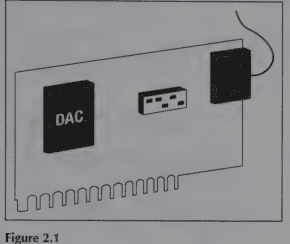

图 2.1

`VGA` 卡的工作原理。

# RGB 显示器

数字信号经过视频卡处理并转换为模拟信号后，会交给显示器进行显示。计算机显示器类似于电视，但分辨率更高。它们通过为屏幕上的每个点保持三个独立的颜色信号（红、绿、蓝）来实现这种分辨率，而与传统电视不同，电视会将这三种颜色汇聚（或合并）为一个。

你可能会想知道红、绿、蓝有什么特别之处。为什么我们不使用 `POY`（粉、橙、黄）显示器呢？如果你观察彩色光谱，红、绿、蓝是主要的色调，或*色相*，其他一切都是这三种基本颜色的组合。通过改变三种原色投射的强度，显示器可以创建人类可见的任何色调。白色是三种颜色全强度，黑色是任何颜色的缺失，灰色是等量（但少于白色且多于黑色），其他所有都是介于两者之间的不均匀混合。你将在第 5 章看到更多相关内容。

你可以通过测量其收敛性、点距、刷新率和视频带宽来判断显示器的质量。

# 收敛性

形成彩色像素所需的三个电子束（红、绿和蓝）的交点。糟糕的收敛性会降低分辨率，并使白色像素模糊。

# 点距

彩色显示器上红色（或绿色，或蓝色）点与最近的红色（或绿色，或蓝色）点之间的距离（通常从 0.28 到 0.51mm；大型演示显示器可能高达 1.0mm）。点距越小，图像越清晰。`0.28` 的点距意味着点之间相距 `28/100` 毫米。`0.31` 或更小的点距提供清晰的图像，特别是对于文本。

## 刷新率

（第一章中已重复）指显示器每秒重新充能的次数。你的屏幕电荷会持续流失，因此必须不断刷新。以赫兹（`Hz`）为单位测量，显示系统的典型范围从 `56Hz` 到超过 `100Hz` 不等。建议至少使用 `70Hz` 以防止眼睛疲劳。

## 视频带宽

视频屏幕的最大显示分辨率，以 `MHz` 为单位测量，并按以下公式计算：

水平 × 垂直 × 分辨率 × 每秒刷新次数

例如，`800×600×60 = 28.8MHz`。相比之下，广播电视仅为 `3.58MHz`。（话虽如此，我通常根据价格以及它看起来多么“酷”来购买显示器。）

图像的实际投影是由位于显示器外壳后部的三个电子“枪”完成的。这些枪向显示器的正面发射一连串快速的电子流，电子流与屏幕的内表面碰撞。屏幕的内表面覆盖有荧光粉，通常成组排列（每种原色对应一个荧光粉），当电子撞击时，单个荧光粉会发光。正是这些发光的荧光粉产生了可见的显示效果，如图 2.2 所示。不幸的是，荧光粉的电荷消散得非常快，因此它们必须每秒多次重新充电（或*重新撞击*）。这种重新充电的频率被称为*刷新率*，如上文及第一章中定义的那样。屏幕刷新得越快，图像质量就越好。

此活动发生在阴极射线管（`CRT`）内部，这与模拟电视内部的显像管相同。你可能听说过 `CRT` 这个词被用于航天飞机的显示屏。尽管听起来很有科技感，但 `CRT` 其实是一个老式的名称，已经被听起来相对平淡的*显示器*或*显示屏*所取代，而这正是我们今天所使用的术语。

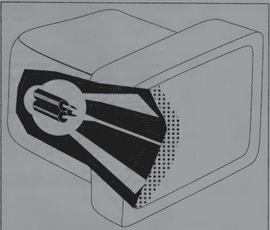

图 2.2

显示器的工作原理。

## 点

电子枪在射击时聚焦于*点*。一个显示器拥有成千上万个点，这些点是屏幕上的小圆圈或矩形。所有的视频图像都由点组成。你可以把它们想象成计算机屏幕的*原子*。

## 像素

*像素*是由*图像元素*（`picture element`）这两个词首字母组合而成的缩写。它指的是显示器上可定义的最小区域，且必须由单一颜色组成。不要将像素与点混淆；点是显示器的物理组成部分，而像素由你的视频卡定义，可能由多个点组成。你的屏幕包含的像素越多，其*分辨率*就越高。像素的另一个同义词是*`pel`*。

## 分辨率

这是屏幕的锐度或清晰度。显示器显示的像素越多，其分辨率就越好。为了获得更高的像素数量，从而获得更好的分辨率，你需要指示你的视频卡进入不同的屏幕模式。

## 屏幕模式

屏幕模式非常有趣。通过更改屏幕模式，你可以改变屏幕上同时显示的像素数量。通常，像素越多，图像质量就越好。然而，这需要付出代价，即高像素数量意味着你的视频卡需要大量的内存。

屏幕模式通过分割你的显示区域为网格来工作，或者通常被称为矩阵。矩阵可以与数学中的笛卡尔图/坐标系相比，其中 `x` 轴水平运行，`y` 轴垂直运行。矩阵中的点以标准的 `(x,y)` 格式表示，点 `(0,0)` 位于左上角，后续的点继续向下和向右延伸。

## 矩阵

构成显示屏幕的水平行和垂直列组成的网格。例如，`640×480` 的矩阵意味着你有 640 个水平像素和 480 个垂直像素。

你已经熟悉了文本模式（无论你是否使用这个术语）；`Linux` 在水平方向提供 80 个字符，在垂直方向提供 25 个字符。要超越 `ASCII` 字符，你必须进入图形模式。

作为一个理论示例，我们可以创建一个名为 `4×3` 的屏幕模式。这意味着你的屏幕将被划分为一个由三行水平线 `intersecting` 四列垂直线组成的矩阵，从而总共创建十二个独立的像素。如果你难以想象这一点，请参考图 2.3。

然而，这种尺寸的矩阵几乎毫无用处。知道像素只能包含一种颜色后，我们局限于每个占据屏幕十二分之一的大块色块。在这个图形模式下，要想画出任何可辨认的东西都需要极大的想象力，如图 2.4 所示。（天哪，即使是 `Atari` `2600` 也有更好的分辨率！）因此，我们需要创建一个更大的网格。

实际上，`SVGAlib` 的最小矩阵是宽 320 像素、高 200 像素。请查看图 2.5 了解 `320×200` 模式的示例。

显然，这给了我们更多的操作空间。我们实际上有一个可辨认的房子（虽然是由块状的，因为它只使用黑白），很明显可以以此种方式制作几种原始图形。此外，逻辑表明，随着矩阵尺寸的增加（例如，增加到 `1,024×768`），可用像素的数量增加，色块和锯齿边缘的问题就会消失。还差最后一个元素来丰富这张图片：颜色。

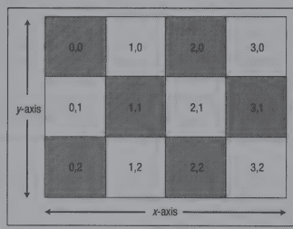

图 2.3

假想的屏幕模式 `4x3`。

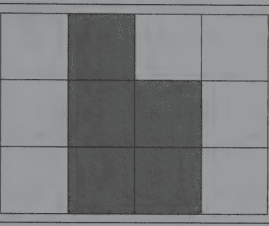

图 2.4

在假想的屏幕模式 `4x3` 下绘制的房子。

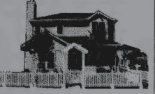

图 2.5

在屏幕模式 `320x200` 下的同一个房子。

### 屏幕模式中的颜色

屏幕模式具有第三个也是最后一个维度——颜色。颜色元素列在网格宽度和高度维度之后。例如，列表 2.1 显示在 `SVGA/lb` 下实际上有六种不同的 `320x200` 模式变体。

**列表 2.1 使用 320×200 矩阵的六种 SVGA/lb 屏幕模式。**

- `320x200x16` 种颜色

- `320x200x256` 种颜色

- `320x200x32K` 种颜色

- `320x200x64K` 种颜色

- `320x200x16M` 种颜色

- `320x200x16M32` 种颜色

请注意可能的颜色数量是如何从可怜的 16 种增加到 16 *百万* 种的。你能叫出 1600 万种颜色的名字吗？

> 注意
>
> 顺便说一下，文本模式的分辨率为 `720×400` 像素和 16 种颜色。

## VGA 内存

不幸的是，并非每个视频卡都能处理较高的分辨率模式。矩阵尺寸和可能的颜色数量之间通常存在权衡；一张能够在内存中容纳巨大矩阵的卡不能同时容纳大量颜色，除非它有很多内存。让我们在表 2.1 中看看这一点。


显然，每个 VGA 卡都能处理 `640×480×16` 模式。事实上，这是最初的 IBM VGA 适配器的高端配置。但是，如果你的卡只有 `4MB` 内存，那么 `1,600×1,200×16M` 模式就不可能了。

表 2.1 VGA 卡的内存需求，以兆字节表示。

| 分辨率 | 16 种颜色 | 256 种颜色 | 64K 种颜色 | 16M 种颜色 |
|------------|-----------|------------|------------|------------|
| `640×480` | .5 | .5 | 1 | 2 |
| `800×600` | .5 | 1 | 2 | 2 |
| `1,024×768` | 1 | 1 | 2 | 4 |
| `1,280×1,024` | 1 | 2 | 4 | 4 |
| `1,600×1,200` | 2 | 2 | 4 | 8 |

## 关于分辨率的更多信息

谈到分辨率，表 2.2 列出了一些更常见的分辨率及其名称。请注意，虽然 `800×600` 官方被称为 SVGA，但 `SVGAAlb` 实际上可以处理表中列出的所有内容。

你有没有注意到这些分辨率似乎彼此成比例？这不是巧合。从 `640×480` 模式开始，分辨率共享相同的宽高比。也就是说，水平宽度比高度长三分之一。这使得在一个分辨率下绘制的图片可以传输到另一个分辨率而不失真。

表 2.2 常见分辨率及其名称。

| 分辨率 | 名称 |
|------------|---------------|
| `640×480` | 标准 VGA |
| `800×600` | SVGA |
| `1,024×768` | XGA |
| `1,280×1,024` | SXGA |
| `1,600×1,200` | UXGA |

## 宽高比

显示器的宽度与高度之比。大多数监视器和电视的宽高比为 `4:3`。

## VGA 内存中像素的存储方式

在显存中，像素由一个或多个位表示。`1` 位像素只能容纳两个值（开和关），因此它只适用于黑白图像，例如之前展示的例子。通过增加每个像素的位数，即*位深度*，可表示的颜色数量就会增加。彩色显示器需要每个像素 `4` 到 `32` 位不等。难怪 `1600` 万种颜色会占用大量内存。

表 2.3 展示了随着每像素位数增加，可表示的颜色数量如何变化。

| 位数 | 颜色数量 |
| :--- | :--- |
| `4` | `16` |
| `8` | `256` |
| `15` | `32,768` |
| `16` | `65,536` |
| `24` | `16,777,216` |
| `32` | `16,777,216` + `Alpha` 通道 |

## SVGAlib 屏幕模式

够理论示例了，让我们看看 `SVGAlib` 提供的 `145` 种屏幕模式。这些是`/usr/include/vga.h`中实际存在的所有模式，表 2.4 列出了其中所有模式，并包含颜色信息。如果你在疑惑，开头的 `G` 简单地指代*图形模式*。当你使用 `SVGAlib` 编写程序时，需要使用这些模式之一。

> **注意**
>
> `16M32` 表示使用每像素 `32` 位来表示 `1600` 万种颜色。

表 2.4 SVGAlib 下可用的屏幕模式。

| 模式编号 | 模式描述 |
| --- | --- |
| `0` | `TEXT` |
| `1` | `G320x200x16` |
| `2` | `G640x200x16` |
| `3` | `G640x350x16` |
| `4` | `G640x480x16` |
| `5` | `G320x200x256` |
| `6` | `G320x240x256` |
| `7` | `G320x400x256` |
| `8` | `G360x480x256` |
| `9` | `G640x480x2` |
| `10` | `G640x480x256` |
| `11` | `G800x600x256` |
| `12` | `G1,024x768x256` |
| `13` | `G1,280x1,024x256` |
| `14` | `G320x200x32K` |
| `15` | `G320x200x64K` |
| `16` | `G320x200x16M` |
| `17` | `G640x480x32K` |
| `18` | `G640x480x64K` |
| `19` | `G640x480x16M` |
| `20` | `G800x600x32K` |
| `21` | `G800x600x64K` |
| `22` | `G800x600x16M` |
| `23` | `G1,024x768x32K` |
| `24` | `G1,024x768x64K` |
| `25` | `G1,024x768x16M` |
| `26` | `G1,280x1,024x32K` |
| `27` | `G1,280x1,024x64K` |
| `28` | `G1,280x1,024x16M` |
| `29` | `G800x600x16` |
| `30` | `G1,024x768x16` |
| `31` | `G1,280x1,024x16` |
| `32` | `G720x348x2` |
| `33` | `G320x200x16M32` |
| `34` | `G640x480x16M32` |
| `35` | `G800x600x16M32` |
| `36` | `G1,024x768x16M32` |
| `37` | `G1,280x1,024x16M32` |
| `38` | `G1,152x864x16` |
| `39` | `G1,152x864x256` |
| `40` | `G1,152x864x32K` |
| `41` | `G1,152x864x64K` |
| `42` | `G1,152x864x16M` |
| `43` | `G1,152x864x16M32` |
| `44` | `G1,600x1,200x16` |
| `45` | `G1,600x1,200x256` |
| `46` | `G1,600x1,200x32K` |
| `47` | `G1,600x1,200x64K` |
| `48` | `G1,600x1,200x16M` |
| `49` | `G1,600x1,200x16M32` |
| `50` | `G320x240x256V` |
| `51` | `G320x240x32K` |
| `52` | `G320x240x64K` |
| `53` | `G320x240x16M` |
| `54` | `G320x240x16M32` |
| `55` | `G400x300x256` |
| `56` | `G400x300x32K` |
| `57` | `G400x300x64K` |
| `58` | `G400x300x16M` |
| `59` | `G400x300x16M32` |
| `60` | `G512x384x256` |
| `61` | `G512x384x32K` |
| `62` | `G512x384x64K` |
| `63` | `G512x384x16M` |
| `64` | `G512x384x16M32` |
| `65` | `G960x720x256` |
| `66` | `G960x720x32K` |
| `67` | `G960x720x64K` |
| `68` | `G960x720x16M` |
| `69` | `G960x720x16M32` |
| `70` | `G1,920x1,440x256` |
| `71` | `G1,920x1,440x32K` |
| `72` | `G1,920x1,440x64K` |
| `73` | `G1,920x1,440x16M` |
| `74` | `G1,920x1,440x16M32` |
| `75` | `G320x400x256V` |
| `76` | `G320x400x32K` |
| `77` | `G320x400x64K` |
| `78` | `G320x400x16M` |
| `79` | `G320x400x16M32` |
| `80` | `G640x400x256` |
| `81` | `G640x400x32K` |
| `82` | `G640x400x64K` |
| `83` | `G640x400x16M` |
| `127` | `G2,048x1,152x64K` |
| `128` | `G2,048x1,152x16M` |
| `129` | `G2,048x1,152x16M32` |
| `130` | `G2,048x1,536x256` |
| `131` | `G2,048x1,536x32K` |
| `132` | `G2,048x1,536x64K` |
| `133` | `G2,048x1,536x16M` |
| `134` | `G2,048x1,536x16M32` |
| `135` | `G512x480x256` |
| `136` | `G512x480x32K` |
| `137` | `G512x480x64K` |
| `138` | `G512x480x16M` |
| `139` | `G512x480x16M32` |
| `140` | `G400x600x256` |
| `141` | `G400x600x32K` |
| `142` | `G400x600x64K` |
| `143` | `G400x600x16M` |
| `144` | `G400x600x16M32` |

## Alpha 通道

`1600` 万色像素中额外的 `8` 位，用作单独图层以表示物体的透明度级别。


如果你想查看你的显卡支持哪些模式，可以编译并运行列表 2.2 中演示的快速脚本。此外，如果你不知道 `144` 是最后一个屏幕模式，你可以使用另一个函数 `vga_lastmodenumber()` 来推导出来。另外，`GLASTMODE` 在 `vga.h` 中定义为 `vga_lastmodenumber()` 的输出。

## 列表 2.2 我的显卡支持哪些屏幕模式？

```c
#include <stdio.h>
#include <stdlib.h>
#include <vga.h>

int main(void)
{
    int i;

    for (i = 0; i < 145; i++)
    {
        if (vga_hasmode(i) > 0)
        {
            printf("Mode %d is supported.\n", i);
        } else {
            printf("Mode %d is NOT supported.\n", i);
        }
    }

    return 0;
}
```

你可以将此代码命名为 `mode_tester.c` 或你喜欢的其他名称。要编译，请键入以下内容：

```bash
gcc -o mode_tester mode_tester.c -lsvga
```

我稍后解释 `-lsvga` 部分。运行 `mode_tester` 会产生类似列表 2.3 所示的输出。

## 列表 2.3 mode_tester 的示例输出。

```text
Mode 0 is supported.
Mode 1 is supported.
Mode 2 is supported.
Mode 3 is supported.
Mode 4 is supported.
Mode 5 is supported.
...
Mode 139 is NOT supported.
Mode 140 is NOT supported.
Mode 141 is NOT supported.
Mode 142 is NOT supported.
Mode 143 is NOT supported.
Mode 144 is NOT supported.
```

注意这里使用了我们第一个 SVGAlib 函数 `vga_hasmode()`。使用该函数，你可以确定显卡支持哪些模式，并据此进行编程。此外，如果你不知道 `144` 是最后一个屏幕模式，你可以使用另一个函数 `vga_lastmodenumber()` 来推导出来。

使用 `mode_tester` 程序的替代方法是运行 `vgatest`，它是随 SVGAlib 软件包提供的演示程序之一。列表 2.4 显示了启动 `vgatest` 时发生的情况。

## 列表 2.4 vgatest 的输出。

```text
Choose one of the following video modes:
1: 320x200, 16 colors (4 bitplanes)
2: 640x200, 16 colors (4 bitplanes)
3: 640x350, 16 colors (4 bitplanes)
4: 640x480, 16 colors (4 bitplanes)
5: 320x200, 256 colors (packed-pixel)
6: 320x240, 256 colors (Mode X)
7: 320x400, 256 colors (Mode X)
8: 360x480, 256 colors (Mode X)
9: 640x480, 2 colors (1 bitplane, monochrome)
10: 640x480, 256 colors (packed-pixel, banked)
11: 800x600, 256 colors (packed-pixel, banked)
12: 1024x768, 256 colors (packed-pixel, banked)
17: 640×480, 32K colors (5-5-5 RGB, blue at LSB, banked)
18: 640×480, 64K colors (5-6-5 RGB, blue at LSB, banked)
20: 800×600, 32K colors (5-5-5 RGB, blue at LSB, banked)
21: 800×600, 64K colors (5-6-5 RGB, blue at LSB, banked)
23: 1024×768, 32K colors (5-5-5 RGB, blue at LSB, banked)
24: 1024×768, 64K colors (5-6-5 RGB, blue at LSB, banked)
29: 800×600, 16 colors (4 bitplanes)
30: 1024×768, 16 colors (4 bitplanes)
32: 720×348, 2 colors (1 bitplane, monochrome)
34: 640×480, 16M colors (8-8-8 XRGB, 32-bit pixels, ...)
35: 800×600, 16M colors (8-8-8 XRGB, 32-bit pixels, ...)
36: 1024×768, 16M colors (8-8-8 XRGB, 32-bit pixels, ...)
Enter mode number (1–36): 5
```

通过输入一个数字（例如 `5`），你将看到一个展示所选模式颜色范围的显示屏。如果显示效果正常，如图 2.6 所示，你就知道你的显卡支持该模式。如果显示变形或环绕屏幕，你就知道对于该特定显卡应避免使用此模式。

最后，你将获得所选模式的摘要。模式 `5` 的结果显示在列表 2.5 中。

## 列表 2.5 模式 5 的摘要。

```text
Width: 320 Height: 200 Colors: 256
DisplayStartRange: 0h Maxpixels: 65536 BIt: N0
```

## 编译

让我们花点时间讨论如何使用 `gcc`（标准 Linux C 编译器）编译 SVGAlib 程序。基本流程如下：

```bash
gcc -o <output> <input>
```

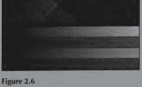

**图 2.6**

`vgatest` 渲染的屏幕模式 5。

例如，如果你的源代码在一个名为 `source.c` 的文件中，并希望编译后的程序命名为 `george`，你需要输入以下内容：

```
gcc -o george source.c
```

现在，为了引入 SVGAlib 的功能，你需要在命令行末尾添加 `-lvgal`，如下所示：

```
gcc -o george source.c -lvgal
```

这告诉 `gcc` 它需要将你的编译程序与 `libvgal.so.1` 链接（参见第 1 章）。如果你还需要 SVGAlib 扩展库中的函数，即 `libvgagl.so.1`（关于 SVGAlib 的这一扩展将在后文详细介绍；如果你现在对此一无所知也不要紧），你需要在命令行中再添加一个标志。但请注意，在链接多个库时，最重要的库必须放在最后。由于 `libvgal.so.1` 比 `libvgagl.so.1` 更重要，你的命令行应该如下所示：

```
gcc -o george source.c -lvgagl -lvgal
```

> **注意**
>
> 当使用 `vgagl` (`libvgagl.so.1`) 进行编译时，必须在 `libvgal.so.1` 之前引用它，例如：`-lvgagl -lvgal`

担心代码中有错误吗？添加 `-Wall`（警告，全部）标志将显示 `gcc` 在你的代码中发现的所有可能问题。

最后，你可以优化编译以使生成的可执行文件运行得更快。你可以通过添加 `-O` 标志来实现这一点。使用 `-O2` 可以获得更好的优化（同时也意味着更大的程序和更长的编译时间）。事实上，你可以一直使用到 `-O3`。

这是我们现在使用所有标志后的结果：

```
gcc -Wall -O3 -o george source.c -lvgagl -lvgal
```

使用这种方法，你可以编译本书中的所有示例。

## VESA


很多人对 `VESA` 驱动程序感到兴奋。`VESA` 是 `Video Electronics Standards Association`（视频电子标准协会）的缩写，该协会成立于 1989 年，旨在为 PC 及其他计算环境制定接口标准。人们希望有一天所有的视频卡都能符合 `VESA` 指南，届时 `SVGAlib` 将能够使用单一驱动程序支持所有 `VESA` 显卡，从而极大地扩展其适用范围。目前，`SVGAlib` 的 `VESA` 驱动程序已知可在 `Banshee`、`TNT`、`Matrox`、`Neomagic`、`i740` 以及少数其他显卡上工作。如果你不确定，请查看网站。

如果你感兴趣，表 2.5 展示了当前 `SVGA` 显卡的 `VESA` 标准。不过，在为 `SVGAlib` 编程时，你仍需使用表 2.4 中列出的 50 种模式之一；这些 `VESA` 模式仅供参考。

### `VESA` BIOS

符合 `VESA` BIOS 扩展标准的 `VGA` 显示适配器上的 BIOS 芯片。

表 2.5 超 VGA 适配器的 `VESA` 标准。

| 模式号 (十六进制) | 分辨率 | 颜色 | 使用的视频内存 |
| :--- | :--- | :--- | :--- |
| 101 | 640x480 | 256 | 300K |
| 110 | 640x480 | 32K | 600K |
| 111 | 640x480 | 64K | 600K |
| 112 | 640x480 | 16M | 900K |
| 103 | 800x600 | 256 | 469K |
| 113 | 800x600 | 32K | 938K |
| 114 | 800x600 | 64K | 938K |
| 115 | 800x600 | 16M | 1,406K |
| 105 | 1,024x768 | 256 | 768K |
| 116 | 1,024x768 | 32K | 1,536K |
| 117 | 1,024x768 | 64K | 1,536K |
| 118 | 1,024x768 | 16M | 2,304K |
| 107 | 1,280x1,024 | 256 | 1,280K |
| 119 | 1,280x1,024 | 32K | 2,560K |
| 11A | 1,280x1,024 | 64K | 2,560K |
| 11B | 1,280x1,024 | 16M | 3,840K |

## 结论

我们刚刚涵盖了大量有助于理解后续章节内容的概念。我们讨论了硬件（显卡和显示器）、屏幕模式和分辨率、颜色、视频内存以及编译。我还提到了 `VESA` 及其对 `SVGAlib` 的影响。虽然这可能不是本教程中最令人兴奋的一章——至少我希望不是——但大家肯定同意掌握这些信息是有益的。

更重要的是，如果你在书中后续章节遇到某个看似晦涩的硬件概念，你随时可以回顾本章寻求指导。很有可能你在这里能找到答案。

现在，让我们进入有趣的部分。

## 本章介绍的功能总结

以下是本章涵盖的功能摘要：

- `int vga_hasmode(int mode)`

- `int vga_lastmodenumber(void)`

# 第 3 章：第一个程序

主要话题：

- 基础函数

- 简单程序

- 绘制形状

- `Vga_gl`

终于到了！我们最终抵达了重头戏所在的章节。不再有关于理论、定义和主观学术观点的枯燥探索。精彩内容即将呈现。

我记得上过一些课程，对我来说纯粹是浪费时间，因为那些课程严重缺乏实例。我发现，当我能立即将所学应用于自己的生活时，学习效果最好。我也发现某种实验室活动很有帮助。专家们称这为建构主义。至少，我的兴趣必须得到维持。然而，如果课程理论过多而缺乏实证和实际例子，我很快就会发现自己望向窗外，飘入白日梦的半意识领域。也许这是我大脑对抗枯燥的防御机制。也许是我缺乏自律。无论如何，我是一个动手实践型的人。

并非故意自相矛盾，这一章直奔主题。我们将创建各种简单直接的 `SVGAlib` 程序以开始动手。这些程序结合在一起，将帮助你初步了解在 `Linux` 下编写图形程序的窍门。你会发现，仅通过切换颜色、交换函数和选择不同的像素位置，就可以基于这些简单主题创造出几乎无限多的变化。虽然这些程序不会让你成名，但它们将为前方等待你的高级应用铺平道路。

## 典型应用程序

人们在图形方面似乎遇到的最大问题是入门。他们甚至不知道从哪里开始，感到不知所措。这是由两件事结合造成的：缺乏学习材料，以及他们作为参考示例的那些编写糟糕、文档低下的“意大利面式”代码泥潭。事情本可以不必如此。一个编写良好的图形应用程序可以像诗或歌一样简单，简洁且直奔要点。

你可以认为一个 `SVGAlib` 应用程序包含三个阶段。以下是你需要做的事情：

1. 将显示适配器设置为图形模式。

2. 执行你的操作。

3. 将显卡恢复到文本模式。

这还不算太糟糕，对吧？让我们近距离亲自看看这些概念在实际中的应用。清单 3.1 开始你的探索之旅。

### 清单 3.1 我的第一个 SVGAlib 程序。

```c
#include <stdlib.h>
#include <vga.h>

int main(void)
{
  vga_init();
  vga_setmode(G320x200x16);
  /*  Some prefer vga_setmode(1), which is identical  */
  vga_setcolor(15);  /*  white  */
  vga_drawpixel(0, 0);
  vga_setmode(TEXT);
  /*  This is the same as vga_setmode(0)  */
  return 0;
}
```

当然，如果你在第 2 章中编译了 `mode_tester.c` 程序，那么这实际上是你第二个 `SVGAlib` 程序，但让我们在这里不要过于吹毛求疵。这个程序仅由五条命令加一个 `return` 语句组成，任何接触过 C 语言的人都应该能够轻松掌握。它首先初始化显示适配器，然后将屏幕设置为模式 1（具体为 `G320x200x16`，即一个水平 320 像素、垂直 200 像素的矩阵，包含 16 种可能的颜色）。然后继续选择白色作为活动颜色，在极左上角绘制单个像素，将适配器返回到文本模式（模式 0），并以返回码 0（无错误）匆忙收尾。这多么令人兴奋啊？希望你吃过麦片了。

### 注意

> 我稍作停顿，说一下 `gcc` 现在要求你使用 `int main(void)` 开始你的 `main` 循环（函数）（当然，将 `void` 替换为该函数所需的任何输入参数）。此时，你的程序仍然可以使用旧方法（例如，使用 `void main(void)` 而不是 `int`）进行编译，但你会得到烦人的编译警告。我的建议是完全避免使用这种语法，因为总有一天 `gcc` 将不再接受它。
>
> 说来奇怪，就在本文撰写之时，`Linux` 内核——可以说 C 语言编程的极致典范——中许多元素仍然将 `void` 用作返回类型，这导致每次编译时都会产生警告。托瓦尔兹先生，拜托你稍微规范一下吧！

现在，让我们逐步拆解这个程序，看看每一步发生了什么。我们首先来看 `vga_init()`。

尽管有括号，`vga_init()` 并不接受任何参数。它的唯一目的是初始化 `VGA` 显卡——也就是说，它与显卡建立直接连接，并本质上告诉显卡：“嘿，伙计！从现在起你要听我的指挥，并且一直照我说的做，直到我退出。” 但这并不意味着你的程序享有独占权；你的其他虚拟终端应该仍能独立工作，除非你的显卡坏了。但你确实拥有这条直接连接通道，这对于图形显示至关重要。此外，与需要额外步骤的 `X Windows` 相比，你还拥有一个重要的速度优势。最后，`vga_init()` 会放弃 `root` 权限，这大大降低了安全漏洞发生的可能性。（关于安全问题，我稍后会有更多说明。）将这一行作为代码的第一行非常重要。

如果你注意到第 2 章中的示例程序 `mode_tester.c` 并没有使用 `vga_init()`，那说明你很细心。原因是 `mode_tester.c` 既输出文本又输出图形，因此使得 `vga_init()` 变得不必要。

请注意，`X Windows` 程序不会直接与图形适配器建立连接，因为它们是通过 `X` 服务器进行通信的。然而，`X` 服务器确实需要直接与显卡交互。将 `X` 服务器作为中间人虽然允许了网络图形功能，但也降低了性能。

接下来，我们使用 `vga_setmode(int mode)` 设置屏幕模式。`SVGAlib` 提供了 140 种屏幕模式供你享受，所有模式均可在第 2.4 表中找到（位于第 2 章末尾附近）。你可以输入一个模式编号（例如，1），也可以输入完整的模式描述（`G320x200x16`）。两者效果相同。请务必确认你选择的模式在你正在使用的显卡上是否可用；否则，你可能会遇到问题。（同样，参阅第 2 章寻求帮助。）

> **注意**
>
> 在你开始绘制之前必须建立屏幕模式，以便你的视频卡能够正确分配其内存。如果你在设置模式之前尝试绘制，你的程序将会崩溃。


顺势而为，我们使用`vga_setcolor(int color)`建立当前活动颜色。由于本示例中选择的屏幕模式具有 16 种颜色，你可以从 0 到 15 中选择任何颜色。（请注意，`vga_setcolor()` 也兼容 256 种颜色模式，但不支持更高位数。）表 3.1 列出了 SVGAlib 的 16 种基本颜色，也称为 EGA 颜色，它们与 MS-DOS/Windows 及其他操作系统中的 16 种基本颜色非常接近。

### 表 3.1 SVGAlib 的 16 种基本颜色。

| 颜色编号 | 名称 |
| :--- | :--- |
| 0 | 黑色 |
| 1 | 蓝色 |
| 2 | 绿色 |
| 3 | 青色（灰蓝色） |
| 4 | 红色 |
| 5 | 洋红色（紫色） |
| 6 | 棕色 |
| 7 | 浅灰色（银色） |
| 8 | 深灰色 |
| 9 | 浅蓝色 |
| 10 | 浅绿色 |
| 11 | 浅青色 |
| 12 | 浅红色 |
| 13 | 浅洋红色（淡紫色） |
| 14 | 黄色 |
| 15 | 白色 |

根据这些信息，你可以看出`vga_setcolor(15)`会将活动颜色设置为白色。我们现在绘制的任何内容都将显示为白色，除非我们使用另一个`vga_setcolor()`语句。请注意，`vga_setcolor()`仅会影响其后出现的绘图命令；之前绘制的像素不会改变。另外请注意，一些绘图命令包含颜色参数，因此不需要像这样单独的颜色声明。不过，我们现在不必担心这个问题。

第四个命令`vga_drawpixel(int x, int y)`实际上是在屏幕上放置内容的操作。在这种情况下，它是左上角的一个像素。自然地，`vga_drawpixel(1,0)`是该位置向右移动一个像素的位置。像素`(319, 199)`位于极右下角，其余部分我相信你能自己推断出来。

> **注意**
>
> 如果你尝试绘制一个不存在的像素，例如在模式 5 下绘制`(320, 200)`，程序会将像素回绕并在本例中将其放置在`(0,0)`。`(400,250)`将变为`(80, 50)`，以此类推。

现在我们将重新调用`vga_setmode()`以返回文本模式。我在示例中使用了`vga_setmode(TEXT)`，但你同样可以轻松地使用`vga_setmode(0)`。这完全是美观问题。无论你选择哪种方式，都不要忘记这部分。如果你忘了，你的用户会讨厌你。

**注意**

将终端重置为文本模式对你的用户来说总是很贴心的事。当一些粗心的程序员忘记这样做时，会带来很大的麻烦；你的屏幕上（以及每个其他虚拟终端上）会出现垃圾数据，你通常必须重新启动才能清除它。当然，你无法看到自己正在输入的内容，因此冒着搞乱一切的风险。如果你直接关闭机器，可能会损坏你的文件系统。通过在关灯说晚安之前使用`vga_setmode(0)`，你可以避免这种情况发生。就这么简单。如果你特别谨慎，你可以在另一个终端登录，并在命令线上预先输入`shutdown -r now`。如果控制台挂起，只需切换到应急终端并按下回车键即可。

最后，我们使用`return 0,`，这意味着程序完美执行。同样，`exit(0)`也能正常工作，并且可以在 SVGAlib 演示程序中找到。与屏幕模式一样，这不过是见仁见智的问题。你可能会注意到，为了可移植性，有些人更喜欢使用`return EXIT_SUCCESS`而不是`return 0.`

### 编译

我并不会在每个章节后都设置一个编译章节，但我们可以再次过一遍流程，以确保你走在正确的轨道上。如果前面的代码被称为`myfirst.c,`你可以通过输入以下内容来编译它：

```
gcc -Wall -O3 -o myfirst myfirst.c -lvg a
```

### Setuid 要求

编译完成后还有一个步骤需要执行，而且你需要记住这一点。如你所知，进程必须拥有 root 状态才能直接与硬件交互。虽然这种直接通信是 SVGAlib 的优势之一，但它也要求你提前规划。如果你的 SVGAlib 应用程序有图形输出（显然大多数都有），你必须使用`chmod`更改其运行时权限，以允许非 root 用户运行它。

要使应用程序`setuid` root（即可被普通用户访问），你需要执行以下命令之一。（我们假设编译后的程序仍被称为`myfirst.`）

```
chmod u+s myfirst
```

或者，同样可接受的解决方案是输入：

```
chmod 4755 myfirst
```

请记住，`vga_init()`命令会放弃 root 状态，所以这里没什么需要担心的。

> **警告**
>
> SVGAlib 应用程序必须具有`setuid` root 属性，普通用户才能访问。

至此，你的第一个真正的 SVGAlib 程序完成了。恭喜！你可以认为自己已经受洗进入 Linux 图形世界。看，并没有你想象的那么难。也不应该难。

不妨随意玩玩这段代码。实验是学习最好的方式。使用表 3.1 中给出的颜色表作为指南，你如何让那个像素变成红色而不是白色？

请注意，这个第一个程序只包含了`<vga.h>`和`<stdlib.h>`，而*没有*包含其他标准头文件，例如`<stdio.h>`和`<stdlib.h>`。这是因为该程序需要的每个函数都包含在`<vga.h>`中。如果你习惯盲目包含`<stdio.h>`或其他头文件，那不会造成任何伤害。只是没有必要。

### 观看时间

如果你运行过那个程序，你可能注意到一个小问题。它运行得如此之快，以至于你来不及看到它。通过使用`sleep()`函数（并包含`<unistd.h>`头文件），我们可以添加延迟以使输出可见。列表 3.2 显示了这段代码。

**列表 3.2 我的第一个 SVGAlib 程序，带有暂停。**

```c
#include <stdlib.h>
#include <vga.h>
#include <unistd.h>

int main(void)
{
    vga_init();
    vga_setmode(G320x200x16);
    vga_setcolor(15);
    vga_drawpixel(0, 0);
    sleep(3);
    vga_setmode(TEXT);
    return 0;
}
```

程序现在等待三秒钟，以便你可以尽情欣赏那个白色像素的风采。当然，`sleep(15)`将创建一个 15 秒的暂停，等等。

另一种，通常更好的方法是等待用户按下一个键后再继续。你可以使用`vga_getch()`，或者甚至是`<stdio.h>`中普通的`getchar()`来实现。现在

## 驱动程序报告

如果你已经编译并运行过其中任何一个程序，你可能会注意到*驱动程序报告*，它会在程序结束后打印出来。（实际上，报告在你调用`vga_init()`时就会打印，但在你的程序结束前并不可见。）如果这让你感到烦恼，或者你的初始化代码让你的应用程序看起来不够专业，你可以使用`vga_disabledriverreport()`来消除该消息。（这真是一句拗口的话，不是吗？）请在调用`vga_init()`*之前*插入此语句。否则，它将不会有任何效果。

## 关于像素的更多乐趣

既然你已经知道如何使用 SVGAlib 编写一个基本的程序，我们可以开始玩点别的。你觉得单个像素有点难以看见吗？想象一下如果我们处于 12 号显示模式（1,024×768）中。通过将几个像素放置在一起，我们可以创造出一个大像素的错觉。你大概不需要看到完整的示例；不过，列表 3.4 确实展示了一个代码片段。

### **列表 3.4** 将像素分组以提高可见性。

```c
vga_drawpixel(159, 99);
vga_drawpixel(160, 99);
vga_drawpixel(159, 100);
vga_drawpixel(160, 100);
```

这会在屏幕中心创建一个较大的点。现在，让我们继续沿着一条线绘制 10 个像素。请注意，我们只需要使用一条`vga_setcolor()`语句——一旦设置了颜色，除非我们改变它，否则它会持续有效。列表 3.5 展示了一种沿水平线分散 10 个黄色像素的方法。

### **列表 3.5 德克萨斯的黄色像素。**

```c
vga_setcolor(14);
vga_drawpixel(5, 100);
vga_drawpixel(10, 100);
vga_drawpixel(15, 100);
vga_drawpixel(20, 100);
vga_drawpixel(25, 100);
vga_drawpixel(30, 100);
vga_drawpixel(35, 100);
vga_drawpixel(40, 100);
vga_drawpixel(45, 100);
vga_drawpixel(50, 100);
```


这绘制了沿 `x` 轴均匀分布的 10 个黄色像素。相当简单的事情。为了增加一些色彩，你可以在每个 `vga_drawpixel()` 语句前加上 `vga_setcolor()` 来更改每个像素的颜色。此外，你还可以使用循环来节省时间。列表 3.6 展示了绘制这些像素的高效方法。

### 列表 3.6 更多的黄色像素。

```c
vga_setcolor(14);
for (x = 5; x < 55; x += 5)
{
    vga_drawpixel(x, 100);
}
```

到这里，你可能已经对像素感到腻味了。但在完全忽视它们之前，图 3.1 展示了一个很好的例子，说明仅使用两种颜色（黑色和白色）以及大量的 `vga_drawpixel()` 语句可以做出什么。相当不错，对吧？


图 3.1 一幅由黑白像素组成的照片级真实感绘图。

## 其他命令

处于 `320x200` 模式的屏幕有 64,000 个像素，因此需要 64,000 个 `vga_drawpixel()` 语句才能完全涂白。幸运的是，我们有一些更全面的功能可以使用；否则，我们的手都会磨掉。当然，你可以创建一个循环，例如列表 3.7 中的那个。但那是给外行的。真正的程序员使用 `vga_drawline(int x1, int y1, int x2, int y2)`。

### 列表 3.7 涂成白色。

```c
#include <stdlib.h>
/* Tedious program to change the screen's color using    */
/* vga_drawpixel()                                       */

#include <vga.h>

int main(void)
{
   int x, y;

   vga_init();
   vga_setmode(G320x200x256);
   vga_setcolor(15);

   for (y = 0; y < 200; y++)
   {
      for (x = 0; x < 320; x++)
      {
         vga_drawpixel(x, y);
      }
   }

   vga_getch();
   vga_setmode(TEXT);
   return 0;
}
```

现在让我们再试一次，这次使用 `vga_drawline()`。我们需要包含四个参数，即开始像素的 `x` 和 `y` 坐标以及结束像素的 `x` 和 `y` 坐标。在列表 3.8 中查看效果。

### 列表 3.8 使用 `vga_drawline()` 涂白。

```c
#include <stdlib.h>
#include <vga.h>

int main(void)
{
   int y;

   vga_init();
   vga_setmode(G320x200x256);
   vga_setcolor(15);

   for (y = 0; y < 200; y++)
   {
      vga_drawline(0, y, 319, y);
   }

   vga_getch();
   vga_setmode(TEXT);
   return 0;
}
```

这就好多了。而且，速度也快得多。正如你刚刚看到的（并且你将在后续章节中看到），使用一个高级命令代替几个基本命令，可以节省大量的编码时间（以及执行时间）。

你并不局限于只使用 `vga_drawline()` 画水平线。你可以从任意位置开始，向任意方向绘制线条。例如，`vga_drawline(319, 199, 0, 0)` 会绘制一条从右下角到左上角的线（假设你处于 `320x200` 模式，如 5 号模式）。

有时线条太细，就像单个像素一样。你可以通过绘制两条或更多平行线来弥补，每条线相距一个像素。

## 简单形状

自然，你可以使用线条绘制正方形和矩形。不需要太多想象力就可以推断出列表 3.9 中的代码创建了一个正方形。

### 列表 3.9 一个正方形。

```c
vga_drawline(10, 10, 100, 10);
vga_drawline(100, 10, 100, 100);
vga_drawline(100, 100, 10, 100);
vga_drawline(10, 100, 10, 10);
```

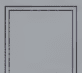

图 3.2 一个正方形的特写。

现在我们得到了一个正方形，范围从左上角的点 (10, 10)，右上角的点 (100, 10)，右下角的点 (100, 100)，以及左下角的点 (10, 100)。参见图 3.2 了解其示意图。

问题是，这个正方形是空心的。让我们继续绘制三个填充的正方形，并将它们涂成红色、绿色和蓝色。你可以在列表 3.10 中看到如何做到这一点。

### 列表 3.10 三个正方形。

```c
#include <stdlib.h>
#include <vga.h>

int main(void)
{
    int y;

    vga_init();
    vga_setmode(G320x200x256);

    vga_setcolor(4);
    for (y = 75; y < 120; y++)
    {
        vga_drawline(30, y, 80, y);
    }

    vga_setcolor(2);
    for (y = 75; y < 120; y++)
    {
        vga_drawline(130, y, 180, y);
    }

    vga_setcolor(1);
    for (y = 75; y < 120; y++)
    {
        vga_drawline(230, y, 280, y);
    }

    vga_getch();
    vga_setmode(TEXT);
    return 0;
}
```

现在，你可能已经注意到我作弊了；这些正方形并不是完美的正方形。然而，如果这些正方形恰好宽 50 个像素、高 50 个像素，由于 5 号显示模式的失真布局，它们看起来会被拉长。我们可以通过将正方形的高度减少五个像素（实际上使它们变成矩形）来补偿这一点，这样它们看起来就是方正的。图 3.3 展示了我们刚才所做的灰度版本。

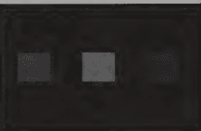

图 3.3 三个正方形。

## 擦除

没有方法可以擦除屏幕上的输出。也没有任何方法可以撤销一个操作。要移除一个对象，你只需在它上面重新涂色。如果你不想要它在那个位置，将颜色设置为背景颜色，然后进行涂色。至于撤销，只需将不想要的部分从程序中移除即可。

使用列表 3.10 中的三个正方形程序，我将演示如何擦除对象。该代码在列表 3.11 中显示。当用户按键时，正方形会被删除。当第三个正方形消失后，程序会暂停一秒，然后退出。

### 列表 3.11 再见，正方形。

```c
#include <stdlib.h>
#include <vga.h>
#include <unistd.h>

int main(void)
{
   int y;

   vga_init();
   vga_setmode(G320x200x256);

   vga_setcolor(4);
   for (y = 75; y < 120; y++)
   {
       vga_drawline(30, y, 80, y);
   }

   vga_setcolor(2);
   for (y = 75; y < 120; y++)
   {
       vga_drawline(130, y, 180, y);
   }
}

vga_setcolor(1);

for (y = 75; y < 120; y++)

{

    vga_drawline(230, y, 280, y);

}

/* 当按下任意键时，红色方块会消失。 */

vga_getch();

vga_setcolor(0);

for (y = 75; y < 120; y++)

{

    vga_drawline(30, y, 80, y);

}

/* 下一次按键时，绿色方块会消失。

   当前活动颜色已经是黑色，所以我们不需要

   再用另一个 vga_setcolor() 语句来重置它。 */

vga_getch();

for (y = 75; y < 120; y++)

{

    vga_drawline(130, y, 180, y);

}

/* 现在是蓝色。我们开心了吗？ */

vga_getch();
```


```
for (y = 75; y < 120; y++)

{

    vga_drawline(230, y, 280, y);

}

/* 暂停一秒，然后退出。谢天谢地。 */

sleep(1);

vga_setmode(TEXT);

return 0;

}
```

如果我们想`一劳永逸`地清除所有内容，而`不`结束程序，只需要使用`vga_clear()`即可。这会将整个屏幕重置为颜色 0，通常就是黑色。稍后我们会讨论如何更改与数字关联的颜色，但现在你还得使用默认设置。正如亨利·福特所说，你可以选择任何你想要的颜色，只要它是黑色的。

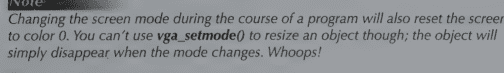

本节的期末考试：使用`vga_drawline()`画一个空心三角形。我打赌你能做到！

## 创建你自己的函数

如果在程序开始时，你可以随意设置背景颜色，那该多好啊？或者也许能用一条语句画一个正方形？不幸的是，单靠纯 `SVGAlib` 你是做不到的。现在，`vga*`（补充 `SVGAlib` 的高级绘图函数库）里面充满了这类有趣的功能，但让我们暂时先坚持使用纯 `SVGAlib`。那么，如何在不编写一堆 `vga_drawline()` 函数的情况下给屏幕着色呢？答案当然是，创建我们自己的函数。通过一次编写这个过程，你节省的时间就再也不用重复做了。

清单 3.12 包含了一个仅使用纯 `SVGAlib` 设置背景颜色的示例函数。我们将使用两个新函数来实现：`vga_getxdim()` 和 `vga_getydim()`。它们会告诉我们当前屏幕模式的 x 和 y 维度——例如，在屏幕模式 5 (`G320x200x256`) 下，`vga_getxdim()` 返回的整数值是 320。

现在，给这个新函数起什么名字呢？我不想在前面加上 `vga`，因为有人可能会混淆，以为这是随 `SVGAlib` 发行版自带的实际开箱即用的函数。相反，让我们叫它 `book_background()`。清单 3.12 展示了我所描述的内容。

**清单 3.12 `book_background()`。**

```c
void book_background(int color)
{
  int x,
        y,
        xmax = vga_getxdim(),
        ymax = vga_getydim();

  vga_setcolor(color);

  for (y = 0; y < ymax; y++)
  {
    for (x = 0; x < xmax; x++)
    {
      vga_drawline(0, y, xmax, y);
    }
  }
}
```

现在你可以一笔勾销地改变你的背景——只需将函数插入你的程序，包含正确的声明，然后就可以开始了！例如，要使背景变为青色，只需使用`book_background(3)`。清单 3.13 提供了使用该函数的示例。

**清单 3.13 使用 `book_background(0)`。**

```c
#include <stdlib.h>
#include <vga.h>

void book_background(int color);

int main(void)
{
int y;

vga_init();
vga_setmode(G320x200x256);

/* 想要一种可爱的青色吗？ */
book_background(3);

/* 在这里再画一个那些讨厌的正方形，
或者画任何你喜欢的东西。 */
vga_setcolor(2);
for (y = 75; y < 120; y++)
{
vga_drawline(130, y, 180, y);
}

vga_getch();
vga_setmode(TEXT);
return 0;
}

void book_background(int color)
{
int x,
y,
xmax = vga_getxdim(),
ymax = vga_getydim();

vga_setcolor(color);

for (y = 0; y < ymax; y++)
{
for (x = 0; x < xmax; x++)
{
vga_drawline(0, y, xmax, y);
}
}
}
```

显然，这样做很慢，尤其是在高分辨率模式下，但它确实展示了创建自己绘图函数的原则。在第 4 章中，我们将对此做得更好，但现阶段，只要你意识到自己有简化程序的能力，就心满意足吧。

确保你做出的任何颜色分配（那些没有紧接着执行绘图函数的）都位于`book_background()`之后，因为一旦执行了该函数，之前的颜色就会丢失。为了说明，清单 3.14 中的代码片段展示了错误的做法。

**清单 3.14 一次浪费的颜色声明。**

```c
vga_setcolor(8);
/* 现在的颜色是深灰色 */

book_background(5);
/* 当前颜色现在是洋红色，同时背景也是洋红色 */

vga_drawline(10, 10, 100, 100);
/* 惊讶！线条是用洋红色画的，而不是深灰色，
   导致它不可见。 */
```

你可以通过在需要颜色的函数之前立即设置颜色来避免这种情况。另一种解决方案是向`book_background()` 传递第二个参数，该参数说明当前的颜色编号，然后修改`book_background()` 以将当前颜色重置回其先前的赋值。明白吗？

到此为止，你应该已经成了自制函数的专家。你能想出如何编写并实现`book_square()` 吗？那么`book_filledsquare()` 呢？

### Vgagl

在你开始认为 `SVGAlib` 是留给那些无所事事的大闲人之前，让我们跳到 `vgagl` 的高速、低阻力函数中。正如你可能记得的，这些函数并不完全是 `SVGAlib` 本身的一部分；相反，它们是补充 `SVGAlib` 的第二个共享库的一部分。因此，它们在编译时需要在命令行上添加另一个标志：`-lvagagl`。

不要害怕混合使用 `SVGAlib` 和 `vgagl` 中的函数。程序不必局限于使用其中一个。事实上，`vgagl` 需要与我们之前使用的相同的`vga_init()` 和`vga_setmode()` 语句。然而，请注意，在使用 `vgagl` 库之前必须对其进行初始化。这是通过`gl_setcontextvga(int mode)` 命令完成的，它应该紧跟在`vga_setmode()` 之后。两者都应使用相同的模式号。此外，除了`<vga.h>`，你还需要`#include <vgagl.h>`。最后，如果你还没发现的话，所有 `vgagl` 函数都以 `gl_` 为前缀。

要使用 `vgagl` 函数，你`必须` 使用`gl_setcontextvga(int mode)` 语句，并且你`必须` 在编译时将`-Ivgagl` 标志放在`-Ivga` 之前。否则，你将面临一些段错误。最后，`#include <vgagl.h>`。

现在我们准备好大展身手了。

## 快速简便的形状绘制方法

让我们回顾那个带有三个正方形的程序。现在我们将以 `vgagl` 的方式实现，如清单 3.15 所示，这意味着使用`gl_fillbox(int x, int y, int w, int h, int c)`。

**清单 3.15 使用 `vgagl` 绘制三个正方形。**

```c
#include <stdlib.h>
#include <vga.h>
#include <vgagl.h>

int main(void)
{
    vga_init();
    vga_setmode(G320x200x256);
    gl_setcontextvga(G320x200x256);

    gl_fillbox(30, 85, 50, 45, 4);
    gl_fillbox(130, 85, 50, 45, 2);
    gl_fillbox(230, 85, 50, 45, 1);

    vga_getch();
    vga_setmode(TEXT);
    return 0;
}
```

看，这样干净多了，不是吗？速度也快多了。`vgagl` 特有的部分以灰色高亮显示。我们需要向`gl_fillbox()` 提供五个参数：左上角 x 坐标、左上角 y 坐标、宽度、高度和颜色。你这样编译它：

```bash
gcc -Wall -O3 -o gl_squares gl_squares.c -Ivgagl -Ivga
```

你可以通过绘制一个大盒子来给背景着色。要给模式 5 的屏幕一个红色背景，你只需要使用`gl_fillbox(0, 0, 320, 200, 4)`。这绝对比`book_background()` 棒多了。

让我们用 `vgagl` 制作一个更有趣的程序。让我们展示 `SVGAlib` 的所有 256 种标准颜色，以整齐排列的 16×16 方格网格形式显示（当然用`gl_fillbox()` 制作）。看看清单 3.16，这是我的版本。

> **警告**


> `目前，不要尝试在 16 色模式下使用 vgagl。`

**清单 3.16** 整齐排列的盒子显示前 256 种标准 SVGA 颜色。

```c
#include <stdlib.h>
#include <vga.h>
#include <vgagl.h>

int main(void)
{
    int x,
        y,
        c = 0;

    vga_init();
    vga_setmode(G320x200x256);
    gl_setcontextvga(G320x200x256);

    for (y = 2; y < 183; y += 12)
    {
        for (x = 2; x < 183; x += 12)
        {
            gl_fillbox(x, y, 10, 10, c++);
        }
    }

    vga_getch();
    vga_setmode(TEXT);
    return 0;
}
```

图 3.4 展示了结果应该是怎样的，除了没有颜色。

很酷，对吧？如果你只编译本章的一个程序，我建议就做这一个。你不仅能让朋友印象深刻，还将拥有将其作为未来编程参考的选项。需要某种色调？只要启动你的 256 色调色板选一个即可。

注意颜色的后半部分相当暗。有些人抱怨他们移植到 `SVGA lib` 的程序太暗；他们的颜色并不完全相同。

**移植 (Port)**

修改软件以使其能够在不同的操作系统下运行。如果你正在重写 Windows C 程序中针对 `SVGA lib` 的图形部分，你就将该程序移植到了 Linux。无论源和目标如何，这往往说起来容易做起来难。

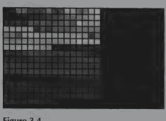

**图 3.4** 排列整齐的方框。

……它们之前的样子。现在你知道原因了。这个问题可以通过修改调色板来修复，我们将在第 5 章中详细介绍。

### 圆形

这些正方形和矩形就介绍到此为止吧。看过一个，就看过它们全部了。让我们来画些圆形。

在 `SVGAlib` 中，你使用 `gl_circle(int x, int y, int r, int c)` 来绘制圆形。这次，`x` 和 `y` 指的是圆心的坐标（而不是像矩形那样的左上角）；`r` 是半径，`c` 是颜色，照常。如果你将圆形定位在无法绘制的位置（例如 `x = 0` 且 `y = 0`），你会遇到分段错误（segmentation fault），所以要小心。

不幸的是，使用 `gl_circle()` 创建的圆形是空心的。如果你需要一个实心圆，你得等到第 4 章。在那之前，你可以尝试用各种手段自己填充它。（不过，为了节省你的时间，我告诉你，仅仅绘制几个圆并让每个后续圆形的半径依次减小 1 个单位是不够的。）请参见列表 3.17 中的代码片段和图 3.5，了解我所指的一个例子。

**列表 3.17** 填充圆形的错误方法。

```c
int x = 50,
    y = 50,
    r,
    c = 4;

/* 这仍然无法覆盖所有空间 */
for (r = 50; r > 0; r--) {
    gl_circle(x, y, r, c);
}
```

不过，你确实会得到一个相当漂亮的图案。

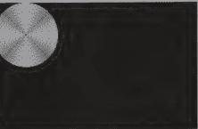

**图 3.5** 一个部分填充的圆形。（看吧，我说过吧。）

### 使用 Vgagl 绘制点和线

查看表 3.2，你会发现 `SVGAlib` 的一些早期函数在 `Vgagl` 中有更快的等效函数。除非速度不是考虑因素，否则建议你从现在开始使用这些新函数。

`Vgagl` 还有一个名为 `gl_hline(int x1, int y, int x2, int c)` 的第三函数，用于绘制水平线。这并不特别重要，但确实少了一个参数。

### 结论

如你所见，图形编码并没有那么多内容。程序可以拥有你能想象到的任意深度，但基本原则始终坚定不变。有些人对编码的恐惧是完全不必要的。如果一个项目看起来令人望而却步，你只需要把它分解成更小的步骤即可。

你已经在屏幕上看到了一种图形输出方法的多样性。一些方法，例如使用 `Vgagl` 函数，显然比其他方法更快。然而，重要的是要记住，你总是有选择。

使用本章概述的基本方法，你应该能够创建相当多的自己的程序。事实上，许多 `SVGAlib` 程序完全由本章中演示的函数组成。玩玩这些函数。正如我早先所说，没有比实验更好的老师了。

**表 3.2** `SVGAlib` 函数及其 `Vgagl` 等效函数。

| `SVGAlib`          | `Vgagl`                                    |
| :--------------- | :--------------------------------------- |
| `vga_drawpixel()`  | `gl_setpixel(int x, int y, int c)`         |
| `vga_drawline()`   | `gl_line(int x1, int y1, int x2, int y2, int c)` |

## 本章引入的函数摘要

以下是本章涵盖的函数摘要：

- `int vga_init(void)`
- `int vga_setmode(int mode)`
- `int vga_setcolor(int color)`
- `int vga_drawpixel(int x, int y)`
- `int vga_getch(void)`
- `int vga_disabledriverreport(void)`
- `int vga_drawline(int x1, int y1, int x2, int y2)`
- `int vga_clear(void)`
- `int vga_getxdim(void)`
- `int vga_getydim(void)`
- `int gl_setcontextvga(int mode)`
- `int gl_fillbox(int x, int y, int w, int h, int c)`
- `int gl_circle(int x, int y, int r, int c)`
- `int gl_setpixel(int x, int y, int c)`
- `int gl_line(int x1, int y1, int x2, int y2, int c)`
- `int gl_hline(int x1, int y, int x2, int c)`

# 第 4 章

## 复杂形状、公式和函数

*关键主题：*

- 使用数学创建形状
- 开发高效的形状函数
- 扩展 `SVGAlib`

在第 3 章中，我演示了生成形状时最常用的“开箱即用”`SVGAlib` 函数。虽然方便，但这些函数的范围相当有限。如果你想绘制除了线条、方框和圆形以外的任何东西，这一点显而易见。事实上，这些基本函数更准确的描述应该是“框内运作”。它们通用且简单，是快餐的图形等价物。它们适合随意玩玩，但你不会想带它们回家见父母。

为了增强 `SVGAlib` 的基本功能，我建议通过“kit-bashing”（改装拼凑）来创建一些你自己的函数。（*Kit-bashing* 是业余爱好者的术语，指从各种模型套件中取件来创造新事物的做法。）这个术语也可以应用于 `book_background()`，这是我作为一个例子创建的用于为背景着色的简单“函数的函数”。像这样的函数有效，但速度慢且有点笨拙。此外，它们无法做到一堆 `vga_drawline()` 或 `gl_fillbox()` 语句单独无法完成的事情。例如，如果你想画一个部分圆（即圆弧），你会怎么做？

有些人创建了补充 `SVGAlib` 的自己的库，我们稍后会研究这些。不过目前，我希望你能创建*自己的*函数。学习这样做将是一个很好的练习，而且更棒的是，它并不那么难。

### 曲线

`SVGAlib` 形状绘制函数中最明显的缺陷是曲线或圆弧。这并不是说 `SVGAlib` 无法绘制圆形物体——当然可以。但是，你无法在基础软件包中找到 `gl_circle()` 以外的内容。为了弥补这一缺失，你只需要做一些数学计算（哎呀！）。

> **注意**
>
> 我必须承认我不是数学家。虽然本章中的所有例子都有效，但它们可能不是有史以来写过的最精彩的代码行。希望你能原谅我公式中的任何不足之处——我已经尽力了。也许你们中那些数学高手可以贡献一些令人惊叹的代码到 `SVGAlib` 网站，让我们都能从你的专业知识中受益。好了，继续节目。


让我们从创建一个绘制圆形的函数开始。毕竟，圆形只不过是连接的圆弧或一个大圆弧，对吧？这段代码将与 `gl_circle()` 中的代码不同，这样那些在数学上也处于不利地位的人就能看到实现同一目标的多种方法。我将这个新函数命名为 `book_circle()`，列表 4.1 包含代码。如果这个程序看起来很熟悉，可能是因为我擅自从 GNU 的 `libplot`（来自 `plottul` 软件包）中借用了大部分内容。实际上，这并不是完全的盗窃；为了书简，我简化了一些内容。请注意，你需要在程序中包含 `<math.h>` 头文件；否则，你将无法编译。（有些人还发现也需要使用 `-lm` 标志链接到数学库。）

**列表 4.1** `book_circle()` 的代码。

```c
void book_circle(int xc, int yc, int radius)
{
    double theta,
           costheta,
           sintheta;

    int degrees;

    for (degrees = 0; degrees < 360; degrees++)
    {
        /* 如果你的编译器不接受下面一行，请将 PI 定义为 3.14。 */
        theta = (PI / 180) * degrees;
        costheta = cos(theta);
        sintheta = sin(theta);

        vga_drawpixel(xc + radius * costheta,
                      yc + radius * sintheta);
    }
}
```

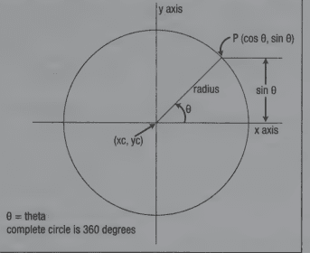

`book_circle()` 的元素。

如你所见，该函数接受三个参数：计划圆形的中心 `x` 和 `y` 坐标以及半径。图 4.1 更详细地展示了这一点，你可能会发现这很有帮助。

你将以与我在列表 4.2 中做得相同的方式将 `book_circle()` 整合到你的主程序中。这也与第 3 章中的 `book_background()` 示例相对应。希望包括你自己的函数现在对你来说是一个更舒适的过程。

不幸的是，`book_circle()` 中存在一个缺陷。由于算法固有的舍入误差，某些半径值可能会在圆周上留下间隙。暂时忽略这一点；我已在列表 4.4 中包含了一个修复方法。

**列表 4.2** 在程序上下文中改进的 `book_circle()`。

```c
#include <math.h>
#include <stdlib.h>

#include <vga.h>
void book_circle(int xc, int yc, int radius); 

int main(void)
{
  vga_init();
  vga_setmode(6640x480x256);
  vga_setegacolor(3);

  book_circle(200, 200, 100);
  a_vga_getch();
  a_vga_setmode(TEXT);

  return 0;
}

void book_circle(int xc, int yc, int radius)
{
  double theta,
         costheta,
         sintheta;

  int degrees;

  for (degrees = 0; degrees < 360; degrees++)
  {
    /* Define PI as 3.14, if your compiler doesn't accept
    the following line. */
    theta = (PI / 180) * degrees;
    costheta = cos(theta);
    sintheta = sin(theta);

    vga_drawpixel(xc + radius * costheta,
                  yc + radius * sintheta);
  }
}
```

Listing 4.2 展示了一个中心位于点 `200, 200`，半径为 `100` 像素的圆。如果圆的像素超出了屏幕矩阵的边界，`SVGAlib` 会简单地将其环绕到另一侧。但在本例中，这种情况并不会发生，因为正如我所说，半径仅为 `100` 像素。最终你会得到一个像图 4.2 中所示的圆。

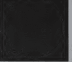

**图 4.2**

`book_circle()` 的输出。

你可能还注意到了我首次使用 `vga_setgacolor()`。该函数与 `vga_setcolor()` 类似，不同之处在于其参数仅限于 `0–15` 的范围。其设计目的是让你能够轻松访问 `16` 种基本“计算机”颜色，无论当前处于何种图形模式。这在后续阶段会派上用场，那时你将能够手动调整颜色值。有时，回归基础是有益的。

## 超越 `gl_circle()`

然而，到目前为止，相对于原始的 `gl_circle()` 函数，尚未取得任何进展。让我们开始自定义代码，使圆变粗——这是 `gl_circle()` 无法做到的。基本上，你要做的就是画出一系列空心圆，一个套在另一个里面。由于它们在边缘处相接，它们会合并成一个大的（粗的）圆。（是的，我知道你可以执行多个 `gl_circle()` 语句，但这一切都将在一个函数内完成。）查看 Listing 4.3，了解我的实现方式。

### Listing 4.3 粗圆。

```c
void book_circle(int xc, int yc, int radius, int thickness)
{
    double theta,
        costheta,
        sintheta;
    int degrees,
        i;
    
    for (degrees = 0; degrees < 360; degrees++)
    {
        /* Define PI as 3.14, if your compiler doesn't accept the following line. */
        theta = (PI / 180) * degrees;
        costheta = cos(theta);
        sintheta = sin(theta);
        
        for (i = radius; i > radius - thickness; i--)
        {
            vga_drawpixel(xc + i * costheta,
                yc + i * sintheta);
        }
    }
}
```

现在你拥有了一个大大的圆，就像图 4.3 中所示的那样。看，我们正在取得进步。

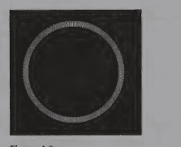

**图 4.3**

一个粗圆。

### 填充圆

你已经知道 `vgaal` 提供 `gl_fillbox()`，但在这个阶段，没有用于圆的等效函数。填补这一空白不是很棒吗？

作为一个聪明人，你很可能认为可以使用前面的公式，并将厚度设置为半径来填充你的圆。也就是说，如果你的半径是 `100` 像素，根据道理，你应该通过将厚度设置为 `100` 像素来为整个圆着色。对吗？我也这样认为，但遗憾的是，实际情况并非如此。由于舍入误差，你得到的将是某种略显迷幻的图案，如 figure 4.4 所示。

这可能对于炫耀给朋友来说不错，但这不是我们要追求的目标。问题在于公式没有覆盖所有可能的点；它很粗糙。为了完全填充你的圆，你需要切换到 `vga_drawline()`，这相当容易实现。

继续看 Listing 4.4，填充圆的代码与我们之前做的相当相似。

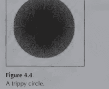

**图 4.4**

一个迷幻的圆。

### Listing 4.4 终于！一个填充的圆。


```c
void book_solid_circle(int xc, int yc, int radius)
{
    double theta,
        costheta,
        sintheta;

    int degrees,
        y,
        old_y = 0;

    for (degrees = 0; degrees < 360; degrees++)
    {
        theta = (PI / 180) * degrees;
        costheta = cos(theta);
        sintheta = sin(theta);
        y = yc + radius * costheta;
        if (degrees > 0)
        {
            while ((old_y - y) > 1)
            {
                old_y--;
                vga_drawline(xc - radius * sintheta, old_y,
                             xc + radius * sintheta, old_y);
            }
        }
        vga_drawline(xc - radius * sintheta, y,
                     xc + radius * sintheta, y);
        old_y = y;
    }
}
```

就是这样。注意，`old_y` 部分的存在仅仅是为了弥补圆中的间隙（即舍入误差）。没有这部分，代码可以更加紧凑。

### 填充三角形

有趣的是，你也可以使用这段代码（带有一个微小的变化）来构建一个实心等腰三角形。你所需要做的只是提取以下这一行：

`y = yc + radius * costheta;`

然后将 `costheta` 改为 `sintheta`，就像我这样做的：

`y = yc + radius * sintheta;`

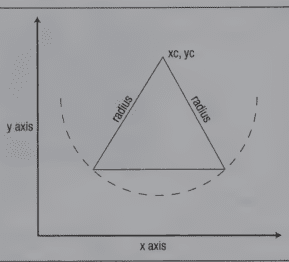

## 图 4.5

等腰三角形的机制。

然而，再次地，某些半径值可能需要“填充”。图 4.5 向你展示了正在发生的大致情况（即圆例程如何被用于绘制三角形）。

希望前面部分能给你一些关于如何编写自己圆的代码的想法。即使你将这些例程集成到自己的代码中，它们仍应作为一种提醒，表明完成任务有多种方式。

当然，使用 `vgaI` 函数，如 `gl_setpixel()` 和 `gl_drawline()`，将显著加快速度。此外，使用数学运算量较小的算法也可以达到相同的效果。下一节将解释如何实现这一点。

## 更快的圆

如果你感兴趣，可以在一定程度上优化你的画圆代码。Listing 4.5 展示了操作方法。老实说，Listing 4.5 中的方法与 `gl_circle()` 本身执行的过程非常相似。其理念是只画圆的八分之一，然后使用等价值来填充其余部分。这听起来可能很复杂，但你的处理器更喜欢这种过程。让我们看看。

### Listing 4.5 更快的圆，杀，杀。

```c
void book_faster_circle(int xc, int yc, int radius)
{
    int x,
        y,
        d;

    y = radius;
    d = 1 - radius;

    for (x = 0; x < y; x++)
    {
        if (d < 0)
        {
            d += x * 2 + 3;
        }
        else
        {
            d += x * 2 - y * 2 + 5;
            y--;
        }

        vga_drawpixel(xc + x, yc + y);
        vga_drawpixel(xc - x, yc + y);
        vga_drawpixel(xc + x, yc - y);
        vga_drawpixel(xc - x, yc - y);
        vga_drawpixel(xc + y, yc + x);
        vga_drawpixel(xc - y, yc + x);
        vga_drawpixel(xc + y, yc - x);
        vga_drawpixel(xc - y, yc - x);
    }
}
```

除了速度更快，这种方法的好处是不需要处理正弦和余弦值（即不需要 `<math.h>`）。我没有首先使用 Listing 4.5，因为从概念上讲，其他示例可能更容易理解——它们不涉及八个同时绘制的点。此外，原始示例的格式与许多后续示例相关联，因此尽早引入它们是有益的。

关于公式本身，请记住 `xc` 和 `yc` 指的是圆的中心点，而 `x` 和 `y` 是由函数赋值的。为了速度，用 `gl_setpixel()` 替换 `vga_drawpixel()` 将使此函数更快。为了进一步研究，我建议你获取 Michael Abrash 的 *Zen of Graphics Programming*，同样由 The Coriolis Group 出版，其中他详细描述了这种技术。

## 另一个填充圆

以下代码列表扩展了 Listing 4.5 中所示的相同通用想法。然而，Listing 4.6 直接来自 `vgalib` 的 `gl_circle()`。我没有使用 `gl_setpixel()`，而是使用了 `gl_hline()` 来实现真正快速且高效的填充。看看你的想法。

### Listing 4.6 另一种填充圆的方法。

```c
void book_fillcircle(int sx, int sy, int r, int c)
{
    int x = 0, ...
```

请注意，`gl_hline()` 要求较小的数值在左侧（也就是说，水平线从左向右延伸，与显示器保持同步）。尽管有这一额外考虑，它的效率仍然比普通的 `gl_line()` 高得多，并且非常值得付出这些努力。

## 圆弧

我们对曲线的研究将继续介绍圆弧，本质上，圆弧就是一个不完整的圆。让我们从之前一直使用的代码的又一个变体开始，以了解圆弧是如何创建的。列表 4.7 和 4.8 分别展示了如何绘制一个简单的圆弧和一个粗的圆弧，而图 4.6 和 4.7 展示了最终效果。

### 列表 4.7 一个简单的圆弧。

```c
void book_arc(int xc, int yc, int radius)
{
    double theta,
             costheta,
             sintheta;
    int degrees;

    for (degrees = 180; degrees < 270; degrees++)
    {
        theta = (PI / 180) * degrees;
        costheta = cos(theta);
        sintheta = sin(theta);

        vga_drawpixel(xc + radius * costheta, yc + radius * sintheta);
    }
}
```

### 列表 4.8 一个粗的圆弧。

```c
void book_thick_arc(int xc, int yc, int radius, int thickness)
{
    double theta,
           costheta,
           sintheta;

    int degrees,
        i;

    for (degrees = 180; degrees < 270; degrees++)
    {
        theta = (PI / 180) * degrees;
        costheta = cos(theta);
        sintheta = sin(theta);

        for (i = radius; i > radius - thickness; i--)
        {
            vga_drawpixel(xc + i * costheta,
                          yc + i * sintheta);
        }
    }
}
```

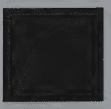

`图 4.6` 来自列表 4.7 的圆弧。

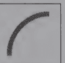


图 4.7 第二个圆弧，以庄严的黑白呈现。

请注意指定以下内容的代码行：

```c
for (degrees = 180; degrees < 270; degrees++)
```

这些代码行将圆弧置于左上角。如果数值范围是 0 到 90，而不是 180 到 270，那么圆弧将位于右下角。

## 椭圆

椭圆，或*椭圆*，可以被视为拉伸的圆。（作为参考，它们的几何布局如图 4.8 所示。）由于这一点，椭圆函数需要四个参数：`xc` 和 `yc` 用于中心点，`rx` 和 `ry` 用于*两个轴*（或半径）。这与圆形成对比，圆只有一个半径。圆的半径可以旋转并触及每一个点，很像自行车辐条。

我再次从图形大师 Michael Abrash 那里借鉴了创建椭圆的方法，如列表 4.9 所示。输出结果如图 4.9 所示。

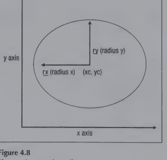

图 4.8 椭圆的机械原理。

### 列表 4.9 一个 Michael Abrash 椭圆。

```c
void book_ellipse(int xc, int yc, int rx, int ry)
{
    int x = 0,
        y = ry;

    long threshold,
        rxsquared = rx * rx,
        rysquared = ry * ry,
        xadjust,
        yadjust;

    vga_drawpixel(xc, yc + ry);
    vga_drawpixel(xc, yc - ry);

    xadjust = 0;
    yadjust = rxsquared * 2 * ry;
    threshold = rxsquared / 4 - rxsquared * ry;

    for (;;)
    {
        threshold += xadjust + rysquared;
        if (threshold >= 0)
        {
            yadjust -= rxsquared * 2;
            threshold -= yadjust;
            y--;
        }

        xadjust += rysquared * 2;
        x++;

        if (xadjust >= yadjust)
        {
            break;
        }

        vga_drawpixel(xc + x, yc - y);
        vga_drawpixel(xc - x, yc - y);
        vga_drawpixel(xc + x, yc + y);
        vga_drawpixel(xc - x, yc + y);
    }

    vga_drawpixel(xc + rx, yc);
    vga_drawpixel(xc - rx, yc);

    x = rx;
    y = 0;
    xadjust = rysquared * 2 * rx;
    yadjust = 0;
    threshold = rysquared / 4 - rysquared * rx;

    for (;;)
    {
        threshold += yadjust + rxsquared;
        if (threshold >= 0)
        {
            xadjust -= rysquared * 2;
            threshold -= xadjust;
            x--;
        }
        yadjust += rxsquared * 2;
        y++;
        if (yadjust >= xadjust)
        {
            break;
        }
        vga_drawpixel(xc + x, yc - y);
        vga_drawpixel(xc - x, yc - y);
        vga_drawpixel(xc + x, yc + y);
        vga_drawpixel(xc - x, yc + y);
    }
}
```

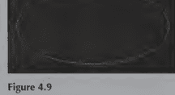

图 4.9 正在运行的椭圆。

## Fastball.c

本节以一个我确信你会喜欢的程序结束。`Fastball.c`，如图 4.10 中的列表所示，会在屏幕上绘制旋转的几何图形，其中一些可能非常有趣。很难描述，所以最好自己启动并查看一下。随意玩玩；也许加上你的改进，它将成为 *de facto* SVGAlib 应用程序。通过自定义你的调色板，可以让它特别有趣，下一章将详细描述这个过程。示例输出如图 4.10 所示。

### 列表 4.10 Fastball.c。


```c
/*-------------------------------------------------------------*/
/* Order & Beauty from Chaos - Program FASTBALL.C */
/* */
/* By Ramiro Perez (Panama), rperez@ons.pa (Original */
/* program in Turbo BASIC), Fausto A. A. Barbutto (Brazil)), */
/* BJ0J6@C53000.PETROBRAS.ANRJ.BR (Turbo BASIC to Borland C */
/* implementation), and Jay Link (USA), jlink@svgalib.org */
/* (port to SVGAlib/Linux). Minor contribution by Ivan */
/* McDonagh (Australia) ivan@svgalib.org */
/* */
/* */
/* Plots thousands of randomly-generated spheres and */
/* rosettes, some very intriguing (rotating and pulsating) */
/* */
/* INSTRUCTIONS: press 'n' or 'N' to see the next plot; */
/* any other key will stop the execution. */
/*-------------------------------------------------------------*/

#include <stdlib.h>
#include <time.h>
#include <math.h>
#include <vga.h>

double qsrandom(void);

int main(void)
{
  double ra,
         in,
         in2,
         an = 0,
         an2 = 0,
         x,
         y,
         c1,
         c2;
  int    k,
         nx,
         ny;
  char key;
  int n;
  int pix;

  vga_init();
  vga_setmode(640x480x256); // 注：原代码此处可能为 640x480x256，根据上下文推断修正。
  
  c1 = 640.0 / 3.1;
  c2 = 480.0 / 2.1;

  do
  {
      pix = vga_clear();
      in = 6.24 * qrandom();
      in2 = 6.24 * qrandom();
      do
      {
          an = an + in;
          an2 = an2 + in2;
          ra = sin(an2);
          x = ra * sin(an);
          y = ra * cos(an);
          nx = c1 * (x + 1.55);
          ny = c2 * (y + 1.05);
          k = vga_getPixel(nx, ny);
          vga_setColor(k + 1);
          if (k < 256)
          {
              vga_drawPixel(nx, ny);
          }
      } while ((key = vga_getkey()) == 0);
  } while ((key == 'n') || (key == 'N'));

  vga_setmode(TEXT);
  return 0;
}

double qrandom(void) {
    int random_integer,
        temp_integer;
    double random_double,
        temp_double;

    random_integer = rand();
    random_double = (double)random_integer / RAND_MAX;
    temp_integer = rand();
    temp_double = (double)temp_integer / 10000000000L;
    random_double *= temp_double;
    srand((unsigned) time(NULL));
    return(random_double);
}
```

## 外部函数

并非所有函数都必须成为主程序的一部分。我在之前的章节中已经就`SVGAlib`作为外部库对此进行了某种程度的讨论，但你还有其他选择。除了使用库之外，你还可以将多个源文件（由你编写的）编译到一个程序中。此外，如果你广泛使用这些相同的函数，你可以创建自己的库。最后，你可以将新函数放入`SVGAlib`本身。

然而，向`SVGAlib`添加内容可能很危险。除了显然可能导致库损坏的威胁外，链接到你定制函数的程序将无法在别人的计算机上工作。怎么可能呢？必要的函数只存在于你的机器上。为了应对这种情况，你可以将你的外部函数与你的程序一起分发，就像许多`Windows`程序安装自己的`DLL`（动态链接库，类似于`Linux`中的`.so`文件）一样。`Linux`的优势在于你不需要“注册”这些库；只需将它们放在`ld`搜索路径上的某个目录中，你就准备好了。（虽然你可能需要先运行`ldconfig`。）你还可以创建一个静态链接（自包含）的可执行文件；对于不希望其代码被窃取的商务软件开发人员来说，这可能是一个热门选择。

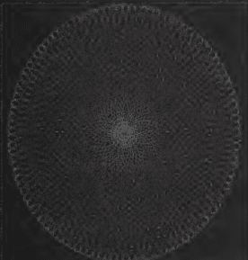

图 4.10 `fastball.c`的示例输出。

要从零开始构建一个新外部函数，最好的入手方式是研究现有文件中的代码。逻辑上，解剖`vga_drawpixel()`是个不错的选择，但它稍显复杂。相反，我建议拆解`vga_drawline()`。列表 4.11 直接取自`SVGAlib`源代码（位于`src`子目录下的`vgaline.c`），它表明`vga_drawline()`其实并没有那么多内容。事实上，它主要由`vga_drawpixel()`语句组成。（看，作弊存在于各个层面——而你以为只有政府才那样做。）

## 列表 4.11 深入剖析 `vga_drawline()` 的源文件。


```c
/* I’m skipping the credits -- see vgaline.c if you’re
   offended by this, or simply curious */

#include <stdio.h>
#include "vga.h"
#include "libvga.h"

#ifdef BACKGROUND
#include "vgabg.h"
#endif

#define ABS(a) (((a)>0) ? -(a) : (a))

int vga_drawline(int x1, int y1, int x2, int y2)
{
   int dx = x2 - x1;
   int dy = y2 - y1;
   int ax = ABS(dx) << 1;
   int ay = ABS(dy) << 1;
   int sx = (dx >= 0) ? 1 : -1;
   int sy = (dy >= 0) ? 1 : -1;

   int x = x1;
   int y = y1;

   #ifdef BACKGROUND
      __svgalib_dont_switch_vt_vet();
   #endif

      if (ax > ay) {
         int d = ay - (ax >> 1);
         while (x != x2) {
            #ifdef BACKGROUND
               vga_drawpixel(x, y);
            #endif
            #ifdef BACKGROUND
               __svgalib_fast_drawpixel(x, y);
            #endif
         if (d > 0 || (d == 0 && sx == 1)) {
             y += sy;
             d -= ax;
         }
         x += sx;
         d += ay;

      } else {
          int d = ax - (ay >> 1);
          while (y != y2) {
          #ifndef BACKGROUND
              vga_drawpixel(x, y);
          #endif
          #ifndef BACKGROUND
              _svgalib_fast_drawpixel(x, y);
          #endif
              if (d > 0 || (d == 0 && sx == 1)) {
                  x += sx;
                  d -= ay;
              }
              y += sy;
              d += ax;
          }
      }

#ifndef BACKGROUND
    vga_drawpixel(x, y);
#endif
#ifndef BACKGROUND
    _svgalib_fast_drawpixel(x, y);
    _svgalib_is_vt_switching_needed();
#endif

    return 0;
}
```

（实际的源文件 `vgaline.c` 只有 79 行，而 `vgapix.c` 则长达 492 行。你更愿意处理哪一个？我想也是。）现在，让我们以这段代码为指南来创建你自己的函数。

首先，你大概已经注意到大量使用 `BACKGROUND` 变量的语句——例如 `#ifdef BACKGROUND` 和 `#ifndef BACKGROUND`。这指的是 `Makefile.cfg` 中的一行（还记得第 1 章中提到的吗？），在编译 SVGAlib 之前，你在那里指定了 `BACKGROUND = y`（否则就将该行用井号注释掉）。更具体地说，这个变量用于让 SVGAlib 知道它是否可以在后台模式下运行。当然，如果你使用的是早于 `2.0.36` 或 `2.1.123` 的内核，这就无所谓了；反正它也不会工作。在这些示例中，我会将事情简化，假设后台模式不可行。毕竟，除了 `BACKGROUND` 语句外，这段代码与你在自己的程序中发现的几乎完全相同。

> **警告**
>
> 如果你的 Linux 内核早于 `2.0.36` 或 `2.1.123`，SVGAlib 程序将无法在后台模式下运行！尝试在旧内核上以后台模式运行程序可能会导致系统崩溃。

### 外部函数示例

让我们通过创建一个假设的函数来开始，该函数将存储在外部文件中。然后，它可以与主程序文件一起编译，编译进 SVGAlib，或制成一个单独的库。为了好玩，我将把这个新函数命名为 `book_splotchy_circle()`。

这个函数具有重要的目的：显示一个填充不完美的圆形。但，它是一个速度很快的渲染不完美的实心圆，且函数停止绘制时产生的图案有点吸引人。我计划大量使用这个函数（假设性地），所以我决定将其存储在外部。

#### 选项一：独立的源文件

对我来说最简单的方法是将 `book_splotchy_circle()` 保留在与程序其余部分相同的目录中的独立源文件中。我有这个函数在自己的文件中，称为 `splotchy_circle.c`，代码看起来与我在程序内创建的函数相同。我还需要一个头文件，我将简单地称之为 `headers.h`。不过，只要它以“.h”结尾，它可以叫任何名字。头文件用于声明包含在或多个源文件使用的函数。列表 4.11 展示了 `headers.h` 可能是什么样子的。

**列表 4.11 Headers.h**

```c
void book_splotchy_circle(int xc, int yc, int radius);

void book_another_function(int a, int b, int c);
```

这个头文件中没有代码——只有声明。当 C 编译器看到函数末尾的分号时，就知道它正在处理一个声明。现在，我只需要在每个使用 `headers.h` 中声明的函数的源（代码）文件中放入一些 `#include` 语句。这些语句看起来像这样：

```c
#include <headers.h>
```

注意，因为方括号表示头文件位于 `/usr/include` 或 `/usr/local/include` 目录中，所以不使用 `<headers.h>`。引号意味着头文件位于本地目录。因此，概括来说，如果我的源文件 `main.c` 包含声明 `#include "headers.h"`，我可以自由使用该文件中声明的任何函数，包括 `book_splotchy_circle()`。当我编译这个程序时，我只是同时包含所有源文件，如下所示：

```bash
gcc -03 -Wall -o myprogram main.c splotchy_circle.c -lvga
```

这给我带来了与我单独编译和链接源文件相同的结果，如下所示：

```bash
gcc -03 -Wall -c main.c

gcc -03 -Wall -c splotchy_circle.c

gcc -o myprogram main.o splotchy_circle.o -lvga
```

#### 选项二：外部静态库

现在，尽管有缺点，假设我想将 `splotchy_circle.c` 编译成自己的共享库。我可以将它与其他自制函数一起分组在库中，或者让它独立存在。无论哪种方式，以下是我需要做的：

1. 将源文件编译成目标文件。这是一个示例：

    ```bash
    gcc -03 -Wall -c splotchy_circle.c
    ```

2. 使用结果文件 `splotchy_circle.o`，我现在可以创建我的静态库：

    ```bash
    ar -r libbook.a splotchy_circle.o
    ```

3. 现在我创建这个新库的索引，以便 `ld` 可以找到其中的函数。这是通过运行 `ranlib` 实现的：

    ```bash
    ranlib libbook.a
    ```

4. 最后，我运行 `ldconfig`，它更新 `ld` 的库缓存。这可能不是必需的，但小心总比后悔好。

当这一切说完做完后，我可能会将我的新库 (`libbook.a`) 放入 `/usr/lib` 目录，这是静态库的标准存储库。然后，我可以使用 `-lbook` 命令行标志来链接它，就像我使用 `-lvga` 链接 SVGAlib 一样。

#### 选项三：在 SVGAlib 中编译


我不一定推荐这个选项；`你` 没有什么第一或第二个选项无法实现的收益。此外，你有构建只在你的机器上工作的程序的风险。然而，如果你想省去在命令行添加额外标志的麻烦，你可以将更有用的函数直接编译到 `SVGAlib` 中。你只需要将你的源文件移动到 `SVGAlib` 的 `src` 子目录，然后将其添加到 `Makefile` 中的模块列表（也在 `src` 子目录中——不是主 `Makefile`）。你需要的部分应该像这样：

```makefile
MODULES = vga.o \
        vgsadraw.o vgaclear.o vgaline.o vgapis.o \
        vgapal.o vgacon.o vgamodesel.o vgamisc.o \
        vgadump.o vgamonvplanner.o vgacell.o \
        timing.o vgregs.o interface.o accel.o \
        vgabpage.o vgapit.o vgapci.o
```

你可以将你的文件插入在 `vgapci.o` 之后。然后，在 `/usr/include/vga.h` 中包含所有你的函数声明（或创建你自己的文件）。只要记住引用你创建的任何头文件。

最后，像往常一样编译 `SVGAlib`。

#### 结论

`SVGAlib` 和 `vgagl` 拥有大量的命令供你使用。然而，你会发现没有“现成”的函数来满足你的需求的时候——这意味着你必须自己构思。有时这听起来可能是一个艰巨的任务，但如果像我这样笨拙的人都能做到，你肯定也可以。没有理由让缺乏预写好的函数让你放慢脚步。

本章为你提供了许多关于如何制作自己的形状绘制例程的示例。从圆形到弧再到椭圆，基于这些基本主题有大量的变体可以绘制。此外，几乎所有关于图形和/或几何学的书籍都可以帮助你学习形状背后的理论，然后你可以将其应用于 `SVGAlib`。主要需要的只是信心和想象力，以能够制作你需要的工具。

如果你碰巧做出了一些真正好的东西，请随时提交给 `SVGAlib` 的当前维护者（`maintainer@svgalib.org`）以便可能包含在下一个分发版本中。毕竟，库就是这样发展和增长的。我们都是自封的，每个人都欢迎参与。这就是 `Linux` 的精神。

## 本章介绍的功能摘要

本章涵盖了以下函数：

```c
void vga_setegacolor(int color)
```

## 第 5 章

## 颜色

-   关键主题：

    -   色彩理论

    -   RGB

    -   调色板

颜色对我们生活的重要性达到了前所未有的高度，以至于我们很难想象一个没有颜色的世界。从衣物到交通信号灯，从广告到食物，颜色决定了我们的身份以及我们的行为。我们使用颜色来区分物体、评估商品、发出警告、进行沟通、做标记以及进行判断。这样的清单还可以不断延伸。

不言而喻，颜色是视觉感知的关键要素，计算机也不例外。研究表明，人眼首先检测到运动，紧接着是轮廓，然后才是颜色。毫无疑问，没有颜色的生活将会变得艰难。即使是盲人，为了在我们的社会范围内正常生活，也必须去弥补这一缺陷。颜色无处不在。

在这一章中，我将讲述颜色是什么，以及如何有效地在你的应用程序中使用它。你将学习如何修改 `SVGAlib` 提供的基本颜色，以及如何创建个性化的调色板，从而让你的程序略胜一筹。请记住，颜色，以及由此引申出的图形，在当今社会是非常宝贵的：毕竟，`Apple Macintosh` 的推出实际上标志着 `MS-DOS` 的终结（更不用说电视对广播的影响了）。虽然确实有许多用户偏好标准 `Linux` 提供的纯文本环境，但即使那个基本界面也使用许多不同的颜色来突出显示特殊文件。颜色使事物变得有趣，其力量不容忽视。

### 什么是颜色？

那么，颜色究竟是什么？我们可以将颜色定义为光的一个组成部分。当光进入可见光谱时，它通常被分裂成多种色调。请注意，颜色是一种感知质量，而非绝对属性。在某些条件下看起来是某种颜色的东西，实际上可能是另一种颜色；而且两个人对于描述某物最准确的色调可能会有不同的看法。当观察者位于不同位置时，混淆会进一步加剧。光的物理方面是通过光谱功率分布（`SPD`）来衡量的，但颜色本身只存在于我们的眼睛和头脑中。

在可见光光谱的人眼可见部分，我们注意到有三种颜色比其他颜色更强烈：红色、绿色和蓝色。我们将这三种颜色感知为主导色，这可能是源于我们的视网膜包含三种不同类型的光感受器视锥细胞的事实。我们可能是唯一拥有这种视觉的生物；其他动物可能会以不同的方式感知颜色。无论如何，通过为红色、绿色和蓝色各赋予一个值，我们就能描述所能看到的任何颜色。

> **注意**

> 使用三个值来描述颜色的系统最早由国际照明委员会（`Commission Internationale de l’Eclaire`）于 1931 年引入。

### 为什么是红、绿、蓝？

这种三值系统构成了现代视频显示的基础。我们知道黑色是颜色的缺失，白色是三种颜色全强度，而其他所有色调都是其中的某种组合。但是，这个颜色系统究竟是如何工作的？

当我开始使用计算机时，我对于显示器三种原色中包含绿色这一选择感到困惑。“似乎有什么不对劲，”我想。众所周知，三种原色是红、蓝和黄。如果你想要绿色，只需将黄色与蓝色混合，对吗？我无法理解任何 `RGB` 组合如何能产生黄色，或其他更浅的色调。而且，它们如何能结合形成白色？

答案其实很简单：我用错了系统！红、蓝和黄是`颜料`的三种原色，而红、绿、蓝是`光`的三种原色。而我们要处理的是光。

> **EGA**

> 增强型图形适配器。这是 `IBM` 在 `VGA` 卡之前的 16 色前奏产品。`EGA` 需要监视器能够自行进行数字到模拟的转换。相比之下，`VGA` 具有板载 `DAC` 转换功能。

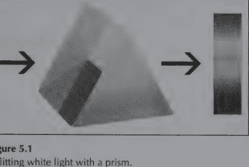

使用棱镜分解白光。

纯光是白色的，通过分解它来获得颜色。然后，仿佛魔法般，将分解的颜色重新结合又会形成白色。图 `5.1` 展示了棱镜如何将白光分解成多种色调，构成了这种色彩理论的基础（以及一张 `Pink Floyd` 的专辑封面）。

你的显示器与棱镜相反；它取三种不同的颜色并将它们组合在一起。

### SVGAlib 中的颜色

我相信你迫不及待地想要看到一些实际的例子，那么让我们开始吧。你已经在之前的两章中看到过 `SVGAlib` 的 16 色和 256 色模式演示——我们只是使用了 `vga_setcolor()` 并输入 0 到 15 或 0 到 255 之间的数值。结果应该是熟悉的；大多数计算机使用相同的 16 种基本颜色。（这大概是因为它们是标准的 `EGA` 颜色。）然而，从 256 色模式开始，编号超过 16 的色调因平台而异。例如，颜色 `192` 在 `Macintosh` 上与在 `PC` 上不同。这种差异引发了对 `SVGAlib` 颜色太深的抱怨。这很容易解释——一些移植程序尚未调整其颜色以匹配 `SVGAlib` 调色板。因此，任何无意中过深的颜色都可以归因于程序员的懒惰、无知或漠不关心，而不是 `SVGAlib` 本身的缺陷。

当我们可以修复这种情况时，深色就没有借口了。下一个新函数 `vga_getpalette(int index, int *r, int *g, int *b)` 提供 `SVGAlib` 中每种标准颜色的当前 `RGB` 值。只需插入你感兴趣的色彩编号，后面跟着红色、绿色和蓝色值的指针。请查看列表 `5.1`，看看 `vga_getpalette()` 的运作示例。

#### 列表 5.1 获取颜色 3（青色）的 RGB 值。

```c
#include <stdio.h>
#include <stdlib.h>
#include <vga.h>

int main(void)
{
    int r,
        g,
        b,
        *pr,
        *pg,
        *pb;

    pr = &r;
    pg = &g;
    pb = &b;

    vga_init();
    vga_setmode(64x480x16);    /* 众多 16 色模式之一 */

    vga_getpalette(3, pr, pg, pb);

    printf("Red - %d, green - %d, blue - %d\n", r, g, b);

    return 0;
}
```

如果你编译并运行列表 `5.1` 中的代码，你将得到以下输出：

```text
Red - 0, green - 42, blue - 42.
```

> **注意**

> 请注意，在此示例中实际上没有绘制任何内容，因此使用 `vga_init()` 并不是绝对必要的。返回文本模式也不是必须的。然而，包含 `vga_init()` 并没有什么坏处，使用它是个良好的习惯。


现在，你能用这些信息做什么？首先，请注意这些 RGB 数字采用 64 级色调刻度（`0` 到 `63`）。因此，你可以推断青色不含红色，而是包含绿色和蓝色的相等部分，强度约为全强度的三分之二。青色是一种浅蓝色，但假设你希望它更亮。你可以使用 `vga_setpalette(int index, int r, int g, int b)` 来更改颜色 `3` 的 RGB 值。假设你想将绿色和蓝色值提升至 `50`？让我们在列表 5.2 中这样做。

#### 列表 5.2 更改 EGA 颜色 3 值的部分代码。

```c
vga_setmode(64x480x16);
}

vga_setpalette(3, 0, 50, 50);
```

现在青色不再存在；颜色 `3` 已被重新定义，并且它将保持这种状态，直到程序退出或值被重置。

> **注意**
>
> 请注意，这些调色板命令仅适用于 16 色和 256 色模式。这是因为它们与 `vga_setcolor()` 协同工作。

现在你可以继续更改每个颜色值，如果你想的话。但请注意，所有使用颜色索引的函数现在都将使用你的新颜色，包括 `vga_setgacolor()`。你可能需要保存每个颜色的旧值，以防你的程序需要回到默认设置。

> **警告**
>
> 颜色 `0` 不仅是黑色，它也是背景色。因此，更改它也会更改背景。

颜色 `0` 是一种特殊颜色。它不仅是黑色，它还是背景的颜色。通过更改它，你也更改了背景的颜色。虽然如果不慎这样做可能会造成灾难性的后果，但它确实提供了一种快速切换背景颜色的绝佳方法。如果你发现需要再次使用黑色（在使用自定义背景颜色的情况下），你可能会能够将另一个值更改为黑色。在 256 色模式下，这是一种特别有用的解决方案，因为不太可能需要同时使用所有 256 种颜色。

让我们看看列表 5.3，它演示了如何通过将颜色 `0` 设置为红色来更改背景颜色。

#### 列表 5.3 我看到一个黑色屏幕，我想把它涂成红色。

```c
#include <stdlib.h>
#include <vga.h>

int main(void)
{
    int a;

    vga_init();
    vga_setmode(G640x480x16);
    vga_setcolor(15); /* 绘制颜色为白色 */

    vga_setpalette(0, 63, 0, 0); /* 颜色 0 现在是红色，
                                   背景也是红色 */

    for (a = 50; a < 150; a++)
    {
        vga_drawline(10, a, 630, a); /* 白色矩形 */
    }
}
```

## 16色调色板

`vga_setpalette(15, 0, 0, 0);` /* 现在颜色 15 变成了黑色。 */

那个白色矩形怎么了？ */

`for (a = 250; a < 350; a++)`
`{`
    `vga_drawline(10, a, 630, a);` /* 黑色矩形 */
`}`

`vga_getch();`
`vga_setmode(TEXT);`
`return 0;`
`}`

程序启动时，您会像往常一样看到黑屏。您将颜色 `15`（白色）设置为绘制颜色，同时也将颜色 `0` 的值更改为红色。由于颜色 `0` 是背景色，因此它会立即从黑色变为红色。接着绘制第一个矩形。此时，颜色 `15` 被更改为黑色，因此之前用颜色 `15` 绘制的第一个矩形也瞬间变成了黑色。然后，使用颜色 `15`（现在是黑色）绘制第二个矩形，随后程序等待用户输入以退出。

如果您希望在退出前再一次更改背景色，您可以这样做而不会干扰屏幕上的其他元素。例如，将颜色 `0` 设为蓝色不会影响到这两个矩形。更改调色板不像切换屏幕模式；不会丢失任何内容。

## 渐变屏幕

让我们继续编写一个更美观的程序。这将是一个令您的朋友印象深刻的项目。利用屏幕模式 `5` (`G320×200×16`) 和您修改调色板的能力，您可以制作一个蓝色渐变屏幕，很像某些安装程序中看到的效果。列表 5.4 包含了所有详细信息。

> **列表 5.4 创建蓝色渐变屏幕的代码。**

```
#include <std.lib.h>
#include <vga.h>

int main(void)
{
int c,
a,
y = 0;

vga_init();
vga_setmode(G320x200x256);

for (c = 63; c > 0; c--)
{
    vga_setpalette(c, 0, 0, c);
    vga_setcolor(c);
    for (a = 0; a < 3; a++)
    {
        vga_drawline(0, y, 319, y);
        y++;
    }
}
vga_getch();
vga_setmode(TEXT);
return 0;
}
```

这段代码看起来有点平淡无奇，不是吗？然而，它产生了一种不错的效果，如图 5.2 所示。您所做的只是覆盖 63 种蓝色色调（跳过 `0`），从顶部的全强度蓝色开始，一直绘制到底部的无光（黑色）。由于屏幕模式 `5` 有 200 行垂直线，因此每种蓝色色调需要绘制三次。其余未设置调色板的行无关紧要，因为反正您正在逐渐淡化至黑色。现在只需要一些白色文本，但这一点要到第 7 章才会涉及。

## 256 种色调

我们已经探讨了 64 级 RGB 颜色，但前面的示例已经清楚地表明，有时 64（或者实际上是 63）种色调可能还不够。您通过每种色调绘制三次来进行“作弊”，但在 640×480 模式下您该怎么办？此外，大多数关于 RGB 颜色的引用都涉及 256 色调色板。如果能在 `SVGAlib` 中拥有这个功能岂不是很棒？好吧，事实上，您可以。

回到 `vgalib`，您会获得许多旨在用于完整 256 色调范围的功能。可以说，这给了您 16,777,216 种颜色（`256×256×256`）可供选择。

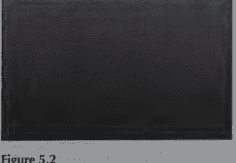

**图 5.2**

蓝色渐变屏幕。

然而，如果您处于使用少于 1600 万种颜色的屏幕模式（例如模式 `5`），那么在特定时刻您只能使用该模式允许的颜色数量（在模式 `5` 的情况下，这是 256 种同时显示的颜色）。这并不意味着您不能在这 1600 万种可能性之间交替使用；只是您不能一次使用超过 256 种颜色。另外，请注意，在 256 色模式下使用 `vgaGL` 需要您多走一步——要使用 RGB 功能，您必须首先声明 `gl_setrgbpalette(void)`。如果您忘记这样做，最终只会得到一堆丑陋的颜色混合。不过，一旦您进入 32K 颜色模式，`gl_setrgbpalette()` 就不再必要了。

> **警告**
>
> 在 256 色屏幕模式下使用 `vgaGL` 的 RGB 功能时，您必须首先声明 `gl_setrgbpalette()`。

还有一件事：在 16 色模式下，您不能直接使用 `vgaGL` 函数向屏幕写入。这对大多数人来说不应该是问题；16 色调色板实际上几乎毫无价值。但是，请牢记这一点。要在 `vgaGL` 中使用 16 种颜色，您需要写入帧缓冲区，然后将其复制到屏幕上，如第 4 章所述。

> **警告**
>
> 在 16 色模式下，您不能使用 `vgaGL` 函数直接向屏幕写入。

### VgaGL 功能

我们从 `gl_setpixelrgb(int x, int y, int r, int g, int b)` 开始。这个功能应该非常明显。它在坐标 `x` 和 `y` 处绘制单个 RGB 像素。`r`、`g` 和 `b` 的值当然指的是各个颜色分量（它们的范围从 `0` 到 `255`）。如果这个函数对您来说太复杂了，您可以尝试更类似之前操作的功能——`gl_rgcolor(int r, int g, int b)` 或 `gl_setpixel(int x, int y, int c)`。请注意，`gl_setpixel()` 需要一个颜色参数，这意味着您可以在程序开始处声明所有颜色，然后随心所欲地使用它们。列表 5.5 中的代码片段说明了我的意思。

**列表 5.5 使用 gl_rgcolor() 和 gl_setpixel()。**

```
vga_setmode(G320x200x256);
gl_setcontextvga(G320x200x256);
gl_setrgbpalette(); /* 我们在模式 5 中需要这个 */

c1 = gl_rgcolor(138, 255, 53);
c2 = gl_rgcolor(255, 147, 0);
c3 = gl_rgcolor(0, 0, 147);

gl_setpixel(100, 50, c2);
```

## 跨平台的颜色一致性

如果您需要为多个平台设计应用程序，可以考虑使用特殊的颜色值来实现一致性。在本章开始时，我解释了为什么 `SVGAlib` 的颜色并不总是与其他操作系统中的颜色相匹配。这不是 `SVGAlib` 的缺陷，也不是其他操作系统的问题。问题只是 *256* 色调色板在不同平台间存在差异。


解决方案可能是使用一组特定的 `216` 种颜色（是 `216`，而不是 `256`——Windows 和 Macintosh 都保留 `40` 种颜色供自身使用）。这些 `216` 种颜色由六个值的组合组成：`0`、`51`、`102`、`153`、`204` 和 `255`。在声明您的 RGB 值时坚持使用这些数字，您应该就能获得与另一操作系统上的类似应用程序相匹配的效果。

例如，`gl_rgbcolor(102, 153, 51)` 应该创建与基于 Windows 的应用程序中等效命令相同的颜色。相反，`gl_rgbcolor(116, 218, 244)` 很可能不会。

纯属娱乐，列表 5.6 和图 5.3 展示了这些颜色的外观。

**列表 5.6 显示 `216` 种平台无关颜色的代码。**

```c
#include <stdlib.h>
#include <vga.h>
#include <vgagl.h>

int main(void)
{
    int x,
        y,
        r,
        g,
        b,
        c[216],
        i = 0;

    vga_init();
    vga_setmode(G320x200x256);
    gl_setcontextvga(G320x200x256);

    gl_setrgbpalette();

    for (r = 0; r < 256; r+= 51)
    {
        for (g = 0; g < 256; g += 51)
        {
            for (b = 0; b < 256; b += 51)
            {
                c[i] = gl_rgbcolor(r, g, b);
                i++;
            }
        }
    }

    i = 0;

    for (y = 2; y < 183; y += 12)
    {
        for (x = 2; x < 183; x += 12)
        {
            if (i < 216)
            {
                gl_fillbox(x, y, 10, 10, c[i++]);
            }
        }
    }

    vga_getch();
    vga_setmode(TEXT);

    return 0;
}
```

## Vgagl 中的调色板

正如您在 SVGAlib 中有 `vga_setpalette()`，在 `vgagl` 中您也有 `gl_getpalettecolor(int c, int *r, int *g, int *b)`。这个功能的作用方式与 `vga_setpalette()` 完全相同，返回值的范围在 `0` 到 `63` 之间。可以将此范围更改为 `0` 到 `255`，但我们将在第 6 章中涵盖这一点。

## 获取像素颜色值

有时可能需要获取给定像素的颜色值。您可以使用 `gl_getpixel(int x, int y)` 和 `gl_getpixelrgb(int x, int y, int *r, int *g, int *b)` 来实现这一点。

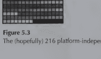

| 颜色 | 乘以 |
|---|---|
| 红色 | .299 |
| 绿色 | .587 |
| 蓝色 | .114 |

## 灰度

如果您需要将彩色显示更改为灰度显示，公式很简单。只需按照表 5.1 所示，将您的红色、绿色和蓝色值相乘即可。

使用一系列 `gl_getpixelrgb()` 语句，您可以轻松地将彩色图像转换为比例正确的灰度图像。

## 结论

颜色是我们世界不可或缺的一部分，这种重要性也延伸到计算机显示上。您可以运用颜色来构建吸引用户且直观的应用程序。

本章主要涉及颜色转换。您已经学会了如何获取默认值并进行操作以满足您的需求。您还了解了一些移植到 Linux/SVGA1ib 的程序看起来比其在原始平台上更暗的原因。现在您知道，通常最好不要盲目接受来自其他操作系统的颜色表值，除非它们基于 RGB 或其他平台无关的标准。很高兴您读了这一章，不是吗？

## 本章引入的功能总结

以下是本章涵盖的功能摘要：

- `void vga_getpalette(int index, int *r, int *g, int *b)`
- `void vga_setpalette(int index, int r, int g, int b)`
- `void gl_setrgbpalette(void)`
- `void gl_setpixelrgb(int x, int y, int r, int g, int b)`
- `int gl_getcolor(int r, int g, int b)`
- `void gl_setpixel(int x, int y, int c)`
- `void gl_getpalettec(int c, int *r, int *g, int *b)`
- `void gl_getpixel(int x, int y)`
- `void gl_getpixelgb(int x, int y, int *r, int *g, int *b)`

## 第 6 章

### 阴影、填充与图案

**关键主题：**

- 屏幕淡入淡出
- 渐变填充
- 抗锯齿
- 启动图形

本章略显粗鲁地将一堆零散的主题堆砌在一起——这些 vaguely 相关杂项不值得单独成章。在这个杂袋（grab bag）中，你将找到许多美化应用程序的示例，包括电影特效、平滑过渡以及许多其他巧妙的方法。不要因为它们被归拢在此就误以为它们毫无价值。

我们将从屏幕淡入淡出开始，然后深入探讨更多梯度的示例，包括形状内部非常酷的梯度。接下来将介绍*抗锯齿*，这是一种平滑锯齿边缘（如对角线上常见的边缘）的过程。如果你此时还没有被彻底震撼，那么本章将以我著名的伪屏保和类 Macintosh 及 Windows 9x 的启动时图形作为结尾。

当然，内容非常多，所以让我们立即开始。

### 屏幕淡入淡出

一个巧妙的效果是*屏幕淡出*。与其突然让屏幕变黑，你可以为应用程序添加艺术效果，使其逐渐淡出。这在平滑过渡到游戏中的不同关卡时尤其有效。自然地，实现这一效果有多种不同的方法，我将介绍几种。由你决定喜欢哪一种。

#### 暴风雪

以非即时方式清除屏幕的最易构思的方法是绘制许多随机点。屏幕最终会被你选择的颜色覆盖，这实际上擦除了旧图像。这可以比作暴风雪，或者如果你的“点”足够大，则像是一阵子弹孔的齐射。Listing 6.1 展示了这种技术的基本框架，它使用了 `<unistd.h>` 中的 `rand()` 函数。假设你的颜色是预定义的。

**Listing 6.1 清除屏幕（每次一个像素）。**

```c
int i,
    x = vga_getxdim(),
    y = vga_getydim();

vga_setcolor(color);

for (i = 0; i < (x * y); i++)
{
    vga_drawpixel(rand()%x, rand()%y);
}
```

如果例程在 320x200 屏幕模式下执行，它将循环 64,000 次。然而，实际上这还不够，因为使用 `rand()` 往往会反复得到相同的数字。因此，你应该考虑对矩阵中的每个点进行四到五次循环。或者，在超过一定重复次数后，你可以使用 `vga_clear()` 对整个屏幕进行“黑洗”（类似刷白）。要创建除黑色以外的纯色，你只需使用 `gl_clearscreen(int c)`。

为了加快过程，请考虑在每个循环中绘制多个像素。这会在更短的时间内填满屏幕，同时也给你机会绘制复杂形状而不是简单的点。最后，你可能需要认真考虑使用 `vga!` 函数代替 `vga_drawpixel()`。

#### 关于 Rand() 的几点说明

如 Listing 6.1 所示，`rand()` 用于返回伪随机数。（该数字并非“真正”随机，因为它是由算法产生的，而非命运的神秘怪癖。）产生 `rand()` 输出的算法取决于一个初始“种子”数字（即其他数字基于它的基准）。如果你不提供种子，最终会得到一个可预测且重复的序列。

`srand()` 函数，正如你可能猜测的那样，用于为随机数生成器播种。它需要整数输入，因此许多人使用当天的时间。这样的用法看起来可能像这样：

```c
srand((unsigned) time((time_t *)NULL));
```


使用 `<time.h>` 中的 `time()` 函数确实提供了一种简单的方法，几乎每次运行时都能获取一个新的种子数字。然而，我发现如果你提供 `srand()` 当前的进程 ID，你会得到一组分布更均匀的“随机”数字。使用 `<unistd.h>` 中的 `getpid()` 函数可以很容易地完成这一点。最棒的是，这是在 Windows 上无法做到的。

每次运行只需播种生成器一次。因此，你应该在进入涉及 `rand()` 的任何循环之前这样做。你要做的只是：

```c
srand(getpid());
```

现在，你应该意识到 `rand()` 返回的数字非常大。为了获得有用的整数范围，将 `rand()` 的输出除以 `RAND_MAX`（在我的系统中定义为 2,147,483,647），如下所示：

```c
num = (float) rand() / RAND_MAX;
```

然后你只需将结果数乘以你期望的范围即可。例如，如果你想要一个 1 到 8 之间的数字，请这样做：

```c
num = 8 * (float) rand() / RAND_MAX;
```

最后，请记住 `rand()` 产生的数字范围是从 0 开始的。如果你实际上想要 1 到 8 之间的数字（而不是 0 到 7），只需在结果上加上 1，如下所示：

```c
num = (8 * (float) rand() / RAND_MAX) + 1;
```

一种更简洁的方法是像我刚才在 Listing 6.1 中那样执行操作，这里我重复一下：

```c
num = rand()%8 + 1;
```

现在，回到屏幕淡出。

### 电影式屏幕淡出

虽然第一个示例确实清除了屏幕，但它更像是“黑屏”而非淡出。要实现“真正”的淡出，你只需慢慢变暗调色板中的颜色。当它们的 RGB 值全部减少到 0 时，你的淡出就完成了。此过程的示例可以在 Listing 6.2 中找到。

**Listing 6.2 电影式屏幕淡出。**

```c
int i,
    j,
    r,
    g,
    b,
    num = vga_getcolors();

for (i = 0; i < 64; i++)
{
    for (j = 0; j < num; j++)
    {
        vga_getpalette(j, &r, &g, &b);
        r -= 1;
        g -= 1;
        b -= 1;
        if (r < 0)
        {
            r = 0;
        }
        if (g < 0)
        {
            g = 0;
        }
        if (b < 0)
        {
            b = 0;
        }
        vga_setpalette(i, r, g, b);
    }
}
```

你可能注意到 `i` 是从 0 到 63 的值，而不是 RGB 颜色通常预期的 0 到 255。这是因为 `vga_getpalette()` 和 `vga_setpalette()` 通常工作在 64 级灰度刻度上。要跳转到 255 级灰度，你需要首先声明以下内容：

```c
vga_ext_set(VGA_EXT_SET, VGA_CLUT8);
```

当然，某些 VGA 卡（尤其是较旧的卡）无法处理 `vga_ext_set()` 或 `vga_accel()`，所以我倾向于避免使用这些函数。

为了增加多样性，请注意 `vgaGL` 的 `gl_getpalettecolor(int c, int *r, int *g, int *b)` 和 `gl_setpalettecolor(int c, int *r, int *g, int *b)` 实现了与 `vga_getpalette()` 和 `vga_setpalette()` 完全相同的功能。更重要的是，它们默认也使用 0 到 63 的颜色刻度——这可能会让你觉得反直觉。

那么，电影式屏幕淡出只有一个问题：讽刺的是，它太他妈快了。除非你使用古老的处理器，否则效果会飞速掠过你的眼睛，将几乎一切都留给想象。那么，如何减慢速度？因为 `sleep()` 只以秒为单位工作，在这里几乎无用，除非你想要“糖浆”般的淡出。鉴于这一事实，你可能会被诱导使用硬编码延迟，使用类似下面的东西：

```c
for (k = 0; k < 100000; k++) { }
```

但等等！这在你的机器上可能看起来不错，但在别人的电脑上会怎样，那些电脑可能拥有更快（或更慢）的处理器？随着处理器不断改进，你的代码几乎肯定会变得过时。那样做无异于自摆乌龙。相反，是时候深入探索亚秒级延迟的黑魔法了。

### 亚秒级延迟

实际上，这没那么复杂。我更喜欢使用 `usleep(unsigned long usec)`，它允许我以微秒间隔（百万分之一秒）暂停，但也有 `nanosleep(const struct timespec *req, struct timespec *rem)`，它允许以十亿分之一秒的间隔暂停。我前面想指出的只是你不应该依赖空循环来进行延迟。

`USleep()` 定义在 `<unistd.h>` 中，而 `nanosleep()` 在 `<time.h>` 中。你可能更愿意研究 `nanosleep()`，因为根据 man 页面，它“具有不影响任何信号、由 POSIX 标准化、提供更高时间分辨率，并允许[你]更容易继续被信号中断的睡眠等优势”。说得好。至于我，我更喜欢 `usleep()` 的简单性。

### 使用 Vgafl 的屏幕淡出

Listing 6.3 展示了与 Listing 6.2 相同的电影式淡出例程，但修改为使用 `vgafl` 和 `usleep()`。因为 `vga_getcolors()` 不再有用，你可以使用 `<vgafl.h>` 中定义的 `COLORS` 常量来获取相同的值。语法如下：

```c
#define COLORS (currentcontext.colors)
```

我还缩短了灰度范围；你可能注意到在 RGB 值达到真正的黑色（0, 0, 0）之前屏幕已经足够暗，所以一直降低到最后每个值是没有意义的。再次强调，0 到 63 的灰度刻度是默认值，除非你使用 `vga_ext_set()`。

**Listing 6.3 更逼真的淡出。**

```c
int i,
  j,
  r,
  g,
  b;

for (i = 64; i > 5; i--)
```

#### 列表 6.3（续）

```c
for (j = 0; j < COLORS; j++)
{
    gl_setpalettecolor(j, &r, &g, &b);
    r = (r - 1) >= 0 ? (r - 1) : r;
    g = (g - 1) >= 0 ? (g - 1) : g;
    b = (b - 1) >= 0 ? (b - 1) : b;
    gl_setpalettecolor(i, r, g, b);
}
usleep(75000);
```

如果你决定在一个示例程序中测试列表 6.3，请注意，如果你决定使用 256 色模式，记得声明 `gl_setrgbpalette()`。此外，绘制屏幕的方式也要小心。为了测试目的，请尝试以下代码：

```c
gl_setpalettecolor(color, r, g, b);
gl_fillbox(0, 0, xmax, ymax, color);
```

然而，类似以下的代码将不起作用：

```c
color = gl_rgbcolor(r, g, b);
gl_fillbox(0, 0, xmax, ymax, color);
```

你能想明白这是为什么吗？

最后，经过所有这些工作，你可能会失望地发现，你的淡入淡出效果伴随着一定量的屏幕闪烁。通过与屏幕的垂直消隐同步来修正调色板更改，可以解决此问题（更多详情请参阅第 10 章）。

## 渐变的更多乐趣

在第 4 章中，你学会了如何绘制一个实心圆，这是 SVGAlib 尚未提供的功能。在第 5 章中，我向你展示了如何绘制一个简单的渐变屏幕。将这两者结合，你可以纯粹使用 2D 技术创造出 3D 图像的错觉。

你也许会像我感觉到的那样，觉得纯色圆圈有点无聊。它们是扁平的、枯燥的，完全无法激发我的兴趣。事实上，SVGAlib 的圆圈让我想起一首乔治·哈里森的老歌：“他们的生活中缺少些什么/他们需要一次彻底的教训。”

为了解决这个问题，你可以施加大量的阴影效果，使你的圆圈更加生动和吸引人。如果你做得正确，最终的效果看起来相当清晰。因此，列表 6.4 演示了制作渐变圆的一种方法，其概念类似于第 5 章中的渐变屏幕。然而，与从上到下移动不同，圆圈的色调会随着从外缘向中心推进而逐渐变亮。我通过一系列 `gl_setpalettecolor()` 和 `book_fillcircle()` 语句实现了这种效果。


更具体地说，我在一个圆圈上叠加了另一个圆圈，使序列中的每个圆圈都比前一个更小、更亮。这听起来可能很原始，但错觉确实有效——它实际上看起来相当无缝。你当然可以假设向该函数传递额外的参数，以便让任意一种颜色变成另一种颜色，但我已经满足于白色和红色。请注意，我还包括了第 4 章中的 `book_fillcircle()` 函数。

### 列表 6.4 红到白的渐变圆。

```c
void red_gradient_circle(int xc, int yc, int radius)
{
    int a,
        b,
        i,
        j = 0,
        color = 1;

    if (radius < 64)
    {
        a = 64 / radius;

        for (i = 0; i <= 63; i += a)
        {
            gl_setpalettecolor(color, 63, i, i);
            book_fillcircle(xc, yc, (radius - i), color);
            color = (color + 1 < 64) ? color + 1 : color;
        }
    } else if (radius > 64) {
        a = radius / 55;
        b = radius % 55;

        if (((b > 5) && (b < 11)) || (b > 50))
        {
            a++;
        }

        for (i = 0; i < radius; i += a)
        {
            gl_setpalettecolor(color, 63, j, j);
            book_fillcircle(xc, yc, (radius - i), color);
            color = (color + 1 < 64) ? color + 1 : color;
            j = (j + 1 < 64) ? j + 1 : j;
        }
    } else {
        for (i = 0; i <= 63; i++)
        {
            j = (i < 63) ? 1 : 63;
            gl_setpalettecolor(color, 63, j, j);
            book_fillcircle(xc, yc, (radius - i), color);
            color = (color + 1 < 64) ? color + 1 : color;
        }
    }
}

void book_fillcircle(int sx, int sy, int r, int c)
/* 来自列表 4.6 */
{
    int x = 0,
        y = r,
        d = 1 - r;

    if (r < 1) {
        gl_setpixel(sx, sy, c);
        return;
    }

    gl_hline(sx - x, sy + y, sx + x, c);
    gl_hline(sx - x, sy - y, sx + x, c);
    gl_hline(sx - y, sy + x, sx + y, c);
    gl_hline(sx - y, sy - x, sx + y, c);
    while (x < y)
    {
        if (d < 0)
        {
            d = x * 2 + 3;
        } else {
            d = x * 2 - y * 2 + 5;
            y--;
        }
        x++;
        gl_hline(sx - x, sy + y, sx + x, c);
        gl_hline(sx - x, sy - y, sx + x, c);
        gl_hline(sx - y, sy + x, sx + y, c);
        gl_hline(sx - y, sy - x, sx + y, c);
    }
}
```

这提供了一种有趣的效果，但它看起来并不完全真实。光线似乎从不直接落在中心，不是吗？为了创造球体（或 3D 圆圈）的错觉，有必要偏移亮点。这可能很棘手，因为“照亮”区域需要足够大以便可见，但它不能延伸到圆圈的边缘之外。

`List 6.5` 展示了我用于红色伪球体的代码。它没有什么特别之处，但看起来很逼真。请记住，这个效果也需要 `book_fillcircle()`。你可以在图 `6.1` 中看到成品效果的示例。

### 列表 6.5 廉价的 3D 效果。


```c
void threed_circle(int xc, int yc, int radius)
{
    int a,
        b,
        i,
        j = 0,
        color = 1;

    if (radius < 56)
    {
        gl_setpalettecolor(color, 63, j, j);
        book_fillcircle(xc, yc, radius, color);
        xc += (radius / 4);
        yc -= (radius / 4);
        radius *= .60;

        a = 64 / radius;
        color++;
        if (radius < 16)
        {
            j = 20;
        } else if (radius < 37) {
            j = 15;
        }

        for (i = 0; i <= 63; i += a)
        {
            gl_setpalettecolor(color, 63, j, j);
            book_fillcircle(xc, yc, (radius - i), color);
            color = (color + 1 < 64) ? color + 1 : color;
            j = (j + 3 <= 63) ? j + 3 : 63;
        }
    } else if (radius > 110) {
        gl_setpalettecolor(color, 63, j, j);
        book_fillcircle(xc, yc, radius, color);
        xc += (radius / 4);
        yc -= (radius / 4);
        radius *= .60;

        a = radius / 55;
        b = radius % 55;

        if (((b > 5) && (b < 11)) || (b >= 50))
        {
            a++;
        }

        for (i = 0; i < radius; i += a)
        {
            gl_setpalettecolor(color, 63, j, j);
            book_fillcircle(xc, yc, (radius - i), color);
            color = (color + 1 < 64) ? color + 1 : color;
            j = (j + 1 <= 63) ? j + 1 : 63;
        }
    } else {
        gl_setpalettecolor(color, 63, j, j);
        book_fillcircle(xc, yc, radius, color);
        xc += (radius / 4);
        yc -= (radius / 4);
        radius *= .65;

        for (i = 0; i <= 63; i++)
        {
            gl_setpalettecolor(color, 63, j, j);
            book_fillcircle(xc, yc, (radius - i), color);
            color = (color + 1 < 64) ? color + 1 : color;
            j = (j + 1 <= 63) ? j + 1 : 63;
        }
    }
}
```

## 抗锯齿

尽管名字很长，`antialiasing`（抗锯齿）却相当简单。简而言之，它指的是“平滑”斜线粗糙边缘的过程。

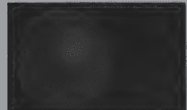

**图 6.1** 伪球体。

到了这个时候，我相信你肯定会痛苦地意识到，虽然 `SVGAlib` 中的垂直和水平线看起来很好，但斜线却让人难以满意。这是屏幕矩阵系统的一个不幸事实，在低分辨率模式下尤其令人痛苦。问题在于，在大多数矩阵中，根本没有足够的像素来准确表示斜线。因此，你只能得到一个粗糙的近似值，伴随着锯齿状的边缘（或`锯齿`）。这种缺陷在许多其他系统中也很常见（也就是说，它不是 `Linux` 或 `SVGAlib` 固有的，而是实际上发生在任何拥有屏幕矩阵的地方），通常也被称为`阶梯效应`。请参阅图 6.2 查看示例。

但是，`antialiasing`（抗锯齿）这个名字是怎么回事呢？具有粗糙边缘的线条或形状被称为`别名的`（`aliased`）。因此，补偿这种缺陷的线条或形状被称为`去别名的`（`antialiased`）。

我们将使用的技术是将锯齿状物体周围的一些像素渲染为介于物体颜色和背景颜色之间的色调。这提供了一种临时混合效果，在高分辨率下（即在 `640×480` 屏幕模式或更高）相当有效。即使在低分辨率下，它通常也比没有好，尽管结果图像可能看起来模糊。请查看图 6.3 以获得更好的“描述”。

### 朴素方法

实现“去别名”线条（或其他形状）的最简单方法只是并行绘制三条线，其中两条边界线比中心线着色更浅。例如，假设你想使用颜色 `a` 来绘制线条，而背景是颜色 `c`。你会先绘制两条着色为 `b` 的“缓冲”线，`b` 是 `a` 和 `c` 色调之间的中间色。然后，在放置中心线之后，你就拥有了去别名的效果。你还可以绘制

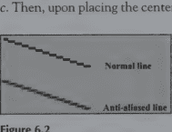

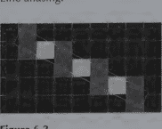

## 一种更优的方法

一种更高效、更有效的直线抗锯齿方法是在绘制主线（或形状）的同时绘制“缓冲区”像素。列表 6.6 展示了实现这一目标的一种方式，它结合了 `vga_drawline()` 中的基本公式与更快的 `vgal` 绘制函数。每当绘制一个主要像素时，周围的像素会相应地被着色。根据直线的斜率，缓冲区像素要么位于主像素的左右两侧，要么位于其上下方。

为了提高整体质量，每个缓冲区像素的颜色值在绘制前就会确定，从而支持多彩背景。然而，当考虑到 `gl_getpalettecolor()` 通常使用 64 色标度，而 `gl_getpixelrgb()` 和 `gl_setpixelrgb()` 预期的是 256 色时，这可能变得棘手。为了补偿，我将每个 `gl_getpalettecolor()` 的值乘以四，这将始终有效，不同于 `vga_ext_set()`。

**列表 6.6 一种更优的直线抗锯齿方法。**


```c
#define ABS(a) (((a)<0) ? -(a) : (a))

int book_aa_line(int x1, int y1, int x2, int y2, int color)
{
    int dx = x2 - x1;
    int dy = y2 - y1;
    int ax = ABS(dx) << 1;
    int ay = ABS(dy) << 1;
    int sx = (dx > 0) ? 1 : -1;
    int sy = (dy > 0) ? 1 : -1;

    int x = x1;
    int y = y1;

    int r1,
        g1,
        b1,
        r2,
        g2,
        b2;

    /* If the line is vertical or horizontal, no antialiasing
       is necessary.
    */
    if ((dx == 0) || (dy == 0))
    {
        gl_line(x1, y1, x2, y2, color);
        return 0;
    }

    gl_getpalettecolor(color, &r1, &g1, &b1);
    r1 *= 4;
    g1 *= 4;
    b1 *= 4;

    if (ax > ay)
    {
      int d = ay - (ax >> 1);
      while (x != x2)
      {
        gl_setpixel(x, y, color);
        gl_getpixelrgb(x, (y + 1), &r2, &g2, &b2);
        gl_setpixelrgb(x, (y + 1),
                       ((r1 + r2) / 2), ((g1 + g2) / 2), ((b1 + b2) / 2));
        gl_getpixelrgb(x, (y - 1), &r2, &g2, &b2);
        gl_setpixelrgb(x, (y - 1),
                       ((r1 + r2) / 2), ((g1 + g2) / 2), ((b1 + b2) / 2));
        if (d > 0 || (d == 0 && sx == 1))
        {
          y += sy;
          d -= ax;
        }
        x += sx;
        d += ay;
      }
    } else {
      int d = ax - (ay >> 1);
      while (y != y2)
      {
        gl_setpixel(x, y, color);
        gl_getpixelrgb((x + 1), y, &r2, &g2, &b2);
        gl_setpixelrgb((x + 1), y,
                       ((r1 + r2) / 2), ((g1 + g2) / 2), ((b1 + b2) / 2));
        gl_getpixelrgb((x - 1), y, &r2, &g2, &b2);
        gl_setpixelrgb((x - 1), y,
                       ((r1 + r2) / 2), ((g1 + g2) / 2), ((b1 + b2) / 2));
        if (d > 0 || (d == 0 && sy == 1))
        {
          x += sx;
          d -= ay;
        }
        y += sy;
        d += ax;
      }
    }

    return 0;
}
```

使用这种方法时，你可能会遇到一个陷阱：标准的 `SVGAlib` 调色板相当暗（有关完整讨论，请参阅第 5 章）。这会导致你的缓冲区像素不正确，最终结果看起来只不过是看起来愚蠢的粗线。为了纠正这一点，你可能会发现在进行任何绘制之前将调色板重置为更明亮的颜色是必要的。或者，如果你想保留标准调色板，可以像我在列表 6.7 中那样简单地使用`gl_rgbcolor()`。

**列表 6.7 使用`gl_rgbcolor()`调整颜色。**

```c
    int c[256],
        i = 0,
        r,
        g,
        b;

    for (r = 0; r < 256; r += 51)
    {
        for (g = 0; g < 256; g += 51)
        {
            for (b = 0; b < 256; b += 51)
            {
                c[i] = gl_rgbcolor(r, g, b);
                i++;
            }
        }
    }
```

## 最佳方法

我接下来要展示的这项技术是由 `Xiaolin Wu` 理论化并开发的。有趣的是，当时 `Wu` 并未被认真对待。他的算法被认为过于简单。然而，如今，它被视为理所当然，这成为了计算机世界的另一个讽刺。至于那位不愿听 `Wu` 讲的教授，好吧，祝你下次运气更好。

你会注意到，这个示例也大量借鉴了`vga_drawline()`。与前一段代码相比，这里的优势在于缓冲区像素以更智能的方式着色。它们并非全部为单一颜色，其色调基于它们距离“理想”直线有多远。查看列表 6.8 以了解我的意思。

**列表 6.8 沿着 `Xiaolin Wu` 的思路。**


```c
void wu_line(int x1, int y1, int x2, int y2, int r, int g, int b)
{
    #define ABS(a) (((a)<0) ? -(a) : (a))

    int dx, dy, ax, ay, ax2, ay2, sx, sy, x, y;
    int r1, g1, b1, r2, g2, b2;
    int highr, lowr, highg, lowg, highb, lowb;
    int percent, complement;
    int color;

    dx = x2 - x1;
    dy = y2 - y1;
    ax = ABS(dx) << 1;
    ax2 = ax * 2;
    ay = ABS(dy) << 1;
    ay2 = ay * 2;
    sx = (dx >= 0) ? 1 : -1;
    sy = (dy >= 0) ? 1 : -1;

    if (x1 == x2)
    {
        color = gl_rgbcolor(r, g, b);
        gl_hline(x1, y1, x2, y2, color);
        return;
    } else if (y1 == y2) {
        color = gl_rgbcolor(r, g, b);
        gl_vline(x1, y1, x2, color);
        return;
    } else if (ax == ay) {
        color = gl_rgbcolor(r, g, b);
        gl_hline(x1, y1, x2, y2, color);
        return;
    }

    x = x1;
    y = y1;

    gl_setpixelrgb(x, y, r, g, b);

    if (ax > ay)
    {
        int d = ay - (ax >> 1);
        while (x != x2)
        {
            if (d > 0 || (d == 0 && sx == 1))
            {
                y += sy;
                d -= ax;
            }
            x += sx;
            d += ay;
            percent = ((ABS(d) * 100) / ax);
            complement = 100 - percent;

            gl_getpixelrgb(x, y, &r1, &g1, &b1);
            highr = (r > r1) ? r : r1;
            lowr = (r == highr) ? r1 : r;
            r2 = (((highr - lowr) * percent) / 100)
                 + lowr;
            r2 = (r > r1) ? r2 : (255 - r2);
            highg = (g > g1) ? g : g1;
            lowg = (g == highg) ? g1 : g;
            g2 = (((highg - lowg) * percent) / 100)
                 + lowg;
            g2 = (g > g1) ? g2 : (255 - g2);
            highb = (b > b1) ? b : b1;
            lowb = (b == highb) ? b1 : b;
            b2 = (((highb - lowb) * percent) / 100)
                 + lowb;
            b2 = (b > b1) ? b2 : (255 - b2);
            gl_setpixelrgb(x, y, r2, g2, b2);

            if (ay2 > ax)
            {
                gl_getpixelrgb(x, (y - sy), &r1, &g1, &b1);
                highr = (r > r1) ? r : r1;
                lowr = (r == highr) ? r1 : r;
                r2 = (((highr - lowr) * complement) / 100)
                     + lowr;
                r2 = (r > r1) ? r2 : (255 - r2);
                highg = (g > g1) ? g : g1;
                lowg = (g == highg) ? g1 : g;
                g2 = (((highg - lowg) * complement) / 100)
                     + lowg;
                g2 = (g > g1) ? g2 : (255 - g2);
                highb = (b > b1) ? b : b1;
                lowb = (b == highb) ? b1 : b;
                b2 = (((highb - lowb) * complement) / 100)
                     + lowb;
                b2 = (b > b1) ? b2 : (255 - b2);
                gl_setpixelrgb(x, (y - sy), r2, g2, b2);
            }
            else {
                gl_getpixelrgb(x, (y + sy), &r1, &g1, &b1);
                highr = (r > r1) ? r : r1;
                lowr = (r == highr) ? r1 : r;
                r2 = (((highr - lowr) * complement) / 100)
                     + lowr;
                r2 = (r > r1) ? r2 : (255 - r2);
                highg = (g > g1) ? g : g1;
                lowg = (g == highg) ? g1 : g;
                g2 = (((highg - lowg) * complement) / 100)
                     + lowg;
                g2 = (g > g1) ? g2 : (255 - g2);
                highb = (b > b1) ? b : b1;
                lowb = (b == highb) ? b1 : b;
                b2 = (((highb - lowb) * complement) / 100)
                     + lowb;
                b2 = (b > b1) ? b2 : (255 - b2);
                gl_setpixelrgb(x, (y + sy), r2, g2, b2);
            }
        }
    } else {
        int d = ax - (ay >> 1);
        while (y != y2)
        {
            if (d > 0 || (d == 0 && sy == 1))
            {
                x += sx;
                d -= ay;
            }
            y += sy;
            d += ax;
            percent = ((ABS(d) * 100) / ay);
            complement = 100 - percent;

            gl_getpixelrgb(x, y, &r1, &g1, &b1);
            highr = (r > r1) ? r : r1;
            lowr = (r == highr) ? r1 : r;
            r2 = (((highr - lowr) * percent) / 100)
                 + lowr;
            r2 = (r > r1) ? r2 : (255 - r2);
            highg = (g > g1) ? g : g1;
            lowg = (g == highg) ? g1 : g;
            g2 = (((highg - lowg) * percent) / 100)
                 + lowg;
            g2 = (g > g1) ? g2 : (255 - g2);
            highb = (b > b1) ? b : b1;
            lowb = (b == highb) ? b1 : b;
            b2 = (((highb - lowb) * percent) / 100)
                 + lowb;
            b2 = (b > b1) ? b2 : (255 - b2);
            gl_setpixelrgb(x, y, r2, g2, b2);

            if (ax2 > ay)
            {
                gl_getpixelrgb((x - sx), y, &r1, &g1, &b1);
                highr = (r > r1) ? r : r1;
                lowr = (r == highr) ? r1 : r;
                r2 = (((highr - lowr) * complement) / 100)
                     + lowr;
                r2 = (r > r1) ? r2 : (255 - r2);
                highg = (g > g1) ? g : g1;
                lowg = (g == highg) ? g1 : g;
                g2 = (((highg - lowg) * complement) / 100)
                     + lowg;
                g2 = (g > g1) ? g2 : (255 - g2);
                highb = (b > b1) ? b : b1;
                lowb = (b == highb) ? b1 : b;
                b2 = (((highb - lowb) * complement) / 100)
                     + lowb;
                b2 = (b > b1) ? b2 : (255 - b2);
                gl_setpixelrgb((x - sx), y, r2, g2, b2);
            }
            else {
                gl_getpixelrgb((x + sx), y, &r1, &g1, &b1);
                highr = (r > r1) ? r : r1;
                lowr = (r == highr) ? r1 : r;
                r2 = (((highr - lowr) * complement) / 100)
                     + lowr;
                r2 = (r > r1) ? r2 : (255 - r2);
                highg = (g > g1) ? g : g1;
                lowg = (g == highg) ? g1 : g;
                g2 = (((highg - lowg) * complement) / 100)
                     + lowg;
                g2 = (g > g1) ? g2 : (255 - g2);
                highb = (b > b1) ? b : b1;
                lowb = (b == highb) ? b1 : b;
                b2 = (((highb - lowb) * complement) / 100)
                     + lowb;
                b2 = (b > b1) ? b2 : (255 - b2);
                gl_setpixelrgb((x + sx), y, r2, g2, b2);
            }
        }
    }
}
```


```c
b2 = (b > b1) ? b2 : (255 - b2);
g1_setpixelrgb(x, y, r2, g2, b2);

if (ax2 > ay)
{
	g1_getpixelrgb((x - sx), y, &r1, &g1, &b1);
	highr = (r > r1) ? r : r1;
	lowr = (r == highr) ? r1 : r;
	r2 = (((highr - lowr) * complement) / 100)
		+ lowr;

	r2 = (r > r1) ? r2 : (255 - r2);
	highg = (g > g1) ? g : g1;
	lowg = (g == highg) ? g1 : g;
	g2 = (((highg - lowg) * complement) / 100)
		+ lowg;

	g2 = (g > g1) ? g2 : (255 - g2);
	highb = (b > b1) ? b : b1;
	lowb = (b == highb) ? b1 : b;
	b2 = (((highb - lowb) * complement) / 100)
		+ lowb;

	b2 = (b > b1) ? b2 : (255 - b2);
	g1_setpixelrgb((x - sx), y, r2, g2, b2);
}
else {
	g1_getpixelrgb((x + sx), y, &r1, &g1, &b1);
	highr = (r > r1) ? r : r1;
	lowr = (r == highr) ? r1 : r;
	r2 = (((highr - lowr) * complement) / 100)
		+ lowr;

	r2 = (r > r1) ? r2 : (255 - r2);
	highg = (g > g1) ? g : g1;
	lowg = (g == highg) ? g1 : g;
	g2 = (((highg - lowg) * complement) / 100)
		+ lowg;

	g2 = (g > g1) ? g2 : (255 - g2);
	highb = (b > b1) ? b : b1;
	lowb = (b == highb) ? b1 : b;
	b2 = (((highb - lowb) * complement) / 100)
		+ lowb;

	b2 = (b > b1) ? b2 : (255 - b2);
	g1_setpixelrgb((x + sx), y, r2, g2, b2);
}
}

g1_setpixelrgb(x, y, r, g, b);

return;
```

# 启动时的图形界面

我发现 Macintosh（顺带一提，Windows 9x 也是如此）真正吸引人的一点是，启动时你能立即看到图形界面。在我看来，这比你在 Linux 上看到的要显得专业得多。虽然我要承认，Linux 在启动过程中显示的文本信息通常很有用，但这无助于向大众推销 Linux——而这一点似乎是近期许多人都在思考的问题。

我无法准确描述让这一切正常运行起来是多么令人头疼的一件事。为了寻找这个 Linux 图形的“圣杯”，我忽视了我的家人、我的工作——是的，甚至其他 `有偿` 项目。我有责任告诉你令人沮丧的真相：在 `SVGA1ib` 的限制下，这是做不到的。

然而，它是 `可以` 实现的——尽管写下这些时我不得不强忍失望——如果你使用现在内核中标准的 `fbcon` 视频驱动，这是得益于 GGI 项目的努力。

问题是双重的：

- 内核无法使用标准的 `libc`。
- 你的显卡必须在内核进入保护模式 `之前` 进入图形模式。

再加上我并非内核黑客这一事实。不过，事情并没有绝望到那地步。GGI 团队创建了一个内核帧缓冲设备（多年前 Michael Weller 博士曾建议过，非常感谢），下面的小节解释了你需要做些什么来让它工作。

## 步骤 1：重新编译内核

当你运行 `make config` 时，启用开发版和/或不完整驱动的选项提示。然后，在控制台驱动程序（Console Drivers）菜单中选择以下内容：

- VGA 文本控制台
- 视频选择支持
- 帧缓冲设备支持（实验性）
- VESA VGA 图形控制台
- 高级底层驱动程序
- 选择单色、2bpp、4bpp、8bpp、16bpp、24bpp 和 32bpp 打包像素驱动程序

> **注意**
>
> 如果你不熟悉编译定制内核的过程，市面上有一些好书对此进行了相当详细的介绍。我最喜欢的是 Matt Welsh 和 Lar Kaufman 著的《Running Linux》。此外，你可能会发现随任何内核 `tarball` 提供的文档就足够了。

以下是你实际会遇到的提示，包括正确的回答：

| 提示 | 响应 |
|---|---|
| * 控制台驱动程序 | |
| VGA 文本控制台 (`CONFIG_VGA_CONSOLE`) | 是 |
| 视频模式选择支持 (`CONFIG_VIDEO_SELECT`) | 是 |
| MDA 文本控制台（双头）(实验性) (`CONFIG_MDA_CONSOLE`) | 否 |
| 帧缓冲设备支持 (实验性) (`CONFIG_FB`) | 是 |
| Permedia2 支持 (实验性) (`CONFIG_FB_PMZ2`) | 仅当你拥有此 VGA 芯片组时选择。 |
| VESA VGA 图形控制台 (`CONFIG_FB_VESA`) | 是 |
| Matrox 加速 (`CONFIG_FB_MATROX`) | 仅当你拥有此 VGA 芯片组时选择。 |
| ATI Mach64 显示支持 (`CONFIG_FB_ATY`) | 仅当你拥有此 VGA 芯片组时选择。 |
| 虚拟帧缓冲支持 (仅用于测试！) (`CONFIG_FB_VIRTUAL`) | 否 |
| 高级底层驱动程序选项 (`CONFIG_FBCON_ADVANCED`) | 是 |
| 单色支持 (`CONFIG_FBCON_MFB`) | 是 |
| 2 bpp 打包像素支持 (`CONFIG_FBCON_CFB2`) | 是 |
| 4 bpp 打包像素支持 (`CONFIG_FBCON_CFB4`) | 是 |
| 8 bpp 打包像素支持 (`CONFIG_FBCON_CFB8`) | 是 |
| 16 bpp 打包像素支持 (`CONFIG_FBCON_CFB16`) | 是 |
| 24 bpp 打包像素支持 (`CONFIG_FBCON_CFB24`) | 是 |
| 32 bpp 打包像素支持 (`CONFIG_FBCON_CFB32`) | 是 |
| Amiga 位平面支持 (`CONFIG_FBCON_AFB`) | 否 |
| Amiga 交错位平面支持 (`CONFIG_FBCON_ILBM`) | 否 |
| Atari 交错位平面 (2 平面) 支持 (`CONFIG_FBCON_IPLAN2P2`) | 否 |
| Atari 交错位平面 (4 平面) 支持 (`CONFIG_FBCON_IPLAN2P4`) | 否 |
| Atari 交错位平面 (8 平面) 支持 (`CONFIG_FBCON_IMPLAN2PB`) | 否 |
| Mac 可变 bpp 打包像素支持 (`CONFIG_FBCON_MAC`) | 否 |
| VGA 字符/属性支持 (`CONFIG_FBCON_VGA`) | 是 |
| 仅支持 8 像素宽字体 (`CONFIG_FBCON_FONTWIDTH8_ONLY`) | 否 |
| 选择编译时字体 (`CONFIG_FBCON_FONTS`) | 是 |

然后重建内核。

## 步骤 2：确保你的 VGA 卡符合 VESA 2 标准

噢，多么可怕。我对 GGI 团队建立的任何尊重都在此时荡然无存。`SVGALib` 的一个巨大优点在于，它允许你无需任何调整即可使用通用显卡。例如，我的许多机器中都有通用的 S3 ViRGE 卡。它们工作良好，价格也合适。但不幸的是，它们仅符合 VESA BIOS 扩展 1.2 版本，而且其固件无法升级。

### S3 (Diamond) 方面的说法

如果你需要一个 VESA 2 驱动程序，而你的主板制造商的 BIOS 中不包含该程序，Stichtech Software 提供了一个通用的 VESA BIOS 扩展包（也称为 UniVBE），名为 `Display Doctor 5.3a`（你可以从 www.stichtechsoft.com 下载临时的共享软件版本）。Stichtech Display Doctor 被认可为行业领先的 VESA 2 驱动程序包。

此外，Dietmar Meschede（一位来自德国的备受推崇的 S3 用户）分发了一套他编写的免费 VESA 驱动程序包，为大多数 S3 芯片提供 VESA 2 支持。Meschede 的驱动程序 `S3VBE318.ZIP` 可通过 S3 的所有在线服务获取。

然而，S3 并不保证这些或任何 VESA 包在所有系统上都能正常工作。


通用的 S3 BIOS 代码包含 VESA 1.20 支持，并且一些新的基于 S3 的适配器也可能具有 VESA 2 功能。正因为如此，S3 并不提供“VESA 驱动程序”或更准确地说，`VESA BIOS 扩展 TSR` 程序。

据称，带有 `VBE 1.2` 的卡会占用内核过多的内存，而 2.0 卡则效率高得多。因此，伟大的 `GGI` 项目完全忽略了 1.2 卡。我认为这简直是胡扯。我肯定也不会花时间改进他们的产品。

因此，夹着尾巴，我去了当地的电脑超市购买新的适配器。回到家后，我不得不转身把它退回去，因为它也没有达到 VESA 提高的 2 标准。最终，我选择了 `Creative` 的 3D Blaster Savage 4，感谢天，它终于起作用了。

> **注意**
>
> 有一个驱动程序可以配合 `VBE 1.2 S3` 芯片组使用，并可在启动时加载——如果你使用的是 `loadlin`。其功能与 `DOS` 中的 `TSR`（终止并常驻内存程序）非常相似。然而，我（以及许多人）在 `Linux` 下使用的是 `Lilo`，所以这对我没用。

## 步骤 3：重新配置 /etc/lilo.conf

你现在需要修改你的 `/etc/lilo.conf` 文件（假设你使用的是 `LILO`），以包含 `VGA=ASK` 参数。（这是为了让你能够选择希望使用的模式所必需的。）然后，重新运行 `LILO`。

重启时，你会看到一个选项，提示按 `Return/Enter` 键查看可用文本模式的列表。请注意，这些模式都不会提供图形。相反，你必须根据表 6.1 输入模式编号。

使用此表，你应该能够选择一个满足你需求的模式。例如，如果你想要 `640x480x256` 模式，你在提示符处输入 `0301`（省略 `x`）。如果一切顺利，你会看到一个可爱的小企鹅标志。如果不顺利，你会收到错误提示，并被要求输入另一个模式，这意味着你的卡很可能不符合 `VBE 1.2` 标准。真有趣！

现在，启动后重新进入文本模式是另一个话题。如果你尝试在 `VESA` 图形模式下运行任何使用 `SVGAlib` 的程序，你很可能会崩溃（或者至少会搞砸...

**表 6.1 启动提示符的 VESA 模式。**

| 颜色 | 640x480 | 800x600 | 1,024x768 | 1,280x1,024 | 1,600x1,200 |
|---|---|---|---|---|---|
| 16 | 0x302 | | | | |
| 256 | 0x301 | 0x303 | 0x305 | 0x307 | 0x31C |
| 32K | 0x310 | 0x313 | 0x316 | 0x319 | 0x31D |
| 65K | 0x311 | 0x314 | 0x317 | 0x31A | 0x31E |
| 16M | 0x312 | 0x315 | 0x318 | 0x31B | 0x31F |

……上控制台）。此外，你可能还希望用你自己的标志替换企鹅，因为企鹅在出现大约三次之后就不再显得“可爱”了。然而，文档中并未给出如何替换的说明，而且这一点已经远远超出了 `SVGAlib` 的范畴。

我建议给 `GGI` 维护者写一封措辞严厉的信件。

## 伪屏保

在 `Windows`、`Macintosh` 以及，没错，甚至在 `X` 窗口系统中，你都能发现一个很酷的设备，那就是 `屏幕保护程序`。屏幕保护程序最初的概念显然是为了（字面意义上的）防止你的显示器屏幕因“烧屏”而损坏。问题在于，在过去（甚至在今天，程度较轻地）如果显示器长时间显示相同的图像，那个图像就会永久地烙印在屏幕上。这种情况在以数据录入为用途的终端上尤为常见。（如果你曾在跳蚤市场上看到过这种显示器，你肯定完全明白我的意思。没有什么比在输入文字时，视野被某个古老文字处理程序的残留图像遮挡更令人沮丧的了。）

为了对抗这个问题，屏幕保护程序应运而生。其概念很简单：在一定时间的非活动期之后，屏幕会将自己“清空”。这才是真正的 `屏幕保护程序`。后来，当然，我们看到了飞行的烤面包机和各种几何视觉享受，这些设计旨在带来乐趣，而非初衷那种防止烧屏的功能。

你可能知道，`Linux` 的内核中内置了基本的屏幕空白化功能。这可以通过一个简单的命令来访问，例如：

```
/bin/setterm -blank 15
```

有了这个设置，你的屏幕将在 15 分钟的无操作后变黑。实现此功能的实际代码包含在 `/usr/src/linux/drivers/char/console.c` 中。

不过，先别急着去修改那个文件。任何在该处尝试执行 `SVGAlib` 程序的举动都会导致你的系统崩溃，原因与你必须使用 `ifbcon` 在启动时显示图形（内核处于保护模式）相同。你确实会在屏幕上看到颜色，但很可能不是你想要的颜色。

我并不会深入探讨如何将屏幕保护程序集成到你的内核中（原因与我在启动时图形讨论中提前结束相同），但我将向你展示如何制作一个“假”的屏幕保护程序。（假的，你说？有什么问题吗？）它是假的，因为你需要手动启动它。

请稍等片刻。假屏幕保护程序（或自显示图形）是开始学习 `netpbm`（`pbm` 代表可移植位图）的一个绝佳载体。`Netpbm` 是对原始 `pbmpls` 包的改进，由 `Jef Poskanzer` 创建，其中包含大量出色的代码。该包包含许多实用工具，可以将图形文件分解为一个常规文本文件，该文本文件将包含图像中每个像素的 `RGB` 值。（要了解有关图形文件的更多信息，请参阅第 9 章。）

例如，即使我对 `BMP` 文件的布局一无所知，我也可以输入以下内容：

```
bmptopnm sample.bmp > netpnm.output
```

这将给我一个文本文件（`netpnm.output`），其内容大致如下：

```
P3
256 416
255
142 160 195 142 160 195 142 160 195 166 173 219
166 173 219 166 173 219 166 173 219 166 173 219
166 173 219 166 173 219 166 173 219 166 173 219
166 173 219 166 173 219 166 173 219 166 173 219
```

这是一个可移植位图，正如我所说，它包含图像中每个像素的 `RGB` 值。那么，接下来怎么处理它呢？

你可以使用脚本语言 `Perl` 快速读取输出文件，然后利用这些数据编写 `SVGAlib` 程序的源代码。换句话说，你可以使用 `Perl` 来编写你的“自显示图形”软件。列表 6.9 展示了如何做到这一点。

### 列表 6.9 解析 bmptopnm 的输出。

```perl
#!/usr/bin/perl

open (INFILE, "<netpnm.output");
open (OUTFILE, ">svgaffiche.c");

# 接下来的三行跳过头部信息。
$garbage = <INFILE>;
$garbage = <INFILE>;
$garbage = <INFILE>;

$x = 0;
$y = 0;

while (<INFILE>)
{
    @rgb = split (/ /, $_);
    for ($i = 0; $i < @rgb; $i++)
    {
        ($r, $g, $b) = split (/ /, $rgb[$i], 3);
        print OUTFILE "gl_setpixelrgb($x, $y, $r, $g, $b);\n";
    }
    if (@rgb < 6)
    {
        $x = 0;
        $y++;
    }
}

close (OUTFILE);
close (INFILE);

0;
```

然后，你可以使用此程序的输出来构建你的自显示图形。当然，这至少需要 64,000 个 `gl_setpixelrgb()` 语句，因此你或许可以通过将具有相同颜色值的相邻像素合并为 `gl_hline()` 命令来优化此过程。

## 结论

希望你喜欢这个“派对混合”章节，其中包含了除常用厨房水槽以外的一切内容。我们回顾了不同类型的屏幕渐变，并进一步使用渐变来模拟 3D 表面。然后你入门了抗锯齿技术，接着探讨了与启动时图形和屏幕保护程序相关的问题。

希望这里开启的思路能让你用自己的代码制作出一些绝佳的效果。这当然假设你还没有因闪烁的屏幕渐变而感到头晕目眩。与此同时，我将在接下来的章节中专注于单一主题。

## 本章引入的函数总结

以下是本章所涵盖的函数摘要：

- `void gl_clearscreen(int c)`

- `void gl_getpalettecolor(int c, int *r, int g, int b)`

- `void gl_setpalettecolor(int c, int *r, int *g, int *b)`

## 第 7 章：字体

### 关键主题：

- 点阵字体和可缩放字体
- 在代码中集成字体
- `SVGAlib` 字体的构建方式
- `FontBuilder.c`
- `FreeType`

### 什么是字体？


有些人可能会争辩说字体并不真正属于图形的一部分，但我不同意。字体显示在屏幕上，并且构成了图形程序的很大一部分，因此我认为在这里介绍它是合适的。在本章中，我将介绍字体是什么以及它们如何与 `SVGAlib` 协同工作。然后你将从学习如何利用现有字体以及如何创建自己的字体开始，可以手工创建，也可以借助“字体生成”程序。此外，你还将看到人们正在开展哪些工作，以使 `SVGAlib` 的字体能够与 `X` 窗口系统和其他操作系统中找到的字体保持同步。

首先，什么是字体？字体可以被定义为一系列打字机重写字符的集合，它们具有一致的设计或风格。例如，这本书中的单词使用的是 `Times New Roman`，一种标准的文字处理字体。成千上万种其他字体（或书体）可供使用，其中许多可以在网络上免费找到。其他一些则由专业设计师创建，每个售价数百美元。无论你的偏好如何，你几乎总能找到符合你需求的字体。更重要的是，可能的字体数量实际上没有上限——在创建新的、不寻常的字符集时，你唯一受到限制的是你的想象力。

字体存储在一个数据文件中，然后由可执行文件在运行时访问。应用程序读取字体文件中包含的数据，并使用这些信息在你的屏幕上生成或渲染可见的字符。图 7.1 显示了两个已渲染的 `SVGAlib` 字体。

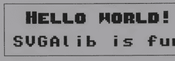

**图 7.1**

两种不同的 `SVGAlib` 字体。

### 两种字体风格：点阵字体和可缩放字体

字体分为两种类型：点阵字体和可缩放字体。一种容易理解，另一种则稍微困难一些。`点阵` 字体是简单的那种，它们类似于点阵图形。绘制在网格或 `矩阵` 上，它们看起来始终一样，因为点阵字体的数据文件包含每个字符的精确渲染结果。在这方面，它类似于图形文件甚至照片。当访问字体时，每个字符的“图像”被加载到内存中，然后在屏幕上逐字显示。这几乎是剪切和粘贴的情况。点阵字体无法通过程序进行修改（至少，不是很容易），因此它们不能被重新调整大小。如果你想要同一字体的更大或更小版本，你就必须完全重新绘制整个字符集；这不是简单地重新调整 `点大小`。自然，这给程序员增加了一些工作量。另一个缺点是，点阵字体经常出现锯齿或不平滑，如图 7.2 所示。然而，它们的优点在于简单：无论字体中的字符在文件中呈现为如何，它们显示时就会是这个样子。

第二种字体类型被称为 `可缩放`。这是一种更高级的存储字体信息的方式。字体数据文件中存储的不是每个字符的精确图像，而是字体的“风格信息”。这些信息包括每个字符曲线的角度，以及它们的比例。如果将点阵字体比作点阵图形，那么可将可缩放字体比作矢量图形。（有关图形文件格式的详细讨论，请参阅第 9 章。）由于不存在实际的图像，渲染程序必须即时创建每个字符，或 `字形`。这增加了一些处理开销，但最终结果物有所值。可缩放字体可以在不损失质量的情况下放大或缩小（因此得名），并且它们通常具有平滑、`经过抗锯齿处理的`

### 渲染（Render）

为在屏幕上显示图像而进行准备。渲染与光栅化、绘制和绘画是同义词。（顺便提一下，`raster` 一词指的是显示器或电视上的水平行，这解释了 `rasterize` 这个词如何进入计算机词汇表。不过，由于大多数图像使用超过一行的像素，`bitmap` 可能是一个更好的动词）。

### 点大小（Point Size）

字体高度以 `点` 为单位衡量，这是一种等于 1/72 英寸的度量单位。点阵字体的点大小不能像可缩放字体那样调整。

## 抗锯齿

计算机以“生硬”或锯齿状的斜线而闻名。这是位图风格屏幕矩阵的一个缺点；垂直线和水平线沿着网格均匀运行，但斜线必须由几个不连续的像素组成，尤其是在低分辨率模式下。抗锯齿是平滑这些线条的过程，它通过使用灰色或彩色像素为线条的外边缘着色来工作。这种着色有助于将线条与背景颜色混合，并减少已知的“锯齿”，即可不利的锐利边缘。

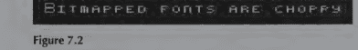

**图 7.2**

位图字体显得生硬。

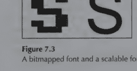

**图 7.3**

位图字体和可缩放字体。

边缘。当然，可缩放字体更受青睐。比较图 7.3 中的两种字体。你更喜欢哪一种？

如 `Arial` 和 `Helvetica` 这样的 `TrueType` 字体（常见于其他操作系统，并以 `.TTF` 扩展名标记）是可缩放的。不幸的是，我有一个坏消息：`SVGAlib` 的内部字体渲染函数只能处理位图字体。不过，你可以使用另一个库来绕过此问题，正如你稍后在本章中将会看到的那样。

## 字体编码

要使用 `SVGAlib` 字体，我们必须回到我们的老朋友 `vga1`。这个过程其实非常简单。首先，你需要通过将其加载到内存中来准备字体，然后在屏幕上渲染它，就像使用标准形状函数一样。代码清单 7.1 可以帮助你入门。

**代码清单 7.1** 为使用而准备字体。

```c
#define FONT_HEIGHT 8
#define FONT_WIDTH 8
#define COLOR 15

void *font = malloc(256 * FONT_WIDTH * FONT_HEIGHT * BYTESPERPIXEL);

gl_expandfont(FONT_WIDTH, FONT_HEIGHT, COLOR, gl_font8x8, font);
gl_setfont(FONT_WIDTH, FONT_HEIGHT, font);
```

**注意**

请记住，`WIDTH` 和 `HEIGHT` 由 `vga.gl` 内部定义，这意味着你应该使用其他常量（例如 `FONT_WIDTH`）在你的代码中定义字体。

这段小代码引入了三个新的 `vga.gl` 函数：

- `gl_expandfont(int fw, int fh, int c, void *sfp, void *dfp)`
- `gl_font8x8`
- `gl_setfont(int fw, int fh, void *fp)`

从内部开始，`gl_font8x8` 是一个随 `vga.gl` 提供的打包像素位图字体。它是 `SVGAlib` 包中唯一包含的字体；你需要在其他地方寻找其他字体或自己创建。这个字体看起来很像 `Courier`，你可能对它很熟悉。8x8 指的是它的高度为 8 像素，宽度为 8 像素。这是 `SVGAlib` 字体的标准尺寸，并且由于它是位图字体，你无法更改这些尺寸。稍加思考就会发现，低分辨率屏幕模式（例如 320x200）将产生较大的字体，而高分辨率模式会使位图字体显得小得多。这是因为字体始终是 8 像素宽 x 8 像素高——这就是生活。你可能可以通过让文本屏幕（例如高分榜或说明）以低分辨率模式显示，而将应用程序的其余部分置于更高分辨率模式来补偿这一点。要在 800x600 屏幕模式下拥有较大的字体，例如，你需要切换到更大的字体，例如 16x16。别担心；稍后会有更多关于此的内容。

首先，使用 `gl_expandfont()` 来解压缩字体数据。使用它，你需要声明字体的尺寸、所需的颜色、字体文件本身的位置，以及一个指向用于保存结果位图的内存位置的指针。我将指针命名为 `font`，但你可以将其命名为任何喜欢的名字。

完成此操作后，你需要再次调用 `gl_setfont()`，并声明尺寸和内存位置（指针）。这使 `SVGAlib` 知道你将使用刚刚扩展的字体，就像使用 `vga_setcolor()` 设置颜色一样。现在你实际上准备好在屏幕上渲染字符了。代码清单 7.2 展示了如何做到这一点。

**代码清单 7.2** 你很高兴这里没有说“Hello World”吗？

```c
char words[] = "SVGAlib is fun!";

gl_write(100, 100, words);
```

这将你的短语/单词/陈述（或任何内容）以点 100,100 作为第一个字符的左上角进行绘制。实际命令是 `gl_write(int x, int y, char *s)`。这就是你需要做的全部。图 7.4 展示了一个特写，说明它可能看起来的样子。

代码清单 7.3 包含完整的代码片段。当你对此感到舒适时，你可以尝试 `gl_writen(int x, int y, int n, char *s)`，它只显示字符串的前 `n` 个字符。

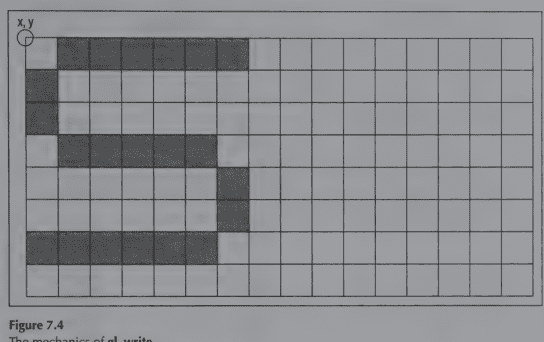

**代码清单 7.3** 完整的字体代码。


```c
#define FONT_HEIGHT   8
#define FONT_WIDTH    8
#define COLOR         15

char words[] = "SVGAlib is fun!";
void *font = malloc(256 * FONT_WIDTH * FONT_HEIGHT * BYTESPERPIXEL);

gl_expandfont(FONT_WIDTH, FONT_HEIGHT, COLOR, gl_font8x8, font);
gl_setfont(FONT_WIDTH, FONT_HEIGHT, font);
gl_write(100, 100, words);
```

然而，使用 `gl_write()` 和 `gl_writen()` 时必须谨慎，因为以下构造将不起作用：

```c
gl_write(FONT_WIDTH, FONT_HEIGHT, "SVGAlib is fun!");
```

原因是上面的字符串字面量需要以 `"\0"` 结尾，这是所有字符数组末尾的标准“空字符”（ASCII 代码 0）。没有它，你将在屏幕上看不到任何内容。让我们再试一次，这次使用正确的字符串终止符：

```c
gl_write(FONT_WIDTH, FONT_HEIGHT, "SVGAlib is fun!\0");
```

## 不同的字体

假设你想使用 `gl_font8x8` 以外的字体。一旦你理解了这个过程，这也很容易做到。字体本身位于一个看起来相当晦涩难懂的字符声明中，如代码清单 7.4 中所示。

**代码清单 7.4** `示例字体数据。`

```cpp
unsigned char bookfont[2048] =
{
    124,130,186,162,180,130,124,0,126,129,165,129,165,153,129,126,
    124,129,165,129,153,165,129,126,108,246,246,254,124,56,16,0,
    16,56,124,254,124,56,16,0,16,56,84,254,84,16,56,0,
    56,124,254,254,108,16,56,0,16,24,20,20,48,112,96,0,
    ...
    136,34,136,34,136,34,136,34,85,170,85,170,85,170,85,170,
    68,170,68,170,68,170,68,170,51,102,204,153,51,102,204,153,
    204,102,51,153,204,102,51,153,199,143,31,62,124,248,241,227,
    227,241,248,124,62,31,143,199,124,128,186,2,238,8,171,32
};
```

该声明由 2,048 个数字组成（此处省略了其中大部分以保持简洁）。这些数字的范围是从 0 到 255。现在，让我们来看看它们的含义。8x8 字体中的每个字符（这是 `SVGAlib` 的标准）实际上由八条水平像素带组成，每条带包含 8 个像素。参见图 7.5 了解此的图形表示。

每条像素带有些、全部或没有像素被填充。仔细想想，有 256 种可能性（0 到 255）。覆盖了所有可能的填充和未填充像素的组合。因此，要绘制一个大写 S，你需要这八个代码：126, 128, 128, 124, 2, 2, 252, 和 0。参见图 7.6 看看你最终会得到什么。

如果你的字体只包含字母 S，你的声明将如下所示：

```cpp
unsigned char s_font[8] =
{
    126, 128, 128, 124, 2, 2, 252, 0
};
```

实际上，字体由 256 个字符组成。每个字符需要 8 个数字（代表其 8 条像素带），而 256x8 等于 2,048。因此，每个字体声明需要 2,048 个代码。不过，你一开始不需要担心它们中的每一个。你可以使用零（0）来代替除你感兴趣的字母以外的所有内容。

大写字母表从第 66 个字符（A）开始，持续到第 91 个字符（Z）。小写字母从第 98 个字符（a）开始，持续到第 123 个字符（z）。如果你只想要大写字母——没有符号或小写字母——你可以使用 520 个零来表示

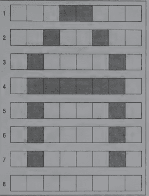

8×8 `SVGAlib` 字体中大写 A 的组成部分。

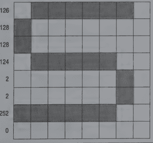

绘制 S 所需的八条像素带。

前65个字符（当然，后面跟着逗号）。然后是你的208个大写字母代码（26×8），接着还有1320个零。最棒的是，你甚至可以偷懒，跳过末尾的零。生活是不是很美好？

你或许会觉得我弄错了；大家都知道大写字母A是`ASCII`字符65，而不是66。但请仔细想想。`ASCII`代码的范围是从0到255，而不是1到256。因此，大写字母A实际上是第66个字符，而不是第65个。

当然，你不必让你的字符与键盘布局一一对应。你可以让每次有人按下A键时都显示`$ b $`的绘图。你甚至可以创建`装饰字体`（实际上是图形绘制的字符）。你甚至可以制作一种太空侵略者字体，如图7.7所示。可能性几乎是无与伦比的。

但如何知道该使用哪些字条呢？肯定不是靠试错法。幸运的是，我已经为你列出了所有字条。图7.8至图7.263展示了所有256种可能性。这些字条本身可能看起来像是随机排列的，但实际上它们是按二进制序列排列的。二进制数字是按顺序排列的：0、1、10、11、100、101、110、111，等等，字条的工作原理完全相同。看一看，你就会明白我的意思。

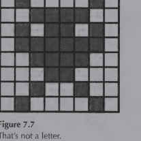

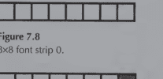

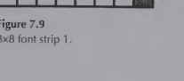

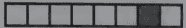

### 图7.10

8×8字条 2。

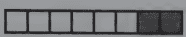

### 图7.11

8×8字条 3。


### 图7.12

8×8字条 4。

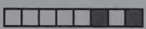

### 图7.13

8×8字条 5。

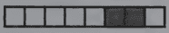

### 图7.14

8×6字条 6。

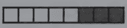

### 图7.15

8×8字条 7。


### 图7.16

8×8字条 8。

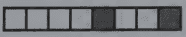

### 图7.17

8×8字条 9。

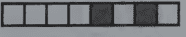

### 图7.18

8×8字条 10。

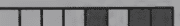

### 图7.19

8×8字条 11。

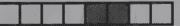

### 图7.20

8×8字条 12。

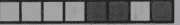

### 图7.21

8×8字条 13。

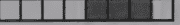

### 图7.22

8×8字条 14。

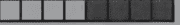

### 图7.23

8×8字条 15。

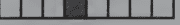

### 图7.24

8×8字条 16。

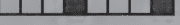

### 图7.25

8×8字条 17。


### 图7.26

8×8字条 18。


### 图 7.27

`8×8`字条 `19`。


### 图 7.28

`8×8`字条 `20`。


### 图 7.29

`8×8`字条 `21`。


### 图 7.30

`8×8`字条 `22`。


### 图 7.31

`8×8`字条 `23`。


### 图 7.32

`8×8`字条 `24`。


### 图 7.33

`8×8`字条 `25`。


### 图 7.34

`8×8`字条 `26`。


### 图 7.35

`8×8`字条 `27`。


### 图 7.36

`8×8`字条 `28`。


### 图 7.37

`8×8`字条 `29`。


### 图 7.38

`8×8`字条 `30`。


### 图 7.39

`8×8`字条 `31`。


### 图 7.40

`8×8`字条 `32`。


### 图 7.41

`8×8`字条 `33`。


### 图 7.42

`8×8`字条 `34`。


### 图 7.43

`8×8`字条 `35`。


### 图 7.44

`8×8`字条 `36`。


### 图 7.45

`8×8`字条 `37`。


### 图 7.46

`8×8`字条 `38`。


### 图 7.47

`8×8`字条 `39`。


### 图 7.48

`8×8`字条 `40`。


### 图 7.49

`8×8`字条 `41`。


### 图 7.50

`8×8`字条 `42`。


### 图 7.51

`8×8`字条 `43`。


### 图 7.52

`8×8`字条 `44`。


### 图 7.53

`8×8`字条 `45`。


### 图 7.54

`8×8`字条 `46`。


### 图 7.55

`8×8`字条 `47`。


### 图 7.56

`8×8`字条 `48`。


### 图 7.57

`8×8`字条 `49`。


### 图 7.58

`8×8`字条 `50`。


### 图 7.59

`8×8`字条 `51`。


### 图 7.60

`8×8`字条 `52`。


### 图 7.61

`8×8`字条 `53`。


### 图 7.62

`8×8`字条 `54`。


### 图 7.63

`8×8`字条 `55`。


### 图 7.64

`8×8`字条 `56`。


### 图 7.65

`8×8`字条 `57`。


### 图 7.66

`8×8`字条 `58`。


### 图 7.67

`8×8`字条 `59`。


### 图 7.68

`8×8`字条 `60`。


### 图 7.69

`8×8`字条 `61`。


### 图 7.70

`8×8`字条 `62`。


### 图 7.71

`8×8`字条 `63`。


### 图 7.72

`8×8`字条 `64`。


### 图 7.73

`8×8`字条 `65`。


### 图 7.74

`8×8`字条 `66`。


### 图 7.75

`8×8`字条 `67`。


### 图 7.76

`8×8`字条 `68`。


### 图 7.77

`8×8`字条 `69`。


### 图 7.78

`8×8`字条 `70`。


### 图 7.79

`8×8`字条 `71`。


### 图 7.80

`8×8`字条 `72`。


### 图7.81

8×8字条 73。


### 图7.82

8×8字条 74。


### 图7.83

8×8字条 75。


### 图7.84

8×8字条 76。


### 图7.85

8×8字条 77。


### 图7.86

8×8字条 78。


### 图7.87

8×8字条 79。


### 图7.88

8×8字条 80。


### 图7.89

8×8字条 81。


### 图7.90

8×8字条 82。


### 图 7.91

8×8 字体条纹 83。


### 图 7.92

8×8 字体条纹 84。


### 图 7.93

8×8 字体条纹 85。


### 图 7.94

8×8 字体条纹 86。


### 图 7.95

8×8 字体条纹 87。


### 图 7.96

8×8 字体条纹 88。


### 图 7.97

8×8 字体条纹 89。


### 图 7.98

8×8 字体条纹 90。


### 图 7.99

8×8 字体条纹 91。


### 图 7.100

8×8 字体条纹 92。


### 图 7.101

8×8 字体条纹 93。


### 图 7.102

8×8 字体条纹 94。


### 图 7.103

8×8 字体条纹 95。


### 图 7.104

8×8 字体条纹 96。


### 图 7.105

8×8 字体条纹 97。


### 图 7.106

8×8 字体条纹 98。


### 图 7.107

8×8 字体条纹 99。


### 图 7.108

8×8 字体条纹 100。


### 图 7.109

8×8 字体条纹 101。


### 图 7.110

8×8 字体条纹 102。


### 图 7.111

8×8 字体条纹 103。


### 图 7.112

8×8 字体条纹 104。


### 图 7.113

8×8 字体条纹 105。


### 图 7.114

8×8 字体条纹 106。


### 图 7.115

8×8 字体条纹 107。


### 图 7.116

8×8 字体条纹 108。


### 图 7.117

8×8 字体条纹 109。


### 图 7.118

8×8 字体条纹 110。


### 图 7.119

8×8 字体条纹 111。


### 图 7.120

8×8 字体条纹 112。


### 图 7.121

8×8 字体条纹 113。


### 图 7.122

8×8 字体条纹 114。


### 图 7.123

8×8 字体条纹 115。


### 图 7.124

8×8 字体条纹 116。


### 图 7.125

8×8 字体条纹 117。


### 图 7.126

8×8 字体条纹 118。


### 图 7.127

8×8 字体条纹 119。


### 图 7.128

8×8 字体条纹 120。


### 图 7.129

8×8 字体条纹 121。


### 图 7.130

8×8 字体条纹 122。


图 7.131

8×8 字体条纹 123。


图 7.132

8×8 字体条纹 124。


图 7.133

8×8 字体条纹 125。


图 7.134

8×8 字体条纹 126。


图 7.135

8×8 字体条纹 127。


图 7.136

8×8 字体条纹 128。


图 7.137

8×8 字体条纹 129。


图 7.138

8×8 字体条纹 130。


图 7.139

8×8 字体条纹 131。


图 7.140

8×8 字体条纹 132。


图 7.141

8×8 字体条纹 133。


图 7.142

8×8 字体条纹 134。


图 7.143

8×8 字体条纹 135。


图 7.144

8×8 字体条纹 136。


图 7.145

8×8 字体条纹 137。


图 7.146

8×8 字体条纹 138。


图 7.147

8×8 字体条纹 139。


图 7.148

8×8 字体条纹 140。


图 7.149

8×8 字体条纹 141。


图 7.150

8×8 字体条纹 142。


图 7.151

8×8 字体条纹 143。


图 7.152

8×8 字体条纹 144。


图 7.153

8×8 字体条纹 145。


图 7.154

8×8 字体条纹 146。


图 7.155

8×8 字体条纹 147。


图 7.156

8×8 字体条纹 148。


图 7.157

8×8 字体条纹 149。


图 7.158

8×8 字体条纹 150。


图 7.159

8×8 字体条纹 151。


图 7.160

8×8 字体条纹 152。


图 7.161

8×8 字体条纹 153。


图 7.162

8×8 字体条纹 154。


图 7.163

8×8 字体条纹 155。


图 7.164

8×8 字体条纹 156。


图 7.165

8×8 字体条纹 157。


图 7.166

8×8 字体条纹 158。


图 7.167

8×8 字体条纹 159。


图 7.168

8×8 字体条纹 160。


图 7.169

8×8 字体条纹 161。


图 7.170

8×8 字体条纹 162。


图 7.171

8×8 字体条纹 163。


图 7.172

8×8 字体条纹 164。


图 7.173

8×8 字体条纹 165。


图 7.174

8×8 字体条纹 166。


图 7.175

8×8 字体条纹 167。


图 7.176

8×8 字体条纹 168。


图 7.177

8×8 字体条纹 169。


图 7.178

8×8 字体条纹 170。


图 7.179

8×8 字体条纹 171。


**图 7.180**

`8×8` 字体条纹 `172`。


**图 7.181**

`8×8` 字体字条 `173`。


**图 7.182**

`8×8` 字体字条 `174`。


**图 7.183**

`8×8` 字体字条 `175`。


**图 7.184**

`8×8` 字体字条 `176`。


**图 7.185**

`8×8` 字体字条 `177`。


**图 7.186**

`8×8` 字体字条 `178`。


**图 7.187**

`8×8` 字体字条 `179`。


**图 7.188**

`8×8` 字体字条 `180`。


**图 7.189**

`8×8` 字体字条 `181`。


**图 7.190**

`8×8` 字体字条 `182`。


**图 7.191**

`8×8` 字体字条 `183`。


**图 7.192**

`8×8` 字体字条 `184`。


**图 7.193**

`8×8` 字体字条 `185`。


**图 7.194**

`8×8` 字体字条 `186`。


**图 7.195**

`8×8` 字体字条 `187`。


**图 7.196**

`8×8` 字体字条 `188`。


**图 7.197**

`8×8` 字体字条 `189`。


**图 7.198**

`8×8` 字体字条 `190`。


**图 7.199**

`8×8` 字体字条 `191`。


**图 7.200**

`8×8` 字体字条 `192`。


**图 7.201**

`8×8` 字体字条 `193`。


**图 7.202**

`8×8` 字体字条 `194`。


**图 7.203**

`8×8` 字体字条 `195`。


**图 7.204**

`8×8` 字体字条 `196`。


**图 7.205**

`8×8` 字体字条 `197`。


**图 7.206**

`8×8` 字体字条 `198`。


**图 7.207**

`8×8` 字体字条 `199`。


**图 7.208**

`8×8` 字体字条 `200`。


**图 7.209**

`8×8` 字体字条 `201`。


**图 7.210**

`8×8` 字体字条 `202`。


**图 7.211**

`8×8` 字体字条 `203`。


**图 7.212**

`8×8` 字体字条 `204`。


**图 7.213**

`8×8` 字体字条 `205`。


**图 7.214**

`8×8` 字体字条 `206`。


**图 7.215**

`8×8` 字体字条 `207`。


**图 7.216**

`8×8` 字体字条 `208`。


**图 7.217**

`8×8` 字体字条 `209`。


**图 7.218**

`8×8` 字体字条 `210`。


**图 7.219**

`8×8` 字体字条 `211`。


**图 7.220**

`8×8` 字体字条 `212`。


**图 7.221**

`8×8` 字体字条 `213`。


**图 7.222**

`8×8` 字体字条 `214`。


**图 7.223**

`8×8` 字体字条 `215`。


**图 7.224**

`8×8` 字体字条 `216`。


**图 7.225**

`8×8` 字体字条 `217`。


**图 7.226**

`8×8` 字体字条 `218`。


**图 7.227**

`8×8` 字体字条 `219`。


**图 7.228**

`8×8` 字体字条 `220`。


**图 7.229**

8×8 字体字条 221。


**图 7.230**

8×8 字体字条 222。


**图 7.231**

8×8 字体字条 223。


**图 7.232**

8×8 字体字条 224。


**图 7.233**

8×8 字体字条 225。


**图 7.234**

8×8 字体字条 226。


**图 7.244**

8×8 字体字条 236。


**图 7.245**

8×8 字体字条 237。


**图 7.246**

8×8 字体字条 238。


**图 7.247**

8×8 字体字条 239。


**图 7.248**

8×8 字体字条 240。


**图 7.249**

8×8 字体字条 241。


**图 7.250**

8×8 字体字条 242。


**图 7.251**

8×8 字体字条 243。


**图 7.252**

8×8 字体字条 244。


**图 7.253**

8×8 字体字条 245。


**图 7.254**

8×8 字体字条 246。


**图 7.255**

8×8 字体字条 247。


**图 7.256**

8×8 字体字条 248。


**图 7.257**

8×8 字体字条 249。


**图 7.258**

8×8 字体字条 250。


**图 7.259**

8×8 字体字条 251。


**图 7.260**

8×8 字体字条 252。


**图 7.261**

8×8 字体字条 253。


**图 7.262**

8×8 字体字条 254。


**图 7.263**

8×8 字体字条 255。

以下是如何在实际应用中应用字体字条的方法。一旦字体被声明为 `char` 数组，你只需将 `gl_font8x8`（如前文示例中所使用的）替换为你自己的数组名称即可。列表 7.5 展示了如何使用名为 `bookfont` 的数组来实现这一点，该数组可以声明在你的主程序中，也可以声明在一个单独的文件中（这是作者的偏好做法）。

### 列表 7.5 使用你自己的字体。

```c
char words[] = "Welcome to my program.";

void initfont(void);

vga_init();
gl_setmode(6320x200x256);
gl_setcontextvga(6320x200x256);

initfont();
gl_write(100, 100, words);

void initfont(void)
{
    void *font = malloc(256 * 8 * 8 * BYTESPERPIXEL);
    gl_expandfont(8, 8, 15, bookfont, font);
    gl_setfont(8, 8, font);
}
```

### `FontBuilder.c`

在制作了一两个字符集之后，你很可能对字体相关的工作感到厌倦，这是完全可以理解的。为了让大家更轻松地处理这个问题，我专门为此书开发了一个名为 `FontBuilder.c` 的程序。它提供了一个图形界面，允许你绘制自己的字符，从而大大简化你的工作。图 7.264 展示了 `FontBuilder` 主菜单的屏幕截图，如果你对程序代码感兴趣，可以在列表 7.6 中找到。虽然这个简单的程序不允许你编辑现有的字体，但你可以轻松扩展其功能以包含此特性。


**图 7.264**

`FontBuilder` 主菜单。

## 列表 7.6 `FontBuilder.c`。


```c
#include <stdio.h>
#include <stdlib.h>
#include <string.h>
#include <vg8.h>
#include <vgagl.h>

void init_chooser_font(int color);
void chooser_screen(void);
void draw_screen(int ascii);
void hollow_box(int x1, int y1, int x2, int y2);

int x,
     y,
     ascii,
     inkey,
     glyph[256][8];

FILE *ffile;

int main(int argc, char *argv[])
{
    /* This program needs a filename as an input argument */
    int a,
        b;

    char c[256];
    char *d = malloc(256);

    if (argc == 1)  /* Error if no file is specified. */
    {
        printf("Please specify an output file.\n");
        exit(1);
    }

    /* You might want to check if the specified file already
       exists, and return an error if it does. */

    FILE *file = fopen(argv[1], "w");
    if (file == NULL)
    {
        printf("Can't write to file.\n");
        exit(1);
    }

    /* Set all font strips to 0. */
    for (a = 0; a < 256; a++)
    {
        for (b = 0; b < 7; b++)
        {
            glyph[a][b] = 0;
        }
    }

    vga_init();
    vga_setmode(G320x200x256);
    g1_setcontextvga(G320x200x256);

    /* This is the main loop. The program alternates between
       the "chooser screen" (the main menu) and the drawing
       screen. Pressing "Q" while in the chooser screen quits
       and saves your font info to your selected filename.
       */

    do
    {
        ascii = 0;
        chooser_screen();

        /* Spacebar - ASCII code 32. */
        if (inkey == 32)
        {
            draw_screen(ascii);
        }

        /* "Esc" - ASCII code 27.
           "Q"   - ASCII code 81.
           "q"   - ASCII code 113. */
    } while ((inkey != 27) && (inkey != 81) && (inkey != 113));

    vga_setmode(TEXT);
    strcpy(c, "unsigned char font[2048] = {\n");
    fputs(c, file);
    for (a = 0; a < 256; a++)
    {
        strcpy(c, " ");
        for (b = 0; b < 8; b++)
        {
            /* This is essentially an "ftoa" function, since C
               mysteriously lacks one.
               */
            sprintf(d, "%d", glyph[a][b]);
            strcat(c, d);
            strcat(c, ", ");
        }
        strcat(c, "\n");
        fputs(c, file);
    }

    strcpy(c, "};\n");
    fputs(c, file);

    fclose(file);

    return 0;
    /* That's all, folks! */
}

void chooser_screen(void)
/* Main menu (see the screen shot). */
{
    int a = 0,
        x1 = 7,
        x2 = 18,
        y1 = 7,
        y2 = 18;

    vga_clear();
    init_chooser_font(3);
    gl_write(9, 155, "'a', 'd', 'w', 'x' to move. \0");
    gl_write(9, 165, "space to select. \0");
    gl_write(9, 175, "'q' to save and exit. \0");

    init_chooser_font(15);
    for (y = 9; y < 120; y += 12)
    {
        for (x = 9; x < 309; x += 12)
        {
            char c[] = {a, '\0'};
            gl_write(x, y, c);
            a++;
        }
    }
    y = 129;
    for (x = 9; x < 82; x += 12)
    {
        char c[] = {a, '\0'};
        gl_write(x, y, c);
        a++;
    }
    vga_setcolor(14);
    hollow_box(x1, y1, x2, y2);
    do
    {
        inkey = vga_getch();
        if (inkey == 100)  /* 'g' */
        {
            vga_setcolor(0);
            hollow_box(x1, y1, x2, y2);
            if (y1 < 116)
            {
                if (x1 != 295)
                {
                    x1 += 12;
                    x2 += 12;
                    ascii++;
                } else {
                    x1 = 7;
                    x2 = 18;
                    ascii -= 24;
                }
            } else {
                if (x1 != 67)
                {
                    x1 += 12;
                    x2 += 12;
                    ascii++;
                } else {
                    x1 = 7;
                    x2 = 18;
                    ascii = 250;
                }
            }

            vga_setcolor(14);
            hollow_box(x1, y1, x2, y2);
        }
        if (inkey == 97)
        /* "a" */
        {
            vga_setcolor(0);
            hollow_box(x1, y1, x2, y2);
            if (y1 < 116)
            {
                if (x1 != 7)
                {
                    x1 -= 12;
                    x2 -= 12;
                    ascii--;
                } else {
                    x1 = 295;
                    x2 = 306;
                    ascii += 24;
                }
            } else {
                if (x1 != 7)
                {
                    x1 -= 12;
                    x2 -= 12;
                    ascii--;
                } else {
                    x1 = 67;
                    x2 = 78;
                    ascii = 255;
                }
            }

            vga_setcolor(14);
            hollow_box(x1, y1, x2, y2);
        }
        if (inkey == 119)
        /* "w" */
        {
            vga_setcolor(0);
            hollow_box(x1, y1, x2, y2);
            if (y1 != 7)
            {
                y1 -= 12;
                y2 -= 12;
                ascii -= 25;
            } else {
                if (x1 < 68)
                {
                    y1 = 127;
                    y2 = 138;
                    ascii += 250;
                } else {
                    y1 = 115;
                    y2 = 126;
                    ascii += 225;
                }
            }
            vga_setcolor(14);
            hollow_box(x1, y1, x2, y2);
        }
        if (inkey == 120)
        /* "x" */
        {
            vga_setcolor(0);
            hollow_box(x1, y1, x2, y2);
            if (x1 < 68)
            {
                if (y1 != 127)
                {
                    y1 += 12;
                    y2 += 12;
                    ascii += 25;
                } else {
                    y1 = 7;
                    y2 = 18;
                    ascii -= 250;
                }
            } else {
                if (y1 != 115)
                {
                    y1 += 12;
                    y2 += 12;
                    ascii += 25;
                } else {
                    y1 = 7;
                    y2 = 18;
                    ascii -= 225;
                }
            }
            vga_setcolor(14);
            hollow_box(x1, y1, x2, y2);
        }
    } while ((!inkey || 32) && (!inkey || 113));
}

void draw_screen(int ascii)
{
    char c[] = {ascii, '\0'};
    int a,
        b,
        pos[64],
        p = 0,
        x1 = 59,
        x2 = 82,
        y1 = 5,
        y2 = 24;

    vga_clear();
    g1_fillbox(58, 4, 194, 162, 7);
    for (a = 0; a < 8; a++)
    {
        if (a == 0)
        {
            y = 6;
        }
        else
        {
            y += 20;
        }
        b = glyph[ascii][a];
        if (b > 127)
        {
            g1_fillbox(60, y, 22, 18, 3);
            b -= 128;
            pos[p] = 1;
        } else {
            g1_fillbox(60, y, 22, 18, 15);
            pos[p] = 0;
        }

        if (b > 63)
        {
            gl_fillbox(84, y, 22, 18, 3);
            b -= 64;
            pos[p + 1] = 1;
        } else {
            gl_fillbox(84, y, 22, 18, 15);
            pos[p + 1] = 0;
        }
        if (b > 31)
        {
            gl_fillbox(108, y, 22, 18, 3);
            b -= 32;
            pos[p + 2] = 1;
        } else {
            gl_fillbox(108, y, 22, 18, 15);
            pos[p + 2] = 0;
        }
        if (b > 15)
        {
            gl_fillbox(132, y, 22, 18, 3);
            b -= 16;
            pos[p + 3] = 1;
        } else {
            gl_fillbox(132, y, 22, 18, 15);
            pos[p + 3] = 0;
        }
        if (b > 7)
        {
            gl_fillbox(156, y, 22, 18, 3);
            b -= 8;
            pos[p + 4] = 1;
        } else {
            gl_fillbox(156, y, 22, 18, 15);
            pos[p + 4] = 0;
        }
        if (b > 3)
        {
            gl_fillbox(180, y, 22, 18, 3);
            b -= 4;
            pos[p + 5] = 1;
        } else {
            gl_fillbox(180, y, 22, 18, 15);
            pos[p + 5] = 0;
        }
        if (b > 1)
        {
            gl_fillbox(204, y, 22, 18, 3);
            b -= 2;
            pos[p + 6] = 1;
        } else {
            gl_fillbox(204, y, 22, 18, 15);
            pos[p + 6] = 0;
        }

        if (b > 0)
        {
            gl_fillbox(228, y, 22, 18, 3);
            pos[p + 7] = 1;
        } else {
            gl_fillbox(228, y, 22, 18, 15);
            pos[p + 7] = 0;
        }
        if (p != 55)
        {
            p += 8;
        }
    }

    vga_setcolor(14);
    hollow_box(x1, y1, x2, y2);
    gl_write(58, 175, "This character \0");
    gl_write(218, 175, c);
    init_chooser_font(3);
    gl_write(0, 185, "space to select, 'q' to return to menu \0");

    do
    {
        inkey = vga_getch();
        if (inkey == 97)
        /* "a" */
        {
            vga_setcolor(7);
            hollow_box(x1, y1, x2, y2);
            if (x1 != 59)
            {
                x1 -= 24;
                x2 -= 24;
            } else {
                x1 = 227;
                x2 = 250;
            }

            vga_setcolor(14);
            hollow_box(x1, y1, x2, y2);
        }
        if (inkey == 100)
        /* "d" */
        {
            vga_setcolor(7);
            hollow_box(x1, y1, x2, y2);
            if (x1 != 227)
            {
                x1 += 24;
                x2 += 24;
            } else {
                x1 = 59;
                x2 = 82;
            }
            vga_setcolor(14);
            hollow_box(x1, y1, x2, y2);
        }
        if (inkey == 119)
        /* "w" */
        {
            vga_setcolor(7);
            hollow_box(x1, y1, x2, y2);
            if (y1 != 5)
            {
                y1 -= 20;
                y2 -= 20;
            } else {
                y1 = 145;
                y2 = 164;
            }
            vga_setcolor(14);
            hollow_box(x1, y1, x2, y2);
        }
        if (inkey == 120)
        /* "x" */
        {
            vga_setcolor(7);
            hollow_box(x1, y1, x2, y2);
            if (y1 != 145)
            {
                y1 += 20;
                y2 += 20;
            } else {
                y1 = 5;
                y2 = 24;
            }
            vga_setcolor(14);
            hollow_box(x1, y1, x2, y2);
        }

        if (inkey == 32)
        /* spacebar */
        {
            p = 0;
            for (y = -5; y < 150; y += 20)
            {
                for (x = 59; x < 228; x += 24)
                {
                    if ((x == x1) && (y == y1))
                    {
                        if (pos[p] == 1)
                        {
                            gl_fillbox(x1 + 1, y1 + 1, 22, 18, 15);
                            pos[p] = 0;
                        }
                        else
                        {
                            gl_fillbox(x1 + 1, y1 + 1, 22, 18, 3);
                            pos[p] = 1;
                        }
                    }
                    p++;
                }
            }
        }
        /* "Esc" or "Q" or "q" */
    } while ((inkey != 27) && (inkey != 81) && (inkey != 113));

    /* Now, take all the data and turn it into font strips. */
    p = -1;
    for (y = 0; y < 8; y++)
    {
        glyph[ascii][y] = 0;
        for (x = 0; x < 8; x++)
        {
            p++;
            if ((x == 0) && (pos[p] == 1))
            {
                glyph[ascii][y] += 128;
            }
            if ((x == 1) && (pos[p] == 1))
            {
                glyph[ascii][y] += 64;
            }
            if ((x == 2) && (pos[p] == 1))
            {
                glyph[ascii][y] += 32;
            }
            if ((x == 3) && (pos[p] == 1))
            {
                glyph[ascii][y] += 16;
            }
            if ((x == 4) && (pos[p] == 1))
            {
                glyph[ascii][y] += 8;
            }
            if ((x == 5) && (pos[p] == 1))
            {
                glyph[ascii][y] += 4;
            }
            if ((x == 6) && (pos[p] == 1))
            {
                glyph[ascii][y] += 2;
            }
            if ((x == 7) && (pos[p] == 1))
            {
                glyph[ascii][y] += 1;
            }
        }
    }
}
```


```cpp
if ((x == 2) && (pos[p] == 1))
{
    glyph[ascii][y] += 32;
}
if ((x == 3) && (pos[p] == 1))
{
    glyph[ascii][y] += 16;
}
if ((x == 4) && (pos[p] == 1))
{
    glyph[ascii][y] += 8;
}
if ((x == 5) && (pos[p] == 1))
{
    glyph[ascii][y] += 4;
}
if ((x == 6) && (pos[p] == 1))
{
    glyph[ascii][y] += 2;
}
if ((x == 7) && (pos[p] == 1))
{
    glyph[ascii][y] += 1;
}
}

inkey = 0;
}

void init_chooser_font(color)
{
    void *font = malloc(256 * 8 * 8 * BYTESPERPIXEL);

    gl_expandfont(8, 8, color, gl_font8x8, font);
    gl_setfont(8, 8, font);
}

void hollow_box(x1, y1, x2, y2)
{
    vga_drawline(x1, y1, x2, y1);
    vga_drawline(x2, y1, x2, y2);
    vga_drawline(x2, y2, x1, y2);
    vga_drawline(x1, y2, x1, y1);
}
```

显然，如果可以使用标准 101 键键盘上的方向键来代替 A、D、W 和 X 键，效果会更好。然而，这要复杂一些：它需要将你的程序设置为*原始键盘模式*，这一点我将在书中后面详细讲解。不过，就目前而言，现有的布局已经足够使用了。尽管缺乏这种精致性，该程序运行得非常好。

你注意到我是如何得出那些键盘上未出现的“古怪”ASCII 字符的吗？我只是使用了下面这行代码，同时让"a"循环遍历 0 到 255。

```c
char c[ ] = (a, '\0');
```

## 更多字体

随附的光盘中包含了一些供你使用的字体。其中一种是 John VanLoon 开发的 16x16 字体。谢谢 John。你也可以在 SVGAlib 网站上寻找更多字体。

## 可缩放字体

虽然 SVGAlib 没有处理可缩放字体的机制，但在 `www.freetype.org` 有一个组织成功开发了一个引擎来解释 TrueType (TTF) 字符集。这意味着你可以通过 SVGAlib 查看“真正的”字体（如 Arial）。代码的工作原理与 SVGAlib 的位图字体代码非常相似，但复杂得多。

FreeType 的 Linux 版本是为 X11（X Windows）设计的，但 Matan Ziv-Av 仁慈地将示例/演示程序移植了过来。实际的“引擎”保持不变；只是渲染过程需要更改。

首先，从官方网站 `www.freetype.org` 下载 FreeType 包。在本书撰写时，当前版本为 `freetype-1.3.1.tar.gz`，尽管一个改进很多的版本 2 正在开发中。

下一步是编译。请注意，如果你的系统上没有安装 X11，你将不得不编辑你的 `Makefile`——你需要删除所有对 X Windows 测试程序的引用，否则你将在编译时遇到一些错误。

生成的库（共享库和静态库）安装在 `/usr/local/lib` 目录中，因此你之后可能需要运行 `ldconfig` 来重新同步你的系统。默认情况下，`ld` 会在 `/lib` 和 `/usr/lib` 中查找。

接下来，你可以从 `www.svgalib.org` 下载 Matan 的 FreeType SVGAlib 演示。这些演示将向你展示如何在你自己的程序中集成 FreeType。

最后，但同样重要的是，你需要一个字体文件。我提前“借用”了 Windows 9.x 中的一个——你可以在 `C:\WINDOWS\FONTS` 中找到它们。网上还有各种其他免费字体可供选择。

# 结论

SVGAlib 字体一开始可能看起来很吓人，但一旦你熟悉了它们，它们实际上相当简单。当然，你的一些恐惧可能源于可用的位图映射字符质量较差，其中许多确实令人望而生畏。然而，确实存在一些不错的字体。屏幕字符在游戏中和许多其他程序中非常有用，了解如何使用它们是你应当具备的技能。

与你其他的 SVGAlib 程序和实用工具一样，如果你开发了一种不错的 SVGAlib 字体，请随时将其提交到 `www.svgalib.org` 以进行全球分发。别担心，我们会注明你的贡献。

幸运的是，FreeType 库有一天会与 SVGAlib 本体集成。在此之前，我们要感谢 Matan Ziv-Av 使这些功能可用。

## 本章介绍的功能摘要

以下是本章涵盖的功能摘要：

- `void gl_expandfont(int fw, int fh, int c, void *sfp, void *dfp)`
- `extern unsigned char *gl_font8x8`
- `void gl_setfont(int fw, int fh, void *fp)`
- `void gl_write(int x, int y, char *s)`
- `void gl_written(int x, int y, int n, char *s)`

## 第 8 章

## 分形

主要主题：

- *分形的历史*
- *本华·曼德博*
- *复数*
- *实际示例*

**分形**——如果你见过其中一个，你就不需要介绍了。仅仅这个名字就能唤起生动的意象——奇异的、往往引人入胜的形式，它们扭曲、流动，绽放并盛开，仿佛随着感性节奏起舞。有些人将分形比作在 20 世纪 60 年代末和 70 年代初流行的迷幻意象。其他人则满足于将其视为数学生成的艺术作品。无论哪种情况，它们的吸引力不可否认。请查看图 8.1 并自行判断。无论你如何分类它们——是作为在无限中旋转的宇宙海马，还是作为普通的数值绘图——我认为你会发现分形既有趣又难忘。

我估计，分形（在非数学家中）的流行高峰出现在 20 世纪 80 年代末和 90 年代初。如今，你很少听到关于它们的讨论。尽管存在这种损失，分形的


## 什么是分形？

分形往往看起来比其各部分的总和更多。组成部分本身没什么特别——只是平面上的点。然而，当在屏幕上查看时，这些点似乎拥有自己的生命。

如你可能知道的，当你绘制特定方程返回的点时，就会创建分形。请记住*特定*这个词——并不是任何方程都能产生分形。有些方程的绘图形成钟形曲线和其他日常形状，而分形的方程则完全不同。

所有分形都有一个共同点，即*自相似性*。如果你放大一个分形，你会发现你查看的任何部分都与整体相似。无论你能产生多高的细节层次，都会观察到相同的结构。关于这个概念的更好解释，请参见图 8.2。

看到图案如何复制自身了吗？这种自相似性，或*递归*（甚至*尺度不变性*），正是使分形独特的原因。


分形 177

### 分形（数学定义）

一个点集，其分形维度超过其拓扑维度。

你可以在图 8.3 中看到一个关于自相似性的更好例子。这是科赫雪花，一种经典的分形形式。

理论上，雪花的边缘将变得无限细致。这是因为在每个阶段（或*迭代*），边的长度增加了 4/3。额外的长度向外推进，然后序列重复。这产生了一种花哨的、佩斯利风格的外观。

### 迭代

一个完整的操作周期。换句话说，分形是通过将数字输入方程来创建的。必须这样做几次以产生足够的点来创建图像，每次运行被称为一次迭代。

### 复数

分形的下一个元素是*复数*。复数看起来像平面上的点，事实上，这就是它们被开发的原因。丹麦数学家 Casper Wessel 将它们用于绘图，因为它们也帮助解决代数方程，所以它们受到了关注。

复数需要特殊的数学运算。因为它们是“有序对”，你不能像对待普通数字那样对它们进行加减运算。相反，请参考表 8.1 进行简短的教程。

复数是分形的关键。稍后我们将对此进行更多讨论，但现在你要知道，分形还依赖于负一（-1）的平方根。正因为如此，它们长期以来未受关注；数学家认为这个方程是一个不可能的命题。幸运的是，这种信念并没有持续永远。

表 8.1 复数的数学运算

| 操作 | 期望结果 | 公式 |
| --- | --- | --- |
| 两个对的加法 | `(a, b) + (c, d)` | `(a+c, b+d)` |
| 两个对的减法 | `(a, b) - (c, d)` | `(a-c, b-d)` |
| 与数字相乘 | `x*(a, b)` | `(x*a, x*b)` |


| 除以数字 | `(a, b)/x` | `(a/x, b/x)` |

| 对与对的乘法 | `(a, b)*(c, d)` | `(a*c-b*d, a*d+b*c)` |

| 对与对的除法 | `(a, b)/(c, d)` | `((a*c+b*d)/(c*c+d*d), (b*c-a*d)/(c*c+d*d))` |

## 分形的历史

分形科学的出现完全归功于一个人的努力：本华·曼德博。曼德博认为传统几何过于枯燥乏味，因此他开始研究自然界中图案的规律性与非规律性。他的研究基于杜博伊·雷蒙（`duBois Reymond`）、康托尔（`Cantor`）和皮亚诺（`Peano`）等早期数学家的工作。他于 1975 年首次发表了研究成果，从此分形成为现代科学的一部分。

曼德博创造了 `fractal`（分形）一词，源自拉丁语 `fractus`，意为 `fragmented`（破碎的）或 `irregular`（不规则的）。它涉及混沌中的递归和随机事件。我们将在下一节中查看一个实际的方程。

## 曼德博集合

经典的分形方程如下：

```
z_{(n+1)} = z_{(n)}^2 + c
```

参考表 8.1，你可以将其重写为：

```
(a, b) = (axa-bxb, axb+bxa) + (x, y)
```

通过将值代入 `z` 和 `c`（`z` 和 `c` 均为有序数对/平面坐标/复数集合），可以得到著名的 `Mandelbrot`（曼德博）集合。当映射到屏幕矩阵时，这些数字会生成如图 8.4 所示的图像。请注意，`z` 始终从零 `(0, 0)` 开始。

再一次，分形有趣的地方（除了它们外观常常类似变形虫）在于，如果你放大其中一个，你会发现其设计与全尺寸分形的外观完全相同。也就是说，它们是递归的——一个小片段与整体相似。图 8.5 很好地展示了这一特性。

## 代码

列表 8.1 展示了如何在 `C` 语言中实现曼德博集合。由于 `C` 语言无法直接处理复数，因此需要进行一些微调。然而，生成的代码仍然相当紧凑。此外，请注意，为了获得最佳效果，至少需要 `800×600` 的屏幕模式。我直接将其提升至屏幕模式 `12`（`G1, 024×768×256`），以提供更大的细节。最后，编译时务必使用 `-Ivgag1` 标志（提示一下）。

`注意`

请注意，你可能不需要包含 `<math.h>` 和/或 `-lm` 命令行编译标志。在我的机器上似乎不需要这个，没有它代码也能正常编译。但是，我通信的一些人确实需要，所以我为了方便你而包含了它。


`图 8.4`

曼德博集合。


`图 8.5`

曼德博集合的放大。

`列表 8.1` 编码曼德博集合的一种方法。

```c
#include <stdlib.h>
#include <math.h>
#include <vga.h>
#include <vgagl.h>

int main(void)
{
    int sx=1024;         /* Screenwidth */
    int sy=768;          /* Screenheight */
    double xmin=-2;      /* smallest real value (x-axis) */
    double xmax=1.25;    /* largest real value (x-axis) */
    double ymin=-1.25;   /* smallest imaginary value (y-axis) */
    double ymax=1.25;    /* largest imaginary value (y-axis) */
    int maxiter=255;     /* Max number of iterations */

    double old_x;        /* temporary variable to store x-value */
    double fx,fy;        /* variable to store number of iterations */
    int m;

    double dx=(xmax-xmin)/sx; /* how much to add for each x-pixel? */
    double dy=(ymax-ymin)/sy;  /* how much to add for each y-pixel? */

    int px;               /* Variable storing current x-pixel */
    int py=0;             /* Variable storing current y-pixel */
    double x;            /* Variable storing current x-value */
    double y=ymin;       /* Variable storing current y-value */

    vga_init();
    vga_setmode(G1024x768x256);
    gl_setcontextvga(G1024x768x256);

    while (py<sy) {
        px=0;
        x=xmin;
        py++;
        while (px<sx) {
            px++;

            fx=x;
            fy=0;
            m=0;
            do {
                old_x=fx;
                fx=fx*fx-fy*fy+x;
                fy=2*old_x*fy+y;
                m++;
            } while ((fx*fx+fy*fy)<4) && (m<maxiter));

            gl_setpixelrgb(px, py, 0, 0, m);
            x+=dx;
        }
        y+=dy;
    }

    vga_getch();
    vga_setmode(TEXT);
    return 0;
}
```

我必须坦诚；这段代码不是我写的（尽管我确实将其移植到了 `SVGA11b`）。不幸的是，我也弄丢了原作者的信息。不过，它可能是由 `Ramiro Perez`、`Fausto Barbuto` 和/或 `Michael Sargent` 编写并改进的。如果并非如此，我深表歉意。

此版本的程序还向你提供了 `gl_setpixelrgb()` 函数的另一种用途（首次在第五章中出现）。其好处应该是一目了然的——你可以设置点的颜色并实际绘制它，一气呵成。

## 朱利亚集合

朱利亚集合（以 `Gaston Julia` 命名）实际上使用的是与曼德博集合相同的方程。那么它有什么不同呢？区别在于 `z` 不再从零 `(0, 0)` 开始且 `c` 是坐标点，而是角色互换：`z` 现在是坐标，`c` 是常数。列表 8.2 中的程序略有不同；现在你可以输入一些值。我会在列表之后展示类似我获得的结果。注意我对 `vga_getkey(void)` 的使用。这个函数与 `vga_getch()` 类似，但它不会暂停程序执行，而是允许循环在等待输入时继续运行。这在动画中是一个重要的函数。

> `注意`

> 你可以在 `spanky.triumf.ca/pub/fractals/code` 找到该程序的原始 `DOS` 版本（以及其他许多程序）。我会把整个目录都复制下来——它太好了。

`列表 8.2` 朱利亚集合。


```c
/*  Pre-SVGA11b code by Fausto Barbuto  */

#include <stdio.h>
#include <stdlib.h>
#include <math.h>
#include <vga.h>

int main(int argc, char *argv[])
{
    register double xmin, xmax, ymin, ymax, fact=1.0;
    register double x, y, x0, y0, xp, yp, const_scr=1.0;
    register double deltax, deltay, p, q, ya, r, xkpl, ykpl;
    register int nplX=1024, nplY=768, kcolor;
    register int k, np, nq, ipen;
    char *endptr;

    p = strtod(argv[1],&endptr);
    q = strtod(argv[2],&endptr);
    xmin = strtod(argv[3],&endptr);
    xmax = strtod(argv[4],&endptr);
    ymin = strtod(argv[5],&endptr);
    ymax = strtod(argv[6],&endptr);
    Kcolor = atoi(argv[7]);
    if(Kcolor == 0) Kcolor = 256;

    vga_init();
    vga_setmode(VIDEOXGA); // G1024x768x256

    if(fact!=1.0 || fact <=0.0)
    {
        fact = 1.0;
    } else {
        npix = (int)(npix*fact);
        npiy = (int)(npiy*fact);
    }
    deltax = (xmax-xmin)/(double)(npix-1);
    deltay = (ymax-ymin)/(double)(npiy-1);

    vga_clear();
    for (np=0; np<=npix-1; np++)
    {
        x0 = xmin + (double)np*deltax;
        for (nq=0; nq<=npiy-1; nq++)
        {
            y0 = ymin + (double)nq*deltay;
            x = x0;
            y = y0;
            k = 0;

            /* Real part: XKP1 ; Imaginary: YKP1 */

            do {
                xkp1 = (x+y)*(x-y) + p;
                ya = x*y;
                ykp1 = ya + ya + q;
                r = xkp1*xkp1 + ykp1*ykp1;
                k++;
            } while (r < M && k < Kcolor); // Assuming M and Kcolor are defined elsewhere

            if (r >= kcolor)
            {
                ipen = 30 + k;
                xp = const_scr*(double)np;
                yp = (double)nq;
                vga_setcolor(ipen);
                vga_drawpixel(xp, yp);
            }

            /* Converging points in blue color. */
            if (k == kcolor)
            {
                ipen = 1;
                xp = const_scr*(double)np;
                yp = (double)nq;
                vga_setcolor(ipen);
                vga_drawpixel(xp, yp);
            }

            /* Returns if no convergence is achieved on either escape or attraction. */

            x = xkpl;
            y = ykpl;
        }
        if(vga_getkey())
        {
            break;
        }
    }

    /* Clean-up. */
    vga_getch();
    vga_setmode(TEXT);
    return 0;
}
```

图 8.6 展示了使用以下输入时我得到的结果：

`julia .5 .25 -2 1.25 -1.25 1.25 156`


**图 8.6**

从某种视角看到的朱利亚集合。

现在试试这样：

`julia -0.74356 0.11135 -2.0 2.0 -2.0 2.0 256`

图 8.7 展示了这种输入的结果。能够不重新编译代码就得到所有这些美妙的图案，不是挺棒的吗？

## 分形植物

在前面的例子中，我向你展示了一些抽象的分形图像。玩起来很有趣，但意义何在？信不信由你，确实有意义。这正是分形和混沌科学发挥作用的地方。

有些人认为分形包含了我们物理世界的秘密。（请注意，这些是受人尊敬的科学家，而不是像已故的 `Timothy Leary` 那样的人——虽然我对他并无偏见）。这些人认为没有什么是真正随机的，自然界中的所有事件都基于可预测的公式。他们指出，分形方程可以重现海岸线、山脉等自然界中具有自相似性的物体。其中一种物体就是蕨类植物的叶子。

看看列表 8.3，然后看看图 8.8，了解创建蕨类植物的一种方法。（我敢打赌，在这个例子之前，你认为蕨类植物是软蛋才玩的）。玩笑归玩笑，我觉得这段代码绝对令人惊叹。看看你认为如何。


**图 8.7**

分形集的另一种视角。

### 列表 8.3 蕨叶。


```c
/*  Pre-SVGA1ib code by Paul Bourke:
www.mhri.edu.au/~pdb/fractals/fern */

/*  Usage: <program name> <nsteps>
(Try 50,000 nsteps -- it won't take long). */

#include <stdio.h>
#include <stdlib.h>
#include <math.h>
#include <cvg.a.h>

#define NX 1024
#define NY 768
#define MIN(x,y) (x < y ? x : y)

double a[4] = {0.0,0.2,-0.15,0.75};
double b[4] = {0.0,-0.26,0.20,0.04};
double c[4] = {0.0,0.23,0.26,-0.04};
double d[4] = {0.16,0.22,0.24,0.85};
double e[4] = {0.0,0.0,0.0,0.0};
double f[4] = {0.0,1.6,0.44,1.6};

int main(int argc, char *argv[])
{
int i,j,k;
int n;
int ix,iy;
double r,x,y,xlast=1,ylast=1;
double xmin=-1e32,xmax=-1e32,ymin=1e32,ymax=-1e32,scale,xmid,ymid;

if (argc < 2) {
fprintf(stderr,"Usage: %s nsteps\n",argv[0]);
exit(0);
}
n = atoi(argv[1]);

vga_init();
vga_setmode(G1024x768x256);
vga_setcolor(15);

for (j=0;j<2;j++) {
for (i=0;i<n;i++) {
r = rand() % 100;
if (r < 10)
k = 0;
else if (r < 18)
k = 1;
else if (r < 26)
k = 2;
else
k = 3;
x = a[k] * xlast + b[k] * ylast + e[k];
y = c[k] * xlast + d[k] * ylast + f[k];
xlast = x;
ylast = y;
if (x < xmin) xmin = x;
if (y < ymin) ymin = y;
if (x > xmax) xmax = x;
if (y > ymax) ymax = y;
if (j == 1) {

scale = MIN(NX / (xmax - xmin),NY / (ymax - ymin));
xmid = (xmin + xmax) / 2;
ymid = (ymin + ymax) / 2;
ix = NX / 2 + (x - xmid) * scale;
iy = NY / 2 + (y - ymid) * scale;
vga_drawpixel(ix, iy);
}
}
}

vga_getch();
vga_setmode(TEXT);
return 0;
}
```

## 结论

虽然我不指望你在读完这一章后能成为一名分形天才，但我确实希望你能带走一些有用的知识和实践经验。退一步说，你现在也拥有了一些制作惊人屏幕保护程序的材料。


正如你所见证的，分形方程看似简单却极具迷惑性。你相信朱利亚集有这么多变体吗？一些混沌科学家认为，曼德博/朱利亚集是现存最复杂的数学对象之一。事实可能确实如此，但这并不会让填写税单变得更容易。

毫无疑问，我绝非分形专家。事实上，蕨叶算法至今仍令我惊叹不已。我永远看不够！因此，第 16 章将包含更多现实生活中的分形实例。

自然界中分形图案的存在确实引发了一些引人入胜的问题。物理宇宙是否可能只是复杂代码的一种动态表现？不管怎样，我希望不是——我一直渴望更多。

## 本章引入的函数摘要

本章涵盖了以下函数：

- `int vga_getkey(void)`

# 第 9 章

图形文件

- **关键主题：**

  - 位图和矢量图形

  - 图形文件的结构

  - `Libvga`

  - 屏幕截图

  - `Gifs`

  - 原始键盘模式

迄今为止，我已经向你展示了如何在屏幕上绘制许多图像。对于个人使用来说，这没问题。不过，有时候能够捕获这些图像以展示给其他人也是很好的，尤其是当那些人并不使用 Linux 或 `SVGA1ib` 时。同样，能够查看别人发给你的图像也很棒。

为了实现这一点，我们有图形文件。图形文件是包含图像数据的二进制文件。标准格式支持跨平台，并且通常经过压缩以节省空间。常见的格式包括 `GIF`、`JPG`（或 `JPEG`）和 `BMP`。

与字体类似，图形文件有两种格式：位图和矢量。位图图像由网格组成，类似于屏幕矩阵，而矢量格式利用数学方程来记录图像数据。矢量格式对应于矢量字体，通常允许比相同图像的位图更小的文件。

图形文件由头部信息组成，这意味着文件格式，以及大小和颜色信息，随后是实际的图像数据。图像数据可以小到一个像素，也可以大到你的计算机内存允许的极限。

你以前可能在 C 语言中处理过文本文件；示例包括 `/etc/passwd`，甚至 `/etc/vga/libvga.config`。以下是如何将 `libvga.config` 打印到屏幕上的方法：

```c
char line[256];
FILE *myfile;

myfile = fopen("/etc/vga/libvga.config", "r");
while (fgets(line, 255, myfile) != NULL)
{
    printf("%s\n", line);
}
fclose(myfile);
```

二进制文件（例如图形文件）的打开方式类似，不同之处在于它们使用 `+b` 字符串。这是一个示例：

```c
myfile = fopen("binary_file", "r+b");
```

## GIF

CompuServe 的图形交换格式。这种格式——在网络上极其流行——总共允许 256 种颜色。它是水平压缩的，因此具有许多水平线的图像会比具有许多垂直线的相同大小的图像更小。它的官方发音是 `giff`，但许多人说 `gif`。GIF 压缩算法的版权现在归 UNISYS 所有。

## JPG (JPEG)

这种格式发音为 `jay-peg`，由联合摄影专家小组（Joint Photographic Experts Group，故而得名）开发。压缩是通过将图像划分为微小的像素块来实现的，这些块被不断减半，直到达到所需的比率。可以达到高达 100:1 的压缩比，但 10:1 和 20:1 是更常见的比率。

## BMP

Windows 位图文件，`BMP` 文件，可以支持 2、16、256 或 1600 万种颜色（1 位、4 位、8 位和 24 位颜色）。`BMP` 文件通常未压缩。

## 位图布局

为了快速入门图形文件的世界，让我们来剖析一下 Windows 位图。我希望你不会因为我这样做而认为我是叛徒——我的理由是，位图在概念上比矢量格式更容易理解。此外，`BMP` 文件相当常见。

如果你认为这一部分技术性过强，你可以跳至“Libvga”部分，请放心，那部分要简单得多。

> **注意**
>
> *以下内容的大部分取自网络。它出现在多个位置，我也不知道原作者是谁。*

## 位图文件头

`BITMAPFILEHEADER` 数据结构包含有关*设备无关位图*（DIB）文件的类型、大小和布局的信息：

```c
typedef struct tagBITMAPFILEHEADER {
    WORD    bfType;
    DWORD   bfSize;
    WORD    bfReserved1;
    WORD    bfReserved2;
    DWORD   bfOffBits;
} BITMAPFILEHEADER;
```

`BITMAPFILEHEADER` 数据结构包含表 9.1 中显示的字段。

在 DIB 文件中，`BITMAPINFO` 数据结构紧跟在 `BITMAPFILEHEADER` 结构之后。

## 位图信息

`BITMAPINFO` 结构完全定义了 Windows 3.0 设备无关位图的维度和颜色信息：

```c
typedef struct tagBITMAPINFO {
    BITMAPINFOHEADER    bmiHeader;
    RGBQUAD             bmiColors[];
} BITMAPINFO;
```

> **注意**
>
> *3.0 指的是位图格式，而不是特定的 Windows 版本。*

`BITMAPINFO` 结构包含表 9.2 中显示的字段。


Windows 3.0 设备无关位图由两个不同的部分组成：一个描述位图维度和颜色的 `BITMAPINFO` 数据结构，以及定义位图像素的字节数组。数组中的位被打包在一起，但每个扫描线必须以零填充以结束于 `LONG` 边界。然而，段边界可以出现在位图的任何位置。位图的原点是左下角。

`BITMAPINFOHEADER` 结构中的 `biBitCount` 字段决定了定义每个像素的位数，以及位图中的最大颜色数。此字段可以设置为表 9.3 中显示的任何值。

`BITMAPINFOHEADER` 结构中的 `biClrUsed` 字段指定了位图实际使用的调色板索引的数量。如果 `biClrUsed` 字段设置为 0，则位图使用对应于 `biBitCount` 字段值的最大颜色数。

`bmiColors` 表中的颜色应按重要性顺序排列。或者，对于使用设备无关位图的函数，`bmiColors` 字段可以是 16 位无符号整数数组，指定当前实现的逻辑调色板中的索引，而不是明确的 RGB 值。在这种情况下，使用位图的应用程序必须将 `wUsage` 参数设置为 `DIB_PAL_COLORS` 来调用设备无关位图函数。

### 表 9.1 BITMAPFILEHEADER.

| 字段 | 描述 |
| :--- | :--- |
| `bfType` | 指定文件类型。它必须是 `BM`。 |
| `bfSize` | 指定文件大小（以 `DWORD` 为单位）。 |
| `bfReserved1` | 这是保留项，必须设置为零。 |
| `bfReserved2` | 这是保留项，必须设置为零。 |
| `bfOffBits` | 指定文件中实际位图相对于位图文件头的偏移量（以字节为单位）。 |

### 表 9.2 BITMAPINFO.

| 字段 | 描述 |
| :--- | :--- |
| `bmiHeader` | 指定包含维度和颜色信息的 `BITMAPINFOHEADER` 数据结构。 |
| `bmiColors` | 指定定义位图中颜色的 `RGBQUAD` 数据结构数组。 |

### 表 9.3 BITMAPINFOHEADER.

| 值 | 含义 |
| :--- | :--- |
| 1 | 位图是单色的，`bmiColors` 字段必须包含两个条目。位图数组中的每一位代表一个像素。如果该位未设置，则像素以 `bmiColors` 表中第一个条目的颜色显示；如果该位已设置，则像素具有表中第二个条目的颜色。 |
| 4 | 位图最多有 16 种颜色，`bmiColors` 字段包含最多 16 个条目。位图中的每个像素由指向颜色表的 4 位索引表示。例如，如果位图中的第一个字节是 `0x1f`，则该字节表示两个像素。第一个像素包含表中第二个条目的颜色，第二个像素包含表中第 16 个条目的颜色。 |
| 8 | 位图最多有 256 种颜色，`bmiColors` 字段包含最多 256 个条目。在这种情况下，数组中的每个字节代表单个像素。 |
| 24 | 位图最多有 $2^{24}$ 种颜色。`bmiColors` 字段为 `NULL`，并且位图数组中的每三个字节分别代表像素的红色、绿色和蓝色的相对强度。 |

> **注意**
>
> 如果位图要存储到文件中或传输到另一个应用程序，`bmIColors` 字段不应包含调色板索引。除非应用程序独占使用该位图并对其进行完全控制，否则位图颜色表应包含显式的 RGB 值。

## 位图信息头

`BITMAPINFOHEADER` 结构包含有关 Windows 3.0 设备无关位图的尺寸和颜色格式的信息：

```cpp
typedef struct tagBITMAPINFOHEADER{
  DWORD biSize;
  DWORD biWidth;
  DWORD biHeight;
  WORD biPlanes;
  WORD biBitCount;
  DWORD biCompression;
  DWORD biSizeImage;
  DWORD biXPelsPerMeter;
  DWORD biYPelsPerMeter;
  DWORD biClrUsed;
  DWORD biClrImportant;
} BITMAPINFOHEADER;
```

`BITMAPINFOHEADER` 结构包含表 9.4 中显示的字段。

`BITMAPINFO` 数据结构结合了 `BITMAPINFOHEADER` 结构和一个颜色表，以提供 Windows 3.0 设备无关位图尺寸和颜色的完整定义。有关指定 Windows 3.0 设备无关位图的更多信息，请参阅对 `BITMAPINFO` 数据结构的描述。

应用程序应使用存储在 `biSize` 字段中的信息，通过以下方法在 `BITMAPINFO` 数据结构中定位颜色表：

```cpp
pColor = ((LPSTR) pBitmapInfo + (WORD) (pBitmapInfo -> biSize))
```

Windows 支持用于压缩位图的格式，这些格式定义了使用每像素 8 位和每像素 4 位定义颜色的位图。压缩可减少位图所需的磁盘和内存存储。以下段落描述了这些格式。

### 表 9.4 BITMAPINFOHEADER 中的字段。

| 字段 | 描述 |
|---|---|
| `biSize` | 指定 `BITMAPINFOHEADER` 结构所需的字节数。 |
| `biWidth` | 指定位图以像素为单位的宽度。 |
| `biHeight` | 指定位图以像素为单位的高度。 |
| `biPlanes` | 指定目标设备的平面数，必须设置为 1。 |
| `biBitCount` | 指定每像素的位数。该值必须是 1、4、8 或 24。 |
| `biCompression` | 指定压缩位图的压缩类型。它可以是以下值之一：<br>• `BI_RGB`—指定位图未压缩。<br>• `BI_RLE8`—指定每像素 8 位位图的游程编码格式。压缩格式是一种 2 字节格式，由一个计数字节后跟一个包含颜色索引的字节组成。有关更多信息，请参阅下一节。<br>• `BI_RLE4`—指定每像素 4 位位图的游程编码格式。压缩格式是一种 2 字节格式，由一个计数字节后跟两个单词长度的颜色索引组成。有关更多信息，请参阅下一节。 |
| `biSizeImage` | 指定图像的大小（以字节为单位）。 |
| `biXPelsPerMeter` | 指定位图的目标设备的水平分辨率（以像素/米为单位）。应用程序可以使用此值从资源组中选择与当前设备特性最匹配的位图。 |
| `biYPelsPerMeter` | 指定位图的目标设备的垂直分辨率（以像素/米为单位）。 |
| `biClrUsed` | 指定颜色表中实际被位图使用的颜色索引数量。如果此值为 0，则位图使用对应于 `biBitCount` 字段值的最大颜色数量。有关颜色表最大尺寸的更多信息，请参阅本章前面关于 `BITMAPINFO` 数据结构的描述。如果 `biClrUsed` 不为零，当 `biBitCount` 字段小于 24 时，`biClrUsed` 字段指定图形引擎或设备驱动程序将访问的实际颜色数量。如果将 `biBitCount` 字段设置为 24，则 `biClrUsed` 字段指定用于优化 Windows 颜色调色板性能的参考颜色表的大小。如果位图是“打包”位图（即位图数组直接跟随 `BITMAPINFO` 头部并通过单个指针引用的位图），则必须将 `biClrUsed` 字段设置为 0 或颜色表的实际大小。 |
| `biClrImportant` | 指定被认为是显示位图重要的颜色索引数量。如果此值为 0，则所有颜色都很重要。 |

当 `biCompression` 字段设置为 `BI_RLE8` 时，位图使用 8 位位图的游程编码格式进行压缩。此格式可以采用以下两种模式之一进行压缩：

- 编码
- 绝对

两种模式都可以在单个位图中的任何位置出现。

编码模式由两个字节组成；第一个字节指定使用第二个字节中包含的颜色索引绘制的连续像素数量。此外，该对中的第一个字节可以设置为零，以指示表示行尾、位图尾或增量（delta）的转义。转义的解释取决于该对中第二个字节的值。表 9.5 显示了第二个字节的意思。

绝对模式通过第一个字节设置为零且第二个字节设置为 `03H` 到 `FFH` 之间的值来指示。在绝对模式下，第二个字节表示后续字节的数量，每个字节包含单个像素的颜色索引。当第二个字节设置为 2 或更小时，转义具有与编码模式相同的含义。

在绝对模式下，每个游程必须在字边界上对齐。以下示例显示了 8 位压缩位图的十六进制值：

```
03 04 05 06 00 03 45 56 67 00 02 78 00 02 05 01
02 78 00 00 09 1E 00 01
```

该位图将展开如下（两位数值代表单个像素的颜色索引）：

```
04 04 04
06 06 06 06 06
45 56 67
78 78
当前位置向右移动 5，向下移动 1
78 78
行尾
1E 1E 1E 1E 1E 1E 1E 1E
RLE 位图结束
```


当 `biCompression` 字段设置为 `BI_RLE4` 时，位图使用 4 位位图的游程编码格式进行压缩，这也使用编码和绝对模式。在编码模式中，该对的第一个字节包含使用第二个字节中的颜色索引绘制的像素数量。第二个字节包含两个颜色索引；一个在其高阶半字节（即其低阶四个位）中，另一个在其低阶半字节中。第一个像素使用由高阶半字节指定的颜色绘制，第二个像素使用低阶半字节中的颜色绘制，第三个像素使用高阶半字节中的颜色绘制，依此类推，直到第一个字节指定的所有像素都绘制完毕。

在绝对模式中，第一个字节包含零，第二个字节包含后续颜色索引的数量，后续字节在其高阶和低阶半字节中包含颜色索引（每个像素一个颜色索引）。在绝对模式中，每个游程必须在字边界上对齐。行尾、位图尾和增量转义也适用于 `BI_RLE4`。

以下示例显示了 4 位压缩位图的十六进制值：

```
03 04 05 06 00 06 45 56 67 00 04 78 00 02 05 01
04 78 00 00 09 1E 00 01
```

该位图将展开如下（单位数值代表单个像素的颜色索引）：

```
0 4 0
0 6 0 6 0
4 5 5 6 6 7
7 8 7 8
当前位置向右移动 5，向下移动 1
7 8 7 8
行尾
1 E 1 E 1 E 1 E 1
RLE 位图结束
```

## RGB 四元组

`RGBQUAD` 数据结构描述了一种颜色，该颜色由红、绿、蓝的相对强度组成。`BITMAPINFO` 数据结构的 `bmiColors` 字段由 `RGBQUAD` 数据结构的数组组成：

```cpp
typedef struct tagRGBQUAD {
  BYTE     rgbBlue;
  BYTE     rgbGreen;
  BYTE     rgbRed;
  BYTE     rgbReserved;
} RGBQUAD;
```

`RGBQUAD` 结构包含表 9.6 中显示的字段。

注意以下定义：

```cpp
#define BI_RGB          0L
#define BI_RLE8         1L
#define BI_RLE4         2L
```

### 表 9.5 第二个字节。

| 转义的第二个字节 | 含义 |
| :---------------------- | :----- |
| 0 | 行尾。 |
| 1 | 位图结束。 |
| 2 | 增量。转义后的两个字节包含无符号值，指示下一个像素相对于当前位置的水平偏移和垂直偏移。 |

### 表 9.6 `RGBQUAD`。

| 字段 | 描述 |
| :--- | :--- |
| `rgbBlue` | 指定颜色中蓝色的强度。 |
| `rgbGreen` | 指定颜色中绿色的强度。 |
| `rgbRed` | 指定颜色中红色的强度。 |
| `rgbReserved` | 此字段未使用，必须设置为零。 |

### RGB 三元组

`RGBTRIPLE` 数据结构描述了一种由红色、绿色和蓝色的相对强度组成的颜色。`BITMAPCOREINFO` 数据结构的 `bmciColors` 字段由 `RGBTRIPLE` 数据结构组成的数组构成：

```c
typedef struct tagRGBTRIPLE {
    BYTE rgbtBlue;
    BYTE rgbtGreen;
    BYTE rgbtRed;
} RGBTRIPLE;
```

`RGBTRIPLE` 结构体包含表 9.7 中所示的字段。

### 表 9.7 `RGBTRIPLE`。

| 字段 | 描述 |
| :--- | :--- |
| `rgbtBlue` | 指定颜色中蓝色的强度。 |
| `rgbtGreen` | 指定颜色中绿色的强度。 |
| `rgbtRed` | 指定颜色中红色的强度。 |

### `liblug`

尽管这个名字听起来很滑稽，但 `liblug` 确实让作为程序员的你的工作轻松了许多。`liblug` 由西班牙奥维耶多市的劳尔·里维罗（Raul Rivero）和奥维耶多大学开发，它与 `SVGAlib` 非常相似。它是一个静态库（文件名以“a”结尾），必须在编译时链接到你的代码中。

> *注意*
>
> *这个名称本身是“Libreria de Utilidades Graficas”（图形工具库）的首字母缩写，而不是乍一看可能误以为的“Linux Users Group”（Linux 用户组）。*

要查找 `liblug`，你只需访问北卡罗来纳大学的网站：

`metatalab.unc.edu/pub/Linux/libs/graphics/liblug-1.0.6.tar.gz`

在那里，你会发现你可以选择下载预编译的二进制版本，或者大得多的源代码包。相信我——你需要的是源代码（`liblug-1.0.6.tar.gz`）。二进制版本可能会下载得更快，但我在使用它时遇到了很多错误。然而，源代码编译得非常顺畅。

你还应该下载文档：`liblug-Manual.tar.gz`。不幸的是，手册包含在一个 PostScript (PS) 文件中。我知道并非每个人都能读取这些文件，所以我将该文件“浓缩”成了 Acrobat PDF 文件，你可以在随书附带的 CD-ROM 上找到它。

`liblug` 本身使用了一些外部库。最显著的是，其中包括 `libjpeg.a` 和 `libtiff.a`。如果你需要这些功能，你可以在 Metalab 的同一目录中找到它们，即你找到 `liblug` 的那个目录。查找 `libjpeg-6a.tar.gz` 和 `libtiff-3.0-ELF.tar.gz`。

为了编译 `liblug`，我将 `Makefile.linux` 复制为 `Makefile`，然后进行了一些编辑。对于编译器选项，我添加了 `-O3` 和 `-Wall`。然后，正如上面提到的，我指定了我想包含哪些图像库。（只需注释掉你不想要的定义即可。）接着，我将查看器定义为 `SVGAlib`（`VIEWDEF = -DLINUX`），并从库对象部分（`OBJS`）中移除了 `show/xl.1.o`。

之后，我只需运行 `make`。

> **注意**
>
> 虽然你在 `liblug` 的任何地方都看不到“`SVGAlib`”这个名字，但这正是“`Linux`”所指代的。如果你查看源代码，它确实使用了 `libvga.a` 和 `libvgagl`。

除非你另有指定，否则最终产品安装在 `/usr/local/lib` 中。这不应该是个问题；`ld` 应该能够在那里找到它。但如果你担心这一点，请仔细检查该路径是否确实存在于你的 `/etc/ld.so.conf` 文件中。

库安装好后，你可以立即上手。如果你查看 `liblug` 中包含的一些 GIF 函数，你就会明白它们如何让你的生活更轻松：

- `read_gif_file(char *file_name, bitmap_hdr *bitmap)`
- `write_gif_file(char *file_name, bitmap_hdr *bitmap)`

在使用 `read_gif_file()` 读取 GIF 文件后，你可以轻松地使用 `gl_putbox(int x, int y, int w, int h, void **dp)` 将图像打印到屏幕上，其中 `*bitmap` 和 `*dp` 是指向同一图像的指针。相反，`gl_getbox(int x, int y, int w, int h, void **dp)` 可以帮助你屏幕的部分内容复制到内存中，然后你可以使用 `write_gif_file()` 将其打印到文件中。欧拉时刻（惊喜发现）！请看示例 9.1 来了解我的意思。

#### 示例 9.1 `liblug` 入门。

```c
#include <stdlib.h>
#include <vgalib.h>
#include <vgalvl.h>
#include <lug.h>
#include <lugfonts.h>

int main(void)
{
    byte        *ptr;
    
    bitmap_hdr in;
    
    vga_init();
    vga_setmode(GI1024x768x256);
    gl_setcontextvga(GI1024x768x256);
    gl_setrgbpalette();
    
    read_gif_file("sample.gif", &in);
    gl_putbox(0, 0, in.xsize, in.ysize, in.r);
    
    vga_getch();
    vga_setmode(TEXT);
    
    return 0;
}
```


现在，我想解释一下是合情合理的。首先，请注意我包含了 `<lug.h>` 和 `<lugfonts.h>`。（我已经将所有的 `liblug` 头文件复制到了 `/usr/include`）。我还将 `in` 声明为 `bitmap_hdr` 结构体，它定义在 `lug.h` 中。这是一个很好的结构体，因为它不仅包含图像本身，还包含尺寸。GIF 图像只能容纳 256 种颜色，所以我选择了一种 256 色模式。最后，请注意我设置了 `gl_setrgbpalette()`。

然而，即使使用了 `gl_setrgbpalette()`，颜色看起来仍然不正确。别担心；`liblug` 提供了如何修正此问题的示例，如下面示例 9.2 所示。

#### 示例 9.2 `liblug` 的颜色校正。

```c
for (i = 0, ptr = in.cmap; i < in.colors; i++)
{
    r = (double)*ptr++;
    g = (double)*ptr++;
    b = (double)*ptr++;
    gl_setpalettecolor(i, r>>2, g>>2, b>>2);
}
```

因此，完整的代码就像我在示例 9.3 中展示的那样。你可以做得更花哨，根据 `in.xsize` 和 `in.ysize` 给出的尺寸设置屏幕模式，但这部分留给你自己探索。

#### 示例 9.3 使用 `liblug` 的完整程序。

```c
#include <stdio.h>
#include <vga.h>
#include <vgagl.h>
#include <lug.h>
#include <lugfnts.h>

int main(void)
{
  int        i,
             r,
             g,
             b;
  byte       *ptr;

  bitmap_hdr in;

  vga_init();
  vga_setmode(G1024x768x256);
  gl_setcontextvga(G1024x768x256);
  gl_setrgbpalette();

  read_gif_file("sample.gif", &in);

  for (i = 0, ptr = in.cmap; i < in.colors; i++)
  {
    r = (double)*ptr++;
    g = (double)*ptr++;
    b = (double)*ptr++;
    gl_setpalettecolor(i, r>>2, g>>2, b>>2);
  }

  gl_putbox(0, 0, in.xsize, in.ysize, in.r);

  vga_getch();
  vga_setmode(TEXT);

  return 0;
}
```

你看，这不是很简单吗？当然，`liblug` 对各地的 `SVGAlib` 程序员来说是一个巨大的好处。谢谢，劳尔！

> 注意。由于 `liblug` 是一个静态库，你不需要担心其他系统上的人是否可以使用你编译的代码。你包含的任何 `liblug` 例程都将被硬编译到你的可执行文件中。只需以与使用 `-lvga` 完全相同的方式使用 `-llug` 即可。

## 屏幕截图

使用图形文件制作的一个有用应用程序是屏幕截图程序。这类功能在 Windows 世界中很常见，但在 Linux 中相对鲜为人知。也许你会开创一片新天地？

在这个例子中，我将不再使用 `liblug`，而是使用一个名为 `gifsave` 的软件包。严格来说，`Gifsave` 并不是一个库，而是一组用 C 编写的例程。正如书中的几乎所有内容一样，`gifsave` 可以在 Metalab 庞大的 Linux 资源库中找到：

```
metatalab.unc.edu/pub/Linux/libs/graphics/gifsave-1.0.2.tar.gz
```

然而，在深入之前，你需要学习关于 `SVGAlib` 的另一件事：原始键盘模式。原始键盘模式使你可以使用键盘上的每个键，包括那些不对应 ASCII 代码的键。这包括十二个功能键（`F1` 到 `F12`）、四个方向箭头（实际上还有插入、主页、删除、末尾、翻页上、翻页下键，原文此处列举略有混淆，但意指非标准ASCII键），以及最重要的 Print Screen（打印屏幕）键。如果你是 Windows 用户（在这里你是朋友——可以坦白承认真相），你很可能知道按 Print Screen 键会将屏幕内容复制到 Windows 剪贴板。然后，你可以将剪贴板内容“粘贴”到诸如 Windows 画图板等应用程序中，从而打印保存的屏幕。屏幕截图功能并非 PC 的固有功能，而是 Windows 的功能，因此它在其他 PC 操作系统（如 Linux）中通常不起作用。你可以使用原始键盘模式来改变这一点。

键盘函数包含在 `vga` 中，但你需要包含 `<vgaKeyboard.h>` 头文件才能使它们正常工作。首先，照常进入图形模式即可。完成后，启动原始键盘模式的实际函数是 `keyboard_init(void)`。如果成功，该函数返回 0，否则返回 -1。因此，良好的错误检查构造可能如下所示：

```c
if (keyboard_init())
{
    vga_setmode(TEXT);
    printf("Could not initialize keyboard.\n");
    exit(1);
}
```

最后，当你的程序结束时，你应该通过输入 `keyboard_close(void)` 命令返回到正常的“熟模式”键盘模式。这最后一步与 `vga_setmode(TEXT)` 同样重要，因为省略它可能会给下一个程序带来麻烦。

## 第 9 章

### 键盘代码

一旦进入原始键盘模式，你的程序就会寻找信号以指示某个键已被按下。这是通过 `keyboard_keypressed(int scancode)` 和 `keyboard_update(void)` 实现的。基本上，你的程序使用 `keyboard_update()` 来刷新缓冲区，并使用 `keyboard_keypressed()` 来查看是否输入了任何扫描码。由于 `keyboard_update()` 是非阻塞的，它不会暂停程序的执行。因此，你应该在主循环中使用它，因为必须不断检查缓冲区。或者，如果你希望程序停止并等待输入，则改用阻塞式的 `keyboard_waitforupdate(void)`。

为了方便起见，表 9.8 列出了 `keyboard_keypressed()` 能识别的扫描码及其对应的数值。虽然代码和数值在程序中可能可以互换使用，但最好使用代码。请注意，这里的字母大小写没有区别；因此，大写字母 A 等同于小写字母 a。

**注意**

有些代码名称你可能不熟悉，因此我将提供几个定义。`CURSORBLOCK` 实例是四个方向键，意思是 `CURSORBLOCKUP` 是上箭头，`CURSORBLOCKDOWN` 是下箭头，等等。`GRAVE` 是位于波浪号（~）同一按键上的“反引号”。请注意，“暂停/中断”（Pause Break）在某些键盘上返回 `SCANCODE_BREAK` (101)，而在其他键盘上返回 `SCANCODE_BREAK_ALTERNATIVE` (119)。因此，如果该键对你很重要，你应该让程序同时检查这两种情况。

扫描码的名称基于美式键盘布局。如果你碰巧拥有非美式键盘，代码将对应于位于相同物理位置的按键，尽管它们的标识可能不同。

回顾表 9.8 后，你应该会明白，`SCANCODE_PRINTSCREEN` (99) 是你进行屏幕截图所需的代码。

#### 表 9.8 键盘扫描码

| 扫描码 | 值 |
| :--- | :--- |
| `SCANCODE_ESCAPE` | 1 |
| `SCANCODE_1` | 2 |
| `SCANCODE_2` | 3 |
| `SCANCODE_3` | 4 |
| `SCANCODE_4` | 5 |
| `SCANCODE_5` | 6 |
| `SCANCODE_6` | 7 |
| `SCANCODE_7` | 8 |
| `SCANCODE_8` | 9 |
| `SCANCODE_9` | 10 |
| `SCANCODE_0` | 11 |
| `SCANCODE_MINUS` | 12 |
| `SCANCODE_EQUAL` | 13 |
| `SCANCODE_BACKSPACE` | 14 |
| `SCANCODE_TAB` | 15 |
| `SCANCODE_Q` | 16 |
| `SCANCODE_W` | 17 |
| `SCANCODE_E` | 18 |
| `SCANCODE_R` | 19 |
| `SCANCODE_T` | 20 |
| `SCANCODE_Y` | 21 |
| `SCANCODE_U` | 22 |
| `SCANCODE_I` | 23 |
| `SCANCODE_O` | 24 |
| `SCANCODE_P` | 25 |
| `SCANCODE_BRACKET_LEFT` | 26 |
| `SCANCODE_BRACKET_RIGHT` | 27 |


### 扫描码定义

| 扫描码 | 值 |
| :--- | :--- |
| `SCANCODE_ENTER` | 28 |
| `SCANCODE_LEFTCONTROL` | 29 |
| `SCANCODE_A` | 30 |
| `SCANCODE_S` | 31 |
| `SCANCODE_D` | 32 |
| `SCANCODE_F` | 33 |
| `SCANCODE_G` | 34 |
| `SCANCODE_H` | 35 |
| `SCANCODE_J` | 36 |
| `SCANCODE_K` | 37 |
| `SCANCODE_L` | 38 |
| `SCANCODE_SEMICOLON` | 39 |
| `SCANCODE_APOSTROPHE` | 40 |
| `SCANCODE_GRAVE` | 41 |
| `SCANCODE_LEFTSHIFT` | 42 |
| `SCANCODE_BACKSLASH` | 43 |
| `SCANCODE_Z` | 44 |
| `SCANCODE_X` | 45 |
| `SCANCODE_C` | 46 |
| `SCANCODE_V` | 47 |
| `SCANCODE_B` | 48 |
| `SCANCODE_N` | 49 |
| `SCANCODE_M` | 50 |
| `SCANCODE_COMMA` | 51 |
| `SCANCODE_PERIOD` | 52 |
| `SCANCODE_SLASH` | 53 |
| `SCANCODE_RIGHTSHIFT` | 54 |
| `SCANCODE_KEYPADMULTIPLY` | 55 |
| `SCANCODE_LEFTALT` | 56 |
| `SCANCODE_SPACE` | 57 |
| `SCANCODE_CAPSLOCK` | 58 |
| `SCANCODE_F1` | 59 |
| `SCANCODE_F2` | 60 |
| `SCANCODE_F3` | 61 |
| `SCANCODE_F4` | 62 |
| `SCANCODE_F5` | 63 |
| `SCANCODE_F6` | 64 |
| `SCANCODE_F7` | 65 |
| `SCANCODE_F8` | 66 |
| `SCANCODE_F9` | 67 |
| `SCANCODE_F10` | 68 |
| `SCANCODE_NUMLOCK` | 69 |
| `SCANCODE_SCROLLLOCK` | 70 |
| `SCANCODE_KEYPAD7` | 71 |
| `SCANCODE_CURSORUPLEFT` | 71 |
| `SCANCODE_KEYPAD8` | 72 |
| `SCANCODE_CURSORUP` | 72 |
| `SCANCODE_KEYPAD9` | 73 |
| `SCANCODE_CURSORUPRIGHT` | 73 |
| `SCANCODE_KEYPADMINUS` | 74 |
| `SCANCODE_KEYPAD4` | 75 |
| `SCANCODE_CURSORLEFT` | 75 |
| `SCANCODE_KEYPAD5` | 76 |
| `SCANCODE_KEYPAD6` | 77 |
| `SCANCODE_CURSORRIGHT` | 77 |
| `SCANCODE_KEYPADPLUS` | 78 |
| `SCANCODE_KEYPAD1` | 79 |
| `SCANCODE_CURSORDOWNLEFT` | 79 |
| `SCANCODE_KEYPAD2` | 80 |
| `SCANCODE_CURSORDOWN` | 80 |
| `SCANCODE_KEYPAD3` | 81 |
| `SCANCODE_CURSORDOWNRIGHT` | 81 |
| `SCANCODE_KEYPAD0` | 82 |
| `SCANCODE_KEYPADPERIOD` | 83 |
| `SCANCODE_LESS` | 86 |
| `SCANCODE_F11` | 87 |
| `SCANCODE_F12` | 88 |
| `SCANCODE_KEYPADENTER` | 96 |
| `SCANCODE_RIGHTCONTROL` | 97 |
| `SCANCODE_CONTROL` | 97 |
| `SCANCODE_KEYPADDIVIDE` | 98 |
| `SCANCODE_PRINTSCREEN` | 99 |
| `SCANCODE_RIGHTALT` | 100 |
| `SCANCODE_BREAK` | 101 |
| `SCANCODE_BREAK_ALTERNATIVE` | 119 |
| `SCANCODE_HOME` | 102 |
| `SCANCODE_CURSORBLOCKUP` | 103 |
| `SCANCODE_PAGEUP` | 104 |
| `SCANCODE_CURSORBLOCKLEFT` | 105 |
| `SCANCODE_CURSORBLOCKRIGHT` | 106 |
| `SCANCODE_END` | 107 |
| `SCANCODE_CURSORBLOCKDOWN` | 108 |
| `SCANCODE_PAGEDOWN` | 109 |
| `SCANCODE_INSERT` | 110 |
| `SCANCODE_REMOVE` | 111 |
| `SCANCODE_RIGHTWIN` | 126 |
| `SCANCODE_LEFTWIN` | 125 |

### 编写应用程序

从 `board.c` 文件的存在来看，`gisave` 包似乎是专为 DOS 编写的。尽管如此，它可以很容易地移植到 Linux 上。列表 9.4 展示了使用 `gisave` 的程序主循环可能如何编写。我将这个程序称为 `ScreenShot.c`。

**列表 9.4** `ScreenShot.c` 的主循环。

```c
int main(void)
{
    vga_init();
    vga_setmode(G320x200x16);
    gl_setcontextvga(G320x200x16);

    if (keyboard_init())
    {
        vga_setmode(TEXT);
        printf("Could not initialize keyboard.\n");
        exit(1);
    }

    /* The actual drawing takes place here */
    /* Draw whatever you'd like */
    while (!keyboard_keypressed(SCANCODE_PRINTSCREEN))
    {
        keyboard_update();
    }

    DumpImage();

    keyboard_close();
    vga_setmode(TEXT);

    return 0;
}
```

你可以看到，程序绘制了一幅图片（那具体是什么图片，我留给你的想象力），然后它等待用户按下 `Print Screen` 键。接收到扫描码 99 后，实际写入 GIF 文件的是 `DumpImage()` 函数。

我从随 `gifsav` 提供的 `example.c` 程序中获取了 `DumpImage()`。它原本就运行得相当好，但你需要为 `SVGAlib` 自定义 `GetPixel()` 函数。我按照列表 9.5 所示的方式实现了它。

**列表 9.5** 自定义的 `GetPixel()`。

```c
static int GetPixel(int x, int y)
{
    return(gl_getpixel(x, y));
}
```

我认为那个你应该能处理。接下来，你需要为你的程序创建几个定义。具体来说，你需要定义 GIF 的高度、宽度、颜色数量以及文件名。当然，这将需要匹配你的屏幕模式。列表 9.6 中有 `ScreenShot.c` 的头文件包含和定义。

**列表 9.6** `ScreenShot.c` 的包含和定义。

```c
#include <stdlib.h>
#include <vga.h>
#include <vgagl.h>
#include <vgakeyboard.h>
#include "gifsav.h"

#define GIFWIDTH    320
#define GIFHEIGHT   200
#define NUMCOLORS   16    /* DumpImage() must match */
#define COLORRES     4     /* number of bits per color */
#define FILENAME    "/tmp/book_example.gif"

static void DumpImage(void);
static int GetPixel(int x, int y);
```

注意，我将颜色位数设置为 4，这对于 16 种颜色来说是足够的。如果我要使用 256 种颜色，我需要将位数增加到 8。

以下是完整的 `DumpImage()` 函数，如列表 9.7 所示。请注意，我定义了 16 种颜色的 RGB 值，与我在列表 9.6 中定义的内容相匹配。


### 列表 9.7 `DumpImage()`

```c
static void DumpImage(void)
{
    /* create and set up the GIF-file */
    GIF_Create(FILENAME, GIFWIDTH, GIFHEIGHT, NUMCOLORS, COLORRES);

    /* define a few colors matching the pixel values used */
    GIF_SetColor(0, 0, 0, 0);      /* black, the background */
    GIF_SetColor(1, 0, 0, 170);
    GIF_SetColor(2, 0, 170, 0);
    GIF_SetColor(3, 0, 170, 170);
    GIF_SetColor(4, 170, 0, 0);
    GIF_SetColor(5, 170, 0, 170);
    GIF_SetColor(6, 170, 85, 0);
    GIF_SetColor(7, 170, 170, 170);
    GIF_SetColor(8, 85, 85, 170);
    GIF_SetColor(9, 85, 85, 255);
    GIF_SetColor(10, 85, 255, 85);
    GIF_SetColor(11, 85, 255, 255);
    GIF_SetColor(12, 255, 85, 85);
    GIF_SetColor(13, 255, 85, 255);
    GIF_SetColor(14, 255, 255, 85);
    GIF_SetColor(15, 255, 255, 255);

    /* store the image, using the GetPixel function to extract pixel values */
    GIF_CompressImage(0, 0, -1, -1, GetPixel);

    /* finish it all and close the file */
    GIF_Close();
}
```

`GIF_Create()`、`GIF_SetColor()`、`GIF_CompressImage()` 和 `GIF_Close()` 函数都包含在 `gifsave.c` 中，因此你需要在编译命令中将此文件与 `ScreenShot.c` 一起包含。这是一种编译方式：

```bash
gcc -O3 -Wall -o ScreenShot ScreenShot.c gifsave.c -lvga -lvgaal
```

你也许会好奇我是如何得知 16 种 VGA 基础色的 RGB 值的。我采用的方法虽然略显原始，但非常有效。首先，我使用 `vga_drawpixel()` 绘制了 16 种颜色。接着，我通过 `gl_setrgbpalette()` 设置 RGB 调色板，然后利用 `gl_getpixlergb()` 读取我所绘制的 16 个像素的颜色值。嘿，这就成功了。你也能用同样的步骤推导 256 色 GIF 的 RGB 值。

至此，`ScreenShot.c` 的介绍就结束了。在使用它处理色彩丰富的图像时，我遇到了一些困难，但这也许可以通过使用 `gl_rgbcolor()` 将所有屏幕颜色定义为与你的 `GIF_setcolor()` 颜色相匹配来解决。

当然，你大可以完全忽略 `gifsave`。我加入 `gifsave` 是为了增加通用性，但你们中有些人可能已经意识到，可以用两个命令来取代它的全部内容：`vga1` 的 `gl_getbox()` 和 `liblug` 的 `write_gif_file()`。

## 结语

图形文件能为你节省大量时间。这不仅适用于编程阶段，也适用于程序执行阶段（如果你使用复杂的图像）。它们允许你与他人分享你的作品，而对方可能运行在不同的操作系统上。当你读到关于创建绘图程序的章节时，这一点尤为重要。

虽然 `SVGAlib` 没有提供读写图形文件的机制，但了解 BMP 文件的规范并使用诸如 `liblug` 这样的库可以使这项任务变得容易得多。难道你不觉得吗？

## 本章介绍的功能总结

以下是本章涵盖的功能摘要：

- `void gl_putbox(int x, int y, int w, int h, void *dp)`

- `void gl_getbox(int x, int y, int w, int h, void *dp)`

- `int keyboard_init(void)`

- `void keyboard_close(void)`

- `int keyboard_keypressed(int scanode)`

- `int keyboard_update(void)`

- `void keyboard_waitforupdate(void)`

# 第 10 章

## 基础动画

- **主要主题：**
  - 动画理论
  - 示例应用程序
  - 帧缓冲区和虚拟屏幕

在本章中，你将全面学习二维动画。与 3D 相比，2D 绘制要容易几个数量级，因此你可以迅速上手。我知道三维渲染听起来可能更吸引人，似乎如今发表的每篇关于动画的文章都在颂扬光线追踪和其他 3D 图形元素的美德。此外，当你去当地的电脑大卖场时，买不到任何低于 3D 适配器的产品。然而，别被骗了；2D 动画依然充满活力。你在 `Java` 和 `Shockwave`——网络的前沿领域——中随时都能看到它。而且，许多*有趣*的游戏至今仍在没有虚幻的第三维度的情况下制作。（甚至可以说，3D 动画除了深度错觉之外并没有增加任何东西。）因此，2D 在 `SVGAlib` 中有一席之地也就不足为奇了。

> **注意**
>
> 声称具备 3D 功能的 PC 显卡与普通的 VGA 显卡并没有本质区别。“3D”不过是一种聪明的营销手段；它仅意味着该卡可以处理高分辨率模式，拥有更多的板载内存，也许还拥有一些内部处理能力。不幸的是，没有什么东西会从屏幕里跳出来。

举个 2D 动画的简单例子，想想你最喜欢的 80 年代早期的电子游戏。《Asteroids》、《Pac-Man》、《Centipede》和《Dig Dug》都是 2D 游戏。如果这些游戏属于你之前的时代，那就想想网络上的动态 GIF 吧。虽然这种“平面”动画可能不是精致度的巅峰，但它仍然提供了不错的效果。此外，与 `SVGAlib` 的其他方面一样，动画是有趣的。这就是你读这本书的原因，对吧？

## 什么是计算机动画？

与动画卡通类似，计算机动画是一种欺骗眼睛使其相信流畅运动正在发生的艺术。现实世界的运动是连续且平滑的（模拟的），而计算机只能显示静态图像（数字的）。因此，动画的秘密在于显示一系列连续的静态图像。通过这种方法，可以产生连接运动的错觉。在这方面，计算机动画类似于电影放映。

然而，尽管与传统媒体有明显的相似之处，计算机动画仍需要一定努力才能实现写实效果。虽然存在先进的技术，但大多数街机风格的动画显得笨拙且卡顿。因此，移动图像在穿过屏幕时常常看起来闪烁不已。如果可以的话，最好避免这种情况，所以我将在书中提供一些提示来帮助你。

## 动画标准

你可能知道卡通是基于“每秒帧数”标准的。电影动画通常使用每秒 24 帧，相应地，这意味着每一秒过去，你会快速查看 24 张图像。这些图像是静态的（即不动的），并且彼此非常相似。只有快速且按顺序查看它们时，才能产生运动的错觉。

计算机动画并没有像每秒 24 帧这样的标准。由于不同的处理器运行速度不同，问题变得更加复杂。在 486 上看起来正常且逼真的动画，在最新的 Pentium 上会快得离谱，而在 386 上则慢得离谱。因此，程序员在设计需要动画图形输出的游戏和商业应用程序时，必须考虑到这一点以及其他许多因素。

衡量单台计算机“脉搏”的一种方法是测量其视频刷新率。考虑到大多数屏幕的刷新率约为 70Hz，通过在每个“周期”之间绘制，可以实现相对平滑的动画。换句话说，为了获得最佳性能，你希望在一次刷新后立即绘制，此时视频光栅正在返回屏幕顶部。这可以通过 `vga_waitrefresh(void)` 实现。但是，可能会出现一个问题。由于 `Linux` 通常作为服务器操作系统使用，系统中可能正在发生的事情远不止你的 `SVGAlib` 程序。例如，当你的应用程序运行时，处理器可能正在处理邮件分发、提供网页服务，甚至编译其他程序。因此，你的绘制可能会被延迟（即使只有一小部分），从而抵消 `vga_waitrefresh()` 的正面效果。不过，不要失去希望；如果你能在每两个刷新周期中至少绘制一“帧”，你应该就没问题。有关刷新率的更多信息，请参见 `/etc/vga/libvga.config`。（或者，你可以查阅第 2 章。）

## 入门

动画化计算机图像的标准方法如下：

1. 绘制初始图像。
2. 通过恢复背景色来擦除图像。
3. 在新位置重新绘制图像。

通常，新位置仅略微偏离旧位置。如果你在一步中“跳跃”得太远，你的运动将显得抖动且不真实。图 10.1、10.2 和 10.3 说明了图像如何根据此公式移动。


现在，你可以使用多种方法来“擦除”和“重绘”你的图像。你可以始终使用与绘制初始图像时完全相同的步骤，只是在“擦除”序列中使用背景颜色！

`img/2e475714ef8969ed272622c46473d334_234_0.png`

初始图像。

`img/2e475714ef8969ed272622c46473d334_234_1.png`

被擦除的图像。

`img/2e475714ef8969ed272622c46473d334_234_2.png`

新图像。

然后，你将图像重绘到新位置。这种策略可能类似于清单 10.1 中展示的示例，该示例处理一个简单的空心正方形。不过，如你所想象的那样，这种方法相当繁琐，特别是当你处理复杂图像时。

### 清单 10.1 繁琐的动画。

```c
/* 背景是黑色 (0) */

/* 绘制图像 */
vga_setcolor(vga_white());
vga_drawline(300, 180, 309, 180);
vga_drawline(300, 181, 309, 181);
vga_drawline(300, 182, 300, 187);
vga_drawline(301, 182, 301, 187);
vga_drawline(308, 182, 308, 187);
vga_drawline(309, 182, 309, 187);
vga_drawline(300, 188, 309, 188);
vga_drawline(300, 189, 309, 189);

/* 擦除图像 */
vga_setcolor(0);
vga_drawline(300, 180, 309, 180);
vga_drawline(300, 181, 309, 181);
vga_drawline(300, 182, 300, 187);
vga_drawline(301, 182, 301, 187);
vga_drawline(308, 182, 308, 187);
vga_drawline(309, 182, 309, 187);
vga_drawline(300, 188, 309, 188);
vga_drawline(300, 189, 309, 189);

/* 重绘图像，向左移动 2 个像素 */
vga_setcolor(vga_white());
vga_drawline(298, 180, 307, 180);
vga_drawline(298, 181, 307, 181);
vga_drawline(298, 182, 298, 187);
vga_drawline(299, 182, 299, 187);
vga_drawline(306, 182, 306, 187);
vga_drawline(307, 182, 307, 187);
vga_drawline(298, 188, 307, 188);
vga_drawline(298, 189, 307, 189);
```

显然，那样做你就疯了。一种更整洁（且更容易）的方法是创建一个绘制函数，如清单 10.2 所示。然后，你可以将方框左上角的坐标以及所需的颜色传递给该函数，例如使用 `book_example(x, y, c)`。毕竟，为什么不让计算机来做工作呢？这就是发明计算机的原因。

## 列表 10.2 绘制重复形状的一种合理方法。

```c
void book_example(int x, int y, int c)
{
  vga_setcolor(c);

  vga_drawline(x, y, x + 9, y);
  vga_drawline(x, y + 1, x + 9, y + 1);
  vga_drawline(x, y + 2, x + 9, y + 7);
  vga_drawline(x + 1, y + 2, x + 1, y + 7);
  vga_drawline(x + 8, y + 2, x + 8, y + 7);
  vga_drawline(x + 9, y + 2, x + 9, y + 7);
  vga_drawline(x, y + 8, x + 9, y + 8);
  vga_drawline(x, y + 9, x + 9, y + 9);
}
```

使用列表 10.2 中的方法，你可以非常轻松地在屏幕上渲染一个移动的形状。我的示例可以在列表 10.3 中找到，不过其中省略了 `book_example()` 函数。（我想你可以从列表 10.2 中将该函数粘贴进来。）

## 列表 10.3 动画的首次尝试。

```c
#include <stdio.h>
#include <vga.h>

void book_example(int x, int y, int c);

int main(void)
{
  int x,
    y = 100,
    c,
    white;

  vga_init();
  vga_setmode(V320x200x256);

  white = vga_white();

  for (x = 300; x > 0; x--)
  {
    c = white;
    book_example(x, y, c);
    c = 0;
    vga_waitretrace();
    book_example(x, y, c);
  }

  x = 0;
  c = white;
  book_example(x, y, c);
  vga_getch();

  vga_setmode(TEXT);

  return 0;
}
```

这真是一项娱乐活动！（好吧，也许只有在你喝醉的时候才会觉得有趣。）尽管如此，它确实按照计划正常工作了。为了加快速度，你可以在每个循环中将 `x` 减少超过一个像素。例如，尝试这样做：

```c
for (x = 300; x > 0; x -= 5)
```

通过尝试不同的数值，你可以找到适合你应用程序的速度。

不过要注意一点——这种方法的简单性是以生成的程序仅在你的电脑上（或具有相同处理器和时钟速度的其他电脑）看起来不错为代价的。

### 使用 Vgagl 进行动画

照旧，`vgagl` 能做得更好、更快，并且减少你输入代码的工作量。回顾上一章中的 `gl_getbox()` 和 `gl_putbox()`；它们会让你轻松许多。以下是使用 `vgagl` 进行动画的方法：

1. 使用 `gl_getbox()` 对背景进行“快照”。该区域现在已保存在内存中，并由 `*dp` 指向。记住了吗？它是 `gl_getbox(int x, int y, int w, int h, void *dp)`。
2. 在相同位置绘制你的图像。
3. 现在，使用另一个指针对你刚刚绘制的图像进行快照。
4. 最后，使用 `gl_putbox()` 交替将这两个图像放置到屏幕上。用第一个图像（空白背景）擦除，移动你的参考点，然后用第二个图像重绘。

我不知道你们怎么样，但我觉得列表 10.3 中的那个方块有点无聊。让我们从 `GIF` 文件中读取一张图像来玩玩，好吗？这将需要用到第 9 章的老朋友 `libglg`——这没有问题。

对于这个下一个示例，让我们假设 `GIF` 有 256 种颜色，大小为 10 像素宽 x 10 像素高。记得在编译时使用 `-Jlug` 命令行标志（有关更多详情参见第 9 章）。你可以在列表 10.4 中找到此示例的代码。

## 列表 10.4 使用 libglg 进行动画。


```c
#include <stdlib.h>
#include <vga.h>
#include <vgagl.h>
#include <libglg.h>
#include <libglgfuncs.h>

#define GIFWIDTH  10
#define GIFHEIGHT 10

int main(void)
{
    char background[GIFWIDTH * GIFHEIGHT * 8];  /*  每像素 8 位  */
    int            i,
                   r,
                   g,
                   b,
                   x,
                   y = 100;
    bitmap_hdr in;
    byte         *ptr;

    vga_init();
    vga_setmode(V320x200x256);
    gl_setcontextvga(V320x200x256);
    gl_setrgbpalette();

    /*  Libglg 函数  */
    read_gif_file("sample.gif", &in);

    /*  修复颜色  */
    for (i = 0, ptr = in.cmap; i < in.colors; i++)
    {
        r = (double)*ptr++;
        g = (double)*ptr++;
        b = (double)*ptr++;
        gl_setpalettecolor(i, r>>2, g>>2, b>>2);
    }

    /*  对背景进行“快照”  */
    gl_getbox(300, y, GIFWIDTH, GIFHEIGHT, background);

    /*  动画！  */
    for (x = 300; x > 0; x--)
```

**帧缓冲区**

图形适配器中用于保存一帧（即一个屏幕的数据量）的内存。所有 `VGA` 卡都至少有一个帧缓冲区；这是位图屏幕图像在写入屏幕时的存储位置。更高级（且更昂贵）的卡拥有足够的内存来保存多帧。`VgaI` 允许使用两个帧缓冲区：物理屏幕和一个“虚拟”屏幕。

```c
{
    gl_putbox(x, y, GIFWIDTH, GIFHEIGHT, in.r);
    vga_waitretrace();
    gl_putbox(x, y, GIFWIDTH, GIFHEIGHT, background);
}

x = 0;
gl_putbox(x, y, GIFWIDTH, GIFHEIGHT, in.r);

vga_getch();
vga_setmode(TEXT);

return 0;
```

这效果如何？其含义应该显而易见：你现在可以使用专业图形软件（或我们在第 18 章将创建的绘图应用）绘制一张非常酷的图片，然后使用 `VgaI` 对该图像进行动画处理/操作。这将为你节省大量时间；你再也不用被迫使用试错法来绘制点。当然，你的图像可以比 `10 x 10` 像素大得多。

# 在照片背景上的动画

到目前为止，我们一直假设背景颜色是纯黑色的。那么，如何在多色甚至照片背景上操作对象，而不留下业余的“破坏痕迹”呢？很简单，亲爱的读者——我们将使用 `VgaI` 的帧缓冲区。

你现在可能已经注意到，`VgaI` 是这样初始化的：

```c
gl_setcontextvga(mode);
```

这实际上是在说：“画到屏幕上，笨蛋。”也许你觉得这很明显；`VgaI` 还能写到哪里去？嗯，它也可以写入虚拟屏幕。这个虚拟屏幕，或者说帧缓冲区，仅存在于你的 `VGA` 卡内存中。然而，你可以将虚拟屏幕的内容传输到物理屏幕，反之亦然。当向虚拟屏幕绘制时，你必须首先使用以下代码：

```c
gl_setcontext(virtualscreen);
```

这会创建一个`virtualscreen`实例，它是由`gl_allocatecontext(void)`分配的内存空间。你可以使用以下代码返回物理（可见）屏幕：

```c
gl_setcontext(physicalscreen);
```

这是假设你也类似地定义了`physicalscreen`。

在列表 10.5 中，我将使用 `VgaI` 创建一个虚拟屏幕，然后在其上绘制一个盒子。最后，我将把整个虚拟屏幕复制到物理（可见）屏幕上。

# 列表 10.5 帧缓冲区演示。

```c
#include <stdio.h>
#include <vga.h>
#include <vga1.h>

#define WIDTH 10
#define HEIGHT 10
#define COLOR 3

int main(void)
{
  int x = 10,
      y = 10;

  GraphicsContext *physicalscreen;
  GraphicsContext *virtualscreen;

  vga_init();
  vga_setmode(V320x200x256);

  gl_setcontextvga(V320x200x256);
  physicalscreen = gl_allocatecontext();
  gl_getcontext(physicalscreen);

  gl_setcontextvgavirtual(V320x200x256);
  virtualscreen = gl_allocatecontext();
  gl_getcontext(virtualscreen);

  /* 现在我在向帧缓冲区绘制 */
  gl_setcontext(virtualscreen);

  gl_fillbox(x, y, WIDTH, HEIGHT, COLOR);
```

```c
/* 当前屏幕（帧缓冲区）的内容
现在被复制到物理屏幕。
*/
gl_copyscreen(physicalscreen);

vga_getch();
vga_setmode(TEXT);

return 0;
}
```

要在图案化或其他非纯色背景上实现动画，你可以采取以下步骤：

1. 在虚拟屏幕上绘制所需的背景。
2. 将背景复制到物理屏幕。这意味着内存中现在有两个相同的背景，但只有一个可见。“纯净”的帧缓冲背景将始终保持完整，而可见的背景会被覆盖绘制。
3. 使用`gl_putbox()`将相关对象（或精灵）绘制到物理屏幕上，如列表 10.4 所示。
4. 当到了移动对象（或精灵）的时候，使用`gl_copyboxfromcontext(GraphicsContext *gc, int x1, int y1, int w, int h, int x2, int y2).`恢复背景的相关部分。

`gl_copyboxfromcontext()` 很棒，因为它允许你只复制屏幕的一部分。换句话说，如果屏幕其他地方有活动，`gl_copyboxfromcontext()` 允许你让那部分保持原样。此外，它还为你节省了三个步骤。也就是说，你不需要改变上下文，调用 `gl_getbox()`，返回之前的上下文，然后使用 `gl_putbox()`。相反，你可以一步到位完成所有这些。通常建议避免使用 `gl_copyboxtocontext(int x1, int y1, int w, int h, GraphicsContext *gc, int x2, int y2)`，因为它效率低得多。

**精灵**

独立的图形对象。列表 10.3 中使用的空心盒子动画就是精灵的一个例子。精灵可以在不影响屏幕其他部分的情况下移动，并常规性地用于游戏中。例如，《马里奥兄弟》中的角色就是精灵。

# 原地动画

当然，动画并不一定需要涉及运动中的物体。湖面上的波纹、张开的手、或者微风中摇曳的树木，都是我所说的“静态动画”的例子。是的，有运动，但非常细微。场景在变化，但以被动的方式。

如果你经常使用 Web，你可能已经注意到浏览器窗口右上角的例子：`Netscape` 中的 1 英寸方形星空场景，或者 `Explorer` 中的旋转地球仪。

图 10.4 到 10.9 说明了这种动画方法。使用 `liblug`，你可以连接一个几乎无限（好吧，取决于你的 `SIMM` 内存容量）的帧序列，每一帧都与其前帧略有不同。这样，你就可以用 `SVGAlib` 创建电影般的体验。


**图 10.4**

月光花，第 1 帧。


**图 10.5**

月光花，第 2 帧。


图 10.9

月光花，第 6 帧。

# 结论

当人们想到计算机图形学时，首先想到的通常是动画。幸运的是，`SVGAlib`使得创建动画变得容易。在本章中，我们介绍了一些显示动态图像的方法——从简单的“直观”示例到更复杂的内部帧缓冲区和`gl_putbox()`领域。

讽刺的是，更复杂的程序实际上用起来反而更容易——就像经验丰富的飞行员声称喷气式飞机比支线涡桨飞机更容易驾驶一样。当然，作为程序员，你必须先学习概念上更简单的程序，同样，这些经验丰富的飞行员会说，你必须从驾驶大型、螺旋桨驱动的`Piper`和`Cessna`飞机开始，因为它们更宽容。

动画在绝大多数电脑游戏中被使用，这已不是秘密。它令人兴奋且有趣，肯定比电子表格有趣得多。考虑到你目前已经学到的内容，你已经有充分的准备使用`SVGAlib`编程自己的游戏。一旦你学会利用鼠标和摇杆，就没有什么能阻止你了！`Sierra`靠边站——`Linux`来了。

## 本章引入函数摘要

以下是本章涵盖的函数摘要：

- `vga_waitretrace(void)`
- `gl_allocatecontext(void)`
- `gl_getcontext(gc)`
- `gl_setcontextvgavirtual(mode)`
- `gl_setcontext(gc)`
- `gl_copyscreen(gc)`
- `gl_copyboxfromcontext(gc, x1, y1, w, h, x2, y2)`
- `gl_copyboxtocontext(x1, y1, w, h, gc, x2, y2)`

# 第 11 章 多边形

关键主题：

- 基础
- 绘制
- `threeDKit`

## 什么是多边形？

尽管像素通常被视为所有图形屏幕的基本构建模块，但还有另一种构建图像的方式：多边形。如果像素可以比作原子，那么多边形就是分子——一组协同工作以填充屏幕某个区域的像素组合。多边形可以比作一个大型像素——通过连接多边形，可以形成更完整的图像。

本章将回顾多边形的语义，以期为接下来的工作做准备。多边形是三维绘制的基本元素，因此必须彻底理解它。我将从一些相当复杂、自己动手的代码开始，然后逐步深入到`SVGAlib`的`threeDKit`中的一些预制函数。通常情况下，自制的代码作为教程是有益的，但标准函数则更容易使用。

首先，让我们明确定义什么是多边形。从名称可以推断，它意味着“多个”（`poly`）+“角度”（`gon`）。更简单地说，我的字典将多边形定义为由直线包围的封闭平面图形。这意味着多边形是一个封闭的、二维的容器形状，由多条在尖端（或顶点）相接的直线组成。因此，可以推断正方形是多边形，六边形和八边形也是。事实上，作为一个聪明的人，你很可能能推断出任何以“-gon”后缀结尾的形状


一些常见的多边形。

很可能是多边形。参见图 11.1 了解一些常见的多边形。请注意，圆不是多边形，因为它不是由直线组成的。

当然，最简单的多边形是三角形。因此，`threeDKit`使用几个三角形例程也就不足为奇了。请记住这一点，这后来很重要。

任何好的图形书籍都会告诉你有三种类型的多边形。不想被排除在外，我也在此为你介绍这三种类型：凸的、非凸的和复杂的。参见图 11.2 查看示例。

## 代码

显然，多边形例程的目的是创建特定多边形的轮廓，然后通常填充其内部。可能需要一些规划；你需要决定你的多边形是否可以与其他多边形重叠，以及它本身是否可以被重叠。这是一个重要的考虑因素，因为对角线不像水平线和垂直线那样清晰（即平滑）；因此，两个或更多多边形可能会争夺相同的像素。但，让我们暂时不要担心这个问题。

我的前两个示例将追踪凸多边形的外边缘。为了简单起见，两个示例中的多边形都将是三角形。`Listing 11.1`是一个独立的程序


凸的、非凸的和复杂的多边形。

**顶点**

多边形中由两条或更多直线相交构成的点。顶点也出现在角度、多面体和图中。

帮助你入门。继续前进，我将`Listing 11.2`做得更加模块化，这样你可以看到多边形函数如何融入一个“真实”的程序。请记住，输出是相同的。

以下是它们的工作原理：点（或顶点/交点）被传递到一个函数中，该函数随后用`vga_drawline()`进行“连线”。这基本上就是你能期望的最基本的方法。查看`Listing 11.1`和`11.2`以了解细节。虽然这段代码对某些人来说可能显得过于简单，但它确实为`Listing 11.3`中更高级的示例奠定了基础。请注意，你绘制点的顺序没有区别——顺时针或逆时针——只要点按顺序排列即可。

**Listing 11.1** 凸多边形的轮廓。

```c
#include <vga.h>
#include <stdlib.h>

int main(void)
{
    /* The next two lines define the three vertices of the
    triangle. The actual points are (10,10), (10,100), and
    (100,10). The x-coordinates are defined in xarray[] and
    the y-coordinates in yarray[]. */

    int xarray[3] = {10,10,100},
        yarray[3] = {10,100,10},
        x1,
        y1,
        x2,
        y2,
        n = 3,  /* number of vertices */
        i;

    vga_init();
    vga_setmode(G320x200x256);
    vga_setcolor(vga_white());

    for (i = 0; i < n; i++)
    {
        x1 = xarray[i];
        y1 = yarray[i];
        if (i != (n - 1))
        {
            x2 = xarray[i + 1];
            y2 = yarray[i + 1];
        } else {
            x2 = xarray[0];
            y2 = yarray[0];
        }
        vga_drawline(x1, y1, x2, y2);
    }

    vga_getch();

    vga_setmode(TEXT);
    return 0;
}
```

图 11.3 显示了`Listing 11.1`和`11.2`的输出。虽然不太壮观，但至少可以看到正在发生的事情。

**Listing 11.2** 模块化多边形代码。


```c
#include <vga.h>
#include <stdlib.h>

#define VERTICES 3

void book_polygon1(int n, int *xpoint, int *ypoint);

int main(void)
{
    int xarray[VERTICES] = {10, 10, 100},
        yarray[VERTICES] = {10, 100, 10};

    vga_init();
    vga_setmode(G320x200x256);
    vga_setcolor(vga_white());

    book_polygon1(VERTICES, xarray, yarray);

    vga_getch();

    vga_setmode(TEXT);
    return 0;
}

void book_polygon1(int n, int *xarray, int *yarray)
{
    int x1, y1, x2, y2, i;

    for (i = 0; i < n; i++)
    {
        x1 = xarray[i];
        y1 = yarray[i];
        if (i != (n - 1))
        {
            x2 = xarray[i + 1];
            y2 = yarray[i + 1];
        }
        else
        {
            x2 = xarray[0];
            y2 = yarray[0];
        }
        vga_drawline(x1, y1, x2, y2);
    }
}
```

```c
y1,
x2,
y2,
i;

for (i = 0; i < n; i++)
{
    x1 = xarray[i];
    y1 = yarray[i];
    if (i != (n - 1))
    {
        x2 = xarray[i + 1];
        y2 = yarray[i + 1];
    } else {
        x2 = xarray[0];
        y2 = yarray[0];
    }
    vga_drawline(x1, y1, x2, y2);
}

return; /* function returns void */
}
```

注意到在第二个示例中，我将多边形绘制过程包含在`book_polygon1()`内部了吗？你只需要知道顶点的数量以及它们各自的`x`和`y`坐标，剩下的工作就交给`book_polygon1()`了。请务必确保顶点值与实际点匹配；否则，你可能会得到一个形状怪异的多边形。

现在让我们继续，绘制一个填充的多边形。填充的非矩形多边形正是这些函数与前面章节中演示的功能之间的区别所在。列表 11.3 基于与前几个列表相同的代码，但显然更加复杂。首先，我在代码本身中包含了一个基本版本的`vga_drawline()`。原因如下：为了完全填充多边形，我们需要知道其外部边界上的每一个点。我本可以像以前那样绘制轮廓，然后使用`vga_getcansgment()`来寻找多边形的边界，但这会增加一个不必要的步骤。相反，我会在绘制每个点时记录它们。因此，需要一个定制的绘制函数，我将其命名为`book_drawline()`。


三角形轮廓。

### 图 11.4

填充多边形。

一旦边界绘制完成且所有外部点定义完毕，剩下的任务就是从多边形的顶部到底部绘制水平线。图 11.4 可能有助于澄清我所做的事情。

现在你应该准备好查看列表 11.3 中的代码了。这不会打破速度纪录，但它速度足够快，而且比其他书中描述的类似函数容易得多。注意，我增加到了六个顶点，以使最终产品更有趣。

### 列表 11.3 填充多边形。


```c
#include <vga.h>
#include <stdlib.h>

#define VERTICES 6
#define YMAX 200
#define ABS(a) (((a)<0) ? -(a) : (a))

void book_polygon2(int n, int *xpoint, int *ypoint);
int book_drawline(int x1, int y1, int x2, int y2);

void extremes(int x, int y);

static int topy,
         boty,
         leftmost[YMAX],
         rightmost[YMAX];

int main(void)
{
    int xarray[VERTICES] = {50,20,100,200,195,110},
        yarray[VERTICES] = {50,100,150,130,45,30};

    vga_init();
    vga_setmode(6320x200x256);
    vga_setcolor(vga_white());

    book_polygon2(VERTICES, &xarray, &yarray);

    vga_getch();

    vga_setmode(TEXT);
    return 0;
}

void book_polygon2(int n, int *xarray, int *yarray)
{
    int x1,
        y1,
        x2,
        y2,
        i;

    topy = yarray[0];
    boty = yarray[0];

    for (i = 0; i < n; i++)
    {
        x1 = xarray[i];
        y1 = yarray[i];
        if (i != (n - 1))
        {
            x2 = xarray[i + 1];
            y2 = yarray[i + 1];
        } else {
            x2 = xarray[0];
            y2 = yarray[0];
        }
        book_drawline(x1, y1, x2, y2);

        if (yarray[i] < topy)
        {
            topy = yarray[i];
        }
        if (yarray[i] > boty)
        {
            boty = yarray[i];
        }
    }

    for (i = topy; i <= boty; i++)
    {
        book_drawline(leftmost[i], i, rightmost[i], i);
    }

    return; /* function returns void */
}

int book_drawline(int x1, int y1, int x2, int y2)
{
    int dx = x2 - x1;
    int dy = y2 - y1;
    int ax = ABS(dx) << 1;
    int ay = ABS(dy) << 1;
    int sx = (dx >= 0) ? 1 : -1;
    int sy = (dy >= 0) ? 1 : -1;

    int x = x1;
    int y = y1;

    if (ax > ay) {
        int d = ay - (ax >> 1);
        while (x != x2) {
            vga_drawpixel(x, y);
            extremes(x, y);

            if (d > 0 || (d == 0 && sx == 1)) {
                y += sy;
                d -= ax;
            }
            x += sx;
            d += ay;
        }
    } else {
        int d = ax - (ay >> 1);
        while (y != y2) {
            vga_drawpixel(x, y);
            extremes(x, y);

            if (d > 0 || (d == 0 && sy == 1)) {
                x += sx;
                d -= ay;
            }
            y += sy;
            d += ax;
        }
        vga_drawpixel(x, y);
        extremes(x, y);
    }
    return 0;
}

void extremes(int x, int y)
{
    if ((leftmost[y] == 0) && (rightmost[y] == 0))
    {
        leftmost[y] = x;
    }
    else
    {
        if (x < leftmost[y])
        {
            if (rightmost[y] > leftmost[y])
            {
                leftmost[y] = x;
            }
            else
            {
                rightmost[y] = leftmost[y];
                leftmost[y] = x;
            }
        }
        if (x > rightmost[y])
        {
            rightmost[y] = x;
        }
    }
}
```

让我们停下来片刻，看看这个示例中发生了什么不同的变化。正如你看到的，代码的基础与前两个列表相同。然而，当周边线条绘制时，最高点和最低点分别记录在 `topy` 和 `boty` 中。然后，对于每个 `y` 行，记录多边形的左边缘和右边缘。一旦获得这些信息，只需绘制一系列水平线，从左极端到右极端，从顶部开始并一直到底部，就像我在这里所做的那样：

```c
for (i = topy; i <= boty; i++)
{
    book_drawline(leftmost[i], i, rightmost[i], i);
}
```

此过程从顶部到底部填充你的多边形，结果将类似于图 11.5 中所示的内容。是时候联系你的经纪人了——你即将进入大联盟。你好，皮克斯？

## 使用 threeDKit

请注意，我在前面的示例中采取了捷径，描述的是*凸*多边形的绘制。那么，如果需要非凸或复杂多边形怎么办？我们要等待图形设计师开发出新的函数吗？

好消息是，这已经有人做了。`threeDKit` 用于绘制快速的填充三角形。这些三角形可以组合成任何形状的多边形。

坏消息（嗯，没那么糟糕）是 `threeDKit` 与 `SVGLib` 的集成程度并不像人们希望的那样好。它有点像电视剧*The Brady Bunch*（中文译名：《欢乐家庭》）中的表兄 `Olivier`：它是一个匆匆添加的部分，并不完全合适。与 `vgaagl` 不同，没有随 `threeDKit` 提供的共享库。这意味着你必须将 `/usr/src/svglib-1.40/threeDKit` 中相应的目标文件和头文件复制到源代码所在的目录，然后必须在编译命令中包含这些目标文件。更重要的是，由于 `threeDKit` 的大多数文件相互依赖，你最终会包含其中大部分文件。（另一个选择是创建你自己的共享库，但那样你会遇到代码无法在其他机器上运行的老问题）。


具有六个顶点的多边形。

### 注意

*尽管 `threeDkit` 函数以 `gl_` 前缀开头，但它们不属于 `vgaagl`。*


忽略这些缺点，让我们直接进入正题。要探索的第一个函数是 `gl_strangle(int x0, int y0, int x1, int y1, int x2, int y2, int color, int bf)`。`strangle` 中的 `s` 代表 `solid`（实心，因为这将是一个填充三角形）。它应该相当自明；你将三个屏幕点的 `x` 和 `y` 值传递给函数，接着是填充颜色。然后你会遇到那个奇怪的 `bf` 值。这用于三维绘制，因此在这里你不需要担心它。它的目的是说明在什么情况下（如果有的话）三角形不应该被绘制（例如，如果它位于山丘的背面，而绘制它只会因为没有意义而拖慢速度，因为它最终会被山丘的前面覆盖）。目前，请使用 `-1` 作为 `bf` 的值，这应确保三角形始终被绘制。

如果你使用 `640x480` 屏幕模式，并使用点 `(100,300)`、`(150,290)` 和 `(230,260)`，你的输出将类似于图 11.6 所示。

注意，你可以通过八次调用 `gl_strangle()` 来创建一个八边形；三角形像披萨的八块一样向内指。参见列表 11.4 和图 11.7 了解如何实现此示例。

### 列表 11.4 八边形代码

```c
#include <stdlib.h>
#include <vga.h>
#include <vgaagl.h>
#include "triangle.h"

int main(void)
{
   int c = 3,
       bf = -1;

   vga_init();
   vga_setmode((640x480x16));
   gl_setcontextvga((640x480x16));

   gl_strangle(270, 223, 303, 190, 320, 240, c, bf);
   gl_strangle(303, 190, 336, 190, 320, 240, c, bf);
   gl_strangle(336, 190, 370, 223, 320, 240, c, bf);
   gl_strangle(370, 223, 370, 256, 320, 240, c, bf);
   gl_strangle(370, 256, 336, 290, 320, 240, c, bf);
   gl_strangle(336, 290, 303, 290, 320, 240, c, bf);
   gl_strangle(303, 290, 270, 256, 320, 240, c, bf);
   gl_strangle(270, 256, 270, 223, 320, 240, c, bf);

   vga_getch();

   vga_setmode(TEXT);

   return 0;
}
```

如前所述，该代码随后将被编译如下：

```bash
gcc -O3 -Wall -o octagon octagon.c 3dinit.o 3dkit.o quickmath.o striangle.o swtriangle.o ttriangle.o wtriangle.o wrapsurf.o -lvga1 -lvga
```

接下来要玩的第二个函数是普通的 `gl_triangle()`。从名字来看，人们可能会以为这是一个更基础的函数，但实际上它截然不同。三角形上的三个点可以各自拥有不同的颜色，这些颜色会向中间混合。完整的函数定义为 `gl_triangle(int x0, int y0, int z0, int x1, int y1, int z1, int x2, int y2, int z2, int bf)`。`z` 参数代表每个点的颜色。（我自己可能会用 `c`，但是……）。同样，你还有 `bf`，它应该仍然是 `-1`。图 11.8 让你有一个大致的了解预期的效果。

我将直接为你演示一个非凸多边形，然后你就可以准备好探索第三维度了。代码基本上是人们所预期的那样。为了有趣一些，我安排使得所有点都相对于左上角，并以 `(x, y)` 给出。清单 11.5 包含所有内容。


### 清单 11.5 使用 `gl_striangle()` 渲染的非凸多边形

```c
void book_nonconvex(x, y, c)
{
    int bf = -1;

    gl_striangle(x, (y + 33), (x + 33), y, (y + 66), (y + 100), c, bf);

    gl_striangle((x + 33), (y + 100), x, (y + 66), (x + 66), y, c, bf);

    gl_striangle((x + 100), (y + 33), (x + 100), (y + 66), x, (y + 50), c, bf);

    return;  /*函数返回 void */
}
```

## `vga_accel()`

就多边形而言，`SVGAlib` 程序员可能还有一个选项。`vga_accel()` 函数提供一些相当吸引人的命令——如果你的 `VGA` 卡能够处理它们的话。然而，目前，显卡的支持是有限的。

以下这四个函数将非常理想：

```c
vga_accel(ACCCEL_DRAWHLINELIST, int y, int n, int *x1,
          int *x2);

vga_accel(ACCCEL_POLYLINE, int flag, int n, unsigned
          short *coords);

vga_accel(ACCCEL_POLYLINE, int flag, int y, int n, unsigned
          short *xcoords);

vga_accel(ACCCEL_POLYFILLMODE, onoff);
```

由于这些函数在编程和最终使用方面都有限制，我决定不提供示例。（还有一个小问题，即我的显卡不支持它们）。你可能需要查看附录 A 以获取更多细节。

## 结论

非矩形多边形是 `SVGAlib` 中 `largely` 缺失的一个元素。因此，本章的目的是帮助你绕过这一缺失。正如你将学到的那样，多边形是构建三维图像的关键元素，因此它们非常有用。

一般来说，我建议使用 `threeDKit` 中的三角形函数，而不是我之前的某些示例——其速度和简洁性是无可比拟的。但如果你喜欢 `tinkering`，从头开始做也没什么错。`SVGAlib` 编程仍然被视为一种“`dark art`”（尽管希望这本书能有助于缓解这种情况），我预计在“规则”制定之前还需要相当长的时间。鉴于此，你可以自由探索和创新。

## 本章介绍的函数摘要

以下是本章涵盖的函数摘要：

- `gl_triangle(int x0, int y0, int x1, int y1, int x2, int y2, int color, int bf)`
- `gl_triangle(int x0, int y0, int z0, int x1, int y1, int z1, int x2, int y2, int z2, int bf)`
- `vga_accel(ACCEL_DRAWHLINELIST, int y, int n, int *x1, int *x2)`
- `vga_accel(ACCEL_POLYLINE, int flag, int n, unsigned short *coords)`
- `vga_accel(ACCEL_POLYLINE, int flag, int y, int n, unsigned short *xcoords)`
- `vga_accel(ACCEL_POLYFILLMODE, onoff)`

## 第 12 章

### 3D 图像

- **关键主题：**
  - *理论*
  - *创建 3D 对象*
  - *纹理映射*

在如今以视频为中心的世界中，要想被严肃对待，视觉程序员必须精通 3D 图形。简单地说，别无他路。一个人可能在其他几个视觉领域很精通——是的，甚至商业上很成功——但这是将男人和男孩区分开来的唯一领域（当然，这是比喻性的说法）。

`Pixar` 等新媒体公司获得了所有媒体报道，这不太可能很快改变。尽管事实是，任何涉及史蒂夫·乔布斯（`Pixar` 的创始人之一）的事情都基于一定程度的炒作，但其中所做的工作具有预言性。2D 已不时兴，而 3D 正盛行。这一发展对擅长“传统”计算机图形学的人来说有点不公平——该领域仍有许多有效应用——但它也代表着在一个尚未出现所有玩家类型中获得卓越表现的机会。


好莱坞很早就使用计算机生成的图形效果来令观众惊叹。《Tron》是一个早期的例子，而现在一些制作——电影《玩具总动员》浮现在我脑海中——完全是用 3D 动画制作的。这种未来主义的趋势也不局限于电影院——只需打开电视即可演示。现代电视的节目 `repertoire` 充满了令人眼花缭乱的 3D 显示。新闻、天气，甚至体育都有各种各样的电子 `wizardry` 设计用于让沉闷的部分变得精彩。炫酷的视觉效果已进展到这样的地步，以至于夜复一夜展示的相同旧内容也能显得新鲜和令人兴奋。即使是像广告这样琐碎的类型现在也严重依赖 3D 技术。

那么，我们如何做这个 3D 事物呢？当然，平面计算机显示屏上的任何图像都不能真正是“3D”的。没有什么会从屏幕上跳出来，你也不需要戴特殊眼镜。当应用于计算机图形时，术语 3D 仅仅意味着对象看起来具有深度。换句话说，通过精确的数学计算，图像被赋予阴影和其他特征，以暗示深度和体积。

所有这一切的关键是程序化。以这种方式创建的对象（与第 6 章中“hack”的伪 3D 球体不同）通常可以仅通过算法方法旋转和移动。这是因为真正的 3D 图像是方程的产物，而不仅仅是静态的（即平的）线条图（例如艺术家可能使用 `Illustrator` 或 `Photoshop` 等软件包创建的那些）。

例如，你看不到用绘图程序创建的图像背面，因为很简单，没有背面。但一个 3D 对象——一个真正的对象——可以旋转并从任何角度观察。

### 四种类型的 3D 对象

有四种计算机生成的 3D 图像，每种都有其独特的优点和缺点。按复杂度递增顺序，这些模型包括线框、填充多边形、纹理映射多边形，以及其中最美丽的：模拟光线投射，或光线追踪。

### 线框

顾名思义，`线框`看起来好像是用金属丝建模的。这种类型的图像是通过在 3D 空间中绘制的一系列顶点之间连线创建的。你以前可能见过这种类型的图像——参见图 12.1 了解其外观示例。

### 填充多边形

在线框之上，由`填充多边形`组成的图像是使用第 11 章建议的技术创建的。不再像前面的例子那样使用裸线条，而是在所有表面上出现许多实心三角形或其他多边形，


**图 12.1**

一个示例线框模型。

形成填充图像。这比线框看起来好得多，而且速度快到足以允许实时渲染。

### 纹理映射多边形

扩展填充多边形的概念，`纹理映射多边形`是通过旋转和缩放位图图像（纹理）创建的，然后将其放置在 3D 多边形图像上。这是大多数现代 3D 游戏的基础。

### 光线追踪

在此技术中，模拟光束从屏幕外的光源辐射出去，从该点它们前进并穿透其路径中的任何对象。随着射线反弹，会产生颜色阴影。特别注意被撞击对象的材质，考虑到任何透明或半透明性。这是四种技术中最逼真的，因为阴影和着色成为可能。不幸的是，它也比较耗时，因此处理器要求太高，无法用于实时应用。参见图 12.2 了解示例。


**图 12.2**

一个光线追踪图像。

### 顶点

多边形中由两条或多条直线相交组成的点。顶点也出现在角度、多面体和图形中。

## 创建 3D 对象

二维空间中的物体由 `(x, y)` 点组成，而 3D 对象需要三个数值来计算其位置：`x`、`y` 和 `z`。`z` 轴代表深度，正如在笛卡尔数学中那样。

代码清单 12.1 包含了 `sphere.c`，这是 `Jon Leech` 编写的一段相当知名的代码。如你所见，在当今快速移动目标的世界里，它显得相当陈旧（写于 1989 年）。尽管如此，它现在依然像当时一样好用。

这段代码创建了一组球体的坐标——也就是说，一个 3D 圆。它实际上使用三角形来构成球体，并且随着每次循环或迭代，球体变得更加精细。正如你在第 11 章中可能记得的，三角形几乎是所有 3D 图像的基础——它是具有最少点数（不计线和点本身）的空间形式。换句话说，程序可以精确地定义由三角形组成的对象，而不需要过多的处理器开销，同时，由三角形组成的空间对象具有最少的粗糙边缘。

### 代码清单 12.1 `Sphere.c`


```c
/* gcc -O3 -Wall -o sphere sphere.c -lm

* sphere - generate a triangle mesh approximating a sphere
*   by recursive subdivision. First approximation is an
*   octahedron; each level of refinement increases the number
*   of triangles by a factor of 4.
*
* Level 3 (128 triangles) is a good tradeoff if gouraud
*   shading is used to render the database.
*
* Usage: sphere [level] [-p] [-c]
*   level is an integer >= 1 setting the recursion level
*   (default 1).
*   -p causes generation of a PPHIGS format ASCII archive
*   instead of the default generic output format.
*
*   -c causes triangles to be generated with vertices in
*   counterclockwise order as viewed from the outside
*   in a RHS coordinate system.
*
*   The default is clockwise order.
*
* The subroutines print_object() and print_triangle()
* should be changed to generate whatever the desired
* database format is.
*
* Jon Leech (leech@cs.unc.edu) 3/24/89
*/

#include <stdio.h>
#include <stdlib.h>
#include <math.h>

typedef struct
{
  double  x, y, z;
} point;

typedef struct
{
  point    pt[3];      /* Vertices of triangle */
  double   area;       /* Unused; might be used for
                           adaptive subdivision */
} triangle;

typedef struct {
  int      npoly;      /* # of triangles in object */
  triangle *poly;      /* Triangles */
} object;

/* Six equidistant points lying on the unit sphere */
#define XPLUS {  1.,  0.  0. }    /*  X  */
#define XMIN  { -1.,  0.  0. }    /* -X  */
#define YPLUS {  0.,  1.  0. }    /*  Y  */
#define YMIN  {  0., -1.  0. }    /* -Y  */
#define ZPLUS {  0.,  0.  1. }    /*  Z  */
#define ZMIN  {  0.,  0., -1. }   /* -Z  */

/* Vertices of a unit octahedron */
triangle octahedron[] = {
  { { XPLUS, ZPLUS, YPLUS }, 0.0 },
  { { YPLUS, ZPLUS, XMIN }, 0.0 },
  { { XMIN , ZPLUS, YMIN }, 0.0 },
  { { YMIN , ZPLUS, XPLUS }, 0.0 },
  { { XPLUS, YPLUS, ZMIN }, 0.0 },
  { { YPLUS, XMIN , ZMIN }, 0.0 },
  { { XMIN , YMIN , ZMIN }, 0.0 },
  { { YMIN , XPLUS, ZMIN }, 0.0 }
};

/* A unit octahedron */
object oct = {
      sizeof(octahedron) / sizeof(octahedron[0]),
      &octahedron[0]
};

int PPHIGSflag = 0;

/* Forward declarations */
point *normalize(point *p);
point *midpoint(point *a, point *b);
void print_object(object *obj, int level);
void print_triangle(triangle *t);
void pphigs_header(int *);
void pphigs_trailer();

extern char *malloc(unsigned);

int main(int ac, char *av[])
{
    object *old,
    *new;
    int ccwflag = 0, /* Reverse vertex order if true */
        i,
        level, /* Current subdivision level */
        maxlevel = 1; /* Maximum subdivision level */

    /* Parse arguments */
    for (i = 1; i < ac; i++)
    {
        if (!strncmp(av[i], "-p"))
            PPHIGSflag = 1;
        else if (!strncmp(av[i], "-c"))
            ccwflag = 1;
        else if ((maxlevel = atoi(av[i])) < 1)
        {
            fprintf(stderr, "%s: # of levels must be > 1\n", av[0]);
            exit(1);
        }
    }

    if (ccwflag)
    {
        /* Reverse order of points in each triangle */
        for (i = 0; i < oct.npoly; i++)
        {
            point tmp;

            tmp = oct.poly[i].pt[0];
            oct.poly[i].pt[0] = oct.poly[i].pt[2];
            oct.poly[i].pt[2] = tmp;
        }
    }

    old = &oct;

    /* Subdivide each starting triangle (maxlevel - 1) times */
    for (level = 1; level < maxlevel; level++) {
        /* Allocate a new object */
        new = (object *)malloc(sizeof(object));
        if (new == NULL)
        {
            fprintf(stderr,
                    "%s: Out of memory on subdivision level %d\n",
                    av[0], level);
            exit(1);
        }
        new->npoly = old->npoly * 4;

        /* Allocate 4 * the number of points in the
        current approximation */
        new->poly = (triangle *)malloc(new->npoly *
                                       sizeof(triangle));
        if (new->poly == NULL)
        {
            fprintf(stderr,
                    "%s: Out of memory on subdivision level %d\n",
                    av[0], level);
            exit(1);
        }

        /* Subdivide each triangle in the old approximation
        * and normalize the new points thus generated to lie
        * on the surface of the unit sphere.
        * Each input triangle with vertices labeled [0,1,2]
        * as shown below will be turned into four new
        * triangles:
        *
        *      1
        *     / \\
        *    b/___\\_ c
        *   / \\ \\ /
        *  /______/\\_
        *  0 a 2
        *
        * Make new points
        *
        * a = (0+2)/2
        *
        * b = (0+1)/2
        *
        * c = (1+2)/2
        *
        * Normalize a, b, c
        *
        * Construct new triangles
        *
        * [0,b,a]
        * [b,1,c]
        * [a,b,c]
        * [a,c,2]
        */
        for (i = 0; i < old->npoly; i++)
        {
            triangle *oldt = &old->poly[i],
                     *newt = &new->poly[i*4];
            point a, b, c;

            a = *normalize(midpoint(&oldt->pt[0], &oldt->pt[2]));
            b = *normalize(midpoint(&oldt->pt[0], &oldt->pt[1]));
            c = *normalize(midpoint(&oldt->pt[1], &oldt->pt[2]));

            newt->pt[0] = oldt->pt[0];
            newt->pt[1] = b;
            newt->pt[2] = a;
            newt++;

            newt->pt[0] = b;
            newt->pt[1] = oldt->pt[1];
            newt->pt[2] = c;
            newt++;

            newt->pt[0] = a;
            newt->pt[1] = b;
            newt->pt[2] = c;
            newt++;

            newt->pt[0] = a;
            newt->pt[1] = c;
            newt->pt[2] = oldt->pt[2];
        }

        if (level > 1) {
            free(old->poly);
            free(old);
        }

        /* Continue subdividing new triangles */
        old = new;
    }

    /* Print out resulting approximation */
    print_object(old, maxlevel);
    return 0;
}

/* Normalize a point p */
point *normalize(point *p)
{
    static point r;
    double mag;

    r = *p;

    mag = r.x * r.x + r.y * r.y + r.z * r.z;
    if (mag != 0.0) {
        mag = 1.0 / sqrt(mag);
        r.x *= mag;
        r.y *= mag;
        r.z *= mag;
    }

    return &r;
}

/* Return the midpoint on the line between two points */
point *midpoint(point *a, point *b)
{
    static point r;

    r.x = (a->x + b->x) * 0.5;
    r.y = (a->y + b->y) * 0.5;
    r.z = (a->z + b->z) * 0.5;

    return &r;
}

/* Write out all triangles in an object */
void print_object(object *obj, int level)
{
    int i;

    if (PPHIGSflag)
        pphigs_header(&level);

    /* Spit out coordinates for each triangle */
    for (i = 0; i < obj->npoly; i++)
        print_triangle(&obj->poly[i]);

    if (PPHIGSflag)
        pphigs_trailer();
}

/* Output a triangle */
void print_triangle(triangle *t)
{
    int i;

    if (PPHIGSflag)
    {
        printf("\ttriangle begin \n");
        for (i = 0; i < 3; i++)
        {
            printf("\t%s 4 %g %g %g \n",
                   "vertex",
                   t->pt[i].x,
                   t->pt[i].y,
                   t->pt[i].z);
        }
        printf("\ttriangle end \n");
    }
    else
    {
        printf("v %f %f %f\n", t->pt[0].x, t->pt[0].y, t->pt[0].z);
        printf("v %f %f %f\n", t->pt[1].x, t->pt[1].y, t->pt[1].z);
        printf("v %f %f %f\n", t->pt[2].x, t->pt[2].y, t->pt[2].z);
        printf("f %d %d %d\n", 1, 2, 3);
    }
}

void pphigs_header(int *level)
{
    int dx, dy, dz;

    printf("\n");
    printf("\thighstart\n");
    printf("\tobject Pre scale 1 1 1\n");

    switch (*level)
    {
    case 1:
        dx = 0; dy = 0; dz = 0;
        break;
    case 2:
        dx = 500; dy = 500; dz = 500;
        break;
    case 3:
        dx = 1000; dy = 1000; dz = 1000;
        break;
    case 4:
        dx = 2000; dy = -2000; dz = 0;
        break;
    case 5:
        dx = 0; dy = 0; dz = 0;
        break;
    default:
        dx = dy = dz = 0;
        break;
    }

    printf("\tmatrix Pre scale 1000 1000 1000:\n");
    printf("\tmatrix Pre translate %d %d %d \n", dx, dy, dz);
}

void pphigs_trailer()
{
    printf("\tobjectend\n");
    printf("\thighend\n");
    printf("\n");
}
```


## 纹理映射

纹理映射是一个引人入胜的概念，并且在概念上相当容易理解。想象一下，拿一块扁平的铝箔纸，将其包裹在一个棒球上，使棒球完全被覆盖。本质上，这就是纹理映射。如果你有一块扁平的（二维）艺术作品，通过纹理映射，有可能将其映射到 3D 对象上。如果操作得当，“纹理”（即艺术作品）会发生变形，随着它覆盖空间中的对象，看起来像是在远处逐渐消退。

`SVGAlib`自带一个名为`threeDKit`的 3D 工具集，名称简单直白。`threeDKit`提供的一个示例程序是`wrapdemo`，它演示了使用一幅`Susanna Rubens`（我们可以假设她是/曾经是`threeDKit`的创建者`Paul Sheer`的倾慕对象）的图片进行纹理映射。该程序实际上由多个源文件组成，但代码清单 12.2 展示了实际计算图像表面的函数。

### 代码清单 12.2 `wrapsurf.c`

```c
/*
File: wrapsurf.c

Comments or suggestions welcome.

This function wraps a bitmap over a surface.
See wrapdemo.c for a demonstration of its use.
Use bitmap data of only 256x512 (see writriangle.c)
although any region within the bitmap can be drawn
to the full extents of the surface, so multiple
```

小型位图可以位于同一张图像中，并用于不同的表面。


```c
*/

#define TD_MULCONSTANT 4096

#include <config.h>
#include <math.h>
#include <stdlib.h>
#include <stdio.h>

#ifndef DO_NOT_USE_VGALIB
#include <vga.h>
#endif

#include <vgagl.h>
#include "3dkit.h"

/*global for holding a surface temporarily:*/
extern TD_Short_Point *temp;

static void xchg (int *a, int *b)
{
    int t = *a;
    *a = *b;
    *b = t;
}

void TD_drawwrapsurface (TD_Solid *s, int which)
{
    TD_Surface *surf = &s->surf[which];
    int w = surf->w;
    int l = surf->l;
    int bitmapwidth = surf->bitmapwidth;
    int bitmaplength = surf->bitmaplength;
    int i = 0, j = 0, k = 0, c = surf->mesh_color;
    void (*dl) (int, int, int, int, int) = s->draw_line;

    void (*dsw) (int, int, int, int,
                  int, int, int, int,
                  int, int, int, int,
                  TD_tridata *) = s->draw_swtiangle;

    void (*dw) (int, int, int, int, int,
                int, int, int, int, int,
                int, int, int, int, int,
                TD_tridata *) = s->draw_wtriangle;

    int mesh;
    long d1, d2, d3, d4, d;
    long x1, y1, c1;
    long x2, y2, c2;
    long x3, y3, c3;
    long x4, y4, c4;
    long u1, v1;
    long u2, v2;
    long u3, v3;
    long u4, v4;
    int furthest, clockwise = 0;
    TD_tridata tri;

    tri.bitmap1 = surf->bitmap1;
    tri.bitmap2 = surf->bitmap2;

    if (s->option_flags & DOPTION_ALL_SAME_RENDERER)
        mesh = (s->render == TD_MESH_AND_SOLID);
    else
        mesh = (surf->render == TD_MESH_AND_SOLID);

    /*distance of four corners (numbered clockwise): */
    d1 = TD_finddistance (s, &surf->point[0]);
    d2 = TD_finddistance (s, &surf->point[l * w - 1]);
    d3 = TD_finddistance (s, &surf->point[l * w - 1 - 1]); // Note: OCR often misreads indices, assuming standard corner access l*w-2
    d4 = TD_finddistance (s, &surf->point[w * (l - 1)]);

    /*find furthest point */
    furthest = 1;
    d = d1;

    if (d2 > d) {
        furthest = 2;
        d = d2;
    }
    if (d3 > d) {
        furthest = 3;
        d = d3;
    }
    if (d4 > d)
        furthest = 4;

    /* draw scanning from the furthest point to the second furthest point */

    /* there are eight possibilities: */

    switch (furthest) {
        case 1:
            if (d2 > d4) {
                clockwise = 0;
                for (j = 0; j < l; j++)
                    for (i = 0; i < w; i++) {
                        TD_translate (s, &surf->point[i + j * w], &temp[k]);
                        temp[k].u = j * bitmapwidth / (w - 1);
                        temp[k].v = j * bitmaplength / (l - 1);
                        temp[k].c = TD_findcolor (s, &surf->point[i + j * w], which);

                        k++;
                    }
            } else {
                xchg (&l, &w);
                clockwise = 1;
                for (j = 0; j < l; j++)
                    for (i = 0; i < w; i++) {
                        TD_translate (s, &surf->point[i + j * w], &temp[k]);
                        temp[k].u = j * bitmapwidth / (l - 1);
                        temp[k].v = j * bitmaplength / (w - 1);
                        temp[k].c = TD_findcolor (s, &surf->point[i * l + j], which);

                        k++;
                    }
            }
            break;

        case 2:
            if (d1 > d3) {
                clockwise = 1;
                for (j = 0; j < l; j++)
                    for (i = w - 1; i >= 0; i--) {
                        TD_translate (s, &surf->point[i + j * w], &temp[k]);
                        temp[k].u = i * bitmapwidth / (w - 1);
                        temp[k].v = j * bitmaplength / (l - 1);
                        temp[k].c = TD_findcolor (s, &surf->point[i + j * w],
                                                   which);

                        k++;
                    }
            } else {
                xchg (&l, &w);
                clockwise = 0;
                for (j = l - 1; j >= 0; j--)
                    for (i = 0; i < w; i++) {

                        TD_translate (s, &surf->point[i * l + j], &temp[k]);
                        temp[k].u = j * bitmapwidth / (w - 1);
                        temp[k].v = i * bitmaplength / (w - 1);
                        temp[k].c = TD_findcolor (s, &surf->point[i * l + j],
                                                   which);

                        k++;
                    }

                break;
            }

        case 3:
            if (d4 > d2) {
                clockwise = 0;
                for (j = l - 1; j >= 0; j--)
                    for (i = w - 1; i >= 0; i--) {
                        TD_translate (s, &surf->point[i + j * w], &temp[k]);
                        temp[k].u = i * bitmapwidth / (w - 1);
                        temp[k].v = j * bitmaplength / (l - 1);
                        temp[k].c = TD_findcolor (s, &surf->point[i + j * w],
                                                   which);

                        k++;
                    }
            } else {
                xchg (&l, &w);
                clockwise = 1;
                for (j = l - 1; j >= 0; j--)
                    for (i = w - 1; i >= 0; i--) {
                        TD_translate (s, &surf->point[i * l + j], &temp[k]);
                        temp[k].u = j * bitmapwidth / (l - 1);
                        temp[k].v = i * bitmaplength / (w - 1);
                        temp[k].c = TD_findcolor (s, &surf->point[i * l + j],
                                                   which);

                        k++;
                    }
            }
            break;

        case 4:
            if (d3 > d1) {
                clockwise = 1;
                for (j = l - 1; j >= 0; j--) {
                    for (i = 0; i < w; i++) {
                        TD_translate (s, &surf->point[i + j * w], &temp[k]);
                        temp[k].u = i * bitmapwidth / (w - 1);
                        temp[k].v = j * bitmaplength / (l - 1);
                        temp[k].c = TD_findcolor (s, &surf->point[i + j * w],
                                                   which);

                        k++;
                    }
                }
            } else {
                xchg (&l, &w);
                clockwise = 0;
                for (j = 0; j < l; j++) {
                    for (i = w - 1; i >= 0; i--) {
                        TD_translate (s, &surf->point[i + j], &temp[k]);
                        temp[k].u = j * bitmapwidth / (l - 1);
                        temp[k].v = i * bitmaplength / (w - 1);
                        temp[k].c = TD_findcolor (s, &surf->point[i + l * j],
                                                   which);

                        k++;
                    }
                }
                break;
            }

            if (!surf->backfacing)
                clockwise += 2;
            /* Otherwise a different bitmap on either side */

            tri.bf = clockwise;

            for (k = 0, j = 0; j < l - 1; j++, k++) {
                for (i = 0; i < w - 1; i++, k++) {

                    /* the grid square we are currently drawing: */
                    x1 = temp[k].x;
                    y1 = temp[k].y;
                    u1 = temp[k].u;
                    v1 = temp[k].v;
                    c1 = temp[k].c;

                    x2 = temp[k + 1].x;
                    y2 = temp[k + 1].y;
                    u2 = temp[k + 1].u;
                    v2 = temp[k + 1].v;
                    c2 = temp[k + 1].c;

                    x3 = temp[k + w + 1].x;
                    y3 = temp[k + w + 1].y;
                    u3 = temp[k + w + 1].u;
                    v3 = temp[k + w + 1].v;
                    c3 = temp[k + w + 1].c;

                    x4 = temp[k + w].x;
                    y4 = temp[k + w].y;
                    u4 = temp[k + w].u;
                    v4 = temp[k + w].v;
                    c4 = temp[k + w].c;

                    /*draw with two triangles */

                    if (furthest & 1) {
                        /*draw with hypotenuse from point 1 to point 3*/
                        if (s->option_flags & TD_OPTION_FLAT_TRIANGLE) {
                            c1 = (c1 + c2 + c3 + c4) >> 2;
                            (*dsw)(x1, y1, u1, v1, x2, y2, u2, v2, x3,
                                   y3, u3, v3, c1, &tri);
                            (*dsw)(x1, y1, u1, v1, x3, y3, u3, v3, x4,
                                   y4, u4, v4, c1, &tri);
                        } else {
                            (*dw)(x1, y1, u1, v1, c1, x2, y2, u2, v2,
                                  c2, x3, y3, u3, v3, c3, &tri);
                            (*dw)(x1, y1, u1, v1, c1, x3, y3, u3, v3,
                                  c3, x4, y4, u4, v4, c4, &tri);
                        }
                    } else { /* draw with hypotenuse from point 2 to point 4 */
                        if (s->option_flags & TD_OPTION_FLAT_TRIANGLE) {
                            c1 = (c1 + c2 + c3 + c4) >> 2;
                            (*dsw)(x1, y1, u1, v1, x2, y2, u2, v2, x4,
                                   y4, u4, v4, c1, &tri);
                            (*dsw)(x2, y2, u2, v2, x3, y3, u3, v3, x4,
                                   y4, u4, v4, c1, &tri);
                        } else {
                            (*dw)(x1, y1, u1, v1, c1, x2, y2, u2, v2,
                                  c2, x4, y4, u4, v4, c4, &tri);
                            (*dw)(x2, y2, u2, v2, c2, x3, y3, u3, v3,
                                  c3, x4, y4, u4, v4, c4, &tri);
                        }
                    }

                    if (mesh) {
                        (*dl)(x1, y1, x2, y2, c);
                        (*dl)(x1, y1, x4, y4, c);
                    }
                    if (mesh) {
                        (*dl)(temp[k + w].x, temp[k + w].y, temp[k].x,
                              temp[k].y, c);
                    }
                }

                if (mesh) {
                    for (i = 0; i < w - 1; i++, k++)
                        (*dl)(temp[k + 1].x, temp[k + 1].y, temp[k].x,
                              temp[k].y, c);
                }
            }
        }
    }
```


请注意，此代码包含 `gl_swttriangle(int x0, int y0, int xd0, int yd0, int x1, int y1, int xd1, int yd1, int x2, int y2, int xd2, int yd2, int c, TD_tridata *tri)`，它依赖于列表 12.3 中所示的结构。

## 列表 12.3 `gl_swttriangle()` 的底层结构。

```c
#include <triangle.h>

typedef struct {
    unsigned char *bitmap1;
    unsigned char *bitmap2;
    int bF;
} TD_tridata;
```

此函数通过映射 `TD_triangle` 结构中定义的位图，在点 0、1 和 2 处绘制三角形。

`xd` 和 `yd` 值代表位图上的三角形，而 `x` 和 `y` 值代表屏幕上的三角形。

## 结论

3D 图形是一个令人兴奋的领域，它在字面和比喻意义上都为您的工作增加了更多维度。当深度成为方程式的一部分时，演示和展示将焕发出新的光彩。当然，许多现代游戏也采用了 3D 图形，这与 20 年前那些扁平、不真实的街机游戏大相径庭（真的已经过去那么久了吗？）。

尽管过去您需要专用硬件来计算三维对象，但现代 PC 完全有能力应对这一挑战，而 `SVGAlib` 的 `threeDKit` 正是为此而生的。希望本章提供的示例能帮助您更轻松地入门 3D 世界。以此为基础，您可以从容地继续学习下一章中给出的光线追踪技术。

## 本章介绍的功能摘要

本章涉及了以下功能：

```c
void gl_swtriangle(int x0, int y0, int xd0, int yd0, int x1, int y1, int xd1, int yd1, int x2, int y2, int xd2, int yd2, int c, TD_tridata *tri)
```

# 第 13 章

## 光线追踪与照片级真实感

- 主要话题：
  - 光线追踪背后的理论
  - `MinRay.c`
  - `DistRay.c`

要实现 3D 真实感，需要两个步骤：创建对象（即定义所讨论形状的和空间属性）以及将这些图像渲染到屏幕上。上一章考察了第一个步骤——3D 对象的编码——但在渲染这一主题上有所欠缺。我们将在这里讲解第二个步骤。

## 渲染 3D 对象

到目前为止，示例一直依赖 `threeDKit` 的 `gl_triangle()` 函数及其对高洛德（Gouraud）光顺的改编，来创建带有深度错觉的屏幕图像。也许你记得第 6 章，在那里我展示了如何仅用二维技术创建三维球体的外观（换句话说，我作弊了）。这些措施作为权宜之计是足够的；它们速度快，且对处理器的负担较轻。然而，如果你依赖照片级真实感，有一个更好的方法。

为了达到类人视角中预期的颜色和阴影的微妙变化，有必要采用一种不同的技术。我们要使用的是所谓的`光线追踪（raytracing）`。

## 什么是光线追踪？

光线追踪是一种设计用于模拟自然环境中光照的过程，它确实非常巧妙。一个屏幕外的点被选为假想的

## 高洛德光顺

一种由亨利·高洛德（Henri Gouraud）开发的技术，用于对三角形进行着色，其中三角形的每个角都赋予其自身的颜色，然后三角形以三种颜色的均匀混合绘制，一种颜色平滑过渡到下一种。这种着色旨在用于 3D 图像。

光源，虚拟的“光线”从该点投射到 3D 图像中的每个可见点。当“光线”击中时，会产生颜色值，并创建 2D 屏幕图像。此过程会产生非常逼真的图像，尽管真实感的获得是以处理器巨大消耗为代价的。

图 13.1 展示了屏幕相对于光源和渲染空间对象的位置关系。

## 光线追踪代码

这里包含的两个示例由一位杰出的程序员 `Mr. Marcus Geelnard` 创建。`Geelnard` 是瑞典的一名大学生，他利用业余时间创造了一些非常有创意的代码。幸运的是，他还没有进入职场，否则我可能就没有工作了！玩笑归玩笑，我认为你会欣赏他代码的简洁和简单。

`List` 13.1 中展示的 `MinRay` 是一个“最小化”的光线追踪器——尽管它在与竞争对手的对比中表现得很出色。这个小程序旨在演示光线追踪器的工作原理。对于如此紧凑的代码片段，其输出是惊人的——请参见图 13.2，亲自看看吧。

关于编程，进行了一项重要的数学简化：摄像机（视点）固定在 $(x,y,z)=\{0,0,0\}$ 处，从而简化了方程。

`MinRay` 将 24 位、640 乘以 480 像素的 PPM 图像直接写入标准输出，因此你需要将其重定向到文件（例如，`minray > output.ppm`）。请享受！


图 13.1

光线追踪场景的布局。


图 13.2

`Minray.c` 的输出。

`列表 13.1` `Minray.c`。


```c
#include <stdio.h>
#include <stdlib.h>
#include <math.h>

#define EPSILON (1e-5) /* Very small value, used for coordinate comparisons */
#define AMBIENT 0.3 /* Ambient light level (range: 0.0-1.0) */

typedef struct { double x,y,z; } VECTOR;
typedef struct { VECTOR pos,col; double r; } OBJ;

/*
 * Each visual object (sphere) is declared with:
 * pos - position in space, using (x,y,z) coordinates
 * col - (r,g,b)-color, where each component may be in the range 0.0 - 1.0
 * r - radius
 */

OBJ objs[] = {
  { {0.0, 5.0, 0.5}, {1.0, 0.2, 0.2}, 1.0 },
  { {-1.0, 4.0, 0.5}, {1.0, 0.8, 0.0}, 0.7 },
  { {0.8, 4.0, -1.1}, {0.0, 1.0, 0.4}, 1.0 },
  { {0.0, 100.0, -510.0}, {0.0, 0.0, 0.6}, 500.0 }
};

/*
 * Only one light-source is supported. It is declared with:
 * pos = position in space
 * col = [r,g,b]-color of light ([1.0,1.0,1.0] means white).
 * (r is not used)
 */

OBJ light = {{-3.0, 1.0, 0.0}, [1.0, 1.0, 1.0], 0.0};

int main(void)
{
    VECTOR LinD, Pos, Pnt, Norm, Col, LDir, PixCol;
    double t, tmp, A, B, C, cosi; double sx, sy, objj;

    /* Write PPM header to stdout */
    fprintf( stdout, "P6\n" ); fputc( 10, stdout );
    fprintf( stdout, "640 480" ); fputc( 10, stdout );
    fprintf( stdout, "255\n" ); fputc( 10, stdout );

    /* Main ray-line sweep-loop (camera emulation) */
    LinD.y = 4.0;   /* Ray-line y-direction (forward) */
    for( sy=0; sy<480; sy++ )
    {
        /* Ray-line z-direction (up) */
        LinD.z = 3.0-sy*0.0125;

        for( sx=0; sx<640; sx++ )
        {
            /* Ray-line x-direction (right) */
            LinD.x = -4.0+sx*0.0125;

            t = -1.0; PixCol.x = PixCol.y = PixCol.z = 0.0;

            /* Get closest intersection (if any) */
            for( objj=0; objj<4; objj++ )
            {
                Pos = objs[objj].pos;
                A = 1.0 / ( LinD.x*LinD.x + LinD.y*LinD.y +
                             LinD.z*LinD.z );
                B = ( Pos.x*LinD.x + Pos.y*LinD.y +
                       Pos.z*LinD.z ) * A;
                C = (objs[objj].r*objs[objj].r - Pos.x*Pos.x -
                     Pos.y*Pos.y - Pos.z*Pos.z ) * A;

                if(( (A=C+B*B) > 0.0 )
                { /* ...else no hit */
                    A = sqrt(A);
                    if( (ttmp=B-A) < EPSILON ) ttmp = B+A;
                    if( (EPSILON<ttmp) && ((ttmp<t1)||(t<t0.0)))
                    {
                        t = ttmp;
                        /* Calculate intersection point */
                        Pnt.x = LinD.x*t;
                        Pnt.y = LinD.y*t;
                        Pnt.z = LinD.z*t;

                        /* Calculate surface normal */
                        Norm.x = Pnt.x-Pos.x;
                        Norm.y = Pnt.y-Pos.y;
                        Norm.z = Pnt.z-Pos.z;

                        /* Get surface color */
                        Col = objs[tobj].col;
                    }
                }

                /* Get light-intensity in intersection-point */
                if( t > EPSILON ) {
                    /* Get line to light from surface */
                    LDir.x = light.pos.x-Pnt.x;
                    LDir.y = light.pos.y-Pnt.y;
                    LDir.z = light.pos.z-Pnt.z;
                    cosfi = LDir.x*Norm.x + LDir.y*Norm.y +
                    LDir.z*Norm.z;

                    if(cosfi > 0.0) {
                        /* If angle between light/line and normal < PI/2 */
                        A = -Norm.x*LDir.x + Norm.y*LDir.y +
                        Norm.z*Norm.z;
                        A *= LDir.x*LDir.x + LDir.y*LDir.y +
                        LDir.z*LDir.z;
                        cosfi /= sqrt(A);
                        PixCol.x = Col.x*
                        (AMBIENT+cosfi*light.col.x);

                        PixCol.y = Col.y*
                        (AMBIENT+cosfi*light.col.y);

                        PixCol.z = Col.z*
                        (AMBIENT+cosfi*light.col.z);
                    } else {
                        PixCol.x = Col.x*AMBIENT;
                        /* Only ambient */
                        PixCol.y = Col.y*AMBIENT;
                        PixCol.z = Col.z*AMBIENT;
                    }

                    /* Make sure that the color does not exceed
                       the maximum level */
                    if(PixCol.x > 1.0) PixCol.x -= 1.0;
                    if(PixCol.y > 1.0) PixCol.y -= 1.0;
                    if(PixCol.z > 1.0) PixCol.z -= 1.0;
                }

                fputc( (char)(PixCol.x*255.0), stdout);
                /* Write colors to stdout */

                fputc( (char)(PixCol.y*255.0), stdout);
                fputc( (char)(PixCol.z*255.0), stdout);
            }
        }
    }

    return 0;
}
```


用这么少的代码能做这么多事情，难道不神奇吗？

现在，如果你像我一样，可能更希望实时显示该图像。出于这个目的，我突出显示了需要更改的代码。你可以消除第一段灰色代码（其中写入 `PPM` 头信息的部分），并简单地用我们更熟悉的 `vga_drawpixel()` 或 `gl_setpixel()` 函数替换第二段中的 `fputc()` 调用。当然，你仍然必须调用 `vga_init()` 和 `vga_setmode()` 以将我们的 VGA 卡设置为图形模式等，但我相信到这个时候你已经能够成功完成这项任务。

## 分布光线追踪

下一个示例涉及一个分布光线追踪器。`分布` 意味着使用多条光线，而传统光线追踪器只使用一条光线。光线带有微小的抖动分布以获取平均值。这产生了更逼真的外观（以及更长的渲染时间）。分布技术生成软阴影、光泽反射和抗锯齿边缘，你可以自己在图 13.3 中看到这些效果。

## 图 13.3

`DistRay.c` 的输出。


## 表 13.1 近似渲染时间。

| DISTLEVELS | 时间 |
| :--- | :--- |
| 0 | 5.6 秒 |
| 6 | 6 分钟 |
| 16 | 1 小时 21 分钟 |
| 25 | 14 小时+ |

下一个示例，称为 `DistRay`，也将 24 位 PPM 图像直接写入标准输出，因此你还需要再次将 `stdout` 重定向到文件。

表 13.1 展示了使用不同的 `DISTLEVELS` 值时，重新渲染所需预计时间的量。渲染时间是基于 `Cyrix 166` 计算得出的。

当然，`DISTLEVELS` 的值越高，质量就越好。

最后，`DistRay` 的代码如清单 13.2 所示。我再次擅自利用 `Geelnard` 的代码来达成我自己的不良目的。谢谢，Marcus。

## 清单 13.2 Distray.c.


```c
#include <stdio.h>
#include <stdlib.h>
#include <math.h>

#define WIDTH 640
#define HEIGHT 480
#define EPSILON (1e-5)
/* Very small value, used for coordinate-comparisons */
#define MAXT (1e5)
/* Maximum t-distance for an intersection-point */
#define MAXREC 5
/* Maximum amount of recursions (reflection etc.) */
#define DISTRIB 6
/* Amount of distributed rays per "virtual" ray */
#define DISTLEVELS 2
/* How deep in the recursion-tree to allow distribution */
typedef unsigned char UBYTE;
typedef struct { double x,y,z; } VECTOR;

typedef struct {
    VECTOR color; /* Object color (r,g,b) */
    double diffuse; /* Diffuse reflection (0-1) */
    double reflect; /* Reflection (0-1) */
    double roughness; /* How rough the reflection is (0=very sharp) */
} TEXTURE;

typedef struct {
    VECTOR pos; /* Position (x,y,z) */
    double r; /* Radius (or size) */
    TEXTURE t; /* Texture */
} OBJ;

/*
* Objects ( - spheres). Only one sphere.
* Add more if you like :)
*/
OBJ objs[] = {
    /* Object 1 */
    {
        { 0, 4, 1.0 }, 1,
        {
            { 1.0, 0.4, 0.0 },
            0.4,
            0.8,
            0.02
        }
    }
};

#define NUMOBJS 1

/*
* Ground position (z-pos), and textures (tiled)
*/
double Groundpos = 0.0;
TEXTURE Groundtxt[2] = {
    {
        { 0.0, 0.1, 0.5 },
        0.8,
        0.44,
        0.02
    },
    {
        { 0.6, 1.0, 0.5 },
        0.8,
        0.44,
        0.01
    }
};

/*
* Only one light-source is supported (and it's white).
*/
VECTOR Lightpos = {-3.0, 1.0, 5.0};
double Lightr = 0.4;
/* Light-radius (for soft shadows) */

/*
* The camera position (x,y,z), and orientation.
*/
VECTOR Camerapos = {1.5, -1.4, 1.2};
VECTOR Cameraright = {3.0, 1.0, 0.0};
VECTOR Cameradif = {-1.0, 3.0, 0.0};
VECTOR Cameraup = {0.0, 0.0, 2.3717};

/*
* Ambient lighting (0.0-1.0)
*/
double Ambient = 0.3;

/* Skycolor (Skycolor[0] = horizon, Skycolor[1] = zenith ) */
VECTOR Skycolor[2] = { { 0.5, 0.3, 0.7 }, { 0.0, 0.0, 0.2 } };

/** ******************************************************
*
* Helpers (geometrical etc).
*** ******************************************************/

long rnd = 0x52462467L;

double Jitter( void )
{
    rnd = (1103515245L*rnd + 12345L) & 0x7fffffffL;
    return 1.0-((double)rnd/(double)0x3fffffff );
}

void ReflectVector( VECTOR *v2, VECTOR *v1, VECTOR *n )
{
    double a, b;

    b = n->x*v1->x + n->y*v1->y + n->z*v1->z;        /* b = |n|n^2 */
    a = v1->x*n->x + v1->y*n->y + v1->z*n->z;        /* a = v1.n */
    a = -2.0 * a / b;                                 /* a = -2*(v1.n)/|n|^2 */
    v2->x = v1->x + a*n->x;                           /* v2 = v1 + n*a */
    v2->y = v1->y + a*n->y;
    v2->z = v1->z + a*n->z;
}

double VectorLength( VECTOR *v )
{
    return sqrt( v->x*v->x + v->y*v->y + v->z*v->z );
}

void ScaleVector( VECTOR *v, double s )
{
    v->x *= s; v->y *= s; v->z *= s;
}

void DistribVector(VECTOR *d, VECTOR *n, double sa, double sb) 
{
    VECTOR a, b;
    double nl;

    if( fabs( n->z ) > EPSILON ) {
        a.x = n->y* n->z; a.y = -n->x*n->z; a.z = 0.0;
        b.x = a.y*n->z; b.y = -a.x*n->z;
        b.z = a.x*n->y - a.y*n->x;
    } else {
        a.x = n->y; a.y = -n->x; a.z = 0.0;
        b.x = b.y = 0.0; b.z = 1.0;
    }
    nl = VectorLength( n );
    ScaleVector( &a, sa*(nl/VectorLength( &a ))*Jitter() );
    ScaleVector( &b, sb*(nl/VectorLength( &b ))*Jitter() );
    d->x = a.x+b.x; d->y = a.y+b.y; d->z = a.z+b.z;
}

/****** ******
* Object intersection calculation routines.
**** */

double IntersectObjs(VECTOR *LinP, VECTOR *LinD,
VECTOR *Pnt, VECTOR *Norm, TEXTURE **txt)
{
    int objjn, tilenum;
    double t, tmp, A, B, C;
    VECTOR Pos;

    t = -1.0;

    /* Try intersection with ground plane first */
    if( fabs(LinD->z) > EPSILON ) {
        tmp = (GroundPos - LinP->z)/LinD->z;
        if( ( tmp > EPSILON ) && ( tmp < MAXT ) ){
            t = tmp;
            Pnt->x = LinP->x + LinD->x*t;
            /* Calculate intersection point */
            Pnt->y = LinP->y + LinD->y*t;
            Pnt->z = LinP->z + LinD->z*t;
            Norm->x = 0.0;
            /* Surface normal (always up) */
            Norm->y = 0.0;
            Norm->z = 1.0;
            tilenum = ( ((int)(Pnt->x*50000.0))+
                  ((int)(Pnt->y*50000.0)) ) & 1;
            *txt = & Groundtxt[ tilenum ];
        }
    }

    /* Get closest intersection (if any) */
    for( objjn = 0; objjn < NUMOBJS; objjn++ ) {
        Pos = objs[objjn].pos;
        Pos.x -= LinP->x;
        /* Translate object into "line-space" */
        Pos.y -= LinP->y;
        Pos.z -= LinP->z;
        A = 1.0 / (LinD->x*LinD->x + LinD->y*LinD->y +
                   LinD->z*LinD->z);

        B = (Pos.x*LinD->x + Pos.y*LinD->y +
             Pos.z*LinD->z) * A;
        C = (objs[objjn].r*objs[objjn].r - Pos.x*Pos.x -
             Pos.y*Pos.y - Pos.z*Pos.z) * A;
        if( (A - C + B*B) > 0.0 ) { /* ...else no hit */
            A = sqrt(A);
            if( (ttmp = B - A) < EPSILON ) ttmp = B + A;
            if( EPSILON<ttmp )&& ( (ttmp<t)||t<0.0) ) {
                t = ttmp;
                Pnt->x = LinD->x*t;
                /* Calculate intersection point */
                Pnt->y = LinD->y*t;
                Pnt->z = LinD->z*t;
                Norm->x = Pnt->x*Pos.x;
                /* Calculate surface normal */
                Norm->y = Pnt->y*Pos.y;
                Norm->z = Pnt->z*Pos.z;
                Pnt->x += LinP->x;
                /* Translate object back to "true-space" */
                Pnt->y += LinP->y;
                Pnt->z += LinP->z;
                *txt = &objs[objjn].t;
                /* Get surface properties */
            }
        }
    }

    return( t );
}

/**********************************************************************/
*
* Line-tracer routine (works recursively).
**********************************************************************/

void Traceline( VECTOR *LinP, VECTOR *LinD, VECTOR *Color,
                int reccount )
{
    VECTOR  Pnt, Norm, LDir, NewDir, NewDir2, TmpCol, TmpCol2;
    VECTOR  TmpPnt, TmpNorm, D;
    double  t, A, cosfi;
    TEXTURE *txt, *tmpxt;
    int     i, shadowcount, usedist;

    Color->x = Color->y = Color->z = 0.0;

    if( reccount > 0 ) {
        /* Only use distributed tracing in higher nodes of the
           recursion tree */
        usedist = ( (MAXREC-reccount) < DISTLEVELS ) ? 1 : 0;

        /* Try intersection with objects */
        t = IntersectObjs( LinP, LinD, &Pnt, &Norm, &txt );

        /* Get light-intensity in intersection-point
           (store in cosfi) */
        if( t > EPSILON ) {
            LDir.x = Lightpos.x-Pnt.x;
            /* Get line to light from surface */
            LDir.y = Lightpos.y-Pnt.y;
            LDir.z = Lightpos.z-Pnt.z;
            cosfi = LDir.x*Norm.x + LDir.y*Norm.y +
                    LDir.z*Norm.z;

            if(cosfi > 0.0) {
                /* If angle between lightline and normal < PI/2 */
                shadowcount = 0;
                if( usedist ) {
                    A = Lightr / VectorLength( &LDir );
                    for( i = 0; i < DISTRIB; i++ ) {
                        DistribVector( &D, &LDir, A, A );
                        NewDir = LDir;
                        NewDir.x += D.x; NewDir.y += D.y;
                        NewDir.z += D.z;

                        /* Check for shadows (ignore hit info,
                           may be used though)
                        */
                        t = IntersectObjs( &Pnt, &NewDir,
                                          &TmpPnt, &TmpNorm, &tmptxt );
                        if ( ( t < EPSILON ) || ( t > 1.0 ) )
                            shadowcount++;
                    }
                } else {
                    t = IntersectObjs( &Pnt, &LDir, &TmpPnt,
                                      &TmpNorm, &tmptxt );
                    if ( ( t < EPSILON ) || ( t > 1.0 ) )
                        shadowcount = DISTRIB;
                }
                if( shadowcount > 0 ){
                    A = Norm.x*Norm.x + Norm.y*Norm.y +
                        Norm.z*Norm.z;
                    A *= LDir.x*LDir.x + LDir.y*LDir.y +
                        LDir.z*LDir.z;
                    cosfi = (cosfi/sqrt(A))*txt->diffuse*
                        (double)shadowcount/DISTRIB;
                } else {
                    cosfi = 0.0;
                }
            } else {
                cosfi = 0.0;
            }
        } else {
            cosfi = 0.0;
        }
        Color->x = txt->color.x*(Ambient+cosfi);
        Color->y = txt->color.y*(Ambient+cosfi);
        Color->z = txt->color.z*(Ambient+cosfi);
        if( txt->reflect > EPSILON ) {
            ReflectVector( &NewDir, LinD, &Norm );
            TmpCol.x = TmpCol.y = TmpCol.z = 0.0;
            if( usedist && ( txt->roughness > EPSILON ) ) {
                for( i = 0; i < DISTRIB; i++ ) {
                    DistribVector( &D, &NewDir,
                                   txt->roughness, txt->roughness );
                    NewDir2 = NewDir;
                    NewDir2.x += D.x; NewDir2.y += D.y;
                    NewDir2.z += D.z;
                    TraceLine( &Pnt, &NewDir2, &TmpCol2,
                               reccount-1 );
                    TmpCol.x += TmpCol2.x;
                    TmpCol.y += TmpCol2.y;
                    TmpCol.z += TmpCol2.z;
                }
            }
        }
    }
}
```


```c
              ScaleVector( &TmpCol, 1.0/DISTRIB );
          } else {
              TraceLine( &Pnt, &NewDir, &TmpCol,
                 reccount-1 );
          }

          Color->x += TmpCol.x * txt->reflect;
          Color->y += TmpCol.y * txt->reflect;
          Color->z += TmpCol.z * txt->reflect;
          }
      } else {
          /* Get sky-color (interpolate between horizon
             and zenith)
          */
          A = sqrt( Lind->x*Lind->x + Lind->y*Lind->y );
          if( A > 0.0 )
             A = atan( fabs( Lind->z ) / A )*0.63661977;
          else A = 1.0;
          Color->x = Skycolor[i].x*A+Skycolor[0].x*(1.0-A);
          Color->y = Skycolor[i].y*A+Skycolor[0].y*(1.0-A);
          Color->z = Skycolor[i].z*A+Skycolor[0].z*(1.0-A);
      }

      /* Make sure that the color does not exceed the
         maximum level
         */
      if(Color->x > 1.0) Color->x = 1.0;
      if(Color->y > 1.0) Color->y = 1.0;
      if(Color->z > 1.0) Color->z = 1.0;
      }
  }

  /**********************************************
   * main() - Camera emulation and picture output to stdout.
   ************************************************/

int main(void)
{
   VECPIX PixColor, Col, Lind, Scale;
   VECPIX Lind, D;
   int    sx, sy, i;

   /* Write PPM header to stdout */
   fprintf( stdout, "P6" ); fputc( 10, stdout );
   fprintf( stdout, "%d %d", WIDTH, HEIGHT );
  fputc( 10, stdout );
  fprintf( stdout, "255" ); fputc( 10, stdout );

  /* Main ray-line sweep-loop (camera emulation) */
  Scale.y = 1.0;
  for( sy = 0; sy < HEIGHT; sy++ ) {
    Scale.z = ((double)(HEIGHT/2.0-sy))/(double)HEIGHT;
    for( sx = 0; sx < WIDTH; sx++ ) {
      Scale.x = ((double)(sx-WIDTH/2))/(double)WIDTH;

      /* Calculate line-direction (from camera-center
         through a pixel)
      */
      Lind.x = Cameraright.x*Scale.x + Cameradir.x*
               Scale.y + Cameraup.x*Scale.z;
      Lind.y = Cameraright.y*Scale.x + Cameradir.y*
               Scale.y + Cameraup.y*Scale.z;
      Lind.z = Cameraright.z*Scale.x + Cameradir.z*
               Scale.y + Cameraup.z*Scale.z;

      /* Get color for pixel */
      #if (DISTLEVELS > 0)
        PixColor.x = PixColor.y = PixColor.z = 0.0;
        for( i = 0; i < DISTRIB; i++ ) {
          DistribVector( &D, &Lind, 0.5/(double)WIDTH,
                        0.5/(double)HEIGHT);
          Lind2 = Lind; Lind2.x += D.x; Lind2.y += D.y;
          Lind2.z += D.z;
          TraceLine( &CameraPos, &Lind2, &Col, MAXREC );
          PixColor.x += Col.x;
          PixColor.y += Col.y;
          PixColor.z += Col.z;
        }
        ScaleVector( &PixColor, 1.0/DISTRIB );
      #else
        TraceLine( &CameraPos, &Lind, &PixColor, MAXREC );
      #endif

      /* Write colors to stdout */
      fputc( (UBYTE)(PixColor.x*255.0), stdout);
      fputc( (UBYTE)(PixColor.y*255.0), stdout);
      fputc( (UBYTE)(PixColor.z*255.0), stdout);
    }

    return 0;
  }
```

## 结论

当然，光线追踪是一个值得单独成书的课题。不过，希望即使在一章的篇幅限制内，我们也为你提供了一个可以进一步构建的框架。我们已经看到了虚拟光线如何传播的基本原理，当它击中物体时便会产生颜色。此外，`Marcus Geelnard` 还提供了两个光线追踪器的代码，一个比较简单直接，另一个则涉及分布式光线投射。

当然，所耗费的时间使得除了最简单的形式外，光线追踪对于游戏或其他任何实时活动来说都不切实际。尽管如此，它在渲染那些看起来像是由相机拍摄而非由程序生成的精美图像方面却是无价的。

# 第 14 章

游戏基础

## 关键主题：

- 位图透明
- 滚动
- 计时

推销员和那些自封的评论家总是喋喋不休地谈论商业应用、用户界面以及其他“严肃”环境中的图形技术。随着时间一天天过去，我们又看到了无数枯燥的文章，讲述视觉环境如何改变家庭和职场生活。我们不断被关于 `Web` 如何影响购物、接收信息和做出财务决策的肤浅且毫无意义的信息所轰炸。而且，我们经常要忍受那些傲慢的发言人的说教，他们声称其新的图形应用程序如何能帮助残障人士过上更好的生活，教导幼儿如何使用计算机，并协助退休养老金领取者平衡支票簿。

好吧，这难道不是特别棒吗？事实很简单，我们喜欢图形，因为它们让我们能够玩游戏。

不再多言，让我们直接开始，学习一些技巧，让你能够开始编写你一直想写的代码——游戏。

## 复制精灵的简单方法

每次你想把精灵放置在不同位置时，都不必重新绘制精灵，难道你不想只用 `gl_putbox()` 吗？唯一的问题是，如果你的背景使用了不止一种颜色，`gl_putbox()` 会在你的图像周围留下明显的边框。没有提供 `不规则 putbox` 函数（一种可以插入非矩形形状的函数），但你可以通过 `gl_putboxmask(int x, int y, int w, int h, void *dp)` 实现相同的效果。

### 精灵

一个独立的图形对象。精灵通常是一个角色图像，但也可以是屏幕上的任何其他移动部分。精灵可以在不影响屏幕其他部分的情况下移动，并常用于游戏中。

这与 `gl_putbox()` 的工作方式完全相同，只是它只复制前景颜色。背景（颜色 0）保持不变。


你可以在颜色为 0 的背景上绘制精灵，可能是在 `vgaI` 虚拟屏幕上，然后使用 0 以外的另一种调色板颜色作为黑色。只要你不在屏幕上使用背景色（而是使用你的另一种黑色），`gl_putboxmask()` 就会让你的精灵传输既快速又高效。图 14.1 展示了一个正在工作中的此类精灵。

## 滚动

关于滚动的教程有成千上万——每本计算机图形学书籍似乎都有这样一个，而且大多数似乎都涉及汇编语言。这里介绍的方法仅使用 `vgaI`，而且是你在概念上遇到的最简单的。

### 什么是滚动？

滚动是指背景向左或向右、向上或向下滑动，以便你可以探索比单屏更大的“世界”。当你的“角色”移动时，背景会随之滚动，使你在屏幕中央。几乎每个任天堂游戏都采用了这种技术——想想《超级马里奥兄弟》或其他任何从侧面观看的游戏。

基本上有两种滚动方式。第一种方法是在帧缓冲器中保留整个游戏区域，并根据需要前后滑动。第二种方法是在需要时计算新的屏幕区域，但这稍慢一些。内存消耗和速度之间总是存在权衡。我将向你展示使用 `vgaI` 内部帧缓冲器的快速、高内存消耗方法。


图 14.1

工作中的精灵。

在过去，你学过如何制作与物理屏幕大小相同的虚拟屏幕。如果你的屏幕是 320 像素乘以 200 像素（即使用该大小的矩阵），你的帧缓冲器将与之相同。然而，这里的诀窍在于，你可以使用 `gl_getbox()` 将虚拟屏幕的元素存储到多个位置，从而将帧缓冲器制成任何你想要的大小。

现在，让我们创建一个能够同时容纳五个物理屏幕的帧缓冲器。这将允许角色平滑地穿过 1,280 个水平像素。从本质上讲，这是一种 1,280 乘以 200 的虚拟屏幕模式。

我将创建五个独立的内存位置。为了做到这一点，我会将场景绘制到 `vgagl` 的帧缓冲器中，然后使用 `gl_getbox()` 将整个页面复制到第一个内存位置。然后，我会用第二个屏幕的内容重绘帧缓冲器（它本身也是一个内存位置），并将其复制——这次是复制到第二个主内存缓冲器。明白了吗？我会对所有五个“虚拟”屏幕重复此操作。

在游戏进行过程中，始终记录角色的位置。每当需要新的背景区域部分时，都可以轻松地从相应的内存区域将其传输回 `vgagl` 的帧缓冲器，然后使用 `gl_copyboxfromcontext()` 复制到物理屏幕。清单 14.1 和 14.2 展示了利用此技术的程序可能如何设置。为了简化，已省略任何类型的前景活动（如精灵移动）。

## 清单 14.1 使用 vgagl 进行滚动。

```c
int main(void)
{
    int oldx = 0,
        oldy = 20,
        newx = oldx,
        newy = oldy,
        x, y,
        key;

    char buffer1[320 * 200 * 8];
    /* screen width * screen height * bytes per pixel */

    char buffer2[320 * 200 * 8];
    char buffer3[320 * 200 * 8];
    char buffer4[320 * 200 * 8];
    char buffer5[320 * 200 * 8];  GraphicsContext *physicalscreen;
                                     GraphicsContext *virtualscreen;

    vga_init();

    vga_setmode(G320x200x256);

    gl_setcontextvga(G320x200x256);
```

## 列表 14.1 访问五个内存区域。（上下文推断标题）

```c
physicalscreen = gl_allocatecontext();
gl_getcontext(physicalscreen);

gl_setcontextgavirtual(320x200x256);
virtualscreen = gl_allocatecontext();
gl_getcontext(virtualscreen);

gl_setcontext(virtualscreen);

/* draw the first screen of your background here*/

gl_getbox(0, 0, WIDTH, HEIGHT, &buffer1);
/* copy that screen to the first buffer */

/* draw the second background screen */

gl_getbox(0, 0, WIDTH, HEIGHT, &buffer2);
/* copy that screen to the second buffer */

/* draw the third background screen */

gl_getbox(0, 0, WIDTH, HEIGHT, &buffer3);
/* copy that screen to the third buffer */

/* draw the fourth background screen */

gl_getbox(0, 0, WIDTH, HEIGHT, &buffer4);
/* copy that screen to the fourth buffer */

/* draw the fifth background screen */

gl_getbox(0, 0, WIDTH, HEIGHT, &buffer5);
/* copy that screen to the fifth buffer */

gl_setcontext(physicalscreen);
```

主循环从这里开始。随着角色移动，`oldx` 的值会相应改变。根据位置，适当背景的一部分会被复制到物理屏幕上，如列表 14.2 所示。请注意，这是我第一次使用 `gl_copybox(int x1, int y1, int w, int h, int x2, int y2)`。

## 列表 14.2 访问五个内存区域。


```c
/* If the character's x value increases, the character is
moving to the right. Increase position accordingly, and
pull the necessary background segment from memory.
*/
while (key != 27)
{
    key = vga_getkey();

    if ((key == 'j') && (oldx > 0))
    {
        newx -= 1;
    }

    if ((key == 'l') && (oldx < 1280))
    {
        newx += 1;
    }

    if (newx > oldx)
    {
        /* slide the existing background left by one pixel */
        vga_waitretrace();
        gl_copybox(1, 0, (WIDTH - 1), HEIGHT, 0, 0);

        gl_setcontext(virtualscreen);

        /* insert the new segment on the right */
        if (oldx < 320)
        {
            x = oldx;
            gl_putbox(0, 0, WIDTH, HEIGHT, &buffer2);
            gl_setcontext(physicalscreen);
            gl_copyboxfromcontext(virtualscreen, x, 0, 1, HEIGHT, 319, 0);
        } else if (oldx < 640) {
            x = oldx - 320;
            gl_putbox(0, 0, WIDTH, HEIGHT, &buffer3);
            gl_setcontext(physicalscreen);
            gl_copyboxfromcontext(virtualscreen, x, 0, 1, HEIGHT, 319, 0);
        } else if (oldx < 960) {
            x = oldx - 640;
            gl_putbox(0, 0, WIDTH, HEIGHT, &buffer4);
            gl_setcontext(physicalscreen);
            gl_copyboxfromcontext(virtualscreen, x, 0, 1, HEIGHT, 319, 0);
        } else {
            x = oldx - 960;
            gl_putbox(0, 0, WIDTH, HEIGHT, &buffer5);
            gl_setcontext(physicalscreen);
            gl_copyboxfromcontext(virtualscreen, x, 0, 1, HEIGHT, 319, 0);
        }
        oldx = newx;
    } else if (newx < oldx) {
        /* slide the existing background right by one pixel */
        vga_waitretrace();
        gl_copybox(0, 0, (WIDTH - 1), HEIGHT, 1, 0);

        gl_setcontext(virtualscreen);

        /* insert the new segment on the left */
        if (oldx > 960) {
            x = 319 - (1280 - oldx);
            gl_putbox(0, 0, WIDTH, HEIGHT, &buffer4);
            gl_setcontext(physicalscreen);
            gl_copyboxfromcontext(virtualscreen, x, 0, 1, HEIGHT, 0, 0);
        } else if (oldx > 640) {
            x = 319 - (960 - oldx);
            gl_putbox(0, 0, WIDTH, HEIGHT, &buffer3);
            gl_setcontext(physicalscreen);
            gl_copyboxfromcontext(virtualscreen, x, 0, 1, HEIGHT, 0, 0);
        } else if (oldx > 320) {
            x = 319 - (640 - oldx);
            gl_putbox(0, 0, WIDTH, HEIGHT, &buffer2);
            gl_setcontext(physicalscreen);
            gl_copyboxfromcontext(virtualscreen, x, 0, 1, HEIGHT, 0, 0);
        } else {
            x = 319 - (320 - oldx);
            gl_putbox(0, 0, WIDTH, HEIGHT, &buffer1);
            gl_setcontext(physicalscreen);
            gl_copyboxfromcontext(virtualscreen, x, 0, 1, HEIGHT, 0, 0);
        }
        oldx = newx;
    }
}
```

### 计时

计时这个概念常被忽视，但对任何游戏都至关重要。除了评估精灵和其他屏幕元素的移动外，你的程序还需要显示每秒相同数量的帧。否则，游戏速度在不同处理器速度的计算机上将会不一致。一个选项是利用 `gettimeofday()`，它通常提供亚秒级的计时精度。该函数的性能因架构而异，但幸运的是，`i386` 架构表现极佳。

另一个选项是使用 `usleep()`，它的精度达到毫秒级，并在第 6 章中有详细描述。

Russell Marks，`zgv` 和 `zblast` 的作者，还建议使用 `settimer()` 在给定间隔设置一个标志。列表 14.3 展示了如何执行此操作。

### 列表 14.3 使用 `settimer()`


```c
volatile int timer_flag=0;

void sighandler(int foo)
{
    timer_flag=1;
}

void start_timer(void)
{
    struct sigaction sa;
    struct itimerval itv;
    int tmp=1000000/20;      /* 20 ints/sec */

    sigemptyset(&sa.sa_mask);
    sa.sa_handler=sighandler;
    sa.sa_flags=SA_RESTART;
    sigaction(SIGALRM,&sa,NULL);

    itv.it_value.tv_sec=itv.it_interval.tv_sec=tmp/1000000;
    itv.it_value.tv_usec=itv.it_interval.tv_usec=tmp%1000000;
    setitimer(ITIMER_REAL,&itv,NULL);
}

void wait_for_timer(void)
{
    sigset_t mask,oldmask;

    sigemptyset(&mask);
    sigaddset(&mask,SIGALRM);

    /* The procmask stuff is to avoid a race condition (not actually
     * a big deal, would just rarely lose an interrupt, but FWHW...).
     */
    sigprocmask(SIG_BLOCK, &mask, &oldmask);
    if (!timer_flag)
        while (!timer_flag)
            sigsuspend(&oldmask);

    sigprocmask(SIG_UNBLOCK, &mask, NULL);
    timer_flag = 0;
}
```

Marks 接着建议使用列表 14.4 中的代码来访问列表 14.3 中列出的函数。

### 列表 14.4 使用 Russell Marks 的 `set_timer()`。

```c
start_timer();

while (!quit)
{
    wait_for_timer();

    do_a_frame(); /* That is, process your next image */
}
```

最后，列表 14.5 展示了管理这种复杂同步性的又一种方法。这次，代码来自 BSD 的俄罗斯方块（`Tetris`）实现。

### 列表 14.5 游戏计时。

```c
int wait(tvp)
{	register struct timeval *tvp;

int i;
struct timeval startv, endtv, *s;
#define NILTZ (struct timezone *)0
if (tvp) {
	(void) gettimeofday(&startv, NILTZ);
endtv = *tvp;
	s = &endtv;

} else
	s = 0;

again:
	i = 1;
	switch (select(1, (fd_set *) &1, (fd_set *) 0, (fd_set *) 0, s)) {
            case -1:
                if (tvp - 0)
                    return (-1);
                if (errno == EINTR)
                    goto again;

                stop("select failed, help");
                /* NOTREACHED */

            case 0: /* timed out */
                tvp->tv_sec = 0;
                tvp->tv_usec = 0;
                return (0);
            }
            if (tvp) {
                /* since there is input, we may not have timed out */
                (void) gettimeofday(&endtv, NULL);
                TV_SUB(&endtv, &startv);
                TV_SUB(tvp, &endtv); /* adjust *tvp by elapsed time */
            }

            return (1);
        }
```

## 来自 Russel Marks 的笔记

不直接在 `signal handler()` 中调用 `do_a_frame()` 的优势有两点——在信号处理程序中你可以安全执行的操作非常有限，而“轮询”方式意味着在速度太慢无法处理游戏的机器上，系统会优雅降级（即游戏运行缓慢，而不是完全崩溃）。此外，轮询模型比处理中断更省事。最后一点：你可以显式地停止计时器，但由于它只是设置一个标志，通常没有必要，你可以让它继续运行。

```c
/*
 * 'tsleep' for the current turn time (using select).
 * Eat any input that might be available.
 */
void tsleep()
{
    struct timeval tv;
    char c;

    tv.tv_sec = 0;
    tv.tv_usec = fallRate;
    while (TV_POS(&tv))
        if (rnwait(&tv) && read(0, &c, 1) != -1)
            break;
}
```

824 第 14 章

# 将所有部分整合在一起

既然你已经了解了大多数简单游戏幕后发生的事情，何不亲手尝试制作一个？也许你可以从重新编程一个旧经典开始，将其移植到 `SVGAlib`。我发现如果你确切知道成品的外观，编码会容易得多。显然，如果你的意图是复制现有游戏，那就不会有问题。图 14.2 展示了 `Breakout`（打砖块），这是 `Atari` 的一款老游戏，许多初出茅庐的程序员在“试水”阶段都会克隆这款游戏。

> **注意：**
>
> 你知道 `Breakout` 是由 `Steve Jobs` 和 `Steve Wozniak` 在 `Jobs` 于 `Atari` 工作期间创作的吗？

另一个相对简单但仍涉及计时的是俄罗斯方块（`Tetris`）。嘿，你可能会觉得它单调，但女孩们很喜欢它。

# 结语

希望本章介绍的基本技巧能帮助开发那些你一直想写却不知如何下手的游戏。当然，`SVGAlib` 是 `Linux` 下玩游戏的理想选择，因为它始终具有原生的全屏访问权限，更不用说其绘图功能之快速（比 `Pecos` 这边的任何都要快）。现在一切都巧妙地结合在一起，是不是挺令人惊叹的？

利用第 3 章和第 4 章的绘图原语、第 7 章的字体处理、第 9 章的图形文件输入以及第 10 章的动画，你现在应该能够整合出一个能与许多其他游戏相媲美的游戏了。

# 本章引入的函数摘要

以下是本章涵盖的函数摘要：

- `void gl_putboxmask(int x, int y, int w, int h, void *dp)`

- `void gl_copybox(int x1, int y1, int w, int h, int x2, int y2)`


# 第 15 章 使用鼠标和摇杆

**关键主题：**

- 设置与配置

- 鼠标代码

- 摇杆代码

- 示例程序

你正在寻找一些指点？那你来对地方了。本章完全关于 `SVGAlib` 的指点设备（鼠标和摇杆）以及如何有效地使用它们。

迄今为止，我只演示了使用键盘作为输入设备。这种遗漏并非疏忽，而是一种有意的策略，旨在保持事情的简单性。我希望读者能够专注于当前的代码，而无需担心多余的变量（例如鼠标）。这种理念也是为什么我一直 exclusively 使用旧的“101”（`PC` 扩展键盘）。当然，仅使用键盘的理念也很好地契合了 `Linux`/黑客精神，这一点也无妨。

然而，是时候承认 20 世纪 80 年代确实发生了。自最早的 `Macintosh` 出现以来，鼠标已成为我们生活中被接受的一部分，并且不太可能很快消失。此外，摇杆在网络游戏之外也有许多应用，从工业设备到航空航天（不仅限于战斗机——空中客车 `A-340` 使用“侧杆”而不是传统的 `yoke` [方向盘]）。考虑到这一点，让我们来看看如何使用这些新奇的东西。


## 鼠标

尽管它看起来可能很新（相对地说），但鼠标有着悠久的历史。虽然想象它的发明者听着 `Devo` 的音乐并留着“怪异科学”发型可能很有趣，但第一个型号实际上是由名为 `Doug Engelbart` 的人在 1960 年代初期开发的。此外，现在相当知名的是，`Apple`（80 年代的“林纳斯”）并没有帮助开发鼠标（正如当时出现的那样）。相反，`Apple` 从 `Xerox` 那里偷走了鼠标，连同 `GUI` 一起。我并不是一个完全的 `Apple` 诋毁者，尽管 `Apple` 确实帮助普及了鼠标和 `GUI`，并且 `Apple/OS Basic` 在我的心中将永远占有特殊的位置——即使它是 `Microsoft` 编写的（咳咳）。

## 自定义 `libvga.config`

继续前进，鼠标在 `/etc/vga/libvga.config` 中定义。可以在执行时将所有鼠标参数传递给程序（从而消除对 `libvga.config` 中鼠标部分的需求），但你必须知道大多数程序并不这样做。因此，你需要再次处理这个繁琐的文件。

幸运的是，你感兴趣的内容正好出现在顶部：

```text
# Mouse type:
# mouse Microsoft # Microsoft
# mouse MouseSystems # Mouse Systems
# mouse MMSeries # Logitech NM Series
# mouse Logitech # Logitech protocol
# mouse Bsmouse # Bus mouse
# mouse PS2 # PS/2 mouse
# mouse MouseMan # Logitech MouseMan
# mouse Spaceball # Spacejet SpaceBall
# mouse IntelliMouse # Microsoft IntelliMouse
# or Logitech MouseMan+ on
# serial port.
# mouse IMPS2 # Microsoft IntelliMouse
# or Logitech MouseMan+ on
# PS/2 port.
# mouse none # None
mouse none
```

鼠标部分首先包含示例定义（用井号注释掉），然后是实际配置。注意我将我的设置为“`mouse none`”。要安装 `Microsoft` 鼠标，你需要将此更改为以下内容：

```text
mouse Microsoft
```

我确信如果你有一个 `Logitech` 鼠标，你知道该怎么做。

> **注意**
>
> 你知道井号或磅号（`#`）的“正确”术语是 `octothorpe` 吗？


**图 15.1** 不同的鼠标连接器。

如果你对 `总线鼠标` 和 `PS/2` 这些术语感到困惑，不要担心。它们只是指鼠标有时使用的不同连接器。请参考图 15.1 作为参考。

`总线鼠标` 是一种现在已经过时的连接器，曾在 20 世纪 80 年代短暂流行过。虽然它类似于 `PS/2` 插头，但引脚布局不同。如果你拥有的不是串口鼠标，很可能它是 `PS/2`。

## 接下来是 `mouse_accel` 的“定义”

你在 `libvga.config` 中遇到的下一组定义位于 `mouse_accel` 部分。并非所有鼠标都以相同方式受到这些定义的影响，因此我建议暂时不要改动这部分。如果你在使用预编译程序时遇到问题，这是进行微调的地方。不过，很可能你需要使用大量的试错方法才能找到正确的值。

例如：我最近买了一个新鼠标，它的速度*太*快了。然而，通过我将 `mouse_accel_mult` 从 60 更改为 20，并将 `mouse_accel_offset` 从 30 降低到 10，我能够将速度调整到更可管理的水平。（效果可能因人而异。）

## 使用 `/dev/mouse`

你可能知道，`/dev` 目录中的文件指的是你计算机的硬件。例如，`/dev/hda` 指的是 IDE 硬盘——具体来说，是主主盘（DOS/Windows 中的 `C:` 驱动器）——而 `/dev/ttyS0` 指的是你的第一个串行端口（DOS/Windows 中的 `COM1`）。

> **注意**
>
> 是的，*标准* Linux *tty* 设备的范围是从 0 到 3，而 DOS COM 端口的范围是从 1 到 4。相同的端口，不同的刻度。这不是很令人困惑吗？

通常，`/dev/mouse` 是到你实际鼠标输入设备的符号链接。例如，我的鼠标使用 `/dev/ttyS0`，所以我的 `/dev/mouse` 文件指向那里。拥有此链接很重要，因为 SVGAlib 程序通常假设存在 `/dev/mouse` 文件。

然而，这种链接可能是一个争议点，因为一些“行家”强烈反对为设备使用符号链接。因此，你的 Linux 发行版可能没有提供 `/dev/mouse`。为了纠正这一点，请使用以下简单命令：

```text
ln -s /dev/ttyS1 /dev/mouse
```

例如，如果你的鼠标在 `/dev/ttyS1` 上，你需要输入：

```text
ln -s /dev/ttyS1 /dev/mouse
```

如果你恰好是那些坚决反对 `/dev/mouse` 的人之一，你的另一个选项是取消注释 libvga.config 中的以下行：

```text
# mdev /dev/ttyS0 # mouse is at /dev/ttyS0
```

如果你选择这种路线，请确保你已更改前面的行以反映你实际的串行端口。然而，我建议不要使用此选项——你仍可能面临包含硬编码 `/dev/mouse` 的预编译应用程序。

> **注意**
>
> *老牌的 Linux 用户可能知道 cua 和 ttyS 是同义词。然而，cua 设备正在逐步淘汰，且其使用现在不推荐。*

## 鼠标初始化

编写鼠标代码出奇地简单。事实上，你可能会发现它类似于原始键盘模式。你只需要初始化鼠标，然后等待事件，如移动和/或按钮点击。完成后，你只需“关闭”鼠标。注意，你的代码需要包含 `vgamouse.h` 头文件，但编译时不需要额外的命令行标志（如 `-lvga`）。

初始化鼠标有两种方法：一步轻松方法和较长的手动方法。由于这是 SVGAlib，建议使用轻松方法。（你不觉得这很棒吗？）在设置屏幕模式之前调用 `vga_setmouseupp(int stat)` 可以一次性准备好鼠标。只需传递参数 1 来启用鼠标或 0（默认值）来禁用它。一旦启用鼠标，你就可以开始扫描事件了。

另一方面，手动方法在清单 15.1 中进行了演示。要使用此方法，你需要以下四个命令：

- `mouse_init(char *dev, int type, int samplerate);`
- `mouse_setrange(int x1, int x2);`
- `mouse_setrange(int y1, int y2);`
- `mouse_setwrap(int state);`

### 清单 15.1 鼠标的手动初始化。

```text
mouse_init("/dev/mouse", MOUSE_MICROSOFT, MOUSE_DEFAULTSAMPLERATE);
mouse_setrange(0, WIDTH - 1);
mouse_setrange(0, HEIGHT - 1);
mouse_setwrap(MOUSE_NOWRAP);
```

第一个命令 `mouse_init()` 需要三个参数：相关设备（`/dev/mouse` 是默认值）、鼠标类型和采样率（在下一段中解释）。接下来，鼠标的“领地”通过 `mouse_setxrange()` 和 `mouse_setyrange()` 设置。这通常是整个屏幕，但该决定由你决定。请记住 `WIDTH` 和 `HEIGHT` 在 `vga.h` 中定义，因此如果你使用的是普通的 libvga（标准 VGA/lib），这些常量不会自动可用。最后，`mouse_setwrap` 详细说明了当鼠标被推过其范围边缘时发生什么。

当然，你不必使用清单 15.1 中演示的相同参数。`MOUSE_DEFAULTSAMPLERATE` 定义为 150（Hz），但你可以使用任何其他值。表 15.1 详细列出了 `mouse_init()` 鼠标类型的所有可能值。

如果你不想硬编码鼠标类型（而且你可能不应该这样做），`vga_getmousetype(void)` 将返回在 `libvga.config` 中定义的 int 值。

## 使用鼠标

现在你准备好扫描鼠标事件了。与原始键盘模式一样，你需要频繁检查鼠标的状态是否发生了变化。这是通过 `mouse_update(void)` 完成的。这是一个非阻塞函数（即它不会停止执行...

### 表 15.1 `mouse_init()` 的鼠标类型。

| 数字 | 名称 |
| :--- | :--- |
| 0 | `MOUSE_MICROSOFT` |
| 1 | `MOUSE_MOUSESYSTEMS` |
| 2 | `MOUSE_MSMERIES` |
| 3 | `MOUSE_LOGITECH` |


| 4 | `MOUSE_BUSMOUSE` |

| 5 | `MOUSE_PS2` |

| 6 | `MOUSE_LOGIMAN` |

| 7 | `MOUSE_GPM` |

| 8 | `MOUSE_SPACEBALL` |

| 9 | `MOUSE_NONE` |

| 10 | `MOUSE_INTELLIMOUSE` |

| 11 | `MOUSE_IMPS2` |

...（注意：原文此处为不完整的句子片段，根据上下文推测应为“...程序的一部分”），建议你在主循环中每次调用它一次。或者，如果你希望程序停止并等待某些鼠标操作，请使用`mouse_waitforupdate(void)`。

当你全部完成时，可能需要关闭鼠标。如果你使用`mouse_init()`初始化了鼠标，请使用`mouse_close(void)`。如果你使用的是`vga_setmousesupport()`，则无需执行任何操作——鼠标会自动关闭。

那么，在初始化和关闭之间可能发生哪些鼠标事件？可能性包括鼠标移动、按钮点击，以及愤怒的用户强行将鼠标从电脑上拔下。最后一种情况很难检测，但你可以使用以下三个函数来涵盖其他所有情况：

- `int mouse_getx(void);`

- `int mouse_gety(void);`

- `int mouse_getbutton(void);`

前两个函数返回鼠标的当前位置，而`mouse_getbutton()`显然用于检查其按钮的状态。表 15.2 列出了`mouse_getbutton()`的七种可能返回值，示例 15.2 展示了具体如何使用这些值。

### 示例 15.2 `mouse_getbutton()`的机制。

```c
int button;
button = mouse_getbutton();

if (button & MOUSE_LEFTBUTTON)
{
    /* 左按钮已被按下 */
}

if (button & MOUSE_RIGHTBUTTON)
{
    /* 右按钮已被按下 */
}
/* 对所有适用的按钮代码重复上述操作 */
```

如你所见，`mouse_getbutton()`返回的整数可以与`MOUSE_LEFTBUTTON`、`MOUSE_RIGHTBUTTON`等进行按位“与”运算（`&`），以产生有意义的值。这些位中的任何一个为 1 表示该按钮已被按下，而为 0 则表示未按下。

表 15.2 `mouse_getbutton()`的返回代码。

| 数值 | 名称 |
| :--- | :--- |
| 4 | `MOUSE_LEFTBUTTON` |
| 2 | `MOUSE_MIDDLEBUTTON` |
| 1 | `MOUSE_RIGHTBUTTON` |
| 8 | `MOUSE_FOURTHBUTTON` |
| 16 | `MOUSE_FIFTHBUTTON` |
| 32 | `MOUSE_SIXTHBUTTON` |
| 64 | `MOUSE_RESETBUTTON` |

...（注意：原文此处为不完整的单词“capabilities”的片段，意为“功能/能力”）。关于此函数的完整细节，你需要查阅 man 页。不过，这里是关于`MouseCaps`结构的部分摘录：

- ◆ `int key`—在成功调用`mouse_getcaps`后，此值应设置为`MOUSE_GOTCAPS`。在失败的情况下，此值及其他成员的值是未定义的。

- ◆ `int buttons`—一个位掩码，指示设备支持哪些按钮，由常量`MOUSE_LEFTBUTTON`、`MOUSE_MIDDLEBUTTON`、`MOUSE_RIGHTBUTTON`、`MOUSE_FOURTHBUTTON`、`MOUSE_FIFTHBUTTON`、`MOUSE_SIXTHBUTTON`和`MOUSE_RESETBUTTON`组成。请注意，即使鼠标上没有物理中键，只要使用支持中键的鼠标协议，`MOUSE_MIDDLEBUTTON`也可能被设置。

- ◆ `int axes`—一个位掩码，指示设备支持哪些轴，由常量`MOUSE_XDIM`、`MOUSE_YDIM`、`MOUSE_ZDIM`、`MOUSE_RXDIM`、`MOUSE_RYDIM`和`MOUSE_RZDIM`组成。

- ◆ `int info`—一个位掩码，指示关于鼠标的其他信息。目前，唯一定义的字段是`MOUSE_INFO_WHEEL`，它指示该鼠标是滚轮鼠标。

- ◆ `int reserved0`—保留供未来使用。

- ◆ `int reserved1`—保留供未来使用。

## 鼠标光标

现在，既然你已经基本掌握了标准的鼠标函数，我敢肯定你会想去编写一些程序。然而，你可能会感到惊讶，因为`SVGAlib`并没有为你提供鼠标光标。没错——尽管鼠标的位置被仔细追踪，但屏幕上没有任何显示。

这看起来可能是一个主要的挫折，但实际上这是一种幸事。你被赋予了自由，可以设计自己的光标。我想，希望有一个默认光标并不过分，但反过来，你也不得不背负他人糟糕的像素作品。无论你的观点如何，你仍然必须拿出`某种`东西。

你的光标可以简单到一组十字准线甚至一个点。但是，我认为大多数人寻找的是类似微软指针的东西。因此，示例 15.3 展示了我编写的相关代码。我使用的方法相当简单直接：

1.  拍摄鼠标指针将要绘制的屏幕区域的“快照”。这将用于在指针移动时恢复屏幕。别担心——它只有几个像素，不会占用太多内存。

2.  在拍摄快照的区域绘制指针/光标图标。

3.  当发生移动时，用你的快照恢复鼠标指针所在的屏幕区域。然后找到新坐标，从步骤 1 重新开始。

变量`x`和`y`指向鼠标的当前位置。正如你可能猜到的，`ox`和`oy`（旧`x`和旧`y`）随后被用来记住其先前位置。要使用这段代码，首先调用`draw_cursor()`。然后，你应该检测移动并使用`move_cursor()`更新鼠标位置。我相信还有很多其他方法可以做到这一点，但这种方法对我一直运作良好。

### 示例 15.3 制作光标的一种方法。


```c
void move_cursor(int x, int y, int ox, int oy)
{
    gl_putbox(ox, oy, 11, 19, box);
    draw_cursor(x, y);
}

void draw_cursor(int x, int y)
{
    gl_getbox(x, y, 11, 19, box);

    gl_setpixel(x, y, 254);                 /* 第 1 行 */
    gl_hline(x, (y + 1), (x + 1), 254);     /* 第 2 行 */
    gl_setpixel(x, (y + 2), 254);            /* 第 3 行 */
    gl_setpixel((x + 1), (y + 2), 255);
    gl_setpixel((x + 2), (y + 2), 254);
    gl_setpixel((x + 3), 254);               /* 第 4 行 */
    gl_hline((x + 1), (y + 3), (x + 2), 255);
    gl_setpixel((x + 3), (y + 3), 254);
    gl_setpixel(x, (y + 4), 254);            /* 第 5 行 */
    gl_hline((x + 1), (y + 4), (x + 3), 255);
    gl_setpixel((x + 4), (y + 4), 254);
    gl_setpixel(x, (y + 5), 254);            /* 第 6 行 */
    gl_hline((x + 1), (y + 5), (x + 4), 255);
    gl_setpixel((x + 5), (y + 5), 254);
    gl_setpixel(x, (y + 6), 254);            /* 第 7 行 */
    gl_hline((x + 1), (y + 6), (x + 5), 255);
    gl_setpixel((x + 6), (y + 6), 254);
    gl_setpixel((x + 7), 254);               /* 第 8 行 */
    gl_hline((x + 1), (y + 7), (x + 6), 255);
    gl_setpixel((x + 7), (y + 7), 254);
    gl_setpixel((x + 8), 254);               /* 第 9 行 */
    gl_hline((x + 1), (y + 8), (x + 7), 255);
    gl_setpixel((x + 8), (y + 8), 254);
    gl_setpixel((x + 9), 254);               /* 第 10 行 */
    gl_hline((x + 1), (y + 9), (x + 8), 255);
    gl_setpixel((x + 9), (y + 9), 254);
    gl_setpixel((x + 10), 254);              /* 第 11 行 */
    gl_hline((x + 1), (y + 10), (x + 5), 255);
    gl_hline((x + 6), (y + 10), (x + 10), 254);
    gl_setpixel((x + 11), 254);              /* 第 12 行 */
    gl_hline((x + 1), (y + 11), (x + 2), 255);
    gl_setpixel((x + 3), (y + 11), 254);
    gl_hline((x + 4), (y + 11), (x + 5), 255);
    gl_setpixel((x + 6), (y + 11), 254);
    gl_setpixel((x + 12), 254);              /* 第 13 行 */
    gl_setpixel((x + 1), (y + 12), 255);
    gl_setpixel((x + 2), (y + 12), 254);
    gl_setpixel((x + 4), (y + 12), 254);
    gl_hline((x + 5), (y + 12), (x + 6), 255);
    gl_setpixel((x + 7), (y + 12), 254);
    gl_hline((x, (y + 13), (x + 1), 254);    /* 第 14 行 */
    gl_setpixel((x + 4), (y + 13), 254);
    gl_hline((x + 5), (y + 13), (x + 6), 255);
    gl_setpixel((x + 7), (y + 13), 254);
    gl_setpixel((x, (y + 14), 254);          /* 第 15 行 */
    gl_setpixel((x + 5), (y + 14), 254);
    gl_hline((x + 6), (y + 14), (x + 7), 255);
    gl_setpixel((x + 8), (y + 14), 254);
    gl_setpixel((x + 5), (y + 15), 254);     /* 第 16 行 */
    gl_hline((x + 6), (y + 15), (x + 7), 255);
    gl_setpixel((x + 8), (y + 15), 254);
    gl_setpixel((x + 6), (y + 16), 254);     /* 第 17 行 */
    gl_hline((x + 7), (y + 16), (x + 8), 255);
    gl_setpixel((x + 9), (y + 16), 254);
    gl_setpixel((x + 6), (y + 17), 254);     /* 第 18 行 */
    gl_hline((x + 7), (y + 17), (x + 8), 255);
    gl_setpixel((x + 9), (y + 17), 254);
    gl_hline((x + 7), (y + 18), (x + 8), 254); /* 第 19 行 */
}
```

示例 15.3 中绘制的光标如图 15.2 所示，尽管放大显示了好几次。

``

图 15.2 来自示例 15.3 的鼠标指针。

Clive Crous 设计了另一种绘制鼠标光标的方法，他的方式比我的更用户友好。他首先创建一个定义鼠标指针外观的文本数组，然后根据该数组绘制实际的指针。示例 15.4 将向你展示我的意思。

### 示例 15.4 Clive Crous 的创新鼠标代码。

```c
static char *mmouse_cursor =
{
    "..................................."
};

int mmouse_x, mmouse_y, mmouse_ox, mmouse_oy, mmouse_o1, mmouse_or;
static int mmouse_visible;

void mouse_drawmouse() {
    int dx, dy, mulit;
    char *mac = mmouse_cursor;
}
```

```c
if (mmouse_x >= 320)
    mult = -1;
else
    mult = 1;

for (dy = 0; dy < 16; dy++)
{
    for (dx = 0; dx < 16; dx++)
    {
        if ( *mac != 'g' )
        {
            if ( *mac=='.' )
                vga_setcolor(0);
            else
                vga_setcolor(255);
            vga_drawpixel(mmouse_x + (dx * mult), mmouse_y + (dy));
        }
        mac++;
    }
}
```

## 重拳出击比尔·盖茨


为了展示标准鼠标功能的使用方式，我觉得我们可以来点有趣的。接下来这个程序将把鼠标功能与`libiig`的GIF读取能力结合起来（参见第9章）。虽然我在这里看到的每一行代码都是我写的，但这个概念实际上是John D. Morelli（又称Vanya）首创的，他最早用JavaScript编写了这个“游戏”。你可以在`www.well.com/user/vanya/bill.html`上查看原始代码。

我的版本见列表15.5。如果你想提前看看它的样子，请查看图15.3。如果你想要编译它，可以在本书的配套CD-ROM上找到全部六个图形文件。我强烈推荐这个程序——我觉得它非常搞笑！只需按`Esc`键即可退出。

> **注意**
>
> 万一你是微软的律师，John提供了以下免责声明：
>
> 当然，没有人希望这位亿万富翁神童受到任何实际伤害——这个程序绝不意在以任何方式鼓励针对以下对象实施任何类型的暴力行为：盖茨先生、微软、`PC`用户、华盛顿州雷德蒙德市的居民、鬣蜥、小号手、`104`键键盘组装者、除臭剂使用者、夏尔巴人或羊驼。这个程序完全出于玩笑；在其制作过程中，没有任何羊驼受到任何形式的伤害。


重拳出击比尔·盖茨。

### 列表 15.5 重拳出击比尔·盖茨。


```c
#include <stdlib.h>
#include <unistd.h>
#include <lsg.h>
#include <lsgfnts.h>
#include <vga.h>
#include <vgagl.h>
#include <vgamouse.h>

void move_cursor(int x, int y, int ox, int oy);
void draw_cursor(int x, int y);

char box[11 * 19 * 8];

int main(void)
{
    int key,
        i, r, g, b,
        bill_x, bill_y, button_x, button_y, x, y, ox, oy,
        button;

    byte *ptr;

    bitmap_hdr one,
                two,
                three,
                logo,
                button1,
                button2;

    vga_init();

    vga_setmousesupport(1);
    vga_setmode(G640x480x256);
    gl_setcontextvga(G640x480x256);
    gl_setrgbpalette();

    gl_setpalettecolor(253, 223, 223, 223); /* 灰色 */

    gl_setpalettecolor(254, 0, 0, 0); /* 黑色 */

    gl_setpalettecolor(255, 255, 255, 255); /* 白色 */

    gl_clearscreen(255);

    read_gif_file("bill_1.gif", &one);

    read_gif_file("bill_2.gif", &two);

    read_gif_file("bill_3.gif", &three);

    read_gif_file("bill_logo.gif", &logo);

    read_gif_file("button_1.gif", &button1);

    read_gif_file("button_2.gif", &button2);

    for (i = 0, ptr = one.cmap; i < one.colors; i++)
    {
        r = (double)*ptr++;
        g = (double)*ptr++;
        b = (double)*ptr++;

        gl_setpalettecolor(1, r>>2, g>>2, b>>2);
    }

    bill_x = (640 / 2) - (one.xsize / 2);
    bill_y = (480 / 2) - (one.ysize / 2);

    gl_putbox(bill_x, bill_y, one.xsize, one.ysize, one.r);
    gl_putbox(30, 50, logo.xsize, logo.ysize, logo.r);

    button_x = (640 / 2) - (button1.xsize / 2);
    button_y = 350;

    gl_putbox(button_x, button_y, button1.xsize,
              button1.ysize, button1.r);

    gl_line(30, 0, 30, 253);
    gl_hline(31, 30, 610, 253);
    gl_line(610, 31, 610, 479, 253);

    x = ox = 50;
    y = oy = 50;

    draw_cursor(x, y);

    while ((key = vga_getkey()) != 27)
        /* 按“ESC”退出。 */
    {
        mouse_update();
        x = mouse_getx();
        y = mouse_gety();
        button = mouse_getbutton();

        if ((x != ox) || (y != oy))
        {
            move_cursor(x, y, ox, oy);
            ox = x;
            oy = y;
        }

        if ((button & MOUSE_LEFTBUTTON) &&
            (x >= button_x) &&
            (x <= (button_x + button1.xsize)) &&
            (y >= button_y) &&
            (y <= (button_y + button1.ysize)))
        {
            gl_putbox(bill_x, bill_y, two.xsize, two.ysize,
                      two.r);
            gl_putbox(button_x, button_y, button2.xsize,
                      button2.ysize, button2.r);
            move_cursor(x, y, x, y);
            usleep(50000);
            gl_putbox(bill_x, bill_y, three.xsize, three.ysize,
                      three.r);
            gl_putbox(button_x, button_y, button1.xsize,
                      button1.ysize, button1.r);
            move_cursor(x, y, x, y);
        }

        vga_setmode(TEXT);

        return 0;
    }

    void move_cursor(int x, int y, int ox, int oy)
    {
        gl_getbox(x, y, 11, 19, box);
        draw_cursor(x, y);
    }

    void draw_cursor(int x, int y)
    {
        gl_getbox(x, y, 11, 19, box);

        gl_setpixel(x, y, 254);       /* 第 1 行 */
        gl_hline(x, (y + 1), (x + 1), 254);  /* 第 2 行 */
        gl_setpixel(x, (y + 2), 254);       /* 第 3 行 */
        gl_setpixel((x + 1), (y + 2), 255);
        gl_setpixel((x + 2), (y + 2), 254);
        gl_setpixel(x, (y + 3), 254);       /* 第 4 行 */
        gl_hline((x + 1), (y + 3), (x + 2), 255);
        gl_setpixel((x + 3), (y + 3), 254);
        gl_setpixel(x, (y + 4), 254);       /* 第 5 行 */
        gl_hline((x + 1), (y + 4), (x + 3), 255);
        gl_setpixel((x + 4), (y + 4), 254);
        gl_setpixel(x, (y + 5), 254);       /* 第 6 行 */
        gl_hline((x + 1), (y + 5), (x + 4), 255);
        gl_setpixel((x + 5), (y + 5), 254);
        gl_setpixel(x, (y + 6), 254);       /* 第 7 行 */
        gl_hline((x + 1), (y + 6), (x + 5), 255);
        gl_setpixel((x + 6), (y + 6), 254);
        gl_setpixel(x, (y + 7), 254);       /* 第 8 行 */
        gl_hline((x + 1), (y + 7), (x + 6), 255);
        gl_setpixel((x + 7), (y + 7), 254);
        gl_setpixel(x, (y + 8), 254);       /* 第 9 行 */
        gl_hline((x + 1), (y + 8), (x + 7), 255);
        gl_setpixel((x + 8), (y + 8), 254);
        gl_setpixel(x, (y + 9), 254);       /* 第 10 行 */
        gl_hline((x + 1), (y + 9), (x + 8), 255);
        gl_setpixel((x + 9), (y + 9), 254);
        gl_setpixel(x, (y + 10), 254);      /* 第 11 行 */
        gl_hline((x + 1), (y + 10), (x + 5), 255);
        gl_hline((x + 6), (y + 10), (x + 10), 254);
        gl_setpixel(x, (y + 11), 254);      /* 第 12 行 */
        gl_hline((x + 1), (y + 11), (x + 2), 255);
        gl_setpixel((x + 3), (y + 11), 254);
        gl_hline((x + 4), (y + 11), (x + 5), 255);
        gl_setpixel((x + 6), (y + 11), 254);
        gl_setpixel(x, (y + 12), 254);      /* 第 13 行 */
        gl_setpixel((x + 1), (y + 12), 255);
        gl_setpixel((x + 2), (y + 12), 254);
        gl_setpixel((x + 4), (y + 12), 254);
        gl_hline((x + 5), (y + 12), (x + 6), 255);
        gl_setpixel((x + 7), (y + 12), 254);
        gl_hline(x, (y + 13), (x + 1), 254); /* 第 14 行 */
        gl_setpixel((x + 4), (y + 13), 254);
        gl_hline((x + 5), (y + 13), (x + 6), 255);
        gl_setpixel((x + 7), (y + 13), 254);
        gl_setpixel(x, (y + 14), 254);      /* 第 15 行 */
        gl_setpixel((x + 5), (y + 14), 254);
        gl_hline((x + 6), (y + 14), (x + 7), 255);
        gl_setpixel((x + 8), (y + 14), 254);
        gl_setpixel((x + 5), (y + 15), 254);  /* 第 16 行 */
        gl_hline((x + 6), (y + 15), (x + 7), 255);
        gl_setpixel((x + 8), (y + 15), 254);
        gl_setpixel((x + 6), (y + 16), 254);  /* 第 17 行 */
        gl_hline((x + 7), (y + 16), (x + 8), 255);
        gl_setpixel((x + 9), (y + 16), 254);
        gl_setpixel((x + 6), (y + 17), 254);  /* 第 18 行 */
        gl_hline((x + 7), (y + 17), (x + 8), 255);
        gl_setpixel((x + 9), (y + 17), 254);
        gl_hline((x + 7), (y + 18), (x + 8), 254);  /* 第 19 行 */
    }
}
```


如果你运行这个程序，你可能会注意到鼠标喜欢从极端的左下角开始。逻辑上，你可以使用`mouse_setposition(int x, int y)`来纠正这种情况，但似乎不起作用。唉，可怜的程序员该怎么办呢？

最后，请注意，有些人在使用鼠标时建议使用`vga_lockvc(void)`锁定控制台。这可以禁用虚拟控制台切换以确保安全，并且在你进行寄存器`I/O`或低级设备处理时是推荐的。要再次解锁控制台，请调用`vga_unlockvc(void)`。

## 游戏杆

游戏杆的代码与我之前展示的鼠标代码非常相似。因此，本节不会涉及太复杂的内容。如果你遇到问题，随时可以查看`man`手册页或在通常的地方寻求帮助（[www.svgaib.org](http://www.svgaib.org)、邮件列表等）。

你现在可能已经知道，游戏杆通常插入声卡。对我来说，这意味着一次硬件购买，因为我通常不在`Linux`中使用声音。我还为声卡支持重新编译了内核。在重新编译时，你也会注意到关于游戏杆支持的部分。这是`Linux`内核级别的支持，与`SVGAIB`的游戏杆驱动完全无关。因此，你是否选择它没有区别。

> **警告**

> 游戏杆函数仅适用于`SVGAIB`的`ELF`版本。这对大多数人来说不应该是个问题，但如果你使用的是`a.out`库，那就没戏了。如果你不知道你有哪个版本（`ELF`或`a.out`），你很可能是`ELF`版本。

## 编写游戏杆代码

就像鼠标代码需要包含专用头文件一样，游戏杆也需要。不出所料，这个文件名为`vgajoystick.h`。

## 来自 Man 页面的说明

操纵杆模块基本上独立于`SVGAlib`的其他部分。你可以仅在文本模式下轻松使用它，但这样做并没有任何好处。然而，如果在图形模式下使用，它会在虚拟控制台（`VC`）切换时释放操纵杆设备，以便多个应用程序可以共享操纵杆。不幸的是，这在操纵杆校准期间不起作用。因此，在图形模式下校准时，你应该使用`vga_lockvc()`锁定虚拟控制台。

此外，如果仅在文本模式下使用操纵杆，`SVGAlib`不会检测虚拟控制台切换，且应用程序之间无法共享操纵杆。

与鼠标操作类似，你可以使用以下三个命令来打开、更新和关闭操纵杆：

- `joystick_init(int joydev, __joystick_output jp)`

- `joystick_update(void)`

- `joystick_close(int joydev)`

清单 15.6 展示了这些函数在实际程序中的上下文。注意它们与前面展示的鼠标函数的相似之处。然而，由于操纵杆在很大程度上独立于`SVGAlib`，你可以在调用`vga_init()`之前对其进行初始化。

`joystick_init()`的第一个参数——`joydev`——应该是 0 到 3 之间的数字。这意味着你可以同时操作多个操纵杆，但`Linux`目前只能处理两个。（哎呀。）还建议使用`JOY_CALIB_STDOUT`（定义在`vgajoystick.h`中）作为第二个参数。

### 清单 15.6 操纵杆基础。

```C
#include <stdlib.h>
#include <vga.h>
#include <vgajoystick.h>

int main(void)
{
    int joydev = 0;

    if (joystick_init(joydev, JOY_CALIB_STDOUT) < 0)
    {
        exit(1);
    }

    vga_init();
    vga_setmode(G640x480x256);

    while ((key = vga_getkey()) != 27)
    {
        /* Press 'ESC' to exit. */
        joystick_update();

        /* Put the 'meat' of the program here */

    }

    vga_setmode(TEXT);
    joystick_close(joydev);

    return 0;
}
```

要开始检查事件，请使用`joystick_getaxis(int joydev, int a)`和`joystick_getbutton(int joydev, int b)`。请记住，这些函数返回的值仅最新到上一次调用`joystick_update()`时的状态。因此，你应该相当频繁地调用`joystick_update()`。

在`joystick_getaxis()`中，对于`x`轴，参数`a`应为 0。对于`y`轴，使用 1。你的返回值将在 -128 到 127 的范围内。请记住，这并不像`mouse_getx()`或`mouse_gety()`那样给你一个绝对位置，而是返回操纵杆本身的状态（即它被弯曲的程度）。实际放置“光标”取决于你。

接下来，`joystick_getbutton()`对于按下的按钮返回 1，否则返回 0。要使用此函数，你需要将按钮的分配号作为参数传入，连同`joydev`的值一起。按钮本身编号为 0 到 3，因为与`Linux`中的一切一样，数字序列从 0 开始。

例如，你可以使用以下代码来确定第一个按钮是否已被按下：

```
if (joystick_getbutton(joydev, 0) == 1)
{
    /* Button has been pressed */
}
```

## 快捷键

你可能会发现，表 15.3 中列出的快捷键会让你的生活更轻松。它们的作用是简化`joystick_getaxis()`和`joystick_getbutton()`函数。你不必使用这些快捷键，但如果你想要，它们就在那里。

## 结论

好吧，你知道了什么？使用指向设备并没有你想象的那么难。你现在已准备好创建各种游戏和商业应用程序，包括下一个伟大的`Linux GUI`。作为一个挑战，试着制作一个不断改变形状的光标（例如，一个人在原地跑步）。

## 表 15.3 操纵杆快捷键。

| 完整函数 | 快捷键 |
| :--- | :--- |
| `joystick_getbutton(i, 0)` | `joystick_button1(i)` |
| `joystick_getbutton(i, 1)` | `joystick_button2(i)` |
| `joystick_getbutton(i, 2)` | `joystick_button3(i)` |
| `joystick_getbutton(i, 3)` | `joystick_button4(i)` |
| `joystick_getbutton(0, 0)` | `joystick_get1(i)` |
| `joystick_getbutton(0, 1)` | `joystick_get2(i)` |
| `joystick_getbutton(0, 2)` | `joystick_get3(i)` |
| `joystick_getbutton(0, 3)` | `joystick_get4(i)` |
| `joystick_getaxis(i, 0)` | `joystick_x(i)` |
| `joystick_getaxis(i, 1)` | `joystick_y(i)` |
| `joystick_getaxis(i, 2)` | `joystick_z(i)` |
| `joystick_getaxis(0, 0)` | `joystick_getx(i)` |
| `joystick_getaxis(0, 1)` | `joystick_gety(i)` |
| `joystick_getaxis(0, 2)` | `joystick_getz(i)` |

尽管拥有多个输入设备提供的灵活性是很好的，但我承认我仍然对键盘有一种偏爱。

## 本章引入的函数总结

以下是本章涵盖的函数的总结：

- `void vga_setmousesupport(int stat)`

- `int mouse_init(char *dev, int type, int sampleire)`

- `void mouse_setxrange(int x1, int x2)`

- `void mouse_setyrange(int y1, int y2)`

- `void mouse_setwrap(int state)`

- `int vga_getmousetype(void)`

- `int mouse_update(void)`

- `void mouse_waitforupdate(void)`

- `void mouse_close(void)`

- `int mouse_getx(void)`

- `int mouse_gety(void)`

- `int mouse_getbutton(void)`

- `int mouse_getcaps(struct MouseCaps *caps)`

- `void vga_lockvc(void)`

- `void vga_unlockvc(void)`


- `int joystick_init(int joydev, __joystick_output jp)`

- `int joystick_update(void)`

- `void joystick_close(int joydev)`

- `char joystick_getaxis(int joydev, int a)`

- `char joystick_getbutton(int joydev, int b)`

# 第 16 章

# 景观

关键主题：

- 历史

- 空间细分

- 高度场

- `Pnmforge`

在脑海中，人造景观（即计算机生成的“自然伪造”）构成了图形编程的精华中的精华。忘掉游戏、电子表格或过去可能分散你注意力的其他事物吧。你在这里发现的将是终极体验，无论是挑战还是回报。没有其他图形应用如此引人入胜，也没有那么难实现。事实上，有些人认为这个领域是技术的最前沿。

虽然本章不会让你立即成为专家，但你仍然会发现大量材料来开始你的旅程。经过一些练习，你将能够渲染出与山脉、云层甚至行星有着惊人相似之处的数学图。事实上，有些人可能会说，生成的图像就是山脉和其他自然景观。如果做得恰当，最终结果绝对是惊人的。`图16.1`提供了一个我意思的例子。


`图16.1`

它是活的吗，还是`Memorex`唱片？（一个生成的地形样本。）

需要记住的重要事情是，你的计算机对它正在生成的奇妙场景毫无察觉。毕竟，你并不是真的在画山——你只是将数字通过方程运行并显示结果。这就是为什么这个过程有时被称为“伪造”。你正在创建一个仅仅类似于`breathtaking`高山草甸或夕阳余晖、散布在`ominous`云层之间的光线的数学图。它是自然的仿制品——一个从未存在的场景的虚拟照片。对于更具幻想倾向的人来说，这是另一个现实或等待被发现的外星世界的一瞥。

## 背景

为了让你理解这一切是如何运作的，有必要回到令人困惑且神秘迷人的分形世界。如你在`第8章`中所记起的，分形是由方程产生的图像。具体来说，它们不是由任何旧方程产生的，而是由涉及`-1`平方根的公式产生的。正如`Mandelbrot`本人如此雄辩地表述的那样，“分形是`豪斯多夫-贝西科维奇维度`严格大于其`拓扑维度`的集合。”（难怪我被所有真正好的学校拒绝了？）

如果你还没猜到的话，计算机生成的地形图与`第8章`中讨论的二维分形有着极大的相似性。

## 随机分形伪造

这个术语由`IBM``托马斯·J·沃森研究中心`的`Richard F. Voss`创立，指的是可以用简单算法生成的看似逼真的自然物体描绘。这些算法以其使用随机性和分形自相似性为特征。

## 人造景观简史

与许多伟大发明一样，此处介绍的景观技术的发现在很大程度上是一个意外。在某个时候，人们注意到线的细分和随机扰动的组合创建了一个图像，有点像远处的山脊。这一原理与`科赫雪花`（见`第8章`）并没有太大不同，如果你查看`图16.2`到`16.4`，你会看到一个该过程实际运行的好例子。

一条线被分成两个部分，中点根据随机值升高或降低。然后，每个产生的两条线以同样的方式被分割和位移。你可以反复重复这个循环，直到没有空间为止（当然，你不能细分单个像素！），但通常只需要三次重复即可达到预期效果。

这个练习对于演示原理是很好的，但不是很鼓舞人心。你需要一些深度。


`图16.2`

随机扰动，第一阶段。


`图16.3`

随机扰动，第二阶段。


`图16.4`

随机扰动，第三阶段。

## 空间细分

幸运的是，你也可以将山脉延伸到第三维度。这一过程被称为`空间细分`，`图16.6`至`图16.9`展示了其中一个示例。不过，目前请集中关注`图16.5`，它展示了循环（`或迭代`）的一次完整过程。在开始时（左侧），你可以看到一个向远处延伸的方形。该方形被细分（中间部分），然后随机扰动，使得线条的交点被随机抬高或降低（最终呈现为右侧的最终图像）。

同样，只需几次该过程的迭代就足以展示其效果。在最终细分阶段（如`图16.9`所示），你所得到的确实看起来像是一个景观的线框模型。如你所见，随着每个周期的进行，“山地”效果变得越来越明显。可以想见，如果在某个阶段对正方形进行着色，其效果可能看起来相当逼真。

这是一种生成景观的方式——虽然是一种粗糙的方式。如果你进一步将正方形分解为三角形，甚至可以采用`SVGAlib`的`threeDKit`（使用 `gl_triangle()`）对你的山脉进行平滑着色，从而消除任何突兀的色调变化。

> > **注意**

> > `这种三角形着色过程将是第12章中讨论的“填充多边形”技术的一个应用。`


`图16.5`

空间细分。


`图16.6`

递归细分 (2×2)。


`图16.7`

递归细分 (4×4)。


`图16.8`

递归细分 (8×8)。


`图16.9`

递归细分 (32×32)。

## 钻石-平方算法

空间细分的实际机制最早由`Alain Fournier`、`Don Fussell`和`Loren Carpenter`在新浪潮（`New Wave`）风格巅峰时期——1982年——记录下来。在题为《`随机模型的计算机渲染`》（`Computer Rendering of Stochastic Models`）的论文中，他们描述了现在普遍称为`钻石-平方算法`（`Diamond-Square algorithm`）的方法。其方法很简单，这一点可以从`图16.10`和`图16.11`中得到证明。


`图16.10`

钻石-平方算法的第1步至第3步。

从一个简单的网格开始（例如图`16.5`和`图16.10`中的那些），根据需要执行以下两步过程任意多次：

1. 对于网格中的每个“正方形”，确定其中点，并创建一个新的中心点。这被称为`钻石步骤`，因为此时网格看起来由钻石形组成。

2. 接下来，计算每个钻石形的中点并将其绘制出来。这是`平方步骤`，因为网格再次看起来像一堆正方形。

只需几次迭代即可开发出一个足够详细的网格。如果需要更多细节，只需重复上述过程（`泡沫`、`冲洗`、`重复`）。如果最终结果旨在呈现为三维景观，那么每个新点也会根据周围邻居的高度分配一个随机高程。这样，就可以非常快速地生成地形图。


`图16.11`

完成`钻石-平方算法`。

## 高度场

接下来的技术涉及使用`高度场`。`高度场`是一个值数组，用于描述网格上点的高程。换句话说，如果你有一个延伸到远处（类似于`图16.5`左侧图像）的`x-y`网格，你可以为该网格上的每个点分配一个值。该值将代表点的高度（或高程）。

`高度场`使用起来很便利，因为它具有良好的可移植性。因为它仅仅由一个数组组成，所以它可以在一台计算机上创建，然后传输到另一台计算机上进行渲染。更简单地说，它允许你分离景观设计的过程。一个函数（或程序）创建景观，而另一个函数负责实际的绘制。

`列表16.1`中给出的程序创建一个高度场，然后使用一个简单的光线追踪（或`光线投射`）算法对其进行渲染。有趣的地方在于，你可以以第一人称视角查看景观。换句话说，它看起来你似乎实际上置身于场景中，而不仅仅是一个远处的观察者。此外，通过`鼠标`，你可以左右转动，并上下移动以检查地形。本章稍后的`图16.12`展示了一个示例视图。

该景观以红色色调绘制，赋予其一种超凡脱俗的外观。通过按下加号键（`+`），你可以在这个奇异的环境中“向前移动”，该环境在移动过程中实时渲染。结果绝对令人惊叹，如果你只编译本书中的一个程序，我强烈建议你编译这个。我能想到的最接近的比较是电影《`2001太空漫游`》（`2001: A Space Odyssey`）接近尾声的场景，那时`David`正在飞越遥远月球表面之上。当然，代码已包含在配套光盘`CD-ROM`中，因此你可以省去重新输入所有内容的工作。请查看。

### `列表16.1` `一个光线投射高度场引擎。`


```c
//
//      Ray-Casting Heightfield Engine
//      written by: Alex Chalfin
//      ported to SVGAlib by: Jay Link
//

#include <stdio.h>
#include <stdlib.h>
#include <string.h>
#include <malloc.h>
#include <math.h>
#include <time.h>
#include <unistd.h>
#include <vga.h>
#include <vgagl.h>
#include <vgamouse.h>

/*---------------------------
* Floating point related macros
*---------------------------*/
#define  FLT2INT(a) (int(a))
/*  float to integer conversion */
#define  FLT2FXD(a) (FLT2INT((a)*65536))
/*  float to 16.16 fixed point */

/*----------------------------------------------------*/
Map size and indexing related macros
/*----------------------------------------------------*/
#define MAPSHIFT    8
/* log2(map_dimension) */
#define MAPSIZE      (1 << MAPSHIFT)
/* size of one side of the map */
#define BYTE(a)      (a & (MAPSIZE-1))
/* map wrapping macro */
#define INDEX(x,y)   ((BYTE(y)<<MAPSHIFT)+BYTE(x))
/* std index calculation */
#define fpINDEX(x,y) (INDEX(x)>>16, y>>16))
/* fixed point 16.16 index calc */
#define iINDEX(x,y)  (INDEX(FLT2INT(x), FLT2INT(y)))
/* flt index calc */

/*----------------------------------------------------*/
A nice random macro (ranged)
/*----------------------------------------------------*/
#define RANDOM(range)  (rand() % (range))
#define DEG2RAD(ang)   ((ang)*2*3.141592/360)

/*----------------------------------------------------*/
Rendering related constants
/*----------------------------------------------------*/
#define FARDEPTH     100
/* how far into horizon to render */
#define HEIGHTMUL    48
/* perspective multiplication factor */
#define FIELD_OF_VIEW 90
/* 90 degree field of view */
#define RENDERWIDTH  320
/* width of the screen to render to */
#define RENDERHEIGHT 200
/* height of the screen to render to */

/*----------------------------------------------------*/
Bi-linear filter blend
/*----------------------------------------------------*/
#define BLENDE(map,u,v,value) {
c0 = (int)(map)[fpINDEX(u, v)];        
c1 = (int)(map)[fpINDEX((u+65536), v)]; 
c2 = (int)(map)[fpINDEX(u, (v+65536))]; 
c3 = (int)(map)[fpINDEX((u+65536), (v+65536))]; 
c11 = (c0 << 8) + ((u & 0xffff) >> 8) * (c1 - c0); 
c22 = (c2 << 8) + (((u & 0xffff) >> 8) * (c3 - c2));
(value) = (c11 << 8) + (((v & 0xffff) >> 8) * (c22 - c11));
}

/*-------------------
 *  Types used in rendering process
 ------------------------------*/
typedef struct tview
{
    float cx, cy;
    float angle;
    int z;
} tview;

/*-------------------
 * Global Variables
 ------------------------------*/
char heightmap[MAPSIZE * MAPSIZE];
    /* height field for the voxels */
char colormap [MAPSIZE * MAPSIZE];
    /* colors for the voxels */
char vpage [RENDERWIDTH * RENDERHEIGHT];
    /* a virtual screen page */

/*-------------------
 * Function Headers
 ------------------------------*/
void  CreateMaps();
void  CreateFractalMap(int x1, int y1, int x2, int y2);
void  NewColor(int xa, int ya, int x, int y, int xb, int yb);
void  SmoothMap();
void  MakeColorMap();
void  DrawScreen(tview *v);
void  MakePalette();
void  SetRGB(char n, char r, char g, char b);
void  SetRenderView(float speed, float moveangle, tview *v);
short int InitMouse();
void  ReadMouseCoords(short int *, short int *y);
void  CastRay(float x1, float y1, float x2, float y2,
        int viewer, int scr_x);

/*-------------------
 * Da main funk!
 ------------------------------*/
int main(void)
{
```

`tview mainview;`

`int x, y, key, quit = 0, height = -1;`

`float angle = 0, speed = 0;`

`printf("Use the '+' and '-' keys to change speed\n");`

`printf("and the mouse to fly around.\n");`

`getchar();`

`CreateMaps();`

`vga_init();`

`vga_setmousesupport(1);`

`vga_setmode(6320x200x256);`

`gl_setcontextvga(6320x200x256);`

`MakePalette();`

`while (!quit) {`

```c
    mouse_update();

    x = mouse_getx();

    y = mouse_gety();

    angle += (float)(x - (RENDERWIDTH / 2)) / 1024.0f;

    height += ((RENDERHEIGHT / 2) - (int)(y))*16;

    if (height > 1000*256)
```


```
height = 1000*256;

if (height < ((int)heightmap[INDEX(mainview.cx, mainview.cy)] << 8))
    height = ((int)heightmap[INDEX(mainview.cx, mainview.cy)] << 8);

mainview.z = height;

if ((key = vga_getkey()) > 0)
{
    switch (key)
    {
    case '+':
        speed += 1.0 / 4.0;
        if (speed > 16) speed = 16;
        break;
    case '-':
        speed -= 1.0 / 4.0;
        if (speed < 0) speed = 0;
        break;
    case 27:
        if ((key = vga_getkey()) == 0) quit = 1;
        break;
    }
}

SetRenderView(speed, angle, &mainview);
DrawScreen(&mainview);
vga_waitretrace();
gl_putbox(0, 0, RENDERWIDTH, RENDERHEIGHT, vpage);
memset(vpage, 0, RENDERWIDTH * RENDERHEIGHT);
}

vga_setmode(TEXT);
return 0;
}
```

### `SetRenderView` - 根据移动速度和移动角度分配视图值

```
void SetRenderView(float speed, float moveangle, tview *v)
{
    v->cx += speed * cos(moveangle);
    v->cy += speed * sin(moveangle);
    v->angle = moveangle;
}
```

### `DrawScreen` - 给定一个视图结构，将屏幕渲染到虚拟缓冲区

```
void DrawScreen(tview *v)
{
    int i_x;
    float angle;
    float target_x, target_y;

    for (i_x = 0; i_x < RENDERWIDTH; i_x++)
    {
        angle = FIELD_OF_VIEW * ((float)i_x / (float)(RENDERWIDTH - 1)) - (FIELD_OF_VIEW / 2);
        target_x = v->cx + FARDEPTH * cos(v->angle + DEG2RAD(angle));
        target_y = v->cy + FARDEPTH * sin(v->angle + DEG2RAD(angle));
        Casteray(v->cx, v->cy, target_x, target_y, (v->z+(20<<8))<<8, i_x);
    }
}
```

### `Casteray` - 向景观投射光线并绘制高度条

```
void Casteray(float x1, float y1, float x2, float y2, int viewer, int scr_x)
{
    int c0,c1,c2,c3,c1l,c22;
    /* 用于双线性插值的变量 */
    int fxdx, fxddx;
    int fxddy, fxdoy;
    int miny;
    int depth;
    int per;
    int start_h, start_c;
    int end_h, end_c;
    int scryl, scry2;
    int i_c, i_dc;
    int i_y;

    /* 将遍历变量存储为 16.16 定点数 */
    fxdx = FLT2FXD(x1);
    fxdy = FLT2FXD(y1);
    txd_dx = FLT2FXD((x2 - x1) / FARDEPTH);
    fxd_dy = FLT2FXD((y2 - y1) / FARDEPTH);
    miny = RENDERHEIGHT;

    /* 创建起始高度和颜色 */
    start_h = 199;
    BLEND(colormap, fxdx, fxdy, start_c);

    for (depth = 1; depth < FARDEPTH; depth++)
    {
        per = (HEIGHTMUL << 16) / depth;
        /* 计算地图空间中的颜色和高度 */
        BLEND(heightmap, fxd_x, fxd_y, end_h);
        BLEND(colormap, fxd_x, fxd_y, end_c);

        /* 将高度转换为屏幕空间 */
        end_h = (RENDERHEIGHT / 2) - ((long long)(end_h - viewer) * per) >> 32);

        /* 仅当新高度小于旧高度时才绘制 */
        if (end_h < start_h)
        {
            /* 仅当新高度小于最小达到高度时才绘制 */
            if (end_h < miny)
            {
                scr_y1 = end_h;
                scr_y2 = miny - 1;
                i_c = end_c;
                i_dc = (start_c - end_c) / (start_h - end_h);
                miny = end_h; /* 将最小 y 值重置为新的最高值 */
            }

            if (scr_y1 < 0)  /* 执行一些裁剪，以免超出屏幕顶部 */
            {
                i_c += i_dc * (-scr_y1);
                scr_y1 = 0;
            }

            scr_y1 -= ((int)(vpage) + scr_y1 * RENDERWIDTH + scr_x);
            scr_y2 = ((int)(vpage) + scr_y2 * RENDERWIDTH + scr_x);

            for (i_y = scr_y1; i_y <= scr_y2; i_y += RENDERWIDTH, i_c += i_dc)
                *(char *) (i_y = i_c >> 16);
        }

        fxd_x += fxd_dx;
        fxd_y += fxd_dy;
        start_h = end_h;
        start_c = end_c;
    }
}
```

### `MakePalette` - 创建从深红色到红色的沙色调色板

```
void MakePalette()
{
    int i;
    for (i = 1; i < 64; i++)
    {
        gl_setpalettecolor(i, 16 + (i/4), i/8, 0);
    }
    for (i = 64; i < 128; i++)
    {
        gl_setpalettecolor(i, 32 + ((i-64)/2), i/8, 0);
    }
    /* gl_setpalettecolor(255, 63, 63, 63); */
}
```

### `CreateMaps` - 计算高度图和颜色图。分配绘制缓冲区

```
void CreateMaps()
{
    int i;
    srand(getpid());
    /* 初始化部分内存 */
    memset(heightmap, 0, MAPSIZE*MAPSIZE);
    memset(vpage, 0, RENDERWIDTH * RENDERHEIGHT);
    printf("Creating %dx%d fractal terrain\n", MAPSIZE, MAPSIZE);
}
```


```c
heightmap[0] = (rand() % 128) % 64;

/* 初始化地图上的起始点 */

CreateFractalMap(0, 0, MAPSIZE, MAPSIZE);

printf("Smooting terrain\n");

for (i = 0; i < 5; i++)

SmoothMap();

MakeColorMap();

}

/*------------------------------------------------------------*
* CreateFractalMap - 构建分形景观
------------------------------------------------------------*/

void CreateFractalMap(int x1, int y1, int x2, int y2)

{

int x, y, c;

if (((x2-x1) < 2) && ((y2-y1) < 2))

return;

x = (x1 + x2) >> 1;

y = (y1 + y2) >> 1;

NewColor(x1, y1, x, y1, x2, y1);

NewColor(x2, y1, x2, y, x2, y2);

NewColor(x1, y2, x, y, x2, y2);

NewColor(x1, y1, x1, y, x1, y2);

c = (heightmap[INDEX(x1,y1)] + heightmap[INDEX(x1,y2)] +

heightmap[INDEX(x2,y1)] + heightmap[INDEX(x2,y2)]) >> 2;

if (heightmap[INDEX(x, y)] == 0)

heightmap[INDEX(x, y)] = c;

CreateFractalMap(x1, y1, x, y);

CreateFractalMap(x, y1, x2, y2);

CreateFractalMap(x, y, x2, y2);

CreateFractalMap(x1, y, x, y2);

}

/*------------------------------------------------------------*/
/* NewColor - 新颜色评估
* (分形景观函数)
------------------------------------------------------------*/

void NewColor(int xa, int ya, int x, int y, int xb, int yb)

{

int color;

color = abs(xa - xb) + abs(ya - yb);

color = RANDOM(color << 1) - color;

color = color + ((heightmap[INDEX(xa, ya)] +
		heightmap[INDEX(xb, yb)] + 1) >> 1);

if (color < 1)	color = 1;

if (color > 255) color = 255;

if (heightmap[INDEX(x, y)] == 0)
	heightmap[INDEX(x, y)] = color;

}

/*-----------------------------------------
SmoothMap - 通过 3x3 箱式滤波器平滑景观
-----------------------------------------------*/

void SmoothMap()

{

	int x,y;

	for (x = 0; x < MAPSIZE; x++)
		for (y = 0; y < MAPSIZE; y++)
		heightmap[INDEX(x,y)] = (heightmap[INDEX(x-1,(y-1))] +
				heightmap[INDEX(x-1),(y+1)] +
				heightmap[INDEX(x+1),(y-1)] +
				heightmap[INDEX(x+1),(y+1)] +
				heightmap[INDEX(x,			(y-1)] +
				heightmap[INDEX(x,		(y+1)] +
				heightmap[INDEX(x-1, y		)] +
				heightmap[INDEX( x,		 y		)] +
				heightmap[INDEX(x+1, y)]) / 9;

}

/*-----------------------------------------
MakeColorMap - 尝试为景观构建一个富有创意的颜色图
--------------------------------------------*/

void MakeColorMap()

{

	int x,y,temp;

	for (x = 0; x < MAPSIZE; x++)
		for (y = 0; y < MAPSIZE; y++)
		{
			temp = heightmap[INDEX(x,y)] >> 1;

			if (heightmap[INDEX(x-1),y] > heightmap[INDEX(x,y)])
			{
				temp -= 8*(heightmap[INDEX(x,y)] -
					heightmap[INDEX(x-1),y]));

if (temp < 2)

	temp = 2;

}

else

{

	if (heightmap[INDEX((x-1),y)] >

		heightmap[INDEX(x,y)])

	{

		temp += 3*(heightmap[INDEX((x-1),y)]

			- heightmap[INDEX(x,y)]);

		if (temp > 127)

			temp = 127;

	}

}

colormap[INDEX(x,y)] = temp;

}

}
```


**图 16.12**

亚历克斯·查尔芬的光线投射高度场引擎。

### 使用 `ppmforge`

还有另一个程序可以帮助你绘制云朵、星空，甚至行星。它被称为`ppmforge`，是`netpbm` 软件包的扩展，该包在其他章节中有所提及（换句话说，你需要`netpbm`来编译`ppmforge`）。自然，我已将其包含在随附的光盘中。

像下面这样的简单命令将创建一个包含图像数据的 PPM 文件：

```
ppmforge -clouds > outfile
```

接下来，使用`ppmtogif`（它是`netpbm`的一部分）将你的 PPM 文件转换为标准的 GIF 图像。

有若干命令行选项可供使用，以帮助你自定义生成的图像，这些命令在手册页中有详细文档说明。`ppmforge` 生成的示例图像如图 16.13 所示。


**图 16.13**

一些 `ppmforge` 生成的云。

## 结论

显然，仅凭一章无法充分阐述场景生成这一如此广阔的领域。不过，希望读者能够基于此处提供的代码开展一些相关工作。

人工景观可服务于多种用途。许多人选择将其应用于需要不可预测却又真实感地形图的游戏之中。而像我这样的人则更倾向于单纯欣赏这些伪世界本身，不为其他目的，只为惊叹于它们的美感与复杂性。

关于人工景观的优秀参考资源是 F. Kenton Musgrave 博士。Musgrave 博士（或简称 Ken）多年前曾与 Benoit Mandelbrot 合作，如今他拥有了自己的公司 `FractalWorlds.com`（网址请自行搜索）。他的作品集包括电影 `《阿波罗13号》` 中的一些人工月面摄影，以及某邮轮公司广告中变形为米老鼠形象的云层。他的著作 `《纹理与建模》` 包含大量信息，尽管略带学术色彩。简而言之，Ken 是个非常好的人，他的工作造福了世界各地的程序员。若你有机会与他交谈，请代“Mo”向他问好。

## 第17章

### 现有 `SVGAlib` 应用一览

- **主要主题：**

  - 图像查看器
  - 游戏
  - 杂项
  - 移植简述

迄今为止，我的教程一直专注于创建新的 `SVGAlib` 应用程序，这也是大多数人想要了解的内容。然而，有时看看市面上还有哪些其他应用也很有帮助。也许你不想重新造轮子；如果应用已经存在，何必还要编码呢？

下面是一份详尽的列表，介绍了当前可用于 `SVGAlib` 的许多应用程序。你会发现列表以图像查看器和游戏为主；或许这反映了普通 `SVGAlib` 程序员的心态。尽管如此，我相信在近未来我们将看到各种生产力应用。

为方便起见，所有列出的程序都随附光盘提供。此外，大多数（及其他）程序将在以下地址提供：


`metalab.unc.edu/Linux`

你需要查看`apps/graphics`和`games`子目录。

### 图像查看器

这些程序允许你查看标准图形文件。少数还支持图像操作。如果你只尝试一个，我推荐 Russel Marks 的`svg`。关于一些图像查看程序，请参见表 17.1。

**表 17.1 图像查看器。**

| 程序名称 | 描述 |
| :--- | :--- |
| `bm v-1.2` | `GhostScript` 的 `SVGAlib` 前端（类似于 `GhostView`）。 |
| `dp.view` | 显示 `GIF` 及其他文件格式。 |
| `ftp3` | 使用 `SVGAlib` 显示 `FLI` 格式动画。 |
| `g3 vga-0.5f` | 显示组 3 格式传真文件。 |
| `grav-3.5` | 通过 `SVGAlib` 显示多种不同的图形格式。 |
| `gs-2.6.1` | `GhostScript` 2.6.1。 |
| `gs-svgalib-3.33` | 允许 `GhostScript` 3.33 使用 `SVGAlib` 作为设备。 |
| `gs261` | 具有更快 `SVGAlib` 驱动的 `GhostScript`。 |
| `libvc-1.0` | 一个 ANSI 图像查看器。 |
| `mbvgl.Ob1` | 一个 `SVGAlib` 图像查看器。 |
| `mpeg_play-2.3` | 适用于 `X` 和 `SVGAlib` 的 `MPEG` 查看器。 |
| `pcdrive` | 适用于 `PhotoCD` 图像的 `SVGAlib` 查看器。 |
| `seejpeg-1.10` | 基于 `SVGAlib` 的 `JPEG` 查看器。 |
| `spic07` | 一个简单的 `JPEG/GIF` 图片查看器。 |
| `svgamp-1.0.patch` | 修补 `vgamp` 以配合 `SVGAlib` 工作。 |
| `vgamp-1.0` | 适用于标准 `VGA` 的快速 `MPEG` 播放器。 |
| `vimage-1.1` | 允许你查看 `JPEG`、`GIF`、`PBM`、`Sunraster` 和 `Targa` 文件。 |
| `zgv-5.0` | 适用于 `VGA/SVGAlib` 显示的全功能图片查看器，支持多种流行格式。 |

### 游戏

本节无需多言。图 17.1 展示了 `SVGAlib` 飞行模拟器 `Sabre` 的截图。关于一些游戏程序，请参见表 17.2。

图 17.2 展示了 `id Software` 制作的《毁灭战士》（`Doom`）中的一个场景。

``

**表 17.2 游戏**

| 程序名称 | 描述 |
| :--- | :--- |
| `bdash031` | 带声音的 `Boulderdash`（`SVGAlib`）。 |
| `boing-0.1` | 基于 `SVGAlib` 的带声音弹球游戏。 |
| `dr_Mario` | 面向控制台的 `Dr. Mario` 克隆版。 |
| `engine944004` | 基于 `SVGA` 的 3D 游戏引擎。 |
| `fleuch-linux` | 适用于 `Linux` `SVGAlib` 的射击游戏。 |
| `fly8111` | 适用于 `X` 和 `SVGGA` 的飞行模拟器。 |
| `gjig-l.0` | 一个 `SVGAlib` 迷宫解谜游戏。 |
| `hatman-0.4.0` | 吃豆人克隆版。 |
| `Intruders` | 适用于 `Linux` 控制台的经典 `Intruders` 游戏。 |
| `kidnap-0.01` | 基于旧 `BBC Micro` 游戏“`Cosmic Kidnap`”的 `SVGAlib` 射击游戏。 |
| `koules-svga-1.4-1` | 适用于 `Unix` 和 `OS/2` 的快节奏街机风格游戏。 |
| `lincycles21` | 适用于 `SVGAlib` 的光骑游戏。 |
| `linuxxdoom` | 由 Dave Taylor 移植的 `Doom`。 |
| `lode_run0.85` | 适用于 `Linux` `SVGAlib` 控制台的 `Lode Runner`。 |
| `luxman-0.41` | 吃豆人克隆版。 |
| `sabre-0.2.3` | 使用 `SVGAlib` 在 `Linux` 上运行的战斗机模拟。 |
| `sast1.5` | 基于 `SVGAlib` 的小行星（`Asteroids`）版本。 |
| `squake2.0` | 用于在控制台下运行的 `Quake` 的 `SVGAlib` 客户端。 |
| `sttris63` | 带网络对战的 `SVGGA` 俄罗斯方块。 |
| `svgtennis` | 一个 `SVGAlib` 网球游戏（鼠标/键盘控制）。 |
| `tutanchamun-0.1.1` | 适用于 `SVGGA` 的图坦卡蒙（`Tutankamen`）克隆版。 |
| `zapem-0.2` | 一个 `SVGAlib` 太空侵略者类型视频游戏。 |
| `zblast-1.1` | 一个带声音的简单 `VGA` 射击游戏。 |

``

### 杂项

最后但同样重要，这里有一些不属于前述类别的其他程序。

关于程序的杂项列表，请参见表 17.3。

**表 17.3 杂项**

| 程序名称 | 描述 |
| :--- | :--- |
| `acidwarp-1.0` | 使用 `SVGAlib` 移植的 `DOS` 眼球糖（视觉特效）。 |
| `acidworm-0.2` | 使用 `SVGAlib` 的视觉特效。 |
| `blobs` | 四处乱飞并互相冲击的斑点（`SVGAlib`）。 |
| `bomb` | 自动交互式视觉刺激。 |
| `eyecandy` | 一组基于 `SVGAlib` 的屏幕特效。 |
| `fireplace-1.0` | `SVGA` 控制台上的火焰特效。 |
| `linplasma-1.0` | 显示特效——`SVGAlib` 的正弦等离子体。 |
| `po0.11` | 一个 `SVGAlib` 绘画程序。 |
| `spaint-1.4` | `Satan Paint`，游戏开发者的绘画程序/精灵编辑器。 |

### 移植简述

也许你有某个想要在 `Linux` 上看到的喜爱应用？你或许就是那个使其成为现实的人。如果你拥有源代码，那么你的工作已经铺好了道路。

当然，`SVGAlib` 程序通常用 `C/C++` 编写，而 `DOS` 代码也经常如此。如果你的原始程序是用 `Borland C`（流行的软件包）甚至 `Fastgraph`（用于 `DOS` 或 `Windows`）编译的，你可以查阅表 17.4 获取常见图形函数及其在 `SVGAlib` 和 `vga1` 中等效项的列表。

#### 从 Pascal 移植

如果你的程序是用 `Pascal` 编写的（许多确实如此），请不要绝望。许多 `Linux` 发行版都附带了一个名为`p2c`的小巧程序。简而言之，`p2c`将大多数合理的 `Pascal` 程序转换为 `C`，此时你向 `SVGAlib` 的转换应该相当直接。根据`p2c`的手册页，以下变体得到支持：`HP Pascal`、`Turbo/UCSD Pascal`、`DEC VAX Pascal`、`Oregon Software Pascal/2`、`Macintosh` 程序员工作台 `Pascal`、`Sun/Berkeley Pascal` 以及 `Modula-2`。

**表 17.4 移植函数。**

| `Borland C` | `Fastgraph` | `libvga` | `libvga1` |
| :--- | :--- | :--- | :--- |
| `initgraph()` | `fg_setdc (HDC hdc)` | `vga_init()` | `N/A` |
| `putpixel(int x, int y, int c)` | `fg_putpixel(int ix, int iy)` | `vga_drawpixel (int x, int y)` | `gl_setpixel(int x, int y, int c)` |
| `cleardevice()` | `gl_fillpage()` | `vga_clear()` | `gl_clearscreen (int c)` |
| `closegraph()` | `fg_vbclose()` | `vga_setmode(TEXT)` | `N/A` |
| `getpixel(x, y)` | `gl_getpixel(int ix, int iy)` | `vga_getpixel(int x, int y)` | `gl_getpixel(int x, int y)` |
| `setcolor(int c)` | `fg_setcolor(int color)` | `vga_setcolor(int c)` | `N/A` |
| `setbkcolor()` | `fg_setrgb (0, int r, int g, int b)` | `vga_setpalette(0, r, g, b)` | `gl_setpalettecolor (0, r, g, b)` |
| `getmaxcolors()` | `fg_colors()` | `vga_getcolors()` | `COLORS` |


`getmaxx()` | `fg_getmaxx()` | `vga_getxdim()` | `WIDTH`

`getmaxy()` | `gl_getmaxy()` | `vga_getydim()` | `HEIGHT`

### 包含项

许多 DOS C 程序使用的头文件在 Linux 中不再适用。通用头文件如 `<stdio.h>` 和 `<stdlib.h>` 可以保留，但你需要删除 `<conio.h>`、`<graphics.h>` 和 `<dos.h>`。然后，插入 `<vga.h>` 和 `<vga1.h>`（如果需要）。

另请注意，你可能需要添加 `vga_setmode()`，因为旧的 Borland `initgraph()` 等同于 `vga_init()` 和 `vga_setmode()` 两者。

### 结论

有时，能够暂停编程，探索他人的成就是一件美好的事。也许你有某个想要在 Linux 上看到的喜爱应用？无论如何，有时你并不希望从头开始编写代码。无论如何，本章列出的资源应能帮助你找到所需的应用程序。

# 第 18 章

# 简易绘画程序

关键主题：

- 界面设计

- 创建工具

- 保存您的绘图

在 SVGAlib 领域中，明显缺失的一类应用是某种绘图/绘画/图像处理程序。考虑到这类程序的实用性，这种明显的缺失可能会令人惊讶。几乎每个操作系统都允许用户通过某种方式（无论多么原始）在屏幕上进行涂鸦，但 SVGAlib 却显著地未提供此类功能。很难想象一天之内不会看到媒体提及 Adobe 的 Photoshop、Jasc 的 Paint Shop Pro，甚至 GIMP（X Windows 上流行的图像程序）。与这些应用巨头相比，SVGAlib 显得相相形见绌。当然，我们作为程序员有自己的绘图基元，但对于最终用户来说，并没有现成的可用工具。

基于此考虑，本章的目标是使用 SVGAlib 创建一个功能全面的绘画程序。最重要的是，它必须对非程序员友好。如果您决定在阅读时同步编码，您应该在结束时拥有一个可用的示例——一个您可以分享给朋友的程序。否则，如果您更喜欢纯阅读，欢迎使用本文提供的代码并进行扩展。最终产品在某些功能上可能有限制（例如与 Photoshop 相比），但我相信您依然会喜欢它。

最后但同样重要的是，本项目将涉及界面设计问题，并将作为对迄今为止所学命令的综合总结。从某种意义上说，它将是一场期末考试。不过，请放心——这是一场开卷考试，而且由您自己评分。

## 开发目标

鉴于固有的空间限制（仅一章内容），我认为集中精力开发小型绘画程序应具备的基本功能至关重要。这些功能主要应包括易用性和功能性。其他重要性较低（且兴趣可能有限）的功能可以稍后添加。

以下列表详细说明了我的优先级。您可能觉得其中一些项目显而易见和/或过于基础，但覆盖所有基础内容很重要。请记住，并非每个人都有相同的经验水平。列表如下：

- `直观的界面` — 尽管 Bruce Ediger 断言“唯一直观的界面是乳头”，但在使用应用程序时，我们对某些方面有着既定的期望。本程序必须满足或超越这些期望。

- `功能性` — 如果一个程序没有用，为什么要拥有它！一个成功的绘画程序应具备多种绘图工具以及以多种格式保存图像的能力。

- `代码清晰度` — 晦涩难懂的代码不会获得额外加分。请记住，其他人可能也需要添加代码到项目中。

- `整体简单性` — 用户不应花费大量精力来学习您的程序。用户越快感到舒适并具备生产力，效果就越好。

## 界面

如前所述，人们对“专业”应用程序有着特定的外观和感觉期望。图 18.1 展示了一个标准布局，我将遵循此布局。（当然，如果您在界面设计方面有扎实的想法，允许您偏离“常规”，但如果不确定，最好坚持经过验证的方案。）

有些程序会自适应以利用可用的最高屏幕模式，但我在此不会担心这个问题。为了简单起见，我决定将屏幕分辨率固定为 640x480。这个分辨率足够大且有用，并且也很可能被大多数现代显卡支持。消除可变屏幕尺寸也为其他任务释放了一些程序员的脑力。

另一个选项（关于屏幕模式）是查看 `vga_getdefaultmode(void)` 是否返回任何内容。此函数对应于 `SVGALIB_DEFAULT_MODE` 环境变量，它返回一个屏幕模式，或者返回 −1（如果没有定义模式）。如果已定义了一个模式，用户很可能希望您能适应它。是否尊重该请求由您决定。

## 屏幕布局

遵循大多数 GUI 程序的示例，我在屏幕顶部放置了一个菜单栏。这将容纳下拉菜单，例如用于打开和保存文件的菜单。


**图 18.1** 绘画程序的屏幕布局。

在左侧，我为绘图菜单和调色板预留了空间。更高级的程序可能允许这些部分作为可移动的工具栏在屏幕上“浮动”，但这也违背了我追求简单性的目标。

屏幕的其余部分专门用于绘图区域。该区域越大越好。然而，对于无法适应单屏范围的图像，将提供滚动条。

## 基本代码

首先，我将检查并验证显卡是否能处理 640x480 分辨率且支持 32K 颜色的屏幕模式。如果您好奇我为什么选择 32K，是因为它是 256 的下一步升级。虽然 256 种整体颜色可能足够，但用户可能会尝试加载具有自身 256 种颜色的 GIF 图像。如果这些颜色与界面使用的颜色不匹配，一些颜色将会损坏或丢失。因此，32K 是必要的，如果相关显卡无法处理此模式，程序应显示错误信息并退出。

清单 18.1 展示了我程序的基本框架。如您所见，它（目前）与本书中的许多其他程序没有太大区别。

### 清单 18.1 基本代码大纲。

```c
#include <stdio.h>
#include <stdlib.h>
#include <luc.h>
#include <lucfnits.h>
#include <vga.h>
#include <vga91.h>
#include <vgamouse.h>

int main(void)
{
   int a;

   vga_disableintverport();
   vga_init();

   if ((a = vga_hasmode(G640x480x32K)) == 0)
   {
      printf("Your video card is incapable of handling mode G640x480x32K\n");
      exit(1);
   }

   vga_setmousesupport(1);
   vga_setmode(G640x480x32K);
   gl_setcontextvga(G640x480x32K);

   /* program goes here */

   vga_setmode(TEXT);

   return 0;
}
```

### 构建界面

下一步是构建用户界面的基本要素，如清单 18.2 和 18.3 所示。这将使程序可运行，尽管相当简陋。从清单 18.2 开始，我将绘制菜单栏（没有选项）、调色板和绘图区域。为了持续保持简单性，我将只允许用户访问 16 种基本 EGA（增强型图形适配器）颜色。

请注意，我引入了一些新变量（`i` 和 `color[]`），这些变量将被假设位于 `main()` 循环的开头。在本章末尾给出完整代码时，这些变量会被适当放置。

### 清单 18.2 基本界面。


```c
/* Define some colors that'll be used throughout */

int i;
int color[18];

for (i = 0; i <= 15; i++)
{
    color[i] = vga_setegacolor(i);
}
color[16] = gl_rgbcolor(235, 235, 235);    /* background */
color[17] = gl_rgbcolor(51, 51, 255);     /* menu bar */
color[18] = gl_rgbcolor(130, 130, 130);    /* dark gray */
color[19] = color[0];                     /* current color */

/* draw the background */
gl_clearscreen(color[16]);

/* draw the menu bar */
gl_fillbox(0, 0, 640, 20, color[17]);

/* draw the color palette */
for (i = 0; i <= 7; i++)
{
    y = (250 + (i * 21));
    gl_hline(9, (y + 20), 49, color[15]);

    gl_fillbox(9, y, 20, 20, color[(i * 2)]);
    gl_hline(9, y, 28, color[18]);
    gl_hline(10, (y + 1), 27, color[0]);
    gl_hline(10, (y + 19), 28, color[7]);
    gl_vline(9, (y + 1), 9, (y + 19), color[18]);
    gl_vline(9, (y + 2), 10, (y + 18), color[0]);
    gl_vline(28, (y + 1), 28, (y + 18), color[7]);

    gl_fillbox(30, y, 20, 20, color[((i * 2) + 1)]);
    gl_hline(30, y, 49, color[18]);
    gl_hline(31, (y + 1), 48, color[0]);
    gl_hline(31, (y + 19), 49, color[18]);
    gl_vline(30, (y + 1), 30, (y + 19), color[18]);
    gl_vline(31, (y + 2), 31, (y + 18), color[0]);
    gl_vline(49, (y + 1), 49, (y + 18), color[7]);
}
gl_vline(29, 250, 29, 397, color[15]);
gl_vline(60, 250, 50, 397, color[15]);

/* draw the current color */
y = 424;
gl_fillbox(16, 426, 28, 28, color[19]);
gl_hline(14, y, 44, color[18]);
gl_hline(15, (y + 1), 43, color[0]);
gl_hline(15, -(y + 30), 44, color[7]);
gl_hline(14, (y + 1), 14, (y + 30), color[18]);
gl_line(15, (y + 2), 15, (y + 29), color[0]);
gl_line(44, (y + 1), 44, (y + 29), color[7]);
gl_hline(14, (y + 31), 45, color[15]);
gl_line(45, y, 45, (y + 30), color[15]);

/* 绘制绘图区域 */
gl_fillbox(LEFT, TOP, BOX_WIDTH, BOX_HEIGHT, color[15]);
gl_hline(60, 25, 618, color[18]);
gl_hline(61, 26, 617, color[0]);
gl_line(61, 458, 618, color[7]);
gl_hline(60, 459, 619, color[15]);
gl_line(60, 26, 60, 458, color[18]);
gl_line(61, 27, 61, 457, color[0]);
gl_line(618, 26, 618, 457, color[7]);
gl_hline(619, 25, 619, 458, color[15]);
x = ox = 50;
y = oy = 50;
mouse_setposition(x, y);
gl_getbox(x, y, 11, 19, box);
draw_cursor(x, y);
```

为了使事情更有条理，我引入了一些与绘图区域相关的声明。这有助于避免掉入“魔术数字”的陷阱——那些只有原始程序员才懂的数值。当然，有时候连原始程序员也会记忆失误，所以你不能总是依赖“除了我没人会看这段代码”这种借口。你永远不知道什么时候需要把一个项目搁置一年。以下是这些声明：

```c
/* 绘图窗口的参数 */

#define LEFT 62
#define RIGHT 617
#define TOP 27
#define BOTTOM 457
#define BOX_WIDTH 555
#define BOX_HEIGHT 430
```

接下来，在列表 18.3 中，我列出了鼠标光标函数。这些函数与第 15 章中首次描述的鼠标函数非常相似。但首先，请看图 18.2，了解此时屏幕的样子。它还略显粗糙，但正在逐步成形。你可能从插图中看不出来，但调色板部分的颜色边缘经过了阴影处理，以模拟深度。这种“伪浮雕”效果增添了一种专业且不错的外观。我还在


### 图 18.2

完成后的工具栏和绘图区域。

绘图窗口上添加了类似的效果，否则单靠一条 `gl_fillbox()` 语句只能生成一个平面。

### 列表 18.3 基本鼠标光标。

```c
void move_cursor(int x, int y, int ox, int oy)
{
	vga_waitretrace();
	gl_putbox(ox, oy, 11, 19, box);
	gl_getbox(x, y, 11, 19, box);
	draw_cursor(x, y);
}

void draw_cursor(int x, int y)
{
	int w = vga_setegacolor(15);
	int b = vga_setegacolor(0);

	gl_setpixel(x, y, b);			/* 第 1 行 */
	gl_hline(x, (y + 1), (x + 1), b);	/* 第 2 行 */
	gl_setpixel(x, (y + 2), b);		/* 第 3 行 */
	gl_setpixel((x + 1), (y + 2), w);
	gl_setpixel((x + 2), (y + 2), b);
	gl_setpixel(x, (y + 3), b);		/* 第 4 行 */
	gl_hline((x + 1), (y + 3), (x + 2), w);
	gl_setpixel((x + 3), (y + 3), b);
	gl_setpixel(x, (y + 4), b); /* 第 5 行 */
	gl_hline((x + 1), (y + 4), (x + 3), w);
	gl_setpixel((x + 4), (y + 4), b);
	gl_setpixel(x, (y + 5), b); /* 第 6 行 */
	gl_hline((x + 1), (y + 5), (x + 4), b);
	gl_setpixel((x + 5), (y + 5), b);
	gl_setpixel(x, (y + 6), b); /* 第 7 行 */
	gl_hline((x + 1), (y + 6), (x + 5), w);
	gl_setpixel((x + 6), (y + 6), b);
	gl_setpixel(x, (y + 7), b); /* 第 8 行 */
	gl_hline((x + 1), (y + 7), (x + 6), w);
	gl_setpixel((x + 7), (y + 7), b);
	gl_setpixel(x, (y + 8), b); /* 第 9 行 */
	gl_hline((x + 1), (y + 8), (x + 7), w);
	gl_setpixel((x + 8), (y + 8), w);
}
```


```c
    gl_setpixel(x, (y + 9), b); /* 第 10 行 */

    gl_hline((x + 1), (y + 9), (x + 8), w);

    gl_setpixel((x + 9), (y + 9), b);

    gl_setpixel(x, (y + 10), b); /* 第 11 行 */

    gl_hline((x + 1), (y + 10), (x + 5), w);

    gl_hline((x + 6), (y + 10), (x + 10), b);

    gl_setpixel(x, (y + 11), b); /* 第 12 行 */

    gl_hline((x + 1), (y + 11), (x + 2), w);

    gl_hline((x + 3), (y + 11), (x + 5), w);

    gl_setpixel((x + 6), (y + 11), b);

    gl_setpixel(x, (y + 12), b); /* 第 13 行 */

    gl_setpixel((x + 1), (y + 12), w);

    gl_setpixel((x + 2), (y + 12), b);

    gl_setpixel((x + 4), (y + 12), b);

    gl_hline((x + 5), (y + 12), (x + 6), w);

    gl_setpixel((x + 7), (y + 12), b);

    gl_hline(x, (y + 13), (x + 1), b); /* 第 14 行 */

    gl_setpixel((x + 4), (y + 13), b);

    gl_hline((x + 5), (y + 13), (x + 6), w);

    gl_setpixel((x + 7), (y + 13), b);

    gl_setpixel(x, (y + 14), b); /* 第 15 行 */

    gl_setpixel((x + 5), (y + 14), b);

    gl_hline((x + 6), (y + 14), (x + 7), w);

    gl_setpixel((x + 8), (y + 14), b);

    gl_setpixel((x + 5), (y + 15), b); /* 第 16 行 */

    gl_hline((x + 6), (y + 15), (x + 7), w);

    gl_setpixel((x + 8), (y + 15), b);

    gl_setpixel((x + 6), (y + 16), b); /* 第 17 行 */

    gl_hline((x + 7), (y + 16), (x + 8), w);

    gl_setpixel((x + 9), (y + 16), b);

    gl_setpixel((x + 6), (y + 17), b); /* 第 18 行 */

    gl_hline((x + 7), (y + 17), (x + 8), w);

    gl_setpixel((x + 9), (y + 17), b);

    gl_hline((x + 7), (y + 18), (x + 8), b); /* 第 19 行 */

}
```

现在是时候重新审视`main()`循环了。为了防止程序过早退出，应该添加一些查找按键的代码——具体来说是`Esc`、`Q`和`q`键：

```c
int key;

while (((key = vga_getkey()) != 27)

    && (key != 81)

    && (key != 113))

{

    /* 主程序在这里 */

}
```

只要没有按下这三个指定的按键中的任何一个，程序就会保持运行。

## 程序主体

`while()`循环内包含了程序的核心部分。在这里，程序会检查鼠标是否有活动，并调用尚未编写的绘图功能。列表 18.4 展示了如何轮询鼠标的活动情况。

### 列表 18.4 紧盯那只鼠标！

```c
mouse_update();

x = mouse_getx();

y = mouse_gety();

button = mouse_getbutton();

if ((x != ox) || (y != oy))

{

    move_cursor(x, y, ox, oy);

    ox = x;

    oy = y;

}
```

现在，是时候创建绘图工具并检查是否选择了新颜色了。就工具而言，我决定了在这个练习中使用六个工具。它们将包括一个自由手绘“铅笔”，以及用于绘制形状的工具，例如线条、矩形和圆形。

这些工具位于调色板菜单上方，并以类似调色板的排列方式呈现。不过，为了方便使用，它们会稍大一些，并且它们的工作方式与单选按钮相同。点击其中一个工具会激活该工具，并停用之前的工具。列表 18.5 展示了自由手绘工具的两种状态。

### 列表 18.5 自由手绘按钮的两种状态（按下和松开）。

```c
void tool0_up()

/* 自由手绘 */

{

    int ybase = 75;

    int w = vga_setegacolor(15);       /* 白色 */

    int b = vga_setegacolor(0);        /* 黑色 */

    int l = gl_rgbcolor(240, 240, 240); /* 浅灰色 */

    int g = gl_rgbcolor(130, 130, 130); /* 深灰色 */

    gl_hline(4, ybase, 28, w);

    gl_line(4, (ybase + 1), 4, (ybase + 24), w);

    gl_line(5, (ybase + 1), 27, l);

    gl_line(5, (ybase + 2), 5, (ybase + 23), l);

    gl_line(5, (ybase + 24), 28, g);

    gl_line(28, (ybase + 1), 28, (ybase + 23), g);

    gl_hline(4, (ybase + 25), 29, b);

    gl_line(29, ybase, 29, (ybase + 24), b);

    gl_fillbox(15, 86, 3, 3, b);

}

void tool0_down()

/* 自由手绘 */

{

    int ybase = 75;

    int w = vga_setegacolor(15);       /* 白色 */

    int b = vga_setegacolor(0);        /* 黑色 */

    int l = gl_rgbcolor(240, 240, 240); /* 浅灰色 */

    int g = gl_rgbcolor(130, 130, 130); /* 深灰色 */

    gl_hline(4, ybase, 28, b);

    gl_line(4, (ybase + 1), 4, (ybase + 24), b);

    gl_line(5, (ybase + 1), 27, g);

    gl_line(5, (ybase + 2), 5, (ybase + 23), g);

    gl_line(5, (ybase + 24), 28, l);

    gl_line(28, (ybase + 1), 28, (ybase + 23), l);

    gl_line(4, (ybase + 25), 29, w);

    gl_line(29, ybase, 29, (ybase + 24), w);

    gl_fillbox(15, 86, 3, 3, b);

}
```

工具创建完毕后，需要检查它们是否正在被使用。我通过`switch()`语句来实现这一点，如列表 18.6 所示。如果左鼠标按钮被按下，且你处于绘图窗口中，那么`switch()`将决定调用哪个工具函数。如果你位于屏幕左侧，代码会检查你是否位于某个工具按钮或调色板选项上方。

### 列表 18.6 当鼠标按钮被按下时该做什么。

```c
if (button & MOUSE_LEFTBUTTON)

{

    if ((x >= LEFT) && (x <= RIGHT)

        && (y >= TOP) && (y <= BOTTOM))

    /* 我们位于绘图区域内 */

    {

        switch(tool)

        {

            case 1:

                line(x, y, color[19]);

                break;

            case 2:

                rectangle(x, y, color[19]);

                break;

            case 3:

                circle(x, y, color[19]);

                break;

            case 4:

                /* 吸管 */

                vga_waitretrace();

                gl_putbox(x, y, 11, 19, box);
```


```c
            gl_getpixelrgb(x, y, &r, &g, &b);

            draw_cursor(x, y);

            color[19] = gl_rgbcolor(r, g, b);

            gl_fillbox(16, 426, 28, 28, color[19]);

            break;

        case 5:

            flood_fill(x, y, color[19]);

            break;

        default:

            freehand(x, y, color[19]);

    }

}

}
```

六个工具中有五个是外部函数，而“吸管”（它可以将绘图窗口中的任何颜色设为当前颜色）比较简单，因此我直接在那里处理了。请确保在读取颜色值之前移除鼠标光标；否则，你读取到的将是鼠标的颜色而不是屏幕的颜色。

# 画直线

大多数工具的实现应该相当简单。然而，其中较难的一个是直线工具。它看起来可能很直接，但实际上颇具挑战性。任何优秀的绘图程序都会允许你单击鼠标以固定线条的一端，然后让你将另一端拖动到任意所需位置。这种技术比徒手“铅笔”让用户拥有更高的精确度。然而，问题在于，作为程序员的你，在鼠标移动时会绘制多条线条。你当然不希望它们同时出现——你希望一次只绘制一条。可移动的直线让用户能够自信地绘图，但也带来了一些麻烦。你需要能够放置和擦除旧版本的线条，而不干扰其下方的内容。

我对此问题的解决方案是，在绘制线条时存储每个像素。当鼠标移动时（假设左键仍处于按下状态），旧线条会被擦除（实际上，它是用线条最初绘制时读取的数值数组覆盖的），然后放置新线条，并保存一组新的数值。此过程持续进行，直到用户松开按钮。

我承认，我的解释可能让你更加困惑，因此请查看列表 18.7 以查看实际代码。

## 列表 18.7 可移动直线

```c
void line(int x, int y, int color)
{
    int origx = x,
         origy = y;
    int i;

    vga_waitretrace();
    gl_putbox(x, y, 11, 19, box);
    mouse_line(x, y, origx, origy, color);
    gl_getbox(x, y, 11, 19, box);
    draw_cursor(x, y);

    while (button & MOUSE_LEFTBUTTON)
    {
        mouse_update();
        x = mouse_getx();
        y = mouse_gety();
        if (x < LEFT)
        {
            x = LEFT;
            mouse_setposition(x, y);
        }
        if (y < TOP)
        {
            y = TOP;
            mouse_setposition(x, y);
        }
        if (x > RIGHT)
        {
            x = RIGHT;
            mouse_setposition(x, y);
        }
        if (y > BOTTOM)
        {
            y = BOTTOM;
            mouse_setposition(x, y);
        }
        button = mouse_getbutton();

        if ((x != ox) || (y != oy))
        {
            vga_waitretrace();

            gl_putbox(ox, oy, 11, 19, box);
            for (i = 0; i < mouse_oldline_length; i++)
            {
                gl_setpixelrgb(mouse_oldline[i][0],
                               mouse_oldline[i][1],
                               mouse_oldline[i][2],
                               mouse_oldline[i][3],
                               mouse_oldline[i][4]);
            }

            mouse_line(x, y, origx, origy, color);
            gl_getbox(x, y, 11, 19, box);
            draw_cursor(x, y);
            ox = x;
            oy = y;
        }
    }
}

int mouse_line(int x1, int y1, int x2, int y2, int c)
{
    int dx = x2 - x1;
    int dy = y2 - y1;
    int ax = ABS(dx) << 1;
    int ay = ABS(dy) << 1;
    int sx = (dx >= 0) ? 1 : -1;
    int sy = (dy >= 0) ? 1 : -1;

    int x = x1;
    int y = y1;

    mouse_oldline_length = 0;

    if (ax > ay) {
        int d = ay - (ax >> 1);
        while (x != x2) {
            mouse_oldline[mouse_oldline_length][0] = x;
            mouse_oldline[mouse_oldline_length][1] = y;
            gl_getpixelrgb(x, y,
                           &mouse_oldline[mouse_oldline_length][2],
                           &mouse_oldline[mouse_oldline_length][3],
                           &mouse_oldline[mouse_oldline_length][4]);
            mouse_oldline_length++;
            gl_setpixel(x, y, c);

            if (d > 0 || (d == 0 && sx == 1)) {
                y += sy;
                d -= ax;
            }
            x += sx;
            d += ay;
        }
    } else {
        int d = ax - (ay >> 1);
        while (y != y2) {
            mouse_oldline[mouse_oldline_length][0] = x;
            mouse_oldline[mouse_oldline_length][1] = y;
            gl_getpixelrgb(x, y,
                           &mouse_oldline[mouse_oldline_length][2],
                           &mouse_oldline[mouse_oldline_length][3],
                           &mouse_oldline[mouse_oldline_length][4]);
            mouse_oldline_length++;
            gl_setpixel(x, y, c);

            if (d > 0 || (d == 0 && sy == 1)) {
                x += sx;
                d -= ay;
            }
            y += sy;
            d += ax;
        }
    }
}
```

# 量化

将一个大组细分为较小集合的过程。在计算机图形学中，这指的是一种常见的颜色缩减方法，即通过数学方法选择少数几种颜色来代表更大的调色板。

# 读取文件


为了允许用户处理现有的图像，我添加了一些`liblug`的读写例程。就目前而言，传入的图形文件必须在命令行中指定。然而，当用户界面完成后，它们也将可以通过下拉菜单访问。

不幸的是，这意味着由于图像文件可以包含16、256或更多颜色，因此需要一些编程上的变通方法。如果图形文件中的颜色与您所选屏幕等级中可用的颜色不匹配，你很可能会看到一些损坏和失真。沿同样的思路，许多图形文件包含它们自己的调色板，这通常会与你的屏幕调色板发生冲突。为了规避这种情况，我采取了以下预防措施：

1. 如果图像的颜色超过256种，它将被量化（缩减）为256种颜色。
2. 然后，屏幕将设置为256色模式，并且调色板将设置为与传入图形的调色板匹配。
3. 图像将显示，随后其颜色信息将被记录到一个数组中。
4. 最后，屏幕将重置为允许32K种颜色，并绘制正常的背景 и 工具栏。然后，通过读取第3步创建的数组来重新创建图像。

为了防止图像在屏幕上瞬间闪烁（在使用256种颜色时），我采用了两个新函数：`vga_screenoff()`和`vga_screenon()`。它们的作用正如它们听起来那样——第一个将屏幕变黑，第二个恢复屏幕。不会丢失任何图像数据。由于屏幕最初是黑色的，用户甚至不应该注意到正在发生的事情。

最后，为了保持井井有条，我将所有屏幕准备命令移动到一个自己的函数中，`prep_screen()`。这就是绘制菜单等的地方。

列表18.8展示了基本的`liblug`部分。请记住，你需要将：

```c
int main(void)
```

更改为更复杂的：

```c
int main(int argc, char *argv[])
```

以接受命令行变量。

### 列表 18.8 读取文件

```c
if (argc > 1)
{
    if ((a = read_lug_file(argv[1], &file)) == 0)
    {
        int c[file.xsize * file.ysize];
        int palr[256], palg[256], palb[256];
        byte *ptr;

        if (file.colors > 256)
        {
            quantize(&file, &quantfile, 256);
            copy_bitmap(&quantfile, &file);
            free_bitmap(&quantfile);
        }

        vga_setmode(G640x480x256);
        gl_setcontextvga(G640x480x256);
        vga_screenoff();

        a = 0;
        for (i = 0, ptr = file.cmap; i < file.colors; i++)
        {
            r = (double)*ptr++;
            palr[a] = r;
            g = (double)*ptr++;
            palg[a] = g;
            b = (double)*ptr++;
            palb[a] = b;
            gl_setpalettecolor(r, r>>2, g>>2, b>>2);
            a++;
        }

        gl_putbox(0, 0, file.xsize, file.ysize, file.r);

        a = 0;
        for (i = 0; i < file.ysize; i++)
        {
            for (j = 0; j < file.xsize; j++)
            {
                c[a] = vga_getpixel(j, i);
                a++;
            }
        }

        vga_setmouseesupport(1);
        vga_setmode(6640x480x32K);
        gl_setcontextvga(6640x480x32K);
        vga_screenon();

        prep_screen();

        a = 0;
        for (i = 0; i < file.ysize; i++)
        {
            for (j = 0; j < file.xsize; j++)
            {
                gl_setpixelrgb(LEFT + j, TOP + i, palr[c[a]],
                               palg[c[a]], palb[c[a]]);
                a++;
            }
        }
    } else {
        exit(1);
    }
} else {
    vga_setmouseesupport(1);
    vga_setmode(6640x480x32K);
    gl_setcontextvga(6640x480x32K);
    prep_screen();
}
```

# 完整代码

此时，你已经拥有一个可用的界面和一些可用的工具。下一步将是创建下拉菜单。由于菜单是任何GUI的固有元素，我决定在第19章中对该主题进行完整讲解。

矩形和圆形例程可以或多或少地从直线函数中复制。剩下的就是泛洪填充，我将留给你去弄清楚。你可能会发现采用另一种但相似的变体更容易，即改变特定颜色的每个像素，无论它接触什么。

现在，我将本章的完整代码留给你。列表18.9包含了我迄今为止讨论的所有内容，以及更多内容。同样，菜单将在下一章中编码。如果你决定创建自己的绘图工具，我为你留出了充足的空间。

### 列表 18.9 （或多或少）完整的绘图程序

```c
#include <stdlib.h>
#include <math.h>
#include <unistd.h>
#include <lug.h>
#include <lugfnts.h>
#include <vga.h>
#include <vgagl.h>
#include <vgamouse.h>

/* parameters of drawing window */
#define LEFT      62
#define RIGHT     617
#define TOP        27
#define BOTTOM    457
#define BOX_WIDTH  555
#define BOX_HEIGHT 430

void move_cursor(int x, int y, int ox, int oy);
void draw_cursor(int x, int y);

void tool10_up();
void tool10_down();
void tool11_up();
void tool11_down();
void tool12_up();
void tool12_down();
void tool13_up();
void tool13_down();
void tool14_up();
void tool14_down();
void tool15_up();
```


```c
void tool5_down();
void old_tool_up(int tool);
void draw_eyedropper();
void freehand(int x, int y, int color);
void line(int x, int y, int color);
int mouse_line(int x1, int y1, int x2, int y2, int c);
void rectangle();
void circle();
void eyedropper();
void flood_fill(int x, int y, int color);
/* 盒宽 * 盒高 * 每像素15位 */
char box[11 * 19 * 15];
int mouse_oldline[1000][53];
int mouse_oldline_length;
int a, i, j;
int color[20];
int x, y, ox, oy;
int button;
bitmap_hdr file;
int main(int argc, char *argv[])
{
  int key,
      tool = 0,
      r, g, b;
  vga_disabledriverreport();
  vga_init();
  if ((a = vga_hasmode(G640x480x32K)) == 0)
  {
    printf("您的显卡无法处理模式\n        G640x480x32K\n");
    exit(1);
  }
  if (argc > 1)
  {
    if ((a = read_lug_file(argv[1], &file)) == 0)
    {
      int c[file.xsize * file.ysize];
      int pair[256], palr[256], palg[256], palb[256];
      byte *ptr;

      if (file.colors > 256)
      {
        quantize(&file, &quantfile, 256);
        copy_bitmap(&quantfile, &file);
        freebitmap(&quantfile);
      }

      vga_setmode(G640x480x256);
      gl_setcontextga(G640x480x256);
      vga_screenoff();

      a = 0;
      for (i = 0, ptr = file.cmap; i < file.colors; i++)
      {
        r = (double)*ptr++;
        palr[a] = r;
        g = (double)*ptr++;
        palg[a] = g;
        b = (double)*ptr++;
        palb[a] = b;
        gl_setpalettecolor(i, r>>2, g>>2, b>>2);
        a++;
      }

      gl_putbox(0, 0, file.xsize, file.ysize, file.r);

      a = 0;
      for (i = 0; i < file.ysize; i++)
      {
        for (j = 0; j < file.xsize; j++)
        {
          c[a] = vga_getpixel(j, i);
          a++;
        }
      }

      vga_setmousesupport(1);
      vga_setmode(G640x480x32K);
      gl_setcontextvga(G640x480x32K);
      vga_screenon();

      prep_screen();

      a = 0;
      for (i = 0; i < file.ysize; i++)
      {
        for (j = 0; j < file.xsize; j++)
        {
          gl_setpixelrgb(LEFT + j, TOP + i, palr[c[a]],
                         palg[c[a]], palb[c[a]]);
          a++;
        }
      }
    } else {
      exit(1);
    }
  } else {
    vga_setmousesupport(1);
    vga_setmode(G640x480x32K);
    gl_setcontextvga(G640x480x32K);
    prep_screen();
  }

  x = ox = 50;
  y = oy = 50;

  mouse_setposition(x, y);

  gl_getbox(x, y, 11, 19, box);
  draw_cursor(x, y);

  while (((key = vga_getkey()) != 27) && (key != 81)
         && (key != 113))
  {
    mouse_update();
    x = mouse_getx();
    y = mouse_gety();
    button = mouse_getbutton();

    if ((x != ox) || (y != oy))
    {
      move_cursor(x, y, ox, oy);
      ox = x;
      oy = y;
    }

    if (button & MOUSE_LEFTBUTTON)
    {
      if ((x >= LEFT) && (x <= RIGHT) && (y >= TOP)
          && (y <= BOTTOM))
      /* 我们在绘图区域内 */
      {
        switch(tool)
        {

        case 1:
          line(x, y, color[19]);
          break;
        case 2:
          rectangle();
          break;
        case 3:
          circle();
          break;
        case 4:
          vga_waitretrace();
          gl_putbox(x, y, 11, 19, box);
          gl_getpixelrgb(x, y, &r, &g, &b);
          draw_cursor(x, y);
          color[19] = gl_rgbcolor(r, g, b);
          gl_fillbox(16, 426, 28, 28, color[19]);
          break;
        case 5:
          flood_fill(x, y, color[19]);
          break;
        default:
          freehand(x, y, color[19]);
        }
      } else if ((x >= 4) && (x < 29) &&
                 (y >= 75)
                 && (y < 152)) {
        /* 我们在左侧工具列中 */
        if ((y >= 75) && (y <= 100))
        /* 自由画笔 */
        {
          vga_waitretrace();
          gl_putbox(x, y, 11, 19, box);
          old_tool_up(tool);
          tool = 0;
          tool0_down();
          gl_getbox(x, y, 11, 19, box);
          draw_cursor(x, y);
        } else if ((y > 101) && (y < 126))
        /* 矩形 */
        {
          vga_waitretrace();
          gl_putbox(x, y, 11, 19, box);
          old_tool_up(tool);
          tool = 2;
          tool2_down();
          gl_getbox(x, y, 11, 19, box);
          draw_cursor(x, y);
        } else if ((y >= 127) && (y <= 152))
        /* 吸管工具 */
        {
          vga_waitretrace();
          gl_putbox(x, y, 11, 19, box);
          old_tool_up(tool);
          tool = 4;
          tool4_down();
          gl_getbox(x, y, 11, 19, box);
          draw_cursor(x, y);
        }
      } else if ((x >= 30) && (x < 55) && (y >= 75)
                 && (y <= 152)) {
        /* 我们在右侧工具列中 */
        if ((y >= 75) && (y <= 100))
        /* 直线 */
        {
          vga_waitretrace();
          gl_putbox(x, y, 11, 19, box);
          old_tool_up(tool);
          tool = 1;
          tool1_down();
          gl_getbox(x, y, 11, 19, box);
          draw_cursor(x, y);
        } else if ((y >= 101) && (y <= 126))
        /* 圆形 */
        {
          vga_waitretrace();
          gl_putbox(x, y, 11, 19, box);
          old_tool_up(tool);
          tool = 3;
          tool3_down();
          gl_getbox(x, y, 11, 19, box);
          draw_cursor(x, y);
        } else if ((y >= 127) && (y <= 152))
        /* 洪水填充 */
        {
          vga_waitretrace();
          gl_putbox(x, y, 11, 19, box);
          old_tool_up(tool);
          tool = 5;
          tool5_down();
          gl_getbox(x, y, 11, 19, box);
          draw_cursor(x, y);
        }
      }
      else if ((x >= 9) && (x < 28) && (y > 250)) {
        /* 我们在左侧调色板列中 */
        if ((y >= 250) && (y <= 269))
          /* 颜色 0 */
          {
            color[19] = color[0];
            gl_fillbox(16, 426, 28, 28, color[19]);
          } else if ((y >= 271) && (y <= 290))
          /* 颜色 2 */
          {
            color[19] = color[2];
            gl_fillbox(16, 426, 28, 28, color[19]);
          } else if ((y >= 292) && (y <= 311))
          /* 颜色 4 */
          {
            color[19] = color[4];
            gl_fillbox(16, 426, 28, 28, color[19]);
          } else if ((y >= 313) && (y <= 332))
          /* 颜色 6 */
          {
            color[19] = color[6];
            gl_fillbox(16, 426, 28, 28, color[19]);
          } else if ((y >= 334) && (y <= 353))
          /* 颜色 8 */
          {
            color[19] = color[8];
            gl_fillbox(16, 426, 28, 28, color[19]);
          } else if ((y >= 355) && (y <= 374))
          /* 颜色 10 */
          {
            color[19] = color[10];
            gl_fillbox(16, 426, 28, 28, color[19]);
          } else if ((y >= 376) && (y <= 395))
          /* 颜色 12 */
          {
            color[19] = color[12];
            gl_fillbox(16, 426, 28, 28, color[19]);
          } else if ((y >= 397) && (y <= 416))
          /* 颜色 14 */
          {
            color[19] = color[14];
            gl_fillbox(16, 426, 28, 28, color[19]);
          }
      } else if ((x >= 30) && (x < 49) && (y > 250)) {
        /* 我们在右侧调色板列中 */
        if ((y >= 250) && (y <= 269))
        /* 颜色 1 */
        {
          color[19] = color[1];
          gl_fillbox(16, 426, 28, 28, color[19]);
        } else if ((y >= 271) && (y <= 290))
        /* 颜色 3 */
        {
          color[19] = color[3];
          gl_fillbox(16, 426, 28, 28, color[19]);
        } else if ((y >= 292) && (y <= 311))
        /* 颜色 5 */
        {
          color[19] = color[5];
          gl_fillbox(16, 426, 28, 28, color[19]);
        } else if ((y >= 313) && (y <= 332))
        /* 颜色 7 */
        {
          color[19] = color[7];
          gl_fillbox(16, 426, 28, 28, color[19]);
        } else if ((y >= 334) && (y <= 353))
        /* 颜色 9 */
        {
          color[19] = color[9];
          gl_fillbox(16, 426, 28, 28, color[19]);
        } else if ((y >= 355) && (y <= 374))
        /* 颜色 11 */
        {
          color[19] = color[11];
          gl_fillbox(16, 426, 28, 28, color[19]);
        } else if ((y >= 376) && (y <= 395))
        /* 颜色 13 */
        {
          color[19] = color[13];
          gl_fillbox(16, 426, 28, 28, color[19]);
        } else if ((y >= 397) && (y <= 416))
        /* 颜色 15 */
        {
          color[19] = color[15];
          gl_fillbox(16, 426, 28, 28, color[19]);
        }
      }
    }
  }

  vga_setmode(TEXT);
  return 0;
}

void prep_screen()
{
  for (i = 0; i <= 15; i++)
  {
    color[i] = vga_setegacolor(i);
  }

  color[16] = gl_rgbcolor(235, 235, 235); /* 背景色 */
  color[17] = gl_rgbcolor(51, 51, 255); /* 菜单栏 */
  color[18] = gl_rgbcolor(130, 130, 130); /* 深灰色 */
  color[19] = color[0]; /* 当前颜色 */

  /* 绘制背景 */
  gl_clearscreen(color[16]);

  /* 绘制菜单栏 */
  gl_fillbox(0, 0, 640, 20, color[17]);
  prep_font(color[15]);
  gl_write(50, 5, "File\0");
  gl_write(110, 5, "Edit\0");

  /* 绘制工具 */
  tool0_down();
  tool1_up();
  tool2_up();
  tool3_up();
  tool4_up();
  tool5_up();

  /* 绘制调色板 */
  for (i = 0; i <= 7; i++)
  {
    y = (250 + (i * 21));
    gl_hline(9, (y + 20), 49, color[15]);

    gl_fillbox(9, y, 20, 20, color[i * 2]);

    gl_hline(9, y, 28, color[18]);
    gl_line(10, (y + 1), 27, color[0]);
    gl_line(10, (y + 19), 28, color[7]);
    gl_line(9, (y + 1), 9, (y + 19), color[18]);
    gl_line(10, (y + 2), 10, (y + 18), color[0]);
    gl_line(28, (y + 1), 28, (y + 18), color[7]);
  }
}
```


```c
gl_fillbox(30, y, 20, 20, color[(l(* 2) + 1)]);
gl_hline(30, y, 49, color[18]);
gl_hline(31, (y + 1), 48, color[0]);
gl_hline(31, (y + 19), 49, color[7]);
gl_line(30, (y + 1), 30, (y + 19), color[18]);
gl_line(31, (y + 2), 31, (y + 18), color[0]);
gl_line(49, (y + 1), 49, (y + 18), color[7]);
}

gl_line(29, 250, 29, 417, color[15]);
gl_line(50, 250, 50, 417, color[15]);

/* 绘制当前颜色 */
y = 424;
gl_fillbox(16, 426, 28, 28, color[19]);
gl_hline(14, y, 44, color[18]);
gl_hline(15, (y + 1), 43, color[0]);
gl_hline(15, (y + 30), 44, color[7]);
gl_line(14, (y + 1), 14, (y + 30), color[18]);
gl_line(15, (y + 2), 15, (y + 29), color[0]);
gl_line(44, (y + 1), 44, (y + 29), color[7]);
gl_hline(14, (y + 31), 45, color[15]);
gl_line(45, y, 45, (y + 30), color[15]);

/* 绘制绘图区域 */
gl_fillbox(LEFT, TOP, BOX_WIDTH, BOX_HEIGHT, color[15]);
gl_hline(60, 25, 618, color[18]);
gl_hline(61, 26, 617, color[0]);
gl_hline(61, 458, 618, color[18]);
gl_hline(60, 459, 619, color[15]);
gl_line(60, 26, 60, 458, color[18]);
gl_line(61, 27, 61, 457, color[0]);
gl_line(618, 26, 618, 457, color[7]);
gl_line(619, 25, 619, 458, color[15]);
}

void move_cursor(int x, int y, int ox, int oy)
{
    vga_waitretrace();
    gl_putbox(ox, oy, 11, 19, box);
    gl_getbox(x, y, 11, 19, box);
    draw_cursor(x, y);
}

void draw_cursor(int x, int y)
{
    int w = vga_setegacolor(15);
    int b = vga_setegacolor(0);

    gl_setpixel(x, y, b);                /* 第 1 行 */
    gl_hline(x, (y + 1), (x + 1), b); /* 第 2 行 */
    gl_setpixel(x, (y + 2), b);    /* 第 3 行 */
    gl_setpixel((x + 1), (y + 2), w); 
    gl_setpixel((x + 2), (y + 2), b); 
    gl_setpixel(x, (y + 3), b);            /* 第 4 行 */
    gl_hline((x + 1), (y + 3), (x + 2), w); 
    gl_setpixel((x + 3), (y + 3), b); 
    gl_setpixel(x, (y + 4), b);    /* 第 5 行 */
    gl_hline((x + 1), (y + 4), (x + 3), w); 
    gl_setpixel((x + 4), (y + 4), b); 
    gl_setpixel(x, (y + 5), b);            /* 第 6 行 */
    gl_hline((x + 1), (y + 5), (x + 4), w); 
    gl_setpixel((x + 5), (y + 5), b); 
    gl_setpixel(x, (y + 6), b);            /* 第 7 行 */
    gl_hline((x + 1), (y + 6), (x + 5), w); 
    gl_setpixel((x + 6), (y + 6), b); 
    gl_setpixel(x, (y + 7), b);            /* 第 8 行 */
    gl_hline((x + 1), (y + 7), (x + 6), w); 
    gl_setpixel((x + 7), (y + 7), b); 
    gl_setpixel(x, (y + 8), b);            /* 第 9 行 */
    gl_hline((x + 1), (y + 8), (x + 7), w); 
    gl_setpixel((x + 8), (y + 8), b); 
    gl_setpixel(x, (y + 9), b);            /* 第 10 行 */
    gl_hline((x + 1), (y + 9), (x + 8), w); 
    gl_setpixel((x + 9), (y + 9), b); 
    gl_setpixel(x, (y + 10), b); /* 第 11 行 */
    gl_hline((x + 1), (y + 10), (x + 5), b); 
    gl_setpixel((x + 6), (y + 10), (x + 10), b); 
    gl_setpixel(x, (y + 11), b); /* 第 12 行 */
    gl_hline((x + 1), (y + 11), (x + 2), w); 
    gl_setpixel((x + 3), (y + 11), b); 
    gl_hline((x + 4), (y + 11), (x + 5), w); 
    gl_setpixel((x + 6), (y + 11), b); 
    gl_setpixel(x, (y + 12), b); /* 第 13 行 */
    gl_setpixel((x + 1), (y + 12), w); 
    gl_setpixel((x + 2), (y + 12), b); 
    gl_setpixel((x + 4), (y + 12), b); 
    gl_hline((x + 5), (y + 12), (x + 6), w); 
    gl_setpixel((x + 7), (y + 12), b); 
    gl_hline(x, (y + 13), (x + 1), b); /* 第 14 行 */
    gl_setpixel((x + 4), (y + 13), b); 
    gl_hline((x + 5), (y + 13), (x + 6), w); 
    gl_setpixel((x + 7), (y + 13), b);
    gl_setpixel(x, (y + 14), b); /* 第 15 行 */
    gl_setpixel((x + 5), (y + 14), b);
    gl_hline((x + 6), (y + 14), (x + 7), w);
    gl_setpixel((x + 8), (y + 14), b);
    gl_setpixel((x + 5), (y + 15), b); /* 第 16 行 */
    gl_hline((x + 6), (y + 15), (x + 7), w);
    gl_setpixel((x + 8), (y + 15), b);
    gl_setpixel((x + 6), (y + 16), b); /* 第 17 行 */
    gl_hline((x + 7), (y + 16), (x + 8), w);
    gl_setpixel((x + 9), (y + 16), b);
    gl_setpixel((x + 6), (y + 17), b); /* 第 18 行 */
    gl_hline((x + 7), (y + 17), (x + 8), w);
    gl_setpixel((x + 9), (y + 17), b);
    gl_hline((x + 7), (y + 18), (x + 8), b); /* 第 19 行 */
}

void tool0_up()
/* 自由手绘 */
{
int ybase = 75;
int w = vga_setegacolor(15); /* 白色 */
int b = vga_setegacolor(0); /* 黑色 */
int l = gl_rgbcolor(240, 240, 240); /* 浅灰色 */
int g = gl_rgbcolor(130, 130, 130); /* 深灰色 */

gl_hline(4, ybase, 28, w);
gl_line(4, (ybase + 1), 4, (ybase + 24), w);
gl_hline(5, (ybase + 1), 27, l);
gl_line(5, (ybase + 2), 5, (ybase + 23), l);
gl_hline(5, (ybase + 24), 28, g);
gl_line(28, (ybase + 1), 28, (ybase + 23), g);
gl_hline(4, (ybase + 25), 29, b);
gl_line(29, ybase, 29, (ybase + 24), b);
gl_fillbox(15, 86, 3, 3, b);
}

void tool0_down()
/* 自由手绘 */
{
int ybase = 75;
int w = vga_setegacolor(15); /* 白色 */
int b = vga_setegacolor(0); /* 黑色 */
int l = gl_rgbcolor(240, 240, 240); /* 浅灰色 */
int g = gl_rgbcolor(130, 130, 130); /* 深灰色 */

    gl_hline(4, ybase, 28, b);
    gl_line(4, (ybase + 1), 4, (ybase + 24), b);
    gl_hline(5, (ybase + 1), 27, g);
    gl_line(5, (ybase + 2), 5, (ybase + 23), g);
    gl_hline(5, (ybase + 24), 28, l);
    gl_line(28, (ybase + 1), 28, (ybase + 23), l);
    gl_hline(4, (ybase + 25), 29, w);
    gl_line(29, ybase, 29, (ybase + 24), w);
    gl_fillbox(15, 86, 3, 3, b);
    }

void tool1_up()
/* 直线 */
{
    int ybase = 75;
    int w = vga_setegacolor(15); /* 白色 */
    int b = vga_setegacolor(0); /* 黑色 */
    int l = gl_rgbcolor(240, 240, 240); /* 浅灰色 */
    int g = gl_rgbcolor(130, 130, 130); /* 深灰色 */

    gl_hline(30, ybase, 54, w);
    gl_line(30, (ybase + 1), 30, (ybase + 24), w);
    gl_hline(31, (ybase + 1), 53, l);
    gl_line(31, (ybase + 2), 31, (ybase + 23), l);
    gl_hline(31, (ybase + 24), 54, g);
    gl_line(54, (ybase + 1), 54, (ybase + 23), g);
    gl_hline(30, (ybase + 25), 55, b);
    gl_line(55, ybase, 55, (ybase + 24), b);
    gl_line(35, 95, 50, 80, b);
    }

void tool1_down()
/* 直线 */
{
    int ybase = 75;
    int w = vga_setegacolor(15); /* 白色 */
    int b = vga_setegacolor(0); /* 黑色 */
    int l = gl_rgbcolor(240, 240, 240); /* 浅灰色 */
    int g = gl_rgbcolor(130, 130, 130); /* 深灰色 */

    gl_hline(30, ybase, 54, b);
    gl_line(30, (ybase + 1), 30, (ybase + 24), b);
    gl_hline(31, (ybase + 1), 53, g);
    gl_line(31, (ybase + 2), 31, (ybase + 23), g);
    gl_hline(31, (ybase + 24), 54, l);
    gl_line(54, (ybase + 1), 54, (ybase + 23), l);
    gl_hline(30, (ybase + 25), 55, w);
    gl_line(55, ybase, 55, (ybase + 24), w);
    gl_line(35, 95, 50, 80, b);
}

void tool2_up()
/* 矩形 */
{
int ybase = 101;
int w = vga_setegacolor(15);         /* 白色 */
int b = vga_setegacolor(0);          /* 黑色 */
int l = gl_rgbcolor(240, 240, 240); /* 浅灰色 */
int g = gl_rgbcolor(130, 130, 130); /* 深灰色 */

gl_hline(4, ybase, 28, w);
gl_line(4, (ybase + 1), 4, (ybase + 24), w);
gl_hline(5, (ybase + 1), 27, l);
gl_line(5, (ybase + 2), 5, (ybase + 23), l);
gl_hline(5, (ybase + 24), 28, g);
gl_line(28, (ybase + 1), 28, (ybase + 23), g);
gl_hline(4, (ybase + 25), 29, b);
gl_line(29, ybase, 29, (ybase + 24), b);
gl_hline(9, 108, 24, b);
gl_line(9, 109, 9, 118, b);
gl_hline(9, 119, 24, b);
gl_line(24, 109, 24, 118, b);
}

void tool2_down()
/* 矩形 */
{
int ybase = 101;
int w = vga_setegacolor(15);         /* 白色 */
int b = vga_setegacolor(0);          /* 黑色 */
int l = gl_rgbcolor(240, 240, 240); /* 浅灰色 */
int g = gl_rgbcolor(130, 130, 130); /* 深灰色 */

gl_hline(4, ybase, 28, b);
gl_line(4, (ybase + 1), 4, (ybase + 24), b);
gl_hline(5, (ybase + 1), 27, g);
gl_line(5, (ybase + 2), 5, (ybase + 23), g);
gl_hline(5, (ybase + 24), 28, l);
gl_line(28, (ybase + 1), 28, (ybase + 23), l);
gl_hline(4, (ybase + 25), 29, w);
gl_line(29, ybase, 29, (ybase + 24), w);
gl_hline(9, 108, 24, b);
gl_line(9, 109, 9, 118, b);
gl_hline(9, 119, 24, b);
gl_line(24, 109, 24, 118, b);
}

void tool3_up()
/* 圆形 */
{
    int ybase = 101;
    int w = vga_setegacolor(15);      /* 白色 */
    int b = vga_setegacolor(0);       /* 黑色 */
    int l = gl_rgbcolor(240, 240, 240); /* 浅灰色 */
    int g = gl_rgbcolor(130, 130, 130); /* 深灰色 */

    gl_hline(30, ybase, 54, w);
    gl_line(30, (ybase + 1), 30, (ybase + 24), w);
    gl_hline(31, (ybase + 1), 53, l);
    gl_line(31, (ybase + 2), 31, (ybase + 23), l);
    gl_hline(31, (ybase + 24), 54, g);
    gl_line(54, (ybase + 1), 54, (ybase + 23), g);
    gl_hline(30, (ybase + 25), 55, b);
    gl_line(55, ybase, 55, (ybase + 24), b);
    gl_circle(42, 113, 8, b);
}

void tool3_down()
/* 圆形 */
{
    int ybase = 101;
    int w = vga_setegacolor(15);      /* 白色 */
    int b = vga_setegacolor(0);       /* 黑色 */
    int l = gl_rgbcolor(240, 240, 240); /* 浅灰色 */
    int g = gl_rgbcolor(130, 130, 130); /* 深灰色 */

    gl_hline(30, ybase, 54, b);
    gl_line(30, (ybase + 1), 30, (ybase + 24), b);
    gl_hline(31, (ybase + 1), 53, g);
    gl_line(31, (ybase + 2), 31, (ybase + 23), g);
    gl_hline(31, (ybase + 24), 54, l);
    gl_line(54, (ybase + 1), 54, (ybase + 23), l);
    gl_hline(30, (ybase + 25), 55, w);
    gl_line(55, ybase, 55, (ybase + 24), w);
    gl_circle(42, 113, 8, b);
}

void tool4_up()
/* 吸管 */
```


```c
{
int ybase = 127;
int w = vga_setegacolor(15);      /* white */
int b = vga_setegacolor(0);       /* black */
int l = gl_rgbcolor(240, 240, 240); /* light gray */
int g = gl_rgbcolor(130, 130, 130); /* dark gray */

    gl_hline(4, ybase, 28, w);
    gl_hline(4, (ybase + 1), 4, (ybase + 24), w);
    gl_hline(5, (ybase + 1), 27, l);
    gl_hline(5, (ybase + 2), 5, (ybase + 23), l);
    gl_hline(5, (ybase + 24), 28, g);
    gl_hline(28, (ybase + 1), 28, (ybase + 23), g);
    gl_hline(4, (ybase + 25), 29, b);
    gl_line(29, ybase, 29, (ybase + 24), b);
    draw_eyedropper();
}
```

```c
void tool4_down()
/* eyedropper */
{
int ybase = 127;
int w = vga_setegacolor(15);      /* white */
int b = vga_setegacolor(0);       /* black */
int l = gl_rgbcolor(240, 240, 240); /* light gray */
int g = gl_rgbcolor(130, 130, 130); /* dark gray */

    gl_hline(4, ybase, 28, b);
    gl_hline(4, (ybase + 1), 4, (ybase + 24), b);
    gl_hline(5, (ybase + 1), 27, g);
    gl_hline(5, (ybase + 2), 5, (ybase + 23), g);
    gl_hline(5, (ybase + 24), 28, l);
    gl_hline(28, (ybase + 1), 28, (ybase + 23), l);
    gl_hline(4, (ybase + 25), 29, w);
    gl_line(29, ybase, 29, (ybase + 24), w);
    draw_eyedropper();
}
```

```c
void tool5_up()
/* floodfill */
{
int ybase = 127;
int w = vga_setegacolor(15);      /* white */
int b = vga_setegacolor(0);        /* black */
int l = gl_rgbcolor(240, 240, 240); /* light gray */
int g = gl_rgbcolor(130, 130, 130); /* dark gray */

    gl_hline(30, ybase, 54, w); 
    gl_hline(30, (ybase + 1), 30, (ybase + 24), w); 
    gl_hline(31, (ybase + 1), 53, l); 
    gl_line(31, (ybase + 2), 31, (ybase + 23), l); 
    gl_hline(31, (ybase + 24), 54, g); 
    gl_line(54, (ybase + 1), 54, (ybase + 23), g); 
    gl_hline(30, (ybase + 25), 55, b); 
    gl_line(55, ybase, 55, (ybase + 24), b); 
    gl_hline(35, 134, 50, b); 
    gl_line(35, 135, 35, 144, b); 
    gl_hline(35, 145, 50, b); 
    gl_line(50, 135, 50, 144, b); 
    gl_fillbox(36, 135, 13, 9, w); 
}
```

```c
void tool5_down() 
{
/* flood_fill */
 
int ybase = 127;
int w = vga_setegacolor(15); /* white */
int b = vga_setegacolor(0); /* black */
int l = gl_rgbcolor(240, 240, 240); /* light gray */
int g = gl_rgbcolor(130, 130, 130); /* dark gray */

    gl_hline(30, ybase, 54, b); 
    gl_hline(30, (ybase + 1), 30, (ybase + 24), b); 
    gl_hline(31, (ybase + 1), 53, g); 
    gl_line(31, (ybase + 2), 31, (ybase + 23), g); 
    gl_hline(31, (ybase + 24), 54, l); 
    gl_line(54, (ybase + 1), 54, (ybase + 23), l); 
    gl_hline(30, (ybase + 25), 55, w); 
    gl_line(55, ybase, 55, (ybase + 24), w); 
    gl_hline(35, 134, 50, b); 
    gl_line(35, 135, 35, 144, b); 
    gl_hline(35, 145, 50, b); 
    gl_line(50, 135, 50, 144, b); 
    gl_fillbox(36, 135, 13, 9, w);
}
```

```c
void old_tool_up(int tool) 
{
    switch (tool)
    {
        case 1: 
            tool1_up(); 
            break;
        case 2:
            tool2_up();
            break;
        case 3:
            tool3_up();
            break;
        case 4:
            tool4_up();
            break;
        case 5:
            tool5_up();
            break;
        default:
            tool0_up();
    }
}
```


```c
void draw_eyedropper()
{
    int w = vga_setegacolor(15);           /* white */
    int b = vga_setegacolor(0);           /* black */
    int a = vga_setegacolor(11);          /* aqua */
    int g = gl_rgbcolor(130, 130, 130);   /* dark gray */

    gl_hline(21, 132, 23, b);    /* line 1 */
    gl_setpixel(20, 133, b);
    gl_hline(22, 133, 24, b);    /* line 2 */
    gl_hline(19, 134, 24, b);   /* line 3 */
    gl_hline(17, 135, 24, b);   /* line 4 */
    gl_hline(18, 136, 23, b);   /* line 5 */
    gl_setpixel(17, 137, b);    /* line 6 */
    gl_setpixel(18, 137, w);
    gl_hline(19, 137, 22, b);
    gl_setpixel(16, 138, b);    /* line 7 */
    gl_hline(17, 138, 18, w);
    gl_setpixel(19, 138, g);
    gl_hline(20, 138, 21, b);
    gl_setpixel(15, 139, b);    /* line 8 */
    gl_hline(16, 139, 17, w);
    gl_setpixel(18, 139, g);
    gl_setpixel(19, 139, b);
    gl_setpixel(14, 140, b);    /* line 9 */
    gl_hline(15, 140, 16, w);
    gl_setpixel(17, 140, g);
    gl_setpixel(18, 140, b);
    gl_setpixel(13, 141, b);    /* line 10 */
    gl_hline(14, 141, 15, w);
    gl_setpixel(16, 141, a);
    gl_setpixel(17, 141, b);
    gl_setpixel(12, 142, b); /* line 11 */
    gl_hline(13, 142, 14, w);
    gl_setpixel(15, 142, a);
    gl_setpixel(16, 142, b);
    gl_setpixel(11, 143, b); /* line 12 */
    gl_hline(12, 143, 13, w);
    gl_setpixel(14, 143, a);
    gl_setpixel(15, 143, b);
    gl_setpixel(10, 144, a); /* line 13 */
    gl_hline(11, 144, 14, b);
    gl_setpixel(12, 144, a);
    gl_setpixel(13, 144, a);
    gl_setpixel(14, 144, b);
    gl_hline(9, 145, 10, a); /* line 14 */
    gl_hline(11, 145, 13, b);
    gl_hline(15, 145, 17, a);
    gl_hline(10, 146, 16, a); /* line 15 */
}
```

```c
void freehand(int x, int y, int color)
{
    vga_waitretrace();
    gl_putbox(x, y, 11, 19, box);
    gl_setpixel(x, y, color);
    gl_getbox(x, y, 11, 19, box);
    draw_cursor(x, y);

    while (button & MOUSE_LEFTBUTTON)
    {
        mouse_update();
        x = mouse_getx();
        y = mouse_gety();
        if (x < LEFT)
        {
            x = LEFT;
            mouse_setposition(x, y);
        }
        if (y < TOP)
        {
            y = TOP;
            mouse_setposition(x, y);
        }
        if (x > RIGHT)
        {
            x = RIGHT;
            mouse_setposition(x, y);
        }
        if (y > BOTTOM)
        {
            y = BOTTOM;
            mouse_setposition(x, y);
        }
        button = mouse_getbutton();

        if ((x != ox) || (y != oy))
        {
            vga_waitretrace();
            gl_putbox(ox, oy, 11, 19, box);
            gl_setpixel(x, y, color);
            gl_getbox(x, y, 11, 19, box);
            draw_cursor(x, y);

            ox = x;
            oy = y;
        }
    }
}
```


```c
void line(int x, int y, int color)
{
    int orx = x,
        ory = y;
    int i;

    vga_waitretrace();
    gl_putbox(x, y, 11, 19, box);
    mouse_line(x, y, orx, ory, color);
    gl_getbox(x, y, 11, 19, box);
    draw_cursor(x, y);

    while (button & MOUSE_LEFTBUTTON)
    {
        mouse_update();
        x = mouse_getx();
        y = mouse_gety();
        if (x < LEFT)
        {
            x = LEFT;
            mouse_setposition(x, y);
        }
        if (y < TOP)
        {
            y = TOP;
            mouse_setposition(x, y);
        }
        if (x > RIGHT)
        {
            x = RIGHT;
            mouse_setposition(x, y);
        }
        if (y > BOTTOM)
        {
            y = BOTTOM;
            mouse_setposition(x, y);
        }
        button = mouse_getbutton();

        if ((x != ox) || (y != oy))
        {
            vga_waitretrace();

            gl_putbox(ox, oy, 11, 19, box);
            for (i = 0; i < mouse_oldline_length; i++)
            {
                gl_setpixelrgb(mouse_oldline[i][0],
                               mouse_oldline[i][1],
                               mouse_oldline[i][2],
                               mouse_oldline[i][3],
                               mouse_oldline[i][4]);
            }

            mouse_line(x, y, orx, ory, color);
            gl_getbox(x, y, 11, 19, box);
            draw_cursor(x, y);
            ox = x;
            oy = y;
        }
    }
}
```

```c
int mouse_line(int x1, int y1, int x2, int y2, int c)
{
    int dx = x2 - x1;
    int dy = y2 - y1;
    int ax = ABS(dx) << 1;
    int ay = ABS(dy) << 1;
    int sx = (dx >= 0) ? 1 : -1;
    int sy = (dy >= 0) ? 1 : -1;

    int x = x1;
    int y = y1;

    mouse_oldline_length = 0;

    if (ax > ay) {
        int d = ay - (ax >> 1);
        while (x != x2) {
            mouse_oldline[mouse_oldline_length][0] = x;
            mouse_oldline[mouse_oldline_length][1] = y;
            gl_getpixelrgb(x, y,
                           &mouse_oldline[mouse_oldline_length][2],
                           &mouse_oldline[mouse_oldline_length][3],
                           &mouse_oldline[mouse_oldline_length][4]);
            mouse_oldline_length++;
            gl_setpixel(x, y, c);

            if (d > 0 || (d == 0 && sx == 1)) {
                y += sy;
                d -= ax;
            }
            x += sx;
            d += ay;
        }
    } else {
        int d = ax - (ay >> 1);
        while (y != y2) {
            mouse_oldline[mouse_oldline_length][0] = x;
            mouse_oldline[mouse_oldline_length][1] = y;
            gl_getpixelrgb(x, y,
                           &mouse_oldline[mouse_oldline_length][2],
                           &mouse_oldline[mouse_oldline_length][3],
                           &mouse_oldline[mouse_oldline_length][4]);
            mouse_oldline_length++;
            gl_setpixel(x, y, c);

            if (d > 0 || (d == 0 && sy == 1)) {
                x += sx;
                d -= ay;
            }
            y += sy;
            d += ax;
        }
    }
}
```

```c
mouse_oldline[mouse_oldline_length][0] = x;

mouse_oldline[mouse_oldline_length][1] = y;

gl_getpixrgb(x, y,
    &mouse_oldline[mouse_oldline_length][2],
    &mouse_oldline[mouse_oldline_length][3],
    &mouse_oldline[mouse_oldline_length][4]);

mouse_oldline_length++;

gl_setpixel(x, y, c);

return 0;
```

```c
void rectangle(int x, int y, int color){    /* 留给你实现 */

return;}
```

```c
void circle(int x, int y, int color){

/* 留给你实现 */

return;}
```

```c
void flood_fill(int x, int y, int color){

/* 算法由 Paul Heckbert 编写 */

typedef struct
{
    short y,
    xl,
    xr,
    dy;

} Segment;

#define STACKMAX 10000

#define PUSH(Y, XL, XR, DY) \
if ((sp < (stack + STACKMAX)) && ((Y + DY) >= TOP) && \
    ((Y + DY) <= BOTTOM)) \
{ \
    sp->y = Y; \
    sp->xl = XL; \
    sp->xr = XR; \
    sp->dy = DY; \
    sp++; \
}

#define POP(Y, XL, XR, DY) \
{ \
    sp--; \
    Y = sp->y + (DY = sp->dy); \
```


```
    XL = sp->xl; \
    XR = sp->xr; \
}

int l = 0, x1, x2, dy, old;
Segment stack[STACKMAX], *sp = stack;

gl_putbox(x, y, 11, 19, box);

if ((old = gl_getpixel(x, y)) == color)
{
    draw_cursor(x, y);
    return;
}

PUSH(y, x, x, 1);
PUSH(y + 1, x, x, -1);

while (sp > stack)
{
    POP(y, x1, x2, dy);
    for (x = x1; x <= RIGHT && gl_getpixel(x, y) == old; x--)
    {
        gl_setpixel(x, y, color);
    }
    if (x > x1)
    {
        goto skip;
    }
    l = x + 1;
    if (l < x1)
    {
        PUSH(y, l, x1 - 1, -dy);
    }
    x = x1 + 1;
    do
    {
        for (; x < RIGHT && gl_getpixel(x, y) == old; x++)
        {
            gl_setpixel(x, y, color);
        }
        PUSH(y, l, x - 1, dy);
        if (x > (x2 + 1))
        {
            PUSH(y, x2 + 1, x - 1, -dy);
        }
    }
    skip:
    for (x++; x <= x2 && gl_getpixel(x, y) != old; x++)
    {
        l = x;
    }
    } while (x <= x2);
}
    gl_getbox(x, y, ll, 19, box);
    draw_cursor(x, y);
    return;
}
```

## 结论

起初作为一个简单的编程练习，现在已演变为一场涉及界面设计、无障碍性、易用性和功能性的多章节讨论。因此，绘图程序是这一领域的理想候选对象，因为它本质上是图形化的，极具实用性，且学习曲线平缓——几乎每个人在某个时候都使用过绘图程序。第19章的持续讨论将涵盖菜单设计以及其他更广泛地与图形用户界面相关的元素。

唯一尚未解决的问题是为该程序起一个名字。如果一个程序没有酷酷的名字，人们怎能认真对待它呢？遵循全球 `SVGA` 库程序员的传统，我决定给这个程序起一个以字母 `s` 开头的名字。（许多 `SVGA` 库应用程序以 `s` 开头，就像 `X Windows` 程序经常以 `x` 开头一样。这有助于消除混淆。）为了融入其中，这个名字应该朗朗上口、略带滑稽，并能唤起人们对绘画的联想。基于这三个标准，你认为怎样？`Splash` 适合你吗？我当然希望你不会想到某个更短、以 `s` 开头但听起来不太好的词！

## 本章引入的功能总结

以下是本章涉及的功能总结：

- `int vga_getdefaultmode(void)`

- `int vga_screenoff(void)`

- `int vga_screenon(void)`

# 第 19 章

## 关于 GUI 的思考

**关键主题：**

- 图形化界面的优势
- 历史与案例
- 设计考量
- 与 `SVGAlib` 应用的集成

设计良好的用户界面，无论是否图形化，都应被视为任何应用程序的关键组成部分。事实上，它是如此本质且普遍，以至于人们往往习以为常。但切勿误解。只需看一眼粗糙设计和实现的屏幕，就能看到制作优秀界面所需的精湛技艺。实现透明界面错觉需要耗费大量时间。

有时，编写菜单或选择屏幕似乎枯燥乏味。毕竟，我怀疑很少有人立志编写 `GUI`。（至少，在 `GNOME` 和 `KDE` 出现之前是这样。）也许你认为这是一项繁重的工作，却得不到多少认可。或者也许它只是单纯乏味。无论如何，它肯定不像其他应用程序那样光鲜亮丽。

尽管如此，确保这部分正确至关重要。毕竟，界面不是可选的。正如鱼需要水，树需要阳光，用户必须有某种方式与计算机通信。界面使这一切成为可能，而且你的界面越高效、越“直观”，你的程序就越有可能成功。

基本概念很简单：界面接受用户输入并显示处理后的输出。这个解释可能显得过于平凡，但这就是一句话概括的本质。界面充当用户和机器之间的桥梁。它可以用于启动其他程序，或者可以帮助使与单个应用程序的交互显得无缝。当然，界面可以在让计算机新手更轻松方面大显身手，这也是一个重要考量。

如果这还不能吸引你，请考虑易用的界面有助于销售你的系统，无论是比喻意义上还是字面意义上。电脑商店里的 `PC` 拥有彩色屏幕保护程序并非巧合——图形很吸睛。你知道这一点——这也是你拥有这本书的原因。

## GUI 示例

在本节中，我将简要回顾一些我遇到的优秀界面设计。你可能会注意到我在该领域对苹果的偏爱——我认为他们确实已经掌握了这一技巧——但这并不意味着该概念不能演变。当然，始终有改进的空间。不过，这些示例展示了当前 `GUI` 提供的全谱系。

尽管许多图形化界面如今充分利用图片和颜色，但简洁性仍是一种美德。因此，图 19.1 展示了一个早期 Apple Macintosh 界面的例子——其设计至今仍非常有效。就像丹麦现代主义椅子，或位于芝加哥北侧的密斯·凡·德·罗公寓塔楼一样，这个界面清晰而简练。

注意其基础、整洁——有些人可能会说是直观的——外观。这显然是精心规划和经验的产物。使用此界面完成任务非常容易。

图形化界面也不局限于桌面管理器。大多数现代应用程序（`Linux` 除外）都具备设计精美、结构复杂的界面，致力于让用户的生活动更加容易。图 19.2 展示了另一个界面，这次带有图标、菜单和文本框。注意颜色的使用，这增添了一种友好元素，这是第一个界面可能缺乏的。此外还有无障碍性——这个第二个示例大多数新手应立即可以使用。


**图 19.1**

早期 Apple Macintosh `GUI`。


**图 19.2**

作为应用程序一部分的 `GUI`。

## GUI 的历史

传统上，计算机界面完全由文本构建（即在不使用穿孔卡片代替视觉显示的情况下）。`PC` 世界拥有各种 `DOS` 版本，这些版本也出现在其他家用计算机上，如 `Amiga`、`Apple II`、`Commodore 64/128`，以及无处不在的 `Trash-80`（向 `Tandy/Radio Shack` 道歉）。这些大众市场计算机的一个共同点是命令行用户界面。指令必须手动输入，结果显示在单色纯文本屏幕上。这种安排以今天的标准来看可能显得原始，但当时非常时尚。虽然听起来可能很荒谬，但那些闪烁的绿色和黑色屏幕被视为未来的预兆。当然，基于文本的界面在 `Linux` 上经历了一定程度的复兴，但这更多的是例外而非普遍规则。世界已转向视觉化，随之而来的趋势是 `GUI`，即图形用户界面。

`Apple Lisa` 通常被认为是第一台具备 `GUI` 的计算机，但实际上它之前有 `Xerox Star`。不幸的是，其高昂的价格和相对较差的性能阻止了 `Lisa` 取得广泛的商业成功，但它确实铺平了道路

### 图形用户界面 (GUI)

一种（相对）用户友好的全图形控制屏幕，通常具有下拉菜单、图标以及某种指向设备，如轨迹球或鼠标。这一概念在 20 世纪 80 年代中期由苹果电脑公司普及，但实际上是由施乐公司开发的。“`GUI`” 可以读作 `gee-yoo-oye` 或 `gooye`。


图 19.3

苹果 `Lisa`。图形用户界面（`GUI`）的先锋，`Macintosh` 的前身。

为苹果当前的旗舰产品 `Macintosh` 铺平了道路。你可以在图 19.3 中看到 `Lisa` 的图片。

> **注意**
>
> 有趣的是，苹果曾试图就 `Macintosh` 界面与 `MS Windows` 之间的相似性起诉微软。当判定苹果和微软都从 `Xerox` 那里偷取了这一概念时，该案件被驳回。

正如你可能知道的，微软通过在 1995 年秋季推出 `Windows 95` 来回应苹果的挑战，而剩下的，如他们所说，就是历史了。微软当前的产品线，包括 `Windows 98`、`CE`、`NT` 和 `2000`，也采用了类似的 `GUI` 风格。这一特性结合软件的可得性，使微软成为了桌面市场的主导力量。

# Unix/Linux 上的图形界面


当然，GUI 并不局限于桌面。早期的另一个图形界面是 Motif，它专为 Unix 和 X 窗口系统设计。由于 X 不受限于 Linux，Motif 可以在包括 Sun 和 AT&T 系统在内的多个平台上找到。这使得它极其成功并被广泛使用，且至今仍在使用。

最近，针对 Linux 专门开发了一类新的图形界面。你可能已经熟悉它们了；它们包括 GNOME（GNU 网络对象模型环境）和 KDE（K 桌面环境）。这些系统近期获得了大量关注，主要因为 Linux 在“大众用户”易用性方面远落后于 Windows 和 Macintosh。换句话说，如果 Linux 想要进入桌面市场，它需要一个友好的面孔，而这些应用程序正是为此而设计的。图 19.4 展示了 GNOME 的截图，包含多个窗口。

> **黑客俚语：`CLUE`**
>
> 命令行用户环境。拥有 `CLUE` 的用户更喜欢使用键盘。

## 设计考量

界面专家整理了一些在创建 GUI 时应考虑的有力要点。这些是经过验证的、现实生活中的标准，在开发应用程序时应予以重视。如下所示：

- **使用隐喻**——利用用户现有的知识来帮助平缓学习曲线。例如，应用程序可以且应该使用象征符号。每个人都知道文件文件夹是什么；他们可能在办公室里每天都使用它们。因此，应该显而易见的是，文件文件夹图标代表计算机上的一组文件。

- **直接操纵**——用户应该感觉到他或她正在直接影响正在处理的内容。因此，显示程序正在处理请求的方式不如让用户直接操作来得好。

- **宽容性**——任何可能产生严重后果的操作（例如删除文件）都必须有一个第二次机会——即让用户撤回或说“不”的机会。如果可能，通过提供“撤销”命令或功能使操作可逆。

- **美学完整性**——这是另一个重要要点。除了拥有视觉上令人愉悦的环境外，设计元素在你的应用程序中必须保持一致。例如，不要随着进度改变你的图标和/或弹出窗口的外观。努力在颜色和风格上实现一致性。这将极大地缓解用户可能存在的恐惧。记住，熟悉是令人安心的。

> **黑客俚语：`WIMP`**
>
> 窗口、图标、菜单和指针。一个贬低图形用户界面的缩写词。
>
> *“真正的男人不做 Windows 开发。”*

# 最后，一些代码！

正如你可能猜到的，本章的目标是为 SVGAlib 创建一个简单的 GUI。我将从创建 Splash 的菜单栏开始，Splash 是第 18 章中介绍的一个绘画程序。然后我会继续，提出一些关于图标和弹出窗口的想法。

如果你做对了，你可以让你的 GUI 中的许多元素在你的控制屏幕和从它运行的应用程序之间共享。换句话说，基本接口的菜单栏也可以被你的图形应用程序（例如 Splash）使用。赋予适当的意义，这可以被视为一个“特性”，或者是一个为了一致性而引入的常见元素。

列表 19.1 展示了菜单栏的基本轮廓。请注意，我创建了一个名为“Cupertino”的新 SVGAlib 字体，以向最早可用的 GUI 之一致敬。我在 `prep_fonts()` 中准备了它的两个版本——一个是白色，一个是黑色。

这里的字体提出了一个新的挑战，因为 SVGAlib（`vagal`）字体通常打印在黑色背景上（具体而言，默认背景，即颜色 0）。这与蓝色菜单栏发生冲突，试图在字母周围重绘蓝色将是荒谬的。因此，你可以使用 `gl_setwritemode(int m)` 使字体的背景透明。参数 `m` 可以是四个值之一，透明对应的值是 `WRITEMODE_MASKED`。完整的 `define` 列表及其对应的值可以在表 19.1 中找到。请注意，始终有两个值生效——一个用于 `WRITEMODE`，一个用于 `FONT`。例如，如果你改变 `WRITEMODE`，`FONT` 状态将保持与之前相同。

| Define | 值 | 默认值 |
| :--- | :--- | :--- |
| `WRITEMODE_OVERWRITE` | 0 | 默认 |
| `WRITEMODE_MASKED` | 1 | |
| `FONT_EXPANDED` | 0 | 默认 |
| `FONT_COMPRESSED` | 2 | |

然而，这两种字体还存在另一个问题。通过 `gl_setwritemode()` 实现的“透明”并没有什么魔力。它只是决定背景色是否应该被打印。这工作得很好，除非你的字体颜色与背景颜色相同（即黑色）。那时你将看不到任何东西——你的字体将像背景一样透明。而且，当然，如果设置 `gl_setwritemode(WRITEMODE_OVERWRITE)`，你的结果将只是一个黑色的方块——黑色背景上的黑色字体。为了绕过这种令人烦恼且不幸的“特性”组合，你可以将字体颜色设置为最黑，但并非全黑。我使用了 `gl_rgcolor(10, 10, 10)`，在 256 色调色板上，这看起来是一种纯正的、典型的美式炭黑色。不过，要小心不要将 `RGB` 值设置得太低，因为 `gl_rgcolor()` 可能会将其舍入到 0，从而使你的努力付诸东流。

```c
#include <stdio.h>
#include <stdlib.h>
#include <vga.h>
#include <vgaq1.h>
#include <vgamouse.h>
#include "cupertino.h"

#define FONT_WIDTH 8
#define FONT_HEIGHT 12

void prep_screen();
void prep_fonts();

void move_cursor(int x, int y, int ox, int oy);
void draw_cursor(int x, int y);
```

我在此暂停一下，指出主循环的条件需要从上一章的示例中偏离。既不能用 "Q" 或 "q" 作为代理来中断，因为用户可能需要输入该字母作为程序的一部分。因此，以前是

```c
while ((key = vga_getkey()) != 27) && (key != 81) && (key != 113)
```

现在必须仅仅是：

```c
while ((key = vga_getkey()) != 27)
```

现在退出程序的唯一方式是 `Esc` 键和菜单栏。列表 19.2 继续该程序，从这一行开始。

## 列表 19.2 菜单栏（续）


```c
void file_menu();
void edit_menu();

/*
    鼠标和菜单框：
    宽度 * 框高度 * 每像素 15 位
*/
char mouse_box[11 * 19 * 15],
     menu_box[100 * 80 * 15],
     edit_box[125 * 20 * 15];

int a, i, j;
int color[20];
int x, y, ox, oy;
int button;

void *fontw,
     *fontb;

int main(void)
{
    int key;

    vga_disabledriverreport();
    vga_init();

    if ((a = vga_hasmode(6640x480x32K)) == 0)
    {
        printf("Your video card is incapable of handling mode 6640x480x32K\n");
        exit(1);
    }

    vga_setmousesupport(1);
    gl_setwritemode(WRITEMODE_MASKED);
    vga_setmode(6640x480x32K);
    gl_setcontextvga(6640x480x32K);
    prep_fonts();
    prep_screen();

    x = ox = 50;
    y = oy = 50;

    mouse_setposition(x, y);

    gl_getbox(x, y, 11, 19, mouse_box);
    draw_cursor(x, y);

while ((key = vga_getkey()) != 27) {
    mouse_update();
    x = mouse_getx();
    y = mouse_gety();
    button = mouse_getbutton();

    if ((x != ox) || (y != oy)) {
        move_cursor(x, y, ox, oy);
        ox = x;
        oy = y;
    }

    if (button & MOUSE_LEFTBUTTON) {
        if (y <= 19)
        /* 我们在菜单栏中 */
        {
            if ((x >= 45) && (x < 79))
            {
                file_menu();
            } else if ((x >= 105) && (x <= 139)) {
                edit_menu();
            }
        }
    }
}
```

`vga_setmode(TEXT)`;

`return 0;`

`}`

可以看到，主循环相当简单。当鼠标在菜单栏的某个区域按住不放时，会弹出一个菜单。清单 19.3 展示了使此功能得以实现的实际函数。

## 清单 19.3 菜单栏的完成


```c
void prep_screen()
{
    for (i = 0; i <= 15; i++)
    {
        color[i] = vga_setegacolor(i);
    }
    color[16] = gl_rgbcolor(235, 235, 235);     /* background */
    color[17] = gl_rgbcolor(51, 51, 255);      /* menu bar */
    color[18] = gl_rgbcolor(130, 130, 130);     /* dark gray */
    color[19] = color[0];                       /* current color */

    /* draw the background */
    gl_clearscreen(color[16]);

    /* draw the menu bar */
    gl_fillbox(0, 0, 640, 20, color[17]);
    gl_setfont(FONT_WIDTH, FONT_HEIGHT, fontw);
    gl_write(50, 5, "File\0");
    gl_write(110, 5, "Edit\0");
}

void prep_fonts(void)
{
    fontw = malloc(256 * FONT_WIDTH *
                FONT_HEIGHT * BYTESPERPIXEL);
    fontb = malloc(256 * FONT_WIDTH *
                FONT_HEIGHT * BYTESPERPIXEL);

    gl_expandfont(FONT_WIDTH, FONT_HEIGHT,
              vga_setegacolor(15), copperino, fontw);
    gl_expandfont(FONT_WIDTH, FONT_HEIGHT,
              gl_rgbcolor(10, 10, 10), copperino, fontb);
}

void move_cursor(int x, int y, int ox, int oy)
{
	vga_waitretreace();
	gl_putbox(ox, oy, 11, 19, mouse_box);
	gl_getbox(x, y, 11, 19, mouse_box);
	draw_cursor(x, y);
}

void draw_cursor(int x, int y)
{
	int w = vga_setegacolor(15);
	int b = vga_setegacolor(0);
	
	gl_settpixel(x, y, b);          /* line 1 */
	gl_hline(x, (y + 1), (x + 1), b); /* line 2 */
	gl_settpixel(x, (y + 2), b);      /* line 3 */
	gl_settpixel((x + 1), (y + 2), w);
	gl_settpixel((x + 2), (y + 2), b);
	gl_settpixel(x, (y + 3), b);      /* line 4 */
	gl_hline((x + 1), (y + 3), (x + 2), w);
	gl_settpixel((x + 3), (y + 3), b);
	gl_settpixel(x, (y + 4), b);      /* line 5 */
	gl_hline((x + 1), (y + 4), (x + 3), w);
	gl_settpixel((x + 4), (y + 4), b);
	gl_settpixel(x, (y + 5), b);      /* line 6 */
	gl_hline((x + 1), (y + 5), (x + 4), w);
	gl_settpixel((x + 5), (y + 5), b);
	gl_settpixel(x, (y + 6), b);      /* line 7 */
	gl_hline((x + 1), (y + 6), (x + 5), w);
	gl_settpixel((x + 6), (y + 6), b);
	gl_settpixel(x, (y + 7), b);      /* line 8 */
	gl_hline((x + 1), (y + 7), (x + 6), w);
	gl_settpixel((x + 7), (y + 7), b);
	gl_settpixel(x, (y + 8), b);      /* line 9 */
	gl_hline((x + 1), (y + 8), (x + 7), w);
	gl_settpixel((x + 8), (y + 8), b);
	gl_settpixel(x, (y + 9), b);      /* line 10 */
	gl_hline((x + 1), (y + 9), (x + 8), w);
	gl_settpixel((x + 9), (y + 9), b);
	gl_settpixel(x, (y + 10), b);     /* line 11 */
	gl_hline((x + 1), (y + 10), (x + 5), w);
	gl_settpixel((x + 6), (y + 10), (x + 10), b);
	gl_settpixel(x, (y + 11), b);     /* line 12 */
	gl_hline((x + 1), (y + 11), (x + 2), w);
	gl_settpixel((x + 3), (y + 11), b);
	gl_hline((x + 4), (y + 11), (x + 5), w);
gl_setpixel((x + 6), (y + 11), b);
gl_setpixel((x + 12), b); /* line 13 */
gl_setpixel((x + 1), (y + 12), w);
gl_setpixel((x + 2), (y + 12), b);
gl_setpixel((x + 4), (y + 12), b);
gl_hline((x + 5), (y + 12), (x + 6), w);
gl_setpixel((x + 7), (y + 12), b);
gl_hline(x, (y + 13), (x + 1), b); /* line 14 */
gl_setpixel((x + 4), (y + 13), b);
gl_hline((x + 5), (y + 13), (x + 6), w);
gl_setpixel((x + 7), (y + 13), b);
gl_setpixel((x + 14), b); /* line 15 */
gl_setpixel((x + 5), (y + 14), b);
gl_hline((x + 6), (y + 14), (x + 7), w);
gl_setpixel((x + 8), (y + 14), b);
gl_setpixel((x + 5), (y + 15), b);/* line 16 */
gl_hline((x + 6), (y + 15), (x + 7), w);
gl_setpixel((x + 8), (y + 15), b);
gl_setpixel((x + 6), (y + 16), b);/* line 17 */
gl_hline((x + 7), (y + 16), (x + 8), w);
gl_setpixel((x + 9), (y + 16), b);
gl_setpixel((x + 6), (y + 17), b);/* line 18 */
gl_hline((x + 7), (y + 17), (x + 8), w);
gl_setpixel((x + 9), (y + 17), b);
gl_hline((x + 7), (y + 18), (x + 8), b);/* line 19 */
}

void file_menu()
{
#define FILE_MENU_LEFT 40
#define FILE_MENU_TOP 20
#define FILE_MENU_RIGHT 139
#define FILE_MENU_BOTTOM 99

int w = vga_setgacolor(15);
int b = vga_setgacolor(0);
int g = gl_rgbcolor(130, 130, 130);
int m = gl_rgbcolor(51, 51, 255);

int choice = 0; /* no choice */

vga_waitretrace();
gl_putbox(x, y, 11, 19, mouse_box);

gl_fillbox(FILE_MENU_LEFT, 0, 49, 20, g);
gl_setfont(FONT_WIDTH, FONT_HEIGHT, fontw);
gl_write(50, 5, "File\0");

gl_getbox(FILE_MENU_LEFT, FILE_MENU_TOP, FILE_MENU_RIGHT,
          FILE_MENU_BOTTOM, menu_box);
gl_fillbox((FILE_MENU_LEFT + 1), (FILE_MENU_TOP + 1),
            (FILE_MENU_RIGHT - FILE_MENU_LEFT - 1),
            (FILE_MENU_BOTTOM - FILE_MENU_TOP - 1), w);
gl_hline(FILE_MENU_LEFT, FILE_MENU_TOP,
          FILE_MENU_RIGHT, b);
gl_line(FILE_MENU_LEFT, (FILE_MENU_TOP + 1),
         FILE_MENU_LEFT, (FILE_MENU_TOP - 1), b);
gl_hline(FILE_MENU_LEFT, FILE_MENU_BOTTOM,
         FILE_MENU_RIGHT, b);
gl_line(FILE_MENU_RIGHT, (FILE_MENU_TOP + 1),
         FILE_MENU_RIGHT, (FILE_MENU_BOTTOM - 1), b);

gl_setfont(FONT_WIDTH, FONT_HEIGHT, fontb);
gl_write((FILE_MENU_LEFT + 15), (FILE_MENU_TOP + 4),
         "Open\0");
gl_write((FILE_MENU_LEFT + 15), (FILE_MENU_TOP + 19),
         "Save As\0");
gl_write((FILE_MENU_LEFT + 15), (FILE_MENU_TOP + 34),
         "Save\0");
gl_write((FILE_MENU_LEFT + 15), (FILE_MENU_TOP + 49),
         "Close\0");
gl_hline((FILE_MENU_LEFT + 1), (FILE_MENU_TOP + 62),
         (FILE_MENU_RIGHT - 1), b);
gl_write((FILE_MENU_LEFT + 15), (FILE_MENU_TOP + 66),
         "Exit\0");

gl_getbox(x, y, 11, 19, mouse_box);
draw_cursor(x, y);

while (button & MOUSE_LEFTBUTTON)
{
    mouse_update();
    x = mouse_getx();
    y = mouse_gety();
    button = mouse_getbutton();

    if ((x != ox) || (y != oy))
    {
        if ((x < FILE_MENU_LEFT) || (x > FILE_MENU_RIGHT) ||
            (y > FILE_MENU_BOTTOM) || ((y < FILE_MENU_TOP)
            && (x > 79)))
        {
gl_putbox(ox, oy, 11, 19, mouse_box);
gl_putbox(FILE_MENU_LEFT, FILE_MENU_TOP,
          FILE_MENU_RIGHT, FILE_MENU_BOTTOM,
          menu_box);

gl_fillbox(FILE_MENU_LEFT, 0, 49, 20, m);
gl_setfont(FONT_WIDTH, FONT_HEIGHT, fontw);
gl_write(50, 5, "File\0");
gl_getbox(x, y, 11, 19, mouse_box);
draw_cursor(x, y);
ox = x;
oy = y;
return;
} else {
move_cursor(x, y, ox, oy);
ox = x;
oy = y;
}

/* shade menu choices */
if ((y > FILE_MENU_TOP) &&
(y <= (FILE_MENU_TOP + 16)) && choice != 1)
{
choice = 1;
gl_putbox(x, y, 11, 19, mouse_box);

gl_fillbox((FILE_MENU_LEFT + 1),
          (FILE_MENU_TOP + 1),
          (FILE_MENU_RIGHT - FILE_MENU_LEFT - 1),
          (FILE_MENU_BOTTOM - FILE_MENU_TOP - 1),
          w);
gl_setfont(FONT_WIDTH, FONT_HEIGHT, fontb);
gl_write((FILE_MENU_LEFT + 15),
          (FILE_MENU_TOP + 19), "Save As\0");
gl_write((FILE_MENU_LEFT + 15),
          (FILE_MENU_TOP + 34), "Save\0");
gl_write((FILE_MENU_LEFT + 49),
          (FILE_MENU_TOP + 19), "Close\0");
gl_hline((FILE_MENU_LEFT + 1),
          (FILE_MENU_TOP + 62),
          (FILE_MENU_RIGHT - 1), b);
gl_write((FILE_MENU_LEFT + 15),
          (FILE_MENU_TOP + 66), "Exit\0");

gl_fillbox((FILE_MENU_LEFT + 1),
          (FILE_MENU_TOP + 1),
          (FILE_MENU_RIGHT - FILE_MENU_LEFT - 1),
          16, g);
gl_setfont(FONT_WIDTH, FONT_HEIGHT, fontw);
gl_write((FILE_MENU_LEFT + 15),
          (FILE_MENU_TOP + 4), "Open\0");
gl_getbox(x, y, 11, 19, mouse_box);
draw_cursor(x, y);
} else if (y > (FILE_MENU_TOP + 17) &&
    (y <= (FILE_MENU_TOP + 31)) &&
    choice != 2) {
    choice = 2;
    gl_putbox(x, y, 11, 19, mouse_box);

gl_fillbox((FILE_MENU_LEFT + 1),
    (FILE_MENU_TOP + 1),
    (FILE_MENU_RIGHT - FILE_MENU_LEFT - 1),
    (FILE_MENU_BOTTOM - FILE_MENU_TOP - 1),
    w);
gl_setfont(FONT_WIDTH, FONT_HEIGHT, fontb);
gl_write((FILE_MENU_LEFT + 15),
    (FILE_MENU_TOP + 4), "Open\0");
gl_write((FILE_MENU_LEFT + 15),
    (FILE_MENU_TOP + 34), "Save\0");
gl_write((FILE_MENU_LEFT + 15),
    (FILE_MENU_TOP + 49), "Close\0");
gl_hline((FILE_MENU_LEFT + 1),
    (FILE_MENU_TOP + 62),
    (FILE_MENU_RIGHT - 1), b);
gl_write((FILE_MENU_LEFT + 15),
    (FILE_MENU_TOP + 66), "Exit\0");

gl_setfont(FONT_WIDTH, FONT_HEIGHT, fontw);
gl_fillbox((FILE_MENU_LEFT + 1),
    (FILE_MENU_TOP + 16),
    (FILE_MENU_RIGHT - FILE_MENU_LEFT - 1),
    16, g);
gl_write((FILE_MENU_LEFT + 15),
    (FILE_MENU_TOP + 19), "Save As\0");
gl_getbox(x, y, 11, 19, mouse_box);
draw_cursor(x, y);
} else if (y >=(FILE_MENU_TOP + 32) &&
    (y <= (FILE_MENU_TOP + 46)) &&
    choice != 3) {
    choice = 3;
    gl_putbox(x, y, 11, 19, mouse_box);

gl_fillbox((FILE_MENU_LEFT + 1),
```


```
(FILE_MENU_TOP + 1),
(FILE_MENU_RIGHT - FILE_MENU_LEFT - 1),
(FILE_MENU_BOTTOM - FILE_MENU_TOP - 1),
w);

gl_setfont(FONT_WIDTH, FONT_HEIGHT, fontb);

gl_write((FILE_MENU_LEFT + 15),
(FILE_MENU_TOP + 49), "Open\0");

gl_write((FILE_MENU_LEFT + 15),
(FILE_MENU_TOP + 49), "Save As\0");

gl_write((FILE_MENU_LEFT + 15),
(FILE_MENU_TOP + 49), "Close\0");

gl_hline((FILE_MENU_LEFT + 1),
(FILE_MENU_TOP + 62),
(FILE_MENU_RIGHT - 1), b);

gl_write((FILE_MENU_LEFT + 15),
(FILE_MENU_TOP + 66), "Exit\0");

gl_setfont(FONT_WIDTH, FONT_HEIGHT, fontw);

gl_fillbox((FILE_MENU_LEFT + 11,
(FILE_MENU_TOP + 31),
(FILE_MENU_RIGHT - FILE_MENU_LEFT - 1),
16, g);

gl_write((FILE_MENU_LEFT + 15),
(FILE_MENU_TOP + 34), "Save\0");

gl_getbox(x, y, 11, 19, mouse_box);

draw_cursor(x, y);

} else if ((y >= (FILE_MENU_TOP + 47)) &&
(y <= (FILE_MENU_TOP + 61)) &&
choice != 4) {

choice = 4;

gl_putbox(x, y, 11, 19, mouse_box);

gl_fillbox((FILE_MENU_LEFT + 1),
(FILE_MENU_TOP + 1),
(FILE_MENU_RIGHT - FILE_MENU_LEFT - 1),
(FILE_MENU_BOTTOM - FILE_MENU_TOP - 1),
w);

gl_setfont(FONT_WIDTH, FONT_HEIGHT, fontb);

gl_write((FILE_MENU_LEFT + 15),
(FILE_MENU_TOP + 4), "Open\0");

gl_write((FILE_MENU_LEFT + 15),
(FILE_MENU_TOP + 19), "Save As\0");

gl_write((FILE_MENU_LEFT + 15),
(FILE_MENU_TOP + 34), "Save\0");

gl_hline((FILE_MENU_LEFT + 1),
(FILE_MENU_TOP + 62),
(FILE_MENU_RIGHT - 1), b);

gl_write((FILE_MENU_LEFT + 15),
(FILE_MENU_TOP + 66), "Exit\0");

gl_setfont(FONT_WIDTH, FONT_HEIGHT, fontw);

gl_fillbox((FILE_MENU_LEFT + 1),
(FILE_MENU_TOP + 46),
(FILE_MENU_RIGHT - FILE_MENU_LEFT - 1),
16, g);

gl_write((FILE_MENU_LEFT + 15),
(FILE_MENU_TOP + 49), "Close\0");

gl_getbox(x, y, 11, 19, mouse_box);

draw_cursor(x, y);

} else if ((y >= FILE_MENU_TOP + 63) &&
choice != 5) {

choice = 5;

gl_putbox(x, y, 11, 19, mouse_box);

gl_fillbox((FILE_MENU_LEFT + 1),
(FILE_MENU_TOP + 1),
(FILE_MENU_RIGHT - FILE_MENU_LEFT - 1),
(FILE_MENU_BOTTOM - FILE_MENU_TOP - 1),
w);

gl_setfont(FONT_WIDTH, FONT_HEIGHT, fontb);

gl_write((FILE_MENU_LEFT + 15),
(FILE_MENU_TOP + 4), "Open\0");

gl_write((FILE_MENU_LEFT + 15),
(FILE_MENU_TOP + 19), "Save As\0");

gl_write((FILE_MENU_LEFT + 15),
(FILE_MENU_TOP + 34), "Save\0");

gl_write((FILE_MENU_LEFT + 15),
(FILE_MENU_TOP + 49), "Close\0");

gl_hline((FILE_MENU_LEFT + 1),
(FILE_MENU_TOP + 62),
(FILE_MENU_RIGHT - 1), b);

gl_setfont(FONT_WIDTH, FONT_HEIGHT, fontw);

gl_fillbox((FILE_MENU_LEFT + 1),
(FILE_MENU_TOP + 63),
(FILE_MENU_RIGHT - FILE_MENU_LEFT - 1),
16, g);

gl_write((FILE_MENU_LEFT + 15),
(FILE_MENU_TOP + 66), "Exit\0");

gl_getbox(x, y, 11, 19, mouse_box);

draw_cursor(x, y);

} else if ((y <= FILE_MENU_TOP) && (choice != 0)) {

choice = 0;

gl_putbox(x, y, 11, 19, mouse_box);

gl_fillbox((FILE_MENU_LEFT + 1),
(FILE_MENU_TOP + 1),
(FILE_MENU_RIGHT - EDIT_MENU_LEFT - 11),
(FILE_MENU_BOTTOM - FILE_MENU_TOP - 11),
w);

gl_setfont(FONT_WIDTH, FONT_HEIGHT, fontb);

gl_write((FILE_MENU_LEFT + 15),
(FILE_MENU_TOP + 4), "Open\0");

gl_write((FILE_MENU_LEFT + 15),
(FILE_MENU_TOP + 19), "Save As\0");

gl_write((FILE_MENU_LEFT + 15),
(FILE_MENU_TOP + 34), "Save\0");

gl_write((FILE_MENU_LEFT + 15),
(FILE_MENU_TOP + 49), "Close\0");

gl_hline((FILE_MENU_LEFT + 1),
(FILE_MENU_TOP + 62),
(FILE_MENU_RIGHT - 1), b);

gl_write((FILE_MENU_LEFT + 15),
(FILE_MENU_TOP + 66), "Exit\0");

gl_getbox(x, y, 11, 19, mouse_box);

draw_cursor(x, y);

}
}
```


```c
gl_putbox(ox, oy, 11, 19, mouse_box);

gl_putbox(FILE_MENU_LEFT, FILE_MENU_TOP, FILE_MENU_RIGHT,
        FILE_MENU_BOTTOM, menu_box);

gl_fillbox(FILE_MENU_LEFT, 0, 49, 20, m);

gl_setfont(FONT_WIDTH, FONT_HEIGHT, fontw);

gl_write(50, 5, "File\0");

gl_getbox(x, y, 11, 19, mouse_box);

draw_cursor(x, y);

ox = x;

oy = y;

}

void edit_menu()
{
#define EDIT_MENU_LEFT 100
#define EDIT_MENU_TOP 20
#define EDIT_MENU_RIGHT 224
#define EDIT_MENU_BOTTOM 37

int w = vga_setegacolor(15);
int b = vga_setegacolor(0);
int g = gl_rgbcolor(130, 130, 130);
int m = gl_rgbcolor(51, 51, 255);
int choice = 0; /* 未选择 */

vga_waitretrace();

gl_putbox(x, y, 11, 19, mouse_box);
gl_fillbox(EDIT_MENU_LEFT, 0, 49, 20, g);
gl_setfont(FONT_WIDTH, FONT_HEIGHT, fontw);
gl_write(110, 5, "Edit\0");
gl_getbox(EDIT_MENU_LEFT, EDIT_MENU_TOP, EDIT_MENU_RIGHT,
           EDIT_MENU_BOTTOM, menu_box);
gl_fillbox((EDIT_MENU_LEFT + 1), (EDIT_MENU_TOP + 1),
           (EDIT_MENU_RIGHT - EDIT_MENU_LEFT - 1),
           (EDIT_MENU_BOTTOM - EDIT_MENU_TOP - 1), w);
gl_hline(EDIT_MENU_LEFT, EDIT_MENU_TOP,
         EDIT_MENU_RIGHT, b);
gl_line(EDIT_MENU_LEFT, (EDIT_MENU_TOP + 1),
        EDIT_MENU_LEFT, (EDIT_MENU_BOTTOM - 1), b);
gl_hline(EDIT_MENU_LEFT, EDIT_MENU_BOTTOM,
         EDIT_MENU_RIGHT, b);
gl_line(EDIT_MENU_RIGHT, (EDIT_MENU_TOP + 1),
        EDIT_MENU_RIGHT, (EDIT_MENU_BOTTOM - 1), b);
gl_setfont(FONT_WIDTH, FONT_HEIGHT, fontb);
gl_write((EDIT_MENU_LEFT + 15), (EDIT_MENU_TOP + 4),
         "Clear Screen\0");
gl_getbox(x, y, 11, 19, mouse_box);
draw_cursor(x, y);

while (button & MOUSE_LEFTBUTTON)
{
    mouse_update();
    x = mouse_getx();
    y = mouse_gety();
    button = mouse_getbutton();
    
    if ((x != ox) || (y != oy))
    {
        if ((x < EDIT_MENU_LEFT) || (x > EDIT_MENU_RIGHT) ||
            (y > EDIT_MENU_BOTTOM) || ((y < FILE_MENU_TOP) &&
            (x > 139)))
        {
            gl_putbox(ox, oy, 11, 19, mouse_box);
            gl_putbox(EDIT_MENU_LEFT, EDIT_MENU_TOP,
                      EDIT_MENU_RIGHT, EDIT_MENU_BOTTOM,
                      menu_box);
            gl_fillbox(EDIT_MENU_LEFT, 0, 49, 20, m);
            gl_setfont(FONT_WIDTH, FONT_HEIGHT, fontw);
            gl_write(110, 5, "Edit\0");
            gl_getbox(x, y, 11, 19, mouse_box);
            draw_cursor(x, y);
            ox = x;
            oy = y;
            return;
        }
        else
        {
            move_cursor(x, y, ox, oy);
            ox = x;
            oy = y;
        }

        /* 为菜单选项添加底纹 */
        if ((y > EDIT_MENU_TOP) && choice != 1)
        {
            choice = 1;
            gl_putbox(x, y, 11, 19, mouse_box);
            gl_fillbox((EDIT_MENU_LEFT + 1),
                      (EDIT_MENU_TOP + 1),
                      (EDIT_MENU_RIGHT - EDIT_MENU_LEFT - 1),
                      (EDIT_MENU_BOTTOM - EDIT_MENU_TOP - 1),
                      w);
            gl_fillbox((EDIT_MENU_LEFT + 1),
                      (EDIT_MENU_TOP + 1),
                      (EDIT_MENU_RIGHT - EDIT_MENU_LEFT - 1),
                      16, g);
            gl_setfont(FONT_WIDTH, FONT_HEIGHT, fontw);
            gl_write((EDIT_MENU_LEFT + 15),
                     (EDIT_MENU_TOP + 4), "Clear Screen\0");
            gl_getbox(x, y, 11, 19, mouse_box);
            draw_cursor(x, y);
        }
        else if ((y <= EDIT_MENU_TOP) && (choice != 0))
        {
            choice = 0;
            gl_putbox(x, y, 11, 19, mouse_box);
            gl_fillbox(EDIT_MENU_LEFT + 1,
                      (EDIT_MENU_TOP + 1),
                      (EDIT_MENU_RIGHT - EDIT_MENU_LEFT - 1),
                      (EDIT_MENU_BOTTOM - EDIT_MENU_TOP - 1),
                      w);
            gl_setfont(FONT_WIDTH, FONT_HEIGHT, fontb);
            gl_write((EDIT_MENU_LEFT + 15),
                     (EDIT_MENU_TOP + 4), "Clear Screen\0");
            gl_getbox(x, y, 11, 19, mouse_box);
            draw_cursor(x, y);
            gl_putbox(ox, oy, 11, 19, mouse_box);
            gl_putbox(EDIT_MENU_LEFT, EDIT_MENU_TOP, EDIT_MENU_RIGHT,
                      EDIT_MENU_BOTTOM, menu_box);
            gl_fillbox(EDIT_MENU_LEFT, 0, 49, 20, m);
            gl_setfont(FONT_WIDTH, FONT_HEIGHT, fontw);
            gl_write(110, 5, "Edit\0");
            gl_getbox(x, y, 11, 19, mouse_box);
            draw_cursor(x, y);
            ox = x;
            oy = y;
        }
    }
}
```


```

完成上述所有步骤后，你就拥有一个可用的菜单栏了。图 19.5 展示了你付出的努力所能看到的效果。

还剩一个问题：菜单栏目前没有任何功能。不过，这种情况很容易通过添加处理每个 `choice` 值的例程来解决。例如，如果 `choice` 为 5，你就知道用户想要退出。你可以立即退出（通过改变 `key` 的值为 27 或简单地调用 `exit()`），或者显示一个弹出窗口，询问用户是否真的想要退出并保存正在进行的工作。


# 图 19.5

完整的菜单栏。

## 其他元素

除菜单和弹出显示框外，图形用户界面（`GUI`）的其他常见元素还包括滚动条和图标。信不信由你，这些实际上非常容易编程。任何类型的文档或屏幕滑动都可以通过与允许背景滚动的街机游戏一致的方式来实现。类似地，屏幕图标与这些游戏中发现的精灵（`sprites`）非常相似，因为它们可以在桌面上移动，并且需要一个计时器来评估双击。因此，关于滚动条和图标的最佳教程将是第 10 章《基本动画》和第 14 章《游戏基础》。

为了方便起见，您可以在 `SVGAlib` 网站 `www.svgalib.org` 上找到完整的 `GUI` 示例。

## 结论

图形用户界面绝对是未来的潮流，即使在 `Linux` 社区也是如此。尽管许多 `GUI` 已经就位，但设计师必须努力继续改进易用性、功能性和便利性。毕竟，没有什么比一个草率/低效的界面更糟糕的了——你几乎可以听到用户跑回命令行的声音。

一种流行的新兴趋势是将几个界面合并为一个。如果操作得当，这一策略可以使最终用户的生活更轻松。一个应用程序可以充当 `Web` 浏览器、文字处理器和桌面环境，所有这些融合在一起形成未来的超布局。当然，一些公司已经尝试过这一点，但结果不太理想，从而让人回想起 `shell` 提示符的美好时光。

需要记住的重要事项是放慢脚步并正确地完成工作。那些重视细节的公司会花费大量时间测试新界面，既与自己的员工一起，也与公众一起。如果你能记住将最终用户放在首位，你的界面应该会变得既美观又实用，这当然是最终目标。

## 本章介绍的功能摘要

本章涵盖了以下功能：

- `void gl_setwritemode(int m)`

# 第 20 章 显卡驱动程序

## 主要主题
- **什么是驱动程序？**
- **组装你的驱动程序**
- **调试**

关于 `SVGAlib` 最常提出的问题之一是，什么时候会为我的硬件编写驱动程序？讽刺的是，答案通常是“当拥有你这种类型显示卡的人编写它的时候”。这种交流让用户感到沮丧，而且很少取得进展。

问题并不是像人们可能预期的那样出于懒惰。毕竟，`SVGAlib` 的人喜欢编码。相反，事实更接近于单纯的无知——大多数人完全不知道从哪里开始。编写新的驱动程序并不是“只需做做就好”那么简单，而是需要知识和经验。更重要的是，网上并没有太多现成的教程。

这里将提供一个驱动程序编程概述。虽然这一章不会让你立即成为直接访问 `VGA` 卡方面的专家，但它肯定会让你迈出正确的第一步。此外，如果这是任何安慰的话，之前的硬件编程经验并不是先决条件（尽管它肯定会有所帮助）。你可以在这里历练一番，而且有很多犯错误的空间。

### 什么是驱动程序？

在我们深入之前，让我们确保大家都在同一起跑线上。`驱动程序` 是一个直接与硬件设备或外设交互的程序。自然，驱动程序必须对涉及的硬件组件有深入了解。

在 `VGA` 图形的情况下，驱动程序是实际向位于显卡上的数模转换器（`DAC`）芯片写入数据的程序。

### 驱动程序

驱动程序，通常称为 `设备驱动程序`，是一个将硬件部件与操作系统连接起来的程序。换句话说，驱动程序架起了硬件和软件之间的桥梁。

`SVGAlib` 包含多种卡片的多个驱动程序。尽管该库远不止是一个简单的硬件接口程序集合，但这些驱动程序构成了完整软件包中非常重要且不可替代的一部分。

随着我们的进行，假设你将处理以下内容：

- 一块 `Super VGA 卡`——也就是说，一块具有扩展内存和可能的增强功能的卡，但同时也完全兼容 `VGA` 标准。在当今市场上可获得的众多卡中，绝大多数应满足此要求，`Permedia` 芯片组可能除外。
- 一张 `PCI`（或 `AGP`）连接的卡——在检测卡片类型以及寻找线性孔径时，拥有像这样现代总线是有益的。
- `关于芯片组扩展功能的知识`——可以从制造商发布的规格（例如，在规格书中）获得这些知识，或者你可以“借用”自另一个驱动程序的源代码（例如，针对相同芯片组的 `XFree86` 驱动程序）。嘿，这就是开源的所有意义所在。

### 其他文件

为了帮助你开始，建议你还获取以下内容：

- `vgadoc4b.zip`（或更高版本）——此包包含有关标准 `VGA` 硬件寄存器的宝贵信息，以及许多常见芯片组的规格。本书附带的 `CD-ROM` 中包含一份副本。
- 一个 `当前版本的 SVGAlib`——假设你已经拥有它，如果没有，你可以随时从随附的 `CD-ROM` 或 `www.svgalib.org` 获取更新。
- `Xlikit.tgz`——如果你的卡受 `XFree86` 支持，你应该获取 `X Windows` 链接工具包：`Xlikit.tgz`。否则，如果你的卡受 `XFree86_SVGA` 服务器支持，你应该获取 `XFree` 源代码。

你可以在以下 URL 找到推荐的 `X` 文件（双关语）：

```
http://ftp.xfree86.org/pub/XFree86/current/binaries/Linux-i8x6-libe5/Xlikit.tgz

http://ftp.xfree86.org/pub/XFree86/current/source/X333serveronly.tgz
```

### 编码你的驱动程序

本节将逐步解释如何组装你的驱动程序。

#### 第一步

在你的 `SVGAlib` 发行版的 `src` 子目录中，你会找到一个名为 `skeluton.c` 的源文件。此文件是一个通用的“骨架”驱动程序模板，你将在创建新驱动程序时使用它。然而，你并不希望搞乱你完好的 `skeluton.c` 副本，所以不要直接对其操作。相反，将 `skeluton.c` 复制到新位置并重命名。例如，你可能会使用 `/usr/src/drivers/chipset.c`，其中 `chipset` 是所讨论的芯片组名称。

#### 第二步

这是项目的核心。现在你需要填补空白。你需要自定义的功能如下：

- `sk_setpage(int page)`
- `sk_saveregs(unsigned char regs[])`
- `sk_setregs(const unsigned char regs[], int mode)`
- `sk_initializemode(unsigned char *moderegs, ModeTiming *modetiming, ModeInfo *modeinfo, int mode)`
- `sk_unlock(void)`
- `sk_test(void)`
- `sk_setdisplaystart(int address)`
- `sk_setlogicalwidth(int width)`
- `sk_init(int force, int par1, int par2)`

现在是时候澄清这些内部功能了。`SVGAlib` 现在著名的 `VESA` 驱动程序作者 `Matan Ziv-Av` 慷慨地提供了这里给出的大部分信息。谢谢，`Matan`！

`Matan` 的示例取自 `banshee.c` 驱动程序（根据 `3dfx` 提供的规格编写）和（假设的）`millenniumll.c` 驱动程序（根据 `XFree86` 源代码编写）。

### 自定义 sk_setpage()

这是一个简单的功能。这里常犯的一个错误是，当你的所有线性程序都正确运行时，使用分页内存的代码可能会出现块（全宽 `???` 行）被移动的情况。

清单 20.1 显示了 `millenniumll.c` 的假设代码（假设的，因为 `X` 仅使用线性模式而不使用分页内存），清单 20.2 详细说明了 `banshee.c` 的相应代码。

## 列表 20.1 milleniumll.c 的摘录。

```c
{
    outw(0x3de, (page<<8) | 4);
}
```

## 列表 20.2 banshee.c 的摘录。

```c
{
    page<<=1;
    outl(banshee_io_base+0x2c,
        ((inl(banshee_io_base+0x2c)&0xfff00000)|
         (page)|(page<<10)));
}
```


### 定制 `sk_savers()` 和 `sk_setregs()`

这些函数应该保存和恢复 SVGA 显卡的原始状态（一般来说，这将是文本模式），这样无论程序做了什么（即无论程序崩溃得多么严重），显卡都能恢复到之前的模式。你的目标是正确恢复文本模式。

驱动程序更改的任何寄存器都应保存，以及其他程序可能会更改的寄存器（`X`、`SVGATextMode` 等）。列表 20.3 详细介绍了 `banshee_saveregs()`。

#### 列表 20.3 完整的 `banshee_saveregs()`

```c
typedef struct {
    unsigned int pllCtrl0, pllCtrl1, dacMode, dacAddr,
                vidProcCfg, vidScreenSize, vgaInit0,
                vgaInit1, vidDesktopStartAddr,
                vidDesktopOverlayStride;
} *HWRecPtr;

static int banshee_saveregs(unsigned char regs[]) {
    HWRecPtr save;
    banshee_unlock();
    save=(HWRecPtr)(regs+62);
    regs[BANSHEEREG_SAVE(0)]=svgalib_inCR(0x1a);
    regs[BANSHEEREG_SAVE(1)]=__svgalib_inCR(0x1b);
    save->pllCtrl0=inl(banshee_io_base+0x40);
    save->pllCtrl1=inl(banshee_io_base+0x44);
    save->dacMode=inl(banshee_io_base+0x4c);
    save->dacAddr=inl(banshee_io_base+0x50);
    save->vidProcCfg=inl(banshee_io_base+0x5c);
    save->vidScreenSize=inl(banshee_io_base+0x98);
    save->vgaInit0=inl(banshee_io_base+0x28);
    save->vgaInit1=inl(banshee_io_base+0x2c);
    save->vidDesktopStartAddr=inl(banshee_io_base+0xe4);
    save->vidDesktopOverlayStride=inl(banshee_io_base+0xe8);
    return BANSHEE_TOTAL_REGS - VGA_TOTAL_REGS;
}
```

如果你决定使用来自 `X` 驱动程序的源代码，通常可以在 `XXXSave()` 和 `XXXRestore()` 函数中找到你需要查找的内容。那你只需要做的是将函数从 `XFree86` 表示法转换为 `SVGA/Alib` 表示法。在进行此操作时请记住，`X` 函数需要保存 `VGA` 状态，这通常是通过调用 `vga()` 函数来实现的。然而，在 `SVGA/Alib` 中，`chipset_saveregs()/setregs()` 函数不需要这样做。相反，它们仅保存扩展的 `VGA` 信息。

对于 `MilleniumII` 驱动程序，有趣的 `X` 函数是 `MGA3026Save()` 和 `MGA3026Restore()`。列表 20.4 和 20.5 分别显示了原始的 `MGA3026Restore()` 以及翻译后的 `milleniumII_setregs()`。

#### 列表 20.4 原始的 `MGA3026Restore()`

```c
for (i = 0; i < 6; i++)
    outw(0x3DE, (restore->ExtVga[i] << 8) | i);

/* restore DAC regs */
for (i = 0; i < sizeof(MGADACregs); i++) {
    outwGA1064(MGADACregs[i], restore->DACreg[i]);
}
```

#### 列表 20.5 转换后的 `milleniumII_setregs()`

```c
/* This code assumes that    sizeof(MGADACregs) == 32 */
for (i = 0; i < 6; i++) {
    outw(0x3DE, (restore[60+i] << 8) | i);
}

/* restore DAC regs */
for (i = 0; i < 32; i++) {
    OUTREG8(RAMDAC_OFFSET + MGA1064_INDEX, MGADACregs[i]);
    OUTREG8(RAMDAC_OFFSET + MGA1064_DATA, restore[66+i]);
}
```


### 定制 `sk_initializemode()`

这是整个过程中最棘手的函数。如果你正在使用 `XFree86` 源代码，请尝试将 `X` 中相应的函数翻译为 `SVGAlib`。作为一个例子，在 `MillenniumII` 的情况下，你会使用 `MGA1064Init(mode)`。关于此类翻译如何实现的其他现实示例，我们建议你研究 `nv3.c` 驱动程序，它来自 `X` 中的 `nv/nv3driver.c`，或者 `apm.c`，后者又源自 `X` 的 `apm/apm_driver.c`。如果你正在根据制造商的规范创建一个全新的驱动程序，所需的信息通常会在规范书中说明。

### 定制 `sk_unlock()`

相比之下，这是最简单的函数。骨架驱动程序包含了必要的 `VGA` 解锁部分。如果你有制造商的规范，它们通常解释了如何解锁扩展功能。另一方面，如果你使用的是 `X` 源代码，通常可以在 `EnterLeave()` 函数中找到。

### 定制 `sk_test()`

此函数用于检查适当的芯片组是否确实存在于你的机器中。

如果你打算支持的只是一个单一制造商的单一芯片组（并且它安装在 `PCI` 或 `AGP` 卡上），你可以使用 `skeleton.c` 驱动程序提供的测试函数。（为了利用这一点，请确保正确定义了 `VENDOR_ID` 和 `CARD_ID` 常量。）否则，芯片组制造商提供的规范应该解释如何识别你是否拥有正确的芯片组。如果没有，请尝试定制 `XFree86` 源代码中的 `XXXXProbe()` 函数。

### 定制 `sk_setdisplay()` 和 `sk_setlog2width()`

标准 `VGA` 芯片组包含这些设置，但它们具有有限的范围（`start < 65,536`，且 `width < 2,048` 字节）。另一方面，`SVGA` 芯片组要么为增加的范围定义了额外的位，要么具有全新的寄存器。在前者的情况下，`skeleton.c` 驱动程序包含与设置标准 `VGA` 寄存器相关的材料。额外的位要么定义在制造商的规范中，要么定义在 `XFree86` 中找到的 `XXXXAdjust()` 函数中（参见 `mx.c` 作为此示例）。

在后者的情况下，擦除涉及设置 `VGA` 寄存器的函数部分（有关此示例，请参见 `rgex.c`）。请注意，`SVGAlib` 没有任何演示程序测试这些函数，因此如果你想检查它们是否正常工作，你必须使用外部程序，例如 `seejpeg`。（运行 `seejpeg` 时，请尝试查看一张比屏幕更大的图像。）

### 定制 `sk_init()`

这个不需要太多更改。可能的例外可能包括检查内存大小（这在制造商的规范或 `XXXXProbe()` 中找到）或者也许设置 `MMIO`（如果其他函数使用它）。

## 第三步

当你的定制最终完成时，你需要回过头来将所有 `sk_` 函数前缀更改为 `chipset_`（其中 `chipset` 是相应芯片组的名称）。这种更改包括所有 `sk_` 函数——甚至包括那些你没有修改过的。

完成此操作后，你就可以准备好将你的驱动程序集成到 `SVGA_lib` 中。为此，你需要编辑以下文件：

- `Makefile.cfg`
- `src/Makefile`
- `src/driver.h`
- `src/vga.c`
- `src/vga.h`

通过参考 `SVGA_lib` 现有驱动程序的示例，你可以轻松看出需要在这些文件中做哪些更改。

## 第四步

乐趣从这里开始，我知道这也是大家一直 eagerly 期待的步骤——调试。实际上，这是你会熬到凌晨 4 点并小声咒骂的部分。

一般来说，新驱动程序在你第一次插入时永远不会按预期工作。在你将驱动程序“上线”并提供全球分发之前（至少，我希望如此），你肯定希望消除其中的缺陷。本着这个想法，Matan Ziv-Av 传递了一些提示，我在以下段落中进行了总结。

设置屏幕模式的过程可以分解为两个不同的要素：设置时序和设置内存组织。知道了这一点，通常可以通过观察屏幕来精确定位驱动程序问题。如果显示的屏幕不正确，或者部分甚至所有像素颜色错误，你就知道你的内存组织有问题。然而，如果显示看起来“有风暴”，你就有一个时序问题。

如果问题涉及内存组织，你可以查看卡是否可以在线性模式下工作。为了测试这一点，请尝试运行 `testlinear` 和 `linear2` 演示程序，两者都可以在 `SVGA_lib` 的 `demos` 子目录中找到。

另一方面，如果问题涉及时序，拥有一个同时显示水平和垂直时序的数字显示器会很有价值。如果水平频率正确但垂直频率错误，问题在于垂直时序。然而，如果水平和垂直频率都不正确，问题在于时钟频率或水平频率。

## 恢复文本模式

如果驱动程序未能正确恢复文本模式，启动 `X` 窗口系统通常会很有帮助。虽然它不会恢复文本模式，但可能会让你看到程序的输出（使用 `/dev/vcs` 或 `/dev/vcsa`）。

其次，`mode3` 实用工具（位于 `SVGA lib` 的 `lrm1-0.6m` 子目录中）是一个救命稻草。如果你的屏幕因错误的驱动程序而损坏，它很可能能够让你的显卡恢复正常文本模式。我可以作证，`mode3` 在许多场合都曾帮过我。

`mode3` 的代码也可用于调试。如果某个特定的屏幕模式（例如 `G800x600x256`）工作不正常，但 `mode3` 正常，你可以尝试进行以下实验：

1. 运行 `vgest`（位于 `SVGA lib` 的 `demos` 目录中）。
2. 选择 `mode11`（对应 `G800x600x256`）。当显示错误的模式时，按 `d` 键以获取寄存器转储。
3. 然后，运行 `mode3 259`（即运行带有命令行参数 `259` 的 `mode3`）。接着运行 `dumpreg`（位于 `SVGA lib` 的 `utils` 子目录中）。
4. 再次运行 `mode3`（从而将屏幕恢复为文本模式），并将 `VESA` 模式 `259`（`G800x600x256`）的寄存器转储与你的驱动程序输出进行比较。

你的目标是找出矛盾之处，并确定这些差异意味着什么。换句话说，只需比较这两个文件，当你发现差异时，就从那里入手。通过这种方式，你可以慢慢解决你的 bug。

## 结论

显然，本章内容与书中涵盖的其他任何内容都截然不同。现在，你不再仅仅是向屏幕绘制内容，而是拥有了“掀开引擎盖”的权力，实际上去探索 `SVGA lib` 内部的运作机制。这是一项艰巨的任务，许多人可能会选择将其留给更有经验的人处理。但说实话，这项工作的难度并不比当初你刚开始学习 `graphics` 编程时更难。

当然，拥有大量的驱动程序是一个高度成功的 `graphics` 软件包的一个指标，也是 `X` 相对于 `SVGA lib` 的一个主要优势。如果你已经享受了迄今为止 `SVGA lib` 为你提供的编程体验，你可能会考虑参与进来，贡献一份力量。毕竟，这就是 `Linux` 的精髓所在。

## 本章介绍的函数摘要

以下是本章涵盖的函数摘要：

- `void sk_setagpe(int page)`
- `int sk_saveregs(unsigned char regs[])`
- `void sk_setregs(const unsigned char regs[], int mode)`
- `void sk_initializemode(unsigned char *moderegs, ModeTiming *modetiming, ModeInfo *modeinfo, int mode)`
- `void sk_unlock(void)`
- `int sk_test(void)`
- `void sk_setdisplaystart(int address)`
- `void sk_setlogicalwidth(int width)`
- `int sk_init(int force, int par1, int par2)`

## 附录 A

## GNU 通用公共许可证

我们已附上 GNU 通用公共许可证（GPL）供参考，因为它适用于本书所涉及的软件。但是，GPL 不适用于本书的文本内容。

第 2 版，1991 年 6 月

版权 (C) 1989, 1991 Free Software Foundation, Inc.

59 Temple Place, Suite 330, Boston, MA 02111-1307 USA

每个人都被允许逐字复制和分发此许可证文件的副本，但不允许对其进行更改。

### 前言

大多数软件的许可证旨在剥夺你分享和修改它们的自由。相比之下，GNU 通用公共许可证旨在保证你分享和修改自由软件的自由——确保软件对其所有用户都是免费的。本通用公共许可证适用于 Free Software Foundation 的大多数软件，以及任何作者承诺使用它的其他程序。（Free Software Foundation 的其他一些软件则受 GNU 库通用公共许可证的约束。）你也可以将其应用于你的程序。

当我们提到自由软件时，我们指的是自由，而不是价格。我们的通用公共许可证旨在确保你有权分发自由软件的副本（如果你愿意，可以为这项服务收费），确保你能获得源代码或在你想要时获取它，确保你可以修改软件或将其部分用于新的自由程序；并且确保你知道你可以做这些事情。

为了保护你的权利，我们需要做出限制，禁止任何人否认你这些权利或要求你放弃这些权利。如果你分发软件的副本或对其进行修改，这些限制就会转化为你承担某些责任。

例如，如果你分发此类程序的副本，无论免费还是收费，你都必须向接收者提供你所拥有的所有权利。你必须确保他们也能获得源代码。并且你必须向他们展示这些条款，以便他们了解自己的权利。

我们通过两个步骤保护你的权利：(1) 对软件进行版权保护，以及 (2) 向你提供本许可证，该许可证给予你法律许可，允许你复制、分发和/或修改软件。

此外，为了保护每位作者和我们自己的利益，我们要确保每个人都理解此自由软件没有保修。如果软件被他人修改并传递下去，我们希望其接收者知道他们手中的并非原始版本，这样由他人引入的任何问题都不会影响原始作者的声誉。

最后，任何自由程序都不断受到软件专利的威胁。我们希望能避免自由程序的分发者个别获得专利许可，从而使程序实际上成为专有软件的危险。为了防止这种情况，我们已经明确，任何专利都必须为每个人免费使用而授权，或者根本不授权。

复制、分发和修改的精确条款和条件如下。

### 复制、分发和修改的条款和条件

本许可证适用于任何程序或其他作品，其中包含版权声明，该声明由版权持有人放置，说明其可以根据本通用公共许可证的条款进行分发。下文中的“程序”指任何此类程序或作品，“基于程序的作品”意味着程序本身或版权法下的任何衍生作品：也就是说，包含程序或其一部分的作品，无论是逐字复制还是经过修改和/或翻译成另一种语言。（在下文中，翻译包括在“修改”一词中，且不受限制。）每个被许可人被称为“你”。

除复制、分发和修改以外的活动不受本许可证覆盖；它们在其范围之外。运行程序的行为不受限制，只有当程序的输出构成基于程序的作品时（无论是否通过运行程序产生），该输出才受本许可证覆盖。是否如此取决于程序做什么。

1. 你可以复制和分发你收到的程序的源代码的逐字副本，可以使用任何媒体，前提是你以显著和适当的方式在每个副本上发布适当的版权声明和免责声明；保持所有提及本许可证和无保修的声明完整无损；并随程序向其他接收者提供本许可证的副本。

你可以为传输副本的物理行为收取费用，并且你可以选择以收费交换保修保护。

2. 你可以修改你的程序副本或程序或任何部分，从而形成基于程序的作品，并根据上述第 1 节的条款复制和分发此类修改或作品，前提是你还满足所有这些条件：
    - (a) 你必须在修改后的文件中携带显著的声明，表明你修改了这些文件以及任何修改的日期。
    - (b) 你必须确保你分发或发布的任何作品，如果全部或部分包含或派生自程序或其任何部分，作为整体免费许可给所有第三方，依据本许可证的条款。
    - (c) 如果修改后的程序在正常运行时交互式地读取命令，你必须在以最常见的此类交互式使用方式启动运行时，使其打印或显示一个公告，包括适当的版权声明和没有保修的通知（或者说你提供保修），以及用户可以根据这些条件重新分发程序的通知，并告知用户如何查看本许可证的副本。（例外：如果程序本身是交互式的但通常不打印此类公告，则基于程序的作品无需打印公告。）

这些要求适用于修改后的整体作品。如果该作品中可识别的部分并非派生自程序，并且可以合理地被视为独立和分离的作品，那么当你将这些部分作为独立作品分发时，本许可证及其条款不适用于这些部分。但是，当你将这些部分作为基于程序的作品的整体的一部分进行分发时，整体的分发必须依据本许可证的条款，其对其他被许可人的许可扩展至整个整体，因此扩展到每一部分，无论是由谁编写的。

因此，本节的意图不是主张权利或质疑你完全由你自己编写的作品的权利；相反，其意图是行使控制基于程序的衍生或集体作品分发的权利。

此外，仅仅将未基于程序的其他作品与程序（或基于程序的作品）聚集在同一卷存储或分发介质上，并不会使其他作品落入本许可证的范围。

3. 你可以复制和分发程序（或根据第 2 节基于程序的作品），以目标代码或可执行形式，依据上述第 1 节和第 2 节的条款，前提是你也执行以下任一操作：
    - (a) 随附完整的相应机器可读源代码，必须根据上述第 1 节和第 2 节的条款在常规用于软件交换的介质上分发；或者，

(b) 随附一份书面要约，有效期至少三年，向任何第三方提供获取相应源代码的完整机器可读副本，该副本须按照上述第1节和第2节的条款在软件惯用的介质上进行分发；收取的费用不得超过您实际执行源代码分发的成本；或者，

(c) 随附您收到的关于分发相应源代码要约的信息。（此替代方案仅允许在商业分发之外使用，且仅当您根据上述第(b)小节收到以目标代码或可执行形式提供的程序，并附有此类要约时，方可使用。）

一项作品的源代码是指对该作品进行修改的首选形式。对于可执行作品而言，完整的源代码包括其包含的所有模块的源代码，以及相关的接口定义文件，以及用于控制该可执行文件编译和安装的脚本。然而，作为一个特殊的例外，分发的源代码无需包含任何与运行该可执行文件的操作系统的主要组件（如编译器、内核等）通常随附的分发内容（无论是源代码形式还是二进制形式），除非该组件本身随附在该可执行文件中。

如果通过提供从指定地点复制的方式来分发可执行文件或目标代码，那么提供从同一地点复制源代码的同等访问权限即被视为分发源代码，即使第三方未被强制要求随同目标代码复制源代码。

4. 除非本许可证明确提供，否则您不得复制、修改、再许可或分发该程序。任何试图以其他方式复制、修改、再许可或分发程序的行为均属无效，并将自动终止您在本许可证下的权利。但是，从您这里根据本许可证获得副本或权利的各方，只要他们完全遵守本许可证，其许可证不会被终止。

5. 您无需接受本许可证，因为您尚未签署它。然而，其他任何行为均未授予您修改或分发该程序或其衍生作品的许可。如果您不接受本许可证，这些行为在法律上是禁止的。因此，通过修改或分发该程序（或任何基于该程序的作品），您表明您接受本许可证，并同意其关于复制、分发或修改该程序或基于其作品的全部条款和条件。

6. 每次您重新分发该程序（或任何基于该程序的作品）时，接收者自动从原始许可人处获得一份许可证，允许他们根据这些条款和条件复制、分发或修改该程序。您不得对接收者行使本许可证授予的权利施加任何进一步限制。您不负责第三方对本许可证的合规性。

7. 如果作为法院判决、专利侵权指控或任何其他原因（不仅限于专利问题）的结果，向您施加的条件（无论是通过法院命令、协议还是其他方式）与本许可证的条件相矛盾，这些条件并不能免除您遵守本许可证的义务。如果您无法在同时满足您在本许可证下的义务和任何其他相关义务的情况下进行分发，那么结果就是您完全不能分发该程序。例如，如果专利许可不允许所有直接或间接通过您获得副本的人免费重新分发该程序，那么您满足专利许可和本许可证的唯一方法就是完全停止分发该程序。

如果本节任何部分在特定情况下被认定无效或不可执行，本节其余部分仍打算适用，且本节整体打算在其他情况下适用。

本节的目的是为了保护自由软件分发系统的完整性，该系统是通过公共许可惯例实现的。本节的目的是要避免诱导您侵犯任何专利或其他产权主张，或质疑此类主张的有效性；本节的唯一目的是保护自由软件分发系统的完整性。许多人依靠对该系统的一致性应用，为该系统中分发的广泛软件做出了慷慨的贡献；作者/捐赠者自行决定是否愿意通过其他系统分发软件，而被许可人不能强加这种选择。

本节旨在清晰地阐述被认为是本许可证其余部分的结果。

8. 如果在某些国家，由于专利或版权界面（copyright interfaces），该程序的分发和/或使用受到限制，将该程序置于本许可证之下的原始版权持有人可以添加明确的地理分发限制，排除这些国家，从而仅允许在未被如此排除的国家之间或之内进行分发。在此情况下，本许可证将该限制纳入，仿佛其书写在本许可证正文中。

9. 自由软件基金会可能会不时发布通用公共许可证的修订版和/或新版本。此类新版本在精神上与当前版本相似，但可能在细节上有所不同，以解决新问题或顾虑。每个版本都有一个区分版本号。如果程序指定了本许可证的适用版本号并声明“任何后续版本”，您有权选择遵循该版本的条款和条件，或自由软件基金会发布的任何后续版本的条款和条件。如果程序未指定本许可证的版本号，您可以选择自由软件基金会发布的任何版本。

10. 如果您希望将程序的部分内容并入其他分发条件不同的自由程序中，请写信给作者以寻求许可。对于由自由软件基金会拥有版权的软件，请写信给自由软件基金会；我们有时会对这种情况做出例外处理。我们的决定将由两个目标指导：保护我们所有自由软件衍生物的免费状态，以及促进软件的一般共享和重用。

## 无保证

11. 由于该程序是免费许可使用的，在适用法律允许的范围内，该程序不提供任何保证。除非另有书面声明，版权持有人和/或其他各方以“原样”提供该程序，不附带任何形式的保证，无论是明示的还是默示的，包括但不限于适销性和特定用途适用性的默示保证。关于该程序的质量和性能的整个风险由您承担。如果该程序被证明有缺陷，您将承担所有必要的服务、修理或纠正的费用。

12. 在任何情况下，除非适用法律要求或书面协议约定，任何版权持有人或任何其他可能按照上述规定修改和/或重新分发该程序的各方，均不对您承担损害赔偿责任，包括任何一般、特殊、附带或间接损害，无论是否因使用该程序或无法使用该程序（包括但不限于数据丢失、数据被渲染不准确或您或第三方遭受的损失或程序无法与其他程序配合运行）所致，即使该持有人或其他各方已被告知此类损害的可能性。

## 如何将这些条款应用于您的新程序

如果您开发了一个新程序，并希望它对公众具有最大的用处，实现这一点的最好方法是使其成为自由软件，使每个人都能在这些条款下重新分发和修改它。

为此，请将以下通知附加到程序上。最安全的是将它们附加到每个源文件的开头，以最大程度地传达免责声明；并且每个文件至少应包含“版权”行以及指向完整通知位置的指针。

```text


`<one line to give the program's name and a brief idea of what it does.>`

`Copyright (C) 19yy <name of author>`

```text
This program is free software; you can
redistribute it and/or modify it under the
terms of the GNU General Public License as
```

由自由软件基金会（`Free Software Foundation`）发布；许可证版本 2 或（由您选择）任何更高版本。

本程序分发是出于希望它有用的目的，但不带有任何担保；甚至不包括关于适销性或特定用途适用性的隐含担保。欲了解更多信息，请参阅 `GNU 通用公共许可证`（`GNU General Public License`）。

您应该已随本程序收到一份 `GNU 通用公共许可证`的副本；如果没有，请写信给自由软件基金会，地址为：美国马萨诸塞州波士顿 `Temple Place, Suite 330`, 邮编 `02111-1307`。

同时添加有关如何通过电子邮件和纸质信件联系您的信息。

如果该程序是交互式的，请让它在启动进入交互模式时输出类似以下内容的简短通知：

```
Gnomovision version 69, Copyright (C) 199y
name of author
Gnomovision comes with ABSOLUTELY NO WARRANTY; for details type 'show w'.
This is free software, and you are welcome to redistribute it under certain
conditions; type 'show c' for details.
```

假设命令 `'show w'` 和 `'show c'` 应显示通用公共许可证的相应部分。当然，您使用的命令可能不叫 `'show w'` 或 `'show c'`；它们甚至可以是鼠标点击或菜单项——只要适合您的程序即可。

如果您作为程序员工作，您还应让您的雇主；或者如果您有，让您的学校，根据需要为该程序签署一份“版权免责声明”。以下是一个示例；请更改姓名：

```
Yodopyne, Inc., hereby disclaims all copyright interest in the program `Gnomovision'
(which makes passes at compilers) written by James Hacker.
<signature of Ty Coon>, 1 April 1989
Ty Coon, President of Vice
```

本通用公共许可证不允许将您的程序并入专有程序中。如果您的程序是一个子程序库，您可能会认为允许专有应用程序与该库链接更有用。如果您想要这样做，请使用 `GNU 库通用公共许可证`（`GNU Library General Public License`）代替本许可证。

## 附录 B: Libvga 函数

本附录中的内容大部分取自由迈克尔·韦勒博士（`Dr. Michael Weller, cowmob@exp-math.uni-essen.de`）编辑的手册页。不幸的是，随着时间推移，原始文档的确切来源已丢失。很可能至少有一部分功劳应归于 `Harm Hanemayer`，他最后已知的电子邮件地址是 `H.Hanemayer@inter.nl.net`，但据信 `Hanemayer` 现在已离线，因此无法对其进行问询。

因此，一些较新的 `SVGAlib` 手册页和 `HOWTO` 是由 `Matan Ziv-Av`（`matan@svgalib.org`）及其同时代人编写的。如果功劳被错误地归属，请联系 `jlink@svgalib.org` 发送通知邮件。

### 在 Vga.h 中定义的函数

本附录中展示的 `libvga` 函数定义在 `vga.h`、`vgamoouse.h`、`vgakeyboard.h` 和 `vgajoystick.h` 中。这四个 `SVGAlib` 头文件通常可以在 `/usr/include` 或 `/usr/local/include` 目录中找到。

### 初始化

以下函数与初始化有关：

```c
int vga_init(void)
```

检测芯片组并放弃超级用户权限。这是使用 `SVGAlib` 的任何程序中推荐的第一行代码。可以在此之前调用 `vga_setchipset()` 以避免检测。

`SVGA lib` 会捕获一组通常会导致程序终止的信号，以恢复文本模式。如果您在调用 `vga_init()` 之前捕获信号，`SVGAlib` 将恢复文本模式并准备关闭，然后调用您的处理例程。如果您不想要这种行为，请在调用 `vga_init()` 之后捕获信号，并且不要将信号链接到 `SVGAlib` 的原始处理程序。

> **警告**
>
> `SVGA lib` 需要两个信号用于自身目的（即管理控制台切换）。为了避免问题，它使用原本未使用的信号 `SIGUSR1` 和 `SIGUSR2`。然而，这意味着您无法以任何方式使用这些信号。它们由 `vga_init()` 设置，其他所有设置也是如此。

从 1.2.11 版本开始，`vga_init()` 包含了一段代码，用于自行寻找一个空闲的虚拟控制台，以防您不是从控制台上启动该程序（而是通过网络或调制解调器登录，或在 `screen` 或 `xterm` 内部启动）。只要有一个空闲的控制台，如果您以 `root` 身份登录，或者调用 `SVGAlib` 的用户拥有当前控制台，此操作就会成功。这是为了防止不使用控制台的人能够随意对其进行操作。在正常退出时，程序将返回到启动它的控制台。否则，它将保持在 `SVGAlib` 分配的虚拟控制台的文本模式下，以便您查看任何错误消息。在任何情况下，`SVGAlib` 在调用 `vga_init()` 后在文本模式下进行的任何 I/O 操作也会在这个新的控制台上进行。

遗憾的是，一些游戏滥用了它们的 `SUID root` 权限并以完整的 `root` 进程身份运行。`SVGAlib` 无法检测到这一点，并允许 `Joe Blow User` 在控制台上打开一个新的虚拟控制台（`VC`）。如果这让您感到烦恼，可以在编译 `SVGAlib` 时，通过 `Makefile.cfg` 中的 `ROOT_VC_SHORTCUT` 来禁用为 `root` 分配新的虚拟控制台（除非 `root` 拥有当前控制台）。这是默认设置（禁用为 `root` 分配）。

如果出现错误，`vga_init()` 将返回一个非零值。截至本文撰写时，如果它无法分配图形控制台，它将返回 -1。否则，返回 0。

```c
void vga_disable_driverreport(void)
```

通常，`SVGAlib` 会在启动时将检测到的或强制指定的硬件名称打印到屏幕上。当调用 `vga_disable_driverreport()` 时，此信息以及其他信息性消息将被抑制。

```c
int vga_claimvideomemory(int m)
```

声明在临时切换到文本模式时需要保存的视频内存量（以字节为单位）。如果数量不可用，则返回非零值。当设置模式时，默认为一屏。如果您使用的视频内存大于一屏，请使用此函数。

```c
void vga_safety_fork(void (*shutdown_routine)(void))
```


## VGA 函数说明

在程序开始时调用此函数，在发生崩溃时恢复文本模式的机会更大。但是，它必须将 `iopl`（I/O 特权）级别提升到 3 才能工作。这是一个小的安全漏洞，因为它会传递给您派生的任何程序。然而，请记住，某些 SVGA 卡驱动本来就需要使用 `iopl()`。如果您使用它，请将该函数作为第一个 VGA 函数调用。在 `vga_init()` 之前立即调用它。请注意，`vga_safety_fork()` 已经进入了图形模式以保存字体和图形状态。不要高估这个函数的能力：您的应用程序将在后台继续运行，而在发生崩溃时，前台应用程序将恢复可用的屏幕和图形模式。`forktest` 演示展示了此函数的主要操作原理。

### `void vga_setchipset(int chipset)`

强制检测某个芯片组（当芯片组检测失败时）。如果特定于芯片组的信息或 SVGA 检测信息给您带来问题，`vga_setchipset(VGA)` 可能有用。然而，自动检测从一开始就应该工作良好，如果不工作，可以从 `/etc/vga/libvga.config` 强制指定特定芯片组。因此，`void vga_setchipset(int chipset)` 可能永远不应该被应用程序使用。如果使用，它应在 `vga_init()` 之前直接调用。

目前，`chipset` 定义了以下值：

- `UNDEFINED` — 这是默认值。它指定自动检测。
- `VGA` — 普通的 VGA 卡。这并不意味着 SVGA 卡会表现得像普通 VGA 卡。
- `ET4000` — Tseng ET4000/ET4000W32(i/p) 卡。
- `CIRRUS` — Cirrus Logic GD542x/3x 卡。
- `TVGA8900` — Trident TVGA 8900C/9000（可能还包括 8800CS/8900A/B 卡）。
- `OAK` — Oak Technologies OT1-037/67/77/87 卡。
- `EGA` — 普通的 EGA 卡。关于 VGA 的注释同样适用。
- `S3` — S3 基础卡。
- `ET3000` — Tseng ET3000 卡。
- `MACH32` — 基于 ATI Mach32 芯片组的卡（不一定来自 ATI）。
- `GVGA6400` — Genoa(?) GVGA6400 卡。
- `ARK` — ARK Logic ARK1000PV/2000PV 卡。
- `ATI` — ATI SVGA（VGA coder 及朋友）卡。这并不（必然）包括较新的卡（通常被称为 Mach 系列）。
- `ALI` — 基于 ALI2301 的卡。
- `MACH64` — 使用 ATI Mach64 芯片组的卡。支持尚不完整。
- `CHIPS` — Chips and Technologies 芯片组 65525、65535、65546、65548、65550 和 65554（通常见于笔记本电脑）。

### `void vga_setchipinstfeatures(int chipset, int par1, int par2)`

此函数用于强制指定芯片组，并设置可选参数，例如确切的芯片组类型和安装的显存大小。该函数类似于 `vga_setchipset()`，并且允许使用相同的芯片组值。此外，你还可以向设置例程传递额外参数，其含义很大程度上取决于驱动程序。你应仅在调试且明确知道自己在做什么的情况下才使用此函数，因此此处省略了进一步的说明。

## 硬件配置查询

以下函数涉及硬件配置：

### `int vga_getmousetype(void)`

此函数返回 `/etc/vga/glibvga.config` 中配置的鼠标类型。返回值在逻辑上与 `MOUSE_TYPE_MASK` 相加后，会是以下值之一（定义在 `<vgamouse.h>` 中）：

- `MOUSE_NONE` — 未安装鼠标。良好的编程风格是先检查是否有可用的鼠标，然后再启用鼠标支持，以避免因尝试初始化不存在的鼠标而导致 SVGA/lib 错误消息。
- `MOUSE_MICROSOFT` — 兼容 Microsoft 的鼠标（2 个按钮；默认）。
- `MOUSE_MOUSESYSTEMS` — 兼容 MouseSystems 的鼠标（3 个按钮）。
- `MOUSE_MMSERIES` — 兼容 MMSeries 的鼠标。
- `MOUSE_LOGITECH` — 普通的兼容 Logitech 的鼠标。
- `MOUSE_BUSMOUSE` — 总线鼠标。
- `MOUSE_PS2` — PS/2 总线鼠标。
- `MOUSE_LOGIMAN` — 普通的兼容 Logitech LogiMan 的鼠标。
- `MOUSE_GPM` — 使用 GPM 守护进程。
- `MOUSE_SPACEBALL` — 3D SpaceTec Spaceball 指点设备。
- `MOUSE_INTELLIMOUSE` — 串口上的 Microsoft IntelliMouse 或 MouseMan+。
- `MOUSE_IMPS2` — PS/2 端口上的 Microsoft IntelliMouse 或 Logitech MouseMan+。

返回值可以与以下一个或多个标志位进行比较：

- `MOUSE_CHG_DTR` — 更改 DTR 的设置，以将鼠标强制置于给定模式
- `MOUSE_DTR_HIGH` — 将 DTR 设置为高电平，而不是设置为低电平（默认）
- `MOUSE_CHG_RTS` — 更改 RTS 的设置，以将鼠标强制置于给定模式
- `MOUSE_RTS_HIGH` — 将 RTS 设置为高电平，而不是设置为低电平（默认）

你的应用程序可以利用这些信息来执行特定的规范（例如，进入 3D 指点设备模式）。

### `int vga_getcurrentchipset(void)`

返回当前自动检测或强制指定的 SVGA 芯片组。有关可能返回的部分预定义值列表，请参阅 `vga_setchipset()`。

### `int vga_getmonitortype(void)`

此函数返回 `/etc/vga/libvga.config` 中配置的监视器类型。该函数实际上已过时，因为返回的数据对应用程序没有太大用处。`vga_getmodeinfo()` 和 `vga_hasmode()` 已经检查了监视器类型，并且也有更灵活的方式来指定它。

返回值是以下值之一：

- `MON640_60` — 31.5kHz（标准 VGA）。以 60Hz 垂直同步频率执行 640x480 分辨率。
- `MON800_56` — 35.1kHz（旧式 SVGA）。以 56Hz 垂直同步频率执行 800x600 分辨率。
- `MON1024_43` — 35.5kHz（低端 SVGA，8514）。以 43Hz 垂直同步频率执行隔行 1,024x768 分辨率。
- `MON800_60` — 37.9kHz（SVGA）。以 60Hz 垂直同步频率执行 800x600 分辨率。
- `MON1024_60` — 48.3kHz（非隔行 SVGA）。以 60Hz 垂直同步频率执行非隔行 1,024x768 分辨率。
- `MON1024_70` — 56.0kHz（高频 SVGA）。以 70Hz 垂直同步频率执行 1,024x768 分辨率。
- `MON1024_72` — 以 72Hz 或更高垂直同步频率执行 1,024x768 分辨率。

## 设置视频模式

以下函数涉及视频模式及其设置：

### `int vga_setmode(int mode)`

`vga_setmode()` 选择给定的视频模式并清除屏幕（如果给定的模式是图形模式）。基本上，这应该是你的应用程序在调用 `vga_init()` 并确定要使用哪种模式后的第一个操作。在退出应用程序之前，你应该调用 `vga_setmode(TEXT)`。`vga_setmode()` 成功时返回 0，如果所需模式不可用则返回 -1。参数 `mode` 应该是 `<vga.h>` 中的预定义值之一，或者是 `1 <= mode <= vga_lastmodenumber()` 范围内的值。

以下是 `mode` 的一些预定义值：

- `TEXT` — 恢复文本模式并回退到普通文本控制台处理。其他所有调用都会切换到图形模式。你应该在退出 SVGA 库应用程序之前设置此模式。
- **VGA 兼容图形模式** — 通常，对于以下所有模式，第一个数字是 x 像素的数量，第二个是 y 像素的数量，第三个是颜色数量（使用 32K、64K、16M 和 16M4 作为 32,768、65,536 和 1,677,721 的简写形式）。具有两种颜色或超过 256 种颜色的模式使用固定颜色映射（黑白或某种 RGB 真彩/高彩）；其他模式则使用颜色查找表。VGA 模式的内存布局非常奇怪——奇怪到无法在此处解释。不过，你可以查阅通常的 VGA 文献。`vga_setmode(X())` 有一个简短的解释，适用于所有 256 色模式。在这里，VGA 是指 VGA 模式：(1) `G320x200x16`, (2) `G640x200x16`, (3) `G640x350x16`, (4) `G640x480x16`, (5) `G320x200x256`, (6) `G320x240x256`, (7) `G320x400x256`, (8) `G360x256`, 和 (9) `G640x480x2`。
- **基本 SVGA 模式** — 这些模式使用类似于 `G320x200x256` 的线性 256 色内存布局。这些模式包括 (10) `G640x480x256`, (11) `G800x600x256`, (12) `G1,024x768x256`, 和 (13) `G1,280x1,024x256`。
- **高彩 SVGA 模式** — 这些模式也使用线性内存布局，但对于 32K 和 64K，每个像素占用两个字节，而 16M 则占用三个字节。对于 32K，每个 16 位字被分为 555 位部分，分别指代 5 位的红、绿、蓝分量。最高有效位被显卡忽略。对于 64K，划分方式为 565，允许你以更多的细节指定绿色分量。（人眼对绿色更敏感。人们开玩笑说这是因为我们的祖先生活在树梢上，光线透过绿叶过滤后进入眼睛。）对于 16M 模式，从低地址到高地址，这三个字节命名为 BGR，分别指定像素值的蓝、绿、红分量。这些模式包括 (14) `G320x200x32K`, (15) `G320x200x64K`, (16) `G320x200x16M`, (17) `G640x480x32K`, (18) `G640x480x64K`, (19) `G640x480x16M`, (20) `G800x600x32K`, (21) `G800x600x64K`, (22) `G800x600x16M`, (23) `G1,024x768x32K`, (24) `G1,024x768x64K`, (25) `G1,024x768x16M`, (26) `G1,280x1,024x32K`, (27) `G1,280x1,024x64K`, 和 (28) `G1,280x1,024x16M`。
- **较少颜色数量的高分辨率** — 内存布局可能是一个半字节每个像素，两个像素每字节，线性排列，其中最高有效半字节是最左边的像素。这些模式包括 (29) `G800x600x16`, (30) `G1,024x768x16`, 和 (31) `G1,280x1,024x16`。
- **Hercules 仿真模式** — 再次，请查阅普通的 VGA 文献以了解内存布局。此模式为 (32) `G720x348x2`。
- **每像素 32 位模式** — 这些类似于 16M，但每个像素使用四个字节。前三个字节类似于 16M，但第四个字节留空并被 VGA 卡忽略（你可以存储自己的状态信息）。这简化了屏幕上的像素地址计算和绘制操作。然而，必须向屏幕移动更多数据。实验表明，通常使用的更高内存带宽远远超过了简化算法带来的影响。这些模式包括 (33) `G320x200x16M32`, (34) `G640x480x16M32`, (35) `G800x600x16M32`, (36) `G1,024x768x16M32`, 和 (37) `G1,280x1,024x16M32`。

`<vga.h>` 中还有更多分辨率/屏幕模式。 `vgatest` 演示程序会生成你的硬件支持的模式列表，打印一些有关模式的信息，并允许你尝试每一种模式。

```c
```


`int vga_addmode(int width, int height, int num_cols, int offset, int bytesperpixel)`

```

将具有给定参数的模式添加到模式列表中。该函数返回模式编号。如果列表中已经存在这样的模式，则返回其编号，且不添加新模式。

仅将模式添加到列表还不足以使用它。还必须有一条适合该模式的时序行。这可以通过在配置文件中添加 `modeline` 或使用以下任一函数来添加：`vga_adtiming()` 或 `vga_guesstiming()`。

```c

`void vga_setdisplaystart(int a)`

```

将显示起始地址设置为 `a`，其中地址是距离视频内存起始位置的像素偏移量（除了高彩/真彩模式使用一个字节为单位的情况）。这可用于页面翻转和虚拟桌面滚动，但对于 16 色模式可能无法正常工作。

你应该通过查询 `vga_modeinfo()` 中的内存大小来确保所显示的内存实际上在你的 SVGA 卡上可用，并确保其在控制台切换期间由 SVGAlib 通过 `vga_claimvideomemory()` 保存。你只能设置 `vga_modeinfo()` 返回的显示起始地址的位。

```c

`void vga_setlogicalwidth(int l)`

```

将逻辑扫描线宽度设置为 `l` 字节，必须是 8 的倍数。此函数仅更改 VGA 寄存器；绘制函数不会考虑它。逻辑扫描线宽度是连续行中上下对齐点之间的偏移量。请注意，对于某些显卡和图形模式，8 的倍数可能不足以确保正确的视频时序。因此，你应该仅将 `l` 设置为针对相应图形模式由 `vga_modeinfo()` 返回的值的倍数。

```c

`int vga_setlinearaddressing(void)`

```

切换到线性寻址模式。这将（大部分或全部）SVGA 内存映射到由 `vga_getgraphmem()` 返回的位置（在你调用 `vga_setlinearaddressing()` 时可能会发生变化）。不再需要调用 `vga_setpage()`。这确保了最佳性能；然而，SVGAlib 的绘制函数不支持此内存布局，并非所有显卡都支持。使用 `vga_modeinfo()` 检查在给定模式下此功能是否可用。

某些显卡（如 Cirrus）仅在固定的硬件地址处启用此缓冲区。对于 Cirrus，它映射在 `14MB` 处，因此如果你的内存超过 `14MB`，永远不要使用它。

（但应用程序如何知道？）Mach32 对此的支持更为智能。它仅在使用该功能是安全的情况下才启用此功能。

为了避免所有这些问题的发生，你可以使用以下方法：

-   `非线性`（`nonlinear`）——禁止使用线性映射的帧缓冲区。
-   `线性`（`linear`）——允许（但不强制）使用线性映射的帧缓冲区。

`注意`

如果无法使用线性帧缓冲区，请在 `/etc/vga/libvga.config` 文件中添加一行以禁用线性帧缓冲区。

如果成功，此函数返回映射帧缓冲区的大小（它可以小于总显存大小），失败则返回 -1。`testlinear` 演示展示了此功能的使用方式（如果它对你起效的话）。

```

`void vga_setmodeX(void)`

```

尝试为使用多达 256K 内存的 256 色模式（如 G320x200x256 和 G640x400x256）启用类似 Mode X 的内存组织方式。诸如 G320x240x256 等模式默认就是类似 Mode X 的。`vga_modeinfo()` 列出了哪些模式具有 Mode X 内存布局。类似 Mode X 的内存布局意味着内存组织为四个页——一个 `vga_setpage()`——并且最上方的像素（0,1,2,3）是页 0、1、2 和 3 中的第一个像素。像素 4、5、6、7 则是页 0、1、2 和 3 中的第二个像素。

另一方面，打包像素屏幕模式将像素 0,1,2,3 作为页 0 中的像素 0,1,2,3，依此类推。只有当第一个 64K 页的大小被超过时，它才会使用下一页。这是大多数 SVGA 256 色模式的工作方式。此功能不保证能正常工作。更好的方法是为平面 320x200x256 定义一个新的模式。

## 扩展功能

这个庞大的章节涉及 SVGAlib 的扩展功能：

```

`int vga_ext_set(unsigned what, ...)`

```

此函数包含 SVGAlib 的多个扩展功能。在尝试调用 `vga_ext_set()` 之前，你应该检查 `vga_getmodeinfo()` 中是否可用该功能，以确保与旧版本 SVGAlib 的兼容性。此外，某些功能的可用性将取决于当前的图形模式。然而，`VGA_EXT_PAGE_OFFSET` 和 `VGA_EXT_FONT_SIZE` 是 SVGAlib 基础模块的功能，如果你的 SVGAlib 版本支持它们，则始终可用。

实际上，`vga_getmodeinfo()` 的结果显示了在给定 SVGA 图形模式下 `vga_ext_set()` 扩展功能的可用性。因此，即使 SVGAlib 未明确承认，这些基础功能也可能受支持。从版本 1.2.13 开始，你可以通过检查 `vga_getmodeinfo(TEXT)` 来确定基本的 `vga_ext_set()` 功能是否可用。即使 `vga_getmodeinfo()` 声明你不应该调用 `vga_ext_set()`，`VGA_EXT_PAGE_OFFSET` 和 `VGA_EXT_FONT_SIZE` 调用在任意模式下仍然可用。

截至目前，已定义了以下调用。

查询功能可用性包括以下内容：

-   `vga_ext_set(VGA_EXT_AVAILABLE, VGA_AVAIL_SET)`—返回一个 `int`，如果 `i` 是 `vga_ext_set()` 的有效 `what` 参数，则第 `i` 位被置位。
-   `vga_ext_set(VGA_EXT_AVAILABLE, VGA_AVAIL_ACCEL)`—返回一个整数，如果 `i` 是 `vga_accel()` 的有效参数，则第 `i` 位被置位。为了代码更整洁，预定义了以下整数以便在正确位置置位：`ACCELFLAG_FILLBOX`、`ACCELFLAG_SCREENCOPY`、`ACCELFLAG_PUTIMAGE`、`ACCELFLAG_DRAWLINE`、`ACCELFLAG_SETGCOLOR`、`ACCELFLAG_SETBGCOLOR`、`ACCELFLAG_SETRANSARENCY`、`ACCELFLAG_SETRASTEROP`、`ACCELFLAG_PUTBITMAP`、`ACCELFLAG_SCREENCOPYBITMAP`、`ACCELFLAG_DRAWLINEHIST`、`ACCELFLAG_SETMODE` 和 `ACCELFLAG_SYNC`。
-   `vga_ext_set(VGA_EXT_AVAILABLE, VGA_AVAIL_ROP)`—返回一个整数，类似于 `VGA_AVAIL_ACCEL`，但此时列出的是遵循 `vga_accel(ACCEL_SETRASTEROP, ...)` 设置的 `vga_accel()` 操作。
-   `vga_ext_set(VGA_EXT_AVAILABLE, VGA_AVAIL_TRANSPARENCY)`—返回一个整数，类似于 `VGA_AVAIL_ACCEL`，但此时列出的是遵循 `vga_accel(ACCEL_SETTRANSPARENCY, ...)` 设置的 `vga_accel(3)` 操作。
-   `vga_ext_set(VGA_EXT_AVAILABLE, VGA_AVAIL_ROPMODES)`—返回一个整数，如果 `i` 是 `vga_accel(ACCEL_SETRASTEROP, mode)` 调用的有效模式参数，则第 `i` 位被置位。示例如下：

```
if (vga_ext_set(VGA_EXT_AVAILABLE, VGA_AVAIL_ROPMODES) &
    (1 << ROP_XOR))
{
    vga_accel(ACCEL_SETRASTEROP, ROP_XOR);
} else {
    /* do something else */
}
```


- `vga_ext_set`(VGA_EXT_AVAILABLE, VGA_AVAIL_TRANSMODES)—返回一个整数，如果 `i` 是 `vga_accel`(ACCEL_SETTRANSPARENCY, mode, ...) 调用的有效模式参数，则第 `i` 位被置位。该函数仅列出支持的启用函数（当前为 `ENABLE_TRANSPARENCY_COLOR` 和 `ENABLE_BITMAP_TRANSPARENCY`）。假定相应的禁用函数也存在。
- `vga_ext_set`(VGA_EXT_AVAILABLE, VGA_AVAIL_FLAGS)—返回一个带有 1 位开关标志的 `int`。已置位的位指向可以在当前模式下启用的特殊功能。

涉及 1 位标志的操作包括以下内容：

> **注意**
>
> 某些模式可能具有可由应用程序开启或关闭的特殊功能。这些功能允许 `vga_ext_set()` 处理此类功能。
>
> 你可以始终设置标志，如果当前模式不支持这些设置，它们会被记住。这是为了避免在切换虚拟控制台（VCs）时出现问题。

- `vga_ext_set(VGA_EXT_SET, int bitflags)`—设置 `bitflags` 中所有已置位的标志。不要触碰其他标志。返回所有标志之前的设置。
- `vga_ext_set(VGA_EXT_CLEAR, int bitflags)`—清除 `bitflags` 中所有已置位的标志。不要触碰其他标志。返回所有标志之前的设置。
- `vga_ext_set(VGA_EXT_RESET, int bitflags)`—将所有标志设置为 `bitflags` 的对应位。返回所有标志之前的设置。

下一组使用单比特标志表示特殊功能。截至目前，`vga_ext_set()` 仅支持以下内容：

- `VGA_CLUT8`—通过调用 `vga_ext_set(VGA_EXT_SET, VGA_CLUT8)` 进行设置。这使得 16 色和 256 色调色板模式的颜色查找表在处理红色、绿色和蓝色分量时，使用 8 位而不是通常的 6 位。（截至目前，此功能仅适用于具有类型 2 DAC 的 Mac32 卡。）然而，这意味着所有对 `vga_setpalette()` 的调用都需要相应调整。此外，`vga_getpalette()` 返回值的解释也会改变。`testaccell()` 演示利用此功能展示了平滑的 256 级蓝色阴影表。

杂项功能包括以下内容：

- `vga_ext_set(VGA_EXT_PAGE_OFFSET, int offset)`—对于后续所有 `vga_set*page(n)` 调用（甚至那些由 SVGAlib 绘图函数显式执行的调用），使用 `vga_set*page(n + offset)` 代替。这对于在屏幕外区域绘图非常有用。然而，这要求该模式能够使用多个页面，并且未调用 `vga_setlineaddressing()`。更好的方法是简单地使用更高的 y 值进行所有绘图操作，使它们结束于稍后可以显示的屏幕外区域（参见 `vga_setdisplaystart()`）。返回之前设置的 `VGA_EXT_PAGE_OFFSET` 值（启动时默认为 0）。

- `vga_ext_set(VGA_EXT_FONT_SIZE, int size)`—设置应用程序传递给 `vga_gettextfont()` 和 `vga_puttextfont()` 的缓冲区大小。旧版本的 SVGAlib 使用固定的 8,192 大小，这仍然是默认值。新版本的 SVGAlib 内部使用较大的大小以正确支持新内核的扩展字体功能。调用 `vga_ext_set(VGA_EXT_FONT_SIZE, 0)` 返回 SVGAlib 内部缓冲区的大小。建议使用此值（或更大的值）用于任何字体存储/恢复的应用程序。如果这与应用程序缓冲区的大小不同，将 `vga_gettextfont()` 和 `vga_puttextfont()` 设置为相应地截断并零填充所有缓冲区。否则，返回之前设置的缓冲区大小。

### `int vga_screeneoff(void)`

参见 `vga_screeneon()`。

### `int vga_screeneon(void)`

这些函数开启或关闭视频信号的产生。在某些视频板上，当不产生视频信号时，SVGA 内存访问速度更快。另一方面，并非所有板卡都允许禁用它（至少不是在所有模式下）。这些函数应始终返回 0，但最好不要依赖这一点。

### `int vga_guesstiming(int x, int y, int clue, int arg)`

根据 `clue` 的值，为 `x*y` 分辨率计算时序线。如果 `clue` 为 0，则请求模式（`x/y`）的宽高比必须为 4:3。找到具有相同宽高比且分辨率更高的模式，然后将其缩放至请求的模式。如果 `clue` 为 1，将找到具有相同宽高比的下一个较低分辨率。

> **警告**
>
> 不保证会创建任何模型线，也不保证创建的模型线是有用的。

## 获取视频模式信息

这些函数返回与当前视频模式相关的数据：

### `int vga_getxdim(void)`

此函数返回当前屏幕模式的水平宽度（以像素为单位）。

### `int vga_getydim(void)`

此函数返回当前屏幕模式的垂直高度（以像素为单位）。

### `int vga_getcolors(void)`

此函数返回当前屏幕分辨率的可显示颜色数量。

### `int vga_white(void)`

`vga_white()` 返回当前屏幕分辨率下的白色值，即通过 `vga_setcolor()` 设置或直接写入屏幕时的值。

在高色模式下，总是很清楚如何通过 `vga_setrgbcolor(3)` 设置白色。在其他模式下，你需要 `vga_white()`。然而，此函数仅了解默认调色板。如果你更改了调色板，此函数不会知道。

### `int vga_getcurrentmode(void)`

返回当前视频模式。有关预定义返回值及其含义的部分列表，请参见 `vga_setmode()`。

### `int vga_hasmode(int mode)`

如果给定的模式受支持，此函数返回非零值；否则返回 0。有关预定义模式值及其含义的列表，请参见 `vga_setmode()`。可以使用 `vga_modeinfo()` 来查找有关特定模式的详细信息。

### `vga_modeinfo *vga_getmodeinfo(int mode)`

此函数返回一个指向静态分配的模式信息结构的指针，该结构填充了视频模式 `mode` 的详细信息。

`vga.h` 将 `vga_modeinfo` 定义如下：

```c
typedef struct {
	int width;
	int height;
	int bytesperpixel;
	int colors;
	int linewidth;
	int maxlogicalwidth;
	int startaddressrange;
	int maxpixels;
	int haveblit;
	int flags;
	/* Extended fields, not always available: */
	int chipset;
	int memory;
	int linewidth_unit;
	char *linear_aperture;
	int aperture_size;
	void (*set_aperture_page) (int page);
	void *extensions;
} vga_modeinfo;
```


如果给定的模式超出范围，则返回 `NULL`。

### 警告

请注意。即使 `vga_getmodeinfo()` 返回了有关某种模式的详细信息，您也必须检查该模式当前是否可用。使用 `vga_hasmode()` 时，这可能取决于内存大小和其他细节。

字段的详细含义包括基本模式细节：

- 宽度（`Width`）——模式的像素宽度。
- 高度（`Height`）——模式的像素行数。
- 每像素字节数（`Bytesperpixel`）——每像素的字节数。对于 256、32K 和 64K；16M 和 16M4 模式，分别为 1、2、3 或 4，而对于平面 VGA 模式为 0。
- 行宽（`Linewidth`）——逻辑扫描线的字节宽度。这是两行相邻屏幕行中上下两个像素之间的内存偏移量。假设 `linewidth` 等于 `width` 乘以 `bytesperpixel` 是无效的。
- 颜色数（`Colors`）——您可以同时显示的颜色数量：2、16、256、32,768、65,536 或 16,777,216。通常，16 和 256 表示使用颜色查找表。2 表示仅使用黑白，而其余选项使用某种高/真彩色模式。

内存布局可能的修改包括以下内容：

- 最大逻辑宽度（`Maxlogicalwidth`）——您可以使用 `vga_setlogicalwidth()` 为此模式设置的最大逻辑扫描线宽度（以字节为单位），同时仍期望获得完美的屏幕图像。
- 起始地址范围（`Startaddressrange`）——起始地址（以像素为单位）中可变化位的掩码。如果您希望避免嘈杂的视频信号，`startaddressrange` 中的所有零位在调用 `vga_setdisplaysart()` 时必须也为零。

内存大小包括以下内容：

- 最大像素数（`Maxpixels`）——逻辑屏幕中可容纳的最大像素数（取决于视频内存）。

高级功能包括以下内容：

- 具有位块传输（`Haveblit`）——指示是否可用以下**位块传输（bitblit）**功能。这是一个逻辑值，或以下预定义值之一（仅设置一位）：
  - `HAVE_BITBLIT`——具有旧式加速器函数 `vga_bitblit()`
  - `HAVE_FILLBLIT`——具有旧式加速器函数 `vga_fillblit()`
  - `HAVE_IMAGEBLIT`——具有旧式加速器函数 `vga_imageblit()`
  - `HAVE_HLINEBLIT`——具有旧式加速器函数 `vga_hlinelistblit()`
  - `HAVE_BLITWAIT`——具有旧式加速器函数 `vga_blitwait()`
- 标志（`Flags`）——杂项标志。这是一个逻辑值，或以下预定义值之一（仅设置一位）：
  - `HAVE_RWPAGE`——在此模式下可用 `vga_setreadpage()` 和 `vga_setwritpage()`。
  - `IS_INTERLACED`——该模式是隔行的，这意味着它倾向于闪烁。如果应用程序选择另一种模式，用户可能会更满意。
  - `IS_MODEX`——类似 Mode X 的内存布局（平面 256 色 VGA 模式）。有关一些解释，请参见 `vga_setmode(x)`。
  - `IS_DYNAMICMODE`——动态加载的模式。此模式由用户在 `etc/vga/libvga.conf` 中定义，用户可能会更喜欢使用它。然而，作为一般规则，这应该对您没有兴趣。
  - `CAPABLE_LINEAR`——该模式可以通过 `vga_setlineaddressing()` 设置为线性寻址。
  - `IS_LINEAR`——已为此模式启用线性寻址。
  - `EXT_INFO_AVAILABLE`——此信息结构中的扩展字段设置为合理的信息。如果未设置 `EXT_INFO_AVAILABLE`，您不应访问这些字段，因为您可能遇到了旧版本的 SVGAlib，而这些字段可能根本未被分配。
  - `RGB_MISORDERED`——对于 16M4 模式，这意味着每像素的 4 个字节实际上意味着 0BGR 而不是默认的 BGRO。对于 16M 模式，这意味着 3 个字节实际上意味着 RGB 而不是 BGR。前者是 Mach32 的一般限制；后者是带有 4 型 RAMDAC 的 Mach32。VGA 绘图函数会考虑此情况。
  - `HAVE_EXT_SET`——可用 `vga_ext_set()` 且可以调用。

扩展模式信息——在尝试访问这些值之前，必须在标志中检查 `EXT_INFO_AVAILABLE`：

- `chiptype`——检测到/设置的芯片组。这指定了当前 `vga_getchipset()` 的子类型：其值取决于芯片组的设置。它应仅内部使用或用于调试。
- `memory`——SVGA 卡上可用的内存，单位为 Kb。
- `linewidth`——对于 `set_logicalwidth()` 或 `set_displaystart()`，仅使用此值的倍数，以确保在此模式下 VGA 内存中行到行优雅对齐以及无噪音的视频信号。
- `linear_aperture`——指向 `mmap()` 的辅助线性帧缓冲区的指针（与 `vga_setlineaddressing()` 的使用无关）。如果不可用，则为 `NULL`。
- `aperture_size`——辅助帧缓冲区的大小，单位为 KB。如果不可用，则为 0。
- `set_aperture_page`——接受 int 作为参数的函数，用于选择通过对此内存数组的读/写寻址的帧缓冲区中的页面（如果 `aperture_size` < `memory`）。
- `extensions`——指向额外的、内部的、特定于芯片组的信息的指针（Mach32 驱动器的 EEPROM 内容）。

`vgatest` 演示程序显示了所有受支持模式的大部分此类信息。

## `int vga_getdefaultmode(void)`

返回从环境变量 `SVGALIB_DEFAULT_MODE` 获取的默认图形模式编号。如果未定义，则为 -1。该环境变量可以是模式编号或模式名称。有关预定义返回值及其含义的部分列表，请参见 `vga_setmode()`。可用于环境中的模式名称是 `vga_getmodename()` 和 `vga_getmodenumber()` 所使用的名称。

每当您的应用程序对特定模式没有特殊需求时，为了 SVGAlib 应用程序之间的一致性，您总是应该尝试遵守此设置。

## `int vga_lastmodenumber(void)`

返回最后一个视频模式编号。由于视频模式编号从 1 开始（0 用于文本模式），这使得应用程序可以使用 `vga_modeinfo()` 便携式地扫描所有可能的模式。示例请参阅 `vga_test` 演示。注意，`<vga.h>` 包含以下行：

```c
#define GLASTMODE vga_lastmodenumber()
```

## `char *vga_getmodename(int mode)`

返回指向静态内存缓冲区的指针。根据当前模式，它由一个大写字母 G 组成，后跟 x 像素的数量，后跟一个小写字母 x，然后是 y 像素的数量，最后又是另一个小写字母 x。最后，追加颜色数量。

在此，简写 32K、64K、16M 和 16M4 分别用于代替 32,768、65,536 和 16,777,216 种颜色。16M4 也指 16,777,216 种颜色，这些颜色存储在 4 字节中（最高地址字节未使用），以便更容易访问屏幕。

对于不受支持的模式，返回空字符串（`""`）。通常，该字符串类似于 `<vga.h>` 中视频模式对应的 `#define`。例如，`vga_getmodename(10)` 返回 `G640x480x256`。

## `int vga_getmodenumber(char *name)`

此函数解析 `name` 并尝试找到与之对应的视频模式。`name` 以不区分大小写的方式解析，应该是一个仅提供模式编号的整数字符串，或者由一个大写字母 G 组成，后跟 x 像素的数量，后跟一个小写字母 x，后跟 y 像素的数量，后跟一个小写字母 x。最后，追加不同颜色的数量。

在此，简写 32K、64K、16M 和 16M4 分别用于代替 32,768、65,536 和 16,777,216 种颜色。16M4 也指 16,777,216 种颜色，这些颜色存储在 4 字节中（最高地址字节未使用），以便更容易访问屏幕。

对于不受支持的值（或字符串 `"PROMPT"`），返回 -1。此外，会在 `stdout` 上打印令人烦恼的错误消息。这用于解析 `SVGALib_DEFAULT_MODE` 环境变量。可能不应该将其用于其他任何用途。例如，`vga_getmodenumber("G640x480x256")` 返回 10。

# 绘制原语

这些函数是绘制原语——SVGAlib 的基础构件：

```c
int vga_clear(void)
```

清除屏幕并将所有可见像素设置为 0（通常为黑色）。调用 `vga_setmode()` 时会自动执行此操作。此函数返回 0（但不建议依赖此返回值）。

```c
void vga_setcolor(int color)
```


将当前颜色设置为提供的颜色值。您只能在颜色数少于或等于 256 的颜色模式下使用 `vga_setcolor()`。对于其他模式，请改用 `vga_setrgbcolor()`。指定的颜色将由 `vga_drawpixel()` 和 `vga_drawline()` 使用。`fun` 和 `vgatest` 演示展示了此函数的基本用法。

```c
void vga_setrgbcolor(int r, int g, int b)
```

将当前颜色设置为 RGB 值 `r`、`g` 和 `b`，每个值的范围均为 0 到 255。在颜色数少于或等于 256 的颜色模式下，此操作没有意义。在这种情况下，请改用 `vga_setcolor()`。该颜色将由 `vga_drawpixel()` 和 `vga_drawline()` 使用。`fun` 和 `vgatest` 演示展示了此函数的基本用法。

```c
void vga_setegacolor(int color)
```

将当前颜色设置为类似于 16 种 EGA 颜色的颜色。无论当前视频模式的深度如何，此操作均可正常工作。

```c
int vga_drawpixel(int x, int y)
```

在屏幕坐标 `(x, y)` 处绘制单个像素。绘制颜色由 `vga_setcolor()` 或 `vga_setrgbcolor()` 设置。此函数应始终返回 0，但最好不要依赖这一点。

```c
int vga_drawline(int x1, int y1, int x2, int y2)
```

在屏幕上绘制一条从 `(x1, y1)` 到 `(x2, y2)` 的线。如果您交换线的起点和终点，不应期望直线覆盖的像素集合完全相同。由于此函数主要由一系列 `vga_drawpixel()` 调用组成，因此效率极低。建议您考虑使用直接屏幕访问。或者，可以使用 `vga_drawcassegment()` 来处理多个像素。绘制颜色由 `vga_setcolor()` 或 `vga_setrgbcolor()` 设置。此函数应始终返回 0，但最好不要依赖这一点。

```c
int vga_drawcassegment(int line, unsigned char *color)
```

使用“y”坐标 `line` 绘制一条横跨整个屏幕的水平线。绘制的颜色取自 `color[0]` 到 `color[length -1]`。`vga_drawcassegment()` 是一个更简单的用户接口。

```c
int vga_getpixel(int x, int y)
```
从屏幕读取像素值。此函数效率极低，因此您应考虑使用直接屏幕访问，或使用 `vga_getcassegment()` 来处理多个像素。

```c
int vga_getcassegment(unsigned char *colors, int x, int y, int length)
```
这是 `vga_drawcassegment()` 的完全反向操作。起始于 `(x, y)` 且长度为 `length` 的像素行不会被绘制；相反，颜色值将从屏幕读取并复制到 `color[0]..color[length -1]`。SVGAlib 版本在 1.2.10 中引入。在高/真彩色模式下，`length` 必须按字节而非像素给出。

```c
void vga_waitretrace(void)
```
等待垂直回扫（vertical retrace），即视频束变暗并从底部行返回到顶部行的时刻。这可用于将动画与显示器刷新同步。然而，由于 Linux 是一个多路复用操作系统，在函数返回之前可能会经过一段时间。此外，并非所有显卡都在所有模式下支持此功能。

## 基本（非原始）键盘 I/O

这些函数处理基本的键盘输入/输出：

```c
int vga_getch(void)
```
像 `getch()` 一样等待按键。对于非阻塞的按键检查，请使用 `vga_getkey()`。或者，如果您希望同时等待多个事件发生，请使用 `vga_waitevent()`。

```c
int vga_getkey(void)
```
不等待地从键盘读取字符。如果没有按键被按下，则返回 0；否则返回该键的 ASCII 值。在原始键盘模式下不得使用此函数。在这种情况下，请改用 `keyboard_getstate()` 或 `keyboard_keypressed()`。

```c
int vga_waitevent(int which, fd_set *input, fd_set *output, fd_set *except, struct timeval *timeout)
```
这是唯一允许您等待键盘和鼠标事件的 SVGAlib 函数。它基于 `select()` 库函数，因此为了更深入理解 `vga_waitevent()`，也请查看 `select()`。

当文件相关条件满足（如可写、准备好接收新写入数据、或处于异常状态如 TCP 流到达紧急数据）时，在传入的 `fd_set` 结构体中设置相应的位（参见 `select()`）。在 W32 上，如果希望在超时值后 `vga_waitevent()` 返回，需传入一个包含所需值的 `struct timeval`。如果您对相应事件不感兴趣，任何指针都可以传入 `NULL`。

如果为 `timeout` 传入 `NULL`，`vga_waitevent()` 将不会超时，而是阻塞直到其他任一事件发生。如果返回的整数 < 0，则发生了错误。请检查全局变量 `errno` 以获取详细信息。如果返回的值 >= 0，它是使用 `VGA_MOUSEEVENT` 和 `VGA_KEYEVENT` 构建的位掩码，用于指示哪些事件已发生。

如果这两者中任何一项发生，相应的更新函数已由 `vga_waitevent()` 调用。`vga_waitevent()` 在原始和非原始键盘模式下均可工作。在后者情况下，请使用 `vga_getch()` 而不是 `vga_getkey()` 来读取新到达的按键。

满足任何文件相关条件都将通过在对相应 `fd_set` 结构体中恰好设置满足条件的文件的位来发出信号。如果传入非 `NULL` 的 `timeout`，剩余时间将在返回时写入其中。如果它变为 0，则表示发生了超时（再次：参见 `select()`）。因此，根据上下文，如果仅发生了特殊的、非 SVGAlib 的事件，`vga_waitkey()` 可能返回 0。

## 直接 VGA 内存访问

这些函数涉及直接 VGA 内存访问：

### `void vga_setpage(int page)`

通常，SVGA 显卡拥有超过 64K 的内存，这对于普通 VGA 显卡来说已足够。然而，在 `vga_getgraphmem()` 处映射的内存窗口只有 64K 大小。`vga_setpage()` 选择要在 `vga_getgraphmem()` 位置可见的页——即 64K 内存块。`fun` 和 `vgatest` 演示展示了此函数的基本用法。

### `void vga_setreadpage(int page)`

通常，SVGA 显卡拥有超过 64K 的内存，这对于普通 VGA 显卡来说已足够。然而，在 `vga_getgraphmem()` 处映射的内存窗口只有 64K 大小。因此，`vga_setreadpage()` 选择要在 `vga_getgraphmem()` 位置对读取操作可见的页——即 64K 内存块。

### `void vga_setwritepage(int page)`

通常，SVGA 显卡拥有超过 64K 的内存，这对于普通 VGA 显卡来说已足够。然而，在 `vga_getgraphmem()` 处映射的内存窗口只有 64K 大小。`vga_setwritepage()` 选择要在 `vga_getgraphmem()` 位置对写入操作可见的页——即 64K 内存块。

```c
unsigned char *graph_mem; /* This declaration is already in vga.h */
```

```c
unsigned char *vga_getgraphmem(void)
```

返回指向 64K VGA 帧缓冲区的指针。`vga_setpage()`、`vga_setreadpage()` 和 `vga_setwritepage()` 允许您选择在 `vga_getgraphmem()` 位置显示的 VGA 内存页。`vga_setlinearraddressing()` 将所有 VGA 内存映射到连续的区域（如果您的硬件支持）。在此模式下，`vga_getgraphmem()` 也将返回此区域的地址。您也可以访问全局变量 `graph_mem`，它将包含此地址。大多数演示，特别是 `vgatest`，展示了直接使用此函数访问屏幕内存的方法。

```


## 视频内存复制

```c
void vga_copytoplanar256(unsigned char *virtual, int pitch, int voffset, int vpitch, int w, int h)
```

将系统内存中 `*virtual` 处的线性虚拟屏幕的一部分复制到 Mode X 风格的视频内存中。参数 `pitch` 是虚拟屏幕的逻辑宽度（以像素为单位，每个像素大小为 1 字节），`voffset` 是视频内存中的地址偏移量，`vpitch` 是屏幕的逻辑扫描线宽度，`(w, h)` 是以像素为单位复制区域的宽度和高度（宽度必须是 4 的倍数）。

```c
void vga_copytoplanar16(unsigned char *virtual, int pitch, int voffset, int vpitch, int w, int h)
```

类似于 `vga_copytoplanar256()`，但用于 16 色模式（不过测试并不充分）。假设像素以连续字节存储在虚拟屏幕中，取值范围为 0 到 15。将系统内存中 `*virtual` 处的线性虚拟屏幕的一部分复制到 Mode X 风格的视频内存中。参数 `pitch` 是虚拟屏幕的逻辑宽度（以像素为单位，每个像素大小为 1 字节），`voffset` 是视频内存中的地址偏移量，`vpitch` 是屏幕的逻辑扫描线宽度，`(w, h)` 是以像素为单位复制区域的宽度和高度（宽度必须是 4 的倍数）。

```c
void vga_copytoplane(unsigned char *virtual, int pitch, int voffset, int vpitch, int w, int h, int plane)
```

类似于 `vga_copytoplane16()`，但仅复制四个 16 色模式平面中的子集（`plane` 应在 0 到 15 范围内）。`plane` 中设置的位选择要修改的四个 16 色模式平面中的哪一个。假设像素以连续字节存储在虚拟屏幕中，取值范围为 0 到 15。将系统内存中 `*virtual` 处的线性虚拟屏幕的一部分复制到 VGA 16 色模式视频内存中。参数 `pitch` 是虚拟屏幕的逻辑宽度（以像素为单位，每个像素占 1 字节），`voffset` 是视频内存的地址偏移量，`vpitch` 是屏幕的逻辑扫描线宽度，`(w, h)` 是要复制区域的尺寸（以像素为单位，宽度必须是四的倍数）。

## 写入权限检查

```c
int vga_oktowrite(void)
```

指示当前正在运行的程序是否在屏幕上可见。也就是说，是否可以向视频内存写入数据（假设已允许后台运行）。请注意，这并不完全安全，因为视频操作期间可能会发生控制台切换中断。因此，最好避免使用此函数。通常，当程序无法访问屏幕时会被挂起，但有关替代方案，请参见 `vga_runinbackground()`。

## 管理颜色查找表

这些函数用于管理颜色查找表：

### `void vga_setpalette(int index, int r, int g, int b)`

将索引为 `index` 的当前颜色设置为 RGB 值 `r`、`g` 和 `b`，每个值的范围均为 0 到 63。此函数仅在 16 色或 256 色模式下有意义。它决定了所有通过 `vga_setcolor(index)` 绘制的像素实际引用的颜色。

请注意，设置颜色 0 会修改背景颜色，而设置 0 到 15 范围内的任何颜色都会影响 `vga_setagacolor()` 的操作。如果使用 `vga_ext_set()` 为当前模式设置了 `VGA_CLUT8` 特性，则红色、绿色和蓝色值的范围将是 0 到 255。`vgaTest` 演示展示了此函数的基本用法。

### `void vga_getpalette(int index, int *r, int *g, int *b)`

获取索引为 `index` 的颜色，并将其 RGB 值存储在 `*r`、`*g` 和 `*b` 中，每个值的范围均为 0 到 63。此函数仅在 16 色或 256 色模式下有意义。它返回所有通过 `vga_setcolor(index)` 绘制的像素实际引用的颜色。如果使用 `vga_ext_set()` 为当前模式设置了 `VGA_CLUT8` 特性，则红色、绿色和蓝色值的范围将是 0 到 255。

### `int vga_setpalvec(int start, int num, int *pal)`

将索引从 `start` 开始的 `num` 个颜色设置为 `*pal` 中给定的 RGB 值。`*pal` 包含 `num` 个 3 整数组，这些是要设置的色值。这些值按红色、绿色和蓝色的顺序排列（在 `*pal` 中需要三个连续条目才能构建一个调色板条目）。

每个颜色条目的范围是 0 到 63。此函数仅在 16 色或 256 色模式下有意义。它决定了所有通过 `vga_setcolor(start)` 绘制的像素（以及随后 `num` - 1 个颜色）实际引用的颜色。

请注意，设置颜色 0 会修改背景颜色，而设置 0 到 15 范围内的任何颜色都会影响 `vga_setagacolor()` 的操作。如果使用 `vga_ext_set()` 为当前模式设置了 `VGA_CLUT8` 特性，则红色、绿色和蓝色值的范围将是 0 到 255。此函数返回 `num` 的值。

### `int vga_getpalvec(int start, int num, int *pal)`

从颜色查找表中获取索引从 `start` 开始的 `num` 个颜色，并将 RGB 值存储在 `*pal` 中。`*pal` 包含 `num` 组 3 整数，即从第一个到最后一个调色板条目的颜色值，顺序为红色、绿色、蓝色（`*pal` 中的三个连续条目始终构成一个调色板条目）。

每个颜色条目的范围是 0 到 63。此函数仅在 16 色或 256 色模式下有意义。它显示了所有通过 `vga_setcolor(start)` 绘制的像素（以及随后 `num` - 1 个颜色）实际引用的颜色。如果使用 `vga_ext_set()` 为当前模式设置了 `VGA_CLUT8` 特性，则红色、绿色和蓝色值的范围将是 0 到 255。该函数返回 `num` 的值。

## 鼠标处理

本节中的函数涵盖鼠标处理：

- 这些函数必须包含 `<vgamouse.h>`。

### `void vga_setmousesupport(int stat)`

设置鼠标支持；0 为禁用（默认值），1 为启用。如果启用，鼠标将设置为与当前图形模式相同的屏幕分辨率。然后您可以使用各种鼠标函数。您还可以使用 `mouse_init()` 以获得更大的灵活性。然而，这不是应用程序的标准流程——鼠标是在 `/etc/vga/libvga.config` 中配置的，您的应用程序需要使用该配置。`mousetest()`、`eventtest()` 和 `spin()` 演示使用了鼠标函数。

### `int mouse_init(char *dev, int type, int samplerate)`

参见 `mouse_init_return_fid()`。

### `int mouse_init_return_fid(char *dev, int type, int samplerate)`

`return_fd` 版本返回鼠标设备的文件描述符，以便您可以对鼠标进行更多操作（但 `filehandle` 可能会在 VC 切换期间改变）。另一个版本在成功时仅返回 0。请注意，两个版本在出错时均返回 -1。

```cpp
void mouse_close(void)
```

关闭鼠标设备文件。如果在程序中使用了鼠标，应在程序末尾调用此函数，因为它会尝试恢复原始的鼠标状态（如果状态已更改）。

```cpp
int mouse_update(void)
```

此函数从鼠标缓冲区读取鼠标事件，并更新存储当前鼠标位置和按钮状态的内部 SVGAlib 变量。如果没有事件可读，此例程立即返回。如果没有事件，函数返回 0，否则返回非零值。

```cpp
void mouse_waitforupdate(void)
```

此函数从鼠标缓冲区读取鼠标事件，并更新存储当前鼠标位置和按钮状态的内部 SVGAlib 变量。如果没有事件，函数不会返回，直到发生事件为止。

```cpp
void mouse_setscale(int s)
```

此例程设置鼠标报告的运动量与一个像素大小之间的缩放因子。`scale` 越大，鼠标光标看起来移动得越慢。`scale` 可以设置为任何非零整数。负 `scales` 会导致轴翻转。目前不支持 0 到 1 之间的缩放因子，这种因子会使鼠标看起来比平时更快。如果从未调用此例程，`scale` 默认为 1。

```cpp
void mouse_setwrap(int state)
```


此例程确定当鼠标位置到达边界时如何处理。`state` 应为 `MOUSE_WRAP`、`MOUSE_NOWRAP` 或 `MOUSE_WRAPX`、`MOUSE_WRAPY`、`MOUSE_WRAPXZ` 的按位或。这些定义了所有坐标或相应坐标是在末端回绕还是被裁剪。此变量已重载用于支持旋转的多维鼠标情况，可用于选择返回鼠标当前位置所用的坐标系。

如果 `state` 的值还与 `MOUSE_ROT_RX`、`MOUSE_ROT_RY`、`MOUSE_ROT_RZ` 进行或运算，则返回的旋转信息将以角度位置表示，即绕 `x`、`y` 和 `z` 轴缠绕的总角度。这是最简单的坐标系，但也是用处最少的，因为关于垂直轴的角旋转不满足交换律。在某些情况下，该系统可能有助于控制真正独立的量，例如颜色，每个轴用于调节红色、绿色或蓝色的水平，但对于模拟物理对象的实际方向，它是完全无望的。

如果 `state` 而不是与 `MOUSE_ROT_INFITESIMAL` 进行或运算，则返回的角度表示为与之前报告的位置之间的差异。如果差异足够小，角位移将彼此交换，可用于跟踪物理对象的运动。可以定义其他坐标系，如偏航角、俯仰角和滚动角，但由于时间关系尚未实现。如果您认为需要此功能，请发送电子邮件给 Eric Sharkey (`sharkey@superk.physics.sunysb.edu`)，他可能会考虑编写代码实现它。`MOUSE_WRAP` 和 `MOUSE_ROT_COORDS` 可用于屏蔽分别用于回绕和坐标状态的位。

```cpp
void mouse_setxrange(int x1, int x2)
```

参见 `mouse_setyrange()`。

```cpp
void mouse_setyrange(int y1, int y2)
```

这两个函数定义鼠标光标的边界。参数 `x1`、`x2`、`y1` 和 `y2` 分别是屏幕左、右、下、上边缘的坐标。`mouse_getx()` 和 `mouse_gety()` 的返回值将始终保持在这些边界内。对于 3D 指针设备，实际上还有另一个接口。参见 `mouse_getposition_6d()`。

```cpp
int mouse_getx(void)
```

参见 `mouse_getbutton()`。

```cpp
int mouse_gety(void)
```

参见 `mouse_getbutton()`。

```cpp
int mouse_getbutton(void)
```

这三个例程执行显而易见的功能，即返回当前鼠标指针位置和按钮状态：

`mouse_getbutton()` 返回一个整数，该整数可以与 `MOUSE_LEFTBUTTON`、`MOUSE_MIDDLEBUTTON`、`MOUSE_RIGHTBUTTON`、`MOUSE_FOURTHBUTTON`、`MOUSE_FIFTHBUTTON`、`MOUSE_SIXTHBUTTON` 或 `MOUSE_RESETBUTTON` 进行按位与运算。

这些位中的任何一位为 1 表示按钮已被按下，为 0 则表示未按下。请注意，您需要调用 `mouse_update()` 或 `mouse_waitforupdate()` 才能让鼠标状态实际发生变化。对于 3D 指针设备，实际上还有另一个接口。参见 `mouse_getposition_6d()`。

```cpp
void mouse_setposition(int x, int y)
```


将当前鼠标位置设置为`(x, y)`。

对于3D指针设备，实际上还有另一个接口。参见`mouse_getposition_6d()`。

### `int mouse_getcaps(struct MouseCaps *caps)`

此函数通过填充`MouseCaps`结构体，提供关于鼠标的功能信息（根据`/etc/ya-libvga.config`中的配置）。成功时返回`0`，失败时返回`-1`。失败表明正在使用不支持此函数的旧版本SVGAlib库。在这种情况下，应根据鼠标类型推断其功能，该类型可通过函数`vga_getmousetype()`获取。

`MouseCaps`结构体包含以下成员：

- `int key` — 在成功调用`mouse_getcaps`后，此值应被设置为`MOUSE_GOTCAPS`。在失败的情况下，此值及其他成员的值是未定义的。
- `int buttons` — 一个位掩码，指示设备支持哪些按钮，由以下常量组成：`MOUSE_LEFTBUTTON`、`MOUSE_MIDDLEBUTTON`、`MOUSE_RIGHTBUTTON`、`MOUSE_FOURTHBUTTON`、`MOUSE_FIFTHBUTTON`、`MOUSE_SIXTHBUTTON`和`MOUSE_SEVENTHBUTTON`（注：原文此处可能有OCR错误，根据标准SVGAlib文档，最后应为`MOUSE_SEVENTHBUTTON`或类似的保留位，此处保留原文意图但修正明显拼写错误）。
- `int axes` — 一个位掩码，指示设备支持哪些轴，由以下常量组成：`MOUSE_XDIM`、`MOUSE_YDIM`、`MOUSE_ZDIM`、`MOUSE_RXDIM`、`MOUSE_RYDIM`和`MOUSE_RZDIM`。
- `int info` — 一个位掩码，指示关于鼠标的其他信息。目前，唯一定义的字段是`MOUSE_INFO_WHEEL`，它指示鼠标是带滚轮的鼠标。
- `int reserved0` — 保留供将来使用。
- `int reserved1` — 保留供将来使用。

你的应用程序可以使用这些信息来执行特定操作（例如，进入3D指针设备模式或利用滚轮进行滚动）。

### `void mouse_getposition_6d(int *x, int *y, int *z, int *rx, int *ry, int *rz)`

参见`mouse_setrange_6d()`。

### `void mouse_setposition_6d(int x, int y, int z, int rx, int ry, int rz, int dim_mask)`

参见`mouse_setrange_6d()`。

### `void mouse_setrange_6d(int x1, int x2, int y1, int y2, int z1, int z2, int rx1, int rx2, int ry1, int ry2, int rz1, int rz2, int dim_mask)`

这些例程提供与`mouse_getx()`、`mouse_gety()`、`mouse_setrange()`、`mouse_setposition()`和`mouse_getz()`相同的功能，不同之处在于它们在全部六个维度上工作：`x`、`y`、`z`以及围绕这些轴的旋转。对于`mouse_getposition_6d()`，对于你不关心的坐标，可以传递`NULL`指针。这些维度将被忽略。

`mouse_setposition_6d()`和`mouse_setrange_6d()`接受一个名为`dim_mask`的额外参数，它应该是以下其中之一：`MOUSE_XDIM`、`MOUSE_YDIM`、`MOUSE_ZDIM`、`MOUSE_RXDIM`、`MOUSE_RYDIM`或`MOUSE_RZDIM`。`MOUSE_2DIM`、`MOUSE_3DIM`和`MOUSE_6DIM`可以用作`XY`、`XYZ`或`XYZRxRyRz`维度的简写形式。只有当该维度包含在`dim_mask`中时，位置或范围才会被设置。

6D鼠标例程可以安全地与任何鼠标类型一起使用，包括标准的2D鼠标。当与支持少于六个轴的鼠标一起使用时，其他坐标将始终返回零（或者你设置的任何值）。

### `typedef void (*_mouse_handler) (int button, int dx, int dy, int dz, int drx, int dry, int drz)`

`mouse_update()`和`mouse_waitforupdate()`将在每次鼠标状态变化时调用此函数。你可以进行自己的记录，甚至绘制鼠标光标。`mouse_setdefaulteventhandler()`激活默认处理程序。

## 原始键盘处理

本节中的函数涵盖原始键盘处理：

> **注意**
> 这些函数必须包含`<vgakeyboard.h>`。

### `int keyboard_init(void)`

参见`keyboard_init_return_fd()`。

### `int keyboard_init_return_fd(void)`

这些例程将键盘初始化为原始模式。不产生ASCII码；相反，SVGAlib会跟踪每一次按键或释放。`return_fd`版本返回控制台设备的文件描述符，以便你进行进一步的操作。另一个版本仅在成功时返回`0`。请注意，两者在出错时都返回`-1`。`keyboard_close()`恢复到正常操作。在原始键盘模式下，你不能再使用`vga_getch()`或`vga_getkey()`。相反，你必须使用`keyboard_getstate()`或`keyboard_key_pressed()`。

根据`keyboard_translaketkeys()`的设置，即使在原始模式下，`Ctrl+C`也会触发`SIGINT`。无论如何，SVGAlib都会检查`Alt+F1`到`Alt+F10`，并相应地执行控制台切换。

### `void keyboard_close(void)`

此例程将键盘从原始模式恢复到正常操作。如果你使用了`keyboard_init_*()`例程之一，在离开你的SVGAlib应用程序之前应该调用此例程。

### `int keyboard_update(void)`

参见`keyboard_waitforupdate()`。

### `void keyboard_waitforupdate(void)`

这些例程检查键盘缓冲区中是否存在任何原始键盘事件，并对`keyboard_clearstate()`和`keyboard_keypressed()`的内部缓冲区进行必要的更新。当没有此类事件时，`keyboard_update()`立即返回`0`（否则返回非零值），而`keyboard_waitforupdate()`阻塞并等待，直到发生事件。`vga_waitevent()`允许同时等待键盘和其他事件。

### `void keyboard_translatekeys(int mask)`

此函数设置几个标志，控制某些扫描码的映射方式。启动时，掩码值为`0`。参数`mask`必须为逻辑或，或者零个或更多以下“预定义”整数的组合，以启用列出的功能：

- `TRANSLATE_CURSORKEYS` — 将`SCANCODE_CURSORBLOCK*`键的扫描码翻译为数字小键盘上方向键的扫描码，使得`keyboard_getstate()`和`keyboard_keypressed()`报告对应数字小键盘方向键的按键，而不是光标块上的按键。
- `TRANSLATE_DIAGONAL` — 将对角线方向键（小键盘上的`7`、`9`、`1`、`3`）的扫描码翻译为普通的上、下、左、右键中两个键的同时按下。例如，除了报告`SCANCODE_CURSORUPRIGHT`的按下外，`keyboard_getstate()`和`keyboard_keypressed()`将报告`SCANCODE_CURSORUP`和`SCANCODE_CURSORRIGHT`的同时按下。
- `TRANSLATE_KEYPADENTER` — 小键盘`Enter`键的扫描码被映射为普通`Enter`键的扫描码，使得`keyboard_getstate()`和`keyboard_keypressed()`报告`SCANCODE_ENTER`的按下，无论按下的是小键盘`Enter`还是普通`Enter`。
- `DONT_CATCH_CTRL_C` — 按下`Ctrl+C`不会引发`SIGINT`。与其他标志不同，即使用户定义的键盘事件处理程序时，此标志也有效。SVGAlib始终处理`Alt+F1`到`Alt+F10`并相应地执行控制台切换。

> **注意**：`TRANSLATE_*`选项并不真正执行简单的扫描码转换。一个例子是当`TRANSLATE_KEYPADENTER`处于活动状态且用户同时按下普通`Enter`和小键盘`Enter`键时。然后，如果释放其中一个（例如小键盘`Enter`），其释放事件将清除公共键盘状态，导致即使仍有某个`Enter`键被按住，也不会报告按键。同样，如果`TRANSLATE_DIAGONAL`处于活动状态，且用户按住光标上/左键（数字小键盘上的“`7`”）并按下和释放小键盘上的光标上“`8`”，SVGA.lib仅报告左光标被按下；上光标将丢失。你可以轻松地通过`keytest`演示来验证这一点，以使效果更清晰。

### `int keyboard_keypressed(int scancode)`

在原始键盘模式下，此例程检查是否按下了与你提供的扫描码匹配的键，并相应地返回`KEY_PRESSED`或`KEY_NOT_PRESSED`。实际上，`KEY_PRESSED`是`1`，`KEY_NOT_PRESSED`是`0`，这允许你使用诸如这样的结构：

```c


```c
if (keyboard_keypressed(SCANCODE_ENTER)) {
    /* 执行某个事件 */
}
```

请注意，只有当你偶尔调用`keyboard_update()`或`keyboard_waitforupdate()`时，键盘事件才会被处理。

`keyboard_translatekeys()`还允许某些重新映射操作。这使得具有多个物理键的键（即数字数字和`Enter`）可以显示在相同的扫描码下。

> **注意**：`#define`实例的名称源自美国键盘布局。当使用来自其他国家的键盘时，定义将指的是位于相同物理位置的键，但键帽上的标识会有所不同。

以下是支持的扫描码：`SCANCODE_0`到`SCANCODE_9`、`SCANCODE_KEYPAD0`到`SCANCODE_KEYPAD9`、`SCANCODE_A`到`SCANCODE_Z`、`SCANCODE_F1`到`SCANCODE_F12`、`ESCAPE`、`MINUS`、`EQUAL`、`BACKSPACE`、`TAB`、`BRACKET_LEFT`、`BRACKET_RIGHT`、`ENTER`、`LEFTCTRL`、`SEMICOLON`、`APOSTROPHE`、`GRAVE`、`LEFTSHIFT`、`BACKSLASH`、`COMMA`、`PERIOD`、`SLASH`、`RIGHTSHIFT`、`KEYPADMULTIPLY`、`LEFTALT`、`SPACE`、`CAPSLOCK`、`NUMLOCK`、`SCROLLLOCK`、`CURSORUPLEFT`、`CURSORUPRIGHT`、`CURSORLEFT`、`CURSORRIGHT`、`KEYPADMINUS`、`CURSORDOWNLEFT`、`CURSORDOWN`、`CURSORDOWNRIGHT`、`KEYPAD_PERIOD`、`LESS`、`KEYPADENTER`、`RIGHTCONTROL`、`CONTROL`、`KEYPADDIVIDE`、`PRINTSCREEN`、`RIGHTALT`、`BREAK`、`ALTERNATE`、`HOME`、`CURSORBLOCKUP`、`PAGEUP`、`CURSORBLOCKLEFT`、`CURSORBLOCKRIGHT`、`END`、`CURSORBLOCKDOWN`、`PAGEDOWN`、`INSERT`以及`REMOVE`。

### `char *keyboard_getstate(void)`

在原始键盘模式下，此例程返回指向静态缓冲区的指针。如果`buffer[scancode]`中的值是`KEY_PRESSED`或`KEY_NOT_PRESSED`，你也就知道了是否按下。

#### 关键状态

如果具有该扫描码的按键已被按下，则`buffer[SCANCODE]`的值为`1`。实际上，`KEY_PRESSED`为`1`，`KEY_NOT_PRESSED`为`0`，这使得你可以使用类似以下的结构：

```c
if (buffer[SCANCODE_ENTER]) {
    /* do something */
}
```

如果你需要检查许多不同的按键，这种方式比调用`keyboard_keypressed()`更高效。请注意，只有在你偶尔调用`keyboard_update()`或`keyboard_waitforupdate()`时，键盘事件才会被处理。

### `void keyboard_clearstate(void)`

在原始键盘模式下，`SVGLib`从内核接收按键按下和释放事件，并跟踪当前哪些按键处于按下状态。调用`keyboard_clearstate()`会将此信息设置为所有按键释放。你可以在程序中的特定位置使用它进行清理。此外，当发生虚拟控制台（VC）切换时，`SVGLib`会重置所有按键的状态，因为它在重新获取控制台控制权时不知道按键的当前状态。

```c
typedef void (*_keyboard_handler) (int scancode, int press);

void keyboard_seteventhandler(_keyboard_handler handler)
```

参见`keyboard_setdefaulteventhandler()`。

### `void keyboard_setdefaulteventhandler(void)`

这些函数允许你定义一个键盘事件处理程序，该处理程序在发生键盘事件时由`keyboard_update()`和`keyboard_waitforupdate()`调用。参数`press`在按键扫描码被释放或按下时分别为`KEY_EVENTRELEASE`或`KEY_EVENTPRESS`。实际上，第一个值为`0`，第二个值为`1`（这种设计很直观，方便你在程序中使用）。即使你指定了自己的处理程序，`SVGLib`仍会检查`Alt+F7`或`Ctrl+C`以进行控制台切换或生成`SIGINT`信号（如果`keyboard_translatekeys()`允许这样做）。

调用`keyboard_setdefaulteventhandler()`会恢复默认处理程序，该程序维护`keyboard_getstate()`和`keyboard_keypressed()`所使用的表。在重新启用默认处理程序后，调用`keyboard_clearstate()`可能是一个好主意。有关扫描码列表，请参见`keyboard_keypressed()`。

## 操纵杆处理

本节的函数涵盖了操纵杆处理：

> **注意**
> 这些函数必须包含`<vgajoystick.h>`。操纵杆模块基本上独立于`SVGLib`的其他部分。你可以轻松地在纯文本模式下使用它，但这样做没有好处。然而，如果在图形模式下使用，它会在VC切换时释放操纵杆设备，以便多个应用程序可以共享操纵杆。不幸的是，这在操纵杆校准期间不起作用。因此，在图形模式下校准时，你应该使用`vgalockvc()`锁定VC。此外，如果仅在文本模式下使用操纵杆，`SVGAlib`无法检测VC切换，且操纵杆不能在应用程序之间共享。

简单的测试`demo joytest()`和更复杂的图形`mjoytest()`演示以越来越多的细节展示了操纵杆包的使用。

这些函数仅在`SVGAlib`的`ELF`版本中可用（大多数用户使用的就是这种版本）。由于向后兼容性问题，它不能与共享的`.a`外部库一起使用。某些游戏移植版本似乎无法正确检测缺失的操纵杆。（这也可能是Linux设备驱动程序的问题。）无论如何，在使用操纵杆接口时，请允许你的应用程序用户指定要使用的操纵杆数量，以及退出操纵杆校准（当他们无法按下缺失操纵杆上的按钮时）。通常`Ctrl+C`有效，但你不应该过度依赖它，因为它可能被禁用。作为一个通用准则，请尝试在仍处于文本模式时打开并校准操纵杆。此时`Ctrl+C`通常仍然有效。如果成功，你可以假设在任何后续的图形模式重新校准中操纵杆都存在。

```c
typedef void (*_joystick_output)(const char *msg);

int joystick_init(int joydev, _joystick_output jo)
```

此函数打开一个操纵杆设备。如果失败，则返回负值——否则操纵杆已初始化。`SVGAlib`支持多个操纵杆。相应的设备代码名称可以在`/etc/vga/libvga.config`中配置。

`joydev`参数指示要初始化哪个操纵杆。截至本文撰写时，`SVGAlib`最多支持四个操纵杆：`joydev = 0`到`joydev = 3`。但请注意，现有的硬件和内核驱动程序可能只能处理操纵杆`0`和`1`。

强烈建议你的程序允许用户校准操纵杆。这是由`jo`参数控制的。如果它为`NULL`，则不进行校准。否则，将执行校准，并通过调用用户提供的`jo`函数向用户打印说明。该函数的职责是向用户打印`NUL`和`NL`结尾的消息（由`msg`指向）。消息可能包含嵌入式`NL`字符，且长度不超过`256`个字符（包括终止符`NUL`）。

通常`fputs(msg, stdout);`后接`fflush(stdout);`即可，但为了方便，你可以通过为`jo`传递`JOY_CALIB_STDOUT`来执行相同操作。`gl_printf()`也非常适合此任务。然而，它需要先进行一些字体设置，因此没有提供特殊的预处理器常量。

初始化一个已初始化的操纵杆是有效的。这允许你随时重新校准操纵杆。该模块支持旧版本`0.x`以及新版本`1.x`操纵杆设备协议。

```c
void joystick_close(int joydev)
```


此操作关闭通过 `joystick_init()` 打开的操纵杆 `joydev`。如果参数 `joydev = -1`，则关闭所有当前打开的操纵杆设备。请注意，如果你关闭操纵杆，任何校准数据都会丢失。

```c
int joystick_update(void)
```

此操作查询所有当前打开的操纵杆的位置变化，并调用相应的事件处理程序。当且仅当任何操纵杆报告位置变化时，返回非零值。更具体地说，返回值与 `(1 << joydev)` 的逻辑与结果若非零，则表示该操纵杆状态已改变。

```c
typedef void (*__joystick_handler)(int event, int number, char value, int joydev);

void joystick_sethandler(int joydev, __joystick_handler jh);
```

参见 `joystick_setdefaulthandler()`。

```c
void joystick_setdefaulthandler(int joydev)
```

默认情况下，每次调用 `joystick_init()` 都会为打开的操纵杆启用默认处理程序。此处理程序维护一个状态表，该表可由 `joystick_getaxis()`、`joystick_getbutton()`、`joystick_button1` 到 `joystick_button4()`、`joystick_getb1` 到 `joystick_getb4()`、`joystick_xylyzl()` 以及 `joystick_getx1y1z1()` 函数读取。如果你定义了自己的处理程序，会传递几个参数。

参数 `event` 是以下值之一：

- `JOY_EVENTBUTTONDOWN` — 按下了一个按钮。
- `JOY_EVENTBUTTONUP` — 释放了一个按钮。
- `JOY_EVENTAXIS` — 操纵杆位置已改变。

其他所有事件值均保留供将来使用。

参数 `number` 标识此事件所属的按钮或轴。参数 `value` 用于轴事件——表示 -128 到 127 范围内的新位置。有关范围的进一步说明，请参见 `joystick_getaxis()`。

参数 `joydev` 标识受影响的操纵杆（这允许你为多个操纵杆使用同一个处理程序）。输入 `joydev = -1` 会修改所有当前打开的操纵杆设备的事件处理程序。

```c
char joystick_getnumaxes(int joydev)
```

参见 `joystick_getnumbuttons()`。

```c
char joystick_getnumbuttons(int joydev)
```

此操作查询轴的数量（操纵杆允许你选择的连续范围的数量）和按钮数量。旧版本 `0.x` 操纵杆协议报告两个轴（`x` 和 `y`）和四个按钮，尽管实际操纵杆通常具有更少的按钮（通常是两个按钮）。如果底层设备驱动程序也支持，`SVGAlib` 最多支持 127 个轴和按钮。

```c
char joystick_getaxis(int joydev, int a)
```

参见 `joystick_getbutton()`。

```c
char joystick_getbutton(int joydev, int b)
```


这些函数查询操纵杆 `joydev` 的当前状态。实际上，这是在默认操纵杆事件处理程序激活期间，最近一次调用 `joystick_update()` 时找到的状态。函数 `joystick_getaxis(joydev, a)` 返回给定轴（通常为 `x - 0, y - 1, z - 1,...`）在 `-128` 到 `127` 范围内的当前状态。会做出一些努力确保中心位置接近 `0`。

请注意，版本 `0.x` 的操纵杆校准协议非常糟糕。你通常不会在极端位置看到极端值。此外，中心位置将接近零，但不完全为零，并且返回值在每次调用时也会略有变化——即使用户没有移动操纵杆也是如此。

函数 `joystick_getbutton(joydev, b)` 返回按钮的状态。它对应于按下的按钮返回 `1`，其他情况返回 `0`。请注意，不存在用于按钮点击的硬件检查。至少对于 `0.x` 协议，按钮按下仅在调用 `joystick_update()` 期间被检测到。

> **注意**
> *这些函数仅返回传递给默认操纵杆事件处理程序的数据。*

为了方便，已通过使用预处理器建立以下快捷方式：

- `joystick_button1(i)` 对应 `joystick_getbutton(i, 0)`
- `joystick_button2(i)` 对应 `joystick_getbutton(i, 1)`
- `joystick_button3(i)` 对应 `joystick_getbutton(i, 2)`
- `joystick_button4(i)` 对应 `joystick_getbutton(i, 3)`
- `joystick_x(i)` 对应 `joystick_getaxis(i, 0)`
- `joystick_y(i)` 对应 `joystick_getaxis(i, 1)`
- `joystick_z(i)` 对应 `joystick_getaxis(i, 2)`
- `joystick_getb1()` 对应 `joystick_getbutton(0, 0)`
- `joystick_getb2()` 对应 `joystick_getbutton(0, 1)`
- `joystick_getb3()` 对应 `joystick_getbutton(0, 2)`

## vga_accel（旧名称变更）

- 用 `joystick_getbutton(0, 3)` 替代 `joystick_getb4()`
- 用 `joystick_getaxis(0, 0)` 替代 `joystick_getx()`
- 用 `joystick_getaxis(0, 1)` 替代 `joystick_gety()`
- 用 `joystick_getaxis(0, 2)` 替代 `joystick_getz()`

### int vga_accel(unsigned operation, ...)

本节介绍了 `vga_accel()` 的众多功能。

> **注意**
> 这是新加速器接口的主要函数，该接口在 `1.2.3` 版本中已提出草案，但在后续版本中才得到实现。其主要目标是定义可作为特定类型有趣图形操作一部分使用的函数（这些函数本身不一定就是有趣的图元）。显然，本身就有用的图元包括 `FillBox`、`ScreenCopy`、`DrawHlineList`（实心多边形）和 `DrawLine`。

另一个有趣的目的是快速绘制彩色位图，包括直接绘制和透明绘制（遮罩；某些颜色不写入）。对于遮罩位图（精灵），有多种可能的方法，其可用性取决于芯片。在非视频内存中缓存通常很有用。一种方法是使用 `BITBLT` 芯片的透明色比较功能，将图像从系统内存传输或在视频内存中缓存。如果透明比较不可用，可能可以首先清除（置零）目标区域的遮罩，然后使用 `BITBLT` 光栅操作将图像 `OR` 到目标中（这要求遮罩颜色为 `0`）。更高水平的（库）接口应控制此类操作。

`Vga.h` 包含几个可用于此操作的宏。大多数宏接受几个可指定的可选参数。`SVGAlib` 演示程序 `accel()` 展示了此函数的基本用法。如果操作不可用，该函数返回 `-1`；如果可用，则返回 `0`。

目前定义了 `vga_accel()` 的以下参数：

`vga_accel(ACCEL_FILLBOX, int x, int y, int w, int h)`

使用当前前景色简单实心填充位于像素 `(x, y)` 处、宽度为 `w`、高度为 `h` 的矩形框。

`vga_accel(ACCEL_SCREENCOPY, int x1, int y1, int x2, int y2, int w, int h)`

简单的屏幕到屏幕位块传输。它将一个宽度为 `w`、高度为 `h` 像素的矩形框从位置 `x1, y1` 复制到位置 `x2, y2`。可以假设在源区域和目标区域重叠的情况下，复制操作不会损坏数据。

`vga_accel(ACCEL_SCREENCOPYMONO, int x1, int y1, int x2, int y2, int w, int h)`

单色屏幕到屏幕位块传输。它将一个宽度为 `w`、高度为 `h` 像素的矩形框从位置 `x1, y1` 复制到位置 `x2, y2`。然而，所有位均置为 `0` 的像素将以背景色绘制，所有位均置为 `1` 的像素将以前景色绘制。为了允许许多不同的架构支持此例程，其他值的未定义行为。可能还支持位图透明性。不应期望 `ACCEL_SCREENCOPYBITMAP` 能优雅地处理重叠的屏幕区域。

`vga_accel(ACCEL_PUTIMAGE, int x, int y, int w, int h, void *p)`

直接图像传输。它使用内存区域 `p` 中的数据填充给定的矩形框。内存缓冲区必须以与 `VGA` 内存中使用的相同表示格式包含像素，从左上角开始，从左到右，然后逐行从上到下，没有任何间隙和行间空白。

`vga_accel(ACCEL_DRAWLINE, int x1, int y1, int x2, int y2)`

通用画线。使用前景色从 `x1, y1` 到位置 `x2, y2` 画一条线。不应期望反向线（从 `x2, y2` 到位置 `x1, y1`）在屏幕上使用完全相同的像素。几种算法（尤其是硬件算法）往往会产生令人惊讶的结果。

`vga_accel(ACCEL_SETFGCOLOR, int color)`

设置前景色。这被大多数其他绘图命令使用。

`vga_accel(ACCEL_SETBGCOLOR, int color)`

设置背景色。也被几个绘图命令使用。

`vga_accel(ACCEL_SETTRANSPARENCY, int mode, ...)`

设置透明模式。

`vga_accel(ACCEL_SETRASTEROP, int mode)`

设置光栅操作。

`vga_accel(ACCEL_PUTBITMAP, int x, int y, int w, int h, void *p)`

颜色扩展位图。其工作原理类似于 `ACCEL_PUTIMAGE`，但位图 `*p` 是一个 `1` 位位图。与 `*p` 中置位像素相关的像素将以前景色绘制，而其他像素将以背景色绘制。

`*p` 处的每个字节包含八个像素。每个字节的最低位对应于屏幕上最左侧（这与 `VGA` 传统相反），无论位图高位标志如何。每个扫描线都按 `32` 位的倍数对齐。如果启用了透明模式（无论透明色是什么），位图中为零的位将不被写入（即，不使用背景色）。

`vga_accel(ACCEL_SCREENCOPYBITMAP, int x1, int y1, int x2, int y2, int w, int h)`

从屏幕进行颜色扩展。其工作原理类似于 `ACCEL_PUTBITMAP`，但位图位于位置 `x1, y1`，目标矩形框位于 `x2, y2`。然而，两个位图中像素的大小不同。位图 `*p` 必须具有与 `ACCEL_PUTBITMAP` 对应的格式，但将从屏幕内存中像素 `(x1, y1)` 所在的位置开始（可能是在离屏内存中）。

在像素不从字节边界开始的模式中（通常是颜色少于 `256` 色的那些），像素 `(x1, y1)` 必须从字节边界开始（例如，在 `16` 色模式中 `[4bpp 而非 256 色的 8bpp]`，这意味着 `x1` 应该是偶数）。实现这一点的最简单方法可能是在这些情况下选择 `x1 = 0`。不应期望 `ACCEL_SCREENCOPYBITMAP` 能优雅地处理重叠的屏幕区域。

`vga_accel(ACCEL_DRAWHLINELIST, int y, int n, int *x1, int *x2)`

绘制水平跨度。`*x1` 和 `*x2` 数组各包含 `n` 个 `x` 坐标对。从 `*x1,y` 到 `*x2,y` 的水平线开始，后续的水平线（`y` 值递增）使用 `*x1` 和 `*x2` 中的起点和终点绘制。这通常是一个非常快速的操作，对于绘制任意多边形（当加速器本身无法执行任意多边形填充时）很有用。

`vga_accel(ACCEL_POLYLINE, int flag, int n, unsigned short *coords)`

这绘制一条通过 `*coords` 中列出的 `n` 个点的连续线。参数 `*coords` 包含 `n` 个短整型对：第一个是 `x` 坐标，第二个是 `y` 坐标。

通常，`flag` 的值应为 `ACCEL_START | ACCEL_END`。然而，如果点评估成本高昂，您可以混合计算和绘图。您对 `vga_accel(ACCEL_POLYLINE, ...)` 的第一次调用必须设置 `ACCEL_START`。这将初始化加速器。如果您未指定 `ACCEL_END`，您可以（实际上必须）在该调用后跟随另一个 `vga_accel(ACCEL_POLYLINE, ...)` 调用，以提供要连接的额外点。

重要的是，在带有 `ACCEL_START` 的调用和带有相应 `ACCEL_END` 的调用之间，不应发生其他任何操作（甚至包括颜色设置）。因此，使用 `vga_lockvc()` 和 `vga_unlockvc()` 锁定控制台也很重要，以免被控制台切换中断。

对于您对 `vga_accel(ACCEL_POLYLINE, ...)` 的最后一次调用，不设置 `ACCEL_END` 是可以允许的。这将不会绘制最后一条线的最后一个像素，这对于某些光栅操作在绘制闭合多边形时很重要。在这种情况下，当调用另一个操作时，加速器将自动解除初始化。当 `flag` 指定其他值且您的折线只包含单个点时，行为未定义。线段也必须大于零长度。

对于实现者：结合光栅操作（`ROP_XOR`、`ROP_INV`），重要的是内部线段端点只绘制一次。如果您无法实现这一点，则必须发出信号表明此函数不能与光栅操作结合使用。在这种情况下，无论是否存在 `ACCEL_END` 参数，始终绘制线段的所有点（包括端点）都是有效的。

`vga_accel(ACCEL_POLYLINE, int flag, int y, int n, unsigned short *xcoords)`

此函数结合了 `ACCEL_POLYLINE` 和 `ACCEL_DRAWHINELIST` 的功能。从行 `y` 开始，水平线从上到下绘制。对于每个水平扫描线，`*coords` 数组将包含一个数字 `n`，随后是 `n` 个按从左到右顺序排列的 `x` 坐标。水平线在第一个和第二个 `x` 坐标之间、第三个和第四个 `x` 坐标之间等绘制。如果 `m` 个坐标已用尽，则增加，从 `*coords` 数组读取新的数字 `m`，操作继续。此过程针对 `n` 个扫描线执行。

此外，还有一个 `flag` 参数，其工作方式类似于 `ACCEL_POLYLINE`。您对 `ACCEL_DRAWHINELIST` 的第一次调用必须设置 `ACCEL_START` 位以便正确初始化。当未提供 `ACCEL_START` 时，`y` 参数将被忽略。

与 `ACCEL_POLYLINE` 不同，要求最后一次调用必须设置 `ACCEL_END` 位。该函数旨在用于使用水平扫描线绘制复杂的填充多边形。通过对仅几行扫描线发出小而快速的调用，可以混合绘图和计算。

如果 `x` 坐标未按从左到右排序，或任何扫描线中存在零长度线段，或 `n` 或其中一个 `m` 计数器为零，或其中一个 `m` 为奇数，则 `ACCEL_POLYLINE` 的操作未定义。

`vga_accel(ACCEL_POLYFILLMODE, onoff)`

将多边形填充模式切换到开启（非零值表示开启）或关闭。在多边形填充模式下，`ACCEL_DRAWLINE` 和 `ACCEL_POLYLINE` 将仅在每条线段的每个扫描线上绘制一个点。`ACCEL_SCREENCOPYM0NO` 将水平扫描其源区域，并在遇到置位像素时开始以前景色绘制。遇到下一个像素时，它将开始使用背景色，依此类推。此函数可用于硬件填充多边形：

1. 启用多边形填充模式。
2. 使用全零位颜色（通常是黑色）填充一个离屏矩形区域。
3. 在此离屏区域中，使用全置位颜色（通常是白色）绘制多边形轮廓（通常是闭合的）。为了获得用于多边形轮廓的合适位，建议使用 `ROP_XOR`，以便正确处理在单点相交的轮廓。

为确保多边形的拐角处理正确，起点和终点都必须绘制（在 `ROP_XOR` 模式下）。因此，最好使用 `ACCEL_DRAWLINE` 而不是 `ACCEL_POLYLINE`。最后，跳过绘制所有水平线（这会干扰 `ACCEL_SCREENCOPYMONO`）。

- 将前景色、背景色、光栅操作和位图透明度设置为你想要用于多边形的值。
- 使用 `ACCEL_SCREENCOPYMONO` 将离屏图案复制到屏幕。

`vga_ext_set()` 指示 `ACCEL_POLYFILLMODE` 支持的光栅操作和透明度，实际上是指应用于最后一次 `ACCEL_SCREENCOPYMONO` 调用。

由于这种多边形绘制使用了更多的屏幕读写操作，它可能比使用 `ACCEL_DRAWHLINELIST` 或 `ACCEL_POLYHLINE` 逐扫描线绘制多边形更慢。然而，它使用更方便，并且几乎不需要 CPU 干预即可工作，从而 CPU 可以执行其他计算。

> **注意**
>
> *关于扫描线的左端点或右端点是否被绘制，这是未指定的，并且大多数显卡（如 `Mach32`）至少会在其中一端省略绘制。因此，你应该始终在填充多边形后绘制边界线（使用填充颜色或其他颜色）。*

### `vga_accel(ACCEL_SETMODE, mode)`
设置位图传输策略。`mode` 有两个选项，即 `BLITS_SYNC` 和 `BLITS_IN_BACKGROUND`。前者确保 `vga_accel()` 调用仅在加速器完成其操作后才返回。后者允许立即返回，从而允许 CPU 和加速器并行操作。连续的加速器操作会等待彼此完成（必要时会阻塞）。但是，直接访问屏幕内存（某些 `SVGA/ib` 函数调用中隐式执行的操作）可能会在 `VGA` 内存中发现任何中间状态，甚至破坏正在运行的加速器操作。

### `vga_accel(ACCEL_SYNC)`
在 `vga_accel(BLITS_IN_BACKGROUND)` 模式下等待加速器完成。

### `vga_accel(ACCEL_SETOFFSET, int address)`
像 `vga_setdisplaystart()` 一样设置屏幕偏移量。`vga_getmodeinfo()` 报告的此函数对 `address` 的相同限制也适用于此。每当修改视频屏幕偏移量时，加速器的偏移量将随之改变。但是，你可以稍后使用此函数进行修改。

`vga_accel(ACCEL_SETTRANSPARENCY, int mode, ...)` 定义了以下模式值：

- `vga_accel(ACCEL_SETTRANSPARENCY, ENABLE_TRANSPARENCY_COLOR, int color)` — 当 `vga_accel()` 操作之一试图以颜色 `color` 绘制像素时，不执行任何操作，目标像素保持不变。实际上，该颜色被定义为透明。
- `vga_accel(ACCEL_SETTRANSPARENCY, DISABLE_TRANSPARENCY_COLOR)` — 禁用上述功能。
- `vga_accel(ACCEL_SETTRANSPARENCY, ENABLE_BITMAP_TRANSPARENCY)` — 在位图扩展操作 `ACCEL_PUTBITMAP` 和 `ACCEL_SCREENCOPYBITMAP` 中，每当遇到非零位时，不执行绘制操作。`0` 位不会用背景色绘制。相反，它们被定义为透明。
- `vga_accel(ACCEL_SETTRANSPARENCY, DISABLE_BITMAP_TRANSPARENCY)` — 禁用上述功能。

`vga_accel(ACCEL_SETRASTEROP, int mode)` 定义了以下模式值：

- `vga_accel(ACCEL_SETRASTEROP, ROP_COPY)` — 直接复制。由 `vga_accel()` 绘制的像素会替换目标像素。
- `vga_accel(ACCEL_SETRASTEROP, ROP_OR)` — 逻辑或。由 `vga_accel()` 绘制的像素在逻辑上（按位）或到目标像素。
- `vga_accel(ACCEL_SETRASTEROP, ROP_AND)` — 逻辑与。由 `vga_accel()` 绘制的像素在逻辑上（按位）与到目标像素。
- `vga_accel(ACCEL_SETRASTEROP, ROP_XOR)` — 逻辑异或。由 `vga_accel()` 绘制的像素在逻辑上（按位）异或到目标像素（绘制像素中置位的位会翻转目标像素中对应的位）。
- `vga_accel(ACCEL_SETRASTEROP, ROP_INV)` — 反转。由 `vga_accel()` 绘制的像素被反转。实际上所绘制的任何颜色都被忽略。任何将被覆盖的像素只是简单地被反转（按位）而已。

请注意，`vga_accel(ACCEL_SETTRANSPARENCY, int mode, ...)` 和 `vga_accel(ACCEL_SETRASTEROP, int mode)` 返回的 `0` 仅仅意味着设置函数可用（因此可能列出了一些功能），但可能只有部分功能可用。`vga_ext_set()` 的 `VGA_AVAIL_ROPMODES` 和 `VGA_AVAIL_TRANSMODES` 子函数允许你检查有效的参数。`VGA_AVAIL_ROP` 和 `VGA_AVAIL_TRANSPARENCY` 子函数返回哪些 `vga_accel` 操作实际受这些设置函数影响。

不必为每个操作调用 `vga_accel()` 以检查是否支持，你可以进行以下调用：

```c
```


```c
#include <vga.h>

int vga_ext_set(VGA_EXT_AVAILABLE, VGA_AVAIL_ACCEL)
```

当逻辑按位与及返回值与以下预定义（仅设置一个位）的整数常量之一进行按位与操作时结果非零，则相应的操作可用：`ACCELFLAG_FILLBOX`、`ACCELFLAG_SCREENCOPY`、`ACCELFLAG_PUTIMAGE`、`ACCELFLAG_DRAWLINE`、`ACCELFLAG_SETFGCOLOR`、`ACCELFLAG_SETBGCOLOR`、`ACCELFLAG_SETTRANSPARENCY`、`ACCELFLAG_SETRASTEROP`、`ACCELFLAG_PUTBITMAP`、`ACCELFLAG_SCREENCOPYBITMAP`、`ACCELFLAG_DRAWHLINELIST`、`ACCELFLAG_SETMODE` 以及 `ACCELFLAG_SYNC`。

此外，调用

```c
#include <vga.h>

int vga_ext_set(VGA_EXT_AVAILABLE, VGA_AVAIL_TRANSPARENCY);
```

或

```c
int vga_ext_set(VGA_EXT_AVAILABLE, VGA_AVAIL_ROP);
```

并不列出光栅操作和透明度支持的值的列表，而是返回响应光栅操作的透明度设置的加速器操作的 `ACCELFLAG_` 值。

操作的可用性通常取决于当前选择的视频模式。你应该尽量避免使用它们，或者在选择要用于 `vga_setmode()` 的模式之前检查其可用性。有关更多详细信息，请参阅 `vga_accel()` 手册页。

## 加速器接口（旧式）

这些函数涉及加速器接口：

> **注意**
>
> 这些是用于访问 SVGA 显卡加速器的旧式函数。在调用它们之前，你应该使用 `vga_getmodeinfo()` 检查当前使用模式下这些函数的可用性。

对于新应用程序，使用 `vga_accel()` 可能更好。旧的 `vga_bitblt()`、`vga_bitwait()`、`vga_fillblt()`、`vga_hlinelblt()` 和 `vga_imagemblt()` 接口最初是为 Cirrus 芯片组设计的。后来 Mach32 也添加了对它的支持，但它存在类似于不直观的 Cirrus 接口的问题。然后这些新想法被拒绝，并设计了 `vga_accel()`。现在 Cirrus 和 Chips & Technologies 芯片组提供有限的 `vga_accel()` 支持，但不再支持这种旧式接口。Mach32 只能使用不直观的 Cirrus 接口。在未来某个时间点，也许也会为 Mach32 添加这些函数（这应该相当简单），因此新应用程序应使用较新且可能更高效的接口。

如果控制台切换到其他界面时仍在使用加速器，将会导致灾难性后果。因此，你应该使用 `vga_lockcv()` 和 `vga_unlockcv()` 来避免这种情况，尽管加速器函数的良好实现（如 Mach32）已经确保了 `testaccel()` 演示利用旧式加速器函数。

### `void vga_bitblt(int srcaddr, int destaddr, int w, int h, int pitch)`

`bitblt`（复制视频内存中的矩形区域）地址是视频内存中的偏移量（最大 2MB）。`pitch` 是屏幕的逻辑宽度。高度 `h` 以像素为单位，宽度 `w` 以字节为单位。

### `void vga_fillblt(int destaddr, int w, int h, int pitch, int color)`

在视频内存中用单一颜色 `color` 填充矩形区域。参数 `destaddr` 是视频内存中的偏移量（最大 2MB）。`pitch` 是屏幕的逻辑宽度。高度 `h` 以像素为单位，宽度 `w` 以字节为单位。

### `void vga_hlinelistblt(int ymin, int n, int *xmin, int *xmax, int pitch, int c)`

参数 `*xmin` 和 `*xmax` 是指向包含 `n` 个整数的数组的指针。绘制了 `n` 条水平线，对于 0 到 (`n` - 1) 之间的 `i`，将使用颜色 `c` 从像素 (`xmin[i]`, `ymin` + `i`) 到 (`xmax[i]`, `ymin` + `i`) 绘制一条水平线。像素 (0,0) 被认为位于 SVGA 内存的绝对起始处（就好像调用了 `vga_setdisplaystart(0)` 一样）。

### `void vga_imageblt(void *srcaddr, int destaddr, int w, int h, int pitch)`

将系统内存中的矩形像素图写入视频内存。参数 `destaddr` 是视频内存中的偏移量（最大 2MB）。`pitch` 是屏幕的逻辑宽度。高度 `h` 以像素为单位，宽度 `w` 以字节为单位。

这使用内存区域 `*srcaddr` 中的数据填充给定的框。内存缓冲区必须以与 VGA 内存中使用的相同表示格式包含像素，从左上角开始，从左到右，然后逐行从上到下，没有任何间隙或行间距。

### `void vga_bltwait(void)`

这等待任何加速器操作完成。尽管已经实现，但这没什么用；旧式函数不允许加速器并行操作。一种有限的使用可能是在 `signal()` 处理程序中等待正在运行的操作完成。

## 控制虚拟控制台切换

以下函数涉及控制虚拟控制台（VC）切换：

### `void vga_lockvc(void)`

出于安全考虑，禁用虚拟控制台切换。建议在进行寄存器 I/O 或底层设备处理时使用。鼠标功能会用到此操作。与后台运行功能结合使用时也非常有用。

### `void vga_unlockvc(void)`

重新启用虚拟控制台切换。

### `vga_oktowrite(void)`

指示当前活动的程序是否正在屏幕上当前可见的控制台中运行。也就是说，它检查是否可以安全地写入显存（假设已允许上述函数中的后台运行）。请注意，这并不完全安全，因为虚拟控制台切换中断可能会在视频操作期间发生。因此，最好避免使用此函数。

通常，当您的程序没有屏幕访问权限时，它会被挂起，但请参阅 `vga_runinbackground()` 了解替代方案。

### `void vga_runinbackground(int stat)`

启用/禁用图形程序的后台运行。如果 `stat = 1`，则启用后台运行；如果 `stat = 0`，则禁用。通常，当程序不在当前虚拟控制台时会被挂起。只有当程序在此期间没有视频访问权限时，才可以在后台安全运行。

从版本 1.2.11 开始，Pekka T. Ala-riikka 和 Michael Friman 对此进行了修改，使得必须在您的 `Makefile.cfg` 中启用对此的支持（默认情况下已启用）。内部可能存在多种支持此函数的方式。目前，仅有一种使用 proc-fs 的方式有效。通过使用带有函数指针 `void goto(void)` 和 `void comefrom(void)` 的 `vga_runinbackground(VGA_GOTOBACK, void (*goto)())` 和 `vga_runinbackground(VGA_COMEFROMBACK, void (*comefrom)())`，您可以设置该函数，以便在程序进入后台模式以及返回前台时调用这些函数。这些可以随时更改，传递 `NULL` 作为函数将禁用此功能。

这两个新功能都需要 `vga_runinbackground_version()` 返回 1 或更高版本。如果正在使用的 SVGAlib 返回 0，则不应调用此函数。此外，在编写应用程序时，可以通过此方式进行检查：

```c
#define VGA_GOTOBACK

/* code using vga_runinbackground(VGA_GOTOBACK, goto) */

#else

/* code using no goto or comefrom function */

#endif
```

如果您使用支持此功能的 SVGA*lib 进行编译，请尝试重新排列您的源代码，以便在版本早于 1.2.11 的 SVGA*lib 中也能工作。应在调用 `vga_init()` 后立即调用此函数。`bg_test` 演示展示了其基本操作原理。

请注意，后台功能仍处于非常早期的阶段。不要期望在您的程序中启用后台功能时所有功能都能完美运行。以下是一个示例：

```c
vga_init();

vga_setmode(G32x200x256);

if (vga_runinbackground_version() >= 1)

{

vga_runinbackground(1);

}
```


请参阅手册页以获取更多信息。

### int `vga_runinbackground_version()`

此函数返回当前后台支持的版本。如果`SVGA*lib`在没有后台支持的情况下编译，则返回 0。关于后台支持的更多信息，请参阅`vga_runinbackground()`。

## 调试辅助工具

这些函数是基本的调试辅助工具：

### int `vga_dumpregs()`

此函数以可以复制到源文件中的方式转储当前所有 VGA 寄存器的值。这仅用于调试目的。

### void `vga_gettextfont(void *font)`
### void `vga_puttextfont(void *font)`

这些函数提供了访问`SVGA*lib`保存内核所用字体的缓冲区的能力。`restorefont()`、`savetextmode()` 和 `textmode()` 工具使用这些功能来恢复可能已损坏的控制台字体。

字体缓冲区占用 8,192 字节。然而，版本 1.2.13 及更高版本内部使用了更大的缓冲区，并且传递给`vga_gettextfont()`和`vga_puttextfont()`的缓冲区大小可以通过`vga_ext_set()`设置。

这两个函数提供的是`SVGA*lib`内部缓冲区的访问权限，而不是 VGA 卡上的字体表。这意味着，在进入图形模式时必须调用这两个函数，并且新设置的字体仅在下次调用`vga_setmode(TEXT)`时生效。

> 请勿将文本模式字体（这些函数所涉及的字体）与第 7 章中讨论的图形字体混淆。

### void `vga_gettextmoderegs(void *state)`
### void `vga_settextmoderegs(void *state)`

这些函数提供了访问`SVGAlib`保存 VGA 状态的缓冲区的能力，该状态在内核于 SVGA 控制台上显示文本时使用。`restoretextmode()`、`savetextmode()` 和 `textmode()` 工具使用这些功能来恢复可能已损坏的控制台。该缓冲区当前占用 385 字节。允许将其显著扩大以容纳未来的增强功能并不会造成任何危害。

### int `vga_flip()`

此函数在不破坏屏幕内容的情况下在图形模式和文本模式之间切换。这使得您的应用程序可以同时使用文本和图形输出。然而，这是一个旧的 vgalib 函数。您应该仅出于调试目的使用它，因为它极不稳定。这是因为`SVGAlib`现在执行其自身的虚拟控制台管理。如果您想执行类似的操作，请执行以下步骤：

1. 使用普通的内存复制操作将当前屏幕内容复制到帧缓冲区或`gl_getbox()`。
2. 设置`vga_setmode(TEXT)`。
3. 调用`vga_setmode()`返回图形操作，并使用内存或`gl_putbox()`恢复屏幕内容。

您也可以使用`vga_drawscansegment()`和`vga_getcsscansegment()`调用。但是，避免在您的应用程序中调用`vga_flip()`。

此函数应始终返回 0，但最好不要依赖这一点。如果您正在调试您的`SVGAlib`应用程序之一，它可能会很有用。如果您的程序在图形模式下到达断点，您可以使用 gdb 命令`print vga_flip()`切换到文本模式，并使用相同命令稍后恢复图形屏幕内容。在 gdb 中定义以下别名很有用：

```
define flip <Return> print vga_flip() <Return> end <Return>
```

### int `vga_setflipchar(int c)`

此函数设置导致`vga_getch()`在等待按键时切换图形模式和文本模式的按键的 ASCII 码。启动时默认为 Esc。由于现在可以直接在控制台之间切换（即使在图形模式下），并且由于不建议使用`vga_flip()`（除调试外），此函数仅为了与 vgalib 兼容而存在，但没有实际效果。

### int `vga_addtiming(int pixelClock, int HSyncStart, int HSyncEnd, int HTotal, int VDisplay, int VSyncStart, int VSyncEnd, int VTotal, int flags)`

此函数根据给定值更改当前定时参数的值。不会检查新的定时值是否在显示器或卡规范范围内。请参阅`sviduntune()`查看使用此功能的示例。

## 附录 C

### Libvgagl 函数

本附录中包含的内容在很大程度上取材于由 Michael Weller 博士（eowmob@exp-math.uni-essen.de）编辑的手册页。不幸的是，随着时间推移，原始文档的确切来源已经丢失。可能至少有一些功劳应归于 Harm Hanemaayer，他最后已知的电子邮件地址是 H.Hanemaayer@inter.nl.net，但据信 Hanemaayer 现在已经离线，因此无法接受询问。

因此，一些较新的`SVGAlib`手册页和 HOWTO 是由 Matan Ziv-Av（matan@svgalib.org）及其同时代人编写的。如果功劳被错误地归属，请通过电子邮件通知 jlink@svgalib.org。

### 在 `Vgagl.h` 中定义的函数

本附录中显示的 libvgagl 函数定义在`vgagl.h`中。通常可以在`/usr/include`或`/usr/local/include`目录中找到此头文件。此外，独立的 threeDKit 函数需要单独的头文件（例如，`triangle.h`），这些文件保存在`SVGAlib`的 threeDKit 源子目录中。

### 上下文管理

以下函数涉及上下文管理。

#### `void gl_getcontext(GraphicsContext *gc)`

以下是`void gl_getcontext(GraphicsContext *gc)`的代码：

```c
extern GraphicsContext currentcontext
```


将当前上下文保存在结构体变量 `gc` 中。你也可以从全局变量 `currentcontext` 获取当前上下文。但是，你需要使用 `vgagl` 中提供的宏来访问该结构体中的单个元素。不要将 `currentcontext` 复制到另一个结构体中，因为结构体的大小可能会发生变化，而你的程序无法预知它将在何时动态链接到未来的 SVGAlib 版本。相反，请使用 `gl_allocatecontext()` 来分配这样一个结构体，用 `gl_getcontext()` 填充它，并在使用后通过 `free()` 释放它。

## `void gl_setcontext(GraphicsContext *gc)`

恢复之前保存的上下文（使其成为当前上下文）。

## `int gl_setcontextvga(int mode)`

将图形上下文设置为 VGA 模式的物理屏幕，如 `vga_setmode()` 中所定义。在使用任何绘图函数之前，必须先用 `vga_setmode()` 设置该模式；`vgagl` 不会自动处理这一点。如果成功，函数返回 0；如果硬件不支持给定的模式，则返回非零值。

## `int gl_setcontextvgavirtual(int mode)`

在系统内存中分配一个与图形模式（如 `vga_setmode()` 中定义）相同的虚拟屏幕，并将该虚拟屏幕设为当前图形上下文。如果成功，函数返回 0；如果硬件不支持给定的模式，则返回非零值。

## `void gl_setcontextvirtual(int w, int h, int bpp, int bitpsp, void *vbuf)`

定义当前图形上下文的宽度为 `w` 像素，高度为 `h` 像素，每像素 `bpp` 字节，每像素有效颜色位数为 `bitpsp`（8、15、16 或 24），帧缓冲区位于 `vbuf`。每像素 4 字节且有效颜色位数为 24 位的上下文也是有效的。

## `GraphicsContext *gl_allocatecontext(void)`

分配一个图形上下文。这比在程序中硬编码上下文变量更可取，因为硬编码可能会使你的代码与任何可能包含额外上下文字段的未来 `vgagl` 版本不兼容。

## `void gl_freecontext(GraphicsContext *gc)`

释放给定上下文 `gc` 中虚拟屏幕已分配的空间。这应该是一个虚拟上下文。

## `void gl_setcontextwidth(int w)`

参见 `gl_setcontextheight()`。

## `void gl_setcontextheight(int h)`

设置当前虚拟上下文的大小，实际上将一切都裁剪到左上角尺寸为 `(w, h)` 的区域。

# 绘图图元

这些函数是绘图图元——`vgagl` 的基础构建块。

## `void gl_clearscreen(int c)`

用颜色 `c` 填充整个屏幕。

## `int gl_rgbcolor(int r, int g, int b)`

返回当前上下文中与给定颜色分量对应的像素值。被 `setpixrgb()` 使用。

## `void gl_setpixel(int x, int y, int c)`

参见 `gl_setpixrgb()`。

## `void gl_setpixrgb(int x, int y, int r, int g, int b)`

`gl_setpixel` 在位置 `(x, y)` 以颜色 `c` 绘制一个像素。颜色的低 8、15、16 或 24 位有效，具体取决于当前模式支持的颜色数量。

`gl_setpixrgb` 在位置 `(x, y)` 以颜色分量 `r`、`g` 和 `b`（范围从 0 到 255）绘制一个像素。如果处于 256 色模式，只有当设置了 RGB 调色板（`gl_setrgbpalette()`）时，此函数才有意义。

## `int gl_getpixel(int x, int y)`

返回屏幕内存中位置 `(x, y)` 处像素的颜色值。对于裁剪窗口外的点，返回颜色 -1。

## `void gl_getpixrgb(int x, int y, int *r, int *g, int *b)`

将位置 `(x, y)` 处像素的颜色分量（范围从 0 到 255）存储到由 `r`、`g` 和 `b` 指向的整型变量中。

## `void gl_hline(int x1, int y, int x2, int c)`

以颜色 `c` 绘制从点 `(x1, y)` 到点 `(x2, y)` 的水平线。

## `void gl_line(int x1, int y1, int x2, int y2, int c)`

以颜色 `c` 绘制从点 `(x1, y1)` 到点 `(x2, y2)` 的直线（包含端点）。你不应该假设交换起点和终点时会使用相同的绘制轨迹。

## `void gl_circle(int x, int y, int r, int c)`

绘制以 `(x, y)` 为中心、半径为 `r`、颜色为 `c` 的圆。

## `void gl_fillbox(int x, int y, int w, int h, int c)`

用单一颜色 `c` 填充一个矩形区域。其左上角位于位置 `(x, y)`，尺寸为 `(w, h)`。

# 屏幕缓冲区复制与页面翻转

以下函数涉及帧缓冲区和页面翻转。

## `void gl_copyscreen(GraphicsContext *gc)`

将当前图形上下文的内容（屏幕数据）复制到指定的图形上下文（例如物理屏幕）。假定上下文的尺寸相同。

## `void gl_setscreenoffset(int o)`

设置 `gl_copyscreen()`、`gl_copyboxtocontext()` 和 `gl_copyboxfromcontext()` 在视频内存中的偏移量（以像素为单位），从而实现页面翻转。必须是扫描线宽度（以字节为单位）的倍数。在 `gl_copyscreen()` 完成后，该值会被重置为零。

## `void gl_setdisplaystart(int x, int y)`

将物理显示起始地址设置为像素 `(x, y)`。此函数可用于硬件滚动或页面翻转（例如，`setdisplaystart(0, HEIGHT)` 从第二页开始显示）。确保当前上下文的扫描线宽度（`BYTEWIDTH`）与物理屏幕对应。请注意，显示起始点不能设置为完全任意的点。参见 `vga_setdisplaystart`。

## `int gl_enablepageflipping(GraphicsContext *gc)`

如果物理上下文 `gc` 支持，则在 `gl_copyscreen()` 中启用页面翻转或三重缓冲。如果将使用三重缓冲，返回 3；如果是页面翻转，返回 2；如果无法进行页面翻转（由于视频内存/模式限制），则返回 0。

当启用页面翻转时，`gl_copyscreen()` 会忽略 `gl_screenoffset()`。其思想是你在 `gc` 中绘制图像，然后通过连续的 `gl_copyscreen()` 调用将其复制到屏幕上。每次调用都会选择一个空闲的屏幕缓冲区并相应地调整显示起始点。在此情况下调用 `gl_copyscreen()` 时，当前上下文必须是物理屏幕。

# 裁剪

接下来的三个函数与裁剪有关。

## `void gl_disableclipping(void)`

禁用裁剪。这是默认设置。

## `void gl_enableclipping(void)`

在大多数函数中启用自动裁剪。例外之一是 `gl_copybox()`。

## `void gl_setclippingwindow(int x1, int y1, int x2, int y2)`

将裁剪窗口设置为左上角位于 `(x1, y1)`、右下角位于 `(x2, y2)` 的矩形。

# 文本绘制图元

这些函数涉及位图字体的使用。

## `void gl_setfont(int fw, int fh, void *fp)`

使用存储在 `fp` 处的字符位图字体（字符尺寸为 `(fw, fh)`）作为写入操作的基本字体。注意，库中包含的字体必须先进行扩展，因为它是以每像素一位存储的；如果设置了 `gl_setwritemode()` 的 `FONT_COMPRESSED` 标志，则不需要这样做。

## `void gl_setfontcolors(int bg, int fg)`

设置压缩字体写入模式的背景色和前景色。此模式通过 `gl_setwritemode()` 设置。

## `void gl_expandfont(int fw, int fh, int c, void *sfp, void *dfp)`

将位于 `sfp` 处、包含 256 个字符且尺寸为 `(fw, fh)` 的每像素一位字体转换为存储在 `dfp` 处的扩展字体（字符位图）（大小为 256 * fw * fh * BYTESPERPIXEL）。所有非零像素均设置为颜色 `c`。当设置了 `gl_setwritemode()` 的 `FONT_COMPRESSED` 标志时，可以使用未扩展的字体（但速度较慢）。

## `void gl_colorfont(int fw, int fh, int c, void *fp)`

将扩展字体 `fp`（包含 256 个字符，尺寸为 `fw` 和 `fh`）中的所有非零像素设置为颜色 `c`。

## `void gl_setwritemode(int m)`

设置字体例程的写入模式标志。参数 `m` 必须恰好是以下两组常数中的一个选择（实际上共有四种组合）：

- `WRITEMODE_MASKED`
- `WRITEMODE_OVERWRITE` (默认)
- `FONT_COMPRESSED`
- `FONT_EXPANDED` (默认)

如果设置了 `WRITEMODE_MASKED`，写入操作仅使用字体的前景像素；屏幕背景不会被擦除。

> **注意**
> 如果设置了 `FONT_COMPRESSED`，文本写入将使用压缩的每像素一位字体，而不是扩展字体（扩展字体会稍快一些）。

## 文本绘制

`void gl_write(int x, int y, char *s)`

参见 `gl_written()`。

`void gl_written(int x, int y, int n, char *s)`

`gl_write` 使用当前选定的字体，将以零结尾的字符串 `s` 写入位置 (x, y)。

`gl_written` 的工作原理类似，但只写入恰好 `n` 个字符，从而允许使用字符 0。所使用的文本绘制操作类型由 `gl_setwritemode()` 设置。

> **警告**
>
> - 注意！在使用 `gl_write()` 和 `gl_written()` 之前，必须设置字体。

以下是一个良好的默认初始化序列：

```c


`gl_setfont(8, 8, gl_font8x8);`

`gl_setwritemode(FONT_COMPRESSED + WRITEMODE_OVERWRITE);`

`gl_setfontcolors(0, vga_white());`

```c
`int gl_printf(int x, int y, const char *fmt, ...)`

类似于 `printf()`，`gl_printf()` 使用当前选定的字体将格式化字符串写入位置 `(x, y)`。如果 `x` 和 `y` 中有一个或两个为负数，则文本打印将在最后一个位置继续。特殊字符 `\b`、`\r`、`\n`、`\a`、`\t` 和 `\v` 具有通常的效果。打印会在屏幕边界处换行。然而，如果没有单个字符能放在屏幕上，或者初始位置在屏幕之外，行为是未定义的。这种文本绘制操作类型由 `gl_setwritemode()` 设置。

> **警告**
>
> - 注意！在使用 `gl_printf()` 之前，必须设置字体。

以下是一个良好的默认初始化序列：
```

```c
`gl_setfont(8, 8, gl_font8x8);`

`gl_setwritemode(FONT_COMPRESSED + WRITEMODE_OVERWRITE);`

`gl_setfontcolors(0, vga_white());`
```


```

返回值是打印的字符数。

为了兼容性原因，此函数未包含在`a.out`库中。

> **注**
>
> - 此函数（及其原始描述）由 Trek 编写，可通过`trek00@freenet.hut.fi`和/或`trek@mediaservice.net`联系到。

### 字体

`extern unsigned char *gl_font8x8`

`gl_font8x8`包含一个打包像素字体，每个字符 8x8 像素。在使用之前，你可能想用`gl_expandfont()`对其进行扩展。虽然速度较慢，但当`gl_setwritemode()`标志`FONT_COMPRESSED`被设置时，可以使用未扩展的字体。

## 像素图和位图绘制

以下函数用于复制和粘贴屏幕区域。

`void gl_getbox(int x, int y, int w, int h, void *dp)`

将位置`(x, y)`处大小为`(w, h)`的矩形位图从屏幕复制到缓冲区`dp`。像素图采用行优先顺序。目标像素图的大小为`w * h * BYTESPERPIXEL`。

`void gl_copybox(int x1, int y1, int w, int h, int x2, int y2)`

将位于`(x1, y1)`处大小为`(w, h)`的矩形区域复制到`(x2, y2)`。

`void gl_copyboxfromcontext(GraphicsContext *gc, int x1, int y1, int w, int h, int x2, int y2)`

将上下文`gc`中位于`(x1, y1)`处大小为`(w, h)`的矩形区域复制到当前上下文中的位置`(x2, y2)`。这比`copyboxtocontext()`更高效。

`void gl_copyboxtocontext(int x1, int y1, int w, int h, GraphicsContext *gc, int x2, int y2)`

将位于`(x1, y1)`处大小为`(w, h)`的矩形区域复制到上下文`gc`中的位置`(x2, y2)`。如果可能，请改用`copyboxfromcontext()`。

`void gl_putbox(int x, int y, int w, int h, void *dp)`

将内存缓冲区`dp`的内容复制到位置`(x, y)`处大小为`(w, h)`的矩形位图。像素图采用行优先顺序。源像素图内存大小为`w * h * BYTESPERPIXEL`。

`void gl_putboxpart(int x, int y, int w, int h, int bw, int bh, void *dp, int xo, int yo)`

将内存缓冲区`dp`的内容复制到位置`(x, y)`处大小为`(w, h)`的矩形位图。但是，只复制位图的一部分。复制的大小为`(bw, bh)`，从偏移量`(xo, yo)`开始。像素图采用行优先顺序。源像素图内存大小为`w * h * BYTESPERPIXEL`。

`void gl_putboxmask(int x, int y, int w, int h, void *dp)`

将内存缓冲区`dp`的内容复制到位置`(x, y)`处大小为`(w, h)`的矩形位图。此函数的工作原理类似于`gl_putbox`，但不写入颜色为零的像素图像素。如果同一像素图经常使用，应考虑使用更快的`gl_putboxmaskcompiled()`。

像素图采用行优先顺序。源像素图内存大小为`w * h * BYTESPERPIXEL`。

`void gl_putboxmaskcompiled(int x, int y, int w, int h, void *dp)`

将内存缓冲区`dp`的内容复制到位置`(x, y)`处大小为`(w, h)`的矩形位图。此函数的工作原理类似于`gl_putbox()`，但不写入颜色为零的像素图像素。此外，为了更快操作，像素图应先使用`gl_compileboxmask()`进行编译。

`void gl_compileboxmask(int w, int h, void *mdp, void *dmp)`

将位于`mdp`处大小为`(w, h)`的矩形带掩码位图转换为允许更快绘制的压缩格式，并存储在`dmp`中。通常，为编译版本分配`w * h`字节就足够了；上限应为`(w + 2) * h`。仅在 256 色线性模式下支持编译位图。

`int gl_compiledboxmasksize(int w, int h, void *mdp)`

返回`compileboxmask()`将生成的位于`mdp`处大小为`(w, h)`的带掩码位图的编译版本的大小。仅在 256 色线性模式下支持编译位图。

`void gl_scalebox(int w1, int h1, void *mdp, int w2, int h2, void *dmp)`

将位于`mdp`处大小为`(w1, h1)`的位图缩放到大小`(w2, h2)`并存储在`dmp`中，`dmp`必须是足够大的缓冲区。使用当前图形上下文的像素大小。

## 调色板处理

这些函数与调色板管理有关。

`void gl_getpalettedir(int c, int *r, int *g, int *b)`

参见`gl_getpalette()`。

`void gl_getpalettedirs(int s, int n, void *dp)`

参见`gl_getpalette()`。

`void gl_getpalette(void *dp)`

`gl_getpalettedir`从颜色查找表中获取颜色`c`的红、绿、蓝值（范围在 0 到 63 之间），并将它们作为整数存储在由`r`、`g`和`b`指向的内存位置。

`gl_getpalettedirs`获取从`s`开始的`n`个颜色的 RGB 值，它们作为每三个字节一组表存储在`dp`处。

`gl_getpalette`等效于`gl_getpalettedirs(0, 256, dp)`。

`vga_ext_set()`可能会将返回颜色的范围更改为 0 到 255。

`void gl_setpalettecolor(int c, int r, int g, int b)`

参见`gl_setpalette()`。

`void gl_setpalettecolors(int s, int n, void *sp)`

参见`gl_setpalette()`。

`void gl_setpalette(void *sp)`

`gl_setpalettecolor`将颜色查找表中颜色`c`的红、绿、蓝值（范围在 0 到 63 之间）设置为`r`、`g`和`b`。

`gl_setpalettecolors`设置从`s`开始的`n`个颜色的 RGB 值，它们作为每三个字节一组表存储在`sp`处。

`gl_setpalette`等效于`gl_setpalettecolors(0, 256, sp)`。

`vga_ext_set()`可能会将要设置的颜色的范围更改为 0 到 255。

`void gl_setrgbpalette(void)`

设置 256 色 RGB 调色板（位 0 到 2 为蓝色，3 到 5 为绿色，6 到 7 为红色）。在 256 色模式下使用`gl_getpixelrgb()`、`gl_rgbcolor()`或`gl_setpixelrgb()`之前调用此函数。

## 来自 threeDKit 的三角形图元

threeDKit，包括演示，由 Paul Sheer (`psheer@icon.co.za`) 开发。

以下是他的邮寄地址：

Paul Sheer
P.O. Box 890507
Lynhurst, Johannesburg 2106
South Africa

> **警告**
>
> 注意！这些函数不是 `libvga` 或 `libvga` 的直接一部分。但是，其源代码随 `SVGA lib` 版本 `1.4.0` 分发，可以在 `SVGA lib` 发行版中的 `threeDKit` 子目录中找到。

用法类似于 `vga`。你需要在头部包含`<triangle.h>`。实际例程定义在`trio.o`和`triangl.o`文件（或其相应的源代码）中，也在`threeDKit`子目录中，这些必须在编译时链接到你的程序中。

`void gl_triangle(int x0, int y0, int x1, int y1, int x2, int y2, int color, int bf)`

使用`color`中给出的颜色，在三个点 0、1 和 2 之间绘制一个非插值（实心）三角形。`bf`值用于告诉例程如果三角形面向另一侧则不绘制。此外，`bf`告诉三角形需要面向哪个方向才能被绘制，因为你很可能需要两种组合。

重要的是要知道`bf = 0`在点按顺时针排列时禁用绘制，`bf = 1`在点按逆时针排列时禁用绘制，而`bf = -1`可能会总是绘制三角形。

`void gl_swtriage(int x0, int y0, int xd0, int yd0, int x1, int y1, int xd1, int yd1, int x2, int y2, int xd2, int yd2, int c, TD_tridata *tri)`

以下代码

```c
// 注意：原文此处未提供具体代码内容，仅提示“以下代码”，故保留代码块起始符并补充结束符以保持Markdown结构完整
// 如果原文确实没有后续代码，则此处仅为结构占位
```


# 三角形结构定义

```c
typedef struct {unsigned char *bitmap1; unsigned char *bitmap2; int bf; } TD_tridata;
```

通过映射 `TD_triangle` 结构中定义的像素图到三角形，在点 `0`、`1` 和 `2` 处绘制三角形。

`xd` 和 `yd` 值表示位图上的三角形，`x` 和 `y` 值表示屏幕上的三角形。

`bitmap1` 定义三角形的背面，`bitmap2` 定义正面。

`bf` 值用于告诉例程如果面向另一侧则绘制背面。此外，`bf` 告诉三角形应该面向哪个方向以显示正面，因为你很可能需要两种组合。

重要的是要知道 `bf = 2` 定义当点按顺时针排列时绘制背面，`bf = 3` 定义当点按逆时针排列时绘制背面，而 `bf = -1` 可能会总是绘制正面。

`void gl_triangle(int x0, int y0, int z0, int x1, int y1, int z1, int x2, int y2, int z2, int bf)`

在三个点 `0`、`1` 和 `2` 之间绘制三角形。这些点的颜色是 `z0`、`z1` 和 `z2`。因此，如果你将调色板设置为灰度，三角形将具有插值的灰色阴影。

如果你使用的是多于 `8` 位的颜色，`z` 值将被解释为查找表的索引，该表最多有 `4,096` 个条目。每个条目类型为 `long`。你可以使用函数 `gl_tricolorlookup()` 设置条目。

`bf` 值用于告诉例程如果面向另一侧则绘制背面。此外，`bf` 告诉三角形应该面向哪个方向以显示正面——你很可能需要两种组合。

需要知道的是，`bf = 2` 定义了当点按顺时针排列时应绘制的背面，`bf = 3` 定义了当点按逆时针排列时应绘制的背面，而 `bf = -1` 则可能始终绘制正面。

```c
void gl_wtriangle(int x0, int y0, int xd0, int yd0, int z0, int x1, int y1, int xd1, int yd1, int z1, int x2, int y2, int xd2, int yd2, int z2, TD_tridata *tri)
```

以下代码：

```c
typedef struct {
    unsigned char *bitmap1;
    unsigned char *bitmap2;
    int bf;
} TD_tridata;
```

通过映射 `TD_tridata` 结构中定义的位图，在点 `0`、`1`、`2` 处绘制三角形。

`x` 和 `y` 值代表位图上的三角形，而 `x` 和 `y` 值代表屏幕上的三角形。`z` 值代表一个附加值，该值将被添加到从位图数据中查找到的颜色中。同样，如果当前上下文超过八位，结果将被解释为同一查找表的索引。有关阴影效果的更多细节，请参阅 `gl_triangle()`。

`gl_wtriangle` 用于绘制带有阴影插值的环绕表面。函数 `gl_swtriangle()` 在没有阴影的情况下执行此操作。

`bitmap1` 定义三角形的背面，而 `bitmap2` 定义正面。

`bf` 值用于告知例程如果朝向相反则绘制背面。此外，`bf` 还告知三角形应面向哪个方向以显示正面——你很可能需要这两种组合。

需要知道的是，`bf = 2` 定义了当点按顺时针排列时应绘制的背面，`bf = 3` 定义了当点按逆时针排列时应绘制的背面，而 `bf = -1` 则可能始终绘制正面。

```c
void gl_trisetcolorlookup(int i, long color)
```

参见 `gl_trigetcolorlookup()`。

```c
long gl_trigetcolorlookup(int i)
```

`gl_trisetcolorlookup` 设置大于 `256` 色模式中使用的插值表中索引 `i` 的颜色。请注意，设置所有中间颜色值是你的责任。你可以使用此函数创建索引表，但记住不要超过 `4,096`。

`gl_trigetcolorlookup` 从表中检索之前设置的值。

```c
void gl_trisdrawpoint(void (setpixelfunc) (int x, int y, int color))
```

如果调用此函数时 `setpixelfunc` 设置为非零值，则此后使用函数 `setpixelfunc` 来绘制每个像素（而不是通常的直接屏幕缓冲区写入）。除了你想使用自己的像素绘制函数以获得额外效果外，通常无需使用此函数。如果你使用此功能，可以确保没有任何三角例程访问硬件，从而实现向其他环境的移植性。

# 附录 D

## ASCII 字符代码

使用图 `C.1` 和 `C.2` 中显示的图表查看所有 `256` 个 ASCII 字符代码。要访问键盘上不可用的字符，只需使用如下所示的结构：

```text
int num;
char c[] = {num, '\0'};
```


这里，`num` 是问题中的 ASCII 值。例如，如果 `num` 的值是 156，则字符 `c` 将是英镑符号（£）。

对于拥有扩展（101 或 104 键）键盘的 PC 用户，存在一种替代方法。只需按住任意一个 `Alt` 键，并使用右侧的数字小键盘输入问题中的 ASCII 值。例如，输入 `Alt+1+5+6`（不带加号）将产生与之前相同的符号（£）。只是在数字之间不要松开 `Alt` 键。此功能并非特定于 `Linux`，而是特定于扩展键盘，因此你可以在任何使用 PC 硬件的其他操作系统上使用此技巧。

467

# 图 C.1

ASCII 字符 0 到 127。

| 000 (nul) | 016 ▶ | 032 sp | 048 0 | 064 @ | 080 P | 096 ` | 112 p |
| :--- | :--- | :--- | :--- | :--- | :--- | :--- | :--- |
| 001 Q (soh) | 017 ◀ | 033 ! | 049 1 | 065 A | 081 Q | 097 a | 113 q |
| 002 ● (stx) | 018 ♦ | 034 " | 050 2 | 066 B | 082 R | 098 b | 114 r |
| 003 ●● (etx) | 019 § | 035 # | 051 3 | 067 C | 083 S | 099 c | 115 s |
| 004 ♦♦♦ (eot) | 020 \|\| | 036 $ | 052 4 | 068 D | 084 T | 100 d | 116 t |
| 005 • (enq) | 021 1 | 037 % | 053 5 | 069 E | 085 U | 101 e | 117 u |
| 006 ◆ (ack) | 022 ~ | 038 & | 054 6 | 070 F | 086 V | 102 f | 118 v |
| 007 * (bel) | 023 ‡ | 039 ' | 055 7 | 071 G | 087 W | 103 g | 119 w |
| 008 ■ (bs) | 024 ↓ | 040 ( | 056 8 | 072 H | 088 X | 104 h | 120 x |
| 009 (tab) | 025 ▲ | 041 ) | 057 9 | 073 I | 089 Y | 105 i | 121 y |
| 010 (lf) | 026 (eof) | 042 * | 058 : | 074 J | 090 : | 106 j | 122 z |
| 011 ▲ (vt) | 027 L | 043 + | 059 ; | 075 K | 091 [ | 107 k | 123 [ |
| 012 · (np) | 028 L | 044 , | 060 < | 076 L | 092 \ | 108 l | 124 \ |
| 013 \| (cr) | 029 · | 045 . | 061 = | 077 M | 093 ^ | 109 m | 125 ^ |
| 014 # (so) | 030 ·· | 046 / | 062 > | 078 N | 094 ^ | 110 n | 126 _ |
| 015 · (si) | 031 ▼ | 047 / | 063 ? | 079 O | 095 _ | 111 o | 127 ] |

# 图 C.2

ASCII 字符 128 到 255。

| 128 Ç | 144 Ï | 160 Á | 176 ¤ | 192  | 208  | 224 à | 240 ß |
| :--- | :--- | :--- | :--- | :--- | :--- | :--- | :--- |
| 129 û | 145 ù | 161 ă | 177 ¥ | 193 Å | 209 Í | 225 ÷ | 241 ¡ |
| 130 ò | 146 ò | 162 â | 178 ¦ | 194 Æ | 210 Î | 226 ì | 242 ¢ |
| 131 Ä | 147 ÷ | 163 ã | 179 § | 195 ß | 211 Ï | 227 ï | 243 £ |
| 132 ß | 148 ß | 164 ä | 180 ¨ | 196 Ç | 212 Þ | 228 ö | 244 ¥ |
| 133 Ä | 149 ö | 165 Õ | 181 © | 197 È | 213 ï | 229 ù | 245 ¦ |
| 134 Á | 150 Á | 166 Æ | 182 ª | 198 É | 214 ð | 230 û | 246 § |
| 135 Ç | 151 ß | 167 ß | 183 « | 199 Ò | 215 ñ | 231 ü | 247 ¨ |
| 136 É | 152 É | 168 É | 184 ¬ | 200 Ó | 216 ò | 232 ó | 248 © |
| 137 É | 153 Ó | 169 Ö | 185 ® | 201 Ô | 217 ã | 233 ñ | 249 ª |
| 138 Ö | 154 É | 170 Ù | 186 ¦ | 202 Ù | 218 ì | 234 ù | 250 « |
| 139 Ù | 155 Ü | 171 Ù | 187 ¯ | 203 Ú | 219 ì | 235 ÷ | 251 ¬ |
| 140 Ù | 156 É | 172 Ù | 188 ° | 204 Ù | 220 Ù | 236 ò | 252 ® |
| 141 Ù | 157 Ù | 173 Ý | 189 ª | 205 Ý | 221 Ù | 237 ò | 253 ¯ |
| 142 Ù | 158 Ù | 174 Ù | 190 J | 206 Ù | 222 Ù | 238 Ù | 254 ° |
| 143 Á | 159 ß | 175 Ù | 191 J | 207 Ù | 223 Ù | 239 Ù | 255 ▪ |

# 附录 E

## SVGAlib 支持的芯片组

截至 2000 年 1 月 1 日，已知以下芯片组与 `SVGAlib` 兼容。

请注意，许多显卡制造商，包括知名品牌，经常使用其他公司制造的芯片组。因此，即使你在此附录中看不到列出你的显卡，它完全有可能得到支持。至少，它可能可以使用 `VESA` 驱动程序。相反，即使两家公司可能共享一个芯片组，也不意味着相同的驱动程序将适用于两张卡。这两张卡可能存在足够的差异，需要两个不同的驱动程序。

最后，如前所述，新的 `VESA` 驱动程序将适用于许多没有自己驱动程序的卡。

### 由 SVGAlib 支持

以下芯片组确定由 `SVGAlib` 支持：

- 标准 `VGA`（通用）
- `3Dfx`—`Voodoo Banshee` 和 `Voodoo3`
- `Alliance`—`ProMotion-AT24`, `ProMotion-AT25` 和 `ProMotion-AT3D`
- `ARK Logic`—`ARK1000PV` 和 `ARK2000PV`
- `ATI`—`Mach32` 和 `Mach64`（仅限 `CT` 或更新版本）
- `Advance Logic`—`ALI2301`
- `Chips & Tech`—`64300`, `65520`, `65525`, `65530`, `65535`, `65540`, `65545`, `65546`, `65548`, `65550`, `65554`, `65555`, `68554` 和 `69000`
- `Cirrus Logic`—`CL-GD5420`, `5422`, `5424`, `5426`, `5428`, `5429`, `5430`, `5434`, `5436`, `5446` 和 `7548`
- `Genoa`—`GVGA 6400`
- `Intel`—`i740`
- `Macronix`—`MX86251`
- `Neomagic`—`NM2160A`（又名 `128XD`）
- `nVidia`—`Riva128`, `Riva128ZX`, `RivaTNT`, `TNT2` 和 `GeForce`
- `Oak`—`OTI-67`, `77` 和 `87`
- `S3`—`801`, `805`, `964`, `866`, `868`, `911`, `924`, `928`, `964`, `968`, `Trio32`, `Trio64` 和 `Trio64V+`
- `SiS`—`86C201`, `86C202`, `86C205`, `86C215`, `86C225`, `5597`, `6326` 和 `530`
- `Trident`—`TVGA 8900`, `TGUI 9440` 和 `TGUI 9680`
- `Tseng`—`ET3000`, `ET4000` 和 `ET6000`
- `Western Digital`—`WD90C31` (`Paradise`)

### 使用 VESA 驱动程序的未支持芯片组

以下芯片组未获支持，但可与 `VESA` 驱动程序配合使用：

- `Matrox`—`Millenium`, `Mystique`, `G100`, `G200` 和 `G400`
- `Rendition`—`V1000` 和 `V2200`
- `S3`—`ViRGE`

# 附录 F

## SVGA 简史

既然你已经学会了如何使用 `SVGA lib`，你可能会对其背景及其形成过程感兴趣。

简单的故事是，`SVGA lib` 由 `Harm Hanevaeger` 创建，当时他住在荷兰，今天可能仍然在那里。他最初的 `Linux SVGA` 库基于 `VGALib 1.2`，该库由丹麦的 `Tommy Frandsen` 编写。

> 纯属趣味，你可以在随附的 `CD-ROM` 上找到 `VGALib 1.2`。感谢 `Russell Marks` 提供了这一点！

在扩展 `VGALib` 时，`Hanevaeger` 添加了对多个驱动程序的支持，重点是 `Cirrus` 芯片（他的专长）。然后他整合了名为 `nvga lib` 的东西（也基于 `Frandsen` 的工作），其中包含对 `Trident` 卡的额外支持。现在，随着旧 `VGALib` 的散落碎片重新结合，并适量添加新代码作为补充，`Harm` 的 `SuperVGA` 库诞生了。`SVGA lib` 版本 1 于 1994 年 1 月发布。

## 维护者

`SVGA lib` 一直有幸拥有一群高技能的作者和维护者来保持其生命力。维护者从最初到现在依次为：

- `Harm Hanevaeger`
- 迈克尔·韦勒博士
- `Matan Ziv-Av`

# 回忆录

迈克尔·韦勒（`Michael Weller`）描述了他如何接管补丁收集和新版本发布的职责：

> “哈姆（`Harm`）告诉我，[他]必须因个人原因离线。我真的不知道原因。他离开了，而我之前已经为 `SVGAlib` 编写了大量代码，于是他让我暂时接管。”

> “后来（1-2 年后）他又联系我，说他恢复上线了，并且对我之前所做的工作感到非常满意。我们之间的邮件联系很少，然后他再次从网络上消失。”

# 历史与变更

表 `F.1` 至 `F.47` 记录了 `SVGAlib` 在其生命周期中发生的广泛变更。这些数据取自 `SVGAlib` 源包中包含的 `doc/CHANGES` 文件，因此可能包含一些语法错误。（并非所有 `SVGAlib` 程序员都是英语母语者。鉴于其国际风味，这一点不应令人惊讶。）

在大多数情况下，修订者的贡献会被署名，但在某些情况下，程序员被标记为“未知”。如果您恰好是这位“无名战士”，请写信至 `maintainer@svgalib.org`，您将在未来版本的 `SVGAlib` 中获得适当的署名。

话虽如此，可以合理假设哈姆·哈内梅耶（`Harm Haneumaeyer`）本人对 1.5 版本发布前的许多更改负责。

## 表 F.1 1.4.0 版变更（1999 年 7 月 19 日）

| 程序员 | 贡献 |
| :--- | :--- |
| 马坦·齐夫-阿夫（`Matan Ziv-Av`） (`matan@svgalib.org`) | - `Vgaci` 在可用时使用 `/proc/bus/pci` 内核接口。<br> - `Rage` 驱动程序。<br> - 添加了静态模式。<br> - 扩展了动态模式创建，支持 `vga_addtiming(3)`、`vga_guesstiming(3)`、`vga_addmode(3)` 以及新的模式配置文件选项。<br> - 用于运行时模式调整的函数 `vga_getcurrenttiming(3)` 和 `vga_changetiming(3)`。<br> - 对 `/dev/mem` 的所有 `mmap` 操作均由驱动程序初始化函数和 `vga_init()` 执行，因此在放弃 `root` 权限时，`/dev/mem` 的文件描述符会被关闭。<br> - 将 `mach64.c` 驱动程序移至不同目录。<br> - 添加 `Vga_reset` 实用程序，以便在 `SVGAlib` 无法正确恢复文本模式时，无需重启即可恢复文本模式。 |
| 克里斯蒂安·格勒瑟（`Christian Groessler`） (`cpg@aladdin.de`) | - 芯片（`Chips and Tech`）驱动程序修复。<br> - 修改 `vga_setlineareadressing()`，使其在不支持线性地址的模式下返回错误。 |
| 卢克·安吉尔（`Luke Angel`） (`luke@illuminated.com.au`) | - `FPC` (`Pascal`) 演示。 |
| 唐·塞克斯特（`Don Secrest`） (`secrest@aries.sci.uct.edu`) | - 重写 `et6000` 驱动程序以符合较新的 `SVGAlib` 驱动程序接口。 |
| 拉塞尔·马克斯（`Russell Marks`） (`rus@orfree.at`) | - 修复了后台模式切换控制台时的一个 bug（此前第一次切换后实际上禁用了控制台切换，导致 `zgv` 崩溃）。<br> - 使 `vga_getcsegment()` 和 `vga_drawcsegment()` 在 `Mode-X` 模式下针对未对齐到四像素的 `x` 坐标位置正确工作，并使 `Mode-X` 下的 `vga_setcsegment()` 设置读取页而非写入页。 |

### 回忆录（第二部分）

迈克尔·韦勒解释了马坦·齐夫-阿夫（`Matan Ziv-Av`）是如何成为现任维护者的：

> “我知道 `SVGAlib` 需要彻底重新设计，但没人愿意帮我。相反，人们只是在责备我，因为我没有为他们的硬件编写驱动程序。我对此感到厌烦，我也意识到自己可能阻碍了未来的发展。”

> “我努力寻找新的维护者。在某个时刻，我终于说服了马坦。主要因为他编写了这么多新的驱动程序和代码（包括 `VESA` 驱动程序），以至于由于缺乏时间，我无法跟随他快速的开发周期来发布新版本。”

## 表 F.2 1.3.1 版变更（1998 年 8 月 16 日）

| 程序员 | 贡献 |
| :--- | :--- |
| 威赫特·阿克曼（`Wichert Akkerman`） (`wack@debian.org`) | - 确保 `stdin/out/err` 不会意外指向敏感文件 (`/dev/mem`)。 |
| 凯文·瓦伊克（`Kevin Vajk`） (`kvajk@ricochet.net`) | |
| 大卫·贝特曼（`David Bateman`） (`dbateman@ee.uts.edu.au`) | - `C&T`：添加了对 `65555`、`68554`、`69000` 和 `64344` 芯片的支持。<br> - 一些较小的修复（`65554` 内存探测，最大像素时钟）。 |
| 大卫·格兰特（`David Grant`） (`dave@reach.net`) | - 移除了一些 `egcs` 警告。 |
| 克里斯蒂安·格勒瑟（`Christian Groessler`） (`cpg@aladdin.de`) | - `C&T`：进一步增强了 `65550`，修复文本模式拉伸问题。<br> - `C&T`：不再需要 `iopl(3)`。<br> - `Map_framebuffer()` 现在对非 `root` 用户也有效。<br> - `Vga_setmode()` 修复拼写错误。<br> - 增加了 `vgapci` 的缓冲区。 |
| 贝尔特·施密特（`Bernd Schmidt`） (`crux@pool.informatik.rwth-aachen.de`) | - 在 `egcs` 下支持 `Lrmic`，嵌套 `int` 调用。 |
| 唐·塞克斯特（`Don Secrest`） (`secres@aries.scs.uiuc.edu`) | - 支持线性帧缓冲。 |
| 斯科特·斯通（`Scott Stone`） (`sstone@ume.ph.tco.jp`) | - `Irmi.c` 的 `Glilbc` 适配。 |
| 布里恩·维伯（`Brion Vibber`） (`brion@pobox.com`) | - `Irmi` `glilbc` 适配的变体。 |
| 马坦·齐夫-阿夫（`Matan Ziv-Av`） (`zivav@cs.bgu.ac.il`) | - 对 `aprm/nv3/vesa` 的小补丁。<br> - `Vgapi` 增强/某些缓冲区大小变更。<br> - 添加 `MX` 驱动程序。<br> - 添加 `TextProg` 选项。 |

## 表 F.3 1.3.0 版变更（1998 年 6 月 11 日）

| 程序员 | 贡献 |
| :--- | :--- |
| 丹尼尔·恩斯特罗姆（`Daniel Engström`） (`daniel.engstrom@riksnett.no`) | - 提供了 `SVGA Lib` 风格的摇杆驱动程序。 |
| 哈拉尔德·霍耶（`Harald Hoyer`） (`HarryH@Roval.Net`) | - 重新调整了某些罗技（`Logitech`）鼠标的速度。 |
| 扬·胡比卡（`Jan Hubicka`） (`hubicka@atrey.karlin.mff.cuni.cz`) | - 针对无 `VGA` 功能的卡进行了一些内部添加。 |
| 埃利奥特·李（`Elliot Lee`） (`sopwith@circ.ue.eu.org`) | - 又一种用于自动检测的 `VIRGE/VX ID`。 |
| 阿提拉·伦德瓦伊（`Attila Lendvai`） (`101`) (`101@kempelen.inf.bme.hu`) | - 对数鼠标加速度。<br> - 通过配置文件设置鼠标加速度。<br> - 将 `SVGA MODE` 重命名为 `SVGALIB_DEFAULT MODE`。<br> - 解析 `~/.svgalibrc` 和 `SVGA LIB` 配置文件。<br> - 原始键盘模式下的鼠标模拟。<br> - 更改了他的电子邮件地址。 |
| 拉洛·马丁斯（`Lalo Martins`） (`lalo@webcom.com`) | - 修复了 `Mach32` 隔行扫描模式下对显示器频率限制的错误解释（该修复被推广并应用于相关代码段，参见下方 `eowmob` 的条目）。 |
| 马雷克·明塔尔（`Marek Mintal`） (`mintal@chelin.chtf.stuba.sk`) | - 修复了超过 `8bpp` 时 `gl_copyfrom/tocontext` 的问题。 |
| 唐·塞克斯特（`Don Secrest`） (`secres@aries.scs.uiuc.edu`) | - `ET6000` 支持。<br> - 一个微小的 `ET4000` 修复。 |
| 特雷克（`Trek`） (`trek00@reenet.huf.fi`) (`trek@mediaservice.net`) | - 添加 `gl_printf`。 |
| 布里恩·维伯（`Brion Vibber`） (`brion@pobox.com`) | - 添加 `IntelliMouse` 支持（`PS/2` 和串口）。<br> - 模拟键盘事件以在旧应用程序中使用滚轮。<br> - 更新鼠标测试演示，以处理中间按钮和滚轮（`RX` 轴）。<br> - 为原始键盘添加有限的键盘布局重映射。 |
| 迈克尔·韦勒（`Michael Weller`） (`eowmob@exp-math.uni-essen.de`) | - `Demos/Makefile` 在 `chown acces` 等地方错误使用了 `$*`。<br> - `Makefile` 现在可以处理 `/etc/ld.so.conf` 中的注释（问题原因/修复由 `[martin@gnx.de]` 发现）。<br> - `Makefile` 未能移除某些在 `Slack 3.3` 上未被 `lddcconf` 移除的库存根（由 `Jacek Tokarski` 报告 `[tokarsk@us.edu.pl]`）。<br> - 对 `gl_printf()` 的各种重写。<br> - 文档修复。<br> - `Mach32` 偶尔意外降低了 `iopl()`。<br> - 允许在图形模式下禁用视差效果（`sight`）。<br> - 使 `apm` 测试对 `VGA` 卡更优雅。<br> - `Mach32` 在 `32K` 颜色下正确使用位图访问（`RD MASK`）。<br> - 允许摇杆共享和多摇杆支持。<br> - 将摇杆接口绑定到 `SVGAlib`。 |
| 马坦·齐夫-阿夫（`Matan Ziv-Av`） (`zivav@cs.bgu.ac.il`) | - 为 `AT3D` 添加 `apm` 驱动程序。<br> - 为 `Riva128` 添加 `nv3` 驱动程序。<br> - 为“表现良好”的 `VESA BIOS` 添加驱动程序。 |

## 表 F.4 1.2.13 版变更（1997 年 12 月 4 日）

| 程序员 | 贡献 |
| :--- | :--- |
| 佩卡·T·阿卢凯卡（`Pekka T. Alaruikka`） (`alaruik@cc.hut.fi`)（以及 `Michael Fri man`） | - 修改了 `VC` 切换队列及其他清理工作。 |
| 迈克·查普曼（`Mike Chapman`） (`mike@paranoia.com`) | - 添加鼠标加速度。 |
| 瑞安·鲁布利（`Ryan Rubley`） (`rubley@river.it.gvsu.edu`) | - 添加 `TVGA9440` 支持。<br> - 提供 `trap-up` 工具。 |
| 弗罗多·洛伊亚德（`Frodo Looijaard`） (`frodol@dds.nl`) | - 更改了电子邮件。 |
| 迈克尔·韦勒（`Michael Weller`） (`eowmob@exp-math.uni-essen.de`) | - 修复了 512 字符控制台字体的修复问题。 |

## 表 F.5 1.2.12 版变更（1997 年 9 月 4 日）

| 程序员 | 贡献 |
| :--- | :--- |
| 佩卡·T·阿卢凯卡（`Pekka T. Alaruikka`） (`alaruik@cc.hut.fi`)（以及 `Michael Fri man`） | - 修复了由 `Michael Fri man` 引入的后台模式支持中的 bug。<br> - 优化了后台模式支持的速度。 |
| 格雷格·亚历山大（`Greg Alexander`） | - 自动检测 `S3 Trio64V2/DX`。<br> - 新的 `640x480` 示例时序。 |
| 里卡达斯·切帕斯（`Ricardas Cepas`） (`rch@pub.osf.it`) | - 节省了 512 个字符的控制台字体（较新的内核需要）。 |

## 表 E.5 1.2.11 版本的变更（1997 年 6 月 29 日）

| 程序员 | 贡献 |
| --- | --- |
| `Michael Talbot-Wilson`<br>(`talmg@wren.forensics.sa.gov.au`) | • 更多 `glibc` 的修改以及成功报告。 |
| `Michael Weller`<br>(`eowmob@exp-math.uni-essen.de`) | • 将所有 `README` 文件转换为一组 `man` 页面，甚至文档化了之前未知的功能。<br>• 修改 `Makefile` 以允许安装 `man` 页面。<br>• 修改 `Makefile` 以确保默认配置是针对 `ELF` 的。<br>• 修复了 `Anthony Chu`<br>(`anthony@av4800.tatung.com.tw`) 报告的超过 `8bpp` 时加速版 `gl_fillbox()` 的问题。 |
| `Pekka T. Aarniukka`<br>(`alariuk@cc.hut.fi`)<br>(和 `Michael Friman`) | • 背景模式支持。 |
| `David Bateman`<br>(`dbateman@ee.uts.edu.au`) | • 支持 `Chips and Technologies` `655xx` 芯片。 |
| `Gary Clark`<br>(`GaryC@mail.jeld-wen.com`) | • 允许将 `S3 VIRGE` 自动检测为 `S3 Trio 64`。 |
| `Jeff Epler`<br>(`jepler@inetrbr.com`) | • 允许 `GPM` 和 `SVGA-Lib` 共存。 |
| `David Goldsmith`<br>(`drg@dec.net`) | • 指出了使用已保存 `UID` 时的缓冲区溢出安全漏洞，并提供了一个修复方案。 |
| `H. Hanemaeyer`<br>(`H.Hanemaeyer@inter.nl.net`) | • 一些 `Cirrus 5436` 的修复和 `Cirrus` 的模式定时修改。<br>• 从几个 `Ark` 寄存器中移除了锁定。 |
| `Dr Stephen Henson`<br>(`shenson@bigfoot.com`)<br>(formerly `Stephen Henson`<br>(`shenson@nyx.net`)) | • 修复了 `instring.h`（前身为 `BugsNotFound`）中的一个 `ELF/gcc` 缺陷。 |
| `Ron Koerner`<br>(`koerne00@marvin.informatik.uni-dormund.de`) | • 增强了 `ALI` 驱动程序。 |
| `Jae-Hyuck Lee`<br>(`jalee@grail.cba.csuohio.edu`) | • `Makefile` 问题（可能是由于新的 `gmake` 导致，之前是可以正常工作的）。 |
| `Stephen Lee`<br>(`sl14@cornell.edu`) | • 检测 `Trio64V+`。<br>• 添加了一些补丁到 `Trio64 RAMDAC` 代码，使其在 `V+` 上工作得更好。 |
| `Robert Lupton`<br>(`rbl@astro.Princeton.EDU`) | • 修复了 `vga_waitEvent()` 中的拼写错误。<br>• 在恢复信号时 `releasev_signal()` 可能存在竞争条件。 |

### 表 E.6 1.2.11 版本的变更（1997 年 6 月 29 日）（续）

| 程序员 | 贡献 |
| --- | --- |
| `Szeredi Miklos` (`msszeredi@eik.bme.hu`) | • 在 `keyboard.c` 中切换虚拟控制台（`VC`）时重置键盘状态。 |
| `David Mosberger-Tang` (`davidm@AZStarNet.com`) | • 为了干净地支持 `Linux/Alpha` 而进行的一些其他更改。 |
| `Tomi Savela` (`tstarsela@nether.tky.hut.fi`) | • 添加了对 `Cirrus 5436` 的支持。 |
| `Paul Sheer` (`psbeer@iccon.co.za`) | • 带有内联 `set_pixel()` 的 `GL_line()` 绘图例程。 |
| `Lodewijk Voge` (`lodewijk@reddwarf.x54all.nl`) | • 自动检测 `Hercules Stingray 64/Video` 为 `ark2000vp`。 |
| `Vemon C. Hoxie` (`verm@zebra.alpha.acdc.com`) | • 解决了（希望如此）`Mach32-AST` 的问题。 |
| `Michael Weller` (`owmob@esp-math.uni-essen.de`) | • 在启动时搜索空闲控制台，就像 `zgv` 那样。这也应该能修复新内核中 `dvtty & zgv` 的问题（由 `Mike Castle` (`/mcastle@cris.com/`) 报告）。<br>• 各种 `Makefile` 的修复和更改。（`Kieron Brown` (`kieron@acdl.bris.ac.uk`) 和 `Don Secret` (`secrest@sics.uu.edu.`) 提供了最有用的报告。） |
| `Oliver White` (`owhite@nla.gov.au`) | • 修复了一个拼写错误，该错误破坏了 `GL`、`640x768x32k` 以及 `640x480x16m32` 和 `8bit` 在 `ark.c` 中的功能。 |
| `Eric Sharkey` (`sharkey@superk.physics.sunysb.edu`) | • 添加了 `6-D` 鼠标支持。<br>• 添加了 `Spacetec Spaceball/Spacepad` 鼠标协议（特别感谢 `Brett Viren` [`bviren@superk.physics.sunysb.edu`] 逆向工程此协议并提供了许多我包含在 `SVGAlib` 中的代码）。<br>• 添加了旋转演示，改编自并扩展了 `Jason Lyons` (`jason.l@hotmail.com`) 的原始 `spin` 程序。<br>• 添加了 `ndev` 配置文件选项以设置鼠标设备。<br>• 修复了 `mouse_setposition()` 中的缩放错误。 |

## 表 E.7 1.2.10 版本的变更（1996 年 3 月 20 日）

| 程序员 | 贡献 |
| --- | --- |
| `Andreas Arens` (`ari@av.rwth-aachen.de`) | • 在一个新的时钟芯片模块中支持新的 `S3` 时钟芯片 `ICD 2061A`。<br>• `Sierra SC1148X RAMDAC` 支持。<br>• `Sierra SC115025 RAMDAC` 支持。<br>• 新的 “`DACSpeed`” 配置选项。<br>• `928` 模式的修复。 |
| `Stefan Kanthak` (`kanthak@gazelle.informatik.rwth-aachen.de`) | • 为了同样支持 `Alpha_JENSEN_system` 所做的几项更改。 |

### 表 F.7 1.2.10 版本的变更（1996 年 3 月 20 日）（续）

| 程序员 | 贡献 |
| --- | --- |
| `Stephen Lee` (`sl14@cornell.edu`) | • `Makefile` 补丁：<br>• `LFLAGS` 用于 `lex`；请改用 `LDFLAGS`。<br>• 更改了默认目标。<br>• 为新的 `binutils` 创建符号链接。<br>• 将 `RAMDAC` 和 `clockchip` 移动到它们自己的目录中。<br>• `ThreeDKit` 现在可以在单独的目录中编译。<br>• 使用 `$(CC) $(INCLUDE)` 代替仅仅 `gcc` 来生成依赖文件。<br>• 清理了 `ATI` 驱动程序（同时也修复了一个小 bug）。<br>• 部分 `S3 868` 支持。<br>• `SDAC 24bpp` 支持（虽然在 `864` 上可能无法工作）。<br>• 允许在可以使用 `modeline` 的 `libvga.conf` 驱动程序（例如 `S3`）中设置 `1,152x864` 和 `1,600x1,200` 模式。<br>• `S3 4bpp` 不喜欢 `Linear Bank Switching`。<br>• `SDAC` 似乎在 `4/8bpp` 下不进行像素复用。<br>• `Ramdac.c` 的 bug 修复和清理。[好吧，有些人仍然在 `805` 上存在像素交换问题。（叹气）我放了一个实验性的修复方案。]<br>• 将 `Ramdac.c` 拆分为单独的文件。<br>• `96xIB/MRGR` 支持。目前仅支持 256 种颜色。<br>• 合并了 `Moto Kawamara` (`kawamura@mmp.c.nec.co.jp`) 的 `Trio64` 补丁。<br>• 根据 `Andreas` 的建议，更改了 `VGA` 模式下 `S3 CR34` 的处理方式。<br>• 更新了 `libvga.config` 和 `README.config`。<br>• 修复了 `libvga.h` 宏中的小错误。<br>• 重写了 `vga_dumpregs()`。 |
| `Bill Randle` (`bill@master.cna.tek.com`) | • 允许只编译部分 `RAMDAC` 驱动的补丁。<br>• 增强了 `vga_drawcanscsegment()` 以移除其限制。<br>• 新函数：`vga_getcanscsegment()`。<br>• 允许混合调用 `vga_setpalette()` 和 `vga_getpalette()`。 |
| `Tomi Sarvela` (`tsarvela@nether.tky.hut.fi`) | • `vga keyboard.h` 中的一些其他扫描码。 |
| `Paul Sheer` (`psheer@icon.co.za`) | • 在 `threeDKit` 中绘制快速三角形的例程和一些 `3D` 演示。 |
| `Erik Troan` (`ewt@redhat.com`) | • 为了在最新内核下支持 `ALPHA`，重命名了 `read[bwl]` 和 `write[bwl]`。 |
| `Michael Weller` (`eowmob@exp-math.uni-essen.de`) | • 修复了从 `linux-security@vger` 报告的 `restorefont.rx` 中的安全漏洞。<br>• 修复了 `vgpascal.c` 之前的修复，使其重新开始工作。将索引寄存器设置添加回 `vgasndcsegsegseg` 用于 `ATI SVGA` 卡。<br>• 清理了对仅编译少量 `RAMDAC` 的支持（尽管我对此仍不太满意）。<br>• 向 `vgakernelboard.h` 添加了更多的扫描文档。<br>• 新函数 `vga_waitevent()` 以及 `eventtest` 演示，响应 `Daniel Lee Jackson` (`dijackson@ichips.intel.com`) 对 `libvxgr` 的请求（尽管并没有要求如此灵活的解决方案）。<br>• `vga_(draw/get)iscancsegment()`, `vga_waitevent()` 的文档。 |

## 表 F.8 1.2.9 版本的变更（1995 年 11 月 11 日）

| 程序员 | 贡献 |
| --- | --- |
| `Stephen Lee` (`sl14@crux1.cit.cornell.edu`) | • 次要的 `Makefile` 补丁。<br>• `16` 色模式在 `S3 805` 上可以工作。 |
| `Scott Snyder` (`snyder@dosa10.fnal.gov`) | • 修复了 `Mac32` 不重新映射某些 `ELF` 库位置的问题（由 `Michael` 修改）。 |
| `Heiko Schroeder` (`heiko@pc73121.dialup.rwth-aachen.de`) | • 为 `libvga.conf` 实现了一个 `modemline` 配置命令，用于用户使用 `timing.c` 为所有驱动自定义模式。 |
| `Andreas Arens` (`ari@av.rwth-aachen.de`) | • `ET4000` 补丁以避免 132 列控制台和 `ET4000 W32` 中 `IOPERM` 的问题。<br>• 用于 `S3` 的 `RAMDAC` (`SC15025`)。 |
| `Michael Weller` (`eowmob@exp-math.uni-essen.de`) | • 为 `ALI2301`（关键字：`ALI`）卡在所有 `SVGA` 256 色模式下提供的新驱动程序。<br>• 等待控制台激活的过程可以被信号中断。<br>• 修复了 `Oak` 的修复，根据检测到的芯片组修改模式定时。<br>• `egadrvc` 中的小拼写错误。<br>• 按照 `Peter` 的建议，记录了 `S1GUSR1/2` 不可用的情况。<br>• 修复了 `Stephen` 指出的原始键盘模式中的一个问题（由于描述很好，只需几秒即可解决）。 |

## 表 F.9 1.2.8 版本的变更（1995 年 10 月 7 日）

| 程序员 | 贡献 |
| --- | --- |
| `Michael Weller` (`eowmob@exp-math.uni-essen.de`) | • `S3 GenDAC`（`S3 SDAC`, `S3 Trio`）的拼写错误导致所有时钟不可用。<br>• 在带有 `GenDAC` 的 `S3 805` 卡上支持 `24bpp`（真彩色）。<br>• `gl/clipmap` 中可能的段错误，修复了 `Dec Alpha` 上裁剪的 `gl_regioncode`。<br>• `vga1` 中压缩字体的 bug 修复。<br>• `S3-805` 上的多个像素交换修复。`ATT20C490` 的新 `Dacspeed` 关键字。<br>• 更改监视器设置以接受单独的 `h/vsync` 值（参见 `README.config`）。<br>• 在分发共享库中重新引入了丢失的 (?) `et3000` 支持。<br>• 重新合并 `ELF/a.out` `Makefiles`。实际上，重写了所有 `Makefiles`。<br>• 再次添加了许多代码清理以通过 `-Wstrict prototypes`。<br>• 修复了 `keyboard.c` 和 `vga.c` 之间关于 `terminos` 设置混淆的问题（在 `^VC` 切换`Enter` 时的控制台查找）。<br>• 捕获所有致命信号以进行温和的关机。<br>• 修补了 `Mach32` 以接受新的 `h/vsync` 监视器设置。<br>• 针对 `Stephen` 的 `Makefiles` 的一些微小的 `a.out` 补丁。<br>• 更多的代码清理。现在每个源文件都通过了 `-Wstrict prototypes`，甚至通过了我 `vanilla a.out gcc 2.6.3` 特别挑剔的警告（它似乎比其他编译器更怪异）。<br>• 应要求重新格式化了所有源文件。<br>• 最小修复以允许在 `Mach32` 上使用 `ATI` 芯片组（虽然这并不能带来太多好处）。<br>• 增强了 `Vga_safety_fork0`，现在使用 `iopl0`（这有其自身的安全问题；参见 `README`）。<br>• 修复了 `Oak` 驱动程序以再次支持 `Oak-67`。注意：该修复可能意外破坏了 `Oak-87` 的支持。<br>• 对先前 `Oak` 修复的轻微修改。<br>• `vgakeyboard.h` 中的一些其他扫描模式以及 `vga_getkey()` 的文档修复。 |

## 表 F.10 1.27 版本变更（1995年8月21日）。

| 程序员 | 贡献 |
| :--- | :--- |
| `Michael Weller`<br>(`eowmob@exp-math.uni-essen.de`) | • 与 `Mach32` 相关的更改：<br>• 外观修复。<br>• 新的配置命令 `svgaclocks`。<br>• `RAMDAC`。<br>• 厂商支持帮助 `alien`（不符合原始 `ATI` 规范）显卡（现在应该可以支持 `Dell`）。<br>• 修复了几个在 `ELF` 下导致 `dclk` 错误的空指针引用。 |
| `David Mosberger-Tang`<br>(`davidm@azstarnet.com`) | • 使 `SVGAlib` 在 `Linux/Alpha` 上运行的补丁。（已知仅适用于 `#9 GXE PCI`；其他显卡可能无法工作。） |
| `Harm Haanemayer`<br>(`hhanaemaa@cs.ruu.nl`) | • 修改了重复包含检查 `vgmouse.h`。<br>• 修复了 `3` 字节/像素模式下的 `gl_getpixelo()` 中的 bug。<br>• 允许在原始键盘接口中禁用 `Ctrl-C` 检测。 |
| `Gregory Margo`<br>(`gmargo@newton.vip.best.com`) | • 支持 `Logitech Mouseman` 鼠标系列。<br>• 通过环境变量覆盖鼠标模式 (`SVGA_MOUSE_OVERRIDE`)。对 `Doom` 有用。 |
| `Stephen Lee`<br>(`sl14@cruix1.cit.cornell.edu`) | • `ELF` 支持。<br>• 无数的代码清理补丁。<br>• `S3` `15/16/24bpp` 中的 bug 修复。<br>• 更多芯片的自动检测（但，遗憾的是，没有对它们的支持）。 |
| `Michael Weller`<br>(`eowmob@exp-math.uni-essen.de`) | • 应要求将配置文件移至 `/etc/vga`。<br>• 修补 `Makefile` 以实现自动重新配置。 |

## 表 F.11 1.26 版本变更（1995年4月27日）。

| 程序员 | 贡献 |
| :--- | :--- |
| 未知 | • 真正修复了原始键盘模式下的控制台切换。<br>• 修复了 `SDAC` 支持。<br>• 修复了 `Trio64` 检测。不过模式不起作用（使用 `RAMDAC "normal"`）。<br>• 移动了 `ET4000` 芯片类型检测，使其在配置文件强制设置芯片时也能工作。<br>• 修复了 `Cirrus 5420/22/24` 支持。<br>• `Mach32` 相关更改：修复了 `mach32info` 中的几个拼写错误。`68800-6` 现在应该能正确报告。修复了由于接口变更导致 `mach32.c` 中的编译器警告（还没有新的加速接口）。`Mach32` 带有 `DAC 4` 时，`24bpp` 红先顺序的 `NewLAG` 返回了。<br>• 支持整个 `svgalib + vgagl` 中的 `24bpp` 红先顺序。<br>• 在 `vgadraw.c` 中添加了对 `32bpp` 的支持。<br>• 在 `vgatest` 中添加了对 `24bpp` 红先顺序的检测。<br>• `TODO`—修复当 `Alt` 键保持按下时的原始键盘控制台切换（例如，在 `Doom` 中）。 |

## 表 F.12 1.25 版本变更（1995年3月7日）。

| 程序员 | 贡献 |
| :--- | :--- |
| 未知 | • 最终修复了不调用 `vga_init` 的程序的问题。<br>• 修复了 `svga/lm` 原始键盘模式下的控制台切换（`vgakeyboard.h`）。<br>• 可用的 `ARK` 驱动程序（包括加速）。<br>• 修改了线性寻址检测（支持部分帧缓冲区）。<br>• 增加了更多 `RAMDAC` 支持—`S3` 支持 `AT&T490` 兼容的真彩色 `DAC`。<br>• 调整了鼠标/键盘头文件以修复与 `libgrx` 编译的冲突。 |

## 表 F.13 1.24 版本变更（日期未知）。

| 程序员 | 贡献 |
| :--- | :--- |
| 未知 | • 修复了若未调用 `vga_init` 则导致“`not running in ...`”消息的 bug。<br>• 更好的驱动程序接口结构（“`DriverSpecs`”）。可以包含除基本驱动程序函数以外的字段。类型检查也更好了。大多数驱动程序尚未针对新的返回类型进行更新；欢迎发送补丁。某些东西可能坏了。请小心。<br>• 更好的加速接口。<br>• 修复了 `ARK` 芯片类型检测。<br>• 更好的 `ARK` 芯片支持。<br>• 大幅修复了 `S3-864` 和 `SDAC` 支持。<br>• `S3` 驱动程序中 `Trio64` 的时钟/`DAC` 支持未经测试。<br>• 在配置文件中强制 `Cirrus` 时解锁扩展寄存器。<br>• 尝试在切换某些模式时避免 `Cirrus` 硬件锁定。<br>• 添加了“`accele`”程序来测试新的加速接口。 |

## 表 F.14 1.23 版本变更（1995年2月8日）。

| 程序员 | 贡献 |
| :--- | :--- |
| 未知 | • `ET4000/W32` 调整。<br>• 添加了 `gl_allocatecontext()`。请改用此方法而不是静态声明 `GraphicsContext` 变量。演示程序已相应更改。<br>• 使用位进行更安全的 `VC` 切换。<br>• 允许具有 `512K` 内存的 `Cirrus SVGA` 模式。<br>• 可能修复了 `Cirrus 5422 MCLK` 检测。<br>• 集成了 `Scott Heavner` 的 `ATI “drive”`（允许 132 列文本模式下的 `VGA`）。<br>• 未经测试的 `ARK` 驱动程序和未经测试的通用 `S3` 支持（`60Hz` 下 `640×480×256`）。<br>• 未使用的加速接口草图 (`accel/h/cirrus.c`)。 |

## 表 F.15 1.22 版本变更（日期未知）。

| 程序员 | 贡献 |
| :--- | :--- |
| 未知 | • `ET4000` 对 `STG170X DAC` (`tseng3.c` 和驱动程序) 的添加，`W32p` 的线性寻址支持，使用新驱动程序函数更好地处理一般线性寻址，`AT&T DAC` 的 `8` 位颜色分量 `CLUT` 支持 (`David Etherton`)。<br>• `Cirrus` 驱动程序调整。<br>• 使用新接口重写了针对 `S3-864` 和 `SDAC` (目前尚不起作用) 的 `S3` 驱动程序。<br>• 使用 `vga_setlinearaddressing` 进行线性寻址探测。启用线性寻址时切换控制台不是一个好主意。<br>• 将 `Oak 077` 视为标准 `VGA` (与 `OTI-087` 模式转储不兼容)。<br>• 修复了平面 `gelpixel` (未测试)。<br>• 原始键盘模式下的 `VC` 切换 (例如，`Doom`) (并不总是有效) (是拼写错误，已在 `1.25` 中修复)。<br>• `VGAGLI` 状态—应能在使用小改动的情况下独立于 `SVGAlib` 使用。`GraphicsContext` 应由库动态分配 (`malloc`) 以获得兼容性/可扩展性。添加的非标准字体文本写入函数（未测试）。缺少适当的直接页面翻转支持（视频内存中的双缓冲）。这将需要所有操作都在帧缓冲区的特定偏移量处执行。 |

## 表 F.16 1.21 版本变更（1994年12月23日）。

| 程序员 | 贡献 |
| :--- | :--- |
| 未知 | • 部分重构了使用干净的、`XF86e86` 风格 `SVGA` 通用接口的 `Cirrus` 驱动。请查看 `timing.*, vgares.*,` 和 `circus.c.`<br>• `Cirrus` 驱动程序 `init` 现在应支持所有 `542x/543x` 卡。<br>• 修复了 `MouseSystems` 移动溢出。<br>• 修复了 `PS/2` 鼠标支持（终于。抱歉）。<br>• 修复了 (旧) `Logitech` 协议鼠标处理（希望如此—我丢失了包含修复内容的消息）。<br>• 修复了 `Cirrus bitblt` bug。<br>• `Gvga6400` 驱动程序 `BIOS` 检查更改；`munmap` 似乎会造成混乱。<br>• 添加了 `vga_gelpixel()` (未测试)。<br>• 整合了 `Charles Blake` 的 `restorepalette` 补丁，该补丁允许自定义文本模式控制台颜色（参见 `utils/README`）。 |
| `Michael Weller`<br>(`eowmb@exp-math.uni-essen.de`) | • 使 `CGVGA MODE` 解析不区分大小写，并为 `16M32` 模式添加了名称。<br>• `Vgatest` 更好地显示 `16M32` 模式的信息。<br>• `Mach32`—支持 `Type 2 DAC` 上的 `8` 位 `CLUT`。<br>• 添加了 `testaccel` 演示。<br>• `Mach32`—支持所有加速功能。<br>• 添加了 `vga_hlineint()`, `vga_blwait()`, `vga_rs_ext()`, 和 `vga_accel()`。<br>• `Mach32`—对愚蠢的 `AST` 板上的 `EEPROM` 解释更加健壮和可配置。<br>• `Mach32`—为兼容性将 `16M4 -> 16M32` 更改。<br>• 修复：在每次 `EACH` `setmode` 调用中保留一个屏幕的内存（如 `README` 所述）。<br>• `Mach32`—添加了对 `AST` 风格 `EEPROM` 校验和的支持。<br>• 添加了控制多协议鼠标的 `RTS/DTR` 线的命令。<br>• 修复：`Mach32`—即使是在 132 列文本模式下，`VGA` 模式现在也应该能正常工作。<br>• `vga.c` 中 `MAX_REGS` 的健全性检查。<br>• 修复：按实际需求提高了 `MAX_REGS`。<br>• 修复：文本模式工具现在在访问文件出现问题时给出错误。<br>• 修复：时钟探测后 `Mach32` 寄存器的恢复坏了（外观问题；未报告问题）。<br>• 修复：`Mach32 DAC1&4` 在 `16/24bpp` 下必须使用双/三时钟。<br>• 清理了一些 `VT` 代码。<br>• `ET4000/W32p` 检测的小修复。<br>• 可能的 `Mach32 32bpp copy screen` 修复。<br>• 允许带鼠标支持的 `VT` 切换（因为它与旧版本选择功能的交互而被禁用，我想现在情况好多了？）。<br>• `Cirrus 5434` 的初步支持（未测试，目前仅支持 `1,280x1,024x256`）。将很快修复。<br>• 新的 `Oak` 驱动程序 (`Christopher Wiles`)。<br>• 使用 `seteuid` 代替 `setuid` 来放弃 `setuid-root` 权限。<br>• 可能修复 `ET4000` 上 132 列文本模式/`VGA` 问题的 `Hack`。<br>• 修复了颜色/单色配置选项（单色坏了）。<br>• 禁用了 `ET4000` 的 `320x200x56` 页面翻转。<br>• 修复了 `Cirrus fillbt` 寄存器损坏问题。<br>• `GVGA6400` 驱动程序 (`Arno Schafer`)。<br>• `Vga_init()` 现在如果在适当的控制台上返回 `-1`（否则为 `0`）；硬退出只能在 `vga_setmode()` 中发生 (`David Liu`)。这应该有助于具有多个输出设备的程序，如 `gnuplot`。<br>• 添加了 `mouse_init_return_fd` 和 `keyboard_init_return_fd` 以供 `select()` 使用。<br>• 在原始键盘接口中添加了 `SIGKILL` 捕获。<br>• 可能修复了 `PS/2` 鼠标支持。<br>• 共享库 `1.2.0` (对应主 `SVGAlib` 版本号)。<br>• 将控制台检查延迟到实际设置模式时（应修复 `gnuplot` 等设备探测程序的问题）。<br>• 修复了 `Trident` 和其他厂商的平面模式 `getmode` bug（应修复 `zgv` 中的浮点异常）。<br>• 在配置文件中支持 `PS/2` 鼠标。<br>• 修复了一字节/像素 `gl_putxoremask`。<br>• 共享库 `1.1.8`。 |

## 表 F.19 1.11 版本的变更（1994 年 5 月 19 日）。

| 程序员 | 贡献 |
| --- | --- |
| 未知 | • 改进了 `ET4000/W32` 自动检测的修复方案。 |
| | • 修复了阻止 `ET3000` 自动检测的拼写错误。 |
| | • 修复了与编译位图相关的裁剪错误。 |
| | • 共享库 `1.1.7`。 |

## 表 F.20 1.10 版本的变更（1994 年 5 月 9 日）。

| 程序员 | 贡献 |
| --- | --- |
| 未知 | • `ET4000/W32` 自动检测的潜在修复方案（现在执行 `iopl(3)`）。 |
| | • 罗技鼠标修复。 |
| | • 重复的 `keyboard_init`/`keyboard_close` 修复。 |
| | • 针对 `Mach32 “乱序” 32bpp` 真彩模式和 `32bpp` 分页填充框的 `Vgagl` 修复。 |
| | • `Mach32`——忘记禁用 `VGA` 帧缓冲区的写掩码（`zgv2.2` 在线帮助后的屏幕损坏问题）。 |
| | • `Mach32`——关于 `BIOS` 启用 `mem` 缺口的假设是错误的，实际上是由 `Xfree` 完成的。驱动程序现在将根据 `EEPROM` 中的信息自行设置线性帧缓冲区。 |
| | • `Mach32`——添加了 `mach32`/`mach32_std.modes` 信息文件。 |
| | • `Mach32`——对 `READMES` 运行了拼写检查器，以去除最严重的错误。 |
| | • `Mach32`——修补 `vga1px` 以支持正确的 `RGB_MISORDERED`。 |
| | • `Mach32`——这需要为 `modeinfo-flags` 添加一个额外的全局变量（快捷方式是 `MODEFLAGS`）。 |
| | • `Mach32`——更改了 `32bpp` 模式和 `DAC` 类型 `2` 的 `blankadjust`。 |
| | • `Mach32`——修补了 `Mach32` 自动检测代码。 |
| | • `Mach32`——通过定义新的 `dacmode` 更改了 `32bpp` 设置（`DAC` 类型 `5` 所需）。 |
| | • `Mach32`——更改了 `16/24/32bpp` 模式的 `VFIFO` 处理和 `vfio` 默认值。 |
| | • `Mach32`——在遵守显示器 `horz` 限制时添加了 `0.5 KHz` 的 `fuzz` 因子。 |
| | • `Mach32`——删除了 `dacwidth` 配置命令（无用）。 |
| | • `Mach32`——为 `Mach32` 添加了 `setupremap` 命令（对 `Cirrus` 也有用）。 |
| | • `Mach32`——更改了扩展 `ATI` 寄存器恢复的顺序以遵守锁定。可能需要更多修复——即在恢复扩展 `ATI` 锁定寄存器之前，确保先恢复 `vgrgers`，然后再重新锁定它们。 |
| | • `Mach32`——为此不得不更改 `Mach32` 的 `save-\*/setregs` 数组中条目的顺序。 |
| | • 共享库 `v1.1.6`。 |

## 表 F.21 1.09 版本的变更（1994 年 5 月 2 日）。

| 程序员 | 贡献 |
| --- | --- |
| 未知 | • 重要的 `Mach32` 驱动程序/文档更新（修复了一个潜在的危险错误）。 |
| | • 一些 `vga_draw` 原语现在支持 `32` 位像素模式（更好的支持在 `vga.gl` 中）。 |
| | • `Cirrus` `320x200x256` 寄存器重新定义以支持页面翻转（`setmodeX` 不再起作用）。 |
| | • `Trident` `320x200x256` 页面翻转已禁用。 |
| | • 共享库 `1.1.5`。 |

## 表 F.22 1.08 版本的变更（1994 年 4 月 27 日）。

| 程序员 | 贡献 |
| --- | --- |
| 未知 | • 改进了 `vga.gl` 对 `24` 位物理/`32` 位虚拟屏幕的支持。页面翻转真正修复，速度提升（对齐）。 |
| | • `S3` 驱动程序被改造（如果你胆大可以试试）。 |
| | • `Sierra 15025/26 DAC` 支持现在应该可以在 `32K` 模式下工作。 |
| | • 添加了 `PS/2` 鼠标支持（未测试）。 |
| | • 更多的 `vga.gl` `32bpp` 原语。 |
| | • `320x200x256 vga.gl` 页面翻转修复（这是一个重大更新）。 |
| | • 在低级键盘接口中添加了 `CTRL-C` 检测。 |
| | • 添加了 `GL_copyboxfromcontext()`，以及更高效 `gl_copyboxtocontext()`。 |
| | • 共享库 `1.1.4`。 |

## 表 F.23 1.07 版本的变更（1994 年 4 月 19 日）。

| 程序员 | 贡献 |
| --- | --- |
| 未知 | • 将主库源代码移至 `src/`。清理了共享库的生成过程。 |
| | • 修复了 `utils/convfont` 的权限。 |
| | • 修复了 `tty` 行为。 |
| | • 打开 `/dev/tty` 而不是 `/dev/tty0`（以前如果 `/dev/tty0` 不是全局可读的，非 `root` 用户无法运行程序，例如在最近的 `Slackware` 中）。 |
| | • 在检测具有图形功能的虚拟控制台时不再终止终端设置（与使用 `atexit()` 相关的愚蠢错误）。 |
| | • 由 `Olaf Titz` 提供对 `ioperrm(1)` 的限制支持。允许非 `root` 用户运行未设置 `setuid-root` 的 `SVGALIB` 二进制文件。 |
| | • 在 `vga.gl` 中模拟分页 `copybox`（未测试）。 |
| | • 读取 `ATI Mach32 EPROM` 的实用程序。 |
| | • 共享库 `1.1.3`。 |

## 表 F.24 1.06 版本的变更（1994 年 4 月 11 日）。

| 程序员 | 贡献 |
| --- | --- |
| 未知 | • `Vga.gl` `24` 位/`32` 位虚拟屏幕的页面翻转修复。 |
| | • 修复了 `ATI Mach32` 上 `16` 色模式可用性问题。 |
| | • `ET4000/W32 Sierra 15025/26 64K` 颜色修复的潜在方案。 |
| | • `Vgagl` 编译位图增强（与 `v1.05` 不完全兼容），但仍未测试。 |
| | • `Trident 320x200` 页面翻转修复的潜在方案。 |
| | • 共享库 `1.1.2`。 |

## 表 F.25 1.05 版本的变更（1994 年 4 月 2 日）。

| 程序员 | 贡献 |
| --- | --- |
| 未知 | • 一些未完成的 `SVPMI` 相关事项（强烈建议提供反馈）。 |
| | • 添加了 `vga!` 编译位图函数（仅限 `256` 色，未测试）。 |
| | • 添加了每像素 `32` 位真彩模式的定义（尚未使用，我不打算为这些模式添加 `vga_draw` 函数；请使用 `vga!`）。 |
| | • `Vga!` 现在间接支持 `VGA` `16` 色模式。 |
| | • 添加了原始模式键盘接口（`vgakeyboard.h`）。 |
| | • 鼠标驱动程序修复。 |
| | • 共享库 `1.1.1`。 |

## 表 F.26 1.04 版本的变更（1994 年 3 月 29 日）。

| 程序员 | 贡献 |
| --- | --- |
| 未知 | • 支持 `ET4000W32i/W32p` 和 `24` 位 `Sierra DAC (15025/26)` 超过 `1 MB` 的内存（未测试）。 |
| | • 修复了将每像素 `4` 字节的虚拟屏幕复制到每像素 `3` 字节的屏幕的问题（例如真彩模式下的“`3d`”）。 |
| | • 修复了缺失的 `gl_enablepagflip`。 |
| | • 修复了 `Cirrus` 线性寻址。 |
| | • `Michael Weller` 编写的令人惊叹的 `Alpha ATI Mach32` 驱动程序。扩展了配置文件格式。 |
| | • 共享库版本 `1.1`。 |

## 表 F.27 1.03 版本的变更（日期未知）。

| 程序员 | 贡献 |
| --- | --- |
| 未知 | • `EGA` 支持修复（`Kapil Paranjabe`）。 |
| | • 添加了 `vga_safety` `fork()`。 |
| | • 修复了 `Utils/Makefile`。 |

## 表 F.28 1.02 版本的变更（日期未知）。

| 程序员 | 贡献 |
| --- | --- |
| 未知 | • `Vga!` 位图缩放改进。现在 `Vga_lockvc()` / `unlockvc()` 应该有用，以避免损坏用于绘制的某些 `VGA` 寄存器。 |

## 表 F.29 1.01 版本的变更（日期未知）。

| 程序员 | 贡献 |
| :--- | :--- |
| 未知 | • 修复了 `vgagl` 中向平面 `256` 色模式复制的问题，并添加了页面翻转支持。在平面 `256` 色模式后设置 `SVGA` 模式现在能正确清除屏幕。 |
| | • 共享库 `1.0.10`。 |

## 表 F.30 1.00 版本的变更（1994 年 1 月）。

版本号并不表示稳定性/完整性等等。

| 程序员 | 贡献 |
| :--- | :--- |
| 未知 | • 一些与 `Mode X` 相关的错误修复（显示起始、控制台切换，以及允许通过 `vga_setmodex()` 使用平面 `320x200x256`）。 |
| | • 为 `Mode X` 类模式添加了 `vga_copyplanar256`。添加了平滑滚动演示程序。演示程序移至 `demos/`。 |
| | • `Cirrus` 线性寻址有效（如果内存少于 `16MB`）；参见 `demos/testlinear`。添加了 `ET3000` 驱动程序。`Trident 8900` 重启蜂鸣问题应已修复。 |
| | • 共享库 `1.0.9`。 |

## 表 F.31 0.99 版本的变更（日期未知）。

| 程序员 | 贡献 |
| :--- | :--- |
| 未知 | • `Hartmut Schirmer` 的 `ET4000` 补丁：`ET4000` 寄存器转储现在包含额外的寄存器，因此旧的寄存器转储将不起作用。寄存器转储程序（`tseng3`，移至 `et4000/` 目录）支持 `VESA` 模式。修复了 `Microsoft` 鼠标处理错误。 |
| | • 共享库 `1.0.8`。 |

## 表 F.32 0.98 版本的变更（日期未知）。

| 程序员 | 贡献 |
| :--- | :--- |
| 未知 | • 一些小的错误修复和低层鼠标处理重写（之前非常慢）。 |
| | • 添加了 `vga_runinbackground()` 和 `vga_oktowrite()` 作为权宜之计，允许图形程序在后台运行（并不完全安全）。 |
| | • 禁用了 `ET4000` 时钟检测（尚未使用）。 |
| | • 共享库版本 `1.0.7`。 |

## 表 F.33 0.97 版本的变更（日期未知）。

| 程序员 | 贡献 |
| :--- | :--- |
| 未知 | • 修复了 `Cirrus 1,024x768x256` 非隔行扫描。其他模式使用默认（最低）频率。修复了 `vgagl` 中的虚拟屏幕错误（`copyscreen`）。 |
| | • 纳入了来自 `Hartmut Schirmer` 的补丁（`et4000` 时钟频率确定）。 |
| | • 共享库 `1.0.6`。 |

## 表 F.34 版本 0.96 的变更
*(日期未知)*

| 程序员 | 贡献内容 |
| :--- | :--- |
| 未知 | • 更正了 `et4000/et4000` 默认设置。`Cirrus 1,024x768x256` 非隔行扫描。<br>• 希望已修复 `Cirrus` 监视器设置。`Cirrus` 位块传输（`blitting`）功能恢复工作。<br>• 修复了 `vga1` 真彩色帧缓冲支持。<br>• 共享库版本 `1.0.5`。 |

## 表 F.35 版本 0.95 的变更
*(日期未知)*

| 程序员 | 贡献内容 |
| :--- | :--- |
| 未知 | • 避免了在 `ET4000` 和 `Trident` 上写入某些保留寄存器（修复了双监视器配置）（`David Monte`）。<br>• `Cirrus 1,024x768x256` 在 `SVGAlib` 监视器类型设置为允许非隔行扫描时会执行危险操作。添加了 `Cirrus 1,024x768x16` 非隔行扫描和 `1,280x1,024x16` 隔行扫描模式。<br>• 共享库版本 `1.0.4`。 |

## 表 F.36 版本 0.94 的变更
*(日期未知)*

| 程序员 | 贡献内容 |
| :--- | :--- |
| 未知 | • 添加了 `132x43` 文本模式调整工具。<br>• 将实用工具放入 `util*`。`restoretexmode` 不再保存/恢复扩展寄存器。<br>• 共享库版本 `1.0.3`。<br>• 添加了一个技巧，防止在 `Cirrus` 上运行过 `Xfree86` 后标准 `VGA` 模式失败。<br>• `GL_setcontextwidth()` 已修复。 |

## 表 F.37 版本 0.93 的变更
*(日期未知)*

| 程序员 | 贡献内容 |
| :--- | :--- |
| 未知 | • 哎呀，版本 `0.92` 尚未完全更新。共享库为 `1.0.2`。照这个速度，我们将在今年年底前得到 `libvga.so.1.0.99`。<br>• `GL_copybox()` 真正修复了。 |

## 表 F.38 版本 0.92 的变更
*(日期未知)*

| 程序员 | 贡献内容 |
| :--- | :--- |
| 未知 | • 修复了损坏的配置文件读取；进行了一些次要更改。<br>• 共享库现在为 `1.0.1` 版本。源代码已修改（`flaved`）。 |

## 表 F.39 版本 0.91 的变更
*(日期未知)*

| 程序员 | 贡献内容 |
| :--- | :--- |
| 未知 | • 各种修复。<br>• `Dumpreg` 在 `X` 中应能更好地工作。<br>• 默认动态定义的 `ET4000` 寄存器现在位于 `/usr/local/lib/libvga.et4000`。<br>• 添加了 `vga_getgraphmem()`。<br>• 支持共享库（构建需要 `tools 2.8`）。这大大减少了可执行文件大小，并有利于二进制兼容性。<br>• `__svgalib_graph_mem` 现在通过一个只读的用户可见全局变量（`graph_mem`）进行影子映射，以便更容易构建共享库。<br>• 修复了在设置图形模式之间设置文本模式时切换控制台的 Bug。<br>• `Oak 640x480x256` 现在应该可以工作了。<br>• `Vga9l` 更新。添加了每像素 `4` 字节虚拟屏幕支持。<br>• 添加了 `vga_init()`。这将检测并初始化驱动程序，在获得 `I/O` 权限后放弃主管权限。这是任何使用 `SVGA` 的程序的推荐第一行。<br>• 应该对 `restorefont` 执行 `chmod a+s`。<br>• 将 `Kapil Paranjabe` 的 `egalib` 中的 `EGA` 支持集成到 `SVGA` 中。目前未经测试。<br>• 支持鼠标（也可独立使用）。添加了 `vga_lockvc()`、`vga_unlockvc()` 和 `vga_getkey()`（无等待读取键盘）。使用鼠标目前意味着无法切换控制台。<br>• 初始未测试的 `S3` 驱动程序。目标是在 `SVGA` 模式下为 `801/805/928` 提供真彩色模式支持。正确使用监视器类型变量（目前不起作用）。<br>• 鼠标/监视器类型的配置文件。除 `Cirrus` 外，驱动程序尚未使用监视器类型。 |

## 表 F.40 版本 0.9 的变更
*(日期未知)*

| 程序员 | 贡献内容 |
| :--- | :--- |
| 未知 | • `Hartmut Schirmer` 进行了广泛的更改和重构。<br>• `ET4000` 卡的动态（运行时）从配置文件加载寄存器，提供二进制兼容性。<br>• 高分辨率 `16` 色模式（至少适用于 `ET4000`）。<br>• 虚拟控制台切换更稳定。<br>• 修复了 `vga` 中 `GL_copybox()` 和 `gl_setpalettecolor()` 的 Bug。<br>• 修复了在 `SVGA` 模式后设置标准 `VGA` 模式的问题。 |

## 表 F.41 版本 0.82 的变更
*(日期未知)*

| 程序员 | 贡献内容 |
| :--- | :--- |
| 未知 | • 清理虚拟控制台切换代码。<br>• `dumpreg` 程序现在也显示扩展寄存器。<br>• 添加了 `Oak` 驱动程序，但扩展寄存器尚未填写。某人应该使用 `Oak` 驱动程序运行 `XFsee86`，使用 `dumpreg` 程序导出扩展寄存器（确保在 `config.h` 中启用 `Oak` 驱动程序），并将它们放入 `oak.c`。如果运气好，它就能工作。 |

## 表 F.42 版本 0.81 的变更
*(日期未知)*

| 程序员 | 贡献内容 |
| :--- | :--- |
| 未知 | • `Restoconf`（写入选项）因 `vga.c` 中的 Bug 再次损坏；`v0.8` 中缺失 `gltext.c`。<br>• 添加了 `vga_disableddriverreport()`。 |

## 表 F.43 版本 0.8 的变更
*(日期未知)*

| 程序员 | 贡献内容 |
| :--- | :--- |
| 未知 | • 修复了 `vga drv.c` 中 `vga_getmodelinfo()` 的主要 Bug。这可能导致 `spice` 在不支持的 `SVGA` 卡上以 `320x200x256` 运行失败。<br>• `Vga.c` 拆分及其他更改（`Hartmut Schirmer`）。注意，超过 `1, 024x768x256` 的模式编号已更改。<br>• 添加了标准 `VGA` 模式 `720x350x16` 和 `720x480x16`。<br>• 改进了虚拟控制台切换（保留 `bank/linewidht/displaystart`。 |

## 表 F.44 版本 0.7 的变更
*(日期未知)*

| 程序员 | 贡献内容 |
| :--- | :--- |
| 未知 | • `Trident` 文本模式恢复和 `SVGA` 模式现在应在 `1MB` 卡上正常工作（感谢 `Scott Heavner`）。<br>• 修复了 `vgagl` 中的 Bug。 |

## 表 F.45 版本 0.6 的变更
*(日期未知)*

| 程序员 | 贡献内容 |
| :--- | :--- |
| 未知 | • 修复了 `Trident` 驱动程序 Bug；清理了检测逻辑。`800x600` 和 `1,024x768` 在 `1MB` 卡上工作不正确。<br>• 添加了 `Cirrus 800x600x16M` `NI`（在 `50Hz` 下）以及一个将 `Cirrus` 内存时钟设置为更高值的程序（`setcmk.c`）。<br>• 添加了适用于每像素 `1`、`2` 和 `3` 字节模式的帧缓冲图形库。<br>• 改进了文档。<br>• 添加了 `Vga_setgbeol()`。<br>• `ET4000` 高色修复（感谢 `Savio Lam`）及其他修复（`Scott Heavner`）。 |

## 表 F.46 版本 0.5 的变更
*(日期未知)*

| 程序员 | 贡献内容 |
| :--- | :--- |
| 未知 | • 修复了调色板寄存器时序 Bug（导致文本模式调色板偶尔损坏）。<br>• 添加了检查环境变量 `CSVGAMODE` 以获取默认模式的函数（`vga_getdefaul tmode()`）。环境字符串可以是模式编号（与 `VGA1ib Ghostscript` 兼容）或者模式名称，如 (`G640x480x2`, `G640x480x16`, `G640x480x256`, `G640x480x32K`, `G640x480x64K`, `G640x480x16M`, `PROMPT`（忽略）。 |

## 表 F.47 版本 0.4 的变更
*(日期未知)*

| 程序员 | 贡献内容 |
| :--- | :--- |
| 未知 | • `v0.3` 中分发的 `Restorerefoc.c` 遗漏了 `switch` 语句中的一行 `case`，使其无用。<br>• 库中每次 `VGA` 寄存器写入都生成了无意义的调试代码（我忘记恢复宏定义），使得一切都比必要的大得多。<br>• 添加了 `vga_getchipset()` 函数。`Vgtest` 现在仅列出可用的模式。<br>• 改进了 `ET4000` 驱动程序，包括 `Hicolor DAC` 检测（感谢 `David Monro` 和 `Daniel Jackson`）。<br>• `Cirrus` 驱动程序：修复了 `5420/2/4` Bug，清理了检测，更改了 `800x600` 时序，并添加了缺失的模式 `1_024x768x256/32K/64K` 以及 `320x200x15/16/24bit`。此外，支持 `Cirrus 5426` 的一些加速功能，驱动程序提供 `bitblt`（移动盒子）、`fillblt`（填充盒子）和 `imageblt`（从系统内存写入位图）函数。<br>• 现在可以在 `16` 色和平面 `256` 色 `VGA` 模式下有意义地更改显示起始地址以用于页面翻转（地址以像素数量表示）。<br>• 修复了 `vga_flip()` 功能：如果在 `vga_getch()` 期间按下 `Esc` 键，控制台将切换到文本模式，直到按下另一个键为止。（注意：这已被控制台切换功能取代。）<br>• `SVGAlib` 模式下默认保存的视频内存量为一个屏幕的大小。如果程序使用更多（例如使用页面翻转），必须使用 `vga_claimvideomemory()` 函数进行指示。这防止在仅需几百 `KB` 时保存 `2,048K` 或 `1,024K`。<br>• `SVGAlib` 现在在设置第一个图形模式之前，会等待其运行的虚拟控制台变得活跃。<br>• 实现了透明虚拟控制台切换，使用 `vga_flip()`。 |

# 附录 G
## 常见问题与故障排除

与普遍的看法相反（尤其是在新手中），`SVGAlib` 目前并不提供任何调试工具。也许你已经习惯了更高级的编程环境，这些环境能即时检测语法错误，就像许多现代文字处理程序系统地检查拼写和语法错误一样。然而，你在这里找不到这种便利。如果你的应用程序无法执行或运行不当，找出问题的根本原因是你自己的责任。由于 `SVGAlib` 程序像 `Linux` 上的其他 `C` 程序一样编写（使用像 `pico` 或 `vi` 这样简单、非智能的文本编辑器），你迟早需要进行一些调试。

不过，不要绝望，因为这种缺陷远非看似的那样不可逾越。你手头有几种资源，这里列出了一些。首先，你遇到的错误很可能在过去已经出现过。因此，下一节将介绍新手遇到并经常发布到 `USENET`、邮件列表和公告板上的几个常见问题。

### 常见问题

问：当我试图运行我的应用程序时，我收到此错误：

```


## svgalib: Cannot get I/O permissions

**答：SVGAlib 应用程序必须以 root 身份运行，或设置为 `setuid root`。** 因此，虽然 SVGAlib 的一个主要优点是能够直接写入 VGA 卡，但这个优点被 Linux 下直接硬件访问需要 root 权限的事实所抵消。

要使程序设置为 `setuid root`，你必须执行以下步骤：

1. 以 root 身份登录。
2. 确保相关程序*归* root 所有。如果没有，它将变成 `setuid` 用户，其中用户是该程序的非 root 所有者。这是一个重要步骤，很多人会在这里犯错误。
3. 输入以下内容使程序设置为 `setuid root`：

```bash
chmod u+s <program>
```

如果一切顺利，`ls -al` 列表应该会显示类似以下内容：

```bash
-rwxr-xr-x  1 root    root    29710 Nov 17 06:04 program*
```

注意，第一个 `x` 已被 `s` 替换。然而，下一个程序仅是 `setuid tim`，因为它不归 root 所有：

```bash
-rwsr-xr-x  1 tim     users     29710 Nov 17 06:04 program*
```

### 问：当我试图运行我的应用程序时，我收到此错误：

```bash
Not running in a graphics capable console, and unable to find one
```

**答：** 除了 `setuid` 要求外，SVGAlib 通常要求所有程序从物理 Linux 控制台运行。然而，如果你试图通过 Telnet 会话或在 `xterm` 内运行程序，SVGAlib 可能会尝试为你打开一个虚拟控制台（前提是在编译时选择了此选项）。由于虚拟控制台只能由 root 和/或控制台设备的所有者（通常也是 root）打开，以这种方式操作的非 root 用户将收到此错误消息。

> **注意**
> 如果你从 `xterm` 运行 SVGAlib 应用程序，可能需要重新编译 SVGAlib，并定义 `ROOT_VG_SHORTCUT`。有关在编译 SVGAlib 时更改选项的帮助，请参阅第 1 章。

### 问：当我运行我的程序时，我只得到以下消息：

`[svgalib: allocated virtual console #7]`

为什么我看不到任何图形？

**答：** 如前所述，SVGAlib 不会在 Telnet 会话上显示输出。如果你不在实际控制台前，你将收到此消息。

### 问：我在编译我的程序时遇到了麻烦。我不断收到 `undefined reference to 'vga_init'` 以及类似的其他消息。

**答：** 你忘记将你的程序链接到 SVGAlib（`libvga` 和 `libvgal`）。你的编译命令至少应类似于：

```bash
gcc -o program program.c -lvgal -lvga
```

有关使用 SVGAlib 编译程序的更详细检查，请参阅第 2 章。

### 问：我的显卡列在支持列表中，但 SVGAlib 似乎不起作用。

**答：** 确保你使用的是 SVGAlib 的最新版本——许多 Linux 发行版附带的是过时的版本。此外，你可能需要查看最新的*开发*版本，因为它可能包含针对你的芯片组驱动程序的一些更改。

最后，确保问题确实出在 SVGAlib 上，而不是你试图运行的程序。你可以通过运行 `vgatest`（SVGAlib 的演示程序之一）来确定这一点。

### 问：我的显卡受支持，但某些模式无法工作。

**答：** 使用 `vgatest` 检查问题出在 SVGAlib 还是你试图运行的程序上。然后，向相关人员报告你的结果。

### 问：我的显卡使用 VESA 驱动程序可以工作，但文本模式没有正确恢复。

**答：** 这通常可以通过在配置文件中（通常是 `/etc/vga/libvga.config`）添加以下行来解决：

```bash
VesaText
```

### 问：什么时候会为我显卡编写驱动程序？

**答：** 当拥有相同类型显卡的人编写时。有关编写图形驱动程序的建議，请参阅第 20 章。

### 问：为什么我的程序立即终止并显示以下消息？

```bash
svgalib: mmap error in paged background memory
```

**答：** SVGAlib 的后台执行实现依赖于一个内核功能（`mmapping` `/proc/self/mem`），该功能在 Linux 内核 2.3.27 版中被移除。如果你使用的是该内核（或更高版本），你需要在不支持后台执行的情况下重新编译 SVGAlib。

为此，编辑 `Makefile.cfg` 并注释掉以下行：

```bash
BACKGROUND = Y
```

使其读起来像这样：

```bash
#BACKGROUND = Y
```

### 问：我的程序包含一个不产生输出的 `gl_hline()` 命令。这是为什么？

**答：** 检查你的水平线是否从左向右运行。如果没有，请更改它。SVGAlib 不允许从右向左的 `gl_hline()`；旧版本会导致段错误，新版本则什么都不做。

> **注意**
> *段错误（segfault）是段错误（segmentation fault）。*

### 问：使用 `vgaqsl` 的程序立即因段错误而中止。这是为什么？

**答：** 检查你是否记得在 `vga_setmode()` 之后调用 `gl_setcontextvga()`。

### 问：特定应用程序中的颜色看起来特别暗。

**答：** 如果你是相关应用程序的作者或可以访问源代码，你可以调整调色板以使颜色更亮。否则，你可以尝试增加显示器的亮度。如果你正在运行预编译（仅二进制文件）的商业应用程序，你可能会走投无路，除非你更改 SVGAlib 本身。

以下代码示例将使你的颜色强度加倍，前提是应用程序设置为至少运行在 15 位（32K）屏幕模式下。

```c
for ( i = 0; i < 256; i++ )

{

    vga_setpalette( i, 255 - ((255 - i) / 2),

                    255 - ((255 - i) / 2),

                    255 - ((255 - i) / 2) );

}
```


有关调色板的完整讨论，请参阅第 5 章。

问：如何发音 `SVGAlib`？

答：名称的第一部分按字母逐字发音，看起来是什么样就是什么样：`S-V-G-A`。下一部分，“lib”，是“library”（库）的缩写，因此与“tribe”（部落）押韵。然而，许多人选择以“ad-lib”（即兴发挥）的方式发音“lib”，这也变得可以接受。

### 更多帮助

如果前面部分没有回答你的问题，请随意利用以下资源：

- 有关硬件、设置和驱动程序的问题，请访问 `www.svgalib.org` 的公告板。
- 涉及编程的问题，请写信至邮件列表 `linux-svalib@vger.rutgers.edu`。
- 作为最后的手段，你可以直接联系维护者 `maintainer@svgalib.org`。

# 索引

- 3D 圆形，104, 105–106
- 3D 图像
  - 从三角形创建，240
  - 填充多边形，238–239
  - 概览，239
  - 光线追踪，239, 257–258, 262, 263–272, 311
  - `sphere.c`, 240–247
  - 纹理映射多边形，239, 247
  - 线框，238
  - `wrapsrf.c`, 247–254
- 64 色调 RGB 量表，88, 91
- 256 色调 RGB 量表，91–92
- `ACCEL_SETMODE` 参数，`vga_accel()` 函数，446
- `ACCEL_SETOFFSET` 参数，`vga_accel()` 函数，446
- `ACCEL_SETROTOP` 参数，`vga_accel()` 函数，443, 447
- `ACCEL_SETBGBCOLOR` 参数，`vga_accel()` 函数，443
- `ACCEL_SETTRANSPARENCY` 参数，`vga_accel()` 函数，443, 446–447
- `ACCEL_SYNC` 参数，`vga_accel()` 函数，446
- `acidwarp-1.0` 应用程序，326
- `acidwarp-0.2` 应用程序，326
- 活动颜色，指定，43–44, 56
- 适配器，自动检测，10
- GUI 设计中的美学完整性，376
- `Alpha` 通道，定义，31
- `Alpha` 平台，`SVGAlib` 和，3
- 字母表，参见字体。
- `AMD` 处理器，`Linux` 和，3
- 动画
  - 2D 与 3D，209
  - 原地动画，219–221
  - 擦除并重绘图像，211–214
  - 帧绘制速率，210
  - 概览，210
  - 使用帧缓冲区，216–218
  - 使用 `vpgsl`，214–216
- 抗锯齿
  - 调整调色板，110
  - 缓冲区行方法，107–108
  - 缓冲区像素方法，108–110
  - 定义，125
  - 概览，106–107
  - 小林武方法，110, 111–114
- `Apple Lisa` 计算机，373–374
- 应用程序。另见 `SVGAlib` 应用程序。
  - 可供 `SVGAlib` 使用，19
  - 现有 `SVGAlib` 应用程序，323–326
- 圆弧，绘制，72–74
- 箭头键，捕获，201
- **A**
  - 绝对模式位图压缩，195, 196
  - `ACCEL_DRAWHLINELIST` 参数，`vga_accel()` 函数，235, 444
  - `ACCEL_DRAWLINE` 参数，`vga_accel()` 函数，443
  - 加速器接口，448–449。另见 `vga_accel()` 函数。
  - `ACCEL_FILLBOX` 参数，`vga_accel()` 函数，442
  - `ACCEL_POLYFILLMODE` 参数，`vga_accel()` 函数，235, 445–446
  - `ACCEL_POLYLINE` 参数，`vga_accel()` 函数，235, 445
  - `ACCEL_POLYLINE` 参数，`vga_accel()` 函数，235, 444–445
  - `ACCEL_PUTBITMAP` 参数，`vga_accel()` 函数，443
  - `ACCEL_PUTIMAGE` 参数，`vga_accel()` 函数，443
  - `ACCEL_SCREENCOPY` 参数，`vga_accel()` 函数，442
  - `ACCEL_SCREENCOPYBITMAP` 参数，`vga_accel()` 函数，444
  - `ACCEL_SCREENCOPYMONO` 参数，`vga_accel()` 函数，443
  - `ACCEL_SETCOLOR` 参数，`vga_accel()` 函数，443

## A
- `ASCII` 字符编码，467–468
- 纵横比，定义，31
- 自动检测适配器，10
- 自动检测 `DAC`，11
- 自动检测显卡，15
- `axes` 字段，`MouseCaps` 结构体，291

## B
- 背景颜色
  - 更改，54–56, 57
  - 在调色板中更改，89–90
  - 擦除对象，52–53
  - 字体背景色，376–377
  - 透明度，377
- 背景模式
  - 为程序进行更改，81–82
  - 启用或禁用，8, 496
- `bdash03` 应用程序，325
- `biSize` 字段，`BITMAPFILEHEADER` 结构体，191
- `biType` 字段，`BITMAPFILEHEADER` 结构体，191
- `biBitCount` 字段，`BITMAPINFOHEADER` 结构体，192, 194
- `biClrImportant` 字段，`BITMAPINFOHEADER` 结构体，194
- `biClrUsed` 字段，`BITMAPINFOHEADER` 结构体，192, 194
- `biCompression` 字段，`BITMAPINFOHEADER` 结构体，194, 195
- `biHeight` 字段，`BITMAPINFOHEADER` 结构体，194
- `biPlanes` 字段，`BITMAPINFOHEADER` 结构体，194
- `biSize` 字段，`BITMAPINFOHEADER` 结构体，194
- `biSizeImage` 字段，`BITMAPINFOHEADER` 结构体，194
- 位深度，31
- 位图绘制函数，`vgal`，461–462
- 位图文件格式。参见 设备无关位图文件
- `BITMAPFILEHEADER` 结构体，设备无关位图文件，191
- `BITMAPINFO` 结构体，设备无关位图文件，191–193
- `BITMAPINFOHEADER` 结构体，设备无关位图文件，192, 193–196
- 点阵字体
  - 创建，159, 160–171
  - 字体定义，128–130, 159
  - 字库（列表），130–159
  - 概述，124
  - 文本绘制原语函数，`vgal`，450–460
  - 在程序中使用，126–127
- 位图
  - 位图绘制函数，`vgal`，461–462
  - 压缩，193–196
  - 文件格式。参见 设备无关位图文件
  - 可移植位图，121–122
  - 自显示图形，120–122
  - 在 3D 表面上环绕，247
- `biWidth` 字段，`BITMAPINFOHEADER` 结构体，194
- `biXPelsPerMeter` 字段，`BITMAPINFOHEADER` 结构体，194
- `biYPelsPerMeter` 字段，`BITMAPINFOHEADER` 结构体，194
- 黑屏淡出，98–99
- `blots` 应用程序，326
- `bmIColors` 字段，`BITMAPINFO` 结构体，192, 193, 196
- `bmIHeader` 字段，`BITMAPINFO` 结构体，192
- `BMP` 格式，定义，190
- `bmv-1-2` 应用程序，324
- `boing-0.1` 应用程序，325
- `Boom` 应用程序，326
- `book_aa()` 函数，108–110
- `book_arc()` 函数，72–73
- `book_background()` 函数，54
- `book_circle()` 函数，64, 65–66, 67
- `book_drawline()` 函数，230–231
- `book_ellipse()` 函数，75–76
- `book_example()` 函数，213
- `book_faster_circle()` 函数，70–71
- `book_fillcircle()` 函数，71–72, 104
- `book_polygon()` 函数，226–227
- `book_polygon2()` 函数，229–230
- `book_solid_circle()` 函数，69
- `book_thick_arc()` 函数，73
- `Borland C` 程序，移植到 `SVGAlib`，326
- 缓冲区。参见 抗锯齿
- 构建 `SVGAlib`，4–5, 13。另请参见 配置 `SVGAlib`。
- 总线鼠标，287
- `buttons` 字段，`MouseCaps` 结构体，291

## C
- `C` 编译器。参见 `gcc`。
- `C` 程序，移植到 `SVGAlib`，326
- 捕获摇杆事件，302。另请参见 摇杆。
- 捕获键盘事件，201。另请参见 键盘模式。
- 捕获鼠标事件，289–291, 337, 339。另请参见 鼠标。
- `CastRay()` 函数，316–318
- `CGA` 标准，定义，24
- 字符。另请参见 字体。
  - `ASCII` 字符编码，467–468
  - 写入屏幕，126–127
- `SVGAlib` 支持的芯片组，469–470。另请参见 驱动程序；编写显卡驱动程序。
- 电影式屏幕淡出，99–102
- 绘制圆形
  - 3D 圆形，104, 105–106
  - 圆弧，72–74
  - 基础圆形，59, 64, 65–66, 67
  - 椭圆或卵形，74–76
  - `fastBall.c` 程序，77–79
  - 填充圆形，69, 70–71
  - 渐变填充圆形，102–106
- `cleardevice()` 函数 (`Borland C`)，326
- 清屏，98。另请参见 屏幕淡出。
- 裁剪函数，`vgal`，458
- `closegraph()` 函数 (`Borland C`)，326
- 绘制云朵，321
- `CLUE`，定义，374
- 颜色。另请参见 颜色校正；调色板。
  - 256 色模式，87
  - 256 级灰度刻度，91–92
  - 指定活动颜色，43–44, 56
  - `Alpha` 通道，31
  - 更改背景颜色，54–56, 57, 89–90, 376–377
  - 位深度，31
  - 跨平台一致性，87, 93–94, 406
  - 定义，86
  - 指定 `EGA` 颜色，67
  - 擦除对象，62–63
  - 渐变屏幕，90–91
  - 灰度，将颜色转换为灰度，96
  - `RGB` 颜色系统，25, 86–87
  - 绘制 `RGB` 像素，92
  - 更改 `RGB` 值，88–89, 94
  - 确定 `RGB` 值，87–88, 94
  - 屏幕模式中的颜色，29
  - 半透明，31
  - 透明度，377
- 颜色校正
  - 为抗锯齿调整颜色，110
  - 更改调色板条目的 `RGB` 值，88–89, 94
  - 跨平台一致性，87, 93–94, 406
  - 使用 `lbgub`，199
- 彩色图形适配器。参见 `CGA` 标准。
- 颜色索引。参见 调色板。
- 颜色查找表管理函数，`SVGAlib`，430–431
- 调色板
  - 为抗锯齿调整，110
  - 更改背景颜色，89–90
  - 更改调色板条目的 `RGB` 值，88–89, 94
  - 跨平台一致性，87, 93–94, 406
  - 为屏幕淡出变暗颜色，99–102
  - 确定调色板条目的 `RGB` 值，87–88
  - 在绘图程序中，332, 333, 343
  - 调色板处理函数，`vgal`，462–463
  - 读取图形文件，343
  - 在位图文件中指定颜色，182, 194
- `COLORS` 常量，101
- 命令行用户界面，373
- `CompAlpha` 程序，与 `SVGAlib` 结合使用，3
- 编译器标志，`gcc`
  - `-lrpha` 标志，38, 405
  - `-Ivgal` 标志，38, 405
  - `-O` 标志，38
  - `-Wall` 标志，38
- 编译器选项，`SVGAlib` 安装，11–12
- 编译内核以用于启动图形，115–118
- 编译多个源文件，83
- 编译 `SVGAlib`，13。另请参见 安装 `SVGAlib`。
- 编译 `SVGAlib` 应用程序，37–38, 45, 405
- 复数，177
- 复杂多边形，233。另请参见 多边形。
- 压缩位图，186–196
- 配置 `SVGAlib`。另请参见 安装 `SVGAlib`。
  - 适配器支持，10
  - 背景模式能力，8, 406
  - 编译器选项，11–12
  - `DAC` 支持，10–11
  - 驱动程序支持，10
  - `ET4000` 显卡，12–13
  - 水平同步，14
  - 初始化指令，6–7
  - 手册页，9
  - 鼠标支持，14
  - 鼠标类型覆盖，11
  - 共享库，8
  - 静态库，8
  - 垂直刷新率，14
  - 显卡定义，14–15
  - 显存映射，8
  - 虚拟控制台能力，7, 404
- 一致性，在 GUI 设计中，376
- 控制台
  - 锁定，300
  - 虚拟控制台能力，7, 450–451, 404
- 上下文管理函数，`vgal`，455–457
- 会聚，定义，25
- 凸多边形。另请参见 多边形。
  - 绘制填充多边形，227, 228–231
  - 绘制周长，224–227
- 复制和粘贴屏幕部分，461–462
- `CreateFractalMap()` 函数，319
- `CreateMaps()` 函数，318–319
- 跨平台颜色一致性，87, 93–94, 496
- `Crous, Clive`，294
- `CRT`（阴极射线管），26
- 绘制光标，291–295

## D
- `DAC` 支持，包括在库中，10–11
- `DAC`
  - 自动检测，11
  - `VGA` 卡中的 `DAC`，24
- 调试 `SVGAlib` 应用程序，451
- 调试显卡驱动程序，399–400
- 声明
  - 字体声明，128–130, 159
  - 函数声明，82
- 延迟，包括在应用程序中，46–47, 101。另请参见 时间间隔。
- 捕获 `Delete` 键，201
- 演示程序，`SVGAlib`
  - `vgatest`，36–37, 495
  - `wrapdemo`，247
- `demos/` 目录，3
- 深度。参见 3D 图像。
- 设计考量
  - 针对 GUI，375–376
  - 绘图程序，320
- 桌面。参见 GUI。
- 设备驱动程序。参见 驱动程序。
- 设备无关位图文件
  - `BITMAPFILEHEADER` 结构体，191
  - `BITMAPINFO` 结构体，191–193
  - `BITMAPINFOHEADER` 结构体，192, 193–196
  - `RGBQUAD` 结构体，196–197
  - `RGBTRIPLE` 结构体，197
- `/dev/mouse` 文件，287–288
- 对角线。参见 抗锯齿。
- 对话框，在 GUI 设计中，376
- `Diamond-Square` 算法，309–310
- `DIB` 文件。参见 设备无关位图文件。
- 数模转换器。参见 `DAC`。
- 直接操纵，在 GUI 设计中，376
- 直接 `VGA` 内存访问函数，`SVGAlib`，428–430
- 捕获方向箭头键，201
- 目录
  - 指定安装目录，6–7
  - `SVGAlib` 目录，3–4
- 禁用背景模式，8, 496
- 禁用驱动程序报告，47
- 禁用虚拟控制台切换，300, 450–451
- 显示适配器。参见 `VGA` 卡。
- 显示板。参见 `VGA` 卡。
- 显示控制器。参见 `VGA` 卡。
- `DistRay.c`，263–272
- 分布式，重绘，262, 263–272
- 发行版，`SVGAlib`，2, 3–4
- `DistributeVector()` 函数，267
- `doc/` 目录，3
- 点距，定义，25
- 点，定义，26
- 下载 `SVGAlib` 发行版，2
- `vga_cursor()` 函数，292–293, 298–300, 335–337, 381–382
- 绘制圆弧，72–74
- 绘制圆形
  - 3D 圆形，104, 105–106
  - 圆弧，72–74
  - 基础圆形，59, 64, 65–66, 67
  - 椭圆或卵形，74–76
  - `filledblre` 程序，77–79
  - 填充圆形，69, 70–71
  - 渐变填充圆形，102–106
- 绘制椭圆，74–76
- 绘制填充圆弧，69, 70–71, 104, 105–106
- 绘制填充三角形，69–70
- 绘制线条。另请参见 线条
  - 概述，49–50
  - 在绘图程序中，340–343
  - 使用 `gl_hline()` 函数，60, 457, 496
  - 使用 `gl_line()` 函数，60, 457
- 绘制鼠标光标，291–295
- 绘制卵形，74
- 在屏幕上绘制像素，44, 47–48, 92
- 绘制点，60
- 绘制多边形。另请参见 多边形
  - 凸多边形，填充，227, 228–231
  - 凸多边形，周长，224–226
  - 非凸或多边形，232–235
- 绘制原语函数
  - `SVGAlib`，426–427
  - `vga_d`，457–458
- 绘制程序。参见 绘图程序
- 绘制正方形
  - 使用 `gl_fillbox()` 函数，57
  - 使用 `vga_drawline()` 函数，59–51

- 驱动程序报告，禁用，47
- 驱动程序
  - `VGA` 卡可用性，393
  - `SVGAlib` 支持的芯片组，469–470
  - 调试，394–400
  - 定义，394
  - 启用启动图形，115–118
  - 包含在库中，10
  - 集成到 `SVGAlib`，399
  - 概述，393–394
  - `VESA` 驱动程序，38–39, 469, 470
  - 编写，394 编写显卡驱动程序。
- `dr_Mario` 应用程序，325
- `DumpImage()` 函数，205, 207
- 动态链接器，16
- 动态链接程序，16–17。另见“共享库”。

## E

- `edit_menu()` 函数，388–391
- 为 `EGA` 卡配置 `SVGAlib`，15
- `EGA` 标准，定义，24, 86
- 景观中的高度，310
- 绘制椭圆，74–76
- 启用或禁用背景模式，8, 496
- 编码模式位图压缩，195
- 捕获 `End` 键，201
- `engine@40404` 适配器。另见“`EGA` 标准”。
- `Engletar, Doug`，286
- 擦除并重绘图像，211–214
- 擦除对象，52–53
- 错误，493–496
- `ET4000` 卡，12–13
- `et4000/` 目录，3
- `/etc/` 文件，启用启动图形，119–120
- 事件捕获
  - 摇杆 kick 事件，302
  - 键盘事件，201
  - 鼠标事件，288–291, 337, 339
- 可执行文件优化，38
- 现有 `SVGAlib` 应用程序，323–326
- `exit()` 函数，45
- `SVGAlib` 外部特性，418–421
- 外部函数
  - 添加到程序中，79
  - 编译为共享库，83
  - 编译到 `SVGAlib`，83–84
  - 位于独立源文件中，82–83
- `extremes()` 函数，231
- `eyecandy` 应用程序，326
- 吸色工具，绘图程序，389, 360–361, 363–364

## F

- “假”屏幕保护程序，120–122
- `fastball` 程序，77–79
- `Fasgraph` 程序移植到 `SVGAlib`，326
- `Fbcn` 视频驱动程序，115–120
- GUI 设计中的反馈，376
- 蕨类叶片，184, 185–187
- `fg_colors()` 函数 (`Fastgraph`)，326
- `fg_fillaspacth()` 函数 (`Fastgraph`)，326
- `fg_getmaxx()` 函数，326
- `fg_getmaxy()` 函数 (`Fastgraph`)，326
- `fg_getpxel()` 函数 (`Fastgraph`)，326
- `fg_putpixel()` 函数 (`Fastgraph`)，326
- `fg_setcolor()` 函数 (`Fastgraph`)，326
- `fg_setd()` 函数 (`Fastgraph`)，326
- `fg_setrgb()` 函数 (`Fastgraph`)，326
- `fg_vbclose()` 函数 (`Fastgraph`)，326
- `file_menu()`，382–388
- 填充圆形
  - 69, 70–71, 104, 105–106
- 填充多边形
  - 3D 图像中，238–239
  - 绘制，227–232
- 填充三角形，69–70
- `firepase` 1.0 应用程序，326
- 标志。另见“计算机标志”。
- `flex-1inux` 应用程序，325
- `flybits` 1.1 应用程序，325
- `FontBuilder`，160–171
- 字体
  - 背景色，376–377
  - 点阵字体，124, 459–460
  - 创建，159, 160–171
  - 定义，128–130, 159
  - 字条（列表），130–159
  - 概述，123
  - 可缩放字体，124–126, 172
  - `TrueType` 字体，125, 126
  - 在程序中使用，125–127
- 锻造，305, 306
- GUI 设计中的宽容度，376
- 分形
  - 复数，177
  - 定义，176, 177
  - 蕨类叶片，185–187
  - 历史，178
  - `Julia` 集，181, 181–183, 184
  - `Mandelbrot` 集，178, 179–181
  - 自然界中的分形，184
  - 概述，176–177
  - 随机分形锻造，306
  - 与景观的关系，306
- `FractalWorlds.com`，322
- 帧缓冲
  - 动画中，216–218
  - 定义，216
  - 帧缓冲函数，`vagal`，458
  - 概述，17
  - 滚动，276–277
- 绘制帧。另见“动画”。
- 每秒帧数
  - 动画中，210
  - 游戏中，281
- `freehand()` 函数，364–365
- `FreeType`，172
- 频率，调试显卡驱动程序，399
- 捕获功能键，201
- 函数
  - 添加到程序中，79
  - 修改以适应背景模式，81–82
  - 编译为共享库，83
  - 编译到 `SVGAlib`，83–84
  - 头文件中的声明，82
  - 位于独立源文件中，82–83

## G

- `g3vga-0.5f` 应用程序，324
- 游戏
  - 现有 `SVGAlib` 应用程序，324–325
  - 滚动，276–280
  - 精灵，复制，275–276
  - 时间间隔，281–283
- `gcc`
  - 编译多个源文件，83
  - 编译 `SVGAlib` 应用程序，37–38, 45, 495
  - 下载站点，2–3
  - `main` 函数语法，42
  - 优化可执行文件，38
- `Geelard, Marcus`，258
- 通用图形接口，20
- 生成随机数，98–99
- `getchar()` 函数，46–47
- `getmaxcolors()` 函数 (`Borland C`)，326
- `getmaxx(), getmaxy()` 函数 (`Borland C`)，326
- `getpid()` 函数，99
- `getpixel()` 函数 (`Borland C`)，326
- `gettimeofday()` 函数，281
- `GGI`，20, 115–120
- `GIF` 文件
  - 读取，198–200
  - 屏幕截图，205–208
  - 写入屏幕，198–200
- `GIF` 格式，定义，190
- `gijid-1.0` 应用程序，325
- `g\/` 目录，3
- `gl_`
- `gl__allocatetext()` 函数，217, 456
- `GLASTMODE` 常量，35
- `gl__circle()` 函数，457
- `gl__clearscreen()` 函数，98, 326, 457
- `gl__colorfont()` 函数，459
- `gl__completedboxsize()` 函数，462
- `gl__copybox()` 函数，278, 461
- `gl__copyboxfromcontext()` 函数，218, 277, 461
- `gl__copyboxtocontext()` 函数，218, 461
- `gl__copyscreen()` 函数，458
- `gl__disableclipping()` 函数，458
- `gl__enableclipping()` 函数，458
- `gl__enablepageflipping()` 函数，458
- `gl__expandfont()` 函数，126, 459
- `gl__flipbox()` 函数，57, 458
- `gl__freetext()` 函数，456
- `gl__getbox()` 函数，198, 214, 277, 461
- `gl__getcontext()` 函数，456
- `gl__getpalette()` 函数，462
- `gl__getpalettecolor()` 函数，94, 462
- `gl__getpalettcolors()` 函数，462
- `gl__getpixel()` 函数，326, 457
- `gl__getpixelrgb()` 函数，457
- `gl__hline()` 函数，60, 457, 496
- `glibe`，5, 7
- `gl__line()` 函数，60, 457
- `gl__printf()` 函数，460
- `gl__putbox()` 函数，198, 214, 461
- `gl__putboxmask()` 函数，275–276, 461
- `gl__putboxmaskcomplete()` 函数，461
- `gl__putboxpart()` 函数，461
- `gl__rgbcolor()` 函数，92, 110, 457
- `gl__scalebox()` 函数，462
- `gl__selectippingwindow()` 函数，459
- `gl__setcontext()` 函数，456
- `gl__setcontextheight()` 函数，457
- `gl__setcontextxva()` 函数，456, 496
- `gl__setcontextxvbual()` 函数，456
- `gl__setcontextvisual()` 函数，456
- `gl__setcontextwidth()` 函数，456
- `gl__setdisplaystart()` 函数，458
- `gl__setfont()` 函数，126, 459
- `gl__setfontcolor()` 函数，459
- `gl__setpalette()` 函数，463
- `gl__setpalettecolor()` 函数，326, 462
- `gl_setpaletotecolors()` 函数，462
- `gl_setpixell()` 函数，60, 326, 457
- `gl_setropblend()` 函数，92
- `gl_setrgblalpha()` 函数，92, 463
- `gl_setreverseroffset()` 函数，468
- `gl_setwiremode()` 函数，377, 459
- `gl_stringle()` 函数，233, 463
- `gl_stwtrangle()` 函数，254, 464
- `gl_triangle()` 函数，234, 464
- `gl_tricetcolorlookup()` 函数，465
- `gl_trictesclolokup()` 函数，465
- `gl_trisetdrawpoint()` 函数，465
- `gl_write()` 函数，126, 460
- `gl_writen()` 函数，126, 460
- `gl_wtriangle()` 函数，464
- `Gouraud` 着色，258
- 渐变屏幕，90-91
- 渐变填充圆形，102-106
- 图形适配器。另见“`VGA` 卡”。
- 图形板。另见“`VGA` 卡”。
- 图形卡。另见“`VGA` 卡”。
- 图形控制器。另见“`VGA` 卡”。
- 图形文件
  - `BMP` 文件，190
  - `GIF` 文件，190
  - 图像查看器应用程序，323-324
  - `JPG` (`JPEG`) 文件，190
  - `libjpg` 库，187-200
  - 概述，189-190
  - 打印到屏幕，188-200
  - 读取，198-200
  - 读取到绘图程序，343-345
  - 屏幕截图，201, 205-208
  - `Windows` 位图文件格式，190-197
- 图形模式，31。另见“屏幕模式”。
- `gray-3.5` 应用程序，324
- 灰度转换，95
- `gs-2.6.1` 应用程序，324
- `gs261` 应用程序，324
- `gs_svgalib-3.33` 应用程序，324
- `GUI`
  - 定义，373
  - 设计考量，375-376
  - 示例，372-375
  - 历史，373-374
  - 图标，382
  - 必要性，371-372
  - 概述，392
  - 绘图程序菜单栏，376-377, 379, 380-391
  - 滚动条，392
  - `Unix/Linux` `GUI`，374-375

## H

- `Hack`，定义，238
- `Hananavaer, Harm`，471, 472
- 硬件配置查询函数，`SVGAlib`，414-415
- `hslmax-0.4.0` 应用程序，325
- 头文件
  - 函数声明，82
  - 将程序移植到 `SVGAlib`，327
- 高度场，310, 311-321
- 帮助和技术资源，21, 41, 497
- `GUI` 的历史，373-374
- `SVGAlib` 的历史，471-492
- 捕获 `Home` 键，201
- 水平同步，13, 14

## I

- 图标，在 `GUI` 设计中，392
- `CRT` 中的图像投影，26
- 图像查看器应用程序，323-324
- `include/` 目录，3
- 包含项，将程序移植到 `SVGAlib`，327
- `info` 字段，`MouseCaps` 结构体，291
- `initgraph()` 函数 (`Borland C`)，326
- 初始化函数，`SVGAlib`，411-414
- 初始化摇杆，301。另见“摇杆”。
- 初始化鼠标，288-293。另见“鼠标”。
- 初始化 `VGA` 卡，43, 398, 411-414。另见“`VGA` 卡”。
- 初始化 `vga1`，55。另见“`vga2`”。
- 捕获 `Insert` 键，201
- 安装 `SVGAlib`。另见“配置 `SVGAlib`”。
  - 构建 `SVGAlib`，4-5, 13
  - `C` 编译器，2-3
  - 编译演示程序，13
  - `libvga_config` 文件，13-15
  - `Makefile.cfg` 文件，5-12
  - 获取源文件，2
  - 解包源文件，3-4
  - 卸载，21, 41
- 将驱动程序集成到 `SVGAlib`，399
- 界面设计，绘图程序，330
- 接口。另见“`GUI`”。
- `IntersectObjB()` 函数，267-268
- `Intruders` 应用程序，325
- 复制不规则形状，275-276
- 绘制等腰三角形，69-70。另见“三角形”。
- 迭代，定义，177

## J

锯齿（Jaggies）。参见抗锯齿。

`Jitter()` 函数，266

### 摇杆（Joystick）

- 捕获摇杆事件，302
- 初始化，301
- 摇杆处理函数，`SVGAlib`，438–442
- 在应用程序间共享，301
- 快捷函数，303
- `joystick_button()` 函数，303
- `joystick_close()` 函数，301, 440
- `joystick_getaxis()` 函数，302, 303, 441, 442
- `joystick_getbtn()` 函数，302, 303, 441–442
- `joystick_getmaxaxes()` 函数，440
- `joystick_getnumbuttons()` 函数，440
- `joystick_getX()` 函数，303
- `joystick_getY()` 函数，303
- `joystick_getZ()` 函数，303
- `joystick_init()` 函数，301, 439
- `joystick_setdefaulthandler()` 函数，440
- `joystick_sethandler()` 函数，440
- `joystick_update()` 函数，302, 440
- `joystick_X()` 函数，303
- `joystick_Y()` 函数，303
- `joystick_Z()` 函数，303

`JPG` (`JPEG`) 格式，定义，190

朱利亚集（`Julia` set），181, 181–183, 184

跳转目录（jump directory），3

## K

`Kern`，为启动图形重新编译，115–118

关键字段，`MouseCaps` 结构体，291

键盘处理函数，201–202, 435–438

### 键盘模式（Keyboard mode）

- 键盘代码，202–205
- 键盘处理函数，201–202, 427–428, 435–438
- 概述，201

`keyboard_clearstate()` 函数，438

`keyboard_close()` 函数，201, 435

`keyboard_getstate()` 函数，437–438

`keyboard_init()` 函数，201, 435

`keyboard_init_return f()` 函数，435

`keyboard_keypressed()` 函数，202, 437

`keyboard_setdefaulteventhandler()` 函数，438

`keyboard_seteventhandler()` 函数，438

`keyboard_translatekeys()` 函数，436

`keyboard_update()` 函数，202, 436

`keyboard_waitforupdate()` 函数，202, 436

`kidnap-0.01` 应用程序，325

## L

`kouples-svga-1.4-1` 应用程序，325

### 景观（Landscapes）

- 菱形-方形（`Diamond-Square`）算法，309–310
- 分形，与分形的关系，306–307
- 高度场，310, 321
- `ppmforge` 程序，321
- 线条的随机扰动，307
- 递归空间细分，308–309

`ld`，16

`Lee`，`Jon`，240

`Libe`，版本，5

`libbug`

- 颜色校正，199
- 编译，199
- 下载，197–198
- 将 `GIF` 文件打印到屏幕，108–200
- 读取 `GIF` 文件，195–200

### 库（Libraries）

- 向其添加外部函数，83
- 共享库。参见共享库。
- 静态库。参见静态库。

`libgas-1.0` 应用程序，324

`libvga-config` 文件，13–15, 284–287

`libvga.conf`。参见 `vgaapi`。

`lilo.conf` 文件，启用启动图形，119–120

`linestyle21` 应用程序，325

`linec` 函数，340–341, 365 18038

线性视频内存，8

### 线条（Lines）。另见 绘制线条。

- 抗锯齿，106–114
- 移动线条，340
- 随机扰动，307

### 绘制线条（Lines, drawing）。另见 线条，

- 概述，49–50, 60
- 在绘图程序中，340–343
- 使用 `gf_line()` 函数，60, 457, 496
- 使用 `gm_line()` 函数，60, 457

`linplash-1.0` 应用程序，326

### `Linux` 内核

- 为启动图形重新编译，115–118
- 屏幕保护功能，120

`Linux` 存储库网站，2

`Linsxdooom` 应用程序，325

锁定控制台，300

`lude_rund_85` 应用程序，325

`lrm1-0.6m/` 目录，3, 400

`lxlman-0.41` 应用程序，325

`-lvga` 编译器标志，38, 495

`-lvga1` 编译器标志，38, 57, 495

### 绘制椭圆（Ovals, drawing）

## M

- `mach/` 目录，3
- `main` 函数语法，`gcc`，42
- `MakeColorMap()` 函数，320-321

### `Makefile.cfg` 文件。另见 安装 `SVGAlib`。

- 适配器支持，10
- 背景模式功能，8, 496
- 编译器选项，11-12
- `DAC` 支持，10-11
- 驱动程序支持，10
- 安装目录，6-7
- 手册页，9
- 鼠标类型覆盖，11
- 概述，5
- 共享库，6, 8
- 静态库，6, 8
- 视频内存映射，8
- 虚拟控制台功能，7

- `MakePalette()` 函数，318

### 手册页（Man pages）

- 安装，9
- 打印，13

`Mandelbrot`，`Benoit`，173

曼德博集合（`Mandelbrot` set），178, 179-181

`Marks`，`Russell`，283

### 矩阵（Matrix）

- 定义，27
- 与分辨率的关系，28

`mbg71v.Ob1` 应用程序，324

### 内存（Memory）

- 调试显卡驱动程序，399
- 直接 `VGA` 内存访问函数，`SVGAlib`，428-430
- 指定线性视频内存映射，8

菜单栏，绘图程序，377-391

`MetaLabs` 网站，2

`GUI` 设计中的隐喻，375

`midpoint()` 函数，245

`Minray.c`，258, 259-262

`mode5` 实用工具，400

`Morelli`，`John D.`，295

`Mosberger-Tang`，`David`，3

山脉。参见 景观。

### 鼠标（Mouse）

- 捕获鼠标事件，289-291, 387, 339
- 在 `libvga.config` 文件中定义，14, 286-287
- `/dev/mouse` 文件，287-288
- 历史，285-286
- 初始化，288-289
- 鼠标光标，291-295.
- 鼠标处理函数，`SVGAlib`，431-435
- `mouse_accel` 设置，287

`MouseCaps` 结构体，290-291

绘制鼠标光标，291-295

捕获鼠标事件，289-291, 387, 339

鼠标处理函数，`SVGAlib`，431-435

配置鼠标支持，14

允许鼠标类型覆盖，11

`mouse_accel` 设置，`libvga.config` 文件，287

`MouseCaps` 结构体，291

`mouse_close()` 函数，290, 432

`mouse_getflag()` 函数，290, 433

`mouse_getcap()` 函数，290, 291, 434

`mouse_getposition_6d()` 函数，434

`mouse_getx()` 函数，290, 433

`mouse_gety()` 函数，290, 433

`mouse_init()` 函数，288, 289, 431

`mouse linet_return fd()` 函数，431-432

`mouse_line()` 函数，341-343, 366-368

`mouse_seteventhandler()` 函数，435

`mouse_setposition()` 函数，300, 433

`mouse_setposition()` 函数，300, 434

`mouse_setrange_6d()` 函数，434-435

`mouse_setcache()` 函数，432

`mouse_setwrap()` 函数，289, 432-433

`mouse_setxrange()` 函数，288, 289, 433

`mouse_setyrange()` 函数，289, 433

`mouse_update()` 函数，289-290, 432

`mouse_writeupdate()` 函数，290, 432

`move cursor()` 函数，292, 298, 335, 355, 381

`Mpeg play-2.3` 应用程序，324

编译多个源文件，83

多窗口，18-19

## N

命名 `SVGAlib` 应用程序，370

`netppb` 软件包，120-122

网络图形，19

`NewColor()` 函数，319-320

非凸多边形，233。另见 多边形。

`normalize()` 函数，244-245

## O

`-O` 编译器标志，38

`old_tool.up` 函数，362-363

优化可执行文件，38

绘制椭圆，74

507

### 页面翻转函数，`vgagl`

## P

页面翻转函数，`vgagl`，458

捕获 `Page Up, Page Down` 键，201

### 绘图程序（Paint program）

- 调色板，332, 334, 343
- 开发目标，330
- 吸管工具，361, 360–361, 363–364
- 读取图形文件，343–345
- 界面，330–331, 332–337
- 绘制线条，340–343
- 菜单栏，377–391
- 捕获鼠标事件，337, 339
- 程序代码，346–350
- 屏幕模式，330, 331
- 工具按钮，338, 338

调色板处理函数，`vgagl`，462–463

### 调色板（Palettes）

- 为抗锯齿调整，110
- 更改背景色，89–90
- 更改调色板条目的 `RGB` 值，88–89, 94
- 跨平台一致性，87, 93–94, 496
- 为屏幕淡出变暗颜色，99–102
- 确定调色板条目的 `RGB` 值，87–88
- 在绘图程序中，332, 333, 343
- 调色板处理函数，`vgagl`，462–463
- 读取图形文件，349
- 在位图文件中指定颜色，192, 194

将 `Pascal` 程序移植到 `SVGAlib`，326–327

`pbplus` 软件包。参见 `netpbm` 软件包。

`pcdview` 应用程序，324

`Pels`。参见 像素。

线条的随机扰动，307

磷光体，26

### 像素（Pixels）。另见 位图字体；分辨率。

- 线条抗锯齿，108–114
- `bit_depth`，31
- 定义，26
- 在屏幕上绘制，44, 47–48, 92
- 确定 `RGB` 值，94, 121

`Portable Pixmap`。参见 `netpbm` 软件包。

`Pixmap` 绘制函数，`vgagl`，461–462

绘制行星，321

分形植物，184, 185–187

平台无关颜色，87, 93–94, 496

`p0.11` 应用程序，326

点大小，定义，124

绘制点，60。另见 像素。

### 多边形（Polygons）

- 在 3D 图像中，238–239
- 填充凸多边形，227, 228–231
- 凸多边形周长，224–227
- 定义，223
- 非凸或复杂多边形，232–235
- 纹理映射多边形，239, 247
- `vgx. accel()` 函数，235

可移植性，`SVGAlib` 与 `X` 窗口系统的比较，18

`Portable Pixmap`。参见 `netpbm` 软件包。

### 将程序移植到 `SVGAlib`

- 从 `Borland C`，326
- 跨平台颜色一致性，87, 93–94, 496
- 从 `Fastgraph`，326
- 头文件，327
- 从 `Pascal`，326–327

移植，定义，58

`Poskanner`，`Jeff`，120

`pphigs. header()` 函数，246–247

`pphigs. trailer()` 函数，247

`ppforge` 程序，321

`prep. fonts()` 函数，380

`prep. screen()` 函数，344, 354, 380

捕获 `Print Screen` 键，201

将字符打印到屏幕，126–127

将图形文件打印到屏幕，198–200

打印手册页，13

`print. object()` 函数，245

`print. triangle()` 函数，245–246

程序，`SVGAlib`。参见 `SVGAlib` 应用程序。

`SVGAlib` 的发音，497

`PS/2` 鼠标，287

生成伪随机数，98–99

伪屏幕保护程序，120–122

`Punch Bill Gates`，295, 296–300

`putpixel()` 函数 (`Borland C`)，326

## Q

量化，定义，343

## R

`rand()` 函数，98–99

随机分形伪造，306

生成随机数，98–99

线条的随机扰动，307

光栅，定义，124

动画中的帧绘制速率，210

原始键盘模式。参见 键盘模式。

### 光线追踪（Ractracing）

- `DistRacye`, 263–272
- 扰动光线追踪，262–263
- 在高度场程序中，311

## M

- `MinRay`, c, 258, 259–262
- 概述, 239, 257–258
- 实时显示, 262
- `read_gif_file()` 函数, 188
- 读取图形文件, 188–200, 343–345
- 重新编译内核以支持启动图形, 115–118
- `rectangle()` 函数, 368–370
- 递归空间细分, 308
- `red_gradient_circle()` 函数, 103–104
- `ReflectVector()` 函数, 266
- 刷新率
    - 配置 `SVGAlib`, 14
    - 定义, 13, 26
- 驱动程序更改的寄存器，保存, 396
- 移除 `SVGAlib`, 21, 41
- 渲染, 定义, 124
- 分辨率. 另见 屏幕模式.
    - 宽高比, 31
    - 与位图字体, 126
    - 常见分辨率, 30
    - 定义, 27
    - 与矩阵大小, 28
- `SVGAlib` 资源, 21, 41
- `Return` 语句, 45

### `RGB` 色彩系统
- 64 级灰度尺, 88, 91
- 256 级灰度尺, 91–92
- 修改调色板条目的 `RGB` 值, 88–90, 94
- 将颜色转换为灰度, 95
- 跨平台颜色一致性, 87, 93–94, 406
- 确定主灰度色的 `RGB` 值, 208
- 确定调色板条目的 `RGB` 值, 87–88
- 确定像素的 `RGB` 值, 94, 121
- 绘制 `RGB` 像素, 92
- 概述, 86–87
- 在位图文件中指定颜色, 192, 194

- `RGB` 显示器, 25–26
- `rgbBlue` 字段
    - `RGBQUAD` 结构, 197
    - `RGBTRIPLE` 结构, 197
- `rgbGreen` 字段
    - `RGBQUAD` 结构, 197
    - `RGBTRIPLE` 结构, 197
- `RGBQUAD` 结构, 设备无关位图文件, 196–197
- `rgbRed` 字段
    - `RGBQUAD` 结构, 197
    - `RGBTRIPLE` 结构, 197
- `rgbReserved` 字段, `RGBQUAD` 结构, 197
- `RGBTRIPLE` 结构, 设备无关位图文件, 197
- `Rivero`, `Raul`, 197

## S

- `sable-0.2.3` 应用程序, 325
- `sast15.c` 应用程序, 325
- 可扩展字体
    - 在 `SVGAlib` 中的互印, 172
- `ScaleVector()` 函数, 266
- 屏幕, 复制和粘贴部分, 461–462
- 屏幕淡入淡出
    - 调色板中颜色变暗, 99–102
    - 逐像素淡入淡出, 98
    - 使用 `vga91`, 101–102
- 屏幕布局, 在绘画程序中, 330–331
- 屏幕模式
    - 在应用程序中的适配, 330
    - 位深, 31
    - 在应用程序内更改, 53
    - 颜色元素, 29
    - 颜色调色板, 92
    - 调试显卡驱动程序, 399
    - 确定 `VGA` 显卡支持的模式, 35–37
    - 启用启动图形, 119
    - 矩阵大小, 27–28
    - 概述, 27
    - 在绘画程序中, 330, 331
    - 重置到文本模式, 44–45, 396, 400
    - 分辨率, 27, 28, 30
    - 在 `SVGAliB` 应用程序中设置, 43
    - `SVGAliB` 屏幕模式（列表）, 32–35
    - 文本模式, 30, 405
    - `VESA` 标准, 39
    - 视频模式函数, `SVGAliB`, 415–418, 421–425
- 屏幕保护程序, 120–122
- 屏幕尺寸, 205–208
- 屏幕 blanksing 设施, `Linux` 内核, 120
- `ScreenShot.c`, 205, 206
- 滚动
    - 概述, 276
    - `GLUTs` 中的滚动条, 392
    - 使用帧缓冲, 277, 279–280
- 安全性, 设置要求, 18, 45–46, 494
- 指点概念, 在 `GII` 设计中, 376
- `seejpeg-1.10` 应用程序, 324
- 段错误, 故障排除, 406
- 自显示图形, 120–122
- 自相似性, 176
- 服务器应用程序, 17
- `setlock()` 函数 (`Borland C`), 326
- `setcolor()` 函数 (`Borland C`), 326
- `selector()` 函数, 281
- `SetRenderView()` 函数, 315
- 设置
    - 要求
    - 安全影响, 18, 45–46
    - 故障排除 `SVGAib` 应用程序, 494
- 三角形着色, 258

### 共享库
- 添加外部函数, 83
- 指定安装目录, 6
- 安装, 8
- 安装 `SVGAib`, 4
- `libe_versions`, 5
- 概述, 16–17
- `shared/lib/` 目录, 3

- `Sheer`, `Paul`, 463
- 信号处理, 281, 283
- `Skeleton.c` 文件, 305
- `Sk_init( )` 函数, 398
- `Sk_initialize mode( )` 函数, 398
- `Sk_savregs( )` 函数, 396–397
- `Sk_setdispplayart( )` 函数, 398
- `Sk_setlogicalwidth( )` 函数, 398
- `Sk_setpag( )` 函数, 395
- `Sk_setregs( )` 函数, 396–397
- `Sk_test( )` 函数, 398
- `Sk_unlock( )` 函数, 398
- `Slackware Linux`, 安装 `SVGAib`, 4
- `sleep( )` 函数, 46
- `SmoothMap( )` 函数, 320
- `Snortworm` 屏幕淡入淡出, 98–99
- 源文件, `SVGAib`, 2, 3–4
- `paint-1.4` 应用程序, 325
- 空间细分, 递归, 308
- 帧绘制速度, 在动画中, 210
- `sphere.c`, 240–247

### 球体
- 3D 图像, 240–247
- 渐变填充圆圈, 104, 105–106
- `spic07` 应用程序, 324

### 精灵
- 复制, 275–276
- 定义, 218, 276
- `quake2.0` 应用程序, 325

### 正方形
- 绘制
    - 使用 `g_fillbox( )` 函数, 57
    - 使用 `gl_drawline( )` 函数, 50–51

- `srand( )` 函数, 38–39
- `src/` 目录, 3, 95
- 阶梯效应. 另见 抗锯齿
- 星域, 绘制, 321
- `start_timer( )` 函数, 281

### 启动图形
- 启用
    - 重新编译内核, 115–118
    - 重新配置 `etc/lilo.conf`, 119–120
    - `VGA` 显卡的 `VESGA` 合规性, 118–119

### 静态库
- 添加外部函数, 83
- `support/` 目录, 3
- 安装, 8
- 概述, 16
- 静态链接程序, 16, 17
- `stetris63` 应用程序, 325

### Second
- 延迟, 101
- `support/` 目录, 3

- `SVGAVGA` 显卡. 另见 `VGA` 显卡.
- `SVGA` 标准, 24, 30. 另见 `VGA` 显卡.

### `SVGAlib`
- 加速器接口, 448–449
- 添加外部函数, 83–84
- `Alpha` 平台相关, 3
- 应用程序. 另见 `SVGAib` 应用程序.
- 颜色查找表管理函数, 430–431
- 配置. 另见 配置 `SVGAib`.
- 调试函数, 451
- 直接 `VGA` 内存访问函数, 428–430
- 绘制原语函数, 426–427
- 扩展功能, 418–421
- 硬件配置查询函数, 414–415
- 帮助和技术资源, 21, 41, 497
- 历史, 471–492
- 初始化函数, 411–414
- 安装. 另见 安装 `SVGAib`.
- 将驱动程序集成到 `SVGAib`, 399
- 操纵杆处理函数, 438–442
- 键盘处理函数, 427–428, 435–438
- 概述, 15–16
- 发音, 407
- 故障排除, 498–496
- 视频模式函数, 415–418, 421–425
- 虚拟控制台处理函数, 450–451
- 与 `X` 窗口系统对比, 18–19

### `SVGAib` 应用程序
- 在应用程序中更改屏幕模式, 83
- 编译, 37–38, 45, 495
- 调试, 451
- 延迟，在应用程序中包含, 46–47, 101
- 绘制像素, 44
- 驱动程序报告, 47
- 驱动程序，编写. 另见 编写显卡驱动程序.
- 外部函数，包含, 82–84
- 初始化 `VGA` 显卡, 43
- `main` 函数语法, 42
- 鼠标处理函数, `SVGAib`, 431–435
- 命名, 370
- 优化可执行文件, 38
- 重置终端到文本模式, 44–45, 396, 400
- `return` 语句, 45
- 设置活动颜色, 43-44, 56
- 设置屏幕模式, 43
- `setvid root` 要求, 18, 45-46, 494
- 故障排除, 493-496
- 用户输入，等待, 46-47
- `SVGALib` 网站, 2, 21, 41
- `svgalib-1.4.0` 目录, 3
- `svgapm-1.0.patch` 应用程序, 324
- `svgatennis` 应用程序, 325
- `svpml` 目录, 3
- 切换虚拟控制台，禁用, 300, 450-451
- `SXGA` 标准, 30
- `main` 函数语法, `gcc`, 42

## T

- `TD_drawwrapsurface()` 函数, 248-254
- 技术支持, 21, 41, 497
- `Telnet` 会话, 494, 495
- 显卡驱动程序模板, 305
- 终端，重置到文本模式, 44-45, 386, 400

### 文本模式
- 另见 字符；字体
- 启用启动图形, 119-120
- 概述, 30, 495
- 重置终端到该模式, 44-45, 386, 400

- 文本绘制原语函数, `vga9gl`, 459-460
- 纹理映射多边形, 239, 247
- `threeD_circle()` 函数, 105-106
- `threeDKit`
    - 绘制非凸和多面复杂多边形, 233-235
    - 概述, 232
    - 三角形原语函数, 463-465
- `threeDKit/` 目录, 3
- `time()` 函数, 99
- 时间间隔
    - 应用程序中的延迟, 46-47, 101
    - 在游戏中, 281-283
- 时序，调试显卡驱动程序, 389
- 工具按钮，在绘画程序中, 338, 339, 357-363
- `tool0_down()` 函数, 338, 357-358
- `tool0_up()` 函数, 338, 357
- `tool1_down()` 函数, 358
- `tool1_up()` 函数, 358
- `tool2_down()` 函数, 359
- `tool2_up()` 函数, 359
- `tool3_down()` 函数, 360
- `tool3_up()` 函数, 360
- `tool4_down()` 函数, 361
- `tool4_up()` 函数, 360-361
- `tool5_down()` 函数, 362
- `tools_up()` 函数, 361
- `TraceLine()` 函数, 267-268
- 半透明性, 31
- 透明度, 377
- 树木. 另见 景观.
- 三角形原语函数, `threeDKit`, 463-465
- 三角形. 另见 多边形.
    - 在 3D 图像中, 240
    - 使用 `threeDKit` 绘制, 223-235, 254, 463-465
    - 填充, 绘制, 69-70
    - `Gouraud` 着色, 258
- 故障排除 `SVGALib`, 493-496
- `TrueType` 字体, 125, 172
- `tutacchanun-0.1.1` 应用程序, 325
- 字体. 另见 字体.

## U

- 卸载 `SVGALib`, 21, 41
- 解锁控制台, 300
- 解压 `SVGALib` 发行版, 3-4
- 用户输入，在应用程序中等待, 46-47
- `usejef()` 函数, 281
- 实用工具，安装, 9
- `utils/` 目录, 9
- `UXGA` 标准, 24, 30. 另见 `VGA` 显卡.

## V

- `VanLoon`, `John`, 172
- `Vanya`, 295
- `VCs`. 另见 虚拟控制台.
- `VectorLiteral()` 函数, 266
- 垂直刷新率, 定义, 13. 另见 刷新率.
- 顶点, 定义, 239
- `VESDA` `BIOS` 扩展, 119
- `VESDA` 驱动程序
    - 启用启动图形, 118-119
    - 概述, 38-39, 469, 495
- `VESDA` 2 驱动程序，下载, 118
- `VESDA` 适配器. 另见 `VGA` 显卡.
- `VGA` 板. 另见 `VGA` 显卡.
- `VGA` 显卡
    - 位深, 31
    - `SVGAlib` 支持的芯片组, 469-470
    - 确定支持的屏幕模式, 35-37
    - 驱动程序. 另见 驱动程序.
    - 编写. 另见 编写显卡驱动程序.
    - 启用启动图形, 118-119
    - `ET4000` 芯片组, 12-13

初始化函数，`SVGAlib`，411–414
- 在驱动程序中初始化，398
- 在 `SVGAlib` 应用程序中初始化，43
- 内存和屏幕模式，30
- 概述，24
- 受 `SVGAlib` 支持，19, 495
- `VGA` 驱动程序，38–39, 460, 470
- `VGA` 控制器。参见 `VGA` 显卡。
- `VGA` 内存访问函数，`SVGAlib`，428–430
- `VGA` 标准，24, 30
- `vga_accel()` 函数，235, 442–448
- `vga_addmode()` 函数，417
- `vga_addtiming()` 函数，453
- `vga_bltbit()` 函数，449
- `vga_bltwait()` 函数，449
- `vga_claimmemory()` 函数，412
- `vga_clear()` 函数，53, 98, 326, 426
- `vga_copytoanar18()` 函数，429
- `vga_copytoanar256()` 函数，429
- `vga_copylane()` 函数，429–430
- `vga_disablefiereport()` 函数，47, 412
- `vgadoe8.zip` 文件，394
- `vga_drawline()` 函数，49–50, 80–81, 426
- `vga_grapxfix()` 函数，44, 326, 426
- `vga_drawscanline()` 函数，427
- `vga_drawsegment()` 函数，426
- `vga_dumpregs()` 函数，451
- `vga_ext_set()` 函数，415–421, 448
- `vga_fill()` 函数，449
- `vga_flip()` 函数，452
- `vga_getch()` 函数，46–47, 427
- `vga_getcolor()` 函数，326, 421
- `vga_getcurrentphset()` 函数，415
- `vga_getcurrentmode()` 函数，422
- `vga_getdefaultmode()` 函数，424–425
- `vga_getgraphmem()` 函数，429
- `vga_getkey()` 函数，181, 427
- `vga_getmodefo()` 函数，422–424
- `vga_getmodename()` 函数，425
- `vga_getmodenumber()` 函数，425
- `vga_getmonitype()` 函数，415
- `vga_getmouseptype()` 函数，414–415
- `vga_getpalette()` 函数，87–88, 430
- `vga_getpalrev()` 函数，431
- `vga_getpixel()` 函数，326, 427
- `vga_getcansegment()` 函数，427
- `vga_gertexton()` 函数，451
- `vga_gextxmoderogs()` 函数，452
- `vga_gettime()` 函数，54, 326, 421
- `vga_gettimeim()` 函数，54, 326, 421
- `vga_guesstiming()` 函数，421
- `vga_hasmode()` 函数，36, 422
- `vga_linelistbit()` 函数，449
- `vga_imagefile()` 函数，449
- `vga_init()` 函数，43, 326, 411–412
- `vga_lastmodenumber()` 函数，425
- `vga_lastnumver()` 函数，36
- `vga_lockve()` 函数，300, 460
- `vgam-1.0` 应用程序，324
- `vga_oktowrite()` 函数，430, 450
- `vga_runinbackground()` 函数，450–451
- `vga_runbackground_version()` 函数，451
- `vga_safety_fork()` 函数，412–413
- `vga_screeonoff()` 函数，344, 430
- `vga_screeon()` 函数，344, 421
- `vga_setchipsel()` 函数，413
- `vga_setchipselandfeatures()` 函数，414
- `vga_setcolor()` 函数，43–44, 326, 426
- `vga_setdisplayart()` 函数，417
- `vga_setfunction()` 函数，67, 426
- `vga_setlightpal()` 函数，427
- `vga_setlinearaddressing()` 函数，417–418
- `vga_setlogicwidth()` 函数，417
- `vga_setmode()` 函数，43, 44–45, 326, 415–417, 496
- `vga_setmodeX()` 函数，418
- `vga_setmousepsport()` 函数，288, 431
- `vga_setpage()` 函数，428
- `vga_setpalette()` 函数，88–89, 326, 430
- `vga_setpalevx()` 函数，430–431
- `vga_setreaderge()` 函数，428
- `vga_setreload()` 函数，426
- `vga_setviewport()` 函数，429
- `vgatest` 演示程序，36–37, 400, 495
- `vga_unlockvc()` 函数，300, 460
- `vga_waitforevt()` 函数，427–428
- `vga_waitrefresh()` 函数，210
- `vga_waitrace()` 函数，427
- `vga_write()` 函数，421

`vgagl`
- 动画使用，214
- 位图绘制函数，461–462
- 更改调色板，94
- 剪裁函数，458–459
- 编译程序使用，57, 495
- 上下文管理函数，465–467
- 图元绘制函数，457–458
- 帧缓冲函数，458
- 初始化，56
- 键盘函数，201
- 概述，17, 56
- 页面翻转函数，458
- 调色板处理函数，462–463
- 像素映射绘制函数，461–462
- 屏幕，复制和粘贴部分，461–462
- 屏幕淡入淡出，101–102
- 文本绘制图元函数，459–460

视频适配器。参见 `VGA` 显卡。

视频带宽，定义，26

视频板。参见 `VGA` 显卡。

视频卡。另参见 `VGA` 显卡。
- 自动检测，15
- `SVGAlib` 支持的芯片组，460–470
- 定义，15
- 受 `SVGAlib` 支持，19, 495
- 编写驱动程序。参见编写视频卡驱动程序。

视频控制器。参见 `VGA` 显卡。

视频显示适配器。参见 `VGA` 显卡。

视频显示板。参见 `VGA` 显卡。

视频显示卡。参见 `VGA` 显卡。

视频显示控制器。参见 `VGA` 显卡。

视频电子标准协会。参见 `VESA` 驱动程序。

视频图形阵列。参见 `VGA` 标准。

视频内存映射，指定，8

视频模式函数，`SVGAlib`，415–418, 421–425

视频模式。参见屏幕模式。

查看图形文件，323–324

`vimage-1.1` 应用程序，324

虚拟控制台
- 允许 `root` 进程获取，7, 494
- 切换，禁用，300
- 虚拟控制台处理函数，450–451

虚拟网络计算，19–20

虚拟屏幕
- 在动画中，216–218
- 在它们之间滚动，277

`VNC`，19–20

音量。参见 3D 图像。

## W

- `wait_for_timer()` 函数，281–282
- `-Wall` 编译器标志，38
- 网站
  - `FractalWorlds.com`，322
  - `FreeType`，172
  - `glfwave` 包，201
  - `liblug` 库，197
  - `Linux` 资源库，2
  - `Metalab`，2
  - `SVGAlib` 网站，2, 21, 41
  - `threeDKit`，232
- `Weller, Michael`，471, 472, 473
- `whatis` 数据库，更新，9
- `WIMP`，定义，375
- `Windows` 位图文件格式。参见设备无关位图文件。
- `Wingdings`，130
- 线框，238
- `wrapdump` 演示程序，247
- 在 3D 表面上包裹位图，247
- `wraptor.c`，247–254
- `write_gif_file()` 函数，198
- 向屏幕写入字符，126–127
- 向屏幕写入 `GIF` 文件，198–200
- 编写视频卡驱动程序。另参见驱动程序。
  - 调试驱动程序，389–400
  - 所需文件，394
  - 将驱动程序集成到 `SVGAlib`，399
  - 概述，389–394
  - 恢复文本模式，386, 400
  - `skeleton.c` 文件，395
  - `sk_init()` 函数，398
  - `sk_initializemode()` 函数，398
  - `sk_saveresc()` 函数，396–397
  - `sk_setdisplstart()` 函数，398
  - `sk_setcolowidth()` 函数，398
  - `sk_setpage()` 函数，395
  - `sk_setregs()` 函数，396–397
  - `sk_test()` 函数，398
  - `sk_unlock()` 函数，398
- `Wu, Xiaolin`，110
- `wu_line()` 函数，111–114

## X

- 编写 `X` 驱动程序。参见编写视频卡驱动程序。
- `X` 窗口系统
  - 概述，17–18
  - 与 `SVGAlib` 的对比，18–19
- 编写 `X` 驱动程序。参见编写视频卡驱动程序。
- `XFree86`。参见 `X` 窗口系统。
- `X11R6` 标准，24, 90。另参见 `VGA` 显卡。
- `XKit.tgz` 文件，384

## Z

- `zapem-0.2` 应用程序，325
- `zblast-1.1` 应用程序，325
- `zgv-5.0` 应用程序，324
- `Ziv-Av, Matan`，172, 385, 399, 411, 455, 471, 473

# CD-ROM 内容

*《Linux 图形编程：使用 SVGAlib》* 配套 CD-ROM 包含经过精心挑选的内容，旨在增强本书的实用性，包括：

- 书中项目的源代码——你可以根据需求修改这些程序片段。
- `SVGAlib` 1.4.0 和 1.4.1 版本。
- 大量真实世界应用程序的精选集合，包括：
  - 游戏——`Sastroids`, `Sabre`（飞行模拟器）, `Stris`, `Doom`, `Haxen`, `Quake` 等！
  - 图像查看器，包括 `zgv` 5
  - `Ghostscript`
  - 字体
- 用于加速程序开发的额外库，例如：
  - `FreeType`——`TrueType` 字体操作
  - `liblug`——图像处理
- 额外文档

## 系统要求

以下是系统要求：

**软件**

- 需要 `SVGAlib` 1.4.0 才能完成本书中包含的所有项目。`SVGAlib` 的较新版本始终向后兼容，因此请毫不犹豫地更新版本。
- 任何版本或发行版的 `Linux`。建议使用 2.2 系列内核。
- `GNU C` 编译器。建议使用 2.95 版本（或更高版本）。

**硬件**

- 配备 `Intel`（或等效）486 处理器的 PC；建议配备 `Pentium` 133MHz 处理器。
- 建议的最小内存为 8MB；建议 32MB。
- 仅为 `SVGAlib` 本身分配 4MB 的硬盘空间即可。根据需求，可能需要分配更多空间用于程序开发，但建议额外预留 20MB 作为起点。
- 标准 `VGA` 图形适配器（或更好）。如果你拥有至少支持 16M 色彩和 1,024 x 768 像素屏幕分辨率的显卡，你的编程体验将大大增强。
- `VGA` 或更高分辨率的显示器，建议 `Super VGA`。

# 科里奥利is 集团帮助中心

在科里奥利is 集团，我们致力于为你即时解决关于核心技术、操作系统、网络、编程语言、系统管理以及开源技术的问题。

# 网站信息

请花一点时间浏览我们的网站 `www.coriolis.com`，在那里你可以找到：

- 书籍和其他产品
- 在线问答
- 书籍内容更新
- 样章和目录
- 如何为我们的网站供稿的信息
- 书籍评审流程
- 特别计划和活动
- 指向其他信息丰富网站的宝贵链接

# 书籍订单与发货信息

- `orders@coriolis.com`
  通过电子邮件下单或查询已下订单的状态。
- `http://www.coriolis.com/bookstore`
  通过我们的在线书店下单。
- `800.410.0192`
  通过电话下单或查询已下订单的状态。

# 请自由通过电子邮件联系我们

- `cop@coriolis.com`
  对于书籍内容问题和关于我们标题的反馈，请给我们发消息。我们的客户是我们产品最好的评判者。请告诉我们你喜欢什么，我们可以做什么改进，或者你关于我们书籍有什么疑问。我们也总是欢迎推荐意见。我们很想听到关于我们的书籍如何帮助你故事。
- `techsupport@coriolis.com`
  对于 CD-ROM 的技术问题和问题。需要安装建议吗？遇到产品问题吗？通过此电子邮件地址联系我们。
- `custserv@coriolis.com`
  对于关于我们任何产品订单问题的解决方案。我们的员工将迅速且礼貌地处理问题。应对技术挑战已经够难了。我们希望使获取我们的产品尽可能容易。


`The Coriolis Group, LLC`
`1445 North Hayden Road, Suite 220`
`Scottsdale, Arizona 85260-6949`
电话：`480.483.0192`
免费电话：`800.410.0192`
传真：`480.483.0193`

`www.coriolis.com`

## `LINUX`

### 使用 `SVGAlib` 进行图形编程

#### `CORIOLIS®` 开源出版社

##### 使用 `SVGAlib` 图形库编程的必备指南

《`Linux` 图形编程：`SVGAlib` 详解》首次详细揭示了这一卓越图形库的内部工作机制。本书既适合初学者，也适合更高级的用户和开发人员，这本不可或缺的指南将向您展示如何将 `SVGAlib` 的功能集成到您自己的代码中。`SVGAlib` 与 `X`/窗口系统完全无关，它允许程序员充分利用其视频硬件，而不会耗尽资源；即使是只具备少量 `C/C++` 编程技能的人员，也能迅速创作出全屏图形杰作，例如游戏和令人惊叹的 3D 显示效果。高级用户将很快发现，在探索使用 `SVGAlib` 编程的功能时，他们的应用程序是多么容易“活”起来。

**这本书将帮助您：**

- 学习使用 `Linux` `SVGAlib` 的图形理论和应用
- 将现有代码移植到 `Linux` `SVGAlib`
- 开发令人兴奋的全屏程序，充分利用您的 `VGA` 硬件
- 构建可以与他人分享的强大图形应用程序
- 以多种方式对图像进行动画处理
- 绘制像素、线条和形状
- 调整调色板以创建新颖且生动的颜色
- 实现您自己的图形例程
- 解开字体之谜
- 探索分形的多彩、自相似世界
- 读取和写入 `GIF`、`JPEG` 等格式

*本书附带的 CD-ROM 装满了您可以立即使用的工具。请查看封底内部以获取更多详情。*

**`CORIOLIS`**

`www.coriolis.com`
开源/`LINUX`/图形
`ISBN`: `1-57610-524-5`
美国 $49.99
加拿大 $74.99
英国 £34.99

**本书为您提供了什么：**

- 关于如何使用 `SVGAlib` 编程的完整说明
- 展示如何轻松为 `Linux` 控制台创建游戏和其他图形应用程序
- 可让您迅速上手的代码示例
- 一个包含 `SVGAlib` 游戏（包括 `Hexers`、`Doom` 和 `Quake`）的 CD-ROM

**本书目标读者：**

- 任何对 `Linux` 图形编程感兴趣的人
- 需要参考资料的 experienced 用户
- 程序员和开发人员

**作者简介：**

`Jay Gink` 是 `C`、`Linux` `SVGAlib`、`Unix shell`、`Perl`、`HTML`、`JavaScript` 和 `QuickBasic` 的资深程序员。他与 `SVGAlib` 的合作始于 1995 年，当时他首次发现了它。他目前拥有并运营 `InterLink BBS`，这是一家全方位互联网服务提供商，并在多种 IS 职位上工作过。

用户级别：从入门到高级


