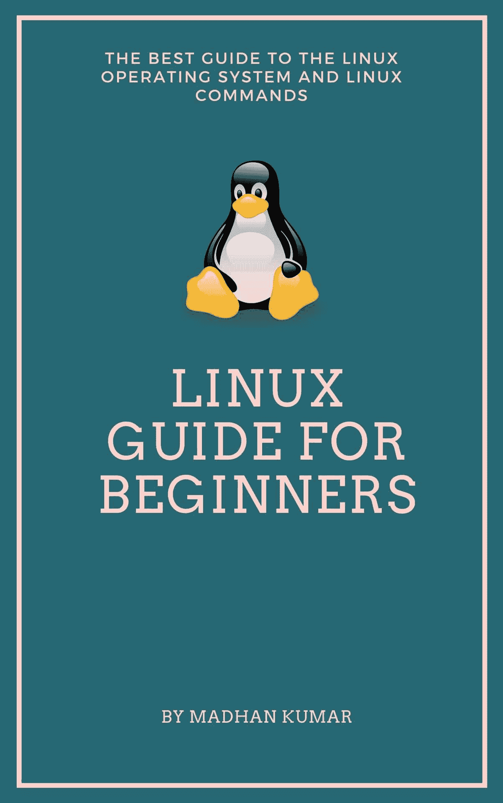

# Linux 初学者指南：Linux 操作系统与 Linux 命令最佳指南



## 引言

非常感谢你购买《Linux 学者指南》。在书中，我们将为你提供在真正开始使用 Linux 之前需要理解的概念蓝图。我们将向你介绍在深入 Linux 世界之前，你应该考虑的各个组成部分。

Linux 具有许多优势。在任何情况下，它还具有一些可能会让你困惑的小众视角。如果不能理解这些视角，可能会在将来给你带来麻烦。

在本书中，我们将讨论这些部分是什么。我们还将讨论 Linux 是什么、它的起源地，以及在你真正开始组装自己的 Linux 服务器和维护自己的 Linux 系统之前需要理解的所有核心概念。此外，我们还会向你展示基础的终端命令，让你为 Linux 操作系统中的操作做好就绪。

我们相信你会喜欢这本书！

## 第 1 章：什么是 Linux？

我们在书中讨论的主要内容是 Linux 的根源。简单来说，Linux 是一个操作系统。对于那些完全不知道什么是操作系统的人，以及每一个认为自己很了解但可能忽略了操作系统定义的人来说，它实际上是处于你的硬件和产品之间的产品层，允许你在 PC 上完成某些有价值的任务。

操作系统是允许软件与硬件进行通信的媒介。它让你能够在硬盘上存储数据、将打印作业发送到打印机等等。如果你处于典型的 Windows 环境中——微软 Windows 操作系统——你的底层是硬件，你还有 Windows 操作系统，然后是像 Microsoft Office 等运行在操作系统之上的软件。

Linux 是一个充当中间人的操作系统——例如，像一个扩展程序——介于实际设备和程序的指令代码之间。你只需要承认这一点是：在 Linux 世界中，你运行的软件类型独特，这与你在 Windows 操作系统中运行的不同。像 Microsoft Office 和 Adobe Photoshop 这样的工作应用程序通常不会运行在 Linux 环境中。Linux 通常运行服务器——Apache Web 服务器、数据库服务器、Web 虚拟化服务器等。

然而，市场上也有不同的专门为个人 PC 设计的 Linux 版本。这些 Linux 发行版就像 Windows 和 Mac OS，它们运行类似的项目，如文字处理程序、照片和视频编辑程序、网页浏览器、程序开发应用、游戏等。这些 Linux 发行版更多地针对只需要免费操作系统的家庭用户。

尽管如此，Linux 并不是作为操作系统开始的。Linux 是林纳斯·托瓦兹（Linus Torvalds）在赫尔辛基大学学习期间创作的作品。`Kernel`（内核）是基础性的，但如果没有其他部分，它是徒劳的。它本身不能成为一个完整的操作系统。Linux `Kernel` 是与 `GNU` 操作系统结合使用的。想象 `GNU` 是一个巨大的复杂问题，但缺少了一个核心部分——这大部分部分就是 Linux `Kernel`。理解什么是 `Kernel` 至关重要的，因为这是 Linux 的特征部分。`Kernel` 是操作系统的核心部分，负责将你应用程序连接到实际硬件。

目前有两种主要的内核类型在竞争——Windows 内核和 Unix 类内核。Linux 属于后者，BSD、Mac OS 以及 Solaris 也是如此。“Unix 类”这个词指的是它们的工作方式类似于或依赖于第一个 Labs 操作系统。

内核通常分为以下三类：

- **微内核（Micro Kernel）**：`Kernel` 只管理它需要的部分：`CPU`、内存以及进程间的通信（`IPC`）。如果不是 `IPC`、内存或 `CPU`，它就会被视为额外的并可以在用户模式下处理。
- **单体内核（Monolithic）**：像 Linux 这样的单体内核与微内核相反。它们不仅包含 `CPU`、内存和通信，还包含其他内容，例如设备驱动程序、文件系统和服务器。
- **混合内核（Hybrid）**：Windows 属于混合内核，因为它可以在客户端模式和内核模式下选择要运行的内容。

因此，在 1991 年到 1994 年之间，林纳斯·托瓦兹通过将 GNU OS 与 Linux 内核合并了操作系统。基本上，林纳斯·托瓦兹需要一个不仅免费，而且他可以根据自己的需求进行调整的操作系统。Linux 是他一个创新的业余项目，是他顺便完成的。Linux 的伟大之处在于，因为它带有“UX”后缀，并且因为大多数你使用的命令看起来非常像 Unix 命令，人们认为 Linux 是一种操作系统。Linux 是开源的。林纳斯·托瓦兹创建 Linux 是因为他需要一个供使用的开源操作系统。曾经，Unix 不是开源的。如果你需要使用 Unix，你需要付费。显然，Microsoft Windows 是这样的，你通常需要付费。

所以，林纳斯·托瓦兹作为一个工程师，他需要一个完全免费的操作系统。他和他的伙伴们在马诸塞理工学院（MIT）也需要一个可以满足他们要求的操作系统。关于 Linux 的重要的一点是，尽管它是一个操作系统，但它与 Windows 或 Mac OS 完全不同。

### 发行版（Distributions）

在林纳斯·托瓦兹创建 Linux 之后，追溯到 1990 年代，他需要一个操作系统。在此期间，他创建了开源代码，这允许全世界的人，特别是极客、研究人员等可以使用它。许多组织和基金会喜欢 Linux。此外，由于 Linux 是开源的，他们可以查看源代码。加利福尼亚大学伯克利分校的人创建了他们的 Linux 版本。世界各地的人——来自不同的背景——创建了他们的 Linux 版本以满足他们的需求。今天你有 Red Hat Linux、Ubuntu Linux、Google Android 等。

许多人将这些称为“distros”（发行版）。发行版是人们在某些时间创建的 Linux 不同版本。那里有各种 Linux 版本。当你需要选择使用哪种 Linux 发行版时，你必须考虑你想让你的电脑做什么。在安装操作系统之前，了解你想让电脑做什么重要得多。对于 Microsoft Windows，你只需先安装，然后考虑你想让它做什么。对于 Linux，每个发行版都是为了特定的目标而设计的。例如，有一个名为 Ubuntu 的 Linux 版本。Ubuntu 被认为是最安全的操作系统之一。它是开源的，只要你不做愚蠢的事，没有人能黑进它，也没有人能访问它。它只是一个安全的服务器。在任何情况下，你都需要在安装特定发行版之前准备一个安全的服务器。

## 第 2 章：安装 Linux 服务器版

要安装 Linux 服务器版，你首先需要下载 Ubuntu Server 的`.iso`文件。`.iso`文件是系统的磁盘映像，可以用于创建可启动 USB 盘或 DVD。

要下载`.iso`文件，请访问 Ubuntu 官方网站`http://www.ubuntu.com/`。在首页上，你会看到多个版本的 Ubuntu。选择你想安装的，例如 Ubuntu Server 22.04.3 LTS。点击`Download now`按钮。这将`.iso`文件下载到你的电脑。

下载完成后，你需要创建一个可启动的 USB 盘。你可以使用 Windows 上的 Rufus 或 macOS/Linux 上的 BalenaEtcher 等工具来制作驱动器。将你的 USB 盘插入电脑，打开工具并选择你刚刚下载的`.iso`文件。然后选择你的 USB 盘并点击`Start`。

一旦有了可启动的 USB 盘，将其插入到你想安装 Linux 的电脑中。重启电脑并按下相应的键进入启动菜单。键取决于制造商，但通常是`F12`、`F11`、`F10`、`F8`或`Esc`。从列表中选择 USB 盘。

安装程序将启动。按照屏幕上的指令安装 Ubuntu。你会被提示选择语言、键盘布局和安装类型。你还会被要求选择执行最小化安装还是全量安装。对于服务器，通常建议最小化安装。

安装完成后，你会被提示设置用户名和密码。完成这些后，电脑将重启。移除 USB 盘，你现在准备好使用你的 Linux 服务器了。

## 第 3 章：安装 Linux 桌面版

安装 Linux 桌面版的过程与安装服务器版相似。主要区别在于桌面版包含了图形用户界面（`GUI`）。

按照与服务器版相同的步骤下载`.iso`文件并创建可启动 USB 盘。有了 USB 盘后，插入电脑。按照屏幕上的指令安装 Ubuntu。你会被提示选择语言、键盘布局和安装类型。你会被要求选择执行最小化安装还是全量安装。安装完成后，电脑将重启。移除 USB 盘，你现在准备好使用你的 Linux 了。

## 第 4 章：基础 Linux 任务/命令

### Sudo

`sudo`命令允许普通用户以管理员权限运行命令。这通常需要密码。例如：

```bash
sudo update
```

### Man Pages（手册页）

手册页提供了关于命令的信息。要查看手册页，使用`man`命令加上命令名。例如：

```bash
man ls
```

### Tasksel

`tasksel`是一个工具，允许你一次性安装整个环境。要使用它，输入：

```bash
sudo tasksel
```

### Apt-get

`apt-get`是基于 Debian 的软件包管理器。要更新列表，使用：

```bash
sudo apt-get update
```

要安装软件包，使用：

```bash
sudo apt-get install package_name
```

### 服务（Services）

服务是在后台运行的程序。你可以使用`systemctl`命令管理服务。要启动服务，使用：

```bash
sudo systemctl start service_name
```

……

按`q`退出`top`。

## 第 5 章：基础 Linux 导航

导航是使用 Linux 的基础技能。

### 切换目录

`cd`命令用于在目录系统中导航。切换目录时使用`cd`加上路径。例如：

```bash
cd /var/log
```

回到主目录，使用：

```bash
cd ~
```

向上一级，使用：

```bash
cd ..
```

### 查找文件

`find`命令用于在系统中搜索文件和目录。要搜索文件，使用`find`加上路径和名称。例如：

```bash
find / -name filename.txt
```

### 列出/显示文件

`ls`命令用于列出目录内容。列出文件输入：

```bash
ls
```

常用选项包括：

- `-l`：显示列表格式，包括权限、所有权大小。
- `-a`：显示隐藏文件（以点开头的文件）。
- `-h`：以易读格式显示大小。

### 创建、删除、移动、复制、重命名

- **创建**：使用`mkdir`创建新目录。

  ```bash
  mkdir new_directory
  ```

- **删除**：使用`rm`删除文件。要删除目录，使用`rm -r`。

  ```bash
  rm filename.txt
  rm -r directory_name
  ```

- **移动/重命名**：使用`mv`移动或重命名文件。

  ```bash
  mv old_name.txt new_name.txt
  mv filename.txt /path/to/destination
  ```

- **复制**：使用`cp`复制文件或目录。

  ```bash
  cp source_file.txt destination_file.txt
  cp -r source_directory destination_directory
  ```

### 挂载驱动器

`mount`命令用于将驱动器挂载到文件系统。挂载驱动器使用：

```bash
sudo mount /dev/sdb1 /mntpoint
```

卸载驱动器使用：

```bash
sudo umount /mntpoint
```

## 第 6 章：使用 Vim 编辑 Linux 文件

Vim 是 Linux 中提供的一种强大文本编辑器。

### 启动 Vim

要在 Vim 中打开文件，输入：

```bash
vim filename
```

退出 Vim 时，按下`Esc`然后输入`:wq`保存并退出，或输入`:q!`在不保存已更改的情况下退出。

### 更改文件所有权

要更改文件的所有权，使用`chown`命令。

```bash
sudo chown user:group filename
```

### 编辑与导航

在 Vim 中，你有两种主要模式：命令模式和插入模式。

- **命令模式**：默认模式。你可以用它导航、删除文本和执行操作。
- **插入模式**：进入插入模式按下`i`。返回命令模式按下`Esc`。

### 退出与保存

在命令模式下，输入以下：

- `:w`：保存文件。
- `:q`：退出 Vim。
- `:wq`：保存并退出。
- `:q!`：不保存退出。
