# Linux 手册：IBM Linux 解决方案与资源指南 - 2003年4月 - SG24-7000-00

**Nick Harris**
**Ralph Cooley**
**Hameron Hunt**
**Randy Kuseske**
**Dan Lacine**
**Tomomi Takada**
**Bob Waite**
**Dirk Webbele**
**Alexander Zaretsky**

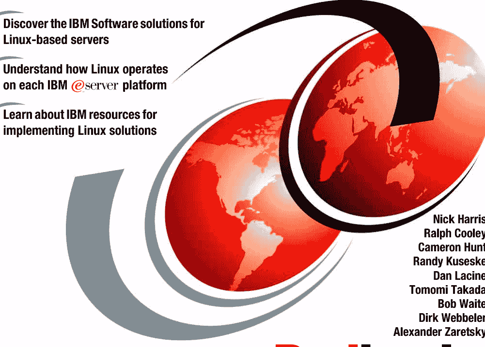


- 5.9.2 支持 ................................................................................................................ 153

# 前言

IBM® 对 Linux 作为操作系统以及基于 Linux 的解决方案有着坚定的承诺。本 IBM Redbook 提供了对 IBM 产品及其与 Linux 操作系统之间关系的广泛理解。它尝试概述适用于基于 Linux 服务器的 IBM 软件解决方案。它还描述了在整个 IBM @server 产品线中的 Linux 功能启用。

本 IBM Redbook 提供了足够的信息来对 Linux 进行高层次的理解。因此，它并不是一份高技术性的文档。它还提供了进一步信息来源的提示。

本红书旨在供参与考虑和规划基于 Linux 的软件解决方案的 IBM 代表、业务伙伴和客户。如果你正计划在企业中实施 Linux，你会发现本红书对你非常有帮助。

# 编写本红书的团队

本红书由来自全球的国际技术支持组织（ITSO）罗彻斯特中心的专家团队制作。

- **Jakob Carstensen**
  IBM 软件集团

- **Bob Butler**

- **Ron Houston**

- **Yohichiro Ishizak**

- **Harald Neumann 博士**

- **Joseph Rhoden**
  IBM LDP 联盟

- **Nick Carr**
  红帽 (Red Hat)

- **Greg Anderson**
  SCO 集团

- **西冈 Takashi**
  Turbolinux

- **Martina Krahmer**
  SuSE

- **Tony Ravinsky**
  IBM 全球服务

我们还感谢在草案阶段审阅此本书并向 IBM Redbooks™ 提供反馈的许多人。通过这个第一版，我们期待未来从您那里获得更多宝贵的建议。

# 成为出版作者

加入我们为期二至六周的驻留计划！帮助编写涉及特定产品或解决方案的 IBM 红书（Redbook），同时获得前沿技术的实践经验。你将与 IBM 技术专业人员、业务伙伴和或客户组成团队合作。

你的努力将有助于提高产品的接受度和客户满意度。作为额外奖励，你将在 IBM 开发实验室建立人脉网络，并提高你的生产力和市场竞争力。

通过以下网址了解有关驻留计划的更多信息，浏览驻留索引并在线申请：

```
ibm.com/redbooks/residencies.html
```

# 欢迎意见

您的意见对我们至关重要！

我们希望我们的红书尽可能提供帮助。请通过以下方式之一向我们发送对此或其他红书的意见：

- 使用此处的在线“联系我们”红书反馈表单：
  - `ibm.com/redbooks`
- 通过电子邮件将您的意见发送至：
  - `redbook@us.ibm.com`
- 邮寄您的意见至：
  - IBM Corporation, International Technical Support Organization
  - Dept. JLU Building 107-2
  - 3605 Highway 52N
  - Rochester, Minnesota 55901-7829

# 前瞻

几年前，IBM 就接受了 Linux 的潜力，预计 Linux 将为我们的客户和合作伙伴提供前所未的选择、价值和灵活性。今天，IBM 整个业务领域对 Linux 的广泛投资体现在市场上提供的大量的 IBM 产品和解决方案中。当本出版物印刷时，Linux 是行业中增长最快的服务器操作系统。

在本手册中，我们旨在用具体的描述描述 IBM 对 Linux 承诺的广度和深度。同时，我们还希望为业务和技术管理，以及认真考虑使用 Linux 实现新类企业级投资的技术人员提供坚实的背景。接下来的章节是 IBM 通过开源开发社区，以及 IBM 内部全球开发实验室、服务组织和合作伙伴支持计划对 Linux 所所的重大且持久的投资的结晶。Linux 生态系统庞大、多样且增长迅速。

无疑，随着 Linux 的成熟以及企业加速采用基于 Linux 的解决方案，随后的内容将继续变化。因此，在可能的情况下，我们包含了网站，以增强材料的时效性。我诚挚地希望本手册能为您提供实施下一个基于 IBM 解决方案的项目所需的知识和信心！

**D. Scott Kuppn 博士**
全球项目总监
Linux 销售

# Linux 简介

本章探讨了 Linux 的组件和特性、其应用以及中间件支持。回顾了 Linux 在服务器和客户端环境中的功能。最后，查看了发行版的组成部分，并突出了最流行的发行版的主要特征。

## 1.1 Linux 的基础

Linux 是一种类 Unix 的开源操作系统。它是来自芬兰赫尔辛基的林斯·托瓦尔斯（Linux Torvalds）在 1991 年的创造。他编写了第一个内核，即与计算机硬件接口并运行的底层程序。

托瓦尔斯邀请了世界各地的程序员对他的代码进行评论和改进。这是 Linux 成功的核心理念之一。以世界为实验室，测试者和开发者的数量是无尽的。正是因为有了这些资源，Linux 才不断演进和改进。

由于 Linux 源代码免费可用，几家公司开发了不同的 Linux 发行版。发行版是一个完整的系统。关键组件是 Linux 内核。根据发行版和用途，还可以包含其他工具、服务和各种应用程序。没有标准的发行版。每个可用的发行版都有独特的优势。IBM 早早认识到了 Linux 的价值：

- 投资 Linux 相关的产品开发
- 与关键 Linux 发行版建立联盟
- 为开源社区做出贡献
- 积极支持该平台

IBM 相信这项投资将使其客户受益，因为他们继续利用 Linux 构建 IT 基础设施和电子商务。

图 1-1 显示了 Linux 生态系统图，其中 IBM 是 Linux 世界生活的关键组成部分。

## 1.2 IBM 对 Linux 的承诺

IBM 全力投入开源运动，并相信 Linux 将成为电子商务的关键平台。IBM 将与开源社区合作。他们将利用相关技术和经验来帮助增强 Linux，定义标准，并将 Linux 扩展到企业级。

IBM 在全球提供持续的支持和参与。您可以在以下网站了解更多关于此类支持以及 IBM 对 Linux 承诺的信息：

- IBM Linux 门户网站，作为进入 IBM 和 Linux 的通用入口
  ```
  http://www.ibm.com/linux
  ```
- IBM Linux 技术中心 (LTC)
  ```
  http://www.ibm.com/linux/ltc
  ```


作为这一持续承诺的一部分，IBM 与 Linux 发行版合作，包括 SCO 集团（以前称为 Caldera）、红帽、SuSE 和 Turbolinux。Linux 生态系统庞大、多样且增长迅速。

无疑，随着 Linux 的成熟以及企业加速采用基于 Linux 的解决方案，随后的内容将继续变化。因此，在可能的情况下，我们包含了网站，以增强材料的时效性。我诚挚地希望本手册能为您提供实施实施下一个基于 IBM 解决方案的项目所需的知识和信心！

# Hone/IBM 链接门户（计划中）

用于欧洲、中东和非洲（EMEA）客户订单支持功能的门户网站部署在 Linux S/390® WebSphere 服务器上。该配置包含了用于访问虚拟机遗留应用程序和数据库的企业访问加速器（EAE）。其功能包括库存检索、订单提交和价格查询。在成功完成试点阶段后，该项目正处于全生产环境开发阶段。

# 安全

安全始终是一个重要的项目领域。以下安全项目基于 Linux 的：

- 安全评估
- 病毒检测
- 存储架构安全目录
- 电子邮件反病毒扫描扫描器

## 安全评估

IBM 全球服务 (IGS) 互联网漏洞扫描服务由 67 台运行 Linux 的 Intel 机器处理。通过这种配置，IGS 提供内部和商业性的互联网及局域网漏洞扫描服务。IBM 为 100 多家商业客户提供服务，并通过该服务每周扫描 30,000 个内部 IP 地址。Linux 使用这些服务已有五年。

## 病毒检测

Linux 服务器一直运行着“蜜罐”和扫描服务，用于安全目的检测并跟踪尝试攻击和病毒。在 13 个亚洲国家（或地区）中每个国家都运行一台服务器。

> 蜜罐：位于互联网上的此类计算机系统专门设计用于吸引试图渗透他人系统的“陷阱”人员。

## 电子邮件反病毒扫描器


该项目旨在将反病毒扫描软件部署到 IBM 邮件基础设施中。该项目涉及对入站和出站邮件进行病毒扫描。选定的反病毒软件是`Trend Micro Interscan VirusWall`。它将运行在`Linux`上，并部署在全球的 18 台`xSeries`机器上。

# 监控

系统监控项目包括：

- 性能监控
- 资产监控
- 电子托管和网络管理运营

性能支持 IBM 的端到端探测平台 (`EPP`)，这是一个基于`Java`的监控工具，主要构建用于`Windows NT`平台运行，但也运行在`Linux`上。`EPP`从终端用户的角度衡量应用程序的性能和可用性。性能可用性指标通过定期执行并测量模拟事务的持续时间生成。每个探测服务器实例在默认超时时间内每小时可以轮询约 180 台服务器。

有 17 台运行`Linux`的`EPP`服务器部署在`EMEA`地区的 13 个不同国家。其中英国有 6 台，加拿大有 4 台。`Linux`是此类应用的理想操作系统，因为它可靠且经济。此外，它的多任务能力提供了比`Windows NT`解决方案高四倍的吞吐量。使得 IBM 在相同负载下使用的服务器减少了 75%。

# 资产监控

工作站资产管理工具`Asset Center`、`Brio Reporting`和`Communication Director`用于跟踪和管理工作站硬件及软件资产。这些工具运行在`Linux`镜像上，该镜像作为`S/390`硬件上`z/VM`的虚拟机运行。`S/390 Linux`上还有一个软件清单的`DB2`数据库。

# 电子托管和网络管理

`Linux`用于监控由`IGS`托管的 1,600 多个商业`URL`。它还用于远程控制台和集群管理。IBM 使用`Linux`监控超过 2,300 个网络接口。

# 文件与打印

文件和打印项目包括：

- 文件服务
- 文件和打印服务器

# 文件服务

`IGS`正在使用`Linux`服务器网络通过 IBM 标准客户端安装程序 (`ISCI`) 在全球提供标准客户端镜像。它还向终端用户提供 IBM 标准软件安装程序 (`ISSI`) 和维护修复包。目前在全球 28 个国家（或地区）有 156 台生产环境的`ISCI/ASSI`服务器。

# 文件和打印服务器

澳大利亚和新西兰将之前运行在`OS/2`、`Windows 95`和`Windows NT`上的 64 台文件打印服务器转换为跨 13 个站点的运行`Linux`的 44 台`xSeries`服务器以及一台运行`AIX 5.1L`的`RS/6000`机器。

其他亚洲国家（或地区）可能会有后续项目。该项目还为每个站点包含了一个`Linux`域控制器。

# IBM 制造与开发设施

制造和开发项目包括：

- 微电子 300mm 晶圆制造与测试
- 电子设计自动化
- `VLSI`测试工程
- 生产线终端
- 软件开发
- IBM 内部开源集市

# 微电子 300mm 晶圆制造与测试

来自 IBM 电子部门未来的 300mm 晶圆制造线工具控制器运行在运行`Linux`的`xSeries`机器上。它们计划配合`Windows 2000`一起部署，但发现了一个严重的可靠性问题。

该项目证明了`Linux`在这种环境中可靠得多。晶片制造线工具控制器目前运行在 174 台运行`Linux`的`xSeries`机器上。在纽约州的`East Fishkill`和`Burlington`两个站点计划 200 到 300 处安装。在经过近一年的生产支持后，尚未发生过与`Linux`相关的停机。

# 电子设计自动化

IBM 电子部门启动了一项多年战略，将`Linux`作为其设计自动化平台的关键元素。这涉及设计工作站和开发基础设施向`Linux`的长期迁移，以及工具和应用程序的迁移。

截至目前，近 80% 的工具已完成迁移，目标是在年底前完成。该部门还在开发一个开发者/设计师工作站环境。这是基于对`Linux`工具在生产力提升、性能优势和功能优势方面的潜力愿景。

# VLSI 测试工程

微电子芯片制造和测试组织将它们的测试数据生成程序迁移到了`Linux`。这使得在生成设备测试模式以及为制造过程中的芯片测试仪开发程序的过程中，可以使用两台`xSeries`服务器。

# 生产线终端

IBM 加大的`Bromont`制造工厂安装了 81 台终端，使用注定淘汰的旧`Pentium 133/166`机器访问`Web`应用程序、遗留主机应用程序和打印机。

# 软件开发

`S/390`上的 400 多个虚拟机和 15 个`LPAR`用于`DB2`和`WebSphere Commerce`产品的开发。

# IBM 内部开源集市

IBM 内部开源集市是一个内部部署的开源项目门户，旨在促进 IBM 内部的开源开发风格。这是 IBM 开发者与全球 IBM 开发者“分享”代码的机会。它托管在`Linux`服务器上。这是一项提供易于访问`CVS`、邮件列表、错误跟踪、留言板/论坛、任务管理、站点托管、永久文件存档、备份以及全基于`Web`的管理的服务。

# IBM 研究设施

以下项目是 IBM 研究设施使用`Linux`服务器的示例。

# Blue Gene™ 蛋白质折叠模拟

在这一先进超级计算项目中，超过 110 台`Linux`服务器被用作计算和文件服务器。该项目关注生命科学过程——蛋白质折叠的建模。

# Oceano Web 托管工具

IBM 研究部门正在开发一种可以根据多个商业客户的负载动态调整容量的托管工具。他们正在使用一组集群化的`Linux`服务器，这些服务器可以在客户之间动态重新配置。有 75 台运行`Linux`的`Intellestation`。

## 1.3 Linux：操作系统

在过去的几年里，`Linux`操作系统已成为`PC`用户以及企业服务器和用户的真实且可行替代方案。`Linux`提供了`UNIX`服务器或桌面的强大和灵活性。它提供了一套工具、互联网应用程序和功能完整的桌面界面。

`Linux`操作系统已成为强大的互联网应用程序服务器平台。`Linux`操作系统能够运行企业`Web`服务器、`FTP`、`Gopher`和广域信息服务器 (`WAIS`) 网站。

`Linux`是一个功能完善的操作系统，类似于`UNIX`系统。它拥有企业级`UNIX`系统的所有标准功能。通过`shell`（外壳）可以实现命令结构的管理。我们提到了`Linux`可用的许多高级`shell`中的两种：`Bourne Again shell` (`bash`) 和`tsch-shell`。这两个`shell`都支持一种完整的基于`shell`的编程语言，你可以用它创建脚本。

`Linux`有四个基本组成部分：

- **内核** (`Kernel`)：提供程序管理和硬件设备管理（如磁盘和打印机）
- **外壳** (`Shell`)：通过标准用户界面接收用户的命令，并将命令发送到内核进行执行。
- **文件结构** (`File structure`)：文件根据磁盘硬件组织在目录中。每个目录可以包含任意数量存放文件的子目录。这与`PC`操作系统系统的文件结构相似。
- **实用程序** (`Utilities`)

在某些解决方案中（通常是集群环境中），`Linux`服务器不需要传统的`PC`硬件`BIOS`。硬件由`Linux`直接控制。这提供了惊人的启动速度（目前的记录是三秒）。

`Linux`具有与大型`UNIX`服务器相同的多用户和多任务处理能力。它提供了在标准`UNIX`系统上同级别的系统管理水平。用户可以同时运行多个程序。你可以为不同的用户创建账户，并定义他们对系统组件的访问权限。新设备的安装以及网络连接和控制都是`Linux`操作系统提供的标准功能。

作为一种开发环境，`Linux`拥有一套强大的开发工具，用于创建工业级应用。这些开发工具包括 `GNU C 编译器`。

`Linux`结构为程序员提供了访问计算机硬件及其所连接网络的能力。这是通过提供硬件抽象层来实现的，程序可以通过标准的应用程序编程接口（`API`）利用硬件特性。

`Linux`程序可以迁移到其他版本的`UNIX`系统。`Linux`可以使用`ANSI C`，并结合多种可移植的图形用户界面（`GUI`）工具包之一。这些程序既可以为`UNIX`系统编写，也可以为`Windows`服务器编写。

### 1.3.1 Linux BIOS 管理

在集群环境中，快速重新配置硬件的能力是非常可理想的。`Linux`可以帮助完成这项任务。`Linux`能够在没有`BIOS`的情况下启动。目前作为集群节点的`PC`依赖供应商提供的`BIOS`进行启动。而`BIOS`反过来依赖于本质不可靠的设备（如软盘和驱动器）来启动操作系统。此外，目前的`BIOS`软件无法适应非标准硬件，这使得支持实验性工作变得困难。`BIOS`速度慢、经常出错、冗余，最重要的是难以维护。想象一下带着键盘和显示器走遍集群中 128 个节点中的每一个去更改一个`BIOS`设置。

`BIOS`从`NVRAM`启动`Linux`内核，除了风扇外不需要移动部件。它在跳转到内核之前执行极少量的硬件初始化，让`Linux`完成其余工作。因此，它快得多（目前的记录为三秒），这也引起了消费电子社区的兴趣。此外，可以通过网络进行更新。


使用真实的操作系统启动另一个操作系统比使用简单的重启程序或 `BIOS` 提供了更大的灵活性。由于 `Linux` 是启动机制，它可以通过标准以太网或其他互连（如 `Myrinet`、`Quadrics` 或 `SCI`）启动。它可以使用 `SSH` 连接加载内核，也可以使用 `InterMetro` 缓存文件系统或传统的网络文件系统 (`NFS`)。集群节点可以根据需要尽可能简单，可能只有 `CPU` 和内存，没有磁盘、没有软盘，也没有文件系统。节点的自主性会降低，但更容易维护。

> `LinuxBIOS` 是一个开源项目，旨在通过硬件初始化和压缩的 `Linux` 内核来取代普通 `BIOS`，该内核可以从冷启动。该项目始于洛斯阿拉莫国家实验室高级计算实验室集群研究实验室的集群工作。该项目的动机是让操作系统在通电时获得集群节点的控制权。`LinuxBIOS` 的其他优点包括只需两个工作电机（`CPU` 电力和电源）即可启动、快速启动时间（目前最快为三秒）以及摆脱专有的（多 Bug 的）`BIOS` 代码。总的来说，其优点非常多，并帮助获得了高性能计算和嵌入式计算市场中许多供应商的支持。

有关关于 `LinuxBIOS` 的更多信息，请参考以下网站：`http://www.linuxbios.org/index.html`

`Linux` 的采纳是一个快速且不断变化的过程。要确定 `Linux` 在现代 `IT` 世界中的位置可能很困难。图 1-2 显示了现代 `IT` 跨谱，从操作系统到客户端界面。`Linux` 在几乎每个领域都发挥着作用，并迅速在传统操作系统统治多年的领域取得足迹。

| 客户端界面 |
| :--- |
| 业务线 (Line of Business) |
| 中间件 (Middleware) |
| 数据存储 (Data Storage) |
| 基础设施 (Infrastructure) |
| 操作系统 (Operating Systems) |

图 1-2 `IT` 跨谱：逻辑与物理上

### 1.3.3 与其他操作系统协同工作

`Linux` 不仅被用作特定计算机系统的单一操作系统。它还经常用于在较大的非 `Intel` 架构系统上填充虚拟分区，例如 `IBM` `iSeries`、`pSeries`、`xSeries` 和 `zSeries` 服务器。虚拟或逻辑分区提供：

- **服务器合并 (Server consolidation)**：拥有现有 `Linux` 或 `UNIX` 服务器的组织可以通过将这些服务器合并到现有的 `IBM @server` 平台上的虚拟分区中，从而节省硬件和人员成本。

- **高可用性 (High availability)**：多个虚拟分区可以提供某种可用性和基于应用程序的负载均衡，同时保留合并硬件带来的管理优势。

- **基础设施 (Infrastructure)**：`Linux` 虚拟分区可以为共享相同网络的其他分区提供安全和基础设施服务。

## 1.4 基础设施

`Linux` 通过提供基础设施服务进入主流市场。

### Web 服务 (Web serving)

`Linux` 和 `Apache` 的结合为客户提供了一个极具吸引力的包。它最初为静态 Web 网站提供低成本、灵活的解决方案，全球 30% 的 Web 网站运行这种组合。现在的需求转向更动态的方法，即用户可以交互且支持高事务率的 Web 网站。

### 文件和打印服务 (File and print serving)

`Linux` 实现的基础之一是提供廉价设施，如文件和打印服务。`Linux` 在基础设施领域提供了快速的投资回报 (ROI)。其管理能力和低成本使得这一方案很容易证明合理。此外，这是一个重要的环境，但其运行重要性不如业务应用。对于企业测试这项新技术来说，这是一个相对安全的地方。

### 域名服务器 (DNS) 和 DHCP

作为 `UNIX` 的克隆，`Linux` 在托管 `Berkeley` 域名命名守护进程 (`BIND`) 名称服务器和动态主机配置协议 (`DHCP`) 服务方面经过了证明。

### 路由器 (Router)

`Linux` 能够使用廉的商品硬件进行高级路由。此外，一些路由器供应商选择 `Linux` 作为它们的嵌入系统。

### 防火墙和入侵检测服务 (IDS)

`Linux` 拥有流行的防火墙和 `IDS` 服务提供。由于高级的配置和自定义选项，以及较小的内存占用，`Linux` 已成为许多希望避免专有解决方案的组织的理想选择。

计算机系统接口 (`iSCSI`) 环境。`iSCSI` 通过将基于 `SCSI` 的存储资源直接连接到以太网上工作，是光纤通道（`Fibre Channel`）解决方案的成本替代方案。在这种环境中，`Linux` 作为存储节点运行，管理 `RAID` 硬件并提供高级的网络性能。

`IBM TotalStorage™ IP Storage 200i` 是使用 `Linux` 作为操作系统的存储设备。您可以在 Web 上找到更多信息：

`http://ssdweb01.storage.ibm.com/snetwork/iSCSI/index.html`

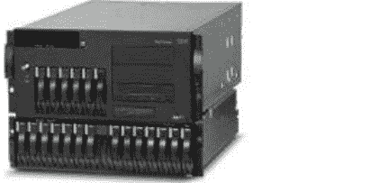

图 1-3 `IBM TotalStorage IP Storage 200i`

## 1.6 中间件

`Linux` 目前在中间件领域正经历快速增长。中间件被称为将 `IT` 应用连接在一起的“胶水”。它通常被分为以下四个领域。

### 数据库

由于低成本、稳定性和扩展性，`Linux` 正在迅速成为数据库的首选平台。它还提供负载均衡和高可用性集群等企业级功能。两种常用的数据库实现是 `DB2` 和 `Oracle 9 RAC`。

> 注意：`IBM DB2 Universal Database™` 在 `Linux` 上提供了企业级数据库功能。更多信息请访问：

`http://www.ibm.com/software/data/db2/linux/validate/`

### 跨系统支持

大多数带有“中间件”标签的产品实际上是软件平台，提供集成、事务和开发支持，以将各种 `IT` 服务缝接在一起。`Linux` 是中间件支持的操作系统，因为其开放和灵活的本质很好地适用于现代 `IT` 网络的异构环境。`IBM` 提供了两个最强大的中间件示例：

- `WebSphere`

- `MQSeries®`

> 注意：`IBM WebSphere` 平台在利用 `Linux` 开放特性的同时，提供集成、事务和开发支持服务。要了解更多关于 `WebSphere` 的信息，请访问：

`http://www.ibm.com/software/info1/websphere/index.jsp`

### 知识发现 (KD) 与协作

中间件日益主要的任务是组织网络中的信息流，而不是对其进行处理和存储。知识发现是指企业内容管理 (`ECM`) 和知识管理 (`KM`) 的集成。它涉及合并多种最初（且独立地）负责捕获、定位、组织和交付信息的技术。

协作包含了所有提供集成消息、日历和任务管理的技术。`Linux` 的开放传承提供了一个灵活平台，可以在其中集成各种知识发现和协作工具。

> 注意：`IBM` 通过其 `Lotus®` 系列提供知识协作产品。点击此链接获取有关 `Linux` 和 `Lotus` 的更多信息：

`http://www.lotus.com/`

### 系统管理

系统管理已日益变得中心化和异构化。随着停机余裕的减少，中间件必须包含监控所有抽象级别所有系统的能力。由于 `Linux` 本质上是开放的，它对其内部机制的访问权限比封闭或专用系统更高。

构建在 `Linux` 之上的管理基础设施还利用了它的 `UNIX` 系统传承以及许多可以提供额外功能的第三方和开源产品。

> 注意：`IBM` 通过 `Tivoli` 软件家族提供系统管理中间件。您可以在 Web 上了解更多关于 `Tivoli` 的信息：

`http://www.ibm.com/tivoli`

## 1.7 解决方案

解决方案指的是对于组织日常运营至关重要的应用程序。它们通常包括企业资源计划 (`ERP`)、客户关系管理 (`CRM`)、供应链管理 (`SCM`) 和商业智能 (`BI`) 产品。接下来的章节介绍了一些支持 `Linux` 的解决方案提供商，包括 `SAP`、`J.D. Edwards` 和 `eOne Group`。

总而言，在整个 `IT` 系统范围内对 `Linux` 都有广泛的支持。表 1-1 总结了某些关键元素以及填充这些元素的应用程序。

表 1-1 业务领域与解决方案

| 基础设施解决方案 | 供应商或解决方案 |
| :--- | :--- |
| 数据库和应用开发工具 | `DB2 UDB`, `Everywhere`, `Informix` (零售/分销) `Sybase` (FSS), `Rational` |
| 应用服务器 | `WebSphere Application Server`, `Apache` |
| 网络和系统管理 | `Tivoli`, `VERITAS`, `BMC`, `Trustix`, `Compuware` |
| 安全与防火墙 | `Checkpoint`, `Symantec`, `CISCO`, `Trustix`, `SuSE Firewall`, `Tivoli` |
| 集群（高可用） | `IBM WebSphere` |
| 合并 | `IBM WebSphere` |
| 邮件和消息 | `IBM Lotus` |
| 电子商务 | `IBM WebSphere` |


## 1.8 客户端

虽然 Linux 在易用性上传统上后于微软产品，但这种情况正在迅速发生变化。以下章节提供了示例。

### 厚客户端

厚客户端包括运行 Linux 作为主系统的台式机和笔记本电脑。然而，双系统启动（尤其是在开发组中）仍然常见。

### 瘦客户端

高维护和人工成本促成了用瘦客户端替代厚客户端的趋势。由于内存需求有限，Linux 是一个理想的瘦客户端平台。Linux 高可定制的特性结合集中控制使其极具吸引力。

注意：IBM NetVista 系列提供了几种基于 Linux 的解决方案。更多信息请参阅：

`http://www.ibmlink.ibm.com/cgi-bin/master?xh=teg8ZCuCakwQ2UsenN932&request=salesmanual&params=-H5F8632E`

### 个人数字助理 (PDA)

Linux 是所有类型嵌入式设备的流行选择。然而，商业级 Linux PDA 在过去几年中才出现。应用程序的可移植性被认为是主要优势，因为用户可以在 PDA 上运行与桌面电脑相同的应用程序。基于 Linux 的 PDA 的绝佳示例是 `Paron MPC`。`Paron` 是为需要加密访问蓝牙基础设施（如银行、库存和政府）的垂直市场开发的。`Paron MPC` 在安全功能中提供了指纹识别芯片。

IBM 与 CDL 共同开发了 `Paron MPC`。要了解更多信息，请查看：

`http://www.linuxdevices.com/articles/AT71454830`
`http://www.cdusa.com/products/paron_mpc`

## 1.9 Linux 发行版

本节介绍 Linux 发行版。它回答了：Linux 发行版与 Linux 本身有什么区别？

如何判断哪个发行版适用于您的环境？目前有数百种 Linux 发行版。企业级软件的移动区分了发行版。企业级的示例包括 `SuSE Linux Enterprise Server (SLES)` 和 `Red Hat Linux Server (RHAS)`。

并不是所有的发行版都支持所有的 IBM @server 平台。IBM 支持提供企业级服务的发行版。通常，发行版费用更高，但包含了从错误修复到 24-x-7 支持的更多企业级功能。

企业级发行版的特点包括：

- 新特性：
  - 周期为 12 到 18 个月的优化发布周期，三到五年的支持
  - 独立软件供应商 (ISV) 认证平台
- 增加了对维护和支持的投入
- 企业级丰富功能，例如多线程输入/输出 (I/O)、改进的 SMP 使用等

### 客户价值

- 可靠性：更长的集成和测试周期
- 可扩展性：改进的 SMP；例如 `Red Hat` 用于负载均衡的 `Piranha`，以及 `SuSE` 为了可扩展性和性能回回的 2.6 调度器
- 可管理性与服务：改进的 RAS 功能，24x7 全球企业级服务

### 实现方案

- `Red Hat Advanced Server 2.1`
- `SuSE Linux Enterprise 2.1`
- `SCO Linux`
- `Turbolinus Enterprise Server`

本节介绍了一些最流行的发行版，特别是运行在 IBM @server 平台上的发行版，并为您提供每个版本的预览。随后，它重点介绍了市场上的其他参与者。包括一些知名度不高但在特定地区具有影响力，或适用于国防受众的发行版。

### 1.9.1 什么是发行版

通常所说的 *Linux*，更准确的说法应该是“发行版”（distribution）或简称“distro”。从技术上讲，Linux 只是操作系统的核心或内核。Linux 发行版是预包的软件集合，通常由内核和其他软件包组成。

主要的发行版包括图形化桌面环境和安装程序，以帮助您快速上手。内核（其源代码免费可用）由 Linux Torvalds 和一个领导团队管理。许多开发者通过贡献新功能和设备驱动程序来帮助更新内核。可以添加到系统中的软件包包括编译器、shell 和其他应用程序。并非所有这些软件包都以开源形式提供。您可以在 1.9.3 节第 21 页的“什么是开源”中了解开源。

一个 Linux 发行版包含了 Linux 内核以及实用程序、编程工具、窗口管理器以及其他构成完整操作系统的软件。发行版公司（如 `SCO`、`Red Hat`、`SuSE` 和 `Turbolinus`）以及非商业组织（如 `Debian`）从互联网下载最新的开源软件包。然后它们添加实用程序（如安装程序），并将它们封装在附有说明书的光光盘中。每个发行版的内核代码可能不同，因为各个发行版通过 Linux 标准基础（Linux Standards Base）尝试对发行版的各个方面进行标准化，以减少对可移植性的影响。

发行商（如 `Red Hat`）是指为了商业目的封装 Linux 发行版的公司。他们从技术上讲并不转售软件许可，而是销售支持和维护的订阅服务。通常这些是为期一年的订阅。发行商还销售 Linux 咨询和集成服务。除了 Linux 操作系统，他们还可能销售应用程序或中间件。

## 应用兼容性

在大多数情况下，Linux 应用程序与所有 Linux 发行版兼容，这正是“Linux 就是 Linux”这一格言的基础。当新内核发布时，它会被上传到内核主站：

`http://www.kernel.org`

发行公司封装内核并在它们自己的网站上提供更新。发行商原样接收内核，包含由开发社区成员贡献的所有更改和修复。发行版的发布速度在过去几年中显著放缓。曾经，新发行版每年发布两次。随着对企业级发行版以及运行在或在 Linux 下广泛产品的重视，发布节奏已大幅缓慢。

每个发行版都有其独特的产品分类。例如，`Red Hat` 将其产品分为企业版、中小企业版和家庭版。`SuSE` 有两个部门：业务版和个人版。`Turbinolux` 将其产品作为一个整体 `The SCO Group` 展示。在本章中只要可能，我们将产品分为业务市场和工作站市场。

随着新硬件的发布和 IBM Linux 发行版伙伴发布新版本，检查 IBM 支持状态是一个好主意。以下 Web 链接可以帮助您找到 `xSeries` 服务器的最新状态。IBM 开发团队还为每个系统编写了安装说明（保留测试工作），以记录运行特定版本 Linux 操作系统的任何建议。

对于 IBM 在 `xSeries` 服务器每个型号上支持的 Linux 版本：

`http://www.pc.ibm.com/us/compat/nos/matrix.shtml`

对于 IBM 根据系统规格支持的选项：

`http://exist.raligh.ibm.com/nosmgr/optlist/sprec.asp`

例如，IBM 与 `SCO`、`Red Hat`、`SuSE` 和 `Turbolinux` 合作对 `xSeries` 硬件进行认证。更多信息请参阅：

- `Red Hat`: `http://www.redhat.com/`
- `SuSE`: `http://www.suse.de/`
- `Turbolinux`: `http://www.turbolinux.com/`

### 1.9.2 发行版之间的共同点

发行版之间有很多共同点。例如，Linux 带有两种可能的界面：`KDE` 和 `GNOME`。对于终端用户来说，选择一个而不是另一个取决于个人喜好。两者在功能上是等价的。`KDE` 使用 `Qt` 跨平台工具包，而 `GNOME` 使用图形工具包 (`GTK`)。

每个发行版还包含各种实用程序，如防火墙、Web 浏览器和编译器。发行版包含了版本、库以及对标准的遵循。支持服务也因发行商而异，例如响应时间和支持覆盖范围。

### 1.9.3 什么是开源

开源通常被认为是赠送或可免费重新分发的软件。实际上，开源是指源代码可以免费提供的软件。这一概念的原理是，更大规模的程序员（他们不关注专有所有权或财务收益）将为所有人生产出更有用且没有漏洞的产品。

互联网上充斥着被深度商业使用的开源软件。一些例子包括：

- `Apache`：运行了全球互联网 70% 以上的“活跃内容”
- `Perl`：全球互联网大多数活跃内容背后的引擎
- `BIND`：为整个互联网提供域名系统服务 (DNS) 的软件

注意：开源定义由十个项目组成。您可以在开源倡议 (OSI) 网站上了解更多详细信息：

`http://www.opensource.org`

## 1.10 Red Hat

红帽公司成立于 1994 年，提供了美国最流行的发行版。它以其 `Red Hat` 软件包管理器（`RPM`）系统用于安装和维护组件而闻名。

红帽是互联网基础设施 Linux 和开源解决方案的开发、部署和管理领域的领导者，范围涵盖了从嵌入式设备到安全的 Web 服务器。红帽是其他几个 Linux 发行版的基础。

### 1.10.1 发行版中包含什么？

红帽为企业、中小企业以及小型办公/家庭办公（SOHO）提供软件解决方案。本节介绍了每种主要产品及其特性。

### Red Hat Linux 操作系统

企业级操作系统包括：


# 红帽 Linux 版本

## 企业级操作系统

- 适用于大型企业的 `Red Hat Advanced Server`
- 适用于 `iSeries`、`pSeries`、`zSeries` 和 `S/390` 的 `Red Hat`

## 高性能计算

- 适用于 `Intel` 64 位 `Itanium` 处理器的 `Red Hat Linux for the Itanium Processor`

## 中小企业级操作系统

- `Red Hat Advanced Server`
- `Red Hat 8.0 Professional`

## 小型办公/家庭级操作系统

- `Red Hat 8.0 Professional`
- `Red Hat 8.0 Personal`

### Red Hat Linux 业务应用

红帽也为企业业务和中小企业提供应用程序。其中某些应用适用于两种环境。

**企业级应用解决方案包括：**

- `Stronghold Enterprise`：一种基于 `Apache` 的安全 `Web` 服务器，旨在通过商用服务器、内网和外网实现对任务关键型企业数据进行安全传输和存储。
- 内容与协作管理 (`CCM`)：用于管理内容和企业团队协作的开源解决方案。它最初由 `ArsDigita` 开发。
- `GNUPro` 开发工具：一套围绕开源 `GNU` 标准构建的商业软件开发工具套件。它通过订阅方式交付，提供对最新升级和支持的持续访问。
- `Cygwin`：适用于 `Windows` 的 `UNIX/Linux` 开发和系统管理环境。它包含 `UNIX/Linux` 终端环境、流行 `GNU` 开发工具的 `Windows` 端口以及 `Cygwin` 库（后者提供了所需的 `UNIX` 系统调用和环境）。
- 嵌入式 `Linux` 开发套件：一套开发工具和基于 `Linux` 的嵌入式运行时技术，能够对嵌入式设备的目标软件组件进行创建、部署和测试。

**中小企业应用解决方案包括：**

- `Stronghold Enterprise`：一种基于 `Apache` 的安全 `Web` 服务器，旨在通过商用服务器、内网和外网确保对任务关键型企业数据进行安全传输和存储。
- 内容与协作管理 (`CCM`)：用于管理内容和企业团队协作的开源软件解决方案。它最初由 `ArDigita` 开发。

`Red Hat Linux Advanced Server` 包含以下特性：

- 用于长期稳定性的扩展发布周期
- 针对企业优化的内核
- `Red Hat Cluster Manager`，提供应用故障转移基础设施
- 用于简化多系统管理的网络企业服务

`Advanced Server` 还包括 `Bluecurve`，它提供了桌面 `GUI` 防火墙、`Web` 服务器（`Apache`）、针对盲文的 `GUI` 支持以及针对移动限制的语言界面。

`Red Hat Linux Professional` 和 `Personal` 包含：

- 用于创建文档、电子表格和演示文的 `OpenOffice` 办公套件
- `Mozilla` 开源浏览器、电子邮件客户端、通讯录和 `HTML`
- `Xianian Evolution` 电子邮件客户端、联系人管理器和日历
- 可自定义的防火墙，用于动态调整安全设置

`Professional` 版本中增加的功能还包括办公和多媒体应用程序，以及管理工具和扩展服务。

您可以在网上找到红帽应用简报：

```
http://w3.linux.ibm.com/linux/files/RedHatApplicationBrief.pdf
```

有关红帽版本的更多信息，请参阅：

`http://www.redhat.com`

## 1.11 UnitedLinux

2002 年 5 月 30 日可能是 `Linux` 历史上的一个大事件。`SCO`、`Conecta`、`SuSE` 和 `Turbolinux` 宣布他们将携手合作创建一个单一二进制兼容的 `Linux` 发行版，共享开发成本和未来的版税。`UnitedLinux` 作为一个联盟成立，`UnitedLinux` 产品 `UL 1.0` 最终于 2002 年 11 月发布。到 2002 年 12 月 4 日，`SCO` 发布 `SCO Linux 4.0`，`SE` 发布了其 `SuSE Linux Enterprise 8`。这些是市场上首批基于 `UnitedLinux 1.0` 代码的发行版。`Turbolinus` 在日本发布了 `Enterprise 8`。

`UnitedLinux` 是一个基于标准的 `Linux` 操作系统。它针对企业用户。旨在通过全球统一的 `Linux` 发行版来简化 `Linux` 的开发和认证。它经过认证，适用于 `AMD` 和 `Intel` 32 位 `x86` 系列；64 位 `x86`、`Athlon`、`Opteron` 和 `Itanium` 系列；以及完整的 `IBM @server` 品牌。

虽然每个发行商销售核心 `UnitedLinux` 发行版，但他们添加额外的程序和实用程序，只要保持应用程序的可移植性即可。每个发行商以自己的品牌名称“`Powered by UnitedLinux`”销售其产品。

您可以在网上找到 `UnitedLinux` 应用简报：

`http://www.ibm.com/linux/UnitedLinux-Application-Brief.pdf`

在他们的技术论文中阅读更多关于 `UnitedLinux` 的信息：

`http://www.unitedlinux.com/pdfs/whitepaper4.pdf`

大型公司和独立软件供应商（`ISV`）现在只需与两个 `Linux` 版本（另一个是红帽）合作，而不是五个或更多主要版本。这种简化避免了公司在多个平台之间迁移应用程序的工作。`UnitedLinux Beta` 版首次发布就引发了 15,000 次下载。

### 1.11.1 发行版中包含什么？

`UnitedLinux` 包含了用于业务 `Linux` 的通用内核、`API`、文件系统和安装程序。开发者和客户通过 `UnitedLinux` 的支持供应商获取 `UnitedLinux`。也就是说，你从 `Conecta`、`SuSE`、`SCO` 或 `Turbolinux` 订购。无论包装上的供应商名称是什么，我们收到的都是 `UnitedLinux`。它以安装光盘或光盘的形式出现。每家公司然后添加自己的软件包，这些软件包位于单独的光盘上。图 1-4 显示了 `UnitedLinux` 的架构。

| `SCO` 组件 | `Connecta` 组件 | `SuSE` 组件 | `Turbolinux` 组件 | `UnitedLinux` 特性 |
| :--- | :--- | :--- | :--- | :--- |
| `Linux` 标准基础 (`LSB`) | | | | |
| 通用硬件、库和驱动程序 | | | | |
| 通用配置、文件位置和语义 | | | | |

**图 1-4** `UnitedLinux` 架构

`UnitedLinux` 是通用公共许可证（`GPL`）。源代码是免费的，但（执行代码）不是。例如，使用 `UnitedLinux` 源代码可以创建（可执行代码）。`UnitedLinux` 是 1.11.2 第 27 页标准基础（`LSB`）的实现。`UnitedLinux` 还支持英语、德语、法语、意大利语、日语、韩语、葡萄牙语、西班牙语、简体和中文。更多信息请参阅：

```
http://www.unitedlinux.com
```

### UnitedLinux 对成员的要求的标准

`UnitedLinux` 遵循以下 `Linux` 和行业标准：

- 文件系统层次结构标准 (`FHS`)：类 `Unix` 操作系统下目录放置的要求指南
- `Linux` 标准基础 (`LSB`)：增加兼容性的标准
- `I18N`：核心 `API` 和组件的国际化
- 可扩展性：利用更大、更复杂的系统处理
- 用于单机无法管理的工作负载的完整软件和工具集
- 改进 `SMP` 上的进程调度，防止调度器成为瓶颈
- 异步输入输出以减少繁忙系统的 `I/O` 等待
- 高可用性：避免停机的能力，包括：
    - 符合 `POSIX` 的事件日志和通知功能
    - 动态探测：调试中动态插入断点
    - 非中断的系统数据转储
    - 用于记录和跟踪系统事件的工具
    - 热插 `PCI` 支持
- 安全性：`Kerberos` 支持、基础防火墙支持以及被称为 `Bastille` 的集成安全增强
- 文件系统：支持日志文件系统 (`JFS`) 以及流行的社区文件系统 `ReiserFS`、`XFS` 和 `ext3` 文件系统
- 网络/存储/设备管理：支持逻辑卷管理器 (`LVM`) 和企业卷管理系统 (`EVMS`) 以管理存储
- 平台支持和互操作：跨所有相关平台和架构，包括 `Intel` (32 位和 64 位)、`AMD`、`PowerPC` (`iSeries` 和 `pSeries`) 以及 `zSeries` 主机
- 开发环境：为 `ISV` 开发环境，包括库编译器、源码、文本编辑器、图形用户支持以及其他用于构建 `UnitedLinux` 应用的工具

### 1.11.2 Linux 标准基础 (LSB)

`Linux` 标准基础（`LSB`）是早期的的一种尝试，旨在将 `Linux` 发行版整合到一个共同核心。它是自由标准组（`Free Standards Group`）的一个工作组。


在开发社区和 `IT` 者的支持下，自由标准组织（`Free Standards Group`）是一个独立的非营利组织，致力于通过标准的开发、应用和推广，加速开源技术的使用和认可。这些标准包括通用行为规范、工具和 `API`，旨在跨 `Linux` 发行版使开发更加容易。

有关更多信息，请参阅 `Linux` 标准首页：

`http://www.linuxbase.org`

## 1.12 `Conectiva`

`Conectiva` 是 `UnitedLinux` 的合作伙伴，是一个巴西 `Linux` 发行版，提供西班牙语和葡萄牙语等多个版本。该 `Linux` 发行版专为拉丁美洲创建。`Conectiva Linux` 针对桌面端和服务器。它基于 `RPM` 并启用了 `APT`。可以使用多个预配置的配置文件进行安装，也可以针对特定任务或高级用户进行完全自定义定制。

### 1.12.1 发行版中包含什么？

`Conectiva` 包含超过 1,000 个应用程序，包括 `Star Office`、`Netscape`（原生语言）、游戏、图像处理程序和其他工具。它还包含了大量的商业软件，如 `Oracle`、`VariCAD` 和 `ViaVoice`。

服务器版（`Server Edition`）配备了网络管理、电子商务软件以及对 `RAID` 和集群的支持。当前版本原生支持包括 `IPv6`、`NIS` 和 `LDAP` 在内的标准网络协议。其他功能包括远程启动、`Webmail`、负载均衡、`RAID`、传真、组件、虚拟文件系统 (`VFS`)、安全审计以及邮件和 `Web` 服务器。

`Conectiva` 包含两类配置文件，分别用于服务器和工作站。它支持的文件系统包括 `Ext2fs`、`Reiserfs`、`NTFS`、`FAT` 和 `FAT32`。

`Conectiva` 附带分布式复制块设备（`DRDB`），这是一种高可用内核模块，可以在网络上镜像硬盘内容。高可用实用程序 `heartbeat` 软件包会监控集群内的机器，并在集群中的某台机器发生故障时通知设置，从而允许备用驱动器接管。

你可以在网络上了解更多关于 `Conectiva` 的信息：

`http://www.conectiva.com`

## 1.13 `SCO Open Linux`

`SCO Group`（`SCO`，原 `Calder International`）是中小型企业（`SMBs`）和复制分支机构的软件解决方案提供商。`SCO` 解决方案包括 `UNIX` 和 `Linux` 平台；管理、消息和电子商务工具；以及包括技术支持、教育、咨询和供应商支持计划在内的服务。

总部位于犹他州伦敦的 `SCO` 遍布全球，在 18 个国家设有办事处并在 82 个国家设有代表。这种基础设施为全球企业提供了本地支持和可靠的解决方案。此外，`SCO` 拥有超过 16,000 个供应商的渠道、近 10,000 个开发者、数千名直接客户以及超过两百万个系统的装机基数。`SCO` 解决方案分为三个广泛领域：操作系统、扩展平台和服务。

`Caldera, Inc.` 由 `Random Love` 和 `Bryan Sparks` 于 1994 年创立。1998 年，成立 `Caldera Systems, Inc.` 以开发基于 `Linux` 的业务解决方案。2001 年，`Caldera Systems, Inc.` 收购了 `Santa Cruz Operation, Inc. (SCO)` 的服务器软件部门和专业服务部门的资产，组成了新公司 `Caldera International, Inc.`。2002 年，`Caldera` 改名为 `The SCO Group`（股票代码：`SCOX`）。

### 1.13.1 发行版中包含什么？

由 `UnitedLinux` 驱动的 `SCO Linux 4.0` 是下一代企业级操作系统。它基于行业标准构建，包含了长期以来作为 `SCO` 标志的可靠性和稳定性特性。

`SCO` 提供四个版本的 `SCO Linux`，以满足各种业务客户的需求。所有版本都随产品附带一年的维护。要了解哪一个最适合你，并获取更多关于由 `UnitedLinux` 驱动的 `SCO Linux 4.0` 的信息，请访问：

`http://www.sco.com/products/scolinuxserver`

### 由 `UnitedLinux` 驱动的 `SCO Linux 4.0` 的关键特性

`SCO Linux 4.0` 的关键特性包括：

- 强大且易于配置的 `LVM`。`LVM` 允许系统管理员创建物理硬盘的任意分组。这些组可以根据需要进行修改（扩大或缩小），为服务器提供无限的可扩展性。

- 使用异步 `I/O` 提高数据吞吐量。异步 `I/O` 通过消除数据传输周围的瓶颈提供了更高效的系统资源利用。系统无需等待数据传输，即可处理其他任务。

- 支持存储区域网络 (`SAN`)。

- `O(1)` 调度器。

- 支持虚拟网络。

- 改进的系统管理。

- 改进的系统安全性。

- 扩展的文件系统支持。

- 与 `Windows` 的互操作性。

`SCO Linux 4.0` 特性的完整列表见：

`http://www.sco.com/images/pdf/scolinux/SCO_Linux.pdf`

适用于 `Itanium` 处理器家族的 `SCO Linux Server 4.0` 是一个企业级操作系统。`UnitedLinux` 核心是一个专注于可靠性、可用性和安全的 `Linux` 平台。`SCO Linux Server 4.0` 提供了业务服务，包括但不限于文件和打印以及网络基础设施。`SCO Linux 4.0` 还包含为期十二月的 `SCO Linux` 更新服务。该服务提供更新可用性的通知，并提供了一个易于使用的图形工具来下载和应用更新。

### 特性与优势

`UnitedLinux Release 1.0` 驱动了适用于 `Itanium` 处理器家族的 `SCO Linux 4.0`。`UnitedLinux` 拥有四个 `Linux` 供应商的工程、测试和财务资源：`The SCO Group`、`Conectiva`、`SU` 和 `TurboLinux`。该操作系统真正为企业级绪。

`UnitedLinux` 的优势包括：

- 主要 `OEM` 和 `ISV` 认证：有了 `UnitedLinux`，`OEM` 和 `ISV` 不再被迫选择要认证哪些 `Linux` 版本。通过对单一的 `UnitedLinux` 核心对其产品进行认证，它们可以接触到任何由 `UnitedLinux` 驱动的 `Linux` 操作系统的客户。这不仅为 `OEM` 或 `ISV` 节省了成本，还为 `SCO Linux` 用户提供了最广泛的支持硬件和软件。

- `Linux` 发行版之间的互操作性：由于所有由 `UnitedLinux` 驱动的 `Linux` 版本使用相同的二进制基础，任何移植到 `UnitedLinux` 的应用程序将在四个 `Linux` 发行版上运行。这种独特的互操作性允许 `SCO Linux` 用户利用不断扩展的软件范围。

- 提高的可靠性和稳定性：`UnitedLinux` 利用四个 `Linux` 供应商的专业知识，创建了一个稳定、安全且可靠的操作系统，该系统经过测试，可以在关键任务环境中运行。

调度器（改进了 `SMP` 支持）、异步 `I/O`、企业级卷管理系统（`EVMS`）、受支持硬件上的 `PCI` 热插拔支持以及许多其他性能增强功能。

- `安全性`：`SCO Linux Server` 包含了广泛的安全功能。通过确保启动时仅运行最少的服务，`SCO Linux` 允许用户仅启用其所需的服务并消除可能的安全漏洞。此外，仅配置了必须以 `root` 身份运行的进程。`SCO Linux Server` 包含了一系列安全工具，如 `SAINT`、`Bastille` 和 `Portentry`。

- `入侵检测`：`SCO Linux Server` 集成了多个入侵检测软件程序包，包括 `Snort`、`Strobe` 和 `Tripwire`，用于检查文件和端口是否被入侵。它们还会向管理员报告此类入侵情况，以便其采取保护措施。

- `专家级软件包选择`：此安装选项允许专家用户在安装期间选择和取消选择软件包，以便用户根据自己的需求定制服务器。

- `Webmin`：`Webmin` 是一种基于浏览器的管理工具，协助管理员完成从添加用户到配置复杂服务器的所有系统管理工作。`Webmin` 还可以通过管理员本地系统的浏览器对服务器进行安全的远程管理。

- `主动软件管理`：每份授权的 `SCO Linux Server` 副本都包含通过 `SCO Linux` 更新服务从互联网提供的一年自动安全和维护更新。

- `软件和硬件 RAID 支持`：`SCO Linux Server` 包含了在 `RAID` 系统上安装和运行 `Linux` 的工具和驱动程序。`SCO Linux` 安装程序允许用户在设置过程中配置软件 `RAID`。

- `日志文件系统`：日志文件系统提供了更高层次的可靠性和更快的恢复速度。`SCO Linux Server` 包含了 `JF`、`ReiserFS`、`XFS` 和 `Ext3` 日志文件系统。这些文件系统的每一个都经过了测试和优化，以获得最佳性能和稳定性。

- `自动化安装`：有了 `SCO Linux Server`，您不再需要手动一个一个地安装多台服务器。`SCO Linux Server` 的自动化安装功能允许用户创建一个 `XML` 文件，`SCO Linux` 安装程序可以读取该文件并在无需用户交互的情况下执行服务器安装。


- `SCO Server` 包含对内存超过 4 GB 系统的支持。

- `Docview`：`Docview` 是一个在线文档查看器，通过本地或远程 Web 浏览器访问 Web 页面提供整个产品文档。`Docview` 还会索引系统上的整个文档（包括 `RPM` 包信息），并允许用户搜索。

- 防火墙：包含 `IP-chains` 和 `Iptables` 防火墙。

- 虚拟专用网络：通过 `VPN` 技术，管理员可以创建一个私有网络的扩展，涵盖跨越共享或公共网络的链接。`SCO Linux Server` 使用 `IPSec (FreeSWAN)` 创建

- Windows 管理器选择：`SCO Linux Server` 同时具备 `KDE 3.0.3` 和 `Gnome 2.0` 桌面环境。这允许用户选择他们偏好的窗口管理器，并访问 `KDE` 和 `Gnome` 应用程序。

- 高可用性：`SCO Linux Server` 提供以下高可用性应用：
  - `Heartbeat`：针对跨网络运行的服务（如 `Apache` 或 `Samba`）的简单双节点故障转移
  - `DRDB`：局域网磁盘镜像，类似于 `RAID 1`，但是跨区域的
  - `Linux 虚拟服务器 (LVS)`：使用 `LVS`，管理员可以构建具有可扩展性和容错性的集群系统
  - `Mdam`：用于磁盘阵列的软件 `RAID` 管理

- Linux 课程介绍：`SCO Linux Server` 包含了适用于 `SCO Linux Server` 及所有 `SCO` 产品的广泛教育课程示例。

`SCO Linux Server 4.0` 可以配置运行以下任何项：

- Web 服务器：使用当前、安全的 `Apache`、`PHP` 和 `Tomcat` 版本，`SCO Linux Server` 包含了构建高级 Web 所需的所有内容

- Web 代理（`HTTP`/`HTTPS`/`FTP` 代理）：`SCO Linux Server` 包含了用于加速互联网下载的 `Squid` 代理。它还包含了 `Squid` 缓存目录 `Squirm`。

- 软件和硬件 `RAID` 支持：`SCO Linux Server` 包含了在 `RAID` 系统上安装和运行 `Linux` 的工具和驱动程序。`SCO Linux` 安装程序允许用户在设置过程中配置软件 `RAID`。

- 名称服务器和 `DHCP`：名称解析可以通过 `DNS`（使用 9）或 `Samba` 完成。

- `FTP` 服务器：`SCO Linux Server` 包含了专门针对安全设计的 `SFTP` 服务器。它还包含了流行的 `ProFTP` 和 `TFTP` 软件包。

- 邮件和新闻服务器：`SCO Linux Server` 包含了 `Postfix` 和 `Sendmail` 邮件传输代理。

- `SQL` 数据库服务器：`SCO Linux Server` 包含了 `MySQL` 和 `PostgreSQL` 后端，并带有 `JDBC` 的异构操作系统扩展。

- 身份验证：`SCO Linux Server` 包含了 `OpenLDAP`、`Kerberos 5`、`Samba`（用于域控制器）、`NIS` 和 `PAM`。

- 时间服务器：网络时间协议 (`NTP`) 用于同步计算机或服务器到参考时间源，例如无线电或卫星接收器。

`SCO Linux Server 4.0` 的核心技术包含了最受关注的特性：

- `Linux` 内核 `2.4.19`
- `Webmin 107`
- `glibc 2.2.5`
- `Apache 1.3.26`
- `XFree86 4.2`
- `CUPS` 打印系统 `1.1.15`
- `KDE 3.0.3`/`Gnome 2.0`
- `PostgreSQL 7.2.2`/`MySQL 3.23.52`
- `Samba 2.2.5`
- `Java 1.3`

# `OpenLinux Workstation`

在 `OpenLinux Workstation` 中，`SCO` 汇总了流行的应用程序、工具和实用程序，以满足独立软件供应商 (`ISV`) 和企业开发人员的需求。这些包括：

- 编译器/解释器/汇编器
  - `Shell`：`bash`, `tsch`, `zsh`, `korn`
  - `gcc` (`C`)
  - `g++` (`C++`)
  - `PERL`
  - `Python`
  - `gawk` (文本处理)
  - `flex` (词法处理)
  - `bison` (将解析器语法转换为 `C/C++`)
  - `as` & `nasm` (汇编器)

# 开发语言总结

- `C/C++`
- `Java` (`JSP` & `EJB`)
- `Python`
- `PERL`
- `PHP`
- 脚本

# 商业工具

- `SUN Microsystems Forte`
- `Borland JBuilder Foundation`
- `Borland Kylix 1.0 Open Edition`

# 编辑/IDE

- `develop` (各种，强调 `C++`/`KDE`/`QT`)
- `emacs` (各种)
- `QT Designer` (`C++`/`GUI`)
- `Vim` (各种)
- `kde advanced editor` (各种)
- `Quanta` (`HTML`)
- `Gimp` (图像处理)
- `ImageMagick` 工具
- `xv` & `pixie` (图像显示和处理)
- `StarOffice™`
- `CameoLight™` (图像处理)

`UnixWare 7.1.3` 包含了一系列全面的预配置版本和可选产品，用于构建和部署 `UNIX` 和 `Linux` 应用：

- `数据中心版 (Data Center Edition)` 适用于要求 `24 X7` 持续可用的高端多用途服务器，通过提供来自各种客户端的广泛应用程序访问，支持数百或数千个终端用户。

- `企业版 (Enterprise Edition)` 适用于中高端企业服务器，运行大型业务应用和数据库，用于决策支持和在线事务处理。

- `部门版 (Departmental Edition)` 适用于中大型组织中的部门服务器，运行应用程序并与各种客户端设备可靠地共享业务信息。

- `商业版 (Business Edition)` 适用于需要文件和打印服务、对多种应用程序进行可靠访问，以及能够随着组织增长扩展系统能力的小型企业或工作组。

- `基础版 (Base Edition)` 是构建专用或特殊环境（如电信设备和其他嵌入式系统）的坚实基础。它作为强大的工作站也表现出色。

- `开发套件 (Development Kit)` 取代了 `Open UNIX 8` 以及功能补充包 `7.1.1b` 提供的套件，包含了大量工具，能够快速开发关键业务的 `UNIX` 应用。该套件包含 `C` 和 `C++` 编译器、广泛的 `Java 2` 开发工具以及流行的开源工具，因此开发者可以为其环境选择合适的工具集。支持对 `OpenServer™` 的兼容模块，并可创建在 `SCO OpenServer 5.0.6` 和 `OpenServer 5.0.7` 上执行的二进制文件。

- `可选服务 (Optional Services)` 是一系列增强产品，扩展并补充了 `UnixWare 7.1.3` 产品提供的内置功能。可用的可选服务包括：
  - `NeTraverse Merge 5.3`
  - `Advanced File and Print Server 4.0.2`
  - `Reliant® HA 1.1.3`
  - `Online Data Manager 3.2`
  - `Disk Mirroring 3.2`
  - `UnixWare and OpenServer Development Kit (UDK) 7.1.3`
  - `SCOoffice Mail Server`
  - `Samba 2.2.4`
  - `Samba Multi-byte Version 2.2.5`
  - `Squid Caching Proxy Server 2.4 STABLE7`
  - `Cdrtools 1.11a21` 刻录音频/数据 `CD`

更多信息请访问：

`http://www.sco.com`

## 1.14 `SuSE`

`SuSE Linux` 成立于 1992 年，总部位于德国纽伦堡，是欧洲使用最广泛的发行版。最新版本具有新的图形化安装工具以简化安装过程。高级功能包括针对 3D 图形芯片的硬件加速和日志文件系统。`SuSE` 还为较新的德国高端卡开发并支持系列 `X Server`。安装提供德语、英语、意大利语和法语版本。`SuSE Linux` 拥有庞大的用户和应用程序群体。

`SuSE` 提供商业版本。这些包括 `SuSE Linux Enterprise Server (SLES)` 适用于 `zSeries`、`xSeries`、`pSeries` 和 `iSeries` 的服务器；以及支持 `Alpha`、`PowerPC` 和 `Intel` 平台的版本。

### 1.14.1 发行版中包含什么？

`SuSE` 将其产品分为两类：商业客户和私有客户。以下章节描述了主要产品及其特性。

### 针对商业客户的解决方案

`SuSE Linux Enterprise Server` 是一种用于在各种 `IT` 环境中部署的服务器操作系统。它支持多个硬件平台：


## SuSE Linux Enterprise Server

- `SuSE Linux Enterprise Server` - 适用于 x86 的 `SLES 8`
- 适用于 zSeries (64位) 的 `SLES 8`
- 适用于 S/390 和 zSeries 的 `SLES 8`
- 适用于 iSeries 和 pSeries 的 `SLES 8`
- 适用于 Itanium 处理器族的 `SLES 8`
- 适用于 SPARAC 的 `SuSE Linux 7.3`

`SuSE Linux Enterprise Server 8` 具有以下特性：

- 自动化软件安装和更新 (`AutoYaST`)
- 异步设备管理
- 动态存储管理（逻辑卷管理器）
- 加密和日志文件系统 `ReiserFS`, `ext3`, `JFS`
- 通过原始设备支持数据库
- Web 服务器：`Apache` 和 `Tomcat`
- 文件和打印支持
- Internet 服务器：名称服务器、邮件和新闻服务器
- SQL 数据库服务器：`ODBC` 和 `JDBC` 访问
- 基础防火墙

`SuSE` 还在 S/390 和 zSeries 中支持 `IBM` 主机功能，包括通道架构、虚拟化、加密硬件支持和 `hypersockets`。

其他商业解决方案包括：

- `SuSE Linux Openexchange Server`：群组软件/邮件服务器
- `SuSE Linux Firewall`
- `SuSE Linux Database Server`：专业数据库系统
- `SuSE Linux Enterprise Client`：用于桌面和笔记本电脑的维护客户端版本

### 针对私有客户的解决方案

对于私有客户，`SuSE` 提供这些产品：

- `SuSE Linux 8.1 Professional`
- `SuSE Linux 8.1 Personal`
- 适用于 `SuSE Linux 8.0` 的 `SuSE Linux Pro-Office`
- `SuSE Linux 7.3 PowerPC` 版
- 适用于 `Alpha` 的 `SuSE Linux 7.1`
- `SuSE Linux Office Server`
- `SuSE Linux Office Desktop`

`SuSE Linux 8.1 Personal` 包含：

- 专属桌面系统
- 免费的兼容办公软件包 (`OpenOffice.org`)
- 安全 Internet 和邮件通信
- 带有 `KDEprintFax` 的 `ISDN` 和调制个人传真方案

`SuSE Linux 8.1 Professional` 包含额外特性：

- 智能软件安装程序
- `USB2` 和有线硬件检测
- 集成数据库
- 可配置防火墙
- 服务器和网络功能
- 办公网络集成

`SuSE Linux 8.1 Professional` 包含这些特性：智能软件安装程序、`USB2` 和有线硬件检测、集成数据库、可配置防火墙、服务器和网络功能、办公网络集成。`SuSE Linux 8.1 Personal` 包含专属桌面系统、免费的兼容办公软件包 (`OpenOffice.org`)、安全 Internet 和邮件通信以及带有 `KDEprintFax` 的 `ISDN` 和调制个人传真方案。`SuSE Linux 8.1 Professional` 包含额外特性：智能软件安装程序、`USB2` 和有线硬件检测、集成数据库、可配置防火墙、服务器和网络功能、办公网络集成。`SuSE Linux 8.1 Personal` 包含专属桌面系统、免费的兼容办公软件包 (`OpenOffice.org`)、安全 Internet 和邮件通信以及带有 `KDEprintFax` 的 `ISDN` 和调制个人传真方案。（注：由于原文此处存在大量重复段落，译文已根据要求去重并保持核心逻辑）

`Turbolinux 8` 工作站包含电子邮件、Web 浏览器、办公和邮件套件、`PDA` 热同步功能、`ADSL` 设置工具、`MP3` 和 `MIDI`，以及包括 `USB` 设备在内的多种硬件支持。此外，`Turbolinux 8` 工作站提供了用于高速连接的 `ADSL` 接口，并对包括数字视频数据在内的各种数字媒体提供了扩展支持。

要了解更多关于 `Turbolinux` 的信息，请访问：

`http://www.turbolinux.com`

## 1.16 其他发行

`Linux` 发行版数百种。你可以在某些网站上找到 150 到 300 份文档摘要。

有一些优秀的资源列出并总结了这些发行版。其中，我们推荐：

- `Linux Online`:

  `http://www.linux.org`

- `LinuxBasis`:

  `http://www.linuxbasis.com/distributions.html`

- `DistroWatch`:

  `http://www.distrowatch.com`

由于 `Linux` 的动态特性，我们发现排名前十的发行版在不断变化。如果我们没有提到你喜爱的发行版，这并不是疏忽，而是我们重点介绍了目前可见度最高的版本。在编写此本书期间，`UnitedLinux` 版本 1.0 已发布，`Turbolinux` 和 `Red Hat` 也发布了新产品。`Linux` 世界在不断变化，我们鼓励你自己研究资源以获取最新信息。

我们在本节中强调的“其他玩家”包括：`Conectiva`（一种 `UnitedLinux` 发行版）、红旗（中华人民共和国主要的发行版）、`Yellow Dog`（一种专注于 `PowerPC` 市场的 `Red Hat` 衍生发行版）以及 `Debian`（一种最初面向开发者的非商业发行版）。表 1-2 比较了这些“玩家”。

## 表 1-2 发行版基本信息

| 发行版名称 | 开发单位 | 平台 | 服务器、工作站、企业级 | 网站地址 |
|---|---|---|---|---|
| `Conectiva` | 巴西库里巴 `Conectiva` | `Intel` | S - W | `http://www.conectiva.com` |
| `Debian` | `Ian Murdock` | `Alpha`, `Intel`, `PPC`, `Sparc`, 其他 | S - W | `http://www.debian.org` |
| 红旗 (`Redflag`) | 北京红旗软件有限公司 | `Alpha`, `Intel`, `PA`, `RISC`, `Sparc`, `S/390` | S - W - E | `http://www.redflag-linux.com/index.html` |
| `Red Hat` | 北卡罗来纳州罗利 `Red Hat` | `Intel x86-64 Itanium/x86-64 Opter zSeries`, `S/390 iSeries`, `pSeries` 其他 | S - W | `http://www.redhat.com` |
| `SCO Group` (`Caldera`) | 犹他州伦敦 `The SCO Group` | `Intel Itanium` | S - W | `http://www.sco.com` |
| `SuSE` | 德国纽伦堡 `SuSE Linux` | `Alpha`, `Intel`, `Itanium/x86-64`, `PPC`, `Sparc`, `zSeries`, `S/390 iSeries`, `pSeries` 其他 | S - W | `http://www.suse.com` |
| `Turbolinux` | 日本东京 `Turbolinux` 公司 | `Intel`, `Itanium`, `S/390` | S - W | `http://www.turbolinux.com` |
| `Yellow Dog` | 科罗拉多州洛兰德 `Terra Soft Solutions` 公司 | `PPC` | S - W | `http://www.yellowdoglin.com` |

### 1.16.1 Yellow Dog Linux

`Yellow Dog Linux` (`YDL`) 是一种基于 `Red Hat` 和 `RPM` 的 `PowerPC` 架构发行版。它有两个版本：

- `YDL Champion Server`： 为互联网、局域网、开发以及需要从操作系统发挥最大性能的任务关键型环境设计的版本。

- `YDLGone Home`： 适用于家庭或小型办公室的版本。它是 `ISP`、网络服务器和高性能计算的理想选择。

### 发行版中包含什么？

`Yellow Dog` 提供了桌面和集群的解决方案。

`Black Lab` 集群管理是 `Terrasoft` 的集群产品。`Black Lab v2.1` 是一个用于运行 `Yellow Dog Linux` 的高性能计算 (`HPC`) 集群的集群构建和管理应用程序。它提供了一键安装和配置、通过 `apt-get` 进行自动更新以及图形用户界面。


适用于 `PowerPC` 的 `Yellow Dog Linux` 是桌面产品。`Yellow Dog Linux` 包含图形化安装程序；双启动的 `BootX` 或 `yaboot`；包含 `Nautilus` & `Evolution` 的 `GNOME`、`KDE`、“Liquid” 默认 `CUPS` 打印系统；用于 `RPM` 的 `apt-get`；`OpenOffice`；`Mozilla`；`Galeon`；`AbiWord` 以及 `Netatal.1`。它还包含了 `MAC-on-Linux (MOL)`，这是一个通过 `GNOME` 或 `KDE` 桌面在 `Linux` 中运行 `Mac` 系统的软件。

你可以在网上学习更多关于 `Yellow Dog Linux` 的信息：

`http://yellowdoglinux.com/products`

### 1.16.2 红旗 Linux

红旗软件（`Redflag Co., Limited`）首次出现在 1999 年 8 月，由中国科学院软件研究所创建。资金支持来自政府所有的上海新程创投。红旗推出了一套名为“东方2000”的集成桌面办公套件。它加入了 `GNOME` 基金会，旨在为中国用户群本地化 `GNOME`。它拥有培训和认证计划，例如红旗认证工程师 (`RCE`)，以及多个应用程序。

`红旗 Linux` 是中华人民共和国认可的台式电脑 操作系统。它在 2002 年初获得了中国政府合同以及北京市市政府合同。

### 发行版中包含什么？

`红旗 Linux` 是中华人民共和国认可的台式电脑 操作系统。它在 2002 年初获得了中国政府合同以及北京市市政府合同。

## 表 1-3 Linux 扩展

| CPU 数量 | Linux 内核 | 示例发行版 |
| --- | --- | --- |
| 一到四个 | `2.4` | `RHAS 2.1`<br>`Red Hat 7,3`<br>`SuSLES7` |
| 一到八 | `2.4.18+` | `UL 1.0`<br>`SuSLES8`<br>`RHAS 8.0` |
| 一到十六 | `2.6` | 2003年第二季度 |

不要仅仅依赖扩展来确定应用程序性能的提升。负载在整个系统中的表现更为重要。增加处理器可能带来的性能提升可能不如实现平衡系统带来的大。企业级发行版还为扩展提供了额外的高级功能。

`SMP` 和 `Linux` 是集群和多节点扩展的重要技术。它们包括网络负载均衡、网格计算、`Beowulf`、`OpenMosix` 等。`Linux` 的每个节点“免费”软件许可可以提供更具成本效益的多节点解决方案。

欲需更多信息，请访问以下网站：

- 负载均衡：`http://www.lcic.org/load_balancing.html`
- 网格计算：`http://www.gridcomputing.com/` / `http://www.ibm.com/grid/`
- IBM 红书网格门户网站：`http://publib-b.boulder.ibm.com/redbooks.nsf/portals/OnDemand`
- `Beowulf`：`http://www.beowulf.org/`
- `OpenMosix`：`http://openmosix.sourceforge.net/`


## 开源软件

“开源”指的是任何源代码可根据用户或其他开发者的需要提供供使用或修改的程序。从历史上看，专有软件的制造者通常不提供源代码。开源软件通常作为公开协作的形式进行开发，并免费提供。

本章将向你介绍开源软件的一些关键概念。它还将帮助你理解 `Linux` 和 `IBM` 与开源之间的关系。

## 2.1 创建并保护代码

任何关于开源软件的讨论都需要解释如何将软件从更易于人类阅读的形式（源代码）转换为执行代码（二进制或对象代码）。定义各种类型的许可证以以计算机软件的形式保护知识产权也是同样重要的。

### 2.1.1 源代码

大多数计算机编程是用一种或多种语言完成的，这些语言是英语的缩写、紧凑且高度结构化的版本。这种语言随后通过被称为“编译”的过程转换为计算机可以理解的形式。因此，这种语言的原始形式被称为源代码。示例 2-1 显示了 `Java` 编程语言的源代码。

示例 2-1 `Java` 源代码示例

### 编译代码

源代码完成后将提交给编译器。编译器是一个读取构成源代码的特殊指令的软件程序，并创建一个可以由特定类型处理器执行的文件。

由于计算机使用二进制数字读取代码，因此该文件被称为二进制文件。编译过程类似于厨师按照食谱制作菜肴。在编译过程中，代码中的许多结构和标签被删除，就像在准备菜肴的过程中，许多原始形式被改变到无法通过简单识别的程度。

### 二进制代码

编译器的输出是由二进制数组成的形式。示例 2-2 显示了编译后程序的一部分。

```
0000101 00011111 00010000 00000000 00000000 11010010
01000001 01100000 01000001 01010100 01011100 01000000 11010010
01000001 01100000 01000000 10110000 10101100 00000011 01000000
11000000 01010100 01011100 01000000 00000110 00000010 10111010
00000010 01100010 00000000 00000000 01000111 11110000 10111010
01011000 01011000 11000001 01110000 01010111 11110000 10101010
```

由于编译器在创建二进制代码时从源代码中删除了许多标签、指令和形式，因此人类很难通过阅读编译器的二进制输出来确定程序的性质或结构。大多数软件（特别是商业软件）仅以二进制格式发行。源代码受到严格保护而不予出版。这保护了软件创建者的方法和技术，他们通常在这些开发中投入了大量资金。

### 2.1.2 软件许可证

大多数软件都以版权保护的形式发布，类似于书；然而，软件以许可证的形式增加了额外的一层知识保护。大多数许可证要求购买使用软件的权利。图 2-1 将各种软件许可证分成了几类。

自由软件与开源软件有大量重叠，但与免费软件（`freeware`）不同。`免费软件`是指任何允许你免费使用软件且不期望未来获得付款的软件许可证。传统上，根据免费许可证发布的软件不包括源代码。它们通常由从事小型程序和项目的个人或小型组织提交。让我们看看开源软件是如何融入这一图景的。

## 2.2 开源的起源

“开源”一词最早在 1998 年 2 月的一次会议上提出，与会者包括多位声誉卓着的 `Linux` 支持者，如 `John "maddock" Hall`（来自 `Linux International`）、`Sam Okan`（硅谷 `Linux` 用户小组成员）和 `Eric Raymond`（《大教堂与大集市》的作者）。`Netscape` 请求 `Eric Raymond` 帮助处理代码的发布和管理。他希望有机会帮助将开源理念和开发模型推向商业领域。

“开源”标签应用于断言用户有权查看、修改和分发代码的软件。大多数支持者将开源视为一种开发哲学。这一运动的起源可以追溯到 20 世纪 70 年代的 `AT&T`，它授权了 `UNIX` 系统。结果，20 世纪 80 年代出现了许多类似的主题系统，互联网的前身。

### 2.2.1 自由软件基金会

根据自由软件基金会的说法，自由软件允许用户运行、复制、分发、更改和改进。它提供了以下类型的自由：

- 自由 0：为任何目的运行程序。
- 自由一：研究程序如何工作并对其进行调整。
- 自由二：向他人重新传播副本。
- 自由三：改进程序并发布你的改进。

自由软件基金会认为拒绝访问源代码是道德错误的。正如此，它创建了通用公共许可证（`GPL`）。这强制免费使用软件。`GPL` 软件的分发者可以收取服务费用，但受 `GPL` 保护的软件与公有领域不同。

### 2.2.2 开源软件的妥协

`GPL` 是第一个公开访问源代码的许可证。然而，大多数商业组织认为该许可证未能为他们的投资提供足够的保护。其他组织担心应用程序的完整性，并限制与其原始程序产生竞争的衍生作品的出版。

1998 年，当 `Netscape` 宣布将将其 `Navigator` 浏览器的源代码向开放时，一种 `GPL` 的可行替代方案被创建了。

### 开源倡议

由于这次会议，开源倡议应运而生。这个非营利组织创建了一个正式的开源源定义定义（`OSD`）。它还为任何试图自称为开源的许可证创建了一套认证流程。

> 注意：大多数流行的开源许可证都通过了 `OSD` 兼容性认证。你可以在网上找到它们的列表：
>
> `http://www.opensource.org/licenses/`

`OSD`（开源定义定义）根据以下标准概述了软件的使用：

- `自由分发`：你可以将开源软件作为更大软件包的一部分进行销售或赠送，该软件包可以包含来自任何源的其他程序。这消除了原始许可征收重新分发费用或版税的可能性。
- `源代码`：你必须在分发开源软件时附带源代码。你必须确保用户能够在不收取不合理复制费用的情况下轻松获取源代码。你必须以通用且不具误导性的格式呈现代码。如果源代码易于获取，那么改进或演进代码将变得更加困难。


### 2.2 开源定义准则（补充说明）

- **衍生作品**：允许任何人对原始代码进行修改，并按照与原始软件许可相同的条款分发这些修改。这使得改进和开发的循环能够持续，同时保留了代码原始开发者的控制权。

- **源代码完整性**：虽然软件许可不能禁止对源代码进行更改，但它可以限制修改后代码的分发方式。最常见的限制是规定任何更改都必须以独立补丁的形式分发，由用户根据自行将其整合到原始源代码中（或忽略）。另一种实现相同目标的方法是强制修改后的代码带有与原始代码不同的名称或版本。这两种限制旨在于保留品牌或产品身份的同时，建立软件更改的责任。

- **个人歧视**：开源许可不允许限制任何个人或团体使用其软件。然而，它们可以对法律限制或义务发出警告。这些限制不能构建到软件本身中。

- **用途歧视**：开源许可不能限制软件的使用方式。这意味着任何行业或事业都可以从该软件受益。

- **许可分发**：开源许可授予的所有权利都必须是不附任何条件的。也就是说，为了遵守原始许可，不能要求为了考虑任何额外的协议（如非保密协议）或许可。

- **非产品特定**：作为开源许可一部分授予的权限不能取决于代码是否作为软件包或软件组的一部分进行分发。对特定许可产品的修改可以独立分发，而无需包含由原始分发版组成的整个软件包（或额外产品）。

- **非限制性**：开源许可不能对随原始程序一同分发的软件提出任何要求。例如，许可不能规定随其分发的所有程序（作为软件包或介质，如 `CD`）也必须是开源的。通过允许商业软件与开源软件捆绑，这保护了商业利益。

- **技术中立**：此点旨在消除用户执行特定操作（安装和使用之外）以接受开源许可的要求。这允许你通过多种平台和介质类型分发软件，而无需通过图形用户界面（`GUI`）窗口选项来接受许可。

你可以在网络上了解更多关于 `OSD` 的信息：

`http://opensource.org/docs/definition.html`

这十点试图弥补两种对立的许可方案之间显而易见的哲学争议所造成的鸿沟：一方是 `GPL` 的强制性自由，另一方是大多数典型闭源软件许可的完全控制和保密。核心问题在于许可。它还涉及软件开发方法论和流程的优劣——是优、封闭且集中的，还是开放分布式的。其内涵涉及成品的收入以及对开发本身的控制。

这就是开源运动的天才之处。它是开发和许可光谱两端的一种折中。它允许程序的原始创作者对软件如何开发以及如何向公众展示保持控制。同时，个人开发者和用户保留了根据自己的需求对源代码的改进进行操纵和共享的能力。

这些理论论点还不足以说服企业改变既有的流程和文化，并采用更去中心化、更开放的开发模型。`Linux` 的成功为组织提供了一个例子，说明了分布式开发与集中控制之间的折中如何（并且已经）成功运行。

## 2.3 Linux 与开源

`Linus Torvalds` 于 1991 年开始为他的 `PC` 创建一个更好的终端模拟器。在利用业余时间几个月后，他创建了一个微小但可行的 `UNIX` 系统内核克隆。他将此（带有源代码）发布在一个专门用于操作系统内核的互联网新闻组。几个新闻组的参与者立即提供了改进的想法（以及实际代码）。这开启了一个持续到今天的过程，即由个人和组织提供想法、新代码和补丁，由 `Linus`（以及一组选定的志愿者）进行评估并将其纳入内核。

你可以在网络上找到关于 `Linux` 开发过程的详尽概述：

`http://firstmonday.org/issues/issue5_3/kwawara/index.html`

### 2.3.1 GNU 工具

仅仅靠一个粗糙的操作系统并不足以让不仅仅是感兴趣的人认真对待它。`Linus` 也第一个依赖开源开发模式的项目。这个头衔属于自由软件基金会。在理查德·斯托曼（`Richard Stallman`）的指导下，它创建了 `GPL` 并在 `GNU` 项目下根据该许可发布了大量工具。这些包括 `GNU C` 编译器 (`gcc`)，它目前包含了针对 `C`、`C++`、`Objective-C`、`Fortran`、`Java` 和 `Ada` 的前端，以及语言库（`libstdc++`, `libgcc`, 等）。它是一个高性能、多平台的编译器，仍然是衡量所有编译器的标准。

你可以在网络上找到 `GNU C` 编译器合集：

`http://gcc.gnu.org`

由于 `Torvalds` 决定在 `GPL` 下发布 `Linux`，因此将 `GNU` 工具与其捆绑在一起是理所当然的。事实上，自由软件基金会认为，由于 `Linux` 有很大一部分是基于 `GNU` 工具构建并随其一同分发的，因此 `Linux` 应该被命名为 `GNU/Linux`。虽然反对自由基金会观点的争论很少，但他们倾向于使用简单的名称 `Linux`。

### 2.3.2 复杂性问题

随着 `Linux` 开发的持续，复杂性的出现是不可避免的，特别是当代码增长到数百万行时。这种复杂性主要由一个名为并发版本系统（`CVS`）的版本控制程序管理，由全球超过 4 万名的开发者（估计数字）维护，他们几乎完全通过电子邮件进行交流。由于它记录了所有更改，错误检测变得简单，因为可以追踪导致特定软件错误的精确演变。

你可以在网络上找到 `CVS`：

`http://www.cvsome.org`

`CVS` 还可以实现软件协作。每个软件开发者都有自己独特的工作空间。它在代码准备好合并之前将其与其他人的工作隔离开。

但 `CVS` 只是解决分布式开发产生问题的答案的一部分。例如，开发者之间的协调和通信仍然是必要的，以确定何时以及如何合并代码，文件内或跨文件的更改是否会在功能或逻辑上冲突，以及如何解决这些冲突。

`CVS` 是一个辅助管理和控制开发过程的工具，但它并不创建或管理该过程。那么，这种归于开源软件的混沌模型如何允许如此复杂的系统，甚至是适用于企业应用的操作系统？

### 2.3.3 仁慈独裁

`Linux` 的开发主要是分布式且去中心化的。然而，`Linus Torvalds` 本人寻求权威并最终维持协调，以及一个非正式的、受信任的、知识丰富的志愿者组成的群体，俗称为“核心小组”。

`Linus` 倾向于开发每个内核版本的测试版本。在他认为一个版本可以稳定发布后，他将维护该稳定版本的责任交给 `Alan Cox`，这是另一位著名的程序员。当 `Linus` 将注意力转向下一个内核时，`Alan` 保留了对如何维护和更新当前内核的广泛裁量权。

同样的模式在核心小组的其他成员身上也可见。也就是说，一个人负责由他们原创或从其他原始开发者那里接管的领域的开发和维护。

由于内核代码、组件以及各种补丁和功能请求极其复杂且数量巨大，`Linux` 鼓励建立了一种制度：任何提交的代码首先发送给负责该领域的个人。

但通过授权委托保留了内核原始作者的愿景。

## 2.4 IBM 与开源

`IBM` 致力于将开源作为一种许可协议和开发模型，原因有以下几点：

- `IBM` 的客户和合作伙伴要求对所有 `IBM` 平台、产品和解决方案提供对开源软件（包括 `Linux`）的支持。
- 开源软件凭借其广泛的发行和使用，通常会成为行业标准。
- 开源社区的创新发生频率和规模通常高于闭源社区。

### 2.4.1 IBM 与开源许可证

`IBM` 的第一个开源许可证是 `IBM` 公共许可证（`IPL`），它于 1999 年引入并在同年获得了 `OSI` 的认证。作为 2001 年 `Eclipse` 发布版的一部分，`IBM` 更新了 `IPL` 并将其重命名为通用公用许可证（`CPL`）。`OSI` 于 2001 年 5 月将 `CPL` 认证为一种开源许可证。

有关 `CPL` 的更多信息，请参阅：

`http://www06.ibm.com/developerworks/library/os-cplfaq.html`

### 2.4.2 IBM 与开源软件

`IBM` 是开源社区的主要贡献者，全球范围内有 250 多名开发者全职致力于若干倡议。这些倡议包括：

- `Linux` 技术中心 (`LTC`)：`LTC` 通过开发和贡献技术、实用程序、工具和代码来实现 `Linux` 的功能。

您可以在 Web 上了解更多关于 `LTC`：

`http://oss.software.ibm.com/linux`

- 开源软件支持：`IBM` 是以下项目和软件的活跃支持者：
    - 开源集群应用资源 (`OSCAR`)
    - 开源开发者实验室 (`OSDL`)
    - `GNOME`
    - `KDE`
    - 开源计划 (`OSI`)
    - 自由标准小组
    - `USENIX`
    - `Linux` 高可用性
    - `OpenLDAP`
    - `USB`
    - `PCI` 热插拔
    - 高级电源管理 (`APM`)
    - `PPC-32`
    - `PPC-64`
    - 流控制传输协议
    - 自由标准小组 (`Linux` 标准基础)
    - `Samba`

在 Web 上了解更多关于 `IBM` 参与开源软件的内容：

`http://www.ibm.com/developerworks/oss/`

**`Eclipse`：** 这是一个由 `IBM` 赞助的开源软件，作为开发环境（`IDE`）和开发基础设施平台运行。通过对基础 `IDE` 进行扩展（称为插件），`Eclipse` 可以提供几乎任何类型的功能，包括代码版本控制功能甚至语法高亮。`IBM` 的 `WebSphere Studio Workbench` 是基于 `Eclipse` 构建的商业产品。

您可以在 Web 上找到 `Eclipse`：

`http://www.eclipse.org`

## Linux、UNIX 和 Windows 系统


大多数企业级 `Linux` 实现位于企业内部网络或互联网基础设施中。其他显著用途还包括文件和打印服务器部署、应用程序开发、消息服务器部署、数据仓库、嵌入式应用程序、瘦客户端应用程序以及大规模并行科学应用。`Linux` 正在变得足够健壮，能够进入工程软件开发、医疗行业、零售业和金融机构。

华尔街已大规模采用 `Linux`。各大公司已出现在媒体上，通过使用 `Linux` 支持其新的实施项目。这些不仅仅是部门解决方案，而是大型公司级的解决方案，表明可能节省 30 到 1 倍的成本。这些结果无疑将吸引首席财务官 (`CFO`) 和首席信息官 (`CIO`) 的关注，他们希望通过领先的解决方案大幅减少开支来改进业务。

随着 `IT` 行业试图减少开支，`Linux` 在公共和政府部门也站了脚跟。它与传统的 `UNIX` 系统供应商或 `Windows` 相比如何？`Linux` 是否提供了真正的优势？本章提供了 `Linux`、`UNIX` 和 `Windows` 操作系统环境某些关键特征的高级概述。

## 3.1 特性、功能和技术

由于各种操作系统环境及其内部提供了如此多的特性、功能和技术，很难提供并排的比较或准确的评分或排名。特性或技术的范围、深度和广度因供应商或发行商而异。

我们对可以作为购买决策的某些主要特性、功能和技术提供了高级视角。所列的每个区域都可以轻松分解为几个子组件并进行分析。插件、额外产品以及独立软件提供商 (`ISV`) 或第三方解决方案可能会显著改变对特性、功能或技术的看法。

我们使用以下指南创建了一个针对 `Linux`、`UNIX` 和 `Windows` 系统高级特性或功能的评分系统：

- `Linux` 发行版被合并为一个单一实体，使用了发行商最新的标准发行版。仅分析了主要的 `Linux` 发行版。其意图并非对 `Linux` 发行版进行并排分析，也不是为了提供一个结合了每个发行版最佳特征的顶级 `Linux` 发行版。

- `UNIX` 操作系统环境被合并为一个单一实体，使用了最新版本。仅分析了 `UNIX` 操作系统环境的主要参与者或供应商，如 `Sun Solaris`、`惠普 (HP) HP-UX` 和 `IBM AIX`。同样，其意图并非对 `UNIX` 发行版进行并排分析，也不是为了提供一个结合了每个发行版最佳特征的顶级 `UNIX` 发行版。

- 分析的 `Windows` 操作系统是 `Windows 2000`。未包含 `Windows NT` 和 `Windows.NET`。`Windows` 是目前最流行的操作系统。在运行的 `Windows` 版本中，大约 70% 是 `Windows 2000`。

### 3.1.1 评分说明

每个特性、功能、技术的评分如表 3-1 所示。使用了三级评分系统以使评分尽可能简单。

| 评分 | 描述 |
| :--- | :--- |
| `+` | 特性或功能可用、健壮且成熟。可能是行业领先的。 |
| `=` | 特性或功能可能可用，但不健壮。该特性或功能可能需要第三方解决方案。 |
| `-` | 功能不可用或可能不够健壮，无法满足企业级部署。 |

### 3.1.2 特性、功能和技术评分方法

为了解释评分系统，你可以使用分区作为待评分的特性技术。对于大多数企业或中小型业务 (`SMB`) 环境，分区是做出购买决策时考虑的技术之一，特别是在服务器整合环境中。分区作为一种技术，可以轻松分解为几个子类。这些可能包括资源分配、支持的最大分区数、处理器粒度、内存粒度或支持的操作系统环境异构性。然而，并未实现这种粒度。

`UNIX` 环境提供了多种分区解决方案。`Sun` 的 `UNIX` 分区提供了硬件分区（动态系统域）和资源分区（容器）。`HP` 的 `UNIX` 解决方案提供了硬件分区（`nPars`）、软件或逻辑分区（`vPars`）以及资源分区。`IBM` 的 `UNIX` 分区提供了软件或逻辑分区（`LPAR`）。虽然存在 `UNIX` 解决方案且其范围和深度各异，但 `UNIX` 分区集成在 `UNIX` 环境内部并可以具有独特的优势。因此，对 `UNIX` 系统给出了 `-+` 的评分。

`Windows 2000` 操作系统环境没有集成分区解决方案，尽管 `Windows` 利用了构建在 `Intel` 架构中的超线程技术。存在第三方解决方案，如 `VMware` 的 `ESX Server` 和 `GSX Server`。对 `Microsoft Windows` 给出了 `"-"` 评分。

`Linux` 操作系统没有集成的分区解决方案，尽管有第三方解决方案可用，例如 `VMware` 的 `ESX Server`、`GSX Server` 以及 `SWSoft Virtuzzo`。`Linux` 操作系统环境被评为 `"-"` 分。

### 3.1.3 Linux、UNIX 和 Windows：对比

表 3-2 比较了 `Linux`、`UNIX` 和 `Windows` 操作系统的一些关键特征。此对比使用了 61 页 3.1.1 节“评分说明”中提到的评分系统。

**表 3-2 Linux、UNIX 和 Windows 系统对比表**

| 特性、功能、技术 | Linux | UNIX | Windows | 描述、注释 |
| --- | --- | --- | --- | --- |
| 使用行业标准处理器 | `+` | | `+` | `IA32`、`IA64` 或等效；`UNIX` 专用 |
| 支持 64 位或更高 | `=` | `+` | `+` | 支持 64 位 |
| 设备支持 | `=` | `+` | `+` | 支持大多数设备；`Linux` 目前较为领先 |
| 可扩展性与性能 | `=` | `+` | `=` | 扩展性和性能良好 |
| 分区 | `-` | `+` | `+` | 集成分区：需要第三方解决方案 |
| 集群 | `+` | `+` | `-` | 集成集群 |
| 保证高可用性 | `=` | `+` | `-` | 高可用性平台，动态的；有良好的解决方案 |
| 恢复 | `-` | `+` | `=` | 动态、故障、数据；有良好的解决方案 |
| Web 应用 | `+` | `+` | `+` | `Web`、代理、时间服务器；`Linux` 的优势 |
| 协议 | `+` | `+` | `+` | `HTTP`、`SSL`、`SMTP`、`FTP` 等；`Linux` 目前较为领先 |
| 集成编程语言 | `+` | `+` | `+` | `C`、`C++`、`Perl`、`Java` 等；`Linux` 有可用 `IDE` |
| Linux、UNIX、Windows 客户端 | `+` | `+` | `+` | `Linux` 桌面正在呈指数级改进 |
| 集成打印、文件服务器 | `+` | `+` | `+` | `Linux` 的优势，有良好的解决方案 |
| 邮件服务器 | `+` | `+` | `=` | `Microsoft Exchange` 的成本 |
| 邮件客户端 | `+` | `+` | `+` | 没有 `Microsoft Exchange` 那么健壮 |
| Web 应用服务器 | `+` | `+` | `+` | `Linux` 的优势，有良好的解决方案 |
| 系统管理 | `=` | `+` | `+` | `CLI`、`GUI`、`Web`、管理；未集成；落后但较优 |
| 异构系统管理 | `=` | `=` | `+` | `Linux`、`UNIX`、`Windows`：有良好的解决方案 |
| 存储管理 | `=` | `+` | `+` | 配置、`SAN`、`NAS`、备用；有良好的解决方案 |
| 软件管理 | `=` | `=` | `+` | 版本、包、配置；有良好的解决方案 |
| 工作负载管理 | `-` | `+` | `-` | 资源、集群等；需要更多解决方案 |
| 安全 | `+` | `+` | `=` | 身份验证、加密、`SSL`；良好，但存在一些问题 |

从表 3-2 可以看出，典型的 `Linux` 发行版对许多特性、功能和技术提供了良好水平的支持。然而，典型的 `Linux` 发行版可能没有 `UNIX` 系统那么健壮。`Linux` 对于许多企业环境来说已经足够强大了。新的特性、功能和技术每天都在被添加。

### 3.1.4 Linux、UNIX 和 Windows：优势与缺点

表 3-3 列出了 `Linux`、`UNIX` 和 `Windows` 操作系统环境的一些通用优势和缺点。

**表 3-3 Linux、UNIX 和 Windows 的优劣势**

| 优势 | 缺点 |
| --- | --- |
| - 总拥有成本 (`TCO`) | 系统管理能力与集成 |
| - 热门技术，广泛认可 | - 在非 `Intel` 硬件上可用的企业应用较少 |
| - 环境和应用程序数量 | 市场认知为仅限桌面环境 |
| - 开源 | 64 位处理器支持的成熟度 |
| - `Linux` 知识和开发者群体不断增长 | 64 位上的高端性能特性 |
| - 安全性 | 通道结构 |
| - 灵活性 | |
| - 灾难恢复、可靠性 | 限于专有处理器架构 |
| - `Web` 服务器和互联网能力 | 异构功能和互操作性 |
| - 安全网络 | - 总拥有成本 |
| - 系统管理能力和集成 | |
| - 分区 | | |
| - 集成集群 | | |
| - 可扩展性和性能 | | | |
| - 系统管理能力和集成 | 总拥有成本 |
| - 集成 `Web` 服务器环境 | - 安全 |
| - 支持 `Web` 服务 | - 异构功能和互操作性 |
| - 大量可用的企业应用程序 | 64 位计算的成熟度 |
| - 由于桌面部署而环境熟悉 | 专有技术 |

## 3.2 拥有成本


本节讨论了与 Linux 系统规划和实施相关的 TCO。它还对 TCO 与投资回报率 (ROI) 的对比。

### 3.2.1 总拥有成本

供应商、顾问和市场研究机构进行了大量的总拥有成本研究。如图 3-1 所示，大多数研究似乎认为 Linux 在长期部署和运行方面具有 TCO 优势。大多数研究都说明了 Linux 环境的部署和运行可以实现某种节省，尽管节省金额可能差异巨大。


图 3-1 随时间变化的 TCO 节省

许多因素会偏离 TCO 研究。这些因素包括：

- 购买：包括租赁或购买
- 使用：设置、培训和技术支持
- 处置：移除资产、传输数据和应用程序
- 硬件
- 软件
- 人员
- 开发
- 支持
- 总拥有成本 (TCO)
- 在非 Intel 硬件上可用的企业应用较少
- 市场认知为仅限桌面环境
- 64 位处理器支持的成熟度
- 64 位上的高端性能特性
- 通道结构
- 限于专有处理器架构
- 异构功能和互操作性
- 总拥有成本
- 安全性
- 异构功能和互操作性
- 64 位计算的成熟度
- 专有技术
- 是否从一个供应商处购买完整解决方案
- 使用的工作负载类型
- Microsoft Exchange 的成本
- 应用程序的成本
- Windows 操作系统环境的选择
- 管理员的技能
- 应用程序的复杂性
- 升级可用性
- 是否配置进 TCO 模型
- 是否考虑了任何操作系统环境
- TCO 模型的时间范围
- 软件的频率
- Windows 操作系统环境
- 外部通信、媒体、功耗的成本
- Microsoft Exchange 的成本
- 没有 Microsoft Exchange 那么健壮
- Linux 的优势，有良好的解决方案
- CLI、GUI、Web、管理；未集成；落后但较优
- Linux、UNIX、Windows：有良好的解决方案
- 配置、SAN、NAS、备用；有良好的解决方案
- 版本、包、配置；有良好的解决方案
- 资源、集群等；需要更多解决方案
- 身份验证、加密、SSL；良好，但存在一些问题

仅软件成本可能并没有许多开源倡导者所声的那样清晰。

选择操作系统时还存在生产力悖论，这在任何 TCO 模型中都无法立即衡量。例如，如果企业使用 Linux、UNIX 或 Windows 操作系统，是否变得更高效或获得更好的投资回报？迁移到 Linux、UNIX 或 Windows 操作系统会影响基础业务结构吗？

### 3.2.2 操作系统和产品 TCO 视角

虽然很难定性地分析具有许多无形方面的整体解决方案的 TCO，但你可以分析硬件和软件的有形成本。表 3-4 识别了可以在 Windows 与 Linux 操作系统环境中分析的成本。

表 3-4 Windows 与 Linux 环境的成本对比

| 功能产品 | Windows 解决方案 | 成本 | Linux 解决方案 | 成本 |
|---|---|---|---|---|
| 基础操作系统 | Windows 2000 Advanced Server | $$$$$ | Red Hat、SuSE、Turbinolux 盒装 | $ |
| Web 服务器 | IIS | 0 | Apache | 0 |
| 杀病毒软件 | Norton Antivirs | $ | Squid, Virulator | 0 |
| 数据库 | SQL Server | $$$$$ | Postgres SQL | 0 |
| 邮件服务器 | Exchange Server | $$$$$ | Sendmail, Postfix | 0 |
| 办公软件 | Office | $$$$$ | StarOffice, OpenOffice | 0 |
| 开发环境 | VisualStudio | $$$ | KDE | 0 |
| 桌面客户端 | Windows XP Professional | $$$$$ | Red Hat、SuSE、Turbinolux | 0 |
| 系统管理 | MOM, SMS, AC | $$$ | Webmin | 0 |

### 3.2.3 发现

以下列表概述了大多数 TCO 模型在对比分析 Linux、UNIX 和 Windows 操作系统环境时的通用且的发现：

- 对于许多企业而言，Linux 操作系统环境已成为企业计算的可行替代方案。使用 Linux 操作系统具有降低 IT 成本的潜力。对于拥有合适人员、技能、通用硬件、软件和整体计算环境的企业来说，这一点尤为如此。
- 为了充分发挥 Linux 操作系统的潜力，公司可能需要试点一个 Linux 项目，然后为长期部署制定愿景或策略。
- 由于 Intel 架构服务器硬件的获取成本，Intel 平台上的 Linux 和 Windows 操作系统成本具有很强的竞争性且低廉。
- Linux 可以在无许可费或低费用的情况下部署，特别是当部署 Linux 时不配备通常随企业级产品的支持服务时。单此这一点就能导致较低的 TCO。
- TCO 取决于配置和工作负载。然而，对于某些关键工作负载，如 Web 应用程序、协作应用程序、防火墙服务器或打印服务器应用，Linux 可能具有较低的 TCO。
- 大多数公司（无论大小）都运行在至少双操作系统环境中。
- 人员和技能是一个关键考虑因素。

IBM @server 提供了服务器整合的可能性。正如后续章节所示，这些服务器具有虚拟化能力，从 zSeries 上的数百个虚拟 Linux 服务器到其他 @server 平台上的几十个。这提供了额外的 TCO 节省。

### 3.2.4 TCO 对比 ROI

TCO 是一个重要的考虑因素，而 ROI 在客户的决策过程中同样重要。首席财务官（CFO）会仔细考虑他们期望通过新服务器实现的 ROI。虽然考虑整体总拥有成本可能是很有用的，但在当今艰苦的经济环境下，客户更关注节省资金。

作为业务价值的衡量标准，ROI 可能比 TCO 更有效，特别是对于新的新兴技术。由于由于原因，我们预计看到社区将向更全面的 ROI 论证转变，其中 TCO 仅是整体分析的一部分。

人们越来越认为，ROI 分析是做出商业决策的一种更高质量的方法，因为它更全面地包含了进行新投资的风险和回报。这就是 CFO 正在寻找的，也是 Linux 每天越来越认可的原因。

大量的案例研究表明 Linux 能够提供卓越的 ROI 价值。这些收益可能源于更大的部署灵活性、更大的开放性、更高的性能和功能优势（源于前述描述的流行部署架构），以及公认为更好的可靠性和安全性。像 Linux 这样的新兴技术通常在 ROI 分析中表现出色，突显了新技术的优势，其中之一是成本节省。

Linux 通过以下典型的高价值部署方法为业务创新做出贡献，这些方法提供了 TCO 和 ROI 优势：

- 使用应用服务器提供固定的单功能解决方案可以简化使用并降低支持、操作和维护成本。对于基础设施工作负载，单功能解决方案通常认为比在通用服务器上添加软件更优。
- 将分布式工作负载整合到中心化服务器上，大幅减少了整体管理成本并提升了资源利用率。
- 对 Linux 服务器进行集群化以进行高并行或重复任务的管理（因为任务可以脚本化并在多台服务器上重复）。这极大增强了性能。客户正在广泛部署 Linux，通常采用高可用性配置，这种配置在 Linux 上更加合适、可靠且安全。

## zSeries 与 Linux

本章简要介绍了 zSeries 服务器上可用的 Linux 解决方案。它包含了关于以下主题的信息：

- Linux 在 zSeries 服务器上运行的各种模式
- 将 Linux 作为 z/VM 虚拟机运行的益处
- z/VM Linux 虚拟机提供的网络选项
- 在 zSeries 上使用 Linux 的整合场景
- zSeries 上 Linux 的软件解决方案
- zSeries 和 Linux 的 IBM 特别

## 4.1 S/390 和 zSeries 架构

zSeries 和 S/390 硬件的核心是多处理器模块（MCM），它包含最多 20 个处理单元（PU）。在其他平台上，这些通常被称为中央处理器（CPU）或引擎。

任何计算机的核心元素都是处理单元。它们包含 z/Architecture™ 逻辑和功能，实现了 S/390 ESA 架构的架构扩展。正如在 zSeries 800 和 zSeries 900 型中实现的那样，每个 PU 实际上具有双内部指令处理器。

指令由两个内部处理器并行执行，并对结果进行比较。如果结果不匹配，则执行指令重试过程。所有这些都由 PU 自动完成，对操作系统不可见。PU 中双处理器的正常结果是执行单个指令流。

我们通常将 PU 视为单个处理器，而忽略每个 PU 内部有两个并行处理器的事实。PU 以以下五种方式之一使用：

- 中央处理器 (CP) PU：供操作系统用于执行客户工作


- 系统辅助处理器（SAP）`PU`：系统辅助处理器是一个运行子系统许可内部代码（`Licensed Internal Code`）以控制 `I/O` 操作的 `PU`。配置中的一个 `SAP` 被分配为主主 `SAP`，并用于与多处理器模块和支持元件进行通信。

在 `LPAR` 模式下，所有 `SAP` 为所有逻辑分区执行 `I/O`。`zSeries 900` `12-PU MCM` 模型标配两个 `SAP`。`20 PU` 型型的标准配置为三个 `SAP`。

- 备用 `PU` (`Spare PU`)：这是一个未为任何目的启用的 `PU`。必要时，它使用此 `PU` 替换发生故障的处理器。如果所有 `PU`（加一个 `SAP`）都已启用，则有备用 `PU` 可用于各种选项，如容量备份 (`BCU`) 和按需容量 (`Capacity on Demand`)。

- `Linux` 集成设施 (`IFL`) `PU`：专门用于 `Linux`。

- 集成耦合设施 (`ICF`) `PU`：该方法用于并行环境中的耦合设施功能。

`IFL` 是为 `Linux` 保留的处理器。意义在于它不能运行其他操作系统，其存在并不反映在系统型号、`MIPS` 速率或其他功率速率中。系统型号、`MIPS` 或其他功率速率对软件成本有影响。添加 `IFL` 不影响这些成本，允许在不影响软件成本的情况下使用 `Linux`。

图 `4-1` 显示 `IFL` 如何分配给逻辑分区 (`LPAR`)。

| A: LPAR | B: LPAR | C: LPAR |
|---|---|---|
| | IFL Std | | IFL | | IFL |

图 `4-1` `IFL` 与 `LPAR` 之间的关系

> **重要：** `IFL` 必须用于运行 `Linux` 或 `zVM` 的 `LPAR`。它们可以被多个 `LPAR` 共享，前提是 `LPAR` 运行 `Linux` 或 `zVM`。

此外，`LPAR` 不能混合 `IFL` 和 `CPU`。

`IFL` 和 `ICF` 需要使用 `LPAR`。如果没有这些，`zSeries 800` 系统可以在基本模式（无 `LPAR`）下运行。然而，使用新的 `z/OS` 操作系统包需要使用 `LPAR`。

本章讨论了 `zSeries` 和 `Linux`。以下是一些获取信息的有用链接：

- `zSeries VM` 与 `Linux` 资源
  - `http://www.ibm.com/linux/`
- `IBM @server zSeries Linux`
  - `http://www.ibm.com/servers/eserver/zseries/os/linux/`
- `zSeries` 主机服务器
  - `http://www.ibm.com/servers/eserver/zseries/`

此外还有多项服务可用。表 `4-1` 列出了适用于 `zSeries` 服务器服务的平台相关信息。

| 信息 | 网页位置 |
|---|---|
| 用于 `zSeries` 应用的 `Linux` | `http://www.ibm.com/servers/eserver/zseries/solutions/s390da/linuxisv.html` |
| 用于 `zSeries` 操作系统的 `Linux` 下载 | `http://www.ibm.com/servers/eserver/zseries/os/linux/dist.html` |
| 用于 `zSeries` 的开发工具 | `http://www.ibm.com/servers/eserver/zseries/os/linux/lddt/` |
| 用于 `zSeries` 的库文件 | `http://www.ibm.com/servers/eserver/zseries/os/linux/press.html` |
| 用于 `zSeries` 的教育 | `http://www.ibm.com/servers/eserver/zseries/os/linux/ed.html` |

### 4.1.1 在 zSeries 上运行 Linux 的方法

在 `zSeries` 服务器上运行 `Linux` 有三种方法。接下来的章节将详细解释每种方法。

#### 基础模式

`Linux` 可以运行在整台机器上，无需任何其他操作系统。在基础模式下，您可以在 `zSeries` 的“裸机”上使用单个 `Linux` 镜像。

#### 逻辑分区

您可以将 `zSeries` 硬件逻辑地划分为最多 `15` 个独立的 `LPAR`（逻辑分区）。例如，单台 `zSeries` 可以在一个分区中托管 `z/OS` 应用，在其他分区中托管 `VM` 和 `VSE` 应用，并在额外的分区中托管 `Linux` 应用。

#### zVM

客户可以使用 `zVM` 作为虚拟机程序将 `Linux` 作为虚拟机运行。`z/VM` 提供了 `CPU` 处理器、输入/输出 (`I/O`) 子系统和内存的虚拟化。运行 `zVM` 的客户可以在单台 `zSeries` 上运行数百个 `Linux` 系统。例如，通过 `zVM`，客户可以为每个应用程序开发者提供完整的 `Linux` 服务器环境，并在同一台 `zSeries` 服务器上托管所有生产环境。我们将在本章稍后部分详细讨论 `zVM` 和 `Linux`。

在 `zSeries` 上如何运行 `Linux` 的决定通常根据预期的负载做出的：

- 内存占用大且需要大量处理能力的 `Linux` 负载可能最适合在 `LPAR` 中运行。
- 极少数（如果有的话）负载需要在基础模式下运行 `Linux`。
- 作为 `zVM` 虚拟机运行 `Linux` 提供了最大的灵活性。可以调整 `z/VM` 下运行的 `Linux` 虚拟机数量，以满足负载需求的同时最大限度地利用 `zSeries` 硬件。大多数客户选择此选项以实现投资最大化。

### 4.1.2 31 位和 64 位选项

`Linux` 解决方案适用于 `31` 位和 `64` 位环境。选项的可用取决于 `zSeries` 型号和 `Linux` 发行版。

#### 用于 S/390 的 Linux (31 位)

`Linux for S/390` 是 `Linux` 的 `31` 位版本。它目前运行在 `Parallel Enterprise Server G5`、`G6` 以及 `Multiplex® 3000` 处理器上。它也可以运行在 `31` 位模式的 `zSeries` 型号上。由于 `31` 位的限制，可寻主内存限制为 `2 GB`。

#### zSeries 上的 Linux (64 位)

`Linux on zSeries` 支持 `zSeries` 处理器上新的 `64` 位架构。这适用于所有的 `zSeries 800` 和 `900` 型号。`64` 位支持消除了 `2 GB` 的 `31` 位存储限制。

## 4.2 关于 z/VM 的一切

本节解释了在 `z/VM` 上运行数十到数百个虚拟 `Linux` 系统的业务和技术价值。

> **注意：** “`VM`”指的是虚拟机（`virtual machine`）而不是虚拟内存（`virtual memory`）。`z/VM` 产品中的虚拟机概念为 `zSeries` 服务器提供了功能丰富的虚拟化技术。在此背景下，虚拟机概念和虚拟化技术是可以互换的。`z/VM` 提供的功能比物理资源分区要多得多。

`IBM` 投资虚拟化技术已超过 `30` 年。这是一项经过证明、功能丰富的技术基础，自发布以来一直受益于 `zSeries` 环境。客户在 `VM` 系统上运行了许多关键业务解决方案。虚拟机技术是在 `System/360` 引入的，在 `1960` 年代中期，`VM`（被称为 `CP-67`）允许 `S/360` 用户在单台大型机上运行多个操作系统副本……（注：由于原始文本存在大量重复的 OCR 错误，翻译部分已根据逻辑进行了去重处理并保留了核心信息）。

#### 处理器引擎

`IFL` 引擎适用于 `Multiplex 3000`、`G5`、`G6`、`zSeries 900` 和 `zSeries 800`。`zSeries 800` 的 `Linux` 专用型号专门使用 `IFL` 引擎。

### 4.2.3 使用 z/VM 的虚拟网络

虚拟网络是连接在 `z/VM` 下运行的虚拟机的极方法。虚拟网络利用 `z/VM` 虚拟化为虚拟机之间提供连接性，而无需真实的硬件。虚拟网络能够实现 `z/VM Linux` 虚拟机之间快速且具有成本效益的 `TCP/IP` 通信。

> **注意：** `z/VM` 虚拟网络中的连接仅限于单个 `z/VM` 镜像中的虚拟机。虚拟网络无法用于跨 `LPAR` 通信。

`Linux` 虚拟机可以使用三种类型的虚拟网络：

- **虚拟通道到通道连接 (`vCTC`)**：`vCTC` 网络在虚拟机之间提供点对点的连接，而无需分配真实的通道（真实的 `CTC` 连接所需要的）。使用真实的通道到通道适配器通过通道协议将一台真实的大型机连接到另一台主机。

  `z/VM` 提供了定义虚拟通道适配器的能力，使用户可以使用 `CTCA` 协议连接虚拟机。对于 `z/VM` 来说，这对于连接不支持 `IUCV` 的 `Linux` 虚拟机（如 `V/ESA`、`S/390°` 和 `z/OS`）非常有用。虚拟 `vCTC` 网络可以连接 `Linux` 虚拟机。

- **用户间通信机制 (`IUCV`)**：可以使用 `IUCV` 在虚拟机之间建立点对点的 `TCP/IP` 连接。`IUCV` 是一种 `VM` 特有的虚拟机到虚拟机之间的通信协议。`Linux for S/390` 和 `zSeries` 内核包含 `IUCV` 驱动程序，允许你连接两个 `Linux` 虚拟机。


处理器引擎。`IFL` 引擎适用于 `Multiplex 3000`、`G5`、`G6`、`zSeries 900` 和 `zSeries 800`。`zSeries 800` 的 Linux 专用型号专门使用 `IFL` 引擎。

### 4.2.3 使用 z/VM 的虚拟网络

虚拟网络是连接在 `z/VM` 下运行的虚拟机的极方法。虚拟网络利用 `z/VM` 虚拟化为虚拟机之间提供连接性，而无需真实的硬件。虚拟网络能够实现 `z/VM Linux` 虚拟机之间快速且具有成本效益的 `TCP/IP` 通信。

> 注意：`z/VM` 虚拟网络中的连接仅限于单个 `z/VM` 镜像中的虚拟机。虚拟网络无法用于跨 `LPAR` 通信。

`Linux` 虚拟机可以使用三种类型的虚拟网络：

- `vCTC`（虚拟通道到通道连接）：`vCTC` 网络在虚拟机之间提供点对点的连接，而无需分配真实的通道（真实的 `CTC` 连接所需要的）。使用真实的通道到通道适配器通过通道协议将一台真实的大型机连接到另一台主机。

  `z/VM` 提供了定义虚拟通道适配器的能力，使用可以使用 `CTCA` 协议连接虚拟机。对于 `z/VM` 来说，这对于连接不支持 `IUCV` 的 `Linux` 虚拟机（如 `V/ESA`、`S/390` 和 `z/OS`）非常有用。虚拟 `vCTC` 网络可以连接 `Linux` 虚拟机。

- `IUCV`（用户间通信机制）：可以使用 `IUCV` 在虚拟机之间建立点对点的 `TCP/IP` 连接。`IUCV` 是一种 `VM` 特有的虚拟机到虚拟机之间的通信协议。`Linux` for `S/390` 和 `zSeries` 内核包含 `IUCV` 驱动程序，允许你连接两个 `Linux` 虚拟机。

`Linux` 将 `IUCV` 连接视为任何其他 `TCP/IP` 网络连接。这导致了连接的服务器之间实现了内存级网络传输。`IUCV` “线路”的速度取决于处理器的速度。你的 `z` 服务器越快，你的 `IUCV` 网络就越快。当你升级到更快的处理器时，会自动增加虚拟网络的速度。`z/VM` 自身的 `TCP/IP` 栈也支持 `IUCV`，因此你可以使用 `IUCV` 将 `Linux` 镜像连接到 `VM` 的 `TCP/IP` 栈。

- `VM` 虚拟机局域网 (`VM Guest LAN`)：这种类型的网络实现了 `z/VM` 虚拟机之间的局域网 (`LAN`) 连接。你可以在第 80 页的 4.2.4 “`VM Guest LAN` 支持”中了解更多关于 `VM Guest LAN` 的细节。

图 4-4 显示了一个简单的虚拟网络。有三组共五个 `Linux` 服务器，通过虚拟网络协议连接到虚拟路由器。虚拟路由器是虚拟机，每个虚拟机都有一个连接到“外部世界”的真实网络接口。在这种情况下，每个路由器都连接到一个真实的开放系统适配器 (`OSA`)。

此示例展示了如何利用 `z/VM` 的虚拟网络能力，用较少的真实网络适配器将大量 `Linux` 服务器连接到真实网络，本质上是在你的 `Linux` 服务器之间共享真实的网络连接。这里的价值主张是技术利用和简单性。虚拟网络的配置看起来与部署在离散的真实服务器上一样。网络人员在处理 `z/VM` 上的虚拟网络时不需要学习新知识。

`img/6b2be6cf94c5583e73925c180246991a_103_0.png`

### 4.2.4 VM Guest LAN 支持

`VM Guest LAN` 在 `z/VM 4.2` 中引入并在 `z/VM 4.3` 中增强，在不依赖真实 `LAN` 硬件的情况下提供虚拟 `LAN` 网络支持。有两种类型的 `VM Guest LAN`：

- `HiperSocks`：在 `z/VM 4.2` 中引入，`HiperSocks VM Guest LAN` 在 `z/VM` 镜像中仿真真实的 `HiperSocks` 网络。

- `OSA`：在 `z/VM 4.3` 中引入，`OSA Guest LAN` 在 `z/VM` 镜像中仿真真实的 `OSA` 网络。

`VM Guest LAN` 支持消除了在使用 `IUCV` 和 `vCTCA` 时的点对点 `LAN` 管理挑战，`z/VM` 设计用于在不支持真实 `HiperSocks` 的处理器（如 `G5`、`G6` 和 `Multipro 3000`）上使用 `VM Guest LAN` 启用虚拟 `HiperSocks` 环境。这增强了这些处理器上的虚拟网络环境，同时允许客户为真实的 `HiperSocks` 环境做好准备。

可以定义系统虚拟机以及与特定 `VM`（例如虚拟机）关联的虚拟机 `LAN`。系统虚拟机 `LAN` 独立于任何活跃的（例如已登录的）用户。虚拟机 `LAN` 只在用户活跃时才与用户关联。对于任种类型的虚拟机 `LAN`，授权用户都可以链接到 `LAN` 以参与 `HiperSocks`。链接到虚拟机 `LAN` 的虚拟设备数量没有预定义的限制。虚拟机 `LAN` 的数量也没有限制。

图 4-5 中的虚拟网络环境显示了一个单个 `Linux` 镜像（位于中间）连接到真实网络。它作为连接三个虚拟机 `LAN` 的 `Linux` 服务器到“外部世界”的路由器。

`img/6b2be6cf94c5583e73925c180246991a_104_0.png`

图 4-5 虚拟网络示例

`Linux` 路由器还可以将数据从一个虚拟机 `LAN` 传输到另一个。这允许客户将其虚拟机 `LAN` 上的 `Linux` 镜像与其他虚拟机隔离，使用路由器保护虚拟机 `LAN` 之间的流量。

### 4.2.5 z/VM 的 Linux 性能：可扩展性

`zSeries` 客户在 `z/VM` 上扩展 `Linux` 负载有许多选择。`z/VM` 支持垂直和水平增长，对硬件技术的利用增强了 `Linux` 负载的性能和可扩展性。

通过 `z/VM`，你可以垂直或水平地扩展你的服务器。当你向现有虚拟机添加更多系统资源时，即实现了垂直增长。你可以为 `Linux` 虚拟机提供更多处理器容量、更多虚拟内存、更多 `I/O` 设备和更多的网络带宽。

水平增长是增长 `Linux` 负载的典型方式。通过在 `z/VM` 上添加另一个、两个或更多虚拟机即可实现。在系统资源的有效使用和共享方面具有额外收益。这在考虑单个 `Linux` 实例的可扩展性时，使得添加更多 `Linux` 服务器是一个特别有吸引力的选项。

当你选择利用 `z/VM` 的内存中数据技术时，实现了 `Linux` 负载的可扩展性。存储中的虚拟磁盘和内存缓存可以通过使 `I/O` 操作以处理器速度执行，从而提升 `z/VM` 上 `Linux` 服务器的性能，避免访问 `I/O` 子系统并等待磁盘。

`z/VM` 支持高级存储功能，如远程镜像复制 (`PPRC`) 和 `FlashCopy`。由于这些技术，你可以扩展虚拟机环境，即使处理器不支持真实的 `HiperSocks`。

### 4.2.6 z/VM 的开发：生产力

`z/VM` 允许在 `z/VM` 上进行开发和测试工作。


### 4.2.3 VM Guest LAN
- VM 虚拟机局域网 (`VM Guest LAN`)：这种类型的网络实现了 `z/VM` 虚拟机之间的局域网 (`LAN`) 连接。你可以在第 80 页的 4.2.4 “`VM Guest LAN` 支持”中了解更多关于 `VM Guest LAN` 的细节。

图 4-4 显示了一个简单的虚拟网络。有三组共五个 `Linux` 服务器，通过虚拟网络协议连接到虚拟路由器。虚拟路由器是虚拟机，每个虚拟机都有一个连接到“外部世界”的真实网络接口。在这种情况下，每个路由器都连接到一个真实的开放系统适配器 (`OSA`)。

此示例展示了如何利用 `z/VM` 的虚拟网络能力，用较少的真实网络适配器将大量 `Linux` 服务器连接到真实网络，本质上是在你的 `Linux` 服务器之间共享真实的网络连接。这里的价值主张是技术利用和简单性。虚拟网络的配置看起来与部署在离散的真实服务器上一样。网络人员在处理 `z/VM` 上的虚拟网络时不需要学习新知识。

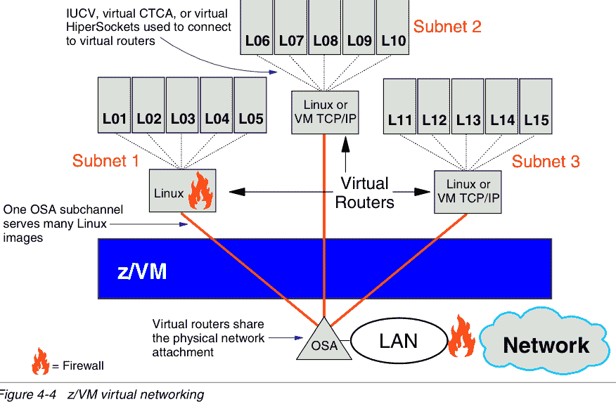

### 4.2.4 `VM Guest LAN` 支持

`VM Guest LAN` 在 `z/VM 4.2` 中引入并在 `z/VM 4.3` 中增强，在不依赖真实 `LAN` 硬件的情况下提供虚拟 `LAN` 网络支持。有两种类型的 `VM Guest LAN`：

- `HiperSocks`：在 `z/VM 4.2` 中引入，`HiperSocks VM Guest LAN` 在 `z/VM` 镜像中仿真真实的 `HiperSocks` 网络。
- `OSA`：在 `z/VM 4.3` 中引入，`OSA Guest LAN` 在 `z/VM` 镜像中仿真真实的 `OSA` 网络。

`VM Guest LAN` 支持消除了在使用 `IUCV` 和 `vCTCA` 时的点对点 `LAN` 管理挑战，`z/VM` 设计用于在不支持真实的 `HiperSocks` 的处理器（如 `G5`、`G6` 和 `Multipro 3000`）上使用 `VM Guest LAN` 启用虚拟 `HiperSocks` 环境。这增强了这些处理器上的虚拟网络环境，同时允许客户为真实的 `HiperSocks` 环境做好准备。

可以定义系统虚拟机 `LAN` 以及与特定 VM（例如虚拟机）关联的虚拟机 `LAN`。系统虚拟机 `LAN` 独立于任何活跃的（例如已登录的）用户。虚拟机 `LAN` 只在用户活跃时才与用户关联。对于任种类型的虚拟机 `LAN`，授权用户都可以链接到 `LAN` 以参与 `HiperSocks`。链接到虚拟机 `LAN` 的虚拟设备数量没有预定义的限制。虚拟机 `LAN` 的数量也没有限制。

图 4-5 中的虚拟网络环境显示了一个单个 `Linux` 镜像（位于中间）连接到真实网络。它作为连接三个虚拟机 `LAN` 的 `Linux` 服务器到“外部世界”的路由器。

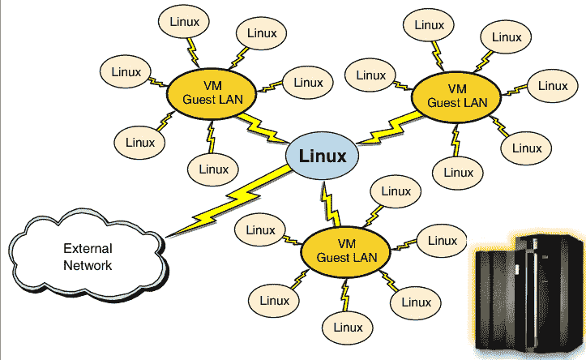

图 4-5 虚拟网络示例

`Linux` 路由器还可以将数据从一个虚拟机 `LAN` 传输到另一个。这允许客户将其虚拟机 `LAN` 上的 `Linux` 镜像与其他虚拟机隔离，使用路由器保护虚拟机 `LAN` 之间的流量。

### 4.2.5 `z/VM` 的 `Linux` 性能：可扩展性

`zSeries` 客户在 `z/VM` 上扩展 `Linux` 负载有许多选择。`z/VM` 支持垂直和水平增长，对硬件技术的利用增强了 `Linux` 负载的性能和可扩展性。

通过 `z/VM`，你可以垂直或水平地扩展你的服务器。垂直增长是在当你向现有虚拟机添加更多系统资源时，即实现了垂直增长。你可以为 `Linux` 虚拟机提供更多处理器容量、更多虚拟内存、更多 `I/O` 设备和更多的网络带宽。

水平增长是增长 `Linux` 负载的典型方式。通过在 `z/VM` 上添加另一个、两个或更多虚拟机即可实现。在系统资源的有效使用和共享方面具有额外收益。这在考虑单个 `Linux` 实例的可扩展性时，使得添加更多 `Linux` 服务器是一个特别有吸引力的选项。

当你选择利用 `z/VM` 的内存中数据技术时，实现了 `Linux` 负载的可扩展性。存储中的虚拟磁盘和内存缓存可以通过使 `I/O` 操作以处理器速度执行，从而提升 `z/VM` 上 `Linux` 服务器的性能，避免访问 `I/O` 子系统并等待磁盘。

`z/VM` 支持高级存储功能，如远程镜像复制 (`PPRC`) 和 `FlashCopy`。由于这些技术，你可以扩展虚拟机环境，即使处理器不支持真实的 `HiperSocks`。

### 4.2.6 `z/VM` 的开发：生产力

`z/VM` 允许在 `z/VM` 上进行开发和测试工作。...（此处已根据要求去除了重复的段落）

备用镜像消耗的资源很少。在离散服务器世界中，一台备用服务器的成本通常与其备份的生产服务器相当。成本包括获取费用和支持费用。

`z/VM` 对 `Linux` 价值的一个关键方面是资源共享。这包括处理器能力、网络带宽和磁盘技术。`CMS minisk`（一种磁盘分区技术）可以在 `Linux` 镜像之间轻松共享。这允许你将数据存储在一组磁盘上，并供任意数量的 `Linux` 虚拟机访问。任何版本都可以访问只读 `minisk` 这种配置……这种配置对于应用程序软件的版本控制和升级是理想的。通过 `z/VM` 的 `minisk` 缓存支持，可以使用处理器内存来缓存 `minisk`。这使得对只读 `minisk` 的 `I/O` 可以实现内存到内存的数据传输速率。

## `z/VM` 和 `DASD` 选项

`zSeries` 上的 `Linux` 使用 `IBM TotalStorage Enterprise Server` (`ESS`) 进行磁盘空间分配。如图 4-6 所示，`Linux` 磁盘空间可以从 `TDISK` 空间、单个卷或 `Linux` 虚拟机分配。

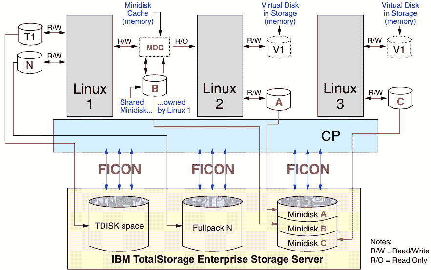

图 4-6 `z/VM` 和虚拟磁盘

## 4.2.8 系统管理：使用 `Tivoli Storage Manager` 和 `FlashCopy` 进行数据备份

你可以利用 `Tivoli Storage Manager` 进行文件级 `Linux` 数据备份。`z/VM` 技术提升了备份操作的性能。`FlashCopy` 极地减少了备份所需的停机时间。

`z/VM` 为 `Linux` 服务器提供了大量的系统管理功能。一个例子是使用 `Tivoli Storage Manager` 进行备份和恢复。图 4-6 展示了利用 `z/VM` 对 `IBM TotalStorage Enterprise Server FlashCopy` 功能支持的备份场景。在 `z/VM` 虚拟机中运行 `Linux` 意味着你可以利用 `FlashCopy` 中的高级技术，即使 `FlashCopy` 本身并不支持该功能。

此示例中备份的数据位于磁盘地址 201。该磁盘由运行在最左侧 `Linux` 镜像上的生产应用程序“所有”。使用 `z/VM FlashCopy` 命令对该磁盘进行 `FlashCopy`。这产生了图中所示的 202 磁盘，它是 201 磁盘的副本。`FlashCopy` 操作是 `ESS` 子系统上的快速操作，能够最大限度地减少运行在 `Linux` 上的生产应用程序所需的停机时间。`FlashCopy` 完成后，生产应用程序可以恢复并访问 201 磁盘。

202 磁盘连接到第二个 `Linux` 虚拟机，该虚拟机是为了执行备份操作而创建的。`TSM` 客户端代码运行在此 `Linux` 镜像中。它通过两个虚拟机之间的高速虚拟连接，将文件级数据发送到运行在独立虚拟机中的 `TSM` 服务器。`z/VM TSM` 服务器拥有独立许可，但作为 `z/VM` 产品交付，它将备份数据发送到磁带子系统。

## 4.2.9 合并示例：箱中的服务器农场

真实的分布式服务器涉及许多费用（和浪费）。服务器镜像的活跃时间通常仅占 15% 到 20% 是常态。在空闲时，离散服务器无法将其处理器和内存资源分配给可以使用这些容量的其他服务器上的应用程序。

在运行 `z/VM` 的 `Linux` 上对分布式服务器进行合并可以提供一种极具吸引力的选择。`z/VM` 上的虚拟机共享整个系统资源。处理器和内存容量会在服务器需要时分配给需要的服务器。

如图 4-7 所示，每台离散服务器都需要自己的磁盘空间。所有这些空间都包含其他服务器上的相同文件/数据，这代表了磁盘空间（和资金）的无浪费。此图显示了 `z/VM` 如何在虚拟 `Linux` 镜像之间共享磁盘空间。这不仅是对磁盘投资的有效利用，也是为应用程序软件提供版本控制的极佳方法（将软件放在一个磁盘上，所有虚拟 `Linux` 服务器均可访问）。

传统服务器农场

| `Intel` | `Sun` | `Sun` | `HP` |
|---|---|---|---|
| `Intel` | `Sun` | `Sun` | `HP` |
| `Intel` | `Sun` | `Sun` | `HP` |
| `Intel` | `Sun` | `Sun` | `HP` |
| `Intel` | `Sun` | `Sun` | `HP` |
| `Intel` | `Sun` | `Sun` | `HP` |
| 许多通用服务器 | | | |

箱中的服务器农场

| `Linux` | `Linux` | `Linux` | `Linux` | `IBM@server` |
|---|---|---|---|---|
| `Linux` | `Linux` | `Linux` | `Linux` | `IBM@server` |


| Linux | Linux | Linux | Linux | IBM@server |
| Linux | Linux | Linux | Linux | IBM@server |
| Linux | Linux | Linux | Linux | IBM@server |
| z/VM on zSeries | | | | |

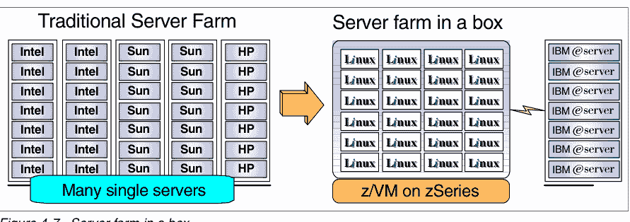

使用独立服务器，你需要为每台服务器连接真实的电缆。`z/VM` 为你的 Linux 服务器提供了“虚拟”电缆。这些虚拟电缆快速、廉价，并提供内存到内存的数据传输率。

命令和控制操作需要大量的支持人员或昂贵的软件产品。它们还需要相应的专用服务器来运行软件，以及安装在每个服务器镜像上的客户端软件来与命令控制功能进行通信。`z/VM` 提供了内置的命令和控制功能。

如果需要，计算密集型服务器负载可以留在离散服务器镜像上，并连接到运行在 `z/VM` 上的“服务器农场”的其他部分。

## 4.2.10 合并示例：单台 `zSeries` 上的数据和应用程序服务器

在 `zSeries` 上使用 Linux `z/VM` 托管应用程序服务器是可能的。在 `zSeries` 上使用 Linux 托管应用程序服务器可以节省资金并提高服务质量。

将这些应用程序迁移到 `zSeries` 上的 Linux 相对简单，不需要对环境进行更改，并且可以节省许多。

图 4-8 中的服务器合并场景通常被称为应用集成。数据和应用程序服务器的共存意味着可以利用 `HyperSockets` 等技术，而无需真实网络的复杂性。

在图 4-8 中，运行在分布式服务器上的应用程序服务器（中间层应用服务器）被运行在 `z/VM` 下的 Linux 虚拟机取代。真实网络被 `zSeries` 提供的网络功能（`HyperSockets` 和虚拟机 LAN）所取代。`zSeries` 上的 Linux 促进了双层硬件环境下的三层架构。无需重新设计环境。这种场景下的用户可以继续使用应用程序服务器。他们可能没有注意到应用程序服务器被重新托管了，除非他们的应用程序服务器发生了停机。

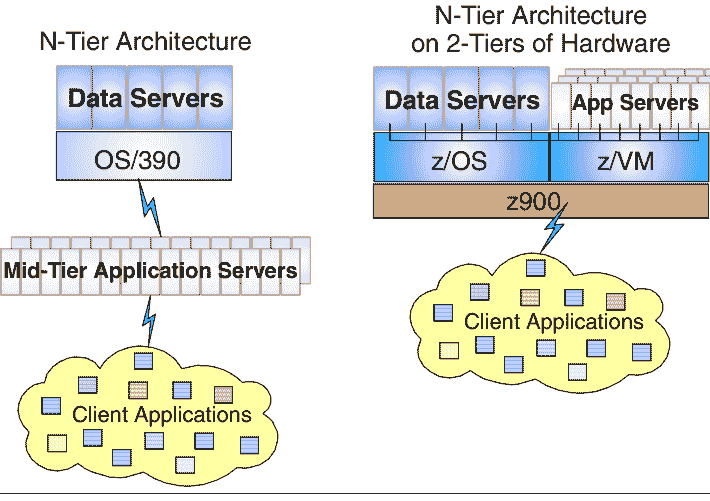

4-8 迁移到单台 `zSeries`

`HyperSockets` 实现了 `LPAR` 之间内存到内存的网络连接。在图中，一个 `LPAR` 运行 `z/OS`，另一个 `LPAR` 运行带有应用程序服务器的 `z/VM`。

## 4.2.11 水平扩展：添加另一台服务器

`z/VM` 是一个处理增长服务器环境的成本效益平台。虚拟化技术是快速增长服务器环境的“必需品”。

通过 `z/VM` 和 `zSeries` Linux，你可以轻松且有效地利用硬件技术来响应服务器增长。图 4-9 显示了这种工作方法的示例。

有时增长计划会被低估。增长可能从少数离散服务器开始。很快你就会发现在配置中添加比预期更多的服务器。每增加一台离散服务器都需要时间进行设置和上线，包含无法与其他服务器共享的资源（内存、处理器、磁盘空间等），并对系统管理的人员和软件产品产生需求。

在 `z/VM` 上添加另一个虚拟机 Linux 服务器对人员和 IT 预算的影响小得多。虚拟机可以在几分钟内上线，而不是几小时或几天。`z/VM` 高效地在所有 Linux 服务器镜像之间共享整个系统资源。没有资源浪费，且 `z/VM` 内置的系统管理功能可以快速地适应另一个服务器镜像的加入。

客户在部署服务器解决方案时，需要仔细考虑其服务器增长需求。快速增长的服务器环境尽管最初很小，但可能非常适合 `zSeries` 上的 Linux 和 `z/VM`。

# 4.3 `zSeries` Linux 发行版

目前，三大 Linux 发行版提供了 Linux for `zSeries` 版本：`SuSE`、`Turbolinux` 和 `Red Hat`。

Linux for `S/390` 自 2000 年初起通过 `IBM DeveloperWorks` 或 Linux 发行版伙伴提供。所有当前的发行版（截至 2002 年 11 月）都基于 Linux 2.4 内核。这些发行版包含了额外的中间件和应用程序。它们还包括基础设施服务，如域名服务器（`DNS`）、动态主机配置协议（`DHCP`）和网络文件系统（`NFS`）服务器，以及如 `Apache` Web 服务器、`Squid` 代理服务器、简单邮件传输协议（`SMTP`）邮件服务器和 `Samba` Windows 网络服务器。这些发行版还利用 `zSeries` 服务器的 `HyperSockets` 技术来实现分区间的互连。

可用于 `zSeries` 的发行版有：

- `SuSE`
- `SLES 7`
- `SLES 8`
- `Red Hat`
- `Red Hat 7.1`
- `Debian 3.0`

未来，`UnitedLinux` 版本也将适用于 `zSeries` 服务器。

# 4.4 `zSeries` 客户与 Linux

`zSeries` 服务器被广泛认为是一种可进行垂直和水平扩展的集成业务服务器。它可靠、可扩展，并被认为是行业内最灵活、最易用的系统之一。此外，它可以运行多个环境并帮助快速部署应用程序。

这些属性使 `zSeries` 成为管理电子商务赋能复杂性和成本的最佳平台之一。Linux on `zSeries` 的关键特性（如新一代应用程序、集成和整合）有力地支持了 `IBM` 的计划。它们可以为电子商务解决方案的部署带来可衡量的客户效益。

# 4.5 Linux 应用程序解决方案

用于 `zSeries` 的 Linux 发行版包含了著名的开源应用程序，如 `Apache`、`Samba`、`IMAP`、`LDAP`、`Perl`、`SendMail` MTA、`Squid` 和 `PostgreSQL`。Linux 应用程序来源于许多领域。开源应用程序可以从互联网下载。也可以为 `zSeries` 开发应用程序。Linux for `zSeries` 发行版自带了编译器。

解决方案提供商已发布了适用于 `zSeries` 服务器 Linux 的产品。`zSeries` 可用来自 120 多家供应商的 200 多种应用程序。详细产品列表请参考：

`http://www.ibm.com/servers/eserver/zseries/solutions/s39da/linuxproduct.html`

为了协助解决方案提供商向市场引入更多解决方案，提供了 Linux 的 `zSeries` 测试驱动，它可以提供对 `zSeries` 上 Linux 安装的远程访问。提供不同类型的测试驱动，分别代表不同的发行版和不同容量的磁盘空间。更多信息请参考以下网站：

`http://developer.ibm.com/welcome/s390/eslinux.html`

`http://etpgw02.dfw.ibm.com/rdp.html`

### 基础设施应用程序

针对 `zSeries` Linux 解决方案发布的基础设施应用程序示例包括：

- `extends`: 这是 `Acucorp` 的 `COBOL` 集成开发环境，包含了 `AUCOBOL-GT`（其旗舰产品）。许多企业公司和 `ISV` 使用 `AUCOBOL-GT` 编写或扩展了它们的 `COBOL` 代码。该集成开发环境为软件开发人员提供了无需重新编译即可将其现有的 `AUCOBOL-GT` 应用程序迁移到 `zSeries` 的能力。

- `GMX Solutions' CM_SAFE Server for zSeries`: 该应用程序为开放系统主机提供配置文件管理功能。它还为 `zSeries` Linux 安装提供服务器支持，并为所有主要的 `UNIX` 变体和平台提供代理支持。

- `zGuard`: 这款来自 `Frank Bernard Informationtechnik` 的应用程序是适用于 `S/390` 和 `zSeries` 的基于 Linux 的安全解决方案。它具有防火墙、`IPsec-VPN`、包括邮件、`HTTP`、`NNTP` 和 `FTP` 在内的各种协议在线病毒扫描，以及基础的 `IDS`（入侵检测系统）功能。

### 业务应用程序

适用于 `zSeries` Linux 解决方案的业务解决方案示例包括：

- `mySAP.com`: 这是 `SAP` 成功的企业资源计划软件 `SAP R/3` 的继者。它是一个面向整个企业的电子商务平台。它提供了从采购、项目管理、生产、会计到控制的众多模块。

- `LOGA 2001`: 这是来自 `Personal & Informatik AG` 的一种现代薪资应用程序。该应用程序将薪资工资报酬与费用会计结合在一起。根据所涉及的部门（如工业部门服务或公共管理），可以提供多种解决方案包。

`Personal & Informatik AG` 还提供了一种名为 `LOGA/ERM`（员工关系管理）的人力资源系统。该门户使员工能够实现某些功能的自动化，并降低行政工作的成本。通过个性化主页，可以访问日常工作和职业规划所需的应用程序、服务和信息。

- `OpenN2 for Linux`: 这是 `S2` 提供的用于授权和基于支付的事务处理的整合解决方案。它利用了大型机级的计算能力，减少了复杂性和实现时间。`OpenN2` 对 Linux 主机环境的亲 `Affinity` 源于其平台抽象层（`PAL`）设计，该设计将平台代码与高级服务及应用程序隔离开。

### Web 启用应用程序


针对 `zSeries` `Linux` 解决方案发布的 Web 启用应用程序示例包括：

- `eCommerce`: 该来自 `eOne Group` 的解决方案是一个电子商务应用程序和互联网发布工具。

- `Tamino XML Server`: 该来自 `Software AG` 的应用程序是基于原生 XML 存储和开放互联网技术的高性能信息管理平台。`Tamino XML Server` 帮助发现和管理企业跨任何类型的内容，并能够快速实现稳健、高性能且关键任务的电子商务应用程序。该服务器的设计目的是：

  - 高效地原生存储 XML 文档，即以其原始格式存储
  - 向外界展示位于各种 XML 或非 XML 源（遗留数据）或应用程序的信息
  - 有效搜索 `Tamino` 程序可用的所有信息

- `CommuniGate Pro`: 该来自 `Stalker Software` 的应用程序提供了运营商级消息解决方案。它集成了高性能、高速、可靠性和具有丰富功能集的安全性。其独特的集群架构允许您管理数百万账户，同时提供 99.999% 的可用性。它基于开放标准，支持包括 `IBM` 平台在内的24 多种操作系统和硬件。它提供了自定义的 Web 邮件访问、邮件访问协议（IMAP）、SMTP/邮局协议（POP）、轻量级目录访问协议（LDAP）、个人页内置 Web 服务器、先进列表、多语言支持和简单的管理工具等。

- `DI-Atlantis`: 该来自 `Dimensional Insight, Inc.` 的解决方案是一个多维软件包，旨在转换数据以进行直观访问和分析。`DI-Atlantis` 让您能够易于理解的格式提供用户所需的信息。

## 4.5.1 邮件服务场景

图 10 展示了一个企业可能用于内部邮件服务的典型电子邮件应用程序。通常电子邮件应用程序的使用是间发性的，对处理器的需求很低。长时间的空闲非常常见，因为服务器在等待用户联系以发送、接收或检查邮箱。当服务器处于活动状态时，它执行 I/O 操作，因为该应用程序的计算很少。

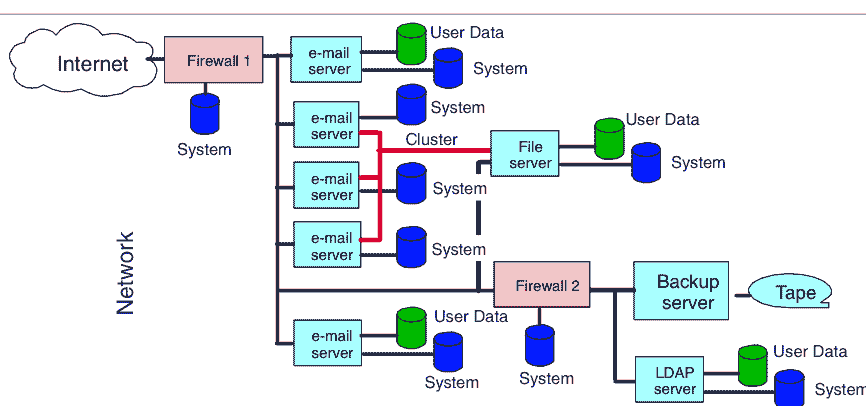

图 4-10 邮件服务场景

图 4-10 中的示例提出了几个非常有趣且有效的观点。无论实际的解决方案场景如何，基于解决方案的服务器并不是构成该解决方案的唯一服务器。防火墙、故障转移保护、目录服务器、备份服务器等通常也包含生产环境中。需要注意的是，在大多数分布式系统中，这些服务器中的任何一个都可能构成单点故障。此外，每台服务器都占用空间、消耗电力，并且必须持续监控。

驱动此应用程序的软件是统一的，可以被提供解决方案的所有服务器使用。该应用程序所需的服务级别是主时段，即每天 12 小时，每周 5 天。

该场景有两种选择：

- 30 台 `Intel` 100 兆赫兹 (`MHz`) 服务器
- 一台 `zSeries 900 Linux` 集成功能 (`IFL`) 引擎

图 4-10 展示了分布式解决方案。服务器连接到物理网络，这需要硬件支持。同时注意，每台服务器都在运行操作系统和应用程序代码的独立副本。这在解决方案的每台服务器上都是重复的，在这种情况下是 30 倍。每台服务器都需要磁盘空间来支持这一点。如果服务器需要额外的磁盘存储，替代方案是购买整个磁盘卷并安装它，或者购买更高容量的磁盘，将所需的软件和数据移动到其中并进行安装。

必须对每台服务器单独进行维护。需要某种类型的操作自动化来监控这 30 个独立系统，并在必要时响应回复。备份由专用的备份服务器完成。每个系统上的客户端代码与服务器通信以执行备份操作。

> 重要：在以下场景中，假设 `Intel` 服务器运行在利用率的 1% 到 5% 范围内。

图 4-11 显示了 `IBM @server Z2Series` 解决方案。注意，服务器之间的通信在机器内部进行。这允许 `Linux` 实例以内存速度进行通信，而不是具有通常延迟的物理网络速度。除了改进服务器间通信外，还避免了大部分外部网络硬件和软件的成本。

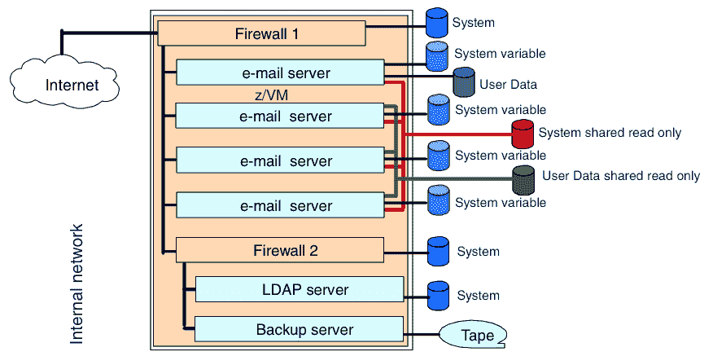

图 4-11 系列解决方案

操作系统和应用程序代码的磁盘存储由所有 30 台虚拟机服务器共享，而在分布式情况下它们必须复制。共享代码具有两个优势：控制磁盘存储成本和易于维护。由于只存在一份代码副本，只需要在一个地方进行维护。这节省了系统管理软件费用和人员成本。尽管只使用了一份代码，但有 30 台服务器在运行。在分布式情况下，它们会发出消息，这些消息必须被监控并得到相应的响应。`z/VM` 包含一个可编程的操作函数（称为 `PROP`），可以用于该功能，以避免执行该任务的额外软件的成本。在复杂的环境中需要额外的系统管理软件。

`z/VM` 还提供了分区服务器可用磁盘空间的能力，可以在不购买新磁盘的情况下增加磁盘空间。如果其他服务器上有空闲磁盘空间，无法移动到需要增加磁盘存储的服务器。在 `IBM` 解决方案中，`z/VM` 提供了将磁盘分区为 `minisk` 的，可以轻松分配给需要额外磁盘空间的服务器。注意在电子邮件应用程序中，某些邮箱的增长速度比其他邮箱快，可能需要扩展。

备份再次由备份客户端完成。在 `IBM` 解决方案中，由预安装在 `z/VM` 上的 `Tivoli Systems Manager Backup` 服务器完成。`Tivoli Systems Manager` 服务器与虚拟实例上的客户端通信以执行备份操作。

另一个需要考虑的因素是，`IBM TotalStorage` 企业存储服务器磁盘解决方案比独立系统上的专用磁盘是一种独特且强大得多的解决方案。企业存储服务器的可靠性特性包括该单元提供的高级功能，例如 `FlashCopy`。该功能允许您立即创建磁盘卷的副本。这对于最小化备份停机时间或为新应用程序创建测试数据非常有用。

### 成本比较：三年总拥有成本 (`TCO`)

图 4-12 显示了分布式解决方案与 `Linux zSeries 900` 解决方案之间的三年成本比较估算。在可靠性和人员成本方面有巨大的节省。

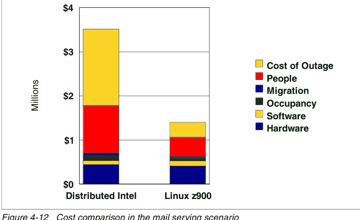

## 4.5.2 新闻组服务场景

此用例描述了专用于新闻组服务的服务器，例如应用程序和互联网服务提供商提供的服务器。应用程序相当简单，对处理器的要求很低。长时间的空闲时间很常见，因为服务器在等待请求信息的用户的联系。当服务器处于激活状态时，通常执行 I/O 操作，因为此应用程序的计算量很少。

驱动此应用程序的软件是统一的，可以被提供解决方案的所有服务器使用。在新闻组服务案例中，没有考虑到停机时间。

与之前的场景一样，这有三种不同的方法：一种基于 `Intel`，一种基于 `S390`，一种基于 `zSeries`。此情况下的替代方案是：

- 包含 215 台基于 `Intel` 的服务器的分布式解决方案
- `9672` 台六引擎 `Linux G6 X67`
- 四台 `zSeries 900 Linux` 集成功能 (`IFL`) 引擎

图 4-13 展示了分布式解决方案。服务器连接到物理网络，这需要硬件。同时注意，每台服务器都在运行操作系统和应用程序代码的独立副本。这在解决方案的每台服务器上都是重复的，在这种情况下是 30 倍。每台服务器都需要磁盘空间来支持这一点。如果服务器需要额外的磁盘存储，替代方案是购买整个磁盘卷并安装它，或者购买更高容量的磁盘，将所需的软件和数据移动到其中并进行安装。

必须对每台服务器单独进行维护。需要某种操作自动化来监控这 30 个独立系统并在必要时响应回复。备份由专用的备份服务器完成。每个系统上的客户端代码与服务器通信以执行备份操作。

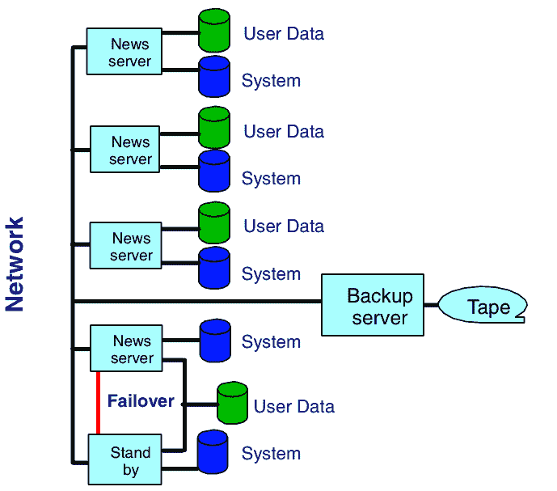

图 4-13 分布式新闻组场景

图 4-14 显示了 `zSeries` 解决方案。服务器之间的通信在机器内部进行。这允许 `Linux` 实例以内存速度进行通信，而不是具有通常延迟的物理网络速度。除了改进服务器间通信外，还避免了大部分外部网络硬件和软件的成本。

操作系统和应用程序代码的磁盘存储由所有30 台虚拟机服务器共享，而在分布式情况下它们必须复制。共享代码具有两个优势：控制磁盘存储成本和易于维护。由于只存在一份代码副本，只需要在一个地方进行维护。这节省了系统管理软件费用和人员成本。尽管只使用了一份代码，但有 30 台服务器在运行。在分布式情况下，它们会发出消息，这些消息必须被监控并得到相应的响应。`z/VM` 包含一个可编程的操作函数（称为 `PROP`），可以用于该功能，以避免执行该任务的额外软件的成本。在复杂的环境中需要额外的系统管理软件。

`z/VM` 还提供了分区服务器可用磁盘空间的能力，可以在不购买新磁盘的情况下增加磁盘空间。如果其他服务器上有空闲磁盘空间，无法移动到需要增加磁盘存储的服务器。在 `IBM` 解决方案中，`z/VM` 提供了将磁盘分区为 `minisk` 的，可以轻松分配给需要额外磁盘空间的服务器。注意在电子邮件应用程序中，某些邮箱的增长速度比其他邮箱快，可能需要扩展。

备份再次由备份客户端完成。在 `IBM` 解决方案中，由预安装在 `z/VM` 上的 `Tivoli Systems Manager Backup` 服务器完成。`Tivoli Systems Manager` 服务器与虚拟实例上的客户端通信以执行备份操作。


另一个需要考虑的因素是，`IBM TotalStorage` 企业存储服务器磁盘解决方案比独立系统上的专用磁盘是一种独特且强大得多的解决方案。企业存储服务器的可靠性特性包括该单元提供的高级功能，例如 `FlashCopy`。该功能允许您立即创建磁盘卷的副本。这对于最小化备份停机时间或为新应用程序创建测试数据非常有用。

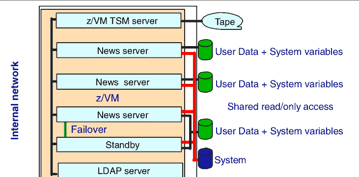

由于 `zSeries` 引擎性能强大得多，因此所需的引擎比 `G6` 解决方案更少。这会影响某些成本，例如软件和维护成本，这些成本基于解决方案所需的引擎数量。

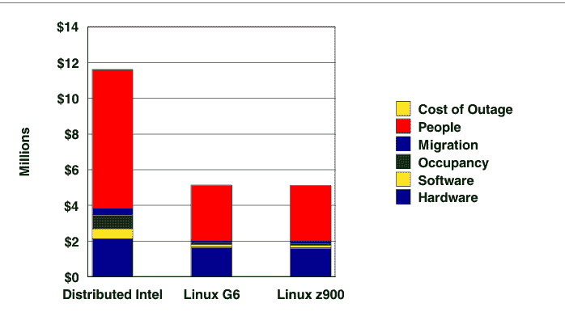

图 15 新闻群组服务场景对比

### 4.5.3 使用 `Samba` 提供文件/打印服务

本节描述了如何使用 `Samba` 文件打印应用程序提供文件/打印服务。`Samba` 是高质量的开源代码，集成在大多数 `Linux` 发行版中。文件/打印服务对处理器的计算资源要求并不高。但当用户上传/下载文件或将其路由到打印机时，它会考验解决方案的 `I/O` 能力。服务器花费大量时间等待用户请求文件服务。

驱动此应用程序的软件是统一的，可用于所有提供解决方案的服务器。此应用程序所需的服务级别是主峰班次，每天 12 小时，每周 5 天。

在这种情况下，备选方案有：

- 150 台 `Intel` 2 双路 1000 MHz 服务器的分布式解决方案
- 9672 台 `G6 X47`

让我们像查看应用程序时一样查看这些备选方案。图 4-16 显示了分布式解决方案的逻辑原理图。注意，服务器连接到需要硬件的物理网络。同样注意，每台服务器都运行着独立的操作系统和应用程序代码副本。这在解决方案的每台服务器上都是重复的，在这种情况下即为 150 倍。如果服务器需要额外的磁盘存储，备选方案是购买并安装一个额外的整个磁盘卷，或者购买更高容量的磁盘，将所需的软件和数据移动到其中并安装。

必须对每台服务器单独进行维护。需要某种类型的操作员自动化来监控这 150 个独立的系统，并在必要时做出响应。备份由专用的备份服务器完成。每个系统上的客户端代码与服务器通信以执行备份操作。

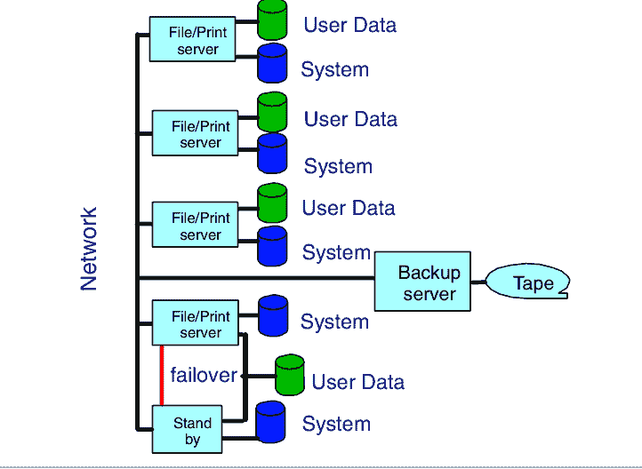

图 4-17 显示了 `zSeries` 解决方案。注意，服务器之间的通信发生在机器内部，这允许 `Linux` 实例以内存速度进行通信，而不是具有通常延迟的物理网络速度。除了改进服务器间通信外，还避免了外部网络硬件和软件的成本。

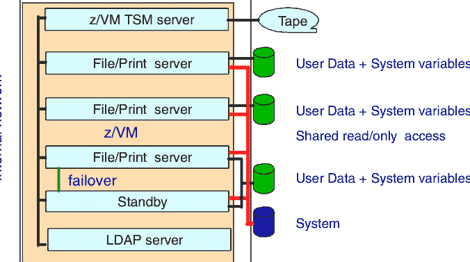

图 4-17 `zSeries` 上的 `Samba` 文件和打印

操作系统和应用程序代码的磁盘存储由所有 150 台虚拟机共享，而在分布式案例中，它们必须被复制。共享代码具有控制磁盘存储成本和易于维护的优势。由于只存在一份代码副本，只需要在单处进行维护，从而节省了系统管理软件和人员成本。在仅使用一份代码副本后，150 台服务器即可投入运行。在分布式情况下，它们会发出消息，在某些情况下必须对这些进行监控和响应。`z/VM` 中的 `PROP` 函数正是为此目的而设计的，避免了执行该任务的额外软件成本。在复杂环境中，需要额外的系统管理软件。

`z/VM` 可以帮助你分区服务器可用的磁盘空间。在分布式模型中，增加磁盘空间意味着你需要购买新磁盘。如果其他服务器上有空闲磁盘空间，无法移动到需要增加磁盘存储的服务器上。在 `S/390` 解决方案中，`z/VM` 允许将磁盘分区为微磁盘（`minisks`），你可以轻松将其分配给需要额外磁盘空间的服务器。

备份再次由备份客户端完成。在 `S/390` 情况下，它由预安装在 `z/VM` 上的 `Tivoli Systems Manager Backup` 服务器完成。`Tivoli Systems Manager` 服务器与虚拟实例上的客户端通信以执行备份操作。

第 4 章 `zSeries` 和 `Linux` 101

另一个需要考虑的因素是，企业存储服务器磁盘解决方案是独特的，且性能远比独立系统上的专用磁盘强大。企业存储服务器的可靠性特性包括单元中的此类高级功能，如 `FlashCopy`，你可以瞬间创建磁盘卷的副本。这对于最小化备份停机时间或为新应用程序创建测试数据有用。

### 成本比较：三年总拥有成本 (`TCO`)

在成本比较中，停机成本的影响很大。通过减少这些潜在成本可以节省大量的费用。人员也是一个可以减少的成本成本因素。

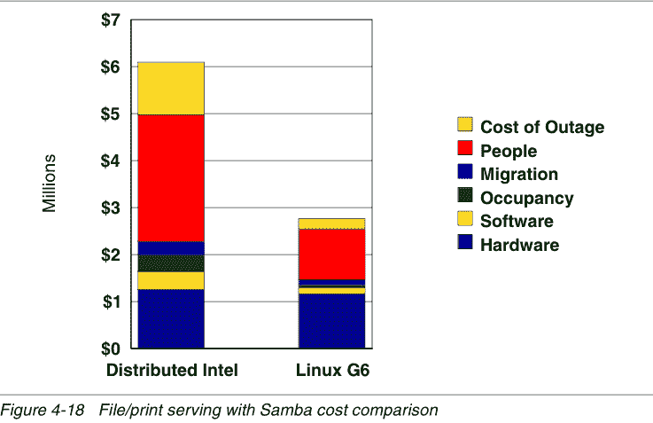

## 4.5.4 用于 `zSeries` 的 `IBM Linux` 软件

第 108 页的表 4-2 至表 4-7 列出了可以在 `zSeries Linux` 上运行的 `IBM` 中间件。预计未来会有更多解决方案。

### 表 4-2 `zSeries` 和 `DB2` 软件矩阵

| 产品名称 | 版本/发布 | 硬件 | 内核/发行版 |
| :--- | :--- | :--- | :--- |
| `DB2 Intelligent Miner Visualization` | 8.1 | `zSeries` | 查看 `DB2 for Linux` 网站获取支持的平台和 |
| `DB2 Net Search Extender` | 8.1 | `zSeries` | 查看 `DB2 for Linux` 网站获取支持的平台 |
| `DB2 NetData` | 8.1 | `zSeries` | 查看 `DB2 for Linux` 网站获取支持的平台 |
| `DB2 Personal's Edition` | 8.1 | `zSeries` | 查看 `DB2 for Linux` 网站获取支持的平台 |
| `DB2 Runtime Client` | 8.1 | `zSeries` | 查看 `DB2 for Linux` 网站获取支持的平台 |
| `DB2 Spatial Extender` | 8.1 | `zSeries` | 查看 `DB2 for Linux` 网站获取支持的平台 |
| `DB2 Universal's Edition` | 8.1 | `zSeries` | 查看 `DB2 for Linux` 网站获取支持的平台 |
| `DB2 Universal Enterprise Edition` | 8.1 | `zSeries` | 查看 `DB2 for Linux` 网站获取支持的平台 |
| `IBM` | | | |
| `IBM Workload Modeler for Linux on zSeries` | 1.1 | `zSeries` | |
| `IBM Workload Modeler for Linux on zSeries` | 1.1 | `zSeries` | `Red Hat 7.2 for zSeries` |
| `IBM Workload Modeler for Linux on zSeries` | 1.1 | `zSeries` | `Red Hat 7.2 for zSeries` |
| `IBM CICS Transaction Gateway` | 5 | `zSeries` | |
| `IBM Developer Kit for Linux, Java 2 Technology` | 1.4 | `zSeries` | |

### 表 4-3 `IMS` 和 `Informix`

| 产品名称 | 版本/发布 | 硬件 | 内核/发行版 |
| :--- | :--- | :--- | :--- |
| `IMS` | `VSE/ESA` | 2.7 | |
| `IMS` | 运行在 `z/390` 上的 `IMS` 可供在 `Linux` 上的应用程序访问 `IMS` 数据 | | |
| `Information Management System (IMS)` | `Connect` | 1.1 1.2 | `zSeries` |
| `Informix` | `C-ISAM` | 7.24 | `zSeries (GLIBC 2.1)` |

### 表 4-4 `Tivoli`

| 产品名称 | 版本/发布 | 硬件 | 内核/发行版 |
| :--- | :--- | :--- | :--- |
| `Tivoli Access Manager for e-business` | 4.1 | `zSeries` | `SLES for S/390` 和 `IBM zSeries (2.4.7 kernel, 31 bit)` 以及 `SLES for 64 bit zSeries (2.4.17 kernel, 64 bit with a 31-bit compatible mode)` |
| `Tivoli Access Manager for e-business (以前称为 Tivoli Director/Tivoli Policy Director for Application Servers)` `Access Base Manager WebSEAL` | 3.9 | `zSeries` | `SuSE Linux 7 for s/390` 和 `IBM zSeries 2.4 Client and Server` |


| Tivoli Access Manager for Operating Systems | 4.1 | zSeries | SuSE Enterprise Level 7 for zSeries Red Hat 7.2 for zSeries Server and Client SLES for s/390 and zSeries (2.4.16, 32 bit) |

| Tivoli Configuration Manager | 4.2 | zSeries | SuSE 7.0 for s/390 |

| Tivoli Decision Support for OS/390 | 1.5 | zSeries | 仅 TurboLinux 6.5 (2.2 Kernel) |

| Tivoli Distributed Monitoring | 4.1 | zSeries | SLES 7.0 for zSeries Client and Server |

## 表 4-5 IBM Tivoli 续及 UniData™

| 产品名称 | 版本/发布 | 硬件 | 内核/发行版 |
| --- | --- | --- | --- |
| Tivoli Enterprise Console | 3.7.1 | zSeries | 适用于 zSeries 客户端和服务器的 SuSE SLES 7 |
| Tivoli Identity Manager | 1.1 | zSeries | 仅客户端 SuSE SLES 7 |
| Tivoli Management Framework | 4.1 | zSeries | Red Hat 7.2 SLES 7.2 服务质量端点：适用于 zSeries 的 Red Hat Linux 7.1，适用于 zSeries 的 TurboLinux Server 7 |
| Tivoli Transaction Performance Monitoring | 5.1 | zSeries | 适用于 zSeries 的 SuSE Linux Enterprise Server 7.0 |
| Tivoli Monitoring (曾名为 Tivoli Distributed Monitoring) | 5.1 | zSeries | 适用于 zSeries 的 SuSE 7.0（客户端和服务器），适用于Series 的 Red Hat Server 6（客户端和服务器） |
| Tivoli Monitoring (曾名为 Tivoli Distributed Monitoring) | 5.1 | zSeries | 适用于 s390 客户端和服务器的 SuSE SLES 7.0 |
| Tivoli Netview for z/OS MSM Agents (仅客户端) NMC Server (仅服务器) | 5.1 | zSeries | Red Hat 7.2 zSeries，适用于 zSeries 的 SuSE SLES 7，适用于 S/390 的 SuSE Linux 7.0（服务器和网关），适用于 S/390 和 zSeries 的 SuSE 7.3 SLES 7 |
| Tivoli Remote Control | 3.8 | zSeries | 仅客户端 |
| Tivoli Risk Manager | 4.1 | zSeries | - |
| Tivoli Risk Manager | 3.8 | zSeries | 仅客户端 SuSE SLES 7 |
| Tivoli Software Distribution | 4 | zSeries | 适用于 S/390 客户端和服务器的 2.2 Kernel SuSE SLES 7.0，备份存档客户端：适用于 S390 和 zSeries 的 SuSE Linux Enterprise Server 7 |
| Tivoli Storage Manager | 5.1.5 | zSeries | - |
| Tivoli Storage Manager | 5.1 | zSeries | 仅客户端 SuSE SLES 7.0 |
| Tivoli Storage Manager Client | 4.2 | zSeries | Linux Kernel 2.2.16 或更高，SuSE 7.0 |
| Tivoli Switch Analyzer | 1.2 | zSeries | ¦ |
| IBM Tivoli System Automation for Linux | 1.1 | zSeries | SLES 7 |
| Tivoli User Admin Workload Scheduler | 3.8 | zSeries | 仅客户端 SuSE SLES 7.0，适用于 S/390 的 SuSE Linux Enterprise Server (SLES)，Red Hat 7.2 zSeries，适用于 zSeries 客户端的 Turbo Linux 7 |
| Tivoli Workload Fault Tolerant Scheduling Agent | 8.1 | zSeries | - |
| IBM UniData | 5.2x | - | 适用于 s/390 的 SuSE 7.0 |

106 Linux 手册：IBM Linux 解决方案与资源指南

## 表 4-6 IBM WebSphere

| 产品 | 名称 | 版本/发布 | 硬件 | 内核/发行版 |
|---|---|---|---|---|
| WebSphere | WebSphere Application Server | 5 | zSeries | 基于内核 2.4 的 SLES (SuSe) 7 或 Red Hat 7.2 |
| WebSphere | Linux 版 WebSphere Application Developer Edition | 4 | zSeries | SuSe 7.0 - 内核 2.2.16，TurboLinux Server 6.5 - 内核 2 |
| WebSphere | Linux 版 WebSphere Server Advanced Edition | 4 | zSeries | SuSe 7.0 (内核 2.2.16)，基于 SuSe 31b 内核的 zLinux 上的 390 TurboLinux Server (WAS V4.0.3) |
| WebSphere | Linux 版 WebSphere Server Advanced Single. Edition | 4 | zSeries | SLES Linux 2.4 SuSe 7.0 (内核 2.2.16)，适用于 390 的 TurboLinux Server 6.0 (内核 2.2) |
| WebSphere | Linux 版 WebSphere Advanced Edition | 3.5 | zSeries | 基于内核 2.4 的 SLES (SuSe) 7 或 Red Hat 7.2 |
| WebSphere | WebSphere Enterprise | 5 | | 带有 2.4 内核的 SLES |
| WebSphere | Server Enterprise for Developers | 5 | zSeries | 带有 2.4 内核的 SLES |
| WebSphere | WebSphere Server Network Deployment | 5 | zSeries | 基于内核 2.4 的 SLES (SuSe) 7 或 Red Hat 7.2 |
| WebSphere | Linux 版 WebSphere Commerce Business Edition | 5.4 | zSeries | 2.4 Kernel SuSe Linux Enterprise Server (SLES) 7.0 |
| WebSphere | WebSphere Host on Demand | 7 | zSeries | Å |
| WebSphere | Host on Demand | 6 | zSeries | 服务器：zSeries 上的 Linux |

## 表 4-7 WebSphere 续

| 产品名称 | 版本/发布 | 硬件 | 内核/发行版 |
| --- | --- | --- | --- |
| WebSphere | | | |
| WebSphere Application Server | 5 | zSeries | 基于内核 2.4 的 SLES (SuSe) 或 Red Hat 7.2 |
| Linux 版 WebSphere Application Advanced Developer Edition | 4 | zSeries | SuSe 7.0 - 内核 2.216，TurboLinux Server 6.5 - 内核 2 |


| Linux 版 WebSphere Application Server Edition | 4 | zSeries | SuSe 7.0 (内核 2.216)，基于 SuSe 31b 2.4 内核的 zLinux 上的 390 TurboLinux Server  WAS V4.0.3 |
| Linux 版 WebSphere Advanced Single Edition | 4 | zSeries | SLES Linux 2.4 |
| Linux 版 WebSphere Server Edition | 3.5 | zSeries | SuSe 7.0 (内核 2.216)，适用于 390 的 TurboLinux Server 6 (内核 2.2) |
| WebSphere Server for Developers | 5 | zSeries | 基于内核 2.4 的 SLES (SuSe) 或 Red Hat 7.2 |
| WebSphere Server Enterprise | 5 | zSeries | 带有 2.4 内核的 SLES |
| WebSphere Enterprise for Developers | 5 | zSeries | 带有 2.4 内核的 SLES |
| WebSphere Network Deployment | 5 | zSeries | 基于内核 2.4 的 SLES (SuSe) 或 Red Hat 7.2 |
| Linux 版 WebSphere Business Edition | 5.4 | zSeries | 2.4 Kernel SuSe Linux Enterprise Server (SLES) 7.0 |
| WebSphere Host on Demand | 7 | zSeries | Å |
| WebSphere Host on Demand | 6 | zSeries | 服务器：zSeries 上的 Linux

## 4.6 z/390 上的

`z/390` Linux 运行在 `z/OS` 上的 s390 具有可用性。第 106 页 Linux 手册：IBM Linux 解决方案和资源指南。

## 4.6 Boscov's 商店

`Boscov's` 是一家私有的百货商店，目前在宾夕法尼亚州、特拉华州、新泽西州、纽约州经营着 37 家商店。所有商店位于公司总部和中央配送中心 300 英里范围内。目前约有 9000 名全职和兼职员工，不包括季节性员工。年营业额达 10 亿美元的 `Boscov's` 一直在收购并开设新店以满足当地客户。

`Boscov's` 需要停止其 `Windows NT` 服务器群的增长，同时提高可用性、扩展性以及许多不同应用的备份。`Boscov's` 还需要支持运行 `Linux` 的现有 `CICS`、`DB2` 和 `IMS` 增长，以及 `z/OS v1.1` 上的新关键应用。

`Boscov's` 多年来一直依赖大型机处理关键业务，包括 `s390`、`CICS`、`DB2` 和 `IMS`。大型机传统上提供了其业务所需的特性，如 `CICS` 和 `DB2`。当 `IBM` 增加了 `zSeries` 和 `S/390` 大型机上托管 `Linux` 系统的能力时，使得大型机的高质量服务能够扩展到服务器群中的现有分布式应用。该公司评估了基于大型机的 `Linux` 解决方案的能力和优势，包括其无与伦比的灵活性、处理能力以及在 `WebSphere Suite` 下运行电子商务应用程序的能力。接下来，他们决定将服务器群整合到运行 `zSeries` 和 `S/390` 的大型机上。

`Boscov's` 在 2001 年 7 月将 `S/390` 服务器 `R44` 型替换为 `zSeries 900 102` 型，以处理 `z/OS` 业务关键应用并将服务器群整合到大型机上的 `Linux` 虚拟机。`Boscov's` 部署了在 `z/VM` 上的由一个 `i6` 引擎驱动的 `SUSE Linux` 服务器。`zSeries 900` 还被用于运行 `Linux` 的多个分区。通过运行在大型机上的 `Linux` 有助于 `Telekom` 的应用。

要了解完整故事，请访问：
`http://www.ibm.com/servers/eserver/news/pressreleases/2002/zlinuxtele_07-html`

### 4.6.2 Boscov's 商店

`Boscov's` 是一家私有的百货商店，目前在宾夕法尼亚州、特拉华州、新泽西州、纽约州经营着 37 家商店。所有商店位于公司总部和中央配送中心 300 英里范围内。目前约有 9000 名全职和兼职员工，不包括季节性员工。年营业额达 10 亿美元的 `Boscov's` 一直在收购并开设新店以满足当地客户。

`Boscov's` 需要停止其 `Windows NT` 服务器群的增长，同时提高可用性、扩展性以及许多不同应用的备份。`Boscov's` 还需要支持运行 `Linux` 的现有 `CICS`、`DB2` 和 `IMS` 增长，以及 `z/OS v1.1` 上的新关键应用。

`Boscov's` 多年来一直依赖大型机处理关键业务，包括 `s390`、`CICS`、`DB2` 和 `IMS`。大型机传统上提供了其业务所需的特性，如 `CICS` 和 `DB2`。当 `IBM` 增加了 `zSeries` 和 `S/390` 大型机上托管 `Linux` 系统的能力时，使得大型机的高质量服务能够扩展到服务器群中的现有分布式应用。该公司评估了基于大型机的 `Linux` 解决方案的能力和优势，包括其无与伦比的灵活性、处理能力以及在 `WebSphere Suite` 下运行电子商务应用程序的能力。接下来，他们决定将服务器群整合到运行 `zSeries` 和 `S/390` 的大型机上。

* 软件 (`z/OS`) 的总成本和环境成本降低了
  - 主机应用 (`z/OS`) 和 `Linux` 应用工作负载随着（`IFL` 驱动的）`Linux` 工作负载而增加。
  - 维护独立 `Windows NT` 服务器的成本得以减少或消除。
  - 管理主机所需的时间少于服务器集群。
* 灵活性
  - `zSeries 900` 高效地运行混合工作负载，包括 `PeopleSoft`、数据仓库、`IMS`、`DB2` 和 `Linux` 应用。
  - 允许运行数千个 `Linux for zSeries` 虚拟机和分区的扩展性，允许将所有工作负载整合到一个中央机器上。
  - `Linux for zSeries` 还可以在不同的 `LPAR` 和 `z/OS DB2` 分区之间提供负载均衡。
* 可用性
  - 单 `zSeries 900` 主机中的 `Parallel Sysplex` 环境为使用 `CICS` 销售点应用程序的电子商务生成的信用卡授权提供了 24 小时可用性。

您可以在 Web 上找到这个故事：
`http://www.ibm.com/servers/eserver/zseries/os/linux/css/boscov1.html`

## 4.6.3 zSeries 服务解决方案

`IBM` 全球服务（`IBM Global Services`）为 `zSeries` 和 `Linux` 解决方案提供许多服务。以下章节提供了可用服务的概述。更多详情，请参阅 `IBM` 全球服务网站：


`http://www.ibm.com/services/e-business/linux_2.html`

### 运营支持服务

Linux 支持线为主要的 Linux 操作系统发行版提供全面的 24 小时企业级远程使用和缺陷支持。它还为运行在 Linux 环境中的所有 IBM 和许多非 IBM 应用提供支持。

### IGS 服务组合

IGS 提供了一全面的 Linux 服务组合，包括：

*   **IBM 迁移服务**：将文件/打印和 Web 服务工作负载整合到 `Linux for zSeries`。该服务通过对哪些工作负载可以整合到 `zSeries` 进行评估，帮助客户整合来自分布式集群的工作负载。然后为他们完成整合。
*   **IBM 迁移服务**：`Linux` 版 `Sendmail` 高级邮件服务器。该服务将客户现有的（运行在 `Windows`、`UNIX` 或 `Linux` 服务器上的）`Sendmail` 高级邮件服务器 (`SAMS`) 迁移到运行在 `Linux for zSeries` 上。
*   **IBM 迁移服务 – Linux 版 Binary Insight Server**：该服务通过运行在 `Linux for zSeries` 上的 `Binary Insight Server` 迁移客户现有的 `Windows Exchange` 服务器和用户。

IGS 还提供交付服务，包括：

*   **安装 Linux 的快速部署解决方案**：安装、设置和启用 `TCP/IP`；安装和配置 `Samba` 或 `Apache`。该服务使客户能够加速在其 `Linux for zSeries` 服务器上部署应用程序。
*   **中间件、数据库和连接器的安装与配置服务**，适用于 `WebSphere Server Advanced Edition`、`DB2`、`MQSeries` 等。

### Linux 策略研讨会

此服务包括在客户现场进行两天的信息收集、一天的研讨会活动以及一天的结论确定。根据前两天对客户的采访，将与决策者和 IT 管理人员共同制定定制的 Linux 策略。最后，客户将收到一份高层但定制的 Linux 策略。决策者和 IT 管理人员还将了解 Linux 能够做什么以及使用 Linux 获得的成本效益。

### 电子商务 Linux 解决方案

电子商务解决方案服务提供快速部署客户基于 Linux 和 `zSeries` 的电子商务环境。该解决方案根据客户的特定需求量身定制，允许他们选择多种中间件和应用程序，这些程序将基于受 IBM 支持的 Linux 操作系统基础进行安装和配置。

### VM 和 Linux 安装支持

从 `zSeries` 的 `LPAR` 配置开始，这帮助客户在运行 `VM` 下的虚拟机中实现 Linux。该服务包括 `VM` 以及作为虚拟机客机的 Linux 的安装。

### zSeries Linux 高可用安装支持

此专门服务使用基于 `zSeries` 的 Linux 实现了高可用性解决方案。

### 二进制安装支持

Linux 版 `Binary Insight` 服务为客户提供了一个极具吸引力的成本和系统管理建议，使其可以将工作负载从 `Windows NT` 服务器集群整合到运行在单个 `IBM @server` 上的多个 Linux 镜像。

客户通常将 `Microsoft Exchange` 作为其消息平台。IBM 迁移服务可以提供迁移到 Linux 版 `Binary Insight Server` 的服务。这将实现这些工作负载的服务器整合，从而最小化 `TCO`，启用系统管理功能并增强应用程序可用性。

### 迁移到 Linux 版 Sendmail 高级邮件服务器

此服务的主要目标是已在类 Unix 平台或多个服务器上使用 `Sendmail` 的客户。项目期间，所有邮件服务器将整合到一个运行在 `zSeries` 上的中央 `Sendmail` 高级邮件服务器上。

### DB2 Connect™ 安装支持

`DB2 Connect` 使应用程序连接到主机数据库。该服务设置 `DB2 Connect`，使主机数据直接对 PC 客户端或网络可用。

### 工作负载和服务器整合

工作负载和服务器整合是 IT 行业的主要驱动因素之一。`zSeries` 是整合问题的目标平台。因此，IBM 全球服务为需要整合的客户提供了多种解决方案。某些服务包括：

*   文件/打印服务和 Web 服务工作负载的整合
*   适用于 `S/390` 的 `DB2 Universal` 数据库迁移服务：此服务包括迁移到 `OS/390` 上的 `DB2` 版本 `7` 以及运行在系统映像 (`LPAR`)、客系统 (`VM`) 或独立 Linux 上的 `DB2 Linux`。项目包括安装、定制和验证，以及针对运营人员的基础技能培训。
*   `MQSeries` 的 `SmoothStart™`：这些项目为员工提供快速简单的安装和基础技能培训。

# 5. xSeries 和 Linux

本章提供了 `xSeries` 可用的 Linux 实现、解决方案和资源的概述。

本章涵盖了以下主题：

*   Linux 如何在 `xSeries` 上运行
*   `xSeries` 客户
*   作为整合解决方案的 `xSeries` 和 Linux
*   `xSeries` 客户
*   分布式企业中的 Linux
*   `xSeries` 应用
*   `xSeries` 基础设施解决方案

## 5.1 Linux 和 xSeries

在 60 年代，IBM 引入了 `System/360` 的灵活性，单机主机世界从此发生了改变。在 80 年代，IBM 引入了 `IBM PC`，它使用了通用部件，个人电脑的概念从此发生了改变。现在揭示了模块化、可扩展的服务器，标准服务器的世界将大不同。

`IBM @server X-Architecture` 是将高级性技术扩展到服务器的蓝图。这些技术涉及可用性、扩展性、系统管理、服务和支持。IBM 自 1998 年以来一直履行 `X-Architecture` 的承诺。它包含了 `Active™`、`PCI`、`C27 Interconnect™` 线缆、`Chipkill™` 内存、`预测性故障分析®`、`Light Path 诊断™` 以及 IBM 软件新生。

IBM 继续基于企业级架构技术进行构建。这些技术使 `xSeries` 服务器的输入/输出 (`I/O`)、内存和性能取得了革命性的进展。无与伦比的新设计为购买高端 32 位和 64 位 `xSeries` 服务器创建了灵活的“按需付费”方法。

仅适用于大型机和其他高端系统用户。与现有的 `X-Architecture` 技术相结合，这些创新为基于 `Intel` 处理器的服务器带来了前所未有的“扩展性效益”、无与伦比的灵活性，以及服务器可用性与性能的新水平。

在 `Intel` 架构 (`IA`) 服务器中，Linux 的演进非常迅速。与其他操作系统相比，它从开源软件周围庞大的开发环境中不断整合了新的驱动程序和功能。随着内核版本 `2.4` 的发行版的出现，用于 `Intel` 架构服务器的 Linux 已被接受为功能和稳定性均完全可以作为企业级操作系统的操作系统。虽然其他平台的市场份额增长不小，但运行 Linux 的 `Intel` 架构服务器市场却剧增。

### 5.1.1 xServers上的 Linux

`xSeries` 服务器基于 `X-Architecture`，IBM 将其多年企业服务器开发中的先进技术与以 `Intel CPU` 为代表的行业标准技术结合在一起（图 5-1）。

| `xSeries` | `iSeries` | `pSeries` | `zSeries` |
| :--- | :--- | :--- | :--- |
| `` | `` | `` | `` |
| 性能 | 可扩展 | 可管理 | |

图 5-1 `xSeries` 理念：从所有 `IBM @server` 产品线中学习长处

`xSeries` 服务器以低价格为客户提供先进技术的同时，许多具有行业标准的应用程序和服务也是可用的。最近，IBM 推出了用于高端服务器技术的 `X-Architecture`。2001 年秋，IBM 宣布了企业级 `X-Architecture` (`Enterprise X-Architecture`)。这项新技术通过服务器资源的动态配置，提高了扩展性、灵活性、可用性和性能的标杆。IBM 通过 IBM 开发的核心逻辑，并通过对应 `IA-32` 和 `IA-64` 处理器的 `IBM XA` 芯片，提供了企业级 `X-Architecture`。该技术始于 `xSeries 360` 和 `440` 型号。

`xSeries` 对操作系统的支持频繁变化。表 5-1 列出了几个网站，您可以参考这些网站以获取有关 `xSeries` 服务器可用服务的平台信息。这些信息可以在 Web 上的 `IBMServer®` 站点获取：

```
http://www.pc.ibm.com/us/compat/nos/matrix.shtml
```

您可以在 Web 上的找到 `xSeries` 的驱动程序和文档：

```
http://www.pc.ibm.com/support?lang=en_US&page=brand=IBM+PC+Server
```


表 5-1 xSeries Linux 信息矩阵

### Linux 与 X-Architecture 的功能

X-Architecture 技术是 `xSeries` 服务器不断演进的蓝图，源自 IBM 丰富的企业服务器遗产。`xSeries` 工程师了解那些变革大型 IBM 系统的技术，并将它们引入基于 Intel 的平台。`xSeries` 服务器是行业标准服务器，旨在以吸引人的价格提供企业级动力、扩展性、控制和服务。表 7-1 列出了对 `X-Architecture` 的 Linux 支持。

表 5-2 Linux 支持与 `X-Architecture`

| 功能 | Linux 支持 |
|---|---|
| 激活 PCI (热插拔和热交换拔) | IBM 提供的 Linux 驱动程序 |
| 冗余 NIC | IBM 提供的 Linux 驱动程序 |
| 高级系统管理处理器 | IBM 提供的 Linux 驱动程序 |
| `IBM Director 4.1` | IBM 支持原生 Linux |
| 存储区域网络 (SAN) | IBM 提供的 Linux 驱动程序 |

有关关于 `X-Architecture` 的更多信息，请访问：

`http://www.pc.ibm.com/us/eserver/xseries/xarchitecture/`

您可以从 Web 下载驱动程序：

`http://www.pc.ibm.com/support?lang=en_US&page=brand&IBM=PC+Server&doctype=Downloadable+files`

### 使用 Linux 的企业级 X-Architecture

凭借对 Microsoft 和 Linux 操作系统的支持，`xSeries` 的应用灵活性得到了扩展。硬件针对最新的行业平台进行了优化。这使得客户能够从广泛的应用程序中选择以满足其业务需求。为了增强灵活性，物理分区和通用平台设计有助于从 32 位到 64 位高性能计算的过渡。

新工具使得系统管理比以前任何时候都变得简单。凭借自诊断和自愈技术（如激活 `PCI-X` 和第三代 `Chipkill` 内存），系统设计旨在持续运行。`XSeries` 为需要快速、轻松且廉价扩展的系统提供了高可用性和卓越的性能。表 5-3 显示了企业级 `X-Architecture` 可用的 Linux 支持。

| 功能 | Linux 对应关系 |
|---|---|
| `XpandDemand` 扩展性 | `Red Hat AS2.1`, `SuSE8.0` |
| 远程 I/O | 内核 `2.4.91` 或更高版本 |

`XpandDemand` 是 `X-Architecture` 的一部分。`xSeries 440` 现在具备 16 路服务器的能力，可以处理高级企业应用，并在该旗舰服务器上驱动更高水平的性能。这些由企业 `X-Architecture™` 技术驱动的 `4U` 机架优化型行业标准服务器通过将两个 `xSeries 440` 类连接为单一 `B8` 配置，支持高达 16 路的处理。这使其成为世界上密度最高的 16 路服务器之一。

`XpandDemand` 在您购买和增长的方式上提供了扩展性。它通过模块化的、按需付费的构建块设计彻底改变数据中心服务器。这种设计提供了较低的入门门槛，并可以升级到强大的 `16 路 SMP` 和远程 I/O。`XpandDemand` 允许您在需要的时候仅购买您所需的性能和 I/O 容量，而无需购买昂贵的初始基础设施。

有关企业级 `X-Architecture` 的更多信息，请访问：

`http://www.pc.ibm.com/us/eserver/xseries/xarchitecture/enterprise/index.html`

### 5.1.2 xSeries Linux 发行版

用于 `xSeries` 服务器的 Linux 由领先的 Linux 发行版 `Red Hat`、`SuSE`、`Turbolinol` 和 `SCO Group`（以前称为 `Caldera`）提供。最近，`SCO Group`、`Connectiva`、`SuSE` 和 `Turbolinol` 合作创建了 `UnitedLinux`。这项新倡议将围绕全球统一的面向业务的 Linux 版简化 Linux 开发和认证。IBM 将继续支持 `Red Hat Linux` 并完全支持 `UnitedLinux`，这将使创建各种 Linux 解决方案变得更容易。

每个发行版的详细说明，请参见第 18 页的 1.9 “Linux发行版”。您也可以参考以下网站：

- `Red Hat Linux`:
  `http://www.redhat.com`

- `SuSE Linux`:
  `http://www.suse.com`

- `Turbolinol`:
  `http://www.turbolinol.com`

- `SCO Group`:
  `http://www.caldera.com/`

这些发行版的包更新频繁。要下载补丁程序和安全包，请访问以下网站：

- `Red Hat`:
  `http://www.redhat.com/apps/support/errata/`

- `SuSE`:
  `http://www.suse.com/us/private/download/updates/index.html`

- `Turbolinol`:
  `http://www.turbolinol.com/security/`

- `SCO Group`:
  `http://www.caldera.com/support/download.html`

## 5.2 基于 Intel 的服务器客户与 Linux

分析师估计，基于 Intel 的服务器 (`IA-32` 和 `IA-64`) 市场从现在到 2005 年将以超过 10% 的复合年增长率 (`CAGR`) 增长。他们看到 Intel 服务器的 64 位市场增长显著。在基于 Intel 服务器市场中，Linux 是所有操作系统中增长最快的。

目前大多数 Linux 使用来自小型企业。IBM 市场研究显示，大多数 Linux 应用部署在基础设施服务器领域。在两年内，更重要的应用程序（如数据库服务器）的份额将大幅扩大。表 5-4 显示了根据 2001 年 2 月 IBM 市场研究迁移到 Linux 平台的几种动机。由于 Linux 可用性、可靠性和客户成功案例不断增加，大型企业对用于业务线 (`LOB`) 的 Linux 兴趣日益增加。

表 5-4 全球应用部署

| 应用部署 | 今日 | 两年内 |
| --- | --- | --- |
| Web 服务器 | 51% | 76% |
| Web 应用服务器 | 34% | 61% |
| 防火墙服务器 | 35% | 60% |
| 电子邮件服务器 | 40% | 59% |
| 网络服务器 | 39% | 59% |
| 数据库服务器 | 29% | 55% |
| 开发系统 | 29% | 55% |
| 工作组服务器 | 18% | 40% |
| 事务服务器 | 11% | 22% |

迁移到 Linux 影响最大的因素可以降低总成本。可靠性已被证明是一个重要因素。随着 Linux 进入主流，如图 5-2 图表所示，行业认可度将增加。

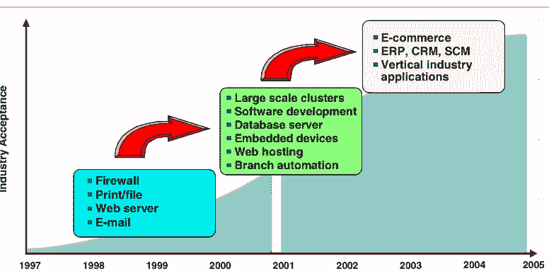

### 早期采用者

以技术为中心

### 主流

以业务为中心，主流用户

图 5-2 Linux 接受度的预期增长率

## 5.3 整合

工作负载整合有四种（也称为合并）。每种类型在以下领域都能提供显著收益：

- 通过集中化管理降低管理成本

- 更好地管理系统激增并实现更一致的架构

- 优化采购管理以实现批量购买折扣

- 在安全、操作系统级别和更新方面保持流程一致

四种整合类型为：

- 将以前分散在企业各处的多个系统整合到更少、更集中的位置。

对于这种类型的整合，`xSeries` 和 Linux 共同提供了以下优势：

- 节省地面空间：`xSeries` 具有高密度机架解决方案和电缆链连接技术。

- `IBM Director`：这包括一个名为 `Update Xpress` 的功能，允许您将系统镜像和更新传播到所有整合的系统。

- 工作负载管理解决方案：它们将工作从负载沉重的系统重新调度到负载较轻的系统。

- 通过系统内部及跨系统的冗余实现可用性：在整合环境中，您可以配置系统以实现最大可用性。`xSeries` 服务器本身已在电源等方面具有系统内部冗余。现在，在整合环境中，您可以设置另一个系统来处理故障系统的工作，或处理您可能想要下线更换的系统的工作。

### 将系统整合为少数几个更大型服务器

- `xSeries Model 440` 凭借其“按需付费”（`Pay as You Grow`）功能提供了强大的价值主张。该功能允许您仅在整合的第一阶段购买所需的计算机资源，并随着整合工作的增长或业务支出的增加添加额外的计算能力。

- `xSeries Model 440` 的远程 I/O 功能允许您在不丢弃基础系统的情况下增加系统的 I/O 容量。您可以通过“按需付费”扩展计算能力，并根据整合需求的变化自定义 I/O 需求。


- 虚拟或物理分区：`xSeries` 服务器允许您创建物理分区，每个物理分区都有自己的内存和 I/O。此外，`VMware` 提供了具有两种分区配置的虚拟分区，可以在虚拟或物理分区之间进行故障转移。
- 此环境需要更多的管理员。
- 此环境提供独立的资源分配、计费和服务器级服务水平协议。

`VMware` 和虚拟分区：在您实施服务器整合时，`VMware` 提供了几项关键优势。这些优势包括：

- 并行运行 `Windows` 和 `Linux` 分区的能力。您可以在一个分区中运行 `Windows` 应用，在另一个分区中运行 `Linux` 应用。`VMware` 支持 `SuSE` 和 `Red Hat` 作为 `Linux` 环境。
- 能够随着计算机的变化动态更改分区的能力。您可以在几分钟内添加新分区或更改分配给分区的 I/O 资源。
- 您可以设置分区并根据特定的工作负载需求对其进行定制。例如，您可以设置两个 Web 服务分区、一个打印服务分区和两个邮件服务分区。邮件和 Web 服务分区可能具有关键任务级的需求，因此您可以将第二个分区设置为备份分区，当一个分区出现容量问题时，您可以将工作负载转移到该分区。打印服务分区分配的 I/O 容量可能少于邮件服务分区。这使得针对您的特定工作负载进行定制具有非常的活性。

### 数据整合

`XSeries` 和 `Linux` 共同为该领域带来的关键差异化和优势包括：

- 通过系统区域网络（SAN）和共享存储环境创建高可用数据配置的能力
- 数据镜像可确保在发生磁盘故障时数据的可用性
- 通过集中安全策略而非分散在企业各处的碎片化数据来提高安全性
- 需要更少的数据库管理员

### 应用整合

`xSeries` 和 `Linux` 共同为该领域带来的关键差异化和优势包括上述内容，以及以下：

- 通过将应用使用整合在单个系统上（而非跨企业的多个系统上）来减少应用许可成本
- 能够更好地管理由于操作系统或应用级更改引起的新应用迁移计划
- 通过跨系统负载均衡应用需求来减少对计算能力的需求

### `VMware` ESX Server

随着 `VMware` ESX Server 的引入，`xSeries` 服务器提供了以前仅在大型机环境中发现虚拟分区功能。`VMware` ESX Server 通过在安全且可传输的虚拟机对服务器资源进行分区和隔离，简化了服务器基础设施。`VMware` ESX Server 允许您在统一的平台上远程管理、自动配置并标准化这些服务器资源。

图 5-3 显示了 `VMware` ESX Server 的架构。操作系统和应用程序被隔离在独立的虚拟机中。

### 高达 64 个虚拟镜像

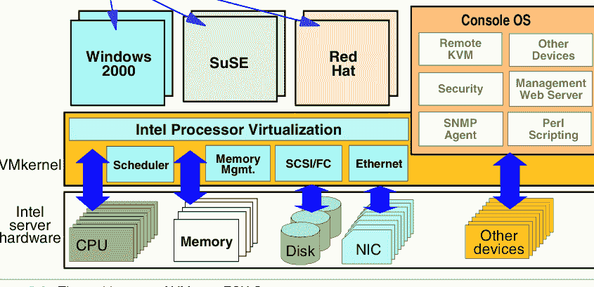

图 5-3 `VMware` ESX Server 的架构

`VMware` ESX Server 将物理系统转换为驻在单一硬件上的多个逻辑虚拟机虚拟机池。系统资源根据即时需求动态分配给任何操作系统。

`VMware` ESX Server 直接运行在系统硬件上，为轻松部署、管理和远程控制更多操作系统提供了一个安全、统一的平台。高级资源管理控制允许您保证 `CPU`、内存、网络、磁盘资源的服务水平以及分区之间的故障转移。

`VMware` ESX Server 提供以下优势：

- 您可以将运行在专用系统上的应用程序整合到单个更可靠、可扩展的系统上的独立虚拟机中。
- 您可以从任何位置进行远程管理，简化服务器维护。
- 通过高级资源管理控制，您可以保证服务水平。
- 您可以对常见的监控和管理任务编写脚本。

有关 `VMware` ESX 的更多信息，请参阅：

`http://www.vmware.com/products/server/esx_features.html`

## 5.4 `Linux` 集群

集群系统基本上是将两个或多个计算机组合在一起，以提高可靠性或处理性能。集群类型大致归类为：

- 高可用集群
- 负载均衡集群
- 高性能计算
- 紧耦合集群

有关集群的详细说明和参考，请参阅第 243 页的第 9 章“`Linux` 集群”。

### 高可用集群

随着您的计算机计算需求的扩展，您可以选择垂直或水平扩展系统。垂直扩展本质上意味着实现比 `SMP` 系统更大的系统。水平扩展（集群）意味着实现多个较小的系统来处理工作负载，并将其作为一个计算资源或大型服务器场。

集群实现始于高性能计算环境，客户通过高速互连连接许多系统或节点。通过利用软件，他们将作业分成小块以提高速度和效率。

如今，集群应用于生命科学、金融和石油环境，这些领域需要分析大量数据，且问题适合分配到多台机器上。通常，集群被实现为大型服务器场，这种实现具有许多服务器整合的优势。

`IBM` 是 `Intel` 处理器 `Linux` 集群的领导者。关键差异：

- 降低系统成本：通过 `Linux` 和 `xSeries` 解决方案，初始成本极具吸引力。
- 系统管理：通过 `IBM` Director 和集群系统管理，您现在有了将许多节点作为一个计算资源进行解决方案。这通过减少管理员和提高系统可用性降低了总拥有成本 (TCO)。
- 高可用解决方案：`IBM` 与其 `ISV` 合作伙伴共同提供高可用解决方案，允许从集群内故障的系统转移到正常运行的节点。
- 集群集成服务：集群的实现和设计非常困难。策略必须包含应用和工作负载分析。它还必须包含所有组件如何组合在一起的计划，以及在安装时所有组件的结合程度如何。由 `IBM` 业务伙伴或 `IBM` 全球服务（`IGS`）提供的集群集成服务是一个关键的差异化价值主张，已产生了许多成功的集群实施。

### 高可用软件

用于高可用集群的软件包括以下产品。更多信息请参阅随附网站：

- `Veritas Cluster Server`

`http://www.veritas.com`

- `SteelEye Lifekeeper`

`http://www.steeleeye.com/products/linux/`

- `Toshiba DNCWARE Cluster Perfect`

`http://www.toshiba.co.jp/index.htm`

- `Red Hat Cluster Manager`

`http://www.redhat.com/software/rhel/as/cluster/`

- `Linux Virtual Server`

`http://www.linuxvirtualserver.org/`

- `Tivoli System Automation`

`http://www.ibm.com/software/tivoli/products/sys-auto-linux/`

## 5.4.2 负载均衡集群

负载均衡集群通过将许多作业、进程和请求分配到两个或多个服务器来提高性能和吞吐量。负载均衡集群软件具有灵活的设置过程，这是一个优点。

高级负载均衡是安装在每个节点上的代理。该客户端对数据库服务器、应用服务器等执行健康检查。

## 负载均衡软件

负载均衡集群应用的主要软件供应商包括：

- `IBM WebSphere Edge Server`

`http://www.ibm.com/software/websservers/edgeserver/index.html`

- `Turbo Linux Cluster Server`

`http://www.turbolinux.com/products/tcs/`

- `Ultra Monkey`

`http://www.ultramonkey.org/`

## 5.4.3 高性能计算

高性能计算执行的是数值密集型且需要高性能和海量内存的计算。任务通过独立进程的并行执行来完成。

高性能计算有两种类型：一种使用消息传递库，另一种是使用作业调度器。当使用库进行消息传递时，会在两个或多个线程和进程中执行独立进程。

当使用作业调度器时，一个应用程序会在两个或多个节点上同时运行。每个节点通过脚本或独占工具执行进程。

## `IBM` Cluster 1350

Cluster 1350 是 `IBM` 最新一代廉价集成 `Linux` 集群产品。Cluster 1350 将最新的 `xSeries` 机架优化服务器的力量与 `Linux` 集群系统管理 (CSM) 软件、`IBM` 存储产品以及领先的第三方网络组件相结合。它为高性能计算 (`HPC`) 和商业应用环境提供了强大、灵活的解决方案。

Cluster 1350 提供多种配置，包括从单机架系统到 32 个集群节点，以及到 512 个集群节点及以上的大规模系统。集群节点是单路或双路 `x35` 服务器 (1U)，配备频率为 2.4、2.6 或 2.8 GHz 的 `Intel Xeon` 处理器。系统可选包含最多 32 台双路 `x35` 存储服务器 (2U)，配备运行频率为 2.4、2.6 或 2.8 GHz 的 `Intel Xeon` 处理器。此外，`xSeries` Model 345 可作集群节点。每个集群都需要一个双路 Model 345 管理节点。


`Cluster 1350` 系统由 `Linux Cluster Systems Management` 版本 `1.3` 管理。这提供了资源监控、自动化操作、远程硬件控制和命令执行、配置文件管理以及并行网络安装。`CSM for Linux` 有助于简化管理，并可能降低从单个管理节点管理整个 `Cluster 1350` 的生命周期成本。随着工作负载需求的增加，`CSM for Linux` 允许 `Cluster 1350` 增量增长，而无需增加管理复杂性。

`Cluster 1350` 的亮点包括：

-   -硬件

    -   `xSeries 335` 和 `345` 机架优化服务器

    -   `10/100` 以太网、千兆以太网、`Myrinet`

    -   `FASTT200` 和 `FASTT700`

    -   终端服务器和 `KVM` 交换机

    -   `42U` 机架

-   -软件

    -   `Red Hat 7.2, 7.3, Advanced Server 2.1`

    -   `IBM Cluster Systems Management (CSM) for Linux 1.3`

    -   `IBM General Parallel File System (GPFS) for Linux 1.3`

-   -服务

    -   基础系统集成与设置

    -   保修支持

    -   `Linux` 集群安装服务

    -   `Linux` 集群支持热

有关 `Cluster 1350` 的更多信息，请访问：

`http://www.ibm.com/servers/eserver/clusters/`

## 5.5 分布式企业中的 `Linux`

复杂的企业（如零售店和银行）通常需要在许多站点部署计算机。应用程序运行在许多地理机器上并进行远程管理。由于成本低且占用小，`xSeries` 上的 `Linux` 是一个极佳的解决方案。在分布式企业中，易用性和易支持至关重要。再次，`xSeries` 和 `Linux` 由于其高可用性和可靠性，非常适用于这种情况。`Linux` 作为一个连接 `xServers` 上所有应用程序的标准应用接口也是一个很好的解决方案。

例如，`Linux` 为 `Burlington Coat Factory` 提供了与 `Windows NT` 相同或更好的功能，约为 25%。

例如，`Linux` 为 `Burlington Coat Factory` 提供了与 `Windows NT` 相同或更好的功能，约为 25%。

例如，`Linux` 为 `Burlington Coat Factory` 提供了与 `Windows NT` 相同或更好的功能，约为 25%。

例如，`Linux` 为 `Burlington Coat Factory` 提供了与 `Windows NT` 相同或更好的功能，约为 25%。

例如，`Linux` 为 `Burlington Coat Factory` 提供了与 `Windows NT` 相同或更好的功能，约为 25%。

例如，`Linux` 为 `Burlington Coat Factory` 提供了与 `Windows NT` 相同或更好的功能，约为 25%。

例如，`Linux` 为 `Burlington Coat Factory` 提供了与 `Windows NT` 相同或更好的功能，约为 25%。

例如，`Linux` 为 `Burlington Coat Factory` 提供了与 `Windows NT` 相同或更好的功能，约为 25%。

例如，`Linux` 为 `Burlington Coat Factory` 提供了与 `Windows NT` 相同或更好的功能，约为 25%。

例如，`Linux` 为 `Burlington Coat Factory` 提供了与 `Windows NT` 相同或更好的功能，约为 25%。

例如，`Linux` 为 `Burlington Coat Factory` 提供了与 `Windows NT` 相同或更好的功能，约为 25%。

例如，`Linux` 为 `Burlington Coat Factory` 提供了与 `Windows NT` 相同或更好的功能，约为 25%。

例如，`Linux` 为 `Burlington Coat Factory` 提供了与 `Windows NT` 相同或更好的功能，约为 25%。

例如，`Linux` 为 `Burlington Coat Factory` 提供了与 `Windows NT` 相同或更好的功能，约为 25%。

例如，`Linux` 为 `Burlington Coat Factory` 提供了与 `Windows NT` 相同或更好的功能，约为 25%。

例如，`Linux` 为 `Burlington Coat Factory` 提供了与 `Windows NT` 相同或更好的功能，约为 25%。

由于成本低且占用小，`xSeries` 上的 `Linux` 是一个极佳的解决方案。在分布式企业中，易用性和易支持至关重要。再次，`xSeries` 和 `Linux` 由于其高可用性和可靠性，非常适用于这种情况。`Linux` 作为一个连接 `xServers` 上所有应用程序的标准应用接口也是一个很好的解决方案。

例如，`Linux` 为 `Burlington Coat Factory` 提供了与 `Windows NT` 相同或更好的功能，约为 25%。

例如，`Linux` 为 `Burlington Coat Factory` 提供了与 `Windows NT` 相同或更好的功能，约为 25%。

注意：在 `Burlington Coat Factory` 实现该解决方案时，`Sun` 对 `Solaris` 收取费用。

例如，`Linux` 为 `Burlington Coat Factory` 提供了与 `Windows NT` 相同或更好的功能，约为 25%。

例如，`Linux` 为 `Burlington Coat Factory` 提供了与 `Windows NT` 相同或更好的功能，约为 25%。

例如，`Linux` 为 `Burlington Coat Factory` 提供了与 `Windows NT` 相同或更好的功能，约为 25%。

例如，`Linux` 为 `Burlington Coat Factory` 提供了与 `Windows NT` 相同或更好的功能，约为 25%。

例如，`Linux` 为 `Burlington Coat Factory` 提供了与 `Windows NT` 相同或更好的功能，约为 25%。

例如，`Linux` 为 `Burlington Coat Factory` 提供了与 `Windows NT` 相同或更好的功能，约为 25%。

例如，`Linux` 为 `Burlington Coat Factory` 提供了与 `Windows NT` 相同或更好的功能，约为 25%。

例如，`Linux` 为 `Burlington Coat Factory` 提供了与 `Windows NT` 相同或更好的功能，约为 25%。

例如，`Linux` 为 `Burlington Coat Factory` 提供了与 `Windows NT` 相同或更好的功能，约为 25%。

例如，`Linux` 为 `Burlington Coat Factory` 提供了与 `Windows NT` 相同或更好的功能，约为 25%。

例如，`Linux` 为 `Burlington Coat Factory` 提供了与 `Windows NT` 相同或更好的功能，约为 25%。

例如，`Linux` 为 `Burlington Coat Factory` 提供了与 `Windows NT` 相同或更好的功能，约为 25%。

例如，`Linux` 为 `Burlington Coat Factory` 提供了与 `Windows NT` 相同或更好的功能，约为 25%。

例如，`Linux` 为 `Burlington Coat Factory` 提供了与 `Windows NT` 相同或更好的功能，约为 25%。

例如，`Linux` 为 `Burlington Coat Factory` 提供了与 `Windows NT` 相同或更好的功能，约为 25%。

例如，`Linux` 为 `Burlington Coat Factory` 提供了与 `Windows NT` 相同或更好的功能，约为 25%。

例如，`Linux` 为 `Burlington Coat Factory` 提供了与 `Windows NT` 相同或更好的功能，约为 25%。

例如，`Linux` 为 `Burlington Coat Factory` 提供了与 `Windows NT` 相同或更好的功能，约为 25%。

例如，`Linux` 为 `Burlington Coat Factory` 提供了与 `Windows NT` 相同或更好的功能，约为 25%。

例如，`Linux` 为 `Burlington Coat Factory` 提供了与 `Windows NT` 相同或更好的功能，约为 25%。

例如，`Linux` 为 `Burlington Coat Factory` 提供了与 `Windows NT` 相同或更好的功能，约为 25%。

例如，`Linux` 为 `Burlington Coat Factory` 提供了与 `Windows NT` 相同或更好的功能，约为 25%。


例如，`Linux`为`Burlington Coat Factory`提供了与`Windows NT`相同或更好的功能，约为 25%。

金融服务技术领导者。为了实现转型，公司需要一个信赖的供应商。`E*TRADE Financial` 选择了 `IBM`。

`E*TRADE` 通过部署 90 台运行 `Linux` 的 `xSeries Model 330` 服务器升级了其数据中心运营。通过使用 `Linux`，公司大幅降低了许可费用和服务成本。公司的新部署预计将提供满足业务目标的节约成本和性能水平。此外，由于该解决方案基于开放标准，`E*TRADE Financial` 在选择部署的应用程序方面具有灵活性。

`E*TRADE` 认为，`xSeries` 服务器与 `IBM` 对 `Linux` 的承诺将为公司节省数百万美元，并增强 `E*TRADE Financial` 的全球品牌。通过使用 `Linux`，公司实现了巨大的成本节约。通过部署成本更低的 `xSeries` 服务器，公司获得了快速的投资回报。

有关此成功案例的更多信息，请访问：

```
http://www.ibm.com/software/success/cssdb.nsf/CS/KMOE=5AMKE?OpenDocument&Site=linuxatim
```

## 5.6 Linux 应用解决方案

尽管普遍观点认为 `Linux` 可用的企业级应用有限，但《全球解决方案目录》（`Global Solutions Directory`）中介绍的 `Linux` 应用已增长到 2900 多个。`IBM` 在全球拥有 10 个合作伙伴中心，并不断增强其产品组合。

### 5.6.1 适用于 xSeries 的 IBM Linux 软件

几乎所有帮助客户实现电子商务所需的 `IBM` 软件组件都适用于 `Linux`，包括 `WebSphere`、`DB2` 通用数据库、`Tivoli` 和 `Lotus Domino`。以下章节列出了 `IBM Linux` 软件就绪情况。

> 注意：`IBM` 软件所需的发行版级别经常变化。更多信息，请参见第 199 页的第 8 章“IBM Linux Software”。

#### WebSphere 软件平台

`WebSphere` 是用于动态电子商务的基础设施软件，提供经过验证、安全且可靠的软件组合。`WebSphere Application Server`、`MQSeries` 以及产品组和开发工具允许最新的 Web 技术，并实现电子商务的简单扩展以满足市场需求。

有关 `WebSphere` 家族的更多信息，请访问：

```
http://www.ibm.com/software/info/websphere/index.jsp
```

#### DB2 产品家族

`DB2` 数据库是电子商务的基础。它是一个强大的数据库，为中小型用户提供需求上的灵活性，并为大型用户提供最佳的关系型数据库。`DB2` 支持 `Linux`、`Java` 和 `XML` 等行业标准的开源软件。

有关 `DB2` 家族的更多信息，请访问：

```
http://www.ibm.com/software/data/
```

#### Tivoli 软件产品

宽带为接入互联网的大通信提供了公共连接，而电子商务进一步扩展了这种连接。许多公司需要全年 365 天、每天 24 小时提供系统。提供这种服务需要对电子商务基础设施进行集成管理。

`Tivoli` 可以提供这种集成系统管理软件。该管理解决方案为电子商务的需求提供了灵活性，例如降低管理成本、提高整个系统的可靠性以及对不断增长的数据进行高效管理。对应多平台支持的开放架构以及支持业务增长和变化的高扩展性，是 `Tivoli` 产品的关键特性。

有关 `Tivoli` 家族的更多信息，请访问：

```
http://www.ibm.com/tivoli
```

#### Lotus Domino

`Domino` 家族为协作和电子商务提供了多平台基础，推动了从企业消息到基于 Web 的交易的各种解决方案。

有关 `Lotus Domino` 家族的更多信息，请访问：

```
http://www.lotus.com/
```

### 5.6.2 ISV 和应用解决方案

`Linux` 下支持的 `ISV` 产品列表持续显著增长。许多主要软件供应商已对 `Lotus` 平台做出了承诺。`IBM` 的 `ServerProven` 程序确保了经过市场测试的真实业务应用程序和解决方案。要找到合适的解决方案，请查看适用于 `x` 系列 `Linux` 的不断增长的已验证 `ServerProven` 应用列表。

有关 `ServerProven` 的更多信息，请访问：

```
http://www.developer.ibm.com/welcome/eserver/eSC.pl?mvcid=welcome&packageid=000
```

还要检查交互式尺寸工具（`Interactive Sizing Tool`）网站。它提供了运行特定应用程序环境所需的最佳匹配服务器解决方案。请参考以下之一：

```
http://myctest.austin.ibm.com/servlet/
ServletEngine?mvcid=welcome&packageid=000
```

```
http://www.developer.ibm.com/welcome/myvc.vpl
```

适用于 `Linux` 的尺寸工具包括：

- 适用于 `Linux` 的 `Apache HTTP Server`：`xSeries Apache 1.3 for Linux` 解决方案尺寸工具是基于运行 `Apache 1.3` 以及可选运行 `SteelEye LifeKeeper` 高可用性集群的 `xServers` 建议。
- `BISON Solution Release A2.9`：`xSeries BISON Solution Release A2.9` 解决方案工具是基于运行 `BISON Solution Release A2.9` 的 `xServers` 建议。
- `Changing Worlds CliSmart Navigator Server`：`xSeries Changing Worlds CliSmart Navigator Server` 解决方案尺寸工具是基于运行 `Changing Worlds CliSmart Navigator Server` 的 `xServers` 性能测量。
- `Check Point VPN-1 Pro`：`xSeries Check Point VPN-1 Pro` 解决方案工具是基于运行 `Check Point VPN-1 Pro` 的 `xServers` 性能测量。
- `DB2 UDB EE 7.2`：`xSeries DB2 UDB EE 7.2` 尺寸工具是基于运行 `DB2 UDB EE 7.2` 的 `xServers` 建议。
- 适用于 `Linux` 的 `IBM HTTP Server`：`xSeries IBM HTTP Server for Linux` 解决方案工具是基于运行 `IBM HTTP Server for Linux` 的 `xServers` 建议。
- `Integrated Sensors Express`：`xSeries Integrated Sensors Express` 尺寸工具是基于运行 `Integrated Sensors Express` 的 `xServers` 建议。
- `Lecando Training 5`：`xSeries Lecando Training 5` 尺寸工具是基于运行 `Lecando Training 5` 的 `xServers` 性能测量。
- `Linux Gateway (Firewall & Proxy)`：`IBM xSeries Linux Gateway (Firewall & Proxy)` 尺寸工具是基于 `Linux` 内核 `2.4.5`。
- `mip Webbased Solution`：`xSeries mip Webbased Solution` 尺寸工具是基于运行 `mip Webbased Solution` 的 `xServers` 性能测量。
- `Net-Tech Linux ASP Solutions`：`xSeries Net-Tech Linux Solutions` 建议是基于运行 `Net-Tech Linux ASP Solutions` 的 `xServers`。
- `RealServer 8.01`：`xSeries RealServer 8.01` 建议是基于运行 `RealServer 8.01` 的 `RealServers` 的。


- `Samba File and Print Server`：`xSeries Samba File and Print Server` 解决方案工具是基于运行 `Samba File and Print Server` 以及可选运行 `SteelEye LifeKeeper` 高可用性集群的 `xServers` 建议。

- `Sendmail Mail Server`：`IBM xSeries Sendmail Mail Server` 解决方案工具是基于运行 `Sendmail Mail Server` 以及可选运行 `SteelEye Lifelike` 高可用性集群的 `xServers` 建议。

- `Shlesoft Volanto.Office`：`xSeries Shlesoft Volanto.Office` 建议是基于运行 `Shlesoft Volanto.Office` 的 `xServers` 性能测量。

- `Srishti PaySubscribe 3.1 for Linux` 尺寸工具：`xSeries Srishti PaySubscribe 3.1 for Linux` 建议是基于运行 `Srishti PaySubscribe 3.1 for Linux` 的 `xServers` 性能测量。

以下章节列出了已迁移到 Linux 的示例 ISV 应用。

# 非 IBM 中间件

今天，Linux 被用作互联网基础设施服务器以及构建电子商务环境。作为重要的中间件，`Oracle` 和 `Weblogic` 被提到为 IBM 产品。

- `Oracle9i` 数据库是一种流行的面向对象的关系型数据库。它具有丰富的功能，并提供了可扩展性、可靠性和安全性。`Oracle9i` 还拥有名为 `Real Application Clusters` (`RAC`) 的集群选型，可为数据库应用程序提供更高的可扩展性、可用性和性能。更多信息，请参阅：
  `http://www.oracle.com/ip/deploy/database/oracle9i/`

- `Oracle9i` 应用服务器 (`Oracle9IAS`) 具有集成的 `J2EE` 应用服务器。它提供了成本效益的内置门户功能、无线和 `Web` 页面集成、强大的商业智能功能、完整的集成等，并集成在单一产品中。`Oracle9IAS` 支持主要的 `J2EE`、`Web` 服务和 `XML` 行业标准。更多信息，请参阅：
  `http://www.oracle.com/ip/deploy/ias/`

- `BEA Webologic Server` 是一种 `Web` 应用服务器，提供可扩展性、灵性和可靠性，适用于被称为企业应用平台。更多信息，请参阅：
  `http://www.bea.com/products/webologic/server/index.shtml`

- `VMware ESX Server` 通过在安全且可传输的虚拟机中划分和隔离服务器资源来简化服务器基础设施。它使这些服务器资源能够被远程管理、自动配置并在统一平台上实现标准化。更多信息，请参阅：
  `http://www.vmware.com/products/server/esx_features.html`

`IBM` 为此产品提供卓越的服务和支持。`IBM` 是唯一能够为 `VMware` 环境下的 `Windows`、`Linux` 和关键应用程序提供完整支持的硬件供应商。`VMware` 仅为其 `VMware` 产品提供支持。

获取此类支持的流程：

- a. 注册订阅软件服务：从 `IBM` 购买 `ESX Server` 包含一年的维护订阅服务。这使您有权获得购买后的一年内直接从 `VMware` 发布的针对 `VMware ESX` 软件的任何更新或修复。要接收这些更新，您必须先向 `VMware` 注册此服务。您必须在购买后 30 天内注册订阅软件服务。

- b. 购买 `ESX Server` 支持：`ESX Server` 的支持可以通过 `IBM` 运营支持服务 – `Support Line` 获取。单一集成的远程支持解决方案 `Support Line` 帮助支持您复杂的、分布式的 `IBM` 和多供应商操作系统及软件产品。联系 `IBM` 全球服务获取有关您所在地区 `Support Line` 提供的更多信息。

# 企业应用

近年来，由于 `Linux` 的稳定性，`Linux` 企业应用的使用有所增加。在 `Linux` 企业应用领域，`SAP` 和 `J.D.Edwards` 等公司提供了解决方案。考虑以下解决方案：

- `SAP` 是一项全面的软件包，通过 `R/3` 代表管理公司业务流程的流。在 `ERP` 软件软件包市场中，`SAP` 的市场份额达到 50% 或以上，并作为全球标准。在 `Intel` 架构服务器中，大规模存储系统或系统管理软件并不完美，其在核心业务中的应用并不十分流行。然而，预计 `Linux` 未来将进入这一领域。更多信息，请参阅：
  `http://www.sap.com/linux/`

- `INSITE Enterprise` 是一种 `Web` 页面群组办公软件，提供信息质量功能，且恰好是一个合一的解决方案。它可以在短时间内构建群组办公软件、`EIP` 和知识管理环境。`INSITE` 从第一天起即可跨业务使用。

- `Cybozo Garoon` 是一项关键的协作应用。工作组成员可以通过任何 `Web` 浏览器通过 `Cybozo Garoon` 检查邮件、日程、内网文档和各种新闻论坛。更多信息，请参阅：
  `http://cybozo.com/index.cbl`

# 安全

在许多互联网基础设施中，`Linux` 服务器被用网关服务器或文件服务器。虽然目前还没有 `Linux` 环境感染病毒的报告，但当通过 `Linux` 网关的事务包含病毒且数据存储在 `Linux` 文件服务器时，使用该数据的 `Windows` 系统机器可能会损坏。

`xServers` 服务器为您的 `Linux` 基础设施和业务应用投资提供了低成本、安全的基础。通过提供硬件安全功能、自愈和自诊断服务，以及安全的远程管理和监控，`xServers` 服务器为需要实现安全系统基础设施的人提供了平台。

`IBM` 与领先的安全软件提供商和托管安全提供商密切合作，提供经过测试和验证的安全配置以及 `ServerProven` 安全软件。`IBM` 安全服务通过允许客户评估安全风险并制定应对风险的计划来增强 `xSeries` 功能。安全平台、全系列解决方案和完整服务的覆盖，使 `xSeries` 服务器解决方案成为理想的安全服务器解决方案。

服务器安全可以在多个级别提供，包括硬件、操作系统、中间件和应用程序。表 5-5 总结了 `xSeries` 如何在每个级别提供安全性。

## 5-5 服务器安全级别

| 安全特性 | 客户价值 |
|---|---|
| `xSeries` 硬件 | ► 安全远程监控<br>► 安全远程管理<br>► 配置控制<br>► 关机支持 (`Lights-out`)<br>► 自诊断<br>► 硬件安全框架 | 适用于任何安全应用环境的低成本安全平台 |
| 操作系统 | ► `Linux` 加密<br>► `OpenSSL` 加密<br>► `OpenSSH` 认证<br>► `PAM` 认证<br>► `SNORT` 入侵检测<br>► `Apache` 安全 `Web` 服务器<br>► 许多发行版中的集成防火墙<br>► `Tripwire` | 可与其他 `IBM` 产品集成的完整安全管理环境 |
| 中间件 | ► `Tivoli Risk Manager`<br>► `Tivoli Access Manager`<br> `Tivoli Identity Manager` | 安全平台、全系列解决方案和完整服务的使得 `xSeries` 服务器解决方案成为理想的安全解决方案 |
| 应用程序 | ► `Trustix` | 完整解决方案的一部分。`Linux` 由 `IBM` 服务完全支持 |

| 安全特性 | 客户价值 |
|---|---|
| 安全应用 | ► `Checkpoint`<br>► `Trustix`<br>► `Trend Micro`<br>► `Tripwire Security, Inc.`<br>► `SUSE Linux` 防墙 | ► 防墙<br>► 安全 `Linux` 操作系统<br>► 带 `VPN` 的防火墙<br>► 代理服务器<br>► 防病毒软件<br>► 文件完整安全 |
| 服务 | ► `IBM` 安全服务<br>► `IBM` 托管服务 | 从人和 `IT` 角的全面方法。涉及流程、教育、培训、漏洞评估和响应计划。帮助客户识别关键资产并加强访问措施。 |

是一些运行在 `Linux` 上的安全应用示例：

- `Symantec AntiVirus Scan Engine` 提供先进、高性能的病毒扫描和修复服务。旨在保护通过网络基础设施传输或存储的流量。该解决方案可以轻松集成到软件应用程序和网络系统中。`Symantec AntiVirus Scan Engine` 检测并防止所有文件类型（包括移动代码和压缩格式）中的病毒、蠕虫和木马。更多信息，请参阅：
  `http://enterprisesecurity.symantec.com/products/products.cfm?ProductID=173`


- `Norton AntiVirus for Lotus Domino` 提供针对新旧现有病毒的最全面、自动保护。通过自动扫描和修复 `Notes®` 和数据库文档中的附件，保持数据库免受当前和未来病毒的侵害。更多信息，请参阅：

`http://enterprisesecurity.symantec.com/products/products.cfm?ProductID=143`

- `InterScanWall` 提供高性能、全面的互联网网关保护，防止病毒和代码恶意用途。可选的 `eManager` 插件为管理员提供了额外的工具来拦截垃圾邮件、过滤内容和调度电子邮件。更多信息，请参阅：

`http://www.trendmicro.com/en/products/gateway/isw/evaluate/overview.htm`

- `InterScan WebManager` 拦截无用的通用定位符 (URL)，监控并管理 Web 使用，并在网关处扫描 Web 流量中的病毒和其他恶意代码。更多信息，请访问：

`http://www.trendmicro.com/en/products/gateway/ism/evaluate/overview.htm`

- `ServerProtect` 为 `Linux` 提供了实时反病毒扫描，在病毒到达最终用户之前实时检测并删除文件和压缩文件中的病毒。管理员可以使用基于 Web 的控制台来管理病毒爆发、病毒扫描、病毒特征文件更新和通知。更多信息，请访问：

`http://www.trendmicro.com/en/products/file-server/sp-linux/evaluate/overview.htm`

- `ScanMail for Lotus Notes` 可实时检测并删除隐藏在数据库和电子邮件中的病毒，防止其传播到桌面。该软件提供自动的病毒特征文件更新、集中的病毒活动日志以及与 `Lotus` 管理客户端的集成。更多信息，请访问以下网站：

`http://www.trendmicro.com/en/products/email/smin/evaluate/overview.htm`

- `FireWall-1` 使企业能够定义并实施单一、全面的安全策略来保护所有网络资源。其架构提供了一个高度扩展的解决方案，集成了网络安全的所有方面。更多信息，请访问：

`http://www.checkpoint.com/products/protect/firewall-1.htm`

- `VPN-Pro One` 是 `Check Point VPN-1` 的基础，该方案是针对远程访问、内网和外网 VPN 最全面的产品和技术 set。`VPN-Pro One` 保护互联网信息的隐私，同时保护关键网络资源免受未经授权的访问。更多信息，请访问：

`http://www.checkpoint.com/products/connect/vpn-1_pro.htm`

## 高可用解决方案

高可用解决方案对于提高基于 `Linux` 的系统的可用性至关重要。此类解决方案包括：

- `IBM Tivoli System Automation for Linux` 满足对高可用解决方案的需求，同时降低复杂性和成本。故障、停机和意外关机会导致业务损失（竞争对手仅一步之遥），并可能损害公司的信誉。`IBM` 计算计划有助于解决这些问题，并通过技术实现技术的自我管理。`IBM Tivoli System Automation for Linux` 通过检测故障的 IT 组件并进行修复或绕过故障，为业务应用程序提供自愈能力。

更多信息，请参阅：

`ftp://ftp.software.ibm.com/software/tivoli/datasheets/ds-sys-auto-linux.pdf`

- `LifeKeeper for Linux` 是一种确保应用程序持续可用并维持系统运行时间的软件应用程序。`LifeKeeper` 通过监控系统和应用程序健康来维护集群 `Linux` 系统的高可用性。

更多信息，请参阅：

`http://www.steeleye.com/products/linux/`

- `VERITAS Cluster Server` 消除了计划内和非计划的停机，促进服务器整合，并管理异构环境中的广泛应用程序。`VERITAS Cluster Server` 支持 `SAN` 和传统客户端/服务器环境中的最多 16 节点集群。

更多信息，请参阅：

`http://www.veritas.com/products/category/ProductDetail.shtml?productId=clusterserver`

## 备份解决方案

尽管 `Linux` 控制备份和磁带设备，但存在额外的备份解决方案可以简化操作。它们还可以调度备份和恢复事件。额外的备份解决方案包括：

- `IBM Tivoli Storage Manager`：最新版本的 `IBM Tivoli Storage Manager` 软件已适用于基于 `Intel` 的 `Linux` 系统。通过将 `Tivoli Storage Manager` 对 `Linux` 的支持从文件系统和应用程序扩展到包含 `Tivoli Storage Managers`，使用 `Linux` 环境的组织可以从与其他平台上使用 `Tivoli Storage Managers` 的组织相同的获奖保护中受益。`IBM Storage Manager` 强调了 `IBM` 为中间市场到大型企业提供稳健、可靠软件解决方案的承诺。

更多信息，请参阅：

`http://www.ibm.com/software/tivoli/solutions/linux/`

- `BrightStor ARCserve for Linux` 为部署 `Linux` 的组织带来了数据保护技术。除了简单的数据保护外，`BrightStor ARCserve` 使用多种数据验证方法来实现最大的数据完整性和恢复能力。

更多信息，请参阅：

`http://www.ca.com/Solutions/Product.asp?ID=3370`

- `NetVault Enterprise Edition` 是适用于异构 `UNIX`、`Windows NT/2000`、`Linux` 和 `Netware` 设备的全面备份和恢复解决方案。它可以快速添加和配置新服务器、设备和客户端，并从中央位置控制它们。随着组织的增长，模块化架构允许 `NetVault Enterprise Edition` 与 `BakBone` 插件模块（如灾难恢复）结合。

更多信息，请参阅：

`http://www.bakbone.com/products/backup_and_restore/netvault_ee/`

### 5.6.3 客户案例：Journeys

`Journeys` 是 `IBM` 合作伙伴，也是基于 Web 的时间和费用跟踪解决方案领导者，为超过 10,000 家组织提供时间、项目和费用跟踪软件。这家公司成立于 1996 年，总部位于德克萨斯州奥斯汀，雇佣约 50 人，占据行业 70% 的市场份额。

`Journeys` 的旗舰产品 `Timesheet` 集成了 `IBM WebSphere Application Server` 和 `IBM DB2` 通用数据库，使公司能够通过内网或互联网高效地跟踪和管理项目时间及相关费用。

作为长期 `DB2` 用户，`Journeys` 基于数据管理系统持续稳定的性能将 `Timesheet` 建立在 `DB2` 上。`Timesheet` 的最新版本利用后端的 `DB2 for Linux` 来最大化数据访问和管理选项。

除了 Web 应用程序外，`Journeys` 还提供应用程序托管服务。

`LifeKeeper` 提供了部署的便利性和速度。通过监控系统和应用程序健康状况、维护客户端连接，并无论客户端位于何处都提供不中断的数据访问，`LifeKeeper` 还能够在不修改应用程序的情况下实现开箱即用的集成。

2001年9月，在经过18个月开发后，`Flamenco Networks` 启动了其网络管理站点。支持它的是两台并行的 `xSeries 342` 机器、两台 `xSeries 340` 数据库服务器以及一台 `IBM FASIT` 存储服务器。`IBM` 设备为 `Flamenco Networks` 提供了灵活、高可用且可靠的解决方案。

`IBM` 系统工程师帮助 `Flamenco` 匹配了哪些版本的 `Linux` 通过了其关系数据库软件的认证。在准备生产环境期间，他们还帮助实施了存储服务器关键点的 `Red`（红帽）驱动程序。

得益于 `xSeries` 服务器的可扩展架构，`Flamenco` 可以轻松地在需要时添加 Web 服务器或数据库服务器。`IBM` 的配置允许 `Flamenco` 在不产生宕机风险的情况下将新软件安装到系统中，帮助公司建立了稳固的声誉。通过 `IBM` 和 `SteelEye` 的聚类软件，`Flamenco` 能以更低的成本为客户提供优质服务。

有关更多关于此成功案例的信息，请访问：

`http://www.ibm.com/software/solutions/webservices/partners/flamenco.html`

## 5.7 基础设施解决方案


随着客户转向 Linux，基础设施解决方案持续提供最大的节约机会。该领域的典型解决方案是 Web 服务器、邮件服务器、打印服务器和防火墙服务器。大多数用于 `xSeries` 服务器的 Linux 发行版包含开源应用程序，如 `Apache`、`Samba`、`IMAP`、`OpenLDAP`、`Perl`、`SendMail`、`Squid` 和 `PostgreSQL`。

### Samba

`Samba` 是一个开源/免费软件套。它为服务器消息块 (`SMB`) 和通用互联网文件系统 (`CIFS`) 客户端提供无缝的文件打印服务。它允许终端用户访问并使用公司内网或互联网上的文件、打印机和其他共享资源。

`Samba` 通常被称为网络文件系统 (`NFS`)，可以安装在包括 Linux、`OpenVMS` 和 `OS/2` 在内的多种操作系统平台上。`Samba` 支持以下使用与 `Windows NT` 或 `2000` 兼容的文件/打印服务器软件的 UNIX 和 UNIX 兼容机器。它可以在 GNU 通用公共许可协议 (`GPL`) 下免费使用。

`Samba` 具有以下特性：

- 降低成本：用于 Intel 架构服务器的 `Windows 2000 Advanced` 服务器和 `Red Hat Linux 8.0` 专业版服务器之间成本存在差异。

- 配置与管理：`Samba` 的配置文件写在唯一的文本文件 (`smb.conf`) 中。在 `Linux+Samba` 环境中，可以使用 `Telnet` 远程设置和管理 `Samba`。

`Samba` 有一个名为 `SWAT` 的简单配置工具。该工具可以通过 Web 浏览器设置 `Samba`。

- 性能：比较 Intel 架构服务器 `Samba` 与 `Windows` 的性能数据。欲了解更多信息，请查看：

```
http://www.pcmag.com/article/0,2997,s%253d1474%25326%253d16554,00.asp
```

在网上查找 `Samba`：

```
http://www.samba.org/
```

### Apache

`Apache` 是世界上最著名的 Web 服务器 (`HTTP`)。根据 `netcraft` 的研究，`Apache` 在 Web 服务器市场上的份额超过了 60%。您可以在网上了解更多关于该研究的信息：

```
http://www.netcraft.com/survey
```

`Apache` 有两个版本：`Apache 1.3` 和 `Apache 2.0`。表 5-6 显示了从 `Apache 1.3` 到 `Apache 2.0` 的变化。

表 5-6 从 `Apache 1.3` 到 `Apache 2.0` 的变化

| 变化 | 细节 |
|---|---|
| 采用多处理模块 (`MPM`) | `MPM` 可以使平台上的其他模块通用化 |
| 采用 `Apache` 可移植运行时 (`ARP`) | 通过 `ARP` 和 C 语言开发使其能够在其他平台上执行相同的程序 |
| 对应多线程 | 由进程生成向线程生成发起请求处理 |
| 支持多协议 | `Apache 2.0` 可以轻松地支持 `HTTP`、`HTTPS` 和一种新协议 |
| 支持 `IPv6` | 在 `Apache 2.0` 中，Web 服务器可以通过基础安装配置为仅支持 `IPv6` |
| 采用新的构建系统 | 安装 `Apache 2.0` 必须安装 `autoconf` 和 `libtool` |

欲需了解更多关于 `Apache` 的信息，请访问：

`http://www.apache.org/`

### Sendmail

`Sendmail` 是 UNIX 最常用的邮件传输代理 (`MTA`)。`Sendmail` 通过修改 `sendmail.cf`（或 `sendmail.m4`）进行配置。可以通过详细配置来设置 `Sendmail`，但对于系统管理员来说，修改 `sendmail.cf` 非常复杂。错误的配置可能会导致安全漏洞。

您可以在网上找到 `Sendmail`：

`http://www.sendmail.org/`

### Qmail

`Qmail` 是一个安全、可靠、高效的简单消息传输代理。它是为典型的连接互联网的 UNIX 主机设计的。截至 2001 年 10 月，`Qmail` 是互联网上第二常见的邮件传输协议 (`SMTP`) 服务器，也是目前增长最快的 `SMTP` 服务器。`Qmail` 的特性包括：

- **安全**：安全不是目标，而是绝对的要求。邮件投递对用户至关重要。它不能被关闭，因此必须完全安全。`Qmail` 将其功能划分为组件。每个用户功能的执行都是单独定义的，这样即使某个组件损坏，其他组件也不会受到影响。

- **可靠**：`Qmail` 的设计保证了即使系统发生故障，邮件也不会丢失。由于它不允许用户直接访问数据，因此它是非常可靠的。`Qmail` 允许在不同的用户权限下运行组件，这使得安全性得到了增强。由于它将功能划分为组件，因此易于维护和升级。

- **高效**：`Qmail` 在处理邮件方面非常快。由于其设计高效，它能够处理大量的邮件流量。`Qmail` 允许在不同的用户权限下运行组件，这使得扩展性得到了增强。

### Postfix

`Postfix` 被开发为与 `Sendmail` 兼容的 `MTA`。`Postfix` 具有许多功能，如 `Sendmail` 兼容性、安全性、易于维护和快速处理等。最近，被某些发行版采用默认。`Postfix` 具有以下优点：

- **Sendmail 兼容性**：其功能类似。

- **易于配置**：对于普通用户来说并不困难。

- **稳定性**：它可以稳定运行。

欲了解更多关于 `Postfix` 信息：

`http://postfix.org/`

## Netfilter

Linux 使用 `iptables` 或 `ipchains` 作为开源软件。`Netfilter` 分析 `TCP` 和 `IP` 头部。它检查：

- 源 `IP` 和目的 `IP`

- 源端口和目的端口

- 协议

- 接口

- `ICMP` 类型和代码

- 检查 `SYN` 数据包

- 检查分片包

此外，`iptables` 分析：

- 状态检测

- `TCP` 标志

- `MAC` 地址

- 匹配限制

- 数据包所有者

欲了解更多关于 `Netfilter`：

`http://www.netfilter.org/`

### Squid

`Squid` 是 Linux 最常用的代理服务器。通过 `Squid` 访问互联网。`Squid` 服务器转发数据并传递给客户端。使用 `Squid` 的某些优势：

- 您不再需要客户端访问互联网，并且可以控制对互联网的访问。

- 通过 `Squid` 缓存数据可以减少网络流量。

由于所有流量都经过 `Squid`，您可以对数据进行调查。

您可以在网上了解到更多：

`http://www.squid-cache.org/`

### 5.7.1 客户案例：weather.com

`The Channel` 使用 `weather.com` 为全球服务。作为天气危机期间排名前十的互联网网站，该网站每天接收高达 4000 万次点击。`Landmark Media Corporation` 拥有 `weather.com`，它希望将服务器重心转向开源系统环境。

客户发现自己在旧设备的操作系统许可费用上花费过高，而供应商不再提供任何服务。客户希望在节省资金的同时，将其产品提升到更高水平。

为了替换现有系统，`weather.com` 选择实施 IBM 解决方案，以利用其稳健、可扩展的产品，以及卓越的 `ATS` 支持、响应和销售支持。客户选择用运行 `SuSE V7.1 Linux` 的 `xSeries 350` 机器替换运行 `Solaris` 的 `Sun E4500` 数据库服务器。这些 `xServer` 保存了所有的 `weather.com`。

为了替换其 `Sun 420r` 镜像和内容服务器，`weather.com` 选择了 100 台运行 Linux 的 `xSeries 330` 服务器。该系统路由并负载网站点击，并更新网站上的静态信息。客户还选择了额外的四台 `xSeries 340` 服务器作为主域控制器 (`PDC`) 和防火墙服务器。

自实施 IBM 解决方案以来，`weather.com` 节省了 70% 的成本，并降低了增量增长成本。IBM 的解决方案还为客户提供了强大且可扩展的产品，帮助其满足业务需求。此外，客户对其购买 Linux 的低总拥有成本（`TCO`）及其在开源领域的领导地位感到非常满意。

有关此成功案例的更多信息，请访问：

`http://www.ibm.com/software/success/cssdb.nsf/CS/NAVO-5B3DNQOpenDocument&Site=default`

## 5.8 xSeries 架构解决方案

IBM 通过刀片架构提供了模块化计算的全面解决方案。刀片架构由刀片服务器和 `BladeCenter` 构建。

### 5.8.1 刀片服务器

过去几年互联网的快速普及推动了支持它的服务器系统的发展。电子商务的规模迅速扩张。典型的复杂系统是基于 `1U` 机架式服务器构建的高密度安装服务器。2001 年，为了满足超高密度安装的需求，出现了一种新型服务器——刀片服务器（`blade server`）。


`“Blade”`（`blade`）一词意味着扁平的部分，就像刀片一样。刀片服务器是一个带有集成了服务器功能的长条细细电路板。它在一个 `2U-7U` 大小的称为`“机箱”`（`enclosure`）内配备了 6 到 20 个刀片，实现了高于 `1U` 服务器的密度。

### BladeCenter

2002年10月，`IBM` 宣布了名为 `BladeCenter HS20` 的双路 `SMP Intel Xeon` 处理器刀片服务器，并交付了 `7U` 大的 `BladeCenter` 机箱。`BladeCenter` 和 `BladeCenter HS20` 旨在节省高密度机架环境中的空间。`BladeCenter` 在 `42U` 机架中可以存储 14 个 `BladeCenter HS20` 刀片，最多包含 6 个 `BladeCenter`。`BladeCenter HS20` 支持 `Red Hat Linux` 和 `SuSE Linux`。


图 5-4 BladeCenter

`BladeCenter` 市场的特性包括：

- **服务器整合：** `BladeCenter` 是集中型服务器整合的极佳解决方案。

- **HPC/网格计算：** `BladeCenter` 非常适合 `HPC` 环境，其极其高效的刀片式 `Intel Xeon` 处理器可以运行以下工作负载：

    - `Linux` 集群

    - 基因组

    - 工程设计自动化 (`EDA`)

    - 网格

- **应用服务器：** 由于 `BladeCenter` 具有与通用服务器相同的性能和功能（例如 `SAN` 环境），`BladeCenter` 成为理想的应用程序服务器，并可以在以下环境中节省大量空间：

    - 文件服务器

    - `Notes` 服务器

    - `WebSphere` 应用服务器

有关信息，请参阅以下网站：

```
http://www.pc.ibm.com/us/eserver/eseries/bladecenter_family.html
http://www.ibm.com/servers/eserver/blades/
```

## 5.8.2 客户案例：转石赌场 (Turning Stone Casino)

转石赌场度假村由奥尼达印第安族（`Oneida Indian Nation`）运营，于 `1993` 年在纽约州维罗纳开业。开业一年，转石推出了一种独特的无现金游戏环境，可以电子化跟踪和记录结果。顾客使用类似于 `ATM` 卡的卡片来跟踪自己的账户并兑换奖金。

`1999` 年，转石意识到使用开源技术可以帮助改进其服务。该公司决定将其系统（包括网络、后端系统和玩家终端）迁移到开放的 `IT` 环境。通过这些重开发工作，转石希望扩大其游戏选择，为顾客提供定制化体验，并提高信息技术效率以帮助降低成本。

转石首先用 `IBM @server` 解决方案替换了其旧的后端游戏系统，包括 `pSeries H70` 和 `H50` 型以及 `iSeries 720` 机器。`H70` 服务器使用高可用性集群多处理器处理技术来确保可靠性并提高可管理性，并使用 `H50` 服务器进行测试集群。`iSeries` 服务器为转石的物业管理和财务应用提供了一个稳定的平台。

下一步是寻找一个合适的平台来托管赌场的自定义协议转换应用程序，该程序将用专用协议编码的玩家终端信息转换为后端系统可以处理的通用游戏协议。赌场是 `24x7` 全天运营的，任何停机成本都是昂昂的。转石增加网络可用性、可靠性和高可用性的目标是该解决方案的关键问题。经过仔细考虑，他们购买了 `xSeries 135` 服务器。

利用 `xSeries 135` 机器的线缆设计，客户现在避免了购买昂贵的交换机。先进的光路路径诊断（`Light Path Diagnostics`）功能通过引导技术人员找到故障组件简化了故障排除，并允许技术人员在不关闭服务器的情况下更换组件。客户还计划将 `xSeries` 串行连接到一系列处理器，这使得转石的 `IT` 人员能够远程管理整个系统，节省管理成本。通过迁移到开源环境，转石将其玩家终端的选择从大约 7 种游戏扩大到 25 种以上。

有关此成功案例的更多信息，请访问：

```
http://www.ibm.com/servers/eserver/pseries/solutions/success/turning_stone.html
```

## 5.9 xSeries 服务解决方案

特定类型的服务随地区异，但通常包括为新客户实施 `Linux` 解决方案以及为现有客户提供支持。以下章节涉及美国的服务。有关更多信息，请参阅：

```
http://www.ibm.com/services/e-business/linux.html
```

### 5.9.1 实施 Linux

`Linux` 的实施范围从安装到集群构建。由于许多公司提供此类基础服务，其价格正在下降。高附加值服务（如集群构建和服务器整合）将是一个重要的业务机会。

以下章节解释了可用的服务类型。

#### Linux 业务解决方案

`Linux` 业务解决方案为客户提供快速部署。该解决方案根据客户特定需求进行定制，允许多种中间件和应用程序。服务能力由两个阶段组成。每个阶段包含一组元素。

- **第一阶段，技术赋能：** 该阶段涉及在与客户生产系统隔离的环境中安装、定制和演示。

- **第二阶段，技术赋能：** 该阶段涉及：

    - 协助客户组织将其新安装的业务服务器与现有系统连接

    - 建立 `Linux` 业务解决方案到公共或私有 `TCP/IP` 连接

    - 将客户组织现有的数据库或事务管理器子系统连接到 `Linux` 业务解决方案上相应的子系统

有关更详细信息，请参阅：

```
http://www.ibm.com/services/e-business/linux.3
```

#### 高性能集群服务

对于需要设计、实施和支持互联网及企业级关键任务 `Linux` 集群的客户，`IBM` 随时提供帮助。要了解这些服务，请参阅：

```
http://www.ibm.com/services/e-business/linux.6
```

#### 服务器整合服务

服务器整合的驱动力是降低总拥有成本（`TCO`）。许多客户拥有多种硬件和操作系统，运行成本很高。此外，更现代的应用程序（如企业资源计划软件）使问题更加复杂。通过架构无关的方法，`IBM` 帮助客户降低 `TCO`。更多信息，请参阅：

```
http://www.ibm.com/services/e-business/linux.7
```

### 5.9.2 支持

根据客户需求，`IBM` 提供互联网和语音支持，范围从回答使用问题到识别问题。这种支持每天 `24` 小时持续提供。`IBM` 全球服务还为 `Linux` 提供咨询、规划和实施服务。`IBM` 顾问帮助您评估 `Linux` 是否适用于您的特定环境。


# 6 pSeries 与 Linux

`pSeries` 上的 `Linux` 是 `IBM Linux` 战略的关键部分。在过去的几年里，`IBM` 一直在开发将 `Linux` 功能集成到 `pSeries` 服务器中的能力。`pSeries` 服务器既可以独立运行 `Linux`，也可以在同一台服务器的逻辑分区 (`LPAR`) 中同时运行 `IBM AIX` 和 `Linux`。

本章提供了有关 `pSeries Linux` 启用的相关信息。它讨论了您可以将 `Linux` 应用程序集成到商业 `pSeries` 环境中的方法。

## 6.1 Linux 如何在 pSeries 服务器上运行

`pSeries` 服务器是 `IBM` 满足各种客户需求的关键解决方案之一。`pSeries` 服务器提供领先的性能，可以帮助您从容管理业务增长和风险。

为了满足您的需求，`pSeries` 产品提供了全系列高性能服务器，并配备了功能强大、先进的软件。针对客户对在该平台上使用 `Linux` 作为其操作系统的日益增长的兴趣，`IBM` 将为适用于 `pSeries` 的 `Linux` 提供服务。

在查看 `Linux` 和 `AIX` 系统及应用程序如何在 `pSeries` 上运行之前，有一些值得回顾的概念。更多信息，请参阅第 9 页的 1.3 节`“Linux：操作系统”`。

更多信息，请访问 `IBM Linux for pSeries` 网站。

```
http://www.ibm.com/servers/eserver/pseries/linux/index.html
```

### 6.1.1 具备 Linux 能力的 pSeries 模型结构

支持 `Linux` 的 `pSeries` 服务器拥有从入门级桌面级型号到高端企业级型号等。机架式型号提供了物理整合的可能性。图 6-1 显示了所有支持 `Linux` 的型号。

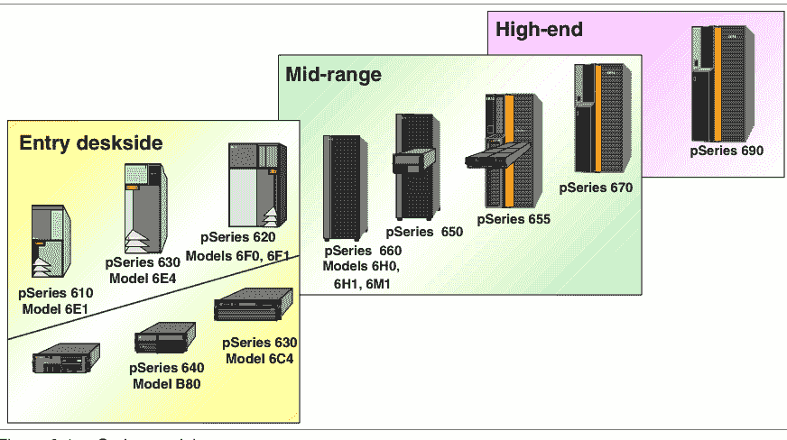

图 6-1 pSeries 模型

有关每个模型的白皮书和技术细节，请访问：

```
http://www.ibm.com/eServer/pSeries
```

对于任何想要获取关于 `pSeries` 上 `Linux` 进一步信息的人来说，以下 `pSeries` 白皮书是必读的：


# IBM @server Linux for pSeries: 客户概览

<http://www.ibm.com/servers/eserver/pseries/linux/whitepapers/linux_pseries.html>

# Linux for IBM @server pSeries: 事实与特性

<http://www.ibm.com/servers/eserver/pseries/hardware/linux_facts.pdf>

# 决策者的 LPAR

<http://www.ibm.com/servers/eserver/pseries/hardware/whitepapers/lpar_decision.pdf>

# pSeries 白皮书合集

<http://www.ibm.com/servers/eserver/pseries/library/wp_systems.html>

有关 `pSeries` 逻辑分区的更多信息，请参考 Web 上的 `IBM ITSO Redbooks` 站点：<http://www.redbooks.ibm.com>

## 6.1.2 pSeries 操作系统场景

`pSeries` 提供了卓越的服务器性能和极佳服务器整合平台。这些服务器能够将 `AIX` 或 `Linux` 作为单一操作系统运行，也可以在多个 `LPAR` 中运行任何组合的 `AIX` 和 `Linux`。图 6-2 展示了 `AIX` 和 `Linux` 操作系统的内部结构概述，以及应用程序如何在三种不同的场景下在 `pSeries` 上运行。

场景 I 显示了传统的基于纯 `AIX` 的 `pSeries` 环境。`4.3.3` 或 `5L` 之前的所有 `AIX` 版本仅运行为 `AIX` 编译的应用程序。这意味着 `Linux` 应用程序无法运行，除非它们被显式移植到 `AIX`。

场景 II 显示了 `AIX 4.3.3` 和 `AIX 5L` 如何通过 `AIX Linux` 应用工具箱（`AIX Toolbox for Linux Applications`）在 `pSeries` 中引入 `Linux`。`AIX Linux` 应用工具箱提供了将开源应用程序重新编译并作为 `AIX` 应用程序运行的能力，而无需进行端口迁移。

场景 III 显示了完全启用 `Linux` 的方案。它具有适用于 `pSeries` 的 `Linux` 内核。客户可以将各种 `Linux` 应用程序集成到他们的 `pSeries` 中。可以为任何 `Linux` 应用程序生成 `Linux` 代码。

| 没有 Linux 的 AIX 版本 | 通过 AIX Linux 应用工具箱启用 AIX 5L | pSeries原生 Linux |
|---|---|---|
| 为 AIX 制作的应用程序 (AIX 二进制文件) | 为 AIX 制作的应用程序 (AIX 二进制文件) | pSeries 应用程序 (包含工具箱中的 Linux 二进制文件) |
| 5L AIX 内核 | AIX 5L 内核 | pSeries Linux 内核 |
| pSeries | pSeries | pSeries HW |
| 场景 I | 场景 II | 场景 III |

图 6-2 操作系统和应用程序在 pSeries 上运行

## 6.1.3 AIX 5L 和 Linux

您可以通过 `Linux` 到 `AIX` 的互操作性在任务关键、高度可扩展的上运行许多 `Linux` 应用程序。`IBM` 将分两个阶段实现 `AIX Affinity`。第一阶段是发布 `AIX Linux` 应用工具箱，其位于：

```
http://www.ibm.com/AIX
```

第二阶段是 `IBM` 计划在 `AIX 5L` 中包含额外的 `Linux` 编程接口 (`APIs`) 和头文件。`AIX Affinity` 使用 `API` 方法提供 `Linux` 互操作性。这种方法并不是在 `AIX` 之上的额外层或封装，而是重新编译的 `Linux` 应用程序被视为 `AIX` 应用程序。`AIX` 是使用 `UNIX` 标准开发的。因此，`AIX` 和 `Linux` 之间在 `API` 级别具有很高的兼容性。`AIX 5L` 版本 `5.1` 的许多功能已在 `AIX 4.3.3` 和 `AIX 5L` 版本 `5.0` 中可用（通过 `IBM` 的 `Linux affinity`）。`AIX 5L` 版本 `5.1` 计划通过包含 `AIX` 和 `Linux` 之间不同的 `API` 来增加更多的互操作性。这将带来更高的 `Linux` 兼容性。因此，您可以在白皮书中了解更多关于 `AIX Affinity` 的信息：

<http://www.ibm.com/servers/aix/products/linux/affinity>

`AIX Linux` 应用工具箱的用途包括：

- 为 `AIX` 构建并打包 `Linux` 应用程序
- 运行 `Gnome` 和 `KDE`
- 运行 `Linux` 发行版中常见的其他软件
- 使用 `RPM` 包管理系统管理软件
- 使用 `GNU` 和 `Linux` 开发工具为 `AIX` 开发新应用程序

图 6-3 显示了在 `AIX` 内核上运行的 `AIX` 工具箱

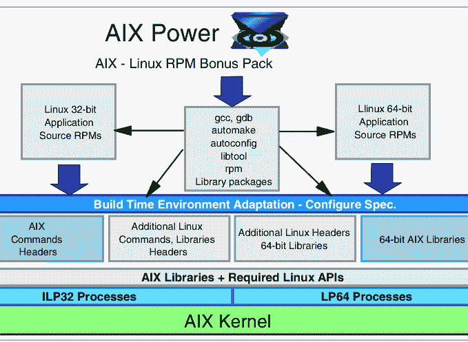

`AIX Linux` 应用工具箱包含多种软件，包括：

- 应用程序开发：`gcc`, `g++`, `gdb`, `rpm`, `cvs`, `automake`, `autoconf`, `libtool`, `flex`, `gettext`
- 桌面环境：`Gnome` 和 `KDE`
- `GNU` 基础工具：`m4`, `indent`, `sed`, `tar`, `diffutils`, `fileutils`, `findutils`, `textutils`, `grep`, `sh-util`
- 编程语言：`guile`, `python`, `bzip2`, `gzip`, `git`, `elm`, `ncpft`, `rsync`, `wget`, `lsof`, `less`, `samba`, `unzip`
- 系统工具：`emacs`, `vim`, `tcl/tk`
- 图形应用程序：`ImageMagick`, `transfig`, `xpdf`, `ghostscript`, `Gimp`
- 库：`ncurses`, `readline`, `libtiff`, `libpng`, `libjpeg`, `gtk+`
- 系统 shell：`bash`, `zsh`
- 窗口管理器：`Enlightenment`, `sawfish`

有关 `AIX-5L` 的最新信息，请访问以下网站：

```
http://www.ibm.com/servers/aix/os/sdesc.html
```

图 6-3 AIX Linux 应用工具箱

`AIX 5L` 引入了许多新功能。您可以在 `IBM Redbook` `AIX 5L Differences Guide` `Version 5.2 Edition`, `SG24-5765` 中学习它们。

探索 `AIX` 上运行 `Linux` 应用程序的细节以及其他内置功能超出了本书的范围。我们建议您咨询红书 `Linux Applications on pSeries`, `SG24-6033`。

您可以在 Web 上找到更多关于 `AIX Linux` 应用工具箱的信息：

```
http://www.ibm.com/servers/aix/products/aixos/linux/index.html
```

`AIX 5L` 旨在满足 `Linux` 应用程序（以及其他 `Linux` 机器）与运行 `AIX` 的 `pSeries` 之间互操作性的需求。通过 `AIX 5L` 将 `Linux` 应用程序带到 `pSeries` 使互操作性变成了现实。此外，您还可以保留从 `AIX` 获得的巨大优势和功能。

- 2. 您从 `Linux Express` 型号（`pSeries 630` 或 `650`）中配置并选择支持 `Linux` 且满足您需求的 `pSeries` 机型。
- 3. 然后您订购硬件、`Linux` 发行版、`Linux` 应用以及必要的支持合同。

这些 `Express` 型号出货时未预装 `Linux` 操作系统。此外，此解决方案不需要 `AIX`。

此方法也适用于 `pSeries` 客户可能运行的任何其他 `Linux` 应用，这些应用并非 `AIX Toolbox for Linux Applications` 提供的。

## 在支持的 pSeries 服务器上通过 LPAR 运行 Linux

`pSeries` 服务器的 `LPAR` 能力使得在运行 `AIX` 的同时运行一个或多个 `Linux` 实例成为可能。这提供了一种便捷的方法，可以根据需要开始开发和部署 `Linux` 就绪的应用程序，同时保留 `AIX` 在处理关键任务或高扩展性工作负载方面的企业级能力。`LPAR` 还允许将大型 `pSeries` 服务器划分给仅运行 `Linux` 的工作负载。

首先，让我们先看懂一些术语。

- `LPAR`: 这是熟悉的逻辑分区（`logical partitions`）的缩写。它在 `zSeries`、`iSeries` 和 `pSeries` 中被广泛使用，表示服务器可以运行多个独立的操作系统实例。
- `静态 LPAR (Static LPAR)`: 该术语适用于 `pSeries` 服务器或分区。它表示服务器在不关机的情况下不支持重新排列资源。早期版本的 `iSeries LPAR` 也存在此相同限制。所有的 `pSeries Linux` 分区都是静态的。


- **`动态 LPAR (Dynamic LPAR, DLPAR)`**: 该术语表示分区接受特定的资源重新排列。运行`AIX`和`AIX-5`应用的分区可以在之间进行处理器和内存的动态移动。

- **`虚拟机管理程序 (Hypervisor)`**: 这是位于物理硬件和操作系统之间的底层控制机制。虚拟机管理程序通过分配和共享这些资源来拥有并创建分区。

划分机器不需要`AIX`，安装和运行`Linux`也不需要`AIX`。`AIX`为硬件分析、智能故障检测和错误日志提供了更丰富的功能。

欲了解更多信息，请访问`pSeries`网站：

```
http://www-l.ibm.com/servers/eserver/pseries/linux/
```

`AIX`和`Linux`可以同时在支持`LPAR`的`pSeries`服务器上的独立分区上任意组合运行（即在零或多个`AIX`分区上运行零或多个`Linux`分区）。这允许您将多个独立服务器的工作负载整合到单个系统上。

由于支持`LPAR`的`pSeries`划分由基于固件的虚拟机管理程序和硬件控制台(`HMC`)控制，因此运行`Linux`不需要`AIX`。

图`6-4`显示了一个典型的逻辑分区`pSeries`服务器。它展示了`HMC`连接到各个分区和虚拟机管理程序的主要组件。这包括`HMC`可以控制的内部组件：处理器、内存和`I/O`适配器。

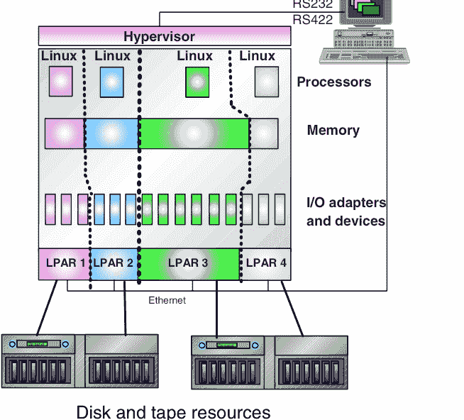

图`6-4``LPAR`上`pSeries`服务器的`Linux`

逻辑分区功能允许在分区与外部之间进行资源的重新排列，以及在两个分区之间移动资源，而无需重启操作系统。`pSeries`中新的动态`LPAR`功能可以动态移动`AIX`分区的资源。目前`Linux`不支持此。然而，`Linux`分区和动态`LPAR`可以在同一台服务器上运行。

欲了解有关支持`LPAR`的`pSeries`服务器的更多信息，请参阅：

```
http://www.ibm.com/servers/eserver/pseries/lpar/resources.html
```

在图`6-4`的示例中，任何`Linux`分区都可以是`AIX`分区。

## `6.15``Linux`及其`AIX`的关系

`Linux`有两种方式与`AIX`关联。可能同时存在这两种关系的系统环境。

- 在`AIX 5L`内部作为运行`Linux`应用的能力

- 基于`Linux`的`pSeries`前端系统与处理关键任务的基于`AIX`的`pSeries`服务器交互的能力

`Linux`已经为`AIX`提供了帮助，由于`AIX Toolbox for Linux Applications`的出现，`AIX 5L`获得了更多动力。通过允许`AIX Toolbox for Linux Applications`软件包让`Linux`应用能够轻松地为`AIX`编译，`IBM`正在扩大可用的产品组合。此外，`AIX`现在可以利用日益增长的`Linux`技能储备。

此外，`Linux`和`AIX`是互补的操作系统。`AIX`是`pSeries`战略性的、经过验证的、关键任务操作系统。`Linux`是一种高度可移植的操作系统，支持所有`IBM`平台。`IBM`期望看到许多运行`Linux`（在`xSeries`或`pSeries`硬件上）的实例作为运行`DB2`和其他企业应用的关键任务`AIX`系统的前端。

如你所见，`AIX`是`pSeries`服务器的战略性操作系统。它包含了诸如扩展性和远程访问安全(`RAS`)等企业功能，这些功能在`Linux`上需要多年时间才能实现。许多来自其他`IBM`操作系统的`AIX`能力和功能正在被添加到`Linux`中。`Linux`将成熟为完整的企业运行环境。

## `6.2` 用于 `pSeries` 硬件启用的 `Linux`

为`pSeries`提供了`32`位和`64`位版本的`Linux`，以优化客户选择并利用`pSeries`硬件能力。`RS/6000 B50`和`150`是`32`位`PowerPC`系统，受`Linux for pSeries 32`位内核和应用环境的支持。

`64`位的`POWER3`和`POWER4`系统具有`32`位或`64`位内核，并支持`32`位或`64`位应用环境（取决于型号和`Linux`发行版）。

### 用于 `pSeries` 硬件启用的 `Linux`

为`pSeries`提供了`32`位和`64`位版本的`Linux`，以优化客户选择并利用`pSeries`硬件能力。`RS/6000 B50`和`150`是`32`位`PowerPC`系统，受`Linux for pSeries 32`位内核和应用环境的支持。

`64`位的`POWER3`和`POWER4`系统具有`32`位或`64`位内核，并支持`32`位或`64`位应用环境（取决于型号和`Linux`发行版）。

为`pSeries`提供了`32`位和`64`位版本的`Linux`，以优化客户选择并利用`pSeries`硬件能力。`RS/6000 B50`和`150`是`32`位`PowerPC`系统，受`Linux for pSeries 32`位内核和应用环境的支持。

`64`位的`POWER3`和`POWER4`系统具有`32`位或`64`位内核，并支持`32`位或`64`位应用环境（取决于型号和`Linux`发行版）。

## `I/O` 设备和适配器

许多适配器和设备可以连接到`pSeries`。由于`Linux`的某些适配器和设备可以使用`AIX`的驱动，因此`Linux`无法直接使用。然而，`Linux`适配器和设备可以使用`pSeries`驱动。

欲获取`Linux pSeries`的更多信息，请查看：

```
http://www.ibm.com/servers/eserver/pseries/linux/
```

对于`Linux for pSeries`的扩展性的更多详细信息，请查看`Linux for pSeries`的扩展性和启用。

在`IBM`网站上查看`Linux for pSeries`的白皮书：

```
http://www.ibm.com/servers/eserver/pseries/linux/facts.pdf
```

> **重要**：任何`LDP`上的某些硬件设备可能未完全启用或认证。我们建议定期查看`Linux`硬件数据库：

```
http://support.suse.de/sdb/en/
```

`Linux for pSeries`启用以使用串口控制台：

```
http://www.ibm.com/servers/eserver/pseries
```

### `6.2.1``Linux for pSeries` 的扩展性

`Linux`内核`2.4`在对称多处理(`SMP`)系统上的扩展良好。这使得它能够很好地扩展到`RS/6000 170, 270, 610, 620, 630, 640, 650, 655, 660, 670`和`690`以及`1`到`8`路`LPAR``Linux for pSeries`还可以扩展到`64 GB`内存和`2 TB`文件系统。

欲了解`Linux for pSeries`的扩展性和启用详细信息，请参阅：

```
http://www.ibm.com/services/learning/conf/us/pseries
```

此外参阅关于`Linux for pSeries`的演示文稿：

```
://www.ibm.com/partnerworld/phome.nsf/vAssetsLookup/LunchLearnLinux2002_08_27.pdf
```

`Linux2002_08_27.pdf`

### `6.2.2``Linux pSeries` 的可靠性、可用性和维护性

`pSeries`的一个关键属性是其关键的可靠性、可用性和维护性(`RAS`)功能。`RAS`是一个不仅由`IBM`使用的概念。然而，其实现方式取决于您正在工作的平台和环境。欲了解有关`pSeries`的`RAS`的更多信息，请访问：

```
http://www.ibm.com/servers/eserver/pseries/hardware/whitepapers/p690_ras.html
```

`Linux for pSeries`正在快速开发`RAS`能力。然而，运行`AIX`时许多`RAS`功能得到了充分实现。

在运行`Linux`时支持以下`pSeries``RAS`功能：

- `Chipkill`和`ECC`内存

- 日志文件系统（`Linux`下可用多种）。不支持`AIX``JSF`。

- `PCI`扩展错误检测

- 冗余、热插拔电源和冷却

- 错误日志

- 服务处理器（部分）

- 启动时处理器和内存卸分配

目前`Linux`不支持的某些`pSeries``RAS`功能包括：

- 硬盘的热插拔（可以通过命令行程序完成）

- `PCI`和内存的热插拔

- 磁盘镜像

- 首次故障数据捕获

- 动态逻辑分区（支持静态`LPAR`）

- `PCI`扩展错误恢复

- 向服务焦点报告错误

- 错误日志分析

- 远程支持

- 高可用集群多处理(`HACMP`)：可能有替代的第三方和开源解决方案

### `6.2.3` 其他信息来源


IBM 通过其 Linux 技术中心与开源社区合作各种项目，以增强 Linux 对客户的价值。

Linux 技术中心拥有超过 200 名致力于开源开发和改进的人。

你可以在 Web 上找到 Linux 技术中心：

```
http://ltc.linux.ibm.com
```

IBM 还参与了多项由行业主导的工作，例如：

- Linux 标准基础 (`Linux Standard Base`)
  `http://www.linuxbase.org`
- 自由标准组 (`Free Standards Group`)
  `http://www.freestands.org`
- 开源开发网络 (`Open Source Development Network`)
  `http://www.osdn.com`
- 开源开发实验室 (`Open Source Development Lab`)
  `http://www.osdlab.org`

## 6.3 整合

支持 `pSeries` 的服务器提供了运行多个逻辑分区的能力，这些分区可以在单个服务器上由 `Linux` 和 `AIX` 组合。`pSeries` 逻辑分区为企业工作负载提供了一个性价比的平台，同时支持开源标准和解决方案。这使得初始软件能力变得更加广泛，因为你可以将开源软件丰富的各种解决方案整合到系统中，同时保留 `AIX` 的核心能力。

例如，典型的服务提供商或 `Web` 服务器环境。它通常被描述为两层或三层模型。在大多数情况下，会有前端系统（通常是轻量级服务器）来处理缓存、代理、域名服务器 (`DNS`) 等。然后可能有第二层小型系统，使用 `Sphere` 或竞争产品来执行 `Web` 应用服务，并结合企业资源计划 (`ERP`) 或客户关系管理 (`CRM`) 产品（如 `SAP`）。

第三层服务器在大型 `SMP` 系统上运行 `AIX` 或 `Linux`，以提供需要高性能和可扩展性的后台及数据库管理系统 (`DBMS`) 功能。在许多情况下，第一层和可能的第二层是 `Linux` 或 `Windows NT`。这导致了更多的服务器，并且需要更多的人力和昂贵的软件来管理多个平台。图 6-5 显示的带有 `IBM` 软件的 `Linux` LPAR 配置旨在减少这些复杂任务，并提供更健壮、更安全的解决方案。

该场景展示了如何使用开源应用程序将通常独立的服务器整合到多个逻辑分区。

### pSeries 670 8路

12 GB 内存，12x36 GB DASD，8 个以太网

| Linux 分区 #1 | Linux 分区 #2 | Linux 分区 #3 | Linux 分区 #4 |
|---|---|---|---|
| Apache 服务器 | Apache Web 服务器 | MySQL 数据库 | 开发/测试服务器 |
| 1 CPU | 1 CPU | 4 CPU | 2 CPU |
| 2 GB 内存 | 2 GB 内存 | 6 GB 内存 | 2 GB 内存 |
| 2x36 GB | 2x36 GB | 6x36 GB | 2x36 GB |
| 2 个以太网 | 2 个以太网 | 2 个以太网 | 2 个以太网 |

开源应用程序 - 简单 Web 工作负载

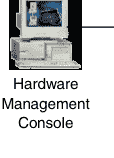

替代方案

- 用于 `MySQL` 数据库分区的 `AIX`
- 一个带有两个 `CPU`、4 GB 内存、2x36 GB DASD 的分区用于 `Apache` Web 服务器
- `Sun`, `Hip` 迁移服务提供

6-5 使用 `Linux` 进行 `pSeries` 逻辑分区整合

这种 `Web` 整合可以使用 `Software Group` 产品扩展到复杂的 `Web` 工作负载。可以在分区 3 中使用 `DB2` 来实现。通过在分区 3 使用 `AIX` 而非 `Linux`，可以实现数据库管理系统 (`DBMS`) 的扩展性。`Software Group` 产品的可用性目前是 `IBM` 的方向声明，因此 `pSeries Linux Software Group` 的扩展性预计将增长。

## 6.4 pSeries Linux 集群

`IBM` 的软件尚未宣布，但 `IBM Linux` 集群产品（如 `Cluster 1300` 和 `1350`）已迁移到 `pSeries Linux`。`IBM` 已经发布方向声明，将其集群系统管理 (`CSM`) 技术迁移到 `pSeries`。

`Cluster 1600` 是 `IBM` 用于 `pSeries` 的关键 `UNIX` 集群解决方案。它增加了可扩展性和支持。它还设计为与 `CSM` 配合，预计将集成基于 `pSeries` 的服务器（如 `pSeries Model 630`）。你可以在 Web 上获取更多关于 `Cluster 1600` 的信息：

```
http://www.ibm.com/eserver/clusters/index.html
```

168 Linux Handbook：`IBM Linux` 解决方案和资源指南

`POWER4` 系列处理器应该提供卓越的 `Linux` 性能。`POWER4` 集群将满足现在和未来的市场需求。更多关于 `Linux` 集群的信息，请参阅第 243 页第 9 章“`Linux集群`”。

针对分布式 `pSeries Linux` 环境的高可用 `Linux` 集群已可用并受到支持。

```
http://www.beowulf.org
```

适用于 `pSeries Linux` 的 `Myricom Myrinet`，`Myricom` 供应并支持适用于 `IA32`, `IA64`, `Alpha`, `PowerPC` 的 `Linux 2.4` 内核的 `Myrinet` 软件。`Myrinet` 可作为高速互连到运行 `Linux` 的 `pSeries` 机器集群系统。也可以使用千兆比特或 `10/100` 以太网连接。更多信息请参阅：

```
http://www.myri.com/scs/
```

## 6.5 pSeries Linux 应用解决方案

通过 `pSeries Linux`，你可以将开源应用程序的助力引入到你的环境中。`pSeries Linux` 使得通过开源标准来丰富任何现有 `pSeries` 的能力成为可能。

`Software Group` 产品的可用性目前是 `IBM` 的方向声明，因此 `pSeries Linux Software Group` 的扩展性预计将增长。

`POWER4` 系列处理器应该提供卓越的 `Linux` 性能。`POWER4` 集群将满足现在和未来的市场需求。更多关于 `Linux` 集群的信息，请参阅第 243 页第 9 章“`Linux集群`”。

针对分布式 `pSeries Linux` 环境的高可用 `Linux` 集群已可用并受到支持。

```
http://www.beowulf.org
```

适用于 `pSeries Linux` 的 `Myricom Myrinet`，`Myricom` 供应并支持适用于 `IA32`, `IA64`, `Alpha`, `PowerPC` 的 `Linux 2.4` 内核的 `Myrinet` 软件。`Myrinet` 可作为高速互连到运行 `Linux` 的 `pSeries` 机器集群系统。也可以使用千兆比特或 `10/100` 以太网连接。更多信息请参阅：

```
http://www.myri.com/scs/
```

通过 `pSeries Linux`，你可以将开源应用程序的助力引入到你的环境中。`pSeries Linux` 使得通过开源标准来丰富任何现有 `pSeries` 的能力成为可能。

您可以在 Web 上找到完整信息：

```
http://source.ibm.com/cgi-bin/goto?it=usa_annred&on=203-053
```

# 适用于 pSeries 的 Linux VisualAge C++, V6.0 支持 VisualAge C++

适用于 `pSeries` 的 `Linux VisualAge C++, V6.0` 软件是一个一个用于构建 `C` 和 `C++` 应用程序的高效、强大的开发环境。

### 1998 C++ 和 1999 C 国际标准

适用于 `pSeries` 的 `Linux VisualAge C++, V6.0` 基于官方行业标准构建，因此您的代码可以在各种实现版本之间轻松移植。

### 1999 C 标准

`ISO/IEC 9899:1999` 国际标准（也称为 `C99`）规定了用 `C` 编程语言编写的程序形式，并确立了对程序的解释。这是该标准的第二个版本。此更新增强了 `C` 语言的能力，提供了说明，并对上一版本的标准进行了技术修正。适用于 `pSeries` 的 `Linux VisualAge C++, V6.0` 内部的 `C` 编译器支持的语言特性与 `ISO/IEC 9899:1999` 国际标准中的规范一致。编译器与支持该标准的运行时环境配合工作，形成符合规范的实现。

`C99` 标准相比标准的第一版本（`C89`）提供了额外的语言函数，包括：

- `Long Long`
- `Bool`
- `Pragma` 运算符
- 允许 `const` 的初始化器
- 空的新型参数
- 带有变长参数的宏
- 内联函数说明符 (`Inline function specifier`)
- 复数 (`Complex`)


`-glangv1` 编译器选项允许您从 `VisualAge C++` 中可用的语言级别中进行选择，用于编译代码。您的代码可以符合最新的 `C99` 标准、使用 `C99` 扩展，或符合之前的 `C89` 标准。`VisualAge C++` 为您提供了灵活性，可以将代码编译为所需的语言级别。

### 1998 C++ 标准

`ISO/IEC 14882:1998` 国际标准（也称为 `Standard C++`）规定了用 `C++` 编程语言编写的程序形式，并确立了对程序的解释。这一国际标准促进了 `C++` 程序在各种实现版本之间的可移植性。

`ISO/IEC 14882:1998` 是 `C++` 语言的首次正式定义。适用于 `pSeries` 的 `Linux VisualAge C++, V6.0` 内部的 `C++` 编译器支持 `1998 ISO` 标准。此外，`VisualAge C++` 还支持标准委员会批准的若干最新说明，使适用于 `pSeries` 的 `Linux VisualAge C++, V6.0` 的 `C++` 编译器达到最新的标准水平。

# OpenMP

`OpenMP` 是一项行业规范，描述了一组通用 `API`，支持在包括 `UNIX` 平台在所有架构上对 `C`、`C++` 和 `FORTRAN` 这种多平台 `SMP` 编程。`OpenMP` 由包括 `IBM` 在内的一主要的硬件和软件供应商共同定义，是一种可移植、可扩展的编程模型。它为 `SMP` 程序员提供了一个简单且灵活的接口，用于开发从桌面级到超级计算机等平台的共享内存应用程序。

适用于 `pSeries` 的 `Linux VisualAge C++, V6.0` 完全支持 `OpenMP` 行业规范 `V1.0`。有关 `OpenMP` 网站的更多信息请访问：

`http://www.openmp.org`

# 编译器优化

适用于 `pSeries` 的 `Linux VisualAge C++, V6.0` 包含了 `IBM` 编译器优化技术的优势。通过编译器选项、指令和伪指令（`pragmas`），为程序员提供了多种优化代码的方法。使用 `-O2`、`-O3`、`-O4` 和 `-Os`，您可以获得优化级别，其范围从全面的低级优化到更广泛的优化（包括过程间分析、循环优化和自动机器调优）。优化选项还包括：

- `-qqarch`、`-qtune` 和 `-qcache` 允许您针对 `POWER3` 和 `POWER4` 架构对应用程序进行优化。

- `-qhot` 允许高阶变换，即通过交换（`interchange`）、融合（`fusion`）和展开（`unrolling`）等技术专门改进循环性能的优化。

- `-qipa` 调用过程间分析 (`IPA`)，允许编译器跨文件进行优化（全程序分析）。这可以显著提高性能。

- `-qpdf`（即配置引导反馈）使用示例程序执行的结果，来精细调整条件分支和频繁执行代码段的优化。

- `-qmsp` 生成线程代码，这对于利用共享内存并行处理是必要的，从而产生高性能代码。

# 32 位和 64 位支持

您可以使用适用于 `pSeries` 的 `VisualAge C++, V6.0` 来开发 32 位和 64 位应用程序。`VisualAge C++` 为 `SMP` 和串行代码提供 64 位指针和 64 位寻址支持。64 位代码支持高优化级别、过程间分析和 `SMP`。

# 移植便利性

适用于 `pSeries` 的 `Linux VisualAge C++, V6.0` 具有可以帮助您从 `AIX` 或其他基于 `UNIX` 的系统移植现有代码，也可以移植原本为 `GNU C/C++` 编写的代码。例如，通过使用 `-qinfopor` 选项编译，您可以过滤编译器生成的诊断信息，仅显示与可移植性问题相关的信息。

适用于 `pSeries` 的 `Linux VisualAge C++, V6.0` 支持 `GNU C/C++` 相关性的全面子集。其他 `GNU C/C++` 特性会被识别（接受并忽略）。这有助于减少您对 `GCC` 源码需要进行的更改数量。

# 二进制兼容性与共存

适用于 `pSeries` 的 `Linux VisualAge C++, V6.0` 支持 `C++` 接口 (`ABI`)。这意味着编译器产生的目标文件与 `GCC` 创建的文件兼容。适用于 `pSeries` 的 `Linux VisualAge C++, V6.0` 与 `GCC` 实现兼容。其他共存特性包括：

- 针对 `POWER3` 和 `POWER4` 架构的 `IBM` 内置函数。

- 使用 `GNU C` 头文件。

- 使用 `GNU` 汇器。

- 使用 `GNU` 链接器。

- 编译程序使用 `GNU C++` 运行时库。

- 目标文件与 `g++` 对象兼容。

- 使用 `GNU` 调试器。

- 使用性能分析工具。

# GNU 调试器：gdb

适用于 `pSeries` 的 `Linux VisualAge C++, V6.0` 支持使用 `GNU` 调试器 `gdb` 进行调试。该调试器随系统提供，支持无优化代码的全调试以及 `-2` 级别的部分调试。

# 文档与在线帮助

适用于 `pSeries` 的 `Linux VisualAge C++, V6.0` 提供 `HTML` 和便携式格式 (`PDF`) 产品文档。提供的 `PDF` 文包括：

- 《`Getting Started with VisualAge C++ for Linux`》介绍了编译器生成执行代码的不同方式、接受的输入输出类型以及移植程序的实用技巧。该书还包括程序安装说明，并对应用程序优化进行了介绍。

- 《`VisualAge C++ for Linux C/C++ Language Reference`》包含了 `IBM` 支持的 `C` 和 `C++` 语言信息，包括新的可移植性和标准扩展。

- 《`VisualAge C++ for Linux Compiler Reference`》包含了各种编译器选项、伪指令、宏和内置函数，包括用于并行处理的函数。

- 《`VisualAge C++ for Linux Programming Tasks`》包含了其他出版物未涵盖的使用 `VisualAge C++` 编程的相关信息。

您可以在 `Web` 上找到这些文档：

`http://source.ibm.com/cgi-bin/goto?it=usa_annred&on=203-053`

# 6.5.2 其他 pSeries 的 Linux 应用程序

本节提供了 2003 年 `pSeries Linux` 支持的示例：

- `Abstract: Pro Fortran for POWER Linux`

`http://www.absoft.com/newppwcproductpage.html`

- `Bison Schweiz AG: Bison Solutions 2.6`

`http://www.bison-group.com/sprachen/english/`

- `Droplets, Inc.: User Interface V2.2`

`http://www.droplets.com/product/`

- `Micro Software Designs LTD: CUMIS Plus`

`http://msd-tt.com/products.php3`

- `Platform Computing: 用于分布式计算和网格计算解决方案的 LSF 5.1`

`http://www.platform.com/`

- `Point Solutions LTD: PAC Server`

`http://www.point-solutions.co.uk/`

- `Samba: Samba 2.2 文件和打印服务器`

`http://usr1.samba.org/samba/samba.html`

- `Wired Minds GmbH: Mindipede SLM 2.1`

`http://www.wiredminds.de/index_e.php`

- `Myricom` 为用于 `pSeries` 集群的 `PPC Linux` 内核 `Linux` 提供并支持软件。`Myrinet` 交换机兼容 `Linux for pSeries`。更多信息，请参阅第 243 页的第 9 章“`Linux 集群`”。您也可以参考以下网站：

`http://www.myri.com/`

## 6.6 用于 Linux for pSeries 的基础设施和架构解决方案

针对 `Linux for pSeries` 的基础设施和架构解决方案正由 `IBM` 和第三方开发。`IBM` 已经发布了方向性声明，将 `Software Group` 和基础设施解决方案迁移到 `Linux for pSeries`。

`pSeries` 服务解决方案目前也由 `IBM` 和第三方开发中。`Linux for pSeries` 服务将与 `IBM` 的 `Linux` 就绪快速配置一同提供。

有关 `Linux for pSeries` 服务和支持的更多信息和细节，请参阅第 275 页的第 10 章“`IBM Linux 服务`”。参见第 287 页的 `10.5`“`平台服务`”以及第 290 页的 `10.5.3`“`pSeries 服务`”。

## iSeries 与 Linux

本章提供了 `iSeries` 服务器上可用 `Linux` 解决方案的概述。它包含了有关以下主题的信息：

- `Linux` 如何在 `iSeries` 服务器上运行

- 为什么你应该在 `iSeries` 服务器上使用 `Linux`


- Linux 与其 iSeries 服务器上 LPAR 的关系

- iSeries Linux 集成

- 特定 iSeries 型号上的 Linux 支持

- iSeries 支持的 Linux 发行版

- iSeries 客户与 Linux

- 作为服务器整合环境的 iSeries 和 Linux

- iSeries 上可用的 Linux 解决方案

- iSeries  Linux 服务解决方案

有关 iSeries 服务器和 Linux 的更多及最新信息，请访问：

```
http://www.ibm.com/servers/eserver/iseries/linux/
```

## 7.1 Linux 如何在 iSeries 服务器上运行

iSeries 服务器提供了在逻辑分区环境中运行 Linux 的能力。主分区必须运行 `OS/400 V5R1` 或更高版本，该版本提供了在备分区中启动 Linux 内核所需的支持。Linux 操作系统需要在备分区中安装并运行。

iSeries 服务器分区支持多个 Linux 和 `OS/400` 镜像。它适用于整个 iSeries 产品线。例如，在 1 路 iSeries 服务器上，最多支持 31 个 Linux 分区。你可以在分区之间独立地移动处理器和内存，粒度为处理器的百分分之一（1/100）和 1 MB 内存。共享的处理器资源可以在 Linux 和 `OS/400` 之间动态移动。

| LPAR 1 | LPAR 2 | LPAR 3 | LPAR 4 | LPAR 5 |
| :--- | :--- | :--- | :--- | :--- |
| OS/400 | OS/400 | Linux | Linux | OS/400 |
| V5R2 | V5R1 | Red Hat | SuSE | V5R2 |

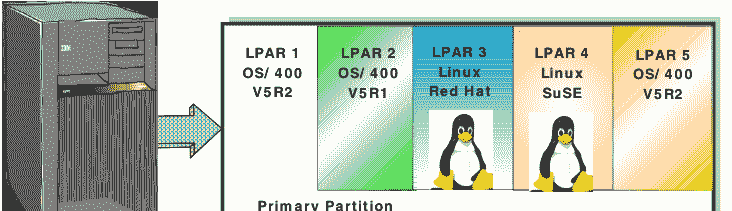

图 7-1 具有多个分区的 iSeries，其中两个运行 Linux

除了整合 Linux 之外，iSeries 服务器还允许通过 Linux 扩展。Linux 应用可以通过连接分区的 16 个高速以太网局域网（LAN）之一访问 DB2 通用数据库 (UDB) 以及 `OS/400` 程序和服务。iSeries 服务器提供了 Linux 应用与 `OS/400` 设施之间的集成。Linux 应用可以访问存储在 `OS/400` DB2 UDB 中的数据，并访问存储在 `OS/400` 集成文件系统 (IFS) 中的文件。

在 iSeries 服务器上集成 Linux 和 `OS/400` 应用程序的能力结合了两种操作环境的主要优势。例如，`OS/400` 的数据库功能和 Linux 的 Web 服务特性提供了一个强大的整合的计算环境。

### 7.1.1 为什么在 iSeries 上使用 Linux

你可能出于以下原因选择在 iSeries 上实施 Linux：

- 总拥有成本支持或总获取成本：由于共享处理器和虚拟 I/O 支持，在 iSeries 服务器上的 Linux 环境对硬件的要求极低。此外还可以节省空间和功耗。iSeries 服务器可以整合 Linux 和 `Windows NT` 服务器。这可以转化为在 iSeries 服务器上运行 Linux 应用的极低资金投入。

iSeries 解决方案旨在为 IT 环境提供成本优势。`CIOView` 公司提供了一个用于评估 `TCO` 的工具。通过该工具 `TCOnow!`，你可以估计与竞争替代方案相比的所选 iSeries 解决方案的 `TCO`。要使用该工具，请访问：

```
http://www.ibm.com/servers/solutions/consolidation/tco/
```

- 整合：iSeries 服务器可以根据 iSeries 型号整合几台服务器。在 iSeries 产品线的高端，例如，在 1 路 iSeries 服务器上，最多支持 31 个 Linux 分区。你可以在分区之间独立地移动处理器和内存，粒度为处理器的百分分之一（1/100）和 1 MB 内存。共享的处理器资源可以在 Linux 和 `OS/400` 之间动态移动。

Linux 场景示例包括：

- 工作负载整合：在 iSeries 服务器上划分 Linux 工作负载。企业资源计划 (ERP)、商业智能等应用是极佳的选择。
- 占用整合：在 iSeries 服务器上划分 Linux 工作负载。
- 生产与测试：在 iSeries 服务器上划分 Linux 工作负载。
- 高可用性：用于 Linux 可用性解决方案的服务器划分。
- 服务提供商：在 iSeries 服务器上划分不同的 Linux 环境。
- 业务恢复：在 iSeries 服务器上划分不同的 Linux 环境。
- 按需容量升级 (CUoD)：iSeries 处理器可以临时或永久激活。
- 集成：iSeries 服务器提供了 Linux 应用与 `OS/400` 设施之间的集成。Linux 应用可以访问存储在 `OS/400` DB2 UDB 中的数据以及存储在 `OS/400` IFS 中的文件。
- 性能：具有多个 Linux 环境的单台 iSeries 服务器比多个系统具有更的人均成本。
- 应用灵活性：iSeries 服务器支持 Java、UNIX、C、COBOL、RPG、WebSphere 和 `Windows` 服务器应用程序。此外，凭借独特的磁盘支持，iSeries 服务器提供了一个极佳的 Linux 测试环境。
- 资源共享：iSeries 服务器可以在 `OS/400` 和 Linux 分区之间共享资源。这可以降低管理和支持异构环境的成本。LPAR 支持在 `OS/400` 和 Linux 之间共享和动态移动处理器资源。

此外，2 路 iSeries 型 270 或 820 最多支持 8 个分区（2 x 4），而 4 路 iSeries 型 820 最多支持 16 个分区（4x 4）。

配备 8 个或更多处理器的 iSeries 服务器支持最多 32 个分区。在配备 SSTAR 处理器的特定 iSeries 型 270、820 和 840 上，这些共享处理器的分区可以运行 `OS/400 V5R1` 或 Linux。在配备 ISTAR 处理器的 iSeries 型 820、830 和 840 上，Linux 需要专用的处理器。

使用 `OS/400 V5R1`，创建新分区的最小处理器分配要求为处理器的十分之一 (1/10)。这使得主分区处理需求降至最低，剩余的处理单元用于支持辅助分区。

LPAR 的优势之一是分区间的移动。处理器、内存和 I/O 资源可以在 `OS/400` 和 Linux 分区之间移动。在特定的 iSeries 型上，可以在分区之间移动处理器的百分分之一 (1/100)。在仅支持专用处理器的 iSeries 型上，分区间的处理器移动以整个处理器为增量进行支持。使用 `OS/400 V5R1`，向 Linux 分区移动或从其移动资源需要重启 Linux 分区。

iSeries 上的 Linux 环境可以简单、快速地设置。对于支持 Linux 共享处理器的 iSeries，Linux 分区的最小资源要求为一个处理器的十分之一 (1/10)。此外，Linux 至少需要 64 MB 内存。最大的 Linux 分区大小由 Linux 发行版提供的支持决定。2.4 64 位内核支持多达 24 个处理器和高达 256 GB 的内存。

## OS/400 V5R2

在 `OS/400 V5R2` 中，LPAR 为 Linux 进行了增强。通过 V5R2 主分区，共享处理器资源可以在 Linux 和 `OS/400 V5R2` 分区之间动态移动。此外，在配备 SSTAR 和 POWER4 处理器的 iSeries 服务器上，Linux 分区的数量也增加了增加，例如：

- 在单处理器服务器上，最多支持 9 个 Linux 分区。
- 在双处理器服务器上，最多支持 19 个 Linux 分区。
- 在四处理器服务器上，最多支持 31 个 Linux 分区。

对于 V5R2，Linux 支持新的 Model 800、810、825、870 和 890 服务器。890 支持多达 32 个处理器和 31 个 Linux 分区。

iSeries 存储虚拟化在 V5R2 中也得到了增强。`OS/400` 分配的存储空间可以动态添加到 Linux 分区。存储虚拟化使 Linux 能够利用 iSeries 存储架构。

`iSeries Navigator` 在 V5R2 中得到增强，支持 Linux 分区管理和资源移动。提供的向导可以使创建分区变得更加简单。

2003 年，IBM 宣布了针对 Linux 的额外增强。通过 iSeries 型 870 和 890 企业版，可以免费为 Linux 激活一个额外的处理器。此外，Model 825、870 和 890 企业版服务器中包含了教育和服务的代金券，代金券可以兑换 Linux on iSeries 实施课程和 Linux on iSeries 集成快速上手服务。

## Linux I/O 灵活性


iSeries 上的 `Linux` 环境支持两种 `I/O`：虚拟和直接。通过虚拟 `I/O`，磁盘、磁带和光驱器等 `I/O` 资源由 `OS/400` 所有。`OS/400` 与 `Linux` 共享这些资源。共享资源的分区称为主机（`host`）。主机可以是主分区，但不必是。一个分区可以作为多个 `Linux` 分区的宿。共享资源由 `OS/400` 管理。例如，磁盘空间从 `OS/400` 的磁盘驱动器分配给 `Linux`。`OS/400` 为 `Linux` 环境提供 `RAID` 保护以及一些备份和恢复设施。

`OS/400` `V5R1` 和 `V5R2` 提供的虚拟以太网支持扩展到了 `Linux`。虚拟以太网在分区之间（`OS/400` 到 `Linux` 以及 `Linux` 到 `Linux`）提供 16 条 1 `GbE` 以太网通信路径，而不需要额外的硬件资源。

通过直接 `I/O`，`I/O` 资源由 `Linux` 所有。例如，磁盘驱动器、局域网（`LAN`）或广域网（`WAN`）适配器由一个 `Linux` 环境控制。`OS/400` 无法使用这些资源。分区中的 `Linux` 服务器可以同时利用虚拟和直接 `I/O`。

### 7.1.3 iSeries Linux 集成

`iSeries` 服务器提供了许多集成点，支持利用 `OS/400` 应用和数据的 `Linux` 程序。

`PowerPC` `Linux` 数据库连接 (`ODBC`) 驱动提供了运行在 `iSeries` 上的 `Linux` 应用程序访问 `OS/400` `DB2` `UDB` for `iSeries` 数据库的能力。此 `ODBC` 包含在特定的 `Linux` 发行版中。

`IBM` 使用 `Samba` 增强了 `OS/400` `NetServer`，用于在 `OS/400` 和 `Linux` 系统之间交换文件。有了此支持，`Linux` 可以打印到 `OS/400` 打印队列。

`iSeries` `Linux` 提供了 `IBM` `Developer` `Kit` for `Linux`, `Java` `2` `Technology` `Edition`。该虚拟机（`JVM`）结合其他工具允许 `Linux` 访问 `OS/400` 数据。

### 表 7-4 Model 820

| Model 820 | 特性 # | 主分区 | 支持 LPAR | 支持 Linux | Linux 共享处理器 | 次要最低要求 | n-路并行 |
|---|---|---|---|---|---|---|---|
| | 150 | V5R2 | 是 | 是 | 是 | V5R1 | 1 |
| | | V5R1 | 是 | 是 | | V5R1 | |
| | 151 | V5R2 | 是 | 是 | 是 | | 2 |
| | | V5R1 | 是 | | | | V4R5(1) | |
| | 152 | V5R2 | 是 | 是 | | V5R1 | 4 |
| | | V5R1 | 是 | | | | V4R5(1) | |
| | 2395 | V5R2 | 是 | 否 | | V5R1 | 1 |
| | | V5R1 | 是 | 否 | | V5R1 | |
| | 2396 | V5R2 | 是 | 否 | | V5R1 | 1 |
| | | V5R1 | 是 | 否 | | V5R1 | |
| | 2397 | V5R2 | 是 | 是 | 否 | V5R1 | 2 |
| | | V5R1 | 是 | 否 | 否 | V4R5(1) | |
| | 2398 | V5R2 | 是 | 是 | 否 | V5R1 | 4 |
| | | V5R1 | 是 | 否 | 否 | V4R5(1) | |
| | 2425 DSD | V5R2 | 是 | 否 | | V5R1 | 1 |
| | | V5R1 | 是 | 否 | | V5R1 | |
| | 2426 DSD | V5R2 | 是 | 否 | | V5R1 | 2 |
| | | V5R1 | 是 | 否 | | V4R5(1) | |
| | | V4R5(1) | 是 | 否 | | V5R1 | |
| | 2427 DSD | V5R2 | 是 | 否 | | V5R1 | 4 |
| | | V5R1 | 是 | 否 | | V4R5(1) | |
| | | V4R5(1) | 是 | 否 | | V4R5(1) | |
| | 2435 | V5R2 | 是 | 是 | 是 | V5R1 | |
| | | V5R1 | 是 | 是 | 是 | V5R1 | |
| | 2436 | V5R2 | 是 | 是 | 是 | V5R1 | 1 |
| | | V5R1 | 是 | 是 | 是 | V5R1 | |
| | 2437 | V5R2 | 是 | 是 | 是 | V5R1 | 2 |
| | | V5R1 | 是 | 是 | 是 | V4R5(1) | |
| | 2438 | V5R2 | 是 | 是 | 是 | V5R1 | 4 |
| | | V5R1 | 是 | 是 | 是 | V4R5(1) | |
| | 2456A DSD | V5R2 | 是 | 是 | 是 | V5R1 | 1 |
| | | V6R1 | 是 | 是 | 是 | V5R1 | |
| | 2457 DSD | V5R2 | 是 | 是 | 是 | V5R1 | 2 |
| | | V5R1 | 是 | 是 | 是 | V4R5(1) | |
| | 2458 DSD | V5R2 | 是 | 是 | 是 | V5R1 | 4 |
| | | V5R1 | 是 | 是 | 是 | V4R5(1) | |

> (1) 表示需要专用处理器。

### 表 7-5 Model 830

| Model 830 | 特性 | 主分区 | 支持 LPAR | 支持 Linux | Linux 共享处理器 | 次要最低要求 | n-路并行 |
| :--- | :--- | :--- | :--- | :--- | :--- | :--- | :--- |
| | 153 | V5R2 | 是 | 是 | 否 | V5R1 | 8 |
| | | V5R1 | 是 | 是 | 否 | V5R1 | |
| | 2349 | V5R2 | 是 | 是 | 否 | V5R1 | 4/8 |
| | | V5R1 | 是 | 是 | 否 | V5R1 | |
| | 2351 | V5R2 | 是 | 是 | 否 | V5R1 | 1/8 |
| | | V5R1 | 是 | 是 | 否 | V5R1 | |
| | 2400 | V5R2 | 是 | 是 | 否 | V4R5(1) | 2 |
| | | V5R1 | 是 | 是 | 否 | V4R5(1) | |
| | | V4R5(1) | 是 | 否 | | V4R5(1) | |
| | 2402 | V5R2 | 是 | 是 | 否 | V5R1 | 4 |
| | | V5R1 | 是 | 是 | 否 | V4R5(1) | |
| | | V4R5(1) | 是 | 否 | | V4R5(1) | |
| | 2403 | V5R2 | 是 | 是 | 否 | V5R1 | 8 |
| | | V5R1 | 是 | 是 | 否 | V4R5(1) | |
| | | V4R5(1) | 是 | 否 | | V4R5(1) | |

(1) 表示需要专用处理器。

### 表 7-6 Model 840

| Model 840 | 特性 # | 主分区 | 支持 LPAR | 支持 Linux | Linux 共享处理器 | 次要最低要求 | n-路并行 |
|---|---|---|---|---|---|---|
| | 158 | V5R2 | 是 | 是 | 是 | V5R1 | 12 |
| | | V5R1 | 是 | 是 | 是 | V5R1 | |
| | 159 | V5R2 | 是 | 是 | 是 | V5R1 | 24 |
| | | V5R1 | 是 | 是 | 是 | V5R1 | |
| | 2352 | V5R2 | 是 | 是 | 是 | V5R1 | |
| | | V5R1 | 是 | 是 | 是 | V4R5(1) | |
| | 2353 | V5R2 | 是 | 是 | 是 | V5R1 | 12/18 |
| | | V5R1 | 是 | 是 | 是 | V4R5(1) | |
| | 2354 | V5R2 | 是 | 是 | 是 | V5R1 | 18/24 |
| | | V5R1 | 是 | 是 | 是 | V4R5(1) | |
| | 2416 | V5R2 | 是 | 是 | 否 | V5R1 | 8/12 |
| | | V5R1 | 是 | 是 | 否 | V4R5(1) | |
| | | V4R5(1) | 是 | 否 | | | |
| | 2417 | V5R2 | 是 | 是 | 否 | V5R1 | 12/18 |
| | | V5R1 | 是 | 是 | 否 | V4R5(1) | |
| | | V4R5(1) | 是 | 否 | | | |
| | 2418 | V5R2 | 是 | 是 | 否 | V5R1 | 12 |


| | | V5R1 | 是 | 是 | 否 | V4R5(1) | |

| | | V4R5(1) | 是 | 否 | | | |

| | 2419 | V5R2 | 是 | 是 | 否 | V5R1 | 18/24 |

| | | V5R1 | 是 | 是 | 否 | V4R5(1) | |

| | | V4R5(1) | 是 | 否 | | | |

| | 2420 | V5R2 | 是 | 是 | 否 | V5R1 | 24 |

| | | V5R1 | 是 | 是 | 否 | V4R5(1) | |

| | | V4R5(1) | 是 | 否 | | | |

| | 2461 | V5R2 | 是 | 是 | 是 | V5R1 | 24 |

| | | V5R1 | 是 | 是 | 是 | V4R5(1) | |

> (1) 表示需要专用处理器。

## 7.1.5 iSeries 发行版

`iSeries` 服务器的 `Linux` 可从领先的 `Linux` 发行版 `Red Hat`、`SuSE` 和 `Turbolux` 获取。这些 `Linux` 发行版基于 `PowerPC` 的 `Linux` 内核 `2.4` 版本。从 2002 年 1 月开始，这些版本适用于基于 64 位 `PowerPC` 内核的 `iSeries`。最新的 `Linux` 发行版支持 64 位和 32 位应用程序。`Linux` 发行版包含了在 `iSeries` 服务器上运行所需的设备程序和其他支持。

除了内核之外，这些 `Linux` 发行版还包含操作系统、中间件和应用程序。例如，它们包含了 `Apache`、`Tux` 和 `Zope` Web 服务器；`Sendmail`、`Postfix` 和 `exim` 邮件设施和服务器；`Samba` `NFS` 文件服务器；`lrpng` 和 `cups` 打印服务器；以及 `TCP wrappers` 和 `iptables` 防火墙。选定的发行版还包含与 `OS/400` 的关键集成技术，包括访问 `OS/400` 中 `DB2 UDB` 的 `ODBC` 和 `JDBC` 支持。

当前的发行版有：

- `Red Hat Linux` `7.1` for `iSeries`，64 位，支持 32 位应用程序

- `SuSE Linux Enterprise Server` `8`，支持 64 位和 32 位应用程序

- `Turbinolux` `7` for `iSeries`，支持 32 位应用程序

## 7.2 整合

凭借 `iSeries` `LPAR` 技术和对 `OS/400` 的支持，可以为分布式企业的终端用户提供可靠的合一机解决方案。在这种实施中，每个操作系统都用于其预期用途。图 7-3 展示了此类 `OS/400` 作为业务应用程序最佳的示例。多年来，它已被证明是可靠的。而 `Linux` 则被证明是通用（内部）网络的稳定操作系统，可提供防火墙功能。

在此示例中，利用 `LPAR` 技术在一台 `iSeries` 服务器上支持多个运行环境。通常，防火墙和 `Internet` 服务器等环境会安装在自己的服务器上。图 7-3 显示一台 `iSeries` 服务器可以支持五个不同的服务器。还展示了如何在 `Linux` 环境中使用虚拟 `I/O`。连接互联网的防火墙具有专用局域网适配器。此分区所需的资源（磁盘、磁带、光驱和局域网）都是虚拟的。虚拟局域网也用于提供到 Web 服务器的直接连接。

两个运行商业或企业对业务应用程序的 Web 服务器可以提供负载均衡和高可用环境。Web 服务器随后通过不同的方式连接到第二个防火墙。

虚拟局域网（`LAN`）连接。多个虚拟局域网连接为外部和内部环境提供了额外的安全性。

第二个防火墙使用 `I/O` 磁盘、磁带、`CD-ROM` 和 `LAN` 资源。除了原生 `LAN` 外，它没有任何直接的 `I/O` 设备。可以将直接 `LAN` 适配器连接到第一个 `OS/400` 分区。这种方法（将直接 `LAN` 适配器连接到 `Linux` 分区）的优势是所有系统用户都必须通过防火墙。这意味着限制内部网络某些部分对核心业务软件的访问，或者对该系统进行活动记录。

`OS/400` 分区运行业务应用程序并包含 Web 应用程序的基础数据。这五个分区可以设置在带有两个处理器的小型 `iSeries` 服务器上（例如，`Model 810`）。`OS/400` 和 `Linux` 分区可以共享这两个处理器，并可以根据工作负载需求在分区之间移动资源。相同的解决方案也可以在带有额外处理器的大型 `iSeries` 服务器上设置。

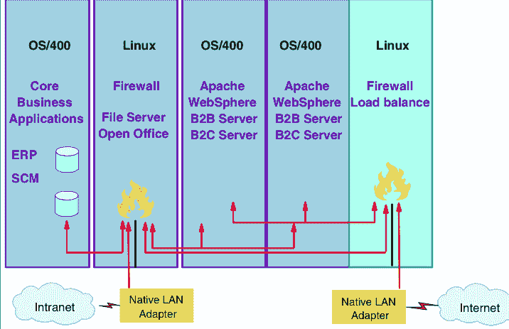

图 7-3 `iSeries` 一体化解决方案

## 7.6 `Linux` 解决方案

`PowerPC` `Linux` 应用程序在 `iSeries` 服务器上开箱即用，并在 `pSeries` 和其他 `PowerPC` 平台上运行。`iSeries` 的 `Linux` 发行版包含了此类源应用程序，如 `Apache`、`Samba`、`IMAP`、`OpenLDAP`、`Perl`、`Sendmail MTA`、`Squid` 和 `PostgreSQL`。

`Linux` 应用程序来自许多领域。基于 `Intel` 的 `Linux` 应用程序需要为 `PowerPC` 重新编译。你可以下载互联网上的开源应用程序并将其编译为 `PowerPC` 应用程序。`iSeries` 发行版中也可以为 `Linux` 开发编译器和语言（例如，`C`、`PHP` 和 `Perl`）。你还可以在 `PowerPC` 工作站或服务器上开发应用程序，或者直接将它们移动到 `iSeries` 上运行。交叉编译器可用于在 `Intel` 系统上编写应用程序并将其编译为运行在 `PowerPC` 平台上。

解决方案提供商已宣布适用于 `iSeries` 服务器的 `Linux` 产品。这些产品包括来自 `Symantic`、`Sage`、`Bynari`、`Maptics` 和 `eOne` 的产品。列出了一些示例。你可以在 Web 上找到完整列表：

```
http://www.ibm.com/servers/eserver/iseries/linux/apps.html
```

为了帮助解决方案提供者将更多解决方案推向市场，提供了 `iSeries Test Drive for Linux`，它提供了对 `iSeries` 上 `Linux` 分区的访问。更多信息，请参阅：

```
http://www.iseries.ibm.com/developer/factory/testdrive/index.html
```

### 基础设施应用程序

在为 `iSeries` `Linux` 解决方案宣布的基础设施应用程序中：

- `extend5`：这是 `AcuCoder` 为 `COBOL` 开发的集成开发环境 (`IDE`)，包含了 `AUCOBOL-GT`，该该公司支持 `iSeries` `Linux` 的旗舰产品。大型公司和 `ISV`（软件供应商）已使用 `AUCOBOL-GT` 编写或扩展了他们的 `COBOL` 代码。此 `IDE` 为开发者提供了将现有 `AUCOBOL-GT` 应用程序迁移到 `iSeries` `Linux` 而无需重新编译的能力。

- `CM_SAFE` `Server` for `iSeries`：此来自 `GMx Solutions` 的应用程序为开放式系统主机提供配置文件管理功能，并为 `iSeries` `Linux` 分区提供服务器支持，以及对所有主要 `UNIX` 变体和平台的代理支持。

- `Enterprise Firewall` for `iSeries` `Linux`：此解决方案来自 `Symantic`，为 `iSeries` 客户提供快速、安全的防火墙保护，帮助保护网络和关键业务应用程序免受意外入侵。该应用程序将于 2003 年期间广泛可用。

`ORION`：多平台管理可用性解决方案由 `Vision Solutions` 提供。`ORION` 通过单一企业视图，整合并管理跨越多个应用程序、数据库和服务器的整个企业的数据和应用程序可用性需求。`ORION` 允许你管理跨越驻在多个服务器操作系统上的五个行业领先数据库的数据共享。它还允许你管理在 `iSeries` 平台、来自 `SuSE`、`Red Hat` 和 `Turbo Linux` 的 `Linux` 服务器以及 `Windows 2000` 中的数据和应用程序韧性。

`ORION` 引擎完全采用 `Java` 和 `XML` 架构，在跨操作系统方面具有良好的可移植性，并在企业中具有高度的可扩展性。`ORION` 提供了一个直观的中心化界面，让系统操作员和管理员对整个企业的可用性需求拥有最大的自主权控制力。

### 业务应用程序

为 `iSeries` `Linux` 宣布的业务应用程序包括：

- `iSeries` `Linux` 的 `MAPICS` `ERP` 解决方案：此解决方案包含两个 `ERP` 基础，加上供应链管理、协作商务与维护以及校准管理功能。这是该平台上第一个支持 `Linux` 的以制造为中心的 `ERP` 应用程序。

- 用于 `iSeries` 企业的 `Sage Line 500`：此来自 `Sage` 的业务应用程序使中型企业能够获得其财务、分销、制造和服务运营的单一视图。

- `iSeries` `Linux` 的 `Magic eMerchant V2`：此来自 `Magic Software` 的解决方案是一个可定制的电子商务框架，旨在部署电子业务 `CRM` 解决方案。

### Web 启用应用程序

为 `iSeries` 服务器 `Linux` 解决方案宣布的 Web 启用应用程序示例：


- `eCommerce`：此来自`eOne Group`的解决方案是一个灵活的电子商务软件应用程序和`Internet`发布工具，运行在`iSeries`的`Linux`上。

- `Insight Server`：由`Byarni`提供此软件应用程序，提供轻量级或企业级的`Linux`消息服务。`Insight Server`兼容微软的`Outlook`客户端套件，通过基于标准的协议提供与`Exchange Server`类似的功能。

- `CoSORT`数据排序：此解决方案为大型数据集提供高性能的数据排序。

### 7.6.1 使用 `OpenOffice` 的小型办公室

`iSeries`为小型办公室提供了一个平台。`OS/400`运行业务应用程序，而`Linux`运行`OpenOffice`。基于流行的产品，`OpenOffice`提供文字处理器、电子表格和演示文稿。它适用于所有类型的客户端。

你可以在`Web`上下载它：

```
http://www.openoffice.org/
```

### 7.6.2 `Java`

`iSeries`支持当前版本的`JVM`。有关更多信息和下载，请参阅：

```
http://www.ibm.com/servers/eserver/toolbook/
```

### 7.6.3 `IBM` 产品

`IBM`软件组已宣布在`iSeries`的`Linux`上提供`WebSphere`和`DB2`。有关软件组产品的更多信息，请参阅第 200 页 8.1 “`Linux` 概述”。

## 7.7 基础设施解决方案

基础设施解决方案，请参阅第 193 页 7.6 “`Linux` 解决方案”。

## 7.8 `iSeries` 解决方案

`iSeries`是中市场企业的领先业务服务器。它具有关键电子商务功能、创新技术、应用程序灵活性、卓越性能以及管理电子商务所需的新工具。无论您的业务规模或复杂度如何，`iSeries`解决方案均可用。

本节提供了以下在`iSeries`服务器上构建的`Linux`解决方案示例：

- 应用服务提供商 (`ASP`)：`Aitana SBS`

- 文件服务、整合：巴西银行

- 防火墙、整合、电子商务：`Churchill Case`

### `Aitana SBS`

`Aitana SBS`位于西班牙瓦伦西亚，许可其软件解决方案并作为`ASP`提供。最近，`Aitana`开始将`Linux`作为那些想要`Linux`的可靠性和成本效益以及`IBM`服务器性能用户的平台。`Aitana SBS`运营四台`iSeries`机器，其中两个 270 型号带有`Linux PAR`用于开发、测试和生产。

`Aitana SBS`面临的挑战是满足对基于`Linux`的软件和托管解决方案的需求。`Aitana SBS`包含了运行`Linux`的`iSeries`和`xSeries`服务器。`Aitana SBS`专注于基于`IBM Lotus Domino`的协作解决方案以及基于`WebSphere Application Server`和`IBM Universal Database`的解决方案。`Aitana SBS`选择了`Red Hat Linux`发行版作为他们的解决方案。

在迁移到他们的`iSeries Linux`解决方案后，`Aitana SBS`预计为`ASP`客户带来：

- 应用程序速度提高 20%

- 操作系统可用性提高 50%

- 降低管理成本

完整故事，请参阅：

```
http://www.ibm.com/software/success/cssdb.nsf/CS/VO-SFEVR7?openDocument&Site=software
```

# 巴西银行 (`Banco Do Brasil`)

巴西银行是一家银行机构，在 30 个国家或地区拥有分行机构网络，并与 145 个国家或地区的近 1,000 家顶级银行提供相应的银行服务。巴西银行面临的挑战是整合其欧洲业务。巴西银行决定实施一项计划，将其欧洲业务整合到其伦敦办公室的三台`iServers`中。该计划的目标是增加`IT`能力和性能，通过切换到`Linux`减少许可费用和管理成本，通过可扩展系统提供灵活性，并提供一个能够适应其未来业务需求的底层架构。

为巴西银行设计的架构解决方案是使用`iServers`来：

- 运行巴西银行的核心银行应用程序。该系统增加了容量并配备了`LPAR`（逻辑分区），使银行能够从单点处理整个欧洲业务。

- 在其整个欧洲业务中运行用于工作流、邮件和共享应用的`Domino`专用服务器 (`DSD`)。

- 将作为`Linux`文件服务器运行，并通过`Integrated xServers`技术将`xServers`直接连接到`iServers`服务器。

在过渡到其`iServers Linux`架构解决方案后，巴西银行获得了以下收益：

- 节省成本，提高效率

- 改进并简化管理

- 提高性能

- 提高信息的质量和可用性

要了解更多此类案例，请访问：

```
http://www.ibm.com/servers/eserver/iservers/news/pdf/bancodobrasil.pdf
```

# 丘奇尔中国 (`Churchill China`)

`Churchill China`是一家高质量陶瓷和瓷餐具的主要制造商和分销商，拥有 200 年以工艺为核心的传承。他们的挑战是为电子商务供应链管理 (`SCM`) 系统开发一个稳健且可扩展的商业平台。激烈的海外竞争意味着`Churchill China`迫切需要适应电子商务世界。

为`Churchill China`设计的解决方案是使用`Wizz400`（`Clover`的产品）开发的，该程序运行在`LPAR`环境和同样运行在`LPAR`中的`Linux`防火系统中。选用的`iServers`是一台强大的`iSeries 820`型机器。

`Wizz400`中间件是`Churchill China`电子商务系统中不可或缺的一部分。`Churchill China`的网站变成了一个交互式电子商务工具，可以提取实时数据、显示准确的库存和账户信息，并收集订单数据。

在过渡到`iSeries Linux`架构解决方案后，`Churchill China`获得了以下收益：

- 通过将三个服务器合并为一台降低成本

- 包含多语言能力的适应性

- 可适应且灵活的架构，允许进一步开发以改进客户服务

- 提高订单和库存的准确性

- 提高客户服务

- 改进并简化管理

- 提高性能和可扩展性

要了解更多此类案例，请访问：

```
http://www.ibm.com/servers/library/casestudies/churchillchina.html
```

# 7.9 `iSeries` 服务解决方案

对`iSeries`上`Linux`的支持有两个关键组件。在`iSeries`上集成选定`Linux`发行版的支持由`iSeries`支持组织提供。集成支持包括帮助成功安装`Linux`、为`Linux`创建分区，以及与`Linux`分区之间共享`iSeries`资源。这种集成支持通过`iSeries OS/400 SupportLine`合同提供。

对`Linux`发行版本身的支持是一个单独的选项。此类支持可以从`SuSE`、`Turbolinux`、`Red Hat`、`IBM Global Services`以及其他`Linux`服务提供商处获得

# `IBM Linux` 软件

作为`IBM`对`Linux`操作系统投资及其战略的一部分，`IBM`软件集团 (`SWG`) 不断扩大其`Linux`软件目录。在`DB2`、`Lotus`、`Tivoli`和`WebSphere`品牌下，`IBM`软件包含了最全面的中间件栈，对于数据管理、小组协作、系统管理和`Web`成功部署至关重要。

本章通过以下主题提供`IBM Linux`的概述：

- `Linux`和`IBM`软件的可用性概述

- 用于`Linux`的`WebSphere`品牌软件

- 用于`Linux`的数据管理

- 用于`Linux`的`Tivoli`品牌软件

- 用于`Linux`的`Lotus`品牌软件

- `Linux`部署示例

- `IBM`软件资源

# 8.1 `IBM Linux` 软件可用性

作为通用策略的一部分，在过去的几年中，`Linux`已成为市场中增长最快的通用计算系统。`Linux`被认为是一种有效的解决方案。

中间件通常是业务解决方案的驱动力，需要在`Linux`上可用并符合开放标准，例如`J2EE`和`Web`服务。结果是`IBM`软件目录中的`DB2`、`WebSphere`、`Lotus`和`Tivoli`现在可用。业务面临着风险。因此，选择一个在多个平台上运行良好的`Linux`平台至关重要。对于某些在`Linux`平台上运行良好的中间件，这很重要。满足客户需求的操作系统和应用程序现在是可用的，`IBM`解决方案包括：

- **灵活性**：`Linux`允许采用适用于各种业务任务的硬件和软件。`Linux`可以在多种平台上运行中间件，这是一个良好的平台。此外，新应用程序可以很容易迁移。

- **可靠性**：`Linux`的扩展性和可用性已经在客户环境中得到证明。将`IBM`软件与`Linux`结合提高了可靠性、生产力和客户满意度。


- **成本性能**：在 Linux 上运行 IBM 软件可以降低成本 (TCO)、改进管理并提供丰富的硬件选择。您可以通过 Web 访问 Linux 的主页：

```
http://www.ibm.com/software/is/linux/index.html
```

## IBM Linux 软件可用性

IBM Linux 软件产品根据架构和发行版提供支持。您可以通过 Web 获取最新的 IBM Linux 软件可用性列表：

```
http://www.ibm.com/cgi-bin/software/track3.cgi?file=/software/is/mp/linux/software/pdfs/IBMSoftware.pdf&S_TACT=&S_CMP=
```

> 注意：列为 IBM Intel 的 xSeries 系统可用的 IBM 软件也适用于供应商的 Intel 的系统。

作为通用方向声明，IBM 软件品牌将支持两种 Linux 发行版：来自 Red Hat 的 Linux “企业”发行版（`Red Hat Enterprise Linux`）和 Linux 联盟（`SuSE SLES`、`Turbolux`、`SCO Linux` 和 `Connectiva`）。其他发行版可能会根据特殊情况支持。

有关每个 Linux 发行版的详细说明，请参见第 18 页的 `1.9` “Linux 发行版”。

软件可用性还可能受以下影响：

- 特定硬件架构的产品需求和目标市场：例如，市场可能在 `IBM Intel` 的 `xServers` 上需要某种中间件，软件对 Linux 操作系统的性能或功能要求：例如，许多第三方软件产品需要“企业”版 Linux（如 `SuSE Linux Enterprise`），而不是“桌面”版本（如 `SuSE Linux Office Desktop`）。
- `IBM` 硬件平台的市场可用性
- Linux 发行版的市场可用性
- Linux 发行版的发布计划
- `IBM` 内部品牌管理决策
- `IBM` 中间件产品的引入和淘汰

### 8.2 Linux 上的 IBM WebSphere 品牌产品

`WebSphere` 是用于动态电子商务的基础设施软件。它提供了一系列经过验证、安全且可靠的软件组合，包括 `WebSphere Application Server`、`WebSphere Commerce Suite`、`WebSphere MOSeries` 以及其他产品组和开发工具，采用最新的 Web 技术来实现电子商务的平滑扩展，以满足市场需求。图 8-1 显示了 `WebSphere` 软件平台划分的类别。

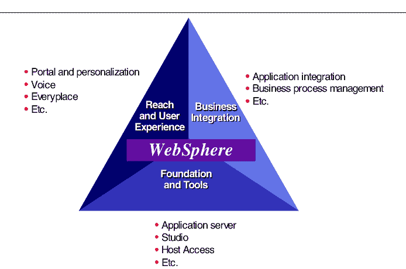

图 8-1 `WebSphere` 平台概述

每个类别详细说明如下：

- 触达与用户体验

  这简化了创建单一交互用户体验的过程。它允许您通过跨所有业务流程的门户接口，为客户、合作伙伴和员工提供以用户为中心的交互。商业产品提供了完整的事务支持，并与现有业务系统集成。将这些用户交互扩展到移动访问，并提供贯穿的体验，为我们全球和移动市场中的电子商务带来了真实价值。

- 业务集成

  这提供了集成数据、应用程序、流程和人的能力。它赋予了企业与供应链合作伙伴协作、利用智能以及增强客户关系管理的能力。

  利用现有资本投资是另一个优势，因为您正在集成当前的应用程序，而不是安装新程序。`WebSphere` 在业务集成方面的领导地位通过安全、性能和可扩展性的增强得到了延伸。

#### 基础与工具

成功在于创建一个具有未来增长的灵性和可扩展性的基础。通过这一类别，`WebSphere` 通过利用 Web 服务和现有软件资产提供了业务敏捷性和可扩展性。全面的 `Java 2` 企业版 (`J2EE`) 开发和部署能力是您集成所需的所有必需品。

基础基础设施 `WebSphere Application Server Version 5` 提供了一个包含了一系列应用程序服务的丰富电子商务应用程序部署环境。这些服务包括在异构环境中增强的事务管理能力、全面的 Web 服务支持、更高的安全性、性能、可用性、连接性和可扩展性。此外，`IBM WebSphere Studio` 提供了一个开放、集成的应用程序开发环境，通过生产力和质量的前所性提升降低了开发成本。

您可以在 Linux 版 `WebSphere` 主页上了解更多信息：

```
http://www.ibm.com/cgi-bin/software/track3.cgi?file=/software/is/mp/linux/websphere.shm&TACT=_S_TACT_&S_CMP=_S_CMP_
```

#### WebSphere 在 Linux 上的价值

`WebSphere` 产品集包括：

- **灵活性：** `WebSphere` 基于 `Java` 和 Web 服务的开放标准。这包括 `J2EE`、扩展标记语言 (`XML`)、通用描述、发现和集成 (`UDDI`)、简单对象访问协议 (`SOAP`) 和 Web 服务描述语言 (`WSDL`)。它支持企业间互联的复杂性。
- **可靠性：** `WebSphere` 为在 `Apache Web` 服务器上运行 `Java servlet` 和企业级 `JavaBean` (`EJB`) 提供了事务环境。
- **成本效益：** `WebSphere` 通过复用代码降低了应用程序开发成本。因为它运行在从 PC 服务器到集群主机的 Linux 上，因此优化了运行成本。

有关 `IBM WebSphere` 系列的更多信息，请参阅：

```
http://www.ibm.com/cgi-bin/software/track3.cgi?file=/software/is/mp/linux/software/pdfs/IBMSwareOnLinux.pdf&S_TACT=_S_TACT_&S_CMP=_S_CMP_
```

### 8.2.1 WebSphere 在 Linux 上的可用性

以下产品是 Linux 上 `WebSphere` 品牌产品列表的一部分：

- `WebSphere Application Server`
- `WebSphere Business Components Composer`
- `WebSphere Business Components Studio`
- `WebSphere Commerce`
- `WebSphere Edge Server`
- `Everyplace® Connection Manager`
- `WebSphere Extended Personalization`
- `WebSphere Host on Demand`
- `WebSphere MQ for Linux`
- `WebSphere MQ Everyplace`
- `WebSphere MQ Integrator`
- `WebSphere MQSeries`
- `WebSphere Performance Pack Cache Manager`
- `WebSphere Portal Server`
- `WebSphere Site Analyzer`
- `WebSphere Studio Application Developer`
- `WebSphere Studio Device`
- `WebSphere Studio Homepage`
- `WebSphere Application Monitor for z/OS`
- `WebSphere Site Developer`
- `WebSphere Telecom Application Server and Toolkit`
- `WebSphere Transcoding Publisher`

需要注意的是，并非所有产品的所有版本都在所有硬件平台上可用，也不可能适用于所有 Linux 版本和分发版。

有关适用于 Linux 的 `IBM` 软件的最新可用性及详细描述，请参阅：

```
http://www.ibm.com/cgi-bin/software/track3.cgi?file=/software/is/mp/linux/software/pdfs/IBMWebSphereOnLinux.pdf&S_TACT=__S_TACT__&S_CMP=__S_CMP__
```

### 8.2.2 竞争性软件

尽管 `WebSphere` 产品具有卓越的功能、性能和价格，但仍有很多开源和专有的竞争对手。

通常情况下，`WebSphere` 产品的性能和扩展性优于竞争产品。此外，`IBM` 为 `WebSphere` 产品提供行业领先的支持，而这在开源产品中通常无法获得。

某些 `WebSphere` 产品的替代方案包括：

- **`IBM HTTP Server` (由 `Apache` 驱动)**

`Apache` 是一个开源项目的演进产品，是世界上使用最广泛的 Web 服务器。它可以从 `Apache` 项目免费获取。

`IBM WebSphere Application Server` 与 `IBM HTTP Server`（由 `Apache` 驱动）完全兼容。事实上，`Apache` 是 `WebSphere Application Server` 提供的 `HTTPD` 服务器的基础。`Apache` 包含在每个 Linux 发行版中。可以从第三方组织获得对 `Apache` 的支持。


您可以在此处查找 Apache 的附加信息：

`http://httpd.apache.org/`

- `Tomcat`

Tomcat 是一个开源项目的演进产品，是 Java Servlet 和服务器页技术的参考实现。它可以从 Jakarta 项目免费获取，并包含在 Linux 发行版中。

有关 Tomcat 的附加信息，请参阅：

`http://jakarta.apache.org/tomcat/`

- `JBoss`

JBoss 是用 Java 编写的 J2EE 应用程序服务器和 EJB 容器。它是免费获取的。请注意，JBoss 目前尚未通过 J2EE 认证，尽管它声称符合规范。您可以从 JBoss 购买支持。

有关 JBoss 的附加信息，请参阅：

`http://www.jboss.org/`

- `JRun`

JRun 是由 Macromedia 开发的专有 J2EE 应用程序服务器。您可以在 Web 上更多：

`http://www.macromedia.com/software/jrun`

- 商业竞争对手

其他适用于 Linux 的竞争对手包括 Oracle Application Server、Sun ONE Application Server（原 iPlanet）以及 BEA WebLogic。

- 其他竞争技术

Linux Web 服务器通常通过使用 Perl、PHP 等编写的 CGI 脚本进行交互。这些是低容量 Web 服务的免费替代方案。请注意这些语言的编译器和解释器始终包含在 Linux 发行版中。

### 8.2.3 相关的 WebSphere 资源

本节提供了有关查找更多 WebSphere 资源的信息。

#### WebSphere 软件评估版

可以通过 Web 获取某些适用于 Linux 的中间件产品的免费版本，包含安装、配置和支持文档。您还可以通过 Web 获取 WebSphere Advanced Server、WebSphere Studio Developer、WebSphere MQ 以及适用于 Linux 的 IBM 软件。

有关如何获取自己的评估版的更多信息，请参阅：`http://www.ibm.com/developerworks/offers/linux-speed-start`

#### WebSphere 开发者领域

IBM 通过开发者网站提供宝贵的在线技术开发者资源。您可以在此处找到该网站，其中包含了新的技术预览和 WebSphere 开发者体验：

`http://www.software.ibm.com/wsdd/`

来自 WebSphere 开发者领域的特定 Linux 项目包括：

- `ThreadAnalyzer` 技术预览：`ThreadAnalyzer` 用于收集并分析来自 WebSphere Application Server Version 5 的转储。它可以获取转储或打开现有的转储。`ThreadAnalyzer` 支持 Solaris、AIX、Windows 以及基于 Intel 和 390 的 Linux 系统。您可以从 Web 下载 `ThreadAnalyzer` 技术预览：

`http://www.software.ibm.com/wsdd/downloads/thread_analyzer.html`

- 使用 DB2 通用数据库 (UDB) 版本 8 开发 Java 应用程序：这篇文章总结了适用于 Linux、UNIX 和 Windows 的 DB2 UDB 版本 8 的改进。这包括与 WebSphere、开发工具以及 XML 技术的集成。

以及 JDBC 类型 4 驱动程序的信息。您可以在 Web 上找到此文章：

`http://www.software.ibm.com/dmdd/library/techarticle/0209hutchison/0209hutchison.html`

- 用于 Linux 的 WebSphere Commerce Pro 专业版：Linux 程序员指南：此版本的程序员指南包含了关于如何让运行在 WebSphere 测试环境中运行的商店能够与远程支付管理器（Payment Manager）协同工作的新信息。它还包含了关于控制器命令事务范围（PDF 格式）的新信息。您可以在 Web 上下载此指南：

`http://ibm.com/software/webserver/commerce/wcs_pro/ProgrammersGuide_zlinux.pdf`

您可以在 WebSphere Developer 领域找到更新的 Linux 相关项目列表：

`http://www.software.ibm.com/webapp/dd/Servlet.wss?viewType=Library&viewDomain=wsdd&sortBy=Posted&start=1&keyword=Linux&prodfam=0&topic=0&count=10`

### 相关的 Linux 相关 Redbooks（红书）

当前相关的 WebSphere on Linux 相关 Redbooks 和 Redpapers（红书）列表包括：

- `Linux for WebSphere and DB2 Servers, SG24-5850`

- `Linux Web Hosting with WebSphere, DB2, and Domino, SG24-6007`

- `CICS Transaction Gateway V5 The WebSphere Connector for CICS, SG24-6133`

- `IBM WebSphere V4.0 Advanced Edition Handbook, SG24-6176`

- `IBM Application Development Using WebSphere Studio 5, SG24-6431`

- `WebSphere Application Server Test Environment Guide, SG24-6817`

- `IBM WebSphere Portal V4.1 Handbook Volume 1, SG24-6883`

- `IBM WebSphere V5.0 for Linux, Implementation and Deployment Guide- WebSphere Handbook Series, REDP3601`

- `WebSphere Commerce V5.4 for Linux, Infrastructure and Deployment Patterns, REDP0214`

- `Tivoli NetView® Performance Monitor for TCP/IP 1.4 Using Linux as the Server, REDP3602`

- `e-commerce Patterns for z/Linux Using WebSphere Commerce Suite V5.1 Patterns for e-business services, REDP0411`

- `WebSphere Commerce V5.4 for Linux, Infrastructure and Deployment Patterns, REDP0214`

- `Deploying Apache on IBM @server BladeCenter, REDP3588`

- `IBM WebSphere Portal V4.1.2 in a Linux Environment, REDP0310`

- `WebSphere Application Server V4 for Linux, Implementation and Deployment Guide, REDP0405`

- `Deploying Apache on IBM @server BladeCenter, REDP3588`

Linux 相关的 IBM Redbooks 和 Redpapers 列表会不断更新。您可以在 Web 上找到这些文档：

`http://publib-b.boulder.ibm.com/cgi-bin/searchsite.cgi?query=linux`

## 8.3 Linux 上的 IBM 数据管理产品

IBM 拥有市场上最丰富的数据管理产品组合。三大数据管理品牌（即 DB2、Informix 和 U2）的许多组件都可以在 Linux 上使用。

### 8.3.1 DB2 产品族

IBM 的 DB2 数据库软件是全球市场份额的领导者。它开启了关系型数据库演化的下一个阶段。DB2 是业界首个多媒体、Web 就绪的关系型数据库管理系统，在可靠性、性能和扩展性方面提供了卓越的能力。它是开发和部署关键解决方案的客户和合作伙伴的首选数据库。

您可以在 Web 上找到 Linux 上 DB2 的详细产品信息：

`http://www.ibm.com/db2/linux`

DB2 产品可以通过以下方式为客户增加显著价值：

- 最广泛的平台支持

- 与其他数据的无缝连接

- 词典级的 24/7 服务与支持

- IBM 和独立软件供应商 (ISV) 应用和工具启用

- 可靠性、可扩展性、可用性 (RAS) 和高性能


# DB2 自管理和智能数据库技术

## 用于 zSeries DB2 的特定价值主张

zSeries 客户可以扩展并利用他们目前的硬件投资。在 `VM` 环境下，单个 zSeries 上可以有数百甚至数千个 Linux 操作系统与其他操作系统共存。通过 `VM`，客户可以为每个应用程序开发者提供完整的 Linux 服务器环境，同时仍在同一台 zSeries 服务器上运行主机生产系统。

您可以在 Linux 上部署新应用程序，并仍使用 `DB2 Connect` 连接到他们现有的 DB2 数据。您还可以在 Linux for zSeries 上使用 `IBM DB2 Connect` 在主机上汇总所有的网关连接处理。这消除了对中间层硬件的需求。

客户可以利用 `DB2 UDB` 和 Linux for zSeries 上 `DB2 Connect` 针对 UNIX 环境的特性，使得目前面向 UNIX 客户的供应商能够利用 zSeries 平台。

## 用于 xSeries（Intel 架构服务器）DB2 的特定价值主张

xSeries 客户可以降低其总拥有成本 (`TCO`)。用于 xSeries 的 Linux 版 `DB2 UDB` 可以在低成本硬件上运行。此外，客户不会被锁定某种特定的操作系统。用于 Linux 的 `DB2 企业扩展版 (EEE)` 允许客户根据需要为 Web 服务和数据仓库增加额外容量，且价格低于目前可用的其他集群解决方案。

此外，DB2 是 Linux 上的性能领导者。DB2 位列 2002 年 11 月最新的 TPC-H 基准测试之列。更多信息请访问：

```
http://www.tpc.org/results/tpch_results
```

## DB2 产品在 Linux 可用性

DB2 品牌的产品列表包括：

- `DB2 UDB`（工作组版、扩展版、个人版）
- `DB2 Express`（针对中小型企业的特殊提供）
- `DB2 Connect`
- `DB2 Search`
- `DB2 Network`
- `DB2 Relational`

有关 Linux 产品的最新可用性和详细描述，请查看：

```
http://www.ibm.com/cgi-bin/software/track?file=/software/is/mp/linux
```

`DB2 UDB` 运行在多种硬件平台上。除了 Intel 32 位硬件外，目前的 Linux 版已运行在 zSeries 上，并正在 iSeries 进行 Beta 测试。IBM 已宣布支持 64 位 Itanium2 系统，并表示计划支持 PowerPC 平台。IBM 还公开演示了 64 位 AMD Opteron 系统的 Linux 版。

对于 32 位 x86 平台，DB2 需要具有 `2.4` 内核、`glibc 2.1.2` 和 `libstdcc++ 2.9` 或更高版本的 Linux。DB2 8 版本推出了 Linux 验证计划，以确保 DB2 在 Linux 平台上的更好的可用性并增强客户体验。IBM 正密切与 Linux 社区、Linux 发行版合作伙伴以及独立软件硬件供应商合作，使用各种 Linux 内核、发行版、第三方产品、硬件以及与 DB2 交互的其他组件测试 DB2。作为验证计划的一部分，在产品受 DB2 支持之前，会经过严格测试以确保与其他产品开箱即可运行 DB2。

与 IBM 软件的通用 Linux 发行版说明不同，`DB2 UDB` 支持大量通过验证适用于 DB2 的 Linux 发行版，包括 Hat Platform 7.2、7.3 和 8.0；Advanced Server 2.1；SuSE Professional 7.3、8.0 和 8；SuSE Enterprise Server 7 和 8；SCO Linux 4.0；Turbolin Enterprise Server 7.0 和 8.0 以及其他由 UnitedLinux1.0 驱动的发行版。请查看以下验证网站以获取支持平台和发行版的完整最新表格：

```
http://www.ibm.com/db2/linux/validate
```

> 注意：运行随 DB2 的 Java 应用程序和图形工具（如 `Control Center`）需要 `JDK 1.3.1`。为了方便起见，它随 DB2 8.1 光盘片提供。在大多数情况下，它会在安装 DB2 时自动安装。请参阅验证网站（上）获取最新的支持产品列表。

## 8.3.2 Informix 产品族

`Informix` 数据管理产品集广泛部署在 UNIX 和 Windows 等各种服务器上。它为许多中小型客户提供了数据管理的核心支持。

您可以在 Web 上找到有关 `Informix` 产品的详细信息：

```
http://www.ibm.com/software/data/informix/
```

### Informix 在 Linux 上的可用性

Linux 上的 `Informix` 系列产品包括：

- `Informix 4GL 编译器`（以及交互式 调试器）
- `Informix 4GL 快速开发系统`（以及运行时）
- `Informix C-HISAM`
- `Informix 客户端软件开发包 (CSDK)`
- `Informix Connect Runtime`
- `Informix 4GL`
- `Informix Dynamic Server - IDS (工作组、企业版和无限版)`
- `Informix ESQL (Cobol, C)`
- `Informix Excalibur Text Search Datablade`
- `Informix Extended Parallel Server (XPS)`
- `Informix Geodetic Datablade`
- `Informix Image Foundation Datablade Module`
- `Informix Internet Foundation 2000 (IIF2K)`
- `Informix NET`
- `Informix OnLine`
- `Informix Red Brick™ 仓库`
- `Informix SE Personal Edition`
- `Informix Server Administration`
- `Informix Spacial Datablade`
- `Informix TimeSeries Datablade`
- `Informix TimeSeries Realtime Loader`
- `Informix Web Datablade`

有关 IBM Linux 软件产品的最新可用性及详细描述，请参阅：

```
http://www.ibm.com/cgi-bin/software/track3.cgi?file=/software/is/linux/software/pdfs/IBMSoftwareOnLinux.pdf&S_TACT=_S_TACT&_S_CMP=_S_CMP_
```

### Informix 对 Linux 的支持

Linux 可来自多个发行版，包括 Red Hat、SuSE、SCO 和 Turbolinux。`Informix` 已从支持每个发行版的特定版本转变为支持 Linux 组件版本，从而允许 Linux 社区定义支持 `Informix` 产品的发行版。

无论使用哪种 Linux 发行版，只有在正式发布重大 Linux 升级时，才需要对 Linux 上的 `Informix` 产品发布进行正式重新认证。这通过内核或 `glibc` 版本的第二个小数数字的变化来指示。例如，不需要从内核版本 `2.2.5` 升级到 `2.2.6` 的认证。然而，需要从内核 `2.2.5` 到 `2.4.0` 的正式认证。不需要从 `glibc 2.0.7` 升级到 `2.0.8` 的认证，但当版本从 `2.0.7` 变为 `2.1.0` 时就需要认证。

`Informix` 产品路线图提供了一个完整且清晰的支持平台和发行版表格。您可以在 Web 上找到它：

```
http://www.ibm.com/software/data/informix/pubs/roadmaps/linux_rmap.html
```

### 8.3.3 U2 产品族

`U2` 数据管理产品与 `Pick` 操作系统中的产品类似。`U2` 为嵌入垂直领域应用提供了高性能、可扩展的数据管理环境。超过 390 万用户依赖 IBM U2 数据管理解决方案。

您可以在 Web 上找到有关 `IBM U2` 产品的详细信息：

```
http://www.ibm.com/software/data/u2/
```

### U2 在 Linux 上的可用性

Linux 上的 U-2 品牌产品包括：

- `IBM Cobol Direct Connect`
- `MITS`
- `IBM RedBack`
- `IBM SystemBuilder Plus`
- `IBM Unidata`
- `IBM Universe`

有关 IBM Linux 产品的当前可用性及详细描述，请参阅：


`http://www.ibm.com/cgi-bin/software/track3.cgi?file=/is/mp/linux/software/pdfs/IBMSoftwareOnLinux.pdf&S_TACT=__S_TACT&S_CMP=__S_CMP`

## 8.3.4 竞争性软件

尽管 IBM 数据管理产品具有卓越的功能、性能和价格，但仍有很多开源和专有的竞争对手。

212 Linux 手册：IBM Linux 解决方案和资源指南

通常情况下，IBM 数据管理产品的性能和扩展性优于竞争产品。此外，IBM 为 `DB2`、`Informix` 和 `U2` 产品提供行业领先的支持，这在开源产品中通常是不具备的。

部分 IBM 数据管理产品的替代方案包括：

- **`MySQL`**：`MySQL` 是开源项目不断演进的产品，被称为世界上最流行的 SQL 数据库。`MySQL` 被包含在每个 Linux 发行版中。

`MySQL` 在以下网站开发：

`http://sourceforge.net/projects/mysql/`

它由 `MySQL AB`（瑞典）支持并提供商业销售。您可以在 Web 上了解更多关于 `MySQL` 的信息：

`http://www.mysql.com/`

- **`PostgreSQL`**：`PostgreSQL` 是开源项目演进的产品，被称为世界上先进的开源数据库。`PostgreSQL` 被包含在许多 Linux 发行版中。它还为 `.ORG` 域名注册的支持。

`PostgreSQL` 在以下网站开发：

`http://www.postgresql.com/`

- **商业竞争对手**：`Oracle` 正在大力投入其产品集的 Linux 化工作。特别值得关注的是，通过使用 `Oracle 9i` 进行水平扩展，将 `Oracle` 数据库用户从 `Sun` 服务器迁移到 Linux 的潜力。

`Sybase` 也已将他们的 `Adaptive Server Enterprise` 和 `SQLAlchemy` 产品移植到 Linux。

## 8.3.5 IBM 数据管理资源

以下章节提供了关于以下的内容：

**`DB2` 和迁移工具包：评估**

以下章节提供了适用于 Linux 产品的 `DB2` 和迁移工具包信息，可在 Web 上获取：

`http://www.ibm.com/software/u2/`

**`Universe 10`**

Linux 上的 `U-2` 品牌产品包括：`IBM Cobol Direct Connect`、`MITS`、`IBM RedBack`、`IBM SystemBuilder Plus`、`IBM Unidata` 以及 `IBM Universe`。您可以在 Web 上找到 `Universe 10` 版本：

`http://www.ibm.com/`

**Linux 迁移工具包**

`Toolkit` 为 `DBA` 和程序员提供了迁移数据库对象所需的工具。您可以从 IBM 下载该工具包：

`http://www.ibm.com/`

**IBM 技术指南**

这篇由 `Newmediary` 赞助的 IBM 白皮书描述了 Linux 版 `DB2` 以及与开源方案的对比。您可以在 Web 上免费下载：

`http://www.ibm.com/`

**`Informix` 开发者区域**

以下章节提供了关于 `findix` 的信息。您可以在 Web 上找到 `Informix` 开发者区域：

`http://www.ibm.com/`

**相关红书 (`Redbooks`)**

有关更多关于 Linux 的信息，请参阅以下红书：

- `e-Business Intelligence: Leveraging DB2 for Linux on S/390`, `SG24-5687`

- `e-Business Intelligence: Data Mart Solutions with DB2 for Linux on zSeries`, `SG24-6294`

- `Up and Running with DB2 for Linux`, `SG24-6899`

有关最新的 Linux 相关红书和技术专刊，请参阅：

`http://publib-b.ibm.com/cgi-bin/searchsite.cgi?query=linux`

## 8.4 Linux 上的 IBM Tivoli 产品

`Tivoli` 产品由四个功能解决方案组成：

- 性能和可用性管理：`IBM Tivoli` 性能和可用性解决方案为复杂的业务格局提供中央神经系统。它们不断收集硬件、软件和网络设备的信息，并在许多情况下在问题发生之前解决问题。

- 配置和运营：`IBM Tivoli` 配置和运营解决方案为终端用户提供可靠的服务并提高其生产力。该套应用程序提供可靠的安全分发、`IT` 资产的变更和控制、企业工作流自动化以及远程控制系统和应用程序。

- 安全管理：`IBM Tivoli` 安全管理解决方案解决了两个关键业务挑战：自动化身份管理和安全事件管理。`IBM Tivoli` 身份管理解决方案通过使用户、系统和应用程序上线，并在身份生命周期内有效管理访问权限和隐私偏好，帮助您快速获得投资回报（`ROI`）。`IBM Tivoli` 安全事件解决方案帮助您主动监控、关联并快速响应跨业务的 `IT` 安全事件。

- 存储管理：`IBM Tivoli` 存储管理通过存储备份来保护组织数据不受硬件故障和其他错误的影响。

以及在离线存储上进行数据的归档备份。为了扩展到保护运行数十种操作系统的数千台计算机，其智能数据移动和存储技术以及完全自动化，在降低管理成本的同时提高了服务水平。`Tivoli` 存储产品通过一个集中的、自动化的解决方案提供了可扩展性、智能数据技术、灾难准备以及广泛的平台和应用支持。

图 8-22 展示了这些解决方案集之间的关系。

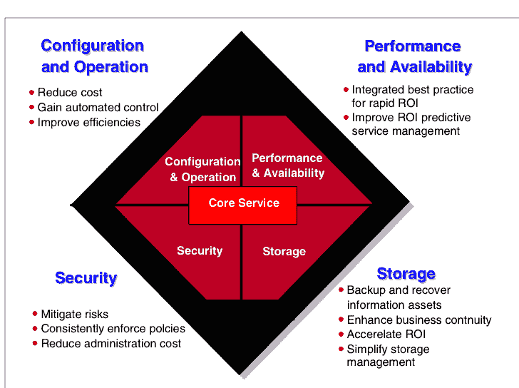

图 8-22 `Tivoli` `IT` 管理解决方案

# 为什么 Linux 选择 Tivoli

Linux 版 `IBM Tivoli` 软件帮助公司通过在选择新技术时获得最大的灵活性，并使公司投资回报率（`ROI`）。`Tivoli` 软件为公司提供了智能系统管理能力和行业最佳实践。它有助于减少部署时间，最大限度地提高业务效率并增加利润。

特别是，`Tivoli on Linux` 提供以下优势：

- **降低总拥有成本（`TCO`）**：`Tivoli` 有助于降低所有成本。`Tivoli` 降低了运营成本。

- **增强安全性**：Linux 很有吸引力，但偶尔会有安全疑虑。`Tivoli` 有助于解决这些问题。

- **满足服务需求**：服务水平预期不会因为使用 Linux 而降低。`Tivoli` 增强了您满足或超过服务水平要求的能力。

- **提供高级管理**：随着 Linux 从 Web 服务和打印解决方案转向关键业务应用平台，`Tivoli` 不仅协助管理 `IT` 资源，还管理业务应用程序。

- **支持异构平台**：Linux 可能不是您业务中的唯一平台。`Tivoli` 在异构平台之间提供一致的管理和许可。

- **遵循开放标准**：IBM 的 `Tivoli` 软件支持最广泛的开放标准。对于基于 Linux 的其他开源部署来说，这是一个重要的考虑因素。最终结果是您的基础设施的硬件和软件组件之间实现了前所未有的互操作性。

有关关于 Linux 上的 `Tivoli` 产品的更多信息，请参阅

`http://www.ibm.com/cgi-bin/software/track3.cgi?file=/software/is/mp/linux/tivoli.html&S_TACT=_S_TACT&S_CMP=_S_CMP_`

# Tivoli Linux 支持

`Tivoli` 的当前策略是在运行 `Red Hat`、`SuSE` 和 `Turbo Linux`（内核为 2.4）以及 `xServers` 和 `zSeries` 服务器架构的平台上运行。`Tivoli` 已发布方向声明，未来将在 `iSeries` 和 `pSeries` 服务器上提供产品。

# 8.4.1 Tivoli 产品在 Linux 上的可用性

Linux 上的 `Tivoli` 品牌产品包括：

- `Tivoli Access Manager for e-business`（以前名为 `Policy Director/Tivoli Policy Director for Application Servers`）

- `Tivoli Access Manager for Operating Systems`（以前名为 `Policy Director for Operating Systems` (`Tivoli Service Manager` 的功能））

- `Tivoli Analyzer for Lotus Domino`

- `Tivoli Business Systems Manager`

- `Tivoli Configuration Manager`

- `Tivoli Decision Support for OS/390`

- `Tivoli Distributed Monitoring`

- `Tivoli Enterprise™ Console`


## Tivoli Identity Manager

## Tivoli Inventory

## Tivoli Management Framework

## Tivoli Monitoring for Transaction Performance

## Tivoli Monitoring

（以前名为 `Tivoli Distributed Monitoring`）

## Tivoli Monitoring for Databases

## Tivoli Monitoring for Messaging and Collaboration

## Tivoli Monitoring for Web Infrastructure

（适用于 `Apache HTTP Server`、`IBM WebSphere Application Server`、`WebLogic Server`）

## Tivoli NetView

## Tivoli NetView for z/OS

（`MSM Agents`, `NMC Server`）

## Tivoli Point of Sale Manager

## Tivoli Remote Control

## Tivoli Risk Manager

## Tivoli SANergy™

## Tivoli SecureWay™ Policy Director

## Tivoli Service Level Advisor

## Tivoli Software Distribution

## Tivoli Storage Manager

## Tivoli Storage Manager for Enterprise Resource Planning

（以前名为 `Data Protection for ESS for R/3`）

## Tivoli Storage Manager for Mail

（以前名为 `Data Protection for Domino`）

## Tivoli Storage Resource Manager

## Tivoli Switch Analyzer

## Tivoli System Automation for Linux

## Tivoli User Admin

## Tivoli Workload Scheduler

有关适用于 Linux 的 IBM 软件的最新可用性和详细描述，请参阅：

`http://www.ibm.com/cgi-bin/software/track3.cgi?file=/is/mp/linux/software/pdfs/IBMSoftwareOnLinux.pdf&S_TACT=__S_TACT&&_S_CMP=`

# 8.4.2 竞争性软件

通常情况下，Linux 发行版系统的管理工具是原始的。它们反映了 UNIX 命令行单实用程序模型。几乎没有开源产品能与完整的 Tivoli 技术栈竞争。Linux 发行版商拥有分发软件，可能在某些情况下与 `Tivoli Software Distribution` 产品竞争：

- Linux 发行版伙伴 (LDP) 软件分发

随着最近转向 Linux 企业级服务器发行版，Red Hat 和特别是 SuSE 现在现在采用了由其企业服务器（例如 `Red Hat Network`）或客户防火墙后的服务器控制的强制性产品更新机制。此外，先磊（Xianian）销售 `Red Carpet` 管理器为 Linux 系统提供软件分发。

- 商业产品

系统管理产品领域的许多知名品牌都支持其在 Linux 上的产品。特别包括 `BMC`、`Computer Associates`、`HP`、`Veritas` 和 `Mercury Interactive`。

# 8.4.3 Tivoli 资源

本节提供 Tivoli 的资源。

# Tivoli Access Manager 评估版

通过网络提供某些支持 Linux 的 IBM 中间件产品的免费评估版，并包含安装和配置。

您可以从以下网站下载 `Tivoli Access Manager` 以及其他支持 Linux 的软件的评估版：

`http://www.ibm.com/developerworks/`

# Tivoli 开发者领域

IBM 提供了一套宝贵的在线技术资源。该提供新技术预览的开发者网站位于：

`http://www0.ibm.com/developerworks/tivoli/`

# 相关的 Linux Redbooks

与 Linux 相关的 Tivoli Redbooks 包括：

- `Tivoli Monitoring` 版本 5.1：高级资源监控，`SG2411`
- `Tivoli SA` 实用指南，`SG2466`
- 使用 Linux 作为 IBM Backup 服务器，`SG2428`
- `Tivoli Storage Manager` 版本 5.1 技术指南，`SG2454`
- 使用 Tivoli 的灾难恢复策略，`SG2484`
- `NetPerformance Monitor for TCP/IP 1.4`，`RD3602`

相关的 Redbooks 和 Redpapers 列表不断更新。您可以在此处找到文档：

`publib-b.ibm.com/cgi-bin/searchsite?query=linux`

# Linux 版 Lotus 产品

Lotus 软件通过创新和服务反映了该品牌对个人和公司合作实现成功的新方式的独特代表。Lotus 软件通过实用的知识管理、电子商务以及通过互联网连接全球思想家、思考者、卖家和社区的其他突破性方式，进一步定义了业务概念。Lotus 软件通过直接销售和广泛的业务合作伙伴渠道在全球 80 多个国家或地区销售。

有关 Lotus 产品的详细信息，请参阅：

`http://www.lotus.com`

# 8.5.1 Lotus 产品在 Linux 上的可用性

以下 Lotus 产品适用于 Linux：

- `Lotus Domino`
- `Lotus Domino Server`
- `Lotus Workflow™`
- `Lotus Learning Management System`

有关适用于 Linux 的 IBM 软件的最新可用性和详细描述，请参阅：

`http://www.ibm.com/cgi-bin/software/track3.cgi?file=/is/mp/linux/software/pdfs/IBMSoftwareOnLinux.pdf&S_TACT=_S_CMP`

# Lotus Domino 服务器

Domino 家族为协作和电子商务提供了多平台基础，驱动了从企业消息到基于 Web 交易的各种解决方案。Domino 是目前 Linux 上领先的消息和协作应用程序平台。Linux 版 Domino 为协作应用程序和消息提供了基于浏览访问。`POP3`、`HTTP`、`IMAP` 和 `LDAP` 均可用。

功能完整的 Domino 解决方案现已在 Linux 上可用。Domino 的关键解决方案涉及：

- 销售自动化
- 项目管理
- 客户关系管理
- 交互式 Web 表单
- 资源管理

# 为什么在 Linux 上选择 Domino

当您投资 Linux 版 Domino 时，您将获得：

- 操作系统的稳定性
- 较低的拥有成本
  - 可靠性
  - 可用性
  - 可管理性
- 强大的远程管理
- Windows 操作系统上 `Microsoft Exchange` 服务器的替代方案
- 从 `Windows NT` 环境下的 Domino 迁移到 Linux 环境下的 Domino 的高度兴趣

> 注意：SuSE 销售了一种名为 `SuSE Linux Groupware Server` 的产品，适用于适用于 Intel 和 AMD 系统的 Domino。它预装了 `Domino R5`。您可以在 Web 上了解更多关于该产品的信息：

`http://www.suse.de/en/index.html`

# 其他 Lotus 产品

Lotus 计划对目前尚未在 Linux 上提供的多种 Lotus 产品使用基于 WebSphere 门户的交付平台。请联系当地的 Lotus 销售代表以获取更多信息。

Lotus 已宣布计划为 `Microsoft Internet Explorer` 以外的浏览器提供 `iNotes™ Web Access` 产品。这些浏览器深受 Linux 用户的欢迎。

目前没有计划将 `Lotus SmartSuite®` 桌面办公产品移植到 Linux。

# 8.5.2 竞争性软件

在电子邮件产品领域，有两个主要的开源竞争对手和两个商业竞争对手：

- `Sendmail`

作为一个开源项目不断演进的产品，`Sendmail` 是 UNIX 和 Linux 市场中使用得广泛的邮件传输代理。它是许多 Linux 发行版包含的组件。

`Sendmail Corporation` 提供经过商业增强和支持的 `Sendmail` 产品。您可以在 Web 上了解更多关于 `Sendmail` 的信息：

`http://www.sendmail.com/`

### Postfix

# Bynari InsightServer


Bynari 为 Linux (Solaris) 提供 Microsoft Exchange 的功能替代。要了解更多关于 Bynari 及其产品，请参阅：

`http://www.bynari.com/`

## Ximian Evolution

与列表中的三个产品（每种都是一个电子邮件服务器）不同，Evolution 是 Microsoft Outlook 客户端软件的功能替代方案（包括外观和感受）。该产品是免费的，现在作为许多 Linux 发行版的一部分发布。您可以将其作为多个电子邮件服务器的客户端。然而，配合现有的 Microsoft Exchange 服务器使用时需要从 Ximian 购买适配器软件。要了解更多，请参阅：

`http://www.ximian.com/`

## 8.5.3 Lotus 资源

本节列出了 Lotus 的各种资源。

### Lotus Domino 评估版

通过 Web 可以获取某些支持 Linux 的 IBM 中间件产品的免费评估版，包含完整的安装、配置和支持文档。您可以从以下网站下载 Lotus Domino 以及其他支持 Linux 的 IBM 软件评估版：

`http://www.ibm.com/developerworks/offers/linux-speed-start`

### Lotus 开发者领域

IBM 通过 Lotus 开发者网站提供了一套非常有价值的在线技术开发者资源。该网站通常包含新技术预览以及 Lotus 开发者体验，地址为：

`http://www.lotus.com/ld`

### 相关的 Linux Redbooks（红书）

相关的 Lotus on Linux Redbooks 和 Redpapers（白皮书）包括：

- IBM Netfinity 服务器上的 Linux 版 Lotus Domino R5, SG24-5968
- Linux 版的 Lotus Domino 6, SG24-6835
- 在线简报：精通 Linux 版 Domino, REDP0039

您可以在 Web 上找到 Linux 相关 IBM Redbooks 和 Redpapers 的完整列表：

`http://publib-b.boulder.ibm.com/cgi-bin/searchsite.cgi?query=`

## 8.6 额外的 IBM 软件

除了主品牌软件外，IBM 还已将其其他若干产品提供给 Linux 用户。

### 8.6.1 产品在 Linux 可用性

适用于 Linux 的非特定品牌 IBM 软件包括：

- `AFS® (Andrew File System)`
- `Linux Application Workload Modeler`
- `IBM Bank Teller Business Components`
- `IBM BookManager® Bookserver`
- `Linux 版 IBM Communications Server`
- `Linux 版 IBM Cluster Systems Management (CSM)`
- `Linux 版 IBM Developer Kit`
- `IBM Director`
- `IBM Directory Integrator`
- `IBM Directory Server`
- `IBM Workplace Wireless Gatekeeper`
- `IBM General Parallel File System`
- `IBM HTTP Server`
- `Linux 版 iSeries ODBC Driver`
- `IBM LANDP®`
- `IBM Objectation`
- `IBM Screen Customizer`
- `IBM Small Business Suite`
- `StreamServer Business Communications Platform`
- `IBM VisualAge Generator Server`
- `IBM VisualAge Pacbase Linux Server`
- `IBM VisualAge Smalltalk Enterprise`
- `多平台 Workstation APL2®`

欲了解 IBM 软件产品的当前可用性和详细说明，请参阅：

`http://www.ibm.com/cgi-bin/software/track3.cgi?file=/software/is/mp/linux/software/pdfs/IBMSoftwareOnLinux.pdf&S_TACT=__S_TACT____S_CMP__`

### 8.6.2 额外资源

请参考以下资源获取更多信息。

#### IBM Directory Server 评估版

通过 Web 可以获取某些支持 Linux 的 IBM 中间件产品的免费评估版，包含完整的安装、配置和支持文档。您可以从以下网站下载 `IBM Directory Server` 以及其他支持 Linux 的 IBM 软件评估版：

`http://www.ibm.com/developerworks/offers/linux-speed-track`

#### Redbooks（红书）

欲了解更多信息，请参考 IBM Redbooks：

- 使用 `CSM` 和 `GPFS` 进行 Linux 集集群, SG24-6601
- 使用 `xCAT` 构建 Linux HPC 集群, SG24-6623

## 8.7 用于电子商务的 IBM 集成平台

电子商务集成平台为 `SuSE Linux Server` 提供密集的测试、一站式购物和单一支持联系点。这种组合允许您：

- 利用如 `Java`、`WebSphere` 等最新标准部署先进的电子商务应用程序
- 将灵活的解决方案与传统的关键负载数据库集成
- 利用已创建和测试的架构节省设计时间和资源
- 利用 IBM 丰富的知识为客户定制系统
- 利用最新进展使业务面向未来
- 通过集中管理和利用规模效应降低 `TCO`
- 从电子商务整体解决方案中受益
- `WebSphere Application Server` 高版
- `IBM Directory Server (LDAP)` V4.1
- 一年软件支持和 `IBM 全球服务 (IGS)` 支持

电子商务集成平台适用于 `xSeries` 和 `zSeries` 硬件平台。该方案包含以下软件和支持：

您可以在 Web 上找到关于 `xSeries` 上电子商务集成平台的详细信息：

`http://www.ibm.com/servers/solutions/linux/integrated/components.html`

欲了解关于 `zSeries` 上电子商务集成平台的详细信息，请参阅：

`http://www.ibm.com/servers/eserver/zseries/os/linux/integrated/index.html?ca=zseries&me=wmet-drive_from_eserver_IP`

## 8.8 Linux IBM 软件部署示例

IBM 解决方案场景数据库 (`SSDP`) 是一种独特的机制，概述了 IBM 实验室测试的以及为客户创建的解决方案。每个条目都描述了所解决的问题以及组件如何组合。它还包含了图表、使用的产品列表和支持材料。

可以使用完全可搜索的数据库查找哪些版本的产品是配套使用的。您也可以找到特定的解决方案作为您方案的依据。

以下章节简要介绍了取自 `SSPD` 的示例。欲了解有关解决方案场景数据库的详细信息，请参阅：

`http://sspd.ibm.com/`

### 8.8.1 在 zSeries 服务器上使用 WebSphere Application Server 进行服务器整合

客户需要一个平台无关收入会计系统 (`RAS`) 应用程序，以提供互联网访问和员工访问

源自内网和互联网。他们还需要将其仅内部使用的应用程序——“航班时刻查询系统”进行现代化，以便为员工提供内网和互联网访问权限，从而提高他们从世界任何地方查询班表的能力。

解决方案是使用 `IBM WebSphere Application Server, Advanced Edition V3.5`；`WebSphere Studio, Advanced Edition`；`VisualAge for Java` 以及 `Linux for zSeries`。这使得客户能够快速更新业务应用程序，将来自各种服务器的负载整合到 `IBM 主机`上，并实现了成本节约、可用性提高以及可靠性的增强。

该解决方案采用了以下 IBM 产品：

- 硬件
  - `zSeries 900`
  - 运行 `Linux` 的 `zSeries`
- 软件
  - `WebSphere Application Server, Advanced Edition`
  - `VisualAge for Java`

有关此场景的完整描述和细节，请参阅：

`http://w3-1.ibm.com/support/techdocs/atsmasr.nsf/PubAI1Num/TD100650`

## 8.2 在 xSeries 和 iSeries 上使用 Domino 和 WebSphere 的计算机服务


一家提供托管服务的客户正面临服务器性能问题。由于他们需要处理许多操作系统以支持其客户的需求，他们发现 `Windows 2000` `Domino` 系统让操作变得困难。

为了实现升级环境的目标，该客户投资了数台 `xSeries` 和 `iSeries` 服务器以及 `Linux` 来支持其内部和托管应用程序。`Linux` 使该客户能够与想要测试和运行生产中间件的客户合作。总的来说，该解决方案让客户降低了成本，提高了性能，并提供了更好、更有性价比的服务。

该解决方案采用了以下 IBM 产品：

- 硬件

  - `xSeries 200` 和 `220`

  - `iSeries 270`

- 软件

  - `Lotus Domino`

  - `Apache`

  - `Lotus Sametime®`

  - `QuickPlace`

  - `DB2` `Version 7.1`

  - `WebSphere Application Server, Advanced`

  - `Lotus LearningSpace® Core`

  - `Firewall`

  - 逻辑分区 `LPAR`

有关此场景的完整描述和图表，请参阅：

`http://w3.ibm.com/support/techdocs/atsmastr.nsf/PubA1Num/TD100883`

### `8.8.3` `DB2 UDB, DB2 Connect` 和 `WebSphere Portal`

这家公司在非 IBM `Windows NT` 硬件上开发并部署了其第一个 Web 实现。这包括两个供会员门店通过 Web 重新订购物品的应用程序。公司计划开发更多应用程序，但对其 `Windows NT` 环境支持这些应用的能力表示担忧。

客户向 IBM 寻求帮助。他们将现有的 `Windows NT` 应用程序转换为运行 `Linux V7` 的 `zSeries`。他们将用于开发和生产的 40 台双处理器 `NT` 机器上的两个应用程序整合到了两台 `zSeries` `LPAR` 中。软件环境现在使用 `Linux` 上的 `WebSphere Application Server, Advanced Edition, Version 3.5` 来满足电子商务需求的定制应用程序。开发人员使用 `WebSphere Commerce Studio V5.1`（包含 `VisualAge for Java V3.5`）来开发新应用程序，并将其部署到 `Linux for zSeries` 上。此外，公司的用户也从 `Microsoft` 和 `Lotus cc:Mail` 迁移到了 `Lotus Notes`。

客户使用 `WebCommerce Suite` 和 `WebSphere Application Server`（均运行在 `Linux for zSeries` 上）为独立杂货商、分销商和零售店实施了一个强大的门户网站计划。该计划允许小组通过门户访问重要的业务关键信息。这包括订购产品、查找当前价格以及进行表单管理，所有操作都在门户环境中完成。

该解决方案采用了以下 IBM 产品：

- 硬件

  - `zSeries`

- 软件

  - `DB2, DB2 UDB` 和 `DB2 Connect`

  - `Lotus Domino, iNotes, Lotus QuickPlace` 和 `Lotus Sametime`

  - `VisualAge for Java`

  - `Sphere Application Server`

  - `Sphere Application Server, Advanced Edition`

  - `Sphere Application Server, Advanced Edition Version 3.5`

  - `Sphere Commerce Studio`

  - `Sphere Commerce Suite`

  - `Sphere Commerce Studio Version 5.1`

有关此场景的描述和图表，请参阅：

`http://w3.ibm.com/support/techdocs/atasmastr/PubA11Num/TD100764`

## `8.9` IBM 和 Linux 解决方案客户成功

一些客户在根据多样化需求实施 IBM 和 `Linux` 方面取得了巨大成功。以下是其中一些客户以及您可以在那里了解他们故事的链接：

- `WebSphere`: `Divo Broadband Networks, Inc.`

`Divo Broadband Networks` 转型了基于 `Linux` 架构的 `WebSphere` 解决方案。通过这种方式，他们实现了廉价和可靠性，增加了可用性并节省了维护成本。

有关此成功案例的详情和更多信息，请参阅：

`http://www.ibm.com/software/success/cssdb.nsf/NAVO-420XV70OpenDocument&Site=linuxatib`

- `DB2`: `Grede Foundations, Inc.`

`Grede Foundations` 转型了基于 `Linux` 架构的 `DB2` 解决方案。这为他们带来了可靠性、扩展性、性能、稳定性的提升以及成本节约。

有关此成功案例的详情和更多信息，请参阅：

`http://www.ibm.com/software/success/cssdb.nsf/NAVO-5BFTMG6OpenDocument&Site=linuxatib`

`http://www.ibm.com/software/success/cssdb.nsf/CS/NAVO-4XRHRGT`

- `Tivoli`: 淡江大学

淡江大学部署了基于 `Linux` 的解决方案。该解决方案实现了备份和恢复自动化并优化了存储分配。它还提高了可靠性、容量和性能。

有关此成功案例的详情和更多信息，请参阅：

`http://www.ibm.com/software/success/cssdb.nsf/NAVO-5942OpenDocument&Site=linuxatib`

### `8.10` 其他 `Linux` 资源

IBM 提供了大量的技术资源来帮助部署 `Linux`。本节重点介绍了以下内容：

- 软件评估套件 (`Software Evaluation Kit`)

如果从 Web 下载评估软件太麻烦，您可以通过 CD 获取该套件。它实际上以四张名为“软件评估套件”的 CD 形式提供。该套件包含了 `Linux` 的技术支持。

有关 `Linux` 评估套件的详细信息，请参阅：

`http://www.ibm.com/developerworks/offers/linux-start/`

IBM 提供了许多从 Web 下载的试用版、测试版和免费软件产品。开始使用 `Linux` 时可以使用以下可用产品：

- `IBM DB2 Universal Database (ESE)`

- `IBM DB2 Migration Toolkit for Linux`

- `IBM Directory Server for Linux`

- `IBM Lotus Domino for Linux`

- `IBM Tivoli Access Manager Base Linux`

- `IBM WebSphere Application Server for Linux`

- `IBM WebSphere Studio for Linux`

- `IBM WebSphere MQ for Linux`

可下载的 IBM `Linux` 软件完整列表，请访问：

`http://www.software.ibm.com/webapp/download/search.jsp?q=Linux&k=any&sb=n&go&sr=1&`

### `8.10.2` IBM `Linux` 培训

`IBM Learning Services` 提供大量的顶级培训服务。服务组合包括现场培训、咨询、开发、交付、运输、学习管理和外包。

关于 IBM `Linux` 的课程包括：

- `Linux DB2`: `CF201 - DB2` 管理工作坊

`http://www.ibm.com/services/learning/MainServlet.wss?pageType=course_descriptioncourseCode=CF201`

- `Linux WebSphere`: `SW247 - Linux WebSphere` 系统管理

`http://www.software.ibm.com/wddw/education/enablement/curriculum/sw247.html`

更多课程正在准备中。有关 IBM Learning Services 在美国提供的最新课程列表，请参阅：

`http://www.ibm.com/services/learning/us/catalog/linux/`

### `8.10.3` IBM `Redbooks`

`IBM Redbooks` 由 IBM 国际支持组织 (`ITSO`) 编写并出版。`ITSO` 为技术专业人员（包括 IBM、业务伙伴、客户和市场）开发并交付技能、技术知识和材料。`ITSO` 的增值信息产品从产品、平台和解决方案三个维度进行介绍。它们探索了真实客户场景的集成、实施和运营。


在 `IBM Redbook`（`IBM` 红书）的开发过程中，`ITSO` 与 `IBM` 各部门、`Lotus Development` 和 `Tivoli` 合作。`ITSO` 是 `IBM` 全球销售与分销部门下 `IBM` 全球技术支持组织的一个部分。

`IBM Redbooks`、`RedDrafts` 和 `Redpapers` 向公众开放，提供纸质版或免费下载的 `PDF` 文件。有关 `Linux` 的 `Redbooks`，请参阅：

```
http://pubilib-b.boulder.ibm.com/cgi-bin/searchsite.cgi?query=linux
```

## 8.11 用于 Linux 的 IBM 内部软件资源

以下章节提供了 `IBM` 市场营销和技术支持部门可使用的 `Linux` 资源信息。我们为 `IBM` 的受众提供这些信息。在与 `IBM` 业务伙伴和客户讨论或实施 `Linux` 时，这些信息非常有用。

> **重要：** 本节重点介绍了仅供 `IBM` 内部使用的各种资源。所提供的许多 `Web` 链接指向 `IBM` 内部网站点。

### 8.11.1 Linux 销售资源

此部分涉及 `IBM` 销售代表可使用的资源。

#### IBM Linux Cyber 销售工具包

`IBM Linux Cyber Kit` 由 `Linux` 集成中心（`Linux Integration Center`）和 `SWG Linux` 营销部门制作。该工具包目的是为品牌专家以及软件和 `IGS IT` 架构师及专家提供 `Linux` 前售支持信息。该销售工具包随新资源的出现进行更新。

目前该销售工具包在美洲可用。您可以在 `Web` 上找到它：

```
http://lic.austin.ibm.com/LinuxCyberKit.HTM
```

#### IBM 软件组竞争项目办公室

`IBM` 软件组维护着一个竞争项目办公室，提供有关软件组竞争性产品的论文、文章和演示文。您可以在 `Web` 上找到它：

```
http://elib.austin.ibm.com/cpoweb.nsf/pages/cpo-home
```

#### TCO 工具

计算 `IBM` 产品总成本（`TCO`）的主要销售工具（在某些情况下会与竞争性产品进行比较）是 `CIOView TCONNow!`，该工具授权给 `IBM` 使用。

可以使用 `TCONNow!` 进行 `DB2` 对比 `Oracle` 的 `TCO` 分析示例。您可以在 `Web` 上找到 `TCONNow`：

```
http://d25w1.tololab.ibm.com/db2info/dminflib.nsf/dm/tconow
```

额外的 `TCO` 工具包括对 `WebSphere BEA`、`WebLogic` 和 `Oracle AppServer` 的 `TCO` 分析。您可以在 `Web` 上找到它们：

```
http://w3-a.ibm.com/websphere/ticompet/cb2d4c1e6e2ec0f85256a6007178f6/53b2fa73c459ae1538725699d051db1bf70openDocument
```

#### 2003 年 IBM 软件组 Linux 乐场

您可以在 `Web` 上找到 `IBM` 软件组 `Linux Playbook`：

```
http://w3-1.ibm.com/software/salesite.nsf/printthis?OpenForm&ParentUNID=77FE28C08E7D3978256C240049BF76&Seq=1&TableRow=1
```

#### 售软件保证审查 (SAR)

某些 `IBM` 产品和软件产品在向客户提案前需要进行售前 `SAR`。目前，在 `ZSeries Linux` 上提议 `WebSphere Advanced Server 3.5` 或 `4.0` 时需要此类审查。您可以在 `Web` 上找到有关此解决方案审查的详细信息：

```
http://w3-1.ibm.com/support/assume/assar30i.nsf/WebIndex/SA470
```

对于所有需要 `SAR` 的 `IBM` 软件，无论操作系统如何，请参阅：

```
http://w3-1.ibm.com/support/assume/assar30i.nsf/WebIndex/SA331
```

#### 请求 IBM 软件支持 Linux

`IBM` 员工可以对目前不支持 `Linux` 的 `IBM` 软件生成请求。要了解此过程，请参阅：

```
http://w3-3.ibm.com/software/salesite.nsf/salestools/9A910D3F3A18276C87268B3005ACDCEDopendocumenthighlight=0,software++requirements
```

`232 Linux` 手册：`IBM Linux` 解决方案和资源指南

#### 解决方案场景描述数据库 (SSPD)

`SSPD` 提供“可重用”解决方案的示例。对于十个可重用的 `Linux` 解决方案，包括几个基于 `IBM` 软件的解决方案，请参阅：

```
http://swest.ibm.com/s_dir/swest/swest.nsf/0eb60ad63cda04e285256c310050aef6/38853db356c6a888256c750068724700penDocument
```

### 8.11.2 产品信息

本节提供了 `IBM` 内部网上 `IBM` 软件产品信息的来源链接。

#### IBM Linux 软件可用性

`IBM Linux` 软件可用性矩阵的内部站点由 `IBM` 集成中心维护。您可以在 `Web` 上找到此矩阵：

```
http://lic.austin.ibm.com/Whitepapers/linuxmatrix.html
```

#### IBM Linux 软件可用性及本地语言支持 (NLS)

您可以在 `Web` 上找到使用双字节字符集 (`DBCS`) 实现 `NLS` 的 `IBM Linux` 软件：

```
http://lic.austin.ibm.com/Whitepapers/linuxmatrix.html
```

#### IBM Linux 软件及本地语言支持 (NLS)

`SWG` 产品、解决方案指南包含了 `DB2`、`Tivoli` 和 `WebSphere`，对于需要 `IBM` 软件解决方案的 `IBM` 人员非常有非常有价值。可以在 `Web` 上找到 `Linux` 的 `IBM` 软件解决方案信息：

```
http://w3-1.ibm.com/supportphereassume
```

```
http://w3-1.ibm.com/support/assume/assar30i.nsf/WebIndex/SA470
```

`IBM` 员工可以对 `IBM Linux` 的 `IBM` 软件生成请求：

```
http://w3-1.ibm.com/support/assume/assar30i.nsf/WebIndex/SA331
```

#### 资源

以下章节提供了 `IBM` 市场营销和技术支持部门可使用的 `Linux` 资源信息。`IBM` 提供这些信息：

```
http://w3-1.ibm.com/support/assume/assar30i.nsf/WebIndex/SA431
```

### 8.11 内部 IBM 软件用于 Linux 资源

### 8.11 内部

### 8.11.1 Linux 销售资源

#### IBM Linux Cyber 销售工具包

#### IBM 软件组 竞争项目办公室

### 8.11.2 产品信息

#### IBM Linux 软件

### 8.11.2 产品信息

本节提供了 `IBM` 内部网上 `IBM` 软件产品信息的来源链接。

#### IBM Linux 软件可用性

`IBM Linux` 软件可用性矩阵的内部站点由 `IBM` 集成中心维护。您可以在 `Web` 上找到此矩阵：

```
http://lic.austin.ibm.com/Whitepapers/linuxmatrix.html
```

#### IBM Linux 软件可用性及本地语言支持 (NLS)

您可以在 `Web` 上找到使用双字节字符集 (`DBCS`) 实现 `NLS` 的 `IBM Linux` 软件：

```
http://lic.austin.ibm.com/Whitepapers/linuxmatrix.html
```

#### IBM Linux 软件及本地语言支持 (NLS)

`SWG` 产品、解决方案指南包含了 `DB2`、`Tivoli` 和 `WebSphere`，对于需要 `IBM` 软件解决方案的 `IBM` 人员非常有非常有价值。

产品从产品、平台和解决方案三个维度进行介绍。它们探索了真实客户场景的集成、实施和运营。

在 `IBM Redbook`（`IBM` 红书）的开发过程中，`ITSO` 与 `IBM` 各部门、`Lotus Development` 和 `Tivoli` 合作。`ITSO` 是 `IBM` 全球销售与分销部门下 `IBM` 全球技术支持组织的一个部分。


IBM Redbooks、RedDrafts 和 Redpapers 向公众开放，提供纸质版或免费下载的 PDF 文件。有关 Linux 的 Redbooks，请参阅：

```
http://pubilib-b.boulder.ibm.com/cgi-bin/searchsite.cgi?query=linux
```

## 8.11 用于 Linux 的 IBM 内部软件资源

以下章节提供了 IBM 市场营销和技术支持部门可使用的 Linux 资源信息。我们为 IBM 的受众提供这些信息。在与 IBM 业务伙伴和客户讨论或实施 Linux 时，这些信息非常有用。

> **重要：** 本节重点介绍了仅供 IBM 内部使用的各种资源。所提供的许多 Web 链接指向 IBM 内部网站点。

### 8.11.1 Linux 销售资源

此部分涉及 IBM 销售代表可使用的资源。

### IBM Linux Cyber 销售工具包

IBM Linux Cyber Kit 由 Linux 集成中心（Linux Integration Center）和 SWG Linux 营销部门制作。该工具包目的是为品牌专家以及软件和 IGS IT 架构师及专家提供 Linux 前售支持信息。该销售工具包随新资源的出现进行更新。

目前该销售工具块在美洲可用。您可以在 Web 上找到它：

```
http://lic.austin.ibm.com/LinuxCyberKit.HTM
```

### IBM 软件组竞争项目办公室

IBM 软件组维护着一个竞争项目办公室，提供有关软件组竞争性产品的论文、文章和演示文稿。您可以在 Web 上找到它：

```
http://elib.austin.ibm.com/cpoweb.nsf/pages/cpo-home
```

### TCO 工具

计算 IBM 产品总成本（TCO）的主要销售工具（在某些情况下会与竞争性产品进行比较）是 `CIOView TCONNow!`，该工具授权给 IBM 使用。

可以使用 `TCONNow!` 进行 `DB2` 对比 `Oracle` 的 TCO 分析示例。您可以在 Web 上找到 `TCONNow`：

```
http://d25w1.tololab.ibm.com/db2info/dminflib.nsf/dm/tconow
```

额外的 TCO 工具包括对 `WebSphere BEA`、`WebLogic` 和 `Oracle AppServer` 的 TCO 分析。您可以在 Web 上找到它们：

```
http://w3-a.ibm.com/websphere/ticompet/cb2d4c1e6e2ec0f85256a6007178f6/53b2fa73c459ae1538725699d051db1bf70openDocument
```

### 2003 年 IBM 软件组 Linux 乐场

您可以在 Web 上找到 IBM 软件组 Linux Playbook：

```
http://w3-1.ibm.com/software/salesite.nsf/printthis?OpenForm&ParentUNID=77FE28C08E7D3978256C240049BF76&Seq=1&TableRow=1
```

### 售前软件保证审查 (SAR)

某些 IBM 产品和软件产品在向客户提案前需要进行售前 SAR。目前，在 `ZSeries Linux` 上提议 `WebSphere Advanced Server 3.5` 或 `4.0` 时需要此类审查。您可以在 Web 上找到有关此解决方案审查的详细信息：

```
http://w3-1.ibm.com/support/assume/assar30i.nsf/WebIndex/SA470
```

对于所有需要 SAR 的 IBM 软件，无论操作系统如何，请参阅：

```
http://w3-1.ibm.com/support/assume/assar30i.nsf/WebIndex/SA331
```

### 请求 IBM 软件支持 Linux

IBM 员工可以对目前不支持 Linux 的 IBM 软件生成请求。要了解此过程，请参阅：

```
http://w3-3.ibm.com/software/salesite.nsf/salestools/9A910D3F3A18276C87268B3005ACDCEDopendocumenthighlight=0,software++requirements
```

232 Linux 手册：IBM Linux 解决方案和资源指南

### 解决方案场景描述数据库 (SSPD)

`SSPD` 提供“可重用”解决方案的示例。对于十个可重用的 Linux 解决方案，包括几个基于 IBM 软件的解决方案，请参阅：

```
http://swest.ibm.com/s_dir/swest/swest.nsf/0eb60ad63cda04e285256c310050aef6/38853db356c6a888256c750068724700penDocument
```

### 8.11.2 产品信息

本节提供了 IBM 内部网上 IBM 软件产品信息的来源链接。

### IBM Linux 软件可用性

IBM Linux 软件可用性矩阵的内部站点由 IBM 集成中心维护。您可以在 Web 上找到此矩阵：

```
http://lic.austin.ibm.com/Whitepapers/linuxmatrix.html
```

### IBM Linux 软件可用性及本地语言支持 (NLS)

您可以在 Web 上找到使用双字节字符集 (DBCS) 实现 NLS 的 IBM Linux 软件：

```
http://lic.austin.ibm.com/Whitepapers/linuxmatrix.html
```

### IBM Linux 软件及本地语言支持 (NLS)

SWG 产品、解决方案指南包含了 `DB2`、`Tivoli` 和 `WebSphere`，对于需要 IBM 软件解决方案的 IBM 人员非常有价值。

本文描述了在 Linux 架构上安装和配置 `WebSphere Application Server Advanced Edition 4.0.2` 以及 `Oracle9i` 数据库（版本 `9.0.1`，`Oracle9i`）的基本概念和步骤。本文涵盖的主题包括硬件和软件要求、Linux 系统的安装前配置、`Oracle9i` 的安装、系统安装后配置、`WebSphere Application Server Advanced Edition` 的安装、安装测试以及技巧和技术。

您可以在网络上找到本文：`http://lic.austin.ibm.com/Whitepapers/WAS402withOracle9i.pdf`

-   [Linux 上安装和测试 WebSphereMQ 入门指南]：

    本文介绍了 `WebSphereMQ` 及其其定义、工作原理，以及如何在基于 `Intel/xSeries` 系统的 Linux 机器上安装基础的 `WebSphereMQ` 组件。其目的是为不熟悉 `WebSphereMQ` 的人员提供一份快速上手指南。

    本文位于：`http://lic.austin.ibm.com/Whitepapers/WebSphereMQ.pdf`

-   [在 Lotus Domino 5.0 服务器上进行 Linux 性能调优]：

    本白皮书记录了在 `Lotus Domino` `xSeries` 服务器上对 Linux 进行性能调优的过程。需要注意的是，本文描述的服务器硬件配置是为了实现最佳性能增长而设计的。它并不代表平均生产服务器的结果。

    `http://lic.austin.ibm.com/Whitepapers/DomPerf.pdf`

-   [在 Linux/390 上运行 WebSphere Commerce Suite 版本 5.1 的技巧与技术]：

    本文是为 `zSeries` 和 `S/390` 的 `WebSphere Commerce Suite Pro` 版提供的安装指南的补充。本文涵盖了如提升虚拟机环境中的 Linux 镜像、为 Linux/390 安装和配置 `WebSphere Commerce Suite`、创建 `WebSphere Commerce Suite` 实例以及在 `OS/390` `DB2` 子系统上创建数据库等主题。

    您可以在网络上找到本文：`http://lic.austin.ibm.com/Whitepapers/WCStips.pdf`

    更新的 Linux 集成中心“如何做”白皮书列表，请参见：`http://lic.austin.ibm.com/library_docs/howto.html`

# Apache Web 服务器的 iSeries 容量规划指南

本网站提供了关于如何规划 `iSeries` 服务器以托管 Apache Web 服务器容量的详细描述。由于 IBM 的 `WebSphere HTTPD` 服务器本质上就是 Apache 服务器，因此本文档对于 WebSphere 作为 Web 服务的容量规划非常有帮助。您可以在网络上找到这些信息：


`http://ca-web.rchland.ibm.com/perform/V5R1LinuxSambaSizing.pdf`

## 8.11.4 评估与演示软件

除了外部评估和演示软件发布点外，还有内部资源。以下章节列出了其中部分资源。

## 使用 `VMware` 的 `Linux` 电子商务演示

已经开发了几个使用 `IBM` 中间件的基于 `Linux` 的电子商务行动（`e-business in Action`）演示。这些现场演示易于安装和使用。这些演示具有以下特点：

- 它们是完整的独立演示系统。包含了完整的 `Linux` 操作系统、预配置的 `IBM` 中间件、演示应用程序和数据。
- 它们被封装为 `VMware Workstation` 系统镜像。
- 它们作为应用程序运行在您的 `Windows` 系统的虚拟机中。
- 它们文档完备，包括安装视频、管理指南、脚本化场景和参考信息。
- 它们是实运行的演示，使其易于扩展并灵活满足客户演示的需求。

当前的 `eBIA` 演示集包括：

- `IBM WebSphere Commerce`：针对“`JK Sports`”的商家对消费者（`B2C`）电子商务网站
- `IBM WebSphere Portal`：针对“`JK Sports`”的商家对员工门户场景，展示了门户集成
- `Lotus Workflow`, `Domino`, `DECS` 和 `DB2`：一个管理工作流演示，展示了“`JK Enterprises`”采购订单提交/审批场景

您可以在网络上访问电子商务行动演示：

```
http://edelivery.demopkg.ibm.com
```

## `DEMOpkg`

`DEMOpkg` 提供了软件和演示的便捷访问方式。它涵盖了所有 `IBM` 品牌。`DEMOpkg` 产品以紧凑格式封装，便于快速安装和访问。最棒的是，`DEMOpkg` 供 `IBM` 内部使用和客户演示免费提供。

`IBM` 员工可以在网络上找到详细的 `DEMOpkg` 信息：

`http://w3.demopkg.ibm.com`

您可以使用此页面上的链接按硬件查找 `Linux` 演示软件。

## 获取用于紧急评估的 `WebSphere` 软件

`IBM` 代表可以使用 `NFR` 订单单为客户获取非销售（`NRF`）`WebSphere` 产品软件，但仅限紧急情况。常规情况使用内部订单数据库。

有关下 `N NRF` 的更多信息，请参见：

`http://w3-3.ibm.com/software/websphere/websites.ns/FD6FCAF39CBED60A85256A3F006F4FF1/BC9CFD0F174D24847256CB10052400570openDocument`

## 8.11.5 `IBM` 软件组织

`IBM` 建立了一组核心组织，用于证明和改进基于 `IBM` 软件的客户解决方案，并为 `IBM` 中间件产品的演进做出贡献。

## `IBM Linux` 集成中心

`LIC` 支持并推广在 `Linux` 解决方案中使用 `IBM` 中间件（产品）。这些售前支持中心位于奥斯汀（德克萨斯州）、伯布林根（德国）和新加坡，为包括金融服务、零售和制造业在内的各种行业客户提供帮助，以识别客户基础设施中实施 `Linux` 的关键领域。`LIC` 提供 `IBM` 硬件、软件和服务。它们还可以通过模拟环境来提供有关 `Linux` 和开源软件的详细咨询、架构指导和培训简报。由于 `LIC` 成员精通多种操作系统，可以快速对客户基础设施进行评估，并制定迁移到 `IBM` 平台的步骤蓝图。团队成员包括系统架构师、数据库管理员、项目经理和操作系统专家。

`LIC` 团队提供以下价值服务：

- 在概念验证（`PoC`）期间协助安装、配置和产品集成
- 通过结合最佳实践以及 `Linux` 迁移的经验来指导架构设计
- 通过复制客户环境和调试解决客户问题
- 与产品负责人对接以评估需求并解决问题
- 为合格的 `Linux` 机会提供基于参与的支持，提供：
    - 技术咨询
    - 产品集成
    - 部署规划
- 推动 `Linux` 作为电子商务应用程序服务器
- 集成中间件和应用程序（`ISV` 或客户）
- 记录迁移路径
- 识别支持的硬件和软件栈环境
- 收集基准测试数据
- 演示数据转换
- 创建并可利用的资产

要成为获得 `Linux` 集成中心帮助的候选，销售机会必须满足：

- 具有重大的 `SWG` 中间件内容
- 允许 `LIC` 构建可复用的素材或资产
- 具有成为参考案例客户的潜力
- 支持当前的 `IBM` 或 `SWG` 战略计划
- 是具有重大 `SWG` 中间件的 `xSeries` 或 `zSeries` 机会
- 包含从 `SUN` 到 `Linux` 和 `IBM` 中间件的迁移
- 包含从 `Oracle` 到 `DB2` 的迁移
- 包含从 `BEA WebLogic` 到 `IBM WebSphere` 的迁移
- `OMEntry` 已标记了 `LINX` 机会代码

有关美洲 `Linux` 集成中心的详细信息，请参见：

```
http://lic.austin.ibm.com/americas
```

`IBM Linux` 集成中心的内部网站位于：

```
http://w3.ibm.com/linux/lic
```

有关 `EMEA`（欧洲、中东和非洲）`IBM Linux` 集成中心，请访问：

`http://lic.austin.ibm.com/emea`

有关 `ASEAN`（亚洲）`IBM Linux` 集成中心，请访问：

`http://lic.austin.ibm.com/asean`

## 全球电子商务解决方案中心 (`GeSC`)

全球电子商务解决方案中心是 `IBM` 全球技术销售支持团队的一部分。其使命是提供架构和 `ISV`（独立软件供应商）解决方案集成技术销售领导，帮助 `IBM` 团队通过集成电子商务解决方案赢得竞争并助力客户成功。

`GeSC` 为以下领域提供复杂的技术销售支持：

- 端到端解决方案架构和 `ISV` 集成解决方案
- 跨平台端到端解决方案的可扩展性/性能

为了履行这一使命，`GeSC` 关注以下主要支持方法：

- 复杂的客户销售活动
- 销售电话技术协助
- 解决方案和架构研讨会
- 解决方案概念验证 (`POC`)
- 解决方案扩展性/性能协助

作为该责任的一部分，`GeSC` 直接为美洲地区的部门/解决方案销售团队提供主动的二级支持。对于 `EMEA` 和亚太地区，`GeSC` 专注于利用其能力帮助构建基于区域的强有力技术销售支持技能，并为关键、高影响的客户情况提供支持。

有关全球电子商务解决方案中心，请访问：

`http://w3.ibm.com/support/gesc.html`

## 解决方案合作伙伴中心：第三方应用程序移植

全球十个解决方案合作伙伴中心 (`SPC`) 为开发者访问 `IBM` 资源提供了便捷的现场和远程访问。`SPC` 是先进设施，配备了最新的 `IBM` 服务器和软件技术，由 `IBM` 技术顾问组成。

要了解更多关于 `IBM` 解决方案合作伙伴中心的信息，请访问：

`http://www.developer.ibm.com/spc/index.html`

## `Linux` 能力中心 (`LCC`)

位于纽约州普肯基普的 `Linux` 能力中心是 `eServer` 简报中心、新技术中心（`New Technology Center`）和 `eTP` 设计中心紧密合作的结果。虽然 `LCC` 主要关注 `zVM` 服务器收缩解决方案下的 `Linux`，但它也可以提供带有可连接到 `CICS`、`DB2`、`WebSphere MQ` 和 `IMS` 的 `WebSphere servlets` 演示。


## `Linux` 集群

集群是相互连接的完整系统的集合，它们共同工作以提供单一统一的计算能力。生成的集群可以是并行系统也可以是分布式系统。

本章讨论了：

- 集群
- `Linux` 集群组件
- `Linux` 集群历史
- `Linux` 集群解决方案
- `Linux` 集群的未来

本节回顾了主要的集群概念和类型。涵盖了集群的优势以及集群在新兴计算机趋势中所扮演的角色。

### 9.1.1 核心集群概念

图 9-1 带有共享存储和内存的 `SMP` 系统

图 9-2 显示了 `MPP` 布局中独立服务器分组的示例

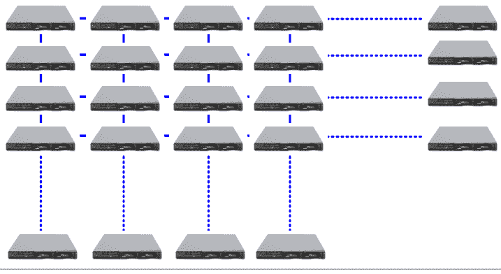

图 9-2 具有独立处理器和内存集群的 `MPP` 系统

- **可扩展性**：集群可以扩展到数千个异构节点，同时同时在价格和性能上与 `MPP` 系统保持竞争力。
- **可用性**：由于集群具有多个相互连接的物理节点和资源（如图 9-3 所示），它们可以确保更好的数据连续性和恢复操作。

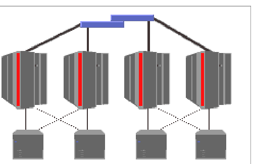

图 9-3 一个可用性集群

- **资源共享**：对于需要在多用户环境中动态分配和管理处理及存储资源的计算环境，集群可以是优的解决方案。

## 传统集群角色

最初，集群是大型并行计算传统的一部分，该传统强调计算速度。随着时间的推移，集群的使用扩展到了其他领域。以下三个领域是集群扮演的传统计算角色。

### 高性能计算 (`HPC`)


HPC 集群旨在使用并行计算，将更多的处理器能力用于问题的解决。科学计算中有许多例子，通过并行使用低成本处理器来执行大量操作可以具有极高的成本效益，同时提供海量的计算能力。这被称为 `并行计算或并行性`。表 9-1 显示了 HPC 的应用领域和一些示例。

| 应用领域 | 应用示例 |
|---|---|
| CAE（计算流体力学） | - `Fluent`<br>- `STAR-CD`<br>- `PowerFlow` (来自企业 X-Architecture) |
| CAE（碰撞） | - `LS-DYNA`<br>- `PAM-CRASH`<br>- `Radioss` |
| CAE（结构） | - `Nastran`<br>- `Ansys`<br>- `Abacus` |
| 石油（油层建模） | - `Eclipse`<br>- `VIP` |
| 生命科学（Ab Initio 化学） | - `Gaussian`<br>- `Gamess`<br>- `Jaguar` |
| 生命科学（分子建模） | - `Charmm`<br>- `Amber` |

通常，集群中的并行性是通过消息传递实现的（图 9-4）。消息解析调用运行在其中一个节点上的应用程序，该程序处理一组大型


图 9-4 消息传递的简化视图

大多数集群的瓶颈不是处理器，而是用于向处理器传递消息的通信基础设施。许多 HTC 环境不符合并行计算的严格定义（无论是设计还是执行），它们通常被称为分布式计算环境。

# 高吞吐量计算 (HTC)

虽然科学需求驱动了 HPC（以及集群技术），但某些研究领域对数据吞吐量（数量）的重视超过数据操作的速度。

> 注意：用于解释 HPC 和 HTC 区别的常用类比是战斗机与民机。虽然战斗机可以比民机更快地将个人送到目的地，但民机平均一次可以携带（超过200）个人，提供了更高效的运输媒介。

通常这类操作需要数周或数月的计算时间来解决。这些操作通过较低的耦合需求与 HPC 区分来。耦合的简单定义是节点之间所需的数据共享程度。HTC 的常见示例包括蛋白质折叠和射电文学等。

要了解蛋白质折叠，请访问：

`http://folding.stanford.edu/`

要了解射电文学，请访问：

`http://setiathome.ssl.berkeley.edu/`

多种 HTC 应用在常见的客户端操作系统上。您可以在 Web 上了解这些应用程序：

`http://www.techimo.com/teams.html`

`Blue Gene` 研究项目：这项 IBM 研究项目的目标是构建一台大规模并行计算机，用于研究生物分子现象（如蛋白质折叠）。该项目通过增加 `Blue Gene/L` 得到了扩展。`Blue Gene/L` 也是 IBM 自动计算倡计划的一部分，旨在设计自愈、自管理和自配置的计算机系统。要了解更多关于该研究的信息，请访问：

`http://www.research.ibm.com/bluegene/press_release.html`

图 9-5 展示了一个典型 HTC（高性能事务处理）应用的蛋白质折叠示例。HTC 集群的一些考虑因素包括：

- 定义 HTC 应用所需的最小耦合级别
- 确定如何在集群的多个用户之间分配计算资源
- 解决当资源实体或个人拥有参与集群的独立节点时可能出现的冲突

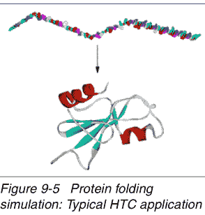

### 高可用集群

高可用集群（图 9-6）通常是为了通过冗余提供具有韧性的环境而构建的。它们提供了一个计算环境，在该环境中，一个或多个组件（硬件、软件或网络）的故障不会显著影响所用应用程序或多个的可用性。

在最简单的情况下，两台计算机可以配置为相同，并访问共享存储。在正常运行期间，应用程序环境在一个系统上执行，而另一个系统仅处于备用状态，准备在故障时接管应用程序的运行。

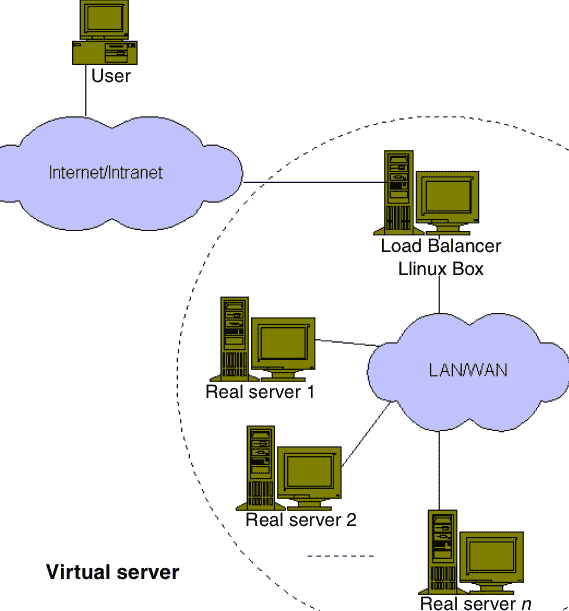

图 9-6 高可用示例：Web 服务器农场

当发生故障时，第二个系统将接管相应的资源（存储、网络地址等）。这一过程通常被称为故障转移（`failover`）。然后，第二个系统将完全替换故障的系统。终端用户不需要知道他们的应用程序运行在不同的物理机器上。

正如你预期的那样，实际的高可用集群设计可能非常复杂，特别是当需要共享、一致的数据存储时。事实上，高可用集群分为两个子类：文件存储集群和数据库集群，它们都有各自特定的需求和要求。理解所有可能的故障类型，并构建冗余以及提供平滑、高效且透明的故障转移所需的流程，是一项艰巨的任务。

高可用集群的一些能力包括：

- 在节点之间提供管理级切换，用于维护、升级或其他非故障情况
- 在所有节点之间保持一致的环境
- 识别故障何时发生
- 实现故障转移过程，使所有所需的资源对备用节点都是可用的
- 在发生故障时提供事务和数据完整性

尽管各个领域存在差异，但它们都试图提供某种程度的抽象，允许用户（在某种程度上允许应用程序）将集群视为单一资源而不是单独的计算机。

# 新兴角色

随着时间的推移，集群正被用于更有针对性的用途。后续章节将讨论传统集群角色的变体。

# 服务器整合

集群可以是服务器整合的理想平台，因为它们为软件安装、硬件控制、系统监控和应用程序维护提供了单点控制。并行或基于 Web 的应用程序可以利用集群的扩展性（见下节的负载均衡）和性能优势。集群也可以作为多层架构中的理想终点。

一些考虑因素包括：

- 将以前分散在多个地点的资源集中管理
- 通过减少物理冗余获得更大的规模经济
- 数据集成提供了更高的可用性、改进的恢复能力以及更容易的企业数据管理
- 应用程序集成为业务流程协同提供了机会

### 负载均衡

负载均衡（以及延伸的水平扩展）涉及多个服务器为一组资源提供单一接口，这些资源的大小可以随时间推移任意增长（缩小）。这最常见的例子是 Web 服务器农场。在这里，使用单一通用资源定位符（`URL`）（接口）来访问 Web 站点（资源）。通过该接口进入请求可以分配到大量的服务器上。这提供了更高的容量，并可以通过负载均衡等功能管理终端用户体验。

图 9-7 展示了 1998 年冬奥会如何使用负载均衡的示例。

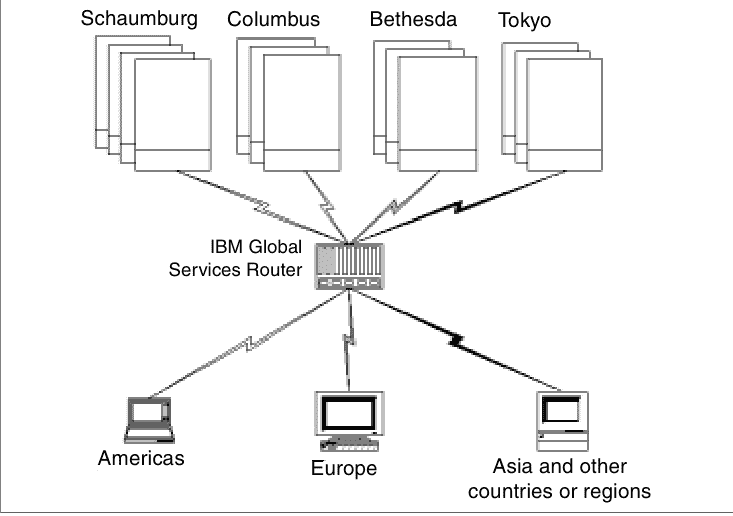

图 9-7 1998 年冬奥会的负载均衡

扩展考虑因素包括：

- 建立高低资源使用限制基线估计
- 确定应用程序的哪些元素必须重构（如果有），以利用水平可扩展的集群

**按需计算**

最终支持按需计算的技术仍处于婴儿阶段。这些技术包括网格计算和自主计算。无疑集群将发挥作用。更多信息请参见第 271 页第 9.5 节“Linux 集群的未来”。

# 9.1.2 IBM集群产品

IBM 有几种基于产品的集群产品。本节将讨论这些产品。

252 Linux 手册：IBM Linux 解决方案和资源指南

# 并行 Sysplex (Parallel Sysplex)

`Parallel Sysplex` 中的每个节点可以有一个单 CPU，或由对称多处理处理器组成。每个节点运行操作系统的独立副本。

`SMP` 节点中的处理器在 `IBM S/390` 上运行单一操作系统 `zOS`（以前称为 `MVS`）。它们具有共享内存。`Parallel Sysplex` 中的节点具有共享磁盘，你可以从每个节点直接访问。你可以使用光纤通道（`FICON`）交换机配置大型共享磁盘组。

# SPTM

`SP` 系统是一种通用的可扩展并行系统。它基于“无共享”（`share-nothing`）架构。“无共享”是指每个处理器都有自己的缓存和磁盘子系统。

市面上可用的 `SP` 系统范围从 2 个到 128 个处理器节点不等。每个处理器节点在功能上等于一个独立的 `RS/6000` 工作站或服务器。

多达 512 个节点的大型 `SP` 系统已经交付并在今天被成功使用。每个处理器节点都包含自己的 `AIX` 操作系统副本和其他标准的 `RS/6000` 软件。

一组专门为 `SP` 设计的新系列软件产品可以有效利用 `SP` 的并行能力。`SP` 系统是一个先进的水平可扩展环境。

# Cluster 1600

`IBM Cluster 1600` 扩展并增强了 `IBM` 创新且经过证明的 `AIX` 和 `RS/6000` 集群技术。`Cluster 1600` 包含了旧 `SP` 系统以及由 `PSeries` 服务器组成的新集群。

`Cluster 1600` 包含了用于 `AIX 5L` 软件的并行支持程序（`PSSP`）。该软件了一套用于 `RS/6000` 安装、运行、管理和维护的完整应用程序包。

注意：`IBM Cluster 1350` 中的计算节点是 `xSeries 300 Model 330`。`Model 330` 设计用于在机架环境中的空间效率和可用性。它是一台 `1U` 服务器，配备一个或两个 `Intel Pentium III` 处理器。该系统还具有 `133 MHz` 前端总线、集成的 `Ultra160 SCSI` 接口、两个集成 `10/100` 以太网 `NIC` 以及两个 `64 位/33 MHz PCI` 插槽（一个全长，一个半长）。

## 控制节点


控制节点提供帮助集群其他节点协作以获得所需结果的服务。控制节点可以提供两组功能：

- 基础设施服务，如 `DHCP`、`DNS` 和类似的功能：这些功能使得节点能够轻松添加到集群中，并确保它们能够与其他节点进行通信。
- 任务调度由计算节点执行：例如，如果一个计算节点完成了一个任务并可以执行额外工作，控制节点可能会为该节点分配下一个需要工作的任务。

注意：可以使用 `xSeries 300 Model 330` 或 `342` 作为集群节点。

## 存储节点

对于在集群中运行的大多数应用程序，计算节点必须对存储系统具有快速、可靠且同时的访问。这取决于应用程序的具体需求，可以通过多种实现。

在某些情况下，存储可能直接附加到计算节点上。在其他情况下，存储需求可能由一个或多个网络共享设备满足。在这种情况下，存储节点启用并控制对存储子系统的访问。

注意：`Cluster 1350` 的存储节点是 `xSeries 300 Model 342`。`Model 342` 是一台 `3U` 服务器，配备一个或两个 `Intel Pentium III` 处理器。每个节点可以配置三块 `18 GB`、`36 GB` 或 `72 GB` 的磁盘。

通过可选的 `ServeRAID™ 4L` 适配器，可以实现磁盘镜像。该节点包含一个集成的高级系统管理处理器，用于硬件控制和管理。

## 安装节点

在集群中，计算节点（或其他节点）可能需要经常重新配置或使用新镜像重新安装。安装节点提供了镜像以及轻松、快速地在集群节点上安装或重新安装软件的机制。

## 管理节点

集群是复杂的环境。因此，对单个组件进行管理非常重要。管理节点提供了许多功能，包括：

- 监控单个节点的状态
- 向单个节点发布管理命令以纠正问题，或提供执行开启/关闭等功能的简单（但有效的）命令
- 处理来自集群中各种节点的事件或警报

不要低估集群管理的重要性。在协调大量系统的活动时，这是至关重要的。

> 注意：每个 `Model 330` 节点都有一个高级系统管理处理器（也称为服务处理器），允许远程节点开启/关闭/重置，监控节点环境状况（风扇速度、温度、电源等），并允许远程电源自检/基本输入输出系统（`POST`/`BIOS`）控制台、电源管理和 `SNMP` 警报。`Model 342` 必须包含可选的服务处理器以提供相同的功能。

## 用户节点

集群的各个节点通常位于私有网络，你无法从外部或公司网络直接访问。即使可以访问，大多数集群节点也不一定配置为提供优的用户界面。用户节点是唯一一种配置为用户（可能在外部网络上）提供界面的节点，用户可能通过访问集群请求运行作业，或访问之前运行作业的结果。

## 节点类型

既然你已经理解了集群中通常存在的逻辑功能类型，我们现在讨论集群中可能存在的节点类型（从硬件角度来看）。通常，集群内的节点被分为三类，每种类型都将在后续章节中进行解释。

## 头节点

“头节点”是一个通用术语。头节点辅助控制集群，也可以用于其他方式。头节点通常提供以下一个或多个逻辑节点功能：

- 用户节点
- 控制节点
- 管理节点
- 安装节点

在小型集群（通常不超过 16 个节点）中，所有这些功能都可以合并在一个头节点中。在较大的集群中，出于安全和性能考虑，最好将这些功能分散到多台机器上。

## 计算节点

计算节点是集群的核心。用户、控制、管理和存储节点都设计用于支持计算节点。

大多数计算实际上是在计算节点上执行。这些节点根据作业需求和作业调度器的定义进行逻辑分组。

## 存储节点

在讨论集群结构时，存储节点通常被定义为第三类节点。然而在实践中，存储节点通常是头节点或计算节点的特殊版本。

存储节点有时被指定为独特的节点类型，是因为支持存储设备的硬件和软件需求可能与其他头节点或计算节点不同。根据你的存储需求和你收到的存储访问类型，这可能包括支持 `RAID-5` 的特殊适配器和驱动程序、通过通道存储（channel storage）附加的存储设备等

## 9.2.2 网络

集群内的节点有许多原因进行通信。毕竟，它们正在协作提供整体结果。不同通信类型定义的需求往往决定了满足这些需求的各种网络技术。

## 通信类型

后续章节将解释必须发生的一些关键通信。

## 进程间通信

集群中的节点共同工作以提供整体解决方案。因此，每个节点执行的任务通常与其他节点所执行的任务相互关联。

就像多处理或多线程单系统一样，进程之间总是需要通信来协调和处理共享资源。进程间通信网络通常被称为集群互连（interconnect）。它可能与存储或管理网络共享物理连接。

## 管理操作

对于大量的节点，识别单个节点可能发生故障是非常重要的。主动发布命令防止错误发生也是重要的。

以独立的方式管理集群中的多个节点是不可能的。必须有一种方法从一个或多个管理节点通信到集群中的任何节点。

> 注意：`IBM Cluster 1350` 提供了一个服务处理器网络。它使用较新的 `RSA` 适配器，每 11 个节点使用一个。服务处理器是内置的，并有自己的以太网端口和电缆。由于此，每 8 个节点只需要一根以太网线，而不是每个节点使用一个 `PCI` 插槽和一个以太网线。

## 安装

由于各种原因，单个节点经常需要重新安装软件。可能是可能是为了特定任务进行重新配置，或者仅仅在单个节点发生磁盘故障时替换操作系统环境。

重要的是系统镜像可以高效地定义和发布。这种操作可以在集群其他部分运行并执行工作时对某些节点进行，重要的是向某些节点推送新的操作系统环境不会对其他节点的性能产生不利影响。

## 存储访问

在大多数集群中，单个节点需要对共享存储设备读取或写入数据。对于高性能计算，如果这种存储访问证明是瓶颈并导致其他节点等待访问设备，将是违背集群初衷的。因此，必须拥有一个

用于快速访问存储的高效网络，以及为数据提供高效、并发访问的文件系统。

## 常见网络技术

根据实际应用和性能需求，不同的通信需要在不同的网络上进行。因此，你通常会有多个网络和网络类型来连接集群中的节点。接下来的章节将介绍集群中使用的常用网络技术。

## 快速以太网 (Fast Ethernet)

快速以太网和 `TCP/IP` 是用于大多数网络应用的两个标准。它们简单且具有效益，并且该技术一直在不断改进。快速以太网适用于 `Beowulf` 节点使用的较低速度的 `Intel` 机器，并可以在半双工或全双工模式下运行。数据可以同时发送和接收。全双工传输部署在两个交换机的端口之间、计算机与交换机端口之间，或者两台计算机之间。全双工需要交换机，而集线器无法工作。

## 千兆以太网 (Gigabit Ethernet)

千兆以太网使用修改后的美国国家标准 (`ANSI`) `X3T11` 纤通道标准物理层 (`FC-0`) 来实现每秒千比特的原始带宽。千兆以太网支持多模和单模光纤以及短距离铜缆布线。光纤是交换机和服务器之间连接的理想选择，并且可以达到更距离（目前从 500 米到 10 公里）。

## Myrinet™

`Myrinet` 是一种高性能、高可用的包通信和交换技术。`Myrinet` 链路在多模光纤中可达 200 米，并以每秒 `2+2 Gigabit` 的速率全双工模式运行。`Myrinet` 交换机是低延迟的直通设备，可以组合提供支持多数千个主机的网络以及每太比特的网络二分数据速率。`Myrinet` 接口包括处理器和固件，用于从主机计算机上卸载包处理。

`Myrinet` 对 `Linux` 及其他操作系统的软件支持提供了多种软件接口。这包括原生 `Myrinet` `API`、`TCP/IP` 和 `UDP/IP`、`MPI`、`VI`、`PVM` 以及 `Sockets`。所有的 `Myrinet` 软件支持都是开源的。

有关 `Myrinet` 的更多信息，请访问以下网站：

```
http://www.myri.com/
```

## 纤通道 (Fibre Channel)

纤通道是一种数据存储技术，可以为集群节点提供对数据的共享访问。纤通道是一种环形架构，而不是像 `SCSI` 那种总线架构。环形结构实现了数据在设备之间的快速交换，最大数据传输率可达 `100 MB/sec`。纤通道是用于为集群提供快速共享数据访问的常用技术。

> 注意：`Cluster 1350` 支持 `IBM FASIT` 存储子系统和 `IBM TotalStorage` 企业存储服务器。

## 互联网小型计算机系统接口 (iSCSI)

`iSCSI` 是一种允许将 `SCSI` 信息封装并传输在 `TCP/IP` 网络上的标准。这种方法的益处是，组织可以利用其现有的网络基础设施，使用它们用于本地数据的 `I/O` 命令提供对网络上任何位置数据资源的访问。`iSCSI` 可以允许 `Linux` 集群在不需要额外基础设施的情况下访问远程数据存储。

随着 `iSCSI` 标准的成熟，预计会有几项发展。第一是引入主机总线适配器 (`HBA`)。`HBA` 通过从客户端操作系统中卸载 `TCP/IP` 开销来提高性能和吞吐量。第二是部署 `10G` 兆以太网，这极大地提高了 `iSCSI` 运行的数据速率。

`Cluster 1350` 不支持 `iSCSI`。此处提及是为了完整性。

> 注意：`IBM TotalStorage IP Storage 200i` 是一种 `iSCSI` 解决方案，提供 `10.2 GB` 到 `3.52 TB` 的 `RAID` 存储支持。

## InfiniBand


InfiniBand 是一种旨在提供基于通道的交换织结构的技术，能够处理处理器与 I/O 设备之间的任何类型的通信。由于标准中设计了高带宽（2.5 Gbits、10 Gbits 和 30 Gbits/sec），InfiniBand 预计将逐渐取代大多数现代 Intel 计算机使用的现有外围部件接口 (`PCI`) 共享总线方法，并被视为集群数据密集型需求的理想通信媒介。

Cluster 1350 不支持 InfiniBand。此处提及是为了完整性。

注意：IBM 提供了多种 InfiniBand 产品，包括 InfiniBlue 4X 主机通道适配器 (`HCA`)。这允许当前的基于 `PCI` 的 Linux 服务器连接到 InfiniBand 网络。

## 9.2.3 支持软件

软件将硬件基础设施结合在一起。它创建并管理一个抽象层，允许用户和应用程序将整个集群资源视为单一计算实体。集群软件主要分为三类。

## 操作系统

集群中的节点通常运行相同的操作系统。对于大型集群，确保该操作系统在经济上是可行的，并且在节点之间易于部署非常重要。这意味着它应该能够以自动方式轻松安装，并支持用于管理和配置的远程访问。

`Linux` 满足这些要求。事实上，获取 `Linux` 的低成本以及开发和部署运行在 `Linux` 上的应用程序的丰富功能，是集群增加的催化剂，以满足各种计算问题的需求。通过使用相对低廉的 `Intel` 硬件和 `Linux`，许多以前无法证明集群费用的企业现在正以极快的速度采用这项技术。正如我们之前提到的，构建集群时还有其他考虑因素，例如如何管理大量节点。

注意：为了提供一个共同基础，以便对形成集群所需的复杂的硬件和软件混合进行测试和一致部署，`Red Hat` 和 `Suse` 将在 2003 年第一季度支持 `Cluster 1350`。未来的 `Linux` 发行版也将被考虑。

## 文件系统

取决于实际应用，许多集群需要大量节点对相同文件进行并发和高速访问。在这种情况下，提供一个能够提供数据保护和通常所需的性能的共享文件系统是非常重要的。

注意：IBM 为 `Linux` 提供了并行文件系统 (`GPFS`)。`GPFS` 是一种在 `AIX` 集群环境中已使用多年的文件文件，适用于 `Linux` 和 `xSeries300` 硬件。

## 管理工具

当有了上述硬件，你就可以轻松地构建集群。这只是将其投入使用的开始。

部署集群最困难的部分之一是拥有正确的工具来管理大量节点作为一个单一实体。这包括：

- 管理节点和组信息
- 监控和控制硬件
- 在多台机器上运行命令
- 监控系统事件
- 管理和同步所有机器的配置文件
- 提供安全性
- 诊断问题
- 安装软件

注意：IBM 通过两个工具提供集群管理：`xCAT` 和 集群系统管理 (`CSM`)。`xCAT` 是一个更成熟的产品，并使用 `xSeries` 服务处理器。这种成熟性是一个巨大的优势。`xCAT` 用于所有 `NCSA TF` 系统。

`CSM` 包含了自 `PSPF` 的技术。虽然它是 `1350` 的标准管理软件，但也可以用于任何开放 `Intel` 服务器的集群系统管理。

## 9.2.4 应用

很少有现成的高性能计算 (`HPC`) 应用，原因与 `HP` 集群往往专注于特定的独特任务相同。面向事务计算 (`HTC`) 解决方案通常是自定义的，并专注于大规模计算项目。高可用 (`HA`) 集群通常依赖中间件，该软件层需要最多的定制以确保可靠性、可恢复性和甚至可扩展性。

两种 `HA` 子类——存储和数据库集群，各有其特殊关注点，可能需要应用定制。对于存储集群，更多的重点放在分布式文件系统本身的能力上。然而，对专用检索库（层位于应用程序和分布式文件系统之间）进行某些定制是常见的。

对于数据库集群，定制化主要由可用性和恢复这两个核心关注点驱动。然而，可扩展性日益成为一个关注的问题。

你可以通过两种方式处理负载均衡集群：

- 服务器农场

扩展负载的传统方法是提供一个位于服务器后的服务器场，该服务器将所有入站请求分发到集群的各个节点上。服务器农场的优势在于实现这种负载均衡通常只需要少量的定制化。

- 进程迁移/单系统映像 (`SSI`) 集群

使用内核级扩展，进程迁移集群可以无缝地将执行进程在集群的任何节点之间进行移动。这种方法的好处是，应用程序不需要重写即可利用这种负载均衡方法。

`SSI` 集群扩展了简单的进程迁移模型，创建了统一的集群级进程间通信 (`IPC`) 对象，例如管道、`fifo`、信号量、消息队列、共享内存、套接字和信号。这允许程序、进程和用户无论它们在集群的哪个节点上执行都能协同工作。

哪种类型的负载均衡（服务器农场和进程迁移）可能仍然需要分布式文件系统或额外的定制来处理数据并发问题。

图 9-8 显示了所有各种集群组件是如何汇聚的。注意顶四层都是软件组件。该抽象层用于从异构硬件组合中创建集群环境。由于有效的集群可以是任何类型或品牌的服务器、互连设备或存储子系统组成，集群可以利用商品硬件或组织现有的 `IT` 资源。

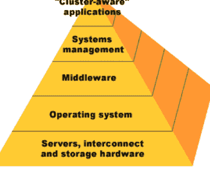

图 9-8 集群组件布局

- 注意：IBM 提供以下支持集群的应用：
    - `DB2` 通用数据库 (`UDB`) 企业扩展版 (`EEE`)
    - `WebSphere Application Server`
    - `WebSphere Commerce Suite`
    - `WebSphere Edge Server`
    - 电信应用服务器
    - `WebSphere Everyplace Suite`

# 9.3 Linux 集群历史

`Linux` 集群解决方案的现状通过其历史得到了最好的理解。现代 `Linux` 集群在概念上归功开源软件、英特尔处理器以及 `HPC`（高性能计算）社区的需求。在 1994 年 `NASA` 启动著名的 `Beowulf` 集群程序之前（和之后），已经存在非英特尔/非 `Linux` 机器的集群。然而，直到 `PC` 硬件的商品化特性与 `Linux` 操作系统的开源特性相结合，集群的想法才真正变得可行且具有经济效益。

# Beowulf 程序

`Beowulf` 程序始于一个简单的想法：使用 16 台廉价的基于英特尔的 `PC` 和开源并行编程库来创建一个虚拟超级计算机环境。快速以太网的速度太慢，无法跟上单个节点的总线速度（即使在今天的集群中，总线仍然是一个主要障碍）。正因如此，`Donald Becker`（一位 `NASA` 外部承包商）重写了网卡驱动程序以支持通道绑定（`channel bonding`）。通道绑定是将四块网卡合并为单一虚拟连接的过程，该连接足够快，允许运行在每台计算机上的并行处理能够像它们是单个系统的一部分一样进行通信。

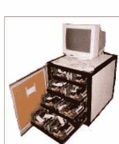

构建系统的所有软件都是开源的，包括 `Linux` 内核、`NIC` 驱动程序和并行处理库。考虑到这些，`NASA` 团队（`Becker`、`Tom Sterling`、`John Salmon` 和其他 `CESDID` 成员）继续并开发了针对系统特定特性调优集群的能力。要了解更多关于该团队的成就，请参阅：

`http://sdcd.gsfc.nasa.gov/DIV-NEW5/CESDID.11_97.Becker.award.html`

最后，由于涉及的所有硬件都是标准且廉价的，可以根据需要添加（或替换）节点。`Beowulf` 集群一词指的是一类集群，其：

- 大多数组件是现成商品 (`COTS`)。
- 操作系统是开源的（`Linux` 或 `BSD` 变体）。
- 集群强调 `HPC` 以及作为行业标准的消息传递接口。

# 高可用集群的出现

从 20 世纪 90 年代开始，`Linux` 越来越多地用于基础设施，提供基础（且关键）的服务，包括路由、防火墙/`IDS`、`Web` 以及 `DHCP/DNS`。随着 `Linux` 渗透到企业和政府，对更高水平可用性的需求也随之增加。

`Linux` 高可用项目启动的目的是为 `Linux` 操作系统带来故障转移和接管能力。`Linux` 高可用项目的核心组件是心跳程序（`heartbeat`）。心跳工作在双节点模型上：两台配置相同的计算机，其中一个指定为“主”，另一个指定为“从”。从节点通过网络连接或串行电缆监控主节点的“心跳”或持续信号。当主节点故障（且未能发送心跳信号）时，从节点激活其服务并接管主 `IP` 地址的所有权，从而维持集群服务。

虽然 `Linux` 高可用为关键基础设施服务器提供了单备份，但双节点的限制限制了它的有效性。因此，管理员越来越多地开始将 `Linux` 高可用的心跳功能与另一个项目——`Linux` 虚拟服务器 (`LVS`) 的可用性和负载均衡功能结合起来。`LVS` 通过将集群的公共 `IP` 地址分配给负载均衡服务器来工作。然后负载均衡将服务请求重传给集群。

# Linux 负载均衡

在 20 世纪 90 年代，来自耶路撒冷冷希伯来大学的 `Amnon Barak` 将 `MOSIX` 代码（最初为 `BSD` 开发）移植到 `Linux`。`MOSIX` 通过共享进程、`IPC`、设备和网络空间、聚类文件系统（通过 `OpenGFS`）、负载均衡（使用 `MOSIX` 算法）以及单一管理界面创建了单一系统的映像。


虽然各种开源集群组件在 20 世纪 90 年代趋于成熟，但管理工具仍然缺乏成熟度和集成。2000 年 4 月，开源集群小组（由公司 `IBM`、`Intel`、`SGI`、`Veridian`、`MSC.Software Corporation` 以及研究机构橡树岭国家实验室 `ORNL`、印第安纳大学、伊利诺伊大学国家超级计算中心 `NCSA` 组成）发布了他们的第一个项目：开源集群应用资源 (`OSCAR`)。

`OSCAR` 项目的目标是识别用于构建、编程和管理 `HPC` 集群的最佳开源工具。一旦确定，这些程序将被组合在一起并作为一个单一包分发。`OSCAR` 是一个极其强大的开源集群软件包，被广泛组织使用。

> 注意：`SSI` 被选为 2002 年 `LinuxWorld` 会议与展览的年度开源项目。

## 9.4 Linux 集群解决方案

`IBM Linux` 集群解决方案是 `Cluster 1350`。`IBM` 还有其他集群解决方案，其中可能包含 `Linux` 以及其他操作系统相结合的组合集群包。

> 注意：`IBM` 还提供了其他非 `Linux` 的集群解决方案。请访问以下网站获取信息：
> `http://www.ibm.com/servers/eserver/clusters/hardware/`

### 9.4.1 Cluster 1350

`Cluster 1350` 与早期的 `Cluster 1300` 一样，是带有 `Intel` 处理器节点的集成式集群。与 `Cluster 1300` 不同，`Cluster 1350` 在每个节点中使用单或双路 `Intel Xeon` 处理器。它可以扩展到 512 个计算节点和 32 个存储节点。`Cluster 1350` 设计为工业、金融服务、生命科学、政府和教育机构的解决方案。

`img/6b2be6cf94c5583e73925c180246991a_291_0.png`

您可以阅读更多关于 `Cluster 1350` 的信息：

`http://www.ibm.com/servers/eserver/clusters/hardware/1350.pdf`

图 10-9 `xSeries Linux` 集群

### 9.4.2 ClusterProven®

`IBM ClusterProven` 程序为验证端到端解决方案设定了特定标准，使其在每个 `IBM` 平台上都符合高可用性的行业标准。通过 `ClusterProven` 验证的开发者可以使用 `ClusterProven` 标志。这允许他们在向客户推销解决方案时使用 `ClusterProven`，并获得 `IBM` 的联合营销协助。

要查看 `ClusterProven` 列表，请访问：

`http://www.software.ibm.com/solutions/isv/igss.nsf/CPSolutionWeb`

### 9.4.3 解决方案示例

`Cluster 1300` 和 `Cluster 1350` 是 `IBM` 目前提供的主要的 `Linux` 集群包。然而，公司仍然选择 `IBM` 硬件和中间件来支持其自定义集群解决方案。本节提供了现实世界中 `Linux` 集群的示例。

## 高性能计算：NCSA

国家超级计算应用中心（`NCSA`）是一家位于美国的研究机构。其使命是为科学家创建高性能计算基础设施。`IBM` 为 `NCSA` 安装了两个 `Linux` 集群。第一个集群包含 600 多台运行 `xSeries` 的机器以及 `Mycom` 的 `Myrinet` 互连网络。第二个集群是首批使用 `Intel` 下一代 64 位 `Titanium` 处理器的集群之一，并将运行 `SuSE` 系统。

`img/6b2be6cf94c5583e73925c180246991a_292_0.png`

如果用计算器手动计算 `NCSA` 超级计算机每秒处理的次数，将需要超过 150 万年。`NCSA` 需要巨大的速度和力量来模拟黑洞和引力波的剧烈碰撞。

您可以在互联网上了解更多关于 `IBM NCSA` 集群的信息：

```
http://www.nucsa.uiuc.edu/About/NCSA/
```

此外，您可以在 `NCSA Web` 集群网站上找到更多关于 `Linux` 集群的信息：

```
http://www.nucsa.uiuc.edu/News/Access/Stories/ClusterUpdate/
```

## 用于研究流体动力学的实验性 Itanium 集群

截至 2001 年 5 月，`NCSA` 使用 `Intel` 64 位 `Itanium` 架构的驻留 `Linux` 集群是一个从 `IBM` 借用的 64 处理器机器集合。其目的是让 `NCSA` 集群开发团队有机会在交付 320 处理器太字节级 `Itanium` 集群之前，让代码在 `Itanium` 架构上运行起来。

事实证明，这个实验性集群不仅仅是一个基准测试和故障排除工具。它表明即使在较小的 `Itanium` 集群上也可以开展突破性的科学研究。

明尼苏达大学计算科学与工程实验室（`LCSE`）的科学家团队在使用基于 `Itanium` 的 `Linux` 集群创建详细的模拟，展示湍流的行为。这些数据现在一个十亿单元的网格上进行可视化。`LCSE` 团队预计将执行更详细的模拟，由八十亿单元网格组成。这些模拟将测试关于湍流流体行为的理论，这些理论最早源于 1998 年在劳伦斯·利弗莫国家实验室完成的早期十亿单元模拟。该模拟是使用一台拥有 3,840 个处理器的计算机在四周内完成的。然而，后续工作从未进行，因为利弗莫尔的机器被归到了机密环境。

## 集群运行辅助气体动力学研究

`NCSA` 集群上的 80 亿单元模拟让 `LCSE` 团队有机会将新的更详细的数据与 1998 年的数据进行比较。对 1998 年气体流不稳定混合层模拟的可视化和分析揭示了小尺度湍流行为与大尺度速度场某些方面之间存在意想不到的相关性。

这为气体动力学模拟中从小尺度运动对大尺度运动的影响提供了一种新方法。新的建模方法需要高分辨率，因为这些新发现的关系在低分辨率模拟中可能并不显见。

由 `LCSE` 主管 `Paul Woodward` 领导的 `LCSE` 团队使用气体动力学代码分段抛物法（`PPM`）。由于 `PPM` 应用具有极的可扩展性，`Woodward` 期望随着 `NCSA Itanium` 集群的规模扩大，能看到更好的性能。

与在利弗莫尔机器上的模拟不同，研究人员可以保存此大模拟的所有数据。这是通过商品驱动器和存档存储系统实现的。数据随后通过 `Abilene` 网络传输到 `LCSE` 太字节数据分析和可视化系统。

研究目标是开发未解析湍流的准确模型。如果该模型可以扩展到液体流，它还可以帮助天体物理、气象和航空航天应用的气体流模拟。

## HA集群：BBDO Germany

`BBDO Germany` 是一家位于德国的公司，提供完整的托管解决方案。为了为其客户提供托管，`BBDO Interactive` 选择了包含 `DB2` 通用数据库和运行开源操作系统的 `IBM` 解决方案。`BBDO Germany` 使用 `IBM` 合作伙伴 `SteelEye` 的 `LifeKeeper for DB2` 集群软件维护客户网站的高可用性。

`img/6b2be6cf94c5583e73925c180246991a_294_0.png`

图 9-12 `xSeries` 服务器上的 `HA` 集群

您可以阅读更多关于 `BBDO Germany` 集群的信息：

`http://www.eweek.com/article/2,3959,131649,00.asp`

# 网格计算

网格计算是指利用一组开放标准和协议，通过互联网访问应用程序、数据、处理能力、存储容量以及大量其他计算资源的能力（不仅限于物理集群）。网格用户查看网格时，本质上看到的是一台巨大的虚拟计算机。

通过这种方式，网格可以被视为一个元集群。元集群是通过广域网（`WAN`）技术互连的集群集合，用于为网格的组合资源提供无缝访问。网格与传统的分布式计算的区别在于，其重点关注大规模资源共享、创新应用，在某些情况下还侧重高性能。

您可以在 Web 上了解更多关于网格计算的信息：

`http://www.ibm.com/grid/index.shtml`

# 自主计算

自主计算试图通过从人体最复杂的系统之一——自主神经系统中获得灵感来管理 `IT` 系统的复杂性。自主计算的重点是设计和构建能够自我运行的计算系统。它要求适应不同的复杂性，并准备其资源以最高效的方式处理交付它们的工作负载。

欲阅读更多关于自主计算的信息，请参阅：

`http://researchweb.watson.ibm.com/autonomic/`

# 按需计算

按需计算描述了一种环境，用户拥有 `IT` 资产，但可以根据需要动态增加或减少。用户获得的主要优势是基于使用的可变定价，类似于能源公用公司提供的服务及其收费方式。此外，按需计算的本质允许用户将此类需求驱动系统的管理外包给第三方。

您可以在 Web 上阅读更多关于按需计算的信息：

`http://www.ibm.com/services/ondemand/index_flash.html`

# 9.5.2 Linux 集群在新兴趋势中的作用

`Linux` 集群将通过支持网格分布式特性带来的密集计算和存储需求为网格计算提供服务。此外，`Linux` 集群是任何自主系统提供容错需求的最廉方式。`Linux` 集群是提供按需计算扩展性要求的最具效益的解决方案。


Linux 集群的另一个未来展望是 HPC 设备。HPC 设备将基于超薄节点，这些很少或没有持久化存储。节点将通过简单的启动透明地添加到集群中，这将节点易于迁移进程。由于节点是轻薄的，版本偏差将得以消除，传统的集群安装（在每个节点上放置镜像）也将被消除。

未来的 HPC 集群应该是“从底层开始开放的”，因为它将基于 `LinuxBIOS` 技术。在 `LinuxBIOS` 平台之上构建 `Beowulf 2` 技术（如 `Scyld`）的影响将非常接近 HPC 设备。


# IBM Linux 服务

本章介绍了帮助 Linux 客户从 Linux 驱动的 `IBM @server` 解决方案中获得最大优势的 IBM 服务。本章旨在帮助对 Linux 感兴趣的从技术专家到销售、品牌、营销和产品领域的专业人士。它提供了关于 IBM Linux 领域持续增长的信息库的首次完全整合参考。

这里描述的资源为获取更详细的信息提供了一个良好的、整合的起点。它还展示了 Linux 今日所受的巨大认可和承诺的范围。我们建议您阅读并学习这些资源，以帮助您跟上 Linux 的承诺和新服务，这些服务仍在快速增长。

本章信息在本书编写时是正确的。然而，由于每个产品生命周期的正常变化，某些信息可能会发生。对于 Linux 以外的产品也是如此。这意味着即使某个产品在本章中似乎受到支持，IBM 也可能不支持它。因此，我们鼓励您在从本章收集信息的同时，调查服务终止日期、产品撤回和其他支持限制等主题。

> 重要：这里描述的服务仅适用于 IBM 客户，可能在某些特定国家或地区不可。请联系您的当地 IBM 全球服务 (IGS) 代表了解详情。

## 10.1 IBM 服务

IBM 的重点是创建、开发和制造行业最先进的信息技术。这包括计算机系统、软件、网络系统、存储设备和微电子。

IBM 全球服务将这些先进技术转化为客户的业务价值，并帮助获取和管理信息技术（IT）。欲了解更多关于 IBM 全球服务，请参阅：

`http://www.ibm.com/services/`

## 10.2 IBM 全球服务

IBM 通过成本效益、选择和竞争优势帮助客户优化 Linux 解决方案的业务价值。IBM 在全球数千个开源项目中拥有丰富的 Linux 顾问和架构师。借此，IBM 可以帮助各行业的客户增强其 Linux 部署的弹性、扩展性、稳定性和安全性。

IBM 全球服务是 IBM 最大的部门，在 164 个国家或地区拥有 140,000 多员工。它被广泛认为是世界上最大的服务机构。

### 10.2.1 IBM 支持热线

IBM 通过互联网和语音支持为 Linux 提供 24 小时、7 天的“企业级”支持。这种支持涵盖了从回答使用问题到识别问题，围绕客户需求。

最近的分析师研究表明，在 Linux 实现最关心的问题中，支持是解决方案和供应商选择的重要考虑因素。IBM 作为标准产品之一提供世界级的 Linux 支持，并有多种选项根据客户需求定制支持。

解决互操作性问题，以及隔离和诊断 Linux 集群问题。它提供了基于开源和 OEM 的专业 Linux 集群支持。它能为您的 Linux 集群环境提供远程问题识别和技术支持。此服务通过提供对 Linux 集群环境的全面知识，补充了您内部的技能能力。

此服务提供：

- 如何使用、用法、缺陷修复信息
- 800 免费热线电话和电子访问
- 8-x-5 或 24-x-7 覆盖
- 由 IBM Change 团队提供的源代码级缺陷支持
- 响应时间：上班前 2 小时，下班后 2 到 4 小时
- 适用于 `Cluster 1300` 和 `IA/32`

集成化支持适用于：

- IBM 硬件
- 计算节点
- 系统管理和存储节点
- 与集群捆绑的 OEM 硬件：
    - `Myrinet` 和 `Cisco` 集群/网络服务器
    - `KVM` 交换机和终端服务器
    - 电源管理模块

IBM、OEM 和开源软件，包括：

- 集群系统管理 (CSM)
- 通用并行文件系统 (GPFS)
- 消息传递接口 (MPI) 模块
- Linux 以及其他所需的开源软件

#### IBM 运营支持服务：高级支持

IBM 高级支持提供了通过 IBM 提供的最高级别的远程支持。客户将获得全年 365 天的 24-x-7 覆盖。此服务旨在满足客户对连续、业务关键 Linux 系统运行的独特需求。

#### IBM 运营支持服务：自定义 Linux 支持

IBM 提供 Linux 工程支持，用于创建修改后的 Linux 版本。当您在整个企业或客户群中实施自定义发行版时，此服务提供全面的远程支持。凭借 IBM 丰富的 Linux 行业知识，IBM 帮助您避免在创建自己的发行版时可能出现的严重陷阱。我们帮助您理解必要的相互依赖包和所需的模块。

此服务提供：

- 技术咨询：针对 Linux 内核和操作系统的开发级 Linux 支持
- 满足您开发需求和进度的定制化解决方案
- 确定用于自定义构建的 Linux 组件、开源代码、Linux 工具和应用程序的开发级咨询
- 兼容性和互操作性开发构建
- 协助自定义 Linux 镜像/构建
- 协助自定义 Linux 集成构建
- 协助自定义集成构建测试
- 周一至周五上午 8 点至下午 5 点提供服务
- 针对特定技能领域的专用项目团队
- 与 IBM 开发团队、Linux 技术中心 (LTC) 以及开源社区的协作
- 帮助最大化任务关键 Linux 系统的可用性
- 关注诊断、远程诊断、管理、监控和安全
- 基于对您任务关键环境的理解提供主动开发级技术支持

IBM 拥有在世界多个地点交付支持团队的关键规模。它利用了其全球一些优秀的人才所在地创建了 Change 团队。IBM 可以利用全球 20 多个地区的 200 多名 Linux 技术中心核心成员的技能。

您可以在此处了解更多关于支持热线的信息：

`http://www.ibm.com/services/its/us/supportline.html`

### 10.3 Linux 咨询

市场对 Linux 的接受正在快速推进。它已经赢得了信誉，并在较短的时间内广泛应用于 Web 服务以及科学和技术计算集群。现在，它正很好地移植到任务关键领域，如工作负载整合、零售点销售和财务分机构自动化。

随着 Linux 持续进入这些关键业务和行业领域，IBM 致力于提供通常与企业计算环境同水平的 Linux 支持。IBM 的 Linux 服务旨在帮助 Linux 客户获得更好的灵活性和成本效益。

IBM 全球服务 (IGS) 提供了行业最全面的 Linux 咨询和支持组合之一，从规划和设计到技术支持。IGS 还提供全 Linux 服务组合，并从 2001 年 2 月起一直提供。全球有 300 多名精通 Linux 的 IBM 顾问可帮助客户构建和增强他们的 Linux 解决方案。

有关 IBM 服务和对 Linux 支持的信息，请参考以下 IBM Linux 服务和支持网站。

#### 策略与设计

- 策略研讨会：一种定制化的参与方式，帮助客户启动或扩展 Linux

    `http://www-1.ibm.com/services/it/us/linuxworkshop.html`

- 网格创新研讨会和其他网格计算产品

    `http://www.ibm.com/grid/grid_offerings.shtml`

- 服务器整合调查

    `http://www.ibm.com/services/it/us/techassess.html`

#### 系统迁移：基础设施与应用

- Linux 应用服务
- 组合评估
- Linux 应用移植：`Solaris` 到 `Linux`、`OS/2` 迁移到 `Linux`、`Windows` 到 `Linux`、`HP3000 MPE` 迁移到 `Linux`
- 应用开发
- 请联系 Linux 服务负责人 `Gibbs`，电话 `(602) 357-4360` 或发送电子邮件至 `jefigibbs@us.ibm.com` 获取更多详情。

- Linux 迁移和实施服务
- 集群实施服务
- `zSeries` 上的文件/分区工作负载整合

    `http://www.ibm.com/services/it/us/drmkm1m09.html`
    `http://www.ibm.com/services/it/us/drmkm1m01.html`

280 Linux 手册：IBM Linux 解决方案和资源指南

- 站点/发布服务

    `http://www.ibm.com/services/it/us/siteserv.html`

- IBM 硬件、`DB2`、`WebSphere` 和 `Tivoli` 服务

    `http://www.ibm.com/services/its/sw.html`

- IBM 迁移

    `http://www.ibm.com/services/it/migration.html`

- Linux 性能、测试和管理

    `http://www.ibm.com/services/it/performance.html`

- Linux 安全

    `http://www.ibm.com/services/it/security.html`


- `Linux` 架构评审

<http://www.ibm.com/services/it/review.html>

- `Linux` 设计

<http://www.ibm.com/services/it/design.html>

- `Linux` 漏洞评估

<http://www.ibm.com/services/it/vulnerability.html>

- `Linux` 加固

<http://www.ibm.com/services/it/hardening.html>

- `Linux` 构建

<http://www.ibm.com/services/it/construction.html>

- `Linux` 测试

<http://www.ibm.com/services/it/testing.html>

- `Linux` 实施

<http://www.ibm.com/services/it/implementation.html>

- `Linux` 优化

<http://www.ibm.com/services/it/optimization.html>

- `Linux` 支持

<http://www.ibm.com/services/it/support.html>

- `Linux` 迁移

<http://www.ibm.com/services/it/migration.html>

- `Linux` 学习

<http://www.ibm.com/services/it/learning.html>

- `Linux` 培训

<http://www.ibm.com/services/it/training.html>

- `Linux` 目录

<http://www.ibm.com/services/it/catalog.html>

- `Linux` 服务

<http://www.ibm.com/services/it/services.html>

- `Linux` 部署

<http://www.ibm.com/services/it/deployment.html>

- `Linux` 软件

<http://www.ibm.com/services/it/software.html>

- `Linux` 工程

<http://www.ibm.com/services/it/engineering.html>

- `Linux` 咨询

<http://www.ibm.com/services/it/consulting.html>

- `Linux` 集成

<http://www.ibm.com/services/it/integration.html>

- `Linux` 解决方案

<http://www.ibm.com/services/it/solutions.html>

- `Linux` 架构

<http://www.ibm.com/services/it/architecture.html>

- `Linux` 平台

<http://www.ibm.com/services/it/platforms.html>

- `Linux` 环境

<http://www.ibm.com/services/it/environment.html>

- `Linux` 开发

<http://www.ibm.com/services/it/development.html>

- `Linux` 系统

<http://www.ibm.com/services/it/systems.html>

- `Linux` 业务

<http://www.ibm.com/services/it/business.html>

- `Linux` 行业

<http://www.ibm.com/services/it/industry.html>

- `Linux` 市场

<http://www.ibm.com/services/it/market.html>

- `Linux` 策略

<http://www.ibm.com/services/it/strategy.html>

- `Linux` 设计

<http://www.ibm.com/services/it/design.html>

- `Linux` 组合

<http://www.ibm.com/services/it/portfolio.html>

- `Linux` 规划

<http://www.ibm.com/services/it/planning.html>

- `Linux` 设计

<http://www.ibm.com/services/it/design.html>

- `Linux` 技术

<http://www.ibm.com/services/it/technical.html>

- `Linux` 支持

<http://www.ibm.com/services/it/support.html>

- `Linux` 收益

<http://www.ibm.com/services/it/benefit.html>

- `Linux` 灵活性

<http://www.ibm.com/services/it/flexibility.html>

- `Linux` 成本

<http://www.ibm.com/services/it/cost.html>

- `Linux` 费率

<http://www.ibm.com/services/it/rates.html>

- `Linux` 服务

<http://www.ibm.com/services/it/service.html>

- `Linux` 产品提供

<http://www.ibm.com/services/it/offerings.html>

- `Linux` 客户

<http://www.ibm.com/services/it/customers.html>

- `Linux` 帮助

<http://www.ibm.com/services/it/help.html>

- `Linux` 构建

<http://www.ibm.com/services/it/build.html>

- `Linux` 增强

<http://www.ibm.com/services/it/enhance.html>

- `Linux` 解决方案

<http://www.ibm.com/services/it/solutions.html>

- `Linux` 信息

<http://www.ibm.com/services/it/information.html>

- `Linux` 支持

<http://www.ibm.com/services/it/support.html>

- `Linux` 服务

<http://www.ibm.com/services/it/services.html>

- `Linux` Web

<http://www.ibm.com/services/it/web.html>

- `Linux` 策略

<http://www.ibm.com/services/it/strategy.html>

- `Linux` 设计

<http://www.ibm.com/services/it/design.html>

- `Linux` 研讨会

<http://www.ibm.com/services/it/workshop.html>

- `Linux` 参与

<http://www.ibm.com/services/it/engagement.html>

- `Linux` 客户

<http://www.ibm.com/services/it/customers.html>

- `Linux` 启动

<http://www.ibm.com/services/it/initiate.html>

- `Linux` 扩展

<http://www.ibm.com/services/it/expand.html>

- `Linux` 网格

<http://www.ibm.com/services/it/grid.html>

- `Linux` 创新

<http://www.ibm.com/services/it/innovation.html>

- `Linux` 研讨会

<http://www.ibm.com/services/it/workshop.html>

- `Linux` 计算

<http://www.ibm.com/services/it/computing.html>

- `Linux` 产品提供

<http://www.ibm.com/services/it/offerings.html>

- `Linux` 服务器

<http://www.ibm.com/services/it/server.html>

- `Linux` 整合

<http://www.ibm.com/services/it/consolidation.html>

- `Linux` 调查

<http://www.ibm.com/services/it/survey.html>

- `Linux` 迁移

<http://www.ibm.com/services/it/migration.html>

- `Linux` 基础设施

<http://www.ibm.com/services/it/infrastructure.html>

- `Linux` 应用

<http://www.ibm.com/services/it/applications.html>


## Linux 应用服务
<http://www.ibm.com/services/it/applications.html>

## Linux 组合
<http://www.ibm.com/services/it/portfolio.html>

## Linux 评估
<http://www.ibm.com/services/it/assessment.html>

## Linux 应用移植
<http://www.ibm.com/services/it/porting.html>

## Linux Solaris
<http://www.ibm.com/services/it/solaris.html>

## Linux OS2
<http://www.ibm.com/services/it/os2.html>

## Linux Windows
<http://www.ibm.com/services/it/windows.html>

## Linux HP3000
<http://www.ibm.com/services/it/hp3000.html>

## Linux MPE
<http://www.ibm.com/services/it/mpe.html>

## Linux 应用开发
<http://www.ibm.com/services/it/development.html>

## Linux Gibbs
<http://www.ibm.com/services/it/gibbs.html>

## Linux 服务
<http://www.ibm.com/services/it/services.html>

## Linux 负责人
<http://www.ibm.com/services/it/principal.html>

## Linux 电话
<http://www.ibm.com/services/it/telephone.html>

## Linux 邮件
<http://www.ibm.com/services/it/email.html>

## Linux 迁移和实施
<http://www.ibm.com/services/it/migration.html>

## 集群实施服务
<http://www.ibm.com/services/it/cluster.html>

## 文件工作负载整合
<http://www.ibm.com/services/it/workload.html>

## zSeries
<http://www.ibm.com/services/it/zseries.html>

## 站点发布服务
<http://www.ibm.com/services/it/sites.html>

### 280 Linux 手册：IBM Linux 解决方案和资源指南

## IBM 硬件、DB2、WebSphere 和 Tivoli 服务
<http://www.ibm.com/services/it/sw.html>

## IBM 迁移
<http://www.ibm.com/services/it/migration.html>

## Linux 性能、测试和管理
<http://www.ibm.com/services/it/performance.html>

## Linux 安全
<http://www.ibm.com/services/it/security.html>

## Linux 架构评审
<http://www.ibm.com/services/it/review.html>

## Linux 设计
<http://www.ibm.com/services/it/design.html>

## Linux 漏洞评估
<http://www.ibm.com/services/it/vulnerability.html>

## Linux 加固
<http://www.ibm.com/services/it/hardening.html>

## Linux 构建
<http://www.ibm.com/services/it/construction.html>

## Linux 测试
<http://www.ibm.com/services/it/testing.html>

## Linux 实施
<http://www.ibm.com/services/it/implementation.html>

## Linux 优化
<http://www.ibm.com/services/it/optimization.html>

## Linux 支持
<http://www.ibm.com/services/it/support.html>

## Linux 迁移
<http://www.ibm.com/services/it/migration.html>

## Linux 学习
<http://www.ibm.com/services/it/learning.html>

## Linux 培训
<http://www.ibm.com/services/it/training.html>

## Linux 目录
<http://www.ibm.com/services/it/catalog.html>

## Linux 服务
<http://www.ibm.com/services/it/services.html>

## Linux 部署
<http://www.ibm.com/services/it/deployment.html>

## Linux 软件
<http://www.ibm.com/services/it/software.html>

## Linux 工程
<http://www.ibm.com/services/it/engineering.html>

## Linux 咨询
<http://www.ibm.com/services/it/consulting.html>

## Linux 集成
<http://www.ibm.com/services/it/integration.html>

## Linux 解决方案
<http://www.ibm.com/services/it/solutions.html>

## Linux 架构
<http://www.ibm.com/services/it/architecture.html>

## Linux 平台
<http://www.ibm.com/services/it/platforms.html>

## Linux 环境
<http://www.ibm.com/services/it/environment.html>

## Linux 开发
<http://www.ibm.com/services/it/development.html>

## Linux 系统
<http://www.ibm.com/services/it/systems.html>

## Linux 业务
<http://www.ibm.com/services/it/business.html>

## Linux 行业
<http://www.ibm.com/services/it/industry.html>

## Linux 市场
<http://www.ibm.com/services/it/market.html>

## Linux 策略
<http://www.ibm.com/services/it/strategy.html>

## Linux 设计
<http://www.ibm.com/services/it/design.html>

## Linux 组合
<http://www.ibm.com/services/it/portfolio.html>

## Linux 规划
<http://www.ibm.com/services/it/planning.html>

## Linux 设计
<http://www.ibm.com/services/it/design.html>

## Linux 技术
<http://www.ibm.com/services/it/technical.html>

## Linux 支持
<http://www.ibm.com/services/it/support.html>

## Linux 收益
<http://www.ibm.com/services/it/benefit.html>

## Linux 灵活性
<http://www.ibm.com/services/it/flexibility.html>

## Linux 成本
<http://www.ibm.com/services/it/cost.html>

## Linux 费率
<http://www.ibm.com/services/it/rates.html>

## Linux 服务
<http://www.ibm.com/services/it/service.html>

## Linux 产品提供
<http://www.ibm.com/services/it/offerings.html>

## Linux 客户
<http://www.ibm.com/services/it/customers.html>

## Linux 帮助
<http://www.ibm.com/services/it/help.html>

## Linux 构建


`http://www.ibm.com/services/it/build.html`

- Linux 增强

`http://www.ibm.com/services/it/enhance.html`

- Linux 解决方案

`http://www.ibm.com/services/it/solutions.html`

- Linux 信息

`http://www.ibm.com/services/it/information.html`

- Linux 支持

`http://www.ibm.com/services/it/support.html`

- Linux 服务

`http://www.ibm.com/services/it/services.html`

- Linux Web

`http://www.ibm.com/services/it/web.html`

- Linux 策略

`http://www.ibm.com/services/it/strategy.html`

- Linux 设计

`http://www.ibm.com/services/it/design.html`

- Linux 研讨会

`http://www.ibm.com/services/it/workshop.html`

- Linux 参与

`http://www.ibm.com/services/it/engagement.html`

- Linux 客户

`http://www.ibm.com/services/it/customers.html`

- Linux 启动

`http://www.ibm.com/services/it/initiate.html`

- Linux 扩展

`http://www.ibm.com/services/it/expand.html`

- Linux 网格

`http://www.ibm.com/services/it/grid.html`

- Linux 创新

`http://www.ibm.com/services/it/innovation.html`

- Linux 研讨会

`http://www.ibm.com/services/it/workshop.html`

- Linux 计算

`http://www.ibm.com/services/it/computing.html`

- Linux 产品提供

`http://www.ibm.com/services/it/offerings.html`

- Linux 服务器

`http://www.ibm.com/services/it/server.html`

- Linux 整合

`http://www.ibm.com/services/it/consolidation.html`

- Linux 调查

`http://www.ibm.com/services/it/survey.html`

- Linux 迁移

`http://www.ibm.com/services/it/migration.html`

- Linux 基础设施

`http://www.ibm.com/services/it/infrastructure.html`

- Linux 应用

`http://www.ibm.com/services/it/applications.html`

- Linux 应用服务

`http://www.ibm.com/services/it/applications.html`

- Linux 组合

`http://www.ibm.com/services/it/portfolio.html`

- Linux 评估

`http://www.ibm.com/services/it/assessment.html`

- Linux 应用移植

`http://www.ibm.com/services/it/porting.html`

- Linux Solaris

`http://www.ibm.com/services/it/solaris.html`

- Linux OS2

`http://www.ibm.com/services/it/os2.html`

- Linux Windows

`http://www.ibm.com/services/it/windows.html`

- Linux HP3000

`http://www.ibm.com/services/it/hp3000.html`

- Linux MPE

`http://www.ibm.com/services/it/mpe.html`

- Linux 应用开发

`http://www.ibm.com/services/it/development.html`

- Linux Gibbs

`http://www.ibm.com/services/it/gibbs.html`

- Linux 服务

`http://www.ibm.com/services/it/services.html`

- Linux 负责人

`http://www.ibm.com/services/it/principal.html`

- Linux 电话

`http://www.ibm.com/services/it/telephone.html`

- Linux 邮件

`http://www.ibm.com/services/it/email.html`

- Linux 迁移和实施

`http://www.ibm.com/services/it/migration.html`

- 集群实施服务

`http://www.ibm.com/services/it/cluster.html`

- 文件工作负载整合

`http://www.ibm.com/services/it/workload.html`

- zSeries

`http://www.ibm.com/services/it/zseries.html`

- 站点发布服务

`http://www.ibm.com/services/it/sites.html`

| WebSphere 产品 | 产品详情 | 支持 |
| --- | --- | --- |
| WebSphere Personalization | 针对 zSeries 上 Linux 的 WebSphere Personalization 4.0 | `http://www.ibm.com/software/websservers/personalization/support.html` |
| WebSphere MQ（原 MQ Series） | 针对 Intel 和 zSeries 上 Linux 的 MQ V5.2 | `http://www.ibm.com/software/ts/mqseries/support/index.html` |
| WebSphere Portal | 针对 Linux Red Hat 或 SuSE 7 的 WebSphere Portal 4.1 | `http://www.ibm.com/software/websservers/portal/support.html` |
| WebSphere Studio Application Developer | 针对 Intel 上 Red Hat/SuSE 7.1 或更高版本的 WSAD V4.0 | `http://www.ibm.com/software/ad/studioappdev/support/` |
| WebSphere Transcoding Publisher | 针对 Intel 上 SuSE 6.4 的 Red Hat Linux V7.1 | `http://www.ibm.com/software/websservers/transcoding/support.html` |

## 10.4.2 DB2 for Linux

DB2 for Linux Beta 版本 8.1 现在已发布。你可以在 IBM DB2 for Linux 网站上了解更多信息：

`http://www.ibm.com/software/db2/linux/validate/`

你还应该参考第 199 页的第 8 章“用于 Linux 的 IBM 软件”，获取 DB2 for Linux 的硬件和软件要求。

IBM 提供与 DB2 for Linux 相关的服务：

- **`远程 DB2 安装`**：此服务支持运行在逻辑分区 (LPAR)、虚拟机系统 (VM) 或独立 Linux 上的 DB2 for Linux。有关更多信息，请参阅：

`http://www.ibm.com/services/its/us/drmkml12.html`

IBM 还可以帮助客户迁移到 DB2 for Linux。可以在 Web 上了解各种选项和实性信息：

`http://www.ibm.com/software/data/db2/migration/`

- **`DB2 for Linux 支持`**：有关技术支持、产品信息以及所有其他与 DB2 for Linux 支持相关的问题，请访问：

`http://www.ibm.com/software/data/db2/udb/support.html`


有关 `DB2` 咨询服务和其他服务，请参阅：

`http://www.ibm.com/services/`

## 10.4.3 Tivoli

客户在 `Tivoli` 管理环境中对 `Linux` 系统的使用日益增加，使得 `IBM` 对扩展 `Linux` 服务支持的承诺扩展到了 `Tivoli` 产品。

`IBM` 宣布从 2002 年夏天开始，对其安全软件和 Web 管理产品提供 `Tivoli` 功能启用。更多信息，请参阅：

`http://www.ibm.com/software/tivoli/solutions/linux/`

`Linux` 功能启用也扩展到了 `Tivoli Storage Management`、`Configuration`、`Operations`、`Performance` 和 `Availability` 产品。有关当前受 `Linux` 支持的 `Tivoli` 产品的详细信息，请参阅：

`http://www.ibm.com/software/tivoli/`

你可以在 `Tivoli` 服务网站上访问受 `Linux` 支持的 `Tivoli` 产品的服务，包括咨询、培训和认证：

`http://www.ibm.com/software/tivoli/services/`

`Tivoli` 的客户支持非常广泛且完善。某些服务仅供注册用户使用。你可以在 Web 上找到 `Tivoli` 客户支持：

`http://www.ibm.com/software/sysmgmt/products/support/`

## Tivoli 产品支持矩阵

第 287 页的表 10-2 到表 10-9 描述了 `Tivoli` 各个领域产品的 `Linux` 产品支持矩阵。

## IBM Tivoli Security Management

表 10-2 列出了 `Tivoli Security Management` 的产品详情。

**表 10-2 用于 Linux 的 IBM Tivoli Security Management 产品**

| 产品 | 产品详情 |
|---|---|
| 用于电子商务的 Tivoli Access Manager | 针对 zSeries 上 SuSE SLES7 的 Tivoli Access Manager |

## IBM Tivoli Storage Management

表 10-3 列出了 `Tivoli Storage Management` 的产品详情。

**表 10-3 用于 Linux 的 IBM Tivoli Storage Management 产品矩阵**

| 产品 | 产品详情 |
|---|---|
| Tivoli Storage Manager | 针对 x86 平台 Linux 的 TSM 5.15 服务器 |
| | 针对 Red Hat 7.1 和 7.2 x86 的 TSM 5.15 客户端 |
| | 针对 SuSE 7.1、7.2 和 7.3 x86 的 TSM 5.15 客户端 |

## IBM Tivoli Configuration and Operations

表 10-4 列出了 `Tivoli Configuration and Operations` 的产品详情。

**表 10-4 用于 Linux 的 IBM Tivoli Configuration Manager 产品矩阵**

| 产品 | 产品详情 |
|---|---|
| IBM Tivoli Configuration Manager | 针对 x86 上 SuSE 7.2 的 TCM 服务器 |
| | 针对 zSeries 上 Red Hat 的 TCM 服务器 |
| | 针对 x86 上 SuSE 7.2 的 TCM 网关 |
| | 针对 zSeries 上 SuSE 7.0 和 Red Hat 的 TCM 网关 |
| | 针对 x86 上 Red Hat 7.1 的 TCM Web 网关 |
| | 针对 x86 上 Red Hat 7.1 和 SuSE 7.2 的 TCM 端点 |
| | 针对 zSeries 上 Red Hat 和 SuSE 7.0 的 TCM 端点 |

表 10-5 列出了 `Tivoli Workload Scheduler` 的产品详情。

**表 10-5 用于 Linux 的 Tivoli Workload Scheduler 产品矩阵**

| 产品 | 产品详情 |
|---|---|
| IBM Tivoli Workload Scheduler | 针对 x86 上 Red Hat 7.1 的 TWS 8.1 作业控制台 |
| | 针对 x86 上 Red Hat 7.1 的 TWS 8.1 作业调度器连接器 |

## IBM Tivoli Performance and Availability Management

`IBM Tivoli Performance and Availability Management for Linux` 包括：

- `IBM Tivoli Monitoring`
- `IBM Tivoli Enterprise Console`
- `IBM Tivoli NetView`
- `IBM Tivoli Service Level Advisor`

每个产品的详细信息在下表中提供。表 10-6 列出了 `Tivoli Monitoring` 的产品详情。

**表 10-6 用于 Linux 的 IBM Tivoli Performance and Availability 矩阵**

| 产品 | 产品详情 |
|---|---|
| IBM Tivoli Monitoring | 针对 Intel 上 Red Hat 7.0 和 7.1 的 IBM Tivoli Monitoring 服务器、网关和端点 |
| | 针对 Intel 上 Turbo Linux 6.1 和 6.5 的 IBM Tivoli Monitoring 服务器、网关和端点 |
| | 针对 Intel 上 SuSE Linux 7.1 和 7.2 的 IBM Tivoli Monitoring 服务器、网关和端点 |

`IBM` 的 `Tivoli Enterprise Console` 包含以下内容：

- 事件服务器 (`Event Server`)
- 网关 (`Gateway`)
- 端点适配器 (`Endpoint Adapter`)

**用于 Linux 的 Tivoli 控制台表 10-7 概述了受 Linux 支持的 Tivoli 产品**

| 产品 | 产品详情 |
|---|---|
| | 针对 Intel 上 Red Hat 7.0 和 7.1 的事件服务器、网关和端点适配器 |
| | | 针对 Intel 上 Turbo Linux 6.1 和 6.5 的事件服务器、网关和端点适配器 |
| | | 针对 Intel 上 SuSE Linux 7.1 和 7.2 的事件服务器、网关和端点适配器 |
| | 针对 x86 上 SuSE 7.2 的事件服务器、网关和端点适配器 |
| | | 针对 zSeries 上 Red Hat 的事件服务器、网关和端点适配器 |
| | | 针对 x86 上 SuSE 7.2 的事件服务器、网关和端点适配器 |
| | | 针对 zSeries 上 SuSE 7.0 和 Red Hat 的事件服务器、网关和端点适配器 |
| | | 针对 x86 上 Red Hat 7.1 的 TCM Web 网关 |
| | | 针对 x86 上 Red Hat 7.1 和 SuSE 7.2 的 TCM 端点 |
| | | 针对 zSeries 上 Red Hat 和 SuSE 7.0 的 TCM 端点 |

`IBM Tivoli Enterprise Console` 包含以下内容：

| 产品 | 产品详情 |
|---|---|
| IBM Tivoli Enterprise Console | 事件服务器 |
| | 网关 |
| | 端点适配器 |
| Tivoli Monitoring | 针对 Intel 上 Red Hat 7.0 和 7.1 的事件服务器、网关和端点适配器 |
| | | 针对 Intel 上 Turbo Linux 6.1 和 6.5 的事件服务器、网关和端点适配器 |
| | | 针对 Intel 上 SuSE Linux 7.1 和 7.2 的事件服务器、网关和端点适配器 |
| | 针对 x86 上 SuSE 7.2 的事件服务器、网关和端点适配器 |
| | | 针对 zSeries 上 Red Hat 的事件服务器、网关和端点适配器 |
| | | 针对 x86 上 SuSE 7.2 的事件服务器、网关和端点适配器 |
| | | 针对 zSeries 上 SuSE 7.0 和 Red Hat 的事件服务器、网关和端点适配器 |
| | | 针对 x86 上 Red Hat 7.1 的 TCM Web 网关 |
| | | 针对 x86 上 Red Hat 7.1 和 SuSE 7.2 的 TCM 端点 |
| | | 针对 zSeries 上 Red Hat 和 SuSE 7.0 的 TCM 端点 |

**用于 Linux 的 Tivoli 控制台表 10-7 概述了受 Linux 支持的 Tivoli 产品**

| 产品 | 产品详情 |
|---|---|


### 表 10-7：用于 Linux 的 Tivoli 控制台

用于 Linux 的 Tivoli 控制台表 10-7 概述了受 Linux 支持的 Tivoli 产品。

| 产品 | 产品详情 |
| :--- | :--- |
| 事件服务器、网关和端点适配器 | 针对 `Intel` 上 `Red Hat 7.0` 和 `7.1` |
| 事件服务器、网关和端点适配器 | 针对 `Intel` 上 `Turbo Linux 6.1` 和 `6.5` |
| 事件服务器、网关和端点适配器 | 针对 `Intel` 上 `SuSE Linux 7.1` 和 `7.2` |
| 事件服务器、网关和端点适配器 | 针对 `x86` 上 `SuSE 7.2` |
| 事件服务器、网关和端点适配器 | 针对 `zSeries` 上 `Red Hat` |
| 事件服务器、网关和端点适配器 | 针对 `x86` 上 `SuSE 7.2` |
| 事件服务器、网关和端点适配器 | 针对 `zSeries` 上 `SuSE 7.0` 和 `Red Hat` |
| `TCM` Web 网关 | 针对 `x86` 上 `Red Hat 7.1` |
| `TCM` 端点 | 针对 `x86` 上 `Red Hat 7.1` 和 `SuSE 7.2` |
| `TCM` 端点 | 针对 `zSeries` 上 `Red Hat` 和 `SuSE 7.0` |

### DB2 for Linux Beta 版本 8.1

`DB2 for Linux Beta` 版本 `8.1` 现在已发布。你可以在 `IBM DB2 for Linux` 网站上了解更多信息：

<http://www.ibm.com/software/db2/linux/validate/>

你还应该参考第 199 页的第 8 章“用于 Linux 的 IBM 软件”，获取 `DB2 for Linux` 的硬件和软件要求。

`IBM` 提供与 `DB2 for Linux` 相关的服务：

*   **远程 `DB2` 安装**：此服务支持运行在逻辑分区 (`LPAR`)、虚拟机系统 (`VM`) 或独立 `Linux` 上的 `DB2 for Linux`。有关更多信息，请参阅：

    <http://www.ibm.com/services/its/us/drmkml12.html>

`IBM` 还可以帮助客户迁移到 `DB2 for Linux`。可以在 `Web` 上了解各种选项和实际信息：

<http://www.ibm.com/software/data/db2/migration/>

*   **`DB2 for Linux` 支持**：有关技术支持、产品信息以及所有与 `DB2 for Linux` 支持相关的问题，请访问：

    <http://www.ibm.com/software/data/db2/udb/support.html>

有关 `DB2` 咨询服务和其他服务，请参阅：

<http://www.ibm.com/services/>

### 10.4.3 Tivoli

客户在 `Tivoli` 管理环境中对 `Linux` 系统的使用日益增加，使得 `IBM` 对扩展 `Linux` 服务支持的承诺扩展到了 `Tivoli` 产品。

`IBM` 宣布从 2002 年夏天开始，对其安全软件和 `Web` 管理产品提供 `Tivoli` 功能启用。更多信息，请参阅：

<http://www.ibm.com/software/tivoli/solutions/linux/>

`Linux` 功能启用也扩展到了 `Tivoli Storage Management`、`Configuration`、`Operations`、`Performance` 和 `Availability` 产品。有关当前受 `Linux` 支持的 `Tivoli` 产品的详细信息，请参阅：

<http://www.ibm.com/software/tivoli/>

你可以在 `Tivoli` 服务网站上访问受 `Linux` 支持的 `Tivoli` 产品的服务，包括咨询、培训和认证：

<http://www.ibm.com/software/tivoli/services/>


Tivoli 的客户支持非常广泛且完善。某些服务仅供注册用户使用。你可以在 Web 上找到 Tivoli 客户支持：

`http://www.ibm.com/software/sysmgmt/products/support/`

## Tivoli 产品支持矩阵

第 287 页的表 10-2 到表 10-9 描述了 Tivoli 各领域产品的 Linux 产品支持矩阵。

## IBM Tivoli Security Management

表 10-2 列出了 Tivoli Security Management 的产品详情。

表 10-2 用于 Linux 的 IBM Tivoli Security Management 产品

| 产品 | 产品详情 |
|---|---|
| 用于电子商务的 Tivoli Access Manager | 针对 zSeries 上 SuSE SLES7 的 Tivoli Access Manager |

## IBM Tivoli Storage Management

表 10-3 列出了 Tivoli Storage Management 的产品详情。

表 10-3 用于 Linux 的 IBM Tivoli Storage Management 产品矩阵

| 产品 | 产品详情 |
|---|---|
| Tivoli Storage Manager | 针对 x86 平台 Linux 的 TSM 5.15 服务器 |
| | 针对 Red Hat 7.1 和 7.2 x86 的 TSM 5.15 客户端 |
| | 针对 SuSE 7.1、7.2 和 7.3 x86 的 TSM 5.15 客户端 |

## IBM Tivoli Configuration and Operations

表 10-4 列出了 Tivoli Configuration and Operations 的产品详情。

表 10-4 用于 Linux 的 IBM Tivoli Configuration Manager 产品矩阵

| 产品 | 产品详情 |
|---|---|
| IBM Tivoli Configuration Manager | 针对 x86 上 SuSE 7.2 的 TCM 服务器 |
| | 针对 zSeries 上 Red Hat 的 TCM 服务器 |
| | 针对 x86 上 SuSE 7.2 的 TCM 网关 |
| | 针对 zSeries 上 SuSE 7.0 和 Red Hat 的 TCM 网关 |
| | 针对 x86 上 Red Hat 7.1 的 TCM Web 网关 |
| | 针对 x86 上 Red Hat 7.1 和 SuSE 7.2 的 TCM 端点 |
| | 针对 zSeries 上 Red Hat 和 SuSE 7.0 的 TCM 端点 |

表 10-5 列出了 Tivoli Workload Scheduler 的产品详情。

表 10-5 用于 Linux 的 Tivoli Workload Scheduler 产品矩阵

| 产品 | 产品详情 |
|---|---|
| IBM Tivoli Workload Scheduler | 针对 x86 上 Red Hat 7.1 的 TWS 8.1 作业控制台 |
| | 针对 x86 上 Red Hat 7.1 的 TWS 8.1 作业调度器连接器 |

## IBM Tivoli Performance and Availability Management

IBM Tivoli Performance and Availability Management for Linux 包括：

- IBM Tivoli Monitoring
- IBM Tivoli Enterprise Console
- IBM Tivoli NetView
- IBM Tivoli Service Level Advisor

每个产品的详细信息在下表中提供。表 10-6 列出了 Tivoli Monitoring 的产品详情。

表 10-6 用于 Linux 的 IBM Tivoli Performance and Availability 矩阵

| 产品 | 产品详情 |
|---|---|
| IBM Tivoli Monitoring | 针对 Intel 上 Red Hat 7.0 和 7.1 的 IBM Tivoli Monitoring 服务器、网关和端点 |
| | 针对 Intel 上 Turbo Linux 6.1 和 6.5 的 IBM Tivoli Monitoring 服务器、网关和端点 |
| | 针对 Intel 上 SuSE Linux 7.1 和 7.2 的 IBM Tivoli Monitoring 服务器、网关和端点 |

IBM 的 Tivoli Enterprise Console 包含以下内容：

- 事件服务器 (`Event Server`)
- 网关 (`Gateway`)
- 端点适配器 (`Endpoint Adapter`)

用于 Linux 的 Tivoli 控制台表 10-7 概述了受 Linux 支持的 Tivoli 产品... (此处省略重复的表格内容)

表 10-11 zSeries Linux 信息矩阵

| 信息 | 网络位置 |
|---|---|
| 用于 zSeries 应用的 Linux | `http://www.ibm.com/servers/eserver/zseries/solutions/s390da/linuxvs.html` |
| 用于 zSeries 操作系统 Linux 下载 | `http://www.ibm.com/servers/eserver/zseries/os/dist.html` |
| 用于 zSeries 的开发工具 | `http://www.ibm.com/servers/eserver/zseries/os/ld/` |
| 用于 zSeries 的 库 | `http://www.ibm.com/servers/eserver/zseries/os/linux/press.html` |
| 用于 zSeries 的教育 | `http://www.ibm.com/servers/eserver/zseries/os/linux/ed.html` |

## 10.5.2 iSeries 服务

表 10-12 列出了关于 iSeries 服务器可用服务的平台信息的各种参考资料。

表 10-12 iSeries Linux 信息矩阵

| 信息 | 网络位置 |
|---|---|
| 用于 iSeries 应用的 Linux | `http://www.ibm.com/servers/eserver/iseries/linux/apps.html` |
| 用于 iSeries 的教育 | `http://www.ibm.com/servers/eserver/iseries/linux/educ.html` |
| 用于 iSeries 的规划 | `http://www.ibm.com/servers/eserver/iseries/linux/plan.html` |
| 用于 iSeries 的开发者资源 | `http://www.ibm.com/servers/eserver/iseries/linux/resc.html` |
| 用于 iSeries 的参考库 | `http://www.ibm.com/servers/eserver/iseries/linux/library.html` |
| 用于 iSeries 支持的 Linux | `http://www.ibm.com/servers/eserver/iseries/linux/support.html` |

## 10.5.3 pSeries 服务

pSeries 服务器为快速的 64 位原生 Linux 服务器提供了可靠的基础。请参阅第 155 页的第 6 章“pSeries 与 Linux”。

针对现有的新型 pSeries 630 6C4 和 630 E64 的 Linux 就绪配置，IBM 需要硬件和软件支持服务。

有关 pSeries 630 6C4 的信息，请参阅：

```
http://www.ibm.com/content/home/store_IBMpublicUSA/en_US/eServer/pSeries/entry/6306C4.html
```

有关 pSeries 630 6E4 的信息，请参阅：

```
http://www.ibm.com/content/home/store_IBMpublicUSA/en_US/eServer/pSeries/entry/6306E4.html
```

随着客户对将 Linux 作为其环境中的原生操作系统兴趣日益增长，IBM 将为用于 pSeries 的 Linux 提供更多服务。

欲更多信息，请访问 IBM Linux for pSeries 网站：

```
http://www.ibm.com/servers/eserver/pseries/linux/index.html
```

## 10.5.4 xSeries 服务


# IBM xSeries Linux

IBM 正在通过 `xSeries` `Linux` 以极具吸引力的价格提供扩展性和可用性。`IBM Linux` 与 `xSeries` 的结合已证明是成功的。对于那些兴趣将 `xSeries` `Linux` 作为其关键环境以满足需求的用户，提供了大量的资源和信息。

表 10-13 列出了提供了关于 `xSeries` 服务器可用服务的平台信息的参考资料。

## 表 10-13 `xSeries` `Linux` 信息矩阵

| 信息 | 网络位置 |
|---|---|
| 关于 `xSeries` 的 `Linux` 信息 | `http://www.pc.ibm.com/us/eserver/xseries/index.html` |
| `eServer` 数据中心 | `http://www.ibm.com/servers/eserver/blades/` |
| `xSeries` 上的 `Linux` 集群 | `http://www.ibm.com/servers/eserver/clusters/` |
| 用于 `xSeries` ISV 资源的 `Linux` | `http://www.ibm.com/developerworks/offers/linux-speed-start/isv.html` |

## 10.5.5 综合平台矩阵

有关适用于所有 `IBM @server` 服务的更有价值的信息，以及最新信息、更新、新服务等，请参考表 10-14 中列出的每个平台的 `IBM Linux` 专用站点。

### 表 10-14 各 `Linux` 平台的网站矩阵

| 平台 | 网络位置 |
| ------|---|
| `zSeries` | `http://www.ibm.com/servers/eserver/zseries/os/linux/index.html` |
| `iSeries` | `http://www.ibm.com/servers/eserver/iseries/linux/index.html` |
| `xSeries` | `http://www.ibm.com/servers/eserver/xseries/linux/index.html` |
| `pSeries` | `http://www.ibm.com/servers/eserver/pseries/linux/index.html` |

# 10.6 `Linux` 服务示例

`IGS` 已经成功地为新的 `Linux` 交付了服务。本节分享了此类情况的示例。

## 10.6.1 示例 #1：一家十亿美元级金融机构

该客户在 `VA` 硬件集群解决方案上运行 `Red Hat 6.2`。该客户的金融应用程序在 3% 的运行中会崩溃并产生核心转储。

## 10.6.2 示例 #2：一家数百万美元的公司

该客户在 `VA` 硬件集群解决方案上运行 `Red Hat 6.2`。该客户的金融应用程序在 3% 的运行中会崩溃并产生核心转储。

## 10.6.3 示例 #3：一个大型网络

该客户在 `VA` 硬件集群解决方案上运行 `Red Hat 6.2`。该客户的金融应用程序在 3% 的运行中会崩溃并产生核心转储。

# 桌面 `Linux`

本章介绍 `Linux` 架构。特别是，它检查了你在桌面上看到的组件并审查了两个主要的办公套件。

本章还介绍了一些可用的 `Linux` 混合版本，可能帮助你从 `Windows` 进行过渡。

## 11.1 桌面环境

几年前，`Linux` 主要是命令行环境。`Linux` 图形用户界面 (`GUI`) 变得越来越复杂，旨在变得更加友好并吸引更广泛的受众。命令行环境仍然可用，并且深受习惯 `Unix` 命令的用户的青睐。本节回顾了一些主要的桌面环境。

在所有其他桌面环境之后是所有 `Linux GUI` 的基础软件：`X Window`，通常称为“`X`”。`X Window` 系统仅仅是允许在系统上显示图形的环境。窗口管理器负责 `X` 的外观以及它与你和应用程序的交互。

不需要所有额外增强的用户直接使用 `X`。但大多数人通过窗口管理器（例如 `ICEWM`）或桌面环境（例如 `KDE` 或 `GNOME`）间接使用 `X Window` 系统。每个窗口管理器都有独特的外观，通常带有自己的桌面主题。每个桌面环境都有其独特的特性以及自己的基于 `GUI` 的应用程序集合。

如图 11-1 所示，桌面环境运行在窗口管理器之上，而窗口管理器构建在 `X Window` 系统之上。`X` 则需要底级的操作系统工具才能运行。

| 桌面环境 | `GNOME` | `KDE` | `CDE` | `Xfce` | 其他 |
|---|---|---|---|---|---|
| 窗口管理器 | `Sawfish` | `kwm` | `dtwm` | `Xwm` | 各异 |
| `X Window` 系统 | | | | | |
| 操作系统 | | | | | |

> 图 11-1 `X`、窗口管理器与桌面环境之间的关系

`Linux` 发行版通常包含 `GNOME` 和 `KDE` `GUI` 桌面环境。表 11-1 比较了一些常用功能桌面。这些桌面具有相似的手感和触感。使用哪一个取决于个人喜好。

### 表 11-1 `Linux` 开源桌面环境

| 功能 | `GNOME` | `KDE` | `OpenOffice` |
|---|---|---|---|
| 文字处理器 | `AbiWord` | `Kword`, `Kugar - Business` | `OpenWriter` |
| 电子表格 | `Gnumeric` | `KSpread` | `OpenCalc` |
| 演示文稿 | `Achtung` | `KPresenter` | `Impress` |
| 浏览器 | `Galeon` | `Conqueror` | |
| 矢量图形 | `Sodipodi Sketch` | `Contour` | `OpenDraw` |
| 栅格图形 | `GIMP` | `Krita` | |

## 11.1.1 `KDE` 和 `GNOME`

迁移到 `KDE` 或 `GNOME` 桌面的用户的一个抱怨是启动其中一个桌面 `GUI` 时的性能问题。运行桌面环境的架构涉及窗口管理器和桌面环境，后者是在 `X Window` 系统基础上的窗口管理器实现。

### `KDE`

`KDE` 项目是一个大型的开源开发者群体。该群体由来自世界各地的数百名软件工程师组成，他们致力于自由软件开发。`KDE` 项目是一个自由软件项目，其代码在 `LGPL`/`GPL` 许可证下可用。这意味着都可以自由修改和分发源代码。

`KDE` 带来了以下优势：

- 集成式帮助系统
- `KDE` 应用程序统一的外观和触感
- 标准化的菜单和工具栏
- 国际化：`KDE` 支持超过 50 种语言
- 许多 `KDE` 应用，包括 `KOffice` 套件

`KDE` 发行版由各种运行时库、基础组件（窗口管理器、桌面（图 11-2）、`Konqueror` 浏览器）、`KMail`、图形应用程序和工具组成。

您可以在网上了解 `KDE`：

`http://www.kde.org/`

``

图 11-2 `KDE 3.1` 桌面的一部分

### `GNOME`

`GNOME` 是 `GNU` 项目的一部分，是开源软件。`GNOME` 项目的目的是提供一套用户友好的应用程序以及一个完全开源的易用桌面。

`GNOME` 的主要组件有：

- `GNOME` 桌面：为用户提供的易于使用的窗口化环境
- `GNOME` 开发平台：一组用于在 `Linux` 上开发强大应用程序的工具、库和组件
- `GNOME` 办公：一套办公生产力应用程序

`Miguel de Icaza` 于 1997 年启动了 `GNOME` 项目。到 1998 年，该项目已有 200 多名程序员在编写代码。`Miguel` 和 `Nat Friedman` 共同创立了 `Xianian`（`GNOME` 桌面的营利商业化尝试），但那是在两多年前发生的。前身公司是 `Helix Code`，后更名为 `Xianian`。

`GNOME` 的范围从实用程序、低级开发库到终端用户应用程序不等。应用程序包括电子邮件、浏览器、图形和办公套件。

更多信息，请参阅：

`http://www.gnome.org/`

``

图 11-3 `GNOME` 桌面

### 其他桌面

还有多种可选的其他窗口桌面。`ICEWM` 和 `Enlightenment` 是其中两个。`ICEWM` 是一个主要为那些习惯 `Windows` 任务栏和开始菜单的用户设计的桌面环境。`ICEWM` 提供了这些功能，并带有了一些独特的特性。例如，它可以在您的任务栏添加文本输入框，像命令提示符一样工作。这是启动未出现在开始菜单中的应用程序或带有自定义命令行切换参数启动应用程序的方便方法。

第 11 章 桌面 `Linux` 297

`Enlightenment` 是一个 `X` 窗口管理器。它的设计目标是尽可能的可配置。`Enlightenment` 的目标是成为一个桌面壳。这意味着它将管理您的应用程序窗口、启动应用程序并管理您的文件。

当前版本的特性包括：

- 完全可配置的窗口框
- 主题支持
- 菜单
- 窗口的透明移动
- 窗口组
- 多个虚拟桌面
- 自动滚动菜单
- `KDE` 提示支持
- `GNOME` 提示支持
- 窗口自动清理
- 图形在线帮助


## 11.1.2 StarOffice 和 OpenOffice

虽然可以在 Linux 下运行各种办公套件，但目前只有两个主要套件在使用：`StarOffice` 及其后续产品 `OpenOffice`。这两个办公套件都可以打开并保存最初以 `Microsoft Office` 格式创建的大多数文档。它们可以用原始格式保存，也可以以 `OpenOffice` 或 `StarOffice` 文件格式保存。

来自 `Sun, Inc.` 的 `StarOffice` 可在指定的零售处购买，价格约为 80 美元。`StarOffice` 运行在多个操作系统上，包括 `Solaris` 运行环境、`Microsoft Windows` 和 `Linux`。此办公套件包含了功能齐全的应用程序，具有文字处理、表格、演示、图形和数据库功能。`StarOffice` 完全兼容其他套件，包括 `Microsoft Office`。

在亚洲市场，`Star` 以 `StarSuite` 的品牌销售。除了名称外，这两个产品之间没有功能上的差异。`Sun` 的 `StarSuite 6.0` 和 `StarOffice 6.0` 文件是可以互换且兼容的。`StarSuite 6.0 Office` 的主要功能区别在于它支持更多语言。

更多信息，请参阅：

```
http://www.openoffice.org/
```

（此处省略重复的链接翻译）

- `Microsoft Powerpoint`

- `Microsoft Outlook`

- `Microsoft Internet Explorer`

- `Microsoft Visio`

- `Lotus Notes`

- `Quicken`

## 11.2.3 Wine “不是模拟器”

`Wine` 是一个开源软件计划，它在 `Linux` 下系统性地重新实现了 `Win32 API`。`Wine` 让 `Linux PC` 能够像原生运行一样运行 `Windows` 应用程序。尽管某些用户将 `Wine` 称为 `Windows` 模拟器，但该公司付出了巨大努力来消除这种观念。甚至于它的名字，`Wine` 的含义就是“`Wine Is Not An Emulator`”（`Wine` 不是一个模拟器）。

`Wine` 在 `Linux` 上实现了 `Windows32` 和 `Win16 API`。换句话说，它充当了兼容层。`Wine` 不需要微软 `Windows` 系统。它的代码 100% 不包含微软代码，但如果系统链接库（`DLL`）可用，它可以选择性地使用它们。

在 2002 年中期，`Wine` 包含了超过 100 万行的 `C` 代码，由来自全球数十个国家和地区的 300 多名开发者编写。`Wine` 实现了 `ECMA-234` 和 `Open32` 等流行 `Windows` 规范中 90% 以上的调用。

`Wine` 仍在开发中。它可以完美地运行某些程序，而另一些程序尚未获得完全支持。有关这些程序的更多详细信息，请访问 `Wine` 官网：

```
http://www.winehq.com
```

## 11.2.4 在不安装系统的情况下尝试 Linux

有几个产品允许您在不永久安装的情况下体验 `Linux`。本节记录了可用演示 `CD` 的示例。其中一些是 `Linux` 的快速安装版，另一些则允许您通过启动 `CD` 来运行 `Linux`（无需安装）。

### WinLinux

`WinLinux` 是一个像 `Windows` 应用程序一样安装的系统，能够自动检测并配置您的大多数硬件设备。

您不需要移动现有数据和文件来安装 `WinLinux 2003`，因为它与 `Windows` 共享硬盘空间。这意味着您不需要创建额外的硬盘分区。您可以像启动任何其他 `Windows` 应用程序一样启动 `WinLinux 2003`。安装完成后，下次重启电脑时，您可以选择启动 `Windows` 还是 `WinLinux`。

`WinLinux` 与 `Windows` 独立运行。安装后，您可以从电脑上删除 `Windows` 的同时保留您的原始文件。

### DemoLinux

`DemoLinux` 专门用于制作光盘（`DemoLinux CD`），让您可以在无需安装、磁盘分区以及通常阻止您尝试 `Linux` 的其他麻烦的情况下运行 `Linux`。该网站有三个可下载的 `Linux ISO` 镜像。版本 1 基于 `Mandrake`，版本 2 基于 `Debian`，版本 3 是本文编写时的最新版本，同样基于 `Debian`。

更多详情，请访问 `DemoLinux` 官网：

```
http://www.demolinux.org
```

### Knoppix

`Knoppix` 是一个可启动 `CD`，包含 `GNU/Linux` 软件集、自动硬件检测，并支持许多显卡、声卡、`SCSI` `USB` 设备和其他外设。`KNOPPIX` 可用作 `Linux` 演示、教育 `CD`、救援系统，或适配并作为商业软件产品的演示平台。它不需要在硬盘上安装任何内容。由于采用了即时解压缩，`CD` 上可以安装多达 2 GB 的可执行软件。

详情或下载软件请访问：

```
http://www.knoppix.org
```

### SuSE 评估 CD

您可以在网上找到来自 `SuSE` 的“现场评估”版：

```
http://www.linuxuxiso.org
```

点击 `SuSE 8.1` 现场评估镜像。

## 11.3 桌面部署方案

我们假设您已经确定自己是 `Linux` 转换的好选择。这意味着您的用户没有完全依赖 `Windows` 操作系统的应用程序。您也有不严格依赖 `Microsoft Office` 的用户。

现在，您需要考虑哪种方案最适合迁移。在决定如何部署 `Linux` 桌面时，有几个选项需要考虑：

- 我有什么样的用户？

- 我的日常业务需要多少应用程序？

- 我想投入多少资源和时间来管理工作站？

- 我愿意向终端放弃多少控制权？

- 涉及哪些安全问题？我如何管理它们？

## 11.3.1 瘦客户端或 PDA

瘦客户端是一种网络站，比台式电脑 `PC` 小。它类似于哑终端，因为它依赖服务器来提供应用程序并承担大部分数据处理负载。瘦客户端是没有硬盘驱动器的网络计算机。胖客户端则包含磁盘驱动器，并可能独立于服务器运行。

可能的操作系统包括 `Windows Terminal Server`、`Citrix Metaframe` 或 `Linux Terminal Server Project (LTSP)`。


在查看瘦客户端时，有几个与其部署相关的考虑因素：

- 针对应用程序数量有限的用户部署

- 工作站成本：低

- 总拥有成本 (`TCO`)：低（费用最低）

- 软件维护成本——安装和更新：低

- 用户类型：通用系统用户

- 客户端类型：特定功能、交易

- 应用程序数量：低

- 应用程序类型：基于交易的、文字处理、浏览器、电子邮件

- 终端应用程序选择：无

- 可能的误用：低脆弱性

- 病毒暴露风险：低脆弱性

## 11.3.2 胖客户端

胖客户端包含磁盘驱动器，并可能独立于服务器运行。可能的操作系统包括 `Windows Terminal Server`、`Citrix Metaframe` 或 `Linux Terminal Server Project (LTSP)`。在查看胖客户端时，有几个与其部署相关的考虑因素：

- 针对应用程序数量有限的用户部署

- 工作站成本：低

- 总拥有成本 (`TCO`)：低（费用最低）

- 软件维护成本——安装和更新：低

- 用户类型：通用系统用户

- 客户端类型：特定功能、交易

- 应用程序数量：低

- 应用程序类型：基于交易的、文字处理、浏览器、电子邮件

- 终端应用程序选择：无

- 可能的误用：低脆弱性

- 病毒暴露风险：低脆弱性


## 11.3.3 廉价客户端

廉价客户端与胖客户端具有相同的特征，但它是批量购买的成本替代方案。在查看廉价客户端时，有几个与其部署相关的考虑因素：

- 针对通用用户部署

- 工作站成本：低

- 总拥有成本 (`TCO`)：中等

- 软件维护成本——安装和更新：中

- 用户类型：通用系统用户

- 客户端类型：办公、文档

- 应用程序数量：高

- 应用程序类型：研究

- 终端应用程序选择：灵活

- 可能的误用：高脆弱性

- 病毒暴露风险：高脆弱性

## 11.3.4 Linux 的打包与更新

虽然有多种方法可以更新库或为运行中的 `Linux` 系统添加补丁，但大多数发行版使用的方法是红色软件包管理器 (`RPM`)。某些发行版具有特定于自身的更新技术，例如 `Debian` 发行版使用的 `deb` 包。大多数发行版都有自动更新功能。更新包时，您需要下载、解压并编译代码使其成为二进制（可执行文件）。有了现在的工具，这通常由发行版的更新程序为您完成。

### Red 和 RPM

`RPM` 和 `Debian` 包系统是各种 `Linux` 发行版处理软件包常用的方法。只有当要安装的程序以 `RPM` 格式提供时，才能 `RPM`。它包含 `Red Hat`、`SUSE` 和 `Caldera` 在内的多个发行版。

在 `Red` 下，可以通过 `GUI` 界面或从终端提示符使用 `RPM` 命令安装软件包。`RPM` 允许安装、卸载、升级、查询和验证软件包。


### SuSE 和 YOU

`SuSE` 通过 `YaST` 在线工具 (`YOU`) 自动更新功能。这适用于带有一年维护的产品。

首先，您需要在 `SuSE` 网站注册，将 `YaST` 工具指向 `YaST URL` 作为安装源，并启动程序。为了让 `YaST` 更新工作，您必须直接连接互联网。`YaST` 工具会自动下载适用于您的配置所需的更新并安装它们。

您可以使用同一工具更新 `SuSE Linux Office Server (SLOS)`。

# 相关出版物

本节列出的出版物特别适用于对红书涵盖的主题进行详细讨论。

# IBM Redbooks

有关订购这些出版物的信息，请参阅第 309 页的“如何获取 `IBM Redbooks`”。

- `IBM Tivoli Monitoring Version 5.1: Advanced Resource Monitoring, SG24-5519`
- `e-Business Intelligence: Leveraging DB2 for Linux on S/390, SG24-5687`
- `AIX 5L Differences Guide Version 5.2, SG24-5765`
- `Linux for WebSphere and DB2 Servers, SG24-5850`
- `Lotus Domino R5 for Linux on IBM Netfinity, SG24-5968`
- `Linux Web Hosting with WebSphere, DB2, and Domino, SG24-6007`
- `Linux Applications on pSeries, SG24-6033`
- `CICS Transaction Gateway V5 The WebSphere Connector for CICS, SG24-6133`
- `A Practical Guide to Tivoli SANergy, SG24-6146`
- `IBM WebSphere V4.0 Advanced Edition Handbook, SG24-6176`
- `Linux System Administration and Backup Tools for IBM @server xSeries and Netfinity, SG24-6228`
- `e-Business Intelligence: Data Mart Solutions with DB2 on Linux Z, SG24-6294`
- `Linux Application Development Using WebSphere Studio 5, SG24-6431`
- `Tivoli Storage Manager Version 5.1 Technical Guide, SG24-6554`
- `Linux Clustering with CSM and GPFS, SG24-6601`
- `Building a Linux HPC Cluster with xCAT, SG24-6623`
- `WebSphere Application Server Test Environment Guide, SG24-6817`
- `Lotus Domino 6 for Linux, SG24-6835`
- `Disaster Recovery Strategies with Tivoli Storage Management, SG24-6844`
- `IBM WebSphere Portal V4.1 Handbook Volume 1, SG24-6883`
- `Up and Running with DB2 for Linux, SG24-6899`
- `Online Briefing: Mastering Domino for Linux, REDP0039`
- `WebSphere Commerce V5.4 for Linux, Infrastructure and Deployment Patterns, REDP0214`
- `IBM WebSphere Portal V4.1.2 in a Linux Environment, REDP0310`
- `WebSphere Application Server V4 for Linux, Implementation and Deployment Guide, REDP0405`
- `e-commerce Patterns for zLinux Using WebSphere Commerce Suite V5.1 Patterns for e-business series, REDP0411`
- `Deploying Apache on IBM@server BladeCenter, REDP3588`
- `WebSphere V5.0 for Linux, Implementation and Deployment Guide - WebSphere Handbook Series, REDP3601`
- `Tivoli NetView Performance Monitor for TCP/IP 1.4 Using Linux as the Web Server, REDP3602`

您还可以在 `Redbooks` 门户网站找到 `Linux` 相关的 `IBM` 书完整列表：

`http://publib-b.boulder.ibm.com/redbooks.ns/portals/Linux`

# 其他出版物

这些出版物也可以作为进一步的信息源具有相关性：

- `SWG Products, Solutions, and Strategies Reference Guide, G3255-2132`
- `SWG Software Reference Guide, Z3255-5422`

# 参考网站

这些网站也可以作为进一步的信息源具有相关性：

- `IBM` 网站：

`http://www.ibm.com/linux/`

- `Linux` 技术中心：

`http://www.ibm.com/linux/ltc`

# 如何获取 IBM Redbooks

您可以在以下网站订购纸质版 `Redbooks`，并查看、下载或搜索 `Redbooks`：

`ibm.com/redbooks`

您还可以从该网站下载额外的材料（代码示例或软盘/CD-ROM 镜像）。

# IBM Redbooks 集合

`Redbooks` 也以 CD-ROM 形式提供。点击 `Redbooks` 网站上的 `CD-ROM` 按钮可获取所有提供的 CD-ROM 信息，以及更新和格式。

# 索引

## 数字

`10G` 兆以太网 `260`

`31` 位环境选项 `75`

`64` 位环境选项 `75`

## C

`Caldera` `29`

`CES` (集群式企业服务器) `253`

信道绑定 (`channel bonding`) `265`

`Click-N-Run` 仓库 `300`

客户端 (`client`) `17`

胖 (`fat`) `304`

厚 (`thick`) `17, 303`

闭源软件 (`closed software`) `50`

## A

高级电源管理 (`APM`) `58`

`AIX 5` `158`

`AIX` 和 `Linux` `161`

`Linux` 版 `AIX` 工具箱 `157`

防病毒扫描器 (`antivirus scanners`) `6`

`Apache` `145`

应用解决方案 (`application solution`) `133`

`iSeries` `193`

异步 I/O (`asynchronous I/O`) `171`

`AT&T` `51`

自主计算 (`autonomic computing`) `272`

应用程序 (`applications`) `245`

架构 (`architecture`) `247`

自主计算 `272`

优势 (`benefits`) `244`

瓶颈 (`bottlenecks`) `247`

`proc` `266`

集群 (`Cluster`) `155, 254, 268`

集群 (`Cluster`) `160, 253`

集群式企业服务器 (`CES`) `253`

`ClusterProven` `268`

通用商品硬件 (`commodity hardware`) `244, 247`

组件 (`components`) `254`

耦合 (`coupling`) `248`

分布式计算环境 (`distributed computing environment`) `248`

新兴角色 (`emerging roles`) `251`

故障转移 (`fallover`) `250`

快速以太网 (`Fast Ethernet`) `259`

光纤通道 (`fibre Channel`) `260`

文件系统 (`file system`) `261`

通用并行文件系统 (`GPFS`) `262`

千兆以太网 (`Gigabit Ethernet`) `259`

网格 (`grid`) `271`

网格计算 (`grid computing`) `272`

心跳 (`heartbeat`) `265`

高可用性 (`high availability`) `126`

高可用集群 (`high availability cluster`) `265`

高性能计算 (`HPC`) `246`

高吞吐量计算 (`HTC`) `248`

高可用性计算 (`HAC`) `249`


## B

备份解决方案 (backup solutions) 141
`Bastille` 27
`Beowendorf` 271
`Beowulf` 集群 (Beowulf cluster) 264
`Beowulf` 程序 (Beowulf program) 265
二进制文件 (binaries) 26
二进制代码 (binary code) 49
二进制文件 (binary file) 49
`BIND` (Berkeley Name Daemon) 13
刀聚服务器 (blade server) 149
刀聚中心 (`BladeCenter`) 149
`Blue` 研究项目 (Blue research project) 248
`Blue Genes` 248
`Bourne Again Shell` (`Bash`) 13 130
`BSD` 列表 (BSD list) 52
`BSD UNIX` 266
商业智能 (`BI`) 16
高性能计算 (high-performance computing) 128
历史 (history) 264
基于 `Itanium` 的 (Itanium-based) 269
内核扩展 (kernel extension) 266
`Linux` 128
`Linux` 可用性 265
`Linux` 虚拟服务器 (`LVS`) 266
负载均衡 (load balancing) 127, 251, 263
负载均衡 (load leveling) 257
管理工具 (management tools) 262
大规模并行处理 (`MPP`) 245
消息传递 (message passing) 246
`Moshe Bar` 267
`MPP` (大规模并行处理) 244
高可用性集群操作系统 (`MOSIX`) 266
`Myrnet` 259
`Myric` 269
国家超级计算中心 (`NCSA`) 269
网络 (networks) 257
节点 (nodes) 254
Unix 不宕机集群 (NonStop Clusters for Unix) 267
按需计算 (on demand computing) 252, 272
`Open Cluster Group` (`Open Cluster Group`) 267
`OpenGFS` 267
`openMSIX` 267
操作系统 (operating system) 261
并行 `I/O` (`MPI`)
并行 `Syplex` 253
并行系统支持程序 (`PSSP`) 253
并行性 (paralism) 246
进程迁移 (process migration) 263
蛋白质折叠 (protein folding) 248
`pSeries` 168
无线电天文学 (radio astronomy) 248
冗余 (redundancy) 244
资源共享 (resource sharing) 272
新兴趋势中的集群角色 (role of clusters in emerging trends) 272
角色 (roles) 246
扩展性 (scalability) 245
`Scylid Computing Corporation` 266
服务器整合 (server consolidation) 251
服务器农 (server farm) 251, 263
单镜像系统 (`SSI`) 247, 263
`SP` 253
`SteelEye Lifekeeper` 271
支持软件 (support software) 261
对称多处理器 (symmetric multiprocessor) 253
对称多处理器处理 (symmetrical multiprocessing) 244
用户模式 (`UML`) 267
集群 (Cluster) 130, 128, 254, 268
集群互连 (cluster interconnect) 258
集群系统管理 (`CSM`) 262
集群式企业服务器 (`CES`) 253
`ClusterProven` 268
代码版本系统 (`CVS`) 55
协作 (collaboration) 15
通用现货 (`COTS`) 265
通用网络技术 (common network technology) 259
通用公共许可证 (`CPL`) 257
通信 (communication) 257
数据管理 (data management) 212
计算 (compute) 257
整合 (consolidation) 122
控制 (control) 255
客户关系 (customer Relationship) 212
数据服务 (data services) 283
数据存储 (data storage) 283
`DB for` 283
`Debian` 44
部署 (deployment) 302
部署选项 (deployment options) 302
直接 `I/O` (direct I/O) 181
域名服务器 (domain name server) 13
发行版 (distribution) 19
分发版 (distro) 19

## H

`HAC` (高可用性) 249
`HACMP` (高可用多处理器处理) 166

## E

`Eclipse` 58
新兴角色 (emerging roles) 251
企业应用 (enterprise application) 13
企业内容管理 (`ECM`) 15
企业资源计划 (`ERP`) 16
企业 `X` 架构 (Enterprise X-Architecture) 116
`eOneCommerce` 17
硬件抽象层 (hardware abstraction layer) 10
硬件启用 (hardware enablement) 164
硬件控制台 (`HMC`) 163
主节点 (head node) 257
心跳 (heartbeat) 265
高可用性 (high availability) 12
高可用集群 (high availability cluster) 265
高可用集群多处理器处理 (`HACMP`) 166

## F

故障转移 (failover) 250
快速以太网 (Fast Ethernet) 259
`FAS200` 266
胖客户端 (fat client) 304
光纤通道 (Fibre Channel) 14, 260
光纤连接 (`FICON`®) 253
手动和文件打印 (hand and file printing) 153
文件结构 (file structure) 10
文件系统 (file system) 261
防火墙 (firewall) 13
自由软件基金 (`FSF`) 51
自由标准组织 (Free Standards Group) 27, 58
`Linux` 标准基础 (Linux Standard Base) 58
`FSF` (自由软件基金) 51
高性能计算 (`HPC`) 246, 264
应用示例 (application examples) 246
高吞吐量计算 (`HTC`) 248, 262
高可用集群 (high availability cluster) 126
高可用性计算 (`HAC`) 249
高可用性解决方案 (high-availability solutions) 140
高性能计算集群 153
高性能计算 128
`HMC` (硬件控制台) 163
主机 (host) 183
主机总线适配器 (`HBAs`) 260
`HPC` (高性能计算) 246, 264
`hpc` 设备 273
`HTC` (高吞吐量计算) 248, 262
虚拟机监控程序 162–163

## G

气体动力学研究 270
`GB18030` 标准 26
通用并行文件系统 (`GPFS`) 262

## I

`I/O` 设备、适配器支持和可用性 165

`IBM`

全球服务 (Global Services) 276
`Linux` 咨询 279
开源 57
开源许可证 57
开源软件 57
`Linux` 服务 275
服务介绍 276
`IBM Director` 122
`IBM` 全球服务 276
`IBM HTTP Server` (由 Apache 驱动) 205
`IBM JDK Linux` 169
`IBM Linux` 集成中心 238
`IBM` 公共许可 (`IPL`) 57
`IBM` 软件
`DB2` 200
适用于 `Linux` 220
`Lotus Tivoli` 251
`IBM` 支持热 276
`IBM TotalStorage` 企业级服务器 260
`IBM XL Fortran V8.1` 170
`IDS` (入侵检测服务) 133
`IFS` (集成文件系统) 178
无经验的客户端 304
`InfiBand` 260
`InfiBand 4X` 热通道适配器 (`HCA`) 261
`Inform` 产品族 211
基础设施 12
`iSeries` 基础设施应用程序 90, 193
基础设施解决方案 144
`Inner Circle` 56
实例代码 256
集成开发环境 (`IDE`) 58


# 索引

## I

集成文件系统 (IFS) 178

集成 xSeries 适配器 189

集成 xSeries 服务器 189

iSeries 180

iSeries Linux 183

英特尔安腾处理器 269

进程间通信 258

入侵检测服务 (IDS) 133

ISCI 14, 260

iSeries 177

应用解决方案 193

合并 189

I/O 183

基础设施应用程序 90, 193

集成 xSeries 适配器 189

集成 xSeries 服务器 189

iSeries Linux 信息矩阵 181, 289

iSeries 的 Linux 服务 289

Linux 集成 183

iSeries 的 Linux 服务 289

模型 180

可移植应用程序解决方案环境 (PASE) 189

可靠性 180

安全性 181

服务解决方案 198

Software Group 产品 195

解决方案提供商 193

总拥有成本 179

iSeries 发行版

Red Hat 189

SuSE 189-9

Turbolinux 189

iSeries 解决方案 196

iSeries Linux 测试驱动器 90, 193

ISV 和应用解决方案 133

安腾 269

基于安腾的集群 266

## J

J.D. Edwards 17

现场演奏 5

Java 48

iSeries 195

JBoss 205

JDK Linux 169

JRun 205

## K

K 桌面环境 (KDE) 21, 58, 294–295

K DE (K 桌面环境) 21

内核 2, 10, 44–55

Knoppix 302

知识发现 (KD) 15

知识管理 (KM) 15

## L

LCS (Linux 虚拟服务器) 266

遗留应用 282

L18n 标准 26

许可证

闭源 50

自由软件 51

共享软件 50

软件 49

X 52

Linds 业务线应用 16

iSeries 91, 94

Linux Torvalds 45, 54

Linux

AIX 5L 158

现成商业软件 (COTS) 265

高可用性 58, 265

它如何在 pSeries 服务器上运行 156

混合型 299

i/O 灵活性 183

IBM 软件 200

pSeries 服务器上的 IBM 软件 169

集成功能用于 282

iSeries 集成 183

负载均衡 266

在 pSeries 上 170, 162

在 pSeries LPAR 上 162

操作系统 9

pSeries way源 166

RAS 能力 166

评分或排名 61

与 AIX 的关系 164

新兴集群的角色 272

pSeries 上的扩展性 165

更新和打包 305

网站网站平台矩阵 291

WebSphere 202

Linux 集群 126

Linux 发行版 19

S/39 (32位) Linux 75

xSeries上的 Linux IBM 软件 132

zSeries上的 Linux (64位) 75

电子商务 Linux 解决方案 152

Linux 标准基础 27

Linux 技术中心 (LTC) 57

Linux 虚拟服务器 (LVS) 266

Linux、UNIX 和 Windows 并列对比 59 62

优缺点 64

总拥有成本 65

LinuxBIOS 项目 11

支持 Linux 的 pSeries 模型结构 156

Linux 相关的 WebSphere 资源 206

LinuxWorld 会议与展览 268

负载均衡 251, 263, 266

负载削平 267

负载集群 127

Lotus

IBM 为其提供的 Linux 服务 287

Linux 支持矩阵

LPAR 162–163

iSeries 182

LTC (Linux 技术中心) 57

负载均衡 251, 263, 266

负载削平 267

负载集群 127

Lotus

IBM 为其提供的 Linux 服务 287

Linux 支持矩阵

LPAR 162–163

iSeries 182

LTC (Linux 技术中心) 57

## M

管理节点 256

管理操作 258

管理工具 262

经理 现场 5

大规模并行处理 (MPP) 244–245

集群 272

中间件 14

监控 6

MOF 266

MOSIX (用于高性能集群的多体系计算机操作系统) 266

MPP (大规模并行处理) 244–245

用于性能计算的多体系计算机操作系统 (MOSIX) 266

我的 169, 259

## N

NASA 264

国家级超级计算应用中心 (NCSA) 269

国家数字多媒体档案 (NDMA) 271

NCSA (国家级超级计算) 应用 269

NDMA (国家数字多媒体档案) 271

Netscape 52

网络 257

节点 254

计算 254, 257

控制 255

头部 257

安装 256

管理 256

## O

按需计算 252, 272

开放集群 267

开源 21, 51

倡议 52

介绍 155

操作系统 157

类型

索引 315

存储 255, 257

用户 256

非 IBM 中间件 136

NonStop 集群 267

PowerPC 架构 164, 171

PowerPC 处理器 164

PPC-32 58

PPC-64 58

进程迁移 263

蛋白质折叠 248

## P

并行计算 247

并行 I/O 266

并行 Sysplex 253

并行系统支持程序 (PSSP) 253

并行性 246

分区 181

逻辑 178

PCI 热插 58

PDA 303

性能监控 7

iSeries 性能 180

个人数字助理 (PDAs) 18

个人 Linux 培训 288

插拔 58

PowerPC 164

可靠性，iSeries 188, 193

路由器 13

RPM (Red Hat 包管理器) 23, 305

RS/6000 253

## R

RAID 14

RAS (可靠性、可用性和维护性) 166

Linux 和 Windows 评分 62

Red Hat 23

Red Hat 包管理器 (RPM) 23, 305

Redbooks 网站 309

冗余 246

## S

Samba 58

SAP 17

扩展性 245

pSeries 上的扩展性 165

科学计算公司 266

安全性 137

iSeries 181

服务器合并 12, 122, 167, 189, 251

服务器合并 153

服务器场 263

服务管理 256

电子商务 Tivoli 访问 284

Tivoli 配置和操作 Linux 支持 285

IBM 托管托管 288

IBM Linux 学习服务 288

IBM 服务和支持网站 280

Tivoli 配置管理器 285

Tivoli 集成控制台 256

Linux 集成控制台矩阵 286

共享软件 50

Shell 10

单一系统映像 (SSI) 247, 263

单一系统映像项目 267

SLES (SuSE Linux 企业版) 37

SMP (对称多处理) 244

Linux 软件 169

Software Group 产品 195

软件安装 258

iSeries 解决方案 193

源代码 48

SP 255

Tivoli for Linux 284

Tivoli 监控 286

Tivoli NetView 287

Tivoli 性能与可用性管理产品 286

Tivoli 安全管理 Linux 284

Tivoli 服务水平顾问 287

Tivoli 存储管理支持 285

Tivoli 存储管理器 285

SSI (单一系统映像) 247, 263

StarOffice 298

静态 LPAR 162

SteelEye 守护者 271

存储访问 258

存储节点 255, 257

流控制传输协议 58

供应链管理 (SCM) 273

支持

Linux 资源 206

Linux 服务 282

软件平台 132

WebSphere Application Server 17, 264

WebSphere Commerce Suite 264

WebSphere Developer Domain 206

WebSphere Edge Server 264

WebSphere Everplace Suite 264

为什么选择 Linux 179

iSeries 179

窗口管理器 294

Windows 17

评分或排名 61

Wine 301

WinLinux 301

工作负载整合 122

## X

X Window System 294

X 架构 116

xCat 266

Ximian 296

XL Fortran V8.1 170


xSeries

架构解决方案 149

服务解决方案 151

xxSeries Linux 信息矩阵 118, 290

xxSeries Linux 服务 290

xSeries 300 262

# Y

YaST2 在线更新 (YOU) 305

Yellow Dog Linux 42

YOU (YaST2 Online Update) 305

# Z

zSeries

zSeries Linux 信息矩阵 74, 289

zSeries Linux 服务 288


# Linux 手册

## IBM Linux 解决方案与资源指南

### 探索适用于 Linux 服务器的 IBM 软件解决方案

IBM 对 Linux 作为一种操作系统以及基于 Linux 的解决方案有着坚定承诺。本 IBM 红书（Redbook）让您对 IBM 产品及其与 Linux 操作系统的关系有一个全面的了解。它旨在概述适用于 Linux 服务器的 IBM 软件解决方案。它还描述了整个 IBM @server™ 产品线中的 Linux 启用情况。


### 了解 Linux 如何在每台 IBM @server 上运行

### 国际技术支持组织

### 基于实践经验构建技术信息

### 学习实施 Linux 解决方案的 IBM 资源

本 IBM 红书提供的信息足以让您对 Linux 有高层次的理解。因此，它并不是一份高度技术化的文档。它还提供了指向更多信息来源的指引。

本红书适用于 IBM 代表、业务合作伙伴以及考虑和规划基于 Linux 的软件解决方案的客户。如果您正计划在企业中测试并实施 Linux，将发现本红书非常有帮助。

IBM 红书由 IBM 国际技术支持组织开发。来自全球的 IBM 专家、客户和合作伙伴根据实际场景创建及的技术信息。书中提供了特定建议，以帮助您在环境中更有效地实施 IT。

更多信息，请访问：`ibm.com/redbooks`
