# Linux硬件手册（Sams白皮书系列）


- 核心系统
- 存储磁盘
- 输入/输出设备
- 笔记本电脑
- 音频/视频卡
- DSL 调制解调器
- DVD 驱动器
- 扫描仪
- USB 端口

采访编辑
尼尔·罗

开发编辑
劳拉·N·威廉姆斯

总编辑
夏洛特·克拉普

项目编辑
卡罗尔·鲍尔斯

文字编辑
玛丽·艾伦·斯蒂芬森

索引员
桑德拉·亨塞尔迈尔

校对员
凯瑟琳·比德韦尔
丹尼尔·庞德

技术编辑
罗曼·罗赫尔特

内页设计师
安妮·琼斯

封面设计师
安妮·琼斯

文案撰稿人
埃里克·博格特

Linux 硬件手册

# 索引

# 献词

献给约翰·库尼奥斯，我的良师益友。

# 致谢

我要感谢策划编辑尼尔·罗、开发编辑劳拉·威廉姆斯、项目编辑卡罗尔·鲍尔斯和文字编辑玛丽·艾伦·斯蒂芬森。这些人在本书撰写之前和期间与我合作，确保最终成果值得所有的付出。没有他们的贡献，这本书是不可能完成的。

像这样的书籍并非轻而易举就能完成，还需经过准确性检查。罗马·罗赫尔特应感谢他承担了这项通常吃力不讨好的工作。任何残留的错误，当然，由我本人负责。

大卫·金为我提供了许多关于本书信息的有用线索和提示。我还要感谢所有为Linux编写设备驱动程序的众多公司和个人。这些人才使得使用Linux成为可能。遗憾的是，将他们全部列出本身就足以成一章的内容。


## 关于作者

**Roderick W. Smith** 从高中起就一直在使用计算机，涉及的操作系统种类繁多，包括 AppleDOS、MacOS、TOS、MS-DOS、Windows 95 和 98、Windows NT、OS/2、VMS、Ultrix，当然还有 Linux。他自 1992 年起就开始组装和升级 x86 PC，并拥有在 x86 和 PowerPC 硬件上运行 Linux 的丰富经验。Rod 自 1994 年开始使用 Linux，从 1996 年起将其作为主要操作系统。这是 Rod 的第四本著作，前三本分别是 Que 出版的 *Special Edition Using Corel WordPerfect 8 for Linux*、Sams 出版的 *Linux: Networking for Your Office*，以及 Que 出版的 *Multi-Boot Configuration Handbook*。他拥有奥柏林学院学士学位、密歇根大学硕士学位和塔夫茨大学博士学位。他目前居住在马萨诸塞州的莫尔登。

## 关于技术编辑

**Roman Rochelt** 是加拿大温哥华一家公司的 Linux 开发者。在过去四年中，他一直专注于 Linux 领域。业余时间，他协助 Linux.com 网站的开发板块。

## 告诉我们你的想法！

作为本书的读者，*你*是我们最重要的评论者和意见顾问。我们重视你的看法，希望了解哪些方面我们做得好，哪些方面可以改进，你希望看到我们在哪些领域出版更多内容，以及任何你愿意与我们分享的宝贵意见。

你可以通过传真、电子邮件或写信直接与我联系，告诉我们你喜欢或不喜欢本书的哪些方面，以及我们如何才能让我们的书更加出色。

*请注意，我无法就本书主题相关的技术问题为你提供帮助，而且由于我收到的邮件数量众多，可能无法回复每一条消息。*

来信时，请务必注明本书的书名和作者，以及你的姓名和电话或传真号码。我会仔细审阅你的意见，并与参与本书编写的作者和编辑分享。

-   传真：(317) 581-4770
-   电子邮件：linux_sams@macmillanusa.com
-   邮寄地址：Mark Taber
    副社长
    Sams Publishing
    201 West 103rd Street
    Indianapolis, IN 46290 USA

## 引言

Linux 始于 1992 年，最初是一个名叫 Linus Torvalds 的大学生的业余项目。Linus 熟悉他所在大学使用的 UNIX 操作系统，希望能有一个类似的系统供自己使用。然而，他买不起一台专用的 UNIX 计算机。在当时——直到今天依然如此——运行大多数传统 UNIX 操作系统的计算机价格远远高于基于 Intel x86 或兼容 CPU 的大众化 PC。面对这个困境，Linus 做了一件热血的年轻程序员自然而然会做的事情：他编写了自己的 UNIX。更准确地说，他为重新实现 UNIX 编写了内核，并依靠大量已有的 UNIX 工具来在这个内核之上构建一个可用的系统。

自 1992 年以来，Linux 已经大幅成长并日趋成熟，但今天的 Linux 仍然延续着最初的传统：该操作系统运行在廉价的 x86 硬件上。（它也被移植到了许多其他平台上。）诚然，2000 年的 x86 计算机比 8 年前强大得多。事实上，就总内存支持和 CPU 速度等基本特性而言，当今的桌面 x86 计算机已经让 1992 年的专用 UNIX 服务器相形见绌。

尽管 x86 硬件价格低廉，但与 Sun、SGI 等公司的专用 UNIX 设备中使用的硬件相比，它有一个重要的缺点：x86 硬件市场混乱无序。对于大多数主要组件类型——显卡、调制解调器、主板等——都有数十种相互竞争的型号，而这些型号通常需要独特的驱动程序才能正常工作。这种混乱的市场为消费者提供了丰富的选择，但初次接触时可能会让人眼花缭乱。大量的选择再加上操作系统驱动程序的要求，使得 Linux 用户面临额外的挑战——寻找与 Linux 兼容的硬件。

过去，很少有硬件制造商以任何方式支持 Linux。最重要的 Linux 硬件驱动程序完全由志愿者编写，他们通常是出于使用自己所拥有硬件的愿望而为之。然而，最近情况开始发生变化。越来越多的硬件公司通过赞助 Linux 驱动程序开发来支持 Linux，方式包括雇佣程序员编写 Linux 驱动程序，或向愿意从事这项工作的个人和组织捐赠硬件和文档资料。尽管如此，并非所有硬件都能在 Linux 下工作。有些设备非常稀有，有些制造商固执地拒绝向愿意开发的人员透露必要的编程信息。因此，任何考虑使用 Linux 或为现有 Linux 系统购买新硬件的人，都必须了解在 Linux 计算机中创建或扩展硬件所面临的挑战。我编写本书正是为了满足这一需求。

## 谁应该购买本书

*Linux 硬件手册*面向两类有重叠的读者：

-   希望在计算机上运行 Linux，但不确定自己的硬件是否与 Linux 兼容的人。如果你属于这类人群，你可能不想购买太多新硬件；你只是想知道如何让现有设备正常工作。
-   希望购买或组装新计算机来运行 Linux，或升级和扩展现有 Linux 计算机的人。这类人需要了解 Linux 硬件兼容性的信息，以避免在硬件选择上犯下代价高昂且耗时的错误。

这两类人的需求是相似的。在两种情况下，都需要了解 Linux 支持哪些硬件、在哪里寻找驱动程序和支持应用程序，以及该硬件存在哪些注意事项和限制。在某些情况下，一个人可能最初属于第一类人群，但因为某个硬件组件在 Linux 下完全无法使用，而发现自己变成了第二类人群。

我在编写本书时，面向的是典型的 Linux 用户，而非硬件专业人士。如果你需要了解硬盘读写头工作原理的详细技术细节，其他参考资料可能更适合。但如果你想从宏观角度了解 Linux 如何与硬盘交互，那就是本书了。不过，在描述各种硬件组件时，我确实涵盖了一些关于设备工作原理的背景知识，有时还包括设备在市场上的发展历程。这些信息对于理解当前市场和技术限制通常很有帮助。

由于计算机硬件变化迅速，我无法按具体型号来涵盖大多数产品，尽管我在适当之处或作为示例时确实提到了一些具体型号。相反，我提供了如何查找当前硬件信息及其 Linux 支持状况的方法。从某种意义上说，我的目标是教你钓鱼，而不是直接给你鱼。

## *Linux 硬件手册*的组织结构

本书分为六个部分，每部分包含两到六章不等。每一部分涵盖一组紧密相关的主题。这些部分是：

-   第一部分"核心系统"涵盖了任何计算机最基本的功能，包括 CPU、主板、内存和机箱。所有计算机都有这些组件，尽管有些在某些方面与众不同。（例如，笔记本电脑的机箱和主板与台式计算机有很大不同。）
-   第二部分"存储"涵盖了硬盘、可移动磁盘、CD-ROM 及相关技术、磁带备份设备和 SCSI 主机适配器。所有计算机至少具备某种形式的存储功能，但并非所有计算机都拥有上述所有特定存储类型。
-   第三部分"音频/视频"讨论用于声音和视觉信息输入输出的设备——声卡、扬声器和耳机、麦克风、显卡、视频采集硬件和显示器。除了显卡和显示器外，这些组件都不是计算机正常运行所必需的，即使在某些情况下显卡和显示器也可以省略。尽管如此，这些组件在家庭用途中仍然很受欢迎且很重要，在商业用途中也越来越重要。
-   第四部分"输入/输出"描述用于与计算机传输数据的各种设备，如键盘、鼠标、并行端口和串行端口、网络硬件、调制解调器、扫描仪和打印机。从某种意义上说，许多其他设备也可以归类为输入/输出硬件，但它们都归属于更严格的类别，如数据存储和音频/视频设备。
-   第五部分"预装系统"涵盖购买用于运行 Linux 的新计算机。我将这一任务分为三章："购买非 Linux 系统"、"Linux 工作站"和"笔记本电脑"。每章涵盖了你面对各类计算机时所面临的独特挑战和机遇。
-   第六部分"附录"包含各种补充信息。附录 A 专门介绍驱动程序——如何查找驱动程序、如何将其与你的硬件匹配等。附录 B 是硬件制造商列表。你可以使用它来查找所需设备的制造商，或找到制造商的网站以搜索驱动程序或获取支持。

你很可能会在需要更换硬件时零散地阅读本书。不过，如果你想购买或组装新计算机，或者想评估已有系统的 Linux 兼容性，你可以从头到尾通读全书。如果你想对最关键和最难配置的组件进行（相对）快速的了解，我建议你阅读第 1、2、7、10、12、17、18 和 20 章，此外再加上与你可能拥有的其他特殊硬件相关的章节，例如如果你使用 SCSI 设备则阅读第 9 章，如果你有数码相机或电视输入卡则阅读第 13 章。如果你想购买预装计算机，请阅读第五部分，或至少阅读与你打算购买的类型相关的章节。


## 本书使用的约定

本书使用了一些特定的约定，帮助你从文中获得最大的收益。

### 文本约定

本书中的各种字体用于标识术语和其他特殊对象。这些特殊字体包括以下几类：

| 字体 | 含义 |
| :--- | :--- |
| *斜体* | 初次定义时的新术语或短语。 |
| 等宽字体 | 计算机呈现的信息，包括文件名、命令名和 Web 信息的 URL。配置文件中的示例以整行等宽文本显示。 |
| **粗体等宽字体** | 你输入到计算机中的信息，例如在命令提示符下输入的命令。 |
| *斜体等宽字体* | 计算机呈现的信息（如果你输入的内容也以粗体显示，则也包括你输入的内容），其实际内容可能与书中所示不同。此类信息可能包括命令选项、设备文件名等。 |
| 大写 | 文本中菜单名、对话框名、对话框元素和命令的大写方式与屏幕上显示的一致。由于 Linux 是区分大小写的操作系统，你必须按照本书中的大小写格式输入命令（通常全部为小写）。 |

键组合用加号表示。例如，如果文本要求你输入 Ctrl+S，则需要同时按下 Ctrl 键和 S 键。

我用逗号分隔的列表来表示 GUI 程序中的一系列选择操作。例如，File、Enter 表示先选择 File 菜单项，然后在 File 菜单中选择 Enter 项。

### 特殊元素

在本书中，你会看到提示（Tip）、注释（Note）、警告（Warning）和侧栏（Sidebar）。这些元素提供了各种信息，从不可忽视的警告到能丰富你的网络体验但并非必读的辅助信息。

## 提示

提示旨在指出你可能会忽略的功能、不便之处和实用技巧。提示通常通过提供更快捷或更有效的方式来帮助你更好地使用 Linux 网络功能，而这些方式可能并不那么显而易见。

#### 注释

注释指出了你应该注意的事项，但如果你赶时间也可以跳过。通常，我添加注释是为了在不增加负担的情况下为你提供某个主题的额外信息。

### 警告

请留意警告！这些警告可能会为你节省因工作丢失而浪费的宝贵时间。别说我没有提醒过你。

#### 侧栏

你可以把侧栏看作扩展的注释——其中的信息很有趣，但对理解正文要点并非至关重要。不过，侧栏中的信息解释起来比注释中的信息要更花时间。

### 联系方式

欢迎你对*《Linux 硬件手册》*提出意见和建议。你可以通过电子邮件 rodsmith@rodsbooks.com 联系我，或者访问我的网页 http://www.rodsbooks.com。

# 核心系统

## 第一部分

#### 本部分内容

1. 中央处理器 9
2. 主板 31
3. 内存 75
4. 机箱与电源 103

## 中央处理器

## 第 1 章

### 本章内容

- CPU 架构 10
- x86 CPU 的发展代际 15
- Linux 对 CPU 的要求 24
- x86 CPU 市场 27

核心系统

第一部分

你阅读本书，大概是因为你想购买、组装或升级一台用于 Linux 的计算机，或者你想确认现有计算机与 Linux 的兼容性。根据你的需求，你可能会发现直接跳到最感兴趣的硬件相关章节最为方便。不过，如果你想全面了解这一主题，可以从头开始系统地学习。对于计算机硬件来说，首先要了解的可以说是*中央处理器*（CPU）。

每台计算机的核心都是 CPU。这个组件可能是计算机中最重要的*计算*组件。其他设备，如硬盘、RAM 等，在决定计算机的速度和可用性方面可能也极为重要，但 CPU 承担了计算机的大部分计算任务。因此，你对 CPU 的选择不仅影响计算机的速度，同样重要的是，它还决定了你能运行哪些操作系统。幸运的是，Linux 支持多种类型的 CPU，不过该系统在 Intel x86 系列 CPU 及其兼容产品上最为流行。

> *CPU* 这个术语有时也指计算机的主机"箱体"——即放置主板、硬盘等部件的那部分，与显示器、键盘或鼠标相对。但在本书中，*CPU* 指的是位于计算机核心的芯片，而非主机箱。

## CPU 架构

计算机通过执行人类提供的指令来运行。通常，人类程序员使用*高级语言*（如 C、C++、Pascal 或 FORTRAN）编写指令。这些指令随后被*编译*成计算机 CPU 能够使用的完全不同的形式。（有些语言是*解释型*的，而非编译型的。在解释型语言中，计算机在读取程序代码时进行翻译，这会导致执行速度较慢。）编译后的代码通常称为*可执行文件*、*机器码*或*二进制码*。机器码对人类来说不太容易理解，而如果没有编译器或解释器的帮助，高级语言代码对计算机来说也是无法理解的。

正如存在多种不同的高级语言一样，也存在多种类型的机器码。如果你想用几种高级语言编程，就需要多个编译器。但如果你想使用多种类型的机器码，就需要多个 CPU，因为每个 CPU 只实现一套机器码指令。这些指令连同 CPU 设计的其他细节，统称为 CPU 的*架构*。各种 CPU 架构所做的工作大体相同，事实上，数学证明表明，任何一种架构能解决的问题，另一种架构也能解决。不过，不同的 CPU 架构在编程的便捷性和运行速度上有所不同，因此在实际应用中，某种架构可能比其他架构更适合某些任务。

一般而言，为一种架构编译的软件不能在另一种架构上运行。最重要的是，为一种架构设计的操作系统无法在另一种架构上运行。幸运的是，Linux 已经被重新编译为可在许多不同的 CPU 架构上运行。由于大量 Linux 软件都提供源代码，你通常可以为 Linux 支持的任何架构重新编译软件。（商业软件是这一规则最重要的例外。）这种情况的缺点是，如果你想使用 Linux 但尚未购买硬件，就必须先做一个非常基本的决定：你想在什么架构上运行 Linux？

你对 CPU 架构的选择也会影响其他硬件。最值得注意的是，不同的 CPU 需要不同的主板，而主板反过来又决定了你可以使用什么类型的内存和插卡。（我在第 2 章中介绍主板。）

## CISC 与 RISC

在选择 CPU 架构时，一个宏观决策是使用*精简指令集计算机（RISC）*CPU 还是*复杂指令集计算机（CISC）*CPU。从历史上看，20 世纪 90 年代初之前开发的 CPU 随着每一代的更新而变得越来越复杂。CPU 设计者添加指令，以便用单条指令执行越来越复杂的功能——因此它们被称为 CISC CPU。这种趋势对于使用*汇编语言*（一组与机器码紧密对应但对人类更易理解的助记符）编写软件的人来说非常有利。复杂的指令使汇编语言更易于处理。其缺点是复杂的指令使 CPU 体积更大、更复杂、更难制造，而且速度更慢。

另一种选择是 RISC，它在 20 世纪 90 年代初在 UNIX 系统中日益流行。RISC 架构摒弃了复杂的机器码指令，采用更简单、更快的核心 CPU 设计。这种方法使汇编语言程序更长，但每条指令执行得更快，因此整体 CPU 速度相同甚至更快。此外，为 RISC 架构生成编译器通常也更容易。指令数量和复杂度的减少意味着不需要过多分析源代码来寻找使用最快 CISC 指令的方法。

到 20 世纪 90 年代末，RISC 和 CISC 架构之间的界限变得相当模糊，两个阵营的 CPU 都开始吸收对方的特性。例如，许多 x86 系列 CPU（传统上属于 CISC 设计）开始使用 RISC 核心，并配合电路将 CISC 指令转换为多条 RISC 指令。


在常见的台式机CPU架构中，Intel x86传统上属于CISC设计，尽管如前所述，许多当前的x86 CPU采用了混合的RISC/CISC设计。现代Macintosh电脑使用的PowerPC CPU系列和许多UNIX工作站使用的Alpha CPU则是RISC设计。除非你打算进行汇编语言编程，否则RISC/CISC的区别并不重要。相反，你应该关注整体CPU速度、硬件可用性和软件可用性。

## x86

Intel发明的x86 CPU架构是当今台式机上最受欢迎的。所有运行Windows 9x操作系统的计算机都使用x86 CPU。名称*x86*来源于CPU名称的缩写。在20世纪80年代和90年代初，Intel给其CPU编号，如80286和80386。x86系列中的CPU仅在中间数字上有所不同，因此*80x86*成为整个系列的缩写，该缩写后来进一步简化为*x86*。缩写*i386*有时用于指代80386及后续CPU。

Intel x86 CPU非常受欢迎——以至于过去有几家公司生产x86克隆CPU，目前仍有三家公司（AMD、VIA和Transmeta）继续这样做。x86 CPU系列——或者更准确地说是80386 CPU——是Linux最初为其编写的CPU。如今大多数Linux计算机运行在x86硬件上，因此本书的大部分内容都聚焦于x86计算机上使用的硬件，尽管本书的许多内容也适用于其他架构。事实上，本章大部分内容都是专门介绍x86 CPU的。

x86 CPU系列对大多数用户来说是一个不错的选择；它为大多数台式机和服务器应用提供了足够强大的性能。由于其普及性，x86硬件价格便宜，且其外设非常普遍。一个缺点是许多x86外设质量较低，因此你需要具备足够的知识来避开劣质品——在本书的帮助下，这应该会容易得多。x86硬件通常也不是可用的最快硬件，特别是在浮点运算方面，因此如果你需要使用计算机进行非常苛刻的科学或工程模拟、图形渲染或其他高性能任务，它可能并不合适。

## Alpha

数字设备公司（DEC）开发Alpha CPU用于高性能工作站和服务器。当时推出的RISC架构Alpha CPU比x86 CPU更快，但由于缺乏软件，Alpha CPU在市场上难以获得份额。DEC破产后，康柏公司（http://www.compaq.com）接管了Alpha CPU产品线，并继续销售Alpha CPU和计算机，包括预装Linux的选项。

如果你想用Linux进行高性能计算，Alpha CPU可能是一个不错的选择。当前的Alpha CPU比最好的x86 CPU更快，而且Linux的Alpha移植版本相当稳定且得到良好支持。事实上，电影*泰坦尼克号*的特效就是由一个运行Linux的Alpha计算机集群完成的。

Red Hat（http://www.redhat.com）在Alpha CPU的Linux发行版中占据主导地位，但你也可以找到其他Alpha发行版，最著名的是Debian GNU/Linux（http://www.debian.org）。这两个发行版都相当稳定。

## SPARC

SPARC CPU系列最常见于Sun的工作站中。这些计算机自带自己的UNIX变种（SunOS或Solaris）。尽管如此，Linux爱好者仍将Linux移植到了该架构——部分因为他们喜欢Linux，部分为了避免支付许可费用，部分因为像攀登珠穆朗玛峰一样，面对挑战本身就是一种回报。

SPARC架构包括32位和64位CPU，Linux在两者上都能运行。64位CPU在内部使用两倍的位数来表示数字，这可以加快大值的处理速度。SPARC处理器速度相当快，这使得SPARC硬件成为CPU密集型工作的良好选择。

你可以在 http://www.ultralinux.org 上了解更多关于UltraLinux项目（该项目为SPARC CPU系列托管Linux开发）的信息。Red Hat（http://www.redhat.com）和Debian（http://www.debian.org）都有针对SPARC处理器的Linux发行版版本。

## PowerPC

PowerPC CPU是苹果、IBM和摩托罗拉合作的成果。该CPU系列主要用于Macintosh计算机，但IBM和摩托罗拉也在其部分计算机中使用了PowerPC CPU，并且还有一些其他计算机使用它们。不过，总的来说，如果你想使用PowerPC CPU，你必须购买Macintosh。

> 注意

早期的Macintosh使用的是摩托罗拉680x0系列的CPU。然而，基于680x0的Macintosh已经停产多年，因此你购买的任何*新*Macintosh都将使用PowerPC CPU。如果你考虑购买二手Macintosh或使用已有的Macintosh来运行Linux，你必须确认它使用的是680x0还是PowerPC CPU。Linux支持这两种CPU，但PowerPC发行版更为成熟。

PowerPC使用RISC架构，速度相当快，特别是在浮点运算方面。在2000年初，最新的PowerPC CPU（G4系列）性能优于最好的x86 CPU，尽管优势并不大到让购买x86 CPU成为不明智的选择。在Linux支持方面，有几种发行版可用于PowerPC计算机：

- LinuxPPC（http://www.linuxppc.org）
- Yellow Dog Linux（http://www.yellowdoglinux.com）
- Debian GNU/Linux（http://www.debian.org）
- SuSE Linux（http://www.suse.com）

LinuxPPC和Yellow Dog发行版都紧密基于Red Hat Linux。Debian和SuSE也生产在x86平台上流行的发行版，以及它们的PowerPC版本。

曾经，苹果资助了MkLinux的开发，这是一个PowerPC Linux发行版，除了常规Linux内核外，还使用了Mach微内核。然而，MkLinux的开发已基本停滞，因此我建议你在PowerPC硬件上尽可能使用其他Linux发行版。

在尝试在PowerPC系统上安装Linux之前，你必须确认你的系统兼容性。ROM、主板功能、外设等方面的差异会导致任何给定的PowerPC Linux发行版在与硬件配合工作时存在能力差距。

## 其他架构

以上只是当今台式机上一些最受欢迎的CPU。然而，还有其他CPU，包括

- **掌上电脑CPU** Linux已被移植到掌上电脑使用的几种CPU上，例如Psion电脑（http://www.calcaria.net）中使用的ARM CPU，许多Windows CE掌上电脑（http://www.linuxce.org）中使用的NEC VR系列CPU，甚至是3COM PalmPilot（http://www.uclinux.org）。其中一些移植版本也可用于嵌入式设备——内置于手机、工业机器人等的计算机。
- **罕见的台式机和工作站CPU** Linux可用于早期Macintosh、Amiga和Atari ST（http://www.linux-m68k.org）中使用的680x0系列，某些Apollo工作站（http://www.linux.esiea.fr/APOLLO/）中使用的PA-RISC CPU，某些DECStation计算机（http://decstation.unix-ag.org）中使用的MIPS CPU等。
- **大型计算机** 甚至有一个项目正在致力于让Linux在大型计算机（http://www.acude.org/roam.htm）上运行，尽管进展不大。

你可以在 http://www.linux.org/projects/ports.html 上找到许多Linux移植项目的指针集。很可能，除非一个CPU特别老旧或罕见，否则就有一个项目正在进行中，将Linux移植到它上面——如果该任务尚未完成的话。在大多数情况下，我不建议为了运行Linux而寻找这种奇特的系统。除非你找到了真正的便宜货，否则你可以在x86系统上以更低的成本运行Linux；或者PowerPC、SPARC或Alpha工作站将为你提供充足的计算能力。如果你有*非常*强烈的CPU需求，可以研究Linux集群，这是一组通过快速网络技术连接在一起的Linux计算机，以产生超级计算机级别的计算能力。从事这项技术的一个团队是Beowulf项目（http://www.beowulf.org）。

CPU领域一个潜在的重要发展是Intel的新64位芯片，名为*Itanium*。该CPU是2000年的新品，虽然它向后兼容早期的Intel x86 CPU，但它引入了全新的功能，只能由新的操作系统或旧操作系统的全新版本使用。Intel一直在与Linux内核程序员合作，以确保Linux能够快速轻松地适应新CPU。

## x86 CPU的世代

因为大多数人在x86硬件上运行Linux，所以本书的重点就放在这上面。但这并不是说本书对在非x86硬件上使用Linux的人没有用处；许多信息适用于所有架构。然而，x86硬件比大多数其他CPU架构更普及、更多样化。由于x86在Linux社区中的重要性，我在此花一些时间描述x86 CPU多年来的发展。

> **注意**

在选择x86 CPU时，务必确保你的主板和CPU匹配。大多数主板设计用于支持有限范围的CPU。例如，你不能在Pentium主板上使用Pentium II CPU。即使在一个CPU子类别内，兼容性也存在很大差异。例如，某些Pentium主板只能与特定时钟速度以下的Pentium CPU一起工作，或者可能与某些克隆CPU兼容，但与其他不兼容。请查看主板制造商的网站以获取兼容性信息。

## 石器时代：8086到80286

最早值得被视为x86家族一部分的CPU是8086，尽管8086本身源自更早的设计。8086的一个低成本变体8088被用于第一台IBM PC。用于PC的下一个Intel CPU开发是80286，

该处理器曾用于IBM PC-AT等计算机。除了少数实验性和有限的移植尝试外，Linux无法在此类老旧计算机上运行；其CPU缺少Linux所必需的重要特性，例如32位内存寻址能力。

> 注意
> 8086和80286采用16位内存寻址，这意味着它们可以直接寻址$2^{16}$字节，即65,536字节。为了寻址更多内存，这些CPU使用了特殊的扩展寻址模式，允许CPU指定使用多个64KB段中的哪一个。Linux假定自己至少能直接访问32位内存空间，这使得RAM的理论上限为$2^{32}$字节，即4GB。（英特尔Pentium Pro及更新的CPU使用36位内存空间，理论上可提供64GB的地址空间，而一些非英特尔CPU甚至拥有更大的内存空间。）

如果您有一台8086或80286计算机，我能给出的最佳建议是，放弃将其与Linux一起使用的念头，除非仅将其用作“哑终端”——一种基于文本的显示器，您可以用来在另一台计算机上运行程序。数十种终端程序都可以实现此用途。

## 80386：最早的Linux支持CPU

Linus Torvalds于1991年在一台80386计算机上编写了Linux内核的第一个版本。如今，许多Linux发行版仍可在80386 CPU上运行，尽管其中一些包含了针对后续CPU的优化，这使得在80386上运行操作系统变得困难或不可能。实际上，运行Linux的80386最好仅用于运行非常简单的程序，或者作为更强大计算机的X终端。

然而，从架构上讲，80386添加了对于运行Linux等高级操作系统最为重要的特性。这些特性包括32位内存寻址和*保护模式*操作，后者使得实现多任务处理变得容易得多。80386 CPU并未包含数学协处理器（也称为*浮点单元*或*FPU*）。这些设备处理浮点运算，能大幅提升数学计算速度。不过，大多数80386主板都可以添加FPU。理论上，Linux需要FPU；但内核提供了可选的FPU仿真功能。实际上，即使在没有FPU的386上，只要您在编译内核时加入了相应的支持，也可以运行Linux。

80386主要有两种形式：*SX*和*DX*。*SX*是一款低端CPU，其引脚配置与80286相同。这样设计的目的是让计算机制造商能够修改现有的80286主板设计，从而比使用引脚配置完全不同的80386DX CPU更快、更便宜地将产品推向市场。然而，使用旧的80286接口也使得80386SX的性能相对于80386DX有所下降。

> 80386对于现代桌面电脑的大多数用途来说可能已经力不从心，但它并非完全无用。80386在某些嵌入式应用中仍有其生命力。其中最引人注目的可能是在国际空间站上，它使用80386 CPU来控制许多组件。美国宇航局（NASA）之所以选择80386而非更复杂的设计，部分原因在于将产品认证用于太空需要很长时间。NASA也青睐80386，因为其电路走线尺寸（相对于x86系列中更新的成员）更大，使其更能抵御宇宙射线。高能宇宙射线的单次撞击就可能导致CPU故障——这是在轨道上一个切实存在的问题。

## 80486

80486相对于80386的革新程度，不如80386相对于80286那样巨大。80486比80386提供了速度提升，因此如果让80386和80486以相同的时钟速度运行，80486每秒将执行更多计算。

80486的另一个特性是它使用了内部内存*缓存*——CPU本身上一个8KB的极快内存区域，当处理的数据能放入缓存时，可以极大地提升CPU操作速度。英特尔还为80486引入了新的引脚配置（见图1.1），因此无法在80386主板上使用80486 CPU。（英特尔当时的竞争对手之一Cyrix推出了一系列名为80486SLC和80486DLC的CPU，它们可以安装在80386主板上，性能介于英特尔80386和80486 CPU之间。）

与80386类似，80486也有SX和DX两种型号。然而，80486DX与80486SX的不同之处在于，DX包含了内置的FPU，而SX则没有。将FPU集成到CPU芯片上，与将其放在单独的芯片上相比，极大地提升了FPU的速度。

如今，许多Linux发行版仍可在80486 CPU上运行。与80386一样，一些发行版包含了优化，使得在80486上安装或运行操作系统变得不可能。按照今天的标准，80486已经相当陈旧，在运行许多现代程序，尤其是图形密集型程序时表现不佳。如果您有一台旧的80486，或许仍然可以在某些特定用途下将其与Linux结合使用，包括：

- **小型网络路由器或防火墙** 将运行Linux的80486设置为小型家庭或办公网络与电缆调制解调器或数字用户线路（DSL）系统之间的网关，以保护您的网络或将多台计算机连接到一个IP地址。（关于此类配置的更多内容，请参见我的著作《Linux：您的办公网络》（*Linux: Networking for Your Office*），由Sams Publishing出版。）
- **专用X终端** 如果您有一台计算机作为主系统的X服务器，两个人可以同时使用一台Linux计算机。旧的80486可以很好地完成这项任务。
- **轻度使用** 如果您的需求不高，80486的性能是足够的。您可能不喜欢像StarOffice (http://www.sun.com) 这样的大型套件的表现，但在80486上运行一些旧的或小型的文字处理器、文本编辑器等完全没问题。

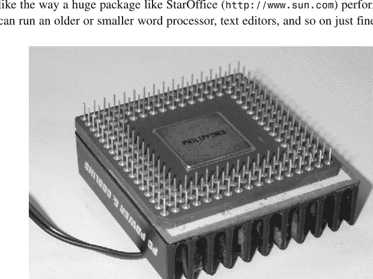

**图 1.1**
*图中显示的是一个80486 CPU，已连接散热片，共有168个引脚。*

## 奔腾（Pentium）系列

在80486之前，英特尔一直使用数字来标识其CPU，但英特尔发现其竞争对手也在其兼容CPU上使用相同的数字，而英特尔无法通过法律途径将数字注册为商标以阻止这种做法。因此，在本应称为80586的CPU上，英特尔改用了*奔腾（Pentium）*这个名称。

奔腾CPU延续了x86系列的发展，带来了速度提升和额外特性，其中一些是在奔腾产品生命期的后期才增加的。例如，*多媒体扩展（MMX）*特性仅出现在奔腾CPU的后期型号上。奔腾CPU常被宣传为64位，但这指的是它单次操作能与内存传输的数据位数，而非其内部内存寄存器的大小或用于指定内存地址的位数。奔腾增加了板载缓存的容量（相对于80486），并且所有英特尔奔腾CPU都配备了FPU。英特尔为奔腾引入了一种新的插座设计，该设计经历了几次小的修订后，最终确定为流行的Socket 7布局（见图1.2）。

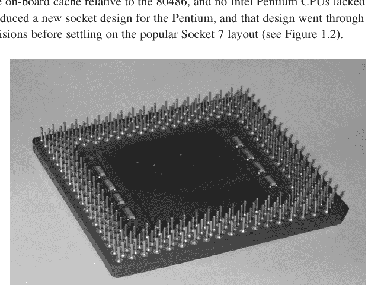

在奔腾之前，英特尔的竞争对手使用的CPU设计与英特尔的设计几乎相同，只是获得了授权使用。随着奔腾的出现，英特尔的主要竞争对手（奔腾生命周期早期的AMD、Cyrix和NexGen，后来加入了IDT）开始使用独特的、重新实现的x86设计。其中一些设计与奔腾的设计截然不同。例如，AMD K5和NexGen Nx586是首批使用RISC内核的CPU，通过外围逻辑将复杂的x86指令分解为多条RISC指令来处理。这些独特的设计使得比较不同厂商奔腾级CPU的相对速度变得困难；仅凭CPU时钟速度不足以进行比较。一些厂商使用*P-rating*或*PR-rating*来表示其CPU相对于奔腾的速度。例如，Cyrix 6x86 P-166据称可以达到166MHz奔腾的运行速度——至少Cyrix是这样宣称的。实际上，速度因应用程序而异。P-rating在很大程度上已被淘汰，尽管Cyrix的CPU仍然标有P-rating。

总之，奔腾级CPU包括：

- **英特尔奔腾（Intel Pentium）** 该级别的“标准”。
- **英特尔奔腾MMX（Intel Pentium MMX）** 提供更快的时钟速度并增加了MMX指令。


## 奔腾级CPU

-   **NexGen Nx586** NexGen Nx586是首款奔腾兼容芯片。它在众多奔腾兼容芯片中颇为独特，原因包括其采用了自有的插槽设计，因此需要配套的主板。该CPU的早期版本还缺少浮点运算单元。NexGen随后被AMD收购。
-   **Cyrix 6x86** Cyrix将这款CPU命名为6x86，以暗示其性能优于奔腾。在整数运算（大多数程序使用的运算类型）方面，6x86在相同频率下确实优于奔腾。然而，这种差异不足以使6x86成为奔腾Pro或后续奔腾版本的有力竞争对手。Cyrix没有自己的制造工厂，因此生产这些CPU的公司（主要是IBM）也以自己的品牌销售它们。Cyrix于1999年底被威盛收购。
-   **Cyrix MediaGX** MediaGX是6x86的一个变体，它将许多多媒体功能集成到了CPU和主板芯片组中，而非依赖附加卡。MediaGX芯片常见于其时代（主要是1998年）的某些低端主板。虽然Linux可以在MediaGX上运行，但内核并不支持该芯片的高级多媒体功能，因此您在使用这些电脑功能时可能会遇到困难。例如，在MediaGX电脑上的Linux系统中使用X Window或声音功能，您可能需要添加传统的显卡或声卡。
-   **AMD K5** AMD的奔腾竞争产品推出较晚，且在最初的版本中，其在相同速度下略慢于奔腾。K5的后续版本使其在相同主频下达到了与奔腾大致相当的速度，但那时AMD已经推出了K6，K6很快便盖过了K5的风头。
-   **IDT WinChip** IDT WinChip在奔腾的生命周期中出现得非常晚，并且从未真正流行起来。IDT于1999年底宣布将其WinChip设计出售给威盛。

所有这些CPU都与Linux兼容。为了获得最佳性能，您可能需要重新编译内核，并在内核配置选项中选择相应的CPU（参见图1.3）。

在2000年，奔腾级系统对于运行Linux来说仍然是足够的，尽管较旧的奔腾系统可能运行相当缓慢，即使是快速的奔腾系统在处理对CPU要求极高的任务（如科学模拟）时也可能力不从心。目前尚无Linux发行版包含针对奔腾处理器优化的、使其无法在奔腾上运行的补丁。

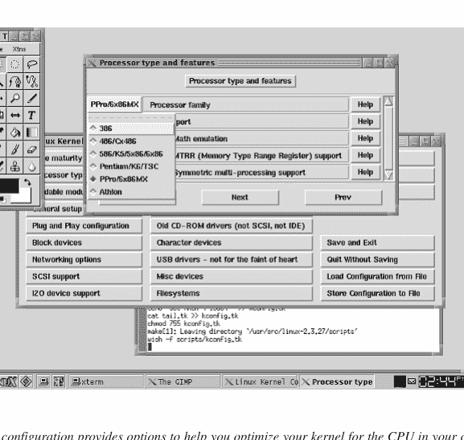

## 从奔腾Pro到奔腾III

在奔腾之后，英特尔发布了一系列奔腾CPU的升级版本，被称为奔腾Pro、奔腾II、奔腾III和赛扬。这些CPU系列在几个方面与奔腾有所不同，包括

-   CPU封装上的L2缓存 *L2缓存*是一种快速RAM类型，在奔腾设计中，它位于主板上。这些CPU将其置于CPU的封装上，尽管它并非与CPU核心在同一个微芯片晶圆上。这种布局提高了系统性能，因为缓存可以比在主板上时以更快的速度运行。然而，早期的赛扬CPU缺少L2缓存。
-   36位寻址 这些CPU可以访问2^36字节，即64GB内存，而奔腾系列则限制在4GB。
-   改进的速率 尽管不如一些早期代际变化中的速率改进那么剧烈，但这些CPU在设定为相同频率时通常比其前代更快。奔腾Pro实际上在运行16位代码时比奔腾慢，但在运行32位代码时更快。（Linux专门使用32位代码，除非运行像DOSEMU这样的模拟器。）
-   **改进的时钟速度** 这些CPU可以比其前代以更快的时钟速度运行，这是速率提升的最大来源。某些型号还可以以更快的*总线速度*运行，这是CPU与其他计算机组件通信的速度。
-   **不同的封装** 直到奔腾Pro，英特尔的x86 CPU都使用了插槽式设计，尽管不同CPU之间的插槽细节有所不同（参见图1.4）。然而，奔腾II引入了一种不同的*插槽*设计，称为*Slot 1*。不过，奔腾II和赛扬的某些版本同时提供了插槽（*Socket 370*）和Slot 1两种格式。

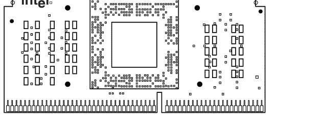

**图1.4**

如果您今天计划购买新的英特尔CPU，我推荐您选择奔腾III，尽管高端的奔腾II和赛扬CPU对于低端系统来说可能已经足够。奔腾Pro CPU现在很难找到，并且按今天的标准来看速度较慢。赛扬CPU的L2缓存较小或没有，这限制了它们的性能。当然，这并不是说低于奔腾II的CPU就不好；对于许多用途，您并不需要最快的CPU，Linux在较慢的CPU上也能运行良好。对于新电脑，您应该购买在未来一段时间内仍能保持可用性的产品。

> ## 提示
您可以通过购买比当前最快CPU低几个档次的型号来获得最高的“性价比”。例如，在2000年初，奔腾III 700 CPU售价约为850美元，但奔腾III 600 CPU约为500美元，而奔腾III 500 CPU售价约为300美元。因此，将前100MHz降下来可以节省350美元，而再降100MHz仅节省200美元。

英特尔奔腾III系列的最新版本被称为*Coppermine*（尽管它并未使用由IBM发明、目前用于PowerPC CPU的铜互连技术）。Coppermine集成了多项相对于以往英特尔CPU的改进，例如133MHz主板总线、将L2缓存集成到主CPU晶圆中以及更小的电路。除了允许更高的主板总线速度外，这些增强功能对消费者来说基本上是不可见的，除了它们能产生一个更快的CPU。事实上，英特尔选择不以新名称发布Coppermine；它仍然是一款奔腾III CPU。

## 先进的非英特尔x86 CPU

截至1999年，英特尔的竞争对手们继续使用Socket 7设计作为CPU接口，该设计用于大多数奔腾CPU。这意味着大多数竞争CPU使用的是主板上的L2缓存而非CPU上的（AMD的K6-III除外），并且这些CPU被限制在奔腾的32位、4GB内存寻址空间内。不过在速度方面，其中一些CPU可以与中端奔腾III CPU相媲美。该范围内的CPU包括

-   **AMD K6** K6很大程度上基于NexGen为从未发布的Nx686开发的设计。它包含MMX技术，并在相同频率下运行时，其速度接近奔腾II。

> **注意**

一些早期的K6 CPU存在一个缺陷，会导致偶尔运行不可靠。这个缺陷并非Linux特有，但由于各种原因，它在使用GCC编译器时经常出现，并且可能导致Linux内核编译偶尔失败等问题。因此，如果您拥有早期的K6 CPU，您可能希望替换它，而不是在其上运行Linux。

-   **AMD K6-2 和 K6-III** K6-2和K6-III是K6 CPU的更快版本。它们都以更快的时钟速率运行，并包含了旨在提高CPU在相同频率下运行性能的改进。
-   **Cyrix MII** MII本质上是一款以更高时钟频率运行的6x86。MII也包含了MMX指令。我将MII CPU放在这里而不是奔腾部分，主要是因为其时钟频率可以高于英特尔的奔腾。
-   **Transmeta Crusoe** Transmeta (http://www.transmeta.com)是x86 CPU竞赛中的最新参与者。Crusoe的独特之处在于其低电压需求，这使其非常适合用于笔记本电脑和掌上电脑等便携设备。

除了这些在Socket 7主板上运行的CPU之外，AMD在1999年推出了Athlon，它使用的插槽连接器与Pentium-II和Pentium-III CPU使用的类似（但不兼容）。Athlon包含许多高级特性，与Pentium-III系统直接竞争。事实上，在1999年末和2000年初，市面上最快的x86计算机就是由Athlon CPU驱动的。与Intel后Pentium时代的x86 CPU一样，Athlon在CPU模块上包含一个L2缓存，并使用36位内存地址。

## 跨代CPU

各种厂商生产了跨越不同CPU代际界限的CPU。例子包括：

- **Cyrix 486SLC 和 486DLC** 这些CPU的核心与普通80486 CPU的核心相似，但分别使用80386SX和80386DX CPU的物理接口。在相同时钟频率下，它们的性能介于80386和80486系列之间。
- **Cyrix 5x86 和 AMD 5x86** Cyrix和AMD都生产了以5x86为名的CPU。这些CPU本质上是增强版的80486 CPU，可以安装在80486主板上，但性能与低端Pentium相当。Cyrix 5x86包含了一些在Cyrix 6x86 CPU中使用的特性。
- **Intel Pentium Overdrive** Intel发布了一款精简版的Pentium，可以插入80486 CPU插槽。它与Cyrix和AMD的5x86 CPU竞争。

除了这些CPU，各种第三方公司，例如Evergreen Technologies (http://www.evertech.com)，销售各种CPU的改装版本。这些改装的CPU套件通常包含永久安装在特殊适配器上的CPU，该适配器使得CPU可以在原本不支持该CPU的旧主板上使用。例如，Evergreen销售其Spectra系列，它可以将AMD K6-2 400 CPU安装到许多支持Pentium-75及更高CPU的主板上。这样的套件对于延长旧主板的使用寿命非常有帮助。

## Linux的CPU要求

Linux是在支持CPU方面最灵活的操作系统之一。尽管它最初仅为x86架构开发，但如前所述，Linux已经被移植到各种其他CPU上。在x86系列上，主流Linux要求80386或更高版本的CPU，但也存在针对更低端x86 CPU的移植版本。通过去除高级且消耗性能的特性（如GUI），Linux可以在旧x86 CPU上比许多其他x86操作系统运行得更好。

## 支持的CPU架构

在本章前面，我概述了当今台式计算机上可用的许多CPU，并指出了适用于这些CPU的Linux发行版。事实上，很少有现代CPU是没有Linux版本的。这并不是说Linux在所有这些架构上都能同样良好地工作。每种架构的一些优缺点包括：

- **x86** Linux的第一个CPU就是x86，考虑到x86在小型计算机市场的主导地位，这是Linux社区大部分精力的所在。x86硬件价格低廉且供应充足，但其中一些硬件与Linux不兼容。适用于x86硬件的各种Linux发行版意味着你很可能会找到一个符合你需求的Linux版本。许多商业Linux程序仅适用于x86 CPU。
- **Alpha** 如果你想使用Linux进行高性能计算，Alpha CPU是一个不错的选择。Red Hat的Alpha版本成熟且受欢迎。你可以从多家供应商获得基于Alpha的Linux系统，尽管它们比SPARC计算机更难找到。
- **SPARC** SPARC CPU主要在Sun的工作站中使用，因此一个缺点是其硬件选择相对有限且昂贵。然而，SPARC CPU性能非常出色，特别是在浮点运算方面，使其成为高性能模拟或其他FPU密集型任务的绝佳选择。Red Hat的SPARC移植版与其Alpha版本一样，得到了良好的支持。
- **PowerPC** 你最有可能在Macintosh中遇到PowerPC CPU，但Motorola和IBM也生产PowerPC计算机。顶级的PowerPC计算机在性能上可能略胜x86计算机一筹，特别是在浮点运算方面。现有的PowerPC发行版比主要x86发行版稍欠成熟，但差距不大。

作为一般规则，如果你想购买或组装一台运行Linux的计算机，我推荐使用x86 CPU。其他架构虽然有时在技术上优于x86 CPU，但会限制你的软件选择，成本更高，并且通常在辅助硬件的选择上也受到限制。然而，如果你碰巧有一台使用其他CPU的闲置计算机，你可能想在那台计算机上安装Linux。如果你需要其专业优势（例如最佳的FPU速度），或者如果你想与适用于该硬件的其他操作系统（如PowerPC系统的MacOS）进行双启动，你可能也想购买这样的计算机。

## 最低功能要求

在x86架构上，Linux至少需要80386SX CPU。因此，除非你在庭院拍卖中购买计算机，否则你今天购买的任何x86计算机都有足够的CPU能力来运行Linux。

> **注意**

可嵌入Linux内核子集（ELKS）项目 (http://www.elks.ecs.soton.ac.uk) 致力于将Linux移植到8086至80286及其他旧CPU。然而，该项目尚未产生完全可用的系统。

尽管Linux内核和大多数Linux软件可以在80386SX CPU上运行，但一些Linux发行版设定了更高的最低要求。通常这是因为他们包含的内核或其他关键组件是针对更新的CPU优化编译的，导致该发行版在旧型号上无法使用。2000年初一些流行Linux发行版的具体官方要求包括：

- Caldera OpenLinux 2.3: 80386
- Corel Linux 1.0: Pentium
- Debian GNU/Linux 2.1: 80386
- Linux Mandrake 7.0: Pentium
- Red Hat Linux 6.1: 80386
- Slackware 7.0: 80386
- SuSE Linux 6.3: 80486DX（支持80386用于“有限用途”）。

作为一般规则，如果一个发行版支持某个级别的CPU，它就支持该级别及以下的所有CPU和兼容品。例如，你可以将Cyrix 6x86或AMD K5与要求Pentium CPU的发行版一起使用。

> **注意**

如果一个发行版要求Pentium CPU，它可能不包含FPU仿真。因为早期的NexGen Nx586 CPU缺乏FPU，你可能无法在早期的NexGen系统上使用这样的发行版，除非它们包含匹配的FPU芯片。理论上，你可以通过修改安装软盘或使用不同的CPU安装、重新编译内核或其他组件，然后更换CPU来解决这个问题以及其他Pentium要求。但实际上，这几乎总是得不偿失。

Linux尚未大量使用MMX或AMD的3DNow多媒体扩展。然而，现代CPU都包含MMX，没有理由避免使用带有这些扩展的CPU。

少数Linux程序，例如一些MPEG播放软件，可以利用这些指令。

## 充足性能要求

实际上，当今大多数Linux系统应该至少配备Pentium级别的CPU。如果你正在组装一台新计算机，我建议为大多数系统使用Intel Pentium-III或AMD Athlon，尽管高端的Intel Celeron、Intel Pentium-II、AMD K6-III或Cyrix MII对于低性能系统来说可能就足够了。

如果你想升级一台计算机，对于CPU升级有三个选择：

- **将CPU更换为更高速度的支持型号** 大多数主板支持一系列CPU速度，例如Intel Pentium 100–233。如果你当前的CPU处于支持速度范围的低端，并且你能找到更高速度CPU的供应商，你可以相对容易地升级到支持范围内的更高速度型号。这通常是最安全和最简单的方法，但也是最不可能带来最大速度提升的方法。
- **将CPU更换为售后CPU套件** 像Evergreen Technologies (http://www.evertech.com) 这样的公司销售CPU套件，这些套件由安装在电压调节器或其他硬件上的CPU组成，用于将更快的CPU适配到期望较慢型号的主板上。这种套件通常工作良好，但偶尔与某些主板不兼容。
- **更换主板** 通常，通过更换整个主板和CPU可以获得最大的速度提升。例如，你可以通过这种方式将80486升级到Pentium-III或Athlon。然而，这种方法通常是最昂贵的，并且通常需要你更换其他组件。例如，RAM通常在超过一代的主板之间不兼容，你甚至可能需要更换显卡、SCSI主机适配器或其他组件，特别是如果你想升级一台旧的EISA或VLB 80486计算机。

## x86 CPU市场

x86 CPU市场非常活跃，新型号经常推出，旧型号也同样容易消失。因此，由于出版延迟，书中呈现的信息在你阅读时可能无法完全保持最新和准确。本节涵盖了2000年初的CPU市场状况，并包含了有关即将推出的CPU的信息，因此它应该在2000年全年都保持相关性。但是，要获取最新信息，你应该查阅CPU制造商的网站。


## 英特尔CPU

2000年初，英特尔公司（http://www.intel.com）的x86产品线包括奔腾MMX、奔腾II、奔腾III和赛扬系列的产品。然而，奔腾MMX的CPU已明显过时。我建议仅将其用作老系统的升级，或在你有特殊需求时使用，例如你免费获得了一块奔腾主板——即便如此，AMD K6系列的CPU也可能比英特尔奔腾CPU提供更好的性能。不过，奔腾CPU可用于多处理器主板，而AMD和Cyrix的奔腾级CPU则不行。

如果你想要一台新的英特尔系统，奔腾III CPU可能是最佳选择，尽管高端的奔腾II或赛扬在某些用途上也足够。英特尔期望用其奔腾III CPU突破1GHz的时钟速度，并支持更快的主板总线速度。这些变化可能会伴随着更名为奔腾IV。

英特尔计划在2000年中期推出其安腾CPU。这款在开发期间代号为*Merced*的CPU，是一款真正的64位CPU，部分基于x86技术。它代表了CPU技术的一次转变，类似于从8086到80386的转变。正如80386可以运行8086软件一样，安腾可以运行旧版x86软件，但受益于新的操作系统和软件。英特尔一直在与Linux内核程序员合作，确保64位版本的Linux能在安腾推出后不久运行。这能否迅速转化为实际的Linux发行版还有待观察。Linux的大多数软件都以源代码形式提供，且该源代码长期在诸如x86、680x0、PowerPC和Alpha等差异巨大的架构上编译，这一事实表明Linux可能是第一批为安腾提供的完整64位操作系统之一。

## AMD CPU

AMD网站（http://www.amd.com）列出了K6-2、K6-III和速龙作为2000年初的现售CPU。此时，K6-2的CPU时钟速度高于K6-III，但在相同频率下，K6-III的性能优于K6-2。因此，K6-III提供了更好的整体性能。K6-2和K6-III都可在Socket 7主板上使用，并且这些CPU在此类硬件上提供了当时可用的最快性能。事实上，在2000年初，最好的K6-III系统在整体性能上可以与中端的奔腾III系统相媲美。

AMD的速龙使用其独特的主板设计，基于*Slot A* CPU接口方法。AMD从康柏公司授权了这项技术，康柏将其用于其Alpha CPU（但速龙不能使用Alpha主板）。与奔腾II及后续版本类似，速龙将其L2缓存置于CPU模块本身之上，这导致了更快的整体系统性能，因为L2缓存运行的速度比在主板上时更快。

根据大多数基准测试，当以相同速度运行时，速龙在整数运算方面的表现与奔腾III相似，而在浮点运算方面则优于奔腾III。在2000年初，速龙的可用时钟速度高于奔腾III，这意味着当时最快的x86 PC是由速龙CPU驱动的。

预计AMD将在整个2000年继续开发速龙CPU，并且可能会使该CPU的速度超过1GHz。

## VIA/Cyrix/IDT CPU

随着威盛公司（http://www.viatech.com）收购Cyrix以及IDT CPU的设计，这家芯片组制造商在2000年成为了x86市场上的第三大主要参与者。在2000年初，市场上的主要VIA CPU是Cyrix MII系列。（VIA继续在这些CPU上使用Cyrix品牌。）这些CPU在速度上远远落后于英特尔和AMD的产品。因此，除非情况发生变化，我无法推荐MII用于除非常低端的系统以外的任何用途。IDT WinChip系列甚至比MII系列更慢，并且在商店中更难找到。

更值得关注的是下一代VIA CPU，代号为Joshua。据报道，该CPU将使用Socket 370接口，该接口主要用于大多数赛扬变体。VIA似乎将这款CPU定位于中端系统，但目前尚不清楚其发布时的性能如何。Joshua是早期Cyrix设计的延伸，但可能融合了IDT为WinChip开发的一些功能。

## Transmeta CPU

Transmeta（http://www.transmeta.com）是x86 CPU领域的新进入者。2000年1月，Transmeta宣布了其Crusoe处理器系列，这是一系列旨在用于移动应用（如笔记本电脑和掌上电脑）的x86 CPU。Crusoe CPU采用了一种新颖的架构，其中大部分CPU工作由特殊的底层软件完成，而不是由CPU本身的电路完成。部分因为这种设计，Crusoe CPU可以在比其他x86 CPU低得多的功耗下运行，这转化为移动设备中更少的发热和更长的运行时间。这些CPU的另一个特点是它们可以动态调整其运行速度，从而调整其功耗需求。结果是CPU可以全功率运行一小段时间，然后在计算机空闲时降频至50%、25%或更低。这在对性能影响很小或没有影响的情况下节省了能源。

对Linux用户特别有趣的是，Transmeta聘用了Linux内核的原始开发者Linus Torvalds。目前尚不清楚主流Linux发行版是否会调整以利用Crusoe的独特功能。如果它们做到了，这些CPU可以凭借改进的速度或额外功能，相对于其他x86 CPU展现出独特的优势。

## 总结

每台数字计算机的核心都是CPU，而CPU的选择会影响计算机的其他部分。CPU决定了计算机可以运行哪些操作系统和软件，并且是影响整体计算机速度的一个主要因素。CPU还决定了可以使用哪些其他硬件组件，最直接的方式是决定兼容的主板。然而，主板的功能决定了哪些附加卡、RAM和其他设备可以与计算机配合使用，因此CPU在这方面有间接的影响。

Linux可以在多种CPU上运行，但与x86及兼容CPU的关联最为紧密。x86计算机的硬件往往价格低廉，这种廉价硬件与开源Linux操作系统的结合，为低成本计算机带来了前所未有的强大能力。

### 主板

## 第2章

### 本章内容

-   主板与CPU的匹配  33
-   主板总线  38
-   主板规格  46
-   主板芯片组  53
-   板载端口  65
-   内存  72

# 核心系统
第一部分

如果CPU是计算机的心脏，那么主板就是它的循环系统。主板的功能是将CPU连接到计算机中的所有其他设备，无论是直接连接（如CPU访问插入主板的RAM）还是通过另一个组件连接（如通过SCSI主适配器访问硬盘）。主板通常是计算机中最大的电路板。它包含一个用于CPU的插槽或插座、内存插槽、扩展卡插槽、硬盘、软盘和外部设备的连接器，以及电源连接器等功能。图2.1展示了一个典型的Socket 7主板，说明了这些功能。

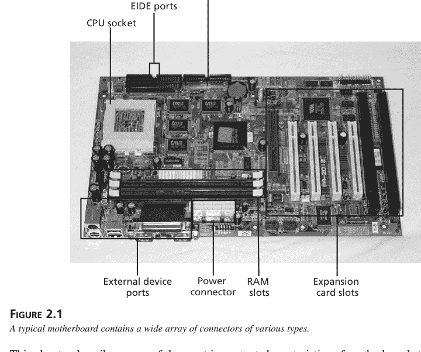

本章描述了当今主板的一些最重要特性，以帮助你决定在主板中需要哪些功能。然而，本章*不*深入讨论配置主板或将其集成到完整计算机系统的细节。有关信息，请查阅你的主板文档。

## 主板与CPU的匹配

主板选择最关键的方面之一是将主板与CPU相匹配。如第1章“中央处理器”所述，CPU在许多方面存在差异，需要在主板上提供支持。这些变量包括CPU与主板的物理接口、CPU总线速度、CPU电压要求以及BIOS支持。

### CPU插座和插槽

直到最近，每一代CPU（80386、80486等）都使用独特的CPU/主板接口方法。这些通常以*插座*的形式出现，CPU底部的多个引脚插入主板上的方形连接器（见图2.2）。较新的CPU，包括大多数奔腾II、奔腾III和速龙CPU，使用更像插入式卡的插槽设计。（大多数赛扬CPU继续使用插座设计，但也有一些变种以插槽形式提供。）

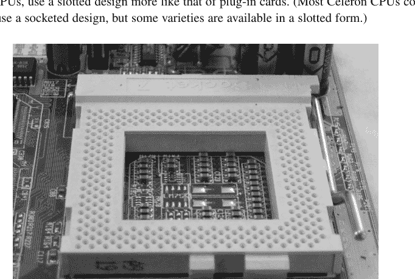

**图 2.2**
*主板上用于插座式CPU的插座包含许多孔，CPU底部的引脚会插入这些孔中。*

### 插座式设计

大多数CPU系列都经历了几个插座变体的出现和消失。例如，最早的奔腾CPU使用的引脚布局与后来的奔腾CPU不兼容

# 核心系统

## 第一部分

CPU插槽的使用情况。早期的80486主板使用需要较大力气才能插入CPU的插槽，但后来的80486主板则采用了*零插拔力*（ZIF）插槽，其一侧的杠杆可以让你将其拧紧以固定插入的CPU。（这个杠杆在图2.2中插槽的右侧可见。）绝大多数奔腾级主板使用ZIF插槽。适用于80486及后续CPU的流行插槽包括：

- **Socket 1**：169针插槽，适用于80486 CPU。
- **Socket 2**：238针插槽，适用于80486和Pentium Overdrive CPU。
- **Socket 3**：237针插槽，适用于80486和Pentium Overdrive CPU。包括对3.3伏操作的支持，这可以降低也支持此功能的CPU的发热。
- **Socket 4**：273针插槽，适用于60和66MHz的奔腾CPU。
- **Socket 5**：320针插槽，适用于75–133MHz的奔腾CPU。
- **Socket 7**：321针插槽，适用于75MHz及以上的奔腾CPU，包括来自AMD、Cyrix和IDT的奔腾克隆版。一些主板使用*Super7*插槽设计，这是一种支持更快总线速度的Socket 7布局，稍后会描述。
- **Socket 8**：387针插槽，适用于Pentium Pro CPU。
- **Socket 370**：370针插槽，由赛扬CPU使用。
- **Nx586**：NexGen Nx586 CPU使用其独特的引脚排列。不过，大多数Nx586 CPU并非使用插槽；相反，它们是直接焊接在其主板上的。

> ### 注意
> 曾设计过Socket 6，但从未在生产主板上实现。

将插槽类型与CPU匹配至关重要。你不能将需要一种插槽类型的CPU用在使用另一种插槽类型的主板上。大多数80486 CPU可以与Socket 1至Socket 3配合使用，尽管一些更高级的80486 CPU需要较新的Socket 2甚至Socket 3。2000年市面上的所有奔腾级主板都是Socket 7设计（实际上，大多数也实现了Super7功能）。图2.1所示的主板就是Socket 7主板。接口匹配规则的一个例外是，Socket 370/Slot 1适配卡是可用的。这些卡允许你将赛扬CPU插入Slot 1主板。如果你想组装一台低成本的赛扬计算机，但计划将来升级到更强大的CPU，这样的适配卡可能会很有用。

Socket 7主板在市场上仍然可行，这在很大程度上要归功于AMD的K6-2和K6-III CPU，它们的性能与低端的英特尔Pentium-II和Pentium-III CPU具有竞争力。然而，随着AMD发布Athlon CPU，AMD很可能会最终放弃Socket 7 CPU。同样，VIA（在1999年底收购了Cyrix和IDT）也宣布其下一代CPU将使用Slot 1接口。英特尔现在为大多数其赛扬CPU使用Socket 370，但最强大的英特尔CPU使用插槽式CPU接口。

# 插槽设计

在2000年初，只有三种类型的CPU插槽在普遍使用：

- **Slot 1**：这种242针设计被Pentium-II、Pentium-III和一些赛扬主板使用。
- **Slot 2**：这种330针设计被较新的Pentium-II Xeon CPU使用。大多数Slot 2主板至少支持两个CPU。
- **Slot A**：这种242针设计被AMD用于其Athlon CPU。（AMD从Digital Equipment Corporation [现为康柏]获得该技术的授权，后者将其用于其Alpha CPU。）

每种插槽设计彼此不兼容。此外，尽管AMD Athlon和康柏Alpha CPU使用相同的CPU总线，但它们需要不同的主板。

# CPU总线速度

现代CPU以两种独立的速度运行：*核心*速度和*总线*速度。核心速度是你可能与CPU最强烈关联的数字，是CPU大部分内部电路运行的速度。Pentium-III 700以700MHz的核心速度运行。CPU核心可以运行的速度高于主板所能支持的速度。总线速度是CPU与主板之间接口的速度。80486主板通常仅以33MHz的总线速度运行，尽管有少数型号高达50MHz。大多数与英特尔奔腾配合使用的主板以66MHz运行，尽管一些CPU速度需要60MHz或50MHz的总线速度。Super7主板将总线速度提升至最高133MHz。

在插槽设计中，总线速度范围从66MHz到Slot A的理论最大400MHz。实际上，2000年初大多数Slot 1和Slot 2设计以133MHz或更低速度运行，大多数Slot A设计以200MHz运行。

无论你选择哪种接口类型，CPU和主板共享总线速度至关重要。在某些情况下，CPU可以在多种不同的总线速度下运行，但需要特定的速度才能达到最佳性能。如果你正在组装一台新计算机，你应该确保你购买的主板支持以CPU的最佳速度运行。

> **注意**
> CPU总线速度对其他系统组件有影响，最显著的是RAM。PC100和PC133形式的RAM分别设计用于在100MHz和133MHz的主板总线上运行。你可以安全地在较慢的总线上使用更快的RAM（例如，在100MHz总线上使用PC133 RAM），但不要尝试在较快的总线上使用较慢的RAM。在某些情况下，可以通过插入*等待状态*——主板RAM访问周期中的暂停——来在较快的总线上使用较慢的内存。2000年初，以200MHz运行的Slot A主板使用PC100或PC133内存；它们将内存总线运行在100MHz或133MHz，将CPU/芯片组总线（即*前端总线*）运行在200MHz。预计在2000年出现的更快的主板速度可能需要更快类型的RAM，例如RDRAM。有关RAM的更多信息，请参见第3章“内存”。

为了设置CPU核心速度，主板包含跳线或BIOS设置来指定*时钟倍频*。CPU以其总线速度乘以时钟倍频的速度运行其核心。例如，100MHz总线与4倍时钟倍频结合产生400MHz的核心速度。然而，时钟倍频设置的确切含义可能因CPU的品牌或型号而异，因此查阅主板文档以针对你使用的任何CPU正确设置时钟倍频非常重要。

# CPU电压要求

与所有电子设备一样，CPU在特定电压下运行。大多数80486及更早的CPU，甚至一些奔腾级CPU，以5伏运行。然而，随着CPU速度的增加，降低CPU电压以减少芯片内部热量积聚变得可取。降低操作电压还有助于延长笔记本电脑的电池寿命。因此，在奔腾CPU的生命周期内出现了大量新的电压要求。事实上，许多Socket 7 CPU需要使用*双电压*——CPU核心使用一种设置，输入/输出（I/O）电路使用另一种设置。双电压CPU通常将I/O电压运行在3.3伏，核心电压运行在更低的水平，尽管在某些情况下核心电压可能更高。

与总线速度一样，你的主板为CPU提供其所需的电压水平至关重要。在某些情况下，CPU可以在很窄的电压范围内工作，因此你可能能够使用与制造商推荐值略有不同的设置。然而，在其他情况下，电压的轻微偏差可能导致你的计算机运行不可靠；如果设置电压不正确，你可能会遇到奇怪的问题、内存错误，甚至系统崩溃。在极端情况下，如果你设置电压不正确，你可能会损坏CPU。因此，我建议你仔细注意CPU的电压要求。在大多数情况下，主板手册包含有关该主板可接受的CPU的适当电压设置信息。偶尔此信息可能缺失，通常是因为CPU比主板更新。在这些情况下，请查看主板制造商的网站以获取更新的配置信息。

# CPU BIOS支持

一般来说，BIOS不需要包含针对特定CPU型号的广泛支持。通常，如果你使用的CPU不被BIOS支持，最坏的情况是系统启动时CPU被错误识别。然而，这条规则有例外，例如：

- 一些高级80486 CPU支持缓存模式，如果BIOS不支持这些模式，可能导致数据损坏。因此，你应该只在为此类CPU制造的主板上使用诸如AMD和Cyrix 5x86等CPU。
- Cyrix 6x86、6x86MX和MII CPU支持一种特殊的*线性突发*模式，可以提高缓存内存访问时间。此功能需要BIOS支持。如果缺少此支持，CPU仍可运行，尽管速度会比原本稍慢。

如果你的主板缺乏对新CPU的支持，并且你想添加该支持，你应该向主板制造商咨询是否有更新的BIOS可用。现代主板支持*闪存BIOS*功能，你可以通过运行特殊的DOS程序来更新BIOS。在较旧的计算机（主要是早期的80486系统及更早的系统）上，你可能需要物理更换BIOS芯片，该芯片通常标有分销商的名称（参见图2.3）。

> **提示**
> BIOS闪存工具通常在DOS下运行。如果你通常不在计算机上运行DOS或Windows 9x，你可以从DOS启动软盘运行闪存工具——事实上，即使你的计算机上有DOS分区，这也是推荐的做法。如果你没有DOS启动软盘，请查阅FreeDOS（http://www.freedos.org），一个开源的DOS版本。*不要*尝试使用Linux下的DOSEMU来刷新你的BIOS！

BIOS来自多种来源，但每个BIOS都是为特定型号的主板定制的。因此，你不应该尝试将一个品牌或型号主板的BIOS用于不同的产品，即使BIOS来自同一家公司。如果你需要帮助定位你的主板BIOS，请咨询主板制造商（BIOS生产者不太可能提供帮助），或者查阅Wim's BIOS Page（http://www.ping.be/bios/），其中包含各种主板BIOS的信息。


### 主板总线

*总线*（bus）一词在计算机领域有多种既相关又不同的含义。本章前面，我用它来指代CPU与主板之间的接口速率。另一种含义则涉及主板与你可以添加的各种插卡之间的物理和电气接口。在大多数计算机上，你使用这些插卡来提供各种关键和次要功能，例如显卡、声卡等。

主要的总线类型有半打左右。大多数主板实现了其中的两到三种，但少数主板仅限于一种总线类型。少数主板，主要是那些用于专用产品和笔记本电脑的，完全没有扩展总线插槽。它们通常将相关的电子元件内置以支持视频和音频等功能。一些总线今天仍在广泛使用，但另一些则基本上是过去的遗物。你可能会在80486及更早的主板上遇到这些过时的总线，但在奔腾级或更高级别的型号上则很少见。

## ISA总线

*工业标准架构*（ISA）总线是x86计算机上仍在使用的最古老的总线。ISA总线的基本设计可以追溯到最初的IBM PC，尽管自那时起设计上进行了一些修改。在最初的PC中，ISA总线是8位设计，运行频率为4.77MHz——与计算机CPU的速度相同。后续的扩展允许总线以高达8.33MHz的速度运行，并将总线宽度提升到16位。这些扩展是以向后兼容的方式完成的，因此旧的8位ISA卡可以插入16位ISA插槽。图2.4展示了一块现代主板上的ISA（以及其他几种）插槽。ISA插槽比其他现代插槽类型更大，其主板连接器通常是黑色的，而PCI为白色，AGP为棕色。

理论上，ISA总线的数据传输速率可达8MB/s，以今天的标准来看相当慢——例如，现代硬盘通常超过这个速度，许多以太网适配器也是如此。因此，ISA总线在今天的系统中用处有限，并且实际上正在逐渐淘汰。你仍然可以买到带有ISA插槽的主板，但多年来现代主板上的ISA插槽数量一直在减少，许多最新型号已经没有了。

正如主板包含的ISA插槽越来越少一样，对它们的需求也日益减少。市场上仍有许多ISA卡，但几乎总有PCI的替代品。ISA卡的应用实例包括：

- **SCSI适配器** —— 非常低端的适配器，例如那些随内部Iomega Zip驱动器附带的，通常是ISA型号。然而，PCI SCSI主机适配器数量众多，有些型号相当便宜。除非特殊情况，我不建议购买新的ISA SCSI主机适配器。
- **I/O卡** —— 较旧的80486及更早的计算机使用ISA卡提供串行、并行、软驱和IDE端口。此类卡今天仍然可以买到，可以想象，如果你需要两个并行端口或超过两个串行端口，你可能会需要一个。满足这些功能的PCI卡也有供应。除了现代的EIDE硬盘外，ISA总线足以处理这些I/O设备的速度，因此如果你确实需要额外的端口，并且你的主板上有一个空闲的ISA插槽，那么ISA卡是一个不错的选择。
- **以太网适配器** —— 如果你需要一个运行在10Mbps或更慢的以太网适配器，ISA总线足以胜任，尽管ISA卡可能比PCI卡占用更多的CPU时间。100Mbps网络得益于PCI总线，因此我建议大多数新的以太网适配器购买PCI形式的。
- **声卡** —— 基本的音频功能不需要大量的带宽，因此ISA总线足以胜任此任务。事实上，直到1998年，PCI声卡在Linux中的支持都很差，因此ISA卡仍然是声音方面的最佳选择。然而，今天Linux包含对许多PCI声卡的良好支持，因此你可以使用任一种总线类型。最顶级的声卡需要额外的带宽来实现高级音频功能，因此可以从PCI总线中受益。这些功能通常在Linux中未被实现。
- **专用应用程序** —— 一些罕见的卡，例如某些科学数据采集卡，仍然仅以ISA形式提供。如果你需要使用这样的卡，你可能受限于ISA总线。鉴于ISA在市场上的普及度不断下降，如果你正在构建一个新系统，最好寻找替代卡。特别是如果该卡很昂贵并且你打算使用几年。在未来的某个时候，ISA主板可能会变得无法获得，因此如果计算机中包含关键且昂贵的ISA组件，修理主板损坏的计算机可能会给你带来严重问题。

计算机行业希望看到ISA总线消失，因为支持它需要在主板上添加电路，如果取消，可以简化主板设计。ISA卡也比更现代的卡更难配置。旧的ISA卡通常需要跳线进行正确配置。新型号通常支持*即插即用*（Plug and Play，PnP），这意味着主板的BIOS或操作系统中的实用程序负责配置。

在Linux直到2.2.x内核系列中，PnP配置是通过isapnp包完成的，该包随大多数Linux发行版附带。要配置你的卡，请按照以下步骤操作：

1. 运行`pnpdump`，它会扫描系统中的PnP设备并返回有关这些设备的信息。最好将`pnpdump`的输出重定向到一个适当的文本文件，例如`pnpdump > pnpinfo.txt`。
2. 编辑步骤1中生成的文本文件。该文件包含许多设置的多选配置，例如中断请求（IRQ）和直接内存访问（DMA）。你必须通过删除每行开头的井号（#）来取消注释每个设置的*一个*选项。例如，你可能会看到一行内容为`# ( INT 0 ( IRQ 5 ( MODE +E )))`。删除开头的#以使用IRQ 5激活该板。对于你想要使用的每个设备，你还必须取消注释一行`# ( ACT Y)`；这是该板的激活线。有些板包含多个设备。例如，声卡可能包含数字音频、波表声音和游戏杆端口的单独配置。
3. 将你编辑的文本文件移动到一个方便的位置。传统上使用`/etc/isapnp.conf`。确保不要覆盖现有文件，或者备份现有文件，以防它已经包含其他设备的配置信息。
4. 运行`isapnp`实用程序，并告诉它使用配置文件。如果`isapnp`位于/sbin目录中，你可以通过键入`/sbin/isapnp /etc/isapnp.conf`来完成此操作。通常，你会将系统配置为在每次启动时执行此步骤，方法是将命令放在你的`/etc/rc.d/rc.local`文件中，或根据你的发行版放在其他某个初始化脚本中。一些发行版包含一个自动执行此步骤的命令。

**图2.3** —— BIOS芯片有各种各样的形状和尺寸，但在大多数情况下，它们清楚地标有BIOS分销商的名称——本例中是Award。

> **警告：** 刷新BIOS是一项潜在危险的操作。如果出现问题，例如操作期间断电或你刷错了BIOS，你的计算机可能无法启动，直到你更换上由主板制造商编程的BIOS芯片。因此，我建议你只在正常工作时间内刷新BIOS，并将一份正常工作的BIOS副本备份在软盘上。（大多数BIOS刷新实用程序在刷新新BIOS之前会给你一个创建此类备份的选项。）这样，如果出现问题，你可能可以从计算机商店获得帮助。

## 图2.4

**核心系统，第1部分**

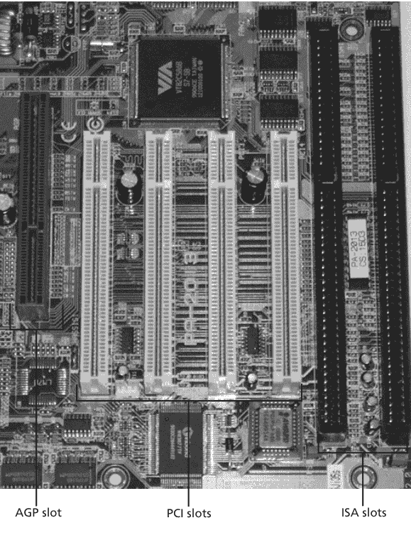

每种总线类型使用独特的连接器尺寸和定位，以防止将一种类型的卡意外插入错误的插槽中。


[content]

如果你的配置更改没有引起任何冲突，你就能加载适当的驱动程序并使用ISA卡。然而，你必须加载驱动程序模块或将它们加载到Linux内核中；PnP配置本身不足以在Linux下使用硬件。

`isapnp.conf`文件的格式对于从未编辑过该文件的人来说可能有点吓人，主要是因为它包含了大量选项，其中绝大多数都被注释掉了。浏览文件一两次，特别注意以Card $n$（其中$n$是卡号）开头的注释和用于标识设备的NAME选项。在你浏览文件一两次后，你应该对这些选项有了一些了解，然后就可以开始设置它们了。如果你的计算机在Linux和其他操作系统（如Windows）之间双启动，你可以通过查找另一个操作系统中使用的资源来确定分配给该卡的资源。

Linux 2.4内核将直接包含PnP支持，这将改变Linux中配置ISA PnP设备的方式。使用2.4.x内核时，将不再需要`isapnp.conf`文件；ISA设备的驱动程序将自动检测并配置PnP设备。如果发生冲突，你可能需要调整`/etc/conf.modules`文件中的设置，或通过向Linux内核传递参数来进行调整，就像今天使用PCI卡时一样。

## MCA总线

*微通道架构*（MCA）总线是IBM对ISA总线的后续产品。它用于IBM PS/2系列计算机，尽管在当时它是一种很好的总线，但MCA在整个行业中并未普及开来。与其他大多数x86总线一样，MCA支持32位宽度。不过，并非所有卡或MCA插槽都是32位的；有些只有16位宽。

长期以来，Linux无法在MCA计算机上工作，但最新的Linux内核确实包含了MCA支持。然而，并非所有MCA卡都受支持。要在MCA计算机上使用Linux，你必须确保内核是用MCA支持编译的，这是在“常规设置”区域中的一个内核配置选项（见图2.5）。大多数MCA计算机不支持其他总线，在现代计算机中你也找不到MCA总线。

## EISA总线

*扩展ISA*（EISA）总线是由Compaq和其他x86 PC供应商开发的，作为IBM MCA总线的替代方案。与MCA不同，EISA与ISA向后兼容。你可以将ISA卡插入EISA插槽，它通常都能工作。EISA是一种运行频率为8.33MHz的32位总线，其最大传输速率约为33MB/s。这个速度即使对于许多现代功能来说也是足够的，尽管并非全部。例如，一些SCSI主机适配器可以以40MB/s、80MB/s或更高的速度传输数据；一些EIDE接口能够达到66MB/s的速度。

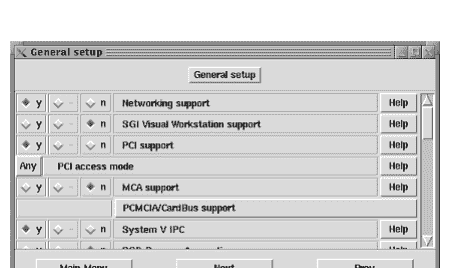

Linux内核配置的*常规设置*区域包括与Linux处理总线相关的选项，包括MCA和PCI总线。

在80486早期，EISA曾短暂地被接受，即使不是非常流行。EISA作为SCSI主机适配器的总线最受欢迎，尽管其他设备也有EISA格式的。然而，该总线因配置较为困难而名声在外，并且比竞争总线更昂贵。最终，其他总线在受欢迎程度上超过了EISA，在现代主板上已不可用。

Linux支持EISA总线，并包含多种EISA卡的驱动程序，包括流行的EISA SCSI主机适配器，如Adaptec 1742。如果你有一台想运行Linux的旧EISA计算机，你很可能让它工作起来。

## VL-Bus

鉴于视频卡需要比ISA更高速的总线，一个视频卡贸易组织——视频电子标准协会（VESA）为其80486 CPU开发了自己的总线。这种被称为*VESA局部总线*或简称VL-Bus的总线在许多80486主板上很流行。与MCA和EISA总线一样，VL-Bus宽度为32位。它通过以主板总线速度运行——对于80486系统通常为33MHz——在速度方面更进一步。一些计算机将其运行速度提高到50MHz。（40MHz是VL-Bus的官方最高速度。）即使仅以33MHz运行，VL-Bus理论上也能达到132MB/s的传输速率，这比ISA的8MB/s有了相当大的提升。在物理上，VL-Bus使用一个普通的ISA连接器（参见图2.4），并在ISA连接器直线上有一个特殊的扩展连接器。这种设计在主板上占用大量空间，但允许VL-Bus插槽接受普通的ISA卡。

VL-Bus在80486主板上非常流行，但它也有缺点，包括：

- **与80486架构绑定** 设计的种种限制使其难以在非80486 CPU上实现。虽然生产了少量带有VL-Bus的Pentium主板，但它们从未流行起来，并且经常出问题。
- **卡的数量有限** 大多数VL-Bus主板只有两三个VL-Bus插槽，其余的是普通ISA插槽。随着总线速度的增加，可添加的VL-Bus设备数量减少。在50MHz时，VL-Bus几乎只能勉强运行一块卡。
- **连接器挑剔** VL-Bus的长双连接器使得VL-Bus卡容易从连接器中松脱。当这种情况发生时，系统将无法启动，或者（如果在计算机开机时发生）会崩溃。

在其鼎盛时期，VL-Bus主要被用于视频卡、SCSI主机适配器和IDE控制器。Linux对VL-Bus设备的支持非常好，但与任何设备一样，在尝试在VL-Bus系统上使用Linux之前，你应该检查其Linux兼容性。

## PCI Bus

*外设组件互连*（PCI）总线是由PCI特别兴趣小组（由Intel牵头）开发的，旨在成为比以前的x86总线类型更简洁、更快速的总线。VL-Bus或多或少是直接连接到CPU数据线上，而PCI总线则在CPU和总线之间插入了一个电子“桥”。这种设计将总线与CPU解耦，使其能够与更广泛的CPU一起使用。这种设计被称为*夹层总线*。在x86世界中，PCI总线已用于从80486起的所有CPU类型，PCI总线也出现在其他各种架构上，包括PowerPC和Alpha。事实上，一些PCI卡可以在不止一种计算机架构中使用。不过，一些PCI卡包含特定于x86 CPU的ROM或其他设计特性。

PCI总线主要是一种32位总线，通常以33MHz运行，因此最大传输速率为132MB/s。规范允许64位总线宽度（因此传输速率为164MB/s），但64位PCI实现从未进入市场。PCI连接器比大多数其他总线类型的连接器小（参见图2.4），因此与VL-Bus卡相比，PCI卡易于插入和拔出。

从软件角度来看，PCI总线最重要的特性之一是PCI规范包含PnP特性。因此，大多数PCI卡缺少在旧式ISA和VL-Bus卡上常见的配置跳线。在大多数情况下，你插入一块PCI卡，主板的BIOS会检测到它并为其分配资源。一些Linux设备驱动程序允许你通过在Linux启动提示符或`/etc/conf.modules`文件中提供适当的参数来覆盖这些分配，但通常这并非必要。

> **注意**
>
> PCI的PnP是内置在总线规范中的，而ISA的PnP是在旧设计上的笨拙补丁。即使使用2.2.x系列内核，也无需使用Linux的isapnp实用程序来配置PCI卡。

PCI最初主要用于视频卡、SCSI主机适配器、EIDE控制器和网络接口卡（NIC）。最近，PCI已成为声卡、附加串行和并行端口以及其他设备的首选总线。

Linux对PCI的支持非常好。有几个与PCI相关的内核配置选项，如图2.5所示。如果你有一块带有PCI总线的主板，你应该为PCI支持配置选项选择*Y*。（此选项是默认值。）对于PCI访问模式选项，*直接*使Linux内核自行检测和配置PCI卡，而选择BIOS选项则将此责任交给BIOS。将此选项设置为*Any*会使Linux尝试自行配置，但如果遇到问题则交给BIOS处理。在大多数情况下，这些选项中的每一个都运行良好，尽管在任何给定系统上某个选项可能比其他选项更好用。

## AGP总线

视频卡长期以来一直需要异常高的带宽，这一事实随着PCI的出现并未改变。有一段时间，PCI总线足以满足视频卡对速度的渴求，但在1996年，Intel发布了*加速图形端口*（AGP）的规范，这是一种专为提高速度而设计的PCI变体，仅用于图形设备。图2.4中最左边的插槽就是AGP插槽。AGP通过以66MHz而非33MHz的频率运行，超越了PCI的速度。此外，AGP支持每个时钟周期进行多次传输。在2x模式下，每个周期发生两次传输；在4x模式下，发生四次传输。总的来说，4x AGP设备可以传输高达1GB/s的数据——是PCI典型速度的八倍。随着多年来视频分辨率的提高，从640×480到1024×768，再到1280×1024甚至更高，对更快传输的需求也在增长。即使假设颜色数量相同，一个1280×1024显示器包含的数据量也是640×480显示器的四倍多。

Linux能很好地处理AGP总线*本身*。然而，正如我在第12章“视频卡”中所述，Linux并不总是能与最新的视频卡很好地协同工作。视频卡制造商很少费心为Linux（或者更准确地说，为XFree86 [http://www.xfree86.org]）制作驱动程序，因此XFree86开发人员需要一段时间来修改现有驱动程序或创建新驱动程序。SuSE (http://www.suse.com) 协助开发新的XFree86视频驱动程序。你可能想在那里查看最新的驱动程序。商业X服务器Accelerated-X (http://www.xig.com) 和 Metro-X (http://www.metrolink.com) 有时支持比XFree86更新的视频卡。


# PC Card 总线

*PC Card（前身为个人计算机内存卡国际协会，或 PCMCIA）* 并非真正意义上与本章前面所描述的其他总线同类型的主板总线。实际上，它更接近于硬盘所使用的 EIDE 总线。尽管如此，PC Card 仍然扮演着类似于主板总线的角色，但它是用于笔记本电脑的。也可以为台式计算机添加 PC Card 插槽。你可以获得各种 PC Card 格式的设备，包括调制解调器、以太网适配器、SCSI 适配器、串行和并行端口以及视频适配器。相关技术包括在掌上电脑和数码相机上常用的 Compact Flash（CF）和 Smart Media 卡。实际上，存在廉价的适配器，允许你在 PC Card 读卡器中使用 CF 或 Smart Media 设备，从而让你访问存储在掌上电脑或数码相机上的文件。

Linux 包含对 PC Card 总线的支持，尽管并非所有的 PC Card 适配器或设备都受支持。更多信息，请查阅 Linux PCMCIA 信息页面：http://pcmcia.sourceforge.org。我将在第 23 章“笔记本电脑”以及特别名为“PC Card 端口”的部分中更详细地介绍 PC Card。

## 主板形式规格

主板有各种形状和大小。同样重要的是，主板上有小孔，你可以通过这些孔插入螺丝将主板固定到计算机机箱上。这些孔通常被称为主板的*安装点*。主板还需要特定类型的连接器用于键盘和其他外部设备。最后，主板在电源连接器方面有不同的要求。这些特性共同决定了主板的*形式规格*。理论上，几乎任何形式规格的主板都可以设计成使用几乎任何 CPU 或总线类型，尽管组件的尺寸要求使得某些组合不切实际。在现实中，某些组合没有出现是因为某些技术（如 80386 CPU 或 VL-Bus）在特定主板形式规格（如 ATX）出现之前就已消亡。

Linux 本身并不特别关心主板形式规格，尽管 Linux 在某些特定型号的主板上可能比在其他型号上运行得更好。例如，Linux 可能没有为迷你型或微型 ATX 主板上包含的视频或音频设备提供驱动程序。在购买此类主板或围绕此类主板构建的系统之前，你应该研究所使用的芯片组，并查阅本书的相应章节以及当前的 Linux 驱动程序可用性信息。如果你有理由使用特定的主板形式规格，你可以使用 Linux 来实现。你只需进行研究，确保主板包含的外围设备受到支持。

## AT 和 Baby AT

最早的标准化主板形式规格之一用于 IBM 的 PC AT 计算机，因此该形式规格被称为 AT 形式规格。AT 主板是目前最大的主板之一，尺寸可达 12 英寸宽、13.8 英寸深。IBM 需要超过一平方英尺的面积来容纳各种组件，而这些组件今天占用的空间要小得多。例如，当时的 RAM 是平放在主板上安装的，而不是像现在那样垂直于主板安装在 SIMM、DIMM 或 RIMM 模块上。

多年来，缩小组件尺寸和更有效地利用主板上的空间成为可能。因此，完整的 12×13.8 英寸空间不再是必需的。制造商开始使用首先在 IBM PC XT 计算机上使用的小型形式规格。制造商并没有将这种设计称为 *XT 形式规格*，而是称之为 *Baby AT*，以防止客户认为围绕它构建的计算机与功能较弱的 PC XT 计算机类似。Baby AT 主板的宽度可达 8.57 英寸，深度可达 13.04 英寸，尽管特定产品的确切尺寸各不相同。

由于尺寸较小，Baby AT 主板可用于较小的计算机机箱，例如*迷你塔式*机箱。然而，许多较大的机箱可以接受全尺寸 AT 或 Baby AT 主板。

大多数 AT 和 Baby AT 主板只有一个外部连接器，用于键盘的 5 针 DIN 连接器。（少数 Baby AT 主板使用迷你 DIN 连接器。）最初的 PC AT 以及直到 20 世纪 90 年代中期的大多数 AT 和 Baby AT 主板，依赖插入式卡来为其他外部设备（如串行和并行端口）提供端口。这些插入式卡有自己的外部连接器，要么直接安装在卡上，要么通过带状电缆连接并安装在计算机机箱上。后来的 80486 主板以及奔腾及更新的主板在主板本身上包含了用于外部设备的电路，如串行端口和并行端口（以及后来的鼠标端口和 USB 端口）。这些主板使用主板上的连接器来提供这些服务；外部连接器通过带状电缆连接到主板。

AT 和 Baby AT 主板使用一对电源连接器，必须通过永久连接到电源供应器的电缆将其连接到机箱的电源供应器（见图 2.6）。主板本身使用 5V 电流运行，这导致了一些 CPU 的问题，特别是在奔腾时代，当时 3.3V CPU 电压变得普遍。此类主板需要*电压调节器*，将 5V 转换为 3.3V。这些电压调节器会产生热量，并且根据 CPU 消耗的电流大小，可能会过热并导致操作不可靠。

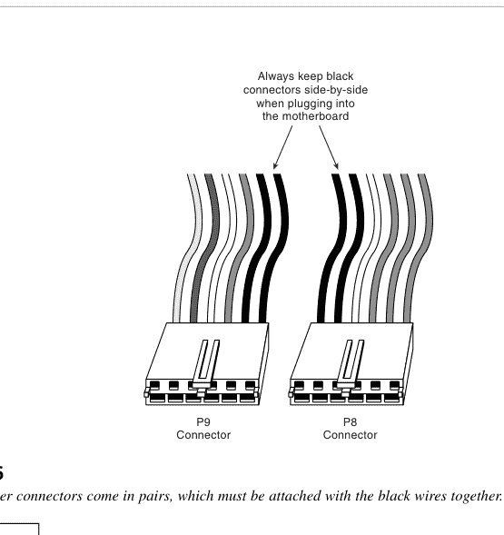

**图 2.6**
*AT 式电源连接器成对出现，必须将黑线连接在一起。*

> **注意**

AT 式电源连接器可以反向连接。这样做很可能会*损坏*你的主板，甚至可能损坏连接的设备，如 CPU、显卡等。每条电源电缆由几根电线组成，其中一根是黑色的。重要的是，当电源电缆连接到主板时，黑线必须*相邻*就位。

尽管在 80486 和大多数奔腾时代很流行，但 AT 和 Baby AT 主板从 1998–1999 年开始变得非常罕见。它们在 2000 年仍然存在，但销量主要局限于更换和升级市场。新计算机几乎总是使用 ATX 形式规格的某种变体。有少数 Slot 1 AT 或 Baby AT 主板，但这种设计极其罕见。

### ATX、Mini-ATX、Micro-ATX 和 Flex-ATX

从 1996 年开始，ATX 主板开始出现。Intel 开发了 ATX 规范，并已修订多次。ATX 修订版的大致框架保持不变，尽管一些细节发生了变化。ATX 的设计旨在解决 AT 和 Baby AT 形式规格的几个缺陷，例如

- **调整宽度/深度比率** Baby AT 设计比宽度更深，迫使 CPU 或其他组件与插槽排成一线。这种放置可能会限制添加大型卡的选项，特别是在需要带有风扇的大型散热器的后期型号奔腾等 CPU 上。相比之下，ATX 主板比深度更宽。在 ATX 设计中，CPU 位于插槽的侧面，如图 2.1 所示。

- **添加外部 I/O 端口** 随着主板普遍部署外部 I/O 端口，ATX 规范包括一个标准化的位置，用于将端口内置到主板中，如图 2.1 和图 2.7 所示。键盘使用小型迷你 DIN 插头，而不是 AT 和 ATX 主板上使用的较大的 DIN 连接器。（廉价的适配器允许一种类型的键盘在另一种类型的主板上使用。）将外部端口直接安装在主板上减少了计算机内部的电缆杂乱并提高了计算机的可靠性。

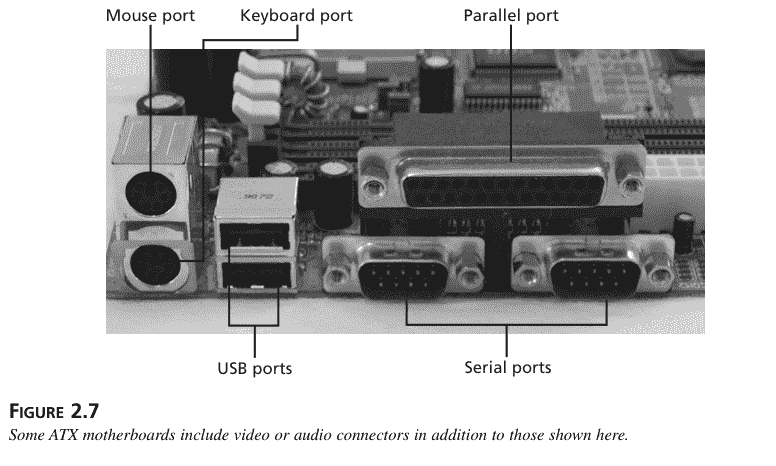

**图 2.7**
*一些 ATX 主板除了此处所示的连接器外，还包括视频或音频连接器。*

- **内部 I/O 连接器位置** AT 和 Baby AT 板设计者倾向于将软盘、EIDE 和（如果存在）SCSI 适配器的 I/O 连接器放在任何可以放置的地方。偶尔这些位置会导致连接到磁盘驱动器的电缆过长且杂乱。ATX 板倾向于将这些连接器放置在匹配设备在计算机机箱中最终位置附近（见图 2.8）。这种放置最大限度地减少了电缆杂乱。

- **改进的电源连接器** ATX 主板使用单个带键的电源连接器（见图 2.9），与 AT 和 Baby AT 板的双连接器形成对比。带键的 ATX 电源连接器使得几乎不可能通过

电源连接不当。此外，ATX主板使用3.3V电压，因此无需电压调节器。ATX主板还引入了一系列与电源相关的变化，允许计算机在操作系统关闭时自动关机、响应特定事件自动开机、进入低功耗模式等。

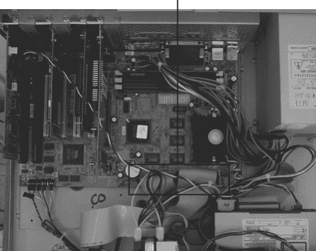

**图 2.8**
ATX主板和机箱的设计将磁盘线缆接口放置在靠近匹配磁盘设备的位置。

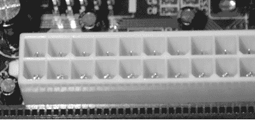

**图 2.9**
ATX电源连接器的引脚带有防呆设计，确保匹配的线缆不可能被错误插入。

- **散热变化** 尽管这严格来说并非主板本身的变化，但ATX规范包含了对计算机内部气流设计的调整。CPU的新位置允许电源风扇直接为CPU散热，理论上消除了为CPU单独配备散热风扇的需要。然而在实际应用中，许多ATX系统仍然保留了独立的CPU散热风扇。

正如你可能猜到的，ATX主板设计包含的诸多变化使其无法在AT机箱中使用。市场上有一些混合型机箱，可以兼容Baby AT或ATX主板，但总的来说，使用ATX主板通常需要搭配ATX机箱。因此，如果你有一台现有的AT或Baby AT系统想要升级，你应该要么寻找一块Baby AT主板，要么计划同时更换机箱和主板。

总体而言，ATX主板相比旧的Baby AT设计是一个重大的改进。ATX主板的典型尺寸约为9.6英寸（深）x 12.0英寸（宽）；这个宽度限制了ATX主板在小型机箱中的使用。适用于ATX主板的最小实用机箱是桌面式或中塔式设计。为了帮助减小机箱尺寸，已经开发出更小的ATX变体，包括mini-ATX (8.2 x 11.2英寸)、micro-ATX (9.6 x 9.6英寸) 和flex-ATX (9.0 x 7.5英寸)。与其他板型规格一样，这些尺寸代表的是*最大*尺寸。单个主板在其中一个或两个维度上可能略小一些。Micro-ATX板型在1999年于售价至少1000美元的PC中变得相当流行。这些较小的ATX变体通常比全尺寸ATX主板的5-7个可用扩展插槽要少。有些此类主板只有两个或三个可用插槽。这种插槽的缺乏在一定程度上通过在主板上集成额外功能来弥补。这些主板通常包含视频和音频功能，而这些功能在大多数全尺寸ATX主板上需要使用两块独立的插卡。有些此类主板还在板载集成了调制解调器、以太网适配器、SCSI主机适配器或其他设备。

> **注意**
> 大多数带有PCI插槽的主板会将一个PCI插槽和一个ISA插槽放置得非常靠近（参见图2.4）。由于PCI卡与ISA卡在安装时元器件位于板卡的另一面，因此这两个插槽中只能使用其中一个。结果，*可用*插槽的数量比*实际*插槽数量少一个。例如，图2.1和图2.4中描绘的主板有七个插槽，但只有六个是可用的。

在主板上集成显卡、声卡以及可能由独立插卡处理的其他功能，使用起来可能很方便，并且——如果它减小了计算机体积的话——在可用空间有限的情况下可能是有益的。然而，也存在缺点。升级或更换这些组件可能会很困难或无法实现。这个因素对Linux用户尤其重要，因为Linux仍然与某些设备不兼容。假设你购买了一台使用micro-ATX主板的计算机，却发现其视频功能在Linux下无法可靠工作。你就不得不牺牲一个PCI插槽来安装独立显卡，而且你将无法选择AGP显卡，因为主板不会包含AGP插槽。毕竟，显卡是集成在主板上的，为什么还要提供AGP插槽呢？在某些情况下，可能无法完全禁用不需要的硬件。

总而言之，我倾向于购买基于传统全尺寸ATX主板并配备完整插槽的系统。如果你被一款主板集成了额外功能的系统所吸引，请务必进行额外研究，确保所使用的组件与Linux兼容。

## NLX

大多数主板设计将CPU、内存、总线插槽和其他组件都放置在一个平面上，该平面在桌面式机箱中水平放置，在塔式机箱中垂直放置。由于PCI和ISA卡需要一定的高度，这种设计对最终计算机系统的最小高度提出了要求。然而，特别是在桌面式机箱中，*薄型*设计具有一定的吸引力。薄型系统是一种比标准PC更矮的桌面式设计。目前首选的薄型设计被称为NLX。为了实现这种配置，主板不包含任何PCI或ISA插槽。相反，主板支持一块*子卡*或*转接卡*，PCI和ISA插槽就安装在这块卡上，如图2.10所示。

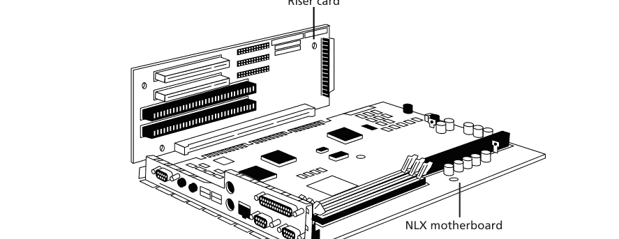

**图 2.10**
*NLX系统中的转接卡电路很少，主要用作扩展卡的安装点。*

理论上，NLX主板在升级硬件时提供了一个主要优势，因为这种设计允许你将主板从计算机中取出，而无需扰动扩展卡或（假设机箱设计得当）磁盘。与传统系统相比，这一特性使得主板升级变得非常容易。另一方面，NLX系统通常非常小巧，这限制了你添加内部设备（如多个硬盘、光驱和磁带备份驱动器）的能力。

## 专有和罕见布局

多年来，出现了一些专有且不常用的主板布局。这些设计包括：

- 大型PC制造商，如IBM和康柏，经常设计自己的主板并使用非标准布局。这些设计限制了你升级或维修现有计算机的选择，因此我建议你避免购买使用此类独特主板板型的计算机。
- 过去使用的一种薄型板型被称为LPX。这种设计与较新的NLX设计类似，使用转接卡，但将其放置在主板中部。LPX主板没有完全标准化，因此并非总能将一块LPX主板替换为另一块。如果你想购买或组装新的薄型计算机，我建议你使用NLX而不是LPX。
- 一种新的板型，称为WTX，其设计着眼于Itanium CPU的需求。在2000年初，WTX系统相当罕见，但一旦Intel发布Itanium CPU，它可能会变得更加流行。你可以在 http://www.wtx.org 了解更多关于WTX的信息。

我建议你避免使用专有和非常规的主板板型，WTX可能是个例外，它有望在2000年底或2001年初变得更常见。专有机板通常需要特殊的机箱，而这些机箱又通常需要特殊的软驱面板、特殊的电源等等。更换此类组件可能既昂贵又耗时。

## 主板芯片组

计算机中所有电路板的电子身份都归功于它们携带的一个或多个芯片组。*芯片组*，顾名思义，是一组一个或多个芯片，实现了板卡的大部分或全部功能。就主板而言，芯片组提供以下功能：

- CPU与内存之间的接口
- CPU与扩展卡总线（ISA、PCI等）之间的接口
- 各种系统定时器
- 端口——串口、并口、IDE、软驱、USB，有时还有其他

> ### 注意
> 80486时代及更早的主板通常不包含大多数端口；这些功能由扩展卡执行。即使是80486后期和早期Pentium系统也使用单独的芯片组来执行这些功能。这些芯片组位于主板本身上，但与主板的主芯片组是分开的。

除了最后一点，这些功能很容易被忽视，但它们对主板的功能至关重要。特定芯片组如何实现这些功能的细节会影响主板的速度。对于EIDE端口等功能，Linux需要驱动程序来操作设备。Linux包含通用的IDE驱动程序，可以与所有EIDE端口配合使用，但针对特定芯片组优化的驱动程序可以提高EIDE设备的性能。因此，确保你购买的主板使用Linux能识别的主芯片组或EIDE芯片组很重要，至少在你打算使用EIDE硬盘的情况下是如此。

在80486时代，许多制造商在芯片组市场上竞争，但Intel占据了早期Pentium主板市场的大部分份额。当Intel推出其新的Slot 1设计，将Socket 7留给AMD和Cyrix时，Super7主板的替代方案再次出现。

每一代或每一种类型的CPU（80386、80486、Pentium、Pentium Pro/Pentium-II/Pentium-III/Celeron 和 Athlon）都需要其专属的主板芯片组设计。例如，你不能在Pentium上使用80486芯片组（除非是Pentium Overdrive，它旨在用于80486主板）。在接下来的章节中，我将重点关注Pentium及后续CPU的芯片组，因为这些是你最有可能在新主板和近期主板中遇到的芯片组。

### 识别你的芯片组

如果你已经有一块主板，但不确定它使用什么芯片组，请查看永久焊接到主板上的最大芯片。这些芯片应该有一些标识。例如，图2.11显示了图2.1中描绘的主板上的一个主要芯片。该芯片清楚地将芯片组标识为来自VIA，实际上，它是VIA MVP3芯片组的一部分。你可能需要浏览芯片组制造商的网站来查找特定的芯片ID代码。


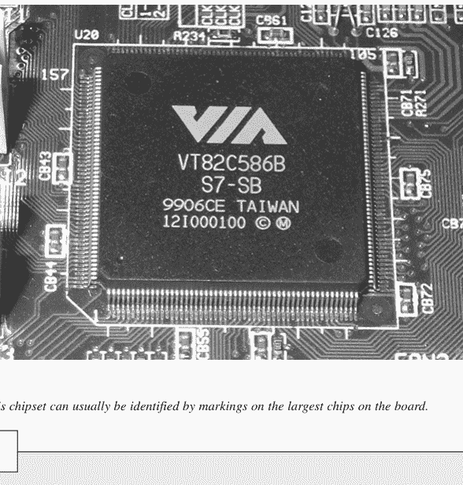

## 图 2.11

主板的芯片组通常可以通过板上最大芯片的标记来识别。

> **注意**

主板并非唯一使用芯片组的计算机组件。扩展卡制造商通常试图通过在关键部件上贴上贴纸，甚至用他们自己的丝印替换芯片组制造商的丝印，来隐瞒芯片组制造商。一些芯片组，特别是高端显卡和某些主板上的芯片组，运行速度非常快，以至于主板制造商会在这个组件上放置一个散热器。*你不应该尝试移除已粘合到芯片组组件上的散热器。* 你可以安全地移除贴纸，但如果你发现芯片上有一个玻璃窗口，请重新贴上贴纸或在窗口上贴一张新的。此类窗口通常用于可擦除可编程只读存储器（EPROM）芯片，并用于通过将芯片暴露于紫外线下来擦除存储器。可以想象，意外暴露在阳光下可能会擦除这样的芯片，而这很可能不是你想要发生的。

识别芯片组的另一种方法是检查 Linux /proc 目录中的文件。如果主板有 PCI 总线，/proc/pci 目录可以提供特别有用的信息。

例如，除了其他条目外，其主板如图 2.1 和 2.11 所示的计算机产生以下 /proc/pci 信息：

```
Bus  0, device  7, function  0:
    ISA bridge: VIA Technologies, Inc. VT82C586/A/B PCI-to-ISA [Apollo VP] (rev 71).
  Bus  0, device  7, function  1:
    IDE interface: VIA Technologies, Inc. VT82C586 IDE [Apollo] (rev 6).
    Master Capable. Latency=64.
    I/O at 0xe400 [0xe40f].
  Bus  0, device  7, function  2:
    USB Controller: VIA Technologies, Inc. VT82C586B USB (rev 2).
    IRQ 5.
    Master Capable. Latency=64.
    I/O at 0xe000 [0xe01f].
  Bus  0, device  7, function  3:
    PCI bridge: VIA Technologies, Inc. VT82C586B ACPI (rev 16).
```

请注意，82C586 标识符同时出现在芯片和多个 /proc/pci 条目中。同一芯片在 /proc/pci 中多次出现表明它具有多种功能。

## ALi 芯片组

宏碁实验室（ALi，网址 http://www.ali.com.tw）生产用于各种主板的几种芯片组。这些芯片组及其基本特性总结在表 2.1 中。

ALi Aladdin IV、V 和 7 芯片组用于 Socket 7 主板。Aladdin 7 专门为 AMD K6-III 销售，其不同寻常之处在于它包含了广泛的多媒体功能，包括通常存在于独立卡上的音频和视频功能。遗憾的是，目前这些功能没有可用的 Linux 驱动程序。

Aladdin Pro II、TNT2 和 Pro IV 芯片组是 ALi 参与奔腾 II 芯片组竞争的产品。TNT2 与 Aladdin 7 类似，包含了显卡芯片组功能，但不支持声卡。

Linux 内核包含对 ALi 快速 EIDE 控制器的支持，因此你可以充分发挥连接到基于 ALi 主板的 EIDE 设备的速度。

| 名称 | 最大总线速度 | 支持的 CPU | SMP 支持 | 内存类型 | 内存错误处理 | 最大内存 | 最大可缓存内存 | AGP 支持 | IDE 支持 | USB 支持 |
|---|---|---|---|---|---|---|---|---|---|---|
| Aladdin IV | 83.3MHz | 奔腾级 | 否 | FPM, EDO, SDRAM | 奇偶校验, ECC | 1GB | 512MB | 否 | Ultra-33 | 是 |
| Aladdin V | 100MHz | 奔腾级 | 否 | FPM, EDO, SDRAM | 奇偶校验, ECC | 1GB | 1GB | 1x 和 2x | Ultra-33 | 是 |
| Aladdin 7 | 133MHz | 奔腾级 | 否 | FPM, EDO, SDRAM | 奇偶校验, ECC | 1GB | 1GB | 1x-8x | Ultra-33 | 是 |
| Aladdin Pro II | 100MHz | 奔腾-II | 是 | FPM, EDO, SDRAM | 奇偶校验, ECC | 1GB (FPM) 或 2GB (EDO 或 SDRAM) | 不适用 | 1x 和 2x | Ultra-33 | 是 |
| Aladdin TNT2 | 100MHz | 奔腾-II | 否 | EDO, SDRAM, VC-SDRAM | 奇偶校验, ECC | 1.5GB | 不适用 | 1x 和 2x | Ultra-33 或 Ultra-66 | 是 |
| Aladdin Pro IV | 100MHz | 奔腾-II, 奔腾-III, 赛扬 | 否 | EDO, SDRAM, VC-SDRAM | 奇偶校验, ECC | 1.5GB | 不适用 | 1x-4x | Ultra-66 | 是 |

表 2.1 ALi 芯片组及其特性

## AMD 芯片组

AMD（http://www.amd.com）是芯片组市场的新手。除了与 VIA 早期合作失败，以 *640* 名义生产接近 VIA Apollo VP-2 奔腾级芯片组的仿制品外，AMD 的第一款芯片组产品是 750（又名 *Irongate*），该芯片组是为支持 AMD Athlon CPU 而开发的。750 的特点包括 200MHz 总线速度；768MB SDRAM 内存；AGP、PCI 和 ISA 总线；两个 Ultra-66 IDE 端口；以及四个 USB 端口。作为 Athlon CPU 的芯片组，AMD 750 不能用于奔腾或奔腾-II/III 主板。

## Intel 芯片组

Intel（http://www.intel.com）提供了大量的芯片组，如表 2.2 所述。事实上，Intel 主导了奔腾 II 芯片组市场。在 Intel 停止开发新的奔腾级芯片组之前，该公司也主导了该市场。然而，随着 Intel 转向放弃奔腾 CPU，它已将 Socket 7 芯片组市场留给了竞争对手。

Intel 的芯片组在所有类型的计算机上都很受欢迎。810 芯片组在笔记本电脑上特别受欢迎，因为它包含了集成显卡。Intel 在 http://support.intel.com/support/graphics/intel810/linuxsoftware.htm 提供了适用于该芯片组的 Linux X 服务器，提供 RPM 和 tarball 两种格式。Linux 内核包含对最新 Intel 芯片组中集成的先进 EIDE 控制器的支持，因此你可以充分发挥这些控制器速度的优势。对于 800 系列芯片组，ISA 接口是可选的，事实上，许多基于这些芯片组的主板缺少 ISA 插槽。这一变化降低了芯片组的成本和复杂性，但也限制了你选择扩展卡的余地。最近的 Intel 芯片组，包括 820 和 840，也使用 *RDRAM*（参见第 3 章）而不是较旧的 RAM 技术。RDRAM 提高了内存访问速度，但 RDRAM 仍然相对较新。

## SiS 芯片组

硅统科技（SiS，网址 http://www.sis.com.tw）在 80486 芯片组领域曾是一支非常强大的力量。在奔腾时代早期曾短暂失色，但 SiS 仍然是一个有活力的芯片组制造商；其芯片组描述见表 2.3。

表 2.2 Intel 芯片组及其特性

| 名称 | 最大总线速度 | 支持的 CPU | SMP 支持 | 内存类型 | 内存错误处理 | 最大内存 | 最大可缓存内存 | AGP 支持 | IDE 支持 | USB 支持 |
| :--- | :--- | :--- | :--- | :--- | :--- | :--- | :--- | :--- | :--- | :--- |
| 430LX (Mercury) | 66MHz | P60/66 | 否 | FPM | 奇偶校验 | 192MB | 192MB | 否 | 无 | 无 |
| 430NX (Neptune) | 66MHz | P75+ | 是 | FPM | 奇偶校验 | 512MB | 512MB | 否 | 无 | 无 |
| 430FX (Triton) | 66MHz | P75+ | 否 | FPM, EDO | 无 | 128MB | 64MB | 否 | 总线主控 | 无 |
| 430MX (Mobile Triton) | 66MHz | P75+ | 否 | FPM, EDO | 无 | 128MB | 64MB | 否 | 总线主控 | 无 |
| 430HX (Triton II) | 66MHz | P75+ | 是 | FPM, EDO | 奇偶校验, ECC | 512MB | 512MB | 否 | 总线主控 | 是 |
| 430VX (Triton III) | 66MHz | P75+ | 否 | FPM, EDO, SDRAM | 无 | 128MB | 64MB | 否 | 总线主控 | 是 |
| 430TX | 66MHz | P75+ | 否 | FPM, EDO, SDRAM | 无 | 256MB | 64MB | 否 | Ultra-33 | 是 |
| 440FX (Natoma) | 66MHz | 奔腾-II | 是 | FPM, EDO, BEDO | 奇偶校验, ECC | 1GB | 不适用 | 否 | 总线主控 | 是 |

*续表*

表 2.2 续

| 名称 | 最大总线速度 | 支持的 CPU | SMP 支持 | 内存类型 | 内存错误处理 | 最大内存 | 最大可缓存内存 | AGP 支持 | IDE 支持 | USB 支持 |
|---|---|---|---|---|---|---|---|---|---|---|
| 440LX | 66MHz | 奔腾-II | 是 | FPM, EDO, SDRAM | 奇偶校验, ECC | 1GB (EDO) 或 512MB (SDRAM) | 不适用 | 1x 和 2x | Ultra-33 | 是 |
| 440EX | 66MHz | 赛扬 | 否 | EDO, SDRAM | 无 | 256MB | 不适用 | 1x 和 2x | Ultra-33 | 是 |
| 440BX | 100MHz | 奔腾-II/III, 赛扬 | 是 | SDRAM | 奇偶校验, ECC | 1GB | 不适用 | 1x 和 2x | Ultra-33 | 是 |
| 440GX | 100MHz | 奔腾-II/III, 至强 | 是 | SDRAM | 奇偶校验, ECC | 2GB | 不适用 | 1x 和 2x | Ultra-33 | 是 |
| 450NX | 100MHz | 奔腾-II/III, 至强 | 是 | FPM, EDO | 奇偶校验, ECC | 8GB | 不适用 | 否 | Ultra-33 | 是 |
| 440ZX | 100MHz | 赛扬, 奔腾-II/III | 否 | SDRAM | 无 | 256MB | 不适用 | 1x 和 2x | Ultra-33 | 是 |
| 810 (Whitney) | 100MHz | 赛扬, 奔腾-II/III | 否 | SDRAM | 无 | 256MB | 不适用 | 集成 | Ultra-33 或 Ultra-66 | 是 |
| 820 | 133MHz | 奔腾-II/III | 是 | SDRAM, RDRAM | ECC | 1GB | 不适用 | 1x-4x | Ultra-66 | 是 |
| 840 | 133MHz | 奔腾-II/III | 是 | SDRAM, RDRAM | ECC | 2GB | 不适用 | 1x-4x | Ultra-66 | 是 |


## 表 2.3 SiS 芯片组及其特性

| 名称 | 最大总线速度 | 支持的 CPU | SMP 支持 | 内存类型 | 内存错误处理 | 最大内存 | 最大可缓存内存 | AGP 支持 | IDE 支持 | USB 支持 |
|---|---|---|---|---|---|---|---|---|---|---|
| 5511/5512/5513 | 66MHz | 奔腾级 | 否 | FPM, EDO | 奇偶校验 | 1GB | 256MB | 否 | 总线主控 | 否 |
| 5581/5582 | 75MHz | 奔腾级 | 否 | FPM, EDO, SDRAM | 无 | 384MB | 128MB | 否 | Ultra-33 | 是 |
| 5591/5592 | 75MHz | 奔腾级 | 否 | FPM, EDO, SDRAM | 奇偶校验或 ECC | 768MB | 256MB | 1x 和 2x | Ultra-33 | 是 |
| 530 | 100MHz | 奔腾级 | 否 | SDRAM, SGRAM（用于显存） | 无 | 1.5GB | 256MB | 集成 2x | Ultra-66 | 是 |
| 540 | 100MHz | 奔腾级 | 否 | SDRAM | 无 | 1.5GB | 512MB | 集成 2x | Ultra-66 | 是 |
| 600 | 100MHz | 奔腾 II/III, 赛扬 | 否 | FPM, EDO, SDRAM | ECC | 1.5GB | 不适用 | 1x 和 2x | Ultra-33 | 是 |
| 620 | 100MHz | 奔腾 II/III, 赛扬 | 否 | SDRAM, SGRAM（用于显存） | 无 | 1.5GB | 不适用 | 1x 和 2x | Ultra-66 | 是 |
| 630 | 100MHz | 奔腾 II/III, 赛扬 | 否 | SDRAM, VC-SDRAM | 无 | 1.5GB | 不适用 | 1x–4x | Ultra-66 | 是 |

几款 SiS 芯片组具有集成的视频功能。具体而言，5581/5582、530、540、620 和 630 芯片组集成了视频功能。540 和 630 芯片组还集成了音频和以太网功能。XFree86 中为大多数芯片组中的 SiS 视频功能提供了驱动程序，但 Linux 中尚不支持 SiS 的音频和以太网功能。对于某些 SiS 芯片组，您可能需要使用来自 SuSE 的最新 XFree86 服务器。Linux 目前不明确支持近期 SiS 芯片组中的 EIDE 控制器。您仍然可以在 Linux 下使用 EIDE 设备，但无法获得最快的可能速度。

## VIA 芯片组

VIA Technologies（http://www.via.com.tw）目前是非常受欢迎的 x86 计算机芯片组供应商（参见表 2.4）。VIA 的产品线也是最多样化之一，包括不仅适用于奔腾和奔腾 II 系统，也适用于 AMD 的 Athlon 的芯片组。VIA 芯片组偶尔会以其他名称出现。例如，AMD 曾短暂以 *AMD 640* 的名称销售 VIA VP-2，而梅捷主板则使用 *ETEQ* 名称销售 VIA 芯片组。

在奔腾级 CPU 中，VIA Apollo MVP3 芯片组是最受欢迎的之一。MVP4 基于 MVP3，但增加了基于 Trident Cyber3D 芯片组的视频功能，XFree86 3.3.4 及更高版本提供了其驱动程序。MVP4 还包含音频功能，Linux 在 2.2.x 内核后期版本中提供了驱动程序。VIA 的 Apollo Pro 和 Apollo Pro 133 芯片组被广泛应用于 Slot 1 和 Socket 370 主板。Linux 包含对 VIA 芯片组 IDE 控制器的支持，因此您可以将其完全置于 DMA 模式下使用。

## 表 2.4 VIA 芯片组及其特性

| 名称 | 最大总线速度 | 支持的 CPU | SMP 支持 | 内存类型 | 内存错误处理 | 最大内存 | 最大可缓存内存 | AGP 支持 | IDE 支持 | USB 支持 |
|---|---|---|---|---|---|---|---|---|---|---|
| Apollo VP1 | 66MHz | 奔腾级 | 否 | FPM, EDO, BEDO, SDRAM | 无 | 512MB | 512MB | 否 | 总线主控 | 是 |
| Apollo VP2 | 66MHz（非官方支持 75MHz） | 奔腾级 | 否 | FPM, EDO, SDRAM | 奇偶校验或 ECC | 512MB | 512MB | 否 | Ultra-33 | 是 |
| Apollo VPX | 75MHz | 奔腾级 | 否 | FPM, EDO, BEDO, SDRAM | 奇偶校验 | 512MB | 512MB | 否 | Ultra-33 | 是 |
| Apollo VP3 | 66MHz | 奔腾级 | 否 | FPM, EDO, SDRAM | 奇偶校验或 ECC | 1GB | 1GB | 1x 和 2x | Ultra-33 | 是 |
| Apollo MVP3 | 100MHz | 奔腾级 | 否 | FPM, EDO, SDRAM, DDR SDRAM | 奇偶校验或 ECC | 1GB | 512MB | 1x 和 2x | Ultra-33 | 是 |
| Apollo MVP4 | 100MHz | P5 级 | 否 | FPM, EDO, SDRAM, DDR SDRAM | 奇偶校验或 ECC | 756MB | 512MB | 集成 | Ultra-66 | 是 |
| Apollo Pro | 100MHz | 奔腾 Pro, 奔腾 II/III, 赛扬 | 否 | FPM, EDO, SDRAM | 奇偶校验或 ECC | 1GB | 不适用 | 1x 或 2x | Ultra-33（Plus 版本为 Ultra-66） | 是 |
| Apollo Pro 133 | 133MHz | 奔腾 II/III, 赛扬 | 否 | FPM, EDO, SDRAM | 奇偶校验或 ECC | 1.5GB | 不适用 | 1x 或 2x | Ultra-66 | 是 |
| Apollo KX133 | 200MHz | Athlon | 否 | EDO, SDRAM, VC-SDRAM | ECC | 2GB | 不适用 | 1x-4x | Ultra-66 | 是 |

## 板载端口

所有主板都至少包含一些板载端口。主板的最低要求是必须有一个键盘端口——实际上，许多 80486 及更早的主板*只有*键盘端口。然而，自 80486 时代后期以来，所有主板都包含了不止一个键盘端口。主板上的大多数端口在使用 Linux 随附的标准驱动程序时工作良好，但也有一些例外。例如，并非所有内置于主板中的 SCSI 或以太网端口都受 Linux 支持。

## 键盘和鼠标

AT 和 Baby AT 主板通常配备一个用于键盘的大型 5 针 DIN 连接器。较新的主板则使用更小的 mini-DIN 连接器。这两种类型的连接器在电气上是兼容的，因此，如果您有一种类型的键盘而主板上是另一种类型的连接器，您可以购买一个廉价的适配器。图 2.12 展示了一个旧式键盘连接器和一个适配器，其中可以看到较新的 mini-DIN 端。键盘处理是相当标准化的，因此在 Linux 中您无需为键盘安装特殊驱动程序。

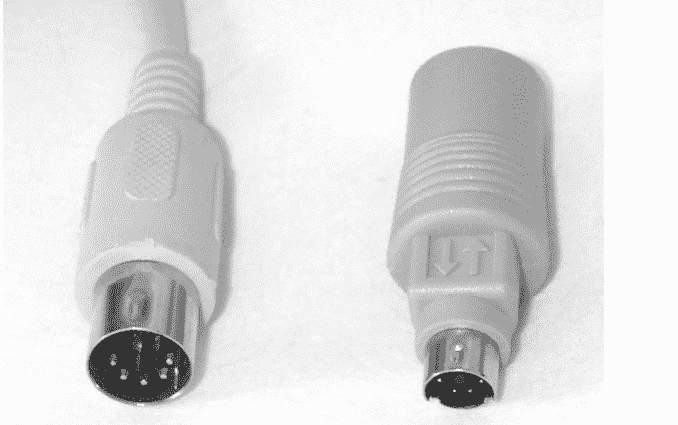

**图 2.12**
*左侧的大型 DIN 连接器可以通过使用右侧的适配器连接到较新的主板上。*

> 注意

键盘处理的统一性有两个例外。首先，AT 之前的计算机使用了不同类型的键盘电子设备。因此，如果您有一个来自 PC XT 或类似计算机的非常旧的键盘，您将无法在现代计算机上使用它。那个时代的一些键盘有一个开关，可以让您在任何一种计算机上使用该键盘。将开关设置为 *AT*，您应该就能在现代计算机上使用它了。其次，USB 键盘最近开始出现，一些系统现在随附 USB 键盘。Linux 可以使用 USB 键盘，但您可能需要编译一个带有 USB 支持的内核。在 2000 年初，大多数 Linux 发行版并未启用此支持。在此支持随 Linux 发行版提供之前，我建议避免使用 USB 键盘。

x86 硬件有几种类型的鼠标。（我使用 *鼠标* 一词来指代传统鼠标和其他定点设备，如轨迹球和触摸板。）两种最流行的鼠标接口是串行和 PS/2，其中 PS/2 鼠标是近期硬件上更流行的类型。Linux 支持这两种类型的鼠标，大多数 Linux 安装程序会自动检测并配置您的鼠标。大多数现代主板在背板上包含一个 PS/2 鼠标端口（参见图 2.7）。如果您不使用 PS/2 鼠标，某些主板的 BIOS 工具允许您禁用鼠标端口，从而释放一个 IRQ 供其他设备使用。

与键盘一样，USB 鼠标最近也越来越受欢迎，但您需要内核中的 Linux 支持才能使用 USB 鼠标，而这还不是大多数发行版的标准组成部分。

第 15 章“键盘和鼠标”包含了更多关于键盘和鼠标的信息。

## 串行和并行端口

大多数主板包含一个并行端口和两个串行端口。通常，您使用并行端口来连接打印机，也可能连接网络摄像头、外部 Zip 驱动器或扫描仪。串行端口可用于鼠标、外置调制解调器、数码相机、个人数字助理（PDA）或其他设备。少数主板，特别是来自康柏等大型制造商的计算机主板，只包含一个串行端口。

现代主板普遍支持标准化的现代并行和串行端口协议。Linux 对这些设备的支持相当成熟，因此，只要硬件没有缺陷，您在使用任何主板的并行或串行端口时应该不会遇到问题。

80486 时代及更早的主板通常不包含串行或并行端口。在这些计算机上，您必须在 ISA 卡上添加这些端口。如果您正在翻新一个旧系统，但在主板上看不到这些端口，原因就在于此。

第 16 章“并行和串行端口”将更详细地介绍这些端口。


## 软盘

80486及更早的主板通常将软盘端口放置在扩展卡上——通常与串口和并口在同一张卡上，有时则与SCSI主适配器在一张卡上。然而，现代主板都无一例外地包含软盘端口，如图2.13所示。与并口和串口一样，软盘控制器标准化程度非常高，在现代计算机中差异不大。如今大多数x86计算机使用1.44MB软盘，但大多数控制器也能处理2.88MB软驱。这些更高容量的软盘从未流行起来，如今已相当罕见。

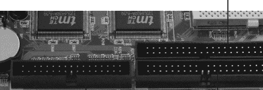

**图2.13**
*这里显示的软盘和每个EIDE连接器都缺少一个针脚。这是正常的，可以防止连接电缆在正确键合的情况下反向插入。*

> **注意**
> 有些计算机配备LS-120磁盘而非传统软盘。这些磁盘有EIDE和SCSI版本，可以读写传统的1.44MB软盘和特殊的120MB磁盘。在使用LS-120磁盘代替普通软盘的系统上，主板的软盘控制器将闲置不用，除非系统还包含一个5.25英寸软驱或软盘接口的磁带单元。

# EIDE

在大多数现代主板上，紧邻软盘端口的是一对EIDE端口（参考图2.13）。在现代主板的标准端口中，EIDE端口的设计变化最大，并且是唯一能从专用Linux驱动程序中受益的端口。这些端口*确实*可以使用统一的EIDE驱动程序，但该驱动程序是针对1990年代初的IDE端口编写的。标准的Linux IDE驱动程序不支持直接内存访问（DMA）或高速操作。总而言之，使用此标准驱动程序会导致EIDE磁盘访问速度远低于现代硬盘可达到的水平。

为了充分利用特定主板的EIDE控制器，通常必须在Linux内核配置中激活该控制器的选项，如图2.14所示。块设备内核选项窗口包含许多用于特定EIDE设备的选项。其中一些是为主板芯片组准备的（例如图2.14窗口底部附近的Intel PIIXn选项），而另一些则是为EIDE扩展板准备的。

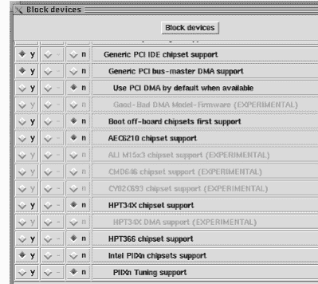

**图2.14**
*EIDE设备列表很长且组织混乱，因此您可能需要花些时间才能找到您的设备。*

某些Ultra-66 EIDE控制器与原装Linux 2.2.x内核配合不佳。如果您有这样的板卡并想安装基于2.2.x的Linux发行版，您可能需要先用一块较旧的EIDE控制器卡安装Linux，然后重新编译更新的内核或应用内核补丁。完成后，您应该能够移除较旧的EIDE控制器，并使用Ultra-66控制器来运行Linux。随着基于2.4.x内核系列的Linux发行版在2000年某个时候推出，此问题将消失。

大多数主板包含两个EIDE连接器。每个连接器能够在单个*链*（即连接到单根电缆）上处理最多两个EIDE设备。因此，典型的主板能够控制最多四个EIDE设备。然而，每个EIDE链消耗一个IRQ，因此即使使用三个设备也需要两个IRQ。使用超过四个EIDE设备需要添加单独的EIDE控制器，并且至少消耗三个IRQ。对于大量设备，SCSI（在第5章“硬盘”和第9章“SCSI主机适配器”中讨论）是更好的选择。

# USB

通用串行总线（USB）是用于外部设备的最新通用技术。大多数现代PC包含两个外部USB端口，您可以使用USB*集线器*连接两个以上的USB设备，这实际上将一个USB端口变成了多个。可用于USB的设备包括鼠标、键盘、数码相机、扫描仪、打印机和调制解调器。

USB能够提供比传统串口高得多的速度——12Mbps，而大多数传统串口为115kbps。USB的速度接近EPP/ECP并口（约16Mbps）。USB成为一种有吸引力的连接方法还有另一个原因：可以将多达127个设备连接到单个USB控制器。当然，在实践中，127个设备很可能会使USB带宽过载，除非其中大部分或全部设备速度非常慢或很少使用。尽管如此，随着扫描仪、数码相机等外部设备的爆炸式增长，USB的吸引力是巨大的。

Linux 2.2.x内核系列在其生命周期末期才获得了USB支持。幸运的是，Linux开发人员一直在努力大幅扩展USB支持，并且到2.4.x内核将拥有实质性的USB支持。如果您想使用USB设备，您可能需要查看Linux USB主要开发页面 http://www.linux-usb.org。在适用的情况下，我也会在本书的相关章节中描述Linux对特定USB设备的支持。

# 可选附件

除了刚才描述的标准主板端口外，一些主板还包含额外的适配器。视频和音频功能在用于低成本家用PC的主板上很常见。SCSI和以太网适配器在高端主板上很常见。少数主板包含调制解调器功能。理论上，其他类型的适配器也可以包含在主板上，但实际上这些情况相当罕见。

无论您考虑什么可选功能，都应确保所使用的芯片组在Linux中受到支持。如果没有Linux支持，该功能基本上就是主板上的死重，如果无法完全禁用，还可能会引起问题。此外，请考虑升级主板时通常可以保留附加卡。如果您购买带有集成功能的主板，以后决定升级主板时，您必须购买另一块这样的主板，或者为集成的功能购买单独的产品。

# 核心系统

#### SCSI主机适配器

x86主板中的SCSI功能很少见。当存在时，它通过在主板上包含单独的SCSI芯片组来实现；SCSI功能并未在主板主芯片组中实现。大多数包含SCSI功能的板卡使用来自Adaptec (http://www.adaptec.com) 或 Symbios Logic (http://www.symbios.com) 的芯片组。两家公司的产品在Linux中都得到了很好的支持。在大多数情况下，主板内置的SCSI支持不会有问题。但是，您应该检查主板上使用的特定SCSI芯片组是否被Linux支持。

要从SCSI主机适配器启动，无论该适配器是在单独的板卡上还是内置在主板中，该SCSI适配器都必须有自己的启动BIOS。对于内置在主板中的SCSI适配器，该BIOS通常集成在主板的主BIOS中，尽管SCSI BIOS可能拥有独立于主BIOS的自己的用户界面。如果您打算从连接到主板上主机适配器的SCSI硬盘启动，您应该检查主板是否包含适当的SCSI BIOS（大多数都有）。调查BIOS升级程序可能也值得。在大多数情况下，在具有集成SCSI主机适配器的计算机上升级SCSI或主板主BIOS都需要同时升级*SCSI和主板核心BIOS*。由于升级主板BIOS是如此危险的操作，我建议除非您相当确定升级会解决您遇到的问题，否则不要这样做。

在主板上拥有SCSI适配器的一个缺点是通常没有*外部*SCSI连接器。因此，您只能连接*内部*SCSI设备。您可以使用内部/外部适配器插头（如图2.15所示）来解决此限制。您将适配器安装在计算机机箱中，然后将内部SCSI电缆的*最后一个*连接器插入内部插头。外部插头随后作为SCSI链的延伸，用于外部设备。有几种不同类型的内部/外部SCSI适配器插头，可提供对各种内部和外部电缆类型的访问。

## 网络端口

与SCSI适配器类似，以太网网络端口在主板上也很少见，但一些主板包含此功能。在大多数情况下，以太网功能由主板上的单独的以太网芯片组提供。在某些情况下，此功能内置在主芯片组中。无论哪种情况，您都应该检查以确保为所使用的以太网芯片组提供Linux驱动程序。幸运的是，Linux支持绝大多数以太网设备，尽管某些SiS芯片组中内置的以太网功能目前不受Linux支持。您可以在第16章的“以太网适配器”部分中阅读更多关于Linux以太网支持的内容。


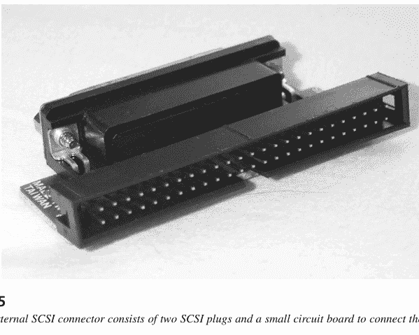

**图 2.15**
一个内部/外部 SCSI 连接器由两个 SCSI 插头和一个用于连接它们的小型电路板组成。

## 调制解调器

少数主板，主要用于低成本的预装 PC，包含调制解调器功能。这些调制解调器通常是“仅限 Windows”类型，这意味着没有可用的 Linux 驱动程序。除非你确信该调制解调器在 Linux 下可用，否则我建议你避免使用此类主板。虽然你可能可以使用另一个调制解调器，但主板可能缺少第二个串行端口，而且未使用的电路可能会干扰你可能添加到系统中的任何调制解调器。

## 视频适配器

视频适配器支持在许多低端主板上很常见。将视频适配器放在主板上可以通过消除扩展卡来降低组装计算机的复杂性。许多主板制造商至少生产一两款在主板上集成视频和音频功能的型号，与他们的其他型号相比，它们减少了大约两个可用插槽，从而减小了主板尺寸。一些具有集成视频功能的主板通过使用直接集成视频功能的主主板芯片组来实现。其他主板则添加了视频芯片组，而这些芯片组通常会出现在单独的显卡上。

尽管在许多方面很方便，但将视频支持添加到主板上确实有其缺点。首先，这种设计通常会占用一部分主系统内存并将其分配给视频功能。例如，在一个 64MB 的系统上，你最终可能只有 60MB 的主内存和 4MB 的显存。（大多数此类主板允许你使用 BIOS 设置显存大小。典型值范围从 2MB 到 16MB。）集成设计也剥夺了你的灵活性。将来升级到新的显卡会更困难，因为带有集成视频的主板通常具有更少的可用扩展插槽，并且通常没有 AGP 插槽。

如果你正在考虑使用带有集成视频支持的主板，你应该绝对确定 Linux（或者更准确地说，XFree86）支持所使用的视频芯片组。你可以从 XFree86 主网站 http://www.xfree86.org 了解更多关于这种支持的信息。SuSE (http://www.suse.com) 是一家致力于开发新 XFree86 驱动程序的 Linux 发行商，因此你可能也想访问其网站获取最新信息。

## 音频功能

与视频功能一样，音频功能通常出现在低端主板上，以节省空间并降低系统总成本。音频功能通常（但并非总是）通过辅助芯片组实现，因此第 10 章“声卡”中标题为“声卡芯片组”的章节可能对评估此类主板的 Linux 兼容性有所帮助。

集成音频通常不会占用任何系统内存。因此，在这方面，它比集成视频的危害要小。然而，集成音频仍然存在灵活性差的缺点；由于带有集成音频的主板扩展插槽数量减少，升级到新的声卡可能更加困难。

## 内存

所有主板都包含某种内存支持。大多数主板上的主内存插槽是双列直插式内存模块（DIMM）插槽，如图 2.16 所示。较旧的主板可能包含单列直插式内存模块（SIMM）插槽，作为 DIMM 插槽的补充或替代。一些非常新的主板使用 Rambus 直列内存模块（RIMM），它们看起来很像 DIMM。第 3 章更详细地讨论了内存。

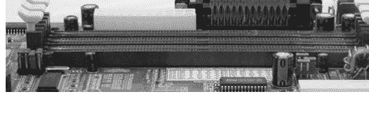

**图 2.16**
*大多数现代主板包含三个 DIMM 或 RIMM 插槽。*

## 总结

你为 Linux 计算机选择的主板决定了系统运行的许多方面。你必须将主板与 CPU 匹配，而这一组合共同决定了系统的整体计算速度。主板决定了系统的可扩展性，体现在扩展插槽的数量和类型上。集成的功能，如 SCSI 主机适配器或视频端口，可能会使主板更具吸引力或降低其成本，但这些功能可以通过使用插入式扩展板添加到缺乏它们的主板上。

每个主板的核心是其芯片组，它实现了 CPU 所需的电子功能。芯片组决定了主板的许多特性，包括其速度限制、支持的总内存等等。基于同一芯片组的两个主板可能表现相似，尽管由于实现细节的差异（例如 PCI 插槽的数量）可能会存在差异。在某些情况下，主板制造商可能会施加比芯片组本身更严格的限制，例如当主板仅具有 512KB 缓存而芯片组支持 1MB 缓存时。

## 第 3 章

### 本章内容

- Linux 内存需求 76
- 内存模块类型 81
- 内存电气类型 87
- 匹配内存与主板 89
- 缓存内存 92
- ROM 96

## Linux 内存需求

本书讨论的大多数硬件组件在 Linux 上需要特殊的驱动程序，或者比在其他操作系统上呈现更不寻常的挑战。内存通常不是这样。假设内存与主板兼容，你可以像在其他任何操作系统下一样将其插入并在 Linux 下使用。当然，Linux 确实需要一定最低限度的内存，但 Linux 的要求并不比大多数其他现代操作系统高——实际上，Linux 可以在比许多其他操作系统更少的内存下运行。

> **注意**
>
> 尤其是在一些较旧的计算机上，Linux 可能会出现内存错误，而其他操作系统（尤其是 DOS 和 Windows 3.1）则不会。这是因为 Linux 是一个 32 位操作系统，这意味着它将内存视为一个连续的空间。相比之下，DOS 和 Windows 3.1 使用 16 位内存寻址模式，其中内存被分解为 64KB 的块。16 位和 32 位访问方法对内存施加不同的压力，因此某个特定的内存芯片可能在一种模式下工作，但在另一种模式下不工作。在 Windows 95 发布之前，一些内存和主板制造商在 DOS 下测试其芯片，而不是在像 Linux 这样的 32 位操作系统下。这些芯片有时在 32 位操作系统下会失败。如果你发现计算机在 DOS 下可靠但在 Linux 下不可靠，你可能看到了这种现象在起作用，特别是如果它是一台旧的 80486 或更早的计算机。

在讨论 Linux 或任何操作系统的内存需求时，重要的是随机存取存储器（RAM）的总量。正如本章后面所述，内存的*类型*通常并不太重要，尽管它可能对计算机的速度有适度的影响。内存总量对系统性能有更实质的影响。

### 最低内存需求

大多数操作系统在其包装盒或规格网页上都包含最低 RAM 要求。Linux 发行版在这方面也不例外，表 3.1 总结了各种流行 Linux 发行版的官方最低内存要求。

**表 3.1 Linux 发行版的官方内存要求**

| 发行版 | 最低 RAM |
|---|---|
| Caldera OpenLinux 2.3 | 32MB |
| Corel Linux 1.0 | 24MB |
| Debian GNU/Linux 2.1 | 4MB |
| Linux Mandrake 7.0 | 16MB |
| Red Hat Linux 6.1 | 16MB |
| Slackware Linux 7.0 | 16MB |
| SuSE Linux 6.3 | 8MB |

你可能从表 3.1 认为不同的 Linux 发行版是截然不同的操作系统。事实上，它们并不是。差异源于几个因素，包括：

- **不同的默认配置** 大多数发行版默认安装带有华丽的 X 窗口系统（又名 X）图形用户界面（GUI）环境，如 K 桌面环境（KDE）或 GNU 网络对象模型环境（GNOME）。这些环境需要大量的 RAM 才能平稳运行。像 Debian 这样默认配置不自动启动 X 的发行版，可以指定更低的最低 RAM 值。（SuSE 指定不使用 X 时的最低要求为 8MB，运行 X 时的最低要求为 16MB。）
- **不同的使用假设** 每个发行版都围绕其操作系统将如何使用的假设来构建其最低 RAM 要求。如果这些假设需要运行许多大型程序，最低 RAM 要求就会增加。
- **对速度损失的不同容忍度** 如果你愿意忍受极其缓慢的操作，你可以在非常少的 RAM 下运行 Linux，即使是带有 GUI 桌面和许多大型程序。在其他条件相同的情况下，更多 RAM 会在运行多个程序时提高系统速度。在很大程度上，表 3.1 中的 RAM 要求仅仅反映了关于用户因 RAM 不足而愿意接受多少速度下降的决策。
- **安装需求** 安装程序需要一定量的 RAM 来保存 RAMdisk 镜像以及程序。如果发行版包含一个使用大型 RAMdisk 或庞大程序的华丽安装程序，RAM 需求仅因安装程序而增加。一旦操作系统安装完毕，它可能可以在低于最低 RAM 的情况下运行。

一旦以类似的方式安装和配置，所有 Linux 发行版都需要相似数量的 RAM。除了 Caldera OpenLinux 的估算值可能是个例外，表 3.1 中的所有估算值对于在使用 GUI 环境时舒适实用地使用 Linux 来说都显得偏少。如今大多数计算机至少配备 32MB RAM，因此在现代硬件上满足这一最低要求并不困难。但是，如果你想尝试让一台旧计算机适应使用 Linux 的新任务，你可能希望考虑进行 RAM 升级，如果

## 根据系统用途调整内存估算

与其依赖某些笼统的最低RAM要求，您应该尝试估算操作系统在任何特定用途下所需的RAM量。为此，从一个基础数值（例如8MB）开始，并根据您预期同时执行的每个任务增减RAM会很有帮助。也就是说，如果您希望同时运行办公套件和图形编辑器，请为这两个软件包的数值求和。如果您打算依次运行这些程序，则只需添加较大的那个值。表3.2列出了一些常见应用的调整值。

**表 3.2** 常见应用的内存需求调整值

| 应用 | 需添加的RAM量 |
| :--- | :--- |
| X窗口系统 | 10MB |
| 桌面环境 | 15–20MB |
| 办公套件 | 10–20MB |
| 基础图形编辑 | 5MB |
| 高级图形应用 | 10–30MB |
| 图形界面Web浏览器 | 10MB |
| 科学或工程应用 | 5–500MB |
| 低负载服务器 | *每个*服务器5MB |
| 高负载服务器 | *每个*服务器50MB |

举个例子，假设您的Linux计算机直接连接到互联网（例如通过公司局域网或电缆调制解调器），并且您想运行一个小型网站，预计每小时会有少量访问量（小型服务器约需5MB）。您还打算用这台计算机通过X中的图形界面文字处理器进行写作（办公套件需10-20MB，加上X需10MB），并且您想使用GNOME桌面环境（15-20MB）。将这些数值与8MB的基础RAM需求相加，得出估计的最低内存在48MB到63MB之间。当然，您*确实*可以在少于48MB的情况下运行所有这些进程，但性能可能会很慢。增加超过63MB的内存可能会略微提高性能，但提升幅度不会像从低内存升级到48MB时那么明显。

您可能可以根据您打算使用的特定程序来微调这些数值。例如，Linux版WordPerfect 8列出其最低RAM要求为9MB。如果您想运行科学或工程应用，您几乎可以肯定可以利用您对该应用的了解，将范围缩小到比列表中5-500MB更精确的区间。此外，表3.2仅是一个粗略指南。特定程序的要求可能超出了我列出的范围。

## 使用虚拟内存

与所有现代操作系统一样，Linux可以利用*虚拟内存*，也称为*交换空间*。其理念是，让程序运行缓慢总比完全无法运行要好。为了避免因RAM不足而导致操作系统无法运行程序，Linux可以利用磁盘空间来存储通常应存放在RAM中的信息。Linux内核包含将信息从RAM*交换*到硬盘的规则。理想情况下，Linux会交换出很少被访问的信息，例如，某个程序虽然仍在打开但您当前并未使用，其占用的RAM。当然，有时Linux会判断错误，或者您确实在使用所有程序，且您的所有程序都在大量且活跃地使用内存。在这种情况下，随着Linux不断访问硬盘上的交换空间，系统可能会变得相当缓慢。这种持续访问交换空间的情况被称为*抖动*，当Linux发生抖动时，即使执行非常简单的任务也可能需要*很长*时间。

## 添加交换空间

Linux支持两种形式的交换空间：交换*分区*和交换*文件*。UNIX系统传统上使用交换分区，即专门用于交换空间的整个硬盘分区。由于它是硬盘上的一个连续区域，并且不需要使用普通的磁盘文件系统驱动程序来操作，交换分区可能比交换文件稍快一些，后者是用于交换目的的普通磁盘文件。大多数Linux发行版在安装操作系统时会提示您创建交换分区。安装后，您可以使用`free`命令查看可用的交换空间。该命令会产生如下输出：

```
             total       used       free     shared    buffers     cached
Mem:         95772      91916       3856       7040      24912      39452
-/+ buffers/cache:      27552      68220
Swap:       136512       3132     133380
```

Swap行表明这台计算机有136,512KB（133MB）的交换空间，其中已使用3MB，可用130MB。`free`命令还提供有关常规RAM总量、已使用量和可用量的信息。

如果您发现需要更多交换空间，请遵循以下说明：

1.  如果您想永久添加交换空间，可能需要创建一个新的交换分区。您可以使用像PowerQuest (http://www.powerquest.com)的PartitionMagic这样的工具来动态重新分区您的硬盘，以便扩展现有的交换分区或创建一个新分区。在没有动态分区调整工具的情况下创建新的交换分区相当繁琐，因为您通常必须备份、重新分区并至少恢复一个分区。

2.  如果您想临时添加交换空间，或者不想重新分区硬盘，可以创建一个交换文件。您可以使用`dd`命令创建一个适当大小的空文件。例如，`dd if=/dev/zero of=/swap-file bs=1024 count=65536` 创建一个64MB大小的空文件（bs×count字节）。此文件名为swap-file，位于根目录，但您可以将其放在任何有足够空闲空间的Linux文件系统上。

3.  使用`mkswap`命令将文件或磁盘空间初始化为交换文件。例如，对步骤2中创建的交换文件使用`mkswap /swap-file`，或对位于`/dev/hda7`的交换分区使用`mkswap /dev/hda7`。

4.  如果您创建了交换文件，请更改其权限，使其只能由root用户读写。例如，对步骤2中创建的文件使用`chown root.root /swap-file; chmod 600 /swap-file`来完成此操作。

5.  使用`swapon`命令添加交换空间，例如`swapon /swap-file`或`swapon /dev/hda7`。

6.  如果您打算永久使用在上述步骤中添加的交换空间，请在`/etc/fstab`中添加相应的行，例如

   ```
   /dev/hda7 none swap sw
   ```

7.  当您使用完临时交换空间后，可以通过发出`swapoff`命令来停止使用它，例如`swapoff /swap-file`。

> **注意**
> 与Microsoft Windows或IBM OS/2不同，Linux不会动态扩展交换文件。如果您有64MB RAM和一个64MB交换文件，Linux最多拥有128MB内存，如果您的程序试图使用超过128MB的RAM，某些程序可能会崩溃，或者至少无法执行某些操作。

## 最佳交换空间大小

过去，通常建议交换空间等于UNIX类计算机上可用物理RAM的两倍。然而，这一建议是基于典型的多用户使用模式，目前尚不清楚当应用于单用户Linux计算机时，这条经验法则是否同样有用。许多桌面Linux用户的交换空间等于甚至少于物理RAM量，而且似乎对这种配置相当满意。归根结底，合适的交换空间大小取决于您如何使用计算机；如果您经常，或者只是偶尔，运行大量程序以至于大大超过计算机上的可用RAM，那么大量的交换空间是有益的。但是，如果您有足够的RAM，其限制很少被突破，那么您可能需要很少甚至不需要交换空间。

`free`命令列出的已用RAM包括Linux用作磁盘缓存的RAM——即存储在RAM中以提高磁盘访问速度的硬盘内容。磁盘缓存与交换相反，平衡交换和磁盘缓存是内核程序员掌握的一门精妙艺术；您无需为此操心。不过，您应该意识到，您的程序实际消耗的RAM远比您从`free`输出的第一行看到的要少。因此，`free`还在`-/+ buffers/cache`行报告了*排除*磁盘缓存后的RAM使用量。在估算程序消耗多少RAM时，请使用此值，而不是Mem值。

## 内存模块类型

RAM由硅晶圆制造而成，就像CPU和其他计算机芯片一样。然而，硅晶圆非常脆弱。为了安全地处理和运输RAM，有必要将硅晶圆嵌入塑料或陶瓷封装中。这种封装就是我们通常认为的计算机芯片（见图3.1）。

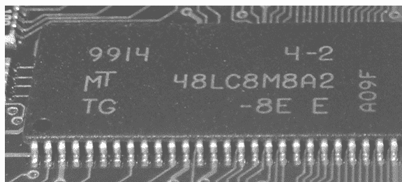

**图 3.1** *一个典型的内存芯片使用许多金属引脚将封装内的硅晶圆与主板或其他设备连接起来。*

早期的x86 PC通常包含直接焊接在主板上或放置在单独插槽中的RAM芯片。然而，这种方法占用了主板上大量的空间，并且使得升级内存或更换有缺陷的内存变得困难。


因此，人们开发了各种形式的*内存模块*来容纳内存芯片。这些内存模块可以轻松地安装在主板上。在整个 x86 历史上，最流行的内存模块类型一直是*单列直插式内存模块*（SIMM）和*双列直插式内存模块*（DIMM）。图 3.2 显示了每种类型的示例。在 1999 年底，一种新型内存模块开始出现：*Rambus 直列式内存模块*（RIMM）。RIMM 使用一种新型的 RAM，即 *Rambus 动态 RAM*（RDRAM），将在本章后面介绍。

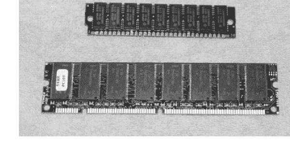

**图 3.2**
30 针的 SIMM（顶部）在今天已基本过时，但 168 针的 DIMM（底部）在 2000 年仍被许多计算机使用。

> **注意**

内存模块的高度各不相同。如果你购买内存模块来扩展计算机，请不要担心你购买的模块比已有的模块更高或更矮。然而，在极少数情况下，内存模块可能对特定计算机来说过高——模块与某些其他组件（如硬盘托架）之间可能没有足够的空间。有时你可以通过重新安置其他组件或将内存模块插入不同的内存插槽来解决问题。其他时候，你可能需要退回该模块并购买一个物理尺寸更短的。

## SIMM

SIMM 是 80386、80486 和许多奔腾级系统首选的内存分配方式。在物理形态上，SIMM 在不同时期流行两种形式：30 针和 72 针。

### 30 针 SIMM

最早的 SIMM 使用 30 个称为*针脚*的接触点将内存连接到主板。30 针 SIMM 在 80386 和 80486 主板中很常见，但现在已经相当罕见。与现代主板相比，你更有可能在打印机或声卡等设备中遇到它们，但即使在这些次要功能中，它们也已在很大程度上被更新类型的内存模块所取代。

正如第 1 章标题为“x86 CPU 的几代人”的部分所述，x86 CPU 的内存总线宽度各不相同——也就是说，它们在单次操作中与内存传输多少位数据各不相同。80386SX CPU 采用 16 位内存传输，80386DX 和 80486 CPU 使用 32 位内存传输，而奔腾级及更新的 CPU 在单次操作中传输 64 位。这一事实对于讨论内存模块很重要，因为每种设计每个周期可以传输固定数量的位。因此，要传输比内存模块支持更多的位数，有必要使用多个相同的模块。例如，如果一个内存模块设计支持传输 8 位，那么要将该模块用于 80386SX，则需要使用两个相同的模块才能实现 CPU 使用的 16 位传输。满足 CPU 传输要求的一组内存模块称为*组*。由于 CPU 的内存访问宽度各不相同，组的大小因 CPU 而异。同样，内存模块的访问宽度也各不相同，因此每个组的模块数量随模块类型而变化。

30 针 SIMM 支持 8 位访问，这意味着对于 80386SX 来说，一个组由两个 SIMM 组成；对于 80386DX 和 80486，则由四个 SIMM 组成；对于奔腾及更新的 CPU，则多达八个 SIMM。典型的 80486 主板包含两个 30 针 SIMM 插槽组，尽管有些主板支持三个甚至四个组。30 针 SIMM 与奔腾搭配使用时八个 SIMM 的组大小，是 30 针 SIMM 设计被放弃的主要原因。即使是两个组也需要 16 个 SIMM 插槽，这将占用主板大量的空间。尽管如此，确实有一些奔腾主板支持 30 针 SIMM，通常与 72 针 SIMM 结合使用。也就是说，这类主板通常包含一个 30 针插槽组和两个 72 针插槽组。

> **注意**

在 20 世纪 90 年代中期，*SIMM 适配器*模块开始小幅流行。这些卡允许你将四个 30 针 SIMM 插入一个 72 针 SIMM 插槽。这些卡通常可以工作，但也有缺点，包括尺寸相当笨重且可靠性降低。如今使用 SIMM 适配器模块的理由很少，因为这种模块的费用比大多数 72 针 SIMM 还要高。

30 针 SIMM 有 256KB、1MB、4MB 和 16MB 的容量。因为典型的 80486 系统每个组使用四个 30 针 SIMM，这转化为 1MB、4MB、16MB 和 64MB 的组大小。

### 72 针 SIMM

72 针 SIMM 比它们的 30 针同类产品更大，但不如图 3.2 所示的 DIMM 大。72 针 SIMM 的内存访问宽度为 32 位，这意味着单个 72 针 SIMM 就构成了 80386DX 和 80486 CPU 的完整组。因此，你可以将 72 针 SIMM 单独添加到此类主板。（然而，在实践中，72 针 SIMM 是在 80386 CPU 的鼎盛时期之后推出的，除了非常后期的 80486 主板外，你不会在任何主板上找到 72 针 SIMM。）奔腾 CPU 的 64 位内存访问为 72 针 SIMM 创建了两个模块的组大小，因此你必须在大多数奔腾主板上成对添加 72 针 SIMM。

> **注意**

一些奔腾芯片组支持将奔腾的 64 位内存访问分解为一对 32 位内存访问。此类芯片组允许单独添加 72 针 SIMM，或以四个为一组添加 30 针 SIMM。代价是速度：这种拆分内存访问所需时间是单次 64 位内存提取的两倍，从而降低了整体系统性能。相反，一些 80486 芯片组允许将两个 32 位内存访问组合成一个 64 位内存访问，在成对添加 72 针 SIMM 时产生小幅的速度提升。

72 针 SIMM 的容量范围从 1MB 到 128MB，每个更高的容量是其紧邻的低一级容量的两倍。最终结果是，与 30 针 SIMM 相比，内存配置具有更大的灵活性。

奔腾主板通常包含 2-4 个组，每个组有两个 72 针 SIMM 插槽。即使考虑到 72 针 SIMM 相对于 30 针 SIMM 增加的尺寸，这也代表了主板内存空间占用的显著减少，以及增加了便利性——只需插入或移除 1/4 数量的 SIMM。尽管如此，如果能够使用奔腾及更新的 CPU 一次添加一个内存模块，那将更加方便，这就是 DIMM 的用武之地。

## DIMM

DIMM 使用 168 针双面设计——也就是说，DIMM 的每一侧都有一个单独的接触点，这与 SIMM 不同，SIMM 两侧的接触点被视为一个整体。DIMM 还支持 64 位内存传输，因此单个 DIMM 就构成了奔腾级及以上 CPU（包括奔腾 Pro、奔腾 II、奔腾 III、赛扬和 Athlon）的完整组。这一事实使 DIMM 成为奔腾及以上 CPU 的首选内存模块，到 1998 年，DIMM 成为所有新 x86 计算机的标准内存形式。

用于 x86 主板的 168 针 DIMM 并不是唯一可用的 DIMM 类型。例如，一些 Macintosh 计算机使用其他类型的 DIMM，一些打印机也是如此。如果你想为主板购买 DIMM，请确保它是用于 x86 计算机的。你还必须将内存的类型和速度与主板匹配，如本章后面所述。

168 针 DIMM 的容量范围从 8MB 到 256MB。与 72 针 SIMM 一样，每个 DIMM 的容量是其低一级容量的两倍。

就像从 30 针到 72 针 SIMM 的过渡一样，从 72 针 SIMM 到 168 针 DIMM 的过渡也经历了一个主板同时支持两种连接器类型的时期。此类主板通常是奔腾级主板，尽管一些 Slot 1 主板同时具有这两种连接器。在 2000 年初，大多数主板包含 2-4 个 DIMM 连接器，并且不支持其他 RAM 模块。然而，在 2000 年初，一些主板支持新的 RIMM 内存，预计随着 2000 年的推进，这项技术将变得相当流行。

## RIMM

最新的内存模块格式是 RIMM。之前的内存在模块类型在很大程度上独立于填充模块的内存芯片设计。然而，RIMM 是专门为一种内存（RDRAM）设计的，这将在后面讨论。

RIMM 模块看起来非常像 DIMM，尽管它们有 184 针，并且在诸如连接针脚之间的凹槽位置等细节上有所不同。

听起来可能很奇怪，RIMM 仅以 16 位的宽度传输数据。然而，RDRAM 技术允许数据以比其他内存类型高得多的速度传输，因此设计用于使用 RIMM 的主板可以缓冲 16 位传输，并根据 CPU 所需的宽度将其馈送给 CPU。因此，可以一次添加一个 RIMM 模块。使用 RDRAM RIMM 的整体 RAM 速度可以接近大多数 DIMM 所实现速度的三倍。

RIMM 现在或即将提供从 32MB 到 256MB 的容量，未来还会有更大的容量。大多数基于 RIMM 的主板都带有三个 RIMM 插槽。

RIMM 的一个进步是模块包含小型闪存 ROM。这些 ROM 包含有关 RIMM 容量、时序要求等信息。结果是将特定 RIMM 与主板匹配时的猜测工作减少了；主板可以读取 RIMM 的要求并调整自身以匹配。


RIMM 的独特之处还在于，主板上的空 RIMM 插槽必须用一个*连续性模块*填充。对于早期的内存类型，空插槽就是——空的。然而，RIMM 的设计要求即使插槽未被使用，其特定引脚之间也必须保持电气连接，而这种连接正是由虚拟的 RIMM 连续性模块提供的。如果你的主板支持 RIMM 内存，除非要插入 RAM，否则请勿移除连续性模块，并且不要丢弃已移除的模块——当你用两个或多个低容量 RIMM 换取单个高容量型号时，可能还需要用到它们。

## 错误检测与纠正

SIMM 和 DIMM 支持两种主要的错误处理形式：错误检测（*奇偶校验*）和*纠错码*（ECC）。奇偶校验内存允许计算机检测错误，但无法对错误本身采取任何措施，因此结果通常是系统崩溃。在某些情况下，这比使用损坏的数据更糟糕，但问题在于，没有奇偶校验，你就无法*信任*你的数据——无论是包含你所得税信息的电子表格，还是你博士论文的原始数据，如果你没有错误检测电路，它们都可能不准确。

ECC 更进一步；它不仅能检测，还能纠正 98% 的内存错误。这使得计算机运行更加平稳，并且几乎可以确信计算机上的数据是准确的——或者至少，无需太担心数据因内存错误而变得混乱。

然而，奇偶校验和 ECC 都需要*更多*的内存。具体来说，奇偶校验每个字节需要额外一个比特。它不是使用 8 位来存储一个字节的信息，而是需要 9 位——8 位用于数据，1 位用于奇偶校验信息。对于 ECC，计算更为复杂，取决于内存总线的宽度。对于 80486 系统，ECC 每 32 位传输需要 7 位，但在奔腾级及更高级系统中，每 64 位传输需要 8 位。因此，在奔腾级及后续系统中，ECC 占用的额外内存量与奇偶校验相同。事实上，如果你的主板同时支持两种选项，你可以在奇偶校验或 ECC 模式下使用奇偶校验 SIMM 或 DIMM。

尽管奇偶校验不会带来特殊的速度损失，但 ECC 会。从 ECC RAM 读取与从普通 RAM 读取一样快，但写入需要进行计算，这会稍微减慢内存访问速度——最多慢几个百分点。

遗憾的是，今天销售的大多数 SIMM 和 DIMM 不支持奇偶校验，而且许多主板芯片组也不支持奇偶校验或 ECC（关于许多芯片组对奇偶校验和 ECC 的支持信息，请参见表 2.1 至表 2.4）。如果你正在自己组装系统或购买按规格定制的新机，非常值得寻求奇偶校验，尤其是 ECC。如果你将计算机用于某些关键场合，或者期望它能长时间无崩溃运行，例如作为服务器，这一点尤其重要。

RDRAM，因此也包括 RIMM，支持可选的奇偶校验位，该位可用于奇偶校验或 ECC。RDRAM 技术还很新，目前尚不清楚奇偶校验或 ECC 在 RIMM 中的普及程度会如何。

## 内存电气类型

上一节描述了各种内存类型（SIMM、DIMM 和 RIMM）的物理特性。除了 RIMM，每种内存模块类型都可以容纳几种不同的 RAM 芯片变体。这些变体在电子特性、最大访问速度等方面有所不同。

### FPM DRAM

最早的 RAM 类型之一是*快速页模式*（FPM）动态 RAM（DRAM）。*FPM* 指的是 RAM 能够比第一次访问更快速地对 RAM 芯片的同一区域（即同一*页*）进行连续访问的能力。这种时序通常用一系列数字表示，指示每次访问所需的周期数。典型的 FPM 内存采用 5-3-3-3 时序。假设系统总线为 66MHz（因此周期时间为 1/66,000,000 = 15ns），第一次访问需要 5×15ns，之后的每次访问需要 3×15ns，总计 210ns。如果不利用 FPM 时序，总时间将是 4×5×15ns，即 300ns。

FPM DRAM 用于 1995 年及以前的大多数 80486 和奔腾系统。此后，它变得相当罕见，因为更先进的内存类型生产成本并不更高，并且由于市场供需关系，购买价格可能更低。FPM DRAM 有 30 针和 72 针的 SIMM 格式。

### EDO DRAM

*扩展数据输出*（EDO）DRAM 是内存技术的下一个重大进步，并应用到了 x86 主板上。EDO 的速度提升源于它允许连续的内存访问可以轻微重叠。用内存时序表示，EDO 允许 5-2-2-2 时序，而不是 FPM DRAM 典型的 5-3-3-3 时序。这相当于在 66MHz 总线上，四次内存访问耗时 165ns，而 FPM DRAM 为 210ns。

EDO DRAM 需要主板芯片组的特定支持，因此你不能简单地将 EDO DRAM 内存模块插入设计用于 FPM DRAM 的主板。EDO DRAM 最常见于 72 针 SIMM 格式，但早期的 DIMM 也使用 EDO DRAM。这种内存格式在 1995 年至 1997 年间最常用。

EDO DRAM 的一个变体是*Burst EDO* DRAM。Burst EDO 在市场上并未流行起来，尽管确实有一些芯片组支持它。

### SDRAM

2000 年初，计算机主板上最常用的内存类型是*同步 DRAM*（SDRAM）。SDRAM 与系统总线同步运行，不像早期的内存类型依赖于*等待状态*让内存系统跟上系统总线。因此，SDRAM 允许 5-1-1-1 的内存访问时间，在 66MHz 总线上四次访问耗时 120ns。

随着主板总线速度超过 66MHz 的出现，SDRAM 的速度必须提高。也就是说，用于 100MHz 总线（例如）的 SDRAM 必须能够比 66MHz 总线上的 SDRAM 更快地完成访问——四次访问在 80ns 内完成，而不是 120ns。这些更快的 SDRAM 版本在基本原理上与 66MHz SDRAM 并无不同，但它们有特殊的名称：*PC100* 和 *PC133*。每个名称中的数字对应于 RAM 可用于的主板总线的最大速度。在 100MHz 甚至 66MHz 系统总线上使用 PC133 SDRAM 没有问题，因此如果你打算购买 SDRAM，购买 PC133 型号可能是明智的——但你会比购买 PC100 SDRAM 多付一点钱。

SDRAM 通常以 DIMM 形式销售。事实上，2000 年销售的大多数 DIMM 是 SDRAM；旧式的 EDO DRAM DIMM 今天已经相当罕见。因为大多数接受 DIMM 的计算机都可以使用 SDRAM，所以当为主板配备全新的 RAM 时，这不会带来兼容性问题。

> **注意**

大多数主板不允许你混合使用 SDRAM 和 EDO DRAM。因此，如果你有一台使用旧式 EDO DRAM DIMM 的计算机，你必须用更大的 SDRAM DIMM 替换它们，或者找到并购买 EDO DRAM DIMM，如果你想扩展计算机内存的话。

SDRAM 一个潜在的重要变体是*双倍数据速率 SDRAM*（DDR SDRAM）。DDR SDRAM 通过允许每个时钟周期进行*两次*传输来运行，从而有效地将 RAM 速度加倍。包括 AMD、SiS 和 VIA 在内的一系列芯片组和 CPU 制造商正在推广 DDR SDRAM。相比之下，Intel 则推广 RDRAM，它提供了稍快的速度提升。RDRAM 是一项需要许可费的专利技术，而 DDR SDRAM 则没有这样的限制。

### RDRAM

RDRAM 是进入 x86 主板的最新内存形式。如本章前面所述，RDRAM 仅用于 RIMM；这些内存模块是专门为 RDRAM 设计的。

RDRAM 的独特之处在于它包含了自身的总线。以前的内存技术或多或少地将 RAM 芯片直接连接到由主板芯片组控制的内存总线，而后者又相当无缝地连接到 CPU 的内存总线。RDRAM 在这个方程式中增加了一条总线。这条总线一次传输 16 位，但运行速度比 CPU 的 RAM 总线快得多。2000 年初，大多数 CPU 以 100MHz 的外部时钟频率运行，并且每次内存访问传输 64 位。相比之下，RDRAM 的 Rambus 以 800MHz 运行。即使每次传输只有 16 位，RDRAM 的速度也是传统 SDRAM 的两倍。事实上，RDRAM 包含了额外的技巧，使得有效的 RAM 速度接近 PC100 SDRAM 的三倍。

RDRAM RIMM 有其自身的内部结构，由一个 128 位宽的总线组成，该总线被分成八个 16 位的组（bank）。每个组本身以 100MHz 运行，因此总速度为 800MHz（8 组 × 100MHz = 800MHz）。内部以 100MHz 运行意味着 RDRAM 使用的 RAM 芯片在技术上不需要比 SDRAM 高级多少；它们只是并行使用以产生更高的净速度。

RDRAM 在 2000 年初还比较罕见，但预计随着该年的进展会变得更加普遍。随着 CPU 总线速度的提高，其更高的速度将成为实际必需品。最近的 Intel 主板芯片组使用 RDRAM（详情请参考表 2.2）。因为 RDRAM 需要主板芯片组支持 Rambus 技术，所以只有在大多数主板都支持它之后，它才会普及。

## 特殊及非主板 RAM 类型

除了这些主流 RAM 类型外，还有其他类型存在。有些，如 Burst EDO DRAM，是这些常见类型的变体。其他则用于专门的应用。例如，显卡需要自己的 RAM，并且已经出现了针对此应用的各种形式的专业 RAM，如第 12 章标题为“显存”的章节中所讨论的。

## 将内存与主板匹配

如果你正在寻找升级现有计算机内存的方法，你可能认为你现在知道得足够多了。遗憾的是，可能并非如此，因为额外的 RAM 特性可能会破坏原本合理的 RAM 匹配。通常，如果你在某些额外因素上匹配不当，会导致计算机运行不稳定，尽管在某些情况下计算机会无法识别 RAM。在极少数情况下，你甚至可能损坏主板或 RAM。

### 检查支持的内存速度

在 PC100 和 PC133 SDRAM 出现之前，内存速度是以纳秒（ns）为单位衡量的。事实上，即使是 PC100 和 PC133 RAM 的速度也是以 ns 为单位衡量的；只是名称

PC100和PC133旨在使内存类型与主板的匹配更加容易。如果你使用的主板支持SDRAM但未指定PC100或PC133内存，那么两种类型通常都可以使用，前提是你不是在扩展现有的EDO DRAM。另外，如果你的主板总线运行在低于100MHz的频率下，你可以购买比PC100更慢的SDRAM。

无论你使用的是比PC100更慢的SDRAM、EDO DRAM还是FPM DRAM，你都应该查阅主板手册，了解主板所支持的内存速度（以纳秒为单位）。例如，某块主板可能支持速度为70ns或更低的EDO DRAM，或速度为15ns或更低的SDRAM。请注意，以纳秒表示时，数值越低速度越快，因此也越好。如果主板要求70ns的EDO DRAM，你可以安装60ns的EDO DRAM，且不应遇到任何时序相关的问题。这与PC1xx的命名方式形成对比——在PC1xx标注中，数值越大速度越快，即PC133 SDRAM比PC100 SDRAM更快。

如果你有一个现有的FPM或EDO RAM模块，并想确定其芯片的速度，通常可以通过检查芯片本身的编码来实现。例如，参考图3.3，图中展示了一个30针SIMM。该模块上的两个芯片包含编码*V53C404FK70*，而第三个芯片包含编码*VT531000AJ-60*。每个编码的前半部分对于确定模块的速度并不重要，重要的是最后两位数字。对于图3.3中的SIMM，其中两个芯片为70ns的部件，而第三个芯片（提供奇偶校验位）为60ns的部件。该SIMM整体的速度仅与其最慢的组件相同——即70ns。额定速度为100ns或更慢的RAM芯片会省略速度编码的最后一位数字，因此100ns芯片的编号以*10*结尾，而非*100*。SDRAM芯片使用不同的编号方案，大多数包含此类芯片的模块都贴有标签，标识其为PC100或PC133 DIMM。

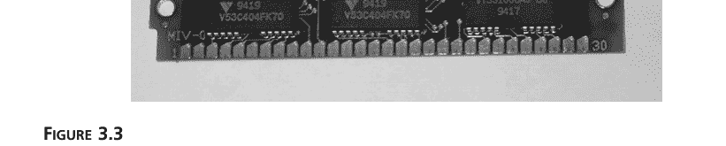

**图3.3**
*RAM模块上各芯片的速度作为芯片部件编号的一部分被印在芯片上。*

## 混合内存类型

大多数主板不能很好地处理SDRAM与其他RAM类型的组合。因此，如果你在主板上使用了任何SDRAM，通常就不能使用其他类型的内存。一般来说，混合使用FPM DRAM和EDO DRAM不会带来太多问题，但你应该查阅主板手册以确保无误。

有些主板不能很好地处理混合使用的SIMM和DIMM，即使两种模块类型包含相同类型的RAM也是如此。因此，在向包含另一种类型内存的系统中添加某一类型的RAM之前，你应该先查阅主板手册。即使允许混合使用类型，也可能无法使用所有的RAM插槽。例如，一块Pentium主板可能包含两个168针DIMM插槽和四个72针SIMM插槽（两组，每组两个插槽）。但该主板可能仅支持总共三组内存，这意味着你必须空出一个DIMM插槽或两个SIMM插槽。同样，你应该查阅主板手册以获取详细信息。

## 其他杂项因素

特别是对于较旧的内存类型，还有一些额外因素可能影响特定内存模块在特定主板上的可靠性。这些因素包括

- **跳线设置** 早期的80486及更早的计算机通常使用主板上的跳线来标识安装的RAM容量。后期的80486及更新的计算机通常会自动检测内存量，并在适用时检测内存类型。如果你使用的是较旧的主板，在添加或移除RAM时可能需要调整跳线设置。
- **芯片数量** 在20世纪90年代中期，关于2芯片或3芯片的30针SIMM与8芯片或9芯片的30针SIMM之间存在大量讨论。2芯片或3芯片的SIMM使用了比相同容量的8芯片或9芯片对应版本更高容量的芯片，这种差异导致了一些细微的电子差异。2芯片和8芯片的SIMM不具备奇偶校验功能，而3芯片和9芯片的变体则具有奇偶校验功能。一般来说，在那个时代的主板上，最好保持每个SIMM上的芯片数量相同，尤其是在同一组内。使用72针SIMM和168针DIMM的较新主板受此类影响较小。
- **单面/双面** 内存模块可以将芯片安装在一面或两面。这一特性与电子差异相关，某些主板对单面或双面SIMM或DIMM有特定要求。这些要求通常在主板手册中有记载，你应该在其中查阅更多信息。
- **奇偶校验** 如果你计划扩展内存，请尽量使用与当前系统一致的内存类型——如果系统目前使用奇偶校验内存，就继续使用奇偶校验内存；如果不使用，就使用非奇偶校验内存。大多数计算机在启动过程中会短暂显示内存是奇偶校验还是非奇偶校验。

> **提示**

你可以通过在软盘驱动器中放入一张已格式化但不可启动的空白软盘并重新启动计算机，来查看BIOS的硬件信息显示，其中包括内存类型的摘要。在执行此操作之前，请确保BIOS已设置为从软盘启动，否则计算机可能会先尝试从硬盘启动并进入Linux。通常，当BIOS遇到不可启动的软盘时，会在屏幕上打印一条简短消息然后停止，将硬件信息保留在显示屏上供你从容阅读。（不可启动的软盘消息实际上包含在软盘本身中，因此会因你格式化软盘的方式不同而有所差异。）

- **内存空洞** 某些主板BIOS可以设置为在特定位置（如16MB或64MB处）创建或不创建*内存空洞*。这些内存空洞是内存映射中的不连续区域——不能用作RAM的小块区域。Linux通常在有或没有内存空洞的情况下都能正常工作，但如果你遇到Linux无法识别全部RAM的问题，你可能需要检查并更改BIOS中的此类设置。
- **内核参数** 2.2.x系列之前的Linux内核无法自动检测超过64MB的内存量，因此如果你使用的是较旧的内核且内存较多，你可能需要告诉Linux你有多少内存。你可以通过在/etc/lilo.conf文件中添加如下一行，然后重新运行lilo以重新安装Linux引导加载程序来实现：

        append="mem=nnnM"

    其中*nnn*的值为兆字节数，例如*128*代表128MB的RAM。在某些情况下，即使使用2.2.x内核也需要使用此命令，尽管这些内核通常能正确检测内存。

一般来说，你应该阅读主板手册，了解其在内存方面可能存在的其他特殊性。某些主板需要特定的RAM变体，你应该注意为此类计算机找到合适的RAM。

## 缓存存储器

当你想到计算机的内存时，你可能首先想到的是安装在SIMM、DIMM或RIMM中的大块RAM。然而，这并不是计算机中唯一的内存类型。正如我之前提到的，显卡通常有自己的RAM存储，其他各种组件也是如此，包括CD-ROM驱动器、硬盘驱动器，甚至一些声卡。此外，还有一种称为*缓存*的内存类型与CPU相关联，通常还与主板相关联。在你组装或购买新计算机、或扩展现有计算机时，理解什么是缓存存储器、存在哪些类型的缓存以及缓存如何与主RAM存储交互是非常重要的。

## 什么是缓存存储器？

当应用于计算机内存时，术语*缓存*指的是一种用于保存较大内存存储副本的内存类型。缓存存储器的速度始终比相应的主内存更快。通过将最常访问的数据放置在缓存存储器中，整体系统速度可以得到提升，因为CPU可以使用缓存存储器而非较慢的主内存来执行许多内存访问操作。

事实上，缓存的应用范围超出了内存访问。在大多数操作系统（包括Linux）上，一部分RAM被保留用作*磁盘缓存*——用于保存硬盘部分内容的RAM。我之前提到的CD-ROM和硬盘上的RAM就是内置于这些设备中的缓存。

不过，现在让我们仅考虑存在于主板上及其直接连接的组件上的缓存：CPU（L1）缓存和L2缓存。

## L1缓存

最靠近CPU的是*一级*缓存，即*L1*缓存。自80486以来，L1缓存已内置于CPU本身中。该缓存以CPU的内部速度运行，因此非常快。然而，在大多数CPU上，L1缓存也相当小。表3.3汇总了一些最常见的x86 CPU所使用的缓存大小。

**表3.3** x86 CPU缓存大小

| CPU | L1缓存大小 |
|---|---|
| 80386 | 0KB |
| 80486SX、80486DX、80486DX/2 | 8KB |
| 80486DX/4 | 16KB |
| 80486 Pentium OverDrive | 16KB + 16KB |
| Pentium | 8KB + 8KB |
| Pentium MMX | 16KB + 16KB |
| Pentium Pro | 16KB + 16KB |
| Pentium II | 16KB + 16KB |
| Celeron | 16KB + 16KB |
| Pentium III | 16KB + 16KB |

## 表 3.3 续

| CPU | L1 缓存大小 |
| :--- | :--- |
| AMD K5 | 16KB + 8KB |
| AMD K6 | 32KB + 32KB |
| AMD K6-2 | 32KB + 32KB |
| AMD K6-III | 32KB + 32KB |
| AMD Athlon | 128KB |
| Cyrix 6x86 | 16KB |
| Cyrix 6x86MX & MII | 64KB |
| NexGen Nx586 | 16KB + 16KB |
| IDT WinChip | 32KB + 32KB |

一些 CPU 采用单个*集成* L1 缓存，其中数据和程序代码都存储在一个缓存区域中。其他 CPU 则使用独立的代码和数据缓存，这两者的大小通常相同。后一种 CPU 缓存类型在表 3.3 的*缓存大小*列中用两个值表示。

在其他条件相同的情况下，更大的 L1 缓存更好。当然，其他条件并非总是相同，因此缓存大小并不是衡量 CPU 性能的唯一标准。然而，它可能是一个重要的标准，特别是如果你经常运行那些主要使用紧凑计算循环执行操作的程序。如果 L1 缓存足够大，代码中最重要的部分可以完全驻留在其中，从而显著提高性能。如果缓存较小，并非所有相关代码都能放入 L1 缓存，从而降低性能。

由于 L1 缓存是 CPU 的一部分，除了更换整个 CPU 外，无法扩展或替换它。对大多数人来说，最好将 CPU 视为一个集成的整体，并根据整体 CPU 性能来决定购买哪种 CPU。然而，如果你知道你的计算机使用将涉及紧凑但密集的计算循环，你可能希望优先考虑具有大缓存的 CPU。

## L2 缓存

*二级*（L2）缓存比 L1 缓存容量更大，但也更慢。其位置因 CPU 而异。在 80486 和大多数 Pentium 兼容（Socket 7）系统中，它位于计算机的主板上。在 Pentium Pro、Pentium-II、Pentium-III、AMD K6-III、AMD Athlon 和一些 Celeron 处理器上，它位于 CPU 封装上，尽管它并非与 CPU 本身来自同一晶圆。表 3.4 总结了那些集成 L2 缓存的 CPU 的缓存大小。一些 CPU 提供不同的缓存容量，要么是在相同 CPU 速度下的不同变体，要么是在不同 CPU 速度下的不同缓存容量。早期的 Celeron CPU 没有 L2 缓存，这大大降低了它们相对于 Pentium-II CPU 的性能，但较新的型号包含了 128KB 的 L2 缓存。

**表 3.4 x86 L2 缓存大小**

| CPU | L2 缓存大小 |
| :--- | :--- |
| Pentium Pro | 256KB–1MB |
| Pentium-II | 256KB–512KB |
| Pentium-III | 256KB–512KB |
| Celeron | 0–128KB |
| AMD K6-III | 256KB |
| AMD Athlon | 512KB |

将 L2 缓存放在 CPU 模块上，比放在主板上更能提高性能，这主要是因为缓存可以以更快的速度运行。主板上的 L2 缓存以主板总线速度（目前通常为 100MHz）运行，而 CPU 模块上的缓存则有潜力以更高的速度运行。

> **注意**

NexGen Nx586 CPU 需要特殊的主板，这主要是因为它使用了一个独立的总线连接其 L2 缓存。与 Pentium Pro 和后来的 Intel CPU 的缓存一样，Nx586 缓存以 CPU 的内部时钟速率运行，而不是主板总线速度。然而，Nx586 的 L2 缓存物理上位于主板上。

Pentium 级 CPU，包括来自 Cyrix 和 AMD 的更快的 Socket 7 型号，将 L2 缓存放在主板上。大多数 80486 和 Pentium 级主板都包含一定数量的焊接在板上的缓存，有些允许你通过添加芯片或特殊的缓存内存模块来增加主板的缓存。这种模块没有标准化的形式，尽管人们已经多次尝试创建这样的标准。最终，你应该查阅主板文档以获取详细信息。

> **注意**

AMD K6-III CPU 在 CPU 封装中包含一个 L2 缓存，但它用于本身包含 L2 缓存的 Socket 7 主板上。当与 K6-III CPU 一起使用时，主板的缓存就变成了*三级*（L3）缓存。相对于与其他 CPU 一起使用时，它的重要性降低了，但三级缓存的存在确实略微提高了性能。理论上，可以为 Slot 1、Slot 2、Socket 370 或 Slot A 主板添加 L3 缓存，但很少有主板包含缓存，因为收益相对较小。

在考虑 Socket 7 主板时，考虑主板支持的最大可缓存 RAM 容量非常重要。对于许多产品，可以安装超过可缓存容量的 RAM。最终结果通常是系统整体性能*降低*。例如，假设一个主板最多可以缓存 64MB 的 RAM，但你在该主板上安装了 128MB。在这种情况下，只有一半的内存访问可以从缓存中受益。如果你碰巧从未缓存的 64MB RAM 中运行一些重要的代码（如 Linux 内核或频繁使用的程序），该程序的性能会比从缓存的 64MB RAM 中运行更差——或者比计算机只安装了 64MB RAM 时更差。当然，如果你经常运行大量程序，以至于大量使用交换空间，那么添加 RAM 仍然可以改善情况，但通常来说，明智的做法是不要将 RAM 扩展到超出主板可缓存的范围。如有必要，购买一台能支持更多可缓存 RAM 的新主板。

表 2.1 到 2.4 列出了 Pentium 级主板芯片组的总可缓存 RAM。然而，任何给定主板上的实际可缓存 RAM 在一定程度上取决于主板中安装的缓存大小。支持给定 RAM 量所需的缓存大小的详细信息因主板芯片组及其使用的缓存类型而异，因此你应该查看主板手册或联系主板制造商以获取详细信息。

## ROM

除了允许读写的 RAM 和缓存内存外，计算机还包含各种形式的*只读存储器*（ROM）。ROM 用于存储计算机上很少或从不更改的数据。（当数据由程序代码组成时，它被称为*固件*。）在主板上，ROM 存储着*基本输入/输出系统*（BIOS），它控制计算机的启动过程，并用于设置各种重要的主板参数。许多其他设备也包含 ROM，例如声卡、视频卡、SCSI 主机适配器、硬盘、调制解调器和打印机。本章主要关注主板 ROM，尽管其中大部分信息也适用于其他设备上的 ROM。

## 主板 ROM 和 ROM 变体

多年来，在各种应用中使用了几种不同类型的 ROM 芯片。这些包括

- **普通 ROM** —— 最基本的 ROM 类型简称为 ROM。这种形式的 ROM 是真正的只读；它包含的信息在工厂编程，无法更改。普通 ROM 往往速度慢且昂贵，它们在现代设备中不受青睐，因为如果在 ROM 中的固件里发现错误，纠正该错误的唯一方法是物理更换 ROM 芯片。你最有可能在非常古老的计算机上找到普通 ROM。

- **PROM** —— *可编程 ROM*（PROM）是普通 ROM 的升级版，因为其内容可以更改。PROM 出厂时没有信息，可以在特殊设备的帮助下存储数据。然而，一旦编程，PROM 就无法擦除和重复使用。因此，它们在现代计算机中使用不多。

- **EPROM** —— *可擦除 PROM*（EPROM）是 PROM 的升级版，因为 EPROM 的内容可以通过将芯片暴露在紫外线下擦除。由于这种擦除方法，EPROM 的陶瓷或塑料封装上有透明窗口。制造商通常在这些窗口上贴上贴纸以防止意外擦除。重新编程 EPROM 需要将其从设备中取出并使用特殊的 EPROM 编程器，因此 EPROM 在大多数现代设备上不使用。它们在 1990 年代中期仍然很常见，因此你可能在那个时代的设备中仍然能找到 EPROM。

> **注意**

如果你从芯片上撕下贴纸并发现一个透明窗口，请更换贴纸或在窗口上贴上新的贴纸。虽然你不太可能意外擦除 EPROM，特别是当 EPROM 位于计算机机箱内部时，但冒险是没有任何意义的。

- **EEPROM** —— *电可擦除 PROM*（EEPROM，也称为*闪存 ROM*）是现代计算机设备中最常见的 ROM 类型。顾名思义，EEPROM 可以电子方式擦除和重新编程。这一特性允许用户在不移除任何芯片甚至不打开机箱的情况下更新主板（或其他设备）的 ROM。（一些主板确实要求在更新系统 ROM 之前设置跳线，因此在这样的计算机上你必须打开机箱。）EEPROM 在易用性方面代表着巨大的改进，尽管它们也带来了一些危险，

因为终端用户在重新编程EEPROM时很容易犯错。如果发生这种情况，设备通常会变得无法使用，直到EEPROM芯片被更换。一些设备包含一个备用ROM，其中存储了足够的信息来向EEPROM刷写新数据。请查阅您的文档以确定您的主板或其他设备是否具有此类备用ROM。

从普通ROM到EEPROM的演进过程中，*只读存储器*（read-only memory）这个名称中*唯一*准确的部分变得越来越不准确。然而，即使是EEPROM也不容易被擦除。需要运行一个特殊程序，向EEPROM发送额外的电流才能擦除或重新编程它；对EEPROM进行普通的写操作不会改变其内容。

> **提示**

如果您需要重新编程Flash ROM，您应该采取两项预防措施。首先，备份ROM原始内容并将其存放在软盘上。大多数EEPROM更新实用程序都允许您这样做。其次，在正常工作时间内执行更新。如果出现错误导致设备无法启动，您就可以将计算机和备份软盘带到计算机维修店，技术人员可以使用您制作的备份来创建一个新的EEPROM芯片，或者用旧但可用的内容重新编程您现有的EEPROM。如果您的主板EEPROM是可拆卸的，您可能需要考虑准备一个备用EEPROM芯片。这样，在发生重新编程错误时，您就不需要将计算机送到维修店进行修复，前提是您熟悉更换插槽式芯片的操作。请查看您的主板手册，了解您的主板接受的EEPROM芯片类型。您可以从电子器件供应商处购买空白EEPROM芯片，然后使用EPROM编程器自行编程，或者将芯片和计算机BIOS的副本带到计算机维修店，让他们完成这项工作。一些主板制造商也会出售预编程了适用于您主板型号BIOS的备用EEPROM芯片。如果您的主板包含不可刷写的备用BIOS，则无需创建备用BIOS EEPROM芯片，但您仍应在刷写BIOS之前将完整的可用BIOS复制到软盘上。

大多数主板Flash实用程序是为DOS编写的。即使在仅包含Linux分区的计算机上，您也可以从软盘运行此类程序。如果您没有DOS许可证，可以考虑使用FreeDOS (http://www.freedos.org)。这个免费的DOS重新实现版本足以运行BIOS刷写实用程序。

## 系统BIOS的重要性

计算机的BIOS是其所包含的最底层代码，也是最重要的代码之一。没有BIOS，计算机无法启动。每个CPU在首次开机时都会在内存的特定区域查找指令。x86 PC架构与大多数计算机一样，其设计使得ROM位于CPU的启动位置。该ROM包含帮助计算机从软盘、硬盘或其他设备启动的代码。具体细节很复杂，不同计算机之间也有所不同，但从BIOS开始到操作系统中高级程序结束的一系列操作，最终使计算机正常运行。

x86 BIOS最初是为运行中的操作系统提供服务而设计的。例如，BIOS包含操作系统可用于从硬盘读取数据和在屏幕上显示信息的例程。然而，Linux在正常操作中不使用这些例程，因为Linux是一个32位操作系统，而这些BIOS例程本质上是16位的。除了在启动过程中传递控制权之外，Linux很少使用BIOS。如前所述，BIOS启动代码至关重要。

BIOS还包含帮助您配置硬件运行方式的例程。BIOS的这部分被称为*CMOS设置实用程序*，因为它设置的选项存储在*互补金属氧化物半导体*（CMOS）存储器中。这是主板上一小块非易失性存储区域。您可以在CMOS设置实用程序中设置的选项包括BIOS查找启动设备的顺序、内存时序特性（特别是在较旧的主板上）以及哪些主板设备（EIDE端口、并行端口等）处于活动状态。大多数CMOS设置实用程序被分为多个子部分。例如，图3.4显示了一个典型的主屏幕。顶部的每个选项（Main、Advanced等）都对应一整屏的选项。

一些CMOS设置会影响Linux处理相关硬件的方式，因此即使在Linux环境中也很重要。CMOS配置的细节在不同主板之间差异很大，这既是因为BIOS来自不同的制造商，也是因为不同的主板支持不同的功能。事实上，进入BIOS CMOS设置实用程序的方法因BIOS而异。通常，您需要在启动过程中按下特殊按键或按键组合（Del和F3是两个常见的选择），通常是在主板检测RAM的时候。（大多数BIOS会在启动过程中的适当位置显示提示，请留意它，或查阅主板手册。）

## 插件板上的ROM

正如我之前提到的，许多插件板都有自己的ROM。在现代板卡上，这些ROM通常是EEPROM，尽管在较旧的产品上可能是其他类型。与主板ROM一样，扩展卡ROM包含设备用于帮助控制自身的代码。一些扩展卡ROM还与主板ROM配合使用。例如，SCSI主机适配器和某些网络适配器包含*引导BIOS*，它们会接入计算机的引导序列。由于SCSI主机适配器的设计差异很大，标准主板BIOS无法控制SCSI设备，包括SCSI硬盘。SCSI引导BIOS提供扩展BIOS代码，允许计算机从SCSI硬盘启动。SCSI适配器的BIOS还可以提供类似于CMOS设置实用程序的用户界面。该实用程序通常提供配置SCSI主机适配器的方法，并可能包含配置或修改SCSI设备的选项。例如，许多此类实用程序允许您对SCSI硬盘执行低级格式化。类似的说明也适用于允许从网络硬盘启动的网络适配器。

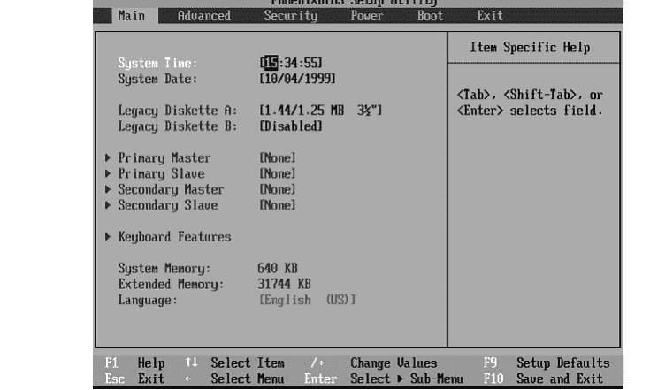

> **注意**

如果您在非x86计算机上运行Linux，您可能可以使用主要为x86计算机销售的PCI设备。然而，其中一些设备包含的ROM依赖于x86 BIOS，而其他平台的相应代码可能不可用。在这种情况下，该设备可能无法在非x86硬件上使用，或者功能可能受限（例如无法从SCSI硬盘启动）。在其他情况下，设备可能无法在非x86硬件上使用，因为Linux驱动程序在该硬件上无法正确编译。

大多数其他设备上的ROM，如显卡、声卡和调制解调器，与系统BIOS的接口不像上述那样直接。（显卡BIOS确实为系统BIOS提供一些有限的服务，但Linux不使用这些服务。）在很大程度上，这些BIOS提供的是设备内部使用的固件代码。例如，电话调制解调器使用的调制技术相当复杂，事实上，当今许多调制解调器本身就是小型计算机。这些调制解调器需要自己的软件，这些软件包含在ROM中。升级卡的固件通常可以提高设备的性能。在极端情况下，您可能能够获得额外的功能。例如，1997年和1998年销售的许多调制解调器使用专有协议进行最高56Kbps的通信。最终，业界确定了开放的v.90协议用于此类通信。大多数使用早期X2和K56Flex协议的调制解调器可以通过仅升级ROM来支持v.90。

> **注意**

一些调制解调器的重要软件存储在驱动程序中，而不是调制解调器本身。此类调制解调器通常被称为仅限Windows的调制解调器或该术语的某种缩写。一般来说，这些设备在Linux下不可用，尽管也有例外情况。第18章"调制解调器"将更详细地介绍调制解调器。

与主板BIOS一样，为扩展卡刷写更新的BIOS通常只能在DOS下完成，有时也可以在Windows下完成。FreeDOS (http://www.freedos.org) 对于可能需要运行此类板卡更新实用程序的Linux用户非常有用。

## 总结

一台现代计算机很容易包含超过六种不同类型的存储器，包括两三种类型的高速缓存RAM、主系统RAM、主板BIOS ROM、显卡上的RAM以及各种扩展卡上的ROM。许多存储器类型最好在特定设备的上下文中来理解，例如显卡上的ROM和RAM。

主系统内存本身是一个相当复杂的话题，因为多年来使用了太多不同类型的内存——FPM DRAM、EDO DRAM、SDRAM和RDRAM；分布在SIMM、DIMM和RIMM上；具有不同的速度、大小等。将RAM与主板匹配是组装计算机或升级现有计算机内存时您可以执行的最重要的任务之一。在进行匹配时，您能做的最重要的事情就是阅读主板手册。


#### 机箱与电源

## 第四章

### 本章内容

-   机箱设计 104
-   机箱与主板匹配 111
-   扩展空间 113
-   评估计算机机箱 118
-   电源 124

计算机的机箱是其最直观可见的特征。计算机机箱在尺寸、形状、颜色和装饰特征上差异巨大。同样重要的是，机箱在开启的难易程度、可容纳的磁盘驱动器数量、构成材料、制造工艺优劣，以及内部固定装置是否便于触及、维修和更换等方面也各有不同。其中一些特性在观察机箱甚至仅看照片时就能明显看出，但另一些则需要仔细检查。本章将主要介绍这些机箱特性，旨在帮助您在组装新计算机或为旧计算机更换因不再满足需求而显得过于狭小的原有机箱时，找到最合适的计算机机箱。

通常与机箱一同销售的一个组件是电源。电源将墙式插座的电源（在北美为120伏交流电）转换为主板和磁盘驱动器所需的3.3伏、5伏和12伏直流电。一个功率不足或廉价的电源可能会使一台原本性能良好的计算机行为异常，因此，为计算机配备一个优质的电源非常重要。

机箱和电源都与主板紧密相关。主板必须正确安装在机箱中，这意味着这两个组件必须共享一个共同的*外形规格*——即关于安装孔布局、主板整体尺寸和形状的标准。同样，电源必须能够为主板提供适当的电压水平。幸运的是，常见的外形规格只有少数几种，因此匹配主板和机箱并非难事。然而，您应该从一开始就了解这一点，因为您对外形规格的选择会影响所有三个组件——主板、机箱和电源。

## 机箱设计

关于计算机机箱，您可能首先想到的问题之一就是想要什么样的整体设计。存在多种可能的设计。其中大多数，也是最受欢迎的设计，可以分为三类：台式机箱、塔式机箱和薄型机箱。还有一些特殊、专用且不太流行的机箱形式。

## 台式设计

最初的IBM PC XT和IBM PC AT计算机采用的就是台式设计。这种形式的机箱相对较矮但较宽，如图4.1所示。因此，它们会占用大量桌面空间，但通常可以在这些机箱顶部放置其他物品，例如显示器。

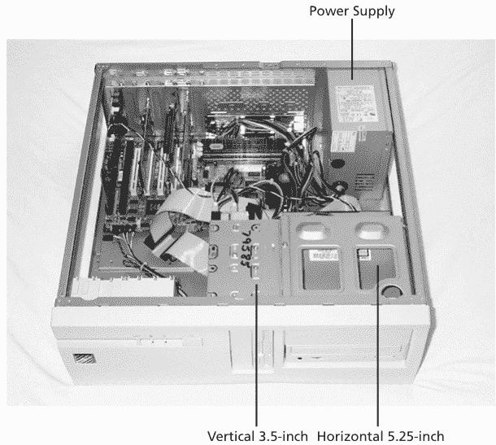

**图 4.1**

*台式机箱可能便于操作，因为主板是水平放置的。*

> **注意**
> 许多台式机箱并非为承受当今大型19英寸和21英寸显示器的重量而设计。即使是17英寸显示器，对于某些机箱来说也可能过重。请务必查阅机箱文档（通常只是一张纸）或联系机箱制造商，以了解机箱能承受的重量。

现代台式机箱尺寸相当统一，因此在可支持的磁盘驱动器数量方面具有相似的容量——大约两个5.25英寸和三个3.25英寸设备。它们的电源无一例外地位于右后角，而驱动器托架则位于右前角（参见图4.1）。大多数台式机箱将5.25英寸驱动器托架水平安装，而将3.25英寸托架垂直安装，尽管有些设计也将3.25英寸托架水平放置。5.25英寸驱动器托架通常需要水平放置，这一点往往很重要，因为使用托盘的CD-ROM驱动器在垂直安装时通常无法正常工作。软盘、3.5英寸硬盘、Zip驱动器和磁带驱动器通常对方向不太挑剔，因此这些设备的垂直安装不会带来问题。

最初的IBM PC XT和AT计算机的电源开关直接连接在电源上，位于机箱右侧靠近后部的位置。当然，这个开关位置很不方便，较新的型号则将电源开关放置在前面板的某个位置。在这个电源开关附近，通常还有一个重置按钮、一到两个用于指示电源状态和硬盘活动的LED指示灯，偶尔还有其他开关或LED指示灯。在20世纪90年代中期之前，用于指示CPU时钟速度的LED指示灯并不少见，还有键盘锁（除非插入并转动钥匙，否则计算机无法运行）。涡轮开关通常用于切换主板的一些速度增强功能。最后这三种功能在ATX机箱上已经相当少见。

## 塔式设计

由于台式设计占用大量桌面空间，塔式配置应运而生。从本质上讲，塔式设计不过是将台式设计侧放，电源和驱动器托架位于顶部（见图4.2）。事实上，通常只需将台式机箱侧放即可用作塔式机箱。这样做会带来一些问题，其中最重要的是，当CD-ROM驱动器垂直安装时，加载许多CD-ROM会变得困难或不可能。（使用盒装光盘的CD-ROM驱动器在垂直方向上没有问题，一些托盘加载式CD-ROM驱动器包含卡舌，有助于在驱动器垂直安装时固定CD-ROM。）

塔式机箱包含与台式机箱相同的开关和前面板LED指示灯组合——电源开关、一个或多个指示计算机电源状态和硬盘活动的LED指示灯，以及在较旧的机箱上，用于指示CPU速度的LED指示灯和键盘锁开关。

如果塔式机箱保持垂直配置，操作起来可能会很困难，因为插入和移除扩展卡需要施加的力往往会使塔式机箱倾倒。因此，在操作塔式机箱时，最好将其侧放。

塔式设计的一个优点是其灵活性；可以在不改变计算机占地面积的情况下制造更大或更小的塔式机箱——只需使塔式机箱更高或更矮即可。图4.2展示了一个*全塔式*机箱，意味着它比大多数机箱都大。*中塔式*机箱的大小与台式机箱大致相当，只是侧放。*迷你塔式*机箱在价格较低的计算机中非常受欢迎。这些机箱比中塔式机箱矮，并且通常扩展空间非常有限。这些塔式机箱子类型之间的界限充其量是模糊的；一个人眼中的全塔式机箱可能是另一个人眼中的中塔式机箱。有些公司甚至可能使用不同的名称，或将一个系列分解为更多或更少的子样式。最终，重要的是机箱的尺寸及其包含的驱动器托架数量，而不是赋予它的名称。一些塔式机箱，特别是较大的类型，提供具有不同数量3.5英寸驱动器托架的变体。

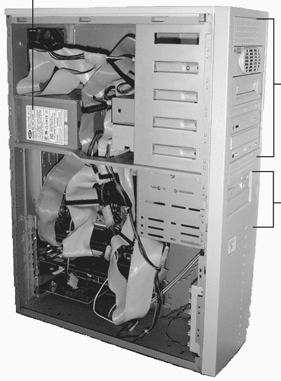

**图 4.2**

*像这样的全塔式机箱提供了大量的扩展空间和内部设备容纳空间。*

## 薄型机箱

如果您喜欢台式设计但又希望机箱更矮一些，薄型设计可能正是您所需要的。如图4.3所示，这些机箱比普通台式机箱矮——请注意，该机箱只有一个5.25英寸和一个3.5英寸磁盘托架，上下叠放，且这些托架下方的空间比图4.1所示机箱中5.25英寸托架下方的空间要小。

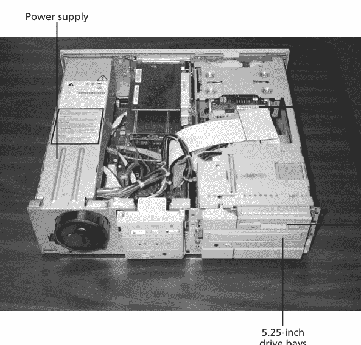

**图 4.3**

*薄型机箱，例如这款LPX型号，往往比传统机箱更拥挤。*

薄型机箱需要使用LPX或NLX外形规格的特殊主板。（我推荐NLX，因为它更标准化且更新。）您无法将主板从传统的台式或塔式机箱移动到薄型机箱中，反之亦然。大多数薄型计算机都是由主要制造商提供的预组装单元。这些计算机通常针对商业台式使用进行销售，但当然，如果您喜欢，没有理由不能购买这样的计算机在家使用。除非这些系统高度的缩减至关重要，否则我倾向于选择普通的台式或塔式设计，因为它们更常见，并且通常为您提供更多的扩展空间。

在x86领域之外，计算机有时会采用异常纤薄的薄型机箱。这些有时被称为*披萨盒*设计，因为它们几乎不比一个外卖披萨盒大多少。披萨盒计算机通常最多提供一两个扩展插槽和很少的板载功能。x86披萨盒计算机机箱相当罕见，即使存在，它们通常也使用非标准的主板设计。


## 特殊机箱类型

如果你购买或组装新电脑，很可能会选择前面描述的几种机箱类型之一。重要的是要认识到，这些常见类型存在变体，还有更多专业化设计。

### 标准类型的定制变体

如后面“将机箱与主板匹配”一节所述，大多数电脑机箱设计用于与第2章“主板”中描述的标准主板类型之一配合使用。少数公司开发和销售自己独特设计。这些设计使用的机箱通常看起来很像普通的桌面式、塔式或超薄式设计，但它们使用非标准的主板安装孔，并且通常使用非标准的电源类型和机箱前面板。这类电脑可能难以升级或维修。如果你计划购买预装电脑，我建议询问一下这方面的情况。如果电脑遵循ATX等标准规格，那么与使用专有规格的电脑相比，你将有更好的未来扩展和替换选择。

许多不使用x86 CPU的电脑遵循自己独特的规格。例如，苹果电脑不使用标准的x86 PC布局。如果你想使用这样的电脑，你可能别无选择，只能使用控制该架构的公司所支持的设计。

### 非常规机箱类型

在少数情况下，通常的机箱类型组合可能不适合你的需求。在这种情况下，你可能想要研究替代方案，例如：

- **笔记本电脑** 笔记本电脑当然需要机箱，但它们比超薄式机箱更加小型化。通常你不会像组装台式电脑时那样单独购买笔记本机箱。第23章“笔记本电脑”将更详细地介绍笔记本电脑。
- **机架安装式** 在某些情况下，*机架安装式*电脑是理想的。在这种设计中，主板和其他组件安装在开放的金属机箱中，很像一个车间货架系统。这些设计允许将许多电脑集中放置在一个方便的位置。机架安装式设计允许快速方便地访问所有电脑的组件。它们对于需要在狭小空间中放置大量电脑的安装最有吸引力，例如多电脑集群（有关一个流行的Linux集群项目的信息，请参见 http://www.beowulf.org）。
- **服务器** 服务器机箱通常比普通机箱大得多，以便容纳许多硬盘。这种机箱也相当昂贵。
- **一体式** 一体式电脑不时出现并变得相当流行。最近，这种设计在1998年随着苹果iMac的推出而普及（见图4.4）。eMachines eOne使用了类似的x86硬件设计。一体式电脑通常几乎没有扩展空间，并且可能需要非标准主板，但它们比大多数电脑更便携，通常也更紧凑。现代一体式电脑将大多数组件与显示器放置在同一机箱中，但一些早期的一体式设备将关键组件与键盘放置在同一机箱中。

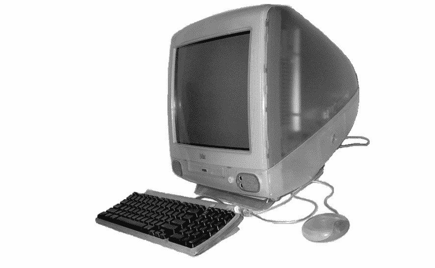

**图 4.4** 一体式电脑将主板、磁盘驱动器和类似组件与显示器放置在同一机箱中。

> **注意**
> 非常规机箱设计有时可能非常方便，但在升级时可能会变得很麻烦。一体式设备尤其如此，但机架安装式和服务器系统的情况则不那么严重。你应该仔细考虑你所考虑的任何特定非常规设计的成本和收益。

## 将机箱与主板匹配

电脑机箱容纳许多额外组件——软盘驱动器、一个或多个硬盘、光盘驱动器等。间接地，机箱还容纳各种扩展卡，如显卡和声卡。所有这些组件都提供一种或两种标准化尺寸，因此除非你已经用完了所有可用的安装点，否则不太可能出现组件无法装入机箱的情况。我在这个列表中尚未提到的关键组件是主板。将主板与机箱匹配是潜在问题最大的地方。当然，主板有标准化的规格，但必须注意是复数——如我在第2章中所述，有几种不同的主板规格。即使你选择遵循相同规格的主板和机箱，某些细节也可能导致主板和机箱配合时出现问题。

### 主板布局与机箱

第2章中描述的每种主要主板布局都需要不同类型的机箱，尽管一些机箱设计用于支持多种主板规格。你最可能遇到的规格包括：

- **AT 和 Baby AT** AT 和 Baby AT 规格在1995年之前是台式和塔式设计中最流行的。AT 主板规格比 Baby AT 规格大，需要更大的机箱。能够容纳全尺寸 AT 主板的机箱通常是中塔式、全塔式或桌面式设计。能够容纳全尺寸 AT 主板的机箱几乎总是也能支持 Baby AT 主板。这些主板也可以用于紧凑型迷你塔式机箱。我今天不建议购买新的 AT 或 Baby AT 机箱，除非你已经有匹配的主板。在这种情况下，由于 AT 和 Baby AT 设计现已过时，我建议你找一个可以支持 AT 或 ATX 主板的机箱，这样如果你将来决定升级主板，就不会限制你的选择。
- **ATX、Mini-ATX、Micro-ATX 和 Flex-ATX** 与 AT 和 Baby AT 设计一样，这四种设计代表了同一布局的变体，每一种依次代表更小的设计。由于 ATX 主板的宽度大于深度，而 Baby AT 主板的深度大于宽度，大多数 ATX 机箱是桌面式、中塔式或全塔式设计。迷你塔式 ATX 机箱将电源侧装，在电源旁边为主板留出空间。这种安排为主板那一侧的组件（通常包括 CPU 和内存模块）留下的空间很小。迷你塔式设计更常见于较小的 ATX 变体。全尺寸 ATX 机箱通常可以接受较小的 ATX 变体，但并非总是如此。
- **LPX** LPX 是1990年代中期及更早时流行的超薄式机箱设计。图4.3展示了一台 LPX 电脑。LPX 的细节没有完全标准化，因此有时很难将 LPX 主板与 LPX 机箱匹配。我建议避免使用此类机箱及其相关主板，除非在特殊情况下，例如你以低成本获得了一套完整的系统。
- **NLX** NLX 是 LPX 的替代品。它融合了 ATX 的许多特性，例如软件控制的电源，比 LPX 标准化程度更高，因此对于新电脑来说比 LPX 是更好的选择。
- **WTX** WTX 是一种新的布局，专为 Intel 的新 Itanium 处理器设计。与大多数早期机箱设计不同，WTX 包括与所需机箱特性、机箱冷却等相关的规范。WTX 机箱在2000年初几乎不存在，但在 Itanium 发布后可能会变得更受欢迎。你可以在 http://www.wtx.org 了解更多关于 WTX 的信息。

一旦你决定了主板和机箱的规格，你应该考虑一些进一步的因素，以确保你的机箱和主板匹配。

### 确保足够的机箱尺寸

理论上，任何为特定尺寸主板宣传的机箱都应该足够大以容纳该主板。然而，有时机箱和主板结合会导致异常紧凑的配合，或者机箱的某些组件可能会阻挡主板的重要部分。这种困难在 AT 和 Baby AT 机箱中比在后续设计中更常见，在小型机箱中也比在大型机箱中更常见。理想情况下，你应该从同一个经销商那里购买机箱和主板，这样如果出现问题，经销商就不会互相推诿，都拒绝接受退货。如果你有机会检查你考虑购买的主板与你选择的机箱的配合情况，请特别注意一些特性：

- **电源间隙** 在一些机箱中，电源悬在主板上方。确保为电源下可能存在的任何组件留有足够的间隙。
- **驱动器托架间隙** 有时，3.5英寸驱动器托架紧贴主板，就像电源可能做的那样。与电源一样，确保驱动器托架为托架下的任何组件留有足够的间隙。同样，你必须将电缆从主板或连接到它的卡连接到安装在托架中的驱动器。确保你能毫无困难地完成此操作。一些机箱，尤其是超薄式设计，将一个或两个硬盘托架放在特殊位置，因此不要将检查驱动器托架间隙的范围局限于机箱前面的通常位置。


## 主板间距

我曾遇到过主板插入时直接刮到一个或多个组件（通常是电源）的情况。这通常不会造成严重问题，但它可能对主板施加你希望避免的应力。

**安装孔位置** 请尽量确认机箱和电源在安装孔位置有足够的重叠，以确保主板能够安全安装。我见过一些组合，尤其是在 Baby AT 机箱和主板中，特别小的主板与机箱只有大约三个共同的安装孔。这种情况可能导致不稳定，从而运行不可靠。

## 扩展空间

一台新电脑应该像一个新家——足够容纳你所有的物品。然而，随着时间的推移，你的物品可能会扩展以填满可用空间。在电脑中，这种扩展有两种形式：磁盘和其他类磁盘设备，以及你插入主板的扩展卡。如果你购买或组装的新电脑没有足够的扩展空间，你必须做出艰难的选择来应对这些限制。

## 空闲驱动器托架

任何台式电脑机箱的主要特征之一是它包含的用于各种类型驱动器的*托架*数量——硬盘驱动器、软盘驱动器、CD-ROM 驱动器、磁带备份驱动器、Zip 驱动器等。对于大多数台式机机箱，每个托架可以分为以下四类之一：

- 可见 5.25 英寸
- 隐藏 5.25 英寸
- 可见 3.5 英寸
- 隐藏 3.5 英寸

隐藏托架凹进电脑机箱内，因此其容纳的设备不会暴露在外面。因此，隐藏托架主要用于硬盘。隐藏的 5.25 英寸托架在当今电脑中很少见，因为绝大多数 5.25 英寸设备使用可移动介质，如 CD-ROM 和磁带。如今大多数机箱都至少包含剩余三类中的一种，尽管这条规则也有例外。

> **注意**
> 机箱配有面板，你可以将其卡在未使用的可见托架前面。你也可以在可见托架中使用硬盘，并使用这些面板来阻止对硬盘驱动器的访问。如果你不安装这个面板，可能会扰乱机箱内的气流模式，并使意外震动硬盘变得更容易。

过去，托架通常按*高度*分类。**全高**托架可以容纳 1980 年代中期的大型硬盘驱动器。随着时间的推移，**半高**托架和设备应运而生，如今绝大多数 5.25 英寸设备都是半高的。**三分之一高**设备，正如你可能想象的那样，是全高设备高度的三分之一。大多数 3.5 英寸设备是三分之一高的。一些机箱的设计允许你向至少一些托架添加任何高度的设备，或根据需要进行合并。例如，一个托架可能容纳一个全高驱动器或两个半高驱动器。

在其他条件相同的情况下，你应该最大化你购买的任何机箱中可用的驱动器托架数量。一般而言，可见托架比隐藏驱动器托架更灵活，而 5.25 英寸托架比 3.5 英寸托架更理想。

> **提示**
> 可以使用适配器（如图 4.5 所示）将 3.5 英寸组件安装在 5.25 英寸托架中。其中一些适配器（如图 4.5 所示）是为硬盘设计的。其中一些包含风扇以帮助冷却硬盘（其中一个位于图 4.2 顶部附近的托架中）。另一些则包含开口，让你可以插入磁带、软盘或其他 3.5 英寸介质。

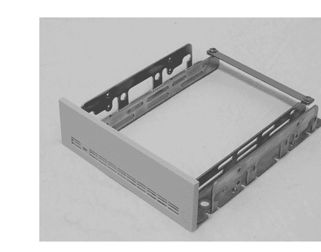

**图 4.5**
你可以将 3.5 英寸设备安装在适配器的内部导轨内，然后将适配器安装在 5.25 英寸驱动器托架中。

在塔式机箱中，从迷你塔到中塔再到全塔，你主要获得的是驱动器托架。因为 3.5 英寸设备通常是三分之一高的，而 5.25 英寸设备通常是半高的，所以添加 5.25 英寸托架为机箱增加的尺寸更多。

一般而言，我建议选择一个除了你近期打算使用的托架外，至少还有两个空闲驱动器托架的机箱。这些托架中至少有一个应该是可见的 5.25 英寸托架。这为你提供了添加两个设备的灵活性，其中至少一个可以是可移动设备。

与托架相关的最后一个考虑因素是驱动器安装方法。磁盘设备包含用于将驱动器连接到电脑机箱的安装孔。然而，许多机箱使用安装*导轨*。你将导轨连接到设备上，然后可以将设备滑入电脑。图 4.6 显示了一个例子。有时这些安装导轨的设计使得你无需螺丝刀即可将设备从电脑中取出。

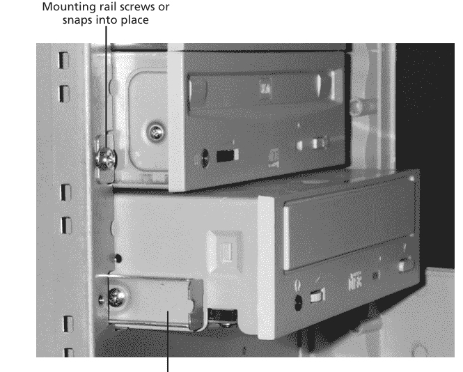

**图 4.6**
*安装导轨让你可以相对轻松地将设备滑入和滑出驱动器托架。*

## 后面板开口

大多数机箱设计允许你通过机箱后板上的连接器连接外部设备，如打印机、外置调制解调器和鼠标。从机箱的角度来看，通常使用三种类型的连接器：

- **主板安装连接器** 正如第 2 章所述，所有 x86 主板都至少有一个永久连接的连接器：键盘连接器。基于 ATX 及其变体的主板支持额外的连接器，通常包括串行、并行、USB 和 PS/2 鼠标端口。机箱包含适当的开口以允许这些连接器穿过，前提是机箱为你使用的主板类型而设计。
- **卡安装连接器** 插入式适配卡，如显卡、声卡和以太网卡，通常包含外部连接器或端口，如图 4.7 中的声卡所示。绝大多数 ATX 机箱的后部有足够的开口以适应所有 ATX 主板，但有时你会发现 AT 式机箱的空间不足以容纳其主板上的插槽。

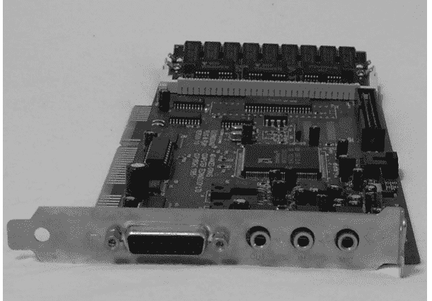

**图 4.7**
*当插入机箱时，此卡前景中的四个连接器可从电脑机箱后部访问。*

> **注意**
> 连接器安装的后面板对于标准 x86 机箱中使用的所有类型的卡都是相同的。因此，机箱不需要为 ISA 与 PCI 插槽而设计。实际上，可以从机箱中移除全 ISA 主板，并更换为全 PCI 主板。

- **电缆连接连接器** 许多机箱在其后面板上包含可以冲压掉的区域，以容纳通过带状电缆连接到内部连接器的外部连接器。这种冲压区域在较旧的 AT 式机箱上特别常见，因为匹配的主板使用通过带状电缆连接到外部连接器的端口。然而，即使在 ATX 系统上，这种冲压开口有时也很有用。例如，第 2 章描述并图 2.14 所示的内部/外部 SCSI 适配器可以通过这种冲压适配器连接。如果你的机箱缺少这样的开口，你可以使用一个适合你未使用的扩展卡插槽开口的适配器。

大多数主板有足够的后面板开口，尽管用于电缆连接连接器的冲压区域在较大的机箱尺寸上最常见。

一些机箱，特别是主要电脑制造商的定制设计，将一个或多个适配器移到电脑的前面板上。USB 和游戏端口适配器最有可能出现在这种电脑的前面。

## 警惕非标准设计

我已经警告过你不要使用非标准的主板和机箱形式。

然而，一些机箱以更微妙的方式是非标准的。此类机箱可能支持标准的主板尺寸，但使用其他非标准组件。例如，许多来自大型电脑公司的电脑使用以有趣方式弯曲的前面板。这些曲线通常需要在 CD-ROM 驱动器和其他可移动介质设备上使用不寻常的弯曲前面板。

如果你需要更换这样的驱动器，当你需要添加新驱动器时，你可能会面临一项艰巨的任务，因为它可能不合适，或者至少破坏机箱的美观。


## 空间不足时的扩展方案

那么，如果你已经填满了电脑机箱，却还想再添加一个设备，该怎么办呢？你有几个选择：

-   **整合设备** 有时你可以将两个或更多设备整合为一个。例如，如果你有两个硬盘，你可以用一个更大的硬盘替换它们，从而腾出一个驱动器托架。如果你有一个LS-120驱动器，你可能就不需要3.5英寸的软驱了。同样，有些网卡支持两个以太网端口，还有以太网/SCSI组合卡以及其他多功能扩展卡，这些都能帮助你更充分地利用现有的后面板空间和主板插槽。
-   **添加外置机箱** 某些设备有外置机箱可供选择。SCSI设备尤其适合外置，你可以购买许多内置或外置型号的SCSI设备。你也可以通过将内置SCSI设备移入外置SCSI机箱，将其转换为外置设备。甚至还有套件可以将EIDE设备转换为外置使用。不幸的是，外置机箱的价格几乎和一个完整的电脑机箱一样高，因此这种方案的成本会迅速攀升。
-   **更换机箱** 你读这一章可能正是在考虑这个方案。这通常是解决空间不足问题最经济的方法，尤其是当你需要添加两个或更多设备，却没有足够空间容纳它们时。

## 评估电脑机箱

一旦你确定了机箱的基本特性——是AT、ATX、NLX、WTX还是其他设计；是桌面式、 slimline 还是塔式；以及托架的数量和类型——你就可以开始选购了。我建议亲自去挑选机箱，因为很多细节在广告中无法体现。不过，一些机箱供应商通过在其网页上发布大量清晰的照片（包括关键特性的特写），为网络购物者提供了便利。

## 制作材料

过去，大多数电脑机箱几乎完全由金属制成，主要的例外是前面板，它通常是塑料的，带有部分或完全的金属背板。如今，许多机箱由塑料制成，内部通常带有金属衬层以屏蔽射频（RF）辐射。

在美国，联邦通信委员会（FCC）管辖几乎所有发射射频辐射的设备。计算机电路板在运行时会附带产生此类辐射，这些辐射会干扰电视和收音机等设备。设计不良的机箱可能会泄漏射频干扰，如果邻居查明问题出在你的电脑上，你可能会被依法要求关闭电脑，直到问题解决。一些机箱供应商声称他们的机箱是“FCC A级”或“FCC B级”设备，这意味着它们分别符合商业或家庭使用的射频辐射标准。然而，这些说法是错误的；FCC并不对单个组件进行评级，只对完整的电脑进行评级。

只要带有塑料外壳的机箱拥有坚实的金属内衬来屏蔽射频辐射，从性能角度就几乎没有理由偏好某一种类型。塑料机箱正越来越多地以各种颜色和形状出现，你可能（也可能不会）觉得它们有吸引力。

## 检查是否偷工减料

电脑机箱的价格差异很大。最基本的形式是，机箱就是一些金属盒子加上一些用于固定硬盘和其他电脑组件的成型金属部件。因此，制造商有时降低成本的方法之一是不完全处理机箱的金属边缘。不幸的是，这种削减成本的措施也可能割伤其他东西，比如你的手指。最好的机箱会将金属部件的边缘，特别是机箱盖板的边缘折叠起来，如图4.8所示。一个成本较低的安全措施是将金属边缘打磨光滑——或者至少比刚切割时更平滑一些。有些机箱同时采用这两种技术，通常将折叠边缘技术用于可拆卸的盖板和面板，而将内部边缘打磨光滑。在其他条件相同的情况下，大量使用折叠边缘的机箱更可取。

大多数机箱都有一个或多个薄弱环节——即异常廉价且容易损坏的部件。例如，图4.9显示了一个塔式机箱前面板上断裂的塑料铰链。该铰链的设计允许前面板摆开，然后从机箱主体上分离。问题在于，它容易与与之配合的金属部件产生刮擦和卡住。最终结果是顶部边缘（图4.8左侧）严重磨损，底部边缘（图4.8右侧）完全断裂。你应该检查机箱部件，特别是任何涉及运动的塑料部件，寻找它们可能过早损坏或停止执行其设计功能的迹象。

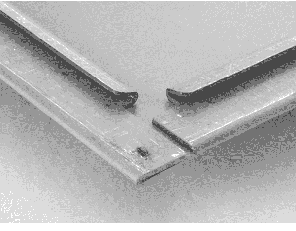

**图 4.8**
*这个机箱面板的折叠边缘不会割伤你的手指。*

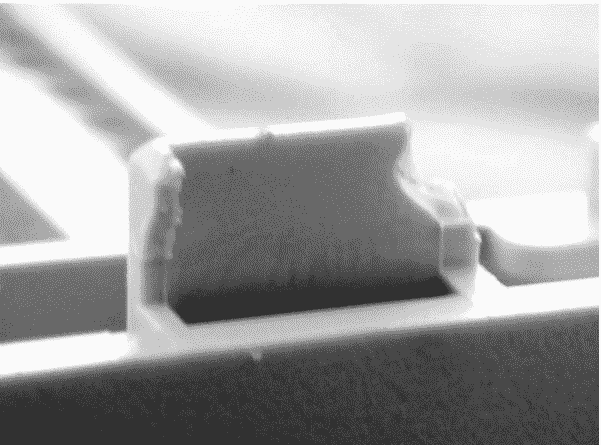

**图 4.9**
*塑料卡扣或铰链容易断裂。*

## 评估操作便捷性

如果你需要打开电脑来移除、更换或添加组件，你必须关注操作的便捷性。以下是一些需要考察的要点：

-   **开箱便利性** 20世纪90年代中期的机箱几乎总是需要4-6颗螺丝来固定。你需要先卸下这些螺丝，然后才能取下机箱盖。有些机箱使用拇指螺丝代替传统螺丝，而且可以购买售后拇指螺丝来替换旧机箱上的传统螺丝。有些设计使用更少的螺丝，或者使用卡扣代替螺丝，这样打开机箱就不需要拧螺丝了。
-   **面板数量** 有些机箱只有一个开口，通常是一大块弯曲的金属，覆盖机箱的三个面。这些面板可能难以拆卸和重新安装，尤其是在全塔式设计中。其他电脑则为机箱的每一侧使用单独的面板，当你只需要接触电脑一侧时会很方便。有些机箱要求你先打开一个面板才能拆下另一个；例如，你可能需要先拆下前面板才能打开主箱盖。这些设计可能会带来不便。
-   **操作位置** 大多数机箱要求你操作机箱背面的某些部件才能进入内部。这种操作可以是拧下螺丝，或者简单地捏开卡扣。其他机箱则让你通过在电脑前部进行类似操作进入。在其他条件相同的情况下，前置操作通常比后置操作更容易。一些塔式机箱现在有可以向外或向下摆开的侧面板，如果你电脑侧面有足够的空间，这会非常方便。
-   **被遮挡的主板组件** 特别是在小型机箱中，驱动器托架、电源和其他机箱组件有时会阻挡对主板组件的访问。例如，内存插槽可能隐藏在驱动器托架后面。尽量避免这种设计。
-   **主板托盘** 有时将主板安装到机箱中很困难。有些机箱通过使用可拆卸的主板托盘来简化这个过程。你将主板安装到一个可以轻松滑出或抬出机箱的部件上。在最优秀的此类设计中，主板托盘包含扩展卡的外部插槽，这样你就可以在不从主板上拆下扩展卡的情况下移除整个主板及其上的卡。这种设计使得轻松访问可能被机箱部件或机箱内线缆遮挡的主板组件成为可能。
-   **驱动器托架的访问** 如果机箱需要将驱动器直接螺栓固定到其托架上，请确保你能清晰地访问托架的两侧。在一些电脑上，这种操作很麻烦，因为它可能需要拆卸位于你想访问的托架侧面的主板或驱动器托架。使用导轨的机箱通常更容易访问驱动器。


当你在商店里研究一个机箱时，试着想象各种电脑组件会安装在什么位置，以及进行常见升级（例如增加内存、添加硬盘、添加扩展卡或更换CPU）需要哪些步骤。

## 散热

大多数x86机箱都包含一些散热设计。大多数电源都带有一个风扇，但这个风扇的设计更多是为了冷却电源本身，而不是冷却机箱内部。在AT式机箱上，电源风扇将空气从机箱内吹出，因此空气通过机箱上所有的开口被吸入。理想情况下，吸入机箱的冷空气会流过扩展卡、硬盘驱动器和其他组件，以帮助保持它们冷却。ATX式机箱则相反；电源从机箱外部吸入空气，并在机箱内排出，通常直接吹过CPU。然后空气通过为此目的提供的通风口排出机箱。

每种通风方式都有其优点。AT式散热的优势在于，流过电脑组件的空气是冷的，而ATX设计则不同，吹入机箱的空气已经被电源加热了。另一方面，ATX式散热倾向于在机箱内建立空气压力，这有利于散热，并允许使用过滤器去除灰尘颗粒。

一些组件，如CPU、快速硬盘和一些高端视频芯片组，会产生大量热量。为这些组件增加散热通常是有益的。最基本的散热类型是散热片。这是一个带有许多鳍片的金属组件，如图4.10所示。由于金属是良好的热导体，散热片会随着所连接的组件一起升温。然后空气可以流过散热片的鳍片，将热量从散热片和产生热量的设备上带走。为了改善散热效果，可以在散热片上安装一个风扇，以增加鳍片周围的空气流动。

> **注意**

带风扇的散热片在CPU上尤其常见。请确保你的散热片和风扇足以应对你使用的CPU。一个能很好地冷却一个CPU的散热片/风扇组合，可能无法冷却另一个CPU。在散热片和CPU之间使用导热膏也很重要。这是一种比空气导热性更好的糊状物。目的是使用恰好足够的导热膏来填充CPU和散热片之间的空气间隙。在正确应用后，导热膏在将散热片安装到CPU上之前，应该几乎看不出来，只是一层油腻的薄膜。你可以在大多数电子产品商店买到导热膏，包括Radio Shack（产品目录号#276-1372）。

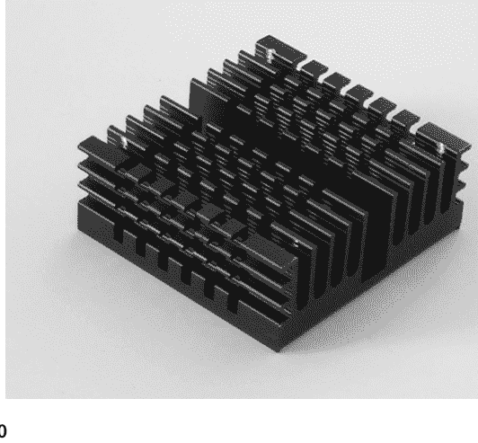

### 图 4.10

散热片的鳍片将热量从它所附着的物体上辐射出去。

大型计算机除了电源中的风扇和任何CPU散热片风扇外，通常还有一个或多个辅助风扇，这并不罕见。最常见的有两种类型：

- **整机风扇** 一个典型的整机风扇是一个3英寸的方形风扇，安装在机箱的前面板或后面板上。根据其安装方式，风扇可以将空气强制吹入或吹出机箱。有些风扇带有过滤器，以防止灰尘进入机箱。一种变体设计插入未使用的PCI或ISA插槽，并通过后部端口通风。这种变体在较小的机箱上特别有用，因为这些机箱没有用于3英寸盒式风扇的安装点。
- **硬盘风扇** 随着硬盘速度的提高，它们产生的热量也在增加。事实上，最快的现代硬盘，如果没有足够的散热，会因热量积聚而迅速损坏自己。因此，如图4.5所示的用于3.5英寸驱动器的5.25英寸安装支架，前面可以带有风扇。这些风扇旨在为现代3.5英寸硬盘散热。你应该查阅你的硬盘手册，了解是否需要这样的风扇，但作为一般规则，所有10,000转的硬盘都应该这样散热。许多7,200转的型号也能从中受益。

## 电源

大多数机箱都带有电源。每种类型的机箱——ATX、AT立式、AT台式等——使用的电源尺寸和形状都不同。此外，每种类型的主板使用不同的电源连接器。最重要的是，AT及相关主板使用两个提供5v电压的电源连接器，而ATX及相关主板使用一个提供3.3v电压的连接器。

购买机箱时，你应该考虑其电源的特性。如果电源故障或功率不足，你可以购买一个新的来替换机箱自带的电源。这样做时，你需要考虑电源的特性。

### 估算所需容量

电脑电源并不是电脑的无限功率来源。电源可能会过载，这可能导致行为异常。每个电源的内部电源连接器数量也有限，如果这些连接器用完了，就有必要使用特殊的电源分线器电缆来添加更多连接器。

#### 电源电气容量

要理解电源容量，首先需要了解与电相关的三个基本度量之间的基本关系：伏特（v）、瓦特（W）和安培（amps）。这种关系是

```
Watts = Volts × Amps
```

例如，如果一个5v设备消耗10安培，它就消耗50瓦。电源容量以瓦特为单位。例如，一个电源可能额定为235W。然而，要理解这如何转换为伏特和安培，需要知道相关设备所使用的电压。事实上，连接到现代计算机的各种设备在3.3v、5v和12v电压下消耗不同的功率。因此，要了解电源的容量，有必要了解它在任何给定电压下可以提供多少瓦特或安培。例如，一个电源可能能够在3.3v下提供14安培，在5v下提供22安培，在12v下提供8安培，总计252.2W。然而，许多电源包含针对电压组合的最大组合输出。例如，3.3v和5v操作可能有125W的最大限制，导致调整后的总瓦数为221W。

如果你想一丝不苟地获得足够的电源，你应该寻找你电脑中每个组件的功耗规格。不幸的是，对于一些组件，如大多数扩展卡，这类信息很难获得。表4.1总结了各种类型设备所需的典型功耗。

**表 4.1 各种设备的安培功耗**

| 设备 | +3.3v | +5v | +12v |
| :--- | :--- | :--- | :--- |
| ISA卡 | 0 | 2.0 | 0.175 |
| EISA卡 | 0 | 4.5 | 1.5 |
| 16位MCA卡 | 0 | 1.6 | 0.175 |
| 32位MCA卡 | 0 | 1.6 | 0.175 |
| VL-Bus卡 | 0 | 2.0 | 0 |
| PCI卡 | 7.6 | 5 | 0.5 |
| 3.5英寸软盘 | 0 | 1.5 | 1.5 |
| 3.5英寸硬盘 | 0 | 0.5 | 1.0 |
| CD-ROM驱动器 | 0 | 1.0 | 1.0 |
| 风扇 | 0 | 0 | 0.1 |

*扩展卡的数字是最大值；其他设备的数字是典型值。*

主板的功耗随CPU而变化。请注意，当使用电源提供的电压级别以外的任何电压时，所需的电压调节器会导致一些损失，因此实际消耗的瓦特数会大于你通过伏特乘以安培得出的值。

举个例子，考虑一台有一块ISA卡、两块PCI卡、一个3.5英寸软盘、两个3.5英寸硬盘、一个CD-ROM驱动器和两个额外散热风扇的电脑。将这些数值相加，这台电脑需要从3.3v获取50.16W，从5v获取77.5W，从12v获取70.5W，总计198.16W。主板也消耗几瓦特——大约25W左右，取决于主板和CPU。

当然，并非所有设备都同时需要其最大功耗。例如，通常硬盘在启动时需要大量功率，以克服停止的磁盘固有的惯性。磁带备份单元在不操作时消耗的功率很少；软盘也是如此。这一事实意味着，电源在大多数时间可能是足够的，但在某些时候仍然可能失败，例如当硬盘启动时，或者当你同时使用磁带驱动器和CD-ROM驱动器时。如果你在使用某个设备时遇到问题，可能是功率不足的电源造成的。


> **提示**

如果你有多个SCSI硬盘，可以通过配置SCSI驱动器仅在收到SCSI主机适配器指令时才启动，从而减少启动时的功耗。大多数驱动器可以通过跳线设置实现此配置，通常称为*远程启动*或类似名称。这样，驱动器会在主板完成初始测试后才通电，SCSI主机适配器会依次向每个驱动器发送启动信号，避免它们同时启动。

根据一般经验，235W电源足以满足小型系统的需求。如果添加了较多磁盘设备或高功耗扩展卡，可能需要提升电源容量。ATX系统可选用300W和400W电源，对于装满设备的塔式系统尤其必要。

## 电源连接线

电源容量的另一个考量因素是电源提供的连接线数量和类型。大多数设备（包括硬盘、光驱和磁带备份驱动器）使用标准化的四线电源连接器，采用防呆设计确保只能以特定方向插入设备。3.5英寸软驱使用较小的连接器，而主板则根据型号使用一个或两个连接器。

> **警告**

AT和Baby AT主板使用一对电源连接器，插入时必须将黑线相邻。如果反向插入，可能损坏主板！

如果设备数量超过电源提供的连接器数量，可以使用一个或多个电源分配器（如图4.11所示）来增加连接器数量。使用时，将电源插头插入分配器而非直接连接磁盘驱动器或其他设备，这样就能为两个设备供电。

虽然内部电源分配器非常实用，但不应过度使用，原因有二：

- 如果需要大量分配器，可能表明已超出电源容量。一两个分配器通常不成问题，但若需要五六个，就该考虑更换更大功率的电源。
- 每个电源分配器都是潜在的故障点。如果分配器连接不牢，可能导致连接的两个设备同时故障，且现象可能难以捉摸。我曾遇到因分配器不稳定导致的硬盘异常问题。

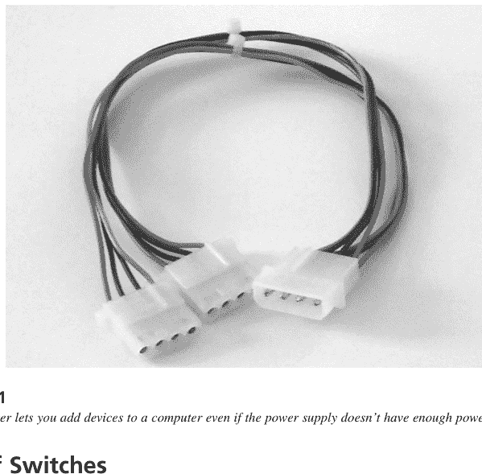

**图4.11**
电源分配器让您能在电源供电线不足时为计算机添加设备。

## 开关类型

x86 PC上常见的开关有三种类型：

- **集成在电源中**：此类开关常见于AT风格台式机箱，是电源的一部分。它们位于机箱外部——在台式机中通常位于机箱右侧靠后位置。部分ATX电源也配备后置开关，但这些开关仅作为ATX主电源开关的辅助开关。
- **电源上的远程开关**：大多数AT风格塔式系统在机箱前部安装拨动开关，通过线缆连接到AT电源。开关本身与机箱匹配，连接线缆可能较为麻烦，使得更换此类电源比更换其他类型电源稍显复杂。
- **通过主板控制的远程开关**：ATX及相关主板设计支持持续微弱供电，为监测各种事件的电路提供电流，例如电话铃响或用户按下机箱前部电源按钮等都可能触发系统启动。此类系统中，电源按钮连接至主板而非电源，由主板协调所有启动操作。ATX机箱通常配备电源按钮而非拨动式开关。

机箱类型决定了可用的开关形式。由于当前ATX规格的普及，您的电源开关很可能采用主板控制设计。部分ATX电源在后部配有开关，这一特性非常实用，允许在不拔掉插头的情况下切断计算机所有电路供电，使维修操作对人员和计算机都更安全。

> **警告**

如果ATX电源没有电源开关，在打开机箱维修前应拔掉电源插头，以避免主板杂散电流造成伤害。但这种做法失去了最便捷的接地方式——触摸机箱金属部分——因此可能增加静电放电损坏计算机的风险。为降低风险，可使用防静电手腕带，或在能频繁接触管道设施或暖气片的地方操作。

如果是带远程开关的AT风格机箱，更换电源时必须将新电源连接到开关。大多数电源配有连接示意图，如果丢失可按以下方式连接：

- 绿色线（若存在）为接地线，连接到机箱任意便利的金属部件。
- 黑色和白色线连接到电源开关的斜角接线片。
- 棕色和蓝色线连接到开关上平行排列的接线片。

> **警告**

棕色和蓝色线在电源通电时始终带电！因此务必在拔掉电源插头*之后*才能连接或断开这些线路！

## 电源质量

与所有产品一样，电源质量也存在差异，但普通消费者很难察觉。电源质量差异体现在为机箱内设备供电的稳定性上，即使输入电流存在波动。长期来看，电流波动可能损坏或摧毁计算机内部组件。极端情况下，电源可能输出过高功率或错误电压，导致计算机迅速损毁。

在一定程度上，您可以通过认证来确保最低质量标准。美国保险商实验室（UL）为包括电源在内的电气产品提供安全认证。其他国家的同类认证包括加拿大标准协会（CSA）、德国TÜV莱茵和VDE，以及挪威NEMKO。

少数制造商以生产超高品质电源而闻名，特别是Astec (http://www.astec.com) 和PC Power and Cooling (http://www.pcpowerandcooling.com)。如果追求最高品质电源，选择这两家厂商的产品通常不会出错——前提是电源功率符合您的需求。

如果电源损坏，可以从本地或邮购计算机配件供应商处购买替换品。通常销售机箱的店铺也提供电源。请确保新电源与原电源规格一致（AT、ATX等）。更换时通常需要拆下机箱后部四颗螺丝来卸下原电源——但要注意螺丝位置，因为有些电源的螺丝也在机箱后部可触及区域。接着需要断开电源与所有内部设备（主板、硬盘、软驱等）的连线。若是AT电源，还需断开电源与机箱主开关的连接，然后取出电源并按相反步骤安装新电源。


## 电源保护

计算机是一种昂贵的产品，你很可能希望保护它免受各种意外。与电源相关的意外对计算机尤为相关，主要分为两种形式：电力不足（电压过低或停电）或电力过多（电涌）。在美国，通过墙壁插座提供的电力为120伏，但这个数值总会有些微小的波动。虽然包括计算机在内的电器可以承受一定程度的波动，但较大的波动可能造成相当大的损害。你可以购买几种不同类型的设备来保护你的计算机免受电源问题的影响：

- **电涌抑制器** *电涌抑制器*（也称为*电涌保护器*）是一种可以阻断大型电涌的设备。这些设备通常将危险电压导入你家庭或办公室的接地线，从而使你的计算机脱离危险回路。在此过程中，电涌抑制器通常会触发内部断路器，从而切断所有设备的电源。非常大的电涌可能会损坏或摧毁电涌保护器。其理论是，让它摧毁价值50美元的电涌抑制器，总比摧毁与之相连的价值5000美元的计算机设备要好，因此电涌抑制器的设计初衷就是为计算机而自我牺牲。UL（美国保险商实验室）制定了一项名为 *UL 1449* 的标准，概述了合格电涌抑制器的特性。在购买任何新的电涌抑制器时，你绝对应该寻找这个标志。一些电涌抑制器还包括电话线插孔，如果你使用调制解调器，这是一个非常有价值的附加功能。少数型号还包括用于有线电视电缆的类似插孔，如果你使用有线调制解调器，绝对应该考虑这种型号。（你更有可能在百货商店的电视区而不是计算机区找到带电缆插孔的电涌抑制器。）

> **注意**
> 某些电涌保护器的电话线保护功能可能适用于数字用户线路（DSL）调制解调器，也可能不适用。电涌抑制器可能需要也可能不需要具备四线支持才能与DSL调制解调器配合工作，这取决于你的接线方式。即使连接了适当的线路，为电话和传统调制解调器设计的电涌保护器有时也会干扰DSL操作，降低连接速度或完全阻止连接。如果你使用外置DSL调制解调器，可以购买专用的DSL电涌抑制器，或以太网电涌抑制器，将其安装在DSL调制解调器和计算机之间。

- **线路调节器** 电涌抑制器非常适合保护你的设备免受大幅波动的影响，但较小的电源波动也可能造成损害。大多数计算机可以轻松应对轻微的电压过低、典型的电源波动甚至非常短暂的停电。然而，此类事件可能导致电源比预期更早失效，甚至可能导致计算机故障。线路调节器通过强制电源更接近所需的规格来防止这些问题。这种设备可以补偿轻度的电压过低，并将波动范围达几伏特的电压水平转换为更稳定的电压。最终结果是减少计算机的磨损，并降低因此导致错误的可能性。

- **备用电源** 备用电源（SPS）在线路调节器的基础上更进一步，增加了电池备份。如果输送到SPS的电力失效或降至某个水平以下，电池将启动并在一段时间内继续供电。如果运气好，电池的电量足以让你安全地退出所有程序并关闭计算机。然而，在SPS切换到其电池供电时，会有非常短暂的电力中断。大多数计算机的电源可以轻松应对这种切换，但这种短暂的供电间隙是不理想的，并且可以想象可能导致内存错误或其他问题，特别是如果你计算机的电源质量较低的话。

- **不间断电源** 不间断电源（UPS）在概念上类似于SPS，但设计有所不同。UPS不是在发生故障时检测故障并切换，而是始终由其电池供电，同时对其进行充电和放电。因此，在断电的情况下，你的计算机不会经历任何中断；UPS的电池只是在不被充电的情况下开始放电。一些公司宣传他们的SPS产品，就好像它们是UPS一样，因此诸如“真正的UPS”之类的术语经常被用于UPS产品。

至少，你应该为你的计算机系统购买一个电涌抑制器。事实上，我在所有昂贵的电器上都使用电涌抑制器，例如我的电视、音响等等。电涌抑制器的缺点是它不能防止断电。如果你居住在经常停电的地区，UPS或SPS是非常有用的设备；你可以安然度过几分钟的停电，就好像什么都没发生一样，并在出现较长时间的问题时安全关机。正如你可能预料的那样，随着设备从电涌抑制器升级到UPS，其成本也会相应增加。

除了最低级别的UPS外，所有UPS都包含一个与计算机的接口。这个接口通常是一根串行电缆，你可以运行一个Linux程序来监控UPS的状态。在断电的情况下，守护进程可以命令安全关闭你的Linux计算机，从而免去你的麻烦，或者在你离开时自动执行。然而，UPS与计算机的通信方式各不相同，因此你应该研究可用的UPS软件。一些UPS制造商为其UPS提供Linux软件，但对于其他型号，你可能需要依赖适用于多种型号的通用Linux软件，或者你可能完全得不到支持。Linux UPS HOWTO文档（包含在所有主要Linux发行版中）提供了关于UPS型号和UPS软件的更多具体信息。

## 总结

计算机机箱是计算机除显示器、键盘和鼠标之外最外显的组件。机箱容纳了大多数计算机的所有主要计算设备——主板、CPU、硬盘、扩展卡等。对机箱选择不当可能会让你在未来数月甚至数年里苦恼不已，每当你升级其他组件时都要与之斗争，或者咒骂其笨拙的尺寸。亲自检查机箱并寻找一些关键特性，对于确保你拥有一台可以长期相伴的计算机大有裨益。

机箱最重要的组件之一是电源。选择电源时最重要的问题是，确保它为计算机机箱内的组件提供足够的功率。如今常见的235W电源对于大多数普通计算机来说已经足够，但如果你的系统要安装大量硬盘、内部磁带驱动器、半打扩展卡等等，你可能需要考虑更大功率的电源。

## 第二部分

#### 本部分内容

1.  **硬盘** 135
2.  **可移动磁盘** 167
3.  **光驱** 191
4.  **磁带备份** 227
5.  **SCSI主适配器** 257

#### 硬盘

## 第5章

本章内容

-   Linux磁盘空间要求 136
-   EIDE与SCSI硬盘对比 143
-   评估硬盘性能 151
-   硬盘规格 156
-   在Linux中调整硬盘性能 158

硬盘使用的技术相当成熟，其接口也高度标准化。因此，你不太可能遇到特定硬盘型号与Linux相关的困难。（然而，SCSI主适配器是另一回事。第9章“SCSI主适配器”更详细地涵盖了这个问题。）因此，当你购买硬盘时，必须考虑的Linux特定问题很少。在大多数情况下，适用于任何其他操作系统的硬盘也适用于Linux。

你*使用*硬盘的方式在Linux中与其他操作系统有些不同。Linux使用自己的文件系统（目前是ext2fs，尽管至少有四种新的文件系统正在竞争成为下一个标准的Linux文件系统）。你可能需要对Linux进行与大多数其他操作系统不同的硬盘分区。还有一些Linux实用程序可以帮助你提高硬盘性能。本章涵盖了这些问题，以及硬盘技术的基础知识。

## Linux磁盘空间要求

与内存要求一样，官方的Linux磁盘空间要求因发行版而异，但两个发行版的相似配置将需要相似的磁盘空间量。与内存要求一样，大多数最低磁盘空间要求都偏少。在某些情况下，特别是如果你不熟悉Linux，根据你的特定使用模式进行调整可能很棘手。

### 所需的最小空间

表5.1总结了各种流行Linux发行版的官方磁盘空间要求。

**表5.1 Linux发行版的官方磁盘空间要求**

| 发行版 | 最小磁盘空间 |
| :--- | :--- |
| Caldera OpenLinux 2.3 | 170MB |
| Corel Linux 1.0 | 500MB |
| Debian GNU/Linux 2.1 | 35MB |
| Linux Mandrake 7.0 | 500MB |
| Red Hat Linux 6.1 | 250MB |
| Slackware Linux 7.0 | 80MB |
| SuSE Linux 6.3 | 300MB |

通常无法在低于官方最小磁盘空间的情况下安装发行版，因为安装程序不允许你删除软件包来降低磁盘空间要求。然而，通常可以安装官方最小空间，

随后可以在软件包安装完成后删除它们来精简系统。因此，只要你拥有足够的磁盘空间来*临时*安装500MB的软件包，就可以安装Corel、Mandrake这类大型发行版，之后再删除不需要的软件。和内存（RAM）的情况类似，部分发行版的最低要求在一定程度上是基于更宽松的预设——即假设用户会安装并使用更多程序。例如Debian和Slackware的35MB、80MB最低空间要求，就是基于仅安装文本界面的Linux系统的设定。尽管X Window System（X窗口系统，简称X）*可以*在100MB以内完成安装，但当你加上实用工具，尤其是GNU网络对象模型（GNOME）或K桌面环境（KDE）这类桌面环境时，仅X本身所需的空间就很可能超过100MB。按照经验法则，我认为仅安装文本界面的Linux系统至少需要200MB磁盘空间，要是配置包含X和合理的X相关程序合集，则至少需要500MB。如今市面上的硬盘容量通常都超过10GB，这些最低要求并不难满足，即使硬盘要同时划分给Linux和其他操作系统。

## 估算你所需的磁盘空间
Linux新手经常在Usenet新闻组发帖咨询应该给Linux分配多少磁盘空间。答案几乎总是“看情况”，这也是有道理的。Linux发行版包装盒上标注的最低磁盘空间要求，只能告诉你基础版Linux系统、甚至是配置为执行特定任务的Linux系统需要多少空间。这些估算在决定*你*的*电脑*需要多少磁盘空间时，通常参考价值不大。更难的是确定如何*划分*磁盘分区——也就是如何将磁盘拆分为多个小区块，以便于管理、保障安全或其他用途。在没法把所有想要安装的程序都装到一块超大硬盘上再查看剩余空间的情况下，确定所需磁盘空间的最佳方式就是逐一考虑各类应用和用户的需求。以下是需要考虑的要点：
- **基础Linux工具** 对于大多数桌面用户而言，最简Linux安装会占用约500MB磁盘空间。该空间包含X、GNOME或KDE、邮件客户端、编辑器、GNU C编译器（GCC）、几款基础游戏等各类工具和实用程序。
- **额外的大型应用** 如果你计划运行特定程序，比如StarOffice或WordPerfect办公套件，需要查看它们的磁盘空间要求。部分这类程序的占用相当大。例如，动视（Activision）的Linux版《文明：权力的召唤》游戏就需要320MB磁盘空间。（动视官网：http://www.activision.com 或 http://www.lokigames.com）
- **额外的小型应用** 小型工具同样需要占用磁盘空间，这些占用会快速累加。你可能会想安装的工具数不胜数，很难一一列举，因此最好根据你预期会安装的此类程序数量来粗略估算。假设每个小程序占用1-5MB空间，再乘以你计划安装的额外程序数量即可。
- **程序运行文件** 部分程序在正常运行时会产生大文件，或是大量小文件。例如，如果你打算在本地运行自己的新闻服务器，该程序会把新闻文章存储在你的硬盘上。如果你只处理少量小型新闻组，所需磁盘空间可能不大。但如果你配置的新闻服务器要处理现有数千个新闻组中的十分之一，就需要为其预留数GB的磁盘空间。你需要对你的程序有相当全面的了解，才能知道它们会产生哪些运行文件。幸运的是，大多数面向最终用户的程序不会生成巨大的临时或运行文件，仅会生成它们预设要创建的文件，比如电子表格或文字处理文档文件。（不少程序确实会创建一个或多个*临时*文件，但这些文件的大小很少会超过其最终数据文件。）
- **最终用户文件** 除非你运行的是仅处理有限任务的服务器（比如互联网路由器或新闻服务器），否则你的电脑会有一个或多个用户账户，用户会产生各类文件。如果你是电脑的唯一使用者，大概能估算出自己会生成的数据文件的大小和类型：是商务信函、电子表格、程序源代码、图形文件、全动态视频，还是其他类型？你生成的文件的类型，将决定需要为用户文件预留多少磁盘空间。如果有不止一人使用这台电脑，你需要为每个用户分别做估算。如果预期所有用户生成的类型相似，可以先做一次估算再乘以用户数量。当你得出所需空间的估算值后，请将该数值至少乘以3，来确定实际需要预留的磁盘空间。人们经常会低估所需的磁盘空间，就算没有低估，文件不断累积、占满所有可用空间的天性也决定了，磁盘空间迟早*会*被占满。

## 磁盘分区技巧
x86个人电脑支持将磁盘空间划分为多个区段的方法，这些区段被称为*分区*。分区可以用来将不同操作系统的文件相互分隔，也能将单一操作系统的文件划分为逻辑组。在Linux和其他类UNIX操作系统中，使用分区有若干原因：
**安全性**
将关键文件放在独立分区上，可以让你精细控制挂载选项，从而影响用户访问分区文件的方式。例如，你可以将存放关键文件（比如系统软件文件）的分区以只读方式挂载，这样即使目录权限出现错误，用户也无法向文件系统写入内容。
**防范失控文件生成**
有时程序会产生远超预期的大文件。例如，如果你运行自己的邮件服务器，若有某位不顾他人感受的恶意用户发送了一封1GB的邮件，该文件最终可能会占用巨量磁盘空间，甚至可能耗尽你的可用磁盘空间，导致其他程序出现问题。如果将关键目录划分到独立分区，就能降低这类空间溢出造成的损害，从而让系统保持大部分功能可用。缺点是每个分区会比不划分时更小，因此随着磁盘占用率上升，你更可能遇到空间不足的问题。
**防范文件系统损坏**
磁盘错误是不可避免的。当错误损坏某个磁盘分区时，如果该分区只存放了你的部分数据，损失会小很多。如果发生完全无法恢复的错误，一个小的独立分区要比存放了所有数据的大分区更容易、更快速地恢复。如果发生非毁灭性的错误，检查小分区的错误通常也比检查大分区速度更快。
**速度**
尤其是当你拥有多块硬盘时，创建独立分区可以将磁盘访问分散到多块硬盘上，从而提升系统速度。本章后续名为“使用多块硬盘提升性能”的章节会讲解磁盘分区的这一方面。
**更便捷的系统升级**
当你想要升级Linux系统时，有时需要彻底清除现有安装并重新开始。如果用户的主目录，以及存放非操作系统自带程序的目录都位于独立分区上，操作会便捷很多。这样你就可以保留这些分区，完全擦除Linux分区后再安装新版本的操作系统。不过，创建过多分区也有弊端：
**分区大小的不确定性**
除非你是经验丰富的管理员，否则很难判断每个分区该设置多大。一旦估算错误，在调整分区大小、或是用符号链接和奇怪的目录结构规避问题时，就会引发很多麻烦。
**性能下降**
如果你在磁盘上排列分区的顺序不是最优的，就会拖慢整体磁盘速度。


创建硬链接的能力受限
硬链接是一种创建两个指向同一文件的目录项的方式。只有当两个目录项和对应文件位于同一分区时，这类链接才能存在。但你可以跨分区创建符号链接。符号链接的运行速度比硬链接慢。
如果你是Linux新手，我建议你只用以下2到4种分区即可：
- **交换分区**
  我稍后会介绍的交换分区，是用作内存的扩展区域。
- **根（/）分区**
  所有Linux发行版都需要根文件系统，它存放于硬盘分区中。所有其他分区都会挂载到根分区的某个位置，或是挂载到本身已挂载到根分区或其他分区上的分区。图5.1展示了这种集成目录树结构。
  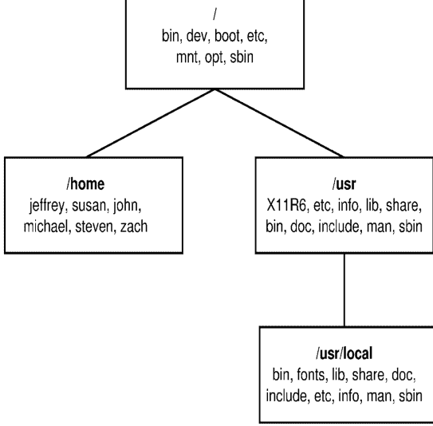
  **图5.1** Linux允许你将其分区挂载到统一目录树的几乎任意位置。
- **/home分区**
  大多数Linux发行版会将用户文件存放在名为/home的目录中，每个用户在该/home目录下都有自己的子目录。例如在图5.1中，6个用户各自都有一个用于存储文件的子目录。将用户文件与操作系统其余部分隔离是分区的最佳用途之一，因为它能带来很大的好处。此外，大多数新管理员会发现，估算用户文件所需空间比估算Linux目录树中各个子目录所需空间更容易。
- **/usr/local分区**
  传统上，/usr/local用于存放你自己编译构建的程序，而非从预编译包文件安装的程序。因此这些文件是针对你的本地安装定制的。升级操作系统时通常希望保留这些文件，因此将它们放在独立分区上是合理的选择。
  > 图5.1中显示/usr/local挂载到了独立的/usr分区上。但这种配置并非必需，/usr/local也可以直接挂载到根分区。图5.1之所以这样绘制，是为了说明分区*可以*挂载到根分区之外的其他分区上，同时说明对更高级的管理员而言，设置独立的/usr分区是可取的。
如果你之前使用过Linux，想要配置更高级的方案，可以考虑为以下一个或多个目录创建额外分区：
- **/usr**
  /usr目录包含大量程序和配置文件，事实上Linux发行版的大部分内容都存放在/usr目录中。
- **/usr/X11R6**
  该目录包含与X相关的文件，包括X服务器和大多数X程序。
- **/opt**
  许多近期的第三方程序默认会安装到/opt目录中。出于和/usr/local相同的诸多原因，将其拆分为独立分区是个不错的选择。有些人倾向于为/opt和/usr/local共用一个分区，并将其中一个设置为指向另一个分区子目录的符号链接。
- **/var**
  /var目录用于存储各类系统工具和服务器的运行文件。例如，大多数Linux系统将运行日志存放在/var/log中，打印任务通常存放在/var/spool/lpd中，直到可以打印。邮件服务器和新闻服务器也会将文件存储在这个目录树中。主要作为这些协议服务器运行的系统，通常会将这个目录单独划分为一个分区，以获得更好的效果。
- **/tmp**
  Linux程序通常将临时文件存放在/tmp目录中。为该目录设置独立分区，可以在某个程序创建的临时文件过大时，保护操作系统其余部分不受影响。
- **/boot**
  许多Linux发行版会将Linux内核存放在/boot目录中。如果你的硬盘有超过1024个柱面（所有容量超过8GB的硬盘都满足这一条件），可以创建一个位于硬盘开头附近的小型（约5-20MB）/boot分区。这样一来，即使Linux的其余部分部分或全部超出了1024柱面的限制，你也可以确保从大容量硬盘正常启动。
- **其他操作系统分区**
  如果你的电脑同时安装了Linux和其他一个或多个操作系统，你可以创建专门的挂载点来访问这些操作系统中的文件。例如，你可以创建/win2k分区来访问Windows 2000的文件，创建/beos分区来访问BeOS的文件。即使是有经验的Linux管理员，可能也不愿意创建我上面提到的所有分区，当然也有部分人愿意。大多数管理员会使用2到6个分区，外加一个交换分区，他们认为这已经足够用了。

## 交换空间要求
第2章《主板》详细介绍了创建和使用交换空间的过程。为Linux配置硬盘分区时，你最好留出一部分空间作为专用交换分区。过去的经验法则是，交换空间的大小应设为物理内存的两倍。例如，如果你的电脑有128MB内存，就需要分配256MB作为交换空间。不过这条建议对于当今大多数台式机来说过于冗余了。大多数情况下，交换空间大小约等于内存容量就足够了。不过你对交换空间的需求可能比这个值更高或更低。如果你发现自己通常很少用到交换空间，但偶尔运行某个特定程序时需要大量内存，你可以创建一个非常大的交换分区来满足这种偶尔的需求。或者，你可以创建一个交换文件，仅在运行内存占用高的程序时激活它。我会在第2章介绍如何创建交换文件。如果把交换分区放在硬盘中间或Linux分区的中间位置，系统性能会达到最佳。例如，如果你创建了1GB的根分区和1GB的/home分区，就应该将交换分区放在这两个分区之间。这种布局能最大程度缩短磁头访问交换分区的平均寻道时间，从而提升整体系统性能。

## EIDE与SCSI硬盘的对比
关于硬盘最大的争议之一，就是*增强型集成器件电子*（EIDE）硬盘的支持者和青睐*小型计算机系统接口*（SCSI）设备的人之间的争论。所有现代x86主板都集成了EIDE控制器，但要连接SCSI硬盘，你通常需要单独购买SCSI主机适配器（更多关于SCSI主机适配器的信息请参阅第9章）。每种技术都有其优缺点，本节将对此进行说明。
> **注意**
> 术语*EIDE*、*高级技术附件*（ATA）和*ATA数据包接口*（ATAPI）指的是紧密相关的技术，*集成器件电子*（IDE）也是如此。通常来说，*IDE*和*EIDE*指的是硬盘，而*ATA*和*ATAPI*指的是非磁盘设备。*ATA*有时会搭配数字使用，用来描述ATA接口的修订版本，比如*ATA-2*（ATA修订版2）或*ATA/33*（33MB/s版本的ATA）。

### EIDE控制器
由于所有现代主板都集成了EIDE控制器，因此选择支持最快EIDE规格的主板非常重要。2000年左右的主板上最常见的接口是33MB/s和66MB/s的规格。这些规格有不同的叫法——例如33MB/s的EIDE接口可以称为*ATA/33*、*Ultra-33*或*UltraDMA 33*。

#### EIDE的发展历史
IDE是EIDE在市场上的前代产品，顾名思义，EIDE是IDE的增强版。而IDE本身又是更早的硬盘技术的后继者。这些更早的技术使用的硬盘自带极少电子电路，需要搭配单独的接口板使用。IDE将这两个组件集成到了一起，因此得名。从主板的角度来看，IDE控制器和旧款硬盘类型的控制器看起来完全一样。直到20世纪90年代中期，普通IDE硬盘还非常普遍。这一时期及更早的IDE控制器使用一种被称为*可编程输入输出*（PIO）的控制方式，在这种模式下，计算机的CPU会逐一处理传输到硬盘或从硬盘传输出来的每一个字节。PIO模式

这种方式会占用大量CPU时间，因此在Linux这类复杂的多任务操作系统中并不理想。不过最终，PIO模式的局限性让位于*直接内存访问*（DMA）EIDE控制器。DMA控制器能够直接与内存双向传输数据，无需CPU介入。这种设计大幅降低了磁盘访问时的CPU负载，从而提升多任务操作系统中的整体系统性能。
如今，所有主板上的EIDE控制器都既支持旧的PIO模式，也支持新的DMA模式。DMA模式通常需要针对不同芯片组采用专属的访问方式，而PIO模式则可以使用更标准化的接口方法。要想最大化发挥EIDE控制器的性能，你需要使用定制的Linux驱动程序。
## Linux下的EIDE选项
编译Linux内核时，会出现与EIDE芯片组支持相关的配置选项，如图5.2所示。这些选项分散在“块设备”内核选项菜单中。只有当你勾选**通用PCI IDE芯片组支持**和**通用PCI总线主控DMA支持**后，许多设备才会显示出来。其中部分驱动被视为实验性驱动，只有在*代码成熟度级别*选项菜单中选中*提示开发中/未完成的代码/驱动程序*后才会显示。
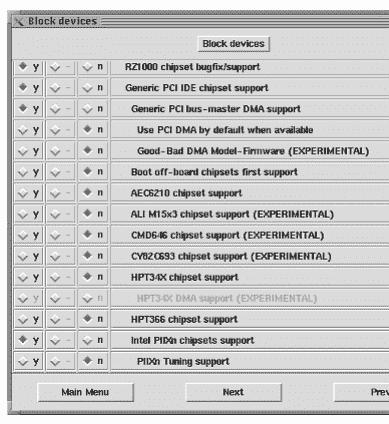
**图5.2** *Linux支持种类繁多的EIDE控制器。*
### 警告
实验性驱动可能存在不稳定性，这意味着如果你尝试使用它们，可能会丢失数据。不过其中部分驱动的可靠性其实相当高，但使用时仍需谨慎。如果你通过开启相应的内核选项、并使用hdparm工具启用DMA传输（相关内容将在本章后续介绍）来开启实验性DMA支持，之后如果出现莫名的磁盘错误或系统崩溃，请关闭DMA支持，或尝试使用更新的内核，看相关问题是否已经被修复。
不同发行版默认自带的Linux系统中，这些EIDE驱动可能存在、也可能不存在。要确认这一点，你需要重新编译Linux内核。这样做还有额外好处：比如可以移除你*不*需要的驱动，还可以让内核针对你的CPU和其他硬件进行优化。
内核配置工具“块设备”栏目下列出的部分EIDE驱动，用于支持常见的主板芯片组，包括Intel（Intel PIIXn芯片组支持）、ALi（ALI M15x3芯片组支持、ALI M14xx芯片组支持）和VIA（VIA 82CXXX芯片组支持）的芯片组。其余驱动则用于扩展卡上的芯片组，你可以在老主板上使用这类扩展卡来提升EIDE速度。部分芯片组厂商（例如ALi）会推出多款EIDE芯片组，因此会有多个对应的配置项。某些情况下（比如ALi的芯片组），这些配置项并不相邻，可能会让用户感到困惑。
除了启用你所使用的EIDE控制器的支持外，你还需要启用特定EIDE设备的支持，包括以下几类：
- **包含IDE/ATA-2磁盘支持**：如果你打算从EIDE硬盘启动系统，请将该选项设为Y（不要设为M，否则会进行模块化编译）。
- **包含IDE/ATAPI光驱支持**：如果你有ATAPI CD-ROM驱动器，请将该选项设为Y或M均可。
- **包含IDE/ATAPI磁带驱动器支持**：如果你有ATAPI磁带驱动器，请将该选项设为Y或M均可。
- **包含IDE/ATAPI软驱支持**：如果你有可移动ATAPI磁盘驱动器（例如LS-120或Iomega ZIP驱动器），请将该选项设为Y或M均可。
- **SCSI模拟支持**：该选项允许你将EIDE设备作为SCSI设备来访问。当你拥有ATAPI设备时，若需要使用专为SCSI设备设计的特定软件，该功能会非常方便。例如，部分Linux版的*可刻录光盘*（CD-R）软件仅支持SCSI设备，只要在内核中启用SCSI模拟支持选项，就可以让这类软件兼容ATAPI CD-R驱动器。
总体而言，Linux对Ultra-33及更早EIDE标准的支持非常完善，尽管部分控制器无法支持这一（或自身最高的）速度，只能以更低速运行。Ultra-66 EIDE的支持已经被集成到2.2.13及后续版本的内核中。许多默认搭载更早内核的发行版，无法在使用Ultra-66 EIDE控制器的系统上完成安装。如果你遇到这种情况，可以选择以下几种解决方案：
- 安装Ultra-33或更早版本的EIDE控制器，将硬盘连接到该控制器上。先安装Linux，再编译更新的内核。完成内核编译并配置系统从新内核启动后，拆下Ultra-33控制器，将EIDE数据线重新连接到Ultra-66控制器上，系统即可正常启动。
- 更换为Ultra-33 EIDE控制器并通过其安装Linux，之后保留该控制器继续使用，无需编译更新的内核。如果你的Ultra-66控制器与Linux的Ultra-66驱动兼容性极差，就可以选择这个方案。
- 更换为使用2.2.13或更新内核的Linux发行版，或是给更早的内核打上对应的Ultra-66支持补丁。Mandrake 7.0和SuSE 6.3都支持Ultra-66控制器，随着2000年的推进，其他发行版也会逐步支持。
## EIDE硬盘的特性
所有现代硬盘背后的基础技术其实大同小异，事实上还有部分型号同时推出EIDE和SCSI版本。（这种做法的普遍程度远高于现在。）尽管如此，EIDE硬盘仍有一些独特特性，或至少是普遍特征：
- **成本低**：相同容量的EIDE硬盘平均价格低于SCSI硬盘。
- **性能低**：EIDE硬盘成本低的原因至少部分在于，同容量下其性能弱于SCSI硬盘。平均来看，EIDE硬盘的缓存更小、转速更低、寻道时间更长。（这些特性我会在后续“评估磁盘性能”部分详细介绍。）这种性能差距与EIDE和SCSI技术*本身*无关，而是取决于硬盘厂商会将哪些接口搭配在他们的高端产品上。
- **指令延迟低**：由于EIDE接口的结构简单，EIDE硬盘对指令的响应速度更快，因此有时比同级别的SCSI硬盘更早返回首个数据包。这一特性确实源于EIDE和SCSI的差异，但通常会被其他性能因素掩盖。
- **容量上限低**：在任意一个时间节点，EIDE硬盘的容量范围都低于SCSI硬盘。例如，图5.3展示的是2000年2月一家大型线上电脑零售商宣传的硬盘容量。注意EIDE和SCSI硬盘的可选容量有较大重叠，但EIDE的整体容量区间低于SCSI设备。
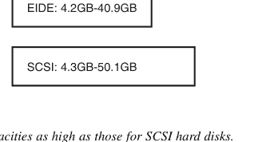
**图5.3** EIDE硬盘的最高容量低于SCSI硬盘。
- **支持CHS或LBA模式**：传统上，IDE硬盘会为磁盘上的每个扇区使用三位数的识别编码，这种被称为柱面/磁头/扇区（CHS）寻址的编码，是硬盘几乎不带板载电子元件时代的遗留产物。近年来，EIDE硬盘新增了逻辑块寻址（LBA）模式（部分定义中也称其为线性寻址），该模式仅用单个数字来标识硬盘上的扇区。
除了EIDE硬盘的上述特性外，EIDE接口本身也有几个和本次讨论相关的特性：
- **双设备限制**：每条EIDE通道（即连接到单个端口的设备）最多仅支持2个设备。大多数主板仅配备2个EIDE端口，因此每块主板最多只能支持4个EIDE设备。对于现代系统中配备硬盘、CD-ROM驱动器、CD-R刻录机、LS-120或Iomega ZIP驱动器的情况来说，这一数量非常有限。
- **无法并发通信**：每条通道上的两个设备不能同时通信，每次只能有一个设备占用EIDE总线。
- **占用中断资源**：每条EIDE通道需要占用一个中断（IRQ）。由于IRQ是现代PC上非常有限的资源，每2个设备就占用1个IRQ可能会引发严重问题，尤其是在设备数量超过现代主板支持的上限（4个）时。


总体而言，EIDE是配备一到两块硬盘、一个光驱的低成本电脑的不错选择。当你开始添加更多设备时，EIDE的局限性会快速累加，进而造成严重的缺陷。此外，EIDE驱动器通常并非市面速度最快的型号，这也使得EIDE并不适合对磁盘性能要求极高的应用场景，例如文件服务器或高性能计算。

## SCSI磁盘的特性
SCSI一直以来都是高速硬盘操作的首选。SCSI硬盘的特性恰好与EIDE特性互补：
- **高成本**
  同容量的SCSI驱动器通常比EIDE驱动器更贵。这部分成本上涨的原因一部分来自SCSI接口，一部分是经济因素，还有一部分和驱动器性能有关。
- **高性能**
  同容量的SCSI硬盘平均拥有更大的缓存、更快的转速以及更短的寻道时间，性能高于EIDE驱动器。
- **高指令延迟**
  SCSI协议产生的指令开销比EIDE协议更高，因此SCSI驱动器响应指令的速度会比EIDE驱动器稍慢一些。
- **高容量**
  市面上能买到的EIDE驱动器最大容量与多数SCSI驱动器相当，但仍有部分SCSI型号的容量会超过容量最高的EIDE型号。
- **仅支持LBA模式**
  SCSI磁盘一直通过单一线性地址块呈现磁盘视图的方式与主机适配器通信。如果计算机能理解这种视图，会大幅简化相关操作。不过遗憾的是，传统x86操作系统一直使用CHS寻址方式，因此SCSI主机适配器会将LBA模式转换为CHS模式。

EIDE与SCSI硬盘之间的差异固然重要，EIDE与SCSI总线之间的差异同样值得关注。SCSI总线的独特特性包括以下几点：
- **7台或15台的设备连接上限**
  理论上，根据所使用的SCSI版本不同，每个SCSI主机适配器最多可连接7台或15台设备。（*宽*型SCSI版本最多支持15台设备，而*窄*型版本仅支持7台。）实际上，线缆长度限制使得窄型链上很难连接超过5或6台设备。每台SCSI设备都有唯一的ID号，该ID可通过跳线设置，在较新的SCSI版本中，也可由主机适配器分配。
- **设备复用性**
  由于SCSI设备的连接上限远高于EIDE设备，因此向SCSI系统添加硬盘的可行性远高于向EIDE系统添加硬盘。这意味着你最初投入的硬盘资金可以维持更长时间。
- **并发通信**
  SCSI总线从设计之初就支持并发通信。你可以先与一台SCSI设备开始数据传输，再与同一链上的另一台设备启动第二路传输。只要单台设备的速度总和不超过SCSI总线的速度，两路传输都可以全速进行。仅这一特性，就使得SCSI在需要高性能磁盘系统的场景下拥有巨大优势。
- **中断占用**
  每台SCSI主机适配器与每块EIDE控制器一样，都需要占用一个IRQ。但由于可以在SCSI链上连接更多SCSI设备，因此SCSI设备占用的IRQ数量通常更少。
- **终端终止**
  SCSI总线由多台SCSI设备（包括SCSI主机适配器）串接成一条链路组成。链路两端的设备必须进行适当的*终止*操作，该操作可通过设置跳线，或在SCSI线缆上加装专用的终端电阻包完成。终止问题是导致SCSI设备出现许多故障的主要原因。
- **驱动问题**
  与EIDE不同，SCSI控制器并非早期PC硬盘接口的克隆产品。因此，Linux需要为任意你选择的SCSI主机适配器配备专用驱动，并不存在EIDE那样的向后兼容模式。（第9章“SCSI主机适配器”会更详细地介绍相关内容。）

如果成本不是问题，SCSI无疑是硬盘的首选总线。但遗憾的是，相比EIDE，使用SCSI通常会使PC成本增加100美元以上，在硬盘容量较大、SCSI设备数量较多时，成本甚至会增加300至500美元。你确实能获得与额外支出匹配的性能提升，但对于低端或中端系统而言，这笔开销可能并不划算。我强烈推荐在需要连接多种类盘设备的系统中使用SCSI，例如磁带备份单元、CD-R驱动器、Zip驱动器等。仅这三种设备，再加一个光驱和一块硬盘，如果采用EIDE规格，需要占用3个IRQ并配备一块额外的EIDE控制器；如果采用SCSI规格，这五台设备都可以连接到同一台主机适配器上，仅占用1个IRQ。不过，最新的SCSI主机适配器只有在同其他高速SCSI设备搭配使用时才能发挥最佳性能，因此这类系统有时配备两台SCSI主机适配器会更实用。

## 在单一系统中同时使用EIDE和SCSI
在Linux系统中，你通过`/dev`目录下的条目访问原始设备。EIDE设备的访问路径为`/dev/hdxy`，其中*x*是字母（*a、b、c……*），*y*是硬盘分区的分区号；对于没有分区的设备（例如光驱），则没有这部分标识。SCSI设备的标识规则更多样：SCSI硬盘的标识方式与EIDE硬盘类似，只是设备文件名格式为`/dev/sdxy`；SCSI光驱的文件名格式为`/dev/scdx`，其中*x*是从0开始的数字。在Linux下使用同时配备SCSI和EIDE设备的系统并不困难，你只需要在挂载或使用设备时使用对应的设备标识符即可。`/etc/fstab`文件通常会存储最常用的分区和设备的这些标识符。

举个例子，假设有一台配备SCSI硬盘和EIDE光驱的系统，其`/etc/fstab`文件可能包含以下条目：
```
/dev/sda6 / ext2 defaults 1 1
/dev/sda5 /home ext2 defaults 1 2
/dev/hda /mnt/cdrom iso9660 ro,user,noauto 0 0
```
这些条目表明，两块SCSI磁盘分区（`/dev/sda6`和`/dev/sda5`）将分别挂载到`/`和`/home`目录下，EIDE光驱`/dev/hda`则挂载到`/mnt/cdrom`目录。多数电脑的BIOS默认配置为优先从EIDE设备启动，再启动SCSI设备。你可以混合使用EIDE和SCSI硬盘，但如果你保留这一启动顺序，就需要将LILO安装到EIDE硬盘上。在大多数系统中，即使系统启动时从EIDE硬盘加载LILO，你依然可以在SCSI硬盘上安装Linux。如果你修改BIOS的启动顺序，可能需要修改`/etc/lilo.conf`文件以适配这一变化，使用如下类似的配置行即可：
```
disk=/dev/sda bios=0x80
```
这些指令会告知LILO，BIOS将`/dev/sda`识别为第一块硬盘（代码0x80）。如果没有这条指令，若你将BIOS设置为优先从SCSI硬盘而非EIDE硬盘启动，很可能无法通过LILO引导Linux。

## 1024柱面限制
EIDE和SCSI硬盘都存在所谓的*1024柱面限制*问题。难点在于，旧的CHS寻址模式使用10位数字来标识硬盘的柱面号，10位数字可表示0到1023之间的数值，因此BIOS可访问的柱面数量被限制为1024。目前已经开发出多种系统来解决这一问题。包括Linux在内的许多操作系统在启动完成后就不会再受1024柱面限制的影响。问题出现在操作系统启动阶段，因为古老的x86 BIOS*受*1024柱面限制的制约。结合扇区和磁头数量的限制，在现代硬盘上，1024柱面限制对应的容量略低于8GB。较早的BIOS缺乏提升该限制的功能，在这些硬盘上，限制容量可能低至504MB。无论1024柱面限制的确切数值是多少，Linux内核都必须放在该限制范围内才能正常引导。这是因为BIOS会在LILO的指导下加载内核，内核加载完成后，就可以使用自身不受1024柱面限制的磁盘驱动继续完成操作系统的启动流程。


如我在本章前文所述，突破1024柱面限制的可行方案之一是创建一个低于该限制阈值的小型/boot分区，之后你可以将Linux内核置于该目录下，确保能够正常启动。突破该限制的另一种方法是使用软盘作为引导介质：把Linux内核和一份LOADLIN.EXE的副本放在DOS引导软盘上，或者通过Linux的dd命令将内核写入无文件系统的软盘。

注：原文末尾的连续文本“You canThe request was rejected because it was considered high risk”为疑似粘贴错误，与上下文的Linux磁盘引导技术内容完全无关，不属于本次需翻译的有效内容。

## 磁盘缓存大小
硬盘性能的最后一个影响因素是内置磁盘缓存的大小。如第3章（“缓存内存”一节）所述，*缓存*是一种容量更小但速度比另一种存储介质更快的存储器。缓存会存储经常访问的数据，这样计算机可以直接从缓存中读取数据，而无需从速度更慢的存储介质中调取。
硬盘的缓存分为两种常见类型和一种较少见的类型：
- **硬盘内置磁盘缓存**
所有现代硬盘都配备了磁盘缓存，容量通常在512KB到2MB之间，由RAM芯片构成。当计算机指令硬盘读取某一组扇区时，硬盘除了会读取这些扇区，还会一并读取其后紧邻的扇区，并将所有数据存入磁盘缓存，其逻辑是计算机很可能接下来就会请求读取后续扇区。这一假设通常成立，因此硬盘进行下一次数据传输时无需再访问磁盘，大幅降低了延迟、提升了传输速度。因此，在顺序传输小文件时，磁盘缓存能提升性能；而在持续传输大文件时作用不大，因为数据会直接传输到计算机。
磁盘缓存还可以在数据写入时短暂存储数据。硬盘无需等待整个写入操作完成，就可以报告数据已写入完成，而实际上数据此时还存储在缓存芯片中。这种情况发生后，硬盘会很快将数据写入盘片；写入缓存的主要作用是让操作系统在向硬盘发送数据后，能尽快继续执行其他任务。
- **计算机系统磁盘缓存**
包括Linux在内的大多数操作系统都会在计算机的RAM中维护自身的磁盘缓存。操作系统维护的磁盘缓存运行逻辑和硬盘内置缓存类似，但速度更快。Linux的磁盘缓存可以根据需求动态扩缩容。Linux内核制定了相关规则，用于确定分配给磁盘缓存的RAM容量，与分配给程序及其运行数据的RAM做出区分。内核还需要判断何时回收缓存空间，何时将数据交换到交换文件中。作为普通用户甚至系统管理员，你不需要过多关注这些细节，但需要知晓这类缓存的存在。
- **控制器缓存**
第三种也是最罕见的磁盘缓存类型，存在于硬盘控制器或主机适配器中。这类缓存最常见于高端SCSI主机适配器，部分适配器会搭载RAM芯片作为缓存。这类主机适配器曾经一度流行，但近年来热度已大幅下降。通常来说，扩充计算机主存RAM的性价比远高于给SCSI主机适配器加装RAM，因为主板上的RAM可以用在任何需要的场景中。作为硬盘的选购参考指标，相比传输速率和寻道时间，磁盘缓存的优先级较低。不过，大容量缓存相比小容量缓存，还是能带来小幅的性能提升。

## 硬盘外形规格
如今的硬盘物理尺寸已经有非常成熟的标准，通常以英寸为单位，指的是硬盘内部盘片的直径。你安装到电脑里的硬盘盒物理尺寸会比盘片直径稍大一些。由于硬盘尺寸已经标准化，只要机箱有合适的驱动器位，安装硬盘基本不会遇到什么困难。
外形规格对Linux系统没有影响，你可以自由选购或使用任意规格的硬盘。不过不同规格的硬盘在性能、价格和供货情况上会有差异。

### 2.5英寸便携式硬盘
目前常用的小尺寸硬盘是2.5英寸款，宽度为2.75英寸，深度为3.94英寸。小巧的尺寸使其非常适合用于笔记本电脑，几乎不会出现在台式机中。这种划分的原因是，按每MB容量计算，2.5英寸硬盘的成本高于物理尺寸更大的硬盘。2.5英寸硬盘体积很小，通常可以直接通过数据线供电，这类数据线比普通的EIDE或SCSI数据线更细。由于这类硬盘通常用于一体化的便携电脑，你一般不需要关注这类接口的具体细节。

### 3.5英寸台式机硬盘
3.5英寸是目前最主流的硬盘外形规格，这类硬盘宽度为4.02英寸，深度为5.77英寸。硬盘的一端有两个接口：一个是SCSI或EIDE数据线接口，另一个是电源接口（见图5.6）。通常还配有跳线，用于设置各类参数，比如SCSI ID号，或者EIDE主/从盘状态。
安装到机箱时，带有电源接口、EIDE/SCSI接口的一端会朝向对应的主板或扩展卡，方便接线。遗憾的是，这种安装方式通常会导致硬盘另一端的跳线难以触及，而跳线在侧面的硬盘配置起来会更麻烦。因此，在将硬盘安装到机箱前，一定要确认所有跳线都设置正确。硬盘看起来就像一块无特征的金属板，仅底面带有一块电路板、一对接口和几个跳线。

### 5.25英寸台式机硬盘
20世纪80年代甚至90年代初，5.25英寸硬盘十分常见。这类硬盘宽度为5.75英寸，深度为7.6英寸。和3.5英寸硬盘相比，5.25英寸硬盘完全是“庞然大物”，到90年代中期已基本被市场淘汰，不过昆腾（Quantum）大脚系列等少数型号一直销售到90年代末。
和3.5英寸型号相比，5.25英寸硬盘功耗更高，寻道时间更长，传输速率波动也更大。其盘片的数据密度更低，制造成本比3.5英寸硬盘更低。和3.5英寸硬盘一样，5.25英寸硬盘也使用独立的电源线和数据线，接口标准和3.5英寸硬盘一致。这类硬盘本质上是3.5英寸硬盘的放大版——更准确地说，3.5英寸硬盘是5.25英寸硬盘的缩小版，因为5.25英寸的设计早于3.5英寸面市。

## 硬盘高度
此前的内容没有提及不同硬盘类型的高度，这是因为每类硬盘都有多种高度规格可选。
- 2.5英寸硬盘的高度在0.33英寸到0.492英寸之间，适配不同尺寸的笔记本电脑。
- 3.5英寸硬盘最常见的是三分之一高规格，高度为1.02英寸，也有少量半高（1.64英寸）型号。通常同一产品线的最高容量款为半高规格，中小容量款则为三分之一高规格。
- 5.25英寸硬盘通常为半高规格（1.64英寸），但也有少量上古时期的全高“巨无霸”高度超过3英寸。
购买硬盘前一定要确认其高度，尤其是机箱驱动器位紧张的情况下。如果你买了半高3.5英寸硬盘，但机箱没有足够的安装空间，你就需要退货、拆掉其他硬件，或者用外置硬盘盒将硬盘接入系统。如果你买2.5英寸硬盘替换笔记本电脑的内置硬盘，可选的方案会更少。

## 优化Linux下的磁盘性能
你一定希望硬盘能发挥出最佳性能。如果你的硬盘传输速度能达到30MBps，你肯定不想实际使用中只有8MBps的速率。尤其是使用笔记本电脑时，你还希望硬盘在闲置时能*停转*——也就是进入非活动状态，此时硬盘盘片停止旋转，但会监听数据传输请求，一旦收到请求就会重新启动硬盘。你可以使用各类Linux工具和配置功能，来提升硬盘相关的整体系统性能。

## 使用hdparm开启高级功能
用于管理硬盘高级功能的最重要Linux工具是`hdparm`。你可以通过这个工具设置各类和硬盘性能相关的参数，也可以运行测试来查看硬盘的运行状态。输入`man hdparm`就能查阅`hdparm`的更多详细信息。接下来我会介绍部分核心功能。
> **注意** 使用`hdparm`的大部分功能都需要以root用户身份运行。


## 测试磁盘速度
你可以使用`hdparm`工具的`-t`选项来测试硬盘的读取速度。例如：
```hdparm -t /dev/sda```
该命令会测试从`/dev/sda`（第一个SCSI硬盘）读取数据的速度。你可以替换为其他设备文件（如`/dev/sdb`或`/dev/hda`）来测试其他硬盘。
该命令的结果类似如下内容：
```/dev/sda: Timing buffered disk reads: 64 MB in 4.32 seconds = 14.81 MB/sec```
Linux是一款多任务、多用户操作系统。因此，由于运行时的系统负载和磁盘访问存在波动，任何一次`hdparm`的运行都很可能产生略有偏差的结果。你可以通过多次运行测试来提高准确率——运行三次通常就足够了。如果每次运行的结果相近，那么结果大概率是准确的；如果某次结果和其他结果差异极大，可以舍弃该结果，或者继续运行测试以确认是否应该舍弃该结果。
> **注意** 你永远不会看到`hdparm -t`的测试结果能匹配硬盘厂商宣传的传输速率。厂商宣传的速率是理论抽象值，基于无磁头寻道、无EIDE或SCSI指令开销等理想前提。据我的使用经验，使用`hdparm -t`测试时，结果通常能达到厂商宣称磁盘速度的75%。
> **提示** 如果你的磁盘上有多个分区，你可以通过指定分区号来测试磁盘不同区域的性能，比如运行`hdparm -t /dev/hda1`或`hdparm -t /dev/hda9`。

`-t`选项有一个变体`-T`。这个大写字母对应的速度测试命令，会测试向Linux内部磁盘缓存读写数据的性能。该操作测试的是计算机的CPU和内存速度，而非连接至系统的任何硬盘的速度。你可以同时指定`-t`和`-T`选项组合使用，比如运行`hdparm -tT /dev/sda`。执行后你会得到两份报告，一份是缓存读取报告，一份是磁盘读取报告。
使用`-T`选项时，请确保你的系统至少有2MB空闲内存以支持磁盘缓存操作；如果所有RAM都被程序占满，`hdparm`将无法调用磁盘缓存，导致结果不准确。你可以通过`free`命令查看空闲内存，该命令的输出大致如下：
```total used free shared buffers cached
Mem: 62136 59848 2288 0 2292 6744
-/+ buffers/cache: 50812 11324
Swap: 120452 15036 105416```
需要关注的值位于`-/+ buffers/cache`行的`free`列下——本例中该值为11324。`free`命令报告的内存值单位为千字节，因此11324约为11MB，远高于`hdparm`缓存内存测试所需的2MB最低要求。

## 设置DMA选项
如果你使用的是配备支持Linux下DMA传输的控制器EIDE硬盘，你可以通过`hdparm`命令将控制器设置为合适的DMA模式。相关命令为`-d`（用于编程设置控制器启用DMA模式）和`-X`（用于设置要使用的具体DMA模式）。这两个选项各自都支持对应的子参数，大多数情况下，运行如下命令即可达到预期效果：
```hdparm -d1 -X34 /dev/hda```
`-d1`参数用于开启DMA模式（设为1开启，设为0则关闭）。`-X34`参数用于将系统设置为使用可用的最高速DMA模式（34是该模式对应的编码）。
> **警告** 如果你使用的EIDE控制器仅在Linux中提供实验性DMA支持，那么启用DMA模式和高传输DMA可能存在风险。如果你在使用这些传输模式时遇到问题，可以通过执行`hdparm -d0`命令来关闭它们。大多数现代Linux发行版都会调用合适的`hdparm`命令来配置硬盘以获得最佳性能。如果你的发行版没有这么做，或者该配置未正常工作，你通常可以在`/etc/rc.d/rc.local`或其他类似的启动脚本中添加对应的调用命令。
> **注意** DMA模式设置命令仅适用于*增强型IDE（EIDE）*硬盘。如果你使用的是SCSI硬盘，只要主机适配器支持DMA，SCSI驱动会自动启用DMA模式。如果你不知道硬盘是否已设置为使用DMA，可以使用`hdparm`的`-v`选项来查询，例如：
```# hdparm -v /dev/hda
/dev/hda:
 multcount = 0 (off)
 I/O support = 0 (default 16-bit)
 unmaskirq = 0 (off)
 using_dma = 1 (on)
 keepsettings = 0 (off)
 nowerr = 0 (off)
 readonly = 0 (off)
 readahead = 8 (on)
 geometry = 784/255/63, sectors = 12594960, start = 0```
该命令会显示硬盘相关信息及其使用状态的摘要。就本文讨论的内容而言，`using_dma`这一行是最关键的。

## 关闭硬盘以节约能耗
如果你经常使用未直接接通电源的便携电脑，你可能会关注包括硬盘在内的所有组件的功耗。你可以让Linux在硬盘闲置时将其切换至低功耗模式，从而节省部分电量。但一旦磁盘访问停止就立刻关闭硬盘并非良策：硬盘重新进入活动状态时，系统会消耗大量电量，还可能导致性能大幅下降。相反，你大概率会希望让系统在硬盘闲置一段时间后再将其关闭。要实现这一效果，你仍然需要使用带有`-S`参数的`hdparm`命令。
`-S`参数的设置比较特殊，具体内容汇总在表5.2中。
**表5.2 硬盘停转时间的`-S`选项**
| 取值 | 含义 |
| :--- | :--- |
| 0 | 禁用节能关机（硬盘始终保持完全活动状态） |
| 1-240 | 5秒的倍数；例如6代表30秒 |
| 241-251 | 1到11个30分钟单位，对应时长为0.5到5.5小时 |
| 252 | 21分钟 |
| 253 | 厂商自定义的超时值 |
| 255 | 21分15秒 |
假设你希望设置硬盘在闲置10分钟后关闭，可以运行`hdparm -S120 /dev/hda`命令来实现。你也可以将该命令与设置DMA传输的命令组合使用，例如`hdparm -d1 -X34 -S120 /dev/hda`。
> **注意** 你无法使用`hdparm`的`-S`选项为SCSI硬盘设置关机时间。

## 使用多块磁盘提升性能
如果你想提升硬盘性能，使用多块磁盘会带来一定收益。假设你的系统会执行一系列如下磁盘操作：
- 读取文件1
- 读取文件2
- 读取文件1
- 写入文件2
- 读取文件3
- 写入文件2
- 写入文件3
注意在本例中，偶数序位和奇数序位的文件访问是交替进行的。现在假设偶数序位的文件存储在磁盘靠前的位置，奇数序位的文件存储在磁盘靠后的位置。这一系列磁盘操作将导致多次长时间的磁头寻道，拖慢文件访问速度。
如果偶数序位文件存放于一块物理磁盘，奇数序位文件存放于另一块物理磁盘，那么磁头寻道操作会大幅减少，整体性能也会得到提升。你无法保证每隔一次的访问都会使用不同的物理磁盘，但可以通过在独立磁盘上为单次Linux安装创建分区，来提升这种概率。例如，你可以将根目录或`/usr`目录放在`/dev/hda`上，将`/home`目录放在`/dev/hdb`上。这种布局可以保证Linux系统文件的访问不会干扰用户文件的正常访问，反之亦然。
应该如何跨磁盘划分分区，取决于你的需求和配置，包括系统中存在的其他操作系统、硬盘的速度等因素。一般来说，你应该尽量均衡各硬盘的访问负载。将`/boot`这类很少使用的目录放在一块硬盘上、其余所有内容放在另一块硬盘上，对系统速度的提升有限；但将`/usr`、`/home`这类经常访问的目录放在独立的硬盘上，通常能起到明显的提升作用。哪些目录属于高频访问目录，会因不同的安装配置而异。


**注意** 将安装分布在不同驱动器上通常有助于提升性能*当你的驱动器速度相近时*。如果一块硬盘比另一块慢得多，将Linux分布在这些磁盘上，与将Linux限制在更快的驱动器上相比，会对整体系统速度产生不利影响。在这种情况下，你可能希望将不常访问的目录转移到慢速驱动器上，仅为快速驱动器上的重要文件腾出空间。由于SCSI支持多路同时传输的能力，将Linux分布在两块或多块磁盘上，在SCSI系统中比在EIDE系统中收益更高。不过除此之外，减少磁头移动的需求也能带来速度提升。这一基本原则对EIDE驱动器和SCSI驱动器都适用——只是用于SCSI驱动器时*更*有利。你可以通过将EIDE硬盘连接到独立通道上，获得部分相同的收益。

## Linux RAID 支持
Linux支持一种名为*独立磁盘冗余阵列*（RAID）的技术。该技术允许你以无缝方式将文件分散存储在两块或多块硬盘上。你不需要配置系统，让不同磁盘上的分区存储不同数据，而是可以通过RAID将不同磁盘上的两个分区合并为一个虚拟分区。这样，计算机既可以通过添加冗余来提升数据安全性，也可以将数据分散到两块磁盘上来提升速度，或同时实现这两个目标。RAID分为两种形式：硬件RAID和软件RAID。硬件RAID由专用的RAID SCSI主机适配器支持，对Linux透明。软件RAID必须由操作系统实现——更准确地说，是由Linux内核实现。
如图5.7所示，Linux的软件RAID通过在块设备内核配置选项中的「多设备驱动支持」来启用。选中该选项后，会出现多个子选项，供你选择要使用的RAID支持类型。Linux内核支持的每种RAID都有不同的特性和用途：
- **线性（追加）** 该模式仅将一个分区追加到另一个分区之后。如果你需要在单个分区中获得超过单块硬盘可用容量的空间，这个模式会很有用。它不提供任何速度或可靠性优势。
- **RAID-0（条带化）** RAID-0会均匀填充磁盘分区，以交错方式将数据块写入各磁盘。最终效果就像你拥有一个大型分区，数据交替来自每块磁盘的条带。RAID-0不提供冗余，因此安全性并不比传统分区更高。如果条带化使用的分区位于独立的物理磁盘上，则能带来速度优势。如果你使用独立通道的EIDE磁盘，或使用SCSI磁盘，这种速度优势会尤为明显。
- **RAID-1（镜像）** RAID-1提供数据冗余；写入一个分区的所有数据也会写入一个或多个其他分区。该选项可降低你丢失数据的概率，但几乎不提供速度优势。
- **RAID-4/RAID-5** 该模式的工作方式与RAID-1类似，但除了冗余存储数据外，系统还允许你存储校验信息，以便检测和纠正错误。通常，使用RAID-4/RAID-5时，需要用三块或更多磁盘替代单块磁盘。其中一块磁盘用于存储校验信息，其余磁盘存储数据。如果出现错误，系统可以确定出错磁盘并修正该错误。

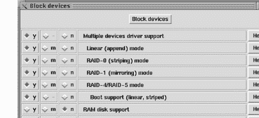
**图 5.7** Linux的RAID支持包含针对不同RAID类型的多个子选项。为Linux内核添加适当的RAID支持后，你需要使用一组工具来定义元分区，这些工具包括：
- `mdadd [options] [mddev] [p1] [p2]` 该命令将两个传统分区（p1和p2）添加到多磁盘设备（mddev）中。例如，`mdadd -p1 /dev/md0 /dev/sda3 /dev/sdb3`会将前两块SCSI硬盘的第三个分区合并，创建`/dev/md0`。最关键的选项格式为`-pn`，其中*n*是0-1或l的数字，对应RAID 0-1级别或线性模式。
> **注意** 指定传统分区时顺序非常重要！使用mdadd时，始终按相同顺序列出分区。
- `mdrun [options] mddev` 该命令用于激活新的RAID分区组。如果不执行该命令，你将无法访问RAID元分区。
- `mdstop [options] mddev` 该命令会关闭指定元分区的RAID功能。如果你想卸载一组RAID分区并“原生”重用这些分区，可以使用该命令。你也可以在`/dev/mdtab`文件中存储RAID设备分配的信息，每行格式为：
```
mddev options dev1 dev2 ... devn
```
其中最重要的选项是`linear`、`raid0`和`raid1`，分别对应不同的RAID级别。如果你已经在`/dev/mdtab`中指定了RAID设备，可以添加`-a`选项并省略设备列表。

RAID是提升性能或磁盘可靠性的不错方案，但管理起来并不简单。除非你选中启动支持（参考图5.7），否则你无法从RAID分区启动。通常最好将RAID保留用于高流量数据目录，例如`/home`目录，或（某些服务器上的）`/var`目录。
> **注意** 配置RAID的错误可能导致严重问题，包括数据丢失或数据恢复困难。有关RAID的更多信息，请参阅随所有主流Linux发行版提供的Software-RAID HOWTO文档。

## 总结
你选择的硬盘在计算机的速度和易用性方面起着至关重要的作用。如今销售的所有硬盘容量都足够容纳Linux系统本身，但如果你有特殊的数据存储需求，可能需要更大容量的硬盘。对大多数人来说，硬盘的速度更值得关注，其衡量指标包括持续吞吐量、磁头寻道时间，缓存大小的影响则相对较小。接口类型——包括SCSI与EIDE的对比，以及每种接口类型的具体规格——在确定磁盘系统速度方面同样非常重要。

## 可移动磁盘
### 第6章
### 本章内容
- 可移动磁盘类型 168
- 选择合适接口 174
- Linux与可移动磁盘的兼容性 178
- 与其他操作系统交换介质 184

硬盘是现代计算机不可或缺的存储介质，但它并非唯一的存储介质，也不是所有场景下的最佳选择。硬盘的一大短板是便携性：虽然有外壳可以让你快速、轻松地将硬盘从计算机上拆卸下来，但拆下的硬盘还是略显笨重。搬运整块硬盘也存在风险，因为这些设备十分脆弱，你肯定不愿意为了传输几个文件从一处到另一处，就冒丢失硬盘上所有数据的险。因此，市场上出现了大量专用介质，帮助你实现文件的点对点传输。这些设备通常永久安装在计算机中，或作为外置驱动器连接到计算机，但它们的*介质*是可移动的，可以轻松携带。
> 注意 虽然我将在第7章“光驱”中介绍光盘这类光学介质，但它们确实属于可移动磁盘介质。但直到最近，这类介质都无法刻录，而且即使是现在，制作CD-R也比向大多数可移动介质写入几个文件更复杂。因此，我会在第7章介绍CD-ROM及相关设备。

使用可移动介质的另一种替代方案是使用网络。随着越来越多计算机永久接入互联网，通常可以通过互联网协议将文件从一处传输到另一处。事实上，Linux作为文件服务器在这方面表现优异，这一点在我的著作*《Linux：办公室网络指南》*（由Sams Publishing出版）中有详细描述。第17章“网络硬件”涵盖了将两台或多台计算机组网所需的硬件，第18章“调制解调器”涵盖了将孤立的计算机或小型计算机网络连接到互联网服务提供商（ISP）的设备。

### 可移动磁盘类型
可移动介质有多个不同的种类，每种都有其独特的优势和劣势。这些介质都可以在Linux中使用，尽管配置细节差异较大。这些设备采用的技术也各不相同：大多数基于与硬盘类似的磁记录原理，但有些使用的技术部分基于光学原理。表6.1总结了我在本章中介绍的可移动介质技术的特性。请注意，该列表并不全面；不少设备已在市场上出现又消失，或目前仍有售但仅占据相对较小的细分市场。


## 表格 6.1 常见可移动介质技术

| 驱动器类型 | 容量 | 平均寻道时间 | 数据传输率 | 接口 |
| :--- | :--- | :--- | :--- | :--- |
| 软盘 | 180KB–2.88MB | 66ms | 30KB/s¹ | 软驱，USB |
| Iomega Zip-100 | 100MB | 29ms | 0.6–1.4MB/s | EIDE，SCSI，USB，并行口，PC-Card |
| Iomega Zip-250 | 250MB | 29ms | 0.9–2.4MB/s | EIDE，USB，SCSI，PC-Card |
| LS-120 | 120MB | 70ms | 4.0MB/s | EIDE，USB，并行口，PC-Card |
| 磁光盘² | 128MB–5.2GB | 25ms | 2–6MB/s | SCSI |
| Iomega Jaz | 1GB–2GB | 12ms | 5.4MB/s | SCSI |
| Castlewood Orb | 2.3GB | 10ms | 12.2MB/s | EIDE，SCSI，USB |

1. 软盘的传输速率随驱动器容量而变化。30KB/s 的数据是针对 1.44MB 的 3.5 英寸介质的。
2. 磁光盘（MO）已存在很长时间，其性能多年来不断提升。此处引用的寻道时间和传输率是 2000 年销售的驱动器的典型值。

## 软盘

不起眼的软盘是用于 x86 计算机的最古老的记录设备之一。（实际上，最初的 IBM PC 使用的是一种原始的磁带驱动器，而不是软盘。）如今的 x86 计算机几乎普遍支持 3.5 英寸软盘，但 5.25 英寸软盘直到 1990 年代中期还很常见。（图 6.1 展示了这两种软盘。）早期的计算机有时使用 8 英寸软盘，但从未在 x86 硬件上使用过。8 英寸和 5.25 英寸的软盘使用了柔性的外壳，因此得名 *软盘*。而 3.5 英寸的软盘采用了更硬的塑料外壳、更精确的盘片安装以及一个覆盖读写孔的滑盖。这些特性使得 3.5 英寸软盘比早期的种类具有更高的可靠性和数据密度。

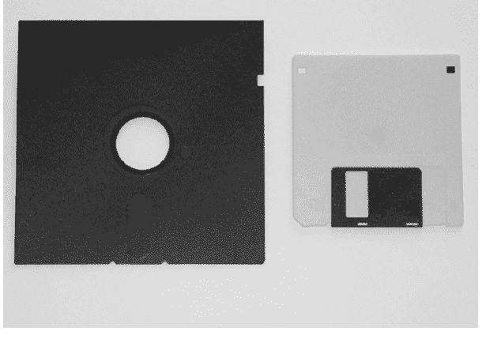

**图 6.1**
*多年来，软盘有多种不同的尺寸。这张图片展示的是左边的 5.25 英寸软盘和右边的 3.5 英寸软盘。*

软盘作为 x86 计算机的存储介质，有几个重要优点：

-   **成本** —— 无论是软盘还是软盘驱动器都很便宜。当你想发送文件给某人却无法通过互联网发送时，这个特点尤为重要。在共享计算环境（例如大学校园的计算机中心）中，它也很重要。软盘的低成本也意味着你可以承受丢失或损坏几张——前提是其中的数据不是太重要，或者在其他地方有备份！
-   **通用性** —— 如今几乎每台台式机都有一个 3.5 英寸软盘驱动器，因此如果你使用软盘和通用的文件系统，比如 *文件分配表*（FAT）文件系统，几乎可以保证互操作性。
-   **便携性** —— 3.5 英寸软盘可以放进衬衫口袋，或者你可以把它们装进专门设计的小盒子或钱包里，然后放在背包、外套口袋或手提包中随身携带，不会太麻烦。

然而，软盘是一项旧技术。它们在存储容量和速度方面未能跟上其他介质（无论是固定介质还是可移动介质）的增长步伐。这两个因素——速度和容量——构成了软盘的致命弱点。目前常用的软盘最大容量为 1.44MB，与 2000 年的典型硬盘相比微不足道，后者的容量可以比软盘大 10,000 倍以上。软盘的速度也出了名的慢，这一事实仅仅因为介质的低容量而有所缓解。表 6.2 总结了当今软盘的可用容量。请注意，尽管双面高密度 1.44MB 软盘是目前最常用的，但它们并非容量最大的。容量更大的 2.88MB 软盘从未流行起来，如今已几乎无法找到。单面软盘仅使用盘片的一面来记录信息，而双面驱动器则使用两个读写头在盘片的两面进行记录。

### 表格 6.2 软盘容量

| 软盘类型 | 单面容量 | 双面容量 |
|---|---|---|
| 5.25 英寸，双密度 | 180KB | 360KB |
| 5.25 英寸，高密度 | 600KB | 1200KB |
| 3.5 英寸，双密度 | 360KB | 720KB |
| 3.5 英寸，高密度 | 720KB | 1440KB |
| 3.5 英寸，超高密度 | 1440KB | 2880KB |

*几乎所有软盘都是双面的，尽管一些非常古老的系统使用单面软盘。*

除了表 6.2 中列出的容量外，还存在许多非标准容量。各种软盘格式化程序允许你在每个柱面上放置更多的扇区，或者在盘片上放置超过通常数量的柱面。这两种方法都增加了软盘的容量，但代价是可靠性和互操作性降低——有些系统无法读取这种非标准的软盘格式。

大多数软盘驱动器通过主板上的软驱端口连接，但也有少数 USB 接口的软盘驱动器可用。这些主要是面向 Macintosh 用户销售的，因为一些 Macintosh 电脑（特别是 iMac）没有配备软盘驱动器。

## Iomega Zip 磁盘

看到对更高容量可移动存储介质的需求，Iomega (http://www.iomega.com) 推出了 Zip 驱动器。这种设备使用专有磁盘，比标准的 3.5 英寸软盘略大、略厚（见图 6.2）。驱动器机制本身足够小，可以装入 3.5 英寸的驱动器托架。最初的 Iomega Zip 驱动器每个 Zip 盒带存储 100MB，但现在也有 250MB 的驱动器。这些新驱动器可以读取旧的 100MB 盒带。遗憾的是，Zip 驱动器与软盘不兼容，因此如果你想读取标准软盘，需要单独的软盘驱动器。

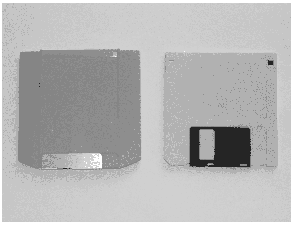

**图 6.2**
*Zip 磁盘（左）比 3.5 英寸软盘（右）略大。*

> **警告**
> *切勿将标准软盘插入 Zip 驱动器！这样做可能会损坏 Zip 驱动器，可能导致臭名昭著的 Zip 驱动器“死亡咔嗒声”。这是 Zip 驱动器的损坏，表现为在尝试读取磁盘时发出咔嗒声。不幸的是，这种现象可能会损坏 Zip 磁盘，而损坏的磁盘又可能损坏另一台 Zip 驱动器，因此这种现象可能像传染病一样扩散。如果遇到这种情况，请立即丢弃或修复 Zip 驱动器，并丢弃所有受影响的磁盘。*

Zip 驱动器是中等容量可移动磁盘格式中最受欢迎的一种。它有 ATAPI、SCSI、并行端口和 USB 等多种版本，很容易将 Zip 驱动器连接到你的计算机上。事实上，许多新电脑都预装了 Zip 驱动器。

Zip 磁盘在软件层面支持一些功能，这些功能在大多数其他可移动介质上要么不可用，要么通过硬件实现。其中最重要的是写保护功能。在 Linux 下，你可以使用 `ziptool` 软件包来访问写保护功能或发送弹出命令，该软件包包含在许多发行版中，也可以从 http://rufus.w3.org/linux/RPM/ 等软件包分发网站获取。

## LS-120 SuperFloppies

由 Imation (http://www.imation.com) 开创的 LS-120 SuperFloppy，是 Zip 驱动器在中等容量可移动磁盘市场的主要竞争对手。尽管 LS-120 在市场中填补了类似的空白，但它在两个主要方面有别于 Zip 驱动器：

-   **技术** —— 当记录 120MB 磁盘时，LS-120 使用混合磁/光技术。驱动器使用激光在盘片上写入光学参考磁道，这使得主磁读写头能够比在标准软盘上更精确地定位，从而产生更高的容量。
-   **兼容性** —— LS-120 磁盘的大小与标准 3.5 英寸软盘相同，并且 LS-120 驱动器可以读写标准 3.5 英寸软盘。这意味着 LS-120 驱动器可以替代 x86 计算机上的标准软盘驱动器。此外，LS-120 驱动器读取标准软盘的速度大约是传统软盘驱动器的三倍。

绝大多数 LS-120 驱动器是内置的 ATAPI 设备。也有基于 SCSI 的 LS-120 驱动器，但很难找到。USB 和并行端口型号也存在。

## 磁光盘

*磁光*（MO）盘与 LS-120 盘类似，使用混合磁/光技术。然而，磁光盘更依赖于技术的光学部分。这些驱动器使用激光将特殊的记录介质加热到高温。在这些高温下，磁读写头可以改变磁盘的磁性，这与纯磁记录技术中的情况类似。读取磁盘时不需要加热。激光的加热作用是为了改变磁盘上磁性编码的数据。其结果是，存储在磁光盘上的数据往往比存储在纯磁性介质上的数据更不易改变。这一特性使得磁光驱动器对于长期存储具有吸引力。（最近，CD-R 驱动器在长期存储方面变得更具吸引力，因为 CD-R 介质的每兆字节成本比磁光介质低得多。）

磁光驱动器覆盖广泛的容量和介质尺寸。它们有 3.5 英寸和 5.25 英寸两种样式，容量范围从 128MB 到 5.2GB。能够读取更大容量的型号通常也能读取使用相同尺寸的较小容量介质。3.5 英寸的介质类似于普通软盘，但稍厚一些。5.25 英寸的磁光介质构造类似 3.5 英寸介质，带有硬塑料外壳，但尺寸更大。如果你滑动金属盖，磁光盘会像 CD 一样闪闪发光。

磁光驱动器几乎总是作为 SCSI 设备销售。磁光驱动器往往比较昂贵——价格在 300 到 2500 美元之间，而大多数 Zip 和 LS-120 驱动器的价格在 75 到 200 美元之间。不过，磁光介质的价格并不比 Zip 和 LS-120 磁盘贵太多，至少对于与这些磁盘竞争的低容量介质来说是这样。


如果你不需要与他人交换数据，MO光驱是中高容量可移动存储的不错选择。如果你更青睐SCSI接口而非其他接口类型，这种情况尤为适用。

## 高容量可移动磁盘
正如我刚刚提到的，就可移动驱动器而言，MO光驱存在一些容量极高的规格。其他技术也在高端市场竞争，但没有任何一种能达到最高容量MO光驱的水平。这些技术大多基于硬盘原理：它们采用硬盘技术，但搭配可移动磁盘盘片。目前最常见的两种是Iomega的Jaz驱动器（有1GB和2GB两种规格），以及Castlewood（http://www.castlewood.com）的Orb驱动器（2.3GB）。它们的最新版本在功能和容量上不相上下，不过Orb在速度上略占优势。

ziptools工具包可以帮助你调用Jaz驱动器的功能——弹出光盘与软件写入保护。和大多数MO光驱一样，Jaz驱动器仅配备SCSI接口。Orb驱动器提供更多样化的接口选择。这类驱动器通常会搭配SCSI主机适配器捆绑销售，但这类捆绑适配器的质量往往较低。你最好单独购买SCSI主机适配器。

高容量可移动磁盘驱动器相当罕见，除非你清楚对方使用的是什么类型的驱动器，否则不要指望用这类驱动器与他人交换存储介质。由于盘片价格较高，这类驱动器并不适合与随机个体交换数据。如果你需要广泛分发大文件，第7章《光驱》中提到的CD-R驱动器是更好的选择。

## 选择合适的接口
如表6.1所示，许多可移动介质驱动器支持多种接口。你选择的接口会带来多方面的影响，包括：
- **速度** 部分接口的传输速度比其他接口更快。表6.1中同类型驱动器的速度差异，主要是由不同接口的速度差异导致的。
- **便携性与安装** 部分接口仅适用于内置设备，部分仅适用于外置设备，还有一种（SCSI）同时支持内置和外置设备。
- **成本** SCSI接口的价格通常比其他类型更高。
- **Linux驱动** Linux支持所有主流接口类型，但部分接口的配置比其他接口更容易。

## 软驱接口
软盘驱动器是唯一拥有专属接口类型的可移动介质设备。软驱接口是所有现代x86主板的标准化组件。不过许多80486及更早的电脑会将软驱接口与EIDE或SCSI接口一起做在扩展卡上。尽管如此，软驱接口的标准化特性保证了Linux与任何软驱或软盘控制器之间几乎不存在兼容性问题。因此这是一种安全的接口，尽管传输速度非常慢。

### EIDE/ATAPI接口
如第5章《硬盘》所述，增强型集成设备电子（EIDE）和高级技术附件包接口（ATAPI）这两个术语都指同一种接口，但通常用于指代不同的设备。具体来说，ATAPI设备遵循一套适用于控制非磁盘设备（如CD-ROM光驱、磁带驱动器）的协议。少数连接到IDE端口的可移动磁盘设备不支持完整的ATAPI功能，但大多数都支持。为简化表述，表6.1将所有此类设备称为EIDE驱动器，我在后续讨论中也使用这个术语，其涵盖范围比ATAPI更广。

无论叫什么名字，EIDE接口对于可移动介质设备来说都是一个相当不错的选择。EIDE是为高速磁盘设备设计的，完全能够跟上可移动介质驱动器的速度——这类驱动器的速度通常远低于现代硬盘。大多数BIOS都支持从这类驱动器启动，因此这些驱动器是制作应急Linux启动系统的便捷工具。你可以将Linux安装到合适的可移动介质上，遇到紧急情况时可以直接从该设备启动。
> 提示 将Debian和Slackware发行版精简到最基础的核心组件，安装到Zip或LS-120这类小型可移动磁盘上会非常方便。即使你平时不使用这些发行版，也可以考虑用其中一个制作应急磁盘。

不过EIDE接口用于可移动磁盘时也存在缺陷。其中之一是它最适合内置驱动器。如果你需要灵活地将驱动器在不同电脑间移动，最好选择其他接口。（不过确实有EIDE设备外置套件，如果你真的有需求，也可以实现。）同样重要的是，每根EIDE链路最多仅能连接2台设备的限制会相当严苛，尤其是当你希望为系统添加CD-R刻录机、磁带备份单元这类额外设备时。

## SCSI接口
在其他条件相同的情况下，*小型计算机系统接口*（SCSI）总线是可移动介质的最佳选择。哪怕是最早的SCSI-1版本，其速度也完全能够满足大多数可移动介质驱动器的需求，后续版本甚至能轻松应对速度更快的Orb驱动器。与EIDE不同，SCSI支持驱动器内置或外置安装，因此你可以将单台SCSI可移动介质驱动器在不同电脑间移动——只要两台电脑都配备了SCSI主机适配器即可。SCSI还支持将最多7台或15台设备（取决于SCSI版本）连接到单个主机适配器，因此搭建拥有大量SCSI设备的系统，比搭建拥有大量EIDE设备的系统更容易。

当然SCSI也有缺点。其中一个缺点是成本——SCSI主机适配器需要额外付费，大多数可移动介质设备的SCSI版本价格也普遍高于对应的EIDE版本。如果你还没有SCSI主机适配器，就需要另行购买，而且部分可移动介质驱动器附赠的适配器性能相当低端。部分适配器甚至无法在Linux上使用。

## 并口接口
20世纪90年代中期到后期，并口是电脑连接外置可移动介质驱动器最常用的方式。这类设备通常会使用各种一分二线缆，让你可以同时连接可移动介质驱动器和普通打印机。这类驱动器上的并口通常起到并口转IDE或并口转SCSI的作用，驱动器内部仍使用IDE或SCSI接口。因此你会在Linux内核配置的EIDE或SCSI分区中找到部分这类设备的Linux驱动。我会在本章后续内容中详细介绍这两种配置方式。

实际上，并口作为可移动驱动器的接口存在不少缺陷，原因如下：
- **速度** 哪怕在最佳状态下，并口的传输速度也仅有约2MB/s。实际上，它甚至无法满足Zip-100驱动器的速度需求，这也是为什么许多并口版本的驱动器比EIDE或SCSI版本更慢。
- **可靠性** 通过并口让任何磁盘设备正常工作都可能很棘手。大多数情况下可以调校到正常工作的状态，但出现问题的概率远高于其他大多数接口。
- **驱动** 要让可移动介质设备在并口上正常工作，需要多层Linux驱动配合。尽管这种情况比几年前少见得多，但仍然可能出现你找不到适配驱动器制造商使用的并口技术的合适驱动的情况。
- **干扰** 特别是在2.2内核之前，并口磁盘驱动器与打印机之间的干扰非常常见。随着外置设备（打印机、可移动磁盘驱动器、扫描仪等）的需求不断增长，如果你需要连接多个外置设备，这个问题可能会变得相当严重。这类系统通常使用SCSI或USB接口时表现更好。

尽管如此，如果你必须使用外置驱动器且SCSI不可行，并口设备可能是一个合理的选择。不过你也可以考虑使用USB设备替代并口设备。每种接口都存在缺陷，但USB的未来潜力更大。

## USB接口
*通用串行总线*（USB）接口是当前计算机硬件制造商的最热门选择。尽管USB的最高速度仍慢于并口（1.5MB/s对比2MB/s），但USB是可移动介质驱动器的更优选择，因为USB的设计初衷就是支持多设备连接。我仅推荐将USB用于相对低端的可移动介质设备，比如Zip和LS-120驱动器，这类设备使用USB带来的速度损耗不会太明显。尽管Orb驱动器也有USB接口版本，但速度下降幅度太大（从12MB/s降至1.5MB/s），除非特殊情况否则无法接受。

Linux对USB的支持在2.2.x内核系列早期并不存在，但此后得到了极大提升，特别是在2.3.x开发系列的后期版本。因此如果你当前使用的是2.2.x系列内核，选择USB可移动介质设备会比较麻烦：你需要升级内核，或至少给现有内核打上最新的USB补丁后重新编译。

在我撰写本文时，USB接口的Iomega Zip驱动器在2.3.40及更高版本内核上运行良好，但LS-120的支持似乎不太稳定。因此我强烈建议你查阅Deja News（http://www.deja.com）或Linux USB开发网页（http://www.linux-usb.org/），获取你正在考虑的特定驱动器在Linux上的USB支持相关信息。
> **注意** 你可以从许多通用Linux FTP站点获取最新内核，例如ftp://sunsite.unc.edu，或从http://www.kernel.org下载。Linux USB站点http://www.linux-usb.org提供了适用于2.2.x系列内核的补丁，能让这些内核支持2.3.x系列内核所支持的大部分USB设备。


## 火线（FireWire）
火线（又名IEEE-1394或i.Link）是最新一代外部连接技术。火线在许多方面与USB相似——它是一种串行技术，支持在计算机开机状态下插拔设备。不过它的速度远快于USB：传输速率最高可达50MB/s，而USB仅为1.5MB/s，目前更高速的版本还在研发中。这些特性使得火线技术非常适合用于外接磁盘设备。遗憾的是，2000年初，火线技术很大程度上还只是纸上谈兵。市面上仅有少量火线设备，而且非常罕见。火线驱动程序出现在2.3.x系列内核的后期版本中，但这些驱动程序尚未适配2.2.x内核。更多详细信息可访问http://eclipt.uni-klu.ac.at/ieee1394 查看。
## PC-Card接口
PC-Card接口主要用于笔记本电脑，用于支持各类设备，包括可移动存储驱动器。部分驱动器会自带或支持选购转换器，让你通过专用的PC-Card使用其他类型的接口。另一些则支持将可移动存储设备直接插入PC-Card插槽。部分笔记本电脑支持使用Zip或LS-120驱动器替代软盘，或作为与CD-ROM驱动器相同仓位中的可更换选项。这些接口的传输速度通常高于PC-Card接口，因此在多数场景下比PC-Card驱动器更适用。不过你可能出于某些原因希望使用PC-Card接口的驱动器，比如这类驱动器可以更方便地与其他系统（比如台式机）搭配使用。
## Linux与可移动磁盘的兼容性
在Linux中使用可移动磁盘并不比使用传统固定磁盘复杂，不过你需要了解设备文件、挂载选项等相关规则。不过，配置系统以使用可移动设备有时会面临挑战，因为你需要向内核添加合适的设备驱动程序，而所需添加的驱动程序可能并不明显。
## 访问驱动器的内核选项
配置可移动设备的内核时，你可能需要在多个位置查找合适的设备驱动程序。如果你在Linux源代码目录（通常是/usr/src/linux）中执行`make xconfig`命令来配置Linux内核，你会看到两个窗口，如图6.3所示。第一个是Linux内核配置窗口，列出了各类驱动程序和配置选项的大类，例如*常规设置*和*块设备*。第二个是点击其中任意选项后弹出的窗口，比如图6.3中的常规设置窗口。你可以在这个窗口中为特定的可移动设备设置选项，不过针对具体设备的设置分散在好几个不同的窗口中。
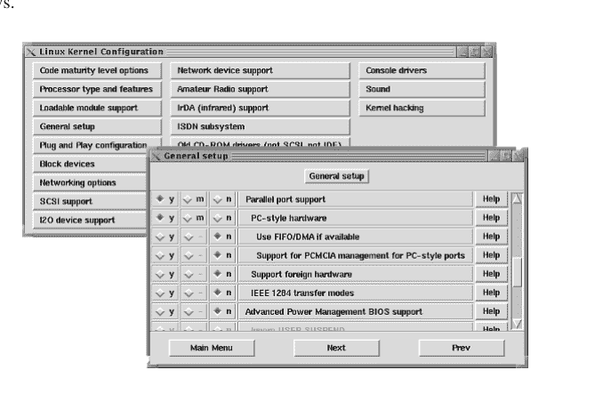
**图6.3** *在Linux内核配置窗口中点击对应的按钮，即可打开特定内核选项的窗口，例如常规设置窗口。*
如果你使用非图形化工具配置内核，例如`make menuconfig`或`make config`，你需要做出和图形化配置相同的选择，只是使用的是基于文本的配置工具，而非图6.3所示的窗口。大多数情况下，每个设备都有三个可选选项：
- **Y** 将驱动程序编译进Linux内核主文件中。该驱动将一直处于就绪可用状态，但也会始终占用至少一部分内存。
- **M** 将驱动程序编译为独立的模块文件，你可以按需加载或卸载该模块。该选项可以节省内存，但访问文件时会有轻微延迟，尤其是当你未配置系统按需自动加载内核模块时。尽管大多数设备支持该选项，但并非所有设备都可用。
- **N** 不将驱动程序编译进内核。你将无法使用该设备或相关功能。
## 软驱的内核选项
由于软盘的相关设置十分简单，没有太多需要说明的内容。在x86架构计算机上，你需要在块设备区域中选择Y或M响应标准PC软盘支持选项，才能使用内置的软盘端口。我通常选择模块化编译选项来节省少量内存，因为我不经常使用软盘。如果你有外接USB软驱，请查阅USB设备内核选项相关章节。如果你想用LS-120驱动器读取普通软盘，只需通过LS-120驱动器自身的接口即可实现。
## EIDE/ATAPI驱动的内核选项
EIDE/ATAPI相关选项位于块设备区域。要使用EIDE/ATAPI可移动磁盘，你可能需要启用以下几个选项：
- **增强型IDE/MFM/RLL磁盘/CD-ROM/磁带/软盘支持** 要使用任何类型的EIDE/ATAPI设备，必须将该选项设置为Y或M。如果你从EIDE硬盘启动，必须设置为Y；如果你使用SCSI硬盘，但配有EIDE可移动磁盘，可根据需求设置为M。
- **包含IDE/ATA-2磁盘支持** 要使用可移动磁盘，必须将该选项设置为Y或M。和主EIDE支持选项类似，如果你从EIDE硬盘启动，必须设置为Y；如果从SCSI硬盘启动，可设置为Y或M。
- **包含IDE/ATAPI软盘支持** 要使用EIDE可移动磁盘，必须激活该选项（选择Y或M）。
- **EIDE芯片组选项** 块设备窗口中的各类选项与您使用的具体EIDE芯片组相关，无论是主板集成还是扩展卡上的芯片组。为了获得最佳性能，你应该启用对应的选项。
## SCSI驱动的内核选项
SCSI相关选项位于Linux内核配置窗口中的一个或两个设置窗口中。在2.2.x系列内核中，这些选项分散在SCSI支持和SCSI底层驱动程序两个项目中；在2.3.x和2.4.x内核中，SCSI底层驱动程序项目已被移入SCSI支持窗口，作为其子选项。可移动驱动器所需的选项如下：
- **SCSI支持** 必须激活SCSI支持。如果你从SCSI硬盘启动，必须选择Y；如果从EIDE硬盘启动，选择M即可。
- **SCSI磁盘支持** 和SCSI支持类似，SCSI磁盘支持是必选项，仅当你从SCSI硬盘启动时需要设置为Y。
- **SCSI底层驱动程序** 你必须找到并激活可移动磁盘驱动器所使用的SCSI主机适配器的驱动程序。（有关SCSI主机适配器的更多信息，请参阅第9章“SCSI主机适配器”。）如果你从SCSI硬盘启动，该选项必须设置为Y；否则可选择Y或M。
## 并口驱动的内核选项
并口设备使用多种不同的驱动程序，其中许多驱动程序与特定产品绑定。你可能需要用到的选项包括：
- **常规设置，并口支持** 所有并口可移动磁盘以及所有其他连接至并口的设备都需要该选项。尽管该选项可以选择Y或M，但我建议选择Y，因为太多功能依赖于此选项，而且我遇到过内核模块自动加载器无法正确处理并口驱动的情况。
- **常规设置，PC架构硬件** 如果你使用x86架构PC，可选择Y或M。如果使用其他架构，你可能需要选择其他选项，例如“支持非PC架构硬件”。
- **常规设置，若支持则使用FIFO/DMA** 尽管这不是强制要求的，但选择Y有可能提升性能，至少可以在你访问并口磁盘驱动器时降低CPU开销。
- **块设备，并口IDE设备支持** 许多此类设备需要该选项（选择Y或M），但并非所有设备都需要。
- **块设备，并口IDE磁盘** 该选项用于支持未使用ATAPI协议的并口IDE设备。如果你不确定是否需要，请至少以模块形式编译该支持。
- **块设备，并口ATAPI磁盘** 该选项与上一项类似，但为使用ATAPI协议的设备加入了ATAPI协议支持。同样，如果你不确定，请启用该支持。
- **特定块设备** 在上述最后几个选项下方，有许多针对特定设备的驱动程序，例如MicroSolutions backpack协议。要使用IDE风格的并口驱动器，你*必须*选择其中至少一个设备。如果你没看到自己的设备被列出，可以尝试在http://www.deja.com 上搜索求助，或者直接选择所有设备。/usr/src/linux/Documentation/paride.txt文件也可以帮助你判断需要选择哪个驱动程序。
- **SCSI底层驱动程序，IOMEGA并口（ppa - 旧款驱动器）** 如果你有旧款并口接口的Iomega Zip驱动器，请激活该选项。该设备*不需要*并口IDE驱动程序。
- **SCSI底层驱动程序，IOMEGA并口（imm - 新款驱动器）** 如果你有带标有“自动检测”线缆的新款Zip Plus驱动器，请使用该驱动程序。该设备不需要并口IDE驱动程序。


**提示** 如果你有一块SCSI硬盘和一个并口Iomega Zip驱动器，我建议将Iomega并口驱动程序编译为模块，将主SCSI主机适配器的驱动程序编译进内核。这样可以保证内核不会混乱，试图从Zip驱动器启动而非SCSI启动盘启动。
当你使用并行接口设备时，访问驱动器的方式取决于所用接口的子类型，是SCSI还是IDE。Iomega Zip驱动器会被识别为普通的SCSI设备，而IDE驱动器则使用特殊的设备文件。如果系统中还没有这些设备文件，`/usr/src/linux/Documentation/paride.txt`文件中包含一个你可以运行来创建设备文件的脚本。（大多数发行版都包含这些设备文件。）

## USB驱动器的内核选项
随着2.3.x版Linux内核的快速迭代，USB内核选项变化很快，针对2.4.x内核的描述可能与这里所述略有不同。如果你想在2.2.x内核上使用USB设备，必须使用非常新的2.2.x内核，或者打上一组补丁来为旧内核添加USB支持。与USB可移动磁盘相关的选项包括：
- **USB驱动程序，支持USB** 该选项是使用任何USB设备所必需的。
- **USB芯片组** 现有两种USB底层驱动程序：UHCI和OHCI。你必须选择适合你计算机的那一种。
- **USB驱动程序，USB SCSI（大容量存储）** 该选项包含对部分USB磁盘设备的支持，将它们视为SCSI磁盘来处理。
- **SCSI选项** Linux对USB磁盘设备的支持依赖SCSI驱动程序，因此你必须启用SCSI驱动程序，就像使用SCSI主机适配器时一样。不过你不需要为任何特定的SCSI主机适配器启用SCSI菜单中的驱动程序。

2.2.x和2.3.x内核对USB存储设备的Linux内核支持较弱，但正在快速改进。幸运的话，在2.4.x系列内核的早期版本中，支持就会变得可靠。要获取最新信息，请访问http://www.linux-usb.org/。

## 使用合适的设备文件
要访问可移动介质设备，你通常需要使用`mount`命令将其挂载到Linux文件系统的某个位置。例如，`mount /dev/fd0 /mnt/floppy`会将软盘挂载到`/mnt/floppy`。你也可以使用这些设备文件在可移动磁盘上创建文件系统，比如`mkfs -t ext2 /dev/fd0`，会在软盘上创建Linux ext2文件系统。不过你要使用哪些设备文件呢？这取决于接口类型，例如：
- **软驱端口** 你需要使用文件名格式为`/dev/fd*`的设备文件。大多数情况下，`/dev/fd0`就足够了，但还有很多设备文件用于强制以特定容量访问驱动器，比如`/dev/fd0h1440`和`/dev/fd0h720`，分别会强制以1.44MB和720KB的容量访问。你可以使用这些变体强制Linux的`fdformat`程序以异常容量格式化磁盘，比如`fdformat /dev/fd0h1494`会将磁盘格式化为1494KB的容量。如果你的计算机有多块软驱，第二块软驱可以通过`/dev/fd1`或对应的变体访问。
- **EIDE端口** 内置EIDE可移动磁盘的访问方式与内置EIDE硬盘完全相同，设备文件为`/dev/hdxy`，其中*x*是a-d（某些情况下可能更高）的字母，*y*是从1开始的数字。*x*值代表设备位置：a是主控制器上的主驱动器，b是主控制器上的从驱动器，以此类推。*y*值代表分区号，如果你不分区访问磁盘（比如将其视为超大容量软盘），或者使用`fdisk`对磁盘分区时，可以省略该值。（我稍后会在“可移动磁盘分区方案”部分介绍分区操作。）
- **SCSI端口** SCSI驱动器的设备文件名与EIDE驱动器的类似，但格式为`/dev/sdxy`。SCSI设备的*x*编码分配方式不同：a永远是第一块SCSI驱动器，无论其SCSI ID是多少，b永远是第二块SCSI驱动器，以此类推。
> **提示** 如果你有外置SCSI可移动磁盘驱动器，有时会将其从计算机上拆下，请给它分配一个高于所有SCSI硬盘的SCSI ID。这样，当你将该可移动驱动器移动到另一台计算机时，不会干扰固定磁盘的设备分配。
- **并口** 使用并口转SCSI转换器的并口设备（比如Iomega Zip驱动器的并口版本）会获得SCSI驱动器分配，如上所述。而使用并口转IDE转换器的并口设备则会获得全新的驱动器标识符，格式为`/dev/pdxy`。与EIDE和SCSI设备类似，*x*是代表设备的字母，*y*是可选的分区号。
- **USB端口** 由于USB支持使用Linux的SCSI功能来处理磁盘设备，因此USB驱动器会使用SCSI设备文件名。

## 与其他操作系统交换介质
可移动介质的主要优势之一是可以方便地与其他计算机（甚至是非Linux系统）交换数据。幸运的是，Linux对外部文件系统的支持非常出色，因此只要你的可移动磁盘设备工作正常，与非Linux计算机交换数据时基本不会遇到什么问题。

## 可移动磁盘分区方案
与硬盘不同，软盘容量太小，将其划分为独立分区没有太大意义。因此软盘永远不会进行分区，你通过主磁盘设备文件（比如`/dev/fd0`）访问软盘上的文件系统。但高容量介质并非总是如此。这些设备有时会像硬盘一样进行分区，尽管它们通常只包含一个分区。常见的分区方案包括：
- **无分区** 可以不进行分区就使用高容量可移动介质设备，就像软盘一样。然后你可以使用不带分区号的设备标识符创建和挂载文件系统，比如`mount /dev/sdb /mnt/modisk`来挂载MO光盘。这种做法在一些低容量设备（比如老式MO光盘类型）中尤为常见。
- **1号分区** 一个合理的分区选择是使用1号分区（比如`/dev/sda1`）。这是磁盘上的第一个主分区条目。许多Linux用户在使用可移动介质驱动器时，会在此位置创建Linux ext2fs分区。
- **4号分区** 默认情况下，Iomega将其Zip磁盘分区为标准x86 4号分区（比如`/dev/sda4`）。该分区的大小和`/dev/sda1`相同，只是标识编号不同。如果你使用Zip驱动器，你可能想使用4号分区，以便于与其他Zip驱动器用户交换数据。
- **非x86分区** 在极少数情况下，你可能会遇到已分区的可移动磁盘，但其分区方式不是x86计算机上常见的方案。例如，来自Macintosh的可移动介质可能使用Macintosh分区方案，与x86分区方案不同。Linux的层次文件系统（HFS）支持包含对简单Macintosh分区表的功能，因此你可以将这些磁盘视为未分区状态。如果你在内核中添加了Macintosh分区支持，你也可以使用分区号挂载磁盘，这个分区号很可能是#4。我建议使用你的驱动器类型最常用的分区方案。例如，对于Zip磁盘，我建议将磁盘划分为一个大的4号分区。这样你只需要创建一个挂载点，并在`/etc/fstab`中添加一条条目，就可以挂载几乎所有来源的Zip磁盘。

## 适用于其他操作系统的文件系统驱动程序
如前所述，Linux包含对多种文件系统的支持，这使得与其他操作系统交换数据变得容易。你最有可能在可移动介质上遇到的四种文件系统是：
- **FAT** FAT文件系统是DOS、Windows和OS/2原生的文件系统，几乎所有其他操作系统都将其作为非原生文件系统支持。因此它在可移动介质上极为常见。在Linux中，你可以使用三种文件系统类型挂载此类设备：msdos、umsdos和vfat。第一种提供对传统MS-DOS风格文件名的访问，文件名长度限制为8个字符，加上3个字符的扩展名。umsdos文件系统增加了对UNIX风格长文件名、权限等的支持，但只能在Linux中读取。vfat选项在当今通常最实用，因为它支持Windows风格的长文件名。
- **ext2fs** Linux的原生文件系统ext2fs可以轻松用于可移动介质磁盘。它的开销比FAT大，因此在中小容量磁盘上的效率通常不高。但如果你想保留UNIX风格的所有权和权限信息，ext2fs是一个极佳的选择。
> 要最大化ext2fs可移动磁盘的可用空间，请在创建文件系统时为`mke2fs`命令使用`-m 0`参数，例如`mke2fs -m 0 /dev/pda`。该参数将保留空间设置为0%。通常，ext2fs会为root用户保留一定量的空间（默认5%）。其思路是，如果文件系统被占满，超级用户仍有一些磁盘空间可用于清理问题。然而这一逻辑对可移动磁盘并不适用，因此将保留空间设置为0%是安全的。
- **Minix** Minix文件系统在Linux社区的软盘中较为流行。该文件系统是为Minix操作系统设计的，而Minix是Linux的部分原型。事实上，最早的Linux系统在硬盘上使用的就是Minix文件系统。然而该文件系统的最大容量有限，甚至Zip驱动器的容量都超出了其限制。但在软盘上它仍然有用，因为它的开销比ext2fs小。


**HFS**
如果你经常和Macintosh用户交换文件，那你很可能会收到使用Mac原生HFS格式的磁盘。2.2.x及更高版本的Linux内核已内置HFS支持，因此你只需要确保自己的内核开启了该功能即可。截至2.2.x和2.3.x内核版本，Linux的HFS支持仍处于实验阶段，已有案例显示该支持会造成HFS磁盘损坏。因此，如果条件允许，我建议你仅对HFS磁盘执行读取操作。向小容量磁盘、以及文件极少甚至无文件的磁盘写入数据，比向存储大量文件的大容量磁盘写入更安全。
> **注意** x86电脑的软驱接口芯片无法读取老款Macintosh 400KB和800KB软盘使用的底层编码格式。因此，即便你在内核中开启了HFS支持，也无法在运行Linux的x86电脑上读取这类软盘。不过Macintosh 1.44MB软盘使用的底层编码格式与x86 1.44MB软盘一致，因此你可以读取这类较新的Macintosh软盘。
> **注意** 截至目前，尚无Linux驱动程序支持苹果新款HFS+格式。幸运的是，HFS+几乎仅用于硬盘，你在可移除磁盘上几乎不会遇到该格式。不过如果你碰巧遇到了使用HFS+格式的超大容量磁盘，那么在有开发者发布Linux版HFS+驱动之前，你将无法在Linux下读取该磁盘。

Linux通过`/etc/fstab`文件指定开机时需要挂载哪些分区及其他磁盘设备。你也可以通过该文件配置Linux允许普通用户挂载可移除存储介质。以下是一份`/etc/fstab`文件的示例条目：
``` # Device filename Mount point Filesystem Options Dump Fsck /dev/fd0 /mnt/floppy auto user,noauto 0 0 /dev/sda /mnt/maczip hfs ro,user,noauto 0 0 /dev/sda4 /mnt/zip auto user,noauto 0 0 ```
每个条目由多列组成，列与列之间用一个或多个空格/制表符分隔。以井号（#）开头的行是注释。各列的含义如下：
- **设备文件名** 要使用的设备文件名称，可包含分区标识符。前面的示例分别对应软驱和SCSI Zip驱动器。
- **挂载点** 设备在Linux文件系统中挂载的位置，也就是我稍后将提到的普通用户挂载设备时需要使用的路径。
- **文件系统** 你可以在该列指定具体的文件系统类型，也可以使用`auto`让计算机尝试自动检测文件系统类型。
> **提示** 指定文件系统类型为`auto`是简化配置的有效方式。前面示例中的`/mnt/floppy`和`/mnt/zip`两个挂载点都可用于挂载FAT、ext2fs等多种文件系统，因此你不需要了解磁盘上的文件系统类型就能完成挂载。不过Linux通常很难自动识别HFS磁盘，这也是前面示例中为Macintosh Zip磁盘单独设置一条条目的原因之一。
- **选项** 你可以在下一列指定挂载选项，具体选项说明可以参考`mount`命令的帮助手册。其中对我们来说最重要的是`user`和`noauto`两个选项：前者允许任意用户挂载磁盘，后者则禁止系统在开机时尝试挂载该磁盘。你最好为自己的所有可移除设备都配置上这两个选项。
- **转储码与fsck顺序** 最后两列代码分别对应是否使用`dump`工具备份分区、以及内核开机时检查分区的顺序。对于可移除磁盘而言，这两个设置用处不大，因此都应设为0。

完成`/etc/fstab`文件的相应修改后，你可以在root权限下输入**mount -a**命令来使修改生效。之后普通用户只需输入**mount** *挂载点*即可挂载可移除介质，其中*挂载点*就是比如`/mnt/zip`或`/mnt/floppy`这类挂载路径。使用完成后，你可以用同样的方式执行`umount`命令卸载磁盘。（没错，这个命令的拼写是正确的，它的拼写不带开头的n。）

## 直接访问工具与其他实用工具
除了将可移除磁盘挂载到Linux文件系统结构中，你还可以通过其他方式操作或访问磁盘。其中最重要的方式之一是使用`mtools`软件包，它允许你使用仿照DOS命令设计的命令来访问可移除磁盘。例如，**mdir** *a:*命令可显示软盘上的目录列表，**mcopy** *文件名 a:*命令可将名为*文件名*的文件复制到软盘中。总体而言，`mtools`命令的功能与同名的DOS命令一致，只是对应的`mtools`命令会在命令名称前添加前缀*m*。

`mtools`软件包是快速访问软盘的便捷工具，但它无法让其他程序访问磁盘。如果你想用文字处理软件之类的程序直接读写文件，就必须通过常规方式挂载磁盘。你可以在该项目的官网http://mtools.linux.lu/上获取更多关于`mtools`的信息。

`hfsutils`软件包的功能与`mtools`类似，但专门用于访问HFS磁盘。该软件包包含一个名为`xhfs`的程序，它提供了图形用户界面，可用于双向复制文件，如图6.4所示。你可以访问http://www.mars.org/home/rob/proj/hfs/了解更多信息。
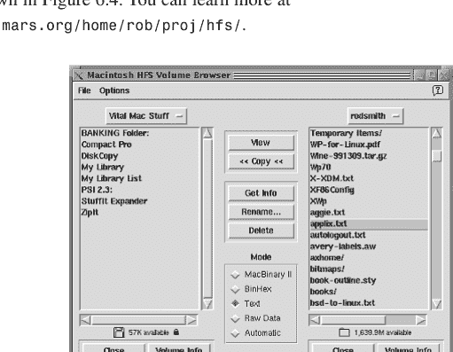
**图6.4** `xhfs`工具允许用户在图形界面环境下向Macintosh磁盘复制文件、或从Macintosh磁盘复制文件。

除了这些用于访问特定文件系统的专用工具外，你还可以使用多种标准Linux工具以不同方式操作磁盘：
- **mkfs** `mkfs`命令可在磁盘或分区上创建文件系统。实际上，`mkfs`只是根据你通过`-t`选项指定的文件系统类型调用对应的其他程序；例如，当你输入`mkfs -t ext2 /dev/hdc4`命令时，`mkfs`会调用`mke2fs`，从而在EIDE可移除磁盘上创建ext2文件系统。大多数Linux系统都自带`mke2fs`和`mkdosfs`（用于创建FAT文件系统），当然也有其他可用的同类工具。
- **fsck** 该命令用于检查文件系统的完整性。和`mkfs`一样，`fsck`也依赖其他程序完成大部分工作。其中比较常用的是用于检查ext2文件系统的`e2fsck`，此外还有用于检查DOS文件系统的`dosfsck`，以及其他针对更小众文件系统的检查工具。
- **tune2fs** 该程序允许你在文件系统创建完成后调整ext2fs的参数。例如，你可以调整已有的分区，使其预留空间区域变大或变小。
- **fdisk** 如果你打算将可移除磁盘作为带分区的硬盘使用，就可能需要用到Linux的`fdisk`工具来创建或修改分区。例如，你可以使用Linux的`fdisk`将预先格式化为FAT格式的磁盘上的分区类型码修改为0x83（“Linux原生”）。你可以查看对应工具的手册页来了解更多相关信息。

## 总结
可移除磁盘驱动器是非常实用的工具，可用于存储不常使用的文件、以及在不同计算机之间交换数据。Linux对这类驱动器有较好的支持，但部分驱动器的支持度优于其他。总体而言，你会发现SCSI或EIDE/ATAPI驱动器是最容易使用的。基于并行端口的设备可能会比较难搞，但通常都能调通。随着Linux内核向2.4版本演进，对USB设备的支持正在快速提升。当然，在Linux中使用历史悠久的软驱接口体验相当不错，但该接口目前仅能用于连接普通软盘。未来，火线（FireWire）或许会成为可移除存储的优秀接口，但在2000年初，这项技术仍太新，Linux下的相关驱动也还相当不成熟。


# 光盘驱动器
## 第7章
### 本章内容
- 光盘介质概述 192
- 驱动器接口 199
- CD、CD-R与DVD对比 203
- 评估光盘驱动器性能 207
- 选择可刻录驱动器 211
- 在Linux中访问光盘介质 214
- 在Linux中刻录CD-R或CD-RW光盘 219

第6章“可移动磁盘”涵盖了大部分可移动磁盘介质，但有一个明显的遗漏：*光盘*（CD）及相关介质，我将其称为*光盘驱动器*。第6章遗漏这部分内容的原因很简单：这些介质非常重要，值得单独用一章来介绍。这些介质的重要性主要源于其普及性：如今几乎不可能买到不带任何形式光盘驱动器的x86计算机。

> **注意**
> 除本章介绍的介质外，还有一些介质也使用了光学技术。例如，磁光（MO）驱动器在记录过程中会使用激光。但CD-ROM及相关设备是最常见的光盘驱动器，也是目前唯一完全依赖光学技术进行数据录制的设备。比如MO驱动器在读写数据时除了光学技术外，还会用到磁学原理。

## 光盘介质概述
光盘驱动器可以按两个维度分类：容量和读写能力。低容量驱动器包括CD-ROM、CD-R和CD-RW设备，而较新的DVD设备是CD-ROM的高容量对应产品。CD-ROM和普通DVD-ROM驱动器为只读设备，而CD-R、CD-RW、DVD-R和DVD-RAM设备则增加了向光盘写入数据的能力。

## CD-ROM：光盘介质的鼻祖
CD-ROM是主要光盘介质类型中最早出现的，至今仍被广泛使用。本章介绍的所有更高级的驱动器类型都可以读取CD-ROM介质，因此当你准备升级到功能更强的驱动器类型时，无需丢弃现有的CD-ROM光盘。

### CD-ROM设计
*光盘*（CD）最初是20世纪80年代作为音乐存储介质开发的。这一事实带来了一些后续影响，决定了CD介质后来被改造为计算机数据存储设备的方式。

为实现恒定数据读取速率，采用圆形介质时有两种常用方案，前提是数据以固定大小的*扇区*存储：
- **每转固定扇区数**
  请想象一种被划分为扇区和柱面（或*磁道*）的介质，如图7.1所示。假设无论读取光盘的哪个部分，光盘都以恒定速率旋转。这种设计被称为*恒定角速度*，它能保证数据以恒定速率读取。软盘、部分老式硬盘以及一种视频激光影碟格式都采用了这种方案。从某种程度来说，老式黑胶唱片也是如此，不过它们使用的是单螺旋磁道而非多个柱面，如图7.1所示。这种方案的缺点是未能充分利用记录介质。为了在内层柱面上可靠记录数据，外层柱面的数据密度远低于介质所能维持的上限。向外层柱面存储更多数据可以提升介质的存储容量，但当光盘以恒定角速度旋转时，不同柱面之间的数据传输速率会出现差异。这种权衡对硬盘来说可以接受，但对*音频*记录介质来说并不合适。
- **固定线性扇区大小**
  为了在圆形介质上存储更多数据，可以调整每个柱面的扇区数量。现代硬盘就采用了这种方案。为了最大化存储容量，可以为*每个*柱面单独调整扇区数量。实际上，CD介质已经完全摒弃了柱面的概念，改用单条螺旋磁道。请想象一条绕在中心轴上的长磁道，如图7.2所示，这就是CD采用的方案。这种设计的难点在于，要从CD播放音乐，必须以可变速率（以每分钟转数衡量）旋转光盘：读取内层区域时转速更快，读取外层区域时转速更慢。这一要求增加了驱动器的设计复杂度。这种螺旋磁道设计适合音频CD，但作为更通用的数据记录介质使用时并非最优。原因是如果没有明确定义、且在介质旋转时有精确起始位置的柱面和扇区，很难定位特定磁道。出于这一原因，同时也为了增加纠错码以提升可靠性，CD-ROM的数据存储格式会将音频CD格式中用于数据存储的部分空间挪作他用。音频CD的扇区大小为2352字节，而对于数据CD，这个2352字节的扇区会被拆分为2048字节的数据加上304字节的纠错码及其他编码。

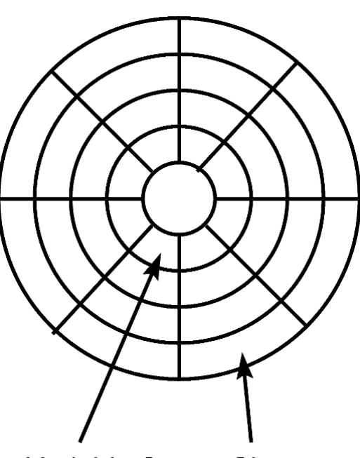
**图7.1** *当每柱面扇区数量固定时，外层柱面上的扇区物理尺寸更大，但内层和外层柱面上的扇区容量相同。*

标准4.72英寸的CD作为音频CD可存储74分钟的音频数据，作为CD-ROM则可存储650MB的数据。也可以将磁道绕得比常规更紧密以提升CD的容量，但能存储超过700MB（即80分钟）数据的CD非常罕见。将光盘容量提升到650MB以上存在风险：部分CD播放器或CD-ROM驱动器可能无法读取这类光盘。

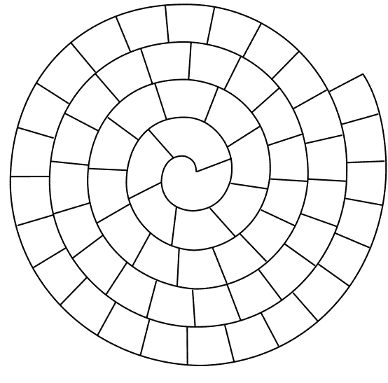
**图7.2** *扇区线性大小固定的螺旋磁道可在介质上存储更多数据，但需要可变的每分钟转数才能实现恒定的数据传输速率。*

## CD的类型
CD的种类繁多，主要取决于数据在光盘上的编码方式。（不过还有迷你光盘，其物理尺寸比普通CD更小。）大多数CD的分类以描述其规格的书籍封面颜色命名。最常见的CD类型包括：
- **红皮书** 音频CD所使用的格式，也被称为*CD-DA*（即*CD数字音频*）。
- **黄皮书** 数据CD所使用的格式。术语*CD-ROM*（即*CD只读存储器*）通常指代黄皮书CD，不过有时也用于指代其他数据格式的CD。
- **绿皮书** *CD交互*（CD-i）光盘所使用的格式。该格式从未流行起来，但曾是一种将计算机数据和视听信息整合到单一介质上的方案。
- **橙皮书** 可刻录CD所使用的格式。橙皮书包含与部分MO技术相关的内容。其中第三部分涉及CD-R和CD-RW设备，我将在本章后续部分介绍。
- **CD Extra** 一种包含独立音频（CD Extra格式）和数据（黄皮书格式）区域的格式。
- **CD-ROM/XA** *XA*是*扩展架构*的缩写。这是一种混合音频/数据格式。

除了这些底层数据格式外，还存在多种用于数据布局的高级格式，相关内容将在本章后续的“光盘文件系统选项”部分介绍。

## CD-R：制作你自己的CD-ROM
CD-ROM是存储可*大规模*分发的静态数据的绝佳介质，例如Linux发行版、剪贴画集和音乐。但由于这类介质是只读的，你无法自行制作CD-ROM。*CD可刻录*（CD-R）技术弥补了这一缺陷。CD-ROM通过在基材上形成一系列凹坑来表示二进制数据，而CD-R则使用光敏感染料。当CD-R驱动器的激光器以高功率开启时，可以改变染料的反射率，从而模拟传统CD中凹坑的效果。这样一来，你就可以制作自己的CD-ROM——至少是非常类似CD-ROM的介质。CD-R的制作过程通常被称为*刻录*CD-R。

大多数CD-ROM驱动器可以读取CD-R光盘，但偶尔会出现不兼容的情况。CD-R驱动器可以读取普通CD-ROM光盘，但速度通常比专用CD-ROM驱动器慢。此外，CD-R驱动器比CD-ROM驱动器更贵、更精密，因此许多使用CD-R驱动器的用户会额外配备一台CD-ROM驱动器，用于读取普通CD-ROM和自己刻录的CD-R光盘。CD-R介质与CD-ROM驱动器的兼容性算得上是一门玄学。即使使用相同的介质，不同的CD-R驱动器刻录出的CD-R光盘也有不同的光学特性。表7.1总结了不同CD-R驱动器、介质和CD-ROM驱动器之间的假设兼容性。需要注意的是，根据所用介质的品牌不同，CD-ROM驱动器1和2的兼容性模式可能完全相反，而CD-ROM驱动器3可以读取所有介质。唯一能知道什么组合好用的方法就是实际测试。幸运的是，新款CD-ROM驱动器的兼容性更好，近期的介质也比一两年前的同类产品表现更优。如果你购买了CD-R驱动器，在读取自己刻录的光盘时遇到问题，可以尝试更换介质品牌。


## 表7.1 假设的CD-R介质/驱动器兼容性
| 读取驱动器 | CD-R刻录机X：介质A | CD-R刻录机X：介质B | CD-R刻录机Y：介质A | CD-R刻录机Y：介质B |
|---|---|---|---|---|
| CD-ROM 1 | 是 | 否 | 否 | 是 |
| CD-ROM 2 | 否 | 是 | 是 | 否 |
| CD-ROM 3 | 是 | 是 | 是 | 是 |

CD-R介质主要有三大类：绿金型（金基材上涂覆菁染料）、金金型（金基材上涂覆酞菁染料）、蓝银型（银基材上涂覆偶氮染料）。大多数驱动器都能正常兼容各类介质，出现的故障多为品牌专属问题，无法据此预判驱动器应对同类型其他介质的能力。由于这类介质普及时间较短，耐久性测试目前充其量只能算初步结论，但有迹象表明金金型和蓝银型介质的寿命长于绿金型——金金型或蓝银型的典型寿命预估为100年，绿金型则为10至50年。

对CD-R驱动器而言，音频CD和数据CD-ROM几乎没有区别，因此你可以用CD-R驱动器制作自己的音频CD：你既可以从CD中提取数字音频数据，也可以用声卡从其他音源（比如麦克风或立体声系统的输入接口）采集音频。通过这种方式，你可以将老式模拟黑胶唱片里的音乐转存到CD上，也可以制作自己演奏的音乐CD。

## CD-RW：可擦写CD-R
CD-R可以让你制作自己的CD，但存在一个缺陷：无法擦除重复用。假设你下载了自己喜欢的Linux发行版并刻录到CD-R上，一周后你发现发布了新版本，想要保持更新的话就必须再刻一张*新的*CD-R，没法擦除覆写之前那张。幸运的是CD-R介质成本不高，但更优的方案是使用可擦写的介质，这也是*可重写CD*（CD-RW）技术的目标。CD-RW驱动器的功能和CD-R驱动器一致，但搭配CD-RW介质使用时，刻录结果可以撤销。通常需要先擦除CD-RW介质，再刻录新光盘。Windows下的各类驱动允许你像使用Zip、LS-120或其他常规可移动磁盘一样使用CD-RW光盘，Linux下这类支持还暂未实现，但最终应该会落地。

## 存储
## 第二部分
CD-RW技术确实存在短板：成本高于CD-R技术。刚推出时，CD-RW驱动器比CD-R驱动器贵数百美元，如今价差已不足100美元。同样，CD-RW介质曾经比CD-R介质贵很多，但自1998年以来价差已大幅缩小。另一项短板是，CD-RW介质仅能被已安装的CD-ROM驱动器中的一小部分读取，尽管大多数新款驱动器都可以兼容CD-RW光盘。

> **提示** > *MultiRead*（多读）指可以读取CD-ROM、CD-R和CD-RW光盘的CD-ROM及同类驱动器。如果你正准备购买新的CD-ROM驱动器，值得优先选择支持MultiRead的型号。

幸运的是，CD-RW驱动器既可以刻录CD-RW介质，也可以刻录CD-R介质，因此你可以同时购买CD-RW驱动器，并根据不同光盘的需求选用CD-R或CD-RW介质，兼得二者之长。

## DVD：CD-ROM的下一步
普通CD-ROM光盘（或CD-R、CD-RW光盘）的数据容量上限约为650MB，紧急情况下可以稍微突破这个上限，但提升空间有限。随着对大容量存储的需求不断增长，CD-ROM在很多场景下已经无法满足需求，*数字多功能光盘*（DVD）应运而生。单面DVD的数据容量在4.38GB到7.95GB之间，还可以制作成双面款式，容量最高可达15.90GB。未来DVD技术的发展有望进一步提升这一上限，但此类改动将无法与当前DVD硬件兼容。

*DVD-ROM*（DVD只读存储器）这个词通常被用来指计算机用的数据DVD光盘或DVD驱动器，和用*CD-ROM*指代数据CD的用法一致。但即使是视频DVD，也使用全新的DVD文件系统，只是视频DVD会以高度结构化的方式编码数据，方便电视机顶DVD播放器内置的简易计算机播放影片。因此视频DVD和DVD-ROM的区别，远小于音频CD和CD-ROM的区别。我只有在指代存储计算机数据的光盘或计算机用驱动器时才会使用*DVD-ROM*这个词，提到这项技术本身时我会用*DVD*这个统称。

DVD-ROM驱动器可以读取CD-ROM光盘，近年的DVD-ROM驱动器还可以读取CD-R，部分还能读取CD-RW光盘。在Linux系统中，DVD-ROM驱动器可以自动作为CD-ROM驱动器使用。大多数DVD光盘使用的文件系统面世时间较短，但Linux已经提供了初步支持，很快就会成为Linux内核的标准组成部分。事实上，SUSE Linux 6.3既提供多张CD-ROM光盘的版本，也提供单张DVD-ROM光盘的版本。

> **警告** > 早期DVD驱动器无法读取CD-R光盘。事实上，部分DVD设备贴有警示标识，提示DVD驱动器可能会损坏CD-R光盘。因此除非驱动器制造商明确支持此类用法，否则不建议将DVD驱动器用于CD-R光盘。

## 可刻录DVD
和CD-ROM一样，DVD最初也是只读技术，不过也存在读写变体。*可刻录DVD*（DVD-R）和CD-R类似，实际上它有两种子变体，分别称为*创作型*和*通用型*。DVD-RAM、DVD-RW和DVD+RW是支持介质擦除重复用的读写格式，和CD-RW类似。三者互不兼容。目前已经可以买到DVD-RAM、DVD-R和DVD-RW，DVD+RW预计在2001年推出。

DVD-R、DVD-RW和DVD+RW是关联度很高的技术，DVD+RW本质上是DVD-RW的升级版，单盘存储容量更高。三者都有可能制作出可被普通DVD播放器读取的介质，但这种可能性的实际兑现程度尚不明确，尤其是尚未发布的DVD+RW格式。可刻录DVD技术历史上成本很高，但价格正在快速下降，其中DVD-RAM正逐渐走入平价区间，驱动器价格已低于1000美元，部分甚至低于500美元。但DVD-RAM驱动器刻录的介质无法在普通DVD驱动器中播放。2000年初，支持在只读DVD播放器上读取的DVD-R驱动器价格仍高达数千美元。和CD-R、CD-RW驱动器类似，你也可以下载Linux发行版的镜像到可刻录DVD格式中，再从该DVD安装系统。不过2000年初大多数发行版都提供适配CD-R介质的可下载镜像，因此这一功能上DVD介质相比CD介质没有太大优势，但未来这种情况可能会发生变化。

## 驱动器接口
和多数其他数据存储设备一样，光盘驱动器也有多种接口类型。目前EIDE/ATAPI和SCSI驱动器占据市场主流，但过去并非如此，未来也可能发生变化。尤其是USB和全新的FireWire（火线）接口有望获得更多市场份额，尽管目前二者都较为少见，FireWire尤其罕见。

## SCSI接口
最早的CD-ROM驱动器有不少采用SCSI接口，如今仍有大量光盘驱动器沿用该接口。和其他设备一样，SCSI接口在灵活性上更具优势。每条SCSI链最多可接入7个（或15个）设备，因此SCSI系统可接入的设备数量多于EIDE系统。如果你要同时使用CD-ROM或DVD-ROM驱动器和可刻录设备，这一点尤为重要，因为仅这两类设备就会占用一整条EIDE链。

直到不久前，SCSI CD-ROM驱动器的数据传输速率大多不超过SCSI-1标准，这类驱动器通常可以搭配廉价的ISA SCSI主机适配器使用，速度损失很小。但许多现代SCSI光盘驱动器支持更高的数据传输速率，例如40倍速驱动器的理论最大传输速率为6MB/s，至少需要Fast SCSI-2标准才能满足。实际上，许多这类驱动器配备UltraSCSI接口（20MB/s），可以实现更快的突发传输速率。少数驱动器还提供宽型版本，更方便将其接入搭载宽型硬盘的SCSI链中。由于SCSI-2及以后的标准已纳入标准化的CD-ROM指令，因此Linux无需添加设备专属驱动。但你需要在内核设置选项的SCSI支持板块中添加SCSI CD-ROM支持（见图7.3），可以选择将支持编译进内核（Y）或作为模块（M）。部分CD-ROM驱动器支持标准SCSI指令的专属扩展，你可以在“启用厂商专属扩展（针对SCSI CDROM）”选项下选择Y来添加支持，除非你需要用到该功能，否则无需选择此项，仅会增加少量驱动体积。除SCSI CD-ROM支持外，你还需要为对应的SCSI主机适配器型号添加支持。

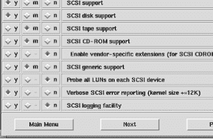
**图7.3** 从SCSI支持内核配置区域添加SCSI CD-ROM驱动器支持


## EIDE/ATAPI 接口
增强型集成设备电子（EIDE）接口最初用于硬盘，如今其应用已拓展至包括光驱在内的其他存储介质。即便是入门级的EIDE接口也能适配高速光驱。EIDE接口的主要缺点是单条链路上可接入的EIDE设备数量极为有限。在搭载多台存储设备的系统中，这一限制可能会造成严重问题。基于EIDE的光驱通常比同类型的SCSI光驱价格低很多。即便用户硬盘采用SCSI接口，EIDE接口依然具备吸引力。由于CD-ROM光驱的使用频率远低于硬盘，SCSI的多任务功能缺失对CD-ROM光驱的影响并不大。SCSI硬盘搭配基于EIDE的CD-ROM光驱使用没有任何问题。可录制设备对时序要求较为严格，因此SCSI接口在这类设备上确实有一定优势，但如今基于EIDE的可录制光驱可靠性已经相当不错。高级技术附加包接口（ATAPI）规范为采用EIDE接口的CD-ROM光驱提供了一套标准化指令集。除极早期的EIDE光驱外，其余产品均支持ATAPI，因此这类光驱通常也被称为ATAPI光驱。为ATAPI光设备添加支持与为SCSI光设备添加支持的难度相同，仅相关选项的位置不同。具体来说，你需要在配置界面的块设备区域中，找到「包含IDE/ATAPI CDROM支持」选项，选择**Y**或**M**。与SCSI类似，你还需要添加底层控制器的支持，该操作在同一菜单中完成。如果是可录制光驱，你可能还需要在SCSI仿真支持选项中选择**Y**或**M**，随后在SCSI分区中添加SCSI CD-ROM和SCSI通用设备的支持。多数Linux CD录制软件仅支持SCSI设备，或在SCSI设备上运行效果最佳，因此开启这项仿真功能对在ATAPI可录制CD光驱上刻录CD大有裨益。

## 早期私有接口
20世纪90年代初，CD-ROM光驱对大多数计算机用户而言还是奢侈品。SCSI为CD-ROM光驱提供了一套标准化指令集，但IDE（EIDE的前身）并不支持；此时ATAPI尚未问世。因此当时并不存在基于IDE的光驱。由于SCSI主机适配器价格昂贵，厂商开发了低成本的替代方案。遗憾的是，各厂商的替代方案互不兼容。这些私有CD-ROM接口出现在当年的独立ISA卡和声卡上。与之配套的CD-ROM光驱按如今的标准来看速度极慢，多数为1倍速或2倍速，也有少量4倍速产品问世。这些选项来自图7.4所示的「旧版CD-ROM驱动（非SCSI、非IDE）」配置菜单。你需要在第一个选项「支持非SCSI/IDE/ATAPI CDROM光驱」下选择Y，随后至少通过一个Y或M编译选项选择一种光驱类型。与SCSI和EIDE/ATAPI配置不同，此处你需要指定所用CD-ROM光驱的精确型号。部分情况下，你可能需要指定额外选项来帮助驱动定位硬件。
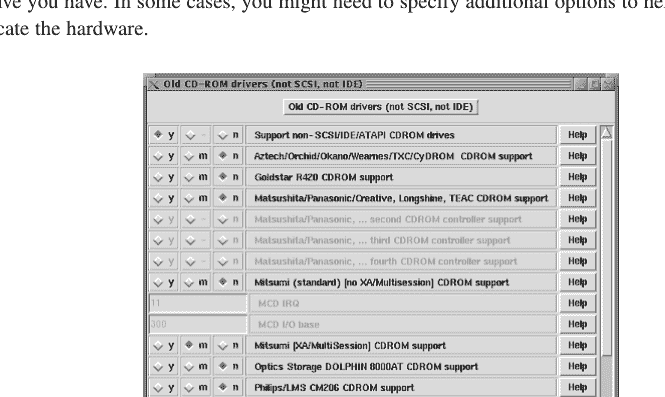
**图7.4** *Linux支持多种早期私有CD-ROM接口。*
多数Linux发行版默认将所有私有CD-ROM光驱的支持以模块形式启用。如果你不确定自己的设备型号，但知道它属于早期私有设备，那么在编译内核时也可以采用相同的设置。

## 并行端口接口
少数CD-ROM光驱采用并行端口。这类设备通常面向没有内置CD-ROM光驱的老旧便携式计算机销售，因此十分少见。多数情况下，这类设备会使用并口转IDE转接器，处理方式与第6章「并行端口接口」一节中介绍的并口可移动介质驱动器相同。总体而言，我不建议使用并口CD-ROM光驱，因为它们的可靠性不如采用其他接口的同类型产品。并行端口也无法适配如今的高速CD-ROM光驱，但用于老旧光驱尚且足够。

## USB接口
如今通用串行总线（USB）已被广泛应用于各类设备，包括光驱。目前Linux对USB光驱的支持尚不完善，但随着Linux USB支持的逐步成熟，这一情况有望在2000至2001年得到改善。Linux的USB支持会将包括光存储在内的磁盘设备映射至SCSI协议，因此你在编译内核时，除了启用对应的USB选项外，还需要开启基础的SCSI CD-ROM支持。尽管USB是外接设备的便捷接口，但由于速率限制，它并不适合光存储设备。USB的传输速率上限为1.5MB/s，远低于当今主流光驱的速率（例如40倍速CD-ROM光驱的最高速率为6MB/s）。不过，USB速率对于多数CD-R和CD-RW光驱来说已经足够，这类光驱刻录时的速率通常低于1MB/s。这类光驱在读取数据时通常可以达到更高的速率。因此，使用USB CD-R光驱读取已有介质时仍存在性能损失。

## CD、CD-R与DVD的选择
如果你正在购买或组装新计算机，就需要决定要加装哪种类型的光存储驱动器。如果你打算升级现有光驱或更换损坏的光驱，也需要做出同样的选择。需要注意的是，这些选择并非互斥：如果计算机空间足够，且拥有足够的中断请求（IRQ）、可用SCSI ID等资源，你可以同时安装两块甚至更多光驱。

## 为速度或成本选择CD-ROM
CD-ROM光驱的主要优势在于速率和成本。如今多数CD-ROM光驱售价低于100美元，尽管高端SCSI型号价格会高一些，但也通常低于200美元。这类光驱在读取普通CD-ROM、CD-R，以及多数CD-RW介质时性能表现出色。2000年初，已经很难找到标称速率低于24倍速的光驱，32倍速和40倍速产品更为常见。部分光驱的最高速率可达72倍速，即10MB/s，和某些硬盘一样快！但在实际使用中，由于以下几方面原因，这些标称速率很难达到：
- **光头寻道** CD-ROM光驱和硬盘类似，通过移动光头定位到光盘碟片的任意区域。光头的移动需要耗时，寻道时间会降低整体性能，尤其是在读取小文件时更为明显。
- **文件系统开销** 尽管多数CD-ROM文件系统减少了因文件碎片导致的光头寻道需求，但这些文件系统并非完全没有消耗性能的特性。仍需要检查文件位置、执行其他操作。与光头寻道类似，这一因素在读取小文件时比读取大文件的影响更大。
- **可变转速** 最早的CD-ROM光驱通过改变驱动器转速来读取光盘的内外圈区域。这种设计保证了激光束在介质上的*恒定线速度*，因此这类设备被称为*CLV（恒定线速度）*光驱。近年来的多数设计不会大幅调整转速，甚至完全不调整转速，这类设备分别被称为*部分恒定角速度*（部分*CAV*）或*CAV*光驱。这类设计在光盘不同区域的传输速率并不固定，厂商通常在广告中标注最优速率。遗憾的是，CD-ROM光盘的数据从最内圈开始存储，而最内圈的速率最低，因此未刻满的光盘的实际读取速度，会比你看光驱规格参数时以为的慢很多。这些原理同样适用于其他类型的光存储介质，不过CAV运行模式在CD-ROM光驱上最为常见。
> **注意** 如今市面上部分速度最快的CD-ROM光驱采用了*TrueX*技术，该技术通过多激光头实现更高的数据读取速率。这类光驱多为CLV设备，转速比其他型号更低，因此运行更安静，也不容易出现速率相关的错误。但另一方面，部分用户反馈部分TrueX光驱在使用CD-R和CD-RW介质时会出现问题，且其中一些型号很难在Linux上正常运行。因此，我建议你在购买TrueX光驱前，仔细确认其与Linux系统、CD-R光盘的兼容性。

## 为刻录能力选择CD-R或CD-RW
可录制光驱在光盘刻录能力上有着明显优势。对于拥有高速互联网连接的Linux用户来说，这一功能格外实用，你可以下载自己喜欢的Linux发行版，并在数小时内将其刻录到光盘中。可录制光驱也可用作备份设备。


## 使用可刻录CD进行备份
CD-R和CD-RW介质价格低廉，且这类介质具备高速、随机访问的特性，因此对许多人来说是不错的备份介质选择。不过这些驱动器原本并非为备份介质设计，因此存在不少需要克服的障碍——或者说至少你需要回答几个问题。其中一个问题是介质容量有限。650MB的容量对于备份如今的大多数Linux系统来说并不充裕。一种解决方案是在安装Linux时做好规划，确保没有分区的数据量超过650MB，或者至少考虑到压缩因素后，数据量不会超过该空间的容纳上限。之后你可以逐个分区备份。另一种方案是使用支持将备份拆分到多个压缩包的备份软件。遗憾的是，这类软件大多是为磁带和软盘设计的，而非CD-R光盘，因此将备份软件与CD-R软件整合有时会很麻烦。可能最佳的解决方案是使用DVD-RAM（或其他可刻录DVD技术），它的容量比基于CD的驱动器更高。

另一个挑战来自备份软件的选择。常规的CD刻录格式可以让你真正随机访问数据，但它们会修改文件系统特性。最重要的是，这类格式会移除写入权限（这对于只读介质来说没有意义）。另一种选择是使用tar或类似的压缩程序，将生成的压缩包文件刻录到CD-R上。这样你会损失部分介质的随机访问特性，但可以保留文件系统信息，和你使用磁带驱动器时一样。

就我个人而言，大多数备份功能我更倾向于使用磁带备份驱动器。不过我也会用CD-R驱动器为关键且很少变更的配置创建备份，尤其是我希望压缩包能在多种计算机上可读的时候。例如，我会在Linux系统下用CD-R驱动器备份Windows启动分区。

- **速度**
尽管CD-R驱动器的读取速度对许多用途来说已经足够，但仍不如最优秀的CD-ROM驱动器。刻录速度永远比读取速度慢，因此速度通常以两个数值表示，比如8x/24x，按照2000年初的标准来看这已经相当快了。CD-R的寻道时间也比CD-ROM驱动器更长，这是因为可刻录磁头更重，因此安全移动需要更多时间。

- **费用**
CD-R和CD-RW驱动器的价格比CD-ROM驱动器更高，2000年初的售价通常在200到400美元之间，不过也有少数驱动器的价格高于或低于这个区间。

- **耐用性**
可刻录驱动器比CD-ROM驱动器更易受损，因此也更容易损坏。

由于这些因素，许多人会同时配备CD-ROM或DVD-ROM驱动器，以及CD-R或CD-RW驱动器。如果DVD-ROM驱动器能够读取CD-R，最好还能读取CD-RW光盘，那么DVD-ROM与CD-RW驱动器的组合能提供很大的灵活性。

## 选择DVD以访问新型介质
目前，如果你想在电脑上播放DVD影片，DVD-ROM驱动器是最实用的选择；不过软件开始以DVD-ROM为载体常规分发只是时间问题。事实上，这一趋势已经出现：SuSE Linux 6.3既可以通过6张CD-ROM获取，也可以通过单张DVD-ROM获取。不幸的是，在我撰写本文时，DVD-ROM驱动器在Linux下播放影片的实用性尚不明确。尽管已经有一款名为DeCSS的程序可以实现这一功能，但美国电影协会（MPAA）和DVD拷贝控制协会（DVD-CCA）已经提起诉讼，要求停止DeCSS的分发。MPAA和DVD-CCA的主张是DeCSS是一款盗版工具。这是因为DVD影片采用了加密技术，除了使用解密软件播放外，这些文件毫无用处，而DeCSS必然可以破解该加密，且作为开源软件，它可以被用来在硬盘上创建未加密的文件。DeCSS的支持者认为，考虑到文件体积和可刻录DVD介质的成本，DeCSS唯一的*实用*用途是观看合法购买的DVD，因此对方关于其盗版意图的主张是站不住脚的。这些法律问题将如何解决仍有待观察，你可以访问http://www.opendvd.org获取最新信息。

> 注意 少数DVD驱动器配有专门的解码卡，用于完成视频解码工作。理论上，这类卡可以在Linux下用于视频解码，但需要该卡的驱动程序——而这类驱动程序极其罕见。2000年初，唯一拥有Linux驱动程序的此类卡是创新DXR2，其驱动程序可以从http://opensource.creative.com/获取。幸运的是，DVD-ROM数据光盘不受DVD-CCA加密技术的限制，因此Linux处理DVD-ROM光盘的能力不会受到影响。不过，许多这类光盘确实使用了一种新的文件系统，这一点将在本章后文的“光盘文件系统选项”部分介绍。

DVD-ROM驱动器的价格略高于CD-ROM驱动器，但差价不大。典型售价在100到150美元之间，而包含DVD影片硬件解码器的套装价格会再高约100美元。从速度来看，DVD-ROM驱动器的平均速度略低于CD-ROM驱动器，不过比大多数CD-R和CD-RW驱动器更快。DVD-ROM驱动器的速度等级和CD-ROM驱动器类似（1x、2x等），但这些等级并不基于相同的标准。例如，1倍速DVD-ROM驱动器读取CD-ROM的速度比1倍速CD-ROM驱动器更快。大多数驱动器的规格说明中都会包含读取CD介质的等效性能等级。2000年初，5倍速到10倍速（对应CD-ROM32倍速到40倍速）的DVD-ROM驱动器十分常见。

## 评估光盘驱动器性能
正如我在本章前文提到的，CD-ROM驱动器的性能特性差异很大。CD-ROM驱动器的规格参数和硬盘类似，关键特性是数据传输速率（由光盘在驱动器内的旋转速率决定）以及寻道或访问时间。和硬盘一样，CD-ROM驱动器也配备板载缓存，缓存可以在一定程度上提升性能，因此在其他条件相同的情况下，应优先选择缓存更大的驱动器。

### 旋转速度
最初的1倍速CD-ROM驱动器的旋转速率会变化，以实现150KB/s的恒定数据传输速率。之后的速度提升中，各厂商大致到10倍速都采用了相同的CLV（恒定线性速度）技术。随后大多数厂商开始使用CAV（恒定角速度）或部分CAV技术来大幅提升最高传输速度，同时对最低传输速度的提升则没有那么显著。例如，Plextor（http://www.plextor.com）的UltraPlex 40Max CAV驱动器在最快时可以达到40倍速传输，最慢时仅为17倍速。其他CAV驱动器也会有类似的速度差异，而部分CAV驱动器的速度差异会更小。TrueX驱动器通过使用多束激光而非更高的传输速率来提升性能，通常采用CLV运行模式，因此可以实现均匀的高传输速率。但如前所述，部分这类驱动器在Linux下运行不佳，还有些可能会损坏CD-R或CD-RW介质。购买前请务必向厂商咨询，或在comp.os.linux.hardware和comp.sys.ibm.pc.hardware.cdrom新闻组查询这些相关信息。

过去，最快的可用驱动器通常使用*光盘盒*（如图7.5所示）。这些设备可以放置CD，既能保护光盘，又能比常见的托盘加载设计更精准地将光盘定位到驱动器内。理想情况下，你拿到CD后应立即将其放入专属光盘盒中，且不要取出。想要读取数据CD-ROM或播放音频CD时，将连同CD一起的光盘盒插入驱动器即可。这一流程可以保护光盘不被刮花或弄脏，但如果你收藏了大量CD，这项开销可能会很高。如今光盘盒已经很少见，不过仍有部分可刻录CD驱动器使用这种设计。


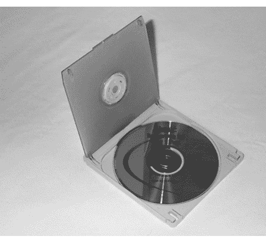
**图 7.5**
*光驱的托盘弹起，方便你插入或取出CD。*
## 磁头移动时间
### 寻道时间
寻道时间是磁头移动指定距离所需的时间。最常见的寻道时间指标是平均寻道时间，从统计学角度来说，它等同于磁头从最外圈位置移动到最内圈位置三分之一距离所需的时间。现代CD-ROM的寻道时间几乎都在100ms以内，典型数值约为85ms。CD-R和CD-RW光驱的寻道时间通常是前者的两倍左右。DVD的寻道时间典型值约为100ms。近些年来CD-ROM的寻道时间没有太大提升。
### 存取时间
存取时间是寻道时间加上*延迟*——即目标数据旋转到读取磁头下方所需的时间。在恒定线速度（CLV）驱动下，延迟会随光盘位置不同而变化；而在恒定角速度（CAV）驱动下，延迟在整个光盘上是恒定的。举个例子，我之前提到过的Plextor UltraPlex 40就是CAV驱动，它让光盘以8590转/分钟的速度旋转，这意味着光盘旋转一周需要7ms，平均延迟为3.5ms。和该光驱85ms的寻道时间相比，这个数值非常小，这也是现代CD-ROM光驱的典型特征。
> **注意**
> 在常规水平放置状态下，光盘实际是从底部（无印刷面，或CD-R/CD-RW的彩色面）读取数据的。尽管有这个特性，人们通常还是会说光盘上的数据从读取磁头*下方*经过。
作为对比，现代硬盘的典型寻道时间在9ms左右，磁盘转速为5400-10000转/分钟，对应的延迟为3-5.6ms。现代CD-ROM光驱较高的寻道时间，是它相比硬盘速度差距大的主要原因，因此你在评估不同光驱时，不能忽视寻道时间的重要性。
> **警告**
> 数字音频提取（DAE）功能，尤其是结合CD-R光驱使用时，能够制作出与原版音乐CD完全一致的正版拷贝。但这种使用方式可能违反著作权法，因此你在使用该功能前，需要确认自己的DAE使用行为是合法的。比如，复制公有领域的音乐是合法的，但复制最新流行音乐CD送给朋友则是违法的。著作权法允许你出于所谓的*合理使用*目的复制受版权保护的材料，但到底什么行为属于合理使用本身就有争议。销售音乐CD拷贝或免费送给朋友拷贝显然不属于合理使用范畴，但非常短的摘录（通常认为是不到10秒的内容）、备份，以及部分用于科学研究或教育的有限拷贝，通常被视为属于合理使用范围。如果你对DAE的使用（或是复制数据CD的行为）有疑问，建议咨询著作权律师。
DAE对光驱来说是一项颇具挑战性的任务，因为音频CD的存储介质本来就不是为定向数据提取设计的。具体来说，音频CD上的各个数据扇区没有标记索引，因此如果你随机寻道到某个扇区并读取，你无法知道自己刚刚读取的是哪个扇区。这一特性导致光驱很难定位到音频CD上的指定位置（比如一首歌的开头），并提取对应的音频数据。如果出现读取错误，问题会进一步加剧，因为光驱需要再次定位到出错的位置重新读取。即使是连续读取也无法避免这个问题，因为程序需要分小块读取数据，这样才能交替执行从CD读取和写入硬盘的操作。
数据CD通过将扇区编号编码到纠错数据中（作为扇区开销的一部分）解决了这个问题。（回忆一下，音频CD的扇区大小为2352字节，但数据CD会从中划出304字节用于纠错和控制数据。）光驱可以通过周边扇区中编码的扇区编号，定位到光盘上的精确扇区。在DAE过程中，无法可靠定位到精确扇区会导致采样出现重叠。举个例子，如果DAE程序以8KB（四个2048字节的扇区）为单位提取数据，这些数据块可能会出现轻微重叠或留下空隙，如图7.6所示。实际上DAE的采样大小都大于8KB，因此问题通常不会如图7.6所示那么严重；但即使是微小的空隙或重叠，也可能会产生可闻的音频瑕疵。
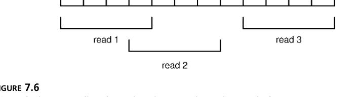
**图 7.6**
*DAE读取过程往往同步性不佳，导致数据流出现重叠和空隙。*
由这些问题导致的提取后音频文件的瑕疵被称为*抖动*。（这个词在非CD音频领域有另一层含义。）抖动通常表现为提取后的音频信号中出现轻微的pop声、爆裂声或杂音。当抖动特别严重时，会严重影响音乐的音质。不过轻微的抖动可能听不出来，尤其是在响度较高的段落，或是音源本身质量较差的情况下（比如由旧黑胶唱片转录的CD）。
不同光驱的DAE质量参差不齐。部分光驱采用优于平均水平的计时精度、特殊电路为提取的扇区分配扇区编号，或其他技术来提升DAE的可靠性。总体来看，Plextor和Pioneer品牌的光驱表现优于绝大多数产品，但也有例外。（比如Plextor的6倍速光驱，可靠性就不如大多数其他Plextor型号的光驱。）
你可以从“数字激光唱盘网络”（Compact Disc Digital Audio）网页的“结果”板块（http://www.tardis.ed.ac.uk/~psyche/cdda/）获取部分关于DAE抖动的信息。你也可以查看Deja News网站（http://www.deja.com），或者在comp.publish.cdrom.hardware新闻组发布具体查询请求。在Linux系统中，你可以使用cdparanoia或cdda2wav程序执行DAE功能，这两个程序都内置了抗抖动例程，即使是DAE性能较差的光驱，也能用它们提取出干净的音频文件。这种抖动校正的原理是读取重叠的采样，再利用重叠部分匹配采样，避免出现扇区遗漏或重复。这项技术很有效，但耗时较长。由于采样的重叠性，使用抗抖动技术的DAE提取音频数据的速度通常低于1倍速；比如提取一首5分钟的曲目可能需要7到10分钟。
> **注意**
> 即使不使用抗抖动软件，DAE的提取速度通常也会低于光驱标称的数据传输速度。比如一台32倍速的CD-ROM光驱，执行DAE时的最高速度可能只有4倍速。Plextor品牌的光驱是个例外，它们通常能够以接近标称数据传输速度的速率执行DAE。
> **提示**
> 如果你需要提取的DAE文件必须完全无瑕疵，建议执行两次提取操作，再对比两个文件。Linux系统中的diff命令可以非常方便地判断两个文件是否存在差异。如果两个文件有差异，就再执行一次提取，找到其中两个一致的文件；这两个文件大概率都是干净的，第三个则存在瑕疵。但如果两次DAE的起始和结束点不同，这项技术偶尔会失效。两次提取的文件可能都没有瑕疵，但因为起始和结束时间有微小差异，导致两个文件内容不同。
总体来看，CD-R和CD-RW光驱的DAE性能优于CD-ROM光驱，但也有例外。比如我之前提到过，大多数Plextor和Pioneer品牌的CD-ROM光驱都有很好的DAE性能，而部分CD-R光驱的DAE性能较差。
## 选择可录制光驱
选购CD-ROM光驱时，我之前提到的光驱性能参数——数据传输率、寻道时间和DAE性能——是最重要的考量因素。但购买可录制光驱时，还有一些额外的因素需要考虑。其中部分因素属于光驱性能范畴，比如可重写功能。但Linux兼容性也非常重要，因为可录制光驱的命令集标准化是相对较新的规范。你可能会买到和Linux CD刻录软件不兼容的光驱，尤其是在二手市场或经销商的清仓区购买时更容易出现这种情况。


## 你需要可重写功能吗？
你首先需要问自己的问题是你是否具备处理可重写光盘的需求。在某些情况下，你可能不需要这一功能。例如，如果你的主要目标是从你收藏的每分钟78转唱片专辑中提取内容刻录音频CD，你就不需要可重写功能，因为大多数音频CD播放器无法读取CD-RW光盘，而且你刻录完这些光盘后大概率也不会再对其进行修改。同理，如果你需要归档会计或科学数据用于长期存储，CD-R驱动器就完全足够。另一方面，如果你需要刻录的光盘预计在不久后会被擦除或修改，比如你的Linux发行版的更新软件包集合，那么可重写功能会很有用。所有CD-RW驱动器都可以刻录CD-R光盘，所以你不需要为了获得可重写功能而牺牲与旧款CD-ROM驱动器和音频CD播放器的兼容性。事实上，由于CD-RW驱动器的价格仅比同规格的CD-R驱动器高出一点点，几乎没有什么理由优先选择CD-R驱动器。唯一的主要例外情况是你遇到CD-R驱动器特价促销、价格非常划算的时候。在DVD领域，DVD-R驱动器仍然相当昂贵，但它们刻录的DVD可以在普通DVD驱动器上播放。如果你需要存储超过650MB的数据，且存储介质至少要能被较为广泛地识别读取，那么DVD-R是更好的选择。但如果你只需要在自己的系统上回读这些介质，DVD-RAM驱动器的价格会低很多。DVD-RW驱动器仍然相当罕见，但未来可能会变得更普遍。目前还不清楚这类驱动器以及DVD+RW驱动器在市场上的定位会是什么。

## 全盘一次性刻录与轨道一次性刻录
可刻录驱动器的另一个需要提及的特性是*全盘一次性刻录*（DAO）和*轨道一次性刻录*（TAO）两种录制模式的区别。在DAO录制模式下，刻录激光器在光盘起始位置开启，仅在整张光盘录制完成后才会关闭。在TAO模式下，激光器在每个轨道的起始位置开启，在轨道结束时关闭，随后在下一个轨道的起始位置再次开启。激光器还会开启和关闭以写入特殊的控制区域，比如*目录*、*导入区*和*导出区*——这些区域用于控制对单个轨道以及整张CD的访问权限。大多数数据CD-ROM仅包含单个轨道，因此两种模式的差异很小（尽管对控制区域使用独立的激光刻录会导致少量CD-ROM驱动器出现问题，对于批量复制这类用途也是如此）。大多数音频CD包含多个轨道，因此DAO和TAO模式会产生略有不同的结果。在少数情况下，TAO格式的CD可能无法在某些音频CD播放器上播放，或者产生异常效果，比如导致播放器在轨道之间暂停或停止。TAO模式还会在每个轨道的起始和结束时产生非常轻微的咔哒噪声，尽管音量足够小，你不太可能注意到。或许最重要的是，大多数CD-R驱动器在TAO模式下会在轨道之间产生至少2秒的最小间隔，因此你无法轻松制作无轨道间隔的CD，而制作演唱会表演类CD时通常需要这类效果。对于音频CD和数据CD，大多数CD复制服务都要求原版CD-R光盘采用DAO模式压盘。因此，如果你计划制作用于大规模生产的CD-R母盘，一定要确认你购买的驱动器支持创建DAO光盘。幸运的是，大多数现代CD-R和CD-RW驱动器都可以制作DAO和TAO两种模式的光盘。少数老款型号仅支持TAO模式。如果你想要制作演唱会风格的音频CD，或者打算将CD寄给复制商进行大规模生产，一定要确保你购买的驱动器支持DAO功能。
> **NOTE** 最常用的Linux CD创建程序cdrecord默认使用TAO模式，且仅在新款驱动器上支持DAO模式。cdrdao是专门为支持DAO功能设计的替代程序。我会在本章后面名为“在Linux下刻录CD-R或CD-RW光盘”的章节中介绍这些程序及其图形前端。

## 与Linux CD创建工具的兼容性检查
任何可刻录CD技术对Linux来说最重要的特性就是与Linux CD创建工具的兼容性。与大多数其他可刻录存储介质（比如Zip磁盘、软盘和磁带驱动器）不同，处理CD-R和CD-RW驱动器的命令集并没有完全标准化。*多媒体命令*（MMC）标准就是为了改变这一现状而推出的。然而，即使是声称支持MMC的驱动器也不总是100%兼容，因为它们可能存在缺陷，或者故意偏离MMC标准。尽管如此，你获得兼容性的最佳选择就是购买支持MMC的驱动器，这应该不难实现，因为自1999年以来MMC已经几乎成为通用标准。如果你正在考虑购买二手或清仓的非MMC驱动器，或者想要进一步提高在Linux下无故障运行的概率，你应该查阅以下Linux CD刻录软件包的驱动器兼容性列表：
- **cdrecord**：cdrecord的README文件（位于ftp://ftp.fokus.gmd.de/pub/unix/cdrecord/）包含受支持的驱动器列表。
- **cdrdao**：请查阅http://www.ping.de/sites/daneb/drives.html 查看驱动器兼容性信息。
Linux下的图形界面CD创建工具通常会使用这两个程序中的一个来完成CD刻录的“脏活累活”，因此即使你想使用图形工具，也应该检查这些文本模式工具的兼容性。

## 在Linux下访问光盘
Linux新手通常会难以使用CD-ROM驱动器，仅仅是因为Linux的光盘访问方法对他们来说十分陌生。即使是经验丰富的用户，在安装新型号的CD-ROM（比如将EIDE/ATAPI CD-ROM更换为SCSI型号），或者使用新类型的设备（比如添加CD-RW驱动器）时也可能会遇到问题。本节将介绍一些关于定位光盘设备以及使用这些设备上数据的技巧。
### 访问光盘设备
你通过*设备文件*访问绝大多数Linux硬件——这些是通常位于/dev目录下的特殊文件。但在大多数情况下，你不会直接访问光盘驱动器的设备文件；相反，你会把设备文件的名称传递给mount这类程序，由它使用该文件以某种方式使设备可访问。
### 定位合适的设备文件
如果你从光盘驱动器安装Linux，系统很可能会创建名为/dev/cdrom的链接，指向对应的设备文件。这种情况下，你可以使用这个名称，或者查看链接找到底层对应的设备。例如：
``` $ ls -l /dev/cdrom lrwxrwxrwx 1 root root 8 Dec 29 02:12 /dev/cdrom -> /dev/hda ```
这个输出表明/dev/cdrom文件是一个指向/dev/hda的符号链接，而/dev/hda是真正的设备文件。如果由于某些原因你的Linux发行版没有创建合适的符号链接，或者你将一种类型的驱动器更换为另一种，或者重新配置了EIDE总线，你可能需要以其他方式定位设备文件。每种接口类型都有对应的设备文件，具体如下：
- **SCSI设备**：SCSI CD-ROM被分配为/dev/scdn格式的设备名，其中*n*是从0开始的数字。只有一块SCSI CD-ROM驱动器的计算机会使用/dev/scd0，而有两块光盘驱动器的系统还会有/dev/scd1。通常，SCSI ID号更低的设备会被指定为/dev/scd0。大多数SCSI CD-R驱动器可以通过相同的标识符进行读取访问，但有些不会显示为CD-ROM设备。部分驱动器有跳线或开关，可以改变它们向计算机报告的自身类型；你可以修改这个跳线设置，让驱动器显示或隐藏为/dev/scdn设备。出于写入需求，SCSI CD-R和CD-RW驱动器通过通用SCSI接口/dev/sgn访问，其中*n*是0-15的数字，或a-h的字母，对应SCSI ID号。*不要*尝试使用通用SCSI标识符挂载CD进行读取。/dev/scdn设备使用主设备号11，次设备号从0开始。/dev/sgn设备文件使用主设备号21，次设备号从0开始。
- **EIDE/ATAPI设备**：EIDE/ATAPI驱动器通过/dev/hdn格式命名的设备文件访问，其中*n*是a-d的字母（偶尔会更高）。这个字母代表EIDE链路以及设备在链路中的位置：a代表主链路的master设备，b代表主链路的slave设备，c代表次链路的master设备，以此类推。注意这些标识符和用于其他磁盘设备的标识符是相同的。因此，仅从设备文件名无法判断设备是CD-ROM、可移动磁盘还是硬盘。对于可刻录驱动器，最好在内核中编译SCSI仿真支持，之后你就可以通过通用SCSI设备文件访问驱动器进行写入。/dev/hdn设备的主设备号为3、22、33和34，分别对应primary及后续控制器，主设备号为0，从设备为0和64，分别对应主设备和从设备。
- **专有设备**：旧款专有接口根据具体设备分配唯一标识符。例如，/dev/mcdxn，其中*n*是0-1的数字，代表三菱（Mitsumi）驱动器；/dev/aztcd0是Aztech CD-ROM驱动器的设备文件。更多详情请查阅/usr/src/linux/Documentation/cdrom目录下的对应文档文件。
- **并口设备**：这些设备大多使用并口IDE驱动，获得的设备标识符为/dev/pcdn格式，其中*n*是0-4的数字。这些设备使用主设备号46，次设备号从0开始。
- **USB设备**：CD-ROM驱动器的USB支持会将这类驱动器映射到SCSI设备树，因此USB CD-ROM驱动器使用SCSI标识符。
> **NOTE** 设备文件不是由设备的驱动自动创建的，它们是在系统安装过程中运行的脚本创建的。因此，你可能会找到电脑上不存在对应设备的设备文件。所有现代Linux发行版都会为所有CD-ROM设备类型创建设备文件，如果你不小心删除了设备文件，大多数发行版在/dev目录下都提供了用于重新创建设备文件的脚本。另外，你也可以使用mknod命令手动创建设备文件，但你必须知道标识特征——就是前面接口描述中提到的*主*和*次*设备号。


## 使用光存储设备
确定设备文件后，你就可以使用它。通常的做法是使用`mount`命令挂载设备，示例如下：
```bash mount /dev/scd0 /mnt/cdrom ```
然后你就可以在`/mnt/cdrom`目录树中访问光盘的文件。（要使该命令生效，你需要在`/mnt/cdrom`目录下有一个*挂载点*——即一个空目录。）

你可以通过在`/etc/fstab`中添加条目一定程度地自动化该过程，示例如下：
```bash /dev/scd0 /mnt/cdrom iso9660 ro,user,noauto 0 0 ```
该条目用于标识设备文件（`/dev/scd0`）、挂载点（`/mnt/cdrom`）、文件系统（iso9660）、挂载选项（`ro,user,noauto`）、dump程序的备份频率（0）以及文件系统检查的顺序（0）。对于CD-ROM设备，最后两个选项应始终设为0。
如果在逗号分隔的挂载选项列表中包含`user`，则普通用户就可以挂载和卸载该设备。`noauto`选项表示驱动器不会在系统启动时自动挂载，`ro`指定其为只读介质。

> **提示** 如果你在`/etc/fstab`的快捷方式中将设备文件指定为符号链接，Linux有时会阻止普通用户卸载你通过该快捷方式挂载的CD-ROM。因此，我建议在`/etc/fstab`中使用真实的设备文件名，而非`/dev/cdrom`符号链接。

如果在`/etc/fstab`中配置了前面那样的条目，普通用户只需使用`mount`命令指定挂载点，就可以挂载CD-ROM，示例如下：
```bash mount /mnt/cdrom ```
这是一个非常实用的选项，因此除非你有安全方面的顾虑，否则我建议你按此方式配置计算机。

某些情况下，你可能需要更直接地访问原始设备文件。例如，如果你想复制一张CD-ROM，可以使用`dd`命令将CD-ROM的内容提取到文件中，之后你可以使用`cdrecord`或其他程序将该文件刻录到CD-R上。要提取现有CD-ROM的内容，你需要使用类似下面的命令：
```bash dd if=/dev/scd0 of=cdrom.iso ```
该命令会创建一个名为`cdrom.iso`的文件，其中包含CD-ROM的所有数据。当你将该文件刻录到CD-R后，得到的就是CD的完整副本，即使其中包含Macintosh的HFS等非常用文件系统，也能正常复制。

> **注意** 使用CD-ROM XA或其他混合数据/音频格式的光盘无法通过这种方式完整提取，你只能得到CD内容的一部分，例如数据轨道。多区段CD-ROM也可能无法通过此方法完整提取。

> **注意** 如我之前所述，使用`dd`命令提取整个CD-ROM内容时，命令会以错误状态退出，这是正常现象。你可以对比生成文件的大小与已挂载CD-ROM文件系统的大小：提取的文件应比已挂载的文件系统稍大，除非该CD包含多个文件系统（例如ISO-9660和HFS），这种情况下提取的文件*可能*比已挂载的文件系统大得多——也可能只是稍大一些。

要从音频CD中提取数据，你必须使用专门的DAE软件，例如cdparanoia或cdda2wav。这些程序操作的是原始设备文件，而非已挂载的CD。通过计算机扬声器播放音频CD的程序同样操作原始设备文件。这些程序通常会直接访问`/dev/cdrom`，因此该文件必须是指向系统上对应设备文件的链接。这意味着你不需要挂载音频CD就可以收听它。
所有这些直接访问方法都要求你对设备文件具有读取权限，通常还需要写入权限。大多数Linux发行版都包含提供这种访问权限的机制。例如，Red Hat及其衍生版本（如Mandrake）包含这样的代码：当有人登录控制台时，会自动更改CD-ROM设备文件的所有权。其他一些发行版则允许特定组的所有用户或所有用户拥有完全的读/写访问权限。如果你不喜欢你的发行版使用的这种方式，你*可能*可以通过修改设备文件的权限来更改它，有时还需要配合其他操作，例如创建脚本来更改设备文件权限，或修改不同用户的组成员身份。设备文件的权限对以root权限运行的`mount`命令基本没有影响。

### 光盘文件系统选项
大多数CD-ROM、CD-R和CD-RW光盘使用*ISO-9660*文件系统。这是专为CD-ROM设计的文件系统，目前常用共有三个版本：
- **Level 1** 这是ISO-9660的基础版本，包含许多限制。其中最醒目的是文件名长度限制：最多8个字符加3个字符的扩展名（与MS-DOS相同）。不过ISO-9660还进一步限制了合法字符：只允许大写字母、数字、下划线（_）以及用于分隔主文件名和扩展名的句点（.）。（不过Linux通常会自动将大写转换为小写。）部分CD创建程序会违反ISO-9660 Level 1的部分限制。例如，有些程序会在文件名中使用非法字符，这通常不会引发问题，但存在在某些操作系统上导致问题的风险。
- **Level 2** Level 2与Level 1非常相似，但将文件名长度限制扩展到了32个字符。不过文件名仍然全为大写，在Linux中挂载CD-ROM时，系统会自动将其转换为小写。
- **Level 3** Level 3在Level 2的基础上进行了扩展，以便于创建CD-R*封包写入*软件。这种软件对CD-R介质的访问方式与其他磁盘设备的访问方式类似。Linux下的封包写入软件目前几乎不存在，但Linux可以读取Level 3的CD-ROM。

由于ISO-9660对文件名长度和其他方面有严格限制，目前光盘上常用两种文件系统扩展：
- **Rock Ridge** Rock Ridge扩展为ISO-9660添加了UNIX风格的混合大小写长文件名、所有权、权限以及其他功能。Rock Ridge以向后兼容的方式构建在现有ISO-9660框架之上。无法识别Rock Ridge的操作系统仍然可以读取Rock Ridge光盘，只是无法读取长文件名或其他扩展功能。在创建用于Linux系统的CD-R时，Rock Ridge是首选格式。
- **Joliet** 从技术层面来说，Joliet是完整的文件系统规范，不过它依赖ISO-9660指向替代光盘描述符来实现功能。因此实际使用时，它会与ISO-9660文件系统配合出现。一张光盘可以在其ISO-9660和Joliet部分提供不同的文件，但大多数光盘在这两个文件系统中指向的是同一个文件。最终效果与使用Rock Ridge非常相似。二者的区别在于文件系统的细节：Rock Ridge是为UNIX及类似UNIX的操作系统设计的，因此支持这些操作系统使用的文件系统功能；而Microsoft设计Joliet是为了在Windows 95及更高版本上使用，因此Joliet支持Windows系列操作系统使用的文件系统功能。例如，Joliet不支持UNIX风格的文件所有权和权限，但支持Unicode文件名。Linux的`mkisofs`程序可以创建同时使用ISO-9660、Rock Ridge扩展以及补充Joliet文件系统的CD镜像文件。如果使用`mkhybrid`程序，你甚至可以加入Macintosh HFS文件系统。通过这种方式，你可以创建一张可在尽可能多的操作系统上读取、且拥有长文件名的CD-R。Linux内核支持所有这些文件系统类型，不过许多发行版默认未包含HFS支持，且Joliet和HFS支持在2.0.x内核系列中才较晚上线，因此如果你使用的是非常古老的Linux系统，你*可能*没有这些功能支持。

最近光学存储领域出现了一种新文件系统：*通用磁盘格式*（UDF）。该格式既适用于容量更大的DVD介质，也适用于CD-R、DVD-RAM等可读写光存储介质。（可读写功能在UDF 1.5规范中才加入。）Linux 2.2.x内核不支持UDF，但在2.3.x开发内核中已经出现，将在2.4版本发布时成为标准功能。你可以在http://trylinux.com/projects/udf/了解更多关于Linux UDF开发的信息。

## 在Linux中刻录CD-R或CD-RW光盘
如果你购买了一台可刻录光驱，你大概率会想用它来录制数据。但要做到这一点，你需要专门的工具。目前，你无法像挂载普通CD-ROM或软盘那样挂载可刻录光盘，也无法使用`cp`等Linux命令或KDE等图形界面环境直接向该光盘复制文件。相反，你必须使用专门的软件来创建磁盘镜像，并在单次操作中将该镜像复制到可刻录CD上。（也可以创建*多区段*光盘，之后你可以向其中添加文件。）创建CD的基础工具是文本模式的，不过这些工具存在多个图形化前端，可以大幅简化刻录流程。

### 使用命令行工具
我之前已经提到了一些可用于创建CD的文本模式工具。其中包括我已提及和未提及的工具：
- **mkisofs** 这款工具随大多数Linux发行版一同提供，它会接收你指定的一组文件，并从中生成*CD镜像文件*，该文件包含最终要写入CD的数据。镜像文件包含ISO-9660文件系统（如果你指定的话，还会包含Rock Ridge和Joliet扩展）以及你指定的所有文件。如果你需要更新版本，或你的发行版未包含该工具，可以在ftp://ftp.fokus.gmd.de/pub/unix/cdrecord找到`mkisofs`。
- **mkhybrid** 这是`mkisofs`的一个变体，除了ISO-9660以及可选的Rock Ridge和Joliet扩展外，还增加了创建Macintosh分层文件系统（HFS）的能力。与`mkisofs`一样，`mkhybrid`生成的是一个文件；你需要另一个程序来将该文件刻录到光盘上。如果你的发行版未包含`mkhybrid`，可以在Linux软件仓库站点找到它，例如http://rufus.w3.org/linux/RPM/或http://www.debian.org/distrib/packages。


## 存储 第二部分 - **cdwrite**
该程序已停止维护，但仍适用于部分较旧的CD-R光驱。它可将镜像文件刻录到CD，支持所有兼容的刻录机。

- **cdrecord**
该程序与cdwrite功能相同，但仍在维护中，是Linux系统最常用的CD刻录软件。更多详情可查阅其官网：http://www.fokus.gmd.de/research/cc/glone/employees/joerg.schilling/private/cdrecord.html。

- **cdrdao**
cdrdao同样是一款文件刻录到CD的工具，其特点在于采用DAO（整盘刻录）模式，而非cdrecord至今仍偏好的TAO（轨道刻录）模式。更多详情可查阅其官网：http://www.ping.de/sites/daneb/cdrdao.html。

使用上述工具刻录CD分为两步：首先创建镜像文件，再将其刻录到CD中。这些工具支持的选项非常多，具体用法请参阅各工具对应的官方文档。

举个最常见的例子：使用mkisofs和cdrecord组合创建CD。若要在Linux系统下使用该CD，建议创建带Rock Ridge扩展的ISO-9660格式镜像。可通过以下命令完成该操作：
```mkisofs -r -o image.iso ./ ```
该程序会输出多条提示信息，部分内容会描述当前的执行进度。执行完成后会生成名为image.iso的镜像文件，其中包含当前目录及所有子目录下的文件。

请确认镜像文件的大小不超过标准650MB CD-R/CD-RW的容量。若镜像过大，你*可能*需要删除部分文件，或使用大容量空白盘——700MB的CD-R光盘比较常见。

若想确认镜像文件内容无误，可通过Linux回环接口挂载镜像验证，命令如下：
```mount image.iso /mnt/cdrom -o loop ```
之后你可以对比镜像内的文件和原始文件，验证其中包含的程序是否可正常运行等。操作完成后，使用umount命令卸载CD镜像文件，流程与卸载普通CD一致。

确认镜像文件无问题后，即可使用cdrecord将其刻录到CD-R中：
```cdrecord dev=6,0 speed=4 image.iso ```
该命令会将`image.iso`文件以4倍速写入SCSI ID为6、逻辑单元号（LUN）为0的CD-R设备（大部分SCSI CD-R刻录机的LUN均为0）。之后程序会打印当前刻录机和所选刻录选项的相关信息，最后输出：
``` Last chance to quit, starting real write in 1 seconds. ```
> **注意** 你必须以root用户身份运行`cdrecord`，或将其设置为suid root。若选择后者，请执行`chmod 4711 cdrecord`命令（如果当前不在cdrecord所在目录，需为其添加对应路径）。设置完成后，`cdrecord`即可在普通用户运行时自动获取root权限。

随后刻录流程启动，除非你选择了详细输出模式，否则屏幕上不会显示任何执行提示。不过你可以根据刻录机的指示灯闪烁或变色情况判断是否正在刻录CD。

> **提示** 你可以通过Linux管道将文件系统创建和CD刻录两个步骤合并执行。例如执行`mkisofs -r ./ | cdrecord dev=6,0 speed=4`，即可将当前目录下的内容直接刻录为CD，无需生成中间镜像文件。

该方法的缺点是需要占用更多内存，且由于无法向CD-R刻录机快速传输数据导致刻录失败的概率会大幅提升，高速刻录时尤其明显。

## 使用X-CD-Roast
如果你不习惯使用命令行工具，可以使用这些工具的图形化前端，比如X-CD-Roast（http://www.fh-muenchen.de/home/ze/rz/services/projects/xcdroast/e_overview.html）或BurnIt（http://sunsite.auc.dk/BurnIT/）。这类工具无需记忆命令（尤其是生僻的选项参数），可以简化CD创建流程。下面以X-CD-Roast为例进行说明。

让X-CD-Roast自动检测系统中的CD-ROM、CD-R/CD-RW设备并完成配置后，即可按照以下步骤创建数据CD：
- 1. 在X-CD-Roast主界面点击「Master CD」按钮，会弹出「Master From/To」窗口，如图7.7所示。
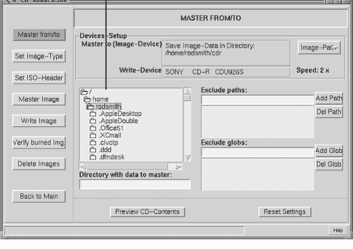
# FIGURE 7.7 使用「Master From/To」窗口设置要制作CD的源目录
- 2. 在目录选择列表中找到你要作为CD根目录的文件夹，确认该目录已显示在「Directory with data to master」输入框中。
- 3. 点击「Set Image-Type」按钮，会弹出如图7.8所示的「Set Image Type」窗口。你可以在此设置文件系统创建选项，比如是否启用Rock Ridge、Joliet，或同时启用两者。
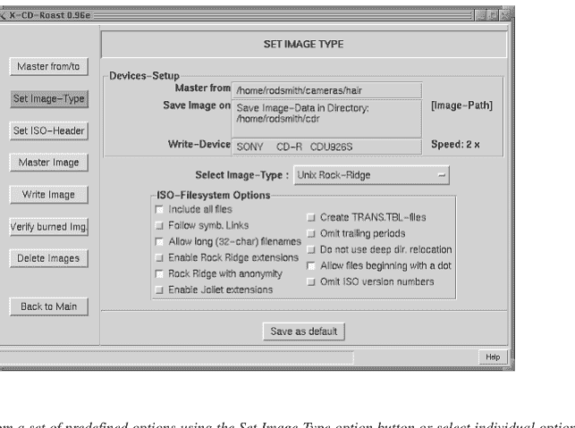
# FIGURE 7.8 你可以通过「Set Image-Type」选项按钮选择预设配置，或通过「ISO-Filesystem Options」区域单独设置各项参数。
- 4. 点击「Master Image」按钮，会弹出如图7.9所示的「Master Image」窗口。你可以修改要生成的镜像文件名，如果你已将X-CD-Roast配置为使用特定分区存储镜像，也可以指定使用该分区。

# FIGURE 7.9 可以使用「Master Image」窗口修改要生成的镜像文件名。
> **注意** X-CD-Roast使用.raw作为CD镜像文件的扩展名。.iso是更常见的扩展名，但如果你希望X-CD-Roast能正常写入你创建的镜像，就不要使用该扩展名。如果你下载的镜像文件使用.iso扩展名，可以将其重命名为.raw扩展名，即可让X-CD-Roast识别并直接刻录，无需重新创建文件系统。
- 5. 选好文件名后，点击「Start Master Image」按钮。程序会弹出对话框，显示CD镜像文件的创建进度。
- 6. X-CD-Roast生成CD镜像文件后，点击「Write Image」按钮，会弹出如图7.10所示的「Write Image」窗口。如有需要，可通过镜像选择器选择要刻录的镜像文件。

**图7.10** *「Write Image」窗口为cdrecord程序提供了图形化操作界面。*
- 7. 将空白CD-R或CD-RW光盘插入刻录机，点击「Start Write Image」按钮开始刻录。和创建镜像文件时一样，X-CD-Roast会弹出进度对话框，如图7.11所示。

**图7.11** *你可以调整进度对话框的显示内容，选择查看更多或更少的刻录过程相关信息。*
- 8. X-CD-Roast完成光盘刻录后，你可以点击「Verify burned Img.」按钮，将光盘与硬盘中的镜像文件进行比对验证。如果你除了刻录机外还有CD-ROM光驱，可以配置X-CD-Roast使用CD-ROM光驱作为验证源，此时你*可能*需要将光盘换到另一台光驱中。由于现代CD-ROM光驱的读取速度比CD-R/CD-RW刻录机更快，因此用CD-ROM光驱进行验证的速度通常更快。

X-CD-Roast还有很多其他未在本节介绍的选项。大部分功能都清晰易懂，如果你明确自己的操作需求，浏览菜单即可找到对应选项。不过截至0.96e版本，X-CD-Roast*不*支持DAO刻录模式，因此你无法在菜单中找到该选项。不过由于底层cdrecord已经支持DAO模式，X-CD-Roast未来大概率会新增该功能。此外，尽管mkisofs已经支持创建可启动CD，但X-CD-Roast目前尚未实现该功能。

## 总结
光盘类存储介质对于Linux系统来说有一些特殊的特性。这类介质默认是只读的。可刻录技术提供了数据写入能力，但操作便捷性不及其他可移动存储介质。不过由于现代计算机几乎都配备了CD-ROM光驱，因此可刻录CD技术是向少量站点分发大量数据的绝佳方案。它也是备份个人数据（无论是应用生成的数据文件还是整个系统）的实用手段。


## 磁带备份
第 8 章

本章内容
- 评估您的磁带备份需求 229
- 磁带备份接口 235
- 主流磁带技术 240
- 磁带驱动器特性 245
- 在 Linux 中使用磁带驱动器 248

数据备份设备是严肃计算中不可或缺的配件。硬盘是非常精密的仪器，很容易损坏。更重要的是，人类是容易犯错的生物，倾向于输错重要命令或点击错误的文件或程序选项。当您的计算机因机械或人为错误丢失数据时，备份设备可以让您以最小的麻烦恢复数据——无论是几个文件还是整个系统。请注意，我在上一段关于数据丢失时使用的是“*当*”这个词，而不是“*如果*”。到目前为止，您可能一直很幸运，从未体验过对备份的需求，但如果是这样，这种情况将会改变。否则——坦率地说——就是在自欺欺人。因此，备份设备对于除最简单的 Linux 安装之外的任何安装都是必需的。不过，是*哪种类型*的备份呢？

我在前面章节中介绍过的几种数据存储设备各有优势：
- **硬盘** 您可以低成本添加第二块硬盘，并定期将系统备份到该硬盘。硬盘速度快且方便，但除非您购买的容量是主硬盘的两倍或以上，否则通常只能在一块硬盘上存储一个备份。更糟糕的是，它们通常与主硬盘存放在同一个机箱中，因此破坏主驱动器的物理创伤很可能也会破坏备份。如果您决定使用硬盘，我建议使用外部小型计算机系统接口（SCSI）型号，或者购买一个套件，以便在不使用时轻松取出备份硬盘。
- **可移动磁盘** 像 Iomega Zip 驱动器、LS-120 驱动器或磁光（MO）盘等磁盘设备可用于备份。然而，这些设备中的大多数容量相当低，或者作为备份介质相当昂贵。但是，如果您有一个大的 MO 盘，并且不介意成本，它可能证明是一种方便可靠的备份介质。
- **光盘** 有些人喜欢使用 CD-R 和 CD-RW 驱动器进行备份。介质价格低廉且耐用，读取数据也很容易。然而，可记录 CD 技术的容量限制较低（650MB），并且创建 CD 的过程有时可能很麻烦。可记录 DVD 技术更适合此目的，并且随着可记录 DVD 驱动器和介质的价格和可用性的改善，它正成为一个越来越现实的选择。

综合考虑，另一种技术通常最适合备份目的——磁带。与我刚才描述的介质不同，磁带是一种*顺序访问*介质，这意味着您必须先读取磁带的开头才能到达末尾。（不过，这条规则也有例外。）这个特性使得磁带不适用于大多数数据存储功能，但对于备份介质来说并不是太大的障碍，因为备份介质通常以顺序写入模式访问。与其他大多数潜在备份介质相比，磁带的每兆字节成本也更便宜。磁带本身紧凑且可移动，因此您可以轻松地将磁带备份存放在远离计算机的地方。（理想的位置是在另一个地方，这样在发生火灾或其他重大灾难时，您的数据是安全的。）磁带设备也很常见，并且在 Linux 中得到了很好的支持，因此它们很少带来独特的 Linux 挑战，但也有例外。

### 评估您的磁带备份需求
购买磁带备份设备的第一步是评估您的需求。磁带驱动器有各种不同的速度和容量。了解您使用驱动器的频率也很有用；如果您每月只使用一次，一个稍微慢一点或有点吵的驱动器可能只是个小麻烦，但如果您每天都使用，那可能就是个大问题。

### 了解您的容量要求
磁带驱动器的容量范围从十多年前过时型号的几兆字节，到单磁带单元的几十吉字节，或*自动换带机*——可以接受多个磁带盒并在它们之间切换，向计算机呈现单个更大磁带假象的驱动器——的几百吉字节。自然，容量更高的驱动器和介质通常比容量较低的单元和磁带更贵。

### 考虑压缩因素
如今大多数磁带驱动器在销售时都提供两个容量估算值：*原始容量*和*压缩容量*。由于磁带驱动器通常用于存储归档数据，因此在写入磁带时对数据应用压缩算法很常见。这些算法通常平均实现大约 2:1 的压缩率，因此一个 4GB 的磁带可以容纳 8GB 的数据。制造商在计算压缩数据存储容量时通常使用这个 2:1 的比率。

> **注意** 在评估磁带驱动器时，请务必考虑驱动器引用的容量是压缩的还是未压缩的。有些型号在广告或型号名称中使用压缩容量，而另一些则使用未压缩容量。举个假设的例子，一个型号可能被宣传为 BigTape 20，另一个可能是 UltraTape 10，但两者可能使用相同的具有 10GB 未压缩容量的磁带。

当然，您具体能实现多少压缩取决于您在磁带上存储的数据类型，也可能取决于您使用的备份软件。如果您的硬盘充满了未压缩的图形或文本文件，您很可能实现远高于 2:1 的压缩率；一个 4GB 的驱动器可能足以存储 12GB–16GB 的数据。如果您的硬盘主要充满预压缩文件，如 GIF 图形或 Linux RPM 文件，那么从压缩中获得的存储空间很小。同样的 4GB 驱动器可能只能存储 4.5GB 的数据。在极端情况下，对预压缩文件应用压缩实际上会*增加*文件的大小。在这种情况下，您应该关闭驱动器或软件的压缩功能。

压缩通过以下两种方法之一实现：
- **硬件** 一些驱动器包含小型 CPU 和固件，可以在数据从计算机传来时对其进行压缩。使用这样的驱动器，您的备份软件不需要支持压缩；实际上，应用这样的压缩只会减慢备份速度并可能降低磁带的容量。就 Linux 而言，这样的驱动器具有可变容量，大于磁带的原始容量。
- **软件** 一些驱动器的固件中不包含压缩算法，因此依赖 Linux 备份软件进行压缩。这种软件会消耗 CPU 时间，并可能减慢备份速度，具体取决于 CPU 速度、磁带驱动器的总线速度和类型以及磁带的速度。

> **注意** 同时应用软件和硬件压缩没有任何好处。硬件的压缩算法无法实现比软件压缩更好的压缩。因此，在使用支持硬件压缩的驱动器时，通常最好禁用软件数据压缩。在某些情况下，例如当您需要在没有硬件压缩的驱动器上读取磁带时，您可能更倾向于禁用硬件压缩。此过程在本章后面标题为“使用 mt 控制磁带驱动器”的部分中描述。

通常，对于使用相同介质的不同型号驱动器，硬件压缩算法是相同的。例如，Travan NS 驱动器都使用相同的压缩算法。因此，在一个驱动器上创建的压缩磁带应该可以在另一个驱动器上读取，前提是两个驱动器接受相同形式和容量的磁带。不过，这条规则也有例外，因此使用硬件压缩可能会导致驱动器之间的兼容性问题。当您使用软件压缩时，不会出现这样的问题，尽管您必须在两台计算机上使用兼容的软件（使用硬件压缩时也是如此）。只有当您需要将磁带用作数据传输机制或更换驱动器时，这些因素才主要引起关注。


总则而言，我推荐配备硬件压缩功能的驱动器。使用硬件压缩可以分担主机的一部分计算负担，还能加快备份速度。必要时，你可以通过跳线，或使用“使用 mt 命令控制磁带驱动器”一节中介绍的 Linux `mt` 命令来关闭压缩。不过，硬件压缩的一大优势与 Linux 备份软件相关：部分 Linux 备份程序（比如使用 gzip 压缩的 tar）采用的压缩算法会导致错误之后的所有数据都无法读取。这一缺陷使得使用软件压缩存在较高风险。如果你打算购买依赖软件压缩的驱动器，那么一定要选用比 tar 更成熟的备份程序，或是不启用压缩功能使用，以避免这类问题。

## 估算存储空间需求
无论你是否使用压缩，明确需要购买的磁带驱动器容量都很重要。总则而言，最好购买容量足够大的磁带驱动器，能够将所有数据存入单盘磁带（如果是磁带库设备，则是单套磁带）。如果你要备份的是一台台式机，那么确定容量需求相对简单，你可以使用 Linux `df` 命令查看文件占用的空间大小，示例如下：
```
$ df
Filesystem 1k-blocks Used Available Use% Mounted on
/dev/sda6 2679650 1449936 1118867 56% /
/dev/sda8 676435 202258 439238 32% /usr/local
/dev/sda5 5135482 2879989 2255493 56% /home
/dev/sda3 31077 11530 18906 38% /boot
```
“Used”列表示各分区上文件占用的空间大小（单位为字节）。在上面的示例中，系统文件占用了 4.3GB 空间。此外，计算机磁盘总容量为 8.1GB，因此文件完全有可能扩展至占满全部空间。从理论上讲，一块 2GB 且不启用压缩的驱动器足以备份整块硬盘。但我建议购买容量足够容纳整块硬盘全部数据的驱动器，最好选择不启用压缩也能满足需求的型号，原因很简单——数据会不断增长。随着你安装更多软件、生成新的数据文件，备份容量需求也会随之提升。今天勉强够用的磁带驱动器，明天可能就无法满足需求。升级到更高容量的磁带格式成本较高，因为驱动器或磁带本身的价格都不低。如果你购买时预留了足够的容量余量，那么在未来很长一段时间内都不需要升级设备，或是采用多盘磁带备份的方式。

如果你的系统是 Linux 与其他一个或多个操作系统双启动，你可以调整这条规则，改为购买容量足够备份任意单个操作系统的驱动器即可。例如，如果 Linux 占用 5GB 空间、Windows 占用 3GB 空间，那么一块 5GB 容量、不启用压缩的磁带就足以满足需求。原因是分别备份两个操作系统通常不会太麻烦，而且为了保留重要的文件系统信息，这种操作往往是必要的。情况紧急时，你也可以独立备份各个 Linux 分区，或是将多个分区分成两组及以上进行备份。比如对于容量为 3GB 的磁带设备，你可以将前面提到的系统分成两部分进行备份：一部分备份 /home 分区，另一部分备份 /、/usr/local 和 /boot 分区。独立备份分区有时会更方便，因为它将数据分开存储，在紧急恢复时会非常实用。例如如果 /home 分区损坏，你不需要读取其他分区的数据就可以直接恢复。不过这种操作会增加备份的工作量，可能会带来不便。如果你想要执行无人值守备份（例如安排在夜间自动运行备份任务），这种不便会格外突出。

必要时，备份任务可以被任意拆分为多盘磁带进行存储，大部分备份程序都支持这一功能。但除非你使用的是磁带库设备，否则执行这类操作时需要人工到场更换磁带。如果你购买磁带备份设备是用来备份整个网络的计算机，那么你必须估算整个网络的存储需求，同时考虑磁带速度和备份排程要求。例如，由于网络带宽限制，你可能无法在一天内完成整个网络的备份。这种情况下，使用多盘小容量磁带是更合理的选择：你可以在一周内每晚备份几台设备，而不是每周统一备份一次所有设备。

无论你是备份单台计算机还是整个网络，你可能还需要将备份策略纳入考量范围。到目前为止，我一直强调备份整台计算机的必要性，这种备份方式被称为 *全量备份*，是真正实现灾难恢复时最重要的备份类型。不过，通常也会将全量备份与更小体量的 *增量备份* 结合使用，增量备份只会备份新增或发生变动的文件。例如，你可以每月执行一次全量备份，每周执行一次增量备份。如果你大量依赖增量备份，就可以降低对高容量的需求，因为全量备份仅占用了你很少的备份时间。例如，你可以接受每月更换一次磁带执行三盘磁带的全量备份，而每周甚至每日执行无人值守的增量备份。但另一方面，增量备份会使完全灾难后的恢复流程更复杂，因为你需要先恢复全量备份，再恢复一份或多份增量备份。如果你经常创建和删除大文件，那么每次恢复操作后你可能需要删除这些文件，否则执行增量恢复时会耗尽磁盘空间。

## 明确速度要求
现代磁带备份设备宣称的速度范围在 33–720 MB/分钟。高端驱动器通常配备硬件数据压缩功能，这类驱动器的制造商在估算速度时往往会将压缩效果计算在内。如果你对比的两款驱动器一款支持压缩、一款不支持，一定要考虑到这一点。速度较慢的驱动器实际可能反而更快，因为当计算机压缩数据后，传输到备份单元的数据量会减少。例如，在 2:1 的软件压缩下，如果计算机能够快速完成数据压缩，那么一款标称速度 66MB/分钟的驱动器实际可以以 132MB/分钟的速度存储数据。

> **注意** 大多数制造商给出的速度单位是 MB/分钟，但也有部分制造商使用其他单位，例如 MB/秒或 MB/小时。多数制造商给出磁盘驱动器的速度单位是 MB/秒，有时也会使用 Mb/秒。请务必对比相同单位下的数值。

当然在实际使用中，很少有驱动器能达到标称的额定速度。接口总线延迟、搭配依赖软件压缩的驱动器时使用的 CPU 较慢、硬盘性能不佳等因素，都会拖慢驱动器的运行速度。有一个潜在的重要因素是*抹带效应*，指的是驱动器反复在同一区域来回寻道的现象。当计算机无法维持足够的数据流速率，让磁带以全速运行时，就会发生抹带效应。这可能是因为压缩拖慢了处理速度，也可能是磁头寻道或硬盘性能不佳，导致从硬盘输出的数据吞吐量降低。结果是磁带驱动器耗尽了待写入的数据，但磁带仍在匀速走带。此时，磁带驱动器不得不倒带，回写到之前因为缺少数据而未写入的区域。由于磁带方向发生反转，抹带效应会消耗大量时间。如果频繁发生，会将数据吞吐量降低至理论值的几分之一。优质的磁带备份软件可以通过缓存大量数据来减少抹带效应的发生，从而避免瓶颈影响向磁带驱动器的传输。即使系统偶尔需要花费一段时间重新填充缓冲区，最终依然可以大幅提升吞吐量。

你对数据传输速率的具体需求，取决于你的耐心程度以及需要备份的数据量。你可以先计算定期需要备份的数据总量，再设定你期望的备份完成时长目标，由此估算出最低的磁带备份速度要求。例如，假设你有 6GB 数据，希望在两小时内完成备份，那么最低传输速率要求就是 51MB/分钟。请记住，没有任何驱动器能长时间达到其标称的最大速度
 如果备份任务每次仅持续几秒，你可能需要选择传输速度约为100MB/min的驱动器。不过，如果驱动器的速度标称未包含压缩性能，那么50MB/min的驱动器也足够使用——因为假设压缩比为2:1，压缩情况下你实际传输的数据量仅为3GB。请记住，除了磁带驱动器之外，其他因素也可能成为数据传输的瓶颈。例如，假设你想用Linux计算机通过10BaseT网络备份一组Windows计算机。10BaseT网卡的传输速度仅为10Mbps，按磁带驱动器最常用的速度单位换算约为75MB/min。网络协议也会占用一定带宽，进一步将性能降低至该数值以下——可能仅为30-40MB/min。因此，对于这样的网络，传输速度达132MB/min的驱动器属于性能过剩。事实上，缓慢的网络传输速度会导致“擦带”现象，进一步将传输速度降至远低于30MB/min的水平。优秀的网络备份软件可以对传输进行缓冲，从而将性能维持在接近网络允许的最大值。（要了解将Linux用作Windows或UNIX计算机备份服务器的更多信息，请参阅我撰写的《Linux: Networking for Your Office》（Sams Publishing，1999年）一书。）

## 了解你的备份频率要求
起初看似微不足道的不便，如果你需要频繁使用该驱动器，可能会变成相当严重的问题。例如，正如我之前提到的，如果你需要每晚无人值守地进行备份，换磁带的需求可能是无法接受的。但如果你只需要每月进行一次备份，这就没那么麻烦了。因此，明确你需要多频繁备份数据、需要备份多少数据是很重要的。不幸的是，对于什么样的备份计划才算合适，没有一成不变的规则。使用频率较低的系统，或仅存储很少变更数据（如防火墙计算机）的系统，备份频率可能*非常*低——或许每半年一次。不过，存储频繁变更数据（如文件服务器）的计算机可能需要每日备份。你甚至可能需要为计算机的不同部分制定不同的备份计划。例如，文件服务器的系统文件可能不会频繁变更，但用户文件可能需要每日备份。同样，你也需要评估自己对增量备份相关优缺点的容忍度。作为起点，可以考虑每周备份。对于使用频率较低的系统，周备份可以是增量备份，而全备份则保留为每月执行一次。对于使用频率较高的系统，周备份可以是全备份，你还可以考虑添加每日增量备份。多操作系统计算机或网络备份服务器可能需要更复杂的方案，可能涉及特定操作系统或主机的轮换式全备份或增量备份。例如，你可以第一周备份Linux，下一周备份Windows，每隔一天对每个系统进行增量备份。在选定磁带驱动器之前，请先设计你想要的备份计划。这样一来，你就可以将搜索范围缩小到非常适合该计划的驱动器，例如排除容量或速度不足的型号。如果你计划在卧室相邻的房间对家用计算机进行夜间备份，你可能更倾向于选择静音驱动器，以降低被备份声音打扰的可能性。（部分Travan驱动器的声音听起来和牙医的电钻一样扰人。）

## 磁带备份接口
与其他数据存储设备一样，磁带驱动器所使用的接口类型对其运行，以及它与系统上其他设备的交互方式至关重要。如今磁带驱动器主要使用SCSI和EIDE/ATAPI两种接口，这并不奇怪，不过也有少数其他接口可用。

## SCSI接口
与许多其他设备一样，SCSI接口是磁带备份驱动器的首选接口。原因包括以下几点：
- SCSI支持内部和外部设备，因此即使不使用网络备份工具，也可以用一台外置SCSI磁带备份设备备份多台计算机。
- 相比EIDE仅支持2台设备，SCSI总线最多可支持7台或15台设备，具体取决于SCSI的变体。然而，如果将Ultra2或更高速的SCSI设备与较低端的SCSI变体混用，这一优势会打折扣，因为Ultra2或更高速的设备在不存在低速设备的SCSI总线上运行效果最佳。
- SCSI总线支持完全多任务操作，可降低“擦带”现象的发生概率。如果将ATAPI磁带驱动器和EIDE硬盘放在同一链路上，计算机必须停止向磁带驱动器发送数据才能读取硬盘数据，这可能导致磁带驱动器的缓冲区耗尽，进而需要反转磁带方向。而使用SCSI设备时不太可能出现这种情况，因为SCSI支持同时访问两台或更多驱动器。
- 一般来说，SCSI接口的磁带驱动器种类比EIDE或其他接口更多。尤其是最高性能的驱动器仅提供SCSI版本。即使在低端市场，SCSI驱动器也并不罕见，除非是容量过低已被淘汰的型号。
在使用SCSI磁带驱动器之前，你必须确保内核包含相应的支持，具体说明如下：
- 你必须在内核配置的SCSI支持区域启用SCSI支持（见图8.1）。
图8.1 *要使用SCSI磁带设备，必须同时启用SCSI支持和SCSI磁带支持。*
- 你必须在同一个SCSI支持内核配置区域中，为SCSI磁带支持选项选择Y或M。我更推荐使用模块化的磁带支持，因为磁带驱动器是很少被访问的设备。
- 你必须在SCSI底层驱动配置区域为你所使用的SCSI主机适配器添加支持。如果你不是从SCSI硬盘启动，可以将该支持设为模块；否则必须将其直接编译进内核。如果你仅将SCSI用于磁带备份，模块化编译就足够了。大多数主流Linux发行版通常都预装了SCSI磁带支持，至少以模块形式提供。因此，如果你愿意，可以不重新编译内核就直接使用这些设备。
在Linux中，你可以通过`/dev/stx`（主设备号9，次设备号0-1）或`/dev/nstx`（主设备号9，次设备号128-129）设备文件访问SCSI磁带驱动器，其中x是0-1的数字。对于同一个x值，`/dev/stx`和`/dev/nstx`设备文件访问的是同一台磁带驱动器，但工作方式不同。具体来说，`/dev/stx`会在每次操作后将磁带倒带，而`/dev/nstx`则在每次操作后将磁带停留在最后一次访问的位置。因此，当你想要将备份写入磁带后就直接完成操作时，`/dev/stx`更适用；而如果你想要在同一盘磁带上写入两个或更多备份时，`/dev/nstx`更适用。你可以先写入一个备份，再向同一设备写入另一个，不会覆盖首个备份。我将在本章后面的“在Linux中使用磁带驱动器”部分更详细地介绍磁带备份软件的使用。
SCSI总线有多种规格，速度从5MB/s（SCSI-1）到160MB/s（Ultra3 Wide SCSI）不等。换算成MB/min的单位后，这些速度意味着即使是最慢的SCSI-1接口，也足以应对除最快的SCSI磁带驱动器之外的所有设备。不过，磁带处理命令直到SCSI-2才正式确定，因此大多数SCSI磁带驱动器至少支持Fast SCSI-2。实际上，如今大多数SCSI磁带驱动器还支持UltraSCSI（20MB/s，即1200MB/min）。

### EIDE/ATAPI接口
*高级技术附件包接口*（ATAPI）协议是用于*增强型集成设备电子电路*（EIDE）总线的命令集扩展。ATAPI协议包含针对磁带设备的命令，基于SCSI磁带驱动器所使用的命令集。因此，连接到EIDE总线的磁带驱动器通常被称为*ATAPI驱动器*，不过有时也会使用*EIDE驱动器*这一术语。作为为硬盘设计的高速接口，EIDE完全能够满足磁带备份设备的速度要求，因此近年来在低端磁带设备中非常流行。事实上，如果你的容量需求不高，ATAPI磁带驱动器是个不错的选择。不过使用ATAPI磁带驱动器有两个主要注意事项：
- 由于EIDE总线每条链路仅支持2台设备，且大多数主板仅支持2条EIDE链路，因此在一台计算机上使用超过4台EIDE设备会很麻烦，有时甚至不可能。随着CD-R驱动器、可移动磁盘和磁带驱动器等设备的普及，EIDE设备数量不足的问题变得越来越常见。
- 由于EIDE总线不支持完全多任务操作，你需要将ATAPI磁带驱动器放在*不*搭载主硬盘的EIDE链路上。将硬盘和磁带驱动器放在不同链路上，可使计算机同时访问两个设备，从而降低因“擦带”导致传输速度减慢的概率。
ATAPI磁带驱动器的内核编译选项与SCSI磁带驱动器类似，但可以从块设备配置菜单中找到，具体如下：
- 你必须启用增强型IDE/MFM/RLL磁盘/CD-ROM/磁带/软盘支持选项，可选择作为模块或直接编译进内核，如图8.2所示。如果你从EIDE硬盘启动，必须将该支持直接编译进内核。

图 8.2 ATAPI 磁带的内核选项与 SCSI 设备的类似。
- 要添加对磁带设备的支持，必须为“包含 IDE/ATAPI 磁带支持”选项选择 Y 或 M。通常将该选项编译为模块是安全的，因为计算机运行的大部分时间里你极少会访问磁带驱动器。
- 为获得最佳性能，请在稍后的“块设备”菜单列表中找到你的 EIDE 芯片组，激活该选项，同时开启 DMA 传输选项。这样做可以提升磁带性能，如果你同时使用 EIDE 硬盘，这一点尤为重要。

大多数 Linux 发行版默认将 ATAPI 磁带支持编译为模块，因此你未必需要重新编译内核才能添加这项支持。通常通过 `/dev/ht0` 或 `/dev/nht0` 设备访问 ATAPI 磁带驱动器（二者的设备主号分别为 37，次号分别为 0 和 128）。与 SCSI 磁带驱动器一样，第一个设备是倒带设备文件；任何对驱动器的访问都会立即触发倒带。而 `/dev/nht0` 设备文件不会触发倒带，如果你想在一盘磁带上存储多个备份，这个设备会更为方便。

## 软盘接口
过去，软盘接口是低端磁带驱动器的常用接口。事实上，该接口一直到 1998 年都还很流行，但现在已被 ATAPI 驱动器取代，很少用于磁带设备。作为磁带驱动器的接口，软盘接口缺点很多、优点很少。该接口对软件时序非常敏感，数据传输要求极为严苛，因此采用软盘接口的驱动器往往很难配置。基于软盘的磁带驱动程序也非常敏感，在很长一段时间里，Linux 下的这类驱动都非常简陋。如今它们已经相当成熟，至少对大多数基于软盘的驱动器来说是如此。你可以访问 http://www.instmath.rwth-aachen.de/~heine/ftape/ 了解最新进展。对大多数人而言，Linux 内核自带的这些驱动版本已经足够使用。

要配置这些驱动，你需要启用多个内核选项。这些选项位于“字符设备”菜单下的 Ftape（软盘磁带设备驱动）配置区域。你必须设置的选项包括：
- **Ftape（QIC-80/Travan）支持**：该选项用于激活更细分的功能，是必须启用的。
- **Zftape，VFS 接口**：该功能历史上曾是可选选项，但对 2.2.x 及以后版本的内核来说是必选项。
- **软盘磁带控制器**：该选项通常保持默认的“标准”值即可。不过部分采用软盘接口的驱动器会搭配可选的 ISA 卡以提升运行速度，如果你使用了这类扩展卡，请从列表中选择对应的选项。

Ftape 设备文件的名称通常包含 `ft`，例如 `/dev/rftx` 和 `/dev/nrftx` 分别对应倒带和非倒带设备，其中 `x` 是 0 到 4 的数字。这些设备文件的设备号为：`/dev/rftx` 的主号是 27、次号是 0-3，`/dev/nrftx` 的次号是 4-7。

3.0x 版本的 Ftape 支持独立的压缩设备，这类设备的设备文件名通常为 `/dev/zqftx` 和 `/dev/nqzftx` 格式，但为了支持更完善的错误恢复功能，该功能在 Ftape 4.0x 版本中被移除。如果你使用 3.0x 版本的 Ftape 并搭配压缩设备，其效果与使用内置压缩功能的磁带设备非常相似，区别仅在于压缩工作由你电脑的 CPU 完成。如果你想在备份时压缩数据，使用 4.0x 版本的驱动就需要搭配支持压缩功能的备份软件。

## 并行接口
与许多其他外部设备一样，并行端口长期以来一直是可移动磁带备份驱动器的接口方案。不过并行端口最初并非为此功能设计，其运行可靠性不如 SCSI 或 ATAPI 驱动器。因此如果你需要外置磁带备份设备，我更推荐使用 SCSI 驱动器。未来 USB 和 FireWire 也可能填补这一细分市场。

对于所有并行端口磁带设备，你必须在内核“常规设置”区域中为“并行端口支持”选项选择 Y 或 M。此外你还需根据所拥有的并行端口驱动器类型启用其他附加选项。

Ftape 驱动通常被认为是软盘接口设备的驱动，但它支持相当多的并行接口磁带驱动器。当用于这类设备时，Ftape 驱动使用相同的内核编译选项和设备文件名，因此你可以查阅基于软盘的驱动器相关章节获取更多信息。

部分较新的并行端口磁带驱动器使用 EIDE 并行端口支持，你需要在“块设备”区域选择“并行端口 ATAPI 磁带”内核配置选项来启用该功能。通过 `/dev/ptx` 和 `/dev/nptx` 设备文件访问这些设备（二者的主号均为 96，次号分别为 0-3 和 128-131）。

## 专有和非常规接口
除了此前介绍的主流磁带接口设备外，业界还开发了大量专有接口卡及配套的磁带驱动器。这些设备如今基本已被淘汰，其中许多在 Linux 下没有对应的支持。少数例外之一是 QIC-02 磁带接口，Linux 内核“字符设备”配置区域中有同名的驱动为其提供支持。

如前所述，Ftape 驱动还为多种专有接口提供支持，这些接口可以替代部分软盘接口驱动器原本使用的软盘接口。

市面上有少量 USB 磁带驱动器上市，主要面向 iMac 用户。理论上来说，在 Linux 的 USB 系统中为这些设备添加支持是可行的。截至 2.3.46 版本内核，还没有针对这些设备的明确支持，但 USB SCSI 驱动可能可以正常驱动它们。（该驱动会将 USB 大容量设备映射到 Linux 的 SCSI 系统中。）如果你想使用 USB 磁带驱动器，可以访问 http://www.linux-usb.org 获取最新信息。

## 主流磁带技术
不同的格式经常在市场上争夺主导地位。在音频磁带技术领域，8 轨磁带和卡式磁带曾竞争数年，录像带领域也有 Beta 和 VHS 格式的竞争。同样，不同的计算机备份磁带技术也曾经相互竞争。但与音频和视频磁带格式不同的是，如今仍有多种磁带格式存活且发展良好。从理论上讲，这些格式与我此前介绍的驱动器接口类型无关，但实际上部分磁带格式仅与一两种接口类型绑定。

## QIC
*Quarter-Inch Cartridge*（QIC，1/4 英寸盒式磁带）格式已经存在多年。事实上，QIC 盒式磁带有两种尺寸，每种尺寸都对应大量编码变体。两种盒式磁带的尺寸分别为 4×5×0.625 英寸和 3.25×2.5×0.6 英寸。QIC 磁带型号以 *DC* 或 *MC* 开头，DC 磁带采用更大的外形规格，MC 磁带则使用更小的规格。首个 QIC 磁带标准 QIC-02 使用专有接口卡，Linux 标准内核中有对应的驱动为其提供支持。此后的大部分格式均使用 SCSI 或软盘接口，大外形规格的设计通常倾向于 SCSI 接口，小规格的则使用软盘接口。20 世纪 90 年代中期最受欢迎的两种 QIC 磁带格式是 QIC-40 和 QIC-80，这两种格式的单盘存储容量分别为 40MB 和 80MB，更长的磁带可将容量提升 50%。这类驱动器曾受到家庭用户的欢迎，因为价格十分亲民。按当今的标准来看，这类驱动器及其后续近款产品容量严重不足，但最新的 MC QIC 格式可存储数 GB 的数据。通常来说，MC QIC 驱动器可以读取低容量的 MC QIC 磁带，但驱动器向低容量磁带写入数据的能力则因型号而异。与软盘类似，大多数 MC QIC 磁带在使用前需要借助合适的软件进行格式化。Ftape 软件包中包含磁带格式化工具。传统上，DC 驱动器的单盘存储容量高于同系列的 MC 驱动器，这并不意外，因为其存储介质物理尺寸更大。最大的 DC 驱动器可存储 25GB 的未压缩数据。与 MC 驱动器类似，DC 驱动器通常可以读取低容量磁带，写入能力虽因型号而异，但通常优于 MC 驱动器。大多数 DC 磁带出厂时已预先格式化，使用前无需特殊处理。尽管在容量方面仍有竞争力，但 QIC 驱动器近年来已经不再受欢迎。取而代之的是，Travan 驱动器占据了低端和中端市场，而 DAT、DLT 等格式则在低端与高端市场之间竞争。尽管如此，如果你有符合需求的 QIC 驱动器，或者能以合适的价格买到，那么没有理由拒绝入手，唯一可能的限制是存储介质较为稀缺。

## Travan
3M（现为 Imation；http://www.imation.com）开发的 Travan 技术是 QIC 驱动器的专有衍生技术。大多数 Travan 驱动器并非由 Imation 生产，而是由其他公司制造，但 Imation 在空白 Travan 存储介质市场占据主导地位。Travan 驱动器和存储介质有多种变体：
- **TR-1**：首个 Travan 格式的未压缩存储容量为 400MB，这类驱动器通常使用基于软盘的接口。
- **TR-2**：这款升级版 Travan 的未压缩存储容量为 800MB，大多数 TR-2 驱动器使用软盘接口。
- **TR-3**：TR-3 的容量再次翻倍，未压缩容量达 1.6GB，这类驱动器仍使用软盘接口。
- **TR-4**：TR-4 的容量有显著提升，达到 4GB。大多数制造商的 TR-4 型号从软盘接口切换到了 ATAPI 和 SCSI 接口。
- **TR-5**：TR-5 的未压缩容量提升至 10GB，TR-5 驱动器使用 ATAPI 或 SCSI 接口。


- **NS-8**
NS-8 是对内置压缩功能的 TR-4 驱动器的命名。这类驱动器还支持写后读操作（本章稍后“写后读校验”一节会对此进行介绍）。大多数 NS-8 驱动器采用 SCSI 接口。
- **NS-20**
NS-20 是 TR-5 的压缩版本。和 NS-8 驱动器一样，NS-20 驱动器通常也采用 SCSI 接口，支持写后读校验。NS-8 驱动器使用 TR-4 磁带，NS-20 驱动器使用 TR-5 磁带。部分磁带会按产品线进行营销，但抛开营销因素不谈，TR 系列和 NS 系列磁带并无本质区别。除上述版本外，少数厂商还推出非标准的类 Travan 驱动器，这类驱动器有特殊的容量规格，例如 5GB。这类驱动器的介质外观和普通 Travan 介质几乎一致，但两者并不兼容。建议选择标准 Travan 格式，以拓宽可选介质的范围。遗憾的是，大多数 Travan 驱动器无法写入低容量的 Travan 介质，不过通常可以读取低容量介质。这一特性会加大 Travan 驱动器的升级难度，因为升级时必须同步更换（昂贵的）磁带介质。现代 Travan 驱动器通常使用系统上的 EIDE 或 SCSI 端口，也有少数型号采用并口甚至 USB 这类非标准接口，优先选择 EIDE 或 SCSI 接口即可。总体而言，Travan 驱动器本身价格不高（例如2000年初的 TR-4 或 TR-5 驱动器售价为200至500美元），但介质价格昂贵（TR-4 或 TR-5 磁带售价为20至40美元）。如果你预计购买的磁带数量较少，Travan 驱动器是经济性上更优的选择；但如果需要采购大量磁带，你可能需要考虑 DAT。Travan 驱动器有噪音较大的口碑，运行时会产生很大的蜂鸣声，和牙医的电钻声差不多。由于磁带以如此高的速度旋转，还会产生大量热量，因此应尽量将驱动器放置在远离其他发热部件的区域，避免加剧所有部件的热负荷。

## DAT
数字音频磁带（DAT）原本为存储音频数据开发，后来被改造为计算机数据存储介质。DAT 盒式磁带的物理尺寸比 QIC 或 Travan 盒式磁带更小，却能存储大量数据，这在很大程度上得益于更先进的磁头技术。QIC 和 Travan 驱动器通过在磁带上记录少量线性磁道来存储数据，而 DAT 驱动器的读写磁头类似 VCR 磁头——呈倾斜角度并旋转，因此数据磁道呈横向切割排布。这种记录方式被称为*螺旋扫描*记录（可参考图8.3对比这类数据存储方式）。DAT 驱动器采用的编码方式也与 QIC、Travan 这类线性驱动器不同，这种更先进的设计使得 DAT 磁带每平方英寸的存储容量高于 QIC 或 Travan 磁带，在其他条件相同的情况下。


**FIGURE 8.3**
*DAT旋转磁头设计可在磁带上实现更高效的数据存储模式。*

和 Travan 一样，DAT 驱动器也有多个变种：
- **DDS-1**
大多数 DAT 驱动器采用的*数字数据存储*（DDS）格式，DDS-1 是该格式的首次迭代版本。DDS-1 驱动器的未压缩容量为 2GB。
- **DDS-2**
DDS-2 的容量是 DDS-1 的两倍，未压缩容量为 4GB。
- **DDS-3**
DDS-3 驱动器的未压缩容量为 12GB。
- **DDS-4**
DDS-4 驱动器的未压缩容量为 20GB。通过使用更短的磁带可以调整这些容量（通常是降低容量），例如 1.3GB 容量的 DDS-1 磁带非常常见。几乎所有 DAT 驱动器都支持硬件数据压缩，平均压缩比为 2:1，因此可将 DAT 的实际容量提升一倍。

## 其他磁带驱动器类型
虽然 Travan 和 DAT 驱动器占据低端和中端磁带设备市场的主导地位，但还有其他技术存在，如果你有大量数据备份需求，这些技术可能会对你有所参考。这些驱动器大多非常昂贵，售价通常在1000至5000美元甚至更高，但如果你需要定期备份60GB的服务器，这笔成本是非常值得的。请注意这只是少数高端磁带备份格式，如果你有极高的备份容量需求，建议你更全面地调研相关市场。

### DLT
*数字线性磁带*（DLT）是一种高容量线性磁带技术。DLT 驱动器面向服务器及其他高容量存储市场推出，未压缩存储容量为20GB至35GB。遗憾的是，这类驱动器本身非常昂贵，售价不低于3000美元。

### 8mm
与 DAT 相关的一种技术是8mm磁带驱动器。这类磁带和8mm摄像机使用的磁带外观类似，但配方不同，因此不能与8mm录像带混用。Exabyte（http://www.exabyte.com）是唯一的8mm磁带驱动器供应商。和 DAT 一样，8mm 也采用螺旋扫描记录方式。部分8mm驱动器型号的未压缩容量可达60GB，非常适合高容量存储场景（至少按PC存储的标准来看）。

### AIT
*高级智能磁带*（AIT）格式（http://www.aittape.com/）使用的盒式磁带外观上与8mm盒式磁带相似，但两者并不兼容。和 DLT 一样，AIT 磁带当前的未压缩容量最高为35GB。

## 磁带驱动器特性
无论你打算购买哪种类型的驱动器，都有一些特性需要你重点关注。这些特性在不同类型驱动器上的普及程度各有不同。

### 与旧标准的兼容性
如前所述，部分磁带驱动器（例如 DAT 驱动器）通常兼容同格式的旧版本。例如 DDS-3 型 DAT 驱动器通常可以读写 DDS-2 和 DDS-1 型磁带。这一特性有两个好处：
- **使用旧磁带**
如果你有同基础类型的旧款驱动器，将其更换为同系列的新款高容量型号，既可以继续使用现有磁带，又能在购买新磁带时获得更大的存储空间。同理，未来推出的同类型驱动器大概率也能兼容你为当前驱动器购买的磁带，这在未来某些场景下可能会发挥重要作用。
- **低成本磁带**
同类型的低容量磁带通常比高容量版本价格更低。因此，如果你既需要备份大量数据，又需要备份少量数据，可以混合采购不同容量的磁带。例如全量备份通常体积较大，而增量备份通常小得多。
部分磁带驱动器类型（例如大多数 Travan 驱动器）仅支持读取、不支持写入同类型的旧款磁带。如果你将磁带用于存档，或需要更换突然损坏的驱动器，这一特性会非常实用；但如果你想采购更便宜、容量更低的磁带用于小型备份任务，这一特性就没有太大价值。当然，如果你已有某款磁带驱动器，又采购了完全不同类型的驱动器，那么新驱动器将和现有磁带完全不兼容。（大多数 Travan 驱动器可读取部分 QIC MC 磁带是上述规则的例外。）

### 硬件数据压缩
大部分低端磁带驱动器会原样将接收到的数据写入磁带。这种方法的问题在于，部分备份软件（例如与 gzip 配合使用的 tar）生成的备份对错误极其敏感，哪怕记录的数据仅有一个比特出错，备份中所有后续数据都会完全失效。其他备份工具（例如商业备份恢复工具 BRU，详见 http://www.estinc.com）不存在此类问题。硬件数据压缩是解决该问题的另一种方案，无需使用 gzip，只需将驱动器设置为启用压缩即可，这通常是默认配置。


并非驱动器支持硬件数据压缩，就意味着你必须使用这项功能。通常你可以通过跳线设置，或通过Linux的`mt`工具执行命令来禁用该功能。如果你需要在两台驱动器之间交换磁带，而其中一台支持硬件压缩、另一台不支持，那么禁用该功能会十分方便。

## 写后读校验
许多高级驱动器都支持名为*写后读校验*的功能。在这种配置下，读磁头会被设置成可以在写磁头写入数据后立即读取数据的位置，如图8.4所示。驱动器可以在数据写入后立刻读取，如果检测到错误，就会倒带并重新写入数据。该功能能够大幅提升磁带驱动器的可靠性。


**图8.4** *磁带上的某一点会先经过写磁头，再经过读磁头，使驱动器能够验证数据是否写入正确。*

如果你的驱动器不支持写后读校验，那么创建磁带后立即执行一次校验操作十分重要。该操作会读取磁带上的数据，并将磁带上的内容与你硬盘上的内容进行比对。

> **提示** 为了提升安全性，即使你的磁带驱动器支持写后读校验，也建议单独执行一次校验操作。
> **注意** 如果你单独执行校验操作，部分文件可能会无法匹配，因为从备份创建到执行校验这段时间内，这些文件可能已经发生了变化。这一情况会使得判断备份质量变得困难，尤其是如果你的系统内容在备份期间容易发生变动的话。
> **警告** 通过校验操作的磁带，并不能保证在恢复时一定能正常工作。磁带上的记录会随时间衰减，引入原本不存在的错误。另外，如果你将一台驱动器更换为另一台，新驱动器读取其他驱动器写入的磁带的效果可能不如原驱动器。这种无法达到100%可靠性的情况，正是你应该至少保留两份数据备份的核心原因之一。例如，你可以每周备份一次，同时留存两周或更长时间的备份。这样一来，如果最近的备份无法正确恢复，你还可以使用更早的备份，这总比完全没有备份要好得多。

## 自动换带器
*自动换带器*是磁带驱动器的一种变体，可同时容纳多盘磁带。这使得该磁带设备在计算机看来，拥有比同类型普通单盘磁带驱动器更高的容量；驱动器可在多盘磁带之间无缝切换，完成备份流程。自动换带器通常用于大容量备份场景，例如整个网络的备份设备，因此常与DLT驱动器这类大容量存储介质搭配使用。不过也有Travan系列的自动换带器可供选择。如果你已有Travan驱动器，但备份需求已经超出单盘磁带的容量，那么可以考虑这类设备。

## 在Linux中使用磁带驱动器
你不能像使用硬盘或可移动磁盘那样使用磁带驱动器。和可录制光盘驱动器一样，磁带驱动器需要使用特殊软件才能访问。你需要结合一个或多个磁带设备文件，使用这类软件执行备份或恢复操作。幸运的是，不同磁带驱动器的程序接口差异不大，因此无论何种型号、类型的磁带驱动器，其基本操作方法都是相同的，只是所使用的设备文件细节会有所不同。这种功能的共通性意味着你无需担心任意一款磁带驱动器在Linux上的兼容性问题。不过部分驱动器支持一些特殊功能，例如磁带分区，这些功能可能无法被所有软件支持。Linux的`mt`命令支持许多这类专有功能，但你需要查阅mt手册页获取详细信息。

## 了解磁带设备文件
不同类型的磁带设备对应的设备文件也各不相同。本章前文“磁带备份接口”部分介绍了各类磁带驱动器接口，其中包含了你访问磁带设备所需使用的设备文件的相关信息。

> **提示** 如果你管理多台使用不同类型磁带备份单元的Linux计算机，你可以考虑在每台计算机上创建从`/dev/tape`到对应磁带设备文件的符号链接。这样一来，你就可以编写可在所有管理的计算机上使用的备份脚本，无需关心每台计算机使用的磁带驱动器类型。

Linux磁带设备文件分为两类：*回绕式*和*非回绕式*。非回绕式设备文件的文件名与回绕式设备文件的文件名相同，但以字母*n*开头。例如，`/dev/st0`是第一个SCSI磁带设备的回绕式设备文件，而`/dev/nst0`是该设备文件的非回绕式变体。当你需要执行单次备份，且无需保留磁带上已有的任何数据时，回绕式磁带设备是最方便的选择，因为你可以用单个命令完成备份。而非回绕式设备则支持将多个备份存储在同一盘磁带上。

例如，你可以执行一系列tar命令，如下所示：
``` tar cf /dev/nst0 /home1 tar cf /dev/nst0 /home2 tar cf /dev/nst0 /home3 ```
这一系列操作会在同一盘磁带上创建三个备份。通过备份所有三个目录，也能实现几乎相同的效果，示例如下：
``` tar cf /dev/st0 /home1 /home2 /home3 ```

当你需要在不同时间使用同一盘磁带进行备份时，非回绕式设备的作用尤为突出。例如，你可能希望将一周的增量备份都存在同一盘磁带上。回绕式设备文件无法实现这一需求，但非回绕式文件可以；你只需在执行新备份前，使用`mt`命令跳过前一天的备份内容即可，具体方法会在后续章节介绍。

## 使用tar执行基础备份
Linux自带多种备份程序，例如cpio和dump。不过其中最基础的备份程序之一就是tar。本文描述的许多原则也适用于其他备份程序，但具体应用这些原则的细节因程序而异。tar支持多种命令和参数，表8.1总结了其中最重要的命令。使用tar时，你必须从表8.1中选择恰好一个命令。执行备份时，通常使用`--create`（对应简写`c`），有时会搭配`--diff`（对应简写`d`）；恢复数据时则使用`--extract`（对应简写`x`）。

**表8.1 tar核心命令**
| 命令 | 作用 |
| :--- | :--- |
| c 或 --create | 创建归档文件 |
| t 或 --list | 显示归档文件的内容 |
| x 或 --extract | 从归档文件中提取文件（用于恢复） |
| d 或 --diff 或 --compare | 对比归档文件内容与磁盘内容 |

除了核心tar命令外，你还需要附加一个或多个补充参数（部分参数见表8.2），用来告诉tar还需要执行哪些操作。例如，你可以使用`--file`（对应简写`f`）来指定tar将数据备份到哪个文件（通常是你的磁带设备文件）。

**表8.2 tar补充参数**
| 参数 | 作用 |
| :--- | :--- |
| `f` 或 `--file=文件` | 使用指定文件作为归档文件 |
| `v` 或 `--verbose` | 处理文件时显示文件名 |
| `g` 或 `--listed-incremental=文件` | 执行增量备份 |
| `l` 或 `--one-file-system` | 仅备份单个文件系统 |
| `W` 或 `--verify` | 创建备份后立即执行校验 |
| `z` 或 `--gzip` 或 `--ungzip` | 使用gzip进行压缩 |
| `--exclude=文件` | 从备份中排除指定文件或目录 |

*以上仅列举了部分最常用的tar补充参数，更多参数请查阅tar手册页。*

以下是上述参数的使用示例，参考以下命令：
``` tar cvzWlf /dev/st0 / /home ```
该命令会备份根目录（`/`）和`/home`分区。它会在备份过程中显示文件列表（`v`），使用gzip压缩（`z`），在备份完成后立即执行校验（`W`），不会备份挂载到指定分区下的其他分区（`l`），并将备份存储到回绕式SCSI设备（`f /dev/st0`）中。注意，你可以将`tar`命令的参数合并为一个紧凑的字符串。如果你偏好更易读但稍显冗长的格式，也可以输入如下等效命令：
``` tar --create --verbose --gzip --verify --one-file-system --file=/dev/st0 / /home ```

`--one-file-system`（对应简写`l`）参数尤为重要，因为它会阻止tar尝试备份`/proc`文件系统。这是Linux维护的一个文件系统，用于提供方便的计算机信息访问入口，包含计算机内存的完整镜像。该文件系统的文件并不存储在磁盘上，因此绝对不应当从磁带备份中恢复。因此，你必须在备份时加上`--one-file-system`参数，或是使用`--exclude=/proc`参数明确将`/proc`目录排除在备份之外。如果你没有执行上述操作，不仅会浪费大量磁带，还可能在恢复`/proc`文件系统时导致系统崩溃。如果你已经不小心备份了`/proc`，且需要从该磁带恢复数据，你可以在恢复时使用`--exclude=/proc`参数来避免问题。如果你使用了`--one-file-system`参数，就必须单独指定每个分区。例如，在前面的示例中，根目录（`/`）和`/home`应该是两个独立的分区。如果有其他分区挂载在这两个分区下（例如`/usr/local`或`/opt`），前面的命令就不会备份这些分区。你也可以通过在tar命令行中明确指定目录，来仅备份特定目录。

使用合适的目录名——即使它本身不是一个独立分区。例如，即使/home目录不在单独的分区上，你也可以在tar命令中指定其名称来备份该目录：
```tar cvlzf /dev/st0 /home ```
tar命令可用于创建文件的磁盘归档文件。你必须提供想要创建的文件的名称，而非磁带设备文件。例如：
```tar cvlzf home-backup.tgz /home ```
如果未进行压缩，传统上会给生成的文件附加.tar扩展名。如果使用旧的compress程序压缩，则使用.tar.Z扩展名；如果使用gzip压缩，则使用.tar.gz或.tgz扩展名。这类常被称为tarball的文件，在Linux社区中通常用于分发程序、源代码及其他文件。

## 使用mt命令控制磁带驱动器
要最有效地使用非倒带磁带设备，你必须掌握某种控制磁带的方法——例如跳过一个备份集以访问或创建另一个备份集、倒带磁带等。该功能由Linux中的mt命令提供。
该命令的基本语法为：
```bash mt -f device operation [count] [arguments] ```
其中：
- device是设备文件，例如/dev/nst0；
- operation是要执行的操作，稍后将详细介绍；
- count是可选的执行次数参数；
- arguments是操作所需的其他附加信息。

表8.3总结了mt命令可执行的最重要操作。更多信息可参考mt手册页。
**表8.3：mt操作**
| 操作 | 作用 |
| :--- | :--- |
| fsf | 向前跳转*count*个文件 |
| bsf | 向后跳转*count*个文件 |
| fss | 向前跳转*count*个设置标记 |
| bss | 向后跳转*count*个设置标记 |
| eod 或 seod | 跳转到有效数据末尾 |
| rewind | 倒带磁带 |
| offline 或 rewoffl | 倒带并卸载磁带（部分驱动器不支持卸载功能） |
| retension | 倒带磁带，卷带至末尾后再重新倒带 |
| eof 或 weof | 写入*count*个EOF标记 |
| wset | 写入*count*个设置标记 |
| erase | 擦除磁带 |
| status | 显示磁带驱动器的相关信息 |
| tell | 显示磁带当前的读写位置 |
| seek | 跳转到磁带的新读写位置 |
| load | 向驱动器中装入新磁带 |
| compression | 启用或禁用硬件压缩，分别传入参数1或0 |
| datcompression | 另一条压缩设置命令。无参数使用时，报告压缩状态（开启或关闭） |

并非所有*mt*操作都适用于所有备份设备。例如，涉及设置标记的操作仅适用于SCSI设备；*compression*和*datcompression*命令仅适用于支持硬件压缩的驱动器。*mt*命令与*tar*或其他备份程序配合使用，可以控制磁带备份设备的功能，实现比单独使用*tar*和倒带设备更复杂的备份操作。例如，假设你想将一系列的增量备份存储到同一盘磁带上。

首次备份时，你可以执行如下一系列命令：
```bash
mt -f /dev/nst0 rewind
tar cvlf /dev/nst0 / --listed-incremental=backup-info.txt
mt -f /dev/nst0 rewind
```
如果*backup-info.txt*文件不存在，该操作会备份整个根分区。如果*backup-info.txt*存在且格式正确，该操作仅备份自*backup-info.txt*创建以来发生变更的文件。

次日，你可以执行以下操作：
```bash
mt -f /dev/nst0 rewind
mt -f /dev/nst0 fsf 1
tar cvlf /dev/nst0 / --listed-incremental=backup-info.txt
mt -f /dev/nst0 rewind
```
这组命令会备份自前一天备份以来发生变更的文件。之后的日子里，你可以执行相同的操作序列，只需将第二行中`fsf`操作的值从1递增到2、3，以此类推即可。

需要恢复数据时，你可以采用类似的方式操作。假设你要恢复磁带上的第三、第四个备份，你需要执行以下操作：
```bash
mt -f /dev/nst0 rewind
mt -f /dev/nst0 fsf 2
tar xvlf /dev/nst0
mt -f /dev/nst0 fsf 1
tar xvlf /dev/nst0
mt -f /dev/nst0 rewind
```

> **注意** 上述恢复操作默认当前目录为根（/）目录，或你想要将文件恢复到当前目录下的对应位置。

当需要进行新的完整备份时，你可以从硬盘中删除`backup-info.txt`文件。下次使用`--listed-incremental`选项运行`tar`命令时，`tar`会重新创建`backup-info.txt`文件并备份所有文件。你也可以通过这种方式维护多个不同层级的增量备份。

例如，你可以保留两个增量备份文件，分别用于月度备份和周度备份。每月删除一次月度备份文件，通过执行备份操作创建新的月度备份文件。之后你可以将月度备份文件复制作为周度备份文件的起始基准。每周的每一天，你都可以执行新的日度增量备份，其内容会被记录在周度备份文件中。每周开始时，你可以将月度备份文件复制覆盖周度备份文件，并切换到新的增量磁带。因此，随着月份推进，每周的第一次增量备份会越来越大，因为它包含了前一周备份以来的所有变更。

该备份策略的结果如图8.5所示。

存储 第二部分

**图8.5** *月度完整备份大于任意一次增量备份。*

当然，还有其他制定增量备份策略的方式。如果你使用tar或类似的命令行工具，所有操作都依赖mt命令来跳过前一天的备份。集成备份包通常包含脚本或图形用户界面选项，能够以更自动化的方式执行这些操作。

### 使用图形用户界面备份工具包
部分磁带备份程序采用图形用户界面环境。商业备份工具包尤为如此，例如BRU（http://www.estinc.com；如图8.6所示）和ARKEIA（http://www.arkeia.com）。此外还有针对tar等开源程序的图形用户界面前端，例如KDat（http://sunsite.auc.dk/qweb/kdat/）程序就为tar添加了图形用户界面前端。

这些程序的操作方式因程序而异，但基本原理是相同的。在大多数图形用户界面备份工具包中，你可以通过某种文件浏览器选择要备份的文件和目录（在图8.6中，文件浏览器是左侧面板的列表）。之后你需要指定要备份选中的文件。在BRU中，你可以通过点击「添加」按钮完成该操作。在大多数程序中，选中的文件和目录会显示在单独的字段中（图8.6中的右侧面板），你可以借此确认要备份的文件是否符合预期。通常你还可以设置多种选项，例如是否使用压缩、增量备份选项等。在BRU中，你可以通过点击「选项」按钮进行设置。


**图 8.6** *图形界面磁带备份工具提供比 `tar` 等基于文本的工具更友好的界面。*
## 总结
磁带备份设备可以让你免于难以言表的困难。你很可能已经花费了——或者将要花费——数十、数百甚至数千小时来配置计算机并准备存储在计算机上的数据。如果你负责管理一台用于存储他人数据的 Linux 服务器，那么存储在该服务器上的数据可能代表着数万甚至数十万小时的劳动成果。因此，数据备份极其重要。幸运的是，大多数磁带备份设备在 Linux 下都能良好运行，并且 Linux 提供了许多工具来帮助你执行备份操作。我建议使用 SCSI 磁带备份设备，特别是对于容量需求非常高的情况，但对于较小的工作站，ATAPI 设备就足够了。旧式的基于软盘的备份设备通常不足以备份当今的硬盘，尽管如果你有一个，它可能仍可用于备份防火墙、路由器或其他小型系统。USB 设备正变得可用，但在 Linux 中目前尚不支持。未来，FireWire 设备可能会成为一个可行的备份选项。
## 第 9 章
### SCSI 主机适配器
### 本章内容
-   SCSI 的特性 258
-   SCSI 的种类 264
-   SCSI 与主板总线 268
-   SCSI 适配器板与芯片组 272
*小型计算机系统接口*（SCSI，发音为 *scuzzy*）是一种高性能数据总线，旨在供硬盘、CD-ROM 驱动器、磁带驱动器和其他数据存储设备使用，尽管其他设备有时也会连接到 SCSI 总线，例如扫描仪甚至偶尔出现的打印机。SCSI 协议包含许多对处理数据存储设备有用的特性，因此可以设计新的 SCSI 设备（例如新的可移动介质驱动器或新的磁带驱动器）而无需重新发明任何协议。如果它遵循 SCSI 标准，新设备也立即与现有软件兼容，例如用于控制和访问磁带驱动器的 Linux 的 `mt` 和 `tar`。与 SCSI 直接竞争的协议是 EIDE，它在其用于处理 CD-ROM 和磁带驱动器的 ATAPI 协议中采纳了 SCSI 的一些优势。如第 5 章“硬盘”所述，EIDE 硬件缺少 SCSI 的一些最佳特性，例如能够将 7 或 15 个设备串联到单个 SCSI 主机适配器的能力，以及多任务 SCSI 总线。尽管如此，EIDE 仍是一种流行的接口，因为它包含在所有现代 x86 主板中，并且比 SCSI 便宜。事实上，如果你的需求不大，EIDE 可能已经足够。但是，如果你想构建一台性能非常高的计算机，那么 SCSI 是首选协议。
### SCSI 的特性
在深入了解 SCSI 设备和 SCSI 变体领域之前，理解 SCSI 主机适配器以及整个 SCSI 总线的一些特性非常重要。与其他为磁盘设计的总线一样，SCSI 设备通过电缆相互连接。还需要配置 SCSI 设备，通常通过跳线，其中一些配置选项是 SCSI 特有的。
### 电缆和连接器
与大多数计算机接口不同，SCSI 支持内部和外部设备。也就是说，你可以将 SCSI 设备连接在计算机主机箱内部或外部。（当安装在外部时，设备通常位于其自己的外壳中。）为了支持此操作，大多数 SCSI 主机适配器至少有两个连接器，其中一个可以从计算机外部访问（参见图 9.1）。一些适配器有三个甚至四个连接器，以便同时支持内部和外部连接器以及两种总线宽度，如后文“SCSI 的种类”所述。
**图 9.1** *内部和外部 SCSI 连接器使你能够将内部和外部设备连接到单个 SCSI 总线。*
> **注意** 尽管某些 SCSI 主机适配器有三个连接器，但你*绝不应该*将设备连接到大多数适配器的所有三个连接器上。SCSI 链应该是线性的，每个设备沿着一条直线排列。SCSI 主机适配器位于这条线的中间是可以的，但这条线绝不能分成 Y 形。有四个连接器的适配器通常支持两个独立的 SCSI 总线，因此你可以将设备连接到所有四个连接器上。
SCSI 电缆有一系列令人困惑的选项。图 9.2 仅显示了两种类型的 SCSI 电缆：内部 50 针排线和外部 50 针高密度转 25 针电缆。内部 SCSI 电缆通常有足够的连接器，只需一根电缆即可连接多个 SCSI 设备。相比之下，外部电缆是用于连接两个设备的。大多数外部 SCSI 设备包含两个连接器，因此可以将设备一个接一个地连接起来。
**图 9.2** SCSI 电缆有各种长度和连接器类型。此图显示了两种 SCSI 电缆：内部 50 针排线和外部 50 针高密度转 25 针电缆。
如果你的 SCSI 电缆一端连接器类型错误，通常可以购买一个转换器，如图 9.3 所示。这些转换器通常比新的 SCSI 电缆便宜，但它们也可能很笨重。在某些情况下，它们会增加连接处的重量，导致连接松动甚至完全脱落。因此，我建议尽可能避免使用此类转换器。
**图 9.3** *SCSI 转换器允许你将一种类型的电缆插入不匹配的插槽。*
一些最常见的 SCSI 电缆和连接器类型包括：
-   **50 针排线** 如图 9.2 所示，50 针排线是旧式 SCSI 实现的主力。它用于连接旧式 SCSI 硬盘的内部连接，也用于磁带备份和 CD-ROM 驱动器等非磁盘设备。
-   **68 针排线** 68 针排线在物理上比 50 针排线更窄，并使用引脚间距更近的连接器。它与 50 针排线具有相同的基本功能，用于连接内部设备。大多数较新的 SCSI 硬盘使用 68 针连接器。
-   **25 针外部电缆** 25 针连接器本不应存在，但它们确实存在了。25 针连接器在一些廉价的外部 SCSI 设备上很常见，一些低端 SCSI 主机适配器也有 25 针外部连接器。图 9.2 中所示外部电缆左侧的连接器就是 25 针外部 SCSI 连接器。
-   **50 针 Centronics 电缆** 50 针 Centronics 连接器看起来像打印机上超大号的并行端口连接器（参见图 9.4）。它们用于许多外部 SCSI 机箱，一些旧的 SCSI 主机适配器卡也使用它们。它们是连接 50 针外部 SCSI 设备的良好选择。
-   **50 针高密度电缆** 50 针高密度连接器通常用作 SCSI 主机适配器的外部连接器。（图 9.1 中的外部连接器、图 9.2 中外部电缆的右端以及图 9.3 中转换器的可见端都使用这些连接器。）请注意，高密度连接器往往比引脚数更少的传统连接器更小。这些连接器易于使用，但有时会自行松动，特别是当与图 9.3 所示的适配器配对时。
-   **68 针外部电缆** 这些电缆使用的连接器看起来很像 50 针高密度连接器，只是它们多了 18 个引脚。它们用于将现代硬盘的外部版本连接到 SCSI 主机适配器。
**图 9.4** *50 针外部设备通常使用 Centronics 风格的 SCSI 连接器。*
你需要哪种类型的电缆取决于你打算连接的设备。另外，请注意一些 SCSI 变体要求其电缆具有特殊特性。例如，Ultra2 SCSI 设备需要特殊电缆，尽管连接器类型与我刚描述的相同。
## 端接
SCSI 链必须以线性方式连接设备；SCSI 链中不能有分叉。链两端的设备必须*端接*，这意味着它必须连接一组电阻器，以防止 SCSI 信号在 SCSI 链中来回反射。如果没有端接器，SCSI 总线往往会变得不可靠。图 9.5 显示了两种类型的 SCSI 端接器。右侧梳状物体是旧式 SCSI 设备的端接电阻包。端接器插入 SCSI 设备上的插座以对其进行端接，拔出则解除端接。然而，你不会在大多数现代 SCSI 设备上看到这样的电阻包。当今的型号集成了可通过设置跳线启用或禁用的端接功能。外部 SCSI 设备有时通过开关或滑块进行端接，其原理与内部设备上的跳线类似。其他时候，需要在链的末端使用外部 SCSI 端接器。图 9.5 左侧的物体就是这样一个设备。它连接到外部 SCSI 设备上的一个 SCSI 连接器，从而对其进行端接。


图9.5 SCSI终结器与SCSI线缆类似，拥有多种不同的形状和规格。SCSI终结器分为三类：无源终结器、有源终结器和低电压差分（LVD）终结器，先进程度依次递增。无源终结器可用于低端SCSI-1设备，但绝大多数更高级的SCSI设备至少需要使用有源端接。Ultra2和Ultra3规格的SCSI设备在以Ultra2及以上速度运行时，需要使用LVD终结器。

## SCSI ID
SCSI总线上最多可连接15台设备（加上主机适配器），因此SCSI需要一套机制让设备能够完成自我标识，该机制通过SCSI ID编号实现。你将为每台设备分配一个ID，通常的操作是：内置设备通过跳线设置，外置设备通过调节某种表盘完成。*所有SCSI设备（包括主机适配器）*都必须拥有独立的唯一ID，这一点非常重要。使用25针或50针线缆的SCSI设备，ID范围为0-7（3位编号，通过三组跳线设置）；68针设备的ID上限为15（4位编号，通过四组跳线设置）。如果两台或以上SCSI设备尝试使用相同的SCSI ID，结果将无法预测。通常会出现一台设备“屏蔽”另一台的情况，被频繁访问的设备会出现严重的性能下降。有时某台设备会呈现出占用*所有*SCSI ID的状态。

如果使用SCSI硬盘启动，SCSI主机适配器通常会遵循一条简单规则来定位启动设备，最常见的规则是从SCSI ID最低的SCSI硬盘启动。因此惯例是给硬盘分配较低的SCSI ID，通常从0开始。不过部分主机适配器会从ID序列的另一端开始查找启动设备。SCSI主机适配器本身通常默认使用ID 7，不过大多数主机适配器都支持你以某种方式修改这一分配。如果你有多台计算机，需要在需要时来回移动一台外置SCSI设备供多台计算机共用，那么给该设备分配一个固定ID并在所有计算机上都使用这个ID会更加方便。因此当你使用多台配备SCSI接口的计算机时，我建议统一采用一组通用ID，例如硬盘用0和1，光驱用4，磁带备份设备用6，以此类推。

> 在Narrow（窄）SCSI总线上，SCSI设备访问优先级按SCSI ID排序，ID数字越高优先级越高。（在Wide（宽）总线上，优先级顺序为7-6-5-4-3-2-1-0-15-14-13-12-11-10-9-8。）因此建议为对时序要求非常高的设备分配高ID，例如CD-R光驱（但不要超过7）。硬盘通常使用低ID不仅是为了能够正常启动，还因为如果给硬盘分配高ID，它往往会相较于总线上速度更慢的其他SCSI设备霸占总线带宽。不过SCSI ID编号远不是影响SCSI性能的最重要因素，端接错误、线缆质量差这类因素导致性能下降的概率，远高于SCSI ID选择不当的影响。

## SCAM（SCSI自动配置协议）
现代SCSI设备支持一种名为SCSI自动配置（SCSI Configured Automatically，缩写SCAM）的协议。SCAM可实现设备自动协商SCSI选项（最典型的是SCSI ID和端接设置），无需人工干预。遗憾的是，如果你仍在使用大量SCAM推出前的旧设备，这个功能对你用处不大。但如果你使用的计算机上安装的都是新型SCSI设备，那么只要插上设备，它们大概率就能自动完成配置。

## SCSI的各类标准
我刚才提到的线缆和端接的部分差异，与SCSI的不同标准版本有关。SCSI技术自20世纪80年代中期推出以来不断迭代，衍生出了多代SCSI标准，每一代都在不同方面对上一代做出了优化。表9.1总结了最常用的几类SCSI变体。但表9.1并不完整，它省略了高压差分（HVD）这类稀有技术，以及Narrow Ultra2 SCSI这类很少使用的变体。

### 表9.1 常用SCSI类型
| SCSI类型 | 传输速率 | 线缆类型 | 最大线缆长度（米） |
| :--- | :--- | :--- | :--- |
| SCSI-1 | 5MB/s | 25针或50针 | 6m |
| SCSI-2 | 5MB/s | 50针 | 6m |
| 高速SCSI-2 | 10MB/s | 50针 | 3m |
| 高速/宽SCSI-2 | 20MB/s | 68针 | 3m |
| Ultra SCSI（超级SCSI） | 20MB/s | 50针 | 3m或1.5m¹ |
| UltraWide SCSI（超级宽SCSI） | 40MB/s | 68针 | 3m或1.5m¹ |
| Ultra2 Wide SCSI（LVD，第二代超级宽SCSI） | 80MB/s | 68针 | 12m |
| Ultra3 Wide SCSI（LVD，第三代超级宽SCSI） | 160MB/s | 68针 | 12m |
¹ 设备数量不超过3台时最大线缆长度为3m，超过3台时为1.5m。

SCSI主机适配器 第9章 265

## SCSI-1
SCSI-1是最早的SCSI标准。该标准于1986年获批，但在部分系统上的应用时间更早，使用25针或50针线缆时传输速率可达5MB/s。但如我之前提到的，不推荐使用25针线缆。普通的50针SCSI线缆包含大量独立的地线，而25针线缆为了减少针脚数量，会将所有这些地线整合到同一个针脚中。这类线缆通常可以正常工作，但可靠性低于50针线缆，线缆长度越长这一缺陷越明显。如今很少有设备会限制在SCSI-1的传输速率。

## SCSI-2与高速SCSI-2
SCSI-2的核心是对SCSI-1协议进行说明和扩展。最初的SCSI-1仅针对硬盘的需求设计，几乎没有涵盖其他设备。但厂商发现SCSI总线也适用于CD-ROM光驱、磁带备份驱动器及其他设备，因此厂商们临时采用了对SCSI-1协议的私有扩展方案来满足需求，这些扩展方案中有很多被纳入SCSI-2标准，后续设备也遵循了这一新标准。SCSI-2的推出新增了多项功能，包括：
- **高速SCSI（Fast SCSI）**：传输速率为10MB/s，是SCSI-1或非高速SCSI-2（5MB/s）的两倍。
- **宽SCSI（Wide SCSI）**：在标准50针线缆基础上增加18针扩展线缆，可实现更快的传输速度（高速/宽SCSI-2的传输速率可达20MB/s）。50针连接器（有时被称为*窄SCSI*）采用8位并行接口，额外增加的18个针脚可将接口位宽翻倍至16位，因此传输速率也相应提升。
- **高密度连接器**：高密度连接器随SCSI-2一同推出，使得50针连接器可以占用部分产品上25针连接器的空间。
- **有源端接（Active termination）**：SCSI-2将有源端接作为可选功能推出。有源端接可以为SCSI总线提供更可靠的端接效果，因此应尽可能替代无源端接使用。
- **命令队列（Command queuing）**：该功能允许设备接收多条命令后，再决定如何最高效地执行这些命令。例如，如果你要求硬盘读取57、43293、17239这几个扇区，支持命令队列的设备可以调整这些命令的执行顺序，以减少磁头寻道时间。

遗憾的是SCSI-2的升级是有代价的：线缆最大长度被缩短了。SCSI-1线缆最长可达6米（约18英尺），但高速SCSI-2线缆的长度上限仅为前者的一半。总的来说，SCSI-2相比SCSI-1有了大幅提升。实际上如今仍有不少SCSI设备仅使用SCSI-2协议。不过现代硬盘要求更高的传输速率，这是SCSI-2（尤其是50针版本的SCSI-2）无法提供的。

## 高速/宽SCSI-2与SCSI-3
SCSI-2通过使用两根SCSI线缆的方式，新增了对68针传输的支持。但这样的布线方式非常不便，因此绝大多数高速/宽SCSI-2设备都采用了为下一代SCSI标准SCSI-3开发的68针线缆标准。随着时间推移，SCSI-3标准的规划越来越宏大，不久后厂商便等不及了，开始将他们的高速/宽SCSI-2设备宣传为SCSI-3设备。如今SCSI-3的大部分功能都已以其他名称被熟知，我稍后会提及。如果你看到某款设备被宣传为SCSI-3，那么它大概率只是搭配了SCSI-3规格68针线缆的高速/宽SCSI-2设备。最纯粹的SCSI-3标准包含接下来几节中介绍的所有功能。

## UltraSCSI与UltraWide SCSI
与高速SCSI-2相比，*UltraSCSI*的传输速率翻了一倍——50针版本可达20MB/s，68针版本可达40MB/s。

版本。即使在2000年初，也很少有硬盘的速度能超越UltraWide SCSI的40MB/s，因此在理论上该接口仍然适用。
然而实际上，大多数制造商已经为硬盘转向了速度更快的SCSI版本，以提供更快的磁盘缓存传输速度，并利用多硬盘配置下的更高速度。
一些非硬盘设备（比如光盘驱动器）仍在使用UltraSCSI，通常是其50针版本。
UltraSCSI的各变种再次缩短了线缆长度，至少对于连接超过3台设备的SCSI菊花链来说是这样。
连接不足3台设备的UltraSCSI总线可以使用最长3米的线缆，但设备数量超过3台时，这一数值会减半。
实际上，这使得在UltraSCSI总线上连接大量设备的难度很大。

## Ultra2 SCSI与Ultra2 Wide SCSI
SCSI速度的下一次重大跃升被称为Ultra2，即*低压差分*（LVD）SCSI。
和UltraSCSI一样，Ultra2驱动器有50针和68针两种规格，不过实际上68针版本更为常见。
该变种再次实现了速度翻倍，窄版和宽版的速度分别达到40MB/s和80MB/s。
Ultra2 Wide是2000年流行的SCSI硬盘规格。
该接口的LVD名称指的是一种SCSI信令的变体形式。
相比此前各代SCSI采用的*单端*（SE）信令，LVD的优势在于支持更长的线缆长度，从而扭转了最大线缆长度不断缩短的趋势，将上限延长至12米。
大多数LVD设备可在旧款主机适配器上有选择地使用SE模式，但可能会遇到端接问题。
LVD驱动器在LVD模式下运行时需要LVD端接器，且设备本身不会附带标准的主动式SE端接器。
在SE菊花链上端接驱动器时，不能通过设置跳线来实现，你需要找到单独的主动式SE端接器并使用它。
将LVD驱动器与LVD主机适配器搭配使用时，还必须使用LVD线缆，其制造标准比传统SCSI线缆更高。
> **注意** 在LVD驱动器推出之前，已经存在HVD驱动器和主机适配器。与LVD驱动器不同，HVD驱动器不能与SE设备或主机适配器安全混用。由于HVD早于LVD出现，这些设备的文档通常仅将其称为*差分SCSI*，尽管LVD驱动器也使用差分技术，只是电压更低。请勿尝试将这类设备与标准SE或LVD SCSI设备混用，否则可能损坏部分甚至全部SCSI设备。

## PART II 268 存储
## Ultra3与Ultra3 Wide SCSI
Ultra3 SCSI的各变种再次实现了SCSI总线速度翻倍，窄版和宽版的速度分别达到80MB/s和160MB/s。
不过和Ultra2 SCSI一样，Ultra3设备几乎只有宽版规格，通常被称为*Ultra 160*。
事实上，160MB/s甚至超过了标准32位PCI总线的理论最大传输速率132MB/s，因此部分Ultra3主机适配器采用了64位PCI总线，而非更为常见的32位规格。
购买前请确认此类主机适配器可在你的主板上使用。

## SCSI的未来
Ultra3 Wide SCSI最高160MB/s的速度对当今的硬盘来说完全够用，但硬盘速度总是在提升，用不了多久160MB/s就会不够用，尤其是对于运行RAID配置的大型服务器而言。
SCSI的未来很可能会脱离传统的并行SCSI架构。
尽管并行接口可以一次性传输8位或16位的信息，但随着速度提升，它会带来一些问题。
原因是线缆中不同导线的长度或电气特性存在微小差异。
这些差异会导致信号到达不同引脚的时间出现明显偏差。
随着总线速度提升，这一问题会愈发严重，从而限制了并行SCSI总线速度的未来升级空间。
使用当前线缆设计未来仍有可能提升SCSI速度，但SCSI似乎更可能转向串行接口。
该接口可能会采用一项或多项已处于开发阶段的接口标准，比如IEEE-1394（详见第6章“FireWire”一节）或*光纤通道*。
届时，除非设备保留双接口，否则你将无法在旧款SCSI主机适配器上继续使用SCSI设备。

## SCSI与主板总线
如第2章“主板”所述，大多数SCSI主机适配器会插入主板的扩展卡槽来连接主板。
尽管大多数总线都足以支持性能极低的SCSI设备，但使用现代SCSI硬盘时，务必使用PCI之类的高性能总线。
接下来的页面中，我会介绍在不同总线上使用SCSI的一些关键注意事项。

## ISA总线
*工业标准架构*（ISA）总线是x86个人电脑上最常用的主板总线，也是历史最悠久的。
在最初版本中，ISA总线是8位总线，但现代主板上仍常见的一两个ISA插槽无一例外都是16位的，可兼容8位或16位扩展卡。
尽管少数早期的SCSI-1适配器可在8位ISA插槽上运行，但这类设备速度极慢，甚至在十年前就已经不受欢迎了。
如今的ISA SCSI卡几乎都使用16位ISA接口。
> **警告** 不要将ISA总线的8位/16位特性与SCSI的8位/16位（分别对应窄版/宽版）版本混淆。大多数ISA SCSI卡使用16位ISA接口，但实现的是8位（窄版）SCSI总线。
- **PIO板** 最便宜的ISA SCSI板采用*可编程输入输出*（PIO）技术。和早期的IDE控制器一样，这类板卡需要计算机的CPU监管每一次数据传输。PIO电路的生产成本较低，但由此带来的CPU负载会导致这类板卡在多任务操作系统（如Linux）中产生明显的性能损耗。
- **DMA板** 价格更高的ISA SCSI卡采用*直接内存访问*（DMA）技术，此时SCSI主机适配器可以直接将数据从SCSI总线传输到计算机的RAM中。DMA板在执行SCSI操作时能降低CPU负载，因此比PIO板更优。不幸的是，ISA总线将DMA传输限制在低16MB的RAM范围内，因此在内存更大的计算机上，Linux可能在传输后需要移动内存中的数据。DMA板通常还实现了*总线主控*功能，即扩展卡在进行DMA传输时会接管主板总线，因此这类板卡有时也被称为*DMA总线主控*或*总线主控*板。如今几乎没有理由购买新的DMA型ISA SCSI卡，因为这类卡的价格并不比通常性能高得多的PCI SCSI卡低多少。当前市面上的ISA SCSI卡大多是PIO型号，通常与扫描仪、CD-R驱动器之类低端SCSI设备捆绑销售。如果你购买了这类套装且没有其他SCSI主机适配器，可以尝试在Linux下使用它，之后评估设备的性能，如果发现使用SCSI设备时系统出现无法接受的卡顿，就可以将ISA板卡更换为更优秀的PCI型号。少数非常低端的ISA板卡只配备内置或只配备外置SCSI接口。如果你只有内置接口但需要使用外置设备，可以在内置SCSI线缆的末端连接内置/外置转换接口（见图9.6），从而将菊花链延伸到机箱外。

**图9.6** *内置/外置SCSI接口可让你在仅带内置接口的SCSI主机适配器上使用外置设备。*
几乎没有ISA板卡支持比窄版Fast SCSI-2更先进的SCSI标准。
事实上，ISA总线的理论最大传输速度只有8MB/s，比Fast SCSI-2的最高传输速度10MB/s还要慢。
在ISA卡上支持更高的速度没有任何意义。

## EISA总线与VL总线
许多80486计算机使用EISA总线或VL总线作为ISA总线的高速替代方案。
这类总线上常见SCSI适配器，如果你有这样的计算机和匹配的SCSI主机适配器，那么有很大概率可以在Linux下使用该主机适配器。
DMA板是最受欢迎的EISA和VL总线SCSI主机适配器类型，不过也生产过少数PIO型号。
和ISA卡一样，几乎没有EISA或VL总线板卡支持比Fast SCSI-2更高级的规格。
这些主板总线可以支持更高的速度，少数型号确实支持宽版设备。
由于这两种总线已经淘汰，如今在市场上很难买到EISA总线或VL总线的SCSI主机适配器。
如果你确实需要购买这类板卡，最好的选择是去二手电脑店或者eBay（http://www.ebay.com）之类的拍卖网站寻找。
你也可以考虑升级整台计算机，或者至少升级主板和相关组件，换成更现代的配置。


## PCI总线
PCI总线是目前SCSI主机适配器最常用的总线类型，至少对于用于硬盘和其他高性能SCSI设备的主机适配器而言是如此。你可以购买采用PCI形态、支持从Fast SCSI-2到Ultra3 Wide SCSI所有规格的PCI-SCSI板卡，但低性能档位的可选产品较少。绝大多数PCI-SCSI卡都是DMA总线主控设备，因此这类板卡对CPU的负载通常非常低。

PCI-SCSI卡的选购价格主要取决于你的实际需求。入门级产品（例如Adaptec 2910）足以满足SCSI Zip驱动器、扫描仪这类设备的需求，该档位板卡支持Fast SCSI-2，售价通常不到100美元。但如果你打算将硬盘连接到SCSI总线，我建议购买至少支持Ultra2 Wide SCSI、传输速率可达80MB/s的产品。这类设备还有一个优势是线缆长度更长，前提是你仅使用LVD设备。支持Ultra2 Wide SCSI的主机适配器通常售价超过100美元，有时甚至高达400美元。

高端适配器的一个缺点是通常不支持老旧的50针SCSI接口。在SCSI链上添加适配器会降低性能，同样重要的是还会缩短SCSI线缆的最大长度。解决这一难题的一种方案是使用两块SCSI主机适配器，但除非你需要连接的SCSI设备太多、单块适配器无法满足需求，否则这种方式并不太可取。另一种替代方案是使用*双接口*SCSI主机适配器，例如华硕SC-896，这类产品可以让你通过单块SCSI主机适配器运行两条独立的SCSI链。

市面上大多数PCI-SCSI主机适配器都针对x86计算机设计，但也有一些可用于其他架构，或是推出了适配其他架构的版本。如果你想在麦金塔、Alpha PC或其他系统上使用这类板卡，一定要向厂商确认兼容性。另外还需要确认该产品的Linux驱动是否支持你的目标架构，因为部分驱动包含仅针对x86架构的特定假设。

## 非常规接口
除了常规的扩展卡形态SCSI主机适配器之外，SCSI接口还有以下几种形态：
- **主板集成SCSI支持**：部分高端主板会集成SCSI支持。这种支持实际上属于我之前介绍过的类别之一：它不使用物理扩展卡插槽，而是将SCSI主机适配器电路集成在虚拟扩展卡插槽上，你可以把它理解为无法拔出的扩展卡。目前这类SCSI支持都采用PCI总线，不过部分较早的主板可能会使用EISA或VL-Bus。
- **并口SCSI**：市面上有少量并口转SCSI转换器可供选购，这类设备可以让你在没有内置SCSI主机适配器的计算机上使用外置SCSI设备。但遗憾的是，这类接口的速率非常有限，只能用于速度最慢的SCSI设备。Linux对这类设备的支持也有限，Linux支持的这类设备极少，其中一种是集成在并口Iomega Zip驱动器中的设备。
- **USB接口SCSI**：和并口SCSI主机适配器类似，也有部分USB形态的SCSI适配器可供选购。使用这类设备的速率通常不会太高，Linux对它们的支持也非常有限。我建议你在购买前访问http://www.linux-usb.org/ 查询相关信息。
- **PC卡SCSI**：还有一类适配器可以让你通过笔记型计算机的PC卡插槽连接SCSI设备。对大多数笔记型计算机而言，这是比并口转SCSI或USB转SCSI适配器更好的选择。Linux已经支持绝大多数PC卡SCSI适配器，你可以查阅《PCMCIA HOWTO》（所有主流Linux发行版都附带该文档）了解详细信息。

## SCSI适配器板卡与芯片组
当你确定要购买哪种SCSI主机适配器后，接下来就要选择*具体型号*的产品了。和Linux环境下许多硬件选购决策一样，这个过程通常可以归结为两步：确定你需要的*芯片组*，然后找到使用该芯片组的产品。不过SCSI领域的一些头部厂商同时生产芯片组和SCSI主机适配器，因此部分情况下这个任务比其他产品更容易。

无论你选择哪种芯片组，都需要确认SCSI主机适配器搭载的BIOS支持情况。该支持决定了你是否可以从SCSI硬盘启动，同时也决定了适配器可用的一些额外功能，例如柱面/磁头/扇区（CHS）参数配置选项、低级磁盘格式化选项。

## Linux环境下流行的产品
少数厂商生产的SCSI主机适配器和芯片组在Linux环境下最受欢迎，且在短期内似乎仍会保持这一地位。这些产品在Linux中都有完善的支持，部分厂商还会为Linux驱动开发提供帮助：要么向Linux开发者提供相关信息，要么自行开发驱动。这些产品包括：
- **Adaptec板卡**：大多数Adaptec（http://www.adaptec.com）的主机适配器在Linux中都能良好运行。Adaptec的产品线涵盖从入门级ISA主机适配器到旗舰级的Ultra3 Wide SCSI产品，部分搭载集成SCSI主机适配器的主板会使用Adaptec芯片组。Adaptec此前对Linux驱动开发支持较为吝啬，但在1998年调整为更积极的支持政策。
- **Advansys板卡**：Advansys（http://www.advansys.com）自行开发了Linux驱动，目前已并入Linux内核。Advansys的产品线不如Adaptec丰富，当前所有产品均为PCI接口，最高仅支持Ultra2 Wide SCSI，但未来产品可能会突破这一上限。
- **Initio芯片组**：Initio（http://www.initio.com）开发了一系列PCI-SCSI芯片组，既用于自身板卡产品，也被SIIG（http://www.siig.com）、华硕（http://www.asus.com）等其他厂商的产品采用。Initio的芯片组目前不支持最快的SCSI标准，但最高可支持Ultra2 Wide SCSI。Initio自行开发的Linux驱动目前已纳入标准Linux内核。
- **Mylex板卡**：Mylex（http://www.mylex.com）前身为BusLogic，其产品凭借Linux驱动的稳定性和完整性，长期受到Linux用户的青睐（相关驱动由第三方在Mylex的支持下开发）。若想使用Mylex产品达到Ultra3的性能水平，需要购买内置*独立磁盘冗余阵列*（RAID，更多相关信息请参阅第5章）技术的主机适配器。
- **Symbios芯片组**：Symbios（http://www.symbios.com）曾是NCR的一个部门，其推出的SCSI芯片组被众多厂商（例如华硕http://www.asus.com、J-Bond http://www.jbond.com）的低价SCSI主机适配器广泛采用，非常受欢迎。Symbios还会销售基于自身芯片组的主机适配器，其芯片组也会被部分搭载SCSI的主板采用。Symbios的PCI芯片组在Linux中早已得到*两*款独立SCSI驱动的支持，但目前仅有一款（sym53c8xx驱动）仍在维护。部分Symbios芯片组面向ISA产品设计，但这类芯片组非常少见，Linux社区最感兴趣的是Symbios的PCI产品，这类产品最高可支持Ultra3 Wide SCSI。在购买上述任何一家厂商的产品前，你都应该确认其Linux兼容性：这些厂商的部分小众芯片组可能不受支持，最新款产品也有可能无法兼容旧版驱动。

### 检查Linux兼容性
检查特定芯片组是否兼容Linux的一种方法是进行内核配置，查看SCSI主机适配器选项中列出的板卡和芯片组（如图9.7所示）。部分情况下，驱动的名称和你正在考虑的产品名称完全对应，这种情况下选择起来很容易。但在其他情况下，你需要先确定产品使用的芯片组，或是查看驱动源代码文件（路径为`/usr/src/linux/drivers/scsi`），通常在该源代码文件中的某个位置可以找到该驱动支持的具体板卡或芯片组列表。


## 存储 第二部分

**图 9.7**
*SCSI主机适配器的列表基本按字母顺序排列，仅少量例外。*
要确定产品使用的芯片组，你可能需要仔细检查电路板。查看板上最大的芯片，确认其是否有标识logo或编号。部分情况下，你可能需要撕下板卡制造商贴在主芯片上的贴纸，才能看清芯片组厂商的名称。
> **警告**
> 板卡制造商偶尔会更换产品使用的芯片组，有时甚至不会更改产品名称或包装。因此，过去能使用某款产品，不代表未来也能正常使用。

## BIOS支持
SCSI *基本输入输出系统*（BIOS）是主板BIOS的补充。
BIOS最核心的功能是让计算机可以从SCSI设备启动，这类设备主要是硬盘，偶尔也包含可移动磁盘或CD-ROM驱动器。此外，多数SCSI BIOS还提供配置功能，可对SCSI主机适配器的各项运行参数进行调整，包括以下功能：
- **主机适配器终端电阻**：多数新型主机适配器支持通过键盘设置终端电阻。如果你经常将外接SCSI设备在两台及以上计算机之间移动，这个功能会非常方便。
- **主机适配器SCSI ID**：主机适配器需要设置专属的SCSI ID，BIOS工具通常支持自定义要使用的ID。
- **磁盘几何参数选项**：SCSI硬盘采用单一线性寻址模式，但x86 BIOS以及多数程序需要使用柱面-磁头-扇区（CHS）三元组寻址。两者之间的转换方式有很多种，部分SCSI主机适配器BIOS支持多种转换方法，可通过SCSI BIOS进行设置。
> **注意**
> 如果使用某块SCSI主机适配器对磁盘进行分区，后续将该磁盘连接到另一块主机适配器上使用时，第二块适配器可能不支持第一块的CHS映射模式。这种情况发生时，你或许无法通过第二块主机适配器恢复磁盘中的数据。遇到这种情况，你唯一的选择可能是先用第一块主机适配器备份磁盘，再用第二块主机适配器对磁盘重新分区并恢复数据。不过，多数新型主机适配器支持识别多种CHS映射模式，会针对每块磁盘自动适配。
- **启动选项**：你可以设置SCSI BIOS允许或禁止从非硬盘设备（如可移动磁盘、CD-ROM驱动器）启动。同样，部分主机适配器允许你设置可启动硬盘的数量上限（通常为1~4块），或指定哪块硬盘作为启动设备。
- **磁盘低级格式化**：多数新型SCSI BIOS都内置了硬盘低级格式化选项。低级格式化会清除驱动器上的所有数据，通常没有必要执行该操作。如果确实有需要，可以使用该功能。
> **提示**
> 如果你曾在某块主机适配器或某台计算机上使用过某块硬盘，现在想在另一台设备上使用该硬盘，且不需要保留硬盘中的数据，那么执行低级格式化可以避免硬盘的CHS几何映射在新主机适配器上引发问题。不过更简单的做法是清除硬盘的*主引导记录（MBR）*。在Linux系统中，执行以下命令即可完成该操作：`dd if=/dev/zero of=/dev/sda bs=512 count=1`。（如果需要，可将`/dev/sda`替换为其他磁盘的标识符。）重启后，主机适配器会根据自己的偏好算法为驱动器分配新的磁盘几何参数。

在计算机启动过程中的某个时间点按下指定按键，即可进入多数主机适配器的SCSI BIOS。你通常需要在主板BIOS完成内存检测后不久按下该按键。多数主机适配器会在启动过程中提示对应的按键，请留意屏幕提示。

部分SCSI主机适配器（尤其是1990年代中期及更早的型号）虽然内置了BIOS，但没有支持键盘访问的BIOS工具。这类板卡通常可以通过跳线设置上文提到的各项参数。这类板卡还常附带工具程序（通常在DOS环境下运行），可用于检测SCSI总线、对硬盘执行低级格式化等操作。

入门级极低端的主机适配器不支持BIOS。这种缺失*并不代表*你无法将这类主机适配器与SCSI硬盘搭配使用；但这也*确实意味着*，你无法从连接在该适配器上的SCSI硬盘启动系统。如果系统中搭配了EIDE启动盘，或是其他SCSI主机适配器上的启动盘，依然可以使用这类主机适配器连接SCSI硬盘。这类系统甚至可以通过Linux启动软盘引导Linux系统，但你需要确保启动软盘中的内核已编译了对应的SCSI驱动（以静态编译方式，而非模块编译方式）。（从带有BIOS的主机适配器连接的硬盘启动时，情况与此相同。）

部分基于Symbios的主机适配器在启动BIOS方面处于灰色地带：这类适配器自身并不内置BIOS，但部分主板会预装Symbios SCSI BIOS。当这类适配器与对应主板搭配使用时，会表现得就像自身安装了启动BIOS一样。部分情况下，即使主板原本没有预装该BIOS，也可以将其添加到主板的BIOS中。仅建议熟悉主板BIOS刷写操作、且拥有备用BIOS的用户尝试该操作，一旦出错可能导致系统无法启动。

多数新型主板刷写BIOS工具都内置了添加Symbios启动BIOS镜像的选项，你可以从Symbios官网获取该镜像。具体操作细节请查阅主板刷写BIOS工具附带的说明文档。不过，部分主板的EEPROM芯片容量不足，无法在常规BIOS之外再存储Symbios启动BIOS，这类主板上你只能选择放弃使用SCSI BIOS。

## 总结
对于从未接触过SCSI的用户来说，相关知识可能较为晦涩。SCSI的多种规格等级，加上终端电阻、SCSI ID、SCSI BIOS等问题，会让人望而却步。不过使用SCSI设备的收益也很可观，在高性能服务器场景中尤其明显。

当前最快的SCSI设备速度已经超过了最快的EIDE设备。从设计特性来看，SCSI比EIDE更适合同时与多台设备通信，也支持接入更多不同类型的SCSI设备。但如果需要将新型高速硬盘与旧型低速SCSI设备（如可移动磁盘、扫描仪等）混用，上述优势会有所削弱。这类混用场景可能需要配备两块主机适配器，或使用更短的SCSI数据线、降低传输速率。

幸运的是，Linux对SCSI主机适配器的支持非常完善。除了少数刚推出的型号外，大部分主流SCSI主机适配器及芯片组都获得了Linux支持，其中部分还得到了SCSI主机适配器厂商的官方支持。不过入门级的PIO ISA接口SCSI主机适配器（尤其是小厂商生产的型号）支持情况较差。幸运的是，通常只需花费不到100美元，你就可以将这类板卡更换为性能更好的入门级PCI主机适配器，还能获得额外的性能提升。

## 音频/视频
### 第三部分
### 本部分包含
- 第10章 声卡 281
- 第11章 音频输入/输出 313
- 第12章 显卡 335
- 第13章 视频采集与音视频输入硬件 357
- 第14章 显示器 377

## 声卡
### 第10章
### 本章包含
- 板卡总线 282
- 声卡位深与采样率 284
- MIDI音频制作 289
- 声卡芯片组 296
- Linux音频驱动 299
- Linux音频工具与应用程序 305


音频/视频 第三部分
声卡长期以来一直是家用计算机系统的重要辅助设备。声音能大幅提升游戏和教学软件的体验，但声音在正式商务场景中的应用一直较少。不过如今，声音对于严肃的计算机生产力应用来说正变得愈发重要。例如，视频会议通常需要音频支持，除非双方都会使用手语。（视频会议还需要两端都配备摄像头。我会在第13章“视频采集与AV输入硬件”中介绍摄像头相关内容。）
无论你计划在Linux中使用声卡做什么用途，购买一款受支持的声卡都非常重要。音频硬件几乎没有统一标准，因此很容易买到在Linux下无法使用的产品。部分计算机——尤其是低端台式机和笔记本——会将音频硬件集成在主板上。对于这类设计而言，Linux能开箱即用适配板载声卡硬件尤为重要，因为更换默认的声卡硬件可能非常困难，甚至无法实现。大多数计算机都可以在不影响其他组件的情况下更换声卡，因此即使性能良好的计算机仅配备了一块性能不佳的声卡，这个问题解决起来并不算太难。

### 主板总线
选购声卡时首先要确定使用哪种主板总线：*工业标准架构*（ISA）还是*外设部件互连标准*（PCI）。如第2章“主板总线”部分所述，ISA是正在被淘汰的旧总线，而PCI是更新的总线，大概率会在未来很长一段时间内继续使用。音频硬件是ISA总线仅存的几个仍具实用价值的应用场景之一，即便该总线正在逐步退出市场，你在选购时也可以认真考虑使用ISA声卡。
> **注意**
> 如果你使用的是微通道（MCA）架构的计算机，就必须使用MCA声卡。不过这类声卡的Linux驱动非常少见，因此选购MCA声卡时需要格外谨慎。
EISA和VL总线的声卡从未大规模生产过。
> **注意**
> 带有集成声卡功能的主板会将声卡功能搭载在某种总线上。这类声卡硬件并非插在ISA或PCI插槽中，但电子层面会将其视为独立声卡处理。如果你正在考虑选购这类主板，不需要过度纠结声卡硬件是作为ISA设备还是PCI设备运行。PCI设备的配置会稍微简单一些，但两种类型都足够可靠，而且由于声卡是集成在主板上，不会占用插槽。（选购独立声卡时，这一点是需要重点考虑的因素。）

## ISA声卡
ISA总线的理论最大数据传输速率为8MB/s，而CD音质立体声仅需要约0.17MB/s的数据传输速率，因此ISA总线完全能够满足常规音频任务的需求，这一点并不意外。直到不久前，ISA总线还有一个优势：几乎所有x86计算机都搭载了该总线，而竞争总线仅搭载在少数计算机上。不过如今，所有新型x86计算机都配备了PCI总线，而且PCI总线已经问世数年，因此绝大多数已部署的x86计算机也都搭载了PCI总线。Linux对ISA声卡的驱动支持非常出色；借助不同的驱动，你可以让绝大多数ISA声卡正常工作。尽管ISA总线能够处理常规音频任务，但它也存在一些缺点，最主要的有：
- **非常规音频**：部分声卡支持扩展音频功能，会大幅提高带宽需求。例如，环绕声功能允许你额外连接音箱，实现影院级的音效。各类音效可以帮助计算机模拟音乐厅、体育场等不同环境的声学特性，这类效果会显著提升声卡的带宽需求。OpenAL项目（http://www.openal.org/home/）致力于将这类音效引入Linux，不过该项目于2000年初启动，目前推出的可用软件还很少。
- **缓冲区位置**：ISA总线仅支持24位内存寻址，意味着声卡只能与前2^24字节（16MB）的内存进行数据交互。因此，在内存超过16MB的系统上，Linux可能会无法为音频操作分配内存。这个问题可以通过内核选项解决：在内核启动时分配一块合适的缓冲区供声卡使用，并将该缓冲区锁定。
- **即插即用（PnP）相关考量**：ISA总线在设计之初并未考虑即插即用（PnP）功能，不过所有新型ISA卡都集成了PnP功能。遗憾的是，这些功能并不总是能正常工作，因此配置Linux以适配这些声卡可能会有些繁琐。我在第2章“ISA总线”部分介绍了Linux下的PnP配置方法。
- **ISA接口的普及度下降**：部分最新主板已经完全不再支持ISA总线，还有一些主板仅配备1-2个ISA插槽。如果你的主板不支持ISA，或者你需要将现有的ISA插槽用于其他设备，那么你可能别无选择，只能使用PCI声卡。如果你的主板有空闲的ISA插槽，且你近期没有更换主板的计划，那么ISA声卡会是不错的选择。选购ISA声卡的主要风险是，你很可能无法在下一台计算机上使用它。反过来说，如果你选购了PCI声卡但仍有空闲的ISA插槽，那么后续添加PCI以太网或SCSI适配器等设备时，可能会耗尽PCI插槽。由于声卡对PCI总线速度的需求低于大多数其他设备，因此应该把PCI插槽留给对带宽要求更高的应用。而另一方面，PCI板卡相对更易配置，也是其一大优势。

## PCI声卡
1998年之前，Linux对PCI声卡的支持极其薄弱。幸运的是，这一情况已经得到极大改善。如本章后文“Linux音频驱动”部分所述，你可以从多种渠道为多数PCI声卡找到对应的Linux驱动。不过你不应该认为这种支持是理所当然的，任意一款PCI声卡都可能存在或不存在对应的Linux驱动。相比ISA声卡，PCI声卡的主要优势在于PCI总线的长期可用性，以及更便捷的配置流程。ISA总线已经日薄西山，在2001至2002年的新款主板上已经相当罕见，如果你希望声卡能够长期使用，投资ISA声卡可能并不划算。与ISA不同，PCI从设计之初就考虑到了即插即用功能。PCI设备无需像即插即用ISA卡那样，使用繁琐的Linux配置工具即可正常工作。总体而言，如果你的主板几乎没有可用ISA插槽，或选购PCI声卡不会占用你最后一块PCI插槽，我都建议你优先选择PCI声卡。

## 声卡位深与采样率
从物理学角度来看，声音是空气压力的一系列变化。可视化呈现这一效果的一种方式是绘制波形图，如图10.1所示。如图10.1所示的立体声音频，两个声道中可能包含差异细微或明显的不同波形。波形的记录与还原精度越高，音质就越好。音质会受到诸多因素影响，例如音箱质量、声卡内置放大器的质量等。其中最重要的两个参数是*采样位深*和*采样频率*。所有现代声卡都支持CD音质录制，即双独立声道、16位采样位深、44100Hz采样频率。不过如果你使用的是老式声卡，其性能可能会更受限，部分Linux驱动也无法支持声卡的全部功能。即使你的硬件支持更高品质的音频，你也可以选择降低采样位深或采样频率，以生成体积更小的音频文件。


**图 10.1** *波形被转化为扬声器中膜的振动，进而在空气中产生压力变化，这些变化被人耳接收即为声音。*
## 总线位宽
在继续后续内容前，区分*采样*位宽和*总线*位宽非常重要。ISA总线有8位和16位两种变体，PCI总线有32位和64位变体（尽管64位PCI总线极其罕见）。这些总线位宽和声卡使用的采样位宽完全无关。例如，假设你拥有一块32位PCI声卡，你可以在该设备上播放8位或16位音频；声卡每次操作仅需传输4个或2个采样，也可能在传输中仅传输1个采样但存在部分空间浪费。理论上，一块8位ISA声卡可以通过对每个采样执行两次传输来处理16位音频。但实际上，使用16位采样的ISA声卡也会搭配16位ISA总线接口。总线位宽（8~64位）会影响数据传输速度，尽管它不是决定速度的唯一因素。不过如前所述，16位ISA总线8MB/s的速度对绝大多数声卡功能来说已经足够充裕。事实上，哪怕是速度更慢的8位ISA总线也完全够用，尤其是这类声卡通常使用的速度更慢的8位采样。
## 采样位宽
当指代声卡时，声卡的“位深”通常指的是采样的位数。在任意给定时刻（对应图10.1 X轴上的某个位置），声波波形可以用单个数值描述（对应图10.1 Y轴上的某个位置）。（图10.1包含左右声道的两个波形，任意时刻每个声道都有对应的数值。）这个数值几乎总是8位或16位大小。8位采样支持2⁸即256个不同的数值，16位采样支持2¹⁶即65536个不同的数值。8位精度有所不足，但16位精度已经足够高，如果将采样位宽提升到24位或32位，绝大多数人几乎听不出区别。不过一些音频发烧友声称可以听出16位和24位音频的差异。如前所述，CD使用16位音频。20世纪90年代中期，声卡很容易分为两类：8位和16位。8位声卡无法录制或播放16位音频。声卡的命名通常会包含数字8或16来区分产品档次。部分后续产品会在名称中加入更高的数值，比如32。这种做法让一些人误以为这些声卡可以录制32位采样，但实际上32指的是其他特性，比如支持32个MIDI音色。除了极高端的发烧友产品外，如今几乎没有声卡的音质优于16位音频。所有16位声卡都支持播放和录制8位音频。事实上，部分Linux驱动即使在16位声卡上也仅支持8位音频。例如，截至Linux内核2.2.14和2.3.47版本，VIA MVP4芯片组的Linux内核驱动仅支持8位音频，尽管该芯片组支持16位运行，通过商业OSS驱动或ALSA项目驱动即可实现该性能。通常来说，Linux下强制使用8位运行是因为声卡驱动会让声卡运行在模拟旧款8位SoundBlaster Pro的模式下。如果你正在考虑购买某款声卡，建议检查其驱动是否能让声卡运行在原生的16位模式而非8位兼容模式，这是个不错的主意。
# 采样频率
至少和采样位宽一样重要的是采样频率。这个特性指的是每秒采样的次数。音频CD以44100Hz（即每秒44100次采样）的规格录制。如今销售的大部分声卡都可以以该速率甚至更高的速率录制。部分声卡支持48000Hz，这是数字录音带（DAT）录音机使用的采样率。
> **提示** 如果你要处理源自DAT或需要传输到DAT的音频文件，请确保你的声卡支持48000Hz的采样频率。如果你只是用DAT驱动器做备份用途，这条建议不适用。只有当你要把DAT作为音频平台使用时，这条建议才有效。
采样频率影响能够录制的最高音调。通常来说，你需要*至少*两倍于要录制音调频率的采样率。例如，考虑图10.2，它展示了一个20000Hz的纯音。这意味着每秒会出现20000次波峰或波谷，即每0.00005秒出现一次。现在，考虑采样间隔为0.00005秒（即20000Hz）的数字采样。结果可能是图10.2中所示的采样1和采样3。因为这些采样点刚好落在两个相同高度的波峰上，声卡会把结果识别为一条平直的线——声卡不会知道两个采样点之间存在波谷。要准确还原20000Hz的音调，需要将采样频率提升至40000Hz，也就是加入采样2。现在声卡可以还原出相当接近原波形的结果，波峰和波谷都完整保留。
**图 10.2** *要还原声音，数字还原方法必须以足够高的频率采样信号，才能检测到原信号的波峰和波谷。*
注意我之前提到的是，要还原声音需要使用至少两倍于音调频率的采样率采样。考虑一下如果图10.2的采样点稍微偏离波峰和波谷位置会发生什么，如图10.3所示。结果是声音被大幅衰减——音量会降低。最坏的情况下，音量会低到完全听不到。现实中的声音进一步增加了复杂度，它们通常不是图10.2和图10.3所示的那种纯音。现实中的声音由多个不同频率的波形叠加而成，会形成复杂的波形，就像图10.1所示的那样。幸运的是，其中频率最高的音调对数字音频采样率的要求影响最大。例如，如果在图10.2和图10.3所示的波形上叠加一个20Hz的音调，这两张图几乎不需要修改，因为1000个20000Hz的波形才能塞进一个20Hz的波形里。在图10.2和图10.3使用的比例尺下（仅展示了3个20000Hz的波形），20Hz音调带来的偏移非常小。
# 声道
大多数声卡都支持单声道和立体声的录制与播放。和其他音频设备一样，单声道模式仅录制一个音频信号，而立体声模式会录制两个信号——对应你连接到电脑上的两个扬声器各一个。少数声卡支持环绕声，这是一种使用额外扬声器（因此也需要额外录制声道）来提供更逼真听觉效果的音频系统。环绕声被大量电影使用，因此如果你想在电脑上播放DVD，可能会对环绕声感兴趣。不过Linux对环绕声特性的驱动支持非常有限，因此目前投资环绕声音频设备可能不太划算。不过未来这种情况可能会改变，如果你对环绕声硬件感兴趣，可以和制造商或声卡驱动发行商咨询最新信息。
# MIDI音频制作
之前的讨论主要围绕通常所说的*数字音频*（或*脉冲编码调制*（PCM））录制展开，也就是用数字方式精确还原实际的声音。如今大多数通用声卡也支持另一种音频制作类型：*乐器数字接口*（MIDI）。MIDI和数字音频一样都属于数字格式，因此“数字音频”这个术语在某些方面有些误导。这两种还原方式的特性差异极大，我们会在后续页面介绍。
### 什么是MIDI？
实际上MIDI是一个简单的网络协议，尽管它并不用于以太网这类标准网络硬件。相反，MIDI使用自己专用的硬件和通信协议，来实现电子乐器之间的相互通信。你可以连接带MIDI接口的键盘、鼓机等设备，一次录一段音乐，之后一次性播放全部内容。大多数声卡都包含MIDI接口（通常和摇杆端口使用相同的外部接口）。因此你可以将电脑连接到一台或多台MIDI乐器，通过电脑控制它们，或是把演奏的音乐作为MIDI文件录制到电脑中。哪怕你没有外部MIDI乐器，大多数声卡也内置了MIDI功能，可以回放MIDI文件。这些文件是纸质乐谱的电子等价物，包含要演奏的音符、使用的乐器等信息。因此，MIDI文件比同曲目的数字音频文件小得多：MIDI文件通常只有几十KB大小，而同一首曲目的CD品质数字音频文件会占据几十MB的磁盘空间。因此MIDI是极其紧凑的音乐格式。不过由于MIDI文件依赖外部乐器或声卡上的专用MIDI电路来发声，因此不同设备的MIDI回放质量差异很大。如果MIDI文件要求演奏长号的声音，你必须拥有能合成长号音色的设备。廉价声卡通常很难很好地模拟出长号音色——

长号。你会听到音乐，但可能根本意识不到这是长号在演奏。然而，更高级的声卡或外部MIDI键盘可能产生的声音更接近真实的长号。类似地，除了模拟合唱团演唱单个音符的声音外，MIDI文件不包含人声。因此，你的计算机可能会播放"What a Wonderful World"，但要听到Louis Armstrong的歌词，你必须播放CD或某种数字音频格式，而不是MIDI文件。

## 外部MIDI设备
一些最好的MIDI声音来自外部MIDI设备。在低端，电子键盘可以很好地模拟钢琴和其他乐器的声音，但通常你必须像弹奏钢琴键盘一样使用按键来演奏电子键盘。除非是非常昂贵的型号，否则电子键盘的响应无法达到真实钢琴的细腻程度，而且键盘界面的特性使得模拟某些乐器变得困难。

市场上有各种各样的其他外部MIDI设备来帮助克服键盘的局限性，但通常只有专业人士和认真的爱好者才会购买此类设备。当连接到计算机的声卡时，外部设备可以从计算机进行控制。因此，你可以从互联网下载MIDI文件，使用MIDI编辑工具创建或编辑它们，或者通过演奏你的外部MIDI设备来创建它们，然后在你的外部设备上回放这些文件。如果你的声卡产生的MIDI声音较差——许多声卡确实如此——这个选项可能特别有吸引力。

## FM合成
在每种乐器的音域范围内，任何两种乐器都可以演奏相同的音符，但每种乐器的声音仍然是独特的。例如，你不太可能把钢琴误认为萨克斯风。就乐器的波形而言，这种独特性源于每种乐器产生的不同音调的独特组合。没有声学乐器会产生*纯音*，如图10.2所示的那种。相反，真实乐器产生的音调会偏离这种纯粹形式，因为加入了高频和低频的*泛音*及其他特征。每种乐器独特的声音就是这样产生的。

计算机声卡中两种主要MIDI声音生成方式之一是*频率调制（FM）合成*。FM合成的工作原理是将两个或多个纯音组合起来，以模拟真实乐器的声音。纯音很容易通过电子手段生成和组合，因此FM合成很容易在声卡芯片组中实现。只需要一组音调生成器和一张将它们组合以模拟每种乐器的规则表。不幸的是，FM合成虽然容易在硬件中实现，但产生的效果很差。你不太可能把FM合成的钢琴误认为真正的钢琴，甚至不太可能误认为是对真实钢琴的劣质录音。充其量，声音只是隐约有点像钢琴。然而，FM合成的质量因声卡而异。决定给定声卡FM合成MIDI输出质量的主要变量之一是可以组合的音调数量。一些最早和最便宜的FM合成板只组合两个音调。更新的产品通常使用四个或更多。

## 波表合成
一种更复杂的模拟乐器的方法称为*波表合成*。波表合成不是依赖几个纯音的组合来模拟乐器的声音，而是使用相关乐器的录音。制造商对乐器演奏单个音符进行数字录音。然后截取该录音的一小段片段，声卡中的电路可以循环播放它来再现持续的音符。此外，录音的音符可以改变音量，压缩以产生更高的音调，或者扩展以产生更低的音调。通过这些操作，可以模拟乐器以任意音量演奏任何音符的声音。

## 波表质量
即使是最差的波表合成声卡在播放MIDI文件时通常也比最好的FM合成声卡听起来更好。然而，波表板之间的差异相当大。可能影响波表质量的变量包括
- **采样长度** 其他条件相同的情况下，较大的采样优于较小的采样。
- **采样率** 就像数字音频一样，波表合成采样以某个特定的采样率录制。如果采样率过低，采样可能会丢失一些有助于定义声音性质的高频泛音。
- **采样数量** 当你在一种乐器上演奏两个音符时，它们的波形彼此相似，但并不完全相同，即使你对不同的频率进行了调整。因此，许多波表产品实际上为每种乐器录制两个或更多采样。每个采样处理不同的音符范围。其他条件相同的情况下，更多的此类采样优于更少的采样。
- **音源** 制造商使用不同的乐器作为其采样音源。如果源乐器制造不良或维护不善，生成的波表就会受到影响。

除最后一个因素外，这些变量都会影响存储在声卡ROM或RAM中的完整波表的最终大小。例如，一种产品可能有2MB的波表，另一种可能有8MB的波表。第二种产品很可能听起来比第一种好，尽管其他因素可能会产生影响。例如，第一种声卡可能使用了更好的源乐器，或者可能为对你重要的乐器分配了更多空间，而第二种可能分配了大量空间来精确再现你从不使用的奇怪乐器。

波表声卡将采样存储在以下三个位置之一：
- **声卡ROM** 信息可能存储在声卡上的ROM芯片中。这个位置对用户来说很方便，因为它不需要你做任何操作——只需插入板卡即可使用。缺点是ROM不容易升级，因此你无法更换为更好的波表采样集。
- **声卡RAM** 一些声卡包含RAM，要么内置在卡上，要么在SIMM插槽上，如图10.4所示。这种设计提供了灵活性，因为你可以下载更新的波表采样，甚至维护几十兆字节的采样，并仅下载你在任何给定时间使用的乐器。缺点是你必须使用支持波表下载功能的驱动程序或辅助软件。


**图10.4** 一些波表声卡包含用于存储波表采样的SIMM插槽。

- **计算机RAM** 一个近期趋势，特别是在PCI声卡中，是所谓的*软件波表*。在这种设计中，波表功能由软件处理。实际上，计算机从MIDI文件和一组波表采样生成数字音频文件，然后像播放任何其他声音文件一样在声卡上播放该文件。Linux包含对所有声卡的软件波表支持，如下所述，因此不要优先选择宣传此功能的声卡而非没有此功能的声卡。绝对不要认为这种声卡等同于任何形式的硬件波表支持。

一些声卡同时包含基于ROM的波表和用于扩展或替换ROM中包含的采样的RAM芯片或SIMM插槽。在其他条件相同的情况下，这种设计提供了便利性和灵活性的最佳组合。

## Linux软件波表支持
在Linux中执行软件波表操作有两个主要软件包：TiMidity和SoftOSS。前者是一个用户空间程序，这意味着你只能从TiMidity本身播放MIDI文件。通常不能使用TiMidity来处理来自游戏或MIDI编辑器的MIDI音乐。另一方面，SoftOSS是一个内核模块，用软件波表设备替代对声卡正常MIDI设备的访问。TiMidity和SoftOSS都依赖于Gravis UltraSound声卡的补丁集，例如MIDIA（ftp://archive.cs.umbc.edu/pub/midia/instruments.tar.gz）。你通常也可以找到与TiMidity打包在一起的MIDI补丁集。大多数Linux发行版都附带这样的补丁集，打包在名为timidity-patches或midi-samples或类似名称的软件包中。

## 使用TiMidity
TiMidity包含在大多数Linux发行版中，或者你可以在文件归档站点如http://www.debian.org/distrib/packages或http://rufus.w3.org/linux/RPM/中找到它。使用TiMidity最棘手的方面是配置它。该程序依赖于一个名为timidity.cfg的配置文件，它可以位于/etc目录中，或者位于因发行版不同而有所变化的其他目录中。此文件指定各个采样与它们所对应的乐器之间的关联。例如，配置文件可能以如下内容开头：
```
dir /dos/ultrasnd/midi
bank 0 0
acpiano.pat 1
britepno.pat 2
epiano1.pat 3
honky.pat
```
第一行指定补丁文件的位置——/dos/ultrasnd/midi。第二行表明以下规范适用于乐器库0，它处理大多数乐器。后续行将补丁文件分配给每个编号的乐器——例如，乐器0是声学钢琴（acpiano.pat）。（MIDI包含一组标准分配，因此乐器0应该始终是钢琴，除非你想实现某种乐器更换效果。）timidity.cfg文件还可以包含鼓的类似定义，以drumset 0开头而非bank 0。一些默认配置文件使用source指令将大部分配置细节推送到其他文件中。


 当你的TiMidity配置完成时（运气好的话，安装后就能完成配置），你可以播放MIDI文件：
```timidity midifile.mid```
其输出结果是MIDI文件的波形表渲染版本，不过会占用较高的CPU资源。在我使用的AMD K6-2/475系统上，TiMidity会消耗10%–20%的可用CPU时间，具体取决于MIDI文件的复杂程度。
如果你想要比命令行更友好的用户界面，可以使用-ic选项，以特定用户界面启动TiMidity。输入**timidity -help | less**可以查看你系统上可用的*c*参数列表。（TiMidity可以编译为支持多种不同界面，但你手头的二进制文件很可能只支持其中少数几种。）
图10.5展示了使用Athena小部件集界面的TiMidity。

**图10.5** *TiMidity的GUI界面可以让你动态控制MIDI播放。*
总的来说，如果你没有波形表声卡，并且想获得比FM合成更好的音质、偶尔播放MIDI文件，TiMidity会是非常有用的工具。不过如果你想要从游戏或其他工具中获得高质量的MIDI播放，SoftOSS或许是更好的选择——或者更优的选择是，一块原生的硬件波形表声卡。

## 使用SoftOSS
Linux内核包含一个名为*SoftOSS*的功能，这是一款软件波形表功能，仿照Gravis UltraSound（GUS）板的波形表特性建模。要使用此功能，请按以下步骤操作：
1. 获取适用于SoftOSS的合适补丁集。SoftOSS使用GUS补丁集，例如公共域的MIDIA集（ftp://archive.cs.umbc.edu/pub/midia/instruments.tar.gz）。很多Linux发行版都包含这类补丁集，通常作为TiMidity的附属包提供。
2. 将声音采样文件放在`/dos/ultrasnd/midi`目录下。（你很可能需要先创建这个目录。）如果你是通过安装Linux发行版的配套包获取的采样文件，那么从该位置创建一个指向默认位置的符号链接即可。
3. 在Linux内核配置的“声音”区域中启用SoftOSS软件波形表引擎支持，如图10.6所示。你可以通过调整采样率和语音数量来改变软件波形表的质量。

**图10.6** *SoftOSS功能可以将任意16位声卡转变为软件波形表声卡。*
> **注意** 我将在本章稍后的“Linux音频驱动程序”部分介绍其他声卡内核配置选项。你必须使用标准内核驱动程序才能使用SoftOSS。
4. 启用SoftOSS支持后重新编译内核或内核模块，如有必要，重启系统以激活这些更改。如果你使用的是商业OSS驱动程序，配置会更简单；你只需要像选择独立声卡设备一样选择SoftOSS驱动程序即可。
存在适用于不同CPU类型的多个版本。在x86内核选项中，这些不同类型对应不同的质量设置。质量越高，音质越好，但会占用更多CPU资源——足以让性能较弱的CPU不堪重负，反而产生*更差的*音质，因此按CPU类型进行了分类。
和TiMidity一样，SoftOSS也是一款相当消耗资源的功能。推荐的最低CPU速度为133MHz的奔腾处理器，推荐支持MMX指令集。该模块会将采样文件存储在RAM中，因此内存需求可能相当大，尤其当你使用大型采样集时。（MIDIA集未压缩大小为9MB。）注意SoftOSS会为自己分配内存且不会释放这些内存，因此每当启动带有SoftOSS的系统时，你实际上都无法使用这部分内存。你可以在内核配置步骤中通过降低采样率或语音数量来减少SoftOSS的资源需求，但这会降低生成音频的质量。除了通用系统资源外，SoftOSS还需要一块16位声卡。
完成SoftOSS配置后，你就可以使用支持GUS卡的MIDI工具（例如*play*或*playmidi* -g）播放MIDI文件了。使用MIDI播放功能的游戏和声音工具也可以使用SoftOSS系统，无需任何特殊配置选项。

## 声卡芯片组
和大多数扩展卡一样，声卡依赖其芯片组来完成绝大多数功能。因此，如果你想在Linux中使用某块声卡，通常需要知道它使用的芯片组。如果你正在选购新的声卡，应该仔细留意你购买的任意新板卡使用的芯片组。错误的声卡芯片组选择可能导致你获得的Linux声音支持有限甚至完全没有。

## SoundBlaster兼容性的名不副实
Creative Labs（http://www.creative.com）的SoundBlaster声卡是x86计算机上首批真正流行的声卡之一。以当今的标准来看，最初的单声道SoundBlaster及其立体声变体SoundBlaster Pro非常原始。它们仅支持8位声音，且FM合成MIDI功能非常有限。然而，这些产品在与同类竞品的竞争中获得了人气。后续的声卡通常都支持SoundBlaster兼容性，这意味着期望找到8位SoundBlaster的DOS程序可以在竞争对手的声卡上运行。在大多数情况下，这些SoundBlaster兼容产品通过硬件实现兼容性，但兼容模式通常需要在启动时通过一个小工具来激活。部分产品使用特殊的软件驱动程序来实现SoundBlaster兼容性。随着时间推移，Creative Labs发布了支持16位声音的SoundBlaster-16，其他公司也发布了竞品。在大多数情况下，这些产品仍兼容最初的8位SoundBlaster，但不兼容SoundBlaster-16的16位功能。相反，这些产品依赖自身原生的16位声音模式。此时Windows正在x86硬件上流行，因此这些板卡可以使用定制设计的驱动程序；与SoundBlaster-16的16位功能的兼容性已不再关键。尽管如此，*SoundBlaster兼容*这个词仍然有足够的市场影响力，出现在大多数产品的包装盒上。
如今在Linux中，SoundBlaster兼容性几乎毫无用处。Linux的所有声音功能都依赖其原生驱动程序。当然，Linux确实为大多数SoundBlaster型号提供了驱动程序，但由于大多数SoundBlaster兼容声卡需要专有命令来启用SoundBlaster模式，因此除非声卡已经以SoundBlaster模式完成初始化，否则这些驱动程序几乎没有用处。即便如此，由于大多数SoundBlaster兼容卡仅模拟8位SoundBlaster Pro，你无法使用声卡的16位功能。
> **提示** 如果你有一块没有原生Linux驱动的SoundBlaster兼容声卡，你可以尝试通过运行DOS以及声卡制造商提供的用于启动SoundBlaster兼容模式的DOS工具来让它工作。完成后，你可以按Ctrl+Alt+Del重启到Linux，或者使用LOADLIN.EXE直接从DOS启动Linux。如果一切顺利，Linux会将声卡识别为SoundBlaster Pro，你可以像使用原生SoundBlaster Pro一样使用它。你将无法使用16位声音功能，但8位声音总比没有好。你可能甚至想要设置一个小的（1MB–2MB就足够了）DOS启动分区，在其AUTOEXEC.BAT文件中添加调用LOADLIN.EXE的命令，以实现自动启动Linux。之后你就可以通过这个小的DOS分区正常启动Linux。更好的解决方案是更换声卡，除非它是集成在计算机中的（例如笔记本电脑中的集成声卡）。总之，忽略你在任何广告或产品包装盒上看到的*SoundBlaster兼容*这个词。相反，重点关注声卡使用的芯片组，寻找使用Linux已有稳定驱动的芯片组的板卡。

## 常见的ISA芯片组
在整个20世纪90年代中后期，数十种音频芯片组出现在ISA声卡上。这些芯片组大多被多家声卡制造商使用，尽管部分仅被一两家厂商使用。大多数芯片组在Linux中都有支持。一些较受欢迎的芯片组制造商和型号包括：
- **AMD** AMD（http://www.amd.com）生产了一款主要的ISA声卡芯片组Interwave。该产品包含Gravis UltraSound兼容模式，事实上被用于UltraSound PnP等型号中。
- **Aztech** 20世纪90年代中后期，Aztech（http://www.aztechca.com）和其他厂商的许多低成本板卡都使用Aztech芯片组，通常带有*Sound Galaxy*和*Washington*这样的名称。如今Aztech产品已较少见。大多数Aztech产品都有Linux驱动程序。


## 音频/视频 第三部分 - 创新科技
创新科技（http://www.creative.com）的产品长期是行业标准，因此非常普及。创新科技最初使用的是仅限公司内部使用的定制芯片组，但后来其Vibra芯片组及后续产品逐渐被用到了主板和部分竞品上。创新科技还收购了多家其他公司，因此部分创新科技产品会采用其他公司的芯片组。通常情况下，创新科技的产品在Linux上有很好的支持，但你仍需针对具体产品查询驱动可用性和相关功能。
- 凌云逻辑（Crystal Semiconductor，简称CS；http://www.crystal.com）目前是Cirrus Logic旗下的部门，长期以来一直是声卡芯片组的主要供应商。CS的ISA系列芯片组在Linux上有很好的支持，尽管少数个别产品偶尔会因各种原因出现问题。
- ESS科技（ESS；http://www.esstech.com）是另一家主要的声卡芯片组制造商。ESS产品在声霸卡兼容性方面是个例外；基于ESS ISA芯片组的产品通常可使用Linux的声霸卡驱动。
- 格瑞斯（Gravis；http://www.gravis.com）UltraSound系列是声霸卡产品线的长期竞争对手。该系列产品的一大特殊之处是不支持声霸卡兼容性，格瑞斯在UltraSound中使用了自有的专用芯片组。格瑞斯后来与AMD合作开发了用于UltraSound即插即用型号的Interwave芯片组。Linux内核包含对格瑞斯产品的支持。
- IBM（http://www.mwave.com）曾推出名为Mwave的高性能数字信号处理器（DSP）芯片系列。这些产品在20世纪90年代中期到后期出现在各类调制解调器/声卡二合一卡上，也被用于部分IBM笔记本电脑。遗憾的是，截至2000年初，还没有为Mwave开发出Linux驱动，不过2000系列的Mwave芯片可通过先运行前述的Mwave DOS版声霸卡初始化程序，切换至声霸卡Pro兼容模式运行。
- Opti科技（OPTi；http://www.opti.com）是另一家主要的ISA声卡芯片组制造商。与CS（凌云逻辑）类似，Linux对OPTi的ISA芯片组有着完善的驱动支持。
- 雅马哈（Yamaha；http://www.yamaha.com）最知名的ISA产品是OPL2、OPL3调频合成芯片组，以及OPL4调频合成与波表芯片组。OPL3-SA系列是OPL3的衍生版本，增加了数字音频功能。OPL2、OPL3、OPL4芯片组常与CS、ESS、OPTi或其他公司的芯片组搭配使用于声卡上。Linux支持所有这些芯片组。
2000年ISA芯片组的发展较为有限，因为制造商已将注意力转向不断增长的PCI市场。这有利于Linux驱动的可用性和稳定性：由于无需适配不断更新的产品线，ISA声卡的Linux驱动得以逐步成熟和稳定。因此，在Linux驱动支持方面，大多数ISA声卡都是不错的选择。

## 常见PCI芯片组
如今大多数新声卡设计都采用PCI总线而非ISA总线，具体原因在本章前文已有说明。因此，PCI声卡市场和Linux对PCI声卡的支持都在快速变化。2000年市面上常见的部分芯片组包括：
- **傲锐（Aureal）** 傲锐（http://linux.aureal.com）为其Vortex芯片组开发并发布了Linux驱动，但这些驱动尚未被合并到Linux内核或ALSA项目的驱动中。
- **创新科技（Creative Labs）** 创新科技已发布多款PCI声卡，其中部分最初由创新收购的其他公司生产，例如Ensoniq AudioPCI。创新科技近期一直在积极开发Linux驱动，你可以访问http://opensource.creative.com查询最新进展。
- **凌云逻辑（Crystal Semiconductor）** 和推出大量ISA芯片组一样，CS也在积极生产PCI芯片组。这些产品中有部分已被某一款Linux驱动支持，但你在购买前仍需查询具体芯片组的支持情况。
- **ESS科技** ESS已推出多款PCI芯片组，其中大部分都获得了Linux支持，支持主要集成在Linux内核中，也有部分通过其他驱动提供。
- **S3** S3（http://www.s3.com）推出了一款名为SonicVibes的PCI芯片组，已有对应的Linux驱动。
- **Trident微电子（Trident）** Trident（http://www.tridentmicro.com）凭借名为4D-Wave的产品进入了声卡芯片组市场，该芯片组也被集成到了部分SiS（http://www.sis.com.tw）主板芯片组中。2.3.x系列内核和ALSA项目的驱动支持该芯片组，但2.2.x内核不支持。
- **威盛（VIA）** 主板芯片组制造商威盛（http://www.via.com.tw）的部分主板芯片组集成了独特的音频功能。截至2.3.47版本内核，Linux内核仅支持该产品的8位模式，商业版OSS驱动和开源ALSA驱动提供了更完善的支持。
总体而言，Linux对PCI声卡芯片组的音频支持不如对ISA声卡芯片组的支持成熟和完善。因此，在购买前调研PCI声卡的Linux驱动支持情况尤为重要。

## Linux音频驱动
对于大多数底层硬件设备，驱动都随Linux内核一起提供，没有其他额外的获取渠道。偶尔你可能需要查找硬件制造商提供的开发版驱动或二进制专有驱动，但绝大多数情况下，查找驱动的首站和唯一站点就是Linux内核配置脚本。
- **Linux内核** 大多数这类驱动都衍生自数年前的开放声音系统（Open Sound System）驱动集，被称为*OSS/Free驱动*。不过内核中也包含少数不属于OSS/Free框架的驱动。
- **商业版OSS驱动** 最初的OSS驱动源码树发生了分支拆分：基础驱动被合并到了Linux内核中，而原始开发者将核心部分拆分出来，形成了包含额外驱动的独立源码树，这些驱动以共享软件的形式提供。
- **ALSA驱动** *高级Linux声音架构（Advanced Linux Sound Architecture，简称ALSA）*项目旨在重新开发Linux声音驱动，项目参与者认为其技术方案优于OSS方案。最受欢迎的声卡都能被这三个驱动项目支持，因此如果你使用的是常见声卡，找到对应支持不会有任何问题。但部分产品仅能获得一至两个驱动项目的支持。总体而言，这些驱动都能提供可用的效果，不过ALSA驱动通常最难安装，因为它使用完全独立的源码树，需要与你当前使用的内核一同编译。这项任务可能非常棘手，尤其是当你使用开发版内核时，因为开发版内核的声音相关接口变动非常频繁。

### Linux内核驱动
大多数Linux内核驱动都是OSS/Free驱动的直接衍生版本，因此这类支持通常被称为*OSS/Free*。编译内核声音驱动和编译其他内核模块的方法相同：你可以在内核配置界面中直接选择对应的编译项，或者选择作为模块编译。图10.7展示了内核声音配置的基础选项。你需要在“声卡支持”选项中选择Y或M，同时还需要为你所使用的具体声卡或声卡芯片组选项选择Y或M。如果你需要同时支持数字音频和MIDI，可能还需要选择两个或更多芯片组。例如，如果你的声卡同时搭载了凌云逻辑和雅马哈OPL-3芯片组，就需要同时选择这两款驱动。针对ISA声卡，OSS驱动中有一个非常重要的选项名为*持久DMA缓冲区*。由于ISA卡只能直接寻址16MB以内的内存，因此Linux必须能够为这些卡分配16MB内存以下的缓冲区，这一点至关重要。如果你长时间使用系统，除非Linux预先分配并保留足够的缓冲区，无论你是否使用声卡都保持其激活状态，否则后期很可能无法完成缓冲区分配任务。“持久DMA缓冲区”选项正是为了让Linux实现这一功能。


**图 10.7** 声卡及选项的列表排序并不是特别友好，因此你可能需要花些时间才能找到对应的声卡。
## 商业版 OSS 驱动
商业版 OSS 驱动可从 http://www.4front-tech.com 获取，是标准 Linux 驱动的共享软件版本。商业版驱动支持更多声卡，还附带了一些额外的音频工具。特别值得一提的是，部分声卡制造商除非签署保密协议（NDA），否则不会公开编程相关信息。保密协议会阻碍开源驱动的开发，因此要为这类声卡找到 Linux 驱动的唯一希望，就是商业版 OSS 驱动。即便部分制造商公开了技术规格，Linux 驱动也通常会首先出现在商业版 OSS 驱动中。
> **注意** 一般而言，我推荐避免购买没有开源驱动的硬件。这类产品通常都有替代品，而且支持那些通过编写开源驱动或公开技术规格支持 Linux 的硬件制造商是更好的选择。不过，如果你已经拥有某款制造商未公开编程信息的声卡，购买商业版 OSS 驱动的授权，可能比换一块新声卡更划算。
安装商业版 OSS 驱动需要运行驱动自带的安装和配置脚本。这个脚本提供了基于文本的菜单系统（如图 10.8 所示），可以帮助你快速完成声卡驱动的安装和配置。实际上，配置商业版 OSS 驱动通常比配置标准内核驱动更简单。商业版 OSS 驱动的配置脚本可以帮助你设置各类配置选项，否则这些选项需要写入多个不同的配置文件，例如 /etc/isapnp.conf 和 /etc/conf.modules。商业版 OSS 驱动独立于常规 Linux 配置选项处理这些声卡配置的相关部分。

**图 10.8** 商业版 OSS 配置菜单简单但实用。
商业版 OSS 驱动与标准 Linux 音频工具具有出色的兼容性。毕竟两类 OSS 驱动共享共同的代码库。和标准内核驱动一样，商业版 OSS 驱动也包含 SoftOSS 软件波表功能。你需要将此功能作为另一块声卡启用。（图 10.8 展示了配置好的 SoftOSS 和 VIA 82c686 声卡驱动。）OSS 驱动的一个缺点是，由于它们仅以二进制形式提供，将驱动与你的内核匹配可能会有难度。下载驱动时你必须指定内核版本，下载的文件包含针对多种特定 Linux 发行版优化的驱动模块。如果你由于某些原因需要重新编译内核，或者你使用的发行版比较小众，未被 4Front 支持，那么安装脚本需要执行额外的工作，在配置驱动的任务中更有可能失败。
## ALSA 驱动项目
ALSA 项目（http://www.alsa-project.org/）为 Linux 提供了另一种声卡驱动架构。要使用 ALSA 驱动，你需要下载并编译三个独立的软件包：
- **alsa-driver** ALSA 驱动本体文件
- **alsa-lib** 被支持 ALSA 的程序和工具使用的库
- **alsa-util** 用于配合 ALSA 驱动使用声音的程序
你可以像编译其他源代码程序一样编译每个软件包，输入 **./configure** 然后执行 **make install** 即可。不过，你可能需要给至少部分配置流程输入额外的参数，以此来添加或移除你不需要的功能支持。具体细节请查阅每个软件包附带的 INSTALL 和 README 文件。
你还需要运行驱动包自带的 snddevices 脚本，以便在 /dev 目录下创建合适的 ALSA 声音设备文件。ALSA 驱动安装完成、模块加载后，你就可以使用声音设备了。你可以为数字音频功能编译带有 OSS 兼容性支持的 ALSA 驱动，我建议你这么做。许多程序——尤其是作为桌面环境补充的游戏和音频工具——都假定自己会与 OSS 风格的音频驱动交互，因此省略此功能可能会降低你声音系统的实用性。要使用 OSS 风格的音频应用，你必须显式加载数字音频的 OSS 兼容模块（snd-pcm-oss）、MIDI 模块（snd-seq-oss）和混音器模块（snd-mixer-oss）。如果你想使用软件波表，可以配合 ALSA 使用 TiMidity 程序。
## 声卡资源分配
尽管商业版 OSS 驱动集包含用于帮助检测和配置声卡的实用工具，但内核的 OSS 驱动和 ALSA 驱动依赖其他方式的手动声卡配置。有两个文件对这类配置尤为重要：
- /etc/isapnp.conf 该文件包含 ISA 即插即用声卡的配置信息。我在第 2 章的“ISA 总线”部分详细介绍了其配置方法。只有当你拥有 ISA 即插即用声卡时，才需要处理这个配置文件。如果你有 PCI 声卡或较旧的跳线配置 ISA 声卡，声卡会自动配置，或通过跳线配置。此外，2.3.x 及之后版本的内核包含独立的 ISA 即插即用配置功能，不依赖 isapnptools 工具包，该功能的配置文件就是 /etc/isapnp.conf。
- /etc/conf.modules 你通过该文件向 Linux 内核模块告知声音设备的相关信息。例如，如果你已经在 /etc/isapnp.conf 中将声卡配置为使用 IRQ 7，你可能需要将同样的信息传递给 /etc/conf.modules 中的驱动模块。典型的配置可能包含如下几行：
```
alias audio0 mad16
options mad16 io=0x530 irq=7 dma=0 dma16=1 cdtype=0 joystick=1
```
这些选项告诉 Linux 将 mad16 驱动用于 audio0 设备，且该设备使用第二行指定的资源。
> **注意** 如果你将声卡驱动直接编译进内核，就不需要通过 /etc/conf.modules 文件配置它们。相反，你通常可以在编译内核时提供默认值。如有必要，你可以通过在 /etc/lilo.conf 文件中向内核传递参数，或者作为 LOADLIN.EXE 的选项来修改这些值。部分 Linux 发行版包含图形化配置工具来帮助你配置这些文件。如果你能用到这类工具，它肯定能帮你完成声音配置，但这些工具有时也会出相当大的问题，因此你可能需要深入底层文本文件来修正相关问题。
Linux 声音设备的命名大多是标准化的，不过也存在一些变体。典型的声音设备包括：
- /dev/audio 这是传统的数字音频设备。
- /dev/dsp 这是在 Linux 下访问声音设备的另一种方法。
- /dev/sequencer 这是两种常用 MIDI 设备文件之一。
- /dev/midi 不出所料，这是另一种 MIDI 设备文件。
- /dev/mixer 混音器设备可以让你控制声音的音量，包括整个声卡以及各个独立音源（MIDI、数字音频、音频 CD 等）的音量。
- /dev/sndstat 你可以显示该文件的内容（使用 cat /dev/sndstat 或类似命令）来查看系统中有哪些可用的音频设备。这类功能通常由 Linux 的 /proc 文件系统处理，但 /dev/sndstat 早于 /proc 文件系统出现，为了向后兼容仍然保留。如果你有多块声卡，第二块声卡会沿用上述名称，但加上 1 作为后缀。ALSA 驱动会创建这些设备，以及使用这些
 设备名称是在/dev目录下的文件名前加上字母a，例如/dev/amixer。这些替代设备使用了不同的方法来访问底层声卡硬件，ALSA项目的程序员相比OSS方法更倾向于使用这种方式。设备的主、次编号会随你使用的驱动集不同而变化。尤其是ALSA驱动，使用专属的主、次编号，与OSS驱动所使用的编号相互独立。
声卡文件的权限需要被设置为允许普通用户访问声卡。但在多用户环境中，让所有用户都能同时访问声卡是不可取的。某个恶意或缺乏常识的用户可能会让扬声器播放响亮刺耳的噪音长达数小时。部分发行版（如Red Hat）尝试通过特殊脚本来解决这个问题：这些脚本作为登录流程的一部分，在用户登录控制台（扬声器所在位置的对应键盘）时为音频设备设置权限。其他发行版则选择向所有用户开放音频设备的无限制访问权限，或仅允许某一用户组访问。
## Linux音频工具与应用程序
配置声卡驱动固然重要，但仅完成这一步是无法发出声音的。要实际使用声卡硬件，你必须使用某种音频应用程序。商业版的OSS和ALSA驱动包都自带了基础工具集，而KDE、GNOME等Linux桌面环境也越来越多地将图形界面音频应用打包进系统。此外还有大量独立的软件包可以用来播放音频文件。最后，许多并非严格意义上的音频程序也能用到声音功能：游戏显然属于这类应用，但实际上几乎所有愿意捆绑少量音频文件的程序都能调用Linux的声音特性。
## 数字音频的播放与录制
在最基础的使用场景下，你可以直接通过/dev/dsp文件来播放和录制音频。该方法适用于Sun的.au格式文件。例如，执行`cat testfile.au > /dev/dsp`即可通过声卡的扬声器播放testfile.au文件；类似的，执行`cat /dev/dsp > testin.au`就能将声卡录入的音频保存到testin.au文件中。（你需要按下Ctrl+C来停止录制。）
> **注意** 在使用原始音频设备之前，你可能需要使用后面会提到的混音器应用程序来启用对应的输入或输出通道，否则操作将不会生效。
在更高级的使用层面，你可以使用各种名称中包含*play*的文本模式工具来播放和录制音频，比如`play`、`esdplay`和`vplay`。这些工具支持处理比直接复制文件到音频设备文件更广泛的音频格式。录制时，这些工具还可以设置比特大小、采样率等参数。不过，如果想要获得最易用、最灵活的播放和录制体验，最好使用GNOME和KDE桌面环境自带的图形界面工具，或是如图10.9所示的独立程序Sound Studio。
这类程序通常都配有易上手的控制选项。像Sound Studio这类功能更强大的工具还内置了完善的编辑功能：你可以移除音频的某个片段、将一段音频粘贴到另一段音频中、放大音频的某个小片段、反转音频，等等。如果你要完成严肃的音频编辑工作（比如手动去除你要转录到CD-R的黑胶唱片上的爆音），这类程序是必不可少的。而KDE的`kmedia`这类更简单的工具则提供了部分上述功能，如果你只是想试听硬盘里的音频文件，或是录一段简短语音备忘录，这些功能完全够用。

**图10.9** *Sound Studio的功能异常完善；许多图形界面音频应用的控制选项要简单得多——功能也更少。*
大多数通用音频播放和录制工具都支持Sun的`.au`、创新实验室的`.wav`这类简单音频格式。不过也存在更复杂的格式，其中许多都加入了某种形式的压缩算法。这类格式通常需要专属的专用播放器。例如Real Networks（http://www.real.com）为其流行的RealAudio网络音频格式提供了Linux版本播放器。而针对流行的MP3压缩音乐格式，也有大量工具可供选择：Kmp3（http://area51.mfh-iserlohn.de/kmp3/）是典型的图形界面MP3播放器，不过也有`mp3blaster`（ftp://mud.stack.nl/pub/mp3blaster/）这类支持播放MP3文件的文本模式工具。
## MIDI文件的播放与编辑
与数字音频类似，Linux下同样有文本模式和图形界面两类工具可用于播放MIDI文件。其中比较受欢迎的文本模式程序是playmidi，它的基础模式非常简单——只需输入`playmidi midifile.mid`即可播放对应的MIDI文件。当然，和大多数Linux命令一样，playmidi也支持大量选项，你可以在playmidi的man手册页中查看相关说明。其中有两个选项值得特别提及：
- **-g** 该参数会将输出导向Gravis UltraSound声卡的内置MIDI合成器。当然，单独一块声卡不算特别重要，但因为SoftOSS的波表特性会模拟Gravis UltraSound，所以这个功能的重要性就凸显出来了。因此，如果你希望将playmidi与SoftOSS配合使用，就必须加上`-g`参数。
> **注意** 如果你想使用TiMidity程序、通过其自带的软件波表来播放MIDI文件，也可以这么做。我在本章前面部分已经介绍过TiMidity。
- **-e** 该参数会将输出导向外部MIDI设备。你可以用这个参数在外部MIDI键盘上播放MIDI文件，也可以在支持波表MIDI的声卡上，通过其波表MIDI功能播放音频。
除了命令行工具外，也有许多图形界面MIDI播放器可用。KDE内置了一款基于TiMidity的MIDI播放器kmidi，而TiMidity本身也可以像本章前面介绍的那样以图形界面模式运行。如果你不想使用基于TiMidity的程序，也完全可以不使用：比如xplaymidi程序就为playmidi命令添加了图形界面，如图10.10所示。部分图形界面MIDI播放工具（包括xplaymidi）会带来足够的额外开销，可能导致MIDI播放的时序被打乱，在运行缓慢或负载较高的电脑上尤为明显。

**图10.10** xplaymidi会显示MIDI文件包含的所有乐器，并用柱状图展示这些乐器的使用时间点。

**图10.11** MIDI音序器可以让你编辑MIDI文件，操作方式与编辑ASCII文件或数字音频文件类似。
## CD播放器
Linux下声音相关的、我尚未详细介绍的一个功能是音频CD的播放。所有新款声卡都配有输入接口，可以接收内置CD-ROM驱动器的输入信号。你可以通过电脑的扬声器播放音频CD，不过你需要用CD播放器应用程序来控制CD-ROM驱动器。Linux下自然也有这类工具可用。
> **注意** 通常来说，播放音乐CD并不涉及第7章“光驱”中提到的数字音频提取（DAE）操作。播放音频CD时，CD-ROM驱动器仅会像普通音频CD播放器一样工作，将音乐解码为模拟信号后发送给声卡，声卡再将CD-ROM驱动器的输入直接传输到声卡的输出接口。音乐从CD中读取后不会经过数字处理，计算机的CPU仅需要处理控制程序更新计时器显示等少量工作。因此，播放音频CD几乎不需要消耗CPU性能，甚至80386级别的CPU就能完成这项任务，不会导致电脑上其他程序运行变慢。
有一些基础的文本模式音频CD播放器，比如cdplayer和workbone。即使没有运行X窗口系统，你也可以用这些工具在Linux下播放CD，但它们的功能非常简陋。如果想要更好的使用界面，可以选择基于X窗口的CD播放器，比如KDE的kscd（如图10.12所示）、GNOME的gtcd，或是独立的xplaycd。这些工具提供了和家用音响配套的专用CD播放器类似的点选式CD控制功能。
不过，使用电脑播放CD相比家用音响也有一些优势。比如你会注意到，在图10.12中，艺术家（Trout Fishing in America）、CD名称（Closer to the Truth，此处做了截断处理）和音轨名称（Dreaming）都显示在窗口中间。这一功能是通过本地和网络音乐数据库实现的，当你插入CD时，CD播放器就会查询这些数据库。部分CD播放器甚至还带有打开网页浏览器、显示音乐相关网站的功能。

**图10.12** 基于X窗口的CD播放器不仅具备专用CD播放器的所有功能，还提供了更多额外特性。


大多数Linux CD播放器应用都默认自身对`/dev/cdrom`设备文件拥有读写权限。因此你需要确保所有使用该CD播放器的用户都具备这一权限，并且该文件指向实际的CD-ROM设备文件，具体操作如第7章所述。该应用*无需*访问数字音频文件（`/dev/audio`或`/dev/dsp`），但你可能需要访问混音器文件（`/dev/mixer`）来控制发送到扬声器的输出音量。实际上，在某些情况下你可能需要打开单独的混音器工具来取消CD频道的静音，或提升系统整体音量。

## Linux混音器工具
正如你现在已经了解到的，声卡提供了许多不同的输入输出端口，包括：
- 数字音频输出
- MIDI输出
- CD音频输入
- 线路输入
- 麦克风输入
具体可用的设备数量取决于你的声卡型号，部分声卡还支持更多设备。例如，有些声卡支持两个独立的线路输入端口。
即使你的扬声器自带音量调节功能，通常也需要为不同的特定音源单独设置音量。举个例子，假设你播放了一首MIDI文件并调整好了合适的音量，之后你想播放CD，又需要重新调整音量。当系统播放提示音告知你有新邮件时，这个提示音可能轻到听不清，也可能大到吵到邻居！
为了*同时*将所有音源调整到合适的音量，Linux支持一种被称为混音器的应用程序类型。此时你肯定不会惊讶，混音器分为文本型和图形用户界面（GUI）两类。文本型混音器在开机时最常用于将系统音量设置为默认值。其中最常用的工具之一就是aumix，你可以通过以下三种方式运行它：
- 在命令行中指定特定输入输出端口的音量
- 以交互模式运行，输入**aumix**后通过文本界面调整混音器参数
- 通过配置文件指定混音器参数，配置文件可以是用户主目录下的`.aumixrc`，也可以是系统级的`/etc/aumixrc`
最后一种方式是aumix最常用的用法。使用时需要加上**-L**参数运行，也就是执行**aumix -L**。程序随后会读取配置文件，配置文件的格式大致如下：
```
vol:80:80:P
synth:32:32:P
pcm:30:30:P
line:50:50:P
mic:16:16:R
cd:32:32:P
igain:75:75:P
```
每一行对应一个输入或输出端口（`vol`代表系统整体音量，`pcm`代表数字音频，以此类推），后面跟着左右声道的音量值（范围为0-99），以及一个表示该设备当前设置为播放（P）还是录音（R）的标识符。
当然，图形界面的混音器工具也有很多。例如，**图10.13** 展示的是GNOME桌面环境下的gmix工具，你可以通过点击操作来调整音量。你也可以单独静音某个频道，点击锁定按钮即可同时调整左右声道的音量。
图形界面混音器通常带有图标和大量按钮，用于开启或关闭特定频道或功能。遗憾的是，目前常用的混音器标准有多种。大多数声卡都可以和aumix、gmix或KDE桌面环境的kmix这类通用工具兼容，但有时你可能需要用到更特殊的工具。例如，ALSA驱动程序并不总是能和标准混音器兼容。幸运的是，ALSA工具包自带混音器，如果你使用ALSA驱动，就不用担心缺少这一重要工具了。不过即使在OSS驱动中，某些特定声卡有时也需要专属的混音器。图10.13中展示的gmix工具支持多种混音器，既可以用于不同独立声卡，也可以作为访问单块声卡的替代方式。

## 总结
声卡的功能特性以及对Linux系统的支持情况差异很大。从最早的8位声卡到如今支持波表合成技术的PCI声卡，相关技术已经有了长足进步。Linux驱动程序往往比最新发布的硬件产品稍晚适配，但幸运的是，最新产品很少带来足以让使用稍旧产品成为负担的巨大改进。如果你必须使用最新的声卡，可以留意商业版OSS驱动，这类驱动通常包含比标准内核或ALSA驱动支持更新产品的驱动程序。无论你购买何种产品和驱动，Linux音频应用库涵盖范围足够广，能够满足大多数用户的需求，甚至包含专业的数字音频和MIDI编辑程序。对于日常使用而言，大多数Linux发行版自带的混音器和音频播放器工具已经足够好用。

## 音频输入/输出
## 第11章
### 本章内容
- 扬声器与耳机 314
- 麦克风 323
- 使用家庭音响 327

第10章介绍了声卡的相关内容，包括要使用这类设备获得良好的音效回放所需的各种设置。不过该章遗漏了声音回放中一个非常重要的方面：也就是声音在到达声卡电子元件前后的变化情况。即使是最顶级的声卡，如果搭配一对质量极差的扬声器，也会产生糟糕透顶的音效。同理，录音时如果使用质量低劣的麦克风，哪怕声卡的录音性能再优秀，录出来的声音也会模糊不清。除了扬声器和麦克风的绝对质量问题外，在计算机环境下使用这些设备还面临着独特的挑战。例如，扬声器在工作时会产生磁场，这些磁场可能会严重破坏磁性存储介质，以及其他对磁场敏感的计算机设备。

## 扬声器与耳机
大多数声卡应用都依赖声音输出功能。哪怕你需要录音，大概率也希望能回放录制的内容，以确认录音是否准确。另外，你在编辑音频时，也需要回放功能来评估你做的修改效果。大多数计算机用户都会给电脑外接扬声器，而如果你不想打扰他人的话，也可以选择使用耳机。

## 扬声器类型
如今大多数为计算机设计的扬声器套装都采用2只或3只扬声器的配置。此外，扬声器还配有许多辅助控件和组件，比如线缆、音量旋钮等。了解扬声器的可选配置可以帮助你避免买到不合适的产品。

## 双扬声器与三扬声器系统
所有现代声卡都支持立体声回放，也就是声音录制在两个声道上。因此，扬声器最自然的配置方式就是成对使用，如图11.1所示。计算机扬声器的尺寸范围很广，从单边长约3英寸的立方体造型，到高度约1英尺、底座面积约36平方英寸的款式都有。一般来说，扬声器尺寸越大，音效回放质量越好，但这条规则也有例外。大多数计算机扬声器都是独立单元，也就是说你可以把它们单独放在桌面上，不依赖其他组件。有些扬声器被设计为可以安装在竖直表面，比如电脑显示器上，这类扬声器通常会附带魔术贴，用来把扬声器牢牢固定在显示器上。还有一些扬声器是为特定型号的显示器量身定做的，会附带适配扬声器和显示器的安装硬件。还有更进一步的款式：它们直接和显示器集成在一起。不过遗憾的是，显示器内置的扬声器通常质量较差，还会抬高显示器的售价。但如果你只是把显示器当显示器用，完全没必要用它的内置扬声器，要是不喜欢，直接忽略就好了。

**图11.1**
*扬声器的传统设计是使用一对扬声器实现立体声回放。*
20世纪90年代末在计算机领域流行开来的双扬声器替代方案，采用3只扬声器实现立体声回放。人耳对高音（高频声音）的定位能力很强，但对低频声音的声源定位能力较弱。而低音的回放正是高品质扬声器体积变大的原因，这类低频声音需要大型扬声器单元，也就是我们常说的低音炮/重低音扬声器。如果把大部分低音回放的工作转移到位于两只立体声扬声器（现在被称为卫星扬声器）中间的第三只扬声器上，这两只卫星扬声器的体积就可以大幅缩小。典型的三扬声器系统中，卫星扬声器的单边长度只有约2-4英寸，低音炮的尺寸大概为12英寸×8英寸×8英寸，如图11.2所示。那么你应该选择哪种类型的扬声器呢？这个问题没有标准答案。双扬声器和三扬声器设计都能实现良好的音效回放，没有哪种设计是绝对优于另一种的。不过2000年前后面向计算机市场推出的高品质扬声器套装大多采用三扬声器设计。三扬声器设计的优势是对桌面空间的占用更小，卫星扬声器体积小巧，不会占用太多空间。但三扬声器系统的低音炮体积相当大，如果你的桌下空间有限，可能更适合选择双扬声器设计。三扬声器设计的另一个缺点是需要更多的线缆。典型双扬声器设计只需要两根音频线，一根连接其中一只扬声器和电脑，另一根连接两只扬声器。

另一方面，三扬声器系统需要额外一根线缆来连接低音炮。这类音箱有时还会使用第四根线缆来控制音量。


## 音箱接口与可选方案
音响系统的音箱通常使用裸线接口或RCA插头，如图11.3右侧所示。但为了简化布线、同时受声卡背部空间有限的限制，电脑音箱使用的是1/8英寸立体声插孔，如图11.3左侧所示。如果你想使用的立体声音箱采用的是对电脑来说“不匹配”的接口类型，音响商店和多数电脑商店都能买到对应的转接器。
市面上已经出现了一些USB接口的音箱。这类设备不使用电脑的声卡，而是通过电脑的CPU和音箱自身的电路配合来发声。要在Linux系统上使用USB音箱，必须使用2.3.x或更高版本的内核，或是将这些内核中的USB驱动反向移植到2.2.x内核上的移植版本。在内核配置菜单中启用USB音频支持选项即可。我推荐不要使用USB音箱，因为这类设备还太新。传统声卡在Linux系统上的支持完善得多。

**图11.3** *RCA插头（右）长期用于音响设备之间的连接，而1/8英寸插孔（左）则常见于便携式音响和电脑音频设备。*

电脑音箱通常需要*具备放大功能*，也就是说它们能够提升信号的音量。许多声卡输出的信号强度不足以驱动未配备放大功能的音箱。除了放大模块，多数音箱还配有旋钮或滑动条，用于调节声音音量。这类音量控制通常位于其中一只音箱上，不过在三扬声器设计中，它往往会设置在通往低音炮的线缆上。如果你的音箱没有独立音量控制，可以在Linux系统中使用混音器应用来调节音量。如果你更喜欢实体操作的控件，可以购买独立音量控制器，如图11.4所示，将其插入音箱和声卡之间即可。图中短线缆中间的旋钮可以降低线缆中传输的信号强度，从而减小音箱输出的声音大小。
音箱需要电源为放大模块供电，通常使用普通的家用交流电。不过部分音箱也支持使用电池供电。除非你是将音箱搭配便携电脑使用，否则我推荐使用家用供电，因为音箱会很快耗完电池电量。多数电池供电的音箱要么会附带交流电源适配器，要么预留了适配器的接口。你可以在电子产品商店单独购买交流电源适配器。

**图11.4** *如果你的音箱没有自带音量调节旋钮，外置音量控制器会相当方便。*

部分音箱配有可调节对不同音调响应的控件。例如可能会有增强低音响应的开关，或是低音、高音调节旋钮。这些控件可以帮助你调节音箱，使其在特定房间内发挥最佳性能。

## 屏蔽式与非屏蔽式音箱
电脑周边有一个比较特殊的特点：有大量对磁场敏感的物品。遇到磁场可能会损坏或故障的物品包括：
- **可移动磁盘** 磁场可能会擦除软盘、Zip盘、LS-120磁盘以及许多其他可移动磁盘格式中存储的数据。幸运的是，磁光盘和CD都不会受到磁场的影响。
- **备份磁带** 备份磁带使用的存储技术和软盘相同，因此对磁场的敏感程度也和软盘一致。
- **显示器** 传统阴极射线管（CRT）显示器的工作原理是从显像管尾部向后发射电子，电子撞击到前端的荧光物质使其发光。由于电子是带电粒子，会对磁场产生反应。如果将磁铁靠近显示器，屏幕画面就会发生扭曲。笔记本电脑使用的LCD显示器则不会受到磁场影响。

 unfortunately，音箱的工作原理就是利用磁场。声卡输出的电流经音箱内置或外置放大器放大后，会使音箱内部的磁场发生变化，这些变化进而带动音箱振膜振动，最终发出声音。因此，音箱可能会擦除磁性存储介质中的数据，还可能导致显示器画面混乱。幸运的是，音箱厂商已经意识到这些问题，因此生产了适用于电脑的*屏蔽式*音箱。这类音箱使用金属层屏蔽自身的磁场，因此对周边的磁场敏感设备几乎不会造成影响。不过就算是使用屏蔽式音箱，我也建议你还是多加小心。不要把可移动磁盘或磁带直接放在音箱上或紧挨着音箱摆放。如果音箱的屏蔽层效果不佳，且摆放位置离显示器太近，你会明显看到画面异常，但不会对显示器造成永久性损坏，因此你可以根据需要调整音箱和显示器的距离。多数音箱厂商除了生产屏蔽式型号外，还会生产*非屏蔽式*音箱。这类非屏蔽式音箱在电气上和电脑设备兼容，且价格通常比同款屏蔽式音箱更低。这类音箱通常被作为小型或便携式音响的配套产品出售。不过我强烈建议尽量不要将这类非屏蔽式音箱和电脑搭配使用，因为它们会对你的可移动存储介质造成很大威胁。如果你执意要将非屏蔽式音箱和电脑搭配使用，一定要格外注意磁性存储介质的存放位置。同时也要注意音箱相对于显示器和电脑主机的摆放位置。可移动存储介质只有插入电脑、再从电脑中取出才能使用，因此把非屏蔽式音箱放得离电脑太近无异于自找麻烦。
到底多近才算太近？根据我的经验，如果你用的是适合搭配电脑的小型音箱，6到12英寸的间距通常足够了，但24英寸的间距也不会过分夸大安全余量。要记住，音箱磁场造成的损伤是会随时间累积的。就算你把软盘放在距离音箱6英寸的位置测试了几分钟都没发现损伤，持续暴露几天甚至几周也可能毁掉你的数据。此外，存储介质的容量越高，就越容易被磁场损伤。例如，同样的磁场暴露时长可能不会损伤软盘，但Zip盘可能会因此变得无法读取。

> **警告** 不要忘了非电脑设备也配有音箱。例如电话自带扬声器，便携CD播放器搭配的耳机也自带扬声器。外置调制解调器通常也配有扬声器，不过部分可能是屏蔽式的。电动马达（比如部分机械钟表和各类玩具中使用的）也会产生有害的磁场。

## 耳机
在各种场景下，耳机都是实用的音频配件，例如：
- 你想使用电脑的声卡，但不想打扰周围的其他人，比如同事或家人。
- 预算有限的情况下你想获得最好的音质——同价位的耳机通常比同价位的音箱音质更好。
- 你喜欢耳机带来的“超级立体声”效果。
- 你想在听电脑音频输出的同时屏蔽环境噪音。
- 你想尽可能捕捉音源的更多细节——和音箱相比，耳机更容易做到这一点。

> **提示** 如果你要用电脑做精细的音频工作，比如将老式黑胶唱片转刻为CD，耳机能帮你检测出微小的音频瑕疵。例如，黑胶唱片上普遍存在的爆音，通过耳机听到的效果会比通过音箱清晰得多。因此排查和修复这类问题时，你应该使用耳机而非音箱。

> **警告** 不要为了捕捉更多细节就调高耳机音量。戴耳机时如果音量过高，听音乐（或电脑声音）很容易造成永久性听力损伤。实际上，一个很好的经验法则是先把音量调到舒适的大小，然后再*调低*，因为人们戴耳机听音乐时往往会不自觉把音量开得过高。

耳机的设计种类非常多，当然也有不少耳机分类方案，其中一种便捷的分类方式将其分为三类：
- **头戴式** 这类耳机会完全包裹耳朵，因此能在一定程度上隔绝外界噪音。头戴式设计通常体积较大，但能提供出色的音质。图11.5右侧的耳机就是头戴式设计的示例。


**图 11.5**
*耳机在尺寸、功能和声音再现质量方面差异显著。*
### 贴耳式
这种设计会将耳机的扬声器尽可能平贴在耳朵上——受结构限制已是最平整的贴合状态。贴耳式耳机的型号跨度很大，从常用于便携式立体声设备的紧凑型（比如图11.5左侧的那款），到适合家用立体声系统的大型设计。贴耳式耳机通常比耳罩式耳机更轻，对周围环境噪音的屏蔽效果也更差，声音质量从较差到非常好不等。
### 入耳式
尺寸最小的耳机扬声器可以部分塞入耳道。这类部分型号取消了连接两个扬声器的头梁，使用时像塞耳塞一样把单个扬声器分别塞进两只耳朵即可。
耳机的选择很大程度上取决于个人偏好。相较于大多数电脑产品，选择耳机是非常私人化的事。这是因为耳机在头部和耳部的佩戴贴合度因人而异：对某个人来说舒适的贴合度，对另一个人而言可能就是勒得难受。
耳机通常不需要很高的放大功率，因此一般不需要插交流电源，也不需要使用电池。不过和普通扬声器一样，耳机会产生磁场，因此可能会损坏磁性介质。大多数耳机没有磁屏蔽设计，因此把耳机存放在电脑附近时需格外小心。幸运的是，耳机内部的磁铁比普通扬声器里的要小得多，因此在中等距离下对磁性介质的威胁更小。
部分耳机带有音量调节功能，有的是在耳机侧面设置调节键，有的是在耳机线上集成调节控件。如果你的耳机没有这个功能，可以考虑购买线控音量调节器，比如图11.4展示的那款。你也可以购买分线器，同时把耳机和立体声扬声器连接到同一台电脑上；之后想用耳机时，只要戴上耳机并关闭扬声器即可。

### 频响特性
耳机和扬声器都可以用它们的*频响*特性来描述。假设你制作或获取了一系列音调的精准录音，覆盖了正常成年人可听声的整个范围（20Hz–20,000Hz）。如果你用普通扬声器播放这组录音，大概率会觉得不同音调的响度有差异，尽管它们录制时的音量是相同的；更换扬声器后，差异的规律也会改变。用高精度实验室仪器记录测试结果，就能生成类似图11.6的图表。
这种图表被称为*频响曲线*——更准确地说，这是两款不同产品的*一对*频响曲线。总体而言，产品A的准确度高于产品B，因为产品A的曲线大部分都贴近100%基准线——也就是产品在给定输入的情况下，能够输出完全符合预期的声音的参考线。如果扬声器的频响曲线越接近100%基准点，它的频响就被认为是*平直的*。
你在消费类杂志和音响爱好者杂志的扬声器测试报告中，有时能看到类似图11.6的频响曲线。大多数厂商不会公开发布这些图表，相反，他们会标注频响*范围*——这个范围指的是声音再现效果能达到预期50%及以上的频率区间。比如，某款扬声器的频响范围可能是30Hz–10,000Hz，另一款可能是20Hz–25,000Hz。第二款扬声器可能更出色，尤其是在高音再现方面，但仅仅看范围无法得知两款产品在广阔的中间频段的表现如何：如果第二款扬声器的再现效果波动剧烈，你实际可能会更喜欢第一款，尤其是如果你很少听远超10000Hz的音乐的话。
扬声器所处的环境会影响其频响曲线：家具、墙面装饰、地毯、地板等等都会影响扬声器的频响曲线。同理，你的耳朵和头骨的精确形状也会影响耳机的频响曲线。事实上，我们主观感受到的声音体验，有一部分来自声音在传到耳朵的过程中，与我们身体骨骼、组织相互作用的效果，因此如果把一副优质耳机放在脱离人体（或高质量人体模拟环境）的状态下测量，它的频响曲线在扬声器评判标准下会被认为是相当差的。

**图 11.6**
频响曲线可以用来对比两款或更多扬声器、耳机的声音再现质量。

### 麦克风
对大多数人来说，音频输出远比音频输入重要，但麦克风仍然是整体音频体验的重要组成。如果你要用电脑录制自己的音乐并刻录到光盘上，这一点尤其明显，这类用途下你需要用尽可能好的麦克风（事实上，要达到CD级录音效果，最好使用专业音频设备，但紧急情况下电脑和声卡也足够应付）。一些要求没那么高的使用场景也常用到麦克风，比如电脑通话和视频会议都需要麦克风提供音频输入。

### 定向麦克风与全向麦克风
了解不同类型麦克风时，首先要区分定向麦克风和全向麦克风。*定向麦克风*只接收来自小范围方向的声音，非常适合在嘈杂环境中使用，因为它几乎不会收录环境噪音，只会收录人声。
**全向麦克风**则能够收录来自各个方向的声音，如果你想用一个麦克风收录围在电脑旁的多个人的声音，就可以选择全向麦克风。仅通过外观无法区分定向麦克风和全向麦克风，除非相关信息直接印在麦克风上；不过产品包装上一般会有说明，标注麦克风的类型。
一般来说，定向麦克风更适合搭配电脑使用，因为大多数电脑使用场景都只需要单人输入。不过在部分场景下你可能需要用到全向麦克风，比如录制多人对话。紧贴嘴部放置的全向麦克风效果也不错：这类麦克风对噪音的敏感度通常更低，依靠贴近嘴部的方式来消除不必要的背景噪音。

### 麦克风安装方式
麦克风有多种安装方式可选，包括：
- 手持式
- 支架式
- 支撑架式
- 头戴式
- 衣领夹式
图11.7展示了其中几种安装方式。一般来说，如果你需要长时间坐在电脑前使用麦克风，可穿戴的麦克风会更方便、也更无感。而放在桌上的麦克风在你需要频繁走动时会更方便，但在嘈杂环境中收录人声的效果通常会更差。
> ### 提示 > 如果麦克风离电脑太近，电脑风扇和硬盘的噪音可能会压过部分麦克风的人声收录。请务必将麦克风放置在距离电脑尽可能远的位置。对于定向麦克风而言，最好也不要让电脑处于麦克风的灵敏角度范围内。


## 图11.7 从左下角起顺时针方向：手持麦克风通常可转接为支架安装；桌面支架式麦克风可以 unobtrusively 地摆放；头戴式麦克风能够出色地从嘈杂环境中提取出单个人的语音。
## 按需选择麦克风
你需要根据多项标准为声卡匹配合适的麦克风，这些标准包括：
- **立体声还是单声道**
大多数电脑声卡都要求麦克风输入立体声信号。不过绝大多数麦克风都是单声道的。面向电脑销售的麦克风仅采用立体声接口，会将相同的输入信号同时送入两个声道。你可以通过插头上的黑色圆环数量区分立体声和单声道接口：一个圆环代表单声道设备，两个圆环代表立体声。（图11.8展示了单声道和立体声接口，供参考。）如果你想使用两支麦克风进行立体声录音，可以搭配两支单声道麦克风与单声道转立体声适配器使用，将两路单声道信号合并到同一个1/8英寸立体声接口中。不过要确保两支麦克风的电气特性（例如阻抗）匹配良好。


## 图11.8 *单声道接口（左）的插头仅有一个黑色圆环，而立体声接口（右）有两个圆环。*

- **阻抗**
阻抗是对电流流动阻碍程度的衡量指标，单位为欧姆（Ω）。麦克风的阻抗差异极大，从150Ω到20000Ω甚至更高。声卡也有各自适配的最佳阻抗范围，尽管大多数声卡最适合搭配低阻抗麦克风——通常处于150Ω–1000Ω的范围内。
- **频率响应**
和扬声器一样，麦克风也可以用频率响应曲线或范围来描述。使用频率响应范围超过声卡处理能力的麦克风不会产生问题，但如果使用性能较差的麦克风，录音质量会比使用更优质的麦克风时有所降低。
- **灵敏度**
该特性的测量单位为分贝（dB），通常为负值。灵敏度越高（即数值越接近0的负数），通常能带来更响亮的输入信号。遗憾的是，低端麦克风的相关参数往往很难找到，而且很多声卡厂商也不会提供其麦克风所需的相关特性信息。因此你可能需要逐一尝试多支麦克风，直到找到匹配的型号为止。

## 将电脑与家庭音响搭配使用
有时你可能需要将电脑与家庭音响连接。这样做可以省去为电脑单独配备音箱的成本，尤其是当你的音响和音箱距离电脑较近时。你也可以将两者搭配使用以实现特定目标，例如将磁带或黑胶唱片转录到CD中。无论出于什么原因，连接电脑和音响都不是难事，但需要注意避开一些常见的陷阱。
> **提示**
如果你想通过立体声连接收听或录制FM广播，建议改用FM收音机卡。我将在第13章的“收音机和电视调谐器”一节中介绍这类硬件。

## 将输出定向到家庭音响
大多数家庭音响使用RCA插口连接各个组件。因此，要将电脑声卡的输出连接到家庭音响的输入，你需要两样东西：
- 家庭音响上的一组空闲输入口。注意，*唱机输入口*不适合这项任务。可用的输入口可能标注为*磁带*、*卡座*、*辅助输入*、*电视*或其他名称，但绝不会是*唱机*。唱机输入口是为留声机设计的，其电气特性与音响系统上的其他所有输入口都不同。
- 一端为1/8英寸立体声接口、另一端为一对RCA插口的线缆。你可以在电子用品商店购买这种线缆，部分声卡也会附带这种线缆。连接两个组件只需插入线缆即可。之后你就可以通过音响的前面板控制器收听电脑的输入信号（无论该信号被称为什么）。如果你的音响输入口不足，可以购买某种切换器。简单的切换盒可以在两个输入之间切换；更复杂的切换盒可以连接多台带有输入和输出的设备，并将任意指定设备的输出定向到任意其他设备的输入口。


## 图11.9 音频切换盒可以让你把电脑连接到输入已饱和的音响系统上。

当你将电脑的音频输出连接到音响后，每次想听到电脑发出的声音时都需要打开音响。之后你可以按照第16章“并行和串行端口”中介绍的方法，同时使用Linux混音器和音响的音量旋钮来调节你听到的音量。根据你的音响的功能，你可能可以对电脑发出的声音进行磁带录音，或者将电脑的声音定向到其他房间的扬声器。

## 录制立体声输入
将电脑与音响连接的其中一个好处是，你可以对音响中的音乐进行数字录音。例如，假设你想收听某个特定电台节目，但当时你不在家。为了不错过广播，你可以打开音响，设置一个Linux定时任务在指定时间录制该节目。本质上，你已经把电脑和音响变成了某种音频录像机。另一种用途是将旧黑胶唱片和磁带转录到CD中。无论如何，连接音响和电脑所需的线缆与通过音响收听电脑输出所需的线缆是同一种。不过这次不要连接到音响的输入接口，而是连接到输出接口（例如卡座输出接口）；也不要使用电脑的扬声器输出接口，而是将音响连接到电脑的线路输入接口。
> **注意**
不要使用电脑的麦克风输入接口。虽然这样做也能输出声音，但麦克风输入和线路输入的电气特性略有不同，因此你无法获得最佳效果。在很多声卡上，麦克风输入接口的性能也更差：其支持的频率响应范围可能小于线路输入接口的范围。

完成接线后，你可以按照以下步骤录制音响的音频输入：
- 将音响设置为向电脑发送合适的信号。如果你使用了图11.9中展示的那种切换盒，你可能需要用它（单独使用或配合音响）来选择所需的输入源。
- 使用Linux混音器应用程序取消线路输入的静音，如图11.10所示。


## 图11.10 GNOME的gmix是Linux混音器中比较好用的工具之一，它拥有直观的控件，可用于选择输入源并取消其静音。

- 启动录音应用程序并开始录音。
- 录制数秒输入后停止录音，检查录音电平是否正常。如果不正常，请使用混音器应用程序调整电平后重试。
> **说明**
如果你设置的录音电平过低，可以在播放时通过调高音量来放大信号，不过这也会放大背景噪音。如果你设置的录音电平过高，就会出现*削波*现象——数字录音会存储一系列最大值或最小值，最终产生刺耳、嘈杂的声音。在极端情况下，严重削波的录音可能只会听到噼里啪啦的杂音。

- 当你对调整后的录音电平满意后，正式开始录音，录制完成后停止即可。
> **提示**
除了留声机外，大多数音响设备的电气要求都是标准化的。因此，如果你想录制磁带，可以将磁带录音机直接连接到声卡的线路输入接口，无需经过音响系统。

## 避免接地环路
将音响与Linux电脑连接时，你可能会遇到*接地环路*问题。包括台式机在内的许多电子设备都有某种形式的*接地*。例如，电脑电源插头上的第三个插脚会将电脑接地。具体接地方式可能不同，但结果是一致的：设备与地之间形成电气连接——即建筑物外部的实际大地。接地是一种安全特性，必要时可以将过量电流导入大地。浪涌保护器就是利用这一特性保护电脑免受电涌的损害。当音频系统中的不同组件使用两个或多个*不同的*接地时，就会产生问题。这种情况发生时，会产生反馈环路，发出60Hz的嗡嗡声。（在北美，交流电供电频率为60Hz；在欧洲为50Hz，因此接地环路会产生50Hz的嗡嗡声。）造成该问题的具体原因可能包括：
- **使用不同的电源插座**
理想情况下，建筑物内的所有电源插座都在同一个点接地。但实际情况并非总是如此，尤其是当建筑物的电气系统经过多年扩建或改造时。
- **电气接地不当**
如果电气系统的接地安装不正确，你可能就会遇到接地环路问题——因为本质上没有可用的正确接地。


- **未接地组件**
部分组件需要接地才能正常工作。例如，唱机通常配备专用的接地线。请确保将其连接到你音响上的合适位置。

- **有线电视和电视天线**
有线电视系统和室外天线通常需要各自的接地。由于这些接地与建筑物的供电系统相互独立，可能会引发接地环路。注意，即使电视未使用，接地环路依然存在；只要电视和音响以某种方式相连，就可能形成环路。要消除接地环路，应尝试从根源解决问题。例如，将所有设备插入同一个插座，或者拔掉电视的天线连接，以切断由该连接引发的接地环路。使用带CATV防护功能的浪涌保护器也有助于减少或消除由该线路引起的接地环路。接地环路有时会产生非常细微的嗡嗡声，因此最初你可能注意不到。但如果你播放从该信号源录制的CD时，尤其是用耳机聆听时，可能会发现这个问题。因此，我建议录制一段静音，然后将音量调大，用耳机听这段录音，以此检测接地环路。

## 注意
当你进行这项测试时，请确保没有其他声音播放；音量调大时，正常音量的声音可能会损坏你的耳机，甚至损伤你的听力！
如果无法完全消除接地环路，你可以在录制后使用软件进行处理。据我所知没有能完成这项任务的Linux原生软件，但Syntrillium公司的Windows程序CoolEdit（http://www.syntrillium.com）可以做到，并且可以在WINE（http://www.winehq.com；详情可查阅WINE应用程序数据库）下运行。

# 录制纯净的音乐
Linux下数字录音的一个问题在于，这类录音需要精确的时序。声卡通常配备很小的输入缓冲区，甚至没有输入缓冲区，因此如果Linux来不及处理某个采样（比如因为正忙于处理上一批采样关联的磁盘I/O操作），该采样就会丢失。最终可能导致录制文件中出现咔哒声或明显的间隙。你可以采取以下措施降低遇到这类问题的概率：

- **使用高速CPU**。CPU速度越快，就越不容易出现无法同时兼顾录音和其他你分配的任务的情况。
- **使用DMA磁盘传输**。直接内存访问（DMA）传输模式几乎不需要CPU监管，因此能提高你获得纯净录音的概率。我在第5章“硬盘”中介绍了DMA磁盘访问。
- **使用轻量级录音软件**。花哨的图形界面程序用起来很舒服，但动态更新显示带来的开销可能会影响音频录制的准确性。简单的文本程序效果可能更好。
- **关闭不必要的程序**。如果你同时运行了大量程序，这些程序的操作可能会干扰你的录音。CPU密集型程序尤其如此，比如setiathome（http://setiathome.ssl.berkeley.edu）。事实上，所有X Window系统（X）都可以算作“不必要的程序”。如果你通常启动到X环境，你可以使用`init n`命令切换到纯文本配置。这种情况下，*n*是一个*运行级别*——一个1到6的数字，代表系统可用的功能类型。在大多数Linux发行版中，文本模式操作对应的*n*是3，但部分发行版可能有所不同。你可以通过输入`runlevel`命令查询当前的运行级别。
- **提升录音优先级**。Linux的`nice`程序可以用来提升进程的优先级。要将进程设置为最高优先级，使用`nice -n -20 program`命令。该命令以最高优先级运行指定的*程序*（-20是最高优先级的数值）。使用`nice`提高程序的默认优先级时，你可能需要root权限。

如果以上所有方法都无法获得纯净的录音，你可能需要用DOS进行音频录制。尽管DOS存在不少缺陷，但作为单任务操作系统，它天生比多任务的Linux更适合执行实时任务。

# 黑胶唱片录制的特殊注意事项
从黑胶唱片录制音乐会面临一些独特的挑战：

- **输入**。与大多数音频组件不同，唱机的输出不匹配声卡线路输入接口所需的电气特性。因此你必须使用合适的放大器来完成这项任务。如果你已经将电脑连接到了音响，这不成问题；但如果你想直接将唱机连接到电脑，就需要处理这个问题。这种情况下，你可以购买一台廉价的放大器作为中间设备。
- **接地环路**。如前所述，唱机通常配备接地线以防止接地环路。请确保你的接地线连接到了音响上的合适位置。
- **介质缺陷**。黑胶唱片的缺陷是众所周知的，会引发“噼啪”或“咔哒”类的噪音。消除这类缺陷的最佳方法是使用Sound Studio或Broadcast这类音频编辑器。你可以用这些编辑器放大缺陷所在的位置，将其替换为静音。大多数这类缺陷都非常短，替换为静音后你根本注意不到。部分Windows程序可以自动消除这类缺陷，但据我所知没有能完成这项任务的Linux程序。我之前试过的自动缺陷消除程序的效果都不尽如人意。
- **唱头选择**。如果你想将LP、45转或78转的黑胶唱片合集转录为CD，你大概会希望使用尽可能最好的设备。黑胶技术音频回放最重要的特性之一就是*唱头*——唱机上读取唱片的部分。如今，你很难在当地的Radio Shack商店买到好的唱头。相反，你必须到专业的音响店购买。在互联网上，Audio Advisor（http://www.audioadvisor.com）就是这类零售商之一。唱头的价格差异很大，但一般经验是，好的唱头大概要花费100美元，如果你想要最佳的回放效果，价格会高得多。将唱片上的音乐转录到CD是一个耗时的过程，特别是因为你在录音时不应该用电脑做其他事情，否则可能会因为采样丢失引入间隙或噪音。尽管如此，如果你有一套珍贵的、没有原生CD版本的黑胶音乐合集，这次转录还是非常值得的。

## 总结
你为声卡选择的输入输出设备对你听到和录制的音质有深远影响。按照家庭音响系统的标准，电脑音箱的音质通常很一般，但最好的产品也能发出相当不错的音效。为了获得最佳音质，你可以将电脑连接到你的音响。要做到这一点，你需要在音响上有一个空闲的输入接口，或者使用分配开关，并且可能需要排查接地环路问题。对大多数人来说，输入不如输出重要，但某些场景下，输入是必不可少的。麦克风的质量差异很大，但即使是很多低价麦克风也足以胜任语音注释、网络电话这类任务。录制音乐时，你大概会希望使用声卡的线路输入接口连接到音响系统。与输出到音响时一样，这种连接中的接地环路可能是个大问题，你可能需要使用分配开关，将单个卡座输出端在卡座录音机和你的电脑之间共享。

## 显卡
### 第12章
### 本章内容
- 板卡总线 336
- 视频芯片组 338
- 3D支持 342
- 显存 345
- XFree86 349
- 商业X服务器 355

### 主板总线
从 Linux 用户的角度来看，最难购买的硬件之一就是显卡（也被称为*视频板卡*）。显卡市场变化极快，这主要是因为 Windows 游戏对复杂图形渲染的需求不断增长。然而这类游戏大多没有 Linux 版本，因此 Linux 对显卡的需求没那么高。更糟糕的是，Linux 最常用的图形界面系统 XFree86 的开发者很难跟上不断变化的显卡硬件市场。因此通常情况下，Linux 对显卡的支持会落后于最新技术几个月。这并不意味着找到适用于 Linux 的显卡*很困难*。
实际上问题有两个方面：
- 若没有充分调研，很容易买到 XFree86 不支持的显卡。就算你随机从货架上挑选产品，选中可用型号的概率也对你有利，但这一概率仍低于多数其他硬件。
- 如果你基于非 Linux 相关标准已经把选择范围缩小到了几款特定产品，那么要找到哪些显卡在 Linux 上支持良好会比较困难。很多厂商会刻意隐瞒重要信息，比如它们使用的芯片组，而且从 XFree86 的文档里也不一定能明确看出哪些具体产品能用、哪些不能用。
本章旨在帮你规避上述问题。
显卡的一个基本特性是它所使用的主板总线类型。几乎所有 x86 电脑使用的总线都有对应的显卡设计。如今大多数显卡都使用 AGP 总线，不过仍有少量 PCI 总线显卡在售。

## ISA 总线
ISA 总线显卡曾在 80386 和早期 80486 电脑上十分常见，但之后就变得相当罕见了。原因很简单：ISA 总线不具备现代显示器所需的高速传输能力。ISA 总线的理论最高传输速率为 8MB/s。一个采用 16 位色（65536 种颜色）渲染的 1024×768 分辨率显示器包含 1.5MB 数据，这意味着这类显示器每秒最多只能处理 5.3 次画面更新。虽然这一速率足以满足文字处理器窗口的文字更新需求，但不足以应对复杂游戏——这类游戏的画面常常在几分之一秒内发生大幅变化。由于大多数 ISA 显卡的设计年代久远，XFree86 对它们的支持大多很完善。因此，如果你有一台老旧的 80386 或 80486 电脑想装 Linux，大概率不会遇到显卡问题。紧急情况下，你甚至可以把这类旧机上拆下来的显卡用在性能更高的机器上。部分 ISA 显卡年代过于久远，仅支持 640×480 分辨率、16 色模式——也就是*视频图形适配器*（VGA）分辨率。事实上，部分 ISA 显卡仅支持更低的分辨率，还有些甚至完全不支持彩色图形。这类显卡足以运行文本模式下的 Linux，但无法运行 X 系统。理论上你可以在 640×480 或更低分辨率下运行 X 系统，但实际操作起来会非常难受。许多 Linux 工具默认屏幕分辨率为 800×600 或更高，因此除非万不得已，否则我不建议在低于 800×600 的分辨率下运行 X 系统。

## VL-Bus 总线
由于 ISA 总线无法满足更高的显卡带宽需求，*视频电子标准协会*（VESA）开发了一种被称为*VESA 本地总线（VL-Bus，简称 VLB）*的总线类型。在 33MHz 的系统总线上，VL-Bus 的传输速率可达 132MB/s。以 1024×768 分辨率、16 位色的显示模式为例，这相当于每秒可完成 88 次全屏重绘，足以满足游戏需求。VL-Bus 显卡在 80486 时代十分普遍，但现在已相当罕见，因为 VL-Bus 本身已被 PCI 总线取代。如果你使用的是 VL-Bus 电脑，需要更换或升级显卡的话，优先寻找 VL-Bus 显卡是最佳选择。由于 VL-Bus 显卡存量稀少，你最好去二手市场碰碰运气。你可以在网络拍卖网站或二手电脑商店寻找这类板卡。和已停产的 ISA 总线板卡类似，VL-Bus 板卡许久没有更新迭代，这意味着 XFree86 已经追平了对这类硬件的驱动支持。绝大多数 VL-Bus 板卡都有成熟的 XFree86 驱动支持，因此使用多数板卡都不会遇到问题。当然，购买前确认具体型号的兼容性也不是坏事。

## PCI 总线
32 位*外设部件互连标准*（PCI）总线的速度和 VL-Bus 相当，很少用到的 64 位 PCI 总线的速度则可以达到前者的两倍。因此 PCI 总线完全能够应对游戏及其他需要快速刷新屏幕的应用的高帧率需求。PCI 总线推出后不久，就成为了显卡的首选总线。因此如今 PCI 显卡十分普遍也就不足为奇了，尽管大多数新电脑都使用更先进的 AGP 总线。不过你仍然可以买到搭载相当先进芯片组的 PCI 显卡。购买任何新款 PCI 显卡时，你都应当仔细确认其 XFree86 兼容性。

**音频/视频**
**第三部分**

## AGP 总线
*加速图形端口*（AGP）总线是当前显卡的首选总线。从电气结构上看，AGP 是 PCI 的扩展，但 AGP 显卡使用的连接器位置和 PCI 连接器不同，因此你不可能误将错误类型的卡插入 AGP 或 PCI 插槽。AGP 有不同的速度规格，2000 年时最常见的规格是 2x 和 4x。即使在很少用到的 1x 速度下，AGP 的数据传输速度也是 PCI 的两倍；因此 2x 或 4x 速度的 AGP 性能相当惊人——每秒可处理 352 或 704 帧 1024×768 分辨率、16 位色的视频画面。实际上，这一分辨率下很少需要这么高的速度，但 AGP 即使在更高分辨率下也具备不错的速率潜力。3D 图形渲染同样需要很高的数据传输速率。如今最快的显卡都只支持 AGP 总线，这一点并不意外。这些尖端显卡中有很多都无法兼容 XFree86。这并不是说 AGP 显卡整体上不适合在 Linux 上使用：AGP 总线本身兼容 Linux，很多低端和中端 AGP 显卡都能完美适配 XFree86。就算部分性能相当不错的型号，也可能需要你使用实验性驱动，或者从 XFree86 切换到商业 X 服务器才能正常运行。

## 显卡芯片组
显卡的大部分功能都依赖其芯片组实现。和其他多数扩展卡一样，你要找 Linux 驱动时，更应该按芯片组而非具体品牌和型号来查找。这一特点会增加显卡选购难度，因为大多数厂商不会主动宣传自己使用的显卡芯片组。厂商们往往更愿意营造一种错觉：显卡上的所有部件都是他们自行设计、生产的。（事实上，部分厂商确实会自行设计显卡芯片组，但还有不少厂商会使用任何板卡厂商都能采购、使用的通用芯片组。）

### 识别板卡芯片组
附录 A 中的《确定设备的芯片组》一文讨论了如何查找设备所用芯片组的方法。不过识别显卡芯片组还有一些额外技巧：
- **杂志评测** —— 杂志在进行产品评测时有时会提及产品使用的芯片组信息，因此你可以查看杂志官网的产品评测文章，或纸质版的评测内容。
- **Linux 的 /proc/pci 文件** —— 如果显卡是 PCI 接口的，你可以在这个包含 PCI 设备信息的 Linux 系统文件中找到对应信息。遗憾的是，这种方法对 ISA、VL-Bus 或 AGP 接口的显卡无效。
- **lspci** —— 你可以搭配 -v 参数使用 lspci 命令，它会显示 PCI 和 AGP 设备的信息，包括所有 PCI 或 AGP 显卡。但这份报告可能不会给出所用芯片组的名称，有时只会显示显卡本身的名称。
- **SuperProbe** —— SuperProbe 是 XFree86 附带的一个工具程序，用于检测和识别显卡硬件，包括显卡芯片组、已安装的显存，以及 RAMDAC（将显卡显存中的数字数据转换为模拟信号输出到显示器的部件）。SuperProbe 通常表现良好，但偶尔会导致电脑崩溃，或因芯片组版本比 SuperProbe 更新而无法识别。注意：和大多数 Linux 命令不同，SuperProbe 需要大写首字母，名称里的大写 P 也需要保留。
> **提示**
> 即使电脑没有安装 Linux，你也可以使用基于 Linux 的识别方法。要做到这一点，你需要一张 Linux 紧急启动软盘。Linux 安装软盘通常也能达到目的。用 Linux 紧急软盘启动后，运行对应的命令或查看对应的文件即可。你可以参考《Linux 启动盘 HOWTO》文档了解如何制作自定义启动盘。多数发行版都自带可用作紧急盘的启动软盘。
我建议你尝试两种或以上的识别方法，因为没有任何一种方法能保证得到准确或有用的结果。如果你用的所有方法都得到了相同的结果，就可以确认你已经正确识别出芯片组了；如果不是，你需要尝试更多识别方法来解决不确定的问题。

### 常见芯片组
多年来生产的显卡芯片组数量之多令人咋舌。我无法涵盖所有芯片组厂商，更不用提每家厂商的所有产品了。不过我可以概述一下历史上流行、如今仍广泛使用的产品。这些芯片组的厂商包括：
- **3dfx** —— 3dfx（http://www.3dfx.com）凭借 Voodoo、Velocity 和 Banshee 系列显卡芯片组近期人气飙升。该公司在 http://linux.3dfx.com 上为其中多款产品提供了 XFree86 服务器，标准版 XFree86 也正在逐步加入对这些产品的支持。


- **ATI（冶天）** [ATI（冶天）](http://www.ati.com) 是全球最受欢迎的显卡制造商之一，该公司同时也生产自有芯片组。大多数ATI芯片组会被用于ATI品牌显卡，但也有一些被用于配备集成显卡支持的笔记本电脑和主板。大部分ATI芯片组在XFree86系统中可通过XF86_SVGA服务端获得良好支持，不过你也可以研究专属ATI的服务端。
- **英特尔** [英特尔](http://www.intel.com) 已开始将显卡支持集成到部分主板芯片组中，例如810芯片组。英特尔已为这款芯片组发布了适用于Linux的XFree86服务端，下载地址为http://support.intel.com/support/graphics/intel810/linuxsoftware.htm。未来这项支持毫无疑问会被集成到标准XFree86中。此外还有少量仅支持显卡的英特尔芯片组，但这类产品并不流行，至少在2000年时如此。
- **迈创** [迈创](http://www.matrox.com) 和ATI一样，是同时生产自有显卡芯片组的主流显卡制造商。迈创的大部分产量都用于自有主板。这些产品大多可以通过XF86_SVGA服务端在XFree86中获得良好支持。
- **英伟达** [英伟达](http://www.nvidia.com) 的产品被大量用于第三方显卡。幸运的是，这些产品大多会标注所使用的芯片组——GeForce 256、RIVA TNT、RIVA TNT2、Vanta或Quadro。英伟达的独特之处在于它是活跃的Linux开发者，已经为大量自有芯片组发布了适用于Linux的XFree86服务端，并且正在开发Linux平台的OpenGL支持。
- **锐化** [锐化](http://www.rendition.com) 的部分芯片组目前可在XFree86的XF86_SVGA服务端中得到支持。2000年初，这些芯片组的加速特性支持并不完善，因此与其他芯片组相比，这些产品的性能表现较差。这种情况未来很可能会得到改善。
- **S3（图强）** [S3（图强）](http://www.s3.com) 长期生产一系列高性能显卡产品。1999年年中，S3收购了显卡制造商Diamond Multimedia（[钻石多媒体](http://www.diamondmm.com)），从垂直整合的角度来看，如今的S3/钻石组合与ATI或迈创更为相似。不过第三方制造商仍会在自身产品中使用S3芯片组。S3产品的支持依赖于不同的XFree86服务端，具体取决于产品型号。
- **矽统** [矽统（SiS）](http://www.sis.com.tw) 主要生产主板芯片组，同时也生产显卡芯片组，并且将显卡功能集成到了部分自有主板芯片组中。XFree86的XF86_SVGA服务端已经支持了这些芯片组中的大多数。
- **泰鼎** [泰鼎](http://www.tridentmicro.com) 的产品一直以来都不以高性能著称。泰鼎的产品大多被用于其他公司的显卡。部分泰鼎芯片组已被集成到更大的芯片组中，例如泰鼎Blade3D芯片组就被内置在威盛（[威盛](http://www.via.com.tw)）的MVP-4主板芯片组里。大多数泰鼎芯片组都可以通过XF86_SVGA服务端获得支持。
- **曾格实验室** 曾格实验室曾是多年前流行的显卡芯片组制造商，但如今已经停业。XFree86通过XF86_SVGA服务端或XF86_W32服务端支持了大部分曾格实验室的芯片组。
> **注意** 在X领域的术语中，*服务端*是指负责处理屏幕信息显示的程序。因此，*X服务端*和*X显卡驱动*的含义非常相近。X作为一个整体包含的内容不止显卡服务端，例如X还包含库、字体和实用程序。因此，显卡制造商可以生产适配XFree86框架的X服务端，这个语境下的X服务端本质上就是X显卡驱动。商业X服务端比如Accelerated-X和Metro-X会更完整一些，不过它们有时也会依赖XFree86自带的库和实用程序。
> 另外还有几家小型公司曾经生产或仍在生产显卡芯片组，但这类产品的市场份额普遍极小。当你研究显卡和芯片组时，很可能会遇到Windows基准测试程序，对待这些程序的结果要持保留态度。它们并不能真实测量硬件速度——至少不是*原始*硬件速度，而是硬件速度与驱动程序的综合表现。由于Linux下的驱动和Windows下的驱动差异极大，某款产品在Linux下的速度和在Windows下的速度可能没有直接关联。目前有X基准测试工具可用，比如`xbench`，各类硬件上运行`xbench`的结果可以在不少网站上找到，例如http://charon.astro.nwu.edu/xbench/。不过我在解读这些结果时建议你谨慎行事，你对显卡速度的主观感受可能无法被基准测试准确捕捉。

## 检查XFree86兼容性
判断某款芯片组是否受XFree86支持有时会比较困难。XFree86官网上有显卡和芯片组支持列表，地址为http://www.xfree86.org/cardlist.html，但这个列表明显不完整。另一个好用的XFree86官方资源是文档网页http://www.xfree86.org/#support，点击你打算使用的XFree86版本，对应的网页会包含各芯片组和具体主板的支持说明。如果你已经在运行Linux系统，可以查看XFree86配置程序`xf86config`中呈现的列表，我后续会在本章更详细地介绍这个程序。如前所述，部分制造商比如3dfx、英特尔和英伟达会为至少部分自家产品提供X服务端，同时查看显卡制造商和芯片组制造商的官网寻找驱动是非常值得的。有些制造商虽然自己不提供支持，但会在官网上放置跳转到相关信息的链接。在Linux社区中，SuSE（[SuSE](http://www.suse.com)）为X服务端做了大量工作，你可以去SuSE官网搜索最新的XFree86服务端，SuSE经常会在这些服务端正式集成到XFree86之前就发布。

## 3D支持
如今显卡领域的最新研发重点大多是3D图形。这个词并不是指科幻电影里那种可以绕着走、从各个角度观察的显示效果，而是指3D物体或环境的二维呈现。支持3D的显卡可以让程序指定3D设计的基础要素——比如物体的形状、颜色、纹理等，然后显卡会完成大部分工作，精确计算该物体在屏幕上的呈现效果。这类功能对游戏、工程建模等场景非常有用。

### 3D图形特性
生成逼真的3D图形——尤其是3D游戏所需的实时3D图形——需要巨大的计算量。需要计算的特征包括基于3D物体生成的二维图像、阴影、光照效果、纹理效果、反射、透明效果以及雾效。某款3D芯片组支持的效果越多，实现这些效果的性能越好、速度越快，生成的图像就越逼真，或者在屏幕上的移动速度就越快。如果显卡的芯片组不支持某款3D效果，要么需要软件来实现该特性，要么就放弃使用。如果由软件实现，会消耗大量的计算机算力，甚至会导致整体系统性能下降。如今市面上销售的大部分显卡都支持至少基础的3D运算。如果你用的是不支持3D特性的旧款显卡，且需要用到这些功能，你可以要么更换新显卡，要么加装扩展卡。过去十年生产的绝大部分显卡都带有扩展接口（如图12.1所示），你可以把专用的3D显卡插在这个接口上，专用显卡会负责处理3D功能，普通的2D运算则留给原来的显卡。


**图12.1**
*视频扩展连接器可让你为老款显卡添加专用视频功能。*

## OpenGL 3D规范
3D视频硬件没有合适的视频软件就毫无用处。在Linux系统中，这类软件由硅图公司（SGI）的OpenGL规范的实现提供。OpenGL是一个*应用程序编程接口*（API），即一套支持3D图形操作的编程标准。正如X为普通2D图形操作提供一套API一样，OpenGL为3D图形实现这一功能。
> **注意** OpenGL并非唯一的3D视频API。显卡制造商3dfx推广的Glide是OpenGL的扩展版本，可在多个平台上使用。微软推广自家的Direct 3D API，但Direct 3D并不支持Linux。因此，如果你打算在Linux下使用显卡，可以忽略任何关于Direct 3D支持的宣传。
OpenGL是一种跨平台的特殊API，因此为某一操作系统（如Windows）编写的OpenGL应用程序，可以非常轻松地移植到另一操作系统（如Linux）上。不过OpenGL并未包含应用程序所需的全部功能，因此仍然需要针对对话框、磁盘访问等功能修改代码。
和X一样，OpenGL是一种支持网络的API。这意味着你可以在一台计算机上运行3D应用程序，用另一台计算机显示第一台计算机的数据。例如，你可以用性能强劲的Linux计算机制作3D建筑模型，再用配备合适3D显卡的性能较低的计算机显示这些模型。这两台计算机甚至不需要运行相同的操作系统。如果你熟悉在网络环境中使用X，那么应该很容易理解这一概念。
Linux系统存在多种不同的OpenGL实现：
- **Mesa** 该实现可从 http://mesa3d.sourceforge.net 获取，并非Linux官方版的OpenGL实现。根据该网站首页的介绍，它“与OpenGL非常相似”。许多OpenGL程序使用Mesa时运行良好，对许多用户来说，它可以作为OpenGL的可行替代品。
- **Xi Graphics的3D加速版Accelerated-X** Xi Graphics（http://www.xig.com）发布了其商用X服务器Accelerated-X的更新版本，该版本包含OpenGL支持。该产品支持多种3D显卡，并包含获得SGI授权的代码。
- **MetroLink OpenGL** MetroLink是Linux商用X服务器市场的另一竞争者（http://www.metrolink.com），其提供包含Metro-X服务器和OpenGL实现的套件。和Xi Graphics的产品一样，MetroLink的OpenGL也使用了获得SGI授权的代码。
无论你使用哪种形式的OpenGL，最终都能以相对较小的编程工作量创建3D图像。


**图12.2**
*OpenGL可让你创建3D几何图像、为其制作动画，并将其与其他图像合成。*

需要明确的是，显卡的OpenGL支持与同一显卡的X支持是相互独立的。例如，某款显卡可能在XFree86、Accelerated-X或Metro-X中拥有非常出色的2D支持，也具备优异的3D硬件，但完全没有OpenGL 3D支持。因此，如果你对3D加速有需求，必须同时检查XFree86（或商用X服务器）和你所选的OpenGL实现是否提供对应支持。

## 显存
要在显示器上显示图像，计算机需要向屏幕持续传输信息流。如今大多数显示器在使用分辨率下的*刷新率*为70Hz–100Hz，这意味着显示器的画面每秒会完全重绘70–100次。显卡必须能够向显示器持续提供数据流，因此需要能够连续访问当前的显示画面。显卡存在的意义之一，就是充当计算机与显示器之间的缓冲。显卡作为两组内存的中介，省去了让计算机CPU和视频硬件同时访问同一幅图像这一逻辑上的噩梦，如图12.3所示。


**图12.3**
*显卡的功能之一，就是创建一块独立于系统内存的RAM池，从而将系统内存与视频显示的时序要求隔离开。*

这种设计使得我们需要将显卡的RAM与计算机主板上的RAM分开考量。使用显存不足的显卡会限制高分辨率或高色深视频模式的可用性。不同显卡也支持不同类型的显存，其速度特性各不相同，这和不同类型的主板RAM类似。对于大多数使用独立显卡的台式机来说，显存和主板主存储器的分离是物理层面的。不过这种情况并非总是如此。显存与主板RAM集成的主要场景之一，是板载视频功能的主板。当同一块RAM池同时作为主板RAM和显存使用时，主板BIOS通常会提供指定分配给视频功能的RAM容量的选项。如今典型的选择范围是2MB–16MB的RAM。例如，如果你从总共64MB的RAM中分配4MB给视频功能，那么在相关芯片组设计允许的范围内，这4MB会被视为独立存在，Linux系统只会识别到60MB的主内存。同样重要的是，整体系统性能可能会受到影响，因为为视频显示目的访问共享RAM池，会拖慢CPU访问RAM的速度。
并非所有主板集成视频功能的系统都会使用同一块RAM池供系统和视频使用。部分这类设计会为视频功能预留专用的RAM区域，这类设计的性能会比配置相似但使用共享RAM池的系统略高一些。

## 显存类型
如第3章“内存”所述，主板可用的内存有多种类型，例如*快速页模式动态RAM*（FPM DRAM）、*扩展数据输出DRAM*（EDO DRAM）和*同步DRAM*（SDRAM）。同样，多年来显卡也使用了多种RAM。不过由于视频硬件的时序要求存在细微差异，显卡使用的RAM类型阵容也略有不同。主板RAM类型和显卡RAM类型有一定重叠，但总体而言，性能最强的显卡往往会使用针对视频显示硬件需求优化的RAM类型。
- **FPM DRAM** 许多早期显卡使用了和同期主板相同的FPM DRAM。然而这类RAM已经无法满足当今视频显示设备的需求，因此在显卡上已经停用。
- **EDO DRAM** EDO DRAM是另一类曾在主板和显卡上均有使用的RAM，如今大部分新款设计已经不再使用它。
- **VRAM** *视频RAM*（VRAM）采用*双端口*设计，这意味着它可以同时被两个设备访问。这一特性非常实用，因为它允许视频芯片组在生成显示器显示图像的电路访问RAM的同时，也能访问这块RAM。如今VRAM在显卡市场上已经基本被淘汰。
- **WRAM** *Windows RAM*（WRAM）是VRAM设计的变体，专为显卡使用设计。如今现代显卡已经很少使用WRAM。
- **MDRAM** *多bank DRAM*（MDRAM）的独特之处在于它由大量小型组件构成。这种设计使得显卡可以拥有非常规的RAM容量，例如2.5MB。如果某种显示模式需要2.5MB的显存，大多数其他RAM技术都需要在显卡上安装4MB的RAM才能支持该分辨率。MDRAM从未流行过，如今在显卡上已经非常罕见。
- **SDRAM** 该内存技术既用于部分高性能显卡，也用于主板。
- **SGRAM** *同步图形RAM*（SGRAM）和SDRAM类似，但支持块写入操作，可以加速部分3D图形操作。目前仍有其他内存技术处于研发阶段，因此这份列表未来无疑会进一步扩充。
显卡安装的显存类型会对显卡性能产生影响，但显存类型并非唯一重要的因素。综合来看，视频芯片组更为重要，尤其是在Linux环境下，显卡驱动支持并不能被视为理所当然。

## 显存需求容量
显示普通2D图像时，显卡所需的显存容量很容易计算，你可以使用以下公式：
*M = xres × yres × bpp / 8,388,608*
其中* xres *和* yres *分别代表显示画面的水平和垂直尺寸（例如1024和768），*bpp*是每像素的位数（通常为8、16、24或32，分别对应256、65536、16777216或4294967296种颜色）。最终得到的* M *值就是所需的显存容量，单位为MB。

**表12.1 多种分辨率下的显存需求**
| 分辨率 | 8 bpp | 16 bpp | 24 bpp | 32 bpp |
|------------|-------|--------|--------|--------|
| 640×480 | 300KB | 600KB | 900KB | 1.2MB |
| 800×600 | 469KB | 938KB | 1.4MB | 1.8MB |
*续*

348
## 第三部分 音视频
**表12.1（续）**
| 分辨率 | 8 bpp | 16 bpp | 24 bpp | 32 bpp |
|---|---|---|---|---|
| 1024×768 | 768KB | 1.5MB | 2.3MB | 3.0MB |
| 1280×1024 | 1.3MB | 2.5MB | 3.8MB | 5.0MB |
| 1600×1200 | 1.8MB | 3.7MB | 5.5MB | 7.3MB |
如果你看过显卡的广告，肯定注意到很多产品搭载的显存，甚至远高于1600×1200像素、高色彩深度显示所需的上限，实际上配备128MB显存的显卡并不罕见。为什么会存在这种差异？答案是3D图形。处理3D图形时，显卡会接管大部分*渲染*图像的工作——也就是将物体尺寸、距离、光源等原始数据转换为要在显示器上显示的2D图像。这些任务对计算能力要求极高，同时需要大量显存来支撑运算：显卡必须能够存储关于物体特征的各种信息、中间运算结果等。

部分显卡即使在使用2D图形时，额外显存也能带来好处：这些显卡可以使用特殊的内存寻址模式略微提升速度，或者可以同时存储多屏数据，让你能极快地在不同屏幕间切换。不过其中部分功能需要X服务器提供特殊支持，而这类支持可能并不存在。一个普遍受支持、常用于额外显存的场景是*虚拟X桌面*：你可以配置X，使其显示比当前视频模式更大的桌面——例如显示器运行在800×600分辨率时，显示1024×768的桌面。之后你可以平移显示区域，查看1024×768大桌面中800×600大小的区域。X可以利用额外的显存存储整个1024×768的显示内容，让平移操作比X需要在平移时重绘窗口和其他对象时更流畅。

> **提示** 如果你当前显示分辨率没有用满显卡的全部显存，可能会想通过提高色深来利用显卡搭载的显存。但无谓提高色深会拖慢视频显示速度。此外，部分程序（比如WordPerfect 8和Netscape）在处理高色深显示时会出现问题，尤其是24位模式，（32位模式也偶尔会出问题）。对大多数用户而言，16位色深完全足够。8位色深通常不够用，因为X在分配颜色时非常不节省，8位显示很快就会出现颜色不足的情况，导致部分程序的颜色选项很差。

部分显卡支持显存扩展，因此你可以先买小显存版本的显卡，之后再升级显存。但不幸的是，这类显卡的显存通常采用私有格式，因此很难从显卡制造商以外的渠道购买，哪怕显卡已经过时，显存价格也会被大幅抬高。如果你不打算重度使用OpenGL应用，没必要为搭载海量显存的显卡多花钱：除了最大尺寸的显示场景，8MB显存通常就完全够用。但如果你想使用3D图形程序，可能需要选择搭载32MB、64MB甚至更多显存的显卡。

### XFree86
你购买显卡的任何决策，都与XFree86密不可分。虽然Linux还有其他X服务器，但XFree86是所有Linux发行版默认搭载的，其余替代品都是商业产品。因此，选择XFree86的替代品很少符合经济逻辑，因为会大幅提高Linux显卡支持的成本。大多数情况下，XFree86已经足够满足需求。

### XFree86基础设计
Linux的图形用户环境由多个不同层级的组件构成。每个层级的多数组件都可以被移除，替换为功能等效的组件，而不会影响系统其他层级的运行。例如：
- **X服务器**：X服务器相当于大多数操作系统中的*显卡驱动*。它可以为特定显卡芯片组或芯片组系列编写（比如针对S3 ViRGE系列芯片组的XF86_S3V服务器），也可以内置多种不相关芯片组的驱动（比如XF86_SVGA服务器）。X服务器是决定显卡硬件支持最重要的X组件。
- **X库**：X程序通常依赖*程序库*，也就是特定类型的程序都可能用到的例程集合。XFree86内置了X程序所需的一套库。
- **窗口管理器**：*窗口管理器*控制屏幕上窗口的外观。不同的窗口管理器会做出不同风格的拖拽栏、尺寸调整控件等。窗口管理器还负责管理*桌面*——所有窗口所在的背景。它们通常会自带从弹出菜单启动程序的功能。作为用户，你可以从数十种Linux窗口管理器中任意选择，你可以通过http://www.plig.org/xwinman/了解大部分选项。
- **X实用工具**：XFree86自带大量小型程序，帮助X成为可用的环境。比如xterm程序会创建一个窗口，在里面可以运行基于文本的Linux shell，如图12.4所示。

**图12.4** *通过xterm窗口可以输入命令，就像使用文本模式登录Linux一样。*
- **程序的GUI工具包**：和Windows、OS/2、MacOS的图形环境不同，X的图形环境非常简洁。因此，出现了多种*GUI工具包*（也叫*控件集*）。这些工具包为程序员提供工具，让他们可以轻松实现和管理对话框、菜单、滚动条等功能。因为应用程序的程序员会自行选择GUI工具包，这是Linux图形界面中少数终端用户无法修改的特性之一。
- **桌面环境**：从上世纪90年代末起，两个项目开始致力于为Linux开发完整的*桌面环境*。这些环境提供集成化的应用套件，包括窗口管理器、文件管理器、帮助工具、类似xterm的程序等，目标是提供单一致、用户友好的使用环境。这两个项目分别是*K桌面环境*（KDE；http://www.kde.org）和*GNU网络对象模型环境*（GNOME；http://www.gnome.org）。

这些软件层中的大多数，都独立于X服务器和你使用的底层显卡硬件运行。举个例子，只要X服务器支持你的显卡，你就可以在任何显卡上使用任意GUI工具包、窗口管理器或桌面环境。不过其中部分工具会对显卡硬件做出假设：具体来说，多数X程序在大尺寸显示（至少800×600，偶尔需要1024×768）下运行效果最佳。使用更小的屏幕可能导致控制窗口无法完整显示在屏幕上。当系统拥有大量可用颜色时（16位色深或更高），X的颜色分配模型运行效果最佳。你可以使用性能较弱的显示配置，但可能需要使用比物理屏幕更大的虚拟桌面，或者忍受糟糕的颜色显示效果。

### 选择合适的服务器
安装X，或者在已有系统中安装新显卡时，你必须选择合适的服务器。大多数Linux发行版中，每个服务器都单独打包发布。比如在Caldera OpenLinux 2.3系统中，XF86_SVGA服务器被打包在XF86-SVGA-3.3.4-1.i386.rpm文件中，这个包仅包含XF86_SVGA程序文件和对应的man手册页。本章前面列出的常见显卡芯片组信息中，包含支持这些芯片组的X服务器相关信息。如果你需要更具体的信息，可以查阅XFree86官网，尤其是http://www.xfree86.org/#support页面的内容，这里可以找到特定版本XFree86的文档，包含特定显卡芯片组的发布说明，你可以在这里找到适用于你的显卡的服务器版本。

部分情况下，你可以选择两种不同的XFree86服务器。比如S3 ViRGE系列的多款芯片组，既可以选择XF86_SVGA服务器，也可以选择XF86_S3V服务器。前者是多用途服务器，兼容多种新款芯片组，而后者仅针对S3 ViRGE系列定制。但更专属的服务器并不一定更好：XFree86项目已经将开发方向从独立的专用服务器，转向单体式的XF86_SVGA服务器，这个服务器可能比芯片组专属服务器拥有更好的加速性能或更多功能。如前所述，部分芯片组制造商已经为自家产品开发了XFree86服务器，因此值得查阅主板制造商和芯片组制造商的官网寻找这类软件。此外，Linux发行版SuSE也在积极为新产品开发X服务器，你可以通过http://www.suse.de/en/support/xsuse/了解更多。

### 为你的显卡配置XFree86
XFree86配置算得上是一门神秘的技艺：有时会顺风顺水，有时则会让人抓狂。运气好的话，你安装操作系统时，Linux就能正确识别并配置好你的显卡。但如果你要在已安装好Linux的系统中更换现有显卡，或者安装系统时Linux没有正确识别你的显卡，就需要在安装后手动配置XFree86。


### 警告
如果你更换了显卡，务必在系统搭载新显卡重启时，将其配置为*不会*自动启动X。该任务可以通过编辑`/etc/inittab`文件来完成。具体来说，该文件中有一行内容类似`id:5:initdefault:`。其中本例的数字5就是*运行级别*——一个指示系统运行哪些服务集的代码。在大多数Linux系统中，运行级别5对应完整的X启动，而运行级别3则调用文本模式启动。不过部分Linux版本使用了不同的运行级别，`/etc/inittab`文件中通常会有注释说明具体细节。我建议更换显卡时将运行级别设置为文本模式启动。之后你可以通过运行`startx`测试新的X配置，当对结果满意后，再将运行级别改回完整GUI启动。如果你没有进行这项修改，下次启动电脑时很可能出现X反复尝试启动、失败、再启动、再失败的情况。最终你将无法使用电脑，除非通过网络登录。
目前有若干自动化工具可用于辅助配置X。这些工具的命名类似`xf86config`或`XF86Setup`。其中部分工具支持在文本模式下通过回答一系列问题完成X配置，另一些工具则会尝试以最低通用标准的VGA模式启动X，以便你通过GUI配置X。不同显卡适配性最好的工具并不固定，因此你可能需要尝试2个及以上的这类程序，才能得到可用的配置。你可以通过`ls`命令在`/usr/X11R6/bin`目录下搜索对应文件名，确认系统中有哪些可用工具，示例如下：`ls /usr/X11R6/bin/*onfig*`

## 提示
配置XFree86经常需要你输入显示器的详细规格参数。因此开始配置前，建议你提前准备好显示器说明书。如有需要，你可以查询显示器制造商的官网，或拨打技术支持电话，获取该显示器支持的水平和垂直刷新率。
XFree86配置的核心几乎完全依赖单个配置文件`XF86Config`中的条目完成。该文件通常位于`/etc`或`/etc/X11`目录下。和大多数Linux配置文件一样，它是纯文本格式，因此可以用文本编辑器编辑。但其中包含的信息手工配置难度较高，因此才衍生出了各类配置工具。
举个例子，你可以以root身份运行`xf86config`来配置X，步骤如下：
- 1. 输入**xf86config**启动程序。程序会显示一整屏的介绍性信息，按下Enter键即可继续。
- 2. 程序会展示多种鼠标协议，输入对应的数字即可选择你正在使用的鼠标类型。例如数字4代表PS/2接口的鼠标。
- 3. 多数X程序默认鼠标有3个按键，但并非所有鼠标都满足这一点。如果你的鼠标只有2个按键，在出现`Emulate3Buttons`提示时输入**y**即可。
- 4. 接下来程序会提示你输入鼠标的设备文件。多数系统中`/dev/mouse`是指向对应文件的链接，但也有部分系统需要你手动输入其他文件名，例如PS/2鼠标可输入`/dev/ps2aux`，第一个串行端口可输入`/dev/ttyS0`。
- 5. 从类型列表中选择你正在使用的键盘，操作方式和选择鼠标类似。
- 6. 输入显示器的水平同步范围，也就是你的显示器可显示的水平频率范围。该信息通常会印在显示器说明书上，你也可以使用`xf86config`提供的对应分辨率和刷新率选项。例如如果你知道你的显示器支持1280×1024分辨率@85Hz，就可以选择选项#10，即31.5 - 95.0。
- 7. 输入垂直同步范围。该参数和水平同步范围类似，但属于不同的参数项，输入内容可从显示器说明书中获取。
- 8. 当程序要求你输入显示器的标识信息时，你可以随意输入内容，但不要包含引号字符(\")。该信息仅用于让最终生成的`XF86Config`文件更易于人类阅读。
- 9. 你可以选择查看显卡数据库。我建议你浏览该数据库，因为你很可能在其中找到你正在使用的显卡，这能简化配置流程。在数据库中找到你的显卡后，输入对应的编号即可。`xf86config`会展示汇总信息，确认你输入的内容正确无误。
- 10. 选择要使用的X服务器。多数情况下选择选项#5即可，该选项会加载显卡定义数据库中指定的服务器。如果你希望覆盖该默认选择，也可以选择其他选项。
- 11. `xf86config`会询问你是否要修改`/etc/X11/Xserver`文件，使其指向对应的服务器文件。多数情况下你需要输入**y**回应该请求。
- 12. 输入你的显卡安装的RAM容量。
- 13. 和配置显示器时类似，`xf86config`会提示你输入若干用于标识显卡的字符串。
- 14. 部分（大多是较旧的）显卡需要你输入其使用的RAMDAC参数。该组件负责将存储在显卡RAM中的视频数据转换为显示器可识别的信号。如果你的显卡较新，可以输入`q`跳过该步骤；否则你需要找到并选择对应的RAMDAC。
- 15. 和RAMDAC配置类似，近年的主板大多不需要你显式设置时钟芯片参数，按下Enter键即可跳过该值设置。如果你使用的是较旧的主板，你需要自行查找该参数信息。
- 16. `xf86config`可以自动探测显卡的时钟设置。多数显卡不需要进行该步骤，也不推荐进行，因此你可以输入`n`指令程序跳过该步骤。部分较旧的显卡则需要输入`y`。
- 17. 设置默认分辨率及其他支持的分辨率。屏幕顶部会显示一系列色深及对应的分辨率选项。你可以通过输入对应数字，依次为每个色深设置默认分辨率。输入数字后，你会看到一系列支持的分辨率的数字代码，例如`4`代表1024x768，`5`代表1280x1024。你需要为每个视频模式输入一串数字。例如输入**54**表示将1280x1024设置为默认模式，同时服务器也支持1024x768分辨率。对每个色深重复上述操作即可。
- 18. 最后`xf86config`会进行安全校验，询问你是否要覆盖已有的`XF86Config`文件。如果你输入`y`回应，旧文件就会被新文件替换。完成新`XF86Config`文件的写入后，如果你当前处于文本模式，可以输入**startx**测试配置结果。（如果你是在X运行期间重新配置的，需要先退出X。）如果运气好的话，X会正常启动。如果出现问题，你会在文本输出的最后几行看到错误提示。这些错误提示可能晦涩难懂，但都指向`XF86Config`文件中的错误。最常见的问题之一是你为显示器设置了错误的水平或垂直刷新率。如果X判定你的显示器无法支持你设置的分辨率，就会拒绝启动，以避免损坏你的显示器。另一个问题和鼠标设备文件有关：如果该文件不存在，或指向不存在的硬件，X将无法启动，或启动后没有可用的鼠标指针。

## 提示
如果你初始的配置无法正常工作，我建议你先备份`XF86Config`文件，再运行*其他*X配置工具。一种配置工具失败的情况下，另一种成功是很常见的情况。即使两种工具都失败，你也可以从不同的错误提示和`XF86Config`文件细节中获得足够的信息，自行拼凑出可用的`XF86Config`文件。


除了运行新的X配置工具之外，也可以直接编辑XF86Config文件，或者同时采用这两种方式。
大多数配置工具生成的该文件注释详尽，你可以在其中找到与xf86config配置工具向你提出的每个问题对应的行。
你还会找到包含*模型线*的行，这是显示器的详细时序规格参数。
我会在第14章“显示器”中更详细地讨论模型线。
你可能需要对XF86Config做出的一个修改是调整默认颜色深度。X默认使用8位色，这对大多数用户来说并不足够。
在XF86Config文件接近末尾的位置，你会找到一个或多个以关键词Section "Screen"开头的段落。找到你在xf86config中输入了显示器信息的那一节，并在第一个显示子节之前添加下面这行代码：
``` DefaultColorDepth 16 ```
如果你愿意，可以将颜色深度从16调整为24或32，但部分程序在这些深度下会出现问题，尤其是24位色。（这个问题在XFree86 4.0中应该已经得到修复。）

## 商业X服务器
大多数情况下，XFree86对Linux用户而言是完全够用的X服务器。不过目前有两款商业X服务器与XFree86竞争，在某些场景下使用这些商业服务器可能会更合适。
### 商业X服务器选项
Linux平台的两款商业X服务器分别是：
- **Accelerated-X** 这款服务器由Xi Graphics（http://www.xig.com）开发，被认为是市面上适用于多数显卡的最快的X服务器之一。Xi Graphics为新型显卡提供支持的速度比XFree86团队稍快。同时还有支持OpenGL 3D API的Accelerated-X版本可供使用。Accelerated-X有一个独特的特性：它允许程序在色深与屏幕实际设置不匹配的情况下运行。例如，当屏幕实际设置为24位或32位色深时，Accelerated-X可以告知原本在16位色深下运行效果最佳的程序，它当前正运行在16位色深下。
- **Metro-X** 这款服务器由MetroLink（http://www.metrolink.com）开发，整体速度通常不如Accelerated-X。它的独到之处在于支持触摸屏、多屏配置以及3D输入设备。
你可以在两款服务器的官网上找到更多相关信息，包括它们支持的显卡列表。Accelerated-X提供试用版本，如果你想评估它是否适合你的系统，可以在你的硬件上测试。Accelerated-X和Metro-X都配备了基于图形界面的配置工具，可以帮助你完成系统配置。这两款服务器都不使用XFree86所用的XF86Config文件，因此你无需备份现有的XF86Config文件，就可以安全地安装和配置这些服务器。不过，如果你尝试使用其中一款商业服务器后又切换回XFree86，可能需要调整其他文件。例如，部分安装会从/usr/X11R6/bin/X指向实际在用的X服务器建立符号链接，此时你可能需要修改该链接，使其指向正确的服务器。还有部分安装会在配置文件中（比如/etc/X11/Xserver）添加条目，让X指向对应的服务器文件。

### 何时考虑使用商业服务器
大多数用户没有必要使用商业X服务器。就算你有一款仅被Metro-X或Accelerated-X支持、但未被XFree86支持的显卡，商业服务器的成本可能也并不会比新显卡低多少，除非你的显卡非常昂贵。
不过，在以下几种场景下，购买商业X服务器或许是合理的选择：
- 你需要XFree86不支持、但某款商业X服务器支持的功能，比如触摸面板显示屏。
- 你进行专业的OpenGL相关工作，且发现Mesa无法满足需求。由于Xi Graphics和MetroLink的OpenGL实现都随各自的X服务器一同提供，因此使用商业X服务器可以确保X服务器与OpenGL之间的最大兼容性。
- 你有一款昂贵的显卡，XFree86不支持它，或者在使用XFree86时性能表现很差。当然，这一理由只有在商业服务器对你的显卡的支持优于XFree86时才成立。

## 总结
在Linux下选择和配置显卡可能相当棘手。虽然能找到XFree86与各类显卡、芯片组兼容性的相关信息，但这类信息往往很难检索到。甚至识别一块板卡使用的芯片组都可能很困难，因为部分厂商会试图向客户隐瞒这些信息。由于显卡市场变化极快，XFree86往往跟不上高端显卡的最新发展。如果你使用的Linux发行版无法正常适配你的显卡，那么配置过程可能会非常繁琐。
幸运的是，尽管显卡市场对Linux用户来说颇为繁琐，但大多数显卡*的确*在Linux下受支持。关键技巧在于检索必要的相关信息，而少数几个核心网站在这方面极有帮助。

## 视频采集与音视频输入硬件
## 第13章
### 本章内容
- 视频采集硬件类型 358
- 视频接口 366
- 所需内核驱动 370
- 支持的应用与工具 372

随着相关技术的进步，计算机在人类可直接理解的输入输出数据方面的能力也在不断提升。1980年时，最好的文本打印机的运行方式模仿打字机，无法打印图形，而支持图形打印的打印机在文本渲染方面表现糟糕。如今激光打印机和喷墨打印机在文本和图形渲染方面的表现都远超1980年的顶级打印机。
在其他领域，如今存在许多1980年根本不存在的输入设备。本章将介绍这类输入设备：数码相机和视频输入设备。借助这些工具，你可以把Linux电脑当作电视机、照片冲印室，乃至更多用途的设备使用。
> **注意**
> 从某种程度上说，还有一种设备值得和数码相机、视频输入设备一同讨论：扫描仪。但扫描仪的技术复杂度较高，因此我将其单独列为一章：第19章“扫描仪”。

在大多数领域中，Linux对数字成像技术的支持都相对粗糙。总体而言，最优秀的驱动能力已经相当不错，但最出色的应用仍有些粗糙。部分应用领域，比如视频会议，目前仍缺乏足够多的可用程序。这类应用短缺的问题无疑会在未来几个月到几年内得到解决，哪怕在当下，Linux也已经可以用于许多图像采集功能，这一点我会在后续章节中介绍。

## 视频采集硬件类型
本章将介绍的硬件可分为两类：
- **相机** 将相机对准现实中的物体即可获取该物体的图像，图像可能是静态的，也可能是动态的，取决于相机的类型。
- **视频采集** 视频采集设备可以让你查看、捕获来自外部视频源（比如录像机或有线电视线路）的信息，并对其进行数字处理。

这两类设备的边界有时会相当模糊。例如，你可以将摄像机连接到视频采集设备，将二者组合起来使用，效果和使用直接与计算机连接的相机差不多。不过，这些设备都有独特的特性，至少目前来看，做出这样的区分是有意义的。该领域的技术变化迅速，这种区分可能在几年内就会失去意义。

### 相机
大多数人见过的相机大多和计算机没什么关系。从超市收银台旁的一次性相机到售价数千美元的专业设备，相机随处可见。相机与计算机的结合催生出了两大主要类型：外形和非计算机类相机相似的便携式数码相机，以及永久连接在计算机上、可被视为计算机“眼睛”的相机。
后一种相机通常被称为*网络摄像头*，因为它经常和互联网应用配合使用，比如定期更新网页上的房间画面。
> **注意**
> 如今这两类相机大体上是独立的，但也存在一定重叠。例如，创新科技（Creative Labs，http://www.creative.com）推出的一款产品便可以在便携相机和网络摄像头功能之间转换。

#### 便携式数码相机
便携式数码相机通常和35毫米小型相机外观相似，如图13.1所示。不过部分型号的外观更为新颖。便携式相机不使用胶卷，而是采用光敏器件将光线转换为电信号，随后相机的电路会将这些信号存储为JPEG、TIFF等常见的图形文件格式。你可以通过串口或USB线将图像传输到计算机，也可以使用相机存储卡的读卡器完成传输。
便携式数码相机通常被宣传为传统胶卷相机的完全或部分替代品。它们往往具备和胶卷相机相同的各类功能，评估这些功能的方式和评估胶卷相机对应功能的方式一致。同时它们也具备胶卷相机所没有的功能。以下两类功能的示例如下：
- **光学素质** 相机使用的镜头是决定成像质量的重要因素之一。虽然没有针对镜头的简单评级标准，但消费类杂志和电脑媒体偶尔会对数码相机进行光学性能测试。
- **变焦范围** 低端相机通常不配备任何变焦功能，但中端和高端型号通常都带有可变焦镜头。变焦范围越广，相机的灵活性越高。但缺点是，广变焦范围往往会对图像造成一定程度的畸变，尤其是在变焦的极限端。镜头的放大倍率是通过其

*焦距*是一个以毫米（mm）为单位的数值，例如55mm。最终照片中你看到的画面大小，同时取决于镜头的焦距，以及相机内部胶片或数码成像面板的尺寸。由于数码相机的成像面板不必和35mm胶片的一帧尺寸相同，因此35mm相机的变焦范围无法与数码相机的变焦范围直接比较。事实上，即便是两台数码相机的变焦范围，也可能无法直接比较。不过大多数数码相机会宣传*35mm等效变焦范围*，指的是能产生与数码相机相同画面尺寸的35mm相机的变焦范围。

**图13.1** *便携式数码相机乍一看和传统相机相似，但内部结构差异很大。*
> **注意** 许多数码相机都配备了*数码变焦*功能，该功能会先裁剪图像，再通过插值算法放大图像尺寸。数码变焦生成的画面比光学变焦更模糊，因此不能替代真正的光学变焦——光学变焦是通过调整镜头来改变投射到成像面板上的图像大小的。
### 对焦方式
低成本相机使用的是*定焦*镜头，这类镜头会永久聚焦在距离相机固定距离的一个点上。这类相机依靠被称为*景深*的光学特性，让处于固定焦点前后不同距离的物体都能保持较为清晰的成像。而*自动对焦*相机则配备有传感器，能够将焦点切换到取景器中的任意物体上。部分相机提供了该模式的切换选项，或支持*手动对焦*，你可以通过调节拨盘来手动对焦。支持手动对焦和自动对焦的相机，在对物体的最近对焦距离上存在差异。
### 感光度
胶片感光度的测量采用最初由美国标准协会（ASA）制定、后续被国际标准化组织（ISO）采纳的刻度标准。目前消费级胶片的常用感光度在100-400 ISO范围内，不过也有感光度更高或更低的产品可选。由于数码相机的特性和胶片不同，测量其感光度存在一定难度。但厂商仍会进行相关测试。2000年时，大多数数码相机的ISO等效值在100-200范围内，不过部分产品的感光度会更高。多数数码相机的ISO值为固定值，但少数产品可以手动调节以提高感光度，代价是画质会有所下降。
### 光圈
大多数相机都配备有名为*光圈*的装置，用于减少到达胶片或成像设备的进光量。在强光环境下调整光圈是必要的，可防止过曝。不同相机的光圈范围有所差异，以*f值*为单位计量，例如f/4.5-f/16。f值越小，相机的进光量就越大，因此在其他条件相同的情况下，你最好选择f值范围下限尽可能小的相机。
### 存储介质类型
大多数数码相机采用两种存储介质之一：*Compact Flash*（简称CF卡）或*SmartMedia*（简称SM卡）。两种卡片的尺寸都很小（图13.2展示了CF卡和一卷35mm胶片放在一起的对比，用于参考尺寸），最多可存储数十兆字节的数据，足以容纳大多数数码相机分辨率下的数十张甚至上百张照片。遗憾的是，CF卡和SM卡的价格都较为昂贵。2000年初时，两者的价格约为每兆2-4美元。
## 分辨率
数码相机的分辨率通常以*百万像素*（即百万个像素点）表示。例如，一款可拍摄1280×960像素照片的相机，拥有1,228,800个像素点，即120万像素。如今的数码相机分辨率从30万像素（640×480）到200万像素及以上（1600×1200或更高）不等。根据一般经验，如果你需要打印照片，建议购买分辨率至少为100万像素的相机。分辨率较低的相机也可满足网页图片及其他要求不高的使用场景。
### 接口
我将在本章后续部分详细介绍各类接口。总体而言，USB接口比传统串行接口更受推荐，因为USB接口的传输速度更快。使用PC卡或SmartMedia读卡器可能是从相机中提取图片的更优选择。

**图13.2** *CF卡（右侧）最多可存储上百张图片，但尺寸仍小于可拍摄36张的35mm胶片（左侧）。*
2000年时，对于大多数用途而言，高端数码相机的成像质量大致与35mm相机相当。价格更低的中低端数码相机仅能满足日常随意拍摄的需求，但用其拍摄的图片无法冲印出高质量的放大照片。当然，针对特定任务，数码相机或胶片相机各有优势。例如，如果你需要拍摄弱光环境下的物体，胶片相机通常表现更优。如果你需要在几秒内完成拍摄并在电脑上处理图片，数码相机是唯一选择。Linux系统支持大多数（但并非全部）数码相机。我将在本章后续部分详细介绍相关软件，你也可以访问http://www.gphoto.org查看兼容性列表，获取哪些具体型号的相机能良好适配Linux，以及支持的接口类型的相关信息。
> ## 注意 本书中的大部分照片都是我使用图13.1所示的柯达DC-240数码相机拍摄的，并通过本章后续会介绍的gPhoto软件将图片传输到磁盘中。当然，黑白印刷无法完全还原这款相机的成像效果。
## 网络摄像头
这类相机不会存储拍摄的图像，而是直接传输到电脑上，常被用于在网页上展示实时画面。因此这类相机通常被称为网络摄像头（WebCam）。图13.3展示了一款典型产品，旁边放置了一卷35mm胶片作为尺寸参考。这类设备通常体积很小，设计为放置在电脑或显示器顶部，可在你使用电脑时正面捕捉你的面容。它们的形状和尺寸差异较大，但通常都支持上下调整镜头角度。这类设备的控制组件很少，通常仅包含一个状态LED灯、一两个按键和对焦拨盘。

**图13.3** *网络摄像头体积小巧、结构简单，成像质量远低于便携式数码相机。*
评估网络摄像头时，大多可采用我为便携式数码相机列出的相同标准；不过和便携式相机相比，这类设备通常价格低廉，功能也更为有限。例如，大多数网络摄像头仅能拍摄640×480像素的图片，且通常采用较为简陋的手动对焦结构，比如镜头周围的旋转对焦环。由于你使用网络摄像头的需求通常较为有限，这类设备在成像质量上的局限性并不算特别突出。如果你需要使用网络摄像头制作视频邮件、音视频演示文稿或实现类似功能，还需要配备声卡和麦克风。我将在第10章《声卡》和第11章《音频输入/输出》中介绍这些组件。用于操作网络摄像头的软件，和从便携式数码相机提取图片的软件并不相同。在Linux系统中，你需要使用为Linux视频接口（Video for Linux，简称V4L）开发的软件（网址：http://roadrunner.swansea.linux.org.uk/v4l.shtml）来访问网络摄像头。Linux视频接口已集成到Linux内核中。相关软件涵盖了从单张“快照”抓取程序，到可用于网络摄像头实时画面预览、提取的电视查看工具，再到安防摄像头应用等各类程序。
## 收音机与电视调谐器
用于视频输入的相机替代品是音视频输入板卡。这类产品通常包含电视调谐器、处理来自录像机（VCR）、摄像机或其他设备的原始视频信号的能力，部分还支持AM/FM收音功能。这类产品的多项参数维度与普通电视、录像机一致，包括：
- **频道数量** 部分调谐器可接收的频道数量多于其他产品，如果你需要录制频道数量众多的有线电视频道的节目，这一点是需要重点考虑的因素。
- **立体声支持** 低价位产品仅支持单声道音频处理，而价位更高的产品可解码立体声音频。
- **视频输入接口** 部分产品仅支持同轴电缆输入，可连接有线电视系统或录像机的天线输出端口；其他产品还配备了RCA接口或S端子输入，用于处理更高质量的信号。
- **视频信号制式** 北美地区的广播电视信号遵循美国国家电视标准委员会（NTSC）标准，而欧洲及其他地区的信号遵循逐行倒相（PAL）或顺序传送与存储（SECAM）标准。部分视频解码卡可支持以上三种制式，但部分产品的支持范围有限。同理，部分卡可接收AM或FM广播信号，但部分产品不支持。
功能完备的卡会配备非常丰富的输入输出接口，如图13.4所示。
> 此外还有仅支持收音功能的卡。奇怪的是，这类设备虽然根本不是视频设备，但使用的却是Linux视频驱动和接口。从Linux驱动和应用的角度来看，你可以将它们视为电视卡，只是它们不会输出视频画面。


**图13.4**
*视频输入卡包含与电视或录像机类似的输入接口*
此外，产品还存在一些与普通电视或录像机功能不对应的特性，例如：
### 接口方式
大多数产品使用PCI或ISA总线，少数为计算机外置产品，通过USB接口连接。部分内置产品需要使用显卡的扩展接口，另有部分产品则无需此要求。
## 分辨率
传统的NTSC、PAL、SECAM制式广播不使用精确的数字分辨率，因此视频解码类产品必须将其转换为计算机通用的分辨率。不同产品支持的目标分辨率范围各不相同，但超出640×480左右的分辨率后，画质几乎没有提升，仅图像尺寸会随分辨率升高而增大。

电视调谐器和视频输入设备依赖内核内置的Video for Linux设备驱动，以及本章后续将介绍的专业电视观看、视频提取工具。由于这类设备需要专用驱动，因此你务必核查所选购设备的兼容性。Linux内核配置工具会列出受支持的视频调谐器芯片组列表，但你需要自行查找采用这些芯片组的厂商。Video for Linux官网（http://roadrunner.swansea.linux.org.uk/v4l.shtml）提供了一些具体产品的指引，尤其是那些使用广泛应用的BTTV驱动（http://www.metzlerbros.de/bttv.html）的产品，该驱动对大多数用户来说运行效果良好。
## 视频接口
视频采集产品会根据设备类型和具体产品设计采用多种接口：电视类产品通常使用扩展卡，偶尔也会使用USB接口；相机则使用串口、并口或USB接口，也可通过相机与计算机交换存储介质来读取文件。每种接口都有其独特的优势和局限性。
## 扩展卡
电视类产品会使用专用的ISA或PCI扩展卡，相机则不会采用此类设计。这种设计通常最适合处理实时全动态视频。举例如下：640×480分辨率、16位色深采样的NTSC视频信号，NTSC制式采用60Hz刷新率，但该信号为隔行扫描，即每次仅传输一半画面，需要两个扫描周期完成一幅图像，总帧率为每秒30帧（fps）。综合这些参数，总数据传输速率为17.6MB/s，这个数值需要内建总线的速度才能承载。实际上，ISA总线最高传输速率仅为8MB/s，理论上无法处理实时NTSC视频。实际使用中，通过数据压缩或降低帧率可以让ISA电视卡正常工作，但传输速率达132MB/s的PCI卡显然更适合完成这项任务。如果你想用计算机看电视、采集并编辑视频素材，我强烈建议你选购PCI卡完成这类任务。由于PCI完全能够满足带宽需求，你不会因为视频采集设备的选择遭遇视频卡顿、画质下降的问题。（当然你的其他硬件（比如硬盘）也需要满足要求，尤其是如果你想将视频保存到硬盘的话。）
## USB接口
通用串行总线（USB）接口正成为各类视频采集设备越来越常见的接口选择。事实上，本章讨论的三类视频设备——便携式数码相机、网络摄像头、电视调谐器——都有USB接口的版本。不过这类接口对不同设备类型的适配度各有差异：总体而言，USB是便携式数码相机的绝佳接口，对网络摄像头来说是不错的接口，但对电视视频采集设备则不太适用。原因和带宽有关：正如我之前提到的，采集30fps的视频信号需要很大的带宽，理论值为17.6MB/s，尽管压缩可以大幅降低这个数值。但USB的最高速度仅为1.5MB/s，因此即使经过压缩，通过USB端口也很难实现超过10-15fps的帧率。10-15fps的帧率对于网络摄像头的典型视频采集场景来说是可以接受的，因此USB相对较低的数据传输速率对网络摄像头而言不算太大阻碍。当用于抓取单帧图像时，USB的速度完全足够。实际上，USB比传统串口快得多，几乎和并口速度相当。因此，USB是目前最常用的外置接口之一，非常适合用于连接以拍摄静态图像为主的便携式数码相机。

Linux 2.2.x内核系列对USB的支持几乎为零，但内核开发者一直在为2.3.x开发内核系列编写USB驱动，这些驱动最终会正式集成到2.4.x内核中。即使在2000年初发布的2.3.x系列内核中，USB相机（包括便携式数码相机和多数网络摄像头）的支持也已经相当可用。但你仍需要核查是否有对应你具体相机的驱动，因为并非所有设备都得到支持。而内核对USB电视采集卡的支持则非常少见，这也是我建议避开这类产品的另一个原因。

> **提示** 如果你需要使用2.2.x内核和USB设备，你可以为2.2.x内核源码打上补丁以加入更新的USB支持。合适的补丁文件可以从http://www.linux-usb.org获取。要查找最新的开发版或稳定版内核，可以访问http://www.kernel.org或任意主流Linux FTP站点。

> **注意** 未来，火线（FireWire）接口很可能成为各类视频设备的可行选择。火线接口最高支持40MB/s的传输速度，未来还有望进一步提升，完全能够满足视频传输的需求。但遗憾的是，目前火线设备还比较少见，且Linux对火线接口的支持还处于起步阶段。理论上，SCSI也可用于外置视频采集设备，但SCSI在视频设备中属于较为少见的接口类型。
## 并口
在本章描述的设备中，只有网络摄像头通常会使用并口。理论上，性能最好的并口可支持2MB/s的传输速率，略高于USB的1.5MB/s。但并口的设计初衷并非用于高速双向通信，因此通过并口实现2MB/s传输速率的可能性，要低于通过USB实现1.5MB/s传输速率的可能性。此外，将相机和打印机共用同一个并口时可能会引发问题，因为信号会发生冲突。如果再加上外置可移动磁盘驱动器、扫描仪或其他设备，情况会更糟。相比之下，USB从设计之初就支持单端口连接多个设备，因此更能满足多个外置设备的连接需求。如果你使用的是2.2.x系列Linux内核，系统对外置并口相机的支持优于对USB相机的支持。但随着2.3.x开发内核对USB支持的改进，USB在Linux下成为网络摄像头的更优选择。因此我建议绝大多数新购设备选择USB接口。不过Linux也支持众多并口相机，如果你已有并口相机，或者更倾向于不使用USB设备，并口相机也是可行的选择。但请务必核查你具体使用的相机的兼容性，因为并非所有并口相机都得到系统支持。
## 串口
本章讨论的设备中，只有便携式数码相机使用串口。事实上，用于从数码相机传输图像的Linux软件（gPhoto，http://www.gphoto.org）在普通串口和USB端口上的工作方式完全相同。普通串口相较于USB端口的优势在于，Linux对串口的支持比对USB的支持成熟得多，因此使用普通串口时遇到问题的概率更低。如果你使用的是2.2.x内核，这一点尤为明显，因为该内核几乎不支持USB。如果你使用的是2.3.x开发内核，或是正式发布后的2.4.x内核，USB相比普通串口有一个巨大优势：速度。USB的传输速率可达1.5MB/s，而普通串口仅支持115200bps（约0.014MB/s）。实际使用中，两者的速度差距没有理论上那么夸张，但仍然非常显著。通过串口从数码相机传输照片，每张需要约半分钟，具体耗时取决于相机、分辨率及其他因素；而通过USB完成同样的传输每张仅需约4秒。
## 读卡器
目前有多种设备可用于读取数码相机使用的CF卡或SmartMedia存储卡，其中部分为USB读卡器，理论上其工作方式与USB可移动存储驱动器非常相似。

在Linux系统中操作（参见第6章“可移动磁盘”）。另一种选择是使用PC卡读卡器，绝大多数笔记本电脑都自带这种设备。也可以将PC卡读卡器通过转接卡作为IDE设备添加到台式机中（见图13.5）。CF卡或智能媒体卡先插入PC卡转接器，再将转接器及其承载的存储卡一同插入PC卡读卡器。最终组成的复合设备通常可以被挂载为IDE驱动器。例如，如果你在笔记本上尝试这个方法，在安装好对应驱动的前提下，CF卡大概率会被识别为/dev/hde。我会在第23章“笔记本”中详细介绍PC卡相关内容。

**图13.5**
*PC卡转接器可以将CF卡或智能媒体卡识别为可移动磁盘进行挂载。*
> **注意**
> CF卡和智能媒体卡在电气层面兼容，但尺寸不同。因此你需要为不同类型的卡准备不同的转接器。如果你使用的是智能媒体卡，CF卡转接器根本派不上用场。部分CF卡和智能媒体卡会随包装附赠转接器；例如图13.5中展示的CF卡和转接器就是打包售卖的。
数码相机普遍使用FAT文件系统，因此你可以通过Linux的FAT文件系统驱动挂载这些设备（可根据需求选择msdos、umsdos或vfat类型驱动）。不同相机的细节设置有所差异，但照片通常存储在一个子目录中，相机自身使用的信息则存储在另一个子目录内。多数相机采用JPEG格式存储照片，少数会使用其他格式（例如TIFF）。这些格式几乎是通用格式，可直接被Linux图形软件包读取，比如GIMP（http://www.gimp.org）。如果你使用的是笔记本，或者台式机配备了PC卡读卡器，通过转接器传输图片是完成这项任务最快的方式。如果你的相机仅支持传统串口、不支持USB，那这种方法优势会更为明显。这种情况下，哪怕是USB接口的CF/智能媒体卡读卡器，传输速度也远高于使用gPhoto搭配串口的方案。不过gPhoto提供了缩略图预览和其他图像处理工具，在本章后续内容中会提到，这些功能可能会对你有所帮助。
## 必要内核驱动
使用相机和视频输入硬件所需的各类内核驱动差异较大。总体而言，你需要同时安装针对特定硬件或端口的底层驱动，以及Video for Linux驱动。不过有时底层驱动会整合在Video for Linux的配置项中，也有部分场景下你根本不需要安装Video for Linux驱动。例如，使用gPhoto访问数码相机时就不需要这些驱动。
- **Video for Linux选项** Video for Linux驱动位于Linux内核配置中*字符设备*选项组的子分类下。图13.6展示了2.3.43版本内核中对应的配置界面。如果你使用2.2.x版本内核，看到的设备选项会更少；如果使用更新的内核版本，看到的设备选项会更多。你需要针对主Video for Linux选项以及你的视频设备选项都选择Y（编译进内核）或M（编译为模块）。如果拥有多个视频设备，你可以同时选中它们并同时使用，具体方法会在后续内容中说明。哪怕你的设备是这一分类下暂无专属驱动的USB设备，你也必须启用主Video for Linux选项。
- **I2C支持** 在2.3.x及更高版本的内核中，你可能需要启用基础的I2C支持。该支持及其各类子选项都可以在字符设备选项列表中找到。I2C是一种为连接视频相关芯片而开发的总线，因此许多视频设备都会在内部使用它。
- **USB支持** 如果你的视频设备使用USB接口，你必须启用对应的USB支持。我会在第16章“并行与串行端口”中详细介绍这些选项。
- **并行与串口支持** 对于并行或串行设备，你需要启用对应的内核选项，具体方法见第16章“并行与串行端口”。
## 图13.6
*Video for Linux子系统包含大量设备的驱动。*

编译完内核后，你可能需要为视频设备创建对应的设备文件。如果通过串口使用数码相机，通常不需要执行这一步，但大多数其他设备都需要。可能涉及的设备包括
- **USB数码相机** 如果你使用的是USB数码相机，你需要创建数码相机设备文件。具体的主设备号和次设备号请参考你的数码相机驱动对应的文档，因为这些参数在USB驱动开发过程中发生过变动，未来仍有可能调整。
- **电视卡或网络摄像头** 绝大多数Video for Linux设备使用/dev/video设备文件，其主设备号为81，次设备号为0。如果拥有多个设备，你需要创建多个设备文件（例如/dev/video0和/dev/video1），每新增一个设备就依次递增次设备号。部分Linux发行版会默认预置这些设备文件。需要注意的是，并不存在专门针对USB设备的设备文件*本身*；USB设备会占用其他系统原本使用的设备文件，或是获得完全独立的设备文件。未来新的USB视频设备可能会需要本文未列出的其他设备文件，但凡是基于Video for Linux框架工作的设备，大概率仍会使用/dev/video*系列的设备文件。
## 支持的应用与工具
将视频设备接入Linux计算机并编译内核可能只需要几分钟时间，但你多半还是希望在Linux系统中*使用*这些视频硬件。要实现这一点，你需要使用Linux视频应用软件。你可以在Video for Linux官网（http://roadrunner.swansea.linux.org.uk/v4l.shtml）和Video for Linux资源网页（http://www.exploits.org/v4l/）上找到大量相关应用的链接。目前Video for Linux下的应用功能覆盖范围从非常简陋到相当成熟，满足不同需求。
## 捕获静态图像
捕获静态图像是最简单的图像处理任务之一。实现这一功能的程序分为两类：一类用于下载便携式数码相机中已经拍摄好的照片，另一类用于从网络摄像头或视频采集卡中捕获图像。
### 使用gPhoto连接数码相机
gPhoto（http://www.gphoto.org）是Linux系统下连接便携式数码相机最先进的工具。这个程序如图13.7所示，在2000年初仍处于测试阶段，但哪怕是通过USB接口连接的相机，也可以正常使用。

首次启动gPhoto时，它会要求你提供配置信息，也就是你需要告知它你所使用的相机型号以及对应的设备节点。该程序支持USB设备，但不会提供默认的USB设备文件名，如果你使用USB相机，需要手动输入对应的设备文件名。
> **注意**
> 如果你打算使用USB接口，请务必在创建好对应的USB设备文件后再启动gPhoto。此外，在启动gPhoto前，你需要先将相机连接到电脑、打开相机电源，并切换到电脑连接模式，这样gPhoto才能识别到相机。
gPhoto配置完成并启动后，你可以点击“下载缩略图索引”图标，获取存储在本相机中的所有照片的缩略图，如图13.7所示。之后你可以选中特定照片，点击“下载选中图片”按钮下载文件。每张照片在主窗口中都有独立的标签页，点击标签页即可查看原图分辨率。你还可以对这些图片进行一些处理，比如旋转、翻转，或是调整亮度、对比度和色彩值，如图13.8所示。处理完成后，你可以点击“保存已打开的图片”按钮保存单张或全部图片，也可以点击“打印图片”按钮打印图片。

**图13.8**
*图像编辑功能可帮你调整色彩白平衡或曝光不正确的图片。*
如果你需要进行更专业的图像编辑，可以将gPhoto下载的文件导入图像编辑软件，比如GIMP（http://www.gimp.org）。GIMP提供了非常专业的图像处理工具，功能覆盖了gPhoto的所有能力，且远不止于此。想要了解关于GIMP的更多信息，你可以参考该程序的官网，或是Pruitt & Pruitt所著、由Sams Publishing出版的*《24小时学会GIMP》*这类相关书籍。


## 使用Linux视频工具实时抓取静态画面
从网络摄像头获取静态图像最简单的方式之一就是使用w3cam这类程序（http://www.hdk-berlin.de/~rasca/w3cam/）。该程序以源代码形式发布，在多数系统上都能顺利编译。编译完成后，其中值得关注的是**vidcat**这个程序。该程序默认从*/dev/video0*设备（或你通过-d参数指定的其他设备）获取输入，并将内容输出到标准输出，也就是命令行。
> **注意**：vidcat的设计初衷是让你可以轻松将其输出管道传输到其他程序，因此默认输出到标准输出。如果你想将vidcat的输出保存为文件，必须使用输出重定向（>）来重定向输出，示例如**vidcat > image.jpg**。如果不这么做，vidcat会用乱码填满你的屏幕或xterm终端。

配合**vidcat**使用时，有几个参数格外实用，包括：
- **-s**：设置输出图像的尺寸。默认值为320×240，但多数视频设备支持640×480乃至更高分辨率。
- **-f**：设置输出格式，可选ppm、jpeg或png。
- **-i**：设置输入通道，可选tv、comp1、comp2或s-video。该参数仅当vidcat与电视调谐卡配合使用时有效。
- **-q**：设置JPEG格式的压缩质量。最低、最高和默认设置分别为1、100和80。
- **-d**：设置输入设备，默认值为*/dev/video*。

举个例子，以下命令可以从*/dev/video1*设备生成640×480的PNG文件：
``` vidcat -s 640x480 -f png -d /dev/video1 > image.png ```

如果你需要执行自动化图像扫描，vidcat会非常实用，例如每隔5分钟拍摄一张照片放到网页上，或是拍摄植物生长之类的延时摄影。你可以通过cron定时任务调用vidcat，之后无需特意关注，除非你需要处理生成的照片。

某些情况下，你可能想使用更偏向图形界面的程序来抓取图像。这种情况下可以考虑使用电视查看类程序。这类程序不仅支持电视卡，也兼容网络摄像头，因此如果你愿意，可以用这类程序拍摄自己坐在电脑前的快照。你只需要找到这类程序普遍自带的图像抓取选项即可。

## 收听广播与观看电视
目前有多款支持广播收听、电视观看及媒体录制的音视频应用，例如：
- **XawTV**
  这款程序可在http://me.in-berlin.de/~kraxel/xawtv.html下载，实际上是一套小型应用集合，所有功能都可以通过主程序访问。XawTV软件包包含一款收音机调谐器，适用于内置收音调谐卡的设备，或是专门的收音卡。
- **kWinTV**
  这款电视观看应用可在http://www.mathematik.uni-kl.de/~wenk/kwintv/index.html下载，图13.9展示了它的运行效果，专门为适配KDE桌面环境做了优化。

**图13.9** *kWinTV*及Linux平台上其他同类电视应用可让你在Linux系统下观看、录制电视广播和录像带。

## 录制音频与实时视频
XawTV和kWinTV都可以让你生成电视广播（或网络摄像头采集的画面）的.avi格式文件。你需要选择合适的视频录制命令，然后设置帧率、图像尺寸等相关选项。通常情况下，XawTV的视频录制效果优于kWinTV，后者丢帧率更高，在CPU性能较低的设备上尤其明显。例如，在Cyrix MII 333（运行频率266MHz）的设备上进行的测试中，kWinTV丢掉了大部分帧，而XawTV捕获了多数帧。

实时视频采集还有另一种选择，就是使用命令行工具。如果你想把电脑当成录像机（VCR）用，录制广播节目留到之后再播放，这个选项会很有吸引力。其中一个这类工具是Vstream（http://www.ee.up.ac.za/~justin/bttv/）。这款程序可以在没有图形界面程序介入的情况下，将视频流录制到磁盘中。因此它比XawTV或其他电视观看工具更难上手，但录制效果更好，如果你想要编写自动化脚本，或是用Linux的cron功能安排录制计划，它会更加方便。
> 录制全动态视频会以惊人的速度消耗磁盘空间。回顾之前的计算，电视视频需要17.6MB/s的带宽。如果以原始无压缩格式录制，这就是所需的磁盘空间量，也是硬盘需要达到的速度。多数视频录制程序可以动态应用压缩，这能降低磁盘空间和硬盘速度的要求，但会增加CPU的性能要求。你也可以尝试降低帧率或视频图像尺寸，来提高视频数据录制的成功率。

## 总结
视频和图像采集硬件是一个快速增长领域，其发展驱动力包括图像采集技术的进步、互联网接入速度的提升，以及计算机与传统家庭娱乐设备（如电视、音响）之间界限的模糊。如今，你可以将Linux电脑用作照片编辑打印站、电视、安防摄像头等。相关硬件的Linux驱动从相当稳定到实验性版本一应俱全，但整体驱动状态良好——只要你选择受支持的设备即可。配套软件整体成熟度较低，但随时间推移大概率会有大幅提升。

### 显示器
## 第14章
### 本章内容
- 显示器技术 378
- 评估显示器质量 386
- 配置XFree86 393

没有显示器，多数电脑几乎没法用。少数情况下不需要显示器，例如服务器可以在无显示器的情况下运行，但安装时通常还是需要显示器；视障人士通常会使用语音合成设备或盲文显示设备替代显示器。但对大多数人、大多数使用场景来说，使用电脑时显示器都是必需品。显示器也是你直接交互最多的组件之一。选到劣质显示器可能会导致眼疲劳、头痛，因此显示器的质量至关重要，如果你每天使用电脑超过一两个小时，就更要关注这一点。绝大多数情况下，显示器的选择与你的操作系统无关。在Windows或macOS下是好显示器的特质，在Linux下也是优质选择。所以你选购显示器时不需要考虑什么特殊的Linux标准。不过Linux的视频配置需要你对显示器的了解比配置Windows下的显示器更多，因此我在本章末尾安排了专门章节，介绍如何在Linux系统下让显示器达到最佳显示效果。

### 显示器技术
目前主流的显示器技术有两种：*阴极射线管*（CRT）和*液晶显示器*（LCD）。这两类技术差异极大，做出购买决策前你应该了解它们的区别。

### 阴极射线管
CRT显示器的工作原理和1940年代以来电视所用的原理一致，不过现代电脑显示器比老式电视、甚至是现代模拟电视都要复杂得多。如今，电脑用的CRT显示器大多出现在台式电脑系统中，CRT体积太大、太重，无法用于便携电脑。

### CRT的基本设计
CRT显示器最显著的特征是显像管。显示器背面有一个名为*电子枪*的组件，会向显示器正面的玻璃屏幕发射电子（见图14.1）。电子束会在极短的时间内（根据显示分辨率不同，约为0.00002秒）从左到右扫过屏幕，随后关闭，再从稍低的位置重新开始绘制下一行画面，如此循环往复。当显示器完成一整幅画面的绘制（通常需要0.01-0.02秒）后，电子束会关闭，然后从屏幕顶部重新开始整个流程。


 **图14.1** *电子枪向显示器发射运动的电子束，逐行在屏幕上“绘制”图像。* 显示器显像管正面涂有磷光化合物，被电子枪发射的电子击中时会发光。不过这种涂层并不均匀，而是被分割成红、绿、蓝的小单元，按特定图案排列，让电子枪能精准击中每个彩色元素。例如，要显示绿色物体时，磷光枪仅在电子会击中绿色磷光单元时才发射。要显示红、绿、蓝以外的颜色时，需按不同比例混合颜色。在这种*加色*色彩方案中，白色是三种颜色的混合，黑色则是所有颜色的缺失。（与此相对，油漆和油墨使用*减色*色彩方案，混合所有颜色会产生黑色。）

# 余辉
- **磷光余辉**
显示器使用的磷光体在被电子束击中后会短暂发光。理想情况下，它们的发光时长恰好能保持到再次被击中，不会更长。实际中，余辉会随时间消退，这就是为什么当你把明亮物体从暗背景上移开后，可能会看到淡淡的残影。
- **人眼光感受器余辉**
你眼中检测光线的细胞也会产生余辉效应。和显示器磷光体被电子束击中后会持续发光一段时间类似，当光源消失后，你的光感受器会继续向大脑发送电脉冲。人眼包含两大类光感受器：负责黑白视觉的*视杆细胞*，以及负责彩色视觉的*视锥细胞*。视杆细胞在你周边视觉中更常见，通常敏感度更高，余辉更短。
> **提示**
如本章后续所述，显示器的刷新率——即显示刷新的频率——是其最重要的性能特性之一。如果刷新率过低，磷光和光感受器的余辉会不足，你会感知到显示图像的闪烁。最容易检测这种闪烁的方法是稍微移开视线，用敏感度更高的视杆细胞看显示器。如果你在周边视觉中能感知到显示器的闪烁，若条件允许，应调高其刷新率。否则长时间使用显示器可能导致头痛和视疲劳。

## 显像管类型
目前常用的两种基础显像管类型：
- **荫罩式**
在荫罩式显像管中，金属网位于电子枪和显示器正面之间。这个金属网用于确保电子束精准击中对应颜色的磷光体，不会泄漏到相邻颜色上。荫罩式技术非常老旧，生产出的显示器在水平和垂直方向都是曲面。
- **栅条式**
索尼发明了栅条式设计作为荫罩式的替代方案，并以*特丽珑*的品牌名推广该技术。这类显像管使用一系列垂直横跨显示器的细金属线代替荫罩。这种设计让显像管在垂直方向可以是平面的，不过水平方向仍需保持曲面。如今多家厂商都生产栅条式设计的显像管，部分使用索尼的特丽珑显像管，部分则不是。总体而言，相比荫罩式设计，栅条式设计价格更高，但能产生更明亮的显示效果。传统上荫罩式设计在文本显示清晰度上更有优势，但如今这一点已不如过去明显。栅条式设计的缺陷是距离屏幕顶部或底部三分之一处会出现一到两条水平暗线，这是固定栅条对齐的稳定丝投下的阴影。
我建议你在决定偏好哪种类型前先对比查看两种类型的显示器，如果你有偏好的话。很多人喜欢栅条式设计能达到的亮度，而且其仅单方向曲面更容易进行校准以减少或消除反光。另一方面，部分人会觉得稳定丝投下的暗线很干扰，而且栅条式设计更高的成本也可能成为问题。

# 液晶显示器
LCD（液晶显示器）采用与CRT显示器完全不同的技术。它不使用向显示器发射电子的显像管，而是使用特殊物质（即该技术名称中的*液晶*）来阻挡或透过光线以生成不同颜色。最终产品是非常薄的显示器，如图14.2所示。

**图14.2** *液晶显示器的轻薄特性使其非常适合用于笔记本电脑。*

## 液晶显示技术基础
可以将光视为一种波现象，类似池塘中的涟漪。任意一束光波都有特定的方向，比如水平或垂直。普通光（比如来自太阳、灯泡或蜡烛的光）由所有方向的光波组成。但包括某些晶体在内的多种物质可以阻挡特定方向范围内的光波。结果是产生偏振光，其中所有光波的方向一致（见图14.3）。

**图14.3** *偏振物质仅允许特定方向的光线通过。*

LCD的工作原理是使用*两个*偏振元件。第一个元件对光线进行偏振，第二个元件可通过电学方式调整，透过或不透过已经偏振的光线。例如，如果一个滤镜将光线偏振为水平方向，第二个滤镜也设置为水平偏振，光线就能透过。而如果第二个滤镜设置为垂直偏振，100%的光线会被阻挡。彩色LCD的每个像素使用三个单元，分别对应红、绿、蓝三种颜色。在这方面，彩色LCD与彩色CRT显示器类似，因此其他视频硬件和软件无需修改即可支持彩色LCD。和CRT一样，LCD采用加色色彩方案。
> **注意**
一种完全不同的技术——*等离子显示器*，被用于少数平板显示器，比如部分老款东芝笔记本电脑和平板彩色电视。2000年时等离子显示器在笔记本电脑和台式显示器中非常罕见，但未来可能会更普及。

## 液晶显示器类型
- **无源矩阵**
无源矩阵LCD类型丰富，包括单色和彩色、单扫和双扫等。在无源矩阵设计中，屏幕上的每个像素由一对对应像素X、Y坐标的晶体管控制。每个晶体管被其所在行或列的所有像素共享，因此所需的晶体管总数是水平和垂直分辨率之和——比如800×600分辨率的显示器需要1400个晶体管。晶体管每个扫描周期向指定像素发送一次电脉冲。如今销售的大部分无源矩阵屏幕用于低端笔记本电脑，都是彩色双扫设计。*双扫*和*高性能寻址*（HPA）是同义词，指将显示器分成两个独立运行的区块的设计。这种设计缩短了脉冲间隔，从而提升了整体显示亮度。双扫显示器所需的晶体管数量是单扫显示器的两倍。另一个常用来指代无源矩阵设计的术语是*超扭曲向列*（STN），指第一个偏振晶体的角度相对于第二个偏振晶体可能存在较大差异。如今所有无源矩阵显示器都符合STN标准，不过老款显示器可能不符合。
- **有源矩阵**
有源矩阵设计改进了无源矩阵，使用面板后方的专属晶体管向每个像素施加持续电压。因此这种设计需要更多晶体管——数量为显示器X、Y维度的乘积，比如800×600分辨率的显示器需要480000个。更多的晶体管让有源矩阵设计比无源矩阵更昂贵、更脆弱，但显示亮度更高、响应速度更快，视角也更广。有源矩阵设计被用于大多数中高端笔记本电脑和大部分台式LCD。指代这类显示器的另一个常用术语是*薄膜晶体管*（TFT）。


## LCD与CRT
如果你追求LCD屏幕的最佳画质，请选择主动矩阵型号。这类设计受LCD屏幕常见问题的影响更小，尤其是可视角度的限制问题。不过它们的价格更高，功耗也比被动矩阵显示屏更高，这可能会成为笔记本电脑用户的顾虑。
与CRT显示屏相比，LCD有以下优缺点：
- 轻薄
- 纤薄
- 低功耗
- 低电磁辐射
- 抗磁干扰能力强
- 标称尺寸的可视面积更大
- 无几何失真
- 偶尔出现“坏点”
- 可视角范围较窄
- 对比度低
- 仅支持单一最佳分辨率
- 成本高

其中部分特性值得额外说明。例如，CRT的标称尺寸实际上比实际可视面积大1-1.5英寸左右，这是CRT的外壳必然会遮挡部分测量尺寸导致的。相比之下，LCD的标称可视面积与实际可视面积差距小得多，因为LCD的遮挡区域更小。两种显示屏的尺寸都是按对角线距离计算的（即从右下角到左上角的距离），因此15英寸的LCD面板，显示效果约等于16-17英寸的CRT显示器。

因此选购显示器时，你需要考虑这一尺寸差异：比如可以将15英寸LCD与17英寸CRT对比。很多显示器会同时标注CRT的尺寸（包含不可用区域）和实际可视尺寸。LCD制造过程中偶尔会出现“坏点”——即无法调节透光的像素点。你购买的绝大多数LCD会有2-3个这样的坏点，只要把屏幕调成全白色就可以发现。不过你也有可能遇到坏点数量远超这个数的显示屏，这种情况你可以要求退换。事实上，坏点是LCD成本高的原因之一：制造商需要淘汰部分坏点过多的显示屏，这部分损耗也会推高剩余合格产品的价格。

由于被动矩阵和主动矩阵显示屏都是通过固定数量的晶体管连接特定像素点工作的，因此LCD的分辨率是固定的。如今笔记本电脑通常配备800×600或1024×768的显示屏，而台式机LCD显示器还支持1200×1024分辨率。你无法获得超过屏幕矩阵支持上限的分辨率，但你可以将显示器设置为更低的分辨率。这样做要么会让画面变小，要么会出现多个屏幕像素对应单个显示像素的情况，后者显示的画面会显得模糊。
> **提示** 如果你必须将LCD设置为较低分辨率运行，请尽量使用显示尺寸的整数分之一的分辨率。例如，如果将1200×1024的显示器设置为600×512分辨率，那么图像的每个像素会精确对应由2×2排列的4个显示器像素。

## 模拟与数字显示屏
显卡与显示器之间存在两种接口类型：模拟接口和数字接口。在模拟显示屏中，数字显示数据会被转换为模拟信号传输到显示器。这种模拟形式在某种程度上与广播电视信号的形式相似，但诸多细节存在差异。尤其需要注意的是，这种模拟传输对显示颜色的变化有精确的时序要求：显卡会控制CRT的电子束，让它在精确的时间点开启或关闭每种颜色，以匹配电子束在屏幕上的位置。这项技术适配大多数CRT，因为CRT本身就是源自广播电视标准所采用的基础模拟技术。
> **注意** 新兴的*高清晰度电视*（HDTV）标准本质上是数字化的，与计算机显示数据的性质非常相似。

而数字显示屏则是以数字格式向显示器传输数据。视频电路不会依赖精确时序来匹配电子束，而是发送精确定义每个显示像素状态的数字数据。这些数据每秒会传输多次，和模拟显示屏的传输方式一致。正如你所想，数字接口对LCD尤其有用，因为LCD采用离散寻址的方式控制像素。不过部分老式CRT也支持数字寻址，也有部分LCD使用模拟信号。

对于现代LCD而言，使用模拟信号可以让显示器与为CRT设计的传统显卡搭配使用。但缺点是数字转模拟、再转回数字的转换过程可能产生一些瑕疵，导致像素在两种状态间来回跳变。例如，如果你的屏幕上有一大块绿色区域紧邻红色区域，且边界清晰，边界处的部分像素可能会在红色和绿色之间闪烁。因此一般来说，LCD显示器搭配专用数字显卡使用效果最佳。

选购这类显卡时需要格外谨慎，要确保显卡与显示器匹配。同时你还需要确认该显卡支持Linux系统，否则你可能需要同时更换显示器和显卡。大多数数字显示卡和传统模拟显卡使用的视频芯片组相同，但最好还是针对具体型号查询Linux兼容性信息，因为显示器的接口电路可能不符合XFree86的要求。

## 评估显示器质量
当你确定了自己想要的显示器类型（CRT或LCD）和尺寸后，就可以开始选购具体型号了。通过查看参数你可以了解一款显示器的很多信息，但最终天天盯着显示器看的是你的眼睛，可能会连续看上很多年。因此在购买前亲自查看显示器至关重要。

## 检查最高刷新率
CRT显示器最重要的特性之一是*刷新率*，即显示器重绘屏幕画面的频率。整屏刷新率通常以赫兹（Hz）为单位，也就是每秒重绘的次数。如今大多数显示器在常用分辨率下的刷新率最高可达80-100Hz，分辨率越低，支持的刷新率越高。
> **注意** LCD屏幕也有刷新率，但这一特性对LCD来说没那么重要，因为LCD不会像CRT那样出现闪烁问题。

整屏刷新率实际上由三个特性共同决定：
- **最高垂直扫描率**：从某种程度上说，这一特性与整屏刷新率一致，指显示器每秒最多能让电子束从屏幕底部移动到顶部再返回的次数。不过在大多数情况下，显示器的最高垂直扫描率远高于特定分辨率下的实际最高刷新率，因为接下来两个因素也会产生影响。
- **最高水平扫描率**：水平扫描率指电子枪显示单行画面（包含返回下一行起点的过程）的速度。该速率远高于最高垂直刷新率，通常以千赫兹（kHz）为单位。
- **分辨率行数**：屏幕显示的行数非常重要，因为该特性与最高水平扫描率共同决定了特定显示器在特定分辨率下的实际最高整屏刷新率。

举个例子，假设一台显示器的最高水平扫描率为100kHz，你想使用1280×1024的分辨率。绘制1024行，每行耗时0.00001秒（即100kHz），总耗时为0.01024秒。换算成赫兹就是98Hz，因此这台显示器*在该分辨率下*的最高整屏刷新率为98Hz。如果将分辨率降至1024×768，最高刷新率可达130Hz。但如果这台显示器的最高垂直扫描率为125Hz，那么刷新率上限就是125Hz，哪怕在1024×768分辨率下水平扫描率和分辨率行数能支持更高的刷新率。
> **注意** 这个例子做了简化。实际上，显示器的垂直扫描时间并非全部用于绘制屏幕画面，还需要花少量时间将电子束从屏幕底部移回顶部。因此，1280×1024分辨率下的实际最高刷新率可能只有90Hz或95Hz，达不到理论上的98Hz。

大多数制造商都会在参数中标注屏幕在常用分辨率下的最高刷新率，方便用户查询，省去了自行计算的麻烦。部分厂商会将其向下取整到常见的刷新率数值，比如实际最高刷新率可能是88Hz，厂商却可能标注为85Hz。如果你愿意折腾，可以在Linux系统中修改X的配置来解锁这额外的3Hz，但大多数情况下这并不值得费这个功夫。

如果你想使用厂商未标注的分辨率，就需要在参数中找到水平和垂直刷新率，自行计算对应的数值。或者你也可以选用与你想要的分辨率相近的数值进行估算。


你的显卡必须能够支持你所选的分辨率和刷新率。如果你的显卡无法适配特定的显示模式，你可能不得不转而使用低规格的显示器，或是更换显卡。上述内容适用于当今所有常用的CRT显示器。非常老旧的显示器通常采用固定频率设计，这类显示器仅能同步特定行频和场频。例如，这类显示器可能仅在640×480（VGA）分辨率下可以正常工作。如果你使用的是固定频率显示器，可选的视频分辨率会非常有限。这类显示器通常无法满足现代Linux计算机的需求，但作为备用显示器，或是用于极少通过控制台访问的服务器，或许还可以接受。

## 点距与最高分辨率
如前所述，CRT显示器由大量荧光点组成。从逻辑层面看，这些荧光点的尺寸小于构成视频显示的像素，而它们*究竟小多少*是决定显示质量的重要因素之一。荧光点的大小和间距以毫米（mm）为单位计量，被称为*点距*。该指标指的是相邻荧光点中心之间的距离，点距越小越好。如今典型显示器的点距在0.25mm–0.30mm区间内，我推荐购买点距不超过0.27mm的显示器。实际上，水平点距和垂直点距有时并不相同，特别是对于栅格显示器，但厂商通常只会标注更差（更高）的数值。假设水平与垂直点距均匀为0.25mm，那么一块19英寸的屏幕（可视区域约为360×270mm）共支持约1440×1080个荧光点，足以支撑主流的1280×1024分辨率。虽然将这款显示器驱动至1600×1200这类更高分辨率或许可行，但由于该分辨率所需的像素数超过了屏幕拥有的荧光点数量，画质会受到影响，具体表现为画面模糊。如果将显示器的最高分辨率与其点距对比，你会发现大部分厂商标注的显示器最高分辨率都略显乐观。例如，许多19英寸显示器标注的最高分辨率为1600×1200，但根据前面的计算，这个分辨率已经逼近0.25mm点距CRT的上限。一个通用的经验法则是，你应当将显示器运行在标注最高分辨率低一档的分辨率下。例如，计划将官方支持1600×1200的19英寸显示器运行在1280×1024分辨率下。

## LCD显示器的分辨率
如前所述，LCD显示器的分辨率由其面板内置的晶体管数量决定。如果你需要频繁切换分辨率——比如设计网页时，或是在中等分辨率的游戏和高分辨率办公任务之间切换时——这一特性使得LCD显示器并不是合适的选择。

## 视角
不同显示器，尤其是不同型号的LCD，可接受视角范围的差异相当大，该视角范围以角度计量。如图14.4所示，LCD显示器的视角通常较窄，大多在50°到110°之间。相比之下，CRT显示器的视角通常可达120°左右。一般来说，主动矩阵显示器的视角远大于被动矩阵显示器。


**图14.4** *LCD显示器的可用视角范围差异极大。*

在其他条件相同的情况下，你应该选择视角范围更宽的显示器。当然，这一特性对不同使用场景的重要性也有所不同：例如，如果你需要用显示器做演示，或是和三四个人围在一块显示器前共同工作，那么宽的视角范围就非常重要。而如果你通常单独工作，且正对显示器观看，那么这个特性对你来说可能就没那么重要了。

大部分显示器的水平视角范围是对称的——也就是说，你向左或向右偏移相同距离，画面才会开始发虚或变色。但LCD面板的垂直视角范围并非总是如此：该垂直范围可能与水平范围不同，存在不对称性。部分LCD显示器配有旋转支架，可将显示器侧向旋转，形成高度大于宽度的显示模式（称为*竖屏*显示）。如果你需要经常将显示器以竖屏模式使用，那么不对称或较窄的垂直视角范围就会非常重要，因为此时原本的垂直视角范围会变成竖屏模式下的水平视角范围。

> **注意** 将显示器用于竖屏模式通常需要X服务器的支持，而这类支持在Linux系统中非常罕见。如果你希望将显示器用于竖屏模式，在购买前应当仔细确认你的X服务器是否支持该功能。

## 购买前实地验机
在购买显示器前亲自体验是非常重要的。对测评者很重要的特性，对你来说可能并不重要，反之亦然。遗憾的是，大部分电脑商店的展示显示器都播放吸睛的图形，而不是你日常会在显示器上使用的图像类型。我们看待图形的视角和看待文本、图标的方式不同，这类展示内容会突出显示器的不同设计特性。因此，如果条件允许，我建议你寻找愿意将显示器连接到运行图形用户界面环境的电脑上的商店，在这样的环境下评估显示器。电脑是否运行Linux并不是很重要：尽管存在一些外观层面的差异，你最关心的显示特性在任何操作系统下都可以评估。不过，你应当尽量将显示器设置为你打算使用的分辨率和刷新率进行测试。两款显示器在800×600分辨率下表现可能非常相似，但在1280×1024下可能表现出巨大差异。同一款显示器在不同分辨率下的表现也可能有很大差别。

我建议你在店内评估显示器时，重点关注以下几项具体特性：
- **清晰度**：图像，尤其是文字，是否足够清晰？
- **亮度**：显示画面应当足够明亮，且显示器需配备亮度调节控件，支持大范围调节亮度。同时你还需要检查整个显示区域的亮度是否均匀。如果显示器连接的是Windows电脑，可以按照图14.5所示，在Windows控制面板的“显示”选项中调整背景颜色。将背景分别调整为浅色和深色，判断整个显示区域的颜色是否均匀。


**图14.5** 在“项目”字段中选择“桌面”，然后在“颜色”字段中选择新颜色，即可更改桌面的颜色。

- **对比度**：你应当能够上调或下调对比度，并将其调整到舒适的数值。
- **闪烁**：即便刷新率相同，两款CRT显示器也可能因为荧光材质的差异产生不同程度的闪烁。你应当仅在显示器运行到你计划使用的刷新率时，再对其闪烁情况进行评估。你可以通过余光观察：直视显示器的角落，或是稍微将视线移开显示器，来感知是否存在闪烁。
- **失真**：矩形物体（比如窗口）看起来是否是矩形？移动窗口时，其比例是否保持一致？多数显示器都配有几何失真调节控件，因此在你找到并调整完这些控件之前，不要轻易下判断。
- **色彩平衡**：颜色看起来是否自然？你可以随身携带一张高质量的数字照片（比如存在软盘里），来辅助判断色彩平衡。同样，显示器的控件通常也支持调节这一项特性。
- **会聚误差**：显示器发射的电子束常常会稍微偏离目标位置，在显示区域角落处尤其明显。这个问题被称为*会聚误差*，会导致锐利的线条周围出现红色或蓝色的光晕。
- **莫尔条纹**：莫尔条纹是当两层精细的线条阵列叠加时，出现的明暗相间的假象。你可以拿两个纱窗（建筑门窗用的纱窗，而非电脑程序的窗口）叠在一起，就能观察到莫尔条纹。在电脑显示器上，莫尔条纹是不希望出现的现象。除非你自带由

精细图案，比如每个方格仅1像素大小的棋盘格图案。在无莫尔条纹的显示器上，这类图案会呈现为灰色渐变；在易出现莫尔条纹的显示器上，该图案明暗会不均匀，如果在屏幕上移动它还可能闪烁。
- **屏幕平整度** 如今显示器厂商都在尽可能生产屏幕更平整的产品。液晶显示器（LCD）的屏幕完全平整；栅网显示器仅在垂直方向平整，水平方向存在曲率；荫罩显示器则水平和垂直方向都有曲率。对于栅网和荫罩这两类显示器，不同型号的曲率程度也不尽相同。遗憾的是，过于平整的屏幕往往容易出现其他问题，比如会聚不良，不过二者之间的关联性并不绝对。
- **按键布局** 当下的设计趋势是极简按键——仅配备2到3个功能键加一个电源开关。按键过少的显示器可能让人困惑，但大量带有微型标识的小按键同样会带来使用困难。你可以多花时间试一下每款显示器的按键，自行判断哪款操作起来最顺手。
- **坏点** 液晶显示器经常会出现无法正常工作的像素点。理论上你最希望在显示器上看不到坏点，不过最好不要对买到无坏点显示器抱有太高预期。要注意的是，门店展示用的显示器的坏点数量，和你实际买到的设备的坏点数量可能并不一致，因此最好在你实际购买的那台显示器上检查坏点，而非只看展示样机。
- **尺寸与重量** 你能从大部分显示器的参数表里获取尺寸和重量信息，但到门店实地查看会更直观。显示器在旋转底座上转动时，占用的空间可能会变大或变小，如果你的摆放空间有限，一定要把这一点考虑进去。遗憾的是，这些检测项目你大概率只能在购买显示器后才能全部完成。因此，再加上CRT显示器本身非常沉重、邮寄成本很高，我建议你在线下门店购买，并且选择退货政策宽松的商家。如果你把显示器搬回家后发现是瑕疵品，可以直接退回门店，不用支付50美元及以上的退货运费。

## 样品检测
你应该在把显示器连接到自己的电脑后，完成前面提到的所有检测。如果任意一项检测的结果你不满意，可以针对该显示器的相关性能表现做进一步调研。一些小的调整或许就能解决问题，比如亮度、对比度和色彩平衡都会影响显示清晰度。
遗憾的是，不同样机的显示器表现差异非常大，你在门店看到的样机，拿回家或办公室后的表现可能和样机并不一致。几何畸变、坏点以及其他特性在不同样机间也存在差异。以我的经验来看，还有大量显示器存在硬伤——会剧烈闪烁（原因和刷新率无关）、无法开机、发出噪音，或者其他性能问题。针对这类瑕疵的检测很难给出具体建议，你需要依据自己的实际感受来判断。如果你刚买的显示器有哪里让你觉得*不对劲*，尽量精准定位到具体问题。你可以用相关的关键词做网络搜索，Deja News（http://www.deja.com/usenet/）是查找显示器相关缺陷讨论的有用资源。如果你确认你的显示器存在瑕疵，可以要求更换同型号的另一台样机，或是直接换其他型号。
最重要的是，我建议你对显示器的性能表现设立较高的标准。凑合用一台质量差的显示器可能导致视疲劳、头痛，让你的日常使用体验非常糟糕。除了键盘和鼠标可能例外，没有其他电脑组件比显示器更关乎你的健康与使用体验，因此不要满足于使用不符合标准的显示器。而且显示器的价格比键盘、鼠标更高，几个月后更换一台劣质显示器也会给你的预算带来更大的压力。

## 配置XFree86
大部分Linux发行版会在安装时自动根据你的显示器完成配置，这个过程和针对你的显卡配置XFree86是绑定的，相关内容在第十二章《显卡》中有说明。但如果你更换了显示器，或是想要微调现有配置，就需要手动修改配置，可以通过以下两种方式完成：
- **重新运行配置工具** 重新运行配置工具后，你可以输入和初始配置时相同的信息。如果你更换了现有显示器，或是初始配置有误，可以采用这种方式。部分XFree86配置工具——尤其是较新的图形界面工具，比如XF86Setup——可以让你快速修改某一项配置；而另一些工具，比如老旧但稳定的xf86config，则需要你*从头配置所有项目*。
- **手动编辑XF86Config文件** 你可以用文本编辑器修改XF86Config文件来调整其设置。如果你清楚需要修改的内容，这种方式比运行完整的配置脚本更高效，而且可以配置非标准视频模式，以充分发挥显示器的性能。本章剩余内容都会围绕这第二种方法展开。
XF86Config文件通常存放在/etc或/etc/X11目录下——不同发行版使用的路径不同。无论你使用哪款发行版，该文件的结构和内容都是一致的。大多数情况下，升级显示器只需要做简单的修改即可，因此你未必需要用到接下来要介绍的更专业的内容。
> **注意** 商用的X服务器（比如Metro-X和Accelerated-X）会使用自有配置文件，这些文件和XF86Config包含的信息类型一致，但细节有所不同。具体内容可以查阅你购买的X服务器附带的说明文档。

## XF86Config基础结构
XF86Config文件被划分为多个带名称的*区块*，每个区块控制X服务的某一项功能，主要包括：
- **文件** 服务器使用的目录和文件。最重要的是，你可以在这里设置*字体路径*——也就是X查找字体文件的位置。
- **键盘** 和键盘相关的配置项，比如键盘布局（美式104键、法式布局等）。
- **指针** 鼠标（或其他指点设备）的相关信息，比如设备文件和通信协议。
- **显示器** 显示器的相关特性，比如支持的刷新率。
- **显示** 显示驱动的相关信息，比如显卡型号、显存容量等。大部分现代显卡和驱动仅需要非常基础的显示区块，因为服务器可以直接向显卡查询所需的相关信息。
- **屏幕** 显示相关的设置，比如以像素为单位的屏幕尺寸、色深等。本文介绍的大部分设置都属于`Monitor`区块，少数属于`Screen`区块。单个XF86Config文件可以包含任意类型的多个区块，比如两个或更多`Monitor`区块。每个区块都以关键字`Section`开头，后跟引号内的区块类型，后续行是该区块的相关定义，最后以关键字`EndSection`结尾。下面是一个`Screen`区块的示例：
```
Section "Screen"
    Driver "accel"
    Device "Mach 64"
    Monitor "Iiyama"
    Subsection "Display"
        Depth 8
        Modes "1024x768" "800x600" "640x480"
        ViewPort 0 0
    EndSubsection
EndSection
```
> **提示** 多数X配置默认使用8位（256色）显示。如果你的Screen区块包含16位、24位或32位色深的子区块，你可以将该屏幕的显示默认设置为使用这些定义中的一项，方法是：在Subsection "Display"行之前添加一行内容为`DefaultColorDepth n`的代码（其中n为你想要的色深数值，单位为位，比如16）。

## 设置刷新率参数行
你可以在Monitor区块中指定显示器的水平和垂直扫描频率范围，相关参数格式如下：
```
HorizSync 27-115
VertRefresh 50-160
```
顾名思义，第一行设置水平扫描频率的范围（单位为kHz），第二行设置垂直扫描频率的范围（单位为Hz）。你可以在显示器的说明书中找到对应的合适数值。
> **警告** 不要随意填写刷新率参数，也不要凭猜测填写数值。如果你填写的频率有误——尤其是填写了过高的数值——XFree86可能会尝试让你的显示器以过高的刷新率运行。大部分现代显示器会忽略这类信号，但部分型号——尤其是较老的型号——如果尝试使用过高的刷新率，可能会被损坏。
你在XF86Config中*无法直接*设置整体刷新率。取而代之的是，XFree86会结合你设定的分辨率、*模式线*（稍后介绍）以及水平和垂直刷新率，来确定你的硬件所能支持的最高刷新率，并自动使用该刷新率。这种间接设置屏幕刷新率的方法一开始可能会让人困惑，但如果你想要修改配置，XFree86的配置方式可以让你对视频显示有很高的控制自由度。


如果你将显示器更换为性能更强的型号，那么可能只需要调整XF86Config中的水平与垂直扫描频率即可。重启X后，系统会使用新设定的数值，并相应调整整体刷新率。如果你希望在新显示器上使用更高的分辨率，那么还应该调整对应Screen部分下的Modes行，将你使用的色深对应的新分辨率置于首位，同时调整扫描频率相关行。
## 理解点时钟
如果你不需要创建特殊或自定义的视频模式，那么无需继续阅读本章后续内容。剩余内容的专业性较强，若要实操使用，你需要自行调试XF86Config文件的各项设置。这类调试可能非常耗时，且不一定能获得与投入相匹配的收益。但如果你真的希望最大程度发挥显卡的性能，那么可以继续往下读。
显卡的点时钟是指其每秒可向显示器输出的最大像素数，也就是其实际向显示器传输数据的速率。（后者可能低于前者。）点时钟的单位是兆赫兹（MHz），在此语境下即每秒百万像素。在大多数情况下，显示器的性能决定最高分辨率或刷新率，但如果你使用的显卡性能不足，则可能无法使用高刷新率。
举个例子，假设你有一款支持1280×1024分辨率、100Hz刷新率的显示器。将这两个数值相乘，该显示器每秒可显示约1.31亿像素，也就是说它需要一颗支持131MHz点时钟的显卡。（实际数值会略高于这个值，后文会对此说明。）如果你的显卡仅支持120MHz的点时钟，那么你就需要降低分辨率或刷新率。
你可以通过输入`X -probeonly`（部分老式系统上可能需要输入`X --probeonly`）来查询显卡支持的最高点时钟，执行该命令的前提是X服务尚未运行。输出结果会包含大量显卡硬件相关信息，其中会有类似下面这样的行：
```
(--) SVGA: Maximum allowed dot-clock: 220.000 MHz
```
该行显示的是你的显卡支持的最高点时钟。部分显卡仅支持输出某些特定的时钟频率，而不仅仅是最高点时钟上限。这类显卡的输出信息中会包含所有允许使用的点时钟数值，示例如下：
```
(*) S3: clocks: 25.00 28.00 40.00 30.00 50.00 77.00 36.00 45.00
(*) S3: clocks: 0.00 0.00 79.00 31.00 94.00 65.00 75.00 71.00
```
如果你选择创建自定义模型线，那么必须确保该模型线使用上述特定点时钟中的某一个，否则它将无法在你的显卡上正常工作。
## 创建自定义模型线
你的XF86Config文件中很可能包含若干类似下面这样的行：
```
Modeline "1024x768" 65 1024 1032 1176 1344 768 771 777 806 -hsync -vsync
```
这一行表示将可用点时钟拆分为水平和垂直两个分量的方式。该行可以分为以下几个部分：
- "1024x768"：虽然这个数值代表分辨率，但它本质上只是一个标签。创建Screen部分时，你需要为期望的分辨率指定一个标签，XFree86会搜索所有与该标签匹配的可用模型线。你也可以将这个分辨率命名为"MyRes"或任意其他名称，使用实际分辨率作为标签是一种便于定位正确模型线的约定俗成的做法。
- 65：点时钟数值。该分辨率与刷新率组合需要65个点时钟。
- 1024 1032 1176 1344：这组四个数值代表水平分辨率相关参数。第一个数值1024是水平方向的像素数；第二个和第三个数值代表水平同步脉冲（用于告知显示器开始绘制新的一行）的起始与结束位置，第四个是完整一行的总水平帧长度。
- 768 771 777 806：这组四个数值与上一组对应，代表垂直分辨率相关参数。此例中，768是可见扫描线数量，垂直同步脉冲从第771行开始、到第777行结束，包含不可见边框区域在内的总行数（通常称为垂直帧长度）为806。
- `-hsync -vsync`：这两个是特殊标记。本示例中水平与垂直同步信号的极性被设置为负极性。（部分显示器在负极性同步信号下表现最佳，另一部分则需要正极性。）其他标记还包括用于设置隔行视频模式的`interlace`，以及使用复合同步信号的`composite`。大多数情况下你不需要用到这些选项。
创建自定义模型线并非随意调整数值即可完成，尽管小幅调整相关数值也可能生效。创建自定义模型线时，你需要遵守以下规则：
### 音视频部分 第三部分
- 水平与垂直同步脉冲的两侧需要预留一定的保护时间。经验法则是水平方向预留30个脉冲周期，垂直方向预留2个。除非你能找到显示器设计相关的官方文档，否则最适合你显示器的参数必须通过反复调试确定。前面给出的示例并不符合上述经验法则。
- 点时钟频率除以显示器的水平扫描频率，即可得到可用水平脉冲的数量，进而算出最高水平分辨率。注意点时钟通常以兆赫兹为单位，而水平扫描频率以千赫兹为单位，因此若直接对原始数值做除法，需要将结果乘以1000才能得到有效数值。XFree86会反向计算该值以判断模型线是否适用于当前显示器：如果点时钟与水平脉冲数量的乘积超过了显示器的水平扫描频率，XFree86就会拒绝使用该模型线。
- 屏幕的刷新率等于点时钟频率除以水平帧长度与垂直帧长度的乘积。以上述示例为例，该数值为65000000/(1344×806)=60Hz。与水平扫描频率的判断逻辑一致，XFree86会将该数值与显示器的额定最高水平同步频率对比，如果计算结果超过显示器的性能上限，XFree86也会拒绝使用该模型线。
- 水平帧长度通常需要是8的倍数。这一限制来自部分显卡的硬件特性。下面的公式总结了点时钟、刷新率、水平帧长度、垂直帧长度四者之间的关系：`DCF = RR x HFL x VFL`，其中DCF是单位为赫兹的点时钟频率，RR是单位为赫兹的刷新率，HFL是水平帧长度，VFL是垂直帧长度。HFL通常约为显示器可见水平像素数的125%，VFL通常约为显示器可见垂直像素数的105%。设计自定义模型线的核心是确保：DCF不超过显卡的性能上限；RR不超过显示器的性能上限；HFL与DCF的乘积（单位为赫兹）不超过显示器的水平刷新率（单位为赫兹）。如何权衡这些限制条件取决于你的核心需求。例如，如果你希望在特定分辨率下获得最高刷新率，可以先确定HFL和VFL的数值，再结合显示器的性能上限计算出最高DCF。在此之后，你只需要通过不断调试，找到同步脉冲的最佳位置即可。


## 指定显示器和屏幕
XFree86 使用的 Monitor（显示器）配置段由 Screen（屏幕）配置段决定。每个 Screen 配置段都包含一行内容用于标识其关联的 Monitor 配置段，例如 `Monitor "Iiyama"`。该行指定名为 Iiyama 的 Monitor 配置段将被当前 Screen 定义使用。
不过许多 XF86Config 配置文件都包含多个 Screen 配置段，那么 X 如何确定要使用哪一段呢？主要方式是选择与所调用的服务器相匹配的配置段。例如，许多配置程序会生成适用于 VGA、单色或其他通常不会用到的服务器的 Screen 配置段。X 服务器会自行查找与其能力相匹配的 Screen 配置段。例如，如果 XF86Config 文件中存在以下 Screen 配置段，XF86_Mach64 服务器就会使用它：
``` Section "Screen"
Driver "accel"
Device "Mach 64"
Monitor "Iiyama"
Subsection "Display"
Depth 8
Modes "1024x768" "800x600" "640x480"
ViewPort 0 0
EndSubsection
EndSection
```
决定服务器使用哪个 Screen 配置段的关键是 Driver（驱动）行。前文示例中提到的 accel 驱动实际上指向多种专用 X 服务器中的任意一种。另一个常用的驱动是 svga，它被 XF86_SVGA 服务器使用。

## 总结
为 Linux 选购显示器时，采用的选购标准与为其他操作系统选购显示器的标准一致。显示器类型（阴极射线管/CRT 或液晶/LCD）、尺寸、刷新率、支持的分辨率等特性在所有操作系统中的表现都基本相同。同样，清晰度、无失真等显示器质量问题在各操作系统下也基本没有差异。
不过 Linux 在显示器配置方面确实比大多数操作系统更灵活。如果你愿意尝试修改 XF86Config 配置文件中的模式行（modeline），就可以创建自定义分辨率，或是让显示器在标准分辨率下以最高的可用刷新率运行。不过如果你对某一默认标准分辨率感到满意，就无需编辑 XF86Config 配置文件。安装 XFree86 时运行的配置脚本已经为其设置了多种典型分辨率和刷新率。

## 第四部分：输入/输出
### 本部分包含
- 15 键盘和鼠标 403
- 16 并行端口和串行端口 435
- 17 网络硬件 453
- 18 调制解调器 483
- 19 扫描仪 511
- 20 打印机 529

## 键盘和鼠标
### 第 15 章
### 本章包含
- 端口类型 404
- 键盘技术 411
- 调整键盘布局 416
- 鼠标和轨迹球 420
- 鼠标技术 426
- 在 Linux 中配置指针设备 429

人类交互最频繁的三种计算机组件是显示器、键盘以及鼠标（或其他指针设备）。第 14 章介绍了显示器的特性和配置方法，本章则讲解键盘和鼠标。显示器是用于将计算机信息传递给用户的输出设备，键盘和鼠标则是计算机的主要人工输入设备。
尽管显示器和这些输入设备的技术原理截然不同，但二者存在关联——合在一起，它们构成了用户与计算机之间的数据传输闭环。
> **注意** 为简洁起见，本章以及其他章节中我通常只提到 *mice*（鼠标）。大多数情况下，我的说明同样适用于其他指针设备以及鼠标。仅针对传统鼠标说明时，我会使用 *conventional mice*（传统鼠标）这一术语。

与显示器类似，没有键盘的普通计算机根本无法使用。服务器有时候可以在没有键盘的情况下运行，但没有键盘很难安装 Linux。此外，大多数 x86 计算机必须连接键盘才能启动，因此即便是放在壁橱里的服务器，键盘也是实际必需的设备。
鼠标不是那么关键；没有鼠标也可以运行 Linux。不过使用 X 窗口系统时鼠标是实际必需的，而且现在几乎没有 x86 计算机会不带鼠标或同类指针设备出售。
键盘使用的技术高度标准化，但一些近期的发展——尤其是 USB 在计算机中普及程度的提升——在一定程度上改变了这一局面，也带来了一些 Linux 特有的问题。鼠标技术从未像键盘技术那样统一，但 Linux 对鼠标的支持依然相当完善。USB 鼠标的日益普及确实给 Linux 带来了一些挑战。Linux 最适合使用至少带有三个按键的鼠标，选购鼠标时你需要注意这一点。

### 端口类型
键盘和鼠标通过多种不同类型的端口与计算机本体连接。每种端口都有独特的特性，不过其中一些特性较为接近。除了 USB 端口之外，鼠标和键盘使用的端口类型不同。图 15.1 展示了现代 ATX 主板背面的端口区块，该区块包含了所有不同类型的键盘和鼠标端口，以及一些用于其他用途的额外端口，例如并行端口。较老的计算机的端口分布位置五花八门，部分端口的外观也与图 15.1 中的不同。


**图 15.1** *大多数现代计算机的键盘和鼠标端口都位于同一块外部连接器区块中。*

### 标准键盘端口
自初代 IBM PC 问世以来，键盘一直使用 5 针 DIN 连接器。AT 架构主板（在第 2 章“主板”中有介绍）主板上配有对应 5 针 DIN 键盘插头的接口。不过部分设计采用了更小的 *迷你 DIN 连接器*，这种设计已经成为 ATX 及同类主板的标准配置。由于这种接口最早应用于 IBM PS/2 计算机，mini-DIN 接口有时也被称为 *PS/2 键盘* 端口。
图 15.2 左侧是较老的全尺寸 5 针 DIN 连接器，右侧是可用于将全尺寸 5 针 DIN 设备连接到新型 mini-DIN 主板的转接器。尽管二者物理形态不同，但使用旧款全尺寸 5 针 DIN 连接器的键盘与使用新型 mini-DIN 连接器的键盘在电气上是兼容的。如图 15.2 所示的这类转接器设计非常简单，只是起到连接不同尺寸接口的作用。因此你无需过于在意键盘的接口类型。事实上，如今市面上销售的许多键盘都附赠了合适的转接器，开箱即可用于两种类型的主板。
> **警告** 如图 15.2 所示的这类转接器容易从计算机的插槽中脱落，尤其是计算机采用立式机箱摆放时。更好的设计是在全尺寸 DIN 连接器和 mini-DIN 连接器之间加一段短线，遗憾的是这种更优的设计较为少见，你可能需要多花些心思寻找。


**图 15.2** *使用右侧所示的转接器，即可将旧款键盘用于新型主板。*

尽管所有采用标准键盘接口的现代键盘都遵循相同的电气和电子特性，但部分非常古老的键盘与当前的设计不兼容。最早的 IBM PC 和 PC/XT 计算机，以及许多这类型号的兼容机，使用的键盘与后续的 IBM PC AT 计算机及其兼容机、衍生产品使用的键盘略有不同。因此现在的键盘被称为 *AT 键盘*，而较旧的型号则被称为 *XT 键盘*。你无法在现代计算机上使用 XT 键盘。部分在 XT 和 AT 计算机同时期生产的型号兼容两种标准，这类键盘的背面或底部有一个开关，可设置兼容其中任意一种标准。你可以将这类键盘用于现代计算机，只需确保开关设置正确即可。
Linux 原生支持标准键盘端口，无需配置特殊内核选项即可获得该支持。

### PS/2 鼠标端口
现代 ATX 计算机通常都配有模仿 IBM PS/2 计算机鼠标端口设计的鼠标端口。该端口的外观与 mini-DIN 键盘端口完全一样（可参考图 15.1 和图 15.2）。由于该端口最早应用于 PS/2 计算机，因此通常被称为 *PS/2 鼠标端口*。


## 第四部分 输入/输出
> **注意** 大多数主板都配备了一个PS/2鼠标接口和一个PS/2键盘接口。不过这些接口*不可互换*。你不应该将鼠标插入键盘接口，反之亦然。部分笔记本电脑搭载了单个集成的鼠标/键盘接口，因此你可以使用*任意一个*外接鼠标*或者*外接键盘，但无法同时使用两者。PS/2鼠标几乎都遵循相同的基础协议集，因此你可以在不同电脑之间更换PS/2鼠标，无需担心它们无法正常工作。不过近期的*滚轮鼠标*（使用滚轮实现便捷滚屏功能）通常需要略微不同的驱动程序才能调用滚轮相关功能。我会在本章后文的《在Linux中配置指针》部分详细介绍这些问题。部分鼠标附带适配器，可使其适配两种或更多种接口，例如串口与PS/2、USB与PS/2。这些适配器通常仅匹配特定品牌或型号的鼠标，因此你可能无法将一款鼠标的适配器移植到另一款鼠标上。
PS/2鼠标接口会占用独立的中断（IRQ 12）。如果未使用PS/2鼠标，你通常可以在电脑的BIOS中禁用该接口，从而释放IRQ 12。如果你IRQ资源紧张，且需要将USB接口用于其他用途，那么这项操作是值得的。从PS/2鼠标切换到串口鼠标通常不会节省中断资源，因为串口需要占用独立的中断。（例外情况是如果你使用高级多串口卡，无论接入多少设备都仅占用一个中断。这类卡通常仅用于需要大量串口的系统，例如用于接收大量拨号调制解调器连接的电脑。）不过如果你有其他必须配置为IRQ 12的设备，那么从PS/2鼠标切换到串口鼠标是合理的选择。PS/2接口的中断要求非常死板，而串口的中断通常可以更灵活地调整。
### 总线鼠标接口
20世纪80年代末到90年代初，一种被称为*总线鼠标*的设备曾一度流行。这类鼠标使用专属的专用接口，通常由插入ISA插槽的扩展卡来管理。总线鼠标接口的外观与PS/2鼠标接口非常相似，但电气上不兼容。除非是从旧电脑上拆卸下来的鼠标，否则你几乎不可能在现代电脑上遇到总线鼠标。
## 串口
传统串口——更准确地说称为*RS-232串口*——在20世纪90年代中期之前，一直是x86电脑连接鼠标最常用的方式。串口是通用接口，可用于多种设备，但每个接口一次只能连接一个设备。因此大多数电脑出厂时配备了两个RS-232接口，不少设备至今仍保留该配置。不过部分电脑仅有一个RS-232接口。现代电脑使用9针串口连接器，如图15.1所示。不过很多老式电脑至少使用一个更大的25针连接器。与5针DIN全尺寸接口、更小的PS/2键盘接口类似，也有适配器可实现9针设备与25针插头的连接，反之亦然。图15.3展示了9针串口线缆和9针转25针适配器。


**图15.3** *串口连接器有9针和25针两种类型，适配器可让你在两种类型之间转换。*

25针连接器在主板上的消失，一大原因是其外观与25针并口连接器高度相似。不过串口与并口的接口性别相反：在电脑端，并口的连接线端为公头，电脑端为母头；而串口刚好相反。由于串口鼠标的连接线是固定集成在鼠标上的，因此你无需关心鼠标端线缆的接口性别。
多年来衍生出了多种串口鼠标协议，最常见的有微软、罗技、鼠标系统协议，均以制定相关标准的公司命名。部分鼠标通过鼠标底部或侧面的开关支持多种协议。你需要在Linux安装过程中的某个节点选择要使用的鼠标协议。如果选错了协议，或在安装Linux后更换了鼠标，你可能需要调整XFree86的配置，具体方法见本章后文。
## USB接口
*通用串行总线*（USB）是外部设备连接器领域的最新潮流。USB的速度远高于RS-232串口，这对诸多应用而言都是巨大优势。不过鼠标和键盘对速度的要求相对较低，因此USB的速度提升对这些应用而言并非至关重要。但USB还有其他优势：最重要的是，所有连接在同一台电脑上的USB设备（最多127个）仅占用一个中断。因此理论上，从普通键盘和PS/2或串口鼠标切换到USB设备可以节省一个中断，因为这些设备只需要一个中断而非两个。不幸的是，标准PC键盘中断在PC架构中根深蒂固，即使更换为USB键盘，大多数电脑也无法禁用该中断。不过如果你有其他USB设备，例如USB数码相机或调制解调器，你也可以将鼠标连接到USB接口，从而节省一个中断。
> **提示** USB键盘和鼠标在Macintosh市场更为常见，因此你在本地电脑大卖场的Macintosh专区可能会找到更多这类设备的选择。不过Macintosh键盘与PC键盘的按键略有不同：具体来说，Macintosh键盘没有Windows键，而是配备印有三叶草设计的Command键来替代Alt键。这种差异大体上是外观层面的。购买Macintosh USB键盘还有一个好处：这类键盘通常自带2口USB集线器，可以增加你可连接到电脑的USB设备数量。Macintosh USB鼠标在x86硬件上应该可以正常工作，不过很多这类设备仅配备单个按键，无法满足Linux的使用需求。Linux在2.2.x内核中对USB的支持最多只能说非常初级。2.3.x开发内核已经加入了对多种USB设备的支持，因此2.4.x内核几乎肯定会包含稳定的USB支持。幸运的是，USB键盘和鼠标是首批在Linux中获得支持的USB设备，因此对这些设备的支持已经相当完善。不过不幸的是，这种支持仍然非常新，很多x86发行版在安装过程中并不支持USB键盘和鼠标。因此如果你想使用USB键盘或鼠标，你可能需要先使用传统设备安装Linux，然后在安装完成Linux、甚至可能重新编译内核之后，再替换为USB设备。幸运的是，这种情况在不久的将来应该会得到改善，因此你应该查看你所用发行版的支持硬件列表，确认USB设备是否从安装之初就受到支持。
所有USB键盘都支持同一种协议，所有USB鼠标都支持另一种协议，因此你不需要为每个品牌或型号的设备选择特殊协议。（不过你需要为USB键盘选择国家编码。）USB鼠标协议是仿照PS/2鼠标协议设计的，因此你可以像配置PS/2鼠标一样配置XFree86，只需要指定不同的设备文件即可。USB连接器有两种类型，分别是A型和B型，如图15.4所示。主板上的USB接口通常接受A型连接器，这也是鼠标上会使用的类型。部分外部设备（例如扫描仪和打印机）通常使用可拆卸的USB线缆，这类设备通常配备B型连接器。


## Macintosh鼠标和键盘接口
长期以来，Macintosh电脑在鼠标和键盘方面一直有着独特的设计。这类电脑一直使用*苹果桌面总线*（ADB）来同时支持键盘和鼠标。因此，移植到Macintosh的Linux系统原生支持ADB设备。最近，苹果用USB取代了ADB。事实上，这一转变推动了Linux USB支持的发展，尤其是针对键盘和鼠标的支持。适用于PowerPC电脑的Linux版本自带充足的USB支持，从一开始就能使用USB键盘和鼠标，通常还支持额外的USB组件。因此，如果你使用的是iMac或其他支持USB的Macintosh电脑，就不用担心Linux对你的键盘和鼠标的USB支持问题。

### 键盘技术
纵观计算机技术的发展历程，键盘技术相当简单且变化不大。近年来键盘技术的变化大多与其和电脑的连接接口有关。除了USB键盘可能出现问题外，不同键盘之间最重要的技术差异在于其检测按键按下的方式。市面上的绝大多数键盘都采用两种方式之一来实现这一功能：机械轴或橡胶穹顶膜。此外也有一些较少使用的变体和替代技术。

### 机械轴
键盘检测按键的一种方式是在每个按键下方设置独立的机械开关。这类开关的工作方式大多和你熟悉的其他电子按压开关类似，比如很多电脑或音响设备上的电源按钮。开关的可移动部分里有一片金属，按下开关时这片金属会接通电路。键盘电路会检测到这个闭合回路，并将其转换为对应的信号发送给电脑。为了让按键在按下后回到初始位置，机械开关通常会内置弹簧。这些组件通常都被封装在你看到的按键下方的小空间里。图15.5展示了两颗已取下键帽的机械开关。将开关本身密封在盒子里，有助于保护敏感组件免受灰尘污染，从而延长开关的使用寿命。


**图15.5** *机械轴会做密封处理，避免灰尘和其他污染物进入，以保护其内部组件。*

机械轴能提供清晰的触觉反馈，且使用寿命很长。这类键盘常被形容为“手感干脆”或“有段落感”。这类键盘由NMB（http://www.nmbtech.com）、Alps（http://www.alpsusa.com）等厂商生产。大多对键盘有较高要求的人都偏爱机械键盘，不过这类键盘相对难买。机械键盘比更常见的橡胶穹顶设计键盘更贵。

### 橡胶穹顶键盘
如今市面上销售的绝大多数x86 PC用键盘都采用橡胶穹顶设计。按键下方是一层成型为穹顶状的类橡胶膜。按下按键时，会使橡胶穹顶塌陷。穹顶内部有一个碳质触点，接通电路的方式和机械键盘的开关基本一致。图15.6展示了这种结构，图中是两个侧视切面的橡胶穹顶键盘开关，一个处于按下状态，一个未按下。


**图15.6** *橡胶穹顶键盘的穹顶会在按键按下时塌陷，松开按键后会弹回初始位置。*

不同橡胶穹顶键盘的手感差异很大。部分键盘有和机械键盘相似的清晰触觉反馈，不过通常更安静，手感也不如机械键盘干脆。另一些则手感非常“绵软”。盲打用户通常不太喜欢缺乏清晰触觉反馈的键盘。不幸的是，如今市面上销售的大部分新电脑都配有极其廉价的橡胶穹顶键盘，几乎没什么触觉反馈。如果你买了这类电脑，可以考虑把原装键盘换成更好的机械键盘，至少也要换一把质量更好的橡胶穹顶键盘。幸运的是，电脑区分不了不同键盘的外形，所以你可以把橡胶穹顶键盘换成机械轴键盘，不用担心和电脑不兼容。

橡胶穹顶键盘的优点之一是防尘防水。虽然我不建议你这么做，但我听说有人把橡胶穹顶键盘放进洗碗机清洗，一点问题都没有！机械轴键盘这么处理几乎肯定会损坏，因为水可能会渗进开关里导致锈蚀。

### 其他替代技术
上述键盘类型还有一些变体，包括：
- **电容式开关**
  这类开关基于电磁原理工作，通过检测开关内部组件相对移动时产生的电容变化来判断按键动作。按键按下后，这类开关会用弹簧把键帽顶回原位。和纯机械开关一样，电容式开关的机构也做密封处理，位于塑料键帽下方。IBM最早的一些PC键盘就采用了电容式开关设计。
- **泡沫元件式**
  这类键盘在按压杆底部使用一片导电泡沫来接通电路。从结构上看，泡沫元件式键盘和机械轴键盘类似，只是开关部分用泡沫替代了金属开关。和橡胶穹顶键盘一样，泡沫元件式键盘的触觉反馈也比较弱。这种设计如今已很少使用。
- **薄膜式**
  薄膜式键盘在很浅的橡胶穹顶上使用一层平整或近乎平整的薄膜。这一整张薄膜替代了其他大多数键盘设计中的大量独立按键。这导致这类键盘几乎没有触觉反馈，按键行程也非常短甚至没有。因此这类键盘不适合盲打。由于可以完全密封，这类键盘适用于恶劣的工业环境。你很可能在快餐店的收银机上看到这类键盘。

> **注意** 即使键盘制造商也常常把橡胶穹顶键盘称为*薄膜键盘*。我使用*橡胶穹顶键盘*这个术语，是为了和刚才描述的平整薄膜键盘区分开。一般来说，电容式键盘是市面上最好的一类，至少大多数盲打用户都这么认为。泡沫元件式键盘的评价不高，而且如前所述，薄膜键盘不适合进行正式的输入工作。

### 带额外功能的键盘
有些键盘带有不属于键盘技术范畴的额外功能，比如：
- 指针设备
- 扬声器
- 扫描仪
- 计算器

这些设备中的部分可以在Linux中和对应的独立设备一样使用。比如，部分键盘内置的指针设备（一般是触控板或TrackPoint小红点）和普通指针设备功能完全一致。这类键盘通常会为键盘和附加硬件设备配备单独的线缆。有些情况下，你需要自行查找附加功能的驱动程序。还有些情况下不需要考虑驱动支持：要么设备本身不需要驱动（比如扬声器），要么它根本不是电脑的组成部分（比如可以独立于整台电脑运行的计算器）。

有些键盘带有特殊的非标准按键。这些按键通常被设计用来让你在Windows系统下更快捷地启动程序、调节扬声器音量或执行其他常用功能。Linux对这些特殊按键的支持普遍不足。不过在某些情况下，你可以给这些按键映射对应的功能。要这么做的话，首先你得确认这些按键能产生可被Linux检测到的事件。xev程序在排查这类事件时特别有用，这是一个X程序，可以告诉你向其发送的X事件信息。比如，启动xev后按下**1**键，会输出以下内容：
```KeyPress event, serial 24, synthetic NO, window 0x4400001, root 0x25, subw 0x0, time 4075940102, (847,521), root:(922,780), state 0x0, keycode 46 (keysym 0x6c, l), same_screen YES, XLookupString gives 1 characters: "l"
KeyRelease event, serial 24, synthetic NO, window 0x4400001, root 0x25, subw 0x0, time 4075940167, (847,521), root:(922,780), state 0x0, keycode 46 (keysym 0x6c, l), same_screen YES, XLookupString gives 1 characters: "l"```

注意这里产生了两个事件：一个是按键按下的事件，另一个是松开按键的事件。如果这是一个键盘上的专用按键，你可以用这些信息修改X配置，让按键按下时执行需要的功能。不过这类修改实现起来比较复杂，而且很多键盘的特殊按键并不会产生有用的X事件。因此我不建议你为了使用这些附加按键购买这类键盘。当然，如果你已经有这类键盘了，也可以把它当普通键盘用，不用那些特殊按键就行。

还有一个值得提及的“附加功能”趋势是*人体工学键盘*越来越流行。这类键盘通常会把按键区从中间分开，左右两部分做旋转设计，目的是让你打字时不会以可能受伤的方式弯曲手腕。很多人體工学键盘还会把中间部分抬高，让你打字时手腕不会完全放平。还有一些键盘的设计更加激进。这些人體工学设计大多基于成熟的人体工学*理论*，但具体某款产品能多大程度减少重复性劳损，通常并未经过验证。

> **警告** 如果你的一个或多个手指持续出现异常的刺痛感，这可能是重复性劳损的征兆，你应该就此问题咨询医生。如果医生建议你使用人体工学键盘，那你当然可以这么做；但仅换成人体工学键盘可能不足以阻止问题恶化。


## 调整键盘布局
你可能出于多种原因需要调整键盘布局。我所说的*键盘布局*并非指按键的物理排列，而是指每个按键对应触发的操作。你可能需要修改键盘布局的原因包括：
- 获取本国特有的键盘功能。例如，在德国销售的键盘相比在美国销售的键盘，按键组合略有不同。
- 修复按键无法按预期工作的问题。例如，文字处理器通常会使用Shift+Tab这类特殊的组合键来实现功能。如果你的默认键盘布局设计者忽略了一个重要但不常用的按键组合，或是将其映射错了，你可能需要调整布局来解决该问题。
- 打造个性化但更实用的键盘布局。例如，有些人更倾向于使用德沃夏克键盘布局，相比更常见的QWERTY布局，它针对更高的打字速度、更小的身体负担进行了优化。

遗憾的是，调整键盘布局在文本模式和X环境下的操作流程是不同的。因此，你可能需要执行两套并行的操作流程，而非单一流程，来解决你可能遇到的键盘问题。此外，也可以配置Linux，让键盘在文本模式和X环境下以不同方式工作。这类配置可能会让人困惑和烦躁——例如，在X环境的xterm窗口中运行文本程序时正常按下的按键，在关闭X切换到文本模式时可能就无法使用了。

## 键盘映射原理
当你按下键盘上的按键时，会发生一系列过程：
- 键盘会向计算机发送*扫描码*。扫描码是按下按键的原始表示。根据所用键盘的类型（QWERTY对比德沃夏克、美国布局对比德国布局等），相同的扫描码可能对应不同的功能或符号。
- 部分应用运行在*扫描码模式*下，直接处理键盘发送的扫描码。内核会直接将扫描码传递给这些应用。
- 其他应用则处理*键码*，无论连接的是何种键盘，内核都会将其解析为统一的编码。
- 多数文本模式应用既不处理扫描码也不处理键码。这类应用会使用经过Linux终端驱动进一步解析的编码，我称这类编码为*终端编码*。终端驱动会接收键码，并将其转换为一种统一格式，这种格式不仅适配不同键盘，还能适配Telnet会话、控制台登录等差异极大的输入设备。
- X系统基于扫描码运行，其处理扫描码的方式与文本模式程序的处理逻辑类似。事实上，在xterm窗口中运行的文本模式程序，接收到的终端编码和纯文本模式下的一致。不过，由于从扫描码到终端编码的处理流程存在差异，键盘映射也可能出现细微或巨大的不同。

你可以在这一流程的任何步骤修改键盘布局。最常见的修改点是键码到终端编码的映射，以及X系统中扫描码到键盘映射的环节。部分键盘还支持可编程功能，如果你有这类键盘，可以重编程让其输出不同的扫描码。例如，少数型号的键盘支持重映射，可原生输出德沃夏克布局。

## 文本模式键盘布局
在文本模式下设置键码到终端编码映射的主要方法是使用`loadkeys`程序。该程序会加载指定的键盘映射文件，并指示内核终端驱动将其用于键盘输入。多数Linux发行版会在配置文件中加入`loadkeys`的调用。例如，在SuSE 6.3中，`/etc/rc.d/init.d/kbd`文件包含该调用；在Caldera OpenLinux 2.3中，等效调用位于`/etc/rc.d/init.d/keytable`文件中。其他发行版可能会将该调用放在其他位置。

修改键盘映射的诀窍是更换`loadkeys`所使用的键盘映射文件。在美国，多数用户会在系统安装时配置系统调用适配美国的对应键盘映射文件。该映射文件通常命名为`us.map`，存放在`/usr/lib/kbd/keymaps/i386/qwerty`这类较为冷门的目录中。当然，Linux安装程序会自动完成映射细节的配置，因此你可能并未留意这些细节。

要更换键盘映射，建议你先找到指定键盘映射文件的脚本或配置文件，再修改该文件。例如在Caldera OpenLinux 2.3中，`/etc/sysconfig/keyboard`文件包含了键盘映射文件的名称。你可以将该定义改为其他预定义文件，也可以将其改为你自己创建的文件。之后你可以复制并修改一个近乎符合需求的键盘映射文件。键盘映射文件由一系列类似下方的行组成：
```
keycode 8 = seven ampersand braceleft Control_underscore
```
这一行列出了该键码的四种含义。具体使用哪种含义取决于按下的组合键（多数键盘上的Shift、Ctrl或Alt，还支持这些按键的左、右侧变体对应的选项）。每个组合键都有对应的数值，如表15.1所示。具体使用哪种按键含义取决于组合键的数值总和。例如，未按下任何组合键时，数值为0，对应第0个字段，即上方示例中的`seven`；按下Shift键时，数值为1，对应`ampersand`；按下Ctrl+Shift组合键时，数值为5，对应第6个字段。上方示例行仅包含4个字段，因此该组合键的实际处理可由各个程序自行决定。由于组合键数值最高可达128，键盘映射文件中的单行长度可能*非常*长，最多可容纳256个条目。

**表15.1** 键盘映射文件中使用的组合键
| 按键 | 数值 |
|-------|-------|
| Shift | 1 |
| AltGr | 2 |
| Ctrl | 4 |
| Alt | 8 |
| ShiftL | 16 |
| ShiftR | 32 |
| CtrlL | 64 |
| CtrlR | 128 |

*AltGr*指的是右侧Alt键。*Shift*和*Ctrl*分别指任意Shift或Ctrl键，而带有L或R后缀的名称仅指左侧或右侧的对应按键。

如果你只想修改一两个按键，无需调整整个键盘映射即可完成。你可以使用`keycode`命令实现该操作，其格式为：
```
keycode *n* = *function*
```
使用该命令前，你需要知道对应键码的数值和功能名称。你可以通过`showkey`命令查看某个按键生成的键码。输入`showkey`后，程序会显示你按下的任意按键生成的键码。

## 基于X的键盘布局
X系统下调整键盘布局的原理与文本模式键盘布局的原理类似，但部分细节存在差异。基础键盘布局的选择由XF86Config文件中的Keyboard部分配置。该部分的内容通常如下所示：
```
Section "Keyboard"
    Protocol "Standard"
    XkbRules "xfree86"
    XkbModel "omnikey101"
    XkbLayout "us"
    XkbVariant "nodeadkeys"
EndSection
```
该示例将键盘布局设置为使用美国（us）规则。你可以通过将该代码改为其他适配的代码来更换布局，例如将布局改为德国键盘布局时使用`de`。

你可以使用`xmodmap`命令调整单个按键或整个映射。要修改单个按键的含义，可以使用`-e`参数将键码绑定到对应操作，示例如下：
```
xmodmap -e 'keycode 23 = Tab'
```
如果要调整一组按键绑定，可以将上方示例中引号内的赋值语句每行一个，写入文件中，之后将该文件传递给`xmodmap`命令即可，示例如下：
```
xmodmap xmodmap-bindings.txt
```
> **提示** 多数发行版都配置为在用户登录时自动运行xmodmap，并为其传递`~/.Xmodmap`文件。因此，你可以将自定义的调整内容写入该文件，无需手动调用xmodmap命令。

部分Linux发行版对Backspace和Delete键的默认配置让多数用户感到困惑。你可以通过以下xmodmap赋值语句修改它们的行为：
```
keycode 22 = BackSpace
keycode 107 = Delete
```

## 调整键盘重复输入速率
当你按下键盘上的按键时，只会输出一次对应的字符或触发一次对应操作。但如果你持续按住该按键，计算机就会开始重复输入该按键。默认情况下，多数Linux发行版会将键盘重复输入速率设置为最大值，这个数值对普通用户来说过高了。


## 普通鼠标与异形鼠标
人类对控制按键何时停止重复拥有很高的掌控度。若要降低按键重复速度，你可能需要调整键盘重复速率。与键盘布局类似，文本模式和X环境下的调整方法有所不同，不过文本模式下的调整通常也会在X环境中生效。

在文本模式下，你可以使用 `kbdrate` 程序设置键盘重复速率，调用该程序的格式如下：
`kbdrate [-s] [-r rate] [-d delay]`

各选项含义如下：
- **-s**：指定静默模式运行；程序不会输出任何执行信息。
- **-r rate**：将键盘重复速率设置为每秒 *速率* 个字符（cps）。在x86硬件上，默认值为10.9 cps。
- **-d delay**：将按键开始重复前的延迟设置为 *延迟* 毫秒（ms）。在x86硬件上，默认值为250毫秒。

> **注意** 你可以在启动脚本（如 `/etc/rc.d/rc.local`）中调用 `kbdrate`，让它在每次计算机启动时自动设置键盘重复速率。

在X环境下，你可以在Keyboard配置项中使用AutoRepeat关键字调整键盘重复速率，格式如下：
`AutoRepeat delay rate`
*延迟* 和 *速率* 的含义与 `kbdrate` 程序中的对应参数一致。

计算机鼠标诞生于20世纪60年代，但直到1973年Xerox Alto计算机发布后才开始普及。直到十年后Apple Lisa和Macintosh电脑问世，鼠标才真正走进大众视野。此后，鼠标逐渐应用于各类计算机系统，包括x86 PC。如今，所有体型大于掌上电脑的计算机都会配备鼠标或某种替代指向设备——掌上电脑通常会使用触摸屏替代鼠标。

如今，可供选择的鼠标及竞争性指向技术种类非常丰富。幸运的是，这些选项大多不需要特殊的驱动程序支持：要么相关内部技术对软件透明，要么属于鼠标形状这类符合人体工程学的设计因素。当然，这些对指向设备的购买者来说都是重要的考量点。

> **注意** 接下来几页我会介绍几款流行的指向设备，但不会覆盖所有可用的指向设备。如果你遇到不太常见的指向设备，它大概率兼容Linux。

## 传统鼠标
如图15.7所示的传统鼠标是可以托在手掌中的设备。其底部装有追踪机构——通常是一个与运动检测传感器接触的滚轮，有时则是全光学传感器网格。（我将在本章后文的“鼠标技术”部分介绍这些技术。）现代鼠标的顶部或侧面设有一个或多个按键。如今的Macintosh电脑配备单按键鼠标，但x86 PC通常使用2键或3键鼠标，部分型号的按键数量更多。许多现代鼠标会用 *滚轮* 替代其中一个按键，这个部件可以像轮子一样转动，用于在窗口中滚动文本，通常也支持按下操作。如果Linux中没有安装特殊的滚轮驱动程序，滚轮会作为普通按键工作，但滚动功能无法使用；即使安装了专用滚轮驱动程序，也需要针对应用程序或应用类型完成配置，才能正常使用滚动功能。


传统鼠标仍是当前x86计算机上最流行的指向设备，大多数计算机用户都熟悉鼠标的操作方式，它也是精度最高的指向设备之一。购买鼠标时需要考虑的核心标准包括：
- **接口**：串口、PS/2和USB是最常见的鼠标接口，三者都可在Linux下正常工作，不过使用USB鼠标时你可能需要升级内核。
- **传感器技术**：如后文所述，鼠标采用各类传感器技术，这些技术会直接影响鼠标的性能表现。
- **分辨率**：通常以每英寸点数（dpi）为单位衡量，分辨率指的是你需要将鼠标移动多远，才能在屏幕上产生对应幅度的指针移动。更高的分辨率意味着相同的物理移动会产生更大的指针位移；反过来，对于高分辨率设备，也可以调低系统的跟踪灵敏度，从而获得更高的操作精度。因此，如果你需要将鼠标用于图形图像处理这类高精度场景，更推荐选择高分辨率的设备。

> **提示** 如果你觉得鼠标跟踪速度不够快，可以使用 `xset m acceleration threshold` 命令调整鼠标速度。将acceleration参数设置为1或更大的整数即可开启鼠标加速，将threshold参数设置为像素值，表示鼠标移动多少像素后加速效果生效。这套参数可以让你在短距离移动鼠标时保持低速，方便精确定位对象，而长距离移动时则能受益于加速效果。

- **对称性**：部分鼠标采用左右对称设计，这意味着它们对左撇子和右撇子的适用性相同（或不适用）；另一些鼠标的外形则专门适配右手或左手使用。左撇子用户往往很难找到适配左手的鼠标，因为制造商经常会忽略左手用户的市场需求。
- **整体人体工程学**：没有两个人的手是完全相同的，因此购买前最好先试用鼠标：是否贴合你的手型？是否有别扭的突出结构？按键触发需要的力度是否合适？这些因素只有你自己才能判断。
- **按键**：X系统默认假设鼠标有三个按键。由于双键鼠标非常普遍，XFree86提供了一个选项，可以在双键鼠标上通过同时按下两个按键来模拟中间按键，但该操作手感比较别扭，因此我强烈建议你为Linux系统购买三键鼠标。额外的按键可能有用也可能没用，但无论如何都需要额外的配置工作。
- **滚轮**：没有理由在Linux下拒绝使用滚轮，但配置这类设备需要花费额外的精力。
- **无线鼠标**：部分鼠标采用红外技术实现无线操作，这类设备使用起来比较方便，但如果你的桌面杂乱，红外信号束比有线更容易被遮挡，导致设备失灵。

## 轨迹球：倒置的鼠标
传统鼠标的一大问题在于需要移动整个设备才能完成操作。哪怕你留出了足够的桌面空间，屏幕上的鼠标指针也往往会和桌面上的鼠标位置不同步，最终导致你在操作时不断耗尽桌面空间，不得不频繁拿起鼠标重新摆放，有时还需要按住鼠标按键。部分用户的桌面非常杂乱，为鼠标预留操作空间甚至可能成为严重问题。

针对这一问题，倒置鼠标是一个不错的解决方案：它把滚轮从鼠标底部移到顶部，通过一个或多个手指即可操作，这类设备被称为 *轨迹球*，图15.8展示了一款轨迹球的示例。从机械结构来看，轨迹球和鼠标非常相似，它采用和鼠标相同的机械、光机、光学传感器（后文会介绍这些技术），但轨迹球的外观和结构差异极大，不同型号的轨迹球之间也有很大区别。

购买轨迹球时，你需要考虑我之前提到的选购鼠标的诸多相同因素，此外还要考虑用哪些手指来操作滚轮和按键。例如图15.8中的轨迹球是为右撇子设计的，用户用拇指滚动球体，用前三根手指点击按键；而其他轨迹球的设计则支持用食指或多指并拢的方式操作球体。你可能会喜欢某一种类型的轨迹球，却讨厌另一种。

## 触摸板
笔记本电脑上非常常见的一种鼠标替代设备是 *触摸板*。它是一个尺寸较小的平板，边长通常在2-3英寸左右，用户通过在板面上滑动手指来移动屏幕上的指针。触摸板配备一个或多个按键，工作方式和鼠标、轨迹球的按键一致。图15.9展示了一款集成在笔记本电脑中的触摸板，它配备两个常规按键和多个用于控制各类电脑功能的辅助按键，这些辅助按键在Linux下可能支持也可能不支持。


**图15.8**
*轨迹球允许你通过滚动一个可供一根或多根手指把玩的球来移动屏幕上的指针。*

**图15.9**
*触控板的外观差异不大，尽管不同型号的按钮相对于触控板主体的位置各不相同。*
虽然触控板最常见于笔记本电脑，但也可以购买独立触控板用于台式电脑。一种常见的配置是自带触控板的键盘。这类设备与轨迹球同样有一个核心优势：占用桌面空间极小。它们还几乎无需清洁，因此非常适合在恶劣环境中使用。触控板的一个缺点是，它实际上无法检测*压力意义上的触控*，而是通过感知手指的电气特征来工作。因此，如果你的手指过脏，或是佩戴了手套，触控板可能就无法正常使用。
## IBM指点杆
指点杆是一种通常集成在键盘上的指向设备。该设备是一根带有橡胶涂层的微型压敏杆，从*G*、*H*、*B*三键之间的缝隙中凸出。要移动屏幕上的指针，需触摸指点杆上与目标移动方向相反的一侧。例如，要将指针向左移动，就触摸指点杆的右侧。从这个角度看，指点杆的操作逻辑和普通摇杆类似。
不过，指点杆与摇杆存在三个重要区别：
- 你向指点杆施加压力时，指点杆本身不会发生位移，只有屏幕上的指针会移动。
- 指点杆位于键盘中央，如果你是打字时不喜欢将手从基准行移开的盲打用户，操作它会格外便捷。
- 指点杆的尺寸远小于摇杆，为了能嵌在三颗按键之间，它的体积必须小于这些按键。
和触控板一样，指点杆没有活动部件，抗污能力出色。由于它通过压力感知工作，不会出现触控板上常见的莫名失灵问题。和轨迹球一样，指点杆也没有边缘效应——当指针移动到设备边缘时，不需要像使用触控板或鼠标那样抬起手指重新定位。尽管有上述优势，仍有部分用户觉得指点杆使用起来很别扭，或是难以精准控制。指点杆集成在键盘上的设计意味着，如果你想要使用指点杆设备，可能就无法选择布局最优的键盘。和其他指向技术一样，我建议你在购买前先实际试用。就算你想为台式机选购配备指点杆的键盘，也更推荐你先在笔记本电脑上试用该设备。IBM和东芝的机型尤其常配备指点杆。
> IBM最初曾推出过一款可切换为鼠标/轨迹球的设备，命名为TrackPoint。随后IBM将上文描述的这款设备以TrackPoint II和TrackPoint III的名称发售，其他厂商也为其使用了不同的命名。如今*TrackPoint*这个名字已经成为这类设备的通用称谓，本文也遵循这一惯例。
## 鼠标技术
鼠标和轨迹球都依赖以下三种基础技术中的一种来感知设备或小球的运动：
- 机械传感器
- 光电机械传感器
- 光学传感器
这三类技术各有独特的优缺点。机械与光电机械设备在大多数方面非常相似，因此我会将它们放在一起介绍。纯光学设备的性能特征则有所不同。指点杆、触控板及其他指向设备都有各自专属的技术，我已在对应章节中简要介绍了触控板和指点杆所用技术。由于鼠标和轨迹球占据市场主流，且这两类设备都有采用不同技术的款式，因此下文会对这两类技术做更详细的介绍。
## 机械与光电机械设备
大多数机械和光电机械鼠标，以及所有采用这类技术的轨迹球，都会使用一个小球，该小球在设备机壳内的两个滚轮上滚动，如图15.10所示。通常还会设有第三个滚轮，仅用于固定小球，该滚轮上未安装任何传感器。机械与光电机械设计的差异正体现在此处：纯机械设备中，滚轮会触发某种机械传感器；而在光电机械设备中，则使用光学传感器。
如今市面上绝大多数鼠标和轨迹球都采用光电机械设计。在这种结构下，滚轮会带动一个带有辐条的轮子转动，光线可穿过这些辐条。小型光源会将光线射过辐条，另一侧的光学传感器则会检测到光线的变化。图15.11展示了这一结构。鼠标内部的电路可以将两个滚轮的输入信息整合，从而判断鼠标或轨迹球的移动方向。

**图15.10**
鼠标内部的滚轮会感知小球随鼠标在桌面上移动而产生的位移。

**图15.11**
当滚轮随鼠标移动而转动时，光线穿过带辐条轮子的路径会被阻断，从而使鼠标能够感知运动。
机械和光电机械鼠标、轨迹球的制造成本相对低廉，在大多数应用场景下的使用效果也足够可靠。但它们确实存在缺点，其中最重要的是抗污性较差。当小球在桌面上滚动，或被人手把玩转动时，会沾上灰尘、砂砾和潮气，这些污物很容易转移到滚轮上，最终在滚轮表面结块。结果是鼠标或轨迹球不再能顺畅移动。使用这类设备时，你可能会在手感上察觉到这个问题，也会看到屏幕上的指针出现卡顿。极端情况下，甚至几乎无法向某个方向移动指针。解决这个问题的一般方法是对鼠标进行彻底清洁，清除滚轮上积累的污垢。所有鼠标和轨迹球都配有一个可打开的挡板或圆环，拆下该部件就能取出小球、清洁滚轮。有时候只要用指甲刮一刮就足够了，但有时候你可能需要使用专用清洁剂。棉签搭配异丙醇可以帮助松动滚轮上的污垢。无论采用哪种清洁方式，都要记得转动滚轮，将其整个表面都清洁到位，不要只清洁朝向你的那一面。拆开鼠标的同时，你也可以顺便清洁小球，不过根据我的经验，通常是滚轮更容易出问题。不知出于何种原因，部分鼠标和轨迹球比其他产品更容易出现故障。昂贵的设备在这方面未必比廉价产品更好用。我自己就遇到过高端设备出现运行不稳定、几乎每天都需要清洁的情况，而廉价鼠标则可能数周都不用清洁。鼠标的使用环境对其可靠性有重要影响。 ideally，你的工作环境应尽量保持整洁。你也可以考虑购置一个鼠标垫，它能有效防止污物进入鼠标内部积累。
## 光学设备
纯光学鼠标完全不需要鼠标内部的活动部件（按键部分除外）。它通过使用一束从鼠标下方反射表面反弹的光线来实现这一原理，如图15.12所示。该反射表面必须带有某种纹理，供光学传感器检测，这类似于光电机械鼠标通过检测安装在滚轮上的带辐条轮子转动时的光线变化来感知运动的原理。

**图15.12**
*光学鼠标通过光线检测设备相对于表面的移动。*


光学轨迹球的工作原理大体相同，但由于用户需要转动球体，光学轨迹球不会移除球体。相反，球体表面覆盖有点状图案，且轨迹球不再使用滚轮，而是采用与光学鼠标相似的传感器。
相较于机械式和机电式设计，光学鼠标和轨迹球的可靠性更高。由于这类设备的传感器不需要依靠移动部件工作，因此传感器不太容易被污垢堵塞。这类设备也不容易出现部件损坏的问题。不过，光学鼠标和轨迹球确实需要偶尔清洁。
光学鼠标通常在底部和桌面或垫子之间使用毛毡垫作为缓冲层，这些毛毡垫会随着时间积灰，增大摩擦阻力。同理，光学轨迹球的球体接触点也会积灰积尘。极端情况下，光学设备的传感器也可能被污垢堵塞，需要吹掉这些污垢。不过这类情况相当罕见。
清洁光学设备通常比清洁机械式和机电式设备更容易。大多数光学鼠标都存在一个问题：需要使用专用鼠标垫。这类鼠标垫具有反射性，表面印有供鼠标识别、追踪移动轨迹的点状图案。如果鼠标垫丢失或损坏，鼠标将无法正常使用。少数光学鼠标（例如微软的IntelliMouse Optical）可以在多种纹理表面上追踪移动，比如牛仔布或木纹桌面。由于光学轨迹球的球体自带纹理，因此不需要专用鼠标垫。
在所有指点设备中，光学鼠标和轨迹球相对较少。微软（http://www.microsoft.com）和Mouse Systems（http://www.mousesystems.com）生产了如今市面上大多数光学鼠标，而罗技（http://www.logitech.com）则生产了市面上大多数光学轨迹球。这三家公司也生产普通的机电式设备。

## 在Linux中配置指针设备
配置Linux以使用鼠标或其他指点设备通常是在安装Linux时完成的操作。如果你更换了鼠标设备，或是安装Linux时配置错误，可能需要调整相关设置。
与键盘配置类似，Linux为文本模式和基于X的鼠标操作分别设置了独立的配置项。不过两者依赖相同的底层设备文件，因此我会先从这部分信息讲起。

### 鼠标设备驱动与文件
要根据所使用的鼠标类型，激活一个或多个内核模块来接收鼠标输入：
- **PS/2鼠标**
PS/2鼠标支持可在Linux内核配置脚本的*鼠标*分区中启用，如图15.13所示。

PS/2鼠标支持需要专属的专用鼠标驱动。内核配置的这个分区还包含对多种特殊鼠标类型的支持，包括总线鼠标。
- **串口鼠标**
串口鼠标使用Linux常规串口驱动，你需要在字符设备配置菜单中选择“标准/通用（基础）串口支持”选项来激活该驱动。如果你将鼠标连接到了专用多串口板，则需要激活对应类型板卡的支持，而非（或除）常规串口支持之外。
- **USB鼠标**
Linux USB支持内核配置区域有三个与鼠标相关的选项。第一个是USB人机接口设备（HID）支持选项，用于支持鼠标、键盘和其他输入设备。第二个选项是USB HIDBP鼠标支持，仅支持鼠标设备。这两个选项只需要启用其中一个即可。
第三个鼠标选项名为“鼠标支持”，它可以让USB鼠标像PS/2鼠标一样被访问。这是一个很有用的选项，因为它能让支持PS/2鼠标协议的软件（例如XFree86）使用USB鼠标。最后一个选项还支持一个子选项“将所有鼠标合并为一个设备”，该选项允许你连接多个USB鼠标，让它们都通过同一个设备文件工作。如果不启用该选项，每只鼠标都需要独立的设备文件，且可以独立访问。
无论你选择了哪些USB鼠标专属选项，都必须同时启用基础USB支持，包括根据你主板的USB控制器情况选择启用UHCI或OHCI支持。

Linux通过多种设备文件传输鼠标输入，具体可参考表15.2。在大多数系统中，/dev/mouse会被配置为指向实际鼠标设备（例如/dev/psaux）的符号链接。因此，通常可以直接引用/dev/mouse而非实际的鼠标设备文件。这么做可以作为有用的记忆提示，但由于每种鼠标类型都是独特的，在你更换鼠标类型时，这种方式可能并不会减少多少重新配置的工作量。

### 表15.2
| 鼠标类型 | 设备文件名 | 设备主编号 | 设备次编号 |
| --- | --- | --- | --- |
| 串口 | /dev/ttyS0 | 4 | 64 |
| 串口 | /dev/ttyS1 | 4 | 65 |
| PS/2 | /dev/psaux | 10 | 1 |
| 总线 | /dev/logibm、/dev/inportibm及其他 | 10 | 0、2及其他 |
| USB | /dev/usbmouse | 10 | 32及以上 |

两个标准串口中的任意一个都可用于连接鼠标，也可使用配备多串口的计算机上的后续串口。通常只使用一个USB鼠标，但也可以连接多个，这种情况下可以配置Linux内核将所有鼠标的输入合并到同一个设备，或将其拆分，如前所述。在拆分的情况下，第二个及之后每个鼠标的设备次编号会递增，你需要创建额外的设备文件。

## 文本模式下使用gpm
Linux支持在文本模式下使用鼠标剪切和粘贴文本，实现该功能需要用到名为gpm的程序。该程序需要以root身份运行，通常从/etc/rc.d/init.d/gpm这类启动脚本中启动。如有需要，你可以编辑该启动文件来修改gpm的运行行为。如果你的系统中gpm未自动启动，可以将相关条目添加到/etc/rc.d/rc.local这类启动文件中。

gpm的主要参数如下：
- **-t** *类型*
  指定鼠标类型。*类型*可取多个值，例如PS/2鼠标对应ps2，2键微软鼠标对应ms。输入`gpm -t help`可以查看gpm支持的全部协议列表。
- **-m** *设备*
  指定设备文件。默认值为/dev/mouse，如果该文件是指向实际鼠标设备的符号链接，你可以省略这个参数。
- **-k**
  终止所有正在运行的gpm进程。
- **-R** *类型*
  将鼠标操作复刻到/dev/gpmdata文件中，使用你指定的协议。（理论上，你可以通过-t类型参数使用gpm支持的任何协议，但部分协议的支持并不完善。）默认协议为msc（Mouse Systems）。如果文本模式下运行gpm会干扰X的鼠标访问，这个选项会很有用。你可以始终运行gpm，然后将/dev/gpmdata作为X中的鼠标设备来访问，而非直接在X中访问鼠标。

gpm运行后的使用方法很简单，和X中的剪切粘贴操作类似：
1. 将鼠标移动到你想开始选择文本的位置。移动鼠标时，屏幕上会出现一个反色光标，这就是鼠标指针。
2. 按住鼠标左键并拖动鼠标来选择文本。
3. 松开鼠标按键，这是gpm将选中文本复制到剪贴板的触发信号。
4. 将文本光标（*不*一定与gpm的光标是同一个）移动到你想插入剪切文本的位置。
5. 单击鼠标中键插入文本。（如果你使用的是2键鼠标，需要*同时按下*两个按键——同时点击即可。）

## XFree86鼠标选项
X中的鼠标配置由`Pointer`分区处理，该分区的格式大致如下：
```
Section "Pointer"
    Protocol "Microsoft"
    Device "/dev/ttyS1"
    Emulate3Buttons
    Emulate3Timeout 60
EndSection
```
上面的分区配置的是连接在/dev/ttyS1（DOS或Windows中的COM2:）上的兼容微软的2键串口鼠标。
`Emulate3Buttons`行指示X将同时按下鼠标的两个按键视为按下中键。`Emulate3Timeout 60`行指示X在进行3键模拟时，允许两个按键的按下时间相差60毫秒（ms）；如果两个按键的按下时间间隔超过60ms，则会被视为独立的按键按下操作。默认值为50ms。3键鼠标不需要`Emulate3Buttons`或`Emulate3Timeout`这两行配置。

X支持大量鼠标协议，其中比较常见的包括：
- **总线鼠标**
  旧的总线鼠标协议，被许多使用独立接口板的旧款鼠标所采用。
- **IntelliMouse**
  微软为带滚轮的鼠标推出的串口IntelliMouse协议。
- **IMPS/2**
  使用PS/2或USB接口的滚轮鼠标使用的协议。
- **罗技**
  罗技串口鼠标及兼容设备使用的协议。
- **微软**
  微软串口鼠标及兼容设备使用的协议。
- **MouseMan**
  罗技推出的较新的串口鼠标协议。


- **MouseSystems**：使用鼠标系统协议及其兼容协议的串行鼠标。
- **PS/2**：PS/2或USB鼠标。该协议兼容滚轮鼠标，但不启用滚轮功能。若要启用滚轮功能，请改用IMPS/2协议。（不过原PS/2协议依然支持滚轮的按键功能。）
X还支持更多特殊的鼠标协议，完整列表可查阅XF86Config手册页。
> 注意 不要默认鼠标会使用以其制造商命名的协议。例如，部分罗技串行鼠标使用的是微软协议。所有PS/2鼠标均使用PS/2或IMPS/2协议，与制造商无关。
如果你使用的是滚轮鼠标，需要为每个应用或应用类型创建自定义配置，将滚轮操作映射为可用功能。这些配置通常写入~/.Xdefaults文件，或对应应用的专属配置文件。
举个例子，要让使用Athena组件集的程序识别滚轮，需要在~/.Xdefaults中添加如下内容：
``` 
!## Athena text widgets
*Paned.Text.translations: #override\
Shift<Btn4Down>,<Btn4Up>: scroll-one-line-down()\
Shift<Btn5Down>,<Btn5Up>: scroll-one-line-up()\
Ctrl<Btn4Down>,<Btn4Up>: previous-page()\
Ctrl<Btn5Down>,<Btn5Up>: next-page()\
None<Btn4Down>,<Btn4Up>: scroll-one-line-down() \
scroll-one-line-down() \
scroll-one-line-down() \
scroll-one-line-down() \
scroll-one-line-down() \
scroll-one-line-down() \
scroll-one-line-down() \
None<Btn5Down>,<Btn5Up>: scroll-one-line-up() \
scroll-one-line-up() \
scroll-one-line-up() \
scroll-one-line-up() \
scroll-one-line-up() \
scroll-one-line-up() \
scroll-one-line-up() \
```
网站http://www.inria.fr/koala/colas/mouse-wheel-scroll/专门收集Linux程序启用滚轮鼠标功能的实用配置。该网页还讨论了特定滚轮鼠标型号的特殊特性，如果你打算购买滚轮鼠标，且滚轮功能是你的重要考量因素，请务必查阅该页面获取兼容性信息。

## 输入/输出
## 第四部分
### 概述
键盘和鼠标硬件几乎不会给Linux带来问题。唯一的注意事项是，x86计算机的预装Linux发行版对USB设备的支持仍然较弱。你可能需要准备一款标准键盘来安装Linux，或在选择发行版时优先考量其对USB的支持。
键盘的功能差异不大，尽管其底层技术有所不同，会影响键盘的手感。而指针设备的功能差异较大，从传统鼠标到TrackPoint（轨迹点）均有覆盖。每种技术都有其优缺点，也各有支持者和反对者。关键是选择一款*适合你*的指针设备。
幸运的是，指针设备的价格足够低廉，你很可能负担得起尝试多种类型——但需要注意，任何类型中人体工学设计更优的型号通常价格也更高。

## 并行端口与串行端口
### 第16章
### 本章内容
- 端口硬件要求 436
- Linux端口发展史 441
- 添加端口 443
- USB：外部端口的未来？ 449

传统上，大多数外部设备通过两种端口之一与x86计算机交互：RS-232串行端口或并行端口。这两种端口均设计用于通用数据传输，而非特定设备。
并行端口传统上被打印机使用，但近些年来，这些端口还承担了额外功能，可用于连接外部可移动磁盘驱动器、网络摄像头等设备。
这些端口的名称来源于其数据传输方式。串行端口使用两条数据传输线路，每条负责一个传输方向。（此外还有若干控制线路，这些线路不参与*本身*的数据传输，但能调节传输流。）每条线路上一次只能传输1位数据，因此要传输1字节（8位）数据，需要逐位依次传输，也就是以*串行*方式传输。
而并行端口使用8条数据传输线路，可以一次性传输整个字节。这8位数据通过线路*并行*传输。在其他条件相同的情况下，并行端口比串行端口更快，但并行电缆的长度限制比串行电缆更严格。
随着技术进步，过去的速度和电缆长度限制都能被克服。x86计算机目前使用的最新型串行端口被称为*通用串行总线*（USB）。USB比早期的RS-232串行端口快得多，也灵活得多。不过USB仍然非常新，因此Linux对USB设备的支持仍在完善中。本书中用*串行端口*一词指代早期的RS-232串行端口，USB的实际差异使其与RS-232串行端口的区别，就如同并行端口技术与串行端口技术的区别一样大。
> 注意 其他类型的端口，例如SCSI端口（见第9章“SCSI主机适配器”）和键盘端口（见第15章“键盘和鼠标”），从性质上可分为并行或串行端口。本章仅讨论并行打印机端口、RS-232串行端口和USB。

## 端口硬件要求
并行端口和串行端口都会占用有限的系统资源，尤其是中断和I/O端口。特定串行、并行端口使用的中断和I/O端口已有比较成熟的标准，具体内容汇总在表16.1中，稍后将详细介绍这些要求。

**表16.1：常用端口占用的资源**
| 端口 | 设备文件 | 设备主号 | 设备次号 | 中断 | I/O端口 |
| :--- | :--- | :--- | :--- | :--- | :--- |
| 第一个串行端口 | /dev/ttyS0 | 4 | 64 | 4 | 0x3f8–0x3ff |
| 第二个串行端口 | /dev/ttyS1 | 4 | 65 | 3 | 0x2f8–0x2ff |
| 第三个串行端口 | /dev/ttyS2 | 4 | 66 | 4¹ | 0x3f8–0x3ff¹ |
| 第四个串行端口 | /dev/ttyS3 | 4 | 67 | 3¹ | 0x2f8–0x2ff¹ |
| 第一个并行端口 | /dev/lp0³ | 6 | 0 | 7² | 0x3bc–0x3bf |
| 第二个并行端口 | /dev/lp1³ | 6 | 1 | 5² | 0x378–0x37a |
| 第三个并行端口 | /dev/lp2³ | 6 | 2 | 5¹.² | 0x278–0x27a |
| USB | 可变 | 可变 | 可变 | 可变 | 可变 |

¹该标准分配是共享的，在Linux下可能无法正常工作，如有可能请分配其他资源以避免问题。
²在Linux下，并行端口使用中断是可选的。
³这是通过并行端口访问打印机时使用的设备文件名，访问其他并行设备可通过其他设备文件完成。

## 中断
中断（有时简写为*IRQ*，即*中断请求*）是设备用来通知计算机发生重要事件的机制，例如收到待处理数据。x86架构仅支持16个中断，编号为0-15。其中中断2实际上无法使用，因为x86中断架构使用两个中断控制器，每个控制器可处理8个中断。处理8-15号中断的第二个控制器需要第一个控制器上的中断才能工作，因此第二个控制器会使用第一个控制器上的IRQ 2来实现这一功能。
每个RS-232串行端口都分配有标准的中断号。不幸的是，如表16.1所示，第二个串行端口之后的标准分配会在串行端口之间*共享*中断。这种中断共享方式在DOS下可以正常工作，但在Linux下需要特殊配置。因此，如果你购买了内置调制解调器或二级串行端口卡，可采取以下三种操作之一：
- 禁用主板上未使用的串行端口，并将内置调制解调器配置为使用该端口的编号。例如，你可以通过BIOS设置程序禁用/dev/ttyS0（在BIOS中标识为COM1:），再将调制解调器配置为使用该身份。
- 在Linux内核配置的“字符设备”分类下，启用“支持串行中断共享”选项，即可为串行端口使用共享中断。
- 为新端口分配标准以外的其他中断。例如，可以为其分配IRQ 9。此时附加设备将变为/dev/ttyS2（如果是双端口串行卡，且为第二个端口也分配了独立中断，则还会变为/dev/ttyS3）。
如果你需要两三个以上的串行端口，建议使用多端口串行板卡。这类产品支持仅用一个中断运行多个串行端口，但在Linux下需要专用驱动程序。幸运的是，Linux内核已包含支持多种多端口串行板卡的必要驱动，你可以查阅内核配置选项查看支持的具体板卡型号。
默认情况下，大多数Linux发行版的配置为并行端口打印不使用中断。取而代之的是，硬件以*轮询模式*运行，这种方式会占用更多CPU时间，但会将并行端口的中断留给其他设备使用。如果要切换为打印机端口使用中断，可以将中断号复制到`/proc/parport/n/irq`文件中，其中*n*是并行端口的编号。
例如，要将`/dev/lp0`配置为使用中断7，请执行以下命令：
```bash
echo 7 > /proc/parport/0/irq
```
你可以通过输入`cat /proc/interrupts`并检查中断7是否由并行端口驱动使用，来确认该操作是否生效。随后应测试以确保可以正常打印。如果该更改引发问题，可以将值0写入`/proc/parport/n/irq`文件来撤销更改。
2.1.131版本之前的Linux内核使用不同的方法配置中断驱动打印，这类内核使用名为`tune2ps`的程序来完成该任务，本书稍后将介绍这个程序。


USB 端口同样需要中断信号，但分配给不同机器的 USB 端口中断号差异极大。由于大多数 USB 端口是集成在主板上的 PCI 设备，因此通常无需显式配置 USB 端口的中断。

## I/O 端口
*I/O 端口*这个术语可能令人困惑，因为它既可以指插入设备用的接口，也可以指 x86 架构中用于在 CPU 和外部设备之间传输数据的一小块内存区域。
串口和并口与其他硬件一样，需要访问特定的 I/O 端口范围，具体内容如表 16.1 所示。和共享中断类似，串口上的共享 I/O 端口也可能引发问题。修改这类串口设备的 I/O 端口的方式和修改其中断的方式基本一致：要么禁用内置设备，让外接设备继承内置设备的设置；要么给设备分配一个未使用的 I/O 端口。
在 Linux 系统中，你可以通过输入 `cat /proc/ioports` 命令查看已使用的 I/O 端口列表，该命令的输出结果如下所示：
```
0000-001f : dma1
0020-003f : pic1
0040-005f : timer
0060-006f : keyboard
0080-008f : dma page reg
00a0-00bf : pic2
00c0-00df : dma2
00f0-00ff : fpu
02f8-02ff : serial(auto)
0378-037a : parport0
03c0-03df : vga+
03f8-03ff : serial(auto)
0778-077a : parport0
da00-daff : eth0
```
你可以用这个列表选择合适的空闲 I/O 端口范围。但需要注意，如果某个设备最近没有使用过，它被分配的 I/O 端口可能不会出现在这个列表中，因此你最好在电脑上使用完每个设备后，立即检查 `/proc/ioports` 文件。

## 线缆注意事项
除了内置调制解调器之外，串行设备和并行设备都需要使用线缆。图 16.1 展示了多种串行和并行线缆的连接器供参考。除了 USB Series B 接口和 Centronics 并口连接器之外，其余所有连接器都插在 x86 电脑背面的端口上。USB Series B 接口和 Centronics 并口连接器则分别用于连接通过 USB 端口和并行端口通信的设备，比如打印机。

**第四部分**


**图 16.1**
*串行和并行线缆连接器的形状、尺寸多种多样。*

由于线缆标准非常完善，选购线缆时几乎没有什么需要警惕的误区，但仍存在少量例外情况，包括：
- **符合 IEEE 1284 标准的并口线缆**：许多打印机需要使用符合 IEEE 1284 标准的线缆。该标准规定了双向通信所需连接的最少引脚数。部分廉价线缆可能不符合 IEEE 1284 标准，这类线缆通常可以用在老款打印机上，但不适用于大部分新款打印机。
- **调制解调器线缆与空调制解调器线缆的区别**：*空调制解调器线缆*是专门用于通过串口连接两台电脑的线缆，它的接线方式与连接电脑和调制解调器的线缆（通常被称为*调制解调器线缆*或*直连线缆*）不同。如今以太网已经非常普及，对空调制解调器线缆的需求已经很小，但这类线缆仍有售卖，因此如果你需要的是普通调制解调器线缆，注意不要买错。
> **提示**：空调制解调器线缆通常带有两个 9 针或 25 针的母头接口，而直连线缆通常是一个 9 针或 25 针的母头接口加一个 25 针的父头接口。通常你可以参考线缆包装上的说明，如果你有散装的线缆，这条经验法则可以帮助你识别它们。
- **引脚数量**：请确保你购买的线缆有正确的引脚数量，如果不符合要求，就需要用到图 16.1 中所示的转接器。这类转接器的价格几乎和新线缆差不多。部分线缆设备端的连接器比较特殊，用于连接特殊设备，例如掌上电脑和数码相机为了节省空间，通常会使用超小型的连接器，这类线缆往往价格昂贵且很难购买，因此注意不要遗失或损坏。

## Linux 端口的发展历史
在 Linux 的发展历程中，它对端口的处理方式经历过几次变更。如果你需要处理较老的 Linux 发行版，或是遇到过时的文档，这些变更可能会对你有所帮助。

## 串口设备
RS-232 串口设备通过 `/dev/tty$n` 设备文件访问，其中*n*是从 0 开始递增的数字。在 2.2.x 内核之前，也可以通过 `/dev/cuan` 设备访问这些硬件。这类设备是呼叫设备，原本用于通过调制解调器向外拨号。而 `/dev/tty$n` 设备则用于处理入站连接，比如连接到“哑终端”的链路。`/dev/tty$n` 和 `/dev/cuan` 设备都关联到串行硬件，但关联方式存在细微差异。两种访问方式的存在也给串行硬件的访问控制带来了问题：程序可能无法判断设备是否已被占用。因此 `/dev/cuan` 设备逐渐不再被使用，官方也不建议大家使用，未来内核可能会彻底取消对 `/dev/cuan` 设备的支持。

USB 端口的处理方式和 RS-232 端口完全不同。RS-232 是点对点通信链路，仅能连接一台电脑和一个外部设备。如果你有两个 RS-232 设备，就需要电脑上有两个 RS-232 端口才能同时控制这两个设备。而 USB 则是点对多总线，你可以把多个 USB 设备连接到同一个 USB 端口上（当然你需要一个 USB 集线器来扩展物理接口，才能实现这种连接方式）。因此单个设备文件无法满足所有 USB 设备的访问需求。毕竟如果你通过 USB 连接了数码相机、调制解调器和鼠标，你就需要某种方式来唯一识别每个设备。基于这个原因，Linux 的 USB 支持会为每个设备提供独立的设备文件，本书各章节中会介绍对应各类 USB 设备的适当文件。

> **注意**：你可以通过使用*切换盒*将多个设备连接到同一个并行端口或 RS-232 串口。你只要按下按钮或者转动旋钮，就可以安全、快速地将端口的通信导向两到多个设备中的某一个。部分切换盒还可以反向使用，比如把一台打印机连接到两台甚至多台电脑上。如今这种需求通常通过组建电脑网络并启用打印机共享协议来实现，但切换盒有时候仍然是非常实用的工具。

USB 支持是 Linux 内核中非常新的功能，直到 2.2.x 内核系列才正式加入，甚至在 2.2.x 内核系列的后期，USB 支持仍然非常基础。2.3.x 开发版内核提供了更完善的 USB 支持，本章后续会对此进行介绍。

## 并口设备
在 2.0.x 内核及更早版本中，Linux 默认并口仅用于连接打印机，因此只有单一的并口驱动。随着 Zip 驱动器、扫描仪、网络摄像头等并口设备的普及，人们希望将并口驱动拆分为两部分：底层的并口驱动，以及用于处理特定设备需求的高层驱动。因此在 2.2.x 内核中，存在多个并口相关的内核配置选项，包括：
- **常规设置 > 并口支持**：该选项是并口支持的核心，要使用任何并口设备，你*必须*启用它（可以通过 Y 或 M 选项开启）。但仅启用该功能还不足以使用并口设备，该选项下还有几个子选项用于设置支持的并口硬件类型。对于 x86 系统来说，你需要选择*PC 架构硬件*这个选项。
- **块设备 > 并口 IDE 设备支持**：启用该选项以及对应的合适子选项后，你就可以使用大部分通过并口连接的类磁盘设备，相关细节会在介绍这些设备的章节中说明。
- **SCSI 支持 > SCSI 底层驱动 > IOMEGA 并口**：该选项实际上有两个变体，对应不同型号的 Iomega Zip 驱动器，要使用这些驱动器，你还需要启用基础的 SCSI 支持。
- **字符设备 > 并口打印机支持**：要使用通过并口连接的打印机，就需要启用这个选项。
- **字符设备 > Linux 视频**：该菜单下的部分驱动与采用并行接口的网络摄像头相关。


> **注意** 大多数此类设备实际使用自身的设备文件；`/dev/lp`文件主要用于并口打印机的支持。
> 2.0.x内核与2.2.x内核在`/dev/lp`设备的硬件分配方式上存在差异。
> 在2.0.x内核中，*n*会根据线缆连接器的端口（如表16.1所示）通过硬连线方式匹配到对应硬件。
> 在2.2.x内核中，找到的第一个并口会被指定为`/dev/lp0`，无论其线缆连接器对应的端口是什么，后续发现的并口会依次分配编号。
## 添加端口
如今大多数主板都集成1个并口、2个RS-232串口和2个USB端口。部分主板会精简配置，仅保留1个RS-232或1个USB端口，这种情况在紧凑型主板和笔记本主板上尤为常见。如果你发现现有端口数量不足，可以在电脑中插入扩展卡来添加更多端口。
## 添加标准扩展卡
在80486时代及更早时期，串口和并口通常集成在ISA卡上。典型的扩展卡包含2个串口、1个并口和1个游戏手柄端口。部分卡还集成了IDE接口和软驱接口。如今，搭载1个或2个串口、1个或2个并口，或是这些端口组合的扩展卡都很容易购得。还有USB端口扩展卡，可以为没有USB功能的电脑添加USB支持。
> **提示** 如果你有闲置落灰的旧电脑，可以考虑拆下它的串口/并口卡，而非购买新卡。
> 这些旧卡实际上在Linux上的配置难度可能低于采用ISA即插即用功能的新卡——前提是你拥有旧卡的说明文档。
## 调制解调器
传统上，内置调制解调器由单张扩展卡上的两个组件构成：一个常规串口和一个调制解调器。从电子层面来看，这两个设备的功能组合和串口加外置调制解调器的功能完全一致。这类卡的安装和配置方式和添加第三个RS-232串口或是替换原有RS-232串口的方式基本一致。近年来，*软件调制解调器*（这类设备常被称为*WinModems*，但该术语是3Com的商标，因此仅适用于3Com的产品）已经面市。软件调制解调器省略了串口和调制解调器的大部分电路，转而依赖专用驱动来实现功能。这些驱动直到最近才在Linux上可用，即便现在，软件调制解调器的支持最多也只能说尚不完善。软件调制解调器的驱动通常会将调制解调器配置为和串口类似的形态与功能，但此时并不存在实际的串口硬件。更多相关信息可以查阅第18章“调制解调器”，或是访问网站http://www.linmodems.org，该网站提供了大量不同软件调制解调器的支持相关信息。
## 串口
假设你要添加的是传统串口，或是内置了串口的内置调制解调器，你需要注意它所搭载的*通用异步收发器*（UART）类型。UART是RS-232串口的核心组件，板载UART的型号决定了其功能。UART的类型包括：
+ **8250** 这款UART曾用于早期的x86电脑，但现在已经基本被淘汰。按如今的标准来看，其性能很差。
+ **16450** 这款芯片是8250的改进版本。它的改进主要来自1字节的发送/接收缓冲区，能够降低数据因传入数据而丢失的概率。
+ **16550** 这款芯片与16450引脚兼容，但将发送/接收缓冲区的大小扩展到了16字节。虽然16字节听起来不多，但足以大幅提升UART的可靠性。遗憾的是最初的16550存在缺陷，因此性能并不比16450好。16550A及后续修订版本的实用性更高。
+ **16650和16750** 部分厂商生产了兼容16550的UART，搭载更大的缓冲区——通常为32或64字节。这两款芯片通常分别以*16650*和*16750*的名义销售。实际使用中，现代主板上的大多数UART都集成在主板的芯片组中，因此并不会安装独立的16x50芯片。同时搭载串口和并口的主板也常有类似情况：单颗芯片即可实现两颗16x50 UART和并口电路的功能。许多厂商都生产过我之前列出的兼容型号的UART，但该设计最初由National Semiconductor公司提出。即便主板为每个串口配备了独立的UART芯片，这些芯片也不一定由National Semiconductor公司生产，也不一定带有我指定的型号。不过，其他厂商生产的UART通常可以被Linux正确识别。
## 并口
如今并口主要有三种类型：
+ **SPP** *标准并口*（SPP）是沿用多年的设计。最初仅用于最高约150KB/s的数据传输，SPP并不擅长处理输入。不过通过一些巧妙的编程，SPP可以实现最高约50KB/s的输入速率。
+ **EPP** *增强型并口*（EPP）于1991年底推出，旨在同时实现更高的传输速率和更好的并口输入模式。这类端口最高支持2MB/s的数据传输速率。实际使用中有两种常见的EPP变体：一种被称为EPP 1.7，另一种有时被称为EPP 1.9，不过它更准确地属于更广泛的IEEE 1284标准的一部分。两种变体的功能相似。
+ **ECP** *增强功能端口*（ECP）是另一种并口标准，于1992年推出。和EPP一样，ECP支持高速传输。和EPP、SPP不同，ECP会占用一个*直接内存访问*（DMA）通道，可能与其他设备产生冲突。因此ECP的配置难度可能比EPP更高。IEEE 1284标准涵盖了EPP和ECP。如今的并口扩展卡都支持EPP和ECP模式，因此你购买的任何扩展卡大概率都会同时配备这两种模式。不过如果你是从80486或更早的旧电脑上拆下的卡，该卡可能只支持SPP模式。考虑到EPP和ECP模式更高的传输速率，它们显然是更优选，尤其是当你使用需要高数据传输速率的设备时，比如高分辨率彩色打印机或外置可移动磁盘驱动器。
## 多端口卡
*多端口卡*搭载多个端口——通常是多个RS-232串口。它们最常用于互联网服务提供商（ISP），用来将数十个拨号调制解调器连接到单台电脑，或是通过串行为多台“哑终端”提供对单台电脑的访问。多端口串卡有两种基本配置：
+ **扩展型“哑”串口** 部分卡采用的串口架构和传统系统上的基本一致，但单卡端口数量超过通常的1-4个。你可以在Linux内核的字符设备内核配置菜单中（如图16.2所示），通过「Support more than 4 serial ports」和「Support for sharing serial interrupts」选项启用这类卡的驱动。（你必须启用「Extended dumb serial driver」选项才能看到这些选项，你可能还需要启用「Support special multiport boards」选项。）

**图16.2** *串口和并口线缆连接器的形状和尺寸多种多样。*
+ **非标准串口** 市面上有部分产品可以在单张卡、单个中断上提供多个串口。Linux通过在字符设备内核配置菜单中启用「Nonstandard serial port support」功能时提供的选项来支持这些产品。注意你必须选择你正在使用的具体产品型号，才能获得该产品的支持。通常来说，当你需要3个或更多串口时，非标准串口是比扩展型哑串口更好的选择。这类非标准串口卡在设计时就考虑到了多设备支持的需求，而扩展型哑卡只是对并未考虑大量端口需求的标准的延伸。
## ISA和PCI卡
和其他许多扩展卡一样，添加串口或并口扩展卡时，你需要在较早的工业标准架构（ISA）总线和后来的外设部件互连标准（PCI）总线之间做出选择。本章中讨论的所有串口或并口总线都没有达到ISA总线的性能极限，因此选择PCI总线不会带来总线访问性能的提升。甚至主板上大多数串口和并口实际上都被视为ISA设备。因此，如果你购买PCI扩展卡，你探索的是很少被人涉及的领域，

Linux 用户须知。PCI 串口和并口卡确实可以在 Linux 上使用，但我无法保证 *所有* PCI 设备都能正常工作。因此，如果你选择购买 PCI 板卡，建议你从支持宽松退货政策的商家处购买。

## 为 Linux 配置多端口
向 Linux 添加串口或并口有时会遇到配置问题，尤其是当你的系统中断资源不足时。部分板卡（尤其是较早的型号）需要通过跳线配置。其他板卡使用 ISA *即插即用*（PnP）功能，或是可以通过 BIOS 配置的 PCI 板卡。你也可以使用多种 Linux 功能来帮助你配置端口，以获得最佳使用效果。

如果你的板卡是 ISA PnP 设备，你应该阅读 `isapnp` 手册页，或是第 2 章的“ISA 总线”部分，学习如何在 Linux 上配置你的新板卡。ISA PnP 配置有时会比较棘手，因此许多人更倾向于使用带跳线的板卡。部分 ISA 调制解调器同时支持 PnP 和跳线配置；你可以设置跳线来告知板卡使用其他跳线，或是启用 ISA PnP 配置。

## 使用 tunelp 和 /proc 文件系统调优并口
在本章前面部分，我提到了使用 /proc 文件系统来启用或禁用并口的中断功能。具体来说，你需要将中断号（或写入 0 来禁用中断）写入 /proc/parport/n/irq，其中 *n* 是端口编号。你也可以使用该目录下的其他文件来了解更多当前配置信息。例如，你可以查看 /proc/parport/n/hardware 的内容来了解并口硬件信息：
``` $ cat /proc/parport/0/hardware base: 0x378 irq: none dma: none modes: SPP, ECP, EPP ```
`tunelp` 工具可以用来专门调整打印机的处理逻辑，但不适用于其他并口设备。它的一些重要选项包括：
- *-i 中断号* 可令 2.1.131 版本之前的内核使用指定的中断号。该选项在较新版本的内核上无效。
- *-t 时间* 指定系统在首次发送字符失败后，重试前等待的时间，单位为 *时钟节拍*（即百分之一秒）。将该值设低（例如设为 0）会提升打印速度，但会增加 CPU 负载；将该值设高（例如设为 500）会降低打印速度，但能减少 CPU 负载。
- **-c 字符数** 内核在暂停指定时钟节拍时长（由 `-t 时间` 选项设定）前，向打印机发送单个字符的重试次数。如果你使用中断驱动打印，该值应设为 1。轮询打印的推荐值为 120，但你可能需要根据具体打印机调整该值以获得最佳效果。
- **-a [开启 | 关闭]** 当出现卡纸等错误时，系统是否终止打印（`on` 为终止，`off` 为不终止）。对于大多数系统，建议将该值设为 `off`，但如果打印机无人值守，设为 `on` 可能更合适。
- **-T [开启 | 关闭]** 指定内核在使用中断驱动打印时，是否信任中断信号。部分打印机在该选项设为 `on` 时运行效果更好，另一部分则在设为 `off` 时表现更佳。例如，你可以执行以下命令：
``` tunelp /dev/lp0 -t 10 -c 1 -T on ```
该命令指示系统：如果首次发送字符失败，则仅重试 1 次，随后暂停 10 个时钟节拍再重试，并且优先信任中断信号而非其他打印机可用性指示。该命令会将这些选项应用到第一个并口。

## 第四部分：输入/输出
## 使用 setserial 调优 RS-232 串口
你可以使用 `setserial` 程序调整多项串口选项，其中多数选项并不常用。在大多数系统上，内核会在启动时自动配置串口，但 `setserial` 允许你覆盖原有配置。它的一些选项包括：
- **port 端口号** 设置端口编号；例如第一个串口（`/dev/ttyS0`）的编号为 `0x3f8`
- **irq 中断号** 设置中断编号；例如第一个串口的中断号为 4
- **uart UART类型** 设置 UART 类型；例如 16550A 对应 16550 的 A 修订版或更高版本
- **autoconfig** 尝试自动配置串口

你可以查阅 `setserial` 手册页获取该命令的更多信息。大多数情况下你不需要使用它，但在某些场景下可能会用到。例如，你可能有某种特殊型号的 UART 被内核错误识别，此时你可以执行类似 `setserial /dev/ttyS0 uart 16550A` 的命令，使其正常工作。

## 配置 USB 设备
每个 USB 设备都需要有专属的设备文件。例如，如果你同时使用 USB 鼠标和 USB 数码相机，这两类设备必须分别拥有专属的设备文件，比如对应 USB 鼠标的 `/dev/usbmouse` 和对应数码相机的 `/dev/camera`。不同设备类型的设备命名、主设备号与次设备号差异很大。部分 USB 设备需要非常规的设备文件，而另一些则会依托其他 Linux 驱动，使用更常见的设备文件。例如，USB 可移动存储设备的访问方式与 SCSI 设备一致。

USB 配置在 2.3.x 内核系列中更新速度很快，配置操作需要在内核的 USB 驱动配置区域完成。以下是关于此配置的几点说明：
- 你 *必须* 启用第一个选项「支持 USB」。
- 低级 USB 硬件主要有两种类型：UHCI 和 OHCI。你需要为系统支持的 USB 硬件类型配备对应的驱动。Intel 和 VIA 芯片组使用 UHCI 规范，其余大多数芯片组则使用 OHCI 驱动。UHCI 驱动有两个版本可供选择，如果其中一个出现问题，你可以尝试另一个。
- 对于你想使用的每种 USB 设备类型（如打印机、扫描仪等），你都需要添加对应的支持，支持可以编译进内核，也可以作为模块加载。由于 USB 支持还很新，在 2.4 内核首个版本发布前，USB 内核配置的细节可能会发生变化。事实上，在 2.4 内核的整个生命周期内，USB 相关开发都会非常活跃，2.5.x 开发内核及后续稳定内核的配置也会有很大差异。请访问 http://www.linux-usb.org 获取 Linux USB 支持的最新信息。

## USB：外部端口的未来？
USB 是一项相对较新的技术，其运行方式与传统 RS-232 串口、并口的运行方式有本质区别。这种差异并非来自底层串行硬件的特性，而是来自 USB 的多设备特性，这一特性要求对 Linux 内核进行大量修改。USB 还是一项 *热插拔* 技术，意味着你可以在电脑开机时安全地安装或移除 USB 设备。（传统 RS-232 串口和并口 *并不* 支持这一特性，尽管你在更换组件时偶尔可能侥幸成功。）

这些差异对 Linux 有一些影响，需要额外考量。1998 年时，USB 设备还非常罕见；到 2000 年，它们已经日益普及。USB 正在进入此前由 RS-232 串口和并口设备主导的领域。部分 USB 设备甚至与 SCSI 设备形成竞争，但 USB 设备的传输速度远低于同类的 SCSI 设备。相较于 RS-232 串口和并口，USB 有以下一些优势：
- **多设备设计** USB 的设计目标就是支持多设备连接，实际上最多支持 127 台设备。串口和并口的设计之初都没有考虑实现这一功能，尽管许多非打印机类的并口设备通过巧妙的技巧实现了多设备连接。归根结底，这一优势体现在降低了主机计算机的资源占用。如果你要通过 USB 连接打印机、扫描仪、调制解调器和鼠标，仅需要 1 个中断；如果使用 2 个独立并口和 2 个串口，则需要 2 到 4 个中断。
- **热插拔** USB 支持安全地插拔设备，从用户角度来看这一特性非常实用。不过 Linux 内核开发人员花费了一段时间才实现该功能，因为 Linux 并不允许设备被神秘地移除。
- **传输速度** USB 的理论最高传输速度为 1.5MB/s，远高于 RS-232 串口（典型 x86 硬件上的最高速度为 0.014MB/s）。EPP 或 ECP 并口的最高速度可达 2MB/s，略高于 USB，但差距并不大。

需要注意的是，USB 的传输速度会被所有连接设备共享。与 RS-232 串口和并口相比，USB 的主要缺点是推出时间较晚。这一缺陷在 Linux 环境下尤为突出，因为 Linux 的 USB 驱动仍在迭代中，在 2.3.x 内核的后期版本中，针对特定 USB 设备的驱动支持还很不足。不过，这种情况很可能随着时间推移得到改善。综合来看，USB *很可能会* 成为 *低速* 设备更重要的接口。请注意，我这里说的是 USB *很可能会* 在 *低速* 设备领域占据重要地位。硬盘乃至高速可移动磁盘等高速设备的传输速度需求超出了 USB 的提供能力。*FireWire™* 协议（也被称为 *IEEE 1394* 或 *i.Link*）更适合用于高速外部设备。FireWire 可能会与现有的 SCSI 协议融合，接管高速外部设备的连接需求。不过目前，FireWire 设备还相当罕见，Linux 对 FireWire 的支持甚至比对 USB 的支持更有限。毫无疑问，随着 2000 年进入 2001 年乃至更远的未来，这种情况会发生改变。

## 总结
RS-232、USB 和并口是计算机与各类外部设备之间的重要连接桥梁。打印机、调制解调器、扫描仪、摄像头及其他设备都通过这些端口与计算机交互。由于这些端口非常重要，因此所有现代主板都会将其作为标准配置。但在某些场景下，主板自带的端口可能不够用。你可能需要连接两台并口打印机，或是三台
 - 例如，RS-232串行设备。在这种情况下，你可以添加额外端口来扩展系统功能。不过，计算机能够支持的端口数量是有限制的，尤其是使用常规端口时。使用ISA（工业标准架构）串行卡可以添加更多串行端口。许多时候，如果需要连接多个外部设备，USB是更优的解决方案，因为单个USB端口最多可支持127个USB设备。 ## 网络硬件 ### 第17章 #### 本章内容 - 以太网适配器 454 - 非以太网网络接口卡（NIC） 460 - 线缆选择 463 - 集线器与交换机 468 - Linux基础网络配置 474 ### 以太网适配器 台式机是非常强大的工具。你可以用它撰写文档、执行简单或复杂的计算、维护重要信息数据库，等等。这些功能极其实用，但当孤立的计算机相互连接后，就会开启一个全新的计算机应用领域。这些相互连接的计算机被称为*网络*，组建网络既需要硬件也需要软件。 理论上，你可以使用通用通信端口（比如并口或串口，相关内容在第16章“并口与串口”中讨论）来组建计算机网络。但在实际应用中，这些端口并不适合组网，因此大多数网络都会使用专用硬件。紧急情况下你可以用并口或串口联网，有一种特殊情况是这类组网方式的常规应用场景：通过互联网服务提供商（ISP）使用调制解调器连接互联网。第18章“调制解调器”会讨论这个话题，包括通常使用串口的传统模拟调制解调器，以及通常通过我本章所描述的这类网络硬件进行接口连接的较新有线电视调制解调器和数字用户线路（DSL）调制解调器。 网络硬件之上运行着一套实现*网络协议栈*的软件程序。网络协议栈的每一层都会与它的上层或下层通信，最底层负责与网络硬件通信，最顶层则与用户交互。很多情况下，你可以替换协议栈中的某一层并插入该层的不同版本，从而实现不同的效果。例如，你可以将某一种网卡的驱动程序替换为另一种网卡的驱动程序，这种变更不会影响Netscape Navigator这类网络应用的性能。 网络有很多不同类型，我在这里不可能一一赘述它们之间的细微区别。如果你想学习更多网络相关知识，可以查阅相关主题的书籍，比如我的《Linux：办公室网络配置》（Sams Publishing，2000年出版）。 安装在计算机内的网络硬件被称为*网络接口卡（NIC）*。如今，大多数小型网络都以*以太网*作为硬件类型，因此NIC通常被称为*以太网卡*、*以太网NIC*或类似名称。不过以太网并不是唯一可用的网络硬件类型，令牌环（Token Ring）和LocalTalk等替代方案在某些环境下仍很流行，此外还有更特殊的网络硬件可供选择，在某些场景下甚至是必需的。 一般来说，如果你要组建一个由2台到几十台计算机组成的小型网络，以太网是最佳选择。如果你想将自己的计算机接入现有网络，需要联系该网络的维护人员，确定要购买哪种类型的网络硬件。除非网络管理员明确提及硬件兼容Linux，否则不要默认他/她推荐的硬件兼容Linux。尽管大多数以太网硬件都兼容Linux，但一些更特殊的硬件可能不兼容，有线电视和DSL网络的内部网卡尤其如此。 ### 速度考量 以太网有多种不同类型，具体总结在表17.1中。每种以太网都有其优势，但对于大多数新建网络而言，100BaseT提供的更高速度使其成为首选。本章后文的“线缆选择”部分会介绍不同类型的线缆。 **表17.1 以太网类型** | 以太网类型 | 线缆类型 | 最大线缆长度 | 最大速度 | |---|---|---|---| | 10Base2 | 细同轴电缆 | 607英尺 | 10Mbps | | 10Base5 | 粗同轴电缆 | 1640英尺 | 10Mbps | | 10BaseT | 3类、4类或5类双绞线 | 328英尺 | 10Mbps | | 100BaseT | 5类双绞线 | 328英尺 | 100Mbps | | 1000BaseT | 5类双绞线 | 328英尺 | 1000Mbps | | 1000BaseSX | 光纤 | 1804英尺 | 1000Mbps | > 10Base2和10Base5名称中的2和5分别指代其最大线缆长度，单位为百米。10BaseT和100BaseT中的T指代双绞线电缆。以太网名称中的10和100指的是以兆比特每秒为单位的最大传输速度。 概括来说，目前常见的以太网适配器主要有两种类型： - **10Mbps**：这类板卡支持所有10Mbps规格的以太网。如今它们通常配备10Base2和10BaseT的接口，必要时你也可以用转接器连接10Base5线缆。 - **10/100Mbps**：这类板卡同时支持10Mbps和100Mbps两种传输速度，通常仅支持双绞线线缆。  **图17.1** *典型的NIC包含一个或多个线缆接口，以及若干状态指示灯。* > **注意** 少数NIC仅支持*100Mbps协议*，这类板卡非常少见。大多数100Mbps NIC同时也支持10Mbps传输速度。 1,000Mbps的设备也被称为*千兆以太网*，目前在工作站上并不常见。它们更常用于通过交换机或路由器将高负载服务器接入网络。 如果你要组建新网络，或者要接入现有的双绞线网络，我推荐你购买10/100Mbps的NIC。即使你的网络当前无法跑满100Mbps的带宽，10/100Mbps NIC的成本也不会比仅支持10Mbps的同类产品高太多，而且支持100Mbps的NIC能让未来升级网络带宽变得更轻松。 10Mbps和100Mbps的硬件混用通常可以正常工作，不过在某些情况下，即使两台设备都支持100Mbps，它们之间的传输速度也可能只有10Mbps。具体来说，如果你用集线器连接计算机，所有设备都会默认使用所有计算机支持的最低传输速度。而如果你用交换机替代集线器，那么支持更高速度的设备之间就能达到100Mbps的传输速度，仅当某一台计算机只支持较低速度时，才会降为10Mbps。本章后文的“集线器与交换机”部分会更详细地介绍集线器和交换机之间的区别。 以太网的工作原理是将数据封装成*帧*，由NIC通过网线发送。一个典型的帧包含约1.5KB的数据。当两台计算机直接互联，或者你使用交换机连接计算机时，这些计算机可以同时收发数据，这种模式被称为*全双工*操作。运行在全双工模式下的100Mbps以太网卡理论上可以同时以100Mbps的速度发送和接收数据。 但如果你使用集线器或同轴电缆，就无法实现全双工，此时你只能在100Mbps发送和100Mbps接收之间二选一，或者拆分带宽，比如以50Mbps的速度同时收发。这种模式被称为*半双工*操作。这种配置下*冲突*的发生概率也会更高。当两台计算机同时尝试发送数据时就会产生冲突，就像两个人同时说话时，双方都无法听清对方的内容。当以太网卡检测到冲突时，会随机暂停一小段时间后重新尝试发送，另一方也会采用同样的做法。由于双方暂停的时长是随机的，因此它们的帧再次发生冲突的概率很低。由于冲突需要重传数据，因此会拖慢以太网的传输速度，在流量较大的网络上这一问题尤为明显。 ### ISA与PCI适配器 如今，市面上销售的大多数以太网适配器要么使用工业标准架构（ISA）总线，要么使用外设部件互连标准（PCI）总线。在80486时代曾少量销售的使用EISA总线或VL-Bus的板卡，如今已非常罕见。 从常用的网络速率单位来看，ISA的理论最高速度为5MB/s，即40Mbps。这意味着ISA总线NIC适用于10Mbps网络，但不适用于100Mbps网络。因此，100Mbps的ISA NIC非常罕见，不过确实存在少量此类型号。由于ISA总线的速率限制，ISA总线的100Mbps NIC无法充分利用100Mbps的网络带宽，但它们的速度仍比10Mbps的NIC更快。  如果你要搭建100Mbps的网络，我建议你购买PCI网卡。这条规则的例外情况包括：
- **旧电脑**：如果你使用的是不支持PCI的80486或更早的老旧电脑，自然无法为其购买PCI网卡。不过你还是可以找支持100Mbps的ISA网卡，因为同时使用10Mbps和100Mbps的网卡会降低整个网络的性能。或者你也可以使用10Mbps的网卡，但务必用交换机而非集线器来连接你的电脑。
- **低速接口**：有时候即使在100Mbps网络中，你也需要单个10Mbps的接口。例如，如果你用Linux电脑作为家庭或办公室网络与有线或DSL调制解调器之间的路由器，那么连接有线/DSL调制解调器的网卡大概率不需要100Mbps的速度。对于这种低速应用场景，ISA网卡完全足够。除非你的PCI插槽不足，否则没有任何理由*优先选择*ISA网卡用于此类应用。
- **现有硬件**：如果你已经有ISA网卡，且当前场景的速度要求没有超过该网卡的性能上限，那直接用也无妨。不过PCI网卡其实可以很便宜，部分厂商的售价低至15美元左右，所以哪怕只有一点点购买PCI网卡的理由，都值得你这么做。相比ISA型号，PCI网卡还有一个优势：PCI设备占用的CPU时间通常比ISA网卡少。因此，哪怕你最终只需要10Mbps的速度，PCI网卡通常也是比ISA型号更好的选择。

## 受支持的Linux以太网芯片组
和其他扩展卡一样，以太网板卡主要靠芯片组完成大部分工作。这类产品的Linux驱动也是针对特定芯片组编写的。因此，你要在Linux中使用某块以太网卡，可能需要先确定它用的是哪种芯片组。附录A《Linux设备驱动》会详细介绍这个主题。幸运的是，如今大部分以太网适配器厂商都会在其官网或产品附赠的软盘中提供Linux驱动。这些驱动通常就是对应芯片组的标准Linux驱动，厂商随产品附赠驱动的好处是，你可以很方便地确定自己需要哪款驱动——只需查看厂商提供的驱动，在Linux安装时选择对应的选项即可。有些情况下，内核自带的驱动可能不支持芯片组的最新版本，这时你就需要获取更新后的驱动，或者使用板卡自带的驱动。按照更新驱动附带的说明编译安装即可。整体而言，以太网适配器是Linux支持程度最高的硬件类型之一，你几乎总能找到对应以太网板卡的驱动。如今市面上一些比较受欢迎的板卡和芯片组包括：
- **3Com 3c59x和3c905b系列**：这款芯片组用于3Com的EtherLink XL系列板卡，以及少量第三方产品，对应的Linux驱动是3c59x驱动。
- **DEC Tulip 21x4x系列**：美国数字设备公司（DEC）推出过一款非常流行的以太网芯片组，被大量DEC自有产品和第三方产品采用，其中很多产品售价很低。DEC破产后，英特尔收购了Tulip芯片的设计，如今仍有部分产品搭载英特尔生产的Tulip芯片，这类产品使用Linux的tulip驱动。
- **Intel i82557/i82558系列**：这款芯片组几乎只用于英特尔的EtherExpress Pro 100B板卡，部分主板也采用这款芯片组，因此也可以使用对应的eepro100 Linux驱动。
- **NE2000兼容卡**：在ISA以太网卡流行的时期，美国国家半导体公司推出过一款名为NE2000的板卡，它曾经非常受欢迎，很多厂商都推出了它的兼容产品。大部分兼容卡都可以使用Linux的ne驱动，甚至还有适配MCA（ne2）和PCI（ne2k-pci）总线的NE2000兼容卡。
- **RTL8129**：瑞昱（RealTek）的RTL8129芯片组在多家厂商的低成本板卡中相当受欢迎，在Linux中使用rtl8129驱动。
- **Tulip兼容芯片组**：包括PNIC、 Macronix在内的多家厂商都生产过这款热门Tulip芯片组的兼容产品。基于这些芯片组的板卡通常都能很好地适配Linux的tulip驱动，而且因为成本很低所以非常受欢迎。不过部分较新的这类板卡需要更新版的驱动，或是Linux 2.2.14及更高版本的内核才能支持。
- **VIA Rhine**：威盛（VIA）推出的名为Rhine的以太网芯片组被多款低成本PCI以太网板卡采用，这类产品使用via-rhine驱动。

通常来说，以上这些产品在Linux下的运行表现都算不错。但如果你需要最佳性能，更建议选择搭载英特尔、3Com或Tulip芯片组的产品，因为这类板卡在高网络负载下的表现最优。NE2000兼容卡在高负载下尤其容易出现吞吐量低的问题，因此服务器上应避免使用。请注意，上述清单远不算全面，市面上可用的产品远不止我列出的这些，而且大部分产品在Linux下都能正常运行。要了解更多信息，你可以查看Linux内核配置菜单，或是你所用发行版提供的硬件兼容性列表。

### 非以太网网卡
我之前提到的以太网适配器相关原则，也适用于其他网络协议。例如，其他类型的网卡也有PCI和ISA两种规格，通常更推荐PCI规格，尤其是当网络的理论最高速度接近或超过ISA接口的5MB/s（40Mbps）时。一般来说，我不推荐新建局域网时使用以太网以外的技术。以太网的普及度很高，你可以买到价格合适的以太网硬件，遇到以太网相关的问题也更容易找到解决方案。但如果你必须将电脑接入采用其他协议的现有网络，直接使用该协议会是更简单的选择。如果你需要大幅扩展现有网络，有两个选择：
- 用现有网络自身的协议扩容。例如，你可以在新电脑上直接使用令牌环（Token Ring）协议，把10台电脑的令牌环网络扩容到20台。
- 创建两个子网，一个使用原有协议，另一个用以太网。这种方式更复杂，但也有优势，比如当原有协议的速度低于100Mbps时，这种方式能提供更高的速度。你需要一台专用路由器，或者一台装有一块以太网网卡和一块其他协议网卡的电脑，来连接这两个子网。你可以参考网络技术相关书籍，或咨询网络领域专家来帮你决定选择哪种方案。

#### 令牌环网
IBM开发令牌环技术是为了给小型电脑提供联网能力。令牌环网有两种速度规格：4Mbps和16Mbps。令牌环网会将所有电脑以逻辑环的形式连接，如图17.2所示。电脑传输数据前，需要先等待从相邻设备获取*token（令牌）*。电脑拿到令牌后，会同时将令牌和数据包传输给另一个相邻设备。如果需要的话，相邻的电脑会继续传递数据，如此反复，直到数据到达目标接收方。因为同一时间只允许一台电脑传输数据，所以令牌环网不会像以太网那样出现冲突问题。从硬件角度来看，令牌环网使用类似集线器的设备和双绞线，因此令牌环网的硬件和10BaseT或100BaseT以太网的硬件非常相似，令牌环的逻辑环路是在集线器内部实现的。


**图17.2** *令牌环网的闭环结构可以让令牌在网络中无限循环传递。*

Linux在“网络设备支持”分类下的“令牌环设备”内核配置选项中，提供了对多款令牌环网适配器的支持。不过Linux对令牌环网的支持远不如对以太网的支持完善，因此如果你考虑选购令牌环网卡，一定要先彻底查清对应网卡的驱动支持情况。对令牌环网用户来说，有一份非常有用的参考资料是《Linux令牌环网HOWTO》文档，这份文档应该会随你的发行版一起提供。但截至2000年初，这份文档自1998年后就停止更新了，因此其中部分内容仅适用于2.0.x系列乃至更早版本的Linux内核。

## LocalTalk
20世纪80年代中期，苹果推出价格昂贵的LaserWriter打印机时，需要一种方式将打印机联网，让小办公室有理由承担这笔高额开销。最终诞生的协议名为*AppleTalk*。这个名字最初同时指代硬件和软件，但后来硬件有了自己的名字：*LocalTalk*。不过现在偶尔还是会用AppleTalk来指代这套硬件。以今天的标准来看，LocalTalk非常原始且速度缓慢。它的最高速度只有2Mbps，仅为10Mbps以太网的1/5，是现代100Mbps以太网的1/50。最初的LocalTalk线缆是专利设计，在总线拓扑结构下（稍后会介绍）长度限制为1000英尺。虽然LocalTalk是苹果的技术，但另一家公司Farallon推出了一款名为PhoneNET的产品，可以让LocalTalk通过普通电话线传输。PhoneNET还将LocalTalk的线缆传输距离延长到了3000英尺。


由于LocalTalk速率极低，除非万不得已，否则我不建议使用它。如果确实需要将Linux计算机连接到LocalTalk网络，你可以尝试以下两种方法：
- **Linux对LocalTalk的支持** Linux内核的“网络设备支持”菜单下的“Appletalk设备”内核配置选项中，包含了对两款x86架构LocalTalk板卡的支持。不过这类板卡很难获取，且LocalTalk网络通常不会配置互联网通用的协议。
- **LocalTalk/以太网网桥** 市面上有专门的硬件产品可用于连接LocalTalk和以太网网络。例如，Asante品牌（http://www.asante.com）的AsanteTalk设备，支持将8台LocalTalk设备接入以太网网络。

LocalTalk对Linux而言还有一个额外挑战：它几乎总是与AppleTalk文件共享、打印机共享协议配合使用。大多数Linux网络通信通过传输控制协议/互联网协议（TCP/IP）协议栈实现，但AppleTalk使用的是独立的协议栈。Netatalk程序（http://www.umich.edu/~rsug/netatalk/）可供Linux通过AppleTalk协议，将Linux计算机上的文件或打印机共享给Macintosh设备，也可通过AppleTalk协议向Macintosh打印机发送打印任务。（你可以在我2000年由Sams Publishing出版的*《Linux：办公室网络配置》*一书中，查阅更多关于Netatalk的使用方法。）

> **注意** AppleTalk协议并不局限于LocalTalk网络。新款Macintosh设备已不再配备LocalTalk支持，转而配备以太网适配器。这类Macintosh设备会通过以太网运行AppleTalk协议。你可以将Macintosh设备和x86 PC安全接入同一网络，AppleTalk与TCP/IP协议栈之间不会产生冲突。

## 特殊网络适配器
Linux内核支持多种较为特殊的网络协议，包括：
- **有线电视和DSL调制解调器** 部分有线电视和电话公司会使用内置调制解调器，将用户计算机连接到自身的有线电视和DSL网络。Linux对这些产品的支持较少，但仍有少数产品被兼容。我将在第18章详细讨论这一问题。
- **FDDI（光纤分布式数据接口）** 光纤分布式数据接口（FDDI）是一种高速局域网的以太网替代方案，使用率较低，但Linux确实支持少数几款FDDI网卡。
- **HIPPI（高性能并行接口）** 高性能并行接口（HIPPI）的接入速率可达800Mbps或1600Mbps，具体取决于型号。它通常用于在数十到数百米的距离内连接计算机集群或超级计算机。
- **无线网络** 目前多种无线网络协议正逐渐普及。Linux支持其中多种协议，但你在购买相关产品前，应查阅内核配置选项，确认Linux对该款产品的兼容性。
- **多端口网卡** 包括Intel（http://www.intel.com）、Adaptec（http://www.adaptec.com）在内的少数厂商，会推出配备2个及以上以太网端口的网卡。这些端口相互独立，你可以用它们将单台计算机连接到2个及以上的网络。大多数情况下，使用多块独立网卡的成本更低，因为这类多端口网卡价格较高。但如果你主板插槽不足，又需要将计算机连接到2个及以上的网络，这类设备会非常实用。它们的配置方式和普通以太网网卡完全一致；每款产品会被系统识别为2个及以上的独立设备。
- **千兆以太网** 100Mbps以太网之上是1000Mbps（即1Gbps）的千兆以太网。这项技术仍较为新兴，但Linux在2.3.x内核系列中已加入了对多款千兆以太网卡的支持。
- **拨号上网** 许多个人用户和小型企业会通过本地ISP的拨号账户接入互联网。这类账户通常通过调制解调器使用点对点协议（PPP），偶尔也会使用串行线路接口协议（SLIP）。Linux对这两种协议都提供支持。此外，Linux还有多种基于以太网的PPP协议（PPPoE）实现方案，该协议在DSL网络中正逐渐普及。你可以访问http://www.rodsbooks.com/network/network-dsl.html，查看关于Linux的多种PPPoE实现方案的相关信息。

通常来说，当你将特殊网络接口的支持编译进内核后，即可让该硬件与Linux默认的TCP/IP协议栈配合使用，包括Netscape Navigator这类客户端程序，以及Apache这类服务器程序。如果你所连接的网络已接入互联网，那么你就可以和世界上任何一台联网计算机通信，无论对方使用的是何种网络硬件。

## 线缆选型
线缆的选择很大程度上取决于你要接入的网络类型。例如，你不能将以太网线缆用于LocalTalk网络。如果你要从零开始组建网络，不仅需要决定购买何种类型的网卡，还需要决定选用何种类型的线缆。这一点在10Mbps以太网中尤为明显，它支持同轴电缆和双绞线两种以太网线缆。即使你是将计算机接入现有网络，了解这两类线缆的差异也非常重要——接线错误可能会给其他网络用户造成麻烦，因此正确完成接线工作十分关键。表17.1总结了这两类线缆的部分特性。

### 网络拓扑
计算机之间的线缆布局不能随意摆放，必须遵循特定规则。这些规则由网络技术决定，最终的布局方式被称为网络*拓扑*。目前小型网络中常用的拓扑结构有三种：
- **总线型** 总线型拓扑会将除总线两端计算机外的所有计算机，分别连接到另外两台计算机上，最终形成一条计算机链，如图17.3所示。同轴以太网技术和LocalTalk都采用总线型拓扑。 **图17.3** *总线型拓扑的总线将所有计算机串联成一条直线。*
- **环型** 环型拓扑和总线型拓扑非常相似，区别在于总线会首尾相连形成闭环，效果如图17.2所示。*令牌环网（Token Ring）* 名称中的“环”就来源于其集线器采用的这种拓扑结构。
- **星型** 星型拓扑会将所有计算机连接到同一个中心节点，如图17.4所示。在以太网中，这个中心节点是一种被称为*集线器（hub）* 或*交换机（switch）* 的网络设备。（集线器和交换机的差异将在本章后续部分讨论。）双绞线以太网采用星型拓扑。令牌环网络的布线方式也相同，其环形结构是在令牌环集线器内部实现的。

如果你查看表17.1，可能会觉得星型拓扑的双绞线网络在支持网络规模方面不如同轴电缆网络。但实际情况通常并非如此。同轴技术的线缆长度限制指的是整条总线的总长度，而双绞线以太网的线缆长度限制指的是从*单个*设备到集线器的线缆长度。因此，除非计算机是沿着一条直线排列，否则星型拓扑搭配双绞线线缆，实际能覆盖的网络范围反而比同轴技术更广。事实上，即使是直线排列，双绞线也优于细同轴电缆：如果在直线中点放置一个集线器，线缆可以从集线器向*两个*方向各延伸328英尺，总直线覆盖距离达656英尺，略高于细同轴电缆607英尺的长度限制。 **图17.4** *星型拓扑网络中的所有网络流量都会经过中心设备。*

### 同轴电缆布线
同轴电缆线缆的外观和有线电视安装用的线缆非常相似。以太网用的同轴电缆分为细缆和粗缆两种，这两个名称已经体现了两类线缆最直观的差异。将计算机接入两类线缆的方法也不相同：
- 要将计算机接入细缆以太网，你需要剪断线缆，将剪开的两段线缆分别连接到BNC T型连接器上，具体操作如图17.5所示。之后你就可以将BNC连接器插到以太网卡的接口上。细缆以太网的T型连接器很容易引发问题，原因主要有两点：
  - 新增计算机时需要临时剪断以太网线缆，这会导致网络的两个部分暂时断开，且每一段线缆因缺少终结器可能会在本段内引发问题。幸运的话，这种中断只会持续一两分钟，但在需要频繁增删计算机的大型网络中，这可能会引发严重问题。
  - 如果线缆受到大力拉扯，可能会从T型连接器上脱落，进而导致网络中断。这种情况可能在移动家具时意外发生，甚至用户移动桌下的双腿时都可能引发。
- 要将计算机接入粗缆以太网，你需要使用*vampire tap（刺针）*。这种设备可以在不剪断粗缆以太网线缆的情况下完成接入。


**图 17.5** *BNC T型连接器可以让你将计算机接入细同轴以太网总线。*
粗同轴以太网通常比细同轴以太网更少出问题，但粗同轴版本在布线和使用上难度更高。总体来说，同轴以太网电缆在新装场景中是非常差的选择。它容易出故障，需要使用半双工传输，而且最高仅支持10Mbps的速率。如果你需要在一现有的同轴以太网网络中新增一两台计算机，倒还可以使用这项技术。但对于新网络，或者对现有网络进行大规模扩容，双绞线电缆会是更好的选择。

## 双绞线电缆
双绞线电缆得名于它所采用的成对细导线相互缠绕的结构，如图17.6所示。以太网中使用的双绞线电缆实际上包含4对这样的导线。这种绞合结构能一定程度抵御外来干扰信号，因此有助于延长采用该技术可布设的电缆长度。以太网双绞线电缆的两端使用的是RJ-45接口，如图17.7所示。这些接口和普通电话线接口类似，只是更宽一些。这类电缆有多种颜色，你可以利用这一点来区分不同的电缆。如果你为插入集线器的每根电缆选用不同颜色，就能轻松追踪电缆所对应的计算机。

**图 17.6** *对导线进行绞合有助于消除来自无线电和其他电缆的干扰。*

**图 17.7** *双绞线电缆上的连接器和电话线上使用的连接器类似。*

双绞线电缆有多种*类别*。类别越高，电缆传输的信号质量越好。10BaseT网络要求使用3类、4类或5类电缆，而100BaseT网络则要求使用5类电缆。
> **提示** 即便你只打算使用10Mbps的速率，也建议购买5类电缆。如果你后续决定升级到100Mbps速率，这会极大简化你的工作量——尤其是当你布设的电缆更换起来非常耗时的情况下。
> **注意** 如果你需要在房间或楼层之间布设电缆，尤其是在商用场景中，可能需要留意当地的消防规范。例如，你可能需要购买阻燃以太网电缆、将电缆敷设在密封线管中，或采取其他特殊防护措施。如有疑问，请联系网络顾问或电工。

双绞线电缆相比同轴电缆还有一个显著优势：增删计算机非常方便。因为双绞线电缆使用的连接器和电话线连接器类似，你只需将电缆一端卡入集线器或交换机，另一端插入计算机即可完成配置。网络中其他计算机的运行不会受到这一操作的影响，而如果你在细同轴网络中新增计算机则会出现此类问题。不仅如此，如果某根电缆损坏或被从接口中扯出，只有这台计算机的网络服务会中断，这也使得故障排查比同轴电缆场景容易得多。

## 电话线套装
随着家庭网络越来越流行，许多公司推出了专为普通电话线设计的以太网套装。大多数家庭电话线布线配置至少包含两对导线。较好的布线会采用双绞线结构，但许多家庭的电话线并未绞合，因此比以太网电缆更容易受到干扰。无论如何，单条电话线无论有多少个分机，都只需要一对导线。剩余的一对或多对导线可被低速家庭网络使用。这类网络的速率通常为10Mbps或更低（2Mbps较为常见）。它们通常使用经过各种改良的以太网网卡，以支持普通电话线而非以太网电缆。因此，如果你决定购买此类套装，务必选择可以配合普通Linux以太网设备驱动使用的产品。

## 集线器与交换机
如果使用双绞线以太网电缆，你需要通过以下三种方式之一连接计算机：
- 使用交叉网线：*交叉网线*的布线方式使得两台计算机可以直接通信。如果你只需要组建两台计算机的网络，可以直接使用交叉RJ-45线连接二者。这种方式的优点是网卡可以全双工模式通信，大概率能提升网络速度，同时还能节省集线器或交换机的成本。
- **级联** 如果你在大多数计算机中安装两块网卡，可以使用交叉线搭建两级联的双计算机链路。不过这种配置需要额外的调试工作，且要求所有计算机都开机才能正常运行。大多数情况下我不推荐你尝试这种配置。（不过这种配置可以作为连接两种*不同类型*网络的可行方案。例如，你可以使用同时搭载以太网卡和令牌环网卡的计算机，将这两个子网合并为一个更大的网络。）
- **使用集线器或交换机** 这类设备可以让你以星型拓扑结构连接两台或更多计算机。这是如今搭建小型以太网网络的常规方式。如果你希望通过双绞线电缆连接超过两台计算机，这也是必选方案——至少在你不想采用笨拙的级联方案的情况下是这样。你选择的集线器或交换机会对网络性能产生很大影响。虽然二者的使用方式大同小异，但集线器和交换机的性能特征有所不同。此外，每个类别内部也存在差异，因此你在购买集线器或交换机之前，需要先了解这些差异。

## 集线器与交换机的区别
集线器和交换机的功能类似：二者都位于星型拓扑网络的中心，从而将多台计算机连接在一起。除非设备明确标注为集线器或交换机，否则通常无法从外观上区分二者。二者都是外观普通的盒子，配备多个RJ-45接口和一些LED指示灯。图17.8展示了一个典型的集线器。最小型的集线器和交换机支持约4台计算机，而高端型号则支持更多设备。

集线器和交换机的主要差异在于连接网络中计算机的方式。集线器是相对简单的设备，会将所有传入的数据包转发给其他所有设备，如图17.9所示。这一特性意味着网络上的每台计算机都必须处理该网络上的所有流量。例如，在图17.9中，当计算机polk向pierce发送数据时，计算机tyler、monroe和madison也必须检查相同的数据包。幸运的是，以太网帧包含*介质访问控制*（MAC）地址，可以唯一标识以太网卡。因此，计算机需要检查所有帧的处理负载极低，因为可以根据MAC地址接受或拒绝帧。事实上，大多数情况下计算机的CPU根本无需参与该过程，网卡单独即可完成这项任务。向网络中所有计算机分发数据确实意味着数据冲突几乎不可避免，尤其是在大型或高负载网络中。

## 输入/输出 第四部分

**图 17.8** *集线器和交换机在外观尺寸上各不相同，部分原因是为了适配不同数量的连接端口。*

**图 17.9** *集线器会将发给单台计算机的网络流量（由虚线标示）转发给所有机器。*


## 第四部分：输入/输出
### 网络硬件
与集线器相比，交换机的智能化程度更高。交换机可以检查收到的以太网帧的MAC地址，并且仅将帧转发给目标接收方。这种情况在图17.10中有图示。这样能减少网络拥堵，降低冲突发生的概率。例如，如图17.10所示，若polk向pierce传输数据，同时tyler向monroe传输数据，此时不会发生冲突。尽管polk和tyler是同时发送数据——这种情况在使用集线器时*会*引发冲突。

**图17.10** *交换机仅将数据转发给目标接收方计算机。*
相较于集线器，交换机还有以下额外优势：
- 交换机支持点对点链路，通过交换机互联的计算机可以使用全双工模式通信，这会进一步提升吞吐量，尤其是在两台计算机双向传输数据时效果更为明显。
- 交换机建立的点对点链路可以让两台计算机以各自支持的最高速率通信，即便该速率高于交换机连接的其他计算机所支持的速率。而集线器则会强制所有计算机以最低的支持速率运行。例如，假设图17.9和图17.10中的madison使用的是10Mbps网卡，其余所有计算机都配备100Mbps网卡，那么使用集线器时，polk和pierce的传输速率只能达到10Mbps；而使用交换机时，二者的传输速率可以达到100Mbps。
- 以太网帧通常仅会发送到目标计算机，因此如果在某台计算机上部署嗅探器，交换机可以阻止其获取网络上其他计算机的数据。这一特性属于重要的安全优势，在单台计算机可能以各种方式被攻陷的网络中尤为实用。但从另一个角度来说，如果你需要执行网络诊断操作，这一特性反而会成为劣势。

总而言之，交换机是更优秀的设备。那为什么会有人购买集线器呢？归根结底是成本问题。传统上集线器的价格低于交换机，不过自1998年以来，二者的成本差距已经有所缩小。目前集线器的价格仍低于交换机，但差价已经大不如前。如果你的网络规模较小（例如连接的计算机不足6台），且对速度没有极致要求，那么集线器也是可选的设备。但如果你需要尽可能高的性能，或是你的网络规模较大、流量较高，那么交换机是更好的选择。

> 部分设备同时兼具集线器和交换机的部分特性。例如，有些集线器配备了两组连接端口，两组端口之间采用类似交换机的通信方式。这类设备在降低网络流量、适配同时配备10Mbps和100Mbps网卡的混合网络时非常实用，且无需采购全功能交换机。这类设备模糊了集线器和交换机之间的界限，给选购带来了麻烦。如果你需要的是全功能交换机，一定要注意不要买到这类混合设备。

#### 集线器和交换机的功能特性
集线器和交换机都有多种不同的功能特性，其中部分额外特性仅交换机具备。无论是选购交换机还是这两类设备，你都需要考虑以下特性：
- **速率** 市面上常见的以太网集线器和交换机通常支持10Mbps和100Mbps两种速率。如今销售的大多数型号都可以自动识别并使用适配的速率，但部分老旧型号需要手动拨动开关来设置对应速率。如果你使用的是10Mbps的集线器或交换机，那么即便你采用了五类线缆、所有计算机都配备了100Mbps网卡，你的网络速率最高也只能达到10Mbps。
> 部分公司会销售包含集线器、2~3张网卡以及相应线缆的网络套装。其中少数产品会宣传自己是10/100Mbps套装，但实际配送的是10Mbps集线器。如果你购买10/100Mbps套装，请确认套装内包含支持100Mbps的集线器、支持100Mbps的网卡以及五类线缆。
- **端口数量** 设备的端口数量决定了它可以连接的计算机数量。集线器和交换机的端口通常不会少于4个，但许多设备支持更多端口，有时甚至会支持几十上百个端口。小型家庭和办公网络部署通常最多只需要十几个端口，但大型部署则需要更多端口，这类场景通常会使用专用的机架式交换机。
- **上行链路端口** *上行链路端口*可以用来将两台集线器或交换机连接在一起，以提升它们的容量或覆盖的地理范围。例如，假设你有两个相距40英尺（约12米）的房间，每个房间各有5台计算机，你需要将这10台计算机组网。你可以购买两台均配备上行链路端口的集线器或交换机，将其中一台放在一个房间，另一台放在另一个房间，然后用以太网线缆将二者连接起来。当把计算机连接到各自房间的集线器上后，10台计算机就可以互相访问，就像它们连接到同一台集线器或交换机上一样。如果你使用的集线器或交换机没有配备上行链路端口，也可以通过交叉线缆连接普通端口来实现类似的效果。
- **指示灯** 绝大多数集线器和交换机都配备状态指示灯，可以帮助你排查故障。这类指示灯的功能大同小异，但在选购时你仍可以留意该特性。
- **噪音** 部分集线器，尤其是部分交换机，配备的风扇可能会有噪音。其他设备则搭载了更静音的风扇，或完全不配备风扇。
- **特殊功能** 部分设备具备特殊功能，对使用DSL或电缆调制解调器接入互联网的用户来说可能很有用。这类设备支持*动态主机配置协议*（DHCP）或是多数电缆、DSL服务商使用的PPPoE协议。它们也支持类似Linux的IP伪装功能，可以让多台计算机共享同一个IP地址。实际上，这类设备更接近路由器而非集线器或交换机，因此通常也被作为路由器售卖。*路由器*是比交换机更复杂的设备，用于将不同的网络连接在一起。
- **吞吐量** 吞吐量对交换机而言很重要，但集线器通常不具备可调整的吞吐量参数。假设你有一台6端口100Mbps的交换机，从理论上来说，这台交换机可以支持3对计算机之间的连接，每对连接最高可以传输200Mbps的数据（每个方向100Mbps），总吞吐量可达600Mbps。但实际上，大多数交换机都会以不同方式限制吞吐量，因此你可能无法达到这一性能水平。你在购买任何交换机时，都应该确认其支持的吞吐量水平，确保其能满足你预期的使用需求。
- **交换连接数量** 如前所述，市面上也存在混合型集线器/交换机设备。为了确保你买到的设备符合预期，你应该确认那些宣传自己是交换机的设备确实是全功能交换机。

### 如何选择合适的集线器或交换机
购买集线器或交换机时，你需要做的核心决策是选择集线器、交换机还是混合设备，以及你需要多少端口。如前所述，交换机在大多数方面都优于集线器，因此如果你觉得二者的价差不算夸张，我建议你购买交换机，至少也要购买混合设备。不过如果是小型低带宽网络，集线器也是够用的。我建议你购买比近期需求多至少2个端口的集线器或交换机。例如，如果你目前有3台计算机，预计一两个月后会添置第4台，那么你可以选择至少6个端口的集线器或交换机。这样能大幅降低你在近期更换或补充端口的需求。你不必专门购买与你网络上网卡品牌一致的集线器或交换机，不同品牌的网络组件之间出现不兼容的情况极其罕见。例如我自己的家庭网络就使用了Linksys的集线器，以及来自Linksys、金士顿、NDC SOHOWare、D-Link和苹果的网卡（或板载以太网端口），这些设备之间完全可以相互兼容。

### 基础Linux网络配置
当你拿到网卡后，就可以开始配置Linux以使用这块网卡了。大部分配置工作都可以在安装Linux时完成——只要你当时已经安装了网卡，并且清楚你的网络部署方式。如果你后续新增了网卡，或是网络配置发生了变更，你可能需要重新配置全部或部分的Linux网络设置。虽然我无法提供绝对完整的网络配置操作指南，但可以为你梳理基础的配置流程。

### Linux内核配置
和许多其他硬件组件的配置类似，网卡的配置也需要从内核开始。内核网络配置主要包含3个部分：网络选项、网络设备支持、以及以太网（10/100Mbit）。（从2.3.x版本的内核开始，最后一部分已经并入网络设备支持菜单，成为其子菜单。）此外还有几个与较为小众的网络设备相关的菜单，例如LocalTalk板卡驱动。

### 网络选项
如图17.11所示的网络选项菜单，提供了多种通用网络特性的配置项。例如，你可以在这里启用TCP/IP网络或其他网络协议栈（比如AppleTalk）的支持。这些选项并不直接关联底层网络硬件，而是涉及网络工具所使用的协议。


**图 17.11** 使用*网络选项*菜单设置TCP/IP及其他网络栈选项。该菜单中的选项数量相当多，其中一些较为关键的选项包括：
- **TCP/IP 联网** 通常需要启用此选项。请注意，无法将TCP/IP联网作为模块启用，必须将其直接编译进内核。
- **防火墙选项** 若要将计算机用作防火墙，网络防火墙和IP防火墙都必须设置为y。
- **IPv6 协议** IPv6是互联网技术的下一次重大飞跃，它支持的联网计算机数量远超当前水平。目前IPv6仍相当少见，但该功能未来会变得至关重要。
- **IPX 协议** IPX是Novell网络使用的网络栈名称。如果希望Linux计算机接入此类网络，请启用此选项。
- **AppleTalk DDP** 如果希望Linux计算机通过Netatalk在Macintosh网络中提供文件和打印机服务，或向Macintosh打印机打印，请启用此选项。
其中TCP/IP联网的可配置项尤其多。大多数基础网络类书籍，包括我本人所著的*Linux: Networking for Your Office*，都对这些选项做了更详细的介绍。

## 输入/输出 第四部分 ## 网络设备支持
网络设备支持内核配置菜单可用于启用多种非以太网设备的支持，该菜单的亮点包括：
- **网络设备支持** 若要使用网络硬件，必须为此选项选择Y。请注意，即便仅需使用以太网硬件（需在其他菜单中启用），也必须开启此选项。
- **PPP（点对点）支持** 如果打算使用调制解调器接入互联网，请启用此选项。大多数此类连接都使用PPP，该选项即用于实现PPP功能。
- **SLIP（串行线路）支持** SLIP是PPP的前身，仍有少数互联网服务提供商（ISP）在使用。diald工具也会用到SLIP，该工具可在检测到外发流量时让Linux自动拨打ISP的接入电话。
该菜单还包含一些特殊网络硬件（如FDDI和HIPPI设备）的相关选项。在2.3.x及更高版本的内核中，需通过此菜单下的子菜单启用特定以太网设备的支持。

### 以太网设备
可以从如图17.12所示的以太网（10/100Mbit）菜单中启用特定网卡的支持。遗憾的是，由于该菜单的组织方式反映了多年来的无序扩展，因此很难找到特定设备。部分网卡按一种方式分类，另一些则按其他方式归类。例如，3Com、Western Digital和Racal-Interlan的网卡各自拥有独立的分类。部分ISA网卡被归入“其他ISA网卡”类别，部分EISA、VL-Bus和PCI网卡则出现在“EISA、VLB、PCI及板载控制器”选项下。还有一些网卡没有分类。因此，你可能需要多查找一会才能定位到你的以太网板的芯片组。

### 加载驱动
大多数情况下，加载以太网驱动的最简单方法是将其直接编译进内核。完成上述操作后，内核通常会在启动时自动检测硬件。你可以在计算机启动后不久执行`dmesg | grep eth`命令，查看检测是否已完成。如果内核已检测到你的硬件，你将看到类似以下的输出：
```
eth0: Macronix 98715 PMAC rev 32 at 0xda00, 00:80:C6:F9:3B:BA, IRQ 9.
eth1: VIA VT3043 Rhine at 0xdc00, 00:80:c8:fa:3b:0a, IRQ 10.
eth1: MII PHY found at address 8, status 0x782d advertising 05e1 Link 0000.
```
本示例中安装了两块网卡（NIC）。其中一块（eth0）使用Macronix 98715芯片组（该芯片组为Tulip芯片组的克隆版），另一块（eth1）使用VIA VT3043 Rhine芯片组。
**图 17.12** *以太网（10/100Mbit）菜单的组织方式相当混乱*
如果未将驱动编译进内核，你必须通过其他方式告知Linux对应的驱动信息。一种方法是通过insmod或modprobe命令手动加载驱动。例如，执行**modprobe ne**即可加载ne（NE2000）驱动。不过，你肯定不想每次启动计算机时都手动执行该操作。这种情况下，你可以在/etc/conf.modules或/etc/modules.conf文件中添加一行或两行配置，告知Linux你的硬件信息。例如：
```
alias eth0 ne
options ne io=0x240
```
这些配置会告诉Linux将ne驱动用于eth0接口，并在I/O端口0x240处查找对应网卡。第二行配置对部分ISA网卡是必需的，但对大多数PCI网卡来说并不需要。如果有多块以太网卡，可以为每块网卡添加类似的一行或多行配置。添加完这些配置后，Linux会在启动时自动检测并加载对应的内核模块。

## 启动接口
加载完网卡的驱动后，即可激活对应的网络接口。与大多数硬件不同，网络卡无法通过/dev目录下的设备文件条目访问。你需要使用**ifconfig**命令告知内核将网络设备与特定IP地址进行关联。该命令的语法如下：
```
ifconfig interface [options] address
```
其中*interface*指网络接口，例如第一块以太网卡对应eth0。可通过可选的*options*参数设置各类以太网选项。*address*为四段式IP地址，例如192.168.33.2，该地址应由你的网络管理员提供。如果搭建的是小型家庭网络，可以使用预留的私有网络地址段，例如192.168.x.x。例如，激活以太网接口的基础命令如下：
```
ifconfig eth0 up 192.168.33.2
```
一个非常重要的选项是netmask（子网掩码）选项。netmask是*网络掩码*的缩写，它会将网络地址空间划分为网络地址段和主机地址段。例如，192.168.33.0是网络地址，.2是该网络内的主机地址。互联网的地址结构有默认的划分规则，如果你的网络按默认方式划分，则无需指定子网掩码。如果不符合默认划分，则必须使用类似IP地址的格式指定子网掩码。转换为二进制后，该地址中值为*1*的位对应网络地址部分，值为*0*的位对应主机地址部分。例如，255.255.255.0表示C类地址，其中最后一个字节为主机地址。子网掩码选项的使用示例如下：
```
ifconfig eth0 netmask 255.255.255.128 up 192.168.33.2
```
如果在本地网络中使用该命令，则该网络最多只能容纳126台计算机，而普通的C类192.168.33.x网络最多可容纳254台。这种划分方式对于私有网络而言通常没有必要，但大型企业和互联网服务提供商（ISP）常使用该技术将子网分配给内部部门或其他购买地址的组织。如需了解该命令的更多信息，可查阅*ifconfig*手册页。
执行该命令后，你可以通过输入不带任何参数的**ifconfig**，或仅输入接口名称，来验证接口是否已正常运行。例如：
```
$ ifconfig eth0
eth0 Link encap:Ethernet HWaddr 00:80:C6:F9:3B:BA
inet addr:192.168.33.2 Bcast:192.168.33.255 Mask:255.255.255.0
UP BROADCAST RUNNING MULTICAST MTU:1500 Metric:1
RX packets:12 errors:0 dropped:0 overruns:0 frame:0
TX packets:7 errors:0 dropped:0 overruns:0 carrier:0 collisions:0
```
以报告模式运行时，*ifconfig*会显示一个或多个接口的关键网络统计信息。本示例中，该命令显示了MAC地址（HWaddr后的六位十六进制数字串）、IP地址，以及收发数据包的相关统计信息。


## 输入/输出 第四部分
# 设置路由

为了发送网络流量，你的计算机必须知道数据应该发送到哪个接口。如果你只有一块以太网卡，看起来用哪个接口显而易见，但实际情况并非如此简单。所有Linux计算机都支持一种名为*回环*设备的网络接口，该接口指向主机自身。这个接口绑定到127.0.0.1 IP地址，且会自动配置。你可能还会使用PPP拨号网络，或是配备第二块网卡（NIC）。出于上述原因，你必须配置*routing*表，也就是*路由*，它是一套网络流量传输的规则。

## 本地网络路由

假设你正在某个接口上搭建本地网络（我们将其称为eth0）。你希望发往该接口上计算机的流量通过eth0传输，但其他流量需要通过另一个接口传输，例如PPP拨号链路或另一块以太网板。要配置eth0，需要使用`route`命令，其基本语法如下：
```
route add | del target [gw gateway]
```
要添加路由，需要使用`add`参数并指定目标地址或多个地址。例如
```
route add 192.168.33.0
```
在本例中，我指定了一个以.0结尾的地址，这表示这是一个网络地址，而非单台计算机的地址。在这种情况下，系统会将所有发往192.168.33.x网络的数据通过该路由发送。因为你已经通过`ifconfig`命令将eth0绑定到了192.168.33.2，所以Linux可以确定该路由与eth0设备关联。

## 设置默认路由

大多数联网计算机至少有两条路由：一条用于回环设备，另一条用于所有其他流量。“所有其他流量”这一条目会将数据通过路由器，也就是*网关*计算机发送。路由器知道如何将数据转发到互联网上的各台计算机。因此，你的计算机不需要知道如何访问比如63.69.110.75这样的地址；它只需将所有对该地址，或是其他没有更明确路由的地址的请求，都发送到网关系统即可。你可以使用`route`命令的`gw`选项设置默认路由。例如
```
route add 0.0.0.0 gw 192.168.33.100
```
0.0.0.0 IP地址是任意地址的简写。如果你愿意，也可以用`default`替换这个数值。本例中的192.168.33.100地址是你网络路由器的IP地址。你可以向网络管理员获取该地址。

> **注意** 当你启动拨号PPP会话时，`pppd`程序会自动添加合适的路由来引导你的互联网流量。和*ifconfig*一样，你可以不带任何选项使用*route*命令来查看路由表的状态。在简单的网络配置下，输出结果可能如下所示：

| Destination | Gateway | Genmask | Flags | Metric | Ref | Use | Iface |
| --- | --- | --- | --- | --- | --- | --- | --- |
| 192.168.33.0 | * | 255.255.255.0 | U | 0 | 0 | 0 | eth0 |
| 127.0.0.0 | * | 255.0.0.0 | U | 0 | 0 | 0 | lo |
| default | 192.168.33.100 | 0.0.0.0 | UG | 0 | 0 | 0 | eth0 |

路由表按照地址从最具体到最不具体的顺序排列：
- **192.168.33.0** 该地址对应一个小型网络（*C类*网络）。这个网络上的所有计算机很可能都通过同轴电缆或连接到同一个集线器/交换机，与该计算机处于相对直接的连接状态。
- **127.0.0.0** 这是回环网络。实际上，这个网络上只有一台计算机（即主机自身），但Linux会将其配置为一个大型（*A类*）网络的路由。
- **default** 默认路由会将所有不匹配前两个目标地址的数据，通过192.168.33.100网关计算机发送。

设置完默认路由后，你应该能够访问网络上的任何计算机，尽管此时只能通过IP地址访问。要使用更易记的计算机名称（例如www.macmillanusa.com），你必须配置系统使用DNS服务器。

## 设置DNS服务器

互联网依赖*域名系统*（DNS）将计算机名称解析为TCP/IP网络依赖的IP地址。你的网络管理员可以向你提供所在网络的DNS服务器名称。之后，你可以将这些IP地址（或许还有你的默认域名）添加到*/etc/resolv.conf*文件中，示例如下：
```
# Default domain:
domain threeroomco.com
# Additional networks to search:
search tworoomco.com room2.threeroomco.com
# Nameservers:
nameserver 192.168.33.101
nameserver 192.168.33.102
```
`domain`行指定计算机所属的域名，`search`行指定计算机搜索的一个或多个域名，这样你就不需要提供完整的计算机名称。例如，如果threeroomco.com下有名为polk和tyler的计算机，tworoomco.com下有名为elizabeth和henry的计算机，你可以直接输入这些计算机的名称而无需附带对应域名，系统就会返回正确的IP地址。如你所料，`nameserver`行用于指定域名服务器的地址。在`/etc/resolv.conf`文件中最多可以有三条`nameserver`行。

## 使用DHCP自动配置

许多网络都使用DHCP来简化大多数系统的配置流程。DHCP允许网络管理员将刚才描述的大部分信息存储在中央DHCP服务器计算机上。如果你的计算机处于使用DHCP的网络中，你仍然需要加载合适的内核驱动，但计算机可以自动获取IP地址、配置路由以及设置合适的域名服务器。根据你使用的Linux发行版不同，你可以使用`dhcpd`或`dhclient`命令来完成这些任务。要手动使用这些工具，输入程序名后再跟上你要配置的接口即可，示例如下
```
dhclient eth0
```
如果你的本地网络中存在合适的服务器，它会返回对应的信息，Linux会利用这些信息自动完成配置。`dhcpd`和`dhclient`都支持多个额外参数，你可以查阅它们的手册页获取更多信息。

## 图形界面网络配置

许多Linux发行版都自带图形界面工具来辅助网络配置。例如，图17.13展示的是随红帽（Red Hat）和Mandrake Linux发行版附带的`linuxconf`工具。你可以使用这些工具配置大多数甚至是全部的Linux网络配置选项。遗憾的是，这些工具的工作细节在不同发行版之间存在很大差异。


图17.13 图形界面配置工具可帮助你在Linux中配置网络选项。

## 总结

Linux的发展与互联网密不可分。如果没有互联网，为Linux做出贡献的众多开发者将很难进行协作。因此，Linux对网络硬件的支持非常出色这一点再合适不过。这一点在x86计算机最流行的网络技术——以太网领域尤为突出。以太网有多种形态，其中大多数在TCP/IP协议栈层面甚至驱动层面的表现都非常相似。因此，Linux不需要了解你购买的非网卡类以太网外设（例如集线器和交换机）的任何细节。不过，你需要向Linux简单说明网络的逻辑结构，包括到本地计算机的路由，以及用于与互联网其余部分通信的网关路由。你应该向网络管理员咨询以获取这些信息。如果你正在搭建自己的网络，你应该阅读相应的Linux HOWTO文档或是优秀的Linux网络相关书籍。

## 调制解调器
### 第十八章 ###
### 本章内容包括 ###
- 电话调制解调器 484
- 空调制解调器线缆 494
- ISDN调制解调器 498
- DSL调制解调器 498
- 线缆调制解调器 506

尽管大多数大型企业都已接入高速互联网，但绝大多数家庭乃至许多小型企业仍未具备相应条件。受此影响的个人和组织通常需要借助调制解调器才能实现互联网接入。调制解调器还可用于其他类型的接入场景：例如，你可以用它拨号连接Linux计算机以执行文本模式操作，甚至不需要全程接入互联网。它还可用于收发传真，偶尔甚至能用来接收语音留言。*调制解调器*这个词本身其实是首字母缩写词，全称为*调制-解调器*（*modulator-demodulator*）。这个术语的由来是：传统电话调制解调器会将数字数据调制为模拟信号，同时将电话线中的模拟信号解调回数字格式。如今传统电话调制解调器十分普遍，但其他类型的调制解调器也开始逐渐流行，包括*数字用户线*（*Digital Subscriber Line*，简称DSL）和电缆调制解调器，它们分别依托电话线和有线电视系统实现更高的传输速率。不过，这些设备的工作原理与传统电话调制解调器有着本质区别。实际上，从技术层面来说，“modem”这个词用来指代它们并不准确。因此部分人士和企业会用其他名称称呼它们，比如*ADSL网络终端*（*ADSL Network Terminator*，简称ANT）或*数据服务单元*（*Data Service Unit*，简称DSU）。不过大多数人还是会用*调制解调器*指代这些设备，因此在本章中我也将其统称为调制解调器。

## 电话调制解调器
电话调制解调器通过普通电话线插入普通电话接口，即可像普通电话一样拨打号码，但多数情况下它们会连接到另一端的电话调制解调器。两个设备会进入*握手*阶段，在这一阶段双方会告知对方自身性能，并商定一套用于管控通信的协议。此后就会建立数据链路，一台计算机发送给自身调制解调器的数据会作为另一台计算机的输入。图18.1展示了这一结构。
> 图18.1 调制解调器以电信公司的线路为网络传输介质。
电话调制解调器可通过普通电话线工作，这使其成为非常实用的组网工具，因为无需铺设专用网络线缆。但从网络技术发展来看，调制解调器的传输速度较慢。2000年初，最快的模拟调制解调器采用v.90协议，理论最高下行速率可达56Kbps，远低于同期其他竞品技术。（这一理论最高速率实际上难以实现，具体原因我会在本章后续部分说明。）如果你经常上网，电话调制解调器还会带来一个问题：使用调制解调器时无法用同一电话线拨打语音电话。因此许多企业甚至家庭用户会专门申请一条供调制解调器使用的电话线，这提高了互联网接入成本。

## 调制解调器技术
调制解调器有多种分类方式——按速率划分、按支持的纠错与压缩协议划分、按是内置在计算机内还是使用独立外置盒划分，以及按是全硬件实现所有功能还是需要专用软件运行划分。接下来我会逐一介绍这些分类。

## 调制解调器速率
最早的调制解调器之一速率仅为300比特每秒（bps）。这些设备大多不像现代设备一样通过电话接口连接电话线，而是使用音频耦合器：你需要把电话听筒插到调制解调器上。调制解调器在电话听筒的听筒旁装有麦克风，在电话的麦克风旁装有扬声器，随后调制解调器会生成特定音频信号来完成工作。幸运的是，这类粗糙的调制解调器如今已经进了博物馆。所有现代调制解调器都与建筑内的电话线缆直接电气连接。从300bps及以上的每种调制解调器速率都有对应的标准，表18.1汇总了过去二十年里常用的调制解调器标准。绝大多数调制解调器都支持到某一代为止的所有主流标准。例如，有需要时你可以用现代的v.90调制解调器与更古老的300bps型号设备通信。

表18.1 调制解调器速率标准
| 协议 | 上行速率（bps） | 下行速率（bps） | 双工模式 |
| :--- | :--- | :--- | :--- |
| Bell 103 | 300 | 300 | 全双工 |
| CCITT v.21 | 300 | 300 | 全双工 |
| Bell 212A | 1200 | 1200 | 全双工 |
| ITU v.22 | 1200 | 1200 | 半双工 |
| ITU v.22bis | 2400 | 2400 | 全双工 |
| ITU v.23 | 1200 | 75 | 全双工 |
| ITU v.29¹ | 9600 | 9600 | 半双工 |
| ITU v.32 | 9600 | 9600 | 全双工 |
| ITU v.32bis | 14400 | 14400 | 全双工 |
| v.32fast³ | 28800 | 28800 | 全双工 |
| ITU v.34 | 28800 | 28800 | 全双工 |
| ITU v.34² | 33600 | 33600 | 全双工 |
| K56Flex³ | 56000 | 33600 | 全双工 |
| x2³ | 56000 | 33600 | 全双工 |
| ITU v.90 | 56000⁴ | 33600 | 全双工 |
1 v.29标准主要被传真机和收发传真的调制解调器使用。
2 最初的v.34规范仅支持最高28800bps的速率，但后续修订的同名标准将最高速率提升至33600bps。
3 v.32fast、K56Flex和x2协议并不属于和ITU标准同等意义上的官方认可标准，这些协议在v.90（v.32fast对应v.34最终确定前）正式发布前由不同厂商推广。
4 v.90标准支持56Kbps的传输速率，但美国联邦通信委员会（FCC）的监管规定将美国境内的速率限制为53Kbps。

> **注释** 提及调制解调器速率时有时会用到*波特*（*baud*）这个术语，该术语指的是每秒调制次数。如果每次调制传输的比特数为1，那么波特值就和bps值等价。但绝大多数调制解调器的编码标准每次调制会传输不止1个比特，因此波特值和bps值并不相同。也正因如此，“波特”这个术语已经很少被使用，即便使用也常被误用作bps的同义词。从表18.1可以看出，调制解调器的速率从早期的Bell 103协议开始就有了大幅提升。如今的v.90调制解调器速率几乎达到了使用语音线路支持的音调范围下，标准电话线所能支撑的上限。目前正在研发的协议可能命名为v.90+或v.92，它或许能将上行速率提升至33.6Kbps以上，也可能缩短连接协商所需的时间。不过这个新协议几乎不可能将下行速率突破当前的56Kbps上限。表18.1中的绝大多数协议都采用*对称*速率——传输速率和接收速率相同。但有两种协议采用*非对称*速率系统，最重要的是速率最快的v.90就是如此：该协议要求其中一台调制解调器与电话线建立特殊的数字连接，这一连接由*互联网服务提供商*（*Internet Service Providers*，简称ISP）部署，因此除非你要搭建56Kbps拨号系统，否则无需关注这部分内容。v.90的56Kbps速率理论成分也多于实际可用成分，原因有二：第一，为了避免干扰其他用户的电话线，FCC规定速率上限为53Kbps；第二，大多数电话线都存在微小缺陷，会导致速率降至53Kbps以下。实际使用中，v.90调制解调器能跑出45Kbps以上的速率就已经非常幸运了，许多用户发现自己的实际连接速率仅有40Kbps左右。

> **提示** 如果你还没有v.90调制解调器，但拥有v.34调制解调器，可以测试你的线路是否支持v.90速率。你可以使用`minicom`或`seyon`这类终端程序拨号1-847-262-6000来进行测试。响应的计算机会要求你输入姓和名，分别回复`line`和`test`即可。系统会告知你所拨打的线路是否支持v.90速率。但要注意，即便你的线路通过了测试，也可能无法获得*良好*的v.90速率。例如，你的常规连接速率可能只有36Kbps-40Kbps，这些速率虽然符合v.90标准，但从v.34升级的麻烦可能并不值得。

## 纠错与数据压缩
所有现代调制解调器都支持多种纠错与数据压缩协议，这类协议可以检测并修正错误，保障数据流的准确性，还能对电话线传输的数据进行压缩。这类协议的示例如下：
- **MNP 1-4**：Microcom公司开发了多种纠错协议，统称为*Microcom网络协议*（*Microcom Networking Protocols*，简称MNP）1-4。
- **v.42**：该协议是比MNP协议更复杂的纠错方案，且支持向后兼容回退至MNP 4，因此MNP 4调制解调器可以和v.42调制解调器建立纠错链路。
- **MNP 5**：Microcom公司的MNP 5是数据压缩标准，可将数据压缩至原来的1/2（最高2倍压缩）。
- **v.42bis**：该协议对可压缩性高的数据（如文本）可实现最高4倍压缩。尽管v.42bis与MNP 5不向后兼容，但几乎所有支持v.42bis的调制解调器也都支持MNP 5。


所有现代电话调制解调器均支持v.42和v.42bis协议，但较老的设备可能不支持。差错校正对现代调制解调器的运行至关重要：如果没有它，PPP连接往往不稳定，运行几分钟后就会断开。数据压缩的重要性稍低，因为PPP自身就提供可选的数据压缩算法。部分差错校正技术（例如v.42）本身其实能提供少量压缩，这是因为差错校正协议会将多个字节的信息打包成一个单元传输，传输时不会携带通常伴随数据的控制位。如果你计划使用压缩连接并传输高可压缩性数据，通常应将串口速度设置为调制解调器连接速度的约两倍。比如使用v.90（56Kbps）调制解调器时，应将串口速度设为115200 bps。尽管部分压缩协议宣称最大压缩率能超过2倍，但你基本不可能达到这么高的压缩率；事实上，如果你传输tarball这类已经高度压缩的文件，可能根本不会得到任何压缩效果。
> **注意** 绝大多数x86架构的串口最高仅能支持115200 bps的端口速度，因此使用v.90调制解调器时，端口速度无法设置为理论连接速度的2倍以上。但由于*实际*连接速度低于56Kbps，115200 bps的端口速度通常比实际连接速度快2.5到3倍。

## 内置与外置调制解调器
面向x86计算机的调制解调器传统上都是串口设备，即通过串口与计算机连接（详见第16章“并行口与串口”）。因此，如图18.2所示，调制解调器作为外设是符合逻辑的。这类设备通过串行线缆连接计算机的其中一个串口，同时还需要独立的电源线。这类设备的尺寸和外观差异很大。还有一些型号是*内置*设备，属于带有电话线外部接口的ISA或PCI扩展卡，外观和普通扩展卡几乎没有区别。
传统上，内置调制解调器集成了外置调制解调器的全部电路以及串口的电路，因此从软件层面来看，它们和外置型号没有区别。但自20世纪90年代末以来，*软件调制解调器*越来越流行，这类设备减少了部分硬件，转而依赖专用驱动程序运行，稍后我会详细介绍它们。
目前我们仅讨论传统的*带控制器的内置调制解调器*，这类设备集成了所有常规的调制解调器电路。
**图18.2** 外置调制解调器通常是长方体造型，可以放在计算机旁边或者机箱顶部。

每种调制解调器都有其优势和劣势，外置调制解调器的优点包括：
- **便携性** 你可以轻松将外置调制解调器从一台计算机上拔下，移到另一台计算机上使用。内置型号虽然也能实现迁移，但操作起来要麻烦得多。
- **无干扰** 普通计算机机箱内部充满了各类电磁和射频干扰，有时会导致调制解调器性能下降。
- **不占用扩展槽** 除非你需要额外加装串口来适配调制解调器，否则外置调制解调器不会占用计算机的任何扩展槽。
- **配置更简单** 内置调制解调器往往需要加装串口或者重新配置现有串口，操作比较繁琐；而大多数Linux发行版默认支持两个标准串口，因此外置调制解调器的配置要简单得多。
- **独立电源开关** 你可以通过拨动外置调制解调器的电源开关轻松将其断电，最差的情况也可以拔掉电源插头，操作很方便。如果调制解调器出现故障（比如错误拨号或者完全无响应），断电后重启往往就能解决这类问题。
- **指示灯** 外置型号通常配备有大约6个LED指示灯，用于显示调制解调器的运行状态，这些指示灯对排查问题非常有用。

而内置型号的优势包括：
- **零占用空间** 作为内置设备，内置调制解调器不会占用任何桌面空间。
- **减少线缆杂乱** 虽然所有调制解调器至少需要一根线缆连接电话插座，但外置设备还需要串口线缆和电源线，内置设备则不需要这两类线缆。
- **无需串口** 如果你已经把两个外置串口都用完了，选择内置型号就不需要额外购买串口扩展卡，或者使用外置串口切换盒。
- **成本更低** 内置调制解调器的价格通常比外置型号更低，这一优势是很多用户购买时的决定性因素，因此内置调制解调器非常受欢迎。这种情况在新电脑上尤为普遍，很多新电脑都自带调制解调器（部分甚至直接将调制解调器集成在主板上）。

在Linux系统中，你可以使用内置或外置调制解调器，除了内置调制解调器的串口配置问题外，两者的配置和使用方式完全一致（配置新串口的相关说明详见第16章）。

### USB调制解调器
外置调制解调器开始摒弃传统的RS-232串口，转而使用USB端口，不过这一进程远未完成，因此现在仍然可以买到外置RS-232串口调制解调器。如果你要购买新的调制解调器，大多数情况下这是最稳妥的选择。
如果因为某些原因必须购买USB调制解调器，你需要使用2.3.x或更高版本内核的USB支持。这类内核内置了适用于采用*通信设备类抽象控制模型*（CDC-ACM）接口的USB调制解调器的驱动程序，该驱动程序要求设备文件的主设备号为166，次设备号从0开始向上递增。这类设备的文件名通常为`/dev/ttyACMn`的形式，其中*n*为从0开始递增的数字。并非所有USB调制解调器都支持CDC-ACM协议，因此购买时需要仔细甄别。你可以访问http://www.linux-usb.org 查看Linux下USB相关的最新信息，包括硬件兼容性数据库。

### 软件调制解调器与带控制器的调制解调器
电话调制解调器本质上是专用的计算机，仅用于完成数字信号与模拟信号的相互转换。随着多年来x86 CPU速度的提升，计算机的CPU已经可以承担部分传统上由调制解调器完成的计算任务。在这种架构下，调制解调器仍然需要部分硬件，但其硬件可以比传统调制解调器的硬件简单得多，因此成本也低得多。
为了区分老式调制解调器和新型软件类调制解调器，业内逐渐产生了不同的称谓：新型的软件驱动调制解调器可以称为*软件调制解调器*、*无控制器调制解调器*或者*WinModem*，但后者实际上是3Com的商标，因此仅能用于指代特定的3Com型号。有Linux驱动支持的软件调制解调器有时也被称为*LinModem*。老式调制解调器通常被称为*传统调制解调器*或*带控制器的调制解调器*。

长期以来，软件调制解调器一直受到Linux社区的排斥，原因主要有两点：
- **对专用驱动程序的要求** 软件调制解调器无法使用普通的Linux串口驱动运行，而是需要专用的驱动程序，这类驱动直到1999年下半年才开始出现。哪怕到了2000年，仍有大量软件调制解调器无法在Linux系统中运行。
- **CPU占用率高** 由于软件调制解调器依赖软件完成原本由硬件处理的任务，会占用一定的CPU资源，这在100MHz奔腾这类速度相对较慢的计算机上是比较严重的问题。在500MHz或更快的现代计算机上，这个问题的影响就小很多了。

尽管在Linux社区中口碑不佳，软件调制解调器还是有一些优势的，包括：
- **成本低** 软件调制解调器的制造成本很低，因此零售价可以做到非常便宜。比如我最近就听说有一款软件调制解调器售价25美元，还提供20美元的返利活动。
- **组件体积小** 由于结构简单，软件调制解调器的组件可以轻松嵌入空间有限的电路板设计中，比如笔记本电脑的主板。
- **可编程性** 理论上，只要更新软件，软件调制解调器就可以支持未来的标准，甚至支持完全无法预知的新功能。但实际上，Linux对这类设备的支持非常匮乏，因此这更多是*潜在的*优势，而非实际可用的优势。

总的来说，我建议你尽量避开软件调制解调器。这类调制解调器的Linux驱动支持还处于早期阶段，部分驱动仅以二进制形式提供，这意味着如果厂商不再有兴趣维护该驱动，它可能会在未来的内核版本中无法使用。
有些情况下你可能没有太多选择，比如如今市面上销售的几乎所有笔记本电脑都内置了软件调制解调器。你可以购买PC卡或者外置串口调制解调器来替换内置型号，但如果条件允许的话，使用内置的软件调制解调器会更方便。

软件调制解调器仅有内置型号。实现软件调制解调器所需的运算需要ISA或PCI插槽的高速传输能力。你通常可以通过查看调制解调器包装盒上的配置要求面板来判断是否为软件调制解调器：如果最低配置要求中列有奔腾（Pentium）处理器或Windows系统，那它几乎肯定是软件调制解调器；如果包装盒的最低配置要求中列有80486或更早的处理器，或是DOS、OS/2、Linux系统，那它很可能是控制器型调制解调器。（如果配置要求列有奔腾处理器且提到Linux但未提及DOS，那它可能是适配了Linux驱动的软件调制解调器。）

外置调制解调器几乎都兼容Linux系统，主要的例外是部分USB调制解调器。正如本章前文侧边栏《USB调制解调器》中介绍的，这类设备中部分可以适配Linux的USB驱动，部分则不行。如果你使用的是软件调制解调器，在打算更换之前不妨先查找对应的Linux驱动。网站http://www.linmodems.org 上有关于Linux下软件调制解调器的最新信息，包括驱动链接、软件调制解调器芯片组相关信息以及其他各类补充信息。

> **注意** 部分内置调制解调器采用了IBM的*Mwave*芯片，这类产品通常同时支持调制解调器和声卡功能。它们和大多数软件调制解调器不属于同一类型，因为Mwave芯片可直接执行常规的调制解调器处理功能。不过Mwave产品依赖专用驱动来加载调制解调器处理代码，因此无法在Linux系统下运行。此前曾有团队尝试为Mwave设备编写Linux驱动，但至今没有成功。

# 额外调制解调器功能
如今售出的所有调制解调器都支持使用v.90协议进行常规数据传输（如果是清仓的老旧型号，可能仅支持更早的协议）。少数到绝大多数调制解调器都支持的附加功能包括：
- **K56Flex** K56Flex是一种早于v.90出现的56Kbps调制解调器协议，最初由调制解调器芯片组制造商罗克韦尔（Rockwell）牵头，多家调制解调器厂商采用。仍有部分互联网服务提供商（ISP）支持K56Flex，但除非该调制解调器同时支持v.90协议，否则不推荐购买。
- **x2** 和K56Flex类似，x2也是一种早于v.90出现的56Kbps协议，该协议主要被美国机器人公司（U.S. Robotics，简称USR）的调制解调器采用（USR随后被3Com收购）。和K56Flex一样，仅当x2调制解调器同时支持v.90协议时才推荐购买。
- **传真功能** 收发传真是现代调制解调器的标配功能。通常建议选择支持2.0类传真协议的调制解调器，这类协议给发送应用带来的额外负担最小。在Linux系统中，mgetty+sendfax（http://alpha.greenie.net/mgetty/）或HylaFax（http://www.hylafax.org/）这类程序负责传真的收发。遗憾的是，这些程序的易用性远不如Windows平台上的同类软件。而GFax（http://www.gmsys.com/gnome-gfax.html）这类传真前端程序有所改善，它在底层传真软件之上提供了易用的图形用户界面。
- **语音功能** 部分调制解调器支持语音功能，你可以将它们用作扬声器电话、答录机或语音信箱系统。Linux系统为这类设备提供了支持，但和Windows平台上同硬件的友好型语音邮件程序相比，Linux的支持非常粗糙。Linux下语音调制解调器的主要软件包是vgetty（http://alpha.greenie.net/vgetty/index.html），它是mgetty+sendfax软件包的衍生版本。

# 使用调制解调器建立PPP网络连接
你可以使用调制解调器，通过*点对点协议*（Point-to-Point Protocol，简称PPP）将Linux计算机连接到互联网。如今大多数Linux发行版都内置了管理PPP拨号账户的工具。例如，在许多Linux安装系统中作为默认桌面的*K桌面环境*（K Desktop Environment，简称KDE），就包含名为kppp的程序，如图18.3所示。点击主窗口中的「设置」按钮，即可打开前景所示的kppp配置窗口。你可以在这个窗口中输入PPP账户信息，操作方式和Windows下的PPP拨号器类似。填写完成后，点击kppp主窗口中的「连接」按钮即可连接到你的互联网服务提供商（ISP）。其他图形界面PPP拨号器的运作逻辑类似，只是细节有所不同。

根据你使用的认证方式不同，你可能需要进行一步额外操作：需要根据你的ISP采用的是PAP还是CHAP认证，将用户名和密码添加到`/etc/ppp/pap-secrets`或`/etc/ppp/chap-secrets`文件中。这些文件仅root用户可读，且存储着你的敏感密码。示例如下：
```
# client server secret IP addresses
rodsmith * password
```
该示例文件允许用户rodsmith使用密码*password*登录PPP服务器。多数情况下，你需要将*server*字段设置为星号（*），即可允许登录任意服务器。如果你的ISP为你分配了静态IP地址，可以将其输入到最后一个*IP addresses*字段中；否则请留空。


**图18.3** kppp程序是典型的PPP图形界面拨号工具。

# 空调制解调器线缆
有时你需要通过串口或并口将两台计算机连接在一起。这可以是低成本组建两台计算机网络的方式，也可以是将一台计算机作为另一台计算机的低成本终端使用的方式。例如，你可以将一台旧的8088计算机用作功能更强大的Linux主机的终端，这是利用Linux多用户能力的良好方式。具体的连接方式取决于你打算使用串口还是并口完成这一操作。

## 串口空调制解调器线缆
使用串口连接两台计算机最简单的方法是购买*空调制解调器*线缆，或是购买转接器将普通调制解调器线缆改装为空调制解调器线缆。图18.4展示了空调制解调器线缆和空调制解调器转接器。空调制解调器线缆和普通RS-232串口线缆非常相似，区别在于它的两个接口都是母口，这在普通调制解调器线缆中并不常见。对于现代x86计算机，线缆两端都使用9针接口，但如果你想连接的计算机使用的是25针串口，那么线缆的一端或两端可能需要使用25针接口。


**图18.4** 空调制解调器线缆和普通线缆外观非常相似，因此如果购买时没有标注，建议你将其标记为空调制解调器设备。

> **注意** 你偶尔可能会遇到一端使用专用接口的串口空调制解调器线缆。例如，许多掌上电脑都会附带这类线缆。你可以用这类线缆将掌上电脑连接到你的Linux计算机，之后通过终端程序或PPP链路使用Linux计算机。具体如何配置Linux计算机以适配该空调制解调器线缆，取决于你的使用目的。多数情况下，你需要修改`/etc/inittab`文件。该文件应包含若干内容如下的行：
```
# Run gettys in standard runlevels
1:12345:respawn:/sbin/getty tty1 VC linux
2:2345:respawn:/sbin/getty tty2 VC linux
3:2345:respawn:/sbin/getty tty3 VC linux
4:2345:respawn:/sbin/getty tty4 VC linux
5:2345:respawn:/sbin/getty tty5 VC linux
6:2345:respawn:/sbin/getty tty6 VC linux
```

## 输入/输出 第四部分
上述代码行用于启动getty程序，该程序负责处理文本模式下的登录提示。前文示例中的每个getty实例都关联到不同的Linux*虚拟控制台*，由每行中的tty编号标识。如果你想要通过串口实现其他附加功能，需要添加类似的行。例如，如果你想将另一台计算机作为仅提供文本模式访问的*哑终端*使用，可以添加如下行：
```
S0:2345:respawn:/sbin/getty ttyS0 VC linux
```
该行允许通过空调制解调器线缆以19200 bps的速率连接到/dev/ttyS0。用作哑终端的计算机可以是老式终端（如DEC VT-100），也可以是运行终端程序的PC、Macintosh、掌上电脑或其他系统。

> 不同Linux发行版提供登录访问的具体方式有所不同。具体来说，getty程序有多个不同变种，比如getty、agetty和mgetty，这些程序的功能各不相同。例如，mgetty无法处理串口访问，因此如果你的发行版使用的是mgetty，那么你需要使用getty或agetty替代mgetty，才能通过Linux使用连接到串口的终端。你仍然可以在虚拟控制台设备上继续使用mgetty。某些情况下，你可能需要将调用`/sbin/getty`的指令替换为调用其他程序的指令。例如，如果你想将串口用于PPP连接，需要使用pppd替代getty。你也可以使用更高级的getty类程序（如mgetty）来处理真实调制解调器的拨入访问或传真接收。总体而言，串口并不是高效的通信方式：串口最高115Kbps的传输速率，相比以太网（10-100Mbps）或其他网络技术可实现的速度来说过低，因此串口很少用于正式的网络搭建。不过串口在有限的文本模式登录场景中非常实用。

# 并口网络PLIP技术
和串口类似，并口也可以通过一种特殊的空调制解调器线缆使用。不过，“空调制解调器线缆”这一术语通常不用于指代并口相关设备。在Linux系统中，并口计算机间通信的主要用途是作为低成本网络接口。由于近些年生产的每台x86计算机都配有并口，你无需在任意一台计算机上添加额外硬件，即可将任意两台计算机连接在一起。不过你需要一根专用的并口线缆。


你可以使用Turbo LapLink（又称空打印机）线缆，这种线缆可能在电脑商店买到，适用于低速模式（模式0）。更好的方案是制作一根支持高速（模式1）传输的自定义线缆。
制作这样的线缆需要两个25针公头连接器、一段25芯线缆，以及一些定制线缆布线的经验。如果你没有相关经验，可以寻找具备此类经验的人士帮忙。表18.2展示了该定制线缆的接线方式。
| 计算机1 | 计算机2 |
| :--- | :--- |
| 1 | 11 |
| 2 | 2 |
| 3 | 3 |
| 4 | 4 |
| 5 | 5 |
| 6 | 6 |
| 7 | 7 |
| 8 | 8 |
| 9 | 9 |
| 13 | 17 |
| 14 | 12 |
| 16 | 10 |
| 18 | 15 |
| 25 | 25 |
在Linux中，并口网络被称为并行线路互联网协议（PLIP）。你需要在Linux内核配置的「网络设备支持」菜单中启用对该协议的支持。启用该支持后，你可以将并口作为网络设备使用，设备名为plip0（如果计算机有多个并口，也可能是plip1或plip2）。
由于并口最高支持2MB/s的速率，因此PLIP至少在理论上与10Mbps以太网相当。但实际上，并口速度很少能媲美以太网。由于Linux是唯一实现PLIP的操作系统，这类网络形式的实用性有限。你也可以通过这种方式直接连接2-3台计算机。你可以在/usr/src/linux/Documentation/network/PLIP.txt文件，以及所有Linux发行版自带的NET-3-4 HOWTO文档中找到更多关于PLIP的信息。

## ISDN调制解调器
有一种技术与传统模拟电话服务竞争，即*综合业务数字网*（ISDN）。ISDN通过普通电话线提供一条或两条双向56Kbps的数字链路实现功能。ISDN的核心优势在于可以智能管理这两条链路，同时提供语音和数据服务。例如，你可以在使用电话的同时以56Kbps的速率下载数据，挂断电话后，数据传输速率可以翻倍。
ISDN在美国从未得到广泛普及，但在欧洲有一定的应用规模。Linux支持多种ISDN网卡。要使用这些网卡，你需要在*ISDN支持*内核配置菜单中启用相关功能。部分ISDN适配器也通过串口与计算机连接，和传统电话调制解调器类似，这些设备的工作方式与普通调制解调器几乎一致，包括支持Linux的PPP接入方式。
在美国，ISDN服务的价格通常高于竞争性的DSL或有线电视服务，且数据传输速率更低，因此性价比不高。不过，ISDN可使用的距离比DSL离电话公司机房（CO）更远，如果你所在位置无法通过有线电视公司获得合适的互联网接入，ISDN可能是你唯一的选择。一种DSL变体*IDSL*基于ISDN技术，在其他DSL类型无法覆盖的地区可能可以使用。
> 大多数主要城市中，电话公司都运营多个机房（CO）。机房是电话服务的核心控制点，你的电话线路会直接或间接连接到机房，通信会从机房转往更大区域的电话中心。电话线路从机房到你所在建筑的敷设距离，对电话服务质量（尤其是ISDN、DSL这类高级服务）至关重要。要了解Linux对ISDN的更多支持信息，可访问http://www.isdn4linux.de/。

## DSL调制解调器
我之前提到过，v.90电话调制解调器的传输速度非常接近传统语音电话线的理论速率上限。虽然这一结论适用于*语音*电话频段，但普通铜质电话线可以传输远超人耳听觉范围的高频信号。利用这些高频信号，可以实现更高的数据传输速率，由此产生了*数字用户线路*（DSL）技术。
DSL最早在1998年（甚至更早）就在部分地区投入使用，但直到1999年末和2000年才真正开始普及。看起来DSL很有可能成为21世纪初几年间，为家庭和小型企业提供高速互联网接入的主要方式之一。2000年时，它的主要竞争对手是有线电视系统的互联网接入，我将在本章后面的「电缆调制解调器」一节中介绍这种替代方案。
除了更高的速率外，DSL和有线服务的另一大优势是支持*始终在线*接入。与传统电话调制解调器搭配PPP拨号上网不同，DSL和有线技术可以让计算机始终连接到互联网，因此上网没有延迟。这一特性也使得在个人计算机上运行服务器在技术上成为可能，不过部分互联网服务提供商禁止这种做法，还有一些服务商的实现方式使得自建服务器并不切实际。

### 了解DSL技术
传统电话服务（常被称为*普通老式电话服务*，即*POTS*）传输人类语音最常用的频段，大致为300-3300Hz。传统电话调制解调器仅将该频段扩展了约200Hz。而DSL使用的是完全不同的频段，通常为4000-1100000Hz。因此，DSL可以运行在为用户家庭或办公室提供POTS服务的同一对线缆上。
不过实际上，许多DSL部署会使用独立的线路，要么是因为现有线路质量不佳，要么是因为本地电话公司不愿意与提供DSL服务的第三方共享线路。（法院已裁定电话公司必须共享线路，但落实这项裁定的过程可能仍需一段时间。）

### DSL技术的类型
目前有几种DSL变体技术：
- **ADSL** *非对称DSL*（ADSL）是家庭市场最受欢迎的类型。这种DSL得名于其上行速率远低于下行速率的特点。例如，一条ADSL线路的下行速率可能达到640Kbps，但上行速率只有90Kbps（通常称为*640/90服务*）。这种速率差异对主要用途是浏览网页、下载数据的普通家庭用户来说很合适，但对经常运行高流量服务器的企业用户就不太友好了。ADSL服务常用的两种调制技术是*离散多音*（DMT）和*无载波幅度相位调制*（CAP）。你不需要太担心你的DSL服务商使用的是哪种技术，不过目前行业普遍倾向于采用DMT，因此如果你办理的是CAP服务，日后可能需要升级调制解调器。ADSL的速率范围是384/90到7100/1500（该范围的上限因服务商不同差异很大）。价格从每月约40美元到100多美元不等，具体取决于速率、ISP、服务等级等因素。通常只有在电话公司机房（CO）18000英尺范围内的区域才能申请到ADSL服务。
- **G.Lite** G.Lite又称ADSL Lite，是ADSL的一个变体。它的核心卖点是不需要电话公司技术人员上门安装。大多数DSL部署中，技术人员会在电话线接入建筑物的位置在线路上安装分线器，该分线器会将DSL和语音信号分离，分别接入建筑物内的不同线路，既避免电话中出现高频噪音，也防止通话时干扰DSL服务。也有部分服务商会拉设独立的线路到用户建筑物提供DSL服务。而G.Lite则不同，DSL服务商会为用户提供可在每个电话上使用的DSL微型滤波器，理论上无需技术人员上门，从而降低成本。（该布局方式见图18.5。）遗憾的是，许多家庭的电话线路质量不达标，因此即使使用G.Lite，很多时候仍需要上门服务。G.Lite的下行速率也被限制在约1500Kbps。

**图18.5** *G.Lite用一系列内置微型滤波器替代了外部分线器。*
- **SDSL** 对称DSL（SDSL）的上行和下行速率相同。SDSL主要面向企业用户，价格通常高于ADSL服务，一般在每月100-300美元。SDSL的速率通常在144Kbps到1500Kbps之间。SDSL使用的调制技术与ADSL不同，可覆盖距离机房（CO）约11000英尺的范围。和ADSL类似，SDSL通常在建筑物入户点安装一个分线器。
- **HDSL** 高速DSL（HDSL）和SDSL类似，但使用两对线缆来提升整体数据容量。HDSL在目前的市场中相当少见。


- **IDSL** *基于ISDN的DSL（IDSL）* 采用ISDN技术提供对称DSL服务，速率为128–144Kbps。该速率相较于其他DSL技术较低，但传输距离最长可达38000英尺。IDSL服务的月费通常在100至300美元之间。
- **xDSL** xDSL并非一种独立的DSL类型，只是一个泛指各类DSL服务的术语。上文对各类DSL技术的总结仅作大致参考。出于多种原因，不少服务商会对DSL速率进行限制，或不会在我上述提及的距离阈值附近提供安装服务。尽管ADSL（及其G.Lite变体）、SDSL和IDSL占据了主流市场，但你所在地区也可能提供其他小众类型的DSL服务。
## DSL认证
- **静态IP地址** 部分服务商会为每个用户分配一个或多个静态IP地址。你需要将这些信息输入Linux系统，操作方式与连接以太网时一致。如果你想搭建服务器，静态IP地址非常合适，但它是安全性最低的认证方式。其他DSL用户常常可以“劫持”你的DSL IP地址。一旦出现这种情况，你可能会发现自己的DSL服务无法正常使用。
- **DHCP** *动态主机配置协议（DHCP）* 是互联网服务提供商（ISP）动态分配IP地址的方式。服务商维护的服务器会记录可用IP地址，并在设备上线时将其分配给对应计算机。DHCP可配置为以你以太网卡的*介质访问控制（MAC）*地址作为认证凭证，因此其安全性略高于静态IP地址。服务商也可以为同一用户每次开机时分配相同的IP地址。但多数DSL服务商不会采用这种方式，因此你每次开机都可能获得新的IP地址。如我在第17章《网络硬件》中所述，配置Linux使用DHCP非常简单。
- **PPPoE** *以太网上的点对点协议（PPPoE）* 是DSL领域目前最流行的技术。该协议使用PPP对计算机进行认证，但传输介质是DSL调制解调器而非传统电话调制解调器。2.2.x和2.3.x内核尚未内置PPPoE支持，但目前正在推进PPPoE集成到内核的工作。在此期间，已有多个适用于Linux的替代PPPoE实现方案。其中许多方案的下载链接可在http://www.rodsbooks.com/network/network-dsl.html找到。PPPoE是当前使用的认证方式中安全性最高的，但对Linux用户来说最不方便。多数PPPoE实现方案会在你每次开机时分配新的IP地址，因此如果你想搭建服务器，PPPoE并不是好的选择。部分服务商会通过PPPoE提供固定IP地址，通常价格高于随机IP地址。针对Linux使用场景，我建议你尽量寻找使用静态IP地址或DHCP的服务商，至少等到Linux的PPPoE支持被集成到内核后再考虑其他方案。虽然*可以*让PPPoE方案正常运行，但麻烦更多，而且通常需要借助Windows初始化账户。如果你的电脑没有配置Windows和Linux双启动，使用PPPoE可能会成为大问题。（账户配置完成后，无需重启Windows，如果你愿意，可以卸载Windows，仅使用Linux即可。）
## DSL调制解调器的类型
DSL调制解调器基本分为两类：内置式和外置式。大多数情况下，内置DSL调制解调器在Linux下无法使用，因为它们缺少驱动程序。据我所知，目前只有Diamond 1MM这一款内置调制解调器有可用的DSL驱动。该款调制解调器的驱动链接可在http://www.rodsbooks.com/network/network-dsl.html找到。但其他内置DSL调制解调器无疑会在未来获得支持。
外置DSL调制解调器有多种尺寸和外观。总体来说，它们比传统电话调制解调器稍大，但外观类似。图18.6展示了一款典型的外置DSL调制解调器。与传统电话调制解调器类似，DSL调制解调器通常配备若干状态指示灯、一个普通电话接口，以及一个外接电源接口。与传统电话调制解调器不同的是，DSL调制解调器没有RS-232串行接口。这些设备转而通过以太网或USB接口连接。

**图18.6** *DSL调制解调器的外观与传统电话调制解调器非常相似。*
针对Linux使用场景，我强烈建议你选用采用以太网接口的外置DSL调制解调器。这类设备可以让你将DSL连接视为普通以太网连接来处理。事实上，它*就是*普通的以太网连接。要使用这类调制解调器，你必须配备以太网网卡。由于DSL速率通常远低于10Mbps，10Mbps以太网网卡就足够使用。不过10/100Mbps网卡也可以使用。考虑到两者价差很小，除非你的服务商在安装套餐中为你提供了10Mbps网卡，否则你完全可以选用10/100Mbps网卡。
部分外置DSL调制解调器通过USB接口连接。这种方案并不理想，尤其在Linux下更是如此：一方面驱动程序支持很差，另一方面高速USB设备往往会占用大量CPU资源。如果你用的是USB接口的DSL调制解调器，可以访问http://www.linux-usb.org查找最新的兼容驱动信息。你需要使用2.3.x或更高版本的内核，或者为2.2.x内核移植USB后向补丁。
多数DSL调制解调器作为网络*网桥*运行。这意味着它们会打包接收到的所有以太网帧，再通过DSL编码方式经电话线发送出去。数据到达服务商处后，DSL编码会被剥离，你系统发送的原始以太网帧会被解码并继续传输。
更高级的DSL调制解调器则作为*路由器*运行。路由器比网桥更高级，通常可以编程设置，使其不转发某些类型的以太网帧，或以特定方式处理帧数据。例如，部分DSL路由器可以处理部分DSL服务商使用的PPPoE封装。如果你使用这类设备，可以像服务商为你分配静态IP地址一样配置计算机。随后DSL路由器会将你的数据转换为PPPoE格式并发送出去。因此，如果你选择的DSL服务商使用PPPoE，可以优先考虑使用DSL路由器而非DSL网桥。不过路由器的价格更高。
多数DSL服务商的服务安装费用已包含DSL调制解调器成本。服务商偶尔会推出安装优惠活动，你可以以极低的价格获得包含硬件的安装服务。因此，通常最佳选择是使用你的DSL服务商提供的调制解调器。如果你决定自行购买，务必确认其与你所选服务商的服务兼容。由于DSL类型众多，仅ADSL就有两种主要调制技术，因此很容易买到与你服务商服务不兼容的调制解调器。
> **提示** 除G.Lite设备外，你在大多数电脑商店都买不到DSL调制解调器。但仍有需要自行购买的情况。例如，你可能有内置调制解调器，想要切换到Linux系统。你经常可以在eBay（http://www.ebay.com）等网络拍卖平台找到外置DSL调制解调器。但购买时务必谨慎，不要买到与你服务商DSL协议不兼容的调制解调器。
### 获取你所在地区的DSL服务信息
- **你本地的电话公司** 你本地的电话公司负责铺设从你所在地到电话公司中心局（CO）的物理线路。在大多数地区，电话公司垄断这项服务，因此你*必须*与它们对接，尽管部分情况下是间接对接。
- **DSL服务商** 包括多数地区电话公司和Covad（http://www.covad.com）、Northpoint（http://www.northpoint.net）等第三方机构在内的多家公司，可提供DSL网络接入服务。DSL服务商租赁电话公司中心局（CO）的空间，并使用电话公司提供的线路运行DSL电路。随后DSL服务商会将中心局的DSL流量转接至你选择的互联网服务提供商（ISP）。
- **互联网服务提供商（ISP）** ISP为你提供接入互联网的通道。没有ISP，你将无法与其他有趣的计算机通信。ISP通常还提供电子邮件访问、个人网页空间、Usenet新闻组访问，以及其他可能的增值服务。部分情况下，上述两家或三类机构可能是同一主体。如果你通过本地电话公司订购DSL服务，这种情况尤为常见——不过电话公司通常规模较大，会拆分为多个部门，部门间的沟通模式与独立公司无异。大多数情况下，你需要联系DSL类ISP来开通DSL服务。随后DSL ISP会联系其合作的DSL服务商，后者再安排你本地的电话公司为你家铺设新线路，或在现有电话线上叠加DSL载波。根据你申请的服务类型和对接方不同，在获得服务前，电话公司或DSL服务商的上门次数可能在0到2次之间。如果出现问题，可能还需要额外上门。
那么要如何找到DSL ISP呢？寻找DSL ISP的最佳资源是DSL Reports网站：http://www.dslreports.com。该网站提供了各类DSL ISP的大量用户评测、DSL定位工具、分品牌分型号的DSL调制解调器信息、安全测试套件等丰富资源。你甚至可以在该网站的表单中输入住址和电话号码，即可获取你所在位置到电话公司中心局（CO）的距离，以及可为你提供服务的ISP列表。


## 注意
对于DSL Reports给出的中心局（CO）距离估算，以及由此得出的可用性信息，不必全信。该估算基于中心局位置数据库、街道地图等数据。实际距离取决于你所在街区的电话线铺设方式，可能远高于DSL Reports显示的距离。DSL Reports的数据库也可能存在错误，导致你到中心局的距离被高估。即便DSL互联网服务提供商（ISP）有时也会错误上报可用性信息。

## 提示
如果你认为自己到中心局的距离比DSL Reports或意向ISP所述更近，别轻易放弃！有些人换一家ISP会更幸运——理想情况下是选用了不同DSL合作伙伴的ISP。部分街区中，一条电话线通往建筑物的路线可能与另一条不同。因此，即便首次申请DSL服务失败，有时持续跟进也能促成问题解决。除了查阅DSL Reports外，你也可以咨询邻居和同事。他们的经历或许会给你启发，尤其是本地特有的装维 peculiar 小问题。

联系ISP时，我建议你明确告知对方你使用Linux系统。优质的ISP不会对用户使用Linux设置障碍。许多ISP不禁止Linux，但也不为该操作系统提供支持。起初这听起来似乎没什么大问题，但若你因操作系统选择被拒绝故障申报协助，就会变成大麻烦。少数ISP对Linux抱有敌意，甚至会禁止用户使用。虽然不如敌视Linux严重，但许多DSL ISP——尤其是面向住宅用户的——禁止在接入DSL的计算机上运行服务器。大多数Linux发行版默认运行多个服务器，因此你可能在不知不觉中就已经运行了服务器。通常人们会有意让接入DSL的计算机运行一到两个服务器。比如，你可能需要运行一个*安全外壳（SSH）*服务器，以便从公司远程登录到家庭系统。办理服务前，你应该先了解ISP允许和禁止哪些行为。

> **注意**
> 大多数Linux发行版默认运行多个服务器，这一情况存在潜在安全风险。我强烈建议所有将Linux计算机连接互联网超过极短时长的用户，都去了解Linux安全相关知识。这个主题有一本不错的参考书：《*最高Linux安全*》（Sams出版社，1999年出版）。

## 有线调制解调器
有两项技术正在争夺用户对高速互联网接入的注意力：DSL和有线电视电缆宽带。这些技术的主要差异包括：
- DSL通过电话线传输，而有线电视电缆宽带通过有线电视线路传输。
- 在多数提供DSL服务的地区，用户可以选择多家ISP；而在多数提供有线宽带服务的地区，用户仅能选择一家ISP。
- DSL至少到中心局的线路是独占的，而有线宽带是共享介质。我会稍后详细讨论这一议题。
- DSL的最高速度通常低于有线电视宽带系统。（但有线的共享特性会削弱这一优势的重要性。）
- DSL价格波动更大，且通常高于有线宽带价格。有线互联网接入的月费通常在30至60美元之间。
- DSL可覆盖的住宅数量少于有线宽带，因为DSL的环路长度限制使其在许多农村甚至郊区都无法使用，而有线宽带不存在这类限制。
- DSL可覆盖的商业场所数量多于有线宽带，因为商务区通常没有预设有线电视接入线路。

有线调制解调器接入的许多问题与DSL接入的问题相同。例如，从理论上讲，有线调制解调器也可以像DSL一样使用静态IP地址、DHCP或PPPoE。但在实际应用中，多数有线ISP使用DHCP，而静态IP地址和PPPoE在DSL领域占主导地位。

### 了解有线调制解调器技术
通过有线电视基础设施接入互联网所采用的技术，与提供DSL接入的技术差异极大。当然，物理线缆完全不同，但两者的差异不止于此。

## 共享带宽
有线电视技术支持传输极大量的数据。典型的有线电视系统提供约750MHz的带宽，每个频道占用约6MHz。2频道占用50–56MHz的频率范围，3频道占用56–62MHz，以此类推。按照这种模式，总容量可支持超过100个频道。使用该系统接入互联网时，会分配一个频道专门用于数字数据传输。DSL系统仅使用1MHz的频率范围，因此仅从单个有线电视频道拥有6MHz带宽来看，有线电视系统的速度似乎更有优势。这一点在某种程度上没错，但有线的优势会因为这6MHz带宽是*共享的*而被削弱甚至抵消。当你收看某个有线电视频道观看喜爱的节目时，你的邻居也能接收到同一信号。通过有线传输的数字互联网数据也是如此。如果你和邻居都在下载大文件，你们必须*共享*这6MHz的带宽。有线公司签约的互联网用户越多，需要共享可用带宽的人就越多，网速就会越慢。不过有线公司不会预先划分固定带宽，因此网速下降的程度随实际使用情况变化。例如，凌晨4点时通常很少有用户使用网络，此时下载最新的Linux发行版，速度可能会极快。若在高峰时段——比如晚上8点——做同样的事，速度就会差很多，因为你要和查收邮件、浏览网页的邻居竞争带宽。但你的有线公司可以将街区划分为多个独立的网段，因此如果网络过于拥堵，就可以缓解拥塞。这种情况发生时，用于互联网接入的频道在不同网段中传输的信号完全不同。和有线服务一样，DSL服务在某个节点也会被合并。对于DSL来说，这一合并点距离用户更远。图18.7展示了这一差异。假设图18.7所示有线网络左侧组的5台计算机中有4台正在下载大文件，右侧组的5台中有1台也在下载大文件。这种布局会导致两组用户的速度出现差异。如果DSL网络中同等数量的计算机正在下载文件，所有用户的速度是一致的。有线连接的共享特性还有另一个值得提及的方面：安全性。因为你和邻居接收到的信号完全一致，在有线调制解调器网络中，邻居或许能窃听你的网络流量。但在实际中通常不会出现这种情况，因为多数有线公司会对流量加密，只有用户自己的有线调制解调器才能解密发送给该设备的数据。DSL网络也可能被错误配置，导致某个用户接收到其他用户的流量。如果你考虑使用有线调制解调器，一定要向有线公司咨询其网络使用的加密方式。

> **注意**
> 和DSL一样，如果你将Linux系统连接到有线网络，也应该了解Linux安全相关问题。Sams出版社的《*最高Linux安全*》是一个不错的入门参考资料。

## 第四部分


## 单向与双向系统
我之前提到，有线网络通常会分配一个频道的带宽用于互联网流量，但这并非完全正确。如今多数有线调制解调器系统要么分配*两个*频道用于该流量，要么分配一个完整频道加上一些无法用于电视信号的空闲带宽。第二个频道或空闲带宽专门用于上行流量。（同一频段通常也用于需要上行数据传输的有线电视服务，比如按次付费电影的订购。）主频道仅用于下行流量。这类系统属于*双向*有线网络，可通过有线电视系统提供完整的互联网连接。少数有线网络不提供完整连接。这类系统中，一个频道专用于下行流量，但没有设置回传信号。只能

必须使用传统的电话调制解调器来发送您的回程流量。这种网络被称为*单向*有线网络。这类混合有线调制解调器/电话调制解调器系统缺少优质有线网络的诸多优势，且支持这类网络的Linux软件在21世纪初十分罕见。幸运的是，这类系统并不常见。您在签约前应确保有线电视供应商提供全双向服务。
> 卫星天线互联网接入正变得适度流行，在偏远地区尤为如此。与单向有线网络类似，这种接入方式需要单独的拨号线路来传输上行流量。
## 将调制解调器连接到计算机
大多数有线调制解调器都是外部设备，外观和运作方式都与外部DSL调制解调器非常相似（请参考图18.6）。这些设备配有用于连接有线信号的同轴输入端口、用于连接计算机的RJ-45以太网接口，以及用于外接电源适配器的接口。为Linux配置有线调制解调器的设置流程，与为Linux配置其他任何以太网连接非常相似——您需设置互联网服务提供商（ISP）提供的静态IP地址及相关信息，或将系统配置为通过DHCP自动获取这些信息。与DSL系统不同，少数有线ISP使用PPPoE，因此您很可能无需处理PPPoE配置。不过未来这种情况可能会发生变化。
存在少量内置有线调制解调器。与内置DSL调制解调器类似，这类设备需要专用驱动程序，而Linux下这类驱动十分罕见。2.3.x及更高版本的内核支持通用仪器公司Surfboard 1000这款设备，它是一款*单向*有线调制解调器。您可以在内核配置菜单的*网络设备支持*选项中开启对该设备的支持。
大多数有线ISP都会出租有线调制解调器，就如同有线电视公司出租机顶盒来解码有线电视信号一样。不过部分有线公司提供优惠：如果用户自行购买有线调制解调器，可享受更低的月费。您需要自行判断哪种方案更适合您。[Linux有线调制解调器Mini-HOWTO文档](http://www.oswg.org/oswg-nightly/Cable-Modem.html)包含了大量有线ISP的详细配置信息。如果您在Linux下配置新的有线服务时遇到问题，可以查阅该文档。
## 获取与Linux兼容的有线系统相关信息
遗憾的是，大多数有线电视公司不会提供ISP选择权，您只能使用与该有线公司合作的ISP。在少数社区，您可能有两家或以上相互竞争的有线公司可选；在更少的社区中，您甚至可以通过单一有线公司选择不同的ISP。您需要自己调研这些信息。大多数有线ISP对Linux持中立态度，即允许用户使用Linux，但在出现问题时不会提供支持。这与DSL ISP的情况类似，是个很大的缺点，尤其是当您的连接有线的计算机没有配置Linux和Windows双系统时。您一定要向意向ISP确认，他们如何处理使用Linux的用户的服务请求。少数ISP对Linux抱有敌意，如果用户运行Linux就不会提供服务。如果您发现您的供应商属于这类情况，您可能需要考虑使用DSL而非有线服务，或者在ISP不禁止的前提下，用一台Windows计算机作为网关。[有线调制解调器Mini-HOWTO](http://www.oswg.org/oswg-nightly/Cable-Modem.html)收录了众多有线调制解调器ISP的相关信息。这份HOWTO侧重实用的配置信息，而非ISP对Linux的友好程度提示，但您仍可借助它判断您所在地区有线公司的ISP是否值得选择。
## 总结
调制解调器在您的Linux计算机与外部世界之间建立了愈发重要的连接。如今大多数家庭通过传统电话调制解调器接入互联网，通常使用PPP协议，偶尔也会使用SLIP协议。电话调制解调器还可用于非PPP拨号连接各类计算机，以及作为在计算机上收发传真的工具。Linux下使用电话调制解调器的主要兼容性问题在于避免仅支持Windows的软调制解调器。解决这一问题最简单的方式是购买外置型号，但部分内置调制解调器仍采用控制芯片架构，因此可以在Linux下正常使用。越来越多的软调制解调器也有了Linux驱动，不过通常来说，采用控制芯片架构的硬件调制解调器性能更优。随着高速互联网接入需求不断增长，越来越多个人和企业开始依赖DSL和有线调制解调器上网。在大多数情况下，您配置Linux使用这些设备的方式，与计算机连接到以太网时的配置方式一致。通常建议您避免使用内置的、通过USB接口连接的DSL和有線调制解调器，但所有基于以太网的产品都可以在Linux下正常运行。即使您已经拥有DSL或有线调制解调器，并能通过这类设备正常接入互联网，您可能仍希望保留一台传统电话调制解调器。当DSL或有线服务出现故障时，电话调制解调器可作为备用设备，它还适用于收发传真，如果您的电话调制解调器支持语音功能，还可以当作答录机使用。
## 第19章 扫描仪
### 本章内容
- 了解扫描仪技术 512
- 扫描仪接口 517
- Linux扫描仪驱动程序 520
- Linux平台扫描仪应用 524
扫描仪在许多企业中愈发重要，甚至个人用户也会经常使用。这类设备属于光学输入工具，和数码相机类似（请参考第13章“视频采集与AV输入硬件”），但扫描仪专为输入纸质文档的图像而设计，通常支持极高的分辨率。如今，分辨率为每英寸600点（dpi）的扫描仪属于入门级产品。用这类扫描仪扫描一张8.5×11英寸的纸张，得到的图像尺寸为5100×6600像素，远大于数码相机常见的640×480至3000×2000的分辨率。扫描仪的高分辨率意味着它可以精准还原文本文档。将扫描仪与打印机（请参考第20章“打印机”）或具备传真功能的调制解调器（请参考第18章“调制解调器”）搭配使用，扫描仪可以分别替代复印机或发送传真的设备。由于现代扫描仪都支持彩色扫描，如果您有一台彩色打印机，就可以制作彩色副本。即使没有这些外设，您也可以用扫描仪将纸质文档、孩子的画作或家庭照片数字化。
### 了解扫描仪技术
大多数扫描仪的工作原理是：光线照射到物体上后反射，扫描仪通过*电荷耦合器件*（CCD）检测反射光。从广义上来说，扫描仪和数码相机没有区别。但在实际使用中，扫描仪通常需要更长时间才能生成图像，因为它们的CCD无法一次性捕捉整张图像。取而代之的是，扫描仪的CCD会逐段扫描页面，逐步拼合出完整图像。扫描仪移动观测点的具体方式因设备而异，这些差异构成了扫描仪主要分类的基础。
#### 平板扫描仪
当前最受欢迎的扫描仪类型是*平板*扫描仪，之所以这么命名，是因为它采用了和复印机非常相似的平面成像表面（请参考图19.1）。如今市售的大多数平板扫描仪都支持扫描8.5×11英寸的纸张，部分型号还支持稍大的尺寸，比如8.5×14英寸（法定尺寸）。因此扫描仪本身会比这些尺寸略大一些，但大部分产品的尺寸差别并不大。平板扫描仪内部的光路实际上非常迂回，如图19.2所示。这种设计相当复杂，包含三面镜子（其中两面需要以精准受控的方式转动）、一个镜头、一个CCD以及一个移动光源。使用平板扫描仪时，即使盖板是闭合的，您通常也能发现光源正在页面上向下移动。这一动作和复印机的扫描动作非常相似。两种技术都是逐段对文档的一部分进行成像。复印机使用和激光打印机类似的旋转感光鼓，而扫描仪则使用对光敏感的CCD阵列。


**图 19.1** 将需要扫描的文档放在平板扫描仪的平板玻璃板上，就像扫描仪是一台复印机一样。

**图 19.2** 平板扫描仪比其他消费级扫描仪昂贵，部分原因是它们需要多个精密移动部件。对大多数消费者而言，平板扫描仪的重要特性包括：
- ### 尺寸
平板扫描仪比大多数其他面向消费者的扫描仪体积更大。由于通常需要掀开盖子来插入纸张，你不能在这些设备上方堆叠其他物品，因此它们会完全占用桌面的空间。
- ### 画质
平板扫描仪比大多数其他类型的扫描仪能生成更高质量的扫描件。这很大程度上是因为它们的扫描分辨率高于大多数其他扫描仪类型。
> 注意：如今大多数扫描仪都会宣传两种分辨率：*原始分辨率*和*插值分辨率*。后者的数值更高，依赖设备驱动程序中的软件，将单个扫描像素拆分为多个像素。例如，插值算法可能会取两个相邻的像素（一个黑色、一个白色），从中生成一系列不同灰度的像素。插值在扫描彩色图形时效果很好，但在扫描文本或线稿时用处不大。
- ### 多样的介质适配选项
你可以用平板扫描仪扫描标准的8.5×11英寸纸张，也可以扫描更小的文档（比如传统胶片冲印的照片、半页纸等）、书籍页面等。部分型号还附带配件，可以帮助你扫描出效果良好的胶片负片或幻灯片。大多数型号需要你逐份扫描原件，部分型号配有自动馈纸器，可以自动扫描多份文档。
- ### 多样的接口选项
平板扫描仪有SCSI、并口和USB三种类型。总的来说，如果你需要一台在Linux系统下使用的扫描仪，平板扫描仪可能是最佳选择。这类设备非常常见，支持完善，在大多数使用场景下都能产出非常良好的效果。
## 馈纸式扫描仪
平板扫描仪保持文档静止，移动内部组件来扫描整个文档表面。馈纸式设计则恰恰相反：它们保持扫描元件静止，通过滚轮将文档送入扫描仪内部。这种设计在传真机上十分常见，采用这种设计的计算机扫描仪的功能也和传真机高度相似。馈纸式扫描仪的特性包括：
- ### 尺寸
馈纸式扫描仪的体型可以非常小巧。事实上，部分设计小到可以放进公文包或便携电脑的托特包中。由于体积小巧，这类设备通常会集成到其他组件中，比如键盘和打印机。
- ### 画质
大多数馈纸式扫描仪达不到平板扫描仪知名的高分辨率。另外，如果纸张在扫描时卡纸或打滑，可能导致扫描件拉伸或损坏。不过在多数使用场景下，馈纸式扫描仪的扫描效果还是可以接受的。
- ### 有限的介质适配选项
馈纸式扫描仪可适配的尺寸和介质类型有限。例如，你不能用这类设备扫描书籍——至少在不损坏书籍的前提下做不到。它们通常也无法处理厚纸板或非常小的原件。
- ### 有限的接口选项
大多数馈纸式扫描仪使用并口与计算机连接，不过部分较新型号使用USB接口。由于这些接口在Linux下对扫描功能的支持不如SCSI接口完善，所以这类设备在Linux下通常运行不佳。总的来说，如果你只需要扫描散页纸张，或者需要一台紧凑的扫描仪用于空间紧张的办公室，或出行时搭配笔记本电脑使用，馈纸式扫描仪是不错的选择。不过你需要特别注意调查这类设备的Linux兼容性。
## 手持式扫描仪
另一种扫描仪被称为*手持式扫描仪*。这类设备是小型手持设备。它们不使用电机来移动镜片和光源，也不驱动纸张通过扫描仪，而是依靠*你*来提供动力——你必须用手持扫描仪在待扫描的纸张上拖动。这个特性导致这类设备的许多特点：
- ### 尺寸
手持式扫描仪比大多数馈纸式扫描仪更紧凑。事实上，它们通常比这本书还小。
- ### 画质
手持式扫描仪的画质表现相当欠佳。这类设备很少能提供高于300 dpi的扫描分辨率。更糟糕的是，它们依赖人手动匀速移动设备，很容易产出低质量的扫描件。你拖动扫描仪时的速度稍有变化，就可能导致扫描件出现拉伸或挤压变形的部分。如果你在垂直拖动时不小心横向移动了扫描仪，扫描出来的效果会是波浪形的。如果你要扫描的内容比扫描仪的扫描头更宽，你可能需要拼接两份单独的扫描件，而两份扫描件可能无法完美匹配。
- ### 灵活的介质适配选项
由于手持式扫描仪是手持设备，你可以用它扫描的物体比大多数其他类型的扫描仪更多。例如，你可以扫描家里的壁纸图案，也可以扫描书籍，而且对书籍的损坏程度比用平板扫描仪更小。
- ### 有限的接口选项
大多数手持式扫描仪使用并口或专有ISA卡接口。这些接口极大限制了这类设备在Linux下的使用选项。如今市场上手持式扫描仪非常少见，如果你真的需要一台，可能需要四处寻找或前往二手市场淘货。除非你需要扫描易碎的书籍，或是平板扫描仪无法扫描的特殊材料，否则你最好选择平板或馈纸式扫描仪，而不是手持式扫描仪。在某些情况下，你可以用高分辨率数码相机替代手持式扫描仪，但数码相机的价格通常会更高。
## 特殊类型扫描仪
除了前面提到的扫描仪类型外，还有一些更特殊的设备。这类扫描仪用于专业或其他特定功能，通常价格非常高昂。它们包括：
- ### 幻灯片与负片扫描仪
部分扫描仪专门用于扫描35mm或其他胶片负片和幻灯片。这类设备通常支持非常高的分辨率、背光功能，以及对该用途非常重要的其他特性。
> **提示** 冲印店通常提供胶片扫描服务，所以你可以找他们扫描少量甚至大量的负片或幻灯片。你通常可以拿到存在Photo CD、软盘中的扫描图像，或者通过互联网获取。
- ### 照片扫描仪
照片扫描仪是专门用于扫描5×7英寸或更小幅面照片冲印件的扫描仪。照片是由负片或幻灯片放大冲印的，因此比原始负片包含的细节更少。因此，照片扫描仪的分辨率比幻灯片或负片扫描仪低很多。
- ### 滚筒扫描仪
滚筒扫描仪是非常高端的设备。它们最高可支持8000 dpi的扫描分辨率，能呈现的颜色和灰度范围比普通平板扫描仪更广。使用这类设备时，你需要将原件固定在一个滚筒上，扫描仪会让滚筒高速旋转，经过成像传感器。平板扫描仪可以实现与负片/幻灯片扫描仪、照片扫描仪相同的功能，但效果有时稍逊。尤其是平板扫描仪扫描幻灯片或负片的效果，通常不如专用设备。照片扫描仪的主要优势在于，当你需要扫描现有的照片收藏，或用传统胶片相机拍摄的新照片时，可以节省空间。
## 多功能一体机
扫描仪通常会出现在具备其他功能的设备中。最常见的组合是扫描仪和打印机。这类设备通常可以作为复印机使用，甚至电脑关机时也能工作。部分型号还支持传真功能，因此你也可以用来收发传真。少数扫描仪则不附带打印机，而是具备其他功能。例如，市面上有少数扫描仪和键盘的组合设备。多功能一体机可以很好地节省办公空间，但也有缺点。其中最主要的一点是，Linux对多功能设备的支持通常不足。你需要仔细调查该设备各项功能的Linux支持情况。例如，在一台多功能扫描仪/打印机中，需要检查扫描功能的支持情况（如本章后面所述），以及打印机功能的支持情况（见第20章提到的http://www.picante.com/~gtaylor/pht/printer_list.cgi）。你还需要确认该设备是否需要专用驱动，才能支持本应是独立功能的能力，比如扫描仪/打印机的一体复印功能。多功能设备的另一个缺点是，它们产出的效果通常不如独立设备。它们可能支持更低的分辨率，或速度比独立设备更慢。在与专用复印机对比时，复印功能的差距尤为明显。一体机不是采用普通复印机技术，而是先用普通扫描仪方式扫描，再用普通打印机方式打印，这一组合的速度通常会比独立复印机更慢。
## 扫描仪接口
扫描仪通常使用三种接口之一：SCSI接口、并口或USB接口。多数情况下，SCSI接口是Linux下扫描的最佳选择，不过USB正逐渐成为更可行的选项。
> **注意**：接口并不是决定设备是否兼容Linux的唯一因素。我将在后面名为“Linux扫描仪驱动”的章节中介绍Linux兼容性相关内容。


## SCSI接口
小型计算机系统接口（SCSI）是Linux下最适合扫描仪的接口。多数扫描仪采用8位（25针或50针）窄SCSI格式。现代SCSI扫描仪通常至少支持Fast SCSI-2，尽管它们用不上Fast SCSI-2所能提供的10MB/s速度。（对一张8.5×11英寸的纸张进行24位、1200 dpi的扫描会生成385MB的数据，通过10MB/s的SCSI连接传输仅需38.5秒，这比多数扫描仪机构生成同尺寸图像的速度还要快。）即便扫描仪通常不会占满SCSI总线的带宽，SCSI总线的速度也优于USB的1.5MB/s或并口的2MB/s。当厂商推出同一基础硬件的SCSI、并口或USB不同版本时，SCSI版本的速度通常是其他版本的两倍左右。多数SCSI扫描仪采用8位25针接口。不过多数现代SCSI适配器仅提供一个68针外部接口。这种组合会让扫描仪接入现代SCSI主适配器的操作变得困难，因为68针转25针的SCSI线缆极为罕见。我们可以通过68针转50针线缆搭配50针转25针转接器完成这项操作，如图19.3所示。

**图19.3** 转接器在连接接口不匹配的SCSI组件时非常有用。
另一种方案是：给扫描仪配备一块比连接宽SCSI硬盘性能更弱的SCSI主适配器。（这个方案也适用于部分其他非磁盘设备。）事实上，多数SCSI扫描仪会附带SCSI主适配器，不过这些适配器通常*非常*低端，性能甚至可能还不如廉价的Fast SCSI-2主适配器。部分捆绑的SCSI适配器在Linux下也不受支持。当然，如果你不使用SCSI硬盘，大概率不需要高性能的宽接口适配器，仅支持窄接口设备的SCSI卡就完全够用。

## 并口接口
并口长期以来都是扫描仪厂商的首选，因为在绝大多数x86计算机上，它都是速度最快的外部端口。但从Linux的角度来看，它并不是理想的端口，因为能在Linux下获得支持的并口扫描仪少之又少。这类设备大多采用私有协议，需要专属驱动程序，而厂商往往不愿向Linux程序员提供必要的编程信息。假设你有一款兼容Linux的并口扫描仪，你可以使用专用线缆连接该设备，也可以在扫描仪上连接其他设备，从而让扫描仪和打印机共用同一个并口。混接其他设备有时可行，但操作较为复杂。例如，某款并口扫描仪或许可以搭配并口光驱使用，但前提是光驱直接连接到计算机，扫描仪再连接到光驱上。如果顺序颠倒，可能会导致其中一个或两个设备都无法正常工作。这类交互情况往往因设备而异，因此我无法给出应优先连接哪个设备的通用规则，只能说你可能需要自行尝试。
> 提示：如果你不需要同时使用多个设备，可以使用并口切换盒将两个或多个设备连接到一个并口上，通过拨动开关或按下按钮，就能在扫描仪、打印机以及其他并口设备之间切换。
另一种方案是增加一到两个额外的并口，具体方法可参阅第16章《并口与串口》。总的来说，我不推荐购买并口扫描仪。它们的速度比SCSI设备慢，故障率更高，且Linux支持非常有限。不过如果你已经买了并口扫描仪，不妨先查看它是否受支持，如果支持的话，可以尝试让它正常工作。（我稍后会详细介绍Linux扫描仪驱动程序，包括如何查找这些驱动。）

## USB接口
通用串行总线（USB）正逐步取代并口，成为低端扫描仪厂商的首选接口。USB端口的速度几乎和并口相当（1.5MB/s对2MB/s），且不存在并口常见的设备共享冲突问题。就Linux而言，USB接口最大的问题是扫描仪的USB协议缺乏统一标准。因此多数USB扫描仪采用私有指令集，每个设备都需要专属驱动程序。目前这类驱动已有少量存在，受支持的USB扫描仪列表在2000至2001年期间无疑会不断扩充。不过，在购买USB扫描仪前，*务必*到http://www.linux-usb.org和http://www.mostang.com/sane/查询兼容性信息。当然，如果你想购买USB扫描仪并为其编写驱动，那再好不过了！如果你使用2.2.x内核，USB的另一个问题是：2.2.x内核对USB的支持简直少得可怜。要在Linux下使用USB扫描仪，你必须升级到2.3.x或更高版本的内核，或者将较新的USB支持后向移植到2.2.x内核中。

## Linux扫描仪驱动
Linux的扫描仪支持来自两处驱动：Linux内核和SANE（*Scanner Access Now Easy*，即“扫描仪即刻可用”）软件包。内核驱动提供对接口硬件（如SCSI主适配器）的低级访问，这类驱动无需针对特定扫描仪型号进行配置。而SANE驱动则必须支持特定设备，或特定设备所使用的扫描仪标准。

### 必需的内核驱动
所需内核驱动取决于设备类型：SCSI、并口或USB，具体说明如下：
- **SCSI**：SANE依赖SCSI通用支持来运行SCSI扫描仪。你可以在内核配置菜单的*SCSI支持*选项中启用该功能（如图19.4所示），同时还需要启用基础SCSI支持以及你所用SCSI主适配器的专属支持。
- **并口**：SANE原生支持的并口扫描仪极少，不过有少量并口扫描仪的驱动可配合SANE使用。这些驱动的需求略有差异，但通常你需要在内核配置中启用*通用设置 > 并口支持*选项。
- **USB**：如果你有USB扫描仪，需要启用基础USB支持，包括UHCI或OHCI接口支持（根据你主板所用的类型选择），此外还需要在*USB支持*菜单中启用*USB扫描仪支持*选项。

**图19.4** *SCSI通用支持允许程序访问不属于磁盘、CD-ROM或磁带驱动器类别的SCSI设备。*
> 这些USB选项在标准2.2.x内核中大多不存在。要使用这些选项，你必须使用2.3.x或更高版本的内核，或者为2.2.x内核打上补丁。2.2.x内核补丁可从http://www.linux-usb.org获取，最新内核可在http://www.kernel.org或大多数Linux归档FTP站点找到。
不过仅靠这些内核驱动还不足以让扫描仪正常工作，它们仅能让程序和扫描仪建立通信。和打印机一样，控制设备的实际工作大多由独立的程序完成。对于扫描仪来说，这个程序就是SANE。

## SANE软件
*Scanner Access Now Easy*（SANE）是一套协议和程序集，可让你在Linux下访问扫描仪的各项功能。从很多方面来看，SANE相当于打印机领域的Ghostscript。SANE项目的目标是为所有扫描仪硬件提供统一的接口。这一目标在概念上类似于Windows领域的TWAIN接口。但SANE与TWAIN的不同之处在于，SANE将底层驱动与用户界面分离。TWAIN则将二者紧密集成，因此所有使用扫描仪的程序都采用同一套界面。这一特性使得SANE至少在潜在跨平台性上优于TWAIN，还支持网络扫描——即通过部署在另一台计算机上的软件，使用连接到第一台计算机的扫描仪。


图19.5展示了SANE驱动的扫描系统中各类硬件和软件组件之间的关系。SANE的中间件机制意味着你可以随意更换扫描仪（以及对应的SANE驱动程序），同时扫描软件仍能像更换前一样正常使用。

> **图19.5** *SANE为可使用扫描仪的应用程序提供了统一的接口。*
因为SANE是与扫描仪直接通信的组件，因此你需要在这里查找驱动程序。SANE项目支持绝大多数SCSI扫描仪、少量并口扫描仪，以及越来越多的USB扫描仪。你可以找到一些第三方设备对应的SANE驱动程序，但要找到它们可能很困难。事实上，你的努力可能徒劳无功。总体而言，最好使用自带SANE驱动的设备。除扫描仪外，SANE还初步支持Video for Linux设备（见第13章）。因此你可以使用支持SANE的应用程序，从网络摄像头、电视调谐器等设备捕获图像。同样，即使没有Video for Linux，SANE也直接支持部分网络摄像头和数码相机。
## 查找兼容Linux的扫描仪
- SANE主页：SANE主页（http://www.mostang.com/sane/）列出了受支持的设备列表。不过部分扫描仪的驱动程序并未正式纳入SANE项目，因此该列表并不完整。如果可能的话，优先选择直接收录在列表中的扫描仪，因为相比需要额外安装独立SANE发行版驱动的设备，这类扫描仪的配置会更简单。
- Linux USB主页：USB开发主页（http://www.linux-usb.org）列出了受支持的USB设备列表。该页面上部分USB扫描仪的相关信息比SANE主页更完整。
- USB扫描仪主页：有一个专门面向USB扫描仪的网页，地址为http://www.buzzard.org.uk/jonathan/scanners-usb.html。该页面包含了Linux下USB扫描仪支持的最全面信息，还包括一些正在开发但远未完成的相关项目的资料链接。
- Usenet新闻帖子：如果你在其他地方都找不到某款特定扫描仪的相关信息，可以尝试搜索Usenet新闻。Deja News网站（http://www.deja.com/usenet/）是查找各类主题相关帖子的实用资源。你可以输入扫描仪的品牌或型号，再加上`sane`或`linux`等关键词进行搜索。例如，输入`umax`和`1220u`以及`(linux or sane)`，就能找到关于UMAX 1220U扫描仪在Linux下的相关帖子。
> **注意**
> 你在网上找到的部分扫描仪驱动程序可能不完整或存在大量缺陷。如果你打算用扫描仪处理正式工作，我建议你避开这类项目，转而购买有成熟支持度的扫描仪。只有在你想要参与开发，或是已经拥有该硬件、急需让它正常工作的情况下，才尝试使用开发版的扫描仪驱动程序。
## Linux下的扫描仪应用程序
在Linux下使用扫描仪的大部分时间都是在操作扫描仪应用程序。SANE软件包自带一些基础的文本模式和图形界面扫描工具。你也可以在其他应用程序（例如GIMP）中访问SANE驱动的扫描仪。
### 扫描仪后端
SANE扫描仪*后端*是针对特定扫描仪的SANE驱动程序。在不同程序中选择后端的方式各不相同。要查看系统中可用的后端，请输入`scanimage --list-devices`。运行结果会列出所有SANE后端，示例如下：
```
device 'mustek:/dev/scanner' is a Mustek MFC-06000CZ flatbed scanner device 'pnm:0' is a Noname PNM file reader virtual device device 'pnm:1' is a Noname PNM file reader virtual device
```
上述输出显示共有3个扫描仪设备。第一个是*实体*扫描仪，第二和第三个是*虚拟*扫描仪。即使你没有实体扫描仪，也可以使用这些设备“扫描”部分图形文件。你可以用这个功能调整图像的亮度或对比度，无需启动完整的图形软件包就能完成操作。如果你没有看到已连接到电脑的扫描仪，可以尝试编辑`dll.conf`文件，该文件通常位于`/etc/sane.d`或`/usr/local/etc/sane.d`目录下。大多数SANE安装包默认配置为使用dll元后端，该配置允许SANE动态加载额外的后端。（如果你的系统未使用dll后端，每次切换设备时都需要重新配置SANE。）`dll.conf`文件由多行内容组成，每行对应一个特定的后端。例如，该文件可能如下所示：
```
# enable the next line if you want to allow access through the network: net mustek pnm
```
第一行以#（井号）开头，是注释，SANE会忽略该行。后续每行都对应一个后端。许多SANE配置默认禁用`pnm`后端，你可以通过取消`pnm`行的注释来启用该后端。如果SANE找不到与指定后端匹配的硬件，它会忽略`dll.conf`中对应后端的配置行，因此多余的`dll.conf`条目不会造成影响。开始扫描时，你可以通过`scanimage --list-devices`命令返回的名称指定设备。例如，你可以使用`pnm:0`设备扫描文件，或使用`mustek:/dev/scanner`驱动Mustek扫描仪进行扫描。扫描仪设备名称以后端名称开头，例如`pnm`或`mustek`。每个后端都有命名特定设备的方式：`pnm`后端的设备编号为0和1（两者基本完全一致），`mustek`后端使用设备文件名（例如`/dev/scanner`）。扫描仪设备可以有多个层级的标签，网络后端就会用到这个特性，稍后将会介绍。
## 网络扫描
`net`设备支持网络扫描。例如，假设你的网络中有两台电脑`lili`和`ronald`，其中`lili`连接了扫描仪，`ronald`没有。但你需要将文档直接扫描到`ronald`上的应用程序中。你可以在`lili`上运行对应的扫描仪服务器，并在`ronald`上运行扫描软件时指定网络设备，即可完成该任务。要完成此配置需要执行以下步骤：
- 在连接扫描仪的电脑（示例中为`lili`）的`/etc/services`文件中添加SANE服务名称，该行内容应为`sane 6566/tcp # SANE网络扫描仪守护进程`。部分发行版可能在`/etc/services`中已经收录了SANE服务名称，因此添加前请先检查。
- 在扫描仪主机系统的`/etc/inetd.conf`文件中添加条目，以便在调用时启动SANE服务器，内容如下：`sane stream tcp nowait saned.saned /usr/sbin/saned saned`。该行假设系统存在`saned`用户和`saned`用户组，你可以将`saned.saned`部分修改为其他用户和用户组。如果将这两项设置为`root.root`，可能会引发安全问题，因为`saned`的缺陷可能让网络恶意人员访问你的电脑。此外，你可能还需要修改`saned`二进制文件的位置，以匹配你电脑上的实际路径。
- 编辑`saned.conf`文件（该文件与`dll.conf`位于同一目录），添加允许访问扫描仪的主机列表。例如，你可以在`lili`的`saned.conf`文件中添加以下内容，允许`ronald`和`renee`访问扫描仪：
```
ronald
renee
```
部分情况下你可能需要使用完整主机名，例如用`ronald.pangaea.edu`替代`ronald`。
- 重启`inetd`服务器。在大多数系统中，你可以通过输入`/etc/rc.d/init.d/inetd restart`完成重启，不过部分发行版的操作方式不同。
- 在客户端电脑（示例中为`ronald`）上，编辑`net.conf`文件（与`dll.conf`位于同一位置），添加连接扫描仪的电脑名称（示例中为`lili`，或完整主机名如`lili.pangaea.edu`）。你可以添加扫描仪主机列表，每个名称占一行，操作方式与在服务器的`sane.conf`文件中添加允许访问的客户端列表类似。
- 在客户端电脑上，确保`net`设备在`dll.conf`文件中处于启用状态。现在网络扫描已完成配置。你可以通过`net:主机名:主机上的扫描仪设备`的格式访问网络扫描仪。例如，要访问主机`lili`上的`mustek:/dev/scanner`设备，你需要使用`net:lili:mustek:/dev/scanner`，而非直接使用`mustek:/dev/scanner`。
> **提示**
> 即使是在单台电脑上，你也可以使用网络扫描仪。这个小技巧可以帮你绕过设备访问限制。例如，你可能希望仅允许特定用户访问底层硬件设备，但允许其他用户使用扫描仪。如果使用网络扫描仪协议，服务器可以用足够的权限访问硬件，再将结果传递给权限较低的用户。
## 扫描仪前端
SANE自带多个扫描仪*前端*，即可以访问扫描仪的程序。前端既可以是专门的扫描程序，也可以是通用程序的附加组件或功能。扫描仪前端的示例包括

## 第20章：打印机
### 本章内容
- 打印机硬件类型 530
- 选择打印机接口 537
- 打印机语言 541
- Linux下的打印机使用 547
输入/输出 第四部分 “无纸化办公”是20世纪70年代至80年代初的设想。随着个人电脑进入每一位办公人员的桌面，人们认为纸质文档的需求会逐渐减少。可惜对许多树木而言，这一设想远未成为现实，而且在未来数年里恐怕仍难以实现。原因很简单：计算机通过打印机，比以往任何时候都更容易生产纸质文档。
Linux对打印机的支持十分完善。与大多数其他设备的支持不同，Linux的打印机支持并不主要在Linux内核中，而是在一个名为*Ghostscript*的独立程序中。我将在本章后面介绍Ghostscript。不过首先，有必要了解一些关于打印机技术的基础信息，例如各类打印方式、可用的接口类型和打印机语言。
## 打印机硬件类型
打印机的目标是将文本或图像打印到纸张上。多年来，厂商们开发出了不少实现这一目标的技术。通过接触中间印墨带、喷墨以及类似复印机的技术都曾十分常见。每种技术都有其优点和缺陷。如果你正准备购买打印机，首先要做的决定之一就是选择你想要的打印技术。
## 激光打印机
激光打印机是当前最受青睐的办公打印机类型。这类打印机的工作原理与复印机类似。传统上，打印机本身需要相当高的计算能力，不过一些新型号已经改变了这一情况。
### 激光打印机基础技术
激光打印的核心是打印机的*感光鼓*，它是一个光敏圆柱体。激光打印机会在感光鼓上施加静电电荷。当暴露在光线下时，感光鼓的静电电荷会发生变化。激光和反射镜组件会将要打印的文档图像“印”在同步旋转的感光鼓上。随着感光鼓旋转，它会靠近*碳粉*储仓，碳粉是一种对静电敏感的塑料粉末。碳粉会附着在被激光照射过的感光鼓区域。感光鼓继续旋转就会与同样带电的纸张接触，碳粉因此从感光鼓转移到纸张上。随后纸张会在*定影组件*中被加热到足够高的温度，使碳粉熔化，碳粉快速冷却后便会附着在纸张上。后续组件会将感光鼓表面恢复到初始状态，整个过程重新开始。图20.1展示了这一过程。

**图20.1** 激光打印机的内部依靠多个精密部件协同工作，才能生成清晰的图像。
激光打印机的一种变体是*LED打印机*，它使用一排*发光二极管*（LED）替代图20.1中所示的激光和反射镜组件。除了与激光相关的部分外，本章中关于激光打印机的所有内容同样适用于LED打印机。事实上，尽管LED打印机中没有激光，很多人仍将LED打印机称为*激光打印机*。*页式打印机*这个词有时也用来指代这两类打印机。
大多数激光打印机都将感光鼓组件和碳粉密封在同一包装中。由于感光鼓最终会磨损，这种设计使得碳粉耗尽时可以轻松更换感光鼓。其他型号的打印机则将感光鼓单元和碳粉分开供应。这类打印机的感光鼓通常设计得更耐用，但价格比其他型号的感光鼓/碳粉单元更高。计算激光打印机的预估使用成本时，一定要同时考虑碳粉以及（如果是独立设计的话）硒鼓耗材的成本。
> **注意** 激光打印机碳粉盒通常不通用。此外，一些商家会提供回收碳粉盒或碳粉盒加粉套装。较为可靠的商家会对回收碳粉盒进行翻新，但有些商家在给碳粉盒加注新碳粉时工艺很差，加粉套装的品质也往往较差。因此我建议你在使用回收硒鼓时谨慎行事，务必了解商家在检查、必要时更换磨损部件方面投入了多少精力。
激光打印机打印页面的过程对时序要求非常严格。如果打印机制中途停止，定影组件内的页面部分可能会被烧焦，而---
- **scanimage** 这个程序我之前介绍过，可以用来查找扫描设备，实际上是Linux下的基础扫描程序。你可以用它从扫描仪生成PNG格式的图像文件。例如，输入`scanimage --device=mustek:/dev/scanner > image.pnm`就会从mustek:/dev/scanner设备生成image.pnm图像文件。许多扫描设备支持特定于设备的参数，你可以将其传递给scanimage。例如，从文件读取的pnm设备需要`--filename=file.ext`参数来告知后端要读取哪个文件。
- **xscanimage** 这个程序为SANE提供了基于X的图形界面，如图19.6所示。每个设备的界面都包含略有不同的选项。

**图19.6** *图形界面扫描工具提供了易于使用的滑块和按钮，可调节扫描亮度及其他参数。*
- **The GIMP** *GNU图像处理程序*（The GIMP）是一款功能强大、广受欢迎的Linux图形软件。GIMP支持*插件*——由不同开发者编写的小程序，可扩展GIMP的功能。SANE自带适用于GIMP的插件，能让GIMP直接从扫描仪获取图像。
- **GOCR** *GNU光学字符识别*（GOCR，详见http://altmark.nat.uni-magdeburg.de/~jschulen/ocr/）是早期面向Linux的光学字符识别软件尝试。该软件接收图形格式的输入文件，输出文本格式文件。GOCR实际上不支持直接从扫描仪获取输入，你必须先扫描到文件，再将结果导入该程序。我在这里提到它，是因为OCR是扫描仪最有趣的应用场景之一。与Windows平台的OCR软件相比，GOCR还比较基础，但未来可能会不断完善。
- **OCRShop** 这套商业软件的价格在99美元至3295美元之间，具体取决于你的扫描仪型号和使用场景（个人、非营利组织或企业）。与大多数Linux扫描应用不同，该软件*不*通过SANE运行，因此其支持的扫描仪列表与SANE的不一致。它基于Caere公司（http://www.caere.com）的OmniPage OCR技术构建。你可以在Vividata的OCRShop官方页面http://www.vividata.com/ocrshop.html上了解更多信息。
随着Linux对扫描仪的支持日益成熟，以及Linux的普及度不断提升，更多支持SANE的应用有望出现。你可以访问SANE官方主页http://www.mostang.com/sane/获取最新信息。
## 总结
总体而言，对于大多数使用场景，平板扫描仪是最灵活的扫描仪类型。不过这类设备会占用大量桌面空间，如果你需要随身携带扫描仪配合笔记本外出办公，可能会更倾向于选择馈纸式或手持式扫描仪。Linux对扫描仪的支持情况因设备而异。Linux支持大多数SCSI扫描仪、越来越多的USB扫描仪，以及少量并口扫描仪。Linux对扫描仪的支持主要来自SANE项目，该项目为应用开发者提供统一的编程接口。


硒鼓上灼烧的成像会逐渐退化。因此，传统上激光打印机只有在接收到完整一页的数据后才会开始打印，这些数据会存储在打印机的RAM中。这一特性，再加上需要从提供的数据快速生成图像的需求，意味着传统激光打印机都配备了性能相当强的计算机。事实上，早期的激光打印机往往比它们所连接的计算机性能更强。
在激光打印机最低的300×300 dpi（每英寸点数）分辨率下，描述一张8.5×11英寸的纸张需要略多于1MB的RAM。如果分辨率翻倍至600×600 dpi，所需RAM会变为原来的四倍，即4MB。如今的高端激光打印机支持1200×1200 dpi的分辨率，这需要16MB的RAM。
如今大多数激光打印机都支持数据压缩技术，可以降低RAM需求，但压缩并不总能达到最优效果。依赖压缩技术的打印机在处理照片这类复杂页面时，有时会出现RAM不足的情况。打印文本时所需的RAM更少，因为打印机可以将文本存储为ASCII码，逐行为这些ASCII码生成位图。不过在Linux系统下，发送到PCL激光打印机打印的文本会被当作图形处理，因此在Linux下你可能需要比Windows系统更多的内存。
> **注意** 自20世纪90年代中期以来销售的部分激光打印机仅使用极少的RAM，转而依赖主机的高速数据传输。这类机型通常采用非标准的打印机语言，因此在Linux下无法正常使用。

彩色激光打印机的工作原理与黑白机型大致相同，但会使用三种颜色的墨粉，成像流程也相应更复杂。因此，彩色激光打印机的价格高于黑白机型，通常体积也更大，使用成本更高。

## 激光打印机的特性
激光打印机的技术决定了其在市场中的定位，也衍生出许多标志性特性，具体包括：
- **采购成本高** 相较于喷墨打印机，激光打印机的购买成本高很多。入门级机型售价约200美元，高端机型则可达数千美元。如果要在Linux下使用，最好不要选择入门级产品，建议预算至少400美元。
- **使用成本低** 激光打印机的耗材单页成本通常低于喷墨打印机。典型激光打印机的单页成本仅为墨粉0.01-0.03美元，还需加上纸张和电费。
- **文本打印质量优异** 激光打印机的文本打印质量无出其右，仅高端排版设备可与之媲美。但早期的激光打印机（仅支持300×300 dpi分辨率）打印效果已被现代喷墨打印机超越。
- **打印速度高** 如今即便是入门级激光打印机的打印速度也可达到每分钟6页（ppm）及以上。工作组级打印机的打印速度最高可达40 ppm。大多数激光打印机无论选择何种分辨率，打印速度都保持一致，仅少数机型在最高分辨率下会略有降速。激光打印机的速度参数通常略有虚标，但程度远低于喷墨打印机的速度估算。
- **对纸张适配性强** 激光打印机的打印效果受纸张类型的影响远小于喷墨打印机。这意味着使用激光打印机时，通常可以使用比喷墨打印机更便宜的纸张。
- **打印内容防水** 激光打印机的墨粉遇水不会晕染，但部分塑料表面可能会出现墨粉脱落的情况。

这组特性使得激光打印机成为许多商务场景的理想选择。大多数企业的打印需求都以文本类内容为主，例如报告、发票、信件等。出于同样的原因，如果你在家中使用Linux电脑处理商务事务，也可以考虑选购激光打印机。如果文本打印质量和打印速度不是首要考量，但需要彩色输出，喷墨打印机是激光打印机的不错替代品。

## 喷墨打印机
喷墨技术与激光技术的原理截然不同，但二者也存在一些共性。例如，两者都是通过在页面上生成微小的浅色、深色或彩色区域来工作，这些像素点组合起来就形成了文字或图像。总的来说，喷墨技术面向家庭用户，而激光技术则服务于企业用户。

### 喷墨打印机的基本技术原理
喷墨打印机通过喷射微小的墨滴来完成打印。打印机内部装有打印头，上面有数十个微小的喷嘴，墨水会被加压从这些喷嘴中喷出。打印头会在纸面上来回移动，每移动一次就会进纸一次。图20.2展示了这一结构。


**图20.2** *喷墨打印机通过按照精确控制的图案向纸面喷射墨水来工作。*

> **注意** 部分喷墨打印机支持PostScript打印机语言，我将在本章后续内容中介绍该语言。配备PostScript功能的喷墨打印机需要的内存和计算能力与激光打印机相当。

自20世纪90年代中期以来销售的大部分喷墨打印机都支持彩色打印。典型的彩色打印机支持四种独立的墨水：青色、品红色、黄色和黑色。这套体系通常被称为*CMYK打印*，名称来自四种颜色的首字母。（*K*用来指代*黑色*，以避免和蓝色的首字母*B*混淆。）大多数CMYK打印机使用两个墨盒：一个装黑色墨水，另一个装青色、品红色和黄色墨水。这种设计可以让你单独更换黑色墨水和彩色墨水。更灵活的系统为每种颜色都配备独立的墨盒，能进一步减少墨水浪费。少数打印机（多为早期机型）没有独立的黑色墨盒，这类*CMY*设备通过混合四种彩色墨水来生成近黑色文本，这种方式成本高且速度慢。部分机型支持独立的黑色墨盒和彩色墨盒，但同一时间只能使用其中一个墨盒，使用起来不太方便。部分最新款机型额外增加了其他颜色的墨水，能够提升色彩还原质量。

大多数喷墨打印机都将墨嘴集成在打印墨盒中。这种设计意味着喷嘴堵塞不必进行昂贵的维修，你只需要更换墨盒即可。少数打印机（最典型的是爱普生机型）采用质量更高的、不可废弃的打印头，墨嘴集成在打印头内。如果这类打印机出现严重堵塞，你可能需要送修以疏通。部分佳能机型采用混合设计，使用独立的可废弃墨盒和打印头。

## 喷墨打印机的特性
喷墨打印机的技术决定了这类打印机的优缺点，具体包括：
- **采购成本低** 喷墨打印机通常价格亲民，起步价约为100美元，即便最贵的机型也很少超过2000美元。
- **使用成本高** 喷墨打印机的耗材单页成本通常高于激光打印机。典型喷墨打印机的单页墨水成本为0.03-0.10美元，还需加上纸张和电费。高密度彩色页面的成本大约是文本页面的10倍，因为密集的图形会消耗更多墨水。不过喷墨打印机的耗电量通常低于激光打印机。
- **文本打印质量良好** 若使用高质量纸张，现代喷墨打印机的打印效果可以媲美甚至超越老款300dpi激光打印机的输出质量。不过很少有喷墨打印机能达到现代600dpi-1200dpi激光打印机的打印质量。
> 喷墨墨水在纸张上容易出现轻微扩散，而墨粉的附着性更好。因此在相同分辨率下，喷墨打印机打印的文本通常比同分辨率的激光打印机略模糊，纸张质量差会加剧这一效果。
- **打印速度低** 大多数喷墨打印机标称的打印速度在2ppm-12ppm区间，但这些参数通常基于非常乐观的假设，例如低质量黑白打印。与激光打印机不同，喷墨打印机的速度受分辨率、是否打印彩色等因素影响很大。
- **对纸张敏感** 墨水接触纸张后的扩散程度因纸张不同差异很大。通常最好购买专门标注适用于喷墨打印机的纸张，但即便是这类纸张的质量差异也很大。如果要打印图形，建议购买专用的涂布喷墨纸，单价为0.10-1.00美元/页。打印文本的话，便宜的喷墨纸也够用，但这类纸张的价格通常比多用途纸或激光打印机专用纸略高。
- **打印内容怕水** 喷墨打印机使用的墨水大多可溶于水，因此纸张沾水后会出现晕染或渗漏的情况。部分制造商使用防水墨水，这里的关键词是*耐水*，这类墨水并非完全防水，只是比其他墨水更不易晕染。


总体而言，喷墨打印机是许多家庭的不错选择。较低的购置价格和彩色打印能力对普通消费者来说非常重要。对于大多数家庭用户而言，打印速度和文本打印质量的重要性不如对企业用户那么高。部分企业甚至部分家庭用户配置两台打印机会有好处：一台高速激光打印机用于输出高质量的文本，一台喷墨打印机用于打印彩色页面。考虑到喷墨打印机的低成本，这种方案可以用极低的成本实现最大的灵活性。

## 其他打印技术
目前存在种类繁多的其他打印技术。其中部分技术在过去曾经流行，另一些如今则面向细分市场，或者与激光打印机、喷墨打印机相比，在某个或某几个性能维度上的妥协更少。

### 菊轮打印机
菊轮打印机的工作原理和多年前的打字机非常相似。这类打印机使用圆形字轮，字轮上带有凸起的镜像字母。打印轮和纸张之间夹着一块涂墨色带。打印时会旋转字轮并使其击打纸张，从而形成字母的图案。虽然菊轮打印机在20世纪80年代曾十分流行，但如今已近乎绝迹。

### 点阵打印机
点阵打印机通过一排针头和涂墨色带在纸张上形成图像。打印头在页面上移动时，这些针头会组合成字符图案。点阵打印机如今已较为罕见，但由于可以打印多联单据，至今仍保有一片细分市场。

### 染料升华打印机
这项技术也被称为*热转印*，使用含有染料的色带。这类设备的打印头会将染料加热成气态，随后气态染料会附着在纸张上。这类打印机的彩色输出效果极佳，但速度较慢且成本高昂，无论是初始购置成本还是后续使用成本都不低。

### 热蜡转印打印机
热蜡转印打印机的工作原理和喷墨打印机非常相似，区别仅在于这类打印机是通过加热并喷射彩色蜡而不是墨水来完成打印。其打印质量和速度通常介于喷墨打印机和染料升华打印机之间。部分机型同时支持热蜡转印和染料升华两种模式。

### 绘图仪
部分设备通过将笔放在纸张上并拖动笔的方式进行打印，这类设备被称为*绘图仪*，它们擅长输出任意角度的直线，常用于工程制图等场景，比如绘制蓝图。你大概率已经知道自己是否需要这类专用打印机，因为在相关使用领域，它们的知名度很高。如果你不确定，建议咨询你的同事。购买任何打印机前，务必确认其对Linux系统的兼容性。这类小众打印机的兼容性需求尤为突出，因为它们可能不使用常规打印机语言，而常规打印机语言是有Ghostscript驱动支持的。

## 选择打印机接口
作为外部设备，打印机需要通过计算机的外部接口之一与计算机连接。传统上最常用的打印机接口是并口，但USB接口和以太网接口的普及度正在日益提升。部分打印机也提供RS-232串口接口，但这些接口的速度对于现代打印需求来说太慢，因此使用率不高。大多数打印机配备固定数量的接口——或者更准确地说，*仅支持一种接口*，因为多数打印机只支持一种接口。部分中高端打印机支持添加接口，最常见的应用场景就是为打印机添加以太网接口，使其变为无需独立打印服务器的办公组共享打印机。

## 并口打印机
多年来，绝大多数用于x86计算机的打印机都采用并口。因此，这个接口常被称为*打印机端口*。所以并口是连接x86计算机和打印机的绝佳选择，这一点也不奇怪。图20.3展示了通过并口连接打印机和计算机的线缆。这根线缆的两端使用了不同类型的接头：图20.3左侧的接头是25针公头，用于连接计算机的并口；打印机则使用完全不同的接头类型——图20.3右侧所示的*Centronics连接器*。并口的传输速度表现十分优秀，加之并口是所有现代x86计算机的标准配置，这两点使得并口成为打印机接口的上佳选择。若要获得最佳速度，你的计算机和打印机都必须支持ECP或EPP这类高级并口标准（详见第16章“并口与串口”）。


**图20.3** *打印机线缆在打印机端和计算机端使用不同的接头。*

由于大多数计算机仅配备一个并口，因此最多只能连接一台打印机。如果你想连接多台打印机，有以下几种方案：
- **添加额外并口**：安装并口扩展卡后可以连接两台并口打印机。x86计算机的可实用的并口上限是3个设备，因此如果你想把Linux计算机作为打印服务器连接超过3台打印机，这种方法可能无法满足所有需求。
- **使用切换盒**：并口*切换盒*可以将两台或更多并口设备连接到单个并口上。但切换盒需要手动操作——你需要转动旋钮或按下按钮来将输出指定到对应打印机。这种限制对于台式机来说或许可以接受，但对于打印服务器来说并不适用。
- **使用其他类型接口**：没有任何规定要求你只能使用一种打印机接口。例如，你可以同时将并口打印机和USB打印机连接到同一台计算机上。

在Linux环境下，并口是我的打印机接口首选。但在某些特定场景下，其他接口也会是更优选择。

## 串口打印机
大多数x86计算机都配备两个RS-232串口。部分打印机支持通过串口而非并口进行打印，或者同时支持串口和并口两种打印方式。由于串口的速度上限为115Kbps，因此串口并不是理想的打印机接口选择。对于以位图为输入的打印机来说，这一点尤为明显，Linux下所有非PostScript打印机都属于这类。例如，一张600×600dpi的黑白页面完全描述需要4MB空间，在115Kbps的速度下，向打印机发送这张页面需要4.75分钟，这种速度显然是无法接受的。因此我建议你仅在打印机支持PostScript时使用串口。大多数Linux程序原生输出PostScript格式，除非你要打印位图图形，否则PostScript打印任务的大小通常会远小于非PostScript打印任务。比如之前提到的4MB页面，可能对应的是一个100KB的PostScript文件，这个100KB的文件在115Kbps的速率下仅需7秒即可传输到打印机。在Linux下通过串口使用打印机时，你需要通过常规串口设备文件访问打印机——即`/dev/ttySn`，其中*n*是从0开始递增的端口编号。大多数主板支持两个串口，如果需要更多串口，也可以自行添加，具体方法详见第16章“并口与串口”。

## USB打印机
通过通用串行总线（USB）通信的打印机从1999年开始逐渐流行起来。USB的最高传输速率为1.5MB/s，是较为理想的打印机接口选择。和并口打印线一样，USB打印线在计算机端和打印机端使用不同的接头，如图20.4所示：右侧的A型接头连接到计算机，左侧的B型接头插入打印机。Linux下USB打印机的主要问题在于USB支持还比较新。2.3.x及更高版本的内核才开始支持USB打印机。要使用USB打印机，你需要在USB内核配置菜单中启用*USB打印机支持*选项，之后还需要创建对应的USB打印机设备文件。USB打印机设备的常规命名为`/dev/usb1pn`，其中*n*是从0开始递增的数字。（部分发行版将所有USB设备文件放在`/dev/usb`子目录下。）这些设备使用主设备号180，次设备号从0开始递增。如果你的发行版还没有生成对应的设备文件，你可以通过如下命令创建：
```bash
mknod /dev/usb1p0 c 180 0
```

 **图 20.4** USB打印机线缆与扫描仪及许多其他USB设备的USB线缆相同。如果需要创建多个USB打印机设备，你必须修改最后一个字符（0，即设备次设备号）和设备文件名。部分发行版要求打印机设备文件具有特定的所有者和权限。因此，你可能需要检查`/dev/lp0`的所有权和权限，并使用`chown`和`chmod`命令调整`/dev/usb/lp0`的设置以匹配。创建完成后，你可以像使用并口或串口打印机的设备文件一样，在`/etc/printcap`文件中使用该USB打印机设备文件。
## 以太网打印机
部分打印机（尤其是高端激光打印机）支持以太网接口。你可以将这类打印机接入局域网，使用lpd等网络打印协议向其发送打印任务。这项功能对于网络共享的打印机尤为实用，因为配备以太网接口的打印机无需额外打印服务器。如果你希望网络中可访问多台分散在不同位置的打印机，该功能会非常方便。
选购任何支持以太网接口的打印机时，你需要重点关注以下几项信息：
- **以太网速率** 如第17章《网络硬件》所述，以太网分为10Mbps和100Mbps两种规格。理想情况下，你的以太网打印机应同时支持这两种速率。仅支持10Mbps的打印机在某些情况下可能会将100Mbps的网络速度拉低至10Mbps。
- **以太网线缆类型** 常用的以太网线缆有三种：*粗同轴电缆*、*细同轴电缆*和*双绞线*。请确保你的打印机支持你使用的线缆类型，或至少确认有对应的转接器可用。
- **配置工具** 和其他网络设备一样，网络打印机也需要配置网络访问参数，例如需要设置4字节的IP地址。打印机可能还需要进行其他方式的配置。大多数情况下，你可以通过打印机本身的控制面板输入IP地址，但更高级的配置可以交由运行在其他计算机上的工具完成。请确保你可以在Linux或网络中可用的其他操作系统上运行这类工具。
- **打印协议** 绝大多数UNIX系统（包括Linux）原生依赖名为lpd的网络打印协议，而Windows计算机使用SMB/CIFS，Netware网络使用IPX/SPX，Macintosh计算机使用AppleTalk。幸运的是，Linux支持上述所有协议。
即使你的打印机本身不支持以太网，你也可以购买小型独立打印服务器。这类设备的工作原理和运行打印服务器软件的Linux计算机类似，但体积小巧、价格相对低廉，通常售价为100至300美元。它们配备一个以太网接口以及一个或多个打印机端口（通常是并口类型）。部分设备还附带额外功能，例如许多高端以太网打印服务器可以作为集线器或交换机使用。选购内置以太网接口的打印机时需要关注的因素，在选购打印服务器时也同样适用，例如设备所支持的网络协议。部分打印服务器仅支持一两种协议，而还有一些则支持多种协议。
要访问网络打印机，你需要使用打印机所支持的网络打印协议。例如，如果设备支持lpd，你可以在`/etc/printcap`文件中使用`rm=`和`rp=`参数来告诉Linux打印机的位置。
### 打印机语言
打印机的输入是数据字符串，输出是文本或图形页面。大多数打印机可以接受原始ASCII码作为输入，但要实现多种字体、图形等复杂效果，就需要更特殊的编码。因此打印机厂商开发了打印机*语言*，这类语言可以对数据进行编码，让打印机输出效果良好的打印内容。最简单的打印机语言非常简陋，仅包含一些位于字符前的特殊代码，用于修改对应字符的显示效果。另一些打印机语言则是复杂的计算机编程语言。属于后一类的打印机语言通常被称为*页面描述语言*（PDL）。部分打印机仅支持一种语言，而还有一些支持两种甚至更多语言。多语言打印机在中高端激光打印机中尤为常见，这类打印机通常同时支持PostScript和PCL（打印机命令语言，将在本章后续部分介绍）。大多数这类设备可以自动识别当前使用的打印机语言，但部分较早的型号需要借助特殊转义码提供的提示来进行识别。
## PostScript
Adobe（http://www.adobe.com）的PostScript是第一个成熟的页面描述语言（PDL）。这一点在Linux环境下尤为突出，因为大多数Linux下的打印程序输出的内容要么是ASCII码，要么是PostScript格式。因此，PostScript打印机无需驱动程序或特殊处理，Linux打印系统可以直接将程序输出内容转储到打印机端口。当程序向非PostScript打印机发送PostScript打印任务时，*Ghostscript*程序会介入处理。Ghostscript会将PostScript转换为非PostScript打印机可识别的格式，但这个过程会消耗CPU时间和内存，因此向非PostScript打印机打印的速度通常慢于向配置相近的PostScript打印机打印的速度。
> Ghostscript会将PostScript数据转换为位图，再发送到打印机。因此，除非打印机支持PostScript，否则诸如大量内置字体这类功能在Linux下通常毫无用处。
由于PostScript是一种非常完整的语言，它比大多数其他打印机语言需要更高的打印机内置性能。这一因素推高了PostScript打印机的成本。Adobe对PostScript收取的授权费相当高，也进一步推高了其成本。正版PostScript的高昂价格为各类PostScript克隆产品创造了市场。
自20世纪90年代末以来，惠普、利盟等大型公司已经开始放弃正版Adobe PostScript，转而使用克隆版本。几年前，PostScript克隆产品在处理PostScript文件时往往表现不佳，但近期的多数实现版本已经相当出色。不过，如果你经常生成特殊或高要求的PostScript输出，你应该仔细考察任何一款打印机PostScript解释器的性能。理想情况下，你可以携带示例文件前往电脑商店，在你考虑购买的打印机上进行打印测试。Usenet新闻组comp.lang.postscript也是一个很有用的资源。
幸运的是，大多数Linux程序生成的PostScript代码都非常基础，几乎可以在所有PostScript打印机上正常打印。PostScript最常见于售价600美元及以上的激光打印机，少数高端喷墨打印机也支持PostScript。这些支持PostScript的喷墨打印机对内存和CPU的要求与PostScript激光打印机相当甚至更高。（喷墨打印机处理PostScript时可能需要更多内存，因为处理彩色图像所需的内存多于处理黑白图像。）大多数PostScript打印机出厂时会配备足够支撑基础功能的内存，但打印复杂文档时往往需要更多内存。因此作为通用建议，我推荐为大多数PostScript打印机添加内存，使其内存容量至少翻倍。PostScript打印机通常使用SIMM或DIMM类型的内存条，这些内存模块可能与主板使用的内存相同，也可能采用特殊或私有格式。
部分打印机宣传支持PostScript，但仔细查看细则就会发现，所谓的支持其实是Windows版的PostScript模拟器。它的工作原理和Linux下的Ghostscript类似，因此在Linux下这个功能毫无用处——要么Ghostscript本身就支持该打印机，要么不支持，Windows软件无法改变这一情况。部分打印机默认不搭载PostScript功能，但可以安装PostScript扩展卡。和基于Windows的软件解释器不同，PostScript扩展卡可以直接将打印机变为支持PostScript的型号。这类扩展卡有时可以像内存一样插入SIMM或DIMM插槽安装，少数型号则将PostScript解释器放在一个无需工具即可插入打印机的墨盒中。
PostScript已经历了多次修订，不同版本被称为*级别*。可缩放字体、同页面支持图形和文本等最重要的PostScript功能从Level 1版本开始就已经存在。大多数Linux程序生成的也是Level 1版本的PostScript代码。如今许多PostScript克隆产品都模拟Level 2版本，通常还搭载Adobe于1997年推出的Level 3版本的部分扩展功能。Level 3（以及许多Level 2实现版本）除了支持PostScript字体外，还支持TrueType字体。
## PCL
惠普是最早一批在x86市场销售激光打印机的公司，这类打印机使用了惠普自主研发的*打印机命令语言*（PCL，Printer Command Language）。惠普最初开发PCL是为了用于菊花轮打印机和喷墨打印机，首个应用于激光打印机的版本是PCL 3。多年来，惠普不断为PCL添加更多功能，如今它的性能已经几乎和PostScript相当。表20.1总结了PCL历代的演变变化。

## 表20.1 PCL版本
| 版本 | 发布时间 | 支持激光打印机型号 | 特性 |
| :--- | :--- | :--- | :--- |
| 3 | 1984 | LaserJet、LaserJet Plus | 全页排版 |
| 4 | 1985 | LaserJet II系列 | 可下载宏；额外字体 |
| 4e | 1989 | LaserJet IIP、IIP Plus | 压缩字体与图形 |
| 5 | 1990 | LaserJet III系列 | 轮廓（可缩放）字体与矢量图形 |
| 5e | 1992 | LaserJet 4系列及部分5系列 | 600dpi打印；额外字体 |
| 5c | 1994 | 彩色LaserJet系列 | 彩色扩展功能 |
| 6 | 1996 | LaserJet 5、5se、6系列、4000系列、5000系列 | 更快的图形处理；1200dpi打印 |
| XL | 1996 | LaserJet 6P、6MP | 额外图形指令；更小文件体积 |

惠普在其激光打印机和众多（但并非全部）喷墨打印机型号中均使用PCL。喷墨打印机通常仅实现完整PCL功能的子集。PCL已如此成功，以至于多数激光打印机厂商都在其产品中支持该协议。这一特性让激光打印机的适配工作相当简单，因为一套驱动程序就能支持大量不同打印机。（不过部分低端型号使用奇怪的私有协议，我稍后会对此进行介绍。）购买PCL打印机时，需注意该打印机所模拟的PCL版本。尤其是当你选购600dpi打印机时，一定要确认该打印机支持PCL 5e或更高版本。PCL 5及更早版本的打印机仅支持最高300dpi的打印。部分600dpi打印机支持PCL 5或更早版本，但需要特殊的Windows驱动才能实现600dpi打印，这类打印机通常不建议购买。少数Linux程序（例如ApplixWare（http://www.applix.com））可以生成PCL输出，但大多数Linux程序生成的是PostScript格式。因此要使用PCL打印机，你必须通过Ghostscript将大多数Linux程序生成的PostScript输出转换为打印机可识别的格式，我稍后会介绍这一流程。和PostScript打印机一样，大多数PCL打印机搭载的RAM仅勉强够用。我建议为大多数PCL打印机将RAM扩容至原来的2到3倍。若打印位图图形，对RAM的需求会尤为突出，因为这类图形文件通常不像文本那样具备高压缩率。如果你打算购买激光打印机，我的首要推荐是选择PostScript型号。如果PostScript打印机超出你的预算，那么PCL打印机是我的第二——也是最后——选择。部分激光打印机使用其他协议，但这些协议通常在Linux下很难实现正常使用。

### ESC/P 与 ESC/P2
20世纪80年代，点阵打印机是小型计算机上最流行的打印机类型。在点阵打印机品类中，Epson占据了市场主导地位。Epson为其点阵打印机开发了一种简单的打印语言，被称为*ESC/P*。*ESC/P*指令可以实现设置字体、调整页边距、发送编码后的位图图形等功能。和惠普的PCL一样，Epson的*ESC/P*语言被广泛仿制。如果你需要在Linux下使用点阵打印机，我强烈建议你确认该打印机支持*ESC/P*。Ghostscript可以输出*ESC/P*格式，因此你可以在支持*ESC/P*的打印机上通过Linux输出优质效果。当Epson开始生产喷墨打印机时，它对*ESC/P*进行了改良，并将其命名为*ESC/P2*。Epson的所有喷墨打印机都使用*ESC/P2*，尽管每款打印机的该语言版本略有差异。幸运的是，Ghostscript同样能很好地适配大多数*ESC/P2*变体。不同于*ESC/P*，*ESC/P2*并未被广泛仿制。大多数非Epson品牌的喷墨打印机使用其他语言——部分高端型号使用PostScript，部分使用PCL，其余则使用其自有的私有语言。

### 其他语言
市面上存在大量私有打印语言，例如：
- 许多早期点阵打印机使用其自有语言，其中部分被Ghostscript支持。
- 佳能喷墨打印机使用佳能私有语言，其中大多数打印机被Ghostscript支持。
- 大多数利盟（Lexmark）喷墨打印机使用利盟私有语言，尽管少数型号使用PostScript，而利盟激光打印机使用PCL或PostScript。遗憾的是，目前没有适用于利盟喷墨语言的Ghostscript驱动。
- 部分惠普喷墨打印机使用名为*打印性能架构（Printing Performance Architecture, PPA）*的私有系统，PPA的部分子类型仅有有限的支持。其他惠普喷墨打印机和大多数惠普激光打印机使用PCL。
- 规模较小的喷墨打印机厂商偶尔会自研语言，但更常见的是仿制其他厂商的语言——最常仿制的是PCL。如果打印机的包装或官网上没有明确其使用的语言，你应该默认该打印机使用的是Linux不支持的私有语言。

### 仅支持Windows的打印机
20世纪90年代中期，厂商开始推出低成本的激光打印机，这些打印机搭载的RAM小得离谱，处理器性能也十分孱弱。这类打印机依赖特殊的双向Windows 3.1（以及后续的Windows 95和98）驱动，以精确控制的速率向打印机传输数据。这些打印机在Windows下可以正常工作，但在所有其他操作系统中都相当于“船锚”（完全无法使用）。人们给这类打印机起了一些比较委婉的名称，比如*WinPrinter*、*GDI打印机*（名称来自Windows的图形设备接口子系统）以及*基于主机的打印机*。少数打印机在600dpi分辨率下属于基于主机的类型，但拥有足够的RAM和CPU支持，能够以更常规的方式实现300dpi打印。这类打印机通常支持PCL 5或更早版本，但需要Windows系统才能实现600dpi打印。Linux的打印系统将Ghostscript（负责将PostScript转换为打印机原生语言）与底层的并行端口驱动隔离开来。因此，为基于主机的打印机编写可靠的Linux驱动是一项极其困难的工作。基于主机的打印机背后的设计逻辑，以及为其编写Linux驱动的前景悲观的原因，并不适用于喷墨打印机。大多数喷墨打印机原本就没有大容量RAM或强大的处理器支持，而且它们的时序要求不像激光打印机那样苛刻。受支持的喷墨打印机和不支持的喷墨打印机之间的区别仅仅是，没人能为不受支持的打印机编写Ghostscript驱动。同样，少数激光打印机严格来说不属于基于主机的打印机，但它们使用私有且未公开的协议，因此不受Linux支持。以上种种并不意味着为不受支持的常规打印机编写驱动是件容易的事。正如我所说，部分使用的协议并未公开，实际上可能相当复杂。编写这类驱动绝非易事。无论叫什么名字，你都应该避开仅支持Windows的打印机。要了解特定打印机的支持情况，可以访问http://www.picante.com/~gtaylor/pht/printer_list.cgi上的打印HOWTO支持数据库查询。这是任何打算购买Linux兼容打印机的人最有价值的资源。

> 如果你使用的Linux电脑仅作为Windows电脑的打印服务器使用，那么你可能可以为其提供Linux本身无法使用的打印机。你需要在Windows客户端电脑上加载该打印机的原生驱动，并将打印机导出为“原始”队列——即不通过Ghostscript对打印任务进行过滤。这一流程适用于没有特殊时序要求的仅支持Windows的打印机，但不适用于大多数基于主机的打印机。

### 在Linux中使用打印机
在大多数操作系统中，打印机驱动作为应用程序和打印机之间的接口，这种架构下的通信是双向的。例如，打印机驱动可以告知应用程序该打印机支持宽页边距。Linux的情况并非如此。在Linux中，应用程序生成PostScript输出，通常不包含针对特定打印机定制输出的功能。如果你的打印机支持宽页边距，你必须找到某种方法让应用程序知晓这一特性。由于大多数为x86市场销售的打印机*不是*PostScript打印机，Linux内置了一个名为Ghostscript的实用工具，可在PostScript和多种其他打印语言之间进行转换。实际上，Ghostscript承担了其他操作系统中打印驱动的许多职责，尽管Ghostscript不会向应用程序回传打印机的功能信息。除Ghostscript外，Linux电脑还实现了打印队列系统。该队列会暂存应用程序的输出，直到打印机就绪。随后队列会将打印任务通过Ghostscript或其他必要的程序处理，再将结果发送至打印机。

### 了解Linux打印队列
大多数Linux系统都使用名为lpr的打印队列系统，名称来自其组件程序之一。要使用该系统打印，用户或程序调用lpr并传入要打印的文件名作为参数。也可以选择传入各种参数，例如打印机名称，比如`lpr -Pepson example.ps`该命令会将文件`example.ps`打印到名为epson的打印队列中。lpr打印系统包含另一个名为lpd的程序，该程序是一个*守护进程*，会根据/etc/printcap配置文件中列出的规则处理队列中的文件，我


简要说明如下：常规操作是将文件传入一个或多个*filters（过滤器）*，过滤器可将文件转换为打印机可识别的格式。例如，过滤器可能会将文件交由Ghostscript处理，随后`lpd`（行式打印机守护进程）会将过滤结果发送至打印机端口。系统通过打印过滤器支持创建打印队列，可自动处理多种不同类型的文件。
在Linux中配置打印机的关键在于`/etc/printcap`文件。该文件为每个打印队列包含一条配置项。配置项示例如下：
```
epson:\
:lp=/dev/lp0:\
:rm=:\
:rp=:\
:sd=/var/spool/lpd/epson:\
:mx#0:\
:sh:\
:if=/var/spool/lpd/epson/printfilter:
```
上述配置项定义了一个名为`epson`的打印队列。该配置项除最后一行外，其余每行末尾都以反斜杠（\）结尾。该字符为“换行延续”字符——从技术角度来说，每条`/etc/printcap`配置项实际仅占一行，但这种换行格式更便于阅读。
`/etc/printcap`中的重要配置项包括：
- **`lp=`** 该行用于定义行式打印机设备，本示例中对应`/dev/lp0`。
- **`rm=`** 即托管该打印机的远程打印服务器名称。若你使用了打印服务器或带有以太网接口的打印机，可在此处输入其主机名或IP地址。
- **`rp=`** 即远程打印服务器上的打印队列名称。
> **注意** 你可以*要么*通过`lp=`行配置本地打印机设备，*要么*通过`rm=`和`rp=`配置远程打印机设备，二者择一即可，可省略对应另一类设备的配置项。上述示例中同时保留了两类配置项，仅为了说明两种配置方式均可行。
- **`sd=`** 即设备的假脱机目录，是`lpr`存放待打印文件的目录。
- **`mx#`** 即最大打印作业大小，单位为千字节。注意该配置项的等号（=）替换为了井号（#）。
- **sh** 若需要禁止打印首页，请添加该配置项。若未添加该选项，`lpd`会打印一张标识提交打印作业的用户信息的首页。
- **`if=`** 该行用于指定输入过滤器。多数发行版会使用假脱机目录中的脚本，以合适的参数调用过滤器来处理打印作业。若省略该行，`lpd`将不会使用过滤器，而是直接将内容发送至打印机。
打印机配置的大部分难点都在于打印过滤器的设置。Linux下有多个“智能过滤器”软件包可用。多数Linux发行版会自带过滤器包，因此你无需额外安装特殊软件即可让过滤器适配你的打印队列。实际上，多数发行版都提供了打印机配置工具，可帮你完成`/etc/printcap`文件和打印机过滤器配置的所有细节设置，包括Ghostscript相关参数。例如，图20.5展示了Caldera COAS工具的打印机配置界面，你可以通过下拉选项按钮选择参数，或直接在数据栏中输入对应内容，按需选择即可。不同发行版的GUI打印机配置工具细节有所差异，例如Red Hat使用名为`printtool`的程序完成该任务。

**图20.5** *GUI打印机配置工具通常允许你按型号选择打印机、设置少量参数，无需处理Ghostscript或打印机过滤器配置的细节。*
### 了解Ghostscript驱动程序
要更深入地了解Linux打印机配置，有必要进一步认识Ghostscript。Ghostscript本质上是PostScript的第三方实现方案。与多数打印机内置的第三方PostScript解释器不同，Ghostscript运行在你的计算机上。你可以用它来在屏幕上查看PostScript文件，或在非PostScript打印机上打印PostScript文件。Ghostscript的最新版本（含完整文档）可在http://www.cs.wisc.edu/~ghost获取。
> **注意** Ghostscript分为两个版本，其中Aladdin Ghostscript是最新版本。Aladdin Ghostscript在多数使用场景下免费，但若要将它纳入任何收费软件包，需向Aladdin支付授权费。某版Aladdin Ghostscript发布一段时间后，开发方会将其许可证更改为GNU通用公共许可证（GPL），允许更广泛的传播。因此，Linux发行版默认搭载的是名为GNU Ghostscript的旧版本。多数场景下GNU Ghostscript可满足需求，但若你需要最新功能，需从Ghostscript官网或其他站点获取Aladdin Ghostscript。
Ghostscript内置了大量针对各类打印机、显示器及图形文件格式的驱动程序。这些驱动程序需要被编译进Ghostscript的二进制文件中，因此为节省空间，多数Ghostscript二进制版本会省略部分驱动程序。你可以通过输入`gs -help`命令查看当前版本包含的驱动程序列表，输出结果中会列出如epson、laserjet、stcolor、pcx256、pngmono、pdfwrite等名称的驱动。遗憾的是，Ghostscript的设备名称可能较为晦涩，你可能需要查阅相关资料来确定适配自己打印机的设备名称。最有用的参考资料是Printing HOWTO支持数据库，地址为http://www.picante.com/~gtaylor/pht/printer_list.cgi。该网站提供了搜索引擎，可查询特定打印机型号的相关说明，包括对应打印机所需的Ghostscript驱动。若你发现当前使用的Ghostscript二进制版本不支持你的打印机，需要寻找其他Ghostscript二进制版本或自行编译。后者过程极为繁琐，因此建议你寻找包含所需支持的现成二进制版本。你可以分别访问http://rufus.w3.org/linux/RPM/和http://www.debian.org/distrib/packages查找对应的RPM或Debian软件包。我还发现http://www.users.dircon.co.uk/~typhoon/上的Ghostscript 5.10二进制RPM包非常完整，不过如今Ghostscript 6.0已经发布，该来源的吸引力可能有所下降。
> **提示** 若你需要从零开始重新编译Ghostscript，请*完整阅读*源代码附带的说明文档。Ghostscript的重新编译配置较为复杂，因此开始前务必充分理解整个流程。
你可以通过向Ghostscript程序传入PostScript文件来检测其基础功能。（Ghostscript自带多个PostScript示例文件，通常存放在`/usr/share/ghostscript/x.yz/examples`目录下，其中`x.yz`为Ghostscript的版本号。）你需要指定输出文件名、要使用的驱动程序及其他各类参数，示例如下：
```bash
gs -dNOPAUSE -dBATCH -q -r100x100 -sDEVICE=png256 -sOutputFile=test.png test.ps
```
上述命令会基于输入的`test.ps`文件生成名为`test.png`的PNG文件。你可以在GIMP等Linux图形程序中查看`test.png`。你可以修改设备驱动名称和分辨率（对应参数为`-sDEVICE=`和`-r`）以适配你的打印机。之后你可以直接将文件发送至打印机设备，示例如下：
```bash
cat test.pcl > /dev/lp0
```
如果打印效果正常，你就可以配置打印队列，使其使用上述Ghostscript参数。
## 在Linux打印队列中使用Ghostscript
在Linux中配置Ghostscript最简单的方式是使用发行版自带的打印队列配置工具，例如Caldera的COAS或Red Hat的printtool。但如果你需要额外寻找新的Ghostscript驱动，大概率你的发行版工具并未预设适配该打印机，此时你可能需要手动编辑配置文件。建议你先使用一个不常用的打印机驱动创建打印队列，之后再编辑该配置，替换为正确的驱动。你可能需要查找相关配置文件，这一过程可能较为繁琐。起点是`/etc/printcap`文件及其中的`if=`行，该行指定的文件通常是调用过滤器的脚本，该脚本可能还会调用其他脚本，或直接包含Ghostscript参数。你需要尝试找到这些脚本或配置文件，其中一份会包含你要修改的Ghostscript参数。例如，Caldera会将打印机驱动相关信息存放在`/etc/sysconfig/printers`目录下的文件中；而在Red Hat中，等效信息会出现在`/var/spool/lpd/queuename/postscript.cfg`文件中，其中`queuename`为打印队列的名称。

大多数情况下，如果你的打印机支持PostScript功能，就无需使用Ghostscript。这种情况下，Linux打印队列会将PostScript文件原封不动地传递给打印机。不过少数情况下，尤其是较老的PostScript兼容设备，无法处理部分PostScript文件。此时你可以考虑使用Ghostscript的pswrite驱动配置打印队列。这个驱动会将PostScript转换为PostScript，听起来匪夷所思，但输出后的PostScript是一张巨大的位图，和其他类型打印机的输出原理一致。打印机处理这张位图，可能比处理原始PostScript文件更容易。

## 摘要
打印机是大多数计算机系统的必要外设。通常来说，Linux和中高端打印机的兼容性表现良好。但低端打印机偶尔会出现兼容问题，因为它们大多采用私有协议，没有对应的Linux驱动。因此，在购买任意打印机前，你都可以通过http://www.picante.com/~gtaylor/pht/printer_list.cgi这个地址查询其Linux兼容性。如果你确认所购打印机与Linux兼容，那么最简单的配置方式通常是使用发行版自带的图形化工具。不过少数情况下，你可能需要手动使用发行版的打印过滤器或其他打印过滤器（比如MagicFilter）来配置打印队列。这类工具会自动识别特定类型的文件，将其传递给合适的转换程序（比如Ghostscript），从而让你的打印机可以正常打印这些文件。

## 预装系统
- 21 购买的预装非Linux系统 555
- 22 Linux工作站 573
- 23 笔记本 587

## 购买的预装非Linux系统
### 本章内容
- 评估硬件 556
- 获取技术支持 562
- 安装Linux 564
- 申请Windows退款 571

本章以及接下来的两章都将介绍完整的整机设备。本章聚焦最常见的计算机类型——预装Windows的台式机。这类计算机大多可以运行Linux，不过你可能需要自行寻找驱动，或是更换没有Linux驱动的特定部件（比如软猫或声卡）。通常来说，如果你购买新电脑是为了运行Linux，最好选择预装Linux的计算机。第22章“Linux工作站”中会介绍这类系统。不过非Linux系统价格更低，且线下电脑店随时可购，往往很吸引人。此外，如果你想要同时运行Windows和Linux，预装Windows的电脑配置难度并不比预装Linux的高多少。部分厂商会同时预装两种操作系统，可以节省你不少配置精力。

> **注意** 想要了解更多多操作系统配置的相关内容，可以阅读我编写的《多系统引导配置指南》（*The Multi-Boot Configuration Handbook*），由Que出版社出版。

## 评估硬件
确定要购买哪款电脑时，你的核心任务是评估其硬件配置。你需要重点关注三个核心因素：
- Linux兼容性
- 硬件质量
- 硬件升级便捷性
当然，你也需要考虑和硬件关联度较低的因素，比如价格、购买便利性、外观设计等。部分因素的参数会随厂商类型不同而变化，也有部分因素在不同厂商、或是同一厂商的不同型号之间存在差异。

### 厂商类型
PC硬件厂商的差异主要体现在两个维度：
- **厂商规模**
厂商规模从向亲友出售几台电脑的爱好者，到跨国集团不等。通常来说，中小型厂商更倾向于使用标准化组件，支持客户指定特定部件定制订单。这类厂商的价格通常也比大型集团更低。大型厂商往往会使用部分定制组件，后续可能会引发兼容问题。
- **销售渠道**
部分电脑可以通过线下实体零售店购买，其余则需要在线下单或者电话订购。（我称后者为*邮购厂商*，尽管美国邮政服务很少参与其中。）线下零售商的便利性通常高于邮购商家，尤其是线下购买可以先查看实机再付款。不过邮购零售商的价格通常比线下商家更低。部分电脑你既可以线下购买，也可以邮购购买。表21.1总结了这两个维度不同组合的特征。我将厂商规模分为三类的方法比较主观。在选择购买渠道时，你需要考虑定制化需求、配送速度、厂商口碑、退换货便捷性这些因素对你的重要程度。

### 表21.1 厂商与零售商的特性
| 厂商规模 | 线下零售商服务/注意事项 | 邮购零售商服务/注意事项 |
| :--- | :--- | :--- |
| **小型** | 定制电脑发货速度快。你可以和组装机器的人员深入沟通需求。零售商和厂商通常为同一主体。*示例*：夫妻老婆电脑店。 | 拿到成品电脑的等待时间最长，定制选项丰富。零售商和厂商通常为同一主体。*示例*：小型线上店铺。 |
| **中型** | 发货速度快，但定制选项有限。零售商和厂商通常为同一主体。*示例*：CompUSA或Micro Center自有品牌。 | 通常提供在线选配系统，帮助你组装“理想”机型。零售商和厂商通常为同一主体。*示例*：大型邮购定制组装店。 |
| 大型 | 走进电脑店几分钟内就能拎着电脑出门；定制选项很少。*示例*：在本地门店购买的IBM或Compaq电脑。 | 比线下购买等待时间更长，但商家可能会提供更低的价格或更丰富的定制选项。*示例*：邮购的IBM或Compaq电脑，或是戴尔电脑。 |

### 非x86架构电脑
你可以在很多非x86架构电脑上运行Linux。通常来说，购买这类电脑需要比购买x86架构电脑更用心筛选。以下是部分厂商的非x86型号购买建议：
- **苹果Macintosh** 你可以访问主流PowerPC Linux发行版的官网（比如http://www.linuxppc.com或http://www.yellowdoglinux.com），查询哪些具体Mac型号兼容PowerPC架构的Linux系统。
- **基于Alpha架构的系统** 康柏（http://www.compaq.com）推出了多款搭载Alpha CPU的机型，其中部分机型明确支持Linux。此外还有很多第三方厂商推出预装Linux的Alpha架构系统。你可以访问http://www.linux.org/vendors/systems.html，查询销售这类电脑以及x86架构Linux系统的厂商列表。
- **Sun系统** 太阳公司（http://www.sun.com）的大部分电脑使用SPARC CPU。这类设备通常预装Solaris系统，但一般都可以运行Linux。如果你追求极致顶级的性能，高端非x86电脑是不错的选择，因为很多这类CPU的性能比最强的x86 CPU还要出色。但并不能保证这类电脑的实际运行性能一定更好。

### 检查Linux兼容性
当你筛出几款候选电脑后，就需要开始调研这些电脑运行Linux的能力了。对于x86架构电脑来说，你几乎不需要担心CPU或主板兼容性问题。CPU和主板的选型会直接影响整机速度，但Linux极少在特定型号的CPU和主板上出现兼容问题。从Linux兼容性的角度出发，你需要重点关注其他部件，尤其是以下组件：
- **显卡硬件** 先确认电脑使用的显卡芯片组，再对照XFree86（http://www.xfree86.org）支持的显卡硬件列表核实兼容性。第12章“显卡”会详细介绍这部分内容。
- **SCSI主机适配器** 如今市售的大部分x86电脑都不搭载SCSI适配器。如果你需要这项功能，需要确认该SCSI主机适配器在Linux下受支持。第9章“SCSI主机适配器”会详细介绍这部分内容。
- **调制解调器** 如今市售的大部分搭载调制解调器的x86电脑都使用软猫，其中很多在Linux下无法使用。你可以阅读第18章“调制解调器”，也可以直接向厂商明确咨询相关兼容性问题。
- **声卡** 大部分声卡在Linux下都受支持。先确认电脑使用的音频芯片组，再调研该芯片组的Linux支持情况。第10章“声卡”会详细介绍这部分内容。
- **USB** 如果电脑使用USB接口的键盘或鼠标，建议你舍弃这类设备，或是要求提供老式AT接口键盘和PS/2接口鼠标。虽然在Linux下也可以使用USB键鼠，但目前支持还比较新。第15章“键盘和鼠标”会详细介绍这部分内容。

> **注意** 上述关于USB设备的建议适用于绝大多数基于2.2.x内核的发行版。当基于2.4.x内核的发行版普及后，USB键鼠的兼容性问题会少很多。目前部分发行版已经自带足以支持键鼠的USB驱动，如果你实在想选购搭载这类设备的电脑，可以查询你所常用的发行版的官方支持说明。

- **网卡** 确保电脑搭载的所有网卡都兼容Linux。如第17章“网络硬件”所述，Linux对网卡的支持非常完善，但花点时间快速核实兼容性仍然是值得的。
- **打印机** 线下商家经常推出电脑搭配打印机的捆绑套餐。不幸的是，这类套餐里的打印机往往是非常低端的型号，没有对应的Linux驱动。购买这类套餐前你需要谨慎，建议先阅读第20章“打印机”相关内容。


大多数其他常见组件都不会出现Linux兼容性问题。少数组件，比如电视调谐卡和扫描仪，可能需要额外确认兼容性，但这类组件很少会预装在新电脑中。同样，一些较老的设备，比如采用私有接口的过时CD-ROM光驱，也可能会引发问题，但新电脑上也不会配备这类设备。哪怕有一两个组件不兼容Linux，你可能也会对这台电脑非常满意。举个例子，你可能会买一台带有不兼容Linux的调制解调器的电脑，但如果你用电缆调制解调器上网的话，根本用不上这个内置调制解调器。如果这个组件价格不高，比如调制解调器，你可能也愿意直接更换它。

## 评估硬件质量
判断硬件质量是否过硬是一件非常困难的事。如果你考虑购买主流厂商生产的电脑，或许可以从电脑或消费类杂志开展的消费者满意度调查中找到相关信息。你也可以通过搜索德加新闻（http://www.deja.com/usenet/）找到个人用户的反馈报告。
除了通过上述方式查阅过往用户的体验外，你还可以向商家索要以下信息：
- **组件品牌** 如果厂商使用的是主流厂商生产的组件，那么这台电脑的质量可信度就会比采用无名克隆组件的高。不过这不是绝对规则：部分名牌组件质量低劣，部分无名克隆组件的表现也很不错。
- **烤机测试期** 尤其是如果你从中小型厂商处购买电脑，要确认电脑是否经历了*烤机测试期*——也就是厂商让电脑连续运行一段时间（通常是一到两天）不关机。如果这段时间内出现任何问题，厂商会在发货前完成修复。
- **外观检查** 如果你是在线下门店购买，要自行检查电脑外观：机箱是否如第4章“机箱与电源”中描述的那样看起来质量过硬？让商家允许你查看内部：线缆走线是整齐规整还是杂乱无序？如果你具备相关知识，还可以检查主要设备的连接是否正常。
- **超频情况** 需要重点检查的一项内容是CPU是否运行在正确的频率上。部分厂商会将CPU的频率调高至其标称频率以上售卖，这种做法被称为*超频*，在一定的范围内通常表现良好。但不幸的是，它有时候也会直接把CPU烧坏。大部分CPU都会标注其运行频率。举个例子，图21.1展示的是一块Cyrix M-II 333 CPU，标注了333的型号。Cyrix的CPU采用的型号数字高于其实际时钟频率，该型号的速度标注为*75MHz前端总线 3.5倍频*——75×3.5等于262.5MHz，这正是Cyrix M-II 333的正确运行频率。不幸的是，检查是否超频需要拆下CPU风扇，非常麻烦。一些无良厂商常常会抹去原厂标注，替换成其他标识，这会让你很难发现被超频的CPU。哪怕CPU的标注没有被故意篡改，安装散热器时的摩擦也可能导致标注磨损，图21.1中的CPU就出现了不同程度的这种情况。

**图21.1** *CPU通常都会标注运行频率。*

不幸的是，电脑质量某种程度上是靠运气的，尤其是邮购的电脑。你可能要用上电脑一两个月之后，才会发现自己买了个“次品”。

## 检查升级或更换的便捷性
很多预装电脑，尤其是大型厂商生产的预装电脑，会采用高度集成的的主板。这类主板通常集成了显卡、声卡、以太网卡和调制解调器等功能。虽然这类主板对厂商来说更便捷，也能降低硬件成本，但可能会让电脑的升级变得更加困难。虽然你大概可以禁用其中一个或多个内置组件，但这些功能仍有可能干扰替换操作。同样重要的是，这类电脑的扩展槽数量通常比采用独立板卡的同类电脑更少。

| 对比项 | 集成功能电脑 | 独立部件电脑 |
| --- | --- | --- |
| 核心功能配置 | 主板集成视频、声卡、调制解调器功能 | 采用独立AGP显卡、独立PCI声卡、独立PCI调制解调器 |
| 扩展槽配置 | 3个PCI槽、1个ISA槽，无AGP槽 | 1个AGP槽、5个PCI槽、1个ISA槽 |

如果厂商宣传的是*可用*扩展槽的数量，你可能注意不到这个问题。两款电脑的*可用*扩展槽数量相同，但如果你要更换比如声卡，第二款电脑的可用扩展槽数量会保持不变，而第一款会减少一个。更糟糕的是，如果你需要更换显卡，第一款电脑无法使用AGP板卡，因为它没有AGP插槽。如果你考虑购买主板集成大量功能的电脑，至少要非常彻底地检查每个集成组件的Linux兼容性，确保你不需要立刻更换这些组件。

部分大型x86电脑厂商会采用有非标准安装要求的组件。举个例子，这类电脑可能不会采用行业标准的ATX主板。部分电脑会使用奇怪的前面板，导致你很难甚至无法安装第三方的CD-ROM光驱或软驱。我建议你避开所有使用非标准组件的电脑，因为要是组件损坏，或者你未来想要升级它，更换组件时需要支付高昂的费用。

## 获取技术支持
无论你是在本地电脑大卖场购买电脑、从邮购商家购买，还是自己攒机，任何电脑都可能迟早需要技术支持。如果你买的是预装了Windows的整机，一旦你提到Linux，很可能会遭到厂商的冷遇。有一些方法可以降低这类问题的影响。

### 联系厂商
如果条件允许，你应该在预装了Windows的电脑上保留Windows系统。如果你彻底删除了Windows，那么当你遇到问题联系厂商时，你很可能会被告知无法提供帮助，因为你运行的不是受支持的操作系统。但如果你可以双启动进入Windows，就能完成所有必要步骤，让客服人员相信问题真实存在，不是由Linux导致的。如果条件允许，甚至不要提你已经把电脑配置成可以额外运行Linux。当然，如果你的问题确实看起来和Linux相关，那你可能别无选择。如果被问起，我也不建议你撒谎。如果你确定问题不是Linux导致的，不提Linux可能会帮你少些麻烦。否则，Linux可能会成为技术人员背锅的对象。在联系厂商之前，先收集好关于问题和电脑的基础信息。你可能会被要求提供序列号，而且客服人员很可能会要求你读取Windows配置工具中的相关信息。因此，如果电脑可以启动，打电话时就让电脑运行在Windows系统下。

## 互联网新闻组支持
Linux最好的支持渠道之一就是Linux新闻组。大部分这类新闻组都属于comp.os.linux.*层级，比如comp.os.linux.networking（Linux网络相关）和comp.os.linux.hardware（Linux硬件相关）。需要视频相关的支持时，你也可以查看X新闻组，即comp.windows.x.*。还有专门针对特定设备的新闻组，比如comp.dcom.modems（调制解调器相关）和comp.periphs.printers（打印机相关）。其中部分新闻组的用户以Windows用户为主，作为Linux资源来说用处不大。

在针对特定型号的电脑发帖提问时，你需要提供以下具体信息：
- **相关硬件** 不要假设*任何人*都知道你的电脑型号搭载了哪些硬件。对于任何新闻组来说，你有一台MegaComp 2553的事实对99.9%以上的读者来说*毫无意义*。如果你的电脑的某项功能出现问题，你必须找到该功能使用的芯片组的相关信息。
- **Linux版本** 需要同时注明你使用的发行版（比如Red Hat 6.2或Corel 1.0）以及正在运行的内核版本（比如2.2.14或2.3.50）。如果需要的话，你还要提供相关附加软件的信息。举个例子，如果你的问题和打印机有关，就要注明你使用的Ghostscript版本。
- **已采取的解决步骤** 如果你能提供证据证明自己在发帖前已经做过一些故障排查，就更容易得到有用的回复。你是否读过相关的HOWTO文档？（这些文档可以在http://www.linuxdoc.org找到，所有发行版都附带这些文档。）问题在Linux和Windows下都存在吗？你是否做过恰当的德加新闻搜索？

发帖前，你应该在德佳新闻（http://www.deja.com/usenet/）上搜索类似问题。该网站存档了网络新闻组（Usenet）的帖子，你可以通过关键词检索近期和过往的帖子。
## 安装Linux
在已安装Windows的电脑上安装Linux，需要为Linux分配磁盘空间。实现这一目标的一种方法是购买第二块硬盘，你可以将一块硬盘专用于Windows，另一块专用于Linux。如果你不想购买新硬盘，就必须重新分配Windows占用的磁盘空间，供Linux使用。最简单的方法是彻底卸载Windows。如果你希望同时保留Windows和Linux，就必须缩小Windows的安装所占空间，为Linux腾出安装空间。
> **注意** 部分Linux发行版可直接安装到Windows分区中，无需对硬盘重新分区。但我并不推荐你使用该选项：这种安装方式会导致Linux磁盘性能下降，且通常不如安装到独立Linux分区稳定。正如我稍后将要介绍的，目前已有大量现成的分区工具可供使用，因此几乎没有理由将Linux安装到Windows分区中。
## 卸载Windows
如果你希望将整台电脑专用于Linux，可以卸载系统中的Windows。最简单的方法是在安装时使用你的Linux发行版提供的分区工具。例如，图21.2展示的是Corel Linux 1.0安装程序中的分区工具。要删除存放Windows的FAT-32分区，只需点击其名称（/dev/hda1），再点击“删除”即可。之后你可以选择整块硬盘（/dev/hda），点击“添加”来创建新的Linux分区。不同Linux发行版的操作细节略有差异，因此上述描述的具体步骤可能不适用于你使用的发行版，但基本原理是相同的。部分发行版提供了自动占满整块硬盘的选项，如果你希望用发行版默认的分区方案快速安装Linux，该功能会很方便。但如果你需要更灵活的控制，应选择自定义分区选项。

**图21.2** 多数Linux发行版支持你在安装过程中删除和添加分区。如需了解Linux安装的更多细节，请查阅所用发行版的官方文档，或相关发行版的专用书籍。
## 缩小Windows分区
如果你希望保留电脑中的Windows系统，最佳选择是使用分区大小调整工具缩小Windows分区，为Linux腾出空间。目前有多个此类工具可供选择，包括：
- **FIPS** 全称为首次非破坏性交互式分区大小调整（First Nondestructive Interactive Partition Sizing）程序，是一款简易的DOS工具，可以将一个FAT分区拆分为两个分区。使用该工具需要将电脑启动到DOS模式。FIPS功能实用但限制较多：用户界面粗糙，仅支持将一个主分区拆分为两个部分；无法调整分区大小，也无法处理非FAT分区——如果你新购买的电脑预装了Windows 2000，就可能需要这类功能。多数Linux发行版都自带这款开源工具FIPS。
- **PartitionMagic** 即分区魔术师，图21.3展示的就是该工具，是一款功能非常灵活的分区调整工具。你可以使用它缩小、扩容、移动、复制、创建和删除FAT、NTFS、HPFS以及ext2fs分区。5.0版本支持处理Windows 2000的NTFS 5格式分区，但更早的版本仅支持Windows NT 4.0及更早系统使用的旧版NTFS分区。如果你需要维护多操作系统电脑，PartitionMagic非常值得入手。这是一款商业软件，可从PowerQuest公司官网（http://www.powerquest.com）获取。

**图21.3** PartitionMagic提供了操作简便的界面，底层支持高级分区操作功能。
- **System Commander 2000** V Communications公司（http://www.v-com.com）推出两款与PartitionMagic竞争的产品：System Commander 2000和Partition Commander。前者功能更全面，支持调整FAT、NTFS和ext2fs分区的大小，而Partition Commander仅支持调整FAT分区。这两款产品都无法处理OS/2系统的HPFS分区。System Commander 2000内置了功能强大的引导加载程序，支持你在同一台电脑安装的多个操作系统之间选择。和PartitionMagic一样，这两款都是商业软件。
- **Ranish分区管理器** 这款工具可从http://www.users.intercom.com/~ranish/part/获取，是一款共享软件分区管理工具，功能与Partition Commander大致相当。它支持调整FAT分区的大小，但无法移动分区，也无法处理Linux的ext2fs分区。
566 预置系统 第五部分
- **Linux安装工具** Linux Mandrake 7.0的安装程序内置了分区大小调整功能，你可以在安装过程中调整FAT或Linux ext2fs分区的大小，大幅简化安装流程。部分发行版（如Corel Linux 1.0（http://linux.corel.com）和SuSE Linux 6.3（http://www.suse.com））要求必须创建专属的Linux分区；而另一些发行版（如Linux Mandrake 7.0（http://www.linux-mandrake.com））支持安装到已有的Linux分区中，比如你在PartitionMagic中创建的分区。如果你不确定所用发行版的要求，建议预留空白空间供Linux使用，而非提前创建分区。
> **警告** 我强烈建议你在缩小Windows分区前，完全备份你的Windows系统。尽管分区缩小工具通常很可靠，但偶尔也会出现问题。当然，如果你刚收到这台电脑，可能愿意且能够通过紧急恢复CD恢复系统。但在操作前请务必确认你手头有恢复CD，部分PC厂商为了节省制造成本，会省略这张光盘。
## 获取Linux发行版
根据你对“主要”*的定义不同，主流Linux厂商的数量从三家到十几家不等。每家厂商都会选取Linux内核及大量核心Linux程序，与安装程序打包后发布，这个打包后的产物就是Linux *发行版*。多数发行版都可通过多种渠道获取：
- **通过互联网下载** 你可以从多数下载站点获取Linux发行版，例如ftp://sunsite.unc.edu/pub/linux/distributions和Linuxberg（http://tzo.linux.tucows.com/distribution.html）。这种方式下，获取Linux最简单的办法是下载CD-ROM *镜像文件*，并将其刻录到CD-R上，之后即可用该光盘安装Linux。（你需要在CD刻录软件中选择“从镜像文件创建CD”或类似选项。）通过这种方式下载Linux时，无法获得发行版厂商的技术支持。
- **购买低价CD-ROM** 多家Linux零售商（如Linux Mall（http://www.linuxmall.com）和CheapBytes（http://www.cheapbytes.com））出售的Linux CD售价仅为1-3美元，即使加上通常5美元的运费，花不到10美元就能买到1-3份Linux发行版。和从互联网下载的版本一样，通过这种方式获取Linux也无法获得技术支持或纸质文档。
- **书籍附带的CD-ROM** 许多Linux入门书籍会附带Linux CD-ROM，杂志偶尔也会随刊附赠Linux CD。由于附带相关书籍，通过这种方式购买Linux是学习该系统的好选择。但缺点是出版延迟通常会导致书中的Linux版本落后最新发行版1-2个版本，且这类套餐通常也不包含技术支持。


## 第五部分：预装系统
## 在官方发行版中
你可以购买官方的Linux发行版盒装套装，附带技术支持与纸质手册。这类盒装套装的售价通常在30到150美元之间，不过有时也能找到更便宜的。大多数套装会额外附带一些商业软件，比如有限版本的PartitionMagic，或是WordPerfect这类办公软件。如果你需要官方支持，或是想在经济上支持Linux打包发行商，那么这是获取Linux的方式。你应该选择哪个Linux？这是个经常被问到、又很难回答的问题。对一个人来说最好的发行版，对另一个人而言可能恰恰是最差的。

### Caldera eDesktop 2.4
Caldera（http://www.caldera.com）推出的这款发行版，此前名为*OpenLinux*，现在以*eDesktop*和*eServer*的名称对外发布，主要面向企业用户，但对于家庭用户来说使用体验同样出色。Caldera拥有目前最好的安装流程之一。这套发行版相当稳定且功能完整，但如果你需要安装大量来自第三方的软件包，可能会遇到问题。许多第三方软件包以红帽包管理器（RPM）文件的形式提供，且默认目标安装环境为红帽系统。尽管Caldera也使用RPM文件格式，但部分RPM软件包在该发行版上运行状况不佳。

### Corel Linux 1.0
Corel（http://linux.corel.com）推出的这款发行版是较新的主流Linux发行版。它的安装流程非常出色，对Linux新用户来说上手难度不高，但在细节处理上仍有欠缺。它默认会安装大量服务器程序，这对连接到互联网的系统来说是严重的安全隐患。Corel Linux基于Debian开发，但使用难度远低于Debian。

### Debian Linux 2.1
Debian（http://www.debian.org）的特别之处在于，它并非由商业实体发行。它以极其稳定、功能全面著称，但其安装流程对新用户来说难度极高。如果你读到这段文字时下一版已经发布，新版的安装流程应该会有所优化。Debian首创了Debian软件包格式，Corel Linux也使用了这一格式。

### Linux Mandrake 7.0
这款发行版可从http://www.linux-mandrake.com获取，是红帽Linux的一个衍生版本。Mandrake自带出色的安装流程，还具备分区调整功能。大多数RPM软件包都能在Mandrake上顺利安装。

### Red Hat Linux 6.2
红帽（http://www.redhat.com）长期是占据主导地位的Linux发行版。它的安装流程不如其他一些发行版流畅，但管理难度适中。因为受众广泛，在Usenet新闻组里很容易找到针对红帽的帮助资源。

### Slackware 7.0
Slackware（http://www.slackware.com）是现存最古老的主流Linux发行版。它既不使用RPM包也不使用Debian包，这意味着向系统中添加或删除软件包的难度较高。和Debian一样，Slackware摒弃了图形化配置界面，因此最适合经验丰富的UNIX管理员使用。

### SuSE 6.4
SuSE（http://www.suse.com）源自德国。这是一款基于RPM的发行版，对红帽RPM包的兼容性略高于Caldera，但低于Mandrake。它的配置工具不如红帽、Mandrake、Caldera或Corel的功能完善，但在这方面仍优于Debian或Slackware。SuSE的商业版的一大特点是，你可以选择多张CD-ROM版本或单张DVD-ROM版本获取，且附带种类异常丰富的软件。

如果你是Linux新手，身边又有使用Linux的朋友或同事，不妨选择和他们相同的发行版。这样你更容易从这些人那里获得支持。如果你是一个独处的新手，我推荐你从Caldera、Corel、Mandrake或红帽开始，因为这几款发行版对新用户来说安装和配置难度最低。如果你想跳过图形化配置工具这类“拐杖”直接上手，我会推荐Debian，当然Slackware也值得称赞。

## 安装Linux
如今，大多数Linux发行版都以可启动CD-ROM的形式提供。你可以将CD-ROM插入光驱，打开电脑，如果BIOS已设置为从CD-ROM驱动器启动，安装程序就会自动运行。不同BIOS的设置细节略有差异，但通常你可以在启动早期按下F2或Delete之类的按键进入CMOS设置工具，调整启动顺序选项，将CD-ROM驱动器设为第一启动项，如图21.4所示。如果因为某些原因无法从CD-ROM驱动器启动，通常你可以制作一张启动软盘，或是从DOS/Windows系统启动安装程序。具体操作请参考你所用发行版的文档。

Linux安装的具体步骤因发行版而异，但通常都会经历以下几个环节：
- **基本配置**
安装程序会询问你要使用的语言、所配备的键盘和鼠标类型等信息。部分发行版还会询问你SCSI主机适配器及以太网卡的相关信息。
- **软件包选择**
你需要告诉系统要安装哪些程序。现在越来越多的发行版提供了简单的选项，比如*桌面系统*或*服务器配置*，选中这些选项就会自动安装大量软件包。而Debian 2.1等其他发行版，则要求你以更细颗粒度的方式手动选择软件包，或是将这种细粒度选择作为“高级”安装选项提供。


- **分区**
所有发行版都会提供某种方式让你指定要使用的分区或可用空间。例如，图21.2展示的就是Corel Linux的分区界面。
- **软件包安装**
安装流程本身通常不需要用户干预，或仅需要很少的操作。安装程序会自动把你选中的软件包安装到电脑中。
- **X窗口系统配置**
大多数发行版都会运行一个工具，帮助你根据自己的硬件配置X窗口系统（X）。以我的经验来看，这是Linux安装过程中最容易出问题的环节，因为配置流程有时会出现各种故障。
> **提示** 如果系统给你选择权，请告诉安装程序在Linux启动时*不要*启动X。如果X配置无法正常工作，电脑可能会陷入反复尝试启动X的循环，除了通过网络连接登录外，你将无法使用这台电脑。你可以在启动时于LILO的boot:提示符后输入**linux single**来尝试解决这个问题。系统随后会进入单用户模式启动，不会运行X，此时你可以编辑X配置文件来修复问题。在你安装完Linux并确认X能正常运行后，可以编辑/etc/inittab文件，让Linux启动时直接进入X界面，具体方法在第12章的“为你的显卡配置XFree86”一节中有说明。
- **其他配置**
大多数发行版允许你配置系统的其他参数。例如，系统可能会询问你是否要安装打印机，或是配置系统的网络设置。
- **重启**
系统完成所有内容的安装后，通常会自动重启并启动Linux。这些步骤的顺序未必和我上面列出的完全一致，例如你可能会在配置X之前，就被要求先配置打印机或以太网适配器。不过大多数发行版都会在安装过程中引导你完成所有这些操作。

如果你在安装Linux时遇到问题，有两种解决办法：
- **尝试其他发行版**
有时候某款发行版能在一台电脑上正常运行，另一款却不行。最常见的问题是对非常新的硬件组件的支持，比如最新的显卡或SCSI主机适配器。如果你想尝试其他发行版，尽量找你之前试过的那款发行版发布日更新的版本。
- **寻求帮助**
你可以查看Linux新闻组、所用发行版的官方网站、身边使用Linux的朋友，或是任何你能想到的其他资源来寻求帮助。

## 为Windows申请退款
微软Windows的许可条款中写明，如果你不同意许可条款，可以退回产品以获取退款。因此，如果你购买了预装Windows的电脑，卸载Windows并安装Linux，你或许可以将Windows安装盘退回，获取Windows软件价格的退款。注意我这里说的是“或许”可以这么做。根据许可条款的表述，退款处理的责任方是PC制造商，而大多数PC制造商对处理未使用Windows许可的退款这件事并不热衷。尝试申请这类退款的个人，最终结果差异很大。想了解更多相关信息，可以访问http://dmoz.org/Computers/Software/Operating_Systems/Microsoft_Windows/WinRefunds/，该网站有大量新闻报道、用户讨论、成功案例等相关链接。
> **注意** 如果你计划让电脑双系统启动Linux和Windows，那么就不要申请退款，除非你已经有一份*未使用过的*Windows副本可以安装在这台新电脑上。


## 摘要
与其购买Windows电脑后再费尽周折申请退款，不如直接购买预装Linux的电脑，或者至少完全不预装操作系统的电脑。（许多中小型PC制造商都可提供无操作系统的定制电脑。）
Linux电脑通常比Windows电脑更难找到，但也不是完全买不到。第22章会详细介绍这个主题。
如果你打算购买新电脑，有一种选择是购买原本并非为运行Linux设计的机型，但仍然在上面安装Linux系统。大多数电脑都可以这样操作，不过你可能需要更换一两个部件，比如软猫或者声卡，才能让系统正常运行。
如果你从愿意按你的配置要求组装电脑的商家处购买，就可以从一开始就确保硬件配置足够满足需求。如果你不想买到一台运行Linux非常卡顿甚至根本跑不动的电脑，就必须提前了解一些基础的Linux硬件知识，尤其是显卡、SCSI适配器和声卡。
拿到电脑后，你需要花一些时间准备安装Linux系统，并进行系统安装。这个流程和在一台已经使用了一段时间的电脑上安装Linux没有什么区别。这项任务其实更安全，因为如果你误删了Windows系统，可以通过电脑厂商提供的恢复光盘，大概率将Windows恢复到刚安装完成时的状态。

## Linux工作站
### 第22章 **本章内容**
- 寻找熟悉Linux的商家 574
- 评估硬件 577
- 评估软件 580
- 获取技术支持 583

如果你打算购买用于运行Linux的电脑，最简单的方式就是从销售预装Linux配置电脑的商家处购买，这样能确保硬件兼容性。这样做的话，你就可以把研究具体组件、排查兼容性问题、甚至合理安装Linux的责任都转移给商家。这能节省大量时间，但也有一些缺点。
比如，如果你选的商家对Linux几乎没有了解，就可能会犯错误。让商家配置Linux系统也意味着你不会学到太多关于Linux安装和配置的知识。最后，预装Linux的电脑通常比预装Windows的同配置机型更贵。这看起来可能很奇怪，毕竟Linux比Windows便宜，但实际上你是在为制造商更高的专业水平付费。很多情况下，Linux电脑使用的硬件也比表面看来相似的Windows系统更昂贵。比如，很多Linux电脑商家会使用SCSI硬盘而非EIDE硬盘，这既提高了成本，也提升了性能。
购买预装Linux的电脑和购买预装Windows的电脑需要考虑的很多因素是一致的。因此你可能想阅读第21章《购买的非Linux系统》来了解相关问题。本章后续内容会多次引用第21章的具体章节。

### 寻找熟悉Linux的商家
如果你想购买预装Linux的电脑，首先要面临的挑战就是找到合适的商家。目前你在当地的电脑大卖场很难找到售卖的Linux电脑，但未来这种情况可能会改变。相反，你需要通过邮购或者更专业的本地商店购买。如果你不知道去哪找，找到这类货源可能会比较困难。幸运的是，有一些资源可以帮助你找到销售Linux电脑的零售商。

### 大型全国性电脑公司
消费者提到新电脑时通常会想到几个品牌：IBM、康柏、戴尔、捷威等。这些厂商最受欢迎的机型总是预装Windows，这些机型你在大多数电脑商店的货架上都能找到。不过，这些厂商中的部分也会在部分机型上提供Linux系统。这些搭载Linux的机型通常作为服务器销售，因此配备性能强劲的处理器、大容量硬盘以及其他高端功能。如果你想要一台配置极高的桌面系统，完全可以拿这些“服务器”当工作站使用。具体信息包括：
- **IBM**：1999年至2000年间，IBM大幅加大对Linux的支持力度，包括参与部分Linux开发项目，并将其部分产品移植到Linux平台。目前IBM的部分NetFinity服务器提供Linux系统，并已启动项目确保其大部分硬件与Linux兼容。更多信息可访问http://www-4.ibm.com/software/is/mp/linux/。
- **康柏（Compaq）**：康柏的部分Proliant服务器提供Linux可选配置。该公司还销售基于从DEC收购的Alpha CPU系列的电脑，其中部分机型也支持Linux。更多信息可访问http://www.compaq.com/products/servers/platforms/ 和 http://www.digital.com/alphaserver/。
- **惠普（Hewlett-Packard）**：这家以打印机闻名厂商也销售电脑，其部分服务器提供Linux系统。更多信息可访问http://internetsolutions.enterprise.hp.com/linux/。
- **硅图（Silicon Graphics）**：硅图（SGI）以高性能UNIX工作站闻名，也推出了一系列基于x86架构的Linux工作站。更多信息可访问http://www.sgi.com/servers/1400/loverview.html。
- **戴尔（Dell）**：戴尔的多款电脑预装Red Hat Linux。其官网的Linux相关信息比较分散，请访问http://www.dell.com 并搜索*Linux*查找相关页面。大多数情况下，你需要直接从戴尔购买这些搭载Linux的电脑，或者通过电脑零售商特殊订购，这类机型通常不会在本地门店展示。不过随着Linux越来越普及，这种情况未来可能会改变。其他大型电脑制造商未来也可能在部分机型上提供预装Linux的选项。

提供Linux可选配置的大型公司通常会投入资源测试其硬件与Linux的兼容性，因此你基本可以确定这些硬件能与Linux良好兼容。其中部分公司还投入资源开发Linux驱动程序或其他开源编程项目，以提升Linux在其硬件上的可用性。
从非Linux专业的大型公司购买电脑的一大优势是，你可以获得该公司的售后支持。如果你购买的是昂贵的服务器系统，这一点尤为明显，因为这类电脑通常会附带优质的支持服务包。你基本可以确定这类大公司短期内不会倒闭，不会让你拿到一台被弃用的“孤儿”设备。但另一方面，这些厂商有时会使用非标准硬件，这类硬件升级或更换时可能会比较困难，成本也更高。

### 专业Linux设备商
想找到预装Linux的电脑，最好的选择之一就是从专业Linux商家处购买。这类公司专注于制造Linux电脑，因此通常可以信任他们生产出能良好运行Linux的设备。这类公司大多规模较小，无力投入Linux开发，但也有一些例外，比如VA Linux（http://www.valinux.com）就有能力这么做。大多数专业Linux商店销售基于x86架构的Linux电脑。部分商家除了x86 CPU外，也提供搭载其他处理器Linux系统的机型，部分甚至只销售非x86架构的Linux电脑。最常用的非x86 CPU是康柏（原DEC）的Alpha CPU，非常适用于高性能计算任务，尤其是需要大量浮点运算的场景。（电影*《泰坦尼克号》*的特效就是由一组运行Linux的Alpha架构电脑集群完成的。）
不过非x86电脑也存在缺点，比如无法运行为更主流的x86版本Linux编译的二进制文件。如果你想运行WordPerfect、ApplixWare这类商业软件，这一点就会非常重要。大多数专业Linux商店都采用邮购模式运营。这就导致你很难在购买前评估硬件质量，但你仍然可以通过询问一些问题来确保买到优质产品。更多相关信息可以阅读第21章中的“评估硬件质量”部分。
当然，如果你找到本地专门的Linux商店，就可以在购买前亲自检查硬件，这会让你更容易买到优质产品。你可以在http://www.linux.org/vendors/systems.html 找到销售Linux电脑的商家列表。*《Linux期刊》*和*《Linux杂志》*等Linux杂志也会刊登这些公司的广告。我在附录B的“计算机制造商”下列出了其中几家。

### 本地电脑组装商
许多小电脑店会在既定的硬件选配范围内组装电脑，但也支持根据你的需求在可选范围内定制配置。部分商家还会额外加装一两个定制组件；比如如果你需要特定的显卡，商家会为你采购并安装到电脑上。这些商店中的部分愿意在电脑上安装Linux，不过他们通常默认安装Windows。如果你想在本地购买预装Linux的电脑，这类本地组装商可能是你唯一的选择。这类商店的主要缺点是，他们对Linux的了解程度参差不齐，因此他们提供的硬件未必是最适合Linux的。但另一方面，因为是本地商家，你可以在购买前亲自到店查看硬件，这是邮购、专业Linux零售商无法提供的便利。


## 评估硬件
购买预装Linux的电脑的主要原因之一，就是无需对每个单独的组件进行详细调研。不过，通常仍有必要了解厂商提议安装在电脑中的硬件，或通过其他方式核查制造商的品控。事实上，你可能需要阅读第21章的“评估硬件质量”一节，其中给出的建议同样适用于专为运行Linux设计的电脑。不过，如果制造商了解Linux，你就应当对硬件提出更高的标准。例如，预装Linux的电脑里搭载没有Linux驱动的软猫，这是没有任何借口的。对于出厂就预装Linux的电脑，还有一些其他需要考量的点。
### 设计考量
如果是为Windows设计的电脑，你可能愿意忍受一些特殊设计带来的小问题。不过，对于从零开始专为运行Linux设计的电脑，你本不必忍受这些小毛病。你可能会在Linux电脑和Windows电脑之间发现如下一些差异：
- **Linux键盘**
部分厂商已经开始生产此类键盘：原本标记为Windows键的按键上，印的是Tux企鹅标识而非Windows标识。这类键盘的功能和传统键盘一致，但如果电脑只用来运行Linux，那为什么要在键盘上印Windows的标识呢？（不过我不建议为了获取Linux键盘而牺牲键盘质量：这种改进纯属外观层面的，而腕管综合征可要严重得多。）

## 第五部分
### 预装整机
- **无妥协的芯片组**
有些组件可以在Linux上运行，但表现不尽如人意。例如，声卡的Linux驱动可能不支持其波表功能，或显卡可能无法达到最高运行速度。如果是为Windows设计的电脑，你可能愿意忍受这类组件，但靠谱的Linux整机厂商不会使用这类组件。遗憾的是，我无法列出所有存在这类问题的组件，因为市场变化极快，这类组件的数量也非常多。不过本书的各个章节会给出你需要考量的功能类型的相关建议。
- **100% Linux兼容**
询问厂商电脑里的*每一个*组件是否都能在Linux上正常运行。有些小经销商可能会拿已有的现成设计，往硬盘里装上Linux，就把它当作Linux电脑来卖。如果组件选取得当，这种做法通常没什么问题，但如果原设计里包含很多没有Linux驱动的组件（比如大量软猫），就会出问题。
- **最优磁盘性能**
Linux相比Windows更能从SCSI硬盘中受益，因此你可能需要认真考虑选购搭载SCSI硬盘的电脑。这并不意味着你要拒绝搭载EIDE硬盘的系统，尤其是当你想要低端电脑的话。不过如果经销商甚至不提供SCSI可选配置，你就要留心了，这表明该经销商只售卖低端系统，因此可能并不了解Linux的性能表现和需求。
- **CPU选择**
大部分Linux系统使用英特尔、AMD或VIA/Cyrix的CPU。很多Linux厂商提供基于其他CPU搭建的系统，尤其是Alpha架构系统。如果你要进行高端工作，可以考虑这类电脑，但要知道你会损失一部分兼容性。例如Corel的WordPerfect Office 2000（http://linux.corel.com）这类商业程序，通常无法在大多数非x86平台上运行，不过也存在例外。哪怕你不需要非x86系统，提供这类系统的厂商可能比不提供的更了解Linux的硬件需求。当然，如果你非要深入探究电脑配置的每一个细节，那你就失去了购买预配置Linux系统的一个优势——让经销商帮你完成组件的调研工作。另一方面，如果你只考虑一两台预配置的机器，你需要调研的组件会比从零开始设计一台电脑少得多。
### 判断厂商对Linux的熟悉程度
你大概不想从只对Linux略有了解的厂商那里购买电脑。这类经销商可能会选用不够合适的硬件，也可能在安装Linux或配套软件时采用奇怪的方式，给日后带来问题。你大概可以通过问几个问题，大致了解经销商的Linux专业水平，例如：
- **使用哪个版本的Linux，以及为什么选这个版本？**
询问经销商提供哪些Linux发行版，以及选择的原因。对于“我们选用*X*发行版因为它是最好的”这类回答要提高警惕。正如我在第21章“获取Linux发行版”一节中提到的，不存在唯一的“最佳Linux发行版”，每个发行版都有自己的优缺点。
- **你们提供哪些分区选项？**
靠谱的Linux厂商应当允许你指定任意你想要的分区方案。经验不足甚至没有经验的经销商可能只会提供一两种配置，或者给出的回答显示出他们对这个问题并不清楚。
- **为什么选用*X*组件？**
询问一两个对你个人而言特别重要、或在Linux上可能出现问题的组件，比如显卡或声卡。对方的回答是否和你从Usenet新闻组及相关Linux网站上看到的内容一致？（你可以在http://www.deja.com/usenet/上搜索关于某组件的最新Usenet新闻帖子。）如果经销商提到主流电脑杂志的评测，尤其要提高警惕，这类评测很少考虑Linux兼容性。Windows基准测试在预测Linux性能方面尤其不可靠。
- **针对*X*外设你有什么建议？**
哪怕经销商不提供打印机、扫描仪这类外设，懂行的Linux商家也应当清楚哪些产品好用、哪些不行。你可以把经销商的回答和合适的Linux硬件网站上的清单做对比，比如打印机的参考网站是http://www.picante.com/~gtaylor/pht/printer_list.cgi，扫描仪的是http://www.mostang.com/sane/。
- **你们提供哪些Linux支持？**
如果经销商提供售后Linux支持，这是好事。有些经销商可能不会在售后提供Linux支持，或依赖第三方提供这类支持。
- **你们提供Linux相关产品和服务多久了？**
一家公司在其电脑上安装Linux的时长越久，就越可能了解Linux的能力和需求。你也可以把这个问题换成他们售出了*多少*台Linux电脑来问。
> **提示**
如果经销商同时销售基于Windows的系统，尽量向该经销商的Linux专家询问这些问题。销售员可能不了解Linux系统的细节，但这不代表公司里其他地方没有相关专家。你也可以从其他客户那里了解经销商的相关信息。你可以在comp.os.linux.hardware这类Usenet新闻组里询问邮购专业Linux经销商的相关信息。如果要找本地店铺的推荐，你可以问朋友或同事。如果当地有Linux用户组，你可以在用户组的集会上询问本地Linux零售商的情况。
### 评估软件
想来你考虑购买预装Linux的系统，是为了省去自己安装Linux所需的时间和精力。因此，你必须确保电脑一开始就装有你想要的软件。例如，如果你真的想运行Debian Linux，那买预装Linux Mandrake的电脑就没什么意义。类似地，很多Linux硬件厂商会可选地安装额外的Linux软件，就像很多Windows硬件厂商会预装额外的Windows软件包一样。在购买前，你应该调研所有厂商提供的软件选项。
> **注意**
如果你想要或需要在Linux工作站上重装Linux，你几乎肯定可以这么做。除非是部分非x86电脑，如果你不喜欢电脑最初自带的发行版，重装其他发行版通常也不会有问题。你要确保经销商没有使用任何奇怪的组件，否则更换发行版时可能出现问题。例如，经销商可能安装了附带对应Linux驱动的软猫，这样你重装Linux后还需要额外的配置工作。
### Linux发行版
我在第21章的“获取Linux发行版”一节中概述了很多当前主流的Linux发行版。如果你对Linux不太熟悉，几乎任何主流发行版都能很好地满足你的需求。Debian和Slackware可能是两个例外，因为它们都没有附带完善的图形界面配置工具。如果你已经熟悉Linux，你可能更倾向于选择售卖你过去用过的同一款发行版的厂商。如果你买的系统运行的是其他发行版，你可能会对不同发行版之间的差异感到困惑。这一点在配置功能方面尤为明显。例如，Red Hat和Mandrake都使用linuxconf工具进行系统管理，如图22.1所示。而SuSE使用的是基于文本的YaST工具，如图22.2所示。其他发行版则使用其他不同的配置工具。


图 22.1 红帽的linuxconf是一个可扩展配置工具，被红帽和Mandrake发行版所采用。图 22.2 SuSE的YaST不如linuxconf炫目，但提供了类似的一组配置选项访问功能。
你应该询问供应商使用的是发行版的完整商业版还是免费公开版本。如果是前者，你应该获得一套安装光盘、纸质手册以及发行商的支持服务。如果是后者，务必确保供应商至少为你提供一张Linux安装光盘。部分供应商可能还会附带额外的纸质文档——要么是随Linux电子版发行的文档打印版，要么是一本介绍该发行版的Linux书籍。大型供应商偶尔会对标准发行版进行一定修改。例如，供应商可能会纳入发行版发布后推出的更新软件包；还有些供应商会修改登录界面以显示自身名称。前者通常更值得选择，因为安全相关漏洞会时不时出现。最好选择不需要立即更新就能保障安全的发行版。

## 额外Linux软件
如果供应商使用的是某发行版的完整商业版，供应商可能会安装该发行版附带的所有额外软件。例如，Corel Linux 1.0豪华版就附带了完整版的WordPerfect 8.0。如果供应商没有安装这类软件包，而你需要使用的话，可能需要自行安装。
无论经销商使用何种发行版，都可以选择在电脑中附带额外软件。WordPerfect、StarOffice这类软件包是流行生产力工具，你可能需要用到。如果电脑使用了XFree86中支持较弱的某些显卡，Accelerated-X、Metro-X这类商业X服务器会很有用。备份与恢复工具（BRU）这类系统维护工具，也可以作为新电脑配置的实用补充。
有些供应商可能会提供开源程序的附加软件包。例如，经销商可能会附带一张包含热门Linux FTP站点归档内容的CD-ROM。大多数情况下，供应商不会安装这些CD-ROM中的软件，因为这样做会消耗大量磁盘空间。不过，将这些软件保留在CD-ROM上非常方便，尤其是当你没有高速网络接入时。如果你的电脑没有附带这样的CD-ROM，可以考虑从Linux Mall（http://www.linuxmall.com）或CheapBytes（http://www.cheapbytes.com）这类Linux零售商处购买。从这类经销商处订购Linux软件归档，通常只需不到10美元就能送货上门。
幸运的是，大多数Linux发行版都附带非常丰富的软件，包括文字处理器、电子表格、绘图程序、网页浏览器、游戏和备份软件包等。不过其中部分程序可能默认未安装。因此，如果你有特定想要使用的程序，可以询问供应商该程序是否包含在标准软件包中。你还应该询问标准安装会占用多少磁盘空间。虽然预装大量软件使用起来很方便，但这种配置会占用大量磁盘空间。你可能更倾向于一开始使用更轻量的配置，之后根据需求安装额外软件包。

### 非Linux软件
除了Linux程序外，你可能还需要运行非Linux程序。示例包括：
- **Microsoft Windows** 许多经销商会将电脑配置为支持Linux和Windows双系统启动。你应该能够指定每个操作系统分配多少磁盘空间。此外，务必获得你想要的Windows版本；Windows 98和Windows 2000在许多方面都是差异很大的操作系统。（微软正在筹备Windows 98的更新版本，名为*Windows Millennium Edition*。）
- **DOS启动软盘** DOS启动软盘可能会非常实用。许多使用闪存BIOS的主板等设备，经常需要用DOS工具来更新BIOS。类似地，许多硬件组件也常有基于DOS的诊断程序。FreeDOS（http://www.freedos.org）启动软盘可以轻松添加到任何Linux系统中。如果供应商不提供该功能，我建议你自行从FreeDOS官网获取一份。或者，你也可以使用其他DOS系统的旧副本，比如*MS-DOS*或*PC-DOS*。
- **Windows程序** 如果你想要双系统启动环境，可以将Windows软件一并安装，比如Microsoft Office 2000或适用于Windows的WordPerfect Office 2000。
- **其他操作系统** 部分经销商会在你的电脑上安装更小众的操作系统，比如OS/2或BeOS。
- **多操作系统工具** PowerQuest（http://www.powerquest.com）的PartitionMagic是维护多操作系统电脑的实用工具，V Communications（http://www.v-com.com）的System Commander 2000也是如此。

## 获取技术支持
购买附带Linux的电脑的一大优势是，安装Linux后供应商仍会为你提供相关支持。相比之下，Windows电脑制造商通常在用户安装Linux（或任何其他不受支持的操作系统）后，会否认对相关问题负责。因此，如果你不想面临无技术支持的情况，那么一开始就搭载Linux的电脑是个不错的选择。

584 Prebuilt Systems PART V

## 供应商的支持政策
购买前你应该查看供应商支持政策的详细条款。部分经销商——尤其是主要搭建Windows电脑的小型电脑店——几乎不提供或不提供Linux专属支持。最低限度，你应该要求商家承诺：在保修期内，无需你安装Windows证明故障，就会更换疑似有问题的组件。商家对Linux越熟悉，就越有可能在Linux运行环境下提供合格的硬件支持。
部分供应商依赖第三方（比如发行版的支持团队或签约的Linux顾问）来提供Linux支持。然而，大多数Linux发行版附带的支持非常有限，即便是盒装版本也是如此。这些发行版通常只提供*安装*支持，但由于电脑供应商已经预装了Linux，这类安装支持对你用处不大。因此，如果供应商称Linux支持来自发行版维护方，你需要进一步询问。确保供应商已将扩展支持选项包含在电脑售价中。
大型企业以及专门提供Linux服务的供应商，通常会提供更多Linux专属支持。例如，你可能会打电话询问如何重新配置X服务器，并获得清晰正确的答复。部分这类企业还会提供在线技术支持数据库，你可以通过网页表单提交问题，运气好的话能获得一两个有用的相关链接。

## 互联网新闻组支持
和其他许多Linux相关的事物一样，Usenet新闻组也可以成为Linux电脑的一大支持来源。你可以使用Knews等新闻阅读器（如图 22.3 所示）或Netscape Communicator自带的新闻阅读器，来阅读涵盖各类主题的Usenet新闻组帖子。你应该按照新闻阅读器的说明进行配置。使用新闻阅读器需要知道你的互联网服务提供商（ISP）的新闻服务器名称。
有几类新闻组可能对购买Linux电脑的用户有用。包括：
- **comp.os.linux.hardware** 这是购买Linux电脑的用户最相关的新闻组，凡是和Linux硬件相关的话题都可以在此讨论。
- **其他comp.os.linux.* 组** comp.os.linux.*层级下的其他群组可能涉及特定组件或话题。例如，comp.os.linux.networking是发布网络相关问题的合适板块。
- **X相关群组** comp.windows.x.*新闻组是询问XFree86或其他X服务器与硬件适配相关问题的好去处。


# 图22.3 新闻阅读器让你能够参与基于互联网的各类主题讨论。
- **数据通信组**  
  comp.dcom.* 新闻组专门用于数据通信（因此得名dcom），换言之就是调制解调器和类似设备。这些组中的许多帖子并非专门针对Linux，但偶尔也会出现与Linux相关的讨论。
- **CD-R组**  
  comp.publish.cdrom.* 新闻组专门讨论CD-R技术。同样，这些组并非专属于Linux，但也欢迎与Linux相关的讨论。
- **PC硬件组**  
  comp.sys.ibm.pc.hardware.* 层级的存在是为了方便讨论x86硬件。其中有专门的子组讨论芯片组、显卡、硬盘等。这一层级同样不是Linux专属，但仍然非常有用。
- **计算机外设组**  
  alt.comp.periphs.* 层级并非所有互联网服务提供商（ISP）都提供，但其中包含许多有用的子组，专门讨论各类外设，比如打印机、扫描仪和主板。还有一个规模更小但同样实用的层级叫comp.periphs.*。这些层级并非Linux专属，但你可以在其中发布与Linux相关的问题。
- **comp.lang.postscript**  
  这个组专门讨论PostScript语言。当你需要研究供Linux使用的PostScript打印机时，这个组会很有用。同样，Linux并非该组成员的唯一使用系统，但也欢迎发布与Linux相关的问题。
- **发行版专属新闻组**  
  包括红帽、Caldera、Debian和Mandrake在内的许多发行版都有自己的新闻组。其中一些属于alt.* 层级，另一些属于linux.* 层级。Corel公司在其自有新闻服务器cnews.corel.com上为其产品维护了一组新闻组。要访问这些新闻组，你必须输入该服务器名称，而非你的ISP默认的新闻服务器名称。

当你在新闻组中发布关于Linux计算机的问题时，不要只包含制造商的名称和型号。对大多数读者来说，制造商和型号的名称基本没有意义。相反，你应该发布关于给你带来问题的硬件，或者你抱有疑问的硬件的详细信息。例如，如果你想知道如何为新网卡添加支持，你应该在帖子中包含该网卡的品牌、型号和芯片组。通常，包含你正在使用的Linux发行版的名称和版本号，以及内核版本也会很有帮助。如果你已经采取过任何解决问题的步骤，请简要说明它们。Usenet新闻是获取支持的好方法。事实上，很大程度上得益于这个论坛，Linux互联网社区赢得了1997年《InfoWorld》最佳技术支持奖（http://www.infoworld.com/cgi-bin/displayTC.p1?/97poy.supp.htm）。

## 摘要
购买预装Linux的电脑是快速上手使用Linux的好方法。如果你需要购买多台电脑，这种方法尤其有帮助，例如你需要搭建一个包含十几台Linux机器的办公室。不过和购买预装Windows的电脑一样，你无法保证买到Linux电脑就能得到优质的硬件。因此你需要在购买前尽量检查硬件。此外，由于在电脑组装行业，Linux专家比Windows专家更稀有，你应该调查经销商的Linux资质。如果供应商对操作系统的了解不足以胜任相关工作，你自己安装Linux可能会是更好的选择。幸运的是，目前有许多可靠的经销商销售预装Linux的电脑，而且随着Linux越来越受欢迎，这一选择未来还会进一步增加。

## 笔记本计算机
### 本章内容
- 与桌面系统的对比 589
- PC卡接口 592
- 音视频支持的重要性 596
- 输入/输出 599
- 电源管理软件 600
## 588 预装系统
第五部分
台式电脑是非常实用的工具，但对于某些用途来说，它们存在一个重大问题：体积太大。有很多场景下你需要使用电脑，但因为台式电脑太笨重而无法使用。正是为了解决这类场景，人们才研发了各类便携式电脑。最常见的便携式电脑被称为*笔记本*或*笔记本电脑*。这些设备足够大，可以容纳标准尺寸的键盘和10-15英寸的液晶显示屏（LCD）。它们通常还配有硬盘、CD-ROM驱动器和软盘驱动器。

# 图23.1 笔记本电脑比典型的公文包稍小，因此在很多场景下都足够便携。
关于在笔记本上运行Linux的两份优质参考资料是http://www.cs.utexas.edu/users/kharker/linux-laptop/ 和 http://home.snafu.de/wehe/index.html。其中第一个网站包含大量其他站点的链接，这些站点收录了个人在特定型号笔记本上运行Linux的经验。两个站点都包含额外信息和通用笔记本相关链接。
> **注意**  
  比笔记本更小的电脑依然存在。这类掌上电脑的键盘极小甚至没有键盘，通常依赖触敏液晶屏进行部分或全部输入操作。Linux已经被移植到少数这类设备上，但在大多数设备上并不真正可用。三星已经开发了一款基于Linux的掌上电脑。更多信息请参见http://www.sem.samsung.com/eng/product/digital/pda/。网站http://www.linux.org/projects/ports.html 包含大量站点的链接，这些站点托管了Linux移植到包括掌上电脑在内的各类硬件上的版本。

## 与桌面系统的对比
大多数笔记本电脑都预装Windows系统，因此第21章“购买的非Linux系统”中的大部分内容也适用于这类电脑。如果你仔细查找，也能找到少数预装Linux的笔记本电脑。http://www.linux.org/vendors/systems.html 上列出的部分经销商就提供这类电脑。
> **警告**  
  购买笔记本电脑时需要记住的最重要的一点是，通常无法更换特定的子系统。因此在购买电脑前，彻底调查电脑所有主要组件的Linux支持情况至关重要。

与桌面系统相比，笔记本电脑有自身的特点。其中大部分与其他操作系统相比，对Linux来说并没有特别大的关联，但你仍然需要了解它们。少数笔记本的特性会影响Linux的运行，或者会影响选择用于运行Linux的电脑，因此你需要特别关注这些方面。
### 中央处理器（CPU）
电脑的中央处理器会消耗系统相当一部分的电力。大多数CPU制造商都会推出专用于笔记本的低功耗特别版CPU。这类CPU通常比同价位的桌面CPU更小、速度更慢，偶尔还会缺少桌面CPU的某些更高级的功能。不过这些因素都不会影响Linux的兼容性。2000年初，笔记本电脑通常搭载英特尔赛扬、英特尔奔腾II、英特尔奔腾III和AMD K6-2 CPU。由于散热和功耗问题，最快的CPU通常不会出现在笔记本电脑上。笔记本CPU的速度会随时间提升，但桌面CPU的速度也会提升，因此两者之间的性能差距始终存在。Transmeta（http://www.transmeta.com）的Crusoe CPU是一款兼容x86的CPU，专为便携设备研发。它的功耗和散热需求极低，因此似乎非常适合用于笔记本。不过在我撰写本文时，Crusoe还非常新，尚未出现在大量笔记本电脑中。
## 内存
大多数笔记本电脑都会将一定容量的内存直接焊接在主板上。这类系统通常只有一个内存升级用的SIMM或DIMM插槽。这些内存模块通常采用专有设计，不过许多最新款电脑已经开始采用标准的笔记本DIMM格式，即*SO-DIMM*。购买内存升级组件时你需要格外谨慎，在一台电脑上可用的DIMM在另一台上可能无法使用。部分线上内存零售商提供内存选择系统，你只需输入自己所拥有的电脑型号，系统就会为你找到合适的内存升级组件。部分笔记本没有将固定容量的内存焊接在主板上，而是配备了两个SIMM或DIMM插槽，出厂时其中一个插槽装有内存。如果你需要，可以替换现有内存。例如，你可以通过加装一根64MB的SO-DIMM，将电脑内存从32MB升级到96MB；之后再更换原来的32MB内存模块为128MB模块，就能将总内存提升到192MB。
#### 硬盘
现代笔记本电脑始终使用2.5英寸EIDE硬盘。这些设备比台式电脑中的3.5英寸同类产品更小、更昂贵。由于空间限制，笔记本电脑很少会预留第二个硬盘的安装空间。当提供这一选项时，通常是一个托架，你可以将CD-ROM、软盘驱动器或硬盘安装在其中，三者无法同时安装。


对于笔记本电脑的硬盘，没有需要针对Linux特别考虑的事项。不过，你需要确保Linux支持主板芯片组的直接内存访问（DMA）磁盘访问模式，相关内容在第5章《硬盘》中有说明。如果Linux不支持该芯片组的DMA模式，你仍然可以在Linux下使用这块硬盘，但可能无法获得其最佳运行速度。在笔记本领域，几乎不会用到SCSI硬盘。不过市面上存在少量SCSI PC Card适配器，如果你购买了有对应Linux驱动的SCSI PC Card，就可以外接SCSI硬盘。第6章《可移动磁盘》会详细介绍这类方案。

## 可移动存储介质
大多数笔记本电脑都配备软驱和CD-ROM驱动器。部分机型将这些设备做成可拆卸组件，因此同一时间只能使用其中一种。另一些机型则将这些驱动器永久固定在电脑上，因此可以同时使用两者。从Linux使用角度来说，后一种设计更优，因为它可以简化系统安装流程。不过现在绝大多数Linux安装光盘都是可启动的，且当前大多数笔记本电脑也支持从可启动光盘引导，因此这一特性已不像过去那样重要。越来越多的笔记本电脑开始提供Zip或LS-120驱动器作为可选配置。部分机型会用LS-120驱动器替代传统软驱。另一些机型则允许你拆卸软驱或CD-ROM驱动器，再将额外驱动器插入电脑。即使你的电脑不支持这些配置，也可以添加通过并口或USB接口连接的可移动介质驱动器。如果使用SCSI PC Card，也可以选择连接SCSI设备。

## 视频硬件
对于打算购买Linux笔记本的用户来说，显卡硬件至关重要。由于这类硬件无法更换，且是使用笔记本电脑的基础，我建议你在购买笔记本前，把显卡硬件兼容性列为需要考察事项的最优先项。*除非*你已经找到可靠的文档，证明XFree86（或者你偏好的商用X服务器）能够支持该电脑的显卡芯片组，否则*不要*购买笔记本电脑。为了节省空间，许多笔记本制造商都会采用集成到主板主芯片组中的显卡芯片组。例如，VIA MVP-4芯片组就集成了Trident Blade3D图形支持功能，被许多搭载AMD K6-2 CPU的笔记本采用。只要你能确定Linux支持该芯片组的所有集成功能，或者至少支持对你而言重要的功能，就没有必要避开使用此类高度集成部件的笔记本。笔记本电脑都配备集成液晶屏。低端机型通常采用800×600分辨率的被动矩阵显示屏，中端机型使用800×600分辨率的主动矩阵显示屏，高端机型则配备1024×768分辨率的主动矩阵面板。主动矩阵设计比被动矩阵设计耗电量更高，但显示效果更亮，可视角度也更宽。由于大量Linux程序默认屏幕分辨率至少为1024×768，因此在Linux环境下，更大的显示屏尤为重要。（如需了解液晶技术的更多信息，请参阅第14章《显示器》。）

## 串口、并口与USB端口
大多数笔记本电脑只配备1个串口、1个并口和1个USB端口，部分机型会配备2个USB端口。由于现代笔记本电脑都自带指针设备，通常还内置调制解调器，因此1个串口通常足够使用。如果你需要更多端口，可以尝试使用USB集线器，或者串口/并口切换盒来实现。不过这些设备有时需要接入交流电源，因此你需要根据自身需求选购合适的设备。部分笔记本电脑会配备1到2个PS/2键盘和鼠标接口。单接口机型通常只支持连接键盘或鼠标其中之一，无法同时连接两者。
> **提示** 如果你想为笔记本电脑外接全尺寸键盘和鼠标，可以考虑USB设备。面向Macintosh市场销售的键盘尤其方便，因为它们通常自带两端口集线器，这样一来你就可以将3个USB设备（包括键盘）连接到单个USB端口上。部分高端笔记本支持*扩展坞*功能，即将笔记本插入一个可提供多个额外端口的设备，有时还能接入硬盘或其他设备。你可以将笔记本与扩展坞搭配使用，实现笔记本加独立台式电脑的功能，但这种方式更加便捷，因为你只需要维护一套配置即可。

## PC卡端口
PC卡是一种和信用卡尺寸相当的小型设备，可以插入笔记本电脑。（图23.2展示了一块典型的PC卡设备。）PC卡总线在电气特性上和EIDE总线非常相似，但PC卡总线用于连接台式机上的ISA或PCI总线设备——例如以太网适配器、SCSI适配器、调制解调器等。PC卡设备可以非常方便地插入和拔出电脑，无需工具，也无需打开电脑机箱。因此，PC卡的插拔和操作软盘一样简单。Linux支持种类繁多的PC卡设备。

**图 23.2** PC卡设备非常薄，因此通常会使用短线来提供连接器，如图中这块PC卡以太网适配器上的以太网接口所示。
> **注意** *PC卡*最初以制定该标准的组织——*个人电脑存储卡国际协会*（PCMCIA）命名。大多数Linux文档仍使用这一名称指代该技术。但如今大多数制造商都改用*PC卡*这一术语。本书也遵循这一惯例。

### PC卡硬件
PC卡插槽通常位于电脑的一侧。插入PC卡的方式和插入软盘类似。如果一切顺利，当设备锁定到位后，Linux会检测到它并加载对应的驱动程序，之后你就可以直接使用该设备，无需额外操作。PC卡接口有多种类型：
- **I型** I型PC卡厚度不超过3.3mm，通常用于存储设备。
- **II型** II型PC卡厚度可达5.0mm，通常用于调制解调器、以太网适配器以及其他非存储类的全电子设备，是当前最常用的PC卡类型。
- **III型** 这类PC卡厚度可达10.5mm，通常用于内置有运动部件的设备，比如硬盘，III型卡比较罕见。
所有类型的PC卡宽度和长度都相同，因此你可以将I型卡插入II型或III型插槽，也可以将II型卡插入III型插槽。大多数笔记本电脑配有1到2个PC卡插槽，典型配置为2个插槽，其中1个仅支持I型设备，另1个支持I型或II型设备。由于PC卡可以非常方便地插拔，你可以准备多块设备，根据需要随时更换。
除了上述物理规格外，PC卡还有多种不同的电气和逻辑标准：
- **PCMCIA 1.0** 定义了I型和II型PC卡的物理规格，以及PC卡的基本特性
- **PCMCIA 2.0-2.1** 定义了III型PC卡的物理规格、ATA接口以及其他各类高级特性
- **PC卡标准** 进一步完善了PCMCIA 2.0-2.1标准，新增了对32位操作、3.3伏电压支持以及其他特性
你可以访问http://www.pc-card.com，了解这些规格、标准的更多信息，以及CardBus、SmartMedia等衍生技术的相关内容。
> 你也可以为台式机添加PC卡适配器。总体而言没有必要这么做，因为PC卡的价格高于同等的ISA或PCI板卡设备。但如果你需要让台式机和笔记本共用设备，那么为台式机添加PC卡插槽可能是合理的选择。


## Linux PC 卡支持
2.2.x 内核系列几乎不支持 PC Card 设备。相反，你可以从 Linux PC Card 站点（http://pcmcia.sourceforge.org）获取独立的内核模块包。你可以获取这些驱动程序，并将其独立于内核进行安装。安装后，这些驱动的工作方式与普通内核模块无异。
在 2.3.x 内核中，部分 PC Card 设备的驱动已内置在主内核中。例如，PC Card 以太网适配器支持位于内核菜单的「网络设备支持 > PCMCIA 网络设备支持」选项中。而对于其他用途（如 PC Card 硬盘支持），你仍然需要获取独立的 PC Card 支持包。

PC Card 被设计为*热插拔*设备——也就是说，你可以在计算机开机时插入或拔出它们。这一点给 Linux 带来了一些挑战，因为 Linux 通常会假设设备不会意外消失。因此，Linux 中的 PC Card 支持需要专门的软件。这项支持由名为*卡片服务*（Card Services）的功能提供，你可以从 Linux PC Card 站点获取。安装后，卡片服务通过`/etc/pcmcia`目录下的文件控制 PC Card 的访问。该目录下为每种类型的 PC Card 都存放有对应的脚本，例如网络类和 IDE 类的脚本。

> **注意** 掌上电脑和数码相机等设备通常使用*闪存（CF）*或 SmartMedia（智慧媒体）卡作为存储介质。这些设备*并非*硬盘，但当搭配合适的转接器时，它们可以表现为 PC Card EIDE 硬盘。因此你可以使用 Linux 的 PC Card 支持来访问这些存储介质。你可以使用该功能读取数码相机拍摄的图像，因为这些设备使用 FAT 文件系统。
幸运的是，大多数 Linux 发行版默认启用 PC Card 支持，因此你通常不需要手动启动卡片服务。当你插入或拔出 PC Card 时，卡片服务会运行`/etc/pcmcia`目录下对应的脚本。该脚本会关闭或启动设备所需的各项功能。例如，当你插入 PC Card 以太网适配器时，卡片服务会加载该 PC Card 的内核驱动，随后激活以太网接口，包括分配 IP 地址、设置默认路由等操作。当你拔出该以太网卡时，卡片服务会关闭该接口，移除接口的路由表条目等。

### 音视频支持的重要性
购买台式机时，你几乎总是可以更换有问题的组件。例如，如果你对显卡的工作效果不满意，可以将其拆下并安装另一块显卡。部分台式机通过主板内置的芯片组实现某些功能，但你通常可以禁用这些内置功能，再安装独立的功能卡来替代。但笔记本并非如此：由于空间限制极为严苛，笔记本不会配备传统的 ISA 或 PCI 插槽。在一定程度上，你可以通过 PC Card 或外接设备来解决内置组件（如调制解调器）失效的问题。但音视频组件几乎不可能更换。
因此，你购买的任意笔记本使用的显卡芯片组必须被 XFree86 或商业版 Linux X 服务器支持，这一点至关重要。你或许不认为声卡支持如此关键，但如果你看重这一点，就必须同样确保 Linux 支持你所用笔记本的音频硬件。

### 查找硬件对应的支持
幸运的是，大多数笔记本厂商都会明确标注其使用的视频硬件，笔记本的广告通常会包含这类信息。由于视频支持集成在主板上，广告一般会说明所使用的显卡芯片组——而查找 Linux 驱动恰好需要这类信息，相关内容可参考第 12 章「显卡」和附录 A「Linux 设备驱动程序」。

声卡芯片组的标注通常没有显卡芯片组那么清晰。很多厂商仅说明其笔记本具备「声霸卡兼容」的音频功能，或是大肆宣传*扬声器*的制造商，但不会提及音频芯片组的实际生产厂商。部分情况下，音频芯片组会集成在主板的芯片组中，普通消费者并不熟悉这类产品。例如，2000 年发售的多款采用 VIA 芯片组的笔记本，都搭载了集成在 VIA 近期部分主板中的 VIA 82c686a 音频支持。

对于显卡和声卡芯片组，只要你可以在 Windows 系统运行状态下接触该笔记本，通常就能查到其使用的硬件型号。具体操作是：打开 Windows 控制面板中的「系统」选项，如图 23.3 所示。点击「设备管理器」选项卡，再点击「显示适配器」和「声音、视频和游戏控制器」项目旁的加号，即可查看该笔记本使用的显卡和声卡芯片组。用于生成图 23.3 的这台笔记本，其显示适配器为 Trident CyberBlade i7，音频支持来自 VIA PCI 音频控制器。

当然，如果你想在购买前了解笔记本使用的硬件，这种方法要求你可以接触到实物样机。大多数本地电脑商店都会摆放笔记本的展示样机，因此你通常可以在购买前查验硬件。但邮购硬件的话通常无法做到这一点，这种情况你可能需要依赖销售人员或其他渠道获取信息。在这方面，「Linux 笔记本」网页（http://www.cs.utexas.edu/users/kharker/linux-laptop/）非常有用。该网页包含大量在不同型号笔记本上运行 Linux 系统的说明文档链接，这些单页中很多都包含维护者使用的 XF86Config 文件链接。如果你购买相同或类似型号的笔记本，可以下载这些文件自行使用，从而节省配置 XFree86 的时间和精力。

**图 23.3** Windows 系统属性对话框中的「设备管理器」选项卡可以显示笔记本音视频硬件所使用的芯片组。
如果你购买的笔记本未在上述网页中列出，你可以编写一个记录自身使用体验的网页并提交到「Linux 笔记本」页面，这对其他用户来说是极大的帮助。哪怕只是简单说明该笔记本可以正常运行并标注你使用的发行版，也会对他人有所帮助。

当你了解笔记本音视频功能使用的芯片组型号后，就可以查找对应芯片组的支持信息，相关内容可以参考第 10 章「声卡」、第 12 章以及附录 A。简而言之，你可以通过以下多个网站和其他资源查找相关信息：
- **Linux 笔记本网页** 如果你正在考虑的笔记本被列入该页面，通常可以在这里找到你需要的信息。
- **Linux 内核配置选项** 查看 Linux 内核的声卡配置选项，确认你的音频硬件是否被标准内核支持。
- **共享软件 OSS 站点** 可以访问 http://www.4front-tech.com 查找商业版 Linux 声卡驱动的相关信息。
- **ALSA 站点** 可以访问 http://www.alsa-project.org 查找*高级 Linux 声音架构*（ALSA）驱动的相关信息。
- **XFree86 站点** 可以访问 http://www.xfree86.org 查找 XFree86 的视频支持相关信息。你可能需要在这个网站上稍微挖掘一下才能找到需要的信息。
- **SuSE 站点** SuSE（http://www.suse.com）为 XFree86 项目贡献了大量代码，经常在其官网上发布早期版本的 XFree86 驱动。
- **Accelerated-X 站点** Accelerated-X 由 Xi Graphics（http://www.xig.com）开发，是 XFree86 的商业替代方案。
- **Metro-X 站点** Metro-X 由 MetroLink（http://www.metrolink.com）开发，是另一款 XFree86 的商业替代方案。

如果你认为让笔记本硬件在 Linux 下正常运行*可能性很大*，但又不百分百确定能成功，仍然可以考虑购买这款设备。不过我建议你只在支持良好退货政策的商家处购买。如果你认为可能需要使用自己不熟悉的软件，建议在购买笔记本前，尽可能在台式机上试用该软件。例如，如果你目标笔记本的声卡芯片组被 ALSA 支持但未被标准内核驱动支持，你可以在其他系统上试用 ALSA，先熟悉其操作。

## 替代硬件
如果显卡芯片组在 XFree86 下无法正常工作，你仍然可以纯文本模式使用该计算机。如果要使用 X 程序，你需要将计算机连接到网络，并使用另一台计算机上运行的 X 服务器。这对笔记本来说不太方便，但紧急情况下也可以接受。

如果声卡芯片组在 Linux 下无法工作，你的可选方案会多一些，但依然不算理想，两种可能的方案如下：
- **USB 扬声器** 这类设备不需要通过标准声卡工作，声卡功能直接集成在扬声器本身中。你需要随身携带这些扬声器，至少在你需要音频支持的地方要带着。你还需要使用 2.3.x 或更高版本的内核，或是将 2.3.x 的 USB 支持后向移植到 2.2.x 内核中。
- **PC Card 声卡** 市面上有少量 PC Card 声卡在售，但大部分在 Linux 下的支持情况都不太好。最新信息可以访问 http://pcmcia.sourceforge.org/ftp/SUPPORTED.CARDS 查看，该页面包含受支持 PC 卡的相关信息链接，以及新增支持的相关项目。和 USB 扬声器一样，你需要额外携带一套传统外接扬声器。


> **注意** 大多数笔记本电脑都配有1/8英寸的扬声器或耳机接口。因此，如果你的内置声卡工作正常，但你不满意扬声器的音质，你可以使用外接扬声器或耳机。如果你想要便携式扬声器，请务必选择支持电池供电（而不仅仅是墙插供电）的型号。

## 输入/输出设备
笔记本电脑上的大多数输入/输出设备的功能与台式机上的对应设备基本相同，不过针对部分特定设备，我们给出以下说明：
- **以太网**
  大多数笔记本电脑未内置以太网。如果你有内置以太网适配器，请确保其满足你的需求。不建议购买仅内置10Mbps以太网的新款笔记本，因为100Mbps速率目前已非常普及。10/100Mbps的PC卡以太网适配器十分常见，且绝大多数在Linux系统中都有良好的支持。你可以访问http://pcmcia.sourceforge.org/ftp/SUPPORTED.CARDS查询具体型号的详细信息。
- **调制解调器**
  当前大多数笔记本电脑都内置了调制解调器。不过遗憾的是，这些调制解调器大多是软调制解调器，其中很多没有Linux支持。更糟糕的是，厂商通常不会公开其所用调制解调器的芯片组，因此你在拿到设备之前可能完全不知道它的具体配置。但如果你能在实体店查看设备，那么Windows系统属性对话框中的“调制解调器”选项（参考图23.3）会很有帮助。你可以访问http://www.linmodems.org查询受Linux支持的软调制解调器的相关信息。幸运的是，PC卡调制解调器相当常见，其中很多并非软调制解调器，因此必要时你可以避开软调制解调器。不过请务必确认该PC卡调制解调器在Linux下受支持，因为部分PC卡调制解调器也是软调制解调器。你也可以使用传统的外置RS-232串口调制解调器，或受Linux支持的USB调制解调器。但这类设备大多需要墙插供电，且体积比PC卡调制解调器更大。
- **键盘和鼠标**
  许多笔记本电脑都配有PS/2接口，可用于连接PS/2接口的键盘和鼠标。你也可以在使用带有USB接口的笔记本电脑上使用USB设备。

## 电源管理软件
笔记本电脑通常配备镍镉（NiCd）、镍氢（NiMH）或锂离子（Li-ion）电池。一般而言，现代笔记本电脑已不再使用镍镉电池，但你在旧款机型上仍可能见到这类电池。如今的低端机型普遍使用镍氢电池，而高端设备则使用锂离子电池。相较于镍氢电池，锂离子电池容量更高，“记忆效应”也更弱。
> **警告** 笔记本电脑电池的标准化程度很低。为某款电脑设计的电池通常无法在其他电脑上使用，唯一的例外是同一制造商的相近机型。
为了让电池续航尽可能长，大多数笔记本电脑都搭载了多项节能功能。这些功能通常需要硬件与操作系统之间进行通信，且一般由BIOS进行协调。在Linux系统中，这些功能通过*高级电源管理守护进程*（APMD）软件包实现。Linux下的APMD官方站点是http://www.worldvisions.ca/~apenwarr/apmd/。

## Linux内核选项
APMD的正常运行需要启用多项内核选项，你可以在通用设置内核配置菜单中激活这些选项。建议你配置的具体选项包括：
- **高级电源管理BIOS支持**
  该选项为必选项，不启用该选项的话，其他所有选项都无法使用。
- **启动时启用电源管理**
  对该选项选择“Y（是）”即可启用绝大多数电源管理功能。例如，启用该选项后，电脑会在闲置一段时间后自动进入节能休眠模式。
- **空闲时发起CPU idle调用**
  如果CPU长时间未被使用，该选项会将其切换至低功耗模式，有时可略微提升节能效果。
- **通过APM启用控制台黑屏**
  如果你经常在文本模式下工作，请启用该选项。该选项会指示系统通过调用APM BIOS实现屏幕黑屏，可节省电池电量。如果不启用该选项，屏幕虽然会变黑，但仍会持续供电。
- **关机时自动断电**
  启用该选项后，当你使用`shutdown now -h`这类命令关机时，电脑会自动切断电源。如果不启用该选项，你需要进行手动断电操作，例如长按电源键数秒。
- **RTC以GMT格式存储时间**
  如果你的笔记本仅运行Linux系统，你可能希望将系统时间存储为*格林威治标准时间*（GMT），这也是UNIX系统的默认规范。但除非你启用该功能，否则这一操作可能会导致电源管理出现故障。如果你选择将硬件时钟设置为本地时间而非GMT，则需要将该选项设置为N。
你可能还需要使用其他部分APM支持选项。其余大多数选项都是针对不同APM BIOS的故障的应对方案，或是适用于特殊场景的专用选项。大多数Linux发行版已默认启用了合理的APM内核选项，因此你可能无需调整这些选项。但如果你之后需要重新编译内核，请记得留意这些选项。

## APM守护进程
APMD通过与APM BIOS交互，为Linux系统提供APM服务。大多数Linux发行版预装APMD时已为其配置了适用于笔记本和台式机的合理默认设置，因此你可能无需调整APMD的配置。如果你需要调整配置，可以修改电脑BIOS中的超时数值。不同电脑进入BIOS的方式不同，具体操作请参考对应设备的说明文档。你可以使用`apm`程序手动查询APM配置、执行APM命令：仅输入`apm`会生成电池电量状态报告，输入`apm -s`则可将电脑切换至*挂起模式*。在挂起模式下，电脑仅消耗极少量电量，硬盘会被断电、显示器会关闭，整体处于休眠状态。你可以通过按下任意按键唤醒电脑。很多电脑还设有专门的快捷键来启用挂起模式。存在多种基于X窗口系统的APM功能接口，例如`kapm`（KDE软件包的组成部分）和`xapm`（部分APMD软件包附带）。这些接口可以持续在屏幕上显示电池状态信息，部分还支持触发系统挂起。

## 硬盘节能
笔记本电脑的硬盘是耗电大户，你可使用`hdparm`工具配置硬盘，使其在指定时间后进入低功耗模式，具体方法可参阅第5章。简而言之，你只需在执行`hdparm`命令时添加`-S`参数，即可让系统在指定时间后关闭硬盘。

**表23.1 `hdparm -S`硬盘停转时间选项**
| 参数值 | 含义 |
|--------|------|
| 0 | 禁用节能断电功能（硬盘始终全速运行）。 |
| 1–240 | 5秒的倍数；例如参数值为6时代表30秒。 |
| 241–251 | 1到11个30分钟的单位，对应时间为0.5到5.5小时。 |
| 252 | 21分钟。 |
| 253 | 由厂商自定义的超时数值。 |
| 255 | 21分15秒。 |

如果你经常使用电池为笔记本供电，那么根据你的使用习惯找到合适的硬盘断电时间非常重要。如果时间间隔设置得过长，你会浪费不必要的电量来维持硬盘运转；如果间隔设置得过短，系统唤醒硬盘时产生的延迟会给你带来困扰。由于每个人的使用习惯不同，你需要自行测试找到合适的数值。
> **注** Linux系统访问硬盘的频率高于Windows系统。例如，Linux会维护多种*日志文件*（存储在`/var/log`目录树中），用于记录登录、服务器活动等重要系统事件。即使你没有主动使用电脑，各种守护进程和其他后台进程也可能执行磁盘访问操作，从而重置硬盘断电计时器。同样的，这些事件也可能导致硬盘在未被使用时突然启动。

## 总结
许多现代（以及非现代）笔记本电脑都可以运行Linux系统。事实上，Linux支持APM、PC卡等先进的笔记本专属功能，能够提供良好的笔记本使用体验。但你在选购笔记本电脑时必须格外谨慎，因为某些关键硬件很难甚至无法更换

笔记本的核心组件。其中最重要的是视频芯片组，但音频芯片组也相当难更换。因此，在购买笔记本之前，我强烈建议你先核查硬件兼容性。如果你找不到某款型号现有Linux用户的评测报告，就去了解这款笔记本使用的芯片组，尤其是视频和音频相关的，然后彻底调查这些芯片组对Linux的支持情况。这些步骤能帮你省下数小时的烦恼，也无需退换电脑。
### 附录
## 第六部分
#### 本部分内容
- Linux设备驱动程序 607
- B 硬件制造商（硬件制造商列表） 625
## Linux设备驱动程序
### 附录A
#### 本附录内容
- 确定设备的芯片组 608
- 在Linux内核中定位驱动程序 614
- 追踪试验版和第三方驱动程序 617
- 参与驱动程序开发 620
为Linux定位设备驱动程序是一项颇具挑战性的任务。大部分硬件制造商不会宣传其硬件对Linux的支持，部分原因在于这些制造商本身就不支持Linux。不过，制造商不支持Linux并不意味着硬件在Linux上无法运行，这通常意味着你需要多花些功夫确认Linux是否支持该硬件，如果支持的话，去哪里找到合适的驱动程序。本附录深入探讨了为设备查找驱动程序的全过程。针对特定设备的信息，包括有用的网站和设备类型的特殊注意事项，会出现在本书的相关章节中。如果你在初步检查后仍未找到驱动程序，需要进一步深入查找，那么本附录是最适合使用的。
### 确定设备的芯片组
对于包括视频、音频、以太网、SCSI和软件调制解调器在内的大部分扩展卡，定位Linux驱动程序的关键在于知道设备使用的芯片组。*芯片组*是产品上一块或多块提供这块板卡大部分或全部核心功能的芯片。大部分硬件制造商都是从其他厂商处采购芯片组，再把芯片组安装到电路板上，然后打上自己的品牌销售。尽管电路板的设计以及ROM等附加功能会对产品性能产生影响，但Linux驱动程序都是针对芯片组编写的。对于部分产品，芯片组并不是特别重要。比如大部分串口和并口卡使用的是高度标准化的芯片组，因此不需要查找专用驱动程序。（多串口卡是这一规则的例外。）其他设备比如打印机、扫描仪，其复杂度较高，兼容性通常不以芯片组来描述，而是以其他特性说明，比如打印机使用的*打印机语言*。部分我刚要介绍的芯片组判定流程对这些设备也有用，但总体来说，你应该尝试根据这些设备的型号来查找驱动程序。具体细节请查阅本书的相关章节。
总体而言，你插入ISA或PCI插槽的设备，芯片组是很重要的。对于外部设备，你应该根据设备型号或类型来查找驱动程序。大部分磁盘设备（硬盘、软盘、CD-ROM驱动器等等）是通过主板或扩展卡上的控制器工作的，磁盘设备本身几乎不需要设备专属的驱动程序。
### 询问芯片组信息
人们常常会忽略事后看来最明显的做法。在识别设备芯片组方面，最通用的做法就是向制造商咨询。你其实不需要专门跑到厂商办公室或者打电话才能做到这一点，制造商通常会在其官方网站或文档中公开芯片组信息。根据我的经验，显卡制造商最有可能这么做，但其他设备的制造商也可能这么做。不幸的是，部分制造商将其使用的芯片组视为商业机密。但你可以尝试向制造商*之外的*其他人获取信息，有时也能得到相关线索。专注Linux硬件、或特定类型设备的Usenet网络新闻组的贡献者是不错的咨询对象。我建议你在发帖提问前，先到Deja News网站（http://www.deja.com/usenet/）搜索一下。在访问量高的硬件新闻组里，用户询问特定产品所用芯片组的问题出现频率高得惊人。
部分情况下，制造商在*更换*产品所用芯片组时不会修改产品名称。因此你拿到的产品可能和你预想的不一样，尤其是当你仅根据Usenet新闻帖的一两条回复、或是从朋友/同事那里了解到的信息形成预期时。所以我建议你在购买前，多找几条关于芯片组的查询回复参考。
### 物理检查
确定板卡所用芯片组的方法之一是检查设备本身。板卡上通常有一到两块体积较大的芯片，这些芯片一般就是芯片组的组成部分。比如图A.1展示的是一块ISA声卡，它的主芯片位于板卡的中心区域。图A.2是该芯片的特写，方便你更清晰地读取上面的标识。这块芯片可以明确识别为AMD InterWave芯片，部件编号为AM78C201KC。
> **注意**
> 大部分扩展卡的芯片组仅由单块芯片构成。主板芯片组通常包含两块或更多芯片，部分较老产品的芯片组也是如此。部分设备——尤其是声卡——会使用两块独立但相互关联的芯片组。搭载音频、视频或其他非标准功能的主板，通常是通过在同一块主板上放置独立的芯片组来实现这些功能；不过也有部分主板芯片组整合了这些附加功能，可以降低制造成本。通常来说，芯片组名称或部件编号会印在芯片表面的第一行或第二行文字中。但有时后续行的内容也很重要，因此如果你不确定，建议你把芯片上看到的所有标识都记录下来。同理，如果你看到两块尺寸相近的芯片，要把两块上的所有印刷内容都记下来。
610 附录 第六部分

**图A.1** 作为提供板卡大部分功能的芯片或芯片组，芯片组组件在电路板上的尺寸大于大部分其他元件。部分板卡制造商会在主芯片组部件上贴标签，仿佛在宣告该芯片组的所有权。你可以安全地撕掉这类标签，查看芯片上印刷的内容。但如果你看到标签下方有透明窗口，请把标签贴回去。这类窗口出现在部分较老的*可擦可编程只读存储器*（EPROM）芯片上。这类芯片会存储重要数据，比如主板的BIOS。如果你把它们暴露在紫外光下，就会擦除这些数据。贴标签是为了防止意外擦除。不过EPROM在现代元器件中已经很少见，基本被更先进的*电子可擦可编程只读存储器*（EEPROM）取代，EEPROM没有透明窗口。
> **警告**
> 部分芯片组——尤其是高性能主板和显卡上的芯片组——运行速度极快，需要特殊散热。这类芯片组通常自带散热片，和小型CPU的散热片类似。如果散热片是粘在芯片上的，**绝对不要**试图将其取下！这么做可能会损坏芯片，或者稍后芯片过热时引发故障。

**图A.2** *芯片组标识通常包含晦涩的部件编号，还经常印有公司名称或标识。* 部分制造商会把芯片上的芯片组厂商名称和部件编号去除，换上自己的标识。如果你看到芯片上丝印的是板卡制造商的名称，那大概率就是这种情况。不过部分大型制造商（比如英特尔）确实会同时生产扩展卡以及安装在卡上的芯片。不幸的是，芯片上印刷的名称和部件编号有时很难辨认。你可能需要通过网络搜索来确认这些芯片的身份。可以尝试把在芯片上找到的任何名称或部件编号输入搜索引擎搜索，比如雅虎（http://www.yahoo.com）或Excite（http://www.excite.com）的搜索服务。Deja News网站（http://www.deja.com/usenet/）也是很有用的搜索工具。不要只搜索完整的部件编号，也可以尝试搜索它的截断版本。比如，不要只搜**AM78C201KC**，可以尝试搜索**AM78C201**和**78C201**。（对于图A.2中展示的InterWave芯片，搜索字符串**InterWave**最有可能得到有用的结果。）


### 附录
## 第六部分
## 在Windows系统中检查芯片组
如果计算机运行Windows系统，你通常可以通过双击Windows 95或98控制面板中的「系统」图标，查找各类设备上关于芯片组的实用信息。此时会打开如图A.3所示的「系统属性」对话框。点击「设备管理器」选项卡，你就可以展开任意设备分类，查看该设备使用的硬件。例如，图A.3显示该计算机使用了Trident CyberBlade i7显卡、VIA总线主控IDE控制器以及Lucent DF软件调制解调器。

**图A.3** *Windows 95/98的「系统属性」对话框可以显示计算机中安装的硬件相关信息。*
其他操作系统通常也有类似方法可查看已安装的硬件。例如，Windows 2000通过其「设备管理器」提供该功能，你可以从控制面板的「系统属性」对话框中访问它（见图A.4）。从运行中的操作系统查找芯片组信息的一个问题是，通过这种方式找到的信息可能无法唯一标识对应的芯片组。本质上，你在「系统属性」对话框中看到的信息来自设备的驱动程序。因此，如果制造商分发的是自有驱动程序，它可以在「系统属性」对话框中显示自有名称，而非芯片组制造商的名称。如果设备使用的是操作系统自带的驱动程序，而非制造商提供的驱动，出现这种情况的可能性较低。

**图A.4** *Windows 2000显示的硬件相关信息与Windows 95/98基本一致，仅呈现形式略有不同。*
## 检查Windows设备驱动程序文件
你可以查看Windows或其他部分操作系统的设备驱动程序文件，从中寻找底层硬件所用芯片组的线索。不过，你无法保证一定能找到相关信息。可能的线索来源包括：
- **文件名** 驱动程序文件名偶尔会包含设备芯片组名称的相关线索。尝试对这些文件名（不含扩展名）进行互联网搜索，看看能否找到相关内容。
- **文本文件内容** 诸如`.inf`文件等文本文件的内容可能包含芯片组名称，这些名称可能出现在注释或设备描述行中。
- **二进制文件内容** 你可以使用Linux的`strings`命令提取二进制驱动程序文件中的纯ASCII内容，这些文件中可能包含芯片组名称。不过，在找到芯片组名称之前，你得先过滤大量无关字符串。
从现有驱动程序中提取设备标识信息的一个问题是：即使你直接看到相关信息，也不一定能明确对应的芯片组名称或编号。通常来说，芯片组由数字标识，数字前常有一两个字母作为制造商的缩写。这些数字中有时会嵌有一个*C*，数字字符串末尾通常还有一个或多个字母。图A.2所示的InterWave芯片就符合这一特征。但其他芯片组并不具备所有这些特征，例如MX98715是Macronix出品的以太网芯片组，该部件编号没有嵌入的*C*和末尾字母，但除此之外符合上述特征。如果你运气好，在检查的驱动程序文件中只会找到少数几个可能的字符串。
## 在Linux内核中定位驱动程序
通常，在确认设备的芯片组之后，你需要在Linux内核中查找对应的驱动程序。有些情况下，你仅识别出*潜在的*芯片组名称或编号时，也可能需要使用接下来描述的方法搜索驱动程序。例如，你可能从视觉识别、Windows系统属性对话框或Windows设备驱动程序文件检查中提取出了两三个字符串，你可以逐一搜索每个可能的名称。
## 驱动程序支持的几大类别
定位驱动程序的一种方法是启动内核配置会话，浏览可用的驱动程序。你可以通过以下三种方法之一启动配置会话，每种方法都要求你在Linux内核目录（通常是`/usr/src/linux`）中使用shell提示符：
- **make config** 该方法运行一个配置脚本，会依次询问你每个配置选项。该方法非常繁琐，尤其是当你想要搜索设备驱动程序时。
- **make menuconfig** 该程序会启动一个基于文本的内核配置菜单，你可以使用光标键、回车键、Tab键等操作在菜单结构中移动，选择配置选项。该方法通常易于使用，是我在文本模式登录、Telnet会话等场景下配置内核的首选方法。
- **make xconfig** 该方法会启动一个基于X的内核配置会话，如图A.5所示。`make menuconfig`和`make xconfig`的功能非常相似，但如果你运行的是X窗口系统，后者通常更方便。
> **注意** 与图A.5所示的2.2.x内核菜单相比，2.3.x内核菜单将部分类别整合为其他选项的子类别，减少了主菜单的杂乱内容。

**图A.5** *Linux 2.2.x内核配置菜单包含众多选项类别。*
当你选择一个特定的硬件类别，例如以太网（10或100Mbit），会弹出一个新菜单，显示与该类硬件相关的选项，如图A.6所示。

**图A.6** *每个内核配置子菜单都包含特定的驱动程序或内核选项列表。*
通常，该菜单会以芯片组最常用的名称命名硬件，这些名称可以是数字部件编号（例如*dc21x4x*），也可以是昵称（例如*Tulip*或*Rhine*）。有时需要先选择另一个选项，相关选项才会出现。大多数情况下，你可以点击「帮助」按钮（如果使用make config或make menuconfig，则选择「帮助」选项），阅读该驱动程序或选项的功能描述（见图A.7）。该描述有时会包含该驱动程序可支持的芯片组的额外信息。通过浏览Linux内核搜索芯片组支持效率不高，但能获取不少有用信息。通过阅读各种帮助项甚至只是浏览设备名称，你可以熟悉Linux的能力和支持的设备。如果你之后进行更多研究寻找驱动程序，你可能能认出之前浏览内核配置选项时见过的名称，从而定位到驱动程序。

**图A.7** *内核配置帮助通常会提供关于驱动程序或选项功能的实用线索。*
## 使用grep查找驱动程序
Linux包含一个非常有用的工具grep，可用于查找包含特定字符串的文件。该工具功能非常强大，但就我们当前的讨论而言，它的语法相当简单：
```bash
grep [-r] searchstring files
```
你可以查阅grep手册页获取更多关于其他grep选项的信息。这里重点介绍的该命令的具体组成部分包括：
- **-r** 可选的`-r`参数会告诉`grep`执行递归搜索。如果省略该参数，`grep`不会搜索子目录；如果包含该参数，程序会搜索`files`参数指定的所有子目录。
- *searchstring* 你要搜索的字符串。例如，如果你想查找InterWave芯片组的驱动程序，可以使用`InterWave`、`Interwave`或`interwave`作为搜索字符串。你可能需要尝试多个变体，包括不同大小写的字符串，才能找到匹配项。如果要搜索包含空格的字符串，请将整个搜索字符串用引号括起来。
- *files* 你要搜索的文件和目录。从`/usr/src/linux`目录开始，如果你使用`-r`参数，可以将`drivers`作为`files`参数。你可以使用`?`和`*`等通配符搜索一组文件或目录。我建议你搜索`/usr/src/linux/drivers`和`/usr/src/linux/Documentation`目录，查找任何可能的芯片组名称或编号。对于数字，你可能需要省略首尾字母，因为这些字母在芯片组文档中通常会被省略。
> **注意** `-r`参数是grep新增的功能。如果你尝试使用该参数但无法生效，你可能需要更新grep的版本。
例如，假设你手上有一块使用之前提到的MX98715芯片组的以太网卡，你可以执行以下搜索：
```bash
$ grep -r 98715 drivers/
drivers/net/tulip.c: { "Macronix 98715 PMAC",
drivers/net/tulip.c: { "Macronix 98715 PMAC", 256, 0x0001ebef,
```
（该搜索在`drivers/net/tulip.c`文件中还有其他匹配项。）
你可以查看`tulip.c`文件获取更多细节，但核心信息很明确：MX98715是DEC Tulip芯片组的克隆，由`tulip.c`驱动程序文件支持。之后你可以进入Linux内核配置菜单，启用对应驱动程序的支持，该选项在图A.5中可见。（菜单选项通常与驱动程序文件名有一定相似性，如果没有，可以检查所有驱动程序的帮助选项，那里应该会有相关线索。）
## 追踪实验性和第三方驱动程序
如果你有一款非常新或不常见的板卡，你可能不得不使用实验性或第三方驱动程序。其中部分驱动程序已包含在Linux内核中，但要求你在「代码成熟度等级」选项中选择`Y`，并勾选「提示开发和未完成的代码/驱动程序」。但其他实验性驱动程序*未*包含在Linux内核中，你必须通过其他方式查找这些驱动程序，这可能存在一定难度。之后你需要单独编译这些驱动程序，或者将修改集成到内核中并重新编译内核。


## 驱动程序信息的网络来源
本书的特定章节包含针对特定设备的各类驱动程序汇总的相关信息。既有若干通用网站，也有对特定类型设备尤为重要的专用站点，具体如下：
- [Linux内核站点](http://www.kernel.org)是Linux内核的官方网站。你无法在该站点找到内核外的驱动程序，但可以找到最新的内核版本，其中包含*开发版*内核。在Linux内核开发中，第二位数字为偶数的内核（如2.0.3和2.2.14）被视为*稳定版*内核；第二位数字为奇数的内核（如2.1.7和2.3.48）则是*开发版*内核。开发版内核至少存在潜在的不稳定性，但通常比稳定版内核包含更多驱动程序，因此你可以查看开发版内核，获取新的或更新的驱动程序。
- [Linux硬件组件站点](http://www.linux.org/hardware/components.html)：你可以在此查看提供Linux驱动程序的厂商列表，以及与Linux硬件开发相关的项目列表。其中部分（并非全部）链接指向未纳入内核的全新实验性驱动程序。
- [ALSA项目站点](http://www.alsa-project.org)：高级Linux声音架构（ALSA）项目致力于为Linux开发一套备选声卡驱动程序。该项目官网地址为http://www.alsa-project.org。ALSA驱动官方处于beta测试阶段，因此属于实验性驱动，但整体而言实际使用中相当稳定。
- [OSS站点](http://www.4front-tech.com)：4Front Technologies公司（官网：http://www.4front-tech.com）提供一套适用于Linux的共享声卡驱动程序。这些开放声音系统（OSS）驱动大多并非实验性产品，只是对常规Linux驱动的替代选项。
- [Linux USB站点](http://www.linux-usb.org)是Linux USB开发的官方主页。在2.2.x内核中，USB支持非常有限；2.3.x内核则增加了更多USB支持功能，该站点会记录这些开发进展。你还可以从该站点获取将2.3.x USB驱动移植到2.2.x内核的版本。预计2.3.x内核会在2000年底前稳定为2.4.x内核，此后USB开发无疑会延续到2.5.x内核系列中，Linux USB站点届时大概率会推出适配2.4.x内核的2.5.x USB驱动。
- [LinModems站点](http://www.linmodems.org)是获取软调制解调器相关信息及驱动程序的最佳站点。
- SuSE X服务器：SuSE公司开发XFree86驱动，通常会在XFree86官方发布前，就通过其官网http://www.suse.de/en/support/xsuse/提供这些驱动。通常情况下，SuSE发布的驱动程序稳定性相当高。
- **SANE驱动**：Linux的扫描仪支持来自*扫描仪即时访问*（SANE）项目，其托管站点为http://www.mostang.com/sane/。你可以在此站点找到实验性SANE驱动的相关指引。前文提及的Linux USB站点也提供了适配USB扫描仪的SANE驱动链接。
- **Ghostscript驱动**：大多数Linux发行版都预装了GNU Ghostscript，其版本通常比最新的Aladdin Ghostscript晚几个月。你可以通过http://www.cs.wisc.edu/~ghost更新该软件，还可以在该站点找到非官方Ghostscript驱动的相关信息。另一个非常有用的站点是http://www.picante.com/~gtaylor/pht/printer_list.cgi，该站点包含打印机数据库，还提供了非典型Ghostscript驱动的指引。

希望上述链接中至少有一个能带你找到所需信息。如果没能找到，可以查阅对应设备的相关章节。本书中收录了大量驱动程序开发项目的网址。

> **注意** > 实验性驱动程序可能存在极大风险。驱动程序的故障可能导致电脑死机、硬盘数据损毁，或其他严重问题。你在上述站点找到的驱动大多稳定性较高，但部分并非如此。使用任何实验性驱动时都需格外谨慎。

## 向厂商咨询
如今支持Linux的厂商越来越多，它们或直接出资赞助驱动开发，或间接分发其他开发者编写的Linux驱动。部分厂商仅提供已纳入Linux内核的既有驱动，但也有部分厂商会发布打了补丁的驱动，或比内核内置版本更新的驱动。如果你在使用标准驱动时遇到问题，不妨尝试厂商提供的驱动版本。至少你也可以核对一下厂商提供的驱动是否与内核内置版本一致，若不一致，则可能意味着厂商打了补丁以提升兼容性或性能。你需要同时向主板厂商和芯片组厂商咨询，其中一方可能提供驱动，另一方则没有。附录B《硬件厂商》列出了众多硬件厂商的联系方式。官网http://www.linux.org/hardware/components.html也提供了众多为其产品提供Linux驱动的硬件厂商的链接。

## 使用实验性驱动
实验性与商业驱动程序主要有以下几种形式：
- **独立源代码**：部分驱动（例如ALSA驱动）以源代码树的形式发布，与主Linux内核源代码相互独立。使用这类驱动时，你只需解压其安装包，像编译普通非驱动软件一样编译驱动即可。但当你输入`make install`命令时，驱动会自动安装到内核模块目录`/lib/modules/a.b.c`（其中`a.b.c`是你的内核版本号），之后你就可以像加载普通内核模块一样加载这些驱动。不过这种方式通常不允许你将驱动直接编译进内核文件，你*必须*以模块形式使用该驱动。
- **内核源代码树补丁**：部分驱动以普通内核树的补丁包形式发布。使用这类驱动时，你需要切换到Linux内核目录，然后执行`patch -p0 < patch-filename`这类命令，之后重新配置并编译内核。根据驱动的不同，你可以将其作为模块使用、编译进内核正式部分，或同时支持两种方式。部分简单的驱动替换仅需要你替换内核源代码树中的一两个文件，无需使用补丁文件。
- **仅二进制分发**：部分驱动（例如共享的OSS驱动和Lucent的软调制解调器驱动）仅以二进制代码形式发布。这类驱动通常附带安装脚本，且只能作为模块使用。相比源代码驱动，它们在升级到新内核版本时更容易出现兼容性问题。
- **非内核驱动**：部分设备不使用内核驱动。例如，用于视频显示的XFree86、用于打印机的Ghostscript、用于扫描仪的SANE，都需要以非内核程序的形式提供驱动。这类驱动可能需要直接编译进对应程序中，也可能可以独立运行。具体细节请查阅相关文档。阅读并遵循实验性或其他非标准驱动附带的使用说明至关重要。Linux驱动的常规分发渠道是内核，因此单独分发的驱动按定义都属于非标准驱动，尚无通用的补丁应用方式，每个项目的规则都各不相同。

## 为驱动开发做贡献
Linux是社区共同努力的成果。当林纳斯·托瓦兹（Linus Torvalds）发布最早的Linux内核版本时，其他程序员就将这款软件视为只有通过众人参与才能不断成长的生命体。如果没有这些众多程序员的贡献，如今的Linux不会如此实用。仅凭林纳斯·托瓦兹一人，几乎不可能为如今构成内核的数十种SCSI卡、以太网卡、声卡等设备编写驱动程序。回馈免费Linux内核的一种方式，就是用自己的编程成果作为“回报”。当然，如果你不是程序员，可能无法做到这一点，但即便在这种情况下，也有贡献的途径，具体内容将在后文的“非编程贡献”章节中说明。

## 内核开发者的资源
如果你有兴趣参与一款或多款核心驱动（例如文件系统、EIDE控制器、以太网卡或其他底层硬件对应的驱动）的开发，希望为Linux内核编写代码，你可以参考以下资源：
- **现有内核源代码**：迟早你需要深入研究现有内核源代码。你可以将现有的设备驱动作为自己编码的参考模板。如果你想修复漏洞，就必须基于现有代码开展工作。甚至在你开始编码之前，就可以先查看源代码，熟悉其风格与结构。如果你想获得内核代码的引导式讲解，斯科特·麦克斯韦（Scott Maxwell）所著的*《Linux核心内核注释》*（Coriolis出版社，1999年）或许能帮到你。
- **linux-kernel邮件列表**：主流Linux内核开发者都会订阅该邮件列表。如果你想加入，可以发送邮件至majordomo@vger.rutgers.edu，邮件内容需包含一行`subscribe linux-kernel *你的邮箱地址*`，其中*你的邮箱地址*是你的电子邮箱。
> **警告** > linux-kernel邮件列表的邮件量*极大*。该列表的单周邮件总量曾达到6MB以上。
- **Kernel Traffic网站**：你可以在此站点找到linux-kernel邮件列表的讨论摘要，网址为http://kt.linuxcare.com/kernel-traffic/index.epl。除非你是*非常*严肃的内核开发者，否则定期浏览该站点比订阅linux-kernel邮件列表更为明智。
- **内核编程课程**：许多高校都开设有操作系统内核开发相关课程。报名这类课程是学习内核开发相关问题的好途径。部分课程以Linux内核为教学模型，也有部分课程并非如此。
- **内核编程书籍**：市面上有少数涵盖Linux内核编程的书籍，例如*《Linux内核内幕》*（Addison-Wesley出版社，1997年）和*《Linux内核手册》*（John Wiley & Sons出版社，1998年）。其他涉及UNIX驱动开发或通用操作系统内核的书籍也有参考价值。


Linux内核开发不是你应该作为首个编程项目承担的任务。不过如果你已经会用C语言编程，那踏入Linux内核领域并不需要掌握太多额外的技能。想把这项工作*做好*可能需要额外付出努力，但*入门*却很容易。开发或修改Linux内核驱动是打磨编程技能的绝佳方式。
> **注意** Linux内核中包含大量对计算机正常运行至关重要的代码。因此，开发内核驱动可能是一项存在潜在风险的工作。如果你真心想学习内核编程，我建议你在不包含关键数据的闲置系统上操作。这样一来，就算你的驱动损坏了Linux系统，也不会丢失真正重要的文件。
除了直接进行内核编程之外，你也可以选择参与相关项目，甚至直接用这种方式替代直接内核编程。例如，如果你想开发声卡驱动，可以联系ALSA项目的开发人员。除了ALSA之外，大多数非官方内核级驱动都是仅针对单一设备或功能的小型项目。主内核最终往往会吸纳这些较小的内核级项目。
## 非内核项目资源
目前存在大量非内核项目，其中多数项目都欢迎你贡献自己的编程才能。
- **XFree86** 如果你想修复、扩展现有显卡驱动，或编写新的显卡驱动，可以联系XFree86项目（http://www.xfree86.org）。
- **打印机驱动** 你可以为打印机开发新驱动，并将其贡献给Ghostscript项目（http://www.cs.wisc.edu/~ghost/）。与大多数Linux驱动开发不同，Ghostscript的开发相对集中。Ghostscript的发布方式（首先采用限制性较强的许可证，之后采用GPL许可证）意味着，如果你希望自己的驱动被并入主Aladdin Ghostscript软件包，可能需要放弃部分权利。
- **扫描仪驱动** 你可以联系SANE项目（http://www.mostang.com/sane/）贡献扫描仪驱动。大量SANE驱动可作为主SANE软件包的附加组件提供，因此你无需与主项目密切协调即可贡献扫描仪驱动。
由于大多数非内核设备的驱动没有硬件的特权访问权限，因此编写这类设备驱动比编写内核驱动出现严重崩溃的可能性更低。例如，如果你的新Ghostscript驱动出现故障，最多只会打印出一张或多张乱码，不会导致计算机崩溃。不过，X系统的硬件访问权限比大多数非内核驱动更高。如果显示器的刷新率设置过高，还可能损坏显示器。
## 非编程类贡献
即便你没有编程技能，也不想编写驱动或其他Linux程序，你依然可以为Linux开发做出贡献。你可以通过以下几种方式参与：
- **购买零售版Linux发行版** 大多数Linux厂商都会为Linux开发做出贡献。因此，你购买零售版Linux发行版时，部分购买费用会用于支持Linux开发。在一定程度上，你也可以通过购买支持Linux的厂商生产的硬件和软件提供帮助。例如，假设你正在考虑两款都支持Linux的以太网适配器，如果其中一家厂商曾为Linux开发提供过帮助，而另一家没有，就选择购买前者。
> 你有时可以在驱动的源代码或文档文件中看到硬件厂商提供支持的致谢声明。XFree86在其官网http://www.xfree86.org/sponsors.html上维护了一份捐赠者名单。
- **捐赠资金** 部分非营利性开源组织接受现金捐赠。你可以向XFree86公司、自由软件基金会（FSF）等组织捐款。这类捐赠可用于采购硬件、支付网络连接费用，有时甚至用于支付聘用的程序员的薪资。
- **捐赠设备** 你可以把闲置设备捐赠给有需求的开发者，而不是卖掉或丢弃。这类捐赠可以是非正式的，比如把你找不到Linux驱动的设备送给曾表示想编写相关驱动的人；你也可以把设备（无论是否支持Linux）捐赠给XFree86公司、FSF这类组织。*所有*驱动开发者都需要硬盘、内存、显示器和其他硬件组件。
- **提供反馈** 如果你发现驱动存在缺陷，请给该驱动的负责人撰写一封*礼貌的*邮件。（你通常可以在对应的源代码文件中找到维护者的邮箱地址。）邮件中尽量附上相关信息，比如你的硬件的精确信息，以及问题出现的时间和具体情况。如果你提供的信息能帮助开发者修复缺陷，你不仅帮助了自己，也帮到了其他可能遇到该问题的用户。同理，如果有新的驱动或功能让你的使用体验更顺畅，可以考虑给开发者写一封感谢信。这类邮件可以帮助保持程序员的积极性。
过去几年，Linux在用户群体规模和内核规模两方面都有了长足发展。Linux在这两个层面的规模扩张，都需要Linux社区持续提供支持。因此，如果你希望Linux持续蓬勃发展，应当认真考虑尽己所能为它做出贡献。
## 总结
多数情况下，Linux可以自动安装到计算机上，无需你额外操作即可适配计算机的硬件。但在某些情况下，你必须找到特殊的驱动，才能让某些组件正常工作。这项工作可能需要付出一定精力，甚至需要一些巧思，因为大量小型驱动项目都藏在互联网的偏僻位置。不过，第一步通常都是确认设备的芯片组。有了这些信息，你至少可以更有针对性地搜索驱动。当你想要查找驱动时，各类网站（包括http://www.yahoo.com和http://www.deja.com/usenet/这类搜索引擎）都是强大的工具。Linux附带的部分命令结合Linux内核源代码使用，也能起到类似作用。
## 附录B 硬件厂商
### 本章内容
- 中央处理器 626
- 主板 626
- 机箱与电源 628
- 硬盘 629
- 可移动存储与光驱 630
- 磁带备份驱动器 631
- SCSI主机适配器 632
- 声卡 633
- 音频输入/输出设备 635
- 显卡与芯片组 636
- 视频采集与音视频输入硬件 637
- 显示器 638
- 键盘与鼠标 640
- 网络硬件 641
- 调制解调器 642
- 扫描仪 644
- 打印机 645
- 计算机厂商 646
- Linux硬件与软件零售商 648
## 第六部分
本附录列出了众多规模较大的计算机硬件组件厂商。由于销售硬件的厂商数量极多，本附录的列表必然存在遗漏。在适用的情况下，我会同时列出芯片组厂商和完整主板厂商。本附录的结构大致与本书结构对应，从CPU开始，一直到整机系统。存在少量例外情况。例如，我没有列出内存供应商，因为许多人认为内存是通用商品，事实上它通常以无品牌的形式通用销售。我在附录末尾添加了Linux零售商的相关章节。
## 中央处理器
CPU是所有计算机的核心组件。AMD、英特尔和威盛（VIA）生产x86架构CPU——Linux最初就是在该架构的CPU上开发的。康柏（Compaq）生产Alpha架构CPU，该CPU最初由DEC公司设计。摩托罗拉（Motorola）生产PowerPC架构CPU，该CPU用于苹果Macintosh电脑以及其他少数设备。
| 厂商名称 | 地址 | 电话 | 网站 |
| --- | --- | --- | --- |
| 超威半导体（AMD） | One AMD Place<br>P.O. Box 3453<br>Sunnyvale, CA 94088-3453 | 408-732-2400 | http://www.amd.com |
| 摩托罗拉公司<br>微处理器与内存技术部门 | 3501 Ed Bluestein Blvd.<br>Austin, TX 78762 | 512-895-2000 | http://www.mot.com |
| 康柏计算机公司 | P.O. Box 692000<br>Houston, TX 77269-2000 | 800-231-0900 | http://www.compaq.com |
| 威盛电子 | 1045 Mission Court<br>Fremont, CA 94539 | | http://www.via.com.tw |
| 英特尔公司 | 2200 Mission College Blvd.<br>Santa Clara, CA 95054-1537 | 408-765-8080 | http://www.intel.com |
### 主板
生产主板的厂商众多，因此本节的列表必然存在遗漏。本节中的部分条目对应的是主板厂商，其余条目则对应主板芯片组制造商和BIOS发行商。


## 附录B - ABIT计算机公司
46808 Lakeview Blvd. 弗里蒙特, 加利福尼亚州 94538
510-623-0500
http://www.abit-usa.com
- 宏碁实验室公司（ALi）太平洋科技集团
4701 Patrick Henry Drive, 2101室
圣克拉拉, 加利福尼亚州 95054
408-764-0644
http://www.ali.com.tw
- 美国美超微公司（AMI）
6145-F Northbelt Pkwy.
诺克罗斯, 佐治亚州 30071
770-246-8600
http://www.ami.com
- 华硕电脑国际公司
721 Charcot Ave.
圣何塞, 加利福尼亚州 95013
510-739-3777
http://www.asus.com
- Award软件国际公司
777 E. Middlefield Rd.
山景城, 加利福尼亚州 94043
650-237-6800
http://www.award.com
- 钻石花公司（DFI）
135 Main Ave.
萨克拉门托, 加利福尼亚州 95838
916-568-1234
http://www.dfiusa.com
- 精英电脑系统公司
45401 Research Ave.
弗里蒙特, 加利福尼亚州 94539
510-226-7333
http://www.ecsusa.com
- EPoX计算机公司
531 East Jamie Ave.
拉哈布拉, 加利福尼亚州 90631
714-680-0898
http://www.epox.com
- 第一国际电脑公司（FIC）
980-A Mission Court
弗里蒙特, 加利福尼亚州 94539
510-252-7777
http://www.fica.com
- 技嘉科技
18305 Valley Blvd., A室
拉普恩特, 加利福尼亚州 91744
626-854-9338
http://www.giga-byte.com
- 英特尔公司
2200 Mission College Blvd.
圣克拉拉, 加利福尼亚州 95054-1537
408-765-8080
http://www.intel.com
- Jaton公司
556 S. Milpitas Blvd.
米尔皮塔斯, 加利福尼亚州 95035
408-942-9888
http://www.jaton.com
- OPTi公司
3393 Octavius Drive
圣克拉拉, 加利福尼亚州 95045
408-486-8000
http://www.opti.com
- 凤凰科技有限公司 *参见 Award Software International*
- 硅统科技（SiS）
240 N. Wolfe Rd.
桑尼维尔, 加利福尼亚州 94086
408-730-5600
http://www.sis.com.tw

### 附录
## 第六部分
- 硕泰克公司（SOYO Tek, Inc.）
41484 Christy St.
弗里蒙特, 加利福尼亚州 94538
510-226-7696
http://www.soyo.com
- Unicore软件公司
1538 Turnpike St.
北安多弗, 马萨诸塞州 01845
978-685-6468
http://www.mrbios.com
- 超微电脑公司（Supermicro Computer, Inc.）
2051 Junction Ave.
圣何塞, 加利福尼亚州 95131
408-895-2000
http://www.supermicro.com
- 威盛科技
1045 Mission Court
弗里蒙特, 加利福尼亚州 94539
http://www.via.com.tw
- Tekram科技公司
11500 Metric Blvd., 190室
奥斯汀, 得克萨斯州 78758
512-833-6550
http://www.tekram.com
- VLSI科技公司（飞利浦半导体部门）
1109 McKay Drive
圣何塞, 加利福尼亚州 95131
408-434-3000
http://www-us.semiconductors.philips.com/vlsi/
- 泰安电脑公司
1753 S. Main St.
米尔皮塔斯, 加利福尼亚州 95035
408-956-8000
http://www.tyan.com

#### 机箱与电源
机箱与电源对电脑的可靠性和未来扩展性至关重要，但它们通常被视为普通耗材。如果需要，你通常可以查清楚这些组件的制造商。
- 美国电力转换公司（APC）
132 Fairgrounds Rd.
西金斯顿, 罗德岛州 02892
401-789-5735
http://www.apcc.com
- 百时得公司
P.O. Box 280
内塞达, 威斯康星州 54646
608-565-7200
http://www.bestpower.com
- 雅特盛美国公司（Astec America, Inc.）
5810 Van Allen Way
卡尔斯巴德, 加利福尼亚州 92008
760-930-4600
http://www.astec.com
- 精英电脑系统公司
45401 Research Ave.
弗里蒙特, 加利福尼亚州 94539
510-226-7333
http://www.ecsusa.com
- 恩莱特公司（Enlight Corporation）
15-16, Ting Hu Rd.
大岗, 龟山 桃园, 台北 中华民国
http://www.enlightcorp.com
- PC电源与散热公司
5995 Avenida Encinas
卡尔斯巴德, 加利福尼亚州 92008
760-931-5700
http://www.pcpowercooling.com
- 迎广开发/雅士达数据公司（In-Win Development/Astra Data Inc.）
891 S. Azusa Ave.
工业市, 加利福尼亚州 91748
626-913-6822
http://www.in-win.com
- 超能电源公司（Superpower Supply, Inc.）
10675 East Rush St.
南埃尔蒙特, 加利福尼亚州 91733
626-455-0777
http://www.spower.com
- NMB科技公司（NMB Technologies, Inc.）
9730 Independence Ave.
查茨沃思, 加利福尼亚州 91311
818-341-3355
http://www.nmbtech.com
- Tripp Lite制造公司
1111 West 35th St.
芝加哥, 伊利诺伊州 60609
773-329-1777
http://www.tripplite.com

#### 硬盘
少数几家公司主导硬盘市场。这些制造商会偶尔转型、退出该行业或合并；但其他公司往往会介入，取代退出企业的位置。部分公司会以自有品牌转售大型制造商的产品。这种做法在外部SCSI驱动器上尤为常见。
- 富士通美国计算机产品公司
2904 Orchard Drive
圣何塞, 加利福尼亚州 95134-2009
800-626-4686
http://www.fcpa.com
- 昆腾公司（Quantum Corporation）
500 McCarthy Blvd.
米尔皮塔斯, 加利福尼亚州 95035
408-894-4000
http://www.quantum.com
- 国际商业机器公司（IBM）
New Orchard Rd.
阿蒙克, 纽约州 10504
914-499-1900
http://www.ibm.com
- 希捷科技（Seagate Technology）
920 Disc Way
斯科茨谷, 加利福尼亚州 95066
714-641-2500
http://www.seagate.com
- 西部数据公司（Western Digital Corporation）
8105 Irvine Center Drive
尔湾, 加利福尼亚州 92618
714-932-5000
http://www.westerndigital.com

#### 可移动与光盘
该类别包含多种设备，包括软盘驱动器、CD-ROM驱动器、CD-R驱动器和大容量可移动介质驱动器。本节中的大多数制造商至少生产两到三种不同类型的可移动介质驱动器。本节还列入了几家大型可移动驱动器介质制造商。
- 宏碁美国公司（Acer America Corp.）
2641 Orchard Pkwy.
圣何塞, 加利福尼亚州 95134
408-432-6200
http://www.acer.com
- 惠普公司（Hewlett-Packard Company）
3000 Hanover St.
帕洛阿尔托, 加利福尼亚州 94304-1185
650-857-1501
http://www.hp.com
- 华硕电脑国际公司
721 Charcot Ave.
圣何塞, 加利福尼亚州 95013
510-739-3777
http://www.asus.com
- 怡敏信公司（Imation）
1 Imation Place
奥克代尔, 明尼苏达州 55128
612-704-4000
http://www.imation.com
- Castelwood系统公司（Castlewood Systems, Inc.）
7133 Koll Center Pkwy., 200室
普莱森顿, 加利福尼亚州 94566
925-461-5500
http://www.castlewood.com
- 艾美加公司（Iomega Corporation）
1821 West Iomega Way
罗伊, 犹他州 84067
801-778-1000
http://www.iomega.com
- 创新实验室（Creative Labs）
1901 McCarthy Blvd.
米尔皮塔斯, 加利福尼亚州 95035
800-998-1000
http://www.creative.com
- JVC信息产品公司
5665 Corporate Drive
赛普里斯, 加利福尼亚州 90630
714-816-6500
http://www.jvc.com
- 富士通美国计算机产品公司
2904 Orchard Drive
圣何塞, 加利福尼亚州 95134-2009
800-626-4686
http://www.fcpa.com
- 麦克赛尔美国公司（Maxell Corporation of America）
22-08 Route 208
费尔朗, 新泽西州 07410
800-533-2836
http://www.maxell.com
- **茂拓公司（Maxoptix Corporation）**
3342 Gateway Blvd.
弗里蒙特, 加利福尼亚州 94538
510-353-9700
http://www.maxoptix.com
- **索尼美国公司（Sony Corporation of America）**
Sony Drive
公园岭, 新泽西州 07656
800-326-9551
http://www.ita.sel.sony.com
- **三美电子公司（Mitsumi Electronics Corporation）**
5808 W. Campus Circle Drive
欧文, 得克萨斯州 75063
214-550-7300
http://www.mitsumi.com
- **TDK美国公司（TDK Corporation of America）**
12 Harbor Park Drive
华盛顿港, 纽约州 11050
516-625-0100
http://www.tdk.com
- **NEC科技公司（NEC Technologies, Inc.）**
1414 Massachusetts Ave.
博克斯伯勒, 马萨诸塞州 01719
978-264-8000
http://www.nec.com
- **Teac美国公司（Teac America, Inc.）**
7733 Telegraph Rd.
蒙特贝洛, 加利福尼亚州 90640
213-726-0303
http://www.teac.com
- **松下通信与系统公司（Panasonic Communications & Systems）**
2 Panasonic Way
塞考库斯, 新泽西州 07094
201-348-7000
http://www.panasonic.com
- **东芝美国公司（Toshiba America, Inc.）**
9740 Irvine Blvd.
尔湾, 加利福尼亚州 92718
714-583-3926
http://www.computers.toshiba.com
- **飞利浦消费电子公司（Philips Consumer Electronics）**
P.O. Box 14810
One Philips Drive
诺克斯维尔, 田纳西州 37914
423-521-4316
http://www.magnavox.com
- **威宝公司（Verbatim Corporation）**
1200 WT Harris Blvd.
夏洛特, 北卡罗来纳州 28262
704-547-6500
http://www.verbatimcorp.com
- **浦科特（Plextor）**
4255 Burton Drive
圣克拉拉, 加利福尼亚州 95054
408-980-1838
http://www.plextor.com

#### 磁带备份驱动器
本节列出了主要的磁带备份设备制造商以及主要的磁带介质制造商。
- 安百特公司（Exabyte Corporation）
1685 38th St.
博尔德, 科罗拉多州 80301
303-442-4333
http://www.exabyte.com
- 希捷科技（Seagate Technology）
920 Disc Way
斯科茨谷, 加利福尼亚州 95066
714-641-2500
http://www.seagate.com
- 富士通美国计算机产品公司
2904 Orchard Drive
圣何塞, 加利福尼亚州 95134-2009
800-626-4686
http://www.fcpa.com
- 索尼美国公司（Sony Corporation of America）
Sony Drive
公园岭, 新泽西州 07656
800-326-9551
http://www.ita.sel.sony.com
- 惠普公司（Hewlett-Packard Company）
3000 Hanover St.
帕洛阿尔托, 加利福尼亚州 94304-1185
650-857-1501
http://www.hp.com
- TDK美国公司（TDK Corporation of America）
12 Harbor Park Drive
华盛顿港, 纽约州 11050
516-625-0100
http://www.tdk.com
- 麦克赛尔美国公司（Maxell Corporation of America）
22-08 Route 208
费尔朗, 新泽西州 07410
800-533-2836
http://www.maxell.com
- Teac美国公司（Teac America, Inc.）
7733 Telegraph Rd.
蒙特贝洛, 加利福尼亚州 90640
213-726-0303
http://www.teac.com
- OnStream公司
1951 S. Fordham St.
朗蒙特, 科罗拉多州 80503
303-772-9000
http://www.onstream.com
- Tecmar科技公司（Tecmar Technologies, Inc.）
1900 Pike Rd.
朗蒙特, 科罗拉多州 80501
303-682-3700
http://www.tecmar.com
- 昆腾公司（Quantum Corporation）
500 McCarthy Blvd.
米尔皮塔斯, 加利福尼亚州 95035
408-894-4000
http://www.quantum.com
- 威宝公司（Verbatim Corporation）
1200 WT Harris Blvd.
夏洛特, 北卡罗来纳州 28262
704-547-6500
http://www.verbatimcorp.com

#### SCSI主机适配器
此处列出的部分公司生产SCSI芯片组；其他公司则使用芯片组生产SCSI主机适配器。还有部分公司同时生产芯片组和完整产品。除SCSI主机适配器外，许多公司还生产EIDE控制器。


## 附录B 硬件制造商
- 艾德泰科公司 地址：691 S. Milpitas大道，米尔皮塔斯，加利福尼亚州95035，电话：408-945-8600 网址：http://www.adaptec.com
- 承诺科技公司 地址：1460 Koll环道，A套房，圣何塞，加利福尼亚州95112，电话：408-452-0948 网址：http://www.promise.com
- 华硕电脑国际公司 地址：721 Charcot大道，圣何塞，加利福尼亚州95013，电话：510-739-3777 网址：http://www.asus.com
- 科磊逻辑公司 地址：26650 Laguna Hills路，阿里索维耶荷，加利福尼亚州92656，电话：949-389-6000 网址：http://www.qlogic.com
- BusLogic 参见 *美乐思公司*
- SIIG公司 地址：6078 Stewart大道，弗里蒙特，加利福尼亚州94538-3152，电话：510-657-8688 网址：http://www.siig.com
- 英迪欧公司 地址：2205 Fortune路，A套房，圣何塞，加利福尼亚州95131-1806，电话：408-577-1919 网址：http://www.initio.com
- 建邦科技公司 地址：11500 Metric大道，190套房，奥斯汀，德克萨斯州78758，电话：512-833-6550 网址：http://www.tekram.com
- LSI逻辑公司（原辛比奥斯公司） 地址：1551 McCarthy大道，米尔皮塔斯，加利福尼亚州95035，电话：408-433-8000 网址：http://www.lsilogic.com
- 美乐思公司（原BusLogic公司） 地址：34551 Ardenwood大道，弗里蒙特，加利福尼亚州94555-3067，电话：510-796-6100 网址：http://www.mylex.com

## 声卡
许多小型企业会基于其他厂商的芯片组生产声卡。最常见的芯片组包括由凌云逻辑/科胜迅半导体、ESS和欧普帝生产的型号。声卡功能正逐步集成到主板芯片组中，不过这一做法远未普及。

### 附录

## 第六部分
- 宏碁美国公司 地址：2641 Orchard公园大道，圣何塞，加利福尼亚州95134，电话：408-432-6200 网址：http://www.acer.com
- 捷通公司 地址：556 S. Milpitas大道，米尔皮塔斯，加利福尼亚州95035，电话：408-942-9888 网址：http://www.jaton.com
- 凌云逻辑公司/科胜迅半导体公司 地址：3100 W. Warren大道，弗里蒙特，加利福尼亚州94538，电话：510-623-8300 网址：http://www.cirrus.com
- 欧普帝公司 地址：3393 Octavius路，圣克拉拉，加利福尼亚州95045，电话：408-486-8000 网址：http://www.opti.com
- 创新实验室 地址：1901 McCarthy大道，米尔皮塔斯，加利福尼亚州95035，电话：800-998-1000 网址：http://www.creative.com
- 美国罗兰公司 地址：5100 S. Eastern大道，洛杉矶，加利福尼亚州90040-2938，电话：323-890-3700 网址：http://www.rolandus.com
- 亿世科技公司 地址：48401 Fremont大道，弗里蒙特，加利福尼亚州94538，电话：510-492-1088 网址：http://www.esstech.com
- 海龟海滩公司 参见 *维特拉-海龟海滩公司*
- 威盛电子公司 地址：1045 Mission路，弗里蒙特，加利福尼亚州94539 网址：http://www.via.com.tw
- 英特尔公司 地址：2200 Mission学院大道，圣克拉拉，加利福尼亚州95054-1537，电话：408-765-8080 网址：http://www.intel.com
- 维特拉-海龟海滩公司 地址：5 Odell广场，扬克斯，纽约州10701-1406，电话：800-233-9377 网址：http://www.voyetra-turtle-beach.com
- 国际商业机器公司（IBM） 地址：新奥尔查德路，阿蒙克，纽约州10504，电话：914-499-1900 网址：http://www.ibm.com
- 美国雅马哈公司 地址：6600 Orangethorpe大道，布埃纳帕克，加利福尼亚州90620，电话：714-522-9011 网址：http://www.yamaha.com

## 音频输入输出
- **奥特蓝星科技公司** 地址：6号公路与209号公路交汇处，米尔福德，宾夕法尼亚州18337，电话：800-258-3288 网址：http://www.altecmm.com
- **NMB科技公司** 地址：9730 Independence大道，查茨沃思，加利福尼亚州91311，电话：818-341-3355 网址：http://www.nmbtech.com
- **博士公司** 地址：The Mountain，弗雷明汉，马萨诸塞州01701-9168，电话：508-879-7330 网址：http://www.bose.com
- **罗波特企业公司** 地址：1499 SE科技中心广场，350套房，温哥华，弗吉尼亚州98683，电话：360-896-2000 网址：http://www.labtec.com
- **剑桥声工场** 地址：311 Needham街，剑桥，马萨诸塞州02464，电话：617-332-5936 网址：http://www.cambridgesoundworks.com
- **飞利浦消费电子公司** 地址：邮政信箱14810，飞利浦大道1号，诺克斯维尔，田纳西州37914，电话：423-521-4316 网址：http://www.magnavox.com
- **创新实验室** 地址：1901 McCarthy大道，米尔皮塔斯，加利福尼亚州95035，电话：800-998-1000 网址：http://www.creative.com
- **无限电子公司** 地址：300 West Third街，1400套房，沃斯堡，德克萨斯州76102，电话：817-415-3200 网址：http://www.radioshack.com
- **JVC信息产品公司** 地址：5665企业路，赛普里斯，加利福尼亚州90630，电话：714-816-6500 网址：http://www.jvc.com
- **美国索尼公司** 地址：索尼路，帕克里奇，新泽西州07656，电话：800-326-9551 网址：http://www.ita.sel.sony.com
- **罗技公司** 地址：6505 Kaiser路，弗里蒙特，加利福尼亚州94555，电话：510-795-8500 网址：http://www.logitech.com
- **威迪乐系统公司** 地址：6980 Corte Santa Fe，圣地亚哥，加利福尼亚州92121，电话：888-336-1198 网址：http://www.videologic.com

## 显卡和芯片组
即便按照计算机行业的标准，显卡市场的变化也*非常*快。五年前，本节所列的公司名单与如今相比会有很大不同。与许多其他章节类似，部分企业生产芯片组，部分生产完整产品，也有部分企业同时生产两类产品。20世纪90年代以来，*垂直整合*趋势日益明显——即同一家企业同时生产芯片组和显卡。

| 厂商 | 联系方式 |
|--------------|--------------|
| 3D实验室公司 | 480 Potrero大道<br>森尼韦尔，加利福尼亚州94086<br>电话：408-530-4700<br>http://www.3dlabs.com |
| 艾尔莎公司 | 1630 Zanker路<br>圣何塞，加利福尼亚州95112<br>电话：408-961-4600<br>http://www.elsa.com |
| 3Dfx公司 | 4435 Fortran路<br>圣何塞，加利福尼亚州95134<br>电话：408-935-4400<br>http://www.3dfx.com |
| 技嘉科技公司 | 18305 Valley大道，A套房<br>拉普恩特，加利福尼亚州91744<br>626-854-9338<br>http://www.giga-byte.com |
| ATI科技公司 | 33 Commerce Valley路东<br>桑希尔，安大略省L3T 7N6 加拿大<br>905-882-2600<br>http://www.atitech.ca |
| 捷通公司 | 556 S. Milpitas大道<br>米尔皮塔斯，加利福尼亚州95035<br>408-942-9888<br>http://www.jaton.com |
| 凌云逻辑公司 | 3100 W. Warren大道<br>弗里蒙特，加利福尼亚州94538<br>510-623-8300<br>http://www.cirrus.com |
| 迈创图形公司 | 1025 St. Regis大道<br>多尔瓦尔，魁北克省H9P 2T4 加拿大<br>514-969-6300<br>http://www.matrox.com |
| 创新实验室 | 1901 McCarthy大道<br>米尔皮塔斯，加利福尼亚州95035<br>800-998-1000<br>http://www.creative.com |
| 英伟达公司 | 1226 Tiros路<br>森尼韦尔，加利福尼亚州94086<br>408-617-4000<br>http://www.nvidia.com |

- 泰鼎微系统公司 地址：189 N Bernado大道，山景城，加利福尼亚州94043，电话：650-691-9211 网址：http://www.tridentmicro.com
- 威迪乐系统公司 地址：6980 Corte Santa Fe，圣地亚哥，加利福尼亚州92121，电话：888-336-1198 网址：http://www.videologic.com

## 视频采集与AV输入硬件
- 爱克发公司 地址：100 Challenger路，里奇菲尔德帕克，新泽西州07660，电话：201-440-2500 网址：http://www.agfa.com
- 美国爱普生公司 地址：3840 Kilroy机场路，长滩，加利福尼亚州90806，电话：562-276-7202 网址：http://www.epson.com
- 美国佳能公司 地址：佳能广场1号，成功湖，纽约州11042，电话：516-488-6700 网址：http://www.canon.com
- 美国富士胶片公司 地址：收件人：消费者信息服务部，邮政信箱7828，爱迪生，新泽西州08818-7828，电话：800-800-3854 网址：http://www.fujifilm.com
- 卡西欧公司 地址：570 Mt. Pleasant大道，多佛，新泽西州07801，电话：973-361-5400 网址：http://www.casio-usa.com
- 豪普计算机公司 地址：91 Cabot路，Hauppauge，纽约州11788，电话：516-434-1600 网址：http://www.hauppauge.com
- 创新实验室 地址：1901 McCarthy大道，米尔皮塔斯，加利福尼亚州95035，电话：800-998-1000 网址：http://www.creative.com
- 惠普公司 地址：3000 Hanover街，帕洛阿尔托，加利福尼亚州94304-1185，电话：650-857-1501 网址：http://www.hp.com
- 伊士曼柯达公司 地址：罗切斯特，纽约州14650，电话：888-375-6325 网址：http://www.kodak.com
- 英特尔公司 地址：2200 Mission学院大道，圣克拉拉，加利福尼亚州95054-1537，电话：408-765-8080 网址：http://www.intel.com
- 肯辛顿科技集团 地址：2855校园路，圣马特奥，加利福尼亚州94403，电话：650-572-2700 网址：http://www.kensington.com
- 美国奥林巴斯公司 地址：双企业中心路，梅尔维尔，纽约州11747-3157，电话：631-844-5000 网址：http://www.olympus.com
- 柯达 参见 *伊士曼柯达公司*
- 美国索尼公司 地址：索尼路，帕克里奇，新泽西州07656，电话：800-326-9551 网址：http://www.ita.sel.sony.com
- 罗技公司 地址：6505 Kaiser路，弗里蒙特，加利福尼亚州94555，电话：510-795-8500 网址：http://www.logitech.com
- 力捷科技公司 地址：3561 Gateway大道，弗里蒙特，加利福尼亚州94538，电话：510-651-4000 网址：http://www.umax.com
- 迈视科公司 地址：121 Waterworks路，#100，尔湾，加利福尼亚州92618，电话：949-790-3800 网址：http://www.mustek.com
- 威迪乐系统公司 地址：6980 Corte Santa Fe，圣地亚哥，加利福尼亚州92121，电话：888-336-1198 网址：http://www.videologic.com
- 尼康公司 地址：1300 Walt Whitman路，梅尔维尔，纽约州11747-3064，电话：631-547-4200 网址：http://www.nikonusa.com

### 显示器
显示器属于品类相对集中的产品类别，但随着液晶显示器的普及，该技术正分化为两条发展路径。大部分生产液晶屏的厂商也会生产传统CRT显示器。

- 宏碁美国公司 地址：2641 Orchard公园大道，圣何塞，加利福尼亚州95134，电话：408-432-6200 网址：http://www.acer.com
- 惠普公司 地址：3000 Hanover街，帕洛阿尔托，加利福尼亚州94304-1185，电话：650-857-1501 网址：http://www.hp.com
- CTX国际公司 地址：18501 San Jose大道，工业市，加利福尼亚州91748，电话：626-709-1045 网址：http://www.ctxintl.com
- 日立美国有限公司 地址：2000 Sierra Point公园大道，布里斯班，加利福尼亚州94005，电话：650-589-8300 网址：http://www.hitachi.com


现代电子美国公司
北第一街3101号，圣何塞，加利福尼亚州95134
408-232-8000
http://www.hei.co.kr
普林斯顿图形公司
南耶鲁街2801号，圣安娜，加利福尼亚州92704
714-751-8405
http://www.princetongraphics.com
KDS美国公司
爱迪生路12300号，花园格罗夫，加利福尼亚州92641
714-379-5599
http://www.kdsusa.com
夏普电子公司
夏普广场，马瓦，新泽西州07430-2135
201-529-8200
http://www.sharp-usa.com
MAG创新视讯公司
固特异路20号，尔湾，加利福尼亚州92618
949-855-4930
http://www.maginnovision.com
索尼美国公司
索尼大道，帕克岭，新泽西州07656
800-326-9551
http://www.ita.sel.sony.com
三菱显示设备美国公司
波蒂科大路2401号，卡莱西哥，加利福尼亚州92231
760-357-7330
http://www.mitsubishi.com
大同美国公司
埃尔普雷西迪奥街2850号，长滩，加利福尼亚州90810
310-637-2105
http://www.tatungusa.com
NEC科技公司
马萨诸塞大道1414号，博克斯伯勒，马萨诸塞州01719
978-264-8000
http://www.nec.com
东芝美国公司
欧文大道9740号，尔湾，加利福尼亚州92718
714-583-3926
http://www.computers.toshiba.com
松下通信与系统公司
松下路2号，锡考克斯，新泽西州07094
201-348-7000
http://www.panasonic.com
优派公司
布雷亚峡谷路381号，沃尔纳特，加利福尼亚州91789
909-869-7976
http://www.viewsonic.com
飞利浦消费电子公司
邮政信箱14810，飞利浦大道1号，诺克斯维尔，田纳西州37914
423-521-4316
http://www.magnavox.com
## 键盘与鼠标
多数厂商同时销售键盘和鼠标，但仅有少数厂商仅销售其中一类设备。大多数鼠标厂商还会生产鼠标替代产品，例如轨迹球。市面上有大量生产超低价键盘和鼠标的厂商，本节仅列出其中部分知名或品质较高的厂商。
宏碁美国公司
果园大道2641号，圣何塞，加利福尼亚州95134
408-432-6200
http://www.acer.com
肯辛顿科技集团
校园路2855号，圣马特奥，加利福尼亚州94403
650-572-2700
http://www.kensington.com
阿尔卑斯电气公司
北第一街3553号，圣何塞，加利福尼亚州95134
408-432-6000
http://www.alpsusa.com
凯益隆公司
邮政信箱14687，斯波坎，华盛顿州99214
509-928-8000
http://www.keytronic.com
贝尔金组件公司
西核桃街501号，康普顿，加利福尼亚州90220
800-223-5546
http://www.belkin.com
罗技公司
凯泽路6505号，弗里蒙特，加利福尼亚州94555
510-795-8500
http://www.logitech.com
创新视觉科技公司（原北门公司）
哈梅尔路110号，邮政信箱14，哈梅尔，明尼苏达州55340
612-478-6446
http://www.cvtinc.com
麦科利公司
商业路5101号，鲍德温公园，加利福尼亚州91706
626-338-8787
http://www.macally.com
国际商业机器公司（IBM）
新果园路，阿蒙克，纽约州10504
914-499-1900
http://www.ibm.com
美瑞思公司
东埃尔维拉路2901号，图森，亚利桑那州85706
602-294-5450
http://www.maxiswitch.com
美柯泰科技公司
门户大道3342号，弗里蒙特，加利福尼亚州94538
510-353-9700
http://www.maxoptix.com
微软公司
微软路1号，雷德蒙德，华盛顿州98052-6399
425-882-8080
http://www.microsoft.com
NMB科技公司
独立大道9730号，查茨沃思，加利福尼亚州91311
818-341-3355
http://www.nmbtech.com
三美电子公司
西校园环路大道5808号，欧文，得克萨斯州75063
972-550-7300
http://www.mitsumi.com
和冠公司
东南枢机主教路1311号，温哥华，华盛顿州98683
800-922-9348
http://www.wacom.com
鼠标系统公司
东雪松街2605号，安大略，加利福尼亚州91761
909-923-3510
http://www.mousesystems.com
### 网络硬件
网络硬件涵盖网卡（NIC）、集线器、交换机以及打印服务器这类专用设备。多数销售某一类网络硬件的厂商通常会提供全系列设备。本节列出的厂商大多销售完整的电路板及硬件设备，仅有少数厂商销售网络芯片组。
3Com公司
湾前广场5400号，邮政信箱58145，圣克拉拉，加利福尼亚州95052-8145
电话：408-764-5000
http://www.3com.com
博卡研究公司
克林特·摩尔路1601号，博卡拉顿，佛罗里达州33487-2747
561-997-6227
http://www.bocaresearch.com
阿斯ante科技公司
狐狸巷821号，圣何塞，加利福尼亚州95131-1601
800-662-9686
http://www.asante.com
思科系统公司
西塔斯曼路170号，圣何塞，加利福尼亚州95134-1619
408-526-4000
http://www.cisco.com
贝尔金组件公司
西核桃街501号，康普顿，加利福尼亚州90220
800-223-5546
http://www.belkin.com
友讯公司
探索路53号，尔湾，加利福尼亚州92618
714-788-0805
http://www.dlink.com
## 第六部分
惠普公司
汉诺威街3000号，帕洛阿尔托，加利福尼亚州94304-1185
650-857-1501
http://www.hp.com
NDC通信公司
圣安娜路265号，森尼韦尔，加利福尼亚州94086
408-730-0888
http://www.ndclan.com
英特尔公司
使命大学大道2200号，圣克拉拉，加利福尼亚州95054-1537
408-765-8080
http://www.intel.com
网件公司
大美利坚公园大道4401号，邮政信箱58185，圣克拉拉，加利福尼亚州95052-8185
408-988-2400
http://www.netgear.com
佳腾公司
南米尔皮塔斯大路556号，米尔皮塔斯，加利福尼亚州95035
408-942-9888
http://www.jaton.com
SMC网络公司
肯尼迪路350号，豪珀乌格，纽约州11788
516-435-6000
http://www.smc.com
金士顿科技公司
新希望街17600号，喷泉谷，加利福尼亚州92708
714-435-2600
http://www.kingston.com
SOHOware
参见*NDC通信公司*
威盛电子公司
使命路1045号，弗里蒙特，加利福尼亚州94539
http://www.via.com.tw
蓝科科技公司
巴兰卡公园大道15353号，尔湾，加利福尼亚州92718-2216
714-453-3990
http://www.lantronix.com
西卡姆公司
企业中心路2300号，千橡市，加利福尼亚州91320
805-376-9300
http://www.xircom.com
领势公司
阿姆斯特朗大道17401号，尔湾，加利福尼亚州92614
949-261-1288
http://www.linksys.com
## 调制解调器
目前市面上销售的大多数调制解调器都是电话调制解调器，这类设备通过普通电话线连接其他计算机。不过，越来越多的设备是数字用户线路（DSL）调制解调器或有线电视调制解调器，前者使用专用电话线，后者通过有线电视接口连接。多家厂商生产多类调制解调器，本节列出的厂商大多生产面向终端用户的产品，仅有少数厂商专门生产用于上述产品的调制解调器芯片组。
## 硬件厂商：附录B
3Com公司
湾前广场5400号，邮政信箱58145，圣克拉拉，加利福尼亚州95052-8145
电话：408-764-5000
http://www.3com.com
全球村通信公司（博卡研究子公司）
克林特·摩尔路1601号，博卡拉顿，佛罗里达州33487
561-997-6227
http://www.globalvillage.com
阿尔卡特公司
科伊特路1000号，CHB，普莱诺，得克萨斯州75075
972-519-3000
http://www.alcatel.com
佳腾公司
南米尔皮塔斯大路556号，米尔皮塔斯，加利福尼亚州95035
408-942-9888
http://www.jaton.com
博卡研究公司
克林特·摩尔路1601号，博卡拉顿，佛罗里达州33487-2747
561-997-6227
http://www.bocaresearch.com
朗迅公司
山大道600号，莫里山，新泽西州07974
908-582-8500
http://www.lucent.com
思科系统公司
西塔斯曼路170号，圣何塞，加利福尼亚州95134-1619
408-526-4000
http://www.cisco.com
Multi-Tech系统公司
伍德代尔路2205号，蒙兹维尤，明尼苏达州55112-9907
800-328-9717
http://www.multitech.com
创新实验室公司
麦卡锡大道1901号，米尔皮塔斯，加利福尼亚州95035
800-998-1000
http://www.creative.com
罗克韦尔半导体系统公司
狂欢节路4311号，纽波特比奇，加利福尼亚州92660-3095
714-221-4600
http://www.rockwell.com
友讯公司
探索路53号，尔湾，加利福尼亚州92618
714-788-0805
http://www.dlink.com
西电科技公司
北公共路750号，奥罗拉，伊利诺伊州60504
800-323-6883
http://www.westell.com
高效网络公司
阿尔法路4849号，达拉斯，得克萨斯州75244
972-852-1000
http://www.efficient.com
Zoom电话公司
南街207号，波士顿，马萨诸塞州02111
617-423-1072
http://www.zoomtel.com
合勤通信公司
米拉洛马大道1650号，普莱森蒂亚，加利福尼亚州92870
800-255-4101
http://www.zyxel.com
### 扫描仪
少数厂商主导着扫描仪市场。目前市面上销售的大多数扫描仪都是平板式型号，但也有少数馈纸式或其他专用扫描仪可供选择。多功能一体机（通常指集成打印机，部分还带有调制解调器的扫描仪）也颇受欢迎。
宏碁美国公司
果园大道2641号，圣何塞，加利福尼亚州95134
408-432-6200
http://www.acer.com
惠普公司
汉诺威街3000号，帕洛阿尔托，加利福尼亚州94304-1185
650-857-1501
http://www.hp.com
爱克发公司
挑战者路100号，里奇菲尔德帕克，新泽西州07660
201-440-2500
http://www.agfa.com
中晶科技公司
杜利特尔路3715号，雷东多比奇，加利福尼亚州90278
800-654-4160
http://www.microtek.com
佳能美国公司
佳能广场1号，莱克塞克塞斯，纽约州11042
516-488-6700
http://www.canon.com
Mustek公司
自来水厂路121号，#100，尔湾，加利福尼亚州92618
949-790-3800
http://www.mustek.com
爱普生美国公司
马德罗纳大道20770号，托伦斯，加利福尼亚州90509-2842
310-787-6300
http://www.epson.com
力捷科技公司
门户大道3561号，弗里蒙特，加利福尼亚州94538
510-651-4000
http://www.umax.com
富士通计算机产品美国公司
果园路2904号，圣何塞，加利福尼亚州95134-2009
800-626-4686
http://www.fcpa.com
可视公司
校园路34800号，弗里蒙特，加利福尼亚州94555
510-608-6300
http://www.visioneer.com

## 打印机
| 公司名称 | 地址 | 联系电话 | 官方网站 | 备注 |
| --- | --- | --- | --- | --- |
| 施乐公司 | Xerox Square, Rochester, NY 14644 | 203-968-3000 | http://www.xerox.com | |
| 阿尔卑斯电气 | 3553 N. First St., San Jose, CA 95134 | 408-432-6000 | http://www.alpsusa.com | |
| 伊士曼柯达公司 | Rochester, NY 14650 | 888-375-6325 | http://www.kodak.com | |
| 柯达 | | | | 参见*伊士曼柯达公司* |
| 兄弟国际公司 | 100 Somerset Corporate Blvd., Bridgewater, NJ 08807-0911 | 908-704-1700 | http://www.brother.com | |
| 爱普生美国公司 | 20770 Madrona Ave., Torrance, CA 90509-2842 | 310-787-6300 | http://www.epson.com | |
| 佳能美国公司 | One Canon Plaza, Lake Success, NY 11042 | 516-488-6700 | http://www.canon.com | |
| 富士通计算机产品美国公司 | 2904 Orchard Drive, San Jose, CA 95134-2009 | 800-626-4686 | http://www.fcpa.com | |
| 西铁城美国公司 | 2450 Broadway, Suite 600, Santa Monica, CA 90404 | 310-453-0614 | http://www.citizen-america.com | |
| 惠普公司 | 3000 Hanover St., Palo Alto, CA 94304-1185 | 650-857-1501 | http://www.hp.com | |
| 康柏计算机公司 | P.O. Box 692000, Houston, TX 77269-2000 | 800-231-0900 | http://www.compaq.com | |
| 利盟 | 740 New Circle Rd., Lexington, KY 40511 | 606-232-2000 | http://www.lexmark.com | |
## 计算机制造商
| 公司名称 | 地址 | 联系电话 | 官方网站 |
| --- | --- | --- | --- |
| 3M计算机公司 | 2401 Computer Drive, San Diego, CA 92116 | (815) 735-1171 | http://www.3m.com |
| 阿尔特斯计算机公司 | 3444 Altus Road, Chester, NJ 09107 | (609) 224-0300 / (800) 852-0300 | http://www.altus.com |
| 戴尔计算机公司 | 40208 D. G. H., P.O. Box 7753, Dallas, TX 75370 | (800) 446-7352 / (800) 800-Dell | http://www.dell.com |
| 戴尔计算机公司 | 1 Dellway, Round Rock, TX 78682 | 512-338-4400 | http://www.dell.com |
| 企鹅计算公司 | 965 Mission St., Suite 600, San Francisco, CA 94103 | 888-736-4846 | http://www.penguincomputing.com |
| 皇帝Linux公司 | Smyrna, GA 30082-6408 | 888-651-6686 | http://www.emperorlinux.com |
| 硅谷图形公司（SGI） | 1600 Amphitheatre Pkwy., Mountain View, CA 94043 | 650-960-1980 | http://www.sgi.com |
| 捷威 | P.O. Box 2000, 610 Gateway Drive, North Sioux City, SD 57049 | 605-232-2000 | http://www.gateway.com |
| 太阳微系统公司 | 901 San Antonio Rd., Palo Alto, CA 94303 | 650-960-1300 | http://www.sun.com |
| 惠普公司 | 3000 Hanover St., Palo Alto, CA 94304-1185 | 650-857-1501 | http://www.hp.com |
| 索尼美国公司 | Sony Drive, Park Ridge, NJ 07656 | 800-326-9551 | http://www.ita.sel.sony.com |
| 国际商业机器公司（IBM） | New Orchard Rd., Armonk, NY 10504 | 914-499-1900 | http://www.ibm.com |
| 东芝美国公司 | 9740 Irvine Blvd., Irvine, CA 92718 | 714-583-3926 | http://www.computers.toshiba.com |
| 微路公司 | Research Park, Box 79, Kingston, MA 02364 | | http://www.microway.com |
| 图克斯托普斯公司 | 1253 Lakeside Drive, Suite 300, Sunnyvale, CA 94086 | 408-739-9457 | http://www.tuxtops.com |
| NEC技术公司 | 1414 Massachusetts Ave., Boxborough, MA 01719 | 978-264-8000 | http://www.nec.com |
| VA Linux系统公司 | 1382 Bordeaux Drive, Sunnyvale, CA 94089 | 877-825-4689 | http://www.valinux.com |
## Linux硬件与软件零售商
| 公司名称 | 地址 | 联系电话 | 官方网站 |
| --- | --- | --- | --- |
| CompUSA公司 | 14951 N. Dallas Pkwy., Dallas, TX 75240 | 800-266-7872 | http://www.compusa.com |
| Linux商城 | P.O. Box 460190, Aurora, CO 80046-0190 | 800-234-7813 | http://www.linuxmall.com |
| 电脑折扣仓库（CDW） | 200 N. Milwaukee Ave., Vernon Hills, IL 60061 | 800-726-4239 | http://www.cdw.com |
| Linux系统实验室 | 49884 Miller Ct., Chesterfield, MI 48047 | 810-716-1704 | http://www.lsl.com |
| eLinux | 2555 W. 190th St., Torrance, CA 90504 | 877-395-4689 | http://www.elinux.com |
| 微仓库 | 535 Connecticut Ave., Norwalk, CT 06854 | 800-547-5444 | http://www.warehouse.com |
| indelible蓝公司 | 3209 Gresham Lake Rd., Suite 135, Raleigh, NC 27615 | 800-776-8284 | http://www.indelibleblue.com |
# 索引
### 符号
- &（与号），418
- *（星号），493
- #（英镑符号），186, 548
- -c 字符（tunelp工具选项），448
- -d 延迟选项（kbdrate程序），420
- -e 选项，307
- -g 选项，307
- -hsync -vsync 模式行部分，397
- -i irqnum（tunelp工具选项），447
- -k 参数（gpm程序），431
- -m 设备参数（gpm程序），431
- -r 参数，616
- -r 速率选项（kbdrate程序），420
- -R 类型参数（gpm程序），431
- -s 选项（kbdrate程序），420
- -S 参数，161-162
- -t 时间（tunelp工具选项），447
- -t 类型参数（gpm程序），431
- /beos 分区，硬盘分区，142
- /boot 分区，硬盘分区，142
- /dev/audio 文件，304
- /dev/cuan 设备，441
- /dev/dsp 文件，304
- /dev/lp0 文件，540
- /dev/lpn 设备文件，539
- /dev/lpn 文件，443
- /dev/mdtab 文件，165
- /dev/midi 文件，304
- /dev/mixer 文件，304
- /dev/scdx 文件，149
- /dev/sda 文件，159
- /dev/sdxy 文件，149
- /dev/sequencer 文件，304
- /dev/sndstat 文件，304
- /dev/ttySn 设备文件，441
- /dev/ttySn 设备，441
- /dev/ttySn 文件，539
### 数字
- 10日游，14
- 12日游，17
- 13日游，19
- 14日游，22
- 20日游，43
- 8086 处理器（中央处理器），15-16
- 8088 处理器（中央处理器），15
### A
- 升技计算机公司，联系信息，627
- 加速图形端口（AGP），45, 338
- Accelerated-X（X服务器选项），355-356
- 网站，45, 598
- 机箱的访问，评估，121-122
- 访问时间，磁头，208
- 访问 - ATAPI（高级技术附件包接口）磁带驱动器，238
- 机箱，位置，121
- 驱动器托架，121
- 内存，拆分访问，84
- 网络打印机，541
- Linux中的光盘介质，214-217
- 并口打印机，539
- SCSI（小型计算机系统接口）磁带驱动器，236
- 串口打印机，539
- 宏碁美国公司，联系信息，630, 634, 638, 640, 644, 646
- 宏碁实验室公司（ALi）- 联系信息，627
- 网站，芯片组，56
- 激活接口，477-478
- 有源矩阵，液晶显示器（LCDs），383
- 主动终端，SCSI-2，SCSI主机适配器，266
- 动视网站，137
- 实际插槽，51
- Acude 网站，14
- Adaptec - 联系信息，633
- 网站，70
- 主板，272
- 适配器。另见SCSI主机适配器
- 音频，72
- 机架，安装组件，114
- 以太网，454
- 支持的芯片组，458-459
- ISA（工业标准架构），457-458
- PCI（外设部件互连标准），457-458
- 速度，455-457
- 以太网端口，70
- 调制解调器，71
- 主板，69-72, 405
- 网络硬件，462-463
- PC卡，594
- 显卡，71-72
- ADB（苹果桌面总线），411
- 添加 - 设备到机箱，118
- 扩展卡，443
- 调制解调器，443-444
- 并口，443-445
- 串口，443-444
- 交换空间，79-80
- 加色方案（显示器），379
- 地址，路由表，480
- 调整 - CMOS（互补金属氧化物半导体）工具，100
- 键盘布局 - 按键重复速率，419-420
- 映射理论，416-417
- 文本模式，417-418
- 基于X的，419
- 内存使用估算，78-79
- 系统管理，linux-conf工具，580
- ADSL（非对称数字用户线路），499
- ADSL Lite，G.Lite分离器，500
- ADSL网络终端（ANT）。另见调制解调器
- 高级Linux声音架构。另见ALSA
- 超微半导体（AMD），联系信息，626
- 高级电源管理守护进程（APMD），笔记本，内核选项，600-601
- 高级技术附件（ATA），143
- 高级技术附件包接口。另见ATAPI
- AdvanSys网站，主板，273
- 爱克发公司，联系信息，637, 644
- AGP（加速图形端口），45, 338
- AIT（高级智能磁带），244
- 阿拉丁 - 芯片组，57
- Ghostscript，550, 619
- 阿尔卡特，联系信息，643
- ALi（宏碁实验室公司），芯片组，56
- Alpha处理器，12-13, 25
- 基于Alpha的系统，网站，558
- SCSI主机适配器按字母排序列表，274
- 阿尔卑斯电气，联系信息，640, 645
- ALSA（高级Linux声音架构），300
- 驱动项目，303
- 网站，303, 598, 618

alsa-driver包，303
alsa-lib包，303
alsa-util包，303
alt.comp.periphs.*新闻群组，585
奥特蓝星科技公司，联系信息，635
超威半导体5x86 CPU（中央处理器），24
芯片组，58
CPU（中央处理器），28-29
K5 CPU（中央处理器），20
K6 CPU（中央处理器），23
K6-2 CPU（中央处理器），23
K6-2-III CPU（中央处理器），23
K6-III CPU，主板，缓存，96；相关网页：28、58、297
美国美超微公司（AMI），联系信息，627
美国电力转换公司（APC），联系信息，628
美国标准协会（ASA），361
安培（amps），124-125
与号（&），418
有源音箱，317
安培（amperes），124-125
模拟与数字，对比，385-386
调制解调器，v.90协议，485
视角，显示器，389-390
ANT（ADSL网络终端器）。参见调制解调器
光圈，数码相机，361
格栅管，380-381
API（应用程序编程接口），343
APM（高级电源管理），命令或守护进程，601
APMD（高级电源管理守护进程），笔记本，内核选项，600-601
Apollo芯片组，63-64
苹果公司，联系信息，646
桌面总线（ADB），411
Lisa电脑，420
Macintosh电脑，与Linux的兼容性，相关网页，558
AppleTalk协议，462
DDP，网络选项菜单，475
LocalTalk网络，461-462
应用程序编程接口（API），343

### 应用程序
- 音频，305-311
- 主要应用，需要估算资源，137
- 内存需求，78
- 次要应用，需要估算资源，138
- 扫描仪，524-526
- 视频输入硬件，372-376
ApplixWare相关网页，544

### 架构
- Alpha CPU，12-13
- CPU（中央处理器），10-11、14-15
- 桌面CPU，14
- i386（缩写），12
- ISA（工业标准架构），39-42
- Linux CPU需求，25
- 大型机CPU，14
- MCA（微通道架构），42
- 掌上电脑CPU，14
- PowerPC CPU，13-14
- RISC（精简指令集计算机）CPU，11-12
- 软件，11
- SPARC CPU，13
- 工作站CPU，14
- x86 CPU，12
ARKEIA相关网页，254
ASA（美国标准协会），361
阿桑特科技公司，联系信息，462、641
汇编器，本地计算机组装商，576-577
汇编语言，11
AST研究公司，联系信息，646
雅达电美国公司，联系信息，129、628
星号（*），493
华硕国际计算机公司，联系信息，273、627、630、633
非对称数字用户线路（ADSL），499
非对称速率，487
AT规格，47-48、111
键盘，406
主板，电源接口，126
AT风格电源接口，48
ATA（高级技术附件），143
ATAPI（高级技术附件包接口），143
接口，201
磁带备份，237-238
速龙CPU（中央处理器），24
ATI科技公司，联系信息，340、636
Atipa Linux解决方案公司，联系信息，646
ATX规格，48-52、111
主板，49-50、404
电源接口，引脚，50
音频，gmix工具，311

### **音频** *另见声音*
- 1/8英寸音频接口，317
- 适配器，主板，72
- 应用程序，305-307、309-311
- 音频切换盒，328
- aumix工具，310
- CD播放器，309-310
- DAE（数字音频提取），309
- 数字音频，播放或录制，305-307
- 驱动，299
- *ALSA（高级Linux声音架构）驱动项目*，303
- *内核驱动*，300
- *OSS（商用）驱动*，301-302
- *声卡，资源分配*，303-305
- 频率响应，322-323
- gmix，329
- 耳机，320-322
- 家用音响，327-331
- 输入/输出设备厂商，635-636
- 麦克风，323-326、329
- MIDI文件，编辑或播放，307-308
- 混音工具，310-311
- 收音机，收听，375
- RCA插头，317
- Sound Studio，306
- 音箱，314-319
- 切换盒，328
- 工具，305-307、309-311

### **音频/视频**
- 输入板，364-365
- 支持，笔记本，596-598
aumix工具，310
Aureal相关网页，299

### **认证，** DSL（数字用户线路）调制解调器，501-502

### **创作，** DVD-R（可刻录DVD），199

### **autoconfig**（setserial程序选项），448

### **AutoRepeat关键字**，420

### **AV输入硬件，厂商**，637-638

### **Award软件国际公司，** 联系信息，627

### **Aztech相关网页**，297

## **B**
Baby AT规格
- 规格，47-48、111
- 主板，电源接口，126

### **后端（扫描仪）**，524-525

### **机箱背面，接口**，116-117

### **备份与恢复工具（BRU）**，245、582

### **备份。***另见磁带备份*
- 数据，228-229、232
- 存储介质，CD-R和CD-RW，205
- Windows安装备份，567

### **带宽，共享，电缆调制解调器**，507

### **内存组，内存模块**，83

### **基本输入/输出系统。***参见BIOS*

### **低音**，315

### **电池**，600

### **波特（调制解调器）**，486

### **驱动器托架**，113-115、121

### **贝尔金组件，** 联系信息，640-641

### **贝奥武夫项目相关网页**，15、109

### **Best Power，** 联系信息，628

### **二进制文件，** Ghostscript相关网页，550

### **二进制**
- 代码，10、620
- 文件，驱动，613

### **BIOS（基本输入/输出系统）**
- 启动BIOS，99
- CD-ROM驱动器，启动，569
- 芯片，38
- CMOS设置工具，99
- 闪存，主板，37
- 刷写，38
- 硬件，信息显示，92
- 帮助，37
- 内存，99
- 支持SCSI主机适配器，274-276
- 支持，匹配主板和CPU（中央处理器），37

### **位深，采样，声卡**，284-286

### **被屏蔽的组件，主板**，121

### **BNC T型连接器**，465-466

### **电路板。***参见主板*

### **Boca研究公司，** 联系信息，641、643

### **书籍**
- 绿皮书CD，195
- 橙皮书CD，196
- 编程，内核，621
- 红皮书CD，195
- 黄皮书CD，195

### **启动BIOS**，99

### **DOS启动软盘**，583

### **启动选项，** SCSI主机适配器，275

### **启动Linux，** 重启，297

### **Bose公司，** 联系信息，635

### **网桥，网络，DSL调制解调器**，503

### **亮度（显示器）**，390

### **兄弟国际公司，** 联系信息，645
BRU（备份与恢复工具），254、582
bsf操作，251
bss操作，251
BTTV驱动，相关网页，366
BUG，超威半导体K6 CPU（中央处理器），23
烤机周期，560

### **刻录**
- CD-R，196、219-225
- CD-RW，219-225
突发EDO DRAM，87
企业，全国性计算机公司，供应商，574-575
BusLogic，联系信息，633
总线鼠标端口，407
协议，432

### **总线**
- AGP（加速图形端口），45、338
- 芯片组，338-341
- 接口，40
- EISA，270
- ISA（工业标准架构），268-270、336-337
- 主控，269
- 中间板，44
- 主板，38
- AGP（加速图形端口），45
- EISA（扩展ISA），42-43、270
- ISA（工业标准架构），39-42、268-270、283-284
- MCA（微通道架构），42
- PC Card，46
- PCI（外设部件互连标准），44-45、271、284
- SCSI主机适配器，268-272
- 声卡，282
- VL-Bus，43-44、270
- 窄型，269
- PC Card，46
- PCI（外设部件互连标准），44-45、271、337
- 速率，35-36
- 拓扑结构，464
- USB，支持SCSI，272
- 视频芯片组，338
- VL-Bus，270
- 限制，44
- 显卡，337
- 宽型，269
- XFree86兼容性，341-342

### **按键**
- 锁定键，311
- 鼠标，422
Buzzard相关网页，USB主页，523

## **C**
电缆调制解调器Mini-HOWTO文档，509-510

### **电缆调制解调器**
- ISP（互联网服务提供商），509-510
- 网络，462
- 技术，506-509

### **线缆**
- Centronics连接器，537
- 连接电源，126-127
- 连接器，117、439、441
- 交叉线，468
- 以太网打印机线，541
- 双绞线，连接计算机，468-469
- IEEE 1284并行线，440
- 调制解调器线，440
- 空Modem线，494-497
- 引脚，441
- SCSI主机适配器线，258-262
- 粗同轴电缆，541
- 细同轴电缆，541
- Turbo LapLink线，497
- 双绞线，541
- USB打印机线，539

### **布线**
- 同轴电缆布线，465-466
- 网络硬件布线，463-464
- 电话布线套件，468
- 双绞线布线，466-468

### **缓存**
- 超威半导体K6-III CPU，96
- 磁盘缓存，93、155
- 内存缓存，17、92
- 硬盘性能，155-156
- L1（一级）缓存，93-94
- L2（二级）缓存，94-96
- 模式，80486 CPU，37
- NexGen Nx586 CPU，95
光驱托架，106、207-208
Caere相关网页，528
Calcaria相关网页，14

### **Caldera**
- COAS工具，打印机配置，549
- eDesktop 2.4，568
- 相关网页，568
Cambridge SoundWorks，联系信息，635

### **摄像头**
- 自动对焦，361
- 景深，361
- 数码相机，359、361、595
- 内核驱动，370-371
- 手动对焦，361
- 便携式数码相机，359、361-362
- 视频采集硬件，358-359
- 网络摄像头，363-364
佳能设备语言，545
佳能美国公司，联系信息，637、645
电容式按键，413-414

## **CD-ROM（只读光盘存储器）** 655
- CLV（恒线速度），204
- 创建，196-197
- 设计，192-194
- 驱动器，203-204
  - BIOS、启动，569
- 光盘盒，106
- SCSI（小型计算机系统接口），支持，200
- DVD（数字多功能光盘），198-199
- 文件系统开销，204
- 磁头寻道，203
- 接口，Linux支持，202
- MultiRead，198
- 扇区（固定线数），193
- 扇区（固定数量），193
- 螺旋磁道，193
- 卸载，216
- 变速，204
## **CD-ROM/XA光盘，196**
## **CD-RW（可重写CD），197-198**
- 备份媒体，205
- Linux下的刻录，219-222, 225
- 刻录功能，204-206
## **CDC-ACM（通信设备类抽象控制模型）接口，490**
- 制造商，636-637
- Matrox网站，340
- 主板，53-58, 62
- NE2000兼容产品，459
- 新闻组，609
- NVIDIA网站，340
- OPTi网站，298
- PCI（外设部件互连标准），299
- Rendition网站，340
- RTL8129芯片，459
- S3网站，299, 340
- SCSI主机适配器，272-273, 276
- SIIG网站，273
- SiS网站，299
- 声卡，296-297, 340
- SuperProbe程序，芯片组，339
- 支持以太网，458-459
- Symbios网站，273
- Trident网站，299, 340
- Tseng Labs网站，341
- Tulip兼容产品，459
- VIA Rhine芯片，299, 459
- 视频，338
- 网络搜索，611
- Yahoo!网站，611
- 雅马哈网站，298
## **cdda2wav程序，DAE（数字音频提取），211**
## **cdparanoia程序，DAE（数字音频提取），211**
## **cdrdao** 程序，DAE（数字音频提取），213
- 工具，网站，220
## **cdrecord** 程序，DAE（数字音频提取），213
- 工具，网站，220
## **cdwrite工具，220**
## **中心机房（CO），ISDN调制解调器，498**
## **中央处理器（CPU），33-37。** *另见* 主板
## **Centronics连接器，537**
## **CF（CompactFlash）卡，361-362, 369**
## **链**
- 连接器，68
- EIDE（增强型集成设备电子设备），147
- SCSI主机适配器，终端端接，262-263
## **自动换片机，磁带备份设备，229, 247-248**
## **通道**
- 音视频输入板，364
- 声卡，288-289
## **CheapBytes网站，567, 582**
## **芯片**
- BIOS，38
- 型号V53C404FK70，90
- 型号VT531000AJ-60，90
- IBM Mwave芯片，492
- 内存，金属引脚，81
- 主板，91
- 侧面安装，91
- 零件编号，90
## **芯片组**
- /proc/pci文件，338
- 3c905b芯片，459
- 3Com 3c59x芯片，459
- 3dfx网站，339
- 430FX（Triton）芯片组，59
- 430HX（Triton II）芯片组，59
- 430LX（水星）芯片组，59
- 430MX（移动版Triton）芯片组，59
- 430NX（海王星）芯片组，59
- 430TX（Triton III）芯片组，59
- 430VX（Triton III VX）芯片组，59
- 440BX芯片组，60
- 440FX（Natoma）芯片组，59
- 440GX芯片组，60
- 440LX芯片组，60
- 440ZX芯片组，60
- 450NX芯片组，60
- 530/系列，61
- 540/系列，61
- 5511/系列，61
- 5512/5513/系列，61
- 5581/5582/系列，61
- 5591/5592/系列，61
- 600/系列，61
- 620/系列，61
- 630/系列，61
- 810（惠特尼）芯片组，60
- 820芯片组，60
- 840芯片组，60
- 阿拉丁芯片组，57
- AMD网站，297
- 阿波罗芯片组，63-64, 133
- 华硕网站，273
- ATI网站，340
- Aureal网站，299
- Aztech网站，297
- 兼容性，273-274
- 创新实验室网站，298-299
- Crystal Semiconductor网站，298-299
- DEC Tulip 21x4x芯片，459
- Deja News网站，609, 611
- 设备相关，608-614
- EEORIM（电子可擦除可编程只读存储器），610
- EPROM（可擦除可编程只读存储器），610
- ESS芯片组，298-299
- 评估，578
- Excite网站，611
- Gravis网站，298
- 散热器，55, 610
- IBM网站，298
- 识别，338-339
- Initio网站，273
- 英特尔网站，340
- 英特尔i82557/i82558芯片，459
- ISA（工业标准架构），297-298
- J-Bond网站，273
- Linux兼容性，273-274
- Linux X服务器，英特尔网站，58
- lspci命令，339
- 杂志，338
- 制造商，636-637
- Matrox网站，340
- 主板，53-58, 62
- NE2000兼容产品，459
- 新闻组，609
- NVIDIA网站，340
- OPTi网站，298
- PCI（外设部件互连标准），299
- Rendition网站，340
- RTL8129芯片，459
- S3网站，299, 340
- SCSI主机适配器，272-273, 276
- SIIG网站，273
- SiS网站，299
- 声卡，296-297, 340
- SuperProbe程序，芯片组，339
- 支持以太网，458-459
- Symbios网站，273
- Trident网站，299, 340
- Tseng Labs网站，341
- Tulip兼容产品，459
- VIA Rhine芯片，299, 459
- 视频，338
- 网络搜索，611
- Yahoo!网站，611
- 雅马哈网站，298
## **CHS（柱面/磁头/扇区）模式，147**
## **Cirrus Logic公司/Crystal Semiconductor公司，联系信息，634**
## **CISC（复杂指令集计算机）CPU，11-12。**
## **思科系统公司，联系信息，641, 643**
## **Citizen America公司，联系信息，645**
## **类，编程，内核，621**
## **间隙，主板，112-113**
## **时钟倍频，36**
## **CPU（中央处理器）时钟频率提升，22**
## **时钟，点时钟，396-397**
## **兼容产品，NE2000芯片组和Tulip，459**
## **CLV（恒线速度），204**
## **CMOS（互补金属氧化物半导体）存储器，99-100**
## **CMYK（青色、品红色、黄色、黑色）打印，534**
## **cnews.corel.com新闻组，586**
## **CO（中心机房）**
- DSL Reports网站，505
- ISDN调制解调器，498
## **COAS工具，打印机配置，549**
## **同轴电缆，465-466**
## **Cobalt Networks公司，联系信息，646**
## **代码**
- 二进制，10
- 编译后，10
- 驱动程序，二进制，620
- 可执行，10
- 内核，621
- 按键码，416
- Linux源代码目录，178
- 机器码，10
- 扫描码，416
- 终端码，417
- 型号V53C404FK70，90
- 型号VT531000AJ-60，90
## **冲突，计算机，457**
## **颜色**
- 平衡（显示器），391
- CMYK（青色、品红色、黄色、黑色）打印，534
- 双扫描设计（显示器），383
- 激光打印机，532
- LCD（液晶显示器），382
- 显示器，379
- 导线，电源连接，128-129
## **列，/etc/fstab文件，186-187**
## **命令排队，SCSI-2，SCSI主机适配器，266**
## **命令**
- APM（高级电源管理），601
- `cat /proc/ioports`命令，439
- `chmod`命令，540
- `chmod 4711 cdrecord`命令，221
- `dd`命令，80, 217
- `df`命令，231
- `dhclient`命令，481
- `dhpcd`命令，481
- `diff`命令，211
- DMA模式设置命令，160
- `dmesg | grep eth`命令，476
- `free`命令，79-81, 160
- `fsck`命令，188
- `ifconfig`命令，语法，477
- `insmod`命令，477
- `keycode`命令，418
- `lspci`命令，芯片组，339
- `make xconfig`命令，178
- `mkfs`命令，188
- `mkswap`命令，80
- `modprobe`命令，477
- `mount`命令，216
- `mt`命令，249-254
- `route`命令，479-480
- `showkey`命令，418
- `swapoff`命令，80
- `swapon`命令，80
- `tar`命令，249, 251
- `xmodmap`命令，419
- `xset`命令，鼠标加速度阈值，422
## **商业开源软件驱动程序，301-302**
## **通信设备类抽象控制模型（CDC-ACM）接口，490**
- 制造商，636-637
- Matrox网站，340
- 主板，53-58, 62
- NE2000兼容产品，459
- 新闻组，609
- NVIDIA网站，340
- OPTi网站，298
- PCI（外设部件互连标准），299
- Rendition网站，340
- RTL8129芯片，459
- S3网站，299, 340
- SCSI主机适配器，272-273, 276
- SIIG网站，273
- SiS网站，299
- 声卡，296-297, 340
- SuperProbe程序，芯片组，339
- 支持以太网，458-459
- Symbios网站，273
- Trident网站，299, 340
- Tseng Labs网站，341
- Tulip兼容产品，459
- VIA Rhine芯片，299, 459
- 视频，338
- 网络搜索，611
- Yahoo!网站，611
- 雅马哈网站，298


 英伟达，联系信息，636
comp.dcom.* 新闻组，585
comp.dcom.modems 新闻组，563
comp.lang.postscript 新闻组，586
comp.lang.postscript Usenet 新闻组，543
comp.os.linux.* 新闻组层级，563
comp.os.linux.* 新闻组，584
comp.os.linux.hardware 新闻组，207、584
comp.periphs.printers 新闻组，563
comp.publish.cdrom.* 新闻组，585
comp.sys.ibm.pc.hardware.* 新闻组，585
comp.sys.ibm.pc.hardware.CD-ROM 新闻组，207
comp.windows.x.* 新闻组，563、584
数字音频光盘（Compact Disc Digital Audio）网站，210
只读光盘，参见 CD-ROM
Compact Flash（CF）卡，361-362、369
企业，全国计算机厂商，574-575
康柏电脑公司联系信息，626、645
网站，12、558、575
比较 - 模拟与数字，385-386
- 集线器与交换机，469、472
- 墨水与墨粉，535
- 液晶显示器（LCD）与阴极射线管（CRT），384-385
- 笔记本与台式机，589-592
- Socket 7 处理器与 486 处理器的引脚，19
- TrackPoint 指点杆与游戏摇杆，425
兼容性 - 芯片组，273-274
- 计算机，559-560
- 主板，273-274
- 网络硬件，以太网，455
- 打印机，检查，网站，552
- 可刻录驱动器，检查，213-214
- 可移动磁盘，178-183
- 声霸卡（SoundBlaster），296-297
- 磁带备份，245
- XFree86，341-342
编译代码，10
互补金属氧化物半导体（CMOS）存储器，99
复杂指令集计算机（CISC）处理器，11-12
组件 - 驱动器托架，使用适配器安装，114
- 机箱，评估，119-121
- 计算机，非标准安装要求，562
导热化合物，散热器，122
压缩磁带驱动器，非压缩型，229
数据压缩 - 硬件，245-246
- 磁带驱动器，230-231
压缩操作，252
CompUSA 公司，联系信息，648
计算机折扣仓库（CDW），联系信息，648
计算机，另参见机箱 - Alpha 处理器，12-13
- 音频切换盒，328
- 老化周期，560
- 电缆调制解调器，接口，509
- 芯片，81-82
- 复杂指令集计算机（CISC）处理器，11-12
- 冲突，457
- Linux 兼容性，559-560
- 组件，562、578
- 多操作系统配置，556
- 台式机，156-157、556
- 台式机处理器，14
- 完全备份，232
- 全双工操作，457
- 网关，479
- 半双工操作，457
- 硬件，评估，577-580
- i386（缩写），12
- 增量备份，232
- 连接，468-469
- 大型机处理器，14
- 制造商，556-558、646-647
- 麦克风输入，329
- 非 x86 架构，558
- 笔记本机箱设计，109
- 一体式机箱设计，110
- 掌上电脑，420、595
- 掌上电脑处理器，14
- 外设，新闻组，585
- 便携式，2.5 英寸磁盘，156
- PowerPC 处理器，13-14
- 机架式机箱设计，109
- 随机存取存储器（RAM），292
- 精简指令集计算机（RISC）处理器，11-12
- 路由器，479
- 服务器机箱设计，109
- 软件，评估，580-583
- SPARC 处理器，13
- 特种机箱设计，110
- 磁带备份，符号链接，248
- 技术支持，562-564、583-586
- 供应商，574-577
- 工作站处理器，14
- x86 处理器，12
视锥细胞（人眼），380
配置会话，内核，614-615
### 配置
- 卡，41
- 计算机，556
- 内核，21、179
- 多端口，447-449
- 网络，474-481
- 指针，429-433
- 打印机，541、547-549
- USB 设备，448-449
- 滚轮鼠标，433
- X 窗口系统，570
- XFree86，351-355、393
### 连接，电源，126-129
### 连接器
- 9 针串口，408
- 25 针串口，408
- AT 型电源，48
- ATX，49-50
- BNC T 型连接器，465-466
- 总线，40
- 线缆，117
- 扩展卡，116
- 机箱背板，116-117
- Centronics（并口），537
- 级联链路，68
- DIN 连接器，65
- 磁盘线缆，ATX 主板，50
- 高密度，SCSI-2，266
- 内置/外置，71
- 主板，32、116
- PC 卡，593-594
- 引脚，缺失，67
- 电源，126
- SCSI 主机适配器，258-262、270
- A 系列，410
- B 系列，410
- 扬声器，316-318
- 粗 T 型连接器，466
- 细 T 型连接器，465
- 视频扩展，342
### 节能，笔记本硬盘，601-602
### 设备整合，118
### 恒定线速度（CLV），204
### 机箱制造材料，118-119
### 接触点，参见引脚
### 连续模块，RIMM 插槽，主板，86
### 对比度（显示器），391
### 控制布局（显示器），392
### 基于控制器，电话调制解调器，490-492
### 控制器，增强型集成设备电子（EIDE）磁盘，143-146
### 传统鼠标，404、421-423
### 转换器，线缆，SCSI 主机适配器，260-261
### CoolEdit 网站，331
### 机箱散热，评估，122-123
### 铜矿（Coppermine），23
### Crusoe，29
### 无线鼠标，423
### Corel Linux 1.0，566、568
### Corel WordPerfect Office 2000 网站，578
### 成本，CD-ROM 驱动器，203-204
### Covad 网站，504
### 中央处理器（CPU），590，另参见主板
- 36 位寻址，21
- 80286，15-16
- 80386，16-17
- 80486，17-18、37
- 8086，15-16
- 8088，15
- Alpha，12-13、25
- AMD 5x86，24
- AMD K6，23
- AMD K6-2，23
- AMD K6-2-III，23
- AMD K6-III，主板，缓存，96
- 架构，10-15
- 速龙（Athlon），24
### 缓存，17、93-95
### 复杂指令集计算机（CISC），11-12
### 时钟频率提升，22
- Cyrix 486DLC，24
- Cyrix 486SLC，24
- Cyrix 5x86，24
- Cyrix 6x86，37
- Cyrix 6x86MX，37
- Cyrix MII，23、37
### 台式机，14
### 评估，578
### 硬盘散热风扇，123
### 散热器，风扇，123
### i386（缩写），12
### 英特尔 Pentium Overdrive，24
### 安腾（Itanium），15、28
### 内核配置，21
### 二级缓存，21
### Linux 2000 发行版，26
### Linux 系统要求，24-27
### 麦金塔（Macintosh），13
### 大型机，14
### 制造商，626
### 存储器，17、83
### 混合代际，24
### NexGen Nx586，95
### 非英特尔，23-24
### 笔记本与台式机，比较，590
### 超频，560-561
### 封装，22
### 掌上电脑，14
### 奔腾（Pentium），18-20
### 奔腾二代（Pentium II），22
### 奔腾三代（Pentium III），22-23
### 奔腾 Pro 至奔腾三代，21-23
### 电源分接头，127
### PowerPC，13-14、25
### 选购，22
### 精简指令集计算机（RISC），11-12
### Slot A 处理器接口规范，28
### SPARC，13、25
### 性能提升，21
- 全美达（Transmeta）处理器网站，590
- 全美达 Crusoe，23
- 升级，27
- VIA，约书亚（Joshua），29
### 机箱整体风扇，123
计算机，另参见机箱 - 工作站，14
### x86，12、15-29
创建数据光盘，221-222、225
vidcat 文件，374
中央处理器（CPU），23、37
MediaGX 中央处理器（CPU），20
手感清脆的键盘，412
### 阴极射线管（CRT），378-381、384-385
### 一次刻录（DAO）与轨道刻录（TAO）对比，212-213
Crusoe 处理器，29
Crystal Semiconductor 网站，298-299
创新 DXR2 网站，206
创新科技（Creative Labs）联系信息，296-299、359、630、634-637、643
### Ctrl+Alt+Del 键盘快捷键，297
### Ctrl+Shift 键盘快捷键，418
青色、品红色、黄色、黑色（CMYK）印刷，534
CTX 国际公司，联系信息，638
## D
### 数字音频抓取（DAE），209-213、309
### 数字音频磁带（DAT），242-244、286
### D-Link 联系信息，641、643
### 守护进程，547
- 高级电源管理（APM），601
- 高级电源管理守护进程（APMD），600
- 创新视觉科技公司（原 Northgate），联系信息，640
### 菊花轮打印机，536
### 菊花链连接，469
### 数据
- 备份，228-229
- 光盘，创建，221-222、225
- 通信新闻组，585
- 压缩，230-231
- 硬件，245-246
- 电话调制解调器，487-488
密度，硬盘性能，153-154
帧，457
### Debian GNU/Linux 网站，PowerPC 处理器支持，14
安装到可移动驱动器，175
Linux 2，568
网站，13、293、568
### DeCSS，206
### 数字设备公司（DEC）Alpha 处理器，12
Tulip 21x4x 芯片组，459
### DECStation 网站，14
### 默认路由，479-480
### 删除，参见移除
戴尔电脑公司联系信息，575、647
### 景深，361
Deja News 网站，181、210、560、564
芯片组，609-611
驱动程序，624
Linux 支持，177
显示器缺陷讨论，393
新闻组，579
扫描仪，523
### 设计
- 机箱，104-110、117
- CD-ROM（只读光盘），192-194
- 阴极射线管（CRT），378-379
- 台式机机箱，104-106
- 固定频率（显示器），388
- 硬件，评估，577-578
- 旋转磁头，数字音频磁带（DAT），243
- 插槽式，匹配主板与中央处理器（CPU），35
- 插座式，匹配主板与中央处理器（CPU），33-35

## S
### 扬声器，314-319
## X
### XFree86，349-350
## D
### 台式计算机，556
- 3.5英寸磁盘，156
- 5.25英寸磁盘，157
- CPU，14
- 环境，GNOME（GNU网络对象模型环境）官网，350
- 笔记本电脑，对比，589-592
- 虚拟X，348
### 开发版驱动程序，620-624
### 设备驱动程序。*另见* 驱动
- 二进制代码，620
- 二进制文件，613
- 开发，620-624
- 设备，608-617
- 实验版，617-620
- 文件名，613
- 使用grep工具查找，615-617
- 内核，614-615, 620
- 厂商信息，619
- 非内核版，620
- 源代码树，620
- 文本文件，613
- 第三方，617-619
- 基于网络的信息，618-619
### 设备文件，216-217
- EIDE/ATAPI，215
- Ftape，239
- 鼠标用，430
- 可移动磁盘，182-183
- SCSI（小型计算机系统接口），214-215
- 磁带，248-249
- USB（通用串行总线），215
### 设备管理器选项卡 - 系统属性对话框，612 - Windows系统属性对话框，596
### 设备
- /dev/cuan，441
- /dev/ttySn，441
- 添加到机箱，118
- 安培（电流），125
- 链，终结，262-263
- 连接器，259
- 整合，118
- EIDE（增强型集成设备电子技术），双设备限制，147
- 外部，MIDI（乐器数字接口），290
- LED、SCSI主机适配器，263-264
- 输入/输出，笔记本电脑，599
- 多设备设计，USB端口，450
- 非并发通信，EIDE（增强型集成设备电子技术），147
- 并行端口，442-443
- 电源分配器，127
- SCAM（SCSI自动配置），SCSI主机适配器，264
- SCSI主机适配器，内置和外置，258-259
- 串行端口，441-442
- USB，559
- 视频采集硬件，358
### df命令，231
### dhclient命令，481
### DHCP（动态主机配置协议），473, 481, 501
### dhcpcd命令，481
### 拨号网络，463
### 对话框
- 系统属性，设备管理器选项卡，612
- Windows系统属性，设备管理器选项卡，596
### 钻石花公司（DFI），联系方式，627
### 钻石多媒体官网，340
### diff命令，211
### 数字
- 模拟，对比，385-386
- 音频，305-309
- 磁带（DAT）录像机，286
### 数字音频磁带（DAT），242-244, 286
### 数码相机
- 光圈，361
- ASA（美国标准协会），361
- 自动对焦，361
- Compact Flash（CF）卡，361-362
- 与Linux兼容，gPhoto官网，362
- 景深，361
- 设备文件，371
- f值，361
- FAT文件系统，369
- 功能，359
- 对焦方式，361
- 接口，361
- ISO（国际标准化组织），361
- 柯达DC-240，362
- 镜头，359
- 感光度，361
- 手动对焦，361
- 存储介质类型，361
- 百万像素，361
- 便携式，359-362
- 分辨率，361
- SmartMedia卡，361, 595
- 变焦范围，359
### 数字数据存储（DDS），243
### 数字设备公司（DEC），Alpha CPU，12
### 数字线性磁带（DLT），244
### 数字用户线路。*另见* DSL
### 数字多功能光盘。*另见* DVD
### DIMM（双列直插式内存模块），590
- 168针，82-85
- 错误处理，86-87
- 插槽，主板，72
### DIN连接器，65
### 直接内存访问（DMA），144, 269, 332, 591
- 总线主控，269
- 硬盘，设置选项，160-161
- 模式设置命令，160
### 直接访问工具，操作系统
- 介质交换，187-189
### 目录，Linux源代码，178
### 禁用硬件数据压缩，246
### 磁盘电缆连接器，ATX主板，50
### 磁盘
- 2.5英寸，便携式计算机，156
- 3.5英寸，台式计算机，156
- 5.25英寸，台式计算机，157
- 缓存，93, 155
- DMA（直接内存访问），591
- EIDE，端口，183
- 软盘，153, 169-172, 183
- 格式化，SCSI主机适配器，275
- 几何选项，SCSI主机适配器，275
- 2.5英寸EIDE硬盘，590
- 厂商，629-630
- 笔记本电脑，390-391, 601-602
- SCSI，126, 591
- 停转时间，hdparm -S选项，602
- 大容量可移动，174
- Iomega Zip，171-172
- LS-120 SuperFloppy，173
- 磁场损坏，318
- MO（磁光盘），173-174
- 光盘，厂商，630-631
- 分区，SCSI主机适配器，275
- 性能评估，578
- 可移动磁盘，厂商，630-631
- 可重写，212-213
### 显示部分（XF86Config文件），394
### 显示器，LCD（液晶显示器），383-384
### 失真（显示器），391
### 发行版专属新闻组，586
### 发行版
- 频道，557
- 下载，567
- Linux，76-77, 567-569, 623
- 空间要求，136
### DLT（数字线性磁带），244
### dmesg | grep eth命令，476
### DNS（域名系统）服务器，搭建，480-481
### DOS
- BIOS刷写工具，37
- 启动软盘，583
- FIPS（首次非破坏性交互式分区调整）程序，565
### 点时钟频率（DCF），单位赫兹，398
### 点距，显示器，388-389
### 点阵打印机，536, 545
### 每英寸点数（dpi），532
### 下载，发行版，567
### dpi（每英寸点数），532
### 驱动器托架，113-115, 121
### 驱动程序
- ALSA（高级Linux声音架构）驱动项目，303
- 音频，299-305
- 二进制代码，620
- 二进制文件，613
- Deja News官网，624
- 开发，623
- 设备二进制文件，613
- 开发，参与贡献，620-624
- 设备芯片组，608
- 实验版，145
- 文件名，613
- Ghostscript，550-551
- 硬件，613-614
- 内核，300, 370-371, 620
- 加载，476-477
- 厂商信息，608-609
- 非内核版，620
- OSS（开放声音系统），300-302
- 物理检测，609-611
- pswrite Ghostscript，552
- 扫描仪，520-523
- 串行端口，串行鼠标，430
- 源代码树，620
- 文本文件，613
- 视频，X服务器，349
- Video for Linux，370-371
- Windows 95和98，612
- 实验版，617-620
- 文件名，613
- 使用grep工具查找，615-617
- 内核，614-617, 621-622
- 厂商信息，619
- 非内核项目，622-623
- 非编程类贡献，623-624
- 文本文件，613
- 第三方，617-619
- 基于网络的信息，618-619
- 雅虎官网，624
### 驱动器。*另见* 光盘驱动器；磁带驱动器
- 2.5英寸磁盘，高度，158
- 3.5英寸磁盘，高度，158
- 5.25英寸磁盘，高度，158
- 光驱托架，207-208
- CAV，部分CAV（部分恒定角速度），204
- CD-ROM，200, 569
- CLV（恒定线速度），204
- DVD，解码卡，206
- DVD-ROM（DVD只读存储器），198-199
- EIDE/ATAPI，内核选项，180
- 软盘，175, 179-180
- 硬盘，拆分Linux，163
- LVD与HVD，267
- MO（磁光盘），192
- 并行端口，内核选项，181-182
- 部分CAV（部分恒定角速度），204
- 可刻录，211-213
- 远程启动，126
- SCSI，180-183
- 鞋光，233
- 磁带备份，厂商，631-632
- USB，182-183
- Zip，软盘，插入，172
### 滚筒式扫描仪，516
### 打印机鼓，530
### DSL（数字用户线路），17, 454, 484, 498
- ADSL（非对称DSL），499
- DHCP（动态主机配置协议），501
- G.Lite，分配器，500
- HDSL（高比特率DSL），500
- IDSL（基于ISDN的DSL），501
- MAC（媒体访问控制）地址，501
- 微滤波器，500
- 调制解调器，130, 462, 498-505
- 以太网上的PPP协议，501
- 报告，504-505
- SDSL（对称DSL），500
- 分配器，500
- 静态IP地址，501
- xDSL，501
### DSU（数据服务单元）。*另见* 调制解调器
### 双列直插式内存模块。*另见* DIMM
### 双扫描设计，显示器，383
### 哑终端，445, 496
### 全双工或半双工操作，457
### DVD（数字多功能光盘）
- DVD复制控制协会（DVD-CCA），206
- 驱动器，解码卡，206
- 只读存储器（DVD-ROM），198-199, 206-207
### DVD-CCA（DVD复制控制协会），206
### DVD-R（DVD可刻录），199
### DVD-RAM，199
### DVD-ROM（DVD只读存储器），198-199, 206-207
### DVD-RW，199
### DVD+RW，199
### 染料升华打印机，536
### 动态主机配置协议（DHCP），473, 481, 501
## E
### 伊士曼柯达公司，联系方式，637, 645
### 易趣官网，270, 503
### ECC（纠错码），86
### Eclipt官网，178
### ECP（增强功能端口），445
### 机箱边缘评估，119-120
### 编辑
- /etc/inittab文件，352
- MIDI文件，307-308
### 编辑器，MIDI（乐器数字接口），307
### EDO DRAM（扩展数据输出动态RAM），87-88, 346
### EEPROM（电可擦除可编程只读存储器），97, 610
### 高效网络公司，联系方式，643
### EIDE（增强型集成设备电子技术），201
- 2.5英寸硬盘，590
- 链，147
- 特性，146-148
- 控制器，143-146
- 磁盘，端口，183
- DMA模式设置命令，160
- 硬盘，容量，147
- 历史，143-144
- 接口，201
- 选项，144-146
- 端口，67, 69
- SCSI（小型计算机系统接口）磁盘，143-151, 258
- 磁带备份，237-238
- 双设备限制，147
- Ultra-33支持，146
- Ultra-66支持，146
### EIDE（增强型集成设备电子技术）/ATAPI（高级技术附加分组接口），175, 180, 215
### EISA（扩展ISA），42-43, 270
## 电力
- 安培（电流），124-125
- 容量，电源，124-126

- 家庭音响需求规格，330种内存类型，87-89伏特（V），124瓦特（W）
- **电子枪**，378-379
- 电子可擦除可编程只读存储器（EEPROM），97、610
- eLinux，联系信息，648
- 精英电脑（Elitegroup Computer Systems），联系信息，627-628
- ELKS（可嵌入式Linux内核子集）项目网站，26
- ELSA（艾尔莎）公司，联系信息，636
- 可嵌入式Linux内核子集（ELKS）项目网站，26
- 皇帝Linux（Emperor Linux），联系信息，647
- 最终用户文件，需求估算，138
- 节能，硬盘断电，161-162
- 增强功能端口（ECP），445
- 增强型集成设备电子规范，参见EIDE
- 增强型并行端口（EPP），445
- Enlight公司，联系信息，629
- 桌面环境，网站，350
- eod操作，251；eof操作，252
- EPoX电脑，联系信息，627
- EPP（增强型并行端口），445
- EPROM（可擦除可编程只读存储器），55、97、610
- **美国爱普生公司（Epson America, Inc.）**，联系信息，637、644-645
- ESC/P打印机语言，545
- **用于驱动开发的设备捐赠**，623
- **可擦除可编程只读存储器（EPROM）**，55、97、610
- 擦除操作，252
- **人体工学**：键盘，415；鼠标，422
- **错误**：纠错码（ECC），86；纠错，电话调制解调器，487-488；错误检测（奇偶校验）、错误处理；DIMM（双列直插式内存模块），86-87
- **ESC/P点阵打印机及打印机语言**，545
- **ESC/P2点阵打印机**，545
- ESS芯片组，299
- **ESS科技公司（ESS Technology, Inc.）**，联系信息，298、634
- **估算**：内存使用量调整，78-79；电源容量，124-131；硬盘空间需求，137-138
- **以太网**，另见NIC（网络接口卡）：10Base2，455；10Base5，455；10BaseT，455；10Mbps网卡，456；10/100Mbps网卡，456；100BaseT，455；100Mbps网卡，456；1000BaseSX，455；1000BaseT，455；适配器，454-458；BNC T型连接器，465-466；线缆，468-469、541；芯片组，459；兼容性，455；计算机，457；帧，457、469；千兆以太网，456、463；MAC（介质访问控制）地址，501；菜单，476-477；网络端口，主板，70；笔记本，599；打印机，540-541；粗T型连接器，466；细T型连接器，465
- **评估**：芯片组，578；计算机，118-123、578；CPU，578；磁盘性能，578；硬盘性能，151；硬件，556-562、577-580；键盘，577；显示器，386-392；光驱性能，207-211；软件，580、582-583；磁带备份需求，229-235
- **事件、系统，存储至日志文件**，602
- **常青科技（Evergreen Technologies）网站**，24、27
- **Exabyte（华瑞泰）公司**，联系信息，632
- **Exabyte网站**，244
- **example.ps文件**，547
- **与操作系统交换媒体**，184-189
- **Excite网站**，芯片组，611
- **可执行代码**，10
- **扩展**：扩展板，366；扩展卡、端口添加，443；扩展空间，113-115、118
- **实验性设备驱动**，145、617-620
- **ext2fs文件系统**，185
- **扩展 dumb 串行端口**，445
## 电力
- 扩展工业标准架构（EISA），42-43、270
- 文件扩展名，X-CD-Roast，222
- 外部线缆，SCSI主机适配器，259-260
- 外部机箱，118
- 外部连接器，SCSI主机适配器，270
- 外部设备：MIDI（乐器数字接口），290；SCSI主机适配器，258-259
- 外置调制解调器，489-490
- 外部SCSI连接器，71
- 外置电话调制解调器，488-490
## F
### f值（光圈值），361
### 因素，规格，主板，46-53
### 风扇，122-123
### 快速页模式动态随机存取存储器（FPM DRAM），87、346
### Fast SCSI，主机适配器，265-266
### FAT（文件分配表）文件系统，170、185、369
### FAT-32分区，移除，564
### 传真，调制解调器，493
### FCC（联邦通信委员会），射频（RF）辐射，119
### FDDI（光纤分布式数据接口）网络，462
### fdisk工具，189
### 反馈，驱动开发，623
### 文件名，驱动，613
### 文件
- /dev/audio，音频设备，304
- /dev/dsp，数字信号处理器设备，304
- /dev/lp0，并行打印机设备，540
- /dev/lpn，并行打印机设备，443
- /dev/lpn 设备，539
- /dev/mdtab，磁盘阵列表，165
- /dev/midi，MIDI设备，304
- /dev/mixer，混音器设备，304
- /dev/scdx，SCSI光驱设备，149
- /dev/sda，SCSI硬盘设备，159
- /dev/sdxy，SCSI磁盘分区设备，149
- /dev/sequencer，音序器设备，304
- /dev/sndstat，声卡状态设备，304
- /dev/ttySn，串行终端设备，539
- /dev/ttySn 设备，441
- /dev/usb0，USB设备，540
- /dev/usb0，539
- /etc/fstab，文件系统表，150、186-187
- /etc/inittab，初始化表，352、495
- /etc/lilo.conf，LILO配置文件，150
- /etc/printcap，打印配置表，540、547-549
- /proc/pci，PCI设备信息文件，338
- 二进制文件，驱动，613
- 设备文件，214-217
- 鼠标设备，430
- 数码相机设备，371
- 最终用户，需求估算，138
- example.ps，示例PostScript文件，547
- 扩展名，X-CD-Roast，222
- grep工具，617
- 镜像，名称修改，223
- isapnp.conf，格式，42
- 按键映射，417-418
- 日志，系统事件存储，602
- 补丁，Linux网站，367
- PostScript文件，551
- 程序运行，需求估算，138
- 失控硬盘分区，139
- 交换空间，79
- 磁带设备，248-249
- 文本文件，驱动，613
- vidcat，创建，374
- XF86Config，X Window配置文件，354-355、394、419、597
### 文件区块（XF86Config文件），394
### 文件系统
- /proc，并行端口调优，447-448
- CDs，合并创建的光盘，221
- 损坏，硬盘分区，139
- 驱动，非Linux操作系统，185-187
- ext2fs，185
- FAT（文件分配表），170、185、369
- HFS，186
- HFS+，186
- Minix，185
- 光学文件系统，218-219
- 开销，CD-ROM，204
### 胶片扫描服务，516
### 滤镜，500、548
### 查找驱动，grep工具，615、617
### FIPS（首次非破坏性交互式分区调整）程序，565
### 防火墙，网络选项菜单，475
### FireWire（火线接口），178、367、450
### 固件，96
### 第一国际电脑（FIC），联系信息，627
### 固定频率设计（显示器），388
### 固定线性或固定扇区数（CD-ROM），193
### 闪存BIOS，37-38 - 闪存ROM（电子可擦除可编程只读存储器[EEPROM]），97、610
### 平板扫描仪，512-516
### flex-ATX规格，48-52、111
### 闪烁（显示器），391
### 浮点运算单元（FPU），16
### **软盘**
- 接口，186、238-239；端口，67
- 磁盘，169；作为存储介质的优势，170；容量，171；柱面、扇区，153；驱动，175；FAT（文件分配表）文件系统，170；插入Zip驱动器，172；内核选项，179-180；端口，183
### **FM（调频）合成，MIDI（乐器数字接口）**，290-291
### 键盘泡沫元件，414
### 对焦方法，数码相机，361
### 相机对焦，361
### 非Linux操作系统文件系统驱动，185-187
### **规格**：AT，111；ATX，111；Baby AT，111；flex-ATX，111；硬盘，156-158；LPX，112；micro-ATX，111；mini-ATX，111；主板，46-53、104、111-112；NLX，112；WTX，112
### 格式，isapnp.conf文件，42
### 磁盘格式化，SCSI主机适配器，275
### 四接口，SCSI主机适配器，连接设备，259
### **FPM DRAM（快速页模式动态随机存取存储器）**，87、346
### FPU（浮点运算单元），16
### 帧，以太网，457、469
### **free命令**，81
### 空闲内存，160；交换空间，79
### **FreeDOS网站**，37、101、583
### **频率**：采样，声卡，284-288；响应，322-323、326
### **调频（FM）合成，MIDI（乐器数字接口）**，290-291
### 前端（扫描仪），526、528
### fsck命令，188
### fsf操作，251；fss操作，251
### Ftape，239
### **FTP站点**：cdrecord程序，DAE（数字音频提取），213；Linux内核获取，177；MIDIA，293-294；mikisofs工具，219；Sunsite，567
### **美国富士胶片公司（Fuji Photo Film USA, Inc.）**，联系信息，637
### **富士通美国电脑产品公司（Fujitsu Computer Products of America）**，联系信息，629-632、644-645
### 数据完全备份，232
### **全双工操作**，457
### 全高机箱，106-107
### 全高驱动器插槽，114
### 功能，Linux CPU需求，25-26
### 熔丝组件，530
### **未来发展**：SCSI主机适配器，268；USB（通用串行总线），449-450
## G
### G.Lite，分配器，500
### 气体等离子显示器（显示器），383
- **捷威（Gateway）**，联系信息，647
### 网关，479
### 通用DVD-R（可刻录DVD），199
### x86 CPU 代数，15
### 几何选项，磁盘，SCSI主机适配器，275
### getty程序，变体，496
### GFax网站，493
### Ghostscript，530、542、550-552；网站，619、622
### 千兆以太网，456、463
- **技嘉（Gigabyte Technology）**，联系信息，627、636
### **GIMP（GNU图像处理程序）**：扫描仪，527；网站，369 - **Global Village Communication**，联系信息，643
### gmix工具，311、329
### **GNOME（GNU网络对象模型环境）**，77、311 - 通用公共许可证（GPL），550 - gmix，329 - GRUB网站，151 - 图像处理程序（GIMP），扫描仪，527 - 网络对象模型环境（GNOME），77、350


# 光学字符识别（GOCR）、扫描仪，527；网站，350
# GOCR（GNU光学字符识别），扫描仪网站，527
gPhoto - 图像传输软件，368
- 静态图像捕捉，372-373
- 网站，362、372
# GPL（GNU通用公共许可证），550
- gpm程序，431-432
- 图形用户界面，参见GUI
# 图形
- 三维，342-345
- VGA（视频图形适配器），337
# 声卡（Gravis Ultrasound）
- -g选项，307
- 声卡，293
- 网站，298
# 绿皮书光盘，195
grep工具，615-617
家用音响接地环路，避免方法，330-331
# GUI（图形用户界面）
- 磁带驱动器备份，254
- 网络配置，481-482
- 打印机配置工具，549
- 扫描仪工具，527
- 磁带备份工具，255
- TiMidity，294
- 工具包，350
- xplaymidi，308
gw选项，route命令，479
# H 半双工操作，457
半高托架，114
手持扫描仪，515-516
手持麦克风，325
握手周期（电话调制解调器），484
# 硬盘，136
- -S参数，161
- 2.5英寸磁盘驱动器高度，158
- 2.5英寸增强型IDE（EIDE），590
- 3.5英寸磁盘驱动器高度，158
- 5.25英寸磁盘驱动器高度，158
- 应用场景需求估算，137-138
- ATA（高级技术附加装置），143
- ATAPI（ATA数据包接口），143
- CHS（柱面/磁头/扇区）模式，147
- 增强型集成设备电子（EIDE）控制器，143-145
- 数据备份，228
- 磁盘缓存，155
- 实验性驱动程序，145
- Linux系统拆分驱动器，163
- 增强型集成设备电子（EIDE），143-151
- 最终用户文件需求估算，138
- 风扇，123
- 外形规格，156-158
- 全高托架，114
- 半高托架，114
- 隐藏托架，113
- 主机适配器，磁盘缓存，155
- 集成设备电子（IDE），143
- LBA（逻辑块寻址）模式，147
- 制造商，629-630
- Mbps（兆比特每秒），153
- MBps（兆字节每秒），153
## MBR（主引导记录），删除，275
- 笔记本电脑，590-591、601-602
- 分区，138-141
- 性能调优，158-165
- 操作系统文件程序需求估算，138
- SCSI（小型计算机系统接口），126、148-149、591
- 空间需求，136-142
- 停转时间，hdparm -S选项，602
- 停转，158
- 三分之一高托架，114
- 工具需求估算，137
- 可见托架，113
# 硬链接、硬盘分区，140
# 硬件，另见网络硬件、视频输入硬件
- 音频输入/输出设备制造商，635-636
- 音视频输入设备制造商，637-638
- BIOS信息显示，92
- 机箱制造商，628-629
- 芯片组，578、613-614、636-637
- 组件网站，618
- 计算机，578、646-647
- 中央处理器（CPU），578、626
- 数据压缩，230-231、245-246
- 磁盘性能评估，578
- 评估，556
- *设计方案*，577-578
- *供应商的Linux知识储备*，578-580
- 硬盘制造商，629-630
- 键盘制造商，640-641
- Linux相关，559-560、577
- 制造商，556-558
- 鼠标制造商，640-641
# 硬件，668
- 调制解调器制造商，642-644
- 显示器制造商，638-639
- 主板，561-562、626-628
- 网络设备制造商，641-642
- 光盘制造商，630-631
- CPU超频，560-561
- 笔记本电脑PC卡，593-594
- 轮询模式，438
- 端口需求，436-437
- 电源制造商，628-629
- 打印机，530、645-646
- 质量评估，560-561
- 可移动磁盘制造商，630-631
- 笔记本电脑配件更换，598
- 更换，561-562
- 零售商，648
- 扫描仪制造商，644-645
- SCSI主机适配器制造商，632-633
- 声卡制造商，633-634
- 磁带备份驱动器制造商，631-632
- 升级，561-562
- 供应商问题清单，560-561
- 视频，599
- 视频采集，358-366、637-638
- 视频卡制造商，636-637
- 笔记本电脑与台式机硬件对比，591-592
- 相关网站，579、618
- **哈帕格计算机公司联系方式，637**
- **hdparm –S选项，硬盘停转时间，602**
- **hdparm -t测试结果，159**
- **hdparm工具**
- -S参数，162
- 硬盘性能，158-162
- man hdparm命令，158
- **HDSL（高速数字用户线路），500**
- **HDTV（高清晰度电视），385**
- **头戴式麦克风，325**
- **耳机**
- 频率响应，322-323
- 听力损伤，320
- 入耳式，321
- 磁场，321
- 笔记本电脑相关，599
- 贴耳式，321
- 罩耳式，320
- 扬声器，320-322
- 音量控制，322
- **磁头**
- 存取时间，208
- DAT（数字音频磁带）旋转式设计，243
- 寻道时间，208
- CD-ROM寻道，203
- **硬盘发热与散热，154**
- **散热器**
- 80486中央处理器（CPU），18
- 芯片组，610
- 复合式，122
- 风扇，122-123
- 拆卸，55
- **高度**
- 2.5英寸磁盘驱动器，158
- 3.5英寸磁盘驱动器，158
- 5.25英寸磁盘驱动器，158
- 托架，114
- 硬盘外形规格，158
- **帮助。*另见技术支持***
- BIOS相关，37
- 计算机相关，583-586
- PowerPC CPU相关，14
- **惠普公司联系方式，575、630-632、637-638、642-647**
- **HFL（水平帧长度），398**
- **HFS文件系统，186**
- **HFS+文件系统，186**
- **hfsutils包网站，188**
- **HID（人机接口设备），430**
- **隐藏托架，113**
- **高性能并行接口（HIPPI）网络，462**
- **高速数字用户线路（HDSL），500**
- **大容量光驱，192**
- **大容量可移动磁盘，174**
- **高清晰度电视（HDTV），385**
- **SCSI-2高密度连接器，SCSI主机适配器，266**
- **高级编程语言，10**
- **高性能寻址（HPA）。*参见双扫描设计*，383**
- **高频声音，315**
- **PLIP（并行线路互联网协议）高速电缆引脚定义，497**
- **HIPPI（高性能并行接口）网络，462**
- **EIDE（增强型集成设备电子）磁盘发展历史，143-144**
- **日立美国有限公司联系方式，638**
- **主（/）分区，硬盘分区，141**
- **硬件兼容性HOWTO文档网站，577**
- **谐波，290**
- 家用音响，327-332
- 水平帧长度（HFL），398
- 主机适配器
- 磁盘缓存，155
- 制造商，632-633
- 主机式打印机，546
- 热插拔
- PC卡，595
- USB端口，450
- 高频声音，315
- 集线器，441、468-469、472-474
- 人眼视锥细胞与视杆细胞，380
- 人机接口设备（HID），430
- 人眼视觉暂留，380
- HVD驱动与LVDS驱动对比，267
- HylaFax网站，493
- 现代电子美国公司联系方式，639
# I I/O卡，39、439
I2C支持，内核驱动，370
i386（缩写），12
IBM（国际商业机器公司）
- 联系方式，629、634、640、647
- Mwave芯片，492
- TrackPoint（轨迹点），425
- 网站，298
- Linux支持网站，575
IDE（集成设备电子），143
芯片组识别，54、56、338-341
SCSI主机适配器ID，263-264、275
IDSL（基于ISDN的数字用户线路），501
IDT（公司），20、29
IEEE 1284并行电缆，440
if=选项，549
ifconfig命令语法，477
图像文件重命名，223
图像
- 渲染，348
- 传输软件，gPhoto网站，368
- vidcat，文件或参数，374
Imation公司联系方式，173、241、630
麦克风阻抗，326
IMPS/2协议，432
店内结账用显示器，390-392
入耳式耳机，321
In-Win Development/Astra Data Inc.公司联系方式，629
数据增量备份，232
Indelible Blue公司联系方式，648
工业标准架构，参见ISA
InfoWorld最佳技术支持奖获奖网站，586
Initio公司
- 联系方式，633
- 芯片组网站，273
墨水与碳粉对比，535
喷墨打印机，533-536、545-546
输入
- 家用音响录音，328-330
- 鼠标接收，429-431
输入/输出
- 音频设备制造商，635-636
- 笔记本电脑相关，599
insmod命令，477
Linux安装，564-571
集成开关，127
集成设备电子（IDE），143
综合业务数字网（ISDN）调制解调器，498
英特尔
- 芯片组，58
- 联系方式，626-627、634、637、642
- 中央处理器（CPU），28
- i82557/i82558芯片组，459
- 安腾（Itanium）CPU，Merced，28
- 奔腾（Pentium）CPU（中央处理器），19
- 奔腾MMX CPU（中央处理器），19
- 奔腾Overdrive CPU（中央处理器），24
- 奔腾（Pentium），18
- 网站，28、58、340
IntelliMouse协议，432
接口
- 激活，477-478
- Linux支持的CD-ROM接口，202
- CDC-ACM（通信设备类抽象控制模型），490
- 数码相机接口，361
- EIDE（增强型集成设备电子）/ATAPI（高级技术附加装置数据包接口），175
- 火线（FireWire），178
- 软盘驱动器接口，175
- TiMidity图形用户界面，294
- 回环设备，479
- 接口类型，28、365
- 鼠标接口，422
- 光驱接口，199-203
- 并行端口，176-177
- PC卡接口，178
- 打印机接口，537
- 可移动磁盘接口，174-178

## 一
### 接口、扫描仪，517-520
- SCSI（小型计算机系统接口），176
- 磁带备份，235-240
- TWAIN，扫描仪，521
- USB（通用串行总线），177
- 视频，366-370
- Linux 视频项目网站，364
**将电缆调制解调器连接到计算机**，509
**隔行信号**，366
**内部**
- 线缆，SCSI 主机适配器，259-260
- 连接器，SCSI 主机适配器，270
- 设备，SCSI 主机适配器，258-259
- 调制解调器，490、492
- SCSI 连接器，71
- 电话调制解调器，488-490
**国际商业机器公司**，参见 **IBM**
**国际标准化组织（ISO）**，361
**互联网**
- 新闻组，计算机技术支持，584、586
- PLIP（并行线路互联网协议），497
- PPP（点对点协议），493
**互联网服务提供商**，参见 **ISPs**
**插值分辨率**，扫描仪，514
**解释型语言**，10
**中断请求**，参见 **IRQs**
**艾美加公司**
- 联系信息，171、630
- Zip 磁盘，171-172
**静态 IP 地址**，501
**IPv6 协议**，网络选项菜单，475
**IPX 协议**，网络选项菜单，475
**IRQ 12 中断**，PS/2 鼠标接口，407
**irq irqnum**（setserial 程序选项），448
**IRQs（中断请求）**
- 链式，EIDE（增强型集成设备电子学），147
- 并行接口，437-439
- 串行接口，437-439
- 共享，437
- USB 接口，439
**ISA（工业标准结构）**，282
- 总线，39-42、268-270
- 适配卡，39-41
- 芯片组，283-284、297-298、446-447
- 缺点，283
- 以太网，457-458
- 扩展板，366
- 永久 DMA 缓冲区，300
- 即插即用（PnP），45
- SCSI 卡，269
- 显卡，336-337
**isapnp**
- .conf 文件，格式，42
- 软件包，PnP 配置，配置适配卡，41
**ISDN（综合业务数字网）**，调制解调器，498
**基于 ISDN 的 DSL（IDSL）**，501
**ISO（国际标准化组织）**，361
**ISPs（互联网服务提供商）**，454、487、504、509-510
- 新闻服务器，584
- 端口，445
**安腾 CPU**，15、28

## J
**J-Bond 网站**，芯片组，273
**插孔**，1/8 英寸，317
**捷通公司**，联系信息，627、634、636、642-643
**Jazz 网站**，307
**抖动**，210-211
**Joliet**，光学文件系统，218
**Joshua**，VIA CPU，29
**操纵杆**，TrackPoint，对比，425
**跳线设置**，主板，91
**JVC 信息产品公司**，联系信息，630、635

## K
**K56Flex 调制解调器**，492
**kbdrate 程序**，选项，420
**Kdat 网站**，254
**KDE（K 桌面环境）**，77
- kppp 程序，493-494
- 网站，350
**KDS 美国公司**，联系信息，639
**肯辛顿技术集团**，联系信息，638、640
**内核**
- 2.2.x 版，409、442、520-521
- APMD（高级电源管理守护进程），选项，600-601
- 配置，21、179、597、614-615
- 驱动程序，300、370-371、520-521、614-617、621-623
- EIDE/ATAPI 驱动器，180
- 软盘，179-180
- 常规设置区域，43
- 模块，Linux PC 卡网站，595
- 网络配置，474-476
- 非内核驱动程序，620
- 获取，177
- 选项窗口，打开，179
- 并行口驱动器，181-182
- 参数，主板，92
- 编程书籍或课程，621
- RAID，163-164
- 可移动磁盘，178-182
- SCSI 驱动器，180
- 源代码，621
- 源码树补丁，驱动程序，620
- USB 驱动器，182
- 网站，618
- 内核配置窗口，179
- 内核网站，367
**键**
- 编码，416
- 映射文件，417-418
- 键盘重复速率，419-420
- 开关，机械式，411-412
**键盘部分**（XF86Config 文件），394、419
**键盘快捷键**
- Ctrl+Alt+Del，297
- Ctrl+Shift，418
**键盘**
- 5 针 DIN 连接器，405
- AT 键盘，406
- ATX 主板，端口块，404
- AutoRepeat 关键字，420
- 电容式开关，413-414
- 段落式，412
- 清脆手感，412
- DIN 连接器，65
- 人体工学，415
- 评估，577
- 泡沫元件，414
- kbdrate 程序，选项，420
- 键编码，416
- 键映射文件，417-418
- 布局，416-420
- loadkeys，417
- 苹果 Macintosh，USB（通用串行总线）接口，409
- 制造商，640-641
- 机械键开关，411-412
- 薄膜式，414
- 主板，适配器，405
- 非标准按键，415
- 笔记本电脑，592、599
- 指点设备，414
- 接口，65-66、404-406
- 橡胶碗，412-413
- 扫描编码，416
- 技术，411、414-415
- 终端编码，417
- USB，559
- xev 程序，415
- XF86Config 文件，键盘部分，419
- XT 键盘，406
**keycode 命令**，418
**键盘非标准按键**，415
**KeyTronic 公司**，联系信息，640
**关键字，AutoRepeat**，420
**金士顿科技公司**，联系信息，642
**电话布线套件**，468
**Kmp3 网站**，307
**柯达**
- 联系信息，638
- DC-240 数码相机，362
**kppp 程序**，493-494
**kWinTV 网站**，375

## L
**一级（L1）缓存**，93-94
**二级（L2）缓存**，21、94-96
**兰宝特企业公司**，联系信息，635
**语言**
- 汇编语言，11
- 高级语言，10
- 解释型语言，10
**打印机**，541-546
**联特公司**，联系信息，642
**笔记本电脑**，参见「笔记本电脑」条目
**激光打印机**，530-533
**延迟，硬盘性能**，151-152
**布局**
- 键盘，416-420
- 主板，111-112
- 专有规格，53
- 罕见规格，53
**LBA（逻辑块寻址）模式**，147
**液晶显示器（LCD）**，381-386、588
**发光二极管（LED）**
- 集线器或交换机，473
- 打印机，531
**镜头，数码相机**，359
**1 级或 2 级，光学文件系统**，218
**级别（PostScript）**，543
**利盟**
- 联系信息，645
- 语言，545
**X 库**，349
**偏振光**，382
**发光二极管（LED）打印机**，531
**感光度，数码相机**，361
**限制，VL-Bus**，44
**电源调节器，电源**，130-131
**线性（追加），RAID 内核支持**，163
**线性块寻址模式**，参见 LBA
**线性突发模式**，37
**行**
- 分辨率，387
- 扫描率，设置，395-396
**连接**
- 令牌环网络，461
- 计算机，468-469
链接，硬盘分区，140
Linksys，联系信息，642
LinModems 网站，618
**Linux**
- 2000 版发行版，26
- 安装，564-569
- *《Linux 杂志》*，576
- *《内核之书》*，621
- *《内核内幕》*，621
- 笔记本电脑网站，597
- *《办公室网络配置》*，17、168、234、454、462、475
- 运行，569-571
- 源代码目录，178
- 跨硬盘拆分安装，163
- 系统实验室，联系信息，648
**Linux 网站**，14-15、177
- 2.2.x 内核补丁，521
- 内核，获取，177
- Linux 硬件兼容性 HOWTO 文档，577
- 补丁文件，367
- 软件调制解调器，492
- USB（通用串行总线），177
- 主页，523
- 接口 DSL 调制解调器，503
- 扫描仪兼容性，520
- 供应商，576
**兼容 Linux 的扫描仪**，523
linux-kernel 邮件列表，621
Linuxberg 网站，567
linuxconf 工具，系统管理，580
LinuxMall，联系信息，648
LinuxPPC 网站，PowerPC CPU 支持，14
**液晶显示器（LCD）**，381-386、588
收听广播，375
按字母排序的列表，SCSI 主机适配器，274
邮件列表，linux-kernel，621
锂离子（Lion）电池，600
加载操作，252
加载驱动程序，476-477
loadkeys，417
**本地**
- 计算机组装商，576-577
- 网络路由，479
- 本地零售商与邮购对比，557
**LocalTalk 网络**，461-462
**定位设备文件**，214-217
**位置，访问机箱**，121
**锁定按钮**，311
**日志文件，系统事件存储**，602
**逻辑块寻址（LBA）模式**，147
**罗技公司**
- 联系信息，635、638、640
- 协议，432
- 网站，轨迹球，429
**回环设备**，479
**低压差分（LVD）**，267
**低容量光驱**，192
**LP 录制，家庭音响**，332-333
**lp= 选项**，548
**LPX 规格**，112
**LS-120 SuperFloppy 磁盘**，173
**LSI Logic 公司（原 Symbios 公司）**，联系信息，633
**lspci 命令，芯片组**，339
**朗讯公司**，联系信息，643
**LVD（低压差分）**，267

## M
**MAC（介质访问控制）**，469、501
**Macally 公司**，联系信息，640
**机器码**，10
**苹果 Macintosh**
- ADB（苹果桌面总线），411
- CPU（中央处理单元），13
- 鼠标，420
- USB（通用串行总线）接口，409、411
**MAG Innovision 公司**，联系信息，639
**杂志，芯片组信息**，338
**磁场**
- 损伤，318
- 耳机，321
**磁光盘（MO）**
- 磁盘，173-174
- 驱动器，192
**邮购零售商与本地零售商对比**，557
**邮件列表，linux-kernel**，621
**大型机 CPU**，14
**make config 方法**，614
**make menuconfig 方法**，614
**make xconfig**
- 命令，178
- 方法，614
**man hdparm**，158
**窗口管理器（XFree86）网站**，349
**手动对焦相机**，361
**制造商**
- 音频输入/输出，635-636
- 音视频输入硬件，637-638
- 老化周期，560
- 机箱，628-629
- 特性，557-558
- 芯片组，608-609、636-637
- 计算机，556-558、562-563、646-647


## CPU，626 - 设备驱动程序，相关信息，619 - 分销渠道，557 - 硬盘，629-630 - 硬件，Linux官网，619 - 键盘，640-641 - 鼠标，640-641 - 调制解调器，642-644 - 显示器，638-639 - 主板，626-628 - 网络硬件，641-642 - 光盘，630-631 - 电源，628-629 - 打印机，645-646 - 可移动磁盘，630-631 - 扫描仪，644-645 - SCSI主机适配器，632-633 - 尺寸，556 - 声卡，633-634 - 磁带备份驱动器，631-632 - 视频采集设备，637-638 - 显卡，636-637
## 键盘映射理论，416-417
## 市场，x86 CPU（中央处理器），27-29
## 主引导记录（MBR），删除，275
## 主“从/到”窗口，222
## 主镜像窗口，223
## 匹配 - 机箱与主板，111-113 - 主板与CPU（中央处理器），33-37
## 数学协处理器，16
## Matrox图形公司 - 芯片组，官网，340 - 联系信息，636
## 美国麦克赛尔公司，联系信息，630、632
## Maxi Switch公司，联系信息，640
## 最大参数 - 分辨率，显示器，388-389 - 主板尺寸，51 - 垂直扫描率，386 - 最大水平扫描率，387
## 《极致Linux安全》，508
## Maxoptix公司，联系信息，631、640
## 迈拓公司，联系信息，629
## Mbps（兆比特每秒），153
## MBps（兆字节每秒），153
## MBR（主引导记录），删除，275
## MCA（微通道架构）- 总线，42 - 声卡，282
## MDRAM（多体DRAM），347
## 机械按键开关，411-412
## 机械鼠标，426-428
## 介质 - 访问，DVD-ROM，206-207 - 备份，CD-R和CD-RW，205 - 与操作系统交互，184-189 - 光盘，在Linux中访问，214-217 - 可移动存储，笔记本与台式机对比，591
## 介质访问控制（MAC），469、501
## 介质类型 - CD-R，197 - 数码相机，361
## 兆比特每秒（Mbps），153
## 兆字节每秒（MBps），153
## 兆赫（MHz），点时钟，396
## 百万像素，361
## 薄膜键盘，414
## 内存
- 16位，76
- 32位，76
- 8086 CPU（中央处理器），16
- 80286 CPU（中央处理器），16
- BIOS（基本输入/输出系统），92、99
- 启动BIOS，99
- 缓存，17，92-96
- 芯片，金属引脚，81
- CMOS（互补金属氧化物半导体），99
- DIMM（双列直插式内存模块），82-87、590
- EDO DRAM（扩展数据输出动态随机存取存储器），87
- 电气类型，87-89
- EPROM（可擦除可编程只读存储器），55
- 闪存ROM，重编程，98
- FPM DRAM（快速页模式动态随机存取存储器），87
- free命令，160
- 缺口，主板，92
- 模块，81-87
- 主板，72、89、91-92
- 笔记本与台式机对比，590
- 插拔式模块，89-90、99-101
- RAM，非主板类型，89
- RDRAM（Rambus动态随机存取存储器），88-89
- 要求，76-78
- RIMM（Rambus直插式内存模块），85-86
- ROM（只读存储器），96-98
- SDRAM（同步动态随机存取存储器），88
- SIMM（单列直插式内存模块），82-87、590
- Socket 7主板，96
- SO-DIMM，590
- 分体访问，84
- 交换空间，79-81
- 使用量估算，调整，78-79
- 虚拟内存，79-81
## 以太网菜单，476-477
## 网络设备支持，474-476
## Merced，安腾CPU，28
## Mesa（OpenGL）官网，344 - 金属引脚，内存芯片，81
## Metro-X（X服务器选项），45、355-356、598
## Metrolink OpenGL（OpenGL）官网，344
## MetroLink官网，355
## 夹层总线，44
## mgetty+sendfax官网，493
## MHz（兆赫），点时钟，396
## 鼠标，420
ATX主板，端口区块，404
- BusMouse协议，432
- 按键，422
- 传统鼠标，404、421-423
- 无线鼠标，423
- 设备驱动程序，429-431
- 设备文件，429-431
- 人体工学设计，422
- gpm程序（文本模式运行），431-432
- IMPS/2协议，432
- 输入，接收，429-431
- IntelliMouse协议，432
- 接口，422
- 罗技协议，432
- 苹果Macintosh，USB（通用串行总线）端口，409
- 制造商，640-641
- 微软协议，432
- MouseMan协议，432
- MouseSystems协议，433
- 笔记本，592、599
- 端口，65-66、404-411
- PS/2协议，433
- 选购标准，422
- 分辨率，422
- 滚轮，426、428
- 滚轮，421、423
- 传感技术，422
- 串口驱动程序，430
- 对称性，422
- 技术，426-429
- 触摸板，423、425
- 轨迹球，423
- 追踪速度，调整，422
- TrackPoint（小红点），425-426
- USB（通用串行总线），430、559
- 滚轮，407、433
- XFree86鼠标协议，432-433
## 微通道架构，参见MCA
## Micro Warehouse公司，联系信息，648
## micro-ATX规格，48-52、111
### 微过滤器，500
### 微通道（MCA）计算机，声卡，282
### Microcom网络协议（MNP）1-5，487
### 麦克风，323-329
### 微软 - 联系信息，641 - 鼠标协议，432 - 官网，鼠标，429 - Windows系统，583
### 微软的工具，FTP站点，219
### Microtek公司，联系信息，644
### MicroWay公司，联系信息，647
### 中塔机箱，106
### MIDI（乐器数字接口），289、293 - -e选项，307 - 编辑器、音序器，307 - 外部设备，290 - 文件，编辑或播放，307-308 - FM（频率调制）合成，290-291 - 音序器，308 - 波表合成，291-296 - xplaymidi，308 - MIDIA FTP站点，293-294
### 毫米（mm），点距，388
### mini-ATX规格，48-52、111
### 迷你塔机箱，106
### 最低内存要求，76-78、136-137
### Minix文件系统，185
### 会聚不良（显示器），391
### 三菱显示设备美国公司，联系信息，639
### 三美电子公司，联系信息，631、641
### 跨代CPU（中央处理器），24
### 混音器工具，310-311
### 混合使用SDRAM和EDO DRAM，88
### mkfs命令，188
### mkhybrid工具，官网，219
### MkLinux，14
### mkswap命令，80
### mm（毫米），点距，388
### MMX（多媒体扩展指令集），18
### MNP 1-4（Microcom网络协议），487
### MNP 5（Microcom网络协议），487
### MO（磁光）磁盘，173-174
### 驱动器，192
### 模式行，Xfree86，395-398
### 调制解调器（modulator-demodulator），559
- 模拟调制解调器，v.90协议，485
- 非对称速率，487
- 波特率，486
- 线缆，440、462、506-510
- DSL（数字用户线路），130、454、462、484、498-505
- 哑终端，496
- 外置，489-490
- 传真功能，493
- getty程序，变体，496
- 内置，490、492
- ISDN（综合业务数字网），498
- ISP（互联网服务提供商），487
- K56Flex，492
- 制造商，642-644
- MNP 1-4（Microcom网络协议），487
- MNP 5（Microcom网络协议），487
- 主板，71
- 网络桥接，503
- 笔记本，599
- Null Modem线缆，494-497
- PLIP，高速线缆引脚排布，497
- 端口，添加，443-444
- 路由器，503
- 软件，444、488、492
- 对称速率，487
- 电话线，484-493
- Turbo LapLink线缆，497
- USB CDC-ACM（通信设备类抽象控制模型）接口，490
- 接口为USB的DSL，Linux官网，503
- v.34，速率测试，487
- v.42协议，487
- v.42bis协议，487
- 虚拟控制台，496
- 语音功能，493
- 官网，444
- 仅支持Windows，101
- 软猫（WinModems），444
- x2，492
### 模式，缓存或线性突发，37
### modprobe命令，477
### 调制解调器，参见modems
### 模块 - 芯片，90 - 主板RIMM插槽的连续性，86 - 内存，82-87
### 莫尔纹（显示器），391
### 资金，捐赠用于驱动程序开发，623
### 显示器部分（XF86Config文件），394、399
### 显示器
- 加色法配色方案，379
- 亮度，390
- 色彩平衡，391
- 彩色双扫描设计，383
- 对比度，391
- 控制布局，392
- CRT（阴极射线管），378-385
- DCF（点时钟频率），单位赫兹，398
- 坏点，384、392
- 缺陷讨论，Deja News官网，393
- 显示效果，模拟与数字对比，385-386
- 失真，391
- 点时钟，单位MHz（兆赫），396
- 点距，388-389
- 固定频率设计，388
- 闪烁，391
- 等离子显示屏，383
- HDTV（高清电视），385
- HFL（水平帧长度），398
- 人体视色素暂留，380
- 店内测试，390-392
- LCD（液晶显示器），381-386
- 磁场损伤，318
- 制造商，638-639
- 最大分辨率，388-389
- 会聚不良，391
- 莫尔纹，391
- 机箱安装，105
- 荧光粉暂留，379
- 偏振光，382
- 竖屏方向，390
- 质量评估，386
- 刷新率，345、386-388
- RR（刷新率），单位赫兹，398
- 样机测试，392-393
- 屏幕平整度，392
- 锐度，390
- 尺寸，392
- STN（超扭曲向列），383
- 减色法配色方案，379
- 技术，378
- VFL（垂直帧长度），398
- 可视角度，389-390
- 重量，392
- XFree86，393-397
- LCD（液晶显示器），381-386
- 磁场损伤，318
- 制造商，638-639
- 最大分辨率，388-389
- 会聚不良，391
- 莫尔纹，391
- 机箱安装，105
- 荧光粉暂留，379
- 偏振光，382
- 竖屏方向，390
- 质量评估，386
- 刷新率，345、386-388
- RR（刷新率），单位赫兹，398
- 样机测试，392-393
- 屏幕平整度，392
- 锐度，390
- 尺寸，392
- STN（超扭曲向列），383
- 减色法配色方案，379
- 技术，378
- VFL（垂直帧长度），398
- 可视角度，389-390
- 重量，392
- XFree86，393-397
### 单声道麦克风，325-326
### 主板总线
- AGP（加速图形端口），338
- 芯片组，338-341
- EISA，270
- ISA（工业标准架构），268-270、282-283、336-337
- PCI（外设部件互连标准），271、282-284、337
- SCSI主机适配器，268-272
- 声卡，282
- 显卡芯片组，338
- VL-Bus，270、337
- XFree86兼容性，341-342
### 主板，561-562 - Adaptec官网，272 - 适配器，69-72


## M
### 主板
- Advansys 网站，273
- AMD K6-III 处理器，缓存，96
- AT 标准，111、126
- AT 型电源接口，48
- ATX 标准，49-50、111、404
- 音频适配器，72
- Baby AT 规格，111、126
- BIOS，37-38
- 扩展卡，配置，41
- 机箱，104、111-113
- 级联，接口，68
- 芯片组，53-58、62
- 间隙，113
- 时钟倍频，36
- 组件，阻挡，121
- 接口，32、40、67-68、116
- 中央处理器（CPU），33-37
- 台式机箱设计，105
- DIMM 插槽，72
- DIN 接口，65
- 直接内存访问（DMA），269
- 驱动器托架间隙，112
- 以太网端口，70
- 闪存 BIOS，37
- flex-ATX 规格，111
- 规格尺寸，46-53、111-112
- 输入/输出（I/O）卡，39
- ISA 扩展卡，39-41
- 键盘，适配器，405
- 布局，111-112
- Linux，兼容性，273-274
- LPX 规格，112
- 制造商，626-628
- 最大尺寸，51
- 内存，72、89-99
- 夹层总线，44
- micro-ATX 规格，111
- mini-ATX 规格，111
- 混合使用 SDRAM 和 EDO DRAM，88
- 调制解调器，71
- mount 挂载命令，216
- 挂载点，主板，46
- 内存类型，非主板设备使用，89
- 更换，27
- 只读存储器（ROM），97-101
- SCSI（小型计算机系统接口），70、271
- 尺寸，112-113
- 插槽，35、51
- 插槽，33-35、96
- 声卡，40-41
- 专用功能卡，41
- 托盘，121
- 显卡，71-72
- 显存，346
- VL-Bus，限制，44
- 电压调节器，47
- WTX 规格，112
- x86 处理器，匹配，15
- 零插拔力（ZIF）插槽，34
#### 安装
- CD-ROM，卸载，216
- 带适配器托架中的组件，114
- 安装孔，113
- 麦克风，选项，324-325
- 托架滑轨，115
- 要求，组件非标，562
#### 鼠标系统公司
- 联系方式，641
- 网站，鼠标，429
#### MouseMan 协议
#### MouseSystems 协议
#### 美国电影协会（MPAA）
#### mt 命令 - 249-254
#### mt 工具 - 246
#### mtools 包 - 187-188
#### 《多启动配置手册》- 556
#### 多设备设计，USB 端口 - 450
#### 多操作系统工具 - 583
#### 美律系统公司（Multi-Tech Systems） - 联系方式，643
#### 多体动态随机存取存储器（MDRAM） - 347
#### 多功能扫描仪 - 517
#### 多媒体扩展指令集（MMX） - 18
#### 多磁盘，硬盘性能 - 162-163
#### 多端口，配置 - 447-449
#### 多端口卡 - 445-446、463
#### 多读取技术（MultiRead） - 198
#### 音频
- 谐波，290
- 家用音响，录音，331-332
- 纯音，290
#### 乐器数字接口 - 参见 MIDI
#### 鸿友股份有限公司（Mustek, Inc.） - 联系方式，638、644
#### mx#= 选项 - 548
#### 美科公司（Mylex Corporation，原 BusLogic） - 联系方式，633
## N
- 非以太网网卡（NIC），677
- 名称，镜像文件，修改，223
- 窄总线，269
- 美国国家航空航天局（NASA），80386 处理器，17
- 国产计算机制造商，供应商，574-575
- 国家电视标准委员会（NTSC）制式，364
- NDC 通信公司（NDC Communications, Inc.），联系方式，642
- NE2000 兼容芯片组，459
- 日电技术公司（NEC Technologies, Inc.），联系方式，631、639、646-647
- Netatalk 网站，462
- 网件（Netgear），联系方式，642
- 网络，TCP/IP（传输控制协议/互联网协议），462
- 新闻服务器，互联网服务提供商（ISP），584
### 非英特尔处理器
- 非英特尔中央处理器（CPU），23-24
- 非内核驱动程序，620
- 项目，驱动开发，622-623
- 非 Linux 软件，评估，583
- 非编程贡献，驱动开发，623-624
- 不倒带磁带设备文件，248
### 非标准规格
- 机箱设计，117
- 键盘按键，415
- 组件安装要求，562
- 串口，446
- 非 x86 计算机，100、558
- 分区，可移除磁盘，184
### 笔记本电脑
- APM 守护进程，601
- 高级电源管理守护进程（APMD），600-601
- 音视频支持，596-598
- 电池，600
- 机箱设计，109
- 与台式机对比，589-592
- 以太网，599
- 硬盘，节能，601-602
- 硬件，更换，598
- 耳机，599
- 输入/输出设备，599
- 键盘，592、599
- 液晶显示屏（LCD），588
- Linux 网站，589
- 调制解调器，599
- 鼠标，592、599
- PC 卡，593-595
- 电源管理软件，600-602
- 扬声器，599
- 子系统，更换，589
- NS-20（Travan），242
- NS-8（Travan），242
- 国家电视标准委员会（NTSC）制式，364
- 空调制解调器线缆，440、494-497
- 空打印适配器，Turbo LapLink 线缆，497
- 英伟达（NVIDIA）芯片组，网站，340
### 网卡（NIC）
- 45、454
- 100Mbps 网卡，456
- 非以太网，460-463
- 镍镉（NiCd）电池，600
- 镍氢（NiMH）电池，600
- 尼康公司（Nikon Inc.），联系方式，638
- 镍氢（NiMH）电池，600
- NLX 规格，52、112
### NMB 科技公司（NMB Technologies, Inc.）
- 联系方式，629、635、641
- 网站，键盘，412
- 不分区，可移除磁盘，184
- 噪声，集线器或交换机，473
- 非计算机扬声器，319
- 非以太网网卡，460-463
### 网络设备，支持
- + 内核配置菜单，476
- + 菜单，474
### 网络选项菜单 - 475
### 网络
- + AppleTalk 协议，462
- + 网桥，503
- + 总线拓扑，464
- + 电缆调制解调器，462
- + 网卡，559
- + 配置，474-481
- + 拨号上网，463
- + DSL 调制解调器，462
- + 以太网端口，主板，70
- + 光纤分布式数据接口（FDDI），462
- + 网关，479
- + 千兆以太网，463
- + 硬件 + 布线，463-468
- + 以太网，454-458
- 集线器，468-474
- 制造商，641-642
- 网络配置，474-481
- 网卡，454
- 非以太网网卡，460-463
- 交换机，468-469、472-474
- 高性能并行接口（HIPPI），462
- 接口卡（网卡），45、454
- 互联网服务提供商（ISP），454
- 与令牌环网连接，461
- LocalTalk 协议，461-462
- 回环设备，479
- 掩码（子网掩码），478
- 调制解调器，454
- 多端口卡，463
- 子网掩码（网络掩码），478
- 非以太网网卡，460
- 打印机，访问，541
- 环形拓扑，464
- 路由器，479
- 路由表，地址，480
- 扫描，524-526
- 星型拓扑，464-465
- 令牌环网，460-461
- 无线网络，463
### 新闻组
- + alt.comp.periphs.* 组，585
- + CD-R，585
- + 芯片组，609
- + cnews.corel.com，586
- + comp.dcom.*，585
- + comp.dcom.modems，563
- + comp.lang.postscript，586
- + comp.os.linux.*，584
- + comp.os.linux.* 层级，563
- + comp.os.linux.hardware，207、584
- + comp.periphs.printers，563
- + comp.publish.cdrom.*，585
- + comp.sys.ibm.pc.hardware.*，585
- + comp.sys.ibm.pc.hardware.cdrom，207
- + comp.windows.x.*，563、584
- + 计算机外设，585
- + 计算机，技术支持，563-564
- + 数据通信，585
- + Deja News 网站，579
- + 发行版相关，586
- + PC 硬件，585
- + PostScript，586
- + 提问，如何提问，563
- + 计算机技术支持，584、586
- + Usenet，comp.lang.postscript，543
### 新闻阅读器
- 互联网服务提供商（ISP），新闻服务器，584
#### NexGen Nx586 中央处理器（CPU）
- 20、95
## O
- OCRShop，扫描仪，528
- 离线操作，252
- 冲电气（Okidata），联系方式，646
- 奥林巴斯美国公司（Olympus America, Inc.），联系方式，638
- 全向麦克风，323-324
- 电源开关，电源，127-128
- 贴耳式耳机，321
- 主板板载端口，65-69
- 一体式机箱设计，110
- 单向服务，电缆调制解调器，508-509
- OnStream，联系方式，632
### 开放式声音系统（OSS）
- 驱动程序，300
- 网站，618
- OpenAI 网站，283
- OpenGL 3D 规范，343-345
- 开箱便捷性，121
- 操作，mt 命令，251-252
### OPTi 公司（OPTi, Inc.）
- 联系方式，298、627、634
### 光盘
- 228、630-631
- 文件系统，选项，218-219
- 存储介质，214-217
- 鼠标，428-429
- 轨迹球，428-429
### 光驱
- 容量，192
- 部分恒定角速度（CAV），204
- CD 可记录（CD-R），196-197、219-225
- CD 只读光盘（CD-ROM），192、198、203-204、216
- CD 可记录光盘（CD-R），刻录，196
- CD 可重写（CD-RW），197-198、204-206、219-225
- CD，类型，195-196
- 恒定线速度（CLV），204
- 设备文件，216-217
- 数字多功能光盘（DVD），198-199
- DVD 可记录（DVD-R），199
- DVD 随机存取存储器（DVD-RAM），199
- DVD 只读存储器（DVD-ROM），198-199、206-207
- DVD 可重写（DVD+RW），199
- 磁头，存取或寻道时间，208
- 高容量，192
- 接口，199-203
- 低容量，192
- 磁光盘（MO）驱动器，192
- 光盘文件系统，选项，218-219
- 光盘介质，Linux 下访问，214-217
- 性能，数字音频提取（DAE），209-211
- 读写能力，192
- 可记录，211-214
- TrueX 技术，204
- 最佳交换空间大小，80-81


光电机械鼠标，426、428
橙皮书CD，196
方向 - 竖屏（显示器），390
操作系统 - 媒体交换，184-189
- 多操作系统工具，583
OSS（开放声音系统）- 驱动程序，300-302
持久DMA缓冲区，300
网站，618
输出 - 定向到家庭音响，327-328
头戴式耳机，320
超频CPU，560-561
并行端口 - 66、183、368
- 2.2.x内核选项，442
- 添加，443、445
- 线缆连接器，439、441
- 设备文件，定位，215
- 设备，183、442-443
- 驱动器，内核选项，181-182
- ECP（增强功能端口），445
- EPP（增强并行端口），445
- 扩展卡，添加，443
- 硬件要求，436-437
- 输入/输出，439
- 接口，176-177、202、239-240、519
- IRQ（中断请求），437-439
- ISA（工业标准架构）卡，446-447
- Linux系统，多端口配置，447-449
- 调制解调器，添加，443-444
- 多端口卡，445-446
- 笔记本和台式机，对比，592
- 空调制解调器线缆，496-497
- 并行PCI（外设部件互连标准）卡，446-447
- PLIP（并行线路互联网协议），496-497
- 打印机，访问，537-539
- 扫描仪，内核驱动程序，520
- 支持SCSI，272
- SPP（标准并行端口），445
- 调优，447-448
并行支持 - 内核驱动程序，370
参数 -
- -k（gpm程序），431
- -m 设备（gpm程序），431
- -r，616
- -R 类型（gpm程序），431
- -S，161-162
- -t 类型（gpm程序），431
- gpm程序，431
- tar，250
- vidcat，374
奇偶校验，86、91
部分CAV（部分恒定角速度），204
分区#1或分区#4，可移动磁盘，184
分区指挥官，566
分区 -
- 磁盘，SCSI主机适配器，275
- 硬盘，138、140-142
- 可移动磁盘，184
分区魔术师程序，网站，565
分区 -
- FAT-32，移除，564
- 硬盘，138-141、159
- 交换分区，79
- Windows和Linux，安装，564
零件编号，芯片，90
被动矩阵，LCD（液晶显示器），383
补丁文件，Linux网站，367
PC卡，46、178、592-595、598
PC硬件新闻组，585
PC电源与冷却公司，联系信息，129、629
PCI（外设部件互连标准），282
- 总线，44-45、271、337
- 卡，284、446-447
- 芯片组，299
- 设备，非x86计算机，100
- 扩展板，366
- 即插即用，45
- 以太网，457-458
PCL（打印机命令语言），679、543-545
## 软件包 -
- alsa-driver，303
- alsa-lib，303
- alsa-util，303
- CPU（中央处理器），22
- hfsutils，网站，188
- isapnp，即插即用配置，配置卡，41
- mtools，187-188
- ziptool，172、174
页面描述语言（PDL），542
页式打印机，531
PAL（逐行倒相），364
掌上电脑 -
- SmartMedia卡，595
- 触敏屏幕，420
- 网站，589
掌上电脑CPU，14
松下通信与系统公司，631、639、646
面板，机箱，116-117、121
并行线路互联网协议（PLIP），496-497
## PCM（脉冲编码调制）289
PCMCIA（个人计算机存储卡国际协会），46、593
PDL（页面描述语言），542
企鹅计算公司，联系信息，647
奔腾，MMX（多媒体扩展），18
奔腾CPU（中央处理器），18-20
奔腾II，22-23
Pro奔腾III，21-23
性能 -
- 硬盘，151-165
- Linux CPU要求，27
- 光驱，207-211
- 缩减，硬盘分区，139
外设部件互连标准，见PCI
余辉，CRT（阴极射线管），379-380
持久DMA缓冲区，300
个人计算机存储卡国际协会（PCMCIA），46、593
逐行倒相（PAL），364
飞利浦消费电子公司，联系信息，631、635、639
凤凰技术有限公司，联系信息，627
荧光粉余辉，379
照片扫描仪，516
照片冲印店，胶片扫描服务，516
感光器，人眼感光器余辉，380
芯片组物理检测，609-611
Picante网站，517、619
显像管，380-381
引脚 -
- 168引脚DIMM（双列直插式内存模块），82、84-85
- 30引脚SIMM（单列直插式内存模块），83-84
- 72引脚SIMM（单列直插式内存模块），84
- ATX电源连接器，50
- Socket 7 CPU与486 CPU对比，19
- 金属引脚，内存芯片，81
- 连接器缺失引脚，67
PIO（可编程输入/输出），143、269
像素 -
- 坏点，384、392
- 喷墨打印机，533
- 百万像素，361
CD播放器播放，309-310
数字音频，305-307
MIDI文件，307-308
浦科特，联系信息，207、631
PLIP（并行线路互联网协议），496-497
绘图仪打印机，536
即插即用（PnP），41、45、447
插件，99-101
插头，RCA（莲花头），317
即插即用（PnP），41、45、447
指针配置节（XF86Config配置文件），394
指针，配置，429-433
键盘指点设备，414。另见鼠标；轨迹球
偏振光，382
政策，厂商技术支持，584
轮询模式，438
端口端口号（setserial程序选项），448
便携式计算机 -
- 2.5英寸磁盘，156
- 数码相机，359-362
竖屏方向（显示器），390
## 端口 另见并行端口；串行端口
- /dev/cuan设备，441
- /dev/lpn文件，443
- /dev/ttySn设备，441
- ATX主板端口块，404
- 线缆连接器，439、441
- 哑终端，445
- EIDE磁盘，183
- 以太网，主板，70
- 外置调制解调器，490
- 软盘，183
- 集线器，473
- 输入/输出，439
- IRQ，共享，437
- ISP（互联网服务提供商），445
- 键盘，404-406
- 鼠标，404-411
- 型号线缆，440
- 主板，65-69
- 空调制解调器线缆，440
- 板载，主板，65
- PC卡，笔记本，592
- 引脚，441
- 即插即用（PnP），447
- 轮询模式，438
- 打印机，537
- RS-232串行，调优，setserial程序，448
- RS-232串行端口，436
- SCSI驱动器，183
- A型连接器，410
- B型连接器，410
- 切换盒，442
- 交换机，473
- tunelp工具，选项，447-448
- USB（通用串行总线），366-367、436
- 设备，配置，448-449
- 驱动器，183
- 未来，449-450
- 集线器，441
- 中断，439
- 笔记本和台式机，对比，592
- x86串行，速度，488
## PostScript -
- comp.lang.postscript Usenet新闻组，543
- 文件，551
- Ghostscript，542
- 喷墨打印机，534
- 级别，543
- 新闻组，586
## 井号（#）186、548
## 电源管理软件，笔记本600-602
## 电源分配器127
## 电源 -
- 安培（A），124-125
- 容量估算，124-131
- 主板间隙，112
- 连接线缆，126-127
- 连接，线缆颜色，128-129
- 电气容量，124-126
- 电源调节器，130-131
- 制造商，628-629
- 主板，104、126
- 安装孔，113
- 开/关开关，127-128
- 电源分配器，127
- 保护，130-131
- 质量，129
- 远程启动，驱动器，126
- SCSI硬盘，126
- SPS（备用电源），131
- 浪涌保护器，130
- 浪涌抑制器，130
- UPS（不间断电源），131
- 伏特（V），124
- 瓦特（W），124
## 断电，硬盘，节能161-162
## PowerPC CPU 13-14、25
## PowerQuest网站80、565、583
## PPA（打印性能架构）546
## PPP（点对点协议） -
- 电话调制解调器，493
- 网络设备支持内核配置菜单，476
## PPPoE（以太网上的PPP）协议，Rodsbooks网站501
## 普林斯顿图形公司，联系信息639
## 打印头533
## 打印机命令语言（PCL）543
## 打印机 -
- /etc/printcap文件，选项，548-549
- ApplixWare网站，544
- 佳能语言，545
- Centronics连接器，537
- comp.lang.postscript Usenet新闻组，543
- 兼容性检查，网站，552
- 配置，541、547-549
- 菊花轮，536
- 点阵式，536、545
- dpi（每英寸点数），532
- 打印鼓，530
- 热升华，536
- ESC/P点阵式，545
- ESC/P2点阵式，545
- 以太网，540-541
- 过滤器，548
- 定影组件，530
- Ghostscript，530、542、550-552
- 硬件，530
- 主机式，546
- IEEE 1284并行线缆，440
- if=选项，549
- 墨水和碳粉，对比，535
- 喷墨，533-536、545-546
- 接口，537
- 语言，541-542、546
- 激光，530-533
- LED（发光二极管），531
- 利盟语言，545
- lp=选项，548
- 制造商，645-646
- mx#=选项，548
- 网络，访问，541
- 页面，531
- 并行端口，537、539
- PCL（打印机命令语言），543-545
- PDL（页面描述语言），542
- 绘图仪，536
- 端口，537
- PostScript，542-543、551
- PPA（打印性能架构），546
- printtool，549
- 协议，541
- pswrite Ghostscript驱动程序，552
- 打印队列，551-552、547-549
- rm=选项，548
- rp=选项，548
- sd=选项，548
- 串行端口，539
- sh=选项，549
- 支持，Picante网站，517
- 热蜡转印，536
- 碳粉，530
- USB（通用串行总线），539-540
- 仅支持Windows，546
## 打印 -
- CMYK（青色、品红色、黄色、黑色），534
- 守护进程，547
## 打印HOWTO支持数据库网站546、550
## 打印性能架构（PPA）546
## printtool 549
## 可编程只读存储器（PROM）97

## Q
- QIC（1/4英寸磁带盒），磁带备份，240-241
- QLogic公司，联系信息，633
- QMS公司，联系信息，646
## **质量**
- 硬件，评估，560-561
- 显示器，评估，386
- 电源，129
- 波表合成，291
## 量子公司，联系信息，629, 632
## 1/4英寸磁带盒（QIC），磁带备份，240-241
## **问题**
- 新闻组提问方式，563
## **排队**
- 打印机，547-552
- 命令，SCSI-2，266
## R
### 独立磁盘冗余阵列（RAID）
- 硬盘性能，163-165
- RAID-1（镜像），164
- RAID-4/RAID-5，164
- RAID-0（条带化），163
### 滑轨
- 安装，115
### 随机存取存储器（RAM）
- 总线速度，36
- 计算机内存，292
- 磁盘缓存，155
- EDO DRAM，346
- FPM DRAM，346
- 激光打印机，532
- MDRAM（多Bank DRAM），347
- 非主板类型，89
- SDRAM，347
- SGRAM（同步图形RAM），347
- 声卡内存，292
- 显卡，345-349
- 虚拟X桌面，348
- VRAM（显存），347
- WRAM（Windows RAM），347
### 模式
- DAO（一次性刻录）与TAO（轨道一次性刻录），212-213
- 音乐，331-332
- 声音，375-376
- 视频，375-376
### 接口
- EIDE（增强型集成设备电子）/ATAPI（高级技术附加包接口），175
- FireWire，178
- 软盘驱动器，175
- 并口，176-177
- PC卡，178
- SCSI（小型计算机系统接口），176
- USB（通用串行总线），177
## 红皮书CD，195
## 红帽Linux 6.2，568
## 红帽官网，13, 568
## 精简指令集计算机（RISC）CPU，11-12
## 独立磁盘冗余阵列（RAID），硬盘性能，163-165
## 刷新率
- 阴极射线管（CRT），380
- 赫兹，398
- 液晶显示器（LCD），386
- 分辨率线数，387
- 最大水平扫描率，387
- 最大垂直扫描率，386
- 显示器，345, 386-388
- 显卡，388
## Windows退款，获取方式，571-572
## 远程
- 主板，开关，128
- 开关，127
- 启动，驱动器，126
## 可移动磁盘
- 数据备份，228
- 与操作系统交换介质，工具，187-189
- ext2fs文件系统，185
- FAT文件系统，185
- 文件系统驱动程序，外来操作系统，185-187
- 软盘，169-172
- HFS文件系统，186
- HFS+文件系统，186
- 高容量，174
- Iomega Zip，171-172
- 内核，179-182
- Linux兼容性，178-183
- LS-120 SuperFloppy，173
- 制造商，630-631
- Minix文件系统，185
- MO（磁光），173-174
- 光驱，168
- 操作系统，交换介质，184-189
- 分区，184
- 类型，168-169
## 可移动存储介质，笔记本与台式机对比，591
## 移除
- FAT-32分区，564
- 散热器，55
- MBR（主引导记录），275
- Windows，564-565
## Rambus动态RAM（RDRAM），82, 88-89
## Rambus内联内存模块（RIMM）插座，72, 85-86
## 随机存取存储器，参见RAM
## Ranish分区管理器网站，566
## 稀有布局外形规格，53
## 原生分辨率，扫描仪，514
## RCA插头，317
## RDRAM（Rambus动态RAM），82, 88-89
## 写后验证，246-247
## 只读存储器，参见ROM
## 读写能力，光驱，192
## 读卡器，368, 370
## Real Networks网站，306
## 实时静态图像采集，374
## 重启Linux，297
## 重新编译Ghostscript，551
## 可刻录驱动器，211-214
## 录制
- 功能，CD-R或CD-RW，204-206
- 数字音频，305-307
- 黑胶唱片，332-333
## 图像渲染，348
## Rendition芯片组，网站，340
## 替换硬件，笔记本，598
## 更换
- 机箱，118
- 硬件，561-562
- 主板，27
- 笔记本子系统，589
## 声音再现，287-288
## 重新编程闪存ROM，98
## 要求
- 硬盘空间，136-142
- Linux CPU，24
- 内存，76-81
- 空间，Linux发行版，136
## 分辨率
- 音视频输入板，365
- 数码相机，361
- 插值分辨率，514
- 线数，387
- 鼠标，422
- 显示器，最大分辨率，388-389
- 原生分辨率，514
- 显存，要求，347
## 资源分配，声卡，303, 305
## 零售商，557-558, 623, 648
## 重张操作，252
## 倒带操作，252
## 磁带倒带设备文件，248
## 倒带关闭操作，252
## 可重写磁盘，212
## 射频（RF）辐射，联邦通信委员会（FCC），119
## Rhin，615
## RIMM（Rambus内联内存模块）插座，72, 85-86
## 环形拓扑，464
## 抓取，DAE（数字音频提取），209-213, 309
## 精简指令集计算机（RISC）CPU，11-12
## 托架，NLX系统，52
## rm=选项，548
## Rock Ridge扩展，光盘文件系统，218
## 罗克韦尔半导体系统，联系信息，643
## 视杆细胞（人眼），380
## Rodsbooks网站，501
## 罗兰公司（美国），联系信息，634
## 鼠标滚轮，426, 428
## 只读存储器（ROM）
- 固件，96
- 闪存ROM，重新编程，98
- 插件，99, 101
- 声卡ROM，292
## 根（/）分区，硬盘分区，140
## 旋转磁头设计，DAT（数字音频磁带），243
## 路由命令，479-480
## 路由器，479, 503
## 路由
- 默认路由，479-480
- 本地网络，479
- 设置，479-480
## 路由表，地址，480
## rp=选项，548
## RR（刷新率）赫兹，398
## RS-232串口，436
## RS-232串口，调谐，setserial程序，448
## RTL8129芯片组，459
## 橡胶穹顶键盘，412-413
## Rufus网站，172, 293
## 失控文件，硬盘分区，139
## 运行Linux，569-571
## S
### S3芯片组
- 网站，299, 340
### 示例
- 位深，声卡，284-286
- 采样率，声卡，286-288
- 测试，显示器，392-393
### 《Sams 24小时精通GIMP》，373
### 三星官网，589
### 扫描仪访问现在易用（SANE）
- 扫描仪，521, 523
- 网站，523, 619, 622
### 卫星音箱，315
### SCSI自动配置（SCAM）
- SCSI主机适配器，264
### 扫描码，416
### 扫描率行，设置，395-396
### scanimage—device=mustek, /dev/scanner，527
### scanimage程序，527
### 扫描仪访问现在易用，参见SANE
### 扫描仪
- 应用，524-528
- Deja News网站，523
- 驱动程序，520-523
- 滚筒式，516
- 胶片扫描服务，516
- 平板式，512-516
- GIMP（GNU图像处理程序），527
- GOCR（GNU光学字符识别），网站，527
- GUI（图形用户界面），扫描仪实用工具，527
- 手持式，515-516
- 接口，517-520
- 插值分辨率，514
- 内核驱动程序，520-521
- Linux兼容，523
- 制造商，644-645
- 多功能，517
- OCRShop，528
- 并口接口，519
- 内核驱动程序，520
- 照片，516
- 原生分辨率，514
- SANE（扫描仪访问现在易用），521, 523
- SCSI（小型计算机系统接口），518-519


 ## 馈纸式扫描仪，514-515页 幻灯片与底片扫描仪，516页 SCSI主机适配器支持，*Buzzard*网站，517页 SCSI主机适配器技术，512页 TWAIN接口，521页 USB（通用串行总线）接口，*Buzzard*网站，523页 *Buzzard*兼容性，Linux网站，520页 *Buzzard*接口，2.2.x内核，520-521页，Linux网站，523页 *Buzzard*协议，528页 *Buzzard*扫描仪，518-519页 *Buzzard*磁带备份设备，235-237页 *Buzzard*磁带驱动器，访问方法，236页 SCSI-1，SCSI主机适配器，265页 SCSI-2，SCSI主机适配器，265-266页 ## SCSI（小型计算机系统接口）主机适配器。*另见* SCSI——按字母排序的列表，274页 - BIOS支持，274-276页 - 启动选项，275页 - 线缆，258-262页 - 菊花链，终端终结，262-263页 - 特性，258页 - 芯片组，272-276页 - 连接器，258-262页、270页 - 设备，内置与外置，258-259页 - 磁盘，275页 - 驱动器，LVD与HVD对比，267页 - Fast SCSI-2，265-266页 - Fast/Wide SCSI-2，266页 - 未来发展，268页 - ID，263-264页、275页 - 制造商，632-633页 - MBR（主引导记录），删除，275页 - 主板，70页、268-274页 - 并口支持，272页 - PC卡支持，272页 - SCAM（SCSI自动配置），264页 - SCSI-1，265页 - SCSI-2，265-266页 - SCSI-3，266页 - SE（单端）信令，267页 - 终结器，262-263页 - Ultra2 SCSI，267页 - Ultra2 Wide SCSI，267页 - Ultra3 SCSI，268页 - Ultra3 Wide SCSI，268页 - UltraSCSI，266-267页 - UltraWide SCSI，266-267页 - USB支持，272页 - 种类，264-265页 ## SCSI（小型计算机系统接口），176页。*另见* SCSI主机适配器 - 1024柱面限制，150-151页 - 适配器，39页、518页 - 启动BIOS，99页 - 同一系统中的双适配器，149-150页 - 扩展卡，269页 - 支持CD-ROM驱动器，200页 - 特性，148-149页 - 连接器，内置/外置，71页 - 数据备份，228页 - 定位设备文件，214-215页 - DMA模式设置命令，160页 - 驱动器，180页、183页 - EIDE（增强型集成设备电子）磁盘，143-151页、258页 - 硬盘，126页、591页 - 接口，200页 - 内核驱动，520页 - LVD（低压差分），267页 - SE（单端）信令，267页 ## SCSI自动配置（SCAM），主机适配器，264页 ## XF86Config文件中的Screen（屏幕）部分，394-395页、399页 ## 触敏屏幕，掌上电脑，420页 ## 希捷科技，联系信息，629页、632页 ## searchstring，617页 ## SECAM（顺序彩色与存储制），364页 ## XF86Config文件中的分区段，394页 ## 扇区，柱面，软盘，153页 ## 固定线性或固定数量，CD-ROM（只读紧凑光盘），193页 ## 安全外壳（SSH）服务器，505页 ## 安全，硬盘分区，139页 ## 寻道操作，252页 ## 寻道时间 - 磁头，208页 - 硬盘性能，151-152页 - 屏幕平整度（显示器），392页 ## 串口 - 扩展卡，添加，443页 - 扩展哑终端，445页 - 硬件要求，436-437页 - 输入/输出，439页 - IRQ（中断请求），437-439页 - ISA（工业标准架构）卡，446-447页 - Linux，配置多串口，447-449页 - 调制解调器，添加，443-444页 - 多端口卡，445-446页 - 笔记本与台式机对比，592页 - 空modem线缆，494页、496页 - PCI（外设部件互连标准）卡，446-447页 - 打印机，访问，539页 - RS-232，436页 - UART（通用异步收发器），444页 ## 串口支持，内核驱动，370页 ## A类连接器，410页 ## B类连接器，410页 ## 服务器机箱设计，109页 ## 服务器 - 商业向XFree86，356页 - DNS（域名系统），搭建，480-481页 - Linux X，英特尔网站，58页 - SSH（安全外壳），505页 - X服务器，349页、355-356页 - XFree86，351页 ## 服务，单向或双向，有线电视调制解调器，508-509页 ## 可用服务，DSL（数字用户线路）调制解调器，504-505页 ## setiathome网站，332页 ## setserial程序，RS-232串口，调谐，448页 ## SGI（硅图），343页、575页 ## SGRAM（同步图形随机存取存储器），347页 ## sh=选项，549页 ## 荫罩式显像管，380-381页 ## 共享带宽，有线电视调制解调器，507页 ## Shareware OSS网站，598页 ## IRQ（中断请求）共享，437页 ## 夏普电子公司，联系信息，639页 ## 清晰度（显示器），390页 馈纸式扫描仪，514-515页 屏蔽扬声器，318-319页 寻道偏移，233页 showkey命令，418页 缩小Windows，565-566页 信号，视频，隔行，366页 SIIG公司，联系信息，273页、633页 硅图（SGI），343页、575页、647页 矽统（Silicon Integrated Systems），见SiS条目 ## SIMM（单列直插式内存模块），82-87页、590页 单端（SE）信令，267页 散热器，见散热器条目 ## 矽统（SiS，Silicon Integrated Systems） - 芯片组，58页、62页 - 联系信息，58页、627页 - 网站，58页、299页、340页 ## 尺寸（显示器），392页 ## 尺寸 - 缓存，93-95页 - 机箱，112-113页 - 硬盘分区，不确定性，139页 - 主板，112-113页 ## Slackware 7.0 - 在可移动驱动器上安装，175页 - 网站，569页 ## 幻灯片与底片扫描仪，516页 ## 超薄型机箱设计，107-108页 ## SLIP（串行线路互联网协议），网络设备支持 —— 内核配置菜单，476页 ## Slot 1，35页 ## Slot 2，35页 ## Slot A，35页 ## Slot A CPU接口方式，28页 ## 插槽，33页、51页 开槽设计，主板与CPU（中央处理器）匹配，35页 ## 小型计算机系统接口，见SCSI条目 ## SmartMedia卡，361页、369页、595页 ## SMC网络公司，联系信息，642页 ## SO-DIMM，590页 ## Socket 1，34页 ## Socket 2，34页 ## Socket 3，34页 ## Socket 4，34页 ## Socket 5，34页 ## Socket 6，34页 ## Socket 7，34-35页 ## Socket 7 CPU，与486 CPU对比引脚，19页 ## Socket 7主板，96页 ## Socket 8，34页 ## Socket 370，34页 ## Socket Nx586，34页 ## 插座 - 主板，33页、72页 - RIMM，72页、86页 - Socket 1，34页 - Socket 2，34页 - Socket 3，34页 - Socket 4，34页 - Socket 5，34页 - Socket 6，34页 - Socket 7，34-35页 - Socket 8，34页 - Socket 370，34页 - Socket Nx586，34页 - ZIF（零插拔力），34页 ## SoftOSS - Gravis UltraSound声卡，293页 - 波表合成，294-296页 ## 软件 - 架构，11页 - 数据压缩，230页 - DOS启动软盘，583页 - 评估，580页、582页 - Linux网站，492页 - 微软Windows，583页 - 调制解调器，444页、488页、490-492页 - 非Linux，评估，583页 - 操作系统，583页 - 电源管理，笔记本，600-602页 - 零售商，648页 - SANE（扫描仪访问现在简单化），扫描仪，521页、523页 - SoftOSS，波表合成，294-296页 - 支持，波表合成，293-296页 - TiMidity，波表合成，293-294页 - Windows，583页 ## SOHOWare，联系信息，642页 ## 索尼美国公司，联系信息，631-632页、635页、638-639页、647页 ## 声音，另见音频 - 低音，315页 - DAT（数字音频磁带）录音机，286页 - 高音，315页 - 低音，315页 - PCM（脉冲编码调制），289页 - 纯音，290页 - 录音，375-376页 - 重放，287-288页 - 高音，315页 - 波形，284-285页 ## 声卡，559页 - -e选项，307页 - -g选项，307页 - /dev/audio文件，304页 - /dev/dsp文件，304页 - /dev/midi文件，304页 - /dev/mixer文件，304页 - /dev/sequencer文件，304页 - /dev/sndstat文件，304页 - 音频，305-311页 - 音频驱动，299-305页 - CD播放器，309-310页 - 声道，288-289页 - 芯片组，296-297页 - 数字音频，播放或录制，305-307页 - Gravis UltraSound声卡，293页 - ISA（工业标准架构），40-41页、283页、297-298页 - 制造商，633-634页 - MCA（微通道架构），282页 - MIDI（乐器数字接口），289-296页、307-308页 - 混音器工具，310-311页 - 主板总线，282-284页 - PC卡网站，598页 - PCI（外设部件互连标准）芯片组，299页 - RAM或ROM，292页 - 资源分配，303页、305页 - 采样频率，284-288页 - Sound Studio，306页 - SoundBlaster，兼容性，296-297页 ## 源代码 - 内核，621页 - Linux源代码目录，178页 - 目录树，驱动，620页 ## SOYO Tek公司，联系信息，628页 ## 空间要求 - 硬盘，136-142页 - Linux发行版，136页 - 磁带备份，231-232页 ## 交换空间，79-81页、142页 ## SPARC CPU，13页、25页 ## 扬声器 - 1/8英寸插孔，317页 - 有源放大，317页 - 备份磁带，磁场损坏，318页 - 连接器，316页、318页 - 设计，314页 - 磁盘，磁场损坏，318页 - 频率响应，322-323页 - 耳机，320-323页 - 磁场损坏，318页 - 显示器，磁场损坏，318页 - 非计算机用途，319页 - 笔记本，599页 - 选项，316页、318页 - RCA插头，317页 - 卫星音箱，315页 - 屏蔽，318-319页 - 低音炮，315页 - 三件套，314-316页 - 两件套，314-316页 - 非屏蔽，318-319页 - USB，598页 - USB接口，316页 - 音量控制，318页 - 低音单元，315页 ## 专用应用卡，ISA卡，41页 ## 专用 - 机箱设计，109-110页 - 计算机供应商，576页 ## 规格，OpenGL 3D，343-345页 


指定显示器或屏幕，Xfree86，399
## 速度
- 非对称，487
- CD-ROM驱动器，203-204
- 以太网，455-457
- 硬盘，139、159-160
- 集线器，472
- 提升，CPU（中央处理器），21
- 内存，89-90
- 鼠标追踪，调整，422
- 需求，磁带备份，233-234
- 转速，光驱，207-209
- 交换机，472
- 对称，487
- 电话调制解调器，485-487
- 单位，233
- USB端口，450
- v.34调制解调器，测试，487
- 可变，CD-ROM，204
- x86串行端口，488
标准变体机箱设计，109
标准，PC卡，594
## 备用电源（SPS），131
## 星型拓扑，464-465
StarOffice官方网站，18
静态IP地址，501
## 状态操作，252
## 音响系统
- 音视频输入板，364
- 家用，327-332
- 麦克风，325-326
- 音箱，317
## 静态图像采集，372-374
## STN（超扭曲向列，supertwist numatic），383
## 存储
- 可移动存储介质，笔记本与台式机对比，591
- 日志文件系统事件存储，602
- 波表合成，292-293
## SuSE
- AGP总线，45
- PowerPC CPU支持，14
- 显卡，72
- 官方网站，342、351、566、569、598、618
- YaST，581
## 交换
- 文件，79
- 分区，79、140
## 交换空间，79-81、142
## swapoff命令，80
## swapon命令，80
## 切换盒，442
## 交换连接，473
## 交换机
- 电容式，413-414
- 选择，474
- 特性，472-473
- 集线器，对比，469、472
- LCD（液晶显示器），473
- 机械键，411-412
- 噪声，473
- 开/关，电源，127-128
- 端口，473
- 速度，472
- 交换连接，473
- 吞吐量，473
- 上行端口，473
转速 - 硬盘性能，154
- 速度，光驱，207-209
硬盘停转时间，硬盘，hdparm -S选项，602
硬盘停转，158
CD-ROM螺旋磁道，CD-ROM（只读光盘，compact disk-read only memory），193
分块访问，内存，84
分配器，127、500
跨硬盘拆分Linux安装，163
SPP（标准并行端口），445
SPS（备用电源），131
SSH（安全外壳）服务器，505
网络协议栈，454
## 标准
- 键盘端口，405-406
- 并行端口（SPP），445
## 直通线缆，440
## 子系统，笔记本，更换，589
## 减色模式（显示器），379
## 低音炮，315
## 摘要，Linux内核邮件列表，621
System Commander 2000，566
系统属性对话框，设备管理器选项卡，612
## 系统
- 管理，linuxconf工具，580
- 事件，日志文件，存储，602
- 升级，硬盘分区，139
## T
T型连接器 - 粗型，466
- 细型，465
路由表，地址，480
TAO（轨道一次刻录）与DAO（光盘一次刻录），212-213
## 磁带备份
- ATAPI（高级技术附加包接口），237-238
- 备份频率需求，234-235
- 容量需求，229-231
- 磁带自动换片器，229、247-248
- 兼容性，245
- 数据压缩，230-231
- 驱动器，233、631-632
- EIDE（增强型集成设备电子接口），237-238
- 特性，245
- 软盘接口，238-239
- 完整备份，232
- GUI工具，255
- 硬件数据压缩，245
- 增量备份，232
- 接口，235-240
- 需求评估，229-235
- 并行端口接口，239-240
- 私有接口，240
- 写后读验证，246-247
- SCSI（小型计算机系统接口），235-237
- 顺序访问介质，228-229
- 空间需求，231-234
- 符号链接，248
- 磁带设备文件，248-249
- 磁带驱动器，229、248-254
- tar命令，249
- tar参数，250
- 技术，240-244
- 验证，247
## 磁带驱动器
- ATAPI（高级技术附加包接口），访问，238
- 压缩，229
- 数据压缩，230-231
- GUI备份，254
- mt命令，251-254
- SCSI（小型计算机系统接口），访问，236
- 磁带设备文件，248-249
- tar，249-251
- tar命令，249
- tar参数，250
- 未压缩，229
tar，磁带备份，249-251
美国大同股份有限公司，联系信息，639
TCP/IP（传输控制协议/互联网协议），462、475
美国TDK株式会社，联系信息，631-632
美国第一音响（Teac）株式会社，联系信息，631-632
计算机技术支持，562-564、583-584。另见帮助
## 技术
- 电缆调制解调器，506-509
- DSL（数字用户线路）调制解调器，499-502
- 键盘，411-415
- LCD（液晶显示器），382
- 鼠标，426-429
- 显示器，378
- 打印机，530-534
- 扫描仪，512-517、520
- 鼠标传感器，422
- 磁带备份，240-244
- 电话调制解调器，485-492
- 轨迹球，光学式，428-429
Tecmar科技公司，联系信息，632
Tekram科技公司，联系信息，628、633
泰克公司，联系信息，646
## 电话
- 调制解调器，484-493
- 布线套件，468
tell操作，252
终端代码，417
终端，哑终端，445、496
SCSI主机适配器终结链，262-263
## 端接
- 有源，SCSI-2，266
- SCSI主机适配器，275
SCSI主机适配器终结器，262-263
## 测试
- 硬盘，159-160
- 显示器，392-393
- v.34调制解调器速度，487
文本文件，驱动程序，613
## 文本模式
- gpm程序，431-432
- 键盘布局，417-418
TFT（薄膜晶体管），LCD（液晶显示器），383
键盘映射理论，416-417
热染料转印，热升华打印机，536
热蜡转印打印机，536
粗同轴电缆，541
粗T型连接器，466
细同轴电缆，541
细T型连接器，465
薄膜晶体管（TFT），LCD（液晶显示器），383
第三高度托架，114
第三方设备驱动程序，617-619
系统颠簸，交换空间，79
SCSI主机适配器三接头，连接设备，259
三分频音箱，314-316
集线器或交换机吞吐量，473
TiMidity，波表合成，293-294
令牌环网络，460-461
碳粉，530-531、535
GUI工具包，350
## 工具
- cdrdao，官方网站，220
- cdrecord，官方网站，220
- cdwrite，220
- 命令行，CD-R或CD-RW，在Linux中刻录，219-221
- 直接访问，操作系统介质交换，187-189
- grep，查找驱动程序，615、617
- hfsutils包，官方网站，188
- Linux光盘制作工具，可刻录驱动器，兼容性检查，213-214
- linuxconf，系统管理，580
- mkisofs，FTP站点，219
- mkhybrid，官方网站，219
- mtools包，187，官方网站，188
- 需求估算，137；打印机配置，541
网络拓扑，464-465
林纳斯·托瓦兹，620
美国东芝株式会社，联系信息，629、631、639、647
触控板，423、425
触控屏，掌上电脑，420
塔式机箱，106-107
TR-1（Travan），241
TR-2（Travan），241
TR-3（Travan），241
TR-4（Travan），241
TR-5（Travan），241
轨迹球，423、426-429
鼠标追踪速度调整，422
TrackPoint，425-426
CD-ROM螺旋磁道，193
传输速率，硬盘性能，152-153
## Transmeta CPU（中央处理器），29
- CPU官方网站，590
- Crusoe CPU（中央处理器），23
传输控制协议/互联网协议（TCP/IP），462、475
Travan，磁带备份，241-242
主板托盘，121
高音，315
## Trident Microsystems，299
- 芯片组，官方网站，340
- 联系信息，637
TrueX技术，204
Tseng Labs芯片组，官方网站，341
显示器显像管，荫栅或荫罩，380-381
Tulip网卡，459、615
tune2fs工具，189
tunelp工具，选项，447-448
调谐器，收音机或电视，364-366
## 硬盘性能调优，158-165
- 并行端口，447-448
- RS-32串行端口，setserial程序，448
Turbo LapLink线缆，497
Turtle Beach公司，联系信息，634
Tuxtops公司，联系信息，647
电视，364-366、371、375、385
TWAIN接口，扫描仪，521
双绞线缆，466-469、541
两分频音箱，314-316
电缆调制解调器双向服务，508-509
Tyan计算机公司，联系信息，628
## U
UART（通用异步收发器），串行端口，444
uart uarttype（setserial程序选项），448
UDF（通用磁盘格式），219
EIDE对Ultra-33或Ultra-66的支持，146
## Ultra2 LVD（低压差分），267
- SCSI，主机适配器，267
- 宽SCSI，主机适配器，267
## Ultra3 SCSI，主机适配器，268
- 宽SCSI，主机适配器，268

- 视频电子标准协会（VESA, Video Electronics Standards Association）- UltraLinux项目网站，13
- 超速SCSI（UltraSCSI），主机适配器，266-267
- 超宽SCSI（UltraWide SCSI），主机适配器，266-267
- UMAX Technologies公司，联系信息，638、644
- 未压缩磁带驱动器，229
- Unicore Software公司，联系信息，628
- 单向麦克风，323-324
- 不间断电源（UPS），131
- 速度单位，233
- 通用异步收发器（UART, Universal Asynchronous Receiver/Transmitter），串行端口，444
- 通用磁盘格式（UDF, Universal Disk Format），219
- 通用串行总线。参见通用串行总线（USB）
- 卸载光盘驱动器，216
- 非屏蔽扬声器，318-319
- 升级
  - 中央处理器（CPU），27
  - 硬件，561-562
  - 系统、硬盘分区，139
- 上行端口、集线器或交换机，473
- 不间断电源（UPS, uninterruptible power supply），131
- 可用插槽，51
- 通用串行总线（USB, universal serial bus），177、203、436
- 2.2.x版内核，409
- 开发页面网站，69
- 设备文件，定位，215
- 设备，448-449、559
- 数码相机，设备文件，371
- 驱动器，182-183
- 火线（FireWire）协议，450
- 未来发展，449-450
- 热插拔，450
- 集线器，441
- 接口，203、520-521
- 内核驱动，520
- 键盘，559
- Linux网站，177
- 鼠标，430、559
- 调制解调器，490
- 多设备设计，450
- 端口，69、366-367、409-411、439、592
- 打印机，539-540
- 扫描仪，520、523
- 支持SCSI，272
- A型接口，410
- B型接口，410
- 扬声器，598
- 速度，450
- 支持，内核驱动，370
- 网站，69、618
- USB接口DSL调制解调器，Linux网站，503
- 扬声器，316
- 内存使用估算，调整，78-79
- Usenet新闻组comp.lang.postscript，543
- 用户、文件需求估算，138
- 工具
  - 音频，305-311
  - aumix，310
  - 备份与恢复工具网站，245
  - BIOS刷写，37
  - 互补金属氧化物半导体（CMOS），549
  - fdisk，189
  - gmix，311
  - 图形用户界面（GUI），255、549
  - hdparm，158-162
  - 混音器，310-311
  - mt，246
  - 多操作系统，583
  - 多操作系统介质交换，187-189
  - 扫描仪，527
  - tune2fs，189
  - tunelp，447-448
  - 视频输入硬件，372-376

## V
- 伏特（v, volts），124
- V通信系统Commander 2000网站，566、583
- v.34调制解调器，速度测试，487
- v.42协议，487
- v.42bis协议，487
- v.90协议（模拟调制解调器），485
- VA Linux系统公司，576、647
- 吸血鬼抽头，465
- 供应商
  - 康柏网站，Linux支持，575
  - 电脑，574-577
  - 戴尔网站，Linux支持，575
  - 惠普（Hewlett-Packard）网站，Linux支持，575
  - IBM网站，Linux支持，575
  - Linux硬件知识评估，578-580
  - 本地与邮购对比，557
  - 需咨询的问题，560-561
  - SGI（硅图形，Silicon Graphics）网站，Linux支持，575
  - 技术支持政策，584
- Verbatim公司，联系信息，631-632
- 验证，246-247
- 垂直帧长度（VFL, vertical frame length），398
- 视频电子标准协会（VESA, Video Electronics Standards Association），337
- VESA本地总线（VL-Bus, VESA Local Bus），43-44、270、337
- VFL（垂直帧长度，vertical frame length），398
- 视频图形适配器（VGA, Video Graphics Adapter），337
- vgetty网站，493
- 威盛电子（VIA Technologies）
  - 芯片组，62
  - 联系信息，62、299、626、628、634、642
  - 中央处理器（CPU），29
  - Rhine芯片组，459
  - 网站，29
- vidcat，文件或参数，374
- 显卡
  - 3D图形，342-345
  - AGP（外设部件互连标准，Peripheral Component Interconnect）总线，338
  - 芯片组，338-341
  - 点时钟，396-397
  - ISA总线，336-337
  - 主板视频RAM，346
  - PCI（外设部件互连标准，Peripheral Component Interconnect）总线，337
  - RAM，345-349
  - 刷新率，388
  - 图像渲染，348
  - VL-Bus，337
  - XFree86，341-342、349-356
- 视频电子标准协会（VESA, Video Electronics Standards Association），337
- Linux视频
  - 驱动，370-371
  - 接口，网站，364
  - 资源网站，372
  - 静态图像捕捉，374
  - 网站，366、372
- 视频图形适配器（VGA, Video Graphics Adapter），337
- 视频输入硬件
  - 应用，372-376
  - 内核驱动，370-371
- 视频RAM（VRAM, Video RAM），346-347
- VideoLogic Systems，联系信息，635、637-638
- 视频
  - 适配器、主板，71-72
  - 采集，358-366、637-638
  - 显卡生产商，636-637
  - 芯片组，338-341
  - 驱动，X服务器，349
  - 扩展接口，342
  - 火线（FireWire），367
  - 硬件，559、591-592
  - 输入卡，364-365
  - 接口，366-370
  - RAM，345-349
  - 录制，375-376
  - 信号，364-366
  - XFree86兼容性，341-342
- 可视角度，显示器，389-390
- ViewSonic，联系信息，639
- 虚拟
  - 控制台，496
  - 内存，79-81
  - X桌面，348
- 可见托架，113
- Visioneer，联系信息，644
- Vividata OCRShop网站，528
- VL-Bus（VESA本地总线，VESA Local Bus），43-44、270、337
- VLSI Technology公司，联系信息，628
- 语音功能，调制解调器，493
- 电压
  - 主板电压调节器，47
  - 电压要求，匹配主板与中央处理器（CPU），36-37
- 伏特（v, volts），124
- 音量控制
  - 耳机，322
  - 扬声器，318
- Voyetra Turtle Beach公司，联系信息，634
- VRAM（视频RAM，Video RAM），347
- Vstream，376

## W
- 瓦特（W, watts），124
- Wacom公司，联系信息，641
- 观看电视，375
- 瓦特（W, watts），124
- 波形，284-285
- 波表合成，291-296
- 网站
  - 3dfx芯片组，339
  - 4Front Technologies，618
  - Accelerated-X，45、598
  - Acer Laboratories公司，芯片组，56
  - Activision，137
  - Acude，14
  - Adaptec，70、272
  - Advansys，273
  - AIT（高级智能磁带，Advanced Intelligent Tape），244
  - Aladdin Ghostscript，619
  - Alpha架构系统，558
  - ALSA（高级Linux声音架构，Advanced Linux Sound Architecture），303、598、618
  - AMD，28、58、297
  - 苹果Macintosh，与Linux兼容性，558
  - ApplixWare，544
  - ARKEIA，254
  - Asante，462
  - Astec，129
  - 华硕（ASUS），芯片组，273
  - ATI芯片组，340
  - Audio Advisor，333
  - Aureal，299
  - Aztech，297
  - 备份与恢复工具网站，245
  - Beowulf，15、109
  - BRU，254
  - BTTV驱动，366
  - Buzzard，USB主页，523
  - 《线缆调制解调器迷你HOWTO》，510
  - Caere，528
  - Calcaria，14
  - Castlewood，174
  - cdrdao程序，213、220
  - cdrecord工具，220
  - Cheapbytes，567、582
  - 《光盘数字音频》，210
  - 康柏（Compaq），12、558、575
  - CoolEdit，331
  - Corel，568
  - Corel Linux，566
  - Corel WordPerfect Office 2000，578
  - Covad，504
  - Creative DXR2，206
  - Creative Labs，296、298-299、359
  - Crystal Semiconductor，298-299
  - Debian，13、293、568
  - Debian GNU/Linux，PowerPC CPU支持，14
  - DECStation，14
  - Deja News，181、210、560、564
    - 芯片组，609、611
    - 驱动，624
    - Linux支持，177
    - 显示器故障讨论，393
    - 新闻组，579
    - 扫描仪，523
  - 戴尔（Dell），575
  - 设备驱动信息，618-619
  - Diamond Multimedia，340
  - DSL Reports，504
  - eBay，270、503
  - Eclipt，178
  - ELKS（可嵌入式Linux内核子集，Embeddable Linux Kernel Subset）项目，26
  - ESS，298
  - Evergreen Technologies，24、27
  - Exabyte，244
  - Excite，芯片组，611
  - FreeDOS，37、101、583
  - GFax，493
  - Ghostscript，550、619、622
  - GIMP，369
  - GNOME（GNU网络对象模型环境，GNU Network Object Model Environment），350
  - GNU GRUB，151
  - GOCR（GNU光学字符识别，GNU Optical Character Recognition），扫描仪，527
  - gPhoto，362、368、372
  - Gravis，298
  - 硬件制造商，619
  - *经销商列表*，589
  - *内核，获取方式*，177
  - *Linux硬件兼容性HOWTO文档*，577
  - *笔记本电脑*，589
  - *补丁文件*，367
  - *软件调制解调器*，492
  - *USB（通用串行总线，Universal Serial Bus）*，177
  - *USB主页*，523
  - *USB扫描仪兼容性*，520
  - *USB磁带驱动器*，240
  - *USB接口DSL调制解调器*，503
  - *供应商*，576
  - 惠普（Hewlett-Packard），575
  - hfsutils软件包，188
  - HylaFax，493
  - IBM，298、575
  - Imation，173、241
  - 《InfoWorld》最佳技术支持奖，586
  - Initio，芯片组，273
  - 英特尔（Intel），28、58
  - 英特尔芯片组，340
  - Iomega，171
  - J-Bond，芯片组，273
  - kWinTV，375
  - LinModems，618
  - Linux，14-15、177、521
  - 《Linux线缆调制解调器迷你HOWTO文档》，509
  - Linux硬件，579、618
  - Linux内核，618
  - Linux Mall，567、582
  - Linux Mandrake，568
  - 《Linux上的笔记本电脑》，597
  - 《Linux PC Card》，内核模块，595
  - 《Linux PCMCIA信息页》，46
  - 《Linux USB》，69、618
  - Linuxberg，567
  - LinuxPPC，PowerPC CPU支持，14
  - 罗技（Logitech），轨迹球，429
  - Matrox芯片组，340
  - Mesa（OpenGL），344
  - Metro-X，45、598
  - Metrolink，355
  - Metrolink OpenGL（OpenGL），344
  - mgetty+sendfax，493
  - 微软（Microsoft），429
  - mkhybrid工具，219
  - 调制解调器，444
  - Mouse Systems，429
  - mtools软件包，188
  - Netatalk，462
  - NMB Web，键盘，412
  - Northpoint，504
  - 英伟达（NVIDIA）芯片组，340
  - OpenGL，283
  - OPTi，298
  - OSS（开放声音系统，Open Sound System），618、301
  - 掌上电脑，589
  - PartitionMagic程序，565
  - PC Card声卡，598
  - 《PCMCIA信息页》，46


 ## P - 打印HOWTO支持数据库，546, 550 ## R - 瑞尼什分区管理器，566 - Real Networks，306 - 红帽，13, 568 - Rendition芯片组，340 - Rodsbooks，501 - Rufus，172, 293 ## S - S3芯片组，299, 340 - 三星，589 - SANE（扫描仪即用访问工具），523, 619, 622 - SETI@home项目，332 - SGI（硅谷图形公司），575 - 共享开源软件，598 - SIIG芯片组，273 - SiS（矽统科技），58, 299, 340 - Slackware，569 - StarOffice，18 - Sun微系统，558 - 苏斯，45, 72, 342, 351, 569, 598, 618 - 苏斯Linux，14, 566 - Symbios Logic，70, 273 - Synthrillium，331 ## T - TiMidity，293 - Transmeta，23, 29, 590 - Trident芯片组，299, 340 - Tseng Labs芯片组，341 ## U - UltraLinux项目，13 - USB开发页面，69 ## V - V Communications System Commander 2000，566, 583 - VA Linux，576 - vgetty，493 - 威盛电子（VIA Technologies），29, 62, 299 - Video for Linux，364, 366, 372 - Vividata OCRShop，528 - Vstream网站，376 ## W - 打印机兼容性检查相关网站，552 - 滚轮鼠标，433 - Wim的BIOS页面，37 - XFree86窗口管理器，349 - WTX，53, 112 - **网络摄像头，363-364, 371** - **显示器重量，105, 392** - **weof操作，252** - **Westell科技公司，联系信息，643** - **西部数据公司，联系信息，630** - **滚轮鼠标网站，433** - **滚轮，滚动（鼠标），407, 421, 423, 433** - **机箱整体风扇，123** - **宽总线，269** - **宽SCSI，主机适配器，266** - **Wim的BIOS页面网站，37** - **XFree86窗口管理器网站，349** - **窗口**   - Linux内核配置，179   - 主从源/目标，222   - 主镜像，223   - 写入镜像，224 - **Windows操作系统，567, 583**   - 分区指挥官，566   - PartitionMagic程序，网站，565   - 打印机，546   - 瑞尼什分区管理器网站，566   - 退款获取，571-572   - 卸载，564-565   - 缩小，565-566   - System Commander 2000，566   - TWAIN接口，扫描仪，521 - **Windows 95或98系统，芯片组信息查找，612** - **Windows内存（WRAM），347** - **Windows软件，583** - **Windows系统属性对话框，设备管理器选项卡，596** - **仅Windows系统调制解调器，101** - **WinModems（Windows调制解调器），444** - 电源连接线色，128-129 - 无线网络，463 - 电话接线套件，468 - 低音炮，315 - 工作站CPU，14 - **WRAM（Windows内存），347** - 写入镜像窗口，224 - Iomega Zip磁盘写保护，172 - wset操作，252 - **WTX**   - 机箱规格，112   - 网站，53, 112 ## X - **X库，349** - **X服务器，58, 349, 355-356** - **X工具集，349** - **X Window系统，77** - **基于X的**   - CD播放器，309   - 键盘布局，419 - **X-CD-Roast**   - Linux下CD-R/CD-RW刻录，221-222, 225   - 文件扩展名，222 - **x2调制解调器，492** - **x86计算机**   - 软驱接口芯片，186   - 非x86计算机，PCI设备，100   - 串口速率，488 - **x86 CPU，12, 25-29**   - 8086，15-16   - 8088，15   - 80286，15-16   - 80386，16-17   - 80486，17-18   - 代际划分，15   - 混合代际，24   - 主板匹配，15   - 非英特尔品牌，23-24   - 奔腾，18-20   - 奔腾Pro至奔腾III，21-23 - **Xircom公司，联系信息，642** - **xmodmap命令，419** - **xplaymidi，308** - **xscanimage程序，527** - **xset m加速度阈值命令，422** - **XT键盘，406** - **xterm程序，349** - **XawTV，375** - **xbenchmark网站，341** - **xDSL，501** - **施乐Alto计算机，420** - **施乐公司，联系信息，645-646** - **xev程序，键盘事件，415** - **XF86Config配置文件，354-355, 597**   - 键盘配置段，419   - 配置段，394 - **XFree86**   - 商业服务器，356   - 兼容性，341-342   - 配置，351-355, 393   - 设计架构，349-350   - 点时钟，396-397   - GUI工具包，350   - 模式行，395-398   - 显示器指定，399   - 鼠标协议，432-433   - 项目网站，622-623   - 扫描速率行设置，395-396   - 屏幕指定，399   - 服务器，351   - 显卡，349   - 官方网站，72, 45, 341, 559, 598   - 窗口管理器网站，349   - X库，349   - X服务器，349, 355-356   - X工具集，349 - **xhfs工具，188** - **Xi Graphics 3D加速X（OpenGL）网站，344, 355** ## Y - 雅虎网站，611, 624 - 美国雅马哈公司，联系信息，634, 636 - 雅马哈网站，298 - YaST（苏斯系统管理工具），581 - 黄皮书CD，195 - Yellow Dog Linux网站，PowerPC CPU支持，14 ## Z - **零插拔力（ZIF）插座，34** - **ZIF（零插拔力）插座，34** - **Zip驱动器，软盘插入，172** - **ziptool工具包，172, 174** - **变焦范围，数码相机，359** - **Zoom Telephonics公司，联系信息，643** - **合勤科技公司，联系信息，644** 