# Linux 硬件手册：为你的 Linux 系统选择、安装和配置合适的组件


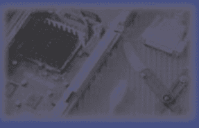


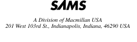


**收购编辑**
Neil Rowe

**责任编辑**
Laura N. Williams

**主编**
Charlotte Clapp

**项目编辑**
Carol Bowars

**文字编辑**
Mary Ellen Stepenson

**索引编制者**
Sandra Henselmeier

**校对者**
Katherin Bidwell
Daniel Ponder

**技术编辑**
Roman Rochelt

**内部设计师**
Anne Jones

**封面设计师**
Anne Jones

**文案撰写人**
Eric Borgeret


## 献辞

献给约翰·库尼奥斯，我的导师和朋友。

## 致谢

我要感谢收购编辑尼尔·罗伊、开发编辑劳拉·威廉姆斯、项目编辑卡罗尔·鲍尔斯和文字编辑玛丽·埃伦·斯蒂芬森。这些人是在我写作之前和写作过程中与我合作，确保最终成果物有所值的人。如果没有他们的贡献，这本书是不可能完成的。

像这样的一本书不会不经过准确性检查就顺利出版。罗马·罗谢尔特因承担这一通常不被感激的工作而值得感谢。当然，剩下的任何错误都是我自己的责任。

大卫·金为我提供了许多关于本书中所述信息的有用线索和建议。我还要感谢所有为 Linux 编写设备驱动程序的众多公司和人士。这些使得在 Linux 上工作成为可能。不幸的是，列出他们所有人本身就需要一章篇幅。

## 作者简介

**罗德利克·W·史密斯** 从高中起就开始使用计算机，包括使用 AppleDOS、MacOS、TOS、MS-DOS、Windows 95 和 98、Windows NT、OS/2、VMS、Ultrix 以及，当然，Linux 等多样化操作系统的系统。自 1992 年以来，他一直致力于构建和升级 x86 PC，并拥有在 x86 和 PowerPC 硬件上运行 Linux 的经验。罗德自 1994 年以来使用 Linux，自 1996 年以来将其作为主要操作系统。这是罗德的第四本书，前三本分别是 Que 出版社的 *《使用 Corel WordPerfect 8 for Linux 特别版》*、Sams 出版社的 *《Linux：为办公室搭建网络》* 和 Que 出版社的 *《多重启动配置手册》*。他拥有欧柏林学院文学学士学位、密歇根大学文学硕士学位和塔夫茨大学哲学博士学位。他目前居住在马萨诸塞州梅尔登市。

## 技术编辑简介

**罗马·罗谢尔特** 是加拿大温哥华一家公司的 Linux 开发者。过去四年里，他将精力集中在 Linux 上。在他的业余时间，他协助开发 Linux.com 网站的开发部分。


## 告诉我们你的看法！

作为本书的读者，你是我们最重要的批评者和评论者。我们珍视你的意见，希望了解我们在哪些方面做得正确，哪些方面可以改进，你希望我们出版哪些领域的内容，以及你愿意分享的任何其他建议。

你可以通过传真、电子邮件或直接写信给我，告诉我你对这本书喜欢或不喜欢的地方——以及我们可以如何让我们的图书更出色。

请注意，我无法帮你解决与本书主题相关的技术问题，而且由于我收到的邮件量很大，我可能无法回复每一条留言。

写信时，请务必附上本书的标题和作者，以及你的姓名和电话或传真号码。我会仔细审阅你的评论，并将其与参与本书编写的作者和编辑分享。

-   传真：(317) 581-4770
-   电子邮件：linux_sams@macmillanusa.com
-   邮寄：Mark Taber, Associate Publisher, Sams Publishing, 201 West 103rd Street, Indianapolis, IN 46290 USA

## 前言

Linux 起源于 1992 年，是名为林纳斯·托瓦兹（Linus Torvalds）的一名大学生的一项“宠物项目”（即个人兴趣项目）。林纳斯熟悉其大学使用的 UNIX 操作系统，并希望拥有一个类似系统供自己使用。然而，他无法负担一台专用的 UNIX 计算机。当时——且至今依然如此——运行大多数传统 UNIX 操作系统的计算机类型，其成本远高于基于 Intel x86 或兼容 CPU 的大众市场个人电脑。面对这一困境，林纳斯做了热衷的年轻程序员通常会做的事：他编写了自己的 UNIX。更具体地说，他编写了 UNIX 重新实现版本的内核，并依赖于庞大的 UNIX 实用程序安装基础，在该内核之上提供可用的系统。

自 1992 年以来，Linux 已经大幅增长并走向成熟，但今天的 Linux 延续了最初的优良传统：操作系统运行在廉价的 x86 硬件上。（它也被移植到许多其他平台。）诚然，2000 年的 x86 计算机比 8 年前的强大得多。事实上，就总内存支持和 CPU 速度等基本特性而言，如今的台式 x86 电脑让 1992 年的专用 UNIX 服务器相形见绌。

虽然 x86 硬件价格便宜，但与 Sun、SGI 等公司生产的专用 UNIX 工作站相比，它有一个重要的缺点：x86 硬件市场是混乱的。对于大多数主要组件类型——显卡、调制解调器、主板等——都有数十种竞争型号，它们通常需要独特的驱动程序才能正常工作。这种混乱的市场为消费者提供了丰富的选择，但初次接触时，这些选择可能会令人感到困惑。将大量的选择与操作系统驱动的要求相结合，Linux 用户面临着一个额外的挑战——找到能与 Linux 协同工作的硬件。

在过去，很少有硬件制造商以任何方式支持 Linux。最重要的 Linux 硬件驱动程序完全是由志愿者编写的，他们通常是因为想使用自己拥有的硬件而受到激励。然而，最近情况开始发生变化。越来越多的硬件公司通过赞助 Linux 驱动开发来支持 Linux，无论是雇佣程序员编写 Linux 驱动，还是向愿意开展这项工作的个人和组织捐赠硬件和文档。尽管如此，并非所有硬件都能在 Linux 下工作。一些设备仅仅是相当罕见，一些制造商则固执地拒绝向愿意开发的开发者透露必要的编程信息。因此，任何考虑使用 Linux 或为现有 Linux 系统购买新硬件的人，都必须理解在创建或扩展 Linux 计算机硬件时所面临的挑战。我写这本书就是为了满足这一需求。

## 谁应该购买这本书

*《Linux 硬件手册》*旨在面向两个重叠的受众群体：

-   希望在自己的计算机上运行 Linux，但不知道其硬件是否与 Linux 兼容的人。如果你属于这一类，你大概不想购买太多新硬件；你只想知道如何让现有的硬件正常工作。
-   希望购买或组装一台运行 Linux 的新计算机，或者升级或扩展现有 Linux 计算机的人。这些人需要了解 Linux 硬件兼容性信息，以避免在硬件选择上犯代价高昂且耗时久的错误。

这两个群体的需求是相似的。在这两种情况下，都必须了解 Linux 支持哪些硬件，在哪里查找驱动程序和支持应用程序，以及该硬件存在哪些注意事项和限制。在某些情况下，一个人可能从第一个群体开始，但后来发现自己进入了第二个群体，因为某些硬件组件在 Linux 下根本无用。

我在写这本书时，着眼于典型的 Linux 消费者，而非硬件专业人士。如果你需要了解硬盘读/写头工作原理的细节，另一本参考书可能更适合这项任务。如果你想知道 Linux 在一般层面上如何与硬盘交互，这本书就是为你准备的。不过，在描述各种硬件组件时，我确实涵盖了一些关于设备如何工作的背景信息，有时还有该设备在市场中的历史。这些信息对于理解当前的市场和技术限制通常很有帮助。

由于计算机硬件变化如此迅速，我无法按具体型号涵盖大多数产品，尽管我会在适当的地方或作为例子提到一些具体型号。相反，我提供了如何查找当前硬件及其在 Linux 中支持情况的信息。在某种意义上，我的目标是教你如何“钓鱼”，而不是直接给你一条“鱼”。

## 《Linux 硬件手册》的结构安排

本书分为六个部分，每部分包含两到六章。每一部分都涵盖一组彼此紧密相关的主题。这些部分包括：

-   第一部分，“核心系统”，介绍了任何计算机最基础的功能，包括 CPU、主板、内存和机箱。所有计算机都有这些组件，尽管其中一些在某些方面比较特别。（例如，笔记本的机箱和主板与台式机的截然不同。）
-   第二部分，“存储”，涵盖硬盘、可移动磁盘、CD-ROM 及相关技术、磁带备份设备和 SCSI 主机适配器。所有计算机至少拥有一种形式的存储可用，尽管并非所有计算机都具备所有这些具体的存储类型。
-   第三部分，“音频/视频”，讨论用于输入和输出声音及视觉信息的设备——声卡、扬声器和耳机、麦克风、显卡、视频采集硬件和显示器。除了显卡和显示器外，这些组件中的任何一个对于计算机的功能都不是至关重要的，甚至在某些情况下，显卡和显示器也可以省略。尽管如此，这些组件在家庭使用中仍然很受欢迎且很重要，在商业用途中也越来越重要。
-   第四部分，“输入/输出”，描述了用于在计算机之间传输数据的各种设备，如键盘、鼠标、并口和串口、网络设备、调制解调器、扫描仪和打印机。在某种意义上，许多其他设备也属于输入/输出硬件，但它们都归属于更严格定义的类别，如数据存储和音频/视频设备。
-   第五部分，“预装系统”，涵盖为运行 Linux 而购买新计算机的过程。我将这项任务分解为三章：“非 Linux 系统的商店购买”、“Linux 工作站”和“笔记本电脑”。每一章都涵盖了你在面对每种类型计算机时面临的独特挑战和机遇。
-   第六部分，“附录”，包含其他杂项信息。附录 A 专门讨论驱动程序——如何查找它们，如何将它们与你的硬件匹配等。附录 B 是硬件制造商列表。你可以使用它来查找你所寻求设备的制造商，或追踪制造商的网站以寻找驱动程序或支持。

很可能你会在需要更换硬件时零散地阅读本书。不过，如果你想购买或组装一台新计算机，或者想评估你已有的系统是否与 Linux 兼容，你可以从头到尾阅读本书。如果你想要一次（相对）快速的巡览，了解最关键且难以配置的组件，我建议你阅读第 1、2、7、10、12、17、18 和 20 章，外加任何与你可能拥有的其他特殊硬件相关的章节，例如，如果你使用 SCSI 设备就阅读第 9 章，如果你拥有数码相机或电视输入卡就阅读第 13 章。如果你想购买预装计算机，请阅读第五部分，或者至少阅读与你计划购买的类型相关的章节。


## 本书采用的约定

本书使用特定的约定来帮助您最大程度地利用文本。

### 文本约定

本书中使用的不同字体用于识别术语和其他特殊对象。这些特殊字体包括以下内容：

| 类型 | 含义 |
| :--- | :--- |
| *斜体* | 首次定义的新术语或短语。 |
| `等宽字体` | 由计算机呈现的信息，包括文件名、命令名称以及基于 Web 信息的 URL。配置文件中的示例显示为整行等宽字体文本。 |
| `**粗体等宽字体**` | 您输入到计算机中的信息，例如在命令提示符下输入的命令。 |
| `*斜体等宽字体*` | 由计算机呈现的信息（或者如果文本也是粗体，则是您输入的信息），这些信息可能与书中内容有所不同。此类信息可能包括命令选项、设备文件名等。 |
| 大写 | 文本中菜单名称、对话框名称、对话框元素和命令的大写方式与它们在屏幕上的显示方式一致。由于 Linux 是一个区分大小写的操作系统，您必须以本书中呈现的大小写输入命令（通常全部为小写）。 |

按键组合用加号表示。例如，如果文本要求您输入 Ctrl+S，您需要同时按下 Ctrl 键和 S 键。

我用由逗号分隔的选项列表来表示 GUI 程序中一系列的选择。例如，“File, Enter” 意味着选择 File 菜单项，然后在 File 菜单中选择 Enter 项。

### 特殊元素

在本书中，您会发现提示、注释、警告和边栏。这些元素提供了多种信息，从您不应错过的警告到丰富您网络体验的辅助信息（非必读内容）不等。

### 提示

提示旨在指出您可能错过的功能、烦恼事项和行业技巧。提示通常通过提供比直接显而易见的更快或更有效的方法，帮助您更好地利用 Linux 网络。

### 注释

注释指出您应该注意的事项，尽管如果您赶时间可以跳过这些内容。通常，我添加注释是为了在不增加负担的情况下为您提供关于某个主题的额外信息。

### 注意

请注意警告！这些内容可以为您节省宝贵的时间，避免工作丢失。别说我没提醒您。


### 联系我

我欢迎有关《Linux 硬件手册》的意见和建议。您可以发送电子邮件至 rodsmith@rodbooks.com，或访问我的网页 http://www.rodbooks.com。

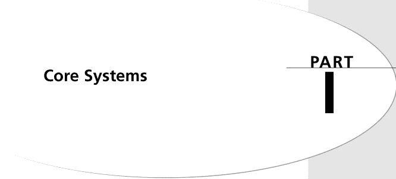

## 核心系统

## 第一部分

### 本部分

- 1. 中央处理器 9
- 2. 主板 31
- 3. 内存 75
- 4. 机箱与电源 103

### 中央处理器

第 1 章

### 本章

- CPU 架构 10
- x86 CPU 的世代 15
- Linux CPU 要求 24
- x86 CPU 市场 27

您阅读这本书，可能是想要购买、组装或升级一台用于 Linux 的计算机，或者是想要确定您现有计算机与 Linux 的兼容性。根据您的需求，您可能会觉得直接跳到与您最即时兴趣相关的硬件章节最方便。不过，如果您想对这个主题有全面的了解，您可以从头开始，逐步阅读整个主题。对于计算机硬件而言，起点可以说是中央处理器（CPU）。

每台计算机的核心都是 CPU。这个组件可能是计算机中最重要的计算组件。其他设备，如硬盘、RAM 等，在决定计算机的速度和可用性方面可能极其重要，但 CPU 执行计算机大部分的计算任务。因此，您对 CPU 的选择会影响计算机的速度，同样重要的是，它决定了您可以运行的操作系统。幸运的是，Linux 适用于许多类型的 CPU，尽管该操作系统在 Intel x86 系列 CPU 及其克隆上最为流行。

> CPU 一词有时被用来指代计算机的主“盒子”——容纳主板、硬盘等的部分，相对于显示器、键盘或鼠标而言。不过，在本书中，我在提到计算机核心处的芯片时使用 CPU，而不是指主系统盒子。

### CPU 架构

计算机通过遵循人类提供的指令来运作。通常，人类程序员使用 C、C++、Pascal 或 FORTRAN 等高级语言编写指令。这些指令随后被编译成计算机 CPU 可以使用的完全不同形式。（某些语言是解释型的，而非编译型的。在解释型语言中，计算机在读取程序代码时进行翻译，导致执行速度较慢。）编译后的代码通常被称为可执行文件、机器代码或二进制代码。机器代码对人类来说不太容易理解，而且没有编译器或解释器的帮助，高级语言代码对计算机来说是无法理解的。

正如存在多种不同的高级语言一样，也存在多种类型的机器代码。如果您想用几种高级语言编程，您需要多个编译器。但是，如果您想使用几种类型的机器代码，您需要多个 CPU，因为每个 CPU 实现一组机器代码指令。这些指令以及 CPU 设计的其他细节被称为 CPU 架构。CPU 架构所做的大致相同，事实上，存在数学证明表明一个架构可解决的另一个架构也能解决。不同的 CPU 架构在编程难易程度和速度方面存在差异，因此，实际上，一种架构可能比另一种架构更适合某些任务。

一般来说，为一种架构编译的软件无法在另一种架构上运行。最重要的是，为一种架构设计的操作系统无法在另一种架构上运行。幸运的是，Linux 已重新编译以在许多不同的 CPU 架构上运行。由于大量 Linux 软件提供源代码，您通常可以为任何 Linux 本身运行的架构重新编译软件。（商业软件是这一规则最重要的例外。）这种状态的缺点是，如果您想运行 Linux 但尚未购买硬件，您必须首先做出一个非常基本的决定：您想在什么架构上运行 Linux？

您对 CPU 架构的选择对其他硬件也有影响。值得注意的是，不同的 CPU 需要不同的主板，而主板又决定了您可以使用哪些类型的内存和插件卡。（我在第 2 章中介绍主板。）

### CISC 与 RISC

在 CPU 架构选择中，一个元决策是使用精简指令集计算机（RISC）CPU 还是复杂指令集计算机（CISC）CPU。从历史上看，20 世纪 90 年代初之前开发的 CPU 随着每一代新产品的推出而变得越来越复杂。CPU 设计师添加了执行越来越复杂功能的指令，使用单条指令完成更多功能——因此它们是 CISC CPU。这种趋势对于使用汇编语言（一组与机器代码非常接近但人类更易理解助记符）编写软件的人非常有益。复杂指令使汇编语言更容易处理。缺点是复杂指令使 CPU 更大、更复杂、更难制造且更慢。

替代方案是 RISC，它在 20 世纪 90 年代初在 UNIX 系统中流行起来。RISC 架构摒弃了复杂的机器代码指令，转而采用更简单、更快的核心 CPU 设计。这种方法使汇编语言程序更长，但每条指令执行速度更快，因此总体 CPU 速度相同或更快。作为一个好处，为 RISC 架构生成编译器通常更容易。指令数量和大简化意味着更少需要分析源代码以寻找使用最快可用 CISC 指令的方法。

到了 20 世纪 90 年代末，RISC 和 CISC 架构之间的界限变得模糊，来自各个阵营的 CPU 都采用了对方的特性。例如，许多 x86 类 CPU（传统上是 CISC 设计）开始使用 RISC 核心，并配合将 CISC 指令转换为多个 RISC 指令的电路。


## 第一部分

在常见的桌面 CPU 架构中，Intel x86 传统上是一种 CISC 设计，不过正如我刚才提到的，许多当前的 x86 CPU 都采用了混合的 RISC/CISC 设计。用于现代 Macintosh 电脑的 PowerPC CPU 系列以及用于许多 UNIX 机器的 Alpha CPU 都是 RISC 设计。除非你打算进行汇编语言编程，否则 RISC 与 CISC 之间的区别并不重要。相反，你应该关注 CPU 的整体速度、硬件的可用性以及软件的可用性。

### x86

由 Intel 发明的 x86 CPU 架构是目前桌面电脑中最受欢迎的。所有运行 Windows 9x 操作系统的电脑都使用 x86 CPU。x86 这个名字源自 CPU 名称的缩写。在 20 世纪 80 年代和 90 年代初，Intel 的 CPU 都以数字命名，例如 80286 和 80386。x86 系列 CPU 之间的差异仅在于中间的数字，因此 80x86 成为了整个系列的缩写，这个缩写后来又进一步简化为 x86。缩写 i386 有时用于指代 80386 及后续的 CPU。

Intel x86 CPU 极受欢迎——如此受欢迎，以至于在过去，多家公司生产过 x86 兼容 CPU，而目前仍有三家公司（AMD、VIA 和 Transmeta）继续这样做。x86 CPU 系列——或者更准确地说，80386 CPU——是 Linux 最初编写时所针对的 CPU。如今大多数 Linux 电脑都运行在 x86 硬件上，因此本书的大部分篇幅都集中在 x86 电脑上使用的硬件，尽管本书的许多内容也适用于其他架构。事实上，本章的大部分篇幅都献给了 x86 CPU。

x86 CPU 系列是大多数用户的不错选择；它提供的性能对于大多数桌面和服务器应用程序来说都绰绰有余。由于其普及程度，x86 硬件价格低廉，且该硬件的周边设备也非常常见。一个缺点是，许多 x86 周边设备质量较低，因此你需要懂得足够的知识来避开那些劣质产品——借助本书的帮助，这项任务应该会轻松很多。x86 硬件通常也不是现有硬件中最快的，特别是在浮点运算方面，因此如果你希望使用计算机进行非常苛刻的科学或工程模拟、图形渲染或其他高性能任务，x86 可能并不适合。

### Alpha

数字设备公司（DEC）开发了 Alpha CPU，用于高性能工作站和服务器。在推出时，RISC 架构的 Alpha CPU 比 x86 CPU 更快，但由于缺乏软件支持，Alpha CPU 在获取市场份额方面一直很艰难。当 DEC 倒闭后，康柏（http://www.compaq.com）接管了 Alpha CPU 生产线，并继续销售 Alpha CPU 和电脑，包括预装 Linux 的选项。

如果你希望使用 Linux 进行高性能计算，Alpha CPU 是一个不错的选择。当前的 Alpha CPU 比最好的 x86 CPU 更快，而且 Linux 的 Alpha 移植版本在此类系统中表现稳定且支持良好。事实上，电影*《泰坦尼克号》*中的特效就是用一群运行 Linux 的 Alpha 架构计算机完成的。

Red Hat（`http://www.redhat.com`）主导了 Alpha CPU 的 Linux 发行版，不过你也可以找到其他的 Alpha 发行版，其中最著名的是 Debian GNU/Linux（`http://www.debian.org`）。这两个发行版都非常稳定。

### SPARC

SPARC CPU 系列最常见于 Sun 的工作站。这些电脑自带其 UNIX 变体（SunOS 或 Solaris）。尽管有此事实，Linux 爱好者仍将 Linux 移植到了该架构上——部分原因是他们喜欢 Linux，部分原因是为了避免费用授权费，还部分原因是，正如攀登珠穆朗玛峰一样，面对挑战本身就是一种奖励。

SPARC 架构包括 32 位和 64 位 CPU，Linux 在这两种架构上都能运行。64 位 CPU 内部使用两倍的位数来表示数值，这可以加快大数值的处理速度。SPARC 处理器速度非常快，使得 SPARC 硬件成为 CPU 密集型工作的良好选择。

你可以在 `http://www.ultralinux.org` 了解更多关于 UltraLinux 项目（该项目托管 SPARC CPU 系列的 Linux 开发）的信息。Red Hat（`http://www.redhat.com`）有一个适用于 SPARC 处理器的 Linux 发行版，Debian（`http://www.debian.org`）也有。

### PowerPC

PowerPC CPU 是 Apple、IBM 和 Motorola 合作的成果。该 CPU 系列主要用在 Macintosh 电脑上，但 IBM 和 Motorola 也在部分计算机中使用了 PowerPC CPU，还有一些其他计算机也在使用。总体而言，如果你想使用 PowerPC CPU，通常必须购买一台 Macintosh。

> **注意**
>
> 早期的 Macintosh 使用 Motorola 680x0 系列 CPU。然而，基于 680x0 的 Macintosh 已经多年停止生产，因此你购买的任何*新* Macintosh 都将使用 PowerPC CPU。如果你正考虑购买二手 Macintosh 或为一台已有的 Macintosh 使用 Linux，你必须确认它是 680x0 还是 PowerPC CPU。虽然两种 CPU 都有可用的 Linux，但 PowerPC 的发行版更加成熟。

PowerPC 采用 RISC 架构，速度相当快，特别是在浮点运算方面。在 2000 年初，最新的 PowerPC CPU（G4 系列）性能超过了最好的 x86 CPU，尽管优势幅度不大，不足以说购买 x86 CPU 是不明智的选择。在 Linux 支持方面，有多个发行版适用于 PowerPC 计算机：

-   [LinuxPPC](http://www.linuxppc.org)
-   [Yellow Dog Linux](http://www.yellowdoglinux.com)
-   [Debian GNU/Linux](http://www.debian.org)
-   [SuSE Linux](http://www.suse.com)

LinuxPPC 和 Yellow Dog 发行版都紧密基于 Red Hat Linux。Debian 和 SuSE 既生产在 x86 平台上流行的发行版，也提供 PowerPC 版本。

曾经，Apple 资助了 MkLinux 的开发，这是一个 PowerPC Linux 发行版，除了标准的 Linux 内核外，还使用了 Mach 微内核。然而，MkLinux 的开发已 largely 停止，因此我建议你尽可能使用 PowerPC 硬件上的其他 Linux 发行版。

在尝试在 PowerPC 系统上安装 Linux 之前，确认系统的兼容性至关重要。ROM、主板特性、周边设备等方面的差异会导致特定的 PowerPC Linux 发行版在硬件支持方面存在缺口。

### 其他架构

上述的只是当今桌面电脑上最流行的一些 CPU。不过，还有其他 CPU，包括：

-   **掌上电脑 CPU** Linux 已被移植到几种用于掌上电脑的 CPU 上，例如 Psion 电脑中使用的 ARM CPU（http://www.calcaria.net）、许多 Windows CE 掌上电脑中使用的 NEC VR 系列 CPU（http://www.linuce.org），甚至 3COM PalmPilot（http://www.uclinux.org）。这些移植中的一些也可以用于嵌入式设备——即内置于手机、工业机器人等中的计算机。
-   **稀有的桌面和工作站 CPU** Linux 可用于早期 Macintosh、Amiga 和 Atari ST 中使用的 680x0 系列（http://www.linux-m68k.org），某些 Apollo 工作站中使用的 PA-RISC CPU（http://www.linux.esiea.fr/APOLLO/），某些 DECstation 计算机中使用的 MIPS CPU（http://decstation.unix-ag.org），以及其他类型。
-   **大型机** 甚至有一个项目正在让 Linux 在大型机上运行（http://www.acude.org/roam.htm），尽管进展不大。

你可以在 http://www.linux.org/projects/ports.htm 找到许多 Linux 移植项目的链接。除非 CPU 特别老旧或罕见，否则很可能有一个项目正在将 Linux 移植到该 CPU 上——或者该任务已经完成。在大多数情况下，我不建议你以运行 Linux 为目标去寻找这些特殊的系统。除非你找到了真正的 bargain，否则在 x86 系统上运行 Linux 的成本会更低；或者一台 PowerPC、SPARC 或 Alpha 工作站也能提供足够的计算能力。如果你有非常强的 CPU 需求，可以研究一下 Linux 集群，即由多台通过快速网络技术互联的 Linux 计算机组成，以产生超级计算机级别的计算能力。正在研究此项技术的一个组织是 Beowulf Project（http://www.beowulf.org）。

CPU 领域一个潜在的重要发展是 Intel 新的 64 位芯片，即 Itanium。这款 CPU 在 2000 年是全新的，虽然它与早期 Intel x86 CPU 向后兼容，但它引入了大量新功能，这些功能只能由新操作系统——或旧操作系统的新版本——使用。Intel 一直与 Linux 内核程序员合作，确保 Linux 能够迅速且轻松地适应新 CPU。

### x86 CPU 的世代

由于大多数人在 x86 硬件上运行 Linux，这就是我在本书中关注的重点。这并不意味着本书对于在 x86 以外硬件上使用 Linux 的人来说毫无用处，许多信息都适用于各种架构。然而，x86 硬件比大多数其他 CPU 架构更流行，也更多样化。鉴于 x86 在 Linux 社区中的重要性，我在这里花了一些时间描述多年来 x86 CPU 的发展历程。

> **警告**
>
> 在决定 x86 CPU 时，务必确保你的主板和 CPU 相匹配。大多数主板设计为只适用于窄范围的 CPU。例如，你不能在 Pentium 主板上使用 Pentium IV CPU。即使在同一 CPU 子类范围内，兼容性也存在相当大的差异。例如，某些 Pentium 主板仅适用于特定时钟速度以下的 Pentium CPU，或者可能适用于某些兼容 CPU 但不适用于其他型号。请查看主板制造商的网站以获取兼容性信息。

### 石器时代：8086 至 80286

最早值得被视为 x86 家族一部分的 CPU 是 8086，尽管 8086 本身又是源自更早的设计。8086 的低成本变体 8088 被用于第一台 IBM PC。下一代用于 PC 的 Intel CPU 开发成果是 80286，


这曾被用于 IBM PC–AT 及其他一些计算机。除了少数实验性和有限的移植版本外，Linux 无法在此类旧型号的计算机上运行；这些 CPU 缺乏 Linux 所需的重要特性，例如 32 位内存寻址。

> 8086 和 80286 使用 16 位内存寻址，这意味着它们最多可以直接寻址 $2^{16}$，即 65,536 字节。为了寻址更多内存，这些 CPU 使用了特殊的扩展寻址模式，允许 CPU 指定使用几个 64KB 段中的哪一个。Linux 假定它至少可以直接访问 32 位的内存空间，从而为 RAM 提供了理论上 $2^{32}$ 字节（即 4GB）的限制。（Intel Pentium Pro 及后续 CPU 使用 36 位内存空间，因此具有理论上的 64GB 地址空间，而一些非 Intel CPU 的内存空间甚至更大。）

如果你拥有一台 8086 或 80286 计算机，我能给出的最好建议是放弃使用 Linux 运行它，或许只能将其用作“哑终端”——一种基于文本的显示设备，你可以用它来在另一台计算机上运行程序。任意几十个终端程序都可以承担此功能。

## 80386：最早支持 Linux 的 CPU

林纳斯·托瓦兹（Linus Torvalds）于 1991 年在一台 80386 计算机上编写了 Linux 内核的第一个版本。如今，许多 Linux 发行版仍能在 80386 CPU 上运行，尽管其中一些包含针对较新 CPU 的优化，这使得在 80386 上运行操作系统变得困难或不可能。实际上，运行 Linux 的 80386 可能最好只用来运行非常简单的程序，或者作为更强大计算机的 X 终端使用。

不过，从架构上看，80386 增加了运行如 Linux 这样的高级操作系统最重要的功能特性。这些特性包括 32 位内存寻址和保护模式操作，这使得多任务处理的实现更加容易。80386 CPU 不包含数学协处理器（也称为浮点单元，即 FPU）。这些设备用于处理浮点算术运算，并能极大加速数学计算。然而，大多数 80386 主板都可以加装 FPU。理论上，Linux 需要 FPU；但内核具有可选的 FPU 仿真功能。实际上，如果将相应的支持编译进内核，你可以在没有 FPU 的 386 上运行 Linux。

80386 有两种主要形式：SX 和 DX。SX 是较低端的 CPU，其引脚排列与 80286 兼容。这样做的初衷是让计算机制造商能够通过修改现有的 80286 主板设计，比使用拥有完全不同引脚排列的 80386DX CPU 更快速、更低成本地将产品推向市场。然而，使用旧的 80286 接口使得 80386SX 相对于 80386DX 的性能有所降低。


80386 对于现代台式计算机的大多数用途可能不够用，但它并非完全无用。80386 在某些嵌入式应用中仍在使用。其中最引人注目的应用可能是在国际空间站上，它使用 80386 CPU 来控制其许多组件。NASA 选择 80386 而非更复杂的设计，部分原因在于认证一款产品用于太空环境需要很长时间。NASA 偏爱 80386 还因为 80386 上电路走线尺寸较大（相对于 x86 家族中更新的成员），这使得 80386 对宇宙射线更具抵抗力。高能宇宙射线的一次打击就可能导致 CPU 故障——这在轨道上是真正的问题。

## 80486

80486 相对于 80386 并没有像 80386 相对于 80286 那样具有巨大的飞跃。80486 提供了比 80386 更快的速度，因此如果你以相同的时钟速度运行 80386 和 80486，80486 每秒执行的计算量会更多。

80486 的另一项特性是使用了内部内存缓存——这是 CPU 本身上一块 8KB 的极快内存区域，在处理能放入缓存中的数据时，可以极大地加速 CPU 操作。Intel 还为 80486 引入了一种新的引脚布局（见图 1.1），因此无法在 80386 主板上使用 80486 CPU。（Cyrix 是当时 Intel 的竞争对手之一，推出了一系列名为 80486SLC 和 80486DLG 的 CPU，它们可以安装在 80386 主板上，性能介于 Intel 80386 和 80486 CPU 之间。）

与 80386 一样，80486 也有 SX 和 DX 两种型号。不过，80486DX 与 80486SX 的区别在于，DX 版本内置了 FPU，而 SX 版本则没有。将 FPU 集成在 CPU 晶圆上极大地提高了 FPU 的速度，与将其放在单独的芯片上相比优势明显。

如今，许多 Linux 发行版都能在 80486 CPU 上运行。与 80386 类似，一些发行版包含的优化使得无法在 80486 上安装或运行操作系统。以当今标准来看，80486 相当古老，在许多现代程序（尤其是那些图形密集型程序）上的表现并不好。如果你有一台旧的 80486，它可能仍然可以在某些用途中与 Linux 配合使用，包括

- **小型网络路由器或防火墙** 将一台运行 Linux 的 80486 设置为小型家庭或办公网络与电缆调制解调器或数字用户线（DSL）系统之间的网关，以保护你的网络或将多台计算机附加到一个 IP 地址上。（关于这种配置的更多详细信息，请参见我在 Sams 出版社出版的书籍《*Linux：办公室网络*》。）

- **专用 X 终端** 如果你有一台计算机作为主系统的 X 服务器，两个人可以同时使用一台 Linux 计算机。旧的 80486 可以相对很好地完成这项任务。

- **轻度使用** 如果需求不多，80486 可以胜任。你可能不喜欢像 StarOffice（http://www.sun.com）这样的大软件包在 80486 上的表现，但你在 80486 上运行较旧或较小的文字处理器、文本编辑器等程序完全没问题。

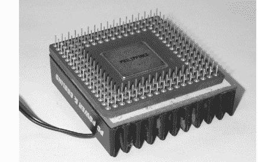

**图 1.1**
配有散热片的 80486 CPU，拥有 168 个引脚。

## Pentium 级别

直到 80486，Intel 一直使用数字来标识其 CPU，但 Intel 发现其竞争对手也使用相同的数字来标识其兼容 CPU，而 Intel 无法通过法律手段对数字进行商标注册以防止这种实践。因此，对于本应被称为 80586 的 CPU，Intel 改为使用名称 *Pentium*。

Pentium CPU 继续了 x86 产品线的演进，带来了速度提升和额外功能，其中一些功能是在 Pentium 生命周期的后期添加的。例如，*多媒体扩展（MMX）* 功能仅出现在 Pentium CPU 的较新型号中。Pentium CPU 常被誉为是 64 位的，但这指的是它在一个操作中传输到内存和从内存传输的数据位数，而不是其内部内存寄存器的大小或其指定要获取的内存地址所使用的位数。Pentium 增加了相对于 80486 的板载缓存大小，且没有 Intel Pentium CPU 缺少 FPU。Intel 为 Pentium 引入了一种新的插座设计，该设计经过几次小幅修订后才确定为流行的 Socket 7 布局（见图 1.2）。

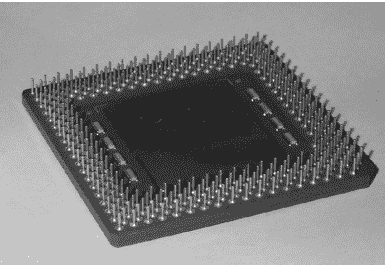

**图 1.2**
*Socket 7 CPU 比 486 CPU 拥有更多的引脚，并且在物理尺寸上也更大。*

在 Pentium 之前，Intel 的竞争对手使用通过授权获得的、与 Intel 几乎完全相同的 CPU 设计。随着 Pentium 的推出，Intel 的主要竞争对手（在 Pentium 生命周期早期是 AMD、Cyrix 和 NexGen，后来加入了 IDT）开始使用独特的 x86 设计重新实现。其中一些设计与 Pentium 的设计有着根本性的不同。例如，AMD K5 和 NexGen Nx586 CPU 是首批使用 RISC 内核周围包裹逻辑，通过多条 RISC 指令处理复杂 x86 指令的处理器。这些独特的设计使得比较 Pentium 级别 CPU 与不同制造商 CPU 的相对速度变得困难；仅凭 CPU 时钟速度不足以进行比较。一些制造商使用 *P 评级* 或 *PR 评级* 来表示其 CPU 相对于 Pentium 的速度。例如，Cyrix 6x86 P-166 预期能以 166MHz 时钟频率的 Pentium 的速度运行——至少 Cyrix 是这么宣称的。实际上，速度因应用程序而异。P 评级在很大程度上已经过时，尽管 Cyrix CPU 仍标有 P 评级。

总之，Pentium 级别 CPU 包括

- **Intel Pentium** 该级别的“标准”。
- **Intel Pentium MMX** 拥有更快的时钟速度，并增加了 MMX 指令。


## 奔腾克隆版及竞争对手

- **NexGen Nx586** NexGen Nx586 是第一款奔腾克隆芯片。它在奔腾克隆版中并不寻常，原因包括它采用了自己的插座设计，因此需要专用的主板。该处理器的早期版本还缺少 FPU（浮点运算单元）。NexGen 随后被 AMD 收购。

- **Cyrix 6x86** Cyrix 将此处理器命名为 6x86，以暗示其性能优于奔腾。在整数运算（大多数程序使用的类型）中，6x86 在相同时钟频率下确实优于奔腾。然而，这种差异并不足以使 6x86 成为奔腾 Pro 或后续奔腾版本的有力竞争者。Cyrix 没有制造工厂，因此制造这些处理器的公司（主要是 IBM）也以自己的品牌销售它们。Cyrix 于 1999 年底被 VIA 收购。

- **Cyrix MediaGX** MediaGX 是 6x86 的一个变体，它将在 CPU 和主板芯片组中整合了许多多媒体功能，而不是使用附加卡。MediaGX 芯片主要出现在当时的某些低端主板上（多为 1998 年）。虽然 Linux 可以在 MediaGX 上运行，但内核不支持该芯片的高级多媒体功能，因此您可能在计算机中使用这些功能时遇到困难。例如，您可能需要在 MediaGX 计算机上添加传统的视频卡或声卡才能在 Linux 上使用 X 窗口系统或声音。

- **AMD K5** AMD 的奔腾竞争对手问世较晚，且在首批生产时，在相同速度下略慢于奔腾。K5 的后续版本使其在相同时钟速度下达到了与奔腾大致相当的速度，但到那时，AMD 已经推出了 K6，K6 迅速掩盖了 K5 的光彩。

- **IDT WinChip** IDT WinChip 在奔腾生命周期的非常后期才出现，且从未非常流行。IDT 在 1999 年底宣布将其 WinChip 设计出售给 VIA。

所有这些 CPU 都与 Linux 兼容。为了获得最佳性能，您可能希望重新编译内核，并在内核配置选项中选择适当的 CPU（参见图 1.3）。

在 2000 年，奔腾级系统仍然足以运行 Linux，尽管较旧的奔腾系统可能会相当迟缓，甚至快速的奔腾系统对于对 CPU 要求特别高的任务（如科学模拟）也可能不够用。目前还没有 Linux 发行版包含阻止其在奔腾处理器上运行的优化设置。

## 1

### 中央处理器

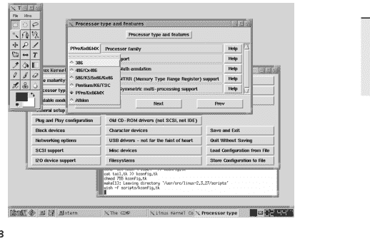

### 图 1.3

Linux 内核配置提供了选项，帮助您针对计算机中的 CPU 优化内核。

## 从 Pentium Pro 到 Pentium III

在奔腾之后，英特尔发布了一系列奔腾 CPU 的升级版本，被称为 Pentium Pro、Pentium II、Pentium III 和 Celeron。这些 CPU 家族在几个方面与奔腾有所不同，包括

- **CPU 封装上的 L2 缓存** $L2$ 缓存是一种高速类型的 RAM，在奔腾设计中，它位于主板上。这些 CPU 将其放置在 CPU 的封装上，尽管它不是 CPU 本身的同一晶圆的一部分。这种放置方式提高了系统性能，因为缓存可以比放在主板上运行时以更快的速度运行。然而，早期 Celeron CPU 缺少 L2 缓存。

- **36 位寻址** 这些 CPU 可以访问 $2^{36}$ 字节（即 64GB）的内存，而奔腾系列的限制是 4GB。

- **速度提升** 尽管不像某些早期代际变化中的速度提升那样具有革命性，但这些 CPU 在设置相同时钟频率时通常比前代产品更快。Pentium Pro 实际在运行 16 位代码时比奔腾慢，但在运行 32 位代码时更快。（Linux 专门使用 32 位代码，除非运行像 DOSEMU 这样的模拟器。）

- **时钟速度提升** 这些 CPU 可以比前代产品以更快的时钟速度运行，这是最大速度提升的来源。某些型号也可以以更快的*总线速度*运行，这是 CPU 与其他计算机组件通信的速度。

- **不同的封装** 直到 Pentium Pro，英特尔的 x86 CPU 都一直使用插座式设计，尽管插座的细节因 CPU 而异（参见图 1.4）。然而，Pentium II 引入了不同的*插槽*设计，称为*Slot 1*。但是，Pentium II 和 Celeron 的某些版本同时提供插座（*Socket 370*）和 Slot 1 格式。

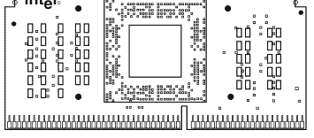

### 图 1.4

*Pentium II 和 III CPU 通过封装在塑料外壳中的电路板连接到主板，而不是像早期 x86 CPU 那样使用插座式设计。*

如果您计划今天购买新的英特尔 CPU，我建议您购买 Pentium III，尽管高端 Pentium II 和 Celeron CPU 对于低端系统来说可能已经足够。Pentium Pro CPU 现在非常难以找到，且以今天标准来看速度较慢。Celeron CPU 的 L2 缓存较小或没有，这阻碍了其性能。这并不是说低于 Pentium II 的 CPU 就很糟糕；当然，对于许多用途，您不需要可用的最快 CPU，Linux 在较慢的 CPU 上运行良好。对于新计算机，您应该购买一些在未来一段时间内仍能保持有效性的东西。

> **提示**
> 购买比最快可用速度慢几档的 CPU 可以获得最大的“性价比”。例如，在 2000 年初，Pentium-III 700 CPU 的售价约为 $850，而 Pentium-III 600 CPU 约为 $500，Pentium-III 500 CPU 售价约为 $300。因此，前 100MHz 的降幅节省了 $350，而下一个 100MHz 的降幅只节省了 $200。

英特尔 Pentium III 系列最新的是 *Coppermine*（尽管它并没有使用由 IBM 发明并现用于 PowerPC CPU 的铜互连技术）。Coppermine 包含了比之前英特尔 CPU 的几项进步，如 133MHz 主板总线、将 L2 缓存集成到主 CPU 晶圆中以及更小的电路。除了允许更高的主板总线速度外，这些增强作为消费者而言在很大程度上是不可见的，除了它们产生了更快的 CPU。事实上，英特尔选择不以新名称发布 Coppermine；它仍然是一颗 Pentium III CPU。

## 先进的非英特尔 x86 CPU

直到 1999 年，英特尔的竞争对手继续使用大多数 Pentium CPU 使用的 Socket 7 设计作为 CPU 接口。这意味着大多数竞争 CPU 使用主板上的 L2 缓存，而不是 CPU 内部的（例外是 AMD 的 K6-III），并且这些 CPU 局限于 Pentium 的 32 位、4GB 内存地址空间。不过就速度而言，其中一些 CPU 可以与中端 Pentium-III 的 CPU 竞争。此范围内的 CPU 包括

- **AMD K6** K6 主要基于 NexGen 为未发布的 Nx686 开发的设计。它包含 MMX 技术，并在以相同时钟频率运行时接近 Pentium II 的速度。

> **注意**
> 一些早期 K6 CPU 包含一个导致偶尔运行不可靠的 bug。这个 bug 并非 Linux 特有，但由于各种原因，在使用 GCC 编译器时它经常表现，可能导致 Linux 内核编译间歇性失败，以及其他问题。因此，如果您有早期 K6 CPU，可能希望将其替换，而不是在其上运行 Linux。

- **AMD K6-2 和 K6-III** K6-2 和 K6-III 是 K6 CPU 的更快的版本。它们都以更快的时钟频率运行，并包括在相同时钟频率运行时提高性能的变化。

- **Cyrix MII** MII 基本上是以更高速时钟运行的 6x86。MII 还合并了 MMX 指令。我将 MII CPU 放在这里而不是 Pentium 部分，主要是因为它可以比英特尔的 Pentium 以更快的时钟频率运行。

- **Transmeta Crusoe** Transmeta（<http://www.transmeta.com>）是 x86 CPU 竞赛中最新的进入者。Crusoe 以其低电压要求为特色，使其非常适合用于便携式设备，如笔记本电脑和掌上电脑。


第一部分

除了这些运行在 Socket 7 主板上的 CPU 之外，AMD 于 1999 年推出了 Athlon，它使用了一种与 Pentium-II 和 Pentium-III CPU 所使用的插槽连接器相似（但不兼容）的连接器。Athlon 包含许多先进特性，并直接对标 Pentium-III 系统。事实上，在 1999 年末和 2000 年初，可用的最快 x86 计算机均由 Athlon CPU 驱动。与英特尔的奔腾后 x86 CPU 类似，Athlon 在 CPU 模块上集成了 L2 缓存，并使用 36 位内存地址。

### 混合代际 CPU

多家制造商生产了跨越不同 CPU 代际界限的 CPU。例如：

-   **Cyrx 486SLC 和 486DLC**：这些 CPU 托管的 CPU 内核类似于普通的 80486 CPU 内核，但分别使用了 80386SX 和 80386DX CPU 的物理接口。在相同时钟速度下，它们的性能介于 80386 和 80486 系列之间。
-   **Cyrix 5x86 和 AMD 5x86**：Cyrix 和 AMD 都生产了带有 5x86 名称的 CPU。这些 CPU 本质上是经过超级优化的 80486 CPU，适用于 80486 主板，但性能可与低端 Pentium 相媲美。Cyrix 5x86 包含了一些在 Cyrix 6x86 CPU 中使用的特性。
-   **Intel Pentium Overdrive**：英特尔发布了一款精简版 Pentium，可插入 80486 CPU 插槽。它与 Cyrix 和 AMD 的 5x86 CPU 竞争。

除了这些 CPU 之外，诸如 Evergreen Technologies ([http://www.evertech.com](http://www.evertech.com)) 等第三方厂商还销售各种 CPU 的修改版本。这些修改版 CPU 套件通常包含永久安装在特殊适配器上的 CPU，该适配器使得 CPU 能够在使用中不被接受的旧主板上使用。例如，Evergreen 销售的 Spectra 系列可以将 AMD K6-2 400 CPU 适配到许多支持 Pentium-75 及后续 CPU 的主板上。此类套件对于延长旧主板的使用寿命非常有用。

### Linux 的 CPU 要求

在支持 CPU 方面，Linux 是最灵活的操作系统之一。虽然它最初仅针对 x86 架构开发，但如前所述，Linux 已被移植到各种其他 CPU 上。在 x86 系列中，主流 Linux 需要 80386 或更高版本的 CPU，但 Linux 也已移植到更低的 x86 CPU 上。由于 Linux 可以剥离其图形用户界面等高级且占用性能的特性，因此与其他许多 x86 操作系统相比，Linux 可以在较旧的 x86 CPU 上运行得更好。

### 支持的 CPU 架构

本章前面部分概述了当前台式计算机上可用的许多 CPU，并指出了适用于这些 CPU 的 Linux 发行版。事实上，极少有现代 CPU 没有对应的 Linux 版本。这并不意味着 Linux 在所有这些架构上运行得同样好。各架构的优缺点包括：

-   **x86**：Linux 的第一款 CPU 是 x86。鉴于 x86 在小计算机市场的主导地位，Linux 社区的主要重点在于此。x86 硬件廉价且 abundant，但其中一些硬件与 Linux 不兼容。x86 硬件的多种 Linux 发行版意味着你很可能找到适合你需求的 Linux 版本。许多商业 Linux 程序仅适用于 x86 CPU。
-   **Alpha**：如果你希望使用 Linux 进行高性能计算，Alpha CPU 是一个不错的选择。Red Hat 的 Alpha 版本成熟且流行。你可以从各种供应商处获得基于 Alpha 的 Linux 系统，虽然它们比 SPARC 计算机更难找到。
-   **SPARC**：SPARC CPU 主要用于 Sun 的工作站，因此其缺点是硬件选择相对有限且昂贵。然而，SPARC CPU 表现非常好，特别是在浮点运算方面，使其成为高性能模拟或其他依赖 FPU 任务的绝佳选择。Red Hat 的 SPARC 移植版与其 Alpha 版本一样，得到了良好的支持。
-   **PowerPC**：你最有可能在 Macintosh 中遇到 PowerPC CPU，但 Motorola 和 IBM 也生产 PowerPC 计算机。顶级 PowerPC 计算机在性能上可以略胜 x86 计算机一筹，特别是在浮点运算方面。现有的 PowerPC 发行版在成熟度上略逊于主要的 x86 发行版，但差距不大。

作为一个一般规则，如果你想购买或组装一台运行 Linux 的计算机，我建议使用 x86 CPU。其他架构虽然有时在技术上优于 x86 CPU，但会限制你的软件选择，成本更高，并且往往限制了你在辅助硬件方面的选择。然而，如果你碰巧有一台使用其他 CPU 的闲置计算机，你可能会想在那台计算机上安装 Linux。如果你需要其专业化优势，例如最佳的 FPU 速度，或者你想双启动另一种在该硬件上可用的操作系统（例如用于 PowerPC 系统的 MacOS），你也可能希望购买此类计算机。

### 最低功能要求

在 x86 架构上，Linux 至少需要 80386SX CPU。因此，除非你是从廉价二手车销售点购买计算机，否则你今天购买的任何 x86 计算机都将具备足够的 CPU 性能来运行 Linux。

**注意**

可嵌入 Linux 内核子集（ELKS）项目（[http://www.elks.cs.soton.ac.uk](http://www.elks.cs.soton.ac.uk)）致力于将 Linux 移植到 8086 至 80286 及其他旧 CPU。然而，该项目尚未产生完全可用的系统。

虽然 Linux 内核和大多数 Linux 软件可以在 80386SX CPU 上运行，但一些 Linux 发行版施加了更高的最低要求。通常这是因为该发行版包含针对后续 CPU 进行优化的内核或其他关键组件，从而使该发行版在旧型号上不可用。2000 年初一些流行 Linux 发行版的具体官方要求包括：

-   Caldera OpenLinux 2.3：80386
-   Corel Linux 1.0：Pentium
-   Debian GNU/Linux 2.1：80386
-   Linux Mandrake 7.0：Pentium
-   Red Hat Linux 6.1：80386
-   Slackware 7.0：80386
-   SuSE Linux 6.3：80486DX（支持 80386 进行“有限使用”）

作为一个一般规则，如果某个发行版支持某一级别的 CPU，则它支持该级别的所有 CPU 和克隆品。例如，你可以使用 Cyrix 6x86 或 AMD K5 配合要求 Pentium CPU 的发行版。

**注意**

如果某个发行版要求 Pentium CPU，它可能不包含 FPU 模拟。由于早期的 NexGen Nx586 CPU 缺乏 FPU，你可能无法在早期 NexGen 系统上使用此类发行版，除非它们包含匹配的 FPU 芯片。理论上，你可以通过修改安装软盘或使用不同的 CPU 安装、重新编译内核或其他组件，然后替换 CPU 来绕过此问题以及其他 Pentium 要求。实际上，这几乎总是投入大于回报。

Linux 尚未充分利用 MMX 或 AMD 的 3DNow 多媒体扩展。然而，现代 CPU 都包含 MMX，没有理由避免使用具有这些扩展的 CPU。

少数 Linux 程序（如某些 MPEG 播放软件）可以利用这些指令。

### 适当性能的要求

就实际而言，当今大多数 Linux 系统至少应具有 Pentium 级别的 CPU。如果你正在组装一台新计算机，我建议使用 Intel Pentium-III 或 AMD Athlon 用于大多数系统，尽管高端 Intel Celeron、Intel Pentium-II、AMD K6-III 或 Cyrix MII 对于低性能系统也可以胜任。

如果你有一台想要升级的计算机，你有三种 CPU 升级选择：

-   **用更高速度且受支持的型号替换 CPU**：大多数主板支持一系列 CPU 速度，例如 Intel Pentium 100~233。如果你当前的 CPU 处于支持速度范围的较低端，你可以在找到更高速度 CPU 供应商的前提下，毫不费力地升级到支持范围内更高速度的型号。这通常是最安全、最简便的方法，但也是可能带来最小速度提升的方法。
-   **用售后市场 CPU 套件替换 CPU**：诸如 Evergreen Technologies ([http://www.evertechware.com](http://www.evertechware.com)) 等公司销售由安装在电压调节器或其他硬件上的 CPU 组成的 CPU 套件，以适应期望较慢型号的更快 CPU 的主板。此类套件通常工作良好，但偶尔可能与某些主板不兼容。
-   **替换主板**：通过替换整个主板和 CPU，通常可以获得最大的速度提升。例如，你可以通过这种方式将 80486 升级为 Pentium-III 或 Athlon。然而，这种方法通常是最昂贵的，并且通常要求你替换其他组件。例如，内存通常在超过一代左右的主板之间是不兼容的，甚至可能需要替换显卡、SCSI 主机适配器或其他组件，特别是如果你想升级旧的 EISA 或 VLB 80486 计算机时。

### x86 CPU 市场

x86 CPU 市场相当动态，新机型频繁推出，旧机型也轻易消失。因此，由于出版延迟，书中提供的信息在你阅读时无法完全保持最新和准确。本节涵盖了 2000 年初 CPU 市场的情况，并包含有关新兴 CPU 的信息，因此它应在 2000 年全年保持相关性。然而，为了获取最新信息，你应该咨询 CPU 制造商的网站。


## 第一部分
### Intel CPU

在 2000 年初，Intel（http://www.intel.com）的 x86 产品线包括 Pentium MMX、Pentium-II、Pentium-III 和 Celeron 系列型号。不过，Pentium MMX CPU 已经明显过时了。我建议仅将它们用于旧系统的升级，或者当你有特殊需求时（例如你免费获得了一块 Pentium 主板），甚至在那种情况下，AMD K6 系列 CPU 产生的性能可能也优于 Intel Pentium CPU。然而，Pentium CPU 可用于多处理器主板，而 AMD 和 Cyrix 的 Pentium 级别 CPU 则不能。

如果你想要一台搭载 Intel 芯片的新系统，Pentium-III CPU 可能是你最好的选择，尽管高端的 Pentium-II 或 Celeron 对于某些用途来说也足够了。Intel 预计其 Pentium-III CPU 将超过 1GHz 的时钟速度，并且还将支持更快的主板总线速度。这些变化可能会伴随着名称变更为 Pentium-IV。

Intel 计划于 2000 年年中推出其 Itanium CPU。这款 CPU 在开发期间代号为 *Merced*，是一款基于部分 x86 技术的真正的 64 位 CPU。它代表了 CPU 技术的一次转变，类似于从 8086 到 80386 的转变。正如 80386 能够运行 8086 软件一样，Itanium 可以运行较旧的 x86 软件，但也能受益于新的操作系统和软件。Intel 一直在与 Linux 内核程序员合作，以确保 64 位版本的 Linux 能在 Itanium 发布后不久运行。这将如何迅速转化为实际的 Linux 发行版还有待观察。考虑到大多数 Linux 软件都以源代码形式提供，并且这些源代码长期以来都在 x86、680x0、PowerPC 和 Alpha 等差异巨大的架构上编译，这表明 Linux 可能是[可移植性最强的操作系统]

### AMD CPU

AMD 的网站（http://www.amd.com）列出了 K6-2、K6-III 和 Athlon 作为 2000 年初当前的 CPU。此时，K6-2 比 K6-III 可获得更高的 CPU 时钟速度，但在相同速度下，K6-III 的性能优于 K6-2。因此，K6-III 产生了更好的整体性能。K6-2 和 K6-III 都适用于 Socket 7 主板，并且这些 CPU 在该硬件上产生了最快可用的性能。事实上，在 2000 年初，最好的 K6-III 系统在整体性能上与中端 Pentium-III 系统相当。

AMD 的 Athlon 使用了其独特的基于 *Slot A* CPU 接口方法的主板设计。AMD 从 Compaq 获得了这项技术的授权，Compaq 将其用于其 Alpha CPU（但 Athlon 不能使用 Alpha 主板）。与 Pentium-II 及后续版本一样，Athlon 将 L2 缓存放在 CPU 模块本身，这导致更快的整体系统性能，因为 L2 缓存的运行速度比它在主板上时要快。

根据大多数基准测试，在相同速度下，Athlon 在整数运算中的表现与 Pentium-III 相当，并在浮点运算中优于 Pentium-III。在 2000 年初，Athlon 比 Pentium-III 可获得更高的时钟速度，这意味着最快可用的 x86 PC 由 Athlon CPU 驱动。

预计 AMD 将在 2000 年继续开发 Athlon CPU，并且该 CPU 很可能会超过 1 GHz 的速度。

### VIA/Cyrix/IDT CPU

随着 VIA（http://www.viatech.com）收购 Cyrix 以及 IDT 的 CPU 设计，这家芯片组制造商在 2000 年成为了 x86 市场的第三大玩家。在 2000 年初，市场上主要的 VIA CPU 是 Cyrix MII 系列。（VIA 继续使用 Cyrix 名称用于这些 CPU。）这些 CPU 在速度上远远落后于 Intel 和 AMD 的产品。因此，除非这种情况发生变化，否则我不能推荐 MII 用于任何除非常低端系统以外的用途。IDT WinChip 系列甚至比 MII 系列更慢，并且在商店中更难找到。

下一代 VIA CPU 可能更值得关注，其代号为 Joshua。据报道，这款 CPU 将使用 Socket 370 接口，该接口主要用于大多数 Celeron 变种。VIA 似乎将这款 CPU 定位为中端系统，但该 CPU 发布时的具体表现尚不清楚。Joshua 是早期 Cyrix 设计的延伸，但可能整合了 IDT 为 WinChip 开发的一些功能。

### Transmeta CPU

Transmeta（http://www.transmeta.com）是 x86 CPU 领域最新的进入者。2000 年 1 月，Transmeta 宣布了其 Crusoe 处理器系列，这是一组旨在用于移动应用（如笔记本电脑和掌上电脑）的 x86 CPU。Crusoe CPU 采用了一种新颖的架构，其中 CPU 的大部分工作由特殊的低级软件完成，而不是由 CPU 本身的电路完成。部分由于这种设计，Crusoe CPU 可以在比其他 x86 CPU 低得多的功耗下运行，这转化为更少的热量和移动设备中更长的运行时间。这些 CPU 的另一个特性是它们可以动态调整其运行速度，从而调整其功耗需求。结果是，CPU 可以全速运行一小段时间，然后在计算机空闲时减速至 50%、25% 或更低。这在几乎没有或没有影响性能的情况下节省了能源。

对于 Linux 用户来说，特别值得关注的是，Transmeta 雇用了 Linux 内核的原始开发者 Linus Torvalds。目前尚不清楚主流 Linux 发行版是否会调整以适应并利用 Crusoe 的独特特性。如果它们这样做，这些 CPU 可以提供比其他 x86 CPU 独特的优势，表现为更高的速度或额外的功能。

### 摘要

每台数字计算机的核心都是 CPU，CPU 的选择会影响计算机的其余部分。CPU 决定了计算机可以运行哪些操作系统和软件，并且是计算机整体速度的主要因素。CPU 还决定了可以使用哪些其他硬件组件，最直接的方式是决定兼容的主板。然而，主板的功能决定了哪些附加卡、RAM 和其他设备可以与计算机一起工作，因此 CPU 在这方面有间接影响。

Linux 适用于各种 CPU，但最常与 x86 及兼容 CPU 联系在一起。x86 计算机的硬件往往很便宜，这种廉价硬件与开源 Linux 操作系统的结合为低成本计算机带来了前所未有的性能。

### 主板

### 第 2 章

### 本章内容

-   匹配主板和 CPU 33
-   主板总线 38
-   主板外形规格 46
-   主板芯片组 53
-   板载端口 65
-   内存 72

如果 CPU 是计算机的心脏，那么主板就是其循环系统。主板的功能是将 CPU 连接到计算机中的所有其他设备，无论是直接连接（如 CPU 访问插入主板的 RAM）还是通过另一个组件（如通过 SCSI 主机适配器访问硬盘）。主板通常是计算机中最大的电路板。它包含 CPU 的插槽或插座、内存插槽、扩展卡插槽、硬盘、软盘和外部设备的连接器，以及电源连接器等其他功能。这些功能都在图 2.1 中展示，该图显示了一个典型的 Socket 7 主板。

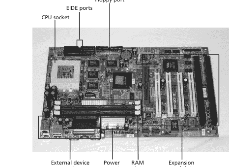

*图 2.1：典型主板包含各种类型的广泛连接器。*

本章描述了当今主板的一些最重要特征，以帮助你决定你需要主板具备哪些功能。然而，本章不会详细讨论配置主板或将其集成到完整的计算机系统中的问题。如需了解相关信息，请参阅你的主板文档。


## 主板与 CPU 的匹配

主板选择中最关键的方面之一就是主板与 CPU 的匹配。正如第一章“中央处理器”中所述，CPU 在许多方面存在差异，这些差异都需要主板提供支持。这些变量包括 CPU 到主板的物理接口、CPU 总线速度、CPU 电压要求以及 BIOS 支持。

## CPU 插座和插槽

直到最近，每一代 CPU（80386、80486 等）都使用独特的 CPU/主板接口方法。这些接口通常以*插座*的形式出现，其中 CPU 底部有许多引脚，适配主板上的方形连接器（见图 2.2）。较新的 CPU，包括大多数 Pentium-II、Pentium-III 和 Athlon CPU，使用的是类似即插即用卡片的插槽式设计。（大多数 Celeron CPU 仍继续使用插座式设计，但部分型号也提供插槽式形式。）

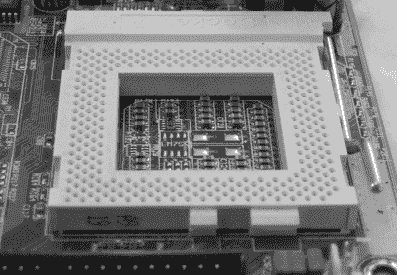

用于插座式 CPU 的主板插座包含许多孔，CPU 底部的引脚即插入这些孔中。

## 插座式设计

大多数 CPU 系列都经历过几种插座变体的兴衰。例如，最早期的 Pentium CPU 使用的引脚布局与后期 Pentium CPU 使用的布局不兼容。早期的 80486 主板使用需要很大力量才能插入 CPU 的插座，但后期的 80486 主板使用零插入力（ZIF）插座，其侧面有一个杠杆，允许你将其收紧以固定已插入的 CPU。（在图 2.2 中，可以看到插座右侧的这个杠杆。）绝大多数 Pentium 级主板使用 ZIF 插座。适用于 80486 及以后 CPU 的流行插座包括

- **Socket 1** 80486 CPU 的 169 针插座。
- **Socket 2** 80486 和 Pentium Overdrive CPU 的 238 针插座。
- **Socket 3** 80486 和 Pentium Overdrive CPU 的 237 针插座。支持 3.3v 运行，这也减少了同样支持该功能的 CPU 的热量产生。
- **Socket 4** 60 和 66MHz Pentium 的 273 针插座。
- **Socket 5** 75–133MHz Pentium 的 320 针插座。
- **Socket 7** 75MHz 及以上 Pentium 的 321 针插座，包括 AMD、Cyrix 和 IDT 的 Pentium 克隆产品。某些主板使用*Super7* 插座设计，这是一种支持更快总线速度的 Socket 7 布局，稍后将进行描述。
- **Socket 8** Pentium Pro CPU 的 387 针插座。
- **Socket 370** Celeron CPU 使用的 370 针插座。
- **Nx586** NexGen Nx586 CPU 使用了其独特的针脚布局。然而，大多数 Nx586 CPU 并非插座式，而是直接焊接在主板上。

### 注意

虽然开发了一种 Socket 6 设计，但从未在量产主板上实施。

将插座类型与 CPU 匹配至关重要。你无法将在一种插座上运行的 CPU 用于使用另一种插座的主板。大多数 80486 CPU 可以使用 Socket 1 到 3，但一些较先进的 80486 CPU 需要后期的 Socket 2 甚至 Socket 3。2000 年市场上所有的 Pentium 级主板都是 Socket 7 设计（事实上，大多数还实现了*Super7*功能）。图 2.1 中显示的主板是一个 Socket 7 主板。接口匹配规则的一个例外是 Socket 370/Slot 1 转接卡可用。这些允许你将 Celeron CPU 插入 Slot 1 主板。如果你希望构建一台低成本的 Celeron 计算机，但计划在未来某个时候升级到更强大的 CPU，这样的转接卡可能很有用。

得益于 AMD K6-2 和 K6-III CPU，Socket 7 主板在市场上仍具有生命力，它们可以与低端 Intel Pentium-II 和 Pentium-III CPU 相竞争。然而，随着 AMD 发布 Athlon CPU，AMD 最终可能会放弃 Socket 7 CPU。同样，VIA（1999 年底收购了 Cyrix 和 IDT）宣布其下一款 CPU 将使用 Slot 1 接口。Intel 目前为大多数 Celeron CPU 使用 Socket 370，但最强大的 Intel CPU 使用插槽式 CPU 接口。

## 插槽式设计

2000 年初，只有三种类型的 CPU 插槽被广泛使用：

- **Slot 1** 这种 242 针设计被 Pentium-II、Pentium-III 和某些 Celeron 主板使用。
- **Slot 2** 这种 330 针设计被较新的 Pentium-II Xeon CPU 使用。大多数 Slot 2 主板支持至少两个 CPU。
- **Slot A** 这种 242 针设计被 AMD 用于其 Athlon CPU。（AMD 从 Digital Equipment Corporation [现为 Compaq] 获得技术授权，后者将这种设计用于其 Alpha CPU。）

每种插槽设计与其他设计都不兼容。此外，虽然 AMD Athlon 和 Compaq Alpha CPU 使用相同的 CPU 总线，但它们需要不同的主板。

## CPU 总线速度

现代 CPU 以两个独立的速度运行：*核心速度*和*总线速度*。核心速度是你可能最强烈地与 CPU 联系起来的速度，也是 CPU 内部大多数电路运行的速度。Pentium-III 700 以*700MHz*的核心速度运行。CPU 核心可以比主板运行的速度更快。总线速度是 CPU 和主板之间接口的速度。80486 主板通常仅以 33*MHz*的总线速度运行，尽管少数型号高达 50*MHz*。大多数用于 Intel Pentium 的主板运行在 66*MHz*，尽管某些 CPU 速度需要 60*MHz*或 50*MHz*的总线速度。Super7 主板将总线速度提高到最高 133*MHz*。

在插槽式设计中，总线速度范围从 66*MHz*到 Slot A 的理论最大值 400*MHz*。在实践中，2000 年初大多数 Slot 1 和 2 设计运行在 133*MHz*或更低，而大多数 Slot A 设计运行在 200*MHz*。

无论你选择什么接口类型，CPU 和主板共享总线速度至关重要。在某些情况下，CPU 可以以几种不同的总线速度运行，但需要特定速度才能实现其最佳性能。如果你正在组装新计算机，应确保你购买的主板支持 CPU 的最佳速度运行。


### 警告

CPU 总线速度会影响其他系统组件，最显著的是 RAM。PC100 和 PC133 形式的 RAM 分别设计用于在 100MHz 和 133MHz 主板总线上运行。你可以在较慢的总线上安全地运行更快的 RAM（例如，在 100MHz 总线上使用 PC133 RAM），但不要尝试在较快的总线上运行较慢的 RAM。然而，在某些情况下，通过插入*等待状态*（即主板 RAM 访问周期中的暂停），可以在较快的总线上使用较慢的内存。2000 年初，运行在 200MHz 的 Slot A 主板使用 PC100 或 PC133 内存；它们将内存总线运行在 100MHz 或 133MHz，而 CPU/芯片组总线（*前端总线*）运行在 200MHz。预计 2000 年出现的更快主板速度可能需要更快的 RAM 类型，如 RDRAM。有关 RAM 的更多信息，请参见第三章“内存”。

为了设置 CPU 核心速度，主板包括跳线或 BIOS 设置来指定*时钟倍频器*。CPU 以其核心在总线速度乘以时钟倍频器的速度下运行。例如，100MHz 总线结合 4x 时钟倍频器产生 400MHz 的核心速度。然而，时钟倍频器设置的确切含义可能因 CPU 品牌或型号而异，因此，为你使用的 CPU 正确设置时钟倍频器时，咨询主板文档非常重要。

## CPU 电压要求

与所有电子设备一样，CPU 在特定电压下工作。大多数 80486 及更早的 CPU，甚至某些 Pentium 级 CPU，都在 5v 下工作。然而，随着 CPU 速度的提高，降低 CPU 电压以减少芯片内部热量积聚变得合意。降低工作电压还有助于延长笔记本电脑的电池寿命。因此，在 Pentium CPU 的生命周期内，出现了大量新的电压要求。事实上，许多 Socket 7 CPU 需要使用*双电压*——一个用于 CPU 核心，另一个用于输入/输出（I/O）电路。双电压 CPU 通常将 I/O 电压运行在 3.3v，核心电压运行在较低的级别，尽管在某些情况下核心电压可能更高。

与总线速度一样，确保主板为你的 CPU 提供其所需的电压水平至关重要。在某些情况下，CPU 可以在窄范围的电压下工作，因此你可能会发现使用与制造商推荐略有不同的设置也能运行。然而，在其他情况下，电压的轻微偏差可能导致你的计算机运行不可靠：如果你错误地设置电压，可能会遇到奇怪的问题、内存错误，甚至系统崩溃。在极端情况下，如果错误地设置电压，可能会损坏你的 CPU。因此，我建议仔细关注 CPU 的电压要求。在大多数情况下，主板手册包含有关适当电压的信息


主板所接受 CPU 的设置。偶尔，由于 CPU 比主板更新的型号，这些信息可能会缺失。在这种情况下，请查看主板制造商的官方网站以获取更新的配置信息。

## CPU BIOS 支持

一般来说，BIOS 不需要为特定型号的 CPU 提供广泛的支持。通常，如果您使用的 CPU 不受 BIOS 支持，最坏的情况是在系统启动时 CPU 被错误识别。然而，这一规则也有例外，例如：

- 某些高级 80486 CPU 支持可能导致数据损坏的缓存模式，如果 BIOS 不支持这些模式。因此，您应该只在使用专为这些 CPU 设计的主板上使用 AMD 和 Cyrix 5x86 等 CPU。
- Cyrix 6x86、6x86MX 和 MII CPU 支持一种特殊的*线性突发*模式，可以改善缓存内存访问时间。此功能需要 BIOS 支持。如果缺少此支持，CPU 仍然可以运行，尽管速度比正常情况稍慢。

如果您的主板不支持新 CPU，而您希望添加这种支持，您应该联系主板制造商，看看是否有更新的 BIOS 可用。现代主板支持*闪存 BIOS*功能，您可以运行一个特殊的 DOS 程序来更新 BIOS。在较旧的计算机上（主要是早期 80486 系统及更早的型号），您可能需要物理更换 BIOS 芯片，该芯片通常标有分销商的名字（见图 2.3）。

> BIOS 闪存工具通常运行在 DOS 下。如果您通常不在计算机上运行 DOS 或 Windows 9x，您可以从 DOS 启动软盘运行闪存工具——实际上，即使您的计算机上有 DOS 分区，这也是推荐的做法。如果您没有 DOS 启动软盘，可以研究一下 FreeDOS（http://www.freedos.org），这是 DOS 的一个开源版本。不要尝试在 Linux 下使用 DOSEMU 来闪存 BIOS！

BIOS 来自各种来源，但每个 BIOS 都是为特定型号的主板定制的。因此，您不应尝试在另一个品牌或型号的主板上使用某品牌或型号主板的 BIOS，即使它们来自同一家公司。如果您需要帮助寻找适合您主板的 BIOS，请联系主板制造商（BIOS 生产商可能无法提供帮助），或者查看 Wim's BIOS Page（http://www.ping.be/bios/），其中包含了大量各种主板 BIOS 的信息。

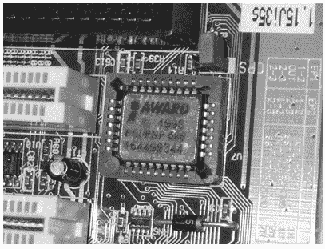

**图 2.3**
BIOS 芯片有多种形状和尺寸，但在大多数情况下，它们都清晰地标有 BIOS 分销商的名字——在本例中为 Award。

### 注意

> 闪存 BIOS 是一项潜在危险的操作。如果出现问题，例如操作期间发生断电或您闪录了错误的 BIOS，您的计算机可能会变得无法启动，直到您用主板制造商编程好的 BIOS 芯片替换当前的芯片。因此，我建议在正常营业时间内进行 BIOS 闪存，并在软盘上保留一份可用的 BIOS 备份。（大多数 BIOS 闪存工具都提供在闪录新 BIOS 前创建备份的选项。）这样，如果出现问题，您可以从电脑商店获得帮助。

## 主板总线

在计算机领域，*总线*一词有几种不同但相关的含义。本章前面，我使用这个词来指代 CPU 和主板之间接口的速度。另一个含义是指主板与您可以添加到主板上的各种插卡之间的物理和电气接口。在大多数计算机上，您使用这些板卡来提供多种关键和非关键功能，例如视频卡、声卡等。

有六种主要的总线类型。大多数主板实现了其中两种或三种，但少数主板仅限制为一种总线类型。少数主板，主要是专用产品和笔记本中的主板，完全不包含扩展总线插槽。它们通常内部实现相关电子元件以支持视频和音频等功能。一些总线如今仍在使用，但其他总线在很大程度上已成为过去的遗迹。您可能在 80486 及更早的主板上遇到这些过时的总线，但在奔腾级或更高级别的型号上很少见到。

### ISA 总线

*工业标准架构*（**ISA**）总线是在 x86 计算机中通用时间最长的总线。ISA 总线的基本设计可追溯到最初的**IBM PC**，尽管自那以后设计进行了一些修改。在最初的 PC 中，ISA 总线是一种 8 位设计，运行速度为 4.77 **MHz**——与计算机的 CPU 速度相同。后续的扩展允许总线运行速度最高可达 8.33 **MHz**，并将总线宽度扩大到 16 位。这些扩展是以向后兼容的方式完成的，因此旧的 8 位 ISA 卡可以插入 16 位 ISA 插槽。图 2.4 展示了现代主板上的 ISA（以及几种其他）插槽。ISA 插槽比其他现代插槽类型更大，其主板连接器通常为黑色，而 PCI 为白色，**AGP** 为棕色。

理论上，ISA 总线可以以高达 8 **MB/s** 的速度传输数据，按今天的标准来看相当慢——例如，现代硬盘通常超过这一速度，许多以太网适配器也是如此。因此，ISA 总线在今天的系统中实用性有限，实际上正在被淘汰。您仍然可以买到包含 ISA 插槽的主板，但现代主板上 ISA 插槽的数量已经缩小了好几年，许多最新型号完全没有 ISA 插槽。

正如主板包含的 ISA 插槽越来越少，对它们的需求也越来越少。市场上仍有许多 ISA 卡，但几乎总是有 PCI 替代品。ISA 卡的示例应用包括：

- **SCSI 适配器** 非常低端的适配器，例如随内部 Iomega Zip 驱动器附带的适配器，通常是 ISA 型号。然而，PCI SCSI 主机适配器很丰富，有些型号甚至相当便宜。除非在特殊情况下，否则我不建议购买新的 ISA SCSI 主机适配器。
- **I/O 卡** 较旧的 80486 及更早的计算机使用 ISA 卡来处理串行、并行、软盘和 IDE 端口。这类卡现在仍然有售，如果您需要两个并行端口或超过两个串行端口，您可能会需要其中一个。用于这些功能的 PCI 卡也可用。除了现代 EIDE 硬盘外，ISA 总线足以处理这些 I/O 设备的速度，因此如果您确实需要额外的端口，并且您的主板上有空闲的 ISA 插槽，ISA 板是一个不错的选择。

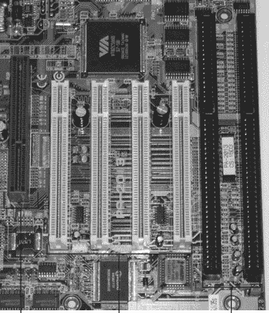

**图 2.4**
每种总线类型使用独特的连接尺寸和位置，以防止误将一种类型的卡插入错误的插槽。

- **以太网适配器** 如果您需要一个运行在 10Mbps 或更低速度的以太网适配器，ISA 总线足以胜任此任务，尽管 ISA 卡可能比 PCI 卡消耗更多的 CPU 时间。100Mbps 网络受益于 PCI 总线，因此我建议大多数新的以太网适配器都购买 PCI 形式。
- **声卡** 基本音频功能不需要大量带宽，因此 ISA 总线足以胜任此任务。事实上，直到 1998 年，PCI 声卡在 Linux 中支持不佳，因此 ISA 卡仍然是声音的最佳选择。然而，如今 Linux 对许多 PCI 声卡提供了良好的支持，因此您可以使用任一种总线类型。最先进的声卡需要额外的带宽来实现高级音频功能，因此可以从 PCI 总线中受益。这些功能通常在 Linux 中未实现。
- **专用应用** 某些罕见的卡，例如某些科学数据采卡，仍然仅提供 ISA 形式。如果您需要使用这样的卡，您可能会被限制在 ISA 总线上。鉴于 ISA 在市场上使用率下降，如果您正在构建新系统，最好寻找替代卡。如果该卡价格昂贵且您打算使用几年，这一点尤其重要。在未来某个时间点，ISA 主板可能变得不可用，因此如果您的计算机包含关键且昂贵的 ISA 组件，维修损坏主板导致的计算机故障可能会给您带来严重问题。

计算机行业希望看到 ISA 总线消失，因为支持它需要主板上的电路，如果消除，将简化主板设计。与更现代的卡相比，ISA 卡的配置也更困难。较旧的 ISA 卡通常需要跳线来正确配置。较新的型号通常是**即插即用**（PnP），这意味着主板的 BIOS 或操作系统中的实用程序来完成配置。

在 Linux 2.2.x 内核系列中，PnP 配置是通过 `isapnp` 软件包完成的，该软件包包含在大多数 Linux 发行版中。要配置您的卡，请遵循这些步骤：

1. 运行 `pnpdump`，它会扫描系统中的 PnP 设备并返回有关这些设备的信息。最好将 pnpdump 的输出重定向到适当的文本文件，例如 `pnpdump > pnpinfo.txt`。
2. 编辑第 1 步生成的文本文件。该文件包含设置（如**中断请求**（**IRQ**）和**直接内存访问**（**DMA**））的多个选择配置。您必须通过移除每行开头的井号（#）**取消注释**每个设置的一个选项。例如，您可能会看到一行写着 # (INT 0 (IRQ 5 (MODE +E)))。删除前面的 # 以使用 IRQ 5 激活板卡。对于您希望使用的每个设备，您还必须取消注释一行写着 # (ACT Y)；这是该板卡的激活行。一些板卡包含多个设备。例如，声卡可能包含数字音频、波表声音和游戏杆端口的单独配置。
3. 将您编辑好的文本文件移动到方便的位置。传统上，使用 `/etc/isapnp.conf`。请务必不要覆盖现有文件，或者备份现有文件，以防它已经包含其他设备的配置信息。
4. 运行 `isapnp` 实用程序，并告诉它使用该配置文件。如果 `isapnp` 位于 `/sbin` 目录中，您可以通过输入 `sbin/isapnp /etc/isapnp.conf` 来执行此操作。通常，您将配置系统在每次启动时执行此步骤，方法是将该命令放入您的 `/etc/rc.d/rc.local` 文件中，或者根据您的发行版放入其他初始化脚本中。一些发行版包含自动执行此步骤的命令。


# 第一部分

如果你的配置更改没有导致任何冲突，那么你就可以加载相应的驱动程序并使用 ISA 卡了。但是，你必须加载驱动模块或将它们集成到 Linux 内核中；在 Linux 下使用硬件，仅靠 PnP 配置是不够的。

`isapnp.conf` 文件的格式对于从未编辑过该文件的人来说可能显得有点吓人，这主要是因为它包含大量选项，其中绝大多数都已被注释掉。浏览该文件一两次，仔细留意以 Card *n*（其中 *n* 为卡号）开头的注释以及 NAME 选项，后者用于标识设备。浏览过文件一两次后，你应该对这些选项有一些概念，可以开始设置它们了。如果你的计算机在 Linux 和另一个操作系统（如 Windows）之间双启动，你可以通过查看其他操作系统中使用的资源来确定应该分配给卡片的资源。

Linux 2.4 内核将直接包含 PnP 支持，这将改变 Linux 中 ISA PnP 设备的配置方式。在 2.4.x 内核中，将不再需要 `isapnp.conf` 文件；ISA 设备的驱动程序将自动检测并配置 PnP 设备。在发生冲突时，你可能需要调整 `/etc/conf.modules` 文件中的设置或通过向 Linux 内核传递参数，这类似于当今使用 PCI 卡时的做法。

# MCA 总线

*微通道架构* (MCA) 总线是 IBM 对 ISA 总线的继任者。MCA 曾用于 IBM PS/2 系列计算机，尽管在当时它是一条不错的总线，但它并未在整个行业中流行起来。MCA 与大多数其他 x86 总线一样，支持 32 位宽度。然而，并非所有的 MCA 卡或 MCA 插槽都是 32 位的；有些只有 16 位宽。

很长一段时间内，Linux 无法在 MCA 计算机上工作，但最新的 Linux 内核确实包含了对 MCA 的支持。不过，并非所有的 MCA 卡都受到支持。要在 MCA 计算机上使用 Linux，你必须确保内核已编译了 MCA 支持，这是通用设置区域中的一个内核配置选项（参见图 2.5）。大多数 MCA 计算机不支持其他总线，并且你也不会在现代计算机中找到 MCA 总线。

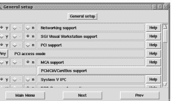

**图 2.5** *Linux 内核配置的通用设置区域包括与 Linux 处理总线相关的选项，包括 MCA 和 PCI 总线。*

# EISA 总线

*扩展 ISA* (EISA) 总线是由 Compaq 和其他 x86 PC 厂商作为 IBM MCA 总线的替代方案开发的。与 MCA 不同，EISA 与 ISA 向后兼容。你可以将 ISA 卡插入 EISA 插槽，通常都能正常工作。EISA 是一条 32 位总线，运行频率为 8.33MHz，最大传输速率约为 33MB/s。这一速度对于许多现代功能来说已经足够，尽管并非全部。例如，某些 SCSI 主机适配器可以以 40MB/s、80MB/s 或更高的速度传输数据；某些 EIDE 接口则能够以 66MB/s 的速度工作。

在早期的 80486 时代，EISA 经历了一个短暂的接受期，如果算不上狂热的流行。EISA 最常作为 SCSI 主机适配器的总线，尽管其他设备也有 EISA 格式的版本。然而，该总线获得了配置相对困难的声誉，而且比竞争总线更昂贵。最终，其他总线在流行程度上超过了 EISA，现代主板上也不再提供 EISA。

Linux 支持 EISA 总线，并包含多种 EISA 卡的驱动程序，包括流行的 EISA SCSI 主机适配器，如 Adaptec 1742。如果你有一台旧 EISA 计算机并希望在其上运行 Linux，成功运行的几率很大。

## VL-Bus

看到需要比 ISA 更高速的总线用于视频卡，一个视频卡行业组织——视频电子标准协会 (VESA) 为 80486 CPU 开发了专用的总线。这条总线被称为 *VESA 本地总线* 或简称为 VL-Bus，在许多 80486 主板上很流行。与 MCA 和 EISA 总线一样，VL-Bus 也是 32 位宽度。由于它以主板的总线速度运行（80486 系统通常为 33MHz），它在速度方面更具优势。有些计算机甚至以高达 50MHz 的速度运行它。（40MHz 是 VL-Bus 的最高官方速度。）即使在仅运行于 33MHz 的情况下，VL-Bus 理论上也能传输高达 132MB/s 的数据，这相比 ISA 的 8MB/s 是一个相当大的提升。在物理结构上，VL-Bus 使用普通的 ISA 连接器（参见图 2.4），并配有一个与 ISA 连接器对齐的特殊扩展连接器。这种设计占用了主板上大量的空间，但允许 VL-Bus 插槽接受普通的 ISA 卡。

VL-Bus 在 80486 主板上非常流行，但它也有缺点，包括：

-   *局限于 80486 架构*：设计的各种限制使其难以在非 80486 CPU 上实现。虽然生产了少数带有 VL-Bus 的 Pentium 主板，但它们从未流行起来，且经常存在麻烦。
-   *卡数量有限*：大多数 VL-Bus 主板仅允许两到三个 VL-Bus 插槽，其余为普通 ISA 插槽。随着总线速度增加，可以添加的 VL-Bus 设备数量减少。在 50MHz 下，VL-Bus 即使插一张卡也勉强工作。
-   *连接器易出问题*：VL-Bus 的长双连接器使得 VL-Bus 卡容易从连接器中松脱。当这种情况发生时，系统将无法启动，或者（如果在计算机通电时发生）会崩溃。

在其鼎盛时期，VL-Bus 主要用于视频卡、SCSI 主机适配器和 IDE 控制器。Linux 对 VL-Bus 设备提供了很好的支持，但就像任何设备一样，在尝试在 VL-Bus 系统上使用 Linux 之前，你应该检查 Linux 的兼容性。

## PCI 总线

*外设部件互连* (PCI) 总线由 PCI 特别兴趣小组（由英特尔牵头）开发，旨在成为一种比之前的 x86 总线类型更干净、更快的总线。如果说 VL-Bus 基本上是直接接入 CPU 的数据线，那么 PCI 总线则在 CPU 和总线之间插入一个电子“桥”。这种设计将总线与 CPU 解耦，使其能够与更广泛的 CPU 一起使用。这种设计被称为*夹层总线* (mezzanine bus)。在 x86 世界中，PCI 总线自 80486 以来已用于所有类型的 CPU，并且 PCI 总线也出现在其他各种架构上，包括 PowerPC 和 Alpha。实际上，某些 PCI 卡可以在多种计算机架构中使用。然而，某些 PCI 卡包含特定于 x86 CPU 的 ROM 或其他设计特性。

PCI 总线主要是 32 位总线，但通常运行在 33MHz（导致 132MB/s 的最大传输速率）。规范允许 64 位总线宽度（因此是 164MB/s 的传输速率），但 64 位 PCI 实现从未进入市场。与其他大多数总线类型相比，PCI 连接器更小（参见图 2.4），因此与 VL-Bus 卡相比，PCI 卡更容易插入和移除。

从软件角度来看，PCI 总线最重要的特性之一是 PCI 规范包含 PnP 特性。因此，大多数 PCI 卡缺乏老式 ISA 和 VL-Bus 卡上常见的配置跳线。在大多数情况下，插入 PCI 卡后，主板的 BIOS 会检测到它并为其分配资源。某些 Linux 设备驱动程序允许通过在 Linux 启动提示符上提供适当参数或在 /etc/conf.modules 文件中设置来覆盖这些分配，但通常并不必要。

**注意**

PCI 的 PnP 是内置于总线规范中的，而 ISA 的 PnP 是对旧设计的笨拙修补。即使在使用 2.2.x 系列内核时，也没有必要使用 Linux 的 `isapnp` 实用程序来配置 PCI 卡。

PCI 最初主要用于视频卡、SCSI 主机适配器、IDE 控制器和网卡 (NIC)。最近，PCI 已成为声卡、附加串口和并口以及其他设备的总线首选。

Linux 对 PCI 的支持非常好。有几个与 PCI 相关的内核配置选项，如图 2.5 所示。如果你的主板有 PCI 总线，你应该选择 PCI 支持配置选项的 **Y**。（这是默认选项。）对于 PCI 访问模式选项，Direct 会导致 Linux 内核自行检测和配置 PCI 卡，而选择 BIOS 选项则会将此责任交给 BIOS。将该选项设置为 Any 会导致 Linux 尝试自行配置，但如果遇到问题则交由 BIOS 处理。大多数情况下，这些选项中的每一个都能正常工作，但在特定系统中，某一个可能表现更好。

# AGP 总线

视频卡长期以来需要异常高的带宽，PCI 的出现并没有改变这一事实。有一段时间，PCI 总线足以满足视频卡对速度的渴望，但 1996 年英特尔发布了 *加速图形端口* (AGP) 的规范，这是一种旨在提高速度且专用于图形设备的 PCI 变体。图 2.4 中最左侧的插槽就是 AGP 插槽。AGP 通过运行在 66MHz 而非 33MHz 来超越 PCI 的速度。此外，AGP 支持每个时钟周期多次传输。在 2x 模式下，每个周期发生两次传输，在 4x 模式下则发生四次传输。总之，4x AGP 设备可以传输高达 1GB/s 的数据——是 PCI 典型速度的八倍。随着视频分辨率多年来从 640×480 到 1024×768 再到 1280×1024 甚至更高的提升，对更快传输的需求也在增长。即使假设颜色数量相同，1280×1024 显示所容纳的数据量也是 640×480 显示的四倍以上。

Linux 处理 AGP 总线 *本身* 没有问题。然而，正如我在第 12 章“视频卡”中描述的，Linux 并不总是能很好地支持最新的视频卡。视频卡制造商很少费心为 Linux（更准确地说，是为 XFree86 [http://www.xfree86.org]）生成驱动程序，因此 XFree86 开发人员需要一段时间来修改现有驱动程序或创建新的驱动程序。SuSE (http://www.suse.com) 协助开发新的 XFree86 视频驱动程序。你可以去那里查找最新的驱动程序。商业 X 服务器 *Accelerated-X* (http://www.xig.com) 和 *Metro-X* (http://www.metrolink.com) 有时支持比 XFree86 更新的视频卡。


## 第一部分

### PC Card 总线

PC Card（前身为个人计算机存储卡国际协会，即 PCMCIA）并不像本章中描述的其他总线那样，真正属于主板总线。事实上，它与硬盘使用的 IDE 总线更为相似。尽管如此，PC Card 在笔记本电脑中扮演着类似主板总线的角色。也可以在桌面计算机总线上添加 PC Card 插槽。你可以获得各种以 PC Card 形式存在的设备，包括调制解调器、以太网适配器、SCSI 适配器、串行和并行端口以及视频适配器。相关技术包括掌上电脑和数码相机上常用的 Compact Flash (CF) 和 Smart Media 卡。事实上，存在廉价的适配器，允许你在 PC Card 读卡器中使用 CF 或 Smart Media 设备，从而让你能够访问存储在掌上电脑或数码相机上的文件。

Linux 包含对 PC Card 总线的支持，尽管并非所有 PC Card 适配器或设备都受支持。欲了解更多信息，请访问 [Linux PCMCIA 信息页](http://pcmcia.sourceforge.org)。我将在第 23 章“笔记本电脑”中详细讨论 PC Card，特别是标题为“PC Card 端口”的小节。

### 主板外形规格

主板有多种形状和尺寸。同样重要的是，主板上有一些小孔，用于插入螺丝将主板固定到计算机机箱上。这些孔通常被称为主板的安装点。主板还需要特定类型的连接器用于键盘和其他外部设备。最后，主板在电源连接器方面也有不同的要求。这些特征共同决定了主板的外形规格。理论上，几乎任何外形规格的主板都可以被设计为使用几乎任何 CPU 或总线类型，尽管组件的尺寸要求使得某些组合不切实际。实际上，某些组合并未出现，因为某些技术（如 80386 CPU 或 VL-Bus）在特定的主板外形规格（如 ATX）诞生之前就已消亡。

Linux 本身并不特别关心主板的外形规格，尽管 Linux 在某些特定型号的主板上比在其他主板上运行得更好。例如，Linux 可能没有为 mini- 或 micro-ATX 主板上集成的视频或音频设备提供驱动程序。在购买此类主板或基于此类主板构建的系统之前，你应该研究所使用的芯片组，并查阅本书的相关章节以及当前的 Linux 驱动程序可用性信息。如果你需要使用特定的主板外形规格，你可以使用 Linux 这样做。你只需进行必要的研究，以确保主板附带的外设受支持。

### AT 和 Baby AT

最早标准化的主板外形规格之一用于 IBM 的 PC AT 计算机，因此该外形规格被称为 AT 外形规格。AT 主板是周围最大的主板之一，宽度可达 12 英寸，深度达 13.8 英寸。IBM 需要超过一平方英尺的空间来容纳各种组件，而这些组件今天所占的空间要小得多。例如，当时的 RAM 是平贴在主板上的，而不是像现在这样垂直安装在 SIMM、DIMM 或 RIMM 模块上。

随着时间推移，缩小组件尺寸并更高效地利用主板空间成为可能。因此，不再需要完整的 12×13.8 英寸空间。制造商开始使用一种最初用于 IBM PC XT 计算机的更小外形规格。制造商并未将该设计称为 XT 外形规格，而是称之为 Baby AT，以免顾客认为基于该设计的计算机与性能较弱的 PC XT 计算机类似。Baby AT 主板宽度可达 8.57 英寸，深度达 13.04 英寸，尽管具体产品的确切尺寸会有所不同。

由于尺寸较小，Baby AT 主板可用于较小的计算机机箱，如迷你塔式机箱。然而，许多较大的机箱可以接受全尺寸 AT 或 Baby AT 主板。

大多数 AT 和 Baby AT 主板仅有一个外部连接器，即用于键盘的 5 针 DIN 接口。（少数 Baby AT 主板使用 mini-DIN 连接器。）最初的 PC AT 以及直到 20 世纪 90 年代中期的大多数 AT 和 Baby AT 主板，都依赖插入式卡来提供其他外部设备的端口，如串行和并行端口。这些插入式卡有自己的外部连接器，直接位于卡上，或通过带状电缆连接并固定在计算机机箱上。后来的 80486 主板以及 Pentium 及以后的主板，在主板本身包含了用于串行端口和并行端口（以及后来的鼠标端口和 USB 端口）等外部设备的电路。这些主板使用主板上的连接器来提供这些服务；外部连接器通过带状电缆连接到主板。

AT 和 Baby AT 主板使用一对电源连接器，必须通过永久连接到电源的电缆将其连接到机箱的电源上（见图 2.6）。主板本身运行在 5V 电流下，这给某些 CPU 带来了问题，特别是在 Pentium 时代，当时 3.3V 的 CPU 电压变得普遍。这类主板需要电压调节器，将 5V 转换为 3.3V。这些电压调节器会产生热量，并且根据 CPU 消耗的电流大小，可能会过热并导致运行不稳定。

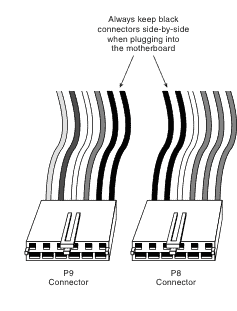

**图 2.6**
AT 型电源连接器成对出现，连接时黑色线必须并排。

> **注意**
>
> AT 型电源连接器可能接反。这样做很可能会烧毁你的主板，甚至可能烧毁连接的 CPU、显卡等设备。每根电源线由几根导线组成，其中一根是黑色的。当将电源线连接到主板时，确保黑色导线并排对接至关重要。

尽管 AT 和 Baby AT 主板在 80486 和大部分 Pentium 时代很受欢迎，但从 1998–1999 年开始变得非常罕见。它们在 2000 年仍然存在，但销售主要局限于更换和升级市场。新计算机几乎总是使用某种 ATX 外形规格变体。有少数 Slot 1 AT 或 Baby AT 主板，但此类设计极其罕见。

### ATX, Mini-ATX, Micro-ATX 和 Flex-ATX

从 1996 年开始，ATX 主板变得可用。Intel 制定了 ATX 规范，并对其进行过多次修订。尽管细节有所变化，但 ATX 修订版之间的大致框架保持不变。ATX 旨在解决 AT 和 Baby AT 外形规格的多个缺陷，例如：

- **宽高比改变**：Baby AT 设计的深度大于宽度，迫使 CPU 或其他组件沿插槽方向放置。这种放置方式可能限制了添加大型卡片的选项，特别是对于需要大型带风扇散热器的 CPU（如后期型号的 Pentium）。相比之下，ATX 主板的宽度大于深度。在 ATX 设计中，CPU 位于插槽的一侧，如图 2.1 所示。

- **增加外部 I/O 端口**：随着主板普遍部署外部 I/O 端口，ATX 规范包括了一个标准化的端口位置，以便将端口内置到主板上，如图 2.1 和 2.7 所示。键盘使用较小的 mini-DIN 插头，而不是 AT 和 ATX 主板上使用的较大 DIN 连接器。（廉价的适配器允许在另一种类型的主板上使用一种类型的键盘。）将外部端口直接安装到主板上可以减少计算机内部的电缆混乱，并提高计算机的可靠性。

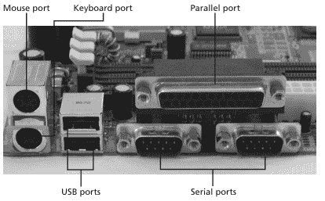

**图 2.7**
一些 ATX 主板除了这里显示的之外，还包括视频或音频连接器。

- **内部 I/O 连接器位置**：AT 和 Baby AT 主板设计师倾向于将软盘、EIDE 和（如果存在）SCSI 适配器的 I/O 连接器放在任何可能的地方。偶尔，这些位置会产生冗长且杂乱的通向磁盘驱动器的电缆。ATX 主板倾向于将这些连接器放置在计算机机箱中相应设备通常所在的位置附近（见图 2.8）。这种布置方式最大限度地减少了电缆混乱。

- **改进的电源连接器**：ATX 主板使用单个带键位电源连接器（见图 2.9），这与 AT 和 Baby AT 主板的双连接器形成对比。带键位的 ATX 电源连接器使得因插反而烧毁主板变得几乎不可能


错误地连接电源。此外，ATX 主板运行于 3.3V 电压，从而免除了电压调节器的需求。ATX 主板还包含一系列与电源相关的改进，允许计算机在操作系统关机时自行断电，在响应特定事件时自行通电，进入低功耗模式等。


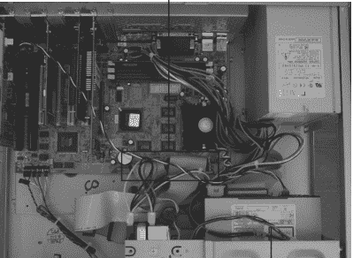


### 图 2.8

*ATX 主板和机箱的设计将磁盘线缆接口放置在对应的磁盘设备附近。*

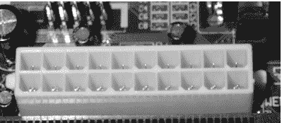

### 图 2.9

*ATX 电源接口的引脚经过特殊设计（keyed），使其无法被错误地插入对应的线缆中。*

**散热方面的变化** 虽然这*本身*并非主板的设计变更，但 ATX 规范包含了计算机内部空气流动方面的改进。CPU 的新位置允许电源风扇向 CPU 吹风，理论上消除了为 CPU 单独配备散热风扇的需求。然而在实际中，许多 ATX 系统仍然保留了独立的 CPU 散热风扇。

如你所料，ATX 主板的设计包含了足够的变更，导致无法将 ATX 主板用于 AT 机箱。虽然有一些*混合*机箱可供使用，它们既兼容 Baby AT 也兼容 ATX 主板，但总体而言，使用 ATX 主板通常需要搭配 ATX 机箱。因此，如果你希望升级现有的 AT 或 Baby AT 系统，你要么寻找 Baby AT 主板，要么计划更换计算机的机箱以及主板。

总体而言，ATX 主板相较于旧版的 Baby AT 设计有着显著的改进。ATX 主板的典型尺寸约为 9.6 英寸深乘以 12.0 英寸宽；这一宽度限制了 ATX 在小机箱中的使用。适用于 ATX 主板的实用最小机箱是台式机或中塔式设计。为了帮助减小机箱尺寸，开发了一系列更小的 ATX 变体，包括 mini-ATX（8.2×11.2 英寸）、micro-ATX（9.6×9.6 英寸）和 flex-ATX（9.0×7.5 英寸）。与其他板型一样，这些尺寸代表的是*最大*尺寸。个别主板的一个或两个维度可以略小一些。Micro-ATX 板型在 1999 年在售价低于 1,000 美元的 PC 中变得非常流行。这些较小的 ATX 变体通常拥有比全尺寸 ATX 主板（通常有 5–7 个可用扩展槽）更少的可用扩展槽。某些此类主板只有两个或三个可用槽。这种扩展槽的缺失在一定程度上通过主板集成更多功能来弥补。这些主板通常集成有视频和声音功能，而在全尺寸 ATX 主板上，这些功能通常需要安装两块扩展卡。某些此类主板还集成了调制解调器、以太网适配器、SCSI 主机适配器或其他设备。

> **注意**
>
> 大多数带有 PCI 插槽的主板将一个 PCI 插槽和一个 ISA 插槽放置得非常接近（参见图 2.4）。由于 PCI 卡组件安装在板的另一侧（与 ISA 卡相比），这两个插槽中只能使用其中一个。因此，*可用*插槽的数量比*实际*插槽数量少一个。例如，图 2.1 和图 2.4 中描绘的主板有七个插槽，但只有六个是可用的。

将视频、音频以及通常由插卡处理的其他功能集成到主板上可能很方便，而且——如果它减小了计算机的尺寸——在可用空间有限的情况下可能是有益的。然而，这也存在缺点。升级或更换这些组件可能很困难或不可能。这一因素对 Linux 用户尤为重要，因为 Linux 与某些设备仍然不兼容。假设你购买了一台使用 micro-ATX 主板的计算机，结果发现其视频功能在 Linux 下无法可靠工作。你需要牺牲一个 PCI 插槽用于安装视频卡，并且你将无法选择 AGP 视频卡，因为主板上没有包含 AGP 插槽。毕竟，视频板已集成在主板上，所以为什么要包含 AGP 插槽呢？在某些情况下，可能无法完全禁之不需要的硬件。

总而言之，我倾向于购买基于常规全尺寸 ATX 主板构建的具有完整插槽配置的系统。如果你被主板内置额外功能的系统所吸引，请进行额外的研究，以确保所使用的组件与 Linux 兼容。

## NLX

大多数主板设计将 CPU、RAM、总线插槽和其他组件都放置在一个平面上，该平面在台式机机箱中水平放置，在塔式机箱中垂直放置。由于 PCI 和 ISA 卡需要一定的高度，这种设计对生成的计算机系统施加了最小高度要求。然而，尤其是在台式机机箱中，*低剖面*（low-profile）设计具有一定的吸引力。低剖面系统是一种比正常 PC 更矮的台式机设计。当前首选的低剖面设计被称为 NLX。为了实现此配置，主板不包含 PCI 或 ISA 插槽。相反，主板支持*子卡（daughter card）或转接卡（riser）*，PCI 和 ISA 插槽位于其上，如图 2.10 所示。

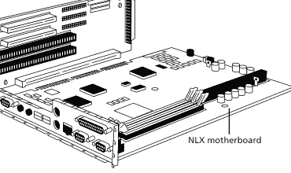

### 图 2.10
NLX 系统中的*转接卡*（riser）在电路方面内容很少，主要作为扩展卡的安装点。

从理论上讲，当你想要升级硬件时，NLX 主板提供了主要优势，因为该设计允许你在不干扰扩展卡（假设机箱设计得当）或磁盘的情况下将主板从计算机中取出。与常规系统的升级相比，这使得主板升级变得非常容易。另一方面，NLX 系统往往非常小巧，这限制了添加内部设备（如多个硬盘、CD-ROM 驱动器和磁带备份驱动器）的能力。

## 专有和罕见布局

多年来，出现了许多专有且很少使用的主板布局。这些设计包括

- 大型 PC 制造商，如 IBM 和 Compaq，通常设计自己的主板并使用非标准布局。这些设计限制了你升级或维修现有计算机的选择，所以我建议你避免购买使用这种独特主板板型的计算机。
- 过去使用的低剖面板型被称为 LPX。这种设计，像较新的 NLX 设计一样，使用了转接卡，但将其放置在主板的中间。LPX 主板并没有完全标准化，因此并不总是可以将一块 LPX 主板换为另一块。如果你想购买或组装一台新的低剖面计算机，我建议你使用 NLX 而不是 LPX。
- 一种新的板型，被称为 WTX，是着眼于 Itanium CPU 的需求而设计的。WTX 系统在 2000 年初相当罕见，但一旦 Intel 发布 Itanium CPU，它可能会变得更加流行。你可以在 http://www.wtx.org 了解更多关于 WTX 的信息。

我建议避免使用专有和不寻常的主板板型，WTX 可能是个例外，因为它有可能在 2000 年晚些时候或 2001 年初变得更加常见。专有的主板通常需要特殊的机箱，这反过来又通常要求使用特殊的面板式软驱、特殊的电源等。更换这些组件可能是一项昂贵且往往耗时的工程。

## 主板芯片组

计算机中所有电路板的电子身份都归功于其携带的一个或多个芯片组。顾名思义，芯片组是一组实现电路板大部分或全部功能的一个或多个芯片。对于主板而言，芯片组提供诸如以下功能：

- CPU 与内存之间的接口
- CPU 与扩展卡总线（ISA、PCI 等）之间的接口


- 各类系统定时器
- 端口——串行、并行、IDE、软驱、USB，有时还包括其他类型

**注意**

80486 时期及更早的主板通常不包含大多数端口；这些功能是由扩展卡实现的。即使是后期的 80486 和早期的 Pentium 系统也使用独立的芯片组来执行这些功能。这些芯片组位于主板本身上，但独立于主板的芯片组。

除了最后一项外，这些功能很容易被忽视，但它们对主板的功能至关重要。特定芯片组如何实施这些功能的细节会影响主板的速度。对于诸如 EIDE 端口等功能，Linux 需要驱动程序来操作设备。Linux 包含通用 IDE 驱动程序，适用于所有 EIDE 端口，但针对特定芯片组优化的驱动程序可以提高 EIDE 设备的性能。因此，如果你打算使用 EIDE 硬盘，那么选择使用 Linux 能够识别的主芯片组或 EIDE 芯片组的主板就很重要。

在 80486 时代，许多制造商在芯片组市场上展开竞争，但 Intel 占据了早期 Pentium 主板市场的大部分份额。当 Intel 推出其新的 Slot 1 设计并将 Socket 7 留给 AMD 和 Cyrix 时，Super7 主板的替代方案再次出现。

每一代或每种类型的 CPU（80386、80486、Pentium、Pentium Pro/Pentium-II/Pentium-III/Celeron，以及 Athlon）都需要其自己的主板芯片组设计。例如，你不能将 80486 芯片组用于 Pentium（除了 Pentium Overdrive，它旨在用于 80486 主板）。在接下来的章节中，我将重点关注 Pentium 及以后 CPU 的芯片组，因为这些是你在新型和较新主板上最可能遇到的芯片组。

## 识别你的芯片组

如果你已经有一块主板但不确定它使用的是什么芯片组，请查看主板上永久焊接的最大芯片。这些芯片上应该有一些标识。例如，图 2.11 展示了图 2.1 中所示主板上的一个主要芯片。该芯片清楚地表明芯片组来自 VIA，实际上它是 VIA MVP3 芯片组的一部分。你可能需要浏览芯片组制造商的网站来查找特定芯片 ID 代码的参考信息。

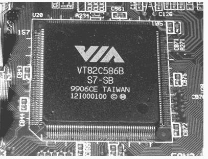

**图 2.11**  
*主板的芯片组通常可以通过板上最大芯片上的标记来识别。*

**注意**

主板并不是唯一使用芯片组的计算机组件。扩展卡制造商常常试图通过遮盖关键组件上的贴纸，甚至用他们自己的丝印代替芯片组制造商的丝印来隐藏芯片组制造商的身份。某些芯片组，特别是在高端视频卡和某些主板上，运行速度如此之快，以至于主板制造商在组件上放置了散热片。*你不应该尝试移除已粘合到芯片组组件上的散热片*。你可以安全地移除贴纸，但如果你发现芯片上有一个玻璃窗口，请重新贴好贴纸或在窗口上贴一个新的。此类窗口通常用于可擦除可编程只读存储器（EPROM）芯片，并通过将芯片暴露在紫外线下辐射来擦除内存。阳光照射可能会意外地擦除这样的芯片，这通常不是你想要发生的。

识别芯片组的另一种方法是检查 Linux `/proc` 目录中的文件。如果主板具有 PCI 总线，`/proc/pci` 目录可以提供特别有用的信息。

例如，除了其他条目外，图 2.1 和 2.11 中所示主板上的计算机生成以下 `/proc/pci` 信息：

```
Bus  0, device  7, function  0:
    ISA bridge: VIA Technologies, Inc. VT82C586/A/B PCI-to-ISA  [Apollo VP]  (rev 71).
    Bus  0, device  7, function  1:
        IDE interface: VIA Technologies, Inc. VT82C586  IDE  [Apollo]  (rev 6).
        Master Capable.  Latency=64.
        I/O at 0xe400  [0xe40f].
    Bus  0, device  7, function  2:
        USB Controller: VIA Technologies, Inc. VT82C586B  USB  (rev 2).
        IRQ 5.
        Master Capable.  Latency=64.
        I/O at 0xe000  [0xe01f].
    Bus  0, device  7, function  3:
        PCI bridge: VIA Technologies, Inc. VT82C586B  ACP1  (rev 16).
```

注意 82C586 标识符既出现在芯片上，也出现在几个 `/proc/pci` 条目中。该芯片在 `/proc/pci` 中的多次出现表明它服务于多个功能。

## ALi 芯片组

Acer Laboratories, Inc.（ALi，位于 `http://www.ali.com.tw`）生产用于各种主板的几种芯片组。这些芯片组及其基本特性总结在表 2.1 中。

ALi Aladdin IV、V 和 7 芯片组旨在用于 Socket 7 主板。Aladdin 7 专门针对 AMD K6-III 营销，其特点是包含广泛的多媒体功能，包括通常存在于独立卡上的音频和视频功能。不幸的是，目前这些功能没有可用的 Linux 驱动程序。

Aladdin Pro II、TNT2 和 Pro IV 芯片组是 ALi 参与 Pentium-II 芯片组竞赛的产品。与 Aladdin 7 类似，TNT2 包含视频卡芯片组功能，但不支持声音。

Linux 内核包含对 ALi 快速 EIDE 控制器的支持，因此你可以从连接到基于 ALi 的主板的 EIDE 设备中获得全速性能。

| 名称 | 最大总线速度 | 支持的 CPU | SMP 支持 | 内存类型 | 内存错误处理 | 最大内存 | 最大可缓存内存 | AGP 支持 | IDE 支持 | USB 支持 |
| :--- | :--- | :--- | :--- | :--- | :--- | :--- | :--- | :--- | :--- | :--- |
| Aladdin IV | 83.3MHz | Pentium 级别 | 否 | FPM, EDO, SDRAM | 奇偶校验, ECC | 1GB | 512MB | 否 | Ultra-33 | 是 |
| Aladdin V | 100MHz | Pentium 级别 | 否 | FPM, EDO, SDRAM | 奇偶校验, ECC | 1GB | 1GB | 1x 和 2x | Ultra-33 | 是 |
| Aladdin 7 | 133MHz | Pentium 级别 | 否 | SDRAM | 奇偶校验, ECC | 1GB | 1GB | 1x-8x | Ultra-53 | 是 |
| Aladdin Pro II | 100MHz | Pentium II | 是 | FPM, EDO, SDRAM | 奇偶校验, ECC | 1GB (FPM) 或 2GB (SDRAM 或 EDO) | 不适用 | 1x 和 2x | Ultra-33 | 是 |
| Aladdin TNT2 | 100MHz | Pentium II | 否 | EDO, SDRAM, VC-SDRAM | 奇偶校验, ECC | 1.5GB | 不适用 | 1x 和 2x | Ultra-33 或 66 | 是 |
| Aladdin Pro IV | 100MHz | Pentium II, Pentium III, Celeron | 否 | EDO, SDRAM, VC-SDRAM | 奇偶校验, ECC | 1.5GB | 不适用 | 1x-4x | Ultra-66 | 是 |


# 第一部分

## AMD 芯片组

AMD (http://www.amd.com) 是芯片组市场的新晋者。除了与 VIA 合作生产名为 640 的 VIA Apollo VP-2 Pentium 级芯片组的近克隆品这一短暂尝试外，AMD 的第一个芯片组产品是 750（又名 Irontate），它是为支持 AMD Athlon CPU 而开发的。750 具有 200MHz 总线速度；768MB SDRAM 内存；AGP、PCI 和 ISA 总线；两个 Ultra-66 IDE 端口；以及四个 USB 端口。作为 Athlon CPU 的芯片组，AMD 750 不能用于 Pentium 或 Pentium-III/II 主板。

## Intel 芯片组

Intel (http://www.intel.com) 提供了大量的芯片组，如表 2.2 所述。事实上，Intel 主导了 Pentium-II 芯片组市场。在 Intel 停止开发新的 Pentium 级芯片组之前，该公司也主导了该市场。然而，随着 Intel 从 Pentium CPU 转向，它将 Socket 7 芯片组市场留给了竞争对手。

Intel 的芯片组在所有级别的计算机中都非常流行。810 芯片组在笔记本电脑上特别流行，因为它包含集成图形。Intel 在 http://support.intel.com/support/graphics/intel810/ linuxsoftware.htm 分发适用于此芯片组的 Linux X 服务器，格式包括 RPM 和 tarball。Linux 内核包含对集成在近期 Intel 芯片组中的高级 EIDE 控制器的支持，因此你可以充分利用这些控制器的速度。在 800 系列芯片组中，ISA 接口是可选的，实际上，基于这些芯片组的许多主板缺少 ISA 插槽。这种变化降低了芯片组的成本和复杂性，但限制了你的扩展卡选择。近期的 Intel 芯片组，包括 820 和 840，也使用 RDRAM（见第 3 章），而不是较旧的 RAM 技术。RDRAM 增加了内存访问速度，但 RDRAM 仍然相对较新。

## SiS 芯片组

Silicon Integrated Systems（SiS，位于 http://www.sis.com.tw）在 80486 芯片组领域是一股非常强劲的力量。在 Pentium 时代早期，SiS 曾被短暂超越，但它仍然是一个可行的芯片组制造商；其芯片组描述在表 2.3 中。


## 2 主板

### 表 2.2 Intel 芯片组及其特性

| 名称 | 最大总线速度 | 支持的 CPU | SMP 支持 | 内存类型 | 内存错误处理 | 最大内存 | 最大可缓存内存 | AGP 支持 | IDE 支持 | USB 支持 |
|---|---|---|---|---|---|---|---|---|---|---|
| 430 LX (Mercury) | 66MHz | P60/66 | 否 | FPM | 奇偶校验 | 192MB | 192MB | 否 | 无 | 无 |
| 430 NX (Neptune) | 66MHz | P75+ | 是 | FPM | 奇偶校验 | 512MB | 512MB | 否 | 无 | 无 |
| 430 FX (Triton) | 66MHz | P75+ | 否 | FPM, EDO | 无 | 128MB | 64MB | 否 | 总线主控 | 无 |
| 430 MX (Mobile Triton) | 66MHz | P75+ | 否 | FPM, EDO | 无 | 128MB | 64MB | 否 | 总线主控 | 无 |
| 430 HX (Triton II) | 66MHz | P75+ | 是 | FPM, EDO | 奇偶校验, ECC | 512MB | 512MB | 否 | 总线主控 | 是 |
| 430 VX (Triton II) | 66MHz | P75+ | 否 | FPM, EDO | 无 | 128MB | 64MB | 否 | 总线主控 | 是 |
| 430 TX | 66MHz | P75+ | 否 | FPM, EDO, SDRAM | 无 | 256MB | 64MB | 否 | Ultra-33 | 是 |
| 440 FX (Natoma) | 66MHz | Pentium-II | 是 | FPM, EDO, BEDO | 奇偶校验, ECC | 1GB | N/A | 否 | 总线主控 | 是 |

### 表 2.3 SIS 芯片及其特性

| 名称 | 最大总线速度 | 支持的 CPU | SMP 支持 | 内存类型 | 内存错误处理 | 最大可缓存内存 | AGP 支持 | IDE 支持 | USB 支持 |
|---|---|---|---|---|---|---|---|---|---|
| 5511 | 66MHz | Pentium 级 | 否 | FPM, EDO | 奇偶校验 | 256MB | 否 | Bus Master | 否 |
| 5581 | 75MHz | Pentium 级 | 否 | FPM, EDO, SDRAM | 无 | 128MB | 否 | Ultra-33 | 是 |
| 5591 | 75MHz | Pentium 级 | 否 | FPM, EDO, SDRAM | 奇偶校验或 ECC | 256MB | 1x 和 2x | Ultra-33 | 是 |
| 530 | 100MHz | Pentium 级 | 否 | SDRAM, SGRAM (用于视频) | 无 | 1.5GB | 集成 2x | Ultra-66 | 是 |
| 540 | 100MHz | Pentium 级 | 否 | SDRAM | 无 | 512MB | 集成 2x | Ultra-66 | 是 |
| 600 | 100MHz | Pentium 级 | 否 | FPM, EDO, SDRAM | ECC | 1.5GB | 1x 和 2x | Ultra-53 | 是 |
| 620 | 100MHz | Celeron II/III, Celeron | 否 | SDRAM, SGRAM (用于视频) | 无 | 1.5GB | 1x 和 2x | Ultra-66 | 是 |
| 630 | 100MHz | Pentium 级 | 否 | SDRAM, SGC VQ | 无 | 1.5GB | 1x 和 4x | Ultra-66 | 是 |

若干 SiS 芯片组具备集成视频功能。具体来说，5581/5582、530、540、620 和 630 芯片组集成了视频功能。540 和 630 还集成了音频和以太网功能。大多数 SiS 芯片组的 SiS 视频功能都有 XFree86 驱动程序，但 Linux 尚不支持 SiS 音频和以太网功能。对于某些 SiS 芯片组，您可能需要使用来自 SuSE 的最新 XFree86 服务器。Linux 目前未包含对最新 SiS 芯片组中 *EIDE* 控制器的显式支持。您在 Linux 下仍可使用 EIDE 设备，但无法获得最快可能的速度。

### VIA 芯片组

VIA 科技（http://www.via.com.tw）目前是 x86 计算机非常流行的芯片组供应商（见表 2.4）。VIA 的产品线也是最多样化的之一，不仅包括用于 Pentium 和 Pentium-II 系统的芯片组，还包括用于 AMD 的 *Athlon* 的芯片组。VIA 芯片组偶尔会以其他名称出现。例如，AMD 曾短暂以 *AMD 640* 的名称销售 VIA VP-2，而 Soyo 主板则包含以 *ETEQ* 名称销售的 VIA 芯片组。

在 Pentium 级 CPU 中，VIA Apollo MVP3 芯片组是最受欢迎的之一。MVP4 基于 MVP3，但增加了基于 Trident Cyber3D 芯片组的视频功能，XFree86 3.3.4 及更高版本中存在该功能的驱动程序。MVP4 还包括音频功能，在 2.2.x 内核后期版本中已有 Linux 驱动程序。VIA 的 Apollo Pro 和 Apollo Pro 133 芯片组用于一系列尊重的 Slot 1 和 Socket 370 主板。Linux 包含对 VIA 芯片组 IDE 控制器的支持，因此您可以使用其完整 DMA 模式。

### 表 2.4 VIA 芯片组及其特性

| 名称 | 最大总线速度 | 支持的 CPU | SMP 支持 | 内存类型 | 内存错误处理 | 最大内存 | 最大可缓存 | AGP 支持 | IDE 支持 | USB 支持 |
|---|---|---|---|---|---|---|---|---|---|---|
| Apollo VP1 | 66MHz | Pentium 级 | 否 | FPM, EDO, SDRAM | 无 | 512MB | 512MB | 否 | 总线主控 | 是 |
| Apollo VP2 | 66MHz (非官方 75MHz) | Pentium 级 | 否 | FPM, EDO, SDRAM | 奇偶校验或 ECC | 512MB | 512MB | 否 | Ultra-33 | 是 |
| Apollo VPX | 75MHz | Pentium 级 | 否 | FPM, EDO, BE DO, SDRAM | 奇偶校验 | 512MB | 512MB | 否 | Ultra-33 | 是 |
| Apollo VP3 | 66MHz | Pentium 级 | 否 | FPM, EDO, SDRAM | 奇偶校验或 ECC | 1GB | 1GB | 1x 和 2x | 1x 和 Ultra-33 | 是 |
| Apollo MVP3 | 100MHz | Pentium 级 | 否 | FPM, EDO, SDRAM | 奇偶校验或 ECC | 1GB | 512MB | 1x 和 2x | 1x 和 Ultra-33 | 是 |
| Apollo MVP4 | 100MHz | P5 级 | 否 | FPM, EDO, SDRAM, DDR | 奇偶校验或 ECC | 756MB | 512MB | 集成 | Ultra-66 | 是 |
| Apollo Pro | 100MHz | Pentium Pro, Pentium II/III, Celeron | 否 | FPM, EDO, SDRAM | 奇偶校验或 ECC | 1GB | N/A | 1x 或 2x | Ultra-33 | 是 |
| Apollo Pro 133 | 133MHz | Pentium-III/III, Celeron | 否 | FPM, EDO, SDRAM | N/A | 1.5GB | N/A | 1x 或 2x | Ultra-66 (Ultra-66 版本) | 是 |
| Apollo KX133 | 200MHz | Athlon | 否 | FPM, EDO, SDRAM, VC-SDRAM | ECC | 2GB | N/A | 1x-4x | Ultra-66 | 是 |

### 板载端口

所有主板都至少包含一些板载端口。最基本而言，主板必须有一个键盘端口——事实上，许多 80486 及更早的主板*只有*键盘端口。然而，从 80486 时期后期开始，所有主板都包含多于键盘端口的端口。总体而言，主板上的端口与 Linux 附带的标准驱动程序配合良好，尽管有一些例外。例如，并非所有集成在主板上的 SCSI 或以太网端口都受 Linux 支持。

## 键盘和鼠标

AT 和 Baby AT 主板通常配有较大的 5 针 DIN 连接器用于键盘。较新的主板使用较小的 mini-DIN 连接器用于此目的。这两种类型的连接器在电气上兼容，因此如果您拥有一种类型的键盘，而主板上的连接器不对应，您可以购买一个便宜的适配器。图 2.12 展示了旧的键盘连接器和带有较新 mini-DIN 端的适配器。键盘处理相当标准化，因此您在 Linux 中无需为键盘安装特殊驱动程序。

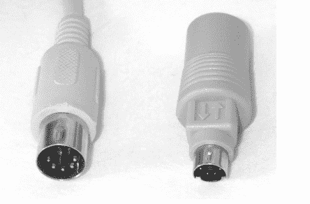

**图 2.12**
左侧较大的 DIN 连接器可以通过使用类似右侧的适配器连接到较新的主板上。

**注意**

键盘处理的统一性存在两个例外。首先，*AT* 之前的计算机使用不同类型的键盘电子电路。因此，如果您有一个来自 PC XT 或类似计算机的非常旧的键盘，您将无法在现代计算机上使用它。那个时代的某些键盘有一个开关，允许您将键盘用于两种类型的计算机之一。将开关设置为 *AT*，您应该就能在现代计算机上使用它。其次，USB 键盘最近开始出现，一些系统现在附带 USB 键盘。Linux 可以使用 USB 键盘，但您可能需要编译一个支持 USB 的内核。在 2000 年初，大多数 Linux 发行版未启用此支持。在此支持成为 Linux 发行版标准部分之前，我建议避免使用 USB 键盘。

x86 硬件存在多种类型的鼠标。（我使用*mouse*一词来指代传统鼠标和替代指点设备，如轨迹球和触摸板。）两种最流行的鼠标接口是串口和 PS/2，其中 PS/2 鼠标在较新的硬件上更为流行。Linux 支持这两种鼠标类型，大多数 Linux 安装程序会自动检测和自动配置您的鼠标。大多数现代主板在后部面板上包含一个 PS/2 鼠标端口（参见图 2.7）。如果您不使用 PS/2 鼠标，某些主板的 BIOS 实用程序允许您禁用鼠标端口，从而为其他设备释放一个 IRQ。

与键盘一样，USB 鼠标最近也日益普及，但您需要内核中的 Linux 支持才能使用 USB 鼠标，而此支持尚未成为大多数发行版的标准部分。

第 15 章“键盘和鼠标”包含了更多关于键盘和鼠标的信息。

### 串行和并行端口

大多数主板包含一个并行端口和两个串行端口。通常，您使用并行端口连接打印机，有时也连接网络摄像头、外部 Zip 驱动器或扫描仪。串行端口可用于鼠标、外部调制解调器、数码相机、个人数字助理（PDA）或其他设备。少数主板，特别是来自 Compaq 等大型制造商的主板，只包含一个串行端口。

现代主板无不支持标准化的现代并行和串行端口协议。Linux 对这些设备的支持相当成熟，因此，假设硬件没有缺陷，您在使用任何主板的并行或串行端口时不应有任何问题。

80486 时代及更早的主板通常不包含串行或并行端口。在这些计算机上，您必须在 ISA 卡上添加这些端口。如果您正在翻新旧系统，并且看不到主板上的这些端口，原因就在于此。

第 16 章“并行和串行端口”更详细地介绍了这些端口。


## 软盘

80486 及更早的主板通常将软盘接口放在扩展卡上——通常与包含串行端口和并行端口的卡在同一张卡上，有时则位于带有 SCSI 主机适配器的卡上。然而，现代主板始终包含软盘接口，如图 2.13 所示。与并行和串行端口一样，软盘控制器的标准化程度非常高，在现代计算机中差异不大。目前大多数 x86 计算机使用 1.44MB 软盘，但大多数控制器都能处理 2.88MB 软驱。这种高容量软盘从未普及，如今已相当罕见。

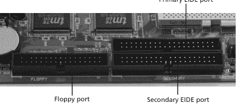

**图 2.13**
*此处显示的每个软盘和 IDE 连接器都少了一个引脚。这是正常的，可以防止连接电缆反向插入，前提是电缆具有正确的定位键。*

**注意**
一些计算机随附 LS-120 磁盘而非传统软盘。这些磁盘有 IDE 和 SCSI 版本，可以读写传统的 1.44MB 软盘和特殊的 120MB 磁盘。如果系统使用的是 LS-120 磁盘而非普通软盘，除非系统还包含一个 5.25 英寸软驱或软盘接口的磁带机，否则主板上的软盘磁盘控制器将闲置不用。

## IDE

在大多数现代主板上，软盘接口旁边是一对 IDE 端口（参见图 2.13）。在大多数现代主板上标准的端口中，IDE 端口的最可变化性最强，而且它们也是唯一受益于专用 Linux 驱动器的端口。这些端口确实可以使用统一的 IDE 驱动器工作，但该驱动器是针对 20 世纪 90 年代早期的 IDE 端口编写的。标准 Linux IDE 驱动器不支持直接内存访问 (DMA) 或高速操作。总之，使用此驱动器产生的 IDE 磁盘访问速度远低于现代硬盘可达到的水平。

为了充分利用特定主板的 IDE 控制器，通常需要在 Linux 内核配置中启用该控制器的选项，如图 2.14 所示。块设备内核选项窗口包含针对特定 IDE 设备的许多选项。其中一些是针对主板芯片组的（例如，图 2.14 窗口底部的 Intel PIIXn 选项），而其他一些则是针对 IDE 扩展板的。

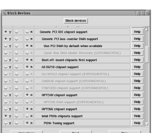

*IDE 设备列表很长且组织混乱，因此您可能需要寻找一段时间才能找到您的设备。*

某些 Ultra-160 IDE 控制器与标准的 Linux 2.2.x 内核配合效果不佳。如果您有此类板卡并想安装基于 2.2.x 的 Linux 发行版，可能需要先使用较旧的 IDE 控制器卡安装 Linux，然后重新编译较新的内核或应用内核补丁。完成后，您应该可以移除较旧的 IDE 控制器，并使用 Ultra-160 控制器运行 Linux。随着基于 2.4.x 内核系列的 Linux 发行版在 2000 年某时可用，这个问题将会消失。

大多数主板包含两个 IDE 连接器。每个连接器能够在一个单独的 *链*（即连接到单根电缆）上处理多达两个 IDE 设备。因此，典型主板能够控制多达四个 IDE 设备。然而，每个 IDE 链消耗一个 IRQ，因此即使使用三个设备也需要两个 IRQ。使用超过四个 IDE 设备需要添加单独的 IDE 控制器，并消耗至少三个 IRQ。对于大量设备，SCSI（在第 5 章“硬盘”和第 9 章“SCSI 主机适配器”中讨论）是更好的选择。

## USB

通用串行总线 (USB) 是外部设备常见使用中的最新发展。大多数现代 PC 包含两个外部 USB 端口，您可以使用 USB 集线器附加超过两个 USB 设备，这实际上将一个 USB 端口变成几个。可用于 USB 的设备包括鼠标、键盘、数码相机、扫描仪、打印机和调制解调器。

USB 能够比传统串行端口快得多——12Mbps，而大多数传统串行端口为 115Kbps。USB 的速度接近 EPP/ECP 并行端口（约 16Mbps）。USB 因另一个原因而具有吸引力：可以将多达 127 个设备连接到单个 USB 控制器。当然，在实践中，127 个设备可能会超过 USB 的带宽，除非这些设备中的大多数或全部都非常慢或很少使用。尽管如此，随着扫描仪、数码相机等外部设备的激增，USB 的吸引力是巨大的。

Linux 2.2.x 内核系列在其生命周期的很后期才获得 USB 支持。幸运的是，Linux 开发人员一直在努力大幅扩展 USB 支持，到 2.4.x 内核时将拥有实质性的 USB 支持。如果您想使用 USB 设备，您可能需要查看主要 Linux USB 开发页面 http://www.linux-usb.org。在适用的情况下，我还将在本书的适当章节中描述 Linux 对特定 USB 设备的支持。

## 可选附加项

除了上述标准主板端口外，一些板卡包含额外的适配器。视频和音频功能在旨在低成本家用 PC 的主板上很常见。SCSI 和以太网适配器在高端主板上很常见。少数主板包含调制解调器功能。理论上，主板也可以包含其他类型的适配器，但在实践中这些相当罕见。

无论您正在考虑什么可选功能，您都应确保所使用的芯片组在 Linux 中受支持。如果没有 Linux 支持，该功能基本上是您主板上的死重量，并且如果无法完全禁用它，可能会引发问题。此外，请考虑到您在升级主板时通常可以保留附加卡。如果您购买具有集成功能的主板，如果您后来决定升级主板，您必须购买另一个此类主板或为集成功能购买单独的产品。

# 第一部分

## SCSI 主机适配器

x86 主板中的 SCSI 功能很少见。当存在时，它是通过在主板上包含单独的 SCSI 芯片组实现的；SCSI 功能不在主板的主要芯片组中实现。大多数包含 SCSI 功能的板卡使用 Adaptec (http://www.adaptec.com) 或 Symbios Logic (http://www.symbios.com) 的芯片组。这两家公司的产品在 Linux 中都得到很好的支持。在大多数情况下，您不会遇到内置于主板中的 SCSI 支持的问题。然而，您应该检查主板使用的特定 SCSI 芯片组是否受 Linux 支持，以确保无误。

为了从 SCSI 主机适配器启动，无论该适配器是单独的板卡还是内置于主板中，SCSI 适配器必须有自己的启动 BIOS。对于内置于主板中的 SCSI 适配器，此 BIOS 通常集成在主板的 main BIOS 中，尽管 SCSI BIOS 可能具有与其 own 主要 BIOS 分离的用户界面。如果您打算从连接到主板主机适配器的 SCSI 硬盘启动，您应该检查主板是否包含适当的 SCSI BIOS（大多数都包含）。调查 BIOS 升级程序也是值得的。在大多数情况下，升级带有集成 SCSI 主机适配器的计算机上的 SCSI 或 main 主板 BIOS 涉及升级 *两者*：SCSI 和核心主板 BIOS。由于升级主板 BIOS 是如此危险的行为，除非您相当确定升级将解决您遇到的问题，否则我不建议这样做。

在主板上拥有 SCSI 适配器的一个缺点是，通常 *没有外部* SCSI 连接器。因此，您只能连接 *内部* SCSI 设备。您可以使用内部/外部适配器插头（如图 2.15 所示）来绕过此限制。您将适配器安装在计算机机箱中，然后将内部 SCSI 电缆的 *最后一个* 连接器插入内部插头。外部插头随后作为外部设备的 SCSI 链的延续。有几种不同类型的内部/外部 SCSI 适配器插头，提供对各种内部和外部电缆类型的访问。

## 网络端口

与 SCSI 适配器类似，以太网网络端口在主板上很少见，但一些主板包含此功能。在大多数情况下，以太网功能由主板上的单独以太网芯片组提供。在某些情况下，此功能内置于主要芯片组中。无论哪种情况，您都应该检查是否存在用于所用以太网芯片组的 Linux 驱动器。幸运的是，Linux 支持绝大多数以太网设备，尽管一些 SiS 芯片组内置的以太网功能目前不受 Linux 支持。您可以在第 16 章的“以太网适配器”部分中阅读更多关于 Linux 以太网支持的信息。


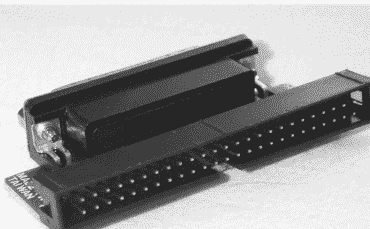

## 图 2.15

> 内部/外部 SCSI 连接器由两个 SCSI 插头和一块用于连接它们的小型电路板组成。

## 调制解调器

少数主板，尤其是用于低成本预装 PC 的主板，包含调制解调器功能。这些调制解调器通常是“仅限 Windows”类型，意味着没有可用的 Linux 驱动程序。除非你确信该调制解调器可以在 Linux 下使用，否则我建议避免使用此类主板。虽然你很可能可以使用另一个调制解调器，但主板可能缺少第二个串行端口，而且未使用的电路可能会干扰你可能添加到系统中的任何调制解调器。

## 视频适配器

在许多低端主板上，视频适配器支持很常见。将视频适配器集成到主板上可以通过消除一块扩展卡来降低组装计算机的复杂性。许多主板制造商至少生产一款或两款在主板集成交互音频功能的主板，并与它们的其他型号相比减少约两个可用的插槽，从而减小了主板的尺寸。一些具备集成视频功能的主板是通过使用直接整合视频功能的主板芯片组来实现的。其他主板则在原本会出现在独立视频卡上的位置添加了一个视频芯片组。

尽管在许多方面都很方便，但将视频支持添加到主板上也有其缺点。一方面，此类设计通常会占用一部分主系统内存并将其分配给视频功能。例如，在 64MB 系统的情况下，你可能最终只有 60MB 的主内存和 4MB 的视频内存。（大多数此类主板允许你使用 BIOS 设置视频内存的量。典型值范围从 2MB 到 16MB。）集成设计还剥夺了你的灵活性。未来升级到新的视频卡会更困难，因为具有集成视频的主板通常可用的扩展插槽较少，而且通常没有 AGP 插槽。

如果你正在考虑带有集成视频支持的主板，你应该绝对确定 Linux（或更准确地说，XFree86）支持所使用的视频芯片组。你可以从 XFree86 的主网站 `http://www.xfree86.org` 了解更多关于此类支持的信息。SuSE（`http://www.suse.com`）是一家致力于开发新 XFree86 驱动程序的 Linux 发行商，因此你可能也想查看其网站以获取最新信息。

## 音频功能

与视频功能类似，音频功能通常出现在低端主板上，以节省空间并降低系统总成本。音频功能通常（但并不总是）通过辅助芯片组实现，因此第 10 章“声卡”中题为“声卡芯片组”的部分可能对评估此类主板的 Linux 兼容性有兴趣。

集成音频通常不会占用任何系统内存。因此，在这方面，该特性比集成视频的危害小。然而，集成音频仍然存在缺乏灵活性的缺点；由于集成音频主板上扩展插槽数量减少，升级到新的声卡可能变得更加困难。

## 内存

所有主板都包含某种形式的内存支持。大多数主板上的主内存插槽是双列直插式内存模块（DIMM）插槽，如图 2.16 所示。旧式主板可能还包括单列直插式内存模块（SIMM）插槽，作为 DIMM 插槽的补充或替代。一些非常新的主板使用 Rambus 直插式内存模块（RIMM），它们看起来与 DIMM 非常相似。第 3 章将更详细地讨论内存。


**图 2.16**
*大多数现代主板包含三个 DIMM 或 RIMM 插槽。*

### 摘要

你为 Linux 计算机选择的主板决定了系统功能性的许多方面。你必须将主板与 CPU 匹配，这种组合共同决定了系统的整体计算速度。主板决定了系统在扩展插槽数量和类型方面的可扩展性。集成功能，如 SCSI 主机适配器或视频端口，可能使主板更具吸引力或降低其成本，但这些功能也可以通过使用即插即用扩展板添加到缺乏这些功能的主板上。

每个主板的核心都是其芯片组，它实现了 CPU 所需的电子功能。芯片组决定了主板的许多特性，包括速度限制、支持的总内存量等。基于相同芯片组的两块主板可能会表现出相似的性能，尽管由于实施细节的不同（例如 PCI 插槽数量）可能存在差异。在某些情况下，主板制造商可能会施加比芯片组本身更严格的限制，例如当芯片组支持 1MB 缓存时，主板仅配备 512KB 缓存。

# 第 3 章

## 内存

### 本章内容

- Linux 内存需求 76
- 内存模块类型 81
- 内存电气类型 87
- 将内存与主板匹配 89
- 缓存内存 92
- ROM 96

本书讨论的大多数硬件组件在 Linux 上需要特殊的驱动程序或带来异常的挑战，而在其他操作系统上则不然。内存通常不是这样。

假设内存与主板兼容，你可以将其插入并在 Linux 下使用，就像在任何其他操作系统下一样。当然，Linux 确实需要一定数量的最小内存，但 Linux 的要求并不高于大多数其他现代操作系统——事实上，Linux 可以在比许多其他操作系统更少的内存下运行。

### 注意

特别是在一些较旧的计算机上，当其他操作系统（尤其是 DOS 和 Windows 3.1）不报告内存错误时，Linux 可能会报告内存错误。这是因为 Linux 是一个 32 位操作系统，意味着它将内存视为一个连续的空间。相比之下，DOS 和 Windows 3.1 使用 16 位内存寻址模式，在这种模式中，内存被分解为 64KB 的块。16 位和 32 位的访问方法对内存施加了不同的压力，因此给定的内存芯片可能适用于一种模式但不适用于另一种。在 Windows 95 发布之前，一些内存和主板制造商在 DOS 下测试它们的芯片，但不在像 Linux 这样的 32 位操作系统下测试。这些芯片有时在 32 位操作系统下会失败。如果你发现你的计算机在 DOS 下可靠但在 Linux 下不可靠，那么很可能是你看到了这种现象的作用，特别是如果它是旧的 80486 或更早的计算机。

## Linux 内存需求

在讨论 Linux——或任何操作系统——的内存需求时，重要的是随机存取内存（RAM）的总量。如本章后面所述，内存的*类型*通常并不非常重要，尽管它可能对计算机的速度产生适度的影响。内存总量对系统性能有更实质性的影响。

### 最小内存需求

大多数操作系统在其包装盒或规格网页上包含最小 RAM 需求。Linux 发行版在这方面也不例外，表 3.1 总结了各种流行 Linux 发行版的官方最小内存需求。

**表 3.1 Linux 发行版的官方内存需求**

| 发行版 | 最小 RAM |
| :--- | :--- |
| Caldera OpenLinux 2.3 | 32MB |
| Corel Linux 1.0 | 24MB |
| Debian GNU/Linux 2.1 | 4MB |
| Linux Mandrake 7.0 | 16MB |
| Red Hat Linux 6.1 | 16MB |
| Slackware Linux 7.0 | 16MB |
| SuSE Linux 6.3 | 8MB |

你也许会从表 3.1 中认为不同的 Linux 发行版是完全不同的操作系统。事实上，它们并不是。这些差异来源于多个因素，包括

- **不同的默认配置** 大多数发行版默认设置具有华丽的 X 窗口系统（又名 X）图形用户界面（GUI）环境，如 K 桌面环境（KDE）或 GNU 网络对象模型环境（GNOME）。这些环境需要大量 RAM 才能平滑运行。像 Debian 这样设置默认配置而不自动启动 X 的发行版，可以指定较低的最小 RAM 值。（SuSE 指定在没有 X 的情况下最小为 8MB，在运行 X 时最小为 16MB。）
- **不同的使用假设** 每个发行版根据其操作系统使用方式的假设来构建其最小 RAM 需求。如果这些假设涉及运行许多大型程序，最小 RAM 需求就会增加。
- **对速度损失的容忍度不同** 如果你愿意忍受极其缓慢的操作，你可以在非常少量的 RAM 上运行 Linux，即使是带 GUI 桌面和许多大型程序的情况。在其他所有条件相同的情况下，运行许多程序时，更多的 RAM 会提高系统速度。在很大程度上，表 3.1 中的 RAM 需求仅反映了用户因低 RAM 而愿意容忍多少减速的决定。
- **安装需求** 安装程序需要一定数量的 RAM 来容纳 RAMDisk 镜像以及程序。如果发行版包含一个华丽的安装程序，使用大型 RAMDisk 或臃肿的程序，仅安装程序就会增加 RAM 需求。一旦操作系统安装完成，可能会在低于最小 RAM 量的情况下运行。

一旦以相似的方式安装和配置，所有 Linux 发行版都需要相似数量的 RAM。除了 Caldera OpenLinux 的估计值外，表 3.1 中所有估计值在使用 GUI 环境时对于舒适和实用地使用 Linux 来说都显得捉襟见肘。如今大多数计算机至少配备 32MB 的 RAM，因此在现代硬件上满足这一最低要求并不难。然而，如果你试图使用 Linux 将旧计算机适应新的用途，如果


计算机内存少于 32MB。如果系统将以专业且受限的方式使用，例如在小网络和电缆调制解调器之间运行 IP 伪装路由器，则不要升级内存。

## 根据系统用途调整内存估算

与其依赖某些通用的最低 RAM 要求，不如尝试估算在 OS 的特定用途下需要多少 RAM。为此，从某个数值（如 8MB）开始，并根据每个预期*同时*执行的任务添加或删除 RAM 是有用的。也就是说，如果你预期*同时*运行办公套件和图形编辑器，请添加两个软件包的数值。如果你预期顺序运行这些程序，则只添加较大的数值。表 3.2 列出了某些常见应用程序的调整。

**表 3.2** 常见应用程序的内存需求调整

| 应用程序 | 需添加的 RAM 量 |
| :--- | :--- |
| X 窗口系统 | 10MB |
| 桌面环境 | 15–20MB |
| 办公套件 | 10–20MB |
| 基础图形编辑 | 5MB |
| 高级图形应用程序 | 10–30MB |
| GUI Web 浏览器 | 10MB |
| 科学或工程应用程序 | 5–500MB |
| 低流量服务器 | 每个*服务器* 5MB |
| 高流量服务器 | 每个*服务器* 50MB |

举个例子，假设你的 Linux 计算机直接连接到互联网（例如通过企业局域网或电缆调制解调器），并且你想运行一个小网站，预计每小时会有少量访问（小服务器为 5MB）。你还打算使用这台计算机在 X 中通过 GUI 文字处理器进行写作（办公套件为 10–20MB，加上 X 的 10MB），并且你想使用 GNOME 桌面环境（15–20MB）。将这些数字与 8MB 的基础 RAM 需求相加，得出的估计最低值为 48MB 到 63MB 之间。当然，你*可以*在少于 48MB 的内存上运行所有这些进程，但性能可能会很慢。添加超过 63MB 的内存可能会略微提高性能，但不如提升到 48MB 带来的提升大。

你可以根据打算使用的特定程序对这些数值进行微调。例如，Linux 版 WordPerfect 8 列出的最低 RAM 要求为 9MB。如果你要运行科学或工程应用程序，几乎可以肯定利用你对该应用的知识，可以将范围缩小到比列表中的 5–500MB 更紧密的区间。此外，表 3.2 只是一个粗略的指导。特定程序可能施加超出我所呈现范围的内存要求。

## 使用虚拟内存

Linux 与所有现代 OSS 一样，可以利用虚拟内存，也称为交换空间（swap space）。其理念是，慢速运行程序总比完全不运行要好。由于 RAM 不足导致 OS 无法运行程序时，Linux 可以利用磁盘空间来存储通常存放在 RAM 中的信息。Linux 内核包含将信息从 RAM 交换到硬盘的规则。理想情况下，Linux 会交换出很少访问的信息，例如仍打开但你当前未使用的程序所使用的 RAM。当然，有时 Linux 可能会猜错，或者你确实在使用所有程序，并且所有程序都大量且积极地使用内存。在这种情况下，随着 Linux 不断访问磁盘上的交换空间，系统可能会变得非常慢。这种持续访问交换空间的情况被称为抖动（thrashing），当 Linux 发生抖动时，即使执行非常简单的任务也可能需要很长时间。

### 添加交换空间

Linux 支持两种形式的交换空间：交换分区和交换文件。UNIX 系统传统上使用交换分区，即专门用于交换空间的整个硬盘分区。由于它是硬盘的连续区域，并且操作不需要使用普通磁盘文件系统驱动程序，交换分区可能比交换文件稍快，后者是用作交换目的普通磁盘文件。大多数 Linux 发行版在安装 OS 时会提示你创建交换分区。安装后，你可以使用 `free` 命令查看可用的交换空间量。该命令产生的输出如下：

```text
             total     used    free     shared   buffers     cached
Mem:           95772   91916     3856      7040     24912     39452
-/+ buffers/cache: 27552   68220
Swap:        136512   3132   133380
```

Swap 行表明该计算机有 136,512KB（133MB）的交换空间，其中使用了 3MB，可用 130MB。`free` 命令还提供了关于存在、已使用和可用的常规 RAM 量的信息。

# 第一部分

如果你发现需要更多交换空间，请遵循以下说明：

- 1. 如果你想永久添加交换空间，可能需要创建一个新的交换分区。你可以使用 PowerQuest（http://www.powerquest.com）的 PartitionMagic 等工具来动态重新分区硬盘，以扩展现有交换分区或创建新的分区。在没有动态分区调整工具帮助的情况下创建新的交换分区是相当繁琐的，因为通常必须备份、重新分区并恢复至少一个分区。

- 2. 如果你想临时添加交换空间，或者不想重新分区磁盘，你可以创建一个交换文件。你可以使用 `dd` 命令创建适当大小的空文件。例如，`dd if=/dev/zero of=/swap-file bs=1024 count=65536` 创建一个 64MB 大小的空文件（`bs * count` 字节）。这个文件名为 `swap-file`，位于根目录，但你也可以将该文件放置在具有足够可用空间的任何 Linux 文件系统上。

- 3. 使用 `mkswap` 命令将文件或磁盘空间初始化为交换文件。例如，对于步骤 2 中创建的交换文件使用 `mkswap /swap-file`，或者对于 `/dev/hda7` 上的交换分区使用 `mkswap /dev/hda7`。

- 4. 如果你创建了交换文件，请更改其权限，使得只有 root 可以读取或写入。例如，使用 `chown root.root /swap-file; chmod 600 /swap-file` 对步骤 2 中创建的文件执行此操作。

- 5. 使用 `swapon` 命令添加交换空间，例如 `swapon /swap-file` 或 `swapon /dev/hda7`。

- 6. 如果你打算永久使用在前面步骤中添加的交换空间，请在 `/etc/fstab` 中添加适当的行；例如：

```text
/dev/hda7    none    swap    sw
```

- 7. 当你完成使用临时交换空间后，可以通过发出 `swapoff` 命令停止使用它，例如 `swapoff /swap-file`。

### 注意

> 与 Microsoft Windows 或 IBM OS/2 不同，Linux 不会动态扩展交换文件。如果你有 64MB 的 RAM 和一个 64MB 的交换文件，Linux 的最大内存为 128MB。如果程序试图使用超过 128MB 的 RAM，一些程序可能会崩溃，或者至少无法执行某些操作。

# 交换空间的最佳量

过去，一般建议在类 UNIX 计算机上，交换空间等于物理 RAM 量的两倍。这一建议是基于典型的多用户使用模式，但将其应用于单用户 Linux 计算机时，这条经验法则是否同样有用尚不清楚。许多桌面 Linux 用户拥有的交换空间等于甚至少于物理 RAM 量，并且对这种配置相当满意。最终，适当的交换空间量取决于你如何使用计算机；如果你经常或甚至只是偶尔运行足以大幅超出计算机可用 RAM 的程序，那么大量的交换空间是有益的。然而，如果你有足够的 RAM 使其限制很少受到压力，你可能只需要很少或不需要交换空间。

`free` 命令列出的已用 RAM 包括 Linux 用作磁盘缓存的 RAM——存储在 RAM 中以提高磁盘访问速度的硬盘内容。磁盘缓存与交换相反，平衡交换和磁盘缓存是内核程序员精通的一项棘手艺术；你不需要担心这一点。然而，你应该意识到，你的程序实际消耗的 RAM 远少于你从 `free` 输出的第一行可能认为的那样。因此，`free` 还报告了不包含磁盘缓存的已用 RAM 量，位于 `-/+ buffers/cache` 行。在估算你的程序消耗多少 RAM 时，使用这个值，而不是 Mem 值。

## 内存模块类型

RAM 由硅晶圆制造，正如 CPU 和其他计算机芯片一样。然而，硅晶圆非常精致。为了安全地处理和运输 RAM，必须将硅晶圆嵌入塑料或陶瓷封装中。这个封装就是我们通常所说的计算机芯片（见图 3.1）。

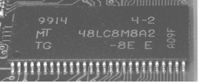

**图 3.1**  
典型的内存芯片使用许多金属引脚将封装内的硅晶圆与主板或其他设备接口。

早期的 x86 PC 通常包含直接焊接在主板上或放置在单独插槽中的 RAM 芯片。然而，这种方法在主板占用了大量空间，使得升级内存或更换故障内存变得困难。


# 第一部分

因此，人们开发了各种形式的*内存模块*来容纳内存芯片。这些内存模块可以轻松连接到主板上。在x86历史的大部分时间里，最受欢迎的内存模块类型是*单列直插内存模块*（SIMM）和*双列直插内存模块*（DIMM）。图3.2展示了这两种模块的示例。1999年底，一种新型内存模块开始出现的：*Rambus直插内存模块*（RIMM）。RIMM被一种新型RAM——*Rambus动态随机存取内存*（RDRAM）使用，将在本章稍后详细介绍。

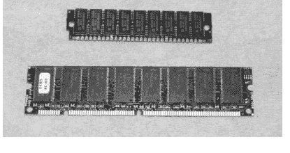

**图 3.2**
30针SIMM（*上*）如今已 largely 过时，但168针DIMM（*下*）在2000年的许多计算机中仍在使用。

> **注意**
> 内存模块的高度各不相同。如果您购买内存模块以扩展计算机内存，请不要担心所购模块比现有模块更高或更矮。但在极少数情况下，内存模块可能对于特定计算机而言过高——模块与其他组件（如硬盘架）之间可能没有足够的间隙。有时您可以通过重新安置其他组件或将内存模块插入不同的内存插槽来绕过此问题。其他时候，您可能需要退回模块并获取一个物理上更短的模块。

## SIMM

SIMM曾是80386、80486以及许多奔腾级系统内存分配的首选方式。从物理上看，不同时期流行的SIMM主要有两种形式：30针和72针。

### 30针SIMM

最早的SIMM使用30个接触点（即引脚）将内存连接到主板。30针SIMM在80386和80486主板上很常见，但现在已相当罕见。您更有可能在打印机或声卡等设备中遇到它们，而不是在现代主板上，但即使在那些次要功能中，它们也 largely 被较新的内存模块类型所取代。

如第1章中“x86 CPU代际”部分所述，x86 CPU在其内存总线宽度上存在差异——即在单次操作中向内存传输多少位。80386SX CPU采用16位内存传输，80386DX和80486 CPU使用32位内存传输，而奔腾级及后续CPU在单次操作中传输64位。这一事实对内存模块的讨论至关重要，因为每种设计每个周期只能传输固定数量的位。因此，要传输超过内存模块支持位数的数据，必须使用多个相同的模块。例如，如果内存模块设计支持8位传输，那么要在80386SX上使用该模块，就必须使用两个相同的模块才能实现CPU所需的16位传输。满足CPU传输要求的一组内存模块被称为一个bank。由于不同CPU的内存访问宽度不同，bank大小也从一个CPU到另一个CPU有所不同。同样，由于内存模块的访问宽度不同，每个bank中的模块数量也随模块类型而变化。

30针SIMM支持8位访问，这意味着对于80386SX，一个bank由两个SIMM组成；对于80386DX和80486，由四个SIMM组成；而对于奔腾及后续CPU，则多达八个SIMM。典型的80486主板包含两个30针SIMM插槽bank，尽管有些支持三个甚至四个bank。30针SIMM在用于奔腾时所需的八个SIMM的bank大小，是放弃30针SIMM设计的主要原因。即使是两个bank也需要16个SIMM插槽，这将占用大量主板空间。尽管如此，仍有少数奔腾主板支持30针SIMM，通常与72针SIMM结合使用。也就是说，此类主板通常包含一个30针插槽bank和两个72针插槽bank。

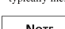

在20世纪90年代中期，SIMM节省器模块获得了一定程度的普及。这些卡允许您将四个30针SIMM插入单个72针SIMM插槽。这些卡通常能正常工作，但存在一些缺点，包括体积较大且可靠性降低。如今几乎没有理由使用SIMM节省器模块，因为此类模块的成本高于大多数72针SIMM。

30针SIMM可用尺寸包括256KB、1MB、4MB和16MB。由于典型的80486系统每个bank使用四个30针SIMM，这分别对应于1MB、4MB、16MB和64MB的bank大小。

### 72针SIMM

72针SIMM比其30针对应物大，但比图3.2中所示的DIMM小。72针SIMM的内存访问宽度为32位，这意味着单个72针SIMM即可构成80386DX和80486 CPU的完整bank。因此，您可以单独向此类主板添加72针SIMM。（然而在实践中，72针SIMM是在80386 CPU鼎盛时期之后才推出的，除了非常后期的80486主板外，您不会在其他主板上发现72针SIMM。）奔腾CPU的64位内存访问使得72针SIMM的bank大小变为两个，因此您必须成对地向大多数奔腾主板添加72针SIMM。

> **注意**
> 少数奔腾芯片组支持将奔腾的64位内存访问拆分为两个32位内存访问。此类芯片组允许单独添加72针SIMM，或成组（每组四个）添加30针SIMM。其代价是速度：这种分割的内存访问时间是一个单一64位内存获取的两倍，从而降低整体系统性能。相反，一些80486芯片组允许将两个32位内存访问合并为单个64位内存访问，从而在成对添加72针SIMM时提供小幅速度提升。

72针SIMM的容量范围从1MB到128MB，每个较高容量是其紧邻下方容量的两倍。最终结果是，与30针SIMM相比，内存配置的灵活性大大增加。

奔腾主板通常包含2–4个bank，每个bank有两个72针SIMM插槽。即使考虑到72针SIMM比30针SIMM尺寸更大，这也大大减少了内存所需的主板空间，并增加了便利性——只需插入或移除1/4数量的SIMM。尽管如此，对于奔腾及后续CPU，如果能逐模块添加内存会更方便，这正是DIMM进入视野的地方。

### DIMM

DIMM使用168针双面设计——即DIMM的每一侧都有独立的接触点，而SIMM则将两侧接触点视为一体。DIMM还支持64位内存传输，因此单个DIMM即可构成奔腾级及以上CPU（包括Pentium Pro、Pentium-II、Pentium-III、Celeron和Athlon）的完整bank。这一事实使DIMM成为奔腾及以上CPU的内存模块首选，到1998年，DIMM已成为所有新x86计算机的标准内存形式。

用于x86主板的168针DIMM并非唯一可用的DIMM类型。例如，一些Macintosh计算机和其他打印机使用其他类型的DIMM。如果您想为主板购买DIMM，请确保它是用于x86计算机的。您还必须根据本章稍后的描述，将内存类型和速度匹配到主板。

168针DIMM的容量范围从8MB到256MB。与72针SIMM一样，每种DIMM尺寸是其下一较低尺寸的两倍。

与从30针到72针SIMM的过渡类似，从72针SIMM到168针DIMM的转变也经历了一个主板同时支持两种连接器的时期。此类主板通常是奔腾级主板，尽管一些Slot 1主板也同时具备两种连接器。在2000年初，大多数主板包含2–4个DIMM连接器，且不支持其他RAM模块。然而，2000年初有少数主板支持新的RIMM内存，随着2000年的进展，预计这项技术将变得非常普及。

## RIMM

最新的内存模块格式是RIMM。以前的内存模块类型在很大程度上独立于填充模块的内存芯片设计。然而，RIMM是专门针对一种内存类型——RDRAM设计的，稍后将在本文中进行讨论。

RIMM模块看起来非常像DIMM，尽管它们有184个引脚，并且在连接引脚间凹槽位置等细节上有所不同。

听起来可能有些奇怪，RIMM的数据传输宽度仅为16位。然而，RDRAM技术允许数据以比其他内存类型更高的速率传输，因此设计用于使用RIMM的主板可以缓冲16位传输并以CPU所需的任意宽度将其提供给CPU。因此，可以逐个添加RIMM内存。使用RDRAM RIMM的整体RAM速度可接近大多数DIMM所达到的三倍。

RIMM的容量范围从32MB到256MB，未来还将出现更大的容量。大多数基于RIMM的主板出厂时配备三个RIMM插槽。

RIMM的一项进步是模块内含小型闪存ROM。这些ROM包含有关RIMM容量、时序要求等信息。结果是，在将特定RIMM与主板匹配时，需要更少的猜测；主板可以读取RIMM的要求并自行调整以匹配。


# 第一部分

RIMM 还有一个不寻常之处，即主板上的空 RIMM 插槽必须用*连续性模块*填充。对于早期的内存类型，空插槽就是——空的。然而，RIMM 的设计要求即使插槽未被使用，某些引脚之间也需要有电气连接，这种连接由假的 RIMM 连续性模块提供。如果你获得了一块支持 RIMM 内存的主板，除了插入 RAM 之外，不要移除连续性模块，也不要丢弃你移除的模块——如果你要用一个更高容量的型号来替换两个或更多低容量的 RIMM，你可能需要用到它们。

## 错误检测与纠正

SIMM 和 DIMM 支持两种主要的错误处理形式：错误检测（*奇偶校验*）和错误*纠正码*（ECC）。奇偶校验内存允许计算机检测到错误，但它无法对该错误采取任何措施，因此结果通常是系统崩溃。在某些情况下，这比使用损坏的数据还要糟糕，但问题在于没有奇偶校验时，你无法*信任*你的数据——包含你所得税信息的电子表格、你论文的原始数据，或者任何东西，如果没有错误检测电路，它们的准确性可能是也可能不是。

ECC 更进一步；它不仅可以检测，还可以纠正 98% 的内存错误。这导致了更顺畅的计算机运行，并且对计算机上数据的真实性几乎没有怀疑——或者至少，你几乎不需要担心数据被内存错误搞乱。

然而，奇偶校验和 ECC 都需要更多的内存。具体来说，奇偶校验每个字节需要一个额外的位。不是使用 8 位来存储一个字节的的信息，而是需要 9 位——8 位用于数据，1 位用于奇偶校验信息。对于 ECC，公式更复杂，并取决于内存总线的宽度。对于 80486 系统，ECC 需要每次 32 位传输使用 7 位，但在 Pentium 级及以上的系统中，每次 64 位传输需要 8 位。因此，Pentium 级及后续系统中的 ECC 与奇偶校验占用的额外内存量相同，实际上，假设你的主板支持这两种选项，你可以使用奇偶校验 SIMM 或 DIMM 在奇偶校验或 ECC 模式下工作。

虽然奇偶校验不会造成特殊的速度损失，但 ECC 会。从 ECC RAM 读取的速度与普通 RAM 读取一样快，但写入需要计算，这会使内存访问稍微变慢——最多慢几个百分点。

不幸的是，今天售出的大多数 SIMM 和 DIMM 不支持奇偶校验，并且许多主板芯片组也不支持奇偶校验或 ECC（有关许多芯片中奇偶校验和 ECC 支持的信息，请参见表 2.1 至 2.4）。如果你正在组装自己的系统或购买按规格定制的新系统，寻求奇偶校验或，特别是 ECC 支持是很值得的。如果计算机用于某种关键角色，或者预期其将在不崩溃的情况下长时间运行（如服务器），这一点尤其重要。

RDRAM，以及因此的 RIMM，支持可选的奇偶校验位，可用于奇偶校验或 ECC。RDRAM 技术足够新，尚不清楚奇偶校验或 ECC 在 RIMM 上的使用将变得多么普遍。

# 内存电气类型

前一部分描述了各种内存类型——SIMM、DIMM 和 RIMM——的各种物理特性。除了 RIMM 之外，每种内存模块类型都可以容纳几种不同的 RAM 芯片变体。这些变体在电子特性、最大访问速度等方面有所不同。

## FPM DRAM

最早类型的 RAM 之一是*快速页模式*（FPM）动态 RAM（DRAM）。FPM 指的是 RAM 对同一区域（即同一*页*）的连续访问比首次访问更快的能力。这种时序通常由一系列数字表示，指示每次访问的周期数。典型的 FPM 内存以 5-3-3-3 时序运行。假设 66MHz 系统总线（因此 1/66,000.000 = 15ns 周期时间），首次访问需要 5x15ns，后续每次访问需要 3x15ns，总共为 210ns。如果不利用 FPM 时序，总时间将是 4x5x15ns，即 300ns。

FPM DRAM 用于 1995 年及更早的大多数 80486 和 Pentium 系统。自那以后，它已经变得相当罕见，因为更先进的内存类型生产成本不再更高，并且由于市场上的供需力量，购买价格可能更低。FPM DRAM 有 30 针和 72 针 SIMM 格式。

## EDO DRAM

*扩展数据输出*（EDO）DRAM 是随后在 x86 主板上出现的内存技术的重大进展。EDO 的速度提升源于 EDO 允许连续的内存访问略有重叠这一事实。用内存时序表示，EDO 允许 5-2-2-2 时序，而不是 FPM DRAM 典型的 5-3-3-3。这转化为每次四个内存访问 165ns，而 FPM DRAM 为 210ns。

EDO DRAM 需要主板芯片组中的特定支持，因此你无法将 EDO DRAM 内存模块直接放入设计用于 FPM DRAM 的主板。EDO DRAM 最常见于 72 针 SIMM 格式，但早期的 DIMM 也使用 EDO DRAM。这种内存格式在 1995 年至 1997 年间最为常用。

EDO DRAM 的一个变体是*突发 EDO* DRAM。突发 EDO 在市场上从未普及，尽管少数芯片组确实支持它。

## SDRAM

在 2000 年初，计算机主板上最常用的内存类型是*同步 DRAM*（SDRAM）。与依赖于*等待状态*使内存系统跟上系统总线的早期内存类型不同，SDRAM 与系统总线同步运行。因此，SDRAM 允许 5-1-1-1 的内存访问时间，在 66MHz 总线上四次访问为 120ns。

随着运行速度高于 66MHz 的主板总线的出现，SDRAM 的速度必须提高。也就是说，在 100MHz 总线上使用的 SDRAM（作为例子）必须比 66MHz 总线上的 SDRAM 更快地完成其访问——四次访问在 80ns 内，而不是 120ns。这些更快的 SDRAM 版本在基本方式上与 66MHz SDRAM 没有不同，但它们确实有特殊的名称：*PC100* 和 *PC133*。每个名称都包含一个数字，对应于 RAM 可以使用的最快速度的主板总线。在 100MHz 甚至 66MHz 系统总线上使用 PC133 SDRAM 没有问题，因此如果你正在市场上寻找 SDRAM，购买 PC133 变体可能有意义——但你会比 PC100 SDRAM 多付一点钱。

SDRAM 通常以 DIMM 形式出售。事实上，2000 年出售的大多数 DIMM 都是 SDRAM；较旧的 EDO DRAM DIMM 如今已相当罕见。由于大多数接受 DIMM 的计算机都可以使用 SDRAM，因此当用全新的 RAM 装备主板时，这不会造成兼容性问题。

**注意**

大多数主板不允许混合使用 SDRAM 和 EDO DRAM。因此，如果你的计算机使用较旧的 EDO DRAM DIMM，如果你想扩展计算机内存，你必须用较大的 SDRAM DIMM 替换这些 DIMM，或者追踪并购买 EDO DRAM DIMM。

SDRAM 的一个潜在重要变体被称为*双数据率 SDRAM*（DDR SDRAM）。DDR SDRAM 通过允许每个时钟周期进行*两次*传输来工作，有效地使 RAM 速度翻倍。包括 AMD、SiS 和 VIA 在内的一系列芯片组和 CPU 制造商正在推广 DDR SDRAM。相比之下，Intel 正在推广 RDRAM，后者提供稍快的速度提升。RDRAM 是一项专利技术，需要支付许可费，而 DDR SDRAM 没有这种限制。

## RDRAM

RDRAM 是最新出现在 x86 主板上的内存形式。如本章前面所述，RDRAM 专门用于 RIMM；这些内存模块是专门为 RDRAM 设计的。

RDRAM 的不寻常之处在于它内置了自己的总线。先前的内存技术将 RAM 芯片或多或少直接连接到由主板芯片组控制的内存总线，进而与 CPU 的内存总线相当无缝地连接。RDRAM 在方程式中增加了另一条总线。这条总线一次传输 16 位，但运行速度比 CPU 的 RAM 总线快得多。在 2000 年初，大多数 CPU 以 100MHz 的外时钟频率运行，每次内存访问传输 64 位。相比之下，RDRAM 的 Rambus 以 800MHz 运行。即使每次传输只有 16 位，RDRAM 的速度也是传统 SDRAM 的两倍。事实上，RDRAM 采用了额外的技巧，使有效 RAM 速度接近 PC100 SDRAM 的三倍。

RDRAM RIMM 有自己的内部结构，由分为八个 16 位 bank 的 128 位宽总线组成。每个 bank 本身以 100MHz 运行，因此总速度为 800MHz（8 个 bank × 100MHz = 800MHz）。内部以 100MHz 运行意味着 RDRAM 使用的 RAM 芯片不必在技术上比 SDRAM 先进太多；它们只是被并行连接以产生更大的净速度。

在 2000 年初，RDRAM 很罕见，但预计随着时间推移会变得更为常见。随着 CPU 总线速度的提高，其更快的速度将成为一种近乎必需的条件。最近的 Intel 主板芯片组使用 RDRAM（详情请参见表 2.2）。由于 RDRAM 需要主板芯片组支持 Rambus 技术，因此直到大多数主板支持它之前，它不会变得普遍。

# 特殊和非主板 RAM 类型

除了这些主流 RAM 类型外，还有其他类型。一些，如突发 EDO DRAM，是这些常见类型的变体。其他用于专门的应用。例如，视频卡需要自己的 RAM，并且针对此应用专门化的各种形式的 RAM 已经出现，如第 12 章中题为“视频 RAM”的部分所讨论。

# 内存与主板的匹配

如果你正在寻找升级现有计算机的内存，你可能会认为你现在知道足够的信息来完成这项工作。遗憾的是，情况可能并非如此，因为额外的 RAM 特性可能会破坏原本良好的 RAM 匹配。通常，如果你不匹配某些额外因素，你会得到不可靠的计算机运行，尽管在某些情况下，计算机无法识别 RAM。在极少数情况下，你甚至可能损坏主板或 RAM。

# 检查支持的内存速度

在 PC100 和 PC133 SDRAM 出现之前，内存速度是以纳秒（ns）来衡量的。确实，甚至 PC100 和 PC133 RAM 的速度也是以 ns 来衡量的；只是名称


## 第一部分

*PC100* 和 *PC133* 的设计旨在简化内存类型与主板的匹配过程。如果你使用的是支持 SDRAM 但未明确标注支持 *PC100* 或 *PC133* 内存的主板，且假设你并未扩展现有的 *EDO* DRAM，那么这两种类型的内存通常都可以使用。或者，如果你的主板总线速度低于 100MHz，你也可以购买速度低于 *PC100* 的 SDRAM。

无论你是使用速度低于 *PC100* 的 SDRAM、*EDO* DRAM 还是 *FPM* DRAM，你都应查阅主板手册，了解主板支持的内存速度（以纳秒为单位）的相关信息。例如，某块主板可能支持速度为 70ns 或更快的 *EDO* DRAM，或者速度为 15ns 或更快的 SDRAM。请注意，当以纳秒表示时，数值越低代表速度越快，性能也越好。如果主板需要 70ns 的 *EDO* DRAM，你可以安装 60ns 的 *EDO* DRAM，且通常不会遇到与时序相关的问题。这与 *PC* 命名标签不同，在 *PC* 命名中，数值越高代表速度越快——*PC133* SDRAM 比 *PC100* SDRAM 更快。

如果你现有的 FPM 或 EDO 内存模块想要确定其中芯片的速度，通常可以通过检查芯片本身的代码来实现。例如，图 3.3 展示了一个 30 针 SIMM 模块。该模块上的两个芯片包含代码 *V53C404FK70*，而第三个芯片包含代码 *VT531000AJF-60*。代码的前半部分对于确定模块速度并不重要；重要的是最后两位数字。在图 3.3 的 SIMM 模块中，两个芯片是 70ns 部件，而第三个芯片（提供奇偶校验位）是 60ns 部件。SIMM 模块的整体速度仅取决于其最慢的组件——即 70ns。额定速度为 100ns 或更慢的 RAM 芯片会省略速度值的最后一位数字，因此 100ns 芯片的编号以 *10* 结尾，而不是 *100*。SDRAM 芯片使用不同的编号方案，大多数包含此类芯片的模块上都有贴纸，标明它们为 *PC100* 或 *PC133* DIMM。

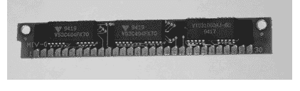

**图 3.3**  
*RAM* 模块上各个芯片的速度作为芯片型号的一部分印刷在上面。

### 混合内存类型

大多数主板无法良好地处理 SDRAM 与其他 RAM 类型的组合。因此，如果你在主板上使用任何 SDRAM，通常就不能使用其他类型的内存。一般规则是，混合 FPM DRAM 和 EDO DRAM 不会造成太多问题，但你应查阅主板手册以确认。

某些主板在处理混合的 SIMM 和 DIMM 时表现不佳，即使这两种模块包含相同类型的 RAM。因此，在将某种类型的内存添加到已包含另一种类型内存的系统中之前，你应该咨询主板手册。例如，当允许混合类型时，可能无法使用所有的 RAM 插槽。比如，一块 Pentium 主板可能包含两个 168 针 DIMM 插槽和四个 72 针 SIMM 插槽（两个组，每组两个插槽）。然而，主板可能总共只支持三个内存组，这意味着你必须留空一个 DIMM 插槽或两个 SIMM 插槽。再次强调，有关细节你应该查阅主板手册。

### 其他附加因素

特别是对于较旧的内存类型，还有一些额外因素可能会影响特定内存模块在特定主板上的可靠性。这些因素包括：

- **跳线设置**：早期的 80486 及更早的计算机通常使用主板上的跳线来识别安装的 RAM 数量。后期的 80486 及更晚的计算机通常会自动检测数量，并在适用时检测内存类型。如果你使用的是较旧的主板，在添加或移除 RAM 时可能需要调整跳线设置。
- **芯片数量**：在 20 世纪 90 年代中期，人们大量讨论 2 芯片或 3 芯片的 30 针 SIMM 与 8 芯片或 9 芯片的 30 针 SIMM 之间的区别。同等容量下，2 芯片或 3 芯片 SIMM 使用了容量更大的芯片，这导致了一些细微的电子特性差异。2 芯片和 8 芯片 SIMM 不具备奇偶校验，而 3 芯片和 9 芯片变体则是带奇偶校验的 SIMM。一般来说，最好保持每个 SIMM 上的芯片数量相同，特别是在同一内存组内，这对于这一时代的主板尤为重要。使用 72 针 SIMM 和 168 针 DIMM 的较新主板受此类影响较小。
- **单双面**：内存模块可以在一侧或两侧安装芯片。这一特性与电子特性相关，某些主板对单面或双面 SIMM 或 DIMM 有特定要求。这些要求通常记录在主板的说明书中，因此你应该在那里查找更多信息。
- **奇偶校验**：如果你计划扩展内存，如果你的系统当前使用奇偶校验内存，请尽量使用奇偶校验内存；如果不使用，则使用非奇偶校验内存。大多数计算机在启动时的短暂显示中会报告内存是奇偶校验还是非奇偶校验。

### 提示

> 你可以通过在软驱中插入一张已格式化但不可启动的空白软盘并重新启动计算机，来查看 BIOS 的硬件信息显示，其中包括内存类型的摘要。在做此操作前，请确保 BIOS 设置为从软盘启动，否则计算机可能会先尝试从硬盘启动并加载 Linux。通常，当 BIOS 遇到不可启动的软盘时，它会在屏幕上打印一条简短消息，然后停止，将硬件信息显示在屏幕上供你从容阅读。（不可启动软盘的消息实际上包含在软盘本身中，因此会根据你格式化软盘的方式而变化。）

- **内存空洞**：某些主板 BIOS 可以设置创建或不创建特定位置（如 16MB 或 64MB）的*内存空洞*。这些内存空洞是内存映射中的不连续区域——即一小块不能用作 RAM 的区域。Linux 通常在有无内存空洞的情况下都能正常工作，但如果你遇到 Linux 无法识别所有 RAM 的问题，可能需要检查并更改 BIOS 中的此类设置。
- **内核参数**：2.2.x 系列之前的 Linux 内核无法自动检测超过 64MB 的内存量，因此如果你使用的是较旧的内核且拥有大量内存，可能需要告诉 Linux 你拥有多少内存。你可以通过在 `/etc/lilo.conf` 文件中添加如下行，然后重新运行 `lilo` 以重新安装 Linux 启动加载器来实现：

```
append="mem=nnnM"
```

*nnn* 值是兆字节数，例如 128MB 的 RAM 对应 *728*。在某些情况下，即使是使用 2.2.x 内核，也可能需要使用此命令，尽管这些内核通常能正确检测内存。

一般规则是，你应该阅读主板手册，了解其在内存方面可能存在的其他特殊性。少数主板需要特殊的 RAM 变体，你应该仔细寻找适合此类计算机的 RAM。

## 缓存内存

当你想到计算机的内存时，你首先想到的可能是安装在 *SIMM*、*DIMM* 或 *RIMM* 中的大块 RAM。然而，这并不是计算机中唯一的内存类型。正如我之前提到的，视频卡通常拥有自己的 RAM 存储，其他各种组件也是如此，包括 CD-ROM 驱动器、硬盘，甚至某些声卡。此外，另一种名为*缓存*的内存与 CPU 相关联，通常也与主板相关联。当你构建或购买新计算机，或扩展现有计算机时，理解缓存内存是什么、存在哪些类型的缓存以及缓存如何与主 RAM 存储交互是非常重要的。

## 什么是缓存内存？

当应用于计算机内存时，术语*缓存*指的是一种用于保存较大内存存储副本的内存类型。缓存内存总是比相应的主内存更快。通过将最常访问的数据放入缓存内存中，可以提高整体系统速度，因为 CPU 可以使用缓存内存执行许多内存访问操作，而不是使用较慢的主内存。

事实上，缓存的作用不仅仅限于内存访问。在大多数操作系统中，包括 Linux，会预留一部分 RAM 作为*磁盘缓存*——即保存部分硬盘内容的 RAM。我前面提到的 CD-ROM 和硬盘中的 RAM 是内置于这些设备的缓存。

不过，暂时让我们只考虑存在于主板上及其直接连接组件上的缓存：CPU（L1）缓存和 L2 缓存。

## L1 缓存

最靠近 CPU 的是*一级*或*L1*缓存。自 80486 以来，L1 缓存已集成在 CPU 内部。该缓存以 CPU 的内部速度运行，因此速度非常快。然而，在大多数 CPU 上，L1 缓存也非常小。表 3.3 总结了某些最常见 x86 CPU 上使用的缓存大小。

表 3.3 x86 CPU 缓存大小

| CPU | L1 缓存大小 |
|---|---|
| 80386 | 0KB |
| 80486SX, 80486DX, 80486DX/2 | 8KB |
| 80486DX/4 | 16KB |
| 80486 Pentium OverDrive | 16KB + 16KB |
| Pentium | 8KB + 8KB |
| Pentium MMX | 16KB + 16KB |
| Pentium Pro | 16KB + 16KB |
| Pentium II | 16KB + 16KB |
| Celeron | 16KB + 16KB |
| Pentium III | 16KB + 16KB |

*待续*


## 表 3.3 *续*

| CPU | L1 缓存大小 |
|---|---|
| AMD K5 | 16KB + 8KB |
| AMD K6 | 32KB + 32KB |
| AMD K6-2 | 32KB + 32KB |
| AMD K6-III | 32KB + 32KB |
| AMD Athlon | 128KB |
| Cyrix 6x86 | 16KB |
| Cyrix 6x86MX & MII | 64KB |
| NexGen Nx586 | 16KB + 16KB |
| IDT WinChip | 32KB + 32KB |

某些 CPU 采用单一的*集成*L1 缓存，其中数据和程序代码仅存储在一个缓存区域中。其他 CPU 则使用独立的代码缓存和数据缓存，它们的大小通常相同。这种第二种类型的 CPU 缓存在表 3.3 的*缓存大小*列中通过两个数值来表示。

在其他条件相同的情况下，更大的 L1 缓存更好。当然，其他条件并不总是相同的，因此缓存大小并不是衡量 CPU 性能的唯一标准。不过，它可能是一个重要的标准，特别是当您经常运行那些主要使用紧凑计算循环进行操作时。如果 L1 缓存足够大，代码中最重要的部分可以完全驻留在 L1 缓存中，从而显著改善性能。如果缓存较小，并非所有相关代码都能放入 L1 缓存中，从而导致性能下降。

由于 L1 缓存是 CPU 的一部分，除了更换 CPU 外，无法对其进行扩展或替换。对于大多数人来说，最好将 CPU 视为一个集成的整体，并根据 CPU 的整体性能来决定购买哪款 CPU。但是，如果您知道您对计算机的使用涉及紧凑但密集的计算循环，您可能更倾向于选择具有大缓存的 CPU。

### L2 缓存

*二级*（或 *L2*）缓存比 L1 缓存容量更大，但速度也更慢。其位置因 CPU 而异。在 80486 和大多数 Pentium 兼容（Socket 7）系统中，它位于计算机的主板上。而在 Pentium Pro、Pentium-II、Pentium-III、AMD K6-III、AMD Athlon 以及某些 Celeron 处理器中，它位于 CPU 封装上，尽管它并不属于产生 CPU 本身的同一晶圆。表 3.4 总结了那些集成 L2 缓存的 CPU 的 L2 缓存大小。某些 CPU 提供不同的缓存大小，要么是在相同 CPU 速度下作为不同的变体，要么是在不同 CPU 速度下具有不同的缓存大小。早期的 Celeron CPU 没有 L2 缓存，这使其相对于 Pentium-II CPU 的性能大大降低，但较新的型号包含 128KB 的 L2 缓存。

**表 3.4 x86 L2 缓存大小**

| CPU | L2 缓存大小 |
| :--- | :--- |
| Pentium Pro | 256KB~1MB |
| Pentium-II | 256KB~512KB |
| Pentium-III | 256KB~512KB |
| Celeron | 0~128KB |
| AMD K6-III | 256KB |
| AMD Athlon | 512KB |

将 L2 缓存放置在 CPU 模块上，相比于将其放置在主板上，性能有所提升，这主要因为缓存可以以更快速度运行。主板上的 L2 缓存以主板总线速度运行（今天通常是 100MHz），而 CPU 模块上的缓存有潜力以高得多的速度运行。

> **注意**
> NexGen Nx586 CPU 需要特殊的主板，主要是因为它为 L2 缓存使用了一个独立的总线。像 Pentium Pro 及后续 Intel CPU 的缓存一样，Nx586 的缓存以 CPU 的内部时钟速率运行，而非主板总线速度。然而，Nx586 的 L2 缓存物理上位于主板上。

Pentium 级别的 CPU，包括 Cyrix 和 AMD 更快的 Socket 7 型号，将 L2 缓存放置在主板上。大多数 80486 和 Pentium 级别的主板都包含一定量焊接在板上的缓存，有些还允许您通过添加芯片或特殊缓存内存模块来增加主板的缓存。这种模块没有标准化的形式，尽管曾有过一些创建此类标准的尝试。最终，您应该查阅主板文档以获取详细信息。

> **注意**
> AMD K6-III CPU 在 CPU 封装中包含一个 L2 缓存，但它用于本身包含 L2 缓存的 Socket 7 主板上。当与 K6-III CPU 一起使用时，主板的缓存就成为三级（L3）缓存。与其他 CPU 配合使用时相比，其重要性有所降低，但三级缓存的存在确实会在一定程度上提高性能。从理论上讲，可以在 Slot 1、Slot 2、Socket 370 或 Slot A 主板上添加 L3 缓存，但由于收益相对较小，很少有此类主板包含缓存。

在考虑 Socket 7 主板时，考虑主板支持的最大可缓存 RAM 相当重要。对于许多产品，可以安装比可缓存更多的 RAM。结果通常是*降低*了整体系统性能。例如，假设一块主板可以缓存多达 64MB 的 RAM，但您在该主板上安装了 128MB。在这种情况下，只有一半的内存访问能从缓存中受益。如果您碰巧从不可缓存的 64MB RAM 中运行某些重要的代码（例如 Linux 内核或常用程序），那么该程序的运行效果不如从可缓存的 64MB RAM 中运行时好——或者不如仅安装了 64MB 内存时好。诚然，如果您通常运行大量程序以至于不得不大量使用交换空间，增加 RAM 仍然可以改善状况，但总体而言，明智的做法是不将 RAM 扩展到主板无法缓存的程度。如有必要，请购买一块支持更多可缓存 RAM 的新主板。

表 2.1 至表 2.4 列出了 Pentium 级别主板芯片组的总可缓存 RAM。然而，任何特定主板上的实际可缓存 RAM 取决于主板上安装的缓存有多大。支持特定数量 RAM 所需的缓存大小细节因主板芯片组及其使用的缓存类型而异，因此您应查阅主板手册或联系主板制造商以获取详细信息。

## ROM

除了 RAM 和缓存内存（两者均允许读写）外，计算机还包含各种形式的*只读存储器*（ROM）。ROM 用于存储计算机上极少或从不更改的数据。（当数据由程序代码组成时，被称为*固件*。）在主板上，ROM 存储*基本输入/输出系统*（BIOS），它控制计算机的启动过程并用于设置各种重要的主板参数。许多其他设备也包含 ROM，例如声卡、显卡、SCSI 主机适配器、硬盘、调制解调器和打印机。本章重点介绍主板 ROM，尽管此处的大部分信息也适用于其他设备上的 ROM。

### 主板 ROM 和 ROM 变体

多年来，有几种不同类型的 ROM 芯片在各种用途中有所应用。这些包括

-   ***普通 ROM*** 最基本的 ROM 类型 simply 称为 ROM。这种形式的 ROM 真正是只读的；其中包含的信息在工厂中编程，无法更改。普通 ROM 往往速度慢且昂贵，由于如果在 ROM 中包含的固件中发现 bug，唯一更正该 bug 的方法是物理更换 ROM 芯片，因此现代设备不倾向于使用它们。您最有可能在非常旧的计算机上找到普通 ROM。

-   ***PROMs*** *可编程 ROM*（PROM）比普通 ROM 有所进步，因为其内容可以更改。PROM 出厂时没有任何信息，借助特殊设备可以将数据存储在其中。然而，一旦编程，PROM 就无法擦除和重用。因此，它们在现代计算机中很少使用。

-   ***EPROMs*** *可擦除 PROM*（EPROM）比 PROM 更进一步，因为 EPROM 的内容可以通过将芯片暴露在紫外线下擦除。由于这种擦除方法，EPROM 的陶瓷或塑料封装中有透明窗口。制造商通常在这些窗口上贴贴纸以防止意外擦除。重新编程 EPROM 需要将其从设备中取出并使用专门的 EPROM 编程器，因此 EPROM 不用于大多数现代设备。它们在 1990 年代中期仍很常见，因此您可能仍会在那个时代的设备中发现 EPROM。

> **警告**
> 如果您撕掉芯片上的贴纸并发现其中有一个透明窗口，请重新贴回贴纸或在窗口上贴一张新的。虽然您不太可能意外擦除 EPROM，特别是如果 EPROM 位于计算机机箱内部，但没有任何理由冒这种风险。

-   ***EEPROMs*** *电可擦除 PROM*（EEPROM，也称为 *闪存 ROM*）是现代计算机设备中最常见的 ROM 类型。顾名思义，EEPROM 可以电子方式擦除和重新编程。这一特性允许用户在不拆卸任何芯片甚至不打开机箱的情况下更新主板（或其他设备）的 ROM。（某些主板要求您在更新系统 ROM 之前设置跳线，因此您必须在这类计算机上打开机箱。）EEPROM 在使用便利性方面代表了巨大的改进，尽管它们也带来某些危险，


因为最终用户在重新编程 EEPROM 时很容易出错。如果发生这种情况，设备通常会在更换 EEPROM 芯片之前变得无法使用。少数设备包含一个备份 ROM，其中仅含有足够的信息，可用于向 EEPROM 中刷写新数据。请查阅你的文档，以确定你的主板或其他设备是否具有这种备份 ROM。

从普通 ROM 到 EEPROM 的这一进程中，名称“*只读存储器*”中*仅*“只读”的部分已变得越来越不准确。然而，即使是 EEPROM，也不容易被擦除。必须运行一个特殊程序，通过 EEPROM 传输额外电流才能将其擦除或重新编程；对 EEPROM 的普通写入操作不会改变其内容。

### 提示

如果你需要重新编程闪存 ROM，应该采取两项预防措施。首先，制作 ROM 原始内容的备份副本，并将其保存在软盘上。大多数 EEPROM 更新工具允许你这样做。其次，在正常营业时间进行更新。如果出现问题且使你的设备无法启动，那么你就可以将计算机和备份软盘带到计算机维修店，技术人员可以使用你制作的备份来创建一个新的 EEPROM 芯片，或者用较旧但可正常工作的内容重新编程你现有的 EEPROM。如果你的主板上的 EEPROM 是可拆卸的，你可能需要考虑准备一个备份的 EEPROM 芯片。这样，在重新编程出错的情况下，你就不需要将计算机带到维修店进行修复，前提是你放心替换插座式芯片。查阅你的主板手册，了解你主板接受的 EEPROM 芯片类型。你可以从电子元件商店购买空白的 EEPROM 芯片，然后使用 EEPROM 烧录器自行进行编程，或者将芯片和计算机 BIOS 的副本带到计算机维修店让他们完成这项工作。一些主板制造商也会销售预装了适用于你主板型号 BIOS 的备用 EEPROM 芯片。如果你的主板包含不可刷写的备份 BIOS，则无需创建备份 BIOS EEPROM 芯片，尽管在刷写 BIOS 之前，你仍应将一个完整的可工作 BIOS 复制到软盘上。

大多数主板刷写工具是为 DOS 编写的。你可以通过软盘运行此类程序，即使是在仅包含 Linux 分区的计算机上。如果你没有 DOS 许可证，可以了解 FreeDOS (<http://www.freedos.org>)。这种免费的 DOS 重新实现版本足以运行 BIOS 刷写工具。

### 系统 BIOS 的重要性

计算机的 BIOS 是其包含的最底层代码，也是最重要的代码之一。没有 BIOS，计算机无法启动。每个 CPU 在首次开机时都会寻找内存中的特定部分以获取指令。x86 PC 架构与大多数计算机一样，其设计使得 ROM 位于 CPU 的启动位置。该 ROM 包含有助于计算机从软盘、硬盘或其他设备启动的代码。细节复杂且因计算机而异，但从 BIOS 开始到操作系统中的高级程序为止的一系列操作，最终导致了计算机的运行。

x86 BIOS 最初设计用于为正在运行的操作系统提供服务。例如，BIOS 包含操作系统可以用来从硬盘读取数据并在屏幕上显示信息的例程。然而，Linux 在普通操作中不使用这些例程，因为 Linux 是一个 32 位操作系统，而这些 BIOS 例程本质上是 16 位的。除了启动过程中的控制权转移外，Linux 几乎不使用 BIOS。正如我所说的，那个 BIOS 启动代码至关重要。

BIOS 还包含有助于你配置硬件操作方式的例程。BIOS 的这一部分被称为 **CMOS 设置实用程序**，因为它设置的选项存储在 *互补金属氧化物半导体* (CMOS) 存储器中。这是主板上一小块非易失性存储器区域。你可以在 CMOS 设置实用程序中设置的选项包括 BIOS 查找启动设备的顺序、内存时序特性（特别是在较老的主板上），以及哪些主板设备（EIDE 端口、并行端口等）是活动的。大多数 CMOS 设置实用程序被划分为多个子部分。例如，图 3.4 显示了一个典型的主屏幕。顶部的每个选项（主要、高级等）对应一屏的选项。

某些 CMOS 设置会影响 Linux 如何处理相关硬件，因此在 Linux 中也很重要。CMOS 配置的细节因主板而异，差异很大，一方面是因为 BIOS 来自不同的制造商，另一方面是因为不同的主板支持不同的功能。事实上，你进入 BIOS 的 CMOS 设置实用程序的方式因 BIOS 而异。通常，你启动过程中早期（通常是在主板检查 RAM 时）按下一个特殊的键或组合键（Del 和 F3 是两个常见的选项）。大多数 BIOS 会在启动过程的适当时候显示提示，因此请留意该提示，或查阅你主板的手册。

### 插卡上的 ROM

正如我前面提到的，许多插卡拥有自己的 ROM。在现代插卡上，这些 ROM 通常是 EEPROM，尽管在较老的产品中可能是其他类型。与主板的 ROM 类似，扩展卡 ROM 包含设备用于帮助控制自身的代码。一些扩展卡 ROM 还与主板的 ROM 配合使用。例如，SCSI 主机适配器和一些网络适配器包含 *引导 BIOS*，它们会嵌入到计算机的引导序列中。由于 SCSI 主机适配器在设计上差异巨大，标准主板 BIOS 无法控制 SCSI 设备，包括 SCSI 硬盘。SCSI 引导 BIOS 提供扩展 BIOS 代码，允许计算机从 SCSI 硬盘启动。SCSI 适配器的 BIOS 还提供类似 CMOS 设置实用程序的用户界面。该实用程序通常提供一种配置 SCSI 主机适配器的方法，并且可以包括配置或修改 SCSI 设备的选项。例如，许多此类实用程序允许你对 SCSI 硬盘进行低级格式化。类似的说明也适用于允许你从网络硬盘启动的网络适配器。

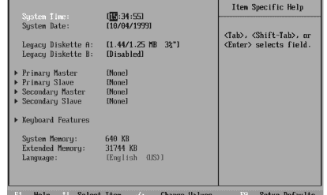

**图 3.4**
你使用简单的键盘操作来调整 CMOS 设置实用程序中的项目，这些操作在屏幕底部有总结说明。

> 如果你在非 x86 计算机上运行 Linux，你可能能够使用主要为 x86 计算机销售的 PCI 设备。然而，某些此类设备包含连接到 x86 BIOS 的 ROM，而其他平台对应的代码可能不可用。在这种情况下，该设备可能在非 x86 硬件上无法使用，或者功能受限（例如无法从 SCSI 硬盘启动）。在其他情况下，由于 Linux 驱动程序在该硬件上无法正确编译，该设备可能在非 x86 硬件上无法使用。

大多数其他设备，如显卡、声卡和调制解调器上的 ROM，并不与系统 BIOS 进行如此直接的接口连接。（显卡 BIOS 确实为系统 BIOS 提供一些有限的服务，但 Linux 不使用这些服务。在很大程度上，这些 BIOS 提供固件代码，由相关设备内部使用。例如，电话调制解调器使用的调制技术相当复杂，事实上，如今许多调制解调器本身就是小型计算机。这些调制解调器需要自己的软件，包含在 ROM 中。升级卡片的固件通常可以提高设备性能。在极端情况下，你可能会获得额外的功能。例如，许多在 1997 年和 1998 年销售的调制解调器使用专有协议以高达 56kbps 的速度进行通信。最终，行业定为开放的 v.90 协议用于此类通信。使用早期 X2 和 K56Flex 协议的大多数调制解调器仅通过 ROM 升级即可升级为支持 v.90。

> 一些调制解调器将其重要软件包含在驱动程序中，而不是调制解调器本身。此类调制解调器通常称为仅限 Windows 的调制解调器，或该术语的某种缩写。通常，这些设备在 Linux 下无法使用，尽管存在例外。第 18 章“调制解调器”将更详细地介绍调制解调器。

与主板 BIOS 类似，为扩展卡刷写更新后的 BIOS 通常只能在 DOS 或有时在 Windows 下进行。对于可能需要运行此类板卡更新工具的 Linux 用户来说，FreeDOS (<http://www.freedos.org>) 非常有用。

### 摘要

一台调制解调器计算机可以轻松地包含六种以上不同类型的内存，包括两到三种类型的缓存 RAM、主系统 RAM、主板 BIOS ROM、显卡上的 RAM 以及各种扩展卡上的 ROM。其中许多内存类型最好在特定设备的背景下理解，例如显卡上的 ROM 和 RAM。

主系统内存本身是一个相当复杂的主题，因为多年来使用了许多不同类型的内存---FPM DRAM、EDO DRAM、SDRAM 和 RDRAM；分布在 SIMM、DIMM 和 RIMM 上；速度、大小等各不相同。将 RAM 与主板匹配是你在构建计算机或升级现有计算机的 RAM 时最重要的任务之一。在进行这种匹配时，你能做的最重要事情就是阅读你的主板手册。


# 机箱与电源

### 本章内容

- 机箱设计 104
- 机箱与主板的匹配 111
- 扩展空间 113
- 评估电脑机箱 118
- 电源 124

## 第一部分

电脑的机箱是其最明显的视觉特征。电脑机箱在尺寸、形状、颜色及装饰性特征上差异巨大。同样重要的是，机箱在开箱便利性、可容纳的磁盘驱动器数量、所用材料、做工质量以及内部固定件（如插槽等）的可达性、可修复性和可更换性方面也存在差异。这些特性中有些在观察机箱（甚至只是看照片）时显而易见，但其他一些则需要仔细检查。本章主要致力于探讨这些机箱特性，以帮你在想要组装新电脑或为旧电脑进行整机升级（因原机箱已无法满足需求而需要更换）时，找到最佳的电脑机箱。

通常随机箱一起销售的部件是电源。电源将你的墙壁插座提供的电源（北美地区为 120V 交流电）转换为主板和磁盘驱动器所需的 3.3V、5V 和 12V 直流电。不达标或廉价的电源会导致原本性能良好的电脑运行不稳定，因此拥有一台优质电源至关重要。

机箱和电源都与主板紧密相关。主板必须能正确安装在机箱中，这意味着这两个部件必须共享通用的规格（Form Factor）——即关于安装孔布局以及主板整体尺寸和形状的标准。类似地，电源必须能够向主板提供适当的电压等级。幸运的是，常见的规格只有几种，因此匹配主板和机箱并非难事。不过，你应从一开始就意识到这一点，因为规格的选择会影响所有三个部件——主板、机箱和电源。

## 机箱设计

关于电脑机箱，你最初可能会问自己的问题是想要什么样的整体设计。存在几种可能的设计。其中大多数，也是最受欢迎的，可以归类为三种：台式机机箱、塔式机箱和瘦型机箱。机箱也有其他一些独特的、专门用途的且不那么流行形式。

### 台式机设计

最初的 IBM PC XT 和 IBM PC AT 电脑都是台式机设计。这种形状的机箱相对较矮但较宽，如图 4.1 所示。因此它们占用大量桌面空间，但通常可以在这类机箱顶部放置其他物体，如显示器。

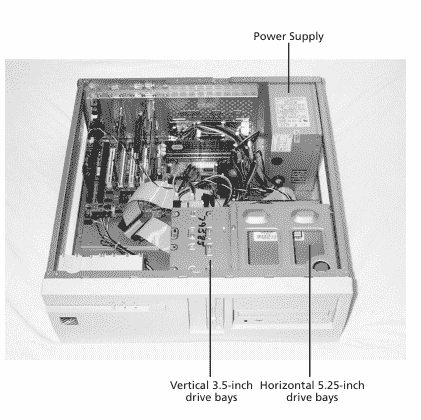

**图 4.1**
由于主板水平放置，台式机机箱往往便于操作。

> **注意**
> 许多台式机机箱并非设计用于承受当今大型 19 英寸和 21 英寸显示器的重量。即使是 17 英寸的显示器，对于某些机箱来说也可能过重。请务必查阅机箱的文档（通常只是一张纸）或联系机箱制造商，了解该机箱能支持多少重量。

现代台式机机箱的尺寸相当统一，因此它们在可支持的磁盘驱动器数量方面的容量也相似——大约支持两个 5.25 英寸和三个 3.5 英寸设备。它们的电源通常位于右后角，驱动器位（光驱位/硬盘位）位于右前角（参见图 4.1）。大多数台式机机箱将 5.25 英寸驱动器位水平安装，将 3.5 英寸驱动器位垂直安装，尽管有些设计也将 3.5 英寸驱动器位水平安装。5.25 英寸驱动器位水平放置通常很重要，因为使用托盘的光驱在垂直放置时往往无法正常工作。软盘、3.5 英寸硬盘、Zip 驱动器和磁带驱动器通常对方向不那么挑剔，因此将这些设备垂直放置不会造成问题。

最初的 IBM PC XT 和 AT 电脑将电源开关直接连接在电源上，位置靠近机箱右侧的后部。这种开关位置当然很别扭，较新的型号则将电源开关放置在前面板的某个位置。在这个电源开关附近通常有一个复位按钮、一个或两个用于指示电源状态和硬盘活动性的 LED 指示灯，偶尔还有其他开关或 LED。直到 1990 年代中期，指示 CPU 时钟速度的 LED 指示灯和防止电脑在未插入并旋转钥匙时运行的锁键开关并不罕见。Turbo 开关通常用于切换主板的某种速度增强功能。最后这三个功能在 ATX 机箱上相当少见。

### 塔式设计

由于台式机设计占用大量桌面空间，塔式配置应运而生。塔式设计的核心只是将台式机设计侧放，电源和驱动器位位于顶部（见图 4.2）。实际上，通常只需将台式机机箱侧放即可将其用作塔式机箱。这样做会带来一些问题，最主要的是当光驱垂直安装时，许多 CD-ROM 驱动器很难或无法装入光碟。（使用卡匣的 CD-ROM 驱动器在垂直方向上没有困难，且某些托盘式 CD-ROM 驱动器包含用于在驱动器垂直安装时固定光碟的卡扣。）

塔式机箱包含与台式机机箱相同的开关和前面板 LED 指示器组合——电源开关、一个或多个指示电脑电源状态和硬盘活动性的 LED，以及在较旧的机箱上指示 CPU 速度和锁键开关的 LED。

如果塔式机箱保持垂直配置，可能会难以操作，因为插入和移除扩展卡需要施加倾向于使塔式机箱倾倒的力。因此，在处理塔式机箱时，通常最好将其侧放。

塔式设计的一个优势是灵活性；无需调整电脑所占用的桌面面积（footprint），就可以制造更大或更小的塔式机箱——只需将塔式机箱做得更高或更矮即可。图 4.2 展示了一个*全塔式*（full tower）机箱，意味着它比大多数机箱都要大。*中塔式*（mid-tower）机箱大小与台式机机箱相当，只是侧放了。*迷你塔式*（mini-tower）机箱在低价电脑中非常流行。这些机箱比中塔式机箱更矮，且通常扩展空间非常有限。这些塔式机箱子变种之间的界限至多也只是模糊的；某人的全塔式可能是另一个人的中塔式。一些公司甚至可能使用不同的名称，或将范围划分为更多或更少的子风格。归根结底，重要的是机箱的尺寸和包含的驱动器位数量，而不是赋予它的名称。某些塔式机箱，特别是较大的型号，提供具有不同数量 3.5 英寸驱动器位的变体。

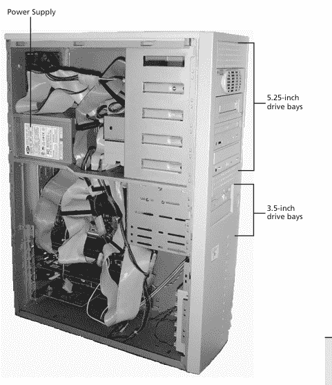

**图 4.2**
*像这样的全塔式机箱为扩展和内部设备提供了大量空间。*

## 瘦型机箱

如果你喜欢台式机设计但希望机箱更矮，瘦型设计可能正是你需要的。如图 4.3 所示，这些机箱比普通台式机机箱更矮——请注意，该机箱只有一个 5.25 英寸和一个 3.5 英寸磁盘位，一个叠在另一个上面，且这些位下方的空间比图 4.1 所示机箱中 5.25 英寸位下方的空间更少。

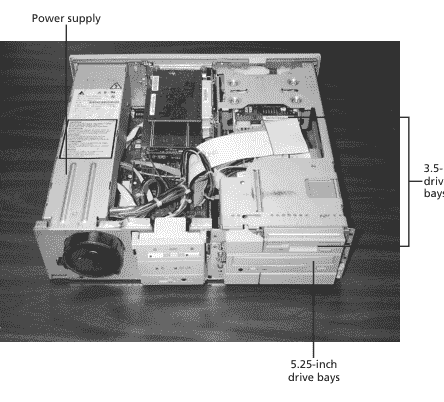

**图 4.3**
> 瘦型机箱（如此处的 LPX 型号）往往比传统机箱更拥挤。

瘦型机箱需要使用 LPX 或 NLX 规格的特殊主板。（我推荐 NLX，因为它更标准化且更新。）你不能将主板从常规台式机或塔式机箱移到瘦型机箱中，反之亦然。大多数瘦型电脑都以预装整机的形式由主要制造商提供。这些电脑通常面向商业台式机使用进行推广，但当然，如果你喜欢，也没有理由不能购买这样的电脑用于家庭使用。除非这些系统降低的高度至关重要，我倾向于选择普通的台式机或塔式设计，因为它们更常见，且通常提供更多的扩展空间。

在 x86 领域之外，电脑有时采用异常纤细的瘦型机箱。这些有时被称为*披萨盒*设计，因为它们比披萨外卖盒大不了多少。披萨盒电脑通常最多提供一到两个扩展槽，板载功能极少。x86 披萨盒电脑机箱相当罕见，当它们存在时，通常使用非标准主板设计。


## 特殊案例

如果你购买或组装一台新电脑，很可能会得到前述描述的机箱类型之一。重要的是要意识到，这些常见类型存在变体，甚至还有更专业的设计。

### 标准类型的定制变体

正如后文“将机箱与主板匹配”一节所述，大多数电脑机箱都设计用于与第 2 章“主板”中描述的某种标准主板类型配合使用。少数公司开发和销售其独特的设计。用于这些设计的机箱通常外观与普通台式机、塔式或薄型设计非常相似，但它们使用非标准的安装孔来固定主板，并且通常使用非标准的电源类型和机箱前面板。此类电脑在升级或维修时可能较为困难。如果你计划购买预装电脑，我建议询问其设计的这一方面。如果电脑遵循 ATX 等标准规格，那么与使用专有规格的电脑相比，你未来在扩展和更换方面将拥有更好的选择。

许多不使用 x86 处理器的电脑遵循其独特的规格。例如，苹果电脑并不使用标准的 x86 PC 布局。如果你想使用此类电脑，你可能别无选择，只能使用控制该架构的公司所支持的设计。

### 非常规机箱类型

在极少数情况下，常规的机箱类型集合可能无法满足你的需求。在这种情况下，你可能想要研究替代方案，例如：

- **笔记本电脑** 当然，笔记本电脑和膝上型电脑也需要机箱，但它们甚至比薄型机箱更加微型化。如果你自己组装台式电脑，通常可以将机箱与其他部件分开购买，但一般无法将笔记本电脑的机箱单独拆分开来购买。第 23 章“笔记本电脑”将更详细地介绍笔记本电脑。

- **机架式** 在某些情况下，*机架式电脑*是理想的。在这种设计中，主板和其他组件安装在一个开放式金属机箱内，很像车间货架系统。这种设计允许多台电脑集中存放在一个方便的位置。机架式设计允许快速轻松地访问所有电脑的组件。对于那些需要在小空间内安装大量电脑的场景（例如多电脑集群）尤其感兴趣（有关流行的 Linux 集群项目 `http://www.beowulf.org` 的信息请参考）。

- **服务器** 服务器机箱通常比平均机箱大得多，以容纳大量硬盘。此类机箱通常价格相当昂贵。


- **一体机** 偶尔，一体机会出现并变得相当流行。最近，这种设计因 1998 年苹果的 iMac（见图 4.4）而普及。eMachines eOne 使用非常相似的设计，采用 x86 硬件。一体机通常没有多少扩展空间，可能需要非标准主板，但它们比大多数电脑更便携，通常也更紧凑。现代一体机将大多数组件放置在与显示器相同的机箱中，但过去的一些一体机将关键组件放置在与键盘相同的机箱中。

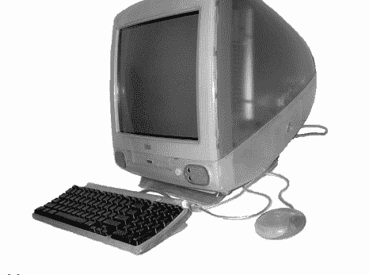

**图 4.4**

*一体机将主板、磁盘驱动器及类似组件放置在与显示器相同的机箱中。*

> **注意**
> 非常规机箱设计有时可能非常方便，但在升级时可能会带来麻烦。这对一体机尤其如此，但对机架式和服务器系统则没那么严重。你应该仔细考虑你所考虑的任何特定非常规设计的成本和收益。

## 将机箱与主板匹配

电脑机箱容纳了其他许多组件——软盘、一个或多个硬盘、CD-ROM 驱动器等等。间接地，机箱还容纳各种扩展卡，如显卡和声卡。所有这些组件都具有一或两种标准化尺寸，因此除非你简单地填满了所有可用的安装点，否则组件无法放入机箱的可能性很小。我在此列表中未提及的关键组件是主板。将主板与机箱匹配存在最大的潜在麻烦。当然，主板有标准化规格，但必须注意“规格”这个词的复数形式——如我在第 2 章中所述，存在几种不同的主板规格。即使你选择的主板和机箱遵循相同的规格，某些细节仍可能导致主板与机箱配合时出现问题。

## 主板布局与机箱

第 2 章中描述的每种主要主板布局都需要不同的机箱类型，尽管少数机箱设计用于支持多种主板规格。你最可能遇到的规格包括：

- **AT 和 Baby AT** 在 1995 年之前，AT 和 Baby AT 规格在台式机和塔式机设计中最为流行。AT 主板规格比 Baby AT 规格大，因此需要更大的机箱。能够容纳完整 AT 主板的机箱通常是中塔、全塔或台式机设计。能够容纳完整 AT 主板的机箱几乎总能支持 Baby AT 主板。这些主板也可以用于紧凑迷你塔式机箱。除非你已经有匹配的主板，否则我不建议今天购买新的 AT 或 Baby AT 机箱。在这种情况下，由于 AT 和 Baby AT 设计现已过时，我建议你寻找能处理 AT 或 ATX 主板的机箱，以便如果你将来决定升级主板，不会限制你的选择。

- **ATX、Mini-ATX、Micro-ATX 和 Flex-ATX** 与 AT 和 Baby AT 设计一样，这四种设计代表同一布局的变体，每一个依次代表更小的设计。由于 ATX 主板比 Baby AT 主板更宽而非更深，因此大多数 ATX 机箱是台式机、中塔或全塔设计。迷你塔式 ATX 机箱将电源侧向安装，为电源侧留出主板空间。这种布置在主板的该侧组件（通常包括 CPU 和内存模块）之间留有较少空间。迷你塔式设计更常用于较小的 ATX 变体。完整的 ATX 机箱通常可以接受较小的 ATX 变体，但并不总是如此。

- **LPX** LPX 是 20 世纪 90 年代中期及以前常见的薄型机箱设计。图 4.3 显示了一台 LPX 电脑。LPX 的细节并未完全标准化，因此有时很难将 LPX 主板与 LPX 机箱匹配。除非在特殊情况下（例如你以低价获得整套系统），否则我建议避免使用此类机箱及其相关主板。

- **NLX** NLX 是 LPX 的替代方案。结合了许多 ATX 的功能，如软件控制电源，NLX 比 LPX 更标准化，因此对于新电脑来说，NLX 是比 LPX 更好的选择。

- **WTX** WTX 是英特尔基于其新的 Itanium 处理器设计的新布局。与大多数早期机箱设计不同，WTX 包括关于所需机箱功能、机箱冷却等的规范。WTX 机箱在 2000 年初几乎不存在，但在 Itanium 发布后可能会变得更受欢迎。你可以从 `http://www.wtx.org` 了解有关 WTX 的更多信息。

一旦你决定了主板和机箱的规格，你应该考虑一些进一步的因素，以确保机箱和主板相匹配。

## 确保足够的机箱尺寸

从理论上讲，任何宣传用于特定尺寸主板的机箱都应该足够大，能够容纳该主板。然而，有时机箱和主板组合会导致异常紧密的贴合，或者某些机箱组件可能会阻挡主板的重要部分。这种困难在 AT 和 Baby AT 机箱中比在后来的设计中更常见，并且在小型机箱中比在大型机箱中更常见。理想情况下，你应该从同一家经销商那里购买机箱和主板，这样如果你遇到问题，就不会有经销商互相指责，彼此拒绝接受退货。如果你有条件检查你打算购买的主板与所选机箱的配合情况，请特别注意以下特征：

- **电源 clearance（间隙）** 在某些机箱上，电源悬垂在主板上部。请确保电源下方任何可能存在的组件有足够的 clearance（间隙）。

- **驱动器位 clearance（间隙）** 有时，3.5 英寸驱动器位紧贴主板，就像电源可能那样。与电源一样，请确保驱动器位为位于该位下方的组件留出足够的 clearance（间隙）。同样，你必须从主板或连接到主板的卡将电缆连接到安装在驱动器位中的驱动器。请确保你可以轻松完成此操作。某些机箱，特别是薄型设计，将一个或两个硬盘驱动器位放置在特殊位置，因此不要将驱动器位 clearance（间隙）检查限制在机箱前部的通常位置。


### 主板间隙
我见过一些机箱，在插入主板时，主板会直接与一个或多个组件（通常是电源）发生摩擦。这通常不会造成严重问题，但可能会对主板施加应力，最好能避免这种情况。

### 安装孔位置
请尝试确认机箱和电源在安装孔位置上有足够的重叠，以便安全地安装主板。我见过一些组合，特别是在 Baby AT 机箱和主板中，特别小的主板仅与机箱有三个左右的共同安装孔。这种情况会导致不稳定性，从而导致运行不可靠。

## 扩展空间

新计算机应像新房子一样，足够宽敞以容纳你的所有“物品”。然而，随着时间推移，你的“物品”很可能会扩展以填满可用的空间。在计算机中，这种扩展有两种形式：磁盘和其他类似磁盘的设备，以及插入主板的扩展卡。如果你购买或组装的新计算机扩展空间不足，你就必须做出艰难的选择来应对这些限制。

## 空闲驱动器托架

任何台式电脑机箱的主要特征之一是它为各种类型的驱动器提供多少*驱动器托架*（bays）——硬盘、软驱、CD-ROM 驱动器、磁带备份驱动器、Zip 驱动器等。对于大多数台式机机箱，每个托架可以分为以下四类之一：

- 外露式 5.25 英寸
- 隐藏式 5.25 英寸
- 外露式 3.5 英寸
- 隐藏式 3.5 英寸

隐藏式托架是凹槽式地嵌入计算机机箱内，使其容纳的设备不暴露在外。因此，隐藏式托架主要用于硬盘。当今计算机中的隐藏式 5.25 英寸托架很少见，因为绝大多数 5.25 英寸设备使用 CD-ROM 和磁带等可移动介质。目前大多数机箱至少拥有剩余三类中的各一个代表，但此规则也有例外。

**注意**

机箱配有面板，可以卡入未使用的外露托架前方。你也可以在外露托架中使用硬盘，并使用这些面板来阻止访问硬盘。如果你省略了这个面板，可能会扰乱机箱内的气流模式，并使硬盘更容易因意外撞击而受损。

在过去，托架通常按*高度*分类。*全高*托架可以容纳 1980 年代中期的巨型硬盘。随着时间推移，*半高*托架和设备应运而生，如今绝大多数 5.25 英寸设备都是半高的。*三分之一高*设备，顾名思义，其高度是全高设备的三分之一。大多数 3.5 英寸设备都是三分之一高的。某些机箱的设计允许你在至少一些托架中添加任意高度的设备，或根据需要整合它们。例如，一个托架可以容纳单个全高驱动器或两个半高驱动器。

在其他条件相同的情况下，你应该最大限度地增加所购买机箱中可用的驱动器托架数量。作为一般规则，外露托架比隐藏式驱动器托架更灵活，而 5.25 英寸托架比 3.5 英寸托架更可取。

**提示**

通过使用如图 4.5 所示的适配器，可以将 3.5 英寸组件安装在 5.25 英寸托架中。这些适配器中的某些（如图 4.5 所示的那个）是为硬盘设计的。其中一些包含风扇，以帮助冷却硬盘（其中一个出现在图 4.2 中靠近顶部的托架中）。其他适配器包含开口，可让你插入磁带、软盘或其他 3.5 英寸介质。

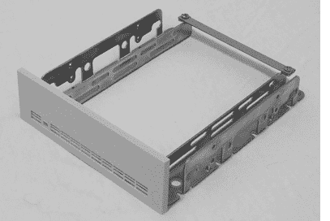

**图 4.5**
*你可以将 3.5 英寸设备安装在适配器的内部导轨上，然后将适配器安装在 5.25 英寸驱动器托架中。*

在塔式机箱中，从迷你塔式到中型塔式再到全塔式，你获得的主要好处是驱动器托架数量。由于 3.5 英寸设备通常是三分之一高的，而 5.25 英寸设备通常是半高的，因此增加 5.25 英寸托架会使机箱在尺寸上增加更多空间。

作为一般规则，我建议购买具有至少两个空闲驱动器托架的机箱，这些托架应超出你近期打算使用的托架数量。其中至少一个托架应为外露式 5.25 英寸托架。这给了你添加两个设备的灵活性，其中至少一个可以是可移动设备。

与托架相关的最后一个考虑因素是驱动器的安装方法。磁盘设备包含用于将驱动器固定到计算机机箱的安装孔。然而，许多机箱使用安装导轨。你将导轨附加到设备上，然后可以将设备滑入计算机。图 4.6 显示了一个示例。有时这些安装导轨的设计无需螺丝刀即可将设备从计算机中取出。

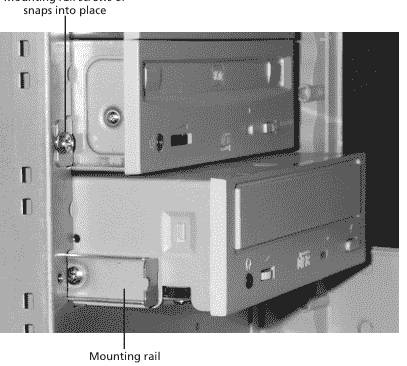

**图 4.6**
*安装导轨让你可以相对轻松地将设备滑入和滑出驱动器托架。*

## 后部面板开孔

大多数机箱的设计允许你通过机箱后部面板上的连接器连接外部设备，如打印机、外部调制解调器和鼠标。从机箱的角度来看，通常使用三种类型的连接器：

- **主板安装的连接器**
  如第 2 章所述，所有 x86 主板都至少有一个永久连接的连接器：键盘连接器。基于 ATX 及其变体的主板支持额外的连接器，通常包括串行、并行、USB 和 PS/2 鼠标端口。只要机箱是为你使用的主板类型设计的，机箱就包含相应的开口以让这些连接器通过。

- **卡片安装的连接器**
  插入式适配器卡，如视频卡、声卡和以太网卡，通常包含外部连接器或端口，如图 4.7 中的声卡所示。绝大多数 ATX 机箱背部有足够的开孔来容纳所有 ATX 主板，但偶尔你会发现 AT 风格的机箱，其主板上的插槽空间不足。

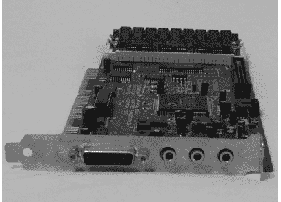

**图 4.7**
当插入机箱时，此卡前景中的四个连接器可以从计算机机箱的后部访问。

**注意**

连接器安装在其上的后部面板对于标准 x86 机箱中使用的所有类型卡片都是相同的。因此，机箱例如无需针对 ISA 和 PCI 插槽进行设计。事实上，你可以从机箱中移除全 ISA 主板并替换为全 PCI 主板。

- **电缆连接的连接器**
  许多机箱在其后部面板上包含你可以击打出来的区域，以容纳通过排线连接到内部连接器的外部连接器。此类击打开口区域在较旧的 AT 风格机箱上特别常见，因为匹配的主板使用通过排线连接到外部连接器的端口。然而，即使在 ATX 系统上，此类击打开口有时也有用。例如，第 2 章中描述并在图 2.14 中展示的内部/外部 SCSI 适配器可以通过此类击打适配器连接。如果你的机箱缺少此类开口，你可以使用适配器，该适配器适合插入你未使用的扩展卡插槽开口。

大多数主板具有足够的后部面板开孔，尽管电缆连接连接器的击打开口区域在较大尺寸的机箱上最为常见。少数机箱，特别是主要计算机制造商的定制设计，将一个或多个适配器移至计算机的前面板。USB 和游戏端口适配器最有可能出现在此类计算机的前部。

## 谨防非标准设计

我已经警告过你，不要使用非标准的主板和机箱外形尺寸。然而，一些机箱以更微妙的方式是非标准的。此类机箱可能支持标准主板尺寸，但使用其他非标准组件。例如，许多来自大型计算机公司的计算机使用前部面板以有趣的方式弯曲。这些弯曲通常需要 CD-ROM 驱动器和其他可移动介质设备使用不寻常的弯曲前部面板。如果你需要更换此类驱动器，在添加新驱动器时可能会面临困难的任务，因为它可能不适合，或者至少会破坏机箱的美感。

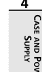


## 在空间不足情况下的扩展

如果你的机箱已经塞满，而你仍想再添加一个设备，该怎么办呢？你有几种选择：

- **整合设备** 有时你可能会将两台或多台设备整合为一台。例如，如果你有两块硬盘，你可以用一块容量更大的单硬盘来替换这两块硬盘，从而腾出一个驱动器托架。如果你有一个 LS-120 驱动器，你可能就不需要 3.5 英寸软驱了。同样，也有支持两个以太网端口的网卡，组合以太网/SCSI 卡，以及其他多用途扩展卡，这些都能让你充分利用有限的背板空间和主板插槽。

- **添加外部机箱** 某些设备提供外部机箱。SCSI 设备尤其适合外部放置，许多 SCSI 设备都可以购买内部或外部两种版本。你可以通过将内部 SCSI 设备移入外部 SCSI 外壳来将其转换为外部设备。甚至有用于将 EIDE 设备转换为外部使用的套件。不幸的是，外部机箱的价格几乎与完整的电脑机箱一样高，因此这种解决方案的成本会迅速攀升。

- **更换机箱** 也许你正在阅读这一章，是因为你在考虑采取这种措施。在空间不足时，这通常是最便宜的解决方案，特别是当你需要添加两台或多台设备且两者都没有空间安装时。

## 评估电脑机箱

一旦你确定了机箱的基本特性——AT、ATX、NLX、WTX 或其他设计；台式机、迷你塔或塔式；以及托架的数量和类型——你就可以开始选购了。我建议您亲自购买机箱，因为许多细节并没有出现在广告中。不过，一些机箱厂商通过在网页上发布大量清晰的图片（包括关键功能的特写）来方便网购用户。

### 构造材料

在过去几年里，大多数电脑机箱几乎完全由金属制成，唯一的例外是前面板，它通常是塑料材质，带有部分或完全的金属背板。如今，许多机箱由塑料制成，通常内部有金属衬里以屏蔽射频（RF）传输。


在美国，联邦通信委员会（FCC）对几乎任何发射射频辐射的设备都有管辖权。电脑电路板在运行过程中会产生此类传输作为副产品，这些传输会并且确实会干扰电视和收音机等设备。设计不良的机箱可能会泄漏射频干扰，如果邻居将问题追溯到你的电脑，你可能会被法律要求关闭电脑，直到其修复为止。一些机箱厂商声称他们的机箱是“FCC A 类”或“FCC B 类”设备，意味着它们分别符合商业或家庭使用的射频发射标准。然而，这些说法是错误的；FCC 并不对单独的组件进行评级，只针对完整的电脑进行评级。

只要具有塑料外壳的机箱内部有坚固的金属层来屏蔽射频发射，从性能角度来看，没有理由偏好某种类型胜过另一种。塑料机箱越来越多地以各种颜色和形状出现，你可能会（也可能不会）觉得这些很有吸引力。

### 检查是否偷工减料

电脑机箱的价格差异很大。在基本形态上，机箱是带有部分成型金属部件以固定硬盘和其他电脑组件的金属盒子。因此，制造商降低成本的一种方式有时是对机箱的金属边缘进行不完全的加工处理。不幸的是，这种削减成本措施可能会割伤其他东西，比如你的手指。最好的机箱会折叠金属部件的边缘，特别是沿机箱盖的边缘，如 图 4.8 所示。一种较便宜的安全措施是将金属边缘打磨至光滑——或者至少比最初切割时不那么粗糙。一些机箱采用这两种技术，通常将折叠边缘技术保留给可拆卸的盖子和面板，并将内部边缘打磨光滑。在其他条件相同的情况下，大量使用折叠边缘技术的机箱更受青睐。

大多数机箱都有一个或多个薄弱环节——那些异常廉价且容易损坏的组件。例如，图 4.8 展示了一个塔式机箱前面板上断裂的塑料铰链。该铰链的设计初衷是让前面板摆动然后从机箱主体上分离。问题在于它容易与配对的金属部件发生刮擦和卡滞。最终结果是顶部边缘（图 4.8 中左侧）严重磨损，底部边缘（图 4.8 中右侧）完全断裂。你应该检查机箱部件，特别是涉及任何移动的塑料部件，查看是否有它们可能过早断裂或无法执行其设计功能的迹象。

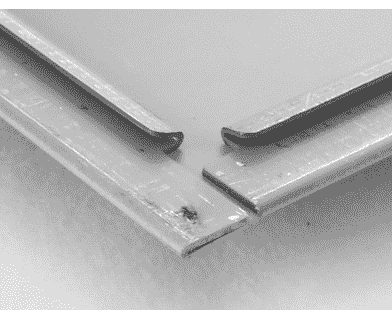

**图 4.8**
*这种机箱面板的折叠边缘不会割伤你的手指。*

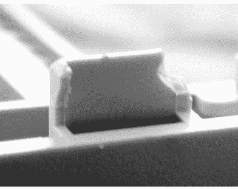

**图 4.9**
*塑料卡扣或铰链容易断裂。*

## 评估易访问性

如果你因任何原因需要打开电脑以移除、更换或添加组件，你就必须关注这些组件的易访问性。以下是需要关注的一些事项：

- **开启的便利性** 20 世纪 90 年代中期的机箱几乎无一例外地需要 4–6 颗螺丝来固定机箱。你会在取下机箱盖之前拆除这些螺丝。一些机箱使用手拧螺丝代替普通螺丝，你可以购买 aftermarket（售后市场）的手拧螺丝来替换旧机箱上的普通螺丝。一些设计使用更少的螺丝，或使用卡扣代替螺丝，这样就不必拧开任何东西就能打开机箱。

- **面板数量** 一些机箱只有一个开口，通常是一个弯曲的金属片，覆盖机箱的三面。这些面板很难移除和更换，特别是在全塔式设计中。其他电脑使用单独的面板覆盖电脑的每一侧，当你只需访问电脑的一侧时，这可能很方便。一些机箱要求在移除另一个面板之前先打开一个面板；例如，你可能需要在打开主机箱盖之前先移除前面板。这些设计可能不方便。

- **访问位置** 大多数机箱要求你操作机箱后部的某个部分才能访问内部。操作可以是移除螺丝，或者简单地挤压卡扣。其他机箱允许你通过对电脑前部进行类似操作来进入。在其他条件相同的情况下，前部访问通常比后部访问更容易。一些塔式机箱现在具有可以向外或向下摆动的侧面，如果你有足够的侧向空间，这会非常便利。

- **被遮挡的主板组件** 特别是在小型机箱中，驱动器托架、电源和其他机箱组件有时会遮挡对主板组件的访问。例如，内存插槽可能隐藏在驱动器托架后面。尽量避免此类设计。

- **主板托盘** 有时很难将主板装入机箱。一些机箱通过使用可拆卸的主板托盘来简化这种访问。你将主板安装在一个可以轻松地从机箱中滑出或提出的机箱组件上。在这些设计中，最好的情况是，主板托盘包含扩展卡的外部插槽，因此你可以移除主板及其扩展卡，而不必从主板上移除扩展卡。这种设计允许轻松访问可能被机箱部件或机箱内电缆遮挡的主板组件。

- **驱动器托架的访问** 如果机箱要求将驱动器直接螺栓固定到托架上，请确保你能无障碍地访问托架的两侧。在某些电脑上，这种访问很麻烦，因为它可能需要移除主板或位于你想要访问的托架侧面的驱动器托架。使用导轨的机箱通常提供更方便的驱动器访问。


# 第一部分

在检查商店中的电脑机箱时，试着想象一下各种电脑组件将会安装在机箱的哪些位置，以及执行常见升级步骤时需要哪些操作——例如添加内存、添加硬盘、添加扩展卡，或者更换 CPU。

## 散热

大多数 x86 电脑机箱都包含一定的散热装置。大多数电源都装有风扇，但这个风扇的设计初衷更多是为了冷却电源本身，而非机箱内部。在 AT 式机箱中，电源风扇将空气吹出机箱，因此空气会通过机箱上现有的任何开口被吸入。理想情况下，吸入机箱的冷空气会流经扩展卡、硬盘和其他组件，以帮助它们保持凉爽。而 ATX 式机箱则相反，其电源从机箱外部吸入空气，并在机箱内部排出，通常直接流向 CPU。空气随后会通过专为散热设计的通风口流出机箱。

每种散热方式都有其优势。AT 式散热的优点是流经电脑组件的空气是冷的，而 ATX 设计中被吹入机箱的空气则已被电源加热。另一方面，ATX 式散热倾向于在机箱内部建立空气压力，这有利于散热，并且可以安装过滤器以去除灰尘颗粒。

某些组件，如 CPU、带风扇的硬盘以及某些高端视频芯片，会产生大量热量。为这些组件增加散热装置通常有益。最基本的散热类型是*散热器*。这是一种带有若干散热片的金属组件，如图 4.10 所示。由于金属是良好的导热体，散热器会随着其附着的组件一起升温。随后，空气可以流经散热器的散热片，将热量从散热器及发热设备中带走。为了改善散热效果，可以在散热器上安装风扇，以增加散热片周围的空气流动。

> **注意**
>
> 带风扇的散热器在 CPU 上尤为常见。务必确保你的散热器和风扇适用于你所使用的 CPU。某种散热器/风扇组合可能能很好地冷却某款 CPU，但对另一款 CPU 可能效果不佳。此外，在散热器和 CPU 之间使用*散热器硅脂*也很重要。这是一种导热性比空气更好的膏状物。其目标是使用适量的硅脂，仅填满 CPU 和散热器之间的空气间隙。正确涂抹后，在将散热器安装到 CPU 之前，硅脂应仅表现为几乎难以察觉的油腻薄膜。你可以在大多数电子产品商店（如 Radio Shack，目录号 #276-1372）购买到散热器硅脂。

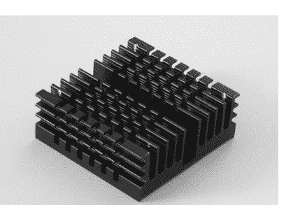

**图 4.10**
散热器的散热片会将热量从附着物体向外辐射。

大型电脑除了电源风扇和任何 CPU 散热器风扇外，还配备一个或多个辅助风扇并不罕见。最常见的两种类型是：

- **全机箱风扇**：典型的全机箱风扇是一个安装在机箱前面板或后面板上的 3 英寸方形风扇。根据其安装方式，风扇可以将空气强制吹入或吹出机箱。有些风扇带有过滤器，以防止灰尘进入机箱。一种变体设计可以插入未使用的 PCI 或 ISA 插槽，并通过后部端口通风。这种变体在较小的机箱上特别有用，因为这些机箱没有安装 3 英寸盒式风扇的固定点。

- **硬盘风扇**：随着硬盘转速的提高，其产生的热量也随之增加。事实上，如果不提供足够的冷却，现代最快的硬盘会因热量积聚而迅速自我损坏。因此，像图 4.5 中所示的用于 3.5 英寸硬盘的 5.25 英寸安装支架，现在也带有前置风扇。这些风扇旨在冷却现代 3.5 英寸硬盘。你应该查阅硬盘手册以了解是否需要此类风扇，但作为一般规则，所有 10,000rpm 硬盘都应进行如此冷却。许多 7,200rpm 型号也能从中受益。

## 电源

大多数机箱都配有电源。每种类型的机箱——ATX、AT 塔式、AT 桌面式等——都使用尺寸和形状不同的电源。此外，每种主板类型使用不同的电源连接器。最重要的是，AT 及相关主板使用两个提供 5v 的电源连接器，而 ATX 及相关主板使用一个提供 3.3v 的连接器。

购买机箱时，应考虑机箱电源的功能。如果电源故障或不满足需求，你可以购买新的电源来替换机箱自带的电源。这样做时，你需要考虑电源的功能特性。

### 估算所需容量

电脑电源并不是电脑的无限电源。过度加载电源是可能的，这会导致不稳定行为。每种电源内部也有有限数量的电源连接器，如果用完了这些连接器，就需要使用特殊的电源分接电缆来增加更多连接器。

### 电源电气容量

要理解电源容量，重要的是从三个与电力相关的测量指标之间的基本关系开始：伏特 (v)、瓦特 (W) 和安培 (amps)。这个关系是：

瓦特 = 伏特 × 安培

例如，如果一个 5v 设备消耗 10 安培，则消耗 50 瓦。电源容量以瓦特衡量。例如，一个电源可能额定为 235W。然而，要理解这如何转化为伏特和安培，需要了解相关设备消耗的电压。事实上，连接到现代电脑的各个设备在 3.3v、5v 和 12v 下消耗的功率各不相同。因此，要理解电源的容量，必须了解在给定电压下它能提供多少瓦特或安培。例如，一个电源可能能够在 3.3v 下提供 14 安培，在 5v 下提供 22 安培，在 12v 下提供 8 安培，总计 252.2W。然而，许多电源包括电压组合的最大总输出。例如，3.3v 和 5v 运行可能有 125W 的最大值，导致调整后的总瓦数为 221W。

如果你想仔细挑选一个足够容量的电源，你应该寻找电脑中每个组件的功耗需求规格。不幸的是，对于某些组件（如大多数扩展卡），很难找到此类信息。表 4.1 总结了不同类型设备所需的典型功耗。

**表 4.1** 各种设备的安培功耗

| 设备 | +3.3V | +5V | +12V |
|---|---|---|---|
| ISA 卡 | 0 | 2.0 | 0.175 |
| EISA 卡 | 0 | 4.5 | 1.5 |
| 16 位 MCA 卡 | 0 | 1.6 | 0.175 |
| 32 位 MCA 卡 | 0 | 1.6 | 0.175 |
| VL-Bus 卡 | 0 | 2.0 | 0 |
| PCI 卡 | 7.6 | 5 | 0.5 |
| 3.5 英寸软驱 | 0 | 1.5 | 1.5 |
| 3.5 英寸硬盘 | 0 | 0.5 | 1.0 |
| CD-ROM 光驱 | 0 | 1.0 | 1.0 |
| 风扇 | 0 | 0 | 0.1 |

扩展卡数值为最大值；其他设备的数值为典型值。

主板的功耗随 CPU 而变化。请注意，稳压器（在使用电源未提供的任何电压等级时必需）会导致一些损耗，因此实际消耗的瓦数大于通过伏特乘以安培计算出的预期值。

作为一个例子，考虑一台有一张 ISA 卡、两张 PCI 卡、一个 3.5 英寸软驱、两个 3.5 英寸硬盘、一个 CD-ROM 光驱和两个额外散热风扇的电脑。将这些数值相加，这台电脑需要从 3.3V 获取 50.16W，从 5V 获取 77.5W，从 12V 获取 70.5W，总计 198.16W。主板也会消耗几瓦的额外功率——具体数值可能约为 25W，取决于主板和 CPU。

当然，并非所有设备都会同时需要其最大功率。通常，例如，硬盘在启动时需要大量电力来克服停止的磁盘盘片固有的惯性。磁带备份单元除非在运行中，否则消耗的电力很少；软驱也是如此。这一事实意味着，电源在大多数时候可能足够，但在某些时刻（如硬盘启动或同时使用磁带驱动器和 CD-ROM 光驱时）仍可能失败。如果在使用某设备时遇到问题，可能是电源容量不足造成的。


### 提示

> 如果您拥有多块 SCSI 硬盘，可以通过配置 SCSI 驱动器，使其仅在 SCSI 主适配器发出指令时才启动，从而减少启动时的电力消耗。大多数驱动器都可以通过跳线设置进行此类配置，通常称为“*远程启动*”或类似的名称。这样，驱动器将在主板完成初始测试后通电，随后 SCSI 主适配器依次向每个驱动器发出启动信号，防止它们同时启动。

作为一般经验法则，235W 的电源对于小型系统是足够的。如果您添加了不止几块磁盘设备或大量高功耗扩展卡，可能需要提升电源的容量。ATX 系统有 300W 和 400W 的电源可供选择，对于装满了设备的塔式系统来说，这些电源相当理想。

## 电源线

电源容量的另一个方面是电源提供的电源线数量及类型。大多数设备（包括硬盘、CD-ROM 驱动器和磁带备份驱动器）使用标准化的四针电源连接器，这种连接器带有定位键，只能以单一方向插入设备。3.5 英寸软盘驱动器使用较小的连接器，而主板则根据主板类型不同，使用一个或两个连接器。

## 警告

> AT 和 Baby AT 主板使用一对电源连接器，必须将黑色导线并排插入主板。如果电源连接器插反，您可能会损坏主板！

如果您添加的设备数量超过电源拥有的连接器数量，可以使用一个或多个电源分线器（如图 4.11 所示）来增加连接器数量。您不再是将电源插头直接插入磁盘驱动器或其他设备，而是将其插入分线器，然后让分线器为两个（而不仅仅是一个）设备供电。

虽然内部电源分线器非常有用，但您不应过度使用它们，原因有二：

-   如果您需要很多电源分线器，这可能是电源容量超负荷的迹象。使用一两个分线器可能不成问题，但如果需要半打（六个），可能就需要考虑更换容量更大的电源了。
-   每个电源分线器都代表一个潜在的故障点。如果电源分线器的连接松动，连接的两个设备都可能失效，有时原因甚至难以查明。我曾被一个接触不良的电源分线器导致奇怪的硬盘问题困扰过。

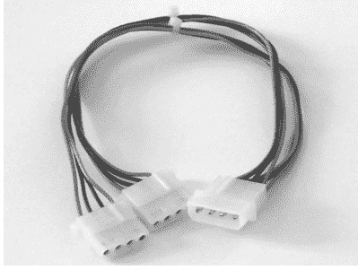

**图 4.11**
*电源分线器允许您向计算机添加设备，即使电源没有足够的电源引线。*

## 开/关开关

x86 PC 上常见三种开/关开关类型：

-   **集成在电源中** 这种开关常见于台式机 AT 型机箱，它们是电源的一部分。可以从机箱外部访问这些开关——在台式机系统中，通常位于机箱后部右侧。一些 ATX 电源也包含可从计算机背部访问的开/关开关，但这些开关是主 ATX 电源开关的辅助开关。
-   **电源上的远程开关** 大多数 AT 型塔式系统都在机箱正面安装了一个拨动开关。这些开关通过电缆连接到 AT 电源。开关本身与计算机机箱匹配，连接电缆到开关可能很麻烦，这使得更换此类电源比更换其他类型电源稍显棘手。
-   **通过主板的远程开关** ATX 及相关主板设计旨在时刻汲取微量电力。这种电流为监测各种事件的电路供电，这些事件可能导致系统自行通电，例如电话铃响或用户按下机箱正面的电源按钮。在这些系统中，电源按钮因此连接到主板，而非电源，主板介导所有通电过程。ATX 机箱通常配有电源按钮，而非拨动式电源开关。

您的机箱类型决定了您获得的电源开关种类。由于如今 ATX 规格非常普及，您的电源开关很可能是由主板介导的设计。一些 ATX 电源在背部带有开关。这一功能非常理想，因为它允许您在未拔掉计算机的情况下切断所有电路的电源。这使得您在操作计算机时更加安全，无论对您还是对计算机都是如此。

> **警告**
> 如果您的 ATX 电源没有电源开关，在打开机箱内部工作之前，您应将计算机从墙壁插座拔掉，以消除主板杂散电流造成伤害的可能性。不幸的是，这种做法去除了接地最便捷的方式——触摸机箱的金属部分——因此增加了您通过静电放电损坏计算机的可能性。为了降低这种风险，请使用防静电手腕带，或在可以频繁通过触摸管道设施或散热器接地的地方工作。

如果您有一个带有远程电源开关的 AT 型机箱，在更换电源时必须将电源连接到开关。大多数电源都有一个图表，指示如何建立这些连接，但如果您的电源缺少此图表，请按以下方式连接：

-   如果存在绿色导线，它是接地线。将其连接到机箱上任意方便的金属部件。
-   黑色和白色导线连接到电源开关上的斜角接线片。
-   棕色和蓝色导线连接到开关上相互平行的接线片。

## 警告

当电源插头插入时，棕色和蓝色导线始终带有电流！因此，您应该*在*将计算机从墙壁插座拔掉*之后*再尝试连接或断开这些导线！

## 电源质量

与所有产品一样，电源在质量上存在差异，尽管消费者很难察觉这种差异。电源质量的差异体现在向机箱内设备供电的稳定性上，即使是在提供给计算机的电流出现波动时也是如此。随着时间推移，电压波动可能会损坏或摧毁计算机内部的组件。在极端情况下，电源可能会输送过多的电力，或以错误的电压输送电力，从而快速摧毁计算机。

在一定程度上，您可以依靠认证来确保最低的质量标准。在美国，保险商实验室（UL）对包括电源在内的电气产品进行安全认证。其他国家的等效机构包括加拿大标准协会（CSA）、德国的 TÜV Rheinland 和 VDE，以及挪威的 NEMKO。

少数制造商，尤其是 Astec（http://www.astec.com）和 PC Power and Cooling（http://www.pcpowercooling.com），以生产异常高质量的电源而闻名。如果您想获得尽可能最高质量的电源，只要购买的电源满足您的瓦特数要求，选择这两家公司的产品都不会出错。

如果您的电源失效，您可以从各种当地或邮购电脑零部件供应商处获得替代品。通常来说，任何销售机箱的商店也销售电源。请务必确保您购买的替代电源在规格上与被替换的电源相匹配（AT、ATX 等）。您通常需要通过拧下机箱外部后部的四颗螺丝，将电源从机箱上拆下——但请务必使用正确的螺丝，因为一些电源自带螺丝，且其位置也从机箱后部可触及。然后，您必须将电源到所有内部设备（主板、硬盘、软驱等）的所有电源引线断开。如果是 AT 电源，您必须将电源从机箱主开关上断开。之后，您可以移除电源，并对新单元执行相反的操作。


## 电力保护

电脑是一种昂贵的产品，你很可能会希望保护它免受意外损害。与电力相关的意外事故对电脑尤为相关，其形式有两种：电力不足（电压下跌或停电）或电力过剩（浪涌）。在美国，市电通过墙壁插座以 120V 的电压提供，但该数值总会有些微小的波动。虽然包括电脑在内的电器设备能够承受一定程度的波动，但较大的波动可能会造成严重损害。你可以购买几种不同类型的设备来保护电脑免受电力问题影响：

- **浪涌抑制器** 浪涌抑制器（也称为*浪涌保护器*）是一种阻挡大型电力浪涌的设备。这些设备通常将危险电压重定向到家庭或办公室的地线中，从而使电脑脱离危险回路。在此过程中，浪涌抑制器通常会触发内部断路器，从而切断所有设备的电源。非常大的浪涌可能会损坏或摧毁浪涌保护器。其原理是，保护 $50 的浪涌抑制器而不是与其连接的 $5,000 的电脑设备更好，因此浪涌抑制器的设计是为了自我牺牲以保护电脑。美国保险商实验室（UL）制定了一项标准，称为 *UL 1449*，其中概述了合格浪涌抑制器的特征。你肯定应该在购买任何新的浪涌抑制器时寻找此标准。一些浪涌抑制器还包含电话线插孔，如果你使用调制解调器，这是一个非常有价值的补充。少数型号包含用于有线电视电缆的类似插孔，如果你使用有线调制解调器，你应该绝对考虑此类型号。（在百货公司的电视区比在电脑区更容易找到配备电缆接口的浪涌抑制器。）

> **注意**
> 一些浪涌保护器的电话线保护功能可能与数字用户线（DSL）调制解调器兼容，也可能不兼容。取决于你的布线情况，浪涌抑制器可能需要或可能不需要四线支持才能与 DSL 调制解调器配合工作。即使连接了相应的线路，为电话线和传统调制解调器设计的浪涌保护器有时也会干扰 DSL 操作，降低连接速度或完全阻止连接。如果你使用外部 DSL 调制解调器，可以购买专用的 DSL 浪涌抑制器，或购买以太网浪涌抑制器放置在 DSL 调制解调器和电脑之间。

- **线路调节器** 浪涌抑制器在保护设备免受大幅波动方面非常有用，但较小的电力波动也会造成损害。大多数电脑可以较为轻松度过诸如轻微电压下跌、典型电力波动甚至极短时间的停电等事件。然而，此类事件可能会导致电源比预期更早失效，甚至可能导致电脑故障。**线路调节器**通过强制电力更紧密地符合所需规格来防止这些问题。该设备可以补偿轻微的电压下跌，并将在一个数伏范围内波动的电压水平转换为稳定得多的水平。最终结果是电脑磨损减少，因错误导致的概率降低。

- **备用电源** *备用电源*（SPS）在功能上比线路调节器更进一步，它增加了电池备份。如果输送到 SPS 的电力故障或低于特定水平，电池就会启动，并在一段时间内继续提供电力。幸运的是，电池持续时间足够长，让你可以安全退出所有程序并关闭电脑。然而，当 SPS 切换到电池时，会有一个非常短暂的电力中断。大多数电脑电源都能轻松应对这种切换，但这种短暂的覆盖间隙是不受欢迎的，理论上可能会引起内存错误或其他问题，特别是如果电脑的电源质量较低的话。

- **不间断电源** *不间断电源*（UPS）在概念上与 SPS 相似，但设计不同。UPS 并不是在检测到故障时检测故障并切换，而是始终通过电池运行，同时对其进行充电和放电。因此，在电力故障时，你的电脑不会经历任何中断；UPS 的电池只是在未被充电的情况下开始放电。一些公司像宣传 UPS 一样宣传他们的 SPS，因此 *真 UPS* 等术语常用于 UPS。

最低限度，你应该为你的电脑系统购买一个浪涌抑制器。事实上，我在所有昂贵的电器上，如电视、音响等都使用浪涌抑制器。浪涌抑制器的缺点是它不提供针对停电的保护。如果你居住的地区经常出现停电，UPS 或 SPS 是一个非常有用的设备；你可以像什么都没发生一样度过几分钟的停电，并在发生较长时间故障时安全关机。正如你所料，随着从浪涌抑制器升级到 UPS，这些设备的成本也会上升。

除了最低端等级的 UPS 之外，都包含一个到电脑的接口。此接口通常是一条串行电缆，你可以运行一个 Linux 程序来监控 UPS 的状态。在电力故障时，守护进程可以命令你的 Linux 电脑安全关机，从而省去你的麻烦，甚至在你不在场时也能这样做。然而，UPS 与电脑通信的方式各不相同，因此你应该研究可用的 UPS 软件。一些 UPS 制造商为其 UPS 提供 Linux 软件，但对于其他品牌，你可能需要依赖适用于多个型号的通用 Linux 软件，或者你可能完全无能为力。Linux UPS HOWTO 文档（随所有主要 Linux 发行版提供）提供了关于 UPS 型号和 UPS 软件的更多具体指引。

### 摘要

电脑机箱是电脑最具外部可见性的组件，可能除了显示器、键盘和鼠标之外。机箱容纳了大多数电脑的主要计算设备——主板、CPU、硬盘、扩展卡等。选择机箱不当可能会让你在未来数月或数年内感到烦恼，因为每当升级其他组件时都要与其斗争，或者因其笨拙的尺寸而抱怨。亲自检查机箱并寻找几个关键功能，可以很大程度上确保你拥有一台可以与之共处的电脑。

机箱最重要的组件之一是电源。选择电源时最重要的问题是获得一个能为机箱内组件提供足够瓦数的电源。当今常见的 235W 电源对于大多数中等配置的电脑来说是足够的，但如果你预计系统会配备许多硬盘、内置磁带驱动器、六个扩展卡等，你可能需要考虑更大的电源。

# 第二部分

### 存储

### 本部分涵盖

- 第 5 章 硬盘 135
- 第 6 章 可移动磁盘 167
- 第 7 章 光盘驱动器 191
- 第 8 章 磁带备份 227
- 第 9 章 SCSI 主机适配器 257

## 硬盘

## 第 5 章

## 本章涵盖

- Linux 磁盘空间需求 136
- EIDE 与 SCSI 磁盘 143
- 评估磁盘性能 151
- 硬盘尺寸 156
- 在 Linux 中调整磁盘性能 158

硬盘使用相当成熟的技术，并且在接口方面标准化程度很高。因此，你在特定型号的硬盘上不太可能遇到与 Linux 相关的困难。（然而，SCSI 主机适配器是另一回事。第 9 章“SCSI 主机适配器”对此事有更详细的说明。）因此，当你购买硬盘时，很少有必须考虑的 Linux 特定问题。从各方面来看，适用于任何其他操作系统的良好硬盘也适用于 Linux。

在 Linux 中*使用*硬盘的方式与其他操作系统略有不同。Linux 使用自己的文件系统（目前是 ext2fs，尽管至少有四个新文件系统正在竞争成为下一个标准的 Linux 文件系统）。你可能会为 Linux 分区硬盘的方式与为大多数其他操作系统分区的方式不同。此外，还有可用的 Linux 工具可以帮助你从硬盘中获得更好的性能。本章涵盖这些问题，以及硬盘技术的基础知识。

## Linux 磁盘空间需求

与内存需求一样，官方 Linux 磁盘空间需求因发行版而异，但两个发行版的类似配置将需要类似数量的磁盘空间。与内存需求一样，大多数最小磁盘空间需求都相当节省。在某些情况下，根据你特定的使用模式进行调整可能很棘手，特别是如果你对 Linux 不熟悉的话。

## 所需最小空间

表 5.1 总结了各种流行 Linux 发行版的官方磁盘空间需求。

**表 5.1 Linux 发行版的官方磁盘空间需求**

| 发行版 | 最小磁盘空间 |
| :--- | :--- |
| Caldera OpenLinux 2.3 | 170MB |
| Corel Linux 1.0 | 500MB |
| Debian GNU/Linux 2.1 | 35MB |
| Linux Mandrake 7.0 | 500MB |
| Red Hat Linux 6.1 | 250MB |
| Slackware Linux 7.0 | 80MB |
| SuSE Linux 6.3 | 300MB |

通常不可能在少于官方最小磁盘空间的情况下安装发行版，因为安装例程不允许你移除包以降低磁盘空间需求。然而，安装官方最小配置通常是可能的，并且


然后在安装完软件包后将其移除。因此，如果你有磁盘空间可以*临时*安装 500MB 的软件包，你可以安装像 Corel 或 Mandrake 这样的大型发行版，然后移除不需要的软件。

与内存（RAM）类似，一些发行版的最小要求部分基于对将安装和使用的程序的较为宽泛的假设。例如，Debian 和 Slackware 的 **35MB** 和 **80MB** 最小要求是基于仅文本模式的 Linux 安装。虽然 X 窗口系统（X）*可以*在少于 100MB 的空间内安装，但当你添加有用的实用工具——尤其是像 GNU 网络对象模型（GNOME）或 K 桌面环境（KDE）这样的桌面环境时——仅 X 所需的磁盘空间很可能就会超过 100MB。

作为一个经验法则，我认为 **200MB** 是仅文本 Linux 安装的基本最小磁盘空间要求，而 **500MB** 则是包含 X 和合理数量基于 X 的程序配置的最小要求。随着当今硬盘容量通常超过 10GB，这些最小要求并不难满足，即使硬盘在 Linux 和其他操作系统之间分割也是如此。

## 估算满足你需求的存储空间

Linux 的新用户经常在 Usenet 新闻组发帖，询问应该为 Linux 分配多少磁盘空间。答案几乎都是“视情况而定”，而且这是有充分理由的。最小磁盘空间要求（如那些印在 Linux 发行版盒子上的）可以告诉你一个最小的 Linux 系统，甚至是配置为执行某些特定类型任务的 Linux 系统需要多少空间。当决定*你*在*你的*计算机上需要多少磁盘空间时，这些估计通常帮不上什么忙。更困难的任务是确定如何*分区*你的磁盘空间——也就是说，如何将其拆分为较小的块，以便于管理、安全及其他目的。

除了在一个非常大的磁盘上安装你想要的所有东西然后检查可用磁盘空间外，确定你需要多少磁盘空间的最好方法是考虑单个应用程序和用户的需求。以下是一些需要考虑的因素：

- **基本 Linux 工具** 对于大多数桌面用户来说，最小化的 Linux 安装大约消耗 500MB 的磁盘空间。这个总量包括像 X、GNOME 或 KDE、邮件客户端、编辑器、GNU C 编译器（GCC）、一些基本游戏等工具和实用程序。

- **额外的主要应用程序** 如果你打算运行特定的程序，如 StarOffice 或 WordPerfect 办公套件，请检查它们的磁盘空间要求。有时这些要求相当可观。例如，Activision 的（<http://www.activision.com>）或（<http://www.1okigames.com>）的 Linux 游戏《文明：权力召唤》需要 320MB 的磁盘空间。

- **额外的小型应用程序** 小工具也需要磁盘空间，而且这些要求会迅速累积。很难列举出你可能想要添加的所有小工具，所以最好根据你对将安装此类程序数量的预期，做一个粗略的猜测。假设每个小程序将消耗 1–5MB 的空间，然后乘以你打算安装的额外程序数量。

- **程序操作文件** 有些程序在常规操作过程中会生成大文件，或者大量小文件。例如，如果你打算在本地运行自己的新闻服务器，该程序会将新闻文章存储在你的硬盘上。如果你只处理少数小型新闻组，所需的磁盘空间可能很小。然而，如果你正在配置一个新闻服务器来处理成千上万可用新闻组中的十分之一，你需要计划为此分配数个 GB 的磁盘空间。你必须对程序有相当完整的理解，才知道它们在操作文件方面会生成什么。幸运的是，大多数终端用户程序不会生成巨大的临时或操作文件，只会生成它们设计用来创建的文件，如电子表格或文字处理文档文件。（许多程序确实会创建一个或多个临时文件，但这些文件通常不会比它们的最终数据文件大多少。）

- **终端用户文件** 除非你正在运行一个处理有限任务的服务器（如 Internet 路由器或新闻服务器），否则你的计算机将有一个或多个用户账户，并且你的用户将生成文件。如果你是该计算机的唯一用户，你可能能够估计你将生成的数据文件的大小和类型。它们将是商务信函、电子表格、程序源代码、图形文件、全运动视频还是其他什么？你生成的文件类型将决定为分配给用户文件的磁盘空间量。如果有多个人使用计算机，你必须为每个用户做出估计。如果你预计用户将生成相似类型的文件，你可以做一个估计，然后乘以用户数量。

一旦你达到了对你所需空间量的估计，将该估计乘以至少 3 来确定你需要多少磁盘空间。人们经常低估所需的磁盘空间量，即使没有发生这种情况，文件积累并填满所有可用空间的趋势也保证了磁盘空间迟早会被填满。

## 磁盘分区技巧

x86 PC 支持一种将磁盘空间划分为多个段的方法，称为分区。分区可用于将不同操作系统的文件相互隔离，或将单个操作系统的文件划分为逻辑组。在 Linux 和其他类 UNIX 操作系统中，使用分区有几个原因：

- **安全性** 将关键文件放在单独的分区上可以让你对挂载选项进行精细控制，这些选项可以影响用户如何访问分区的文件。例如，你可以将包含关键文件（如系统软件文件）的分区挂载为只读，以防止用户即使在目录权限出错的情况下向文件系统写入。

- **防止失控的文件创建** 有时，程序创建的文件比预期的要大得多。例如，如果你运营自己的邮件服务器，并且某个不礼貌或恶意的人发送了一封 1 GB 的电子邮件，该文件可能会消耗大量的磁盘空间——足以超出你的可用磁盘空间并导致其他程序出现问题。如果你将关键目录分割到单独的分区中，你可以减少此类溢出可能造成的损害，从而使系统基本保持运行。缺点是，每个分区都比原本要小，因此当磁盘空间消耗上升时，你更有可能遇到问题。

- **防止文件系统损坏** 磁盘错误是生活的一部分。当错误损坏磁盘分区时，如果该分区只持有你数据的一部分，情况会好得多。在发生完全且不可恢复的错误时，恢复一个包含你所有数据的大型分区比恢复一个包含部分数据的小型分区更容易、更快速。在非灾难性错误事件中，检查小型分区的错误通常比检查大型分区更快。

- **速度** 特别是如果你拥有多个硬盘，创建单独的分区可以提高系统速度，通过将磁盘访问分散到两个硬盘上。我将在本章稍后的“使用多个硬盘以获得更好的性能”部分中介绍磁盘分区的这一方面。

另一方面，创建许多分区也有其缺点：

- **分区大小的不确定性** 除非你是一位经验丰富的管理员，否则判断每个分区应该有多大可能很困难。错误的猜测会导致很多麻烦，当你调整分区大小或使用符号链接和奇特的目录结构来规避问题时。

- **性能降低** 如果你以非最优的顺序在磁盘上布局分区，可能会阻碍你的整体磁盘速度。


- **创建硬链接的能力减弱** *硬链接*是一种创建两个指向同一文件的目录项的方法。只有当两个目录项都位于与目标文件相同的分区上时，这样的链接才能存在。然而，你可以从一个分区到另一个分区创建一个*符号链接*。符号链接的运作速度比硬链接慢。

如果你是 Linux 新手，我建议你仅为以下两到四个分区做规划：

- **Swap 分区** 接下来我将描述的 Swap 分区，充当 RAM 的扩展区域。

- **根（/）分区** 所有 Linux 发行版都需要一个根文件系统，它位于一个硬盘分区上。所有其他分区都会挂载到根分区上的某个点，或者挂载到自身挂载于根分区或其他分区的分区上。图 5.1 展示了这种集成的目录树结构。

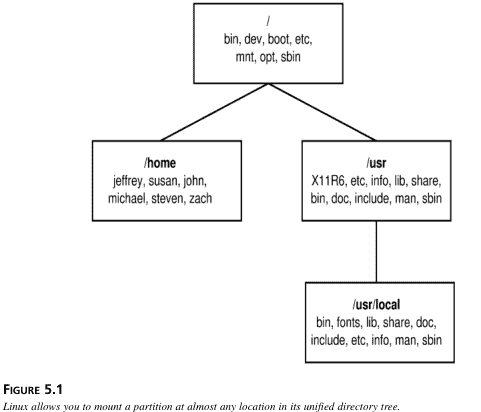

- **/home 分区** 大多数 Linux 发行版将用户文件放在名为 /home 的目录中；每个用户在 /home 目录下都有一个子目录。例如，在图 5.1 中，六位用户每人都有一个子目录来存储文件。将用户文件与操作系统其余部分隔离是分区最有益的用途之一，因为它提供了最大的好处之一。此外，大多数新管理员发现估算用户文件所需空间比估算 Linux 目录树中各个子目录所需空间更容易。

- **/usr/local 分区** 传统上，/usr/local 用于你自己构建的程序，而不是从预构建的软件包文件安装的。因此，这些文件是针对你的本地安装进行定制的。在升级操作系统时，通常希望保留这些文件，因此将它们放在独立的分区上是合理的。

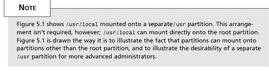

如果你之前使用过 Linux 并希望创建更高级的配置，你可能需要考虑为以下一个或多个目录创建额外的分区：

- **/usr** /usr 目录包含许多程序和配置文件。实际上，Linux 发行版的大部分都位于 /usr 目录中。

- **/usr/X11R6** 此目录包含与 X 相关的文件，包括 X 服务器和大多数 X 程序。

- **/opt** 许多最新的第三方程序默认安装在 /opt 中。由于许多与 /usr/local 相同的原因，将 /opt 分割成独立分区是一个不错的选择。有些人喜欢为 /opt 和 /usr/local 各创建一个分区，并让其中一个成为另一个中某个子目录的符号链接。

- **/var** /var 目录存储各种系统工具和服务器的运行文件。例如，大多数 Linux 系统将运行日志存储在 /var/log，打印任务通常存储在 /var/spool/lpd 中，直到它们可以被打印。邮件和新闻服务器也在此目录树中存储文件。主要作为这些程序服务器的系统，通常会将此目录分离到独立分区中受益。

- **/tmp** Linux 程序通常将临时文件存储在 `/tmp` 目录中。为此目录使用独立分区可以保护操作系统其余部分，以防某个程序创建了过大的临时文件导致问题。

- **/boot** 许多 Linux 发行版将 Linux 内核放置在 `/boot` 目录中。如果你的硬盘有超过 1024 个磁柱（所有容量超过 8GB 的硬盘都是如此），创建一个小型的（`~5–20MB`）且位于硬盘开始附近的 `/boot` 分区会很方便。这样，即使剩余部分在 1024 磁柱限制之上部分或完全失效，你也能确定可以从大型硬盘启动。

- **其他操作系统分区** 如果你的电脑同时运行 Linux 和其他操作系统，你可以创建专门用于访问那些操作系统文件的挂载点。例如，你可以创建一个 `/win2k` 分区来访问 Windows 2000 文件，创建一个 `/beos` 分区来访问 BeOS 文件。

即使是高级 Linux 管理员，可能也不想创建我这里概述的所有分区，尽管有些人会这么做。大多数管理员使用两到六个分区，加上一个 Swap 分区，并发现这已经非常充足。

## Swap 空间需求

第 2 章“主板”详细描述了创建和使用 Swap 空间的过程。当你为 Linux 分区硬盘时，最好将其中一部分空间专门用于独立的 Swap 分区。过去的经验法则是将相当于两倍物理 RAM 的空间分配给 Swap 空间。例如，如果你的电脑有 128MB RAM，你会分配 256MB 给 Swap 空间。然而，对于今天的大多数台式计算机来说，这种建议是过度的。在大多数情况下，一个大约等于 RAM 大小的值是足够的。但是，你对 Swap 空间的需求可能比这更高或更低。如果你发现自己通常不怎么使用 Swap，但偶尔需要运行某个特定程序时使用了大量 RAM，你可能想创建一个非常大的 Swap 分区来满足这种偶尔的需求。或者，你可以创建一个 Swap *文件*，并仅在你运行那些内存饥渴的程序时激活它。我在第 2 章中描述了如何创建 Swap *文件*。

如果你将 Swap 分区放置在靠近磁盘中心或你的 Linux 分区中心的位置，你将获得最好的系统性能。例如，如果你创建一个 1GB 的根分区和一个 1GB 的 `/home` 分区，你应该将 Swap 分区放置在这两个分区之间。这种放置方式最小化了对 Swap 分区的平均磁盘磁头寻道时间，从而提高了整体系统性能。

## EIDE 与 SCSI 磁盘

关于硬盘的最大争论之一是 *增强型集成设备电子*（EIDE）驱动器支持者与 *小型计算机系统接口*（SCSI）设备支持者之间的争论。所有现代 x86 主板都包含 EIDE 控制器，但要连接 SCSI 驱动器，通常你必须购买单独的 SCSI 主机适配器（有关 SCSI 主机购买的更多信息，请参见第 9 章）。每种技术都有优缺点，我将在本节中描述这些内容。

**注意**

术语 *EIDE*、*Advanced Technology Attachment*（ATA）和 *ATA Packet Interface*（ATAPI）指的是紧密相关的技术，*Integrated Device Electronics*（IDE）也是如此。一般规则是，*IDE* 和 *EIDE* 指的是硬盘，而 *ATA* 和 *ATAPI* 指的是非磁盘设备。*ATA* 有时与数字结合使用，以描述 ATA 接口的修订号，如 *ATA-2*（ATA 修订版 2）或 *ATA/33*（33Mbps 版本的 ATA）。

## EIDE 控制器

由于 EIDE 控制器内置于所有现代主板中，因此选择支持尽可能快形式的 EIDE 的主板很重要。你在 2000 年的主板中最可能看到的接口是 33Mbps 和 66Mbps 变体。这些变体可以以多种方式称呼——例如，33Mbps EIDE 接口可以称为 *ATA/33*、*Ultra-33* 或 *UltraDMA 33*。

## EIDE 的历史

IDE 是 EIDE 的市场前身，而 EIDE 顾名思义，是对 IDE 的增强。IDE 本身又是较旧的硬盘技术的后继者。这些较旧的技术使用电子电路极少的硬盘，并配合单独的接口板。IDE 将这两个组件整合为一个，因此得名。从主板的角度来看，IDE 控制器看起来就像旧类型驱动器的控制器一样。

直到 1990 年代中期，普通的 IDE 驱动器仍然很常见。这一时期及更早时期的 IDE 控制器使用一种称为*编程输入/输出*（PIO）的控制方法，在这种方法中，计算机的 CPU 获取传输到硬盘或从硬盘传输的每个字节。PIO 模式

这会消耗大量的 CPU 时间，因此在使用诸如 Linux 这样复杂的 multitasking OS 时并不可取。然而，最终 PIO 模式的局限性被 **直接内存访问** (DMA) EIDE 控制器所取代。DMA 控制器能够直接在内存之间传输数据，而无需 CPU 介入。这种设计大大减少了执行磁盘访问时的 CPU 负载，从而提高了 multitasking OS 中的整体系统性能。如今，所有主板 EIDE 控制器都可以在旧版 PIO 模式和新型 DMA 模式下运行。DMA 模式通常需要对每个芯片组使用独特的访问方法，而 PIO 模式则可以使用更加标准化的接口方法。你需要定制 Linux 驱动程序才能充分发挥 EIDE 控制器的性能。

## Linux EIDE 选项

编译 Linux 内核时，你会看到与 EIDE 芯片组支持相关的选项，如图 5.2 所示。这些选项分散在块设备内核选项菜单中。许多设备只有在选择通用 PCI IDE 芯片组支持和通用 PCI 总线主控 DMA 支持时才可用。其中一些驱动程序被认为是实验性的，只有在 *代码成熟度级别* 选项菜单中选择 *提示开发中/不完整代码/驱动程序* 时才可用。

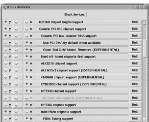

**图 5.2**  
*Linux 包含对各种 EIDE 控制器的广泛支持。*

## 注意事项

实验性驱动程序可能存在不稳定性，这意味着如果你试图使用它们，可能会丢失数据。尽管如此，其中一些驱动程序仍然相当可靠，但在使用时应谨慎。如果你通过开启相应的内核选项来启用实验性 DMA 支持，并使用 hdparm 启用 DMA 传输（如本章后面所述），随后开始遇到莫名其妙的磁盘错误或系统崩溃，请关闭 DMA 支持或尝试更新的内核，以查看 bug 是否已修复。

这些 EIDE 驱动程序可能在某些 Linux 发行版中可用或不可用。为了确认这一点，你应该重新编译你的 Linux 内核。这样做还有额外的优点，例如能够移除你未使用的驱动程序，以及为你的 CPU 和其他硬件优化内核的能力。

内核配置工具块设备部分列出的一些 EIDE 驱动程序是针对常见主板芯片组的 EIDE 支持，包括 Intel（Intel PIIXn 芯片组支持）、ALi（ALI M15x3 芯片支持和 ALI M14xx 芯片组支持）以及 VIA（VIA 82CXXX 芯片组支持）的芯片组。其他驱动程序是针对扩展卡上使用的芯片组，你可以在较旧的主板上使用这些扩展卡来提高 EIDE 速度。一些芯片组制造商（如 ALi）提供不止一种 EIDE 芯片组，因此会有多个条目。在某些情况下，例如 ALi，这些条目彼此相距较远，这可能会造成混淆。

除了启用你所使用的 EIDE 控制器的支持外，你还需要启用特定 EIDE 设备的支持。这些可能包括：

- **包含 IDE/ATA-2 磁盘支持** 如果你打算从 EIDE 硬盘启动，请将此选项设置为 Y（不要设为 M 用于模块化编译）。
- **包含 IDE/ATAPI CDROM 支持** 如果你有 ATAPI CD-ROM 驱动器，请将此选项设置为 Y 或 M。
- **包含 IDE/ATAPI TAPE 支持** 如果你有 ATAPI 磁带驱动器，请将此选项设置为 Y 或 M。
- **包含 IDE/ATAPI FLOPPY 支持** 如果你有可移动 ATAPI 磁盘驱动器，如 LS-120 或 Iomega zip 驱动器，请将此选项设置为 Y 或 M。
- **SCSI 仿真支持** 此选项允许你像访问 SCSI 设备一样访问 IDE 设备。当你拥有 ATAPI 版本时，在使用某些专为 SCSI 设备设计的软件时，此功能可能特别方便。例如，某些版本的 *CD 记录器* (CD-R) Linux 软件仅适用于 SCSI 设备。通过在 Linux 内核中启用 SCSI 仿真支持选项，可以使这些软件与 ATAPI CD-R 驱动器配合使用。

一般来说，Linux 对 Ultra-33 及以下 EIDE 的支持非常好，尽管某些控制器在此速度（或其最大速度）下不受支持，因此只能以较低速度运行。对 Ultra-66 EIDE 的支持已整合到 2.2.13 及后续内核中。默认附带较旧内核的许多发行版无法安装到使用 Ultra-66 EIDE 控制器的系统上。如果你遇到这种情况，你有几个选择：

- 安装 Ultra-33 或更早版本的 EIDE 控制器，并将你的硬盘连接上去。安装 Linux，然后编译更新的内核。完成后，配置系统从新内核启动，移除 Ultra-33 控制器，并将 EIDE 电缆重新连接到 Ultra-66 控制器。此时你的系统应该可以正常启动。
- 换上一个 Ultra-33 EIDE 控制器并安装系统。保留此控制器并使用它，而不编译更新的内核。如果你的 Ultra-66 控制器与 Linux Ultra-66 驱动程序特别不兼容，可能需要此选项。
- 切换到使用 2.2.13 或更新内核的 Linux 发行版，或者使用应用了适当 Ultra-66 支持补丁的较旧内核。Mandrake 7.0 和 SuSE 6.3 都与 Ultra-66 控制器兼容，随着 2000 年的临近，其他发行版很可能也会跟进。

## EIDE 磁盘的特性

所有现代硬盘的基本技术都非常相似，事实上，一些型号同时有 EIDE 和 SCSI 变体。（这种做法在过去比现在更常见。）尽管如此，EIDE 磁盘确实具有一些独特的特性，或者至少是有某些倾向：

- **低成本** 平均而言，给定容量的 EIDE 硬盘比相同容量的 SCSI 硬盘成本更低。
- **低性能** EIDE 硬盘低成本的原因至少部分在于它们的性能不如类似容量的 SCSI 驱动器。平均而言，EIDE 驱动器的缓存更小，转速较低，寻道时间较长。（我在“*评估磁盘性能*”一节中稍后描述了这些特性。）这种性能差异与 EIDE 和 SCSI 技术本身无关；相反，它是硬盘制造商将其最佳驱动器与哪种接口配对的因素。
- **低命令延迟** 由于 EIDE 接口的简单性，EIDE 驱动器对命令响应迅速。结果是，EIDE 驱动器有时比同等 SCSI 型号更快地返回第一个数据包。这一特性源于 EIDE 和 SCSI 之间的差异，但通常被其他性能因素所掩盖。
- **低容量** 在任意特定时间点，EIDE 硬盘覆盖的容量范围低于 SCSI 硬盘。例如，图 5.3 代表了 2000 年 2 月某主要互联网计算机零售商宣传的容量。请注意，EIDE 和 SCSI 可用的容量都有相当大的重叠，但 EIDE 的范围低于 SCSI 设备。

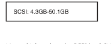

**图 5.3**  
EIDE 硬盘的可用容量不如 SCSI 硬盘高。

- **CHS 或 LBA 模式** IDE 硬盘传统上使用三个数字的标识代码来表示磁盘上的每个扇区。这种被称为柱面/磁头/扇区 (CHS) 寻址的代码，是硬盘几乎没有板载电子元件时代的遗留产物。最近，EIDE 驱动器增加了逻辑（在某些定义下为线性）块寻址 (LBA) 模式，在该模式下，使用单一数字来标识硬盘上的扇区。

除了这些 EIDE 驱动器的特性外，EIDE 接口本身还具有几个与本文讨论相关的特性：

- **两设备限制** 每个 EIDE 链（即连接到单个端口的设备）仅限于两个设备。大多数主板只包含两个 EIDE 端口，因此每个主板支持的 EIDE 设备总数仅为四个。对于拥有硬盘、CD-ROM 驱动器、CD-R 刻录机和 LS-120 或 zip 驱动器之类的现代系统来说，这个数量并不多。
- **非并发通信** 每个链上的两个设备不能同时通信；其中一个或另一个独占 EIDE 总线。
- **中断消耗** 每个 EIDE 链需要使用一个中断 (IRQ)。由于 IRQ 在现代 PC 上是非常有限的资源，每两个设备使用一个 IRQ 可能会是一个非常严重的问题，特别是当你超过现代主板支持的四个设备时。


总体而言，对于只装有一块或两块硬盘和一个光盘驱动器的低成本计算机，EIDE 是一个不错的选择。但当你开始添加更多设备时，EIDE 的局限性会迅速累积，从而成为一种严重的负担。此外，EIDE 驱动器通常不是市面上速度最快的选择，这也使得 EIDE 对于需要最佳磁盘性能的应用（如文件服务器或高性能计算）来说并非理想技术。

## SCSI 磁盘的特性

SCSI 一直是高速硬盘操作的优选。SCSI 硬盘的特性与 EIDE 特性互为补充：

- **高成本** SCSI 驱动器通常比同容量的 EIDE 驱动器更昂贵。部分原因源于 SCSI 接口，部分源于经济因素，部分则与驱动器性能有关。
- **高性能** 平均而言，同容量的 SCSI 硬盘拥有更大的缓存、更快的旋转速度以及更低的寻道时间，优于 EIDE 驱动器。
- **高命令延迟** SCSI 协议对命令施加的开销大于 EIDE 协议。因此，与 EIDE 驱动器相比，SCSI 驱动器响应命令的速度稍慢。
- **高容量** 你可以买到与大多数在售 SCSI 驱动器同样大的 EIDE 驱动器，但少数 SCSI 型号的容量超过了最高容量 EIDE 型号。
- **仅限 LBA 模式** SCSI 磁盘一直通过向主机适配器呈现磁盘的单一线性块地址视图来进行通信。如果计算机理解这种视图，这极大地简化了计算机的操作。不幸的是，x86 操作系统传统上使用 CHS 寻址，因此 SCSI 主机适配器会将 LBA 转换为 CHS 模式。

与 EIDE 和 SCSI 硬盘之间的差异同样重要的是 EIDE 和 SCSI 总线之间的差异。使 SCSI 总线区别于 EIDE 总线的特性包括：

- **7 或 15 个设备限制** 理论上，根据使用的 SCSI 变体不同，你最多可以将 7 个或 15 个设备连接到每个 SCSI 主机适配器。（*宽* SCSI 变体支持多达 15 个设备，而 *窄* 变体仅支持 7 个。）在实践中，电缆长度限制使得在窄链路上添加超过 5 或 6 个设备变得困难。每个 SCSI 设备都有唯一的 ID 编号，该编号通过跳线设置，或在较新的 SCSI 变体中可由主机适配器分配。
- **设备重用** 由于 SCSI 设备的数量限制远高于 EIDE 设备，向 SCSI 系统添加硬盘比向 EIDE 系统添加硬盘更具实际操作性。这意味着你最初在硬盘上的投资可以使用更长时间。
- **并发通信** SCSI 总线从一开始就被设计为支持并发通信。你可以开始与一个 SCSI 设备进行传输，然后同时开始与同一链路上的另一个设备进行第二次传输。只要各个设备速度之和不大于 SCSI 总线的速度，这两次传输都可以全速进行。仅这一因素就使 SCSI 在需要高性能磁盘系统时具有巨大优势。
- **中断消耗** 每个 SCSI 主机适配器，如同每个 EIDE 控制器一样，都需要一个 IRQ（中断请求）。然而，由于 SCSI 链路上可以连接更多的 SCSI 设备，SCSI 设备往往消耗更少的 IRQ。
- **终端** SCSI 总线由几个 SCSI 设备（包括 SCSI 主机适配器）串联组成。链路每端的设备必须正确*终端处理*，这是通过设置跳线或在 SCSI 电缆上添加特殊的终端电阻包来实现的。终端问题导致了 SCSI 设备出现的许多困难。
- **驱动程序问题** 与 EIDE 不同，SCSI 控制器并非早期 PC 硬盘接口的克隆。因此，Linux 需要为你选择的任何 SCSI 主机适配器提供专门的驱动程序；不像 EIDE 那样存在兼容的回退模式。（第 9 章“SCSI 主机适配器”对此事进行了更详细的介绍。）

如果成本不是问题，SCSI 将是硬盘总线的最佳选择。不幸的是，使用 SCSI 而不是 EIDE 通常会增加 PC 100 美元以上的成本，甚至可能达到 300–500 美元，具体取决于硬盘大小、SCSI 设备数量等因素。你确实能花这笔钱获得更高的性能，但对于低端或中端系统来说，这种支出可能并不划算。我确实强烈建议在需要多个类似磁盘设备的系统上使用 SCSI，例如磁带备份单元、CD-R 驱动器、Zip 驱动器等。仅这三个设备加上一个光盘驱动器和一个硬盘，如果以 EIDE 形式购买，就需要三个 IRQ 和一个附加的 EIDE 控制器。而以 SCSI 形式，这五个设备都可以连接到单一的主机适配器，并消耗单一的 IRQ。然而，最新的 SCSI 主机适配器在其他高速 SCSI 设备共同使用时，与最新磁盘设备的配合效果最佳。因此，在这类系统中，有时拥有两个 SCSI 主机适配器会更有帮助。

## 在单一系统中使用 EIDE 和 SCSI

在 Linux 中，你通过 /dev 目录中的条目来访问原始设备。EIDE 设备通过 /dev/hd<x> 进行访问，其中 x 是一个字母（a, b, c, ...），i 是硬盘分区的分区号；对于没有分区的设备（如光盘驱动器），则没有 i。SCSI 设备更加多样。SCSI 硬盘的标识方式与 EIDE 硬盘类似，只是设备文件名采用 /dev/sd<x> 的形式。SCSI 光盘设备文件名采用 /dev/scd<x> 的形式，其中 x 是从 0 开始的数字。

在 Linux 下使用同时包含 SCSI 和 EIDE 设备的系统并不困难；你只需在挂载或使用设备时使用相应的设备标识符即可。/etc/fstab 文件通常包含最常用分区和设备的这些标识符。作为一个例子，考虑一个带有 SCSI 硬盘和 EIDE 光盘驱动器的系统。/etc/fstab 文件可能包含以下条目：

| 文件系统 | 挂载点 | 类型 | 选项 | Dump | Pass |
| :--- | :--- | :--- | :--- | :--- | :--- |
| /dev/sda6 | / | ext2 | defaults | 1 | 1 |
| /dev/sda5 | /home | ext2 | defaults | 1 | 2 |
| /dev/hda | /mnt/cdrom | iso9660 | ro,user,noauto | 0 | 0 |

这些条目指定两个 SCSI 磁盘分区（/dev/sda6 和 /dev/sda5）将分别挂载为 / 和 /home。EIDE 光盘驱动器 /dev/hda 挂载为 /mnt/cdrom。

大多数计算机的 BIOS 配置为先从 EIDE 设备启动，然后再从 SCSI 设备启动。你可以混合使用 EIDE 和 SCSI 硬盘，但如果保持这种启动顺序不变，你需要在 EIDE 磁盘上安装 LILO。在大多数系统上，即使系统开始其启动进程并从 EIDE 磁盘加载 LILO，你仍然可以将 Linux 安装在 SCSI 磁盘上。如果你更改 BIOS 启动顺序，可能需要修改你的 /etc/lilo.conf 文件以反映这一事实，使用如下行：

```
disk=/dev/sda
bios=0x80
```

这些命令通知 LILO，BIOS 将 /dev/sda 视为第一块磁盘（代码 0x80）。如果没有此命令，如果你设置 BIOS 先于 EIDE 磁盘从 SCSI 磁盘启动，你很可能无法使用 LILO 启动 Linux。

## 1024 柱面限制

EIDE 和 SCSI 磁盘都受制于所谓的 1024 柱面限制。难点在于旧的 CHS 寻址模式使用一个 10 位数字来标识硬盘的柱面号。10 位数字可以容纳 0 到 1023 之间的值，因此 BIOS 可访问的柱面数限制在 1024 以内。已经开发了各种系统来规避此问题。许多操作系统（包括 Linux）在启动完成后并不受 1024 柱面限制的影响。问题出现在启动操作系统时，因为古老的 x86 BIOS 会受到 1024 柱面限制的困扰。鉴于扇区和磁头数量的限制，在现代硬盘上，1024 柱面限制大约对应略低于 8GB 的容量。早期的 BIOS 缺乏将其提高到如此高的功能，在这些驱动器上该限制可能低至 504MB。

无论 1024 柱面限制的确切值是多少，为了让 Linux 能够启动，必须将 Linux 内核放置在该限制之下。这是因为 BIOS 在 LILO 的指示下加载内核。一旦内核被加载，它就可以使用自己的磁盘驱动程序继续启动操作系统，而这些驱动程序不受 1024 柱面限制的影响。


如本章前面所述，绕过 1024 柱面限制的一个好办法是创建一个小于该限制的 /boot 分区。然后你可以将 Linux 内核放置在该目录中，从而确保能够启动。另一种绕过限制的方法是使用软盘进行启动。将 Linux 内核与 LOADLN.EXE 的副本一起放在 DOS 启动软盘上，或者使用 Linux 的 dd 命令将内核写入没有文件系统的软盘。这样就可以在不使用硬盘加载 Linux 内核的情况下启动 Linux。

绕过 1024 柱面限制的另一种方法是使用 GNU GRUB（[GNU GRUB](http://www.gnu.org/software/grub/grub-faq.en.html)）来启动 Linux，而不是使用 LILO。GRUB 允许从 1024 柱面限制以上的位置启动操作系统，但仅限于 EIDE 硬盘。它使用自己的 EIDE 驱动程序来绕过 BIOS，因此不能用于 SCSI 硬盘。

## 评估磁盘性能

在选购硬盘时，你需要考虑硬盘性能的几种不同指标。三个最重要的指标是磁盘磁头寻道时间、数据传输速率和磁盘缓存大小。根据驱动器的用途，其中某一指标可能最为重要——通常是寻道时间或传输速率。当你频繁访问多个文件（可能位于不同的分区上），例如多个用户同时读写多个文件时，寻道时间最为重要。当你经常直接顺序读取单个大文件时（例如播放大型音频或视频文件时），传输速率最为重要。一般来说，对于多任务操作系统，寻道时间比单任务操作系统更重要。

### 磁盘寻道时间

硬盘内部由一个或多个圆形磁盘盘片构成，数据存储在这些盘片上。这些盘片以高速旋转，磁盘磁头安装在可以摆动的臂上，在盘片上方和之间移动，使磁头能够到达数据存储表面的任意位置（见图 5.4）。移动磁头所需的时间称为寻道时间。实际上，寻道时间有几种可能的测量方式，例如从中心寻道到外缘（或反之）的时间、寻道到中间点的时间等。最常用的寻道时间测量指标是平均寻道时间，即磁头从一个位置移动到随机选择的另一个位置的平均时间。从统计角度看，这非常接近于磁头行程三分之一的寻道时间。

与寻道时间密切相关的另一个测量指标涉及磁头移动之外的第二个组件：潜伏期。潜伏期是寻道操作完成后，目标扇区移动到读/写磁头下方所需的时间，平均值为磁盘盘片旋转半圈所需时间的一半。寻道时间和潜伏期的组合被称为访问时间。

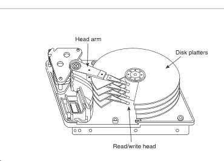

图 5.4

*硬盘组件移动中的潜伏期负责决定硬盘的数据传输速率。*

寻道时间、潜伏期和访问时间均以毫秒（ms）为单位测量。2000 年时期的硬盘寻道时间为 5ms–10ms，转速在 5,400 到 10,000 rpm 之间，平均潜伏期为 3ms–6ms（潜伏期越低意味着转速越高）。关于寻道时间、潜伏期和访问时间，需要记住的主要点是数值越小越好。也要记住寻道时间和访问时间之间的区别。有时你会发现一家厂商宣传寻道时间，而另一家宣传访问时间，但这两个数值不能直接比较。如果你知道两个驱动器的转速，当然可以轻松地将一个转换为另一个，但你必须首先意识到这种差异。

### 磁盘传输速率

比较硬盘时第二个重要的主要统计指标是磁盘传输速率——磁盘向计算机传输和接收数据的速度。注意，我指的是磁盘传输*速率*（复数形式）。原因有二：

-   无论读取哪个柱面，磁盘都以相同的速率旋转，但现代硬盘设计在外圈柱面上放置的扇区比内圈柱面多。这意味着从外圈柱面读取的数据传输速度比从内圈柱面读取的数据快。因此，内部数据传输速率是可变的。
-   从盘片的数据传输速率与硬盘和计算机之间的数据传输速率可能不同。后者由计算机的接口类型决定，例如 Ultra-66 接口为 66MBps。前者由盘片上的数据密度和盘片旋转速度决定。

硬盘制造商通常试图强调外部传输速率——硬盘接口的速度。然而，与*内部*传输速率相比，这个传输速率并不那么重要——内部传输速率是从磁盘盘片到驱动器电子器件的信息传输速率。

为了使问题更加复杂，硬盘制造商通常以每秒兆位（Mbps）为单位引用内部数据传输速率，但以每秒兆字节（MBps）为单位引用外部传输速率。这些术语的缩写仅在字母 *b* 上有所不同，但数值差异是八倍。当内部速率报告为 240Mbps，外部速率为 66MBps 时，人们很容易混淆并认为外部速率是瓶颈。事实并非如此——以 MBps 表示时，内部速率仅为 30MBps。

### 磁盘数据密度

早期的硬盘无论柱面位于磁盘的哪里——内圈或外圈——每个柱面使用固定数量的扇区。这种设计导致外圈轨道的数据密度低于内圈。为了增加磁盘存储容量，工程师开始在外圈柱面上比内圈压缩更多的扇区，从而提高了每个盘片的数据容量（见图 5.5）。

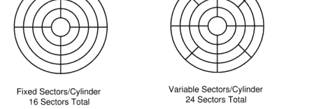

固定扇区/柱面
共 16 个扇区

可变扇区/柱面
共 24 个扇区

*实际的硬盘使用的扇区和柱面数量远多于此处所示，但基本原理仍然成立。*

**注意**

软盘仍然使用每个柱面固定数量的扇区。一些奇特的磁盘格式，如早期 Macintosh 使用的 400KB 和 800KB 格式，每个柱面的扇区数量是可变的，但 x86 软盘从未使用过此类方案。

从绝对数量来看，每个磁盘盘片上存储的字节数多年来大幅增加。2000 年销售的硬盘在两个或三个 3.5 英寸盘片上存储数十 GB 的数据，相比之下，90 年代中期相同数量盘片的容量仅为现在的十分之一。数据密度的增加导致磁盘传输速度的提高，即使旋转速度保持不变。如果在任何给定时间段内经过读/写磁头的数据更多，那么传输到或从硬盘传输的数据就更多。

## 磁盘旋转速度

硬盘旋转得越快，其数据传输速度就越快。因此，多年来磁盘旋转速度有所提高，从 90 年代初的 3,600 rpm 增加到当今常见的最低速度 5,400 rpm。事实上，10,000 rpm 的硬盘如今越来越受欢迎。在其他条件相同的情况下，较快的硬盘比慢的更优越；然而，其他条件可能并不相同。例如，两个 30GB 的硬盘可能以不同的方式实现其容量。一个可能使用三个盘片并以 10,000 rpm 旋转，而另一个可能使用两个盘片并以 7,200 rpm 旋转。由于后者的数据密度更高，其 7,200 rpm 的速度实际上可能比 10,000 rpm 的驱动器实现更快的数据传输。另一个因素是扇区中数据的分布与柱面中数据的分布相比。在所有其他条件相同的情况下，柱面较少但每个柱面扇区较多的驱动器会比柱面较多但每个柱面扇区较少的驱动器更快。

最终，要确定磁盘的数据传输速度，你必须依赖制造商提供的传输统计数据，或杂志或在线发布的测试结果。（大多数此类测试在 Windows 下进行，但如果你能找到原始数据传输速率，它们在 Linux 下获得的结果不会有多大差别。）

## 热量产生与散发

随着硬盘转速加快，它们产生了越来越多的热量问题。更快的转速由摩擦和对处理数据的电子电路施加的更大需求产生更多的废热。然而，并非所有以相同速度旋转的驱动器都会产生相同的热量。我拥有过一些 5,400 rpm 的驱动器，它们产生的热量比一些 7,200 rpm 的驱动器多。尽管如此，作为一般经验法则，对于转速为 7,200 rpm 或更快的驱动器，你至少应考虑额外的散热措施。10,000 rpm 的驱动器几乎总是需要这种特殊的冷却。

为过热驱动器提供额外冷却的最常见方法是在系统中添加一个硬盘冷却风扇。这些设备安装在 5.25 英寸驱动器托架中，允许你在适配器导轨内安装 3.5 英寸驱动器。前面板集成两个或三个小风扇，向硬盘吹气，从而保持其冷却。如果你使用 SCSI 硬盘，你可能需要考虑将其安装在一个具有独立冷却系统的外壳中。这种做法有助于将硬盘产生的热量与计算机的其他组件隔离开来，并将硬盘与其他磁盘产生的热量隔离开来。


## 磁盘缓存大小

最终影响硬盘性能的因素是内置磁盘缓存的大小。如第 3 章（在“缓存内存”部分中所述）所介绍的，缓存是一种比另一种存储类型更小但更快的内存。缓存保存频繁访问的数据，以便计算机可以从缓存中访问数据，而不是从较慢的存储介质中读取。对于硬盘而言，有两种常见的缓存类型和一种不太常见的类型：

- **硬盘上的磁盘缓存** 所有现代硬盘都集成了磁盘缓存，通常大小在 512KB 到 2MB 之间。该缓存由 RAM 芯片组成。当计算机指示硬盘读取某组扇区时，硬盘会读取这些扇区以及紧随其后的扇区，并将它们全部放入磁盘缓存中，其理论依据是计算机很可能接下来会请求后续的扇区。这种假设往往是正确的，因此硬盘无需为下一次传输访问物理磁盘，从而极大地提高了延迟性能和传输速度。因此，磁盘缓存有助于按顺序传输小文件时的性能。对于持续传输，其帮助较小，因为数据会直接传输到计算机。磁盘缓存还可以短暂保存正在写入的数据。硬盘不必等到写操作完成，就可以报告数据写入已完成，而实际上数据仍驻留在缓存芯片中。在这种情况下，磁盘随后很快就会将数据写入盘片；写缓存主要用于让操作系统在将数据发送到硬盘后尽快继续处理其他事务。

- **计算机内部的磁盘缓存** 大多数操作系统，包括 Linux，都会在计算机的 RAM 中维护自己的磁盘缓存。操作系统维护的磁盘缓存的工作原理与硬盘内置缓存类似，只是速度更快。对于 Linux 而言，磁盘缓存可以根据需要增长或缩小。Linux 内核实现了规则，以确定将多少 RAM 分配给磁盘缓存，与分配给程序及其数据的 RAM 相比。内核必须决定何时放弃缓存空间，而不是何时将数据交换到交换文件。作为用户，甚至作为系统管理员，你不必过分关注这些细节，但你应该了解这种缓存形式的存在。

- **控制器上的缓存** 第三种磁盘缓存类型，也是最罕见的，存在于硬盘控制器或主机适配器中。这种缓存类型在高端 SCSI 主机适配器中最为流行，其中一些可以安装 RAM 芯片以用作缓存。此类主机适配器曾经比较流行，但近年来其热度有所减退。一般来说，增加计算机主存 RAM 比给 SCSI 主机适配器添加 RAM 更有意义，因为主板上的 RAM 可以应用于最合适的任务。

作为硬盘的购买标准，磁盘上的缓存与传输速率和寻道时间相比是一个次要因素。尽管如此，大缓存相比小缓存可以带来小幅度的性能提升。

## 硬盘外形规格

如今硬盘的物理尺寸相当标准化。这些尺寸通常以英寸测量，指的是内部盘片的直径。你安装在计算机中的机箱的物理尺寸比这稍大。由于硬盘尺寸标准化，只要机箱有合适的驱动器托架来容纳驱动器，你在机箱中安装硬盘时应该会遇到很少或没有麻烦。

Linux 不关心使用的外形规格，因此你可以购买或使用任何你喜欢的硬盘外形规格。然而，不同的外形规格在性能特征、价格和可用性方面确实存在差异。

### 用于便携设备的 2.5 英寸磁盘

当今常见使用的最小硬盘是 2.5 英寸单元。这些驱动器的尺寸为宽 2.75 英寸，深 3.94 英寸。其小巧的尺寸使其非常适合用于笔记本电脑和笔记本型计算机，几乎从未在台式计算机中发现。这种区分的原因是，按每兆字节计算，2.5 英寸硬盘的价格比物理尺寸更大的硬盘更贵。

2.5 英寸硬盘足够小，通常直接从数据电缆获取电力，该电缆比典型的 EIDE 或 SCSI 电缆更细。由于这些驱动器通常用于作为整体购买的便携式计算机，你通常不需要关注此接口的细节。

### 用于台式机的 3.5 英寸磁盘

目前硬盘最流行的外形规格是 3.5 英寸设计。这些型号的尺寸为宽 4.02 英寸，深 5.77 英寸。这些驱动器在一端包含两个连接器：SCSI 或 EIDE 电缆连接器和电源连接器（见图 5.6）。它们通常还有跳线，用于设置各种选项，如 SCSI ID 号或 EIDE 主/从状态。

安装在机箱中时，带有电源和 EIDE 或 SCSI 接口连接器的硬盘端面向相应的主板或扩展卡，以便轻松连接电缆。不幸的是，这种放置方式通常使得访问驱动器另一端的跳线变得困难，而侧面安装跳线的单元配置起来可能更加困难。在将硬盘安装到机箱中之前，你应确保所有跳线都已正确设置。

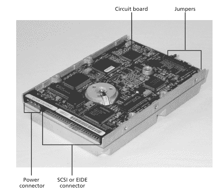

**图 5.6**
*除了底部的电路板、一对连接器和几个跳线外，硬盘看起来像一块无特征的金属板。*

### 用于台式机的 5.25 英寸磁盘

在 1980 年代甚至 1990 年代早期，5.25 英寸硬盘很常见。这些单元的尺寸为宽 5.75 英寸，深 7.6 英寸。与 3.5 英寸驱动器相比，5.25 英寸硬盘确实是个庞然大物，它们在 1990 年代中期就被 largely 放弃，尽管少数型号（如 Quantum 的 Big Foot 系列）坚持到了 1990 年代末。与 3.5 英寸型号相比，5.25 英寸型号功耗更高，寻道时间更长，且传输速率差异更大。它们的盘片使用较低的数据密度，这可能使它们的制造成本比 3.5 英寸驱动器更低。

与 3.5 英寸驱动器类似，5.25 英寸型号使用独立的电源和数据电缆，遵循与 3.5 英寸驱动器使用的相同标准。这些驱动器基本上是 3.5 英寸驱动器的放大版——或者也许更准确的说法是，3.5 英寸驱动器是 5.25 英寸驱动器的微型化版本，因为 5.25 英寸设计早于 3.5 英寸设计。

## 磁盘高度

前面的讨论省略了各种驱动器类型高度的提及。这是因为每种磁盘品种都提供多种高度选择。

- 2.5 英寸驱动器提供从 0.33 英寸到 0.492 英寸的高度，以适应各种尺寸的笔记本电脑。
- 3.5 英寸驱动器最常见的规格是三分之一高度，即 1.02 英寸。也有少数半高度（1.64 英寸）型号可供选择。通常，同一型号系列中容量最高的驱动器符合半高度外形规格，而小容量和中容量驱动器则采用三分之一高度形式。
- 5.25 英寸驱动器通常采用半高度形式（1.64 英寸），尽管一些古老的半高度巨兽高度超过 3 英寸。

购买任何驱动器前请务必检查其高度，特别是如果你的扩展托架空间有限。如果你购买了一个半高度 3.5 英寸驱动器，但机箱中没有空间安装它，你将不得不退回驱动器、移除其他组件或使用外部驱动器外壳将驱动器添加到系统中。如果你购买 2.5 英寸驱动器来替换笔记本电脑的内置驱动器，你的选择将更加有限。

## 在 Linux 中调整磁盘性能

你可能希望从硬盘中获得尽可能好的性能。如果你有一个能传输 30MBps 的硬盘，你不想只获得 8MBps 的速度。特别是当使用笔记本电脑时，你还希望配置硬盘在未被积极使用时*转速降低*——即进入一种不活动状态，此时硬盘盘片不旋转，但驱动器监视数据传输请求，并在发生请求时启动驱动器。你可以使用各种 Linux 实用程序和配置功能来帮助提高与硬盘相关的整体系统性能。

## 使用 hdparm 激活高级功能

用于处理高级硬盘功能的最重要的 Linux 实用程序是 `hdparm`。此实用程序允许你设置与硬盘性能相关的一系列选项，以及运行测试来了解你的硬盘表现如何。你可以通过输入 `man` `hdparm` 来了解更多关于 `hdparm` 的信息。这里展示一些重点。

> 注意
>
> 你必须以 root 身份运行才能使用 `hdparm` 的大部分功能。


## 测试磁盘速度

你可以使用 `hdparm` 的 `-t` 选项来测试硬盘的读取速度。例如：

```bash
hdparm -t /dev/sda
```

此命令测试从 `/dev/sda`（第一块 SCSI 硬盘）读取数据的速度。替换其他设备文件（如 `/dev/sdb` 或 `/dev/hda`）以测试其他磁盘。该命令的结果类似于以下内容：

```bash
/dev/sda:
Timing buffered disk reads: 64 MB in 4.32 seconds =14.81 MB/sec
```

Linux 是一个多任务、多用户操作系统。因此，任何一次 `hdparm` 运行的结果都可能因运行期间变化的系统负载和磁盘访问而略显不准确。你可以通过多次运行测试来提高准确性——运行三次通常就足够了。如果每次运行的结果相似，那么它们可能是准确的。如果某个结果与其他结果差异巨大，请丢弃该结果，或运行额外的测试以确保它是应该被丢弃的那个。

> **注意**
> 你永远看不到 `hdparm -t` 的测试结果与硬盘制造商宣传的传输速率相符。宣传的速率是基于没有磁头寻道、没有 IDE 或 SCSI 命令开销等假设的理论抽象值。根据我的经验，使用 `hdparm -t` 时，声称磁盘速度的 75% 是一个常见的结果。

> **提示**
> 如果一个磁盘上有多个分区，你可以通过指定分区号来测试磁盘不同部分的性能，例如 `hdparm -t /dev/hda1` 或 `hdparm -t /dev/hda9`。

`-t` 选项有一个变体，即 `-T`。这个大写的速度测试命令用于测试从 Linux 内部磁盘缓存读写数据的性能。此操作测试的是计算机的 CPU 和内存速度，而不是连接到系统的任何硬盘的速度。你可以通过同时指定这两个选项来组合 `-t` 和 `-T` 选项，例如 `hdparm -tT /dev/sda`。这样做时，你会得到两份报告，一份关于缓存读取，另一份关于磁盘读取。

请确保在使用 `-T` 选项支持磁盘缓存操作时，你的系统至少有 2MB 的可用内存；如果你的所有 RAM 都被程序占用，`hdparm` 将无法使用磁盘缓存，因此结果将不准确。你可以使用 `free` 命令检查可用内存。输出看起来像这样：

```bash
Mem:      total    used     free  shared buffers cached
          62136    59848    2288       0    2292    6744
-/+ buffers/cache: 50812   11324
Swap:     120452   15036   105416
```

感兴趣的值位于 `-/+ buffers/cache` 行，`free` 列下方——在这种情况下是 11,324。`free` 命令以千字节为单位报告内存值，因此 11,324 大约是 11MB——远超 `hdparm` 缓存内存测试所需的 2MB 最低要求。

## 设置 DMA 选项

如果你在使用 Linux 下支持 DMA 传输控制器的 IDE 硬盘，可以使用 `hdparm` 设置控制器使用适当的 DMA 模式。相关的命令是 `-d`，它编程控制器使用 DMA 模式，以及 `-X`，它设置要使用具体的 DMA 模式。这些选项各自有自己的子参数。在大多数情况下，类似以下内容将产生预期效果：

```bash
hdparm -d1 -X34 /dev/hda
```

`-d1` 参数开启 DMA 模式（1 表示开启，而 0 表示关闭）。`-X34` 参数设置系统使用可用的最快 DMA 模式（34 是该模式的一个代码号）。

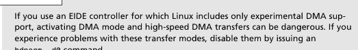

大多数现代 Linux 发行版都包含适当的 `hdparm` 调用，以配置硬盘获得最佳性能。如果你的系统没有，或者它没有正确工作，你通常可以在 `/etc/rc.d/rc.local` 或类似的启动脚本中包含适当的调用。

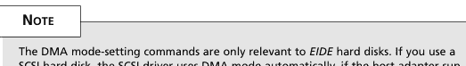

如果你不知道你的硬盘是否设置为使用 DMA，可以使用 `hdparm` 的 `-v` 选项来查明。例如：

```bash
# hdparm -v /dev/hda

/dev/hda:
multicount     = 0 (off)
I/O support     = 0 (default 16-bit)
unmaskirq       = 0 (off)
using_dma       = 1 (on)
keepsettings    = 0 (off)
nowerr          = 0 (off)
readonly        = 0 (off)
readahead       = 8 (on)
geometry        = 784/255/63, sectors = 12594960, start = 0
```

此命令显示关于驱动器及其使用方式的信息摘要。对于本讨论而言，`using_dma` 行是最重要的。

## 关闭磁盘电源以节能

如果你通常使用没有直接连接到墙壁插座的可携式计算机，你很可能关注包括硬盘在内的所有组件的功耗。你可以通过告诉 Linux 在磁盘未使用时将硬盘设置为低功耗模式来节省一些电力。让系统在磁盘访问停止后立即关闭硬盘电源可能不是一个好主意。关闭电源会导致系统在将驱动器恢复到活动状态时消耗大量电力，并且可能导致性能大幅下降。相反，你可能希望指示系统在一段时间不活动后关闭硬盘电源。再次使用 `hdparm` 命令，通过 `-S` 参数来实现此效果。

`-S` 参数的设置很特殊，并在表 5.2 中进行了总结。

**表 5.2**   硬盘旋转停机时间的 `-S` 选项

| 值      | 含义                                               |
|:--------|:---------------------------------------------------|
| 0       | 节能电源关闭已禁用。（驱动器始终完全活动。） |
| 1–240   | 5 秒的倍数；例如，6 表示 30 秒。          |
| 241–251 | 30 分钟的 1–11 个单位，时间范围为 0.5–5.5 小时。  |
| 252     | 21 分钟。                                          |
| 253     | 厂商定义的超时值。                              |
| 255     | 21 分钟 15 秒。                                   |


假设你想设置硬盘在 10 分钟不活动后关闭电源。你可以使用命令 `hdparm -S120 /dev/hda` 来实现此效果。你还可以将此命令与你用于设置 DMA 模式传输的命令组合在一起，例如 `hdparm -d1 -X34 -S120 /dev/hda`。

> **注意**
>
> 你不能使用 `hdparm` 的 `-S` 选项为 SCSI 硬盘设置关闭电源时间。

## 使用多个磁盘以获得更好的性能

如果你想提高硬盘性能，使用多个磁盘可以获得一些好处。假设你的系统执行一系列如下所示的磁盘操作：

```text
Read File 1
Read File 2
Read File 1
Write File 2
Read File 3
Write File 2
Write File 3
```

注意，在这个例子中，偶数和奇数文件访问是交错进行的。现在，假设偶数文件位于磁盘的早期部分，而奇数文件位于磁盘的晚期部分。这一系列磁盘操作的结果将是一系列长的磁头寻道，这会减慢文件访问速度。相反，如果偶数文件在一个物理磁盘上，奇数文件在另一个物理磁盘上，那么磁头寻道操作就会很少，整体性能将会提高。

你无法保证每隔一个访问就使用不同的物理磁盘，但你可以通过为单个 Linux 安装使用不同磁盘上的分区来提高概率。例如，你可以将根目录或 `/usr` 目录放在 `/dev/hda` 上，将 `/home` 目录放在 `/dev/hdb` 上。这种安排保证了 Linux 系统文件的访问不会干扰用户文件的正在进行中的访问，反之亦然。具体如何将分区划分到不同磁盘上取决于你的需求和配置，包括存在哪些其他操作系统以及硬盘的速度。作为一般准则，你应该努力使硬盘之间的访问均衡。将很少使用的目录（如 `/boot`）放在一个驱动器上，其他所有东西放在另一个驱动器上，对系统速度帮助不大，但将经常访问的目录（如 `/usr` 和 `/home`）放在单独的驱动器上通常会有帮助。具体哪些目录经常被使用因安装环境而异。


## 注意事项

如果你的安装跨越多个驱动器进行划分，通常在*你的驱动器速度相似*的情况下有助于提升性能。如果一个硬盘远慢于另一个，那么将 Linux 安装分散在这些磁盘上相比将 Linux 限制在较快的驱动器上，会对整体系统速度产生负面影响。在这种情况下，你可能希望将很少访问的目录放到慢速驱动器上，以便在快速驱动器上为更重要 的文件腾出空间。

在 SCSI 系统中，将 Linux 分散到两个或更多磁盘上比在 EIDE 系统中稍微更有利，因为 SCSI 具有支持多个同时传输的能力。不过，除了减少磁头移动需求所带来的速度提升外，这也是一项额外的速度提升。这一基本原理对于 EIDE 驱动器和 SCSI 驱动器都有益处——只是在 SCSI 驱动器上使用时，益处*更大*。你可以将 EIDE 硬盘放在独立的通道上，以获得部分相同的好处。

## Linux RAID 支持

Linux 支持一种被称为*独立磁盘冗余阵列*（RAID）的技术。这项技术允许你将文件无缝地分散在两个或更多的硬盘上。你不再需要在不同磁盘上配置包含不同数据的分区，而是使用 RAID 将不同磁盘上的两个分区合并为一个虚拟分区。通过这样做，计算机可以添加冗余以提高数据安全性，将数据分散到两个磁盘以提高速度，或者两者兼得。RAID 有两种形式：硬件 RAID 和软件 RAID。硬件 RAID 由特殊的 RAID SCSI 主机适配器支持，对 Linux 透明。软件 RAID 必须由操作系统——确切地说是 Linux 内核——来实现。

Linux 的软件 RAID 通过块设备内核配置选项下的“多设备驱动支持”（Multiple devices driver support）启用，如图 5.7 所示。一旦选定此选项，将提供几个子选项，让你选择想要使用的 RAID 支持类型。

Linux 内核支持的每种 RAID 变体都有各自的特点和用途：

- **线性（追加）** 此模式简单地将一个分区追加到另一个分区。如果你需要在单个分区中获得比单个硬盘可用空间更多的空间，这会有所帮助。它不提供速度或健壮性方面的优势。
- **RAID-0（条带化）** RAID-0 均匀地填充磁盘分区，通过交错方式将数据块写入磁盘。最终结果仿佛是一个大分区，带有来自每个磁盘的交替数据条。RAID-0 不提供冗余，因此并不比常规分区更安全。如果用于条带化的分区位于独立的物理磁盘上，则会带来速度提升。如果你使用独立通道上的 EIDE 磁盘或 SCSI 磁盘，这种速度提升可能特别显著。
- **RAID-1（镜像）** RAID-1 提供数据冗余；写入一个分区的任何信息都会写入一个或多个其他分区。此选项降低了你丢失数据的可能性，但几乎没有或没有速度优势。
- **RAID-4/RAID-5** 此选项的工作原理很像 RAID-1，但除了冗余存储数据外，系统还允许你存储校验和（checksum）信息，以便你可以检测和纠正错误。通常，你在支持 RAID-4/RAID-5 时使用三个或更多磁盘来替代一个磁盘。一个磁盘提供校验和存储，而其余磁盘存储数据。在发生错误的情况下，系统可以确定哪个磁盘出错，并可以纠正该错误。

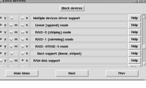

### 图 5.7

*Linux 的 RAID 支持包含针对不同 RAID 变体的几个子选项。*

一旦你为 Linux 内核添加了适当的 RAID 支持，你就需要使用一组工具来定义元分区（meta-partitions）。这些工具包括：

- `mdadd [options] [mddev] [p1] [p2]` 此命令将两个常规分区（p1 和 p2）添加到一个多磁盘设备（mddev）中。例如，`mdadd -p1 /dev/md0 /dev/sda3 /dev/sdb3` 将前两个 SCSI 硬盘上的第三个分区合并在一起以创建 `/dev/md0`。最关键的选项形式为 `-pn`，其中 `n` 是 0–1 之间的数字或 `l`，代表 RAID 级别 0–1 或线性模式。

> **注意**  
> 指定常规分区时顺序很重要！在使用 mdadd 时，请始终以相同的顺序列出分区。

- `mdrun [options] mddev` 此命令激活新的 RAID 分区束。如果不用此命令，你就无法访问 RAID 元分区。
- `mdstop [options] mddev` 此命令关闭指定元分区的 RAID 功能。如果你想卸载一组 RAID 分区并“原始”重用这些分区，请使用此命令。

你还可以将 RAID 设备分配的信息存储在 `/dev/mdtab` 文件中。每一行采用以下形式：

```
mddev options dev1 dev2 ... devn
```

最重要的选项是 `linear`、`raid0` 和 `raid1`，它们对应于 RAID 级别。如果你在 `/dev/mdtab` 中指定了 RAID 设备，你可以指定 `-a` 选项并省略设备列表。

RAID 是提高性能或磁盘可靠性的好方法，但管理起来并非易事。除非你选择了启动支持（参见图 5.7），否则无法从 RAID 分区启动。通常最好将 RAID 保留给高流量数据目录，例如 `/home` 目录或（在某些服务器上）`/var`。

> **注意**  
> 配置 RAID 出错会导致严重问题，包括数据丢失或数据恢复困难。

有关 RAID 的更多信息，请参阅随所有主流 Linux 发行版提供的 Software-RAID HOWTO 文档。

### 摘要

你选择的硬盘在计算机的速度和可用性方面起着重要作用。如今出售的所有硬盘都足够大，可以容纳 Linux 本身，但你可能有异常的数据存储需求，需要更大的磁盘。对大多数人来说，更感兴趣的是硬盘的速度，这以持续吞吐量、磁头寻道时间以及较小程度上的缓存大小来衡量。接口类型——无论是 SCSI 和 EIDE 之间的对比，还是每种接口类型的具体级别——在确定磁盘系统速度方面也相当重要。

## 可移动磁盘


### 本章内容

- 可移动磁盘的类型 168
- 选择合适的接口 174
- Linux 与可移动磁盘的兼容性 178
- 与其他操作系统交换媒体 184

硬盘是现代计算机不可或缺的存储介质，但它们并非唯一的存储介质，也不是所有用途的最佳选择。硬盘的一个短板是便携性。虽然有一些外壳可以让你轻松地从计算机中取出硬盘，但取出的硬盘稍微有点笨重。携带整个硬盘也是冒险的，因为这些设备很脆弱，你大概不想为了将几个文件从一个位置传输到另一个位置而冒失全部硬盘数据的风险。因此，出现了大量专门媒体来帮助你从 A 点将文件移动到 B 点。这些设备通常永久安装在你的计算机中，或作为外部驱动器附加到计算机上。然而，它们的媒体是可移除的，并且可以轻松传输。

> **注释**  
> 尽管我在第 7 章“光驱”中介绍了它们，CD-ROM 等光学媒体当然属于可移动磁盘媒体。但直到最近，这些媒体才可能记录，而即使是现在，制作 CD-R 也比向大多数可移动媒体写入几个文件更复杂。因此，我在第 7 章中介绍了 CD-ROM 和相关设备。

使用可移动媒体的一种替代方法是使用网络。随着越来越多的计算机永久连接到互联网，通常可以使用互联网协议将一个位置的文件移动到另一个位置。事实上，正如我在 Sams Publishing 出版的《Linux: Networking for Your Office》一书中描述的那样，Linux 在此方面作为文件服务器表现出色。第 17 章“网络硬件”介绍了将两台或多台计算机连接到网络所需的硬件，第 18 章“调制解调器”介绍了将孤立的计算机或小型计算机网络连接到互联网服务提供商（ISP）的设备。

## 可移动磁盘的类型

可移动媒体有几种不同的变体，每一种都有自己独特的优缺点。这些媒体都可以用于 Linux，尽管配置细节差异很大。这些设备中使用的技术也有所不同。大多数基于与硬盘使用的相似的磁记录原理，但有些使用的是部分基于光学原理的技术。

表 6.1 总结了我在本章中描述的可移动媒体技术的特征。请注意，此列表并不全面；一些设备已经从市场上消失，或者目前可用但占据相对较小的利基。


# 表 6.1 常见可移动介质技术

| 驱动器类型 | 容量 | 平均寻道时间 | 数据传输速率 | 接口 |
| :--- | :--- | :--- | :--- | :--- |
| 软盘 | 180KB–2.88MB | 66ms | 30KB/s¹ | 软盘驱动器、USB |
| Iomega Zip-100 | 100MB | 29ms | 0.6–1.4MB/s | EIDE、SCSI、USB、并口、PC卡 |
| Iomega Zip-250 | 250MB | 29ms | 0.9–2.4MB/s | EIDE、USB、SCSI、PC卡 |
| LS-120 | 120MB | 70ms | 4.0MB/s | EIDE、USB、并口、PC卡 |
| 磁光盘² | 128MB–5.2GB | 25ms | 2–6MB/s | SCSI |
| Iomega Jaz | 1GB–2GB | 12ms | 5.4MB/s | SCSI |
| Castlewood Orb | 2.3GB | 10ms | 12.2MB/s | EIDE、SCSI、USB |

> 1. *软盘的数据传输速率随驱动器容量而异。此处给出的 30KB/s 数值对应于 1.44MB、3.5 英寸的介质。*
> 2. *磁光盘存在已久，其性能随年份推移有所提升。此处引用的寻道时间和传输速率为 2000 年销售驱动器的一般典型值。*

## 软盘

简陋的软盘是 x86 计算机上使用的最古老的存储设备之一。（实际上，第一台 IBM PC 使用的是一种原始磁带驱动器，而非软盘。）如今的 x86 计算机几乎无一例外地支持 3.5 英寸软盘，但在 20 世纪 90 年代中期，5.25 英寸软盘仍很常见。（图 6.1 展示了这两种类型的磁盘。）早期的计算机有时使用 8 英寸软盘，但 x86 硬件从未使用过这种规格。8 英寸和 5.25 英寸软盘使用柔性外壳，因此得名“软盘”（floppy disk）。3.5 英寸软盘采用了更坚硬的塑料外壳、更精密的磁盘安装方式，并配备了一个覆盖磁盘读写访问孔的滑块。与早期规格相比，这些特性使得 3.5 英寸软盘具有更高的可靠性和数据密度。

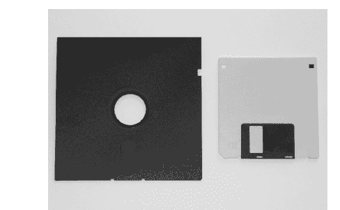

**图 6.1**
*多年来，软盘有几种不同的尺寸。本图左侧为 5.25 英寸软盘，右侧为 3.5 英寸软盘。*

作为 x86 计算机的存储介质，软盘有几个重要优势：

-   **成本** 软盘及其驱动器价格都很低廉。当您想向某人发送文件但无法通过互联网发送时，这一特性尤为重要。在共享计算环境中（例如大学校园内的计算机中心），这一点也很重要。软盘的低成本还意味着您可以承受丢失或损坏几张盘片的损失——只要其中包含的数据不太重要，或者已在其他地方备份！
-   **通用性** 如今几乎每台桌面计算机都配有 3.5 英寸软盘驱动器，因此如果使用软盘和通用文件系统（如文件分配表 [FAT](https://en.wikipedia.org/wiki/File_Allocation_Table) 文件系统），几乎可以保证互操作性。
-   **便携性** 3.5 英寸软盘可以装进衬衫口袋，或者将几张装入专为它们设计的小盒子或钱包中，轻松放入背包、外套口袋或手包中携带。

然而，软盘是一项过时技术。与其他固定式和可移动介质相比，它们未能跟上存储容量和速度的提升。速度和容量这两个因素构成了软盘的致命弱点。常用软盘的最大容量为 1.44MB，与 2000 年典型的硬盘相比微不足道，后者的容量可能比软盘大 10,000 倍以上。软盘也以速度慢著称，这一缺点仅仅因为介质容量较低而显得不那么突出。表 6.2 总结了当前可用的软盘容量。请注意，虽然双面高密度 1.44MB 软盘是常用规格中容量最大的，但它们并非可用容量最高的。更高容量的 2.88MB 软盘从未流行起来，如今几乎已无处可寻。单面软盘只使用磁盘的一面来记录信息，而双面驱动器使用两个读写磁头在磁盘介质的两面进行记录。

### 表 6.2 软盘容量

| 软盘类型 | 单面容量 | 双面容量 |
| :--- | :--- | :--- |
| 5.25 英寸，双密度 | 180KB | 360KB |
| 5.25 英寸，高密度 | 600KB | 1200KB |
| 3.5 英寸，双密度 | 360KB | 720KB |
| 3.5 英寸，高密度 | 720KB | 1440KB |
| 3.5 英寸，超高密度 | 1440KB | 2880KB |

> 几乎所有的软盘都是双面的，尽管少数非常旧的系统使用单面软盘。

除了表 6.1 中列出的容量外，还存在许多非标准容量。各种软盘格式化程序允许在每个柱面上放置更多扇区，或在磁盘上放置比通常更多的柱面。这两种方法都增加了软盘的容量，但以牺牲可靠性和互操作性为代价——某些系统无法读取这种非标准的软盘格式。

大多数软盘驱动器通过主板上的软盘端口连接，但也有一些 USB 接口的软盘驱动器可供选择。这些驱动器主要面向 Macintosh 用户营销，因为某些 Macintosh 电脑（特别是 iMac）出厂时没有配备软盘驱动器。

## Iomega Zip 磁盘

鉴于对更高容量可移动存储介质的需求，Iomega（[http://www.iomega.com](http://www.iomega.com)）推出了 Zip 驱动器。该设备使用专有磁盘，其尺寸略大于标准 3.5 英寸软盘，厚度也稍厚（见图 6.2）。驱动器机构本身小到足以装入 3.5 英寸驱动器位。最初的 Iomega Zip 驱动器每个 Zip 盒带存储 100MB，但现在也可获得 250MB 的驱动器。这些新驱动器可以读取旧的 100MB 盒带。不幸的是，Zip 驱动器与软盘不兼容，因此如果您想读取标准软盘，需要另备一个软盘驱动器。


### 图 6.2
Zip 磁盘（左）比 3.5 英寸软盘（右）略大。

### 注意

> 切勿将标准软盘插入 Zip 驱动器！这样做可能会损坏 Zip 驱动器，并引发臭名昭著的 Zip 驱动器“死亡点击声”。这是一种 Zip 驱动器损坏的表现，尝试读取磁盘时会发出咔哒声。
>
> 不幸的是，这种现象可能会损坏 Zip 磁盘，进而损坏另一台 Zip 驱动器，因此这种现象可以像传染病一样传播。如果遇到这种现象，请立即废弃或维修 Zip 驱动器，并废弃所有受影响的磁盘。

Zip 驱动器是最受欢迎的中等容量可移动磁盘格式之一。它提供 ATAPI、SCSI、并口和 USB 变体，连接 Zip 驱动器到计算机非常容易。事实上，许多新计算机都预装了 Zip 驱动器。

Zip 磁盘在软件中支持一些功能，这些功能在其他大多数可移动介质上要么不可用，要么通过硬件实现。其中最重要的是写保护。在 Linux 下，您可以使用 `ziptool` 包访问写保护功能或发送弹出命令，该包随许多发行版提供，或可从诸如 `http://rufus.w3.org/linux/RPM/` 等软件包分发站点获取。

## LS-120 SuperFloppy

LS-120 SuperFloppy 由 Imation（[http://www.imation.com](http://www.imation.com)）率先推出，是中等容量可移动磁盘市场中 Zip 驱动器的主要竞争对手。虽然 LS-120 在市场定位上与 Zip 驱动器类似，但主要在两个方面与 Zip 驱动器有所区别：

-   **技术** 在录制 120MB 磁盘时，LS-120 采用混合磁光技术。驱动器使用激光在磁盘上写入光参考轨道，这使得主磁读写磁头能够比标准软盘更精确地定位，从而产生更高的容量。
-   **兼容性** LS-120 磁盘与标准 3.5 英寸软盘尺寸相同，且 LS-120 驱动器可以读写标准 3.5 英寸软盘。这意味着 LS-120 驱动器可以替代 x86 计算机上的标准软盘驱动器。此外，LS-120 驱动器读取标准软盘的速度比传统软盘驱动器快约三倍。

绝大多数 LS-120 驱动器以内部 ATAPl 设备形式提供。也有基于 SCSI 的 LS-120 驱动器，但很难找到。USB 和并口型号也存在。

## 磁光盘

磁光盘（MO）与 LS-120 磁盘类似，都采用混合磁光技术。然而，磁光盘更依赖该技术中的光学部分。这些驱动器使用激光将特殊记录介质加热到高温。在这些高温下，磁读写磁头可以改变磁盘的磁性属性，这与纯磁记录技术中发生的情况类似。读取磁盘时不需要加热。激光的加热作用用于改变磁盘上磁编码的数据。结果是，存储在磁光盘上的数据比存储在纯磁介质上的数据更不易被更改。这一特性使磁光盘驱动器在长期存储方面具有吸引力。（最近，CD-R 驱动器在长期存储方面变得更具吸引力，因为按每兆字节计算，CD-R 介质的成本远低于磁光盘介质。）

磁光盘驱动器涵盖了广泛的容量和介质外形尺寸。它们既有 3.5 英寸款式，也有 5.25 英寸款式，容量范围从 128MB 到 5.2GB。能够读取更高容量的型号通常也能读取使用相同外形尺寸但容量较低的介质。3.5 英寸介质类似于普通软盘，但稍厚一些。5.25 英寸磁光盘介质像 3.5 英寸介质一样构造，配有坚固的塑料外壳，但尺寸更大。如果您滑开金属盖板，磁光盘的光泽会闪烁得像 CD 一样。

磁光盘驱动器几乎总是作为 SCSI 设备销售。磁光盘驱动器往往价格昂贵——300 美元至 2,500 美元，而大多数 Zip 和 LS-120 驱动器的价格为 75 美元至 200 美元。然而，磁光盘介质并不比 Zip 和 LS-120 磁盘贵多少，至少那些低容量介质与这些磁盘相比并非如此。


## 第二部分

如果你不关心与他人交换数据，磁光盘（MO）驱动器可以是中容量或高容量可移动存储的良好选择。如果你更倾向于 SCSI 接口而非其他接口类型，这一点尤为正确。

### 高容量可移动磁盘

正如我刚才提到的，磁光盘驱动器以可移动驱动器的形式提供了非常高容量的选项。其他技术也在该规模的高端领域展开竞争，但没有任何一种能达到最高容量磁光盘驱动器的水平。这些技术大多基于硬盘原理构建；它们使用硬盘技术，但采用可移动磁盘盘片。目前最常见的两种技术是 Iomega 的 Jaz（有 1GB 和 2GB 两种版本）和 [Castlewood](http://www.castlewood.com) Orb 驱动器（2.3GB）。在最新形态中，这些驱动器在功能和容量方面大致相当，尽管 Orb 在速度上略胜一筹。`ziptools` 软件包帮助你访问 Jaz 驱动器的功能——弹出和软件写保护。

与大多数磁光盘驱动器一样，Jaz 驱动器仅提供 SCSI 接口版本。Orb 驱动器提供多种接口选择。你经常可以购买到包含 SCSI 主机适配器的套装，但此类捆绑适配器的质量往往较低。最好单独购买 SCSI 主机适配器。

高容量可移动磁盘驱动器相当罕见，因此除非你知道对方使用何种类型的驱动器，否则不要指望使用此类驱动器与他人交换介质。由于磁盘的昂贵，这些驱动器通常不是与随机选定个人进行数据交换的良好选择。如果你需要广泛分派大文件，如第 7 章“光驱”中讨论的那样，CD-R 驱动器是更好的选择。

### 选择合适的接口

如表 6.1 所述，许多可移动介质驱动器提供多种接口。你选择的接口会产生一些后果，包括：

- **速度**：某些接口比其他接口快。表 6.1 中同一类型驱动器的速度差异主要源于接口间的速度变化。
- **便携性和安装方式**：某些接口仅可用于内部设备，其他仅可用于外部设备，而一种（SCSI）可适用于内部和外部设备。
- **费用**：SCSI 接口通常比其他种类更昂贵。
- **Linux 驱动程序**：Linux 支持所有主要接口类型，但有些接口比其他接口更容易配置工作。

### 软盘接口

软盘驱动器是唯一拥有专属接口类型的可移动介质设备。软盘接口是所有现代 x86 主板的标准化组成部分。然而，许多 80486 及更早的计算机将软盘接口放置在扩展卡上，与 EIDE 或 SCSI 接口一起。尽管如此，软盘接口的标准化性质保证了 Linux 与任何软盘驱动器或软盘控制器之间的兼容性非常好。因此，这是一个安全的接口，尽管速度非常慢。

### EIDE/ATAPI 接口

如第 5 章“硬盘”中所述，*增强型集成器件电子*（EIDE）和 *高级技术附件包接口*（ATAPI）这两个术语都指代同一接口，但通常用于指代不同的设备。具体而言，**ATAPI** 设备遵循一组用于控制非磁盘设备（如 CD-ROM 和磁带驱动器）的协议。少数连接到 IDE 端口的可移动磁盘设备不包含完整的 ATAPI 支持，但大多数都包含。为简单起见，表 6.1 将所有此类设备称为 EIDE 驱动器，我在本讨论中也使用该术语作为比 ATAPI 更包容性的术语。

无论名称如何，EIDE 接口对于可移动介质设备来说都是一个相当不错的选择。EIDE 是为高速磁盘设备设计的，因此它能够轻松跟上可移动介质驱动器的速度，而后者的速度通常比现代硬盘慢得多。由于大多数 BIOS 支持从这些驱动器启动，这些驱动器可以作为生成紧急 Linux 启动系统的便捷手段。你可以将 Linux 安装到适当的可移动介质上，然后在紧急情况下直接从该设备启动。

> Debian 和 Slackware 发行版特别容易精简到安装在小容量可移动驱动器（如 Zip 或 LS-120 磁盘）上的基本需求。即使你通常不使用这些发行版中的一个，你也可能希望考虑使用其中一个创建紧急磁盘。

然而，对于可移动磁盘而言，EIDE 接口确实存在缺陷。其中之一是它最适合内部驱动器。如果你希望具备将驱动器从一台计算机移动到另一台计算机的灵活性，最好另寻他处。（尽管确实存在用于外部使用 EIDE 设备的套件，因此如果你确实必须这样做，你也可以做到。）同样重要的是，每条 EIDE 链两个设备的限制可能相当严格，特别是如果你想用 CD-R 刻录机和磁带备份单元等额外设备来充实你的系统时。

## SCSI 接口

在其他条件相同的情况下，*小型计算机系统接口*（SCSI）总线是可移动介质的最佳选择。即使在最早的 SCSI-1 形态下，SCSI 的速度对于大多数可移动介质驱动器也绰绰有余，而较新的版本甚至可以轻松处理快速的 Orb 驱动器。与 IDE/IDE 不同，SCSI 允许驱动器内部或外部挂载，因此你可以将单个 SCSI 可移动介质驱动器从一台计算机移动到另一台——前提是两台计算机都有 SCSI 主机适配器。SCSI 还允许多达 7 个或 15 个设备（取决于 SCSI 变体）连接到单个主机适配器，因此构建拥有众多 SCSI 设备的系统比构建拥有众多 IDE/IDE 设备的系统更容易。

SCSI 也有其缺点。一个缺点是成本——SCSI 主机适配器需要花钱，并且大多数可移动介质设备的 SCSI 版本通常比其 IDE/IDE 对应产品更昂贵。如果你还没有 SCSI 主机适配器，就需要添加一个，而随某些可移动介质驱动器提供的适配器往往是低端产品。有些无法与 Linux 配合使用。

### 并口接口

在 1990 年代中后期，并口是连接外部可移动介质驱动器与计算机的最常见方法。此类设备通常使用某种形式的分支电缆，以便你可以将可移动介质驱动器与普通打印机一起连接。

这些驱动器的并口通常充当并口到 IDE 或并口到 SCSI 的接口，然后驱动器内部使用 IDE 或 SCSI。因此，你会在 Linux 内核配置的 IDE/IDE 或 SCSI 部分中找到这些设备的 Linux 驱动程序。我在本章后面会更详细地描述这两种配置类型。

在实践中，并口对于可移动驱动器来说往往是弱接口，原因如下：

- **速度**：即使在最佳状态下，并口也能达到的速度仅为 2MB/s 左右。实际上，它甚至跟不上 Zip-100 驱动器的速度，这就是为什么许多驱动器的并口版本比其 IDE/IDE 或 SCSI 对应产品慢的原因。
- **可靠性**：通过并口让任何磁盘设备工作都可能很棘手。在大多数情况下，可以使其合理地工作，但困难程度高于大多数其他接口。
- **驱动程序**：需要一系列 Linux 驱动程序才能使可移动介质设备在并口上工作。尽管如今比几年前罕见得多，但仍有可能找不到驱动器制造商使用的特定并口技术的相关驱动程序。
- **干扰**：特别是在内核 2.2 之前，并口磁盘驱动器与打印机之间的干扰很常见。随着对设备（打印机、可移动磁盘驱动器、扫描仪等）需求的增加，如果你想要多个外部设备，这个问题可能会变得相当严重。此类系统通常在 SCSI 或 USB 接口上表现更好。

尽管如此，如果你必须有外部驱动器且 SCSI 不在考虑之列，并口设备可能是合理的选择。然而，你可能希望考虑使用 USB 设备而不是并口设备。每种接口都有缺点，但 USB 显示出更大的未来潜力。

### USB 接口

通用串行总线（USB）接口是计算机硬件制造商最新的潮流。虽然 USB 的速度能力比并口更慢（1.5MB/s 对 2MB/s），但 USB 是可移动介质驱动器的更好选择，因为 USB 设计用于支持多个设备。我只建议将 USB 用于相对低端的可移动介质设备，如 Zip 和 LS-120 驱动器，此时使用 USB 造成的速度惩罚不会太大。尽管 Orb 驱动器提供 USB 接口版本，但速度下降（从 12MB/s 降至 1.5MB/s）太大，除非在特殊条件下，否则无法容忍。

Linux 对 USB 的支持在 2.2.x 内核系列早期并不存在，但自那以后已大幅增长，特别是在 2.3.x 开发系列的后期。这使得如果你目前使用 2.2.x 系列内核，选择 USB 可移动介质设备变得棘手；你需要升级内核，或者至少将最新的 USB 补丁应用于现有内核并重新编译。就我写这些文字之时而言，USB Iomega Zip 驱动器与 2.3.40 及更高版本的内核配合良好，但 LS-120 的支持似乎不太稳定。因此，我强烈建议你在考虑特定驱动器时，查阅 Deja News ([http://www.deja.com](http://www.deja.com)) 或 Linux USB 开发网页 ([http://www.linux-usb.org/](http://www.linux-usb.org/)) 以获取更多关于该特定驱动器 Linux USB 支持的信息。

> 你可以从许多通用 Linux FTP 站点（如 [ftp://sunsite.unc.edu](ftp://sunsite.unc.edu)）或 [http://www.kernel.org](http://www.kernel.org) 获取最新内核。Linux USB 站点 [http://www.linux-usb.org](http://www.linux-usb.org) 提供适用于 2.2.x 系列内核的补丁，使其能够支持 2.3.x 系列内核支持的大多数 USB 设备。


## FireWire（火线）

FireWire（又称 IEEE-1394 或 i.Link）是最新的对外连接技术。FireWire 在许多方面类似于 USB——它是一种串行技术，允许在计算机通电时添加或移除设备。然而，它比 USB 快得多——其速度最高可达 50MB/s，而 USB 仅为 1.5MB/s，且更快版本的开发正在进行中。这些特性使得 FireWire 成为适用于外部磁盘设备的诱人技术。

不幸的是，在 2000 年初，FireWire 在很大程度上仍是不切实际的。市面上存在少数 FireWire 设备，但它们相当罕见。FireWire 驱动程序已出现在 2.3.x 系列的内核中，但这些驱动程序尚不适用于 2.2.x 内核。更多详情请查阅 http://eclinux.uni-klu.ac.at/ieee1394。

## PC-Card 接口

PC-Card 接口主要被笔记本电脑使用，以支持各种设备，包括可移动媒体驱动器。一些驱动器附带或支持作为配件的转换器，使你可以通过特殊的 PC-Card 使用其他类型的接口。其他驱动器则允许你将可移动媒体设备直接插入 PC-Card 插槽。

一些笔记本电脑提供选项，允许使用 *Zip* 或 LS-120 驱动器代替软盘，或者作为与 CD-ROM 驱动器相同插槽内的更换选项。这些接口通常比 PC-Card 接口更快，因此在许多情况下优于 PC-Card 驱动器。尽管如此，你可能仍希望出于某些原因使用 PC-Card 接口驱动器，例如该驱动器在其他系统（如台式电脑）中具有更高的兼容性。

## 可移动磁盘与 Linux 的兼容性

在 Linux 上使用可移动磁盘并不比使用常规固定磁盘更复杂，尽管你确实需要了解设备文件、挂载选项等的规则。然而，配置系统以使用可移动设备有时会带来挑战，因为你需要为内核添加适当的设备驱动程序，并且可能需要花些时间才能确定需要添加哪些驱动程序。

## 访问驱动器的内核选项

当你为可移动设备配置内核时，可能需要在几个位置检查适当的设备驱动程序。如果你在 Linux 源代码目录（通常是 `/usr/src/linux`）中通过输入 `make xconfig` 命令来配置 Linux 内核，你将处理两个窗口，如图 6.3 所示。第一个是 Linux 内核配置窗口，列出了各种广泛的驱动程序和配置选项类别，如*常规设置*和*块设备*。第二个窗口是你点击其中任何选项（例如图 6.3 中的常规设置窗口）时出现的窗口。你在这里为你的特定可移动设备设置选项，尽管你需在几个不同的窗口中为特定设备设置选项。


**图 6.3**

*通过在 Linux 内核配置窗口中点击其匹配按钮，打开特定内核选项的窗口，例如常规设置窗口。*

如果你使用非 GUI 工具（如 `make menuconfig` 或 `make config`）配置内核，你进行相同的设置，但使用的是基于文本的配置工具，而不是图 6.3 中所示的窗口。

在大多数情况下，每个设备都有三个选项可供选择：

- `Y` 将驱动程序编译到主 Linux 内核文件中。驱动程序将始终准备就绪并可用，但也会始终消耗至少一些 RAM。
- `M` 将驱动程序编译为独立的模块文件，你可以根据需要加载和卸载。此选项可节省 RAM，但在访问文件时会产生轻微的延迟，尤其是如果你没有配置系统在需要时自动加载内核模块。并非所有设备都支持此选项，但大多数设备都支持。
- `N` 从内核中省略驱动程序。你将无法使用该设备或功能。

### 软盘的内核选项

由于软盘的简单性，关于软盘选项可说的并不多。在 x86 计算机上，你必须对块设备区域中的普通 PC 软盘支持选项回答 `Y` 或 `M`，才能使用内置的软盘端口。我通常使用模块化编译选项以节省少量 RAM，因为我并不总是使用软盘。

如果你有外部 USB 软驱，请查阅关于 USB 设备内核选项的章节。如果你想使用 LS-120 驱动器读取常规软盘，请通过你的 LS-120 驱动器使用的接口进行操作。

### EIDE/ATAPI 驱动器的内核选项

EIDE/ATAPI 选项位于块设备区域。为了使用 EIDE/ATAPI 可移动磁盘，你可能需要或想要激活几个选项：

- **增强型 IDE/MFM/RLL 磁盘/光驱/磁带/软盘支持** 要使用任何类型的 EIDE/ATAPI 设备，必须将此选项设置为 Y 或 M。如果你从 EIDE 硬盘启动，必须将其设置为 Y。如果你使用 SCSI 硬盘但拥有 EIDE 可移动磁盘，你可以将其设置为 M（如果愿意）。
- **包含 IDE/ATA-2 磁盘支持** 要使用可移动磁盘，必须将此选项设置为 Y 或 M。与主 EIDE 支持一样，如果你从 EIDE 硬盘启动，此选项必须为 Y，但从 SCSI 硬盘启动时，可以是 Y 或 M。
- **包含 IDE/ATAPI 软盘支持** 要使用可移动 EIDE 磁盘，必须激活此选项（Y 或 M）。
- **EIDE 芯片组选项** 块设备窗口上的各种选项与你使用的特定 EIDE 芯片组有关，无论是在主板上还是在扩展卡上。为了获得最佳性能，你应该激活适当的选项。

### SCSI 驱动器的内核选项

SCSI 选项位于 Linux 内核配置窗口可用的一到两个设置窗口中。在 2.2.x 系列内核中，这些选项分布在 SCSI 支持和 SCSI 低层驱动程序项中；在 2.3.x 和 2.4.x 内核中，SCSI 低层驱动程序项已移至 SCSI 支持窗口作为子选项。可移动驱动器所需的选项如下：

- **SCSI 支持** 必须激活 SCSI 支持。如果你从 SCSI 硬盘启动，则需要回答 Y，但如果从 EIDE 磁盘启动，M 就足够了。
- **SCSI 磁盘支持** 与 SCSI 支持类似，SCSI 磁盘支持是必需的，只有当你从 SCSI 硬盘启动时，它必须为 Y。
- **SCSI 低层驱动程序** 你必须找到并激活可移动磁盘驱动器所使用的 SCSI 主机适配器的驱动程序。（有关 SCSI 主机适配器的更多信息，请参见第 9 章“SCSI 主机适配器”。）如果你从 SCSI 硬盘启动，此选项必须设置为 Y；否则可以是 Y 或 M。

### 并行端口驱动器的内核选项

并行接口设备使用多种驱动程序，其中许多与特定产品绑定。你可能需要的选项包括：

- **常规设置，并行端口支持** 此选项对于所有并行端口可移动磁盘以及所有连接到并行端口的其他设备都是必需的。尽管你可能对此选项回答 *Y* 或 *N* 都能正常工作，但我建议回答 *Y*，因为很多功能依赖于它，而且我遇到过内核模块自动加载器在处理并行端口驱动程序时出现问题的情况。
- **常规设置，PC 风格硬件** 如果你使用 x86 PC，请对此选项回答 *Y* 或 *N*。如果你使用其他架构，可能需要选择其他选项，例如支持外部硬件。
- **常规设置，如果可用则使用 FIFO/DMA** 虽然并非严格要求，但回答 *Y* 有潜力提高性能，或至少减少访问并行接口磁盘驱动器时的 CPU 开销。
- **块设备，并行端口 IDE 设备支持** 此选项对许多此类设备是必需的（*Y* 或 *N*），但并非全部。
- **块设备，并行端口 IDE 磁盘** 此选项用于支持使用 IDE 但不使用 ATAPI 协议的并行接口设备。如果你不确定，请至少将此支持构建为模块。
- **块设备，并行端口 ATAPI 磁盘** 此选项类似于前一个选项，但包含使用它们设备的 ATAPI 协议。同样，如果你不确定，请包含此支持。
- **特定块设备** 在最后几个选项下方，有一系列针对特定设备的驱动程序，例如 MicroSolutions 背包协议。你*必须*选择这些设备中至少一个才能使用 IDE 风格的并行端口驱动器。如果你的设备未在列表中，请尝试在 `http://www.deja.com` 上进行搜索以寻求帮助，或者简单选择所有设备。文件 `/usr/src/linux/Documentation/paride.txt` 也有助于确定应选择哪个驱动程序。
- **SCSI 低层驱动程序，IOMEGA 并行端口（ppa - 旧驱动器）** 如果你拥有较旧的并行端口接口 Iomega Zip 驱动器，请激活此选项。此设备*不需要*并行端口 IDE 驱动程序。
- **SCSI 低层驱动程序，IOMEGA 并行端口（imm - 新驱动器）** 如果你拥有较新的标有“Auto Detect”电缆的 Zip Plus 驱动器，请使用此驱动程序。此设备不需要并行端口 IDE 驱动程序。


### 提示

如果你拥有 SCSI 硬盘和并口 Iomega Zip 驱动器，我建议将 Iomega 并口驱动程序构建为模块（module），并将主 SCSI 主机适配器的驱动程序内置到内核中。这样可以确保内核不会混淆，避免尝试从 Zip 驱动器而不是 SCSI 启动盘进行启动。

当你使用并行接口设备时，访问驱动器的方式取决于所使用的接口子类型，即 SCSI 还是 IDE。Iomega Zip 驱动器会作为一个普通的 SCSI 设备出现，而 IDE 驱动器则使用特殊的设备文件。文件 `/usr/src/linux/Documentation/paride.txt` 包含一个脚本，如果系统中尚不存在这些设备文件，你可以运行该脚本来创建相应的设备文件。（大多数发行版都包含这些设备文件。）

## USB 驱动器的内核选项

随着 2.3.x Linux 内核的发展，USB 内核选项正在快速变化，因此可能与我在这里描述的 2.4.x 内核略有不同。如果你想使用 USB 设备且使用的是 2.2.x 内核，你必须使用非常新的 2.2.x 内核，或者应用一组补丁来为较旧的内核添加 USB 支持。与 USB 可移动磁盘相关的选项包括：

- **USB 驱动程序，支持 USB（Support for USB）** 此选项是使用任何 USB 设备所必需的。
- **USB 芯片组（USB chipsets）** 存在两种 USB 底层驱动程序：UHCI 和 OHCI。你必须选择适合你电脑的那一种。
- **USB 驱动程序，USB SCSI（大容量存储）（USB SCSI (mass storage)）** 此选项包含对某些 USB 磁盘设备的支持，将其视为 SCSI 磁盘进行处理。
- **SCSI 选项（SCSI options）** Linux 对磁盘设备的 USB 支持依赖于 SCSI 驱动程序，因此你必须像使用 SCSI 主机适配器一样激活 SCSI 驱动程序。但是，你无需为任何特定的 SCSI 主机适配器使用 SCSI 菜单中的驱动程序。

Linux 内核对 USB 存储设备的支持在 2.2.x 和 2.3.x 内核中较弱，但正在快速改进。幸运的是，预计在 2.4.x 系列内核的早期阶段，这种支持将变得可靠。如需了解最新信息，请访问 http://www.linux-usb.org/。

## 使用适当的设备文件

要访问可移动介质设备，通常使用 mount 命令将其挂载到 Linux 文件系统的某个位置。例如，`mount /dev/fd0 /mnt/floppy` 将软盘挂载到 `/mnt/floppy`。你还可以使用这些设备文件在可移动磁盘上创建文件系统，例如 `mkfs -t ext2 /dev/fd0` 会在软盘上创建一个 Linux ext2 文件系统。那么，你应该使用哪些设备文件呢？这取决于接口类型，例如：

- **软盘端口（Floppy port）** 你使用文件名形式为 `/dev/fd*` 的设备文件。在大多数情况下，`/dev/fd0` 就足够了，但有许多设备文件旨在强制以特定容量访问驱动器，例如 `/dev/fd0h1440` 和 `/dev/fd0h720`，它们分别强制以 1.44MB 和 720KB 进行访问。你可以使用这些变体来强制 Linux 的 `fdformat` 程序为非标准容量的磁盘进行格式化，例如使用 `fdformat /dev/fd0h1494` 将磁盘格式化为 1,494KB 容量。如果你的计算机有多个软驱，第二个软驱将被访问为 `/dev/fd1` 或其适当的变体。
- **EIDE 端口（EIDE port）** 内部 EIDE 可移动磁盘的访问方式与内部 EIDE 硬盘相同，形式为 `/dev/hdx`，其中 x 是字母 a–d（在某些情况下可能更高），y 是从 1 开始的数字。x 值代表设备位置——a 代表主控制器上的主盘，b 代表主控制器上的从盘，以此类推。y 值代表分区号，如果你访问未分区的磁盘（就像它是一个非常小的软盘一样），或者当你使用 `fdisk` 对磁盘进行分区时，y 值将被省略。（我稍后将在标题为“可移动磁盘分区方案”的章节中描述分区。）
- **SCSI 端口（SCSI port）** SCSI 驱动器的设备文件名形式与 EIDE 驱动器类似，但 SCSI 驱动器的形式为 `/dev/sdx`，其中 x 是分配的代码；a 始终是第一个 SCSI 驱动器，无论其 SCSI ID 如何，b 始终是第二个 SCSI 驱动器，以此类推。

> **注意：** 如果你有一个外部 SCSI 可移动磁盘驱动器，有时会从计算机上断开，请将其 SCSI ID 设置为高于任何 SCSI 硬盘的 SCSI ID。这样，当你将此可移动驱动器移动到另一台计算机时，它不会干扰固定磁盘的设备分配。

- **并口（Parallel port）** 使用并口转 SCSI 转换器的并口设备，例如 Iomega Zip 驱动器的并口版本，将获得 SCSI 驱动器分配，如前所述。相比之下，使用并口转 IDE 转换器的并口设备，将获得全新的驱动器标识符，形式为 `/dev/pdx`，与 EIDE 和 SCSI 设备不同。在 `/dev/pdx` 中，x 是代表设备的字母，y 是代表分区的可选数字。
- **USB 端口（USB port）** 由于 USB 支持使用 Linux 的 SCSI 特性来处理磁盘设备，因此 USB 驱动器采用 SCSI 设备文件名。

## 与其他操作系统交换介质

可移动介质的主要优势之一是使与其他计算机交换数据变得容易——即使那些没有运行 Linux 的计算机也很方便。幸运的是，Linux 对外部文件系统的支持非常出色，因此当你的可移动磁盘设备正常工作且支持外部文件系统时，与非 Linux 系统交换数据应该很少遇到麻烦。

### 可移动磁盘分区方案

与硬盘不同，软盘非常小，因此将它们划分为单独的分区意义不大。因此，软盘从不分区；你使用主磁盘设备文件（如 `/dev/fd0`）来访问软盘上的文件系统。然而，对于更高容量的介质，情况并非总是如此。这些设备有时像硬盘一样被分区，尽管它们通常只包含一个分区。常见的分区方案包括：

- **不分区（No partitioning）** 可以像软盘一样，在没有分区的情况下使用高容量可移动介质设备。然后，你使用不带分区号的设备标识符来创建和挂载文件系统，例如使用 `mount /dev/sdb /mnt/modisk` 来挂载 MO 盘。这种做法在某些低容量设备（如较旧的 MO 盘类型）中尤为常见。
- **分区 #1（Partition #1）** 分区的一个合理选择是使用分区 #1（例如 `/dev/sda1`）。这是磁盘上的第一个主分区条目。许多 Linux 用户在使用可移动介质驱动器时，会在此位置创建 Linux ext2fs 分区。
- **分区 #4（Partition #4）** 默认情况下，我建议 Zip 磁盘使用标准的 x86 分区 #4（例如 `/dev/sda4`）。该分区的大小与 `/dev/sda1` 相同；只是标识号不同。如果你使用 Zip 驱动器，你可能希望使用分区 #4，以便与其他 Zip 驱动器用户之间的数据交换。
- **非 x86 分区（Non-x86 partitioning）** 在极少数情况下，你可能会遇到一个已分区但并非 x86 计算机常见方式的磁盘。例如，来自 Macintosh 的可移动介质可以使用 Macintosh 分区方案，这与 x86 分区方案不同。Linux 的层次文件系统（HFS）支持包括对简单 Macintosh 分区表的支持，因此你可以将这些磁盘视为未分区。如果你在内核中添加 Macintosh 分区支持，你也可以使用分区号来挂载磁盘，这通常是 #4。

我建议采用对你类型的驱动器而言最常见的分区方案。例如，对于 Zip 磁盘，我建议将磁盘划分为单个大的分区 #4。这种做法允许你创建单个挂载点，并使用 `/etc/fstab` 中的单条条目来挂载几乎任何来源的 Zip 磁盘。

## 用于外部操作系统的文件系统驱动程序

如前所述，Linux 包含对各种文件系统的广泛支持，这使得与外部操作系统交换数据变得容易。你最有可能在可移动介质上遇到的四种文件系统是：

- **FAT** FAT 文件系统被 DOS、Windows 和 OS/2 原生使用，并且几乎所有其他操作系统都将其作为非原生文件系统支持。因此，它在可移动介质上极其常见。在 Linux 中，你可以使用三种文件系统类型之一来挂载此类设备：`msdos`、`umsdos` 和 `vfat`。第一种提供对传统 MS-DOS 风格文件名的访问，文件名长度限制为 8 个字符，外加 3 个字符的扩展名。`umsdos` 文件系统增加了对 UNIX 风格长文件名、权限等的支持，但这种方式只能在 Linux 中读取。`vfat` 选项通常今天最有用，因为它支持 Windows 风格的长文件名。
- **ext2fs** Linux 的原生文件系统 ext2fs 可以很容易地用于可移动介质磁盘。它包含比 FAT 更多的开销，因此在中小型磁盘上往往不是一个高效的选择。但是，如果你想保留 UNIX 风格的所有权和权限信息，ext2fs 是一个很好的选择。

> **提示**
>
> 为了最大化 ext2fs 可移动磁盘上的可用空间，在创建文件系统时，请使用 `mke2fs` 命令的 `-m 0` 参数，例如 `mke2fs -m 0 /dev/pda`。此参数将 *保留空间* 设置为 0%。通常，ext2fs 为 root 用户保留一定数量的空间（默认 5%）。其思想是，如果文件系统已满，超级用户仍应有一些磁盘空间可用于清理问题。然而，这种逻辑对于可移动磁盘并不太适用，因此将保留空间设置为 0% 是安全的。

- **Minix** Minix 文件系统在 Linux 社区的软盘中比较流行。此文件系统是为 Minix 操作系统设计的，它曾是 Linux 的部分模型。实际上，最早期的 Linux 系统在硬盘上使用的是 Minix 文件系统。然而，此文件系统在其最大尺寸方面有限制，甚至 Zip 驱动器都超出了其范围。尽管如此，它在软盘上仍然有用，因为它比 ext2fs 需要更少的开销。


## HFS

如果您经常与麦金塔（Macintosh）用户交换文件，那么您很有可能会遇到使用麦金塔原生 HFS 文件系统的磁盘。Linux 内核 2.2.x 及更高版本已包含 HFS 支持，因此您只需确保内核中已包含该模块即可。截至 2.2.x 和 2.3.x 内核版本，Linux 的 HFS 支持仍被视为实验性功能，且已知可能会损坏 HFS 磁盘。因此，如果可能的话，我建议您仅从 HFS 磁盘读取数据。向小容量磁盘以及包含极少或没有文件的磁盘写入数据，比向包含大量文件的大容量磁盘写入数据更安全。

### 注意

x86 计算机中的软盘接口芯片无法读取旧式麦金塔 400KB 和 800KB 软盘使用的低级编码。因此，即使您在内核中包含了 HFS 支持，也无法在运行 Linux 的 x86 计算机上读取这些软盘。然而，麦金塔 1.44MB 软盘使用的是与 x86 1.44MB 软盘相同的低级编码格式，因此您可以读取这些较新的麦金塔软盘。

### 注意

目前尚无 Linux 驱动程序来处理 Apple 的新 HFS+ 文件系统。幸运的是，HFS+ 几乎仅用于硬盘；您不太可能在可移动磁盘上遇到它。不过，您可能会在某些超大容量的磁盘上遇到它，在这种情况下，在有人发布 Linux HFS+ 驱动程序之前，您将无法在 Linux 中读取它。

Linux 使用 `/etc/fstab` 文件来指定在启动时要挂载哪些分区和其他磁盘设备。您还可以使用此文件告知 Linux，应允许普通用户挂载可移动介质。以下是 `/etc/fstab` 文件中的几个示例条目：

```
# Device filename  Mount point  Filesystem  Options        Dump Fsck
/dev/fd0          /mnt/floppy  auto      user,noauto  0      0
/dev/sda          /mnt/maczip  hfs       ro,user,noauto  0   0
/dev/sda4         /mnt/zip     auto      user,noauto    0    0
```

每个条目由若干列组成，列之间通过一个或多个空格或制表符字符分隔。以井号（#）开头的行是注释。各列的含义如下：

- **设备文件名**：要使用的设备文件名称，其中可以包含分区标识符。上述示例涉及软盘驱动器和 SCSI Zip 驱动器。
- **挂载点**：设备在 Linux 文件系统中的挂载位置。这也是普通用户用于挂载设备的部分，正如我稍后将描述的那样。
- **文件系统**：您可以在此列中指定文件系统，或者使用 `auto` 让计算机尝试自动检测文件系统类型。
- **选项**：您可以在此列中指定挂载选项，如 `mount` 手册页中所述。对于本文讨论而言，最重要的选项是 `user` 和 `noauto`，它们分别允许任何用户挂载磁盘，并防止系统在启动时尝试挂载磁盘。很可能您希望对所有可移动设备都包含这两个选项。
- **Dump 代码和 fsck 顺序**：最后两个代码涉及是否使用 `dump` 实用程序备份分区，以及内核在启动时检查分区的顺序。对于可移动磁盘，这两者都不太实用，因此都应设置为 0。

### 提示

将文件系统指定为 `auto` 是简化配置的一种有用方法。在前面的示例中，`/mnt/floppy` 和 `/mnt/zip` 这两个挂载点都可以用于挂载 FAT、ext2fs 或其他各种类型的文件系统，因此您无需知道磁盘上是什么文件系统即可将其挂载。不过，Linux 在自动检测 HFS 磁盘时经常会遇到问题，这就是为什么前面的示例中为麦金塔 Zip 磁盘设置了单独条目的原因之一。

在对 `/etc/fstab` 文件进行了适当的修改后，您可以以 root 身份输入 **`mount -a`** 来激活这些更改。然后，您可以作为普通用户输入 **`mount /mount/point`** 来挂载可移动介质，其中 `/mount/point` 是挂载点，例如 `/mnt/zip` 或 `/mnt/floppy`。完成后，使用 `umount` 命令以几乎相同的方式卸载磁盘。（是的，该命令拼写正确；它没有以第一个 n 开头。）

## 直接访问工具和其他实用程序

除了将可移动磁盘挂载到 Linux 文件系统结构外，您还可以执行其他操作或通过其他方式访问磁盘。其中最重要的一点是使用 mtools 软件包，它允许您使用模仿 DOS 命令的指令来访问可移动磁盘。例如，`mdir a:` 显示软盘上的目录列表，而 `mcopy file name a:` 则将名为 `filename` 的文件复制到软盘上。作为一般规则，mtools 命令的工作方式与同名 DOS 命令类似，但 mtools 的对应命令会在命令名称前加 m。mtools 软件包是一种访问软盘非常便捷的方式，但它并不提供从其他程序访问磁盘的能力。如果您希望使用例如文字处理程序直接读取或写入文件，必须以常规方式挂载磁盘。有关 **mtools** 的更多信息可从该项目的网页 http://mtools.linux.lu/ 获取。

**hfsutils** 软件包与 **mtools** 类似，但提供了对 HFS 磁盘的访问。该软件包包含一个名为 **xhfs** 的程序，它提供图形用户界面（GUI），允许您来回复制文件，如图 6.4 所示。您可以在 http://www.mars.org/home/rob/proj/hfs/ 上了解更多信息。


**图 6.4**
_*xhfs 实用程序允许您通过图形用户环境在麦金塔磁盘之间复制文件。_*

除了这些用于访问特定文件系统的专用工具外，您还可以使用许多标准的 Linux 工具以多种方式操作磁盘：

1. **mkfs**：**mkfs** 命令在磁盘或分区上创建文件系统。实际上，**mkfs** 只是根据您使用 `-t` 选项指定的文件系统类型调用另一个程序；例如，如果您输入 `mkfs -t ext2 /dev/hdd4`，则 **mkfs** 会调用 **mke2fs** 以便在 EIDE 可移动磁盘上创建 ext2 文件系统。大多数 Linux 系统都附带了 **mke2fs** 和 **mkdosfs**（用于创建 FAT 文件系统），但也有其他可用的工具。
2. **fsck**：此命令检查文件系统的完整性。与 **mkfs** 类似，**fsck** 依赖其他程序完成大部分工作。最值得关注的 **e2fsck** 用于检查 ext2 文件系统，但也有用于检查 DOS 文件系统的 **dosfsck**，以及其他用于更复杂文件系统的工具。
3. **tune2fs**：此程序允许您在文件系统创建后调整 ext2fs 参数。例如，您可以调整现有分区，使其拥有更小或更大的保留空间区域。
4. **fdisk**：如果您决定将可移动磁盘用作带分区的硬盘，您可能需要使用 Linux 的 `fdisk` 实用程序来创建或修改分区。例如，您可以使用 Linux 的 `fdisk` 将预先格式化为 FAT 的磁盘上的分区类型代码更改为 `0x83`（“Linux 原生”）。

查阅相应实用程序的手册页可了解这些工具的更多信息。

## 总结

可移动介质磁盘驱动器对于存储很少使用的文件以及在计算机之间交换数据可能是一种非常有用的工具。Linux 提供了对这类驱动器的良好支持，但对某些驱动器的支持优于其他驱动器。作为一般规则，您会发现使用 SCSI 或 EIDE/ATAPI 驱动器最容易。基于并口接口的设备可能比较挑剔，但通常可以使其正常工作。随着 Linux 内核向 2.4 版本过渡，对 USB 设备的支持正在迅速改善。当然，老化的软盘接口在 Linux 中是相当可用的，但使用该端口的唯一磁盘设备是常规软盘。在未来几年，FireWire 可能会成为可移动介质的出色接口，但在 2000 年初，该技术太新，而 Linux 驱动程序仍然相当不成熟。


## 光盘驱动器

### 第 7 章

### 本章内容

- 光存储介质概述 192
- 驱动器接口 199
- CD 与 CD-R 与 DVD 对比 203
- 评估光盘驱动器性能 207
- 选择刻录驱动器 211
- 在 Linux 中访问光存储介质 214
- 在 Linux 中刻录 CD-R 或 CD-RW 光盘 219

## 第二部分

第 6 章“可移除磁盘”涵盖了大多数可移除磁盘介质。然而，第 6 章的覆盖范围存在一个显著的缺口：*光盘*（CD）及相关介质，我将其称为*光盘驱动器*。第 6 章存在这一缺口的原因很简单：这些介质非常重要，值得单独用一章来介绍。这些介质的重要性主要源于其普及程度。如今，几乎不可能买到不包含某种形式光存储介质的 x86 计算机。光存储介质也是安装和分发 Linux 的首选介质，通过网络连接安装的情况除外。

### 注意

除了本章描述的介质之外，还有其他介质使用光学技术。例如，磁光盘（MO）驱动器在记录过程中使用激光作为其一部分。然而，CD-ROM 及相关设备是最常见的光盘驱动器，也是目前唯一仅依赖光学技术进行数据记录的常用设备。例如，MO 驱动器除了使用光学原理外，在读写数据时还使用磁性原理。

### 光存储介质概述

光盘驱动器可以沿两个维度进行分类：容量和读写能力。低容量驱动器包括 CD-ROM、CD-R 和 CD-RW 设备，而较新的 DVD 设备则是 CD-ROM 的高容量后代。CD-ROM 和普通的 DVD-ROM 驱动器是只读的，但 CD-R、CD-RW、DVD-R 和 DVD-RAM 设备增加了向磁盘写入数据的能力。

### CD-ROM：光存储介质的始祖

CD-ROM 是最古老的主要光存储介质类型之一，如今仍在使用。本章中描述的所有更先进的驱动器类型都可以读取 CD-ROM 介质，因此当您需要升级到功能更强的驱动器类型时，无需丢弃现有的 CD-ROM 光盘。

#### CD-ROM 设计

*光盘*（CD）在 20 世纪 80 年代作为存储音乐的介质而开发。这一事实带来了一些影响，这些影响塑造了 CD 介质随后作为计算机数据存储设备被改编的方式。最重要的是，音乐 CD 要求数据以恒定速率从磁盘中读出。使用圆形介质实现这一目标有两种常用方法，假设数据存储在固定大小的*扇区*中：

- **每转固定扇区数**：考虑一种被划分为扇区和柱面（或*磁道*）的介质，如图 7.1 所示。假设无论读取磁盘的哪一部分，磁盘都以恒定速率旋转。这种设计被称为*恒定角速度*，它导致数据以恒定速率读取。大多数软盘使用这种方法，一些较旧的硬盘和激光视盘使用的一种格式也是如此。从某种意义上说，老式黑胶唱片也是如此，尽管它们使用单螺旋磁道，而不是图 7.1 中描绘的多个柱面。这种方法的缺点是没有最佳地利用记录介质。为了在内部柱面上可靠地记录数据，外部柱面的数据密度远低于介质能够维持的水平。将更多数据填充到外部柱面可以存储更多数据，但当磁盘以恒定角速度旋转时，数据传输率从一个柱面到下一个柱面会变得不一致。这种权衡对硬盘是可以接受的，但对*音频*记录介质则不行。

- **固定线性扇区大小**：为了在圆形介质上填充更多数据，可以改变每个柱面的扇区数量。现代硬盘采用这种方法。为了获得绝对最佳的数据存储容量，调整*每个*柱面的扇区数量是很有用的。事实上，在 CD 中，柱面的概念被消除，取而代之的是单螺旋磁道。想象一条长长的磁道缠绕在中心核心上，如图 7.2 所示。这是 CD 使用的方法。这种设计的难点在于，要从 CD 播放音乐，必须以可变速度（以每分钟转数计）旋转磁盘，读取内部区域时速度更快，读取外部区域时速度更慢。这一要求增加了驱动器设计的复杂性。

这种螺旋磁道设计非常适合音频 CD，但作为更通用的数据记录介质时并非最佳。原因是，如果没有精确定义的在介质旋转中从精确定义位置开始的柱面和扇区，定位特定磁道可能很困难。出于这个原因，并为了增加纠错代码以提高可靠性，CD-ROM 的数据存储格式将音频 CD 格式中用于数据的部分空间用于其他目的。音频 CD 使用 2352 字节的扇区大小。对于数据 CD，这个 2352 字节的扇区被分解为 2048 字节的数据加上 304 字节的纠错和其他代码。


**图 7.1**
*可变扇区大小*

*在每柱面固定扇区数的情况下，外部柱面上的扇区物理尺寸较大，但内部和外部柱面上的扇区保持相同的容量。*

标准 4.72 英寸 CD 作为音频 CD 可容纳 74 分钟的音频数据，或作为 CD-ROM 容纳 650MB 的数据。也可以将磁道缠绕得比正常稍紧一些，以增加 CD 的容量，但能够存储超过 700MB 或 80 分钟数据的 CD 非常罕见。将磁盘容量增加到 650MB 以上存在风险，可能导致磁盘无法在某些 CD 播放器或 CD-ROM 驱动器上读取。


**图 7.2**

扇区具有恒定线性大小的螺旋磁道可以在介质上容纳更多数据，但需要可变的每分钟转数来实现恒定的数据传输率。

#### CD 类型

CD 有许多变种，主要基于数据在磁盘上的编码方式。（不过，也有比传统 CD 物理尺寸更小的迷你光盘。）大多数 CD 分类是根据描述规范的书籍颜色来命名的。最常见的 CD 类型有：

- **红皮书**：音频 CD 使用的格式。也称为 CD-DA（CD 数字音频）。
- **黄皮书**：数据 CD 使用的格式。CD-ROM（CD 只读存储器）一词通常用于指代黄皮书 CD，尽管有时也用于指代其他数据格式的 CD。
- **绿皮书**：CD-交互式（CD-i）光盘使用的格式。这种格式从未流行起来，但它是将计算机数据和音视频信息放在单一介质上的一种方式。
- **橙皮书**：可刻录 CD 使用的格式。橙皮书包含与某些 MO 技术相关的章节。第三部分指的是 CD-R 和 CD-RW 设备，我将在本章后面加以描述。
- **CD Extra**：一种包含独立的音频（CD Extra 格式）和数据（黄皮书格式）部分的格式。
- **CD-ROM/XA**：XA 代表*扩展架构*。这种格式是另一种混合音频/数据格式。

除了这些低级数据格式外，还存在许多用于布局数据的高级格式，如本章后面“光文件系统选项”一节所述。

### CD-R：制作你自己的 CD-ROM

CD-ROM 是用于分发的不变数据的极佳介质，例如 Linux 发行版、剪贴画集和音乐。然而，由于这些是只读介质，您无法创建自己的 CD-ROM。CD 可刻录（CD-R）技术解决了这一缺陷。CD-ROM 使用基板中的一系列坑来表示二进制数据，而 CD-R 使用光敏染料。当 CD-R 驱动器的激光以高功率开启时，它可以改变染料的反射率，从而模拟传统 CD 中坑的效果。结果是您可以创建自己的 CD-ROM——或者至少是某种非常类似 CD-ROM 的东西。CD-R 的制作过程通常被称为刻录 CD-R。大多数 CD-ROM 驱动器可以读取 CD-R 光盘，尽管偶尔会出现不兼容的情况。CD-R 驱动器可以读取普通的 CD-ROM 光盘，但其速度通常比专用 CD-ROM 驱动器慢。CD-R 驱动器也比 CD-ROM 驱动器更昂贵、更精密，因此许多使用 CD-R 的人都有单独的 CD-ROM 驱动器，用于读取传统的 CD-ROM 和他们自己刻录的 CD-R 光盘。

CD-R 介质与 CD-ROM 驱动器的兼容性是一门神秘的艺术。不同的 CD-R 驱动器使用相同的介质制作出的刻录 CD-R 具有不同的光学特性。表 7.1 总结了不同 CD-R 驱动器、介质和 CD-ROM 驱动器之间假想的兼容性。请注意，根据使用的介质品牌，CD-ROM 驱动器 1 和 2 的兼容模式完全相反，而 CD-ROM 驱动器 3 可以读取任何内容。知道什么有效的唯一方法是进行实验。幸运的是，最近的 CD-ROM 驱动器的兼容性更好，而最近的介质也比一两年前的好。如果您购买 CD-R 驱动器并遇到读取刻录光盘的问题，请尝试更换介质品牌。


## 表 7.1 假设的 CD-R 介质/驱动器兼容性

| 读取驱动器 | CD-R 刻录机 X（介质 A） | CD-R 刻录机 X（介质 B） | CD-R 刻录机 Y（介质 A） | CD-R 刻录机 Y（介质 B） |
| :--- | :---: | :---: | :---: | :---: |
| CD-ROM 1 | Y | N | N | Y |
| CD-ROM 2 | N | Y | Y | N |
| CD-ROM 3 | Y | Y | Y | Y |

### 注意

> CD-R 介质主要有三种类型：绿/金（金色基底上的青绿色染料）、金/金（金色基底上的酞菁染料）以及蓝/银（银色基底上的偶氮染料）。大多数驱动器在读取每种类型的介质时都能正常工作，出现的故障通常是特定品牌特有的，并不能预测该驱动器处理同类型其他介质的能力。由于这些介质非常新，寿命测试充其量只是初步的，但迹象表明金/金和蓝/银介质的寿命可能比绿/金介质更长（金/金或蓝/银介质的典型估计寿命为 100 年，而绿/金介质为 10-50 年）。

对于 CD-R 驱动器来说，音频 CD 和数据 CD-ROM 之间的差别微乎其微。因此，使用 CD-R 驱动器制作自己的音频 CD 是可行的。你可以从 CD 中提取数字音频数据，或者使用声卡从其他来源（例如麦克风或立体声系统的输入）捕获声音。通过这种方式，你可以将旧式模拟 LP 唱片中的音乐转移到 CD 上，或者制作你自己表演的音乐 CD。

## CD-RW：可擦除的 CD-R

CD-R 允许你创建自己的 CD，但它们存在一个问题：无法擦除和重复使用。假设你下载了最喜欢的 Linux 发行版并将其刻录到 CD-R 上。一周后，你发现发布了更新版本。如果你想保持最新，就必须刻录一张新的 CD-R；你无法擦除并覆盖刚刚创建的那张。幸运的是，CD-R 介质很便宜，但更好的解决方案是使用可擦除的介质。这正是 CD 可重写（CD-RW）技术的目标。CD-RW 驱动器的工作方式类似于 CD-R 驱动器，但在使用 CD-RW 介质时，结果是可以撤销的。通常，必须先擦除 CD-RW 介质，然后才能刻录新的光盘。Windows 中的各种驱动程序允许你将 CD-RW 磁盘像 Zip、LS-120 或其他常规可移除磁盘一样使用。Linux 目前还缺乏这种支持，但预计最终会实现。


CD-RW 技术确实有一个缺点：它比 CD-R 技术更昂贵。在最初推出时，CD-RW 驱动器比 CD-R 驱动器贵几百美元，但如今这一成本差异已缩小到 100 美元以内。同样，CD-RW 介质曾经也比 CD-R 介质贵得多，但自 1998 年以来价格差距已大幅缩小。另一个缺点是，CD-RW 介质只能被已安装的基础设施中极少数 CD-ROM 驱动器读取，尽管大多数新型号都能兼容 CD-RW 光盘。


> *MultiRead*（多读）术语适用于能够读取 CD-ROM、CD-R 和 CD-RW 光盘的 CD-ROM 及相关驱动器。如果你正在市场上寻找新驱动器，值得寻找支持 MultiRead 的 CD-ROM 驱动器。

幸运的是，CD-RW 驱动器既可以写入 CD-RW 介质，也可以写入 CD-R 介质。因此，通过购买 CD-RW 驱动器并根据每张光盘的具体情况使用 CD-R 或 CD-RW 介质，你可以兼得两种介质的优势。

## DVD：CD-ROM 的下一步

典型的 CD-ROM 光盘（或 CD-R 或 CD-RW 光盘）的数据容量限制在约 650MB。在紧急情况下，容量可以略高于此限制，但提升幅度不大。随着对高容量存储需求的不断增长，CD-ROM 在许多用途上已显得不足。*数字多功能光盘*（DVD）应运而生。每张 DVD 单面可存储 4.38GB 到 7.95GB 的数据，DVD 还可以制成双面，从而最多容纳 15.90GB 数据。未来的 DVD 发展可能会进一步提高这些限制，尽管这些变化将与当前的 DVD 硬件不兼容。

术语 *DVD-ROM*（DVD 只读存储器）通常用于数据 DVD 光盘或计算机 DVD 驱动器，就像使用 *CD-ROM* 来指代数据 CD 一样。然而，即使是视频 DVD 也使用新的 DVD 文件系统，只是视频 DVD 以高度结构化的方式编码数据，从而使电视顶盒 DVD 播放器中的简单计算机能够播放电影。因此，视频 DVD 与 DVD-ROM 之间的区别并不像音频 CD 与 CD-ROM 之间的区别那么大。我只在引用包含计算机数据的光盘或计算机驱动器时使用术语 *DVD-ROM*。我使用术语 *DVD* 来泛指该技术。

DVD-ROM 驱动器可以读取 CD-ROM 光盘，最近的 DVD-ROM 驱动器还可以读取 CD-R，偶尔也能读取 CD-RW 光盘。在 Linux 中，DVD-ROM 驱动器可以自动作为 CD-ROM 驱动器使用。大多数 DVD 光盘使用的文件系统相当新，但 Linux 中对其的支持已以初步形式存在，并很快将成为 Linux 内核的标准部分。事实上，SUSE Linux 6.3 既提供在几张 CD-ROM 光盘上，也提供在单张 DVD-ROM 光盘上。

## 警告

早期的 DVD 驱动器无法读取 CD-R 光盘。事实上，某些 DVD 设备上带有警告，称 DVD 驱动器可能会损坏 CD-R 光盘。因此，除非驱动器制造商明确支持这种用途，否则我不建议将 DVD 驱动器与 CD-R 光盘一起使用。

## 可记录 DVD

与 CD-ROM 一样，DVD 也是一种只读技术。不过，存在可读写变体。*DVD 可记录*（DVD-R）类似于 CD-R。它实际上有两种子变体，分别称为*光盘制作*（authoring）和*通用*（general）。*DVD-RAM*、*DVD-RW* 和 *DVD+RW* 是允许擦除和介质重复使用的读写格式，类似 CD-RW。它们彼此之间互不兼容。DVD-RAM、DVD-R 和 DVD-RW 目前已有售，而 DVD+RW 预计将在 2001 年推出。

*DVD-R*、*DVD-RW* 和 *DVD+RW* 是密切相关的技术。*DVD+RW* 本质上是 *DVD-RW* 的改进版，能够每光盘存储更多数据。这三种技术都有潜力创建可被普通 DVD 播放器读取的介质，尽管这种潜力究竟有多大尚不清楚，尤其是对于尚未发布的 *DVD+RW* 格式。

可记录 DVD 技术在历史上相当昂贵，但价格正在快速下降。*DVD-RAM* 特别是现在变得负担得起，驱动器价格在 1000 美元以下，一些甚至低于 500 美元。然而，在 DVD-RAM 驱动器中创建的介质无法在普通 DVD 驱动器上播放。在 2000 年初，能够创建可被只读 DVD 播放器读取介质的 *DVD-R* 驱动器仍花费数千美元。

与 CD-R 和 CD-RW 驱动器一样，可以将 Linux 发行版下载至可记录 DVD 格式并从中安装。然而，在 2000 年初，大多数发行版提供的是针对 CD-R 介质大小的可下载映像文件，因此对于此功能而言，使用 DVD 介质相比 CD 介质获益甚少。不过，这种情况未来可能会改变。

## 驱动器接口

与其他大多数数据存储设备一样，光介质驱动器有多种接口类型。如今，*EIDE/ATAPI* 和 *SCSI* 驱动器主导市场，但情况并非一直如此，未来也可能不会如此。特别是，*USB* 以及新的 *FireWire*（火线）接口有潜力获得市场份额，尽管目前两者都很罕见——尤其是 *FireWire*。

## SCSI 接口

最早的 CD-ROM 驱动器中有一些使用 SCSI 接口，许多光驱继续沿用该接口。与其他设备一样，SCSI 接口在灵活性上具有优势。凭借其每链 7 个或 15 个设备的容量，在 SCSI 系统中可以添加比 EIDE 系统更多的设备。如果你想同时使用 CD-ROM 或 DVD-ROM 驱动器以及可记录设备，这一事实尤为重要；仅这两个设备就占用了一条完整的 EIDE 链。

直到最近，SCSI CD-ROM 驱动器的数据传输速度很少超过 SCSI-1 传输速率。这些驱动器通常可以与廉价的 ISA SCSI 主机适配器配合使用，速度损失很小。然而，许多现代 SCSI 光驱能够以高得多的速度传输数据。例如，40x 驱动器的理论最大传输速度为 6MB/s，这需要至少 Fast SCSI-2。实际上，许多此类驱动器配备 UltraSCSI 接口（20MB/s），允许更快的突发传输速率。少数驱动器还以 Wide（宽）变体形式提供，这使得将它们添加到带有 Wide 硬盘的 SCSI 链中变得更加容易。

由于 SCSI-2 以来的 SCSI 标准包括标准化的 CD-ROM 命令，因此无需向 Linux 添加设备特定的驱动程序。但是，你确实需要在内核配置选项的 SCSI 支持部分中添加对 SCSI CD-ROM 的支持（参见图 7.3）。你可以选择将支持编译进内核（y）或作为模块（m）。少数 CD-ROM 驱动器支持对标准 SCSI 命令的独特扩展。你可以通过在“启用厂商特定扩展（用于 SCSI CDROM）”选项下选择 Y 来添加对这些扩展的支持。不必要地选择此选项不会造成伤害，除了驱动程序大小的略微增加外。除了 SCSI CD-ROM 支持外，你还必须添加对特定型号 SCSI 主机适配器的支持。


**图 7.3**
*从 SCSI 支持的内核配置区域中添加对 SCSI CD-ROM 驱动器的支持。*


## EIDE/ATAPI 接口

增强集成设备电子（EIDE）硬盘接口的流行已扩展到其他介质，包括光驱。即使是相当低端的 EIDE 接口也能处理高速光驱。EIDE 接口的主要缺点是单条链路上可连接的 EIDE 设备数量严重受限。在包含多个存储设备的系统中，这一限制可能成为一个严重的问题。

基于 EIDE 的光驱通常比其 SCSI 对应产品成本低得多。这使得该接口即使对于使用 SCSI 硬盘的用户也颇具吸引力。由于 CD-ROM 驱动器的持续使用频率通常低于硬盘，因此 SCSI 的多任务功能缺失对 CD-ROM 驱动器而言并不那么重要。使用 SCSI 硬盘和基于 EIDE 的 CD-ROM 驱动器并无任何问题。可记录设备往往有严格的时序要求，因此 SCSI 确实为这些驱动器带来一些优势，但现代的 EIDE 可记录驱动器往往相当可靠。

高级技术附加设备包接口（ATAPI）规范包含了一套针对 EIDE 接口 CD-ROM 驱动器的标准化命令集。除了极老旧的 EIDE 光驱外，其他光驱均支持 ATAPI，事实上，它们通常被称为 ATAPI 驱动器。

为 ATAPI 光设备添加支持与为 SCSI 光设备添加支持一样简单；唯一的区别在于相关选项的位置。具体而言，你需要在配置的“块设备”区域中的“Include IDE/ATAPI CDROM support”选项下选择 Y 或 M。与 SCSI 一样，你还需要添加对底层控制器的支持，这也通过同一菜单完成。对于可记录驱动器，你可能还需要为“SCSI 仿真支持”选择 Y 或 M，然后在 SCSI 部分中添加对 SCSI CD-ROM 和 SCSI 通用设备的支持。大多数 Linux CD 刻录软件仅适用于 SCSI 设备，或在 SCSI 设备上表现最佳，因此在 ATAPI 可记录 CD 驱动器上刻录 CD 时，提供这种仿真帮助很大。

## 旧有的专有接口

20 世纪 90 年代初，CD-ROM 驱动器对大多数计算机用户来说是一种奢侈品。SCSI 为 CD-ROM 驱动器提供了一套标准化的命令集，但 IDE（EIDE 的前身）没有；ATAPI 尚未被发明。因此，基于 IDE 的光驱并不存在。由于 SCSI 主机适配器相当昂贵，制造商开发了低成本的替代方案。不幸的是，每个制造商的替代方案都与其他制造商提供的方案不兼容。这些专有 CD-ROM 接口出现在独立的 ISA 卡和那个时代的声音卡上。配套的 CD-ROM 驱动器按当今标准来看速度较慢；大多数是 1 倍速或 2 倍速驱动器，但也有一些 4 倍速驱动器出现。

如果你有一台旧电脑，或者你捡到了一台过时的驱动器用于低成本或临时用途，你可能需要在内核中添加对这些驱动器的支持。你可以从图 7.4 中显示的“旧 CD-ROM 驱动器（非 SCSI，非 IDE）”配置菜单中完成此操作。你必须在前一个选项“Support non-SCSI/IDE/ATAPI CDROM drives”下选择 Y，并使用 Y 或 M 编译选项选择至少一种驱动器类型。与 SCSI 和 EIDE/ATAPI 配置不同，你需要指定你拥有的 CD-ROM 驱动器的确切型号。在某些情况下，你可能需要指定额外的选项以帮助驱动程序定位硬件。


### 图 7.4
*Linux 包含对许多旧有专有 CD-ROM 接口的支持。*

大多数 Linux 发行版在编译内核时都启用了所有专有 CD-ROM 驱动器的模块支持。如果你不确定自己拥有的是什么型号，但知道它是一个旧的专有设备，在编译内核时你也可能希望这样做。

## 并口接口

少数 CD-ROM 驱动器使用并口。这些设备通常面向缺乏 CD-ROM 驱动器的旧款便携式计算机，并且非常罕见。在大多数情况下，它们使用并口转 IDE 转换器，并像第 6 章“并口接口”部分中描述的并口可移动介质驱动器一样进行处理。

作为一般规则，我不推荐使用并口 CD-ROM 驱动器，因为它们不如使用其他接口的对应产品可靠。并口也无法处理当今高速的 CD-ROM 驱动器，尽管它足以应对较旧的驱动器。

### USB 接口

通用串行总线（USB）如今被用于各种设备，包括光驱。USB 光驱在 Linux 上的支持目前较弱，但这种情况可能在 2000 年和 2001 年随着 Linux USB 支持的成熟而改变。Linux 的 USB 支持将磁盘设备（包括光介质）映射到 SCSI 协议，因此在编译内核时，除了适当的 USB 选项外，你还必须启用基本的 SCSI CD-ROM 支持。

虽然 USB 是外部设备的便捷接口，但由于速度限制，它对光介质来说是一个薄弱环节。USB 限制在 1.5MB/s 的传输速率，这比当今典型驱动器的速度（如 40x CD-ROM 驱动器的最大速度 6MB/s）要慢得多。尽管如此，USB 速度对于许多 CD-R 和 CD-RW 驱动器来说是足够的，这些驱动器通常使用低于 1MB/s 的速度进行刻录。这些驱动器在*读取*数据时往往能达到更高的速度。因此，使用 USB CD-R 驱动器读取现有介质时，仍然存在性能损失。

## CD 与 CD-R 与 DVD

如果你正在购买或组装新电脑，你必须决定为电脑添加哪种类型的光驱。如果你决定升级现有驱动器或更换损坏的驱动器，你也必须做出同样的选择。请注意，这些选择并不是互斥的；假设电脑足够大并且有足够的资源（如 IRQ 或可用的 SCSI ID），你可以在一台电脑中拥有两个甚至更多的光驱。

### 因速度或成本选择 CD

CD-ROM 驱动器的主要优势在于其速度和成本。如今大多数 CD-ROM 驱动器的价格低于 100 美元，尽管高端 SCSI 型号可能会贵一些，但通常仍低于 200 美元。这些价格伴随着读取传统 CD-ROM、CD-R 和通常 CD-RW 介质时的出色性能。在 2000 年初，很难找到声称性能低于 24 倍速的驱动器，32 倍速和 40 倍速驱动器更为常见。一些驱动器甚至能达到 72 倍速，或 10MB/s——与某些硬盘一样快！

然而，在实践中，由于以下几个原因，这些速度在实际世界中从未达到：

- **磁头寻道** 与硬盘一样，CD-ROM 驱动器使用移动的磁头来寻道到盘片上的任何区域。这些磁头需要时间来移动，寻道时间会降低整体性能，特别是在读取小文件时。幸运的是，大多数 CD-ROM 文件系统天然没有碎片，因此通常不会因文件碎片而导致性能下降。
- **文件系统开销** 尽管大多数 CD-ROM 文件系统减少了由文件碎片引起的磁头寻道需求，但这些文件系统并非完全没有阻碍性能的特性。仍然需要检查文件位置并执行其他操作。与磁头寻道一样，当读取小文件而非大文件时，这一因素更为重要。
- **变速** 最早的 CD-ROM 驱动器通过改变驱动器的旋转速度来读取光盘的内圈和外圈部分。这种设计保持了激光束在介质上的*恒定线速度*，因此这类设备被称为 CLV 驱动器。大多数最近的设计速度变化较小，甚至完全不变，分别被称为*部分恒角速度*（部分 CAV）或 CAV 驱动器。这些设计在光盘的不同部分产生可变的数据传输率，制造商通常在广告中引用其最佳速度。不幸的是，CD-ROM 光盘上的数据从最内侧部分开始，而这是速度最慢的部分，因此未装满的光盘实际读取速度会比查看驱动器规格所认为的要慢得多。

这些原理同样适用于其他类型的光介质，尽管 CAV 操作在 CD-ROM 驱动器中最常见。

> **注意**
>
> 目前一些最快的 CD-ROM 驱动器使用*TrueX* 技术，该技术使用多个激光器以更高速度提取数据。这些驱动器往往是 CLV 设备，其转速比其他型号低，因此更安静，且不太容易出与速度相关的错误。另一方面，有些人报告在 CD-R 和 CD-RW 介质上使用某些 TrueX 驱动器时遇到问题，并且这些型号中的某些在 Linux 上难以正常工作。因此，我建议你在购买 TrueX 驱动器之前仔细检查其与 Linux 和 CD-R 光盘的兼容性。

### 因记录能力选择 CD-R 或 CD-RW

可记录驱动器的明显优势在于其记录光盘的能力。这一功能对拥有快速互联网连接的 Linux 用户特别有用，因为它允许你在几小时内下载你喜欢的 Linux 发行版并将其刻录到光盘上。可记录驱动器也可用作备份设备。


## 使用可刻录 CD 进行备份

CD-R 和 CD-RW 介质成本低廉，且具有高速、随机访问的特性，这使得它们成为许多人眼中颇具吸引力的备份介质选择。然而，这些驱动器并非专为备份介质设计，因此存在若干需要克服的障碍——或者至少是你必须回答的问题。

一个问题在于介质的有限容量。对于当今大多数 Linux 系统而言，650MB 的空间用于备份显得捉襟见肘。一种解决方案是规划你的 Linux 安装方式，确保没有分区包含超过 650MB 的数据，或者至少不超过考虑压缩后可能适合该空间的数据量。这样你就可以一次备份一个分区。另一种解决方案是使用支持将备份拆分到多个存档文件中的备份软件。不幸的是，大多数此类程序是为磁带和软盘设计的，而非 CD-R 光盘，因此将备份软件与 CD-R 软件集成起来有时可能会带来麻烦。也许最好的解决方案是使用 DVD-RAM（或者可能是一些其他可刻录 DVD 技术），它具有比基于 CD 的驱动器更高的容量。

另一个挑战在于备份软件的选择。常见的 CD 录制格式可以为你提供对数据的真正随机访问，但会改变文件系统特性。最重要的是，它们移除了写访问权限（这在只读介质上是有意义的）。另一个选择是使用 tar 或类似的存档程序，然后将生成的存档文件刻录到 CD-R 上。这样你就失去了介质的一些随机访问特性，但你保存了文件系统信息，就像使用了磁带驱动器一样。

我个人的偏好是使用磁带备份驱动器来完成大多数备份功能。不过，我确实会使用 CD-R 驱动器来创建关键且很少更改的配置的备份，特别是当我希望存档可以在各种计算机上读取时。例如，我在 Linux 下使用我的 CD-R 驱动器备份 Windows 启动分区。

然而，可刻录驱动器也有其缺点，包括：

-   **速度** 尽管 CD-R 驱动器的读取速度对许多用途来说足够好，但它不如最佳的 CD-ROM 驱动器。录制速度总是比读取速度慢，因此速度通常以两个数字表示，例如 8×/24×，这在 2000 年代初的标准来看相当快。CD-R 的寻道时间也比 CD-ROM 驱动器高，因为可刻录磁头更重，因此需要更多时间来安全移动。
-   **费用** CD-R 和 CD-RW 驱动器的成本高于 CD-ROM 驱动器——在 2000 年代初通常介于 $200 和 $400 之间，尽管有些驱动器的成本更高或更低。
-   **脆弱性** 可刻录驱动器比 CD-ROM 驱动器更容易受到损坏的影响，因此更有可能发生故障。

由于这些因素，许多人希望同时拥有 CD-ROM 或 DVD-ROM 驱动器以及 CD-R 或 CD-RW 驱动器。DVD-ROM 驱动器和 CD-RW 驱动器的组合提供了很大的灵活性，前提是 DVD-ROM 驱动器能够读取 CD-R，理想情况下还能读取 CD-RW 光盘。

### 选择 DVD 以访问新介质

目前，如果你想让计算机播放 DVD 影片，DVD-ROM 驱动器是最有用的；然而，软件在 DVD-ROM 上常规分发的日子只是时间问题。事实上，这一趋势已经开始。SuSE Linux 6.3 可以以六张 CD-ROM 或单张 DVD-ROM 的形式获得。

不幸的是，就我写下这些字时，DVD-ROM 驱动器在 Linux 下观看影片的实用性尚不确定。虽然已经编写了一个名为 DeCSS 的程序用于此目的，但美国电影协会（MPAA）和 DVD 复制控制协会（DVD-CCA）已提起诉讼以阻止 DeCSS 的发行。MPAA 和 DVD-CCA 声称 DeCSS 是一种盗版工具。这是因为 DVD 影片包含一种加密技术，使得其文件除了使用解密软件查看外均无用，而 DeCSS 必然会破解这种加密，并且作为开源软件，它可能被用于在硬盘上创建未加密的文件。DeCSS 的支持者认为，由于文件的大小和可刻录 DVD 介质的成本，DeCSS 的唯一*实用*用途是作为观看合法购买的 DVD 的手段，因此关于盗版意图的主张是虚假的。这些法律问题将如何解决还有待观察，但你可以查看 [http://www.opendvd.org](http://www.opendvd.org) 获取最新信息。


幸运的是，DVD-ROM 数据光盘并未受 DVD-CCA 加密技术的限制，因此 Linux 处理 DVD-ROM 光盘的能力并不危险。然而，许多这些光盘确实使用了一种新的文件系统，如本章后面部分“光学文件系统选项”中所述。

DVD-ROM 驱动器比 CD-ROM 驱动器稍贵，但贵得不多。典型价格在 $100–$150 范围内，尽管包含 DVD 影片硬件解码器的套装成本大约多 $100。在速度方面，DVD-ROM 驱动器平均而言不如 CD-ROM 驱动器快，但比大多数 CD-R 和 CD-RW 驱动器快。DVD-ROM 驱动器的速度评级与 CD-ROM 驱动器类似（1x, 2x 等），但这些评级不是相对于同一标准的。例如，1x DVD-ROM 驱动器读取 CD-ROM 的速度比 1x CD-ROM 驱动器快。大多数驱动器的规格包括读取 CD 介质的等效性能评级。在 2000 年代初，速度范围在 5x–10x DVD-ROM（32x–40x CD-ROM 速度范围）的驱动器很常见。

## 评估光驱性能

正如我在本章前面提到的，CD-ROM 驱动器的性能特征差异很大。CD-ROM 驱动器的规格类似于硬盘。关键特性是数据传输率（由光盘在驱动器中的旋转速率决定）和寻道或访问时间。与硬盘一样，CD-ROM 驱动器也有板载缓存，这可以在一定程度上加速性能，因此在其他条件相同的情况下，你应该偏爱更大的缓存。

### 旋转速度

最初的 1x CD-ROM 驱动器的旋转速率是变化的，以实现 150KB/s 的恒定数据传输率。后续的速度提升通过大约 10x 速度以下使用了相同的 CLV（恒定线速度）方法，具体取决于制造商。大多数制造商随后使用 CAV（恒定角速度）或部分 CAV 技术来大幅提高最大传输速度，同时最小传输速度的提升相对不那么显著。例如，PleXor（[http://www.plextor.com](http://www.plextor.com)）的 UltraPlex 40Max CAV 驱动器在最快时点达到 40x 传输速度，但在最慢时仅为 17x。你可以预期其他 CAV 驱动器有类似的速度差异，但部分 CAV 驱动器的速度差异较小。

TrueX 驱动器使用多个激光束而不是更高的传输速率来提高性能，通常使用 CLV 操作，因此它们可以实现均匀的高传输率。然而，如前所述，其中一些驱动器在 Linux 下工作效果不佳，有些可能会损坏 CD-R 或 CD-RW 介质。在购买之前，请务必向制造商或 comp.os.linux.hardware 和 comp.sys.linux.privacy.newgroups 查询这些细节。

在过去几年里，可用的最快驱动器通常使用*卡匣*（如图 7.5 所示）。这些设备用于保持 CD，以保护它们并比使用更典型的托盘加载设计更精确地在驱动器中定位。理想情况下，你拿到 CD 后应立刻将其放入自己的卡匣中，并且不要取出。当你想要读取数据 CD-ROM 或收听音频 CD 时，你将卡匣连同其中的 CD 一起插入驱动器。此过程可以保护 CD 免受划痕和灰尘的影响，但如果你收集了大量 CD，成本可能会很高。如今，卡匣很少见，尽管少数可刻录 CD 驱动器仍在使用它们。


**图 7.5**  
*提篮的盖子翻转起来，以便插入或取出 CD。*

## 头部移动时间

光驱头部的移动时间测量方式与硬盘相同。两种常用的测量指标如下：

- **寻道时间**  
  寻道时间是指将磁头移动一定距离所需的时间。最常见的寻道时间测量值是平均寻道时间，它在统计上等同于将磁头从其最外位置移动三分之二的距离至最内位置所需的时间。现代 CD-ROM 的寻道时间几乎始终低于 100ms，通常在 85ms 左右。CD-R 和 CD-RW 光驱的寻道时间通常约为其两倍。DVD 的寻道时间通常约为 100ms。近两三年内，CD-ROM 的寻道时间并没有太大改进。

- **访问时间**  
  访问时间是寻道时间加上*潜伏时间*（latency）——即所需数据旋转至读头下方的时间。在 CLV 光驱中，潜伏时间随光盘上的位置不同而变化；但在 CAV 光驱中，光盘上各位置的潜伏时间是恒定的。以我前面提到的 Plextor UltraPlex 40 为例，它是一款 CAV 光驱，光盘转速为 8590 rpm，这意味着光盘旋转一圈耗时 7ms，平均潜伏时间为 3.5ms。与光驱的寻道时间（85ms）相比，这个值相当小，这是现代 CD-ROM 光驱的典型特征。


在正常的水平放置状态下，光盘实际上是从底部读取的（即没有书写的一面，或者是 CD-R 或 CD-RW 光盘的彩色面）。尽管存在这一事实，通常仍将光盘上经过读头的过程描述为数据经过读头。

作为对比，考虑现代硬盘，其寻道时间通常在 9ms 左右，磁盘转速为 5400–10,000 rpm，导致的潜伏时间为 3–5ms。现代 CD-ROM 光驱较高的寻道时间是造成其相对于硬盘速度不足的主要原因之一。因此，在评估不同光驱时，不应忽视寻道时间的重要性。

## 数字音频提取功能

光驱性能中有一项特性并未体现在规格表中，即光驱在数字音频提取（DAE；有时也称为“抓轨”）方面的不同能力。DAE 是将音频数据从音乐 CD 读取为数字形式的过程，该形式可以在计算机声卡上播放、编辑，甚至录制到 CD-R 上。除了最老旧的 CD-ROM 光驱外，所有光驱都具备执行 DAE 的能力，但某些光驱的表现远优于其他光驱。


DAE，特别是结合 CD-R 光驱使用时，提供了一种制作原始音乐 CD 完美副本的手段。然而，这种用法可能会违反版权法。在使用此功能之前，您应确保您的 DAE 使用行为是合法的。例如，复制处于公有领域的音乐是合法的，但为了朋友复制最新的流行音乐 CD 则不合法。版权法赋予您为所谓的“合理使用”目的复制受版权保护材料的权利，但究竟什么构成合理使用，充其量只是可争论的。销售音乐 CD 副本或将其赠送给朋友肯定超出了合理使用的范围，但非常短的摘录（通常认为少于 10 秒）、备份以及在某些情况下为科学研究或教育目的创建的有限副本通常被认为属于合理使用范畴。如果您对 DAE 的使用——或者更确切地说是复制数据 CD——存在疑虑，请咨询版权律师。

DAE 对光驱来说是一项具有挑战性的任务，因为音频 CD 介质并非为定向数据提取而设计。具体来说，音频 CD 上的各个数据扇区没有索引标签，因此如果您随机寻道到某个扇区并读取它，您无法知道刚刚读取的是哪个扇区。这一事实使得光驱难以寻道到音频 CD 上的指定位置（例如歌曲的开头）并提取音频数据。在发生读取错误时，问题会加剧，因为光驱必须尝试第二次定位该问题位置以重新读取它。甚至连续读取也无法避免这个问题，因为程序必须以小块数据读取，以便在从 CD 读取和向硬盘写入之间进行交替。数据 CD 通过在错误校正数据中编码扇区编号作为扇区开销的一部分来解决这个问题。（请记住，音频 CD 使用 2,352 字节的扇区，但数据 CD 将此中的 304 字节用于错误校正和控制数据。）利用周围扇区中编码的扇区编号，光驱可以精确寻道到光盘上的某个扇区。

在 DAE 中，无法可靠地寻道到精确扇区会导致样本重叠。例如，如果 DAE 程序以 8KB（四个 2048 字节扇区）的块提取数据，那么这些块可能会轻微重叠或留下间隙，如图 7.6 所示。实际上，DAE 中的样本尺寸大于 8KB，因此问题通常没有图 7.6 所示的那样严重；但即使是微小的间隙或重叠也会产生可听的效果。


**图 7.6**  
*DAE 读取通常不同步，导致数据流中出现重叠和间隙。*

由于这些问题，提取的音频文件中存在的缺陷被称为*抖动*（jitter）。（该术语在非 CD 音频中另有含义。）抖动听起来通常像提取音频信号中的小爆裂声、噼啪声或静电声。当情况特别严重时，它会严重破坏音乐的质量。然而，轻微的抖动可能不可闻，特别是在响亮的段落中或源质量较低时（例如从旧唱片母带制作的 CD）。

光驱在 DAE 质量方面存在差异。一些光驱使用高于平均水平的定时、为提取的扇区分配扇区编号的特殊电路或其他技术来提高 DAE 的可靠性。一般规则是，Plextor 和 Pioneer 的光驱表现优于大多数其他光驱，但这条规则也有例外（例如，Plextor 6x 光驱的可靠性不如大多数其他 Plextor 型号）。您可以从 Compact Disc Digital Audio 网页的“结果”部分（`http://www.tardis.ed.ac.uk/~pzychc/cdda/`）获取有关 DAE 抖动的信息。您也可能希望检查 Deja News（`http://www.deja.com`）或在 comp.publish.cdrom.hardware 新闻组中发布具体查询。

在 Linux 中，您可以使用 `cdparanoia` 或 `cdda2wav` 程序来执行 DAE 功能。这两个程序都包含防抖动例程，即使从 DAE 能力较弱的光驱中也能获取干净的音频文件。这种抖动校正通过读取重叠样本，然后利用重叠来匹配样本，从而避免遗漏或重复扇区。这种技术有效，但耗时较长。由于样本的重叠，使用防抖动技术进行 DAE 时，音频数据的提取速度通常低于 1x 倍速；例如，提取一段 5 分钟的音轨可能需要 7 或 10 分钟。

> **注意**
> 即使不使用防抖动软件，DAE 的速度通常也低于光驱的额定数据速度。例如，32x CD-ROM 光驱可能以最高 4x 速度执行 DAE。Plextor 光驱比较特殊，通常可以以其正常数据速度或接近该速度执行 DAE。

> **提示**
> 如果获得完美的 DAE 至关重要，请执行两次操作，然后比较文件。Linux 的 `diff` 命令对于确定两个文件是否不同非常有用。如果它们不同，则执行另一次提取并找出哪两个文件匹配；很可能这两个都是干净的，而第三个有缺陷。然而，当 DAE 的起止点发生变化时，这种技术偶尔会失效。两次提取可能都是完美的，但由于它们在略微不同的时间开始和结束，因此存在差异。

一般规则是，CD-R 和 CD-RW 光驱的 DAE 能力优于 CD-ROM 光驱，但也有例外。正如我已经提到的，例如，大多数 Plextor 和 Pioneer CD-ROM 光驱具有非常好的 DAE 能力，而一些 CD-R 光驱的 DAE 表现较差。

## 选择可记录光驱

当您购买 CD-ROM 光驱时，我刚才描述的光驱性能特性——传输率、寻道时间和 DAE 性能——是最重要的考虑因素。然而，在购买可记录光驱时，还需要考虑一些额外因素。其中一些，如可重写功能，是光驱性能因素。此外，考虑 Linux 兼容性也很重要，因为可记录命令集的标准化合并较为新颖。您可能会买到与 Linux CD 记录软件不兼容的光驱，尤其是在二手市场或经销商的清仓区购买时。


## 是否需要可重写功能？

你应该问自己的第一个问题是需要具备处理可重写光盘的能力。在某些情况下，你可能不需要此功能。例如，如果你的主要目标是从你的 78 转唱片收藏中制作音频 CD，你并不需要可重写功能，因为大多数音频 CD 播放器无法读取 CD-RW 光盘，而且你大概也不会改变这些光盘。同样，如果你想将会计或科学数据归档以进行长期存储，CD-R 驱动器就足够了。另一方面，如果你想创建近期可能会擦除或修改的磁盘，例如为你的 Linux 发行版创建更新软件包的集合，那么可重写功能可能有益。

所有 CD-RW 驱动器也可以创建 CD-R 光盘，因此你不必牺牲与旧款 CD-ROM 驱动器和音频 CD 播放器的兼容性来获得可重写功能。事实上，由于 CD-RW 驱动器的价格仅比同等配置的 CD-R 驱动器稍贵，所以选择 CD-R 驱动器几乎没有理由。主要例外是你看到 CD-R 驱动器以特别优惠的价格出售时。

在 DVD 领域，DVD-R 驱动器仍然相当昂贵，但它们制作出的 DVD 可以在普通 DVD 驱动器上播放。如果你需要在至少具有一定通用可读性的介质上存储超过 650MB 的数据，DVD-R 是正确选择。然而，如果你只需在自己的系统上读取介质，DVD-RAM 驱动器的成本低得多。DVD-RW 驱动器仍然相当罕见，但未来可能会变得更加普及。目前尚不清楚它们以及 DVD+RW 驱动器在市场中将处于什么位置。

## 整盘一次写入与单轨一次写入

可记录驱动器的另一个值得一提的特性是整盘一次写入（DAO）与单轨一次写入（TAO）记录模式之间的区别。在 DAO 记录中，记录激光在光盘开始时开启，直到整张光盘记录完成后才关闭。在 TAO 模式下，激光在每个轨道开始时开启，在轨道结束时关闭，并在下一个轨道开始时再次开启。激光也在写入专用控制区域时开启和关闭，例如目录、引导（lead-in）和结束（lead-out）——这些区域控制对各个轨道和整个 CD 的访问。大多数数据 CD-ROM 只包含一个轨道，因此两种模式之间的差异很小（尽管使用单独的激光烧录控制区域会在少数 CD-ROM 驱动器和某些用途（如大批量复制）中造成问题）。大多数音频 CD 包含多个轨道，因此 DAO 和 TAO 模式会产生略微不同的结果。在少数情况下，TAO CD 在某些音频 CD 播放器上无法播放，或产生奇怪的效果，例如导致播放器在轨道之间暂停或停止。TAO 还在每个轨道的开头和结尾产生非常轻微的咔哒声，尽管它足够轻柔，你不太可能注意到。也许最重要的是，大多数 CD-R 驱动器在 TAO 模式下会在轨道之间产生两秒的最短间隔，因此你无法轻松创建没有间隔的 CD，而创建音乐会录音 CD 时这是理想的。

对于音频和数据 CD，大多数 CD 复制服务要求使用以 DAO 模式制作的原始 CD-R 光盘。因此，如果你计划创建用于大批量生产的 CD-R 母盘，请确保购买能创建 DAO 光盘的驱动器。

幸运的是，大多数现代 CD-R 和 CD-RW 驱动器都可以生产 DAO 和 TAO 光盘。少数旧型号仅支持 TAO 模式。如果你认为你想生产音乐会风格的音频 CD，或者打算将 CD 发送给复制商进行大批量生产，请确保购买的驱动器具有 DAO 功能。


### 检查与 Linux CD 创建工具的兼容性

对于 Linux 而言，任何可记录 CD 技术最重要的特性是其与 Linux CD 创建工具的兼容性。与大多数其他可记录介质（如 Zip 磁盘、软盘和磁带驱动器）不同，处理 CD-R 和 CD-RW 驱动器的命令集并未完全标准化。*多媒体* 命令（MMC）标准试图改变这种状态。然而，即使是声称是 MMC 驱动器的设备也并不总是 100% 兼容，因为它们可能包含 bug 或故意偏离 MMC 标准。尽管如此，确保兼容性的最佳选择是购买 MMC 驱动器，由于自 1999 年以来 MMC 已变得几乎普遍，这不应该困难。

如果你正在考虑使用二手或清仓的非 MMC 驱动器，或者你想进一步增加在 Linux 下无故障运行的机会，你应该检查这些 Linux CD 记录包的驱动器兼容性列表：

- **cdrecord**: cdrecord 的 README 文件（位于 ftp://ftp.fokus.gmd.de/pub/unix/cdrecord/）包含受支持驱动器的列表。
- **cdrdao**: 请检查 http://www.ping.de/sites/danqb/drives.html 了解驱动器兼容性。

Linux GUI CD 创建工具通常使用这些程序中的一个来执行记录 CD 的“脏活”，因此即使你想使用 GUI 工具，也应检查这些文本模式实用程序的兼容性。

### 在 Linux 中访问光介质

Linux 新手在使用 CD-ROM 驱动器时经常遇到困难，仅仅是因为 Linux 访问 CD 的方法对他们来说是陌生的。即使是经验丰富的用户在安装不同类型的新 CD-ROM（例如用 SCSI 型号替换 EIDE/ATAPI CD-ROM）或使用新类型设备（例如添加 CD-RW 驱动器）时也会遇到问题。本节提供了一些关于定位光设备和使用这些数据设备方面的提示。

#### 访问光设备

你通过*设备文件*访问大多数 Linux 硬件——通常是位于 */dev* 目录中的特殊文件。然而，在大多数情况下，你不会直接访问光驱动器的设备文件；相反，你会将设备文件的名称传递给诸如 mount 之类的程序，该程序使用它以使设备以某种方式可访问。

#### 找到适当的设备文件

如果你是从光驱安装 Linux 的，它很可能在 */dev/cdrom* 名称下创建了指向适当设备文件的链接。在这种情况下，你可以使用那个名称或检查链接以找出基础设备是什么。例如：

```bash
$ ls -l /dev/cdrom 
lrwxrwxrwx 1 root root 8 Dec 29 02:12 /dev/cdrom -> /dev/hda
```

此交易表明 */dev/cdrom* 文件是指向 */dev/hda* 的符号链接，*dev/hda* 是真正的设备文件。

如果由于某种原因你的 Linux 发行版没有创建适当的符号链接，或者你已将一种类型的驱动器更换为另一种类型或重新配置了 EIDE 总线，你可能需要用其他方式定位设备文件。每种接口样式都有自己关联的设备文件，如下所示：

- **SCSI 设备**
  SCSI CD-ROM 被分配形式为 */dev/sdc*n* 的设备名称，其中 *n* 是从 0 开始的数字。具有单个 SCSI CD-ROM 驱动器的计算机使用 */dev/sdc0*，而具有两个光驱的系统也有 */dev/sdc1*。通常，具有较低 SCSI ID 的设备获得 */dev/sdc0* 指定。大多数 SCSI CD-R 驱动器可以使用此相同指定进行读取访问，但有些不会显示为 CD-ROM 设备。有些驱动器有跳线或开关，你可以设置以改变它们向计算机报告自身的方式；你可以更改此跳线设置以使驱动器显示或消失为 /dev/sdcn 设备。为了写入目的，SCSI CD-R 和 CD-RW 驱动器通过通用 SCSI 接口访问，/dev/sr*n*，其中 n 是 0-15 的数字或 a-n 的字母，对应于 SCSI ID 号。不要尝试使用通用 SCSI 标识符挂载 CD 进行读取。/dev/sdcn 设备使用主要号 11 和从 0 开始的次要号。/dev/srn 设备文件使用主要号 21 和从 0 开始的次要号。

- **IDE/ATAPI 设备**
  IDE/ATAPI 驱动器通过命名为 /dev/hd*a* 模式的设备文件访问，其中 n 是 a-d 的字母（或偶尔更高）。字母是 IDE 链和链上位置的指示。a 是主链的主设备，b 是主链的从设备，c 是次链的主设备，等等。注意，这些标识符与其他磁盘设备使用的标识符相同。因此，仅从设备文件名无法判断设备是 CD-ROM、可移除磁盘还是硬盘。对于可记录驱动器，最好将 SCSI 仿真支持编译进内核。然后你可以使用通用 SCSI 设备文件访问驱动器以进行写入。/dev/hda 设备使用主要号 3、22、33 和 34 对应主要和后续控制器，次要号分别为 0 和 64 对应主设备和从设备。

- **专有设备**
  旧的专有接口根据特定设备分配唯一标识符。例如，/dev/magn，其中 n 是 0-1 的数字，代表 Mitsumi 驱动器；/dev/aztecdo 是 Aztec CD-ROM 驱动器的设备文件。请查阅 /usr/src/linux/Documentation/cdrom 中适当的文档文件以获取更多细节。

- **并口设备**
  大多数这些设备使用并口 IDE 驱动程序，并获得形式为 /dev/pcd*n* 的设备标识符，其中 n 是 0-4 的数字。这些设备使用主要号 46 和从 0 开始的次要号。

- **USB 设备**
  CD-ROM 驱动器的 USB 支持（就其现有程度而言）将这些驱动器映射到 SCSI 设备树中，因此 USB CD-ROM 驱动器使用 SCSI 标识符。

**注意**

设备文件不是由设备驱动程序自动创建的；它们是由系统在安装期间运行的脚本创建的。因此，你会找到计算机上不存在设备的设备文件。所有现代 Linux 发行版都为所有 CD-ROM 设备类型创建适当的设备文件，如果你不小心删除了设备文件，大多数都在 /dev 目录中包含一个脚本来重新创建设备文件。或者，你可以使用 mknod 命令手动创建单个设备文件，但你必须知道前面接口描述中提到的识别特性——主要和次要设备号。


### 使用光驱设备

确定设备文件后，您即可使用它。通常做法是使用 `mount` 命令挂载设备，例如：

```bash
mount /dev/scd0 /mnt/cdrom
```

之后，您可以通过 `/mnt/cdrom` 目录树访问光盘中的文件。（为了使该命令生效，您必须在 `/mnt/cdrom` 处拥有一个挂载点——即一个空目录。）您可以通过在 `/etc/fstab` 文件中添加条目，在一定程度上自动化此过程，例如：

```
/dev/scd0 /mnt/cdrom iso9660 ro,user,noauto 0 0
```

此条目标识了设备文件（`/dev/scd0`）、挂载点（`/mnt/cdrom`）、文件系统（`iso9660`）、挂载选项（`ro,user,noauto`）、`dump` 程序的备份频率（0）以及文件系统检查顺序（0）。对于 CD-ROM 设备，最后两个选项始终应为 0。如果在逗号分隔的挂载选项列表中包含 `user`，则普通用户即可挂载和卸载该设备。`noauto` 选项表示系统在启动时不会自动挂载该驱动器，而 `ro` 则指定其为只读介质。

**提示**

如果 `/etc/fstab` 中的快捷条目将设备文件指定为符号链接，Linux 有时不允许普通用户卸载通过该快捷方式挂载的 CD-ROM。因此，我建议在 `/etc/fstab` 中使用真实的设备文件名，而不是 `/dev/cdrom` 符号链接。

如果在 `/etc/fstab` 中存在如上文所述的条目，普通用户即可通过指定挂载点并使用 `mount` 命令来挂载 CD-ROM，例如：

```bash
mount /mnt/cdrom
```

这是一个非常理想的选项，除非出于安全原因，否则我建议您按此方式配置计算机。

在某些情况下，您可能需要更直接地访问原始设备文件。例如，如果您想复制一张 CD-ROM，可以使用 `dd` 命令将光盘内容提取到文件中，然后使用 `cdrecord` 或其他程序将该文件刻录到 CD-R 上。要提取现有 CD-ROM 的内容，您可以使用类似以下命令的操作：

```bash
dd if=/dev/scd0 of=cdrom.iso
```

此命令会创建一个名为 `cdrom.iso` 的文件，其中包含来自 CD-ROM 的数据。当您将该文件刻录到 CD-R 时，结果将是光盘的完全相同副本，即使光盘包含非常规文件系统（如 Macintosh 的 HFS）也是如此。

**注意**

使用 CD-ROM XA 或其他混合数据/音频格式的光盘无法以此方式完整提取；您只能获取光盘内容的某一部分，例如数据轨道。多会话 CD-ROM 可能也无法使用此方法完整提取。

**注意**

当使用 `dd` 命令按上述方式提取整个 CD-ROM 的内容时，它会以错误状态退出。这是正常的。您可以比较生成的文件大小与已挂载 CD-ROM 文件系统的大小。提取出的文件应略大于已挂载的文件系统，除非光盘包含多个文件系统（如 ISO-9660 和 HFS），在这种情况下，提取出的文件*可能*比已挂载的文件系统大得多——或者该文件*可能*仅比已挂载的文件系统稍大。

要从音频 CD 中提取数据，您必须使用特殊的 DAE（数字音频提取）软件，例如 `cdparanoia` 或 `cdcdazw`。这些程序操作的是原始设备文件，而非已挂载的 CD。通过计算机扬声器播放音频 CD 的程序也操作原始设备文件。这些程序通常直接指向 `/dev/cdrom`，因此确保该文件是您系统上适当设备文件的链接非常重要。这意味着您无需挂载音频 CD 即可收听它。

所有这些直接访问方法都要求您对设备文件具有读取权限，通常还需要写入权限。大多数 Linux 发行版都包含某种机制来提供此访问权限。例如，Red Hat 及其变体（如 Mandrake）包含代码，每当有人在控制台登录时，都会更改 CD-ROM 设备文件的所有权。其他一些发行版则向特定组内的所有用户或所有用户授予完整的读写访问权限。如果您不喜欢您的发行版使用的方法，可能可以通过更改设备文件的权限来改变它，同时结合其他操作，例如创建脚本来更改设备文件权限或更改各种用户的组成员资格。设备文件权限对于以 root 权限运行的 `mount` 命令来说大多无关紧要。

### 光盘文件系统选项

大多数 CD-ROM、CD-R 和 CD-RW 光盘使用 *ISO-9660* 文件系统。这是一种专为 CD-ROM 设计的文件系统，目前有三种常用版本：

- **Level 1**：这是 *ISO-9660* 的基本版本，包含许多限制。其中最值得注意的是文件名长度限制，即八位字符加三位扩展名（与 MS-DOS 相同）。*ISO-9660* 进一步限制了合法字符；然而，只允许使用大写英文字母、数字、下划线 (\_) 以及用于分隔主文件名及其扩展名的句点 (.)。（不过，Linux 通常会透明地将大写字母转换为小写字母。）某些光盘制作程序违反了 *ISO-9660* Level 1 的某些限制。例如，某些程序在文件名中放置了非法字符，这通常不会导致问题，但存在在某些操作系统上引发问题的风险。
- **Level 2**：Level 2 与 Level 1 非常相似，但将文件名长度限制扩展到 32 个字符。不过，文件名仍然全部为大写，而 Linux 在挂载 CD-ROM 时会将其转换为全小写。
- **Level 3**：Level 3 扩展了 Level 2，使创建 CD-R *封包写入* 软件变得更加容易。该软件提供了一种类似访问其他磁盘设备的方式来访问 CD-R 介质。Linux 的封包写入软件基本上还不存在，但 Linux 可以读取 Level 3 CD-ROM。

由于 *ISO-9660* 施加的严格文件名长度和其他限制，CD-ROM 上已普遍使用两种文件系统扩展：

- **Rock Ridge**：Rock Ridge 扩展为 *ISO-9660* 添加了 UNIX 风格的大小写混合长文件名、所有权、权限以及其他功能。Rock Ridge 以前向兼容的方式构建在现有的 *ISO-9660* 框架之上。不理解 Rock Ridge 的操作系统仍然可以读取 Rock Ridge 光盘；它们只是无法读取长文件名或其他功能。Rock Ridge 是在为 Linux 系统创建 CD-R 时的首选格式。
- **Joliet**：Joliet 在技术上是一个完整的文件系统规范，尽管它依赖于 *ISO-9660* 指向备用光盘描述符的指针才能工作。因此，实际上，它与 *ISO-9660* 文件系统一起出现。光盘可以在其 *ISO-9660* 和 Joliet 部分提供不同的文件，但大多数情况下，两种文件系统中的文件指向相同。其结果与使用 Rock Ridge 非常相似。区别在于文件系统细节。Rock Ridge 是为 UNIX 和类 UNIX 操作系统设计的，因此支持这些操作系统使用的文件系统功能。Microsoft 设计 Joliet 用于 Windows 95 及更高版本，因此 Joliet 支持 Windows 系列操作系统使用的文件系统功能。例如，Joliet 不支持 UNIX 风格的所有权和权限，但它确实支持 Unicode 文件名。

Linux **mkisofs** 程序可以创建使用 ISO-9660 并同时包含 Rock Ridge 扩展和辅助 Joliet 文件系统的 CD 映像文件。如果您使用 **mkhybrid** 程序，甚至可以将 Macintosh HFS 加入到混合中。通过这种方式，您可以创建一张在最广泛可能的操作系统阵列上可读取且支持长文件名的 CD-R。Linux 内核支持所有这些文件系统类型，尽管 HFS 支持在许多发行版中默认不包含，且 Joliet 和 HFS 支持在 2.0.x 内核系列晚期才出现，因此如果您的 Linux 安装版本特别旧，您**可能**没有该支持。

光驱领域最近出现了一种新的文件系统：*Universal Disk Format*（UDF，通用光盘格式）。该格式设计用于较大的 DVD 介质以及 CD-R 和 DVD-RAM 等可读写光介质。（可读写功能出现在 UDF 1.5 规范中。）Linux 2.2.x 内核不支持 UDF，但在 2.3.x 开发内核中出现，并将在 2.4 版本发布时成为标准。您可以在 [http://trylinux.com/projects/udf/](http://trylinux.com/projects/udf/) 阅读更多关于 Linux UDF 开发的内容。

### 在 Linux 中刻录 CD-R 或 CD-RW 光盘

如果您购买了可记录驱动器，您可能希望使用它来记录数据。为此，您需要特殊的工具。目前，您无法像处理常规 CD-ROM 或软盘那样简单地挂载可记录磁盘，并使用 Linux 命令（如 **cp**）或 KDE 等图形环境将文件复制到该磁盘。相反，您必须使用专门创建磁盘映像并在单一操作中将该映像复制到可记录 CD 的特殊软件。（同样，也可以创建*多会话*光盘，以便日后添加文件。）创建 CD 的基本工具是基于文本的，但有几个这些工具的 GUI 前端可以使过程更加容易。

### 使用命令行工具

我已经提到了一些可用于创建 CD 的基于文本的工具。我提到的以及尚未提到的工具包括：

- **mkisofs**：此工具随大多数 Linux 发行版提供，它接受您指定的一组文件，并从中创建一个*CD 映像文件*，即包含最终将写入 CD 的数据的文件。映像文件包含 ISO-9660 文件系统（如果您指定，则还包括 Rock Ridge 和 Joliet）以及您指示的所有文件。如果需要更新或您的发行版不包含 **mkisofs**，您可以在 `ftp://ftp.fokus.gmd.de/pub/unix/cdrecord` 找到它。
- **mkhybrid**：这是 **mkisofs** 的变体，增加了在 ISO-9660 以及可选的 Rock Ridge 和 Joliet 扩展之外创建 Macintosh 分层文件系统（HFS）的能力。与 **mkisofs** 一样，**mkhybrid** 创建一个文件；您需要另一个程序将该文件刻录到磁盘中。如果您的发行版不包含 **mkhybrid**，您可以在 `http://rufus.w3.org/linux/RPM/` 或 `http://www.debian.org/distrib/packages` 等 Linux 存储库网站找到它。


- **cdrecord** 该程序不再得到维护，但对于一些较老的 CD-R 驱动器仍然有用。它接受一个映像文件，并使用其支持的任意驱动器将其刻录到 CD 上。

- **cdrdao** 该程序执行与 *cdrecord* 相同的功能，但它正在得到维护，并且是 Linux 上最常用的 CD 刻录软件。请阅读其主页了解更多内容，http://www.fokus.gmd.de/research/cc/gclone/employees/joerg.schilling/private/cdrrecord.html。

- **cdrdao** 又一个从文件到 CD 的程序，*cdrdao* 的特点在于它使用 DAO 刻录模式，而 *cdrecord* 仍然偏好 TAO 模式。请阅读其网站了解更多内容，http://www.ping.de/sites/daneb/cdrdao.html。

使用这些工具刻录 CD 是一个两步过程：首先创建一个映像文件，然后将其刻录到 CD 上。每个程序支持的选项数量相当大，因此你应该查阅各自的文档以获取详细信息。不过，作为一个示例，请考虑使用 *mkisofs* 和 *cdrecord* 创建 CD，这是最常见的组合。

为了创建一个在 Linux 下使用的 CD，你可能应该创建一个使用 ISO-9660 及其 Rock Ridge 扩展的映像。可以使用以下命令完成此任务：

```
mkisofs -r -o image.iso ./
```

该程序会输出一些消息，可能包括几行描述其处理过程的文本。结果是称为 *image.iso* 的映像文件，其中包含当前目录及其所有子目录中的文件。你应该检查映像文件的大小，以确保它能够放入标准的 650MB CD-R 或 CD-RW 中。如果它太大，你*可能*需要修剪一些文件或使用一种特殊的高容量空白盘——700MB CD-R 介质比较常见。如果你想检查映像文件是否包含合理的数据，你可以使用 Linux 环回接口将其挂载，如下所示：

```
mount image.iso /mnt/cdrom -o loop
```

然后你可以将文件与原始文件进行对比，验证你包含的任何程序的功能，等等。完成后，使用 *umount* 命令卸载 CD 映像文件，就像你卸载普通 CD 一样。

当你对映像文件的状态感到满意时，你可以使用 *cdrecord* 将其刻录到 CD-R 上：

```
cdrecord dev=6,0 speed=4 image.iso
```

此命令以 4x 速度将 `image.iso` 文件写入 SCSI ID 为 6、逻辑单元号（LUN）为 0 的 CD-R 设备（大多数 SCSI CD-R 驱动器使用 LUN 0）。该程序随后打印有关驱动器和你选择的刻录选项的信息，最后以如下内容结束：

> 最后一次机会退出，将在 1 秒后开始实际写入。


> 你必须以 root 身份运行 `cdrecord` 或将其运行在 `sudo root` 下。要执行后者，请发出命令 `chmod 4711 cdrecord`（如果你不在 `cdrecord` 的目录中，则需添加适当的路径）。此后，即使普通用户运行 `cdrecord`，它也会获得 root 权限。

写入过程随后开始，但除非你选择了详细报告，否则屏幕上不会显示任何指示此事实的信息。不过，根据你的可刻录驱动器，你应该看到灯光闪烁或改变颜色，以指示正在刻录 CD。当过程完成时，你可以挂载 CD 以检查其是否正确刻录。


> 你可以使用 Linux 管道将文件系统的创建和 CD 的创建阶段结合在这项操作中。例如，`mkisofs -r ./ | cdrecord dev=6,0 speed=4` - 可以从 `current` 目录的内容创建 CD，而不需要创建中间磁盘文件。缺点是，你需要更多的 RAM，并且由于无法快速向 CD-R 驱动器提供数据而发生写入错误的几率大大增加，特别是如果你以高速刻录时。

## 使用 X-CD-Roast

如果你希望避免使用命令行工具，你可以使用这些程序的图形用户界面前端，例如 X-CD-Roast（[http://www.fh-muenchen.de/home/rz/services/projects/xcdroast/e\_overview.html](http://www.fh-muenchen.de/home/rz/services/projects/xcdroast/e_overview.html)）或 Burnit（[http://sunsite.auc.dk/Burnit/](http://sunsite.auc.dk/Burnit/)）。通过无需记住命令，特别是那些涉及晦涩选项的命令，这些程序可以帮助 CD 创建过程。作为一个示例，请考虑 X-CD-Roast。通过让 X-CD-Roast 检测你的 CD-ROM 和 CD-R 或 CD-RW 设备来为你的系统配置 X-CD-Roast 后，你可以通过以下步骤创建数据 CD：

1. 从主 X-CD-Roast 屏幕，点击 Master CD。这将产生 Master From/To 窗口，如图 7.7 所示。

**7 光学驱动器**


### 图 7.7

使用 Master From/To 窗口设置你想要制作 CD 的源目录。

2. 在目录选择列表中，找到你想用作 CD 基础的目录。确保它列在 Directory with data to master 字段中。
3. 点击 Set Image-Type 按钮以获取如图 7.8 所示的 Set Image Type 窗口。你可以在此处设置文件系统创建选项，例如是否使用 Rock Ridge、Joliet 或两者。
4. 点击 Master Image 按钮以获取如图 7.9 所示的 Master Image 窗口。你可以更改要创建的映像文件的名称，或者，如果你已配置 X-CD-Roast 使用分区来执行此目的，则告诉它使用该分区。

**注意**

> X-CD-Roast 对 CD 映像文件使用 .raw 文件扩展名。.iso 是一个更常见的扩展名，但如果你期望 X-CD-Roast 能够写入你创建的映像文件，则不应使用此扩展名。如果你下载了一个使用 .iso 扩展名的映像文件，你可以重命名该文件，以便 X-CD-Roast 能够看到它并将其刻录到 CD 上，而无需重新创建文件系统。

### **图 7.8**

> 你可以使用 Set Image-Type 选项按钮从一组预定义选项中进行选择，或者使用 ISO-Filesystem Options 区域选择单个选项。


### **图 7.9**

> 使用 Master Image 窗口更改你创建的映像文件的名称。

**光学驱动器 7**

5. 选择文件名后，点击 Start Master Image。该程序显示一个对话框，总结程序创建 CD 映像文件的进度。
6. 在 X-CD-Roast 生成 CD 映像文件后，点击 Write Image 以显示如图 7.10 所示的 Write Image 窗口。如有必要，使用映像文件选择器选择要写入的映像文件。


### 图 7.10

Write Image 窗口提供了 cdrecord 程序的图形用户界面。

7. 将一张空白 CD-R 或 CD-RW 插入驱动器，然后点击 Start Write Image 以开始该过程。与创建映像文件一样，X-CD-Roast 显示一个进度对话框，如图 7.11 所示。


### 图 7.11

你可以调整进度对话框的视图，以显示更多或更少的关于写入过程的信息。

8. 当 X-CD-Roast 完成写入磁盘后，你可以使用 Verify burned Img. 按钮将磁盘与硬盘上的映像文件进行核对。如果你除了可刻录驱动器外还有一个 CD-ROM 驱动器，你可以配置 X-CD-Roast 使用 CD-ROM 驱动器作为验证操作的源，因此你*可能*需要将磁盘换到另一个驱动器中。由于现代 CD-ROM 驱动器比现代 CD-R 和 CD-RW 驱动器更快，因此使用 CD-ROM 驱动器通常比使用可刻录驱动器更快。

X-CD-Roast 包含许多我在此未涵盖的额外选项。由于其大多数功能都相当清晰，因此如果你知道你想做什么，浏览其菜单应该能找到相应的选项。不过，截至版本 0.96e，X-CD-Roast 尚*不*支持 DAO 刻录，因此这是你在其菜单上找不到的一项选项。由于底层 cdrrecord 已添加 DAO 支持，X-CD-Roast 最终可能会支持这一功能。X-CD-Roast 也尚未支持创建可引导 CD，尽管 mkisofs 包含此功能。

## 总结

光学介质为 Linux 计算机带来了一些不寻常的特性。它们通常具有只读性质。可刻录技术提供了一种写入数据的手段，尽管不如其他可移动介质那样无缝。然而，由于 CD-ROM 驱动器在现代计算机上几乎是普遍存在的，可刻录 CD 技术提供了一种向少数站点分发大量数据的优秀手段。它们也是备份自己数据的非常有用的手段——无论是应用程序生成的数据文件还是整个系统。


## 磁带备份

### 第 8 章

### 本章内容

- 评估您的磁带备份需求 229
- 磁带备份接口 235
- 常见的磁带技术 240
- 磁带驱动器特性 245
- 在 Linux 中使用磁带驱动器 248

# **第二部分**

对于严肃的计算机使用场景而言，数据备份设备是不可或缺的配件。硬盘是非常精密的仪器，容易损坏。更重要的是，人类是容易犯错的生物，我们往往倾向于误输入重要命令，或点击错误的文件或程序选项。当您的计算机因机械故障或人为错误而丢失数据时，备份设备可以让您恢复数据——无论是少数几个文件还是整个系统——且不会造成太大的麻烦。

请注意，我在前一段中使用的是*“当”*（when）而不是*“如果”*（if）来描述数据丢失的情况。可能你至今运气很好，从未经历过需要备份的情形，但如果是这样，这种状态终会改变。若不然以为能幸免——坦白说——那是在自欺欺人。因此，除了最 trivial（琐碎）的 Linux 安装之外，备份设备对于任何安装而言都是必需的。

那么，应该选择*哪种类型*的备份呢？我在前几章中介绍的几种数据存储设备都有值得考虑之处：

- **硬盘** 您可以以低成本添加第二块硬盘，并定期将系统备份到该磁盘。硬盘速度快且方便，但除非您购买容量为主盘两倍或更多的磁盘，否则通常只能在磁盘上存储单个备份。更糟糕的是，它们通常与主盘存放在同一机箱内，因此摧毁主盘的物理创伤很可能也会摧毁备份。如果您决定使用硬盘，我建议采用外部小型计算机系统接口（SCSI）型号，或者购买一套组件，使您能在不使用备份磁盘时轻松地将其移除。

- **可移动磁盘** 如 Iomega Zip 驱动器、LS-120 驱动器或磁光盘（MO）磁盘等磁盘设备可用于备份。然而，大多数此类设备的容量较低，或者作为备份介质的价格相当昂贵。不过，如果您拥有大容量 MO 磁盘，只要不介意成本，它可以成为方便且可靠的备份介质。

- **光盘** 有些人偏好使用 CD-R 和 CD-RW 驱动器进行备份。介质价格低廉且耐用，读取数据也非常简便。然而，可记录 CD 技术对容量施加了较低的限制（650MB），并且 CD 制作过程有时可能繁琐。可记录 DVD 技术更适合此用途，随着可记录 DVD 驱动器和介质的价格改善及可获得性提高，它正成为越来越现实的选择。

综合考虑，另一种技术通常最适合用于备份目的——磁带。与刚才描述的介质不同，磁带是一种*顺序访问*介质，这意味着在您到达磁带末尾之前，必须先读取磁带的开头。（然而，此规则有例外。）这一特性使磁带不适合大多数数据存储容量，但对于通常以顺序写入模式访问的备份介质而言，这并非太大的障碍。与大多数其他潜在备份介质相比，磁带在每兆字节成本上也较便宜。磁带本身紧凑且可移除，因此您可以轻松地将磁带备份存储在远离计算机的地方。（理想的位置是在另一个地点，这样在发生火灾或其他重大灾难时，您的数据是安全的。）磁带设备在 Linux 中也很常见且支持良好，因此它们极少带来独特的 Linux 挑战，尽管也有例外。

## 评估您的磁带备份需求

购买磁带备份设备的第一步是评估您的需求。磁带驱动器的速度和容量种类繁多。了解您将多久使用一次驱动器也很有用；如果您每月只使用一次，稍微慢一点或噪音大的驱动器可能只是个小烦恼，但如果您每天使用，这就会成为大问题。

## 了解您的容量需求

磁带驱动器的容量范围从十多年前已淘汰型号的几个兆字节，到单盘位单元的数十个*千兆字节*，再到*更换器*的数百个*千兆字节*——更换器是一种可以接受多个磁带盒并在它们之间切换的驱动器，向计算机呈现单一更大磁带的假象。自然地，高容量驱动器和介质通常比低容量单元和磁带更昂贵。

## 考虑压缩

如今大多数磁带驱动器在销售时都提供两个容量估算值：*原始容量*和*压缩后容量*。由于磁带驱动器通常用于存储归档数据，因此在写入磁带时对数据应用压缩算法是很常见的。这些算法通常平均实现约 2:1 的压缩率，因此 4GB 磁带可容纳 8GB 数据。制造商通常使用此 2:1 比率来计算压缩数据存储容量。

> **注意**
> 在评估磁带驱动器时，务必确认驱动器的标称容量是压缩后还是未压缩的。某些型号在广告或型号名称中使用压缩容量，而另一些则使用未压缩容量。举个假设的例子，一个型号可能被称为 BigTape 20，另一个被称为 UltraTape 10，但两者可能使用相同的磁带，其未压缩容量为 10GB。

当然，您具体能实现多少压缩取决于您存储在磁带上的数据类型，也许还取决于您使用的备份软件。如果您的硬盘填满了未压缩的图形或文本文件，您极有可能实现远超 2:1 的压缩率；4GB 驱动器可能就足以存储 12GB–16GB 的数据。如果您的硬盘主要填充的是预压缩文件，如 GIF 图形或 Linux RPM 文件，那么压缩将很少带来存储空间收益。在这种情况下，相同的 4GB 驱动器可能仅存储 4.5GB 数据。在极端情况下，对*预压缩*文件应用压缩实际上可能会*增加*文件大小。在这种情况下，您应该关闭驱动器或软件的压缩功能。

压缩通过两种方式之一实现：

- **硬件** 某些驱动器包含小型 CPU 和固件，可在数据从计算机传输过来时应用压缩。使用此类驱动器时，您的备份软件无需支持压缩；事实上，应用此类压缩只会减慢备份速度并可能降低磁带容量。就 Linux 而言，此类驱动器的容量是变化的，且大于磁带的原始容量。

- **软件** 某些驱动器的固件中不包含压缩算法，因此依赖 Linux 备份软件进行压缩。此类软件会消耗 CPU 时间，并可能根据 CPU 速度、磁带驱动器总线速度和类型以及磁带速度而减慢备份。

**注意**

同时应用软件和硬件压缩不会产生任何益处。硬件压缩算法无法比软件压缩实现更好的压缩。因此，当使用支持硬件压缩的驱动器时，通常最好禁用软件数据压缩。在某些情况下，例如如果您需要在没有硬件压缩的驱动器上读取磁带，您可能更倾向于禁用硬件压缩。此过程在本章稍后标题为“*使用 mt 控制磁带驱动器*”的部分中有描述。

通常，使用相同介质的不同驱动器型号的硬件压缩算法是相同的。例如，所有 Travan NS 驱动器都使用相同的压缩算法。因此，在一个驱动器上创建的压缩磁带应在另一个驱动器上可读，前提是两个驱动器接受相同形式和容量的磁带。然而，此规则有例外，因此使用硬件压缩可能会导致驱动器之间的兼容性问题。使用软件压缩时不会产生此类问题，尽管您必须在两台计算机上使用兼容的软件（这与使用硬件压缩时一样）。当您需要将磁带用作数据传输机制，或用一个驱动器替换另一个时，这些因素主要值得关注。


作为一般原则，我倾向于支持硬件压缩功能的驱动器。使用硬件压缩可以减轻主机计算机的某些计算负担，并且通常能加快备份速度。在必要时，你可以通过跳线（jumpers）或使用 Linux `mt` 命令来禁用压缩，该命令在“使用 mt 控制磁带驱动器”一节中有详细描述。然而，硬件压缩的一个主要优势与 Linux 备份软件有关。某些 Linux 备份程序，例如使用 gzip 压缩的 `tar`，会使用一种压缩算法，该算法会导致出错后的所有数据无法读取。这一缺陷使得使用软件压缩变得颇具风险。如果你决定购买依赖软件压缩的驱动器，你最好深入调研比 `tar` 更复杂的备份程序，或者选择不使用压缩，以避免这些问题。

## 估算你的空间需求

无论是否使用压缩，了解你需要多大的磁带驱动器都非常重要。作为一般规则，最好购买容量足以将所有数据存储在一盘磁带（如果是磁带机则为一组磁带）上的磁带驱动器。如果你正在备份单台台式计算机，确定容量需求相对简单：你可以使用 Linux `df` 命令来查找文件占用的空间。例如：

```
$ df
```

| 文件系统 | 1k-区块 | 已用 | 可用 | 使用率% | 挂载点 |
| :--- | :--- | :--- | :--- | :--- | :--- |
| /dev/sda6 | 2679650 | 1449936 | 1118867 | 56% | / |
| /dev/sda8 | 676435 | 202258 | 439238 | 32% | /usr/local |
| /dev/sda5 | 5135482 | 2879989 | 2255493 | 56% | /home |
| /dev/sda3 | 31077 | 11530 | 18906 | 38% | /boot |

*已用*列指示每个分区上文件所占用的空间（以字节为单位）。在前面的例子中，系统文件占用了 4.3GB。此外，计算机硬盘的总容量为 8.1GB，因此文件理论上可以扩展以填满这么多空间。

理论上，具有 2GB 未压缩容量的驱动器可能足以备份整个硬盘。但我建议购买容量足以处理整个硬盘满容量的驱动器，最好是在不使用压缩的情况下。原因很简单——扩展性。随着你安装更多软件并生成新的数据文件，你对备份容量的需求将会增加。今天勉强够用的磁带驱动器明天就会不够用。升级到更高容量的磁带格式可能非常昂贵，因为驱动器或磁带都需要花费相当多的钱。如果你购买容量有余的驱动器，在未来的一段时间内，你就不需要升级它或求助于多磁带备份。在实践中，对于备份前文提到的硬盘，我建议购买具有 8–10GB 未压缩容量的驱动器。该驱动器目前够用，可能在未来一两年内也够用。

如果你的系统在 Linux 和一个或多个其他操作系统之间双启动，你可以将此规则修改为：购买足以备份任意单个操作系统的驱动器。例如，如果 5GB 分配给 Linux，3GB 分配给 Windows，那么 5GB 的未压缩磁带备份可能就足够了。原因是分别备份两个操作系统通常不会带来太多不便；事实上，为了保留重要的文件系统信息，这有时是必要的。

在紧急情况下，你還可以独立备份单独的 Linux 分区，或将其分为两组或多组进行备份。例如，给定一个 3GB 的磁带单元，你可能会分两部分备份上述系统：一部分用于 /home，另一部分用于 /、/usr/local 和 /boot。独立备份分区有时很方便，因为它以在紧急恢复时可能很实用的方式隔离了数据。例如，如果 /home 分区受损，你可以恢复它，而无需读取其他分区的数据。然而，这增加了备份涉及的工作量，这可能不太方便。如果你想运行无人值守的备份（例如，计划夜间运行备份），这种不便会特别令人讨厌。

如有必要，备份可以任意分布在多盘磁带上。大多数备份程序都支持此功能。但是，除非你使用磁带机（changer），否则执行此操作时，你需要在场更换磁带。

如果你正在购买用于作为整个计算机网络备份设备的磁带备份，你必须估算整个网络的空间需求，并考虑磁带速度和备份计划要求。例如，由于网络带宽限制，你可能无法在一天内完成整个网络的备份。如果是这样，使用多盘较小的磁带是有意义的；这样，你可以在一周内每晚备份几台机器，而不是一次性每周备份所有内容。

无论你是备份单台计算机还是网络，你可能还需要将备份策略纳入考量。到目前为止，我强调了备份整台计算机的需求。这被称为完全备份（full backup），在真正的灾难恢复中，这是最重要的一种备份类型。然而，通常希望将完全备份与较小的增量备份相结合，在增量备份中，只备份新文件或已更改的文件。例如，你可以每月执行一次完全备份，每周执行一次增量备份。如果你大量依赖增量备份，可以降低对高容量的需求，因为完全备份并不占用大部分备份时间。例如，你可能认为每月更换磁带进行一次三盘完全备份是可以接受的，但每周甚至每天执行一次无人值守的增量备份。另一方面，增量备份会使从完全灾难中恢复变得更加复杂，因为你需要恢复完全备份，然后恢复一个或多个增量备份。如果你经常创建和删除大文件，你可能需要在每次恢复操作后删除这些文件，否则在执行增量恢复时磁盘空间会耗尽。

## 了解你的速度要求

现代磁带备份设备声称速度在 33~720 MB/分钟之间。高端驱动器通常包含硬件数据压缩，这些驱动器的制造商通常将压缩计入速度估计中。如果你在比较两个驱动器，一个带压缩，一个不带，务必考虑到这一点。较慢的驱动器实际上可能更快，因为当计算机压缩数据时，计算机传输到备份单元的数据更少。例如，采用 2:1 软件压缩时，66MB/分钟的驱动器可以以 132MB/分钟的速度存储数据，假设计算机能足够快地压缩数据。

> **注意**
>
> 大多数制造商以每分钟兆字节为单位标称速度，但有些以其他单位标称速度，如每秒兆字节或每小时兆字节。大多数制造商以每秒兆字节或有时以每秒兆位为单位标称磁盘驱动器的速度。务必确保你比较的是等效单位。

在实践中，当然，很少有驱动器能在现实生活中达到其标称速度。接口总线上的延迟、依赖软件压缩的驱动器的缓慢 CPU、缓慢的硬盘性能以及其他因素都会减慢驱动器的速度。一个潜在的重要因素是*鞋油效应*（shoe-shining），即驱动器在同一区域反复寻道的倾向。当计算机无法维持向磁带驱动器的数据流速率以保持磁带以全速运行时，就会发生鞋油效应。这可能因为压缩使过程变慢，或者因为磁头寻道或缓慢的硬盘减少了来自硬盘的数据吞吐量。结果是磁带驱动器数据耗尽，但磁带仍在转动。当这种情况发生时，磁带驱动器必须退回磁带以写入因数据缺乏而未写入的区域。由于磁带方向的逆转，鞋油效应会消耗大量时间。如果频繁发生，它可能将数据吞吐量削减至原本水平的一小部分。优秀的磁带备份软件可以通过缓冲大量数据来减少鞋油效应的发生，从而防止瓶颈影响传输到磁带驱动器。即使系统偶尔需要一段时间来重新填充缓冲区，结果也可能显著改善吞吐量。

你个人的数据传输速率需求取决于你的耐心和需要备份的数据量。试着计算你需要定期备份的数据量，并设定一个备份数据的速度目标。该估算值随后会产生最低磁带备份速度要求。例如，假设你有 6GB 的数据，并希望在不超过两小时内完成备份。这导致最低传输速率为 51MB/分钟。请记住，没有驱动器能在长时间内保持其最高标称速度


每隔几秒钟进行一次操作，您可能应该选择传输速率约为 100MB/min 的驱动器。不过，如果驱动器的速度评级不包含压缩因素，那么 50MB/min 的驱动器也可以满足需求，因为在使用压缩的情况下，假设压缩比为 2:1，实际传输的数据量仅为 3GB。

请记住，除磁带驱动器外，其他因素也可能成为数据传输的瓶颈。例如，假设您想使用 Linux 计算机通过 10BaseT 网络备份一组 Windows 计算机。10BaseT 网卡的数据传输速率仅为 10Mbps，换算成磁带驱动器常用的速度单位约为 75MB/min。网络协议也会造成性能损耗，使其降至该数值以下——或许为 30–40MB/min。因此，具备 132MB/min 传输能力的驱动器对于网络而言是过剩的。实际上，缓慢的网络传输速率会导致“磨鞋底”现象（shoe-shining，即磁带反复往复运动），从而使传输速率降至 30MB/min 以下。优秀的网络备份软件可以对传输进行缓冲，从而使性能尽可能接近网络允许的最大值。（要了解有关将 Linux 用作 Windows 或 UNIX 计算机备份服务器的更多信息，请参阅我的著作 *Linux: Networking for Your Office*，Sams Publishing，1999。）

## 了解您的备份频率需求

起初看似微不足道的不便，如果您需要非常频繁地使用驱动器，可能会变成相当严重的问题。例如，如前所述，如果您需要每晚以无人值守的方式备份，那么需要更换磁带的操作可能是不可接受的。不过，如果您每月只需执行一次，情况可能就不会那么糟糕。因此，重要的是您对需要备份数据的频率以及需要备份的数据量要有概念。

不幸的是，关于何种备份计划才算合适，并没有明确的硬性规定。使用频率较低或仅包含极少变动数据（如防火墙计算机）的系统，可能需要非常低频的备份——也许每六个月一次。然而，包含频繁变动数据的计算机，如文件服务器，可能需要每日备份。您可能甚至需要对计算机的不同部分采用不同的备份计划。例如，文件服务器的系统文件可能不常变动，但用户文件可能需要每日备份。类似地，您必须评估自己对增量备份优缺点的承受程度。

作为起点，请考虑每周备份。在使用频率较低的系统上，每周备份可能是增量备份，而完全备份则保留为每月事件。在使用较频繁的系统上，每周备份可能是完全备份，您可能还会考虑增加每日增量备份。多操作系统计算机或网络备份服务器可能需要更复杂的安排，例如针对特定操作系统或主机进行轮替式的完全备份或增量备份。例如，您可能一周备份 Linux，下一周备份 Windows，并在交替日期对各自进行增量备份。

在选择磁带驱动器之前，请尝试设计您期望的备份计划。这样，您可以将搜索范围缩小到适合此计划的驱动器。例如，您可以排除容量或速度不足的驱动器。如果您计划在一个紧邻卧室的房间中对家庭计算机进行夜间备份，您可能更倾向于选择安静的驱动器，以减少因备份声音而受到干扰的可能性。（某些 Travan 驱动器发出的声音让人联想到牙医的钻头。）

## 磁带备份接口

与其他数据存储设备一样，磁带驱动器所使用的接口类型对驱动器的运行及其与系统中其他设备的交互至关重要。如今，磁带驱动器主要使用的两种接口是 SCSI 和 EIDE/ATAPI，尽管也有几种其他接口可用，这并不令人惊讶。

## SCSI 接口

与其他许多设备一样，SCSI 接口是磁带备份驱动器的首选接口。原因有几点，包括：

- SCSI 允许内部和外部设备，因此可以使用一个外部 SCSI 磁带备份设备来备份多台计算机，即使不使用网络备份工具也是如此。
- SCSI 总线可以支持多达 7 个或 15 个设备，具体取决于 SCSI 版本，相比之下 EIDE 仅支持 2 个设备。但是，当将 Ultra2 或更高速度的 SCSI 设备与较低级的 SCSI 版本混合使用时，这种优势会降低，因为 Ultra2 或更高速度的设备在没有较慢设备类型的 SCSI 总线上表现最佳。
- SCSI 总线支持完全多任务操作，这可以减少“磨鞋底”现象发生的可能性。如果您将 ATAPI 磁带驱动器放在与 EIDE 硬盘相同的链路上，计算机必须停止向磁带驱动器发送数据，以便从硬盘读取数据。这可能导致磁带驱动器的缓冲区耗尽，需要磁带反向移动。使用 SCSI 设备时这种情况发生的可能性较小，因为 SCSI 支持对两个或多个驱动器的同时访问。
- 作为一般规则，SCSI 的磁带驱动器种类比 EIDE 或其他接口更多。特别是，最高性能的驱动器仅提供 SCSI 形式。即使在低端领域，除了容量低到已过时的驱动器外，SCSI 驱动器并不罕见。

在访问 SCSI 磁带驱动器之前，您必须确保内核包含适当的支持，如这里所述：

- 您必须在内核配置的 SCSI 支持区域启用 SCSI 支持（见图 8.1）。


**图 8.1**
*要使用 SCSI 磁带设备，必须启用 SCSI 支持和 SCSI 磁带支持。*

- 在相同的 SCSI 支持内核配置区域中，您必须对 SCSI 磁带支持选项选择 Y 或 M。我倾向于使用模块化磁带支持，因为磁带驱动器是很少访问的设备。
- 您必须在内核配置的 SCSI 低级驱动程序区域中添加对您的 SCSI 主机适配器的支持。如果您不从 SCSI 硬盘启动，您可以将此支持作为模块启用；否则，必须将其直接编译到内核中。如果您使用 SCSI 的唯一目的是磁带备份，模块化编译就足够了。

主要的 Linux 发行版通常附带启用的 SCSI 磁带支持，至少是作为模块。因此，如果您愿意，可以无需重新编译内核即可使用这些设备。

在 Linux 中，您使用 `/dev/stx`（主设备 9，次要设备 0–1）设备文件访问 SCSI 磁带驱动器，其中 $x$ 是 0–1 之间的数字，或者使用 `/dev/ntstx` 设备文件（主设备 9，次要设备 128–129）。对于给定的 $x$，`/dev/stx` 和 `/dev/ntstx` 设备文件访问相同的磁带驱动器，但方式不同。具体而言，`/dev/stx` 在每次操作后导致磁带倒带，而 `/dev/ntstx` 在每次操作后保持磁带停留在其最后一次访问的位置。因此，当您希望将备份写入磁带并完事时，`/dev/stx` 很有用；而当您希望将两个或更多备份写入同一磁带时，`/dev/ntstx` 很有用。您可以向同一设备写入一个备份，然后再写入另一个，而不会覆盖第一个备份。我将在本章后面“在 Linux 中使用磁带驱动器”一节中更详细地描述磁带备份软件的使用。

SCSI 总线有多种类型，速度范围从 5MB/s（SCSI-1）到 160MB/s（Ultra3 Wide SCSI）。换算成 MB/min 数字，这些速度意味着即使是慢速的 SCSI-1 接口也能处理除最快 SCSI 磁带驱动器以外的所有驱动器。然而，磁带处理命令直到 SCSI-2 才最终确定，因此大多数 SCSI 磁带驱动器至少支持 Fast SCSI-2。实际上，如今大多数 SCSI 磁带驱动器也支持 UltraSCSI（20MB/s，或 1200MB/min）。

### EIDE/ATAPI 接口

*高级技术附件包接口 (ATAPI)* 协议是一种命令集扩展，用于 *增强型集成设备电子学 (EIDE)* 总线。ATAPI 协议包括基于 SCSI 磁带驱动器使用的命令集的磁带设备命令。因此，连接到 EIDE 总线的磁带驱动器通常被称为 *ATAPI 驱动器*，尽管有时也使用 *EIDE 驱动器* 一词。

作为一种为硬盘设计的高速接口，EIDE 在处理磁带备份设备方面非常合适，至少在速度要求方面是这样。因此，近年来 EIDE 在低端磁带设备中变得相当流行。确实，如果您的容量需求适中，ATAPI 磁带驱动器是一个很好的选择。然而，使用 ATAPI 磁带驱动器有两个主要注意事项：

- 由于 EIDE 总线每条链路仅支持两个设备，并且大多数主板仅支持两条 EIDE 链路，因此在一台计算机上使用超过四个 EIDE 设备是不方便的——有时是不可能的。随着 CD-R 驱动器、可移动介质磁盘和磁带驱动器等设备流行度的增加，EIDE 设备的空间变得越来越容易耗尽。
- 由于 EIDE 总线不支持完全多任务操作，重要的是将您的 ATAPI 磁带驱动器放在 *不* 托管主要硬盘的 EIDE 链路上。将硬盘和磁带驱动器放在单独的链路上，使计算机能够对两个设备执行同时访问，这可以减少因“磨鞋底”现象而导致传输速度降低的可能性。

ATAPI 磁带驱动器的内核编译选项与 SCSI 磁带驱动器类似，但它们从块设备配置菜单中访问，如下所示：

- 您必须启用 Enhanced IDE/MFM/RLL 磁盘/CD-ROM/磁带/软盘支持选项，作为模块或编译到内核中，如 *图 8.2* 所示。如果您从 EIDE 硬盘启动，则必须将此支持直接编译到内核中。


# 图 8.2

ATAPI 磁带内核选项与 SCSI 设备的选项类似。

-   你必须选择 Y 或 M 来开启包含 IDE/ATAPI 磁带支持（Include IDE/ATAPI TAPE support）选项，以添加对磁带设备的支持。通常将此选项编译为模块是安全的，因为你在计算机运行时间内很少访问磁带驱动器。
-   为了获得最佳性能，请在块设备菜单后面的列表中找到你的 EIDE 芯片组并激活它，同时激活 DMA 传输选项。这样做可以提高磁带性能。如果你正在使用 IDE 硬盘驱动器，这个因素尤其重要。

大多数 Linux 发行版都附带以模块形式编译的 ATAPI 磁带支持。因此，你可能不需要仅仅为了添加这种支持而重新编译内核。

通常，你通过 /dev/nt0 或 /dev/nt80 设备访问 ATAPI 磁带驱动器（设备主号分别为 37，次号为 0 和 128）。与 SCSI 磁带驱动器一样，第一个设备是一个回卷设备文件；任何对驱动器的访问都会立即跟随一次回卷操作。然而，/dev/nt80 设备文件不会导致回卷，如果你想在磁带上放置多于一个备份，这会很方便。

## 软盘接口

在过去的几年里，软盘接口是低端磁带驱动器的一种流行接口。事实上，这种接口在 1998 年之前一直很流行，但现在很少用于磁带设备，因为它已被 ATAPI 驱动器所取代。

作为磁带驱动器的接口，软盘接口有很多缺点，优点很少。该接口对软件时序非常敏感，数据传输非常关键，因此软盘接口驱动器在配置上往往比较棘手。基于软盘的磁带驱动器的驱动程序也很敏感，很长一段时间内它们在 Linux 中非常原始。如今，它们已相当成熟，至少对于大多数基于软盘的驱动器而言如此。你可以在 http://www.instmtath.rwth-aachen.de/~heine/ftape/ 了解更多最新进展。对于大多数人来说，Linux 内核中包含的这些驱动程序的版本就足够了。要配置这些驱动程序，你需要激活几个内核选项。这些选项位于 Ftape，即软盘磁带设备驱动程序配置区域，该区域位于字符设备菜单中。你需要设置的选项包括：

-   **Ftape (QIC-80/Travan) 支持** 此选项是激活更具体功能所必需的。
-   **Zftape，VFS 接口** 这个功能历史上是可选的，但却是 2.2x 及更高版本内核的要求。
-   **软盘磁带控制器** 此选项通常应保持默认值 Standard。然而，一些软盘接口驱动器配有可选的 ISA 卡，使它们能够更快地运行。如果你使用这样的卡，请从列表中选择它。

Ftape 设备文件通常在其名称中包含 $rt$，例如 /dev/rft$x$ 和 /dev/nrf$x$ 分别用于回卷和非回卷设备，其中 $x$ 是 0–4 之间的数字。这些设备文件的设备号对于 /dev/rft$x$ 为主号 27，次号 0–3；对于 /dev/nrf$x$ 为主号 27，次号 4–7。3.0$x$ 系列的 Ftape 版本支持单独的压缩设备，通常使用形式为 /dev/zqft$x$ 和 /dev/nqft$x$ 的设备文件名，但为了支持改进的错误恢复功能，这一功能已在 Ftape 4.0$x$ 中移除。如果你使用 3.0$x$ 版本的 Ftape 以及压缩设备，其效果与使用内置压缩的磁带设备非常相似，只不过是由计算机的 CPU 执行压缩。使用 4.0$x$ 版本的驱动程序要求你使用支持压缩的备份软件（假设你想在备份时压缩数据）。

### 并口接口

与许多其他外部设备一样，并口长期以来一直作为可移动磁带备份驱动器的接口方法。然而，并口从未设计用于此功能，因此其结果不如使用 SCSI 或 ATAPI 驱动器所能达到的那样可靠。因此，如果你想要一个外部磁带备份设备，我倾向于使用 SCSI 驱动器。未来，USB 和 FireWire 也可能填补这一领域。

对于所有并口磁带设备，你必须在内核的常规设置区域选择 $Y$ 或 $M$ 来开启并口支持（Parallel port support）选项。你还必须根据你拥有的并口驱动器类型激活其他选项。

通常被视为软盘接口设备驱动程序的 Ftape 驱动程序，支持相当数量的并口磁带设备。当与这些设备一起使用时，Ftape 驱动程序使用相同的内核编译选项和设备文件名，因此请查阅基于软盘的驱动器部分以获取更多信息。

一些较新的并口磁带驱动器使用 EIDE 并口支持，你可以通过在块设备区域选择并口 ATAPI 磁带内核配置选项（Parallel port ATAPI tapes kernel configuration option）来激活它。你通过 /dev/ptx 和 /dev/nptx 设备文件访问这些设备（主号分别为 96，次号分别为 0–3 和 128–131）。

## 专有和特殊接口

除了前面描述的主要磁带接口设备外，还开发了一系列专有接口卡和匹配的磁带驱动器。这些设备现在大多已过时，其中许多在 Linux 中没有支持。少数例外之一是 QIC-02 磁带接口，它由 Linux 内核字符设备配置区域中同名驱动程序支持。如前所述，Ftape 驱动程序还包括对许多专有接口的支持，这些接口可与某些软盘接口驱动器一起使用，作为软盘接口的替代。

少量 USB 磁带驱动器已进入市场，主要针对 iMac 用户。从理论上讲，在 Linux 的 USB 系统下添加对这些设备的支持应该是可能的。截至内核 2.3.46，尚无明确支持，但 USB SCSI 驱动程序可能有效。（该驱动程序将 USB 大容量存储设备映射到 Linux 的 SCSI 系统上。）如果你想使用基于 USB 的磁带驱动器，请在 http://www.linux-usb.org 查看最新信息。

## 流行的磁带技术

不同的格式通常在市场上争夺主导地位。在音频磁带技术中，8 轨磁带和盒式磁带竞争了好几年，而在录像带中，Beta 和 VHS 格式进行了竞争。同样，也存在不同的计算机备份磁带技术。然而，与音频和视频磁带格式不同，如今有几种格式仍然活跃且表现良好。这些格式在理论上与我刚才描述的驱动器接口类型无关，但在实践中，某些磁带格式仅与一种或两种接口类型相关联。

### QIC

*Quarter-Inch Cartridge*（QIC）磁带格式已存在多年。实际上，QIC 盒式磁带有两种盒式尺寸，每种尺寸都承载大量编码变体。两种盒式尺寸分别为 4×5×0.625 英寸和 3.25×2.5×0.6 英寸。QIC 磁带型号编号以 *DC* 或 *MC* 开头。DC 磁带使用较大的外形规格，而 MC 磁带使用较小的外形规格。

第一个 QIC 磁带标准 QIC-02 使用专有接口卡，Linux 标准内核中存在相应的驱动程序。后续大多数形式使用 SCSI 或软盘接口，较大的外形规格设计通常偏好 SCSI 接口，而较小的则使用软盘接口。

20 世纪 90 年代中期最受欢迎的两种 QIC 磁带格式是 QIC-40 和 QIC-80。这两种格式分别每盘存储 40MB 和 80MB 的数据，尽管较长的磁带可以将这些值提高 50%。这些驱动器之所以流行，是因为家庭用户负担得起。以今天的标准来看，这些驱动器及其直接后继产品在容量上显得微不足道，但最新的 MC QIC 格式可以存储数吉字节的数据。一般而言，MC QIC 驱动器可以读取容量较低的 MC QIC 磁带，但驱动器向容量较低的磁带写入的能力因驱动器而异。与软盘类似，大多数 MC QIC 磁带在使用前需要通过适当的软件进行重新格式化。Faze 软件包包含一个磁带格式化工具。

DC 驱动器传统上每盘存储的数据比其 MC 表亲更多，鉴于介质的物理尺寸较大，这并不令人惊讶。最大的 DC 驱动器可以存储相当可观的 25GB 未压缩数据。与 MC 驱动器一样，DC 驱动器通常可以读取容量较低的磁带。写入能力因驱动器而异，但通常比 MC 驱动器更好。大多数 DC 磁带都是预格式化的，使用前不需要任何特殊处理。

尽管在容量方面仍然具有竞争力，但近年来 QIC 驱动器已不再受欢迎。相反，Travan 驱动器接管了低端和中端市场，而 DAT、DLT 和其他则在中间端和高端竞争。尽管如此，如果你有一个满足需求的 QIC 驱动器，或者你可以以优惠的价格购买一个，除了介质稀缺外，没有理由避免这样做。

## Travan

3M（现为 IIMATION；`http://www.imation.com`）开发其 Travan 技术作为 QIC 驱动器的专有衍生产品。尽管大多数 Travan 驱动器并非由 IIMATION 制造，而是由其他公司制造；然而，IIMATION 主导了空白 Travan 介质市场。Travan 驱动器和介质有多种变体：

-   **TR-1** 第一个 Travan 格式存储 400MB 的数据，未压缩。这些驱动器通常使用基于软盘的接口。
-   **TR-2** 这个改进的 Travan 版本存储 800MB 未压缩数据。大多数 TR-2 驱动器使用软盘接口。
-   **TR-3** TR-3 再次将容量翻倍，达到 1.6GB 未压缩数据。这些驱动器继续使用软盘接口。
-   **TR-4** TR-4 代表了容量的更大改进，达到 4GB。大多数制造商在其 TR-4 模型中将软盘接口切换为 ATAPI 和 SCSI 接口。
-   **TR-5** TR-5 将容量增加到 10GB 未压缩数据。TR-5 驱动器使用 ATAPI 或 SCSI 接口。


- **NS-8**
  NS-8 是对包含内置压缩功能的 TR-4 驱动器的称呼。这些驱动器还支持写后读操作（我在本章稍后的“写后读验证”一节中对此进行了描述）。大多数 NS-8 驱动器使用 SCSI 接口。

- **NS-20**
  NS-20 是 TR-5 的压缩版本。与 NS-8 驱动器一样，NS-20 驱动器通常使用 SCSI 接口并支持写后读验证。

> **注意**
>
> NS-8 驱动器使用 TR-4 磁带，而 NS-20 驱动器使用 TR-5 磁带。有些磁带是针对某一产品线进行市场销售的，但撇开市场营销不谈，TR- 系列和 NS- 系列磁带之间没有区别。

除了这些版本外，还有一些公司提供非标准的类似 Travan 的驱动器。这些驱动器具有特殊的容量，例如 5GB。这些驱动器的介质在外观上往往与普通 Travan 介质无异，但二者并不兼容。我建议坚持使用标准 Travan 格式，以增加你在介质选择上的余地。

不幸的是，大多数 Travan 驱动器无法向低容量 Travan 介质写入数据，尽管它们通常可以读取低容量介质。这一事实使得升级 Travan 驱动器变得困难，因为你必须连同驱动器一起更换（昂贵的）介质。

现代 Travan 驱动器通常使用系统中的 EIDE 或 SCSI 端口，但少数型号使用非标准接口，例如并行端口甚至 USB 端口。最好坚持使用 EIDE 或 SCSI 接口。

作为一般规则，Travan 驱动器价格低廉（例如，在 2000 年初，TR-4 或 TR-5 驱动器的价格为 200–500 美元），但介质成本高昂（TR-4 或 TR-5 磁带的价格为 20–40 美元）。如果你预计只购买少量磁带，这一事实使 Travan 驱动器成为经济实惠的选择；但如果你预计要购买大量磁带，你可能需要考虑 DAT 驱动器。

Travan 驱动器以噪音大著称；在运行时，它们会发出响亮的嗡嗡声，声音类似于牙医使用的钻具。由于磁带高速旋转，它们还倾向于产生大量热量，因此应尽可能将驱动器放置在远离其他发热组件的位置，以避免加剧所有组件的热应力。

## DAT

*数字音频磁带*（DAT）是一种最初为存储音频数据而开发的磁带格式，但后来被改编用作计算机数据存储介质。DAT 磁带盒在物理尺寸上小于 QIC 或 Travan 磁带盒，但它们能存储大量数据。这一成就部分是通过使用更先进的磁头技术实现的。QIC 和 Travan 驱动器在驱动器上的少数线性磁道上记录数据。DAT 驱动器的读写磁头类似于录像机的磁头——它以一定角度倾斜并旋转，使得数据磁道呈交叉切割状。这种记录方法被称为*螺旋扫描记录*（关于这些数据存储方法的比较，请参见图 8.3）。DAT 驱动器还使用与 QIC 和 Travan 等线性驱动器不同的编码方法。在其他条件相同的情况下，这种更先进的设计使得 DAT 磁带每平方英寸存储的数据量多于 QIC 或 Travan 磁带。


### 图 8.3
旋转的 DAT 磁头设计在磁带上产生了更高效的数据存储图案。

与 Travan 类似，DAT 驱动器也有几种变体：

- **DDS-1** *数字数据存储*（DDS）格式被大多数 DAT 驱动器使用，而 DDS-1 是该格式的第一代版本。DDS-1 驱动器的未压缩容量为 2GB。
- **DDS-2** DDS-2 将 DDS-1 的容量翻倍，达到 4GB 未压缩容量。
- **DDS-3** DDS-3 驱动器的未压缩容量为 12GB。
- **DDS-4** 这些驱动器的未压缩容量为 20GB。

通过使用较短的磁带，可以改变这些容量（通常向下调整）。例如，1.3GB 的 DDS-1 磁带并不罕见。几乎所有 DAT 驱动器都支持硬件数据压缩，这通常会产生 2:1 的平均压缩比，从而使 DAT 容量翻倍。

与 Travan 驱动器相比，DAT 驱动器价格昂贵（DDS-2 和 DDS-3 驱动器价格为 650–1000 美元，DDS-4 驱动器价格约为 1000 美元），但它们的磁带很便宜（DDS-2 和 DDS-3 磁带价格为 8–25 美元，DDS-4 磁带价格为 30–35 美元）。这种定价机制使得如果你计划购买大量磁带，DAT 成为一种具有成本效益的解决方案。DAT 驱动器通常既能读取也能写入较早版本的 DAT。因此，如果你用更新版本的驱动器替换旧驱动器，你不需要废弃旧介质，但新驱动器可能价格昂贵。

DAT 驱动器几乎总是使用 SCSI 接口，一直如此。这些驱动器比 Travan 或 QIC 驱动器安静得多，且通常产生较少热量。然而，它们的磁头机构极其精密，因此你必须小心不要损坏驱动器，特别是如果它是可能跌落或受到其他冲击的外部单元。

## 其他磁带驱动器类型

虽然 Travan 和 DAT 驱动器主导着低端和中端磁带驱动器的市场，但其他技术确实存在，如果你需要备份大量数据，它们可能会引起你的兴趣。大多数这些驱动器非常昂贵，价格从 1000–5000 美元甚至更高。但如果你需要定期备份 60GB 的服务器，这项费用可能非常合理。请记住，这些只是少数几种高端磁带备份格式。如果你有超大数据量备份的迫切需求，你应该对市场进行更深入的调查。

## DLT

*数字线性磁带*（DLT）是一种高容量线性磁带技术。DLT 驱动器面向服务器和其他高容量市场进行营销；它们可以存储 20GB–35GB 的未压缩数据。不幸的是，驱动器本身相当昂贵，价格超过 3000 美元。

## 8mm

一种与 DAT 相关的技术是 8mm 磁带驱动器。这些磁带类似于 8mm 摄像机使用的磁带，尽管磁带的配方不同，因此不应与 8mm 录像带互换使用。Exabyte（[http://www.exabyte.com](http://www.exabyte.com)）是唯一的 8mm 磁带驱动器供应商。与 DAT 一样，8mm 使用螺旋扫描记录。某些 8mm 驱动器型号可以存储高达 60GB 的未压缩数据，使得这些驱动器非常适合大容量安装环境（至少以 PC 存储的标准来看）。

## AIT

*高级智能磁带*（AIT）格式（[http://www.aittapeco/](http://www.aittapeco/)）使用的磁带盒在表面上类似于 8mm 磁带盒，但二者不兼容。与 DLT 一样，AIT 磁带目前可以存储高达 35GB 的未压缩数据。

### 磁带驱动器特性

无论您选择购买哪种类型的驱动器，都有某些特性值得您关注。这些特性在某些类型的驱动器上比在另一些类型上更常见。

#### 与旧标准的兼容性

正如前文所述，某些类型的磁带驱动器，例如 DAT 驱动器，通常与同一格式的早期版本兼容。例如，DDS-3 DAT 驱动器通常可以读取和写入 DDS-2 和 DDS-1 磁带。这一特性出于以下两个原因可能很有用：

- **使用旧介质** 如果你拥有一台相同基本类型的旧驱动器，用同种基本类型但更新、容量更大的型号替换该驱动器，可以让你继续使用现有介质，同时为购买新磁带时提供更大的容量空间。同样，同一驱动器类型未来的变体很可能也能使用你为当前驱动器购买的磁带，这在未来的某个时间点可能变得重要。
- **低成本介质** 给定类型的低容量磁带通常比高容量对应产品便宜。因此，如果你需要对大量数据进行备份，同时对少量数据进行备份，你可能希望购买混合容量的磁带。例如，完整备份通常相当大，但增量备份通常小得多。

某些磁带驱动器类型，例如大多数 Travan 驱动器，支持对同类型旧介质的读取，但不支持写入。如果你保留磁带用于存档目的，或者需要更换意外损坏的驱动器，这一特性可能很有用。但如果你希望购买更低成本、更低容量的介质用于较小的备份任务，这一特性则不适用。

当然，如果你拥有一台磁带驱动器并购买一台完全不同类型的驱动器，你将无法与当前的介质兼容。（大多数 Travan 驱动器读取某些 QIC MC 磁带的功能是该规则的一个例外。）

#### 硬件数据压缩

大多数低端磁带驱动器以接收数据的原始形式将其写入磁带。这种方法的问题在于，某些备份软件（如 tar 配合 gzip）创建的备份对错误非常敏感。如果记录的位中有任何一位出错，备份上的所有后续数据都将变得无用。其他备份软件包，如商业备份和恢复实用程序（BRU——参见 http://www.estice.com），不受此问题困扰。硬件数据压缩是绕过此问题的另一种方式。你不需要使用 gzip，而是将驱动器设置为使用压缩功能，这通常是默认配置。


### 注意

仅仅因为某款磁带驱动器支持硬件数据压缩，并不意味着你必须使用该功能。你通常可以通过跳线设置或向 Linux 的 *mt* 实用程序发送命令来禁用此功能。如果你需要在两个驱动器之间交换磁带（其中一个支持硬件压缩，另一个不支持），这样做会非常方便。

## 写后读校验

许多更先进的驱动器都支持一项名为*写后读校验*的功能。在这种配置中，一个读头被放置得使其能够在写头写入数据后立即读取数据，如图 8.4 所示。随后，驱动器可以在数据写入后立即对其进行读取，如果驱动器检测到错误，它可以倒退磁带并重新写入数据。此功能可以显著提高磁带驱动器的可靠性。


**图 8.4**

*磁带上给定点先经过写头，然后经过读头，从而使驱动器能够验证数据是否正确写入。*

如果你没有写后读校验功能，那么在创建磁带后立即执行一次校验通道操作就非常重要。此操作会读取磁带数据并将其与硬盘上的数据进行比较。如果发现差异，你可能需要重新执行整个备份，或者至少重新备份那些写入错误的文件。

### 提示

- 为了增加安全性，即使你的磁带驱动器支持写后读校验，也请执行单独的校验通道操作。

### 注意

- 如果你执行单独的校验通道操作，某些文件可能不匹配，因为在备份创建和校验执行之间，这些文件可能已发生变化。这一事实可能使得难以判断备份质量是否良好，特别是如果系统内容在备份期间容易发生变化时。

## 警告

- 通过校验操作的磁带并不保证在恢复时能正常工作。记录可能会随时间推移而褪色，引入原始数据中不存在的错误。此外，如果你用另一台驱动器替换现有驱动器，新驱动器读取由另一台驱动器写入的磁带时，其效果可能不如原驱动器好。这种非 100% 的可靠性是建议至少保留两份数据备份的主要原因之一。例如，你可以每周备份一次，但手头保留两三周的备份。这样，如果你最新的备份无法正确恢复，你可以退而求其次使用较旧的备份，这总比没有备份要好。

## 磁带更换器

磁带更换器是一种可一次接受多盘磁带的磁带驱动器变体。其结果是，磁带设备在计算机看来具有比同类型传统单盘驱动器所能达到的更高容量；驱动器无缝地将备份过程从一个磁带引导到下一个磁带。

更换器通常用于高容量备份场景，例如整个网络的备份设备。因此，它们通常与 DLT 驱动器等高容量介质配合使用。不过，也有 Travan 更换器可用。如果你已有一台 Travan 驱动器，但发现你的备份需求已超出单盘容量，你可能需要考虑此类设备。


### 在 Linux 中使用磁带驱动器

你不能像使用硬盘或可移动磁盘那样使用磁带驱动器。与可记录 CD 驱动器类似，磁带驱动器要求你使用专用软件来访问驱动器。你将此软件与一个或多个磁带设备文件结合使用，以执行备份或恢复操作。

幸运的是，磁带设备的程序接口在不同驱动器之间变化不大，因此基本的磁带驱动器操作在所有型号和类型的驱动器上都是相同的，尽管你使用的设备文件的具体细节会有所不同。这种功能上的通用性意味着你不必担心任何特定磁带驱动器与 Linux 的兼容性问题。不过，少数驱动器支持诸如磁带分区等专用功能，这些功能可能无法在所有软件中使用。Linux 的 *mt* 命令包含了对许多这些专用功能的支持，但你需查阅 *mt* 手册页以了解详细信息。

### 理解磁带设备文件

磁带设备文件因磁带设备类型而异。本章前面“磁带备份接口”部分对各种磁带驱动器接口的描述提供了有关应使用哪些磁带设备文件来访问你的磁带设备的信息。


- 如果你管理多台使用不同类型磁带备份单元的 Linux 计算机，你可能希望在每台计算机上从 /dev/tape 创建一个指向磁带设备文件的符号链接。这样，你就可以创建可用于你管理的所有计算机的备份脚本，无论每台计算机使用什么类型的磁带驱动器。

Linux 磁带设备文件有两种变体：*卷绕式*和*非卷绕式*。非卷绕式设备文件名与卷绕式设备文件名相同，但以字母 n 开头。例如，/dev/st0 是第一个 SCSI 磁带设备的卷绕式设备文件，而 /dev/nst0 是该设备文件的非卷绕式变体。

当你希望将备份作为单个操作执行，且不需要保留磁带上已存在的数据时，卷绕式磁带设备是最方便的，因为你可以通过一条命令完成备份。然而，非卷绕式设备允许你在单盘磁带上存储多个备份。例如，你可以发出诸如以下的一系列 *tar* 命令：

```
tar cf /dev/nst0 /home1
tar cf /dev/nst0 /home2
tar cf /dev/nst0 /home3
```

这一系列操作在单盘磁带上创建了三个备份。使用对这三个目录的单次备份也能达到类似的效果：

```
tar cf /dev/st0 /home1 /home2 /home3
```

使用非卷绕式设备在你希望使用单盘磁带进行在不同时间发生的备份时特别有用。例如，你可能希望将一周的增量备份放在一盘磁带上。你无法使用卷绕式设备文件做到这一点，但可以使用非卷绕式文件；你只需在使用 *mt* 命令发出新备份之前，读取并跳过前几天的备份，具体方法将在后续章节中描述。

## 使用 tar 进行基本备份

Linux 附带了多个备份程序，如 *cpio* 和 *dump*。然而，最基本的一个备份程序是 *tar*。我在此描述的许多原则也适用于其他备份程序的使用，但应用这些原则的具体细节因程序而异。

*tar* 接受各种命令和参数。表 8.1 总结了最重要的命令。使用 *tar* 时，你必须精确使用表 8.1 中的一个命令。执行备份时，该命令通常是 `--create` (c)，可能后面跟随 `--diff` (d)；恢复数据时，该命令将是 `--extract` (x)。

**表 8.1 主要 tar 命令**

| 命令 | 效果 |
| :--- | :--- |
| c 或 --create | 创建存档 |
| t 或 --list | 显示存档内容 |
| x 或 --extract | 从存档中提取文件（用于恢复） |
| --diff 或 --compare | 比较存档内容与磁盘 |

除了主要的 *tar* 命令外，你还发出一个或多个补充参数（其中一些列在表 8.2 中）以告知 *tar* 还需要执行哪些其他操作。例如，你可以使用 `--file` (f) 来告知 *tar* 将备份数据写入哪个文件（通常是你的磁带设备文件）。

**表 8.2 补充 tar 参数**

| 参数 | 效果 |
| :--- | :--- |
| f 或 --file=file | 使用指定文件作为存档 |
| v 或 --verbose | 在处理时显示文件名 |
| g 或 --listed-incremental=file | 执行增量备份 |
| l 或 --one-file-system | 将备份限制在一个文件系统内 |
| W 或 --verify | 创建备份后立即执行校验 |
| z 或 --gzip 或 --ungzip | 使用 gzip 进行压缩 |
| --exclude=file | 在备份中排除指定文件或目录 |

*这些仅是最常用的几个补充 tar 参数。请查阅 tar 手册页以获取更多参数。*

作为这些参数用法的示例，考虑以下命令：

```
tar cvZWif /dev/st0 / /home
```

此命令备份根 (/) 和 /home 分区。它在备份过程中显示文件列表 (v)，使用 gzip 压缩 (z)，在备份完成后立即执行校验操作 (W)，不备份挂载在指定分区之一的分区 (l)，并备份到卷绕式 SCSI 设备 (/dev/st0)。请注意，可以将 tar 命令的参数连成一串。如果你更喜欢不紧凑但更易懂的形式，你可以按如下方式发出相同命令：

```
tar --create --verbose --gzip --verify --one-file-system --file=/dev/st0 / /home
```

`--one-file-system` (l) 参数特别重要，因为它防止尝试备份 /proc 文件系统。这是 Linux 为了提供有关计算机信息的轻松访问而维护的一个文件系统，包括计算机内存的完整映像。其文件不驻留在任何磁盘上，也不应从磁带备份中恢复。因此，要么包含 `--one-file-system` 参数，要么使用 `--exclude=/proc` 参数明确从备份中排除 /proc 目录，这一点很重要。如果你未做到这一点，你将浪费大量磁带，并在恢复 /proc 文件系统时可能导致系统崩溃。如果你已意外备份了 /proc 并需要从此磁带恢复，你可以在恢复期间使用 `--exclude=/proc` 参数来避免问题。

如果你使用 `--one-file-system` 参数，你必须单独指定每个分区。例如，在上面的例子中，根 (/) 和 /home  presumably 是两个独立的分区。如果其他任何分区挂载在这些分区之下（如 /usr/local 或 /opt），前面的命令将不会备份它们。你只能通过在指定时单独列出这些目录来备份特定的目录。


## 使用 mt 控制磁带机

为了最有效地使用非倒带磁带设备，你必须拥有一些控制磁带的方法——一种跳过某个备份集以访问或创建另一个备份集的方法，一种将磁带倒回的方法，等等。在 Linux 中，`mt` 命令提供了这种功能。该命令的基本语法为：

```
mt -f device operation [count] [arguments]
```

-   `device` 是设备文件，例如 `/dev/nst0`。
-   `operation` 是要执行的操作，稍后将详细介绍。
-   `count` 是可选的操作执行次数。
-   `arguments` 是操作所需的任何其他附加信息。

表 8.3 总结了使用 `mt` 可执行的最重要操作。有关更多信息，请查阅 `mt` 的手册页。

**表 8.3 mt 操作**

| 操作 | 效果 |
|:--|:--|
| fsf | 向前移动 count 个文件。 |
| bsf | 向后移动 count 个文件。 |
| fss | 向前移动 count 个带标记。 |
| bss | 向后移动 count 个带标记。 |
| eod 或 seed | 寻找到有效数据的末尾。 |
| rewind | 将磁带倒回。 |
| offline 或 rewoffl | 将磁带倒回并卸载（在某些驱动器上，卸载没有意义）。 |
| retention | 将磁带倒回，卷绕到末尾，然后再次倒回。 |
| eof 或 weof | 写入 count 个 EOF 标记。 |
| wset | 写入 count 个带标记。 |
| erase | 擦除磁带。 |
| status | 显示有关磁带磁机的信息。 |
| tell | 显示磁带上的当前读写位置。 |
| seek | 寻找到磁带上的新读写位置。 |
| load | 向驱动器加载新磁带。 |
| compression | 通过传递 1 或 0 参数，分别启用或禁用硬件压缩。 |
| datcompression | 另一个压缩设置命令。如果不带参数使用，则报告压缩状态（开启或关闭）。 |

> 并非所有 `mt` 操作都能适用于所有备份设备。例如，适用于带标记的操作仅适用于 SCSI 设备；而 `compression` 和 `datcompression` 命令仅适用于支持硬件压缩的驱动器。

`mt` 命令与 `tar` 或其他备份程序配合使用，使您可以控制磁带备份设备的各种功能，并执行仅使用 `tar` 和倒带设备无法完成的更复杂的备份。例如，假设您希望在一盘磁带上存储一系列增量备份。对于第一次备份，您可以执行以下一系列命令：

```
mt -f /dev/nst0 rewind
tar cvlf /dev/nst0 / --listed-incremental=backup-info.txt
mt -f /dev/nst0 rewind
```

如果文件 `backup-info.txt` 不存在，此操作将备份整个根分区。如果 `backup-info.txt` 存在且格式正确，此操作将仅备份自 `backup-info.txt` 创建以来发生变化的文件。第二天，您可以执行以下操作：

```
mt -f /dev/nst0 rewind
mt -f /dev/nst0 fsf 1
tar cvlf /dev/nst0 / --listed-incremental=backup-info.txt
mt -f /dev/nst0 rewind
```

这一组命令备份自前一天备份以来发生变化的文件。在随后的日子里，您可以执行相同的一系列操作，只需将第二行中 `fsf` 操作的值从 1 递增到 2、3，以此类推。

到了恢复数据的时候，您可以以类似的方式进行。假设您想要恢复磁带上的第三个和第四个备份。您将执行以下操作：

```
mt -f /dev/nst0 rewind
mt -f /dev/nst0 fsf 2
tar xvf /dev/nst0
mt -f /dev/nst0 fsf 1
tar xvf /dev/nst0
```

第二行跳过了前两个备份，随后的行恢复了接下来的两个备份——即第三个和第四个。通过这种方式，您可以恢复想要恢复的任何文件。

> **注意**
>
> 前面的恢复操作假设当前目录是根目录（/），或者您想要恢复当前目录下的文件。

当您想要执行新的全量备份时，可以从硬盘中删除 `backup-info.txt` 文件。下次使用 `-listed-incremental` 选项运行 `tar` 命令时，`tar` 将重新创建 `backup-info.txt` 文件并备份所有文件。您也可以以这种方式维护多个不同级别的增量备份。例如，您可以保留两个增量备份文件，一个每月文件和一个每周文件。每月一次，您删除每月文件并通过执行备份来创建新的每月备份文件。然后，您可以复制每月备份文件，作为每周文件的起点。在每周的每一天，您都可以执行新的每日增量备份，其内容记录在每周文件中。在新的一周开始时，您可以将每月文件复制回每周文件，并切换到新的增量磁带。因此，随着月份的进展，每周的第一个增量备份会变得更大，因为它包含了上一周备份的所有更改。这种备份策略的结果如图 8.5 所示。

虽然图 8.5 描绘了一个每月涉及五盘磁带的备份过程，但如果您使用两级增量备份方法，在恢复时只需要两盘磁带，即使是进行全面的灾难恢复也是如此：每月磁带和最新的每周磁带。从原则上讲，因此您只需要两盘磁带即可应对。然而，使用五盘磁带可以为您提供额外的保护，以防某盘每周磁带损坏，或者您需要恢复在前一周创建然后删除的文件。


**图 8.5**

*每月全量备份大于任何给定的增量备份。*

当然，还有其他安排增量备份策略的方法。如果您使用 `tar` 或类似的命令行工具，它们都依赖于 `mt` 来让您跳过前几天的备份。集成备份软件包通常包含脚本或 GUI 选项，以更自动化的方式执行这些操作。

## 使用图形界面备份软件包

一些磁带备份程序使用图形用户界面（GUI）环境。像 BRU（<http://www.estinc.com>；见图 8.6）和 ARKEIA（<http://www.arkeia.com>）这样的商业软件包尤其如此。也有针对 `tar` 等开源程序的 GUI 前端。例如，KDat（<http://sunsite.auc.dk/qweb/kdat/>）程序为 `tar` 添加了一个 GUI 前端。这些程序的操作因程序而异，但基本原理是相同的。

在大多数 GUI 备份软件包中，您使用某种类型的文件浏览器选择要备份的文件和目录。（在图 8.6 中，文件浏览器是左侧面板中的列表。）然后，您指定要备份已选择的文件。在 BRU 中，您通过点击“添加”按钮来实现这一点。在大多数程序中，所选的文件和目录随后会显示在一个单独的字段中（图 8.6 中的右侧面板），以便您可以验证是否备份了 intended 的文件。通常可以设置多种选项，例如使用压缩或增量备份选项。在 BRU 中，您通过点击“选项”按钮来实现这一点。


图 8.6

*图形用户界面*（GUI）磁带备份实用工具比 *tar* 等基于文本的实用工具提供了更友好的界面。

### 摘要

磁带备份设备可以帮你摆脱无数困境。你很可能已经花费（或即将花费）数十、数百甚至数千小时来配置计算机并准备存储数据。如果你负责管理一台用于存储他人数据的 Linux 服务器，那么该服务器上存储的数据可能代表了数万甚至数十万小时的劳动成果。因此，数据备份至关重要。幸运的是，大多数磁带备份设备在 Linux 下都能正常工作，而且 Linux 提供了许多工具来帮助你执行备份。我建议使用 SCSI 磁带备份设备，特别是对于极高容量的需求；但对于较小的工作站而言，ATA/PI 设备也足够了。基于软盘的旧式备份设备通常不足以备份当今的硬盘，尽管如果你手边有一个，它可能仍然适用于备份防火墙、路由器或其他小型系统。USB 设备正在变得可用，但在 Linux 中尚未得到支持。未来，FireWire 设备可能会成为一种可行的备份选项。

## SCSI 主机适配器

第 9 章

### 本章内容

- SCSI 特性 258
- SCSI 的种类 264
- SCSI 与主板总线 268
- SCSI 适配卡和芯片组 272

*小型计算机系统接口*（SCSI，发音为 *skoozy*）是一种高性能数据总线，旨在供硬盘、CD-ROM 驱动器、磁带驱动器和其他数据存储设备使用，尽管有时也会将其他设备（如扫描仪，甚至偶尔的打印机）连接到 SCSI 总线上。SCSI 协议包含许多用于处理数据存储设备的有用功能，因此你可以设计新的 SCSI 设备（如新的可移动介质驱动器或新的磁带驱动器），而无需重新发明任何协议。如果遵循 SCSI 标准，新设备也将立即与现有软件兼容，例如 Linux 中用于控制 and 访问磁带驱动器的 `mt` 和 `tar`。

与 SCSI 最直接竞争的协议是 EIDE，其 ATAPI 协议在处理 CD-ROM 和磁带驱动器时采用了 SCSI 的一些优势。如第 5 章“硬盘”中所述，EIDE 硬件缺乏 SCSI 的一些最佳特性，例如将 7 或 15 个设备串联到单个 SCSI 主机适配器的能力，以及多任务 SCSI 总线。尽管如此，EIDE 仍是一个流行的接口，因为它随所有现代 x86 主板附带，且比 SCSI 更便宜。事实上，如果你的需求不高，EIDE 可能就非常足够了。但是，如果你想构建一台极高性能计算机，SCSI 则是首选协议。

## SCSI 的特性

在深入研究 SCSI 设备和 SCSI 变体的领域之前，了解 SCSI 主机适配器——以及 SCSI 总线总体——的一些特性是很重要的。与其他为磁盘设计的总线一样，SCSI 设备通过电缆相互连接。配置 SCSI 设备也是必要的，通常是通过跳线进行，而这些配置选项中的一些是 SCSI 特有的。

### 电缆和连接器

与大多数计算机接口不同，SCSI 同时支持内部和外部设备。也就是说，你可以将 SCSI 设备连接到计算机主箱内部，也可以连接到外部。（当挂载在外部时，设备通常位于其自己的机箱内。）为了支持这种操作，大多数 SCSI 主机适配器都有至少两个连接器，其中一个可以从计算机外部访问（见图 9.1）。一些主机适配器有三个甚至四个连接器，以支持内部和外部连接器以及两种总线宽度，这在后面的“SCSI 的种类”中会有描述。


图 9.1
内部和外部 SCSI 连接器使你能够将内部和外部设备连接到单个 SCSI 总线上。

**注意**
虽然一些 SCSI 主机适配器有三个连接器，但你永远不应将设备连接到大多数适配器的所有三个连接器上。SCSI 链应该是一维的，每个设备沿着单行排列。如果 SCSI 主机适配器位于这条线的中间是可以的，但该线不得分支成 Y 形。具有四个连接器的适配器通常支持两个独立的 SCSI 总线，因此你可以将设备连接到所有四个连接器。

SCSI 电缆有多种令人困惑的选择。图 9.2 仅显示了两种类型的 SCSI 电缆：一种内部 50 针带状电缆和一种外部 50 针高密度至 25 针电缆。内部 SCSI 电缆通常有足够的连接器，仅用一根电缆就能连接几个 SCSI 设备。相比之下，外部电缆是双设备项目。大多数外部 SCSI 设备包含两个连接器，因此可以一个接一个地连接设备。


图 9.2

SCSI 电缆有各种长度和连接器类型。本图显示了两种类型的 SCSI 电缆：一种内部 50 针带状电缆和一种外部 50 针高密度至 25 针电缆。

如果你的 SCSI 电缆在一端具有错误的连接器类型，通常可以购买转换器，例如图 9.3 中所示的那个。这些转换器通常比新的 SCSI 电缆便宜，但也可能很笨重。在某些情况下，它们给连接增加了足够的重量，以至于可能松动甚至完全脱落。因此，我建议在可能的情况下避免使用这种转换器。

一些最常见的 SCSI 电缆和连接器类型包括

- **50 针带状电缆** 如图 9.2 所示，50 针带状电缆是较旧的 SCSI 实施的主力。它用于较旧 SCSI 硬盘的内部连接，并仍用于磁带备份和 CD-ROM 驱动器等非磁盘设备。
- **68 针带状电缆** 68 针带状电缆在物理上比 50 针带状电缆窄，并使用引脚间距更近的连接器。它充当与 50 针带状电缆相同的基本功能，即连接内部设备。大多数最近的 SCSI 硬盘使用 68 针连接器。


### 图 9.3
*SCSI 转换器允许你将一种类型的电缆插入不匹配的插座。*

- **25 针外部电缆** 25 针电缆本不应发生，但却发生了。25 针连接器常见于一些廉价的外部 SCSI 设备，一些低端 SCSI 主机适配器也有 25 针外部连接器。图 9.2 中所示外部电缆左侧的连接器就是一个 25 针外部 SCSI 连接器。
- **50 针 Centronics 电缆** 50 针 Centronics 连接器看起来像打印机上放大的并行端口连接器（见图 9.4）。它们用于许多外部 SCSI 外壳，一些较旧的 SCSI 主机适配卡也使用它们。对于连接 50 针外部 SCSI 设备，这是一个不错的选择。
- **50 针高密度电缆** 50 针高密度连接器通常用作 SCSI 主机适配器的外部连接器。（图 9.1 中的外部连接器、图 9.2 中外部电缆的右端以及图 9.3 中转换器可见端均使用这些连接器。）请注意，高密度连接器往往比引脚较少、尺寸较大的常规连接器更小。这些连接器易于使用，但有时容易自行松脱，特别是与图 9.3 所示的适配器配对使用时。
- **68 针外部电缆** 这些电缆使用的连接器看起来与 50 针高密度连接器非常相似，只是多出了 18 个引脚。它们用于将现代硬盘的外部版本连接到 SCSI 主机适配器。


**图 9.4**
*50 针外部设备通常使用 Centronics 样式的 SCSI 连接器。*

你需要哪种电缆类型取决于你打算连接的设备。此外，请注意某些 SCSI 变体对其电缆有特殊要求。例如，Ultra2 SCSI 设备需要特殊的电缆，尽管连接器类型与我刚才描述的一样。

## 终端

SCSI 链必须以线性方式连接设备；SCSI 链中不能有分支。链两端的设备必须进行终端处理，意味着它必须连接一组电阻器，以阻止 SCSI 信号在 SCSI 链上来回回响。如果没有终端器，SCSI 总线往往会变得不可靠。

图 9.5 显示了两种类型的 SCSI 终端器。右侧的梳状物体是旧 SCSI 设备的终端电阻包。终端器插入 SCSI 设备上的插座以对其进行终端处理，拔下则以取消终端处理。然而，在大多数现代 SCSI 设备上，你看不到这样的电阻包。现在的型号集成了可通过设置跳线来启用或禁用的终端处理。

外部 SCSI 设备有时由开关或滑块进行终端处理，其原理类似于内部设备上的跳线。其他时候，有必要在链的末端使用外部 SCSI 终端器。图 9.5 左侧的物体就是这样的设备。它连接到外部 SCSI 设备上的其中一个 SCSI 连接器，从而对其进行终端处理。


# 图 9.5

SCSI 终止器与 SCSI 电缆一样，具有各种各样的形状和尺寸。

SCSI 终止器有三种类型：被动式、主动式和低压差分（LVD）。每一种都比前一种更先进。被动式终止器适用于低端 SCSI-1 设备，但大多数更先进的 SCSI 设备至少需要主动式终止。Ultra2 和 Ultra3 SCSI 设备在 Ultra2 速度或更高速度下运行时，需要 LVD 终止器。

# SCSI 标识符

在一条 SCSI 总线上最多可连接 15 个设备（外加主机适配器），SCSI 需要一种方式来让设备识别自身。这是通过 SCSI ID 编号完成的。你通常通过设置内部设备的跳线或外部设备的某种拨码开关来为每个设备分配一个 ID。重要的是，每个 SCSI 设备，包括*主机适配器*，都必须拥有自己唯一的 ID。对于使用 25 针或 50 针线缆的 SCSI 设备，SCSI ID 的范围为 0–7（一个 3 位数字，由三个跳线设置）。对于 68 针设备，上限提高至 15（一个 4 位数字，由四个跳线设置）。

如果两个或多个 SCSI 设备试图使用相同的 SCSI ID，结果将不可预测。通常，一个设备会“屏蔽”另一个设备，而那个能够被频繁访问的设备会遭受严重的性能下降。有时，其中一个设备会表现得仿佛占用了*所有* SCSI ID。

当从 SCSI 硬盘启动时，SCSI 主机适配器会遵循一条简单规则来定位启动设备。最常见的规则是从具有最低 SCSI ID 的 SCSI 硬盘启动。因此，传统上会给硬盘分配较低的 SCSI ID，通常从 0 开始。不过，有些主机适配器会从量程的另一端开始寻找启动设备。SCSI 主机适配器本身通常获得 ID 7，尽管大多数主机适配器允许你以某种方式更改此分配。

如果你有几台计算机，并希望在这些计算机之间通过来回移动共享外部 SCSI 设备，那么如果你能为该设备分配一个 ID 并在所有计算机上使用相同的 ID，将会很有帮助。因此，当处理多台配备 SCSI 的计算机时，我建议标准化一组通用 ID，例如硬盘用 0 和 1，CD-ROM 驱动器用 4，磁带备份设备用 6，等等。

> **注意**
> SCSI 设备的访问优先权由 SCSI ID 决定，在窄（Narrow）总线上，较高的数字具有较高的优先级。（在宽（Wide）总线上，优先级层级为 7-6-5-4-3-2-1-0-15-14-13-12-11-10-9-8。）因此，给对时序非常敏感的设备（如 CD-R 驱动器，但不要高于 7）分配高 ID 是个好主意。硬盘通常具有较低的 ID，不仅是为了能够启动，还因为如果给它们分配高 ID，它们往往会在较慢的 SCSI 邻居处独占 SCSI 总线。SCSI ID 编号远非 SCSI 性能特征中最重要的部分；然而，错误的终止或较差的线缆质量比选择不佳的 SCSI ID 更有可能降低性能。

# SCAM

现代 SCSI 设备支持一种称为 *SCSI 自动配置*（SCAM）的协议。SCAM 是设备自动协商 SCSI 选项（最 notably 是 SCSI ID 和终止）的方式，无需人工干预。不幸的是，如果你仍在使用许多预 SCAM 设备，此功能可能对你帮助不大。不过，如果你运行一台配备全新 SCSI 设备的计算机，很有可能会发现只需将它们插入，它们就会自动配置。

# SCSI 的各种变体

我刚才描述的线缆和终止方面的一些差异与 SCSI 的不同变体有关。自 20 世纪 80 年代中期引入以来，SCSI 技术不断改进，导致了多个级别 SCSI 的推出，每个级别都在不同方面改进了前一个级别。表 9.1 总结了这些 SCSI 变体中最流行的几种。尽管表 9.1 并不完整；它省略了高压差分（HVD）等技术，以及很少使用的变体，如窄 Ultra2 SCSI。

## 表 9.1 常见的 SCSI 变体

| SCSI 类型 | 速度 | 线缆类型 | 最大线缆长度（米） |
| --- | --- | --- | --- |
| SCSI-1 | 5MB/s | 25 针或 50 针 | 6m |
| SCSI-2 | 5MB/s | 50 针 | 6m |
| Fast SCSI-2 | 10MB/s | 50 针 | 3m |
| Fast/Wide SCSI-2 | 20MB/s | 68 针 | 3m |
| Ultra SCSI | 20MB/s | 50 针 | 3m 或 1.5m¹ |
| UltraWide SCSI | 40MB/s | 68 针 | 3m 或 1.5m¹ |
| Ultra2 Wide SCSI (LVD) | 80MB/s | 68 针 | 12m |
| Ultra3 Wide SCSI (LVD) | 160MB/s | 68 针 | 12m |

¹最大线缆长度：三个或更少设备时为 3m，超过三个设备时为 1.5m。

SCSI 的一个重要特性是，每种变体都与其之前的变体兼容。（一个例外是 HVD，它与其他 SCSI 信号方法不兼容。）例如，你可以在支持 Ultra3 SCSI 的最新主机适配器上使用 Fast SCSI-2 甚至 SCSI-1 设备。对于 50 针和 68 针设备，要么你的主机适配器必须支持这两种接口，要么你必须使用适配器将 50 针设备连接到 68 针主机适配器。

## SCSI-1

SCSI-1 是最原始的 SCSI 标准。虽然于 1986 年获批，但在更早的一些系统中就已使用。SCSI-1 使用 25 针或 50 针线缆，速度可达 5MB/s。如前所述，不推荐使用 25 针线缆。标准的 50 针 SCSI 线缆包含大量独立的接地线，但为了减少引脚数量，25 针线缆将这些全部合并为一个引脚。生成的线缆通常能正常工作，但可靠性不如 50 针线缆，特别是随着线缆长度增加时。如今，很少有设备仅限于 SCSI-1 速度。

## SCSI-2 和 Fast SCSI-2

就核心而言，SCSI-2 主要是对 SCSI-1 协议的澄清和扩展。原始的 SCSI-1 满足了硬盘的需求，但其他方面很少涉及。然而，制造商发现 SCSI 总线对 CD-ROM 驱动器、磁带备份驱动器和设备很有吸引力，因此制造商进行了改进，使用专有扩展来扩展 SCSI-1 协议。其中许多被采纳为 SCSI-2 标准，未来的设备也遵循了新标准。

SCSI-2 的引入带来了若干附加功能，包括：

- **Fast SCSI** 10MB/s 传输，而 SCSI-1 或非 Fast SCSI-2 为 5MB/s。实际上，绝大多数 SCSI-2 设备都支持 Fast 速度。
- **Wide SCSI** 标准 50 针线缆外加的 18 针扩展线缆实现了更快的传输（Fast/Wide SCSI-2 为 20MB/s）。50 针连接器（有时称为 *Narrow SCSI*）使用 8 位并行接口，额外的 18 针允许将此接口的宽度加倍至 16 位，因此速度相应加倍。
- **高密度连接器** 高密度连接器随着 SCSI-2 引入，使 50 针连接器能够取代某些产品上使用的 25 针连接器。
- **主动终止** SCSI-2 引入了主动终止作为选项。主动终止为 SCSI 总线提供更高的可靠性终止，只要可能应代替被动终止使用。
- **命令排队** 此功能使设备能够接收多个命令，然后决定如何最佳地执行这些命令。例如，如果你告诉硬盘检索扇区 57、43,293 和 17,239，支持命令排队的设备可以重新排序这些命令以减少磁头寻道时间。

不幸的是，SCSI-2 的改进带来了代价：线缆长度缩短。SCSI-1 线缆最长可达 6 米（约 18 英尺），但 Fast SCSI-2 线缆限制为其一半。

总而言之，SCSI-2 相比 SCSI-1 是一次重大改进。事实上，当今许多 SCSI 设备仍仅使用不超过 SCSI-2 的协议。然而，现代硬盘需要比 SCSI-2 能提供的更快的传输速率，特别是在其 50 针形式下。

## Fast/Wide SCSI-2 和 SCSI-3

SCSI-2 通过使用两条 SCSI 线缆增加了 68 针传输的支持。然而，这种布置不方便，因此绝大多数 Fast/Wide SCSI-2 设备使用为下一个 SCSI 版本 SCSI-3 开发的 68 针线缆标准。随着时间推移，SCSI-3 标准变得越来越宏大，制造商很快变得不耐烦，开始将他们 Fast/Wide SCSI-2 设备宣传为 SCSI-3 设备。如今，SCSI-3 的大多数功能已以其命名而被知晓，如我稍后将描述的。如果你看到某设备被宣传为 SCSI-3，很可能它实际上是带有 SCSI-3 68 针线缆的 Fast/Wide SCSI-2。在其最纯粹的形式中，SCSI-3 融合了接下来几节中描述的所有功能。

## UltraSCSI 和 UltraWide SCSI

正如 Fast SCSI-2 相比 SCSI-1 速度加倍一样，*UltraSCSI* 相比 Fast SCSI-2 速度也加倍——对于 50 针版本为 20MB/s，对于 68 针版本为 40MB/s


版本。即使是在 2000 年初，很少有硬盘的速度能超过 UltraWide SCSI 的 40MB/s 速率，因此从理论上讲，该接口仍然足够。然而在实践中，大多数制造商已转向更快速的 SCSI 版本用于硬盘，以提供更快的磁盘缓存传输速度，并利用多磁盘配置中的更高速度。一些非磁盘设备，如 CD-ROM 驱动器，继续使用 UltraSCSI，通常采用其 50 针版本。

在 UltraSCSI 变体中，线缆长度再次缩短，至少对于具有三个以上设备的 SCSI 链而言。具有少于三个设备的 UltraSCSI 总线可以使用长达三米的线缆，但随着设备数量的增加，这个数值会减半。在实践中，这使得很难在具有许多设备的 UltraSCSI 总线上使用。

## Ultra2 SCSI 和 Ultra2 Wide SCSI

SCSI 速度的下一个重大飞跃被称为 Ultra2，或低电压差分（LVD）SCSI。与 UltraSCSI 一样，Ultra2 驱动器也有 50 针和 68 针两种类型，但在实践中，68 针版本更为常见。这种变体代表速度的再次加倍，Narrow 和 Wide 版本的速度分别为 40MB/s 和 80MB/s。Ultra2 Wide 是 2000 年 SCSI 硬盘的一种流行格式。

该接口的 LVD 名称指的是 SCSI 信号传输的一种变体形式。与之前 SCSI 版本中使用的*单端*（SE）信号传输相比，LVD 的优势在于它允许更长的线缆长度，从而逆转了最大线缆长度缩短的趋势，并将限制延伸至 12 米。大多数 LVD 设备可以选择在旧的主机适配器上以 SE 模式使用，但您可能会遇到终端电阻问题。LVD 驱动器在以 LVD 模式运行时，需要 LVD 终端电阻，它们并不配备标准的主动式 SE 终端电阻。您不能通过设置跳线来终止 SE 链上的驱动器，而必须找到单独的 SE 主动终端电阻并使用它。当您使用 LVD 驱动器配合 LVD 主机适配器时，使用 LVD 线缆也很重要，这种线缆的制造标准高于常规 SCSI 线缆。

### 注意

在引入 LVD 驱动器之前，HVD 驱动器和主机适配器已经存在。与 LVD 驱动器不同，HVD 驱动器不能安全地与 SE 设备或主机适配器混合使用。由于 HVD 早于 LVD，这些设备的文档通常仅将其称为*差分 SCSI*，尽管 LVD 驱动器也使用差分技术，只是电压较低。不要试图将这些设备与标准 SE 或 LVD SCSI 设备混合使用，否则您可能会损坏部分或所有 SCSI 设备。

## Ultra3 和 Ultra3 Wide SCSI

Ultra3 SCSI 变体代表了 SCSI 总线速度的又一次加倍，Narrow 和 Wide 变体的速度分别为 80MB/s 和 160MB/s。与 Ultra2 SCSI 一样，Ultra3 设备几乎仅以 Wide 格式提供，这通常被称为 Ultra 160。事实上，160MB/s 甚至超过了标准 32 位 PCI 总线 132MB/s 的理论最大传输速率，因此一些 Ultra3 主机适配器使用 64 位 PCI 总线，而不是更常见的 32 位变体。在购买之前，请务必确认您的主板可以支持这种主机适配器。

## SCSI 的未来

Ultra3 Wide SCSI 160MB/s 的最大速度对于当今的硬盘来说 certainly 是足够的，但硬盘速度一直在增加，160MB/s 将很快变得不够用，特别是对于运行 RAID 配置的大型服务器而言。SCSI 的许多未来可能在于远离传统的并行 SCSI 架构。虽然并行接口允许一次性传输 8 或 16 位的信息，但随着速度提高，它会带来问题。原因是线缆中不同导线的长度或电气特性存在微小的差异。这些差异会导致不同引脚上信号到达时间出现显著变化。随着总线速度的提高，这个问题会变得更严重，因此限制了并行 SCSI 总线速度的未来扩展。

使用当今的线缆设计，SCSI 速度可能会有进一步的提高，但 SCSI 很可能会转向串行接口。这个接口可能会使用一个或多个正在开发中的接口，如 IEEE-1394（参见第 6 章“FireWire”部分）或光纤通道。当这种情况发生时，除非该设备保留双接口，否则您将无法继续将 SCSI 设备用于较旧的 SCSI 主机适配器。

## SCSI 和主板总线

大多数 SCSI 主机适配器通过主板上的扩展插槽插入计算机的主板，如第 2 章“主板”中所述。虽然大多数总线对于性能非常低的 SCSI 设备都足够，但在使用现代 SCSI 硬盘时，使用高性能总线（如 PCI）非常重要。在以下页面中，我描述了在各种总线上使用 SCSI 的一些关键考虑因素。

### ISA 总线

工业标准结构（ISA）总线是 x86 PC 上常用的最古老的主板总线。在其最初形式中，ISA 总线是 8 位总线，但现代主板上仍然常见的一个或两个 ISA 插槽始终是 16 位插槽，可以接受 8 位或 16 位卡。虽然一些早期的 SCSI-1 适配器可以在 8 位 ISA 插槽中工作，但这些设备速度非常慢，即使在十年前也是不可取的。今天的 ISA SCSI 卡几乎 invariably 使用 16 位 ISA 连接器。


不要将 ISA 总线的 8 位或 16 位特性与 SCSI 的 8 位或 16 位（分别称为 Narrow 或 Wide）版本混淆。大多数 ISA SCSI 卡使用 16 位 ISA 接口，但实现的是 8 位（Narrow）SCSI 总线。

ISA SCSI 卡最好被归类为属于以下两个类别之一：

- **PIO 板** 最便宜的 ISA SCSI 板使用*编程输入/输出*（PIO）。与早期的 IDE 控制器一样，这些板需要计算机的 CPU 监督每个数据传输。PIO 电路的生产成本低廉，但由此产生的 CPU 负载会导致这些板在 Linux 等多任务操作系统中带来显著的性能惩罚。
- **DMA 板** 更昂贵的 ISA SCSI 卡实现了*直接内存访问*（DMA），其中 SCSI 主机适配器可以将数据直接从 SCSI 总线传输到计算机的 RAM。DMA 板减少了执行 SCSI 操作时的 CPU 负载，因此比 PIO 板更可取。不幸的是，ISA 总线将 DMA 传输限制在 RAM 的下部 16MB 内，因此在具有更多 RAM 的计算机上，Linux 可能需要在传输后在内存中移动数据。DMA 板通常实现一种称为*总线主控*的特性，其中扩展卡在 DMA 传输期间接管主板的总线。因此，这些板有时被称为*DMA 总线主控*或*总线主控*板。

今天几乎没有理由购买新的 DMA ISA SCSI 卡，因为这类卡并没有比提供更好性能的 PCI SCSI 卡便宜多少。市场上大多数 ISA SCSI 卡都是与低端 SCSI 设备（如扫描仪和 CD-R 驱动器）捆绑在一起的 PIO 型号。如果您获得了这样的套餐并且没有其他 SCSI 主机适配器，您可能想要尝试在 Linux 下使用它。然后您可以评估设备的性能，如果您注意到使用 SCSI 设备时系统出现不可接受的减速，可以用更好的 PCI 型号替换 ISA 板。

极少数非常低端的 ISA 板仅包含内部或仅包含外部 SCSI 连接器。如果您只有内部连接器但想使用外部设备，您可以将内部/外部连接器（见图 9.6）附加到内部 SCSI 线缆的末端，从而将链路延伸到机箱外部。


ISA 板上很少或没有实现比 Narrow Fast SCSI-2 更先进的 SCSI 标准。事实上，ISA 总线的理论最大传输速度仅为 8MB/s，这比 Fast SCSI-2 的最大传输速度 10MB/s 还要慢。在 ISA 卡中支持比这更高的速度真的没有意义。

### EISA 总线和 VL-Bus

许多 80486 计算机使用 EISA 总线或 VL-Bus 作为 ISA 总线的更高速度替代方案。SCSI 适配器在这些总线上很常见，如果您有这样的计算机和匹配的 SCSI 主机适配器，您在 Linux 中使用该主机适配器的机会很大。

DMA 板是 EISA 和 VL-Bus SCSI 主机适配器中最受欢迎的类型，但也生产了一些 PIO 型号。与 ISA 卡一样，很少有 EISA 或 VL-Bus 板实现比 Fast SCSI-2 更复杂的功能。这些主板总线能够支持更高的速度，少数型号确实包括对 Wide 设备的支持。

如今，由于该总线类型的衰落，EISA 总线和 VL-Bus SCSI 主机适配器在市面上非常难找。如果您必须购买这样的板卡，最好的选择是去二手电脑商店或 eBay（http://www.ebay.com）等拍卖网站寻找。您可能需要考虑升级整个计算机，或者至少将主板和组件升级到更现代的设计。


## PCI 总线

就当今而言，PCI 总线是 SCSI 主机适配器中最流行的一种，至少对于那些用于硬盘和其他高性能 SCSI 设备的主机适配器来说是这样。您可以购买 PCI SCSI 板卡，它们以 PCI 形式实现了从 Fast SCSI-2 到 Ultra3 Wide SCSI 的一切功能，尽管在性能尺度低端的选择相当有限。

绝大多数 PCI SCSI 卡都是 DMA 总线主设备，因此您可以期望这些卡产生的 CPU 负载很小。在 PCI SCSI 卡上的花费取决于您的需求。一块低端卡，例如 Adaptec 2910，对于 SCSI 软驱和扫描仪等设备可能已经足够。这个级别的板卡支持 Fast SCSI-2，通常价格低于 100 美元。然而，如果您打算将硬盘连接到您的 SCSI 总线，我建议您购买支持至少 Ultra2 Wide SCSI 以实现 80MB/s 传输的产品。这类设备的优势在于电缆长度更长，前提是仅使用 LVD 设备。能够支持 Ultra2 Wide SCSI 的主机适配器通常价格超过 100 美元，有时甚至高达 400 美元。高端适配器的一大缺点是它们通常不支持旧式的 50 针 SCSI 接口。向 SCSI 链中添加适配器会降低性能，并且可能同样重要的是，会减少 SCSI 电缆长度限制。解决这一困境的一个方案是使用两个 SCSI 主机适配器。如果您需要连接如此多的 SCSI 设备以至于一个主机适配器不足以完成任务，这可能不太令人愉快，除非确实需要。另一种选择是使用双接口 SCSI 主机适配器，例如 ASUS SC-896。这样的产品允许您从单个 SCSI 主机适配器运行两个独立的 SCSI 链。

市场上大多数 PCI SCSI 主机适配器都是为 x86 计算机设计的，但有些也可以用于其他架构，或者提供其他架构的变体。如果您想在 Macintosh、Alpha PC 或其他系统上使用这样的板卡，请务必与板卡制造商确认兼容性。同样重要的是检查该产品的 Linux 驱动程序是否在您目标架构下有效；有些驱动程序包含特定于 x86 架构的假设。

### 奇特的连接器

除了通常作为扩展卡上 SCSI 主机适配器的形式外，接口还可以采取其他形式。这些包括

-   **主板 SCSI 支持** 一些高端主板包含 SCSI 支持。这种支持实际上确实属于我之前描述的类别之一；不是使用物理扩展卡插槽，而是 SCSI 主机适配器电路位于虚拟扩展卡插槽上。可以把它想象成一张无法拔出的扩展卡。如今，此类 SCSI 支持无一例外地使用 PCI 总线，尽管一些早期主板可能使用 EISA 或 VL-Bus 代替。

-   **并口 SCSI** 有几种并口到 SCSI 的转换器可用。这些使您能够在没有自己 SCSI 主机适配器的计算机上使用外部 SCSI 设备。不幸的是，这些接口的速度相当有限，因此除了最慢的 SCSI 设备外没有用处。Linux 的支持也很有限；Linux 支持的少数此类设备之一是并口 Iomega 软驱中内置的设备。

-   **USB SCSI** 与并口 SCSI 主机适配器一样，一些适配器也有 USB 形式。使用这些设备时速度可能较差，且 Linux 支持充其量不确定。我建议在购买之前查看 http://www.linux-usb.org/ 获取此类设备的信息。

-   **PC 卡 SCSI** 另一种适配器使您能够通过笔记本电脑的 PC 卡插槽连接 SCSI 设备。对于大多数笔记本电脑来说，这是比并口到 SCSI 或 USB 到 SCSI 适配器更好的选择。Linux 包含对大多数 PC 卡 SCSI 适配器的支持。有关详细信息，请查看 PCMCIA HOWTO（所有主要 Linux 发行版均包含）。

## SCSI 适配器板和芯片组

当您知道想要购买哪种 SCSI 主机适配器时，是时候决定*具体*产品了。与为 Linux 做出的许多硬件购买决定一样，这项任务通常归结为决定您需要哪个*芯片组*，然后找到使用该芯片组的产品。然而，SCSI 世界中的一些大型制造商既生产芯片组又生产 SCSI 主机适配器，因此在某些情况下，这项任务比处理某些其他产品更容易。无论您选择哪个芯片组，您还应该检查 SCSI 主机适配器中随附的 BIOS 支持。此支持决定了您是否可以从 SCSI 硬盘启动，还决定了主机适配器中可用的某些额外功能，例如柱面/磁头/扇区（CHS）几何选项和低级磁盘格式化选项。

## Linux 中的流行产品

来自少数制造商的 SCSI 主机适配器和芯片组在 Linux 中最受欢迎，并且看起来在不久的将来仍将继续如此。这些产品在 Linux 中均得到良好支持，其中一些制造商通过向 Linux 开发人员提供信息或内部开发驱动程序来帮助 Linux 驱动程序开发。这些产品包括

-   **Adaptec 板卡** 大多数 Adaptec（http://www.adaptec.com）主机适配器在 Linux 中运行良好。Adaptec 产品线从低端 ISA 主机适配器到顶级的 Ultra3 Wide SCSI 产品。一些集成 SCSI 主机适配器的主板使用 Adaptec 芯片组。Adaptec 过去在 Linux 驱动程序开发支持方面表现糟糕，但在 1998 年转变为更支持性的政策。

-   **Advansys 板卡** Advansys（http://www.advansys.com）编写了自己的 Linux 驱动程序，这些驱动程序已被纳入 Linux 内核。Advansys 的产品线不像 Adaptec 的那么广泛；当前的 Advansys 产品均基于 PCI，仅高达 Ultra2 Wide SCSI，尽管未来产品可能会超过此限制。

-   **Initio 芯片组** Initio（http://www.initio.com）开发了一系列 PCI SCSI 芯片组，用于其自己的板卡，并用于其他制造商的产品，例如 SIIG（http://www.siig.com）和 ASUS（http://www.asus.com）。Initio 的芯片组目前不支持最快的 SCSI 标准，但它们支持高达 Ultra2 Wide SCSI。Initio 编写了自己的 Linux 驱动程序，这些驱动程序现在是标准 Linux 内核的一部分。

-   **MyLex 板卡** 以前称为 BusLogic，MyLex（http://www.mylex.com）产品长期以来在 Linux 中备受青睐，因为其 Linux 驱动程序的稳定性和完整性。（第三方在 MyLex 的支持下编写了驱动程序。）要在 MyLex 产品中达到 Ultra3 性能水平，需要购买具有内置独立磁盘冗余阵列（有关 RAID 的更多信息，请参见第 5 章）技术的主机适配器。

-   **Symbios 芯片组** Symbios（http://www.symbios.com），曾是 NCR 的一个部门，销售一组在低成本 SCSI 主机适配器中非常流行的 SCSI 芯片组，这些适配器来自各种制造商，例如 ASUS（http://www.asus.com）和 J-Bond（http://www.jbond.com）。Symbios 还销售基于其自身芯片组的主机适配器，其芯片组也进入了一些配备 SCSI 的主板中。Symbios PCI 芯片组长期以来通过两个独立的 SCSI 驱动程序在 Linux 中得到支持，但只有一个（sym53c8xx 驱动程序）得到维护。一些 Symbios 芯片组设计用于 ISA 板，但这些芯片很少见；对 Linux 社区最感兴趣的是 Symbios PCI 产品。这些产品范围一直延伸到 Ultra3 Wide 设备。

在购买来自上述任何公司的产品之前，您应该检查 Linux 兼容性。来自这些公司的一些不太知名的芯片组可能不受支持，并且最新产品可能无法与旧驱动程序兼容。

### 检查 Linux 兼容性

检查特定芯片组 Linux 兼容性的方法之一是进行内核配置并查看作为 SCSI 主机适配器选项列出的板卡和芯片组，如图 9.7 所示。在某些情况下，驱动程序名称与您考虑的产品名称完全对应，此时决定很容易。但在其他情况下，您必须确定使用哪个芯片组，或者必须检查驱动程序源代码文件（在 `/usr/src/linux/drivers/scsi`）。通常可以在源代码文件的某处找到由驱动程序处理的特定板卡或芯片组列表。


## 图 9.7

*SCSI 主机适配器列表大多按字母顺序排列，但也有一些例外情况。*

为了确定您的产品使用了哪种芯片组，您可能需要仔细检查电路板。查看板上最大的芯片，检查其上的标志或识别编号。在某些情况下，您可能需要揭开电路板制造商覆盖在主要芯片上的贴纸，以隐藏芯片组制造商的名称。

**注意**

电路板制造商偶尔会更改其产品上使用的芯片组，有时甚至不改变产品名称或包装。因此，过去使用过某产品并不能保证您将来也能继续使用。

## BIOS 支持

SCSI *基本输入/输出系统*（BIOS）作为主板 BIOS 的补充。BIOS 最重要的功能是使计算机能够从 SCSI 设备启动——主要是硬盘，但有时也支持可移动磁盘或 CD-ROM 光驱。此外，大多数 SCSI BIOS 提供相关服务，使您能够配置 SCSI 主机适配器操作的各个方面，包括以下功能：

-   **主机适配器终端** 大多数现代主机适配器允许您通过键盘设置终端。如果您有一个外置 SCSI 设备，并经常将其在两台或多台计算机之间移动，这将非常方便。

-   **主机适配器 SCSI ID** 主机适配器需要自己的 SCSI ID，BIOS 实用程序通常允许您设置要使用的 ID。

-   **磁盘几何选项** SCSI 对其硬盘使用单一的线性寻址模式，但 x86 BIOS 以及许多程序需要 CHS（柱面、磁头、扇区）三元组。从一种模式转换为另一种模式有许多方法，一些 SCSI 主机适配器 BIOS 支持多种转换方法，您可以通过 SCSI BIOS 进行设置。

**注意**

如果您使用一个 SCSI 主机适配器对磁盘进行分区，随后使用另一个主机适配器连接该磁盘，第二个适配器可能不支持第一个适配器的 CHS 映射模式。如果发生这种情况，可能无法使用第二个主机适配器从该磁盘恢复数据。在这种情况下，您唯一的选择不可能是使用第一个主机适配器备份磁盘，然后使用第二个主机适配器重新分区磁盘并恢复数据。不过，大多数现代主机适配器能够识别广泛的 CHS 映射，并根据每个磁盘自动调整。

-   **启动选项** 您通常可以告知 SCSI BIOS 允许或禁止从非硬盘设备（如可移动磁盘和 CD-ROM 光驱）启动。类似地，一些主机适配器允许您设置潜在可启动硬盘的数量限制（通常在 1 到 4 之间），或指定哪个硬盘是启动设备。

-   **低级磁盘格式化** 大多数现代 SCSI BIOS 包含对硬盘执行低级格式化的选项。这种格式化会清除驱动器上的所有数据，通常没有执行这种格式化的必要。如果您确实需要这样做，该选项就在那里。

**提示**

如果您曾在某台主机适配器或计算机上使用过一块硬盘，并希望将其用于另一台设备，但不需要保留磁盘中的数据，执行低级格式化是确保该磁盘的 CHS 几何映射在新主机适配器上不会导致问题的一种方法。不过，您可以通过更简单的方式实现相同的目标：清除硬盘的主引导记录（MBR）。您可以在 Linux 中通过执行命令 `dd if=/dev/zero of=/dev/sda bs=512 count=1` 来完成此操作（如有需要，请将 /dev/sda 更改为其他磁盘的标识符）。当格式化清除驱动器上的数据时，主机适配器将根据其偏好的算法为驱动器分配新的磁盘几何形状。

您可以在计算机启动过程的某个时间点输入一个按键来进入大多数主机适配器的 SCSI BIOS。通常需要在主板 BIOS 完成内存检查后立即输入此按键。大多数主机适配器在启动过程中会提供相应按键的提示，因此请密切关注屏幕。

一些 SCSI 主机适配器，特别是 20 世纪 90 年代中期及更早型号，包含 BIOS 但缺乏可通过键盘访问的 BIOS 实用程序。您可以使用跳线在上述板上使用与我刚才描述的类似的选项。这些板子通常还包括实用程序（通常从 DOS 运行），允许您检查 SCSI 总线、低级格式化硬盘等。

非常低端的主机适配器缺乏 BIOS 支持。这种缺乏*并不意味着*您不能使用带有 SCSI 硬盘的主机适配器；然而，*它确实*意味着您无法从连接到该主机适配器的 SCSI 硬盘启动。您仍然可以在包含 EIDE 启动盘或在另一个 SCSI 主机适配器上有启动盘的系统中使用这些主机适配器连接 SCSI 硬盘。您甚至可以使用 Linux 启动软盘在这种系统上引导 Linux，但必须确保启动软盘包含编译了适当 SCSI 驱动器的内核，而不是将其编译为模块。（当从连接有 BIOS 的主机适配器上的硬盘启动时，情况也类似。）

一些基于 Symbios 的主机适配器在启动 BIOS 方面处于一种模糊状态。这些主机适配器本身不包含 BIOS，但某些主板确实包含 Symbios SCSI BIOS。与此类主板匹配时，SCSI 主机适配器表现得就像安装了启动 BIOS 一样。在某些情况下，即使最初没有包含，也可以将 Symbios SCSI 启动 BIOS 添加到主板 BIOS 中。只有当您熟悉刷新主板 BIOS 并且拥有某种形式的备份 BIOS 时，我才建议尝试这样做。错误可能导致您的系统无法启动。许多现代主板刷新 BIOS 实用程序包含添加 Symbios 启动 BIOS 映像的选项，您可以从 Symbios 网站获取该映像。您应检查随主板刷新 BIOS 实用程序提供的文档以获取详细信息。然而，一些主板 EEPROM 芯片容量不足以在常规 BIOS 之外支持 Symbios 启动 BIOS。对于这些主板，您几乎没有选择，只能没有 SCSI BIOS。

## 总结

对于未接触过 SCSI 的人来说，SCSI 可能是一个令人困惑的话题。各种 SCSI 级别以及终端、SCSI ID 和 SCSI BIOS 等问题可能令人生畏。然而，使用 SCSI 设备的回报可能是相当大的，特别是在高性能服务器环境中。当今最快的 SCSI 设备比当今最快的 EIDE 设备更快。与 EIDE 相比，SCSI 天然更适合同时与多个设备通信以及使用大量不同的 SCSI 设备。这些优势可能会被需要混合使用现代高速硬盘与较旧、速度较低的 SCSI 设备（如可移动磁盘或扫描仪）的需求所抵消。这种混合可能需要使用两个主机适配器，或者使用较短的 SCSI 电缆和较低的传输速率。

幸运的是，Linux 对 SCSI 主机适配器的支持相当好。除了少数新推出的型号外，Linux 支持大多数主要的 SCSI 主机适配器和芯片组，有些甚至获得 SCSI 主机适配器制造商的官方支持。实际上，在低端领域，特别是那些来自小型制造商的入门级 PIO ISA SCSI 主机适配器，支持情况要糟糕得多。不过幸运的是，您通常可以用不到 100 美元购买更好的入门级 PCI 主机适配器来替换此类板卡，同时还能获得性能提升。

## 音频/视频

第三部分

### 本部分包含

-   10 声卡 281
-   11 音频输入/输出 313
-   12 显卡 335
-   13 视频采集和 AV 输入硬件 357
-   14 显示器 377

### 声卡

第 10 章

### 本章内容

-   板卡总线 282
-   声卡位宽和采样率 284
-   MIDI 声音制作 289
-   声卡芯片组 296
-   Linux 音频驱动程序 299
-   Linux 音频实用程序和应用程序 305


声卡传统上一直是家用计算机系统的重要辅助组件。声音为游戏和教育软件增添了丰富的体验，但正当的商务应用场景却寥寥无几。然而如今，声音在严肃的计算机生产力应用中正变得愈发重要。例如，视频会议通常需要声音，除非双方都能使用手语。（视频会议还需要在两端各配备一个摄像头。我在第 13 章“视频采集和 AV 输入硬件”中介绍了摄像头。）

无论您打算在 Linux 中如何应用声音，重要的是购买一块受支持的声卡。音频硬件几乎没有真正的标准，因此很容易购买到在 Linux 中无用的产品。一些计算机——特别是低成本台式机或笔记本电脑——在主板上集成了音频硬件。对于这类设计，Linux 能够开箱即用地工作就尤为重要，因为替换默认的声卡可能会非常困难甚至不可能。对于大多数计算机，您可以更换声卡而不影响其他组件，因此，即使在一台其他方面表现良好的计算机上使用了劣质声卡，要克服这一问题也并非特别困难。

## 主板总线

决定使用哪种声卡的首要任务之一是确定使用哪种主板总线：*工业标准结构（ISA）或外围设备互连（PCI）*。如第 2 章“主板总线”一节所述，ISA 是一条正在逐步淘汰的老旧总线，而 PCI 是一条较新的总线，预计将在未来很长一段时间内继续存在。音频硬件是 ISA 总线最后剩存的可行用途之一，即使该总线正在衰退，您也可能需要认真考虑使用 ISA 声卡。

> **注意**
>
> 如果您使用的是 Microchannel（MCA）计算机，则必须使用 MCA 声卡。然而，针对此类卡片的 Linux 驱动非常罕见，因此在选择 MCA 声卡时需格外谨慎。EISA 和 VL 总线的声卡从未大规模生产。

> **注意**
>
> 内置声音支持的主板会将该支持置于某类总线上。声卡硬件并非插入 ISA 或 PCI 插槽，但在电子处理上被视为独立的声卡。如果您正在考虑此类主板，不必过多担心声卡硬件是作为 ISA 设备还是 PCI 设备运行。PCI 设备可能更容易配置，但两种类型都足够好，而且由于它内置于主板，声卡硬件不占用插槽。（在购买独立声卡时，这是一个主要考虑因素。）

## ISA 声卡

ISA 总线能够以理论最大速率 8MB/s 传输数据。CD 音质的立体声所需的传输速率仅为 0.17MB/s 左右，因此 ISA 总线完全足以应对常规声音任务并不令人惊讶。直到最近，ISA 总线的优势在于它几乎存在于所有 x86 计算机中，而竞争总线仅存在于少数计算机中。然而如今，所有新型 x86 计算机都具备 PCI，且 PCI 已存在多年，因此大多数已安装的 x86 计算机上也具备 PCI 总线。Linux 对 ISA 声卡的驱动支持非常优秀；您使用某种驱动即可让大多数 ISA 声卡正常工作。

尽管 ISA 总线能够处理常规音频任务，但它确实存在一些缺点，最显著的是：

-   * **非标准音频**：某些声卡支持增加带宽需求的音频扩展功能。例如，环绕声允许您连接额外的扬声器，以产生影院式音效。各种音频特效可以帮助计算机模拟不同环境（如音乐厅或体育场）的声学特性。这些特效可能会显著增加声卡的带宽需求。OpenAL 项目（http://www.openal.org/home/）致力于在 Linux 上实现此类特效。然而，该项目始于 2000 年初，因此迄今产出的可用软件并不多。
-   * **缓冲区位置**：ISA 总线仅支持 24 位内存寻址，这意味着声卡只能访问内存的低 $2^{24}$ 字节（16MB）区域。因此，在内存超过 16MB 的系统中，Linux 可能无法为声音操作分配内存。此问题可以通过内核选项克服，该选项在启动时为声卡操作分配适当的缓冲区并将其锁定。
-   * **即插即用（PnP）考虑因素**：ISA 总线并非为即插即用（PnP）操作而设计。尽管如此，所有较新的 ISA 卡都具备 PnP 功能。不幸的是，这些功能并非总能正常工作，因此配置 Linux 以适配这些卡可能略显繁琐。我在第 2 章“ISA 总线”一节中描述了 Linux 下的 PnP 配置方法。
-   * **ISA 可用性缩减**：一些最新的主板完全缺乏 ISA 支持，其他主板仅有一两个 ISA 插槽。如果您拥有的主板不支持 ISA，或者您需要将可用的 ISA 插槽用于其他设备，可能不得不使用 PCI 声卡。

如果您主板上有可用的 ISA 插槽，且暂时没有更换主板的计划，那么 ISA 声卡可能是一个不错的选择。购买 ISA 声卡的主要风险是，您可能无法在下一台计算机中使用它。相比之下，如果您购买了 PCI 声卡但还有可用的 ISA 插槽，如果日后您选择添加 PCI 以太网或 SCSI 适配器等设备，PCI 插槽可能会用完。由于声卡对 PCI 总线带宽的需求低于大多数其他设备，将 PCI 插槽保留给带宽需求更大的应用是合理的。另一方面，PCI 主板配置相对容易，这是其显著优势。

### PCI 声卡

在 1998 年之前，Linux 对 PCI 声卡的支持非常薄弱。幸运的是，这种情况已经改变。您可以在本章稍后“Linux 音频驱动”一节中描述的多种来源中找到许多 PCI 声卡的 Linux 驱动。然而，不应将此支持视为理所当然；特定 PCI 声卡的驱动可能存在，也可能不存在。

PCI 声卡相对于 ISA 声卡的主要优势在于 PCI 的未来可行性以及更简单的配置。ISA 总线已处于生命末期，在 2001 或 2002 年的新型主板上可能已相当罕见，因此如果您希望将来还能使用该卡，投资 ISA 声卡可能没有太大意义。与 ISA 不同，PCI 从设计之初就考虑了 PnP 操作。PCI 设备不需要像 PnP ISA 卡那样使用繁琐的 Linux 配置工具。

总体而言，如果您的主板几乎没有或没有 ISA 插槽，且使用 PCI 声卡不会耗尽您的最后一个 PCI 插槽，我建议您购买 PCI 声卡。

## 声卡位数和采样率

对于物理学家而言，声音是一系列气压变化。可视化表示这种效应的一种方式就是波形，如图 10.1 所示。像图 10.1 中描绘的立体声音频，可以在每个声道中包含细微或不太细微差异的波形。

波形录制和重放的精度越高，音质越好。许多特性会影响重放质量，例如扬声器质量、声卡内置放大器质量等。然而，其中最重要的两个特性是*采样位数*和*采样频率*。所有现代声卡都具备录制 CD 音质的能力——即 16 位采样位数和 44,100Hz 采样频率，且有两个独立声道。但是，如果您使用较旧的声卡，其能力可能较为有限，而且某些 Linux 驱动并不支持声卡的全部功能。您也可能希望在硬件支持更高质量的情况下，降低采样位数或频率，以生成较小的音频文件。


**图 10.1**
*波形被转换为扬声器振膜的振动，从而在空气中产生我们听作为声音的压力变化。*

## 总线上的位

在继续深入之前，区分*采样*位深和*总线*位深至关重要。ISA 总线有 8 位和 16 位两种变体，PCI 总线则有 32 位和 64 位两种变体（尽管 64 位 PCI 总线极其罕见）。这些总线位宽与声卡使用的采样大小完全无关。例如，假设你拥有一块 32 位 PCI 声卡。你可以播放 8 位或 16 位的声音；该卡只是在每次操作中传输四个或两个采样，或者可能在传输中浪费一些空间而仅传输一个。从理论上讲，一块 8 位 ISA 声卡可以通过为每个采样使用两次传输来处理 16 位声音。但在实际中，使用 16 位声音采样的 ISA 声卡也使用 16 位 ISA 总线接口。

总线的大小（8–64 位）对数据传输速度很重要，尽管它不是决定该速度的唯一因素。然而，如前所述，16 位 ISA 总线 8MB/s 的速度对于大多数声音功能来说已经足够。事实上，即使是较慢的 8 位 ISA 总线也绰绰有余，特别是对于这类声卡上通常使用的较慢的 8 位声音采样而言。

## 采样中的位

当用于声卡时，卡片的“位数”通常指声音采样中的位数。在某一特定时刻——由图 10.1 中 X 轴上的一个位置表示——声音波形可以由一个单一的值来描述——由图 10.1 中 Y 轴上的一个位置表示。（图 10.1 包含两个波形，分别对应左声道和右声道。每个声道在任意给定时刻都有其自身的值。）这个值的大小几乎总是 8 位或 16 位。8 位采样大小允许 2⁸，即 256 个不同的值。16 位采样大小允许 2¹⁶，即 65,536 个不同的值。8 位值略微不足，但 16 位值足够大，以至于如果将采样大小增加到 24 位或 32 位，大多数人会听出很少或没有区别。不过，一些音响发烧友声称能够听出 16 位和 24 位声音之间的区别。如前所述，CD 使用 16 位音频。

在 20 世纪 90 年代中期，声卡很容易分为两类：8 位和 16 位。8 位声卡无法录制或播放 16 位声音。声卡名称中经常包含数字*8 或 16*以区分产品的质量。一些后来的产品在名称中使用了更高的数值，例如 32。这种做法导致一些人认为这些声卡可以录制 32 位采样，但实际上，数值 32 指的是其他特性，例如 32 个 MIDI 通道。除了非常高端的音响发烧友产品外，如今很少有使用优于 16 位声音的声卡。

所有 16 位声卡都能够播放和录制 8 位声音。事实上，一些 Linux 驱动程序仅支持 8 位声音，即使在 16 位声卡上也是如此。例如，截至内核 2.2.14 和 2.3.47，Linux 内核中针对 VIA MVP4 芯片组的驱动程序仅支持 8 位声音，尽管该芯片组具备 16 位运行能力，并且可以使用商业 OSS 驱动程序或 ALSA 项目驱动程序达到此性能。通常来说，在 Linux 下强制进行 8 位操作是因为声音驱动程序使声卡以模拟旧式 8 位 SoundBlaster Pro 的模式运行。检查你正在考虑的任何声卡的驱动程序是一个好主意，以确保驱动程序使声卡在其原生 16 位模式下运行，而不是在 8 位兼容模式下运行。

### 采样频率

与采样大小至少同等重要的是采样频率。这个特性指的是每秒采集的样本数量。音频 CD 以 44,100Hz 录制——即每秒 44,100 个样本。如今销售的大多数声卡都能以该速度或更高的速度录制。有些可以达到 48,000Hz，这是数字音频磁带（DAT）录音机使用的采样率。

> **提示**
>
> 如果你想处理源自 DAT 或将被传输到 DAT 的音频文件，请确保你的声卡能处理 48,000Hz 的采样频率。如果你只是将 DAT 驱动器用于备份目的，这条建议不适用。它仅适用于你打算将 DAT 作为音频平台使用的情形。

采样频率影响可以录制多高的音调。一般规则是，你需要至少是你要录制的音调频率两倍的采样率。例如，考虑图 10.2，它显示了一个 20,000Hz 的纯音。这意味着峰值或谷值每秒发生 20,000 次，或者说每 0.00005s 发生一次。现在，考虑 0.00005s（20,000Hz）的数字采样频率。结果可能是图 10.2 中显示的样本 1 和 3。由于这些采样发生在同一高度的两个峰值上，声卡会将结果解释为一条直线——声卡不知道两个采样之间存在一个谷值。为了以任何精度重现 20,000Hz 的音调，有必要将采样频率加倍到 40,000Hz，这向混合中添加了样本 2。现在声卡可以重现波形的合理仿真，峰值和谷值都完整保留。


**图 10.2**

为了重现声音，数字重现方法必须以足够频繁的频率对信号进行采样，以检测到原始信号的峰值和谷值。

请注意，我说你需要使用至少两倍于样本频率的采样率对声音进行采样，才能重现该声音。考虑如果图 10.2 中的采样点出现在略偏离峰值和谷值的位置，如图 10.3 所示，会发生什么。结果是声音被大大衰减——音量会降低。在最坏的情况下，音量会低到声音无法被听到。

现实生活中的声音使问题更加复杂，这些声音通常不等同于图 10.2 和 10.3 中描绘的纯音。现实生活中的声音由几种不同的频率相互叠加组成，从而形成复杂的波形，如图 10.1 所示。幸运的是，最高频率的音调在确定数字音频采样率的要求中最为重要。例如，如果一个 20Hz 的音调叠加在图 10.2 和 10.3 所示的波形上，这些图几乎不需要修改，因为 20,000Hz 的 1000 个波可以容纳在单个 20Hz 波内。在图 10.2 和 10.3 使用的尺度上（仅三个 20,000Hz 波），与 20Hz 音调相关的偏移将是微小的。


**图 10.3**

*如果数字采样在纯音频率的两倍处与声音的峰值和谷值发生偏移，其表观音量在重放时会降低。*

基于这些考虑，你可以看到，最大 44,100Hz 的采样率对于大多数声卡产生了大约 22,050Hz 的最佳情况准确重放，并且有潜力在超过 11,025Hz 时导致音量的某种衰减。成人听觉范围大约为 20–20,000Hz 并非巧合。（儿童通常能听到略高的频率，而某些动物，如狗和海豚，能听到高得多的音调。）

然而，我们在日常生活中听到的许多声音包含的高频成分很少。例如，录制正常说话的人声，较低的采样率可能就足够了。你应该能够毫无困难地理解以 8000Hz 录制的语音。不过，如果你想准确重现大多数音乐，44,100Hz 的录音速率是绝对必要的。

所有声卡都支持设置各种录制和播放采样率，大多数声音软件提供几种标准速率供你选择——通常是 44,100Hz 的 2 的幂次分数或 8,000Hz 的倍数。因此，你可以调整录制采样率以适应你所录制的音频类型。

## 声道

大多数声卡支持单声道和立体声录制及播放。与其他音频设备一样，单声道操作仅记录一个音频信号，而立体声操作记录两个——分别对应你连接在计算机上的两个扬声器中的一个。


少数声卡支持环绕声（Surround Sound），这是一种使用额外扬声器——因而需要额外录音通道——以提供更真实听觉体验的声音系统。许多电影都使用环绕声，如果您想在电脑上播放 DVD，可能会对这种技术感兴趣。然而，Linux 对环绕声功能的驱动支持充其量也只是很弱，因此目前投资环绕声音响设备可能并不划算。不过，这种状况未来可能会改变，因此如果您对环绕声硬件感兴趣，请向制造商或声卡驱动分发商咨询最新信息。

## MIDI 声音生成

前述讨论主要聚焦于通常所说的*数字音频*或*脉冲编码调制*（PCM）录音——即通过数字手段精确再现实际声音。如今大多数通用声卡还支持另一种类型的声音生成方式：*MIDI*（乐器数字接口）。MIDI 与数字音频一样也是数字化的，因此在某些方面，“数字音频”这个术语具有一定的误导性。这两种再现形式在特性上存在根本差异，具体情况将在下文详述。

## 什么是 MIDI？

MIDI 实际上是一种简单的网络协议，尽管它并不用于以太网等标准网络硬件。相反，MIDI 使用专用的硬件和通信协议，使电子乐器之间能够相互通信。您可以将配备 MIDI 接口的键盘、鼓机等进行链接，以便逐段录制音乐，然后再一次性回放所有这些内容。大多数声卡都包含一个 MIDI 端口（通常与摇杆端口使用相同的外部连接器）。因此，您可以将计算机连接到一台或多台 MIDI 乐器，并从计算机控制它们，或者将您演奏的音乐作为 MIDI 文件记录在计算机上。

即使您没有外置 MIDI 乐器，大多数声卡也包含 MIDI 功能，具体表现为能够播放 MIDI 文件的能力。这些文件是乐谱的电子等效形式。它们包含要演奏的音符、用于演奏这些音符的乐器等信息。因此，与相同音乐的数字音频文件相比，MIDI 文件要小得多。MIDI 文件通常只有几十千字节大小，而相同音乐的数字音频文件（以 CD 质量录制）则占用几十兆字节的磁盘空间。因此，MIDI 是一种极其紧凑的音乐格式。

不过，由于 MIDI 文件依赖外部乐器或声卡中专门的 MIDI 电路来生成声音，不同设备之间的 MIDI 播放质量差异巨大。如果 MIDI 文件要求演奏长号，您就必须拥有能够合成长号声音的设备。廉价声卡在模拟小号时可能效果不佳。您会听到音乐，但可能甚至意识不到那本该是长号在演奏。然而，更高级的声卡或外置 MIDI 键盘更有可能产生更接近真实长号的声音。同样，除了模拟合唱团齐奏单个音符的声音外，MIDI 文件并不包含人声。因此，您的计算机可以播放《It's a Wonderful World》，但要听到 Louis Armstrong 的歌声，您必须播放 CD 或某种数字音频格式，而不是 MIDI 文件。

### 外部 MIDI 设备

最优质的部分 MIDI 声音来自外部 MIDI 设备。在低端产品中，电子键盘可以很好地模拟钢琴和其他乐器的声音，但通常您必须像操作钢琴键盘一样使用按键来演奏电子键盘。除极少数昂贵设备外，电子键盘无法像真实钢琴那样细微地响应力度变化，且键盘接口的特性使得模拟某些乐器变得困难。还存在各种其他外部 MIDI 设备，用于帮助克服键盘的局限性，不过通常只有专业人士和资深爱好者才会购买这类设备。

当外部设备连接到计算机声卡时，它们可以由计算机控制。因此，您可以从互联网下载 MIDI 文件，使用 MIDI 编辑工具创建或编辑它们——或者通过演奏您的外部 MIDI 设备来创建它们——然后在外部设备上回放这些文件。如果您的声卡产生的 MIDI 声音效果较差（许多声卡确实如此），这一选项可能特别具有吸引力。

### 频率调制（FM）合成

在任何乐器的音域限制内，任何两种乐器都可以演奏相同的音符，但每种乐器的声音仍然是独特的。例如，您不太可能把钢琴误认为萨克斯管。就乐器的波形而言，这种独特性源于每种乐器产生的不同音调的独特组合。没有声学乐器能产生纯音，如图 10.2 所示的那样。相反，真实乐器产生的音调通过添加高频和低频泛音及其他特征而偏离这种纯音形式。每种乐器的独特声音正是由此产生。

计算机声卡内部两种主要 MIDI 声音生成方式之一是频率调制（FM）合成。FM 合成通过组合两个或更多纯音来努力模拟真实乐器的声音。纯音很容易通过电子手段生成和组合，因此 FM 合成很容易在声卡芯片组中实现。所需的仅仅是一组音调发生器和一个将音调组合起来以模拟每种乐器的规则表。

不幸的是，FM 合成虽然在硬件中易于实现，但产生的效果较差。您不太可能将 FM 合成生成的钢琴声误认为真实的钢琴，甚至误认为一场质量较差的真实钢琴录音。充其量，那种声音只是模糊地带有钢琴的意味。不过，不同声卡之间的 FM 合成质量差异很大。决定某张声卡 FM 合成 MIDI 生成质量的一个主要变量是可以组合的音调数量。一些最早且最便宜的 FM 合成板只组合了两个音调。较新的产品通常使用四个或更多音调。

## 波表合成

一种更高级的模拟乐器方法是*波表合成*（wavetable synthesis）。与其依赖几个纯音的组合来模拟乐器声音，波表合成使用目标乐器的录音。制造商对乐器演奏单个音符进行数字录音。随后隔离该录音的一小段片段，声卡中的电路可以循环播放它以重现连续音符。此外，录制的音符可以改变音量、压缩以产生更高音调，或扩展以产生更低音调。通过这些操作，可以模拟乐器以任何音量演奏任何音符的声音。

## 波表质量

即使在播放 MIDI 文件时，最差的波表合成声卡通常听起来也比最好的 FM 合成声卡要好。然而，波表板之间的差异相当大。影响波表质量的变量包括

- **采样长度**：在其他条件相同的情况下，较大的采样优于较小的采样。
- **采样率**：与数字音频一样，波表合成的采样以特定的采样率进行录音。如果采样率太低，采样可能会丢失一些有助于定义声音本质的高频泛音。
- **采样数量**：当您在乐器上演奏两个音符时，它们的波形彼此相似，但即使调整了不同频率后，它们也并非完全相同。因此，许多波表产品实际上为每种乐器录制了两个或更多采样。每个采样处理不同范围的音符。在其他条件相同的情况下，此类采样越多越好。
- **声源**：制造商使用不同的乐器作为其源采样。如果声源乐器制造或维护不良，生成的波表效果也会受损。

除了最后一个因素外，这些变量都会影响完整波表的最终大小，如存储在声卡 ROM 或 RAM 中那样。例如，某产品的波表可能是 2MB，而另一产品的可能是 8MB。后一种产品听起来可能比前一种更好，尽管其他因素可能会起作用。例如，第一种声卡可能使用了更好的声源乐器，或者它可能将更多空间分配给对您重要的乐器，而第二种声卡可能将大量空间用于精确模拟您从不使用的奇异乐器。


## 波表存储

波表声卡将其采样存储在以下三个位置之一：

- **声卡 ROM** 信息可能存储在声卡上的 ROM 芯片中。这种位置对用户来说很方便，因为无需任何干预——只需插入板卡即可使用。其缺点是 ROM 不易升级，因此您无法更换为更好的波表采样集。

- **声卡 RAM** 一些声卡包含 RAM，无论是内置于板卡中还是在 SIMM 插槽上，如图 10.4 所示。这种设计提供了灵活性，因为您可以下载更新的波表采样，甚至维护几十兆字节的采样集，并仅下载当前正在使用的乐器。缺点是您必须使用支持波表下载功能的驱动程序或辅助软件。


**图 10.4**
*一些波表声卡包含用于存储波表采样的 SIMM 插槽。*

- **计算机 RAM** 一个近期的趋势，特别是在 PCI 声卡中，是向所谓的*软件波表*发展。在这种设计中，波表功能由软件处理。实际上，计算机根据 MIDI 文件和一组波表采样生成一个数字音频文件，然后像播放任何其他音频文件一样在声卡上播放该文件。Linux 为所有声卡提供软件波表支持，正如稍后所述，因此不要仅仅因为某声卡宣传此功能而偏袒它，而排斥那些不宣传此功能（但功能相同）的声卡。绝对不要认为这样的声卡等同于任何形式的硬件波表支持。

一些声卡同时包含基于 ROM 的波表和用于扩展或替换 ROM 中包含采样的 RAM 芯片或 SIMM 插槽。在其他条件相同的情况下，这种设计提供了便利性和灵活性的最佳结合。

## Linux 软件波表支持

有两个主要软件包可用于在 Linux 中执行软件波表操作：TiMidity 和 SoftOSS。前者是一个用户空间程序，这意味着你仅限于从 TiMidity 本身播放 MIDI 文件。通常你不能使用 TiMidity 来处理来自游戏或 MIDI 编辑器的 MIDI 音乐。另一方面，SoftOSS 是一个内核模块，它用软件波表设备替换对声卡正常 MIDI 设备的访问。

TiMidity 和 SoftOSS 都依赖 Gravis UltraSound 声卡的补丁集，例如 MIDIA (ftp://archive.cs.umbc.edu/pub/midia/instruments.tar.gz)。通常也能找到与 TiMidity 一起打包的 MIDI 补丁集。大多数 Linux 发行版都带有这样的补丁集，在一个名为 timidity-patches 或 midi-samples 或类似名称的包中。

### 使用 TiMidity

TiMidity 包含在大多数 Linux 发行版中，或者你可以在 http://www.debian.org/distrib/packages 或 http://rufus.w3.org/linux/RPM/ 等文件存档站点找到它。使用 TiMidity 最棘手的是配置。该程序依赖一个名为 timidity.cfg 的配置文件，该文件可以位于 /etc 目录或某个在不同发行版之间有所变化的其他目录中。此文件指定单个采样与其对应乐器之间的关联。例如，配置文件可能以类似以下内容开始：

```
dir /dos/ultrasnd/midi
bank 0
0 acpiano.pat
1 britepno.pat
2 epiano1.pat
3 honky.pat
```

第一行指定补丁文件的位置——/dos/ultrasnd/midi。第二行表示以下规格适用于乐器组 0，该组处理大多数乐器。后续行将补丁文件分配给每个编号的乐器——例如，乐器 0 是原声钢琴 (acpiano.pat)。（MIDI 包含一组标准分配，因此乐器 0 应该始终是钢琴，除非你想实现某些乐器变换效果。）

timidity.cfg 文件还可以包含类似的鼓声定义，它以 drumset 0 而不是 bank 0 开始。一些默认配置文件使用 source 指令将大部分配置细节推送到其他文件中。

当你的 TiMidity 配置完成时（幸运的是，安装时通常就是这样），你可以播放一个 MIDI 文件：

```
timidity midfile.mid
```

结果将是 MIDI 文件的波表演绎版，尽管 CPU 使用率较高。在我使用的 AMD K6-2/475 系统上，TiMidity 消耗 10%–20% 的可用 CPU 时间，具体取决于 MIDI 文件的复杂度。

如果你希望拥有一个比命令行更吸引人的用户界面，可以使用 -i 选项启动带有特定用户界面的 TiMidity。输入 timidity -help | less 以获取你系统上可用的 c 值列表。（TiMidity 可以编译许多不同的接口，但概率较大的是，你拥有的二进制文件仅支持其中少数几个。）图 10.5 显示了使用 Athena 小部件集接口的 TiMidity。


**图 10.5**
*TiMidity 的 GUI 界面允许你动态控制 MIDI 播放。*

总体而言，如果你缺乏波表声卡并希望偶尔以比 FM 合成更好的质量播放 MIDI 文件，TiMidity 可以是一个非常有用的工具。但是，如果你希望从游戏或其他实用工具中获得高质量 MIDI 播放，使用 SoftOSS 可能更好——或者更好的是，使用真正的硬件波表声卡。

### 使用 SoftOSS

Linux 内核包含一个名为 *SoftOSS* 的功能，这是一个模拟 Gravis UltraSound (GUS) 板波表特性的软件波表功能。要使用此功能，请遵循以下步骤：

1. 获取适用于 SoftOSS 的适当补丁集。SoftOSS 使用 GUS 补丁集，例如公共领域的 MIDIA 集 (http://archive.cs.umbc.edu/pub/media/instruments.tar.gz)。许多 Linux 发行版包含这样的补丁集，通常作为 TiMidity 的辅助包。

2. 将声音采样放置在目录 `/dos/ultrasound/midi` 中。（你很可能需要创建此目录。）如果你是通过安装随 Linux 发行版提供的包来获取的采样，从这个位置创建到默认位置的符号链接即可工作。

3. 在 Linux 内核配置的 Sound 区域中启用 SoftOSS 软件波表引擎支持，如图 10.6 所示。你可以通过改变采样率和声音数量来调整软件波表的质量。


*SoftOSS 功能可将任何 16 位声卡变成软件波表声卡。*

> **注意**
> 
> 我将在本章后面的“Linux 音频驱动程序”部分中描述其他声卡内核配置选项。你必须使用标准内核驱动器来使用 SoftOSS。

4. 重新编译启用了 SoftOSS 支持的内核或内核模块，如有必要，重启以激活这些更改。

如果你使用商业版 OSS 驱动器，配置更简单；你只需选择 SoftOSS 驱动器，就好像它是一个独立的声卡设备一样。针对不同的 CPU 类型有几个版本可用。在 x86 内核选项中，这些不同类型对应不同的质量设置。更高的质量产生更好的声音，但代价是更大的 CPU 使用率——足以让较低端的 CPU 不堪重负并产生*较差*的质量，因此按 CPU 类型分类。

与 TiMidity 一样，SoftOSS 也是一个相当消耗资源的特性。建议的最低 CPU 速度是 133MHz Pentium，并建议支持 MMX 功能。该模块将采样存储在 RAM 中，因此 RAM 需求可能相当大，特别是如果你使用大的采样集。（MIDI[A 集未压缩大小为 9MB。）请注意，SoftOSS 为其自身分配 RAM，然后不释放该 RAM，因此当你启动系统时启用了 SoftOSS，你实际上会被剥夺该部分 RAM。你可以通过减少内核配置步骤中的采样率或声音数量来略微减少 SoftOSS 的资源需求，但这会降低最终声音的质量。除了通用系统资源外，SoftOSS 需要一个 16 位声卡。

配置完 SoftOSS 后，你将能够使用适用于 GUS 卡的 MIDI 实用程序播放 MIDI 文件，例如 `mplay` 或 `playmidi -g`。使用 MIDI 播放的游戏和声音实用程序也可以使用 SoftOSS 系统，无需任何特殊配置选项。

## 声卡芯片组

与大多数扩展卡一样，声卡依赖其芯片组执行大多数功能。因此，如果你想在 Linux 中使用某张卡，通常有必要知道该卡使用什么芯片组。如果你在选购新的声卡，你应该仔细关注你购买的新板卡使用什么芯片组。声卡芯片组的糟糕选择可能会使你的 Linux 声音支持有限或没有支持。

## SoundBlaster 兼容性的无意义

Creative Labs（`http://www.creative.com`）的 SoundBlaster 卡是 x86 计算机上首批真正普及的声卡之一。以今天的标准来看，原始的 mono SoundBlaster 及其立体声变体 SoundBlaster Pro 确实很原始。它们仅限于 8 位声音，并且具有非常有限的 FM 合成 MIDI。然而，这些产品在具有类似特性的竞争对手产品中获得了普及。随后的声卡通常具有 SoundBlaster 兼容性，这意味着期望找到 8 位 SoundBlaster 的 DOS 程序可以与支持这些声卡的兼容性一起工作。在大多数情况下，这些 SoundBlaster 兼容产品通过硬件实现了兼容性，但兼容模式通常需要在启动时通过一个小工具激活。一些产品使用特殊的软件驱动器来实现 SoundBlaster 兼容性。

随着时间的推移，Creative Labs 发布了 SoundBlaster-16，它产生 16 位声音，其他公司也发布了竞争产品。在大多数情况下，这些产品仍然兼容原始的 8 位 SoundBlaster，但不兼容 SoundBlaster-16 的 16 位功能。相反，这些产品依赖于它们自己的原生 16 位声音模式。此时，Windows 正在 x86 硬件上变得流行，因此这些板卡可以使用自定义设计的驱动器；与 SoundBlaster-16 的 16 位功能的兼容性并非至关重要。尽管如此，*SoundBlaster 兼容* 这个词继续拥有足够的市场影响力，以至于它们出现在大多数产品的包装盒上。


在当今的 Linux 系统中，SoundBlaster 兼容模式几乎毫无用处。Linux 完全依赖于其自身的原生驱动程序来处理所有声音功能。当然，Linux 确实包含了大多数 SoundBlaster 型号驱动程序，但由于大多数兼容 SoundBlaster 的声卡需要专有命令才能启用 SoundBlaster 模式，因此除非声卡已经初始化在 SoundBlaster 模式下，否则这些驱动程序的作用非常有限。即便在这种情况下，由于大多数兼容 SoundBlaster 的声卡仅模拟 8 位 SoundBlaster Pro，你将无法使用声卡的 16 位功能。

**提示**
如果你拥有一块没有原生 Linux 驱动程序的兼容 SoundBlaster 声卡，你可能可以通过运行 DOS 以及声卡制造商提供的用于启动 SoundBlaster 兼容模式的任何 DOS 实用程序来使其工作。完成此操作后，你可以按 Ctrl+Alt+Del 重启进入 Linux，或者使用 LOADLIN.EXE 直接从 DOS 启动 Linux。如果一切顺利，Linux 将把该声卡识别为 SoundBlaster Pro，你可以将其作为此类设备使用。虽然无法使用 16 位声音功能，但 8 位声音可能优于没有声音。你甚至可能希望设置一个小的（1MB~2MB 应该足够）DOS 启动分区，并在其 AUTOEXEC.BAT 文件中包含对 LOADLIN.EXE 的调用，以便自动启动 Linux。然后，你就可以通过这个小 DOS 分区正常启动 Linux。更好的解决方案是更换声卡，除非它集成在计算机中（例如在笔记本电脑中）。

总之，请忽略你在任何广告或产品包装盒上看到的“SoundBlaster 兼容”字样。相反，应关注声卡使用的芯片组，寻找那些使用 Linux 存在稳定驱动程序的芯片组的声卡。

## 常见的 ISA 芯片组

在 20 世纪 90 年代中后期，ISA 声卡上出现了数十种音频芯片组。这些芯片组中的大多数被多个声卡制造商使用，尽管有些仅被一到两个制造商使用。大多数在 Linux 中都有支持。一些更流行的芯片组制造商和型号包括：

- **AMD**：AMD（http://www.amd.com）生产了一个主要的 ISA 声音芯片组，即 Interwave。该产品包括 Gravis UltraSound 兼容模式，实际上也被用于 UltraSound PnP 型号及其他产品中。
- **Aztech**：20 世纪 90 年代中期，来自 Aztech（http://www.aztechca.com）及其他厂商的许多低成本声卡使用了 Aztech 芯片组，通常命名为 Sound Galaxy 和 Washington。如今 Aztech 产品已不常见。Linux 存在大多数 Aztech 产品的驱动程序。
- **Creative Labs**：Creative Labs（http://www.creative.com）的产品长期以来一直是标准，因此非常常见。Creative Labs 最初使用专供该公司使用的定制芯片组，但 eventually Creative Labs 的 Vibra 芯片组及其后继产品最终出现在了主板上以及一些竞争产品中。Creative Labs 还收购了其他公司，因此一些 Creative Labs 产品使用了其他公司的芯片组。通常来说，Creative Labs 的产品在 Linux 中支持良好，但对于任何特定产品，你都应该检查驱动程序可用性和功能。
- **Crystal Semiconductor**：Crystal Semiconductor（CS；http://www.crystal.com），现在是 Cirrus 的一个部门，长期以来一直是声卡芯片组的主要供应商。CS ISA 系列在 Linux 中支持良好，尽管个别产品有时因各种原因存在问题。
- **ESS**：ESS（http://www.esstech.com）是另一个主要的声音芯片组制造商。ESS 产品是关于 SoundBlaster 兼容性的规则的例外：基于 ESS ISA 芯片组的产品通常使用 Linux 的 SoundBlaster 驱动程序。
- **Gravis**：Gravis（http://www.gravis.com）的 UltraSound 是 SoundBlaster 系列长寿命的竞争者。其独特之处在于不包含 SoundBlaster 兼容性，Gravis 在 UltraSound 中使用了其专有的芯片组。Gravis 后来与 AMD 合作开发了用于 UltraSound PnP 型号的 Interwave 芯片组。Linux 内核包含对 Gravis 产品的支持。
- **IBM**：IBM（http://www.mwave.com）生产了一系列非常精密的数字信号处理器（DSP）芯片，被称为 Mwave。这些产品出现在 20 世纪 90 年代中后期的各种调制解调器/声卡组合卡上，并用于一些 IBM 笔记本电脑。不幸的是，截至 2000 年初，尚未开发出 Mwave 的 Linux 驱动程序，尽管如前所述，可以通过首先运行 Mwave DOS SoundBlaster 初始化程序，使 2000 系列 Mwave 芯片在 SoundBlaster Pro 兼容模式下工作。
- **OPTi**：OPTi（http://www.opti.com）是另一个主要的 ISA 声卡芯片组制造商。与 CS 一样，Linux 包含出色的 OPTi ISA 驱动程序支持。
- **Yamaha**：Yamaha（http://www.yamaha.com）最著名的 ISA 产品是其 OPL2 和 OPL3 FM 合成芯片组以及其 OPL4 FM 合成和波形表芯片组。OPL3-SA 系列是 OPL3 的变种，包含数字音频功能。OPL2、OPL3 和 OPL4 芯片组通常与 CS、ESS、OPTi 或其他公司的芯片组一起用于声卡。Linux 支持所有这些芯片组。

2000 年 ISA 芯片组的发展很温和，因为制造商已将注意力转向日益增长的 PCI 市场。这一事实有利于 Linux 驱动的可用性和稳定性；无需适应不断变化的产品线，Linux 的 ISA 板驱动程序可以成熟并稳定下来。因此，就 Linux 驱动程序支持而言，大多数 ISA 声卡都是不错的选择。

## 常见的 PCI 芯片组

如今，大多数新的声卡设计都实现于 PCI 总线而非 ISA 总线上，原因是我在本章前面已经概述过的。因此，PCI 声卡市场和 Linux PCI 声卡支持都在迅速变化。2000 年可用的一些更常见的芯片组包括：

- **Aureal**：Aureal（http://linux.aureal.com）生产并分发其 Vortex 芯片组的 Linux 驱动程序，但这些驱动程序尚未被整合到 Linux 内核或 ALSA 项目驱动程序中。
- **Creative Labs**：Creative Labs 发布了许多 PCI 声卡，其中一些最初由 Creative 收购的其他公司生产，例如 Ensoniq AudioPCI。Creative 最近一直在积极开发 Linux 驱动程序；你可以在 http://opensource.creative.com 查看最新情况。
- **Crystal Semiconductor**：CS 一直在生产 PCI 芯片组，就像他们生产了许多 ISA 芯片组一样。其中一些产品受到一个或多个 Linux 驱动程序的支持，但你在购买之前应检查特定芯片组的支持情况。
- **ESS**：ESS 生产了多个 PCI 芯片组，其中大多数在 Linux 中都有支持，主要是在 Linux 内核中，也在其他驱动程序中。
- **S3**：S3（http://www.s3.com）生产一种名为 SonicVibes 的 PCI 芯片组，Linux 存在其驱动程序。
- **Trident**：Trident（http://www.tridentmicro.com）以一款名为 4D-Wave 的产品进入了声音芯片组市场，该产品也集成在一些 SIS（http://www.sis.com.tw）主板芯片组中。对该芯片组的支持存在于 2.3.x 系列内核和 ALSA 项目驱动程序中，但不存在于 2.2.x 内核中。
- **VIA**：主板芯片组制造商 VIA（http://www.via.com.tw）在其某些主板芯片组中包含独特的音频功能。该产品受 Linux 内核支持，但截至 2.3.47 内核仅支持 8 位模式。商业 OSS 驱动程序和开源 ALSA 驱动程序提供了更好的支持。

作为一般经验法则，Linux 对 PCI 声卡芯片组的音频支持不如对 ISA 声卡芯片组的成熟和完善。因此，在购买 PCI 声卡之前研究其 Linux 驱动程序尤为重要。

## Linux 音频驱动程序

对于大多数底层硬件设备，驱动程序随 Linux 内核提供，没有其他来源。偶尔，你可能需要寻找开发版驱动程序或硬件制造商以仅二进制形式提供的驱动程序，但大多数情况下，你的


定位驱动程序的起点和终点是 Linux 内核配置脚本。声卡是这一规则的例外。声卡驱动程序主要来自以下三个来源：

-   **Linux 内核**：大多数这些驱动程序都源自多年前开放声音系统（Open Sound System）的驱动程序集，被称为 *OSS/Free 驱动程序*。不过，内核包含了一些位于 *OSS/Free 框架*之外的驱动程序。
-   **商业 OSS 驱动程序**：源自原始 OSS 驱动程序源码树的分支。基本驱动程序最终进入了 Linux 内核，但原始开发人员将该核心集扩展，并生成了一棵包含额外驱动程序的独立源码树，这些驱动程序作为共享软件提供。
-   **ALSA 驱动程序**：*高级 Linux 声音架构*（ALSA）项目旨在以参与者认为在技术上优于 *OSS 方式*的方式重新创建 Linux 声音驱动程序。

最受支持的板卡由所有三个驱动程序项目支持，因此如果你拥有常见的板卡，应该不难找到支持。然而，一些产品仅由一个或两个驱动程序项目支持。

一般来说，这些驱动程序中的任何一个都能产生可接受的结果，尽管 ALSA 驱动程序往往最难安装，因为它们使用一个完全独立的源码树，你必须将其与你使用的内核一起编译。这项任务可能令人生畏，特别是如果你使用的是开发内核，此时声音相关的接口可能会快速变化。

## Linux 内核驱动程序

大多数 Linux 内核驱动程序都是 *OSS/Free* 驱动程序的直接后代，因此这种支持通常被称为 *OSS/Free*。你编译 Linux 声音驱动程序的方式与编译任何其他内核模块相同，即在编译时直接在内核中或通过模块选择合适的选项。图 10.7 展示了基本的内核声音配置选项。你必须将“声卡支持”选项设置为 y 或 m，并且必须将你的具体声卡或声卡芯片组的选项设置为 Y 或 M。你可能需要选择两个或更多芯片组，特别是如果你同时想要数字音频和 MIDI 支持时。例如，如果你的板卡同时包含这两种芯片组，你可能需要同时选择 Crystal Semiconductor 和 Yamaha OPL-3 驱动程序。

对于配合 ISA 卡使用的 OSS 驱动程序，有一个非常重要的选项称为 *Persistent DMA buffers*（持久性 DMA 缓冲区）。由于 ISA 卡只能直接寻址 16MB 的 RAM，因此对于 Linux 来说，能够为这些卡在 16MB RAM 以下的空间分配缓冲区至关重要。如果你使用系统一段时间，除非 Linux 预分配了适当的缓冲区并保持其激活状态（无论你是否在使用声卡），否则这可能变得不可能。Persistent DMA buffers 选项使 Linux 能够做到这一点。


**图 10.7**

*声卡和选项的列表排列方式并不十分直观，因此你可能需要花一些时间来定位你的声卡。*

### 商业 OSS 驱动程序

商业 OSS 驱动程序可从 [http://www.4front-tech.com](http://www.4front-tech.com) 获取，是标准 Linux 驱动程序的共享软件分支。商业驱动程序支持更多的板卡，并附带一些额外的声音实用工具。特别值得注意的是，少数声卡制造商仅在保密协议（NDA）下才发布编程信息。NDA 阻碍了开源驱动程序的开发，因此寻找此类板卡的 Linux 驱动程序的唯一希望在于商业 OSS 产品。即使制造商发布了规范，Linux 驱动程序也往往首先出现在商业 OSS 驱动程序中。

**注意**

通常，我建议避免使用没有开源驱动程序的硬件。通常此类产品有替代方案，支持那些通过编写开源驱动程序或向希望编写驱动程序的人提供规范从而支持 Linux 的硬件制造商会更好。不过，如果你已经拥有某家不发布编程信息的制造商的声卡，那么获得商业 OSS 驱动程序的授权可能比购买新声卡更具成本效益。

安装商业 OSS 驱动程序涉及运行驱动程序附带的安装和配置脚本。该脚本提供了一个基于文本的菜单系统（如图 10.8 所示），帮助你快速启动声卡驱动程序。事实上，配置商业 OSS 驱动程序通常比配置标准内核驱动程序更容易。商业 OSS 驱动程序的配置脚本帮助你设置各种配置选项，否则这些选项可能需要分散在多个不同的配置文件中，例如 /etc/isaapnp.conf 和 /etc/conf.modules。商业 OSS 驱动程序独立于常规 Linux 配置选项来处理这些声卡配置方面。


**图 10.8**

*商业 OSS 配置菜单简单但有效。*

商业 OSS 驱动程序与标准 Linux 声音实用工具具有出色的兼容性。毕竟，两套 OSS 驱动程序共享一个共同的代码库。与标准内核驱动程序一样，商业 OSS 驱动程序也包含 SoftOSS 软件波表功能。你必须将此功能作为另一个声卡启用。（图 10.8 显示了已配置的 SoftOSS 和 VIA 82c686 声卡驱动程序。）

OSS 驱动程序的一个缺点是，由于它们仅以二进制形式提供，将驱动程序与你的内核匹配可能很困难。下载驱动程序时必须指定你的内核版本，下载的文件包括针对各种特定 Linux 发行版优化的驱动模块。如果你因某种原因需要重新编译内核，或者使用一个 4Front 不支持的稀有发行版，安装脚本需要执行额外的工作，在配置驱动程序的任务中失败的可能性更大。

### ALSA 驱动程序项目

ALSA 项目（http://www.alsa-project.org/）为 Linux 提供了另一种声音驱动程序架构。要使用 ALSA 驱动程序，你必须下载并编译三个独立的软件包：

-   `alsa-driver`：ALSA 驱动程序文件本体
-   `alsa-lib`：由支持 ALSA 的程序和实用工具使用的库
-   `alsa-util`：用于与 ALSA 驱动程序配合使用声音的程序

你编译每个软件包的方式与其他源代码程序类似，通过输入 `./configure` 然后 `make install`。不过，你可能需要为至少一些配置过程发出额外参数，以添加或删除对你不需要的功能的支持。有关详细信息，请参阅每个软件包附带的 INSTALL 和 README 文件。你还必须运行驱动程序包附带的 snddevices 脚本，以在 /dev 目录中创建适当的 ALSA 声音设备文件。

当 ALSA 驱动程序安装并加载模块后，你就可以使用你的声音设备了。你可以编译 ALSA 驱动程序以支持数字音频功能的 OSS 兼容性，我建议你这样做。许多程序——特别是作为桌面环境辅助游戏的和音频实用工具——假设它们将处理 OSS 风格的音频驱动程序，因此省略此功能可能会降低你的声音系统的实用性。为了使用 OSS 风格的音频应用程序，你必须显式加载用于数字音频（snd-pcm-oss）、MIDI（snd-seq-oss）和混音器（snd-mixer-oss）的 OSS 兼容性模块。如果你想使用软件波表，可以使用带有 ALSA 的 TiMidity 程序。

### 声卡资源分配

尽管商业 OSS 驱动程序集包含有助于检测和配置声卡的实用工具，但内核的 OSS 驱动程序和 ALSA 驱动程序依赖其他方面对手动配置声卡。有两个文件对此配置尤为重要：

-   `/etc/isaapnp.conf`：此文件包含 ISA PnP 卡的配置信息。我在第 2 章的“ISA 总线”部分中详细介绍了其配置。只有当你拥有 ISA PnP 板卡时才需要处理此配置文件。如果你拥有 PCI 声卡或较旧的通过跳线配置的 ISA 卡，该卡分别会自动配置或通过跳线配置。此外，2.3.x 及更高版本的内核包含独立于 isaapntools 实用程序包的 ISA PnP 配置功能，而 `/etc/isaapnp.conf` 正是该功能的配置文件。


**/etc/conf.modules** 使用此文件来告知 Linux 内核模块关于声卡设备的信息。例如，如果你在 `/etc/isapnp.conf` 中将声卡配置为使用 IRQ 7，你可能需要将相同的信息传递给 `/etc/conf.modules` 中的驱动模块。典型的配置可能包含如下行：

```
alias audio0 mad16
options mad16 io=0x538 irq=7 dma=1 dmask=1 cotype=0 joystick=1
```

这些选项告知 Linux 对 `audio0` 设备使用 `mad16` 驱动程序，并且该设备使用第二行指定的资源。

### 注意

> 如果你将声卡驱动程序直接编译进内核，就不使用 `/etc/conf.modules` 文件进行配置。相反，你通常在内核编译时提供默认值。如有必要，你可以通过在 `/etc/lilo.conf` 文件中向内核传递参数，或作为 LOADDLN.EXE 的选项来修改这些值。

一些 Linux 发行版包含图形用户界面（GUI）配置工具，以帮助你配置这些文件。如果你能访问此类工具，它当然可以帮助你配置声音，但这些工具有时也会出错，因此你可能需要深入底层的文本文件来纠正任何问题。

Linux 声卡设备的命名大多已标准化，尽管在标准主题上存在一些变体。典型的声卡设备包括：

- `/dev/audio` 这是传统的数字音频设备。
- `/dev/dsp` 这是在 Linux 下访问声卡设备的另一种方法。
- `/dev/sequencer` 这是两种常用 MIDI 设备文件之一。
- `/dev/midi` 不出所料，这是另一个 MIDI 设备文件。
- `/dev/mixer` 混音器设备允许你控制音量，既包括整个声卡的音量，也包括各个音源（MIDI、数字音频、音频 CD 等）的音量。
- `/dev/sndstat` 你可以通过显示此文件的内容（使用 `cat /dev/sndstat` 或类似命令）来查找系统中可用的音频设备类型。这种功能通常由 Linux 的 `/proc` 文件系统处理，但 `/dev/sndstat` 早于 `/proc` 文件系统出现，并继续存在以保持向后兼容性。

如果你有一块以上的声卡，第二块声卡会使用上述名称，但加上后缀 1。ALSA 驱动也会创建这些设备，以及使用这些设备名称但以 a 为前缀的替代设备（例如 `/dev/amixer`）。这些替代设备使用一种不同的方法来访问底层声卡硬件，ALSA 项目的程序员倾向于这种方法而非 OSS 方法。设备的主次编号取决于你使用的驱动程序集。特别是 ALSA 驱动，它们使用独立于 OSS 驱动的主次编号。

声卡文件的权限需要设置为普通用户可以访问声卡。然而，在多用户环境中，让所有用户同时访问声卡是不可取的。一个恶意或无知的人可能会导致扬声器播放数小时的大声且令人烦躁的噪音。一些发行版（如 Red Hat）试图通过作为登录过程的一部分使用特殊脚本来解决此问题，当用户登录到控制台（扬声器假定所在的键盘）时，设置音频设备的权限。其他发行版则给予所有用户对音频设备的全局访问权限，或将访问权限限制在一个用户组内。

## Linux 音频实用工具和应用程序

配置声卡驱动程序固然好，但仅凭它不会产生声音。要实际使用你的声卡硬件，你必须使用某种音频应用程序。商业的 OSS 和 ALSA 驱动程序包都附带一套基本实用工具，而 Linux 桌面环境（如 KDE 和 GNOME）越来越多地捆绑 GUI 音频应用程序。此外，还有各种各样的独立包可用于播放声音文件。最后，许多严格来说并非声音程序的应用程序也可以使用声音。当然，游戏属于此类，但几乎任何愿意捆绑一些声音文件的程序都可以使用 Linux 的声音功能。

### 播放和录制数字音频

在最基本的形式下，你可以直接使用 `/dev/dsp` 文件来播放和录制声音文件。此操作适用于 Sun 的 `.au` 格式文件。例如，`cat testfile.au > /dev/dsp` 通过声卡扬声器播放 `testfile.au`。类似地，`cat /dev/dsp > testin.au` 将声卡的音频录制到文件 `testin.au`。（你需要按 Ctrl+C 来停止录制。）

> **注意**
> 在使用原始音频设备进行访问之前，你可能需要使用后文所述的混音器应用程序启用适当的输入或输出通道，否则访问可能无效。


在稍高层次上，你可以使用各种文本模式实用工具来播放和录制声音，这些工具的名称中包含 `play`，例如 `play`、`esplay` 和 `vplay`。这些实用工具能够处理比直接复制文件到音频设备文件更多的声音文件格式。在录制时，这些实用工具可以设置位大小和采样率等选项。

然而，对于最易用且最灵活的播放和录制，最好使用 GUI 实用工具，例如 GNOME 和 KDE 桌面环境中包含的工具，或如图 10.9 所示的独立程序 Sound Studio。此类程序通常包含易于理解的控件。更高级的此类实用工具（包括 Sound Studio）包含丰富的编辑功能。这些功能允许你删除声音片段、将一个声音粘贴到另一个声音中、放大声音的小部分、反转声音等。如果你想进行严肃的声音编辑——例如手动去除你正在转录到 CD-R 的黑胶唱片中的杂音——这些程序是必不可少的。较简单的实用工具，如 KDE 的 `kmedia`，提供了这些功能的一个子集，如果你只是想从硬盘采样一些声音文件或录制简短的语音备忘录，这通常已经足够了。


**图 10.9**
*Sound Studio 异常完整；许多 GUI 声音应用程序提供更简单的控件——以及较少的功能。*

大多数通用音频播放和录制实用工具可以处理简单的声音格式，如 Sun 的 `.au` 和 Creative Labs 的 `.wav`。然而，存在更复杂的格式，其中许多包含某种形式的压缩。这些格式通常需要其专用的播放器。例如，Real Networks（http://www.real.com）为其流行的 RealAudio 网络声音格式提供了 Linux 播放器。存在各种实用工具来播放流行的 MP3 压缩音乐格式。Kmp3（http://area51.mfh.isern.luhn.de/kmp3/）是一个典型的 GUI MP3 播放器，但基于文本的 MP3 文件播放实用工具也存在，例如 mp3blaster（ftp://mud.stack.nl/pub/mp3blaster/）。

### 播放和编辑 MIDI 文件

与数字音频类似，存在基于文本和 GUI 的实用工具来播放 MIDI 文件。其中一个较流行的基于文本的程序是 playmidi，在其最基本的模式下非常简单——只需键入 playmidi midifile.mid 来播放 midifile.mid。当然，与大多数 Linux 命令一样，playmidi 支持大量选项。你可以在 playmidi 手册页中阅读关于它们的说明。然而，有两个选项值得特别提及：

- `-g` `-g` 选项将输出定向到 Gravis UltraSound 的内部 MIDI 合成器。当然，一块声卡并不特别重要，但此功能变得更加重要，因为 SoftOSS 软件波表功能模拟了 Gravis UltraSound。因此，当你想将 playmidi 与 SoftOSS 结合使用时，必须使用 `-g` 参数。

> **注意**
> 如果你想使用 TiMidity 应用程序通过 TiMidity 的软件波表来播放 MIDI 文件，你可以这样做。我在本章前面描述过 TiMidity。

- `-e` `-e` 选项将输出定向到外部 MIDI 设备。例如，你可以使用此选项在外部键盘上播放 MIDI 文件。对于包含波表 MIDI 支持的某些声卡，你也使用此选项通过波表 MIDI 播放声音。

除了基于命令行的播放器，还存在各种 GUI MIDI 播放器。KDE 包含一个基于 TiMidity 的名为 kmidi 的 MIDI 播放器，而 TiMidity 本身也可以以 GUI 模式运行，如本章前面所述。如果你不想使用基于 TiMidity 的程序，你也不需要这样做。例如，xplaymidi 程序为 playmidi 命令添加了 GUI 界面，如图 10.10 所示。一些 GUI MIDI 播放工具，包括 xplaymidi，添加了足够的开销，以至于 MIDI 播放的时序可能会受到干扰，特别是在慢速或负载较重的计算机上。

除了单纯的 MIDI 播放，还有 MIDI 编辑。Linux 的主要 MIDI 编辑器（或 *音序器*，这是此类软件的更正式名称）是 Jaz（http://www.jazzware.com），如图 10.11 所示。MIDI 音序器让你可以更改音符、更换乐器、剪切和粘贴音乐，并对 MIDI 谱进行其他修改。你甚至可以创建 MIDI


从头开始创作你自己的作品。本质上，MIDI 音序器之于 MIDI 文件，就像文本编辑器之于 ASCII 文件。如果你想要从事比随意播放文件更深入的 MIDI 音乐创作，MIDI 音序器是必不可少的工具。


**图 10.10**

*xplaymidi 显示 MIDI 文件包含哪些乐器，并使用条形图来展示这些乐器何时被使用。*


**图 10.11**

*MIDI 音序器允许你编辑 MIDI 文件，就像编辑 ASCII 文件或数字音频文件一样。*

## CD 播放器

关于 Linux 下声音的一个方面，我尚未详细描述，那就是播放音频 CD。所有现代声卡都配备了输入插孔，这些插孔的安装方式使其能够接收来自内置 CD-ROM 光驱的输入。然后，你可以通过计算机的扬声器播放你的音频 CD，但你需要一个 CD 播放器应用程序来控制 CD-ROM 光驱。自然，Linux 也有这类实用程序。

### 注意

通常，播放音乐 CD 并不涉及第 7 章“光驱”中描述的*数字音频提取*（DAE）。播放音频 CD 只是让 CD-ROM 光驱像普通音频 CD 播放器一样工作，将音乐解码为模拟形式并将生成的信号发送到声卡。然后，声卡将 CD-ROM 光驱的输入直接传输到声卡的输出插孔。从 CD 读取后，音乐不会进行数字处理，计算机的 CPU 仅在控制程序使用 CPU 更新计时器显示等情况下参与。因此，播放音频 CD 几乎不需要 CPU 功率；80386 CPU 就能完成此任务，而不会导致计算机上运行的其他程序变慢。

存在一些基础的文本模式音频 CD 播放器，例如 **cdplayer** 和 **workbone**。这些实用程序允许你在未运行 X 的情况下在 Linux 上播放 CD，但它们显然是功能简陋的程序。为了获得更好的用户界面，最好升级到基于 X 的 CD 播放器，例如 KDE 的 **kscd**（如图 10.12 所示）、GNOME 的 **gtec** 或独立的 **xplayed**。这些工具提供点按式的 CD 控制访问，类似于用于立体声系统的专用音频 CD 播放器。然而，基于计算机的 CD 播放比使用立体声系统具有某些优势。例如，请注意在图 10.12 中，艺术家（*Trout Fishing in America*）、CD 标题（*Closer to the Truth*，显示被截断）和曲目标题（*Dreaming*）都显示在窗口的中间。这一功能得以实现，是因为 CD 播放器可以查询本地和基于互联网的音乐数据库。CD 播放器甚至可以提供选项以打开 Web 浏览器显示音乐相关网站。


**图 10.12**
*基于 X 的 CD 播放器提供了专用 CD 播放器的所有便利功能，甚至更多。*

大多数 Linux CD 播放器应用程序假设它们对 `/dev/cdrom` 设备文件具有读和写访问权限。因此，你必须确保将使用 CD 播放器的任何用户都具有此访问权限，并且该文件指向实际的 CD-ROM 设备文件，如第 7 章所述。应用程序*不*需要访问数字音频文件（`/dev/audio` 或 `/dev/dsp`），但你可能需要访问混音器文件（`/dev/mixer`）以控制发送到扬声器的输出音量。实际上，在某些情况下，你可能需要打开一个独立的混音器实用程序来解除 CD 通道的静音或增加整体系统音量。

## Linux 混音器实用程序

至此你应该已经明白，声卡提供多种不同的输入和输出，包括：

- 数字音频输出
- MIDI 输出
- CD 音频输入
- 线路输入
- 麦克风输入

根据你的声卡，你可能拥有更多设备。例如，一些声卡支持两个独立的线路输入。即使你的扬声器有自己音量控制，通常也需要分别设置各种特定声音来源的音量级别。例如，假设你播放一个 MIDI 文件并相应地调整音量。然后你可能想播放一张 CD，但需要再次调整音量。当系统播放声音通知你有新邮件时，它可能太轻而听不见——或者足够响亮以至于打扰邻居！为了*同时*将所有声音来源设置到合理的音量，Linux 支持一种称为*混音器*的应用程序类型。

此时，混音器有文本型和 GUI 两种类型也就不足为奇了。文本版本最有用的是在每次启动计算机时将系统音量设置为默认值。最常见的此类实用程序之一是 **aumix**，你可以用以下三种方式之一运行它：

- 在命令线上为特定输入和输出指定音量级别
- 以交互模式，输入 **aumix**，然后使用基于文本的界面调整混音器级别
- 通过在配置文件中指定混音器值，该文件可以是用户主目录下的 `.aumixrc` 或 `/etc/aumixrc`

最后一种选项通常是使用 **aumix** 的方式。为此，使用 `-L` 开关调用它——即 **aumix -L**。然后程序读取配置文件，其内容看起来像这样：

```
vol:80:80:P
synth:32:32:P
pcm:30:30:P
line:50:50:P
mic:16:16:R
cd:32:32:P
igain:75:75:P
```

每一行代表一个输入或输出（vol 代表系统整体音量，pcm 代表数字音频，等等），后面跟着左声道和右声道音量（在 0-99 的范围内）以及一个代码，指示设备是设置为播放（P）还是录音（R）。

当然，GUI 混音器实用程序也很多。例如，图 10.13 显示了 GNOME 的 gmix 实用程序，它允许你以点按方式调整音量级别。你还可以静音单个声道，并点击“锁定”按钮以同时调整左右级别。


**图 10.13**
*GUI 混音器通常具有图标和众多按钮，用于启用或禁用特定声道或功能。*

不幸的是，有几种不同的混音器标准正在通用。大多数声卡与像 aumix、gmix 或 KDE 的 kmix 这样的通用实用程序配合使用，但有时你可能需要更奇特的东西。例如，ALSA 驱动程序并不总是与标准混音器配合使用。幸运的是，ALSA 实用程序包包含其自己的混音器，因此如果你使用 ALSA 驱动程序，你不必缺少这个至关重要的实用程序。即使在 OSS 驱动程序中，特定的声卡有时也需要它们自己的混音器。图 10.13 中显示的 gmix 实用程序支持多个混音器，无论是用于独立的声卡，还是作为访问单个声卡的替代方法。

### 摘要

声卡在功能和 Linux 支持方面差异巨大。技术从最早的 8 位板卡发展到今天的 PCI 波形合成产品，已经取得了实质性进步。Linux 驱动程序通常略微落后于最新发布的版本，但幸运的是，最新产品很少提供如此巨大的改进，以至于使用较旧的产品会成为一种困难。如果你必须拥有最新的板卡，请检查商业 OSS 驱动程序，它们通常包含比标准内核或 ALSA 驱动程序更新的产品的驱动程序。无论你购买什么产品和驱动程序，Linux 音频应用程序的阵容足以满足大多数用户，甚至包括复杂的数字音频和 MIDI 编辑程序。对于日常使用，大多数 Linux 发行版附带的混音器和音频文件播放器集合已经相当充足。

## 音频输入/输出

### 第 11 章

### 本章内容

- 扬声器和耳机 314
- 麦克风 323
- 使用家用立体声系统 327

第 10 章涵盖了声卡，包括从这些设备获得良好声音重放所需的多种选项。然而，该章节省略了声音重放的一个非常重要的方面：声音在到达声卡电子部件之前和之后会发生什么。如果最好的声卡配对的是异常的一对扬声器，它会产生异常的声音。同样，在录音时，即使声卡的录音能力非常出色，劣质麦克风也会产生无法理解的语音。

除了对扬声器和麦克风绝对质量的关注之外，在计算机环境中使用这些设备也提出了独特的挑战。例如，扬声器产生磁场，而这些磁场可能会对磁性记录材料和其他对磁敏感的计算机设备造成破坏。

# 扬声器和耳机

大多数声卡应用程序依赖于声音输出。即使你想录音，很可能你也希望回放这些声音以验证它们是否被准确记录。你可能还想在编辑声音时评估你所做的更改。大多数计算机用户将扬声器连接到计算机，但耳机是你不想打扰他人时的替代方案。

## 扬声器设计

目前大多数为计算机设计的扬声器套件使用两个或三个扬声器。扬声器还使用各种辅助控制部件和组件，如电缆、音量旋钮等。了解扬声器中可用的选项可以帮助你避免不合适的购买。

## 双声道和三声道扬声器

所有现代声卡都能支持立体声重放，其中声音被记录在两个声道上。因此，扬声器的合理形式是以成对的形式提供，如图 11.1 所示。计算机扬声器的尺寸范围从大约每边 3 英寸的立方体形状到大约 1 英尺高且占地面积约为 6 英寸见方的扬声器。作为一般规则，扬声器越大，声音重放效果越好，但这条规则也有例外。

大多数计算机扬声器是独立单元；也就是说，你将它们独立于其他组件放在桌面上。一些扬声器被设计为安装在垂直表面上，例如计算机监视器。这些扬声器通常配有 Velcro 粘扣，以便将扬声器固定在监视器上。一些扬声器被设计为与特定监视器配对，包括针对扬声器和监视器的适当连接硬件。还有一些更进一步：它们被集成到监视器中。遗憾的是，内置于监视器中的扬声器通常质量较低，而且会增加监视器的成本。不过，你没有任何理由必须使用内置于监视器的扬声器。如果你喜欢监视器本身，如果你不喜欢内置扬声器，你完全可以忽略它们。


## 图 11.1

传统的扬声器设计使用一对扬声器进行立体声重放。

在20世纪90年代末，计算机领域中流行起来的一种替代双扬声器设计的方案是使用三个扬声器进行立体声重放。人耳擅长定位高音（或*高音域*）声音，但不太擅长定位低音（*低音域*）声源。然而，低音的重放却是导致高质量扬声器体积增大的原因。这些声音需要较大的扬声器单元，称为*低音扬声器*或*超低音扬声器*。如果大部分低音重放转移到位于两个立体声扬声器（现在称为*卫星扬声器*）之间的第三个扬声器中，那么卫星扬声器的尺寸可以大大减小。典型的三扬声器系统使用仅约2–4英寸见方的卫星扬声器，以及尺寸约为12英寸×8英寸×8英寸的超低音扬声器。图11.2展示了这种布局。

你应该选择哪种类型的扬声器？这个问题没有简单的答案。双扬声器和三扬声器设计都能实现良好的声音重放；两者之间并没有绝对的优势。然而，2000年市场上销售的大部分用于计算机的高质量扬声器组都采用三扬声器设计。三扬声器设计的优势在于它对桌面空间的要求较低。卫星扬声器小巧且不显突兀。然而，三扬声器系统的超低音扬声器相当笨重，因此如果桌下空间有限，你可能更倾向于选择双扬声器设计。三扬声器设计的另一个缺点是线路连接更复杂。典型的双扬声器设计仅使用两根音频线缆，一根从第一个扬声器连接到计算机，另一根从第一个扬声器连接到第二个扬声器。

相比之下，三扬声器系统需要额外的一根线缆来处理超低音扬声器。这些扬声器有时还使用第四根线缆来控制音量。


**图 11.2**
* 三扬声器系统将扬声器最笨重的部分安置在视线之外——通常是在你的桌子下面。

## 扬声器连接器与选项

立体声系统的扬声器通常使用裸线触点或RCA插头，如图11.3右侧所示。然而，为了简化布线，由于声卡背部空间有限，计算机扬声器使用1/8英寸立体声插孔，如图11.3左侧所示。如果你想使用带有“错误”类型连接器（即非计算机常用类型）的立体声扬声器，可以从立体声商店和许多计算机商店买到常见的适配器。

一些带有USB接口的扬声器开始出现在市场上。这些设备不使用计算机的声卡；相反，它们使用计算机的CPU和扬声器自身的电路组合来产生声音。要在Linux中使用USB扬声器，你必须使用2.3.x或更高版本的内核，或者将这些内核中的USB驱动程序移植到2.2.x内核中。在内核配置菜单中启用USB音频支持选项。我不建议使用USB扬声器，因为它们太新了。传统的音频卡在Linux中得到更好的支持。


## 图 11.3

RCA插头（右）长期以来一直用于立体声组件之间的连接，而1/8英寸插孔（左）在便携式立体声和计算机音频设备中很常见。

计算机扬声器通常需要放大，这意味着它们包含增强信号音量的能力。许多声卡无法输出足够强的信号来驱动未放大的扬声器。除了放大器外，大多数扬声器还包括一个旋钮或滑块，让你控制声音的音量。这个控制通常位于一个扬声器上，但在三扬声器设计中，它通常位于连接到超低音扬声器的线缆上。如果你的扬声器没有独立的音量控制，你可以使用Linux中的混音器应用程序来控制音量。如果你更喜欢某种更触觉化的体验，你可以购买一个独立的音量控制器，如图11.4所示，将其插入扬声器和声卡之间。图所示短线缆中间的旋钮允许你减弱穿过线缆的信号强度，从而降低扬声器发出的声音音量。

为放大器供电，扬声器需要电源。这通常是普通的交流家用电。不过，一些扬声器提供使用电池的选项。除非你正在使用便携式计算机配合扬声器，否则我建议你可以使用家用交流电，因为扬声器可能会迅速耗尽电池。大多数电池供电的扬声器要么配有交流适配器，要么包含一个用于连接适配器的插孔。你可以在电子产品商店购买独立的交流适配器。


**图 11.4**
* 如果你的扬声器缺少自己的音量调节旋钮，附加的音量控制器会很方便。

一些扬声器包含让你调整扬声器对不同音调响应的控制。例如，可能有一个开关可以增强扬声器对低音的响应，或者低音和高音调节旋钮。这些控制可以帮助你在特定房间内微调扬声器以获得最佳性能。

## 有屏蔽和无屏蔽扬声器

计算机附近区域的一个特殊特征是存在大量对磁场敏感的物品。在磁场存在下可能会受损或发生故障的物品包括：

- **可移动磁盘** 磁场可以擦除存储在软盘、Zip磁盘、LS-120磁盘和许多其他可移动磁盘格式上的数据。幸运的是，磁光盘和CD不受磁场的影响。
- **备份磁带** 备份磁带依赖与软盘相同的记录技术，因此对磁场同样敏感。
- **显示器** 传统的阴极射线管（CRT）显示器通过从显像管后部向发射电子到前部，撞击发光的荧光粉来工作。由于电子是带电器，它们对磁场敏感。如果你把磁铁靠显示器太近，屏幕上的图像会失真。LCD显示器，如笔记本电脑中使用的那些，对磁场不敏感。

不幸的是，扬声器通过应用磁场工作。来自声卡的电流，经扬声器或外部放大器放大后，导致扬声器内部磁场发生变化。这些变化进而引起扬声器振膜的振动，从而产生声音。因此，扬声器有可能擦除磁性介质，并导致显示器显示混乱。

幸运的是，扬声器制造商意识到这些问题，因此他们为计算机生产*有屏蔽*的扬声器。这些扬声器使用金属层来屏蔽其磁场，因此对附近磁敏感设备的影响很小或没有影响。尽管如此，我建议即使使用磁屏蔽扬声器也要保持谨慎。不要将可移动磁盘或磁带直接放在扬声器上或紧挨着扬声器。如果扬声器的屏蔽不足且扬声器离显示器太近，你会看到差异，但不会永久损坏显示器，因此你可以酌情调整扬声器/显示器的距离。

大多数扬声器制造商除了生产有屏蔽型号外，还生产*无屏蔽*扬声器。这些无屏蔽扬声器可能在电气上与计算机设备兼容，并且通常比它们的有屏蔽对应产品便宜。它们通常被宣传用于小型或便携式立体声。然而，如果可能的话，我建议你避免将这种无屏蔽扬声器与计算机一起使用，因为它们对你的可移动介质构成了巨大危险。如果你选择将无屏蔽扬声器与计算机一起使用，请在存放磁性介质时格外小心。此外，也要考虑到扬声器相对于你的显示器和计算机本身的位置。可移动介质必须插入计算机才能使用并从计算机中取出，因此将无屏蔽扬声器放得太靠近计算机可能会成为灾难的根源。

太近是多少？根据我的经验，对于你可能用于计算机的小型扬声器，6-12英寸可能是足够的间隙，但24英寸并不代表过度的安全余量。请记住，扬声器磁场造成的损害可能会随时间累积。即使你在6英寸距离测试了软盘几分钟而未发现损坏，几天的暴露可能会毁掉你的数据。此外，介质容量越高，它对磁场造成的损害就越敏感。例如，软盘可能不会因某种暴露而受损，但Zip盘可能在同样暴露下变得无法读取。

**注意**

别忘了非计算机扬声器。例如，电话包括它们自己的扬声器。你用于便携式CD播放器的耳机也是如此。外部调制解调器通常包括扬声器，尽管这些可能有屏蔽。电动机，如某些机械时钟和各种玩具中使用的，也会产生有破坏性的磁场。


## 耳机

耳机在各种情况下都可能是一款有用的音频配件，例如：

- 你想使用电脑的声卡，但不想打扰周围的人，比如同事或家人。
- 你想在预算有限的情况下获得尽可能好的音质——同等价位的耳机通常比音箱产生更好的音质。
- 你喜欢耳机产生的“超级立体声”效果。
- 你想在收听电脑声音输出的同时隔绝环境噪音。
- 你想捕捉音源中的尽可能多的细节——比起音箱，耳机更容易做到这一点。

> **提示**
>
> 你可能需要使用电脑进行详细的音频工作，例如将旧唱片转录到 CD 上。如果是这样，耳机在检测轻微音频缺陷时会很有用。例如，唱片上常见的爆裂声在耳机上比在音箱上听得清晰得多。因此，在追踪和消除此类缺陷时，你应该使用耳机而不是音箱。

> **注意**
>
> 不要为了捕捉更多细节而调大耳机的音量。长时间通过耳机以过高音量听音乐（或电脑声音）很容易导致永久性听力损失。事实上，一个好用的经验法则是将音量调整到舒适的水平，然后再调低一些，因为人们倾向于用耳机以过高的音量听音乐。

耳机的设计种类繁多。当然，有大量的耳机分类方案，但一种方便的系统将这些设计分为三类：

- **头戴式** 这类耳机完全包裹住耳朵，因此可以作为外界噪音的部分屏障。头戴式设计通常体积庞大，但能产生出色的音质。图 11.5 右侧展示的那对耳机就是一款头戴式设计。


**图 11.5**
*耳机在尺寸、功能和音质还原方面差异巨大。*

- **贴耳式** 这种设计将耳机的扬声器平贴在耳朵上——或者在给定几何结构所能实现的范围内尽可能平贴。贴耳式设计从常用于便携式立体声设备（如图 11.5 左侧的那对）的紧凑型号，到适合用于家庭立体声系统的大型设计不等。贴耳式设计通常比头戴式更轻，隔绝环境噪音的效果也更差。音质范围从较差到非常好不等。

- **入耳式** 最小的耳机扬声器可以部分插入耳内。有些型号省去了连接两个扬声器的头带；相反，你像使用耳塞一样将一个扬声器插入每只耳朵。

你选择耳机的类型在很大程度上是个人偏好的问题。与大多数电脑产品相比，耳机的选择是非常个人的事情。这是因为耳机在头部和耳朵上的贴合度因人而异。对一个人来说舒适的佩戴感，对另一个人来说可能会痛苦地紧绷。

耳机通常需要很少的放大，因此通常不需要插入交流电源插座或使用电池。然而，与传统音箱一样，耳机也会产生磁场，因此可能会损坏磁性介质。这就是为什么耳机是磁屏蔽的，所以你在电脑附近存放耳机时必须谨慎。幸运的是，耳机内部的磁铁相应地比常规音箱的要小，因此在中等距离下对磁性介质构成的风险较小。

一些耳机包含音量控制，位于侧面或使用耳机线缆上的控制器。如果你的耳机没有此功能，考虑购买一个线控音量调节器，如图 11.4 所示。你也可以购买分线器，允许你将耳机和立体声音箱同时连接到同一台电脑。然后，当你想使用耳机时，可以戴上耳机并关闭音箱。

## 理解频率响应

耳机和音箱都可以用其*频率响应*特性来描述。假设你制作或获得了一组精确的音调录音，涵盖了正常成年人听力的整个范围（20Hz–20,000Hz）。如果你用一个平均水平的音箱播放这组录音，你很可能感知到不同音调在响度上的差异，尽管它们是以相同水平录制的。更换音箱，差异的模式可能会改变。用精密的实验室仪器记录结果可以产生类似图 11.6 的图表。该图表被称为*频率响应曲线*——更确切地说，它是针对两种不同产品的*一对*频率响应曲线。总体而言，产品 A 比产品 B 更准确，因为产品 A 曲线的大部分位于 100% 线附近——即产品在给定输入时应产生精确输出的点。音箱的频率响应曲线在多大程度上接近 100% 的点，其频率响应就被认为越*平坦*。

你有时会在消费类和发烧友杂志的音箱测试报告中看到类似图 11.6 的频率响应曲线。大多数制造商并不轻易提供此类图表。相反，他们报告的是频率响应*范围*。这是声音还原达到其应有水平的 50% 或更高的频率范围。例如，一个音箱的频率响应范围可能是 30Hz–10,000Hz，而另一个可能是 20Hz–25,000Hz。后者可能是一个更好的音箱，特别是在还原高音方面，但仅凭范围并不能告诉你产品在广阔的中频段表现如何。如果第二个音箱的还原表现波动剧烈，你可能会更喜欢第一个音箱，尤其是如果你很少听远超 10,000Hz 的音乐。

音箱存在的环境会影响其频率响应曲线。家具、墙壁装饰、地毯、地板等都会影响音箱的频率响应曲线。同样，你耳朵和头骨的精确形状也会影响耳机的频率响应曲线。事实上，我们对声音的主观体验的一部分来自于声音在到达耳朵途中与我们身体的骨骼和组织相互作用的方式，因此当在脱离人体或良好模拟的环境下测量时，一副好耳机表现出会被认为是音箱中相当糟糕的频率响应曲线。


**图 11.6**
频率响应曲线让你能够比较两个或多个音箱或耳机的音质还原质量。

# 麦克风

对大多数人来说，声音输出远比声音输入重要。尽管如此，麦克风仍然可以是你整体音频体验的重要组成部分。特别是如果你想使用电脑录制你自己的音乐然后将其烧录到 CD 上。对于这种应用，你需要尽可能好的麦克风。（事实上，对于 CD 质量录音，你最好使用专门的音频设备，但在紧急情况下，电脑及其声卡也可以应付。）甚至一些较简单的用途有时也需要麦克风。例如，电脑电话和视频会议都需要从麦克风输入音频。

## 单指向麦克风和全向麦克风

理解各种麦克风类型之间最重要的区别之一是单指向麦克风和全向麦克风之间的区别。*单指向麦克风*从狭窄的方向范围拾取声音。这类麦克风非常适合在嘈杂环境中使用，因为它们不会拾取该环境中的大量噪音——只有你自己的声音。另一方面，全向麦克风从各种方向拾取声音。如果你希望用一个麦克风拾取聚集在电脑周围的几个人的声音，你可能想使用全向麦克风。

除非信息印在麦克风上，否则你无法仅通过观察设备来区分单指向麦克风和全向麦克风。然而，产品包装上应该会有关于麦克风类型的某种指示。

作为一个通用的经验法则，单指向麦克风更适合与电脑一起使用，因为大多数此类用途涉及单个个人的输入。不过，你仍然可能想在某些情况下使用全向麦克风，例如录制小组谈话。非常靠近嘴巴的全向麦克风也可能表现良好。这类麦克风通常对噪音的敏感度较低；它们依靠接近嘴巴来消除不需要的背景噪音。

## 麦克风安装选项

麦克风有各种各样的支架，包括：

- 手持式
- 支架安装
- 支撑安装
- 头戴式
- 领夹式

图 11.7 展示了其中一些安装类型。一般来说，如果你长时间坐在电脑前使用麦克风，佩戴式麦克风往往更方便且不起眼。另一方面，留在桌子上的麦克风在你四处走动时可能更方便，但它们通常在不那么理想的嘈杂环境中提取你的声音效果较差。

> **提示**
> 如果你将麦克风放得离电脑太近，电脑风扇和硬盘的噪音可能会压倒某些麦克风。请务必将麦克风放在离电脑尽可能远的地方。对于单指向麦克风，最好确保电脑不在麦克风灵敏的角度范围内。


### 图 11.7

按顺时针方向，从左下角开始：手持麦克风通常可以转换为支架安装；支架安装麦克风可以低调地放置在桌面上；而头戴式麦克风可以在嘈杂环境中出色地分离出某一个人的声音。

## 根据需求选择麦克风

你必須根据多项标准将麦克风与声卡进行匹配，包括：

- **立体声或单声道**：大多数计算机声卡期望从麦克风接收立体声输入。然而，大多数麦克风都是单声道的。专为计算机设计的麦克风只是使用立体声连接器，并将相同的输入传入两个通道。你可以通过插头顶端的黑色环数量来区分立体声和单声道插孔。一个环表示单声道设备，两个环表示立体声。（图 11.8 展示了一个单声道和一个立体声连接器以供参考。）如果你想使用两个麦克风进行立体声录音，你可以使用两个单声道麦克风配合一个单声道转立体声适配器，将两个单声道信号合并到一个单一的 1/8 英寸立体声插孔中。不过，你應确保两个麦克风在电气特性（如阻抗）方面匹配良好。


### 图 11.8

单声道插孔（左侧）尖端有一个黑色环，而立体声插孔（右侧）有两个环。

- **阻抗**：阻抗是电流流动阻力的度量，单位是欧姆（$\Omega$）。麦克风的阻抗差异很大——从 150$\Omega$–20,000$\Omega$ 甚至更高。声卡在其最佳工作的阻抗范围上有所不同，尽管大多数声卡与低阻抗麦克风配合效果最佳——通常在 150$\Omega$–1,000$\Omega$ 范围内。

- **频率响应**：与扬声器一样，麦克风可以用其频率响应曲线或范围来描述。使用能够处理比声卡更宽频率响应范围的麦克风不会有问题，但使用较差的麦克风会导致录音质量下降，与使用更好的麦克风相比会大打折扣。

- **灵敏度**：这一特性以分贝（dB）衡量，通常是一个负数。较高的灵敏度（即更接近 0 的负数）通常会导致更响亮的输入。

不幸的是，查找低成本麦克风的相关规格可能很困难，而且许多声卡制造商未能提供对其所需麦克风相关特性的信息。因此，你可能需要逐个尝试几个麦克风，直到找到匹配的那个。

## 使用家用立体声

有时将计算机和家用立体声连接起来是理想的。你可能这样做是为了免去为计算机单独配备扬声器的需要，特别是如果立体声及其扬声器位于计算机附近方便的距离内。你可能还想将两者一起使用以实现某个特定目标，例如将磁带或 LP 唱片转录到 CD。无论原因是什么，将计算机和立体声连接起来并不是一项艰巨的任务，但有一些陷阱需要避免。

**提示**
如果你想使用立体声连接来收听或录制调频广播，请考虑使用调频广播卡。我在第 13 章“收音机和电视调谐器”一节中描述了此类硬件。

### 将输出定向到家用立体声

大多数家用立体声使用 RCA 插头来连接组件。因此，为了将计算机声卡的输出连接到家用立体声的输入，你需要两样东西：

- 家用立体声上的一组空闲输入。注意，*唱机输入*不适合此任务。可接受的输入可能标记为*磁带*、*卡带*、*辅助*、*电视*或其他各种名称，但绝不能是*唱机*。唱机输入是为唱机设计的，其电气特性与立体声系统上的所有其他输入都不同。
- 一根一端为 1/8 英寸立体声插孔、另一端为一对 RCA 插头的电缆。你可以在电子产品供应店买到这种电缆。一些声卡随附这种电缆。

连接这两个组件只需将电缆插入到位即可。然后，你可以使用立体声前面板上的控件来收听计算机的输入，无论其名称是什么。

如果你的立体声输入不够，你可以购买某种切换器。简单的切换箱可以让你在两个输入之间进行选择。更复杂的切换箱可以让你连接具有输入和输出的多个设备，并将任一设备的输出定向到任何其他设备的输入。图 11.9 展示了这样一个设备，其背面有 16 个 RCA 插头——每个三个设备各有两个输入和两个输出，以及用于监视器（立体声接收器）的另一对立体声输入/输出。


### 图 11.9

音频切换箱可以让你将计算机连接到已经达到输入上限的立体声系统。

当你将计算机的音频输出连接到立体声后，每次想收听计算机发出的声音时，你都必须打开立体声。然后，你可以使用你的 Linux 混合器（如第 16 章“并行端口和串行端口”中所述）以及立体声的音量旋钮来调整你听到的声音音量。根据你的立体声的功能，你可能能够录制来自计算机的声音，或者将计算机的声音导向另一个房间的扬声器。

### 录制立体声输入

将计算机连接到立体声的好处之一是，你可以数字式地录制来自立体声的音乐。例如，假设你想收听某个特定的广播节目，但在那时你会不在家。为了避免错过广播，你可以打开立体声，并设置一个 Linux cron 任务在指定时间录制该节目。本质上，你将计算机和立体声变成了一种类似音频 VCR（录像机）的东西。另一种可能性是将旧的黑胶唱片和磁带转录到 CD。

无论如何，连接立体声和计算机所需的电缆类型与通过立体声收听计算机输出所需的电缆类型相同。不过，你不是连接到立体声的输入插孔，而是连接到一个输出插孔（例如卡带输出插孔）；并且你不是使用计算机的扬声器输出，而是将立体声连接到*线路输入*插孔。

**注意**
不要使用计算机的麦克风输入。虽然这可能产生声音，但麦克风和线路输入的电气特性略有不同，因此你无法获得最佳效果。在许多声卡上，麦克风输入也是较劣质的输入；它支持的频率响应范围可能小于线路输入插孔的频率响应范围。

完成连接后，你可以按照以下步骤录制立体声的音频输入：

1. 将立体声设置为向计算机传输适当的信号。如果你使用如图 11.9 所示的切换箱，你可能需要用它代替或补充立体声来选择所需的输入源。
2. 使用 Linux 混合器应用程序取消线路输入的静音，如图 11.10 所示。


3. 启动你的录音应用程序并开始录音。
4. 在捕获几秒输入后停止录音，并检查录音电平是否正常。如果不正常，请使用你的混合器应用程序进行调整并再次尝试。

**注意**
如果你设置的录音电平太低，你或许可以通过调高音量在播放时放大信号。然而，这也会放大背景噪声。如果你设置的录音电平太高，结果会是*削波*——数字录音存储一系列最大值或最小值，最终产生刺耳、令人烦躁的声音。在极端情况下，你在一幅严重削波的录音中可能只听到咔哒声。

5. 当你将录音电平调整到满意时，正式开始录音，并在完成后停止。

**提示**
除了唱机外，大多数立体声设备的电气要求都是标准化的。因此，如果你想录制磁带，可以将卡带录影机直接连接到声卡的线路输入，而不必通过立体声系统。

## 避免接地回路

连接立体声和 Linux 计算机时，你可能会遇到的一个问题*接地回路*。许多电子设备，包括台式机，都以某种方式*接地*。例如，计算机电源插头的第三个针脚为计算机接地。接地的具体实现方式各不相同，但结果是一样的：设备与地之间——即建筑物外面的地球——建立了电气连接。接地作为一种安全功能；必要时可以将多余电流导入地面。浪涌保护器利用这一特性保护计算机免受电源浪涌的影响。

问题在于当音频设置中的不同组件使用两个或多个*不同的接地*时。当这种情况发生时，结果会产生一个产生 60Hz 嗡嗡声的反馈回路。（在北美，交流电源以 60Hz 运行。在欧洲，它是 50Hz，因此接地回路会产生 50Hz 的嗡嗡声。）导致此问题的具体可能原因包括：

- **使用不同的电源插座**：理想情况下，建筑物内所有电源插座都在同一点接地。然而，情况并非总是如此，特别是如果建筑物的电气系统多年来被扩展或修改过。
- **不当的电气接地**：如果你的电气系统的接地未正确完成，你可能会因为实际上没有可用的适当接地而产生接地回路。


## 未接地组件
一些组件需要接地才能正常工作。例如，唱机通常包含一根特殊的接地线。请确保它已连接到你的音响系统的适当位置。

## 有线电视和电视天线
有线电视系统和室外天线通常需要独立的接地。由于这些接地独立于建筑物的电气系统，它们可能会产生接地回路。请注意，即使电视未在使用时，接地回路也存在；只要电视和音响系统以某种方式连接即可。

为了消除接地回路，你应该尝试消除其成因。例如，将所有组件插入同一个电源插座，或者拔掉电视的天线连接以切断由该连接引起的接地回路。使用带有有线电视保护的浪涌保护器也有助于减少或消除由该来源引起的接地回路。

接地回路有时会导致非常微弱的嗡嗡声，因此你可能最初听不到。然而，当你聆听从源文件创建的 CD 时，它可能会变得明显，特别是如果你使用耳机聆听的话。因此，我建议通过录制一段静默并戴上耳机、调大音量控制来收听该录音，以检查是否存在接地回路。

**注意**

进行此测试时，请确保没有其他声音播放；在音量调大的情况下，正常音量的声音可能会损坏你的耳机，甚至可能损害你自身的听力！

如果你无法完全消除接地回路，你可能能够使用软件在录制后完成这项工作。我不了解任何执行此任务的 Linux 原生软件，但 Syntrillium 出品的 Windows 程序 CoolEdit（[http://www.syntrillium.com](http://www.syntrillium.com)）可以做到，并且可以在 WINE（[http://www.winehq.com](http://www.winehq.com)；请查阅 WINE 应用程序数据库以获取详细信息）下运行。

## 创建干净的音乐录音

Linux 下数字录音的问题之一是此类录音需要精确的计时。声卡通常包含较小的或根本不存在的输入缓冲区，因此如果 Linux 未能及时处理后某给定的采样（例如，因为它忙于处理与之前批次采样相关的磁盘 I/O），该采样就会丢失。结果可能导致录音文件中出现杂音或直接的间隙。你可以采取几个步骤来降低遇到此类问题的几率：

- **使用快速的 CPU。** CPU 速度越快，它就越不可能因无法兼顾录音和其他可能分配给它的任务而卡顿。
- **使用 DMA 磁盘传输。** 直接内存访问（DMA）传输模式所需的 CPU 监督很少，因此可以提高你获得干净录音的机会。我在第 5 章“硬盘”中描述了 DMA 磁盘访问。
- **使用极简的录音软件。** 华丽的图形用户界面（GUI）程序可能不错，但在动态更新显示时涉及的开销可能会阻碍音频的准确录音。简单的基于文本的程序可能会做得更好。
- **关闭不必要的程序。** 如果你运行了很多程序，这些程序的操作可能会干扰你的录音。对于像 `setiathome`（`http://setiathome.ssl.berkeley.edu`）这样的高 CPU 占用程序尤其如此。事实上，整个 X 窗口系统（X）都可以归类为“不必要的程序”。如果你通常启动到 X，可以使用命令 `init n` 切换到仅文本配置。在这种情况下，`n` 是一个*运行级别*——代表可用设施类型的数字 1–6。在大多数 Linux 发行版中，文本模式操作的 `n` 将是 3，但在某些发行版中它可能是其他数字。你可以通过输入 `runlevel` 来查找当前的运行级别。
- **提高录音优先级。** Linux 的 `nice` 程序可用于提高进程的优先级。要赋予你的进程最大优先级，使用 `nice -n -20 program`。此命令以最大优先级（`-20` 的值是最大优先级）运行 `program`。你可能需要是 `root` 才能使用 `nice` 来提高程序的默认优先级。

如果所有这些步骤都无法产生干净的录音，你可能需要使用 DOS 进行音频录音。尽管 DOS 有诸多缺点，但作为单任务操作系统，DOS 在性能上比多任务的 Linux 更适合执行实时任务。

## LP 录音的特殊考量

从黑胶唱片录音音乐会带来一些独特的挑战：

- **输入** 与大多数音频组件不同，唱机的输出不符合声卡线路输入插孔所需的电气特性。因此，你必须使用适当的放大器来处理这项任务。如果你已经将电脑连接到音响系统，这不是问题；但如果你想将唱机直接连接到电脑，则会有问题。在这种情况下，你可以购买一个廉价的放大器作为中介。
- **接地回路** 如前所述，唱机通常包含接地线以防止接地回路。请确保你的接地线已连接到音响系统的适当位置。
- **介质缺陷** 黑胶唱片以存在缺陷而闻名，这些缺陷会导致“噼啪”或“断裂”声。消除此类缺陷的最佳方法是使用 Sound Studio 或 Broadcast 等编辑器。你可以使用这些编辑器放大到缺陷点并用静默替换。大多数此类缺陷非常短，以至于你永远不会注意到替代它们的静默。一些 Windows 程序可以自动去除这些缺陷，但我不了解任何执行此任务的 Linux 程序。我对尝试过的自动缺陷去除程序的结果印象不深。
- **唱头选择** 如果你想要将 LP、45 转或 78 转唱片的收藏转换为 CD，你可能希望使用尽可能好的设备。使用乙烯基技术进行音频再现的最重要特征之一是*唱头*——读取唱片的唱机部件。如今，你不太可能在当地的 Radio Shack 商店找到好的唱头。相反，你必须在专业音频商店购物。在网络上，Audio Advisor（http://www.audioadvisor.com）就是这样的零售商之一。唱头的价格差异很大，但作为一般经验法则，你可以预期为一个好的唱头支付 100 美元，或者如果你想获得最佳可能的再现效果，则需要支付更多。

将音乐从唱片转移到 CD 可能是一个耗时的过程，特别是因为你在进行录音时不应该将电脑用于其他用途，以免因丢失采样而引入间隙或噪音。尽管如此，如果你有一个珍爱的乙烯基音乐收藏，并且它没有以原生的 CD 形式可用，那么这种转移可能是值得的。

### 摘要

你为声卡选择输入和输出设备会对你所听到和录制的声音质量产生深远影响。按照家用立体声系统的标准，电脑扬声器在质量上往往平庸，但最好的可以产生相当不错的声音。为了获得最佳可能的声音，你可以将电脑连接到你的音响系统。为此，你必须拥有音响系统的空闲输入或使用交换盒，并且可能需要调试接地回路问题。

对大多数人来说，输入不如输出重要，但对于某些用途，输入是必不可少的。麦克风的质量差异很大，但即使是许多低成本麦克风也足以完成声音注释和互联网电话等任务。为了录制音乐，你可能希望使用声卡的线路输入插孔连接到立体声系统。与输出到立体声一样，接地回路可能是此类连接中的主要问题，并且你可能需要使用交换盒在磁带录音机和电脑之间共享单个磁带录音机输出。

#### 显卡

### 第 12 章

### 本章内容

- 板卡总线 336
- 视频芯片组 338
- 3D 支持 342
- 视频内存 345
- XFree86 349
- 商业 X 服务器 355


#### 显卡

从 Linux 的角度来看，**显卡**（又称*视频卡*）是最难购买的产品之一。显卡市场变化迅速，主要驱动力是 Windows 游戏中对复杂图形需求的增加。然而，这些游戏大多无法在 Linux 上运行，因此 Linux 的需求相对温和。更糟糕的是，XFree86（Linux 中最常用的图形用户界面系统）的开发人员在应对不断变化的视频硬件市场时力不从心。因此，一般来说，Linux 对显卡的支持会落后于最新技术数月。

这并不意味着在 Linux 中寻找合适的显卡很*困难*。问题实际上是双重的：

- 如果没有充分的调查，很容易买到一款没有 XFree86 支持的显卡。即使你从商店货架上随机挑选一款产品，成功率也是偏向你的，但比其他大多数产品要低。
- 如果你基于非 Linux 标准将选择范围缩小到几款特定产品，那么很难追踪哪些显卡在 Linux 中支持良好。许多制造商隐藏了重要信息，如他们使用的芯片组，而从 XFree86 文档中也不总是能明显看出哪些特定产品可用，哪些不可用。

本章旨在帮助你解决这些问题。

## 总线类型

显卡的基本特征之一是其使用的 motherboard 总线。显卡几乎为 x86 计算机中使用的每种总线都进行了设计。目前的大多数显卡使用 AGP 总线，尽管仍有一些 PCI 总线显卡可用。

### ISA 总线

ISA 总线显卡在 80386 和早期 80486 计算机上很常见，但自那以后已变得相当罕见。原因很简单：ISA 总线缺乏现代视频显示所需的高速传输能力。ISA 总线的理论最大传输速率为 8MB/s。一个以 16 位（65,536 色）渲染的 1024x768 显示包含 1.5MB 数据，这意味着这样的显示器每秒最多只能处理 5.3 次更新。虽然这对于在文字处理器窗口中更新文本是足够的，但对于复杂的电子游戏来说则不够，因为游戏画面经常在极短的时间内发生巨大变化。

由于大多数 ISA 显卡设计非常陈旧，它们在 XFree86 中通常都得到很好的支持。因此，如果你有一台旧 80386 或 80486 计算机并希望在其上运行 Linux，你的显卡很可能不会有问题。在紧急情况下，你甚至应该能够将此类计算机中拆下的显卡用于更高级的机器上。

一些 ISA 显卡陈旧到不支持高于 640×480、16 色 的视频模式——即视频图形适配器（VGA）分辨率。事实上，一些 ISA 显卡甚至只能在更低的分辨率下工作，有些甚至根本不支持彩色图形。此类显卡足以让 Linux 以文本模式运行，但在 X 环境下则不行。理论上，你可以让 X 在 640×480 或更低的分辨率下运行，但实际上这会是非常痛苦的经历。许多 Linux 实用程序假设屏幕分辨率为 800×600 或更高。因此，除非绝对必要，我不建议在低于 800×600 的分辨率下运行 X。

### VL-Bus

鉴于 ISA 总线无法提供更高的视频带宽，视频电子标准协会（VESA）开发了一种名为 VESA 局部总线（VL-Bus 或 VLB）的总线类型。在 33MHz 系统总线上，VL-Bus 能够传输 132MB/s 的数据。以 1024×768、16 位显示为例，这意味着每秒 88 次完整重绘，这对于游戏来说速度足够快。

VL-Bus 显卡在 80486 时代相当常见，但由于 VL-Bus 本身已被 PCI 总线取代，如今已相当罕见。不过，如果你有一台 VL-Bus 计算机，并且需要更换或升级显卡，那么寻找 VL-Bus 显卡是你最好的选择。由于 VL-Bus 显卡稀缺，寻找此类显卡的最佳途径可能是二手市场。你可以查看基于网络的拍卖网站或二手电脑商店来寻找这些板卡。

与停产的 ISA 总线板卡一样，VL-Bus 板卡缺乏新的发展意味着 XFree86 已经能够赶上驱动程序的开发。大多数 VL-Bus 板卡都由成熟的 XFree86 驱动程序支持，因此你在大多数板卡上会遇到很少的问题。当然，在购买前检查特定型号的兼容性总归是好的。

### PCI 总线

32 位外设部件互连（PCI）总线的速度与 VL-Bus 相同，而很少使用的 64 位 PCI 总线可将这些速度翻倍。因此，PCI 总线完全有能力处理视频游戏和其他需要快速屏幕更新的应用程序中的高帧率。

PCI 总线推出后不久，就获得了显卡首选总线的地位。因此，PCI 显卡如今非常常见也就不足为奇了，尽管大多数新计算机使用更先进的 AGP 总线。尽管如此，你仍然可以购买到带有相当先进芯片组的 PCI 显卡。你应该仔细检查你购买的任何新 PCI 显卡的 XFree86 兼容性。


### AGP 总线

**加速图形端口**（AGP）总线是目前显卡的首选总线。在电子特性上，AGP 是 PCI 的扩展，但 AGP 卡片使用的连接器位置与 PCI 连接器不同。你无法意外地将错误类型的卡片插入 AGP 或 PCI 插槽。

AGP 有几种不同的速度变体，其中最常见的是 2000 年的 2x 和 4x。即使是在很少使用的 1x 速度下，AGP 也能以两倍于 PCI 的速度传输数据，因此 2x 或 4x 的 AGP 速度非常惊人——每秒 352 或 704 帧 1024×768、16 位视频。实际上，在此分辨率下很少需要这种速度，但 AGP 为在更高分辨率下实现良好速度提供了潜力。3D 图形也需要高数据传输速率。

当今最快的显卡，不出所料，仅适用于 AGP 总线。许多这些前沿显卡无法与 XFree86 一起工作。这并不是说 AGP 显卡总体上不适合在 Linux 中使用。AGP 总线本身与 Linux 兼容，并且许多低端和中端 AGP 显卡都能与 XFree86 很好地配合工作。甚至一些相当先进的型号也可以在 Linux 上运行，尽管你可能需要使用实验性驱动程序或从 XFree86 切换到商业 X 服务器。

## 视频芯片组

显卡依赖其芯片组来执行其大部分功能。与其他大多数扩展卡一样，你需要按芯片组而不是按具体的品牌和型号来查找 Linux 驱动程序。这一事实使购买显卡变得困难，因为大多数制造商并不大声宣扬他们使用的视频芯片组。制造商通常更喜欢营造一种假象，即视频卡上的所有东西都是他们自己设计和制造的。（事实上，一些制造商*确实*设计自己的视频芯片组，但其他制造商则依赖任何视频板制造商都可以购买和使用的芯片组。）

### 识别板卡芯片组

附录 A 中的“确定设备的芯片组”部分讨论了如何发现设备使用的芯片组。然而，识别视频芯片组还有一些额外的技巧：

- **杂志评测** 杂志有时会在产品评测中包含关于产品使用芯片组的信息。因此，你可能希望查看杂志网站或印刷版本上的产品评测。
- **Linux /proc/pci 文件** 如果显卡是 PCI 卡，你可能能够在 Linux `/proc/pci` 文件中找到信息，该文件包含有关 PCI 设备的信息。不幸的是，这种方法对 ISA、VL-Bus 或 AGP 视频板没有帮助。
- **lspci** `lspci` 命令（你可能希望结合其 `-v` 参数使用）显示有关 PCI 和 AGP 设备的信息，包括任何 PCI 或 AGP 显卡。这份报告可能提供也可能不提供所用芯片组的名称；然而，它可能只提供视频卡本身的名称。
- **SuperProbe** SuperProbe 程序是随 XFree86 附带的一个实用工具。它旨在探测和识别你的视频硬件，包括视频卡芯片组、安装的 RAM 和 RAMDAC（将视频卡 RAM 中的数字数据转换为监视器的模拟输出的组件）。SuperProbe 通常工作良好，但偶尔会导致计算机崩溃或因为芯片组比 SuperProbe 版本更新而无法识别芯片组。请注意，与大多数 Linux 命令不同，SuperProbe 是首字母大写的，并且其名称中包含大写字母 P。

**提示**
即使在没有安装 Linux 的计算机上，你也可以使用基于 Linux 的识别方法。为此，你必须有一个 Linux 紧急启动软盘。Linux 安装软盘甚至可能就能派上用场。使用 Linux 紧急软盘启动并运行相应的命令或检查相应的文件。查阅 Linux Bootdisk HOWTO 以了解如何创建自定义启动盘。许多发行版都附带可用于紧急启动的启动软盘。

我建议你尝试两种或更多识别方法，因为没有任何一种方法保证产生准确或有用的结果。如果你的方法都得出相同的答案，你可以确信你正确地识别了芯片组。如果没有，你应该尝试更多的识别方法以消除不确定性。

### 流行芯片组

多年来生产的显卡芯片组数量令人震惊。我无法涵盖所有芯片组制造商，更不用说每个制造商的所有产品了。不过，我可以概述历史上流行且如今常用的一些产品。这些芯片组的制造商包括：

- 3dfx 3dfx (http://www.3dfx.com) 近年来凭借其 Voodoo、Velocity 和 Banshee 系列显卡芯片组获得了广泛欢迎。该公司在 http://linux.3dfx.com 为许多这些产品提供 XFree86 服务器。标准 XFree86 版本也在增加对这些产品的支持。


## 显卡制造商

-   **ATI**  
    ATI（[http://www.ati.com](http://www.ati.com)）是最受欢迎的显卡制造商之一。该公司还生产自己的芯片组。大多数 ATI 芯片组都用于 ATI 显卡中，但有些也用于笔记本电脑和带有集成视频支持的主板。大多数 ATI 芯片组在 XFree86 中得到了良好的支持，使用的是 XF86_SVGA 服务器，尽管也有一些您可以进一步研究的 ATI 专用服务器。

-   **Intel**  
    Intel（[http://www.intel.com](http://www.intel.com)）已开始将其一些主板芯片组（如 810 芯片组）集成视频支持功能。Intel 在 [http://support.intel.com/support/graphics/intel810/linnuxsoftware.htm](http://support.intel.com/support/graphics/intel810/linnuxsoftware.htm) 上提供了针对此芯片组的 Linux XFree86 服务器。毫无疑问，支持功能将在未来整合到标准的 XFree86 中。还有一些少量的仅用于视频的 Intel 芯片组，但它们在 2000 年时并不太受欢迎。

-   **Matrox**  
    Matrox（[http://www.matrox.com](http://www.matrox.com)）与 ATI 类似，是一家主要的显卡制造商，同时也生产自己的显卡芯片组。Matrox 将其大部分产能用于自家生产的主板。在大多数情况下，这些产品在使用 XF86_SVGA 服务器时在 XFree86 中得到了良好的支持。

-   **NVIDIA**  
    NVIDIA（[http://www.nvidia.com](http://www.nvidia.com)）的产品被大量第三方显卡使用。幸运的是，许多这些产品都会宣传其使用的芯片组——GeForce 256、RIVA TNT、RIVA TNT2、Vanta 或 Quadro。NVIDIA 的特别之处在于它是一家活跃的 Linux 开发者。它已经为其许多芯片组发布了 Linux XFree86 服务器，并正在为 Linux 开发 OpenGL 支持。

-   **Rendition**  
    XFree86 目前在 XF86_SVGA 服务器中支持一些 Rendition（[http://www.rendition.com](http://www.rendition.com)）芯片组。在 2000 年初，这些芯片组的加速功能支持不佳，因此与其他芯片组相比，这些产品的性能较差。这种状况在未来很可能会改变。

-   **S3**  
    S3（[http://www.s3.com](http://www.s3.com)）长期以来一直在生产高性能视频产品系列。1999 年年中，S3 收购了显卡制造商 Diamond Multimedia（[http://www.diamondmm.com](http://www.diamondmm.com)），因此从垂直整合的角度来看，S3/Diamond 的组合现在看起来更像是 ATI 或 Matrox。尽管如此，第三方制造商仍继续在其主板上使用 S3 芯片组。S3 产品由不同的 XFree86 服务器提供支持，具体取决于产品。

-   **SiS**  
    硅基半导体系统公司（SiS；[http://www.sis.com.tw](http://www.sis.com.tw)）主要制造主板芯片组，但也制造显卡芯片组，并在其一些主板芯片组中集成显卡功能。许多这些芯片组在 XF86_SVGA 服务器中存在 XFree86 支持。

-   **Trident**  
    Trident（[http://www.tridentmicro.com](http://www.tridentmicro.com)）的产品传统上以最快的性能著称。Trident 产品主要使用在其他公司的显卡中。一些 Trident 芯片组已被整合到更大的芯片组中；例如，Trident Blade3D 芯片组被集成到 VIA（[http://www.via.com.tw](http://www.via.com.tw)）MVP-4 主板芯片组中。大多数 Trident 芯片组由 XF86_SVGA 服务器支持。

-   **Tseng Labs**  
    Tseng Labs 在昔日曾是受欢迎的视频芯片组制造商，但后来已经倒闭。XFree86 使用 *XF86_SVGA* 服务器或 *XF86_W32* 服务器支持大多数 Tseng Labs 芯片组。

### 注

在 X 术语中，服务器是指处理屏幕上信息显示的的程序。因此，X 服务器和 X 视频驱动这两个术语的含义非常相似。X 整体包括的内容不仅仅是你的显卡服务器。例如，X 还包括库、字体和实用程序。因此，显卡制造商有可能生产一个能整合进 XFree86 框架的 X 服务器；在这种语境下，X 服务器基本上只是一个 *X 视频驱动*。商业 X 服务器，如 Accelerated-X 和 Metro-X，相对更完整，尽管它们有时也依赖于 XFree86 提供的库和实用程序。

此外，几家较小的公司生产或曾生产视频芯片组，但大多数这些产品的市场份额非常小。

当你研究显卡和视频芯片组时，你很可能会遇到 Windows 基准测试程序。对这些程序的结果应持保留态度。它们并没有真正测量硬件的速度——至少没有测量*原始*硬件速度。相反，它们测量的是硬件速度与驱动的结合。由于 Linux 中的驱动与 Windows 中的驱动差异巨大，产品在 Linux 下的速度可能与其在 Windows 下的速度没有紧密的相关性。有可用的 X 基准测试实用程序，如 *xbench*，而在各种网站（如 [http://charon.astro.nwu.edu/xbench/](http://charon.astro.nwu.edu/xbench/)）上可以找到在不同硬件上运行 *xbench* 的结果。我建议谨慎解释这些结果；虽然一张卡的速度感受可能无法通过基准测试准确捕捉。

## 检查 XFree86 兼容性

有时很难确定某个芯片组是否受到 XFree86 支持。XFree86 网站上有显卡和芯片组支持列表，位于 [http://www.xfree86.org/card1ist.html](http://www.xfree86.org/card1ist.html)，但该列表明显不完整。另一个良好的官方 XFree86 资源是文档网页，[http://www.xfree86.org/#support](http://www.xfree86.org/#support)。点击你希望使用的 XFree86 版本。生成的网页包含关于各种芯片组和特定主板支持情况的说明。如果你已经运行带有 Linux 的系统，你可以检查作为 XFree86 配置程序 xf86config 一部分呈现的列表，我将在本章后面更详细地描述这一点。

如前所述，一些制造商，如 3dfx、Intel 和 NVIDIA，为它们的部分产品提供了 X 服务器。非常有必要检查显卡制造商和芯片组制造商的网站以寻找驱动。一些制造商虽然不自己提供支持，但包含了指向其他相关信息的链接。

在 Linux 社区中，SuSE（[http://www.suse.com](http://www.suse.com)）在 X 服务器方面做了大量工作。你可以搜索 SuSE 的网站以获取最新的 XFree86 服务器。SuSE 经常在服务器正式整合到 XFree86 之前使这些服务器可用。

## 3D 支持

如今许多显卡的最新发展都集中在 3D 图形上。这个术语并不指科幻电影中看到的显示方式，那种方式让你可以围绕显示器行走并从各个角度观看。相反，它指的是 3D 物体或环境的 2D 表示。具备 3D 能力的图形卡使程序能够指定 3D 设计的基础——物体的形状、颜色、纹理等——而图形卡负责确定该物体在屏幕上精确呈现方式的大部分工作。这种功能对于游戏、工程模型等非常有用。

## 3D 图形特性

生成逼真的 3D 图形——特别是像 3D 游戏所需的实时生成——需要巨大的计算量。需要计算的特性包括基于 3D 物体的 2D 图像、阴影、光照效果、纹理效果、反射、透明效果以及朦胧或雾效。

给定的 3D 芯片组支持的效果越多，且芯片组实现这些效果的性能越好或速度越快，生成的图像就越逼真或它们在屏幕上移动得越快。当显卡的芯片组不支持给定的 3D 效果时，要么软件必须实现该功能，要么必须在不具备该功能的情况下进行操作。如果在软件中实现，计算机上的计算成本可能很重，并可能导致整体系统性能下降。

今天销售的大多数显卡至少支持最基本的 3D 操作。如果你有一张不支持 3D 功能的较旧显卡，且你想要这些功能，你可以将显卡更换为新的显卡，或添加一块扩展卡。过去十年制造的大多数显卡都包含一个扩展连接器（如图 12.1 所示）。你可以将专用的 3D 图形卡连接到这个连接器。专用卡随后处理 3D 功能，而将普通的 2D 操作留给原始显卡。


**图 12.1**
*视频扩展连接器允许你为较旧的显卡添加专用的视频功能。*

## OpenGL 3D 规范

没有相应的视频软件，3D 视频硬件毫无用处。在 Linux 中，此软件由 Silicon Graphics (SGI) 的 OpenGL 规范的一个实现提供。OpenGL 是一个应用程序编程接口 (API)——也就是说，它是一套支持 3D 图形操作的标准。正如 X 为普通 2D 图形操作提供一组 API 一样，OpenGL 在 3D 图形方面起着相同的作用。

> **注意**
>
> OpenGL 并非唯一的 3D 视频 API。显卡制造商 3dfx 推广 Glide，它是 OpenGL 的扩展版本，在许多平台上可用。微软推广其自己的 Direct 3D API，但 Direct 3D 在 Linux 上不可用。因此，如果你打算在 Linux 下仅使用视频卡，你可以忽略任何关于 Direct 3D 支持的声明。

OpenGL 是一个跨平台 API，这使它与众不同。因此，为某个操作系统（例如 Windows）编写的 OpenGL 应用程序可以很容易地移植到另一个操作系统（如 Linux）。然而，OpenGL 并不包含应用程序所需的所有功能，因此仍然需要修改代码以处理对话框、磁盘访问等。

与 X 类似，OpenGL 是一个网络感知 API。这意味着你可以在一台计算机上使用 3D 应用程序，并使用另一台计算机显示第一台计算机的数据。例如，你可以使用一台功能非常强大的 Linux 计算机创建建筑物的 3D 模型，但使用配备了合适 3D 显卡的功率小得多的计算机来显示这些模型。这两台计算机甚至不需要运行相同的操作系统。如果你习惯于在网络环境中处理 X，那么这个概念应该对你来说很熟悉。

存在几种不同的 Linux OpenGL 实现：

- **Mesa** 该实现可从 `http://mesa3d.sourceforge.net` 获取，它并不是 Linux 上 OpenGL 的官方实现。根据该网站主页的说法，它“与... OpenGL 非常相似”。许多 OpenGL 程序在使用 Mesa 时运行得相当好，对于许多用户来说，它可以作为 OpenGL 的可接受替代品。
- **Xi Graphics' 3D Accelerated-X** Xi Graphics (`http://www.xig.com`) 发布了其商业 X 服务器 Accelerated-X 的一个版本，该版本包含 OpenGL 支持。该产品支持各种 3D 显卡，并包含从 SGI 获得许可的代码。
- **Metrolink OpenGL** 作为 Linux 商业 X 服务器市场的另一个竞争者，Metrolink (`http://www.metrolink.com`) 提供了一个包含 Metro-X 服务器和 OpenGL 实现的软件包。与 Xi Graphics 的产品一样，Metrolink 的 OpenGL 使用了从 SGI 获得许可的代码。

无论使用哪种形式的 OpenGL，其结果都是能够以相对较少的编程 effort 创建 3D 图像。图 12.2 展示了一个简单的示例，该示例由包含在 Mesa 中的演示程序生成。随着越来越多的严肃应用程序发现 3D 图形的用途，OpenGL 在未来很可能会被许多应用程序使用。


**图 12.2**
OpenGL 允许你创建 3D 几何图像，对它们进行动画处理，并将它们与其他图像组合。

重要的是要认识到，显卡对 OpenGL 的支持与同一显卡对 X 的支持是独立的。例如，一张卡片可能在 XFree86、Accelerated-X 或 Metro-X 中具有很好的 2D 支持，并且拥有出色的 3D 硬件，但却没有 OpenGL 3D 支持。因此，如果 3D 加速对你很重要，至关重要的是要检查 XFree86（或商业 X 服务器）和你选择的 OpenGL 实现中是否都有支持。

## 视频显存

为了在监视器上显示图像，计算机需要向屏幕提供稳定的信息流。如今大多数监视器在使用的分辨率下具有 *70Hz-100Hz* 范围内的*刷新率*，这意味着监视器的显示每秒完全重绘 *70-100* 次。显卡必须能够向监视器提供恒定的数据流。因此，显卡必须能够持续访问当前显示图像。显卡存在的原因之一就是作为计算机和监视器之间的缓冲区。而不是应对为计算机的 CPU 和视频硬件提供单一图像访问权重的后勤噩梦，显卡作为两个内存组之间的中介，如图 12.3 所示。


**图 12.3**
显卡的功能之一是在系统 RAM 之外创建一个 RAM 池，以便将系统 RAM 与视频显示时序要求隔离开来。

这种设计导致需要单独考虑显卡的 RAM，而不是计算机主板上使用的 RAM。使用 RAM 不足的显卡可能会限制高分辨率或高色彩深度视频模式的可用性。不同的显卡还支持不同类型的视频 RAM，它们在速度特性上有所不同，就像不同类型的内存板 RAM 一样。

### 集成主板和视频显存

对于大多数使用独立于主板的显卡的台式计算机来说，视频 RAM 与主板主内存存储的分离是字面上的。然而，这种分离并不总是发生。视频和主板 RAM 集成的一种主要情况是主板包含板载视频功能。

当单个 RAM 池既作为主板 RAM 又作为视频 RAM 时，主板 BIOS 通常提供某种指定多少 RAM 用于视频功能的方法。今天典型的选择范围从 2MB 到 16MB 的 RAM。如果你从总共 64MB 中划拨 4MB RAM 用于视频功能，那么这 4MB 将被视为独立的，至少在相关芯片组的设计允许范围内。Linux 将只看到 60MB 的主内存。同样重要的是，整体系统性能可能会受到影响，因为出于视频显示目的访问池化 RAM 可能会减慢 CPU 对 RAM 的访问。

并非所有在主板中包含视频支持的系统都使用单个 RAM 池用于系统和视频用途。其中一些设计为视频功能包含专用的 RAM 区域。与使用池化 RAM 区域的类似系统相比，这种设计可以提供稍好的性能。

### 视频 RAM 类型

正如第 3 章“内存”中所述，主板有多种可用的内存，例如*快速页模式动态 RAM* (FPM DRAM)、*扩展数据或 EDRAM* (EDO DRAM) 和*同步 DRAM* (SDRAM)。同样，多年来显卡也使用了多种 RAM。视频硬件微妙的不同时序要求导致了显卡具有略有不同的 RAM 类型阵容。主板 RAM 类型和显卡 RAM 类型之间有一些重叠，但一般来说，最快的显卡倾向于使用针对视频显示硬件需求优化的 RAM 类型。

显卡中使用的 RAM 类型包括：

- **FPM DRAM**
  许多早期显卡使用与当时常见主板相同的 FPM DRAM。然而，这种 RAM 无法满足当今视频显示设备的要求，并且已在显卡上失传。
- **EDO DRAM**
  EDO DRAM 是另一种曾在主板和显卡上都使用过的 RAM 类型，它不再用于大多数当前设计中。
- **VRAM**
  视频 RAM (VRAM) 使用双端口设计，这意味着它可以同时被两个设备访问。这一特性很有帮助，因为它允许视频芯片组在创建要在监视器上显示的图像的电路访问 RAM 的同时访问 RAM。VRAM 在当今的显卡市场中已基本过时。
- **WRAM**
  窗口 RAM (WRAM) 是 VRAM 设计的一种变体，专门针对显卡使用。WRAM 很少用于现代显卡。
- **MDRAM**
  多库 DRAM (MDRAM) 的独特之处在于它由许多小部件组成。这种设计允许卡片包含奇数的 RAM，例如 2.5MB。如果显示模式需要 2.5MB，大多数其他 RAM 技术都需要在显卡上安装 4MB 的 RAM 才能支持该分辨率。MDRAM 从未非常流行，因此在今天的显卡中很少见。
- **SDRAM**
  这种内存技术用于一些高性能视频板以及主板上。
- **SGRAM**
  同步图形 RAM (SGRAM) 类似于 SDRAM，但允许块写入，这可以加快某些 3D 图形操作。

其他内存技术正在开发中，因此毫无疑问，这个列表将在未来扩展。安装在卡片中的内存类型可能会影响卡片的性能，但内存类型不是唯一重要的因素。总而言之，视频芯片组更为重要，特别是在 Linux 下，因为视频驱动程序支持不能想当然地认为就存在。

### 所需的视频 RAM 数量

在显示普通 2D 图像时，卡片所需的视频 RAM 数量很容易计算。你可以使用这个方程：

$$M = \frac{xres \times yres \times bpp}{8,388,608}$$

在这个方程中，$xres$ 和 $yres$ 是显示的水平和垂直尺寸（例如 1024 和 768），$bpp$ 是每个像素的位数（通常为 8、16、24 或 32，分别对应 256、65,536、16,777,216 或 4,294,967,296 种颜色）。结果 $M$ 值是以兆字节为单位的所需 RAM。表 12.1 列出了几种常见的显示尺寸、色彩深度和所需的总视频 RAM 组合。

**表 12.1** 几种分辨率的视频 RAM 需求

| 分辨率 | 8 bpp | 16 bpp | 24 bpp | 32 bpp |
| :--------- | :---- | :----- | :----- | :----- |
| 640x480 | 300KB | 600KB | 900KB | 1.2MB |
| 800x600 | 469KB | 938KB | 1.4MB | 1.8MB |

*（未完）*


### 第三部分

### 表 12.1 续表

| 分辨率 | 8 bpp | 16 bpp | 24 bpp | 32 bpp |
| :--- | :--- | :--- | :--- | :--- |
| 1024×768 | 768KB | 1.5MB | 2.3MB | 3.0MB |
| 1280×1024 | 1.3MB | 2.5MB | 3.8MB | 5.0MB |
| 1600×1200 | 1.8MB | 3.7MB | 5.5MB | 7.3MB |

如果你仔细研究过视频卡的广告，毫无疑问你会发现，许多这类产品配备的 RAM 远远超过了即使是巨大的 1600×1200 像素显示器在高色深下所需的要求。事实上，拥有 128MB RAM 的视频卡并不罕见。为什么会有这种差异？答案是 3D 图形。在处理 3D 图形时，视频卡接管了*渲染*图像的大部分任务——即将物体的大小、距离和光源等原始数据转换为要在监视器上显示的 2D 图像。这些任务在计算上非常密集。此外，它们还需要大量的 RAM 来支持这些计算。视频卡必须能够存储关于物体特征、中间计算结果等一系列信息。

一些视频卡在使用 2D 图形时也能从额外的 RAM 中获益。这些卡可以使用特殊的内存寻址模式来略微提升速度，或者可能能够同时存储多屏数据，这使得你可以在屏幕之间快速切换。然而，这些功能中的一些需要你的 X 服务器提供特殊支持，而这种支持可能并不存在。额外 RAM 的一个常见且通常受支持的用途是*虚拟 X 桌面*。你可以配置 X，使其显示比当前视频模式更大的桌面——例如，当你的监视器仅运行在 800×600 分辨率时，显示 1024×768 的桌面。然后你可以平移显示器，以查看大的 1024×768 显示区域中 800×600 大小的部分。X 可以利用额外的视频内存来存储整个 1024×768 显示内容，从而使平移操作比 X 不得不随着你的平移而重绘窗口和其他对象时更加流畅。

### 提示

> 如果你在当前显示分辨率下并没有使用视频卡的所有内存，你可能会想通过增加位深度来利用卡中剩余的 RAM。然而，不必要地增加色深会减慢视频显示速度。此外，一些程序（如 WordPerfect 8 和 Netscape）在处理高色深显示时存在问题，特别是具有 24 位模式的情况。（32 位有时也会引发问题。）对于大多数用户来说，16 位显示已经足够了。8 位显示通常是不够的，因为 X 在分配颜色方面并不节约。8 位显示很快就会耗尽颜色，导致某些程序中的颜色选项较差。

一些视频卡支持内存扩展，因此你可以购买一张 RAM 较小的卡，并在日后扩展该 RAM。不幸的是，这类卡的 RAM 通常采用专有格式，因此很难从除卡制造商以外的任何地方购买 RAM。这导致即使是视频卡已经过时，其 RAM 的价格也被严重抬高。

如果你不打算大量使用 OpenGL 应用程序，就没有必要多花钱去购买配备大量 RAM 的视频卡。对于除最大显示器外的任何情况，8MB 可能都绰绰有余。不过，如果你想使用 3D 图形程序，你可能希望视频卡具备 32MB、64MB 甚至更多的 RAM。

## XFree86

你关于购买视频卡所做的任何决定都与 XFree86 有着千丝万缕的联系。虽然 Linux 有其他 X 服务器，但 XFree86 是随所有 Linux 发行版一起提供的那个，而替代品是商业产品。因此，依赖 XFree86 的替代品很少具有经济意义，因为它会大幅增加 Linux 视频支持的成本。在大多数情况下，XFree86 都是足够的。

## XFree86 的基本设计

Linux 的 GUI 环境由几个不同的层组成。构成每一层的许多组件可以在不干扰系统其他层功能的情况下被移除并用等效组件替换。示例包括

-   **X 服务器**
    X 服务器包含了在大多数操作系统中被称为视频驱动程序的内容。X 服务器可以针对某个特定的视频芯片组或芯片组家族（例如针对 S3 的 VRGE 系列芯片组的 XF86_S3V 服务器）编写，或者包含许多不相关芯片组的驱动程序（例如 XF86_SVGA 服务器）。在确定视频硬件支持方面，X 服务器是 X 中最重要的组件。
-   **X 库**
    X 程序通常依赖于程序库，这些库是可能对特定类型程序有用的例程。XFree86 包含一组 X 程序所需的库。
-   **窗口管理器**
    窗口管理器控制屏幕上窗口的显示。不同的窗口管理器创建外观不同的拖拽条、调整大小控件等。窗口管理器还处理桌面——所有窗口所在的背景。它们通常包括一种从弹出菜单中启动程序的方法。作为用户，你可以从字面上说是数十种 Linux 窗口管理器中选择任意一种。你可以在 http://www.p1iq.org/xwinman/ 上了解许多选择。
-   **X 实用工具**
    XFree86 附带了大量有助于使 X 成为可用环境的小程序。例如，`xterm` 程序会创建一个窗口，其中运行基于文本的 Linux shell，如图 12.4 所示。


### 图 12.4
`xterm` 窗口让你可以像在文本模式下登录 Linux 一样输入命令。

-   **程序的 GUI 工具包**
    与 Windows、OS/2 和 macOS 的 GUI 环境不同，X 的 GUI 环境相当简陋。因此，出现了一些 $GUI$ 工具包，或称小部件集。这些软件包为程序员提供工具，使他们能够轻松显示和控制对话框、菜单和滚动条等特性。由于应用程序的程序员选择 GUI 工具包，这是 Linux GUI 中少数作为最终用户无法修改的特性之一。
-   **桌面环境**
    自 20 世纪 90 年代末以来，两个开发完整 Linux $desktop$ 环境的项目一直在进行中。这些环境提供了一组集成的应用程序，包括窗口管理器、文件管理器、帮助工具、类似 xterm 的程序等。目标是提供一个单一的用户友好环境，具有一致的外观和感受。这两个项目是 $K$ 桌面环境（KDE；http://www.kde.org）和 GNU 网络对象模型环境（GNOME；http://www.gnome.org）。

这些软件层中的大多数独立于 X 服务器和你使用的底层视频硬件运行。例如，只要 X 服务器支持该视频卡，你就可以在任何视频卡上使用任何 GUI 工具包、窗口管理器或桌面环境。然而，其中一些工具会对视频硬件做出假设。具体来说，许多 X 程序在较大的显示尺寸下工作最好——至少是 800×600，偶尔需要 1024×768。使用较小的屏幕可能导致控制窗口无法适配显示区域。X 的颜色分配模型在系统有许多可用颜色时工作最好——16 位色深或更高。你可以使用性能较差的显示器，但你可能需要使用比物理屏幕更大的虚拟桌面，或者忍受糟糕的颜色选择。

## 定位合适的服务器

当你安装 X，或者在现有系统中安装新的视频卡时，你必须选择一个合适的服务器。在大多数 Linux 发行版中，每个服务器都以单独的包形式提供。例如，`XF86_SVGA` 服务器包含在 Caldera OpenLinux 2.3 的 `XFree86-SVGA-3.3-4.1.1386.rpm` 文件中。该包仅包含 `XF86_SVGA` 程序文件和相关的 man 页。

本章前面列出的常见视频芯片组列表包含了支持这些芯片组的 X 服务器的信息。为了获取更具体的信息，你应该查阅 XFree86 的 Web 页面，特别是 http://www.xfree86.org/support 上的信息。在这里，你可以找到特定版本 XFree86 的文档。这些文档包括特定视频卡芯片组的发行说明。你可以在此找到关于为你的视频卡使用哪个服务器的信息。

在某些情况下，你可以选择使用两个不同的 XFree86 服务器。例如，S3 ViRGE 系列中的许多芯片组可以使用 `XF86_SVGA` 服务器或 `XF86_S3V` 服务器。前者是一个适用于许多最新芯片组的多用途服务器，而后者则专门针对 S3 ViRGE 系列。然而，更专门的服务器不一定更好。XFree86 项目正在将开发从独立的服务器转向单一的 `XF86_SVGA` 服务器。这个服务器可能比特定芯片组的服务器具有更好的加速或更多功能。

如前所述，少数芯片组制造商已为其产品开发了 XFree86 服务器。因此，值得查看板制造商和芯片组制造商的网站以获取此类软件。此外，Linux 发行商 SuSE 积极开发针对最新发布产品的 X 服务器。你可以在 http://www.suse.de/en/support/xserver 上了解更多详情。

## 为你的视频卡配置 XFree86

XFree86 的配置有点像一门神秘的学问。有时它进行得顺利，但有时却导致令人头痛的问题。幸运的是，在安装操作系统时，Linux 会正确检测并配置你的卡。然而，如果你在已安装 Linux 的系统中更换了现有的卡，或者在 Linux 安装期间未正确识别你的卡，你就必须在安装后配置 XFree86。


### 注意

如果您更换了视频卡，请务必配置系统，使其在重新安装新卡后重启时不会自动启动 X。可以通过编辑 `/etc/inittab` 文件来完成此任务。具体来说，该文件中有一行内容类似于 `id:5:initdefault:`。其中的数字（在本例中为 5）表示运行级别（runlevel）——一个指示系统运行哪一组服务的代码。在大多数 Linux 系统中，运行级别 5 对应完整的 X 启动，而运行级别 3 则启动文本模式。不过，某些 Linux 版本使用不同的运行级别，通常 `/etc/inittab` 中会有注释解释这些细节。建议在更换视频卡时将运行级别设置为产生文本模式启动。然后，您可以通过运行 `startx` 来测试新的 X 配置，如果您对结果满意，再将运行级别改回完整的图形界面启动。如果您未进行此更改，很可能在下一次启动计算机时，X 会尝试启动、失败，然后再次尝试启动、失败，如此反复。结果您将无法使用计算机，除了通过网络登录之外。

有几种自动化工具可用于帮助配置 X。这些工具的名称类似于 `xf86config` 或 `XF86Setup`。其中一些工具允许您通过在文本模式屏幕上回答一系列问题来配置 X，而另一些则尝试以最低通用的 VGA 模式启动 X，以便您使用图形用户界面来配置 X。哪种工具最适合某张卡因卡而异，因此在获得可用的配置之前，您可能需要尝试两个或更多这样的程序。您可以使用 `ls` 在 `/usr/X11R6/bin` 目录中搜索合适的文件名来检查系统中存在哪些工具，例如 `ls /usr/X11R6/bin/*conf*`。

### 提示

配置 XFree86 通常要求您输入监视器的详细规格。因此，在开始配置之前，您应该手边有监视器手册。如有必要，请检查您的监视器制造商的网站或技术支持电话，以了解您的监视器可以处理的水平和垂直刷新率。

从本质上讲，XFree86 的配置几乎完全通过单个配置文件 `XF86Config` 中的条目来处理。该文件通常位于 `/etc` 或 `/etc/X11` 目录中。与大多数 Linux 配置文件一样，它是纯文本文件，因此可以在文本编辑器中进行编辑。然而，手动定义其中包含的信息相当棘手，这就是配置工具存在的原因。

### 配置示例

作为一个例子，您可以以 root 身份运行 `xf86config` 来配置 X，步骤如下：

1.  输入 `xf86config` 启动程序。它会显示一屏幕的介绍信息，您需要按 Enter 键来响应。
2.  程序显示几种鼠标协议。通过输入相应的数字来选择您正在使用的鼠标类型。例如，4 代表 PS/2 鼠标。
3.  许多 X 程序假设鼠标有三个按钮，但这并非适用于所有鼠标。如果您的鼠标只有两个按钮，请在 `Emulate3Buttons` 提示处选择 `y`。
4.  程序现在要求您输入鼠标设备文件。在许多系统中，`/dev/mouse` 是指向合适文件的链接，但在其他系统中，您可能需要输入另一个文件名，例如 PS/2 鼠标的 `/dev/psaux` 或第一个串行端口的 `/dev/ttyS0`。
5.  从类型列表中选择您的键盘，就像选择鼠标一样。
6.  输入水平同步范围，这是您的监视器可以显示的水平频率范围。此信息通常印在您的监视器手册中，或者您可以使用 `xf86config` 提供的相应分辨率和刷新率。例如，如果您知道您的监视器可以处理 $1280\times1024$ 分辨率和 $85\mathrm{~Hz}$ 刷新率，您可以选择选项 `#10,31.5` – `95.0`。
7.  输入垂直同步范围。这与水平同步范围类似，但它是一个不同的参数。从您的监视器手册中输入此信息。
8.  当程序要求输入一些关于您监视器的标识信息时，您可以在此处输入任何内容，只要不包含引号字符（`'`）即可。此信息仅用于帮助使生成的 `xf86config` 文件对人类更具可读性。
9.  如果您愿意，可以查看视频卡数据库。我建议您检查此数据库，因为您很有可能在其中找到您的视频卡，这可以简化配置。当您在数据库中找到您的卡时，输入其编号。`xf86config` 会显示摘要信息以确认您输入了正确的信息。
10. 选择要使用的 X 服务器。在大多数情况下，这将是选项 `#5`，它加载卡定义数据库中指定的服务器。不过，您可能希望选择另一个选项来覆盖此选择。
11. `xf86config` 将询问您是否希望它修改 `/etc/X11/Xserver` 文件以指向合适的服务器文件。在大多数情况下，您希望对此请求回答 `y`。
12. 输入安装在您的卡上的 RAM 数量。
13. 与监视器一样，`xf86config` 会提示您输入几个用于标识视频卡的字符串。
14. 对于某些（主要是较旧的）卡，请输入这些卡中使用的 RAMDAC。这是将存储在视频卡 RAM 中的视频数据转换为监视器信号的组件。如果您拥有较新的卡，可以输入 `q` 跳过此步骤；否则，您必须找到并选择合适的 RAMDAC。
15. 与 RAMDAC 设置类似，时钟芯片设置对于大多数最新的板卡来说不需要明确设置；请按 Enter 键跳过设置此值。如果您使用的是较旧的板卡，您必须查找此信息。
16. `xf86config` 可以探测卡片的时钟设置。对于大多数卡，这一步既不是必需的也不被推荐，因此请输入 `n` 指示程序不要执行此操作。对于某些较旧的卡，您应该选择 `y`。
17. 设置默认和其他支持的分辨率。在屏幕顶部附近，您会看到一系列色彩深度和相关分辨率。您可以通过依次输入数字来设置每个色彩深度的默认分辨率。当您输入数字时，您会看到支持分辨率的一系列数字代码，例如 4 代表 1024×768，5 代表 1280×1024。为每种视频模式输入一串数字。例如，输入 54 意味着 1280×1024 是默认模式，但服务器也支持 1024×768。对每个色彩深度重复此过程。
18. 作为最后的安全检查，`xf86config` 要求确认您是否要覆盖现有的 `XF86Config` 文件。如果您回答 `y`，旧文件将被新文件替换。

完成编写新的 `XF86Config` 文件后，如果您处于文本模式，可以通过输入 `startx` 来测试结果。（如果您在 X 环境中重新配置了 X，您需要先退出 X。）如果幸运的话，X 将无问题启动。如果出现问题，您将在文本输出的最后几行看到错误消息。这些错误消息可能晦涩难懂，但确实指向 `XF86Config` 文件中的错误。最常见的问题之一是您为监视器指定了不正确的水平或垂直刷新率能力。如果 X 认为您的监视器无法处理您期望的任何分辨率，X 将拒绝运行，以避免损坏您的监视器。另一个问题与鼠标设备文件有关；如果它不存在或指向不存在的硬件，X 将无法运行，或者运行但没有可用的鼠标指针。

### 提示

如果您的初始配置不起作用，我建议您备份 `XF86Config` 文件并运行另一个 X 配置工具。一个配置工具成功而另一个失败的情况并不罕见。即使两者都失败，您也可能从不同的错误消息和 `XF86Config` 文件的细节中学到足够多的信息，从而组装出一个可用的 `XF86Config` 文件。


你可以选择直接编辑 `xf86config` 文件，作为运行新的 X 配置实用程序的替代或补充方案。大多数配置工具生成的该文件注释详尽，你可以在其中找到与 `xf86config` 配置工具向你提出的每个问题相对应的行。你还会找到包含显示模式行（modelines）的行，即关于监视器的详细时序规范。我在第 14 章“监视器”中会更详细地讨论显示模式行。

你可能希望对 `XF86Config` 进行修改的一项操作是调整默认的颜色深度。X 默认使用 8 位颜色，这对于大多数用户来说是不够的。在 `XF86Config` 文件末尾附近，你会找到一个或多个以关键字 `Section "Screen"` 开头的部分。定位包含你在 `xf86config` 中输入的监视器信息的那个部分，并在第一个显示子部分之前添加以下行：

```
DefaultColorDepth 16
```

如果你愿意，可以将颜色深度从 16 更改为 24 或 32，但有些程序在这些深度下会出现问题——尤其是在 24 位深度下。（此问题应在 XFree86 4.0 中修复。）

## 商业 X 服务器

在大多数情况下，对于 Linux 用户而言，XFree86 是一个完全足够的 X 服务器。然而，有两个与 XFree86 竞争的**商业 X 服务器**，在某些时候你可能会希望使用其中之一。

### 商业 X 服务器选项

Linux 的两个商业 X 服务器是：

- **Accelerated-X**：来自 Xi Graphics (http://www.xig.com)，该服务器被认为是许多视频卡可用的最快的 X 服务器之一。Xi Graphics 对新视频卡的支持添加速度比 XFree86 团队略快。也可提供支持 OpenGL 3D API 的 Accelerated-X 版本。Accelerated-X 的一个独特特性是它允许程序以不匹配屏幕实际设置的位深度运行。例如，当屏幕实际设置为 24 bpp 或 32 bpp 时，Accelerated-X 可以告诉最适合在 16 bpp 下运行的程序它正在以该深度运行。
- **Metro-X**：该服务器来自 MetroLink (http://www.metrolink.com)，通常速度不如 Accelerated-X 快。该服务器因其对触摸屏、多屏配置和 3D 输入设备的支持而与众不同。

你可以在这两个服务器各自的网站上找到更多关于它们的信息，包括其支持的显卡。Accelerated-X 提供演示版本，因此如果你希望评估其适用于你的系统，可以在你的硬件上进行测试。

Accelerated-X 和 Metro-X 都包含基于 GUI 的设置实用程序，可以帮助你配置系统。它们都不使用与 XFree86 相同的 `XF86Config` 文件，因此你可以安全地安装和配置这些服务器，而不会破坏现有的 `XF86Config` 文件。然而，如果你尝试其中一个商业服务器然后切换回 XFree86，你可能需要调整其他文件。例如，某些安装使用从 `/usr/X11R6/bin/X` 到正在使用的实际 X 服务器的符号链接，因此你可能需要更改此指向以指向正确的服务器。其他安装会在配置文件中创建条目，例如 `/etc/X11/Xserver`，以将 X 指向适当的服务器文件。

## 何时考虑使用商业服务器

大多数用户不需要商业 X 服务器。即使你拥有一块由 Metro-X 或 Accelerated-X 支持但 XFree86 不支持的视频卡，商业服务器的成本可能并不比新视频卡便宜多少，除非该卡非常昂贵。尽管如此，在某些情况下，购买商业 X 服务器可能是合理的：

- 你需要支持某些功能（如触摸屏显示器），XFree86 不支持这些功能，但其中一个商业 X 服务器支持。
- 你进行严肃的 OpenGL 工作，并发现 Mesa 不足以满足需求。由于 Xi Graphics 和 MetroLink 的 OpenGL 实现都随其 X 服务器一起分发，你最好使用商业 X 服务器以获得 X 服务器和 OpenGL 之间的最大兼容性。
- 你拥有一块昂贵的视频卡，但 XFree86 不支持，或者 XFree86 在该卡下性能较差。当然，只有当商业服务器比 XFree86 更好地支持你的显卡时，这个理由才成立。

### 摘要

在 Linux 下选择视频卡并进行配置可能相当棘手。虽然可以找到关于 XFree86 与各种视频卡和芯片组兼容性的信息，但往往难以追踪。甚至识别主板使用的芯片组也可能很困难，因为制造商有时试图向客户隐瞒此信息。由于视频卡市场变化极快，XFree86 落后于高端视频设备的最新发展。当拥有一块视频卡时，如果你的 Linux 安装未能正确处理该卡，配置可能会很繁琐。

幸运的是，尽管视频卡市场对于 Linux 用户来说是一个艰难导航的领域，但大多数视频卡都支持在 Linux 下使用。主要诀窍在于追踪必要的信息，几个关键的网站在这方面极其有用。

## 视频捕获和 AV 输入硬件

### 第 13 章

### 本章内容

- 视频捕获硬件类型 358
- 视频接口 366
- 必要的内核驱动程序 370
- 支持的应用程序和实用工具 372

随着相关技术的进步，计算机在输入和直接由人类理解的数据输出方面的能力有所提高。1980 年，最好的文本计算机打印机模拟打字机的操作且无法打印图形，而支持图形的打印机在渲染文本方面表现不佳。当今的激光和喷墨打印机在渲染文本和图形方面让 1980 年最好的打印机相形见绌。在其他领域，如今存在输入设备，而在 1980 年这些设备根本不存在。本章致力于此类输入设备：数码相机和视频输入设备。使用这些工具，你可以将 Linux 计算机用作电视、照相馆等。

> **注意**
> 从某种意义上说，另一种类型的设备值得与数码相机和视频输入一起讨论：扫描仪。然而，扫描仪足够复杂，因此我为其单独设立了一章：第 19 章“扫描仪”。

与大多数领域相比，Linux 对数字成像技术的支持较为粗糙。一般来说，最好的驱动程序能力很强，但最好的应用程序仍然不够完善。某些应用领域，如视频会议，仍然缺乏可用的程序。这种应用程序的稀缺无疑会在未来的几个月和几年中消失，甚至今天 Linux 也可以用于许多图像捕获功能，正如我在以下部分中描述的那样。

### 视频捕获硬件类型

本章讨论的硬件可以分为两种类型：

- **相机**：你将相机对准现实世界中的物体以获取该物体的图像。根据相机类型，图像可能是静态或动态的。
- **视频捕获**：视频捕获设备允许你查看、捕获并以数字方式操纵来自外部视频源的信息，如录像机或有线电视线。

这些设备之间的界限有时可能变得非常模糊。例如，可以将视频相机连接到视频捕获设备，并将由此产生的组合像更直接连接到计算机的相机一样使用。尽管如此，这些设备具有独特特性，使得进行区分是有价值的，至少目前如此。该领域的技术变化迅速，因此这种区分可能在几年内变得毫无意义。

### 相机

大多数人熟悉与计算机无关或关系甚微的相机。从在超市收银台找到的一次性相机到花费数千美元的专业设备，相机随处可见。相机向计算机的迁移产生了两种主要类型：类似非计算机对应物的便携式数码相机，以及永久连接到计算机并可视为计算机“眼睛”的相机。后一类相机通常被称为 *WebCam*，因为它经常与 Internet 应用程序一起使用，例如在网页上显示房间的内容，并定期更新。

> **注意**
> 如今这两类相机在很大程度上是分开的，但存在一些重叠。例如，Creative Labs (http://www.creative.com) 市场销售一种可在便携式和 WebCam 功能之间转换的型号。

### 便携式数码相机

便携式数码相机通常看起来像小型 35mm 相机，如图 13.1 所示。然而，某些型号具有更新颖的形状。与胶片不同，便携式相机使用光敏器件，将光转换为电脉冲，然后相机的电路可以将其存储为某种常见的图形文件格式，如 JPEG 或 TIFF。然后你可以通过串行或 USB 电缆使用，或使用相机使用的介质的读卡器将图像传输到计算机。

便携式数码相机作为传统胶片相机的完整或部分替代品进行市场营销。它们通常包含与胶片相机相同类型的功能，这些功能的评价方式应类似于评估胶片相机中的等效功能。它们还具备相对于胶片相机无意义的功能。这两种类型功能的示例包括：

- **光学质量**：相机中使用的镜头是决定图像质量的重要组成部分。虽然消费类和专业计算机杂志有时会对数码相机进行光学测试，但没有简单的镜头评级标准。
- **变焦范围**：低成本相机通常不包含任何变焦功能，但中端和高端型号通常具有可变焦的镜头。范围越宽，相机越灵活。缺点是，宽变焦范围有时会使图像产生某种程度的失真，尤其是在变焦的两端。镜头的放大倍数由……


焦距，通常以毫米（mm）为单位表示，例如 55mm。最终照片中看到的图像大小取决于镜头的焦距以及相机内部胶片或数字成像板的大小。由于数码相机的成像板不需要与 35mm 胶片卷中框架的尺寸相同，因此 35mm 相机的变焦范围并不能直接与数码相机的变焦范围进行比较。事实上，即使是两台数码相机的变焦范围也可能无法直接比较。然而，大多数数码相机制造商都会宣传一个 35mm 等效变焦范围，即能产生与数码相机相同图像尺寸的 35mm 相机的变焦范围。


**图 13.1**  
*便携式数码相机乍一看与普通相机相似，但在内部结构上有显著差异。*

### 注意

许多数码相机都包含数字变焦功能，该功能通过裁剪图像，然后使用插值技术来增加其尺寸。数字变焦产生的图像比光学变焦更模糊，因此不应被视为真正光学变焦的替代品，在光学变焦中，镜头会改变投射在成像板上的图像尺寸。

-   **对焦方式** 低成本相机使用*定焦*镜头，该镜头永久聚焦于距离相机一定距离的一个点。这些相机依赖一种称为*景深*的光学特性，使距离固定焦点更近或更远的物体也能保持相对清晰的焦点。另一方面，*自动对焦*相机包含传感器，使其能够将焦点转移到取景器中的任何物体上。一些相机提供此模式的覆盖选项，或提供*手动对焦*，即通过调整控件来对焦相机。具有手动或自动对焦功能的相机在能够聚焦物体的紧密程度方面存在差异。

-   **感光度** 胶片的感光灵敏度是根据美国标准协会（ASA）最初开发，随后被国际标准化组织（ISO）采用的标准来衡量的。如今，消费级胶片的常见速度在 100–400 ISO 范围内，尽管也有更敏感和不太敏感的胶片可供选择。测量数码相机的光敏度很棘手，因为数码相机的特性与胶片不同。尽管如此，制造商们还是做出了尝试。在 2000 年，大多数数码相机的 ISO 等效评级在 100–200 范围内，尽管有些更为敏感。大多数数码相机具有固定的 ISO 评级，但少数可以调整得更为敏感，代价是图像质量降低。

-   **光圈** 大多数相机使用一种称为*光圈*的装置来减少到达胶片或成像设备的光量。在非常明亮的光线下这样做是必要的，以防止过度曝光。光圈的因相机而异，并以*f-stop* 为单位测量，例如 1/4.5–1/16。数字越小，进入相机的光线越多，因此在其他条件相同的情况下，你希望 f-stop 范围包含尽可能小的值。

-   **介质类型** 大多数数码相机使用两种介质类型之一：*Compact Flash*（CF）卡或 *SmartMedia* 卡。两者体积都很小（图 13.2 显示了一张 CF 卡与一卷 35mm 胶片并排放置以供参考），可以存储多达数十兆字节的数据——足以存储大多数数码相机分辨率下几十或几百张照片。不幸的是，CF 卡和 SmartMedia 卡都价格昂贵。在 2000 年初，价格大约在每兆字节 2—4 美元左右。

-   **分辨率** 数码相机分辨率通常以*百万像素*表示。例如，能够记录 1280×960 图像的相机存储 1,228,800 个像素，即 1.2 百万像素。如今的数码相机范围从 0.3 百万像素（640×480）到 2 百万像素或更高（1600×1200 或更大）。作为一个经验法则，如果你希望打印照片，应购买至少具备 1 百万像素分辨率的相机。较小的分辨率对于网页图像和其他要求较低的应用程序可能是可以接受的。

-   **接口** 我将在本章稍后详细描述接口。通常，USB 接口优于传统串行接口，因为 USB 接口速度更快。使用 PC 卡或 SmartMedia 适配器可能是从相机中提取图像的更好方式。


**图 13.2**  
CF 卡（右）可能容纳超过一百张图片，并且比一卷 36 张的 35mm 胶片（左）更小。

在 2000 年，对于大多数用途而言，数码相机的技术质量大致等同于 35mm 相机，但前提是你购买的是数码系列中的高端产品。更实惠的中端和低端数码相机仅适用于非常随意的使用，但你无法根据它们生成的图像制作高质量的放大打印件。当然，对于特定任务，数码或胶片可能具有优势。例如，如果你需要在低光环境下拍摄物体，胶片通常更优越。如果你需要在几秒钟内拍摄照片并在计算机上进行操作，数码是唯一的选择。

Linux 支持许多（但并非全部）数码相机。我将在本章稍后详细描述相关软件，但你可能想要查看在 http://www.gphoto.org 维护的相机兼容性列表，以了解哪些特定型号与 Linux 配合良好，以及通过哪些接口。

### 注意

我使用图 13.1 中展示的柯达 DC-240 数码相机拍摄了本书中大部分的照片，并使用 gPhoto 软件（将在本章稍后介绍）将图像传输到磁盘。当然，黑白印刷复制无法体现该相机图像的真实效果。

## 网络摄像头

那些不存储图像，而是直接将图像传输到计算机的相机，通常用于在网页上显示实时图像。因此，这类相机通常被称为网络摄像头。图 13.3 展示了一个典型的例子，旁边放有一卷 35mm 胶片以供参考。这些设备通常非常小巧，设计为放置在计算机或显示器顶部，以便在你使用计算机时正面捕捉你的形象。它们在形状和大小上差异很大，但通常都包含某种方式使镜头上下旋转。它们很少包含许多控制功能；通常只有一个状态 LED、一两个按钮和一个对焦控制。


**图 13.3**
*网络摄像头小巧简单，与便携式数码相机相比，其图像质量较差。*

网络摄像头可以按照我此前为便携式数码相机列出的大多数标准进行评估；然而，与便携式相机相比，这些设备通常价格便宜且功能有限。例如，大多数网络摄像头仅能生成 640×480 的图像，并且通常使用粗糙的手动对焦机制，如围绕镜头的旋转环。

由于你很可能打算将网络摄像头用于相当有限的用途，这些设备在图像质量方面的限制并不特别重要。

如果你打算使用网络摄像头来制作视频邮件、创建音频/视觉演示或类似功能，你还必须拥有声卡和麦克风。我将在第 10 章“声卡”和第 11 章“音频输入/输出”中讨论这些组件。

用于与网络摄像头接口的软件与从便携式数码相机中提取图片的软件不同。在 Linux 下，你使用为 Video for Linux 接口（http://roadrunner.swansea.linux.org.uk/v4l.shtml）开发的软件来访问网络摄像头。Video for Linux 接口包含在 Linux 内核中。软件范围从抓取单个“快照”的程序到电视播放器（可用于网络摄像头的实时视频图像查看和提取），再到安全摄像头应用程序。

## 收音机和电视调谐器

一种替代相机的视频输入方式是音频/视频输入板。这些产品通常包含电视调谐器；处理来自 VCR、摄像机或其他设备的原始视频的能力；以及通常还有 AM/FM 收音机调谐器。这些产品在许多与普通电视和 VCR 相同的维度上有所不同，例如

-   **频道数量** 某些调谐器能处理的频道比其他调谐器多，如果你希望捕获来自高编号有线电视电视台的视频，这是一个重要的考虑因素。
-   **立体声** 低成本产品仅处理单声道声音，而更昂贵的产品则解码立体声声音。
-   **视频输入** 一些产品仅接受同轴电缆输入，这允许连接到有线电视系统或 VCR 的天线输出。其他产品包括 RCA 插孔或 S-video 输入，用于处理更高质量的信号。配备完善的卡片可以支持相当广泛的输入和输出插孔，如图 13.4 所示。
-   **视频信号** 北美广播电视信号遵循国家电视标准委员会（NTSC）惯例，但欧洲和其他地方的信号遵循逐行倒相制（PAL）或顺序色和记忆（SECAM）标准。一些视频解码器卡可以处理所有三种标准，但其他卡则更为有限。同样，少数卡片可以接收 AM 或 FM 广播，但其他卡片不能。

### 注意

仅收音机卡片也存在。奇怪的是，这些设备使用 Video for Linux 驱动程序和接口，尽管它们根本不是视频设备。从 Linux 驱动程序和应用的角度来看，你可以像对待电视卡一样对待它们，只是它们不产生视频图像。


# 图 13.4
*视频输入卡包含输入插孔，类似于电视或录像机上的插孔。*

产品还在那些与传统电视或录像机功能不对应的方式上存在差异，例如：

- **接口方式** 大多数产品使用 PCI 或 ISA 总线，但少数产品位于计算机外部并通过 USB 端口进行连接。某些内部产品需要使用视频卡上的扩展连接器，而其他产品则不需要。
- **分辨率** 传统的 NTSC、PAL 和 SEC/AM 广播并不使用精确的数字分辨率。因此，视频解码器产品必须将其转换为常规计算机分辨率。支持的目标分辨率范围因产品而异。然而，超过 640×480 左右后，图像质量几乎或完全没有提升；在更高的分辨率下，只有图像尺寸会增加。

电视调谐器（TV tuners）和视频输入设备依赖于内核中包含的 Video for Linux（V4L）设备驱动程序，以及本章后面描述的专业电视观看和视频提取工具。由于这些设备需要如此专业的驱动程序，因此务必检查特定设备的兼容性。Linux 内核配置工具会向您提供支持的电视调谐器芯片组列表，但您需要找到使用这些设备的相关制造商。Video for Linux 网站（http://roadrunner.swansea . linux .org .uk/v41. shtml）包含指向某些特定产品的链接，特别是那些使用流行的 BTTV 驱动程序（http://www. metzlerbros .de /bttv. html）的产品，该驱动程序对大多数人来说运行效果非常好。

## 视频接口

视频采集产品根据设备类型和特定产品的设计，使用多种接口。电视产品通常使用扩展卡，但有时使用 USB。摄像机使用串行、并行或 USB 端口，或者您可以通过在摄像机和计算机之间交换介质来读取文件。这些接口各有其独特的优势和弊端。

### 扩展板

专用的 ISA 或 PCI 扩展板用于电视产品，但不用于摄像机。这种设计通常最适合处理实时全动态视频。考虑一个采样率为 16 位色深的 640×480 NTSC 视频信号。NTSC 使用 60Hz 的刷新率，但该信号是隔行扫描的，意味着每次只发送画面的一半；完成一帧图像需要两个周期，总帧率为每秒 30 帧（fps）。这些数值组合后的总数据传输率为 17.6MB/s。该数值需要内部总线的速度。事实上，即使 ISA 总线的最大传输速率仅为 8MB/s，从理论上讲它无法处理实时 NTSC 视频。在实际操作中，数据压缩或降低帧率使 ISA 电视卡能够正常工作，但拥有 132MB/s 传输速率的 PCI 卡显然更适合这项任务。

如果您希望使用计算机看电视或获取并编辑视频片段，我强烈建议您为此购买一块 PCI 卡。由于 PCI 完全有能力处理带宽需求，您将不会因为选择了某种视频采集设备而出现视频卡顿或质量下降的问题。（当然，您的其他硬件组件，如硬盘，也必须能够胜任这项任务，尤其是如果您希望将视频保存到磁盘上的话。）

### USB 端口

通用串行总线（USB）端口是各类视频采集设备日益常见的接口选择。事实上，我在本章中讨论的所有三种视频设备——便携式数码相机、网络摄像头（WebCams）和电视调谐器——都提供 USB 接口。然而，这些接口对各种设备类型的适用性各不相同。作为一个一般规则，USB 是便携式数码相机的优秀接口，是网络摄像头的良好接口，但对于电视视频采集设备来说则是一个糟糕的接口。原因与带宽有关。正如我刚才描述的，采集 30 fps 的视频信号需要大量的带宽——理论上为 17.6MB/s，尽管压缩可以大幅降低该数值。然而，USB 的最大速度仅为 1.5MB/s。因此，即使使用压缩，通过 USB 端口也不太可能达到超过 10–15 fps 的帧率。

10–15 fps 的帧率对于网络摄像头所进行的视频捕获类型来说是可接受的，因此 USB 相对较低的数据传输速率对网络摄像头来说并不是太大的障碍。当用于抓取单帧画面时，USB 的速度是完全可以接受的。事实上，USB 比传统串行端口快得多，而且速度几乎与并行端口相当。因此，USB 是目前常用的最佳外部接口，这使其成为连接用于拍摄静态图像的便携式数码相机的绝佳选择。

在 2.2.x 内核系列中，Linux 的 USB 支持几乎是不存在的，但内核开发人员正忙于为 2.3.x 开发内核系列编写 USB 驱动程序，这些驱动最终将在 2.4.x 内核中定型。对 USB 摄像机——包括便携式数码相机和许多网络摄像头——的支持相当实用，甚至在 2000 年初可用的 2.3.x 系列内核中也是如此。然而，您应该检查您的特定摄像机的驱动程序是否存在，因为并非所有设备都受支持。对 USB 电视采集卡的内核支持要少得多，这也是我建议避免此类产品的另一个原因。

> **提示**
>
> 如果您想使用 2.2.x 内核和 USB 设备，您可以修补 2.2.x 内核源代码以包含较新的 USB 支持。可从 http://www.linux-usb.org 获取适当的补丁文件。要查找最新的开发或稳定内核，请查看 http://www.kernel.org 或任何主要的 Linux FTP 站点。

> **注意**
>
> 在未来，火线接口（FireWire）很可能成为所有形式视频设备的可行接口。火线接口能够达到 40MB/s 的速度——未来可能更高——对于视频传输来说绰绰有余。不幸的是，目前火线设备很少见，且 Linux 对火线的支持尚处于萌芽阶段。在理论上，SCSI 也可以被外部视频采集设备使用，但 SCSI 在视频设备中是一种罕见的接口。


### 并行端口

在本章描述的设备中，只有网络摄像头常用并行端口。理论上，最好的并行端口可以处理 2MB/s 的传输，这略优于 USB 的 1.5MB/s。然而，并行端口最初并非旨在进行高速双向通信，因此通过并行端口达到 2MB/s 的传输速度的可能性不如通过 USB 达到 1.5MB/s 的可能性大。此外，在摄像机和打印机之间共享单个并行端口可能会引发问题，因为信号会发生冲突。向其中添加外部可移动磁盘驱动器、扫描仪或其他设备只会使情况变得更糟。相比之下，USB 从一开始就被设计用于在单个端口上处理多个设备，因此更能处理多个外部设备的需求。

如果您使用的是 2.2.x 系列 Linux 内核，对外部并行端口摄像机的支持优于对 USB 摄像机的支持。然而，随着 2.3.x 开发内核中 USB 支持的改进，USB 成为 Linux 下网络摄像头更可行的选择。因此，我建议大多数新购买的产品使用 USB。然而，Linux 确实支持许多并行端口摄像机，所以如果您已拥有一台，或者您希望避免使用 USB 设备，并行端口摄像机可以是一个可行的选择。但请务必检查您的特定摄像机的兼容性，因为并非所有并行端口摄像机都受支持。

### 串行端口

在本章讨论的设备中，只有便携式数码相机使用串行端口。事实上，用于从数码相机传输图像的 Linux 软件（gPhoto，http://www.gphoto.org）对普通串行端口和 USB 端口的操作方式完全相同。

普通串行端口相对于 USB 端口的优势在于，Linux 中对串行端口的支持比对 USB 端口的支持成熟得多。因此，您在遇到传统串行端口的问题时可能性较小。如果您使用的是 2.2.x 内核，这一点尤为正确，因为该版本中 USB 支持几乎不存在。如果您使用的是 2.3.x 开发内核，或在其发布后的 2.4.x 内核，USB 相较于普通串行端口有一个主要优势：速度。USB 可以传输 1.5MB/s，但传统串行端口限制在 115,200 bps（或约 0.014MB/s）。实际上，速度差异并没有那么大，但仍然是显著的。通过串行端口从数码相机传输照片大约需要每张图片半分钟，具体取决于相机、分辨率和其他因素。通过 USB 执行相同的传输仅需约每张图片 4 秒。

### 读卡器

存在各种用于读取数码相机中使用的 CF 或 SmartMedia 设备的读卡器。其中一些是 USB 读卡器，理论上它们可以像 USB 可移动媒体驱动器一样工作


在 Linux 中（参见第 6 章，“可移动磁盘”）。另一个选项是使用 PC Card 读卡器，这在大多数笔记本电脑上都存在。也可以在台式机上添加一个 PC Card 读卡器，将其作为 IDE 设备，并结合适配器卡使用（参见图 13.5）。CF 卡或 SmartMedia 卡滑入 PC Card 适配器，然后适配器和其中的卡一起滑入 PC Card 读卡器。由此组合成的设备通常可以挂载为 IDE 驱动器。例如，如果你在笔记本电脑上尝试这样做，假设你安装了相应的驱动程序，你可能会看到 CF 卡被识别为 /dev/hde。我在第 23 章，“笔记本电脑”中更详细地描述了 PC 卡。


**图 13.5**

*PC Card 适配器允许你将 CF 卡或 SmartMedia 卡像可移动磁盘一样进行挂载。*

**注意**

CF 卡和 SmartMedia 卡在电子上是兼容的，但尺寸不同。因此，你需要为每种类型使用不同的适配器。如果你有 SmartMedia 卡，CF 适配器将毫无用处。一些 CF 卡和 SmartMedia 卡附带适配器；例如，图 13.5 中所示的 CF 卡和适配器是作为单一包装销售的。

数码相机使用 FAT 文件系统，因此你可以使用 Linux 的 FAT 文件系统驱动程序（类型包括 msdos、umsdos 或 vfat，视情况而定）来挂载这些设备。不同相机的细节有所不同，但图像通常存储在一个子目录中，而相机将自身使用的信息存储在另一个目录中。大多数相机使用 JPEG 格式存储图像，但少数相机使用其他格式（例如 TIFF）。这些格式几乎总是通用的，并且可以被 Linux 图形软件包直接读取，例如 GIMP（http://www.gimp.org）。

如果你有一台笔记本电脑或台式机上的 PC Card 读卡器，通过适配器传输图像可能是最快的完成方式。如果你的相机仅支持常规串行接口而不支持 USB，这一点尤其如此。在这种情况下，即使是 USB CF 或 SmartMedia 读卡器也能比使用 gPhoto 和串行端口提供显著的速度提升。然而，gPhoto 提供了缩略图视图和其他图像操作工具，你在本章后面会看到这些工具可能很有帮助。

## 必要的内核驱动程序

使用摄像头和视频输入硬件所需的内核驱动程序种类繁多。一般来说，你需要特定硬件或端口的底层驱动程序以及 **Video for Linux** 驱动程序。然而，有时底层驱动程序位于 **Video for Linux** 配置区域中，有时你甚至完全不需要 **Video for Linux** 驱动程序。例如，如果你使用 gPhoto 访问数码相机，就不需要这些驱动程序。

你可能需要的一些驱动程序包括：

-   **Video for Linux 选项**： **Video for Linux** 驱动程序位于 Linux 内核配置中 *字符设备* 选项集的一个子章节中。图 13.6 展示了 2.3.43 内核中相关的窗口。如果你使用的是 2.2.x 内核，你看到的设备会更少；如果你使用的是较新的内核，你可能会看到更多设备。你应该为主 **Video for Linux** 选项选择 **Y** 或 **M**，然后为你的视频设备选择 **Y** 或 **M**。如果你有多个设备，你可以选择这两个设备并同时使用它们，正如后面所述。即使你的设备是一个没有该区域特定驱动的 USB 设备，你也必须启用主 **Video for Linux** 选项。
-   **I2C 支持**：在 2.3.x 及更高版本的内核中，你可能需要激活基本的 I2C 支持。此支持及其各种子选项可在 **字符设备** 选项列表中找到。I2C 是一种用于连接视频相关芯片的总线，因此许多视频设备在内部使用它。
-   **USB 支持**：如果你的视频设备使用 USB 接口，你必须激活适当的 USB 支持。我在第 16 章，“并行端口和串行端口”中更详细地描述了这些选项。
-   **并行端口和串行端口支持**：对于并行或串行设备，你应该激活适当的内核选项，如第 16 章，“并行端口和串行端口”中所述。


**图 13.6**

*Video for Linux* 子系统包含许多设备的驱动程序。

编译内核后，你可能需要为视频设备创建适当的设备文件。如果你通过串行端口使用数码相机，通常不需要这一步，但对于大多数其他设备是必要的。可能的设备包括：

-   **USB 数码相机**：如果你有一台 USB 数码相机，你应该创建一个数码相机设备文件。请查阅你的数码相机驱动程序的文档，了解应使用哪些主要和次要设备号，因为这些细节在 USB 驱动程序的开发过程中发生了变化，并且可能会再次变化。
-   **电视卡或网络摄像头**：大多数 Video for Linux 设备使用 `/dev/video` 设备文件，其设备主要号为 81，次要号为 0。如果你有多个设备，请创建多个文件（例如 `/dev/video0` 和 `/dev/video1`），并为每个额外设备递增次要号。一些 Linux 发行版预定义了这些设备。

请注意，没有专门的 USB 设备文件；相反，USB 设备接管了通常由其他系统使用的设备文件，或者获取完全独特的设备文件。未来的 USB 视频设备可能确实需要本文中未概述的其他设备文件，尽管通过 *Video for Linux* 框架工作的任何东西很可能使用 `/dev/video*`。

## 支持的应用程序和实用工具

将视频设备连接到你的 Linux 计算机并编译内核可能只需几分钟，但很可能你希望在 Linux 中*使用*你的视频硬件。为此，你需要使用 Linux 视频应用程序。你可以在 Video for Linux 网站（http://roadrunner.swansea.linux.org.uk/v4l.shtml）和 Video for Linux 资源网页（http://www.exploits.org/v4l/）上找到许多此类应用程序的链接。当前的 Video for Linux 应用程序范围从极其粗糙到相当复杂不等。

## 捕获静态图像

最简单的成像任务之一是记录静态图像。用于执行此操作的程序有两类：一类是下载便携式数码相机已经捕获的图像，另一类是从网络摄像头或视频采集卡捕获图像。

### 使用 gPhoto 配合数码相机

gPhoto（http://www.gphoto.org）是 Linux 中最先进的用于接口便携式数字相机的工具。该程序在图 13.7 中展示，截至 2000 年初仍处于测试版，但仍可使用，即使是带有 USB 接口的相机也是如此。


**图 13.7**

* *gPhoto 可以从数码相机获取缩略图图像，允许你选择想要下载哪些图像。*

当你第一次启动 gPhoto 时，它会询问配置信息——具体来说，你必须告诉它你拥有什么型号的相机以及你正在使用什么设备。该程序没有针对 USB 设备的问题，但也没有提供默认的 USB 设备文件名。如果你使用 USB 相机，必须手动输入其设备文件名。

**注意**

> 如果你打算使用 USB 接口，请在创建适当的 USB 设备文件之前不要启动 gPhoto。你还应该在启动 gPhoto 之前连接相机，打开电源，并将其设置为计算机连接模式，以便 gPhoto 能够找到相机。

配置并运行 gPhoto 后，你可以点击“下载缩略图索引”图标来获取相机中存储的所有照片的缩略图图像，如图 13.7 所示。然后你可以选择特定图像并点击“下载选定图像”来下载文件。主窗口中的每张图片都有各自的选项卡。你可以点击选项卡以全分辨率查看图像。然后你可以对这些图像执行某些转换，例如旋转它们、翻转它们或调整其亮度、对比度和颜色值，如图 13.8 所示。完成后，你可以点击“保存打开的图像”按钮来保存一个或所有图像。你还可以通过点击“打印图像”按钮来打印图像。


**图 13.8**

图像编辑功能允许你调整颜色平衡或曝光不正确的图像。

如果你想进行更深入的图像编辑，你可以将 gPhoto 下载的文件导入图像编辑软件包，例如 GIMP（http://www.gimp.org）。GIMP 提供了非常复杂的图像操作工具，包括 gPhoto 提供的所有功能以及更多功能。有关 GIMP 的更多信息，请咨询该程序的网站或像 Sams Publishing 出版的 Pruitt & Pruitt 的《Sams Teach Yourself the Gimp in 24 Hours》这样的书籍。


## 使用 Video for Linux 实时抓取静态图像

从 Webcam 获取静态图像最简单的方法之一，是使用如 [w3cam](http://www.hdk-berlin.de/~rascaw3cam/) 这样的程序。该程序以源代码形式提供，在大多数系统上都能顺利编译。编译完成后，我们需要关注的程序是 `vidcat`。该程序从 `/dev/video0` 设备（或通过 `-d` 参数指定的其他设备）获取输入，并将其发送到标准输出——默认情况下是命令行。

**注意**

`vidcat` 的设计旨在让用户轻松地将其输出管道传输到其他程序，因此默认输出到标准输出。如果您想从 `vidcat` 的输出创建文件，必须使用输出重定向 (`>`) 来重定向输出，例如 `vidcat > image.jpg`。如果未执行此操作，`vidcat` 将在屏幕或 xterm 窗口中填充乱码。

在使用 `vidcat` 时，以下几个参数特别有用：

-   `-s` 设置输出图像的大小。默认值为 320×240，但许多视频设备支持 640x480 甚至更高的分辨率。
-   `-f` 设置输出格式——ppm、jpeg 或 png。
-   `-i` 设置输入通道——tv、comp1、comp2 或 s-video。仅当 `vidcat` 与电视调谐卡配合使用时，此选项才有用。
-   `-q` 定义 JPEG 质量。最小值、最大值和默认设置分别为 1、100 和 80。
-   `-d` 设置输入设备，默认为 `/dev/video0`。

作为一个示例，以下是从 `/dev/video1` 创建 640×480 PNG 文件的命令：

```
vidcat -s 640x480 -f png -d /dev/video1 > image.png
```

如果您想要执行自动化的图像扫描，`vidcat` 特别有用——例如，每五分钟拍一张照片放在网页上，或制作植物生长的延时摄影等。您可以从 cron 任务中调用 `vidcat`，然后在需要处理生成的图像之前不用关心它。

在某些情况下，您可能希望使用更偏向图形用户界面（GUI）的程序来捕获图像。在这种情况下，可以考虑使用电视播放器。这类程序不仅可以配合电视卡，还可以配合 Webcam 工作，因此如果您喜欢，可以使用这样的程序在电脑前拍一张自己的快照。您只需要找到一个捕获图像的选项，大多数这类程序都包含此功能。

### 收听广播和观看电视

存在多种支持收听、观看和录制来自这些媒体的视频/广播的无线电和电视应用程序。示例包括：

-   **XawTV** 该程序可以从 [http://me.in-berlin.de/~kraxel/xawtv.html](http://me.in-berlin.de/~kraxel/xawtv.html) 获取，实际上是一套小型应用程序套件，所有程序都可以通过主程序访问。XawTV 软件包包含一个无线电调谐器，可用于包含无线电调谐器的卡或纯无线电卡。
-   **kWinTV** 这款电视观看应用程序可以从 [http://www.mathematik.uni-kl.de/~wenk/kwintv/index.html](http://www.mathematik.uni-kl.de/~wenk/kwintv/index.html) 获取，并在图 13.9 中展示了其运行效果，它旨在很好地集成到 KDE 套件中。


**图 13.9**

kWinTV 和类似的 Linux 电视应用程序允许您在 Linux 下查看和录制电视广播及录像带。

### 录制声音和实时视频

XawTV 和 kWinTV 都允许您创建电视广播（或通过 Webcam 传来的图像）的 .avi 文件。您必须选择合适的视频录制命令，然后设置与帧率、图像大小等相关的各种选项。一般来说，XawTV 在录制视频信息方面比 kWinTV 做得好；后者丢弃的帧数更多，特别是在 CPU 性能较低的系统中。例如，在一台搭载运行在 266MHz 的 Cyrix MII 333 的系统测试中，kWinTV 丢弃了大多数帧，而 XawTV 捕获了大多数帧。

实时视频捕获的另一个选项是使用命令行工具。如果您希望像使用录像机（VCR）一样使用计算机，在稍后日期或时间录制广播以便回放，那么此选项可能很有吸引力。其中一个程序是 [Vstream](http://www.ee.up.ac.za/~justin/bttv/)。该程序允许您将视频流记录到磁盘，而无需经过中间 GUI 程序。因此，它比 XawTV 或其他电视观看工具更难使用，但可以产生更好的结果，如果您想创建自动化脚本或使用 Linux 的 cron 功能安排录制，会更方便。

**注意**

录制全动作视频会以惊人的速度消耗磁盘空间。回顾前面的计算，电视视频需要 17.6MB/s 的带宽。如果未经压缩直接录制原始数据，这就是所需的磁盘空间量——也是您的硬盘所需的读取/写入速度。许多视频录制程序可以动态应用压缩，这减少了磁盘空间和磁盘速度的要求，但增加了 CPU 速度的要求。您也可以尝试降低帧率或视频图像大小，以更好地成功录制视频数据。

### 摘要

视频和图像捕获硬件是一个快速发展的领域，受到图像捕获技术改进、互联网访问速度提高以及计算机与传统家庭娱乐系统（如电视和立体声音响）界限日益模糊等发展的推动。如今，有可能将您的 Linux 计算机用作照片编辑和打印工作站、电视、安全摄像头等等。相关硬件的 Linux 驱动程序范围从相当稳定到实验性不等，但总体而言，只要坚持使用受支持的设备，驱动程序的状态是良好的。支持软件整体上不太成熟，但随着时间推移，预计会有显著改善。

## 显示器

第 14 章

### 本章内容

-   显示器技术 378
-   评估显示器质量 386
-   配置 XFree86 393

没有显示器，大多数计算机几乎毫无用处。在极少数情况下，显示器并不是必需的。例如，服务器可以在没有显示器的情况下运行，尽管在安装过程中通常需要提供；盲人则经常使用语音合成设备或点字显示器作为替代。然而，对于大多数人和大多数用途而言，使用计算机时显示器是必需的。显示器也是您最直接交互的组件之一。显示器选择不当会导致眼睛疲劳和头痛，因此确保您的显示器具有高质量至关重要，特别是如果您每天使用超过一两个小时。

在很大程度上，您对显示器的选择与操作系统无关。使显示器在 Windows 或 MacOS 中表现良好的特性，也使其成为 Linux 下的良好选择。因此，在选择显示器时，您不需要应用任何特殊的 Linux 标准。然而，Linux 视频配置要求您对显示器的了解比在 Windows 中配置显示器时更多。因此，我在本章末尾包含了一个部分，详细介绍如何在 Linux 中从您的显示器获得最佳显示效果。

### 显示器技术

目前，显示器主要有两种常用技术：*阴极射线管*（CRT）和*液晶显示器*（LCD）。这些技术在本质上截然不同，您在做出购买决定前应了解这些差异。

### 阴极射线管

CRT 显示器中起作用的原则与自 20 世纪 40 年代以来使用的电视相同，尽管现代计算机显示器比昔日的电视甚至现代模拟电视都要复杂得多。如今，计算机用 CRT 显示器最常见于台式机系统。CRT 对于便携式计算机来说太大太重了，因此不适用于此类设备。

### 基本 CRT 设计

CRT 显示器最显著的特征是显像管。在显示器背面有一个称为*电子枪*的组件，它将电子射向显示器正面的玻璃屏幕（见图 14.1）。该光束在极短的时间内（大约 0.00002 秒，具体取决于显示分辨率）从左到右沿屏幕扫过。然后光束关闭，并稍低一点处重新开始，以绘制显示的下一行，依此类推。一旦显示器显示了完整的图像（这通常耗时 0.01–0.02 秒），光束就会关闭，过程从显示顶部重新开始。


## 图 14.1


电子枪发射移动的 electron 束到显示器上，逐行在屏幕上“绘制”图像。

显示管的前面涂有一层磷光化合物，当被电子枪发射的 electron 击中时会发光。然而，这种涂层并不是均匀的；它被分解为红色、绿色和蓝色的小单元，并按特定图案排列，以便电子枪能够精确地击中每个有色元素。例如，要显示一个绿色物体，磷光枪仅在 electron 将击中绿色磷光元素时发射。要显示红色、绿色或蓝色以外的其他颜色，需要按比例混合各种颜色。在这种加色法颜色方案中，白色是三种颜色的混合，而黑色则是所有颜色的缺失。（相比之下，颜料和墨水使用*减色法*颜色方案，其中混合所有颜色会产生黑色。）

## 余辉

两个因素共同作用，使显示对大多数人看起来稳定且无闪烁：

- **磷光余辉** 显示器中使用的磷光体在被电子束击中后会发光一小段时间。理想情况下，它们发光的时间恰好持续到再次被击中，但不会更长。实际上，辉光会随时间消退，这就是为什么当你把一个明亮的物体从深色背景上移开后，你可能会看到该物体的微弱残像。

- **人眼感光器余辉** 你眼睛中检测光线的细胞也会经历余辉现象。正如显示器的磷光体在被电子束击中后会继续发光一段时间一样，你的感光器在光源移除后仍会继续向大脑发送电脉冲。人眼包含两大类感光器：*视杆细胞*，负责黑白视觉；以及*视锥细胞*，负责彩色视觉。视杆细胞在你的周边视觉中更常见，通常更敏感，余辉时间更短。

> **提示**
> 正如本章后文所述，显示器的刷新率——即显示更新的频率——是其最重要的性能特征之一。如果刷新率太低，磷光和感光器余辉不足，你会感知到显示图像的闪烁。通过稍微移开视线看显示器，使其通过更敏感的视杆细胞进行观察，你可以最容易地检测到这种闪烁。如果你在周边视觉中能感知到显示器的闪烁，如果可能，应调整其刷新率向上。未能这样做可能导致长期使用显示器时出现头痛和眼部疲劳。

## 显像管类型

目前有两种基本类型的显像管被广泛使用：

- **荫罩** 在荫罩管中，一个金属网位于电子枪和显示器前端之间。该网用于帮助将电子束引导至正确的彩色磷光体上，防止其泄漏到邻近的颜色上。荫罩技术相当古老，产生的显示器在水平和垂直方向上都是*曲面*的。

- **光栅** 索尼发明了光栅设计作为荫罩的替代方案，并以*特丽珑*（Trinitron）名称销售该技术。这些显像管使用一系列垂直拉在显示器上的细线，而不是荫罩。这种设计允许显像管在垂直方向上平整，但显像管在水平方向上仍必须是弯曲的。如今，多家制造商提供光栅设计，其中一些使用索尼的特丽珑显像管，另一些则不使用。

一般来说，光栅设计比荫罩设计更昂贵，并产生更明亮的显示。荫罩设计传统上在文本显示清晰度方面具有优势，但如今这一情况已不如过去明显。光栅设计存在一至两条暗水平线的问题，这些线位于屏幕底部向上或顶部向下的三分之一处。这些线是由固定线投射的阴影，用于保持光栅线的对齐。

我建议在决定偏好哪种类型之前，或者如果你已有偏好，检查这两种类型的显示器。许多人喜欢光栅设计可能达到的亮度，且其仅在单一方向上的曲率使其更容易对齐以减少或消除反射。另一方面，有些人发现固定线投射的暗线会分散注意力，且光栅设计的较高成本可能是一个问题。

## 液晶显示

液晶显示器（LCD）使用的技术与阴极射线管（CRT）显示器有着根本的不同。LCD 技术不使用发射 electron 的显像管，而是使用特殊物质（即该技术名称中的*液晶*）来通过或阻挡光线以产生不同的颜色。结果是一种相当薄的显示，如图 14.2 所示。LCD 的另一个优点是它们是完全平面的。


**图 14.2**

*LCD 的薄型化使其成为笔记本电脑使用的理想选择。*

## LCD 技术基础

光可以被视为一种波动现象，就像池塘中的涟漪一样。任何给定的光波都朝向特定方向；例如，水平或垂直。普通光（例如来自太阳、灯泡或蜡烛的光）由各种朝向的光波组成。然而，各种物质，包括某些晶体，可以阻挡特定朝向范围的光波。其结果是*偏振光*，其中所有光波都朝向同一方式（见图 14.3）。人类对偏振光的感知与普通光没有不同，但偏振允许对光进行额外的操控。


## 图 14.3

偏振物质只允许特定朝向的光通过。

LCD 通过使用两个偏振元件工作。第一个偏振光线，第二个可以通过电气调整来通过——或不通过——这已经偏振的光。例如，如果一个滤光片将光偏振为水平方向，而第二个滤光片也设置为水平偏振，则光线会通过。另一方面，如果第二个滤光片设置为垂直偏振，则 100% 的光被阻挡。

彩色 LCD 为每个像素使用三个单元——每个像素分别对应红色、绿色和蓝色。在这方面，彩色 LCD 与彩色 CRT 显示器相似，因此其他视频硬件和软件不需要修改以处理彩色 LCD。与 CRT 一样，LCD 使用加色法颜色方案。

### 注意

一种完全不同的技术，气体等离子体显示，被用于一些平面显示器中，例如一些较旧的东芝笔记本电脑和平面彩色电视。在 2000 年，气体等离子体显示在笔记本电脑和桌面显示器中相当罕见，但未来可能会变得更加普遍。

## LCD 显示器类型

在 2000 年，LCD 显示器分为两大类：

- **被动矩阵** 被动矩阵 LCD 提供多种类型，包括单色和彩色、单扫描和双扫描等。在被动矩阵设计中，屏幕上的每个像素由一对晶体管控制，对应像素的 X 和 Y 坐标。每个晶体管被其所在行或列中的所有像素共享，因此所需的晶体管总数是水平和垂直分辨率之和——例如，800×600 显示器需要 1,400 个。晶体管在每个扫描周期内向给定像素发送一次电脉冲。今天销售的大多数被动矩阵屏幕用于低端笔记本电脑，并且是彩色双扫描设计。术语*双扫描*和*高性能寻址*（HPA）是同义词，指的是将显示分成两个部分，它们彼此独立工作的设计。其结果是脉冲之间的时间减少，从而整体显示更亮。双扫描显示器所需的晶体管数量是单扫描显示器的两倍。另一个常用于被动矩阵设计的术语是*超扭曲向列*（STN），它指的是第一个偏振晶体相对于第二个晶体的角度可能存在巨大差异。如今所有的被动矩阵显示器都符合 STN 指定，尽管旧显示器可能不符合。

- **主动矩阵** 主动矩阵设计通过在面板后方的专用晶体管向每个像素施加连续电压，改进了被动矩阵设计。因此，这种设计需要更多的晶体管——显示 X 和 Y 维度的乘积，例如 800×600 显示器需要 480,000 个。较大数量的晶体管使主动矩阵设计比被动矩阵设计更昂贵、更精密，但显示更亮、响应更快，且更容易从侧面观看。主动矩阵设计用于大多数中端和高端笔记本电脑以及大多数桌面 LCD。常用于指代这些显示器的另一个术语是*薄膜晶体管*（TFT）。


### 第三部分

如果你追求 LCD 屏幕的最佳画质，请选择主动矩阵（active matrix）型号。与 LCD 屏幕通常存在的问题相比，这类设计较少受到影响，尤其是显示器的可视角度问题。然而，主动矩阵显示器的价格更高，且耗电量比无源矩阵（passive matrix）显示器更大，这在笔记本电脑中可能是一个需要关注的问题。

### LCD 与 CRT 的比较

与 CRT 显示器相比，LCD 显示器具有以下优缺点：

-   重量轻
-   厚度薄
-   功耗低
-   电磁辐射低
-   对磁场干扰的敏感度低
-   对于标称尺寸，可视区域更大
-   无几何失真
-   偶尔出现“坏点”
-   可视角度范围窄
-   对比度低
-   单一最佳分辨率
-   成本高昂

上述一些特性值得进一步说明。例如，CRT 显示器的标称尺寸实际上比实际可视区域大约 1–1.5 英寸。这是因为 CRT 的外壳必然覆盖部分测量面积。相比之下，LCD 的标称可视区域更接近实际可视区域，因为 LCD 被外壳覆盖的面积较少。在两种情况下，尺寸都是按对角线距离测量的（例如，从右下角到左上角）。因此，15 英寸的 LCD 面板相当于 16–17 英寸的监视器。因此，在购买显示器时，你应当考虑到这种差异；例如，将 15 英寸的 LCD 与 17 英寸的 CRT 进行比较。许多监视器会同时标称 CRT 的尺寸（包括不可用区域）和可见尺寸。

LCD 制造过程中偶尔会产生“坏点”——即无法被调节以透光像素。大多数购买的 LCD 都有两三个这样的坏点，你将显示屏完全变白就可以发现它们。然而，你可能会遇到坏点数远多于此的显示器，你可能希望退回此类产品。事实上，坏点是 LCD 成本高昂的原因之一；制造商必须丢弃那些坏点过多的显示器，这些废弃品推高了剩余机器的价格。

由于无源矩阵和主动矩阵显示器都依赖于连接至特定像素的固定数量晶体管，LCD 的分辨率是固定的。目前的笔记本电脑通常配备 800×600 或 1024×768 的显示屏，但台式机 LCD 监视器还包括 1200×1024 的分辨率。你无法获得高于监视器矩阵所允许的高分辨率，但可以将监视器设置为较低的分辨率。这样做会导致图像变小，或者图像中多个屏幕像素对应单个显示像素。后者产生的图像往往看起来模糊。

> **提示**
> 如果你必须在降低的分辨率下运行 LCD，请尝试使用显示器尺寸的整数倍分数作为分辨率。例如，如果你以 600×512 运行 1200×1024 的显示器，结果将是精确的 2×2 阵列中的四个监视器像素对应于图像中的每个像素。

### 模拟与数字显示

视频卡与显示器之间存在两种接口类型：模拟和数字。在模拟显示中，数字显示数据被转换为模拟形式传输到显示器。这种模拟形式在某些方面类似于广播电视信号使用的形式，但许多细节有所不同。特别是，这种模拟传输涉及对要显示的颜色变化进行精确的时间控制。视频卡控制 CRT 的电子束，指示其在精确的时间点开启或关闭每种颜色，以匹配电子束在屏幕上的位置。对于大多数源自广播电视标准中根本性的模拟技术的 CRT 来说，这种技术工作得很好。

> **注意**
> 新的高清晰度电视（HDTV）标准本质上是数字的，非常类似于计算机显示数据。

另一方面，数字显示器以数字格式向监视器传输数据。不依赖精确的时间控制来匹配电子束，视频电路发送的是精确定义显示上每个像素状态的数字数据。正如模拟显示一样，此数据每秒传输多次。可以想象，数字接口对于使用离散方法寻址像素的 LCD 特别有用。然而，一些较旧的 CRT 形式使用数字寻址，且一些 LCD 使用模拟信号。在现代 LCD 的情况下，使用模拟信号允许该显示器与为配合 CRT 使用而设计的传统视频卡一起使用。缺点是，从数字到模拟再回到数字的转换可能会产生一些伪影，其中像素会在两种状态之间来回翻转。例如，如果你的屏幕显示一片宽阔的绿色紧邻一片红色，且它们之间有清晰的边界，那么该边界上的一些像素可能会在红色和绿色之间闪烁。因此，作为一般规则，LCD 监视器与专用数字视频卡配合工作最好。购买此类卡片时必须特别谨慎，以确保视频卡与监视器相匹配。你还必须确保视频卡在 Linux 下能正常工作，因为如果不能，你可能需要更换监视器以及卡片。大多数数字显示卡使用与常规模拟视频卡相同的视频芯片组，但最好尝试查找特定型号卡片的 Linux 兼容性信息，因为监视器接口电路可能与 XFree86 的预期不符。

### 评估显示器质量

一旦你确定了想要的显示器类型（CRT 或 LCD）和尺寸，就该开始挑选具体型号了。通过查看规格书，你可以了解显示器的许多信息，但归根结底，是你未来的眼睛（可能是多年每天）在注视显示器。因此，在购买前亲自检查显示器至关重要。

### 检查最大刷新率

CRT 显示器最重要的特性之一是*刷新率*，即显示器重新绘制屏幕上图像的速率。整个屏幕的刷新率通常以赫兹（Hz）或每秒次数给出。当今大多数监视器在其典型运行的分辨率下，能够实现高达 80–100Hz 的刷新率，而在较低分辨率下则能实现更高的速率。

> **注意**
>
> LCD 屏幕也有刷新率，但由于 LCD 不像 CRT 那样受到闪烁的影响，因此这一特性对 LCD 的重要性远不及对 CRT 那样高。

整体屏幕刷新率实际上由以下三个特性的组合决定：

-   * **最大垂直扫描速率** 从某种意义上说，这一特性与整体刷新率相同。它是监视器每秒能将电子束从屏幕底部移至顶部再移回的次数上限。然而，在大多数情况下，监视器的最大垂直扫描率远高于给定分辨率下的实际最大刷新率，因为接下来两个因素起作用。
-   * **最大水平扫描速率** 水平扫描速率是电子枪显示单行（包括返回下一行起始位置）的速度。此速率远高于最大垂直刷新率，通常以千赫兹（kHz）测量。
-   * **分辨率行数** 屏幕上显示的线条数很重要，因为该特性与最大水平扫描速率一起，通常决定了给定监视器在给定分辨率下的实际最大整体刷新率。

举个例子，假设监视器的最大水平扫描速率为 100kHz，你想使用 1280×1024 的显示。绘制 1024 行，每行耗时 0.00001s（1/100kHz），总共需要 0.01024s。以 Hz 表示，这是 98Hz，因此该监视器在此分辨率下的最大整体刷新率为 98Hz。将分辨率降低到 1024×768 会产生 130Hz 的最大刷新率。但是，如果监视器的最大垂直扫描率为 125Hz，那么尽管水平扫描速率和 1024×768 下的分辨率行数允许更高的潜力，这将成为限制因素。

> **注意**
> 这个例子稍微简化了。在实践中，显示器垂直扫描时间并非全部用于在屏幕上绘制线条。必须花费少量时间将电子束从显示底部移动到顶部。因此，在 1280×1024 下，而不是 98Hz，该分辨率下的最大刷新率可能是 90Hz 或 95Hz。

大多数制造商使得确定屏幕在常见分辨率下的最大刷新率变得容易；他们在规格表中包含这些信息。这一行为省去了你自己计算的麻烦。在某些情况下，这些陈述会将监视器刷新率向下取整。例如，实际最大刷新率可能是 88Hz，但监视器制造商可能会引用 85Hz。如果你很有动机，你可以修改 Linux 中的 X 配置以恢复那额外的 3Hz，尽管在大多数情况下，结果并不值得费这个劲。

如果你想使用制造商未指定的分辨率，你必须在规格表中找到水平和垂直刷新率并自行计算数值。或者，你可以通过使用接近你想使用的分辨率来猜测该数值。


> 您的显卡必须能够支持您所选的分辨率和刷新率。如果您的显卡无法处理特定的显示模式，您可能不得不使用较低的显示设置，或者更换显卡。

上述讨论适用于当今所有常见的 CRT 显示器。非常旧的显示器通常采用*固定频率*设计，这意味着显示器只能同步于某些特定的水平和垂直刷新率。例如，这样的显示器可能只能以 640×480 (VGA) 分辨率工作。如果您使用的是固定频率显示器，那么您的视频分辨率选择将非常有限。这类显示器通常不满足现代 Linux 计算机的需求，但可能可以作为备用显示器或在很少通过控制台访问的服务器上接受使用。

## 点距与最大分辨率

如前所述，CRT 显示器由大量的磷光点组成。这些磷光点在逻辑层面上比构成视频显示的像素更小，而它们*究竟小多少*是决定显示质量的重要因素之一。磷光点的大小和间距以毫米 (mm) 为单位测量，被称为*点距*。此测量值指的是磷光点中心之间的距离。点距越小，效果越好。如今典型的显示器点距在 0.25mm–0.30mm 范围内。我建议购买点距不超过 0.27mm 的显示器。实际上，水平和垂直点距有时是不同的，特别是对于栅格荫蔽式显示器而言，但制造商通常引用较差（较高）的数值。假设水平和垂直点距均匀为 0.25mm，一个 19 英寸的屏幕（约 360×270mm 可视区域）支持大约 1440×1080 个磷光点，这足以维持常见的 1280×1024 分辨率。驱动该显示器达到更高分辨率，如 1600×1200，可能是可行的，但由于该分辨率使用的像素多于屏幕拥有的磷光点，图像质量会受损。具体而言，图像看起来会模糊。

大多数制造商引用的显示器最大分辨率稍微乐观了一些，如果您将最大分辨率与显示器的点距进行比较的话。例如，许多 19 英寸显示器引用 1600×1200 的分辨率，但根据上述计算，此分辨率对于 0.25mm 点距的 CRT 而言已接近极限。作为一个一般经验法则，您应该计划以比引用最大值低一级的分辨率使用显示器。例如，计划以 1280×1024 运行官方支持 1600×1200 的 19 英寸显示器。

LCD 显示器的分辨率，正如我之前所述，是由其显示器中内置的晶体管数量固定的。这一事实使得 LCD 显示器如果您需要频繁更改分辨率（例如在设计网页或在中等分辨率的游戏和高分辨率的工作任务之间切换时）是一个糟糕的选择。

## 视角

可接受视角的范围在显示器之间差异很大，特别是在不同型号的 LCD 之间更是如此。此视角范围以度为单位测量。LCD 显示器通常具有较窄的视角，如图 14.4 所示——大多数在 50° 到 110° 之间。相比之下，CRT 通常具有大约 120° 的视角。作为一般规则，主动矩阵显示器的视角比被动矩阵显示器宽得多。


在其他条件相同的情况下，您希望拥有宽视角范围的显示器。当然，这种特性对于某些功能比其他功能更重要。例如，如果您期望使用它进行演示，或者在三四个人挤在单个显示器前工作时，拥有宽视角范围的显示器可能至关重要。另一方面，如果您通常独自工作并直视显示屏，那么这个特性对您来说可能没有那么重要。

对于大多数显示器，水平视角范围是对称的——也就是说，在图像开始变淡或变色之前，您向左移动的程度与向右移动的程度相同。然而，LCD 面板的垂直视角范围并不总是如此。这个垂直范围可能不等同于水平范围，并且可能是不对称的。一些 LCD 显示器包含一个枢轴，允许显示器侧向倾斜，从而产生高度大于宽度的显示（称为*肖像*显示）。如果您希望定期以肖像方向使用显示器，垂直范围不对称或狭窄可能会变得重要，因为在肖像方向下，垂直范围变成了水平范围。

> **警告**
>
> 在*肖像*方向下使用显示器通常需要您的*X*服务器支持，而这种支持在 Linux 中很少见。如果您想在肖像方向下使用显示器，在购买显示之前，应仔细检查您的*X*服务器是否支持此功能。

## 店内检查

在购买显示器之前，亲自评估显示器是很重要的。对评论者重要的特征可能对您不重要，反之亦然。不幸的是，大多数电脑店的展示显示器上都有引人注目的图形，而不是您将在显示器上使用的图像类型。我们看待图形的方式与看待文本和图标的方式不同，这些类型的显示强调了显示器设计的不同方面。因此，只要有可能，我建议找一家店，他们将显示器连接到运行 GUI 环境的计算机上，并在此背景下评估显示器。计算机运行 Linux 并不重要；尽管存在一些表面上的差异，但您最关心的特性可以从任何操作系统进行评估。然而，您应尝试以您打算使用的相同分辨率和刷新率运行显示器。两个显示器在 800×600 下表现可能非常相似，但在 1280×1024 下可能显示显著差异。单个显示器在不同分辨率下表现也可能大不相同。

我建议您寻找在店内评估的显示器中某些特定特征，例如

- **清晰度** 图像，特别是文本，有多清晰？
- **亮度** 显示应该明亮，并且显示器应具有允许您在宽范围内调整亮度的控件。您还应该检查整个显示器的亮度是否均匀。如果显示器连接到 Windows 计算机，请使用 Windows 控制面板中的“显示”项来调整背景颜色，如图 14.5 所示。将背景颜色调整为浅色和深色，并判断颜色在整个显示器上是否均匀。


### 图 14.5

在“项目”字段中选择一个“桌面”，然后在“颜色”字段中选择新的颜色以更改桌面的颜色。

- **对比度** 您应该能够向上或向下调整对比度，并将其固定在舒适的水平。
- **闪烁** 即使在相同的刷新率下，两个 CRT 显示器由于磷光体差异也可能产生不同程度的闪烁。您应该只在显示器以您打算使用的刷新率运行时评估闪烁。在您直视显示器的一角或稍微偏离时，在周边视野中寻找闪烁。
- **失真** 矩形形状（如窗口）看起来像矩形吗？当您在屏幕上移动窗口时，它们是否保持相同的比例？显示器通常包含控件让您调整几何失真，所以在找到并调整这些控件之前不要做判断。
- **色彩平衡** 颜色看起来合理吗？您可能想要带一张高质量的数字化照片（在软盘上）来帮助您判断色彩平衡。同样，显示器的控件通常允许您调整此功能。
- **色像差** 显示器发射的电子束通常略微偏离目标，特别是在显示器的角落。这个问题称为*色像差*，它导致在清晰的线条周围出现红色或蓝色光环。
- **莫尔条纹** 莫尔条纹是当两个精细的线条阵列叠加在一起时出现的明暗图案。您可以通过拿两个窗户纱窗（建筑窗户的那种，不是计算机窗口）并将一个放在另一个上面来看见莫尔条纹图案。在计算机显示器中，莫尔条纹是不希望的。除非您带来一个由...组成的图形文件，否则您不太可能在商店演示中看到莫尔条纹


精细图案，例如每个方块仅占一个像素的棋盘格图案。在无摩尔纹的显示器上，这种显示效果看起来像是一种灰色阴影。而在容易产生摩尔纹的显示器上，这种图案的亮度会出现不均匀，如果你在屏幕上移动它，它甚至可能会闪烁。

-   **屏幕平整度** 如今的显示器制造商力求使屏幕尽可能平整。LCD 显示器拥有完全平整的屏幕。栅极网格（Aperture grille）显示器在垂直方向上是平整的，但在水平方向上有弧度。荫罩（Shadow mask）显示器在水平和垂直方向上均有弧度。对于栅极网格和荫罩显示器，曲率程度因型号而异。不幸的是，非常平整的屏幕容易出现其他问题，例如会聚失真，尽管这种相关性并不完全确切。

-   **控制布局** 目前的趋势是采用极简化的控制装置——仅有两个或三个按钮，外加一个电源开关。控制较少的显示器可能令人困惑，但一大堆带有极小标签的微型按钮同样如此。请花些时间熟悉每款显示器的控制装置，并自行判断哪一个最易于使用。

-   **坏点** LCD 显示器通常存在一些完全无法工作的像素。理想情况下，你希望拥有一台没有坏点的显示器，但你不应期望买到的就是这样的产品。请注意，商店展示样机上的坏点数量可能与你购买的实际设备上的数量不一致，因此理想情况下，你应该在你购买的显示器上检查此项，而不是检查展示样机。

-   **尺寸和重量** 你可以从大多数显示器的规格表中获取尺寸和重量信息，但在实体店里查看它们也很有用。显示器在其旋转底座上转动时，所占空间会有所增减，因此如果你的空间有限，务必考虑这一因素。

不幸的是，在你购买之后，你不太可能对所有这些测试项进行完整的测试。出于这个原因，再加上 CRT 显示器非常沉重——因此运输成本高昂——我建议在当地购买显示器，并选择一家退货政策宽松的商店。如果你买回家后发现显示器是个残次品，你可以直接把它送回商店，而不必支付 50 美元或更多的运费将其寄回。

## 检查你的样机

在你将显示器连接到自己的电脑后，你应该对显示器进行上述所有测试。如果你对任何测试的结果不满意，你可能需要研究显示器性能在该方面的情况。有可能一些微调就能解决问题。例如，亮度、对比度和色彩平衡都会影响清晰度。

不幸的是，显示器之间的个体差异很大。你在商店里看到的显示器，在你带回家或办公室时，其表现可能与样机相同，也可能完全不同。几何畸变、坏点及其他特性在每台样机之间都存在差异。根据我的经验，大量显示器还存在平坦度相关的缺陷——它们会剧烈闪烁（与刷新率无关）、无法开机、发出噪音或以其他方式表现不佳。很难就评估显示器的此类缺陷提供具体建议，因此你应该跟随自己的感知。如果你觉得刚买的显示器有什么*不对劲*的地方，请尽量精确定位问题所在。使用相关的关键词进行网络搜索。Deja News (http://www.deja.com/usenet/) 是查找关于显示器缺陷讨论的有用资源。如果你确信你的显示器存在缺陷，请退回更换同型号的另一台样机，或者干脆换一个不同的型号。

最重要的是，我建议你为显示器的性能设定高标准。接受一台性能较差的显示器可能会导致眼睛疲劳、头痛，并因此过着普遍糟糕的生活。除了键盘和鼠标，没有其他电脑组件对你的健康和福祉如此重要，因此你不应该迁就一台次品显示器。此外，显示器比键盘和鼠标更昂贵，因此几个月后更换一台劣质显示器可能会给你的预算带来更大的压力。

## 配置 XFree86

大多数 Linux 发行版在安装时会为你配置好显示器。这个过程与为视频卡配置 XFree86 相关联，如第 12 章“视频卡”所述。然而，如果你更换了显示器，或者希望微调配置，你就必须修改配置。你可以以两种方式之一来实现：

-   **重新运行配置工具** 重新运行配置工具允许你输入与最初相同类型的信息。如果你在更换现有显示器或初始配置不正确时，这种方法很有用。一些 XFree86 配置工具——特别是较新的基于 GUI 的工具，如 XF86Setup——允许你快速更改配置的某一方面。而其他工具，如老旧但可靠的 XF86config，则要求你从头开始配置所有内容。

-   **手动编辑 XF86Config** 你可以使用文本编辑器修改 XF86Config 文件以调整其设置。如果你知道需要修改什么，这种方法可能比运行完整的配置脚本更快，并且它允许你配置非标准的视频模式，以最大程度地发挥显示器的性能。

本章其余部分专门介绍第二种方法。XF86Config 文件通常位于 /etc 或 /etc/X11 目录——某些发行版使用其中一个位置，其他则使用另一个位置。无论你使用什么发行版，该文件的结构和内容都是相同的。在大多数升级显示器的情况下，简单的更改就足够了，因此你可能不需要这里提供的更技术性的信息。

## XF86Config 基本结构

XF86Config 文件分为几个命名的部分（section），每个部分控制 X 功能的某个方面。这些部分包括

-   **Files** 服务器使用的目录和文件。最重要的是，你可以在这里设置*字体路径*——即 X 查找字体文件的位置。

-   **Keyboard** 与键盘相关的选项，如其布局（美国 101 键、法语等）。

-   **Pointer** 鼠标（或其他指点设备）的信息，如其设备文件和协议。

-   **Monitor** 显示器的特性，如其支持的刷新率。

-   **Display** 显示驱动程序的信息，如显卡型号、RAM 容量等。大多数现代显卡和驱动程序仅需要非常简化的 Display 部分，因为服务器可以直接向显卡查询相关信息。

-   **Screen** 显示的设置，如像素的屏幕尺寸和颜色深度。

我在这里描述的大多数设置位于 Monitor 部分，尽管有些出现在 Screen 部分。单个 XF86Config 文件可以包含多个任意类型的部分——例如两个或更多 Monitor 部分。每个部分以关键词 Section 开头，后跟加引号的部分类型。随后的行包含与该部分相关的定义。部分以关键词 EndSection 结束。例如，这是一个 Screen 部分的示例：

```
Section "Screen"
    Driver "accel"
    Device "Mach 64"
    Monitor "Tiyama"
    Subsection "Display"
        Depth 8
        Modes "1024x768" "800x600" "640x480"
        ViewPort 0 0
    EndSubsection
EndSection
```

**注意**

商业 X 服务器，如 Metro-X 和 Accelerated-X，使用自己的配置文件。这些文件包含与 XF86Config 文件相同类型的信息，但细节有所不同。有关详细信息，请咨询随你的 X 服务器提供的文档。

此部分定义了一个 8 位屏幕，使用 ATI Mach 64 服务器（*XF86_Mach64*）以 1024×768 分辨率运行。

**提示**

许多 X 配置默认使用 8 位（256 色）显示。如果你的 *Screen* 部分包含 16、24 或 32 位颜色深度子部分，你可以将该屏幕显示设置为默认使用其中一种定义。方法是在 *Subsection “Display”* 行之前包含一行 *DefaultColorDepth n*（其中 *n* 是期望的颜色深度位数，例如 16）。

## 设置扫描速率行

你可以在 *Monitor* 部分指定显示器的水平和垂直扫描速率范围。相关的行如下所示：

```
HorizSync 27-115
VertRefresh 50-160
```

正如你可能猜到的，第一行设置水平扫描速率的范围（单位：kHz），第二行设置垂直扫描速率的范围（单位：Hz）。你应该能在显示器手册中找到合适的数值。

**警告**

不要随机设置刷新率行，也不要设置为猜测的数值。如果你设置错误的速率——特别是设置了过高的值——XFree86 可能会尝试让你的显示器在过高的刷新率下运行。大多数现代显示器被设计为忽略此类信号，但某些型号——特别是旧型号——如果尝试使用过高的刷新率，可能会损坏。

你*不*直接在 *XF86Config* 中设置整体刷新率。相反，XFree86 结合水平刷新率、垂直刷新率、你期望的分辨率和*模型线*（稍后介绍）来确定你的硬件能处理的最大刷新率。然后 XFree86 自动使用该刷新率。这种设置屏幕刷新率的间接方法起初可能会令人困惑，但如果你愿意修改配置，XFree86 的配置软件能让你对视频显示拥有异常程度的控制力。


如果您已用功能更强的显示器替换了旧显示器，可能只需调整 *XF86Config* 中的水平和垂直扫描频率即可。当重启 X 时，系统会使用新值，并相应地调整整体刷新率。如果您希望在新显示器上以更高的分辨率运行，应当调整相应 *Screen* 部分的 modes 行，将新的分辨率（在您使用的色彩深度下）列在首位，同时调整扫描频率行。

# 理解点时钟

如果您不希望创建非常规或自定义的视频模式，则无需继续阅读本章的后续内容。剩余的材料较为高级，若要使用它们，您需要对 *XF86Config* 文件的设置进行实验。这种实验可能耗时长，且视频输出未必能有足够的回报来证明这些努力是值得的。然而，如果您确实希望从您的视频硬件中获取最佳性能，请继续阅读。

显卡的 *点时钟*（dot clock）是指其能够每秒输出到显示器的最大像素数，或实际向显示器发送数据的速率。（后者可能小于前者。）点时钟以兆赫兹（*MHz*）表示，在此上下文中指的是每秒数百万像素。

在大多数情况下，显示器的性能决定了最大分辨率或刷新率，但如果您使用的是性能不足的显卡，您可能无法使用高刷新率。例如，假设您拥有一台支持 1280×1024 分辨率且刷新率为 100*Hz* 的显示器。将这些数值相乘，显示器每秒显示约 1.31 亿像素——也就是说，它需要一张能够传输 131*MHz* 点时钟的显卡。（实际值会稍高于此，这一点很快就会清楚。）如果您的显卡只能传输 120*MHz* 的点时钟，那么您需要降低分辨率或刷新率。

您可以通过在 X *未* 运行时输入 `X -probeonly`（在某些旧系统上可能是 `X --probeonly`）来确定显卡的最大允许点时钟。结果将提供关于您的视频硬件的大量信息，其中包括如下所示的一行：

    (-) SVGA: Maximum allowed dot clock: 220.00 MHz

这一行揭示了您的显卡支持的最大点时钟。某些显卡仅限于产生某些特定的时钟，而不仅仅是最大点时钟。对于此类显卡，您将看到关于这些允许的点时钟的信息，例如：

    (**) S3: clocks: 25.00 28.00 40.00 3.00 50.00 77.00 36.00 45.00
    (**) S3: clocks: 0.00 0.00 79.00 31.00 94.00 65.00 75.00 71.00

如果您选择创建自定义 modeline，您必须确保您的 modeline 使用了这些特定的点时钟之一，否则它将无法与您的显卡配合工作。

## 创建自定义 Modeline

很有可能，您的 `XF86Config` 文件包含若干行类似以下内容：

    Modeline 		"1024x768" 	65 	1024 1032 1176 1344
    			768 771 777 806 -hsync -vsync

这一行代表了一种将可用的点时钟划分为水平和垂直分量的方法。这一行可以分解为以下几个部分，如下所示：

-   `"1024x768"` 虽然这个数字代表分辨率，但它实际上只是一个标签。当您创建 *Screen* 部分时，您会为所需的分辨率指定一个标签，而 XF86config 会搜索具有此标签的可用 modeline。您可以轻松地将此分辨率称为 `"MyRes"` 或其他几乎任何名称。使用实际分辨率是一种惯例，有助于您找到正确的 modeline。
-   `65` 点时钟。此分辨率和刷新率需要 65 个点时钟。
-   `1024 1032 1176 1344` 这四个数字的组合代表水平分辨率。第一个数字 1024 是以像素为单位的水平分辨率。第二个和第三个数字代表 *水平同步脉冲*（告知显示器开始新行）开始和结束的位置，第四个数字则是完整行的总 *水平帧长度*。
-   `768 771 777 806` 这四个值的组合与前面的四个值等效，但代表垂直分辨率。在这种情况下，有 768 个可见行，垂直同步脉冲从第 771 行开始，到第 777 行结束。包括不可见的边框区域（通常称为 *垂直帧长度*）在内的总行数是 806。
-   `-hsync -vsync` 这些是特殊标志。在此示例中，水平和垂直同步信号的极性被设置为负。（某些显示器在负同步信号下工作最佳，另一些则在正同步信号下工作最佳。）其他标志包括 `interlace`（用于设置隔行扫描视频模式）和 `composite`（使用复合同步信号）。您可能不需要使用这些选项中的任何一个。

创建自定义 modeline 并不是简单地按照您的意愿调整数值，尽管在这些方面进行小的调整可能会成功。当您创建自定义 modeline 时，应牢记以下规则：

-   水平和垂直分辨率的总脉冲数必须大于可见分辨率。通常，可见水平分辨率约为总水平脉冲数的 80%，而可见垂直分辨率约为垂直帧长度的 95%。
-   您需要在水平和垂直同步脉冲两侧保留一定的 *保护时间*（guard time）。一个好的经验法则是水平 30 个脉冲，垂直 2 个脉冲。但是，除非您能找到关于显示器设计此方面的文档，否则最适合您显示器的设置必须通过试错来确定。前述示例不符合这些经验法则。
-   点时钟频率除以显示器的水平扫描频率决定了可用的水平脉冲数，从而决定了最大水平分辨率。请注意，点时钟通常以兆赫兹为单位，而水平扫描频率以千赫兹为单位，因此如果您直接除以原始数字，必须乘以 1,000 才能获得有效结果。XFree86 会反向计算此过程，以确定 modeline 是否适用于特定显示器；如果点时钟与水平脉冲数的乘积超过显示器的水平扫描频率，XFree86 将不会使用该 modeline。
-   屏幕的刷新率是点时钟频率除以水平和垂直帧长度的乘积。在前述示例中，此值为 65,000,000 / (1344 × 806) = 60Hz。与水平扫描频率一样，XFree86 会检查此值是否超过显示器的额定最大水平同步频率，如果计算出的值超过显示器的能力，XFree86 将拒绝使用该 modeline。
-   水平帧长度通常是 8 的倍数。此限制源于某些显卡硬件的特性。

以下方程式总结了点时钟、刷新率、水平帧长度和垂直帧长度之间的关系：

    DCF = RR × HFL × VFL

DCF 是以赫兹为单位的点时钟频率，RR 是以赫兹为单位的刷新率，HFL 是水平帧长度，VFL 是垂直帧长度。HFL 通常是显示器可见水平像素尺寸的 125% 左右，VFL 通常是显示器可见垂直像素尺寸的 105% 左右。设计自定义 modeline 的关键在于确保 DCF 不超过显卡的能力，RR 不超过显示器的能力，并且 HFL 乘以 DCF（以赫兹为单位）不超过显示器的水平刷新率（以赫兹为单位）。如何开始权衡这些限制取决于您的优先事项。例如，如果您希望在特定分辨率下实现最大刷新率，您可以从 HFL 和 VFL 值开始，然后根据显示器的能力计算最大 DCF。在此基础上，确定最佳同步脉冲位置的问题则取决于实验。


## 指定显示器和屏幕

XFree86 使用的 **Monitor** 部分由 **Screen** 部分决定。每个 **Screen** 部分都包含一行代码，用于标识与之关联的 **Monitor** 部分，例如：

```
Monitor "iiyama"
```

这一行指定本 **Screen** 定义将使用名为 **iiyama** 的 **Monitor** 部分。然而，许多 **XF86Config** 文件包含多个 **Screen** 部分，那么 **X** 是如何决定使用其中的哪一个呢？主要方法是通过选择与启动的服务端相匹配的部分。例如，许多配置程序生成的 **Screen** 部分是针对 **VGA**、**mono** 或其他通常不使用的服务端的。**X** 服务端知道去寻找与其能力相匹配的 **Screen** 部分。例如，如果 **XF86Config** 文件中存在以下 **Screen** 部分，**XF86_Mach64** 服务端就会使用它：

```
Section "Screen"
Driver "accel"
Device "Mach 64"
Monitor "iiyama"
Subsection "Display"
Depth 8
Modes "1024x768" "800x600" "640x480"
ViewPort 0 0
EndSubsection
EndSection
```

决定服务端使用哪个 **Screen** 部分的关键在于 **Driver** 行。前例中提到的 **accel** 驱动实际上是指几个专用 X 服务端中的任意一个。另一个常见的驱动是 **svga**，它被 **XF86_SVGA** 服务端使用。

### 摘要

购买用于 **Linux** 的显示器需要应用与为任何其他操作系统购买显示器时相同的标准。像显示器类型（CRT 或 LCD）、尺寸、刷新率和受支持的分辨率等特性在大多数操作系统中表现基本相同。同样，像清晰度和无失真等显示器质量问题在大多数操作系统中也大致相同。然而，**Linux** 确实提供了比大多数操作系统更多的显示器配置灵活性。如果你愿意对你的 **XF86Config** 文件中的 modelines 进行实验，你可以创建自定义分辨率或以标准分辨率下可用的最高刷新率运行显示器。但如果你对其中一个标准默认分辨率感到满意，则无需编辑 **XF86Config** 文件。安装 XFree86 时运行的配置脚本已经将其设置为一系列典型的分辨率和刷新率。

## 输入/输出

## 第四部分

### 本部分包含

- 15 键盘和鼠标 403
- 16 并口和串口 435
- 17 网络硬件 453
- 18 调制解调器 483
- 19 扫描仪 511
- 20 打印机 529

## 键盘和鼠标

### 第 15 章

### 本章包含

- 端口类型 404
- 键盘技术 411
- 调整键盘布局 416
- 鼠标和变异鼠标 420
- 鼠标技术 426
- 在 Linux 中配置指针 429

人类交互最直接的三个计算机组件是显示器、键盘和鼠标（或其他指向设备）。第 14 章描述了显示器的特性和配置，本章涵盖键盘和鼠标。显示器是一种输出设备，旨在将信息从计算机传递给你。键盘和鼠标是计算机主要的输入设备。尽管它们的技术截然不同，显示器和这些输入设备之间却存在关联——共同构成了你与计算机之间的数据传输回路。

### 注意

> 为了简洁起见，本章及其他章节中我通常仅提及*鼠标*。在大多数情况下，我的评论也适用于替代性指向设备，以及*鼠标*。当我的评论仅适用于鼠标时，我会使用*传统鼠标*这一术语。

与显示器类似，没有键盘的典型计算机是无用的。服务器有时可以在没有键盘的情况下运行，但如果没有键盘安装 Linux 是困难的。此外，大多数 x86 计算机如果未连接键盘就无法启动，因此即使是存放在壁橱里的服务器，键盘也是实际必需的。鼠标没那么关键；没有鼠标也可以运行 Linux。然而，鼠标是使用 X 的实际必需品，如今很少有 x86 计算机在销售时不附带鼠标或等效指向设备。

键盘使用的技术高度标准化，尽管一些近期发展——特别是 USB 在计算机中角色的扩大——在一定程度上改变了格局，引发了一些 Linux 特有的问题。鼠标技术从不像键盘技术那样统一，但 Linux 对鼠标的支持依然很好。USB 鼠标日益普及确实给 Linux 带来了一些挑战。Linux 最适合支持至少有三个按钮的鼠标，在选择鼠标时应考虑到这一点。

## 端口类型

键盘和鼠标通过几种不同的端口类型之一与计算机本体接口。每种端口都有独特的特性，尽管其中一些彼此关系密切。除了 USB 端口外，鼠标和键盘使用不同类型的端口。

图 15.1 展示了现代 ATX 主板背面的端口块。该块包含了所有不同类型的键盘和鼠标端口，外加一些用于其他用途的额外端口，例如*并口*。较旧的计算机将其端口放置在各种位置，其中一些端口看起来不像图 15.1 中的那些。


图 15.1
大多数现代计算机将键盘和鼠标端口放置在相同的外部连接器块中。

### 标准键盘端口

自最初的 IBM PC 出现以来，键盘一直使用 5 针 DIN 连接器。在 AT 风格主板（描述见第 2 章“主板”）上，主板包含一个用于 5 针 DIN 键盘插头的连接器。然而，某些设计使用较小的 mini-DIN 连接器，且该设计已成为 ATX 及相关主板的标准。因为这种设计用于 IBM PS/2 计算机，所以 mini-DIN 设计有时被称为 PS/2 键盘端口。图 15.2 展示了较旧的全尺寸 5 针 DIN 连接器（在左侧）以及可用于将全尺寸 5 针 DIN 设备连接到较新 mini-DIN 主板的适配器。

尽管物理结构不同，使用旧式全尺寸 5 针 DIN 连接器的键盘和使用较新 mini-DIN 连接器的键盘在电气上是兼容的。如图 15.2 所示的适配器设计非常简单；它只是连接不同尺寸的连接器。因此，你不必过于担心键盘上的连接器类型。事实上，如今销售的许多键盘都附带相应的适配器，开箱即可用于任一类型的主板。

**警告**
如图 15.2 所示的适配器有从计算机插孔中脱落的风险，特别是当计算机以立式方式摆放时。更好的设计使用短电缆连接全尺寸 DIN 连接器和 mini-DIN 连接器。不幸的是，这种更好的设计较少见，你可能需要更费力地寻找。


图 15.2
使用如图所示右侧的适配器，可以将较旧的键盘用于较新的主板。

虽然所有使用标准键盘接口的现代键盘都遵循相同的电气和电子特性，但一些非常旧的键盘与今天的设计不兼容。最早的 IBM PC 和 PC/XT 计算机，以及这些机型的许多克隆机，使用的键盘与后续的 IBM PC AT 计算机及其克隆机和衍生机型略有不同。因此，今天的键盘被称为*AT 键盘*，而较旧的型号被称为*XT 键盘*。你不能在现代计算机中使用 XT 键盘。少数在 XT 和 AT 计算机均可用时生产的型号兼容这两种标准。这些键盘在背面或底部有一个开关，用于设置与任一标准的兼容性。你可以在现代计算机中使用这些键盘；只需确保开关设置正确即可。

Linux 包含对标准键盘端口的支持，你无需包含任何特殊的内核选项即可获得此支持。

### PS/2 鼠标端口

现代 ATX 计算机无一例外地包含一个仿照 IBM PS/2 计算机上鼠标端口设计的鼠标端口。该端口看起来与 mini-DIN 键盘端口完全相同（参见图 15.1 和 15.2）。因为该端口用于 PS/2 计算机，所以它常被称为*PS/2 鼠标端口*。


PS/2 鼠标几乎都遵循同一组基本协议，因此您可以在不同的计算机之间互换 PS/2 鼠标，而无需过分担心它们是否能正常工作。然而，近年来出现的*滚轮鼠标*使用滚轮来辅助滚动，通常需要某种不同的驱动程序才能访问其滚轮功能。我将在本章后面的“在 Linux 中配置指针”部分详细描述这些问题。

某些鼠标附带适配器，使其能够在两个或多个接口（例如串口和 PS/2，或 USB 和 PS/2）上运行。这些适配器通常特定于某一品牌或型号的鼠标，因此您可能无法将一个鼠标的适配器互换到另一个鼠标上使用。

PS/2 鼠标端口占用其专属的中断请求（IRQ 12）。如果您没有使用 PS/2 鼠标，通常可以在计算机的 BIOS 中禁用此端口——从而释放 IRQ 12。如果您缺少数中断请求且需要将某个 USB 设备用于其他目的，这样做可能是值得的。从 PS/2 鼠标切换到串口鼠标通常不会节省中断，因为串口需要自己的中断。（一个例外是您使用高级多端口串口卡，无论使用多少个设备，该卡只占用一个中断。此类卡片通常仅用于需要许多串口的系统，例如用于接收大量拨号调制解调器连接的计算机。）但是，如果您有其他必须配置为 IRQ 12 的设备，那么从 PS/2 鼠标切换到串口鼠标是有意义的。PS/2 端口在中断需求上非常不灵活，而您通常可以稍微调整串口的 IRQ。

### BusMouse 端口

在 20 世纪 80 年代末和 90 年代初，一种被称为*总线鼠标*的鼠标类型曾风靡一时。这些鼠标使用它们自己的专用鼠标端口，通常由插入的 ISA 卡处理。总线鼠标接口看起来与 PS/2 鼠标的接口非常相似，但在电气上是不兼容的。除非鼠标是从较旧的计算机上拆解下来的，否则您不太可能在现代计算机上遇到总线鼠标。

### 串口

传统的串口——更准确地称为*RS-232* 串口——在 1990 年代中期以前是将鼠标连接到 x86 计算机的最常见方式。串口是一种通用端口，因此可用于许多设备，尽管每个端口只能连接一个设备。出于这个原因，大多数计算机都配备了两个 RS-232 端口，许多计算机至今仍包含两个。不过，有些计算机只有一个 RS-232 端口。

现代计算机使用 9 针串口连接器，如图 15.1 所示。然而，许多较旧的计算机至少使用一个较大的 25 针连接器。与全尺寸 5 针 DIN 和较小的 PS/2 键盘连接器一样，可以使用适配器将 9 针设备连接到 25 针插头，反之亦然。图 15.3 展示了一个 9 针串口电缆和一个 9 针转 25 针适配器。尽管引脚数量减少，但 9 针串口几乎可以执行 25 针端口的所有相同任务；额外的 16 个引脚并没有增加多少实质性的功能，当然也没有任何用于鼠标的功能。


**图 15.3**
*串口连接器有 9 针和 25 针两种类型，适配器允许您将一种类型转换为另一种类型。*

母板上 25 针连接器逐渐消亡的原因之一是这些连接器与 25 针并口连接器的相似性。然而，串口和并口在性别（公头/母头）上有所不同。在计算机一侧，并口使用电缆上的公连接器和计算机上的母连接器。对于串口，这种关系是相反的。由于串口鼠标使用的电缆是永久连接到鼠标上的，因此您无需担心鼠标端电缆的性别问题。

多年来，出现了各种各样的串口鼠标协议，其中最常见的包括 Microsoft、Logitech 和 Mouse Systems 协议，每个都以创建该标准的公司名称命名。一些鼠标通过鼠标底部或侧面的开关支持多种协议。您可以在安装 Linux 的某个阶段选择要使用的鼠标协议。如果您选择了错误的协议，或者在安装 Linux 之后更换了鼠标，您可能需要调整您的 XFree86 配置，如本章后面所述。

### USB 端口

*通用串行总线 (USB)* 是外部设备连接器领域的最新趋势。USB 比 RS-232 串口快得多，这对许多应用程序来说是一个巨大的优势。不过，鼠标和键盘对速度要求相对较低，因此 USB 的速度提升对这些应用程序来说并不太重要。但是，USB 还有其他优势。最重要的是，连接到计算机的所有 USB 设备（最多 127 个）共用一个中断。那么从理论上讲，将标准的键盘和 PS/2 或串口鼠标切换为 USB 设备可以为您节省一个中断，因为您只需要一个中断而不是两个来支持这些设备。不幸的是，标准 PC 键盘中断在 PC 架构中根深蒂固，即使在大多数计算机上使用 USB 键盘代替时，也不可能禁用它。但是，如果您有其他 USB 设备，例如 USB 数码相机或调制解调器，您可能还可以通过将鼠标也放在 USB 端口上来节省一个中断。


> USB 键盘和鼠标在 Macintosh 市场更为常见，因此您可能会在当地计算机大型零售店 Macintosh 专区发现这些设备有更多的选择。不过，Macintosh 键盘的按键与 PC 键盘略有不同。具体来说，Macintosh 键盘没有 Windows 键，而是有一个 Command 键（印有四叶草图案）代替 Alt 键。这种差异在很大程度上是外观上的。购买 Macintosh USB 键盘的一个好处是，Macintosh USB 键盘通常包含一个 2 端口 USB 集线器，这增加了您可以连接到计算机的 USB 设备数量。Macintosh USB 鼠标应该在 x86 硬件上工作良好，但其中许多设备只有一个按钮，这对于 Linux 来说是不够的。

在 2.2.x 内核中，Linux 的 USB 支持充其量是初步的。2.3.x 开发内核包含对许多 USB 设备的支持，因此 2.4.x 内核几乎肯定将包含稳定的 USB 支持。幸运的是，USB 键盘和鼠标是首批在 Linux 中获得支持的 USB 设备之一，因此这些设备支持良好。不幸的是，这种支持仍然相当新，因此许多 x86 发行版在安装期间不支持 USB 键盘和鼠标。因此，如果您想使用 USB 键盘或鼠标，可能需要使用传统设备安装 Linux，然后在安装完 Linux 后（也许重新编译内核后）换入 USB 设备。幸运的是，这种情况很可能在不久的将来得到改善，因此您应该检查您的发行版支持的硬件列表，看看 USB 设备是否从一开始就受到支持。

一种协议支持所有 USB 键盘，另一种支持所有 USB 鼠标。因此，您不需要为每个品牌或型号的设备选择特殊协议。（不过，您确实需要选择 USB 键盘的国家代码。）USB 鼠标协议以 PS/2 鼠标的协议为蓝本，因此您可以像配置 PS/2 鼠标一样配置 XFree86，只是您指定了一个不同的设备文件。

USB 连接器有两种类型，称为 Series A 和 Series B，两者都如图 15.4 所示。主板上的 USB 端口通常接受 Series A 连接器，因此这也是您在鼠标上看到的类型。某些外部设备，如扫描仪和打印机，通常使用可拆卸的 USB 电缆，而这些设备通常具有 Series B 连接器。


**图 15.4** *您会在 USB 鼠标或键盘的电缆末端找到 Series A USB 连接器（左侧）。Series B 连接器（右侧）用于使用可拆卸 USB 电缆的外部设备。*


## Macintosh 的鼠标和键盘端口

长期以来，Macintosh 计算机在鼠标和键盘方面一直自成一体。这些计算机使用苹果桌面总线（ADB）来支持键盘和鼠标。因此，将 Linux 移植到 Macintosh 上时，原生支持 ADB 设备。

近年来，苹果已弃用 ADB，转而采用 USB。事实上，这一转变促进了 Linux USB 支持的开发，尤其是针对键盘和鼠标的开发。适用于 PowerPC 计算机的 Linux 版本内置了足够的 USB 支持，可以一开始就使用 USB 键盘和鼠标，并且通常还能使用额外的 USB 组件。因此，如果你拥有一台 iMac 或其他支持 USB 的 Macintosh，无需担心 Linux 对键盘和鼠标的 USB 支持。

## 键盘技术

就计算机技术而言，键盘技术相当简单且静态。近年来键盘的技术变化主要涉及其与计算机的接口。除了使用 USB 键盘可能带来的潜在问题外，键盘之间最重要的技术差异在于键盘如何记录按键操作。市面上绝大多数键盘使用以下两种方法之一来实现这一目标：机械开关或橡胶圆顶薄膜。此外，还有少数使用较少和替代的技术变体。

## 机械按键开关

键盘记录按键操作的一种方法是在每个键下方放置一个独立的机械开关。大多数此类开关的工作方式与常见的其他电气按钮开关（如许多计算机或音响设备上的电源按钮）相似。开关可动部分的一个金属片在开关被按下时接通电路。键盘的电路检测到该闭合电路，并将其转换为适当的信号发送给计算机。为了使按键在按下后能回到原始位置，机械开关通常包含一个弹簧。这些组件通常都封装在键盘按键下方的小包装盒内。图 15.5 展示了两个移除键帽的机械开关。将开关本身锁定在密封盒中有助于保护敏感组件免受灰尘影响，从而延长开关的使用寿命。

15 键盘和鼠标


**图 15.5**
* 机械按键开关与环境隔绝密封，以保护它们免受灰尘和其他污染物的影响。

机械按键开关提供强烈的触觉反馈和较长的使用寿命。这类键盘常被描述为“清脆”或“有回弹力”。NMB（http://www.nmbtech.com）和 Alps（http://www.alpsusa.com）等厂商提供这种类型的键盘。大多数对键盘有强烈偏好的人更喜欢机械键盘，虽然它们可能比较难找。机械键盘比更常见的橡胶圆顶设计更昂贵。

## 橡胶圆顶键盘

目前大多数销售给 x86 电脑的键盘都使用橡胶圆顶设计。按键下方有一个形成圆顶形状的橡胶状薄膜。当你按下按键时，该动作迫使橡胶圆顶塌陷。圆顶内部有一个碳接触点，以与机械键盘中开关类似的方式接通电路。图 15.6 展示了这种结构，其中两个橡胶圆顶键盘开关的剖面侧视图，一个被按下，一个未被按下。由于橡胶和类似化合物的弹性，橡胶圆顶键盘不需要弹簧。


**图 15.6**  
* 当你按下按键时，橡胶圆顶键盘中的圆顶会塌陷，当你松开按键时，它又会弹回正常位置。

橡胶圆顶键盘的手感差异很大。有些具有类似于机械键盘的强烈触觉反馈，尽管它们通常稍安静一些，手感也不那么清脆。另一些则手感较“软”。盲打者通常不喜欢缺乏强烈触觉反馈的键盘。不幸的是，如今销售的大多数新电脑都配备了极其廉价的橡胶圆顶键盘，提供的触觉反馈很少。如果你购买了这样的电脑，你可能希望将其键盘更换为更好的机械键盘，或者至少是更高质量的橡胶圆顶键盘。幸运的是，对于计算机来说，所有键盘看起来都是一样的，因此你可以放心地用机械开关键盘替换橡胶圆顶键盘，而无需担心兼容性问题。

橡胶圆顶键盘的一个优点是它们耐脏且耐液体。虽然我不建议你尝试，但我听说过有人把橡胶圆顶键盘放进洗碗机清洗，却没有产生不良效果！机械开关键盘几乎肯定会因此类处理而损坏，因为水可能会渗入开关，导致腐蚀。

## 其他替代技术

存在一些前述键盘类型的变体，包括

- **电容开关** 这些开关基于电磁原理工作，通过检测开关内部组件相对移动时电容的变化来运作。这些开关使用弹簧在按键被按下后将其顶起。与纯机械开关一样，电容开关使用与环境隔绝的密封机构，位于塑料键帽下方。IBM 最早的一些 PC 键盘使用了电容开关设计。

- **泡沫元件** 这种键盘类型在柱塞底部使用一块导电泡沫来接通电路。从机械角度看，泡沫元件键盘与机械开关键盘相似，但开关设计使用泡沫而非金属开关。与橡胶圆顶键盘类似，泡沫元件键盘提供的触觉反馈较少。这种设计如今很少使用。

- **薄膜** 薄膜键盘在非常浅的橡胶圆顶上方使用平坦或近乎平坦的薄膜。这一薄膜取代了大多数其他键盘设计中使用的许多独立按键。结果是一种几乎没有触觉反馈和按键行程的键盘。因此，这些键盘不适合盲打。由于可以完全密封，它们适用于恶劣的工业环境。你很可能在快餐店的收银机上看到这样的键盘。


一般而言，在大多数盲打者看来，电容开关键盘是最好的键盘之一。泡沫元件键盘评价不高，且如前所述，薄膜键盘不适合严肃的打字任务。

## 带有额外功能的键盘

一些键盘包含并非严格属于键盘技术的额外功能。示例包括

- 指点设备
- 扬声器
- 扫描仪
- 计算器

你可以像使用 Linux 中的对应设备一样使用其中一些设备。例如，某些键盘内置的指点设备（通常是触摸板或 TrackPoint）就像普通指点设备一样工作。此类键盘通常包含键盘和额外硬件设备的单独电缆。在某些情况下，你需要研究额外功能的驱动程序。在其他情况下，由于设备不需要驱动程序（如扬声器）或因为它不是真正的计算机组件（如独立于计算机整体工作的计算器），驱动程序支持并不重要。

一些键盘包含特殊的非标准按键。这些按键通常设计用于让你更方便地在 Windows 下启动程序、控制扬声器音量或执行其他常见功能。Linux 通常缺乏对这些特殊按键的支持。不过在某些情况下，你可能能够将这些按键映射到适当的功能。为此，你必须首先确定这些按键是否产生 Linux 可检测的事件。`xev` 程序在追踪此类事件时特别有用。这是一个 X 程序，它会告诉你哪些 X 事件被发送到它。例如，启动 `xev` 然后按下 **1** 键会产生以下输出：

```
KeyPress event, serial 24, synthetic NO, window 0x4400001,
	root 0x25, subw 0x0, time 4075940102, (847,521), root:(922,780),
	state 0x0, keycode 46 (keysym 0x6c, 1), same_screen YES,
	XLookupString gives 1 characters: '1'
```

```
KeyRelease event, serial 24, synthetic NO, window 0x4400001,
	root 0x25, subw 0x0, time 4075940167, (847,521), root:(922,780),
	state 0x0, keycode 46 (keysym 0x6c, 1), same_screen YES,
	XLookupString gives 1 characters: '1'
```

注意，生成了两个事件：一个用于按下按键，另一个用于释放按键。如果这是键盘上的某个专用按键，你可以使用此信息修改你的 X 配置，以便在按键被按下时执行有用操作。然而，此类修改的实现可能比较棘手，并且许多键盘的特殊按键不会生成有用的 X 事件。因此，我不建议你购买此类键盘仅为了使用这些额外按键。当然，如果你已经拥有这样的键盘，你可以将其作为普通键盘使用，*而不*使用特殊按键。

另一种值得提到的额外功能是*人体工学键盘*的日益流行趋势。这些键盘通常将按键从中部分开，并旋转键盘的左右部分，目的是防止你在打字时以可能造成伤害的方式弯曲手腕。许多人形键盘还会提高键盘的中心高度，使得打字时手腕不会完全平放。其他键盘*可以*使用更激进的设计。大多数人体工学设计都基于合理的人体工学*理论*，但任何特定产品能在多大程度上减少重复性动作损伤通常未经测试。


> 如果你感觉一个或多个手指持续出现异常的刺痛感，这可能是重复性动作损伤的迹象。你应该咨询医生以解决该问题。如果医生建议你使用人体工学键盘，请尽管使用；但换用人形键盘可能不足以防止问题恶化。


## 调整键盘布局

出于多种原因，您可能需要调整键盘的布局。此处所说的键盘布局，并非指按键的物理排列方式，而是指按键产生的具体功能。您可能需要修改键盘布局的原因包括：

- 为了访问您所在国家特有的键盘功能。例如，在德国销售的键盘，其按键组合与在美国销售的键盘略有不同。
- 为了解决按键未按预期工作的问题。例如，文字处理软件通常使用不寻常的按键组合（如 Shift+Tab）来执行功能。如果设计您默认键盘布局的人员遗漏了某个重要但不常见的击键操作，或者将其映射错误，您可能需要调整布局以解决此问题。
- 为了创建一种不寻常但令人满意的键盘布局。例如，一些人更喜欢使用 Dvorak 键盘布局，与更常见的 QWERTY 布局相比，它针对提高打字速度和减少身体疲劳进行了优化。

不幸的是，调整键盘布局在文本模式下的操作程序与在 X 窗口系统下的程序不同。因此，您可能需要执行两个并行的程序，而不是单一的程序，来修复您可能遇到的任何键盘问题。此外，还可以配置 Linux，使您的键盘在文本模式下以一种方式工作，而在 X 窗口系统中以另一种方式工作。这种配置可能会令人困惑和烦恼——例如，在 X 系统中的 xterm 终端里，某个按键在基于文本的程序中工作正常，但如果您关闭 X 系统并在文本模式下操作，该按键可能就无法正常工作。

### 键盘映射理论

当您按下键盘上的某个键时，会发生以下几件事：

- 键盘向计算机发送一个*扫描码*。扫描码是所按按键的未处理表示。根据所用键盘的类型（QWERTY 与 Dvorak；美国与德国；等等），相同的扫描码可能对应不同的功能或符号。
- 某些应用程序运行在*扫描码模式*下，处理键盘直接提供的扫描码。内核将这些扫描码直接传递给这些应用程序。
- 其他应用程序处理*键码*，这些键码已被内核解析为统一的代码，无论连接的是什么类型的键盘。
- 大多数文本模式应用程序既不处理扫描码，也不处理键码。这些应用程序使用由 Linux 终端驱动程序进一步解析的代码。我将这些代码称为*终端代码*。终端驱动程序接收键码，并将其转换为一种统一的形式，这种形式不仅适用于各种键盘，还适用于广泛不同的输入设备，如 Telnet 会话或控制台登录。
- X 窗口系统处理扫描码，并以类似文本模式程序的方式处理这些扫描码。实际上，运行在 *xterm* 窗口中的文本模式应用程序接收到的终端代码与在纯文本模式下接收到的相同。然而，由于从扫描码到终端代码的处理过程不同，键盘映射也可能存在细微——甚至巨大的——差异。

在这个过程的任何步骤中，都可以修改键盘布局。最常见的修改点在于从键码到终端代码的映射，以及 X 窗口系统中从扫描码的键盘映射。某些键盘也是可编程的。如果您拥有这样的键盘，您可以重新编程它，使其产生一组不同的扫描码。例如，少数型号支持重映射，使它们原生支持 Dvorak 布局。

## 文本模式键盘布局

在文本模式下设置从键码到终端代码映射的主要方法是使用 `loadkeys` 程序。该程序加载指定的键盘映射文件，并指示内核终端驱动程序在键盘输入时使用该文件。Linux 发行版通常在配置文件中包含对 `loadkeys` 的调用。例如，在 SuSE 6.3 中，文件 `/etc/rc.d/init.d/kbd` 包含此调用。在 Caldera OpenLinux 2.3 中，等效的调用在 `/etc/rc.d/init.d/keytable` 中。其他发行版可能将此调用放在其他位置。

修改键盘映射的技巧是更改 `loadkeys` 使用的键盘映射。在美国，大多数用户在安装时将系统配置为调用适当的美国键盘映射。这个键盘映射文件通常名为 us.map，并位于诸如 `/usr/lib/kbd/keymaps/1386/qwerty` 这样晦涩的目录中。当然，Linux 安装程序处理了映射细节的设置，因此您可能并未意识到这些细节。要更改键盘映射，我建议找到指定键盘映射文件的脚本或配置文件，然后更改该文件。例如，在 Caldera OpenLinux 2.3 中，`/etc/sysconfig/keyboard` 文件包含键盘映射文件的名称。您可以将此定义更改为另一个预定义文件，或者更改为您自己创建的文件。然后，您可以复制并修改一个几乎正确的键盘映射文件。

键盘映射文件由一系列如下行组成：

```
keycode 8 = seven          ampersand braceleft  Control_underscore
```

此行列出了键码的四种含义。使用哪种含义取决于使用了哪个修饰键（大多数键盘上有 Shift、Ctrl 或 Alt，并可选择左/右变体）。每个修饰键都有一个值，如表 15.1 所示。使用的键含义取决于修饰键值之和。例如，在没有修饰键的情况下，值为 0，因此使用第 0 个字段——即前面示例中的 seven。按下 Shift 键时，值为 1，因此值为 ampersand。Ctrl+Shift 组合产生值为 5，因此使用第 6 个字段。前面的一行只包含四个字段，因此在实际操作中，该组合可由各个程序自行处理。由于修饰键的值可达 128，键盘映射文件中的行可以非常长——最多可有 256 个条目。

**表 15.1 键盘映射文件中使用的修饰键**

| 键 | 值 |
| --- | --- |
| Shift | 1 |
| AltGr | 2 |
| Ctrl | 4 |
| Alt | 8 |
| ShiftL | 16 |
| ShiftR | 32 |
| CtrlL | 64 |
| CtrlR | 128 |

AltGr 指的是右 Alt 键。Shift 和 Ctrl 分别指的是左或右的 Shift 或 Ctrl 键，而带有 L 或 R 后缀的名称仅指左键或右键。

如果您只想修改一两个键，可以在不调整整个键盘映射的情况下做到这一点。您可以使用 keycode 命令来实现，其形式为：

```
keycode n = function
```

使用此命令时，您必须知道键码编号和功能名称。您可以使用 showkey 命令找到按键生成的键码。输入 showkey 后，程序会显示您按下的任何按键生成的键码。

## 基于 X 的键盘布局

X 键盘布局调整的原理与基于文本的键盘布局类似，但某些细节有所不同。基本的键盘布局选择由 `XF86Config` 文件中的 Keyboard 部分处理。该部分应类似于以下内容：

```text
    Section  "Keyboard"
    Protocol "Standard"
    XkbRules "xfree86"
    XkbModel "omnikey101"
    XkbLayout "us"
    XkbVariant "nodeadkeys"
    EndSection
```

此示例将键盘布局设置为使用 `us` 规则。您可以通过将此代码更改为另一个适当的代码（例如，用于德国键盘布局的 `de`）来更改布局。

您可以使用 `xmodmap` 命令对单个按键或整个映射进行调整。要调整单个按键的含义，您可以使用 `-e` 参数将键码绑定到一个操作，例如：

```bash
xmodmap -e 'keycode 23 = Tab'
```

要调整一组按键绑定，您可以将前面示例引号内的此类赋值一行一个地放入文件中。然后，您可以将该文件传递给 `xmodmap`，例如：

```bash
xmodmap xmodmap-bindings.txt
```

> ### 提示
> 许多发行版配置为在您登录时运行 `xmodmap` 并传递 `~/.Xmodmap` 文件。因此，您可以将您的调整放在此文件中，而无需自己调用 `xmodmap`。

某些 Linux 发行版配置 `Backspace` 和 `Delete` 键的方式会让大多数用户感到困惑。您可以通过使用以下 `xmodmap` 赋值来改变它们的行为：

```text
keycode 22 = BackSpace
keycode 107 = Delete
```

## 调整按键重复率

当您按下某个键时，您会得到该相关字符或操作的一次实例。然而，如果您按住该键不放，计算机将开始重复该键。默认情况下，大多数 Linux 发行版将按键重复率设置为其最大值，这对于平均


# 鼠标与变异鼠标

计算机鼠标于 20 世纪 60 年代开发，但在 1973 年 Xerox Alto 计算机发布之前并未得到广泛应用。直到十年后 Apple Lisa 和 Macintosh 计算机的发布，鼠标才真正普及。此后，鼠标扩展到了各种各样的计算机系统，包括 x86 PC。如今，所有比掌上电脑大的计算机都配备有鼠标或某种替代指向设备——而且掌上电脑通常使用触摸屏，可以替代鼠标使用。

如今，鼠标和计算指向技术可供选择的方式相当广泛。幸运的是，这些选项中的大多数不需要特殊的驱动程序支持，因为这些选项涉及对软件透明的内部技术，或者与鼠标形状等人体工程学因素有关。当然，作为指向设备的人类购买者，这些都是重要的考量因素。

**注意**

我将在后续页面中介绍几种流行的指向设备，但并未涵盖所有可用的指向设备。如果您碰巧遇到某种不寻常的指向设备，它有很大概率能在 Linux 上正常工作。

## 传统鼠标

传统鼠标（如图 15.7 所示）是一种尺寸适合握在手掌中的设备。其底部装有某种跟踪机制——通常是一个在传感器上滚动的球，用于检测运动，但有时是全光学传感器网格。（我将在本章稍后的“鼠标技术”部分介绍这些技术。）在顶部，有时在现代鼠标的侧面，有一个或多个按钮。如今的 Macintosh 计算机随附的是单按钮鼠标，但 x86 PC 通常随附的是双按钮或三按钮鼠标。某些型号包含更多按钮。许多现代鼠标用*滚轮*取代了一个按钮。该装置可以像轮子一样旋转，用于滚动窗口中的文本。滚轮通常也可以像按钮一样按下。如果在没有特殊滚轮驱动的情况下配置，滚轮在 Linux 中作为按钮工作，但滚动功能无法使用。即使使用特殊的滚轮驱动程序，滚轮也需要针对应用程序或应用程序类型进行配置才能使用滚轮。


**图 15.7**
鼠标在设计细节上差异很大，但此处展示的鼠标是该类产品的典型代表。


传统鼠标仍然是当今 x86 计算机上最受欢迎的指向设备类型。大多数计算机用户都熟悉鼠标的操作，而且鼠标仍然是可用的最精确的指向设备之一。购买鼠标时需要考虑的一些标准包括：

- **接口** 串行、PS/2 和 USB 是最常见的鼠标接口。它们都能很好地与 Linux 配合工作，尽管您可能需要升级内核才能使用 USB 鼠标。
- **传感器技术** 如前所述，鼠标使用多种传感器技术，这些技术会影响鼠标的性能。
- **分辨率** 通常以每英寸点数（dpi）衡量，分辨率指您需要移动鼠标多远才能在屏幕上实现指针的特定移动。较高的分辨率意味着给定的物理移动会产生更大的指针移动。或者，在高分辨率设备上，可以将鼠标在屏幕上的跟踪灵敏度向下调整，从而获得更高的精度。因此，您可能会倾向于选择高分辨率设备，特别是如果您需要用鼠标进行高精度操作（如处理图形图像）。

**提示**

> 如果您发现鼠标跟踪速度不够快，可以使用 `xset m acceleration threshold` 命令来调整鼠标速度。将 *acceleration* 设置为 1 或更大的整数值以加快鼠标速度，将 *threshold* 设置为触发加速前移动的像素数。这种组合允许您在鼠标移动短距离时缓慢移动，这在精确放置对象时很有用。同时，更大的移动量可以从加速中受益。

- **对称性** 一些鼠标左右对称，这意味着它们对左撇子和右撇子使用者同样适合（或同样不适合）。其他鼠标则设计为适合右手或左手。左撇子使用者很难找到适合左手使用的鼠标，因为制造商通常忽视左撇子市场。
- **总体人体工程学** 没有两个人的手是完全相同的。因此，最好在购买鼠标之前先试用。它是否适合您的手？是否有不自然的凸起？按下按钮所需的力度是否过大或过小？只有您能判断这些因素。
- **按钮** X 窗口系统假设鼠标有三个按钮。由于双按钮鼠标非常常见，XFree86 包含一个选项，当您在双按钮鼠标上同时按下两个按钮时模拟中间按钮。不过，这种操作可能比较别扭，所以我强烈建议您为 Linux 购买三按钮鼠标。额外的按钮可能有用也可能没用，但无论如何都需要额外的配置工作。
- **滚轮** 使用滚轮配合 Linux 没有任何理由避免，但配置这些设备需要额外的工作。
- **无线鼠标** 一些鼠标使用红外技术来在没有线缆的情况下工作。这有时很方便，但如果您的桌面杂乱，红外光束比线缆更容易被阻挡。

## 轨迹球：倒置的鼠标

鼠标的一个问题是，为了操作它，必须移动整个设备。即使您预留了足够的桌面空间，屏幕上的鼠标指针也往往会与桌面上鼠标的位置失去同步。结果是您总会发现桌面空间不足以完成某些操作。然后您必须拿起鼠标，移动它，并继续操作，有时还需要保持鼠标按钮按下。有些人的桌面倾向于变得非常杂乱，以至于为鼠标预留空间可能成为一个严重的问题。

一种解决方案是使用倒置鼠标。不是将滚球放在鼠标底部，而是将滚球放在顶部，由您用一个或多个手指操纵。这种装置被称为轨迹球，图 15.8 中展示了其中一个示例。从机械结构上看，轨迹球与鼠标非常相似；轨迹球使用与鼠标相同的机械、光机和光学传感器类型，如前所述。然而，轨迹球在物理形态上差异很大，且彼此之间也千差万别。

购买轨迹球时，您应该考虑我之前针对鼠标列出的许多相同因素。此外，您还应该考虑使用哪些手指来操纵滚球和按钮。例如，图 15.8 中显示的鼠标是设计给右撇子使用者用拇指滚动球体，并用前三个手指点击按钮的。其他轨迹球则设计为用食指或多个手指的组合来操纵球体。您可能喜欢某种类型的轨迹球，却厌恶另一种。

## 触摸板

鼠标的一个替代方案，特别是在笔记本电脑上非常常见，就是触摸板。该设备是一个小型扁平垫，边长约为 2–3 英寸。您用手指触摸垫子并在其上移动，以移动屏幕上的指针。触摸板包含一个或多个按钮，其工作方式与鼠标或轨迹球按钮相同。图 15.9 中显示的触摸板集成在笔记本电脑中，包含两个常规按钮和若干辅助按钮，用于控制各种计算机功能。这些辅助按钮在 Linux 中可能可用，也可能不可用。


# **图 15.8**

*轨迹球允许你通过滚动一个可被一个或多个手指接触的球体来移动屏幕上的指针。*


# **图 15.9**

*触摸板的式样变化不大，尽管不同的型号将按钮放置在相对于底座的不同位置。*

虽然触摸板最常见于笔记本电脑，但你也可以购买用于台式电脑的触摸板。一种常见的布局是包含触摸板的键盘。这些设备分享了轨迹球的一个主要优势：它们占用很少的桌面空间。它们也几乎不需要清洁，这使得它们非常适合在恶劣环境中使用。触摸板的一个缺点是，它们实际上并不检测*触摸*，即压力。相反，它们感应手指的电气特性。因此，如果你的手指脏了，或者你戴着手套，它们可能无法正常工作。

## IBM TrackPoint（指点杆）

TrackPoint 是一种通常集成在键盘中的指点设备。该装置是一个带有橡胶涂层的小型压力敏感棒，突出于 *G、H* 和 *B* 键之间。为了移动屏幕上的指针，你触摸 TrackPoint 设备的相对侧面。例如，要向左移动指针，你触摸 TrackPoint 的右侧。从这个意义上说，TrackPoint 类似于常规摇杆的操作方式。然而，TrackPoint 与摇杆在三个重要方面有所不同：

- TrackPoint 不会因你施加的压力而移动；只有屏幕上的指针会移动。
- TrackPoint 位于键盘中间，如果你是一位不喜欢把手从主行移开的盲打者，这使得操作变得格外容易。
- TrackPoint 比摇杆小得多。为了嵌入在三个键盘键之间，它必须比这些键小。

就像触摸板一样，TrackPoint 没有运动部件，且耐脏。由于它依靠压力操作，它不会遭受触摸板常见的那种有时会出现的不规则行为。就像轨迹球一样，TrackPoint 不会受到边缘效应的影响——当你到达设备边缘时，不需要像使用触摸板或鼠标那样抬起手指并重新定位。

尽管有这些优点，有些人觉得 TrackPoint 使用起来笨拙或难以控制。TrackPoint 集成到键盘中意味着，如果你想使用 TrackPoint 设备，可能无法获得最佳的键盘。与其他指点技术一样，我建议你在购买前先试用一下。即使你正在考虑为桌面系统购买带有 TrackPoint 的键盘，在笔记本电脑上试用该设备可能更容易。IBM 和东芝型号特别可能会使用 TrackPoint。


> IBM 最初以 TrackPoint 的名义营销可转换鼠标/轨迹球。IBM 随后以 TrackPoint II 和 TrackPoint III 的名称销售了我刚才描述的设备，其他制造商则使用其他名称。TrackPoint 这一名称已被用于指代这些设备，这里我也遵循这一惯例。

## 鼠标技术

鼠标和轨迹球都依靠三种基本技术类型之一来感应鼠标或球体的运动：

- 机械传感器
- 光机传感器
- 光学传感器

这些技术各自具有独特的优缺点。机械和光机设备在大多数方面都非常相似，因此我将它们放在一起描述。纯光学设备具有不同的性能特征。

TrackPoint、触摸板和其他指点设备都使用它们自己的技术。我已在各自章节中简要描述了触摸板和 TrackPoint 使用的技术。由于鼠标和轨迹球主导市场，并且这两种设备都有使用不同技术的品种，因此我投入更详细的篇幅来描述那些技术。

### 机械和光机设备

大多数机械和光机鼠标以及所有这类轨迹球都使用一个小球，它在鼠标或轨迹球主体内的两个滚轮上旋转，如图 15.10 所示。通常还有第三个滚轮，仅用于稳定球体；该滚轮上没有安装传感器。

机械和光机设计在此处产生分歧。在纯机械设备中，滚轮激活某种形式的机械传感器，而在光机设备中，则使用光学传感器。目前销售的大多数鼠标和轨迹球都使用光机设计。在这种配置中，滚轮旋转一个带有辐条的轮子，光线可以穿过这些辐条。一个小光源通过这些辐条发送光线，另一侧的光学传感器检测这些光线变化。图 15.11 描绘了这种安排。鼠标中的电路随后可以结合两个滚轮的输入，以确定鼠标或轨迹球的移动方向。


**图 15.10**
*鼠标内部的滚轮感应与鼠标在桌面上移动相关的球体运动。*


**图 15.11**
*当滚轮响应鼠标移动而旋转时，光束穿过带辐条轮子的过程被中断，从而使鼠标能够感知运动。*

机械和光机鼠标及轨迹球的制造成本相当低廉，并且对于大多数应用都能产生可接受的结果。然而，它们确实存在缺点。其中最重要的是，它们对污垢非常敏感。当球体在桌面上滚动或被人手转动时，它会积聚灰尘、颗粒和湿气。这些物质倾向于转移到滚轮上，最终使滚轮结壳。结果是鼠标或轨迹球不再移动顺畅。在使用设备时，你的手可能会感觉到这种状况，而且你也会在屏幕上看到指针出现卡顿运动的结果。在极端情况下，可能会几乎无法沿某个方向移动指针。解决此问题的方法通常是彻底清洁鼠标，即移除滚轮上积累的污垢。所有鼠标和轨迹球都有一个你可以打开的翻盖或环，以便取出球体并清洁滚轮。有时简单地用指甲刮一刮就能解决问题，但其他时候你可能需要使用清洁化学品。棉签和异丙醇可以帮助松动滚轮上的污垢。无论你怎么做，请记住旋转滚轮，以便清洁它们的整个表面，而不仅仅是碰巧面向你的那个表面。当你打开鼠标时，你可能想同时清洁球体，虽然据我的经验，通常引起问题的是滚轮。

不知为何，有些鼠标和轨迹球比其他设备更容易出现问题。昂贵的设备在这方面并不一定比便宜的更好。我遇到过昂贵的设备出现不规则行为并几乎每天都需要清洁，而廉价的鼠标则可以数周无需清洁。使用鼠标的环境可能会在其可靠性方面发挥重要作用。理想情况下，你的工作环境应保持清洁。你可能想投资购买一个鼠标垫，这可以帮助防止污垢在鼠标内部积聚。

## 光学设备

纯光学鼠标完全消除了鼠标中运动部件的需要（按钮中的除外）。它们通过使用一束从鼠标下方反射表面反弹的光束来实现这一点，如图 15.12 所示。该表面必须包含某种形式的纹理，以便光传感器检测，正如光机鼠标在连接到滚轮的带辐条轮子移动时检测光线变化一样。


**图 15.12**
**光学鼠标使用光束来检测相对于表面的运动。**


光学轨迹球的工作方式与此非常相似，但由于用户转动的是球体，光学轨迹球并没有取消球体。相反，球体表面覆盖着点阵图案，并且轨迹球使用类似于光学鼠标所采用的传感器，而非滚轮。

与机械式和光机电一体化设计相比，光学鼠标和轨迹球在可靠性方面具有优势。由于它们的传感器不依赖运动部件，因此这些设备的传感器不太容易被灰尘堵塞。这些设备也不那么容易因部件损坏而发生故障。不过，光学鼠标和轨迹球确实需要偶尔清洁。光学鼠标通常使用毛毡垫作为其底部与桌面或垫子之间的缓冲垫，这些毛毡垫随着时间推移可能会积聚灰尘，从而增加摩擦力。同样，光学轨迹球球体静止接触的点也可能积聚灰尘和污垢。在极端情况下，光学设备的传感器可能会被灰尘堵塞，此时必须将其吹清。不过，这种情况相当罕见。清洁光学设备通常比清洁机械式和光机电一体化设备要容易。

大多数光学鼠标存在一个问题，即它们需要专用的鼠标垫。这些鼠标垫具有反光特性，但印有光学鼠标用于追踪移动的点阵图案。如果您丢失或损坏了鼠标垫，鼠标就会变得毫无用处。少数几种光学鼠标，例如微软的 IntelliMouse Optical，可以在各种纹理表面（如蓝色牛仔裤或木纹桌面）上进行追踪。由于光学轨迹球在其球体上制造纹理，因此它们不需要专用垫子。

在指向设备的整体格局中，光学鼠标和轨迹球相当罕见。微软（http://www.microsoft.com）和 Mouse Systems（http://www.mouse systems.com）制造了目前市面上大多数光学鼠标，而罗技（http://www.logitech.com）则生产了目前市面上大多数光学轨迹球。这三家公司同时也生产传统的光机电一体化设备。

## 在 Linux 中配置指针

配置 Linux 以使用鼠标或其他指向设备通常是在安装 Linux 时完成的。如果您更改了鼠标设备，或者在安装 Linux 时配置不当，您可能需要调整配置。与键盘配置一样，Linux 为文本模式和基于 X 的鼠标操作使用不同的设置。不过，两者都依赖于相同的底层设备文件，因此我将从这些信息开始介绍。

### 鼠标设备驱动程序和文件

为了接收鼠标输入，根据您使用的鼠标类型，必须激活一个或多个内核模块：

-   **PS/2 鼠标**：PS/2 鼠标支持在 Linux 内核配置脚本的*鼠标*部分中启用，如图 15.13 所示。内核配置的这一部分还包括对许多更复杂的鼠标类型的支持，包括总线鼠标。


**图 15.13**

*PS/2 鼠标支持需要专用的鼠标驱动程序。*

-   **串行鼠标**：串行鼠标使用标准的 Linux 串行端口驱动程序，通过在选择字符设备配置菜单中的“标准/通用（dumb）串行支持”选项来激活。如果您将鼠标连接到专用的多端口串行板，则必须为该类型的板卡激活支持，以替代或作为常规串行端口支持的补充。
-   **USB 鼠标**：Linux USB 支持的内核配置区域有三个与鼠标相关的选项。第一个是 USB 人体设备（HID）支持选项，用于支持鼠标、键盘和其他输入设备。第二个选项是 USB HIDBP 鼠标支持，它仅提供对鼠标的支持。您只需选择这两个选项中的一个。第三个鼠标选项标题为“鼠标支持”，它允许将 USB 鼠标视为 PS/2 鼠标进行访问。这是一个理想的选项，因为它使 USB 鼠标可以被理解 PS/2 鼠标协议的软件（如 XFree86）使用。此最后一个选项还支持一个子选项“将所有鼠标混合为一个设备”，它允许您连接多个 USB 鼠标，并使它们都能通过同一设备文件工作。如果未选择此选项，每个鼠标都需要自己的设备文件，并且可以独立访问。无论您选择哪个 USB 鼠标特定选项，您都必须启用基本的 USB 支持，包括根据主板 USB 控制器的具体情况，相应地启用对 UHCI 或 OHCI 的支持。

Linux 通过各种设备文件路由鼠标输入，如表 15.2 所示。在大多数系统中，`/dev/mouse` 被配置为指向实际鼠标设备（例如 `/dev/psaux`）的符号链接。因此，通常可以引用 `/dev/mouse` 而不是实际的鼠标设备文件。这样做可以作为一种有用的助记符，但由于每种鼠标类型都是独特的，当您在一种类型和另一种类型之间切换时，重新配置鼠标可能不会为您节省多少精力。

| 表 15.2 鼠标设备文件 | 鼠标类型 | 设备文件名 | 设备主号 | 设备次号 |
|---|---|---|---|---|
| 串行 | /dev/ttyS0 | 4 | 64 | |
| 串行 | /dev/ttyS1 | 4 | 65 | |
| PS/2 | /dev/psaux | 10 | 1 | |
| 总线 | /dev/logibm, /dev/inport1bm, 其他 | 10 | 0, 2, 其他 | |
| USB | /dev/usbmouse | 10 | 32 (及以上) | |

两个标准串行端口中的任何一个都可以用于鼠标，或者在配备相应端口的计算机上使用后续的串行端口。通常只使用一个 USB 鼠标，但您可以连接多个，在这种情况下，您可以配置 Linux 内核将它们的所有输入合并为一个设备，或者如前所述将它们分开。在第二种情况下，第二个及后续鼠标的设备次号会递增，您必须创建额外的设备文件。

## 用于文本模式操作的 gpm

Linux 允许在文本模式下使用鼠标进行文本剪切和粘贴。为此，Linux 使用一个名为 gpm 的程序。此程序必须以 root 身份运行，通常从 /etc/rc.d/init.d/gpm 等启动脚本中运行。如有必要，您可以编辑此启动文件以修改 gpm 的行为。如果它没有在你的系统中自动启动，您可以将条目添加到 /etc/rc.d/rc.local 等启动文件中。

gpm 使用的主要参数包括

-   **-t type**：指定鼠标类型。type 可以是多种值之一，例如 PS/2 鼠标为 ps2，或双键微软鼠标为 ms。输入 `gpm -t help` 可查看 gpm 支持的协议完整列表。
-   **-m device**：指定设备文件。默认值为 /dev/mouse，因此如果它是到您实际鼠标设备的符号链接，您可以省略此参数。
-   **-k**：终止任何正在运行的 gpm 进程。
-   **-R type**：使用您指定的协议，将鼠标操作重复到 /dev/gpmdata 文件中。（理论上，您可以使用 gpm 的 -t type 参数支持的任何协议，但有些协议支持得不好。）默认协议是 msc（Mouse Systems）。如果在文本模式下运行 gpm 干扰了 X 的鼠标访问，此选项有时很有用。与其在 X 中直接访问鼠标，您可以始终运行 gpm，然后在 X 中将 /dev/gpmdata 作为鼠标设备进行访问。

在 **gpm** 运行后，其使用非常简单，工作方式与在 **X** 中进行剪切和粘贴非常相似：

1.  将鼠标移动到您希望开始选择文本的位置。当移动鼠标时，您会在屏幕上看到一个反白的光标；这就是鼠标指针。
2.  按住鼠标左键并拖动鼠标以选择文本。
3.  松开鼠标按钮。这是 gpm 将选中文本复制到其剪贴板的提示。
4.  将您的文本光标——这与 gpm 的光标*不一定*相同——定位到您要插入剪贴文本的位置。
5.  点击鼠标中键以插入文本。（如果您使用的是双键鼠标，您*必须同时按下*两个按钮——即同时点击它们。）

## Xfree86 鼠标选项

X 中的鼠标配置由 **Pointer** 部分处理，其外观大致如下：

```
Section "Pointer"  
  Protocol "Microsoft"  
  Device "/dev/ttyS1"  
  Emulate3Buttons  
  Emulate3Timeout 60  
EndSection
```

上述部分配置了在 /dev/ttyS1（**COM2**；在 DOS 或 Windows 中）上工作的兼容 Microsoft 的双键串行鼠标。**Emulate3Buttons** 行告诉 X 将鼠标两个按钮的同时按下视为中键按下。**Emulate3Timeout 60** 行告诉 X 在进行三键模拟时，容忍两个按钮按下时间之间 60 毫秒（ms）的差异；如果两个按钮按下的时间间隔超过 60 ms，它们将被视为单独的按钮按下。默认值为 50 ms。具有三个按钮的鼠标不需要 **Emulate3Buttons** 或 **Emulate3Timeout** 行。

X 支持大量的鼠标协议。其中一些更常见的包括

-   **BusMouse**：旧的总线鼠标协议，由许多使用专用接口板的旧式鼠标使用。
-   **IntelMouse**：Microsoft 的串行 IntelliMouse 协议，用于带滚轮的鼠标。
-   **IMPS/2**：使用 PS/2 或 USB 接口的滚轮鼠标。
-   **Logitech**：罗技串行鼠标及其兼容产品。
-   **Microsoft**：微软串行鼠标及其兼容产品。
-   **MouseMan**：较新的罗技串行鼠标协议。


- **MouseSystems** MouseSystems 串口鼠标及兼容设备。
- **PS/2** PS/2 或 USB 鼠标。此协议支持带滚轮的鼠标，但不启用滚轮功能。若要启用滚轮功能，请改用 IMPS/2 协议。（但是，在纯 PS/2 协议下，滚轮的按键功能仍然有效。）

X 支持其他更为特殊的鼠标协议。请查阅 XF86Config 手册页以获取完整列表。

**注意**

不要假设鼠标使用的是以其制造商命名的协议。例如，一些 Logitech 串口鼠标使用的是 Microsoft 协议。所有 PS/2 鼠标，无论制造商是谁，都使用 PS/2 或 IMPS/2 协议。

如果你有一支带滚轮的鼠标，你需要为每个应用程序或应用程序类型创建自定义配置，以便将滚轮移动映射到有用的操作。这些配置通常放在你的 `~/.Xdefaults` 文件或多个应用程序特定的配置文件中。作为一个例子，要在 `~/.Xdefaults` 中添加以下内容，以便使用 Athena 组件集的程序能够识别滚轮：

```
#H Athena text widgets
*Panel.Text.translations: #override\n\n
Shift<Btn4Down>:<Btn4Up>: scroll-one-line-down()\n\n
Shift<Btn5Down>:<Btn5Up>: scroll-one-line-up()\n\n
Ctrl<Btn4Down>:<Btn4Up>: previous-page()\n\n
Ctrl<Btn5Down>:<Btn5Up>: next-page()\n\n
None<Btn4Down>:<Btn4Up>:scroll-one-line-down()scroll-one-line-down()\n\n
scroll-one-line-down()scroll-one-line-down()scroll-one-line-down()\n\n
None<Btn5Down>:<Btn5Up>:scroll-one-line-up()scroll-one-line-up()\n\n
scroll-one-line-up()scroll-one-line-up()scroll-one-line-up()
```

网站 `http://www.inria.fr/~koala/colias/mouse-wheel-scroll/` 专门致力于收集有用的配置，使 Linux 程序能够使用鼠标滚轮功能。此网页还讨论了特定滚轮鼠标型号的一些怪癖，因此如果你打算购买带滚轮的鼠标，并且滚轮功能在你的计划中很重要，请务必查看该页面以获取兼容性信息。

### 摘要

关于键盘和鼠标硬件，不太可能导致 Linux 出现问题的方面非常少。主要注意事项是，在 x86 计算机的标准 Linux 发行版中，对 USB 设备的支持仍然较弱。你在安装 Linux 时可能需要使用标准键盘，或者在选择发行版时关注 USB 支持情况。键盘的功能变化不大，尽管其底层技术不同，会影响键盘的手感。另一方面，指点设备在功能上差异很大，从传统鼠标到 TrackPoint 不等。每种技术都有优缺点，也有支持者和批评者。关键在于选择一款让你感觉舒适的指点设备。幸运的是，指点设备价格便宜到你可以尝试几种不同类型——但请注意，任何给定类型中人体工学性能更好的型号通常也是更昂贵的。

## 第 16 章
并行端口和串行端口

### 本章内容

- 端口硬件要求 436
- Linux 中端口的历史 441
- 添加端口 443
- USB：外部端口的未来？ 449

传统上，大多数外部设备通过两种类型的端口之一与 x86 计算机接口：*RS-232 串行端口* 或 *并行端口*。这两种端口都是为通用数据通信设计的，而不是针对特定设备的。并行端口传统上用于打印机，尽管近年来这些端口承担了额外的职责，成为与外部可移动磁盘 *驱动器*、Web *相机* 等接口的媒介。

这些端口的名称源自其数据传输方式。串行端口使用两条数据传输线，每条线各朝一个方向。（还有一些控制线，它们本身不直接参与数据传输，但有助于调节数据流的 *本身*。）在每条线上，数据一次传输一位，因此要传输一个字节的（八位）数据，必须一位接一位地传输——即 *串行* 传输方式。相比之下，并行端口使用八条数据传输线，因此可以一次性传输整个字节。这八位通过电缆以 *并行* 方式一起传输。

在其他条件相同的情况下，并行端口比串行端口快，但并行电缆比串行电缆有更严格的长度限制。随着技术的进步，克服过去的速度和电缆长度限制成为可能。目前在 x86 计算机上使用的最新形式的串行端口被称为 *通用串行总线*（USB）。USB 比早期的 RS-232 串行端口快得多，并且灵活得多。然而，它 *仍然* 非常新，因此 Linux 对 USB 设备的支持仍在成熟中。我使用 *串行端口* 一词指代早期的 RS-232 串行端口。USB 的实际差异使其与 RS-232 串行端口一样不同，就像并行端口技术那样。

**注意**

其他类型的端口，如 SCSI 端口（参见第 9 章“SCSI 主机适配器”）和键盘端口（参见第 15 章“键盘和鼠标”），可以被归类为具有并行或串行性质。在本章中，我只关注并行打印端口、RS-232 串行端口和 USB。

## 端口硬件要求

并行端口和串行端口都消耗有限的系统资源——特别是中断和 I/O 端口。特定串行端口和并行端口使用的具体中断和 I/O 端口已经相当标准化，并在表 16.1 中进行了总结。我稍后将详细介绍这些要求。

### **表 16.1** 常用端口使用的资源

| 端口 | 设备文件 | 主设备号 | 次设备号 | 中断 | I/O 端口 |
|---|---|---|---|---|---|
| 第一个串行 | `/dev/ttyS0` | 4 | 64 | 4 | 0x3f8–0x3ff |
| 第二个串行 | `/dev/ttyS1` | 4 | 65 | 3 | 0x2f8–0x2ff |
| 第三个串行 | `/dev/ttyS2` | 4 | 66 | 4$^1$ | 0x3f8–0x3ff$^1$ |
| 第四个串行 | `/dev/ttyS3` | 4 | 67 | 3$^1$ | 0x2f8–0x2ff$^1$ |
| 第一个并行 | `/dev/lp0^3` | 6 | 0 | 7$^2$ | 0x3bc–0x3bf |
| 第二个并行 | `/dev/lp1^3` | 6 | 1 | 5$^2$ | 0x378–0x37a |
| 第三个并行 | `/dev/lp2^3` | 6 | 2 | 5$^{1,2}$ | 0x278–0x27a |
| USB | 可变 | 可变 | 可变 | 可变 | 可变 |

$^1$*此标准分配是共享的，在 Linux 下可能无法正常工作。如果可能，请分配另一个资源以避免问题。*

$^2$*在 Linux 下，并行端口使用中断是可选的。*

$^3$*这是通过并行端口访问打印机时使用的设备文件名。其他并行设备可以通过其他设备文件进行访问。*

## 中断

中断（有时缩写为 *IRQs*，即 *中断请求*）被设备用来向计算机发出重要事件（如收到待处理数据）的信号。x86 架构仅允许 16 个中断，编号为 0–15。其中一个中断（编号 2）实际上不可用，因为 x86 中断架构使用两个中断控制器，每个控制器可以处理 8 个中断。第二个控制器处理中断 8–15，需要一个来自第一个控制器的中断才能工作，而第二个控制器使用第一个控制器上的 IRQ 2 来实现此目的。

每个 RS-232 串行端口都被分配一个标准的中断号。不幸的是，对于第二个端口之后的端口的标准分配在串行端口之间 *共享* 中断，如表 16.1 所示。以这种方式共享中断在 DOS 中可以接受，但在 Linux 中需要特殊配置。因此，如果你购买内置调制解调器或副串行端口卡，你应该做以下三件事之一：

- 禁用主板上的未使用的串行端口，并配置内置调制解调器使用该端口号。例如，你可以使用 BIOS 的设置例程禁用 `/dev/ttyS0`（在 BIOS 中识别为 **COM1**），并配置调制解调器获取此身份。
- 在 Linux 内核配置中的“字符设备”部分启用“支持共享串行中断”选项。这样做使你可以使用共享中断用于串行端口。
- 将新端口分配一个非标准的中断。例如，你可以给它 IRQ 9。那么附加设备将成为 `/dev/ttyS2`（如果是双端口串行卡，并且你也给第二个端口分配自己的中断，则还将是 `/dev/ttyS3`）。

如果你需要超过两或三个串行端口，我建议使用多端口串行板。这些产品支持仅使用一个中断运行多个串行端口，但它们在 Linux 中需要特殊的驱动程序。幸运的是，Linux 内核包含支持多个多端口串行板所需的驱动程序，因此你应该检查内核配置选项以找到支持哪些板卡。

默认情况下，大多数 Linux 发行版配置为不在并行端口上使用中断进行打印。相反，硬件以 *轮询模式* 运行，这消耗更多 CPU 时间，但保留并行端口的中断供其他设备使用。如果你希望切换到使用中断进行打印机端口操作，你可以通过将中断号复制到 `/proc/parport/n/irq` 文件来实现，其中 *n* 是并行端口号。例如，要更改 `/dev/lp0` 使用中断 7，请发出以下命令：

```
echo 7 > /proc/parport/0/irq
```

你可以通过输入 `cat /proc/interrupts` 并检查中断 7 是否被并行端口驱动使用来确认此操作是否具有预期效果。然后你应该检查是否可以进行打印。如果此更改导致问题，你可以通过向 `/proc/parport/n/irq` 文件回显值 0 来撤销它。

**注意**

2.1.131 之前的 Linux 内核使用了不同的方法来配置中断驱动的打印。这些内核使用一个名为 *tunelp* 的程序来完成这项工作。我将在本章后面描述这个程序。


USB 端口同样需要中断，但分配给 USB 端口的中断因机器而异，差异相当大。由于大多数 USB 端口是内置于主板的 PCI 设备，因此通常没有必要显式配置 USB 端口的中断。

## I/O 端口

术语 I/O 端口可能令人困惑，因为它既可以指可以插入设备的接口，也可以指 x86 架构用于在 CPU 和其设备之间传输数据的一小块内存区域。与硬件其他部分类似，串行端口和并行端口需要访问特定的 I/O 端口范围，详情见表 16.1。

与共享中断类似，串行端口的共享 I/O 端口也可能带来问题。你应该以与更改中断相同的方式，确保更改此类串行设备的 I/O 端口——即禁用内置设备并让附加设备接管内置设备的设置，或者为设备分配一个未使用的 I/O 端口。在 Linux 中，输入 `cat /proc/ioports` 可以查看已使用的 I/O 端口列表。此命令产生的输出类似于以下内容：

```text
0000-001f : dma1
0020-003f : pic1
0040-005f : timer
0060-006f : keyboard
0080-008f : dma page reg
00a0-00bf : pic2
00c0-00df : dma2
00f0-00ff : fpu
02f8-02ff : serial(auto)
0378-037a : parport0
03c0-03df : vga+
03f8-03ff : serial(auto)
0778-077a : parport0
da00-da ff : eth0
```

你可以使用此列表来选择适当的空闲 I/O 端口范围。但请注意，如果设备最近未被使用，其分配的 I/O 端口可能不会出现在此列表中。因此，你应该在使用计算机上的每个设备后立即检查 /proc/ioports 文件。

### 线缆问题

除了内部调制解调器外，串行设备和并行设备都需要线缆。图 16.1 展示了若干种串行和并行线缆连接器以供参考。除 USB Series B 和 Centronics 并行端口连接器外，所有这些连接器都插入 x86 计算机背面的端口。USB Series B 和 Centronics 并行端口连接器均连接到通过 USB 和并行端口分别进行通信的设备（如打印机）。


**图 16.1**

*串行和并行线缆连接器具有多种多样的形状和尺寸。*

由于线缆有良好的标准化，购买线缆时需要注意的事项很少。然而，仍有以下几点需要注意，包括

- **IEEE 1284 并行线缆**：许多打印机需要符合 IEEE 1284 标准的线缆。这些标准规定了双向通信必须连接的最小针数。一些较便宜的线缆可能不符合 IEEE 1284 标准。此类线缆通常与早期的打印机兼容，但较少与较后期的型号兼容。

- **调制解调器线缆与 null modem 线缆**：null modem 线缆是设计用于通过串行端口连接两台计算机的线缆。这种线缆的接线方式必须不同于连接计算机和调制解调器的线缆（通常称为调制解调器线缆或直通线缆）。随着以太网普及，对 null modem 线缆的需求很少，但这些线缆仍在销售，因此如果你需要普通的调制解调器线缆，应注意不要买错。

**提示**

null modem 线缆通常包含两个 9 针或 25 针母头插头，而直通线缆通常有一个 9 针或 25 针母头插头和一个 25 针公头插头。通常你应根据线缆包装上的说明进行选择，但如果你手头有散装线缆，这条经验法则可以帮助你识别它们。

- **针数**：确保购买的线缆具有正确的针数。如果不符合，你将需要如图 16.1 所示的适配器。这些适配器的价格可能几乎与一条新线缆一样贵。

一些线缆在设备端使用非标准连接器，以便与特殊设备接口。例如，掌上计算机和数码相机通常使用超小型连接器以节省空间。这些线缆往往昂贵且难以找到，因此你应注意不要丢失或损坏它们。

## Linux 中端口的历史

纵观 Linux 的历史，其对端口的处理经历了一些变化。如果你需要处理早期的 Linux 发行版，或遇到一些过时的文档，这些变化可能相关。

### 串行端口设备

RS-232 串行端口设备通过使用 `/dev/ttyS*n*` 设备文件进行访问，其中 *n* 是从 0 开始的数字。在 2.2.x 内核之前，这些设备也可以使用 `/dev/cuan` 设备访问。这些设备是*呼叫*设备，用于通过*调制解调器*进行外拨。相比之下，`/dev/ttyS*n*` 设备用于传入连接，例如连接到“哑终端”的链接。

`/dev/ttyS*n*` 和 `/dev/cuan` 设备都链接到串行硬件，但实现方式略有不同。两种访问方法的存在也给控制串行硬件的访问带来了问题，因为程序可能无法识别设备是否已被使用。因此，`/dev/cuan` 设备不再受青睐，建议不要使用它们。未来可能会从内核中移除对 `/dev/cuan` 设备的支持。

USB 端口的处理方式与 RS-232 端口完全不同。RS-232 旨在作为一对一的通信链路——它将一台计算机连接到另一台设备。如果你有台 RS-232 设备，则需要计算机上有两个 RS-232 端口来控制这两台设备。另一方面，USB 是一对多总线。你可以将多个 USB 设备连接到单个 USB 端口。（不过，你需要一个*USB 集线器*来倍增物理连接器，才能实现这种连接。）因此，单个设备文件不足以处理所有 USB 设备。毕竟，如果你通过 USB 连接了数码相机、调制解调器和鼠标等，你需要某种方式来唯一识别每个设备。出于这个原因，Linux 的 USB 支持为每个设备提供了单独的设备文件。我在本书的相应章节中描述了针对每种 USB 设备类型的适当文件。

**注意**

使用*交换盒*通常可以将多个设备连接到并行端口或 RS-232 串行端口。该盒子允许你通过按下按钮或旋转拨盘，安全且快速地将端口的流量引导至两个或更多设备中的一个。某些交换器也可以反向工作：你可以使用它们将一台打印机连接到两台或更多计算机。如今，后者任务通常通过计算机网络化并启用打印机共享协议来处理，但交换盒有时仍是一个有用的工具。

USB 支持是 Linux 内核非常近期的新增功能。直到 2.2.x 内核系列，USB 支持才被正式添加，即使在 2.2.x 内核系列的后期，它仍然非常初级。2.3.x 开发内核包含更广泛的 USB 支持，如本章后文所述。

### 并行端口设备

在 2.0.x 内核中，Linux 中的假设是并行端口用于与打印机接口。因此，只有一个并行端口驱动程序。随着 Zip 驱动器、扫描仪和网络摄像头等并行端口设备日益流行，人们希望将并行端口驱动程序分为两部分：一个低级并行端口驱动程序和一个用于处理特定设备需求的高级驱动程序。因此，在 2.2.x 内核中，有几个并行端口内核选项，包括

- **常规设置，并行端口支持**：此选项是核心并行端口支持。若要使用任何并行端口设备，必须启用它（使用 *Y* 或 *M* 选项）。然而，仅启用此功能不足以使用并行端口设备。此选项还有几个与支持并行端口硬件类型相关的子选项。对于 x86 系统，你应选择使用 *PC 样式硬件*选项。

- **块设备，并行端口 IDE 设备支持**：启用此选项以及适当的子选项，以使用大多数连接至并行端口的磁盘式设备。我在专门介绍这些设备各章节中描述了详细情况。

- **SCSI 支持，SCSI 低级驱动程序，IOMEGA 并行端口**：实际上此选项有两个变体，用于不同种类的 Iomega Zip 驱动器。使用这些驱动器还必须启用基本的 SCSI 支持。

- **字符设备，并行打印机支持**：这是使用连接至并行端口的打印机时启用的选项。

- **字符设备，Video for Linux**：此菜单上的某些驱动器与通过并行接口连接的网络摄像头相关。


### 注意

大多数设备实际上都使用自己的设备文件；/dev/lp* 文件主要用于支持并行打印机。

从 2.0.x 内核到 2.2.x 内核，/dev/lp* 设备分配给硬件的方式发生了变化。在 2.0.x 内核中，n 是根据电缆连接器端口（见表 16.1）通过硬连线方式与硬件匹配的。在 2.2.x 中，找到的第一个并行端口成为 /dev/lp0，无论其电缆连接器端口如何，后续的并行端口按顺序分配后续编号。

## 添加端口

如今大多数主板都包含一个并行端口、两个 RS-232 串行端口和两个 USB 端口。有些主板会将其缩减为一个 RS-232 或一个 USB 端口，尤其是在紧凑型和笔记本电脑上。如果你发现端口选择不足，可以通过在计算机中插入扩展卡来添加额外的端口。

## 添加标准扩展卡

在 80486 时代及之前，串行和并行端口通常位于 ISA 卡上。典型的卡包括两个串行端口、一个并行端口和一个游戏杆端口。有些还包括 IDE 端口和软盘端口。如今，携带一个或两个串行端口、一个或两个并行端口或其组合的卡片触手可得。还有 USB 端口卡，可让你为缺乏此功能的计算机添加 USB 支持。

### 提示

如果你有一台落满灰尘的旧电脑，你不妨试试它的串行/并行端口卡，而不是购买新卡。这些旧卡实际上比使用 ISA PnP 功能的新卡更容易为 Linux 配置——前提是你有旧卡的文档。

## 调制解调器

传统上，内部调制解调器由单个扩展卡上的两个组件组成：一个传统的串行端口和一个调制解调器。在电子功能上，这两个设备协同工作的方式类似于串行端口和外部调制解调器。你安装和配置此类卡的方式与安装第三个或替换 RS-232 串行端口的方式大致相同。最近，软件调制解调器变得可用。（这些设备通常被称为 WinModem，但该术语是 3Com 的商标，因此应仅应用于 3Com 产品。）软件调制解调器省略了串行端口和调制解调器的大部分电路，转而依赖专用驱动程序来运行。直到最近，这些驱动程序在 Linux 上才可用，而且即便如此，对软件调制解调器的支持最好也只是参差不齐。软件调制解调器驱动程序通常将调制解调器配置得看起来并运作得与串行端口非常相似，但串行端口已不复存在。欲了解更多详情，请参阅第 18 章“调制解调器”，或访问网站 `http://www.linuxmodems.org`，该网站包含关于支持广泛种类软件调制解调器的最新信息。

### 串行端口

假设你正在添加传统串行端口或包含串行端口的内部调制解调器，你应该注意它所包含的通用异步收发器（UART）类型。UART 是 RS-232 串行端口的关键部分，板卡中集成的 UART 型号决定了其性能。UART 类型包括

- **8250**：此 UART 曾用于早期的 x86 计算机，但已被很大程度上淘汰。按当今标准来看，其性能较差。
- **16450**：此芯片是 8250 的改进版。其大部分改进归功于 1 字节的发送/接收缓冲区，这减少了因传入数据而导致数据丢失的可能性。
- **16550**：此芯片在引脚上与 16450 兼容，但将发送/接收缓冲区的大小扩展至 16 字节。虽然 16 字节听起来不多，但足以显著提高 UART 的可靠性。不幸的是，最初的 16550 存在缺陷，因此并不比 16450 好。16550A 及后续修订版更有用。
- **16650 和 16750**：一些公司生产了兼容 16550 的 UART，包含更大的缓冲区——通常是 32 或 64 字节。这些芯片通常分别以 16650 和 16750 的名称销售。

实际上，调制解调器主板中的大多数 UART 都集成在主板的芯片组中，因此实际上没有安装任何 16x50 芯片。对于同时包含串行端口和并行端口的板卡，情况往往也是如此；单个芯片处理两个 16x50 UART 的功能以及并行端口电路。许多公司生产与我之前列出的型号兼容的 UART，但国家半导体（National Semiconductor）是该设计的起源。即使板卡为每个串行端口包含独立的 UART 芯片，这些芯片也可能由国家半导体制造，也可能不是；它们可能带有我指定的型号，也可能没有。不过，其他制造商的 UART 应由 Linux 正确检测。


# 第 16 章 并行端口和串行端口

### 并行端口

如今，并行端口主要有三种类型：

- **SPP**：*标准并行端口*（SPP）是多年来一直使用的设计。SPP 最初仅设计用于以最高约 150KB/s 的速率传输数据，因此不适合处理输入。不过，通过执行一些巧妙的编程，SPP 可以以最高约 50KB/s 的速率处理输入。
- **EPP**：*增强型并行端口*（EPP）于 1991 年末推出，旨在实现并行端口更快的速度和更好的输入模式。这些端口可处理最高 2MB/s 的数据传输速率。实际上，有两种常用的 EPP 变体。一种是 EPP 1.7，另一种有时被称为 EPP 1.9，尽管更准确地说，它被视为更广泛的 IEEE 1284 标准的一部分。两种变体具有相似的功能。
- **ECP**：*增强型功能端口*（ECP）是另一种并行端口标准，于 1992 年引入。与 EPP 类似，ECP 支持高速传输。与 EPP 和 SPP 不同，ECP 消耗一个*直接内存访问*（DMA）通道，这可能会与其他设备产生冲突。因此，ECP 可能比 EPP 更难配置。IEEE 1284 包含 EPP 和 ECP。

当今的并行端口卡支持 EPP 和 ECP 两种模式，因此你购买的任何扩展卡很可能都同时具备这两种功能。但是，如果你从旧的 80486 或更早的计算机中回收一张卡，该卡可能仅支持 SPP 模式。鉴于 EPP 和 ECP 模式具有更高的速度，这些模式显然更优，特别是当你使用需要高数据传输速率的设备时，例如高分辨率彩色打印机或外置可移动磁盘驱动器。

## 多端口卡

*多端口*卡包含多个端口——通常是几个 RS-232 串行端口。它们最常用于互联网服务提供商（ISP），以便将多达数十个拨号调制解调器连接到单台计算机，或提供通过串行线路运行的多个“哑终端”访问单台计算机的途径。多端口串行卡有两种基本配置：

- **扩展“哑”串行端口**：一些卡本质上使用与传统系统相同的串行端口架构，但每个卡上的端口数多于通常的 1–4 个。你可以通过在字符设备内核配置菜单（如图 16.2 所示）中使用 *Support more than 4 serial ports*（支持超过 4 个串行端口）和 *Support for sharing serial interrupts*（支持共享串行中断）选项来启用对此类板卡的支持。（你必须启用 *Extended dumb serial driver*（扩展哑串行驱动程序）选项才能访问这些选项，并且可能还需要 *Support special multiport boards*（支持特殊多端口板卡）选项。）


**图 16.2**
*串行和并行电缆连接器有多种形状和尺寸。*

- **非标准串行端口**：有几种产品可提供单个卡上的多个串行端口和中断。Linux 通过启用字符设备内核配置菜单中的 *Nonstandard serial port support*（非标准串行端口支持）功能时提供的选项来支持这些产品。请注意，你必须选择你正在使用的特定产品才能获得对该产品的支持。

一般来说，当你需要超过三或四个串行端口时，非标准串行端口比扩展哑串行端口更好的选择。这些非标准串行端口卡在设计时考虑了对多个设备的支持，而扩展哑卡是对未针对大量端口进行设计的标准的扩展。

## ISA 和 PCI 卡

与其他许多扩展卡一样，当你添加串行或并行端口卡时，必须在早期的工业标准架构（ISA）总线和后期的外围组件互连（PCI）总线之间做出选择。本章讨论的串行或并行总线均未达到 ISA 总线的极限，因此如果你选择 PCI 总线，你的总线访问不会获得任何性能提升。

事实上，大多数主板上的串行和并行端口实际上被视为 ISA 设备。因此，如果你购买 PCI 扩展卡，你正在涉足鲜有探索的领域


## 配置 Linux 以支持多个端口

向 Linux 添加串行或并行端口有时会带来配置问题，特别是当你的系统中中断资源不足时。某些卡，尤其是较早期的卡，需要通过 *跳线* 进行配置。其他卡使用 ISA *即插即用* (PnP) 特性，或者是通过 BIOS 配置的 PCI 卡。你还可以利用一系列 Linux 特性来帮助配置端口以达到最佳使用效果。

如果你的卡是 ISA PnP 设备，你应该阅读 *isapnp* 手册页或第 2 章中的“ISA 总线”部分，以了解如何在 Linux 中配置你的新卡。ISA PnP 配置有时会有些棘手，因此许多人更喜欢使用跳线卡。少数 ISA 调制解调器同时支持 PnP 和跳线配置；你设置一个跳线来告知卡使用其他跳线或 ISA PnP 配置。

## 使用 tune1p 和 /proc 文件系统调整并行端口

在本章前面，我提到了使用 /*proc*/ 文件系统来启用或禁用并行端口对中断的使用。具体来说，你 *写入* 中断号（或 *0* 以禁用中断使用）到 /proc/parport/n/irq，其中 *n* 是端口号。你也可以使用此目录中的其他文件来了解更多关于当前配置的信息。例如，你可以显示 /proc/parport/n/hardware 的内容以了解更多关于并行端口硬件的信息：

```
$ cat /proc/parport/0/hardware
base:   0x378
irq:    none
dma:    none
modes:  SPP,ECP,ECPPS2
```

*tune1p* 实用程序可用于专门调整打印机的处理，但不能用于其他并行端口设备。它的一些重要选项包括：

- *i* *irqnum*：将 2.1.131 之前的内核设置为使用指定的中断号。此选项对较新的内核没有影响。
- *t* *time*：指定如果在第一次尝试失败，系统在尝试发送字符前等待的时间，以 *jiffies*（百分之一秒）为单位。将此值设置得较低（例如，设为 0）会导致打印速度加快，但 CPU 负载增加。将此值设置得较高（例如，设为 500）可能会导致打印速度变慢，但 CPU 负载降低。
- *c* <chars>：内核在暂停 *time* 个 jiffies（使用 *-t* <time> 选项设置）之前，尝试向打印机发送字符的次数。如果使用中断驱动打印，应将此值设置为 `1`。轮询打印的推荐值为 `120`，尽管你可能需要调整该值上下以在特定打印机上获得最佳结果。
- *a* [on | off]：使系统在有错误（如纸张卡住）时中止 (*on*) 或不中止 (*off*)。对于大多数系统，你希望将此值设置为 `off`，但如果打印机无人看管，*on* 可能更好。
- *T* [on | off]：告诉内核在使用中断驱动打印时是否信任中断。某些打印机在此选项设置为 `on` 时工作更好，而另一些在设置为 `off` 时工作更好。

作为一个例子，你可能发出以下命令：

`tunelp /dev/lp0 -t 10 -c 1 -T on`

此命令告诉系统在尝试失败时仅发送一个字符，然后暂停 10 个 jiffies，并信任中断状态而非其他打印机可用指示。它将这些选项应用于第一个并行端口。

## 使用 setserial 调整 RS-232 串行端口

你可以使用 *setserial* 程序来调整多个串行端口选项，其中大多数都相当晦涩。在大多数系统中，内核在启动时自动配置串行端口，但 *setserial* 允许你覆盖该配置。它的一些选项包括：

- `port <portnum>`：设置端口号；例如，第一个串行端口的 `0x3f8` (`/dev/ttyS0`)
- `irq <irqnum>`：设置中断号；例如，第一个串行端口的 `4`
- `uart <uarttype>`：设置 UART 类型；例如，16550 修订版 A 或更高版本的 `16550A`
- `autoconfig`：尝试自动配置串行端口

你可以查阅 *setserial* 手册页以获取有关此命令的更多信息。在大多数情况下，你不需要使用它，但在某些情况下可能需要。例如，你可能有一个不寻常的 UART 被内核错误识别，在这种情况下，你可以发出诸如 `setserial /dev/ttyS0 uart 16550A` 的命令来使其正确工作。

## 配置 USB 设备

每个 USB 设备都需要其自己的设备文件。例如，如果你有一个 USB 鼠标和一个 USB 数码相机，每个设备都必须拥有其专用的设备文件，例如 /dev/usbmouse 和 /dev/camera。这些设备名称及其设备主号和次号的细节因设备类型不同而有很大差异。一些 USB 设备需要不寻常的设备文件，但其他设备附着于其他 Linux 驱动程序并使用更常见的设备文件。例如，USB 可移动介质驱动器像 SCSI 设备一样访问。

在 2.3.x 内核系列中，USB 配置正在迅速变化。这是通过 USB 驱动程序的内核配置区域完成的。以下是一些关于此配置需要理解的要点：

- 你必须启用第一个选项，*Support for USB*。
- 有两种基本的低级 USB 硬件类型，UHCI 和 OHCI。你必须包含系统所支持的 USB 硬件类型的驱动程序。Intel 和 VIA 芯片组使用 UHCI 系统，而大多数其他芯片组使用 OHCI 驱动程序。有两个可用的 UHCI 驱动程序，因此如果一个导致问题，你可以尝试另一个。
- 你必须包含对所要用到的每种 USB 设备类型的支持，无论是编译进内核还是作为模块，例如打印机、扫描仪等。

由于 USB 支持非常新，USB 内核配置的详细信息可能会在第一个 2.4 内核发布之前发生变化。实际上，很有可能在整个 2.4 内核生命周期内对 USB 进行积极开发，并且 2.5.x 开发内核及随后的稳定内核会有很大的不同。请访问 http://www.linux-usb.org 获取有关 Linux 中 USB 支持的最新信息。

## USB：外部端口的未来？

USB 是一项相对较新的技术，其工作方式与传统 RS-232 串行和并行端口的工作方式根本不同。差异不仅仅在于低级串行硬件的性质，还在于其多媒体特性，这要求对 Linux 内核进行重大更改。USB 也是一种热插拔技术，意味着你可以在计算机开机的情况下安全地安装和移除 USB 设备。（传统 RS-232 串行和并行端口并非如此，尽管在更换组件时你可能会侥幸成功。）这些差异对 Linux 有影响，值得额外考虑。

1998 年，USB 设备极其罕见。到 2000 年，它们变得普遍。USB 正在进入迄今为止由 RS-232 和并行端口设备占据的领域。少数 USB 设备甚至与 SCSI 设备竞争，但 USB 设备比其 SCSI 对应物慢得多。

与 RS-232 串行和并行端口相比，USB 具有某些优势，包括：

- **多设备设计**：USB 旨在处理多个设备，事实上最多可达 127 个。串行端口和并行端口均未设计用于此功能，尽管许多非打印机的并行端口设备通过巧妙的变通方法实现了这一点。归根结底，这一优势在于减少了主机计算机上的资源使用。如果你想通过 USB 运行打印机、扫描仪、调制解调器和鼠标，只需要一个中断。如果你使用两个独立的并行端口和两个串行端口，你需要两个到四个中断。
- **热交换**：USB 能够安全地处理设备连接和断开的能力，使其从消费者角度来看非常吸引人。然而，这是一个 Linux 内核程序员花了相当长一段时间才实现的功能，因为 Linux 不喜欢看到其设备神秘消失。
- **速度**：在理论最大速度 1.5MB/s 下，USB 远快于 RS-232 串行端口（在典型的 x86 硬件上最高速度为 0.014MB/s）。*EPP* 或 *ECP* 并行端口在 2MB/s 时可以击败 USB，但差异并不显著。不过请记住，USB 的速度是在所有设备之间共享的。

与 RS-232 和并行端口相比，USB 的主要缺点是它相对较新。这一缺点在 Linux 中尤为重要，因为 Linux 的 USB 驱动程序仍在演进，而在 2.3.x 内核后期，对特定 USB 设备的驱动程序支持并不完善。不过，随着时间推移，这种情况很可能会改善。综合考虑，USB 可能会作为低速设备的接口变得更为重要。

注意，我说过 USB *很可能* 会 *低速* 设备变得重要。像硬盘甚至较快的可移动硬盘这样的高速设备需要比 USB 能提供的更高的速度。*FireWire™* 协议（也称为 *IEEE 1394* 或 *iLink*）更适合高速外部设备。FireWire 可能会与现有的 *SCSI* 协议合并，并接管高速外部设备。然而，目前 FireWire 设备相当罕见，Linux 的 FireWire 支持甚至比其 USB 支持更为有限。毫无疑问，随着 2000 年过去并进入 2001 年及以后，这种情况将会改变。

### 摘要

RS-232、USB 和并行端口代表了计算机与各种外部设备之间的重要连接。打印机、调制解调器、扫描仪、相机和其他设备都通过这些端口接口。由于这些端口的重要性，它们作为标准设备包含在所有现代主板上。然而，在某些情况下，主板上的端口可能不够用。你可能需要连接两个并行端口打印机或三个

例如 RS-232 串行设备。在这种情况下，你可以添加额外的端口来扩展系统功能。然而，计算机能够支持的端口数量是有限制的，特别是当你使用传统端口时。使用 ISA（工业标准架构）串行卡可以让你添加更多串行端口。在许多情况下，当你需要连接多个外部设备时，USB 提供了更优越的解决方案，因为单个 USB 端口最多可以支持 127 个 USB 设备。

## 网络硬件

第 17 章

### 本章内容

- 以太网适配器 454
- 非以太网网卡 460
- 布线选择 463
- 集线器与交换机 468
- 基本 Linux 网络配置 474

台式计算机可以是强大的工具。你可以编写文档、执行简单或复杂的计算、维护重要信息的数据库等等。这些功能极其有用，但当独立的计算机连接在一起时，会存在一个全新的计算机应用领域。这些相互连接的计算机被称为**网络**，而创建网络既涉及硬件也涉及软件。

从理论上讲，你可以使用通用通信端口（如并口或串口，在第 16 章“并口和串口”中讨论过）来创建计算机网络。然而在实践中，这些端口对于创建网络来说并不理想，因此大多数网络使用专用硬件。在紧急情况下，你可以使用并口或串口进行网络连接，并且有一个特殊情况通常就是这样做的：使用调制解调器通过互联网服务提供商（ISP）连接到互联网。第 18 章“调制解调器”将讨论这一主题，包括通常使用串口的传统模拟调制解调器，以及更新的电缆调制解调器和数字用户线路（DSL）调制解调器，它们通常通过本章描述的类型的网络硬件进行接口连接。

在网络硬件之上，有一组实现*网络堆栈*的软件程序。网络堆栈的每一层都与上方或下方的层通信。最低层与网络硬件通信，最高层与用户通信。在许多情况下，你可以替换堆栈中的一层并插入该层的不同版本以获得不同的结果。例如，你可以用另一种类型的网络卡驱动替换一种类型的网络卡驱动。这种更改不会影响网络应用程序的性能，例如 Netscape Navigator。

可能存在许多不同类型的网络，我无法详尽介绍它们之间的细微差别。如果你想更多地了解网络知识，你可能会想查阅这方面的书籍，例如我写的 *Linux: Networking for Your Office*（Sams Publishing, 2000）。

## 以太网适配器

放入计算机中的网络硬件被称为*网络接口卡*（NIC）。如今，大多数小型网络使用*以太网*作为硬件类型，因此 NIC 通常被称为*以太网卡、以太网 NIC*或类似术语。然而，以太网并不是唯一可用的网络硬件类型。令牌环和 LocalTalk 等替代方案在某些环境中仍然很流行，而且也可用更特殊硬件，在某些情况下甚至可能必需。一般规则是，如果你要组装一个由两台到几十台计算机组成的小型网络，以太网是不错的选择。如果你想将你的计算机连接到现有网络，你应该咨询维护该网络的人员以确定要购买哪种类型的网络硬件。

**注意**

除非你的网络管理员明确提到 Linux 兼容性，否则不要假设他或她推荐的硬件兼容 Linux。虽然大多数以太网硬件都兼容 Linux，但一些更特殊的硬件可能不兼容。对于电缆和 DSL 网络的内部网卡来说，这一点尤其正确。

### 速度考虑

以太网有几种不同的变体，汇总在表 17.1 中。每种类型的以太网都有其优势，但对于大多数新网络，100BaseT 提供的额外速度使其成为首选变体。我将在本章后面“布线选择”中描述不同种类的布线。

**表 17.1 以太网变体**

| 以太网类型 | 电缆类型 | 最大电缆长度 | 最大速度 |
|---|---|---|---|
| 10Base2 | 细同轴电缆 | 607 英尺 | 10Mbps |
| 10Base5 | 粗同轴电缆 | 1,640 英尺 | 10Mbps |
| 10BaseT | 三、四或五类双绞线 | 328 英尺 | 10Mbps |
| 100BaseT | 五类双绞线 | 328 英尺 | 100Mbps |
| 1000BaseT | 五类双绞线 | 328 英尺 | 1,000Mbps |
| 1000BaseSX | 光纤 | 1,804 英尺 | 1,000Mbps |

**注释**

*10Base2* 和 *10Base5* 中的 2 和 5 分别指其最大电缆长度（以百米为单位）。*10BaseT* 和 *100BaseT* 中的 T 指双绞线。以太网名称中的 10 和 100 指每秒兆位的最大速度。

从广义上讲，目前市面上常见的两种以太网适配器为：

- **10Mbps** 这些板卡支持所有 10Mbps 变体的以太网。如今，它们通常包括用于 10Base2 和 10BaseT 的连接头，尽管如果有必要，你可以使用适配器来连接 10Base5 布线。
- **10/100Mbps** 这些板卡同时支持 10Mbps 和 100Mbps 速度。它们通常仅支持双绞线布线。图 17.1 展示了一个典型的 10/100Mbps NIC。


**图 17.1**

典型的 NIC 包括一个或多个电缆连接器以及一些活动 LED。

**注释**

少数 NIC 仅能使用 100Mbps 协议。不过这些板卡相当罕见。大多数 100Mbps NIC 也支持 10Mbps 速度。*千兆以太网*（也称为 1,000Mbps 设备）在当今的工作站上并不常见。它们更常用于通过交换机或路由器将高需求服务器连接到网络。

如果你正在构建新网络或连接到现有的双绞线网络，我建议获取一个 10/100Mbps NIC。即使你的网络目前无法使用完整的 100Mbps 速度，10/100 NIC 的成本也不会比仅支持 10Mbps 的同类产品高多少，而且具备 100Mbps 能力的 NIC 的存在使得将来升级网络速度变得更加容易。

混合使用 10Mbps 和 100Mbps 硬件通常运行良好，尽管在某些情况下，即使是在两个支持 100Mbps 的设备之间，你也可能只能获得 10Mbps 的速度。具体来说，如果你使用集线器连接你的计算机，所有设备都会默认使用所有计算机支持的最低速度。另一方面，如果你使用交换机而不是集线器，那么在支持较高速度那些组件之间你将获得 100Mbps 的传输，只有当某台计算机仅支持较低速度时才会降到 10Mbps。我将在本章后面“集线器与交换机”中更详细地描述集线器和交换机之间的区别。

以太网通过将数据封装在帧中来工作，这些帧由 NIC 通过网络电缆发送。典型的帧包含大约 1.5KB 的数据。当两台计算机直接相互连接，或者当你使用交换机连接计算机时，计算机可以同时进行数据传输和接收。这被称为全双工操作。工作在双工模式的 100Mbps 以太网卡在理论上可以以 100Mbps 的速度发送数据，同时以相同速度传输。然而，当你使用集线器或同轴电缆时，这是不可能的，因此你可以以 100Mbps 的速度发送或以 100Mbps 的速度接收，或者将速度分开，例如以 50Mbps 的速度发送和接收。这被称为半双工操作。在这种配置下，发生冲突的可能性也增加了。当两台计算机同时尝试发送数据时会发生冲突。就像两个人同时说话一样，变得不可能辨别出任何一个信号。当以太网卡检测到冲突时，它会暂停一段随机但短暂的时间然后重试。另一台发送者做同样的事情。由于两者都暂停一段随机时间，它们的帧再次冲突的可能性不大。由于需要重传，冲突可能会减慢以太网速度，特别是在看到大量流量的网络上。

## ISA 和 PCI 适配器

如今，销售的大多数以太网适配器使用工业标准架构（ISA）总线或外围组件互连（PCI）总线。80486 时代销售的一些板卡使用了 EISA 总线或 VL-Bus，但这些产品如今相当罕见。ISA 的理论最大速度是 5MB/s，用典型的网络速度术语表示就是 40Mbps。这意味着 ISA 总线 NIC 足以应对 10Mbps 网络，但不适用于 100Mbps 网络。因此，100Mbps ISA NIC 很罕见，尽管存在少数这样的型号。由于 ISA 总线的速度限制，ISA 总线 100Mbps NIC 无法充分利用 100Mbps 网络速度，但它们比 10Mbps NIC 快。


如果您正在构建一个 100Mbps 网络，我建议您购买 PCI 网卡。此规则可能存在以下例外情况：

- **旧式计算机**：如果您拥有一台旧款 80486 或更早的计算机，且不支持 PCI，那么您自然无法为该计算机购买 PCI 网卡。不过，您仍可能希望寻找一款支持 100Mbps 的 ISA 网卡，因为混用 10Mbps 和 100Mbps 网卡可能会降低整个网络的性能。或者，使用 100Mbps 网卡，但务必使用交换机而不是集线器来连接您的计算机。
- **低速接口**：有时即使在 100Mbps 网络上，您可能也需要单个 10Mbps 接口。例如，如果您使用 Linux 计算机作为家庭或办公室网络与电缆或 DSL 调制解调器之间的路由器，那么连接电缆或 DSL 调制解调器的网卡很可能不需要 100Mbps 的速度。对于这种低速应用，ISA 网卡完全足够。除非您的 PCI 插槽不足，否则没有理由在此类应用中偏好 ISA 网卡。
- **现有硬件**：如果您已经拥有一块 ISA 网卡，且您的情况不需要比该卡所能提供的更好的速度，那么不妨就使用它。不过，PCI 网卡可能非常便宜（某些厂商低至 15 美元左右），因此，即使只有购买 PCI 网卡的一点点理由，也足以建议这样做。

PCI 网卡相较于 ISA 型号的另一优势在于，PCI 设备往往比 ISA 网卡消耗更少的 CPU 时间。因此，即使您只能达到 10Mbps 的速度，PCI 网卡通常也比 ISA 型号更好的选择。

## Linux 支持的以太网芯片组

与其他扩展卡一样，以太网板依靠其芯片组完成大部分工作。针对这些产品的 Linux 驱动程序也是为特定芯片组编写的。因此，您可能需要在 Linux 上使用之前先确定您的以太网卡使用什么芯片组。附录 A “Linux 设备驱动程序” 详细涵盖了这一主题。幸运的是，如今大多数以太网适配器制造商都会在其网站上或随产品附带的软盘上提供 Linux 驱动程序。这些驱动程序通常只是针对该芯片组的普通 Linux 驱动程序，但它们的包含使得确定所需驱动程序变得很容易——您只需查看制造商包含的驱动程序，并在安装 Linux 时选择适当的选项即可。

在某些情况下，内核中附带的驱动程序可能不支持最新版本的芯片组。在这些情况下，您可能需要获取更新版的驱动程序或使用随板卡附带的驱动程序。请遵循更新驱动程序中提供的说明来编译和安装它。

以太网适配器作为一类硬件，是 Linux 中支持得最好的硬件类型之一。您几乎总能找到以太网板的驱动程序。当今可用的一些更流行的板卡和芯片组包括：

- **3Com 3c59x 和 3c905b 系列**：这些芯片组用于 3Com 的 EtherLink XL 系列板卡以及少数第三方产品。它们使用 `3c59x` Linux 驱动程序。
- **DEC Tulip 21x4x 系列**：数字设备公司（DEC）生产了一系列流行的以太网芯片组，这些芯片组被大量 DEC 和第三方产品使用，其中许多产品非常便宜。当 DEC 倒闭后，Intel 收购了 Tulip 设计，少数产品仍搭载 Intel 的 Tulip 芯片。这些产品使用 Linux 的 `tulip` 驱动程序。
- **Intel i82557/i82558 系列**：这些芯片组几乎专门用于 Intel 的 EtherExpress Pro/100B 板卡。一些主板使用相同的芯片组，因此也适用于相同的 Linux 驱动程序，即 `eepro100`。
- **NE2000 克隆**：当 ISA 以太网卡风靡一时时，国家半导体（National Semiconductor）生产了一块名为 *NE2000* 的板卡。它变得非常流行，许多制造商都克隆了它。大多数这些克隆卡都适用于 Linux 的 `ne` 驱动程序。甚至还有适用于 MCA（`ne2`）和 PCI（`ne2k-pci`）总线的 NE2000 克隆卡。
- **RTL8129**：RealTek 的 RTL8129 芯片组在来自多家制造商的低成本板卡中变得相当流行。它在 Linux 中使用 `rtl8139` 驱动程序。
- **Tulip 克隆**：多家制造商，包括 PNIC 和 Macronix，生产了流行的 Tulip 芯片组的克隆。基于这些产品的板卡通常与 Linux 的 `tulip` 驱动程序配合良好，并且由于成本低廉而非常受欢迎。不过，其中一些板卡较新，可能需要更新版的驱动程序或 2.2.14 或更高版本的内核。

一般来说，这些产品中的任何一个在 Linux 下都能正常工作。但是，如果您需要最佳性能，您应该倾向于选择基于 Intel、3Com 或 Tulip 的产品，因为这些板卡在重度网络负载下表现最佳。NE2000 克隆卡在重度负载下特别容易产生较差的吞吐量，因此应避免将其用于服务器。

您不应该将上述列表视为完全详尽。可用的产品远比我在此列出的多，而且大多数在 Linux 下都能良好工作。有关详细信息，请参阅 Linux 内核配置菜单或您发行版的硬件兼容性列表。

## 非以太网网卡

我为以太网适配器列出的一些原则也适用于其他网络协议。例如，其他类型的网卡也有 PCI 和 ISA 两种变种，通常 PCI 变种更受青睐，特别是当理论最大网络速度接近或超过 ISA 的 5Mb/s（40Mbps）时。

一般规则是，对于新的局域网，我不建议您使用除以太网以外的任何协议。以太网的流行确保了您能以良好的价格购买以太网硬件，并且能够找到针对您遇到的任何以太网网络问题的支持。但是，如果您必须将计算机连接到使用其他协议的现有网络，直接使用该协议可能更简单。

如果您需要大幅扩展现有网络，您有两个选择：

- 使用其自身的协议扩展现有网络。例如，您可以直接使用令牌环（Token Ring）将 10 台计算机的令牌环网络扩展到 20 台计算机。
- 创建两个子网络，其中一个使用旧协议，另一个使用以太网。这种方法更复杂，但有其优势，例如如果旧协议速度慢于 100Mbps，这种方法速度更快。您将需要一个专用的路由器或一台配备一个以太网和一个替代协议网卡的计算机来连接这两个子网络。

您最好咨询网络书籍或网络顾问，以帮助您决定采取哪种方法。

## 令牌环

IBM 开发了令牌环技术，为小型计算机提供网络连接。可用的令牌环速度有两种：4Mbps 和 16Mbps。令牌环网络将计算机连接成一个逻辑环，如图 17.2 所示。在传输数据之前，计算机等待从其邻居接收一个令牌。当计算机接收到令牌时，它将令牌与数据包一起传输给另一个邻居。邻居计算机随后传递数据（如果需要），如此循环，直到数据到达预期的接收者。由于一次只允许一台计算机传输数据，令牌环网络不会像以太网网络那样遭受冲突问题。

就硬件而言，令牌环网络使用类似集线器的设备和双绞线电缆，因此令牌环硬件与 10BaseT 或 100BaseT 以太网非常相似。令牌环的环是在集线器内部实现的。


**图 17.2** *令牌环网络的闭合回路让令牌可以在网络中无尽地循环。*

Linux 包括对多种令牌环适配器的支持，位于内核配置选项“网络设备支持，令牌环设备”之下。然而，Linux 对令牌环的支持远弱于对以太网的支持，因此，在考虑任何令牌环板卡时，您应务必彻底调查其驱动程序支持情况。

对于令牌环用户来说，一个特别有用的信息源是 Linux 令牌环 HOWTO 文档，您的发行版应附带此文档。然而，截至 2000 年初，该文档自 1998 年以来未再更新，因此其中的一些信息是针对 2.0.x 系列甚至更早版本的 Linux 内核的。

## LocalTalk

当 Apple 在 1980 年代中期推出昂贵的 LaserWriter 打印机时，他们需要一种网络协议来连接打印机，以便小型办公室能够为打印机的高价找到理由。结果就是一种名为 *AppleTalk* 的协议。该名称最初同时应用于硬件和软件，但后来硬件获得了自己的名称：*LocalTalk*。尽管如此，人们仍偶尔会用 *AppleTalk* 这个名字来指代硬件。

以今天的标准来看，LocalTalk 相当原始且缓慢。其最大速度为 2Mbps——是 10Mbps 以太网速度的五分之一，是现代 100Mbps 以太网速度的五十分之一（1/50）。最初的 LocalTalk 电缆是专有设计，且在总线拓扑结构（稍后描述）中长度限制在 1000 英尺。虽然 LocalTalk 是 Apple 的技术，但另一家公司 Farallon 推出了一种名为 PhoneNET 的产品，允许 LocalTalk 通过普通电话线传输。PhoneNet 还将 LocalTalk 的电缆传输范围扩展到了 3000 英尺。


由于其速度极低，除非迫不得已，否则我不建议使用 LocalTalk。如果你必须将 Linux 计算机连接到 LocalTalk 网络，你可能能够通过以下两种方法之一使其正常工作：

- **Linux LocalTalk 支持** Linux 内核包含对两款 x86 架构 LocalTalk 板卡的支持，位于“网络设备支持”和“Appletalk 设备”内核配置菜单中。不过，这些板卡很难找到，而且 LocalTalk 内核通常未配置用于整个 Internet 的协议。
- **LocalTalk/Ethernet 网桥** 存在独立的硬件产品，用于连接 LocalTalk 和以太网网络。例如，Asante（`http://www.asante.com`）的 AsanteTalk 允许你将八台 LocalTalk 设备连接到以太网网络。

LocalTalk 给 Linux 带来了一个额外的挑战：它几乎总是与 AppleTalk 文件和打印共享协议一起使用。大多数 Linux 网络活动是通过传输控制协议/互联网协议（TCP/IP）网络栈进行的，但 AppleTalk 使用独立的协议栈。Netatalk 程序（`http://www.unch.edu/~rsug/netatalk/`）允许 Linux 使用 AppleTalk 协议将 Linux 计算机上的文件或打印机服务提供给 Macintosh 计算机，或者使用 AppleTalk 协议打印到 Macintosh 打印机。（你可以在我的书*《Linux：办公室网络》*（Linux: Networking for Your Office），Sams 出版社，2000 年）中阅读更多关于使用 Netatalk 的信息。

> **注意**
> AppleTalk 协议并不局限于 LocalTalk 网络。最新的 Macintosh 计算机不再包含 LocalTalk 支持；相反，它们包含以太网适配器。这些 Macintosh 计算机使用以太网 AppleTalk。你可以安全地在同一网络上混合使用 Macintosh 和 x86 个人电脑；AppleTalk 和 TCP/IP 网络栈不会相互干扰。

## 特殊适配器

Linux 包含对多种更特殊网络协议的支持，包括

- **电缆和 DSL 调制解调器** 一些有线电视和电信公司使用内部调制解调器将订阅者的计算机连接到其电缆和 DSL 网络。Linux 对这些产品的支持很少，但有一些是受支持的。我在第 18 章中对此进行了更详细的讨论。
- **FDDI** 光纤分布式数据接口（FDDI）是高速局域网中以太网的一种替代方案。它很少被使用，但 Linux 确实支持一些 FDDI 卡。
- **HIPPI** 高性能并行接口（HIPPI）提供 800Mbps 或 1.600Mbps 的访问速度，具体取决于变种。它通常用于在数十米或数百米的距离内连接计算机集群或超级计算机。
- **无线网络** 许多无线网络安全协议正变得越来越流行。Linux 支持其中几种，但在购买之前，你应该检查内核配置选项，以确保 Linux 支持特定的产品。
- **多端口卡** 一些制造商，包括 Intel（`http://www.intel.com`）和 Adaptec（`http://www.adaptec.com`），提供带有两个或更多以太网端口的卡。这些端口是独立的，因此你可以使用它们将单台计算机连接到两个或更多网络。在大多数情况下，使用多个 NIC 更便宜，因为这些多端口卡成本较高。不过，如果你的插槽不够用，并且需要将计算机连接到两个或更多网络，这些设备会非常方便。它们的配置方式与普通以太网 NIC 相同；每个产品注册为两个或多个独立设备。
- **千兆以太网** 除了 100Mbps 以太网，还有 1,000Mbps，即 1Gbps 以太网。这项技术仍然相当新，但 Linux 在 2.3.x 内核系列中添加了对几种千兆以太网卡的支持。
- **拨号网络** 许多个人和小型企业通过本地 ISP 的拨号账号连接到 Internet。这些账号通常通过调制解调器使用点对点协议（PPP），有时使用串行线路 Internet 协议（SLIP）。Linux 支持这两种协议。还有几种 Linux 上的以太网点对点协议（PPPoE）实现。该协议正在 DSL 网络上变得流行。请参阅 `http://www.roadbooks.com/network/network-dsl.html` 获取有关 Linux 上几种 PPPoE 实现的信息。

作为一般规则，当你在内核中编译对特殊网络接口的支持时，然后你可以将普通 Linux TCP/IP 栈与该硬件一起使用，包括 Netscape Navigator 等客户端程序和 Apache 等服务端程序。如果你连接的网络与 Internet 相连，那么你可以通过该计算机上使用的任何网络硬件与世界任何连接到 Internet 的计算机进行通信。

### 布线选择

在很大程度上，你使用的布线取决于你要连接的网络类型。例如，你不能用 LocalTalk 线缆在以太网上。如果你从头开始构建网络，你可能不仅需要决定购买哪种类型的网卡，还需要决定哪种类型的布线。这对于 10Mbps 以太网尤为真实，它支持两种类型的以太网布线——同轴电缆和双绞线。了解这些线缆类型之间的差异很重要，即使你只是将计算机连接到现有网络。连接计算机时的错误可能会给网络的其他用户带来问题，因此正确完成工作很重要。表 17.1 总结了这些布线类型的一些特性。


## 网络拓扑

计算机之间布线的排列不能是随机的；它必须遵循特定的规则。这些规则由网络技术决定，结果被称为网络*拓扑*。目前小型网络上通用三种拓扑：

- **总线** *总线*拓扑将每台计算机连接到另外两台计算机，除了总线两端的计算机。结果是一串计算机，如图 17.3 所示。同轴以太网技术和 LocalTalk 使用总线拓扑。


- **环** *环*类似于总线拓扑，但总线绕回自身。结果如图 17.2 所示。*令牌环*中的*环*部分源于令牌环在其集线器中使用这种拓扑的事实。
- **星型** *星型*拓扑将所有计算机连接到一个中心点，如图 17.4 所示。这个中心点是一个网络设备，在以太网网络中被称为*集线器*或*交换机*。（集线器和交换机之间的差异稍后在本章中讨论。）双绞线以太网网络使用星型拓扑。*令牌环*网络以相同方式布线；这些网络的环在令牌环集线器内部实现。

如果你查看表 17.1，你可能会认为星型拓扑的双绞线网络在支持的*大小*方面相对于其同轴电缆对应物表现较差。然而，通常情况并非如此。同轴技术的电缆长度限制指的是总线的整个长度，而双绞线以太网的电缆长度限制指的是*单个*设备到集线器的电缆长度。因此，除非计算机排成一条直线，星型拓扑和双绞线布线实际上允许你在比同轴技术更广泛的区域内连接计算机。事实上，即使是在一条直线上，双绞线也优于细同轴电缆，因为如果你在线的中点放置一个集线器，电缆可以从集线器向*每个*方向延伸 328 英尺，线性总延伸为 656 英尺，这略大于细同轴布线的 607 英尺限制。


## 同轴布线

同轴布线看起来很像有线电视安装的布线。对于以太网，它有两种类型：细缆和粗缆。这些形容词描述了这些线缆类型之间最明显的差异。将计算机连接到每种类型的方法也不同：

- 要将计算机连接到细以太网电缆，你必须切断电缆并将每个切断的线头连接到 BNC T 型连接器上，如图 17.5 所示。然后，你可以将 BNC 连接器连接到以太网卡上的插孔。
- 要将计算机连接到粗以太网电缆，你使用吸血鬼抽头（vampire tap）。此设备允许你接入粗以太网电缆而无需切断它。

细以太网的 T 型连接器倾向于引起问题，原因如下：

- 添加计算机需要暂时切断以太网电缆。这将网络的两个部分彼此断开，且每一半缺乏终端可能导致即使在每个分段内部也产生问题。幸运的是，这种中断通常只持续一两分钟，但在计算机频繁添加和移除的大型网络上，这可能是一个严重问题。
- 如果电缆受到强烈拉扯，它可能会从 T 型连接器上脱落，从而导致网络中断。这可能在移动家具时偶然发生，甚至可能在计算机用户在大桌子下移动腿部时发生。


**图 17.5**  
BNC T型连接器允许将计算机连接到细同轴以太网总线上。

粗以太网通常比细以太网引起的问题少，但粗型以太网更难以铺设和使用。总而言之，同轴以太网布线对于新安装环境来说是一个糟糕的选择。它容易出故障，需要使用半双工传输，且速度只能达到10Mbps。如果你需要将一两台计算机添加到现有的同轴以太网网络中，那么使用这项技术也未尝不可。不过，对于新建网络，或对现有网络进行大规模扩展，双绞线布线可能是一个更好的选择。

### 双绞线布线

双绞线之所以得名，是因为它使用相互缠绕在一起的细线对，如图 17.6 所示。实际上，以太网网络中使用的双绞线使用了四对这样的线对。这种缠绕提供了一定程度的抗干扰能力，因此有助于延长使用该技术可制作的电缆长度。

以太网双绞线电缆的两端都使用 RJ-45 插头，如图 17.7 所示。这些插头与普通电话线插头相似，只是更宽一些。这些电缆有多种颜色，你可以利用这一事实来区分你的电缆。如果你为插入集线器的每根电缆使用不同颜色的线，就可以轻松地将电缆追踪到对应的计算机。


**图 17.6**  
*缠绕线对有助于消除来自无线电和其他电缆的干扰。*


**图 17.7**  
*双绞线电缆上的连接器与电话线中使用的连接器相似。*

双绞线电缆有多种*类别*。类别越高，电缆传输的信号越清晰。10BaseT 网络需要 3 类、4 类或 5 类电缆，而 100BaseT 网络则需要 5 类电缆。

**提示**  
即使你打算仅使用 10Mbps 速度，也请购买 5 类电缆。如果将来你决定升级到 100Mbps 速度，这将大大简化你的生活——特别是如果你以难以更换的方式铺设电缆时。

**注意**  
如果你在房间或楼层之间铺设电缆，特别是在商业环境中，你可能需要关注当地的消防法规。例如，你可能需要购买防火的以太网电缆，将其通过密封管道铺设，或采取其他特殊预防措施。如果有疑问，请联系网络顾问或电工。

双绞线布线相对于同轴电缆的一个最后优势在于添加和移除计算机的便利性。由于双绞线使用与电话线类似的连接器，你只需将电缆一端插入集线器或交换机，另一端插入计算机，即可设置完成。网络上的其他计算机不会因这种操作而受到干扰，而在细同轴网络中添加计算机时则会出现这种情况。此外，如果电缆损坏或被从连接器中拔出，只会影响一台计算机的网络服务，这使得诊断问题比使用同轴电缆要容易得多。

### 电话线套件

随着家庭网络流行度的增加，许多公司推出了可借助普通电话线使用的以太网套件。大多数家庭电话线配置都至少包含两对线。更好的安装使用双绞线，但在许多家庭中，布线未缠绕，因此相比以太网电缆，其受到的干扰更大。无论如何，无论有多少分机，单条电话线只需要一对线。剩下的一对或多对线可用于低速家庭网络。

此类网络通常以 10Mbps 或更低的速度工作（2Mbps 很常见）。它们通常使用经过各种方式修改以支持普通电话线而非以太网电缆的以太网卡。因此，如果你决定购买此类套件，应小心选择能与普通 Linux 以太网设备驱动程序配合使用的产品。

### 集线器和交换机

如果使用双绞线以太网电缆，必须通过以下三种方式之一连接计算机：

-   **使用交叉线**  
    交叉线的布线方式使得两台计算机可以直接通信。如果你只想网络化两台计算机，可以使用交叉 RJ-45 电缆将它们直接连接。这样做的好处是网卡可以以全双工模式通信，这可能会提高网络速度。它还节省了购买集线器或交换机的成本。

-   **菊链连接**  
    如果在大多数计算机中放置两个网卡，就可以使用一系列的双计算机连接，采用交叉电缆。然而，这种设置需要额外的配置工作，并且要求所有计算机都开启并正常工作。在大多数情况下，我不建议你尝试这种设置。（不过，这是一种连接两种不同*类型*网络的可接受方式。例如，你可以使用一台同时拥有以太网卡和令牌环卡的计算机，将这两个子网连接成一个更大的网络。）

-   **使用集线器或交换机**  
    这些设备允许你以星型拓扑连接两台或多台计算机。这是当今设置小型以太网网络的常规方式。如果你希望使用双绞线连接超过两台计算机，这也是必要的——至少，假设你不想使用麻烦的菊链连接方案。

你选择的集线器或交换机会对网络性能产生重大影响。虽然它们的使用方式非常相似，但集线器和交换机具有不同的性能特征。每个类别内部也存在差异，因此在购买集线器或交换机之前，你应该了解这些差异。

### 集线器和交换机的区别

集线器和交换机执行类似的功能：它们都位于星型拓扑网络的中心，从而将多台计算机连接在一起。除非设备上标有“集线器”或“交换机”，通常无法从外观上将它们区分开来。两者都是相当不起眼的盒子，内含多个 RJ-45 插头和一些 LED。图 17.8 显示了一个典型的集线器。最小的集线器和交换机支持约四台计算机，但高端型号支持更多。

集线器和交换机主要区别在于它们连接网络中计算机的方式。集线器是相对简单的设备，它将任何传入的数据包回显到所有其他设备，如图 17.9 所示。这意味着网络上的每台计算机都必须浏览该网络上的所有流量。例如，在图 17.9 中，当 polk 向 pierce 发送数据时，计算机 tyler、monroe 和 maddon 也必须检查相同的数据包。幸运的是，以太网帧包含*媒体访问控制*（MAC）地址，用于唯一标识以太网卡。因此，网络计算机必须检查所有帧的处理负载极低，因为帧可以根据 MAC 地址接受或拒绝。事实上，在大多数情况下，计算机的 CPU 甚至不需要参与该过程；网卡可以单独处理此任务。将数据分发到网络上的所有计算机意味着碰撞几乎是不可避免的，特别是在大型或繁忙的网络上。


**图 17.8**  
集线器和交换机在尺寸和形状上各不相同，部分原因是为了适应不同数量的连接。


**图 17.9**  
集线器将针对单台计算机（由虚线指示）的网络流量传递给所有机器。


相比之下，交换机比集线器更智能。交换机可以检查其接收到的以太网帧的 MAC 地址，并将帧仅转发给预期的接收方。这种情况如图 17.10 所示。结果是网络拥塞减少，冲突的可能性降低。例如，如果 poik 向 pierre 传输数据（如图 17.10 所示），同时 tyler 向 monroe 传输数据，则不会发生冲突。尽管 poik 和 tyler 是同时传输数据的——这种情况如果使用集线器就会发生冲突。


### 图 17.10
交换机仅向预期的接收方计算机转发数据。

与集线器相比，交换机提供以下额外优势：

- 由于交换机允许一对一连接，通过交换机连接的计算机可以使用全双工模式进行通信，这进一步提高了吞吐量，特别是在两台计算机双向交换数据时。
- 交换机建立的一对一连接允许两台计算机以可能的最快速度进行通信，即使该速度超过连接到交换机的其他计算机支持的速度。相比之下，集线器迫使所有计算机以最慢的支持速度运行。例如，假设图 17.9 和 17.10 中的 madison 拥有 10Mbps 网卡（NIC），但所有其他计算机都拥有 100Mbps 网卡。在这种情况下，如果使用集线器，poik 和 pierre 只能以 10Mbps 传输数据，而使用交换机时则 can 以 100Mbps 传输数据。
- 由于以太网帧通常仅发送到接收方计算机，因此在某台计算机上设置*嗅探器*对于检索网络上其他计算机的数据是无效的。这一特性是网络上的重大安全优势，因为网络中的个别计算机可能以某种方式被破坏。另一方面，如果你想进行网络诊断，这可能是一个缺点。

总而言之，交换机是更优越的设备。为什么还有人会购买集线器？简而言之，成本。传统上，集线器的成本低于交换机。不过，自 1998 年以来，集线器和交换机的成本在一定程度上已经持平。集线器仍然比交换机便宜，但差异比以前小了。

如果你有一个小型网络（例如少于六台计算机）并且不需要绝对最快的速度，集线器可以是一个可接受的设备。不过，如果你需要尽可能最好的性能，或者如果你的网络很大或承载大量流量，交换机是更好的选择。

**提示**
> 某些设备具有一些类似集线器和一些类似交换机的特性。例如，存在包含两组连接的集线器，两组之间具有类似交换机的通信。这些设备在减少网络流量或支持混合使用 10- 和 100Mbps 网卡的网络方面非常有用，而无需使用全功能交换机。这些设备模糊了集线器和交换机之间的界限，使购买变得复杂。如果你想要全功能交换机，你应确保你购买的是全功能交换机，而不是混合设备。

## 集线器和交换机的特性

集线器和交换机在多种特性上有所不同。一些额外的特性仅适用于交换机。你在交换机或两种设备中应考虑的特性示例包括：

- **速度** 以太网集线器和交换机通常有 10Mbps 和 100Mbps 速度可用。今天销售的大多数型号可以自动检测并使用适当的速度，但一些较旧的型号要求你拨动开关以设置适当的速度。如果你使用 10Mbps 集线器或交换机，即使你拥有五类线且所有计算机都配备 100Mbps 网卡，你的网络也无法运行得更快于此。

**注意**
> 一些公司销售包含集线器、两到三个网卡和相应线缆的网络套件。其中一些产品宣传自己是 10/100Mbps 套件，但随附的是 10Mbps 集线器。如果你购买 10/100Mbps 套件，请确保它不仅包括支持 100Mbps 的集线器，还包括支持 100Mbps 的网卡和五类线。

- **端口数量** 设备上的端口数量决定了它可以连接的计算机数量。很少有集线器或交换机的端口少于四个，但许多支持更多——有时多得多。小型家庭和办公室配置通常不需要超过十几个端口，但大型安装可能需要更多。这种配置通常使用专用的机架式交换机。
- **上行链路端口** 上行链路端口允许你将两个集线器或交换机连接在一起，以增加其容量或地理范围。例如，假设你在两个相隔 40 英尺的房间中各有五台计算机，并且你想将这十台计算机组成网络。你可以购买两个集线器或交换机，每个都有一个上行链路端口。在每个房间放置一个集线器或交换机，并在它们之间运行一条以太网电缆。当你将计算机连接到本地集线器时，结果是所有十台计算机都可以相互看到，就好像它们连接到一个单一的集线器或交换机一样。通过在未配备上行链路端口的集线器或交换机的普通端口之间使用交叉电缆，可以实现类似的效果。
- **LED** 大多数集线器和交换机都配有活动 LED，有助于你诊断问题。这些 LED 在实用性方面变化不大，但你最好还是检查一下此功能。
- **噪音** 一些集线器，特别是某些交换机，装有可能会产生噪音的风扇。其他设备装有较安静的风扇或根本没有风扇。
- **特殊功能** 一些设备包含对使用 DSL 或电缆调制解调器连接到互联网的人可能有特殊兴趣的功能。这些设备支持许多电缆和 DSL 提供商使用的动态主机配置协议 (DHCP) 或点对点协议 (PPPoE)。它们还可以支持类似于 Linux IP 伪装的功能，让几台计算机共享单个 IP 地址。实际上，这些设备更像路由器而非集线器或交换机，通常也以此方式出售。路由器是一种比交换机更复杂的设备，用于将一个网络连接另一个网络。
- **吞吐量** 吞吐量对交换机很重要，但对于集线器通常不是一个变量。假设你有一个六端口 100Mbps 交换机。理论上，此交换机可以支持三组计算机对之间的连接，每组可以传输高达 200Mbps 的数据（每个方向 100Mbps），总数据吞吐量为 600Mbps。在实践中，大多数交换机以某种方式限制其吞吐量，因此你可能无法达到这种性能水平。你应绝对检查你所购买交换机支持的吞吐量水平，以确保其满足你预期的需求。
- **切换连接数量** 如前所述，有混合集线器/交换机设备可用。为了确定你购买的是什么，你应该检查宣传自己是交换机的设备确实是全功能交换机。

## 选择适合你的集线器或交换机

购买集线器或交换机时面临的主要决策是你是要集线器、交换机还是混合设备；以及你需要多少个端口。正如我所说，交换机在大多数方面都优于集线器，所以如果你发现价格差异并非高得离谱，我建议你购买交换机，或者至少是混合设备。不过，对于小型低带宽网络，集线器可能就足够了。

我建议你购买比你近期所需多至少两个端口的集线器或交换机。例如，如果你有三台计算机并预计在一两个月内购买第四台，请购买至少具有六个端口的集线器或交换机。这样做降低了你近期需要更换或补充端口的可能性。

不要感到必须购买与你网络上使用的网卡相同品牌的集线器或交换机。网络组件之间的品牌间不兼容现象极其罕见。例如，我自己的家庭网络使用 Linksys 集线器和来自 Linksys、Kingston、NDC SOHOWare、D-Link 和 Apple 的网卡（或内置以太网端口）。这些设备彼此都是兼容的。

## 基本 Linux 网络配置

当你拥有一张网卡后，是时候配置 Linux 以使用该网卡了。此配置所涉及的大部分工作可以在安装 Linux 时完成——如果你的卡片当时已安装，并且你知道你的网络是如何设置的。如果你稍后添加一张卡片，或者你的网络配置发生变化，你可能需要重新配置 Linux 的全部或部分网络设置。虽然我不能提供一套绝对完整的网络配置说明，但我可以提供基本知识的概览。

## Linux 内核配置

与许多其他硬件组件一样，网络卡的配置始于内核。内核网络配置主要有三个区域：网络选项 (Networking options)、网络设备支持 (Network device support) 和 以太网 (10 或 100Mbit)。(从 2.3.x 内核开始，最后一个部分已成为网络设备支持菜单的子部分。) 还有一些菜单涉及更冷门的网络设备，例如 LocalTalk 板驱动程序。

## 网络选项

如图 17.11 所示，网络选项菜单提供了各种通用网络功能的选项。例如，你在此处启用对 TCP/IP 网络或其他网络协议栈（如 AppleTalk）的支持。这些选项本身与底层网络硬件无关；相反，它们涵盖网络工具使用的协议。


# 图 17.11


使用*网络选项*菜单来设置 TCP/IP 和其他网络协议栈选项。

此菜单中的选项数量相当多。其中一些更关键的选项包括：

- **TCP/IP 网络**：通常你需要启用此选项。请注意，你不能将 TCP/IP 网络作为模块启用；你必须将其直接编译到内核中。
- **防火墙选项**：如果你想将计算机用作防火墙，网络防火墙和 IP 防火墙都必须设置为 \checkmark。
- **IPv6 协议**：互联网技术的下一次重大飞跃是 IPv6，它将允许比现在更多的计算机连接到互联网。IPv6 目前仍然相当罕见，但这一特性将在未来变得重要。
- **IPX 协议**：IPX 是 Novell 网络使用的网络协议栈的名称。如果你想让你的 Linux 计算机参与此类网络，请启用此选项。
- **AppleTalk DDP**：如果你想让你的 Linux 计算机使用 AppleTalk 在 Macintosh 网络上提供文件和打印机服务，或者向 Macintosh 打印机打印，请启用此选项。

你可以设置许多细节，特别是对于 TCP/IP 网络。大多数基础网络书籍，包括我自己的*《Linux：办公网络》*，都更详细地介绍了这些选项。

# 网络设备支持

网络设备支持内核配置菜单允许你启用对各种非以太网设备的支持。此菜单中的一些重点包括：

- **网络设备支持**：如果你想使用网络硬件，必须将此选项设置为 Y。请注意，即使你只想使用以太网硬件也是如此，届时你需要在另一个菜单中启用它。
- **PPP（点对点）支持**：如果你打算使用调制解调器连接到互联网，请启用此选项。大多数此类连接使用 PPP，该选项实现了 PPP。
- **SLIP（串行线路）支持**：SLIP 是 PPP 的前身，仍被一些 ISP 使用。它还用于 diald，该工具允许 Linux 在检测到出站流量时自动拨号连接 ISP。

此菜单还包含用于一些异类网络硬件的选项，例如 FDDI 和 HIPPI 设备。在 2.3.x 及更高版本的内核中，你从这个菜单访问的子菜单中激活对特定以太网设备的支持。

# 以太网设备

你可以从以太网（10 或 100Mbit）菜单中启用对你特定以太网板的支持，如图 17.12 所示。不幸的是，在这个菜单上定位特定设备可能比较困难，因为它的组织方式反映了多年来的机会性增长。一些板卡以一种方式分类，而其他板卡以其他方式分组。例如，3Com、Western Digital 和 Racal-Interlan 卡各自拥有自己的类别。一些 ISA 卡分组在“其他 ISA 卡”下，一些 EISA、VL-Bus 和 PCI 卡出现在“EISA, VL8, PCI 和板载控制器”选项下。还有其他板卡未分类。因此，你可能需要稍微查找一下才能定位你的以太网板的芯片组。

# 图 17.12


以太网（10 或 100Mbit）菜单的组织有些杂乱无章。

# 加载驱动程序

在大多数情况下，加载以太网驱动程序的最简单方法是将其直接编译到内核中。这样做时，内核通常会在启动时检测硬件。你可以通过在计算机启动后不久发出命令 `dmesg | grep eth` 来检查是否已发生这种情况。如果内核已检测到你的硬件，你将看到类似的响应：

```text
eth0: Macronix 98715 PMAC rev 32 at 0xdac0, 00:00:C6:F9:30:BA, IRQ 9.
eth1: VIA VT3043 Rhine at 0xdc00, 00:80:c8:f3:fb:0a, IRQ 10.
eth1: MII PHY found at address 8, status 0x782d advertising 05e1 Link 0000.
```

在此示例中，安装了两个网卡。其中一个（eth0）使用 Macronix 98715 芯片组（这是一个 Tulip 克隆芯片组）。另一个（eth1）使用 VIA VT3043 Rhine 芯片组。

如果你没有将驱动程序编译到内核中，你必须以其他方式告知 Linux 关于驱动程序的详细信息。一种方法是手动使用 `insmod` 或 `modprobe` 命令加载驱动程序。例如，使用 `modprobe ne` 来加载 `ne`（NE2000）驱动程序。不过，你每次启动计算机时可能并不想手动执行此操作。在这种情况下，你可以向 `/etc/conf.modules` 或 `/etc/modules.conf` 文件添加一两行内容，以告知 Linux 你的硬件信息。例如：

```text
alias eth0 ne
options ne io=0x240
```

这些行告诉 Linux 为 `eth0` 使用 `ne` 驱动程序，并在 I/O 端口 0x240 处查找该卡。对于某些 ISA 卡，可能需要第二行，但对于大多数 PCI 网卡，则不应该需要。如果你有多于一张以太网卡，可以为每张卡添加类似的行。添加这些行后，Linux 在启动时应该会自动检测并加载你的内核模块。

# 激活接口

在加载网卡驱动程序后，你可以激活接口。与大多数硬件不同，你不通过 `/dev` 目录中的设备文件条目访问网卡。相反，你使用 `ifconfig` 命令告诉内核将网络设备与特定 IP 地址关联。此命令具有以下语法：

```text
ifconfig interface [options] address
```

*interface* 是网络接口，例如第一块以太网卡的 **eth0**。你可以使用可选的 **options** 参数设置各种以太网选项。**address** 是一个四位数的 IP 地址，例如 192.168.33.2，应由你的网络管理员提供。如果你正在设置小型家庭网络，可以使用保留的私有网络地址范围内的地址，例如 192.168.x.x。例如，这里是一个激活以太网接口的基本命令：

```text
ifconfig eth0 up 192.168.33.2
```

一个潜在的至关重要选项是 **netmask** 选项。术语 netmask 是 *network mask*（网络掩码）的缩写，它将网络地址空间划分为网络地址范围和网络地址范围和计算机地址范围。例如，192.168.33.0 是一个网络地址，而 .2 是该网络中的机器地址。互联网的构造方式是地址具有某些默认划分。如果你的网络以这种默认方式划分，你不需要指定网络掩码。不过，如果没有，你必须使用看起来像 IP 地址的东西进行指定。转换为二进制时，该地址中值为 *1* 表示等效位是网络地址的一部分，而值为 *0* 表示该位是机器地址的一部分。例如，255.255.255.0 表示 C 类地址，其中最后一个字节是机器地址。使用网络掩码选项的一个示例是：

```text
ifconfig eth0 netmask 255.255.255.128 up 192.168.33.2
```

如果在本地网络上使用此命令，网络中只能有 126 台计算机，而正常的 C 类 192.168.33.x 网络可以有 254 台。对于私有网络，这种划分通常不值得，但大型组织和 ISP 经常使用这种技术将子网分配给部门或他们向其出售地址的其他组织。

你应该查阅 **ifconfig** 手册页以获取有关此命令的更多信息。发出此命令后，你应该能够通过输入 **ifconfig**（不带任何参数，或仅带接口名称）来验证接口是否已启动并运行。例如：

```text
$ ifconfig eth0
eth0      Link encap:Ethernet  HWaddr 00:80:C0:F9:3B:BA
          inet addr:192.168.33.2  Bcast:192.168.33.255  Mask:255.255.255.0
          UP BROADCAST RUNNING MULTICAST  MTU:1500  Metric:1
          RX packets:12  errors:0  dropped:0  overruns:0  frame:0
          TX packets:7  errors:0  dropped:0  overruns:0  carrier:0
          collisions:0
```

在报告模式下，**ifconfig** 显示一个或多个接口的关键网络统计数据。在此情况下，它显示 MAC 地址（**HWaddr** 后面的六个十六进制数字字符串）、IP 地址以及有关接收和发送分组的各项统计数据。


## 设置路由

为了发送网络流量，计算机必须知道应将数据发送到哪个接口。如果你只有一块以太网卡，使用的接口似乎显而易见，但事情并不那么简单。每台 Linux 计算机都支持一个称为*环回*设备的网络接口，它指的是主机计算机本身。该接口绑定到 127.0.0.1 IP 地址，并自动配置。你可能还会使用 PPP 拨号网络或有第二块网卡。因此，你必须设置一个*路由表*或*路由*，这是一组用于传输网络流量的规则。

### 本地网络的路由

假设你正在一个接口（让我们称之为 *eth0*）上设置本地网络。你希望发往该接口上计算机的流量通过 *eth0* 传输，但希望其他流量通过另一个接口（如 PPP 拨号连接或另一块以太网板）传输。为了配置 *eth0*，你使用 *route* 命令，其基本语法如下：

```
route add | del target [ gw gateway]
```

要添加路由，使用 *add* 参数并指定目标地址。例如：

```
route add 192.168.33.0
```

在此示例中，我指定了一个以 *.0* 结尾的地址，这表明这是一个网络地址，而不是单台计算机的地址。在这种情况下，系统通过此路由发送所有发往 192.168.33.x 网络的数据。由于你已经使用 *ifconfig* 命令将 *eth0* 绑定到 192.168.33.2，Linux 可以确定此路由与 *eth0* 设备相关联。

### 设置默认路由

大多数联网计算机至少有两个路由：一个用于环回设备，另一个用于其他所有流量。“其他所有流量”条目通过*路由器*或*网关*计算机发送数据。路由器知道如何将数据转发到互联网上的计算机。因此，你的计算机不需要知道如何访问诸如 63.69.110.75 这样的地址；它只是将所有针对此地址（或任何没有其他明确路由的地址）的请求发送到网关系统。你使用 *route* 命令的 *gw* 选项来设置默认路由。例如：

```
route add 0.0.0.0 gw 192.168.33.100
```

0.0.0.0 IP 地址是任意地址的简写。如果你愿意，可以用 *default* 代替这个数字。此示例中的 192.168.33.100 地址是你网络路由器的 IP 地址。你可以从网络管理员处获取此地址。

17 网络硬件

**注意**

当你启动拨号 PPP 会话时，`pppd` 程序会自动添加适当的路由来引导你的互联网流量。

与 `ifconfig` 一样，你可以不使用任何选项运行 `route` 命令来检查路由表的状态。在简单的网络配置中，结果可能如下所示：

```
Kernel IP routing table
Destination     Gateway         Genmask         Flags Metric Ref    Use Iface
192.168.33.0    *               255.255.255.0   U     0      0      0     eth0
127.0.0.0       *               255.0.0.0       U     0      0      0     lo
default         192.168.33.100  0.0.0.0         UG    0      0      0     eth0
```

路由表按地址从具体到一般的顺序排列：

- **192.168.33.0** 此地址用于小型网络（*C 类*网络）。该网络上的所有计算机很可能通过同轴电缆直接连接或连接到相同的集线器或交换机。
- **127.0.0.0** 这是环回网络。实际上，此网络上只有一台计算机（主机计算机本身），但 Linux 配置路由时将其视为一个大型网络（*A 类*）。
- **default** 默认路由将不匹配前两个目标之一的任何数据通过 192.168.33.100 网关计算机发送。

设置默认路由后，你应该能够访问网络上的任何计算机，尽管只能通过 IP 地址。要使用更熟悉的计算机名称（如 `www.macmillanusa.com`），你必须配置系统使用 DNS 服务器。

## 设置 DNS 服务器

互联网依靠*域名系统* (DNS) 将计算机名称解析为 TCP/IP 网络所依赖的 IP 地址。你的网络管理员可以提供你网络 DNS 服务器的名称。然后，你可以将这些 IP 地址以及默认域添加到 `/etc/resolv.conf` 文件中，例如：

```
# Default domain:
domain threeoroomco.com
# Additional networks to search:
search twooroomco.com room2.threeoroomco.com
# Nameservers:
nameserver 192.168.33.101
nameserver 192.168.33.102
```

**domain** 行指定计算机所在的域，**search** 行指定计算机搜索的一个或多个域，这样你就不需要提供完整的计算机名称。例如，如果 `threeoroomco.com` 有名为 `polk` 和 `tyler` 的计算机，而 `twooroomco.com` 有名为 `elizabeth` 和 `henry` 的计算机，你可以指定这些计算机名称中的任意一个而不必附带相应的域，并将获得正确的 IP 地址。正如你可能猜到的，**nameserver** 行指定名称服务器的地址。你可以在 `/etc/resolv.conf` 文件中最多设置三行 **nameserver**。

### 使用 DHCP 自动配置

许多网络使用 DHCP 简化大多数系统的配置。DHCP 允许网络管理员将我刚描述的许多信息存储在一个集中的 DHCP 服务器上。如果你的计算机位于使用 DHCP 的网络上，你仍然需要加载适当的内核驱动程序，但计算机可以自动获取其 IP 地址、设置路由并设置适当的名称服务器。根据你使用的 Linux 发行版，使用 `dhcpd` 或 `dhclient` 命令来完成这些任务。要手动使用这些工具，输入程序名称以及要配置的接口，例如：

```
dhclient eth0
```

如果本地网络中存在适当的服务器，它会传回适当的信息，Linux 会使用这些信息自行配置。`dhcpd` 和 `dhclient` 都支持几个额外参数，因此你应该查阅它们的 man 页面以获取更多信息。

### GUI 网络配置

许多 Linux 发行版包含用于辅助网络配置的 GUI 工具。例如，图 17.13 显示了随 Red Hat 和 Mandrake Linux 发行版提供的 `linuxconf`。你可以使用这些工具来设置大部分或全部 Linux 网络配置选项。遗憾的是，这些工具的工作细节因发行版而异。


**图 17.13**  
*GUI 配置工具帮助你配置 Linux 中的网络选项。*

## 总结

Linux 的开发与互联网密不可分。没有互联网，为 Linux 做出贡献的许多人将难以协作。因此，Linux 对网络硬件的支持非常出色也在情理之中。这一点在 x86 计算机最流行的网络技术——以太网方面尤为明显。以太网有许多形式，其中大多数在 TCP/IP 堆栈甚至驱动程序级别都非常相似。因此，Linux 不需要了解你购买的非网卡以太网外设（如集线器和交换机）。但是，你必须告诉 Linux 一些关于你的网络逻辑结构的信息，包括到本地计算机的路由以及用于与互联网其余部分通信的网关路由。你应该咨询网络管理员以获取此信息。如果你正在设置自己的网络，应该阅读合适的 Linux HOWTO 文档或一本关于 Linux 网络的好书。


## 调制解调器

### 第 18 章

### 本章内容

-   电话调制解调器 484
-   空线调制解调器电缆 494
-   ISDN 调制解调器 498
-   DSL 调制解调器 498
-   电缆调制解调器 506

### 电话调制解调器

尽管大多数大型企业的网络布线都支持高速互联网接入，但大多数家庭甚至许多小型企业并非如此。受此影响的个人和组织通常依赖调制解调器（modem）来实现互联网接入。调制解调器也是其他类型接入的有用工具。例如，你可以使用它们拨号连接到 Linux 计算机以执行文本模式操作，即使不涉及完整的互联网访问也是如此。它们还常用于发送和接收传真，有时甚至用于接收语音信箱。

*调制解调器*（modem）一词实际上是一个缩写，代表*调制解调*（modulator-demodulator）。该术语的起源在于，传统电话调制解调器将数字数据调制为模拟形式，并将来自电话线的模拟数据解调为数字形式。如今，传统电话调制解调器极为常见，但其他类型的调制解调器开始变得流行。这些是*数字用户线路*（DSL）和电缆调制解调器；它们分别通过电话线和有线电视系统实现更高的传输速率。然而，这些设备的工作方式与传统电话调制解调器有根本不同。事实上，将*调制解调器*这一术语应用于它们时，在技术上并不准确。因此，一些人和公司用其他术语称呼它们，例如*ADSL 网络终端*（ANT）或*数据服务单元*（DSU）。然而，*调制解调器*一词最常用于这些设备，在本章中我将它们称为调制解调器。

电话调制解调器使用普通电话线插入普通电话插座。然后，它们可以像电话一样拨打电话号码，但在大多数情况下，预期它们将连接到另一端另一个电话调制解调器。这两个设备会经历一个*握手*阶段，在此阶段中，每个设备都会传达其能力，并商定一套用于管理它们通信的协议。此后，建立数据链路，一台计算机发送到其调制解调器的数据会作为另一台计算机的输入出现。图 18.1 说明了这种安排。


电话调制解调器在普通电话线上工作的事实，使其成为网络建设的极有用工具，因为无需铺设专用网络电缆。另一方面，作为网络技术，调制解调器的速度很慢。在 2000 年代初，最快的模拟调制解调器使用 v.90 协议，该协议允许理论最大下行速率为 56Kbps——远低于竞争技术允许的速率。（由于本章后面描述的原因，即使在实践中也无法达到这一理论最大速度。）如果你长时间在线，电话调制解调器还存在一个问题，即在使用调制解调器期间无法使用电话线进行语音通话。因此，许多企业甚至家庭用户会获取一条专门用于调制解调器的电话线，这增加了互联网接入成本。

### 调制解调器技术

调制解调器可以通过几种不同方式分类——按速度、按支持的差错检查和压缩协议、按调制解调器是内置于计算机内部还是使用独立外部盒体、以及按调制解调器是将其所有功能集成在硬件中还是需要特殊软件才能运行。我依次描述这些分类。

### 调制解调器速度

最早的一些调制解调器以每秒 300 位（bps）的速率运行。这些设备中的许多并未像现代设备那样通过电话插座与电话线接口。相反，这些调制解调器使用音频耦合器：你将电话听筒装入调制解调器中。调制解调器在电话听筒的送话器附近包含一个麦克风，在电话的受话器附近包含一个扬声器。然后，调制解调器生成音频音调来完成其工作。幸运的是，如今这种粗糙的调制解调器已是博物馆藏品。所有现代调制解调器都使用直接电气连接到你建筑物的电话布线。

从 300 bps 向上的每个调制解调器速度都遵循一个标准。表 18.1 总结了过去二十年中常见使用的调制解调器标准。大多数调制解调器实现了给定范围内所有主要标准。例如，如有需要，你可以使用 v.90 调制解调器与更旧的 300 bps 型号进行通信。

**表 18.1**

| 协议 | 上游速度 (bps) | 下行速度 (bps) | 双工模式 |
| :--- | :--- | :--- | :--- |
| Bell 103 | 300 | 300 | 全双工 |
| CCITT v.21 | 300 | 300 | 全双工 |
| Bell 212A | 1,200 | 1,200 | 全双工 |
| ITU v.22 | 1,200 | 1,200 | 半双工 |
| ITU v.22bis | 2,400 | 2,400 | 全双工 |
| ITU v.23 | 1,200 | 75 | 全双工 |
| ITU v.29¹ | 9,600 | 9,600 | 半双工 |
| ITU v.32 | 9,600 | 9,600 | 全双工 |
| ITU v.32bis | 14,400 | 14,400 | 全双工 |
| v.32fast³ | 28,800 | 28,800 | 全双工 |
| ITU v.34 | 28,800 | 28,800 | 全双工 |
| ITU v.34² | 33,600 | 33,600 | 全双工 |
| K56Flex³ | 56,000 | 33,600 | 全双工 |
| x2³ | 56,000 | 33,600 | 全双工 |
| ITU v.90 | 56,000⁴ | 33,600 | 全双工 |

¹ *v.29* 标准主要被传真机使用，也被调制解调器在发送或接收传真时使用。
² 原始的 *v.34* 规范仅支持高达 28,800 bps，但该标准的一个修订版（使用相同名称）支持高达 33,600 bps 的速度。
³ *v.32fast*、K56Flex 和 *x2* 协议并非像 ITU 标准那样是获批的标准。这些协议是在 *v.90*（或 *v.32fast* 情况下的 *v.34*）最终确定之前，由各公司推广的。
⁴ *v.90* 标准允许 56Kbps 的传输速度，但联邦通信委员会（FCC）法规将美国的速率限制为 53Kbps。

> **注意**
> 术语*波特*（baud）有时用于指代调制解调器速度。该术语指的是每秒调制次数。当每次调制传输的位数为一时，*波特*和*bps*的值是等价的。然而，大多数调制解调器编码标准每次调制传输超过一个位，因此*波特*和*bps*的值不同。因此，*波特*这一术语已不再使用。当它被使用时，常被错误地用作*bps*的同义词。

如从表 18.1 中可见，调制解调器速度已从早期的 Bell 103 协议大幅增加。当今的 *v.90* 调制解调器的速度几乎接近标准电话线使用语音线路支持的音调范围所能支持的最大值。一项可能被称为 *v.90+* 或 *v.92* 的协议正在开发中，该协议可能会将上游速度提高超过 33.6Kbps，并可能缩短连接协商所需时间。然而，这项新协议不太可能将下行速度提高超过其当前的 56Kbps 限制。

表 18.1 中的大多数协议使用对称速度——传输速度与接收速度相同。然而，两种协议使用非对称速度系统。最重要的是，最快的速度 v.90 就是如此。该协议要求一个调制解调器具有到电话线的特殊数字连接。这种连接由互联网服务提供商（ISP）建立，因此除非你想运行 56Kbps 拨号系统，否则你无需担心这个问题。v.90 的 56Kbps 速度在理论上也比实际更高，原因有二。首先，FCC 法规将速度限制为 53Kbps，以避免干扰他人的电话线。其次，大多数电话线包含会使其速度低于 53Kbps 的小缺陷。实际上，使用 v.90 调制解调器获得超过 45Kbps 左右的速率已经是很幸运的了，许多用户发现他们只能以 40Kbps 或左右的速率连接。

> **提示**
> 如果你还没有 v.90 调制解调器但有 v.34 调制解调器，你可以测试你的线路，看看它是否具备处理 v.90 速度的能力。你可以通过使用 minicom 或 aeyon 等终端程序拨打 1-847-262-6000 来实现。响应的计算机要求输入你的姓氏和名字。分别回复 Iine 和 test。然后系统会告知你从你拨打的线路是否支持 v.90 速度。但是，请注意，即使你的线路通过了测试，你可能也无法获得良好的 v.90 速度。例如，你通常可能以 36Kbps-40kbps 连接。这些速度是 v.90 速度，但它们可能不值得从 v.34 升级。

### 差错纠正与数据压缩

所有现代调制解调器都支持多种差错纠正和数据压缩协议。这些协议检测和纠正错误，以确保准确的数据流，并且可以压缩通过电话线传输的数据。这些协议的例子包括：

-   **MNP 1–4** Microcom 开发了若干差错纠正协议，被称为 Microcom 网络协议（MNP）1–4。
-   **v.42** 这是一种比 MNP 协议更复杂的差错纠正方案，并且包含回退到 MNP 4 的功能。因此，MNP 4 调制解调器可以与 v.42 调制解调器建立差错纠正链接。
-   **MNP 5** Microcom 的 MNP 5 是一项数据压缩标准，允许高达 2 倍的数据压缩。
-   **v.42bis** 该协议允许对高度可压缩的数据（如文本）进行高达 4 倍的压缩。尽管 v.42bis 与 MNP 5 不向后兼容，但几乎所有 v.42bis 调制解调器也包含对 MNP 5 的支持。


## 第四部分

所有现代电话调制解调器（modem）都支持 v.42 和 v.42bis 协议，但旧设备可能不支持。错误校正对现代调制解调器的运行至关重要。没有它，PPP 链路在运行几分钟后往往会变得不稳定并断开连接。数据压缩的重要性稍逊一筹，因为 PPP 本身包含可选的数据压缩算法。一些错误校正技术，例如 v.42，实际上本身就能提供少量的压缩功能。这是因为错误校正协议将多个字节的信息打包成一个单元进行传输，而不携带通常伴随数据的控制位。

如果你期望使用压缩连接并传输高度可压缩的数据，通常应将串行端口的速度设置为调制解调器连接速度的两倍左右。例如，使用 v.90 (56Kbps) 调制解调器时，应将串行端口速度设置为 115,200 bps。尽管某些压缩协议声称最大压缩率超过 2 倍，但你不太可能达到如此高的压缩率。事实上，如果你传输的是高度压缩的文件（如 tar 包），甚至可能完全无法实现压缩。


大多数 x86 串行端口只能处理高达 115,200 bps 的端口速度。因此，在使用 v.90 调制解调器时，你不能将端口速度设置为高于理论连接速度的 2 倍。不过，由于实际连接速度通常低于 56Kbps，115,200 bps 的端口速度往往比实际连接速度快 2.5 到 3 倍。

## 内部调制解调器与外部调制解调器

x86 计算机的调制解调器传统上都是串行端口设备。也就是说，它们通过串行端口连接到计算机（参见第 16 章“并行端口和串行端口”）。因此，逻辑上调制解调器是外部外设，如图 18.2 所示。这些设备使用串行电缆连接到计算机的串行端口之一。它们还需要单独的电源线。这些设备在尺寸和形状上差异很大。


### 图 18.2

外部调制解调器通常是一个矩形盒子，可以放在计算机旁边或顶部。

其他型号是*内部*设备。这些是 ISA 或 PCI 卡，带有用于连接电话线的外部连接器。它们看起来与其他扩展卡非常相似。传统上，内部调制解调器包含外部调制解调器的所有电路以及串行端口的电路，因此从软件角度来看，它们与外部型号无法区分。然而，自 20 世纪 90 年代后期以来，*软件调制解调器*变得越来越流行。这些设备通过特殊的驱动程序替代了一些硬件。我稍后将更详细地描述它们。目前，我们将只考虑传统的*基于控制器的*内部调制解调器，它们包含所有常规的调制解调器电路。

每种类型的调制解调器都有其优缺点。外部调制解调器的优点包括：

- **便携性**：你可以轻松地将外部调制解调器从一台计算机上拔下，然后移动到另一台计算机上。虽然对内部型号这样做也是可能的，但需要更多的努力。
- **免受干扰**：典型计算机机箱内部充满了各种类型的电磁干扰和无线电干扰，这有时会导致调制解调器性能下降。
- **无需插槽**：外部调制解调器不会占用计算机的任何插槽，除非你需要添加串行端口来容纳调制解调器。
- **配置更简单**：为内部调制解调器添加串行端口或重新配置现有端口可能会带来不便。外部调制解调器的配置更简单，因为大多数 Linux 发行版默认都包含对两个标准串行端口的支持。
- **独立电源开关**：你可以通过拨动其电源开关，或者最坏情况下通过从电源插座拔下插头，轻松关闭外部调制解调器的电源。如果调制解调器出现故障（例如错误拨打号码或完全无响应），这一点可能很重要。关闭设备电源然后再打开通常可以解决此类问题。
- **LED 指示灯**：外部型号通常配有一排大约六个 LED 指示灯，用于显示调制解调器的状态。这些 LED 指示灯在诊断问题时极其有用。

另一方面，内部型号的优点包括：

- **零占用空间**：作为内部设备，内部调制解调器不占用任何桌面空间。
- **减少线缆杂乱**：虽然所有调制解调器至少需要一根电缆连接到电话插座，但外部设备还需要串行电缆和电源线。内部设备两者都不需要。
- **无需串行端口**：如果你目前正使用两个外部串行端口，内部型号可以让你免去购买单独的串行端口卡或使用外部串行端口交换盒的麻烦。
- **成本降低**：内部调制解调器通常比外部调制解调器便宜。

最后这一项是许多购买者的决定因素；内部调制解调器非常流行。在新计算机上尤其如此，它们通常都内置了调制解调器。（其中一些实际上将调制解调器集成在主板上。）

你可以在 Linux 下使用内部或外部调制解调器。除了配置内部调制解调器的串行端口的问题外，它们的配置和使用完全相同。（有关配置新串行端口的描述，请参见第 16 章。）

## USB 调制解调器

外部调制解调器开始放弃传统的 RS-232 串行端口，转而采用 USB 端口。这一进程远未完成，因此你仍然可以买到外部 RS-232 串行调制解调器。如果你正在寻找新的调制解调器，在大多数情况下，这是最安全的途径。

如果你出于某种原因必须购买 USB 调制解调器，你需要使用 2.3.x 或更高版本内核的 USB 支持。这些内核包含一个用于使用*通信设备类抽象控制模型*（CDC-ACM）接口的 USB 调制解调器的驱动程序。此驱动程序需要主设备号为 166，次设备号从 0 开始的设备文件。这些设备的文件名通常采用 /dev/ttyACMn 的形式，其中 *n* 是从 0 开始的数字。

并非所有 USB 调制解调器都支持 CDC-ACM 协议，因此你应该仔细选购。你可以查看 http://www.linux-usb.org 获取有关 Linux USB 信息的最新动态，包括硬件兼容性数据库。

## 软件调制解调器和基于控制器的调制解调器

电话调制解调器本质上是专用的计算机。这些计算机专门设计用于将数字数据转换为模拟数据，反之亦然。随着多年来 x86 CPU 速度的提高，计算机的 CPU 如今已经能够执行传统上由调制解调器执行的一些计算任务。在这种配置下，调制解调器仍然需要一些硬件，但其硬件可以比常规调制解调器的硬件简单得多，因此也便宜得多。

为了描述旧调制解调器和新软件调制解调器，出现了各种术语。新的软件驱动调制解调器可以称为**软件调制解调器、基于控制器的调制解调器或 WinModem**，尽管最后一个是 3Com 的商标，因此只应适用于某些 3Com 型号。存在 Linux 驱动程序的支持的软件调制解调器有时被称为*LinModem*。旧式调制解调器通常被称为*常规调制解调器*或*基于控制器的调制解调器*。

传统上，Linux 社区因两个原因鄙视软件调制解调器：

- **专用驱动程序要求**：软件调制解调器无法与常规 Linux 串行端口驱动程序配合使用。相反，它们需要专用驱动程序，这些驱动程序直到 1999 年末才开始提供。即使在 2000 年，许多软件调制解调器在 Linux 上仍然无法工作。
- **CPU 负载**：由于软件调制解调器依赖软件来执行通常在硬件中执行的任务，这些调制解调器会占用你的一些 CPU 时间。在相对缓慢的计算机上（如 100MHz 奔腾处理器），这可能是一个严重的问题。在 500MHz 或更快的现代机器上，这个问题就不那么重要了。

尽管在 Linux 社区中不受欢迎，但软件调制解调器确实有一些优点，包括：

- **低成本**：软件调制解调器的制造成本非常低，因此其零售价格可以相当低。例如，我最近听说一款软件调制解调器的售价为 25 美元，并提供 20 美元的返利优惠。
- **组件尺寸小**：由于其简单性，软件调制解调器组件可以轻松适应空间受限的板卡设计，例如笔记本电脑的设计。
- **可编程性**：从理论上讲，软件调制解调器仅通过更新软件即可支持未来的标准甚至完全未预见的功能。在实践中，Linux 对这些设备的支持非常薄弱，因此这更像是一种*潜在*优势而非实际优势。

总而言之，我建议你尽可能避免使用软件调制解调器。Linux 对这些调制解调器的驱动程序支持处于早期阶段，其中一些驱动程序仅以二进制形式提供，这意味着如果制造商失去维护驱动程序的兴趣，它们可能会在未来内核中停止工作。在某些情况下，你可能对此没有选择余地。例如，今天出售的几乎所有笔记本电脑都包含软件调制解调器。你可以购买 PC 卡或外部串行端口调制解调器来替代内置型号，但如果你能使用内置软件调制解调器，使用它会更容易。


软件调制解调器仅提供内置型号。实现软件调制解调器所需的计算量要求使用 ISA 或 PCI 插槽的高速性能。你通常可以通过检查调制解调器包装盒上的需求面板来识别软件调制解调器。如果其最低要求中列出了 Pentium 处理器或 Windows 操作系统，那它几乎肯定是软件调制解调器。如果包装盒列出了 80486 或更早的处理器，或最低要求中包含 DOS、OS/2 或 Linux，那么它很可能是一个基于控制器的调制解调器。（如果包装盒列出了 Pentium 处理器并提及 Linux 但未提及 DOS，那它可能是提供 Linux 驱动程序的软件调制解调器。）外置调制解调器几乎总是兼容 Linux 的。主要的例外是一些 USB 调制解调器。如本章前面“USB 调制解调器”侧栏中所述，其中一些设备可以使用 Linux 的 USB 驱动程序，但有些则不行。

如果你有一个软件调制解调器，在尝试更换之前不妨先寻找 Linux 驱动程序。网站 http://www.l1nmodems.org 提供了有关 Linux 下软件调制解调器的最新信息，包括指向驱动程序、软件调制解调器芯片集信息以及其他杂项信息的链接。

> **注意**
> 有几款内置调制解调器是基于 IBM Mwave 芯片发布的。这些产品通常同时支持调制解调器和声卡功能。与大多数软件调制解调器不同，Mwave 芯片执行常规的调制解调器处理功能，因此它们并非严格意义上的软件调制解调器。然而，Mwave 产品依赖于专用驱动程序来加载调制解调器处理代码，因此无法在 Linux 下正常工作。曾有一些编写 Mwave 设备 Linux 驱动程序的尝试，但均未成功。

## 额外的调制解调器功能

当今销售的所有调制解调器都支持使用 v.90 协议（如果是清库存的旧型号，可能仅支持某些早期协议）进行常规数据传输。从少数到绝大多数调制解调器都支持的其他功能包括：

-   **K56Flex**：K56Flex 是一种早于 v.90 的 56Kbps 调制解调器协议。它被多家调制解调器制造商使用，由调制解调器芯片集制造商 Rockwell 领导。一些 ISP 仍然支持 K56Flex，但除非它也支持 v.90，否则我不建议购买 K56Flex 调制解调器。
-   **x2**：与 K56Flex 类似，x2 是一种早于 v.90 的 56Kbps 协议。该协议主要用在 USR（U.S. Robotics）调制解调器中（USR 后来被 3Com 收购）。与 K56Flex 一样，只有当 x2 调制解调器也支持 v.90 时，我才建议购买。
-   **传真功能**：收发传真功能在现代调制解调器中已是标准配置。一般规则是，你应该寻找支持 Class 2.0 传真协议的调制解调器，因为这会给发送应用程序带来最小的开销。在 Linux 中，`mgetty+sendfax`（`http://alpha.greenie.net/mgetty/`）或 HylaFax（`http://www.hylafax.org/`）等程序负责处理传真收发。不幸的是，这些程序中的大多数远不如其 Windows 等价程序那么用户友好。GFax（`http://www.gmsys.com/gnome-gfax.html`）等传真前端程序在一定程度上改善了这一状况，它们为底层传真软件提供了一个易用的图形用户界面（GUI）。
-   **语音功能**：一些调制解调器支持语音功能。你可以将这些调制解调器用作扬声器电话、答录机或语音信箱系统。Linux 对这些设备的支持是存在的，但与用于相同硬件的易于使用的 Windows 语音信箱程序相比，显得非常粗糙。Linux 语音调制解调器的主要软件包是 `vgetty`（`http://alpha.greenie.net/vgetty/index.html`）。这是 `mgetty+sendfax` 软件包的一个变体。

### 使用调制解调器进行 PPP 互联网连接

你可以使用调制解调器通过*点对点协议*（PPP）将你的 Linux 计算机连接到互联网。当今大多数 Linux 发行版都包含帮助你管理 PPP 拨号账户的工具。例如，*K 桌面环境*（KDE）是许多 Linux 安装中的默认桌面，它包含一个名为 *kppp* 的程序，如图 18.3 所示。当你点击主窗口中的“设置”按钮时，你会得到前景中显示的 *kppp 配置* 窗口。你可以像在 Windows PPP 拨号器中输入信息一样，在此窗口中输入你的 PPP 账户信息。完成后，你可以点击主 *kppp* 窗口中的“连接”按钮连接到你的 ISP。其他图形用户界面（GUI）PPP 拨号器的功能类似，尽管细节有所不同。

根据你使用的身份验证方法，你可能需要采取额外的步骤：你可能需要根据你的 ISP 使用的是 PAP 还是 CHAP 身份验证，将你的用户名和密码添加到 `/etc/ppp/pap-secrets` 或 `/etc/ppp/chap-secrets` 文件中。这些文件仅*root* 可读取，并且包含你的敏感密码。一个示例如下

```
# client  server secret    IP addresses
rootsmith *   password
```

这个示例文件允许用户 *rootsmith* 使用密码 *password* 登录到 PPP 服务器。在大多数情况下，你希望将 *server* 字段设置为星号（*），这允许登录到任何服务器。如果你的 ISP 分配给你静态 IP 地址，你可以将其输入最后的 IP addresses 字段；否则，将该字段留空。


**图 18.3**
kppp 程序是一个典型的 PPP 图形用户界面拨号实用工具。

## 空载调制解调器线缆（Null Modem Cables）

有时你需要通过串行端口或并行端口将两台计算机连接在一起。这是一种廉价的将两台计算机组成网络的方式，或者是一种使用一台计算机作为另一台计算机的廉价终端的方式。例如，你可以使用一台旧的 8088 计算机作为功能更强大的 Linux 机器的终端。这是利用 Linux 多用户功能的好方法。具体如何建立这些连接取决于你是打算使用串行端口还是并行端口。

### 串行空载调制解调器线缆（Serial Null Modem Cables）

使用串行端口连接两台计算机最简单的方法是购买一条*空载调制解调器*线缆或一个适配器，将常规调制解调器线缆转换为空载调制解调器线缆。图 18.4 展示了空载调制解调器线缆和空载调制解调器适配器。空载调制解调器线缆与普通 RS-232 串行线缆非常相似，除了两个连接器都是母头，这在常规调制解调器线缆中是不寻常的。对于现代 x86 计算机，两端都使用 9 针连接器，但如果你想连接使用 25 针串行连接器的计算机，一端或两端可能需要有 25 个针脚。


**图 18.4**

空载调制解调器线缆看起来与普通线缆非常相似，因此我建议你将它们标记为空载调制解调器设备，如果你购买时它们没有如此标记。

> **注意**
> 你偶尔会遇到一端使用专用连接器的串行空载调制解调器线缆。例如，许多掌上电脑附带这种线缆。你可以使用这些线缆将掌上电脑与你的 Linux 计算机连接起来，然后通过终端程序或 PPP 链接使用 Linux 计算机。

具体如何配置你的 Linux 计算机以配合空载调制解调器线缆工作，取决于你打算用它做什么。在大多数情况下，你必须修改 `/etc/inittab` 文件。此文件应包含一些类似以下内容的行：

```
# Run gettys in standard runlevels
1:12345:respawn:/sbin/getty tty1 VC linux
2:12345:respawn:/sbin/getty tty2 VC linux
3:2345:respawn:/sbin/getty tty3 VC linux
4:2345:respawn:/sbin/getty tty4 VC linux
5:2345:respawn:/sbin/getty tty5 VC linux
6:2345:respawn:/sbin/getty tty6 VC linux
```

这些行运行 `getty` 程序，它处理文本模式的 `login:` 提示。上述示例中每个 `getty` 实例都链接到一个不同的 `linux virtual console`（Linux 虚拟控制台），由每行中的 `ttyN` 编号标识。你应该为希望使用串行端口执行的任何额外功能添加类似的行。例如，如果你想将另一台计算机用作*哑终端*（仅提供文本模式访问），你可以添加类似下面的一行：

`S0:2345:respawn:/sbin/getty ttyS0 VC linux`

此行允许通过空载调制解调器线缆以 19,200 bps 的速度连接 `/dev/ttyS0`。你用作哑终端的计算机可以是旧式终端（如 DEC VT-100），也可以是运行终端程序的 PC、Macintosh、掌上电脑或其他系统。


Linux 发行版在提供登录访问方式的细节上有所不同。具体来说，`getty` 程序有几个串行变体，如 `getty`、`mingetty` 和 `mgetty`。这些程序各自具有不同的功能。例如，`mingetty` 无法处理串行端口访问，因此如果你的发行版使用 `mingetty`，在使用通过串行端口连接到 Linux 的终端时，你可能需要改用 `getty` 或 `mgetty`。你仍然可以在虚拟控制台设备上使用 `mingetty`。

在某些情况下，你可能需要用调用其他程序来替换对 `/sbin/getty` 的调用。例如，如果你想将串行端口用于 PPP 连接，你会用 `pppd` 代替 `getty`。你也可以使用更高级的类 `getty` 程序，如 `mgetty`，来处理实际调制解调器的拨入访问或传真接收。

从很大程度上说，串行端口不是一种非常高效的通信方式。115Kbps 的最大串行端口速度与伦可能的速度（10~100Mbps）或其他网络技术相比显得太低了。因此，串行端口不常用于严肃的网络连接。不过，它们对于有限的文本模式登录非常有用。

## 用于并行端口网络的 PLIP

像串行端口一样，并行端口也可以配合一种类似空载调制解调器线缆的东西使用。不过，*空载调制解调器线缆* 这个术语通常不用于指代并行端口。在 Linux 下，并行端口计算机对计算机通信的主要用途是作为低成本网络接口。由于近制造的所有 x86 计算机都有并行端口，你无需在计算机上添加任何硬件即可连接任意两台计算机。不过，你需要一条特殊的并口线缆。


你可以使用 Turbo LapLink（又称 null printer）线缆，这种线缆你可能能在电脑商店找到，但它仅支持低速模式（mode 0）。更好的解决方案是制作一条支持更高速（mode 1）传输的定制线缆。要制作这样的线缆，你需要两个 25 针公头连接器、一段 25 芯电缆，以及一些接线定制线缆的经验。如果你缺乏这方面的经验，最好找具备相应技能的人协助。表 18.2 展示了定制线缆的接线连接方式。

**表 18.2** 高速 PLIP 线缆引脚定义

| 引脚 | 计算机 1 | 计算机 2 |
| :--- | :--- | :--- |
| 1 | 11 | |
| 2 | 2 | |
| 3 | 3 | |
| 4 | 4 | |
| 5 | 5 | |
| 6 | 6 | |
| 7 | 7 | |
| 8 | 8 | |
| 9 | 9 | |
| 13 | 17 | |
| 14 | 12 | |
| 16 | 10 | |
| 18 | 15 | |
| 25 | 25 | |

在 Linux 中，并口网络被称为并行线互联网协议（PLIP）。你必须在 Linux 内核配置中启用对该协议的支持，具体位置在网络设备支持内核配置菜单中。启用此支持后，你可以将并口作为名为 p1p@ 的网络设备使用（如果计算机有多个并口，则可能是 plp1 或 plp2）。

由于并口能达到 2MB/s 的传输速度，PLIP 至少在理论上可与 10Mbps 以太网相竞争。但实际上，并口的速度通常远不及以太网。由于 Linux 是唯一实现了 PLIP 的操作系统，这种网络形式可能并不总是有用。此外，你只能用这种方式直接连接两到三台计算机。你可以在 /usr/src/linux/Documentation/network/PLIP.txt 文件以及随所有 Linux 发行版提供的 NET-3-4 HOWTO 文档中查找有关 PLIP 的更多信息。

## ISDN 调制解调器

一种与传统模拟电话服务竞争的技术是*综合业务数字网*（ISDN）。ISDN 的工作原理是通过普通电话线提供一到两条 2 向 56Kbps 数字链路。ISDN 的优势在于，这些链路可以智能地管理，以便同时提供语音和数据服务。例如，你可以在使用电话的同时以 56Kbps 的速度下载数据，而当你挂断电话时，数据传输速率可以翻倍。

ISDN 在美国从未非常普及，但在欧洲享有一定程度的知名度。Linux 支持多种 ISDN 网卡。要使用这些网卡，你必须在*ISDN 支持*内核配置菜单中激活它们。一些 ISDN 适配器还通过串行端口连接到计算机，这与传统电话调制解调器类似。这些设备的工作方式与普通调制解调器非常相似，包括 Linux 的 PPP 接入方法。

在美国，ISDN 服务通常比竞争性的 DSL 或电缆服务更昂贵，且提供的数据传输速率较低。因此，它通常不是提供互联网接入的具有成本效益的手段。ISDN 可以比 DSL 在距离电话公司中心局（CO）更远的地方使用；然而，如果你位于该地区且没有通过有线电视公司获得合适的互联网接入，它可能是你唯一的选择。一种名为 *IDSL* 的 DSL 变体基于 ISDN 技术，在其他形式的 DSL 不可用的地方可能会提供这种服务。

### 注意

> 电信公司在大多数主要城市运营多个中心局（CO）。中心局作为电话服务的中心控制点发挥作用。你的电话线路直接或间接通向中心局。从此处开始，你的电话流量流向覆盖更广泛区域的电话中心。电话线在中心局和你的建筑之间穿行的距离*至关重要*，它决定了你的电话服务质量，特别是对于 ISDN 和 DSL 等高级服务。

要了解 Linux ISDN 支持的更多详细信息，请查阅 http://www.isdn4linux.de/ 。

## DSL 调制解调器

我之前提到，v.90 电话调制解调器的速度非常接近传统语音电话线数据传输速度的理论极限。虽然这在*语音*电话频率范围内是正确的，但普通铜质电话线可以传输比人耳听到的频率高得多的频率。利用这些频率，有可能以高得多的速度传输数据。结果就是一种被称为*数字用户线*（DSL）的技术。DSL 自 1998 年（甚至更早）起在某些地区可用，但直到 1999 年末和 2000 年，这项技术才开始爆发式增长。看起来，在 21 世纪头几年，DSL 将成为向家庭和小企业提供商速互联网接入的主要方法之一。在 2000 年，其主要竞争对手是通过有线电视系统接入互联网。我在本章后面“电缆调制解调器”部分将描述这一替代方案。

除了更快的速度外，DSL 和电缆服务的另一主要优势是*始终在线接入*的可能性。与使用传统电话调制解调器和 PPP 连接互联网不同，DSL 和电缆技术使你的计算机能够随时连接到互联网，因此访问互联网没有延迟。此功能还使在自己的计算机上运行服务器在技术上成为可能，尽管一些 ISP 禁止这种做法，而一些 ISP 实施服务的方式使得运行自己的服务器实际上不可行。

### 理解 DSL 技术

传统电话服务（通常被称为*传统电话服务*，或 POTS）传输人类语音中最常使用的频率——大约 300–3,300Hz。传统电话调制解调器仅将这一范围扩展了约 2000Hz。另一方面，DSL 使用完全不同的频率范围——通常约为 4,000–1,100,000Hz。因此，可以在为家庭或办公室提供 POTS 的相同电线上使用 DSL。但实际操作中，许多 DSL 安装使用单独的线路，原因要么是现有线路质量差，要么是当地电话公司不愿意与提供 DSL 服务的第三方共享线路。（法院已裁定电话公司必须共享线路，但执行这一裁定可能需要一些时间。）

### DSL 技术类型

目前有几种变体 DSL 技术可用：

-   **ADSL**
    *非对称 DSL*（ADSL）是家庭市场中最流行的类型。这种形式的 DSL 因其上行速度远慢于下行速度而得名。例如，ADSL 线路可能提供 640Kbps 的下行速度，但仅 90Kbps 的上行速度（或常称为 *640/90 服务*）。这种差异对大多数主要浏览网页和下载数据的家庭用户非常有用；但对于经常运行大容量服务器的企业来说则不太理想。ADSL 服务中常用两种调制技术：*离散多音*（DMT）和*无载波幅相调制*（CAP）。你不必过于担心你的 DSL 提供商使用哪种方法。不过，有一个向 DMT 发展的总体趋势，因此如果你获得的是 CAP 服务，可能在某点需要升级调制解调器。ADSL 速度范围从 384/90 到 7,100/1,500（该范围的上限根据你的提供商有很大变化）。价格根据速度、ISP、服务级别等，从每月约 40 美元到每月 100 多美元不等。通常只能在距离电话公司中心局（CO）约 18,000 英尺范围内获得 ADSL 服务。

-   **G.Lite**
    $G.Lite$（也称为 $ADSL\ Lite$）是 $ADSL$ 的一种变体。G.Lite 的主要卖点是免除了电话公司技术人员上门的需要。在大多数 DSL 安装中，技术人员会在电话线进入建筑的地点在线路上安装一个分频器。该分频器将 DSL 和语音信号分离，并放在建筑内的单独线路上，这样你在电话上就不会听到高频啸叫，并且你使用电话也不会干扰 DSL 服务。或者，一些提供商运行完全单独的线路到建筑提供 DSL。相比之下，在 G.Lite 中，DSL 提供商发送 DSL 微滤波器给每个电话使用，因此理论上技术人员无需上门，从而节省了成本。（这种布置如图 18.5 所示。）不幸的是，许多家庭的标准电话布线较差，因此即使在 G.Lite 情况下，许多时候仍需服务上门。G.Lite 的速度也限制在约 1,500Kbps 的下行速度。


**图 18.5**
G.Lite 用一系列内部微滤波器代替外部分频器。

-   **SDSL**
    对称 DSL（SDSL）在两个方向提供相同的速度。SDSL 通常面向企业用户营销，且通常比 ADSL 服务更昂贵——通常为每月 100–300 美元。SDSL 速度通常在 144Kbps 到 1500Kbps 之间。SDSL 使用的调制技术与 $ADSL$ 不同，并且工作距离中心局约为 11,000 英尺。与 ADSL 类似，它通常安装在进入建筑的入口点，使用单个分频器。

-   **HDSL**
    高比特率 DSL（HDSL）与 SDSL 类似，但使用两对电线以增加整体数据容量。HDSL 在当今市场上相当罕见。


## DSL 身份验证

DSL 提供商与其他 ISP 一样，需要某种方式来验证其用户。目前常用的方法有三种：

-   **静态 IP 地址** 一些提供商为每个用户分配一个或多个静态 IP 地址。然后，您将此信息输入您的 Linux 系统，就好像您正在连接到以太网网络一样。如果您想运行服务器，静态 IP 地址是很好的选择，但它是安全性最低的认证形式。其他 DSL 用户通常可以“劫持”您的 DSL IP 地址。如果发生这种情况，您可能会发现自己无法使用 DSL 服务。

-   **DHCP** 动态主机配置协议 (DHCP) 是 ISP 动态分配 IP 地址的一种手段。ISP 维护的服务器会记录可用的 IP 地址，并在计算机上线时将它们分配给计算机。可以配置 DHCP 使用您的以太网卡的媒体访问控制 (MAC) 地址作为认证，因此它比静态 IP 地址稍微安全一些。ISP 也有可能为客户的每次开机分配相同的 IP 地址。不过，大多数 DSL ISP 并非以这种方式工作，因此您每次开机可能会获得新的 IP 地址。配置 Linux 使用 DHCP 很简单，正如我在第 17 章“网络硬件”中描述的那样。

-   **PPPoE** 以太网 PPP (PPPoE) 是 DSL 世界最新的趋势。该协议使用 PPP 对计算机进行认证，但通过 DSL 调制解调器而不是传统的电话调制解调器。2.2.x 和 2.3.x 内核不包含对 PPPoE 的支持，但目前正在致力于将 PPPoE 集成到内核中。在此期间，存在几种用于 Linux 的替代 PPPoE 实现。许多此类实现的链接位于 http://www.rodsbooks.com/network/network-dsl.html。PPPoE 是目前使用的认证方法中最安全的，但也是 Linux 用户最不方便的。大多数 PPPoE 实现每次开机时都会分配新的 IP 地址，因此如果您想运行服务器，PPPoE 是一个糟糕的选择。一些 ISP 通过 PPPoE 提供固定的 IP 地址，通常价格比随机 IP 地址更高。

对于 Linux 的使用，我建议尽量寻找使用静态 IP 地址或 DHCP 的 ISP，至少直到 Linux 的 PPPoE 支持被引入内核之前。PPPoE 方案*可以*正常工作，但麻烦更多，而且通常要求您使用 Windows 初始化账户。如果您的电脑没有在 Windows 和 Linux 之间双启动，使用 PPPoE 可能会是一个大问题。（在配置账户后，无需重启 Windows，因此如果您愿意，可以从计算机中移除 Windows 并只使用 Linux。）

### DSL 调制解调器的类型

DSL 调制解调器分为两种基本类型：内置式和外部式。在大多数情况下，内置式 DSL 调制解调器在 Linux 下无用，因为它们缺乏驱动程序。据我所知，目前只有 Diamond 1MM 这款内置调制解调器存在 DSL 驱动程序。该板卡的驱动程序链接位于 `http://www.rodsbooks.com/network/network-dsl.html`。不过，其他内置式 DSL 调制解调器将来无疑会得到支持。

外部式 DSL 调制解调器有各种形状和尺寸。一般来说，它们比传统的电话调制解调器稍大，但外观相似。图 18.6 展示了一个典型的外部式 DSL 调制解调器。与电话调制解调器一样，DSL 调制解调器通常包括多个状态 LED、一个普通电话插孔和一个用于外部电源适配器的插孔。与电话调制解调器不同，DSL 调制解调器不包含 RS-232 串行端口。相反，这些设备通过以太网或 USB 端口接口。


**图 18.6** DSL 调制解调器看起来很像传统的电话调制解调器。

为了在 Linux 中使用，我强烈建议使用使用以太网接口的外部式 DSL 调制解调器。这些设备使您可以将 DSL 连接视为普通的以太网连接。实际上，它就是一个普通的以太网连接。要使用这样的调制解调器，您必须有一块网卡。由于 DSL 速度通常远低于 10Mbps，一块 10Mbps 的网卡就足够了。然而，10/100Mbps 的网卡也可以使用。鉴于价格差异很小，您不妨使用 10/100Mbps 网卡，除非您的 ISP 在安装套餐中为您提供 10Mbps 网卡。

一些外部式 DSL 调制解调器通过 USB 端口接口。这是一种非最优的安排，特别是在 Linux 下，因为驱动程序支持较弱，并且高速 USB 设备往往会消耗相当多的 CPU 时间。如果您发现手头有一个 USB 接口的 DSL 调制解调器，请查阅 http://www.linux-usb.org 以查找可能支持它的驱动器的最新信息。您需要使用 2.3.x 或更高版本的内核，或者将 USB 向后移植应用到 2.2.x 内核。

大多数 DSL 调制解调器作为网络*网桥*运行。这意味着它们会接收到的任何以太网帧，并使用 DSL 编码方法通过电话线发送出去。当数据到达您的 ISP 时，DSL 编码会被剥离，您的系统发送的原始以太网帧会被解码并继续传输。更高级的 DSL 调制解调器作为*路由器*运行。路由器比网桥更高级，通常可以编程为不通过某些类型的以太网帧，或以某种方式处理这些帧。例如，一些 DSL 路由器可以处理一些 DSL ISP 使用的 PPPoE 封装。如果您使用这样的设备，您可以像 ISP 给您静态 IP 地址那样配置您的计算机。然后，DSL 路由器将您的数据转换为 PPPoE 形式并发送出去。因此，如果您选择的 ISP 使用 PPPoE，您可能需要考虑使用 DSL 路由器而不是 DSL 网桥。但是，路由器价格会更贵。

大多数 DSL 提供商在服务的安装成本中包含一个 DSL 调制解调器。偶尔，提供商会推出安装特惠，您支付非常低的安装费用，其中包括硬件。因此，通常最好使用您的 ISP 提供的任何 DSL 调制解调器。如果您决定购买另一个，请务必检查它是否与您 ISP 的服务兼容。由于 DSL 形式众多——仅 ADSL 就有两种主要的调制技术——很容易买到无法与您的 ISP 服务一起使用的调制解调器。

> **提示**
> 除了 G.Lite 设备外，您通常无法在大多数电脑商店找到 DSL 调制解调器。尽管如此，确实存在需要购买它们的情况。例如，您可能有内置型号并想切换到 Linux。您通常可以在 eBay (http://www.ebay.com) 等互联网拍卖网站上找到外部式 DSL 调制解调器。但购买时要非常小心，您不希望得到一个与您的 ISP 的 DSL 协议不兼容的 DSL 调制解调器。

## 获取您所在地区的 DSL 服务信息

在获取 DSL 服务时，您需要与三家公司打交道。它们是：

-   **您的地区电话公司** 您的当地电话公司提供从您所在地到电话公司中心局 (CO) 的物理线路。在大多数地区，电话公司对这项服务拥有垄断地位，因此您*必须*与他们打交道，尽管在某些情况下只是间接地。

-   **DSL 提供商** 包括大多数地区电话公司和第三方（如 Covad (`http://www.covad.com`) 和 Northpoint (`http://www.northpoint.net`)）在内的各种公司提供 DSL 连接。DSL 提供商租用电话公司中心局的空间，并在电话公司提供的线路上运行 DSL 电路。然后，DSL 提供商将 DSL 流量从中心局传递到您选择的 ISP。

-   **ISP** ISP 为您提供通往互联网本身的连接。没有 ISP，您将无法与任何有趣的计算机通信。ISP 通常还提供电子邮件访问、个人网页空间、Usenet 新闻访问以及可能的其他服务。

在某些情况下，这三家公司中的两家或三家可能是同一家。当您通过当地电话公司订购 DSL 服务时，这种情况尤为常见——但电话公司通常规模足够大，以至于将其自身划分为部门，这些部门之间的沟通方式几乎就像它们是不同的公司一样。

在大多数情况下，您通过联系 DSL ISP 来启动 DSL 服务。然后，DSL ISP 联系其 DSL 提供商，后者安排您的当地电话公司为您的家庭拉线，或在您现有的电话线上搭载 DSL 载波。根据您请求的服务类型和来源，在服务开通之前，您可能会有零到两次来自电话公司或 DSL 提供商的访问。如果出现问题，可能还需要额外的访问。

那么，您如何找到 DSL ISP 呢？查找 DSL ISP 的最佳单一资源是 DSL Reports，`http://www.dslreports.com`。该网站提供对各种 DSL ISP 的详细用户评论、DSL 定位器、按品牌和型号划分的 DSL 模型信息、安全测试套件等。您甚至可以将您的地址和电话号码输入该页面的表单中，并收到返回的到您电话公司中心局的距离以及可以为您提供服务的 ISP 列表。


### 注意

对 DSL Reports 提供的 CO（中央局）距离估计值及其可用性信息，请持保留态度。该估计值基于 CO 位置、街道地图等数据库条目。实际距离取决于您所在区域电话线缆的铺设方式，可能会比 DSL Reports 显示的距离大得多。DSL Reports 的数据库也可能存在错误，从而导致对您到 CO 距离的*过度报告*。即使是 DSL 电信运营商（ISP）也时常错误地报告服务可用性。

### 提示

如果您认为自己离 CO 的距离比 DSL Reports——或潜在 ISP——声称的要近，请不要放弃！有些人换一家 ISP 会得到更好的运气——理想情况下，应选择一家使用与第一家不同的 DSL 合作伙伴的运营商。在某些社区，一条电话线通往建筑物的路径可能与另一条不同。因此，即使初次尝试获取 DSL 服务失败，通过坚持不懈的努力（“施压”）有时也能促成结果。

除了咨询 DSL Reports，您可能还想与邻居和同事交流。您可能会发现他们的经历很有启发性，特别是关于安装过程中那些可能具有地域性特点的怪癖。

当您联系 ISP 时，我建议明确告知您使用的是 Linux。最优质的 ISP 对使用 Linux 的用户毫无怨言。许多 ISP 虽然不禁止使用 Linux，但也不提供支持。虽然这听起来起初可能问题不大，但如果您打电话报告故障却因操作系统选择而被拒绝帮助，这就可能成为大问题。少数 ISP 对 Linux 持积极敌对态度，可能会禁止您使用它。虽然不及反 Linux 敌意那么严重，但许多 DSL ISP——尤其是面向住宅用户推销服务的运营商——禁止在通过 DSL 连接的计算机上运行服务器。大多数 Linux 发行版默认运行多个服务器，因此您可能在不知情的情况下运行着服务器。在通过 DSL 连接的计算机上有意运行一两个服务器通常是可取的。例如，您可能希望运行一个*安全外壳*（SSH）服务器，以便从公司登录到家庭系统。在签约服务之前，您应该了解您的 ISP 允许和禁止的事项。

## 电缆调制解调器

在高速互联网接入方面，两种技术正争夺消费者的注意力：DSL 和电缆。这些技术差异的亮点包括：

- DSL 通过电话线传输，而电缆电视通过有线电视线传输。
- 在大多数提供 DSL 服务的地区，您可以选择多家 ISP。而在大多数提供电缆服务的地区，您只能使用一家 ISP。
- DSL 提供至少直至 CO 的专用线路，而电缆是共享介质。稍后我将更详细地讨论这个问题。
- DSL 能够达到的最高速度通常比电缆系统慢。（不过，电缆的共享性质降低了这一优势的重要性。）
- DSL 的价格波动更大，且通常高于电缆价格。电缆互联网接入通常每月收费 30–60 美元。
- DSL 可服务的家庭数量少于电缆，因为 DSL 的环路长度限制使其在许多农村甚至郊区地区受限。电缆不受这些限制影响。
- DSL 可服务的商业数量多于电缆，因为商业区通常没有铺设有线电视接入线路。

电缆调制解调器接入涉及的许多问题与 DSL 接入相同。例如，理论上，电缆调制解调器也可以像 DSL 一样使用静态 IP 地址、DHCP 或 PPPoE。实际上，大多数电缆 ISP 使用 DHCP，而静态 IP 地址和 PPPoE 则主导 DSL 领域。

### 理解电缆调制解调器技术

通过有线电视基础设施访问互联网所使用的技术与提供 DSL 访问的技术截然不同。物理布线当然差异很大，但区别远不止于此。

### 共享带宽

有线电视技术允许分发大量数据。典型的有线电视系统提供约 750MHz 的带宽，每个通道占用约 6MHz。第一个通道（2 号）占用 50–56MHz 的频率范围，3 号通道占用 56–62MHz，等等。这种模式产生了超过 100 个通道的总容量。

利用该系统访问互联网的方法是将一个通道专门用于数字数据传输。DSL 系统仅使用 1MHz 的频率范围，因此，考虑到单个有线电视通道拥有 6MHz，电缆电视系统似乎在速度上占优。这在某种程度上是真的，但由于这 6MHz 带宽是共享的，电缆的这一优势会减少甚至消失。

当您调谐到特定的有线电视台观看喜爱的节目时，您的邻居也可以看到同样的信号。通过电缆传输的数字互联网数据也是如此。如果您和邻居同时下载大文件，你们必须共享这 6MHz 的带宽。电缆公司签约的互联网接入客户越多，共享可用带宽的人就越多，访问速度就越慢。然而，电缆公司不会预先分割带宽，因此速度减慢程度取决于实际使用情况。例如，凌晨 4 点时，使用网络的人可能很少，因此如果您此时下载最新的 Linux 发行版，很可能会获得极快的下载速度。如果在高峰时段（例如晚上 8 点）做同样的事情，性能就会大打折扣，因为您将与正在阅读邮件或浏览网页的邻居竞争。

不过，您的电缆公司可以将一个社区划分为几个独立的网络段，因此如果网络变得过于拥塞，可以缓解拥堵。当这种情况发生时，用于互联网接入的通道在不同段中承载完全不同的信号。

与电缆服务一样，DSL 服务也在某一点汇合。对于 DSL，这种汇合点离用户更远。图 18.7 说明了这种差异。假设图 18.7 中电缆网络左侧组中的五台电脑有四台正在下载大文件，而右侧组中有一台也在做同样的事。这种安排在彼刻会导致这两组用户之间的速度差异。如果 DSL 网络中相同的电脑在下载文件，所有用户都会体验到相同的速度。

电缆连接的共享性质还有另一个值得注意的方面：安全性。因为您和邻居接收的是完全相同的信号，在电缆调制解调器网络中，您的邻居有可能嗅探您的网络流量。实际上，这通常不会发生，因为大多数电缆公司会对流量进行加密，使得订户的电缆调制解调器只解码发往该调制解调器的数据。DSL 网络也可能被配置错误，导致一个订户接收到另一个订户的流量。如果您考虑使用电缆调制解调器，一定要询问电缆公司网络使用的加密方式。


**图 18.7**
网络使用量的分钟级变化对电缆网络的影响大于对 DSL 网络的影响。

### 注意

与 DSL 类似，如果您将 Linux 系统连接到电缆网络，应了解 Linux 的安全问题。Sams 出版社的《*Maximum Linux Security*》（《最大 Linux 安全》）是不错的入门资源。

### 单程和双程系统

我之前说过，电缆网络通常将一个通道的带宽用于互联网流量。这并不总是完全正确。如今大多数电缆调制解调器系统要么将*两个*通道用于此流量，要么将一个完整通道和一些无法用于电视信号的剩余带宽用于此目的。第二个通道或剩余带宽专门用于上游流量。（同一带宽段通常也用于需要上游数据传输的有线电视服务，如按次付费电影订购。）主通道仅用于下游流量。这类系统称为*双程*电缆网络。它们通过有线电视系统提供完整的互联网连接。

少数电缆网络不提供完整连接。在这些系统中，一个通道用于下游流量，但没有为回传信号做出安排。相反，您


必须使用传统电话调制解调器发送回程流量。这被称为*单向*有线电视网络。这种混合有线电视调制解调器/电话调制解调器系统缺乏更优有线电视网络的许多优势，而且在 2000 年代初，支持这些网络的 Linux 软件非常罕见。幸运的是，这些系统相当少见。您应该确保有线电视公司在签约前提供完整的双向服务。

### **注意**

通过卫星天线接入互联网正变得相对流行，尤其是在偏远地区。与单向有线电视网络类似，这种接入方式需要一条单独的拨号线路用于上游流量。

## 调制解调器与计算机的接口

大多数有线电视调制解调器都是外部设备，其外观和工作方式与外部 DSL 调制解调器非常相似（参见图 18.6）。这些设备包括用于连接有线电视线的同轴电缆输入端、用于将设备连接到计算机的 RJ-45 以太网接口，以及用于外部电源适配器的插孔。

为有线电视调制解调器配置 Linux 通常与为任何其他以太网连接配置 Linux 的方式非常相似——您只需设置 ISP 提供的静态 IP 地址及相关信息，或配置系统使用 DHCP 自动获取此信息。与 DSL 系统不同，很少有有线电视 ISP 使用 PPoE，因此您可能不需要处理 PPoE 配置。不过，未来情况可能会发生变化。

存在少数内置式有线电视调制解调器。与内置式 DSL 调制解调器类似，这些设备需要特殊的驱动程序，而在 Linux 中此类驱动程序非常罕见。在 2.3.x 及更高版本的内核中得到支持的设备之一是通用电气（General Instruments）Surfboard 1000，这是一种单向有线电视调制解调器。您可以在内核配置菜单的*网络设备支持*中启用对该设备的支持。

大多数有线电视 ISP 出租有线电视调制解调器，就像有线电视公司为解码有线电视信号而租赁机顶盒一样。然而，一些有线电视公司如果您购买有线电视调制解调器，会提供较低的月租费。您需要自行决定哪种方式更适合您。

Linux 有线电视调制解调器 Mini-HOWTO 文档（[http://www.oswg.org/oswg-nightly/Cable-Modem.html](http://www.oswg.org/oswg-nightly/Cable-Modem.html)）包含了许多有线电视 ISP 的详细配置信息。如果您在 Linux 下配置新的有线电视服务时遇到困难，应查阅此文档。

## 获取对 Linux 友好的有线电视系统信息

不幸的是，大多数有线电视公司不提供 ISP 选择；您必须使用该有线电视公司合作的 ISP。在少数社区，您可能可以通过选择两家或多家竞争的同轴电缆公司来获得选择权，在更少的社区中，您可能可以通过单个有线电视公司选择不同的 ISP。您需要自行研究这些问题。

大多数有线电视 ISP 对 Linux 持中立态度，这意味着他们允许您使用 Linux，但在出现问题时不提供支持。与 DSL ISP 类似，这可能是一个主要的缺点，特别是如果您的联网计算机没有双启动 Linux 和 Windows 的话。您应该务必询问您潜在的 ISP 如何处理运行 Linux 的客户的客户服务请求。

少数 ISP 对 Linux 持积极敌对态度，如果您运行 Linux，他们将不会连接服务。如果您发现自己的提供商属于此类，您可能需要查看 DSL 而非有线电视服务，或者如果 ISP 不禁止此类行为，可以运行一台 Windows 计算机作为网关。

有线电视调制解调器 Mini-HOWTO（http://www.oswg.org/oswg-nightly/Cable-Modem.html）包含了许多有线电视调制解调器 ISP 的信息。该 HOWTO 包含了更多关于实际配置的信息，而不是关于 ISP 对 Linux 友好程度的提示。尽管如此，您可能仍会发现它对判断您的有线电视公司的 ISP 是否值得合作有用。

### 摘要

调制解调器提供了您的 Linux 计算机与外部世界之间日益重要的连接。如今，大多数家庭通过传统电话调制解调器连接到互联网，使用 PPP 或偶尔使用 SLIP。电话调制解调器对于非 PPP 拨号连接（连接到各种计算机）以及作为在计算机上发送和接收传真的一种手段也很有用。电话调制解调器的主要 Linux 兼容性问题在于避免仅适用于 Windows 的软件调制解调器。最简单的做法是选择外部型号，但一些内置调制解调器仍然是基于控制器的，因此在 Linux 下仍然有用。越来越多的软件调制解调器也有 Linux 驱动程序，但真正的基于控制器的调制解调器通常更优越。

随着对高速互联网接入需求的增加，越来越多的个人和企业依赖 DSL 和有线电视调制解调器进行互联网连接。在大多数情况下，您配置 Linux 使用这些设备的方式就像计算机连接到以太网网络一样。一般而言，您应该避免内置和 USB 连接的 DSL 和有线电视调制解调器，但所有基于以太网的产品都可以与 Linux 良好配合。

即使您拥有 DSL 或有线电视调制解调器并通过该设备获得相应的互联网接入，您可能仍希望保留一个传统电话调制解调器。电话调制解调器可以作为备份设备，以防您的 DSL 或有线电视服务中断，它还可以用于发送和接收传真，如果您的电话调制解调器支持语音功能，甚至可以作为应答机使用。

## 第 19 章：扫描仪

### 本章内容

- 理解扫描仪技术 512
- 扫描仪接口 517
- Linux 扫描仪驱动程序 520
- Linux 扫描仪应用程序 524

## 第四部分

扫描仪在许多业务中乃至个人使用中变得越来越重要。这些设备是光学输入工具，很像数码相机（参见第 13 章，“视频捕获和 AV 输入硬件”），但扫描仪旨在从平面的纸张中输入图像，通常分辨率非常高。如今，分辨率为 600 点/英寸（dpi）的扫描仪被认为是最底层的配置。使用这样的扫描仪扫描一张 8.5×11 英寸的纸张，会产生一个尺寸为 5,100×6,600 像素的图像——远大于数码相机常见的 640×480–3,000×2,000 分辨率。扫描仪的高分辨率意味着它可以准确复制文本文档。结合打印机（参见第 20 章，“打印机”）或具有传真功能的调制解调器（参见第 18 章，“调制解调器”），扫描仪可以分别作为复印机或传真机的替代品。由于现代扫描仪无不支持彩色，如果您有彩色打印机，就可以制作彩色副本。即使没有这些辅助工具，您也可以使用扫描仪将纸质文档、您孩子的画作或家庭照片数字化。

## 理解扫描仪技术

大多数扫描仪通过将光反射到物体上，并使用电荷耦合器件（CCD）检测反射光来工作。宽泛地说，扫描仪与数码相机没有区别。实际上，由于扫描仪的 CCD 无法一次性接收整个图像，因此形成图像通常需要更长的时间。相反，扫描仪通过其 CCD 依次查看页面的每一部分来构建图像。扫描仪如何改变其视角因设备而异。这些差异构成了扫描仪主要分类的基础。

### 平板扫描仪

如今最受欢迎的扫描仪类型是平板扫描仪，因其使用扁平的成像表面而得名，这非常类似于复印机（参见图 19.1）。目前售出的大多数平板扫描仪支持扫描 8.5×11 英寸的纸张，或者可能支持稍大的尺寸，如 8.5×14 英寸（法律尺寸）。因此，扫描仪本身比这稍大一些，尽管大多数单元并不会大出太多。

光在平板扫描仪内部的路径实际上相当迂回，如图 19.2 所示。这种设计相当复杂——它涉及三个镜子（其中两个必须以精确控制的方式转动）、一个镜头、一个 CCD 和一个移动的光源。使用平板扫描仪时，您通常可以看到光源在页面上下移动，即使盖子是关着的。这一动作很像复印机上的扫描动作。在这两种技术中，设备一次对文档的一部分进行成像。复印机使用与激光打印机类似的旋转感光鼓，但扫描仪使用光敏 CCD 阵列。


图 19.1  
你将待扫描的文档放在平板扫描仪的平整玻璃板上，操作方式类似于使用复印机。


图 19.2  
平板扫描仪之所以比其他消费级扫描仪更贵，部分原因是它们需要多个精密的活动部件。

平板扫描仪对大多数消费者而言重要的特性包括：

- **尺寸**：平板扫描仪比其他大多数消费级扫描仪更大。由于你通常需要掀起盖子来插入纸张，因此无法在这些设备顶部堆放其他物品，所以它们会占据相当多的桌面空间。
- **质量**：与其他大多数类型的扫描仪相比，平板扫描仪能产生更高质量的扫描图像。这主要是因为它们的扫描分辨率通常高于其他类型的扫描仪。


- **多样化的介质选项**：你既可以在平板扫描仪上扫描标准的 8.5×11 英寸纸张，也可以扫描较小的文档（如从传统胶片打印的照片、半页纸等）、书籍页面等。一些型号甚至附带附件，帮助生成良好的胶片底片或幻灯片扫描效果。对于大多数型号，你必须单独扫描每一份原始文档。一些型号配有自动进纸器，允许自动扫描多份文档。
- **多样化的接口选项**：平板扫描仪有 SCSI、并口和 USB 三种版本。

总体而言，如果你希望拥有一个在 Linux 下使用的扫描仪，平板扫描仪可能是你最好的选择。这些设备很常见，支持良好，并且对大多数用途都能产生很好的效果。

## 进纸式扫描仪

平板扫描仪保持文档静止，并移动内部组件来扫描文档的整个表面。进纸式设计则反转了这种关系：它们保持扫描仪元件静止，并使用滚轮将文档送入扫描仪。这种设计在传真机上很常见，采用这种设计的电脑扫描仪在功能上也非常类似传真机。

进纸式扫描仪的特性包括：

- **尺寸**：进纸式型号可以做得非常小巧。事实上，一些设计小到可以装入公文包或便携式电脑提包中。由于体积小，这些设备通常会被集成到其他组件中，如键盘和打印机。
- **质量**：大多数进纸式扫描仪无法提供平板扫描仪所知名的高分辨率。此外，如果纸张在扫描过程中卡住或滑动，结果可能是扫描图像被拉伸或损坏。不过，对于许多用途而言，进纸式扫描仪产生的结果是可以接受的。
- **有限的介质选项**：进纸式扫描仪在可接受的介质尺寸和类型上受到限制。例如，你不能用这些设备扫描书籍——至少在不破坏书籍的情况下做不到。通常它们也无法处理厚纸板或非常小的原始文档。
- **有限的接口选项**：大多数进纸式扫描仪使用并口与计算机进行接口连接。然而，少数较新的型号使用 USB 端口。由于这些端口在 Linux 扫描支持方面不如 SCSI 端口完善，这些设备在 Linux 下往往运行得不太好。

总体而言，如果你只想扫描散页纸张，或者希望为空间紧张的办公室或伴随笔记本电脑旅行时提供一个紧凑的扫描仪，进纸式扫描仪会很有用。然而，你应特别谨慎地调查这些设备的 Linux 兼容性。

## 手持扫描仪

另一种类型的扫描仪被称为*手持扫描仪*。这些设备是小型手持设备。它们不使用电机来移动镜子和光源，也不驱动纸张通过扫描仪，而是依靠*你*提供动力——你必须拖动手持扫描仪沿待扫描的纸张向下移动。这一特点导致了该类型设备的许多特性：

- **尺寸**：手持扫描仪比大多数进纸式扫描仪更加紧凑。事实上，它们通常比这本书还要小。
- **质量**：手持扫描仪在质量方面确实表现不佳。这些设备很少能提供高于 300 dpi 的扫描效果。更糟糕的是，它们依赖人类以平稳的方式移动设备，这往往产生糟糕的扫描结果。你拖动扫描仪速度的微小变化都会导致扫描部分拉伸或混乱。如果你在垂直拖动扫描仪时无意中在水平方向上移动，结果将是波浪形的扫描图像。如果需要扫描比扫描仪头部宽的物体，你可能需要将两个单独的扫描图像拼接在一起，而这些图像可能无法完美匹配。
- **灵活的介质选项**：由于手持扫描仪是手动的，你可以用它扫描比大多数其他类型扫描仪更多的东西。例如，如果你喜欢，可以扫描家里的墙纸图案。你也可以扫描书籍，相比使用平板扫描仪，对书籍造成的损坏更小。
- **有限的接口选项**：大多数手持扫描仪使用并口或专有 ISA 卡接口。这些接口严重限制了这些设备在 Linux 下的使用选项。

手持扫描仪在当今市场上非常罕见，因此如果你真的需要一台，可能需要四处寻找或求助于二手市场。除非你需要扫描精细的书籍或无法用平板扫描仪扫描的特殊材料，否则你最好选择平板或进纸式设备而避开手持扫描仪。在某些情况下，你可以使用高分辨率数码相机代替手持扫描仪，但数码相机通常会更贵。

## 特殊类型

除了前述的扫描仪类型，还有几种更特殊的设备。这些扫描仪服务于专业或其他专门功能。它们通常相当昂贵。它们包括：

- **幻灯片和底片扫描仪**：一些扫描仪专门设计用于扫描 35mm 或其他胶片底片和幻灯片。这些设备通常支持非常高的分辨率、背光和其他对该功能很重要的特性。
  
  > **提示**：照相冲洗店通常提供胶片扫描服务，你可以使用它们扫描少量或大量的底片或幻灯片。你通常可以获得存储在 Photo CD 或软盘上的扫描图像，或通过互联网获取。

- **照片扫描仪**：照片扫描仪是专为扫描 5×7 英寸或更小的照片打印件而设计的专用扫描仪。照片是由底片或幻灯片放大而来的，因此包含的细节比原始底片少。因此，照片扫描仪的分辨率远低于幻灯片或底片扫描仪。
- **滚筒扫描仪**：滚筒扫描仪是高端设备。它们的扫描分辨率可高达 8,000 dpi，并能产生比典型平板扫描仪更宽广的颜色和灰度范围。使用这些设备时，你需要将原始文档安装在圆柱体上，然后扫描仪以高速旋转该圆柱体，使其经过成像传感器。

平板扫描仪可以执行底片/幻灯片和照片扫描仪相同的函数，但有时效果不如专用设备好。特别是，平板扫描仪在扫描幻灯片或底片方面通常不如专用单元。照片扫描仪主要对在扫描现有照片集合或你用传统胶片相机拍摄的新照片时想要节省空间的人感兴趣。

## 多功能一体机

扫描仪通常出现在执行额外功能的设备中。最常见的组合是扫描仪和打印机的结合。这类设备甚至可以作为复印机使用，即使计算机处于关闭状态。一些型号还包含传真功能，因此你也可以收发传真。少数扫描仪包含非打印功能而非上述特性。例如，有一些扫描仪/键盘组合产品可供购买。

多功能一体机是节省拥挤办公室空间的好方法，但它们也有其缺点。首要的是，Linux 对多功能设备的支持常常缺乏。你应仔细调查该设备提供的每项功能的 Linux 支持情况。例如，在多功能扫描仪/打印机中，请检查扫描仪支持情况（如本章后面所述）*以及*打印机支持情况（在 `http://www.picate.com/~gtaylor/pht/printer_list.cgi` 上，如第 20 章所述）。你还应检查该设备是否需要特殊驱动程序来支持本应独立的功能，例如在扫描仪/打印机中进行复印。

多功能一体机的另一个缺点是，它们产生的结果通常不如单独设备那么好。它们可能支持更低的分辨率，或者比单独设备更慢。与专用复印机相比，这一点在制作复印件时尤为明显。组合单元不使用正常的复印机技术，而是像普通扫描仪一样扫描，然后像普通打印机一样打印。这种组合很可能比独立的复印机更慢。

## 扫描仪接口

扫描仪通常使用三种接口之一：SCSI 端口、并口或 USB 端口。在大多数情况下，SCSI 端口是 Linux 下扫描的最佳端口，尽管 USB 正在成为一个更可行的选择。

接口端口并不是决定哪些设备与 Linux 兼容的唯一因素。我将在后面“Linux 扫描仪驱动程序”一节中描述 Linux 兼容性。


## SCSI 接口

小型计算机系统接口（SCSI）是 Linux 下扫描仪的最佳接口。大多数扫描仪使用 8 位（25 针或 50 针）窄 SCSI 格式。现代 SCSI 扫描仪通常至少支持 Fast SCSI-2，尽管它们并不需要 Fast SCSI-2 所能提供的 10MB/s 的速度。（对一页 8.5x11 英寸纸张进行 24 位、1200-dpi 的扫描会产生 385MB 的数据，因此可以通过 10MB/s 的 SCSI 连接在 38.5 秒内传输完毕。这比大多数扫描仪机制生成此尺寸图像的速度更快。）即使扫描仪通常不会占满 SCSI 总线，SCSI 总线的速度也比 USB 的 1.5MB/s 或并行端口的 2MB/s 要快。当制造商提供具有相同基本机制的 SCSI 版本和并行或 USB 版本时，SCSI 版本的速度通常是其他版本的两倍左右。大多数 SCSI 扫描仪使用 8 位、25 针接口。然而，大多数现代 SCSI 适配器仅提供一个 68 针的外部连接器。这种组合使得将扫描仪连接到现代 SCSI 主机适配器变得困难，因为 68 针转 25 针的 SCSI 电缆极其罕见。可以使用 68 针转 50 针的电缆和 50 针转 25 针的适配器来完成此任务，例如[图 19.3](img/860d0c38bd76c9ded976e9d1e179ef25_540_0.png)中所示的适配器。


图 19.3
*适配器在连接不匹配的 SCSI 组件时非常有用。*

另一个选择是为扫描仪使用比用于宽 SCSI 硬盘的功率较低的第二块 SCSI 主机适配器。（这个想法也适用于其他一些非磁盘设备。）实际上，许多 SCSI 扫描仪都附带 SCSI 主机适配器，尽管这些适配器通常*非常*低端，甚至可能比廉价的 Fast SCSI-2 主机适配器性能更慢。一些捆绑的 SCSI 适配器在 Linux 中也不受支持。当然，如果你不使用 SCSI 硬盘，你大概不需要强大的宽适配器，因此仅支持窄设备的 SCSI 卡就足够了。

### 并行端口接口

并行端口长期以来一直是扫描仪制造商的宠儿，因为它是在绝大多数 x86 计算机上可用的最快的外部端口。不幸的是，从 Linux 的角度来看，它是一个不太理想的端口，因为很少有并行端口扫描仪声称支持 Linux。这些设备中的大多数使用专有协议，需要独特的驱动程序，而且制造商通常不愿意向 Linux 程序员提供必要的编程信息。

假设你有一个兼容 Linux 的并行端口扫描仪，你可以使用特殊的电缆连接该设备，或者你可以将其他设备连接到扫描仪，以便你可以同时使用扫描仪和打印机。混合额外的设备有时是可能的，但具有挑战性。例如，可能可以将给定的并行端口扫描仪与并行端口 CD-ROM 驱动器一起使用，但前提是 CD-ROM 驱动器直接连接到计算机，而扫描仪连接到 CD-ROM 驱动器。反转此顺序可能会导致其中一个或两个设备失效。这些交互通常是特定于设备的，因此我无法提供任何规则来决定先连接哪个设备，除了说你可能需要进行实验。

> **提示**
>
> 如果你不需要同时使用两个设备，可以使用并行端口切换盒将一个或多个设备连接到单个并行端口。你可以通过拨动开关或按按钮在扫描仪、打印机和其他并行端口设备之间切换。另一个替代方案是添加一两个额外的并行端口，如第 16 章“并行和串行端口”中所述。

总的来说，我必须建议不要购买并行端口扫描仪。它们比 SCSI 设备慢，且更容易出现问题，加上 Linux 支持有限。然而，如果你已经拥有一个并行端口扫描仪，不妨检查一下是否受支持，如果受支持，尝试让它工作。（我稍后会更详细地介绍 Linux 扫描仪驱动程序，包括如何查找它们。）

### USB 接口

通用串行总线（USB）开始取代并行端口，成为低端扫描仪制造商的首选接口。USB 端口的速度几乎与并行端口一样快（1.5MB/s 对 2MB/s），并且没有与并行端口相关的共享问题。

就 Linux 而言，USB 接口的大问题是扫描仪 USB 协议缺乏标准化。因此，许多 USB 扫描仪使用专有命令，所以每个设备都需要自己的驱动程序。少数这些驱动程序是存在的，支持的 USB 扫描仪列表无疑会在 2000 年和 2001 年期间增长。尽管如此，在购买 USB 扫描仪之前，检查 <http://www.linux-usb.org> 和 <http://www.mostang.com/sane/> 上的兼容性*至关重要*。当然，如果你想购买 USB 扫描仪并为其编写驱动程序，那就太棒了！

如果你运行 2.2.x 内核，USB 的另一个问题是 2.2.x 内核中的 USB 支持充其量是最小的。为了在 Linux 中使用 USB 扫描仪，你必须升级到 2.3.x 或更高版本的内核，或者将更新的 USB 支持的向后移植应用到 2.2.x 内核中。

### Linux 扫描仪驱动程序

Linux 扫描仪支持由来自两个位置的驱动程序提供：Linux 内核和 SANE（*Scanner Access Now Easy*，扫描仪访问现易）软件包。内核驱动程序提供对接口硬件（如 SCSI 主机适配器）的低级访问。这些驱动程序不需要针对特定的扫描仪型号进行配置。另一方面，SANE 驱动程序必须支持特定设备或特定设备使用的扫描仪标准。

### 必需的内核驱动程序

你需要的内核驱动程序取决于设备类型：SCSI、并行端口或 USB，描述如下：

- **SCSI**
  SANE 依赖 SCSI 通用支持来与 SCSI 扫描仪配合工作。你可以从*SCSI 支持*内核配置菜单（如图 19.4 所示）激活此选项。你还必须启用基本的 SCSI 支持以及你的特定 SCSI 主机适配器的支持。

- **并行端口**
  SANE 直接支持的并行端口扫描仪非常少。不过，有一些驱动程序可用于少数与 SANE 配合工作的并行端口扫描仪。这些驱动程序的要求略有不同，但总的来说，你必须启用*常规设置，并行端口支持*内核配置选项。

- **USB**
  如果你有一个 USB 扫描仪，你必须激活基本的 USB 支持，包括对 UHCI 或 OHCI 接口的支持（取决于你的主板使用哪一种）。此外，你必须启用*USB 支持*菜单中的*USB 扫描仪支持*选项。


图 19.4

*SCSI 通用支持使程序能够访问不符合磁盘、CD-ROM 或磁带驱动器类别的 SCSI 设备。*

> **注意**
>
> 这些 USB 选项中的大多数在标准的 2.2.x 内核中不存在。你必须使用 2.3.x 或更高版本的内核，或者将补丁应用到 2.2.x 内核，才能使用这些选项。
>
> 2.2.x 内核的补丁可从 `http://www.linux-usb.org` 获得，最新的内核可在 `http://www.kernel.org` 或大多数 Linux 存档 FTP 站点找到。

然而，这些内核驱动程序不足以让你的扫描仪工作；它们仅足以让程序与扫描仪通信。与打印机一样，控制设备的许多实际工作由一个独立的程序负责。就扫描仪而言，这个程序被称为 SANE。

## SANE 软件

*Scanner Access Now Easy*（SANE）是一组协议和程序，使你能在 Linux 下访问扫描仪的功能。在许多方面，SANE 类似于打印机的 Ghostscript。SANE 项目的目标是为所有扫描仪硬件提供统一的接口。这个目标在概念上类似于 Windows 世界中 TWAIN 接口的目标。然而，SANE 与 TWAIN 的不同之处在于，SANE 将低级驱动程序与用户界面分离。TWAIN 紧密地将两者集成，因此所有使用扫描仪的程序都使用相同的接口。这一事实使得 SANE 至少潜在地比 TWAIN 具有更强的跨平台能力，并允许网络扫描——使用通过位于另一台计算机上的软件连接到一台计算机的扫描仪。


图 19.5 说明了 SANE 驱动扫描系统中各种硬件和软件组件之间的关系。SANE 的中介机制意味着你可以随意更换扫描仪（进而更换 SANE 驱动程序），并像更换之前一样继续使用你的扫描软件。


## 图 19.5

> SANE 为可以使用扫描仪的应用程序提供了一个统一的界面。

由于 SANE 是与扫描仪直接通信的组件，因此需要在这里寻找驱动程序。SANE 项目支持大多数 SCSI 扫描仪、少数并口扫描仪以及越来越多的 USB 扫描仪。你可以找到一些第三方设备的 SANE 驱动程序，但寻找它们可能很困难。事实上，你的努力可能会徒劳无功。通常，最好使用那些随 SANE 附带驱动程序的设备。

除了扫描仪，SANE 还包括对 Video for Linux 设备（参见第 13 章）的早期支持。因此，你可以使用支持 SANE 的应用程序从网络摄像头、电视调谐器等设备捕获图像。同样，SANE 直接支持一些网络摄像头和数码相机，即使没有 Video for Linux 也是如此。

## 寻找兼容 Linux 的扫描仪

在购买之前，彻底研究你考虑的任何扫描仪型号至关重要。关于特定扫描仪的信息来源有几种，包括：

-   **SANE 主页**
    SANE 主页 `http://www.mostang.com/sane/` 包含受支持设备的列表。不过，一些扫描仪拥有并非正式 SANE 项目一部分的驱动程序，因此该列表是不完整的。如果可能，请坚持使用直接列出的扫描仪，因为它们可能比需要独立于主 SANE 发行版驱动程序的扫描仪更容易配置。

-   **Linux USB 主页**
    USB 开发主页 `http://www.linux-usb.org` 包含受支持 USB 设备的列表。对于某些 USB 扫描仪，该页面比 SANE 主页提供的信息更完整。

-   **USB 扫描仪主页**
    在 `http://www.buzzard.org.uk/jonathan/scanners-usb.html` 有一个完全致力于 USB 扫描仪的网页。该页面包含了关于 Linux 中 USB 扫描仪支持的最全面信息，包括指向正在进行但远未完成的项目的信息链接。

-   **Usenet 新闻帖子**
    如果你在其他地方找不到对特定扫描仪的提及，请尝试 Usenet 新闻。Deja News 网站（`http://www.deja.com/usenet/`）是一个特别有用的资源，用于跟踪关于各种主题的帖子。尝试输入扫描仪的品牌或型号以及诸如 *sane* 或 *linux* 等关键词。例如，你可以输入 `umax`、`1220u` 和 `(`linux` or `sane` )` 来查找关于在 Linux 下使用 UMAX 1220U 扫描仪的帖子。

**注意**
你在网络上找到的一些扫描仪驱动程序可能不完整或 bug 很多。如果你希望将扫描仪用于严肃的工作，我建议避免使用此类项目，转而购买支持成熟的扫描仪。只有在你想参与开发或已经拥有硬件并迫切希望其工作时，才尝试使用开发中的扫描仪驱动程序。

## Linux 扫描仪应用程序

在 Linux 中使用扫描仪花费的大部分时间都用于与扫描仪应用程序交互。SANE 包附带一些基本的文本模式和图形用户界面（GUI）扫描工具。从其他应用程序（如 GIMP）访问 SANE 驱动的扫描仪也是可能的。

## 扫描仪后端

SANE 扫描仪*后端*是特定扫描仪的 SANE 驱动程序。你在不同的程序中以不同的方式选择后端。要了解你的系统上有哪些可用的后端，请输入 `scanimage --list-devices`。结果是一个 SANE 后端列表，例如：

```
device 'mustek:/dev/scanner' is a Mustek MFC-60000CZ flatbed scanner
device 'pnm:0' is a Noname PNM file reader virtual device
device 'pnm:1' is a Noname PNM file reader virtual device
```

此输出揭示了有三个扫描设备。第一个是*物理*扫描仪，但第二和第三个是*虚拟*扫描仪。你可以使用这些设备“扫描”一些图形文件，即使你没有真正的扫描仪。你可以使用此功能来调整图像的亮度或对比度，而无需加载完整的图形软件包来完成该任务。

如果你没有看到你已知连接在计算机上的扫描仪，可以尝试编辑 `dll.conf` 文件，该文件可能位于 `/etc/sane.d` 或 `/usr/local/etc/sane.d`。大多数 SANE 安装都配置为使用 `dll` 模块，这使得 SANE 能够动态加载额外的后端。（如果系统不使用 `dll` 后端，每次从一台设备切换到另一台设备时，都必须重新配置 SANE。）`dll.conf` 文件由一系列行组成，每行列出一个特定的后端。例如，文件可能如下所示：

```
# enable the next line if you want to allow access through the network:
net
mustek
pnm
```

第一行以井号（#）开头，是注释，SANE 会忽略它。后续行每行列出一个后端。许多 SANE 配置默认禁用 `pnm` 后端。你可以通过取消注释 `pnm` 行来启用此后端。如果 SANE 无法找到与给定后端匹配硬件，它会忽略 `dll.conf` 中指定该后端的行，因此多余的 `dll.conf` 条目无害。扫描时，你使用由 `scanimage --list-devices` 命令报告的 `name` 来指定设备。例如，你可以使用 `pnm:0` 设备扫描文件，或使用 `mustek:/dev/scanner` 通过 Mustek 扫描仪进行扫描。

**注意**
扫描仪设备名称以后端名称开头，例如 pnm 或 mustek。每个后端都包含某种方式用于命名特定设备。对于 pnm 后端，设备编号为 0 和 1。（这些基本上是完全相同的。）mustek 后端使用设备文件名（如 /dev/scanner）。扫描仪设备可能有几层标签。网络后端使用了此功能，如前所述。

## 网络扫描

net 设备启用网络扫描。例如，假设网络上有两台计算机，lili 和 ronald。计算机 lili 连接了一个扫描仪，但 ronald 没有。尽管如此，你希望直接扫描文档到 ronald 上的应用程序中。你可以通过在 lili 上运行适当的扫描仪服务器，并在 ronal 上运行扫描软件时指定网络设备来完成此任务。要使此配置正常工作，必须执行几个步骤：

1.  将 SANE 服务名称添加到连接扫描仪的计算机（本例中为 lili）的 `/etc/services` 中。该行应如下所示：
   ```
   sane  6566/tcp # SANE network scanner daemon
   ```

   **注意**
   某些发行版可能已经在 `/etc/services` 中包含 SANE 服务名称，因此在添加之前请进行检查。

2.  在扫描仪主机系统的 `/etc/inetd.conf` 文件中添加一个条目，以便在调用时启动 SANE 服务器，如下所示：
   ```
   sane  stream  tcp  nowait  saned  /usr/sbin/saned  saned
   ```
   此行假设存在 saned 用户和 saned 组。你可能需要将 saned.saned 部分更改为另一个用户和组。如果你将这些选项设置为 root.root，可能会引入安全问题，因为 saned 中的 bug 可能允许互联网不良分子访问你的计算机。你还可能需要更改 saned 二进制文件的位置，以匹配其在你计算机上的位置。

3.  编辑 `saned.conf` 文件（该文件应与 `dll.conf` 文件位于同一目录中），以包含允许访问扫描仪的主机列表。例如，你可能需要在 `lili` 的 `saned.conf` 文件中添加以下行，以允许 `ronald` 和 `renee` 访问扫描仪：
   ```
   ronald
   renee
   ```
   在某些情况下，你可能需要使用完整的主机名。例如，你可能使用 `ronald.pangaea.edu` 而不是 `ronald`。

4.  重启 inetd 服务器。在大多数系统上，你可以通过键入 `/etc/rc.d/init.d/inet restart` 来完成，但某些发行版的操作方式不同。

5.  在客户端计算机（本例中为 `ronald`）上，编辑 `net.conf` 文件（位于与 `dll.conf` 文件相同的位置），并添加连接扫描仪的计算机名称（本例中为 `lili`，或完整主机名，如 `lili.pangaea.edu`）。你可以像在服务器的 `sane.conf` 文件中添加允许客户端列表一样，添加扫描仪主机列表——每个名称独占一行。

6.  在客户端计算机上，确保 `net` 设备在 `dll.conf` 文件中处于活动状态。

现在已配置好网络扫描。你可以通过使用 `net`、主机名和主机上的扫描仪设备作为扫描仪设备来访问网络扫描仪。例如，而不是使用 `mustek:/dev/scanner`，你会使用 `net:lili:mustek:/dev/scanner` 来访问主机 `lili` 上的 `mustek:/dev/scanner` 设备。

> 即使在一台计算机上也可以使用网络扫描仪。此技巧在处理设备限制时可能非常有用。例如，你可能希望将低级硬件设备的访问权限限制在特定用户，但允许其他用户使用该扫描仪。如果你使用网络扫描仪协议，服务器可以以足够的权限运行以访问硬件，然后将结果传递给权限较低的用户。

## 扫描仪前端

SANE 附带多个扫描仪*前端*，即可访问扫描仪的程序。前端可以是专用的扫描仪程序，或者是更通用程序的附加组件或功能。扫描仪前端的例子包括：


- **scanimage**：正如我之前介绍的，该程序用于定位扫描仪设备，它实际上是一个 Linux 的基本扫描程序。你可以使用它从扫描仪创建 PNM 图形文件。例如，输入 `scanimage --device=muster /dev/scanner > image.pnm` 即可从 mustek /dev/scanner 设备创建 image.pnm 图形文件。许多扫描仪设备支持你可以传递给 scanimage 的设备特定参数。例如，从文件读取的 pnm 设备需要 `--filename=file.ext` 参数，以告知后端要读取哪个文件。

- **xscanimage**：该程序为 SANE 提供了基于 X 的界面，如图 19.6 所示。每个设备的界面包含略有不同的选项。


图 19.6

图形界面扫描工具提供了易于使用的滑块和按钮，用于调整扫描亮度和其他功能。

- **The GIMP**：GNU 图像处理程序（GIMP）是一个强大且流行的 Linux 图形程序。GIMP 接受插件——这些是由各种作者编写的小型程序，用于扩展 GIMP 的功能。SANE 附带了一个用于 GIMP 的插件，使 GIMP 能够直接从扫描仪获取图像。
- **GOCR**：GNU 光学字符识别（GOCR；参见 http://altmark.nat.uni-magdeburg.de/~jschulen/gocr/）是 Linux 上早期的 OCR 软件尝试。该软件接收图形输入文件并创建文本输出文件。GOCR 实际上并不直接接受来自扫描仪的输入；你必须先扫描到文件，然后将结果通过该程序处理。我在这里提到它，是因为 OCR 是扫描仪更有趣的应用之一。与 Windows 上的 OCR 软件相比，GOCR 比较原始，但它可能会随着时间推移而改进。

- **OCRShop**：这款商业软件的价格在 99 美元到 3,295 美元之间，具体取决于你的扫描仪型号和用途（个人、非营利或企业）。与大多数 Linux 扫描应用程序不同，该程序*不*通过 SANE 工作，因此其支持的扫描仪列表与 SANE 不匹配。它基于 Caere（http://www.caere.com）的 OmniPage OCR 技术。你可以从 Vividata 的 OCRShop 网页 http://www.vividata.com/ocrshop.html 获取更多详细信息。

随着 Linux 对扫描仪支持日臻成熟，且 Linux  popularity 不断提升，将会有更多支持 SANE 的应用程序出现。请访问主要 SANE 网页 http://www.mostang.com/sane/ 以获取最新信息。

### 摘要

一般而言，平板扫描仪是大多数用途下最灵活的扫描仪类型。然而，这些设备占用大量的桌面空间，因此你可能會更喜欢走纸式或手持式扫描仪，特别是当你希望携带笔记本电脑出差时。

Linux 对扫描仪的支持程度不一。Linux 可以配合大多数 SCSI 扫描仪、数量不断增加的 USB 扫描仪以及少数并口扫描仪工作。Linux 对扫描仪的支持主要以 SANE 项目的形式出现，该项目为应用程序开发人员提供了统一的编程接口。

## 打印机

第 20 章

### 本章内容

- **打印机硬件类型** 530
- **选择打印机接口** 537
- **打印机语言** 541
- **在 Linux 中使用打印机** 547

“无纸化办公室”是 20 世纪 70 年代和 80 年代初的愿景。随着个人电脑出现在每个办公室工作人员的桌面上，人们认为对纸质文件的需求将会减少。不幸的是，这对许多树木来说，这一愿景远未成为现实，且在未来几年内可能仍遥不可及。原因很简单：通过打印机，计算机使生成纸质文件变得*更容易*，比以往任何时候都更便捷。

Linux 包含对打印机的良好支持。与对其他大多数设备的支持不同，Linux 的打印机支持并不那么依赖于 Linux 内核，而是依赖于一个独立的程序，即 *Ghostscript*。我将在本章后面描述 Ghostscript。不过，首先需要了解有关打印机技术更基础的信息，例如各种打印方法以及可用的接口和打印机语言类型。

### 打印机硬件类型

打印机的目标是将文本或图像印在一张纸上。多年来，制造商开发了许多技术来实现这一目标。通过中间带墨色带的物理接触、喷射墨水以及类似复印机的技术都很常见。每种技术都有其优点和缺点。*如果你在选购打印机，你应该做出的第一个决定就是你想采用哪种打印技术，因为技术种类繁多。*

#### 激光打印机

激光打印机是目前办公室首选的打印机形式。这些打印机的工作原理与复印机相似。传统上，打印机本身需要相当多的计算能力，尽管一些新机型改变了这一事实。

##### 基础激光打印技术

激光打印的核心是打印机的*硒鼓*，它是一个光敏圆柱体。激光打印机在硒鼓上施加静电荷。当暴露在光下时，硒鼓的静电荷会发生变化。激光和镜面组件将待打印文档的图像“绘制”在同时旋转的硒鼓上。随着硒鼓旋转，它被带到*碳粉*储存器附近，碳粉是一种对静电敏感的塑料粉末。碳粉会粘在硒鼓上被激光光线照射到的区域。硒鼓的进一步旋转使其与纸张接触，纸张也被充电，因此碳粉从硒鼓吸附到纸张上。然后，纸张在*定影*组件中加热到足够高的温度，以熔化碳粉，碳粉随后迅速冷却并粘附在纸上。其他组件随后将硒鼓表面恢复到其原始状态，过程重新开始。图 20.1 展示了这一过程。


图 20.1

*激光打印机内部使用许多精密组件协同工作以生成清晰可辨的图像。*

激光打印机的一种变体是*LED 打印机*，它使用一组*发光二极管*（LED）来替代图 20.1 中显示的激光和镜面。除了与激光有关的内容外，本章中关于激光打印机的所有内容也适用于 LED 打印机。事实上，尽管 LED 打印机中没有激光，但许多人仍将 LED 打印机称为*激光打印机*。术语*页式打印机*有时用于指代这两种类型的打印机。

大多数激光打印机将硒鼓组件与碳粉封装在密封包装中。由于硒鼓最终会磨损，这种安排使得当碳粉用完时方便更换硒鼓。其他型号具有单独的硒鼓单元和碳粉供应。对于这类机型，硒鼓通常设计得使用寿命更长，但比其他型号的硒鼓/碳粉单元更昂贵。计算激光打印机的预计运行成本时，请务必同时考虑碳粉和（如果是分开的）硒鼓墨盒。

> **注意**
>
> 激光打印机碳粉墨盒通常不通用。此外，一些公司提供回收的碳粉墨盒或碳粉墨盒 refill 套件。声誉较好的公司会重建碳粉墨盒，但一些公司在用新碳粉 refill 碳粉墨盒时做得很差。Refill 套件的质量可能较差。因此，我建议你在使用回收墨盒时谨慎行事。务必了解该企业在检查和（如有必要）更换磨损组件方面投入了多少精力。

在激光打印机中打印页面的过程对时间非常敏感。如果机械结构在页面中途停止，定影组件中的页面部分可能会变黑，并且


鼓上的图像可能会退化。因此，激光打印机传统上只在接收到完整的页面数据后才开始打印，这些数据存储在打印机的 RAM 中。这一事实，以及从提供的数据快速计算图像的需求，意味着激光打印机传统上都配备了相当强大的计算机。事实上，早期的激光打印机往往比它们所服务的计算机更强大。

在 300×300 点/英寸 (dpi)——激光打印机的最低分辨率下，一张 8.5×11 英寸的纸张需要略多于 1MB 的 RAM 来描述。如果分辨率翻倍，达到 600×600 dpi，所需的 RAM 会变为原来的四倍，即 4MB。如今的高端激光打印机支持 1,200×1,200 dpi 的分辨率，这需要 16MB 的 RAM。如今大多数激光打印机都支持数据压缩技术，这可以减少 RAM 的需求，但压缩并不总是能最优地工作。依赖压缩的打印机在处理复杂页面（如照片）时有时可能会耗尽 RAM。打印文本时，所需的 RAM 较少，因为打印机可以将文本存储为 ASCII 代码，并逐行创建这些 ASCII 代码的位图。然而，在 Linux 下，打印到 PCL 激光打印机的文本是像图形一样打印的，因此你在 Linux 下可能需要比在 Windows 下更多的内存。

### 注意

> 自 1990 年代中期以来销售的一些激光打印机使用最少的 RAM，而是依赖来自主机计算机的快速数据传输。这些型号通常使用非标准的打印机语言，因此对 Linux 无用。

彩色激光打印机的工作原理与黑白型号非常相似，但它们使用三种 toner（墨粉）颜色，并且成像过程相应地更加复杂。因此，彩色激光打印机比黑白型号更贵，而且通常体积更大，运行成本也更高。

## 激光打印机的特性

激光打印机技术造就了许多定义激光打印机在市场角色的特性。这些特性包括

- **高昂的购买价格** 与喷墨打印机相比，激光打印机的购买成本很高。价格从基础型号的 $200 到高端打印机的数千美元不等。为了在 Linux 下使用，最好避免低端产品；计划至少花费 $400。
- **低运行成本** 激光打印机的耗材通常按页计算比喷墨打印机的耗材更便宜。典型的激光打印机成本是每页 toner $0.01–$0.03，外加纸张和电费。
- **极佳的文本打印质量** 在打印文本方面，激光打印机的质量是无与伦比的，除了高端排版设备外，没有任何设备能与之匹敌。然而，早期的激光打印机（那些只能产生 300×300 dpi 分辨率的）已被现代喷墨打印机超越。
- **高打印速度** 即使是如今低端激光打印机也能达到每分钟 6 页 (ppm) 或更高的打印速度。工作组打印机可以高达每分钟 40 页。大多数激光打印机无论选择什么分辨率，打印速度都相同，尽管少数型号在最高分辨率下速度会稍微减慢。激光打印机的速度统计通常略显乐观，但不像喷墨打印机的速度估计那样夸张。
- **介质不敏感** 激光打印机的打印质量从一种纸张到另一种纸张的变化不像喷墨打印机那样大。这一事实意味着，对于激光打印机，你通常可以使用比喷墨打印机更便宜的纸张。
- **防水打印** 激光打印机的 toner 遇水不会晕染。然而，它可能会在某些塑料上脱落。

这组特性使激光打印机成为许多商业应用的绝佳选择。大多数企业的打印需求主要集中在文本的生产上——报告、发票、信函等。出于同样的原因，如果你在家中使用 Linux 计算机从事商业活动，你可能需要考虑一台激光打印机。在文本质量和打印速度不太重要，但彩色输出很重要的情况下，喷墨打印机是激光打印机的良好替代选择。

## 喷墨打印机

喷墨技术从根本上不同于激光技术。尽管如此，两者之间存在某些相似之处。例如，两者都通过在页面上创建微小的光、暗或彩色区域来工作。这些像素组合在一起形成字母或图像。一般而言，喷墨技术面向家庭用户，而激光技术则服务于企业。

## 基本喷墨打印机技术

喷墨打印机依靠微小的墨滴进行打印。打印机内部包含一个*打印头*，上面有几十个微小的喷嘴，墨水从中被强制喷出。打印头在纸张表面来回移动，每次遍历后纸张都会向前进。这种排列方式在图 20.2 中有所说明。

与激光打印机类似，喷墨打印机将文本或图形转换为位图。由于该技术不涉及对纸张加热或可能失去电荷的旋转滚筒，喷墨打印机可以打印页面的一部分，暂停，然后继续打印。因此，喷墨打印机通常不需要在开始打印前拥有整页的数据。虽然喷墨打印机通常具有一些内存和处理能力，但它们对这类资源的需求不像激光打印机那么多。


**图 20.2**

*喷墨打印机通过以精确受控的模式将墨水喷到纸张上来工作。*

### 注意

> 少数喷墨打印机支持 PostScript 打印机语言，我将在本章后面对其进行描述。配备 PostScript 的喷墨打印机需要类似激光打印机的内存和处理能力。

自 1990 年代中期以来销售的大多数喷墨打印机都支持彩色打印。典型的彩色打印机支持四种独立的墨水：青色、品红色、黄色和黑色。这种系统通常被称为*CMYK 打印*，以其颜色名称命名。（使用 K 代表*黑色*是为了避免与*蓝色*混淆。）大多数 CMYK 打印机使用两个墨盒：一个用于黑色，另一个用于青色、品红色和黄色。这种排列方式使你可以单独更换黑色墨水，而不影响彩色墨水。更灵活的体系为每种颜色使用单独的墨盒，从而进一步减少墨水的浪费。

少数打印机——主要是早期型号——没有使用单独的黑色墨盒。这些*CMY*设备通过混合所有四种彩色墨水产生近黑色的文本，这倾向于既昂贵又缓慢。一些型号支持单独的黑色和彩色墨盒，但允许你每次只使用一个墨盒，这可能不太方便。一些最新型号增加了额外的墨水颜色，这可以提高色彩再现的质量。

大多数喷墨打印机将墨水喷嘴集成在打印墨盒本身中。这种设计意味着堵塞的喷嘴不需要昂贵的维修；你只需更换墨盒即可。少数打印机，最著名的是爱普生 (Epson) 型号，使用更高质量、不可丢弃的打印头，其中包含墨水喷嘴。如果此类打印机出现严重堵塞，你可能需要把打印机送去维修以清除问题。一些佳能 (Canon) 型号采取了混合方法，使用单独的不可丢弃墨盒和打印头。

## 喷墨打印机的特性

喷墨打印机的技术决定了这类打印机的优缺点。这些包括

- **低购买价格** 喷墨打印机倾向于便宜。价格从约 $100 起，甚至最昂贵的单元也很少超过 $2,000。
- **高运行成本** 喷墨打印机的耗材通常按页计算比激光打印机的耗材更贵。典型的喷墨成本是每页墨水 $0.03–$0.10，外加纸张和电费。高密度彩色页面的成本可能是纯文本页面的约 10 倍，因为密集的图形消耗更多的墨水。喷墨打印机通常比激光打印机消耗更少的电力。
- **良好的文本打印质量** 在使用高质量纸张的情况下，现代喷墨打印机可以满足甚至超过较旧 300dpi 激光打印机所能获得的打印质量。然而，很少有喷墨打印机能匹配现代 600dpi–1,200dpi 激光打印机的质量。

### 注意

> 喷墨打印机的墨水在纸张上倾向于轻微扩散，而 toner 则保持原位更好。因此，在给定分辨率下，喷墨打印机通常产生的文本比同分辨率的激光打印机稍微模糊。低质量的纸张可能会加剧这种效应。

- **低打印速度** 大多数喷墨打印机声称打印速度在 2ppm–12ppm 范围内。然而，这些声明通常基于非常乐观的假设，例如低质量的、黑白的打印。与激光打印机不同，喷墨打印机的速度因打印机的分辨率以及是否打印彩色等因素而有很大变化。
- **介质敏感** 墨水撞击纸张时扩散的程度因纸张而异。通常最好购买*宣传*用于喷墨打印机的纸张，尽管即使在该市场中也存在很大的变异性。为了获得最佳的图形效果，购买特殊的涂层喷墨纸张，每页成本为 $0.10–$1.00。对于文本，较便宜的喷墨纸张也能胜任，但这些纸张通常比通用或激光打印机纸张稍贵。
- **水敏感打印** 喷墨打印机使用的墨水总体上说是水溶性的。因此，如果纸张变湿，墨水会晕染或流淌。一些制造商使用防水墨水。这里的关键词是*耐受*。这些墨水不是防水的；它们只是比其他墨水晕染得少。


总体而言，喷墨打印机对许多家庭来说是一个不错的选择。较低的购买价格以及彩色打印能力对普通消费者来说非常重要。对于大多数家庭用户而言，速度和文本打印质量不如商业用户那样重要。

一些企业，甚至一些家庭用户，都能从拥有两台打印机中受益：一台高速激光打印机用于高质量文本输出，一台喷墨打印机用于生成彩色页面。鉴于喷墨打印机成本低廉，这一策略能以最低成本提供最大灵活性。

## 其他打印机技术

市面上存在各种各样的其他打印机技术。其中一些技术在过去很受欢迎。另一些则代表当今的利基市场，或者与激光打印机或喷墨打印机相比，在某一性能指标上妥协更少。这些技术包括

- **菊轮式**：菊轮式打印机的工作原理类似于多年前的打字机。它们使用圆形轮子，上面有凸起的镜像字母。在这个打印轮和纸张之间夹着一条着墨的色带。打印轮旋转并撞击纸张，形成字母的图像。尽管菊轮式打印机在 20 世纪 80 年代很流行，但如今几乎已濒临灭绝。

- **点阵式**：点阵式打印机使用一排排针头和一个着墨的色带在纸上创建图像。当打印头在页面上移动时，这些针头组合成字符图像。点阵式打印机如今已很少见，但由于它们可以打印多联表格，因此仍占据着一块利基市场。

- **染料热升华**：这项技术也被称为*热染料转移*，使用含有染料的色带。这些设备上的打印头将染料加热成气体，然后附着在纸张上。这些打印机能产生出色的彩色输出，但它们速度慢且昂贵，无论是初始购买价格还是后续运营成本都如此。

- **热蜡转移**：热蜡转移打印机的工作原理与喷墨打印机类似，不同之处在于打印机加热并喷射彩色蜡而非墨水。打印质量和速度通常介于喷墨打印机和染料热升华打印机之间。某些型号支持热蜡转移和染料热升华两种模式。

- **绘图仪**：少数设备通过将笔放在纸张上并拖动它来打印。这些设备被称为*绘图仪*，擅长以任意角度绘制直线。它们通常用于绘图应用，例如制作蓝图。

你很可能已经知道自己是否需要这些专业打印机类型之一，因为在这些使用它们的行业中，它们很有名。如果你不确定，最好咨询一下你的同事。

购买任何打印机时，务必调查其与 Linux 的兼容性。对于这类独特的打印机类型，这种需求尤为迫切，因为它们可能不使用常规的打印机语言，而 Ghostscript 驱动并不支持这些语言。

## 选择打印机接口

作为外部设备，打印机需要通过计算机的外部接口之一与计算机连接。传统上，最流行的打印机接口方法是并口，但 USB 和以太网口正变得越来越受欢迎。一些打印机还提供 RS-232 串口接口，但这些接口对于现代打印机用途来说相当缓慢，因此不常使用。

大多数打印机配有固定的接口集——或者更准确地说，是一个接口，因为大多数打印机仅支持一个接口。一些中端和高端打印机包括添加接口的功能。这一功能最常见的应用是为打印机添加以太网口，从而将其转变为无需专用打印服务器的工作组打印机。

## 并口打印机

多年来，为 x86 计算机销售的大多数打印机都使用并口。因此，该端口通常被称为*打印机端口*。因此，并口是连接打印机到 x86 计算机的绝佳选择也就不足为奇了。

通过并口连接打印机和计算机使用的电缆如图 20.3 所示。这根电缆两端有不同的连接器类型。图 20.3 左侧的连接器是 25 针公头，连接到计算机的并口。打印机使用完全不同的连接器类型—— Centronics 连接器，如图 20.3 右侧所示。

并口的速度非常好。这一事实，加上并口是所有现代 x86 计算机的标准配置，使得并口成为打印机接口的绝佳选择。为了获得最佳可能速度，你的计算机和打印机都必须支持先进的并口标准，如 ECP 或 EPP（参见第 16 章，“并行和串行端口”）。


**图 20.3**
打印机电缆在打印机端和计算机端使用不同的连接器。

由于大多数计算机只带有一个并口，因此只能连接一台打印机到计算机。如果你想连接多台打印机，你有几种选择：

- **安装额外的并口**：添加并口卡使你可以连接两个并口打印机。x86 计算机上并口的实际限制是三个设备，因此如果你想使用 Linux 计算机作为超过三台打印机的打印服务器，可能无法通过这种方式满足所有需求。

- **使用切换盒**：并口*切换盒*允许你将两个或更多并口设备连接到单个并口。切换盒需要手动干预——你需要转动旋钮或按下按钮以将输出导向特定打印机。这一限制对于桌面计算机可能是可以接受的，但对于打印服务器则不然。

- **使用额外的端口类型**：没有法律规定你只能使用一种类型的打印机接口。例如，你可以在同一台计算机上连接一个并口打印机和一个 USB 打印机。

并口是我在 Linux 中使用的打印机接口首选。不过，在其他特定情况下，其他端口是可取的。

要访问并口打印机，你向 `/dev/lpn` 设备文件写入数据，其中 *n* 是介于 **0** 和 **2** 之间的数字。通常你在本章节后文所述的 `/etc/printcap` 文件中指定端口。

## 串口打印机

大多数 x86 计算机都带有两个 RS-232 串口。少数打印机支持通过串口打印，而不是或者除了通过并口打印之外。

由于串口速度限制在 115Kbps，因此串口不是打印机端口的良好选择。这对于接受位图输入的打印机尤其如此，这描述了 Linux 下所有非 PostScript 打印机。例如，描述一个 600×600 dpi 的黑白页面需要 4 MB。在 115Kbps 下，将此页面发送到打印机需要 4.75 分钟。这种速度是不可接受的。因此，我建议你仅当打印机使用 PostScript 时才使用串口。大多数 Linux 程序原生输出 PostScript，除非你打印位图图形，否则 PostScript 打印作业可能比非 PostScript 打印作业短得多。例如，那个 4 MB 页面可能来自一个 100 KB 的 PostScript 文件。在 115Kbps 下，这个 100 KB 文件传输到打印机只需 7 秒。

要在 Linux 下为打印机使用串口，你通过常规串口设备文件访问打印机——`/dev/ttySn`，其中 *n* 是端口号，从 **0** 开始。大多数主板支持两个串口，如果需要，你可以添加更多，如第 16 章“并行和串行端口”所述。

## USB 打印机

通过通用串行总线（USB）通信的打印机从 1999 年开始变得流行。在最大速度 1.5 MB/s 下，USB 是打印机接口的合理选择。

与并口打印机电缆类似，USB 打印机电缆在计算机端和打印机端使用不同的连接器，如图 20.4 所示。右侧的 A 型连接器连接到计算机，而左侧的 B 型连接器插入打印机。

在 Linux 中 USB 打印机的主要问题是 USB 支持非常新。**USB** 打印机在 2.3.*x* 及更高版本的内核中得到支持。要使用 USB 打印机，你需要在 USB 内核配置菜单中激活 **USB Printer support** 选项。然后你必须创建合适的 USB 打印机设备文件。USB 打印机设备的约定名称是 `/dev/usblpn`，其中 *n* 是从 **0** 开始的数字。（某些发行版将所有 USB 设备文件放在 `/dev/usb` 子目录中。）这些设备使用主要设备号 180 和从 **0** 开始的次要设备号。如果你的发行版尚未提供合适的设备，你可以使用诸如以下命令创建它们

```bash
mknod /dev/usblpo c 180 0
```


**图 20.4**
USB 打印机电缆与扫描仪及其他许多 USB 设备所使用的 USB 电缆相同。

如果需要创建多个 USB 打印机设备，则必须更改最后一个字符（`0`，即设备次号）和设备文件名。某些发行版要求打印机设备文件具有特定的所有权和权限。因此，你可能需要检查 `/dev/lp0` 的所有权和权限，并使用 `chown` 和 `chmod` 命令调整 `/dev/usblp0` 以使其匹配。创建完成后，你可以在 `/etc/printcap` 文件中使用该 USB 打印机设备文件，就像使用并口或串口打印机的设备文件一样。

## 以太网打印机

某些打印机——尤其是高端激光打印机——支持以太网接口。你可以将这些打印机接入本地网络，并使用诸如 `lpd` 等网络打印机协议向其打印。这一功能对于共享在局域网上的打印机特别有用，因为带有以太网接口的打印机不需要打印服务器。如果你希望在网络上访问多台打印机，并且这些打印机分散在多个位置，那么这种能力会非常方便。

在考虑任何以太网接口的打印机时，有几个关键信息你应该予以考虑：

- **以太网速度** 如第 17 章（“网络硬件”）所述，以太网分为 10Mbps 和 100Mbps 两种类型。理想情况下，你的以太网打印机应支持两种速度。仅支持 10Mbps 的打印机在某些情况下可能会将 100Mbps 网络的速度降低到 10Mbps。
- **以太网电缆类型** 三种以太网电缆常用：*粗同轴电缆*、*细同轴电缆* 和 *双绞线*。请确保你的打印机支持你所使用的电缆类型，或者至少检查一下适配器的可用性。
- **配置工具** 网络打印机需要像其他设备一样配置网络访问。例如，它们需要 4 字节 IP 地址。打印机可能还需要以其他方式进行配置。在大多数情况下，你可以使用打印机上的控件输入 IP 地址，但更高级的配置可以委托给在其他计算机上运行的工具。请确保你可以在 Linux 或你网络上可用的其他操作系统上运行此类工具。
- **打印协议** 大多数 UNIX（包括 Linux）原生依赖一种名为 *lpd* 的网络打印协议，而 Windows 计算机使用 SMB/CIFS，Netware 网络使用 IPX/SPX，Macintosh 计算机使用 AppleTalk。幸运的是，Linux 可以使用所有这些协议。

即使你的打印机不直接支持以太网，你也可以购买小型独立的打印服务器。这些设备的工作方式很像运行打印服务器软件的 Linux 计算机，但它们体积小巧且相对便宜——通常价格为 100–300 美元。它们包含一个以太网接口和一个或多个打印机端口（通常为并口）。一些还包括额外功能。例如，许多高端以太网打印服务器可以充当集线器或交换机。

在考虑打印服务器时，你应考虑的因素与考虑内置于打印机中的以太网端口时相同，例如该设备支持的网络协议。有些只支持一两个协议，但其他则支持广泛的范围。

要访问网络打印机，你需要使用打印机支持的任何网络打印协议。例如，如果设备支持 *lpd*，你在 /etc/printcap 中需要使用 *rm* 和 *rp* 参数来告诉 Linux 打印机在哪里。

## 打印机语言

打印机将数据字符串作为输入，并产生文本或图形页面作为输出。大多数打印机可以接受原始 ASCII 作为输入，但为了产生诸如多种字体或图形等复杂效果，需要更多功能。因此，打印机制造商开发了打印机语言，这些是编码数据的方式，使打印机能够产生美观的结果。最简单的打印机语言非常粗糙；它们基本上只是由字符之前的特殊代码组成，以改变这些字符的外观。其他则是复杂的计算机编程语言。属于后一类的打印机语言通常被称为*页面描述语言*（PDLs）。

有些打印机只支持一种语言，但其他支持两种或更多语言。多语言打印机在中端和高端激光打印机中尤为常见，它们通常同时支持 PostScript 和 PCL（打印机命令语言，将在本章后续部分描述）。大多数这些设备可以自动检测正在使用的打印机语言，但某些早期型号需要以特殊转义代码形式提供提示。

### PostScript

Adobe（http://www.adobe.com）的 PostScript 是第一个复杂的 PDL。这在 Linux 使用中尤为真实，因为大多数在 Linux 中打印的程序输出的是 ASCII 或 PostScript。因此，PostScript 打印机不需要驱动程序或特殊处理；Linux 打印系统可以获取程序输出并直接将其转储到打印机端口。

当程序向非 PostScript 打印机打印 PostScript 时，*Ghostscript* 程序会介入。Ghostscript 将 PostScript 转换为非 PostScript 打印机能够理解的格式。然而，这样做会消耗大量的 CPU 时间和 RAM，因此向非 PostScript 打印机打印通常比向规格相似的支持 PostScript 的打印机打印更慢。


> Ghostscript 将 PostScript 数据转换为位图，然后将其发送到打印机。因此，除非打印机支持 PostScript，否则诸如大量内置字体选择等功能在 Linux 下通常是无用的。

由于 PostScript 是如此完整的语言，它比其他大多数打印机语言需要更多的机载打印机功能。这一事实提高了 PostScript 打印机的成本。Adobe 对 PostScript 收取较高的许可费也增加了成本。正宗 PostScript 的高成本创造了一个市场，涌现出各种 PostScript 克隆品。自 19 世纪 90 年代后期以来，惠普和 Lexmark 等主要公司开始放弃正宗的 Adobe PostScript，转而使用克隆品。在过去，PostScript 克隆品处理 PostScript 文件的效果往往不佳，但大多数最近的实现都相当不错。尽管如此，如果你经常创建不寻常或要求苛刻的 PostScript 输出，你应该仔细研究任何打印机的 PostScript 解释器的功能。理想情况下，你应该带一些示例文件到电脑商店，并在你正在考虑的任何打印机上进行打印。*Usenet 新闻组* **comp.lang.postscript** 也是一个很有用的资源。幸运的是，大多数 Linux 程序生成的 PostScript 代码相当基础，应该可以在几乎任何 PostScript 打印机上打印。

PostScript 最常见于 600 美元及以上的激光打印机。少数高端喷墨打印机也支持 PostScript。这些支持 PostScript 的喷墨打印机的内存和 CPU 要求与支持 PostScript 的激光打印机的要求相似或更高。（喷墨打印机可能需要更多内存来处理 PostScript，因为彩色图像比黑白图像需要更多内存来处理。）大多数 PostScript 打印机随附足够的 RAM 以实现基本功能，但打印复杂文件通常需要更多 RAM。因此，作为一般规则，我建议增加足够的 RAM，将大多数 PostScript 打印机的内存至少加倍。PostScript 打印机通常接受 SIMM 或 DIMM 形式的 RAM。这些内存模块可能与主板上使用的那些相同，也可能使用特殊或专有格式。

有些打印机宣传支持 PostScript，但仔细查看小字说明后发现，这种支持是以 Windows PostScript 模拟器的形式提供的。这工作原理很像 Linux 中的 Ghostscript。因此，此功能在 Linux 中无用，因为 Ghostscript 要么已经支持该打印机，要么不支持；Windows 软件不会改变这一等式。

有些打印机默认不带 PostScript，但接受 PostScript 附加卡。与基于 Windows 的软件解释器不同，PostScript 附加卡将打印机变成了 PostScript 型号。这些附加卡有时像 RAM 一样安装，在 SIMM 或 DIMM 插槽中。少数型号将 PostScript 解释器放在一个你可以无需工具插入打印机的墨盒中。

PostScript 经历了几个不同的修订版本，称为*级别*。PostScript 最重要的功能，如可缩放字体、同一页面上支持和图形和文本等，自 Level 1 起就已存在。大多数 Linux 程序也产生 Level 1 PostScript 代码。如今许多 PostScript 克隆品模拟 Level 2，通常带有一些来自 Level 3 的扩展功能，后者由 Adobe 于 1997 年推出。Level 3（以及许多 Level 2 实现）除了 PostScript 字体外还支持 TrueType 字体。

### PCL

惠普是最早在 x86 市场销售激光打印机的公司之一。惠普在这些打印机中使用了其**打印机命令语言**（PCL）。惠普最初开发 PCL 用于菊轮和喷墨打印机；出现在激光打印机中的第一个版本是 PCL 3。多年来，惠普不断为 PCL 添加功能，以至于今天它的功能几乎与 PostScript 一样强大。表 20.1 总结了 PCL 随时间的变化。

20
打印机


### 表 20.1 PCL 版本

| 版本 | 引入年份 | 激光打印机型号 | 特性 |
| :--- | :--- | :--- | :--- |
| 3 | 1984 | LaserJet, LaserJet Plus | 整页格式化 |
| 4 | 1985 | LaserJet Series II | 可下载宏；额外字体 |
| 4e | 1989 | LaserJet IIP, IIP Plus | 压缩的字体和图形 |
| 5 | 1990 | LaserJet III 系列 | 轮廓（可缩放）字体和矢量图形 |
| 5e | 1992 | LaserJet 4 系列及部分 5 系列 | 600dpi 打印；额外字体 |
| 5c | 1994 | Color LaserJet 系列 | 颜色扩展 |
| 6 | 1996 | LaserJet 5, 5ce, 6 系列, 4000 系列, 5000 系列 | 更快的图形处理；1200dpi 打印 |
| XL | 1996 | LaserJet 6P, 6MP | 额外的图形命令；更小的文件体积 |

HP 在其激光打印机以及许多（但并非所有）喷墨机型号中都使用了 PCL。喷墨打印机通常只实现了完整 PCL 功能的一个子集。

PCL 大获成功，以至于大多数激光打印机制造商都在其打印机上支持它。这一事实使得支持激光打印机变得相当简单，因为一组驱动程序就可以支持各种各样的打印机。（不过，一些低端型号使用了奇怪的专有协议，这一点我稍后会描述。）

购买 PCL 打印机时，请注意打印机模拟的 PCL 版本。特别是，如果你购买了一台 600dpi 打印机，请确保该打印机支持 PCL 5e 或更高版本。PCL 5 及更早版本的打印机支持的最高打印分辨率仅为 300dpi。某些 600dpi 打印机支持 PCL 5 或更早版本，但需要特殊的 Windows 驱动程序才能在 600dpi 下工作。你通常应避免使用此类打印机。

少数 Linux 程序，如 ApplePlexWare ([http://www.applelex.com](http://www.applelex.com))，可以生成 PCL 输出。然而，大多数 Linux 程序生成的是 PostScript。因此，为了使用 PCL 打印机，你必须使用 Ghostscript 将大多数 Linux 程序的 PostScript 输出转换为打印机可理解的格式。我将很快描述这一过程。

与 PostScript 打印机一样，大多数 PCL 打印机配备的 RAM 仅勉强够用。我建议在大多数 PCL 打印机中将 RAM 加倍或三倍。如果你打印位图图形，对增加 RAM 的需求尤为迫切，因为这些图形文件通常不如文本那样容易压缩。

如果你正在寻找激光打印机，我的第一个建议是购买 PostScript 型号。不过，如果 PostScript 打印机对你来说太昂贵，PCL 打印机是我的第二——也是最终——选择。一些激光打印机使用其他协议，但它们通常很难在 Linux 下正常配合工作。

### ESC/P 和 ESC/P2

在 20 世纪 80 年代，点阵打印机是小计算机上最流行的打印机类型。在点阵打印机中，爱普生（Epson）占据了主导地位。爱普生为其点阵打印机开发了一种简单的打印机语言，称为 ESC/P。除了其他功能外，ESC/P 命令可以设置字体、调整页边距或发送编码的位图图形。

与 HP 的 PCL 一样，爱普生的 ESC/P 语言被广泛复制。如果你需要在 Linux 上使用点阵打印机，我强烈建议你确保打印机理解 ESC/P。Ghostscript 可以输出 ESC/P，因此你可以在 Linux 上通过 ESC/P 打印机获得良好的输出。

当爱普生开始生产喷墨打印机时，它改进了 ESC/P 并将其称为 ESC/P2。爱普生的喷墨打印机都使用 ESC/P2，尽管每台打印机都说这种语言的略微不同的变体。幸运的是，Ghostscript 对大多数 ESC/P2 变体的处理同样出色。

与 ESC/P 不同，ESC/P2 没有被广泛复制。大多数非爱普生喷墨打印机使用其他语言——一些高端型号使用 PostScript，一些使用 PCL，而其他则使用它们自己的专有语言。

### 其他语言

存在大量专有打印机语言，例如：

- 许多早期的点阵打印机使用它们自己的语言。其中一些受 Ghostscript 支持。
- 佳能（Canon）喷墨打印机使用专有的佳能语言。这些打印机中的大多数都受 Ghostscript 支持。
- 大多数 Lexmark 喷墨机使用专有的 Lexmark 语言，尽管少数使用 PostScript，且 Lexmark 激光打印机使用 PCL 或 PostScript。不幸的是，没有针对 Lexmark 喷墨语言的 Ghostscript 驱动程序。
- 一些惠普（Hewlett-Packard）喷墨机使用一种称为*打印性能架构*（PPA）的专有系统。对于 PPA 的一些子变体提供了有限的支持。
- 其他惠普喷墨机以及大多数惠普激光打印机使用 PCL。
- 较小的喷墨打印机制造商偶尔会走自己的路，但更常见的是它们模拟其他制造商的语言——最常见的就是 PCL。

如果从打印机的包装盒或网站上无法明确看出它使用什么语言，你应该假设它是 Linux 不支持的专有语言。

### 仅限 Windows 的打印机

在 20 世纪 90 年代中期，制造商开始推出低成本激光打印机，这些打印机附带极其微小的 RAM 数量和性能低下的处理器。这些打印机依赖于特殊的双向 Windows 3.1（以及后来的 Windows 95 和 98）驱动程序，以精确控制的速度向打印机馈送数据。这些打印机在 Windows 中工作正常，但在所有其他操作系统中都是累赘。这些打印机的一些较为委婉的名称包括*WinPrinter*、*GDI Printer*（得名于 Windows 的图形设备接口子系统）和*基于主机的打印机*。

少数打印机在 600dpi 下基于主机，但拥有足够的 RAM 和 CPU 支持以支持更传统方式的 300dpi 打印。这些打印机通常支持 PCL 5 或更早版本，但需要 Windows 才能在 600dpi 下打印。

Linux 的打印系统隔离了 Ghostscript（它负责从 PostScript 到打印机原生语言的转换）与低级的并行端口驱动程序。因此，为基于主机的打印机编写可靠的 Linux 驱动程序是一项极其困难的提议。

基于主机的打印机的逻辑，以及对这些打印机的 Linux 驱动程序持悲观态度的原因，并不适用于喷墨打印机。大多数喷墨打印机从一开始就没有大量的 RAM 或处理器支持，且其时序需求不像激光打印机那样关键。受支持的喷墨打印机与不受支持的打印机之间的区别仅仅在于没有人编写了针对不受支持打印机的 Ghostscript 驱动程序。同样，少数激光打印机在技术上并不是基于主机的打印机，但它们使用专有且无文档记录的协议，因此不支持在 Linux 中使用。这一切都不应被解读为编写针对不受支持的传统打印机的驱动程序是一项轻松的任务。正如我所说的，一些使用的协议是无文档记录的，事实上可能相当复杂。编写这样的驱动程序并非易事。

无论叫什么名字，你都应避免仅支持 Windows 的打印机。有关特定打印机支持的信息，请查看 [Printing HOWTO 支持数据库](http://www.picanter.com/~gtaylor/pt/print1st.cgi)（[http://www.picanter.com/~gtaylor/pt/print1st.cgi](http://www.picanter.com/~gtaylor/pt/print1st.cgi)）。这是任何寻找 Linux 打印机的人最有价值的单一资源。

### 注

如果你专门将 Linux 计算机用作 Windows 计算机的打印服务器，你可能能够为一台否则无法在 Linux 上使用的打印机提供服务。你必须在 Windows 客户端计算机上加载该打印机的原生驱动程序，并将打印机导出为“原始”队列——即，不通过 Ghostscript 过滤打印作业。此步骤适用于没有特殊时序要求的仅限 Windows 的打印机，但对大多数基于主机的打印机不起作用。

### 在 Linux 中使用打印机

在大多数操作系统中，打印机驱动程序充当应用程序和打印机之间的接口。在这种安排中，通信可以是双向的。例如，打印机驱动程序可以通知应用程序该打印机支持宽页边距。但 Linux 并非如此。在 Linux 中，应用程序生成 PostScript 输出，通常不包含针对特定打印机定制输出的特性。如果你的打印机支持宽页边距，你必须找到某种方法让你的应用程序知道这一事实。

由于面向 x86 市场销售的大多数打印机都不是 PostScript 打印机，Linux 包含一个名为 Ghostscript 的工具，用于在 PostScript 和各种其他打印机语言之间进行转换。实际上，Ghostscript 接管了其他操作系统中打印机驱动的许多角色，尽管 Ghostscript 不会向应用程序反馈打印机的功能。

除了 Ghostscript，Linux 计算机还实现了一个打印机队列系统。此队列保存应用程序的输出，直到打印机准备就绪。然后，队列将作业通过 Ghostscript 或其他程序（如果需要）传递，并将结果传递给打印机。

### 理解 Linux 打印机队列

大多数 Linux 安装使用一种名为 lpr 的打印机队列系统，命名源自其组件程序之一。要使用此系统进行打印，用户或程序调用 lpr 并传递要打印的文件的名称。可选地，它还可以传递各种参数，例如打印机名称，例如：

```bash
lpr -Pepson example.ps
```

此命令将文件 example.ps 打印到名为 epson 的打印机队列中。lpr 打印系统包含第二个程序，称为 lpd。此程序是一个守护进程，根据 /etc/printcap 配置文件中概述的规则处理队列中的文件，而我


简要描述。通常的操作是将文件通过一个或多个*过滤器*，这些过滤器可以将文件转换为打印机能够理解的格式。例如，过滤器可能会将文件通过 Ghostscript 进行处理。然后 `lpd` 将过滤器处理的结果发送到打印机的端口。系统使用打印过滤器允许你创建队列，这些队列可以自动处理各种类型的文件。

在 Linux 中配置打印机的关键在于 `/etc/printcap` 文件。该文件包含每个打印机队列的一项条目。条目看起来类似以下内容：

```
epson:\
    :lp=/dev/lp0:\
    :rm=:\\
    :rp=:\\
    :sd=/var/spool/lpd/epson:\\
    :mx#0:\\
    :sh:\
    :if=/var/spool/lpd/epson/printfilter:
```

上述条目定义了一个名为 `epson` 的打印机队列。除最后一行外，该条目的每一行都以反斜杠 (\) 字符结尾。这个字符是“续行”字符——从技术上讲，每个 `/etc/printcap` 条目只占用一行，但以这种方式格式化较为不便。`/etc/printcap` 中的重要选项包括

- **`lp=`** 此行定义行式打印机设备——在本例中为 `/dev/lp0`。
- **`rm=`** 托管打印机的远程打印服务器名称。如果你使用的是带有以太网接口的打印服务器或打印机，请在此输入其机器名称或 IP 地址。
- **`rp=`** 远程打印服务器上的打印队列名称。

> **注意**
>
> 你可以*要么*通过 `lp=` 行定义本地打印机设备，*要么*通过 `rm=` 和 `rp=` 定义远程打印机设备。你可以省略与其中一种设备类型相关的选项。我在前面的示例中保留了这两个选项，以展示两种情况都是可能的。

- **`sd=`** 这是设备的暂存目录——即 `lpr` 放置你要打印文件的目录。
- **`mx#`** 这是最大作业大小，以千字节为单位。注意，此选项使用井号 (#) 代替了等号 (=)。
- **`sh`** 如果你想抑制页头页面，请包含此选项。如果没有此选项，`lpd` 会打印一个页头页面，其中标识提交打印作业的个人。
- **`if=`** 此行标识输入过滤器。大多数发行版使用暂存目录中的脚本来调用过滤器，并使用适当的选项来处理打印作业。如果你省略此行，`lpd` 将不使用过滤器；它会直接将结果传递给打印机。

配置打印机中许多棘手的部分在于设置打印过滤器。Linux 有多种可用的“智能过滤器”包。大多数 Linux 发行版都附带自己的过滤器包，因此你不需要安装任何特殊内容即可让过滤器与你的打印机队列配合工作。

事实上，大多数发行版都包含打印机配置实用程序，帮助你设置 `/etc/printcap` 文件和打印机过滤器配置的所有细节，包括 Ghostscript 选项。例如，图 20.5 展示了 Caldera COAS 实用程序的打印机配置区域。你可以使用下拉选项按钮选择选项，或直接输入数据字段，视情况而定。GUI 打印机配置实用程序的具体细节因发行版而异；例如，Red Hat 使用一个名为 `printtool` 的程序来执行此任务。


**图 20.5**  
*GUI 打印机配置实用程序通常允许你通过型号选择打印机，设置一些选项，而无需处理 Ghostscript 或打印机过滤器配置的细节。*

为了更深入地了解 Linux 打印机配置，有必要更多地了解 Ghostscript。Ghostscript 基本上是 PostScript 的第三方实现。与你在许多打印机中看到的第三方 PostScript 解释器不同，Ghostscript 运行在你的计算机上。你可以使用它在屏幕上查看 PostScript 文件，或在非 PostScript 打印机上打印 PostScript 文件。你可以在 http://www.cs.wisc.edu/~ghost 找到最新版本的 Ghostscript，包括完整文档。

### **注意**

Ghostscript 有两种形式。其中一种是 Aladdin Ghostscript，这是最新版本。Aladdin Ghostscript 对大多数用途是免费的，但如果没有向 Aladdin 支付许可费，就不能将其包含在任何收费软件包中。在 Aladdin Ghostscript 的某个版本发布一段时间后，该公司会将其许可证更改为 GNU 通用公共许可证 (GPL)，从而允许更广泛的分发。因此，Linux 发行版附带的是 GNU Ghostscript，也就是这种较旧的版本。在大多数情况下，GNU Ghostscript 就足够了，但如果你想使用最新功能，必须从其主要网站或其他网站获取 Aladdin Ghostscript。

Ghostscript 包含大量针对各种打印机、显示器和图形文件格式的驱动程序。这些驱动程序必须编译到 Ghostscript 二进制文件中，因此为了节省空间，大多数 Ghostscript 二进制版本省略了一些驱动程序。你可以通过输入 `gs -help` 来查看你的版本包含哪些驱动程序。这将产生输出，其中包含驱动程序列表，名称如 epson、laserjet、stcolor、pcx256、pngmon 和 pdfwrite 等。

不幸的是，Ghostscript 的设备名称可能有些晦涩，因此你可能需要咨询一些有用的资源来学习应使用哪个设备与你的打印机配合。最有用的单一资源是位于 http://www.picanite.com/~gtaylor/phl/printer_list.cgi 的 Printing HOWTO 支持数据库。该网站包含一个搜索引擎，让你可以找到关于特定打印机型号的意见，包括与给定打印机一起使用的 Ghostscript 驱动程序。

如果你发现你的 Ghostscript 二进制文件不包含对打印机的支持，你必须查找另一个 Ghostscript 二进制文件或自行编译。后者是一项极其繁琐的工作，因此我建议你寻找包含适当支持的二进制文件。分别在 http://rufus.w3.org/linux/RPM/ 或 http://www.debian.org/distrib/packages 上查看 RPM 或 Debian 软件包以获取 Ghostscript 二进制文件。我还发现 Ghostscript 5.10 的二进制 RPM 位于 http://www.users.dircon.co.uk/~typhoon/，非常完整，但现在既然 Ghostscript 6.0 已发布，这个来源可能不再那么吸引人。


你可以通过将 PostScript 文件传递给程序来检查基本的 Ghostscript 功能。（Ghostscript 附带多个示例 PostScript 文件，通常位于 /usr/share/ghostscript/x.yz/examples 目录中，其中 x.yz 是 Ghostscript 版本号。）你必须指定输出文件名、要使用的驱动程序以及其它各种选项，如下所示：

```
gs -dNOPAUSE -dBATCH -q -r100x100 -sDEVICE=png256 -sOutputFile=test.png test.ps
```

此命令从 test.ps 输入文件创建一个名为 test.png 的 PNG 文件。你可以使用 GIMP 等 Linux 图形程序查看 test.png。你可以更改设备驱动程序名称和分辨率（分别是 `-sDEVICE=` 和 `-r` 选项）以匹配你的打印机。然后你可以直接将文件发送到打印机设备，例如：

```
cat test.pcl > /dev/lp0
```

如果这产生了良好的打印效果，你可以配置打印机队列以使用这些选项来使用 Ghostscript。

### 在 Linux 打印机队列中使用 Ghostscript

在 Linux 中配置使用 Ghostscript 最简单的方法是使用你的发行版的打印机队列配置工具，例如 Caldera 的 COAS 或 Red Hat 的 printtool。但是，如果你需要查找新的 Ghostscript 驱动程序，那么你的发行版的工具可能尚未设置为处理该打印机，因此你可能需要手动编辑配置文件。我建议你先使用一个你不使用的打印机驱动程序创建打印机队列。然后你可以编辑此配置以使用正确的驱动程序。

你可能需要查找配置文件，这可能是一个繁琐的过程。你的起点是 /etc/printcap 及其 if= 行。该行上列出的文件通常是一个调用过滤器程序的脚本。此脚本可能会调用其他脚本或直接包含 Ghostscript 选项。你应该尝试查找这些脚本或配置文件。其中一个将包含你必须修改的 Ghostscript 选项。例如，Caldera 将有关要使用的打印机驱动程序的信息放在 /etc/sysconfig/printers 目录中的文件中。在 Red Hat 中，等效信息出现在 /var/spool/lpd/queuename/postscript.cfg 文件中，其中 queuename 是打印机队列的名称。


在大多数情况下，如果你的打印机支持 PostScript 功能，则无需使用 Ghostscript。在这种情况下，Linux 打印队列会原封不动地将 PostScript 文件传递给打印机。但在少数情况下，特别是对于较早期的 PostScript 克隆版本，打印机可能无法处理某些 PostScript 文件。在这些情况下，你可能希望配置一个使用 `pswrite` Ghostscript 驱动程序的队列。这个驱动程序将——听起来可能有些奇怪——PostScript 转换为 PostScript。然而，输出的 PostScript 是一个巨大的位图，这与输出到其他类型打印机的结果一样。对于某些打印机而言，这个位图可能比原始 PostScript 文件更容易处理。

### 摘要

打印机是大多数计算机系统的必要辅助组件。一般来说，Linux 与中端和高端打印机配合使用效果良好。然而，低端打印机有时会引发问题，因为它们通常使用 Linux 没有驱动程序支持的专有协议。因此，在 `http://www.picante.com/~gtaylor/pht/printer_list.cgi` 上检查特定打印机的兼容性非常重要。

当你拥有一台已知与 Linux 兼容的打印机时，通常最简单的配置方法是通过随发行版提供的图形界面工具。但在某些情况下，你可能需要使用发行版的打印过滤器或其他打印过滤器（如 `MagicFilter`）手动配置队列。这些工具会自动识别特定类型的文件，并使其通过适当的转换程序（如 Ghostscript），以便它们能在你的打印机上正确打印。

## 预制系统

### 第五部分

### 本部分包含

- 21 购买现成的非 Linux 系统 555
- 22 Linux 工作站 573
- 23 笔记本电脑 587

## 购买现成的非 Linux 系统

### 第 21 章

### 本章内容

- 评估硬件 556
- 获取技术支持 562
- 安装 Linux 564
- 申请 Windows 退款 571

本章及接下来的两章涉及完整的计算机。本章专门介绍最常见的计算机类型——预装 Windows 的台式计算机。大多数此类计算机都可以运行 Linux，尽管你可能需要寻找驱动程序，或者更换某些特定的组件（如软调制解调器或声卡），因为 Linux 不支持这些组件。

一般规则是，如果你想购买一台新计算机来运行 Linux，最好购买预装 Linux 的计算机。我在第 22 章“Linux 工作站”中描述了此类系统。然而，非 Linux 系统的较低成本以及从当地电脑店购得的便利性往往具有吸引力。此外，如果你想同时运行 Windows 和 Linux，预装 Windows 的计算机在配置上可能并不比预装 Linux 的计算机轻松。尽管有些供应商会预装两个操作系统，这可能为你节省一些精力。

> **注意**
> 要了解有关配置计算机运行多个操作系统的更多信息，请阅读我由 Que 出版的书《多启动配置手册》（*The Multi-Boot Configuration Handbook*）。

## 评估硬件

当你决定购买什么计算机时，你的主要任务是评估硬件。你应该关注三个主要因素：

- Linux 兼容性
- 硬件质量
- 硬件升级的便利性

当然，你还必须处理与硬件无关的问题，如成本、购买便利性和美观性。这些因素中有些随制造商类型而变化，有些则在特定制造商之间或单一制造商的不同型号之间有所差异。

### 制造商类型

PC 硬件制造商主要沿两个维度有所不同：

- **制造商规模** 制造商的规模从向朋友和邻居出售几台电脑的爱好者到跨国巨头不等。一般规则是，小型和中型公司可能使用标准组件，并允许你通过指定特定组件来定制订单。这些公司通常比大型巨头提供更优惠的价格。大公司可能会使用至少一些定制组件，这有时会在后续过程中引发问题。
- **分销渠道** 你可以在“实体”零售店购买某些计算机，而其他的则通过在线或电话购买。（我称后者为*邮购*供应商，尽管美国邮政服务很少参与其中。）当地零售商通常比邮购公司更方便，特别是因为在当地购买可以让你在购买前看到计算机。然而，邮购零售商通常比当地零售商收费更低。有时你可以通过邮寄或亲自购买计算机。

表 21.1 总结了这两个维度各种组合的特征。我将制造商划分为三个规模类别的做法有些随意。在决定采取哪条路线时，你应该考虑定制化、快速交付、制造商声誉以及退货便利性对你而言有多重要。

**表 21.1** 制造商和零售商的特征

| **制造商规模** | **当地零售服务/考量** | **邮购零售服务/考量** |
| :--------------------- | :----------------------------------------- | :----------------------------------------------- |
| 小型                 | 快速交付定制电脑。你通常可以详细讨论你的需求给将构建该机器的人。零售商和制造商通常是同一家。*示例：* “夫妻店”电脑商店。 | 获取成品电脑的等待时间最长，定制化选项选择范围广。零售商和制造商通常是同一家。*示例：* 小型在线商店。 |
| 中型                 | 快速交付具有有限定制选项的电脑。零售商和制造商通常是同一家。*示例：* CompUSA 或 Micro Center 自有品牌。 | 通常支持在线选项系统，帮助你构建“理想”系统。零售商和制造商通常是同一家。*示例：* 大型邮购“定制构建”商店。 |

### 非 x86 计算机

你可以在许多非 x86 计算机上运行 Linux。一般规则是，与基于 x86 的计算机相比，你必须更仔细地寻找这些计算机。关于购买非 x86 模型的一些特定制造商建议包括：

- **Apple Macintosh** 查看主要的 PowerPC Linux 发行版的网站，如 http://www.linuxppc.com 或 http://www.yellowdoglinux.com，以确定哪些具体的 Macintosh 型号与 PowerPC 上的 Linux 兼容。
- **基于 Alpha 的系统** Compaq (http://www.compaq.com) 提供几台基于其 Alpha CPU 的机器。Compaq 明确支持在这些计算机中的某些型号上运行 Linux。各种第三方制造商也提供基于 Alpha 的系统，通常运行 Linux。请访问 http://www.linux.org/vendors/systems.html 查看销售这些计算机以及基于 x86 的 Linux 系统的公司列表。
- **Sun 系统** Sun (http://www.sun.com) 的大多数计算机使用 SPARC CPU。这些机器通常随附 Solaris，但通常能够运行 Linux。

高端非 x86 计算机在寻找具有绝对顶级性能的机器时可能是一笔好的交易，因为其中许多 CPU 比最好的 x86 CPU 速度更快。不过，使用这些计算机并不能保证获得更好的性能。

### 检查 Linux 兼容性

当你将选择范围缩小到几台计算机时，你应该开始调查这些计算机运行 Linux 的能力。在 x86 计算机中，你很少需要担心 CPU 或主板。CPU 和主板的选择对于确定整体系统速度很重要，但 Linux 很少与特定型号存在问题。就 Linux 兼容性而言，你应该关注其他组件，特别是：

- **视频硬件** 查明计算机使用什么视频芯片组，然后将其与 XFree86 (http://www.xfree86.org) 中支持的显卡硬件进行对照。第 12 章“显卡”详细讨论了这个问题。
- **SCSI 主机适配器** 当今销售的大多数 x86 计算机不包含 SCSI 适配器。如果你想要此功能，应确保 SCSI 主机适配器在 Linux 中得到支持。第 9 章“SCSI 主机适配器”详细讨论了这个问题。
- **调制解调器** 大多数包含调制解调器的 x86 计算机随附软件调制解调器，其中许多在 Linux 中不可用。阅读第 18 章“调制解调器”，并明确询问任何供应商关于此问题。
- **声卡** 大多数声卡都得到 Linux 支持。查明计算机使用什么音频芯片组，然后研究 Linux 对该芯片组的支持情况。第 10 章“声卡”详细讨论了这个问题。
- **USB** 如果计算机使用 USB 键盘或鼠标，我建议绕过它，或要求使用较旧的 AT 式键盘和 PS/2 鼠标。虽然你可以在 Linux 中使用 USB 键盘和鼠标，但支持仍然相当新。第 15 章“键盘和鼠标”详细讨论了这个问题。

> **注意**
> 上述关于 USB 设备的建议适用于基于大多数 2.2.x 内核的发行版。当基于 2.4.x 内核的发行版变得普遍时，USB 键盘和鼠标将变得麻烦少得多。目前有些发行版包含足以处理键盘和鼠标的 USB 支持，因此如果你真的对使用这些设备的系统感兴趣，请检查你最喜欢的发行版以获取支持详情。

- **网卡** 确保计算机中附带的任何网卡都与 Linux 兼容。如第 17 章“网络硬件”所述，Linux 对网卡的支持非常出色，但简单核查此事仍值得。
- **打印机** 零售商经常提供包含打印机的电脑捆绑包。不幸的是，这些捆绑包通常包含非常低端的打印机，而 Linux 没有这些打印机的驱动程序。你应该谨慎行事，并在购买此类捆绑包之前阅读第 20 章“打印机”。


大多数其他常见组件不会带来任何 Linux 兼容性问题。少数组件（如电视调谐器卡和扫描仪）可能需要检查，但它们很少随新电脑提供。同样，一些较旧的设备（如带有专有接口的已淘汰 CD-ROM 驱动器）可能会导致问题，但你不会在新电脑上找到它们。

即使有一个或两个组件不兼容 Linux，你可能也会完全满意于这台电脑。例如，你可能买了一台带有不兼容 Linux 调制解调器的电脑，但由于你使用电缆调制解调器进行互联网访问，因此不需要该调制解调器。如果该组件是廉价商品（如调制解调器），你也可能愿意更换它。

## 评估硬件质量

确定硬件是否为高质量是非常困难的。如果你正在考虑来自主要制造商的电脑，你可能会从计算机或消费者杂志进行的客户满意度调查中查到一些信息。你还可以通过搜索 Deja News (`http://www.deja.com/usenet/`) 找到来自个人的报告。

除了以这些方式检查前任用户的经验之外，你还可以向供应商询问某些信息，例如

- **组件品牌名称** 如果供应商使用主要制造商的组件，相比于使用无名牌克隆产品，你可以更确信电脑的质量。不过，这并非绝对规则；一些名牌组件质量较低，而一些无名牌克隆产品运行良好。
- **老化测试周期** 特别是如果你从小型或中型公司购买，请询问电脑是否经过*老化测试周期*，在此期间，制造商让电脑不间断地运行一段时间——通常是一两天。如果在此时出现任何问题，制造商可以在发货前修复它们。
- **目视检查** 如果你在当地购买，请自行检查电脑。机箱看起来是否如第 4 章“机箱和电源”中所描述的那样高质量？让供应商让你看内部。电缆和线束是整齐地布置还是杂乱无章地散布？如果你知道如何检查这些问题，请查看主要设备是否连接正确。
- **超频** 一个特别需要检查的重要事项是 CPU 是否以其正确速度运行。一些制造商销售在高于其额定速度下运行的 CPU。这种做法被称为*超频*，在某种程度上通常运行良好。不幸的是，有时它也会烧毁 CPU。大多数 CPU 都标有其速度。例如，图 21.1 显示了一个 Cyrix M-II 333 CPU，它带有*333*型号编号。Cyrix CPU 使用高于其时钟速度的型号编号。

该型号的速度标记为 $75 \mathrm{MHz}$ Bus $3.5 \times$；$75 \times 3.5$ 为 $262.5 \mathrm{MHz}$，这是 Cyrix M-II 333 的正确速度。不幸的是，检查超频涉及移除 CPU 风扇，这很麻烦。名声不佳的公司经常移除原始标记并替换它们，这使得很难发现超频的 CPU。即使 CPU 的标记没有被故意篡改，它们在安装散热器时也可能因摩擦而磨损，如图 21.1 所示的 CPU 在某种程度上就发生了这种情况。


**图 21.1**
*CPU 通常带有速度标记。*

不幸的是，电脑质量是一种碰运气的事，尤其是邮寄订购的电脑。你可能要等使用电脑一个月或更久后，才知道自己买的是“柠檬”（劣质品）。

## 检查升级或更换的便利性

许多预装电脑，特别是来自大型制造商的电脑，使用高度集成的主板。这些主板通常包括视频、声音、以太网和调制解调器等功能。虽然这些主板对制造商来说很方便并降低了硬件成本，但它们可能会使升级电脑变得更加困难。虽然你可能能够禁用这些内置组件中的一个或更多，但其功能可能会干扰其替换。同样重要的是，这些电脑通常比使用独立插板的对应电脑拥有更少的插槽。如果制造商宣传的是空闲空间数量，这一点可能并不明显。例如，考虑两台电脑。一台在其主板上集成了视频、声音和调制解调器功能，并配有三个 PCI 插槽和一个 ISA 插槽。另一台电脑的视频、声音和调制解调器功能位于单独的卡上——视频使用 AGP 卡，声音和调制解调器使用 PCI 卡。这台电脑的主板有一个 AGP 插槽，五个 PCI 插槽和一个 ISA 插槽。两台电脑的空闲插槽数量相同，但如果你决定更换，比如说声音卡，第二台电脑的空闲插槽数量保持不变，而第一台电脑则减少一个。更糟的是，如果你需要更换视频卡，你不能在第一台电脑上使用 AGP 板，因为它缺乏 AGP 插槽。如果你考虑一台主板内置大量功能的电脑，你应该至少非常彻底地调查这些每个集成组件的 Linux 兼容性，以确保你不会需要立即更换它们。

一些最大的 x86 电脑制造商使用具有非标准安装要求的组件。例如，这些机器可能不使用行业标准的 ATX 主板。有些使用奇怪的挡板，使安装第三方 CD-ROM 或软盘驱动器变得困难或不可能。我建议你避免使用非标准组件的任何电脑，因为如果组件损坏或你将来想要升级它，你将支付高昂的价格来替换组件。

### 获取技术支持

很有可能，迟早你需要任何电脑的支持，无论是你在当地电脑超级市场购买、从邮寄订购机构购买还是自己组装部件。如果你买了一套预装 Windows 的系统，如果你提到 Linux，你可能会被制造商冷遇。有一些方法可以减轻这个问题的严重性。

### 联系制造商

如果可能，你应该在任何带有 Windows 的电脑上保留 Windows。如果你完全移除 Windows，如果及当你致电制造商遇到一个问题时，他们很可能会告诉你无法帮助你，因为运行的不是受支持的操作系统。然而，如果你可以双启动进入 Windows，你将能够执行任何必要的步骤，以让客户服务代表相信问题是真实存在的，而不是由 Linux 引起的。

### 互联网新闻组支持

Linux 最好的一种支持形式是 Linux 新闻组。这些新闻组中的大多数都归属于 comp.os.linux.\* 层次结构，例如 comp.os.linux.networking 或 comp.os.linux.hardware。对于视频相关支持，你可能还想查看 X 新闻组，comp.windows.\*。还有一些新闻组专门针对特定设备，如 comp.dcom.modems 和 comp.periphs.printers。其中一些由 Windows 用户主导，因此作为 Linux 资源用处较少。

在发布关于特定型号电脑的问题时，你应该包含具体信息，例如

- **相关硬件** 不要假设任何人都会知道你型号包含什么硬件。你拥有 MegaComp 2553 这一事实对任何新闻组读者中 99.9% 或以上的人没有任何意义。如果你对电脑的特定功能有问题，你必须查找该功能使用什么芯片集的信息。
- **Linux 版本** 包含你所使用的发行版（如 Red Hat 6.2 或 Corel 1.0）以及你运行的内核（如 2.2.14 或 2.3.50）的信息。你可能还需要包含相关附加软件的信息。例如，如果你的问题与打印机有关，请发布你正在使用的 Ghostscript 版本。
- **为修正问题采取的步骤** 如果你能提供证据表明在发布之前你自己已经进行了一些故障排除，你就更有可能得到良好的回应。你是否阅读过相关的 HOWTO 文档？（它们可以在 http://www.linuxdoc.org 上获取，并包含在所有发行版中。）问题在 Linux 和 Windows 中是否存在？你是否进行了适当的 Deja News 搜索？


在发布之前，您应该在 Deja News (http://www.deja.com/usenet/) 上搜索类似的问题。该网站归档了 Usenet News 帖子，并允许您搜索近期和较旧帖子中的关键字。

## 安装 Linux

在已包含 Windows 的计算机上安装 Linux，需要为 Linux 提供磁盘空间。实现这一目标的一种方法是购买第二块硬盘。然后，您可以将一块磁盘专门用于 Windows，另一块用于 Linux。但是，如果您不想购买新的硬盘，则必须重新分配 Windows 占用的磁盘空间，以便 Linux 可以使用该空间。最简单的做法是彻底移除 Windows。然而，如果您希望保留 Windows 和 Linux 两者，则必须找到一种方法来缩小 Windows 安装所占的空间，以便安装 Linux。

> **注意**
>
> 某些 Linux 发行版可以安装到 Windows 分区中，从而免去了重新划分硬盘分区的必要。但是，我不建议您使用此选项。以这种方式安装时，Linux 的磁盘性能会受到影响，而且通常不如安装到专用 Linux 分区时可靠。正如我稍后将要描述的那样，由于重新划分分区的工具已随处可得，将 Linux 安装到 Windows 分区的理由几乎很少。

## 移除 Windows

如果您希望将该计算机完全用于 Linux，您可以从机器上移除 Windows。实现此目的的最简单方法是使用 Linux 发行版在安装过程中提供的任何分区工具。例如，图 21.2 显示了 Corel Linux 1.0 安装中的分区工具。要移除 Windows 所在的 FAT-32 分区，请单击其名称（`/dev/hda1`），然后单击删除。然后，您可以选择整个硬盘（`/dev/hda`）并单击添加，以创建新的 Linux 分区。

具体如何执行这些操作因 Linux 发行版而异，因此上述描述的细节可能不适用于您的发行版。不过，基本原理是相同的。

一些发行版包含选项，使发行版自动接管整个硬盘。如果您希望快速安装 Linux，并采用发行版偏好的默认分区方案，此功能可能很方便。但是，如果您想要更精细的控制，应选择自定义分区选项。


大多数 Linux 发行版允许您在安装期间删除和添加分区。

有关 Linux 安装的更多详细信息，请参阅您发行版的文档或关于您想要使用的发行版的书籍。

### 缩小 Windows

如果您希望在计算机上保留 Windows，最佳选择是使用分区调整程序缩小 Windows 分区，以为 Linux 腾出空间。目前有多种这样的程序可用，包括：

- **FIPS** 首个非破坏性交互分区大小调整（FIPS）程序是一个简单的 DOS 实用工具，可以将 FAT 分区拆分为两个分区。要使用它，您必须将计算机引导到 DOS 模式。FIPS 很有用，但在许多方面受到限制。其用户界面简陋，且只能将一个主分区拆分为两部分。您不能使用 FIPS 来增加分区大小，也不能处理非 FAT 分区，而新计算机如果预装 Windows 2000 可能就需要这样做。大多数 Linux 发行版都附带 FIPS，这是一个开源程序。
- **PartitionMagic** 图 21.3 中显示的 PartitionMagic 程序是一个非常灵活的分区调整器。您可以使用它来缩小、扩展、移动、复制、创建和删除 FAT、NTFS、HPFS 和 ext2fs 分区。5.0 版可以处理 Windows 2000 的 NTFS 5，但早期版本只能处理 Windows NT 4.0 及更早版本使用的旧版 NTFS。如果您希望维护多操作系统计算机，PartitionMagic 非常值得拥有。它是商业软件，可从 PowerQuest (http://www.powerquest.com) 获取。


图 21.3

PartitionMagic 为高级分区操作工具提供了易于使用的界面。

- System Commander 2000 V Communications (http://www.v-com.com) 提供两款与 PartitionMagic 竞争的产品：System Commander 2000 和 Partition Commander。前者更为完整；它可以调整 FAT、NTFS 和 ext2fs 分区的大小，而 Partition Commander 只能调整 FAT 分区的大小。这两款产品都无法处理 OS/2 的 HPFS 分区。System Commander 2000 包含一个功能强大的引导加载程序，因此您可以在安装于单台计算机上的多个操作系统之间进行选择。与 PartitionMagic 类似，这些也是商业产品。
- Ranish Partition Manager 该程序可从 http://www.users.interco.com/-ranish/part/ 获取，是一款共享软件分区管理器，其功能大致相当于 Partition Commander。它可以调整 FAT 分区的大小，但不能移动它们，也不能处理 Linux 的 ext2fs 分区。
- Linux 安装实用工具 Linux Mandrake 7.0 的安装例程中包含分区调整功能。您可以在安装期间调整 FAT 或 Linux ext2fs 分区的大小，这可以大大简化安装过程。

一些发行版，如 Corel Linux 1.0 (http://linux.corel.com) 和 SuSE Linux 6.3 (http://www.suse.com)，坚持创建它们自己的 Linux 分区。其他发行版，如 Linux Mandrake 7.0 (http://www.linux-mandrake.com)，则乐意安装到现有的 Linux 分区中，例如您可能在 PartitionMagic 中创建的分区。如果您不确定您的发行版有何要求，您应该为 Linux 留空空间，而不是创建分区。

> **警告**
>
> 在您缩小其分区之前，我强烈建议您完全备份您的 Windows 安装。虽然分区缩小程序通常可靠，但偶尔仍会出现问题。当然，如果您刚刚收到该计算机，您可能有能力并愿意从紧急恢复 CD 中恢复系统。不过在继续之前，请务必确保您有恢复 CD。一些 PC 制造商为了节省制造成本而省略了此 CD。

## 获取 Linux 发行版

根据您对“主要”的定义不同，Linux 可从三家或多达十几家主要 Linux 供应商处获取。每家供应商都会获取一个 Linux 内核和大量关键 Linux 程序，将它们与安装程序捆绑在一起，并分发此捆绑包。由此产生的软件包被称为 Linux *发行版*。大多数发行版可通过多种方式获取：

- **作为互联网下载** 您可以从互联网下载站点获取大多数发行版，例如 `ftp://sunsite.unc.edu/pub/linux/distributions` 和 Linuxberg (`http://tzo.linux.twcous.com/distribution.html`)。以这种方式获取 Linux 的最简单方法是下载 CD-ROM *映像文件*并将其刻录到 CD-R 上，然后您可以使用它来安装 Linux。（您必须使用 CD-R 软件中称为“从映像文件创建 CD”或类似名称的选项。）当您以这种方式下载 Linux 时，您无法获得来自发行版供应商的技术支持。
- **低成本 CD-ROM** 许多 Linux 零售商，如 Linux Mall (`http://www.linuxmall.com`) 和 CheapBytes (`http://www.cheapbytes.com`)，以 $13-$3 的价格出售 CD 版 Linux。即使算上典型的 $5 运费，因此您也可以花不到 $10 买到一个 Linux 发行版——甚至两三个。与从互联网下载的版本一样，您以这种方式获取 Linux 时，也得不到技术支持或打印文档。
- **随书附带的 CD-ROM** 许多 Linux 入门书籍都附带一个 Linux CD-ROM。杂志偶尔也会通过 CD-ROM 分发 Linux。由于附带书籍，以这种方式购买 Linux 可能是学习操作系统的好方法。缺点是，出版延迟通常会导致书架上的书籍比最新的 Linux 发行版落后一个或两个版本。此类软件包通常也不附带技术支持。


## 官方软件包

你可以购买某款 Linux 发行版的官方实体套装，其中包含技术支持和纸质手册。这些实体套装的售价通常在 30–150 美元之间，不过有时也能以更低的价位找到。大多数套装都附带一些额外的商业软件，例如 *PartitionMagic* 的受限版本或 *WordPerfect* 等办公软件。如果你希望获得官方支持，或者希望从财务上支持 Linux 打包者，那么这就是获取 Linux 的方式。

应该选择哪个 Linux？这是一个常被问到的问题，也是一个难以回答的问题。对某个人来说最好的发行版，可能对另一个人来说却是最差的。以下是一些更流行的发行版及其优缺点：

- **Caldera eDesktop 2.4**: Caldera（http://www.caldera.com）的发行版，以前被称为 *OpenLinux*，现在更名为 *eDesktop* 和 *eServer*。它主要面向企业，但也完全可以供家庭用户使用。Caldera 拥有市面上最好的安装程序之一。它是一个相当稳定且完整的发行版，但如果你需要从第三方安装大量软件包，可能会遇到问题。许多第三方软件包以 Red Hat 包管理器（RPM）文件的形式提供，并假设它们安装在 Red Hat 系统上。尽管 Caldera 使用 RPM 文件格式，但某些 RPM 包与该发行版的兼容性不佳。
- **Corel Linux 1.0**: Corel（http://linux.corel.com）的发行版是最新的主要 Linux 发行版。它拥有非常好的安装例程，对于新的 Linux 用户来说相对容易上手，但细节处理上略显粗糙。默认安装许多服务器服务，这对于连接到 Internet 的系统来说是一个严重的安全隐患。Corel Linux 基于 Debian，但使用难度大大降低。
- **Debian Linux 2.1**: Debian（http://www.debian.org）的特殊之处在于它并非由商业实体分发。它以极其稳健和完整著称，但其安装程序对新用户来说极其困难。当你读到本书时，下一个版本可能已经发布，届时应拥有更好的安装例程。Debian 开创了 Debian 软件包格式，该格式也被 Corel Linux 使用。
- **Linux Mandrake 7.0**: 这款发行版可从 http://www.linux-mandrake.com 获取，是 Red Hat Linux 的一个分支。Mandrake 附带不错的安装例程，包括分区调整功能。大多数 RPM 包都能在 Mandrake 上顺利安装。
- **Red Hat Linux 6.2**: Red Hat（http://www.redhat.com）长期以来一直是主导性的 Linux 发行版。其安装例程不如某些其他发行版那么流畅，但管理起来相当容易。由于它非常流行，在 Usenet 新闻组中很容易找到 Red Hat 的相关帮助。
- **Slackware 7.0**: Slackware（http://www.slackware.com）是现存最古老的主要 Linux 发行版。它不使用 RPM 或 Debian 软件包，这意味着从操作系统中添加和移除软件包可能比较困难。与 Debian 一样，Slackware 避开了 GUI 配置界面，因此最适合经验丰富的 UNIX 管理员。
- **SuSE 6.4**: SuSE（http://www.suse.com）起源于德国。它是一个基于 RPM 的发行版，与 Red Hat RPM 的兼容性比 Caldera 稍好，但不如 Mandrake。其配置工具不如 Red Hat、Mandrake、Caldera 或 Corel 的那样先进，但在这方面优于 Debian 或 Slackware。SuSE 的商业版本的特点是可以通过多张 CD-ROM 或一张 DVD-ROM 提供。它附带了异常广泛的软件选择。

如果你是 Linux 新手，并且有使用 Linux 的朋友或同事，你可能想使用他们所使用的发行版。这样，你更容易从这些人那里获得支持。如果你是一个单独的新用户，我建议从 Caldera、Corel、Mandrake 或 Red Hat 开始，因为这些对新手来说安装和配置最容易。如果你想不使用 GUI 配置工具这些“拐杖”直接深入，Debian 会是我的选择，尽管 Slackware 也值得称赞。

## 运行 Linux 安装

如今，大多数 Linux 发行版都通过可启动的 CD-ROM 提供。你可以将 CD-ROM 插入驱动器，打开计算机，安装例程就会启动——前提是你的 BIOS 被配置为从 CD-ROM 驱动器启动。不同 BIOS 之间的细节有所不同，但你通常可以通过在启动过程早期按 F2 或 Delete 等键进入 CMOS 设置实用程序来调整此细节。然后，你可以定位并调整启动顺序选项，使 CD-ROM 驱动器排在第一位，如*图 21.4*所示。如果出于某种原因无法从 CD-ROM 驱动器启动，通常可以创建一张启动软盘，或从 DOS 或 Windows 启动安装。有关详情，请参阅你的发行版文档。

Linux 安装的具体细节差异很大，但总体而言，它们遵循几个步骤：

- **基本配置**: 安装例程会询问使用何种语言、拥有什么类型的键盘和鼠标等。发行版有时还会询问关于 SCSI 主适配器和以太网卡的信息。
- **软件包选择**: 你必须告诉系统要安装哪些程序。越来越多的发行版提供简单的选项，例如*桌面系统*或*服务器配置*。这些选项会选择大量软件包。其他发行版，如 Debian 2.1，要求你以更细粒度的方式选择软件包，或将此选择作为“高级”安装选项提供。


**图 21.4**

*现代 BIOS 支持从 CD-ROM 驱动器启动。*

- **分区**: 发行版总是提供某种方法让你识别想要使用的分区或空闲空间。例如，*图 21.2* 显示了 Corel Linux 的分区屏幕。
- **软件包安装**: 安装过程本身通常很少或不需要用户干预。安装程序只是在计算机上安装你选择的软件包。
- **X 配置**: 大多数发行版运行一个实用程序来帮助你为硬件配置 X 窗口系统（X）。根据我的经验，这是 Linux 安装中最容易出问题的部分，因为这个过程有时会以某种方式失败。

### 提示

如果有选择的话，告诉安装程序在 Linux 启动时*不要*启动 X。如果 X 配置不工作，计算机可能会将自己锁定在尝试启动 X 的循环中，除了通过网络连接登录，你将无法使用计算机。你可能可以通过在启动时的 LILO 引导提示符处输入 **linux single** 来修复此问题。系统随后将进入单用户模式启动，而不运行 X，你可以编辑 X 配置来修复问题。在你安装完 Linux 并确信 X 正常工作后，你可以编辑 /etc/inittab 文件以使 Linux 直接启动到 X，如第 12 章中“为你的视频卡配置 XFree86”一节所述。

- **其他配置**: 大多数发行版让你配置系统的其他方面。例如，你可能会被问到是否想安装打印机或配置系统的网络设置。
- **重启**: 在系统完成所有安装后，它通常会重启并启动 Linux。

这些步骤的出现顺序可能与我这里列出的完全一致，也可能不一致。例如，你可能会被要求先配置打印机或以太网适配器，然后再配置 X。不过，大多数发行版会在安装过程中引导你完成所有这些程序。

如果你在安装 Linux 时遇到问题，你有两个选择：

- **尝试其他发行版**: 有时一个发行版在某台计算机上能工作，而另一个不能。最常见的问题是对非常新的硬件组件的支持，例如最近的显卡或 SCSI 主适配器。如果你想尝试另一个发行版，请尝试查找一个比你先试的发行版发布更晚的版本。
- **寻求帮助**: 你可以检查 Linux 新闻组、发行版的网站、使用 Linux 的朋友，或你能想到的任何其他资源来尝试找到帮助。

## 获取 Windows 退款

Microsoft 的 Windows 许可条款中包含这样的措辞：如果你不同意许可条款，你可以退货以获得退款。因此，如果你购买了一台预装 Windows 的计算机，移除 Windows 并安装 Linux 作为替代，你可能会能够通过退回 Windows CD 来获得 Windows 软件价格的退款。请注意，我说你*可能*能够做到这一点。由于许可的编写方式，负责处理退款的是 PC 制造商，而大多数 PC 制造商对处理未使用的 Windows 许可证退款的前景并不感到高兴。试图获得这种退款的个人取得了不同程度的成功。有关此主题的更多信息，请访问 http://dmoz.org/Computers/Software/Operating_Systems/Microsoft_Windows/WinRefunds/，那里有大量链接到新闻报道、用户讨论、成功案例等内容。

> **注意**
>
> 如果你打算在 Linux 和 Windows 之间双启动你的计算机，除非你已经拥有一份*未使用的* Windows 副本可以安装在新计算机上，否则你不应该申请退款。


与其购买一台 Windows 电脑然后再费尽心思申请退款，通常更好的做法是购买一台预装 Linux 的电脑，或者至少购买一台未安装任何操作系统的电脑。（许多中小型 PC 制造商都可以根据要求组装一台未安装操作系统的电脑。）Linux 机器通常比基于 Windows 的电脑更难找到，但并非不可得。第 22 章将更详细地涵盖此主题。

### 摘要

如果你正在寻找一台新电脑，一个选择是购买一台从未被设计用于运行 Linux 的机器，但强行在上面运行 Linux。大多数电脑都可以以这种方式工作，尽管你可能需要替换一两个组件（如软件调制解调器或声卡）才能使其正常工作。如果你从那些可以按你的规格组装系统的供应商处购买电脑，你可以从一开始就确保其具备充足的硬件。如果你不想被困在一台运行 Linux 效果不佳（甚至根本无法运行 Linux）的机器上，你就必须对基本的 Linux 硬件进行一些研究，特别是显卡、SCSI 适配器和声卡。

在你拿到电脑后，你需要花些时间准备它运行 Linux 并安装操作系统。这项任务与安装你使用了一段时间的系统上的 Linux 没有区别。这项任务可能更安全，因为如果你犯了一个错误并抹去了 Windows，你通常可以通过运行电脑制造商提供的恢复光盘将 Windows 恢复到安装后的即时状态。

## Linux 工作站

### 第 22 章

### 本章内容

- 寻找懂 Linux 的供应商    574
- 评估硬件    577
- 评估软件    580
- 获取技术支持    583

如果你正在寻找一台打算运行 Linux 的电脑，确保硬件兼容性的最简单方法就是从一家销售预装 Linux 电脑（或配置好 Linux 的电脑）的供应商处购买。这样做可以将研究特定组件、检查奇怪交互甚至以合理方式安装 Linux 的责任转移给供应商。这可能是一个巨大的省时措施，尽管它也有其缺点。例如，如果你选择的供应商对 Linux 知之甚少，该供应商可能会犯错误。让经销商配置你的 Linux 系统也意味着你学到的关于 Linux 安装和配置的知识会较少。最后，你很可能为一台预装 Linux 的电脑支付的金额要比一台装有 Windows 的等效机器多。鉴于 Linux 的成本低于 Windows，这似乎有些奇怪，但原因是你正在为制造商更高水平的专业知识付费。在许多情况下，Linux 电脑包含的硬件也比乍看之下相似的 Windows 系统更昂贵。例如，许多 Linux 电脑经销商使用 SCSI 硬盘，而不是 EIDE 驱动器，这既提高了成本又提升了性能。

购买预装 Linux 电脑时需要考虑的许多因素与购买预装 Windows 电脑时相同。因此，你可能想阅读第 21 章“商店购买的非 Linux 系统”来了解这些问题。本章中我将引用第 21 章的具体章节。

### 寻找懂 Linux 的供应商

如果你想购买一台预装 Linux 的电脑，你的第一个挑战是找到一家合适的供应商。目前，你不太可能在当地的电脑超级商店中找到销售的 Linux 电脑，尽管未来情况可能会发生变化。相反，你需要通过邮购或在一家更专门的当地商店购买。如果你不知道去哪里找，寻找这些供应来源可能很棘手。幸运的是，有一些资源在寻找懂 Linux 的电脑零售商方面非常有用。

### 主要全国电脑公司

有一些消费者与新型电脑相关联的品牌：IBM、Compaq、Dell、Gateway 等。这些制造商最畅销的机型始终都配备 Windows，而你在大多数电脑商店货架上看到的也是这些机型。然而，其中一些制造商在部分电脑上提供 Linux。这些配备 Linux 的机器通常作为服务器销售，因此拥有非常强大的处理器、大量的硬盘空间和其他高端特性。如果你想要一台真正配置完善的桌面系统，你完全可以使用这些“服务器”作为工作站。一些具体例子包括：

- **IBM** 在 1999 年和 2000 年，IBM 大幅增加了其对 Linux 的支持，包括参与一些 Linux 开发工作并将其部分产品移植到 Linux。IBM 现在在其部分 Netfinity 服务器上提供 Linux，并启动了一个计划以确保其大多数硬件的 Linux 兼容性。更多信息请查看 http://www-4.ibm.com/software/ls/mp/linux/。
- **Compaq** Compaq 在部分 Proliant 服务器上提供 Linux 选项。该公司还销售基于其从 DEC 收购的 Alpha CPU 系列的电脑，并且部分这些电脑上也提供 Linux。更多信息请查看 http://www.compaq.com/products/servers/platforms/ 和 http://www.digital.com/alphaserver/。
- **Hewlett-Packard** 这家以打印机闻名的公司也销售电脑，并在其部分服务器上提供 Linux。请查看 http://internetsolutions.enterprise.hp.com/linux/ 获取更多信。
- **Silicon Graphics** 以高性能 UNIX 工作站闻名的 Silicon Graphics (SGI) 也提供一系列基于 x86 的 Linux 工作站。你可以在 http://www.sgi.com/servers/1400/lowerview.html 阅读更多内容。
- **Dell** Dell 在其部分电脑上预装 Red Hat Linux。Linux 信息分散在其网站上；请前往 http://www.dell.com 并搜索 Linux 以找到相关页面。

在大多数情况下，你必须直接从公司购买这些配备 Linux 的电脑，或通过电脑零售商进行特别订单。这些机型通常不会在本地商店展示。不过，随着 Linux 越来越受欢迎，这种情况可能会改变。其他主要电脑制造商也可能开始在其部分型号上提供预装 Linux。

销售 Linux 选项的大型公司通常会投资测试其硬件在 Linux 下的运行情况，因此你可以相当确信硬件能很好地与 Linux 配合工作。其中一些公司投资了 Linux 驱动程序开发或其他开源编程项目，以进一步提高 Linux 在其硬件上的易用性。

从主要非 Linux 公司购买的一个最大优势是你可以获得该公司的支持。如果你购买了昂贵的服务器系统，这一点尤其如此，因为此类电脑通常附带良好的支持套餐。你可以相当确信像这样的大公司不会很快倒闭，从而留下让你成为“孤儿”的机器。另一方面，这些制造商有时使用非标准硬件，这可能使得升级或更换变得困难或昂贵。

### Linux 专业供应商

寻找预装 Linux 电脑的最佳选择之一是从专业 Linux 供应商处购买。这些公司专门组装 Linux 电脑。因此，通常可以信赖它们能生产出在 Linux 下运行良好的电脑。这些公司中的大多数规模较小，无法投资于 Linux 开发，但少数几家，如 VA Linux（http://www.va.linux.com），可以做到这一点。

大多数 Linux 专业商店销售基于 x86 的 Linux 电脑。一些商店除了提供 x86 CPU 或代替 x86 CPU 外，还提供安装在其他处理器上的 Linux。最常用的非 x86 CPU 是 Compaq（前 DEC）Alpha CPU，它非常适合高性能计算任务，特别是那些需要大量浮点运算的任务。（电影 *Titanic* 的特效是使用由运行 Linux 的 Alpha 架构计算机集群完成的。）然而，非 x86 电脑也有其缺点，包括无法运行为更主流 x86 Linux 版本编译的二进制文件。如果你想运行 WordPerfect 或 ApplixWare 等商业软件，这一事实可能很重要。

大多数 Linux 专业商店以邮购形式运营。这使得在购买前评估硬件质量变得困难，但你仍然可以问一些问题以确保你获得良好的产品。阅读第 21 章中“评估硬件质量”一节以获取更多信息。当然，如果你找到一家专营 Linux 的当地商店，你可以在购买前亲自检查硬件，这使得购买到良好的产品变得更加容易。

你可以在 http://www.linux.org/vendors/systems.html 找到销售 Linux 电脑的供应商列表。像 *Linux Journal* 和 *Linux Magazine* 这样的 Linux 杂志也刊登这些公司的广告。我在附录 B 的“电脑制造商”标题下列出了其中几家。

### 本地电脑组装商

许多小型电脑店围绕一组硬件选择组装电脑，但可以在该硬件范围内按你的规格组装电脑。一些商店还会添加一两个定制组件；例如，如果你想要特定的视频板，商店会为你的电脑订购它。其中一些商店愿意在电脑上安装 Linux，尽管他们通常安装 Windows。

如果你想在当地购买但又想要一台预装 Linux 的电脑，这种本地组装商可能是你唯一的选择。这类商店的主要缺点是它们可能知道很多关于 Linux 的知识，也可能知之甚少。因此，它们可能提供也可能不提供适合 Linux 的最佳硬件。另一方面，因为它们是当地的，你可以在购买前亲自去检查硬件，这是邮购专业 Linux 零售商所不具备的奢侈条件。


寻找安装 Linux 的当地商店可能比较困难。你可能需要查阅电话簿并拨打多家电脑商店的电话才能找到一家。你还可以查看当地的电脑出版物，其中可能会有预装 Linux 系统的广告。如果你运气好，前文提到的某家 Linux 专营店就在你附近，那么你就有机会亲自去店里购买，而无需通过互联网购买。

## 评估硬件

购买一台预装 Linux 电脑的主要原因之一，是为了避免深入研究每一个单独组件的细节。尽管如此，检查供应商拟包含在电脑中的硬件，或通过其他方式查看制造商的质量控制，通常是有好处的。实际上，您可能想阅读第 21 章中“评估硬件质量”一节，因为那里提供的建议同样适用于专为运行 Linux 而设计的电脑。不过，当制造商了解 Linux 时，您应该对硬件持有更高的标准。在运行 Linux 的电脑中，没有理由包含例如没有 Linux 驱动程序的软件调制解调器。对于一台从一开始就运行 Linux 的电脑，您可能需要考虑其他一些事项。

## 设计考量

您可能愿意容忍专为 Windows 设计的电脑中的一些怪癖。但是，对于一款从头开始设计用于运行 Linux 的电脑，您不应该不得不面对这些小麻烦。以下是一些您可能在 Linux 电脑和 Windows 电脑之间发现的差异示例：

- **Linux 键盘** 一些制造商已开始生产键盘，在通常标识为 Windows 键的键上使用 Tux 企鹅标志，而不是 Windows 标志。这些键盘的功能与普通键盘相同，但如果电脑仅在 Linux 下使用，为什么要在键盘上印 Windows 标志呢？（虽然我不建议为了获得 Linux 键盘而牺牲键盘质量，因为这种改进纯粹是美学的，而腕管综合症则严重得多。）

- **不妥协的芯片组** 一些组件可以在 Linux 上工作，但表现并非最优。例如，声卡的 Linux 驱动程序可能不支持其波表功能，或者显卡可能无法提供最佳速度。对于设计用于 Windows 的电脑，您可能愿意容忍此类组件，但合格的 Linux 电脑供应商不会使用此类组件。不幸的是，由于市场变化迅速且此类组件数量众多，我无法提供关于所有次优组件的具体指引。不过，本书的特定章节会就您应考虑的特性类型提供建议。

- **100% Linux 兼容性** 要求供应商*验证*电脑中的每个组件都能与 Linux 配合工作。一些较小的经销商可能会尝试采用现有设计，在硬盘上装上 Linux，然后将其作为 Linux 电脑出售。虽然如果组件选择得当，这种方法可以运行得相当好，但如果原始设计包含没有 Linux 驱动程序的组件（如许多软件调制解调器），这就可能成为一个问题。

- **最佳磁盘性能** Linux 从 SCSI 硬盘中获益的程度超过 Windows，因此您可能需要认真考虑购买使用 SCSI 的电脑。这并不是说您应该拒绝基于 EIDE 的系统，特别是如果您想要低端电脑的话。不过，如果经销商甚至不提供 SCSI 选项，请保持警惕，因为这表明该经销商只销售低端系统，因此可能不太熟悉 Linux 的性能能力和需求。

- **CPU 选择** 大多数 Linux 系统使用 Intel、AMD 或 VIA/Cyrix CPU。许多 Linux 供应商提供基于其他 CPU 的系统，特别是 Alpha 系统。您可能想考虑使用这类电脑进行高端工作，但要知道您将在兼容性方面有所损失。像 Corel 的 WordPerfect Office 2000 ([http://linux.corel.com](http://linux.corel.com)) 这样的商业程序通常不能在大多数非 x86 平台上运行，尽管此规则也有例外。即使您不想要非 x86 系统，提供此类系统的供应商通常比不提供此类系统的供应商更了解 Linux 的硬件需求。

当然，如果您坚持深入挖掘电脑配置的每一个细节，您就会失去购买预配置 Linux 系统的一个优势——让经销商完成组件方面的功课。另一方面，如果您只考虑一台或两台预配置机器，那么与想要从头设计一台电脑相比，您需要调查的组件数量会少得多。

## 确定供应商对 Linux 的熟悉程度

您可能不想从只对 Linux 略知一二的供应商那里购买电脑。此类经销商可能会做出非最优的硬件选择，还可能会以奇怪的方式安装 Linux 或相关软件，或者以将来会引发问题的方式安装。通过询问一些问题，您通常可以了解经销商 Linux 专业知识水平，例如：

- **使用哪个版本的 Linux，以及为什么？** 询问经销商提供哪些 Linux 发行版，以及原因。警惕类似“我们使用 \(X\) 发行版，因为它是最好的”这样的回答。正如我在第 21 章“获取 Linux 发行版”一节中所述，没有单一的最好的 Linux 发行版；每一个都有其优缺点。

- **提供哪些分区选项？** 严肃的 Linux 供应商应该允许您指定任何您喜欢的分区方案。经验很少或没有经验的经销商可能只提供一两种配置，或者以表明对问题感到困惑的方式回答。

- **为什么使用组件 X？** 询问一两个对您个人特别重要或可能在 Linux 中造成问题的组件，例如显卡或声卡。回答是否与您在 Usenet 新闻组和相关的 Linux 网站上阅读的内容相符？（您可以在 http://www.deja.com/usenet/ 上搜索关于该组件的最新 Usenet 新闻帖子。）如果经销商引用主流电脑杂志的评测，请特别警惕，这些杂志很少考虑 Linux 兼容性。Windows 基准测试对于预测 Linux 性能尤其不可靠。

- **对于外设 X，您有什么建议？** 即使经销商不提供打印机或扫描仪等外设，一家有知识的 Linux 商店也应该对哪些工作良好、哪些不行有一些想法。将经销商的回答与合适的 Linux 硬件网站上的列表进行比较，例如打印机可以参考 http://www.picaante.com/gtaylor/phr/printer\_list.cgi，扫描仪可以参考 http://www.mostang.com/sane/。

- **提供哪些 Linux 支持？** 如果经销商提供售后 Linux 支持，这是好事。一些经销商可能不提供售后 Linux 支持，或者依赖第三方提供该支持。

- **提供 Linux 服务多久了？** 一家公司在其电脑上安装 Linux 的时间越长，他们越有可能理解其能力和需求。您也可以以他们销售了*多少*台 Linux 电脑来表述这个问题。

> **提示**
>
> 如果经销商也销售基于 Windows 的系统，请尝试向经销商的 Linux 专家询问这些问题。销售人员可能不熟悉 Linux 系统的细节，但这并不意味着公司其他地方没有专业知识。

您还可以从其他客户那里寻找关于经销商的信息。您可以在 comp\.os\.linux\.hardware 等 Usenet 新闻组上询问关于邮购专业 Linux 经销商的信息。对于当地商店的推荐，您可以询问您的朋友或同事。如果您所在地区有 Linux 用户组，您可以在用户组会议上询问关于当地 Linux 零售商的情况。

## 评估软件

您显然正在考虑购买一台已安装 Linux 的系统，以节省安装 Linux 所需的时间和精力。因此，您应该确保一开始就获得您想要的软件。例如，如果您真的想运行 Debian Linux，那么购买一台预装 Mandrake Linux 的电脑就没什么意义了。同样，许多 Linux 硬件供应商可选地安装额外的 Linux 软件，就像许多 Windows 硬件供应商安装额外的 Windows 软件包一样。在购买之前，您应该调查任何供应商提供的所有软件选项。

> **注意**
>
> 如果您想或需要在 Linux 工作站上重新安装 Linux，几乎肯定可以做到。除了一些非 x86 电脑，如果您决定不喜欢电脑出厂时预装的发行版，安装另一个发行版通常不会有问题。您应该确保经销商没有使用任何奇怪可能会导致更改发行版时产生问题的组件。例如，经销商可能会安装软件调制解调器及其相应的 Linux 驱动程序，这将在您重新安装 Linux 后需要额外的配置工作。

## Linux 发行版

我在第 21 章“获取 Linux 发行版”一节中简要介绍了许多当前的 Linux 发行版。如果您对 Linux 不熟悉，那么几乎所有主要的发行版都能很好地满足您的需求。Debian 和 Slackware 可能是这一规则的两个例外，因为它们都不附带广泛的 GUI 配置工具。如果您已经熟悉 Linux，您可能更倾向于选择一家提供与您过去使用的相同发行版的供应商。如果您购买运行另一种发行版的系统，您可能会因发行版之间的差异而感到困惑。如果您习惯了特定的配置功能，这种情况尤其如此。例如，Red Hat 和 Mandrake 都使用 `linuxconf` 工具进行系统管理，如图 22.1 所示。另一方面，SuSE 使用基于文本的 YaST，如图 22.2 所示。其他发行版使用其他配置工具。


## 图 22.1

*红帽的linuxconf是一个可扩展的配置工具，被红帽和Mandrake发行版所使用。*


## 图 22.2

*SUSE的YaST不像linuxconf那样花哨，但它提供了对类似选项集访问。*


你应该询问供应商是使用发行版的完整商业版本还是免费版本。如果是前者，你应该获得一套安装光盘、手册和出版商的支持。如果是后者，务必确保供应商至少提供一张Linux安装光盘。有些供应商可能包含额外的打印文档——要么是随Linux提供的电子文档的打印输出，要么是关于某个发行版的Linux书籍。

较大的供应商可能会偶尔以某种方式修改标准发行版。例如，供应商可能包含自发行版发布以来发布的更新软件包。其他供应商可能会修改登录屏幕以显示供应商的名称。前者通常是可取的，因为与安全相关的漏洞确实偶尔会出现。最好选择一个不需要立即更新即可保持安全的发行版。

### 额外的Linux软件

如果供应商使用发行版的完整商业版本，供应商可能会安装随该发行版附带的所有额外软件。例如，Corel Linux 1.0豪华版随附完整版本的WordPerfect 8.0。如果供应商不安装此类软件包，如果你需要它们，可能需要自己安装。

无论经销商使用哪个发行版，经销商都有选择将额外软件包含在计算机中。诸如WordPerfect和StarOffice等软件包是你可能想要使用的流行生产力工具。如果使用某些在XFree86中支持较弱的视频卡，商业X服务器（如Accelerated-X或Metro-X）会很有用。诸如备份和恢复实用程序（BRU）等系统维护工具可以是新电脑包体的有用补充。

一些供应商可能提供开源程序的辅助软件包。例如，经销商可能包含一张CD-ROM，其中有流行Linux FTP站点的存档。在大多数情况下，供应商不会从这些CD-ROM安装软件，因为那样会消耗大量的磁盘空间。然而，在CD-ROM上有这些软件可能非常方便，特别是如果你没有高速互联网访问。如果你没有随电脑获得这样的CD-ROM，你可能考虑从Linux零售商处购买一张，例如Linux Mall (http://www.linuxmall.com) 或 CheapBytes (http://www.cheapbytes.com)。通常，你可以从这样的经销商处以不到10美元的价格获得送到门上的Linux软件存档。

幸运的是，大多数Linux发行版附带非常广泛的软件数组，包括文字处理器、电子表格、绘图程序、Web浏览器、游戏和备份程序等程序。然而，这些程序中的某些可能默认不安装。因此，如果你有特定想要的程序，你可能希望询问供应商它是否包含在标准软件包中。

你应该询问标准安装消耗多少磁盘空间。虽然预先安装大量软件选择可能很方便，但这样的配置可以消耗大量的磁盘空间。你可能更倾向于从更精简的配置开始，并根据需要安装额外的软件包。

### 非Linux软件

除了Linux程序，你可能需要运行非Linux程序。示例包括：

- **Microsoft Windows** 许多经销商将计算机配置为同时启动Linux和Windows。你应该能够指定希望分配给每个操作系统多少磁盘空间。此外，务必确保你获得想要的Windows版本：Windows 98和Windows 2000在许多方面是非常不同的操作系统。（微软正在准备Windows 98的一个更新，称为*Windows Millennium Edition*。）
- **DOS启动软盘** 拥有DOS启动软盘会非常方便。许多使用BIOS的板卡，包括主板，经常使用DOS实用程序来更新这些BIOS。类似地，许多硬件组件都有基于DOS的诊断程序。FreeDOS (http://www.freedos.org) 启动软盘对于任何Linux系统都是一个微不足道的添加。如果供应商不提供此功能，我建议你从FreeDOS网站自行获取。或者，你可以使用其他DOS的旧副本，如MS-DOS或PC-DOS。
- **Windows程序** 如果你想要双启动系统，你可能能够将Windows软件加入其中，如Windows版Microsoft Office 2000或WordPerfect Office 2000。
- **其他操作系统** 一些经销商会在你的计算机上安装更奇特的操作系统，如OS/2或BeOS。
- **多操作系统实用程序** PowerQuest的 (http://www.powerquest.com) PartitionMagic是维护多操作系统的特别有用的实用程序。V Communications的 (http://www.v.com.com) System Commander 2000也是如此。

如果你打算将Linux作为主要操作系统，这些非Linux程序中的某些绝对是“锦上添花”。如果像Windows和Windows办公套件这样的功能对你非常重要，你可能需要考虑购买一台设计用于Windows的计算机，而不是Linux计算机。另一方面，从一位能够熟练安装两个操作系统的经销商处购买，肯定可以为你节省一些时间和精力。

### 获取技术支持

购买预装Linux的计算机的优势之一是，供应商应该在你安装Linux后支持该计算机。相比之下，基于Windows的计算机制造商在你安装Linux（或任何其他不受支持的操作系统）之后，经常否认对问题的任何责任。因此，如果你不想没有技术支持，那么一开始就托管Linux的计算机可能是一个不错的选择。

### 供应商的支持政策

在购买之前，你应该检查供应商支持政策的细节。一些经销商——特别是主要构建Windows机器的小型电脑商店——在Linux特定支持方面提供很少或没有支持。至少，你应该接受商店在保修期内更换可疑组件的意愿，而不必安装Windows来证明存在问题。商店对Linux越熟悉，它就越有可能在硬件运行Linux时提供称职的支持。

一些供应商依靠第三方，如发行版的支持或签约的Linux顾问，来提供Linux支持。然而，大多数Linux发行版附带的支持非常有限，即使是盒装版本也是如此。这些发行版通常包括*安装*支持，但由于计算机的供应商已经安装了Linux，这种安装支持对你帮助不大。因此，如果供应商说Linux支持来自发行版维护者，请进一步询问。确保供应商在计算机价格中包含扩展支持选项。

大型公司以及专门从事Linux的公司通常提供更多Linux特定支持。例如，你可能能够打电话询问如何重新配置X服务器，并得到清晰且正确的答案。这些公司中的一些还在线提供技术支持数据库，因此你可以在Web表单中提出你的问题——如果你运气好——会得到一两个有用的链接。

### 互联网新闻组支持

与许多与Linux相关的其他事物一样，Usenet新闻组可以成为Linux计算机的良好支持形式。你可以使用新闻阅读器，如Knews（如图22.3所示）或Netscape Communicator附带的新闻阅读器，阅读关于各种主题的Usenet新闻组帖子。你应该按照新闻阅读器附带的说明进行配置。你需要知道你的互联网服务提供商（ISP）的新闻服务器名称才能使用新闻阅读器。

几个新闻组对Linux计算机的购买者可能感兴趣。包括：

- **comp.os.linux.hardware**：这可能是购买Linux计算机的人最相关的新闻组。任何与Linux硬件相关的主题都可以在这里讨论。
- **其他comp.os.linux.*组**：comp.os.linux.*层级中的其他组可能与特定组件或主题相关。例如，comp.os.linux.networking是发布网络相关问题的一个好地方。
- **X组**：comp.windows.x.*新闻组是询问如何配置XFree86或其他任何X服务器以配合你的硬件工作的一个好地方。


## 图 22.3

新闻阅读器让你能够参与基于互联网的、涉及广泛主题的各类讨论。

- **数据通信组**：comp.dcom.* 新闻组专门用于数据通信（因此称为 dcom）——换句话说，就是调制解调器和类似设备。这些组中的许多帖子并不专门针对 Linux，但 Linux 相关的讨论偶尔也会在这些组中出现。
- **CD-R 组**：comp.publish.cdrom.* 组专门用于讨论 CD-R 技术。同样，这些组并非专门针对 Linux，但欢迎有关 Linux 的讨论。
- **PC 硬件组**：comp.sys.ibm.pc.hardware.* 层级旨在促进对 x86 硬件的讨论。有特定的组专门讨论芯片组、视频硬件、硬盘等。这个层级同样不是 Linux 专属的，但仍然很有用。
- **计算机外设组**：alt.comp.periphs.* 层级并非由所有 ISP 支持，但它包含许多有用的组，专门讨论各种外设，如打印机、扫描仪和主板。还有一个较小但同样有用的层级称为 comp.periphs.*。这些层级不是 Linux 专属的，但你可以发布 Linux 特定的问题。
- **comp.lang.postscript**：这个组专门用于讨论 PostScript。如果你想研究用于 Linux 的 PostScript 打印机，这个组可能很有用。同样，Linux 并不是该组读者唯一使用的操作系统，但欢迎 Linux 相关问题。
- **特定发行版新闻组**：许多发行版，包括 Red Hat、Caldera、Debian 和 Mandrake，都有自己专属的新闻组。其中一些位于 a.i.t.* 层级中；另一些位于 linux.* 层级中。Corel 在其自己的新闻服务器 cnews.corel.com 上为其产品维护了一组新闻组。你必须输入该名称而不是你的 ISP 常规的新闻服务器名称才能访问这些新闻组。

当你在新闻组中发布关于你的 Linux 计算机的问题时，除了包含制造商名称和型号外，还应提供更多信息。在大多数情况下，制造商和型号名称对大多数读者来说没有太大意义。相反，你应该发布那些给你带来问题或你有疑问的硬件的详细信息。例如，如果你想知道如何为新的以太网卡添加支持，你应该在帖子中包括该卡的品牌、型号和芯片组。通常，包括你使用的 Linux 发行版的名称和版本以及你的内核版本也很有帮助。如果你已经采取了某些步骤来解决某个问题，请总结这些步骤。

Usenet 新闻是获取支持的好方法。事实上，很大程度上由于这个论坛，Linux 互联网社区赢得了 1997 年 InfoWorld 最佳技术支持奖（http://www.infoworld.com/cgi-bin/displayTc.pl?/97po.supp.htm）。

## 总结

购买一台预装了 Linux 的计算机是快速上手 Linux 的好方法。如果你需要购买多台计算机，例如，如果你需要建立一个拥有十几台或多台 Linux 机器的办公室，这种方法特别有帮助。然而，与购买预装 Windows 的计算机一样，购买 Linux 机器并不能保证获得良好的硬件。因此，在购买前，你应该尽可能多地检查硬件。此外，由于在计算机装配行业中，Linux 专业知识比 Windows 专业知识更稀缺，你应该调查经销商的 Linux 资质。如果供应商对操作系统的了解不足以胜任工作，你自己安装 Linux 可能是更好的选择。幸运的是，有广泛的选择，这些合格的经销商销售预装 Linux 的计算机，并且随着 Linux 的普及，这一选择在未来可能会增加。

## 笔记本

### 第 23 章

### 本章内容

- 与台式系统的比较 589
- PC 卡端口 592
- 音频/视频支持的重要性 596
- 输入/输出 599
- 电源管理软件 600

台式计算机是非常有用的工具，但对于某些功能来说，它们存在一个主要问题：它们太大了。有许多情况，你可能想在计算机上工作，但由于台式机太笨重而无法使用。

正是为了解决这种情况，开发了各种类型的便携式计算机。最常见的便携式计算机类型被称为*笔记本*或*膝上型*计算机。这些设备足够大，可以容纳标准尺寸的键盘和 10–15 英寸的液晶显示屏（LCD）。它们通常还配有硬盘、CD-ROM 驱动器和软盘驱动器。图 23.1 展示了一台典型的笔记本电脑。


**图 23.1**
*笔记本电脑比典型的公文包稍小，因此对于许多用途来说足够便携。*

两个关于在笔记本上运行 Linux 的优秀资源是 http://www.cs.utexas.edu/users/kharker/linux-laptop/ 和 http://home.snafu.de/wehe/index.html。这些网站中的第一个包含指向大量其他网站的链接，这些网站报告了个人在特定型号笔记本上运行 Linux 的经验。两个网站都包含其他信息以及通用的笔记本链接。

> **注意**
>
> 仍然有比笔记本更小的计算机存在。这些*掌上型*计算机具有极小或没有键盘，通常依赖触控 LCD 屏幕进行部分或全部输入。Linux 已经移植到少数这类设备，但在大多数设备上并不能真正使用。三星开发了一款基于 Linux 的掌上型计算机。请参阅 http://www.sem.samsung.com/eng/product/digital/pda/ 获取更多信息。网站 http://www.linux.org/projects/ports.html 提供了指向托管 Linux 移植到各种硬件（包括掌上型设备）的网站链接。

## 与台式系统的比较

大多数笔记本电脑都预装了 Windows，因此第 21 章“非 Linux 商店购买系统”的许多内容也适用于这些计算机。如果你仔细寻找，可以找到一些预装了 Linux 的笔记本电脑。http://www.linux.org/vendors/systems.html 上列出的一些经销商提供此类计算机。

与台式系统相比，笔记本电脑有其自身的特点。与任何其他操作系统相比，其中大多数与 Linux 特别相关性不大，但你仍然应该注意它们。一些笔记本的怪癖确实会影响 Linux 的运行或用于 Linux 的计算机选择，因此你应该特别注意这些领域。

> **警告**
>
> 购买笔记本电脑时，最重要的事情之一是，通常不可能更换特定子系统。因此，在购买计算机之前，务必彻底调查 Linux 对该计算机所有主要组件的支持情况，这一点至关重要。

### 中央处理器

计算机的中央处理器（CPU）消耗系统相当多的功率。大多数 CPU 制造商为笔记本提供专门低功耗版本的 CPU。这些 CPU 通常比成本相似的台式 CPU 更小、更慢，有时还缺少台式 CPU 的一些更先进的功能。然而，这些因素都不影响 Linux 的兼容性。

在 2000 年初，笔记本电脑通常配备 Intel Celeron、Intel Pentium-II、Intel Pentium-III 和 AMD K6-2 CPU。由于散热和功耗问题，最快的 CPU 通常无法在笔记本电脑上使用。笔记本 CPU 速度随时间增加，但台式 CPU 速度也在增加，因此性能差距依然存在。

Transmeta（http://www.transmeta.com）开发的 Crusoe CPU 是一种兼容 x86 的 CPU，旨在用于便携式设备。它具有非常低的功耗和散热要求，因此似乎非常适合用于笔记本。然而，在我写这篇文章时，Crusoe 非常新，尚未出现在许多笔记本电脑中。

## 内存

大多数笔记本电脑都配有直接焊接在系统主板上的一定量 RAM。这些系统通常具有单个用于内存升级 SIMM 或 DIMM 的插槽。这些内存模块通常使用专有设计，尽管许多最新的计算机已开始采用标准的笔记本 DIMM 格式，称为*SO-DIMM*。在购买内存升级时应极度谨慎；在一台计算机中可用的 DIMM 可能在另一台计算机中不可用。一些在线内存零售商包含一个内存选择系统，你只需指定你拥有的计算机型号，系统就会为你定位合适的内存升级。

一些笔记本不使用焊接在主板上固定量的 RAM，而是使用两个 SIMM 或 DIMM 插槽，其中一个在出厂时包含内存。如果需要，你可以替换现有内存。例如，你可以通过添加一个 64MB SO-DIMM 将计算机从 32MB 升级到 64MB，然后稍后将原始的 32MB 模块替换为 128MB 模块，使总 RAM 达到 192MB。

## 硬盘

现代笔记本电脑 invariably 使用 2.5 英寸 EIDE 硬盘。这些设备比台式计算机中的 3.5 英寸同类更小且更贵。由于空间限制，笔记本电脑很少包含安装第二个硬盘的空间。当该选项可用时，通常是一个你可以放入 CD-ROM、软盘或硬盘的托架；你一次不能同时安装所有三个。


笔记本电脑硬盘没有特殊的 Linux 注意事项。不过，你应确保 Linux 支持主板芯片组的直接内存访问（DMA）磁盘访问方式，如第 5 章“硬盘”中所述。如果 Linux 不支持该芯片组的 DMA 模式，你在 Linux 下仍应能使用该磁盘，但可能无法获得其最佳速度。

SCSI 硬盘在笔记本电脑领域几乎闻所未闻。不过，确实存在少数 SCSI PC 卡适配器，因此如果你购买到有 Linux 驱动程序的 SCSI PC 卡，就可以添加外部 SCSI 硬盘。

## 可移动存储介质

大多数笔记本电脑都配有软盘驱动器和 CD-ROM 驱动器。某些型号将这些设备作为可拆卸组件，因此每次只能使用其中一个。在其他型号中，驱动器永久安装在计算机上，因此可以同时使用两者。从 Linux 的角度来看，后一种设计更可取，因为它可以简化安装。

然而，大多数 Linux 安装 CD-ROM 都可以启动，如今大多数笔记本电脑都支持从可启动 CD-ROM 启动，因此这一功能的重要性已不如从前。

越来越多的笔记本电脑提供 Zip 或 LS-120 驱动器作为可选配置。有些型号用 LS-120 驱动器代替传统软盘驱动器。其他型号允许你移除软盘或 CD-ROM 驱动器，然后将额外驱动器滑入计算机。即使你的电脑不支持这些选项，你也可以通过并行端口或 USB 端口接口添加可移动介质驱动器。如果使用 SCSI PC 卡，SCSI 设备也是一个选项。第 6 章“可移动磁盘”详细讨论了许多此类选项。

## 视频硬件

视频硬件对 Linux 笔记本电脑购买者至关重要。由于该硬件无法更换，且对使用笔记本电脑而言如此基础，我建议你将视频硬件兼容性置于购买笔记本电脑前需要调查事项的最顶端。*不要*购买笔记本电脑，除非你已找到关于 XFree86（或者，如果你愿意，商业 X 服务器）处理该计算机视频芯片组能力的可靠文档。

为了节省空间，许多笔记本电脑制造商使用集成到主板芯片组中的视频芯片组。例如，VIA MVP-4 芯片组包括 Trident Blade3D 图形支持，并用于许多使用 AMD K6-2 CPU 的笔记本电脑。只要你有把握 Linux 支持该芯片组的所有集成功能，或者至少支持那些对你重要的功能，就没有理由避免使用此类高度集成组件的笔记本电脑。

笔记本电脑配备集成 LCD 屏幕。低端型号通常使用无源矩阵显示屏，分辨率通常为 800×600。中端型号使用 800×600 有源矩阵显示屏，高端机器使用 1024×768 有源矩阵面板。有源矩阵设计比无源矩阵设计消耗更多电力，但结果是一个更亮且可视角度更广的显示屏。由于许多 Linux 程序假设屏幕尺寸至少为 1024×768，因此较大的显示屏在 Linux 中格外重要。（有关 LCD 技术的更多信息，请参阅第 14 章“显示器”。）

## 串行、并行和 USB 端口

大多数笔记本电脑仅有一个串行端口、一个并行端口和一个 USB 端口，尽管有些有两个 USB 端口。通常一个串行端口就足够了，因为现代笔记本电脑都内置指向设备，通常还内置调制解调器。如果你需要额外的端口，你可以使用 USB 集线器或串行/并行切换盒来完成任务。然而，这些设备有时需要交流电源，因此你应该考虑你的需求并 accordingly 选购。

一些笔记本电脑包含一个或两个用于 PS/2 键盘和鼠标的端口。单端口型号通常只接受键盘*或*鼠标，而不能同时支持两者。

**提示**
如果你想在笔记本电脑上添加全尺寸键盘和鼠标，请考虑使用 USB 设备。为 Macintosh 市场销售的键盘可能特别方便，因为它们通常包含一个两端口集线器，因此你可以在单个 USB 端口上连接三个 USB 设备（包括键盘）。一些高端笔记本电脑支持* docking station *功能，你可以将笔记本电脑滑入提供几个额外端口，有时甚至提供硬盘或其他设备的设备中。你可以将笔记本电脑与 docking station 结合使用，提供等同于笔记本电脑和独立台式机的功能，但这种组合可能更便利，因为你只需维护一种配置。

## PC 卡端口

PC 卡是小型信用卡大小的设备，可滑入笔记本电脑。（图 23.2 展示了一个典型的 PC 卡设备。）PC 卡总线在电子上与 EIDE 总线非常相似，但 PC 卡总线用于连接到台式机 ISA 或 PCI 总线的设备——以太网适配器、SCSI 适配器、调制解调器等。PC 卡设备可以很容易地插入和移除计算机；不需要工具，也不需要打开机箱。因此，你可以像换软盘一样轻松地更换 PC 卡设备。Linux 支持多种 PC 卡设备。


**图 23.2**

*PC 卡设备非常薄，因此它们通常使用短电缆提供连接器，例如此 PC 卡以太网适配器上的以太网插孔。*

**注意**
*PC 卡最初以其制定标准的组织——个人计算机存储卡国际协会（PCMCIA）命名。大多数 Linux 文档仍使用此名称指代该技术。然而，大多数制造商现在使用术语 PC 卡。我在本书中遵循此惯例。*

### PC 卡硬件

PC 卡插槽通常位于计算机的一侧。你像插软盘一样将 PC 卡设备滑入计算机。如果一切顺利，当设备锁定到位时，Linux 会检测到它并加载适当的驱动程序。然后你可以立即使用该设备。

有多种 PC 卡连接器类型：

- **I 型** I 型 PC 卡厚度不超过 3.3 毫米。它们通常用于内存设备。
- **II 型** II 型 PC 卡厚度可达 5.0 毫米。它们通常用于调制解调器、以太网适配器和其他非内存、全电子设备。II 型卡是当今最常用的类型。
- **III 型** 这些 PC 卡厚度可达 10.5 毫米。它们通常用于内部有运动部件的设备，如硬盘。III 型卡非常罕见。

这些类型的 PC 卡宽度和长度都相同。因此，你可以在 II 型或 III 型插槽中使用 I 型卡，或在 III 型插槽中使用 II 型卡。大多数笔记本电脑有一个或两个 PC 卡插槽。典型配置包括两个插槽，其中一个仅支持 I 型设备，另一个支持 I 型或 II 型设备。由于 PC 卡设备如此容易添加和移除，你可以拥有多个设备，并根据需要将其换入或换出计算机。

除了上述物理外形规格外，PC 卡还有几种不同的电子和逻辑标准：

- **PCMCIA 1.0** 定义 I 型和 II 型外形规格，以及 PC 卡的基本特性
- **PCMCIA 2.0–2.1** 定义 III 型外形规格、ATA 接口以及其他各种高级特性
- **PC 卡标准** 进一步完善 PCMCIA 2.0–2.1 标准，增加对 32 位操作、3.3 伏支持以及其他特性的支持

你可以在 `http://www.pc-card.com` 了解更多关于这些外形规格和标准的信息，以及 CardBus 和 SmartMedia 等变体技术。


**注意**

你可以在桌面系统上添加 PC 卡适配器。一般原则是，这样做没有理由，因为 PC 卡比等效的 ISA 或 PCI 卡格式设备更昂贵。然而，如果你能在桌面和笔记本电脑之间共享设备，那么向桌面系统添加 PC 卡插槽可能是有意义的。


## Linux PC 卡支持

2.2.x 内核系列基本上不包含对 PC 卡设备的支持。相反，可以从 [Linux PC Card 站点](http://pcmcia.sourceforge.org) 获取一套独立的内核模块包。你可以单独获取这些驱动程序并将其独立于内核之外安装。安装后，这些驱动程序的工作方式与常规内核模块无异。在 2.3.x 内核中，主内核中已包含部分 PC 卡设备的驱动程序。例如，PC 卡以太网适配器支持位于“网络支持”菜单下的“PCMCIA 网络设备支持”选项中。但对于其他用途，如 PC 卡硬盘支持，你仍需获取独立的 PC 卡支持包。

PC 卡的设计支持热插拔——也就是说，你可以在计算机通电时插入或移除它们。这一特性给 Linux 带来了一些挑战，因为 Linux 通常假设设备不会意外消失。因此，Linux 中的 PC 卡支持需要特殊的软件。这种支持由一项名为 Card Services 的功能提供，该功能可从 Linux PC Card 站点获取。安装后，Card Services 通过 /etc/pcmcia 目录中的文件来控制 PC 卡访问。该目录下针对每种类型的 PC 卡都有一个脚本——例如，network 和 ide。

> **注意**
> 掌上电脑和数码相机等设备经常使用 *Compact Flash*（CF）卡或 SmartMedia 卡进行存储。这些设备*不是*硬盘，但当配合适当的适配器时，它们的外观可能类似 PC 卡 IDE 硬盘。因此，你可以使用 Linux 的 PC 卡支持来访问这些存储介质。由于这些设备使用 FAT 文件系统，你可以利用此功能读取你用数码相机拍摄的照片。

幸运的是，大多数 Linux 发行版默认启用了 PC 卡支持。因此，你通常无需担心自行启动 Card Services。当你插入或移除 PC 卡时，Card Services 会在 /etc/pcmcia 中运行相应的脚本。该脚本会关闭或启动设备所需的各种功能。例如，当你插入 PC 卡以太网适配器时，Card Services 会加载 PC 卡的内核驱动程序，然后激活以太网接口，包括分配其 IP 地址、设置默认路由等。当你弹出该以太网卡时，Card Services 会关闭接口、移除接口的路由表条目等。

## 音频/视频支持的重要性

当你购买台式计算机时，几乎总是有选项可以更换故障组件。例如，如果你的视频卡无法令你满意，你可以将其移除并安装另一张卡。某些桌面系统通过内置于主板中的芯片组支持某些功能，但你通常可以禁用这些功能并安装单独的卡来处理这些功能。笔记本情况则不同。由于严格的空间限制，笔记本电脑不包含常规的 ISA 或 PCI 插槽。在某种程度上，你可以使用 PC 卡或可能的外部设备来绕过无法工作的集成组件，例如调制解调器。然而，声音和视频几乎无法更换。无论你购买的笔记本电脑是否由 XFree86 或商业 Linux X 服务器支持的显示芯片组，这一点都至关重要。你可能认为声音支持并不那么关键，但如果确实如此，你必须同样确保 Linux 支持你计算机的声卡硬件。

### 寻找硬件支持

幸运的是，大多数笔记本电脑制造商都会明确说明他们使用的视频硬件。笔记本电脑的广告通常包含此信息。由于视频支持集成在主板上，广告通常会指明正在使用的视频芯片组。这正是你需要知道的信息，以便寻找 Linux 驱动程序，如第 12 章“视频卡”和附录 A“Linux 设备驱动程序”中所描述的那样。

声音芯片组的广告宣传通常不像视频芯片组那样清晰。许多制造商仅报告其笔记本拥有“SoundBlaster 兼容”的声音，或大肆宣传扬声器的制造商，但不提及正在使用的声音芯片组的制造商。在某些情况下，声音芯片组集成在主板的芯片组中，消费者对它知之甚少。例如，2000 年销售的使用 VIA 芯片组的许多笔记本电脑都嵌入了来自 VIA 82c686a 的声音支持，该芯片被集成到 VIA 最近的几个主板芯片组中。

对于视频和音频芯片组，如果你能在计算机运行 Windows 时访问它，通常可以找到计算机使用的是哪种芯片组。为此，打开 Windows 控制面板中的“系统”项，如图 23.3 所示。单击“设备管理器”选项卡，然后单击“显示适配器”和“声音、视频和游戏控制器”项目旁边的加号，以显示计算机使用的视频和音频芯片组。对于创建图 23.3 所使用的那台计算机，显示适配器是 Trident CyberBlade i7，音频支持来自 VIA PCI 音频控制器。

当然，如果你想在购买之前找到笔记本电脑使用的硬件，此方法要求你能访问该计算机。大多数当地电脑商店都会运行笔记本电脑的展示样品，因此你通常可以在购买前检查硬件。然而，这可能无法通过邮购硬件实现。在这种情况下，你可能需要依赖销售人员或其他资源。[Linux on Laptops 网页](http://www.cs.utexas.edu//kharker//linux-laptop/) 在这方面特别有用。该网页包含大量关于在各种笔记本电脑上运行的 Linux 系统的描述链接。这些个人页面中的许多都包含维护者使用的 XF86Config 文件的链接。如果你购买相同或类似的计算机，可以下载这些文件并自行使用，从而节省一些配置 XFree86 的时间和精力。


**图 23.3**
*Windows 系统属性对话框中的“设备管理器”选项卡可以显示笔记本电脑音频和视频硬件使用的芯片组。*

如果你购买的新笔记本电脑未列在这些页面之一上，你可以通过整理一个描述你经历的网页并将其提交给 Linux on Laptops 页面以纳入其中，从而为其他人做一件好事。即使是一个简短的描述，说明计算机可以工作，并指定你的发行版，也会有帮助。

当你知道笔记本电脑用于音频和视频功能的芯片组时，你可以开始寻找这些芯片组的支持。第 10 章“声卡”和第 12 章在这方面可以提供帮助，附录 A 也可以。简而言之，你应该检查几个网站和其他资源以获取信息：

- **[Linux on Laptops 网页](http://www.cs.utexas.edu//kharker//linux-laptop/)** 如果你正在考虑的计算机列在该页面上，通常可以在那里找到你需要的信息。
- **Linux 内核配置选项** 检查 Linux 内核声音配置选项，查看是否对你声卡硬件有标准支持。
- **Shareware OSS 站点** 在 [http://www.4front-tech.com](http://www.4front-tech.com) 上查看关于商业 Linux 声音驱动程序的信息。
- **ALSA 站点** 在 [http://www.alsa-project.org](http://www.alsa-project.org) 上查看关于高级 Linux 声音架构 (ALSA) 驱动程序的信息。
- **XFree86 站点** 在 [http://www.xfree86.org](http://www.xfree86.org) 上查看关于 XFree86 中视频支持的信息。你可能需要在这个站点上挖掘一点才能找到你需要的信息。
- **SuSE 站点** SuSE ([http://www.suse.com](http://www.suse.com)) 为 XFree86 项目做出了大量贡献，并且经常在其自己的网站上提供其 XFree86 驱动程序的早期版本。
- **Accelerated-X 站点** Accelerated-X 来自 Xi Graphics ([http://www.xig.com](http://www.xig.com))，是 XFree86 的商业替代品。
- **Metro-X 站点** Metro-X 来自 MetroLink ([http://www.metrolink.com](http://www.metrolink.com))，是另一个 XFree86 的商业替代品。

如果你认为有可能在 Linux 下让笔记本电脑的硬件工作，但你不确定能否成功，你可能仍会考虑购买该计算机。然而，我建议你仅从拥有良好退货政策的商店购买。如果你认为可能需要使用你不熟悉的软件，如果可能的话，最好在购买笔记本电脑之前尝试在桌面系统上使用该软件。例如，如果你的目标笔记本电脑的声音芯片组受 ALSA 支持但不受标准内核驱动程序支持，你可能希望在另一台系统上尝试 ALSA，仅仅是为了熟悉它。

## 更换硬件

如果你的显示芯片组在 XFree86 下无法工作，你可能仍能以文本模式使用计算机。若要使用 X 程序，你需要将计算机连接到网络并使用另一台计算机上运行的 X 服务器。这对于笔记本电脑来说并不方便，但在紧急情况下可能可以接受。

如果你的音频芯片组在 Linux 下无法工作，你的选择范围稍广一些，但仍然不佳。两种可能性是：

- **USB 扬声器** 这些设备不通过标准声卡工作；相反，声卡功能包含在扬声器本身中。你需要随身携带扬声器去任何地方，或者至少去你希望获得声音支持的地方。你还需要使用 2.3.x 或更高版本的内核，或者将 2.3.x 的 USB 支持移植到 2.2.x 内核。
- **PC 卡声卡** 市场上有少量 PC 卡声卡。然而，大多数在 Linux 中支持不佳。最新信息请查看 [http://pcmcia.sourceforge.org/ttp/SUPPORTED_CARDS](http://pcmcia.sourceforge.org/ttp/SUPPORTED_CARDS)，其中包含受支持的 PC 卡以及添加新支持项目的链接。与 USB 扬声器一样，你需要随身携带一套常规的外部扬声器。

**第 23 章**
**笔记本电脑**


## 注意事项

许多笔记本电脑都配有用于扬声器或耳机的 1/8 英寸插孔。因此，如果您的内置声卡工作正常，但不喜欢扬声器的音质，您可以使用独立的扬声器或耳机。如果您想要便携式扬声器，务必确保该型号支持电池供电，而不仅仅是市电。

## 输入/输出

笔记本电脑上的大多数输入/输出设备的功能与其在桌面系统上的对应设备非常相似。不过，关于特定设备有几点需要说明：

-   **以太网** 大多数笔记本电脑不内置以太网。如果您有内置以太网适配器，请确保它满足您的需求。我不建议购买仅支持 10Mbps 以太网的新笔记本电脑，因为 100Mbps 的速度现在已经很常见了。10/100Mbps PC 卡以太网适配器很常见，且大多数在 Linux 中都能获得很好的支持。请查阅 [http://pcmcia.sourceforge.org/ftp/SUPPORTED.CARDS](http://pcmcia.sourceforge.org/ftp/SUPPORTED.CARDS) 以获取特定型号的详细信息。

-   **调制解调器** 如今大多数笔记本电脑都内置调制解调器。不幸的是，这些调制解调器中的大多数是软调制解调器，其中许多没有 Linux 支持。更糟糕的是，制造商通常不宣传他们使用什么调制解调器芯片组，因此您在拿到机器之前可能根本不知道您得到的是什么。不过，如果您可以在商店里检查电脑，Windows 系统属性对话框中的“调制解调器”项（参见图 23.3）可能会有所帮助。请查阅 [http://www.linuxmodems.org](http://www.linuxmodems.org) 以获取 Linux 下支持的软调制解调器的信息。幸运的是，PC 卡调制解调器相当常见，其中许多不是软调制解调器，因此如有必要您可以绕过软调制解调器。不过，请务必检查 PC 卡调制解调器是否受 Linux 支持，因为有些是软调制解调器。您也可以使用传统的 RS-232 外置串行调制解调器或受 Linux 支持的 USB 调制解调器。不过，大多数此类设备需要市电，并且比 PC 卡调制解调器体积更大。

-   **键盘和鼠标** 许多笔记本电脑都有用于 PS/2 式键盘和鼠标的连接器。您还可以在使用 USB 端口的笔记本电脑上使用 USB 设备。

## 电源管理软件

笔记本电脑配有镍镉（NiCd）、镍氢（NiMH）或锂离子（LiOn）电池。一般来说，现代笔记本电脑不使用 NiCd 电池，尽管您可以在较旧的型号中找到它们。如今低端型号通常使用 NiMH 电池，而高端设备使用 LiOn 电池。与 NiMH 电池相比，LiOn 电池容量更高，且受“记忆效应”的影响较小。

> **注意**
> 笔记本电脑电池缺乏标准化。为一种电脑设计的电池通常无法在另一台上使用。主要的例外情况是来自同一制造商的紧密相关电脑。

为了使电池尽可能持久，大多数笔记本电脑都实现了一系列省电功能。这些功能通常需要在硬件和操作系统之间进行通信，并且这些功能通常由 BIOS 中介。在 Linux 中，它们通过 *高级电源管理守护程序*（APMD）软件包实现。Linux 的主要 APMD 站点是 [http://www.worldvisions.ca/~apemwar/apmd/](http://www.worldvisions.ca/~apemwar/apmd/)。

## Linux 内核选项

APMD 需要一系列内核选项才能正常工作。您可以在通用设置内核配置菜单中激活这些选项。您应考虑的具体选项包括：

-   **高级电源管理 BIOS 支持** 此选项是必需的。如果没有它，其他所有选项都不可用。
-   **在启动时启用 PM** 对此选项回答 Y 可启用大多数电源管理功能。例如，启用此选项后，电脑会在一段时间未使用后进入省电睡眠模式。
-   **空闲时让 CPU 进入空闲状态** 此选项有时可以略微提高省电效果，如果 CPU 有一段时间未使用，就将其放入低功耗模式。
-   **使用 APM 启用控制台空白** 如果您经常使用文本模式，请启用此选项。它告诉系统使用 APM BIOS 调用使屏幕空白，从而可以节省电池电量。如果您不启用此选项，屏幕会变黑，但仍有供电。
-   **关机时断电** 启用此选项可使电脑在您使用 `shutdown now -h` 等命令关闭它时自行断电。如果您不启用此选项，您将需要使用手动断电程序，例如按住电源开关几秒钟。
-   **RTC 以 GMT 存储时间** 如果您的笔记本电脑仅运行 Linux，您可能希望将系统时间存储为 *格林尼治标准时间*（GMT），这是 UNIX 系统的标准。不过，除非您启用此功能，否则此操作可能会导致电源管理出现故障。如果您选择将硬件时钟设置为当地时间而不是 GMT，则应将此选项设置为 N。

您可能还需要使用其他 APM 支持选项中的某些选项。其余的大多数选项都是针对各种 APM BIOS 中错误的变通方法，或者是针对罕见情况的专用选项。

大多数 Linux 发行版都启用了合理的 APM 内核选项集合。因此，您可能不需要调整这些选项。不过，如果您重新编译内核，请将这些选项牢记在心。

## APM 守护程序

APMD 与 APM BIOS 接口以在 Linux 中提供 APM 服务。大多数 Linux 发行版都带有配置合理的 APMD，以适应笔记本和桌面系统，因此您可能不需要调整 APMD 配置。如果您确实想要调整配置，您可以编辑电脑 BIOS 中的超时值。进入 BIOS 的方法因电脑而异，因此请查阅相关文档了解此细节。

您可以使用 `apm` 程序手动查询 APM 配置并发出 APM 命令。单独输入 `apm` 会生成电池电量的状态报告，而输入 `apm -s` 则会将电脑放入 *挂起模式*。在挂起模式下，电脑消耗少量涓流电量，但硬盘断电，显示器关闭，电脑通常处于休眠状态。您可以通过按下一个键再次唤醒电脑。许多电脑包含一个启用挂起模式的特殊按键组合。

有各种基于 X 的 APM 功能接口，例如 `kpm`（KDE 软件包的一部分）和 `xapm`（随某些 APMd 软件包提供）。这些接口提供电池状态的持续屏幕指示。有时它们还可以挂起系统。

## 硬盘省电

笔记本电脑的硬盘占其功耗的很大一部分。您可以使用 `hdparm` 实用工具配置硬盘，使其在指定时间段后进入低功耗模式，如第 5 章所述。总结来说，您使用 -S 参数发出 `hdparm` 命令，以告诉系统在指定时间段后使硬盘断电。表 23.1 总结了 -S 参数的含义。例如，`hdparm -S 24` 会在 120 秒（2 分钟）后使硬盘断电。

表 23.1 `hdparm -S` 硬盘停转时间选项

| 值 | 含义 |
| :--- | :--- |
| 0 | 禁用节能断电（驱动器始终完全活动）。 |
| 1–240 | 5 秒的倍数；例如，6 表示 30 秒。 |
| 241–251 | 1–11 个 30 分钟单位，时间范围为 0.5–5.5 小时。 |
| 252 | 21 分钟。 |
| 253 | 厂商定义的超时值。 |
| 255 | 21 分钟 15 秒。 |

如果您经常使用电池为笔记本电脑供电，那么找到适合您使用系统方式的理想硬盘断电时间非常重要。如果时间段太长，您会不必要地浪费电池电量来保持硬盘旋转。如果时间段太短，您最终会因为系统唤醒硬盘时的延迟而感到烦恼。由于每个人的使用模式不同，您必须通过实验找到一个好的值。

> **注意**
> Linux 系统往往比 Windows 系统更频繁地访问硬盘。例如，Linux 维护各种日志文件（位于 /var/log 目录树中），其中存储重要的系统事件，例如登录、服务器活动等。即使您没有主动使用电脑，各种守护程序和其他后台进程也可能执行磁盘访问，从而重置硬盘断电计时器。同样，这些事件会导致硬盘在您未使用电脑时突然恢复活动。

### 摘要

在许多现代（甚至不太现代的）笔记本电脑上运行 Linux 是可能的。事实上，Linux 可以使用以笔记本为中心的先进功能，如 APM 和 PC 卡，从而提供良好的笔记本体验。然而，在选择笔记本电脑时，您必须格外小心，因为某些关键硬件难以或无法替换


笔记本电脑上的组件。其中最主要的是视频芯片组，但声音芯片组也相当难以更换。因此，在您购买笔记本电脑之前，我强烈建议您在购买前检查硬件兼容性。如果您找不到现有 Linux 用户关于某个型号的报告，请了解该笔记本电脑使用了哪些芯片组，特别是视频和声音方面的，并彻底调查这些芯片组对 Linux 的支持情况。这些步骤可以为您节省数小时的痛苦或避免退货。

## 附录

### 第六部分

#### 本部分内容

- Linux 设备驱动程序 607
- 硬件制造商（硬件制造商列表） 625

## Linux 设备驱动程序

### 附录 A

### 本附录内容

- 确定设备的芯片组 608
- 在 Linux 内核中查找驱动程序 614
- 查找实验性和第三方驱动程序 617
- 参与驱动程序开发 620

为 Linux 查找设备驱动程序可能是一项具有挑战性的任务。大多数硬件制造商不会宣传其硬件对 Linux 的支持，部分原因是制造商本身不支持 Linux。然而，制造商缺乏对 Linux 的支持并不意味着该硬件在 Linux 下无法工作。但这通常意味着您必须稍作挖掘，才能查明 Linux 是否支持该硬件，如果支持，去哪里找到合适的驱动程序。本附录深入探讨了为设备查找驱动程序的过程。有关具体设备的信息，包括有用的网站和设备类型的特殊注意事项，将在本书的相关章节中介绍。如果您在初步检查后仍未找到驱动程序，并且需要更深入地挖掘，则最好使用本附录。

## 确定设备的芯片组

对于大多数扩展板（包括视频、声音、以太网、SCSI 和软件调制解调器板），查找 Linux 驱动程序的关键在于知道设备使用的是什么芯片组。芯片组是产品上的一颗或多颗芯片，提供板卡大部分或全部的核心功能。大多数硬件制造商从其他制造商处购买芯片组，然后将芯片组安装在电路板上，并以自己的品牌销售产品。虽然电路板的设计和附加功能（如 ROM）可能会影响产品性能，但 Linux 驱动程序是针对芯片组编写的。

对于某些产品，芯片组并不是特别重要。其中一些产品，如大多数串行和并行端口卡，使用高度标准化的芯片组，因此无需查找特殊驱动程序。（多串口卡是这一规则的例外。）其他设备，如打印机和扫描仪，复杂到其兼容性是用芯片组以外的特性来描述的，例如打印机使用的*打印机语言*。我即将描述的一些芯片组确定程序对这些设备可能有用，但通常，您应该尝试根据这些设备的型号来查找驱动程序。请查阅本书的相关章节以了解详细信息。

一般来说，对于插入 ISA 或 PCI 插槽的设备，芯片组很重要。对于外部设备，您应该根据设备型号或类型查找驱动程序。大多数磁盘设备（硬盘、软盘、CD-ROM 驱动器等等）通过主板上的控制器或扩展卡上的控制器工作。磁盘设备本身几乎从不需要设备特定的驱动程序。

### 询问关于芯片组

人们经常忽视事后看来最明显的行动方案。在识别设备芯片组的情况下，这通常是指询问制造商。您可能不需要实际走进办公室或打电话来做到这一点。制造商通常会在其网站或文档中提供芯片组信息。根据我的经验，视频卡制造商最有可能这样做，但其他设备的制造商也可能这样做。

不幸的是，一些制造商将他们使用的芯片组视为商业机密。您有时仍可以从其他人那里获取信息，通过询问*非*制造商的人。致力于为 Linux 硬件或特定类型设备的 Usenet 新闻组的贡献者，可能是很好的信息来源。我建议您在发布消息之前，先在 Deja News（`http://www.deja.com/usenet/`）上进行搜索。在经常访问的硬件新闻组中，关于特定产品所用芯片组的问题出现的频率令人惊讶。

在某些情况下，制造商*更改*其产品使用的芯片组，而不改变产品名称。因此，您可能会发现您得到的产品与预期的不同，特别是如果您仅基于一两个 Usenet 新闻帖子的回复，或从朋友或同事那里获得的知识来设定预期的话。因此，我建议在做出购买决定之前，寻找几个关于芯片组查询的回复。

## 物理检查

确定板卡使用何种芯片组的一种方法是检查设备。通常板卡上有一两颗芯片因其体积较大而显得与众不同。这些芯片通常是芯片组的组成部分。例如，图 A.1 显示了一张 ISA 声卡。其主要芯片位于板卡中心附近。图 A.2 是该芯片的特写，以便您可以更轻松地阅读其标记。该芯片被明确标识为 AMD InterWave 芯片，部件号 AM78C201KC。

**注意**

在大多数扩展卡上，芯片组由单颗芯片组成。主板芯片组通常包含两颗或更多芯片，某些较老产品的芯片组也是如此。某些设备——特别是声卡——使用两个独立但联动的芯片组。包含音频、视频或其他非标准功能的主板通常通过将独立的芯片组放置在同一块主板上来实现。然而，一些主板芯片组整合了这些额外功能，这可以降低制造成本。

一般来说，芯片组名称或部件号出现在芯片表面打印的文字的第一或第二行。然而，后续行有时也很重要，因此如果您不确定，我建议记录下您在芯片上看到的所有内容。同样，如果您看到两颗大小大致相同的芯片，请记录下两颗芯片上打印的任何内容。


**图 A.1**

作为提供板卡大部分功能的芯片或芯片，芯片组组件比电路板上的大多数其他组件更大。

一些板卡制造商在主芯片组部件上贴标签，似乎是为了宣称芯片组的所有权。您可以安全地揭开这些标签，以发现芯片上打印的内容。不过，如果您在标签下面看到一个透明窗口，请重新贴回标签。这种窗口出现在某些较老的可擦除可编程只读存储器（EPROM）芯片上。这类芯片存储重要数据，如主板 BIOS。如果让它们暴露在紫外线下，数据将被擦除。标签的存在是为了防止意外擦除。EPROM 在现代组件中很少见；不过，它们在很大程度上已被更先进的可电子擦除 PROM（EEPROM）所取代，后者没有透明窗口。

**警告**

一些芯片组——特别是高性能主板和视频卡上的那些——运行速度足够快，需要特殊的冷却。这些芯片组通常配有散热片，类似于小型 CPU。如果散热片是胶粘在芯片上的，不要尝试移除它！这样做可能会损坏芯片，或者在过热时造成损坏。


**图 A.2**

芯片组标记通常包含晦涩的部件号，并常伴有公司名称或徽标。

一些制造商将芯片组制造商的名称和部件号从芯片上移除，并换成他们自己的。如果您看到板卡制造商的名称丝网印刷在芯片上，很有可能发生了这种情况。然而，一些大型制造商，如 Intel，通用生产扩展卡以及那些卡上的芯片。

不幸的是，芯片上打印的名称和部件号有时可能晦涩难懂。您可能需要进行网络搜索才能发现这些芯片是什么。尝试将您在芯片上找到的任何名称或部件号输入搜索引擎，例如 http://www.yahoo.com 或 http://www.excite.com。Deja News 网站，http://www.deja.com/usenet/，也可以是一个有用的搜索工具。不要只试完整的部件号，也试试截断版本。例如，不要只试 AM76C201KC，而是试试 AM76C201 和 76C201。（对于图 A.2 中所示的 InterWave 芯片，字符串 InterWave 最有可能产生有用的结果。）


## 在 Windows 中检查设备探测器

如果计算机运行的是 Windows，你通常可以通过在 Windows 95 或 98 控制面板中双击“系统”图标来查找有关芯片或各种设备的有用信息。此时将打开图 A.3 所示的“系统属性”对话框。点击“设备管理器”选项卡。随后，你可以展开任意设备类别，以发现该设备所使用的硬件。例如，图 A.3 显示该计算机使用了 Trident CyberBlade i7 视频卡、VIA 总线主控 IDE 控制器以及 Lucent DF 软调制解调器。


> **图 A.3**
> *Windows 95/98 系统属性对话框可以揭示计算机中安装硬件的大量信息。*

其他操作系统通常也包含类似的展示已安装硬件的手段。例如，Windows 2000 通过其设备管理器提供此功能，你可以从控制面板中的系统属性对话框访问该设备管理器（见图 A.4）。


> **图 A.4**
> *Windows 2000 提供了与 Windows 95/98 几乎相同的硬件信息，只是格式略有不同。*

从运行中的操作系统中查找芯片组信息的一个麻烦在于，通过这种方式找到的信息可能并不能唯一地标识出该芯片组。基本上，你在系统属性对话框中看到的信息来自设备的驱动程序。因此，如果制造商分发了其自有的驱动程序，该制造商可以在系统属性对话框中显示其自己的名称，而不是芯片组制造商的名称。如果设备使用的是从操作系统安装的驱动程序，而非制造商提供的驱动程序，这种情况发生的可能性较小。

## 检查 Windows 的设备驱动程序文件

你可以检查 Windows 或其他操作系统的设备驱动程序文件，以寻找有关底层硬件所使用芯片组的线索。不幸的是，你并不保证能在哪里找到相关信息。可能的情况包括以下几种：

- **文件名**：驱动程序文件名偶尔会包含有关设备芯片组名称的线索。尝试在网络上搜索这些文件名（不含扩展名），看看能否找到什么。
- **文本文件内容**：文本文件（如 `.inf` 文件）的内容可以包含芯片组名称。这些名称可能出现在注释或设备描述行中。
- **二进制文件内容**：你可以使用 Linux 的 `strings` 命令从二进制驱动程序文件中提取存在的纯 ASCII 字符串。这些文件可能包含芯片组名称。不幸的是，在你遇到芯片组名称之前，不得不翻阅大量无关的字符串。

从现有驱动程序中提取设备识别信息的一个问题在于，即使你直接看着芯片组名称或编号，也不总是很明显其到底是什么。作为一般规则，芯片组通过编号标识，通常前面会有一个或两个字母作为制造商名称的简称。这些编号有时包含一个嵌入的 *C*。数字字符串也常以一个或多个字母结尾。图 A.2 中描绘的 InterWave 芯片符合这一描述。其他芯片组并不具备所有这些特征。例如，MX98715 是一款 Macronix 以太网芯片组。这个部件编号没有嵌入 C 和尾随字母，但其他方面符合上述描述。如果你运气好，在检查的驱动程序文件中只会找到少数几个可能的字符串。

## 在 Linux 内核中定位驱动程序

作为一般规则，在你识别出设备的芯片组之后，你需要在 Linux 内核中查找驱动程序。在某些情况下，当你仅识别出 *潜在* 的芯片组名称或编号时，你可能希望使用我即将描述的方法来搜索驱动程序。例如，你可能手头有两条或三条从目视识别、Windows 系统属性对话框或检查 Windows 设备驱动程序文件中提取的字符串。你可以依次查找每个潜在名称。

### 广泛的驱动程序支持类别

定位驱动程序的一种方法是启动内核配置会话并浏览可用的驱动程序。你可以通过三种方法之一开始配置会话，每种方法都要求你在 Linux 内核目录（通常是 `/usr/src/linux`）中使用 shell 提示符：

- **make config**：此方法运行一个配置脚本，依次询问每个配置选项。此方法极其繁琐，尤其是当你想要搜索设备驱动程序时。
- **make menuconfig**：此步骤启动基于文本的内核配置菜单。你可以使用光标键、Enter 键、Tab 键等移动菜单结构以选择配置选项。此方法通常易于使用，是我从文本模式登录、Telnet 会话等配置内核的首选方法。
- **make xconfig**：此方法启动基于 X 的内核配置会话，如图 A.5 所示。`make menuconfig` 和 `make xconfig` 在功能上非常相似，但后者通常在运行 X 时更方便。

> **注意**
> 与图 A.5 所示的 2.2x 内核菜单相比，2.3x 内核菜单将一些类别整合为其他选项的子类别，从而减少了主菜单上的杂乱。


> **图 A.5**
> *Linux 2.2.x 内核配置菜单有许多选项类别。*

当你选择具体的硬件类别（如以太网（10 或 100Mbit））时，会显示一个新菜单，其中列出了与该类硬件相关的选项，如图 A.6 所示。作为一般规则，此菜单基于芯片的*最*常用名称来命名硬件。这些名称可以是数字部件号，如 `dc21x4x`，也可以是“昵称”，如 *Tulip* 或 *Rheine*。有时，只有在你选择了另一个选项后，某选项才可用。在大多数情况下，你可以点击“帮助”按钮（或者如果使用 make `config` 或 make `menuconfig`，则选择“帮助”菜单项）来阅读驱动程序或选项的功能描述（见图 A.7）。此描述有时包含有关驱动程序可用于哪些芯片组的额外信息。

通过浏览 Linux 内核来搜索芯片组支持效率较低，但可以提供很多信息。通过阅读各种帮助项或仅浏览设备名称，你可以熟悉 Linux 的功能和支持的设备。如果你随后进行更多研究以查找驱动程序，你可能会从之前的内核配置选项浏览中认出某个名称，从而定位到驱动程序。

## 使用 grep 查找驱动程序

Linux 包含一个非常有用的工具，用于查找包含特定字符串的文件：`grep`。此工具功能强大，但对于本讨论的目的而言，其语法相当简单：

```
grep [-r] searchstring files
```

如需有关额外 grep 选项的更多信息，请参阅 grep 手册页。这里我着重强调的命令具体组件如下：

- **`-r`**：可选的 `-r` 参数告诉 grep 执行递归搜索。如果你省略此参数，grep 不会搜索子目录。如果你包含此参数，程序将搜索由 `files` 参数指定的所有子目录。

> **注意**
> `-r` 参数是 `grep` 功能库中最近新增的一项。如果你尝试此参数但它不起作用，你可能需要更新你的 `grep` 版本。

- **`searchstring`**：你要搜索的字符串。例如，如果你想查找 InterWave 芯片组的驱动程序，可以使用 `InterWave`、`Interwave` 或 `interwave` 作为搜索字符串。你可能需要尝试多种变体，包括不同大小写的字符串，才能找到匹配项。如果你想查找包含空格的字符串，请用引号将*整个*搜索字符串括起来。

- **`files`**：你要搜索的文件和目录。从 `/usr/src/linux` 目录，如果你想使用 `-r` 参数，至少可以使用 `drivers` 作为 `files` 参数。你可以使用通配符，如 `?` 和 `*`，来搜索一组文件或目录。

我建议你在 `/usr/src/linux/drivers` 和 `/usr/src/linux/Documentation` 目录中搜索任何可能的芯片组名称或编号。对于编号，你可能希望省略首尾字母，因为这些字母在芯片组文档中常被省略。作为一个例子，假设你手头有一块使用我前面提到的 MX98715 芯片组的以太网卡。你可能执行以下搜索：

```
$ grep -r 98715 drivers/
drivers/net/tulip.c: { "Macronix 98715 PMAC", 256, 0x0001ebef, 
drivers/net/tulip.c: { "Macronix 98715 PMAC", 256, 0x0001ebef,
```

（该搜索在 `drivers/net/tulip.c` 文件中返回了几个额外的命中。）你可以检查 `tulip.c` 文件以获取更多细节，但要点很清楚：MX98715 是 DEC Tulip 芯片组的克隆，并由 `tulip.c` 驱动程序文件支持。然后你可以进入 Linux 内核配置菜单并启用相关驱动程序的支持，如图 A.5 中可见。（菜单选项通常与驱动程序文件名有些相似。如果不相似，请检查所有驱动程序的帮助选项；那里应该有一些线索。）


> **图 A.6**
> *每个内核配置子菜单都包含特定驱动程序或内核选项的列表。*


> **图 A.7**
> *内核配置帮助通常提供有关驱动程序或选项功能的有用线索。*

## 追踪实验性驱动和第三方驱动

如果你有一块特别新或不寻常的板卡，你可能别无选择，只能使用实验性驱动或第三方驱动。这些驱动中的一些随 Linux 内核提供，但要求你在代码成熟度级别选项中选择 `Y`，包括 *Prompt*（提示）用于开发以及 *Incomplete*（不完整）代码/驱动程序。然而，其他实验性驱动 *并不* 随 Linux 内核提供。你必须在其他地方找到这些驱动，这可能是一项挑战。然后你必须单独编译它们，或者将更改集成到你的内核中并重新编译内核。


## 基于 Web 的驱动程序信息源

本书的特定章节包含了关于特定设备的流行驱动信息交换中心的信息。除了几个通用网站外，还有一些网站对特定类型的设备尤为重要。这些网站包括：

- **Linux 内核网站**
  http://www.kernel.org 是 Linux 内核的官方网站。你在这个网站上找不到非内核驱动程序，但你可以找到最新内核，包括开发版内核。在 Linux 内核开发中，第二位数字为偶数的内核（如 2.0.3 和 2.2.14）被认为是稳定版。第二位数字为奇数的内核（如 2.1.7 和 2.3.48）是开发版内核。开发版内核至少具有潜在的不稳定性，但它们通常比稳定版内核包含更多的驱动程序。因此，你可能需要检查开发版内核以查找新的或更新的驱动程序。

- **Linux 硬件组件网站**
  访问 http://www.linux.org/hardware/components.html 可以查看提供 Linux 驱动程序的公司列表，以及与 Linux 硬件开发相关的项目列表。其中部分（并非全部）链接指向内核中不存在的新驱动程序和实验性驱动程序。

- **ALSA 项目网站**
  高级 Linux 声音架构（ALSA）项目致力于为一组 Linux 替代声音驱动程序的开发。该项目的网站位于 http://www.alsa-project.org。ALSA 驱动程序正式处于测试阶段，因此属于实验性质，但在实践中，总体上它们相当稳定。

- **OSS 网站**
  4Front Technologies (http://www.4front-tech.com) 为 Linux 提供了一套共享软件声卡驱动程序。这些开放声系统（OSS）驱动程序中大部分并不是真正的实验性质，但它们通常作为标准 Linux 驱动的替代品。

- **Linux USB 网站**
  http://www.linux-usb.org 是 Linux USB 开发的官方主页。在 2.2.x 内核中，USB 支持非常有限。2.3.x 内核包含更多的 USB 支持，该网站记录了这些开发进展。你还可以从该网站获得将 2.3.x USB 驱动程序移植到 2.2.x 内核的版本。在 2.3.x 稳定为 2.4.x（预计于 2000 年底）之后，USB 开发无疑将在 2.5.x 内核系列中继续。很可能 Linux USB 网站随后将为 2.4.x 内核提供 2.5.x USB 驱动程序。

- **LinModems 网站**
  http://www.linmodems.org 是获取软件调制解调器信息以及驱动程序的最佳网站。

- **SuSE X 服务器**
  SuSE 开发 XFree86 驱动程序，通常会在 XFree86 官方发布之前，从其网站 http://www.suse.de/en/support/xsuse/ 提供这些驱动程序。一般而言，SuSE 提供的驱动程序相当稳定。

- **SANE 驱动程序**
  Linux 的扫描仪支持来自“简易扫描仪访问”（SANE）项目，该项目托管在 `http://www.mostang.com/sane/`。在此处查找实验性 SANE 驱动程序的指引。前文提到的 Linux USB 网站也提供了 USB 扫描仪 SANE 驱动程序的链接。

- **Ghostscript 驱动程序**
  大多数 Linux 发行版都附带 GNU Ghostscript，其版本通常比最新的 Aladdin Ghostscript 版本落后几个月。你可以从 `http://www.cs.wisc.edu/~ghost` 更新版本。你还可以在该网站找到关于非官方 Ghostscript 驱动程序的信息。另一个极其有用的网站是 `http://www.picipant.com/~gtsaylor/pht/printer_list.cgi`，这是一个包含打印机数据库的网站，其中还包括指向非寻常 Ghostscript 驱动程序的指引。

幸运的是，上述链接之一可能会带你找到所需的信息。如果没有，请查看相关设备的章节。我在本书中包含了许多驱动程序开发项目的 URL。

> **注意**
>
> 实验性驱动程序可能极其危险。驱动程序中的一个 bug 可能导致计算机崩溃、损坏硬盘上的数据，或造成其他严重问题。你在上述网站找到的许多驱动程序相当稳定，但有些并不稳定。在使用任何实验性驱动程序时务必谨慎。

### 与制造商联系

越来越多的制造商支持 Linux，要么直接赞助驱动程序开发，要么通过分发他人编写的 Linux 驱动程序间接支持。有时制造商仅提供随 Linux 内核附带的现成驱动程序，但其他时候，驱动程序是经过修补的或是比内核自带版本更新的版本。如果你在使用标准驱动程序时遇到问题，尝试制造商提供的驱动程序是值得的。至少，值得检查一下它是否与内核自带的驱动程序相同。如果不同，这可能表明制造商打补丁以改善兼容性或性能。

你应该同时联系板卡制造商和芯片组制造商；一方可能提供驱动程序，而另一方可能不提供。附录 B “硬件制造商” 提供了许多硬件制造商的联系方式。网站 `http://www.linux.org/hardware/components.html` 也提供了许多为其产品提供 Linux 驱动程序的硬件制造商链接。


## 使用实验性驱动程序

实验性和商业驱动程序有几种基本形式：

- **独立源代码**
  一些驱动程序，如 ALSA 驱动程序，以独立的源代码树形式出现，独立于主 Linux 内核源代码。要使用这些驱动程序，你提取其软件包并像编译非驱动程序软件包一样编译驱动程序。但是，当你输入 `make install` 时，驱动程序会安装在你的内核模块目录 `/lib/modules/a.b.c` 中，其中 `a.b.c` 是你的内核版本。然后你可以像加载普通内核模块一样加载这些驱动程序。这种方法通常不允许你将驱动程序包含在内核文件本身中；然而，你*必须*将驱动程序作为模块使用。

- **内核源代码树补丁**
  一些驱动程序以补丁集的形式应用于普通内核树。要使用这些驱动程序，你切换到 Linux 内核目录，然后发出诸如 `patch -p0 < patch-filename` 的命令。然后你重新配置并重新编译你的内核。取决于驱动程序，你可能能够将其作为模块使用，作为内核主体的一部分，或两者兼得。一些简单的驱动程序替换只要求你替换内核源代码树中的一两个文件，而不是使用补丁文件。

- **仅二进制分发**
  一些驱动程序，如共享软件 OSS 驱动程序和 Lucent 的软件调制解调器驱动程序，仅以二进制代码形式提供。这些驱动程序通常附带安装脚本，且仅作为模块使用。与源代码驱动程序相比，当升级到新内核版本时，它们更容易失效。

- **非内核驱动程序**
  一些设备不使用内核驱动程序。例如，视频显示用的 XFree86、打印机用的 Ghostscript 和扫描仪用的 SANE 都需要以非内核程序形式的驱动程序。这些驱动程序可能需要直接编译到相关程序中，或者可以独立工作。有关详细信息，请参阅相关文档。

阅读并遵循实验性或其他非标准驱动程序附带说明至关重要。分发 Linux 驱动程序的通常方式是通过内核，因此单独分发的驱动程序在定义上都是非标准的。因此，没有应用补丁的标准方法。每个项目都是不同的。

## 参与驱动程序开发

Linux 是一项社区努力。当林纳斯·托瓦尔兹（Linus Torvalds）使 Linux 内核的最初版本可用时，其他程序员将该软件视为一种有生命的东西，只有通过他们的参与才能成长。如果没有这些众多其他程序员的贡献，今天的 Linux 将不会很有用。单靠林纳斯·托瓦尔兹自己，几乎不可能编写数十种 SCSI 卡、以太网卡、声卡等的驱动程序


当前构成内核的那些部分。支付免费 Linux 内核的一种方式是以贡献代码的形式回馈。当然，如果你不是程序员，你可能无法做到这一点，但即便如此，你仍然可以做出贡献，如本节后面“非编程贡献”部分所述。

## 内核开发者的资源

如果你对为一个或多个核心驱动程序——如文件系统、EIDE 控制器、网卡或其他底层硬件——做出贡献感兴趣，你需要为 Linux 内核编写代码。你可能想要研究以下几种资源：

- **现有的内核源代码** 迟早，你需要深入挖掘现有的内核源代码。你可能能够使用现有的设备驱动程序作为自己代码的模型。如果你想修复一个 bug，你必须基于现有代码工作。甚至在开始编码之前，你可能想要查看源代码以了解其风格和结构。如果你想对内核代码进行有引导的游览，Scott Maxwell 的《*Linux Core Kernel Commentary*》（Coriolis, 1999）可能会对你有所帮助。

- **linux-kernel 邮件列表** 主要的 Linux 内核开发者都订阅了这个邮件列表。如果你想加入，请发送电子邮件到 *major-domo@vger.rutgers.edu*。邮件中应包含一行 `subscribe linux-kernel your_email@your_ISP`，其中 `your_email@your_ISP` 是你的电子邮件地址。


> *linux-kernel* 邮件列表的流量非常大。它曾创下每周超过 6MB 消息量的记录。

- **Kernel Traffic 网站** 你可以在 `http://lkt.linuxcare.com/kernel-traffic/index.ep1` 上找到 *linux-kernel* 邮件列表讨论的摘要。除非你非常认真地对待 Linux 内核开发，否则定期查看该网站可能比订阅 *linux-kernel* 更明智。

- **内核编程课程** 许多学院和大学提供关于操作系统内核开发的课程。报名参加此类课程是了解内核开发所涉及问题的一个好方法。这些课程中有些以 Linux 内核为模型，但有些则不然。

- **内核编程书籍** 市场上有一些关于 Linux 内核编程的书籍，例如《*Linux Kernel Internals*》（Addison-Wesley, 1997）和《*The Linux Kernel Book*》（John Wiley & Sons, 1998）。其他涵盖 UNIX 驱动程序开发或一般操作系统内核的书籍也很有用。

Linux 内核开发不应是你第一个编程项目。不过，如果你已经知道如何编写 C 程序，那么深入研究 Linux 内核并不需要多少额外技能。把事情做得*好*可能需要额外的努力，但*入门*很容易。开发或修改 Linux 内核驱动程序是提高你编程技能的好方法。

### **注意**

Linux 内核包含大量对计算机正常运行至关重要的代码。因此，开发内核驱动程序可能是一个潜在的危险行为。如果你认真想学习内核编程，我建议你在一台不含有重要数据的备用系统上进行。这样，如果你的驱动程序损坏了 Linux 安装，你就不会丢失任何真正重要的文件。

除了直接进行内核编程，或者作为其替代，你可能想为相关项目做出贡献。例如，如果你想开发声音驱动程序，你可以联系 ALSA 项目开发者。除了 ALSA 之外，大多数非官方的内核级驱动程序都是致力于单一设备或功能的小型项目。迟早，主要内核会*吞并*较小的内核级项目。

## 非内核项目的资源

存在各种非内核项目，其中大多数项目都欢迎捐赠你的编程才华。示例包括

- **XFree86** 如果你想修复、扩展或编写新的显卡驱动程序，请联系 XFree86 项目（[http://www.xfree86.org](http://www.xfree86.org)）。

- **打印机驱动程序** 你可以为打印机开发新的驱动程序，并将其贡献给 Ghostscript（[http://www.cs.wisc.edu/~ghost/](http://www.cs.wisc.edu/~ghost/)）。与大多数 Linux 驱动程序开发不同，Ghostscript 的开发相当集中。Ghostscript 的发布方式（先是在相对严格的许可证下，然后在 GPL 下）意味着，如果你想让你的驱动程序被纳入主要的 Aladdin Ghostscript 包中，你可能需要放弃某些权利。

- **扫描仪驱动程序** 联系 SANE 项目（[http://www.mostang.com/sane/](http://www.mostang.com/sane/)）以贡献扫描仪驱动程序。许多 SANE 驱动程序作为主要 SANE 包的附加项提供，因此你可以在不与主项目紧密协调的情况下贡献扫描仪驱动程序。

由于大多数非内核设备的驱动程序没有对硬件的特权访问权，编写此类设备驱动程序导致严重崩溃的可能性比编写内核驱动程序小。例如，如果你的新 Ghostscript 驱动程序失败，你可能只会打印出一两张乱码纸张，而不会使计算机崩溃。然而，X 对硬件的访问比大多数非内核驱动程序更密切。也有可能以过高的刷新率驱动显示器，从而造成损坏。

## 非编程贡献

即使你没有编程技能或没有意愿编写驱动程序或其他 Linux 程序，你也可以为 Linux 开发做出贡献。有几种方法可以做到这一点：

- **购买零售版 Linux 发行版。** 大多数 Linux 供应商都为 Linux 开发做出了贡献。因此，当你购买零售版 Linux 发行版时，部分购买价格将用于 Linux 开发。在较小程度上，你可以通过从支持 Linux 的公司购买硬件和软件来帮助。例如，假设你正在考虑两款以太网适配器，它们在 Linux 中都有支持。如果一家制造商以某种方式帮助了 Linux 开发，而另一家没有，请购买第一款产品。

> **提示**
>
> 你有时可以在驱动程序的源代码或文档文件中找到对硬件制造商帮助的致谢。XFree86 在其网页 http://www.xfree86.org/sponsors.html 上维护了一个捐赠者列表。

- **捐赠资金。** 一些非营利开源软件组织接受现金捐赠。例如，你可以捐款帮助 XFree86, Inc. 或自由软件基金会（FSF）。此类捐赠用于购买硬件、支付互联网连接费用，有时甚至支付受雇程序员的工资。

- **捐赠设备。** 不要出售或扔掉旧设备，而是将其捐赠给感兴趣的开发者。这种捐赠可以是非正式的，例如将没有 Linux 驱动程序的设备送给那些表示有兴趣编写驱动程序的人。你还可以向 XFree86, Inc. 或 FSF 等组织捐赠设备（无论是否受支持）。所有驱动程序开发者都需要硬盘、RAM、监视器和其他硬件组件。

- **提供反馈。** 如果你在驱动程序中遇到 bug，请礼貌地给负责该驱动程序的人写一封电子邮件。（你通常可以在相关的源代码文件中找到维护者的电子邮件地址。）尽量包含相关信息，例如你的硬件的准确信息以及问题发生的时间和细节。如果你能提供有助于开发人员修复 bug 的信息，你不仅帮助了自己，还帮助了可能遇到该 bug 的其他任何人。同样，如果新的驱动程序或功能使你的生活更轻松，请考虑给开发人员写一封感谢信。此类信息可以帮助保持程序员的动力。

在过去几年里，Linux 在用户基数和 Linux 内核规模两方面都大幅增长。Linux 在这两个方面的规模增加都需要 Linux 社区的持续支持。因此，如果你希望看到 Linux 继续蓬勃发展，你应该认真考虑以你能提供的方式做出贡献。

## 总结

在许多情况下，Linux 安装到计算机上后，无需你付出特殊努力即可与计算机硬件协同工作。然而在某些情况下，你必须查找非常规驱动程序才能使某些组件正常工作。这可能花费一些精力，甚至需要一些创造力，因为许多小型驱动程序项目隐藏在网站上偏僻的位置。然而，第一步通常是识别设备的芯片组。有了这些信息，你至少可以以智能的方式搜索驱动程序。包括 `http://www.yahoo.com` 和 `http://www.deja.com/usenew/` 等搜索引擎在内的网站，在你想要定位驱动程序时可以成为强大的工具。Linux 附带的一些命令配合 Linux 内核源代码使用也是如此。


## 附录 B：硬件制造商

### 本章内容

- 中央处理器
- 主板
- 机箱和电源
- 硬盘
- 可移动和光盘盘
- 磁带备份驱动器
- SCSI 主机适配器
- 声卡
- 音频输入/输出
- 视频卡和芯片组
- 视频采集和 AV 输入硬件
- 显示器
- 键盘和鼠标
- 网络硬件
- 调制解调器
- 扫描仪
- 打印机
- 计算机制造商
- Linux 硬件和软件零售商

本附录列出了许多较大的计算机硬件组件制造商。由于销售硬件的公司数量相当庞大，本附录的列表必然是不完整的。在适用的情况下，我列出了芯片组和完整主板制造商。

本附录的结构大致反映了本书的结构，从 CPU 到完整系统逐步推进。这里有一些例外。例如，我没有列出内存供应商，因为许多人认为内存是一种商品，事实上，它通常是以通用品牌销售的，不附带品牌名称。我在附录末尾加入了一个关于 Linux 零售商的部分。

### 中央处理器

CPU 位于每台计算机的核心。AMD、Intel 和 VIA 生产 x86 CPU——也就是最初开发 Linux 所用的那种。Compaq 生产 Alpha CPU，它最初由 DEC 设计。Motorola 生产 PowerPC CPU，该处理器用于 Apple Macintosh 计算机，以及其他少数几种计算机。

- 先进微器件公司（AMD）
  - One AMD Place
  - P.O. Box 3453
  - Sunnyvale, CA 94088-3453
  - 408-732-2400
  - http://www.amd.com
- 摩托罗拉公司（Motorola, Inc.）
  - 微处理器和存储技术部
  - 3501 Ed Bluestein Blvd.
  - Austin, TX 78762
  - 512-895-2000
  - http://www.mot.com
- 康柏电脑公司（Compaq Computer Corporation）
  - P.O. Box 692000
  - Houston, TX 77269-2000
  - 800-231-0900
  - http://www.compaq.com
- 威亚科技（VIA Technologies）
  - 1045 Mission Court
  - Fremont, CA 94539
  - http://www.via.com.tw
- 英特尔公司（Intel Corporation）
  - 2200 Mission College Blvd.
  - Santa Clara, CA 95054-1537
  - 408-765-8080
  - http://www.intel.com

### 主板

许多制造商生产主板，因此本节必然是不完整的。本节的某些条目是主板制造商，但其他条目是主板芯片组制造商和 BIOS 分销商。

- 技嘉电脑公司（ABIT Computer Corporation）
  - 46808 Lakeview Blvd.
  - Fremont, CA 94538
  - 510-623-0500
  - http://www.abit-usa.com
- 宏碁实验室公司（Acer Laboratories, Inc. (ALi)）
  - 太平洋技术部
  - 4701 Patrick Henry Drive, Suite 2101
  - Santa Clara, CA 95054
  - 408-764-0644
  - http://www.ali.com.tw
- 美国趋势公司（American Megatrends, Inc. (AMI)）
  - 6145-F Northbelt Pkwy.
  - Norcross, GA 30071
  - 770-246-8600
  - http://www.ami.com
- 华硕电脑国际有限公司（ASUS Computer International）
  - 721 Charcot Ave.
  - San Jose, CA 95013
  - 510-739-3777
  - http://www.asus.com
- 奖项软件国际有限公司（Award Software International）
  - 777 E. Middlefield Rd.
  - Mountain View, CA 94043
  - 650-237-6800
  - http://www.award.com
- 钻石花公司（Diamond Flower, Inc. (DFI)）
  - 135 Main Ave.
  - Sacramento, CA 95838
  - 916-568-1234
  - http://www.dfiusa.com
- 精英电脑系统公司（Elitegroup Computer Systems）
  - 45401 Research Ave.
  - Fremont, CA 94539
  - 510-226-7333
  - http://www.ecususa.com
- 磐正电脑（EPOx Computer）
  - 531 East Jamie Ave.
  - La Habra, CA 90631
  - 714-680-0898
  - http://www.epox.com
- 第一国际电脑（First International Computer (FIC)）
  - 980-A Mission Court
  - Fremont, CA 94539
  - 510-252-7777
  - http://www.fica.com
- 技嘉科技（Gigabyte Technology）
  - 18305 Valley Blvd., Suite A
  - La Puente, CA 91744
  - 626-854-9338
  - http://www.giga-byte.com
- 英特尔公司（Intel Corporation）
  - 2200 Mission College Blvd.
  - Santa Clara, CA 95054-1537
  - 408-765-8080
  - http://www.intel.com
- 捷安特公司（Jaton Corporation）
  - 556 S. Milpitas Blvd.
  - Milpitas, CA 95035
  - 408-942-9888
  - http://www.jaton.com
- OPTi 公司（OPTi, Inc.）
  - 3393 Octavious Drive
  - Santa Clara, CA 95045
  - 408-486-8000
  - http://www.opti.com
- 凤凰科技（Phoenix Technologies, Ltd.）
  - 参见奖项软件国际有限公司
- 硅整合系统（Silicon Integrated Systems (SiS)）
  - 240 N. Wolfe Rd.
  - Sunnyvale, CA 94086
  - 408-730-5600
  - http://www.sis.com.tw
- SOYO 科技（SOYO Tek, Inc.）
  - 41484 Christy St.
  - Fremont, CA 94538
  - 510-226-7696
  - http://www.soyo.com
- 独角兽软件公司（Unicore Software, Inc.）
  - 1538 Turnpike St.
  - North Andover, MA 01845
  - 978-685-6468
  - http://www.mrbios.com
- 超微电脑（Supermicro Computer, Inc.）
  - 2051 Junction Ave.
  - San Jose, CA 95131
  - 408-895-2000
  - http://www.supermicro.com
- 威亚科技（VIA Technologies）
  - 1045 Mission Court
  - Fremont, CA 94539
  - http://www.via.com.tw
- 创惟科技（Tekram Technologies）
  - 11500 Metric Blvd., Suite 190
  - Austin, TX 78758
  - 512-833-6550
  - http://www.tekram.com
- VLSI 科技公司（VLSI Technology, Inc.）（飞利浦半导体部门）
  - 1109 McKay Drive
  - San Jose, CA 95131
  - 408-434-3000
  - http://www.us.semiconductors.philips.com/vlsi/
- 研祥电脑（Tyan Computer Corporation）
  - 1753 S. Main St.
  - Milpitas, CA 95035
  - 408-956-8000
  - http://www.tyan.com

### 机箱和电源

机箱和电源对于计算机的可靠性和未来可扩展性至关重要，但它们通常被视为商品。如果你愿意，通常可以追踪到这些组件的制造商。

- 美国电力转换公司（American Power Conversion (APC)）
  - 132 Fairgrounds Rd.
  - West Kingston, RI 02892
  - 401-789-5735
  - http://www.apcc.com
- 贝斯特电源（Best Power）
  - P.O. Box 280
  - Necedah, WI 54646
  - 608-565-7200
  - http://www.bestpower.com
- Astec 美国公司（Astec America, Inc.）
  - 5810 Van Allen Way
  - Carlsbad, CA 92008
  - 760-930-4600
  - http://www.astec.com
- 精英电脑系统公司（Elitegroup Computer Systems）
  - 45401 Research Ave.
  - Fremont, CA 94539
  - 510-226-7333
  - http://www.ecususa.com
- 英达电脑（Enlight Corporation）
  - 15-16, Ting Hu Rd.
  - Ta-Kang, Kwei-Shan
  - Taoyuan, Taipei
  - Taiwan, R.O.C.
  - http://www.enlightcorp.com
- 英维克/阿斯特拉数据（In-Win Development/Astra Data Inc.）
  - 891 S. Azusa Ave.
  - City of Industry, CA 91748
  - 626-913-6822
  - http://www.in-win.com
- NMB 科技公司（NMB Technologies, Inc.）
  - 9730 Independence Ave.
  - Chatsworth, CA 91311
  - 818-341-3355
  - http://www.nmbtech.com
- PC 电源和冷却（PC Power & Cooling）
  - 5995 Avenida Encinas
  - Carlsbad, CA 92008
  - 760-931-5700
  - http://www.pcpowercooling.com
- 超级电源（Superpower Supply, Inc.）
  - 10675 East Rush St.
  - South El Monte, CA 91733
  - 626-455-0777
  - http://www.spower.com
- Tripp Lite 制造（Tripp Lite Manufacturing）
  - 1111 West 35th St.
  - Chicago, IL 60609
  - 773-329-1777
  - http://www.tripplite.com

## 硬盘

少数几家公司主导了硬盘市场。这些制造商偶尔会转移、退出业务或合并；但其他公司通常会在退出公司的地方取代它们。一些公司以自己的品牌销售主要制造商的产品。这种做法对外部 SCSI 驱动器尤其常见。

- 富士通电脑产品美国公司（Fujitsu Computer Products of America）
  - 2904 Orchard Drive
  - San Jose, CA 95134-2009
  - 800-626-4686
  - http://www.fcpa.com
- 国际商业机器公司（IBM）
  - New Orchard Rd.
  - Armonk, NY 10504
  - 914-499-1900
  - http://www.ibm.com
- Maxtor 公司（Maxtor Corporation）
  - 211 River Oaks Pkwy.
  - San Jose, CA 95134
  - 408-432-1700
  - http://www.maxtor.com
- 昆腾公司（Quantum Corporation）
  - 500 McCarthy Blvd.
  - Milpitas, CA 95035
  - 408-894-4000
  - http://www.quantum.com
- 希捷科技（Seagate Technology）
  - 920 Disc Way
  - Scotts Valley, CA 95066
  - 714-641-2500
  - http://www.seagate.com
- 东芝美国公司（Toshiba America, Inc.）
  - 9740 Irvine Blvd.
  - Irvine, CA 92718
  - 714-583-3926
  - http://www.computers.toshiba.com
- 西部数据公司（Western Digital Corporation）
  - 8105 Irvine Center Drive
  - Irvine, CA 92618
  - 714-932-5000
  - http://www.westerndigital.com

### 可移动和光盘盘

此类设备包括各种设备，包括软盘驱动器、CD-ROM 驱动器、CD-R 驱动器和高容量可移动介质驱动器。本节中的大多数制造商至少生产两种或三种不同类型的可移动介质驱动器。我还将多个大型可移动驱动器介质制造商包括在本节中。

- 宏碁美国公司（Acer America Corp.）
  - 2641 Orchard Pkwy.
  - San Jose, CA 95134
  - 408-432-6200
  - http://www.acer.com
- 惠普公司（Hewlett-Packard Company）
  - 3000 Hanover St.
  - Palo Alto, CA 94304-1185
  - 650-857-1501
  - http://www.hp.com
- 华硕电脑国际有限公司（ASUS Computer International）
  - 721 Charcot Ave.
  - San Jose, CA 95013
  - 510-739-3777
  - http://www.asus.com
- Imation
  - 1 Ilation Place
  - Oakdale, MN 55128
  - 612-704-4000
  - http://www.imation.com
- 城堡伍德系统公司（Castlewood Systems, Inc.）
  - 7133 Koll Center Pkwy., Suite 200
  - Pleasanton, CA 94566
  - 925-461-5500
  - http://www.castlewood.com
- Iomega 公司（Iomega Corporation）
  - 1821 West Iomega Way
  - Roy, UT 84067
  - 801-778-1000
  - http://www.iomega.com
- 创新实验室（Creative Labs）
  - 1901 McCarthy Blvd.
  - Milpitas, CA 95035
  - 800-998-1000
  - http://www.creative.com
- 杰维克信息产品（JVC Information Products）
  - 5665 Corporate Drive
  - Cypress, CA 90630
  - 714-816-6500
  - http://www.jvc.com
- 富士通电脑产品美国公司（Fujitsu Computer Products of America）
  - 2904 Orchard Drive
  - San Jose, CA 95134-2009
  - 800-626-4686
  - http://www.fcpa.com
- Maxell 美国公司（Maxell Corporation of America）
  - 22-08 Route 208
  - Fair Lawn, NJ 07410
  - 800-533-2836
  - http://www.maxell.com


Maxoptix 公司
3342 号 Gateway 大道
加州弗里蒙特，邮编 94538
510-353-9700
http://www.maxoptix.com

Mitsumi Electronics 公司
5808 号 W. Campus Circle 大道
得克萨斯州欧文市，邮编 75063
214-550-7300
http://www.mitsumi.com

NEC Technologies 公司
1414 号 Massachusetts 大道
马萨诸塞州 Boscobrough，邮编 01719
978-264-8000
http://www.nec.com

Panasonic 通讯与系统事业部
2 号 Panasonic 路
新泽西州 Secaucus，邮编 07094
201-348-7000
http://www.panasonic.com

Philips 消费电子部门
P.O. 信箱 14810
1 号 Philips 大道
田纳西州诺克斯维尔，邮编 37914
423-521-4316
http://www.magnavox.com

Plextor 公司
4255 号 Burton 大道
加州圣克拉拉，邮编 95054
408-980-1838
http://www.plextor.com

Sanyo Corporation 美国公司
Sanyo 大道
新泽西州 Park Ridge，邮编 07656
800-326-9551
http://www.ita.sel.sanyo.com

TDK Corporation 美国公司
12 号 Harbor Park 大道
纽约州 Port Washington，邮编 11050
516-625-0100
http://www.tdk.com

Teac 美国公司
7733 号 Telegraph 路
加州 Montebello，邮编 90640
213-726-0303
http://www.teac.com

Toshiba 美国公司
9740 号 Irvine 大道
加州尔湾，邮编 92718
714-583-3926
http://www.computers.toshiba.com

Verbatim 公司
1200 号 WT Harris 大道
北卡罗来纳州夏洛特，邮编 28262
704-547-6500
http://www.verbatimcorp.com

## 磁带备份驱动器

本节列出了主要的磁带备份设备制造商，以及主要的磁带介质制造商。

**第六部分**

Exabyte 公司
1685 号 38th 街
科罗拉多州博尔德，邮编 80301
303-442-4333
http://www.exabyte.com

Fujitsu Computer Products 美国公司
2904 号 Orchard 大道
加州圣何塞，邮编 95134-2009
800-626-4686
http://www.fcpa.com

Hewlett-Packard 公司
3000 号 Hanover 街
加州帕洛阿尔托，邮编 94304-1185
650-857-1501
http://www.hp.com

Maxell Corporation 美国公司
22-08 号 208 号公路
新泽西州 Fair Lawn，邮编 07410
800-533-2836
http://www.maxell.com

OnStream 公司
1951 号 S. Fordham 街
科罗拉多州朗蒙特，邮编 80503
303-772-9000
http://www.onstream.com

Quantum 公司
500 号 McCarthy 大道
加州米尔皮塔斯，邮编 95035
408-894-4000
http://www.quantum.com

Seagate 科技
920 号 Disc 路
加州 Scotts Valley，邮编 95066
714-641-2500
http://www.seagate.com

Sony 美国公司
Sony 大道
新泽西州 Park Ridge，邮编 07656
800-326-9551
http://www.ita.sel.sony.com

TDK Corporation 美国公司
12 号 Harbor Park 大道
纽约州 Port Washington，邮编 11050
516-625-0100
http://www.tdk.com

Teac 美国公司
7733 号 Telegraph 路
加州 Montebello，邮编 90640
213-726-0303
http://www.teac.com

Tecmar Technologies 公司
1900 号 Pike 路
科罗拉多州朗蒙特，邮编 80501
303-682-3700
http://www.tecmar.com

Verbatim 公司
1200 号 WT Harris 大道
北卡罗来纳州夏洛特，邮编 28262
704-547-6500
http://www.verbatimcorp.com

## SCSI 主机适配器

此处列出的一些公司生产 SCSI 芯片组；其他公司使用芯片组来生产 SCSI 主机适配器。还有一些公司既生产芯片组，也生产成品。除了 SCSI 主机适配器，其中许多公司还生产 EIDE 控制器。

Adaptec 公司
691 号 S. Milpitas 大道
加州米尔皮塔斯，邮编 95035
408-945-8600
http://www.adaptec.com

ASUS 电脑国际
721 号 Charcot 大道
加州圣何塞，邮编 95013
510-739-3777
http://www.asus.com

BusLogic
参见 Mylex 公司

Inition 公司
2205 号 Fortune 大道，A 单元
加州圣何塞，邮编 95131–1806
408-577-1919
http://www.initio.com

LSI Logic 公司（原 Symbios）
1551 号 McCarthy 大道
加州米尔皮塔斯，邮编 95035
408-433-8000
http://www.lsilogic.com

Mylex 公司（原 BusLogic）
34551 号 Ardenwood 大道
加州弗里蒙特，邮编 94555-3067
510-796-6100
http://www.mylex.com

Promise 科技
1460 号 Koll 圈，A 单元
加州圣何塞，邮编 95112
408-452-0948
http://www.promise.com

QLogic 公司
26650 号 Laguna Hills 大道
加州 Aliso Viejo，邮编 92656
949-389-6000
http://www.qlogic.com

SIIG 公司
6078 号 Stewart 大道
加州弗里蒙特，邮编 94538-3152
510-657-8688
http://www.siig.com

Tekram 科技
11500 号 Metrie 大道，190 单元
得克萨斯州奥斯汀，邮编 78758
512-833-6550
http://www.tekram.com

### 声卡

许多小公司基于其他公司的芯片组生产声卡。最通用的芯片组包括由 Cirrus Logic/Crystal Semiconductor、ESS 和 OPTi 制造的产品。越来越多的声卡功能正在被整合到主板芯片组中，尽管这种做法仍远未普及。

- Acer 美国公司
  2641 号 Orchard 公园大道
  加州圣何塞，邮编 95134
  408-432-6200
  http://www.acer.com

- Cirrus Logic 公司/Crystal 半导体
  3100 号 W. Warren 大道
  加州弗里蒙特，邮编 94538
  510-623-8300
  http://www.cirrus.com

- Creative 实验室
  1901 号 McCarthy 大道
  加州米尔皮塔斯，邮编 95035
  800-998-1000
  http://www.creative.com

- ESS Technology 公司
  48401 号 Fremont 大道
  加州弗里蒙特，邮编 94538
  510-492-1088
  http://www.essstech.com

- Intel 公司
  2200 号 Mission College 大道
  加州圣克拉拉，邮编 95054-1537
  408-765-8080
  http://www.intel.com

- 国际商业机器公司 (IBM)
  New Orchard 路
  纽约州 Armonk，邮编 10504
  914-499-1900
  http://www.ibm.com

- Jaton 公司
  556 号 S. Milpitas 大道
  加州米尔皮塔斯，邮编 95035
  408-942-9888
  http://www.jaton.com

- OPTI 公司
  3393 号 Octavious 大道
  加州圣克拉拉，邮编 95045
  408-486-8000
  http://www.opti.com

- Roland 公司，美国区
  5100 号 S. Eastern 大道
  加州洛杉矶，邮编 90040-2938
  323-890-3700
  http://www.rolandus.com

- Turle Beach
  参见 Voyetra-Turle Beach 公司

- VIA 科技
  1045 号 Mission Court
  加州弗里蒙特，邮编 94539
  http://www.via.com.tw

- Voyetra Turle Beach 公司
  5 号 Odell 广场
  纽约州 Yonkers，邮编 10701-1406
  800-233-9377
  http://www.voyetra-turle-beach.com

- Yamaha 美国公司
  6600 号 Orangethorpe 大道
  加州 Buena Park，邮编 90620
  714-522-9011
  http://www.yamaha.com

## 音频输入/输出

许多公司生产扬声器、耳机和麦克风。若要用于计算机，最好选择专为计算机设计的扬声器，因为它们更有可能具备足够的屏蔽层，以保护敏感的磁性介质免受损害。

- Altec Lansing 科技公司
  6 号公路 & 209 号公路
  宾夕法尼亚州 Milford，邮编 18337
  800-258-3288
  http://www.altec.com

- NMB 科技公司
  9730 号 Independence 大道
  加州 Chatsworth，邮编 91311
  818-341-3355
  http://www.nmbtech.com

- Bose 公司
  The Mountain
  马萨诸塞州 Framingham，邮编 01701-9168
  508-879-7330
  http://www.bose.com

- Labtec 企业有限公司
  1499 SE Tech Center 广场，350 单元
  华盛顿州温哥华，邮编 98683
  360-896-2000
  http://www.labtec.com

- Cambridge SoundWorks
  311 号 Needham 街
  马萨诸塞州剑桥，邮编 02464
  617-332-5936
  http://www.cambridgesoundworks.com

- Philips 消费电子部门
  P.O. 信箱 14810
  1 号 Philips 大道
  田纳西州诺克斯维尔，邮编 37914
  423-521-4316
  http://www.magnavox.com

- Creative 实验室
  1901 号 McCarthy 大道
  加州米尔皮塔斯，邮编 95035
  800-998-1000
  http://www.creative.com

- Radio Shack
  300 号 West Third 街，1400 单元
  得克萨斯州沃斯堡，邮编 76102
  817-415-3200
  http://www.radioshack.com

- JVC 信息产品
  5665 号 Corporate 大道
  加州 Cypress，邮编 90630
  714-816-6500
  http://www.jvc.com

- Sony 美国公司
  Sony 大道
  新泽西州 Park Ridge，邮编 07656
  800-326-9551
  http://www.ita.sel.sony.com

- Logitech 公司
  6505 号 Kaiser 大道
  加州弗里蒙特，邮编 94555
  510-795-8500
  http://www.logitech.com

- VideoLogic 系统
  6980 号 Corte Santa Fe
  加州圣地亚哥，邮编 92121
  888-336-1198
  http://www.videologic.com

- Yamaha 美国公司
  6600 号 Orangethorpe 大道
  加州 Buena Park，邮编 90620
  714-522-9011
  http://www.yamaha.com

## 显卡与芯片组

显卡市场变化非常迅速，即便以计算机行业标准衡量亦是如此。五年前，本部分的公司列表会与今天大不相同。与其他许多章节类似，其中一些公司生产芯片组，一些生产完整产品，还有一些两者兼产。自 20 世纪 90 年代末以来，*垂直整合* 的趋势日益增强——即同一家公司既生产芯片组，也生产显卡。

- 3D Labs
  480 号 Potrero 大道
  加州圣克拉拉，邮编 94086
  电话：408-530-4700
  http://www.3dlabs.com

- ELSA 公司
  1630 号 Zanker 路
  加州圣何塞，邮编 95112
  408-961-4600
  http://www.elsa.com

- 3Dfx
  4435 号 Fortran 大道
  加州圣何塞，邮编 95134
  电话：408-935-4400
  http://www.3dfx.com

- Gigabyte 科技
  18305 号 Valley 大道，A 单元
  加州 La Puente，邮编 91744
  626-854-9338
  http://www.giga-byte.com

- ATI Technologies 公司
  33 号 Commerce Valley 大道东
  加拿大安大略省 Thornhill，邮编 L3T 7N6
  905-882-2600
  http://www.atitech.ca

- Jaton 公司
  556 号 S. Milpitas 大道
  加州米尔皮塔斯，邮编 95035
  408-942-9888
  http://www.jaton.com

- Cirrus Logic 公司
  3100 号 W. Warren 大道
  加州弗里蒙特，邮编 94538
  510-623-8300
  http://www.cirrus.com

- Matrox Graphics 公司
  1025 号 St. Regis 大道
  加拿大魁北克省 Dorval，邮编 H9P 2T4
  514-969-6300
  http://www.matrox.com

- Creative 实验室
  1901 号 McCarthy 大道
  加州米尔皮塔斯，邮编 95035
  800-998-1000
  http://www.creative.com

- nVideo 公司
  1226 号 Tiros 路
  加州圣克拉拉，邮编 94086
  408-617-4000
  http://www.nvidia.com


特丽德特微电子系统
189 N Bernardo Ave.
Mountain View, CA 94043
650-691-9211
http://www.tridentmicro.com

VideoLogic 系统
6980 Corte Santa Fe
San Diego, CA 92121
888-336-1198
http://www.videologic.com

## 视频捕获和音视频输入硬件

本节介绍了多种视频产品制造商：便携式数码相机、网络摄像头和电视调谐卡。许多公司生产多种类型的产品。

- 福达公司
  - 100 Challenger Rd.
  - Ridgefield Park, NJ 07660
  - 201-440-2500
  - http://www.agfa.com
- 佳能美国公司
  - One Canon Plaza
  - Lake Success, NY 11042
  - 516-488-6700
  - http://www.canon.com
- 卡西欧公司
  - 570 Mt. Pleasant Ave.
  - Dover, NJ 07801
  - 973-361-5400
  - http://www.casio-usa.com
- 创新实验室
  - 1901 McCarthy Blvd.
  - Milpitas, CA 95035
  - 800-998-1000
  - http://www.creative.com
- 伊士曼柯达公司
  - Rochester, NY 14650
  - 888-375-6325
  - http://www.kodak.com
- 爱普生美国公司
  - 3840 Kirov Airport Way
  - Long Beach, CA 90806
  - 562-276-7202
  - http://www.epson.com
- 富士胶片美国公司
  - Attn: 消费者信息服务
  - P.O. Box 7828
  - Edison, NJ 08818-7828
  - 800-800-3854
  - http://www.fujifilm.com
- 豪浦格计算机作品有限公司
  - 91 Cabot Ct.
  - Hauppauge, NY 11788
  - 516-434-1600
  - http://www.hauppauge.com
- 惠普公司
  - 3000 Hanover St.
  - Palo Alto, CA 94304-1185
  - 650-857-1501
  - http://www.hp.com
- 英特尔公司
  - 2200 Mission College Blvd.
  - Santa Clara, CA 95054-1537
  - 408-765-8080
  - http://www.intel.com
- 金士顿科技集团
  - 2855 Campus Drive
  - San Mateo, CA 94403
  - 650-572-2700
  - http://www.kensington.com
- 奥林巴斯美国公司
  - Two Corporate Center Drive
  - Melville, NY 11747-3157
  - 631-844-5000
  - http://www.olympus.com
- 柯达
  - 参见*伊士曼柯达公司*
- 索尼美国公司
  - Sony Drive
  - Park Ridge, NJ 07656
  - 800-326-9551
  - http://www.itl.sel.sony.com
- 罗技公司
  - 6505 Kaiser Drive
  - Fremont, CA 94555
  - 510-795-8500
  - http://www.logitech.com
- 友霸科技公司
  - 3561 Gateway Blvd.
  - Fremont, CA 94538
  - 510-651-4000
  - http://www.umax.com
- 明基电通股份有限公司
  - 121 Waterworks Way, #100
  - Irvine, CA 92618
  - 949-790-3800
  - http://www.mustek.com
- VideoLogic 系统
  - 6980 Corte Santa Fe
  - San Diego, CA 92121
  - 888-336-1198
  - http://www.videologic.com
- 尼康公司
  - 1300 Walt Whitman Rd.
  - Melville, NY 11747-3064
  - 631-547-4200
  - http://www.nikonusa.com

## 显示器

显示器是一个相当窄的产品类别，但随着液晶显示器（LCD）日益普及，该技术正在分裂成两个方向。大多数生产液晶屏幕的制造商也生产传统的阴极射线管（CRT）显示器。

- 宏碁美国公司
  - 2641 Orchard Pkwy.
  - San Jose, CA 95134
  - 408-432-6200
  - http://www.acer.com
- 惠普公司
  - 3000 Hanover St.
  - Palo Alto, CA 94304-1185
  - 650-857-1501
  - http://www.hp.com
- CTX 国际公司
  - 18501 San Jose Ave.
  - City of Industry, CA 91748
  - 626-709-1045
  - http://www.ctxint1.com
- 日立美国有限公司
  - 2000 Sierra Point Pkwy.
  - Brisbane, CA 94005
  - 650-589-8300
  - http://www.hitachi.com
- 现代电子美国公司
  - 3101 N. First St.
  - San Jose, CA 95134
  - 408-232-8000
  - http://www.hei.co.kr
- KDS 美国公司
  - 12300 Edison Way
  - Garden Grove, CA 92641
  - 714-379-5599
  - http://www.kdsusa.com
- 玛格 Innovision
  - 20 Goodyear
  - Irvine, CA 92618
  - 949-855-4930
  - http://www.maginnovision.com
- 三菱显示设备美国公司
  - 2401 Portico Blvd.
  - Calexico, CA 92231
  - 760-357-7330
  - http://www.mitsubishi.com
- NEC 科技公司
  - 1414 Massachusetts Ave.
  - Boxborough, MA 01719
  - 978-264-8000
  - http://www.nec.com
- 松下通信与系统
  - 2 Panasonic Way
  - Secaucus, NJ 07094
  - 201-348-7000
  - http://www.panasonic.com
- 飞利浦消费电子
  - P.O. Box 14810
  - One Philips Drive
  - Knoxville, TN 37914
  - 423-521-4316
  - http://www.magnavox.com
- 普林斯顿图形公司
  - 2801 South Yale St.
  - Santa Ana, CA 92704
  - 714-751-8405
  - http://www.princetongraphics.com
- 夏普电子公司
  - Sharp Plaza
  - Mahwah, NJ 07430-2135
  - 201-529-8200
  - http://www.sharp-usa.com
- 索尼美国公司
  - Sony Drive
  - Park Ridge, NJ 07656
  - 800-326-9551
  - http://www.ita.sel.sony.com
- 大荣美国公司
  - 2850 El Presidio St.
  - Long Beach, CA 90810
  - 310-637-2105
  - http://www.tatungusa.com
- 东芝美国公司
  - 9740 Irvine Blvd.
  - Irvine, CA 92718
  - 714-583-3926
  - http://www.computers.toshiba.com
- 优派
  - 381 Brea Canyon Rd.
  - Walnut, CA 91789
  - 909-869-7976
  - http://www.viewsonic.com

## 键盘和鼠标

许多制造商同时销售键盘和鼠标，但只有少数仅销售其中一种设备。大多数鼠标制造商也生产鼠标替代品，如轨迹球。有大量制造商生产成本极低的键盘和鼠标；本节仅列出这些设备中一些最著名或质量最高的制造商。

- 宏碁美国公司
  - 2641 Orchard Pkwy.
  - San Jose, CA 95134
  - 408-432-6200
  - http://www.acer.com
- 金士顿科技集团
  - 2855 Campus Drive
  - San Mateo, CA 94403
  - 650-572-2700
  - http://www.kensington.com
- 阿尔卑斯电气
  - 3553 N. First St.
  - San Jose, CA 95134
  - 408-432-6000
  - http://www.alpsusa.com
- KeyTronic 公司
  - P.O. Box 14687
  - Spokane, WA 99214
  - 509-928-8000
  - http://www.keytronic.com
- 必联组件
  - 501 West Walnut St.
  - Compton, CA 90220
  - 800-223-5546
  - http://www.belkin.com
- 罗技公司
  - 6505 Kaiser Drive
  - Fremont, CA 94555
  - 510-795-8500
  - http://www.logitech.com
- 创意视觉技术有限公司（原 Northgate）
  - 110 Hamel Rd.
  - P.O. Box 14
  - Hamel, MN 55340
  - 612-478-6446
  - http://www.cvttinc.com
- Macally
  - 5101 Commerce Drive
  - Baldwin Park, CA 91706
  - 626-338-8787
  - http://www.macally.com
- 国际商业机器公司（IBM）
  - New Orchard Rd.
  - Armonk, NY 10504
  - 914-499-1900
  - http://www.ibm.com
- Maxi Switch 公司
  - 2901 East Elvira Rd.
  - Tucson, AZ 85706
  - 602-294-5450
  - http://www.maxiswitch.com
- Maxoptix 公司
  - 3342 Gateway Blvd.
  - Fremont, CA 94538
  - 510-353-9700
  - http://www.maxoptix.com
- 微软公司
  - One Microsoft Way
  - Redmond, WA 98052-6399
  - 425-882-8080
  - http://www.microsoft.com
- NMB 科技公司
  - 9730 Independence Ave.
  - Chatsworth, CA 91311
  - 818-341-3355
  - http://www.nmbtech.com
- 三叶草电子公司
  - 5808 W. Campus Circle Drive
  - Irving, TX 75063
  - 972-550-7300
  - http://www.mitsumi.com
- 和冠公司
  - 1311 SE Cardinal Court
  - Vancouver, WA 98683
  - 800-922-9348
  - http://www.wacom.com
- 鼠标系统公司
  - 2605 E. Cedar St.
  - Ontario, CA 91761
  - 909-923-3510
  - http://www.mouseystems.com

## 网络硬件

网络硬件的范围从网卡（NIC）到集线器和交换机，再到专用设备，如打印服务器。大多数销售某类网络硬件的公司都销售整个系列的产品。这里列出的大多数公司销售完整的设备和器件，但有少数公司销售网络芯片组。

- 3Com 公司
  - 5400 Bayfront Plaza
  - P.O. Box 58145
  - Santa Clara, CA 95052-8145
  - 电话：408-764-5000
  - http://www.3com.com
- Boca 研究公司
  - 1601 Clint Moore Rd.
  - Boca Raton, FL 33487-2747
  - 561-997-6227
  - http://www.bocaresearch.com
- Asante 科技公司
  - 821 Fox Lane
  - San Jose, CA 95131-1601
  - 800-662-9686
  - http://www.asante.com
- 思科系统
  - 170 West Tasman Drive
  - San Jose, CA 95134-1619
  - 408-526-4000
  - http://www.cisco.com
- 必联组件
  - 501 West Walnut St.
  - Compton, CA 90220
  - 800-223-5546
  - http://www.belkin.com
- D-Link
  - 53 Discovery Drive
  - Irvine, CA 92618
  - 714-788-0805
  - http://www.dlink.com


## 调制解调器

如今销售的大多数调制解调器都是电话调制解调器——它们使用普通电话线连接到另一台计算机。然而，越来越多的设备是数字用户线路（DSL）或电缆调制解调器，它们分别使用专用电话线或有线电视接口。许多公司生产不止一种类型的调制解调器。这里列出的大多数公司生产最终用户产品，但少数几家专门生产用于这些产品的调制解调器芯片。

- **惠普公司**
  3000 Hanover St.
  Palo Alto, CA 94304-1185
  650-857-1501
  http://www.hp.com

- **NDC Communications, Inc.**
  265 Santa Ana Court
  Sunnyvale, CA 94086
  408-730-0888
  http://www.ndcLan.com

- **英特尔公司**
  2200 Mission College Blvd.
  Santa Clara, CA 95054-1537
  408-765-8080
  http://www.intel.com

- **Netgear**
  4401 Great America Pkwy.
  P.O. Box 58185
  Santa Clara, CA 95052-8185
  408-988-2400
  http://www.netgear.com

- **Jaton Corporation**
  556 S. Milpitas Blvd.
  Milpitas, CA 95035
  408-942-9888
  http://www.jaton.com

- **SMC Networks, Inc.**
  350 Kennedy Drive
  Hauppauge, NY 11788
  516-435-6000
  http://www.smc.com

- **金士顿科技**
  17600 Newhope St.
  Fountain Valley, CA 92708
  714-435-2600
  http://www.kingston.com

- **SOHOware**
  参见 NDC Communications, Inc.

- **Lantronix**
  15353 Barranca Pkwy.
  Irvine, CA 92718-2216
  714-453-3990
  http://www.lantronix.com

- **威亚电子**
  1045 Mission Court
  Fremont, CA 94539
  http://www.via.com.tw

- **Linksys**
  17401 Armstrong Ave.
  Irvine, CA 92614
  949-261-1288
  http://www.linksys.com

- **Xircom**
  2300 Corporate Center Drive
  Thousand Oaks, CA 91320
  805-376-9300
  http://www.xircom.com

- **3Com 公司**
  5400 Bayfront Plaza
  P.O. Box 58145
  Santa Clara, CA 95052-8145
  电话：408-764-5000
  http://www.3com.com

- **阿尔卡特**
  1000 Coyt Rd., CHB
  Plano, TX 75075
  972-519-3000
  http://www.alcatel.com

- **Boca Research, Inc.**
  1601 Clint Moore Rd.
  Boca Raton, FL 33487-2747
  561-997-6227
  http://www.bocaresearch.com

- **思科系统**
  170 West Tasman Drive
  San Jose, CA 95134-1619
  408-526-4000
  http://www.cisco.com

- **创新实验室**
  1901 McCarthy Blvd.
  Milpitas, CA 95035
  800-998-1000
  http://www.creative.com

- **D-Link**
  53 Discovery Drive
  Irvine, CA 92618
  714-788-0805
  http://www.dlink.com

- **Efficient Networks, Inc.**
  4849 Alpha Rd.
  Dallas, TX 75244
  972-852-1000
  http://www.efficient.com

- **Global Village Communication**
  （Boca Research 的子公司）
  1601 Clint Moore Rd.
  Boca Raton, FL 33487
  561-997-6227
  http://www.globalvillage.com

- **Jaton Corporation**
  556 S. Milpitas Blvd.
  Milpitas, CA 95035
  408-942-9888
  http://www.jaton.com

- **Lucent, Inc.**
  600 Mountain Ave.
  Murray Hill, NJ 07974
  908-582-8500
  http://www.lucent.com

- **Multi-Tech Systems**
  2205 Woodale Drive
  Mounds View, MN 55112-9907
  800-328-9717
  http://www.multitech.com

- **Rockwell Semiconductor Systems**
  4311 Jamboree Rd.
  Newport Beach, CA 92660-3095
  714-221-4600
  http://www.rockwell.com

- **Westell Technologies, Inc.**
  750 N. Commons Drive
  Aurora, IL 60504
  800-323-6883
  http://www.westell.com

- **Zoom Telephonics**
  207 South St.
  Boston, MA 02111
  617-423-1072
  http://www.zoomtel.com

- **ZyXEL Communications, Inc.**
  1650 Miraloma Ave.
  Placentia, CA 92870
  800-255-4101
  http://www.zyxel.com

#### 扫描仪

少数几家主导扫描仪市场。如今销售的大多数扫描仪是平板式机型，但也有少数几种送纸式或其他专用扫描仪可用。多功能设备（通常是带打印机且有时带调制解调器的扫描仪）也很受欢迎。

- **宏碁美国公司**
  2641 Orchard Pkwy.
  San Jose, CA 95134
  408-432-6200
  http://www.acer.com

- **Agfa 公司**
  100 Challenger Rd.
  Ridgefield Park, NJ 07660
  201-440-2500
  http://www.agfa.com

- **佳能美国公司**
  One Canon Plaza
  Lake Success, NY 11042
  516-488-6700
  http://www.canon.com

- **爱普生美国公司**
  20770 Madrona Ave.
  Torrance, CA 90509-2842
  310-787-6300
  http://www.epson.com

- **富士通美国计算机产品公司**
  2904 Orchard Drive
  San Jose, CA 95134-2009
  800-626-4686
  http://www.fcpa.com

- **惠普公司**
  3000 Hanover St.
  Palo Alto, CA 94304-1185
  650-857-1501
  http://www.hp.com

- **Microtek**
  3715 Doolittle Drive
  Redondo Beach, CA 90278
  800-654-4160
  http://www.microtek.com

- **Mustek, Inc.**
  121 Waterworks Way, #100
  Irvine, CA 92618
  949-790-3800
  http://www.mustek.com

- **UMAX Technologies, Inc.**
  3561 Gateway Blvd.
  Fremont, CA 94538
  510-651-4000
  http://www.umax.com

- **Visioneer**
  34800 Campus Drive
  Fremont, CA 94555
  510-608-6300
  http://www.visioneer.com

- **施乐公司**
  Xerox Square
  Rochester, NY 14644
  203-968-3000
  http://www.xerox.com

## 打印机

如今销售的大多数打印机都是激光打印机或喷墨打印机。少数几家主导打印机市场，另有几家占据利基位置。

- **ALPS 电气**
  3553 N. First St.
  San Jose, CA 95134
  408-432-6000
  http://www.alpsusa.com

- **伊士曼柯达公司**
  Rochester, NY 14650
  888-375-6325
  http://www.kodak.com

- **兄弟国际公司**
  100 Somerset Corporate Blvd.
  Bridgewater, NJ 08807-0911
  908-704-1700
  http://www.brother.com

- **爱普生美国公司**
  20770 Madrona Ave.
  Torrance, CA 90509-2842
  310-787-6300
  http://www.epson.com

- **佳能美国公司**
  One Canon Plaza
  Lake Success, NY 11042
  516-488-6700
  http://www.canon.com

- **富士通美国计算机产品公司**
  2904 Orchard Drive
  San Jose, CA 95134-2009
  800-626-4686
  http://www.fcpa.com

- **Citizen America 公司**
  2450 Broadway, Suite 600
  Santa Monica, CA 90404
  310-453-0614
  http://www.citizen-america.com

- **惠普公司**
  3000 Hanover St.
  Palo Alto, CA 94304-1185
  650-857-1501
  http://www.hp.com

- **康柏计算机公司**
  P.O. Box 692000
  Houston, TX 77269-2000
  800-231-0900
  http://www.compaq.com

- **柯达**
  参见 *伊士曼柯达公司*

- **Lexmark**
  740 New Circle Rd.
  Lexington, KY 40511
  606-232-2000
  http://www.lexmark.com

- **NEC Technologies, Inc.**
  1414 Massachusetts Ave.
  Boxborough, MA 01719
  978-264-8000
  http://www.nec.com

- **Okidata**
  532 Fellowship Rd.
  Mount Laurel, NJ 08054
  609-235-2600
  http://www.okidata.com

- **松下通信与系统**
  2 Panasonic Way
  Secaucus, NJ 07094
  201-348-7000
  http://www.panasonic.com

- **QMS, Inc.**
  P.O. Box 81250
  One Magnum Pass
  Mobile, AL 36689
  800-523-2696
  http://www.qms.com

- **泰克公司**
  参见施乐公司

- **施乐公司**
  Xerox Square
  Rochester, NY 14644
  203-968-3000
  http://www.xerox.com

## 计算机制造商

尽管本附录中的许多其他设备类别尚不完善，但这个类别*极其*不完整。有时似乎美国每个街角都有一家小型计算机商店。因此，在此部分中，我列出了一些较大的制造商以及 Linux 社区中的一些知名公司。如需更完整的 Linux 计算机制造商列表，请参见 `http://www.linux.org/vendors/systems.html`。

- **宏碁美国公司**
  2641 Orchard Pkwy.
  San Jose, CA 95134
  408-432-6200
  http://www.acer.com

- **苹果公司**
  1 Infinite Loop
  Cupertino, CA 95014
  408-996-1010
  http://www.apple.com

- **AST Research, Inc.**
  16225 Alton Pkwy.
  Irvine, CA 92618
  714-727-4141
  http://www.ast.com

- **Atipa Linux Solutions**
  6000 Connecticut
  Kansas City, MO 64120
  800-360-4346
  http://www.atipa.com

- **Cobalt Networks, Inc.**
  555 Ellis St.
  Mountain View, CA 94043
  650-623-2500
  http://www.cobalt.com

- **康柏计算机公司**
  P.O. Box 692000
  Houston, TX 77269-2000
  800-231-0900
  http://www.compaq.com

- **戴尔计算机公司**
  1 Dellway
  Round Rock, TX 78682
  512-338-4400
  http://www.dell.com

- **Emperor Linux**
  Smyrna, GA 30082-6408
  888-651-6686
  http://www.emperorlinux.com

- **Gateway**
  P.O. Box 2000
  610 Gateway Drive
  North Sioux City, SD 57049
  605-232-2000
  http://www.gateway.com

- **惠普公司**
  3000 Hanover St.
  Palo Alto, CA 94304-1185
  650-857-1501
  http://www.hp.com

- **国际商业机器公司（IBM）**
  New Orchard Rd.
  Armonk, NY 10504
  914-499-1900
  http://www.ibm.com

- **MicroWay, Inc.**
  Research Park
  Box 79
  Kingston, MA 02364
  http://www.microway.com

- **NEC Technologies, Inc.**
  1414 Massachusetts Ave.
  Boxborough, MA 01719
  978-264-8000
  http://www.nec.com

- **企鹅计算机**
  965 Mission St., Suite 600
  San Francisco, CA 94103
  888-736-4846
  http://www.penguincomputing.com

- **硅谷图形公司（SGI）**
  1600 Amphitheatre Pkwy.
  Mountain View, 94043
  650-960-1980
  http://www.sgi.com

- **太阳电脑科技公司**
  901 San Antonio Rd.
  Palo Alto, CA 94303
  650-960-1300
  http://www.sun.com

- **索尼美国公司**
  Sony Drive
  Park Ridge, NJ 07656
  800-326-9551
  http://www.ita.scl.sony.com

- **东芝美国公司**
  9740 Irvine Blvd.
  Irvine, CA 92718
  714-583-3926
  http://www.computers.toshiba.com

- **Tuxtops, Inc.**
  1253 Lakeside Drive
  Suite 300
  Sunnyvale, California 94086
  408-739-9457
  http://www.tuxtops.com

- **VA Linux Systems**
  1382 Bordeaux Drive
  Sunnyvale, CA 94089
  877-825-4689
  http://www.valinux.com


## Linux 硬件和软件零售商

本节中的公司大多数不制造自己的硬件。（有几个部分例外；例如，CompUSA 有自己的品牌组件，并以自己的名义销售计算机。）相反，这些公司销售硬件和软件。有些公司围绕 Linux 建立业务。另一些公司，如 CompUSA 和 CDW，是通用计算机零售商，恰好也经销一些 Linux 产品。

**CompUSA, Inc.**
14951 N. Dallas Pkwy.
Dallas, TX 75240
800-266-7872
http://www.compusa.com

**LinuxMall**
P.O. Box 460190
Aurora, CO 80046-0190
800-234-7813
http://www.linuxmall.com

**Computer Discount Warehouse (CDW)**
200 N. Milwaukee Ave.
Vernon Hills, IL 60061
800-726-4239
http://www.cdw.com

**Linux System Labs**
49884 Miller Ct.
Chesterfield MI 48047
810-716-1704
http://www.lsl.com

**eLinux**
2555 W. 190th St.
Torrance, CA 90504
877-395-4689
http://www.elinux.com

**Micro Warehouse**
535 Connecticut Ave.
Norwalk, CT 06854
800-547-5444
http://www.warehouse.com

**Indelible Blue, Inc.**
3209 Gresham Lake Rd., Suite 135
Raleigh, NC 27615
800-776-8284
http://www.indelibleblue.com

## 索引

### 符号

- & (与符号), 418
- \* (星号), 493
- \# (井号), 186, 548
- -c chars (tuneelp 实用工具选项), 448
- -d delay option (kbdate 程序), 420
- -e 选项, 307
- -g 选项, 307
- -hsync – vsync 模型线部分, 397
- -i irqnum (tuneelp 实用工具选项), 447
- -k 参数 (gpm 程序), 431
- -m 设备参数 (gpm 程序), 431
- - 参数, 616
- -r rate 选项 (kbdate 程序), 420
- -R 类型参数 (gpm 程序), 431
- -s 选项 (kbdate 程序), 420
- -S 参数, 161-162
- -t time (tuneelp 实用工具选项), 447
- -t 类型参数 (gpm 程序), 431
- /beos 分区，硬盘分区, 142
- /boot 分区，硬盘分区, 142
- /dev/audio 文件, 304
- /dev/dev 设备, 441
- /dev/dsp 文件, 304
- /dev/lp0 文件, 540
- /dev/lp0 设备文件, 539
- /dev/lp0 文件, 443
- /dev/mdtab 文件, 165
- /dev/midi 文件, 304
- /dev/mixer 文件, 304
- /dev/scdx 文件, 149
- /dev/sda 文件, 159
- /dev/sdx 文件, 149
- /dev/sequencer 文件, 304
- /dev/sndstat 文件, 304
- /dev/ttySn 设备文件, 441
- /dev/ttySn 设备, 441
- /dev/ttySn 文件, 539
- /dev/usb1p0 文件, 540
- /dev/usb1p1, 539
- /etc/fstab 文件, 150, 186-187
- /etc/inittab 文件
    - 编辑, 352
    - 空载调制解调器电缆, 495
- /etc/lilo.conf 文件, 150
- /etc/pcmcia 脚本, 595
- /etc/printcap 文件, 540
    - 选项, 548-549
    - 入门指南，配置, 547-548
- /opt 分区，硬盘分区, 141
- /proc 文件系统，并行端口，调优, 447-448
- /proc/pci 文件, 338
- /tmp 分区，硬盘分区, 142
- /user 分区，硬盘分区, 141
- /usr/local 分区，硬盘分区, 141
- /var 分区，硬盘分区, 141
- /usr/X11R6 分区，硬盘分区, 141
- /var 分区，硬盘分区, 141
- /win2k 分区，硬盘分区, 142

## 数字

- 1/8 英寸插孔, 317
- 2D 图形，视频扩展连接器, 342
- 2.2.x 内核
    - 并行端口选项, 442
    - 补丁，Linux 网站, 521
- USB (通用串行总线), 409, 520-521
- 2.5 英寸
    - 磁盘驱动器，高度, 158
    - 磁盘，便携式计算机, 156
    - EIDE 硬盘, 590
- 3c905x 芯片组, 459
- 3Com 3c59x 芯片组, 459
- 3Com Corp.，联系信息, 641, 643
- 3D
    - 图形, 342-345
    - 实验室，联系信息, 636
- 3DFx，联系信息, 636
- 3dfx 芯片组，网站, 339
- 3M, 1imation，联系信息, 173, 241, 630
- 3.5 英寸
    - 磁盘驱动器，高度, 158
    - 磁盘，台式计算机, 156
- 4front Technologies 网站, 618
- 5 针 DIN 连接器, 405
- 5.25 英寸
    - 磁盘驱动器，高度, 158
    - 磁盘，台式计算机, 157
- 8mm 磁带备份, 244
- 9 针串行端口连接器, 408
- 10Base2 以太网, 455
- 10BaseT 以太网, 455
- 10BaseT 以太网, 455
- 10Mpbs 板卡, 456
- 10/100Mbps 板卡, 456
- 16 位内存, 76
- 25 针
    - 外部电缆，SCSI 主机适配器, 260-261
    - 串行端口连接器, 408
- 30 针 SIMM (单边内存模块), 83-84
- 32 位内存, 76
- 36 位寻址，CPU (中央处理单元), 21
- 50 针，高密度电缆，SCSI 主机适配器, 260-261
- 650 模式部分, 397
- 68 针，SCSI 主机适配器
    - 外部电缆, 261
    - 扁平电缆, 260
- 72 针 SIMM (单边内存模块), 84
- 100BaseT 以太网, 455
- 100Mpbs 板卡, 456
- 168 针 DIMM (双列内存模块), 82-85
- 430FX (Triton) 芯片组, 59
- 430HX (Triton II) 芯片组, 59
- 430LX (Mercury) 芯片组, 59
- 430MX (Mobile Triton) 芯片组, 59
- 430NX (Neptune) 芯片组, 59
- 430TX (Triton III) 芯片组, 59
- 430VX (Triton III) 芯片组, 59
- 440BX 芯片组, 60
- 440EX 芯片组, 60
- 440GX (National) 芯片组, 59
- 440GX 芯片组, 60
- 440LX 芯片组, 60
- 440ZX 芯片组, 60
- 450NX 芯片组, 60
- 486 CPU，Socket 7，引脚对比, 19
- 530/ 芯片组, 61
- 540/ 芯片组, 61
- 600/ 芯片组, 61
- 620/ 芯片组, 61
- 630/ 芯片组, 61
- 810 (Whitney) 芯片组, 60
- 820 芯片组, 60
- 840 芯片组, 60
- 1000BaseSX 以太网, 455
- 1000BaseT 以太网, 455
- 1024 柱面限制, 150-151
- 1024x768 模型线部分, 397
- 1024 1032 1176 1344 模型线部分, 397
- 5511/ 芯片组, 61
- 5512/5513/ 芯片组, 61
- 5581/5582/ 芯片组, 61
- 5591/5592/ 芯片组, 61
- 768 771 806 模型线部分, 397
- 80286 CPU (中央处理单元), 15-16
- 80386 CPU (中央处理单元), 16-17
- 80486 CPU (中央处理单元)
    - 缓存模式, 37
    - 与 Linux 的使用, 17-18
- 8086 CPU (中央处理单元), 15-16
- 8088 CPU (中央处理单元), 15

### A

- ABIT 电脑公司，联系信息, 627
- 加速图形端口 (AGP), 45, 338
- Accelerated-X (X 服务器选项), 355-356 网站, 45, 598
- 访问机箱，评估, 121-122
- 访问时间，磁头, 208
- 访问
    - ATAPI (高级技术附件包接口) 磁带驱动器, 238
    - 机箱，位置, 121
    - 驱动器仓位, 121
    - 内存，分体访问, 84
    - 网络打印机, 541
    - Linux 中的光介质, 214-217
    - 并口打印机, 539
    - SCSI (小型计算机系统接口) 磁带驱动器, 236
    - 串口打印机, 539
- Acer America Corp.，联系信息, 630, 634, 638, 640, 644, 646
- Acer Laboratories, Inc. (ALI)
    - 联系信息, 627
    - 网站，芯片组, 56
- 激活接口, 477-478
- 有源矩阵，LCD (液晶显示器), 383
- 有源终端，SCSI-2，SCSI 主机适配器, 266
- Addison 网站, 137
- 实际插槽, 51
- Acude 网站, 14
- Adaptec，联系信息, 633
- Adapter 网站, 70
- 主板, 272-458
- 适配器。另见 SCSI 主机适配器
    - 音频, 72
    - 仓位，安装组件, 114
    - 以太网, 454
    - 支持的芯片组, 458-459
    - ISA (工业标准架构), 457-458
    - PCI (外设互联), 457-458
    - 速度, 455-457
- 组件
    - 以太网网络端口, 70
    - 调制解调器, 71
    - 主板, 69-72, 405
    - 网络硬件, 462-463
    - PC 卡, 594
    - 视频, 71-72
- ADB (Apple 桌面总线), 411
- 添加
    - 设备到机箱, 118
    - 扩展卡, 443
    - 调制解调器, 443-444
    - 并行端口, 443-445
    - 串行端口, 443-444
    - 交换空间, 79-80
- 加色方案 (监视器), 379
- 地址，路由表, 480
- 调整
    - CMOS (互补金属氧化物半导体) 实用工具, 100
    - 键盘布局
        - 按键重复率, 419-420
        - 映射理论, 416-417
        - 文本模式, 417-418
        - 基于 X 的, 419
    - 内存使用估算, 78-79
- 系统管理，linux-conf 工具, 580
- ADSL (非对称数字用户线路), 499
- ADSL Lite，G.Lite 分流器, 500
- ADSL 网络终端 (ANT)。另见 调制解调器
- 高级 Linux 声音架构。另见 ALSA
- Advanced Micro Devices (AMD)，联系信息, 626
- 高级电源管理守护进程 (APMD)，笔记本，内核选项, 600-601
- 高级技术附件 (ATA), 143
- 高级技术附件包接口。另见 ATAPI
- Advansys 网站，主板, 273
- Agfa Corp.，联系信息, 637, 644
- AGP (加速图形端口), 45, 338
- AIT (高级智能磁带), 244
- Aladdin
    - 芯片组, 57
    - Ghostscript, 550, 619
- Alcatel，联系信息, 643
- ALI (Acer Laboratories, Inc.)，芯片组, 56
- Alpha CPU, 12-13, 25
- 基于 Alpha 的系统，网站, 558
- SCSI 主机适配器的字母表列表, 274
- Alps Electric，联系信息, 640, 645
- ALSA (高级 Linux 声音架构), 300
    - 驱动程序项目, 303
    - 网站, 303, 598, 618


### A

- alsa-driver 软件包，303
- alsa-lib 软件包，303
- alsa-util 软件包，303
- altcomp.periph.5 新闻组，585
- Altec Lansing Technologies, Inc.，联系方式，635
- AMD
  - 5x86 CPU（中央处理器），24
  - 芯片组，58
  - CPU（中央处理器），28–29
  - K5 CPU（中央处理器），20
  - K6 CPU（中央处理器），23
  - K6-2 CPU（中央处理器），23
  - K6-2-III CPU（中央处理器），23
  - K6-III CPU，主板，缓存，96
  - 网站，28, 58, 297
- American Megatrends, Inc. (AMI)，联系方式，627
- American Power Conversion (APC)，联系方式，628
- American Standards Association (ASA)，361
- 安培 (amps)，124–125
- 与号 (&)，418
- 放大扬声器，317
- 安培 (amperes)，124–125
- 模拟
  - 数字，比较，385–386
  - 模式，w90 协议，485
- 角度，查看显示器，389–390
- ANT (ADSL 网络终端)。参见调制解调器
- 孔径
  - 数码相机，361
  - 格栅管，380–381
- API（应用程序接口），343
- APM，命令或守护进程，601
- APMD（高级电源管理守护进程），笔记本，内核选项，600–601
- Apollo，芯片组，63–64
- Apple
  - Computer, Inc.，联系方式，646
  - Desktop Bus (ADB)，411
  - Lisa，420
  - Macintosh，与 Linux 的兼容性，网站，558
- AppleTalk
  - 协议，462
  - DDP，网络选项菜单，475
  - LocalTalk 网络，461–462
- 应用程序接口 (APIs)，343
- 应用程序
  - 音频，305–311
  - 主要，需求估算，137
  - 内存需求，78
  - 次要，需求估算，138
  - 扫描仪，524–526
  - 视频输入硬件，372–376
- AppleXvare 网站，544
- 架构
  - Alpha CPU，12–13
  - CPU（中央处理器），10–11, 14–15
  - 桌面 CPU，14
  - i386（缩写），12
  - ISA（工业标准架构），39–42
  - Linux CPU 需求，25
  - 大型机 CPU，14
  - MCA（微通道架构），42
  - 掌上型计算机 CPU，14
  - PowerPC CPU，13–14
  - RISC（精简指令集计算机）CPU，11–12
  - 软件，11
  - SPARC CPU，13
  - 工作站 CPU，14
  - x86 CPU，12
- AREKA 网站，254
- ASA（American Standards Association），361
- Asante Technologies, Inc.，联系方式，462, 641
- 汇编器，本地计算机汇编器，576–577
- 汇编语言，11
- AST Research, Inc.，联系方式，646
- Astec America, Inc.，联系方式，129, 628
- 星号 (*)，493
- ASUS Computer International，联系方式，273, 627, 630, 633
- 非对称数字用户线 (ADSL)，499
- 非对称速度，487
- AT
  - 结构形式，47–48, 111
  - 键盘，406
  - 主板，电源连接器，126
- AT 风格电源连接器，48
- ATA（高级技术附加接口），143
- ATAPI（高级技术附加包接口）
  - ATA 包接口，143
  - 接口，201
  - 磁带备份，237–238
- Athlon CPU（中央处理器），24
- ATI Technologies, Inc.，联系方式，340, 636
- Atipa Linux Solutions，联系方式，646
- ATX
  - 结构形式，48–52, 111
  - 主板，49–50, 404
  - 电源连接器，引脚，50
- 音频，gmix 实用程序，311
- 音频。另见声音
  - 1/8 英寸插孔，317
  - 适配器，主板，72
  - 应用程序，305-307, 309-311
  - 音频切换盒，328
  - aurix 实用程序，310
  - CD 播放器，309-310
  - DAE（数字音频提取），309
  - 数字，播放或录制，305-307
  - 驱动程序，299
    - ALSA（高级 Linux 声音架构）驱动程序项目，303
    - 内核驱动程序，300
    - OSS（商业）驱动程序，301-302
  - 声卡，资源分配，303-305
  - 频率响应，322-323
  - gmix，329
  - 耳机，320-322
  - 家用立体声，327-331
  - 输入/输出，制造商，635-636
  - 麦克风，323-326, 329
  - MIDI 文件，编辑或播放，307-308
  - 混音器实用程序，310-311
  - 无线电，收听，375
  - RCA 插头，317
  - Sound Studio，306
  - 扬声器，314-319
  - 切换盒，328
  - 实用程序，305-307, 309-311
- 音频/视频
  - 输入板，364-365
  - 支持，笔记本，596-598
- aurix 实用程序，310
- Aureal 网站，299
- 认证，DSL（数字用户线）调制解调器，501-502
- 著作，DVD-R（DVD 可记录），199
- 自动配置 (setserial 程序选项)，448
- 自动对焦相机，361
- AutoRepeat 关键字，420
- AV 输入硬件，制造商，637-638
- Award Software International，联系方式，627
- Aztech 网站，297

## B

- Baby AT
  - 结构形式，47-48, 111
  - 主板，电源连接器，126
- 后端 (扫描仪)，524-525
- 机箱后部，连接器，116-117
- Backup and Recovery Utility (BRU)，245, 582
- 备份。另见磁带备份
  - 数据，228-229, 232
  - 介质，CD-R 和 CD-RW，205
  - Windows 安装，567
- 带宽，共享，电缆调制解调器，507
- 组，内存模块，83
- 基本输入/输出系统。参见 BIOS
- 低音，315
- 电池，600
- 波特率 (调制解调器)，486
- 托架，驱动器，113-115, 121
- Belkin Components，联系方式，640-641
- Beowulf Project 网站，15, 109
- Best Power，联系方式，628
- 二进制文件，Ghostscript 网站，550
- 二进制
  - 代码，10, 620
  - 磁贴，驱动程序，613
- BIOS（基本输入/输出系统）
  - 引导 BIOS，99
  - CD-ROM 驱动器，引导，569
  - 芯片，38
  - CMOS 设置实用程序，99
  - 闪存，主板，37
  - 刷新，38
  - 硬件，信息显示，92
  - 帮助，37
  - 内存，99
  - SCSI 主机适配器，支持，274-276
  - 支持，匹配主板和 CPU（中央处理器），37
- 位大小，采样，声卡，284-286
- 阻塞组件，主板，121
- BNC T 型连接器，465-466
- 板。参见主板
- Bora Research, Inc.，联系方式，641, 643
- 书籍
  - Green Book CD，195
  - Orange Book CD，196
  - 编程，内核，621
  - Red Book CD，195
  - Yellow Book CD，195
- 引导 BIOS，99
- 启动软盘 (DOS)，583
- 启动选项，SCSI 主机适配器，275
- 引导 Linux，重启，297
- Bose Corp.，联系方式，635
- 网桥，网络，DSL 调制解调器，503
- 亮度 (显示器)，390
- Brother International Corporation，联系方式，645

## 654

- BRU（备份和恢复实用程序），245, 582
- bsf 操作，251
- bss 操作，251
- BTTV 驱动程序，网站，366
- 错误，AMD K6 CPU（中央处理器），23
- 烧入周期，560
- 刻录
  - CD-R，196, 219-225
  - CD-RW，219-225
- Burst EDO DRAM，87
- 企业，国家计算机公司，供应商，574-575
- BusLogic，联系方式，633
- BusMouse
  - 端口，407
  - 协议，432
- 总线
  - AGP（加速图形端口），45, 338
  - 芯片组，338-341
  - 连接器，40
  - EISA，270
  - ISA（工业标准架构），268-270, 336-337
  - 主从控制，269
  - 夹层，38
  - 主板，38
    - AGP（加速图形端口），45
    - EISA（扩展 ISA），42-43, 270
    - ISA（工业标准架构），39-42, 268-270, 283-284
    - MCA（微通道架构），42
    - PC 卡，46
    - PCI（外围组件互连），44-45, 271, 284
    - SCSI 主机适配器，268-272
  - 声卡，282
  - VL-Bus，43-44, 270
    - 窄型，269
    - 宽型，269
    - 限制，44
    - 显卡，337
  - PC 卡，46
  - PCI（外围组件互连），44-45, 271, 337
  - 速度，35-36
  - 拓扑，464
  - USB，SCSI 支持，272
  - 视频芯片组，338
  - XFree86 兼容性，341-342
- 按钮
  - 锁定，311
  - 鼠标，422
- Buzard 网站，USB 主页，523

### C

- Cable Modem Mini-HOWTO 文档，509-510
- 电缆调制解调器
  - ISP（互联网服务提供商），509-510
  - 网络，462
  - 技术，506-509
- 电缆
  - Centronics 连接器，537
  - 连接，电源，126-127
  - 连接器，117, 439, 441
  - 交叉，468
  - 以太网
    - 打印机，541
    - 双绞线，连接计算机，468-469
  - IEEE 1284 并行电缆，440
  - 调制解调器，440
  - 空模型，440
  - 空调制解调器，494-497
  - 引脚，441
  - SCSI 主机适配器，258-262
  - 粗同轴，541
  - 细同轴，541
  - Turbo LapLink，497
  - 双绞线，541
  - USB 打印机，539
- 布线
  - 同轴，465-466
  - 网络硬件，463-464
  - 电话布线套件，468
  - 双绞线，466-468
- 缓存
  - AMD K6-II CPU，96
  - 磁盘，93, 155
  - 内存，17, 92
  - 硬盘性能，155-156
  - L1（一级），93-94
  - L2（二级），94-96
  - 模式，80486 CPU，37
  - NexGen NX586 CPU，95
- 盒式，106, 207-208
- Caere 网站，528
- Calgarica 网站，14
- Caldera
  - COAS 实用程序，打印机配置，549
  - eDesktop 2.4，568
  - 网站，568
- Cambridge SoundWorks，联系方式，635
- 相机
  - 自动对焦，361
  - 景深，361
  - 数字，359, 361, 595
  - 内核驱动程序，370-371
  - 手动对焦，361
  - 便携数字，359, 361-362
  - 视频采集硬件，358-359
  - WebCams，363-364
- Canon 语言，545
- Canon USA, Inc.，联系方式，637, 644-645
- 电容式开关，413-414


## CD-ROM（只读光盘）

- 容量
  - 软盘，171
  - 硬盘，EIDE（增强型集成设备电子），147
  - 光驱，192
  - 磁带备份，要求，229-231

## 捕获视频，制造商，637-638

## 捕获静态图像，372-374

## 卡服务，PC 卡，595

- 卡，595
- CF（紧凑闪存），361-362，369
- 配置，41
- 连接器，116
- 解码器，DVD 驱动器，206
- 扩展，添加，443
- 输入/输出（I/O），39
- ISA（工业标准架构），39-41，283-284，446-447
- ISA SCSI，DMA（直接内存访问）和 PIO（程序输入/输出）主板，269
- 多处理器，445-446，463
- 网络，559
- PC 卡
  - *适配器*，369
  - *支持 SCSI*，272
  - *声卡，网站，598*
- PCI（外围组件互连），284，446-447
- PCMCIA（个人电脑存储卡国际协会），593
- 读卡器，368，370
- SmartMedia，361，369，595
- 声音，40-41，559
  - *制造商*，633-634
  - *PC 卡，网站，598*
- 特殊应用，41
- 电视，数码相机设备文件，371

#### 视频

- *点时钟*，396-397
- *输入卡*，364-365
- *制造商*，638-637
- *刷新率*，388

## 墨盒，墨粉，531

## 机箱

- 访问位置，121
- 背板，连接器，116-117
- 驱动器位，组件，通过适配器安装，114
- 线缆，连接器，117
- 卡，连接器，116
- CD-ROM 驱动器，滑轨（caddies），106
- 设计，104-110，117
- 设备，118，125
- 驱动器位，113-115，121
- 评估，118-123
- 扩展空间，113，118
- 外部，118
- 全塔式，106-107
- 全高驱动器位，114
- 半高驱动器位，114
- 隐藏驱动器位，113
  - *制造商*，628-629
- 中塔式，106
- 迷你塔式，106
- 显示器，重量支撑，105
- 主板，104，111-113，116，121
- 非标准设计，117
- 打开，便利性，121
- 面板，121
- 电源，104，113，124-131
- 更换，118
- RF（射频）辐射，FCC（联邦通信委员会），119
- 尺寸，112-113
- 三分之一高驱动器位，114
- 可见驱动器位，113

## Casio, Inc.，联系方式，637

## Castlewood Systems, Inc.，联系方式，174，630

## 阴极射线管（CRT），378-381，384-385

## CAV，部分 CAV（部分恒定角速度），204

## Cd

- *额外 CD*，196

## 可录 CD。见 CD-RW

## 可重写 CD。见 CD-RW

## CD 创建工具，可录驱动器，兼容性检查，213-214

## CD-R（可录 CD）

- 备份介质，205
- 在 Linux 中刻录，196，219-222，225
- CD-ROM，创建，196-197
- CD-RW（可重写 CD），197-198
- 磁盘，DVD 驱动器，199
- 介质类型，197
- 巨型超级市场，585
- 录制能力，204-206

## CD-ROM（只读光盘）

- CLV（恒定线速度），204
- 创建，196-197
- 设计，192-194
- 驱动器，203-204
  - *BIOS，启动*，569
  - *滑轨（caddies）*，106
  - *支持 SCSI（小型计算机系统接口）*，200
- DVD（数字多功能光盘），198-199
- 文件系统概览，204
- 磁头寻道，203
- interaxes，支持 Linux，202
- MultiRead，198
- 扇区（固定线性），193
- 扇区（固定数量），193
- 螺旋轨道，193
- 卸载，216
- 可变速度，204

## CD-ROM/RA CD，196

## CD-RW（可重写 CD），197-198

- 备份介质，205
- 在 Linux 中刻录，219-222，225
- 录制能力，204-206

## CDC-ACM（通信设备类抽象控制模型）接口，490

## cdda2wav 程序，DAE（数字音频提取），211

## cdparanoia 程序，DAE（数字音频提取），211

## cddao

- 程序，DAE（数字音频提取），213
- 工具，网站，220

## cdrecord

- 程序，DAE（数字音频提取），213
- 工具，网站，220

## CD（紧凑磁盘），192

- 滑轨（caddies），207-208
- CD Extra，196
- CD-ROMIXA，196
- 数据 CD，创建，221-222，225
- 文件系统，组合创建，221
- Green Book，195
- Master Disk/Pro 窗口，222
- Orange Book，196
- 播放器，309-310
- Red Book，195
- 类型，195-196
- Yellow Book，195

## cdwrite 工具，220

## 中心局（CO），ISDN 调制解调器，498

## 中央处理单元（CPU），33-37。另见 主板

## Centronics 连接器，537

## CF（紧凑闪存）卡，361-362，369

## 链

- 连接器，68
- EIDE（增强型集成设备电子），147
- SCSI 主机适配器，终结，262-263

## 更换器，磁带备份，229，247-248

## 通道

- 音频/视频输入板，364
- 声卡，288-289

## CheapBytes 网站，567，582

## 芯片

- BIOS，38
- 代码 V53C404K790，70
- 代码 V53C1000AL60，90
- IBM Microve，492
- 内存，金属引脚，81
- 主板，91
- 侧面安装，91
- 部件号，90

## 芯片组

- lproc/pic/fie，338
- 3c905b，459
- 3Com 3c59x，459
- 3dfx 网站，339
- 430FX（Trition），59
- 430HX（Triton II），59
- 430LX（Mercury），59
- 430MX（Mobile Triton），59
- 430NX（Neptune），59
- 430TX（Triton III），59
- 430XV（Triton III），59
- 440FX，60
- 440BX（Natoma），59
- 440GX，60
- 440ZX，60
- 450NX，60
- 530，61
- 540，61
- 551I/，61
- 5512/5513/，61
- 5581/5582/，61
- 5591/5592/，61
- 600，61
- 620/，61
- 630/，61
- 810（Whitney），60
- 820，60
- 840，60
- Aladdin，57
- AMD 网站，297
- Apollo，63-64，133
- ASTUS 网站，273
- ATI 网站，340
- Aureal 网站，299
- Aztech 网站，297
- 兼容性，273-274
- Creative Labs 网站，298-299
- Crystal Semiconductor 网站，298-299
- DEC Tulip，211-212，459
- Deja News 网站，609，611
- 用于设备，608-614
- EEORIMs（电子可擦除可编程只读存储器），610
- EPROM（可擦除可编程只读存储器），610
- ESS，298-299
- 评估，578
- Excte 网站，611
- Gravis 网站，298
- 散热器，55，610
- IBM 网站，298
- 识别，338-339
- InfoX 网站，273
- Intel 网站，340
- Intel 8d5257/i82558，459
- ISA（工业标准架构），297-298
- J-Bond 网站，273
- Linux，兼容性，273-274
- Linux X 服务器，Intel 网站，58
- lspci 命令，339
- 杂志，338
- 制造商，636–637
- Matrox 网站，340
- 主板，53–58，62
- NE2000 克隆，459
- 新闻组，609
- NVIDIA 网站，340
- OPTi 网站，298
- PCI（外围组件互连），299
- Rendition 网站，340
- RTL8139，459
- S3 网站，299，340
- SCSI 主机适配器，272–273，276
- SIIG 网站，273
- SIS 网站，299
- 声卡，296–297，340
- SuperProbe 程序，芯片组，339
- 支持，以太网，458–459
- Symbolics 网站，273
- Trident 网站，299，340
- Tseng Labs 网站，341
- Tulip 克隆，459
- VIA Rhine，299，459
- 视频，338
- 网络搜索，611
- Yahoo! 网站，611
- Yamaha 网站，298

## chmod 4711 cdrecord 命令，221

## chmod 命令，540

## CHS（柱面/磁头/扇区模式），147

## Cirrus Logic, Inc./Crystal Semiconductor，联系方式，634

## CISC（复杂指令集计算机）CPU，11–12

## Cisco Systems，联系方式，641，643

## Citizen America Corporation，联系方式，645

## 类，编程，内核，621

## 间距，主板，112–113

## 时钟乘数，36

## 时钟速度提升，CPU（中央处理单元），22

## 时钟，396–397

## 克隆，NE2000 芯片组和 Tulip，459

## CLV（恒定线速度），204

## CMOS（互补金属氧化物半导体）内存，99–100

## CMYK（青色、品红色、黄色、黑色）打印，534

## cnews.corel.com 新闻组，586

## CO（中心局）

- DSL Reports，505
- ISDN 调制解调器，498

## COAS 实用工具，打印机配置，549

## 同轴电缆，465–466

## Cobalt Networks, Inc.，联系方式，646

## 代码

- 二进制，10
- 编译后的，10
- 驱动程序，二进制，620
- 可执行的，10
- 内核，621
- 键码，416
- Linux 源代码目录，178
- 机器码，10
- 扫描码，416
- 终端代码，417
- V53C40/AFK70，90
- VT5310/00AJ-60，90

## 冲突，计算机，457

## 颜色

- 平衡（显示器），391
- CMYK（青色、品红色、黄色、黑色）打印，534
- 双扫描设计（显示器），383
- 激光打印机，532
- LCD（液晶显示器），382
- 显示器，379
- 线缆，电源连接，128–129

## 列，/etc/fstab 文件，186–187

## 命令排队，SCSI-2，SCSI 主机适配器，266

## 命令行工具，CD-R 和 CD-RW，在 Linux 中刻录，219–221

## 命令

- APM，601
- chat (prow/qtoppts)，439
- chmod，540
- chmod 4711 cdrecord，221
- chown，540
- dd，80，217
- df，231
- dhcients，481
- dhcpd，481
- diff，211
- DMA 模式设置，160
- dmesg | grep eth，476
- free，79–81，160
- fsck，188
- ifconfig，语法，477
- insmod，477
- keycode，418
- lspci，芯片组，339
- make config，178
- mkfs，188
- mkswap，80
- modprobe，477
- mount，216
- mt，249–254
- route，479–480
- showkey，418
- swapoff，80
- swapon，80
- tar，249，251
- xmmap，419
- xtst m acceleration threshold，422

## 商业

- OSS 驱动程序，301–302
- XFree86 服务器，356

## 通信设备类抽象控制模型（CDC-ACM）接口，490


## 索引

### C

- comp.doc.com.* 新闻组, 585
- comp.com.com.modems 新闻组, 563
- comp.lang.postscript 新闻组, 586
- comp.lang.postscript Usenet 新闻组, 543
- comp.os.linux.* 新闻组层级, 563
- comp.os.linux.* 新闻组, 584
- comp.os.linux.hardware 新闻组, 207, 584
- comp.periph.printers 新闻组, 563
- comp.publish.cdrom.* 新闻组, 585
- comp.sys.ibm.pc.hardware.* 新闻组, 585
- comp.sys.ibm.pc.hardware.cd rom 新闻组, 207
- comp.windows.x* 新闻组, 563, 584
- 紧凑光盘数字音频 网站, 210
- 紧凑光盘只读存储器。参见 CD-ROM
- Compact Flash (CF) 卡, 361-362, 369
- 公司, 国家计算机, 供应商, 574-575
- Compag Computer 公司
  - 联系信息, 626, 645
  - 网站, 12, 558, 575
- 比较
  - 模拟与数字, 385-386
  - 集线器与交换机, 469, 472
  - 墨水与墨粉, 535
  - LCD（液晶显示器）与 CRT（阴极射线管）, 384-385
  - 笔记本电脑与台式机, 589-592
  - Socket 7 CPU 和 486 CPU 的引脚, 19
  - TrackPoint 与摇杆, 425
- 兼容性
  - 芯片组, 273-274
  - 计算机, 559-560
  - 主板, 273-274
  - 网络硬件, 以太网, 455
  - 打印机, 检查, 网站, 552
  - 可写入驱动器, 检查, 213-214
  - 可移动磁盘, 178-183
  - SoundBlastter 卡, 296-297
  - 磁带备份, 245
  - XFree86, 341-342
- 编译代码, 10
- 互补金属氧化物半导体 (CMOS)
  - 内存, 99
- 复杂指令集计算机 (CISC) CPU, 11-12
- 组件
  - 托架, 使用适配器安装, 114
  - 机箱, 评估, 119-121
  - 计算机, 非标准
    - 安装要求, 562
  - 化合物, 散热器, 122
- 压缩磁带驱动器
  - 未压缩, 229
- 数据压缩
  - 硬件, 245-246
  - 磁带驱动器, 230-231
- 压缩操作, 252
- CompUSA, Inc., 联系信息, 648
- Computer Discount Warehouse (CDW), 联系信息, 648
- 计算机。另参见 机箱
  - Alpha CPU, 12-13
  - 音频切换盒, 328
  - 烧机期, 560
  - 电缆调制解调器, 接口, 509
  - 芯片, 81-82
  - CISC（复杂指令集计算机）CPU, 11-12
  - 冲突, 457
  - 与 Linux 的兼容性, 559-560
  - 组件, 562, 578
  - 多操作系统配置, 556
  - 台式机, 156-157, 556
  - 台式机 CPU, 14
  - 完全备份, 232
  - 全双工操作, 457
  - 网关, 479
  - 半双工操作, 457
  - 硬件, 评估, 577-580
  - i386（缩写）, 12
  - 增量备份, 232
  - 链接, 468-469
  - 大型机 CPU, 14
  - 制造商, 556-558, 646-647
  - 麦克风输入, 329
  - 非标准, 586, 558
  - 笔记本电脑机箱设计, 109
  - 一体式机箱设计, 110
  - 掌上电脑, 420, 595
  - PalmPilot CPU, 14
  - 外设, 新闻组, 585
  - 便携, 2.5 英寸磁盘, 156
  - PowerPC CPU, 13-14
  - 机架安装机箱设计, 109
  - RAM, 292
  - RISC（精简指令集计算机）CPU, 11-12
  - 路由器, 479
  - 服务器机箱设计, 109
  - 软件, 评估, 580-583
  - SPARC CPU, 13
  - 专用机箱设计, 110
  - 磁带备份, 符号链接, 248
  - 技术支持, 562-564, 583-586
  - 供应商, 574-577
  - 工作站 CPU, 14
  - x86 CPU, 12
- 锥体（人眼）, 380
- 配置会话, 内核, 614-615
- 配置
  - 卡, 41
  - 计算机, 556
  - 内核, 21, 179
  - 多端口, 447-449
  - 网络, 474-481
  - 指针, 429-433
  - 打印机, 541, 547-549
  - USB 设备, 448-449
  - 滚轮鼠标, 433
  - X, 570
  - XFree86, 351-355, 393
- 连接, 电源, 126-129
- 连接器
  - 9 针串行端口, 408
  - 25 针串行端口, 408
  - AT 式电源, 48
  - ATX, 49-50
  - BNC T 型连接器, 465-466
  - 总线, 40
  - 电缆, 117
  - 卡, 116
  - 机箱后面板, 116-179
  - Centronics, 537
  - 链, 68
  - DIN 连接器, 65
  - 磁盘电缆, ATX 主板, 50
  - 高密度, SCSI-2, 266
  - 内部/外部, 71
  - 主板, 32, 116
  - PC Card, 593-594
  - 引脚, 缺失, 67
  - 电源, 126
  - SCSI 主机适配器, 258-262, 270
  - Series A, 410
  - Series B, 410
  - 扬声器, 316-318
  - 粗 T 型连接器, 466
  - 细 T 型连接器, 465
  - 视频扩展, 342
- 省电, 笔记本电脑硬盘, 601-602
- 整合设备, 118
- 恒定线速度 (CLV), 204
- 建筑材料, 机箱, 118-119
- 接触点。参见 引脚
- 连续性模块, RIMM 插座, 主板, 86
- 对比度（监视器）, 391
- 控制布局（监视器）, 392
- 基于控制器的, 电话调制解调器, 490-492
- 控制器, EIDE（增强型集成设备电子）磁盘, 143-146
- 常规鼠标, 404, 421-423
- 转换器, 电缆, SCSI 主机适配器, 260-261
- CoolEdit 网站, 331
- 机箱冷却, 评估, 122-123
- Coppermine, 23
- 无线鼠标, 423
- Corel Linux 1.0, 566, 568
- Corel WordPerfect Office 2000 网站, 578
- 成本, CD-ROM 驱动器, 203-204
- Covad 网站, 504
- CPU（中央处理单元）, 590。另参见 主板
  - 36 位寻址, 21
  - 80286, 15-16
  - 80386, 16-17
  - 80486, 17-18, 37
  - 8086, 15-16
  - 8088, 15
  - Alpha, 12-13, 25
  - AMD 5x86, 24
  - AMD K6, 23
  - AMD K6-2, 23
  - AMD K6-2-II, 23
  - AMD K6-III, 主板, 缓存, 96
  - 架构, 10-15
  - Athlon, 24
  - 缓存, 17, 93-95
  - CISC（复杂指令集计算机）, 11-12
  - 时钟速度提升, 22
  - Crusoe, 29
  - Cyrix 486DLC, 24
  - Cyrix 486SLC, 24
  - Cyrix 5x86, 24
  - Cyrix 6x86, 37
  - Cyrix 6x86MX, 37
  - Cyrix III, 23, 37
  - 台式机, 578
  - 评估, 578
  - 硬盘风扇, 123
  - 散热器, 风扇, 123
  - i386（缩写）, 12
  - Intel Pentium OverDrive, 24
  - Itanium, 15, 28
  - 线性配置, 21
  - L2 缓存, 21
  - Linux 2000 发行版, 26
  - Linux 要求, 24-27
  - Macintosh, 13
  - 大型机, 14
  - 制造商, 626
  - 内存, 17, 83
  - 混合代际, 24
  - NxGen Nx586, 95
  - 非 Intel, 23-24
  - 笔记本电脑与台式机, 比较, 590
  - 超频, 560-561
  - 封装, 22
  - PalmPilot, 14
  - Pentium, 18-20
  - Pentium II, 22
  - Pentium III, 22-23
  - Pentium Pro-Pentium III, 21-23
  - 电源分配器, 127
  - PowerPC, 13-14, 25
  - 购买, 22
  - RISC（精简指令集计算机）, 11-12
  - Slot A CPU 接口方法, 28
  - SPARC, 13, 25
  - 速度提升, 21
  - Transmeta CPU 网站, 590
  - Transmeta Crusoe, 23
  - 升级, 27
  - VIA, Joshua, 29
  - 全机箱风扇, 123
  - 工作站, 14
  - x86, 12, 15-29
- 创建
  - 数据 CD, 221-222, 225
  - vidcat 文件, 374
- Creative DXR2 网站, 206
- Creative Labs, 联系信息, 296-299, 359, 630, 634-637, 643
- Creative Vision Technologies, Inc.（原 Northgate）, 联系信息, 640
- 清脆键盘, 412
- CRT（阴极射线管）, 378-381, 384-385
- Crusoe CPU, 29
- Crystal Semiconductor 网站, 298-299
- Ctrl+Alt+Del 键盘快捷键, 297
- Ctrl+Shift 键盘快捷键, 418
- CTX International, 联系信息, 638
- 青色, 品红色, 黄色, 黑色 (CMYK) 印刷, 534
- 柱面/磁头/扇区 (CHS) 模式, 147
- 柱面, 软盘, 扇区, 153
- Cyrix, 17, 29
  - 486DLC CPU（中央处理单元）, 24
  - 486SLC CPU（中央处理单元）, 24
  - 5x86 CPU（中央处理单元）, 24
  - 6x86 CPU（中央处理单元）, 20, 37
  - 6x86MX CPU（中央处理单元）, 线性突发模式, 37
  - CPU（中央处理单元）, 23, 37
  - MediaGX CPU（中央处理单元）, 20

### D

- D-Link, 联系信息, 641, 643
- DAE（数字音频提取）, 209-213, 309
- 守护进程, 547
  - APM, 601
  - APMD（高级电源管理守护进程）, 600
- 菊花轮打印机, 536
- 菊花链连接, 469
- DAO（光盘一次写入）与 TAO（轨道一次写入）, 212-213
- DAT（数字音频磁带）, 242-244, 286
- 数据
  - 备份, 228-229
  - CD, 创建, 221-222, 225
  - 通信新闻组, 585
  - 压缩, 230-231
  - 硬件, 245-246
  - 电话调制解调器, 487-488
  - 密度, 硬盘性能, 153-154
  - 帧, 457
- 数据服务单元 (DSU)。参见 调制解调器
- 数据压缩操作, 252
- DCF（点时钟频率）以赫兹为单位, 398
- dd 命令, 80, 217
- DDS（数字数据存储）, 243
- 坏点（监视器）, 384, 392
- Debian
  - GNU/Linux 网站, 206
  - PowerPC CPU 支持, 14
  - 安装到可移动驱动器, 175
  - Linux 2, 568
  - 网站, 13, 293, 568
- DEC（数字设备公司）,
  - Alpha CPU, 12
  - Tulip 21x4x 芯片组, 459
- 解码卡, DVD 驱动器, 206
- DeCSS, 206
- DECStation 网站, 14
- 默认路由, 479-480
- Deja News 网站, 181, 210, 560, 564
  - 芯片组, 609-611
  - 驱动程序, 624
  - Linux 支持, 177
  - 监视器缺陷讨论, 393
  - 新闻组, 579
  - 扫描仪, 523
- 删除。参见 移除
- Dell Computer 公司, 联系信息, 575, 647
- 景深, 361
- 设计
  - 机箱, 104-110, 117
  - CD-ROM（紧凑光盘只读存储器）, 192-194
  - CRT（阴极射线管）, 378-379
  - 台式机机箱, 104-106
  - 固定频率（监视器）, 244
  - 硬件, 评估, 577-578
  - 重新加标, DAT（数字音频磁带）, 240
  - 插槽式, 匹配主板与 CPU（中央处理单元）, 35
  - 插座式, 匹配主板与 CPU（中央处理单元）, 33-35


## 演讲者
- 314-319

## XFree86
- 349-350

## 桌面
- 计算机，556
- 3.5英寸磁盘，156
- 5.25英寸磁盘，157
- CPU，14
- 环境，GNOME（GNU网络对象模型环境）网站，350
- 笔记本电脑，比较，589-592
- 虚拟X，348

## 开发
- 驱动程序，620-624

## 设备驱动程序
*另见 驱动程序*
- 二进制代码，620
- 二进制文件，613
- 开发，620-624
- 设备，608-617
- 实验性，617-620
- 文件名，613
- 使用 grep 工具查找，615-617
- 内核，614-615, 620
- 制造商信息，619
- 非内核，620
- 源代码树，620
- 文本文件，613
- 第三方，617-619
- 基于网络的信息，618-619

## 设备文件
- 216-217
- EIDE/ATAPI，215
- Faupe，239
- 鼠标，430
- 可移动磁盘，182-183
- SCSI（小型计算机系统接口），214-215
- 磁带，248-249
- USB（通用串行总线），215

## 设备管理器选项卡
- 系统属性对话框，612
- Windows 系统属性对话框，596

## 设备
- `/dev/cu/an`，441
- `dev/ttySx`，441
- 添加到机箱，118
- 安培（电流单位），125
- 链，终止，262-263
- 连接器，259
- 整合，118
- EIDE（增强型集成设备电子学），两设备限制，147
- 外部设备，MIDI（乐器数字接口），290
- ID，SCSI 主机适配器，263-264
- 输入/输出，笔记本电脑，599
- 多设备设计，USB 端口，450
- 非并发通信，EIDE（增强型集成设备电子学），147
- 并行端口，442-443
- 电源分配器，127
- SCAM（SCSI 自动配置），SCSI 主机适配器，264
- SCSI 主机适配器，内部和外部，258-259
- 串行端口，441-442
- USB，559
- 视频采集硬件，358

## df 命令
- 231

## dhclient 命令
- 481

## DHCp（动态主机配置协议）
- 473, 481, 501

## Dhcp 命令
- 481

## 拨号上网
- 463

## 对话框
- 系统属性，设备管理器选项卡，612
- Windows 系统属性，设备管理器选项卡，596

## Diamond Flower, Inc. (DFI)
- 联系方式，627

## Diamond Multimedia 网站
- 340

## diff 命令
- 211

## 数字
- 模拟，比较，385-386
- 音频，305-309
- 磁带（DAT）录音机，286
- 数字音频磁带（DAT），242-244, 286

## 数码相机
- 光圈，361
- ASA（美国标准协会），361
- 自动对焦，361
- Compact Flash（CF）卡，361-362
- 与 Linux 的兼容性，gPhoto 网站，362
- 景深，361
- 设备文件，371
- f-光圈值，361
- FAT 文件系统，369
- 特性，359
- 对焦方法，361
- 接口，361
- ISO（国际标准化组织），361
- Kodak DC-240，362
- 镜头，359
- 感光亮度，361
- 手动对焦，361
- 百万像素，361
- 便携式，359-362
- 分辨率，361
- SmartMedia 卡，361, 595
- 变焦范围，359

## 数字数据存储（DDS）
- 243

## Digital Equipment Corporation (DEC)
- Alpha CPU，12

## 数字线性磁带（DLT）
- DLT，244

## 数字用户线路
*另见 DSL*

## 数字多用途光盘
*另见 DVD*

## DIMMs（双列内存模块）
- 590
- 168 针脚，82-85
- 缓存，93, 155
- 磁盘电缆连接器，ATX 主板，50
  - 2.5英寸，便携计算机，156
  - 3.5英寸，台式计算机，156
  - 5.25英寸，台式计算机，157

## 直接内存访问（DMA）
- 144, 269, 332, 591
  - 总线主控，269
  - 硬盘，160-161
  - 模式设置命令，160

## dmesg | grep eth 命令
- 476

## 点时钟频率（DCF）以赫兹为单位
- 398

## 点距
- 监视器，388-389

## 点阵打印机
- 536, 545

## 每英寸点数（dpi）
- 532

## 下载
- 发行版，567

## dvip（每英寸点数）
- 532

## 驱动器托架
- 113-115, 121

## 错误处理
- 86-87

## 数据压缩
- 246

## 直接访问工具
- OSS 媒体交换，187-189

## 禁用硬件数据压缩
- 246

## 分区
- SCSI 主机适配器，275

## 性能
- 评估，568

## 可移除
- 制造商，630-631

## 可重写
- 212-213

## 显示部分（XF86Config 文件）
- 394

## 显示器
- LCDs（液晶显示器），383-384

## 畸变（监视器）
- 391

## 特定发行版的新闻组
- 586

## 发行版
- 渠道，557
- 下载，567
- Linux，76-77, 567-569, 623
- 空间需求，136

## DLT（数字线性磁带）
- 244

## dma（直接内存访问）
- 144, 332, 591
- 二进制代码，620
- 二进制文件，613
- Deja News 网站，624
- 开发，623
- 设备芯片组，608
- 实验性，145
- 文件名，613
- Ghostscript，550-551
- 硬件，613-614
- 内核，300, 370-371, 620
- 加载，476-477
- 制造商信息，608-609
- 非内核，620
- OSS（开放声音系统），300-302
- 物理检查，609-611
- psvr10 Ghostscript，552
- 扫描仪，520-523
- 串行端口，串行鼠标，430
- 源代码树，620
- 文本文件，613
- 视频，X 服务器，349
- Video for Linux，370-371
- Windows 95 和 98，612

## 实验性
- 617-620
- 文件名，613
- 使用 grep 工具查找，615-617
- 内核，614-617, 621-622
- 制造商信息，619
- 非内核项目，622-623
- 非编程贡献，623-624
- 文本文件，613
- 第三方，617-619
- 基于网络的信息，618-619
- Yahoo! 网站，624

## DIN 连接器
- 65

## 直接内存访问（DMA）
- 144, 269, 332, 591

## 直接访问工具
- OSS 媒体交换，187-189

## 目录
- Linux 源代码，178

## 禁用硬件数据压缩
- 246

## DLS-120 SuperFloppy
- 173

## 磁场损坏
- 318

## MO（磁光）
- 173-174

## 光盘
- 制造商，630-631

## ALSA（高级 Linux 声音体系结构）驱动项目
- 303

## 音频
- 299-305

## 电力
*驱动器。另见 光驱；磁带驱动器*
- 2.5英寸磁盘，高度，158
- 3.5英寸磁盘，高度，158
- 5.25英寸磁盘，高度，158
- 转架，207-208
- CAV，部分 CAV（部分恒定角速度），204
- CD-ROM，200, 569
- CLV（恒定线速度），204
- DVD。解码卡，206
- DVD-ROM（DVD 只读存储器），198-199
- EIDE/ATAPI，内核选项，180
- 软盘，175, 179-180
- 硬盘，拆分 Linux，163
- LVD 对比 HVD，267
- MO（磁光），192
- 并行端口，内核选项，181-182
- 部分 CAV（部分恒定角速度），204
- 可记录，211-213
- 远程启动，126
- SCSI，180-183
- 抛光大腿（Shoe-shining，硬盘碎片整理现象），233
- 磁带备份，制造商，631-632
- USB，182-183
- Zip，软盘，插入，172

## 滚筒扫描仪
- 516

## 打印机滚筒
- 530

## DSL（数字用户线路）
- 17, 454, 484, 498
- ADSL（非对称 DSL），499
- DHCP（动态主机配置协议），501
- G.Lite，分离器，500
- HDSL（高比特率 DSL），500
- ICSL（基于 ISDN 的 DSL），501
- MAC（媒体访问控制）编号，501
- 微滤波器，500
- 调制解调器，130, 462, 498-505
- PPP over Ethernet 协议，501
- 报告，504-505
- SDSL（对称 DSL），500
- 分离器，500
- 静态 IP 地址，501
- xDSL，501

## DSU（数据服务单元）
*另见 调制解调器*

## 另见 内联内存模块
*另见 DIMMs*

## 双扫描设计
- 监视器，383

## 哑终端
- 445, 496

## 双工操作
- 全双工或半双工，457

## DVD（数字多用途光盘）
- Copy Control Association（DVD-CCA），206
- 驱动器，解码卡，206
- 只读存储器（DVD-ROM），198-199, 206-207

## DVD-CCA（DVD 复制控制协会）
- 206

## DVD-R（DVD 可记录光盘）
- 199

## DVD-RAM
- 199

## DVD-ROM（DVD 只读存储器）
- 198-199, 206-207

## DVD-RW
- 199

## 热升华打印机
- 536

## 动态主机配置协议（DHCP）
- 473, 481, 501

### E

## Eastman Kodak Company
- 联系方式，637, 645

## eBay 网站
- 270, 503

## ECC（纠错码）
- 86

## Eclipt 网站
- 178

## ECP（增强功能端口）
- 445

## 机箱边缘
- 评估，119-120

## 编辑
- 文本/initiat 文件，352
- MIDI 文件，307-308

## 编辑器
- MIDI（乐器数字接口），307

## EDO DRAM（扩展数据输出动态随机存取存储器）
- 87-88, 346

## EEROMs（电子可擦除可编程只读存储器）
- 97, 610

## Efficient Networks, Inc.
- 联系方式，643

## EIDE（增强型集成设备电子学）
- 201
- 2.5英寸硬盘，590
- 链，147
- 特性，146-148
- 控制器，143-146
- 磁盘，端口，183
- DMA 模式设置命令，160
- 硬盘，容量，147
- 历史，143-144
- 接口，201
- 选项，144-146
- 端口，67, 69
- SCSI（小型计算机系统接口）磁盘，143-151, 258
- 磁带备份，237-238
- 两设备限制，147
- Ultra-33 支持，146
- Ultra-66 支持，146

## EIDE（增强型集成设备电子学）/ATAPI（高级技术附件包接口）
- 175, 180, 215

## EISA（扩展 ISA）
- 42-43, 270

## 电力
- 安培（电流单位），124-125
- 容量，电源，124-126


## 索引

### E

- 需求，家用立体声，330
- 内存类型，87-89
- V（伏特），124
- W（瓦特），124
- 电子枪，378-379
- 可擦除可编程只读存储器（EPROM），97, 610
- elinux，联系信息，648
- Elitegroup 计算机系统公司，联系信息，627-628
- ELKS（可嵌入 Linux 内核子集）项目网站，26
- ELSA, Inc.，联系信息，636
- 可嵌入 Linux 内核子集（ELKS）项目网站，26
- Emperor Linux，联系信息，647
- 最终用户文件，需求估算，138
- 能源，节约，关闭硬盘电源，161-162
- 增强型功能端口（ECP），445
- 增强型集成器件电子学。参见 ELIDE
- 增强型并行端口（EPP），445
- 启明公司（Enlight Corporation），联系信息，629
- 环境，桌面，网站，350
- eof 操作，251
- EoP 操作，252
- EpoX 电脑，联系信息，627
- EPP（增强型并行端口），445
- EPROM（可擦除可编程只读存储器），55, 97, 610
- 爱普生美国公司（Epson America, Inc.），联系信息，637, 644-645
- ESC/P 打印机语言，545
- 设备，用于驱动开发捐赠，623
- 可擦除可编程只读存储器（EPROM），55, 97, 610
- 擦除操作，252
- 人体工程学
  - 键盘，415
  - 鼠标，422
- 错误
  - 纠错码（ECC），86
  - 校正，电话调制解调器，487-488
  - 检测（奇偶校验），DIMM（双列直插内存模块）错误处理，86-87
- ESC/P 点阵打印机及打印机语言，545
- ESC/P2in 点阵打印机，545
- ESS 芯片组，299
- ESS 科技公司（ESS Technology, Inc.），联系信息，298, 634
- 估算
  - 内存使用量，调整，78-79
  - 电源，容量，124-131
  - 空间需求，硬盘，137-138
- 以太网。另见 NIC（网络接口卡）
  - 10Base2，455
  - 10Base5，455
  - 10BaseT，455
  - 10Mbs 板卡，456
  - 10/100Mbs 板卡，456
  - 100BaseT，455
  - 100Mbs 板卡，456
  - 1000BaseCX，455
  - 1000BaseT，455
  - 适配器，454-458
  - BNC T 型连接器，465-466
  - 电缆，468-469, 541
  - 芯片组，459
    - 性能，459
  - 计算机，457
  - 帧，457, 460
  - 千兆，456, 463
  - MAC（媒体访问控制）编号，501
  - 菜单，476-477
  - 网络端口，主板，70
  - 笔记本，599
  - 打印机，540-541
  - 粗 T 型连接器，466
  - 细 T 型连接器，465
- 评估
  - 芯片组，578
  - 计算机，118-123, 578
  - CPU，578
  - 磁盘性能，578
  - 硬盘性能，151
  - 硬件，556-562, 577-580
  - 键盘，577
  - 显示器，386-392
  - 光驱性能，207-211
  - 软件，580, 582-583
  - 磁带备份需求，229-235
- 事件，系统，存储在日志文件中，602
- 常青技术（Evergreen Technologies）网站，24, 27
- Exabyte 公司，联系信息，632
- Exabyte 网站，244
- example.ps 文件，547
- 与 OSS 交换介质，184-189
- Excite 网站，芯片组，611
- 可执行代码，10
- 扩展
  - 板卡，366
  - 卡，添加端口，443
  - 扩展空间，113-115, 118
- 实验性设备驱动程序，145, 617-620
- ext2fs 文件系统，185
- 扩展型哑串行端口，445

### F

- 扩展式工业标准架构（EISA），42-43, 270
- 文件扩展名，X-CD-Roast，222
- 外部
  - 电缆，SCSI 主机适配器，259-260
  - 机箱，118
  - 连接器，SCSI 主机适配器，270
  - 设备
    - MIDI（乐器数字接口），290
    - SCSI 主机适配器，258-259
  - 调制解调器，489-490
  - SCSI 连接器，71
  - 电话调制解调器，488-490
- 光圈系数（f-stops），361
- 因素，外形，主板，46-53
- 风扇，122-123
- 快页模式动态随机存取存储器（FPM DRAM），87, 346
- 快速 SCSI，主机适配器，265-266
- FAT（文件分配表）文件系统，170, 185, 369
- FAT32 分区，删除，564
- 传真，调制解调器，493
- FCC（联邦通信委员会），RF（射频）辐射，119
- FDDI（光纤分布式数据接口）网络，462
- fdisk 实用程序，189
- 联邦通信委员会（FCC），RF（射频）辐射，119
- 反馈，驱动开发，623
- 光纤分布式数据接口（FDDI）网络，462
- 文件分配表（FAT）文件系统，170, 185, 369
- 文件名，驱动程序，613
- 文件
  - /dev/audio，304
  - /dev/dsp，304
  - /dev/lp0，540
  - /dev/lpn，443
  - /dev/lpn 设备，539
  - /dev/mdtab，165
  - /dev/midi，304
  - /dev/mixer，304
  - /dev/scd0，149
  - /dev/sda，159
  - /dev/sdxy，149
  - /dev/sequencer，304
  - /dev/sndstat，304
  - /dev/ttySn，539
  - /dev/ttySn 设备，441
  - /dev/usbgm，540
  - /dev/usbgm，539
  - /etc/lilo，150, 186-187
  - /etc/mitab，352, 495
  - /etc/lilo.conf，150
  - /etc/printcap，540, 547-549
  - /proc/pcl，338
  - 二进制，驱动程序，613
  - 设备，214-217
  - 用于鼠标的设备，430
  - 数码相机设备，371
  - 最终用户，需求估算，138
  - example.ps，547
  - 扩展名，X-CD-Roast，222
  - grep 工具，617
  - 图像，名称，更改，223
  - isapnp.conf，格式，42
  - 键盘映射，417-418
  - 日志，系统事件存储，602
  - 路径，Linux 网站，367
  - PostScript，351
  - 程序输出，需求估算，138
  - 失控，硬盘分区，139
  - 交换，79
  - 磁带设备，248-249
  - 文本，驱动程序，613
  - 视频，创建，374
  - XF86Config，354-355, 394, 419, 597
- 文件部分（XF86Config 文件），394
- 文件系统
  - /proc，并行端口，调整，447-448
  - CD，合并创建，221
  - 损坏，硬盘分区，139
  - 驱动程序，外部操作系统，185-187
  - ext2fs，185
  - FAT（文件分配表），170, 185, 369
  - HFS，186
  - HFS+，186
  - Minix，185
  - 光盘，218-219
  - 开销，CD-ROM，204
- 胶片扫描服务，516
- 滤镜，500, 548
- 查找驱动程序，grep 工具，615, 617
- FIPS（首次非破坏性交互式分区大小确定）程序，565
- 防火墙，网络选项菜单，475
- FireWire（火线），178, 367, 450
- 固件，96
- 第一国际计算机公司（First International Computer，FIC），联系信息，627
- 首次非破坏性交互式分区大小确定（FIPS）程序，565
- 固定频率设计（显示器），388
- 固定线性或固定扇区数（CD-ROM），193
- 闪存 BIOS，37-38

### G

- 闪存 ROM，EEPROM，EEP-ROM（可擦除可编程只读存储器），97, 610
- 平板扫描仪，512-516
- flex-ATX 外形规格，48-52, 111
- 闪烁（显示器），391
- 浮点单元（FPU），16
- 软盘接口，186, 238-239
- 端口，67
- 软盘，169
  - 作为存储介质的优点，170
  - 容量，171
  - 柱面，扇区，153
  - 驱动程序，175
  - FAT（文件分配表）文件系统，170
  - 插入 Zip 驱动器，172
  - 内核选项，179-180
  - 端口，183
- FM（调频）合成，MIDI（乐器数字接口），290-291
- 键盘泡沫元件，414
- 对焦方法，数码相机，361
- 相机对焦，361
- 外部操作系统文件系统驱动程序，185-187
- 外形规格
  - AT，111
  - ATX，111
  - Baby AT，111
  - flex-ATX，111
  - 硬盘，156-158
  - LFX，112
  - micro-ATX，111
  - mini-ATX，111
  - 主板，46-53, 104, 111-112
  - NLX，112
  - WTX，112
- 格式，isapnp.conf 文件，42
- 格式化磁盘，SCSI 主机适配器，275
- 四个连接器，SCSI 主机适配器，连接设备，259
- FPM DRAM（快页模式动态随机存取存储器），87, 346
- FPU（浮点单元），16
- 帧，以太网，457, 469
- free 命令，79
- 空闲内存，160
- www.space，79
- FreeDOS 网站，37, 101, 583
- 频率采样，声卡，284-288
- 响应，322-323, 326
- 调频（FM）合成，MIDI（乐器数字接口），290-291
- 前端（扫描仪），526, 528
- fsck 命令，188
- fsf 操作，251
- fss 操作，251
- Ftape，239
- FTP 站点
  - cdrecord 程序，DAE（数字音频提取），213
  - Linux，内核，获取，177
  - MUIDA，293-294
  - mkisofs 工具，219
  - Sunsite，567
- 富士胶片美国公司（Fujii Photo Film USA, Inc.），联系信息，637
- 美国富士通计算机产品公司（Fujitsu Computer Products of America），联系信息，629-632, 644-645
- 数据完整备份，232
- 全双工操作，457
- 全塔式机箱，106-107
- 全高托架，114
- 功能，Linux CPU 需求，25-26
- 定影组件，530
- SCSI 主机适配器的未来，268
- USB（通用串行总线），449-450

### G

- G.Lite，分路器，500
- 气体等离子体显示器（显示器），383
- 网关，联系信息，647
- 网关，479
- 通用 DVD-R（DVD 可录型光盘），199
- x86 CPU 的代际，15
- 几何选项，磁盘，SCSI 主机适配器，275
- getty 程序，变体，496
- GHash 网站，493
- Ghostscript，530, 542, 550-552
  - 网站，619, 622
- 千兆以太网，456, 463
- 技嘉科技（Gigabyte Technology），联系信息，627, 636
- GiMP（GNU 图像操作程序）
  - 扫描仪，527
  - 网站，369
- 全球村民通讯公司（Global Village Communication），联系信息，643
- gmix 实用工具，311, 329
- GNOME（GNU 网络对象模型环境），77, 311
- 通用公共许可证（GPL），550
- gmix，329
- GRUB 网站，151
- 图像操作程序（GiMP），扫描仪，527
- 网络对象模型环境（GNOME），77, 350


## GOCR（GNU 字符识别）
- 扫描仪，527
- 网站，527

## gPhoto
- 图像，用于传输的软件，368
- 静态图像，捕获，372–373
- 网站，362, 372

## GPL（GNU 通用公共许可证）
- 550

## gpm 程序
- 431–432

## 图形用户界面
参见 GUI

## 图形
- 3D，342–345
- VGA（视频图形适配器），337

## Gravis Ultrasound
- o 选项，307
- 声卡，293
- 网站，298

## Green Book CD
- 195

## grep 工具
- 615–617

## 接地环路
- 家用立体声，避免，330–331

## GUI（图形用户界面）
- 备份，磁带驱动器，254
- 配置网络，481–482
- 打印机配置实用程序，549
- 扫描仪实用程序，527
- 磁带备份实用程序，255
- TIDity，294
- 工具包，350
- xlxamindi，308

## gw 选项
- route 命令，479

## 半双工操作
- 457

## 半高驱动器架
- 114

## 手持式扫描仪
- 515–516

## 手持式麦克风
- 325

## 握手周期（电话调制解调器）
- 484

## 硬盘
- 136
- 8 个参数，161
- 2.5 英寸磁盘驱动器，高度，158
- 2.5 英寸 EIDE，590
- 3.5 英寸磁盘驱动器，高度，158
- 5.25 英寸磁盘驱动器，高度，158
- 应用程序，需求估算，137–138
- ATA（高级技术附件），143
- ATAPI（ATA 包接口），143
- CHS（柱面/磁头/扇区）模式，147
- 控制器，EIDE（增强型集成设备电子），143–145
- 数据备份，228
- 磁盘缓存，155
- 驱动器，实验性，145
- 驱动器，拆分 Linux，163
- EIDE（增强型集成设备电子），143–151
- 最终用户文件，需求估算，138
- 字体，123
- 外形规格，156–158
- 全高驱动器架，114
- 半高驱动器架，114
- 隐藏式驱动器架，113
- 主机适配器，磁盘缓存，155
- IDE（集成设备电子），143
- LBA（逻辑块寻址）模式，147
- 制造商，629–630
- Mbps（兆比特每秒），153
- MBps（兆字节每秒），153
- MBR（主引导记录），删除，275
- 笔记本电脑，590–591, 601–602
- 分区，138–141
- 性能，调优，158–165
- 程序，操作文件，527
- 需求估算，138
- SCSI（小型计算机系统接口），126, 148–149, 591
- 空间需求，136–142
- 停转时间，148–152
  - 选项，602
- 停转，158
- 三分之一高度驱动器架，114
- 工具，需求估算，137
- 可见驱动器架，113

## 硬链接，硬盘分区
- 140

## 硬件
另请参见 网络，硬件；视频输入硬件
- 音频输入/输出，制造商，635–636
- AV 输入，制造商，637–638
- BIOS，信息显示，92
- 机箱，制造商，628–629
- 芯片组，578, 613–614, 636–637
- 组件，网站，618
- 计算机，578, 646–647
- CPU，578, 626
- 数据压缩，230–231, 245–246
- 磁盘性能，评估，578
- 评估，556
- 设计，577–578
- 供应商对 Linux 的了解，578, 580
- 硬盘，制造商，629–630
- 键盘，制造商，640–641
- Linux，559–560, 577
- 制造商，556–558
- 麦克风，制造商，640–641
- 调制解调器，制造商，641–644
- 显示器，制造商，638–639
- 主板，561–562, 626–628
- 网络，制造商，641–642
- 光盘，制造商，630–631
- CPU 超频，560–561
- PC 卡，笔记本电脑，593–594
- 轮询模式，438
- 端口要求，436–437
- 电源，制造商，628–629
- 打印机，530, 645–646
- 质量，评估，560–561
- 可移动磁盘，制造商，630–631
- 更换，笔记本电脑，598
- 替换，561–562
- 零售商，648
- 扫描仪，制造商，644–645
- SCSI 主机适配器，制造商，632–633
- 声卡，制造商，633–634
- 磁带备份驱动器，制造商，631–632
- 升级，561–562
- 供应商，需要询问的问题，560–561
- 视频，559
  - 捕获，358–366, 637–638, 显卡，制造商，636–637
- 硬件，笔记本电脑与台式机，比较，591–592
- 网站，579, 618

## 硬件兼容性 HOWTO 文档
- 网站，577

## 谐波
- 290

## Hauppauge Computer Works, Inc.
- 联系信息，637

## hdparm
- -S 选项，硬盘停转时间，602
- -t 测试，结果，159
- 实用程序
  - -S 参数，162
  - 硬盘性能，158–162
  - man hdparm，158

## HD5L（高比特率 DSL）
- 500

## HDTV（高清电视）
- 385

## 头戴式麦克风
- 325

## 耳机
- 频率响应，322–323
- 听力损失，320
- 入耳式，321
- 磁场，321
- 笔记本电脑，599
- 压耳式，321
- 罩耳式，320
- 扬声器，320–322
- 音量控制，322

## 磁头
- 访问时间，208
- 旋转设计，DAT（数字音频磁带），243
- 寻道时间，208
- 寻道，CD-ROM，203

## 热量产生与散发
- 硬盘性能，154

## 散热片
- 80486 CPU（中央处理单元），18
- 芯片组，610
- 导热膏，122
- 风扇，122–123
- 拆卸，55

## 高度
- 2.5 英寸磁盘驱动器，158
- 3.5 英寸磁盘驱动器，158
- 5.25 英寸磁盘驱动器，158
- 驱动器架，114
- 硬盘，外形规格，158

## 帮助
另请参见 技术支持
- BIOS，37
- 计算机，583–586
- PowerPC CPU，14

## 惠普公司（Hewlett-Packard Company）
- 联系信息，575, 630–632, 637–638, 642–647

## HFL（水平帧长度）
- 398

## HFS 文件系统
- 186

## HFS+ 文件系统
- 186

## HfsUtils 软件包
- 网站，188

## HID（人机接口设备）
- 430

## 隐藏式驱动器架
- 113

## HPPPI（高性能并行接口）网络
- 462

## 高比特率 DSL（HD5L）
- 500

## 大容量光盘驱动器
- 192

## 大容量可移动磁盘
- 174

## 高清电视（HDTV）
- 385

## 高密度连接器
- SCSI-2，SCSI 主机适配器，266

## 高级语言
- 10

## 高性能寻址（HPA）
参见 双扫描设计，383

## 高音调声音
- 315

## 高速电缆引脚
- PLIP（并行线路互联网协议），497

## HPI（高性能并行接口）网络
- 462

## 历史
- EIDE（增强型集成设备电子）磁盘，143–144

## 日立美国有限公司（Hitachi America, Ltd.）
- 联系信息，638

## 家目录（/）分区
- 硬盘分区，141

## 家用立体声
- 327–332

## 水平帧长度（HFL）
- 398

## 主机适配器
- 磁盘缓存，155
- 制造商，632–633

## 热基底打印机
- 546

## 热插拔
- PC 卡，595
- USB 端口，450

## 低音调声音
- 315

## 集线器
- 441, 468–469, 472–474

## 人眼
- 视锥细胞和视杆细胞，380

## 人机接口设备（HID）
- 430

## 人类光感受器特性
- 380

## HVD 驱动器与 LVDS 驱动器对比
- 267

## HyalaFax
- 网站，493

## 现代电子美国公司（Hyundai Electronics America）
- 联系信息，639

## IEEE 1284 并行电缆
- 440

## if= 选项
- 549

## ifconfig 命令
- 语法，477

## 图像文件
- 名称，更改，223

## 图像
- 渲染，348
- 传输软件，gPhoto 网站，368
- vidcat，文件或参数，374

## Imation
- 联系信息，173, 241, 630

## 麦克风阻抗
- 326

## IMPS/2 协议
- 432

## 店内收银
- 显示器，390–392

## 入耳式耳机
- 321

## In-Win Development/Astra Data Inc.
- 联系信息，629

## 数据增量备份
- 232

## Indelible Blue, Inc.
- 联系信息，648

## 工业标准结构
参见 ISA

## InfoWorld 最佳技术支持奖
- 网站，586

## Initio Corporation
- 联系信息，633
- 网站，芯片组，273

## 墨水，碳粉
- 比较，535

## 喷墨打印机
- 533–536, 545–546

## 输入
- 家用立体声，录音，328–330
- 鼠标，接收，429–431

## 输入/输出
- 音频，制造商，635–636
- 笔记本电脑，599

## ismod 命令
- 477

## 安装 Linux
- 564–571

## 集成开关
- 127

## 集成设备电子（IDE）
- 143

## 综合业务数字网（ISDN）
- 调制解调器，498

## 英特尔（Intel）
- 芯片组，58
- 联系信息，626–627, 634, 637, 642
- CPU（中央处理单元），28
- i8255/i8255X 芯片组，459
- Itanium CPU，Merced，28
- Pentium CPU（中央处理单元），19
- Pentium MFX CPU（中央处理单元），19
- Pentium OverDrive CPU（中央处理单元），24
- Pentium，18
- 网站，28, 58, 340

## Intel/Mouse 协议
- 432

## 接口
- 激活，477–478
- CD-ROM，Linux 支持，202
- CDC-ACM（通信设备类抽象控制模型），490
- 数码相机，361
- EIDE（增强型集成设备电子/ATAPI（高级技术附件包接口），175
- FireWire，178
- 软盘驱动器，175
- GULP, TIDity，294
- 回环设备，479
- 方法，28, 365
- 鼠标，422
- 光盘驱动器，199–203
- 并行端口，176–177
- PC-Card，178
- 打印机，537
- 可移动磁盘，174–178


## I

- 接口
    - 扫描仪，517–520
    - SCSI（小型计算机系统接口），176
    - 磁带备份，235–240
    - TWAIn，扫描仪，521
    - USB（通用串行总线），177
    - 视频，366–370
    - Video for Linux，网站，364
- 将电缆调制解调器接入计算机，509
- 隔行信号，366
- 内部
    - 电缆，SCSI 主机适配器，250–260
    - 连接器，SCSI 主机适配器，270
    - 设备，SCSI 主机适配器，258–259
    - 调制解调器，490, 492
    - SCSI 连接器，71
    - 电话调制解调器，488–490
- 国际商业机器公司。参见 IBM
- 国际标准化组织（ISO），361
- 互联网
    - 新闻组，计算机技术支持，584, 586
    - PLIP（并行线路互联网协议），497
    - PPP（点对点协议），493
- 互联网服务提供商。参见 ISPs
- 插值分辨率，扫描仪，514
- 解释型语言，10
- 中断请求。参见 IRQs
- Integra 公司
    - 联系信息，171, 630
    - Zip 软盘，171–172
- IP 地址，静态，501
- IPv6 协议，Networkring 选项菜单，475
- IPX 协议，Networkring 选项菜单，475
- IRQ 12 中断，PS/2 鼠标端口，407
- irq 参数（setserial 程序选项），448
- IRQs（中断请求）
    - 链，UVDA（增强型集成设备电子），147
    - 并行端口，437–439
    - 串行端口，437–439
    - 共享，437
    - USB 端口，439
- ISA（工业标准架构），282
    - 总线，39–42, 268–270
    - 卡，39–41
    - 芯片，283–284, 297–298, 446–447
    - 缺点，283
    - 以太网，457–458
    - 扩展板，366
    - Persistent DMA 缓冲区，300
    - PS/2，45
    - SCSI 卡，269
    - 视频卡，336–337
- isapnp
    - .conf 文件，格式，42
    - 软件包，PnP 配置，配置卡，41
- ISDN（综合业务数字网），调制解调器，498
- 基于 ISDN 的 DSL（IDSL），501
- ISO（国际标准化组织），361
- ISPs（互联网服务提供商），454, 487, 504, 509–510
    - 新闻服务器，584
    - 端口，445
- 意大利 CPU，15, 28

## J

- J-Bond 网站，芯片，273
- 插头，1/8 英寸，317
- Jaton 公司，联系信息，627, 634, 636, 642–643
- Jazz 网站，307
- 抖动，210–211
- Joliet，光盘文件系统，218
- Joshua，VIA CPU，29
- 摇杆，TrackPoint，比较，425
- 跳线设置，主板，91
- JVC 信息产品，联系信息，630, 635


- K56Flex 调制解调器，492
- kbd rate 程序，选项，420
- Kdat 网站，254
- KDE（K 桌面环境），73
    - kppt 程序，493–494
    - 网站，350
- KDS 美国，联系信息，639
- 肯辛顿科技集团，联系信息，638, 640
- 内核
    - 2.2.x，409, 442, 520–521
    - APMD（高级电源管理守护进程），选项，600–601
    - 配置，21, 179, 597, 614–615
    - 驱动程序，300, 370–371, 520–521, 614–617, 621–623
        - EIDE/ATAPI 驱动程序，180
        - 软盘，179–180
        - 通用设置区域，43
        - 调制解调器，Linux PC Card 网站，595
        - 网络配置，474–476
    - 非内核驱动程序，620
    - 获取，177
    - 选项窗口，打开，179
    - 并行端口驱动程序，181–182
    - 参数，主板，92
    - 编程书籍或课程，621
    - RAID，163–164
    - 可移动磁盘，178–182
    - SCSI 驱动器，180
    - 源代码，621
    - 源代码树补丁，驱动程序，620
    - USB 驱动器，182
    - 网站，618
- Kernnet 配置窗口，179
- 内核网站，367
- 键
    - 代码，416
    - 映射文件，417–418
    - 键盘重复率，419–420
    - 开关，机械式，411–412
- 键盘部分（XF86Config 文件），394, 419
- 键盘快捷键
    - Ctrl+Alt+Del，297
    - Ctrl+Shift，418
- 键盘
    - 5 针 DIN 连接器，405
    - AT 键盘，406
    - ATX 主板，端口块，404
    - AutoRepeat 键盘，420
    - 电容式开关，413–414
    - 清脆声，412
    - 干脆声，412
    - DIN 连接器，65
    - 人体工学，415
    - 评估，577
    - 四个要素，414
    - kbtrate 程序，选项，420
    - 键代码，416
    - 键映射文件，417–418
    - 布局，416–420
    - loadkeys，417
    - Macintosh，USB（通用串行总线）端口，409
    - 制造商，640–641
    - 机械式键开关，411–412
    - 薄膜式，414
    - 主板，适配器，405
    - 非标准键，415
    - 笔记本电脑，592, 599
    - 指点设备，414
    - 端口，65–66, 404–406
    - 橡胶圆顶式，412–413
    - 扫描代码，416
    - 技术，411, 414–415
    - 终端代码，417
    - USB，559
    - xev 程序，415
    - XF86Config 文件，键盘部分，419
    - XT 键盘，406
- keycode 命令，418
- 键，键盘的非标准键，415
- Keytronic 公司，联系信息，640
- 关键字，AutoRepeat，420
- 金士顿科技公司，联系信息，642
- 套件，电话布线，468
- Kmp3 网站，307
- 柯达
    - 联系信息，638
    - DC-240 数码相机，362
    - kppa 程序，493–494
    - KWinTV，网站，375

## L

- L1（一级）缓存内存，93–94
- L2（二级）缓存内存，21, 94–96
- Lanctar Enterprises, Inc.，联系信息，635
- 语言
    - 汇编语言，11
    - 高级语言，10
    - 解释型语言，10
    - 打印机，541–546
- LanTronic，联系信息，642
- 笔记本电脑。参见 notebook
- 激光打印机，530–533
- 延迟，硬盘性能，151–152
- 布局
    - 键盘，416–420
    - 主板，111–112
    - 专有外形规格，53
    - 罕见外形规格，53
- LBA（逻辑块寻址）模式，147
- LCDs（液晶显示器），381–386, 588
- LED（发光二极管）
    - 集线器或交换机，473
    - 打印机，531
- 镜头，数码相机，359
- 一级或二级，光盘文件系统，218
- 级别（PostScript），543
- 利盟
    - 联系信息，645
    - 语言，545
- 库，X，349
- 光，偏振光，382
- 发光二极管（LED）
    - 打印机，531
- 光敏感度，数码相机，361
- 局限性，VL-Bus，44
- 线路调节器，电源，130–131
- 线性（附加），RAID 内核支持，163
- 线性块寻址模式。参见 LBA
- 线性突发模式，37
- 行
    - 分辨率，387
    - 扫描率，设置，395–396
- 链接
    - 具有令牌环的网络，461
    - 计算机，468–469
- 链接，硬盘分区，140
- Linksys，联系信息，642
- LinModems 网站，618
- Linux
    - 2000 发行版，26
        - 安装，564–569
    - 杂志，576
    - 内核书，621
    - 内核内部，621
    - 笔记本电脑网站，597
    - 杂志，576
    - 邮件网站，567, 582
    - Mandrake 7.0，566, 568
    - 办公网络，17, 168, 234, 454, 462, 475
    - 运行，569–571
    - 源代码目录，178
    - 跨硬盘驱动器分割，163
    - 系统实验室，联系信息，648
- Linux 网站，14–15, 177
    - 2.2.x 内核补丁，521
    - 内核，获取，177
    - Linux 硬件兼容性 HOWTO 文档，577
    - 补丁文件，367
    - 软件调制解调器，492
    - USB（通用串行总线），177
- 主页，523
- 接入的 DSL 调制解调器，503
- 扫描仪兼容性，520
- 供应商，576
- Linux 兼容，扫描仪，523
- linux-kernel 邮件列表，621
- LinuxBox 网站，567
- linxconf 工具，系统管理，580
- LinuxMall，联系信息，648
- LinuxPPC 网站，PowerPC CPU 支持，14
- 液晶显示器（LCDs），381–386, 588
- 收听收音机，375
- 列表，按字母顺序，SCSI 主机适配器，274
- 列表，邮件列表，linux-kernel，621
- 锂离子电池（LiOn），600
- 加载操作，252
- 加载驱动程序，476–477
- lockeys，417
- 本地
    - 计算机组装商，576–577
    - 网络路由，479
    - 本地零售商与邮购零售商，557
- LocalTalk 网络，461–462
- 定位设备文件，214–217
- 位置，访问机箱，121
- 锁按钮，311
- 日志文件，系统事件存储，602
- 逻辑块寻址（LBA）模式，147
- 罗技，Inc.
    - 联系信息，635, 638, 640
    - 协议，432
    - 网站，轨迹球，429
- 回环设备，479
- 低电压差分（LVD），267
- 低容量光盘驱动器，192
- LP 录音，家用立体声系统，332–333
- lp= 选项，548
- LPX 外形规格，112
- LS-120 SuperFloppy 磁盘，173
- LSI Logic, Inc.（前称 Symblis），联系信息，633
- lspci 命令，芯片组，339
- 朗讯科技，Inc.，联系信息，643
- LVD（低电压差分），267

## M

- MAC（媒体访问控制），469, 501
- Macally，联系信息，640
- 机器代码，10
- Macintosh
    - ADB（苹果桌面总线），411
    - CPU（中央处理单元），13
    - 鼠标，420
    - USB（通用串行总线）端口，409, 411
- MAG Innovision，联系信息，639
- 杂志，芯片组信息，338
- 磁场
    - 损坏，318
    - 磁头跳动，321
- 磁光盘（MO）磁盘，173–174
    - 驱动器，192
- 邮购零售商与本地零售商，557
- 邮件列表，linux-kernel，621
- 大型机 CPU，14
- make config 方法，614
- make menuconfig 方法，614
- make xconfig
    - 命令，178
    - 方法，614
- man hdparm，158
- 窗口管理器（XFree86）
    - 网站，349
- 手动对焦相机，361
- 制造商
    - 音频输入/输出，635–636
    - AV 输入硬件，637–638
    - 烧入期，560
    - 机箱，628–629
    - 特征，557–558
    - 芯片组，608–609, 636–637
    - 计算机，556–558, 562–563, 646–647


## 索引

### A
- 中央处理器，626
- 设备驱动程序，信息，619
- 分销渠道，557
- 硬盘，629–630
- 硬件，Linux 网站，619
- 键盘，640–641
- 鼠标，640–641
- 调制解调器，642–644
- 显示器，638–639
- 主板，626–628
- 网络硬件，641–642
- 光盘，630–631
- 电源，626–629
- 入门指南，645–646
- 可移动磁盘，630–631
- 扫描仪，644–645
- SCSI 主机适配器，632–633
- 尺寸，556
- 声卡，633–634
- 磁带备份驱动器，631–632
- 视频卡，637–638
- 视频线缆，636–637

## M
- 键盘映射理论，416–417
- 市场，x86 中央处理器，27–29
- 主引导记录 (MBR)，删除，275
- 主发/收件人窗口，222
- 主映像窗口，223
- 匹配
  - 机箱与主板，111–113
  - 主板和 CPU（中央处理器），33–37
- 数学协处理器，16
- Matrox 图形有限公司
  - 芯片组，网站，340
  - 联系信息，636
- Maxell 美国公司，联系信息，630, 632
- Maxi Switch 公司，联系信息，640
- 最大
  - 分辨率，显示器，388–389
  - 主板尺寸，51
- 最大垂直扫描频率，386
- 最大水平扫描频率，387
- 最大 Linux 安全性，508
- Maxtop 公司，联系信息，631, 640
- Maxtor 公司，联系信息，629
- Mbps（兆比特每秒），153
- MBps（兆字节每秒），153
- MBR（主引导记录），删除，275
- MCA（微通道架构）
  - 总线，42
  - 声卡，282
- MDRAM（多银行 DRAM），347
- 机械式按键开关，411–412
- 机械式鼠标，426–428
- 媒体
  - 访问，DVD-ROM，206–207
  - 备份，CD-R 和 CD-RW，205
  - 与 OoS 交换，184–189
  - 光盘，在 Linux 中访问，214–217
  - 可移动存储，笔记本与台式机对比，591
- 媒体访问控制 (MAC)，469, 501
- 媒体类型
  - CD-R，197
  - 数码相机，361
- 兆比特每秒 (Mbps)，153
- 兆字节每秒 (MBps)，153
- 兆赫兹 (MHz)，点时钟，396
- 百万像素，361
- 薄膜键盘，414
- 内存
  - 16 位，76
  - 32 位，76
  - 8086 CPU，(中央处理器)，16
  - 80286 CPU，(中央处理器)，16
  - BIOS（基本输入/输出系统），92, 99
  - 启动 BIOS，99
  - 缓存，17, 92–96
  - 芯片，金属引脚，81
  - CMOS（互补金属氧化物半导体），99
  - DIMM（双列直插内存模块），82–87, 590
  - EDO DRAM（扩展数据输出动态随机存取存储器），87
  - 电气类型，87–89
  - EPROM（可擦除可编程只读存储器），55
  - 闪存 ROM，重编程，98
  - FPM DRAM（快速页面动态随机存取存储器），87
  - free 命令，160
  - 微板孔位，92
  - 模块，81–87
  - 主板，72, 89, 91–92
  - 笔记本与台式机，对比，590
  - 插件，89–90, 99–101
  - RAM，非主板类型，89
  - RDRAM（Rambus 动态随机存取存储器），88–89
  - 需求，76–78
  - RIMM（Rambus 内联内存模块），85–86
  - ROM（只读存储器），96–98
  - SDRAM（同步动态随机存取存储器），88
  - SIMM（单列直插内存模块），82–87, 590
  - Socket 7 主板，96
  - SO-DIMM，590
  - 分割访问，84
  - 交换空间，79–81
  - 使用估算，调整，78–79
  - 虚拟内存，79–81
- 菜单
  - 以太网，476–477
  - 网络设备支持，474–476
- Merecd，Itanium 中央处理器，28
- Mesa (OpenGL) 网站，344
- 金属引脚，内存芯片，81
- 方法
  - 接口，Slot A 中央处理器，28
  - 内核，配置会话，614–615
- Metro-X（X 服务器选项），45, 355–356, 598
- Metrolink OpenGL (OpenGL)
  - 网站，344
- Metrolink 网站，355
- 夹层总线，44
- meetty+sendfax 网站，493
- MHz（兆赫兹），点时钟，396
- 鼠标，420
  - ATX 主板，端口块，404
  - BusMouse 协议，432
  - 按钮，422
  - 常规，404, 421–423
  - 无线，423
  - 设备驱动程序，429–431
  - 设备文件，429–431
  - 人体工程学，422
  - gpm 程序（文本模式操作），431–432
  - IMP5/2 协议，432
  - 输入，接收，429–431
  - IntelIMouse 协议，432
  - 接口，422
  - Logictech 协议，432
  - Macintosh，USB（通用串行总线）端口，409
  - 制造商，640–641
  - Microsoft 协议，432
  - MouseMan 协议，432
  - MouseSystems 协议，433
  - 笔记本，592, 599
  - 端口，65–66, 404–411
  - PS/2 协议，433
  - 购买标准，422
  - 分辨率，422
  - 滚轮，426, 428
  - 滚动轮，421, 423
  - 传感技术，422
  - 串行端口驱动程序，430
  - 对称性，422
  - 技术，426–429
  - 触摸板，423, 425
  - 轨迹球，423
  - 跟踪速度，调整，422
  - TrackPoint，425–426
  - USB（通用串行总线），430, 559
  - 轮子，407, 433
  - Xfree86 鼠标协议，432–433
- 微通道架构
  - 参见 MCA
- Micro Warehouse，联系信息，648
- 微型 ATX 外形规格，48–52, 111
- 微滤波器，500
- 微通道 (MCA) 计算机，声卡，282
- Microm 网络
  - 协议 (MNP) 1–5，487
- 麦克风，323–329
- Microsoft
  - 联系信息，641
  - 鼠标协议，432
  - 网站，鼠标，429
  - Windows，583
- Microsoft，联系信息，644
- MicroWay 公司，联系信息，647
- 中塔式机箱，106
- MIDI（乐器数字接口），289, 293
  - 选项，307
  - 编辑器，音序器，307
  - 外部设备，290
  - 文件，编辑或播放，307–308
  - FM（调频）
    - 合成，290–291
  - 音序器，308
  - 波形文件合成，291–296
  - xypladium，308
- MIDIA FTP 站点，293–294
- mikrosofts 工具，FTP 站点，219
- 毫米 (mm)，点距，388
- 迷你 ATX 外形规格，48–52, 111
- 迷你塔式机箱，106
- 最低内存需求，76–78, 136–137
- Minix 文件系统，185
- miscovenger（显示器），391
- 三菱显示设备
  - 美国公司，联系信息，639
- 三洋电子
  - 公司，联系信息，631, 641
- 混合代际 CPU（中央处理器），24
- 混音实用工具，310–311
- 混合 SDRAM 和 EDO
  - DRAM，88
- mkfs 命令，188
- mklifsrd 工具，网站，219
- MkLinux，14
- mklsvax 命令，80
- mm（毫米），点距，388
- MMX（多媒体扩展），18
- MNP 1–4（Microm 网络协议），487
- MNP 5（Microm 网络协议），487
- MO（磁光）
  - 磁盘，173–174
  - 驱动器，192
- 模型行，Xfree86，395–398

### M（续）
- 调制解调器（调制解调器），559
  - 模拟，v. 590 协议，485
  - 非对称速度，487
  - 波特率，486
  - 线缆，440, 462, 506–510
  - DSL（数字用户线路），130, 454, 462, 484, 498–505
  - 哑终端，496
  - 外部，489–490
  - 传真，493
  - getty 程序，变体，496
  - 内部，490, 492
  - ISDN（综合业务数字网），498
  - ISP（互联网服务提供商），487
  - K56flex，492
  - 制造商，642–644
  - MNP 1–4（Microm 网络协议），487
  - MNP 5（Microm 网络协议），487
  - 主板，71
  - 网桥，503
  - 笔记本，599
  - 空接调制解调器线缆，494–497
  - PLIP，高速线缆引脚分配，497
  - 端口，添加，443–444
  - 路由器，503
  - 软件，444, 488, 492
  - 对称速度，487
  - 电话，484–493
  - Turbo LapLink 线缆，497
  - USB CDC-ACM（通信设备类抽象控制模型）接口，490
  - USB 接口 DSL，Linux 网站，503
  - v.34，速度，测试，487
  - v.42 协议，487
  - v.42bis 协议，487
  - 虚拟控制台，496
  - 语音功能，493
  - 网站，444
  - 仅限 Windows，101
  - WinModems，444

- 模式，缓存或线性突发，32, 492
- modprobe 命令，477
- 调制解调器。参见 调制解调器
- 模块
  - 芯片，90
  - 连续性，主板上的 RIMM 插座，86
  - 内存，82–87
- 摩尔纹（显示器），391
- 金钱，捐赠用于驱动程序开发，623
- 显示器部分（XF86Config 文件），394, 399
- 显示器
  - 自适应颜色方案，379
  - 亮度，390
  - 色彩平衡，391
  - 彩色双扫描设计，383
  - 对比度，391
  - 控制布局，392
  - CRT（阴极射线管），378–385
  - DCF（点时钟频率），赫兹，398
  - 坏点，384, 392
  - 缺陷发现，Deja News 网站，393
  - 显示，模拟与数字，385–386
  - 失真，391
  - 点时钟，MHz（兆赫兹），396
  - 点距，388–389
  - 固定频率设计，388
  - 闪烁，391
  - 气体等离子体显示器，383
  - HDTV（高清晰度电视），385
  - HFL（水平场长），398
  - 人类感光细胞持续现象，380
  - 店内结算，390–392
  - LCD（液晶显示器），381–386
  - 磁场损伤，318
  - 制造商，638–639
  - 最大分辨率，388–389
  - 汇聚误差，391
  - 其他，391
  - 安装在机箱上，105
  - 荧光粉余辉，379
  - 偏振光，382
  - 纵向方向，390
  - 质量，评估，386
  - 刷新率，345, 386–388
  - RR（刷新率），赫兹，398
  - 样品测试，392–393
  - 屏幕平整度，392
  - 清晰度，390
  - 尺寸，392
  - STN（超扭曲向列型），383
  - 减法色彩方案，379
  - 技术，378
  - VLF（垂直场长），398
  - 可视角度，389–390
  - 重量，392
  - XFree86，393–397
- 单声道麦克风，325–326
- 主板总线
  - AGP（加速图形端口），338
  - 芯片组，338–341
  - EISA，270
  - ISA（工业标准架构），268–270, 282–283, 336–337
  - PCI（外围组件互连），271, 282–284, 337
  - SCSI 主机适配器，268–272
  - 声卡，282
  - 视频芯片组，338
  - XL-Bus，270, 337
  - V.656c 兼容性，341–342
- 主板，561–562
  - Adapter 网站，272
  - 适配器，69–72


## M

-   AdvanSys 网站，273
-   AMD K6-III CPU，缓存，96
-   AT，111，126
-   AT 型电源连接器，48
-   ATX，49-50，111，404
-   音频适配器，72
-   Baby AT，111，126
-   BIOS，37-38
-   显卡，配置，41
-   机箱，104，111-113
-   链，连接器，68
-   芯片组，53-58，62
-   间距，113
-   时钟倍频，36
-   组件，阻塞，121
-   连接器，32，40，67-68，116
-   CPU（中央处理器），33-37
-   台式机机箱设计，105
-   DIMM 插槽，72
-   DIN 连接器，65
-   DMA（直接内存访问），269
-   驱动器托架间距，112
-   以太网网络端口，70
-   闪存 BIOS，37
-   flex-ATX 板型，111
-   板型，46-53，111-112
-   I/O 卡，39
-   ISA 卡，39-41
-   键盘，适配器，405
-   布局，111-112
-   Linux，兼容性，273-274
-   LPX 板型，112
-   制造商，626-628
-   最大尺寸，51
-   内存，72，89-99
-   夹层总线，44
-   micro-ATX 板型，111
-   mini-ATX 板型，111
-   混合 SDRAM 和 EDO DRAM，88
-   调制解调器，71
-   安装点，46
-   安装孔，113
-   NexGen Nx586 CPU，缓存，95
-   NLX，52，112
-   电源开关，遥控，128
-   板载端口，65-69
-   Pentium II CPU，22
-   Pentium III CPU，22
-   引脚，连接器缺失，67
-   PIO（程序输入/输出），269
-   端口，65-70
-   电源，104，114，400
-   PS/2 鼠标端口，47
-   RAM 类型，非主板用，89
-   更换，27
-   RIMM 插槽，72，86
-   插卡，NLX 系统，52
-   ROM（只读存储器），97-101
-   SCSI，70，271
-   尺寸，112-113
-   插槽，55，51
-   插座，33-35，96
-   声卡，40-41
-   专用应用卡，41
-   托盘，121
-   视频适配器，71-72
-   视频 RAM，346
-   VL-Bus，局限性，44
-   电压调节器，47
-   WTX 板型，112
-   x86 CPU，匹配，15
-   ZIF（零插拔力）插座，34

美国电影协会（MPAA），206

-   Motorola, Inc.，联系信息，626
-   mount 命令，216
-   安装点，主板，46
-   安装
    -   CD-ROM，安装，216
    -   组件在托架中，216
    -   适配器，114
    -   孔，113
    -   麦克风，选项，324-325
    -   托架中的导轨，115
    -   要求，非标准组件，562
-   **鼠标。参见 鼠标类设备**
-   **Mouse Systems**
    -   联系信息，641
    -   网站，鼠标，429
-   **MouseMan 协议，432**
-   **MouseSystems 协议，430**
-   **MPAA（美国电影协会），206**
    -   命令，249-254
    -   实用程序，246
-   **mtools 软件包，187-188**
-   ***《多引导配置手册》，556***
-   **多设备设计，USB 端口，450**
-   **多 I/O 实用程序，583**
-   **Multi-Techn Systems，联系信息，643**
-   **多银行 DRAM（MDRAM），347**
-   **多功能扫描仪，517**
-   ***多媒体扩展（MMX），18***
-   **多磁盘，硬盘性能，162-163**
-   **多端口，配置，447-449**
-   **多端口卡，445-446，463**
-   **MultiRead，198**
-   **音乐**
    -   泛音，290
    -   家庭立体声，录音，331-332
    -   纯音，290
-   **MIDI（乐器数字接口）。参见 MIDI**
-   **Mustek, Inc.，联系信息，638，644**
-   **mx@ 选项，548**
-   **Myxex 公司（原 Buslogic），联系信息，633**

## N

-   名称，图像文件，更改，223
-   窄总线，269
-   NASA，80386 CPU（中央处理器），17
-   国家计算机公司，门，574–575
-   国家电视标准委员会（NTSC）规范，364
-   NDC Communications, Inc.，联系信息，642
-   NEC2000 克隆芯片组，459
-   NEC Technologies, Inc.，联系信息，631，639，646–647
-   NetaTalk 网站，462
-   Netgear，联系信息，642
-   网络设备，支持–内核配置菜单，476
    -   菜单，474
-   网络，TCP/IP（传输控制协议/互联网协议），462
-   网络选项菜单，475
-   网络
    -   AppleTalk 协议，462
    -   桥，503
    -   总线拓扑，464
    -   电缆调制解调器，462
    -   网卡，559
    -   配置，474–481
    -   拨号网络，463
    -   DSL 调制解调器，462
    -   以太网网络端口，主板，70
    -   FDDI（光纤分布式数据接口），462
    -   网关，479
    -   千兆以太网，463
    -   硬件
        -   布线，463–468
        -   以太网，454–458
        -   集线器，468–474
        -   制造商，641–642
        -   网络配置，474–481
        -   NIC（网络接口卡），454
        -   非以太网 NIC（非以太网网络接口卡），460–463
        -   交换机，468–469，472–474
    -   HIPPI（高性能并行接口），462
    -   接口卡（NIC），45，454
    -   ISP（互联网服务提供商），454
    -   与令牌环连接，461
    -   LocalTalk，461–462
    -   回环设备，479
    -   掩码（网络掩码），478
    -   调制解调器，454
    -   多点卡，463
    -   网络掩码，478
    -   NIC（网络接口卡），非以太网，460
    -   打印机，访问，541
    -   环形拓扑，464
    -   路由器，479
    -   路由表，地址，480
    -   扫描，524–526
    -   星型拓扑，464–465
    -   令牌环，460–461
    -   无线局域网，462
-   新闻服务器，ISP（互联网服务提供商），584
-   新闻组
    -   comp.periphxs，585
    -   CD-R，585
    -   芯片组，609
    -   news.c09.com，586
    -   comp.dcom，585
    -   comp.doc.modems，563
    -   comp.lang.postscript，586
    -   comp.os.linux，584
    -   comp.os.linux，层级，563
    -   comp.os.linux.hardware，207，584
    -   comp.periphx.printers，563
    -   comp.pulibx.comd，585
    -   comp.sys.ibm.pc.hardware，585
    -   comp.sys.ibm.pc.hardware.com，207
    -   comp.windows.x，563，584
    -   计算机外设，585
    -   计算机，技术支持，563–564
    -   数据通信，585
    -   Deja News 网站，579
    -   特定发行版，586
    -   PC 硬件，585
    -   PostScript，586
    -   问题，如何提问，563
    -   计算机技术支持，584，586
    -   Usenet，comp.lang.postscript，543
-   新闻阅读器，ISP（互联网服务提供商），新闻服务器，584
-   NexGen NX586 CPU（中央处理器），20，95
-   镍镉（NiCd）电池，600
-   镍氢（NiMH）电池，600
-   NIC（网络接口卡），45，454
    -   100Mbps 板，456
    -   非以太网，460–463
-   Nikon Inc，联系信息，638
-   镍氢（NiMH）电池，600
-   NJ，52–53，112
-   NMB Technologies, Inc.
    -   联系信息，629，635，641
    -   网站，键盘，412
-   无分区，可移动磁盘，184
-   噪音，集线器或交换机，473
-   非计算机扬声器，319
-   非以太网 NIC（网络接口卡），460–463

-   **非 Intel CPU**，（中央处理器），23-24
-   **非内核** 驱动程序，620
    -   项目，驱动程序开发，622-623
-   **非 Linux 软件，评估**，583
-   **非编程贡献，驱动程序开发**，623-624
-   **非卷绕磁带设备文件**，248
-   **非标准**
    -   机箱设计，117
    -   键盘按键，415
    -   组件安装要求，562
    -   串行端口，446
-   **非 x86**
    -   计算机，100，558
    -   分区，可移动磁盘，184
-   **Northpoint 网站**，504
-   **笔记本电脑**
    -   APM 守护进程，601
    -   APMID（高级电源管理守护进程），600-601
    -   音频/视频支持，596-598
    -   电池，600
    -   机箱设计，109
    -   台式机，对比，589-592
    -   以太网，599
    -   硬盘，节能，601-602
    -   硬件，更换，598
    -   耳机，599
    -   输入/输出设备，599
    -   键盘，592，599
    -   LCD（液晶显示屏），588
    -   Linux 网站，589
    -   调制解调器，599
    -   鼠标，592，599
    -   PC 卡，593-595
    -   电源管理软件，600-602
    -   扬声器，599
    -   系统，更换，589
-   **NS-20（Travan）**，242
-   **NS-8（Travan）**，242
-   **NTSC（国家电视标准委员会）** 规范，364
-   **空调制解调器电缆**，440，494-497
-   **空打印机，Turbo LapLink 电缆**，497
-   **NVIDIA 芯片组，网站**，340

## O

-   **OCRShop，扫描仪**，528
-   **离线操作**，252
-   **Okidata，联系信息**，646
-   **Olympus America, Inc.，联系信息**，638
-   **全向麦克风**，323-324
-   **电源开关，电源**，127-128
-   **耳挂式耳机**，321
-   **板载端口，主板**，65-69
-   **一体化机箱设计**，110
-   **单向服务，电缆调制解调器**，508-509
-   **OnStream，联系信息**，632
-   **开放声音系统（OSS）**
    -   驱动程序，300
    -   网站，618
-   **OpenIL 网站**，283
-   **OpenGL 3D 规范**，343-345
-   **打开机箱，容易程度，121 操作，命令**，251-252
-   **OPTi, Inc.，联系信息**，298，627，634

-   **光学**
    -   磁盘，228，630-631
    -   文件系统，选项，218-219
    -   介质，214-217
    -   鼠标，428-429
    -   支架，428-429
-   **光驱**，168
    -   容量，192
    -   CAV 角速度 CA V（部分恒定角速度），204
    -   CD-R（CD 可记录），196-197，219-225
    -   CD-ROM，192，198，203-204，216
    -   CD-R，刻录，196
    -   CD-RW（CD 可重写），197-198，204-206，219-225
    -   CD，类型，195-196
    -   CLV（恒定线速度），204
    -   设备文件，216-217
    -   DVD（数字通用光盘），198-199
    -   DVD-R（DVD 可记录），199
    -   DVD-RAM，199
    -   DVD-ROM（DVD 只读存储器），198-199，206-207
    -   DVD+RW，199
    -   磁头，访问或寻道时间，208
    -   高容量，192
    -   接口，199-203
    -   低容量，192
    -   MO（磁光）驱动器，192
    -   光文件系统，选项，218-219
    -   光介质，在 Linux 中访问，214-217
    -   性能，DAE（数字音频提取），209-212
    -   读写能力，192
    -   可记录，211-214
    -   TruX 技术，204
-   **最佳交换空间量**，80-81


- 光机鼠标，426
- 橙皮书光盘，196
- 方向，纵向（显示器），390
- **OSS（Open Sound System，开放式声卡）**
  - 交换介质，184-189
  - 多操作系统实用工具，583
- **OSS（Open Sound System，开放式声卡）**
  - 驱动程序，300-302
  - 持久直接内存访问（DMA）缓冲区，300
  - 网站，618
- 输出，**导向家庭立体声音响**，327-328
- 罩耳式耳机，320
- 超频处理器，**560-561**

### P

- 软件包
  - alsa-driver，303
  - alsa-lib，303
  - alsa-util，303
  - 处理器（CPU），22
  - hfsutilx 网站，188
  - isapnp，即插即用（PnP）配置，配置声卡，41
  - mtools，187-188
  - ziptool，172, 174
- **页面描述语言（PDL）**，542
- 页式打印机，531
- PAL（逐行倒相彩色制式），364
- 掌上型计算机
  - SmartMedia 卡，595
  - 触控屏，420
  - 网站，589
- 掌上型计算机 CPU，14
- 松下通信与系统公司（Panasonic Communications & Systems），631, 639, 646
- 面板，机箱，116-117, 121
- 并行线互联网协议（PLIP），497
- 并行端口，**66, 183, 368**
  - 2.2.x 内核选项，442
  - 添加，443, 445
  - 线缆连接器，439, 441
  - 设备文件，定位，215
  - 设备，183, 442-443
  - 驱动器，内核选项，181-182
  - ECP（增强功能端口），445
  - EPP（增强型并行端口），445
  - 扩展卡，添加，443
  - 硬件要求，436-437
  - 输入/输出（I/O），439
  - 接口，176-177, 202, 239-240, 519
  - 中断请求（IRQ），437-439
  - ISA（行业标准体系结构）卡，446-447
  - Linux，配置多端口，端口，447-449
  - 调制解调器，添加，443-444
  - 多端口卡，445-446
  - 笔记本电脑与台式机，对比，592
  - 空调制解调器线缆，496-497
  - PCI（周边组件互连）卡，446-447
  - PLIP（并行线互联网协议），496-497
  - 打印机，访问，537-539
  - 扫描仪，内核驱动程序，520
  - 支持 SCSI，272
  - SPP（标准并行端口），445
  - 调整，447-448
- 并行支持，内核驱动程序，370
- 参数
  - -k（gpm 程序），431
  - -m device（gpm 程序），431
  - -r，616
  - -R type（gpm 程序），431
  - -S，161-162
  - -t type（gpm 程序），431
  - gpm 程序，431
  - tar，250
  - vidcat，374
- **奇偶校验**，86, 91
- 部分恒定角速度（partial CAV），204
- 分区 #1 或分区 #4，可移动磁盘，184
- Partition Commander，566
- 分区
  - 磁盘，SCSI 主机适配器，275
  - 硬盘，138, 140-142
  - 可移动磁盘，184
- PartitionMagic 程序，网站，565
- 分区
  - FAT-32，删除，564
  - 硬盘，138-141, 159
  - 交换分区，79
  - Windows，Linux，安装，564
- 部件编号，芯片，90
- 无源矩阵，LCD（液晶显示器），383
- 补丁文件，Linux 网站，367
- PC 卡，**46, 178, 592-595, 598**
- 计算机硬件新闻组，585
- PC Power & Cooling，联系信息，129, 629
- PCI（周边组件互连），282
  - 总线，44-45, 271, 337
  - 卡，284, 446-447
  - 芯片组，299
  - 设备，非 x86 计算机，100
  - 扩展板，366
- PnP（即插即用），45
  - 以太网，457-458
- PCL（打印机命令语言），543-545

## PCM（脉冲编码调制）

- PCM（脉冲编码调制），289
- PCMCIA（个人计算机记忆卡国际协会），46, 593
- PDLs（页面描述语言），542
- Penguin Computing，联系信息，647
- Pentium，MMX（多媒体扩展），18
- Pentium CPU（中央处理单元），18-20
- Pentium II，22-23
- Pentium III，21-23
- 性能
  - 硬盘，151-165
  - Linux CPU 要求，27
  - 光驱，207-211
  - 降低，硬盘分区，139
- 周边组件互连。参见 PCI
- 持久性，CRT（阴极射线管），379-380
- 持久直接内存访问（DMA）缓冲区，300
- 个人计算机记忆卡国际协会（PCMCIA），46, 593
- 逐行倒相彩色制式（PAL），364
- 飞利浦消费电子产品，联系信息，631, 635, 639
- 凤凰科技（Phoenix Technologies, Ltd.），联系信息，627
- 荧光粉余辉，379
- 照片扫描仪，516
- 冲印服务，胶片扫描服务，516
- 光感受器，人眼光感受器持久性，380
- 芯片的物理检查，609-611
- Picante 网站，517, 619
- 显像管，380-381

- 引脚，441
  - 168 引脚 DIMM（双列直插式内存模块），82, 84-85
  - 30 引脚 SIMM（单列直插式内存模块），83-84
  - 72 引脚 SIMM（单列直插式内存模块），84
  - ATX 电源连接器，50
  - Socket 7 CPU 与 486 CPU 对比，19
  - 金属，内存芯片，81
  - 连接器缺失，67
- PIO（程序输入/输出），143, 269
- 像素
  - 坏点，384, 392
  - 喷墨打印机，533
  - 百万像素，361
- 播放
  - CD 播放器，309-310
  - 数字音频，305-307
  - MIDI 文件，307-308
- Plexer，联系信息，207, 631
- PLIP（并行线互联网协议），496-497
- 绘图仪打印机，536
- 即插即用（PnP），41, 45, 447
- 插件，99-101
- Pugs, RCA, 317
- PnP（即插即用），41, 45, 447
- Pointer 部分（X86Config 文件），394
- 指针，配置，429-433
- 键盘指点设备，414。另见：鼠标；轨迹球
- 偏振光，382
- 政策，厂商技术支持，584
- 轮询模式，348
- 端口调制解调器（串行程序选项），448

- 便携式
  - 计算机，2.5 英寸磁盘，156
  - 数码相机，359-362
- 纵向方向（显示器），390
- 端口。另见：并行端口；串行端口
  - dev/cuan 设备，441
  - /dev/lpn 文件，443
  - ttySx/ttySn 设备，441
  - ATX 主板端口块，404
  - 线缆连接器，439, 441
  - 哑终端，445
  - EIDE 磁盘，183
  - 以太网网络，主板，70
  - 外置调制解调器，490
  - 软盘，183
  - 集线器，473
  - 输入/输出（I/O），439
  - IRD，共享，437
  - 中断服务程序（ISR），445
  - 键盘，404-406
  - 鼠标，404-411
  - 调制解调器线缆，440
  - 主板，65-69
  - 空调制解调器线缆，440
  - 板载，主板，65
  - PC 卡，笔记本电脑，592
  - 引脚，441
  - PnP（即插即用），447
  - 轮询模式，438
  - 打印机，537
  - RS-232 串行，调整，串行程序，448
  - RS-232 串行端口，436
  - SCSI 驱动器，183
  - Series A 连接器，410
  - Series B 连接器，410
  - 切换盒，442
  - 开关，473
  - untel 实用工具，选项，447-448
  - USB（通用串行总线），366-367, 436
    - 设备，配置，448-449
    - 驱动器，183

- 未来，449-450
- 集线器，441
- 中断，439
- 笔记本电脑与台式机，对比，592
- x86 串行，速度，488

**PostScript（页面描述语言）**
- comp.lang.postscript Usenet 新闻组，543
- 文件，551
- Ghostscript，542
- 喷墨打印机，534
- 级别，543
- 新闻组，586

**# 符号，186, 548**

**电源管理软件，笔记本电脑，600-602**

**电源分配器，127**

**电源**
- 安培（amps），124-125
- 容量估算，124-131
- 主板上的空间，112
- 连接线缆，126-127
- 连接，线缆颜色，128-129
- 电力容量，124-126
- 线路调节器，130-131
- 制造商，628-629
- 主板，104, 126
- 安装孔，113
- 开/关开关，127-128
- 电源分配器，127
- 保护，130-131
- 质量，129
- 远程启动，驱动器，126
- SCSI 硬盘，126
- SPS（备用电源），131
- 浪涌保护器，130
- 浪涌抑制器，130
- UPS（不间断电源），131
- 伏特（V），124
- 瓦特（W），124

**关机，硬盘，节能，161-162**

**PowerPC CPU，13-14, 25**

**PowerQuest 网站，80, 565, 583**

**PPA（打印性能架构），546**

**PPP（点对点协议）**
- 电话调制解调器，493
- 网络设备支持内核配置菜单，476

**PPPoE（以太网上的 PPP 协议），Rodsbooks 网站，501**

**Princeton Graphics，联系信息，639**

**打印头，533**

**打印机命令语言（PCL），543**

**打印机，559**
- /etc/printerq 文件，选项，548-549
- Appliware 网站，544
- Canon 语言，545
- Centronics 连接器，537
- comp.lang.postscript Usenet 新闻组，543
- 兼容性检查，网站，552
- 配置，541, 547-549
- 击式，536
- 针式，536, 545
- dpi（每英寸点数），532
- 硒鼓，530
- 热升华，536
- ESC/P 针式，545
- ESC/P2 针式，545
- 以太网，540-541
- 过滤器，548
- 定影组件，530
- Ghostscript，530, 542, 550-552
- 硬件，530
- 基于主机，546
- IEEE 1284 并行列电缆，440
- if=. 选项，549
- 墨水和碳粉，对比，535
- 喷墨，533-536, 545-546
- 接口，537
- 语言，541-542, 546
- 激光，530-533
- LED（发光二极管），531
- Lexmark 语言，545
- lp=. 选项，548
- 制造商，645-646
- mux= 选项，548
- 网络，访问，541
- 页式，531
- 并口，537, 539
- PCL（打印机命令语言），543-545
- PDLs（页面描述语言），542
- 绘图仪，536
- 端口，537
- PostScript，542-543, 551
- PPA（打印性能架构），546
- printtool，549
- 协议，541
- psecure Ghostscript 驱动程序，552
- 队列，551-552, 547-549
- rms= 选项，548
- rp= 选项，548
- sd= 选项，548
- 串口，539
- sh=. 选项，549
- 支持，Picante 网站，517
- 热传真转移，536
- 碳粉，530
- USB（通用串行总线），539-540
- 仅限 Windows，546

**打印**
- CMYK（青、品红、黄、黑），534
- 守护进程，547

**打印 HOWTO 支持数据库网站，546, 550**

**打印性能架构（PPA），546**

**printtool，549**

**可编程只读存储器（PROM），97**


### Q

- **QIC**（四英寸软盘磁带），632
- **磁带备份**，240–241
- **QLogic Corporation**，联系信息，633
- **QMS, Inc.**，联系信息，646
- **质量**
    - 硬件，评估，560–561
    - 监视器，评估，386
    - 电源，129
    - 废物表综合征，291
- **Quantum Corporation**，联系信息，629, 632
- **四英寸软盘磁带**（QIC），磁带备份，240–241
- **新闻组问题**，如何提问，563
- **队列，打印机**，547–552
- **排队，命令，SCSI-2**，266

### R

- **机架安装机箱设计**，109
- **射频**（RF）辐射，FCC（联邦通信委员会），119
- **Radio Shack**，联系信息，635
- **收音机**
    - 收听，375
    - 调谐器，364–366
- **RAID**（独立磁盘冗余阵列），硬盘性能，163–165
- **RAID-1**（镜像），164
- **RAID-4/RAID-5**，164
- **RAID-0**（条带化），163
- **导轨，安装**，115
- **RAM**（随机存取存储器）
    - 总线速度，36
    - 计算机 RAM，292
    - 磁盘缓存，155
    - EDO DRAM，346
    - FPM DRAM，346
    - 激光打印机，532
    - MDRAM（多列动态 RAM），347
    - 非主板类型，89
    - SDRAM，347
    - SGRAM（同步图形 RAM），347
    - 声卡 RAM，292
    - 视频，345–349
    - 虚拟 X 桌面，348
    - VRAM（视频 RAM），347
    - WRAM（Windows RAM），347
- **Rambus 动态 RAM**（RDRAM），82, 88–89
- **Rambus 内联内存模块**（RIMM）插槽，72, 85–86
- **随机存取存储器**。见 RAM
- **Ranish 分区管理器**
    - 网站，566
- **罕见布局因素**，53
- **原始分辨率，扫描仪**，514
- **RCA 插头**，317
- **RDRAM**（Rambus 动态 RAM），82, 88–89
- **写后读验证**，246–247
- **只读存储器**。见 ROM
- **读写能力，光盘驱动器**，192
- **读卡器**，368, 370
- **Red Networks 网站**，306
- **实时静态图像，捕获**，374
- **重启 Linux**，297
- **重新编译 Ghostscript**，551
- **可记录驱动器**，211–214

#### 录音

- 功能，CD-R 或 CD-RW，204–206
- 数字音频，305–307
- 黑胶唱片（LP），332–333
- 模式，DAO（整盘一次写入）与 TAO（音轨一次写入）对比，212–213
- 音乐，331–332
- 声音，375–376
- 视频，375–376

- **Red Book CD**，195
- **Red Hat Linux 6.2**，568
- **Red Hat 网站**，13, 568
- **精简指令集计算机**（RISC）CPU，11–12
- **独立磁盘冗余阵列**（RAID），硬盘性能，163–165

#### 刷新率

- CRT（阴极射线管），380
- 赫兹，398
- LCD（液晶显示器），386
- 分辨率行数，387
- 最大水平扫描速率，387
- 最大垂直扫描速率，386
- 监视器，345, 386–388
- 视频卡，388

- **获取 Windows 退款**，571–572

#### 远程

- 主板，开/关开关，128
- 开/关开关，127
- 启动，驱动器，126

#### 可移除磁盘

- 数据备份，228
- 与其他操作系统交换媒体，工具，187–189
- ext2fs 文件系统，185
- EXT2 文件系统，185
- 文件系统驱动器，外部操作系统，185–187
- 软盘，169–172
- HFS 文件系统，186
- 大容量，174
- HFS+ 文件系统，186
- 接口，174
    - EIDE（增强型集成驱动电子/ATAPI（高级技术附件包接口）），175
    - FireWire（火线接口），178
    - 软盘驱动器，175
    - 并口，176–177
    - PC-Card，178
    - SCSI（小型计算机系统接口），176
    - USB（通用串行总线），177
- Iomega Zip，171–172
- 内核，179–182
- Linux 兼容性，178–183
- LS-120 超级软盘，173
- 制造商，630–631
- Minix 文件系统，185
- MO（磁光），173–174
- 光盘驱动器，168
- 其他操作系统，媒体交换，184–189
- 分区，184
- 类型，168–169

- **可移除存储介质，比较笔记本和台式机**，591

#### 移除

- FAT32 分区，564
- 散热片，55
- MBR（主引导记录），275
- Windows，564–565

- **渲染图像**，348
- **Rendition 芯片**。网站，340
- **替换硬件，笔记本**，598

#### 更换

- 机箱，118
- 硬件，561–562
- 主板，27
- 笔记本子系统，589

#### 重放声音，287–288

- **重新编程闪速 ROM**，98

#### 需求

- 硬盘空间，136–142
- Linux CPU，24
- 内存，76–81
- 空间，Linux 发行版，136

#### 分辨率

- 音视频输入板，365
- 数码相机，361
- 插值，514
- 行数，387
- 鼠标，422
- 监视器，最大，388–389
- 原始，514
- 视频 RAM，需求，347

- **资源分配，声卡**，303, 305
- **零售商**，557–558, 623, 648
- **保留操作**，252
- **倒带操作**，252
- **磁带设备文件倒带**，248
- **REWOFI 操作**，252
- **可重写磁盘**，212
- **RF**（射频）辐射，FCC（联邦通信委员会），119
- **Rhin**，615
- **RIMM**（Rambus 内联内存模块）插槽，72, 85–86
- **环形拓扑**，464
- **剥离，DAE**（数字音频提取），209–213, 309
- **RISC**（精简指令集计算机），11–12
- **riser，NLX 系统**，52
- **rme 选项**，548
- **Rock Ridge 扩展，光盘文件系统**，218
- **Rockwell Semiconductor Systems**，联系信息，643
- **杆状细胞**（人眼），380
- **Rodsbooks 网站**，501
- **Roland Corporation, U.S.**，联系信息，634
- **鼠标滚轮**，426, 428

#### ROM（只读存储器）

- 固件，96
- 闪速 ROM，重新编程，98
- 插件，99, 101
- 声卡 ROM，292

- **根**（/）分区，硬盘分区，140
- **旋转头设计，DAT**（数字音频磁带），243
- **route 命令**，479–480
- **路由器**，479, 503

#### 路由

- 默认，479–480
- 本地网络，479
- 设置，479–480

- **路由表，地址**，480
- **RP- 选项**，548
- **RR**（刷新率）赫兹，398
- **RS-232 串行端口**，436
- **RS-32 串行端口，调谐，soteria**l 程序，448
- **RTLB129 芯片组**，459
- **橡胶圆顶键盘**，412–413
- **Rufus 网站**，172, 293
- **流浪文件，硬盘分区**，139
- **运行 Linux**，569–571

### S

- **S3 芯片组**，网站，299, 340
- **采样**
    - 位大小，声卡，284–286
    - 频率，声卡，286–288
    - 测试，监视器，392–393
- **Sams 教你在 24 小时内掌握 Gimp**，373
- **Samsung 网站**，589
- **SANE**（扫描器访问现在易）
    - 扫描仪，521, 523
    - 网站，619, 622
- **卫星扬声器**，315
- **SCAM**（自动配置 SCSI），SCSI 主机适配器，264
- **扫描代码**，416
- **扫描速率行，设置**，395–396

#### 扫描

- scanimage，555
- saneimage，556–557
- scansnap，527
- 扫描器访问现在易，见 SANE

#### 扫描仪

- 应用程序，524–528
- Deja News 网站，523
- 驱动器，520–523
- 鼓式，516
- 胶片扫描服务，516
- 闪式，512–516
- GIMP（GNU 图像处理程序），527
- GOCR（GNU 光学字符识别），网站，527
- GUI（图形用户界面），扫描仪实用工具，527
- 手持式，515–516
- 接口，517–520
- 插值分辨率，514
- 内核驱动器，520–521
- Linux 兼容，523
- 制造商，644–645
- 乘法，517
- OCRShop，528
- 并口
    - 接口，519
    - 内核驱动器，520
- 照片，516
- 原始分辨率，514
- SANE（扫描器访问现在易），521, 523
- SCSI（小型计算机系统接口），518–519
- 单页进纸，514–515
- 幻灯片和负片，516
- 支持，Picture 网站，517
- 技术，512
- TWA**IN** 接口，521
- **USB**（通用串行总线）
    - 接口
    - *Buzzard* 网站，523
    - *兼容性，Linux 网站*，520
    - *接口*，2.2.5 内核，520–521
    - *Linux 网站*，523

- **屏幕平坦度**（监视器），392
- **Screen 部分**（XF86Config 文件），394–395, 399
- **屏幕，触摸敏感，**
    - *掌上电脑*，420
- **脚本**，*et/pcmcia*，595
- **滚轮**（鼠标），421–423

#### SCSI（小型计算机系统接口），176。*另见* **SCSI 主机适配器**

- 1024 柱面限制，150–151
- 适配器，39, 518
- 启动 BIOS，99
- 同时在单个系统中，149–150
- 卡，269
- **CD-ROM** 驱动器，支持，200
- 特性，148–149
- 连接器，内部/外部，71
- 数据备份，228
- 设备文件，定位，214–215
- **DMA** 模式设置命令，160
- **驱动器**，180, 183
- **EIDE**（增强型集成驱动电子）磁盘，143–151, 258
- 硬盘，126, 591
- 接口，200
- 内核驱动器，520
- **LVD**（低电压差分），267
- 协议，258
- 扫描仪，518–519
- 磁带备份，235–237
- 磁带驱动器，访问，236

#### **自动配置 SCSI**（**SCAM**），主机适配器，264

#### **SCSI**（小型计算机系统接口）主机适配器。*另见* **SCSI**

- 字母表列表，274
- BIOS 支持，274–276
- 启动选项，275
- 电缆，258–262
- 链，终止，262–263
- 特性，258
- 芯片组，272–276
- 连接器，258–262, 270
- 设备，内部和外部，258–259
- 磁盘，275
- 驱动器，LVD 与 HVD，267
- Fast **SCSI-2**，265–266
- Fast/Wide **SCSI-2**，266
- 未来，268
- **IDs**，263–264, 275
- 制造商，632–633
- **MBR**（主引导记录），删除，275
- 主板，70, 268–274
- 并口支持，272
- **PC-Card** 支持，272
- **SCAM**（自动配置 **SCSI**），264
- **SCSI-1**，265
- **SCSI-2**，265–266
- **SCSI-3**，266
- **SE**（单端）信号，267
- 终止器，262–263
- **Ultra2 Wide SCSI**，267
- **Ultra2 SCSI**，267
- **Ultra3 SCSI**，268
- **Ultra3 Wide SCSI**，268
- **UltraSCSI**，266–267
- **UltraWide SCSI**，266–267
- **USB** 支持，272
- 变体，264–265

- **SCSI-1**，**SCSI** 主机适配器，265
- **SCSI-2**，**SCSI** 主机适配器，265–266
- **SCSI-3**，**SCSI** 主机适配器，266

- **sd** = 选项，548
- **sDRAM**（同步 **DRAM**），88, 347
- **SDSL**（对称 **DSL**），500
- **SE**（单端）信号，267
- **Seagate Technology**，联系信息，629, 632
- *searchstring*，617
- **SECAM**（顺序彩色和记忆），364
- **部分**，XF86Config 文件，394

#### 扇区

- 柱面，软盘，153
- 固定线性或固定数量，CD-ROM（光盘只读存储器），193

- **安全外壳**（**SSH**）服务器，505
- **适配器**，硬盘分区，139
- **寻道操作**，252

#### 寻道时间

- 磁头，208
- 硬盘性能，151–152

- **灵敏度麦克风**，326
- *传感器技术*，鼠标，422

- **寻道操作**，251
- **定序器**，MIDI（乐器数字接口），307–308
- **顺序彩色和记忆**（**SECAM**），364
- **顺序访问介质** *（磁带备份）*，228–229

#### 串行端口，66, 368, 409

- 9 针连接器，408
- 25 针连接器，408
- 布线，443–444
    - 附加连接器，439, 441
    - 设备，441–442
    - 驱动器，串行鼠标，430


## 索引

### 扩展卡
- 添加，443
- 扩展哑插卡，445
- 硬件要求，436–437
- I/O（输入/输出），439
- IRQ（中断请求），437–439
- ISA（行业标准体系结构）卡，446–447
- Linux，多端口配置，447–449
- 调制解调器，添加，443–444
- 多协议卡，445–446
- 笔记本电脑与台式机比较，592
- 空调制解调器电缆，494, 496
- PCI（外围组件互连）卡，446–447
- 打印机，访问，539
- RS-232，448
- RS-232，436
- UART（通用异步收发器），444
- 串行支持，内核驱动程序，370

### Series A 连接器
- 410

### Series B 连接器
- 410

### 服务器机箱设计
- 109

### 服务器
- XFree86 商用版，356
- DNS（域名系统），设置，480–481
- Linux X，英特尔网站，58
- SSH（安全外壳协议），505
- X，349, 355–356
- XFree86，351

### 服务
- 单向或双向，电缆调制解调器，508–509
- 可用服务，DSL（数字用户线路）调制解调器，504–505
- setiathome 网站，332
- setterial 程序，RS-232 串行端口，调节，448

### SGI（Silicon Graphics）
- 343, 575

### SGRAM（同步图形随机存取存储器）
- 347

### sh= 选项
- 549

### 荫蔽式显像管
- 380–381

### 共享带宽
- 电缆调制解调器，507

### Shareware OSS 网站
- 598

### 共享 IRQ（中断请求）
- 437

### Sharp Electronics 公司
- 联系信息，639

### 清晰度（显示器）
- 390

### 鞋带式扫描仪
- 514–515

### 屏蔽扬声器
- 318–319

### 擦亮
- 233

### showkey 命令
- 418

### 缩小 Windows
- 565–566

### 信号
- 视频，隔行扫描，366

### SilG, Inc.
- 联系信息，273, 633

### Silicon Graphics（SGI）
- 343, 575, 647

### Silicon Integrated Systems
- 参见 SIS

### SIMM（单列直插式内存模块）
- 82–87, 590

### 单端（SE）信号
- 267

### 汇流点
- 参见 散热片

### SIS（Silicon Integrated Systems）
- 芯片组，58, 62
- 联系信息，58, 627
- 网站，58, 299, 340

### 尺寸（显示器）
- 392

### 大小
- 高速缓存，93–95
- 机箱，112–113
- 硬盘分区，不确定，139
- 主板，112–113

### Slackware 7.0
- 在可移动驱动器上安装，175
- 网站，569

### 幻灯片和底片扫描仪
- 516

### 超薄型机箱设计
- 107–108

### SLIP（串行线路互联网协议）
- 网络设备支持内核配置菜单，476

### Slot 1
- 35

### Slot 2
- 35

### Slot A
- 35

### Slot A CPU 接口方式
- 28

### 插槽
- 33, 51

### 槽式设计
- 匹配主板和 CPU（中央处理器），35

### 小型计算机系统接口
- 参见 SCSI

### SmartMedia 卡
- 361, 369, 595

### SMC Networks, Inc.
- 联系信息，642

### SO-DIMM
- 590

### Socket 1
- 34

### Socket 2
- 34

### Socket 3
- 34

### Socket 4
- 34

### Socket 5
- 34

### Socket 6
- 34

### Socket 7
- 34–35

### Socket 7 CPU
- 486 CPU，比较引脚，19
- Socket 7 主板，96

### Socket 8
- 34

### Socket 370
- 34

### 插座设计
- 匹配主板和 CPU（中央处理器），33–35

### Socket Nx586
- 34

### 插座
- 主板，33, 72
- RIMM，72, 86
- Socket 1，34
- Socket 2，34
- Socket 3，34
- Socket 4，34
- Socket 5，34
- Socket 6，34
- Socket 7，34–35
- Socket 8，34
- Socket 370，34
- Socket XA586，34
- ZIF（零插入力），34

### SoftOS
- Gravis UltraSound 声卡，293
- 波表合成，294–296

### 软件
- 体系结构，11
- 数据压缩，230
- DOS 启动软盘，583
- 评估，580, 582
- Linux 网站，492
- Microsoft Windows，583
- 调制解调器，444, 488, 490–492
- 非 Linux，评估，583
- 操作系统，583
- 电源管理，笔记本电脑，600–602
- 零售商，648
- SANE（简单通用扫描接口），扫描仪，521, 523
- SoftOS，波表合成，294–296
- 支持，波表合成，293–296
- TiMidity，波表合成，293–294
- Windows，583

### SOHWare
- 联系信息，642

### 索尼美国公司
- 联系信息，631–632, 635, 638–639, 647

### 声音
- 参见 音频
- 低音，315
- DAT（数字音频磁带）录音机，286
- 高音，315
- 低音，315
- PCM（脉冲编码调制），289
- 纯音，290
- 录音，375–376
- 重放，287–288
- 高音，315
- 波形，284–285

### 声卡
- 559
- -g 选项，307
- -r 选项，307
- /dev/audio 文件，304
- /dev/dsp 文件，304
- /dev/midi 文件，304
- /dev/mixer 文件，304
- /dev/sequencer 文件，304
- /dev/sndstat 文件，304
- 音频，305–311
- 音频驱动程序，299–305
- CD 播放器，309–310
- 通道，288–289
- 芯片组，296–297
- 数字音频，播放或录音，305–307
- Gravis UltraSound 声卡，293
- ISA（行业标准体系结构），40–41, 283, 297–298
- 制造商，633–634
- MCA（微通道）计算机，282
- MIDI（乐器数字接口），289–296, 307–308
- 混音器实用程序，310–311
- 主板基础，282–284
- PC Card 网站，598
- PCI（外围组件互连）芯片组，299
- RAM 或 ROM，292
- 资源分配，303, 305
- 采样频率，284–288
- SoundStudio，兼容性，296–297

### Sound Studio
- 306

### SoundBlaster 卡
- 兼容性，296–297

### 源代码
- 内核，621
- Linux 源代码目录，178
- 树，驱动程序，620

### SOYO Tek, Inc.
- 联系信息，628

### 空间需求
- 硬盘，136–142
- Linux 发行版，136
- 磁带备份，231–232

### 交换空间
- 79–81, 142

### SPARC CPU
- 13, 25

### 扬声器
- 1/8 英寸插孔，317
- 放大型，317
- 备份磁带，磁场损坏，318
- 连接器，316, 318
- 设计，314
- 磁盘，磁场损坏，318
- 频率响应，322–323
- 耳机，320–322
- 磁场损坏，318
- 显示器，磁场损坏，318
- 非计算机用，319
- 笔记本电脑，599
- 选项，316, 318
- 空间，317
- 卫星，315
- 屏蔽式，318–319
- 低音炮，315
- 三单元，314–316
- 双单元，314–316
- 无屏蔽式，318–319
- USB，598
- USB 接口，316
- 音量控制，318
- 扬声器，315

### 特殊应用卡
- ISA 卡，41

### 专用
- 机箱设计，109–110
- 供应商，计算机，576

### 规格
- OpenGL 3D，343–345

### 指定显示器或屏幕
- XFree86，399

### 速度
- 非对称，487
- CD-ROM 驱动器，203–204
- 以太网，455–457
- 硬盘，139, 159–160
- 集线器，472
- 改进，CPU（中央处理器），21
- 内存，89–90
- 鼠标跟踪，调整，422
- 要求，磁带备份，233–234
- 旋转速度，光驱，207–209
- 交换机，472
- 对称，487
- 电话调制解调器，485–487
- 单位，233
- USB 端口，450
- V.92 调制解调器，测试，487
- 可变速度，CD-ROM，204
- x86 串行端口，488

### 旋转
- 速率，硬盘性能，154
- 速度，光驱，207–209

### 停转时间
- 硬盘，hardparm -S 选项，602

### 降速（硬盘）
- 158

### 螺旋轨道
- CD-ROM（光盘只读存储器），193

### 分割访问
- 内存，84

### 分线器
- 127, 500

### 跨硬盘驱动器分割 Linux
- 163

### SPP（标准并口）
- 445

### SPS（备用电源）
- 131

### SSH（安全外壳协议）服务器
- 505

### 堆栈
- 网络，454

### 标准
- 键盘端口，405–406
- 并口（SPP），445

### 标准变体机箱设计
- 109

### 标准
- PC Card，594

### 备用电源（SPS）
- 131

### 星型拓扑
- 464–465

### StarOffice 网站
- 18

### 静态 IP 地址
- 501

### 状态操作
- 252

### 立体声系统
- 音频/视频输入板，364
- 家用，327–332
- 麦克风，325–326
- 扬声器，317

### 静态图像
- 捕获，372–374

### STN（超扭曲向列型）
- 383

### 存储
- 介质，可移动，笔记本电脑与台式机比较，591
- 日志文件中的系统事件，602
- 波表合成，292–293

### 直通电缆
- 440

### 子系统
- 笔记本电脑，更换，589

### 减色方案（显示器）
- 379

### 低音炮
- 315

### 摘要
- Linux 内核邮件列表，621

### Sun Microsystems, Inc.
- 联系信息，647

### Sun Systems 网站
- 558

### Sunsite FTP 站点
- 567

### Supermicro Computer, Inc.
- 联系信息，628

### Superpower Supply, Inc.
- 联系信息，629

### SuperProbe 程序
- 芯片组，339

### 超扭曲向列型（STN）
- 383

### 支持
- PC Card，笔记本电脑，595

### 浪涌保护器或抑制器
- 130

### SuSE
- AGP 总线，45
- PowerPC CPU 支持，14
- 视频适配器，72
- 网站，342, 351, 566, 569, 598, 618
- YaST，581

### 交换
- 文件，79
- 分区，79, 140
- 交换空间，79–81, 142
- swapoff 命令，80
- swapon 命令，80

### 开关盒
- 442

### 交换式连接
- 473

### 交换机
- 468
- 电容式，413–414
- 选择，474
- 特性，472–473
- 集线器，比较，469, 472
- LCD（液晶显示器），473
- 机械键盘，411–412
- 噪声，473
- 开/关，电源，127–128
- 端口，473
- 速度，472
- 交换式连接，473
- 吞吐量，473
- 上行端口，473

### Symbolics Logie 网站
- 70, 273

### 符号链接
- 磁带备份，248

### 对称式 DSL（SDSL）
- 500

### 对称速度
- 487

### 对称性
- 鼠标，422

### 同步动态随机存取存储器（SDRAM）
- 88, 347

### 同步图形随机存取存储器（SGRAM）
- 347

### 语法
- ifconfig 命令，477
- mt 命令，251
- route 命令，479

### 合成
- FM（调频），290–291
- 波表，291–296


### S
- Syllnillium 网站，331
- System Command 2000，566
- 系统属性对话框，设备管理器选项卡，612
- 系统
  - 管理，Iinuxconf 工具，580
  - 事件，日志文件，存储，602
  - 升级，硬盘分区，139

### P
- 并口接口，239-240
- 专有接口，240
- 写后读验证，246-247
- SCSI（Small Computer System Interface，小型计算机系统接口），235-237
- 顺序访问介质，228-229
- 空间需求，231-234
- 符号链接，248
- 磁带驱动器，229，248-254
- tar 命令，249
- tar 参数，250
- 技术，240-244
- 验证，247

### T
- 技术
  - 电缆调制解调器，506-509
  - DSL（Digital Subscriber Line，数字用户线路）调制解调器，499-502
  - 热板，411-415
  - LCD（liquid crystal displays，液晶显示器），382
  - 鼠标，426-429
  - 监视器，378
  - 打印机，530-534
  - 扫描仪，512-517，520
  - 鼠标传感器，422
  - 磁带备份，240-244
  - 电话调制解调器，485-492
  - 技术，光学的，428-429
- T 型连接器
  - 粗型，466
  - 细型，465
- 表格，路由，地址，480
- TAA（track-at-once，逐轨一次）与 DAO（disk-at-once，整盘一次）的区别，212-213
- 磁带备份
  - ATAPI（Advanced Technology Attachment Packet Interface，高级技术附件包接口），237-238
  - 备份频率需求，234-235
  - 容量需求，229-231
  - 更换器，229，247-248
  - 兼容性，245
  - 数据压缩，230-231
  - 驱动器，233，631-632
  - EIDE（Enhanced Integrated Device Electronics，增强型集成设备电子），237-238
  - 特性，245
  - 软盘接口，238-239
  - 完全备份，232
  - GUI 工具，255
  - 硬件数据压缩，245
  - 增量备份，232
  - 接口，235-240
  - 需求评估，229-235
- 磁带设备文件，248-249
- 磁带驱动器
  - ATAPI（Advanced Technology Attachment Packet Interface，高级技术附件包接口），访问，238
  - 压缩型，229
  - 数据压缩，230-231
  - GUI 备份，254
  - mt 命令，251-254
  - SCSI（Small Computer System Interface，小型计算机系统接口），访问，236
  - 磁带设备文件，248-249
  - tar，249-251
  - tar 命令，249
  - tar 参数，250
  - 非压缩型，229
- tar，磁带备份，249-251
- Tatum Company of America, Inc.，联系方式，639
- TCP/IP（Transmission Control Protocol/Internet Protocol，传输控制协议/互联网协议），462，475
- TDK Corporation of America，联系方式，631-632
- Teac America, Inc.，联系方式，631-632
- 技术支持，计算机，562-564，583-584。另见 help
- Tecmar Technologies, Inc.，联系方式，632
- Tekram Technologies，联系方式，628，633
- Tektronix, Inc.，联系方式，646
- 电话
  - 调制解调器，484-493
  - 布线套件，468
- tell 操作，252
- 终端代码，417
- 终端，哑终端，445，496
- 终端链，SCSI 主机适配器，262-263
- 终端匹配
  - 主动式，SCSI-2，266
  - SCSI 主机适配器，275
- 终端电阻，SCSI 主机适配器，262-263
- 测试
  - 硬盘，159-160
  - 监视器，392-393
  - v.34 调制解调器速度，487
- 文本文件
  - 646
- gpp 程序，431-432
- 键盘布局，417-418
- TFT（thin-film transistor，薄膜晶体管），646
- LCD（liquid crystal displays，液晶显示器），382
- 技术，键盘映射，416-417
- 热升华染料转移，升华打印机，536
- 热蜡转移打印机，536
- 粗同轴电缆，541
- 粗型 T 型连接器，466
- 细同轴电缆，541
- 细型 T 型连接器，465
- 薄膜晶体管（TFT），LCDS（liquid crystal displays，液晶显示器），383
- 三节式机框，114
- 第三方设备驱动程序，617-619
- 抖动，交换空间，79
- 三个连接器，SCSI 主机适配器，连接设备，259
- 三分频扬声器，314-316
- 吞吐量，集线器或交换机，473
- T1Midity，waveable 合成，293-294
- Token Ring 网络，460-461
- 墨粉，530-531，535
- 工具包，GUI，350

- 工具
  - cd400，网站，220
  - cdrecord，网站，220
  - cdwritc，220
  - 命令行，在 Linux 中刻录 CD-R 或 CD-RW，219-221
  - 直接访问，OS 介质交换，187-189
  - grep，驱动器，查找，615，617
  - hfsutils 软件包，网站，188
  - Linux CD 制作工具，可记录驱动器，兼容性检查，213-214
  - liumaxd，系统管理，580
  - mikisoft，FTP 站点，267
  - mhbuild，网站，219
  - moools 软件包，187，网站，188
  - 需求估算，137
  - 打印机配置，541
  - 拓扑结构，464-465
- Torvalds, Linus，620
- Toshiba America, Inc.，联系方式，629，631，639，647
- 触摸板，423，425
- 触摸屏，掌上计算机，420
- 塔式机箱，106-107
- TR-1（Travan），241
- TR-2（Travan），241
- TR-3（Travan），241
- TR-4（Travan），241
- TR-5（Travan），241
- 轨迹球，423，426-429
- 鼠标跟踪速度，调整，422
- TrackPoint，425-426
- 轨道，螺旋形，CD-ROM，193
- 传输速率，硬盘性能，152-153
- Transmeta
  - CPU（central processing units，中央处理单元），29
  - CPU 网站，590
  - Crusoe CPU（central processing unit，中央处理单元），23
- Transmission Control Protocol/Internet Protocol（TCP/IP，传输控制协议/互联网协议），462，475
- traves，磁带备份，241-242
- 托盘，主板，121
- 高音，315
- Trident Microsystems，299
  - 芯片组，网站，340
  - 联系方式，637
- Trinitron，光栅管，380
- Tripp Lite Manufacturing，联系方式，629
- TruEx 技术，204
- Tseng Labs 芯片组，网站，341
- 显像管，荫蔽罩或荫栅，380-381
- Tulip，459，615
- tune2fs 实用程序，189
- tuneup 实用程序，选项，447-448
- 调谐器，无线电或电视，364-366
- 调谐
  - 硬盘性能，158-165
  - 并口，447-448
  - RS-32 串口，serserial 程序，448
- Turbo LaBlk 电缆，497
- Turtle Beach，联系方式，634
- Tuxtops, Inc.，联系方式，647
- 电视，364-366，371，375，385
- TWINAIN 接口，扫描仪，521
- 双绞线电缆，466-469，541
- 二分频扬声器，314-316
- 双向服务，电缆调制解调器，508-509
- Tyan Computer Corporation，联系方式，628

### U
- UART（Universal Asynchronous Receiver/Transmitter，通用异步收发器），串口，444
- uart uarttype（串口程序选项），448
- UDF（Universal Disk Format，通用磁盘格式），219
- Ultra-33（支持 Ultra-66，EIDE（Enhanced Integrated Device Electronics，增强型集成设备电子）），146
- Ultra2
  - LVD（low voltage differential，低压差分），267
  - SCSI，主机适配器，267
  - Wide SCSI，主机适配器，267
- Ultra3
  - SCSI，主机适配器，268
  - Wide SCSI，主机适配器，268
- UltraLinux 项目网站，13
- UltraSCSI，主机适配器，266-267
- UltraWide SCSI，主机适配器，266-267
- UMAX Technologies, Inc.，联系方式，638，644
- 非压缩磁带驱动器，229
- Unicore Software, Inc.，联系方式，628
- 单向麦克风，323-324
- 不间断电源（UPS），131
- 速度单位，233
- Universal Asynchronous Receiver/Transmitter（UART，通用异步收发器），串口，444
- Universal Disk Format（UDF，通用磁盘格式），219
- universal serial bus。参见 USB
- 卸载 CD-ROM，216
- 无屏蔽扬声器，318-319
- 升级
  - CPU（central processing units，中央处理单元），27
  - 硬件，561-562
  - 系统，硬盘分区，139
- 上行端口，集线器或交换机，473
- UPS（uninterruptible power supply，不间断电源），131
- 可用插槽，51
- USB（universal serial bus，通用串行总线），177，203，436
  - 2.2.x 内核，409
  - 开发页面网站，69
  - 设备文件，定位，215
  - 设备，448-449，559
  - 数码相机，设备文件，371
  - 驱动器，182-183
  - FireWire 协议，450
  - 未来，449-450
  - 热插拔，450
  - 集线器，441
  - 接口，203，520-521
  - 内核驱动程序，520
  - 键盘，559
  - Linux 网站，177
  - 鼠标，430，559
  - 调制解调器，490
  - 多设备设计，450，端口，69，366-367，409-411，439，592
  - 打印机，539-540
  - 扫描仪，520，523
  - SCSI 支持，272
  - Series A 连接器，410
  - Series B 连接器，410
  - 扬声器，598
  - 速度，450
  - 支持，内核驱动程序，370
  - 网站，69，618
  - OS 介质交换，187-189
  - 扫描仪，527
  - tune2fs，189
  - tuneUP，447-448
  - 视频输入硬件，372-376

### V
- v（volts，伏特），124
- V Communications System Commander 2000 网站，566，583
- v.34 调制解调器，速度，测试，487
- v.42 协议，487
- v.42bis 协议，487
- v.90 协议（模拟调制解调器），485
- VA Linux Systems，576，647
- 窃听器，465
- 供应商
  - Compaq 网站，Linux 支持，575
  - 计算机，574-577
  - Dell 网站，Linux 支持，575
  - Hewlett-Packard 网站，Linux 支持，575
  - IBM 网站，Linux 支持，575
  - Linux 硬件知识，评估，578-580
  - 本地与邮购，557
  - 咨询地点，560-561
  - SGI（Silicon Graphics）网站，Linux 支持，575
  - 技术支持，政策，584
- Verbatim Corporation，联系方式，631-632
  - 设备，246-247
- 垂直帧长（VFL），398
- VESA（Video Electronics Standards Association，视频电子标准协会），337


#### VESA 局部总线 (VL-Bus)，
43-44, 270, 337

#### 垂直帧长 (VFL)，
398

#### VGA (视频图形适配器)，
337

geotty 网站, 493

#### 威盛电子 (VIA Technologies)
芯片组, 62
联系方式, 62, 299, 626, 628, 634, 642
处理器 (中央处理单元), 29
Rhinie 芯片组, 459
网站, 29

#### vidcat, 文件或参数,
374

#### 显卡
3D 图形, 342-345
AGP (外设组件互联) 总线, 338
芯片组, 338-341
点时钟, 396-397
ISA 总线, 336-337
主板, 视频 RAM, 346
PCI (外设组件互联) 总线, 337
RAM, 345-349
刷新率, 388
图像渲染, 348
XFree86, 341-342, 349-356

#### 视频电子标准协会 (VESA),
337

#### Linux 视频 (Video for Linux)
驱动程序, 370-371
接口, 网站, 364
资源网站, 372
静态图像, 捕获, 374
网站, 366, 372

#### 视频图形适配器 (VGA),
337

#### 视频输入硬件
应用程序, 372-376
内核驱动程序, 370-371

#### 视频 RAM (VRAM),
346-347

#### VideoLogic Systems, 联系方式,
635, 637-638

#### 视频
适配器, 主板, 71-72
捕获, 358-366, 637-638
卡, 制造商, 636-637
芯片组, 338-341
驱动程序, X 服务器, 349
扩展连接器, 342
FireWire, 367
硬件, 559, 591-592
输入卡, 364-365
接口, 366-370
RAM, 345-349
录制, 375-376
信号, 364-366
XFree86 兼容性, 341-342

#### 视角, 显示器,
389-390

#### 优派 (ViewSonic), 联系方式,
639

#### 虚拟
控制台, 496
内存, 79-81
X 桌面, 348

#### 可见盘位,
113

#### Visionere, 联系方式,
644

#### Vividata OCRShop 网站,
528

#### VL-Bus (VESA 局部总线),
43-44, 270, 337

#### VLSI Technology, Inc., 联系方式,
628

#### 语音功能, 调制解调器,
493

#### 电压
稳压器, 主板, 47
需求, 匹配主板和处理器 (中央处理单元), 36-37

#### 伏特 (v),
124

#### 音量控制
耳机, 322
扬声器, 318

#### Voyetra Turtle Beach, Inc., 联系方式,
634

#### VRAM (视频 RAM),
347

#### Vstream,
376

#### W

#### 瓦特 (w),
124

#### 快意电脑 (Wacom, Inc.), 联系方式,
641

#### 看电视,
375

#### 瓦特 (W),
124

#### 波形,
284-285

#### 波表合成,
291-296

#### 网站
- 3dfx 芯片组, 339
- 4Front Technologies, 618
- Accelerated-X, 45, 598
- Acer Laboratories, Inc., Tape, 56
- Activision, 137
- Acude, 14
- Adaptec, 70, 272
- Advansys, 273
- AIT (Advanced Intelligent Tape), 244
- Aladdin Ghostscript, 619
- 基于 Alpha 的系统, 558
- ALSA (Advanced Linux Sound Architecture), 303, 598, 618
- AMD, 28, 58, 297
- 苹果 Macintosh, 与 Linux 的兼容性, 558
- AppliWare, 544
- ARKEIA, 254
- Asante, 462
- Astea, 129
- ASUS, 芯片组, 273
- AIT 芯片组, 240
- Audio Advisor, 333
- Aureal, 299
- Aztech, 297
- Backup and Recovery Utility, 245
- Beowulf, 15, 109
- BIOS, 254
- BTTV 驱动程序, 366
- Buzzard, USB 主页, 523
- Cable Modem Mini-HOWTO, 510
- Care, 528
- Calcaria, 14
- Castlewood, 174
- cdrdao 程序, 213, 220
- cdecord 工具, 220
- Cheapbytes, 567, 582
- Compact Disc Digital Audio, 210
- Compaq, 12, 558, 575
- CoolEdit, 331
- Corel, 568
- Corel Linux, 566
- Corel WordPerfect Office 2000, 578
- Coved, 504
- Creative DXR2, 206
- Creative Labs, 296, 298–299, 359
- Crystal Semiconductor, 298–299
- Debian, 13, 293, 568
- Debian GNU/Linux, PowerPC CPU 支持, 14
- DECstation, 14
- DeJa News, 181, 210, 560, 564
  - 芯片组, 609, 611
  - 驱动程序, 624
  - Linux 支持, 177
  - 显示器检测讨论, 393
  - 新闻组, 579
- 扫描仪, 523
- Dell, 575
- 设备驱动程序信息, 618–619
- Diamond Multimedia, 340
- DSL Reports, 504
- eBay, 270, 503
- ECLipt, 178
- ELKS (Emulated Linux Kernel Subset) 项目, 26
- ESS, 298
- Evergreen Technologies, 24, 27
- Exabyte, 244
- Excite, 芯片组, 611
- FreeDOS, 37, 101, 583
- GFax, 493
- Ghostscript, 550, 619, 622
- GIMP, 369
- GNOME (GNU Object Model Environment), 350
- GNU GRUB, 151
- GO CR (GNU Organic Character Recognition), 扫描仪, 527
- gPhoto, 362, 368, 372
- Gravis, 298
- 硬件制造商, 619
  - 经销商列表, 589
  - 内核, 获取, 177
- Linux 硬件兼容性 HOWTO 文档, 577
- 笔记本, 389
- 补丁文件, 367
- 软调制解调器, 492
- USB (通用串行总线), 177
- USB 主页, 523
- USB 扫描仪兼容性, 520
- USB 磁带驱动器, 240
- USB 接口 DSL 调制解调器, 503
- 供应商, 576
- 惠普, 575
- HisiFax 软件包, 188
- HylaFAX, 493
- IBM, 298, 575
- Iamio, 173, 241
- InfoWorld 最佳技术支持奖, 586
- Intio, 芯片组, 273
- Intel, 28, 58
- Intel 芯片组, 340
- Omega, 171
- J-Bond, 芯片组, 273
- Jazz, 307
- KDat, 254
- KDE (K Desktop Environment), 350
- 内核, 367
- Kmp3, 307
- KWinTV, 375
- LinModems, 618
- Linux, 14–15, 177, 521
- Linux Cache Modem Mini-HOWTO 文档, 509
- Linux 硬件, 579, 618
- Linux 内核, 618
- Linux Mall, 567, 582
- Linux Mandrake, 568
- Linux on Laptops, 597
- Linux PC Card, 内核模块, 595
- Linux PCMCIA 信息页, 46
- Linux USB, 60, 618
- Linuxberg, 567
- LinuxPSC, PowerPC CPU 支持, 14
- 罗技, 轨迹球, 429
- Matrox 芯片组, 340
- Mesa (OpenGL), 344
- Metro-X, 45, 598
- MentumL, 355
- MetroLink OpenGL (OpenGL), 344
- mgetty-sandbox, 493
- 微软, 429
- mkholytool, 219
- 调制解调器, 444
- Mouse Systems, 429
- mounts 软件包, 188
- Nettalk, 462
- NMB Web, 键盘, 412
- Northpoint, 504
- NVIDIA 芯片组, 340
- OpenAl, 283
- OPTi, 298
- OSS (Open Sound System), 618, 301
- 分区计算机, 589
- FantomMagic 程序, 565
- PC Card 声卡, 598
- PC Power and Cooling, 129
- PCMCIA 信息页, 46
- Picante, 517, 619
- Plextor, 207
- PowerQuest, 80, 565, 583
- 打印机, 兼容性检查, 552
- 打印 HOWTO 支持数据库, 546, 550
- Ranish Partition Manager, 566
- Real Networks, 306
- Red Hat, 13, 568
- Rendition 芯片组, 340
- Roadbooks, 501
- Rufus, 172, 293
- S3 系统, 299, 340
- 三星, 589
- SAfE (Scanner Access Now Easy), 523, 619, 622
- setiathome, 332
- SGI (Silicon Graphics), 575
- Shareware OSS, 598
- SILG, 芯片组, 273
- SIS (Silicon Integrated Systems), 58, 299, 340
- Slackware, 569
- StarOffice, 18
- 太阳系统, 558
- SuSE, 45, 72, 342, 351, 569, 598, 618
- SuSE Linux, 14, 566
- Symbios Logic, 70, 273
- Syntiirium, 331
- TiMidity, 293
- Transmeta, 23, 29, 590
- Tritent, 299, 340
- Tsmg Labs 芯片组, 341
- UltraLinux 项目, 13
- USB 开发页面, 69
- V Communications System Commander 2000, 566, 583
- VA Linux, 576
- vegety, 493
- 威盛电子, 29, 62, 299
- Linux 视频, 364, 366, 372
- Vividida OCRShop, 528
- Vxstream 网站, 376
- Wheel Mouse, 433
- Win's BIOS Page, 37
- 窗口管理器 (XFree86), 349
- WTX, 53, 112

#### xbenchmark,
341

#### XFree86,
45, 72, 341, 351, 559, 598, 622-623

#### Xl Graphics 3D Accelerated-X (OpenGL),
344, 355

#### 雅虎芯片组,
611, 624

#### 雅马哈,
298

#### Yellow Dog Linux, PowerPC CPU 支持,
14

#### 网络摄像头,
363-364, 371

#### 显示器重量,
105, 392

#### 滚轮操作,
252

#### Westell Technologies, Inc., 联系方式,
643

#### 西部数据公司 (Western Digital Corporation), 联系方式,
630

#### Wheel Mouse 网站,
433

#### 滚轮, 滚动 (鼠标),
407, 421, 423, 433

#### 机箱风扇,
123

#### 宽总线,
269

#### 宽 SCSI, 主机适配器,
266

#### Win's BIOS Page 网站,
37

#### 窗口管理器 (XFree86) 网站,
349

#### 窗口
- Linux 内核配置, 179
- 主从 From/To, 222
- 主图像, 223
- 写入图像, 224
- 窗口, 567, 583
  - System Commander, 566
  - PartitionMagic 程序, 网站, 565
  - 打印机, 546
  - Ranish Partition Manager, 网站, 566
- 退款, 获取, 571-572
- 移除, 564-565
- 尖叫, 565-566
- System Commander 2000, 566
- TWAIN 接口, 扫描仪, 521

#### Windows 95 或 98, 芯片组, 查找信息,
612

#### Windows RAM (WRAM),
347

#### Windows 软件,
583

#### Windows 系统属性对话框, 设备管理器选项卡,
596

#### 仅限 Windows 的调制解调器,
101

#### WinModems,
444

#### 电线颜色, 电源连接,
128-129

#### 无线局域网,
463

#### 布线套件 (电话),
468

#### 低音扬声器,
315

#### 工作站 CPU,
14

#### WRAM (Windows RAM),
347

#### 写入图像窗口,
224

#### 写保护, Iomega Zip 盘,
172

#### 滚轮操作,
252

#### WTX
- 外形因子, 112
- 网站, 53, 112

#### X

#### X 配置,
570

#### X 库,
349

#### X 服务器,
58, 349, 355-356

#### X 工具,
349

#### X 窗口系统,
77

#### 基于 X
- CD 播放器, 309
- 键盘布局, 419

#### X-CO-Roast
- CD-R 或 CD-RW, 在 Linux 中刻录, 221-222 225
- 文件扩展名, 222

#### x2 调制解调器,
492

#### x86 计算机
- 软盘接口芯片, 186
- 非 x86 计算机, PCI 设备, 100
- 串行端口, 速度, 488

#### x86 处理器,
12, 25-29

- 8086, 15-16
- 8088, 15


##### 80286，15–16
##### 80386，16–17
##### 80486，17–18
- 各代产品，15
- 混合代际，24
- 主板匹配，15
- 非英特尔（non-Intel），23–24
- Pentium，18–20
- Pentium Pro 至 Pentium III，21–23

#### XawTV，375
#### xbenchmark 网站，341
#### xDSL，501
#### Xerox Alto 计算机，420
#### Xerox 公司，联系方式，645–646
#### xev 程序，键盘事件，415
#### XF86Config 文件，354–355，597
- 键盘部分，419
- 部分，394

##### XF86E66
- 商业服务器，356
- 兼容性，341–342
- 配置，351–355，393
- 设计，349–350
- 点时钟，396–397
- GUI 工具包，350
- 显存配置（modelines），395–398
- 监视器，指定，399
- 鼠标协议，432–433
- 项目网站，622–623
- 扫描率线条，设置，395–396
- 屏幕，指定，399
- 服务器，351
- 视频卡，349
- 网站，72，45，341，559，598
- 窗口管理器，网站，349

#### X 库，349
#### X 服务器，349，355–356
#### X 实用工具，349

#### xhfs 实用工具，188
#### Xl Graphics 3D 加速-X (OpenGL) 网站，344，355

#### Xircom，联系方式，642
#### xmodmap 命令，419
#### xplanyind，308
#### xscanime 程序，527
#### xset m acceleration threshold 命令，422
#### XT 键盘，406
#### xterm 程序，349

#### Y

#### Yahoo! 网站，611，624
#### Yamaha Corporation of America，联系方式，634，636
#### Yamaha 网站，298
#### YaST (SuSE)，581
#### Yellow Book CD，195
#### Yellow Dog Linux 网站，PowerPC CPU 支持，14

#### Z

#### 零插入力 (ZIF) 插座，34
#### ZIF (零插入力) 插座，34
#### Zip 驱动器，软盘，插入，172
#### ziptool 软件包，172，174
#### 变焦范围，数码相机，359
#### Zoom Telephonics，联系方式，643
#### ZyXEL Communications, Inc.，联系方式，644

### IT 网站
你正在寻找的……

### 就在这里
！


InformIT 是一个完整的在线图书馆，向 IT 专业人士、学生和企事业单位用户交付信息、技术、参考、培训、新闻和观点。

### 在此寻找 IT 解决方案！

www.informit.com

