# Linux 入门指南：涵盖 Linux Mint LTS 版本


通俗易懂

易于跟从

全方位图解

全彩色印刷


# Linux 核心组件

## LibreOffice

文档基金会 (Document Foundation)

文字处理、电子表格、演示文

## GIMP – 图像编辑器

## Gimp

- 桌面管理器
- VLC – 媒体播放器
- Pix – 图像查看器和浏览器
- Rhythmbox – 音频播放器

## Kernel

- 系统核心

## Thunderbird – 邮件客户端

## Firefox

- 网页浏览器

## 工具类 – 文本编辑器、计算器、归档管理器等

## 终端 – 命令行 Shell 界面

可以添加数百个免费应用程序，以满足几乎所有的需求。


Mike McGrath


- 总结 42

## 设置偏好 43

## 4 遍历文件系统 57

## 5 接入互联网 75

## 6 使用 Office 办公 89

## 7 享受媒体 107

- 看电影 118

## 使用配件

- 编写文本 126
- 进行计算 128
- 管理归档 130
- 记笔记 132
- 截屏 134
- 阅读文档 136
- 总结 138

## 命令行终端

- 调用终端 140
- 在提示符处导航 142
- 对目录操作 144
- 管理文件 146
- 检查文件属性 148
- 比较文件 150
- 查找文件 152
- 读取文本文件 154
- 编写文本文件 156
- 处理文本内容 158
- 匹配文本模式 160
- 总结 162

## 执行操作

- 成为超级用户 164
- 安装包 166
- 处理归档 168
- 检查文件系统 170
- 账户操作 172
- 设置权限 174
- 探索网络 178
- Shell 操作 180
- 脚本编写 182
- 总结 184


# 入门 7

- 介绍 Linux 8
- 选择发行版 10
- 提供磁盘空间 12
- 创建启动媒体 14
- 启动 Live 会话 16
- 开始安装 18
- 完成安装 20
- 启用备份 22
- 总结 24

# 介绍 Linux

Linux 是一种可以在多种硬件上运行的操作系统，它是 1969 年引入的 Unix 系统的现代衍生。近年来，Linux 在桌面电脑上的普及率大幅增加，用户发现了它的许多优势：


Linux 是真正的多用户、多任务操作系统，允许多个用户同时处理多个应用程序而不会出现任何冲突问题。世界上许多 Web 服务器运行在 Linux 上，原因就在于。

Linux 是一种极其稳定的操作系统——连续运行一年的情况并不罕见。它可以“热升级”，因此无需重启即可添加硬件。

在 Linux 平台上有大量的应用程序可用。这些程序与其他操作系统上运行的商业程序相当，但像 Linux 一样，它们也是免费的。例如，免费的 LibreOffice 套件提供了与商业 Microsoft Office 套件类似的功能。


读 Linux 时请使用短元音“i”——所以读作“li-nucks”，而不是“lie-nucks”。


许多 Web 服务器被称为具有“LAMP”配置——`Linux`、`Apache`、`MySQL`、`PHP` 的缩写。

# Linux 的演变

1983 年，一位名叫 `Richard Stallman` 的远见程序员启动了 `GNU` 项目。他的哲学是软件不应受到复制的限制。

到 1991 年，`GNU` 项目已经创建了许多工具，包括 `GNU` 编译器。这启发了一位在赫尔辛基大学的21 岁学生。他的名字是 `Linus Torvalds`，他将该操作系统命名为 `Linux`（`Unix`）。

`Linux` 作为命令行操作系统继续增长，而 `Windows` 成为占据主导地位的图形桌面操作系统。由于大多数用户想要图形化环境的点击便利性，`Linux` 阵营开始开发一种与 `Windows` 桌面相当的系统。

## 选择发行版

`Linux` 的核心是一系列被称为“内核（`kernel`）”的经过测试的代码。内核为操作系统提供了核心功能，就像汽车的引擎一样。它负责处理基础工作，例如帮助其他程序访问硬件，并在各种程序之间共享计算机的处理器。

除了内核之外，`Linux` 还包含许多系统级程序，例如处理您的电子邮件、网络连接和引导加载程序的服务。可以把这些程序看作汽车的变速箱、齿轮和底盘——没有了它们，引擎也无用武之地。

`Linux` 发行版通常还包含大量的用户级程序——即日常使用的应用程序：例如浏览器、文字处理器、文本编辑器、图形编辑器、媒体播放器等。这些是汽车的最后装点，确保了佳的驾驶体验——如白壁轮胎和软皮质座椅。

所有这些组件都组合在各种 `Linux` 发行版包中，通常被称为“发行版（`distros`）”——就像汽车的所有组件组合在一起形成一辆完整的汽车一样。

就像有许多品牌和型号的汽车一样，`Linux` 发版也有很多。最知名的发行版包括 `RedHat` `Fedora`、`SUSE`、`Ubuntu` 和 `Mint`。每个发行版根据发行者认为的最佳安排，都有其自己的安装程序和独特的默认配置。最适合您的发行版取决于您自己的喜好以及您想如何使用 `Linux`。下面介绍了最流行的发行版，以帮助您选择：

## RedHat Fedora

这是最著名的 `Linux` 发行版之一，由商业 `RedHat` `Enterprise` `Linux` 产品线和由 `Fedora` `Project` 社区开发的 `Fedora` 发行版组成。`Fedora` 发行版有几个版本——用于 PC 的“`Workstation`”、用于服务器的“`Server`”以及用于云计算的“`Atomic`”。

- **优点：** 广泛使用，卓越的社区支持，创新。
- **缺点：** `Fedora` 版本的生命周期有限，多媒体支持较差。

从 `getfedora.org` 免费下载


大多数 `Linux` 发行版都以“现场（`live`）”版本的形式提供，让您能够从磁盘运行 `Linux`——这样您就可以不将 `Linux` 安装到硬盘上就能尝试它。


> 选择自由。选择 `Fedora`。

## SUSE

基于社区的“`openSUSE`”发行版由 `Novell` 赞助，是另一个侧重于桌面的发行版，其安装程序和 `YaST` 配置工具收到了好评。随盒产品附带的文档被誉为迄为止最完整、详尽且易于使用的。该发行版为 `Novell` 屡奖的 `SUSE` `Linux` `Enterprise` 产品提供了基础。

- **优点：** 关注细节，易于使用的 `YaST` 配置工具。
- **缺点：** 发行版庞大——包含超过 1500 个捆绑包。从 `opensusese.org` 免费下载

## Ubuntu

这个复杂的社区发行版通常采用流行的 `Gnome` 桌面管理器。它的优势是具有固定的六个月发布周期，并且每两年会有一次支持五年的 `LTS`（长期支持）版本。`Ubuntu` 发行版有几个版本——用于 PC 的“`Desktop`”、用于服务器的“`Server`”以及用于 `IoT`（物联网）设备的“`Core`”。`Ubuntu` `Desktop` 版本的默认界面与 `Windows` 桌面非常不同。

- **优点：** 优秀的社区，固定的发布周期。
- **缺点：** 界面对 `Windows` 用户来说可能陌生。从 `ubuntu.com` 免费下载


一个现代、优雅且易于使用的操作系统。它基于 `Ubuntu` 操作系统，开箱即用，具有完全的多媒体支持。所有的 `Linux` `Mint` 发行版都是在每个 `Ubuntu` 发布后不久推出的版本，并支持五年。鼓励用户发送反馈，以便他们的想法能用于改进 `Linux` `Mint`。该操作系统通常采用 `Cinnamon` `GUI` 桌面管理器，对于从 `Windows` 系统的用户来说会很熟悉。由于原因，本书全程使用 `Mint` 来演示 `Linux` 操作系统的功能。

- **优点：** 优秀的社区，界面对 `Windows` 用户来说很熟悉——最适合初者的发行版。


**缺点：** `Ubuntu` 拥有更大的用户群。从 `linuxmint.com` 免费下载

## `Linux Mint`


> “系统管理员、开发者和桌面用户的首选。”

> “快速、安全、简单，`Ubuntu` 为全球数百万台 `PC` 提供动力。”

> “`Linux Mint`。优雅源自自由。”

## 提供磁盘空间

操作系统安装在硬盘上称为“分区（`partition`）”的区域。当 `Windows` 是唯一安装的操作系统时，它的分区通常会占用整个硬盘。在这种情况下安装 `Linux` 有三种可能的选择：

硬盘驱动器（`HDD`）或简单的“硬盘”可以被划分为一个或多个区域，以便操作系统单独管理每个区域。

- **删除 `Windows` 分区** —— 用占据整个硬盘的 `Linux` 分区替换。*此选项将删除所有 `Windows` 数据。*

- **缩小 `Windows` 分区** —— 为 `Linux` 腾出空间。*此选项不会删除 `Windows` 数据。*

- **添加第二个硬盘** —— 为 `Linux` 添加一个新驱动器。*此选项不会影响现有的 `Windows` 数据。*

调整分区是一个危险的过程，即使在专家手中也可能发生数据丢失。在尝试此操作之前，必须备份分区的所有内容。

安装额外硬盘的选择是许多人的流行选择，因为他们经常会升级驱动器。它有几个优点：

- `Windows` 的空闲空间不会减少。
- 消除了数据丢失的风险。
- 保留了 `Windows` 操作系统。
- 区分了两个操作系统。
- 驱动器故障只会影响一个系统。

## 添加第二个硬盘

大多数现代 `PC` 可以容纳四个 `EIDE`（增强型设备电子）设备，如硬盘和光驱，但通常只配带两个——一个硬盘和一个光驱。这意味着可以通过将驱动器插入现有系统来添加更多驱动器。

系统中的第一个硬盘被称为“主（`Master`）”硬盘，第二个硬盘被称为“从（`Slave`）”硬盘。

“跳线（`jumper`）”连接两个微小的引脚，以决定驱动器应该被视为主（`MA`）硬盘还是从（`SL`）硬盘。每个硬盘的顶部通常有一个图表，描述了在每情况下需要连接哪些引脚。


如果您不习惯在 `PC` 机箱内部操作，电脑商店应该乐意以合理的费用为您安装驱动器。

- 确保原始硬盘上的跳线设置为主，然后将第二个硬盘上的跳线设置为从。


- 将宽 `SATA` 数据线连接到主硬盘，使用电缆末端的插头——而不是电缆中间的插头。

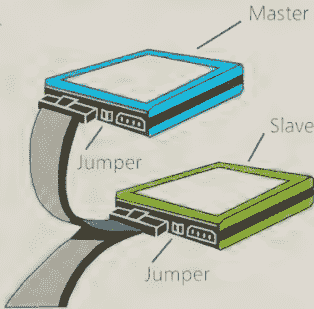


- 现在，将 `SATA` 数据线连接到从硬盘，使用电缆中间的插头。

`SATA`（串行高级技术连接）是将硬盘和光驱等设备连接到 `PC` 主板的标准。

- 将电源线连接到两个驱动器，然后关上 `PC` 机箱。
- 启动 `PC` 并检查系统现在是否检测到两个驱动器——如果没有检测到第二个驱动器，您可能需要更改启动设置以“自动搜索”它。

## 创建启动介质

`Linux Mint` 发行版提供三个版本，分别带有名为“`Cinnamon`”、“`MATE`”和“`Xfce`”的桌面环境。最流行的版本是 `Cinnamon` 版本，本书将贯穿使用该版本。它可以被下载到 `USB` 闪盘中以创建“启动介质”。这让你可以在不更改系统的情况下尝试 `Linux`，并在需要时将 `Linux` 安装到你的系统上。首先，你需要确保你的系统满足这些最低要求：

`USB` 闪盘 —— 也被称为 `Thumb Drive`、`Pen Drive`、`Disk Key`、`Gig Stick` 或 `Memory Stick`。


- `1GB` 运行内存（建议 `2GB`）
- `15GB` 磁盘空间（建议 `20GB`）
- `1024 x 768` 屏幕分辨率

与其他 `Linux` 发行版一样，`Linux Mint` 发行版是一个 `ISO` 镜像文件，其内容必须被“刻录（`burnt`）”到 `USB` 闪盘中（而不仅仅是复制），才能创建启动介质：

1. 启动浏览器，导航到下载页面 `linuxmint.com/download.php`
2. 接下来，点击 `Cinnamon 64-bit`

| 版本 | 32-位 | 64-位 | 说明 |
| :--- | :--- | :--- | :--- |
| `Cinnamon` | 32-bit | 64-bit | 具有 `Cinnamon` 桌面的版本 |
| `MATE` | 32-bit | 64-bit | 具有 `MATE` 桌面的版本 |
| `Xfce` | 32-bit | 64-bit | 具有 `Xfce` 桌面的版本 |

> 提供 32 位版本仅是为了兼容旧电脑 —— 即在 2008 年之前制造的电脑。你通常应该下载 64 位版本。如果你的电脑不兼容，你会看到错误信息 —— 这不会造成任何伤害。


3. 现在，从出现的列表中点击你所在国家的下载镜像链接
4. 选择将 `ISO` 镜像文件保存到系统中的常用位置以开始下载
5. 当 `ISO` 下载完成后，你需要一个应用将镜像刻录到 `USB` 闪盘。`Linux Mint` 推荐使用 `Etcher` 应用。导航浏览器到 `etcher.io` 并下载适用于你系统的安装程序。例如，“`Download for Windows x64`”

...续

当安装程序下载完成后，运行其 `Setup` 向导在你的系统上安装 `Etcher`

接下来，将 `USB` 闪盘连接到你的电脑

现在，启动 `Etcher` 应用并点击 `Select image` 按钮，然后选择你下载的 `ISO` 镜像文件

> 小贴士：如果你想验证 `ISO` 镜像文件（建议如此），可以在 `linuxmint-installation-guide.readthedocs.io/en/latest/verify.html` 上找到如何操作的说明

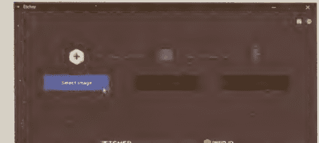

点击 `Select drive` 按钮，然后选择连接到电脑的 `USB` 闪盘

点击 `Flash!` 按钮将 `ISO` 内容刻录到 `USB` 闪盘 —— 创建 `Linux` 启动介质

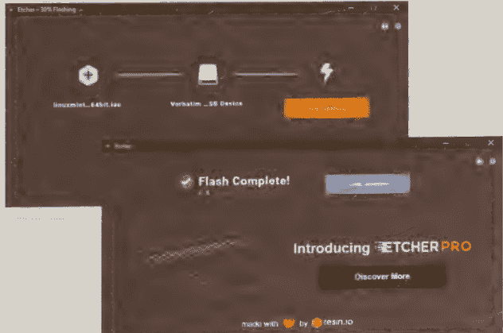

## 实时会话

创建启动介质后，按照第 14-15 页的步骤，你现在能够在“实时会话（`Live Session`）”中运行 `Linux Mint`。这意味着你可以在硬盘上已安装 `Windows` 系统的 `PC` 上安全地探索 `Linux` 操作系统。

为了开始实时会话，你的 `PC` 必须能够从包含启动介质的 `USB` 闪盘启动。这要求 `PC` 的启动设置在从硬盘查找指令之前，先从 `USB` 闪盘查找指令。如果你的电脑首先尝试从硬盘启动，你需要更改设置：

现代电脑中的 `UEFI`（统一可扩展接口）取代了早期电脑中的 `BIOS`（基本输入/输出系统）固件接口。这些控制着你的电脑如何启动。

- 查阅你电脑的文档以了解如何访问其 `Setup` 实用程序。这通常要求你在启动电脑时按下 `F2` 键 —— 但视而异
- 将 `USB` 闪盘启动介质连接到你的电脑
- 启动电脑并进入 `Setup` 实用程序
- 选择与 `PC` 启动过程相关的部分


`Setup` 实用程序是你电脑特有的，因此它的外观可能与此处显示的不同。然而，大多数电脑都会提供一种更改优先级顺序（`Priority Order`）的方法，让你从 `USB` 闪盘启动 `PC`。

| 信息 | 配置 | 安全 | 退出 |
| :--- | :--- | :--- | :--- |
| `UEFI Boot` | | [`Enabled`] | 项目特定帮助 |
| 启动优先级顺序 | | | | 使用 `<` 或 `>` 选择设备。然后按 `<F6>` 选择。 |
| 2. `SATA` | | | | |
| 3. `SATA` | | | | |
| 4. `SATA` | | | | |
| 5. `USB` | | | | |
| 6. `USB` | | | | |
| 7. `USB` | | | | |

- 查阅你电脑的文档以了解如何访问其 `Setup` 实用程序。这通常要求你在启动电脑时按下 `F2` 键 —— 但视而异
- 将 `USB` 闪盘启动介质连接到你的电脑


- 启动电脑并进入 `Setup` 实用程序
- 选择与 PC 启动过程相关的部分


`Setup` 实用程序是你电脑特有的，所以它的外观可能与此处显示的不同。然而，大多数电脑都会提供一种更改优先级顺序的方法，让你从 `USB` 闪盘启动 `PC`。

| 信息 | 配置 | 安全 | 退出 |
| :--- | :--- | :--- | :--- |
| `UEFI Boot` | | `[Enabled]` | 项目特定帮助 |
| 启动优先级顺序 | | | | 使用 `<` 或 `>` 选择设备。然后按 `<F6>` 选择。 |
| `2. SATA` | | | | |
| `3. SATA` | | | | |
| `4. SATA` | | | | |
| `5. USB` | | | | |
| `6. USB` | | | | |
| `7. USB` | | | | |
| 信息 | | | | |

* 32 位版本仅用于兼容旧电脑 —— 2008 年之前制造的电脑。

- 查阅你电脑的文档以了解如何访问其 `Setup` 实用程序。这通常要求你在启动电脑时按下 `F2` 键 —— 但视而异
- 将 `USB` 闪盘启动介质连接到你的电脑
- 启动电脑并进入 `Setup` 实用程序
- 选择与 `PC` 启动过程相关的部分

## 开始安装

创建启动介质后，按照第 14-15 页的步骤，你现在能够在“实时会话（Live Session）”中运行 `Linux Mint`。这意味着你可以在硬盘上已安装 `Windows` 系统的 `PC` 上安全地探索 `Linux` 操作系统。

为了开始实时会话，你的 `PC` 必须能够从包含启动介质的 `USB` 闪盘启动。这要求 `PC` 的启动设置在从硬盘查找指令之前，先从 `USB` 闪盘查找指令。如果你的电脑首先尝试从硬盘启动，你需要更改设置：

现代电脑中的 `UEFI`（统一可扩展接口）取代了早期电脑中的 `BIOS`（基本输入/输出系统）固件接口。这些控制着你的电脑如何启动。

- 查阅你电脑的文档以了解如何访问其 `Setup` 实用程序。这通常要求你在启动电脑时按下 `F2` 键 —— 但视而异
- 将 `USB` 闪盘启动介质连接到你的电脑
- 启动电脑并进入 `Setup` 实用程序
- 选择与 `PC` 启动过程相关的部分


`Setup` 实用程序是你电脑特有的，所以它的外观可能与此处显示的不同。然而，大多数电脑都会提供一种更改优先级顺序的方法，让你从 `USB` 闪盘启动 `PC`。

| 信息 | 配置 | 安全 | 退出 |
| :--- | :--- | :--- | :--- |
| `UEFI Boot` | | `[Enabled]` | 项目特定帮助 |
| 启动优先级顺序 | | | | 使用 `<` 或 `>` 选择设备。然后按 `<F6>` 选择。 |
| `2. SATA` | | | | |
| `3. SATA` | | | | |
| `4. SATA` | | | | |
| `5. USB` | | | | |
| `6. USB` | | | | |
| `7. USB` | | | | |
| 信息 | | | | |
| 安装 | | | | |
| `Setup` | | | | |

* 32 位版本仅用于兼容旧电脑 —— 2008 年之前制造的电脑。

`Linux Mint` 发行版提供三个版本，分别带有名为“Cinnamon”、“MATE”和“Xfce”的桌面环境。最流行的版本是 Cinnamon 版本，本书将贯穿使用该版本。它可以被下载到 `USB` 闪盘中以创建“启动介质”。这让你可以在不更改系统的情况下尝试 `Linux`，并在需要时将 `Linux` 安装到你的系统上。首先，你需要确保你的系统满足这些最低要求：

`USB` 闪盘 —— 也被称为 `Thumb Drive`、`Pen Drive`、`Disk Key`、`Gig Stick` 或 `Memory Stick`。


- `1GB` 运行内存（建议 `2GB`）
- `15GB` 磁盘空间（建议 `20GB`）
- `1024 x 768` 屏幕分辨率

与其他 `Linux` 发行版一样，`Linux Mint` 发行版是一个 `ISO` 镜像文件，其内容必须被“刻录（burnt）”到 `USB` 闪盘中（而不仅仅是复制），才能创建启动介质：

1. 启动浏览器，导航到下载页面 `linuxmint.com/download.php`
2. 接下来，点击 `Cinnamon 64-bit`

| 版本 | 32-位 | 64-位 | 说明 |
| :--- | :--- | :--- | :--- |
| Cinnamon | `32-bit` | `64-bit` | 具有 Cinnamon 桌面的版本 |
| MATE | `32-bit` | `64-bit` | 具有 MATE 桌面的版本 |
| Xfce | `32-bit` | `64-bit` | 具有 Xfce 桌面的版本 |

> 提供 32 位版本仅是为了兼容旧电脑 —— 即在 2008 年之前制造的电脑。你通常应该下载 64 位版本。如果你的电脑不兼容，你会看到错误信息 —— 这不会造成任何伤害。


3. 现在，从出现的列表中点击你所在国家的下载镜像链接
4. 选择将 `ISO` 镜像文件保存到系统中的常用位置以开始下载
5. 当 `ISO` 下载完成后，你需要一个应用将镜像刻录到 `USB` 闪盘。`Linux Mint` 推荐使用 `Etcher` 应用。导航浏览器到 `etcher.io` 并下载适用于你系统的安装程序。例如，“`Download for Windows x64`”

...续

当安装程序下载完成后，运行其 `Setup` 向导在你的系统上安装 `Etcher`

接下来，将 `USB` 闪盘连接到你的电脑

现在，启动 `Etcher` 应用并点击 `Select image` 按钮，然后选择你下载的 `ISO` 镜像文件

> 小贴：如果你想验证 `ISO` 镜像文件（建议如此），你可以在 `linuxmint-installation-guide.readthedocs.io/en/latest/verify.html` 上找到如何操作的说明


点击 `Select drive` 按钮，然后选择连接到电脑的 `USB` 闪盘

点击 `Flash!` 按钮将 `ISO` 内容刻录到 `USB` 闪盘 —— 创建 `Linux` 启动介质


## 实时会话

创建启动介质后，按照第 14-15 页的步骤，你现在能够在“实时会话（Live Session）”中运行 `Linux Mint`。这意味着你可以在硬盘上已安装 `Windows` 系统的 `PC` 上安全地探索 `Linux` 操作系统。

为了开始实时会话，你的 `PC` 必须能够从包含启动介质的 `USB` 闪盘启动。这要求 `PC` 的启动设置在从硬盘查找指令之前，先从 `USB` 闪盘查找指令。如果你的电脑首先尝试从硬盘启动，你需要更改设置：

现代电脑中的 `UEFI`（统一可扩展接口）取代了早期电脑中的 `BIOS`（基本输入/输出系统）固件接口。这些控制着你的电脑如何启动。

- 查阅你电脑的文档以了解如何访问其 `Setup` 实用程序。这通常要求你在启动电脑时按下 `F2` 键 —— 但视而异
- 将 `USB` 闪盘启动介质连接到你的电脑
- 启动电脑并进入 `Setup` 实用程序
- 选择与 `PC` 启动过程相关的部分


`Setup` 实用程序是你电脑特有的，所以它的外观可能与此处显示的不同。然而，大多数电脑都会提供一种更改优先级顺序（Priority Order）的方法，让你从 `USB` 闪盘启动 `PC`。

| 信息 | 配置 | 安全 | 退出 |
| :--- | :--- | :--- | :--- |
| `UEFI Boot` | | `[Enabled]` | 项目特定帮助 |
| 启动优先级顺序 | | | | 使用 `<` 或 `>` 选择设备。然后按 `<F6>` 选择。 |
| `2. SATA` | | | | |
| `3. SATA` | | | | |
| `4. SATA` | | | | |
| `5. USB` | | | | |
| `6. USB` | | | | |
| `7. USB` | | | | |


# 信息

## Setup

- 查阅你电脑的文档以了解如何访问其 `Setup` 实用程序。这通常要求你在启动电脑时按下 `F2` 键 —— 但视而异
- 将 `USB` 闪盘启动介质连接到你的电脑
- 启动电脑并进入 `Setup` 实用程序
- 选择与 `PC` 启动过程相关的部分


`Setup` 实用程序是你电脑特有的，所以它的外观可能与此处显示的不同。然而，大多数电脑都会提供一种更改优先级顺序的方法，让你从 `USB` 闪盘启动 `PC`。

| 信息 | 配置 | 安全 | 退出 |
| :--- | :--- | :--- | :--- |
| `UEFI Boot` | | [Enabled] | 项目特定帮助 |
| 启动优先级顺序 | | | | 使用 `<` 或 `>` 选择设备。然后按 `<F6>` 选择。 |
| 2. `SATA` | | | | |
| 3. `SATA` | | | | |
| 4. `SATA` | | | | |
| 5. `USB` | | | | |
| 6. `USB` | | | | |
| 7. `USB` | | | | |

# 信息

*32 位版本仅用于兼容旧电脑 —— 2008 年之前制造的电脑。*

- 查阅你电脑的文档以了解如何访问其 `Setup` 实用程序。这通常要求你在启动电脑时按下 `F2` 键 —— 但视而异
- 将 `USB` 闪盘启动介质连接到你的电脑
- 启动电脑并进入 `Setup` 实用程序
- 选择与 `PC` 启动过程相关的部分

## 开始安装

创建启动介质后，按照第 14-15 页的步骤，你现在能够在“实时会话（Live Session）”中运行 `Linux Mint`。这意味着你可以在硬盘上已安装 `Windows` 系统的 `PC` 上安全地探索 `Linux` 操作系统。

为了开始实时会话，你的 `PC` 必须能够从包含启动介质的 `USB` 闪盘启动。这要求 `PC` 的启动设置在从硬盘查找指令之前，先从 `USB` 闪盘查找指令。如果你的电脑首先尝试从硬盘启动，你需要更改设置：

现代电脑中的 `UEFI`（统一可扩展接口）取代了早期电脑中的 `BIOS`（基本输入/输出系统）固件接口。这些控制着你的电脑如何启动。

- 查阅你电脑的文档以了解如何访问其 `Setup` 实用程序。这通常要求你在启动电脑时按下 `F2` 键 —— 但视而异
- 将 `USB` 闪盘启动介质连接到你的电脑
- 启动电脑并进入 `Setup` 实用程序
- 选择与 `PC` 启动过程相关的部分


`Setup` 实用程序是你电脑特有的，所以它的外观可能与此处显示的不同。然而，大多数电脑都会提供一种更改优先级顺序的方法，让你从 `USB` 闪盘启动 `PC`。

| 信息 | 配置 | 安全 | 退出 |
| :--- | :--- | :--- | :--- |
| `UEFI Boot` | | [Enabled] | 项目特定帮助 |
| 启动优先级顺序 | | | | 使用 `<` 或 `>` 选择设备。然后按 `<F6>` 选择。 |
| 2. `SATA` | | | | |
| 3. `SATA` | | | | |
| 4. `SATA` | | | | |
| 5. `USB` | | | | |
| 6. `USB` | | | | |
| 7. `USB` | | | | |

# 信息

*安装*

*Setup*

## 完成安装

6 在“安装类型”屏幕上...

如果您希望让这成为您电脑上唯一的操作系统，请选择“擦除磁盘并安装 `Linux Mint`”。

新用户应避免在此处选择“加密（Encrypt）”和“LVM”选项，因为它们可能会导致问题。

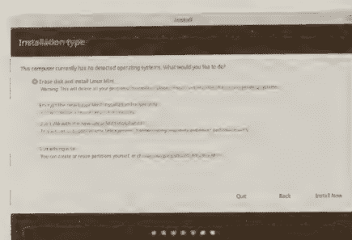

或者

如果已经安装了 `Windows` 且您也想在电脑上保留它，请选择“与 `Windows` 管理器一起安装 `Linux Mint`（Install Linux Mint alongside Windows Boot Manager）”选项。

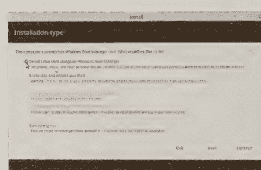

高级用户可以选择此处的“其他（Something else）”来管理磁盘分区。`Linux Mint` 需要一个分区挂载在根目录（`root/directory`）。操作系统占用 15GB，因此该分区理想大小应为 100GB 以上。推荐使用 `ext4` 文件系统。还需要交换分区（`swap partition`）作为内存缓冲区，其大小应与您电脑中的 `RAM` 容量相等。

如果您选择在保留 `Linux Mint` 的同时保留 `Windows`，安装程序会自动调整操作系统的大小，然后在创建的空闲空间安装 `Linux Mint`。会出现一个启动菜单，让您每次启动电脑时都可以在操作系统之间进行选择——这就是“双启动”设置。

7 在上述一种情况下选择安装类型后，点击“现在安装（Install Now）”按钮继续...

## 在“您在哪里？”屏幕上，选择您的时区，然后点击“继续（Continue）”按钮


只需在全球地图上点击您的大致位置即可选择您的时区。

## 在“您是谁？”屏幕上，输入您的详细信息然后点击“继续（Continue）”按钮安装系统文件

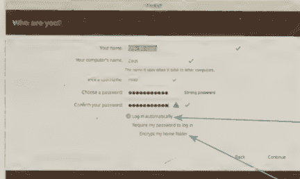


如果您是电脑的唯一用户，可以选择“自动登录（Log in automatically）”选项，这样每次启动 `Linux Mint` 时都不需要输入密码。如果您担心安全问题，还可以选择“加密我的主文件夹（Encrypt my home folder）”选项。

## 在 `Linux Mint` 安装时可以欣赏幻灯片，完成后点击“立即重启（Restart Now）”按钮

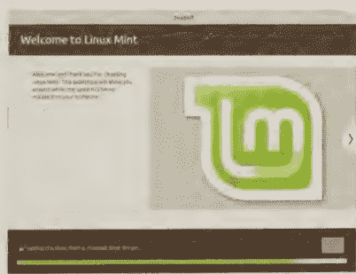

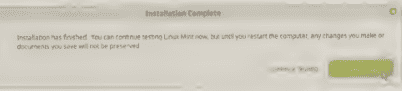

## 启用备份

完成安装过程后，按照前页的步骤操作，`Linux Mint` 将启动到桌面。在开始使用操作系统之前，建议您启用“`Timeshift`”备份工具。这就像 `Windows` 上的“系统还原（System Restore）”，当出现任何问题时，它可以允许将操作系统恢复到早前的备份：


`Timeshift` 工具

- 点击菜单（“开始”按钮）、管理（Administration）、`Timeshift`
- 接下来，输入您在安装过程中在“您是谁？”对话框中选择的密码，然后点击“验证（Authenticate）”按钮

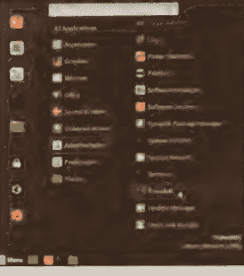

“`Timeshift`”工具是 `Linux Mint` 版本 19 (Tara) 引入的新功能。


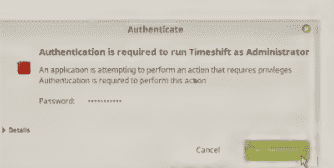

- 现在，选择“`RSYNC`”选项，然后点击“下一步（Next）”按钮。“`RSYNC`”是一种基于磁盘的备份系统，仅备份自上次备份以来发生更改。


| `RSYNC` | `BTRFS` |
| :--- | :--- |
| 快照通过使用 `rsync` 创建系统副本，并从之前的快照链接未更改的文件。 | 创建快照时复制所有文件。随后的快照是增量的；从之前的快照链接未更改的文件。 |
| 快照可以保存到任何格式化的 `Linux` 系统的磁盘上。 | 保存快照需要时间，但在系统损坏或重新格式化时允许恢复。 |
| 可以排除文件和目录以节省磁盘空间 | 选择您想要保存系统备份的设备，然后点击“下一步（Next）”按钮。（此处选择的设备是连接的外部硬盘，但您也可以连接 `USB` 驱动器） |


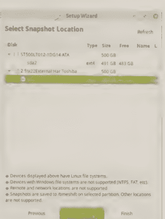

不要选择主硬盘作为保存快照的位置——如果您的硬盘故障，这将对您没有帮助。选择您希望在所选设备上保存系统快照的频率，然后点击“完成（Finish）”按钮。


启动快照保存在所选设备根级别新建的`timeshift`目录中。启动快照在后台执行，因此不会影响系统启动。将来重新打开`Timeshift`并选择保存的备份，然后点击“还原（Restore）”恢复您的`Linux Mint`系统。

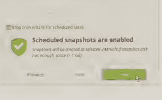

## 总结

- `Linux`是一种源自强大的`Unix`系统的免费、多多操作系统。“Linux”名称结合了其创始人`Linus Torvalds`的名字和`Unix`的最后一个字母。
- `KDE`和`Gnome`桌面都是用户友好的图形界面，提供了与`Windows`桌面相同的点击便利性。
- `内核（kernel）`提供了`Linux`的核心功能。
- `Linux`发行版（distros）将内核、系统级程序和免费的用户级程序打包。
- 最流行的`Linux Mint`发行版使用`Cinnamon`桌面管理器，是初学者的最佳发行版。
- 运行`Linux Mint`的最低硬件要求：`1GB RAM`、`15GB`磁盘空间以及`1024 x 768`的分辨率——更高的规格更好。
- 可以轻松为电脑添加第二个硬盘，使其能够双启动`Linux`或`Windows`。
- 可以下载`Linux`发行版并作为文件镜像写入`USB`驱动器以创建启动媒体。
- 为了从`USB`闪启动，可能需要使用设置工具（Setup Utility）更改启动设备顺序。
- `Linux Mint`安装程序允许您将`Linux`作为唯一操作系统，或与`Windows`同时安装。
- 在开始使用`Linux Mint`操作系统之前，建议启用`Timeshift`备份工具，以便在出现问题时恢复系统。

## 2 探索桌面

本章介绍了`Linux Mint`界面，解释了如何使用它，并演示了如何进行自定义。

- 26 熟悉界面
- 28 配置桌面
- 30 添加桌面组件（Desklets）
- 32 调整任务栏
- 34 启动应用程序
- 36 编辑菜单
- 38 安装更新
- 42 总结

## 熟悉界面

当您启动`Linux Mint`操作系统时，系统开始加载时您看到的第一个是显示操作系统名称和版本数的黑屏：

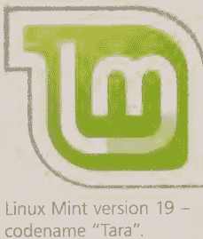

除非您在安装过程中选择了“自动登录”选项（见第21页），否则您看到的下一个是所示的登录屏幕：

- 计算机名称、用户名、密码、辅助功能、键盘布局


当前时间也显示在登录屏幕的右上角。将鼠标光标悬停在时间上方，即可在弹出提示框中看到当前日期。

您现在可以输入您选择的密码，然后点击密码框中出现的箭头按钮（或按回车键）登录`Linux Mint`操作系统。

登录`Linux Mint`后（无论是通过登录还是选择自动选项），将出现如所示的`GUI`（图形界面）桌面和任务栏：

## 桌面快捷方式

## 桌面壁纸

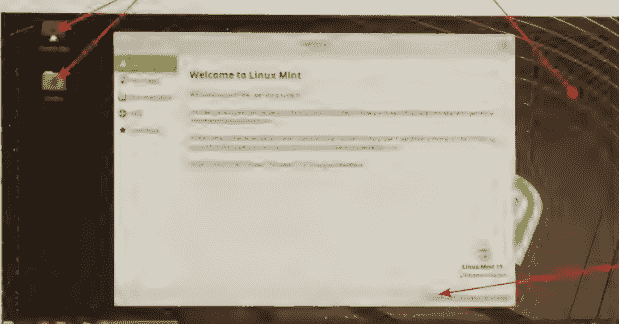


欢迎对话框为新用户提供了有用信息。如果不再次看到此对话框，请取消勾选。点击任何窗口右上角的`X`按钮关闭该窗口。

- 菜单
- 应用启动器
- 任务栏
- 系统托

如果您有`Windows`操作系统的经验，`Linux Mint`桌面看起来会很熟悉——这初衷如此。

## 系统托

系统托默认包含五个图标，点击这些图标可以访问实用功能：


将鼠标光标悬停在任何系统托图标上方，即可在弹出提示框中看到信息。

- 用户信息
- 网络状态
- 电池电量
- 时间与日期

## 配置桌面

许多人想要对`Linux`桌面进行的第一个更改之一就是桌面的背景“壁纸”：

- 在桌面壁纸的任何地方点击右键 – 打开右键菜单

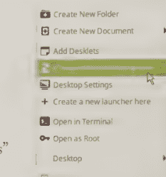

- 在右键菜单中选择“更改桌面背景”（`Change Desktop Background`）选项 – 打开“背景”设置窗口
- 在左侧面板中选择“`Tara`” – 在右侧面板显示一系列壁纸图像


你可以点击“设置”（`Settings`）按钮来调整图像适应桌面的方式，或者选择背景颜色而不是图像。

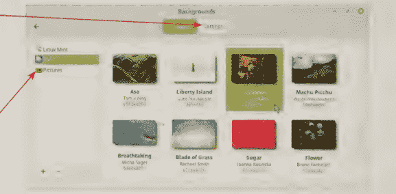


你还可以点击“图片”（`Pictures`）文件夹来选择你自己的图像。

- 向滚动并点击任何图像 – 立即将其应用于桌面的背景壁纸


如果你习惯了在`Windows`桌面看到“回收站”图标，或者只是想轻松地恢复删除的文件，你会在`Linux Mint`的桌面上看到“垃圾桶”（`Trash`）图标：

- 在桌面壁纸的任何地方点击右键打开右键菜单，并选择“桌面设置”（`Desktop Settings`） – 打开“桌面设置”窗口

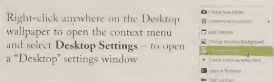

- 确保垃圾桶图标的切换开关处于“关闭”（`Off`）位置

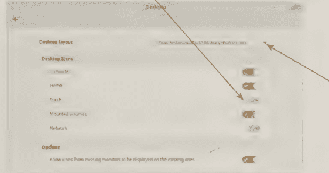

> 小贴士：你可以从此下拉列表中为双显示器设置选择选项，并隐藏所有桌面图标。你的“开启/关闭”设置将被记录，以便下次选择显示所有桌面图标时使用。

- 将切换开关滑动到“开启”（`On`）位置，即可看到垃圾桶图标出现在桌面上


- 要调整桌面图标，在桌面上点击右键并展开“桌面”（`Desktop`）选项

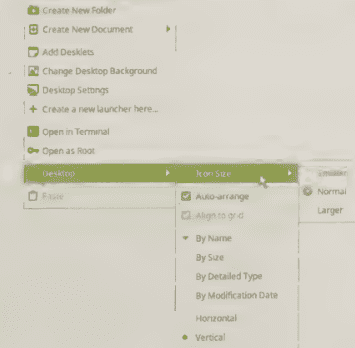

- 从选项中选择你偏好的图标大小和排列

## 添加桌面小组件 (Desklets)

`Linux Mint`提供了许多运行在桌面上的小型应用程序（小组件/applets）。这些类似于你在`Windows`中可能过的桌面部件，但在`Linux Mint`中被称为“桌面小组件”（`Desklets`）。默认安装了三个小组件，你可以下载更多：

- 1. 在桌面壁纸的任何地方点击右键打开右键菜单，然后选择“添加桌面组件”（`Add Desklets`） – 打开“桌面组件”设置窗口
- 2. 接下来，选择一个已安装的小组件，例如“时钟”（`Clock`）组件

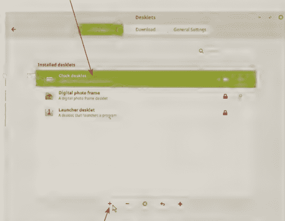

你可以点击桌面组件窗口中的“常规设置”（`General Settings`）按钮来修改小组件的宽度和装饰外观。

- 3. 现在，点击“+”按钮将小组件立即添加到桌面

你可以拖动桌面上的小组件以根据你的喜好进行排列。

点击“下载”（`Download`）按钮，选择一个小组件并点击向下箭头在你的电脑上安装它


> 当你选择下载按钮时，对话框可能会提示“您的缓存已过期”。点击对话框上的“是”（`Yes`）进行更新。


点击“管理”（`Manage`）按钮查看你选择的小组件已添加到已安装组件列表中

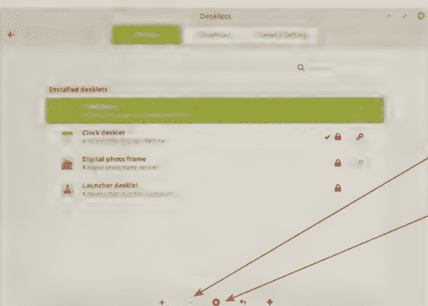

> 点击“-”按钮从桌面移除已选的小组件，或点击“x”按钮卸载已选的小组件。


选择新安装的小组件，然后点击“+”按钮将其立即添加到桌面


> 在小组件上点击右键，查看提供配置选项和从桌面移除小组件选项的右键菜单。


## 调整任务栏

任务栏包含每个运行窗口的图标，你可以点击将最小化的窗口恢复到原始大小。你可以将鼠标光标悬停在应用程序图标上查看该窗口的缩略图：


此外，你可以在任务栏添加实用的组件：

1. 在任务栏上点击右键打开右键菜单
2. 选择“向面板添加组件”（`Add applets to the panel`） – 打开“小组件”设置窗口


你可以点击此右键菜单上的“面板设置”（`Panel settings`）来自动隐藏任务栏、添加更多面板以及编辑面板


注意，小组件设置窗口的功能与第 31 页描述的桌面组件窗口类似

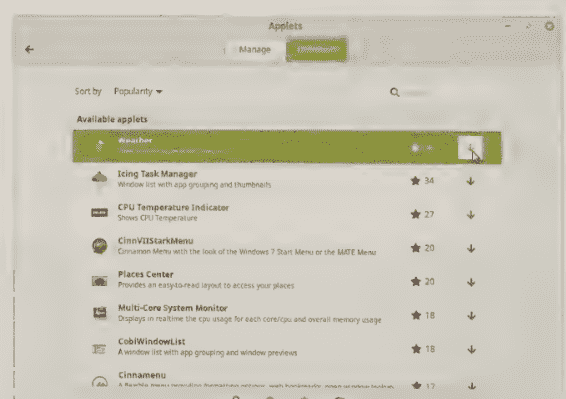

点击“管理”（`Manage`）按钮从已安装的组件列表中选择，或点击“下载”（`Download`）按钮安装另一个组件，例如“天气”（`Weather`）组件

点击“管理”并选择天气组件，然后点击“+ 添加”按钮将其添加到任务栏。天气组件需要你选择一个位置。在组件上点击右键并选择“配置”（`Configure`）


在天气设置窗口中，点击“获取 WOID”（`Get WOID`），并在出现的“搜索位置”（`Search Place`）框中输入位置


`WOID`（地球上的位置）是标识地球上任何特征的唯一数字。点击“查找”（`Lookup`）按钮获取 `WOID` 数字，然后将数字输入此处并关闭窗口

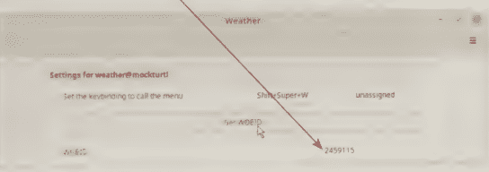

现在，点击任务栏组件查看你所选位置的天气


在组件上点击右键，查看提供配置选项和从桌面移除组件的右键菜单


## 启动应用程序

应用程序可以从 `Linux Mint` 菜单启动，也可以轻松地添加到任务栏或桌面，以便方便使用：


1. 点击任务栏左侧的“菜单”（`Menu`）按钮，将鼠标悬停在“应用程序”（`Apps`）类别上查看分类列表

   你也可以在此“搜索”（`Search`）框中输入应用程序名称来查找它

2. 在“应用程序”列表中选择一个已安装的程序


这里的菜单是来自 `Linux Mint` 的，但其他发行版的菜单可能会有所不同

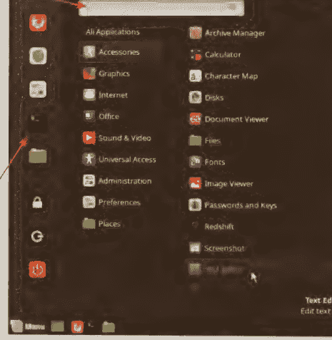


“收藏”侧边栏中的应用程序你可以通过右键菜单中的“添加到收藏”（`Add to favorites`）将其添加到侧边栏

3. 在“应用程序”菜单项上点击右键，然后选择“添加到面板”（`Add to panel`）创建任务栏按钮

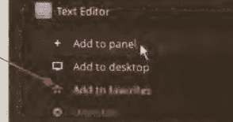

4. 点击添加到任务栏的快捷方式即可启动程序


5. 在“应用程序”菜单项上点击右键，选择“添加到桌面”（`Add to desktop`）在桌面上创建图标


6. 点击添加到桌面的快捷方式即可启动程序


要从任务栏删除快捷方式，请右键点击并选择“移除”。要从桌面删除快捷方式，请右键点击并选择“删除”。

如果你知道精确的命令名称，也可以为任何应用程序创建桌面启动器。在此例中，`Cinnamon` 桌面上的文本编辑器名为 `zed`。

7. 在桌面上点击右键，然后从出现的右键菜单中选择“在此创建启动器...”（`Create a launcher here...`）

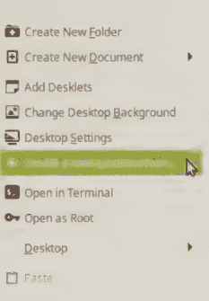

8. 在“启动器属性”（`Launcher Properties`）对话框的输入字段中输入名称和 `zed` 命令名称，然后点击其“确定”（`OK`）按钮创建桌面启动器

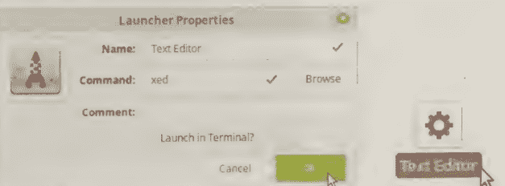


# 编辑菜单

与 `Linux Mint` 操作系统中的许多功能一样，（开始）菜单也可以根据你的个人喜好进行自定义：

1. 右键点击任务栏左侧的 `菜单（Menu）` 按钮，然后选择 `配置...（Configure...）` 选项

2. 点击 `面板（Panel）` 按钮并从可用选项中调整外观和行为。例如，更改菜单的 `文本（Text）` 值

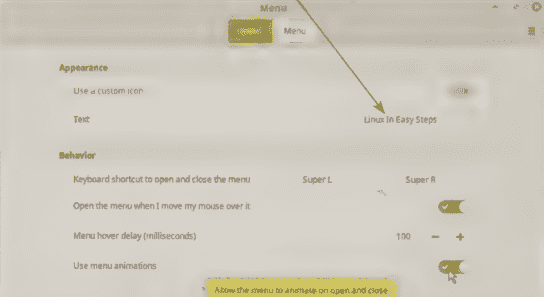

`“Super”` 键指的是你键盘上的特殊键。通常，这就是 `Windows` 键。按下它打开菜单，再次按下即可关闭菜单。


3. 看到你所选的选项立即应用到菜单中

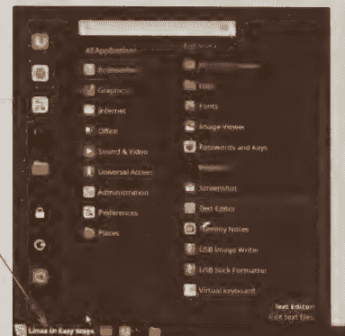

4. 在“菜单”窗口中点击 `菜单（Menu）` 按钮，然后点击 `打开菜单编辑器（Open the menu editor）` 按钮 ...续)

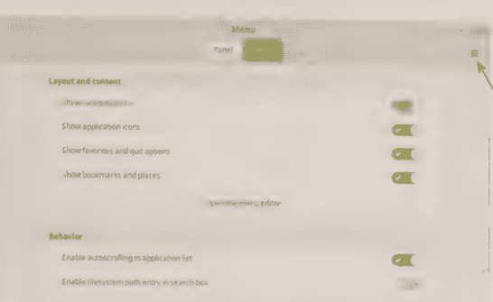


你可以点击汉堡按钮并将你的菜单设置保存为文件，以后可以导入该文件以恢复这些设置。

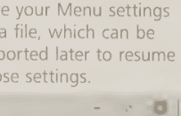

- 将所有切换开关滑到“关闭（`Off`）”位置以简化菜单

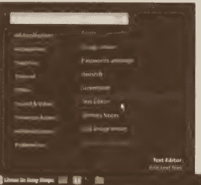

- 现在，点击打开菜单编辑器按钮

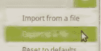

- 点击左侧面板中的任何类别，然后在右侧窗格中选择菜单项目

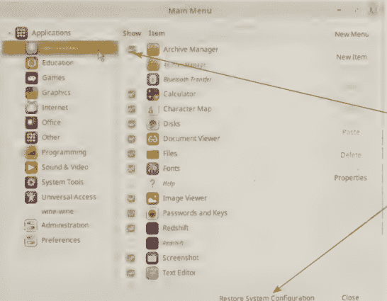


你可以取消勾选单个项目以从菜单中移除它们，并点击 `恢复配置（Restore System Configuration）` 按钮。

# 安装更新

设置了 `Timeshift` 为你的 `Linux Mint` 系统定期备份（见第 22 页），建议定期为系统应用所有更新：

- 将电脑连接到互联网，然后点击 `菜单（Menu）`，`管理（Administration）`，打开“`更新管理器（Update Manager）`”窗口


首次打开更新管理器时，可能会出现“`欢迎（Welcome）`”屏幕。点击 `OK` 继续。

- 如果更新管理器建议你切换到本地镜像服务器，点击此 `OK`


- 输入你的密码，点击验证（Authenticate）按钮打开“软件源（Software Sources）”对话框


之前的 `Linux Mint` 版本建议执行选择性更新以防引入问题。`Timeshift` 改变了这一点，你可以恢复系统。

- 双击主（Main）区域框并从列表中选择本地镜像，然后点击应用（Apply）

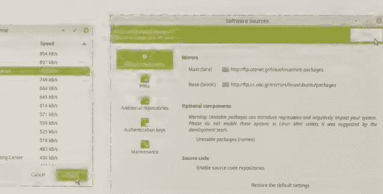

- 现在，为 `Base`（`bionic`）框选择本地镜像，然后点击 `OK` 关闭“软件源”对话框。等待软件列表更新，然后返回“更新管理器（Update Manager）”窗口。点击全选（Select All），然后点击更新（Updates）

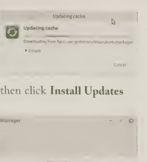

更新缓存和下载更新需要一点时间，因此选择快速的本地服务器很重要。


如果需要额外的软件包，点击 `OK`。输入你的密码，点击验证（Authenticate）按钮 – `Linux Mint` 现在将下载并安装可用更新。

注意 `Linux Mint` 中的更新被称为“软件包（packages）”。这些包由 `Synaptic` 软件包管理器管理，可以在菜单的管理（Administration）类别中找到它。


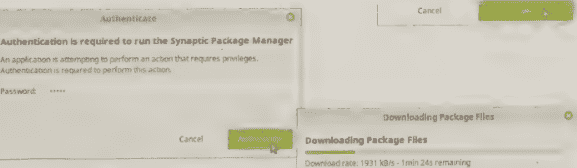


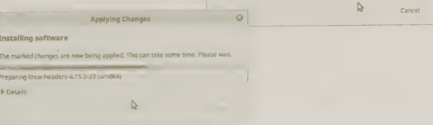

# 关闭桌面

- 1. 点击菜单（Menu），然后点击锁定屏幕（Lock screen）按钮立即关闭桌面。
- 2. 看到屏幕填充屏幕，这样你的电脑就无法使用了。


你也可以使用 `Ctrl + Alt + L` 快捷键锁定屏幕。要发现更多 `Linux Mint` 快捷键，点击 `菜单（Menu）`、`偏好（Preferences）`、`键盘（Keyboard）` 打开“键盘”窗口，然后点击 `快捷键（Shortcuts）` 按钮。在左侧面板中选择一个类别，例如 `系统（System）`，在右侧窗格中查看可用快捷键。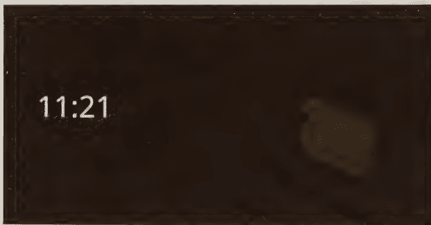

- 3. 当你想解锁电脑时移动鼠标，将提示输入密码 – 输入你的密码返回桌面。


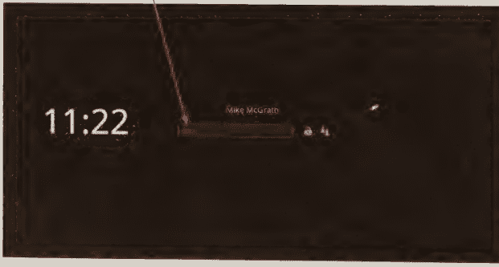

你可以点击 `切换用户（Switch User）` 按钮注销 – 你将看到第 26 页所示的 `登录（Log in）` 屏幕。

你有时可能出于安全目的或切换用户而退出 `Linux Mint` 操作系统：

- 1. 点击菜单（Menu），然后点击注销（Log Out）按钮，显示“会话（Session）”选项对话框。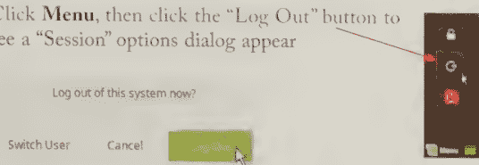
- 2. 点击注销（Log Out）选项按钮，或切换用户（Switch User）选项按钮，查看登录界面。

当你打算离开电脑一段时间时，你可能想要关闭系统：

- 1. 点击菜单（Menu），然后点击退出（Quit）按钮查看“现在关闭此系统吗？（Shut down this system）”选项出现。
- 2. 点击关机（Shut Down）选项退出 `Linux Mint`。

> 提示：挂起（Suspend）选项会停止所有应用程序并将状态保存在内存中，进入低功耗模式。按下任意键即可唤醒电脑回到离开的地方。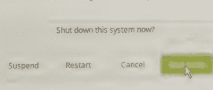

## 总结

- 除非安装时选择了“自动登录”选项，否则启动时将要求输入密码。
- `Linux Mint` GUI 由桌面和任务栏组成。
- 桌面包含快捷方式和壁纸。
- 任务栏包含菜单按钮、显示桌面按钮、应用程序启动器和系统托盘。
- 系统托盘提供用户信息、网络状态、电池状态、日期时间和音量控制。
- 桌面可以配置不同的壁纸并包含快捷图标。
- 小组件（Desklets）是运行在桌面上的小型应用程序。
- 将鼠标光标悬停在任务栏运行应用程序图标上将显示该应用程序的缩略图。
- 有用的应用插件（applets）可以添加到任务栏面板。
- 应用程序启动器在菜单按分类分组。
- 应用程序启动器可以添加到任务栏和桌面。
- 菜单可以配置以自定义其外观和行为。
- 启用 `Timeshift` 备份工具后，可以使用更新管理器定期应用所有更新。
- 选择本地镜像作为软件源通常允许更快地下载更新。
- 可以切换到锁定屏幕来关闭桌面。
- 注销选项和切换用户选项关闭桌面并打开登录界面。
- 关机选项关闭桌面并关闭电脑。

## 选择外观

默认情况下，如果你一段时间没有与电脑进行交互，你的 `Linux Mint` 桌面将自动切换到屏幕保护程序。这意味着你可能需要频繁输入密码才能返回桌面，如果你的电脑位于一个不需要考虑安全性的环境中，这样做就是没必要的。幸运的是，你可以禁用此行为，这样桌面将始终可见，除非你显式地锁定电脑。

你还可以通过选择自定义屏幕保护来选择屏幕显示的方式，并可以在锁定屏幕上添加消息：

- 1. 点击 `菜单 (Menu)`、`偏好 (Preferences)`、`屏幕保护 (Screensaver)` 打开“屏幕保护”窗口
- 2. 接下来，点击 `设置 (Settings)` 按钮

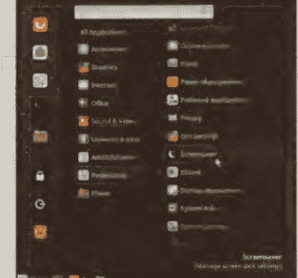


注意，如果你不想完全禁用屏幕保护，可以选择延长屏幕保护出现前的延迟时间。

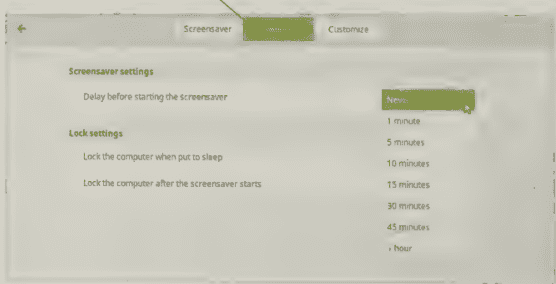

- 3. 现在，打开“屏幕保护设置”(`Screensaver settings`) 下拉菜单并选择“从不”(`Never`) 选项 – 以停止电脑自动切换到锁定屏幕
- 4. 点击 `屏幕保护 (Screensaver)` 按钮

在“选择屏幕保护”(`Select screensaver`) 列表中选择任意项目即可在“屏幕保护”窗口中查看其预览播放——你的最终选择将成为你的屏幕保护程序

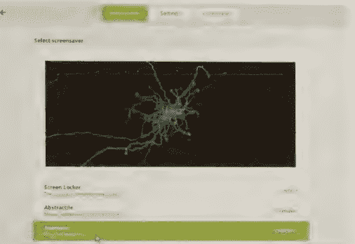


除了标准的 `Cinnamon` 锁定屏幕“锁定器”，所有的屏幕保护都是动画。

接下来，点击 `自定义 (Customize)` 按钮，然后输入要显示在锁定屏幕上的自定义“离开消息”(`Away message`)


点击 `锁定屏幕 (Lock screen)` 按钮查看你的屏幕保护，然后点击查看锁定屏幕上的你的消息

还有一个“在从菜单锁定屏幕时询问自定义消息”(`Ask for a custom message when locking the screen from the menu`) 选项——这样你在离开电脑时可以添加独特的消息。

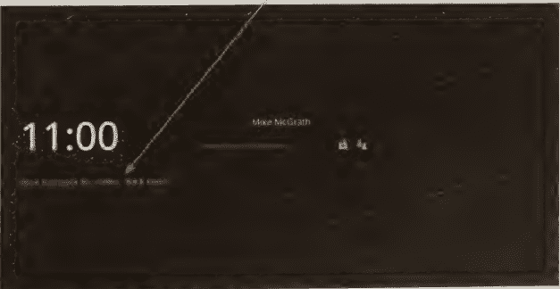

## 管理窗口

`Linux Mint` 窗口标题栏上的控制按钮与 `Windows` 操作系统中的操作相同：

- 最小化到任务栏
- 最大化/还原尺寸
- 关闭窗口

不是全尺寸、贴靠或平铺状态的窗口可以通过拖动其边缘或角落来调整大小。

你还可以将窗口贴靠到屏幕边缘、将窗口平铺到屏幕角落，并在工作区之间移动窗口：

- 点击 `菜单 (Menu)`、`附件 (Accessories)`、`文本编辑器 (Text Editor)` 打开文本编辑器应用
- 点击窗口的控制按钮将其从全屏尺寸还原


## 窗口贴靠与平铺

- 接下来，点击窗口的标题栏并按住鼠标键，然后将窗口拖动到任何屏幕边缘
- 当你看到区域预览时，释放鼠标键将窗口贴靠到该边缘——占据屏幕的一半

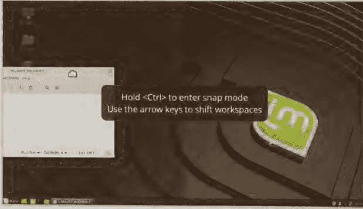

你可以忽略屏幕上“按住 `<ctrl>`”的指令。只需将两个应用贴靠到屏幕的左右两侧即可同时处理两个文档。

- 现在，点击窗口的标题栏并按住鼠标键，然后将窗口拖动到任何屏幕角落
- 当你看到区域预览时，释放鼠标键将窗口贴靠到该角落——占据屏幕的四分之一

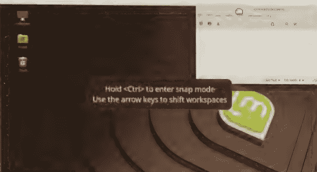


你可以平铺多四个应用。此外，你也可以贴靠和平铺。例如，将两个应用平铺在顶部角落，并将另一个应用跨越屏幕下半部分，同时处理三个文档。

## 工作区

- 点击菜单 (`Menu`)、偏好 (`Preferences`)、热角 (`Hot Corners`) 打开“热角”窗口
- 启用左上角显示工作区，然后将鼠标指针移动到该角即可查看工作区


你可以将应用从一个工作区拖到另一个工作区，并点击任何工作区开始在那里工作。应用会在隐藏的工作区继续运行，因此你可以切换回来。


## 个性化选项

你可以通过指定 `Linux Mint` 偏好来个性化窗口的行为和外观。例如，许多人喜欢将默认的浅灰色改为灰色：


将此开关滑动到“关闭”(Off)位置以禁用窗口贴靠或平铺。

- 点击菜单 (`Menu`)、偏好 (`Preferences`)、窗口平铺 (`Window Tiling`) 打开“窗口平铺”窗口——在这里你可以禁用平铺或修改其行为

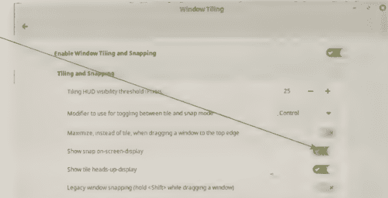

在此菜单中选择“阴影”(Shade)选项可以以另一种方式最小化窗口。要使用切换器，按住 `Alt` 键按 `Tab` 键。释放 `Alt` 键赋予焦点。

- 点击菜单 (`Menu`)、偏好 (`Preferences`)、窗口 (`Windows`) 打开“窗口”窗口——在这里你可以修改标题栏和窗口操作
- 点击菜单 (`Menu`)、偏好 (`Preferences`)、主题 (`Themes`) 打开“主题”窗口，然后点击主题查看当前外观

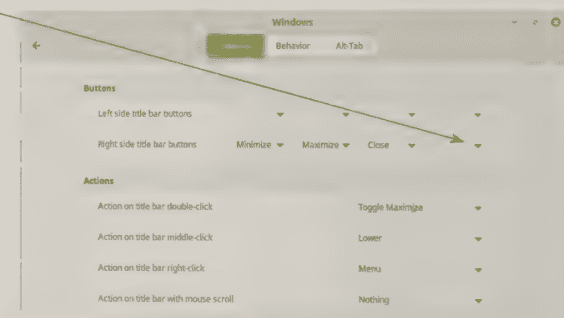

## 主题

> 提示：点击添加/删除 (`Add/Remove`)按钮查看你可以下载和安装的主题。这些为桌面提供了额外的选项。

点击“边框”(Window borders)的 `Mint` 设置打开弹出菜单，然后选择 `Mint-Dark`选项立即更改边框外观。同样，点击“控制”(Controls)的 `Mint` 设置，然后在弹出菜单中选择 `Mint-Dark`以立即更改控件的外观


> 提示：点击设置按钮查看显示或隐藏窗口按钮和菜单。

## 控制连接

`Linux Mint` 允许你轻松控制通过无线 `Wi-Fi` 或有以太网连接互联网。你还可以通过代理服务器或虚拟网络 (VPN)连接来隐藏身份：


- 点击菜单 (`Menu`)、偏好 (`Preferences`)、网络 (`Network`) 打开“网络”窗口，然后在左侧面板点击 `Wi-Fi`——在右侧面板查看无线连接


你还可以点击系统托盘 (System Tray)上的“无线连接”图标查看网络状态。


- 同样，点击有线 (Wired)查看可用的有线连接


- 点击网络代理 (`Network proxy`)查看或添加可用于隐藏身份的代理服务器


点击 `+ 添加` (Add)按钮打开“添加 VPN”(Add VPN)对话框，然后选择点对点隧道协议 (PPTP)选项


接下来，输入你的 VPN 服务名称 (Name)、`URL` 和详细信息，然后点击高级...(Advanced...)按钮


在输入密码之前你需要点击此图标并选择是否存储密码。


选择身份验证和安全选项并点击确定，然后在“添加 VPN”对话框上点击 `+ 添加` (Add)按钮


在“网络”窗口中点击新添加的 VPN 条，将开关滑动到“开启”(On)位置以连接。

在“偏好”(Preferences)类别下，还有一个网络连接 (`Network Connections`)应用可以显示你的连接历史。你可以双击任何网络项目打开连接的编辑对话框。


# 添加打印机

`Linux Mint` 提供了广泛打印机的驱动程序，因此添加打印机只需将打印机连接到电脑的 `USB` 端口并开启电源即可。操作系统应该识别打印机并显示通知，说明它已自动添加到您的系统：


USB 连接的打印机


添加的打印机的属性和选项可以在“打印机”（Printers）应用程序中找到，该程序也可用于添加网络打印机：

- 点击菜单（`Menu`）、管理（`Administration`）、打印机（`Printers`）打开“打印机”窗口


您可以点击“属性”（Properties）对话框上的“打印测试页”来测试您的打印机。


- 双击已安装的打印机打开其“属性”对话框

点击“打印机”菜单并选择“查看打印队列”以打开“文档打印状态”对话框，您可以在其中控制打印任务。

- 接下来，开启网络打印机并按下其 `Wi-Fi` 按钮使其对网络可见
- 现在，点击“打印机”窗口上的“+ 添加”按钮 – 打开“新打印机”对话框，列出可用的打印机


展开“网络打印机”类别，然后选择您的打印机并点击“前进”按钮


Wi-Fi 连接的打印机


如果您的打印机没有立即列在列表中，可以点击“查找网络打印机”选项来搜索您的打印机。

输入打印机的名称和描述，然后点击“应用”按钮


带有勾选标记的打印机图标表示系统默认打印机。您可以通过其右键菜单更改默认打印机。

确认网络打印机已添加到“打印机”窗口并已准备好打印


## 通过蓝牙配对

Linux Mint 允许您使用 USB 适配器和蓝牙设备管理器连接支持蓝牙技术的外部设备，例如蓝牙扬声器：

您可以在 `bluetooth.com` 在线了解更多关于蓝牙的信息

1. 将蓝牙适配器连接到电脑的 USB 端口
2. 开启蓝牙扬声器

如果您的电脑没有内置蓝牙适配器，则需要连接适配器。


3. 按住扬声器的“配对”按钮三秒钟将其切换到配对模式
4. 在电脑上，点击菜单（Menu）、偏好（Preferences）、蓝牙（Bluetooth）打开蓝牙设备管理器
5. 将开关拨到“开启”位置以搜索附近的蓝牙设备

在蓝牙设备管理器上拨动开关启用或禁用蓝牙。


## 继续配对流程

6. 找到扬声器后，点击“设备”列表中的蓝牙项将其与电脑配对


> 出于安全考虑，蓝牙设备管理器有时要求您确认设备的 `PIN` 码以建立连接。


7. 当扬声器连接后，点击“设备”列表中的蓝牙项查看状态对话框


配对后，可以断开并重新连接设备，但如果移除它，将需要再次配对。

8. 点击设置并将开关拨到“开启”位置显示托栏图标
9. 将光标悬停在系统托栏图标上查看配对


## 总结

- 可以使用屏保程序禁用或选择动画屏保。
- 锁定屏幕可以自定义用户不在时显示“离开”消息。
- Linux Mint 的标题栏包含最小化、最大化和关闭按钮。
- 窗口可以吸附到屏幕边缘和角落。
- 可以启用热点功能来显示工作区。
- 窗口可以从一个工作区拖到另一个，应用程序将在隐藏工作区继续运行。
- 窗口平铺程序可以禁用平铺和吸附或修改其行为。
- 应用程序可用于修改标题栏操作和窗口。
- 可以通过 `Alt` 和 `Tab` 键选择窗口。
- 主题程序可以更改窗口边框、图标、控件、鼠标指针和桌面。
- 网络应用程序可以控制 `Wi-Fi` 连接、有线连接和代理连接。
- 网络应用程序也可用于添加 `VPN` 连接以隐藏您的。
- 网络应用程序也可用于添加系统 `VPN` 连接。

Linux 中缺少盘符可能是 Linux 与 Windows 之间最大的差异——目录结构的排列方式。在 Linux 中，一切都包含在一个单一的系统中——以单斜杠 `/` 表示的“根”目录。

Linux 安装在根目录下创建了若干标准目录。每个目录又有自己的子目录结构，从而形成目录“树”——文件系统的 `/root`。

# 浏览文件系统

外部驱动器的内容出现在 Linux 挂载的树中，创建一个统一结构。下表列出了 Linux Mint 文件系统的目录结构。所有这些都是根目录的子目录。

## 系统层次结构根

| 目录 | 描述 |
| --- | --- |
| `/bin` | 基本二进制文件 |
| `/boot` | 静态启动文件 |
| `/cdrom` | 历史挂载点 |
| `/dev` | 设备文件 |
| `/etc` | 配置文件 |
| `/home` | 用户主目录 |
| `/lib` | 库文件 (32位) |
| `/lib64` | 库文件 (64位) |
| `/lost+found` | 恢复的文件 |
| `/media` | 可移动式介质 |
| `/mnt` | 临时挂载点 |
| `/opt` | 可选软件包 |
| `/proc` | 内核和进程文件 |
| `/root` | `root` 用户主目录 |
| `/run` | 应用程序状态文件 |
| `/sbin` | 系统二进制文件 |
| `/srv` | 服务数据 |
| `/sys` | 虚拟文件系统 |
| `/timeshift` | 备份文件 |
| `/tmp` | 临时文件 |
| `/usr` | 用户二进制文件 |
| `/var` | 可变数据文件 |


> **注意**
> 不要将 `/root` 目录（`root` 超用户的家目录）与文件系统的 `/root` 混淆。

本章后续页面将更详细描述每个标准 Linux 目录的作用。

## 识别目录

### /bin

包含 PC 启动时所需的小型可执行程序（二进制文件）以及执行基本命令的程序。此目录大致等同于 Windows 中的 `C:\Windows` 目录。

### /boot

包含 PC 启动时所需的重要文件以及 Linux 内核本身——它是操作系统的核心。内核控制对计算机所支持的所有硬件设备的访问，并允许多个程序并发运行并共享这些硬件。

### /cdrom

在历史上，这是一个用于挂载插入系统的 CD-ROM 的目录——现在的标准位置是 `/media`。

### /dev

特殊文件系统条目，代表连接到系统的设备。这些条目允许程序访问驱动程序，驱动对于系统的正常运行至关重要，尽管实际的驱动文件存储在其他地方。`/dev/sda` 条目代表你 PC 上的第一个硬盘。

### /etc

包含系统配置文件，存储了从用户密码、系统初始化到屏幕分辨率设置等所有信息。这些可以用文本编辑器查看的纯文本文件。此目录中的文件大致等同于 Windows 操作系统中的 `.ini` 文件和注册表项的组合。

### /home

包含每个用户账户的子目录，用于存储个人数据文件。如果存在名为 `mike` 的用户，则会有一个 `/home/mike` 目录，该用户可以在其中存储个人文件——其他用户无法保存文件。你存储所有工作文档、图像和媒体文件的地方就在这里。

### /lib

包含 `/bin` 和 `/sbin` 目录中可执行程序使用的 32 位库文件。这些共享库对于启动系统和在根文件系统内执行命令尤为重要。它们大致等同于 Windows 中的 `.dll`（动态链接库）。

### /lib64

包含 `/bin` 和 `/sbin` 目录中可执行程序使用的 64 位库文件。

### /lost+found

包含错误的文件，这些文件可能已损坏，但仍可以从中恢复数据。

### /media

这是一个用于挂载插入系统的可移动介质的目录。当你将 USB 闪盘连接到 PC 时，会创建一个类似 `/media/flash-drive` 的子目录。

### /mnt

这是一个系统管理员可以临时挂载额外文件系统的目录。

### /opt

`/opt` 初始为空，但该目录提供了一个特殊区域，用于安装可选的附加软件包。如果 `example` 是 `/opt` 目录中某个软件包的名称，那么它的所有文件都可以放在 `/opt/example` 目录的子目录下。

### /proc

`/proc` 包含与内核之间传递信息的特殊文件。该目录内“虚拟”文件的层次结构代表了内核的当前状态。与二进制和文本文件不同，大多数虚拟文件的大小显示为零字节，并盖有当前日期和时间。这反映了它们不断更新的特性。

### /root

`/root` 是 `root` 超级用户的家目录——出于安全考虑，普通用户无法访问此目录。

### /run

`/run` 包含应用程序运行时所需的瞬态文件，用于提供进程 ID 等数据。

### /sbin

`/sbin` 包含可执行系统程序（二进制文件），仅供 `root` 超级用户和 Linux 在系统启动或执行系统恢复操作时。例如，在 Linux 运行时维护系统时间的钟程序位于 `/sbin` 目录。此目录大致等同于 Windows 中的 `C:\Windows\system` 目录。

### /srv

包含为系统服务提供数据的文件。

### /sys

这是一个虚拟文件系统，存储了内核对系统以及连接到系统的设备的视图。

### /timeshift

包含由 Timeshift 应用按间隔拍摄的系统备份快照。

### /tmp

包含运行程序创建的临时文件。大多数在程序关闭时会被删除，但有些会遗留——应该定期删除它们。此目录大致等同于 Windows 中的 `C:\Temp` 目录。

### /usr

包含存储该系统任何用户都可以运行程序的子目录：例如游戏、文字处理器和媒体播放器。此目录大致等同于 Windows 中的 `C:\Program Files` 目录。

### /var

包含存储正在运行系统状态信息的变量数据文件，特别是系统活动日志。系统管理员（`root` 超级用户）可以输入 `/var`


## 使用 Nemo 导航

可以通过图形界面查看标准目录。在 `Linux Mint` 中，可以通过点击桌面上的“文件”图标启动 `Nemo`。

- 点击桌面上的“文件”图标
- 点击侧边栏中的“主目录”导航到用户家目录
- 点击 `[]` 按钮显示位置字段，输入用户家目录的地址（在此例中为 `/home`），然后按回车键
- 输入用户家目录（在此例中为 `/home/mike`），然后按回车键进入家目录

## 处理文件

你在 `Linux` 中创建的所有数据文件都应保存在你的家目录或子目录（“文件夹”）中。你可以随时使用 `Nemo` 文件浏览器重新访问这些文件，并轻松地复制、移动、重命名或删除它们：

- 点击菜单、辅助程序、文本编辑器启动纯文本编辑器，然后输入一些文本并点击工具栏上的“保存”。
- 在“另存为”对话框中，双击打开，然后为文本文档命名（例如 `sample.txt`）并点击“保存”按钮。
- 启动 `Nemo` 文件浏览器，然后打开你家目录下的“文档”文件夹并找到保存的文本文件。
- 右键点击文件图标，从右键菜单中选择“复制”——将文件复制到剪贴板。
- 接下来，右键点击家目录下的“公共”文件夹，从右键菜单中选择“粘贴到文件夹”以存放该文件的副本。

打开“公共”（`Public`）文件夹，然后右键点击复制的文件，从右键菜单中选择“重命名”，可以看到文件名被高亮——准备好进行更改


你可以在文件浏览器中右键点击并从右键菜单中选择“新建文件夹”来添加新目录——但请记住这应该在你的主目录层次结构之内。

现在，输入一个新文件名（例如“copy”），然后按回车键将文件重命名为 `copy.txt` – 文件扩展名保持不变

右键点击重命名后的文件，从右键菜单中选择“剪切”

回到“文档”（`Documents`）文件夹，然后右键点击文件浏览器窗口，从右键菜单中选择“粘贴”——放置重命名后的文件

拖动鼠标指针跨越两个文件，然后右键点击并选择“移到回收篓”以删除文件


要恢复已删除回收篓的文件，点击文件浏览器侧边栏上的回收篓图标（或桌面上的图标），右键点击文件图标，然后从右键菜单中选择“还原”选项。

## 创建快捷方式

为你最经常访问的应用程序和文件创建桌面快捷方式通常非常方便。应用程序的快捷方式可以通过菜单选项创建，也可以通过桌面右键菜单创建。文件的快捷方式可以使用文件浏览器作为链接创建：


快捷方式或链接的删除方法与文件相同——选择其图标然后按“删除”键。或者，右键点击图标，然后选择“删除”或选择“移到回收篓”。

- 在菜单上右键点击应用图标，然后点击“添加到桌面”选项以在桌面上放置快捷方式


- 在桌面的任何地方右键点击，从右键菜单中选择“在此处新建启动器”——打开“启动器属性”对话框
- 输入快捷方式名称，然后点击“浏览”按钮打开“选择命令”对话框


- 导航到 `/usr/bin` 目录并选择你想要创建快捷方式的应用程序——在“命令”字段中添加其路径

`/usr` 目录包含存储可供任何用户运行的程序的子目录。


- 点击图标按钮打开“选择图标”对话框

接下来，导航到 `/usr/share/icons/Mint-Y/apps/64` 下 `Linux Mint` 目录，并为快捷方式选择合适的图标


选中的图标现在应该出现在“启动器属性”对话框中

点击“确定”按钮在桌面上放置快捷方式


如果选中的图标未出现在“启动器属性”对话框中，它将不会出现在快捷方式上——将显示默认图标


在你的主目录“文档”中打开文件浏览器，右键点击一个文本文件并选择“编辑”、“创建链接”菜单——该目录下会出现一个快捷方式图标，并带有一个箭头表示这是一个链接


将链接图标拖动到桌面以创建一个快捷方式，点击该快捷方式即可启动显示目标文件的文本编辑器

必须维护链接，因为对目标文件的更改（如重命名或移动它）会导致链接变成“孤儿”——不再正确指向目标文件


## 定位文件

认识到 `Linux` 中的许多目录包含包含配置数据的子目录和隐藏文件是非常重要的。这些就像 `Windows` 操作系统中默认隐藏的“系统”文件。在 `Linux` 中，每个隐藏目录和文件的名称始终以点开头。


1. 在你的主目录中打开文件浏览器
2. 现在，点击“查看”、“显示隐藏文件”以查看所有内容


3. 右键点击文件浏览器窗口，然后选择“项目”来选择你希望排列内容的方式

   - 创建新文件
   - 创建新文件夹
   - 在终端打开
   - 以 `root` 身份打开
   - 显示隐藏文件
   - 属性


在系统中查找文件最简单的方法是使用 `Nemo` 文件浏览器中的“搜索”框。你可以通过在搜索框中输入文件扩展名来查找特定类型的文件。例如，输入 `.txt` 来查找所有带有 `.txt` 扩展的文件。

相反，你可以通过在搜索框中输入名称（无论扩展名如何）找到所有已知名称的文件。一旦你在搜索框中输入三个字符，文件浏览器就会开始搜索，因此你不需要知道全名，只需要名称中的三个连续字母。搜索不区分大小写，因此结果将包含你输入的名称的大写和小写匹配：

 结果不包含隐藏文件。

1. 在你的主目录中打开文件浏览器
2. 现在，点击“查看”显示“隐藏文件”
3. 在搜索框中输入三个字符来匹配你主目录内的项目


你可以点击收藏按钮来快速收藏文件，在搜索框中输入三个字符来匹配以 `.txt` 结尾的文件

## 理解权限

意识到 `Linux` 中的许多目录包含包含配置数据的子目录和隐藏文件很重要。这些就像 `Windows` 操作系统中默认隐藏的“系统”文件。在 `Linux` 中，每个隐藏目录和文件的名称始终以点开头。

权限通常允许用户读取、写入和执行权限


1. 在你的主目录中打开文件浏览器
2. 现在，点击“查看”、“显示隐藏文件”以查看所有内容


3. 右键点击文件浏览器窗口，然后选择“项目”来选择你希望排列内容的方式

   - 创建新文件
   - 创建新文件夹
   - 在终端打开
   - 以 `root` 身份打开
   - 显示隐藏文件
   - 属性


在系统上查找文件最简单的方法是使用 `Nemo` 文件浏览器中的“搜索”框。你可以通过在搜索框中输入文件扩展名来查找特定类型的文件。例如，输入 `.txt` 来查找所有带有 `.txt` 扩展的文件。

相反，你可以通过在搜索框中输入名称（无论扩展名如何）找到所有已知名称的文件。一旦你在搜索框中输入三个字符，文件浏览器就会开始搜索，因此你不需要知道全名，只需要名称中的三个连续字母。搜索不区分大小写，因此结果将包含你输入的名称的大写和小写匹配：

 结果不包含隐藏文件。

1. 在你的主目录中打开文件浏览器
2. 现在，点击“查看”显示“隐藏文件”


在搜索框中输入三个字符来匹配你主目录内的项目


你可以点击收藏按钮来快速收藏文件，在搜索框中输入三个字符来匹配以 `.txt` 结尾的文件


## 理解权限

权限通常允许用户读取、写入和执行权限


意识到 `Linux` 中的许多目录包含包含配置数据的子目录和隐藏文件很重要。这些就像 `Windows` 操作系统中默认隐藏的“系统”文件。在 `Linux` 中，每个隐藏目录和文件的名称始终以点开头。

## 摘要

- `Linux` 文件系统由若干标准目录组成，在 `/` 系统根目录下以层级结构排列。
- 用户创建的数据文件应存储在 `/home` 目录结构中——即用户的家目录结构中。
- 用户可以使用 `Nemo` 文件浏览器程序以图形化方式在文件系统中导航。
- 可以使用文件浏览器对单个文件进行复制、移动、重命名和删除。
- 通过选择菜单中的“添加到到桌面”（`Add to desktop`）选项，可以轻松创建桌面快捷方式。
- “启动器属性”（`Launcher Properties`）对话框可以创建应用程序的快捷方式。
- 本地文件的快捷方式可以以链接的形式创建，它仅仅是目标文件的引用。
- 当目标文件被移动或重命名时，必须注意避免导致链接孤立。
- 意识到许多 `Linux` 目录包含隐藏的子目录和文件是非常关重要的。
- 隐藏文件和目录的名字始终以 `.` 点符号字符开头。
- 文件浏览器中的“查看，显示隐藏文件”（`View, Show Hidden Files`）菜单可以查看所有内容。
- 可以使用文件浏览器的搜索框匹配文件名或文件扩展名来定位文件。
- 文件所有者可以指定访问权限，允许所有者（`Owner`）、组（`Group`）和其他人（`Others`）读取、写入和执行。

## 5 接入互联网

本章演示了用于在线投票活动的常用 `Linux` 应用程序：

- 76 浏览网页
- 78 自定义 `Firefox`
- 80 交换电子邮件
- 82 在线聊天
- 84 下载内容
- 86 获取更多应用
- 88 总结

## 浏览网页

大多数 `Linux` 发行版都包含开源的 `Firefox` 浏览器。这种流行的免费浏览器适用于各种平台并具有高度可定制性。它由开源社区从原始的 `Netscape` 代码开发成一个符合标准的产品。

确保你已连接到互联网，然后点击菜单（`Menu`）、`Internet`、`Firefox Web Browser`，在它的启动页启动网页浏览器。

你可以在地址栏中输入 `URL` 并按回车键访问页面。地址栏也是雅虎搜索引擎的搜索框。

| 关闭标签页 | 新标签页 | 地址栏 | 添加书签 | 书签 | 显示/隐藏侧边栏 |
| :--- | :--- | :--- | :--- | :--- | :--- |
| 阅读器视图 | 页面操作 | 保存到 `Pocket` | 选项 | | |

`Save to Pocket` 允许你保存网页，以便以后在任何设备上查看它们。点击标签页（`Tab`）按钮打开一个包含搜索框和指向热门网站链接的新标签页。

搜索你感兴趣的内容，例如“太阳能电池的工作原理”，然后从结果中选择一个链接访问页面。

## 太阳能电池原理

你可能见过带有太阳能电池的计算器，这些设备不需要电池，在某些情况下甚至没有按钮。例如，小型太阳能电池可以为计算器供电。你还可能在应急道路标志、手机甚至手表上看到大型面板。虽然这些大型面板没有太阳能驱动设备那么常见，但也被用于许多地方。例如，曾经仅在 1980 年使用的照片——现在使用得更多但方式更少。这项技术一直在为新设备供电，从计算器到电动充电站。

太阳能数据

这是你可能一直用来保存书签，并随着时间的推移为其供电。

不要忘记阅读器（`Reader`）按钮并非所有网页都可用，但它可以在视图之间切换。点击它可以返回常规页面视图。接下来，点击工具栏上的阅读器按钮使页面变得清晰。

## 太阳能电池原理 | HowStuffWorks

你可能见过带有太阳能电池的设备——这些设备不需要电池，在某些情况下甚至没有按钮。只要有足够的光，它们就能为你工作。你还可能在应急道路标志、手机盒和停车场上看到大型太阳能电池板为灯光供电。

提示：现在，点击工具栏上的添加书签按钮，然后选择“书签工具栏”（`Books Toolbar`）文件夹选项。

已添加书签

名称：`Solar Cells Work | HowStuffWorks`

文件夹：`Books Toolbar`

标签：`solar-tags-app-current`

移除书签

完成

点击显示/隐藏侧边栏按钮并选择“书签”选项，即可看到你的书签出现在侧边栏中。点击“完成”按钮即可看到该项目现在出现在“书签工具栏”上，这样你可以再次访问该页面。

## 自定义 Firefox

`Firefox` 网页浏览器的界面高度可定制，你可以安装“附加组件”（`add-ons`）来获得额外功能：

1. 右键点击工具栏，然后在右键菜单中选择“自定义”（`Customize`）选项——以打开“自定义 `Firefox`”窗口。
2. 将任何项目拖到工具栏上进行添加，或将任何项目拖到工具栏上进行移除。

你也可以将项目拖到工具栏上进行添加。右键点击工具栏，然后在右键菜单中选择“自定义”选项——以打开“自定义 `Firefox`”窗口。将任何项目拖到工具栏上进行添加，或将任何项目拖到工具栏上进行移除。

3. 将任何项目拖到工具栏上进行添加，或将任何项目拖到工具栏上进行移除。
4. 将任何项目拖到工具栏上进行添加，或将任何项目拖到工具栏上进行移除。

地址栏也是雅虎搜索引擎的搜索框。

| 关闭标签页 | 新标签页 | 地址栏 | 添加书签 | 书签 | 显示/隐藏侧边栏 |
| :--- | :--- | :--- | :--- | :--- | :--- |
| 阅读器视图 | 页面操作 | 保存到 `Pocket` | 选项 | | |

`Adblock Plus` 是一款广受好的附加组件，拥有超过 100 万用户。它会自动拦截广告并在 `Firefox` 工具栏上放置一个按钮。该按钮显示拦截的广告数量。使用搜索框查找扩展“`Adblock Plus`”，然后点击“添加到 `Firefox`”安装它。

现在，点击工具栏上的添加书签按钮，然后选择“书签工具栏”文件夹选项。

`Adblock Plus` 是一款广受好评的附加组件，拥有超过 100 万用户。它会自动拦截广告并在 `Firefox` 工具栏上放置一个按钮。该按钮显示拦截的广告数量。使用搜索框查找扩展“`Adblock Plus`”，

## 交换电子邮件

许多 `Linux` 发行版都包含流行的 `Thunderbird` 应用。`Thunderbird` 首次启动时会为你提供创建一个新帐户或使用现有电子邮件帐户的选项。通常，你需要提供 `ISP` 的邮件服务器名称（`POP` 和 `SMTP`），以及你的电子邮件地址和密码。完成这些操作后并连接互联网，你就可以开始发送和接收电子邮件：

点击菜单（`Menu`）、`Internet`、`Thunderbird Mail`，然后点击 `Thunderbird` 工具栏上的“获取邮件”（`Get Messages`）按钮。

展开左侧面板中的文件夹，然后点击“收件箱”（`Inbox`），在右上角查看收到的邮件。

`Thunderbird` 也是一个联系人管理器。右键点击此“发件人”（`From`）并选择“添加到地址簿”，然后点击工具栏上的“地址簿”按钮查看你的联系人。

点击右上角的收到的邮件即可在右侧面板中查看其内容。

要撰写邮件，点击工具栏上的“撰写”（`Write`）按钮打开“撰写”窗口——如对面所示。

## ...续

现在，在主窗口中输入您的消息

使用格式化栏上的选项调整字体、布局、内容，并插入脸表情符号

| 字体 | 字体颜色 | 字体大小 | 字体样式 | 列表 | 缩进/样式 | 表情符号缩进 |
|---|---|---|---|---|---|---|
| 段落 | 可变宽度 | | | | | |


要添加附件，点击工具栏上的“添加”按钮启动“附加文件”对话框。

导航到该文件并点击“打开”按钮。


点击“选项”，“检查拼写”菜单，检查消息中是否有拼写错误。

点击工具栏上的“发送”按钮发送消息。


大家好！

感谢大家对我我的 `Python` 书给予的所有积极反馈。编程是有趣的——步骤非常简单 😊

顺颂商祺，

`Mike McGrath`

## 在线聊天

`Linux` 发行版通常包含一个跨平台即时消息应用程序。`Mint` 包含了开源的 `HexChat`（互联网中继聊天）程序。它可以用于在“freenode”`IRC` 网络讨论 `Linux` 和其他话题：


1. 点击 `菜单，互联网，HexChat` 启动程序 – 连接到“官方 `Linux Mint` 支持频道”。


2. 接下来，点击 `HexChat，网络，列表` 菜单选项 – 打开“网络列表”对话框。


`昵称 (Nick name)` 是你在 `IRC` 频道中显示的名称，而 `用户名 (User name)` 是你在服务器上的身份。

3. 输入一个昵称和 `用户名`，然后选择“freenode”网络。


4. 现在，点击 `连接` 按钮 – 连接到“freenode”网络。

5. 一旦连接成功，在 `HexChat` 文本框中输入命令 `/join #Linux` – 加入 freenode 的 `Linux` 支持频道。


## 续


如果“用户列表”不可见，点击 `用户列表` 菜单选项使其显示。

在 `HexChat` 文本框中输入评论或问题，与连接到此频道的其他用户聊天。

双击 `用户列表` 中的任何用户即可切换到“与...对话”，直接与该用户聊天。

点击 `聊天` 按钮向该用户发送聊天请求。

等待用户接受请求，然后开始聊天。


你可以点击 `发送` 按钮向用户发送文件，并点击 `Whols` 按钮查看连接详情。

## 下载内容

`Linux` 发行版通常包含 `Transmission BitTorrent` 客户端，用于通过 `BitTorrent` 协议获取内容。这让你直接从其他用户组下载—— 其中每个人被称为“对点 (peer)”。来自不同对点的内容会自动组装，使得 `BitTorrent` 协议非常高效且可靠，特别是对于大文件文件。


`Transmission BitTorrent` 客户端首先要求你下载一个“torrent 文件”，其中包含你想要获取的内容信息。你可以在 `BitTorrent` 目录中找到它，例如 `Public Domain Torrents (publicdomaintorrents.info)`、`Internet Archive (archive.org)` 或 `Legit Torrents (legittorrents.info)`：

1. 打开 `Firefox` 网页浏览器并访问 `BitTorrent` 目录，然后选择一个你想要下载的项目。


`Torrent` 下载通常与非法下载相关，但免费的开源内容是可以合法下载的。


2. 选择将 torrent 文件保存 – 默认到家目录下的 `Downloads` 文件夹。


第一次启动 `Transmission` 程序时会弹出一个对话框，你需要在其中共享内容。

3. 点击 `菜单，互联网，Transmission` 启动程序。

4. 点击 `Transmission` 工具栏上的 `打开` 按钮 – 打开“打开 Torrent”对话框。


...续

5. 选择你下载的 torrent 文件并勾选显示选项对话框。


6. 点击 `打开` 按钮查看详情。


7. 点击 `打开` 按钮开始。


## 获取应用程序

除了 `Linux` 发行版自带的应用程序外，还有许多可以轻松安装的应用程序。`Linux Mint` 包含一个帮助你帮助帮助应用程序。

1. 点击 `菜单，互联网，软件管理器` 启动程序。

2. 点击 `打开` 按钮查看描述。

3. 点击此链接按类别查找应用程序。

4. 点击 `打开` 按钮打开“Torrent”对话框。

5. 点击 `打开` 按钮查看描述。

6. 点击 `打开` 按钮开始该 torrent 程序的运行。

7. 点击 `打开` 按钮查看详情。

8. 点击 `打开` 按钮开始下载。

# 6 使用 Office 进行生产

本章介绍了免费 `LibreOffice` 办公件中的生产力应用。

- 90 创建文档
- 92 导出文档
- 94 创建电子表格
- 96 创建演示文稿
- 98 创建可视化图表
- 100 运行宏
- 102 添加交互
- 104 处理数据
- 106 总结

## 创建文档

大多数 `Linux` 发行版包含的 `LibreOffice` 办公件包含一组与 `Microsoft Office` 类似的工具：文字处理器、电子表格程序和演示文稿程序，以及一个用于图表、图形和流程图的程序和一个数据库应用程序。如果你熟悉 `Microsoft Office`，将很快发现 `LibreOffice` 的对应工具如得胜。。

最重要的是，`LibreOffice` 包含了文件过滤器，使其处理来自 `Word`、`Excel` 和 `PowerPoint` 的标准 `Microsoft Office` 文档。文件可以保存为 `Microsoft Office` 文件格式，也可以为 `LibreOffice` 的原生格式，并且对象（`OLE` 系统、插件、视频、小程序、图表）可以像在 `Microsoft Word` 中一样被嵌入文档中：


`LibreOffice Writer`


`LibreOffice` 是从 `OpenOffice` 分叉出来的，而 `OpenOffice` 基于 `Sun Microsystems` 的 `StarOffice` 程序的原始代码。`Sun` 将代码免费提供给开源社区开发——因此 `LibreOffice` 没有所有权限制。

- 点击菜单（`Menu`）、`Office`、`LibreOffice Writer` 以启动一个带有新空白文档的处理器
- 在新文档中输入某些内容


`LibreOffice` 有适用于 `Linux`、`Mac` 和 `Windows` 版本——均可在 `libreoffice.org` 免费下载。

《Java 快速入门》(`Java in easy steps`) 教你如何创建自己的精彩的 `Java` 程序。它是为初学者编写的，涵盖了 `Java` 语言的主要特性。完整的示例说明了编程的每个重要概念——配有易于遵循的逐步操作说明。

《Java 快速入门》主要面向想要快速创建自己的 `Java` 程序的初学者。开发工具包 (`JDK`) 是学习任何新编程语言的时刻。它对于编程新手来说非常理想。每一章从一个简单的示例开始，以对 `Java` 语言有良好的理解并能够有信心地编写自己的 `Java` 程序而结束。

《Java 快速入门》具有易于遵循的风格，将吸引任何想要快速学习 `Java` 的人。它适用于初学者、想要探索 `Java` 提供的机会的爱好者，以及想要快速将 `Java` 加入到自己技能树中的资深程序员。


- 点击编辑（Edit）、全选（Select All）菜单项（或按`Ctrl + A`）选择所有内容，从工具栏上的下拉列表中选择字体


## Java 快速入门

《Java 快速入门》教你如何轻松创建自己的精彩的 Java 程序。它已针对最新版本进行了更新，包含了关于 Java 语言主要特性的独立章节，涵盖 Java 编程重要方面的完整示例——配有易于遵循的逐步操作说明。


此处显示的 Writer 接口包含标准工具栏和格式工具栏。

- 选择标题文本，然后使用这些工具栏按钮修改字体高度、粗细和字体颜色

- 点击插入（Insert）、图像（Image）菜单项启动“插入图像”对话框，然后选择一个图像文件添加到光标所在的位置

- 点击图像并拖动将其置于正文上方，然后松开以查看文本自动环绕


《Java 快速入门》教你如何轻松创建自己的精彩的 Java 程序。它已针对最新版本进行了更新，包含了关于 Java 语言主要特性的独立章节，完整的示例说明了 Java 编程每个重要方面——配有易于遵循的逐步操作说明。


注意选择图像时，图像工具栏会自动替换格式工具栏。双击图像打开“图像”对话框，你可以在其中调整环绕间距等更多设置。

- 点击文件（File）、属性（Properties）打开“属性”对话框，你可以在其中添加文档说明和安全选项

## 导出文档

当从 LibreOffice 文字处理器保存文档时，使用的默认文件格式是 ODF（开放文档格式）文本格式（`.odt`）。然而，有许多备用格式可用，你可以将文档设置为与 Microsoft Office 兼容的格式：

- 点击文件（File）、保存（或按`Ctrl + S`）启动“保存”对话框，在名称（Name）字段中输入文档名称

- 点击文件类型箭头打开可能格式的列表——选择 Microsoft Word 2007-2013 XML（`.docx`）

- 选择一个位置保存文档，例如某个文件夹


ODF 格式是一种文档开放标准格式。它设计为独立平台并可被各种软件访问。LibreOffice 使用 ODF 作为其原生文件格式，确保你的文档长期可访问。

- 点击文件（File）、导出为（Export As）、导出为 PDF 创建一个只读版本

- 选择 PDF 格式保存文件


PDF 格式是一种广泛用于跨设备和软件保留文档布局的格式。它非常适合共享文档和打印。

## 创建电子表格

免费套件中的电子表格程序提供了处理数据的强大能力。它还允许电子表格与 Excel 兼容。

- 点击菜单（Menu）、Office、LibreOffice Calc 启动一个新的空白电子表格

- 输入某些行标题，然后使用字体按钮突出其目的


`热点提示` 你可以在单元格式对话框中选择单元格颜色、边框、对齐等。

- 拖动选择所有单元格，然后右键点击并选择`单元格式`

- 在对话框中选择货币类别，然后点击对话框的`确定`应用选择


- 在每周行和列的所有单元格中输入数值

用鼠标跨越一行中的每天单元格及其“总计”单元格，然后点击工具栏上的 Σ 字符——公式字段中出现`SUM`公式，总计单元格中出现行总值


在行的“平均值”单元格中输入`=AVERAGE`并按回车，然后跨越该行的单元格并再次按回车——平均值单元格中出现行数据


## 创建演示文稿

作为免费 LibreOffice 套件一部分的演示文稿应用程序提供了轻松制作精彩幻灯片的能力。它还允许将演示文稿保存为与 Microsoft PowerPoint（`.ppt`）兼容的格式。

- 1. 点击菜单、Office、LibreOffice Impress，以新的空白演示文稿启动该程序

- 2. 启动程序时，还会出现“选择模板”对话框——选择一个模板，例如“灯光 (Lights)”

如果在启动程序时没有出现“选择模板”对话框，点击文件、关闭菜单来关闭空白演示文稿，然后在“后台”窗口中选择“模板”。

- 3. 从“布局”窗格中的选项中选择你希望分组内容的方式，例如“标题和 2 个内容 (Title and 2 Content)”。

如果“布局”窗格没有立即可见，点击视图、幻灯片布局使其显示。

点击“单击此处添加标题”框，然后输入标题

点击格式、对齐、居中来为标题定位

接下来，在左侧的“单击此处添加文本”框中输入一些叙述性文本

点击右侧的“单击此处添加文本”框，然后点击插入、图像以启动“插入图像”对话框

选择一张合适的图像添加到幻灯片中，然后使用图像周围的控制柄根据喜好调整大小

在“幻灯片”窗格中右键点击此幻灯片，然后选择“使用相同模板和布局的新幻灯片”——制作更多幻灯片以完成演示

点击幻灯片、从第一幻灯片开始（或按`F5`）运行演示

点击文件、保存（或按`Ctrl + S`）启动“保存”对话框，然后在“名称”字段中输入演示文稿名称

点击箭头文件按钮打开格式列表——接受默认的 ODF 演示文稿格式（`.odp`）或选择 Microsoft PowerPoint 2007-2013 XML（`.pptx`）

你可以切换到“母幻灯片视图”，可以在其中添加显示在所有幻灯片上的元素。在母幻灯片视图中创建的幻灯片不可见的，看起来就像它们消失了。点击视图、普通继续处理你的幻灯片。

如果“幻灯片”窗格没有立即可见，点击视图、幻灯片窗格使其显示。

## 创建可视化内容

LibreOffice 套件包含一个优秀的绘图工具，可以从任何 LibreOffice 应用启动以快速创建绘图、图表、图解和图形：

- 从任何 LibreOffice 应用，点击文件、新建、绘图，或点击菜单、格式、LibreOffice Draw 以启动该程序

- 点击绘图工具栏上“插入基本形状”旁箭头按钮，然后从提供的选项中选择圆矩形对象

如果绘图工具栏没有立即可见，点击视图、工具栏、绘图使其显示。

- 在绘图区域移动鼠标创建一个矩形，并按`Ctrl + C`复制，然后按`Ctrl + V`五次在第一个矩形上方创建更多矩形

- 将矩形拖到不同的区域，然后点击绘图工具栏上的连接器按钮

- 点击一个矩形，然后拖动到另一个矩形以创建线条

- 现在，点击文本按钮并为每个矩形标记

绘图可以保存为原生的 ODF（开放文档格式）、绘图（`.odg`），或导出为多种图像格式，如 PNG（`.png`）、GIF（`.gif`）和 SVG（`.svg`）。

点击插入、图表菜单在绘图区域添加默认的条形图——还会出现一个图表工具栏

在格式菜单上，点击数据按钮并修改出现“数据”对话框中的默认值，然后关闭该对话框

在插入图表后，可以从视图、工具栏菜单启动图表工具栏。

点击图表类型按钮启动“图表类型”对话框，然后在左侧窗格中选择“折线”，并选择“点和线”作为图表类型

点击`OK`按钮关闭“图表类型”对话框并应用所选线条样式

要将现有图表插入文档中，点击插入、对象、OLE 对象——要插入默认的可编辑图表，只需插入、图表。

## 运行宏

“宏”是存储具有给定名称的录制按键序列。运行宏会重放该序列并写入文档。这对于在 LibreOffice 表格中经常创建的文本以及在 LibreOffice Writer 文档中创建特别有用：

启动 Writer，然后点击工具、选项、LibreOffice、高级并勾选启用宏录制

运行宏需要 Java 运行时环境（JRE）。Linux 系统包含了 OpenJDK 运行时，但在其他发行版上可能需要安装 Java 运行时环境。

- 2. 接下来，点击工具、宏、录制宏开始录制——出现一个带有停止录制按钮的小窗口

- 3. 点击工具栏上的文本按钮，输入地址

- 4. 点击小窗口中的停止录制按钮，然后出现“基本宏”对话框

- 5. 在宏名称文本框中，将“Main”替换为“Address”，然后点击保存按钮

要随时运行此宏，首先点击工具、宏、运行宏启动“宏选择器”对话框

从我的宏、标准、模块 1 中选择`Address`宏，然后点击运行按钮写入地址

宏录制器只记录相对于启动时窗口内容的操作，并且仅适用于 LibreOffice Writer 和 Calc。


要编辑此宏，点击`工具`、`宏`、`编辑宏`启动“宏”对话框，然后选择`Address`宏查看宏操作后的代码

找到描述地址的文本值，将其替换为不同的值并点击`文件`、`保存`应用更改

点击`工具`、`宏`、`组织宏`、`LibreOffice Basic`，然后选择现有宏并使用`删除`将其将其

最后，重复步骤 6 和 7 再次运行此宏并查看修改后的地址。

## 添加交互

`LibreOffice` 应用允许在文档中添加交互式“表单”控件——类似于网络表单中的控件。它们允许用户通过提供少量输入来快速生成文档，这在具有不同数据的重复相同文档时特别有用：

1. 在 `LibreOffice Writer` 中，点击`视图`、`工具栏`、`表单控件`打开“表单控件”对话框，然后点击其`设计模式`按钮将其设置为开启——这样就可以添加表单控件

2. 点击“表单控件”对话框上的`标签字段`按钮，然后在文档上移动鼠标创建两个标签——默认情况下，这些标签各包含“标签字段”文本

3. 逐一双击每个标签以打开它们的“属性”对话框，并更改每个标签属性的值，然后按`Enter`键查看标签更改

在控件上点击右键，从右菜单中选择`位置和大小`，并在出现的对话框中选择`锚定`、`段落`，以便更容易定位控件。

4. 点击控件框上的`文本框`按钮，然后在文档上移动鼠标创建两个文本框

点击“表单控件”对话框中的`日期字段`按钮，然后拖动鼠标创建一个日期字段框。

双击日期字段框打开其“属性”对话框，然后将`下拉列表`属性设置为`是`，并将`日期格式`属性设置为`标准（长）`。

现在，点击`设计模式`按钮将其设置为`关闭`，然后在文本框中输入数据，并使用下拉菜单选择日期。

输入到表单字段的数据可以进行编辑以生成新的完整表单。

| 机场 | 墨尔本图拉马林机场 |
| --- | --- |
| 航班 | 美国航空 `AA7356` |
| 到达日期： | 2019年11月20日，星期三 |

保存文件，然后点击`文件`、`另存为`、`导出为 PDF`，创建一个可以发送给他人的版本。

注意日期被保留了，但并不是所选的长日期格式。

## 处理数据

`LibreOffice` 套件包含一个数据库应用程序，即 `Microsoft Access`，它可以让你存储数据并轻松提取特定的数据项：

1. 点击`菜单`、`Office`、`LibreOffice Base` 启动该程序，然后选择`创建新数据库`并点击`完成` – 打开“保存”对话框。

2. 输入一个`名称`，然后点击`保存`关闭对话框。

3. 选择`表格`，然后点击`使用向导创建表` – 打开“表向导”对话框。


`设计视图`和`创建视图`选项提供了更大的控制力，但向导更简单。


4. 选择`个人`类别，然后选择一个`示例表` – 查看该表中的可用字段。


你可以在`设置类型和格式`步骤中限制字段仅接受特定类型的数据。默认情况下，一个字段可以接受最多100个字符的文本。


5. 点击一个可用字段，然后点击 `>` 按钮将其移动到`已选字段`窗格中将其包含在你的表中。

6. 选择所有需要的字段，然后点击`完成`关闭对话框并查看“表数据视图”窗口。

输入并保存你的数据，然后关闭窗口。

选择`查询`，然后点击`使用向导创建查询` – 打开“查询向导”对话框。

点击`>>`按钮选择所有字段，然后点击`下一步`。

选择`搜索条件`，然后选择一个要查询的字段。


有一个“报告向导”可以快速生成你的数据的摘要。


你可以指定其他条件，例如数值的`大于`，并且你可以指定多个条件以进行更精细的查询。

在所选字段中输入一个匹配的值，然后点击`完成`按钮 – 看到应用程序的“查询”窗格中添加了一个查询图标。

双击查询图标在“表数据视图”窗口中查看结果 – 仅提取特定的数据。


还有一个“表单向导”可以快速生成用于数据输入的用户表。

## 总结

1. `LibreOffice` 包含一组与 `Microsoft Office` 套件类似的办公工具。

2. 文件可以保存为 `Microsoft Office` 文件格式和 `LibreOffice` 应用程序的本地格式。

3. `LibreOffice Writer` 是一款用于文档的文字处理器，可以包含文本和嵌入对象。

4. `LibreOffice Writer` 内置支持 `PDF` 格式 (PDF)。

5. `LibreOffice Calc` 是一个电子表格程序，可以使用给公式对数据输入进行计算。

6. `LibreOffice Calc` 提供了单元格格式功能，用于指定单元格内容的形式。

7. `LibreOffice Impress` 是一个演示文程序，可以制作幻灯片。

8. `LibreOffice Impress` 提供了许多标准模板和许多布局。

9. `LibreOffice Draw` 是一种绘图程序，可以创建插图、图表和图形。

10. `LibreOffice Draw` 提供了图表功能，提供了许多标准图表。

11. 宏是记录的按键序列，可以重复执行。

12. `LibreOffice` 应用程序可以向文档添加控件以进行交互。

13. `LibreOffice Base` 是一个数据库程序，可以存储数据并检索特定的数据项。

14. `LibreOffice Base` 提供了创建表和执行查询的向导。

# 享受媒体

本章介绍了如何使用各种 `Linux` 应用程序享受媒体。

- 108 查看图像

- 110 管理照片

- 112 扫描

- 114 编辑图像

- 116 电影

- 120 播放音乐

- 122 流媒体

- 124 总结

许多 `Linux` 发行版包含一个可以缩放和滚动的简单查看器。在 `Linux Mint` 中，你可以在`配件`类别中找到它，通常通过右键菜单启动：

1. 将鼠标悬停在图像图标上进行选择，然后右键点击并选择`打开`。


你也可以双击任何文件图标立即在查看器中打开。

2. 查看查看器启动，显示第一张图像。


你也可以使用鼠标缩放。在查看器中将光标置于图像上，使用鼠标轮放大和缩小。


点击`前进`按钮查看所有选定的图像，或点击`幻灯片全屏`。


全屏幻灯片每张图像显示五秒，但你可以通过`编辑`、`幻灯片`进行更改。点击`Esc`退出运行的幻灯片。


点击`查看`、`图像库`在查看器窗口内打开一个可滚动的库窗格。


你可以使用图像库将图像转换为不同的格式。按`Ctrl + A`选择库中的所有图像，然后点击`文件`、`另存为`并选择所需的文件格式。


滚动到一张图像，点击`文件`、`设置为壁纸`使该图像成为桌面背景。

| 另存为 | |
| --- | --- |
| 文件路径规范 | |
| 目标文件夹: | 文件名格式: |
| 选项 | |
| 计数器从 0 开始 | 将空格替换为下划线 |


## 管理照片


除了 108-109 页描述的简单查看器应用程序外，`Linux Mint` 还包含 `Pix` 查看器，让你按目录排列图像和照片：

- 点击菜单、图形、`Pix` 启动该程序，然后在左侧窗格中选择图像文件夹查看其中的照片。


`Pix` 查看器


`Pix` 应用程序以浏览器模式启动。双击照片以查看器模式打开，如下：


- 按住 `Ctrl` 键，然后点击照片将其包含在目录中。
- 右键点击并从右键菜单中选择标签打开“n 个文件”对话框。


右键菜单还包含添加到选择、添加到目录和注释的选项。


- 输入标签名称并点击“创建标签”，然后点击保存并关闭按钮 – 为选定的照片打标签。

描述性注释可以作为“元数据”保存在照片文件中。

接下来，点击照片上方的“组织 (`Organize`)”按钮 – 打开“组织文件”对话框


> **小贴**
>
> 您可以点击“编辑文件 (`Edit File`)”按钮查看许多快速编辑选项。
> - 调整对比度
> - 调整颜色...
> - 增强聚焦...
> - 均衡化
> - 灰度...
> - 负色
> - 在下拉菜单中选择“标签 (`Tag`)”，然后点击“执行 (`Execute`)”按钮
> - 勾选选定照片分配的标签旁边的“创建 (`Create`)”选项


- 点击“保存 (`Save`)”按钮创建新目录并关闭对话框

> **小贴**
>
> 当您连接包含照片的数码相机或内存卡时，`Pix` 应用可以自动打开“导入 (`Import`)”对话框。

- 在 `Pix` 窗口左侧面板中展开“目录 (`Catalogs`)”和“标签 (`Tags`)”，然后点击任何图标查看其照片


## 扫描图像

`Linux Mint` 包含一个名为简单扫描 (`Simple Scan`) 的应用，正如其名，它可以轻松地从扫描仪导入图像：

1. 将扫描仪连接到电脑并开启扫描仪
2. 点击“菜单 (`Menu`)、图形 (`Graphics`)、简单扫描 (`Simple Scan`)”来启动应用，它应该会自动识别您的扫描仪


扫描正在进行时，“扫描”按钮将变为“停止 (`Stop`)”按钮 – 您可以点击它取消当前扫描。


3. 点击“扫描”按钮旁边的箭头，然后从菜单中选择要扫描的内容是文本还是照片


4. 现在，点击“扫描”按钮扫描您的内容 – 看到内容图像逐渐出现在应用窗口中。

点击“文档 (`Document`)”按钮打开菜单，然后选择“偏好 (`Preferences`)”、“质量 (`Quality`)”、“亮度对比度设置。


- 保存文档到文件
- 裁剪选定页面
- 向左/右旋转

点击“裁剪 (`Crop`)”按钮，会在图像上出现一个框，拖动框边缘到所需位置


点击“文档”按钮打开菜单，然后选择“偏好”、“扫描 (`Scanning`)”，如果连接了多个扫描仪，从中选择一个。


接下来，点击应用的“保存”按钮打开“另存为”对话框，从此菜单中选择文件格式


可以进行多次扫描以在简单扫描窗口中添加页面。

点击按钮，然后选择“重新排序页面 (`Reorder Pages`)”查看如何重新排列它们的选项。

接下来，点击对话框的“保存”按钮将裁剪后的扫描结果导入图像文件


您可以双击图像文件在“图像查看器 (`Image Viewer`)”应用中查看。

## 编辑图像

`Linux` 中主要的图像编辑应用是 `GIMP` (`GNU Image Manipulation Program`)，标准安装中包含超过 220 多个插件。这些插件为 `GIMP` 提供了许多 `Adobe Photoshop` 的功能，但不支持 `CMYK` 颜色的原生支持。

`GIMP` 具有高度的可配置性和强大的脚本支持，但其外观独特，将工具放置在与您处理的图像不同的窗口中。`GIMP` 可用于编辑图像和创建吸引人的网页图形：


`GIMP` 图像编辑器


1. 点击“菜单、图形、`GNU 图像处理程序`”启动应用 – 看到一个空白 `GIMP` 窗口和一个“工具箱 (`Toolbox`)”窗口
2. 在 `GIMP` 窗口中，点击“文件、新建 (`New`)”启动“新建图像”对话框
3. 在“新建图像”对话框中，设置宽度为 `600px`，高度为 `240px`
4. 展开“高级选项 (`Advanced Options`)”并设置“填充透明”，然后点击“确定” – 看到新图像出现在 `GIMP` 窗口中
5. 在 `GIMP` 窗口中，点击“选择、全部 (`All`)”选择整个区域，然后点击“圆角矩形 (`Rounded Rectangle`)” – 将角半径设置为 `50%`
6. 点击“工具箱”中的颜色块打开“更改颜色 (`Change Color`)”窗口 – 然后在 `HTML` 框中将前景设为 `#f3f28`，背景设为 `#f5d087`
7. 选择“油漆桶填充 (`Bucket Fill`)”点击图像中的选定区域 – 用颜色填充该区域

如果工具箱窗口不可见，点击 `GIMP` 窗口中的“窗口、新建工具箱”让其出现


在 `GIMP` 窗口中，点击“滤、光照和阴影、投影 (`Drop Shadow`)”启动“投影”对话框 – 设置 `X` 和 `Y` 偏移为 `4`，半径为 `10`，颜色为 `#f3f28`，不透明度为 `80`

选择“矩形工具 (`Rectangle Tool`)”从 `X:20`, `Y:20` 拖动到 `X:580` 选择一个区域，然后点击“圆角矩形” – 如前一样将角半径设置为 `50%`

选择“混合工具 (`Blend Tool`)”，从底部拖到顶部选定区域 – 应用从前景到背景的线性渐变

现在，将前景设为 `#FFFFFF`，然后选择“文本工具 (`Text Tool`)”点击选定区域 – 输入“`Web 2.0`”

选择所有文本并将字体大小调整为 `120`，然后拖动文本使其位于图像中心

在 `GIMP` 窗口中，点击“层、向下合并 (`Merge Down`)”将层合并到图像

点击“文件、导出 (`Export`)”并命名为 `image.png`，然后点击“导出”按钮保存图像

右键点击保存的图像并选择“用图像查看器打开”查看外观


`GIMP` 可以读取许多图像类型 – 包括 `Photoshop` 生成的 `PSD` 文件


对于没有经验的用户来说，某些 `GIMP` 插件的结果可能没有 `Photoshop` 那么可预测。


`button.png`
文件 编辑 视图 帮助
`<- [ ] [ ] [ ] [ ]`
`100 x 42` 像素 `4.6 kB` `100%` `1/8`


## 模拟 Photoshop

`GIMP` 应用是一个很棒的，但许多熟悉 `Adobe Photoshop` 的人认为其默认界面并不友好

然而，可以使用自定义主题替换默认的 `GIMP` 配置文件夹以模拟 `Photoshop` 的视觉效果。用于此目的流行的 `GimpPs` 主题可以在 `GitHub` 仓库获取，这需要在系统中安装 `Git` 软件包才能克隆 `GimpPs` 主题。原始 `GIMP` 配置文件夹的备份、`Git` 软件包的安装以及 `GimpPs` 主题的克隆可以通过 `Linux Terminal` 中的命令轻松实现：

`GimpPs` 主题支持 `GIMP 2.8`，在其他版本上可能失败。安装说明在编写时是正确的，但可能会发生变化。可以在 `github.com/doctormo/GimpPs` 找到更多详情。

- 点击**菜单、管理、终端 (Menu, Administration, Terminal)** 启动命令行“终端”窗口

- 在提示处，精确地输入此命令重命名 `GIMP` 配置文件夹 – 并创建备份 `mv ~/gimp-2.8 ~/gimp-2.8-backup`

- 接下来，输入此命令安装 `Git` 软件包 `sudo apt-get install git-all`

### 续

输入您的密码，然后在被问及时按 `Y` 键并按回车继续安装

完成后，精确地输入此命令从 `GitHub` 仓库克隆主题文件夹

```
sh - c "$curl -fSL https://raw.githubusercontent.com/doctormo/GimpPS/master/tools/install.sh"
```

这里的反斜杠字符仅允许命令继续到下一行

```
mike@linuxpc:~$ sh - c "$curl -fSL https://raw.githubusercontent.com/doctormo/GimpPS/master/tools/install.sh"
Cloning Gimps...
Cloning into /home/make/gimp-2.8...
remote: Counting objects: 81, done.
remote: Compressing objects: 100% (78/78), done.
remote: Indexing objects: 100% (delta 1)
Unpacking objects: 100% (81/81), done.
Gimps successfully installed
```

克隆会创建一个配置文件夹。可以使用两个命令恢复备份

`rm - r ~/gimp-2.8`

`mv ~/gimp-2.8-BAK ~/gimp-2.8`

点击“菜单、图形、GNU图像处理程序”启动 `GIMP` 应用 – 看到窗口布局和感觉现在模拟了 `Photoshop`

## 观看电影

许多 `Linux` 发行版都包含一个快速、轻级的媒体播放器应用 (`xplayer`)，它可以播放许多文件格式的音频和视频内容，包括 `AVI`、`MPG`、`WMV`、`WAV`、`MP3` 等。在 `Google Play` 商店中，该应用甚至被名为“全格式视频播放器”。在 `Mint` 中，它是音频或视频文件播放的默认媒体播放器：


- 1 点击“菜单”、“音频视频”、“媒体播放器”来启动应用

- 2 点击“文件”、“打开”来启动“选择电影或播放列表”对话框，显示您的“视频”文件夹中的内容

媒体播放器还支持字幕——点击“查看”、“字幕”、“下载电影字幕”，然后选择语言并点击“查找”按钮来搜索字幕文件。

| 选择电影或播放列表 | | | | |
|---|---|---|---|
| 主页 | | 大小 | 修改日期 |
| `mike` | | | |
| `Destrec` | | | |
| `Documents` | | `HOW TO TRAIN YOUR DRAGON.mp4` | | |
| `Images` | | | | |
| `Pictures` | | | | |
| 支持的文件 | | | | |
| 取消 | 添加目录 | | | |


- 3 选择电影，然后点击“添加”按钮使其立即在显示区域开始播放

点击“音量”按钮并拖动弹出滑块来调整音量级别。

| `HOW TO TRAIN YOUR DRAGON 3.mp4` | | |
|---|---|---|
| 文件 编辑 查看  声音 帮助 | |
| 火龙总动员 | 隐藏的世界 | |
| 官方预告片 | | |
|  进/暂停 | 音量 全屏 播放列表 | |
| `0:05/2:38` | | |

...续

- 点击**暂停**按钮停止播放

- 拖动窗口角来更改其大小——查看显示区域中电影周围出现的边界区域


> 您可以通过拖动滑块来快进暂停的电影，或者将光标置在显示区域上并滚动鼠标轮。

- 点击**查看，放大**以使电影适应显示区域宽度

- 点击**播放**按钮恢复播放


> 点击**文件，属性**可以有关当前电影文件的详细信息。

- 点击**编辑，截屏**将当前电影帧的图像放置在您的“图片”文件夹中

## 播放音乐

`Rhythmbox` 音乐播放器非常适合播放音乐文件，它还是播客聚合器——以及互联网电台调谐器：

- 点击“菜单”、“音频视频”、“Rhythmbox”来启动 `Rhythmbox` 应用

- 在“库”面板中选择“音乐”，然后点击工具栏上的“导入”按钮


播放按钮在播放期间将变为暂停按钮。

使用下拉菜单选择包含音乐文件的文件夹，例如您的“音乐”文件夹内的子文件夹


右键点击音目并选择“删除”将其从播放列表中删除。


您也可以右键点击音乐文件图标并选择“打开方式”，使用 `Rhythmbox` 来播放它。

- 查看 `Rhythmbox` 列出所选文件夹内的音乐文件为“轨道”，

- 点击列表中的轨道以进行选择，点击“导入已选轨道”按钮创建播放列表

...续

点击播放按钮从“轨道 1”开始播放，或双击列表中的任何轨道来播放该轨道


当开始播放音乐、播客或电台时，系统托盘中会添加一个图标。您可以关闭 `Rhythmbox` 窗口，播放将继续。点击 `F` 图标并使用出现面板上的控件来控制播放，或点击 `X` 退出播放。


在“库”面板中选择“播客”，然后点击工具栏上的“添加”按钮并按主题搜索播客


在“库”面板中选择“电台”，然后双击列表中的电台文件来开始播放它


## 流媒体内容

`VLC` 播放器是一个强大的跨平台媒体播放器，它还是互联网电台调：器：`Linux` 发行版中可以播放许多文件格式的音频和视频内容


- 通过在终端中运行命令来获取您的 `IP` 地址

- 点击“媒体”、“流”来打开对话框


- 您的 `IP` 地址可能与示例中的不同


在 `Mint` 中，点击“防火墙”、“配置”


- 点击“媒体”、“流”来允许您的防火墙
- 看到源已选择的格式


- 6 设置目标为 `HTTP`
- 7 点击“下一步”按钮
- 8 取消勾选“转码”选项


> 视频文件已经是 `MP4` 格式

- 9 点击“下一步”
- 10 在另一台网络设备上运行 `VLC` 应用接收流


## 总结

- 图像查看器可以显示图像并创建多图幻灯片。
- 图像查看器可以将选定的图像设置为壁纸。
- `Pix` 具有浏览器模式和查看模式。
- `Pix` 可以通过共同标签对图像和照片进行分类。
- `Simple Scan` 应用可以从扫描仪导入图像。
- 扫描文本和照片可以裁剪并保存为文件。
- `GNU` 图像处理程序 (`GIMP`) 是 `Linux` 中主要的图像编辑应用。
- `GIMP` 应用包含 220 多个插件，提供了许多 `Photoshop` 的功能。
- 默认 `GIMP` 配置文件夹可以替换为自定义主题以模拟其外观。
- 在线 `GitHub` 仓库包含了可以通过终端命令安装的包。
- 媒体播放器应用可以播放许多文件格式的音频和视频内容。
- 媒体播放器可以缩放正在播放的电影的比例。
- `Rhythmbox` 音乐播放器还是播客聚合器和互联网电台调谐器。
- `Rhythmbox` 可以将选音乐文件作为轨道导入库中。
- `VLC` 媒体播放器是一个强大的跨平台媒体播放器，用于音频和视频。
- `VLC` 可以从 `Linux` PC 流传输音乐和视频到连接到 `Wi-Fi` 的其他设备。

## 编写文本

`Linux Mint` 中的纯文本编辑器 (`xed`) 相当于 `Windows` 中的记事本应用 (`Notepad`) —— 但编辑器具有更多功能。它可以对行进行编号，按字母顺序对行进行排序，并为一系列脚本、编程和标记语言提供语法高亮。

然而，你必须意识到，`Linux` 处理行结束符的方式与 `Windows` 不同。`Linux` 添加一个不可打印的换行符 `\n` ('\newline')，而 `Windows` 则添加不可打印的回车符和换行符 `\r\n`。这意味着在 `Linux` 中创建的文本文件在 `Windows` 系统上查看时无法正确保持其行结束符。编辑器在保存文本文件时提供了一个选项，让你选择喜好的行结束符类型：


- 点击菜单 (`Menu`)、附件 (`Accessories`)、编辑器 (`Text Editor`) 来启动应用
- 接下来，点击工具 (`Tools`)、自动检查拼写 (`Autocheck Spelling`) 来开启拼写检查
- 现在，输入几行文本——查看拼写检查在可疑项目下方标出的红色


2018 年 10 月之后的 `Windows 10` 操作系统版本的记事本应用支持 `Linux` 和 `Windows` 的 `\r\n` 行结束符。


```
HTML5 快速第二版包含了示例和截图，说明了 HTML 的每个功能，描述了如何引入元数据和结构化主体内容。你将学习如何创建网页来显示文本、图像、表格、超链接、表单、媒体、视频，以及如何在嵌入的“画布”区域上制作动画。每一章都会构建你的知识，到书结束时，你将获得坚实的理解
```

你可以点击编辑 (`Edit`)、按字母数字排序行 (`Sort lines into alphanumeric order`)，然后点击编辑 (`Edit`)、撤销 (`Undo`) 还原原始状态。

- 点击编辑 (`Edit`)、偏好 (`Preferences`)、编辑器 (`Editor`)，将“显示行号”开关切换到开启 —— 以查看生成的行
- 关闭拼写检查并点击编辑 (`Edit`)、全选 (`Select All`)（或按 `Ctrl + A`）选择所有文本，然后按 `Delete` 键删除所有内容

选择视图 (`View`)、高亮模式 (`Highlight Mode`)、标记 (`Markup`)、`HTML` 来开启 `HTML` 标记代码的语法高亮。

现在，输入一些 `HTML` 标记标签——查看元素、属性和内容如何显示为彩色


行号只出现在编辑器窗口中——它们不会被插入到文本中。

点击文件 (`File`)、另存为 (`Save As`) 打开“另存为”对话框，然后输入文件名并选择 `Windows` 行结束符选项


此用 `Linux` 行结束符保存的文件在旧版本的 `Windows` 记事本中可能显示像这样。

点击保存 (`Save`) 按钮，将文件复制到 `Windows` 系统并查看行结束符被保留


## 进行计算

`Linux Mint` 包含一个计算器应用 (`Calculator`)，它可以执行不同类型的计算和转换。它提供了一个可滚动的历史视图 (`History View`)，你可以选择之前的计算结果进行进一步处理。

计算器应用提供五种模式，你可以在其中输入基础方程、执行数学和财务函数，并进行货币、尺寸和进制的转换：

- 1 点击菜单 (`Menu`)、附件 (`Accessories`)、计算器 (`Calculator`) 在“基础模式”下启动应用
- 2 输入一些方程查看结果，并查看它们被添加到历史视图区域


历史视图区域中的计算数量没有限制。


- 3 从标题栏菜单中选择“高级模式 (`Advanced Mode`)",然后选择选项转换测量的距离


高级模式提供了额外的按钮来执行数学函数，例如对数 (`log`)。


- 4 从标题栏菜单中选择“财务模式 (`Financial Mode`)",选择选项转换货币总和


财务模式提供了额外的按钮来执行财务函数，例如未来价值 (`FV`)。

- 5 从标题栏菜单中选择“编程模式 (`Programming Mode`)",选择选项转换进制


十进制 100 是二进制 1100100，代表 64+32+4。十进制 100 是八进制 144 和十六进制 64。

- 6 从标题栏菜单中选择“键盘模式 (`Keyboard Mode`)",选择选项转换温度范围


编程模式提供了额外的按钮来执行编程函数，例如布尔代数 (`AND`, `OR`, `XOR`)。

## 管理压缩包

`Linux Mint` 包含一个多功能的归档管理器可以将文件压缩为多种格式。如果你选择流行的 `.zip` 格式，可以对压缩包进行加密，但这种格式通常产生的文件不是最小。你可以在菜单的附件分类中找到管理器，但通常通过右键菜单启动它：


归档管理器

- 1. 右键点击想要压缩的文件夹，在右键菜单中选择压缩... (`Compress...`)——打开“压缩”对话框
- 2. 输入压缩文件名，然后选择 `.zip` 压缩格式


注意：并非所有压缩格式都支持密码保护。


1. 选择位置并展开“其他选项 (Other Options)",然后输入密码
2. 点击创建 (`Create`) 按钮在你处创建原始文件夹及其内容的备份
3. 右键点击原始文件夹并在右键菜单中选择删除 (`Delete`)——移除文件夹及其内容

压缩包不会替换原始文件夹——它是在原始之外创建的。

接下来，右键点击压缩文件并选择“用归管理器打开 (Open With Archive Manager)”——查看其内容


现在，点击提取 (`Extract`) 按钮尝试提取文件夹及其内容


你可以通过选择此菜单上的“测试完整性 (Test Integrity)”选项来检查压缩包是否有错误。

输入该压缩包的密码，然后点击确定 (`OK`) 按钮——提取文件夹及其内容的副本


点击关闭 (`Close`) 按钮退出归管理器应用。

使用 `7-ZIP` (`.7z`) 压缩格式对相同文件夹创建另一个压缩包，并比较文件大小。


更多压缩管理请参见第168页。

## 记录笔记

`Linux Mint` 包含 `Tomboy` 应用，可以让你跟踪碎片化信息。你可以像在 `Windows` 上使用“便签 (Sticky Notes)”一样使用它，但你也可以在 `Tomboy` 笔记中添加一个或多个链接来引用其他笔记，并可以在笔记本中按主题对 `Tomboy` 笔记：


`Tomboy` 笔记

1. 点击菜单 (`Menu`)、附件 (`Accessories`)、`Tomboy` 笔记 (`Tomboy Notes`) 来启动应用
2. 选择文件 (`File`)、笔记本 (`Notebooks`)、新建笔记本 (`New Notebook...`) 来打开对话框


为笔记本输入一个名称，例如“`Web`”，然后点击创建 (`Create`) 按钮——看到应用左侧面板中添加了“`Web`”笔记本图标


你可以使用工具 (`Tools`) 菜单将笔记导出为 `HTML` 文档，可以在 `Firefox` 浏览器中查看。

3. 接下来，点击文件 (`File`)、笔记本 (`Notebooks`)、新建“`Web`”笔记 (`New “Web” Note`) 创建在独立窗口中打开的新笔记


注意默认情况下新笔记以当前日期和时间命名，它本身也是一个超链接


你可以右键点击笔记并选择“置于顶顶 (Always on Top)”使其显示在其他打开的窗口之上。

...续

编辑新笔记以赋予名称和文本内容


点击`Text` 按钮并从其菜单中选择选项来编辑笔记的外观。


突出笔记中的某些文本，然后点击`Link` 按钮创建一个以该文本命名的新笔记

查看突出文本具有指向新笔记的超链接，重复此操作以创建更多链接笔记。


右键点击笔记本或选择`Delete` 将其移除。

# 截图

与 `Windows` 操作系统一样，在 `Linux Mint` 中，你可以按下“打印屏幕”键 `PrSc` 立即捕捉屏幕图像，或使用 `Alt + PrSc` 键组合立即捕捉当前活动窗口。此外，`Linux Mint` 还包含一个截图应用，它提供了延迟和其他选项——就像 `Windows` 中的剪取工具一样：


截图

1. 点击菜单（`Menu`）、辅助工具（`Accessories`）、截图（`Screenshot`）来启动该应用
2. 选择“捕获整个屏幕”选项并选择延迟时间，然后点击“截图”按钮


3. 编辑名称和位置，然后点击保存按钮


注意，根据你选择的截图类型，某些选项会显示为灰色”（表示它们不可用）。


复制到剪贴板

你也可以点击“复制到剪贴板”并关闭此对话框，然后将截图粘贴到 `GIMP` 应用中编辑。


重新启动应用，然后选择“捕获当前窗口”选项

选择“包含指针”选项，然后点击`Screenshot` 按钮

编辑名称和位置，然后点击`Save` 按钮

看到截图包含了光标和任何弹出提示框

重新启动应用，然后选择“选择区域捕获”选项，然后点击`Screenshot` 按钮

拖动光标选择屏幕上的矩形区域，然后释放鼠标按钮捕获该区域

编辑名称和位置，然后点击`Save` 按钮


在捕获当前窗口时，你可以打开`Application Effect` 下拉菜单来选择效果。


你也可以按下 `Shift + PrSc` 看到十字线，以便选择屏幕的一个区域。

应用效果：

- 无
- 投影
- 边界
- 复古

# 阅读文档

`Linux Mint` 发行版包含文档查看器（`reader`），在阅读多页文档时非常有用。通常这类文档是 `PDF` 格式 (`.pdf`)，包含注释且有时受密码保护。你可以在菜单的“辅助工具”中找到文档查看器，但也可以通过双击 `PDF` 图标或右键菜单找到：


文档查看器

1. 右键点击文档文件并选择`Open with Document Viewer` 应用
2. 如果出现“输入密码”对话框，输入密码然后点击对话框的`Unlock` 按钮 - 查看文档的第一页


侧边栏 前进/后退 缩放

`img/7b6ecabd34062cd153290258f3b9cd5b_137_2.png` 如果侧边栏不可见，点击`View, Sidebar` 让它出现。


...续 点击“前进”按钮翻页，或点击侧边栏中的“缩略图”跳转到某页

在侧边栏菜单中选择“注释”选项，然后点击其图标查看笔记

`img/7b6ecabd34062cd153290258f3b9cd5b_138_0.png` `img/7b6ecabd34062cd153290258f3b9cd5b_138_1.png` 使用视图按钮选择是否在窗口中查看连续页面，并点击视图，侧边栏。在侧边栏中选择“书签”选项，然后点击书签，添加书签

`img/7b6ecabd34062cd153290258f3b9cd5b_138_2.png` 你可以点击文件、属性来发现文档的来源。

`img/7b6ecabd34062cd153290258f3b9cd5b_138_3.png`

# 总结

- 文本编辑器是一个纯文本编辑器，可以对编号并按字母顺序排序。
- 文本编辑器可以为许多脚本、编程和标记语言提供语法高亮。
- `Linux` 处理行结束的方式与 `Windows` 不同，但文本编辑器支持两种结束符。
- 计算器应用可以执行基本等式、数学和财务函数并进行转换。
- 计算器提供可滚动的历史记录，以便快速调用。
- 归档管理器可以将文件压缩为许多存档格式。
- `ZIP` 文件格式支持密码保护，但可能无法产生最小的存档文件。
- `7-ZIP` 文件格式比 `ZIP` 文件格式生成的存档文件更小。
- `Tomboy Notes` 应用可以跟踪笔记本分组的小信息。
- `Tomboy Notes` 支持指向其他笔记的超链接。
- 截图可以捕捉整个屏幕、当前窗口或选择区域的图像。
- 截图提供了延迟和边界选项。
- 文档查看器应用可以显示多页文档并提供每页的缩略图视图。
- 文档查看器支持书签，以供以后参考。
- 文档查看器支持注释，可以在页面上提供额外信息。

# 9 命令终端

本章介绍了命令行终端在文件管理和文本处理方面的威力。

- 140 调用终端
- 142 在提示符处导航
- 144 操作目录
- 146 管理文件
- 148 检查文件属性
- 150 比较文件
- 152 查找文件
- 154 读取文本文件
- 156 写入文本文件
- 158 处理文本内容
- 160 匹配文本模式
- 162 总结

## 调用终端

在 `Linux` 操作系统的核心是一系列被称为“内核”的机器指令——这是一个不友好的技术程序，主要用于与电子组件通信。`Linux` “`shell`”是一个允许用户以人类可读的格式与内核直接通信的设施。它翻译命令行指令以便处理。

大多数 `Linux` 发行版包含多个 `shell` 程序，提供不同的功能。然而，默认 `Linux` `shell` 程序称为 `Bash`（`Bourne Again Shell`），它是 `Unix` 系统原始 `Bourne shell` 的更新版本。

`shell` 理解大量命令，每个命令都有若干可选的“选项”来修改其行为——这些选项通常以连字符开头。许多命令还接受提供数据的“参数”。`shell` 命令的典型语法如下：

```
command -option argument
```

`shell` 命令可以在图形桌面界面的终端窗口提示符处执行。

1. 点击菜单（`Menu`）、管理（`Administration`）、终端（`Terminal`）（或点击任务栏上的启动器）来启动终端窗口


终端


热点提示

你可以在本系列的配套书籍中学习更多 `Bash` 的知识：`Bash` 入门。


选项并不是标准化的——同一个选项在不同命令中具有不同的含义。

`img/7b6ecabd34062cd153290258f3b9cd5b_141_3.png` 上面的终端窗口显示了默认 `bash` 命令提示符，并将光标放在提示符之后——准备接收命令。默认提示符包含当前用户名（`mike`）、分隔符（`@`）、主机域名名（`linux-pc`）、当前目录（`~` 波浪号字符表示主目录）以及最后的终止字符（`$`）。

你可以随时通过 `whoami` 和 `hostname` 命令确认当前用户和主机名：

2. 在提示符下输入 `whoami` 命令，然后按回车键
3. 现在，输入 `hostname` 命令并再次按回车键

```
$ mike@linux-pc:~$ whoami
mike
mike@linux-pc:~$ hostname
host
mike@linux-pc:~$ $
```

命令仅使用小写字母 - 如果使用大写，命令将无法被识别。

某些命令调用位于系统中的独立程序——例如，`clear` 命令可以清除终端之前的显示内容。另一些是“内置”命令，它们被构建在 `shell` 内部——例如，`exit` 命令可以退出 `shell` 并关闭终端窗口。你可以使用 `type` 命令并将命令名称作为参数来判断某个命令是否为内置命令：

4. 输入 `clear` 并按回车键删除之前的内容，然后输入 `type clear` 并再次按回车以发现 `clear` 命令程序的位置
5. 输入 `type exit` 并按回车，发现 `exit` 命令是一个 `shell` 内置指令，然后输入 `exit` 命令并按回车退出 `shell`

在任何命令后输入 `--help` 参数（两个连字符和 “`help`”）然后按回车，即可查看该命令的选项列表。

```
$ mike@linux-pc:~$ clear
clear is hashed (/usr/bin/clear)
mike@linux-pc:~$ exit
exit is a shell builtin
mike@linux-pc:~$ $
```

## 在提示符处导航

当你启动 `shell` 会话时，默认你位于 `Linux` 文件系统的家目录下。你可以通过将绝对路径作为 `cd` 命令的参数，切换到任何你有访问权限的目录。同样，你可以通过将绝对路径作为 `cd` 命令的参数，或使用波浪别名 `cd ~` 来返回家目录。

对于较短的层级移动，`cd ..` 命令向上移动一级到当前目录的父目录。将直接子目录的名称作为 `cd` 命令的参数，则向下移动一级到该子目录：

- 在提示符处输入 `pwd` 命令时启动 `shell` 窗口以打印当前工作目录
- 输入组合命令 `cd /etc; pwd` 切换到 `/etc` 目录并确认其为工作目录
- 接下来，输入组合命令 `cd ~; pwd` 返回家目录并确认位置
- 输入组合命令 `cd ..; pwd` 切换到父目录并确认位置
- 现在，输入组合命令 `cd mike; pwd` 切换到命名的子目录并确认它

命令与其参数之间必须有空格。

```
mike@linux-pc:~$ pwd
/home/mike
mike@linux-pc:~$ cd /etc; pwd
/etc
mike@linux-pc:/etc$ cd -; pwd
/home/mike
mike@linux-pc:~$ cd ..; pwd
/home
mike@linux-pc:/home$ cd mike; pwd
/home/mike
mike@linux-pc:~$ 
```

可以使用 `ls` 命令显示当前目录的内容，列出文件和直接子目录。这是一个具有许多实用选项的命令：

- 使用 `-a` 选项查看所有目录内容——包括隐藏文件和子目录。
- 使用 `-l` 选项查看每个项目的详细格式列表——包括用户和组的所有权名称。
- 使用 `-t` 选项按创建或最后修改时间对内容进行排序。
- 使用 `-o` 选项隐藏组所有权的详细信息。

选项可以组合以产生复杂的选项，每个参数都会被应用：

- 输入命令 `cd "My Topics"` 移动到一个名称包含空格的直接子目录
- 接下来，输入 `ls` 命令简单列出所有内容
- 输入命令 `ls -alt` 列出所有内容（包括隐藏文件），采用详细格式并按修改时间列出——但隐藏用户和组信息

指定包含空格的目录名称作为命令时，必须用引号括起来——以避免截断。

```
mike@linux-pc:~$ cd "My Topics"
mike@linux-pc:~$ ls -l "My Topics"
ls sample.txt
mike@linux-pc:~$ ls -alt
total 29
drw-xr-x-- 1 Jul 25 08:28
drw-rw-r-- 1 Jul 25 08:26 linux.txt
drw-r--r-- 1 Jul 25 08:26 sample.txt
drw-xr-x-- 2 Jul 25 08:28
drw-xr-x-- 3 Jul 25 08:25
```

所有绝对目录地址都以 “/” 开头，因为它们从根目录向下延伸。

## 对目录的操作


有时使用 `basename` 命令从路径末尾提取文件、程序或目录的名称是有用的。相反，你可以使用 `dirname` 命令移除文件路径的最后部分——留下指向父目录的路径。

`basename` 和 `dirname` 命令仅仅是对路径字符串的操作——它们不会执行任何动作。

可以通过向 `mkdir` 命令指定你选择的目录名称在当前目录下创建一个新目录。或者，可以通过指定完整路径作为参数在其他地方创建新目录：

1. 在提示符下输入 `echo SHELL` 发现默认 shell 的 bash 程序的位置
2. 使用 `basename SHELL` 提取路径中的程序名
3. 使用 `dirname SHELL` 提取文件所在的父目录路径
4. 输入 `mkdir Sub1` 在当前目录下创建一个名为 Sub1 的目录
5. 输入 `mkdir /home/mike/Sub2` 使用绝对路径创建一个名为 Sub2 的目录

```
mike@linux-pc:~$ echo SHELL
/bin/bash
mike@linux-pc:~$ basename SHELL
bash
mike@linux-pc:~$ dirname SHELL
/bin
mike@linux-pc:~$ mkdir Sub1
mike@linux-pc:~$ mkdir /home/mike/Sub2
mike@linux-pc:~$ pwd ; ls
/home/mike/Data
Sub1 Sub2
mike@linux-pc:~$
```

## 目录

可以使用 `rmdir` 命令在 shell 中删除目录。它接收目录名称作为参数，并立即删除空目录，但如果目录包含文件，会警告你。

一个个删除文件可以提供保护，但很麻烦。一种更智能的替代方案是使用 `rm` 命令的递归交互选项 `-ri`。它会进入目录并在删除每个文件之前请求确认。在删除所有文件后，它会询问你是否删除目录：

你可以对 `rmdir` 命令和 `rm` 命令使用 `-v` 选项产生详细输出——描述发生的过程。

6. 使用 `nano` 命令启动文本编辑器，并在 Sub2 目录下创建三个文本文件
7. 执行 `rmdir Sub1` 命令删除空的 Sub1 目录
8. 现在，执行 `rmdir Sub2` 尝试删除非空的 Sub2 目录
9. 输入命令 `rm -ri Sub2` 交互式删除 Sub2 目录内的文件并删除目录本身，通过对每个问题回答“Y”（是）

```
mike@linux-pc:~/Data
File Edit View Search Terminal Help
mike@linux-pc:~$ rmdir Sub1
Sub1
mike@linux-pc:~$ rmdir Sub2
rmdir: failed to remove 'Sub2': Directory not empty
mike@linux-pc:~$ rm -ri Sub2
rm: Descend into directory 'Sub2'? Y
rm: remove regular file 'Sub2/file-2.txt'? Y
rm: remove regular file 'Sub2/file-1.txt'? Y
rm: remove regular file 'Sub2/file-3.txt'? Y
rm: remove directory 'Sub2'? Y
mike@linux-pc:~$ 
```

如果你足够勇敢，并且绝对确定目录中没有任何你会丢失的内容，可以使用仅带 `-r` 选项的 `rm` 命令立即删除目录及其所有内容——请谨慎使用！

## 管理文件

shell `mv` 命令允许你从命令行在 Linux 系统中方便地移动文件。该命令需要两个参数，分别指定要移动的文件名以及它要移动的目标位置。有趣的是，`mv` 命令也可以通过指定文件的当前名称和新名称作为两个参数来重命名文件。

如果你想将文件复制到新位置而不是移动，可以使用 `cp` 命令。该命令可以接受一个或多个文件作为要复制的文件的参数，并将目标位置作为最后一个参数：

1. 启动 shell 终端（Terminal），然后输入 `ls` 命令查看当前目录的内容
2. 发出 `mv` 命令来重命名现有文件——例如，将 "alpha.txt" 重命名为 "zebra.txt"，命令为 `mv alpha.txt zebra.txt`，并使用 `ls` 命令确认名称已更改
3. 输入 `mv zebra.txt Box` 将重命名后的文件移动到子目录，并输入 `ls` 命令查看
4. 输入 `cp some.txt Box` 将名为 "some.txt" 的文件复制到同一个子目录
5. 输入带有子目录名称的 `ls` 命令 – 确认一个文件已移动，一个文件已复制

在使用 `mv` 命令时配合 `-i` 选项，可以在覆盖同名文件之前进行提示。

```
mike@linux-pc:~$ ls
alpha.txt Box some.txt
mike@linux-pc:~$ mv alpha.txt zebra.txt
mike@linux-pc:~$ ls
Box some.txt zebra.txt
mike@linux-pc:~$ mv zebra.txt Box
mike@linux-pc:~$ ls
Box some.txt
mike@linux-pc:~$ cp some.txt Box
mike@linux-pc:~$ ls Box
some.txt zebra.txt
mike@linux-pc:~$ ls _
```

`rm` 命令可用于删除作为参数的一个或多个文件。通配符 `*` 也可以用于删除目录中的所有文件——前提是你完全确定其中没有重要文件。

你可以使用 `ln` 命令创建硬链接（指向文件的系统地址）和软链接（符号链接，存储文件的路径）。默认情况下，这将为名为参数指定名称的文件创建一个硬链接——使用 `-s` 选项来创建符号链接。

`readlink` 命令可以发现符号链接所指向的目标：

1. 输入 `rm Box/zebra.txt` 删除子目录中的文件，并输入 `ls Box` 确认其已删除
2. 输入 `ln Box/some.txt hardlink` 为子目录中的文件创建一个名为 "hardlink" 的硬链接
3. 现在，输入 `ln -s Box/some.txt softlink` 命令为同一个文件创建一个名为 "softlink" 的软链接
4. 输入 `ls` 命令查看主目录下已创建了两个链接
5. 输入 `readlink softlink` 命令查看软链接指向的目标

通配符 `*` 字符表示“所有”，应谨慎使用。

```
mike@linux-pc:~/Data
mike@linux-pc:~$ ls
Box some.txt
mike@linux-pc:~$ rm Box/zebra.txt
mike@linux-pc:~$ ls
some.txt
mike@linux-pc:~$ ln Box/some.txt hardlink
mike@linux-pc:~$ ln -s Box/some.txt softlink
mike@linux-pc:~$ ls
hardlink softlink some.txt
mike@linux-pc:~$ readlink softlink
Box/some.txt
mike@linux-pc:~$ _
```

你可以在第 68 页找到关于快捷链接的更多细节。

## 检查文件属性

Linux shell 提供了许多命令可用于检查任何文件的属性。最全面的是 `stat` 命令，它会列出参数指定文件的每一个属性。

如果你只想发现文件大小，可以使用 `du`（磁盘使用情况）命令并配合 `-b` 选项来计算字节数。

使用 `wc`（字数计数）可以快速发现文本文件包含多少行换行符和多少字节，或者使用 `file` 命令评估它是什么类型的文件：

使用带有 `-m` 选项的 `wc` 命令来查看总单词数。

1. 输入 `stat Box/some.txt` 发现 Box 子目录下名为 "some.txt" 的文件的属性
2. 输入 `du -b Box/some.txt` 发现该文件以字节为单位的大小
3. 输入 `wc Box/some.txt` 发现该文件的行数、字数和字节数
4. 现在，输入 `file Box/some.txt` 和 `file Box/tuk.png` 命令来发现两个文件的类型

可以看到 `wc` 命令显示了该文件的换行符数 (29)、单词数 (175) 和字节数 (1137)。


```
mike@linux-pc:~/ 
File Edit View Search Terminal
mike@linux-pc:~/ stat Box/some.txt
File: Box/some.txt
Size: 1137
Blocks: 4096
Device: 802h/2058 Inode: 2110694
Links: 1
Access: (0644/-rw--) U: (1000) Gid: (1000)
Modify: 2019-07-25 08:25:39.94670968+038
Change: 2019-07-25 09:05:39.94673490+038
Birth:
mike@linux-pc:~/ du/some.txt
mike@linux-pc:~/ wc Box/some.txt
29 175 1137
mike@linux-pc:~/ file/some.txt
Box/some.txt: UTF-8 text, with long lines
file Box/tuk.png
Box/tuk.png: PNG image data, 8-bit color RGBA, non-interaced
```

`touch` 命令引入了一些可能性，因为它可以更改文件的“最后访问”（Last Accessed）和“最后修改”（Last Modified）属性。单独使用时，它会将这些更新为当前时间，但配合 `-d` 使用时允许你以各种格式指定日期——指定日期和月份可以将时间戳设置为当年该日的午夜，或者指定包括年份和时间的完整日期。作为 `touch` 命令参数提供的日期必须包含在引号内。

- 输入 `touch -d "02/21" more.txt` 将名为 `more.txt` 的文件的时间戳更新为当年的日期

- 输入 `stat more.txt` 命令确认时间戳已更新

- 现在，输入 `touch -d "06/15/2020 12:00" more.txt` 将时间戳更新为指定的日期时间

- 输入 `stat more.txt` 命令确认时间戳已更新

```
mike@linux-pc:~/ $
m@linux-pc:~$ touch -d "02/21" more.txt
mike@linux-pc:~$ stat more.txt
File: more.txt
Size: 0
Blocks: 0
Device: 802h/2058 Inode: 2110694
Links: 1
Access: (0644/-rw--) U: (1000) Gid: (1000)
Access: 2024-02-21 00:00:00.00000000+038
Modify: 2024-02-21 00:00:00.00000000+038
Change: 2024-05-22 10:00:00.00000000+038
Birth:
mike@linux-pc:~$ touch -d "06/15/2020 12:00" more.txt
mike@linux-pc:~$ stat more.txt
File: more.txt
Size: 0
Blocks: 0
Device: 802h/2058 Inode: 2110694
Links: 1
Access: (0644/-rw--) U: (1000) Gid: (1000)
Access: 2020-06-15 12:00:00.00000000+038
Modify: 2020-06-15 12:00:00.00000000+038
Change: 2024-05-22 10:00:00.00000000+038
Birth:
```

可以看到属性显示了最后更改日期和修改后的新时间戳。

## 比较文件

shell 提供了多种比较文件的方法。可以使用 `cmp` 命令检查两个文件是否相同。如果它们确实相同，命令不会报告任何内容，但如果它们不同，它将报告第一个差异之处。

`cmp` 命令也可以用于比较二进制文件（如图像）。

可以使用 `comm` 命令逐行比较文本文件。它的输出略有不同，因为它为每个文件中匹配的行创建了三列：

- 第一列——存在于第一个文件但不在第二个文件的行。

- 第二列——存在于第二个文件但不在第一个文件的行。

- 第三列——同时于两个文件中的行。

```
mike@linux-pc:~/Data
File Edit View Search Terminal
mike@linux-pc:~/Data cmp abc.txt acd.txt
abc.txt acd.txt differ: byte 7, line 2
mike@linux-pc:~/Data comm abc.txt acd.txt

Bravo	Alpha
	Charlie	Delta
```

## 续

`diff` 命令提供了 `comm` 命令用于比较文本文件的另一种替代方案。它也是按行进行比较，并生成一个详细的报告，显示任何唯一的行。它也可以用于比较两个目录以显示唯一的文件。

还可以使用校验和（checksum）数字来比较文件以验证其完整性。校验和通常出现在互联网下载页面上，以便用户可以确保下载的文件是完完的——通常，校验和是使用 md5 算法生成的。

`md5sum` 命令为指定参数的文件生成一个 32 字节的校验和，如果文件确实完好，该校验和应与源头声明的数值完全匹配。

可以使用与 `cksum` 命令相同的方法创建另一种校验和。这会生成一个 CRC（循环冗余检查）值并在输出中包含文件的字节大小。

- 4 输入 `diff abc.txt abd.txt` 命令来发现每个文件中特有的行

- 5 现在，输入 `md5sum abc.txt` 为该文件创建一个校验和

- 6 同样，输入 `cksum abc.txt` 为该文件创建另一个校验和


你可以输入命令 `man diff` 从其帮助页中了解更多关于 `diff` 输出的信息。

## 查找文件

在 shell 提示符可以使用 `find` 命令在系统上定位文件。这是一个非常强大的命令，有 50 多种可能的选项，但它的语法很奇特。可能最常用的格式像这样：

```
find DirectoryName -type f -name FileName
```

目录名指定了开始搜索的层级起点。如果你知道文件存在于主目录结构中，可以从那里开始搜索 (~)。`-type f` 选项指定搜索的是文件——用字母 "f" 表示。`-name` 选项按名称进行搜索——寻找指定的文件。

搜索可能会包含与缓存副本相关的“Permission denied”（权限拒绝）错误信息，但你可以通过在命令末尾添加 `2>/dev/null` 来排除错误信息：

- 输入 `find -type f -name some.txt` 查看主目录结构内所有名为 `some.txt` 的文件——查看结果文件并包含错误信息


当你知道名称但不知道扩展名时，在文件名中使用通配符。


你可以按上键调回上一次输入的命令。

- 现在，输入 `find -type f -name some.txt 2>/dev/null` —— 现在查看文件结果而不显示错误信息

```
mike@linux-pc:~/$ find -type f -name some.txt 2>/dev/null
/home/mike/Data/Box/some.txt
find: /home/mike/cache/deconf': Permission denied
```

```
mike@linux-pc:~/$ find -type f -name some.txt 2>/dev/null
/home/mike/Data/Box/some.txt
```

# ... 续

默认情况下，`find` 命令只会报告实际文件的位置，但你也可以通过通过第一个参数添加 `-L` 选项来让报告中包含符号链接：

- 输入 `find -L -type f -name some.txt 2>/dev/null` 寻找文件位置，报告该文件的任何软链接位置，并抑制错误信息

除了搜索文件外，`-type` 选项还可以指定搜索的是目录——用字母 "d" 表示。

在搜索具有许多子目录层级的深层目录结构时，有时可以使用 `find` 命令的 `-maxdepth` 选项来限制搜索深度。这需要一个整数来指定搜索的层数：

- 输入 `find /usr -maxdepth 1 -type d` 仅报告 /usr 的直接子目录


/usr 目录有许多层级——从步骤 4 的命令中移除 `-maxdepth 1` 选项并再次运行命令以查看所有目录。

## 读取文本文件


在 `shell` 中查看文本文件最简单的方法是使用 `cat` 命令。只需指定一个或多个参数，它就会显示它们的内容，并将文本连接在一起。查看一两个小型文本文件可以很地放入单个窗口中，因此你将看到整个文本。然而，较大的文件将超过单个窗口的空间，因此你只能看到文本的最后部分。解决方案是将文本流发送到 `less` 命令。

## vi

### ...续上

输入一个冒号 `:` 来开始 `vi` 命令 – 编辑器的左下角会出现一个冒号字符。

现在，输入小写的 `w`（代表 "write" 写入）后跟一个空格和文本文件的名称 – 例如 `simple.txt`。

按下回车键（Return）写入文件 – 默认在当前目录下。

输入 `vi` 命令 `q` 然后按回车键关闭 `vi` 并返回到常规 `shell` 提示符。


使用 `vi` 需要一些练习。某些发行版（如 Linux Mint 和 Ubuntu）附带有其他文本编辑器 – 可以尝试在提示符中输入 `nano` 来启动另一个备用文本编辑器。

```
mike@linux-pc: ~/Data
File Edit View Search Terminal Help
This is some simple text that is being written using
The Vi text editor in a Linux shell.

:w simple.txt
```

你可以通过在提示符中输入 `vi` 后跟一个空格和文件名，一次性启动 `vi` 并打开文件进行编辑：

在 `shell` 提示符下，输入命令 `vi simple.txt` 在 `vi` 编辑器中重新打开该文本文件

```
mike@linux-pc: ~/Data
File Edit View Search Terminal Help
This is some simple text that is being written using
The Vi text editor in a Linux shell.

"simple.txt" 2 lines, 90 characters
```


要编辑在 `vi` 中打开的文件，你需要先按 Insert（插入）键进入插入模式。

## 操作文本内容

`shell` 的 `cut`（剪切）和 `paste`（粘贴）命令可能和你预期的不同。它们适用于列排列的文本，由不可见的制表符分隔。文本的每一列被称为一个“字段”（field），`cut` 命令可以指定显示哪个字段 – 例如，选项 `-f3` 选择从左起的第三列。`paste` 命令在水平方向是 `cut` 命令的反方向，将多个文件的列合并并水平显示：


- 1 用于创建两个文本文件 `nums.txt` 和 `vegs.txt`，每个文件包含两个由制表符分隔的列。
- 2 输入 `cat nums.txt vegs.txt` 垂直显示文件内容，一个接一个显示。
- 3 现在，输入 `paste nums.txt vegs.txt` 水平显示文件内容，并排显示。
- 4 输入 `cut -f2 vegs.txt` 显示一个文件中第二列的内容。

```
cat -f1 vegs.txt
Tomato
Cucumber
Lettuce
Cabbage
```

`cat` 命令配合 `-T` 选项，可以在输出时将不可见的制表符显示为 "^I"。


多个字段可以指定为逗号分隔的列表，例如 `-f1,3` 或范围如 `-f2`。

```
mike@linux-pc:~/data cat nums.txt vegs.txt
One Four
Two Five
Three Six
Tomato Cucumber
Lettuce Onion
Cabbage Cauliflower
mike@linux-pc:~/data paste nums.txt vegs.txt
Four Tomato Cucumber
Five Lettuce Onion
Six Cabbage Cauliflower
mike@linux-pc:~/data cut -f2 vegs.txt
Cucumber
Onion
Cauliflower
```

通过将文本流管道到 `tr` 命令，可以轻松进行简单的文本转换。这需要两个参数来指定更改什么以及如何更改。例如，命令 `tr a "*"` 会更改字母 "a" 的所有出现处，并将每个字符替换为星号输出。

## ...续上

通常，`tr` 命令用于转换输出的大小写。`sort` 命令经常用于管道的末尾，以按字母顺序排序文本行。如果使用 `-n` 选项，也可以用于按数字排序行。`tee` 命令在带有 `sort` 指令的管道中非常有用，可以在排序之前将文本流写入文件。文件名由 `tee` 命令的参数指定，文件将在当前目录下创建：

- 输入 `cat quote3.txt : cat quote3.txt | tr "a-z" "A-Z"` 显示名为 "quote1.txt" 文件的内容 – 同时显示原始格式和转换后的格式。
- 输入 `cut -f2 vegas.txt | sort` 显示第二列的内容，并按字母排序。
- 现在，输入 `cut -f2 vegas.txt | tee vegas-column2.txt | sort` 在将第二列保存为文本文件之前，在标准输出上按字母顺序显示它。
- 最后，输入 `cat vegas-column2.txt` 显示该文件。


```
mike@linux-pc:~//data cat quote3.txt :
cat quote3.txt | tr "a-z" "A-Z"
can resist everything except temptation.
mike@linux-pc:~//data cut -f2 vegas.txt | sort
can resist everything except temptation.
mike@linux-pc:~//data cut -f2 vegas.txt | tee vegas-column2.txt
can resist everything except temptation.
```

## 匹配模式

`grep` 命令是最强大的工具之一。它有很多选项，但主要用途是查找模式。

- 1. 在提示符下，输入 `grep "pattern" file.txt` 查找包含模式的文件。
- 2. 使用 `grep -i "pattern" file.txt` 进行忽略大小写的搜索。
- 3. 使用 `grep -v "pattern" file.txt` 查找不匹配模式的行。
- 4. 使用 `grep -n "pattern" file.txt` 显示行的行号。

```
$ grep "pattern" file.txt
This is a line containing the pattern.
This is another line with the pattern.
```

`grep` 还可以使用正则表达式进行更复杂的匹配。例如，`grep "^pattern" file.txt` 将查找以 "pattern" 开头的行，`grep "pattern$" file.txt` 将查找以 "pattern" 结尾的行。

```
$ grep "^pattern" file.txt
This is a line starting with the pattern.
$ grep "pattern$" file.txt
This is a line ending with the pattern.
```

`grep` 命令还可以同时搜索多个文件。例如，`grep "pattern" file1.txt file2.txt` 将在两个文件中搜索 "pattern"，并在每个匹配行前显示文件名。

```
$ grep "pattern" file1.txt file2.txt
file1.txt: This is a line containing the pattern.
file2.txt: This is another line with the pattern.
```

## Look

`look` 命令用于快速查找以特定前缀开头的行。对于排序后的文件特别有用。

- 1. 输入 `look "prefix" file.txt` 查找所有以 "prefix" 开头的行。
- 2. 使用 `look -b "prefix" file.txt` 显示匹配字节偏移量。


```bash
$ look "prefix" file.txt
prefix-based line
prefix-based line
```

`look` 命令还可以配合正则表达式查找更复杂的模式。例如，`look -E "pattern" file.txt` 将查找所有匹配正则表达式的行。

```bash
$ look -E "pattern" file.txt
pattern-matching line
pattern-matching line
```

## Aspell

`aspell` 是一个强大的拼写检查器，它有一个 `-c` 选项可以让你交互式地检查文件的拼写错误。它会高亮错误并提供你可以选择替换或忽略的建议：

1. 输入 `aspell -c ballad.txt` 开始该文件的拼写检查
2. 输入建议替换旁边的数字，立即用其替换高亮单词

```bash
$ aspell -c ballad.txt
The sky above my head became
Like a casque of scorching steel;
And, though I was a soul in pain,
My pain I could not feel.
```

1) Basque

2) basque

3) masque

4) Claque

5) Coque

i) Ignore

r) Replace

na) Add

b) Abort

6) case

7) Cassie

8) ask

9) cost

0) Cirque

I Ignore all

R) Replace all

L) Add Lower

x) Exit

按 `I` 键忽略单词，按 `R` 键输入自己的替换内容，或按 `X` 键退出 `aspell` 拼写检查器。

## 摘要

- `whoami` 命令显示用户名、主机名和域名，`clear` 清空 shell 窗口，而 `exit` 终止 shell 会话。
- `pwd` 命令显示当前工作目录，可以通过 `cd` 命令更改目录位置。
- 波浪线字符 `~` 是主目录的别名，可以使用 `ls` 命令显示任何目录的内容。
- `basename` 命令返回路径的最后部分，而 `dirname` 命令则仅返回第一部分。
- 使用 `mkdir` 命令创建新目录，并可以使用 `rmdir` 命令删除空目录。
- 使用 `mv` 命令移动或重命名文件，使用 `cp` 命令复制文件，使用 `rm` 命令删除文件。
- `ln` 命令用于创建硬链接和软链接，但 `readlink` 命令只能用于软链接。
- `stat` 命令列出所有文件属性，`du` 报告大小，`file` 命令报告文件类型。
- 使用 `touch` 命令修改文件时间戳，`wc` 命令可报告字数。
- 使用 `cmp`、`comm` 和 `diff` 命令比较文件，并使用 `cksum` 和 `md5` 命令生成校验和。
- `find` 命令定位文件，`grep` 在文件中定位字符串，`look` 定位以给定字母开头的行。
- 使用 `cat` 命令查看文件，使用 `nl` 进行行号显示，并使用 `aspell` 命令进行拼写检查。
- `head` 命令显示文件的前 10 行，而 `tail` 命令显示其最后 10 行。
- 可以使用 `vi` 编辑器创建文件，并使用 `cut` 和 `paste` 命令操作单个文本列。
- shell 管道（pipeline）将输出重定向作为另一个命令的输入，并可以包含写入文件的 `tee`、转换输出的 `tr` 以及按字母顺序排序输出的 `sort`。

# 10 执行操作

本章演示了如何使用 Linux 命令行 shell 应用执行有用操作。

- 成为超级用户 164
- 安装软件包 166
- 处理存档 168
- 检查文件系统 170
- 账户操作 174
- 设置访问权限 176
- 控制进程 178
- 探索网络 180
- 从 shell 打印 182
- 评估表达式 184
- shell 脚本 186
- 摘要

## 成为超级用户

普通用户可以调用许多 shell 命令，但某些命令仅对特权“超级用户”（superuser）可用。这些受限命令通常执行系统管理功能，普通用户不应被即时访问这些功能。

在典型的家用 Linux 系统上，安装期间创建的默认用户拥有 `sudo` 命令的权限，这允许以类似于普通用户是超级用户的身份执行命令。

当你尝试执行某项操作并收到“Permission denied”（拒绝访问）消息时，通常最需要 `sudo` 命令。在之前的命令前加上该前缀可以有效授予所需的权限。如果之前的命令很长，你只需输入 `sudo !!` 即可带有所需的 `sudo` 前缀重新运行它：

- 在 shell 提示符处，输入 `parted /dev/sda` 尝试启动硬盘设备的分区编辑器。
- 当 shell 提示你不是超级用户时，输入 `c` 然后按回车键取消尝试。

```bash
mike@linux-pc:~\$ 
File Edit View Search Terminal Help
mike@linux-pc:~\$ parted /dev/sda
WARNING: You are not the superuser. Watch out for permissions.
Error: Error opening /dev/sda: Permission denied
Retry/Cancel? c~
mike@linux-pc:~\$
```

硬盘是小型计算机系统接口（SCSI）——读音为“scuzzy”。这些设备按字母顺序标记，因此你系统上的第一个设备是 scsi 设备 "a" (sda)。

- 现在，输入 `sudo parted /dev/sda`（或直接输入 `sudo !`）成功启动分区编辑器。
- 在 (parted) 提示符处，输入打印命令列出硬盘的分区信息。
- 现在，输入帮助命令查看可以执行的操作列表，或输入退出命令退出分区编辑器。

```bash
mike@linux-pc:-$ sudo parted /dev/sda
[sudo] password for mike:
GNU Parted 3.2
Using /dev/sda
Welcome to GNU Parted! Type 'help' to view a list of commands
(parted) print
Model: ATA 570TL12-DG1 (scsi)
Disk /dev/sda: 50GB
Sector size (logical/physical): 512/40968
Partition Table: gpt
Disk Flags:
Number Start End Size File system Name Flags
1 104918 538M 517M fat32 EFI System Partition boot
2 538M 506GB 506GB ext4
(parted) quit
mike@linux-pc:-$ 
```

为了执行系统管理，可以将 `sudo` 命令与 `su`（切换）命令结合使用。这使得具有系统级访问权限的“root”用户成为其主目录为 `/root` 目录的用户：

root 超级用户可以访问系统上的任何文件或程序，并可能造成破坏性！只有在绝对必要时才以 root 超级用户登录。

- 执行 `sudo` 命令，然后输入你的普通用户密码以获取超级用户状态。
- 输入 `cd ~ pwd` 导航到超级用户的主目录并显示其位置。
- 输入 `exit` 命令退出 root 超级用户账户，恢复普通用户状态。

```bash
mike@linux-pc:-$ sudo su
[sudo] password for mike:
root@linux-pc:/home/mike# cd ~
root@linux-pc:~# exit
mike@linux-pc:/home/mike
mike@linux-pc:-$ 
```

## 安装软件包

软件包工具（APT）是一个命令行工具，可自动化检索、配置和安装软件包的过程。它依赖在线仓库来查找软件并解决依赖关系。

事实上，由于软件包安装会修改系统，所有 APT 命令都必须以 `sudo` 权限运行。

APT `apt-get` 命令有多种选项可以管理软件包。在执行 `apt-get install 软件包` 命令之前，先执行 `apt-get update` 来更新软件包列表是有用的。

一旦安装，可以使用 `apt-upgrade` 命令将软件包升级到最新版本。

安装后，可以使用 `apt-get remove 软件包` 进行删除——但这会保留软件包的配置文件。如果想彻底删除软件包及其配置文件，可以使用命令 `apt-get --purge remove 软件包`。

- 输入 `sudo apt-get update` 确保软件包列表是最新的。
- 现在，发布命令安装软件包——例如，输入 `sudo apt-get install corebird` 安装“Corebird”Twitter 客户端包。


- 部分软件包在安装前会请求确认，要求你输入 `Y` 并按回车以继续，或输入 `N` 取消安装。

```
mike@linux-pc:~$ sudo apt-get install corebird
Reading package lists... Done
Building dependency tree
Reading state information... Done
The following NEW packages will be installed:
corebird
```

软件包已检索、解压并设置，安装完成，应用程序已就绪：

- 检查菜单查看是否为新安装的软件包添加了启动图标——在这种情况下，点击菜单、Internet 看到一个 Twitter 客户端启动器。

## 处理归档

Linux 中传统的文件压缩工具使用 `gzip` 命令将一个或多个文件压缩成单个归档——添加 `.gz` 文件扩展名并替换原始文件。它的伴侣 `bzip2` 可用于从由 `gzip` 创建的归档中提取文件——替换压缩后的归档：


1.  输入 `du -b ele` 来学习以“ele”开头的本地文件的字节大小——在这种情况下，它名为 `ele.txt`

2.  接下来，输入 `gzip elegy.txt` 创建该文件的压缩归档——文件名带有添加的 `.gz` 扩展

3.  现在，再次使用 `du -b ele` 比较归档与原始文件的大小

4.  输入 `gunzip elegy.txt` 提取原始文件

```
mike@linux-pc:~$ du -b ele
6239 elegy.txt
mike@linux-pc:~$ gzip elegy.txt
mike@linux-pc:~$ du -b ele
3693 elegy.txt
mike@linux-pc:~$ gunzip elegy.txt
mike@linux-pc:~$ ele
```


`bzip2` 归档文件的大小比 `gzip` 和 `zip` 归档更小——注意这些示例中归档的大小。

现代 `bzip2` 压缩工具比 `gzip` 有更好的压缩率，但使用并不广泛——分发 `bzip2` 归档可能无法获得普遍接受。它的工作方式类似：

5.  输入 `du -b ele` 来学习以“ele”开头的本地文件的字节大小——在这种情况下，它名为 `ele.txt`

6.  接下来，输入 `bzip2 elegy.txt` 创建该文件的压缩归档——文件名带有添加的 `.bz2` 扩展

7.  现在，再次使用 `du -b ele` 比较 `bzip2` 归档与原始文件的大小

### 续

输入 `bunzip2 elegy.txt.bz2` 提取原始文件——确保包含添加的 `bz2` 文件扩展


Windows 系统创建的压缩归档始终使用 `zip` 压缩格式。在 Linux 系统中，可以通过 `unzip` 命令提取其内容，而使用 `unzip` 命令为分发给 Windows 用户创建归档在提取后不会删除归档文件：


输入 `zip elegy.zip elegy.txt` 指定归档名称及其应以压缩形式包含的文件。

`zip` 命令要求归档名称作为第一个参数，随后是要包含在该归档中的文件列表。

执行另一个 `du -b ele*` 命令比较文件大小，然后输入 `unzip elegy.zip` 提取归档内容。

当询问时，选择 `r` 选项，然后将提取的文件重命名为 `elegy.unzipped`——以区分原始文件。


```
mike@linux-pc:~/Data
unzip elegy.elegy.txt
adding: elegy.txt (deflated 52%)
du -bu ele*
6239 elegy.txt
3191 elegy.zip
unzip - elegy.zip elegy.txt
Archive: elegy.txt
replacing Iyles, jojo, [A]1, [None], [rename:
new name: elegy.unzipped
inflating: elegy.unzipped
mike@linux-pc:~/Data$
```

使用 `gunzip`、`bunzip2` 或 `unzip` 命令的 `-c` 选项在标准输出显示压缩文本文件的内容。

## 检查文件系统

Linux 系统可能跨越多个硬盘并扩展到许多磁盘分区。每个分区由 `/dev` 目录下的一个特殊文件表示——通常，`/dev/sda1` 可能代表主硬盘上的第一个分区。在安装 Linux 操作系统期间，每个分区被格式化为硬盘上的持久存储“文件系统”，在其中可以存储和找回文件。同样，介质驱动器也被格式化为它们自己的文件系统以存储数据。介质驱动器必须“挂载”到 Linux 文件树上才能访问，这可以通过自动实现：

1.  点击 菜单、 辅助工具、文件 – 以打开“Nemo”文件管理器

2.  在 Nemo 中，点击编辑、偏好设置、行为，然后向下滚动到“介质处理”类别


3.  现在，确保选中了“在插入和启动时自动移除可移动介质”选项

4.  点击关闭按钮确认选择并关闭“文件管理偏好设置”对话框

`df` 命令通过指示可用空间显示文件系统的使用情况。`-h` 选项使输出更易于理解，`-t` 选项显示文件系统类型：

5.  插入闪存驱动器到设备

6.  打开终端，然后输入命令 `df -hT` 查看文件系统状态

### 续


硬盘 `/dev/sda1` 和 `/dev/sdb1` 在启动过程中自动挂载，而介质驱动器 `/dev/sda2` 在插入到设备时自动挂载。文件系统可以使用 `umount` 命令手动卸载而无需担心损坏。例如，超级用户可以运行 `fsck` 命令检查完整性和错误：可以看到许多 `tmpfs` 类型项目，但这些仅仅是内存中的临时存储设施。

7.  输入 `umount /dev/sdb1` 卸载文件系统

8.  现在，执行命令 `fsck /dev/sdb1` 检查文件系统错误

9.  检查完成后，移除闪存驱动器并重新插入


`fsck` 命令使用与启动过程中挂载设备时相同的检查器：

## 用户账户

用户账户由超级用户管理。`useradd` 命令创建新用户，`usermod` 命令修改指定的用户，`userdel` 命令可以删除指定的用户。用户的密码可以通过 `passwd` 命令更改，用户的全名可以通过 `chfn` 命令更改，它们的默认 shell 可以通过 `chsh` 命令更改。每个用户可以使用这些命令更改自己的详情，或者由超级用户更改用户的详情。


永远不要更改 `root` 账户的任何方面。

- 输入命令 `sudo useradd tony` 输入你的密码创建一个名为 `tony` 的用户

- 接下来，输入命令 `sudo usermod -l tony` 将用户 `tony` 重命名为 `toni`，然后输入命令 `sudo passwd tony` 设置密码

- 输入命令 `sudo chfn tony` 输入该用户的全名，然后执行命令 `sudo chsh tony /bin/bash` 将 `bash` 程序设置为默认

- 输入命令 `id -l tony` 查看此用户的详情


用户的个人信息详情通常比示例中的简要详情更详细——为了简洁，它们被简化了。


```
mike@linux-pc:~ # sudo useradd tony
[sudo] password for mike:
mike@linux-pc:~$ sudo usermod -l tony
mike@linux-pc:~$ passwd tony
Enter new UNIX password:
Retype new UNIX password:
passwd: password updated successfully
mike@linux-pc:~$ sudo chfn tony
Changing user information for tony
Enter the new value, or press ENTER for the default
Full Name []: Antonia Smith
mike@linux-pc:~$ sudo chsh tony
Changing the login shell for tony:
Enter the new value, or press ENTER for the default
Login Shell: [/bin/sh]
mike@linux-pc:~$ id -l tony  In real life: Antonia Smith
directory: /home/tony
Shell: /bin/sh
mike@linux-pc:~$
```

## ...续

“组”是一组可以由超级用户同时修改权限的用户账户。例如，一个组可以被授予访问之前无法访问文件的权限——该组的所有成员随后都被允许访问。

任何用户都可以使用 `groups` 命令发现他们所属的组，并指定用户名作为参数来显示特定用户的组成员身份。超级用户可以使用 `groupadd` 命令指定新组的名称，使用 `groupmod -n` 更改现有组的名称，或使用 `groupdel` 删除指定的组。超级用户还可以使用 `usermod -G` 命令通过指定组名和用户名将用户添加到现有组：

5. 输入命令 `groups tony` 发现该用户仅名为 "tony" 的组的成员——创建用户账户时添加的
6. 输入命令 `sudo groupmod -n tony tony` 使组名匹配修改后的用户名
7. 输入 `sudo groupadd fund` 创建名为 "fund" 的新组，然后输入 `sudo usermod -G fund tony` 使用户成为新组的成员
8. 再次执行命令 `groups tony` 查看该用户现在所属的所有组


> 提示 组信息通常存储在 `/etc/group` 的文件中，该文件列出了所有组名，以及每个组所属的用户逗号分隔列表。

```
mike@linux-pc: ~ 
File Edit View Search Terminal Help.
mike@linux-pc:~$ groups tony
tony : tony
mike@linux-pc:~$ sudo groupmod -n tony tony
mike@linux-pc:~$ sudo groupadd fund
mike@linux-pc:~$ sudo usermod -G fund tony
mike@linux-pc:~$ groups tony
tony : tony fund
mike@linux-pc:~$ _
```

## 设置访问权限

`ls -l` 长命令会显示当前目录中每个项的访问权限，表现为每行开头的10个字符组成的字符串。第一个字符 `d` 表示目录，或 `-` 表示文件，随后是所有者（User）、用户组（Group）和其他人（Others）的顺序读取 (r)、写入 (w) 和执行 (x) 权限。在下面的列表中，一个脚本可以被所有人读取和执行，所有者也可以对其进行写入。所有者可以读取和写入一个文本文件，而其他人只能读取。其他文本文件可以由各自的所有者读取或写入。


注意，这是第173页创建的名为“fund”组的成员。

```
mike@linux-pc:~# mkdir mike
mike@linux-pc:~$ ls -lt
total 26
-rw-r--r-- 1 tony 34 Jul 26 07:49 toni-scripts
-rw-xr-x 1 andy 48 Jul 26 07:48 andy-notes
--rw-r--r-- 1 dave 44 Jul 26 07:47 dave-notes
-rw-f--r-- 1 mike 30 Jul 26 07:47 mike-notes
-rw-f--r-- 1 tony 37 Jul 26 07:46 toni-notes
mike@linux-pc:~$ cat tony-notes
Here are Toni's notes to remember...
mike@linux-pc:~$ cat dave-notes
cat: Permission denied
cat dave-notes: Permission denied
Here are Mike's thoughts of the day...
mike@linux-pc:~$
```


有关访问权限的更多信息请参见第72页。

每组权限也可以用数字描述：读取 = 4，执行 = 1。例如，值 `7` 表示读取、写入和执行权限 (`4 + 2 + 1`)，`6` 表示读取和写入执行权限 (`4 + 2`)，依此类推。

可以在 shell 提示符下使用 `chmod` 命令更改权限，并将权限值和文件名作为参数。例如，命令 `chmod 777 myfile` 为名为 "myfile" 的文件设置全权限。如果你不是所有者，必须先通过 `sudo` 命令获取 root 超用户权限。`chgrp` 命令可以通过指定组名和文件名作为参数来更改文件的组所有关系。同样，`chown` 命令可以指定用户名和文件名来更改用户所有权。

输入 `chmod 644 mike-notes` 允许所有人读取这个由你拥的文件，然后输入 `sudo chown mike andy-notes` 更改该文件的所有者——这样该用户就可以读取它。

接下来，输入 `sudo usermod -G fund dave` 使用户“dave”成为名为“fund”组的成员，然后输入 `sudo chgrp fund dave-notes` 更改文件的所属组。

现在，输入 `sudo chmod 640 dave-notes` 允许组内所有成员读取此文件，然后重启系统以应用组权限。


不要养成不经思考地将所有权限都设置为 777 的习惯，要保持有用的限制。

```
mike@linux-pc:~/Docs
File Edit View Search Terminal Help
mike@linux-pc:~/Docs whoami
mike
mike@linux-pc:~/Docs chmod 644 mike-notes
mike@linux-pc:~/Docs sudo chmod 644 -G fund andy-notes
mike@linux-pc:~/Docs sudo usermod -G fund dave
mike@linux-pc:~/Docs sudo chgrp fund dave-notes
mike@linux-pc:~/Docs sudo chmod 640 dave-notes
mike@linux-pc:~/Docs reboot#
```


当系统重启后，发布命令 `ls -l` 查看更改，然后读取之前被拒绝访问的文件。


```
mike@linux-pc:~/Docs
File Edit View Search Terminal Help
mike@linux-pc:~/Docs ls -l
total 25
-rw-r--r-- 1 mike andy 48 Jul 26 08:47 andy-notes
-rw-r--r-- 1 fund dave 44 Jul 26 08:47 dave-notes
-rw-r--r-- 1 mike 50 Jul 26 08:47 mike-notes
-rw-r--r-- 1 tom 31 Jul 26 08:47 tom-notes
-rw-r--r-- 1 tony 30 Jul 26 08:47 toni-notes
mike@linux-pc:~/Docs$ cat-notes
Here are some pearls from Dave...
mike@linux-pc:~/Docs$ cat andy-notes
Here are some acts from Andy...
mike@linux-pc:~/Docs$
```


## 控制进程

Linux 系统运行着许多进程，代表应用程序、shell 作业和后台服务。每个进程都有一个唯一的 `PID`（进程 ID）。可以使用 `ps -e` 命令查看每个进程的列表，或者针对特定用户使用 `ps -u`。所有者可以通过指定 `PID` 并使用 `kill` 命令来终止进程。打开一个终端窗口，输入命令启动一个新进程——例如启动 `ftp` 程序。

```
mike@linux-pc:~ $ ftp speedtest.tele2.net
Connected to speedtest.tele2.net.
vsFTP 2.3.5).
Name (speedtest.tele2.net): anonymous
Please specify the password.
Password:
Login successful.
Remote system is UNIX.
Using binary mode to transfer files.
ftp>
```

接下来，打开第二个终端窗口，输入命令 `ps -e` 查看所有进程列表。

```
mike@linux-pc:~ $ ps -e
PID TTY TIME CMD
1 00:00:02 system
2 00:00:00 kthread
3 00:00:00 kworker/0
4 00:00:00 percpu_wq
5 00:00:00 kworker/u
6 00:00:00 sched
7 00:00:00 rcu_bh
8 00:00:00 migration/0
10 00:00:00
```

每个 `PID` 在进程启动时由操作系统动态分配，以识别该进程。向下滚动列表，找到列为 `pts/0` 和 `pts/1` 的终端窗口。现在，输入命令 `ps -e | grep pts` 将列表精简为每个终端窗口中运行的进程。查看列表中第一个进程对应的 `PID` 数字——在这种情况下 `ftp` 程序的 `PID` 是 `2627`。

```
mike@linux-pc:~$ ps -e | grep pts
2619 p/0 00:00:00 bash
2627 p/0 00:00:00 ftp
2826 p/1 00:00:00 bash
3163 p/1 00:00:00 ps
3164 p/1 00:00:00 grep
```

此处高亮的是 `ftp` 进程 `PID` 以及你发布 `kill` 命令后第一个窗口中的消息。输入命令 `kill 2627` 终止第一个窗口中的 `ftp` 程序。

```
mike@linux-pc: ~$ ftp speedtest.tele2.net
Connected to speedtest.tele2.net.
vsSFTP 2.3.5).
Name (speedtest.tele2.net:mike): anonymous
Please specify the password.
Password:
Login successful.
Remote system is UNIX.
/usr/bin/binary mode to transfer files.
ftp> Terminated
mike@linux-pc: ~$
```

输入一次命令 `ps -e | grep pts` 查看该进程已不在列表中。

```
mike@linux-pc:~$ kill 2627
ps -e | grep pts
2619 p/0 00:00:00 bash
2826 p/1 00:00:00 bash
3205 p/1 00:00:00 ps
3206 p/1 00:00:00 grep
```

> 热心提示：在提示符下，你可以输入 `top` 命令查看最活跃的进程——按 `Q` 退出。

## 探索网络

就像街道上的每栋房子都有唯一的地址一样，每台计算机都可以进行直接通信，网络上的每台计算机都有一个唯一的数字，称为 `IP`（互联网协议）地址，可以直接与特定计算机通信。你可以通过将 `URL` 作为 `host` 命令的参数来发现计算机的 `IP` 地址。在某些情况下，对于大型网站，可能会显示多个 `IP` 地址：

```
mike@linux-pc:- $ host www.google.com
www.google.com has address 216.58.289.94
www.google.com has IPv6 address 2607:f8b0:4007::2004
mike@linux-pc:- $
```

向 `host` 命令添加 `-a` 参数以查看关于该主机的所有信息。测试另一台计算机是否网络网络的最基本方法是使用 `ping` 命令向 `IP` 地址发送小型数据包。这会持续发送数据包直到你停止，但可以通过添加 `-c` 参数指定要发送的数据包总数来限制数据包数量。

这里使用的 `IP` 地址是 Google `URL` 之一——由第 1 步中的 `host` 命令显示。

```
mike@linux-pc:- $ ping -c 3 216.58.209.4
PING 216.58.209.4 (216.58.209.4): 64 bytes of data.
64 bytes from 216.58.209.4: icmp_seq=1 ttl=12.6 ms
64 bytes from 216.58.209.4: icmp_seq=2 ttl=13.7 ms
64 bytes from 216.58.209.4: icmp_seq=3 ttl=13.3 ms
-
216.58.209.4 ping statistics
3 packets transmitted, 3 received, 0% packet loss, time 2003ms
rtt min/avg/max/mdev = 12.638/13.238/13.724/0.456 ms
```

## ...续

在 Linux 中，你可以通过执行 `ifconfig` 命令显示网络接口配置，从而发现自己电脑的 `IP` 地址。如果你知道连接设备的名称，可以将其作为 `ifconfig` 命令的参数来查看特定的报告。如果你的电脑有多个网络连接设备，每个设备都将单独列出：

- 执行一个普通的 `ifconfig` 命令来发现你电脑的 `IP` 地址


```
mike@linux-pc:~$ ifconfig
p30f2: flags=4096,BROADCAST,MULTICAST  mtu 1500
  eth7: 78:24:af:6d:3b:bd (Local) mtu 1000 (Ethernet)
  RX packets 3192 bytes 0 errors 0 coll
  RX errors 0 dropped overruns 0 frame
  TX packets 3192 bytes 0 errors 0 coll
  TX errors 0 dropped overruns 0 carrier 0 collisions
lo: flags=353,BROADCAST,RUNNING  mtu 65536
  inet 127.0.0.1  netmask 255.255.255<host>
  ipv6 ::1  prefix 128 scopeid 0x0<link>
  loop mtu 1000 (Local)
  RX packets 3192 bytes 296885 (296.8 KB)
  RX errors 0 dropped overruns 0 frame
  TX packets 3192 bytes 296885 (296.8 KB)
  TX errors 0 dropped overruns 0 carrier 0 collisions
pp2s0:flags=4163,BROADCAST,RUNNING,MULTICAST  mtu 192.168.255
  inet 192.168.0.16  netmask 255.255.0.0
  ipv6 fe80::fe42:acff:fe60 prefix 64 scopeid 0x2<link>
  etherether mtu 1500 (Ethernet)
  RX packets 20896 bytes 2100643 (21.0 MB)
  RX errors 0 dropped overruns 0 frame
  TX packets 22548 bytes 449065 (4.4 MB)
  TX errors 0 dropped overruns 0 carrier 0 collisions
```

在这个示例中，我们有一个通过无线路由器建立的网连接，其 IP 地址为 `192.168.0.166`。传统上，以太网设备命名为 `"eth0"`、`eth1` 等，无线设备命名为 `"wlan1"` 等。现在引入了一种新的命名方案，以解决现代网络中可用多个网络接口时的标识识别问题。新的命名方案能够更具体地识别设备，以避免混淆。通过上述连接，识别出的设备是以太网 (`en3s0f2`)、本地主机 (`lo`) 和无线局域网 (`lp2s0`)。


`lo` 接口用于在部署前本地测试网络应用程序。


`ifconfig` 命令仅显示活动接口的状态 - 添加 `-a` 选项可以包含非活动接口。

## 从 Shell 打印

`lpr` 命令以文件名或路径作为参数，通过将指定的文件发送到打印机建立打印作业。每个作业都被放在队列中等待传输到打印机——当作业到达队列前端时，文件数据将发送到打印机并打印。

你可以使用 `lpq` 命令检查打印队列中的作业——每个作业都会自动分配一个作业编号。在作业发送到打印机之前，可以使用 `lpr` 命令结合其作业编号从队列中删除：


* 在 shell 提示符下，输入 `lpr tux.png` 创建打印作业 —— 打印名为“`tux.png`”的图像文件
* 输入 `lpr ballad.txt` 创建另一个打印作业 —— 打印指定的文本文件“`ballad.txt`”
* 执行 `lpq` 命令查看当前打印队列

```
mike@linux-pc:~/Data
File Edit View Search Terminal Help
mike@linux-pc:~/Data lpr tux.png
mike@linux-pc:~/Data lpr ballad.txt
mike@linux-pc:~/Data lpq
samsung-2028 is ready and printing
| Rank | Job | File(s) | Total Size |
| :--- | :--- | :--- | :--- |
| active | mike | 1 | tux.png | 57344 bytes |
| ist | mike | 2 | ballad.txt | 22528 bytes |
mike@linux-pc:~/Data lpr 2
mike@linux-pc:~/Data _||
```


打印队列显示打印机正在打印作业一。

* 在作业一完成之前，执行命令 `lpr 2`（或者使用命令 `cancel 2`）从队列中删除该作业。

打印机会移除该作业，而作业二中的文本文件不会被发送到打印机，因此不会打印。

打印作业只能由所有者从队列中删除。

## ...续

从 shell 提示符打印不仅限于简单文件——还可以使用 `lpr` 命令配合以下内容将数据放入打印队列：

* 输入 `ls -l /etc | lpr` 打印 `/etc` 目录的列表 —— 通过管道传递结果并进行打印
* 在列表打印时，执行 `lpq` 命令查看从标准输入管道传输的打印队列

```
mike@linux-pc:~/Data
mike@linux-pc:~/Data ls -l /etc
mike@linux-pc:~/Data lpq
samsung-2028 is ready and printing
| Rank | Job | File(s) | Total Size |
| :--- | :--- | :--- | :--- |
| active | mike | 1 | tux.png | 57344 bytes |
| ist | mike | 2 | ballad.txt | 22528 bytes
```

*(注：由于原文后半部分存在重复和乱码，译文已根据逻辑清理进行了核心内容的翻译)*

## Shell 脚本

冗长的 shell 程序（如第 183 页所示）可以方便地保存为 shell 脚本，以便在需要时执行。shell 脚本只是纯文本文件，其第一行以 `#!/bin/bash` 开头，指定了 `bash` 程序的位置，并通常赋予 `.sh` 文件扩展名。

一旦 shell 脚本文件的访问权限被设置为“可执行”，就可以在 shell 提示符中通过在名称或路径前加上 `./` 点斜杠字符来随时执行它。

脚本可能会使用 `RANDOM` 变量，它在每次调用时都会生成一个从 0 到 32,767 的整数。然而，这些并不是真正的随机，因为序列是在给定相同起点（种子）的情况下生成的——为了确保不同的序列，有必要用不同的种子设置它。

一种解决方案是使用 `date +%s` 命令从当前时间提取一个动态值，提供自 GMT 1970 年 1 月 1 日 00:00:00 以来过的秒数。使用这作为 `RANDOM` 变量的种子可以获得更好的随机数生成。

通过在脚本中包含 `let` 命令，可以在 shell 变量（如 `$RANDOM`）上执行算术运算：

* 打开任何纯文本编辑器并以 `#!/bin/bash` 行开始一个新文件
* 在新行上，输入 `RANDOM=date +%s` 为 `$RANDOM` 变量设置种子
* 添加一行为变量分配一个 1-20 之间的数值：`let NUM=$($RANDOM % 20 + 1)`
* 在下一行，输入一个清除窗口的指令 `clear`
* 添加这些行为用户输出文本：`echo "I have chosen a number between 1 and 20"`，`echo "Can you guess what it is?"`

**热点提示**

当你连续三次输入 `echo $RANDOM` 时，输入 `RANDOM=1` 来观察其模式。重复这两个命令以看到该模式的重复出现。

**不要忘记**

在赋值时，你不能在 `=` 字符周围引入空格。

现在，添加一行将用户的猜测读入变量：

`read GUESS`

准确地输入以下行，用以判断用户的猜测是否与生成的数字匹配，并为每次错误的尝试输出适当的响应：

`while [ $GUESS -ne $NUM ]`

```bash
if [ $GUESS -gt $NUM ]
    then echo "No - try lower"
    else echo "No - try higher"
fi
read GUESS
```

`while-do` 语句是一个循环，它使用了 `-ne`（不等于）比较运算符和 `-gt`（大于）比较运算符。


添加一行确认正确的猜测：

```bash
echo "Yes the number is $NUM"
```

将脚本保存为 `guess.sh` 在当前目录下。

在 shell 提示符处，使用此命令更改所有者的访问权限使其可执行：

```bash
chmod 711 guess.sh
```

记住方括号周围必须有空格以避免错误。

输入 `./guess.sh` 执行脚本，然后由脚本随机选择数字：

```bash
mike@linux-pc:~/Scripts$
File Edit Search
I have chosen a number between 1 and 20
Can you guess what it is?
10
No - try lower...
5
No - try lower...
1
No - try higher...
3
Yes the number is 3
mike@linux-pc:~/Scripts$
```

## 总结

- `sudo` 命令在 shell 提示符处以 `root` 用户身份执行命令。
- 高级软件包工具 (`APT`) 列表可以通过 `apt-get update` 更新，通过 `apt-get install` 安装，通过 `apt-get remove`。
- 文件可以使用 `gzip`、`bzip2`、`zip` 压缩，使用 `gunzip`、`bzip2`、`unzip` 解压缩。
- 文件系统可以使用 `mount` 挂载，`umount` 卸载，以及 `fsck` 检查。
- 用户账户可以使用 `root` 用户通过 `useradd`、`userdel` 和 `usermod` 创建编辑。
- 密码可以使用 `passwd` 命令更改，详情可以使用 `chfn` 命令编辑。
- 组可以使用 `root` 用户通过 `groupadd`、`groupdel` 和 `groupmod` 创建编辑。
- 访问权限可以使用 `chmod` 修改，所有权可以使用 `chown` 和 `chgrp` 更改。
- 每个进程都有一个唯一的进程 ID (`PID`)，通过 `ps` 命令显示，并可以使用 `kill` 命令终止。
- URL 的 IP 地址可以通过 `host` 命令发现，你电脑的 IP 地址可以通过 `ifconfig` 显示。
- 打印作业可以使用 `lpr` 创建，`lprm` 移除，`lpq` 列出，状态通过 `ipstat` 显示。
- 表达式可以使用 `expr` 命令求值，字符串可以使用 `length`、`substr` 和 `index` 函数处理。

## B

- 反斜杠字符 182
- 备份快照 22-23
- `basename` 命令 144
- Bash 程序，`/bin/bash` 184
- 基础输入输出系统 (`BIOS`) 16
- 基础宏 100
- Beats 播放器 54
- `bin` 目录 60
- BitTorrent 文件共享客户端 84
- 蓝牙，配对设备 77
- `boot` 目录 60
- 启动媒体 14
- 启动设置工具 16
- Bourne Shell (`Bash`) 140
- 浏览器 64
- 文件和文件夹，Nemo 76, 78
- 图片和照片，Pix web，`firefox`
- 内置命令 141
- `bunzip2`（解压缩）命令 168
- `bzip2`（压缩）命令 168

## C

- 计算器应用 128
- 大小敏感 58
- 目录、图片和照片 110
- `cat`（连接）命令 154
- `cd`（更改目录）命令 142
- `cdrom` 目录 99
- 图表，LibOffice Draw 151
- 校验和，完整性验证 172
- `chfn`（更改组）命令 174
- `chmod`（更改模式）命令 174
- `chown`（更改所有者）174
- `chsh`（更改 shell）命令 172
- `clear` 命令 141
- 关闭窗口 46
- `cp`（拷贝字节）150
- `comm`（比较行）140
- 通用打印系统 (`CUPS`) 151
- 压缩文件 60
- 配置文件 60
- `/sys` 63
- 控制按钮 46
- `/timeshift` 63
- 转换，测量与货币 128
- `/tmp` 63
- 拷贝和粘贴，剪贴板 66-67
- `/usr` 63
- `cp`（拷贝）146
- `/var` 63
- 创建新目录 144
- `dirname` 命令 144
- `cut` 命令 158
- 发行版，发行 10
- 循环冗余校验 (`CRC`) 151
- 文档，LibOffice Writer 90
- 文档查看器，`xreader` 136
- 下载 Linux Mint 14-15
- 画画，LibOffice Draw 98
- 驱动器盘 58
- 双启动设置 12, 20
- `du`（磁盘使用）命令 148
- 数据库，LibOffice Base 104
- 数据文件 63
- `date` 命令 184
- 删除目录 145
- 删除文件 67
- 设计模式，LibOffice forms 103
- 桌面组件（Desktop applets）30
- 桌面 40
- 关闭 40
- 配置 28-29
- 接口 27
- 启动器 35
- 快捷方式 68
- 壁纸 28
- 小部件 30
- `dev` 目录 60
- 设备 60
- `df`（磁盘剩余）命令 170
- 图表，LibOffice Draw 98
- `diff`（行差异）命令 151
- 目录 144
- 创建 145
- 删除 60
- `/bin` 60
- `/boot` 60
- `/cdrom` 65
- `/dev` 61
- 电子邮件 80-81
- 方程 128
- `etc` 目录 60
- 以太网，连接 50
- 可执行程序 61
- 执行权限 72, 174
- `exit` 命令 141
- `expr`（表达式）命令 182
- Fedora 发行版 10
- 文件 66
- 拷贝 146
- 删除 147
- 链接 69
- 链接到 146
- 移动 155
- 数字行 72
- 权限 155

磁盘映像镜像 (`.iso`)

Microsoft Excel 2007-2013 (`.xlsx`)

Microsoft PowerPoint 2007-2013 (`.ppt`)

Microsoft Word 2007-2013 (`.docx`)

MP3 - MPEG Layer 3 (`.mp3`)

MPG - Moving Pictures experts (`.mpg`)

Open Document Format (`.odt`)

绘图格式 (`.odg`)

演示文格式 (`.odp`)

电子表格格式 (`.ods`)

文本格式 (`.txt`)

纯文本 (`.txt`)

便携文档格式 (`.pdf`)

WAV - 波形音频视频 (`.wav`)

WMV - Windows Media Video (`.wmv`)

ZIP 压缩包 (`.zip`)

文件系统

导航

`find` 命令

查找文件

`firefox` 浏览器

防火墙配置

表单控件

`fsck` (文件系统检查) 命令


+ - 硬链接 147

- `head`（文件头）命令 155

- `HexChat` 消息应用 82

- 隐藏文件 70

- 主目录 61, 66

- 主地址列表, `~` 142

- `host` 命令 178

- `hostname` 命令 141

- 热热角功能 47


+ - 图标子目录 69

- `ifconfig` 命令 179

- `if-then-else` 语句 183

- 图像编辑 114, 124

- 图片查看器应用，查看器 108

- `index` 函数 182

- 安装应用 86

- 安装, Linux Mint 18, 20

- 即时消息 82-83

- 界面 26

- 互联网分类 76, 80, 82, 84

- 互联网协议 (`IP`) 地址 178

- 互联网电台 121

- `IP` 地址 22

- `IRC` (互联网相对聊天) 82

- `ISO` 磁盘镜像文件 14


## G

GimpPs 主题 116

GitHub 仓库 116-117

Gnome 桌面环境 9

GNU 通用公共许可证 9

GNU 图像管理程序 114

GNU 项目 27

图形化用户界面 (`GUI`) 110, 112, 114

- 图表, LibreOffice Draw 98

- `grep` (获取正则表达式) 命令 160

- `groupadd` 命令 173


# 命令参考

## 常用命令

- `groupdel` 命令 173
- `groups` 命令 173
- `gunzip` (解压) 命令 168
- `gzip` (压缩) 命令 168
- `mkdir` (创建目录) 命令 144
- `mv` (移动) 命令 146
- `ln` (链接) 命令 154
- `look` (查找) 命令 60
- `lpq` (行打印机队列) 命令 180
- `lpr` (行打印机) 命令 180
- `lprm` (删除行打印机任务) 命令 181
- `lpstat` (行打印机状态) 命令 143, 174
- `ls` (列出) 命令
- `nl` (行数) 命令 155
- `passwd` 命令 172
- `paste` 命令 158
- `pinky` 命令 178
- `ps` (进程) 命令 176
- `readlink` 命令 72
- `rmdir` (删除空目录) 命令 62
- `stat` (项目状态) 命令 77
- `tail` (文件尾) 命令 155
- `tee` (到 `stdout`) 命令 154
- `touch` (检查) 命令 149
- `tr` (翻译行) 命令 67
- `type` (类型) 命令 141
- `wc` (字数统计) 命令 148
- `whoami` (有效用户) 命令 141
- `unmount` 命令 171
- `uniq` (唯一行) 命令 160
- `unzip` (解压) 命令 169
- `useradd` 命令 172
- `userm` 命令 172
- `zip` (压缩) 命令 169

## 系统与环境

- **组权限** 72
- `JRE` (Java 运行环境) 100
- `KDE` (K 桌面环境) 9
- **内核**, `Linux` 系统 10, 60, 140
- `Mint` 发行版 11
- `mnt` 目录 61
- **LibreOffice** 104
    - `Base`, 数据库应用 94, 100
    - `Calc`, 电子表格应用 90, 92
    - 与 `Microsoft Office` 的兼容性 98
    - 绘制图表与图形应用 102
    - 表单控件 96
    - `Writer`, 处理器应用 90, 100
- 启动器，用于应用 35
- `length` 函数 182
- `less` 命令 184
- `let` 命令 61
- `lib64` 目录 61
- **库目录** 61
- `Linux Mint` 发行版 117
- `Live` 会话 (Live Session) 16
- **位置文件** 12
- **锁屏** 40
- **登录屏幕** 26, 41
- **注销按钮** 41
- **丢失** - (找到) 目录 61
- **电影，观看** 118
- **移动文件** 67
- **音乐播放器** 120
- `Nemo` 文件浏览器 64
- **网络配置** 179
    - 连接 50
    - 打印机 53
    - 媒体传输命令 122
    - 从不锁定 44
- **备忘** 132
- `Novell SUSE` 发行版
- `Office` 分类 90, 94, 96, 104
    - `Linux Mint` 支持 82
    - 开放文档格式 (`ODF`) 98
    - 绘图格式 (`.odt`) 97
    - 演示格式 (`.odot`) 95
    - 电子表格格式 (`.ods`) 92
    - 文本格式 (`.odt`) 100
- `OpenJDK` 运行时
- **选项**，命令 140
- **孤立链接** 69
- **其他权限** 73
- **所有权权限** 58
- **宏**, `LibreOffice` 100
- **主硬盘** 13
- **最大化/最小化按钮** 151
- `md5sum`
- **媒体目录** 61
- **媒体播放器**, `xplayer` 118
- **菜单应用** 34
    - **按钮** 27
    - **编辑** 36
    - **设置** 37
    - **最小化** 46
    - **最小要求** 14
- **蓝牙配对** 54
- **父目录** `..` 142
- **分区硬盘** 12, 20, 190
    - `Ext4` (第四文件系统) 58
    - `FAT` (文件分配表), `FAT32` 58
    - `NTFS` (新技术系统) 58
- **密码保护** 130, 136
- **粘贴技术** 67
- **路径**，名称格式 58
- **点对点文件共享** 84
- **照片管理器** 110
- **Photoshop** 114
- **模拟** 116
- **管道打开器** 154, 181
- **Pix** 图片查看器 110
- **点对隧道协议** (`PPP`) 96
- **便携文档格式** (`PDF`) 93, 103, 136
- **邮局协议** (`POP`) 128
- **演示文稿**, `LibreOffice` 52
    - **添加打印机** 96
    - **打印队列** 62
- `proc` 目录 62
- **保存文件** 66
- `sbin` 目录 62
- **扫描仪**，导入图像 112
- **屏幕保护** 44
- **截图应用** 134
- **脚本**, `Bash` 壳 184
- **串行 ATA 技术** (`SATA`) 13
- **设置工具** 16
- **壳**, `Bash` 140
- **快捷启动** 35
- **显示桌面按钮** 27
- **关机按钮** 41
- **简单邮件传输协议** (`SMTP`) 80
- **简单扫描应用** 112
- **从硬盘** 13
- **幻灯片**, `LibreOffice` 查看器 109
- **幻灯片**, `LibreOffice` 96
- **吸附** (`Snapping`) 134
- **软链接** 147
- **软件管理器应用** 86
- **来源对话框** 159
- **排序命令** 94
- **音频与视频分类** 118, 122
- **电子表格**, `LibreOffice Calc` 63
- `srv` 目录 148
- **开始菜单** 查看菜单 132
- **流媒体媒体** 58
- **子目录** 182
- `subst` 函数 164
- `sudo` (切换用户并执行) 165
- **挂起按钮** 41
- `su` (切换用户) 167
- **切换用户按钮** 22
- `Synaptic` 软件包管理器 27, 50, 55
- `sys` 目录
- **系统恢复**
- **系统托**
- **播放器** 121
- **Rhythmbox** 25
- **通配符** 184
- **阅读视图**, `firefox` 浏览器 77
- **读取权限** 100
- **录制宏** 29
- **回收桶** 查看垃圾 160
- **回收桶音乐播放器** 120
- **根目录** 58, 92, 62
- `root` 超用户 184
- **任务栏** 27
- **临时文件** 63
- **文本编辑器** 126
- **主题**，设为 109
- **文本创建** 66
- **缩图预览** 32
- `timeshift` 备份 12, 20, 190
- `tmp` 目录 63
- **墓** 32
- **提示框** 27
- **Torrent** 文件, `Transmission` 84
- **壁纸**，设为 109
- **网页浏览器** 76, 78
- **空格** 182
- **Wi-Fi** 连接 50
- **Wi-Fi** 流媒体内容 122
- 192
- **Ubuntu** 发行版 11
- **统一扩展固件接口** (`UEFI`) 16
- **卸载软件包** 166
- **更新管理器应用** 38
- **USB** 闪存 15
- **用户帐户** 172
- `usr` 目录 63, 68
- `xed`, 文本编辑器应用 126
- `xplayer`, 媒体播放器应用 118
- `xreader`, 文档查看器应用 136
- `var` 目录 63
- `x player` 118, 122
- **全格式视频播放器** 118
- **虚拟文件** 62
- **虚拟专用网络** (`VPN`) 50
- **可视化**, `LibreOffice Draw` 98
- `vi` 文本编辑器程序 156
- **ZIP** 压缩包格式 130


# 喜欢这本书吗？更多书目助你轻松领先

- 会计与记簿记
- 敏捷项目管理
- 老年人安卓手机
- `Arduino`
- 组装电脑
- `C` 语言编程
- `C#` 编程
- `C++` 编程
- 创建你的第一个网站
- `CSS3`
- 有效项目管理
- 有效时间管理
- `Excel` `VBA`
- 学者 `Facebook`
- `HTML5`


- `iPad` 工作
- 老年人 `iPad`
- `iPhone`
- `Java`
- `JavaScript`
- `jQuery`
- `Mac` 基础
- `MacBook`
- `macOS/Mac OS X`
- `Microsoft Access`
- `Microsoft Excel`
- `Microsoft Office`
- `Microsoft Word`
- 在线营销
- `Photoshop`
- `Photoshop Elements`
- `PHP & MySQL`
- `PHP 7`
- `Python`
- 用于数据分析的 `R` 语言
- 树莓派
- `Scratch` 编程
- `Scrum`
- 智能家居
- 成功销售
- `Unix`
- `Visual Basic`
- `Web` 设计
- `Windows 10`
- `Windows 10` 技巧、窍门与技巧
- `Windows 10` – 特别版
- `WordPress`

`Easy Steps` 系列电子书现已支持从 `ineysteps.com` 下载到您的电脑、平板电脑和手机

访问 `www.ineasysteps.com` 了解更多信息

## 为什么选择这本书？

### 它使用通俗英语编写

被术语吓跑了吗？别担心，我们保持内容简单直接。

### 现在已出版第六版

介绍了 `Linux` 环境以及如何在这个流行的免费操作系统中发挥更多价值。它从如何下载、安装和自定义 `Linux` 开始，引导你熟悉桌面，然后介绍许多出色的应用程序，包括：

### 它易于遵循

清晰、循序渐进的指令让学习变得简单。

- `LibreOffice` 应用套件：`Writer`（文字处理器）、`Calc`（电子表格）、`Impress`（演示文稿）、`Draw`（绘图工具，用于创建图形、图表、图和图形）以及 `Base`（数据库）。
- 用于浏览的 `Firefox`。
- 用于交换电子邮件的 `Thunderbird`。
- `GIMP`、`Pixx`、`VLC` 和 `Rythmbox` 媒体应用，用于编辑照片和视频并享受音乐和电影。

本指南展示了如何使用强大的 `Linux shell` 与 `Linux` 核心内核直接通信以实现完全控制。这本入门书开启了使用 `Linux` 进入全新数字可能的大门！

### 它有完整的插图

我们不仅告诉你如何做，还向你展示如何做。

### 它是彩色的

本书采用彩色印刷，使其使用起来更简单、更护眼。

### 让这些图标让你的学习更加轻松

- 突出值得记忆的内容
- 警示潜在危险
- 表明新功能或更改的功能

### 而且它的价值极高

我们还需要说什么吗？

`£10.99` 英国 / `$15.99`

类别：计算机/操作系统
