# Linux 入门指南

桌面已就绪


下表列出了在 Linux 命令行提示符经常输入的命令。许多命令还有可选参数，用于确定其特定输出。要了解更多关于每个 Linux 命令的信息，请阅读其手册页。例如，要发现 `ls` 的可用选项，请在提示符处输入 `man ls`。

| 命令 | 操作 | 示例 |
| :--- | :--- | :--- |
| `ls` | 列出文件和子目录 | `ls` |
| `cp` | 复制文件 | `cp file /home` |
| `mv` | 移动文件 | `mv file /home` |
| `mv` | 重命名文件 | `mv file1 file2` |
| `rm` | 删除文件 | `rm file` |
| `vi` | 编辑文件 | `vi file` |
| `less` | 查看文件 | `less file` |
| `diff` | 比较两个文件 | `diff file1 file2` |
| `grep` | 在文件中查找短语 | `grep phrase file` |
| `clear` | 清除屏幕 | `clear` |
| `exit` | 关闭终端窗口 | `exit` |
| `date` | 显示日期和时间 | `date` |
| `date` | 设置日期和时间 | `date MMDDhmmCCYY.ss` |
| `mk2fs` | 格式化软盘 | `mk2fs /dev/fd0` |
| `man` | 获取命令帮助 | `man command` |
| `mkdir` | 创建目录 | `mkdir directory` |
| `rmdir` | 删除目录 | `rmdir directory` |
| `pwd` | 显示当前位置 | `pwd` |
| `cd` | 切换目录 | `cd /home/directory` |
| `free` | 显示内存占用 | `free` |


# 致谢

Tux 企鹅图形由 Larry Ewing 创建。

- 文件系统的注意事项93

## 什么是 Linux？

Linux是一种计算机操作系统，可以运行在多种硬件上，包括大多数台式电脑上常见的流行英特尔系统。它是强大的 Unix 操作系统的现代衍生版本，而 Unix 早在1969年就已推出。

请用短促的“Li—”，读作“利努克斯”（Linucks），而不是“莱恩克斯”（ Lie-nucks ）。

近年来，随着计算机用户发现它的诸多好处，Linux 的普及度急剧上升：

- Linux 在 GNU 通用公共许可证下发布，确保它对所有用户保持免费——没有任何人可以为此操作系统收费，因此您永远不必为它付费。 它可在互联网上免费下载，但在 CD-ROM 上订购副本时，您可能需支付一定的发行费用。

## 评估硬件适用性

在计算机上安装 Linux 之前，有必要评估其硬件规格是否适用。下表给出了处理器、内存和硬盘（HD）驱动器的最低建议配置。

| 硬件项目 | 建议最低配置 |
|---|---|
| CPU 速度 | 至少 300Mhz (1.0Ghz 以上更好) |
| 内存大小 | 至少 128Mb (256Mb 以上更好) |
| 硬盘驱动器容量 | 至少 5Gb (10Gb 以上更好) |

Linux 可以安装在低于这些建议标准的系统上，但性能可能会受到影响。

计算机启动时，BIOS 通常也会显示 CPU 和内存的详细信息。

如果计算机上已经安装了 Windows，很容易发现 CPU 和内存信息——右键点击“我的电脑”图标，然后选择“属性”打开“系统属性”对话框。详细信息在“常规”选项卡下，如下所示。

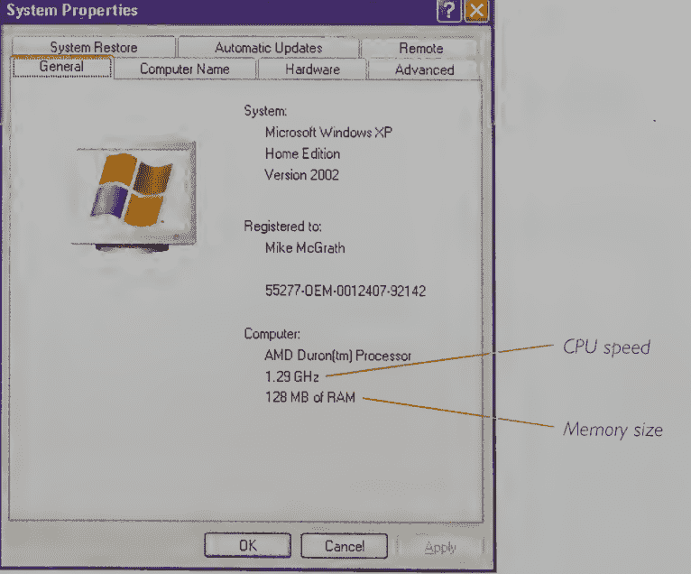

要发现 Windows 中可用的硬盘驱动器容量，点击“我的电脑”图标，然后右键点击硬盘图标并选择“属性”打开“本地磁盘属性”框。驱动器容量信息显示在“常规”选项卡下。对于下所示硬盘，可以将 5Gb 的空闲空间分配给 Linux。

> 在此处硬盘上分配 5Gb 空间给 Linux 将不会为 Windows 的进一步工作留下多少空间。

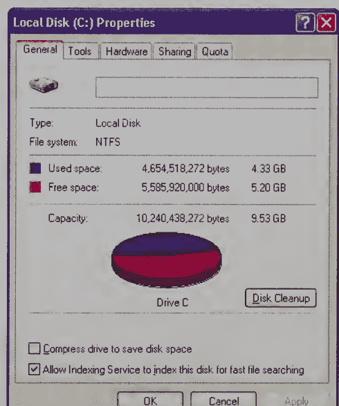

还应该考虑连接互联网的硬件。Linux 非常良好支持通过 PCI 以太网控制器或主板以太网控制器进行连接，几乎所有此类硬件都是适用的。

遗憾的是，调制调器的问题要大得多。许多计算机配备了内置 PCI 调制调器，它们仅适用于 Windows 软件。这些所谓的“软调制调器”（winmodems）不适用于在 Linux 中连接。如果你有一个内置调制调器并发现它在 Linux 中无法使用，你可能需要在连接之前将其更换为不同的硬件。通常最简单的解决方案是通过传统的 RS232 端口连接外部调制调器。

操作系统安装在硬盘的一个定义区域，称为“分区”。当 Windows 是计算机上唯一的操作系统时，分区通常会占据整个硬盘。在这种情况下，安装 Linux 有三种选择：

- 第一个选择是删除安装 Windows 的分区，并用占据整个硬盘的 Linux 分区替换它。这将删除 Windows 操作系统以及安装在那里的所有文件。这创建一个启动 Linux 的专用计算机。
- 第二个选择是缩小 Windows 分区的大小使其不再占据整个硬盘，然后在剩余空间中创建 Linux 分区。如果 Windows 分区没有缩小到当前大小之外，这将保留 Windows 操作系统和文件。这创建一个“双启动”计算机，允许用户在启动时从菜单选择启动 Linux 或 Windows。
- 第三种选择是向系统添加第二个硬盘。这允许 Linux 分区占据第二个硬盘，并保留第一个硬盘上的 Windows 操作系统和文件。这同样创建一个“双启动”计算机，允许用户在启动时从菜单选择启动 Linux 或 Windows。

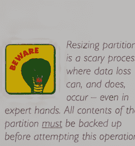

为 Linux 安装额外的硬盘是许多人的流行选择，因为他们经常将原始硬盘升级为更大的，因此有一个备用的原始硬盘。与其他选项相比，它还有优点：

- Windows 硬盘的空间没有缩小
- 消除了分区调整导致数据丢失的风险
- 保留熟悉的 Windows 操作系统
- 硬盘故障只会影响一个操作系统

大多数现代 PC 可以容纳四个 EIDE（增强型集成设备）设备，如硬盘和 CD/DVD 驱动器，但通常出厂时只有一个硬盘和一个 CD 驱动器。这意味着可以通过现有系统添加一个或两个驱动器。

系统中的第一个硬盘被称为“主”（master），第二个硬盘被称为“从”（slave）。

一个“跳线”连接两个微小引脚，以确定驱动器应被视为主（MA）还是从（SL）。每个硬盘的顶部通常有一个图表，显示在这种情况下需要连接哪些引脚。

在安装第二个硬盘之前，首先确保原始硬盘上的跳线设置为主，并且宽数据线通过其末端连接到硬盘——而不是数据线的另一端。现在将第二个硬盘上的跳线设置为从，并使用数据线的另一端连接数据线。

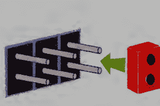

> 提示：如果你不习惯在 PC 机箱内部操作，电脑店乐意以合理的费用为你安装第二个硬盘。

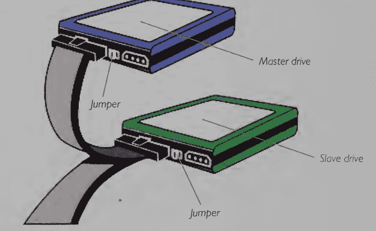

连接电源线并启动 PC——现在应该可以检测到两个硬盘。如果没有检测到第二个硬盘，你需要在启动时更改 BIOS 设置为自动搜索。

如果你选择在与 Windows相同的硬盘上安装 Linux，在开始安装之前清理磁盘是一个好主意。

在 Windows XP 中，点击“我的电脑”图标，右键点击硬盘并选择“属性”打开“本地磁盘属性”对话框。


如果 Linux 是为了替换 Windows，则不需要此操作。对于下所示硬盘，可以将 5Gb 的空闲空间分配给 Linux。

> 在此处硬盘上分配 5Gb 空间给 Linux 将不会为 Windows 的进一步工作留下多少空间。


本章将介绍使用流行的发行版安装 Linux 的步骤。大多数现代 PC 可以容纳四个 EIDE（增强型集成设备）设备，如硬盘和 CD/DVD 驱动器，但通常出厂时只有一个硬盘和一个 CD 驱动器。其他发行版大致遵循相同的步骤，但顺序可能有所不同。

Linux 安装通过从 CD-ROM 启动计算机开始。这需要计算机 BIOS（基本输入输出系统）设置为在使用硬盘之前从光驱启动。如果你的计算机从硬盘启动（如它通常的那样），你将需要更改 BIOS 设置。

启动计算机通常会提示你按哪个键进入 BIOS 工具——Delete、F1、F2、Insert 和 Esc 是常见的键。通常在第一次开机内存测试后按住 Delete 键进入 BIOS 工具。从 BIOS 工具菜单选择高级功能来显示启动设备顺序。启动顺序需要将光驱放在硬盘之前，因此可能需要更改为：

| 第一个启动设备 | CDROM |
| 第二个启动设备 | HDD-0 |
| 第三个启动设备 | Floppy |

保存新设置并退出 BIOS 工具。计算机现在将重启，并首先从光驱查找启动指令。

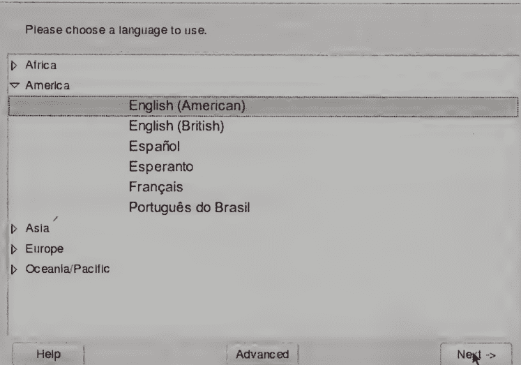

下一步将说明许可条款和条件。值得阅读此内容以了解更多关于开源软件的本质。勾选“接受（Accept）”选项，然后点击“下一步（Next）”按钮继续。

Mandrake Linux 发行版中的操作系统和提供的不同组件以后统称为“软件产品”。软件产品包括但不限于与操作系统以及 Mandrake Linux 发行版不同组件相关的程序集、方法、规则和文档。

请仔细阅读本文档。本文档是您与 Mandsoft S.A. 之间的许可协议，适用于这些软件产品。通过任何方式安装、复制或使用这些软件产品，您即明确接受并完全同意遵守本许可的条款和条件。如果您对许可协议的任何部分有异，则不允许安装、复制或使用这些软件产品。任何尝试不符合本许可条款条件的方式安装、复制或使用软件产品的行为都是无效的，并将立即终止您的协议。

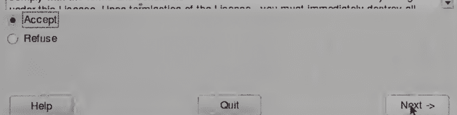

### 配置鼠标

Linux 安装程序从一开始就提供标准的鼠标支持，但要求您选择鼠标类型，以便它可以支持其他类型的鼠标。如果您的鼠标带有滚轮，程序将进行测试以确认滚轮在 Linux 中可以正常工作。

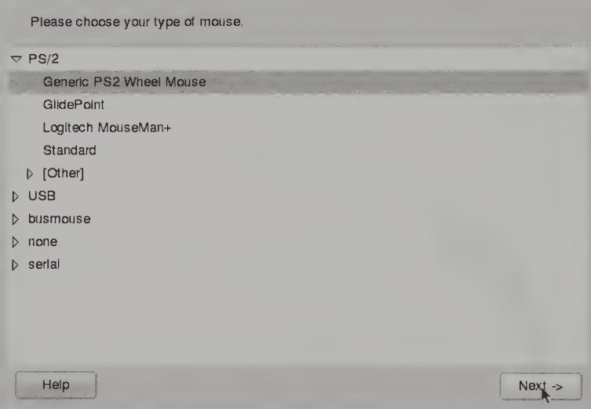


在配置鼠标后，安装程序会要求您从四个安全级别中选择一个，从“标准（Standard）”到“偏执（Paranoid）”。

较高的安全级别通常是以牺牲易用性为代价的。如果大多数用户仅连接到互联网使用网络浏览器并发送或接收邮件，那么默认“标准”安全级别就能让他们满意。


另一方面，如果您打算将 Linux 系统用作服务器，您应该真的选择更高的安全级别，以防止在多次连接期间可能出现的问题。当系统存储关键数据或作为 Web 服务器直接连接到互联网时，情况尤为如此。

选择您喜欢的安全级别，然后点击“下一步”继续安装。

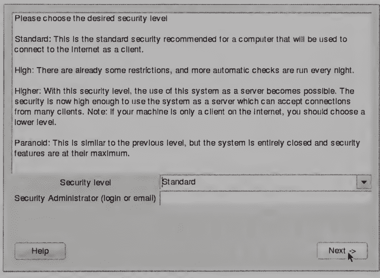

在 Linux 安装过程中选择的设置稍后可以通过再次运行 Linux 安装程序升级已安装的 Linux 系统进行修改。这意味着如果证明有必要，以后可以提高安全级别。

安装的下一步是为 Linux 分配磁盘空间，这将根据您的系统配置而异。

情况下，安装程序提供了四个选项：

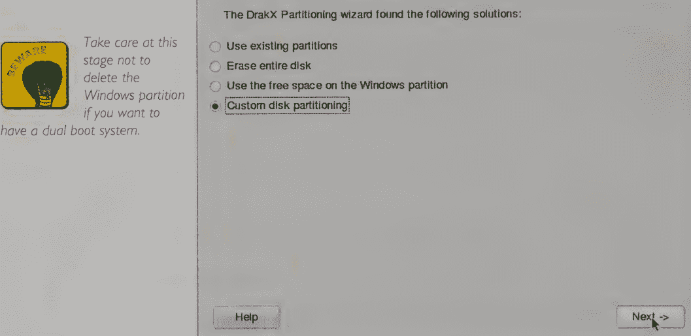

第一个选项“使用现有分区（Use existing partitions）”仅在系统之前配置过 Linux 时才会出现。例如，当您想要替换现有的安装时。

第二个选项“删除整个磁盘（Erase the entire disk）”在您想用 Linux 替换现有的 Windows 操作系统用。

注意，第三个选项“使用 Windows 分区的空闲空间（Use the free space on the Windows partition）”可能会限制 Windows 环境下的可用空间。

如果您需要调整 Windows 分区的大小为 Linux 创建空间，或者您想在第二个硬盘上安装 Linux，请选择“自定义磁盘（Custom disk）”。当您点击“下一步”按钮时，安装程序将图形化地显示您当前的分区。每个硬盘都有自己的标签页——主硬盘标记为“hda”，从盘硬盘（如果存在）被标记为“hdb”。

在下方的配置中存在两个硬盘。主硬盘 `hda` 将其全部 9.5 Gb 的磁盘空间分配给了 Windows。点击代表分区的条将弹出“删除（Delete）”或“调整大小（Resize）”选项。

调整分区大时可能会发生数据丢失，因此在尝试此操作之前应备份所有数据。

| 文件系统类型 | Linux | Swap | 其他 | 空闲 |
| :--- | :--- | :--- | :--- | :--- |
| `hda` | `hdb` | | | |
| 请点击分区 | 详情 | 设备: `hda` 大小: 9.5GB | | |
| 全部清除 | 自动分配 | 更多 | | |
| 帮助 | 撤销 | 切换专家模式 | 完成 |

如果您在标记为 `hdb` 的从硬盘上安装 Linux，请点击该硬盘的标签页显示其分区信息。在下面的插图中，从盘是完全空的，因此已准备好为 Linux 进行分区。

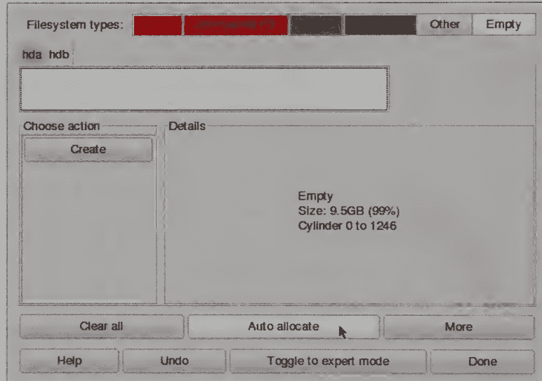


在 Linux 安装程序中，您可以随时点击帮助以了解更多关于每的信息。Linux 允许您可以调整分区大小。与 Windows 不同，Linux 自带了一系列图形化桌面，每个都可以自定义。其中最流行的是 KDE 桌面环境 (`KDE`) 和 Gnome 桌面环境。

为了避免混淆，在您熟悉 Linux 之前，建议最初只安装 `KDE`——以后可以安装其他进行探索。

`KDE` 可能是最流行的 Linux 桌面环境，包含了办公套件 (`KOffice`)、一个浏览器 (`Konqueror`)、一个邮件客户端 (`KMail`) 以及更多内容。它由全球范围内致力于自由软件开发的工程师网络编写和维护。欢迎任何人为 `KDE` 项目做出贡献。

`9.5Gb` 的空空间上方被划分为 `5.5Gb` 的 `/root` 分区、`3.5Gb` 的 `/home` 分区和 `500Mb` 的 `swap` 分区。专家模式允许对分区大小进行微调。当您对分区满意后，点击“完成”按钮。分区表将写入您的 `ext3` 文件系统中的。

| 文件系统类型 | Linux | Swap | 其他 | 空闲 |
| :--- | :--- | :--- | :--- | :--- |
| hda | hdb | | | |
| 请点击分区 | 详情 | 设备: hda 大小: 9.5GB | | |
| 全部清除 | 自动分配 | 更多 | | |
| 帮助 | 撤销 | 切换专家模式 | 完成 |

Linux 安装的下一个阶段允许您从发行版光盘包中选择要安装的内容。您的选择取决于您如何使用 Linux——下方勾选的项目是常用的用户选择。


| :--- | :--- | :--- |
| 办公工作站 | | Web/FTP |
| 游戏站 | | 邮件 |
| 多媒体站 | | 数据库 |
| 互联网工作站 | | 防火墙/路由器 |
| 网络计算机 (客户端) | | DNS/NIS |
| 配置 | | 网络计算机服务器 |
| 科学工作站 | | KDE 工作站 |
| 控制台工具 | | Gnome 工作站 |
| 开发 | | 其他图形桌面 |
| 文档 | | |
| LSB | | |
| 帮助 总大小: 18 / 3994 MB 独立软件包选择 下一步 -> |

勾选此页面上的每个复选框将选择一组软件包进行安装。经验用户可以选择性勾选该框以允许“选择单个软件包”，从而进一步细化要安装的内容。

点击“下一步”（Next）按钮将软件包安装到您的计算机上。这可能需要 30 - 60 分钟，取决于所选软件包的数量以及系统的速度。

点击“详情”（Details）按钮可以显示安装过程中的软件包名称。

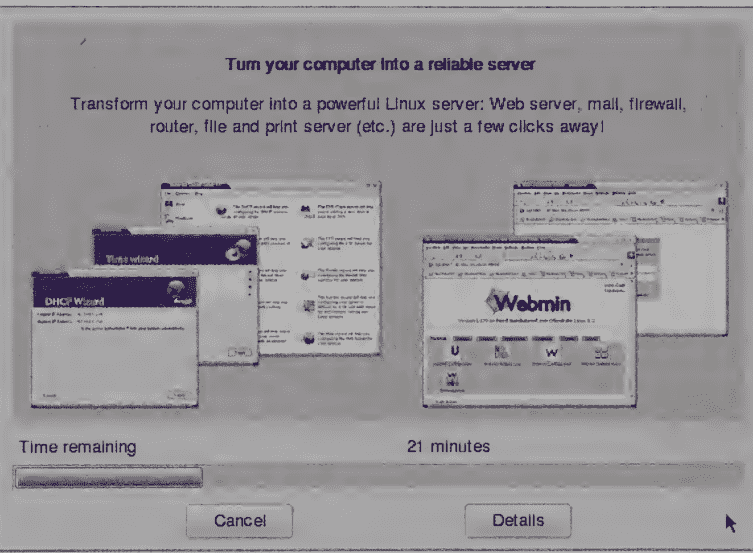

安装期间，幻灯片会展示有关您的 Linux 发行版的各种信息，安装程序会计算到完成所需的时间。

根据您为安装程序选择的软件包，它可能会要求您插入 Linux 发行版集中其他 CD-ROM。请按提示进行操作并点击“确定”（OK）按钮继续。

在安装最后一个软件包后，安装程序会自动执行软件包的“安装后配置”（Post-Install Configuration），然后进入下一步。

每个 Linux 系统都有一个名为“root”的系统管理员账户，该账户具有比普通用户账户更高的访问权限。出于安全考虑，系统配置只能由 `root` 执行——普通用户无法进行这些更改。您应该只在类此类情况下使用 `root` 账户，通常情况下在 Linux 中作为普通用户工作。

安装软件包后，Linux 安装程序会要求您为 `root` 账户创建一个密码。

在网络环境中，创建一个长字母数字密码是重要的，以确保 `root` 账户不会被轻易访问。

家庭用户可能更喜欢“无密码”（No Password）选项，以避免每次想以 `root` 身份工作时输入密码。这种情况发生比您想象的要频繁。


如果设置密码，请避免使用像“admin”这样容易猜到的密码。

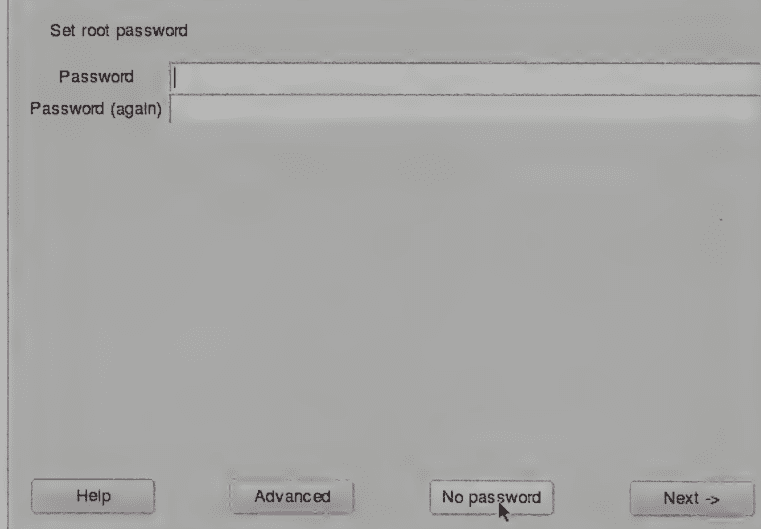

点击“无密码”继续，或者如果您想设置 `root` 密码，请在两个输入框中输入密码，然后点击“下一步”按钮继续。

Linux 安装的下一步要求至少创建一个用户账户。对于家庭用户来说，这通常是他们每天登录 Linux 使用时使用的账户。

在第一个字段中输入您的真实姓名，在第二个字段中输入简短的用户名。现在在两个输入框中输入密码。

可选情况下，您也可以点击显示的图标来选择自定义用户账户。

密码是强制性的。请记住准确的用户名和密码——您之后将需要它们。

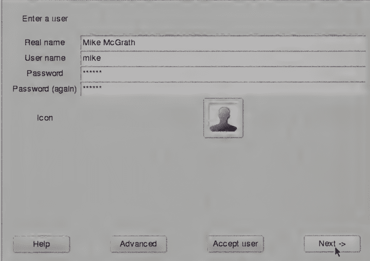

Linux 对大小写敏感，因此请注意大小写字母——“Mike”被视为与此处“mike”不同的用户。

点击“确定”按钮为每位使用您计算机的人创建一个用户账户。当所有用户账户创建完成后，点击“下一步”按钮继续。

Linux 安装程序让您有机会选择一个用户账户，以便每次启动 Linux 时都自动登录。对于家庭用户来说，这避免了每次启动 Linux 都要输入用户名和密码的繁琐步骤。

此功能不应在办公室环境或具有多个用户账户的计算机。

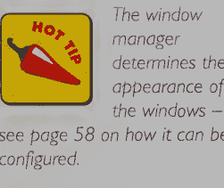

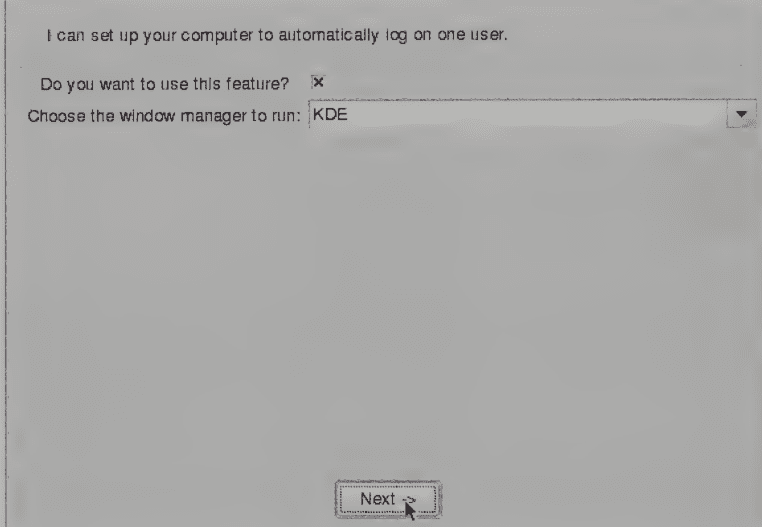

上面的示例选择了自动登录创建的用户账户。如果创建了多个用户账户，此页面还会出现一个选择框，允许您选择登录的账户。

如果您不想使用自动登录，启动过程将要求您输入用户名和密码以登录 Linux。要启动图形桌面，您需要输入命令 `startx` 然后按回车键。

点击“下一步”按钮继续进行引导程序的安装。

Linux 安装程序通常会将引导程序安装在主硬盘（HD）上，它会在该硬盘的主引导记录（MBR）中找到 Windows 启动指令。

如果安装程序要求您选择安装引导程序的位置，如果您想运行双系统系统，应选择安装在 MBR 中的选项。这将在计算机每次启动时都为您提供一个选项菜单，允许您选择 Windows 或 Linux 等。

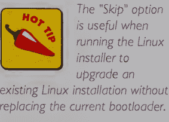

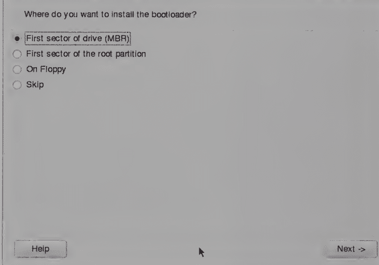

将引导程序安装到软盘上将允许 Linux 在 BIOS 设置从硬盘之前从该驱动器寻找启动指令时从软盘驱动器启动。

应避免其他选项，因为它们可能会阻止您在计算机上启动 Linux。

点击“下一步”按钮在选定位置安装引导程序，Linux 安装程序将显示安装摘要。

摘要页面上的每个项目都有一个关联的按钮，可以调出子菜单，其中可以对每个设备进行配置。这可以在以后完成，将在下一章中逐步演示。现在，只需点击“下一步”按钮继续到安装结束。

此处列出的某些设备（如打印机）仅被 Linux 安装程序检测到，必须在它们正常工作之前进行配置——见第 3 章。


| 系统 | |
| :--- | :--- |
| 键盘 - 美国键盘 | 配置 |
| 国家 - 美国 | 配置 |
| 时区 - 美国/纽约 | 配置 |
| 鼠标 - PS/2 / 通用 PS2 滚轮鼠标 | 配置 |
| 硬件 | |
| 打印机 - BROTHER HL-1030 | 配置 |
| 声卡 - Silicon Integrated Systems [SIS]/7018 PCI Audio | 配置 |
| 图形界面 - 800x240 bpp | 配置 |
| 网络与互联网 | |
| 网络 - 局域网 | 配置 |
| 安全 | |
| 安全级别 - 标准 | 配置 |
| 启动 | |
| 引导程序 - Illogic on /dev/hda | 配置 |

上面的示例选择了自动创建的用户账户。如果创建了多个用户账户，此页面还会出现一个选择框，允许您选择登录的账户。

如果你使用的 Linux 启动时默认用户自动登录，那么配置设置应该如底所示。

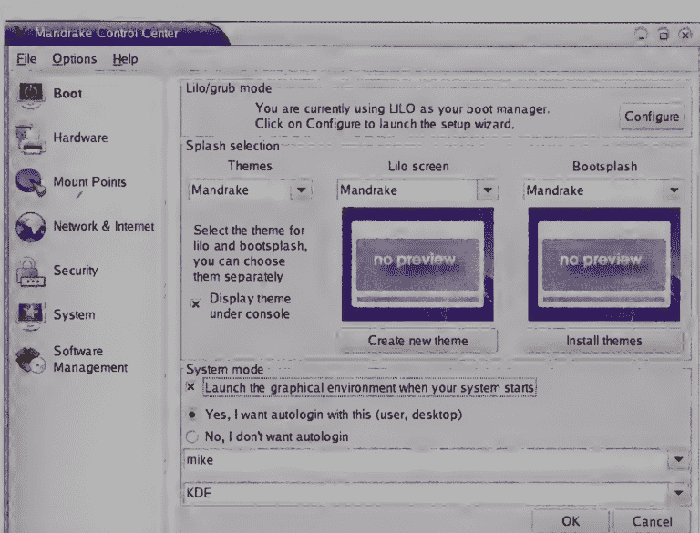

取消勾选“系统模式”面板中标记为“系统启动时启动图形环境”的复选框，然后点击 OK 按钮应用更改。现在，点击任务栏上的“开始”按钮，然后选择“注销”并重启。

Linux 将不再自动加载图形桌面，而是在登录提示符打开，要求你输入用户名和密码。输入这些信息，然后在提示符处输入 `startx` 并按回车键，即可再次加载图形桌面。当你选择自动登录启动选项时，登录详情和 `startx` 命令将自动完成。

在提示符处输入 `mcc` 或 `DrakConf` 可以打开文本界面的 Mandrake 控制中心。

重新打开 Mandrake 控制中心，勾选“系统模式”面板中标记为“系统启动时启动图形环境”的复选框，然后点击 OK 按钮应用更改。现在注销并重启系统，即可看到 Linux 再次以加载图形桌面的方式启动。

在双系统系统中，Linux 会成为默认的启动系统。如果你希望将 Windows Keep为默认系统，可以使用系统控制中心重新配置引导加载程序菜单。

在 Mandrake Linux 中，打开 Mandrake 控制中心，点击“启动”图标。现在点击 Lilo/Grub 面板中的“配置”按钮打开引导加载程序选项。

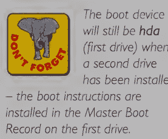


LILO（Linux 加载器）和 Grub 是 Linux 常提供的引导加载程序。你可以在下拉框中选择其中一个使用。此外，在这里还可以设置显示引导菜单的时间长度——上方显示为 10 秒。点击 OK 按钮显示现有的启动菜单项。

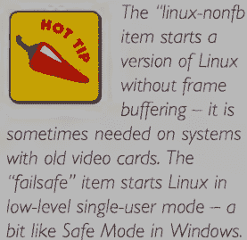


星号表示启动时默认启动的系统。选择任何一个菜单项，然后点击“删除”按钮将其删除，或点击“修改”按钮更改其显示方式。只有“linux”和“windows”菜单项是必需的——其他条目可以删除。

要将“linux”项大写化，选择它然后点击“修改”按钮。这会打开第二个对话框，可以在其中编辑标签。将字母改为大写并取消勾选标记为“默认”的复选框，然后点击 OK 按钮关闭此对话框。

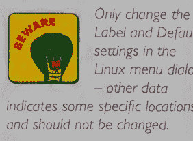


要将“windows”项大写化，选择它然后点击“修改”按钮打开第二个对话框。将字母改为大写并勾选标记为“默认”的复选框使 Windows 成为默认系统。点击 OK 按钮关闭对话框。

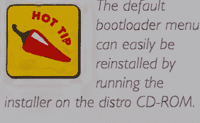


对启动菜单进行的更改将反映在启动菜单对话框中。点击其 OK 应用这些更改。

注销并重启电脑以查看新的启动菜单——应该只有两个菜单项，且大小写正确，Windows 应该在 10 秒延迟后默认启动。

系统控制中心可以为声卡配置驱动程序。在 Mandrake Linux 中打开 Mandrake 控制中心。点击“硬件”菜单，然后点击右侧面板中出现的 HardDrake 图标。从出现的检测到的硬件列表中选择声卡，然后点击“运行配置工具”打开声音配置对话框。

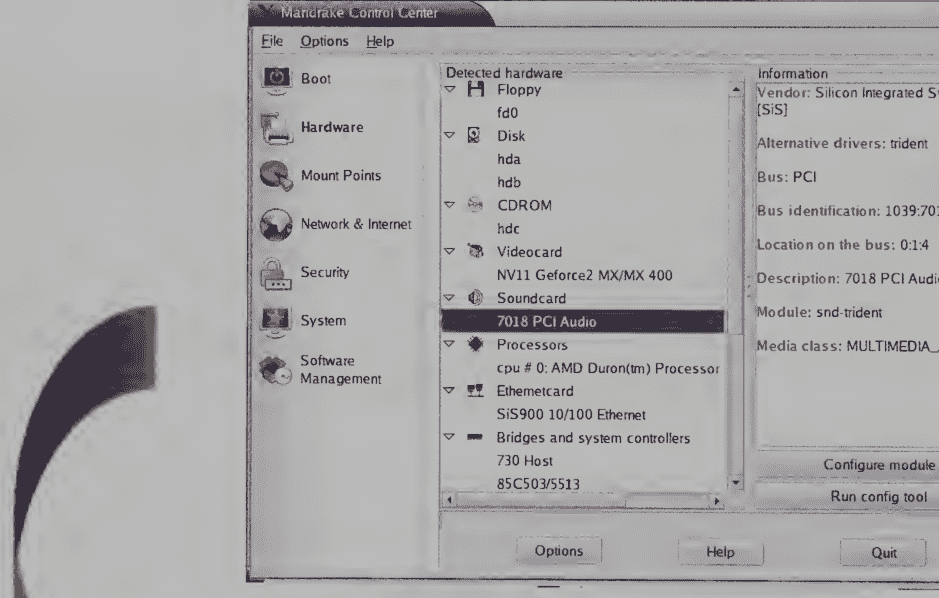

在这里，你可以为声卡（Silicon Integrated Systems 7018 PCI）选择替代驱动程序（OSS 或 ALSA）。你的卡目前使用 ALSA "nd-trident" 驱动；你卡的默认驱动程序为 "nd-trident"。

| 驱动程序 | 描述 |
| :--- | :--- |
| Trident | Trident 4Wave/Si/S 7018/Ali 5451 and Tvia/LT |
| Troubleshooting | 让我选择任何驱动程序 |

接受默认驱动程序，或从下拉菜单中选择替代，然后点击 OK 按钮配置声卡。虽然声卡现在已经有了播放声音的能力，但 Linux 中需要运行一个声音服务器才能将声音传递到声卡。

由于，在 Linux 中需要运行一个声音服务器才能将声音传递到声卡。

你的卡目前使用 ALSA "nd-trident" 驱动；你卡的默认驱动程序为 "nd-trident"。

在这里，你可以为声卡（Silicon Integrated Systems 7018 PCI）选择替代驱动程序（OSS 或 ALSA）。

接受默认驱动程序，或从下拉菜单中选择替代，然后点击 OK 按钮配置声卡。虽然声卡现在已经有了播放声音的能力，但 Linux 中需要运行一个声音服务器才能将声音传递到声卡。

由于，在 Linux 中需要运行一个声音服务器才能将声音传递到声卡。

在 KDE 中，点击“启动”、“配置”，然后“声音”。

在右侧面板勾选“启动时启动声音”的复选框。

系统控制中心用于系统级设置。

| 声音 | 控制中心 |
| :--- | :--- |
| aRTs | 启动时启动声音 |
| Network | 启用网络 |
| Power | 空闲挂起：60 秒 |
| Display | 显示消息： |
| Security | 交换到 |
| Audio | 消息： |
| System | |
| WebBrowsing | |

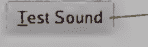

几秒钟后，声音服务器启动，之前变灰的“测试”按钮变得可用。现在点击“测试”按钮，你将听到示例播放。

更改安装时选择的分辨率在某些发行版中可能很难——但在 Mandrake 中非常简单，得益于 Mandrake 控制中心。

要启动 Mandrake 控制中心，点击“开始”、“配置”，然后“Mandrake 控制中心”。接下来点击“硬件”项目显示右侧面板中的图标。

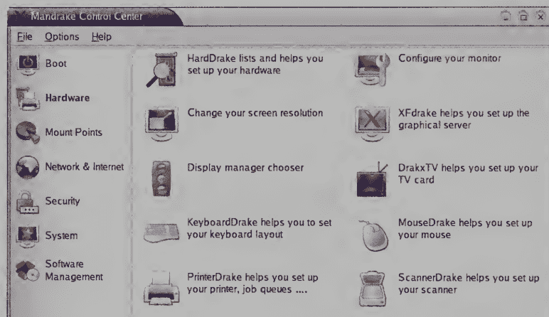

如果你的设置允许，尝试以 1024 x 768 的分辨率运行 Linux——在较低分辨率下某些 Linux 窗口看起来很大。

在“更改分辨率”图标上，右侧面板将显示显卡的描述以及当前的分辨率和色彩深度设置。

点击下拉菜单选择你喜好的分辨率和色彩深度，然后点击 OK 按钮。

更改不会立即生效——Mandrake 控制中心中的消息提示你“请重新登录 Kwin 以激活更改”。这意味着你必须重启电脑或注销 KDE 后重新登录。

分辨率和色彩深度的范围由你的显卡支持的支持。

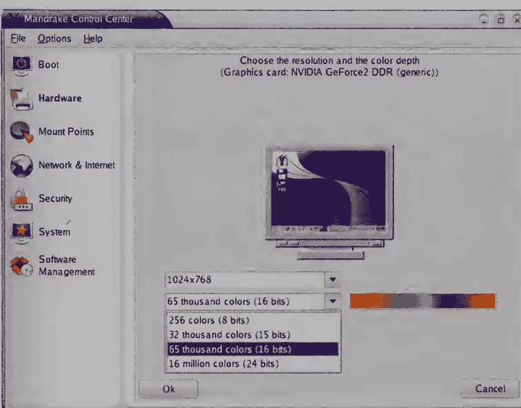

要在不重启系统的情况下应用分辨率更改，首先点击“开始”、“注销”。现在在注销对话框中，点击标记为“以其他用户登录”的选项，然后点击 OK 按钮。


当登录对话框出现时，只需使用相同的用户名和密码重新登录 KDE——当 KDE 启动时将使用新的分辨率配置。

## 安装本地打印机

系统控制中心可以轻松配置本地打印机。

在 Mandrake Linux 中，你可以启动 Mandrake 控制中心并点击“硬件”菜单项，然后点击 PrinterDrake 图标。

通用 UNIX 打印系统（CUPS）是一种适用于所有 UNIX 环境的跨平台打印解决方案。它为 PostScript 和光栅打印机提供完整的打印服务。

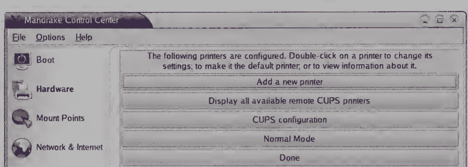

点击“添加新打印机”按钮然后点击“确定”按钮来自动检测本地打印机——向导将检测连接到系统并行端口或 USB 端口的打印机。

在提示时给出打印机名称，或接受默认名称“Printer”，然后确认打印机已正确识别，以便安装相应的驱动程序。

GhostScript 是 Linux 打印的一个重要程序。大多数打印软件生成 PostScript，这在打印机上通常花费 $100 美。然而，GhostScript 是免费的，它可以从 PostScript 生成你的打印机所使用的语言。

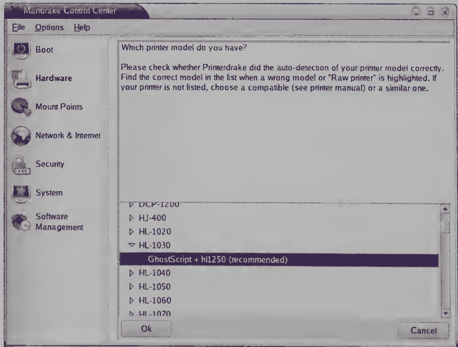

打印机安装的下一步允许选择默认媒体设置。输入纸张大小和打印分辨率的偏好，然后点击“确定”按钮继续。

将打印分辨率提高到高水平会显著减慢打印速度。

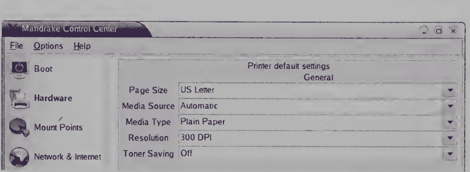

打印向导现在会询问你不想打印测试页以确认打印机是否配置正确。选择你喜欢的测试页类型，然后点击“打印”按钮开始打印。点击“是”按钮确认测试页打印是可以接受的。最后点击“完成”按钮关闭向导——你现在可以通过应用程序菜单选择“文件”，然后点击“打印”来打印。


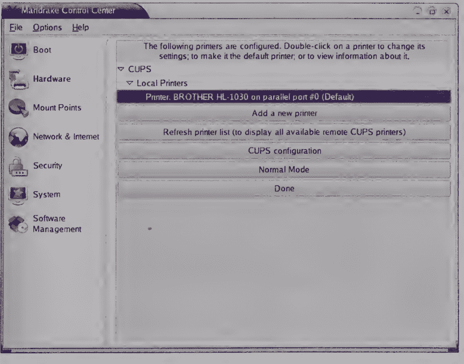

3. 为 Linux 配置硬件 | 43

如果你的电脑中安装了电视调谐器，可以使用系统控制中心对其进行配置。


在 Mandrake Linux 中启动 Mandrake 控制中心。点击“硬件”菜单项，然后点击右侧面板中出现的 DraksTV 图标。从列表中选择卡和调谐器类型，或选择“自动检测”让向导发现，然后点击“确定”按钮继续。

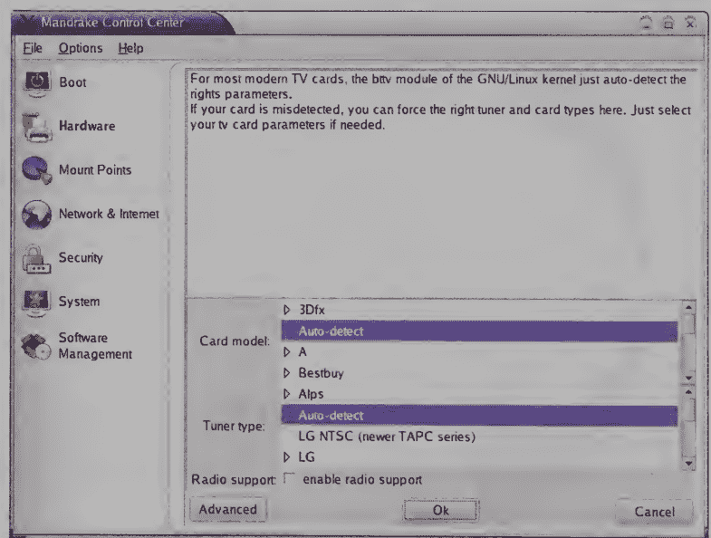

电视格式广播不同的数字：在不同速度下的不同行数。如果你在网络搜索搜索引擎中输入“world television standards（世界电视标准）”时不确定你所在地使用的系统。


接下来，从下拉列表中选择你的位置，并选择你地区传输信号的电视标准——北美的 NTSC（国家电视系统委员会）、英国和澳大利亚的 PAL（相位交替扫描）、法国和俄罗斯的 SECAM（顺序存储记忆彩色）等。

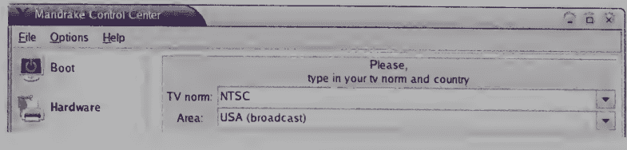


如果你在美国并通过电缆接收电视，请选择 USA (cable) 而非 USA (broadcast)。

点击“确定”按钮继续，会出现第二个窗口，在该窗口中将依次扫描一系列范围内的频率，以找到你地区可用的电视频道。

检测到的通道将根据你的位置而异。这里显示的 ??? 频率是名称未知的检测到的电视通道——它们仍会显示，以便查看这些频道。

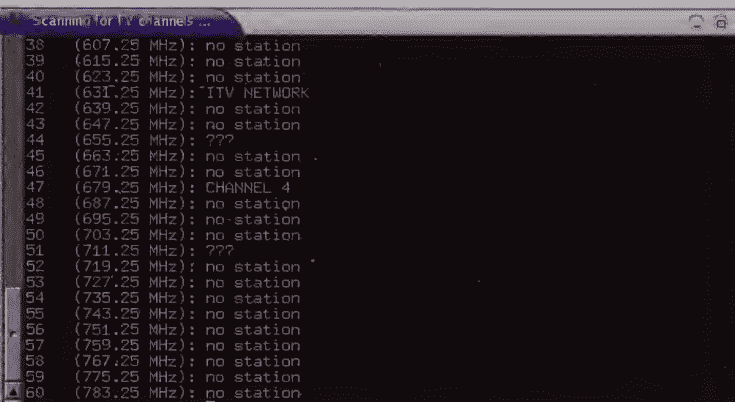

扫描完成后，第二个窗口关闭，被发现包含电视频道的频率将被存储。安装电视卡会在桌面上放置一个图标，可以使用它可以启动电视应用程序并查看存储的频道。


使用系统控制中心可以轻松连接扫描仪。

在 Mandrake Linux 中启动 Mandrake 控制中心。点击“硬件”菜单项，然后点击右侧面板中的 Scanner 图标。向导将检测连接到系统的扫描仪。

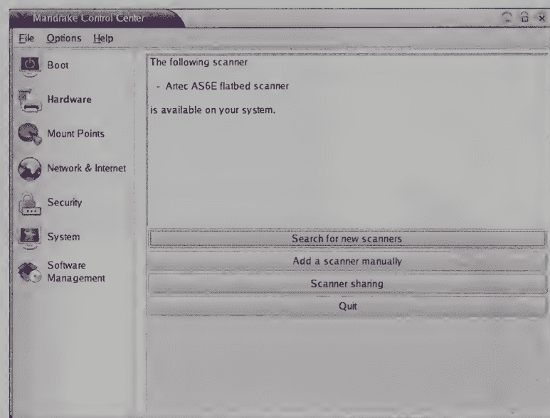

将扫描仪连接到电脑非常简单。

在 Mandrake Linux 中启动 Mandrake 控制中心。点击“硬件”菜单项，然后点击右侧面板中的 Scanner 图标。向导将检测连接到系统的扫描仪。

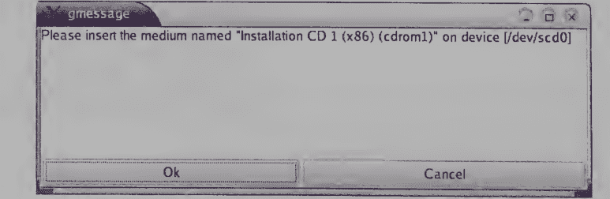

> 提示：扫描仪驱动程序通常在打印机上非常常见。


虽然该驱动程序在大多数 Linux 发行版中支持，你可以从 `http://sourceforge.net/as6` 下载相应的驱动程序。


它可能要求你插入其中一个光盘，以便安装软件。通常 Xsane 程序将允许你将图像导入电脑。


扫描图像是一门艺术——分辨率与图像大小之间的平衡需要经验。

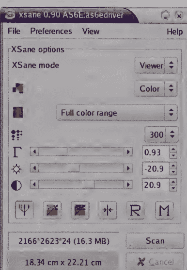


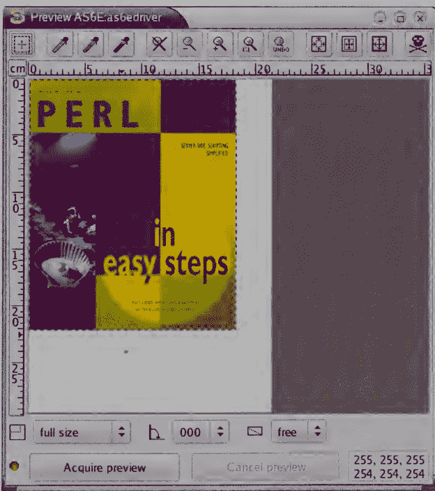

发现

“in easy steps（轻松上手）”系列可以在所有良好的书店或在线网站 www.ineasteps.com 发现更多精彩的书目。


任务栏具有极高的定制性，并为此提供了专门的功能。在任务栏上点击右键，并从右键菜单中选择“配置面板（Configure Panel）”以打开设置对话框。

像 Linux 的大多数方面一样，通常有多种实现方法；你也可以从 KDE 控制中心的“外观与字体（LookAndFeel）”或“面板（Panels）”菜单项打开设置对话框。


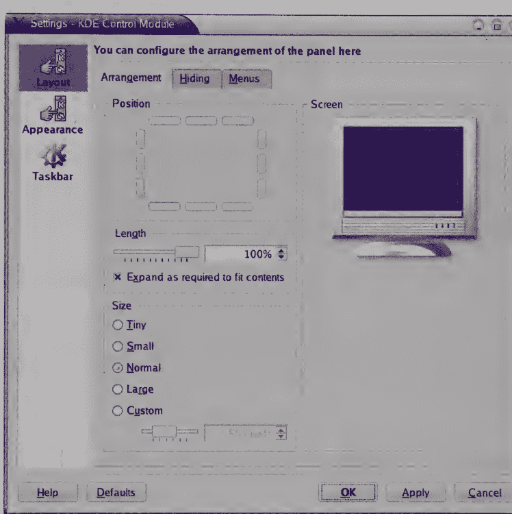


“外观（Appearance）”设置可以配置任务栏上的按钮，使其能够显示工具提示和单个背景图像。这使得它们看起来明显是按钮，而不仅仅是图标。

“任务栏（Taskbar）”设置允许你控制运行中的应用程序图标在任务栏上的显示方式。

点击 KDE 开始按钮打开菜单。将鼠标指针悬停在每个菜单项上会以典型方式显示其子菜单——就像 Windows 开始菜单一样。浏览菜单，然后点击任何应用程序即可启动它。

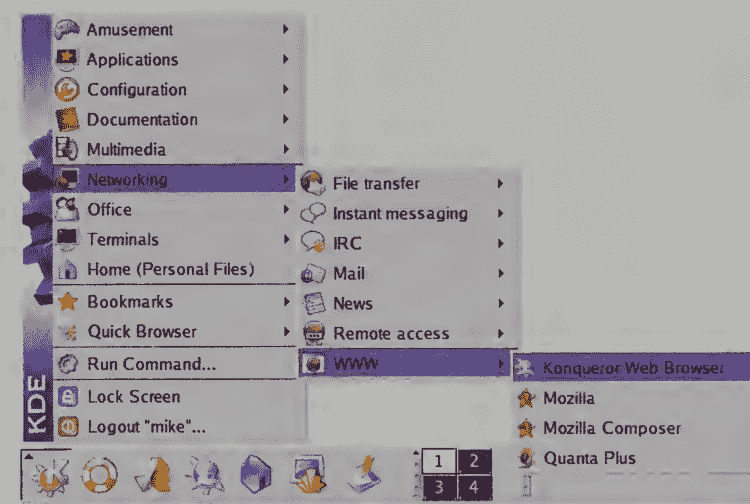

Konqueror 既是 浏览器也是文件管理器——它让你能像 Windows 资源管理器一样图形化地浏览计算机上的文件，像 Internet Explorer 那样浏览网页。

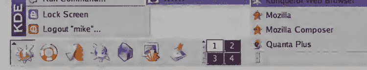

上面的截图说明了如何从图形菜单启动 Konqueror 文件/网页浏览器。注意，它的图标也会作为快速启动按钮显示在任务栏上——因此只需点击该按钮即可启动 Konqueror。

启动 Konqueror 的另一种方法是点击“运行命令（Run Command）”菜单项，然后在弹出的对话框中输入应用程序名称——现在点击“运行（Run）”按钮打开 Konqueror。

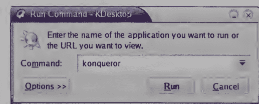

Konqueror 以及其他应用程序可以通过“shell”窗口的命令行提示符中输入名称来启动。这就像在 Windows 的命令提示符中运行应用程序一样。

点击“开始”、“终端（Terminals）”，然后点击“Konsole”打开 shell 窗口，或点击任务栏上的快速启动按钮。现在在提示符处输入 `konqueror` 并按回键即可打开 Konqueror。


```bash
[mike@localhost mike]$ konqueror
```

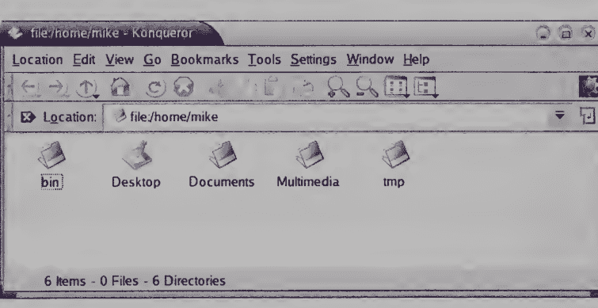

Konqueror 是一个窗口应用程序——只有当 X 服务器运行着图形化桌面环境时才能被启动。


注意，关闭 shell 窗口也会终止手动启动的应用程序。通常从图形菜单或使用快速启动按钮启动应用程序更方便，但有时从 shell 提示符启动也有用。例如，如果一个应用程序从开始菜单通过 shell 提示符启动失败，它应该显示一条解释原因的错误消息——解决此错误后，程序应该就能正常启动。

## 理解虚拟桌面

Linux 桌面的一项 Windows 并不具备的强大功能是支持多个“虚拟”桌面。这允许你在不同的桌上打开应用程序，并并在它们之间轻松切换。

默认情况下，KDE 提供四个虚拟桌面，它们在任务栏上显示为一组四个正方形的按钮。

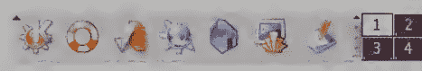

上面的活动桌面是1号桌面，具有白色背景。当在该桌面上打开应用程序时，该窗口会显示在其对应的任务栏按钮上。


点击不同的桌面按钮会呈现一个新的桌面，但应用程序会在原始桌面上继续运行。

Linux 中的复制粘贴过程非常简单。只需按住左鼠标键并拖动即可。


点击不同的桌面按钮会呈现一个新的桌面，但应用程序会在原始桌面上继续运行。

Linux 的复制粘贴过程是简单的。只需按住左鼠标键并拖动。


点击不同的桌面按钮会呈现一个新的桌面，但应用程序会在原始桌面上继续运行。

Linux 的复制粘贴过程是简单的。只需按住左鼠标键并拖动。


点击不同的桌面按钮会呈现一个新的桌面，但应用程序会在原始桌面上继续运行。

Linux 的复制粘贴过程是简单的。只需按住左鼠标键并拖动。


KDE 支持多达 16 个虚拟桌面。

四个虚拟桌面通常满足大多数情况。要添加更多虚拟桌面，请打开 KDE 控制中心，从“外观与字体（LookAndFeel）”菜单中选择“桌面（Desktops）”。

## 更改桌面背景

要自定义 KDE 桌面的背景，首先打开 KDE 控制中心，从“外观与字体（LookAndFeel）”菜单中选择“背景（Background）”选项。

打开背景对话框的另一种方法是在桌面上点击右键，从弹出的菜单中选择“桌面（Choose Desktop）”，然后选择“背景（Background）”选项。

如果你喜欢使用图形图像作为桌面背景，请点击背景对话框中的“壁纸”选项卡，并勾选“单个壁纸”单选按钮。

当勾选“多个壁纸”选项时，灰色的“设置多个”将变为可用。点击此按钮打开对话框，可以在其中选择各种壁纸，它们将根据你指定的任何间隔自动更改。


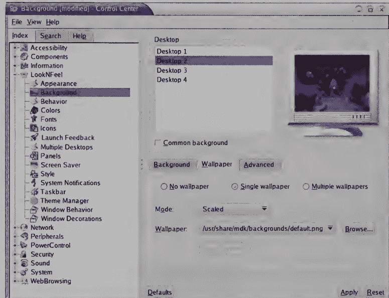


要为桌面背景着色，选择“混合”选项卡下的“色调偏移”——拖动“平衡”滑块并观察预览以查看色彩效果。点击“应用”按钮即可为实际桌面着色。

点击“浏览”按钮打开“选择壁纸”对话框——这将在桌面壁纸文件所在的目录中打开。

勾选列表中任何一个文件的“自动预览”复选框，即可显示该文件的预览。当你找到喜欢的壁纸时，点击“确定”按钮关闭“选择壁纸”对话框。

点击“模式”箭头按钮并根据你希望显示图像的方式选择一个选项。通常情况下选择“缩放”选项可以使图像填充整个桌面背景。现在点击背景对话框中的“应用”按钮来设置桌面背景。

在“高级”选项卡上增强选定的壁纸，并尝试“混合”菜单中的选项。

4 探索 KDE 桌面 | 57

## 自定义 KDE 窗口外观

窗口外观的定制几乎有无限可能。

在 KDE 颜色中心外观外观菜单中，点击“颜色”选项显示颜色方案对话框。它包含一个可点击的区域，显示两个窗口的各种组件——一个处于活动状态，另一个处于非活动状态。点击任何组件进行选择，点击其当前颜色进入“选择颜色”对话框。选择一种新颜色，然后点击“确定”按钮更改其预览中的外观。点击“应用”按钮即可在桌面上实施颜色更改。

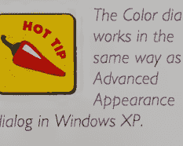

许多或所有窗口组件的自定义颜色设置可以保存为“方案”以备后之用。或者，你也可以从颜色对话框中的菜单中选择标准方案选项之一。

下面的截图显示了默认窗口外观，然后是应用 Storm 颜色方案后相同窗口的外——更改了标题栏、边框和菜单面板的颜色。

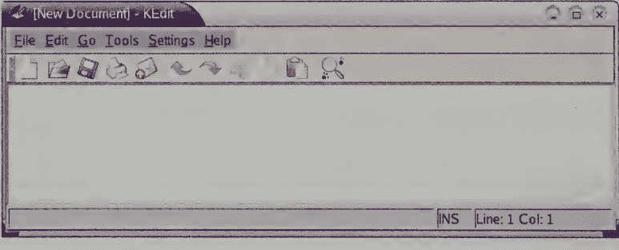


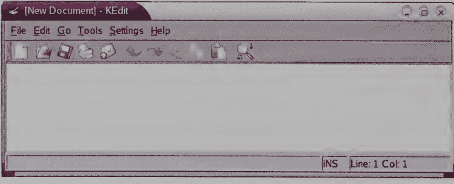

58 | Linux 快速上手

点击“外观”菜单中的“样式”选项来定制窗口内部组件的外观。在“样式”对话框中选择任何预定义样式——对话框底部会显示组件将呈现的预览。点击“应用”按钮实施样式更改。

下面的截图显示了上一页底部的窗口在应用 System++ 样式后的外观。

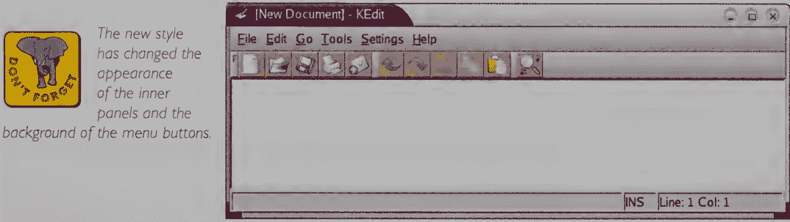

可以通过“外观”菜单中选择“窗口装饰”选项来自定义窗口标题栏和边框的颜色。在“窗口装饰”对话框中选择后点击“应用”按钮实施更改。

下面的截图显示了应用“混合”方案后的窗口。


4 探索 KDE 桌面 | 59

## 安装桌面方案

除了前面页面介绍的自定义方法外，更改桌面外观的另一种方法是采用现成的方案。

启动 KDE 控制中心，选择“外观”菜单下的“方案管理器”。在“方案管理器”对话框中列出了许多方案——点击任何一个方案即可查看预览。点击“应用”按钮实施更改。

下面的截图展示了应用“木”方案后的窗口。

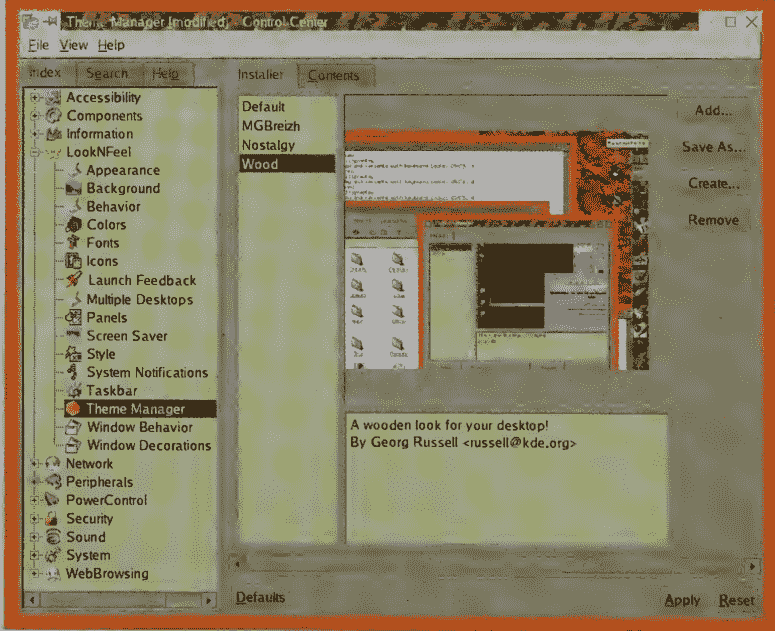


更多方案可以从网上下载。在“方案管理器”对话框中点击“添加”按钮进行添加——这些通常是压缩包。将其解压到桌面。


60 | Linux 快速上手

## 更改屏幕保护

点击“外观”菜单中的“屏幕保护”选项来配置屏幕保护。默认安装了几个屏幕保护，更多的可以从网上下载。

在“屏幕保护”对话框中点击任何屏幕保护以查看预览。


如果你想为屏幕保护添加安全防护，请勾选“需要密码”复选框，然后点击“应用”按钮。当屏幕保护运行时...

4 探索 KDE 桌面 | 61

## 设置事件音

当配置为播放事件音时，KDE 可以变得更加有趣。例如，当应用程序启动或关闭、最小化和最大化，或者收起时。

打开 KDE 控制中心，选择“外观”菜单下的“系统通知”。点击“窗口管理器”中的“更多”按钮。在对话框底部的快速控制面板中勾选“应用到所有应用程序”复选框，然后“开启所有声音”并点击“应用”按钮实施更改。


右键点击窗口标题栏中的图标并选择“收起”将窗口卷起——这是为拥挤桌面节省空间的巧妙方法。打开一个应用程序（例如应用程序菜单下的 KEdit 编辑器），当窗口打开和关闭时，你应该听到事件音。

可以通过点击对话框中的“关闭所有声音”并“应用”来静音所有事件音。或者，可以关闭单个事件音，或让事件播放不同的声音。在开启所有声音的情况下，点击“更少”按钮。

在“外观”中还有其他自定义选项——“图标”允许更改图标集，“字体”允许选择在桌面、任务栏和窗口应用程序中使用的字体。

探索“外观”菜单中的每个选项并尝试更改某些设置——只需在每个对话框中点击“默认值”按钮即可恢复原始配置。

4 探索 KDE 桌面 | 63

## 获取帮助

可以通过 KDE 帮助中心寻求任何 KDE 图形应用程序的帮助。这可以通过点击任务栏上的救生圈图标或点击“文档”（Documentation）菜单来启动。点击左侧窗格中的“应用程序手册”（Application Manuals）选项，可以展开与开始菜单中相同的应用程序列表。导航到你所需的应用程序，然后点击打开其手册。


在 Konqueror 应用程序的地址栏中输入 `help:/` 也可以打开 KDE 帮助中心。通过输入 `man:/` 显示手册页，输入 `info:/` 显示 Info 页面。


KDE 帮助中心菜单还包含查看 UNIX 手页的选项，这些页详细描述了每个命令及其可选开关范围。你也可以在命令行提示符中输入 `man`，后跟一个空格和你想查询的命令来以文本模式查看。例如，输入 `ls` 查看 `ls` 命令的 UNIX 手页——这会显示目录内容。

在提示符处获取命令的帮助，请输入命令名，后接 `--help`


某些 UNIX 手页可能看起来很混乱，但 KDE 帮助中心也可以浏览 Info 页面，以更用户友好的方式提供类似的信息。与手册页一样，你也可以在命令行提示符中输入 `info`，后跟一个空格和你想查询的命令来进行文本模式查看。例如，输入 `info ls` 查看 `ls` 命令的 Info 页面。

## 浏览网页

本章介绍了如何在 Linux 中进行各种在线活动——一旦连接到互联网，就可以轻松查看网站、发送和接收电子邮件以及在全球传输文件。它还描述了如何使用大多数发行版自带的免费应用程序构建你自己的网页。

### 目录

- 连接互联网 | 66
- Mozilla 浏览器 | 68
- 设置电子邮件 | 70
- 存储电子邮件地址 | 72
- 加入新闻组 | 74
- 传输文件 | 76
- 编写网页 | 78
- 在线聊天 | 80

第五章

## 连接互联网

设置 Internet 连接的最简单方法是通过以太网连接。如果安装并连接了网络接口卡 `NIC`，这将在 Linux 安装过程中自动配置。

如果你正在使用带有调制解调器的拨号服务，或者你稍后安装了以太网网卡，请使用 Internet 配置向导来配置连接。

例如，启动 Mandrate 控制中心并点击“网络与互联网”菜单选项，然后对话框应显示网卡及其驱动程序的详情。或者，如果你正在配置调制解调器，应该出现现代详情。


如果检测到的连接设备没有驱动支持菜单选项，请从对话框中出现的列表中选择设备，并点击“运行配置工具”`Run Config Tool`来配置设备。返回“网络与互联网”对话框并启动连接向导。

点击“向导”`Wizard`按钮开始 Internet 配置。在第一个对话框中，勾选标记为“使用自动检测”`Use Auto-Detection`的框，然后点击“下一步”。向导将搜索你的连接并在并在对话框中报告发现。选择你想配置的连接，然后点击“下一步”。勾选使用自动 IP 地址框，或者如果你想使用静态 IP 地址，则手动输入地址详情。

如果向导要求你输入主机名或使用默认值，只需点击“下一步”接受默认主机名。


点击“下一步”按钮完成配置向导——主机名和 IP 地址详情现在应出现在 `DrakConnect` 对话框中，状态应变为“已连接”。启动任何网络浏览器并在 URL 字段中输入地址 `www.google.com`——搜索页面应该出现。

Linux 中的 Internet 配置通常非常简单——如果你遇到任何连接困难，可能需要向你的 ISP（互联网服务提供商）获取建议。


5. 浏览网页 67

## Mozilla 浏览器

除了 KDE 的 Konqueror 浏览器，大多数 Linux 发行版还包含了开源的 Mozilla 浏览器。此免费浏览器适用于许多平台。此免费浏览器包含许多功能。

Mozilla 包含一个名为 JavaScript 控制的脚本工具——它位于“Web 开发”`Web development`下。启动 JavaScript 控制，并在输入框中准确输入 `alert (new Date())`。点击“评估”`Evaluate`，将出现显示当前日期时间的对话框。

- 工具 `Tools`
- 搜索网页 `Ctrl+Shift+F`
- 表单管理器 `Form Manager`
- Cookie 管理器 `Cookie Manager`
- 图像管理器 `Image Manager`
- 密码管理器 `Password Manager`
- 下载管理器 `Download Manager`
- Web 开发 `Web Development`
- 切换配置 `Switch Profile`

5. 浏览网页 69

## 设置电子邮件

Mozilla 包含一个名为 Messenger 的客户端应用程序。通常可以在“开始、网络、邮件”菜单下找到它，也可以可以通过 Mozilla 窗口上的“邮件与新闻组”`Mail & Newsgroups`选项或从组件栏启动。

首次启动时，会弹出账户向导 `Account Wizard`要求创建一个新账户。勾选标记为“电子邮件账户”`Email Account`的单选按钮，然后点击“下一步”。现在输入你的姓名和电子邮件地址，然后再次点击“下一步”。

在随后的对话框中输入入出站服务器的确切名称——你的 ISP 将提供这些信息。在下一个对话框中输入 ISP 分配的电子邮件名称。例如，对于地址 `mike@example.com` 输入“mike”。点击“下一步”继续。

现在为账户输入一个你喜欢的名称。例如“Mikes Mail”。当计算机由多人使用时，能够快速识别每个账户将特别有用。

点击“下一步”按钮显示所有账户信息的摘要。检查详情以确保正确，点击“完成”`Finish`按钮完成账户配置。

Messenger 包含过滤器，可以标记怀疑是垃圾邮件的邮件——你可以在“工具”菜单上找到垃圾邮件控制。

Mozilla Messenger 窗口包含一个“本地文件夹”`Local Folders`目录，其中可以存储未发送的邮件，以及你的个人账户目录。点击工具栏上的“获取消息”`Get Msgs`按钮从你的 ISP（服务提供商）检索收到的邮件。


右侧面板包含可以点击的链接，用于在 Messenger 中执行各种操作。要创建新消息，可以点击“编写”`Compose`按钮或点击“编写新消息”`Compose A New Message`链接——它们都会打开一个新消息窗口。


账户文件夹（如收件箱 `Inbox`）的工作方式与 Outlook 类似，因此 Windows 用户会感到非常熟悉。当你第一次尝试连接 ISP 进行对话时，会出现一个对话框要求你输入该电子邮件账户的密码。输入你与 ISP 约好的密码。务必勾选“使用密码管理器记住此密码”框框，这样你每次访问邮件时就不需要手动输入密码了。点击确定获取你的邮件。


5. 浏览网页 | 71

## 存储电子邮件地址

Mozilla 通讯录 `Mozilla Address Book`允许你在单独的“卡片”上存储联系人的电子邮件地址和个人详情。

你可以从收件箱 `Inbox`文件夹中右键点击发送者的地址，并在弹出的上下文菜单中选择“添加到通讯录”`Add To Address Book`，将电子邮件地址添加到新卡片中。


你可以配置 Mozilla 自动将发出的邮件地址添加到通讯录中。首先，选择“编辑”`Edit`菜单上的“选项”`Preferences`选项，然后展开“邮件/新闻组”`Mail Newsgroups`菜单。点击“电子邮件地址收集”`Email Address Collection`面板中的方框。点击确定按钮应用更改。


可以通过点击 Mozilla 组件栏上的“通讯录”`Address Book`按钮打开通讯录，也可以从“窗口”`Window`菜单中选择“通讯录”，或者通常通过“开始 -> 网络 -> 邮件 -> Mozilla 通讯录”来导航到它。


在左侧面板（标题为“通讯录”）中，点击“个人通讯录”`Personal Address Book`选项，即可在右上面板显示你邮件账户的所有卡片列表。点击列表中的任何卡片，即可在右下面板显示其详情。

双击列表中的任何卡片可打开“卡片”对话框，可以在其中添加或修改该卡片的详情。或者，点击工具栏上的“属性”`properties`按钮来打开当前选中卡片的卡片对话框。

可以通过点击工具栏上的“新卡片”`New Card`按钮手动创建新卡片，以及通过“新列表”`New List`按钮创建列表。

要删除卡片/列表，在列表中选中它，然后点击工具栏上的“删除”`Delete`按钮。


Linux 快速入门指南

点击“获取地图”`Get Map`按钮，根据卡片“地址”`Address`选项卡中城市 `City`、州 `State`和邮政编码 `Zip Code`字段存储的详情打开本地地图——在本例中，它是纽约市地图。


只有当你确定收件者允许 HTML 时，才将首选邮件格式设置为 HTML——某些人倾向于将消息限制为纯文本 `Plain Text`格式。


5. 浏览网页 | 73

## 加入新闻组

新闻组为特定主题的讨论提供了在线区域。你可以加入你感兴趣的一个或多个新闻组，并关注小组内其他成员发布的讨论——你也可以通过向新闻组发布内容来贡献自己的观点，但这并非必须的。

要加入新闻组，你必须首先建立新闻组账户，这与发送/接收邮件之前必须设置电子邮件账户非常相似。

在 Mozilla 收件箱 `Inbox`中，点击收件箱，点击“文件”`File`菜单中的“邮件”`Mail`选项来启动向导。点击“账户”`Account`按钮创建新闻组账户。出现对话框要求你输入该电子邮件账户的密码。输入你与 ISP 约好的密码。点击确定获取你的邮件。


也可以从“开始 -> 网络”通过命令行界面启动 Mozilla。


新闻组可能包含未审查的内容。


点击“下一步”`Next`按钮来创建新闻组账户。在左侧面板（标题为“新闻组”）中，点击“订阅”`Subscribe`选项即可显示你邮件账户的所有新闻组列表。点击列表中的任何新闻组，即可在右下面板显示其详情。

双击列表中的任何新闻组可打开“订阅”对话框，可以在其中添加或修改该新闻组的详情。或者，点击工具栏上的“属性”`properties`按钮来打开当前选中新闻组的订阅对话框。

点击“下一步”`Next`按钮来完成设置。

## 编写网页

Mozilla 包含一个名为 Composer 的免费网页编辑器。

这是一个 WYSIWYG（所见即所得）工具，可以让你快速创建外观精美的网页。

Composer 可以从 Mozilla 菜单、启动栏，或者网络 `Networking`菜单启动。

Composer 编辑器在“Normal”`Normal`模式下打开，允许通过向窗口添加内容创建页面。底部的标签可以切换页面的视图——“Preview”`Preview`模式显示页面在浏览器中的外观，“Source”`Source`模式显示真实的 HTML 代码，“Tags”`Tags`模式用于添加 HTML 标记。

要控制页面的布局，首先创建一个表格来容纳各种内容——你可以右键点击任何单元格与其他单元格合并。

添加列表：

- 1. Alpha
- 2. Beta
- 3. Gamma

添加行：

| 一 | 二 | 三 | 四 |
| :--- | :--- | :--- | :--- |

添加图像：

添加链接：Google 搜索

文本内容可以通过直接输入来添加到页面，也可以从另一个源复制粘贴。将光标悬停在文本上进行选择，然后使用工具更改其大小、颜色、字体和位置。

图像、表格和链接可以通过“Insert”`Insert`菜单或点击相应的等效项来添加。每个对话框都可以指定文件位置、设置行和列，以及目标 URL。

图像、表格和链接的属性在添加到页面后，可以在“Properties”`Properties`对话框中进行细调。双击其中任意一个可以打开属性对话框，点击“Advanced”`Advanced`按钮可以编辑该项目更复杂的属性。

下面的截图显示了简单的 JavaScript 添加——当页面在浏览器中显示时，这将显示警告框。显示在对话框中的字符串必须包含在单引号内，以避免与双引号冲突——在“Source”`Source`模式下查看此内容以了解代码如何出现。

## 即时消息

Linux 包含了几个即时消息客户端。通常可以在启动菜单、网络 `Networking`、即时消息菜单下找到它们。

最有趣的工具之一是 Jabber——一个开源的 GNOME 客户端。它不依赖单一服务器，并允许与 ICQ 和 AIM 在内的即时消息系统通信。有关 Jabber 的最新消息，可以在 `http://jabber.net` 查看手册。

第一次启动 Jabber 时，向导会要求你创建一个新账户。输入用户名和密码详情后登录 Jabber。点击“Actions”`Actions`菜单将联系人添加到列表，然后点击“Send Message”`Send Message`打开消息对话框，可以在其中输入并发送消息。Jabber 还允许聊天——点击“Join Chat”`Join Chat`选择一个房间。

# Linux 文件结构

Linux 的目录结构与 Windows 有显著不同。本章首先强调 Linux 和 Windows 之间的基本区别，然后描述 Linux 目录的层级结构。解释了每个标准子目录的用途以说明它们如何使用。演示了如何在图形环境和命令行中遍历 Linux 目录结构。

- Linux 目录树
- 标准子目录
- 使用文件管理器导航
- 从命令行导航
- 文件系统

## Linux 目录树

从 Windows 迁移过来时，Linux 用户需要意识到这两个操作系统之间的一些基本区别：

- Linux 是区分大小大小的——而 Windows 不是。例如，名为 `"readme.txt"` 和 `"README.txt"` 的文件在 Linux 中被视为两个不同的文件，但在 Windows 中它们之间没有区别。
- Linux 目录和文件拥有所有权权限，可以限制所有者或组的访问——Windows 目录和文件通常是可的。
- Linux 从一开始就开发为多用户操作系统——Windows 则从 DOS 演变为供家庭使用的单用户操作系统。
- Linux 用户无法更改系统设置，只有 `"root"` 超级用户可以——Windows 用户拥有权限。
- Linux 分区使用 Ext3 文件系统创建——Windows 分区使用 FAT、FAT32 或 NTFS 文件系统。
- Linux 路径包含斜杠字符——Windows 路径包含反斜杠字符。例如，Linux 路径 `/usr/bin` 和 Windows 路径 `C:\bin`。
- Linux 没有驱动器符——Windows 通常使用 A: 代表软盘，C: 代表硬盘，D: 代表光驱等。

Linux 缺少驱动器符可能是 Linux 和 Windows 之间最大的区别——目录结构的排列方式。在 Linux 中，所有内容都包含在一个单一层级系统中，以正斜杠符号的“root”`root`目录开始。Linux 安装在根目录下创建了许多标准子目录。这些目录每个都有自己的子目录结构，形成了一个目录“树”——如右所示，“root”目录是树的根。外设驱动器的内容出现在 Linux “挂载”`mounted`所在的树节点，从而创建一个统一的界面。此图描绘了 Linux 中典型的子目录——每个目录的用途在后续页面中描述。

**注意** 不要混淆 `"/"` 根目录与其子目录。

`/bin`

包含较小的可执行程序（二进制文件），这些程序通常被认为是操作系统本身的一部分——但实际上并非如此。例如，当你在提示符处输入 `ls` 命令来列出目录内容时，Linux 执行位于 `/bin` 目录的 `ls` 程序。该目录相当于 Windows 中的 `C:\Windows` 目录。

`/sbin`

包含可执行系统程序（二进制文件），仅供 root 超级用户以及 Linux 执行系统恢复操作时使用。例如，在 Linux 中维护系统时间的时钟程序位于 `/sbin` 目录。该目录相当于 Windows 中的 `C:\Windows\system` 目录。

`/lib`


包含被 `/bin` 和 `/sbin` 目录中的可执行程序使用的二进制库文件。这些共享库对于启动系统和在根文件系统中执行命令至关重要。它们相当于 Windows 中的 DLL 库，但不会散落在整个系统中。为支持库设置特定目录可以避免 Windows 在安装了多个库后系统混淆该使用哪一个常见问题。

`/dev`

包含特殊文件系统项，代表连接到系统的设备。这些项允许程序访问设备驱动，驱动程序对于系统正常运行至关重要——尽管实际驱动文件位于其他地方。例如，`/dev/fd0` 代表软驱，`/dev/cdrom0` 代表光驱。

## `/boot`

包含 Linux 内核——这是操作系统的核心。许多人错误地使用“操作系统”一词来指代 Linux 环境，但严格来说，内核才是操作系统。它是一个控制你计算机支持的所有硬件设备访问的程序，并允许多个程序并发运行且共享这些硬件。通常，该程序被称为 `vmlinuz`——其他补充内核的程序位于 `/bin` 和 `/sbin` 目录。

## `/etc`

包含系统配置文件，存储了从用户密码、系统初始化到屏幕分辨率设置等所有内容的信息。所有这些文件都是纯文本文件，可以使用任何文本编辑器（如 `KEdit`）进行查看——除非该目录中存在任何二进制文件。它们控制着所有非用户特定的配置设置。该目录中的文件大致等同于 Windows 操作系统中的 `.ini` 文件和注册表项（Registry entries）的组合。

## `/proc`

包含用于与内核之间传递信息的特殊文件。该目录内“虚拟”文件的层级结构代表了内核的当前状态——允许应用程序和用户查看内核对系统的视图。例如，在命令提示符中输入

```
more /proc/cpuinfo
```

即可查看有关你计算机处理器的信息。同样，输入命令

```
more /proc/meminfo
```

会揭示你系统当前内存的使用情况。与二进制和文本文件不同，大多数虚拟文件的大小显示为 0 字节，并带有当前日期和时间的时间戳。这反映了它们是不断更新的理念。

## `/mnt`

包含作为临时挂载文件系统的的子目录。这是大多数发行版将挂载的文件系统到 Linux 目录树的默认位置。通常，当外围驱动器挂载后，`/mnt/cdrom` 允许你访问 CD 驱动器中加载的 CD-ROM 上的文件，而 `/mnt/floppy` 允许你访问插入软驱的软磁盘上的文件。在与 Windows 进行双启动的系统中，`/mnt/windows` 可以显示 Windows 分区上的文件，尽管 NTFS 文件系统上的访问权限可能会受到限制。

## `/usr`

包含可供系统任何用户运行的程序的子目录。例如，游戏、文字处理器和媒体播放器。此目录大致等同于 Windows 中的 `C:\Program Files` 目录。`/usr/local` 子目录供系统管理员在本地安装软件时使用，以防止在系统软件更新时被覆盖。

## `/var`

包含可变数据文件，存储有关正在运行系统状态的信息，特别是系统活动日志。系统管理员（超级用户）可以在 root 提示符下输入以下命令查看系统活动消息记录：

```
/var/log/messages
```

## `/home`

包含每个用户账户的一个子目录，用于存储个人数据文件。如果有一个名为“fred”的用户账户，就会有一个 `/home/fred` 目录，该用户可以在那里存储个人文件——其他用户无法在那里保存文件。此目录是你存储所有工作文档、图像和媒体文件的地方，大致等同于 Windows 操作系统中的“我的文档”（My Documents）目录。

## `/tmp`

正如你预期的那样，包含由运行程序创建的临时文件。大部分文件在程序关闭时会被删除，但某些会遗留——应该定期删除它们。此目录大致等同于 Windows 中的 `C:\Windows\Temp` 目录。

## `/root`

这是 root 用户的家目录——出于安全考虑，普通用户无法访问此目录。如果你以 root 身份登录 Linux 并打开该账户的家目录，它位于 `/root`，而不是 `/home` 的子目录。

## `/initrd`

包含一个文本文件，警告该目录不应被删除。它在启动过程中用于挂载 Linux 文件系统本身。删除此目录将导致计算机无法启动 Linux——相反它将

## `/opt`

最初为空，但此目录提供了一个可以安装软件包的特殊区域。`/opt` 中的子目录用于不属于基础操作系统的附加软件包。

## 使用文件管理器导航

你可以通过点击右侧窗格中的文件夹、点击导航面板中的目录，或者在位置字段中输入其名称并按回车键，在文件管理器中遍历文件系统。例如，导航到 `/bin` 目录，那里的存储了许多 Linux 可执行文件。快捷方式用箭头标记——就像在 Windows 中一样。

将指针悬停在文件图形上，描述文件的信息将显示在窗口的状态栏上——截图显示了 Linux Shell 使用 `bash` 程序。

工具栏上的导航按钮允许你轻松地前进、后退并向上移动到更高目录级。大多数情况下，你会在 `/home` 目录中工作，可以通过任何常规方法到达，或者在非超级用户模式（Super User Mode）下简单地点击工具栏上的“主页”（home）按钮。

## 从命令行导航

要从命令行查看根目录下的标准子目录，首先输入 `cd /` 切换到根目录。然后输入 `ls` 并按回车键列出内容。

此处显示的提示符包含了用户名，但其他提示符可能不包含 - 在提示符处输入 `whoami` 即可显示您的用户名。


与 Windows 一样，目录可以包含“隐藏”文件，这些文件通常存储配置信息——在 Linux 中，文件名以点开头。要在目录内容列表中包含隐藏文件，请在 `ls` 命令后添加 `-a` 参数。


在提示符处输入 `date` 查看当前日期时间。

通过输入 `cd` 后加空格和目录名称导航到任何子目录。在下面的截图，首先打开 `/home` 标准子目录并列出内容，然后打开名为 `mike` 的下一级目录并列出其内容——在这种子目录中。


作为逐层进入每个子目录的替代方案，可以通过指定完整路径导航到文件系统的任何位置。例如，在下面的图中，用户直接从 `/` 导航到位于 `/home` 的 `Documents` 目录。

记住在输入路径时 Linux 是区分大小写的。

```bash
mike@linux:~$ cd /home/mike
mike@linux:~/$ cd Documents
mike@linux:~/Documents$ ls
```

很容易忘记正在工作的文件系统位置。输入 `pwd` 命令打印工作目录——这将提供您当前位置的完整路径。可以使用 `cd ..` 导航到上一级目录。`home` 目录也可以通过其短名 `~`（波浪号字符）引用。注意用户如何使用绝对路径 `cd /home/mike/Documents`。

```bash
mike@linux:~$ cd /home/mike
mike@linux:~/$ cd Documents
mike@linux:~/Documents$ cat sample.txt
mike@linux:~/Documents$ cd ..
mike@linux:~/$ pwd
mike@linux:~/$ cd /home/mike
```

## 文件系统的要做与不要

在 Linux 中组织文件和目录时，建议采用下列建议。这些建议符合惯例标准并让 Linux 工作变得更容易：

- 永远不要将文件放在根目录 (`/`) 中或在那里创建目录——顶层根目录应该只包含子目录。
- 始终使用您的家目录存储所有文件——例如 `/home/mike`。在您的家目录中创建任意子目录，但不要存储其他地方。
- 命名文件时仅使用小写，以避免以后出现大小写错误。例如，您无需记住文件命名为 `mydata` 还是 `MyDrive`——它一直是 `mydata`。
- 命名文件时避免任何空格。Linux 在图形模式下很容易看到这些空格，但在文本模式可能会可能会问题——引用该文件时，需要在每个空格前加反斜杠。
- 仅在绝对必要时使用 root 超级账户。如果您以 root 身份登录，则拥有绝对权限——养成从普通用户账户工作的习惯。

| 主题 | 页码 |
| :--- | :--- |
| 创建文件 | 94 |
| 移动文件 | 96 |
| 删除文件 | 98 |
| 更改权限 | 100 |
| 在 Windows 中访问文件 | 104 |
| 压缩和提取文件 | 106 |
| 获取更好的压缩 | 108 |

## 创建新文本文件

在 KDE 中创建文本文件首先打开应用程序。例如，点击 Start、Applications 然后选择 `KEdit` (Text Editor) 启动 `KEdit` 编辑器。

更改 `KEdit` 的外观，点击 Settings 菜单并选择 Configure——选择您的字体、颜色、拼写检查器和换行偏好。


直接向 `KEdit` 窗口输入文本内容，然后点击 File、Save 打开另存为对话框。在最顶部的字段中输入目录以确定保存文件的位置——您可以点击箭头按钮从下拉列表中选择目录。在“Location:” 字段中输入文件名，然后点击 OK 按钮保存文件。

左侧面板提供了位置选项，您可以点击它们快速选择新文本文件。


Edit 菜单包含了所有常用的剪切、复制、粘贴、查找和替换文本选项，Go 菜单允许您移动到指定的行号。检查文本中的拼写错误，点击 Tools 菜单并选择 Spelling 选项运行拼写检查。

您可以选择拼写检查使用哪个字典——点击 Settings。配置 `KEdit` 以启动 Configure 对话框，然后点击 Spelling 选项。


便携文档格式 (PDF) 由 Adobe Systems 开发。它们是保持查看和打印时原始文档格式的紧凑文件。

点击 File、Print 打开打印对话框——“Name:”字段中的箭头按钮会显示一个很好的下拉列表。除了使用打印机生成纸质副本外，还可以创建文本文档的 PDF 或 PostScript 版本。此外，Mail PDF File 选项会打开默认电子邮件应用程序并自动上文本文档的 PDF 版本，准备好发送。


在第 152 页了解如何使用 `vi` 编辑器从命令行创建和编辑文本文件。


## 处理文件

本章阐述了如何在 Linux 中创建和操作文件。解释了文件所有权的概念，并演示了如何更改文件权限。它还展示了如何在 Windows 中访问文件。

要重命名文件，请在右键菜单中选择“重命名”选项，然后在出现的对话框中进行。或者使用 `mv` 命令在提示符下重命名文件，语法为 `mv 旧文件名 新文件名`。

通过命令行将文件移动到另一个位置是使用 `mv` 命令实现的。该命令后必须跟一个空格和文件名，然后是目标目录路径。

同样，可以使用 `cp` 命令将文件复制到另一个目录，语法相同。例如，下方的截图中的用户将名为 `linux.txt` 的文件从 `/text` 目录复制到相邻的 `/misc` 目录。

```bash
[mike]$ cd /home/mike/Documents/text
[mike]$ pwd
/home/mike/Documents/text
[mike]$ ls
linux.txt sample.txt
[mike]$ cp linux.txt ../misc
[mike]$ cd ../misc
[mike]$ pwd
/home/mike/Documents/misc
[mike]$ ls
linux.txt
```

# 7. 文件处理 | 97

## 删除文件

启动 Konqueror 并导航到你主目录下的某个位置。在窗口中点击右键打开右键菜单，并选择“新建目录”选项。输入一个名称（例如“temp”），然后点击确定按钮创建该目录。

在新目录中放置一个文本文件——编写一个新文件或复制粘贴一个现有文件。现在，在新目录上点击右键打开右键菜单，该菜单提供了两个删除它的选项。

第一个选项“移动到回收站”（Move To Trash）会将该目录及其包含的任何文件夹移动到回收站。这是一个临时区域，如果需要，可以从这里恢复目录和文件。第二个选项“删除”（Delete）将永久删除该目录及其文件——它们是无法恢复的。

右键菜单允许你删除非空目录 - 除非你绝对确定永远不会想恢复其中的任何内容，否则请务必使用“移动到回收站”选项。

要从回收站恢复项目，请打开 Konqueror 并导航到你想要恢复它们所在的位置，然后点击桌面上的回收站图标。将目录或文件从回收站剪切并粘贴或拖放到所需位置。

要从回收站永久删除文件和目录，请右键点击该图标并选择“清空回收站”（Empty Trash Bin）选项。

## ...续

从命令行删除文件和目录提供了更强的安全保障，防止误删，因为它在执行这些操作之前需要对其进行确认。

要重现页面另一侧的示例，请导航到主目录下的某个位置，然后输入 `mkdir`，后跟一个空格和名称来创建一个新目录。将一个文件复制到新目录中，然后输入 `rmdir` 和目录名来尝试删除它及其内容。

使用通配符 `*` 通过命令 `rm *` 删除所有文件。

Linux 不允许删除非空目录 - 你必须先打开目录并使用 `rm` 命令删除其内容。Linux 会要求你输入 `y` 来确认此操作，然后它将永久删除该文件。现在，使用 `cd` 回到上级目录，并执行一次 `rmdir` 来删除该空目录。

```
Shell - mouse
Session Edit View Bookmarks Settings Help
[mike] cd /home/mike/Documents/text
[mike] ls
/home/mike/Documents/text
linux.txt sample.txt
mkdir temp
[mike]$ ls
linux.txt sample.txt temp/
[mike]$ cd temp
ls l
sample.txt
[mike]$ rmdir temp
rmdir: Directory not empty
[mike]$ cd ..
[mike]$ rm sample.txt? y
confirm regular file, 'sample.txt'? y
[mike]$ rmdir temp
[mike]$ ls
linux.txt sample.txt
[mike]$ $
```

命令 `rmdir -rf` 是极其危险的 - 可以在一次操作内永久删除系统中的大量区域。最好避免使用。

某些 Linux 发行版允许删除非空目录及其整个内容，这是通过在 `rmdir` 命令中使用 `-rf` 参数（递归、强制）实现的。例如，命令 `rmdir -rf temp` 可以瞬间并永久地删除名为 `temp` 的目录及其所有的子目录和文件。

7. 文件处理 | 99

## 创建快捷方式

为经常访问的应用程序和文件创建桌面快捷方式通常非常方便。要为应用程序创建新的桌面快捷方式，首先在开始菜单中找到它，然后将其拖放到桌面上。

然后点击鼠标右键，在出现的右键菜单中选择“在此处链接”（Link Here）——桌面上将添加一个图标，你可以点击它可以启动该应用程序。

> 小贴士

此快捷方式链接的 `KSnapshot` 应用程序被用于获取书中所有的截图。

- 在此处复制
- 在此处移动
- 在此处链接
- 取消

要为文件创建桌面快捷方式，从 Konquer 将其拖放到桌面，然后选择“在此处链接”——桌面上将添加一个图标，你可以点击它可以该文件。

- 在此处复制
- 在此处移动
- 在此处链接
- 取消

注意，此处文件显示为*斜体*，表示这些仅仅是指针。

## ...续

符号链接只是指针，而硬链接是实际的文件。在 Linux 中，这些快捷方式被称为“符号链接”或“软链接”。符号链接可以指向文件或目录，而硬链接只能指向文件。

如果原始文件被删除，符号链接将失效，但只要存在一个链接，硬链接就是有效的。要创建符号链接，使用 `ln -s` 命令：`ln -s 目标文件名`。要创建硬链接，使用 `ln` 命令：`ln 目标文件名`。

7. 文件处理 | 101

## 修改访问权限

在 Linux 中，每个文件和目录都有一个“所有者”——通常是创建它的用户。所有者拥有读取文件、写入文件和执行文件的权限（如果它是可执行的）。

可执行文件是一个可以“运行”的二进制程序——文本文件不是。所有者还可以设置权限，指定其他用户是否可以读取、写入和执行该文件。文件的访问权限可以限制为所有者、所有者所属的“组”、或系统的任何用户。

要在 KDE 中查看文件的权限设置，请对文件点击右键，从右键菜单中选择“属性”，然后点击属性对话框中的“权限”选项卡。

通常，用户、组和其他人至少具有读取文件的权限。如果你是文件的所有者，用户将写入和执行文件的权限（如果它是可执行的）。

作为文件的所有者，你可以勾选任何未勾选的框以扩展文件的权限——点击确定按钮应用新的权限设置。

要在命令行查看文件的权限设置，使用 `ls` 命令配合其 `-l` 选项获取长列表——输入 `ls -l` 然后按回车键。

## ...续


```bash
[mike@home] cd /home/mike/Documents/text
[mike@home] ls -l
-rw-r--r-- 1 root mike 383 Oct 30 11:12 linux.txt
drwxr-xr-x 2 mike 4096 Oct 30 13:04 other/
-rwxr-xr-x 2 mike 56 Oct 30 12:00 sample.txt
```


每行的详细列表以一个由 10 个字符组成的字符串开头——第一个字符是“d”表示目录，或者“-”表示文件。随后是针对所有者（User）、组（Group）和其他用户（Others）的顺序读取（Read）、写入（Write）和执行（Execute）权限。当这些权限被设置时，显示“w”和“x”，否则显示“-”。

每种权限也可以用数字来描述，其中读取=4，写入=2，执行=1。例如，值 7 表示读取、写入和执行的完全权限（4 + 2 + 1），值 6 表示读取和写入（4 + 2）的权限，而值 5 表示读取和执行（4 + 1）的权限，依此类推。

可以使用 `chmod` 命令从命令行更改权限。这需要两个参数，分别指定权限值文件名。例如，所有者可以使用 `chmod 777 myfile` 命令为当前目录下名为 `myfile` 的文件设置完全权限。


输入 `exit` 退出 root 登录并返回普通用户提示符。

如果你需要更改你不是所有者的权限，你需要超级用户（Super-user）权限——在 KDE 中，你可以使用“应用程序、文件工具、文件管理器-超级用户模式”，并按右侧所示在权限中直接进行更改。或者，在命令行提示符下输入 root 密码——提示符的样式将变为 root 提示符。


```bash
[root@home] chmod 777 linux.txt
[root@home] ls -l
-rwxrwxrwx 1 root mike 383 Oct 30 11:12 linux.txt*
drwxr-xr-x 2 mike 4096 Oct 30 13:04 other/
-rwxr-xr-x 2 mike 56 Oct 30 12:00 sample.txt
exit#
```


阅读页面以获取更多关于 `chmod` 命令的信息。还可以查看 `chown` 命令，它允许 root 更改文件的所有者。

7. 处理文件 | 103

## 在 Windows 中访问文件

在双启动系统中，Windows 分区可以挂载到 Linux 中，以允许对其中存储的文件进行一定程度的访问。这一过程类似于外围设备的挂载方式——允许访问便携介质（如 CD-ROM）上的文件。

用户友 Linux 发行版（如 Mandrake Linux）会自动为你挂载 Windows 分区。这意味着你可以轻松从 Linux 的 `/mnt/windows` 目录访问 Windows 中的文件。

此示例显示了 Photoshop 提供的一个示例图像（位于 Windows 分区上）如何从 Linux 能够轻松访问。


104 | Linux 入门

## ...续

旧版本的 Windows 9.x 操作系统使用 FAT 或 FAT32 系统，Linux 既可以读取也可以写入这些系统。现代 Windows 平台（如 XP）使用 NTFS 文件系统，它可能没那么简单——某些 Linux 发行版不支持 NTFS，因此完全无法访问 Windows 分区。其他发行版（如 Mandrake Linux）可能读取 NTFS 但无法写入——请检查你的文档以查看其是否支持 NTFS。


当 Linux 无法直接写入 Windows 分区时，你可以将文件复制到 Linux 进行修改，然后保存到便携介质（如 CD-ROM 或软盘）上——启动 Windows 并修改后的文件复制回去。

如果你的 Linux 发行版没有自动挂载 Windows 分区，则可能需要手动挂载。首先确定 Windows 分区的物理位置——如果它在第一个硬盘驱动器的开头，它可能是 `/dev/hda1`。使用控制中心（Control Center）查找位置——例如，在 RedHat Linux 浏览器中并选择“硬盘”。

在命令行提示符下输入 `su`，然后输入 root 密码登录 root 账户。现在使用此命令创建一个可以挂载 Windows 分区的目录：

```bash
mkdir /mnt/windows
```

要将 Windows 分区挂载到此新目录，执行以下命令（其中 `/dev/hda1` 是分区）：

```bash
mount -t vfat /dev/hda1 /mnt/windows
```

输入 `exit` 退出 root 并进入挂载的目录：

```bash
cd /mnt/windows
```


你需要修改 `fstab` 文件以便 Linux 启动时自动挂载 Windows 分区。

```text
/dev/hda1
```

7. 处理文件 | 105

## 压缩和提取文件

`tar` 程序可以使用 `cf`（创建文件）选项对目录或文件进行归档。例如，以下命令从目录创建一个归档：

```bash
tar cf imgs
```

tar 程序有许多选项——常见的是添加 `v` 选项以详细输出（verbose）。你可以使用 `tf` 选项列出现有归档的内容，例如：

```bash
tar tf images.tar
```

可以使用 `xf` 选项将归档内容提取到当前目录：

```bash
tar xf images.tar
```

`GZip` 程序可以在命令行压缩单个文件或 tar 归档。例如，命令：

```bash
gzip images.tar
```

会将 tar 归档压缩为名为 `images.tar.gz` 的文件。同样，压缩文件可以使用 `gunzip` 命令解压缩：

```bash
gunzip images.tar.gz
```

归档和压缩操作可以通过添加 `z` 选项结合——例如

```bash
tar cfz images.tar.gz imgs
```

创建一个归档并将其压缩为 `images.tar.gz` 压缩包。`tz` 选项列出压缩包的内容，`xfz` 选项将所有内容提取到当前目录。

通过在提取命令末尾添加文件名从压缩包中提取特定文件——或作为空格分隔的列表指定多个文件：

```bash
tar xfz images.tar.gz file1 file2
```

Linux 中的 ZIP 工具被称为 GZip——因此扩展名中包含 `.gz` 部分。


在 KDE 中，右键点击压缩包，然后从上下文菜单中选择“提取到此处”（Extract here）。关联的应用程序将把所有文件存放在当前目录。或者，选择“打开方式”上下文菜单，并选择你喜欢的归档工具来提取 vfat 位置内的文件。

| 选项 | 说明 |
| :--- | :--- |
| c | 创建新归档 |
| t | 列出归档内容 |
| x | 提取归档内容 |
| v | 详细输出 |
| z | 使用 GZip 压缩归档 |
| f | 使用文件名参数 |


## 更好的压缩率

许多 Linux 发行版都包含一种 GZip 压缩工具的替代方案，称为 Bzip2。这可以产生更小的 tarball 文件，因为它使用了更好的压缩技术。

右键点击要归档并压缩的目录，然后从右菜单中选择 Bzip2 选项——见第 106 页。tarball 将在当前目录下创建，文件名带有目录名并添加了 `tar.bz2` 扩展。

在下方的截图中，使用 GZip 和 Bzip2 为 `/imgs` 目录创建了 tarball。原始目录大小为 4.6MB，GZip 压缩到了 3.6MB。

尽管 Bzip2 得到了广泛支持，但它并不像普通的 ZIP 格式那样无处不在——大多数下载的 tarball 仍然 GZip 压缩包。


Bzip2 程序也可以在命令行中使用来压缩单个文件或归档。例如，命令 `bzip2 images.tar` 会压缩归档并生成一个名为 `images.tar.bz2` 的 tarball。同样，可以使用 `bunzip2` 命令扩展未压缩的文件——`bunzip2 images.tar.gz` 将 tarball 还原为 tar 归档。

## 在 Linux 办公套件中工作

本章介绍了在 Linux 中广泛使用的免费 OpenOffice 套件的功能。它审视了这款开源应用程序与市场领先的 Microsoft Office 产品相比如何，并说明了 OpenOffice 的一些额外优势。

## 目录

- 介绍 OpenOffice 套件 | 110
- OpenOffice Writer 中的文档 | 111
- 从 OpenOffice 导出文档 | 112
- OpenOffice Calc 中的电子表格 | 114
- OpenOffice Impress 中的演示文稿 | 116
- OpenOffice Draw 中的图表和图形 | 118
- OpenOffice Math 中的公式 | 120

第八章

## 介绍 OpenOffice 套件

OpenOffice 套件是一个包含一组类似于 Microsoft Office 办公工具的应用程序。它基于 Sun MicroSystems 的 StarOffice 应用程序的原始代码。他们将代码免费提供给开源社区开发，因此 OpenOffice 没有所有权束缚。OpenOffice 启动时显示的启动界面确实承认了这一渊源。

OpenOffice 包含在大多数 Linux 发行版中。它也可以从 www.openoffice.org 免费下载——网站上还提供了清晰的安装说明。


OpenOffice 有适用于许多平台的版本，包括 Linux、Mac OS X 和 Windows。

OpenOffice 由文字处理器（“Writer”）、电子表格（“Calc”）和演示文稿（“Impress”）程序组成，这些程序与 MS Office 中的 Word、Excel 和 PowerPoint 程序 。。它还有一个用于创建图表、图形和图形的程序（“Draw”），以及用于格式化数学公式的专用工具（“Math”）。如果你熟悉 MS Office，你会瞬间对 OpenOffice 的等效程序感到自如。

最重要的是，OpenOffice 包含允许其处理 Word、Excel 和 PowerPoint 等标准 MS Office 文档的文件。文件可以保存为 MS Office 文件格式，也可以保存为 OpenOffice 原生格式。

它可以在文档中嵌入对象（OLE 对象、插件、视频、小程序、图表），但使用这些高级功能在尝试与另一个办公套件共享文档可能会可能会问题。例如，包含嵌入电子表格的 OpenOffice 文档在 OpenOffice 中可以工作，但在 MS Word 中查看该文档时，电子表格可能无法显示。

## OpenOffice Writer 中的文档

启动 OpenOffice，然后点击“新建”菜单，将显示可能的文档类型子菜单——对于普通的文字处理，选择“文本文档”选项。然后会出现一个新的空白文档，你可以在其中放置光标并开始输入文本内容。

你可以使用对象栏（Object Bar）上的选项修改所选文本的外观，更改字体、大小、样式、装饰、粗细、对齐、颜色和背景颜色。还可以为列表项目添加自动编号或项目符号。

“插入”菜单具有向文档中添加图形、超链接、表格和 OLE 对象的选项。


功能栏

对象栏

主工具栏

## JavaScript 快速入门

你可以通过为你的网站添加 JavaScript 功能来创建交互式网页。一个简单的方法是遵循“JavaScript 快速入门”中的示例。它有关于 JavaScript 语言所有主要功能的独立章节，并带有代码示例截图，说明了每个方面。

点击“文件”、“保存”菜单，将文档保存到主目录的合适位置。这将打开“另存为”对话框，你可以在其中输入文件名——默认情况下，文档将以带有 .sxw 扩展名的 OpenOffice 原生格式保存。


8. 在 Linux 办公套件中工作

## 从 OpenOffice 导出文档

为了用于 MS Office 导出文档，点击 OpenOffice 的“文件”、“另存为”菜单，选择 .doc 格式。下方的截图显示用于 MS Office 导出的文档保存在磁盘上。在 Word 中查看该文档时，保留了格式和默认的 Times New Roman 字体。


112 | Linux 快速入门

OpenOffice 的一个真正优势是内置支持 PDF 格式，这允许你创建不需要额外软件的 PDF 格式。要从 OpenOffice 导出 PDF，点击“文件”、“另存为”PDF——这会打开“另存为”对话框，你可以在其中输入文件名。例如，使用 PDF 导出文档保存在磁盘上。截图显示以 PDF 格式导出的文档。在 PDF 查看器中查看该文件时，保留了样式。

| 周一 | 周二 | 周三 | 周四 | 总计 |
|---|---|---|---|---|
| | Andrew 的午餐 | | | |
| 1 | 第一周 | $2.70 | $2.90 | $2.50 | $2.80 |
| 2 | 第二周 | $2.75 | $2.20 | $2.40 | $2.60 |
| 3 | 第三周 | $2.70 | $2.75 | $2.65 | $2.80 |
| 4 | 第四周 | $2.70 | $2.70 | | $2.20 |
| 5 | 总计 | | | | |
| 6 | 平均 | | | | |


## JavaScript 步骤

你可以通过为你的网站添加 JavaScript 功能来创建交互式网页。一个简单的方法是遵循“JavaScript 快速入门”中的示例。它有关于 JavaScript 语言所有主要功能的独立章节，并带有代码示例截图，说明了每个方面。

8. 在 Linux 办公套件中工作 | 113

## OpenOffice Calc 中的电子表格

启动 OpenOffice，然后点击“新建”菜单，将显示可能的文档类型子菜单——对于普通的文字处理，选择“电子表格”选项。一个新的包含行和列的空白电子表格，你可以在其中放置光标并开始输入内容。

你可以使用对象栏（Object Bar）上的选项修改所选文本的外观，更改字体、大小、样式、装饰、粗细、对齐、颜色和背景颜色。还可以为列表项目添加自动编号或项目符号。

“插入”菜单具有向文档中添加图形、超链接、表格和 OLE 对象的选项。


## ...续

另一种方法可以使用 `SUM()` 函数来确定总值。在“Total（合计）”单元格中输入 `=S`，会出现一个提示框提示您使用 `SUM()` 函数。按回车键，确认要使用此函数，选择您想要求和的单元格——在上面的示例中，这些单元格 B5、C5、D5、E5 和 F5。单元格和输入栏中的公式为 `=SUM(B5:F5)`。按回车键应用公式并在“Total”单元格中生成总值。


公式栏按钮可以将公式应用到行。选择行末尾的空单元格并点击“公式（Formula）”按钮——输入框中会出现建议公式，并被“接受（Accept）”和“取消（Cancel）”按钮取代。点击“接受（Accept）”按钮应用公式。

同样，可以使用相同的方法使用 `AVERAGE()` 函数来计算数值范围的平均值。在“Average（平均值）”单元格中输入 `=A`，会出现提示框提示您使用 `AVERAGE()` 函数。按回车键，突出显示您想要计算平均值的单元格。再次按回车应用公式并在“Average”单元格中生成平均值。


在示例中应用公式可以创建每周和每天的合计和平均值。右键点击单元格范围，在上下文菜单中选择“设置单元格格式（Format Cells）”，并选择背景颜色来突出单元格中的数据。


此图右下角的“灯泡”是 OpenOffice 帮助文件——查看帮助文件以获取 OpenCalc 完整的电子表格函数范围。

| | 周一 | 周二 | 周三 | 周四 | 周五 | 合计 | 平均值 |
|---|---|---|---|---|---|---|---|
| 5 | 第一周 | $2.70 | $2.30 | $2.50 | $2.65 | $2.90 | $13.05 | $2.61 |
| 6 | 第二周 | $2.75 | $2.20 | $2.40 | $2.00 | $2.60 | $11.95 | $2.39 |
| 7 | 第三周 | $2.70 | $2.70 | $2.70 | $2.25 | $2.35 | $12.70 | $2.54 |
| 8 | 第四周 | $2.70 | $2.70 | $2.70 | $2.70 | $2.70 | $12.50 | $2.58 |
| 9 | 合计 | $10.85 | $9.90 | $10.20 | $9.60 | $10.55 | $50.60 | |
| 10 | 平均值 | $2.71 | $2.48 | $2.55 | $2.40 | $2.51 | | $2.53 |
| 11 | | | | | | | | |
| 12 | | | | | | | | |


要保存电子表格，点击“文件（File）”、“另存为（Save As）”，并在“另存为”中输入文件名——OpenOffice Calc 的原生格式会添加扩展名 `.sxc`。如果您希望电子表格与 MS Office 套件中的 Excel 兼容，请选择 `.xls` 格式。

`school_meals.xls`

8. 在 Linux 套件中工作 | 115

## OpenOffice Impress 演示文

启动 OpenOffice，然后点击“文件（File）”、“新建（New）”，将显示可能的文档类型子菜单——对于幻灯片演示，选择“演示文（Presentation）”选项。会出现“AutoPilot”向导对话框，您可以在其中从头创建演示文、使用提供的模板或打开现有演示文进行编辑。

要开始新的演示文，勾选“空演示文（Empty Presentation）”，然后点击“下一步（Next）”按钮选择背景——选中每个选项时会显示预览。选择一个偏好，然后点击“下一步（Next）”按钮继续。下拉列表中提供了过渡效果——如果您希望幻灯片淡入，请选择您的偏好，然后点击“创建（Create）”按钮打开“修改幻灯片（Modify Slide）”对话框。

点击最适合您要在幻灯片上显示的内容的“布局（layout）”选项，然后点击“确定（OK）”按钮关闭对话框。所选布局将应用于幻灯片，您现在可以点击每个部分来添加实际内容。


要在任何 OpenOffice 窗口中的文本进行拼写检查，点击“工具（Tools）”菜单下“检查（Spellcheck）”子菜单上的“检查（Check）”选项——或按键盘上的 `F7` 键。

选取文本的外观可以使用右键上下文菜单中的选项或“格式（Format）”菜单进行修改。例如，选择一些文本进行修改，然后点击“字符（Character）”菜单。

### 续

现在您可以在“字符（Character）”对话框中调整所选文本的字体（Font）、字体效果（Font Effects）和位置（Position）。

动画效果可以应用于位于上下文菜单的“文本（Text）”对话框中的文本块——但这些应谨慎使用。


当您对幻灯片的满意时，选择“插入幻灯片（Insert Slide）”添加另一张幻灯片。要运行幻灯片播放，点击右下角的“幻灯片（Slide）”选项——或按回车键前进。


要保存演示文，点击“文件（File）”、“另存为（Save As）”，并在“另存为”中输入文件名——OpenOffice Calc 的原生格式会添加扩展名 `.sxc`。如果您希望演示文与 MS Office 套件中的 PowerPoint 兼容，请选择 `.ppt` 格式。


## 图表和图形

启动 OpenOffice，然后点击“文件（File）”、“新建（New）”，将显示可能的文档类型子菜单——对于幻灯片演示，选择“演示文（Presentation）”选项。会出现“AutoPilot”向导对话框，您可以在其中从头创建演示文、使用提供的模板或打开现有演示文进行编辑。

要开始新的演示文，勾选“空演示文（Empty Presentation）”，然后点击“下一步（Next）”按钮选择背景——选中每个选项时会显示预览。选择一个偏好，然后点击“下一步（Next）”按钮继续。下拉列表中提供了过渡效果——如果您希望幻灯片淡入，请选择您的偏好，然后点击“创建（Create）”按钮打开“修改幻灯片（Modify Slide）”对话框。

点击最适合您要在幻灯片上显示的内容的“布局（layout）”选项，然后点击“确定（OK）”按钮关闭对话框。所选布局将应用于幻灯片，您现在可以点击每个部分来添加实际内容。


要在任何 OpenOffice 窗口中的文本进行拼写检查，点击“工具（Tools）”菜单下“检查（Spellcheck）”子菜单上的“检查（Check）”选项——或按键盘上的 `F7` 键。

选取文本的外观可以使用右键上下文菜单中的选项或“格式（Format）”菜单进行修改。例如，选择一些文本进行修改，然后点击“字符（Character）”菜单。

### 续

现在您可以在“字符（Character）”对话框中调整所选文本的字体（Font）、字体效果（Font Effects）和位置（Position）。

动画效果可以应用于位于上下文菜单的“文本（Text）”对话框中的文本块——但这些应谨慎使用。


当您对幻灯片的样式满意时，选择“插入幻灯片（Insert Slide）”添加另一张幻灯片。要运行幻灯片播放，点击右下角的“幻灯片（Slide）”选项——或按回车键前进。


要保存演示文，点击“文件（File）”、“另存为（Save As）”，并在“另存为”中输入文件名——OpenOffice Calc 的原生格式会添加扩展名 `.sxc`。如果您希望演示文与 MS Office 套件中的 PowerPoint 兼容，请选择 `.ppt` 格式。


## OpenOffice Math 中的公式

OpenOffice 套件中的 Math 允许以严格控制的格式将数学公式插入文档中。在 OpenOffice Writer 中打开文档后，点击“插入”、“对象”、“公式”菜单进入公式模式——窗口底部会显示一个“命令”区域。


在命令区域上点击鼠标右键，可以在右键菜单中查看预定义的公式控件范围。选择其中任何一个，或直接在命令区域中输入以构建公式。点击主窗口以关闭命令区域，格式化后的公式将显示在文档中。

在模式下，点击“工具”、“目录”，可以找到一个可以插入到公式中的数学符号目录。这包括希腊字母，还有一个“特殊”合集，你可以在其中添加自己的符号。

目录符号通过在命令代码中在其名称前加缀 `%` 字符来引用——在下方所示的示例中，e、%x、%B 和 pi 引用了特殊符号。注意表达式包含在大括号内，而 ` ` 字符和 ~


20 | 快速上手 Linux

## 创建图形

Linux 中最流行的图形处理软件是 GNU 图像处理程序 (GIMP)，它几乎包含所有的发行版中。本章将探讨 GIMP 的一些显著特性，并与市场领先的 Adobe Photoshop 程序进行对比。

## 目录

| 主题 | 页码 |
| :--- | :--- |
| 介绍 GIMP | 122 |
| 创建新图像 | 124 |
| 查找菜单 | 125 |
| 打开选择对话框 | 126 |
| 图层操作 | 128 |
| 选择区域 | 130 |
| 使用滤镜 | 132 |
| 运行脚本 | 134 |
| 编写自己的 GIMP 脚本 | 136 |

### 介绍 GIMP

GIMP 拥有 Photoshop 中的许多功能。在某些领域，它的能力甚至更强——但在其他领域则较少。与 Photoshop 不同，GIMP 是根据通用公共许可证 (GPL) 条款免费提供的开源源软件。


对于缺乏经验的用户来说，GIMP 插件的结果可能比 Photoshop 的更难以预测。

标准 GIMP 安装中包含 220 多个插件，涵盖了几乎所有作为 Photoshop 插件配件购买的功能。许多 GIMP 插件比 Photoshop 更具可配置性，这意味着在经验的用户手中，它们可以创建更强大的效果。

GIMP 可以读取 Photoshop `.psd` 格式的图像文件——如果你有该格式的文件库，可以使用它们来进行编辑。

GIMP 相比 Photoshop 的一个主要优势是它的脚本能力——支持不少于四种脚本语言。例如，你可以使用 `PERL`（实用提取和报告语言）脚本编写脚本来创建自定义效果——这是 CGI 脚本的首选语言。GIMP 的脚本能力是 Photoshop 无法比拟的。

GIMP 的主要缺点是缺乏对 `CMYK` 颜色或专色（如 PANTONE）的支持——它只支持 8 位 `RGB`、`灰度`和索引图像。因此，GIMP 在印前领域无法与 Photoshop 竞争，但在创建网页数字图像方面提供了一些令人兴奋的可能性。

当 GIMP 首次启动时会安装配置文件——只需点击“确定”接受默认选择。应用程序加载时显示启动界面。你会发现 GIMP 与 Photoshop 非常不同。它打开了 GIMP 工具箱对话框，以及通常还有选项、通道、路径和画笔选择等对话框——如下所示。


工具箱上的图标与 Photoshop 工具箱中的大致对应——将指针悬停在每个图标上可以看到描述按钮用途的工具提示。GIMP 工具对话框也有菜单。


9. 创建图形 | 123

### 创建新图像

GIMP 的初始外观通常会让用户疑问菜单和工作区域在哪里——你只能看到 GIMP 工具箱中的“文件”和“编辑”菜单，且内容很少。要访问完整的 GIMP 菜单，必须先打开一个或现有图像。选择“文件”、“浏览”打开现有图像，或点击“文件”、“新建”创建一个新图像。在“新建”对话框中设置尺寸、类型——`RGB` 或灰度。然后点击“确定”。GIMP 不 `CMYK`。


24 | 快速上手 Linux

### 查找菜单

右键点击工具箱查看通常在 Photoshop 中找到的所有菜单。例如，双击任何按钮以打开其选项。


GIMP 工具对话框也有菜单。选择“对话框”选项访问设置。


9. 创建图形 | 125

### 打开选择对话框

当前的前颜色和背景色显示在 GIMP 工具箱的左下面板。双击其中任一个以打开颜色对话框。


例如，双击白色背景区域打开颜色对话框。在较高的彩色面板中点击你所需的近似颜色，然后在较大的颜色区域选择一种颜色——当你点击“关闭”按钮时，选定的颜色就会出现在工具箱中。


你也可以通过 `RGB`、`HSV` 或十六进制值选择颜色。


GIMP 工具箱的右下面板显示了当前选的画笔、图案和渐变。点击其中任何一个以打开其选择对话框——同样，渐变和图案对话框包含了一系列可供选择的预定义选项 – 点击任意一个进行选择。在每情况下，当前选择将显示在工具箱面板中。


渐变工具默认将应用当前的前景色和背景颜色 – 在其选项对话框中选择“自定义渐变混合”（Custom Gradient Blend）来使用选定的渐变。

| 渐变选择 |
| 名称 |
| Abstract_1 |
| Abstract_2 |
| Abstract_3 |
| Aneurism |
| Blinds |
| Blue_Green |
| Browns |
| Brushed_Aluminium |
| Buming_Paper |
| Buming_Transparency |
| CD |
| CD_Half |
| 模式选择 |
| Pine? (100 X 100) |


在工具选项对话框中选择“图案填充”（Pattern Fill）以用当前图案填充。

| 笔刷选择 |
| Untitled2 (21 x 21) |
| 色板 |
| 选择色板 |

对话框下的另一个有用的选项允许您选择一个色板进行工作。此对话框中的“选择”（Select）选项卡提供了许多预定义的色板供选择，或者您可以编辑色板来创建您自己的颜色范围。

如果您正在为互联网创建图像，请选择“选择”选项卡下的“web”色板，它包含 216 种颜色，无论如何查看都能正确显示。点击“色板”选项卡以查看可用的颜色切换器，然后选择其中任何颜色进行应用。

9. 创建图形 | 127

## 图层操作

GIMP 支持层的概念，图层就像堆叠在另一个之上的透明片 – 图像中的各种对象可以可以放置在各自的图层上，以便独立地进行操作。

与其他图形软件不同，GIMP 可以占据小于整个图像尺寸的区域，除非该层上的对象填充了整个图像。相反，图层可以优化到该层上对象的大小。例如，一个包含文本字符串的图层可以仅是该文本的大小。此功能节省了磁盘空间并提高了处理速度。


要创建一个新层，在“对话”菜单下打开“图层、通道与路径”（Layers, Channels & Paths）对话框，然后点击“新建层”按钮。


原始层默认命名为“背景”（Background） – 始终为新层赋予一个有意义的名字，以便快速识别。


当“新层”对话框出现时，点击 `OK` 按钮接受图层的默认大小和设置 – 或先输入您偏好的选项。然后，新层将显示在“图层、通道与路径”对话框和图像窗口中。小于整个图像的图层会被带有黄色背景的虚线包围以便识别。

要移动单个图层，按住 `Shift` 键并在工具箱中选择“移动”（Move）工具。现在点击图层并拖动它。

128 | 快速入门 Linux

## ...续

在“图层、通道与路径”对话框中，图层从底部“背景”层向上顺序堆叠。点击图层进行选择，然后使用对话框底部的箭头按钮更改其堆叠位置。

在移动任何图层之前，取消所有链接的图层，否则所有图层都可能移动 – 即使链接的图层未被选中。


您可以点击任何图层的眼睛图标在图像窗口中隐藏它。通过点击眼睛图标和缩略图框之间可以链接图层 – 一个交叉符号表示链接的图层。移动链接的图层也会移动与其链接的图层。

使用右键菜单上的“图层，对齐可见”（Layers, Align Visible）选项来对齐图层。

通过点击对话框底部的“复制图层”按钮可以快速创建所选图层的副本。将图层拖到垃圾桶图标上然后释放按钮即可删除该图层。

要将带有图层的图像简化为具有更小文件数的单图层，请选择右键菜单上的“图层，合并图像”（Layers, Flatten Image）选项。或者，如果您想保留图层，请以 GIMP 优的 `.xcf` 文件格式保存图像。

9. 创建图形 | 129

## 选择区域

GIMP 工具箱中的前六个工具是选择工具，它们提供了多种选择图像区域以进行操作的方法。

最简单的选择矩形和椭圆形区域工具 – 在使用这些工具时按住 `Shift` 键可以选择完美的正方形和圆形。`Shift` 键还允许您添加进一步的选择，并且如果它们重叠，则会将它们合并为一个单一选择。相反，`Ctrl` 键会从第一个选择中减去叠加区域。同时按住 `Ctrl` 和 `Shift` 仅选择叠加区域。


一旦选中了区域，指针将变为代表“移动”工具的交叉箭头 – 现在您可以将选中的区域拖到另一个地方。

)

套索工具（Lasso）允许手绘选择图像的区域。选择区域通过连接到原始起始点自动完成。可以通过按住 `Shift` 键并选择另一个区域来添加选择（指针旁边会出现 + 号）。同样，可以通过按住 `Ctrl` 键并选择另一个区域从选择中减去（指针旁边会出现 - 号）。点击图像上的任何位置即可取消选择。


模糊选择工具（Fuzzy Select）在 GIMP 中类似于 Photoshop 中的魔棒 – 点击起始点，它将选择相似颜色的相邻像素。点击并拖动起始点以增加其范围。此工具对于选择边缘清晰的对象。


贝塞尔选择工具（Bezier selection）在 GIMP 中类似于 Photoshop 中的路径。点击图像以选择您想要选择区域的锚点。最后点击起始点完成选择路径。要重新定位锚点，只需按住 `Ctrl` 键并拖动它。要在锚点处创建曲线，点击该点 会出现两个手柄。拖动点使手柄延伸并改变周围的轮廓。默认情况下手柄长度相等并创建圆角。为了更大的控制，按住 `Shift` 键可以单独拖动每个手柄创建角角。对外观满意后，点击曲线内部完成选择 – 选中区域由虚线表示。

30 | 快速入门 Linux

## ...续

智能剪刀选择工具（Intelligent Scissors）在 GIMP 中类似于 Photoshop 中的磁性套索。点击图像中定义清晰的对象周围选择锚点，它将尝试寻找对象的边缘。

此插图周围的锚点应该更准确地遵循对象的边缘。


如果两个锚点之间的线条没有准确地遵循对象的边缘，按住 `Ctrl` 键然后点击线条的中间。这将添加一个中间锚点，应该可以解决问题。锚点可以像贝塞尔选择工具一样手动重新定位。

当您包围对象后，点击形状内部完成选择 – 点和线将转换为虚线。

复杂的选择可以存储在 Alpha 通道（Alpha Channel）中以便以后轻松调用。选择信息将选中的区域视为不透明，选择边缘视为半透明，未选择区域视为透明。要存储选择，点击它，然后在内容菜单中选择“选择，保存到通道” – 它会被添加到“通道”选项卡下。要恢复选择，在键上右键点击“通道”上的“选择掩码”，然后选择“通道到选择”。

| 图层 | 通道 | 路径 |

|---|---|---||

| | indexed | Selection Mask copy |

9. 创建图形 | 13|

## 使用过滤器

与 Photoshop 类似，GIMP 包含了大量的过滤器，用于对图像应用效果。通过在右键上下文菜单中选择“过滤器”（Filters）选项的子菜单来访问它们。GIMP 过滤器分为以下几类：

## 动画

动画播放器（Animation Player）可以将图层作为连续帧显示，并让你轻松创建 GIF 文件格式的动画。它还提供了优化功能以保留这些动画。


热提示：在白色背景上添加许多不同颜色的矩形，然后使用“艺术”（Artistic）、“立方主义”（Cubism）过滤器即可瞬间杰作。

## 艺术

创建艺术效果的过滤器，例如立方主义绘画和马赛克图案。这些可以应用于整个图像，或仅应用于所选区域以添加特殊效果。

## 模糊

许多类型的模糊过滤器有助于软化图像的部分。例如，为了软化阴影边缘——真实的阴影很少有硬边缘，因此使用合适的模糊过滤器用模糊边缘来描绘是一个好主意。此外，模糊过滤器对于隐藏肖像图像中的皮肤缺陷和皱纹非常有用。

## 颜色

一系列允许你操作图像或所选区域的红、绿、蓝（RGB）以及色相、饱和度、亮度（HSV）属性的过滤器。

## 变形

创建特殊表面效果的过滤器，例如水波纹、风效果、波浪、旋涡和压缩。这些过滤器对于创建纹理特别有用。

## 边缘检测

允许你根据颜色边界找到物体边缘的过滤器。这些可以用于通过“模糊选择工具”（Fuzzy Select tool）轻松选择区域，或使用“油漆桶工具”（Paint Bucket tool）简化颜色填充。

## 增强

清理图像或选择区域的实用过滤器——让你去噪点、去隔织和去线条。该类别还包含一个锐化过滤器，对于使照片图像更加清晰特别有用。

使用 `Shift+Alt+F` 键调出你上次使用的过滤器的对话框——使用 `Alt+F` 再次应用上一次过滤器。


## 通用

包含了使用卷积矩阵（Convolution Matrix）图像处理的数学过滤器——这可以执行各种操作，但需要一些数学知识才能充分利用其潜力。

## 玻璃效果

这些过滤器并不是像你预期的那样创建各种玻璃表面的外观，而是用于创建不同类型的透镜或曲面镜形状。

## 光效

一系列你可以用于向图像或所选区域添加光泽、光彩和光晕的过滤器。通过这些过滤器可以实现许多多样的光照效果，如果你已经习惯了 Photoshop 出色的“光照效果”（Lighting Effects）对话框，你可能会发现这些过滤器的应用没没那么直观。在每次启动 GIMP 时，花点时间阅读“每日提示”（Tip Of The Day）——里面有很多实用的宝藏。


## 映射

包含了许多通过图像映射的位移或扭变创建有趣效果的过滤器。

## 噪声

向图像或选择区域添加斑点的过滤器。这些对于表示噪声或胶片颗粒非常有用。

## 渲染

使用此类别的过滤器可以为图像或对象添加惊叹的效果。这些包括自然效果（如云朵和火焰）以及图案效果（如马赛克、网格和拼图）。

## 运行脚本

GIMP 支持可以对图像执行一系列预设操作的脚本。GIMP 安装包包含了许多自定义脚本——这些脚本由 GIMP 爱好者编写，提供了一些非常棒的效果。

在 GIMP 工具箱窗口的 Xnts 菜单下的 Script-Fu 菜单可以找到预制脚本。在图像窗口的右键上下文菜单中，也可以通过“过滤器”的 Script-Fu 选项获取更多脚本。

脚本对于执行一系列重复操作以在图像中创建对象非常有用。例如，你可以通过用适当渐变填充圆形来创建一个三维球体对象，然后在较低的图层上创建一个模糊阴影，以产生球体坐在平面表面上的印象。GIMP 有一个脚本可以轻松执行创建此对象所需的所有操作——在工具箱的 Xnts 菜单中点击 Script-Fu、Misc、Sphere 选项。

这两个页面上的截图显示了 SuSE Linux 发行版中的 GIMP，它们识别了 SuSE 装饰的默认样式。


许多脚本最初显示一个对话框，你可以在其中指定文本、字体、大小、背景和前景颜色等参数。Sphere 脚本启动一个对话框，你可以在其中指定球的大小、光源方向、是否包含阴影以及背景区域的单独颜色。

按下 About（关于）键显示脚本描述以及关于该脚本版权和作者的详细信息。


当你对选择满意时，点击 `OK` 按钮运行脚本。在这种情况下，球体对象将在新的图像窗口中创建——带有你指定的特征。

上下文菜单上的脚本项与 Xtrs 子菜单下的项相同。通常，它们在当前图像窗口上操作——而其他则在新的图像窗口中创建。


可以从互联网下载更多免费脚本并添加到 GIMP 中提供更多功能——尝试搜索“Script-Fu”或访问 www.gimp.org。

GIMP 脚本通常位于 `/usr/share/gimp/x.x/scripts`（其中 x.x 代表你系统上的 GIMP 版本号）。将新脚本复制到相同目录，然后点击 X、Script-Fu、Refresh 菜单——新脚本现在应该可以在 GIMP 的某个 Script-Fu 菜单中使用了。

## 创建图形

## 编写你自己的

（由于许多脚本最初显示一个对话框，你可以在其中指定文本、字体、大小、背景和前景颜色等参数。Sphere 脚本启动一个对话框，你可以在其中指定球的大小、光源方向、是否包含阴影以及背景区域的单独颜色。）

## 播放声音和视频

## 封面

- 合成声音

- 播放录制声音

- 听音乐

- 看视频

- 刻录 CD

## 合成声音

电子音乐最紧凑的文件格式之一是数字乐器接口（MIDI）。它于 1983 年通过电子仪器制造商 Roland、Yamaha 和 Korg 的合作引入的。

MIDI 文件是一组基于文本的指令...

# ...续上

TiMidity 界面追溯到 Linux 的早期时代，但大多数发行版都包含一个名为 KMidi 的现代且精美的该程序的前端界面。


某些发行版可能包含 TiMidity++ 版本，它是一个 MIDI 播放器，同时还可以转换为 WAV 格式。

上面的插图显示了扩展形式的 KMidi，其菜单可见——点击标记有“KDE Midi Digital Audio”的按钮可以隐藏菜单和底部面板。

点击“文件（File）”菜单并浏览 Midi 文件，然后点击“播放（Play）”按钮即可听音乐。你可以在 KMidi 菜单中选择不同的选项来改变文件声音效果的多个方面。

注意每个轨道都引用了一个“patch（音色/区块）”——这是由每个乐器创建的采样样本。音色信息存储在位于 `/usr/share/apps/midi/config` 目录下的文件中。可以下载比原始集合更全面的音色包——请参考“帮助（Help）”菜单下的 KMidi 手册，或使用搜索引擎获取有关如何执行此操作的信息。


10. 播放声音和视频 | 139

## 播放录制的声音

声音可以以数字音频波形数据的形式录制在 WAV 文件中。这种流行格式支持多种位深、采样率和多个音频通道。

另一种存储波形数据的流行格式是 AIFF 格式，由 Apple 开发，是 Macintosh 电脑的标准。WAV 和 AIFF 都不支持数据压缩，虽然它们能准确记录声音数据，但体积会非常臃肿。

> “Noatun 并不是一个缩写——它仅仅是一个源自北欧神话的名字。”

在 Linux 中，WAV 和 AIFF 声音可以通过一个名为 Noatun 的 KDE 来播放——这是一个为 aRTs（模拟实时合成器）音效设计的精细的前端界面。

Noatun 的默认界面是一个简单的对话框，其“打开（Open）”菜单允许你浏览声音文件——点击箭头“播放（Play）”按钮即可听到声音。


简单的默认 Noatun 界面可以通过包含的“皮肤（skins）”之一变得更加有趣。点击“设置（Settings）”菜单，然后选择“配置 Noatun（Configure Noatun）”选项打开“首选项（Preferences）”对话框。

> 确保在点击“应用”之前只勾选了一个界面——否则会出现两个 Noatun。

在左侧面板中选择“插件（Plugins）”选项可以在右侧面板显示多种界面选项。默认界面“Excellent”最初会被勾选。勾选另一个，然后点击“应用（Apply）”按钮即可更改 Noatun 的外观。

当应用 K-Jofol 皮肤后，左侧面板会添加一个“K-Jofol Skins”选项。点击此选项可以在右侧面板显示“皮肤选择器（Skin Selector）”——这里有很多选择，并且可以从此对话框安装更多皮肤。

额外的皮肤可以从网上下载——尝试 KDE-Look.org。


Noatun 可以处理播放列表，并旨在作为一个多媒体播放器，类似于 Windows Media Player。然而，已经开发了专门的 Linux 应用程序能够更高效地处理音乐和视频压缩媒体文件的播放——接下来的几页将展示这些良好的示例。

## 听音乐

WAV 格式可以提供极佳的音质，但其文件并不紧凑——通常每分钟的录制需要 10Mb。这意味着 .wav 文件非常适合短小的音频剪辑，但不适合持续几分钟的音乐。

为了解决这个问题，运动图像专家组（Moving Picture Experts Group）开发了 MPEG 音频层3 格式，它可以显著压缩 WAV 录制——一个 80Mb 的文件可以减到 5Mb 左右，且没有明显的质量损失。这些文件具有 `.mp3` 扩展名，通常用于紧凑地存储音乐轨道。

在 Linux 中，最流行的 MP3 播放器是 XMultiMedia System (XMMS) 应用。如果你在 Windows 上用过流行的 WinAmp 播放器，你会觉得它很眼熟。

 你也可以通过右键点击其界面打开 XMMS 菜单。


 点击“文件（File）”菜单并浏览一个 Midi 文件，然后点击“播放（Play）”按钮听音乐。你可以在 KMidi 菜单中选择不同的选项来改变文件声音效果的多个方面。

注意每个轨道都引用一个“patch（音色/区块）”——这是由每个乐器创建的采样样本。音色信息存储在位于 `/usr/share/apps/midi/config` 目录下的文件中。可以下载比原始集合更全面的音色包——请参考“帮助（Help）”菜单下的 KMidi 手册，或使用搜索引擎获取有关如何执行此操作的信息。


10. 播放声音和视频 | 139

#播放录制的声音

声音可以以数字音频波形数据的形式录制在 WAV 文件中。这种流行格式支持多种位深、采样率和多个音频通道。

另一种存储波形数据的流行格式是 AIFF 格式，由 Apple 开发，是 Macintosh 电脑的标准。WAV 和 AIFF 都不支持数据压缩，虽然它们能准确记录声音数据，但体积会非常臃肿。

> “Noatun 并不是一个缩写——它仅仅是一个源自北欧神话的名字。”

在 Linux 中，WAV 和 AIFF 声音可以通过名为 Noatun 的 KDE 应用播放——这是一个为 aRTs（模拟实时合成器）音效设计的精细的前端界面。

Noatun 的默认界面是一个简单的对话框，其“打开（Open）”菜单允许你浏览声音文件——点击箭头“播放（Play）”按钮即可听到声音。


简单的默认 Noatun 界面可以通过包含的“皮肤（skins）”之一变得更加有趣。点击“设置（Settings）”菜单，然后选择“配置 Noatun（Configure Noatun）”选项打开“首选项（Preferences）”对话框。

> 确保在点击“应用”之前只勾选了一个界面——否则会出现两个 Noatun。

在左侧面板中选择“插件（Plugins）”选项可以在右侧面板显示多种界面选项。默认界面“Excellent”最初会被勾选。勾选另一个，然后点击“应用（Apply）”按钮即可更改 Noatun 的外观。

当应用 K-Jofol 皮肤后，左侧面板会添加一个“K-Jofol Skins”选项。点击此选项可以在右侧面板显示“皮肤选择器（Skin Selector）”——这里有很多选择，并且可以从此对话框安装更多皮肤。

额外的皮肤可以从网上下载——尝试 KDE-Look.org。


Noatun 可以处理播放列表，并旨在作为一个多媒体播放器，类似于 Windows Media Player。然而，已经开发了专门的 Linux 应用程序能够更高效地处理音乐和视频压缩媒体文件的播放——接下来的几页将展示这些良好的示例。

## 听音乐

`WAV` 格式可以提供极佳的音质，但其文件并不紧凑——通常每分钟的录制需要 10Mb。这意味着 `.wav` 文件非常适合短小的音频剪辑，但不适合持续几分钟的音乐。

为了解决这个问题，运动图像专家组（Moving Picture Experts Group）开发了 MPEG 音频层3 格式，它可以显著压缩 WAV 录制——一个 80Mb 的文件可以减到 5Mb 左右，且没有明显的质量损失。这些文件具有 `.mp3` 扩展名，通常用于紧凑地存储音乐轨道。

在 Linux 中，最流行的 MP3 播放器是 XMultiMedia System (`XMMS`) 应用。如果你在 Windows 上用过流行的 WinAmp 播放器，你会觉得它很眼熟。

 你也可以通过右键点击其界面打开 `XMMS` 菜单。


 点击“文件（File）”菜单并浏览一个 Midi 文件，然后点击“播放（Play）”按钮听音乐。你可以在 KMidi 菜单中选择不同的选项来改变文件声音效果的多个方面。

注意每个轨道都引用一个“patch（音色/区块）”——这是由每个乐器创建的采样样本。音色信息存储在位于 `/usr/share/apps/midi/config` 目录下的文件中。可以下载比原始集合更全面的音色包——请参考“帮助（Help）”菜单下的 KMidi 手册，或使用搜索引擎获取有关如何执行此操作的信息。


10. 播放声音和视频 | 139

# 播放录制的声音

声音可以以数字音频波形数据的形式录制在 `WAV` 文件中。这种流行格式支持多种位深、采样率和多个音频通道。

另一种存储波形数据的流行格式是 `AIFF` 格式，由 Apple 开发，是 Macintosh 电脑的标准。`WAV` 和 `AIFF` 都不支持数据压缩，虽然它们能准确记录声音数据，但体积会非常臃肿。

> “Noatun 并不是一个缩写——它仅仅是一个源自北欧神话的名字。”

在 Linux 中，`WAV` 和 `AIFF` 声音可以通过名为 Noatun 的 KDE 应用播放——这是一个为 aRTs（模拟实时合成器）音效设计的精细的前端界面。

Noatun 的默认界面是一个简单的对话框，其“打开（Open）”菜单允许你浏览声音文件——点击箭头“播放（Play）”按钮即可听到声音。


为了解决这个问题，运动图像专家组（Moving Picture Experts Group）开发了 MPEG 音频层3 格式，它可以显著压缩 WAV 录制——一个 80Mb 的文件可以减到 5Mb 左右，且没有明显的质量损失。这些文件具有 `.mp3` 扩展名，通常用于紧凑地存储音乐轨道。

在 Linux 中，最流行的 MP3 播放器是 XMultiMedia System (`XMMS`) 应用。如果你在 Windows 上用过流行的 WinAmp 播放器，你会觉得它很眼熟。

 你也可以通过右键点击其界面打开 `XMMS` 菜单。


 点击“文件（File）”菜单并浏览一个 Midi 文件，然后点击“播放（Play）”按钮听音乐。你可以在 KMidi 菜单中选择不同的选项来改变文件声音效果的多个方面。

注意每个轨道都引用一个“patch（音色/区块）”——这是由每个乐器创建的采样样本。音色信息存储在位于 `/usr/share/apps/midi/config` 目录下的文件中。可以下载比原始集合更全面的音色包——请参考“帮助（Help）”菜单下的 KMidi 手册，或使用搜索引擎获取有关如何执行此操作的信息。


10. 播放声音和视频 | 139

## 播放录制的声音

声音可以以数字音频波形数据的形式录制在 WAV 文件中。这种流行格式支持多种位深、采样率和多个音频通道。

另一种存储波形数据的流行格式是 AIFF 格式，由 Apple 开发，是 Macintosh 电脑的标准。WAV 和 AIFF 都不支持数据压缩，虽然它们能准确记录声音数据，但体积会非常臃肿。

> “Noatun 并不是一个缩写——它仅仅是一个源自北欧神话的名字。”

在 Linux 中，WAV 和 AIFF 声音可以通过名为 `Noatun` 的 KDE 应用播放——这是一个为 aRTs（模拟实时合成器）音效设计的精细的前端界面。

`Noatun` 的默认界面是一个简单的对话框，其“打开（Open）”菜单允许你浏览声音文件——点击箭头“播放（Play）”按钮即可听到声音。


简单的默认 `Noatun` 界面可以通过包含的“皮肤（skins）”之一变得更加有趣。点击“设置（Settings）”菜单，然后选择“配置 Noatun（Configure Noatun）”选项打开“首选项（Preferences）”对话框。

> 确保在点击“应用”之前只勾选了一个界面——否则会出现两个 Noatun。

在左侧面板中选择“插件（Plugins）”选项可以在右侧面板显示多种界面选项。默认界面“Excellent”最初会被勾选。勾选另一个，然后点击“应用（Apply）”按钮即可更改 `Noatun` 的外观。

当应用 K-Jofol 皮肤后，左侧面板会添加一个“K-Jofol Skins”选项。点击此选项可以在右侧面板显示“皮肤选择器（Skin Selector）”——这里有很多选择，并且可以从此对话框安装更多皮肤。

额外的皮肤可以从网上下载——尝试 `KDE-Look.org`。


`Noatun` 可以处理播放列表，并旨在作为一个多媒体播放器，类似于 Windows Media Player。然而，已经开发了专门的 Linux 应用程序能够更高效地处理音乐和视频压缩媒体文件的播放——接下来的几页将展示这些良好的示例。

### 听音乐

WAV 格式可以提供极佳的音质，但其文件并不紧凑——通常每分钟的录制需要 10Mb。这意味着 `.wav` 文件非常适合短小的音频剪辑，但不适合持续几分钟的音乐。

为了解决这个问题，运动图像专家组（Moving Picture Experts Group）开发了 MPEG 音频层3 格式，它可以显著压缩 WAV 录制——一个 80Mb 的文件可以减到 5Mb 左右，且没有明显的质量损失。这些文件具有 `.mp3` 扩展名，通常用于紧凑地存储音乐轨道。

在 Linux 中，最流行的 MP3 播放器是 XMultiMedia System (`XMMS`) 应用。如果你在 Windows 上用过流行的 WinAmp 播放器，你会觉得它很眼熟。

 你也可以通过右键点击其界面打开 `XMMS` 菜单。


img/79c73555c6883355559b11559777db1f41143_2.png) 点击“文件（File）5菜单并浏览一个 Midi 文件，然后点击“播放（Play）”按钮听音乐。你可以在 KMidi 菜单中选择不同的选项来改变文件声音效果的多个方面。

10. 播放声音和视频 | 143

### 观看视频

`Xine` 应用是一个免费的多媒体播放器，支持多种压缩视频格式如 AVI, MOV, MPG, ASF, WMV 等。`Xine`（读作“exeen”）界面看起来像真实的 DVD 播放器，左侧有三个主按钮。点击顶部按钮打开播放列表对话框。


要向播放列表添加视频，点击“添加（Add）”按钮打开 MRL 浏览器，然后导航到视频文件位置——使用选择按钮将其添加到列表。


| 来源 | CD VCD |
|---|---|
| indiana_jones_trailer.mpg | just-like-a-pill.mpg |
| /home/mike/documents/video | MRL |
| 选择全部 |

你可以点击 MRL 浏览器底部的按钮或播放编辑器中的按钮开始播放选文件。

根据需要向播放列表添加更多视频，然后点击“关闭（Dismiss）”按钮关闭 MRL 浏览器。选中的文件现在列在播放编辑器对话框中——底部的按钮允许你编辑选择。对列表满意后点击保存按钮保存列表，视频将按顺序在独立窗口中播放。

右键点击视频窗口隐藏所有其他 `Xine` 窗口——右键点击即可恢复它们。


 `Xine` 界面左侧的第三个按钮直接打开 MRL 浏览器——你可以选择文件立即播放，而无需先添加到播放列表。

 `Xine` 界面拥有常用的媒体播放器控件，但额外带有慢动作和快进按钮。此外，相机图标按钮可以拍摄当前帧的屏幕并存储在主目录下的 PNG 图像文件中。

点击 `Xine` 界面左侧的第二个按钮可以调整视频色彩、亮度和对比度，或更改 `Xine` 皮肤。

### 播放和刻录 CD

KDE Simple CD (`KSCD`) 应用是 Linux 下的标准的音频 CD 播放器。它的界面具有在真实 CD 播放器上常见的熟悉的控制按钮，外加四个用于额外功能的按钮。

点击“数字音频光盘”（Compact Disc Digital Audio）标志按钮可以循环显示的时间——显示曲目的剩余播放时间和整张光盘的已过时间。点击带有工具图标的按钮打开配置对话框，你可以在其中更改显示控制和其他简单选项。“i”按钮可以帮助在网上搜索艺术家信息，例如演唱会日期。


`KSCD` 窗口右上角的 CD 按钮并不会停止播放——请从其系统托盘图标选择“退出”（Quit）选项来停止。


如果有 CD 数据库条目，显示将显示艺术家和曲目详情——或者你可以创建自己的。点击该按钮，输入艺术家和曲目详情，然后点击 OK 按钮保存。


如果你找不到系统托盘图标，你可能不小心删除了托盘——要恢复它，右键点击面板并选择“添加”（Add）、“应用程序”（Applet）、“系统托盘”（System Tray）。


“`Grip`”是 Linux 中另一个标准的 CD 应用，可用于播放 CD 曲目，还可以将曲目以压缩格式复制到硬盘——转换为 MP3 格式。当你悬停在每个按钮上时，会出现工具提示来描述它们的用途——点击“切换曲目显示”（Toggle track display）按钮打开标签页窗口。


点击“刻录”（Rip）列以选择单个曲目，或点击“刻录”头部以选择所有曲目。


| 曲目 | 长度 | 刻录 |
|---|---|---|
| 05 Dream A Lie | 3:38 | |
| 06 Don't Let It Pass You | 7:46 | |
| 07 Don't Slow Down | 4:25 | |
| 08 In It Life | 4:35 | |
| 09 Red Hot Wind | 3:36 | ✓ |
| 10 Don't Make Me Cry | 3:25 | |
| 11 Many Rivers To Cross | 4:33 | |
| 12 Cherry Oh Baby | 3:18 | |
| 13 It Happens Again | 3:44 | ✓ |
| 14 I Got You | 3:10 | |
| 15 Don't Break My Heart | 3:52 | ✓ |
| 16 Sing Our Own Song | 4:08 | |
| 17 Rat In My Kitchen | 3:09 | |
| 18 Tomorrow | 3:24 | |

音频 CD 以未压缩的形式（即一系列的 1 和 0）存储音乐，`Grip` 起初可以先将其作为 WAV 文件复制到硬盘。它会创建一个 MP3 格式的压缩版本并删除大型的 WAV 文件。


点击“帮助”（Help）标签获取更多关于使用 `Grip` 刻录音频曲目的详细信息。

在“曲目”（Tracks）标签下选择你想要复制（“刻录”）的音频曲目。切换到配置（Config）、编码（Encode）、编码器（Encoder）窗口并设置输出格式——在标记为“编码格式”（Encode format）的字段中确保文件名为 `.mp3`。

要将所选曲目复制到硬盘，点击“刻录”（Rip）标签然后点击“刻录+编码”（Rip+Encode）按钮——进度条将显示每个曲目如何被复制然后编码为 MP3 格式。

完成后，可以在你的主目录下找到所选曲目的 MP3 版本。

### 刻录 CD

如果你的系统有 CD 刻录机，可以使用 KDE `K3b` 应用从 MP3 文件创建音频 CD。启动 `K3b`，然后点击“文件”（File）、新建音频项目”（New Audio Project）。在项目菜单上选择“添加文件”（Add Files）来选择要放入 CD 的 MP3 文件。


| 序号 | CD-Text | 标题 (CD-Text) | 长度 | 间隙 | 文件名 |
|---|---|---|---|---|---|
| 01 | LB40 | I Got You | 01:10 | 02:00 | got_you_babe.mp3 |
| 02 | LB40 | Cherry Oh May | 00:18:36 | 02:00 | cherry_oh_may.mp3 |
| 03 | LB40 | Please Don't Me Cry | 00:29:10 | 02:00 | please_dont_make_cry.mp3 |
| 04 | LB40 | Red Wine | 00:03:61 | 02:00 | red_wine.mp3 |
| 05 | LB40 | 1 In 10 | 00:34:46 | 02:00 | 08_in_10.mp3 |
| 06 | LB40 | Don't Let It Pass By | 07:46 | 02:00 | dont_let_it_pass_by.mp3 |

如果你找不到系统托盘图标，你可能不小心删除了托盘——要恢复它，请右键点击面板并选择“添加”（Add）、“应用程序”（Applet）、“系统托盘”（System Tray）。


“`Grip`”是 Linux 中另一个标准的 CD 应用，可用于播放 CD 曲目，还可以将曲目以压缩格式复制到硬盘——转换为 MP3 格式。当你将鼠标悬停在每个按钮上时，会出现工具提示描述其用途——点击“切换曲目显示”（Toggle track display）按钮打开标签页窗口。


点击“刻录”（Rip）列以选择单个曲目，或点击“刻录”头部以选择所有曲目。


| 曲目 | 长度 | 刻录 |
|---|---|---|
| 05 Dream A Lie | 3:38 | |
| 06 Don't Let It Pass You | 7:46 | |
| 07 Don't Slow Down | 4:25 | |
| 08 In It Life | 4:35 | |
| 09 Red Hot Wind | 3:36 | ✓ |
| 10 Don't Make Me Cry | 3:25 | |
| 11 Many Rivers To Cross | 4:33 | |
| 12 Cherry Oh Baby | 3:18 | |
| 13 It Happens Again | 3:44 | ✓ |
| 14 I Got You | 3:10 | |
| 15 Don't Break My Heart | 3:52 | ✓ |
| 16 Sing Our Own Song | 4:08 | |
| 17 Rat In My Kitchen | 3:09 | |
| 18 Tomorrow | 3:24 | |

音频 CD 以未压缩的形式（即一系列的 1 和 0）存储音乐，`Grip` 起初可以先将其作为 WAV 文件复制到硬盘。它会创建一个 MP3 格式的压缩版本并删除大型的 WAV 文件。


点击“帮助”（Help）标签获取更多关于使用 `Grip` 刻录音频曲目的详细信息。

在“曲目”（Tracks）标签下选择你想要复制（“刻录”）的音频曲目。切换到配置（Config）、编码（Encode）、编码器（Encoder）窗口并设置输出格式——在标记为“编码格式”（Encode format）的字段中确保文件名为 `.mp3`。

要将所选曲目复制到硬盘，点击“刻录”（Rip）标签然后点击“刻录+编码”（Rip+Encode）按钮——进度条将显示每个曲目如何被复制然后编码为 MP3 格式。

完成后，可以在你的主目录下找到所选曲目的 MP3 版本。

### 刻录 CD

如果你的系统有 CD 刻录机，可以使用 KDE `K3b` 应用从 MP3 文件创建音频 CD。启动 `K3b`，然后点击“文件”（File）、新建音频项目”（New Audio Project）。在项目菜单上选择“添加文件”（Add Files）来选择要放入 CD 的 MP3 文件。


| 序号 | CD-Text | 标题 (CD-Text) | 长度 | 间隙 | 文件名 |
|---|---|---|---|---|---|
| 01 | LB40 | I Got You | 01:10 | 02:00 | got_you_babe.mp3 |
| 02 | LB40 | Cherry Oh May | 00:18:36 | 02:00 | cherry_oh_may.mp3 |
| 03 | LB40 | Please Don't Me Cry | 00:29:10 | 02:00 | please_dont_make_cry.mp3 |


| 04 | LB40 | Red Wine | 00:03:61 | 02:00 | red_wine.mp3 |

| 05 | LB40 | 1 In 10 | 00:34:46 | 02:00 | 08_in_10.mp3 |

| 06 | LB40 | Don't Let It Pass By | 07:46 | 02:00 | dont_let_it_pass_by.mp3

如果你找不到系统托盘图标，你可能不小心删除了托盘——要恢复它，右键点击面板并选择“添加”（`Add`）、“应用程序”（`Applet`）、“系统托盘”（`System Tray`）。


（此处为翻译内容）

### KDE Simple CD (KSCD)

`KDE Simple CD` (`KSCD`) 应用是 Linux 下的标准的音频 CD 播放器。它的界面具有在真实 CD 播放器上常见的熟悉的控制按钮，外加四个用于额外功能的按钮。

点击“数字音频光盘”（`Compact Disc Digital Audio`）标志按钮可以循环显示的时间——显示曲目的剩余播放时间和整张光盘的已过时间。点击带有工具图标的按钮打开配置对话框，你可以在其中更改显示控制和其他简单选项。“i”按钮可以帮助在网上搜索艺术家信息，例如演唱会日期。


`KSCD` 窗口右上角的 CD 按钮并不会停止播放——请从其系统托盘图标选择“退出”（`Quit`）选项来停止。


如果有 CD 数据库条目，显示将显示艺术家和曲目详情——或者你可以创建自己的。点击该按钮，输入艺术家和曲目详情，然后点击 `OK` 按钮保存。


如果你找不到系统托盘图标，你可能不小心删除了托盘——要恢复它，右键点击面板并选择“添加”（`Add`）、“应用程序”（`Applet`）、“系统托盘”（`System Tray`）。


## ... 续

“`Grip`”是 Linux 中另一个标准的 CD 应用，可用于播放 CD 曲目，还可以将曲目以压缩格式复制到硬盘——转换为 `MP3` 格式。当你将鼠标悬停在每个按钮上时，会出现工具提示描述其用途——点击“切换曲目显示”（`Toggle track display`）按钮打开标签页窗口。


点击“刻录”（`Rip`）列以选择单个曲目，或点击“刻录”头部以选择所有曲目。


| 曲目 | 长度 | 刻录 |

|---|---|---|

| 05 Dream A Lie | 3:38 | |

| 06 Don't Let It Pass You | 7:46 | |

| 07 Don't Slow Down | 4:25 | |

| 08 In It Life | 4:35 | |

| 09 Red Hot Wind | 3:36 | ✓ |

| 10 Don't Make Me Cry | 3:25 | |

| 11 Many Rivers To Cross | 4:33 | |

| 12 Cherry Oh Baby | 3:18 | |

| 13 It Happens Again | 3:44 | ✓ |

| 14 I Got You | 3:10 | |

| 15 Don't Break My Heart | 3:52 | ✓ |

| 16 Sing Our Own Song | 4:08 | |

| 17 Rat In My Kitchen | 3:09 | |

| 18 Tomorrow | 3:24 | |

音频 CD 以未压缩的形式（即一系列的 1 和 0）存储音乐，`Grip` 起初可以先将其作为 `WAV` 文件复制到硬盘。它会创建一个 `MP3` 格式的压缩版本并删除大型的 `WAV` 文件。


点击“帮助”（`Help`）标签获取更多关于使用 `Grip` 刻录音频曲目的详细信息。

在“曲目”（`Tracks`）标签下选择你想要复制（“刻录”）的音频曲目。切换到配置（`Config`）、编码（`Encode`）、编码器（`Encoder`）窗口并设置输出格式——在标记为“编码格式”（`Encode format`）的字段中确保文件名为 `.mp3`。

要将所选曲目复制到硬盘，点击“刻录”（`Rip`）标签然后点击“刻录+编码”（`Rip+Encode`）按钮——进度条将显示每个曲目如何被复制然后编码为 `MP3` 格式。

完成后，可以在你的主目录下找到所选曲目的 `MP3` 版本。

### 刻录 CD

如果你的系统有 CD 刻录机，可以使用 `KDE K3b` 应用从 `MP3` 文件创建音频 CD。启动 `K3b`，然后点击“文件”（`File`）、新建音频项目新型`New Audio Project`）。在项目菜单上选择“添加文件”（`Add Files`）来选择要放入 CD 的 `MP3` 文件。


| 序号 | CD-Text | 标题 (CD-Text) | 长度 | 间隙 | 文件名 |

|---|---|---|---|---|---|

| 01 | LB40 | I Got You | 01:10 | 02:00 | got_you_babe.mp3 |

| 02 | LB40 | Cherry Oh May | 00:18:36 | 02:00 | cherry_oh_may.mp3 |

| 03 | LB40 | Please Don't Me Cry | 00:29:10 | 02:00 | please_dont_make_cry.mp3 |

| 04 | LB40 | Red Wine | 00:03:61 | 02:00 | red_wine.mp3 |

| 05 | LB40 | 1 In 10 | 00:34:46 | 02:00 | 08_in_10.mp3 |

| 06 | LB40 | Don't Let It Pass By | 07:46 | 02:00 | dont_let_it_pass_by.mp3

（此处为翻译内容）

### 使用 vi 编辑

用于创建和编辑文本文件的经典 Linux shell 程序是紧凑的 `vi` 应用程序，它也存在于 Unix 系统——在提示符处输入 `vi` 然后按回车（`Return`），即可打开文本编辑器。


`vi` 编辑器会在每个空行的开头显示波浪号字符 `~`。在“命令模式”（`command mode`）下，你最初无法输入任何文本，因为它会尝试将输入的任何内容解释为指令。按下 `i` 键切换到“插入模式”（`insert mode`），此时可以输入文本——`vi` 会在底部显示 `--INSERT--`，让你知道现在接受文本输入。


在 `vi` 编辑器中输入一些文本，你会发现行末没有自动换行——除非你在每行的最后一个完整单词后按回车键手动换行，否则 `vi` 会在单词中间换行到下一行。

`vi ...cont'd` 手册中列出了许多特殊的组合键，可以让你导航到文本的不同位置，但大多数现代 Linux 发行版使用了增强版的 `vim`，它允许你使用键盘上的方向键来实现此目的。

当你完成文本输入并想将其保存为文件时，按下 `Esc` 键进入“插入模式”并返回“命令模式”。

输入一个冒号 `:` 开始输入命令——冒号字符会出现在 `vi` 编辑器的左下角。输入小写的 `w`（代表 "write"，写入）后跟一个空格和选择的文本名称。按回车键将文件写入你的主目录。

与处理器不同，文本编辑器没有格式化功能。


输入 `:q` 然后按回车即可关闭 `vi` 并返回 shell 提示符。你可以通过单个操作启动 `vi` 并打开文件进行编辑——在提示符处输入 `vi`，后跟一个空格，然后是文件名。


II. 使用 Linux shell | 153

### 在虚拟控制台之间切换

Linux 源自 Unix，Unix 在图形界面流行很久就被引入了。它是一个基于文本的操作系统，仅使用键盘输入，并在简单的显示器上显示输出。“控制台”（`console`）一词描述了一个输入设备（键盘）和一个输出设备（显示器）的组合。

Linux 支持“虚拟控制台”（`virtual consoles`）的概念，允许你同时激活多个全屏 shell。你可以使用特殊的组合键在它们之间轻松切换。这在你正在处理多个 shell 程序时非常有用。

大多数 Linux 安装默认提供七个虚拟控制台，尽管你通常只能看到第七个——这是运行 `X Window` 系统图形桌面的那个控制台。编号为 1 到 6 的虚拟控制台不支持图形。相反，它们被配置为让你执行命令并运行 shell 程序。

要从图形桌面打开特定的虚拟控制台，一只手按住 `Ctrl+Alt` 键，另一只手按 `F1–F6` 键之一——`F1` 将打开 1 号虚拟控制台，`F2` 将打开 2 号虚拟控制台，以此此类推。要从虚拟控制台从图形桌面返回你的用户名和密码，请在按住回车键的同时按下 `F7`。

使用 `who` 命令可以发现六个基于文本的虚拟控制中有哪些正在使用。在下面的截图中，普通用户登录了 1、2 和 3 号控制台——每个控制台都可以运行不同的 shell 应用，或者同一个程序的不同实例。


| Shell - Console | Session Edit View Bookmarks Help |

| :--- | :--- |

| mike who | |

| mike vc/1 | Dec 1 16:17 |

| mike vc/2 | Dec 1 16:18 |

| mike vc/3 | Dec 1 16:18 |

| mike pts/0 | Dec 1 16:11 |

| mike :0 | Dec 1 16:11 |

| mike pts/1 | Dec 1 16:16 |

154 | Linux 快速上手

...cont'd（指控制台）

例如，按下 `Ctrl+Alt+F1` 打开 1 号控制台，此时 `vi` 编辑器可能正在运行。

按下 `Ctrl+Alt+F2` 打开 2 号控制台，例如用户可能正在那里。通过在 shell 提示符处输入 `vi` 可以查看正在运行的程序。


按下 `Ctrl+Alt+F3` 打开 3 号控制台，例如用户可能正在运行图形界面的控制台。


II. 使用 Linux shell | 155

在虚拟控制台之间切换

在虚拟控制台之间切换可能会令人困惑，因为很容易忘记哪个程序正在运行。更好的方法是使用 `jobs` 命令查看挂起的程序列表。


要恢复一个挂起的作业，在 shell 提示符处输入 `fg`（前景）命令，后跟一个空格和指定的作业编号。例如，`fg %1` 将恢复 1 号作业。


这是一个正在使用 `vi` 编辑器写入的文本文件。


那些需要一些时间的作业可以使用 `bg` 命令通过指定作业编号来作为后台作业运行。在下面的截图中，`find` 命令正在列出系统中所有 `.txt` 扩展的文件。`-fprint` 标志将每个 `.txt` 文件名单独写入在用户主目录下创建的新文件（`txtlist`）中。注意，在完成之前，后台作业在作业列表中被标记为“Running”。


```
[mike]$ find -name "*.txt" -fprint txtlist
[1]+ Stopped find -name "*.txt" -fprint txtlist
[1]+ bg %1
[1]+ find -name "*.txt" -fprint txtlist &
[1]+ _jobs find -name "*.txt" -fprint txtlist
[1]+ Running
```


任何作业都可以使用 `kill` 命令通过指定作业编号来终止。例如，命令 `kill %3` 将终止 3 号作业——在作业列表中将其标记为“Terminated”。当后台作业完成时，它会在作业列表中被标记为“Done”。下次列出作业时，之前标记为“Terminated”或“Done”的作业将不再包含在内。


56 | Linux 轻松上手

### 查看文本文件

在 Linux shell 提示符下读取文本文件，请导航到主机目录，输入 `less` 命令，后跟一个空格，然后是文件名。如果文本内容过长无法在窗口内显示，`less` shell 程序会自动对文件进行分页。

使用 `Space` 键或 `Page Down` 键查看下一页文本内容。使用 `B` 键或 `Page Up` 键查看上一页文本内容。

命名奇特的 `less` 程序是早期的 shell 程序——名为 `more` 的增强版本。

```
Shell - Konsole
Session Edit View Bookmarks Settings Help
ELEGY WRITTEN IN A COUNTRY-CHURCH-YARD
The curfew tolls the knelling of parting day,
The lowing winds blow softly o'er the lea,
The ploughman homeward to his weary way,
And leaves the world to darkness and to me.
Now here glimmering landscapes on the sight,
And all the air a solemn stillness holds,
Save where the beetle wheels its droning flight,
And drowsy tinklings lull the distant folds.
grays_elegy lines 1-12/168 7
```

```
Shell - Konsole
Session Edit View Bookmarks Settings Help
Save that from yonder ivy-mantled tower
The moping owl does to the moon complain
Of such, wandering near her secret bower,
Holest her ancient solitary reign.
Beneath those rugged, that yew-tree's shade,
Where leaves the turf in many mouldering heap,
Each in his narrow cell for ever laid,
The rude Forefathers of the hamlet sleep.
The breezy call of incense-breathing morn,
The swallow twittering from the straw-built sheed,
grays_elegy lines 13-24/168 14
```


向下移动一行使用 `Down` 箭头键或按 `Return` 键。向上移动一行使用 `Up` 箭头键或按 `K` 键。使用 `Q` 键返回 shell 提示符。

当使用 `less` 程序查看文本文件时，可以使用 `K` 键获取其广泛命令摘要的帮助。

# Linux 简易入门

## 搜索单词

在用 `less` 程序查看文本文件时，你可以对单个单词进行区分大小写的正向搜索。输入 `/` 斜杠后跟所需的单词，然后按 `Return` 键——该单词的所有正向实例都将被高亮。例如，输入 `/Epitaph` 来寻找单词“Epitaph”的实例。

当尝试从文本末尾搜索时，`less` 会报告未找到模式。

```
Shell - Console
Session Edit View Bookmarks Settings Help
Epitaph
============
Mere rests his head upon the lap of Earth
And youth to Fortune and to Fame unknown.
Fair Science frowned on his humble birth,
And Melancholy marked him for her own.
Large was his bounty, and his soul sincere,
No recompense as largely send:
He gave to Mis all he had, a tear,
He gained from Heaven ('twas he wish'd a friend.

No further sought his merits to disclose,
Draw his frailties from their dread abode
(There they alike in trembling hope repose),
The bosom of his Father and his God.
Thomas Gray (1716-71)
grays_elegy lines 149-169 99
```

复杂的模式可以指定为正则表达式——详情请参帮助页（man pages）。

`grep pattern file-name`

`grep` shell 程序提供了一种强大的替代方法，用于搜索文本文件中特定的单词或短语，其语法如下：

搜索是区分大小写的，且 `grep` 程序会返回找到指定模式匹配的整行内容。`grep` 的帮助页列出了它的选项——`--color` 会高亮返回行中的匹配模式。

```
Shell - Console
[mike]$ push
/home/mike/Documents/text
[mike]$ grep --curfew grays_elegy
The curfew tolls the knell of parting day,
[mike]$ 
```

I. 使用 Linux shell | 159

## 从 shell 打印

要将文件发送到打印机打印，请输入命令 `lpr`，后跟一个空格、文件名或文件路径。例如，要打印位于主目录下的 `simple.txt` 文件，只需输入 `lpr simple.txt` 然后按 `Return` 键即可。

此命令创建一个包含指定文件数据的“作业”（job）。每个作业都存放在队列中等待传输到打印机——当它到达队列前端时，它会被发送到打印机并打印。

你可以使用 `lq` 命令检查打印队列中的作业——每个作业都会自动分配一个作业编号。在作业发送到打印机之前，可以使用 `lpm` 命令结合作业编号从队列中删除作业。

在下方的图中，用户最初队列了三个要打印的文件。检查队列时，第一个文件已经打印，第二个正在打印，第三个正在等待传输到打印机。用户取消了第三个文件的队列，使其不输出。

打印作业只能由其所有者或 root 用户加入队列。

| 排序 | 文件 | 大小 |
| :--- | :--- | :--- |
| 1 | gray_elegy | 44 bytes |
| 2 | simple.txt | 1024 bytes |
| 3 | | 0 |

从 shell 命令打印不仅限于文件——还可以使用管道符 `|` 通过 `lpr` 命令将数据加入队列打印。例如，你可以将 `ls` 命令通过给 `lpr` 命令来打印 `/etc` 内容的详细列表：

```
ls /etc | lpr
```

## Shell 脚本

本章介绍了 shell 脚本，通过在 shell 提示符下输入脚本名称来执行一组指定的 shell 命令——有效地创建自定义命令。

| 内容 | |
| :--- |
| 使用 shell 命令 | 162 |
| 编辑文本流 | 164 |
| 替换变量 | 165 |
| 创建脚本 | 166 |
| 分支脚本 | 168 |
| 循环脚本 | 170 |
| 处理输入 | 172 |

### 使用 shell 命令

Shell 脚本允许通过在 shell 提示符下输入脚本名称按顺序执行一系列 shell 命令。

在开始之前，探索一些脚本中常用的命令是有用的。`echo` 命令允许使用转义序列进行简单的格式化。这些都以反斜杠开头。最常用的转义序列是 `\n`（换行）和 `\t`（制表符）——下方的图中演示了 `echo` 命令。

`clear` 命令可以随时用于清除内容——将光标留在顶部的新提示符处。

#### expr

`expr` 命令提供了在 shell 提示符下评估算术表达式的能力。它使用常用的运算符 `+`、`-`、`*` 和取模 `%`，但它只识别整数——它不支持浮点数。

尝试评估包含浮点数的表达式时，每个值都是作为 `expr` 命令的独立参数提供的，因此前后必须有空格。括号可以明确表达式的含义，即评估顺序——先在括号内执行运算，然后在外部执行。

比较 `expr` 命令在表达式为真时返回 1，如果为假则返回 0。它支持常用的运算符来测试表达式相等 `==`、不相等 `!=`、大于 `>` 和小于 `<` 的值。

为了避免解释器错误，重要的是为每个乘法 `*` 字符、大于 `>` 字符、小于 `<` 字符以及括号字符加上引号。

使用 `expr` 命令评估某些表达式的结果可以在下图中看到——查看括号后的乘法示例是如何相加的。

`expr` 命令也可以用于布尔算术匹配——详情请参见 `expr` 帮助页。

```
[mike]$ expr 21 + 7
28
[mike]$ expr 21 / 7
3
[mike]$ expr 5 "* = 6 - 3
27
[mike]$ expr 5 "* = \(6 - 3)"
15
[mike]$ expr 25 % 7
4
[mike]$ expr 8 == 8
1
[mike]$ expr 9 ">" = 4
0
[mike]$ expr 9 "< = 4
0
[mike]$ 
```

### 编辑文本流

有时，使用 Shell 流编辑器 `sed` 动态编辑文本流来格式化输出是很有用的。这是 Unix/Linux 世界中一个强大且受欢迎的应用程序。它有许多选项可以以各种方式编辑文本流。最常用是 `s`（替换）选项，它允许使用以下语法将指定的字符串替换为另一个：

```
sed "s/seek/replace/g"
```

被 `seek` 替换的字符串和新字符串由 `replace` 表示。最后的 `g`（全局）是可选的，表示所有搜索到的实例都将被替换——省略此项将只替换字符串的第一次出现。

在示例中，`more` 命令首先显示文件的内容，然后使用 `sed` 将单词 "color" 的美式拼写替换为对应的英式写法。该命令在输出中进行了两次替换，以考虑大小差异。

截图中的最后一个命令显示通过管道使用 `tail` 命令输入 `sed`。这选取了文件末尾的指定行数。在这种情况下，最后两行被发送到 `sed` 进行替换，最后显示输出——文件的最后一行包含一个不可见的换行符。

164 | Linux 快速入门

### 替换变量

变量被称为“容器”，其中可以存储文本和数值。这些值可以使用该变量名来引用，并在名字前加上一个 `$` 符号——传统上 Linux Shell 变量名是大大写的。

使用 `=` 运算符为变量赋值，文本字符串应包含在引号中。

在 Shell 提示符处输入 `set` 可以查看所有环境变量及其值的列表——你可以使用该命令为它们分配新值。

变量一直存在，直到创建它们的 Shell 会话结束。还有一些 Shell 始终可用的特殊环境变量。

`USER` 环境变量非常有用，因为它包含了当前用户名，在脚本中可以使用它可以创建个性化的输出，而无需知道用户名。`$PATH` 环境变量也很有用，因为它包含了 Shell 自动识别的目录列表——当你输入一个命令时，Shell 会根据该名称查找相应的程序。

注意 `$PATH` 环境变量列出的最后一个目录是用户主目录下的 `/bin` 子目录——这应该是放置 Shell 脚本文件的地方。

### 创建 Shell 脚本

Shell 脚本是一个纯文本文件，包含一系列命令，每当执行脚本时（通过在 Shell 提示符处输入其名称），就可以执行重复序列。这就像是为脚本名称创建一个自定义命令。

脚本可以只包含单个命令，也可以包含命令列表——完全按照它们在 Shell 提示符处输入的方式编写。例如，可以使用 `-e` 选项设置 Shell 窗口的字体颜色，以允许解释转义序列，并使用美国国家标准协会（ANSI）代码引用指定所需的颜色。

下面的示例演示了如何通过提示符从不同的颜色来更改字体“brush”。

```
Shell - Konsole
Session Edit View Bookmarks Settings Help
[mike] echo -e "\033[31m"
[mike] echo -e "\033[32m"
[mike] echo -e "\033[33m"
[mike] echo -e "\033[34m"
[mike] echo -e "\033[30m"
[mike] $
```

这些命令并不非常用户友好，如果你经常这样做，可能更喜欢创建一个脚本来更改 brush 颜色。

要创建一个新脚本，打开任何纯文本编辑器（如 `vi`），然后在第一行的开头输入以下代码：

```
#!/bin/bash
```

这有时被称为 "sh-bang" 行，以 `#` 字符命名——每当 Linux 在文件开头读取这些字符时，它会锁定指定的路径位置以供解释器执行脚本。在这种情况下，它是 `bash` Shell 程序，位于 Linux 的 `/bin` 目录中。

可以使用 `#` 字符为 Shell 脚本添加注释——该行随后的任何字符都会被忽略。添加注释来描述脚本的、作者、日期等是有用的。

现在像你所做一样输入命令，将文件保存到 `/bin` 中使其可执行。下面显示的“brush”脚本保存在 `~/bin`。

保留此处的空格是重要的。

```bash
#!/bin/bash
# 一个更改任何 brush 颜色的脚本
## 首先清除屏幕
clear
## 颜色选项菜单
echo -e "\033[0mmBrush Menu - Please select a color:"
echo -e "\033[31m[0]"
echo -e "\033[31m[1]"
echo -e "\033[32m[2]"
echo -e "\033[33m[3]"
echo -e "\033[34m[4]"
echo -e "\033[35m[5]"
echo -e "\033[36m[6]"
echo -e "\033[0mExit"
## 将用户输入存储在变量中
read
CHOICE
## 确认我们的颜色选择
if [ $CHOICE == 0 ]; then echo -e "\033[30mBrush is Black"
elif [ $CHOICE == 1 ]; then echo -e "\033[31mBrush is Red"
elif [ $CHOICE == 2 ]; then echo -e "\033[32mBrush is Green"
elif [ $CHOICE == 3 ]; then echo -e "\033[33mBrush is Brown"
elif [ $CHOICE == 4 ]; then echo -e "\033[34mBrush is Blue"
elif [ $CHOICE == 5 ]; then echo -e "\033[35mBrush is Purple"
elif [ $CHOICE == 6 ]; then echo -e "\033[36mBrush is Cyan"
else
fi
```

通常，`if-then-else` 语句用于条件分支。例如，下面的脚本显示了如何根据用户输入进行条件分支。这是实现不同颜色的简单方法。

### 脚本分支

`if-then-else` 语句经常用于处理不同的条件。例如，下面的脚本显示了如何根据用户输入使用条件分支。

```
if-then-else 
```

下面的脚本是使用分支的示例。

### 脚本循环

可以使用 `for-in` 循环语句创建一个脚本，用于对列表中的每个项重复执行命令。通常，这会指定一个变量，在循环的每次迭代中引用连续的项 – 第一次迭代引用第一个项，第二次迭代引用第二个项，依此类推。其语法如下：

向 `for-in` 循环提供一个名称列表，以便对每个文件执行相同的命令操作。

```
for var in item-1 item-2 item-3
done
    action/s
```

来自 C 语言的传统 `for` 循环也可以用于在 shell 脚本中重复执行命令。这通常有一个计数器变量（传统命名为 `i`），它计数直到达到指定值。它在 `for` 语句中被分配一个初始值，该语句还包括作为测试表达式的终止值，以及在每次迭代中更改计数器的方法——通常在每次迭代时递增。该循环的语法如下：

```
for(( initializer; test-expression; change ))
done
    action/s
```

两种类型的 `for` 循环都出现在下方的示例脚本中。

`++` 递增运算符将当前值加一（`i++` 是 `i+1`）。同样，`--` 递减运算符将当前值减一（`--` 是 `i-1`）。

170 | Linux 入门

# ...接上

```
Session Edit View Bookmarks Settings Help
[mike]$ loop
Number one
Number two
Number three
Number 1
Number 2
Number 3
[mike]$
```

死循环永远不会结束——但可以使用 `Ctrl+Z` 组合手动停止任务。另一种循环格式可以使用 `while` 关键字编写。这通常需要为计数器变量分配一个初始值，该值在循环的第一次迭代的测试表达式中使用。当发现该条件为真时，循环执行其命令操作——这些操作应该包含一个更改计数器值的语句，否则可能会创建一个死循环。

```
Session Edit View Bookmarks Settings Help
#!/bin/bash
## 一个演示 C 风格 while 循环的脚本
i=1 # 初始化计数器
while (( i < 4 )) # 测试表达式
		echo "This is line $i" # 写入当前计数
		((i++)) # 计数器递增
done
```

"while循环" 12L, 232C

```
bash
Session Edit View Bookmarks Settings Help
[mike]$ chmod 700 while-loop
[mike]$ while-loop
This is line 1
This is line 2
This is line 3
[mike]$
```


12. Shell 脚本 | 171

## 处理输入值

在提示符处脚本名后添加的参数会自动存储在顺序编号的变量中 -- 第一个参数可以在脚本中引用为 `$1`，第二个参数为 `$2`，依此类推。较长的字符串（包括空格）可以使用 `read` 命令存储在脚本变量中。

下方的 "input" 脚本存储了两个参数值，并读取用户的文本输入。它显示输入和存储的值，并将它们写入工作目录下名为 `input.txt` 的文本文件中。

```bash
#!/bin/bash

echo -n "Enter some text: " # 写入标准输出

read text

echo "$1 $2" # 接收文本输入

echo "$1 $2" > input.txt # 写入标准输出

cat "input"
```

使用 `pwd` 命令发现当前工作目录。


```bash
[mike]$ input easy steps

Enter some text: Linux in

Linux in easy steps

[mike]$ 
```

Shell 脚本是 Linux 的一项强大功能，本章中的示例仅作为对其某些可能的介绍。更多建议可以在互联网上找到——尝试在搜索引擎中输入 "bash programming"。

172 | Linux 入门

## 扩展你的 Linux 系统

本章说明了如何在 Linux 系统上安装和删除应用程序——包括通过发行版光盘和互联网。它还演示了如何安装其他桌面环境，以及如何从熟悉的 KDE 桌面切换到它们。提供了一些资源，你可以在那里找到更多信息。

## 软件包

- 安装软件包 | 174
- 删除软件包 | 176
- 下载软件包 | 180
- 安装桌面环境 | 182
- 切换桌面环境 | 184
- Linux 资源 | 186

## 软件包

本章说明了如何在 Linux 系统上安装和删除应用程序——既可以通过发行版光盘，也可以通过互联网。它还演示了如何安装其他桌面环境，以及如何从熟悉的 KDE 桌面切换到它们。提供了一些资源，你可以在那里找到更多信息。

## 安装软件包

某些 Linux 发行版中，使用 RedHat 包管理工具（RPM）的软件包安装程序也是从系统中删除软件包的卸载程序。在 Mandrake Linux 中，“RpmDrake”中的卸载程序与安装软件包的工具分开的。打开 Mandrake 控制中心，点击左侧的软件管理图标，然后选择右侧的 RpmDrake 卸载程序以打开软件包对话框。

在软件包对话框中，按字母顺序显示所有软件包 – 你可以从中选择要删除的应用程序。


小心不要选择一个组而不是特定的软件包，以避免误删多个安装项。


170 | Linux 入门

# ...接上


```bash
for var in item-1 item-2 item-3
done
    action/s
```


## 安装软件包

在 Mandrake Linux 中，“`RpmDrake`”中的安装程序与安装软件包的工具分开的。在安装软件包时会弹出一个对话框请求你插入包含该应用程序的光盘。


在安装的下一个阶段，弹出一个对话框请求你插入包含该应用程序的光盘。

插入光盘后，会弹出一个显示安装进度的对话框。


完成后，会弹出一个最终对话框确认安装成功。


启动 `emacs`，然后在其主菜单的“应用程序，编辑器”下选择“教程”。点击此以图形模式启动 `emacs`，或者在控制台提示符处输入 `emacs` 以文本模式启动它。

更多关于 `emacs` 的信息。

13. 扩展你的 Linux 系统 | 175

## 删除软件包

某些 Linux 发行版中，使用 RedHat 包管理工具（`RPM`）的软件包安装程序也是从系统中删除软件包的卸载程序。在 Mandrake Linux 中，“`RpmDrake`”中的卸载程序与安装软件包的工具分开的。打开 Mandrake 控制中心，点击左侧的软件管理图标，然后选择右侧的 `RpmDrake` 卸载程序以打开软件包对话框。

在软件包对话框中，按字母顺序显示所有软件包 – 你可以从中选择要删除的应用程序。例如，为了删除上一页安装的“`emacs`”文本编辑器，向下滚动列表找到该应用程序。

`emacs` 安装需要额外的支持包才能安装，因此列表中列出了两个“`emacs`…”条目。顶部的包含运行文本编辑器所需的库 – 即是

Linux 入门

...续

选择它进行删除，会弹出一个对话框通知你必须同时删除第二个 `emacs` 软件包。


点击“更多信息”（More Infos）按钮以阅读有关该软件包实际作用的详细信息，然后点击“确定”（OK）继续。


两个 `emacs` 软件包都在列表中，因此它们被选中删除——点击“删除”（Remove）按钮卸载它们。


在删除软件包时会弹出一个小型对话框。

完成后，对话框消失，`emacs` 不再可用，其在开始菜单中的条目已被移除。

## 下载 KDE 软件包

在 KDE 桌面中，可以使用 `Konqueror` 浏览器通过文件传输协议（FTP）轻松下载 `RPM` 软件包。启动 `Konqueror`，然后在 `Konqueror` 主菜单上选择“打开位置”（Open Location）选项以启动打开位置对话框。在“位置”（Location）字段中输入 FTP 站名称，然后点击“确定”按钮连接到指定站点。例如，要通过 FTP 下载 Opera 浏览器 RPM 软件包，启动“打开位置”对话框并输入 `ftp.opera.com` 然后点击“确定”。


`Konqueror` 连接到 Opera FTP 站点并显示其根目录的内容——一个包含欢迎信息的文本文件和一个名为 `/pub` 的子目录。点击此目录显示其内容，并继续浏览系统以找到你想要下载的 `RPM` 软件包。


大多数提供免费下载的 FTP 站点接受“anonymous”作为登录用户名，并将你的电子邮件地址作为密码——`Konqueror` 会自动提供这些信息以便登录。

点击 `RPM` 软件包，会弹出一个对话框询问你是否想要下载或打开文件——点击“另存为”（Save As）按钮。

...续


你也可以将文件从 Conqueror 拖放到桌面上。

当“另存为”对话框出现时，导航到下载软件包的目标位置——桌面通常最方便。点击“保存”（Save）按钮开始下载，会出现一个显示进度指示的箭头。


opera-7.23-2003119.5-shared-qt.i386.rpm

下载完成后，目标位置会出现一个 `RPM` 图标，该软件包准备好在你的系统上安装。

13. 扩展你的 Linux 系统 | 179

## 安装下载

要从下载的 `RPM` 软件包开始安装应用程序，只需点击软件包图标。例如，点击上一页下载到桌面的 Opera RPM 图标。

消息对话框询问你是否想要安装该应用程序——点击“确定”。


...续

当安装完成后，Opera 已安装在 `/` 目录下，并在开始菜单中创建了菜单项。

你可以将 Opera 图标拖到工具栏创建快速启动按钮。


点击 Opera 图标或在 shell 提示符中输入 `Opera` 来启动 Opera 浏览器。


13. 扩展你的 Linux 系统 | 181

## 安装其他桌面

`Gnome` 桌面环境是许多 Linux 用户 `KDE` 桌面的流行替代。它可以像应用程序一样从大多数发行版安装。

在 Mandrake Linux 中，启动 `RPM`，然后在“图形环境”（Graphical Environment）菜单下选择 `Gnome` Workstation 选项。在出现的对话框中点击“确定”按钮以接受 `Gnome` 的额外软件包。


需要的额外软件包
为了满足依赖，还需要安装以下软件包：
- `cdabelpen-2.5.0-1mdk`
- `cdparanois-il9-8-5mdk`
- `cdecord-2.0-2mdk`
- `cdecord-d4wav-2.0-2mdk`
- `gnome-2.2-0-1mdk`
- `libg2-2.0-9-3mdk`
- `libre-0.2-3-1mdk`
- `libbeta-0.2-3-1mdk`
- `linuxconf-1.293-3mdk`
- `locales-ja-2.3.1.4-6mdk`
- `locales-ko-2.3.1.4-6mdk`
- `locales-zh-2.3.1.4-6mdk`
- `mkisofs-0.2-2mdk`
- `openssh-askpass-gnome-3.51-7mdk`

按照提示插入发行版 CD，然后点击“确定”按钮开始安装——另一个对话框显示显示软件包安装过程的进度指示器。

...续


完成后，对话框确认软件包安装成功。打开 Mandrake 控制中心，点击“启动”（Boot）菜单，然后选择系统选项。更改系统启动时自动登录 `Gnome`，然后点击“确定”按钮应用更新。

重启系统，Linux 现在将自动登录到 `Gnome` 桌面环境。


13. 扩展你的 Linux 系统 | 183

## 切换桌面

在图形 Linux 桌面上点击“开始”菜单，退出对话框提供了停止或重启计算机的选项，并提供作为不同用户登录。

退出和登录对话框的外观取决于使用的显示管理器——这里显示的退出对话框来自 K 桌面管理器 (`KDM`)，而登录对话框来自 Gnome 桌面管理器 (`GDM`)。


选择作为不同用户登录将关闭当前图形桌面并显示登录对话框。登录对话框让你选择想要使用的桌面环境。例如，在 Gnome 桌面管理器登录对话框中选择你喜好的桌面。

“系统”（System）、配置”（Configure）菜单允许你更改桌面的属性。


接下来输入你的名称和密码，然后点击“确定”按钮启动桌面。

...续

许多对话框都有用户的头像——点击退出。


如果你选择不登录另一个桌面，退出对话框也可用于重启你的系统。


13. 扩展你的 Linux 系统 | 186

## 目录

### A
- 访问权限 102
- 加法 (+) 运算符 163
- 添加/移除功能 174
- 添加第二个 HD 硬盘 15
- 添加应用程序按钮 50
- 通讯录 72
- 取透明通道 131
- 美国国家标准协会 (ANSI) 166
- 动画过滤器 132
- 归档 106
- 算术运算符 (+, -, *, %) 163
- aRTs 声音器 39
- 赋值 (*) 运算符 165
- 自动登录 35

### B
- 背景 56
- bash 壳 166
- 基本输入输出系统 (BIOS) 132
- 贝曲线选择工具 130
- bg (背景) 命令 157
- 模糊过滤器 132
- 启动菜单 36
- 启动序列 18
- 启动加载程序 (bootloader) 31
- Bourne Again Shell (BASH) 150
- 分支 168
- 画刷选择对话框 123, 126
- bunzip2 命令 108
- 刻录 CD 148
- Bzip2 程序 108

### C
- 区分大小写 82
- cd 命令 90
- CD 刻录机 148
- 图表 118
- 聊天 80
- hckconfig 命令 151
- chmod 命令 103
- chown 命令 103
- 点击拖拽操作 50, 55
- CMYK 颜色 123
- 颜色 (脚本) 167
- 调色板 127
- 颜色方案 58
- 颜色选择对话框 126
- 颜色过滤器 132
- 命令行 90
- 命令模式 (vi 编辑器) 152
- 压缩文件 51
- 配置鼠标 20
- 连接互联网 66
- 控制台 154
- 控制中心 (系统) 34
- 复制操作 96
- 复制并粘贴操作 54
- cp 命令 97
- CPU 速度 12
- 当前命令字段 136
- 剪切操作 96

### D
- 数据库 (DB) 浏览器 136
- HD 硬盘碎片整理 166
- 删除文件 98
- 桌面背景 56
- 桌面主题 60
- 桌面壁纸 57
- 图表 118
- 目录树 82
- 磁盘 ISO 186
- 磁盘分区 22
- 显示管理器 48
- 畸变过滤器 122
- 发行版, distros 10
- 除法运算符 163
- do 关键字 170
- 完成的任务 157
- done 关键字 170
- dos  own not 92
- 下载包 178
- drakBoot 34, 36
- drakConf 35
- drakConnect 66
- drakFloppy 34
- drakTV 44
- 驱动器号 82
- 双系统 36

### E
- echo 命令 150, 162
- ce 选项 166
- 边缘过滤器 132
- clif 关键字 168
- 椭圆选择 130
- else 关键字 168
- emacs 文本编辑器 174
- 邮件客户端 70
- 嵌入对象 110
- 增强过滤器 133
- 环境变量, $USER, $PATH 165
- 等号 (=) 运算符 163
- 转义序列 162, 166
- 事件声音 62
- 执行权限 103
- expr 命令 163
- 提取文件 106

### F
- false 条件 (脚本分支) 168
- fg (前景) 命令 157
- fi 关键字 168
- 文件管理器 88
- 文件权限 102
- 文件传输协议 (FTP) 76, 178
- 过滤器 132
- find 命令 165
- for 循环 170
- for-in 循环 170
- FTP 程序 77

### G
- Gabber, IM 客户端 80
- 通用过滤器 133
- get 命令 77
- GIMP 122
- 脚本 134
- 工具箱 125
- 玻璃效果过滤器 133
- Gnome 桌面环境 9, 182
- GNU 9
- 通用公共许可证 (GPL) 8, 122
- Gnu 隐私卫 (GPG) 180
- 渐变对话框 126
- 图表表格输入 125
- 图表 118
- 大于 (>) 运算符 163
- grep 命令 159
- Grip CD 应用程序 147
- 组权限 102
- gzip 命令 36
- gzip 命令 107
- GZip 程序 107

### H
- 硬盘 38
- 硬件适用性 12
- HD 硬盘容量 12
- head 命令 164
- 帮助 64
- 主页按钮 89

### K
- K 桌面环境 (KDE) 9
- 控制中心 55
- 帮助中心 64
- KDE 窗口管理器 (KWM) 62
- K3b CD 刻录机 148
- KDE Simple CD (KSCD) 应用程序 146
- KEdit 文本编辑器 94
- 内核 10
- 键盘配置 48
- KeyboardDrive 48
- kill 命令 157
- Kidi: MIDI 播放器 139
- 52
- 文件浏览器 88

### I
- if-then 语句 168
- 收件箱 72
- 不等 (!=) 运算符 163
- info 命令 64
- init 命令 150
- 输入 172
- 输入重定向 < 232
- 模式 152
- 安装 18
- 总结 32
- 字符串下载 180
- 安装包 174
- 即时消息 80
- nnet 连接 66
- IP 地址 67
- 浏览器 68
- KSnapshot 截图工具 100

### L
- 套索工具 130
- 启动应用程序 52
- 层 128
- 层与路径对话框 123, 128
- 层平化图像选项 129
- less 命令 158
- 小于 (<) 运算符 163
- 光效过滤器 133
- LILO 启动加载程序 106
- 链接 101
- Linux 论坛网站 186
- Linux 周刊网站 186
- Linux Online 网站 186
- Linux Weekly News 网站 186
- 自动登录 30
184

### J
- Jabber 应用程序 80
- JavaScript 控制台 69

### N
- lpq 命令 160
- lpr 命令 160
- ls 命令 77
- -a 选项 90
- -l 选项 102
- 导航 (文件系统) 88, 90
- 网络接口卡 (NIC) 66
- 新文件 94
- 新图像对话框 124
- 新组 74
- 噪声过滤器 133

### M
- 魔法棒 130
- 磁性套索工具 131
- man 命令 64
- Maryland Center 34
- Maryland Linux 11
- 手册 64
- 主驱动器 15
- 主引导记录 (MBR) 31
- mck 命令 35
- 内存大小, RAM 12
- 消息 80
- Microsoft Office 110
- MIDI 文件 138
- mkdir 命令 105
- 模运算运算符 163
- more 命令 85
- mount 命令 105
- 已挂载驱动器 82
- 鼠标配置 48
- MouseDrive 48
- Mozilla 72
- MP3 文件格式 142
- 乘法运算符 163
- 数字音乐乐器 (MIDI) 138
- mv 命令 97

### O
- OLE 对象 110
- open 命令 77
- OpenOffice 81
- Word 文档导出 112
- Math 格式化 110
- Writer 文字处理器 110
- Opera 浏览器 178, 180
- 输出重定向 >> 172
- 所有者 (权限) 102

### P
- 包 26, 174
- 面板隐藏按钮 51
- 分区 14, 24, 82
- 密码管理器 71
- 粘贴操作 96
- 路径 82
- 模式对话框 126
- 携式文档格式 (PDF) 95, 113
- Photoshop 122
- 管道 160
- 播放音乐 140
- 插件 122
- 弹出窗口 69
- 演示 116
- 打印机 42

### R
- 启动按钮 50
- read 命令 168
- 读取权限 103
- 矩形选择 130
- Redhat 包 (RPM) 174, 176
- 重定向 >> 172
- 刷新菜单 131
- 移除包 176
- 重定位栈 142
- 资源 186
- RGB 颜色 124
- 刻录 CD 146
- rm 命令 99
- rdir 命令 99
- 根目录 82
- root 用户 28, 82
- run 命令 52
- 运行级别 150

### S
- ScanDisk 16
- 扫描仪配置 46
- 扫描仪 46
- 屏幕分辨率 40
- 屏幕保护程序 63
- 安全级别 21
- 选择区域 80, 130
- 选择对话框 126
- shell-bang 行 166
- shell 150
- shell 应用程序 156
- shell 命令 162
- shell 字体 167
- shell 窗口 53
- 快捷键 100
- 从机 (驱动器) 15
- 幻灯片 116
- 球体脚本 134
- 表格 114
- 标准输出 172
- 启动 50
- 启动菜单 51
- startx 35, 151
- 流编辑器, sed 164
- 子目录 83
- 替换 (文本) 164
- 超用户 82, 88
- 抑制弹出窗口 69
- SuSE Linux 134
- 桌面切换 184
- 符号链接 101
- 合成音 138

### T
- tail 命令 164
- tar 程序 107
- tarball 106
- cf, xf, z 选项 107
- 任务栏 50
- 已终止的任务 157
- 文本文件 158
- 主题 60
- 主题, Mozilla 68
- 工具箱 123
- 传输文件 76
- dash 98
- true 条件 (脚本分支) 168
- 卡配置 44

### W
- 壁纸 57
- WAV 文件格式 140
- 浏览器 68
- 网页编辑器 78
- 所见即所得 (WYSIWYG) 78
- while 循环 171
- who 命令 150, 154
- 窗口外观 58
- 窗口颜色 58
- 窗口装饰 59
- 窗口样式 59
- Windows 分区 104
- 调制解调器 13
- 写入权限 103

### U
- 卸载 176
- UNIX 手册页 256
- 用户账户 29

### X
- x窗口系统 154
- XDrive 48
- Xine 视频播放器 144
- XMMS MP3 播放器 142
- XSane 程序 46

### V
- 变量 165, 172
- vi 文本编辑器 152
- 视频 144
- 视图按钮 88
- 虚拟控制台 154
- 虚拟桌面 254

### Z
- 缩放按钮 88

# LINUX 系统

www.ineasystems.com

全彩版

对“in easy steps”系列书籍的赞誉

> 本指南的成功之处在于，它远离了许多网络指南中常见的、排外的、小圈子式的内部术语。

- 正在寻求快速成效的专业人士？
- 预算有限的学生？
- 需要简单学习辅助工具的家庭用户？
- 没有时间参加正式培训的自雇人士？

> 这本书极易阅读，其布局很好地利用了屏幕截图，并为许多主要功能提供了分步演示的演示导引。

- 正在为您的员工寻找高性价比的培训吗？
- 渴望提高电脑工作效率吗？

> 这是一份极佳的参考工具，无论你对该软件有多么熟悉……

如果你对上述任何一个问题的回答是“是”，那么这本书就是为你准备的。利用它快速、轻松地掌握要点。

计算机 计算机

“In easy steps”是领先的计算机书籍系列。该系列用简洁的语言、易于遵循的布局以及“简单易学”的方法，解释了日常使用中的所有重要内容——以及更多！

> 优秀、实用、文字清晰、物超所值。《星期日时报》（英国）

> 这是最优秀的书籍之一……PC Home

旨在为您节省时间，并保证为您提供最大的价值。

让这些图标让它变得更加简单……

在全球范围内成功用于自学，是不可无缺的参考资料。

$9.95

```
```
