# 企业级 Linux：服务器和桌面操作系统的可行替代方案？

欲了解更多关于 Butler Group 产品与服务的信息，请免费注册接收 TECHWATCH（该刊报由 Martin Butler 和 Tim Jennings 独家撰写，并附有关于我们研究与活动的每月指南），请访问 www.butlergroup.com

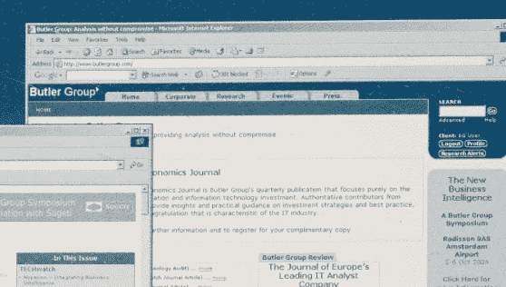

| Butler Group | 首页 | 公司 | 研究 | 活动 | 论坛 | 搜索 |
| --- | --- | --- | --- | --- | --- | --- |
| | | | | | [ ] [搜索] |

下载此内容，请获取 PDF 或 HTML 格式的《2004商业智能》（1284 KB）

缓解风险 - 理解商业智能

我们利用商业智能的方法使组织能够从各种来源构建关键应用。包括数据馈、统计数据、反馈以及更多数据的可用之处。我们展示了数据是如何被处理的、报告是如何交付的，以及市场选择输出如何满足预期效益。

BI（商业智能）是供应商的一种工具，要求该供应商对业务流程及其运作方式有广泛的理解。

我们与 Archfield 的法律顾问兼营销总监进行了交谈，他对他们目前系统所面临的问题描述非常清晰。

我们与一家集成商的绩效管理总监就解决问题的方法进行了交谈。三个主要问题：

来源信息


# 创始人兼总裁

Martin Butler

在准备本报告时，我们依赖了合理认为是最新且准确的数据和信息，由于这些信息来自我们直接控制之外的多种来源，我们无法保证所有内容都完全准确或最新。

# 研究

本报告具有通用性，并非针对特定目的，也不是为了满足任何特定情况的需求而定制。报告中包含的解释不具有约束力，您有责任对本报告依据的数据和信息进行您自己的解释。因此，Butler Direct 对在任何特定情况下使用本报告不负责，也不对您对本报告的解释负责。

Mark Bowers

Mike Davis

本报告中数据和信息的解释是基于通用假设的，其本质上并不旨在产生准确或特定的结果。因此，您有责任利用自己的相关专业技能和判断力，根据您的目的解释所提供的数据和信息，并根据此类解释做出相应决策。

John Holden

# PARK 学习中心

The Park Cheltenham

gloucestershire GL50 2RH

电话：01242 714333

# 格洛斯特郡大学

位于切尔特哈姆和格洛斯特

1.1 管理策略 (47)

2.1 报告结构 (49)

6.2 案例研究

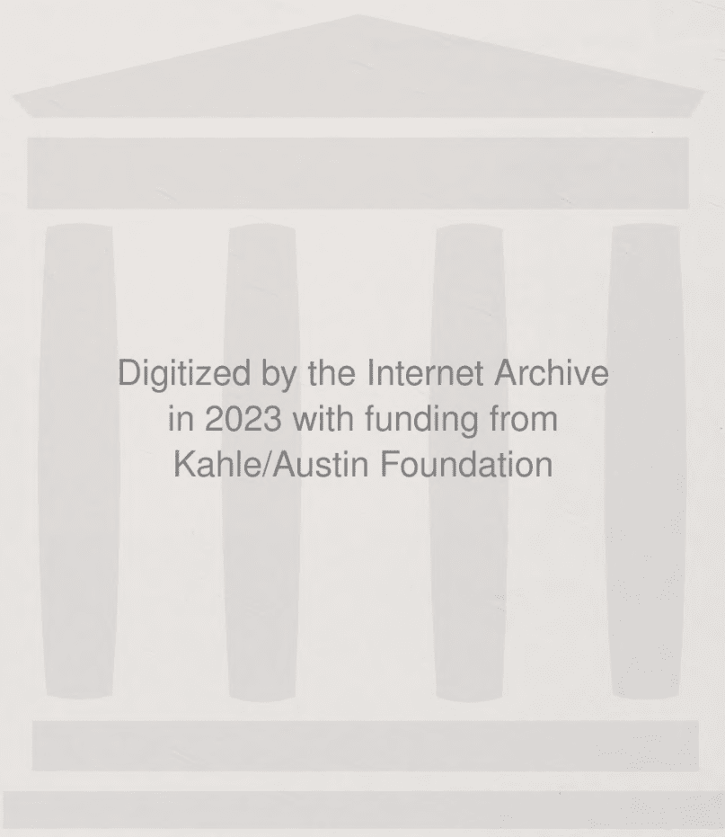

https://archive.org/details/linuxinenterpris0000unse

| Novell – SUSE Linux Enterprise Server 8 | 175 |

## 第一部分：

管理摘要

## 1.1 管理摘要

## 关键发现

- 是时候尝试深水了——Linux 现在已是数据中心的可行替代方案，并在两年内适用于桌面端。
- 选择自由——Linux 最重要的属性是其对硬件的独立。
- Linux 是一种性价比的 UNIX 替代品，也是 Windows 的有力竞争者。
- 桌面端的 Linux 正在获得 Red Hat 和 Novell 的认可。
- 忽略通用的拥有成本（TCO）评估；Linux 的成本取决于组织的具体情况。
- Linux 生态系统正在迅速发展，它是采用 Linux 的主要动力，特别是来自 Red Hat 和 Novell 的产品。
- 公共部门在该领域处于领先，并开始大规模接受 Linux。
- 开源软件往往缺乏创新，但它能产生高效、安全且可靠的代码。
- 对于许多已经使用 Windows 的机构，它仍然是最佳战略选择，专有 UNIX 也是如此。

IT 管理需要仔细审视其异构系统基础设施，并采取措施解决由于操作系统数量增加而不断上升的成本。很少有 IT 经理直接购买操作系统，但提供或开发满足业务目标和需求的服务才是主要驱动力。

> 上所述，Linux 提供了一个减少支持平台数量的机会，消除了操作系统与特定硬件之间紧密耦合的需求。

似乎在 IT 行业及以外，Linux 凭空出现并占据了企业服务器市场的很大份额。供应商社区对具体数字存在激烈争议，因为参与模式使得数字难以确定。然而，可以承认的是，Linux 确实在企业中获得了越来越多的关注，特别是相对于 UNIX 衍生品。

## 企业级 Linux

让我们明确一点：Linux 虽然结束了硬件供应商的锁定，提供了更多的控制权和良好的韧性，但它并非万能灵药。它在部署和维护方面仍然面临着与其他平台相同的问题，而 Microsoft Windows 仍然是一个有效的替代方案。短期内，在环境中引入 Linux 可能会增加技能要求和复杂性，因此管理流程和管理工具必须开放以允许对 IT 环境进行控制。但一个致力于仅使用两种操作系统（即 Windows 和 Linux）的组织，随着时间的推移将减少管理和维护所需的技能组合。

Linux 虽然结束了硬件供应商的锁定，提供了更多的控制权和良好的韧性，但它并非万能灵药。

## 业务问题

大家都接受企业环境中的 Linux 并非免费。总拥有成本（TCO）非常复杂，有许多变量需要考虑，由于每个组织都不同，很难进行直接比较。对于业内许多人生成的关于 UNIX、Windows 或 Linux 运行成本最高的通用 TCO 研究，不应给予过多关注。Linux 管理必须保持客观性，为所选的服务和应用程序选择最合适且成本效益最高的操作系统。最终而言，任何 IT 部署都取决于具体的业务和技术需求。重要的是，Linux 现在已成为企业的一项有效选择。

关于 Linux 代码保护的持续 SCO 诉讼风波涉及许多领先的行业供应商和部分客户，似乎在未来一段时间内还将持续。这一背景对于那些决定是否将 Linux 作为战略性操作系统的人来说可能是令人不安的。然而，这并不被视为重大威胁，也不应影响决策过程，特别是许多供应商会对用户免受任何不利判决的损害。

欧盟（EU）提出的专利法规变更可能会给 Linux 所属的开源社区带来进一步困难。如果该提案按目前的形式通过，将允许专利涵盖代码、数据结构和过程描述。危险在于开源项目可能会发现专利许可成本高昂，抑制代码重用和创新，商业软件供应商还可能利用这些法规关闭开源项目。这不应影响 Linux 已经演变为可靠的、能够满足业务和技术要求的企业级环境的事。

Linux 缺乏问责机制可能会让许多组织担心，责任和保修提供都落到了开发者身上。对于操作系统的未来也存在担忧，因为没有保证新的内核开发能够满足业务需求。面向企业的发行版的建立，以及来自 Linux 生态系统的支持（包括由开源开发实验室 OSDL 提供的控制和测试），应该显著减少这些担忧。

## 技术问题

Linux 在这种行业标准硬件上运行的能力使其成为替代专有 UNIX 解决方案的首选竞争者。

IT 行业内的许多重大技术趋势使 Linux 成为组织基础设施建设的领先竞争者。基于 Intel 的架构主导了企业 IT 环境。随着摩尔定律不断提升性能以及刀片技术的日益普及，x86 硬件对于所有数据处理需求、大型数据库和事务型应用程序都是可行的选择。Linux 在这种行业标准上运行的能力使其成为替代专有 UNIX 解决方案的首选竞争者。

这种硬件无关性在组织开始进入 64 位世界时尤为重要。目前无法确定哪种处理器（Intel Xeon、AMD Opteron 还是 IBM POWER）将成为行业标准。硬件无关性提供了灵活性，可以使用现在和未来提供最佳性能和价值的系统。这种可移植性让 IT 管理人员留有了余地，可以从硬件供应商处获得最优价格。

Linux 在整个软件栈、开发者工具、可用功能和集成方面（特别是在桌面环境中）具有显著优势。

目前正持续关注“以少胜多”，通过合并服务器来最大化效用，并向计算集群迁移。Linux 允许减少组织基础设施中部署的操作系统数量，从而减少 IT 环境的行政开销。此外，Linux 内置的连接功能允许与 Microsoft、Novell 以及其他网络集成，这有助于实施合并策略。

最新的 2.6 Linux 内核版本于 2003 年底发布，它在之前的版本的基础上进行了增强，包括了对 NUMA 服务器、超线程的支持、可扩展性的改进、与安全相关的更改以及更多对遗留系统（legacy support）的支持。Novell 计划在本报告发布时在其 SUSE LINUX 发行版中包含此新内核，Red Hat 也计划在 2005 年初执行同样的操作。

当然，Linux 并不是未来的唯一替代方案。Microsoft Windows 虽然并非完全硬件无关，但它并不运行在标准的 x86 架构上。Microsoft Windows XP 和 Microsoft Server 2003 的组合为企业用户提供了一个极具吸引力的 IT 平台，特别是其对改进安全性、可靠性、可用性和扩展性的关注。尽管 Windows 在整个软件栈、开发者工具、可用功能和集成方面（特别是在桌面环境中）具有显著优势，但其缺点被认为是持续的许可费用，讽刺的是，这个问题是由 Microsoft 本身推向大众的。

桌面领域可能开始发生巨变，Red Hat、IBM、Novel 和 Sun 都提供了 Linux 客户端方案。然而，要赢得用户的信任并非易事，这些解决方案必须提供与现有 Windows 环境同等的便利性和集成性。一些早期采用者组织，如慕尼黑、贝根市和 Schwabisch 议会，现在正在桌面上部署 Linux 和开源技术。对于怀疑者，可以尝试从 CD 启动 Knoppix 3.4 或 SUSE Live 9.1，看看 Linux 已经取得了多大的进步。在可预见的未来，所部署的开源工具将一直追赶 Microsoft Office。

## 市场问题

Linux 能够成功演变为企业级操作系统的一个重要原因是建立了一个互利互惠的生态系统。在过去的几年里，开源社区和商业领域已经相互适应，这使得 Linux 的商业化不断壮大。开源开发模式被证明对于产生高效稳健的代码非常有效，但可能不是开源社区许多人所倡导创新的催化剂。Linux 的开放性和活性对公共组织具有特别吸引力。

## Butler Group 市场生命周期定位

Butler Group 的供应商排名和评估模型将供应商分为“优于（Outperform）”、“表现（Perform）”和“表现（Under-perform）”类别，并展示了在三个主要市场阶段（早期采用、市场采纳和市场成熟）的预测进展。

# Linux 发行版

| | | | |
|---|---|---|---|
| 优于表现 | • Novell SUSE LINUX • Red Hat | • Novell SUSE LINUX • Red Hat | |
| 表现 | • Novell SUSE LINUX • Red Hat | • Asianux • Turbolux | • Asianux Debian Turbolux |
| 逊于表现 | • Debian Mandrakesoft MIRACLE LINUX Red Hat Turbolux | • Debian Mandrakesoft | Mandrakesoft |
| | 2005 年之前的早期采用者 | 2006-2009 年市场采用 | 2010 年起的市场成熟期 |

* Asianux 是一种由红旗（Red Flag）和 MIRACLE LINUX 联合推出的企业级发行版。它将迅速成为亚太地区的主导性发行版。

# Linux 服务

| | | | |
|---|---|---|---|
| 优于表现 | • IBM | • HP IBM | • HP IBM |
| 表现 | • HP Oracle | • Fujitsu Novell Oracle Sun Systems | • Fujitsu Novell Oracle Sun Systems |
| 逊于表现 | • Fujitsu Novell Sun Microystems | | 2005 年之前的早期采用者 | 2006-2009 年市场采用 | 2010 年起的市场成熟期 |

## 企业中的 Linux

# 解决方案性能表

Butler Group 对各供应商当前解决方案的分析和市场定位进行了总结，并考虑了所有研究以及供应商如何应对市场需求。

Linux 发行版

| 评分 | 公司/解决方案 | Butler Group 意见 |
| --- | --- | --- |
| 良好 | Novell SUSE LINUX Enterprise Server 8 | 欧洲技术领导者，现由 Novell 拥有并提供支持。管理工具非常丰富，且与 IBM 和 HP 着紧密关系。在可预见的未来将仍然是顶级发行版之一。 |
| | Red Hat Red Hat Enterprise Linux and Red Hat Desktop v.3 | 第一家为 Linux 提供企业级技术和支持的公司。公认的领导者，拥有关键合作伙伴和全系列的支持服务。将是另一个领先的发行版。 |
| 逊于表现 | Debian Debian GNU/Linux 3.0 | 技术扎实，但尽管与 HP 有合作，仍缺乏支持和方向。 |
| | Mandrakesoft Mandrakelinux 一个以法国为中心的发行版，功能良好，但在法国/南欧以外以外的渗透率较低。 |
| | MIRACLE LINUX and Red Flag Asianux 1.0 | 中国的红旗和日本的 MIRACLE LINUX 最近达成合作创建了 Asianux，这是一个面向亚太地区的标准企业发行版。考虑到潜在市场的规模，它将在未来成为一个主要的发行版。 |
| | Turbolinus Turbolinus Enterprise Server 8 | 亚太地区发行版，随着 Asianux（红旗、MIRACLE LINUX）在该地区获得主导地位，它可能会受到影响。 |

## 企业中的 Linux

# Butler 服务

| 评分 | 公司/解决方案 | Butler Group 意见 |
| --- | --- | --- |
| 优于表现 | IBM Linux 产品、服务与支持 | IBM 可能拥有最大的 Linux 产品和服务组合，可以被理所地认为是 Linux 的教父。由于公司大部分的业务战略都基于迁移和部署 Linux，IBM 必须被视为 Linux服务的领导者。 |
| 良好 | HP Linux 服务与支持 | HP 是 Linux 的坚实支持者，但其以与硬件软件无关的方式提供支持和服务，专注于为拥有最合适解决方案以满足业务需求的组织。该保障计划是其战略的一部分，引导企业在企业级迁移并部署 Linux。 |
| | Oracle Linux 产品、服务与支持 | Oracle 将 Linux 视为其软件的战略平台，并与 SUSE 和 Red Hat 保持密切合作。Oracle 还是日本 Linux 发行版的 58% 股东该公司为其部署在 Linux 上的产品提供单点支持，并对内核提供高达三级支持，甚至是代码级的修复。 |
| | 日通 Linux 服务 | 日通将 Linux 视为 UNIX 的另一种“口味”，目前正处于 Linux 服务的初始阶段。作为世界第四大 IT 公司，在亚太地区拥有深远影响力，并在英国拥有大型公共部门合同，它被定位为 Linux 服务领域的主要参与者。 |
| 逊于表现 | Novell Linux 服务 | 在 2003/2004 年忙碌收购了先临和 SUSE Linux 之后，Novell 现在正在明确其产品范围，以利用其全球经验和影响力。它承诺提供全面的服务，并有机会将其遗留应用程序集成到不断扩展的应用服务器平台中。 |
| | Sun Microsystems Linux 服务 | Sun Microsystems 似乎在其策略上发布了令人困惑的信息，特别是现在其最近对 Red Hat 的态度，以及考虑将 Solaris 发布到开源社区的公告。如果公司能一致的战略进行明智投资，它可能成为 Linux 服务市场的大参与者。 |

# 第 2 部分：

引言


## 2.1 报告结构

考虑到本报告将被许多高级管理人员阅读，每个人都有不同的兴趣领域和专业知识，报告的结构设计将这些元素隔离开。

## 第二部分：引言

在管理摘要之后，引言设定了背景。

## 第三部分：技术特性

本部分描述了主要功能和技术。

## 第四部分：架构与模型

报告的这部分详细审视了架构。

## 第五部分：部署

本部分揭示了问题和优势。

## 第六部分：市场分析

本部分对市场进行了概述，提供了驱动因素的检查。

## 第七部分：表格

本部分首先展示 Butler Group 的功能矩阵，允许对选定的发行版进行功能对比。

## 第八部分：比较

本部分包含了报告中涉及供应商的比较。

## 第九部分：技术审计

本部分包含了报告中涉及供应商的深度技术审计。

## 第十部分：供应商简介

本部分包含了未纳入技术审计的若干供应商的简要简介。

Linux 正在席卷整个 IT 领域，从服务器一直到客户端。从一个小规模的开源项目开始，该操作系统获得了动力，使其市场份额超过了所有版本的 UNIX，并威胁到了微软 Windows。许多政府（包括德国和中国）以及其他公共部门已采用 Linux 作为打破供应商锁定的手段。Linux 最初以廉价的方式通过支持稳健的文件和打印机服务器进入 IT 市场，作为基础设施的替代方案，它在后台领域获得了显著的市场份额。

许多政府以及其他公共部门已采用 Linux 作为打破供应商锁定的手段。

此外，推动 Linux 演变为企业级操作的一个重要因素是 UNIX 供应商之间持续的僵局。一次又一次，由于供应商宣称维护自身利益，统一 UNIX 营的努力陷入停滞。虽然这种局面为微软 NT 和 Windows 2000 获得更大的地位铺平了道路，但也让 Linux 在 UNIX 市场中取得了重大进展。


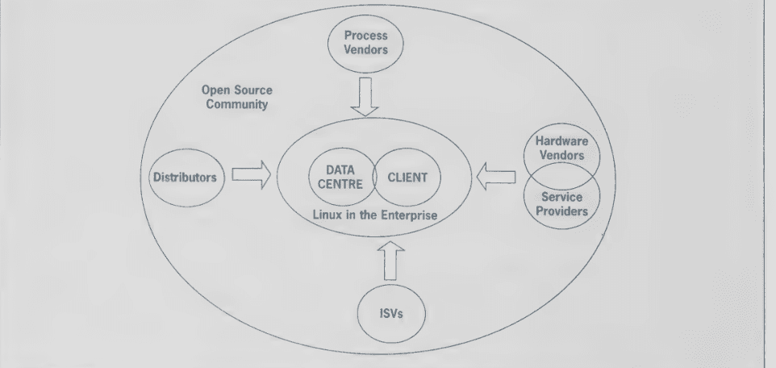

图 2.2.1：Linux 生态系统

Linux 生态系统的基石是开源社区，他们不断向 Linux 源代码提交更改和修复。虽然许多人认为这是一种弱点，因为在如此多的人中难以进行控制并达成共识，但这实际上是整个 Linux 开发过程中的一个主要优势。托瓦兹（Torvalds）及其核心圈与受许多 IT 供应商支持的开源开发实验室（OSDL）紧密合作，保留了内核的版权和控制权。

许多独立软件供应商（ISV）、硬件供应商和服务提供商现在都向开源社区贡献软件，以纳入 Linux 内核。这些贡献的增长过程与其他其它作者的代码被采纳到代码中的过程相同。目前的一个担忧是发行版/内核的碎片化以及开源理想的商业化。在很大程度上，由于没有单一供应商控制内核防止了这种现象，因此开源社区与商业群体之间维持了一种共生和谐的关系。

Linux 的这种开放性和灵活性对公共部门机构特别有吸引力，这些机构可以获取源代码并围绕该操作系统、关联工具以及针对其特定业务领域的应用程序培养开发社区。这使得在国有行政提供服务的周边地区能够创造技能和知识。

尽管 Linux 最初是为 Intel 386 (x86) 处理器以及后续基于 Intel 的生成器编写的，但也被移植到了许多其他处理器族。Linux 可以运行在如 Sun Microsystems SPARC、IBM Power、Motorola 68000、IBM zSeries 和 Intel Itanium 等操作系统上。这种灵活性在商业操作系统中是罕见的，也是一个重要优势，让 IT 管理人员第一次有机会不受操作限制选择最佳硬件。

采用 Linux 的一个感知阻碍是应用程序的可用性不足。然而，大多数 ISV 现在已支持 Linux 作为其战略平台之一。Linux 的接受程度已达到临界点，大多数关键软件供应商已将它们的软件移植到 Linux 内核。最早拥抱 Linux 的包括 IBM、惠尔（惠普（HP）、Oracle 和 SAP，其他公司也迅速加入了行列。IT 行业领导者已经意识到，对于许多组织来说，Linux 是 UNIX 和微软 Windows 的有效替代方案。

区分不同发行版的主要因素包括：

- 用于构建完整操作系统的部分的软件包管理系统。
- 需要解决不同组件版本、主机兼容性的安装软件，以及升级和补丁管理。
- 帮助台和 24x7 支持的可用性。
- 兼容软件工具的捆绑。

从企业的角度来看，主要的区别因素必须是 ISV 对操作系统的支持。然而，Linux 并没有改变选择操作系统的主要标准，即运行组织应用程序的适用性。

两个领先的企业 Linux 发行版是红帽（Red Hat，特别是在美国）和 SUSE Linux（现为 Novell 的一部分，主要覆盖欧洲）。这两家供应商占据了企业市场份额，其他可选的包括亚洲的 Mandrakes、Debian 和 Turblinux。这种认可在很大程度上归于硬件供应商和大多数 ISV 选择了红帽和 SUSE Linux 发行版的支持。

在任何企业级安装中（无论是内部还是来自供应商、销商或系统集成商（SI））都是一个主要的考虑因素。服务提供商在这个领域开发资源来满足 Linux 客户的需求。对于任何部署软件的组织来说，关键服务就是支持，因为 Linux 是开源软件（OSS），没有所谓的“供应商”。

现在有许多组织根据合同级别提供与发行无关的支持服务。这些包括富士胶（Fujifilm）、HP、IBM 全球服务、Novell 和 Sun Microsystems。每家公司与 Linux 发行版都有关系，并为一系列开源软件提供各种级别的支持。

1991 年，芬兰工程学生林纳斯·托瓦兹（Linus Torvalds）在寻求通过网站协助志愿者为 Intel 处理器制作一种类 UNIX 操作系统时，重写了一个名为 MINIX 的 Linux 小型版本，创建了第一个 Linux 内核。Linux 从网站发布，并在学生和学术界迅速流行，因为它是“免费的”。通过自由软件基金会创建的 GNU 公共许可证（GPL）将内核置于开源社区，使得 Linux 能够快速发展，并防止任何人声称拥有自己的私有 Linux 版本。

在 20 世纪 90 年代，Linux 获得了替代 UNIX 工作站所需的所有功能。许多不同的用户组在此时被建立，《Linux Journal》杂志也开始发行。松散用户网络之间的协作继续维护和改进该操作系统。重要的是，内核保持符合可移植操作系统接口（POSIX）标准，并包含了在 UNIX 中发现的所有功能，例如基于类 UNIX 结构，具有三个主要代码区域——内核模块和共享库。

| 编译器 | 用户进程 | 系统管理工具 | 用户工具 |
| :--- | :--- | :--- | :--- |
| | | 共享库 | |
| | | Linux 内核 | |
| | | 可加载内核模块 | |

图 2.3.1：Linux 组件

内核是用于 Linux 核心代码的术语，在应用程序的命令与组成计算机的硬件设备之间交互。内核被加载到内存的保护区域，并通过系统调用根据请求为应用程序提供服务。内核的请求使用中断处理程序进行优先级排序，以优先处理 I/O 操作，并使用调度程序和一个为任务分配优先级的监控器。应用程序（包括应用服务器）针对特定的内核版本进行认证，因此跨服务器的内核管理和控制至关重要。

Linux 内核版本 1.0 于 1994 年初发布，Linux 2.0 则于 1996 年中期发布，包含了对多架构和多处理的支持。多年来，Linux 演变成一个多用户多任务系统，并带有一套关联工具，可以在从最小到最大的硬件平台上运行。

内核版本分为发布版和开发版。前者是“板上钉钉”的，除非发现故障，且所有功能都经过了社区测试。后者是“进行中”，社区成员可以不断贡献直到它被修复并成为下一个发布版本。当前的发布版本是 2003 年 12 月发布的 2.6。

主要发行版计划在未来几个月发布 2.6 的商业版本。红帽计划在 2005 年推出的红帽企业版4 中包含 2.6 内核。SUSE LINUX 将在其 2004 年夏季发布的 SUSE Enterprise Server 9 中包含 2.6。2.6 的某些功能已经回溯到商业发行版的 2.4 内核中。

[图片省略]

Linux 内核开发本身由一个小小组监督，包括托瓦兹，并在 OSDL 的支持下，同意来自“社区”开发者提交的添加和增强，以及日益增加的主要 ISV 及其代表的努力。Linux 标准基础（LSB）项目在非营利组织 Free Standards Group 的支持下发布标准，以确保 Linux 发行之间的兼容性。

最初 Linux 开发专注于内核，但操作系统包含更多功能，因此虽然 Linux 内核完全由社区构建的代码组成，但 Linux 系统由另一层功能组成，其中一些是从零开发的，另一些则来自之前的项目和现有的 Linux 工具。Linux 发行版概念被提出，将标准内核、Linux 工具、管理工具和其他关联软件组合在一起。

Linux 对独立软件供应商（ISV）、系统集成商（SI）和用户组织具有巨大的吸引力，这不仅在于没有初始许可费用，更在于 Linux 提供的灵活性、对内核标准的认可和控制，以及通用技能set的使用，从而减少了开销并缩短了时间周期。

## 2.4 法律影响

SCO 诉讼案引起了广泛的媒体报道；在此只需说明，尽管针对 IBM、Novell 等其他公司的诉讼仍在审理中，且 SCO 对终端用户 DaimlerChrysler 和 AutoZone 发起了首几起诉讼，但 SCO 在公开领域尚未提出任何令人信服的证据表明 Linux 源代码违反了任何侵权行为。

为了对这一切有一个直观的了解，回顾从 2003 年 3 月 SCO 起诉 IBM 开始的事件时间线可能有所帮助。当时 SCO 声称 IBM 违反了协议，并在 Linux 2.4 和 2.5 版本中使用了 SCO 集团的部分 UNIX 系统代码。8 月份，IBM 表示其拥有永久性的 UNIX 许可，并对 SCO 提起了反诉。

红帽公司（Red Hat）已对 SCO 提起诉讼。第一个诉讼定于 2005 年 4 月 11 日开庭。Novell 和 SCO 都于 2003 年对 UNIX System V 中的某些元素申请了版权注册。这源于 SCO 在 1995 年从 Novell 购买了资产，Novell 留下了其 UNIX 版权的所有权，但受限于某些条件。

> 尽管 SCO 闹剧可能会持续下去，但客户不应对购买 Linux 过度担忧。

那些从 SCO 获得款项的不幸公司在承担任何风险之前，应该等待法院判定问题。红帽、Novell/SUSE、太阳（Sun）、惠普（HP）等为其客户提供了补偿计划，而且 SCO 在法庭上赢得任何辩论都是可能的，但 Linux 开发者社区会为违规代码产生替代补丁，因此 Linux 并没有长期悬而未决的威胁。

虽然这场闹剧可能会持续下去，但客户不应对购买 Linux 过度担忧，在法院做出裁决之前，不应向 SCO 支付有争议的许可费。即使法庭认同 UNIX 代码已被复制到 Linux 中，SCO 也只能从其企业对手处获得一笔款项，而识别出的问题代码可以被移除并由等代码代码。

> Linux 和开源使用的另一个令人担忧的威胁是，专利保护法规收紧的可能性日益增加。

目前 SCO、IBM、Novell 等公司之间的这场法律斗争为 Linux 市场带来了不确定性。然而，Linux 供应商和开源社区的领袖们已经团结起来保护用户。供应商已确保其 Linux 用户免受 SCO 索赔的影响，因此客户无需对将 Linux 作为战略性选择过度担忧。

Linux 和开源使用的另一个令人担忧的威胁是，专利保护规则收紧的可能性日益增加。各种开源社区对欧盟软件专利法的日益关注。位于布鲁塞尔的欧盟成员国常驻代表委员会（COREPER）对一份关于该争议性软件专利指令的新草案达成了初步一致。

这份最新草案拒绝了欧洲议会的所有限制性修正，并被自由基础设施基金会（FFII）描述为“迄为止最不妥协的支持专利的文本”。FFII 是在慕尼黑注册的非营利协会，致力于数据处理素养状态。

COREPER 委员会的文本比 2002 年发布的欧盟委员会文本更进一步。当时，尚不确定欧盟软件专利法是否会被实施，但官员和部长之间对新文本的价值存在分歧。

如果该建议被采纳，它将软件专利扩展到每一项软件，包括计算机程序、数据结构和过程描述。据称，这将抑制创新，并直接损害大多数无法支付许可费的软件公司以及所有开源项目，允许私有利益占据公有领域。

## 2.5 总拥有成本

人们一直预期缺乏许可费用将降低 Linux 的拥有成本，但由于技术因素的差异，这种预期是否成立尚不确定。无论如何，任何 IT 部署都取决于具体的业务和技术需求。然而 Linux 的可靠性取决于许多因素。

（注：原文部分段存在逻辑重复或断句，译文已根据原文进行准确翻译）

## 企业级 Linux

### 可用性 (Availability)

服务的可用性取决于其提供的“可用性几个9”（nines of availability）。1 个 9 等同于 90% 的运行时间，2 个 9 意味着在 99% 的时间内可以访问，以此此类推。将“9 的位数” 转换为每年允许的停机时间，结果如下：

| 9 的位数 | 可用性 | 每年停机时间 |
|---|---|---|
| 1 | 90.0000% | 37 天 |
| 2 | 99.0000% | 3.7 天 |
| 3 | 99.9000% | 8.8 小时 |
| 4 | 99.9900% | 53 分钟 |
| 5 | 99.9990% | 5.3 分钟 |
| 6 | 99.9999% | 32 秒 |

显然，需要的可用性位数越高，系统就越昂贵，因为通过资源冗余可以最大限度地减少单点故障。使用企业级标准硬件和软件的 Linux 集群，可以用极低的成本提供高可用性，而这以前只能从专有设备获得。

集群是一种经常用于提高可用性的技术，并满足负载均衡、复制、故障转移和冗余的要求。它由一组两个或多个服务器共同工作组成（有时被称为节点），对于应用程序或网络而言，就像单一的虚拟服务器。在发生故障时，它允许另一台服务器接管出现问题的硬件的任务。在 HA（高可用）集群中，如果需要，单个节点可以接管其他节点。虽然集群允许操作系统和应用程序将其识别为单个虚拟服务器，但出于安全或管理考虑，在集群上运行多个应用程序实例可能是合适的。

Linux 高可用性 (`Linux-HA`) 社区开发项目为 Linux 提供了集群解决方案。HA 项目被广泛使用，生产环境中已有数千个安装。`Heartbeat` 作为 SUSE LINUX、Mandrake 和 Debian 发行版的一部分。`Red Hat Cluster Suite` 作为 Red Hat 应用程序家族产品提供，专为 Red Enterprise Linux 系统设计。

在 Linux 发行版中，可以通过各种开源和专有工具找到许多可用性功能，这些工具可以是发行版的一部分或第三方附加组件。独立磁盘阵列 (`RAID`) 和电源管理功能是可用性背景下的关键技术。其他功能包括：

- “热插拔”（在线添加或删除的能力）：处理器、内存、I/O 适配器和硬盘。
- 提供备用内核安装。
- 执行动态内核补丁的能力。

系统感知故障点并在尽早阶段向操作人员强调这些点至关重要，而自愈能力现在已是一项关键需求。发行版诊断和修复问题的能力是提供企业级产品的基础。漏洞（Bug）或故障令人烦恼，但偶尔是可以预见的。然而，无法解决的问题是不可接受的。良好的可维护性可以减少对系统可用性和可靠性的影响。Linux 有第三方工具和实用程序的支持满足以下关键服务需求：

- 一系列故障预测工具。
- 故障数据采集。
- 自动问题检测和解决。
- 离线分析。

没有人希望处理崩溃的服务器，然而，尽管采用了韧性功能，但设备与许多不受控元素相互作用的复杂性不可避免地会反复遇到问题。进行快速自动恢复的能力具有显著优势。这不仅在托管电子商务应用程序的大型数据中心中如此，例如在零售店中，本地服务器可能是销售终端（POS）以及授权信用卡和支付的设备。这种情况可能与数据中心一样关键，但可能的情况是现场没有操作员或 IT 经理。在后的情况下，自动恢复和远程管理至关重要。

自动恢复功能和特征不仅适用于服务器完全崩溃，还适用于单个组件的故障。与韧性功能一样，并不是所有的恢复功能都适用于每种解决方案，而且通常需要相应技能的人员才能发挥作用。Linux 系统的支持现在已包含市场上的许多恢复解决方案中。

- 可靠性 – 大多数 Linux 系统基于 Intel 架构本质上是健壮的，Linux 2.6 内核在这一领域带来了改进。
- 可用性 – Linux 系统可以构建为提供高可用性。
- 可维护性 – 市场上有一系列开源和第三方专有解决方案。

可扩展性包括在连接的多个分布式系统之间进行垂直扩展（scale up）的能力，以及涉及使用一个系统内的多个处理器的水平扩展（scale out）的能力。在考虑服务器整合策略时，水平扩展的能力尤为重要。

### Linux 系统现在已出现在事务处理委员会（Transaction Processing Council）的许多基准测试中。

Linux 系统现在已出现在事务处理委员会的许多基准测试中。Linux 的可扩展性也可以通过虚拟机实现。可以提高可扩展性的四种技术是：非统一内存访问 (`NUMA`)、集群和超线程 (`Hyper-threading`)。

在 SMP 或“紧耦合”多处理中，处理器共享内存和 I/O 总线。操作系统的实现跨运行在所有处理器上，将它们的内存和 I/O 视为单一资源。应用程序的操作可以分分在多个处理器上，并有效地并发运行。这减少了执行事务所需的时间，通过利用 CPU 内可能等待较慢组件数据或指令的空间容量。

早期的 SMP 实现将 SMP 感知编码到架构中。单台服务器支持的 x86 处理器数量通常取决于发行版和硬件架构。例如，服务器供应商支持的最大处理器数量通常为 16；然而，Linux 2.6 内核的潜力支持 64 个。

新处理器开始使用 `NUMA` 技术，将主内存划分为本地和共享。本地内存为处理器提供了运行速度快的内存；由于每个处理器板内存之间的延迟，访问内存的速度较慢。这种设计方法在四路及以上的主板上生产往往更便宜，导致被许多制造商采用。Linux 2.6 内核支持 `NUMA`。

集群可用于水平扩展，也可满足 RAS 要求。Linux 集群供应商 California Digital 与 Aquos 和 Intel 开发了最强大的 Linux 超级计算机之一，代名为“Thunder”，位于国家实验室。Thunder 集群可以提供高达 19 teraflops 的持续性能。

超线程是一种为 x86 处理器开发的技术，允许单个处理器像两个独立的处理器。超线程通过利用可能等待来自较慢组件（例如磁盘驱动器）数据或指令的空间容量，促进对 CPU 内处理能力的利用。超线程已包含在 2.6 内核中。

- Linux 持续增加其可扩展性功能，Linux 2.6 内核实现了更多性能。
- 可扩展性在未来不太成为问题。

Linux 安全的许多方面在设计上与 UNIX 系统相似。Linux 源代码公开供任何人检查，防止了操作系统中的任何隐藏入口点，并允许添加自定义安全软件以进一步增强安全性。用户需要密码和相关权限才能访问和服务和资源。其他可用功能包括记录、监控、审计和补丁管理。IP 安全 (`IPSec`) 支持已添加到最新的内核发布中。Comodo 提供经过安全加固、服务器优化的 Trust Linux 发行版。

Linux 的开源身份意味着它拥有全球数千名开发者的支持，这些开发者不断检查安全性。这使得它比同类的闭源操作系统识别出更多的漏洞，而后者倾向于依赖客户报告问题。当发现问题时，社区可以快速开发修复方案，速度比受限于供应商开发团队规模的闭源操作系统更快。此外，组织或服务提供商可以修复安全问题，而无需依赖供应商提供补丁。

Linux 的开源身份意味着它拥有全球数千名开发者的支持，这些开发者不断检查安全性。虽然 Linux 目前不是黑客和恶意入侵者的首选，但它仍然需要被保护。开源社区已经开发了多种安全工具用于 Linux 发行版，并提供了各种第三方软件来提供安全环境。

身份验证确保访问系统的服务器或用户确实是他们声称的，而访问控制则允许用户仅访问授权的资源。身份验证工具包括：

- `OpenSSH`
- 可插身份验证模块 (`PAM`)
- `Kerberos`


身份验证基于为用户权的票据。这些票据以加密的形式传递给服务器。通过使用目录，用户由身份验证服务器 (`AS`) 验证，该服务器授予一个票据授予服务器 (`TGS`)；随后发送到托管应用程序的服务器，并授予特定时间的访问权限。与操作系统的集成越紧密，环境越安全。

单个服务器或单个域内的安全性可能是复杂的。当安全防护需要扩展到企业之外时，可能需要额外的服务。以下是实现安全网络的关键技术，特别是在互联网上：

## 1 虚拟专用网络 (VPN)

`VPN` 提供了一个跨越私有和公共网络的安全隧道，用于访问传输资源。用户在允许访问之前需要进行身份验证。`VPN` 加密通过其的数据，保护数据免受未经授权的访问。

## 2 入侵检测

入侵检测系统 (`IDS`) 通过监控流量并在检测到疑活动时发出警报来防御未经的访问。开源入侵检测系统对 IP 网络进行实时分析和数据包记录。它执行协议分析，检测各种攻击和探测，包括缓冲区溢出、端口扫描、通用网关接口 (`CGI`) 攻击、网络探测和操作系统指纹。

防火墙限制网络内两个或多个安全域之间的访问，通常描述为受信和不可信。举个简单的例子，组织的互联网（由组织授权的人访问）可以被视为受信的，而互联网被视为不可信的。防火墙可以通过或限制数据，虽然操作简单，但它们需要非常快以确保网络性能。许多网络管理员喜欢在独立的 PC 或服务器上运行防火墙，以便在受信域和不可信域之间创建清晰的隔离。

使用算法传递的数据被认为是机密的。这属于商业机密，例如信用卡号、用户个人详情或用户名和密码。在服务器和用户之间存在直接连接时（例如虚拟终端的情况），风险很小，但一旦数据通过直接连接进入网络，就存在被截获、复制、损坏或丢失的可能性。

加密使用算法对数据进行“乱码”，使得算法可以反转，从而预期的接收者、用户、服务器或应用程序可以读取数据。`TCP/IP` 网络（包括互联网）加密的事实标准是安全套接层 (`SSL`)。`SSL` 版本根据用于加密数据的算法复杂程度来命名。128 位加密现在是互联网交易的常态。`OpenSSL` 是提供此类功能的开源软件。

IT 经理最头疼的问题是被称为病毒的恶意自复制程序。虽然大多数计算机病毒的编写是为了利用微软软件的漏洞（主要通过使用宏实现），但 `UNIX` 和 `Linux` 病毒也日益显现。目前有许多第三方软件包可用，它们可以在桌面或服务器级上运行并保护 `Linux` 系统。尽管由于部署量较少，`Linux` 系统尚未成为黑客的主要目标，但最近已经出现了多个版本可以导致 `Linux` 内核崩溃。

广受尊敬的国际安全合规标准是美国国防部 (`DoD`) 的标准。国防部定义了四种计算机安全级别：A、B、C 和 D，其中 D 是最低安全，A 是最高级别。C 通过审计具有任意访问保护，并分为 C1 和 C2。每个级别都有独特的敏感性，B 分为 B1、B2 和 B3。将操作系统认证到 B 或 A 级可以为 IT 经理提供信心。然而事实是，只有在正确安装操作系统的情况下才能实现该安全级别。内核中包含 `Linux` 安全模块 (`LSM`) 允许添加安全扩展，如任意访问控制 (`DAC`)。

- `Linux` 内固有的安全性提供了良好的基础。
- 广泛的同行评审和源码可见性提高了安全性。
- `Linux` 的灵活性允许添加额外的级别。

## 3.4 互操作性

21 世纪的 IT 环境是异构的。虽然闭源单处理器操作系统为硬件和软件的紧密集成提供了最大的潜力，但这种同性在任何拥有超过一台服务器的组织中都不可能实现。因此，在决定 `Linux` 的部署时，必须参考它将要运行的其他 IT 环境。作为特定供应商的策略，保持持续的兼容性无疑非常重要。从一个层面上，这可以被描述为对特定供应商策略的“锁定”。从另一个角度来看，它可以提供操作系统与架构之间更紧密的集成，并提高性能和可靠性。Sun 在 SPARC 服务器上运行 Solaris、IBM 在 iSeries 上运行 AIX、以及 HP 在 PAIRS 上运行 HP-UX，其价值主张一直是专有标准带来的控制力和性能。另一方面，`Linux` 源自开源背景，始终能够在多种不同的架构上运行，并轻松利用工业级处理器带来的商品化定价。

正如操作系统的选择主要由应用程序的选择驱动，硬件架构在很大程度上也取决于操作系统的选择。随着 `Linux` 的出现，这种限制被减轻了。`Linux` 可以部署在许多不同的硬件平台上，并利用多种类型的处理器。这种灵活性是 `Linux` 相于其他操作系统的关键区别，它可以从移动设备设计的处理器一直运行到大型 zSystems 系统。

`www.butlergroup.com`

计算机系统的硬件架构与所使用的相应处理器相关。处理器（通常被称为“芯片”）是计算机的物理引擎，负责执行运行程序的操作、逻辑和算术运算。处理器主要分为三种：由 Intel 和 AMD 生产的复杂指令集计算机（`CISC`）处理器；由惠尔-帕德（HP）、IBM、摩托罗拉（Motorola）和太阳微系统系统（Sun）使用的精简指令集计算机（`RISC`）处理器；以及显式并行指令计算（`EPIC`）处理器，例如 Intel 的 64 位设计（称为安捷腾/Itanium），旨在与 `RISC` 处理器的性能竞争。

1974 年发布的 8 位 Intel 8080 处理器的核心架构，利用了目前系列 Intel 和 AMD 处理器的 32 位架构（`IA-32`）。这些处理器也被称为 `x86`。`CISC` 处理器是桌面级 PC 和低端服务器的事实标准架构。许多外围设备已开发出来，专门与安装 `CISC` 处理器的系统板配合。微软 Windows 操作系统在与基于 Intel 的处理器的开发过程中进行了密切合作。

基于 `CISC` 的服务器利用为桌面 PC 设计的外围设备和组件，这降低了购买和更换成本。对于用户组织而言，如果支持桌面的 IT 技能与支持服务器的技能集重叠，也有其好处。这是在采用 `Linux` 之前的驱动因素之一，它在相对低成本的 Intel 架构上提供了类 `UNIX` 操作系统。

`RISC` 处理器最初是 IBM 和爱立信（Ericsson）之间一个项目的一部分开发的，旨在寻找切换电话通话的方法。`RISC` 处理器适用于极高频率的操作，包括处理图形，这使其成为高端 `UNIX` 系统的首选技术，也用于图形交互式工作站。

然而，使用 `RISC` 处理器往往具有很强的专利性。因此，外围设备和组件比使用 `CISC` 处理器的设备昂贵，因为处理器市场较小，且设备对价格并不不像 `CISC` 领域敏感。IBM 投入了大量资金确保 `Linux` 能够在 PowerPC 芯片上高效运行。相比之下，HP 已决定不在 PA-RISC 处理器上积极支持 `Linux`，尽管已有支持该芯片组的发行版。

这一系列处理器利用 64 位架构（缩写为 `IA-64`），是与 HP 专门为高端服务器和工作站设计的。HP 将亲自使用运行 `Linux` 的安捷腾处理器用于未来的高端服务器，最终淘汰 PA-RISC。

`Linux` 的一个主要元素是管理连接到服务器和客户端的一系列外围设备。设备通常是零散开发的，要么是作为机会性的发现，要么是针对特定的操作问题。这些许多设备倾向于按照行业标准设计，而这些标准可能可能未被广泛接受。

其他设备由于广泛和快速的采用，已成为事实标准。虽然在选择作为处理器的操作系统时，外围设备的可用性并非作为业务选择的关键要素（因为设备与特定架构相关），但操作系统设计和管理此类设备的能力直接提高了可靠性并减少了开销。

这是 `Linux 2.6` 内核中一个发生重大变化的领域，统一模型的创建使得设备架构能够得以表示，从而改进了设备管理并提供了更好的电源管理控制。`Linux` 发行版的驱动程序支持可能是一个问题，而供应商使 `Linux` 成为了一级操作系统。这种状况正在改善。利基设备和遗留设备的驱动程序可能很难获得。验证 `Linux` 系统中所有预留硬件的驱动程序可用至关重要。

`Linux` 发行版必须支持若干标准才能在企业级领域具有公信力。这些包括：

`SCSI` 是一系列通过单通道由磁盘和磁带连接存储设备的标准。在一个 `SCSI` 端口中，最多可以链式连接多达 16 个设备。`SCSI` 是为大型服务器（主要是 `UNIX` 机器）开发的，但 `SCSI` 适配器在 Intel 架构上同样可用。

光纤通道以极快的速度在服务器与其他计算机设备之间传输数据。目前为 1Gb/ps，但 10Gb/ps 的规范正在开发中。光纤通道是连接分布式或共享存储设备的理想选择。尽管名称如此，但它并不是专为光纤设计的规范。该规范支持跨越双绞线和同轴电缆的距离传输。

InfiniBand 架构 (`IBA`) 提供了一个高速织网子系统，将处理器和 I/O 节点连接起来形成存储区域网络 (`SAN`)。这种连接机制通过使用通道取代了总线的使用。该架构独立于主机操作系统和处理器平台。开放联盟（Open Alliance，包括 Dell、Intel 和 Sun）正致力于在 `Linux` 中扩展 `IBA`。该小组正在定义一组常见的软件实用程序、InfiniBand 硬件驱动程序和网络协议，例如 InfiniBand 之上的 IP 以及用于高性能计算的的消息传递接口 (`MPI`)。

可移动存储可以指硬盘和内存棒（优）。随着操作系统寻址大量数据卷的能力，对可移动存储支持的需求正在减少。这种方法通常用作备份解决方案。

## 独立磁盘阵列 (RAID) 存储

大型安装使用磁带库提供长期、可访问的存储。

## 分布式存储

分布式存储有两种主要形式：

1. **网络附属存储 (`NAS`)** —— 允许服务器在独立的计算机上存储和管理文件，就像在本地硬盘上一样。通过处理器管理磁盘 I/O。它还允许多个服务器或应用程序使用。`NAS` 适用于镜像、备份、归档存储以及数据从另一个系统的传输。

2. **存储区域网络 (`SAN`)** —— 存储设备的子网络，提供了存储的单一视图，因为每个服务器没有太多的本地存储。它允许分布式存储。`SAN` 适用于镜像、备份、归档存储以及数据从另一个系统的传输。对于 `NAS`，存在由网络速度决定的延迟，因此高速的光纤通道连接是必要的。当应用程序处理大量数据时，`Linux` 对 `NAS` 和 `SAN` 的支持应该提高性能。

随着系统数量的增加，以及服务器可能存在的分布式部署，注册管理、分配适当权限以及更重要的是在需要时撤销权限，正变得日益复杂、耗时且昂贵。为了解决这个问题，人们开发了“单一目录”的概念，它存储了所有用户信息、他们对信息和资源的访问权限等细节。在此语境下，目录是一个应用程序和数据库，用于识别某项内容是否位于网络上。在 `TCP/IP` 网络中，目录系统是域名系统（`DNS`）。

目录领域的事实标准是遵循轻量级目录访问协议（`LDAP`）。`LDAP` 能够在网络上定位个人、群组、组织和设备。从本质地说，`LDAP` 目录是组织资源的数据库。它以分级结构组织，通常用于规范组织结构。从根目录开始，有国家分支，从国家分支到组织分支，最后连接到个人、文件或打印机等设备。

`LDAP` 目录可以通过复制和同步分布在不同的服务器上。这可以确保如果由于某些原因某个副本损坏，它可以执行“自愈能力”。目录中的条目还可以包含跨越层级的组成员关系（例如项目团队），从而在访问控制上提供了高度的粒度，进而提高了安全性。

## Linux 为目录服务和 LDAP 提供支持。

当操作系统和应用程序与符合 `LDAP` 标准或其他目录配合时，管理工作可以得到极大简化。除了显而易见的开销减少外，安全控制也得到了大大增强。`Linux` 为目录服务和 `LDAP` 提供支持。

关于支持的首要想法是“出问题时该找谁？”可以预期 `Linux` 拥有一系列支持方法和流程。在许多面临全球部署和通过互联网实现全球化的双重挑战的组织中，这些支持方法能够在 24x7 全球范围内被访问至关重要。在这种情况下，拥有现有全球网络的供应商比没有的供应商更优。同样，在更局部的范围内，支持需要在组织的运营时间内可用并做出响应。

支持也是具有周期性，并且发生在安装和部署阶段。由于 `Linux` 实际上是 IT 基础设施的基础技术，它的基础就像建筑的地基，需要经过规划，以便为放置在其上的应用程序提供支撑。

供应商、咨询公司和系统集成商（`SI`）的专业人员均可提供这些服务，通常与组织的 IT 员工合作完成。IT 经理和首席信息官（`CIO`）需要确定其组织的支持需求，以及影响服务器环境需求的风险和威胁。支持合同始终是风险与成本之间的权衡。`CIO` 需要识别所需的服务水平协议（`SLA`），并意识到在任何合同下所提供的支持的局限性。

对于持续支持，其他公司提供与发行版无关的支持服务，主要为 SUSE Linux 和 Red Hat 发行版提供协助，例如 HP 和 IBM 全球服务。它们都与 `Linux` 发行版建立了关系，并将为其他开源软件提供级别的支持。由于 `Linux` 是社区化开发，此外还有大量人员提供各种正式和非正式的支持服务，来解决问题和故障。

## 对企业而言，可能更重要的是来自商业第三方软件开发者对 Linux 平台的支持。

对企业而言，可能更重要的是来自商业第三方软件开发者对 `Linux` 平台的支持。虽然许多操作系统应用程序已变得足够强大，但在 Oracle 和 SAP 等供应商将操作系统平台作为其应用程序的基础之前，`Linux` 成为一个可行的替代方案。在过去的一年里，`Linux` 已被大多数独立软件供应商（`ISV`）采纳为一级操作系统。`Linux` 需要通过满足其需求的工具和环境，在商业开发者社区中获得影响力。这已通过 Eclipse OS 项目得到了解决，并与 Java、通用对象请求代理架构（`CORBA`）以及 `XML` 产生了协同效应。

尽管微软 Windows 在满足桌面操作系统需求方面具有毫无疑问的技术优势，但不再是技术问题阻碍了 `Linux` 成为可行的客户端替代方案。微软 Office 的高级用户以及大量依赖 Windows 文档的环境可能会发现 `Linux` 桌面功能、集成性和互操作性在某些方面有所欠缺。然而，不可否认，运行开源应用程序的 `Linux` 现在已提供了基础用户所需的所有功能，特别是当采用轻量级客户端方法时。`Linux` 的适应性使其成为其他客户端的理想平台，例如个人数字助理（`PDA`）、智能手机、自助终端和 Web 终端。

跟上微软桌面的步伐对于开源社区来说是一个短期内无法满足的移动目标，但随着 `XML` 的持续加入，至少将实现竞争公平，文档交换将不再限于微软格式。客户端需要一个桌面界面和浏览器，以及集成的个人信息管理（`PIM`）、生产力工具和协作应用。

与 Windows 的互连性对于任何客户端环境都至关重要，在 `Linux` 客户端可以通过多种方式实现，包括：

- 双启动——`Linux` 和 Windows 驻留在同一台机器上，用户根据需要选择操作系统。这可以用于试点或迁移。
- 轻量级客户端——来自 Citrix 和 Tarantella 的软件允许通过会话访问 Windows。
- 网络访问——`Linux` 访问卷。
- 虚拟机——来自 VMWare 和 Win4Lin 的软件允许运行 Windows。
- Windows 仿真——来自 CrossOver 和 WINE 的产品允许 Windows 应用在桌面运行。

## butlergroup.com

- 由于 `Linux` 生态系统的大量工作，`Linux` 在互操作性问题上已不再很多，特别是 IBM。
- 在未来两年内，`Linux` 已具备了被视为替代方案的基石。

任何计算机系统有效性的真正测试不是处理器性能、内存大小或其他硬件相关功能，而是跨组织管理和管理资源的能力，包括责任的委托。研究表明，管理和支持成本几乎占实际成本的一半。如果没有适当的工具控制环境，部署任何系统都会带来业务风险并无法产生预期的收益。

`Linux` 及其多个组件和功能需要被管理，以确保资源的有效利用，并确保数据安全和完整。对于操作系统，理想情况下是通过集成的系统管理工具，因为这应该提供最大的控制。成熟的操作系统提供了 `Linux` 尚未具备的管理功能。

> `Linux` 在管理其他操作系统方面存在局限性，这是第三方操作系统无关工具可以发挥重要作用的领域。

包含可以在管理工具内部访问的系统配置和监控工具，以及集成的开放数据库连接（`ODBC`）和 Java 数据库连接（`JDBC`），将再次降低操作系统的总成本（TCO），并应提高存储系统的相对性能。这些功能更有可能出现在专有的存储机制或市场领先的解决方案。

2004年9月

第3节：技术特性 43

集成存储管理中理想的特性包括：

- 支持存储分区。
- 具备配置和管理热备盘的能力。
- 识别热块并将其重新分配以平衡相应设备负载的能力。
- 在事务处理中，支持两阶段提交，以便在发生错误时回滚数据库。

由于服务器的目的是运行应用程序，因此除了应用程序执行其各自任务的实际操作外，不仅要管理操作系统组件，还要管理相关的操作系统实用程序和应用程序，这是至关重要的。为了确保软件的完整性、可用性以及与其他软件的互操作性。

软件管理工具旨在安装、卸载、验证、查询和更新应用程序。它们通常会使用软件注册表/配置数据库，其中包含组成应用程序的文件的归档，以及关于软件的信息（如版本和简要描述）。更高级的工具允许针对特定客户端对软件进行多种配置。

负载管理也称为资源管理，是对能够最有效利用可用计算资源的工具的通用描述。当它用于分布在多个物理服务器上的系统时，效果最为显著，因此它是公用计算的关键需求，也可以应用于单个高容量系统上的多台服务器。负载管理工具可以是基于权限的，也可以是基于目标的。负载管理的核心任务侧重于所执行任务的优先级，也称为作业控制。

作业控制工具可以管理一系列进程：

- 添加新的作业提交队列。
- 移除队列。
- 限制用户对特定队列的访问。
- 更改指定队列的优先级。
- 按所有者删除或挂起队列中的作业，或在适当删除所有作业。
- 恢复挂起的作业。

为了最大化负载管理工具的有效性，从系统管理界面内部访问它们是有益的。

安全管理功能提供了一种整合和管理许多安全组件的方法。系统应该提供对系统所有安全元素的集中控制。

虽然安装 `Linux` 并不是日常任务，但确保该过程简单且不复杂至关重要。这将会有期的升级或额外服务器的安装。在这些情况下，安装选项的灵活性非常重要。由于对于组织的 IT 人员来说，安装任务频率较低，因此过程尽可能简单和自动化至关重要。这些特性不能损害根据组织的运营和安全需求定制化配置的能力。

安装方法必须适用于业务环境。在零售等高度复制和分布式环境中，建议具备通过网络进行安装、重启或升级的能力以减少开销。理想情况下，这应包括配置复制以进一步减少管理工作。

许多 `Linux` 系统困难且复杂的安装过程一直是一个弱点，现在企业级 `Linux` 系统开始销售预装版本，安装通常在服务器发送给客户之前由供应商或系统集成商（`SI`）完成。在这种情况下，操作系统通常是预配置好的。


发行版提供的 Linux 管理工具和安装程序已有所改进。

从企业角度来看更重要的是，主要的系统管理软件供应商现在都广泛支持 Linux。

UNIX 变体和 Microsoft Windows 仍然提供更深入、更广泛的管理功能。

## 架构与模型

埃里克·雷蒙德（Eric Raymond）几年前首次阐明的《大教堂与集市》（The Cathedral and the Bazaar）原则帮助定义了开源模型，这是一种真正的社区软件开发方法。Linux 和其他开源项目的成功颠覆了当时的传统观念，即软件开发的最佳方法是由个人或小团队以类似于建造教堂的方式构建软件。当时的观点认为，中心化模型效果最好，因为开发团队规模超过一定程度后，项目会变得过于复杂且不可管理。

Linux 和其他开源项目的成功颠覆了传统观念。

与之形成的是，林斯·托瓦尔斯（Linus Torvalds）在 Linux 开发中使用的委托、早期和频繁发布的方法摒弃了传统方法。令许多人惊讶的是，这种拥有不同议程的大规模开发者池的“混乱安排”竟然产出了健壮且可用的代码。这种“集市”（此处不关双关）类型的开发模式被发现具有许多优点，包括产生的想法极其广阔、广泛的同行评审提高了代码质量，以及大型测试网络的可用性。

自由软件基金会（FSF）还为这种无成本软件的发展提供了催化剂，由于 GNU 通用公共许可证（GPL）提供的形式化支持，它使用了一种特殊的许可协议，鼓励代码的病毒式传播。该许可证确立了自由分发和复制的权利。

这种类型虽然提供了免费的源代码，但使得无法据此建立商业模式，并让商业组织难以利用。这导致开源倡议组织（OSI）创建了开源定义（OSD），这是一种更实用的方法，使开源社区和商业领域都能对 OSS 贡献并受益。这进一步导致了许多许可证的创建，它们体现了自由使用软件的原则，但允许对商业用途进行某种程度的保护，实现互利共赢。

尽管许多人认为开源软件（OSS）能产生创新，不可否认它在提高效率方面非常出色，但它尚未提供新的、不同的服务方式。许多设计原则源自 UNIX 并得到了改进，但 Linux 今日面临着挑战。

### 图 4.1：软件分类

| 类型 | 描述 | 成本 |
| :--- | :--- | :--- |
| 免费软件 (Freeware) | 对用户隐藏源代码 | 免费 |
| 共享软件 (Shareware) | 提供源代码 | 维护和支持收费 |
| 开源 (Open Source) | 提供源代码 | 免费 |
| 专利 (Proprietary) | 提供二进制文件 | 收费 |

OSS 的可用使得市场上出现了各种软件。许多重要的组织为标准和 Linux 开发提供稳定性和方向。这些包括开源开发实验室（OSDL）、OAS、Linux Base（LSB）和内核。LSB 对于 Linux 发行版具有特殊意义。

IBM 和 Computer Associates（CA）是许多拥抱开源模型的商业技术公司。其他还包括 HP、Novel、BEA 以及大多数太阳微（后者在某些产品上采用了这种方法，并表明其现在对 Solaris OS 越来越关注）。

CA 采取了新的开源策略，包括贡献 Linux 代码、使用新的开放许可发布数据库以及与开源社区更紧密的合作。内核接受了 CA 的技术，称为内核事件管理（KGM），并将包含在 Linux 内核中。这使得许多系统能够交叉，而无需为每个特定产品重新构建内核。CA 正在与 Linux 发行版和内核开发团队合作，确保这些特性在未来的 Linux 版本中成为标准。

CA 正与 Zope 公司 紧密合作，该公司是开源内容管理功能的提供者。目前，Zope 的部署使用平面文件配置，这限制了其在企业基础设施中的应用。这两家公司的开发人员将协作构建一个新模块，允许在 Zope 实现中使用 Ingress 以及其他数据库。

此外，开源内容管理解决方案的开发者 Plone 社区已宣布成立 Plone 基金会，以在项目的开发、营销和经济方面提供支持。CA 已承诺为基金会提供资源，并使用后续发布的 Plone 版本。

- Linux连同其他成功的开源软件（OSS），如 Apache、Tomcat 和 MySQL，已经证明了使用源代码模型进行开发是非常成功的。
- 开源软件正在商业市场中获得关注。
- Linux 非常适合利用行业标准。
- LSB 应该让各种发行版能够适用于许多应用程序。

## 4.2 IT 优化

IT 部门被要求用更少的资源完成更多的工作。预算是静态的，或者说实际预算正在缩减；具备必要技能的 IT 员工变得越来越难以寻找且成本更高，而环境也变得日益复杂。结合整合方法使用 Linux 可以通过简化现有基础设施和提高设备利用率来帮助缓解这些问题。Linux 在硬件选择方面提供了多多的灵活性，因为它不受限于特定的处理器。

> Linux 在硬件选择方面提供了多多的灵活性，因为它不受限于特定的处理器。

服务器整合、公用事业计算以及新兴的网格计算是 IT 经理用于演进和维护最佳、响应快速的计算环境的工具箱中的主要组件。服务器过度膨胀（Server sprawl）是一个主要问题，这很容易导致效率低下的环境，无论是在成本增加还是资源利用方面。此外，基础设施应该足够灵活以为业务价值的创造提供机会也至关重要。IT 环境的优化所产生的节约可以重新投入到新设备的投资中，以提高基础设施的效率和敏捷性。

最初，数据中心的选择相对简单——即部署哪个版本的 UNIX 以及相关的硬件平台。一个获胜平台的开发增加了决策的复杂性，而近期 Linux 作为企业计算领域竞争者的出现，进一步加剧了这种复杂性。Intel 上的 Linux (Intel) 现在已是 Intel 模型以及低端 UNIX/RISC 解决方案的替代方案。Linux 让 IT 经理能够自由选择最具价值的处理器和硬件。

## 企业级 Linux

这种 x86 架构正在市场上取得足迹。Linux 引入这一时代对这种微处理器架构产生了积极影响，引发了对 RISC 寿命的质疑，同时也受到 RISC 和复杂指令集计算机 (CISC) 技术进展的影响，这些进展帮助削弱了 RISC 的早期优势并使这两种架构更加接近。

由于对 RISC 专有性的担忧日益增加，加上 Linux 和行业标准技术的影响日益增大，RISC 开始面临日益巨大的压力，而 x86 的地位大幅提高，这并不意外。用户现在正将开源软件（如 Linux）等非专有平台视为降低风险并趋势的趋势。

这并不是说 Linux 仅在 x86 市场具有影响力——远非如此。例如，来自 Red Hat 和 Novell 的企业发行版支持 S/390、SPARC 等许多其他硬件平台。有趣的是，HP 不在其 PA-RISC 架构上支持 Linux，是因为其对 Itanium 的承诺。由于 Linux 独立于单一供应商，开发人员可以针对他们需要的任何架构对其适配。

这使得平台选择的决策可以考虑其他因素，例如微处理器架构。这些决策将基于许多因素，但大多数人最理解的因素是成本。遗憾的是，特别是当考虑到对每个组织独特的各种影响因素时，情况如此。大多数研究关注的是微软与 Linux 环境的对比，而不是在硬件/处理器层面可以实现显著成本节约的地方，而那里的决策是 x86 还是 RISC 架构的选择。

随着面向企业的 64 位处理器的出现，这变得更加复杂了。目前完全无法确定在众多芯片（Xeon、Titanium、Opteron 或 POWER）中哪一个将成为未来的行业标准。这使得 Linux 硬件无关的特性变得非常有意义。

可以使用 Linux 操作系统利用的整合方法有原生运行、在分区中运行或作为虚拟机运行。物理整合通过用具有相同处理器架构运行相同应用程序的小型服务器来减少环境中的服务器数量，由一台较大的服务器可以在无需任何更改的情况下支持捆绑的社区。根据情况，这种整合可以在部门、数据中心或企业级进行部署。

分布式服务器的平均使用率在 10% 到 35% 之间。通过实施包含免费、更强大的服务器的整合环境，这种利用率可以提高到高得多的水平，而不影响响应时间。来自 HP、IBM 等的大型服务器能够处理超过 80% 的工作负载。在大型服务器方面，IBM 将提供一个具有虚拟化功能的新 POWER 5 Linux 系列，支持多达十个微分区。POWER 5 处理器也经过调整以提高 Linux 的性能。

摩尔定律表明计算能力每 18 个月翻一倍，而芯片组架构——通过更快的内存、更大的缓存、增强的 I/O 设计和服务器提供性能改进——包括支持许多系统的基于 Intel 系统。

分布式服务器的平均使用率在 10% 到 35% 之间。通过实施包含免费、更强大的服务器的整合环境，这种利用率可以提高到高得多的水平，而不影响响应时间。来自 HP、IBM 等的大型服务器能够处理超过 80% 的工作负载。在大型服务器方面，IBM 将提供一个具有虚拟化功能的新 POWER 5 Linux 系列，支持多达十个微分区。POWER 5 处理器也经过调整以提高 Linux 的性能。

摩尔定律表明计算能力每 18 个月翻一倍，而芯片组架构——通过更快的内存、更大的缓存、增强的 I/O 设计和服务器提供性能改进——包括支持许多基于 Intel 系统。

在 20 世纪 90 年代，去中心化非常流行。人们广泛认为，使用许多小型服务器的分布式方法会产生成本和节约。快速部署的灵活性使得许多组织能够实施新应用程序，而不是继续使用大型机。

虚拟化技术长期以来一直是 z 系列服务器不可或缺的一部分，它能够在单台物理主机上创建和管理虚拟处理器、通信、存储和 I/O 设备。这些资源可以根据当前需求进行动态共享和重新配置，以满足对新工作负载的应对。该技术还允许在几分钟而非几天内克隆并部署虚拟服务器，有助于加快上市时间，并为虚拟开发、测试和服务的试用提供低成本环境，而无需投资新硬件。

使用 zVM 可以实现服务器整合。Linux 工作负载可以通过增加虚拟处理器、内存和 I/O 容量来向上扩展（scale up），也可以通过创建额外的 Linux 机器来横向扩展（scale out）。z/VM 还支持 Linux 集成设施（IFL），这是 z 系列上的一项可选硬件功能，专门为 Linux 工作负载提供处理器，并在某些型号中作为标准配置。这使得为 Linux 环境购买处理能力变得更加方便，因此对其他操作系统的软件更改没有影响。此外还有专门由 IFL 引擎构建的专用 z 系列 Linux 服务器。

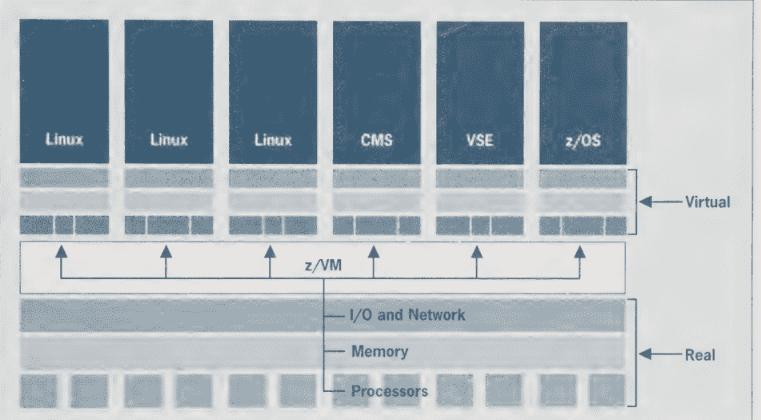

图 4.2.4：z/VM

如果我们观察主机的优势，有很多特性和能力可以使其成为今天复杂异构环境的理想解决方案，特别是对于那些在 IT 中心已经有一台利用率不足的主机的组织。对于许多应用程序（尤其是基于 Web 的应用程序），预测未来的需求非常困难。IT 基础设施能够同时向上和横向扩展，并应对需求激峰变得越来越重要，因为如果不妥善管理，这些激峰很容易导致系统宕机。

其他类型处理器的数据总线在高容量事务系统中迅速成为主要限制。主机的 I/O 吞吐量经过专门设计，以支持大量数据流量。这使得 z 系列成为理想的数据库引擎和电子邮件服务器，将数据存储和处理需求整合到一台服务器上。将成千上万邮件用户整合到一个 Linux z 系列系统中是可行的，这极大地提高了灵活性和扩展性，允许轻松添加新用户，并提供协作功能的扩展支持。

系统韧性至关重要。任何非计划或计划内的停机都可能对组织的日常运营造成巨大干扰。Z 系列平台内置的容错和错误检查功能可以帮助尽地减少停机并支持灾难恢复。系统能够识别问题点并采取必要行动，通过将任务从故障组件移动来防止故障发生，从而对终端用户服务水平的影响降至最低。可以在处理器仍运行时恢复问题部分，确保服务不中断地持续。

如今基于互联网的环境引入了许多安全挑战，包括对服务、网络和资源的保护。Z 系列代表了在该领域的多年投资，结合了许多旨在实现交易和私密性的安全功能，例如增强的加密支持和如 HyperSockets 之类的高速连接。通过减少对外部网络的需求以及降低成本和复杂性，安全性得到了提高。

Z 系列系统的另一个强项经过多年演变成了一套全面的管理工具，并经过增强以包含自管理功能。当 Linux 与 zOS 配合使用时，可以使用 z/OS 工作负载管理器（Workload Manager），它提供了 Linux 运行的逻辑分区。通过利用智能资源管理器（IRM）动态平衡计算资源与工作负载，可以为不可避免的需求激增做好准备。

除了 IBM 之外，还有许多第三方软件供应商（如 CA），可以提供额外功能以进一步协助 Linux 在主机环境中使用。CA 的管理软件侧重于端到端主机解决方案，涵盖企业管理、安全、存储、门户、商业智能、应用开发和生命周期管理以及数据管理。

IBM 管理服务提供 Linux 服务，能够在运行 Linux 的 Z 系列服务器上整合分布式工作负载，而无需对物理硬件进行预先投资。该解决方案以公用事业的形式提供，根据消耗的处理、存储和网络资源付费。可以轻松增加更多容量以应对峰值、增长或需求。

虽然在 Z 系列上使用 Linux 有许多不言而喻的优势，但可能那些在主机技术方面已有投资和技能的大型企业最能最大限度地发挥其优势。尽管如此，对于拥有大量小型服务器且需求波动的 IT 部门来说，灵活性是极具吸引力的，特别是希望在 Z 系列上使用 IBM 基于虚拟化的 Linux 时。缺点是虽然行业长期以来公认为 Linux 部署没有“免费午餐”，但与其他平台相比，Z 系列发行版的支持成本可能相当昂贵。

有很多现有主机用户在主机上使用 Linux 的例子。这包括 Banca Cari，它是意大利最老的银行之一，在法兰克福、伦敦、马德里、纽约和巴黎设有国际办事处，在全球雇佣了约 4000 人。为了满足其对开放和韧性的要求，Banca Cari 使用同时运行 z/OS 和 Linux 的 Z 系列解决方案。这种组合使银行能够保留对现有遗留系统的投资，同时利用开放系统来开发新服务。

Z 系列上的 Linux 能够提供降低企业 IT 成本的 Linux 环境。Linux 与 Z 系列的结合可以利用一台机器、网络连接和软件实现从几个到数百个 Linux 工作空间的扩展性，减少了对大型服务器群、复杂系统和数英里电缆的需求。这有助于将基础设施转变为公用事业运行环境，提供软件选择的自由，并保持主机在未来的相关性。

# 公用事业计算

IT 管理面临的主要问题之一是在不中断系统运行的情况下快速调整基础设施以适应市场变化。IT 管理人员需要管理跨越组织多个边界的日益复杂的分层架构。公用事业计算概念被创建为满足这些需求的一种，为 IT 管理人员提供了建立以服务为中心的计算模型的框架。

一个关键特性是在需要时快速部署额外系统资源的能力并能够像电力或水务一样对服务进行收费。这种环境应尽可能提供模块化扩展和集中管理，基于互联网和行业标准的 IT 架构和基础设施。同样重要的是有效的容量规划，由于许多外部利益相关者需要访问系统，重要性日益增加。

通过更少的人工干预来应对复杂环境管理的挑战，让 IT 供应商专注于系统的边缘。该技术的主要目标是从用户隐藏复杂性，同时更容易实现 IT 系统的收益，而不产生扩张的管理成本。

自管理能力使组织能够根据需求匹配 IT 容量，并基于而非成本收费。按需架构交付了减少的复杂性、适应任何环境变化的灵活性以及清晰的服务质量（QoS）。

管理大量自治 IT“孤岛”计算环境将成为过去。从计算机科学角度来看，虚拟化系统的思想早已存在，它们是优化基础设施的基础。IBM 按需计算，HP、Oracle 和 Sun 等公司也在以某种形式围绕公用事业计算的概念对齐战略。目标是更好地利用计算资源并为客户提供更好的服务，而不会导致管理问题和成本升级。Linux 是这一公用事业计算愿景的核心组成部分，可以应用于 IT 基础设施的所有领域，包括客户端、互联网接入、业务应用程序和后端数据解决方案。

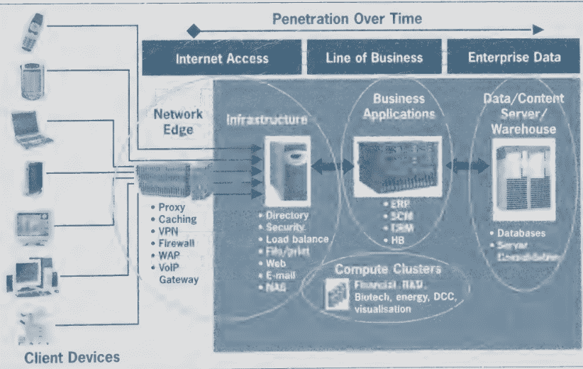

图 4.2.5：企业级 Linux（来源：HP）

## 企业级 Linux

## 网格计算

另一种构成实用化概念日益重要组成的技术是网格计算。它连接跨互联网的服务器、客户端和存储设备，形成虚拟资源池，这些资源池可以进行动态分配。这是一个已经存在多年的概念，曾以各种形式出现，包括点对点计算、协作计算、分布式计算和超级计算。

该技术是将网络中的许多计算机同时应用于解决同一个问题上。每个节点都有自己的资源管理器和分配策略。它有时会与集群计算混淆，后者是由单一的本地化调度系统对分布式资源进行管理。

网格计算将允许组织与同事、合作伙伴和供应商进行更紧密、更高效的合作。他们能够将地理上分散的系统作为一个虚拟环境来利用。可以访问网格内的任何远程数据库，这对于需要与他人共享基因组数据的科学类公司特别合适。它还将让分布广泛的组织能够开展项目，从而共享信息、内容和应用程序。

如今已有许多网格计算的应用案例。企业、专业团体、大学联盟和其他组织已经开发或正在开发用于管理网格计算项目的框架和软件，其中包含了 Linux 的使用。

## 结论

- 比“Windows 对抗 Linux”之争更重要的是，关于哪个硬件平台提供最佳价值的决策。
- Linux 可以成为 IT 优化策略的主要组成部分。
- Linux 是所有 IT 基础设施领域得任的替代方案。

## 4.3 替代客户端策略

多年来，微软在桌面客户端领域的主导地位一直是某种既定事实。因此，红帽（Red Hat）、诺威尔（Novell）、太阳（Sun）和 IBM 的产品承诺在该领域提供更大程度的客户选择，这确实令人目一新。然而，在市场中立足并非易事；所有参与者都需要提供能够克服现有 Windows 环境在便利性、熟悉度和覆盖范围方面优势的产品。然而，我们现在正看到许多早期采用者组织选择了开放客户端策略，特别是在公共部门，包括慕尼黑和施瓦比施施议会。

> 开源桌面软件现在已经处于对胖客户端和微软方法提出严正质疑的地位。

最重要的是，看到桌面客户端市场出现更多选择是一件好事。。下述描述的倡议可能处于采用的早期阶段，但显然，微软不会再长期保持同样的市场主导地位。微软 Windows 在 PC 客户端市场中 96% 的份额导致了竞争的缺乏。希望这些新参与者将成为组织未来开发客户端策略的先锋。

## 企业级 Linux


开源桌面软件现在已经处于对胖客户端和微软方法提出严正质疑的地位。这种替代架构能够提供从客户端、通过网络到数据中心的端到端 Linux 解决方案。红帽正与风河（Wind River）密切合作，以满足瘦客户端和移动设备的需求，目标是让未来的开发者和管理员能够在整个组织（从手持设备到服务器）标准化一个操作系统。下一代设备需要一种能够支持可靠连接和信息交换的基础设施。

桌面安全性正变得越来越问题，频繁有修复最新漏洞的请求。使用 Linux 可以减少这种开销，尽管 Linux 客户端在各种桌面应用程序之间行业领先的集成和互操作性方面还无法比 Windows。

除了 SUSE LINUX 和红帽的 Linux 企业级发行版外，还可以从 IBM、Sun、Debian、Mandrakes、Xandros 和 Linsphere 获取其他 Linux 发行版。建议下载 Knoppix 3.4 或 SUSE 9.1 并从 CD 启动，以确定最新 Linux 桌面中的当前功能和特性是否符合组织内用户的需求。

## 红帽桌面

红帽桌面提供了一种 PC 客户端解决方案，旨在满足政府、学术和企业用户以及 IT 部门的需求。该环境最初包含电子邮件、浏览器和办公的开源生产力应用程序。该解决方案未来的新增将集中在生产力和互操作性上，并通过与 VMware、Real、Macromedia、Adobe 和 Citrix 等其他行业者的合作得到增强。

红帽桌面是红帽 Linux 家族的最新成员，包括服务器和技术工作站。该包包含了红帽 Linux、Evolution 客户端、作为办公套件的 OpenOffice 以及 Mozilla 浏览器。客户端系统的设计以安全和管理为关键标准。其配置包括红帽网络代理（Red Hat Network Proxy）或卫星服务器（Satellite Server），以确保部署一致、安全且易于管理。代理服务器支持整合的桌面管理，包括配置、更新和升级。该操作系统支持高达 4GB 内存的单 CPU 系统，并以十台或五十 台为倍单位提供。

红帽桌面将使用与红帽企业级 Linux 相同的技术模型，包括与其他红帽 Linux 产品同步的 12-18 个月发布周期，以及红帽产品组合内部操作系统、管理工具、应用程序服务的通用性。网络部分提供一年的软件更新、增强和支持。

## 诺威尔 Xian 桌面 (Xian Desktop)

Xian 2 是一种企业级 Linux 桌面，为用户提供生产力工具。它由集成套件组成，包括 Linux 版 OpenOffice、用于电子邮件和个人信息管理（PIM）的 Novell Evolution、基于 Mozilla 的网络浏览器以及 Red Carpet 管理。该应用程序允许在混合 Windows 和 Linux 环境中使用 Linux 的组织实现 Windows 互操作性。

## 太阳公司的 Java 桌面系统 (JDS)

JDS 基于 Linux，包含了 Star Office 7 套件、Evolution 邮件客户端以及 Java Studio 环境的标准版。对于习惯了微软定价的公司来说，它至少让他们引起了关注；目前采用速度相对缓慢，最初的市场反应也褒贬不一。JDS 不隐藏其技术起源，且 Star Office 与 Microsoft Office 套件的兼容性尚未达到让差异透明的程度。

## IBM 的工作站客户端技术 (Workplace Client Technology)

虽然这并非仅限 Linux 的解决方案，但它是部署和管理客户端应用程序的新型模型，代表了 IBM 对桌面未来的愿景。IBM 将该概念描述为“客户端的中间件”，它在微软的厚客户端模型和 Sun、Wyse 及 Citrix 等公司推崇的服务器计算之间建立了一个折中。用户可以访问基于服务器和基于客户端的应用程序，并进行管理。最重要的是，相同的中间件栈支持多种客户端类型，包括运行 Windows 和 Linux 的 PC，以及个人数字助理（PDA）、智能手机和嵌入式客户端等移动设备。虽然组件现可用，但该概念尚未经证实，需要在实际部署中进行测试。

# 第 5 部分：部署

Butler Group

不妥协的分析

## 5.1 业务效益与陷阱

迁移到 Linux 可以获得许多益处，其中几点在本报告中已有所提及。这些优势中的很大一部分源于 Linux 的发展方式以及从早期阶段就采纳的设计原则，这意味着韧性和安全性等方面是构建在操作系统（OS）内部的，而不是在后期添加的。

虽然对于许多组织来说这可能具有显著优势，但能否从采用 Linux 中获得最大收益取决于企业的具体情况。

虽然对于许多组织来说这可能具有显著优势，但能否从采用 Linux 中获得最大收益取决于企业的具体情况。正如预期的那样，也存在一些感知和现实问题可能会影响部署 Linux 的决策，其中迁移成本尤其如此。这些问题对某些组织来说至关重要，而另一些组织则认为这些是微不足道或可以克服的。

### 优势

Linux 已经演变成一种稳健的多任务、多用户企业级环境，提供开箱即用的功能和特性，在许多领域与 UNIX 和 Microsoft Windows 相当。Linux 以其独特的可移植性获得了高分，相同的内核可以在许多不同的硬件平台上运行。使用何种操作系统的决策可以与部署的硬件平台分离。这意味着运行在专有平台上的 UNIX 应用可以轻松迁移到更廉价的基于 x86 的硬件。

## 企业级 Linux

通过这种方式，Linux 的灵活性通过允许使用最具价值的硬件而不受操作系统限制，提高了基础设施的成本效益。它还使 Linux 成为整合策略的理想基础，减少组织支持的操作系统数量，从而降低 IT 环境的管理和运营开销。Linux 内置的互操作性特性增强了与 Microsoft、Novell 和 Apple 网络的连接，可以处理整合策略的实施。

尽管 Linux 是一个争议和激烈辩论的领域，但它可以提高安全性并减少病毒攻击的影响。虽然 Linux 目前不是黑客社区的主要目标，但随着其流行程度的提高，它可能会受到更多关注。正因如此，由于其固有的设计特性和开发方法，Linux 在这一领域特别强大。这并不是说 Linux 中不会发现安全漏洞，因为这是一个非常动态的目标，只是说 Linux 特别稳健。

另一个优势是开源社区能够快速转化安全补丁的优势。虽然这对于开源软件（OSS）来说也是可行的，但贡献 Linux 的开发者数量之多意味着修复程序可以在几小时内提供给社区，而其他供应商仅拥有有限的资源，并且在快速设计有效解决方案方面存在某些局限。

Linux 在所有意义上都是符合 POSIX（可移植操作系统接口标准）的 UNIX，并配备了所有标准单元和工具。此方法的优势是 UNIX 系统管理员可以轻松进行交叉培训以支持 Linux 系统。此外，对标准的紧密遵循提高了 Linux 的可移植性和灵活性。在许多情况下，Linux 可以使用旧的冗余硬件，而不是升级到下一代硬件来支持最新版本的操作系统。

开源开发机制和通用公共许可证（GPL）的使用的一个益处是，确保了 Linux 很难因缺乏投资或企业破产而过时。只要有 Linux 用户，社区就会允许操作系统进行增强，即使在最坏的情况下，源代码副本也是可用的，并由任何组织继续维护。

这种开发模式的另一个优势是平台技术上开发和演变速度。然而，这可能是一把双刃剑，特别是对于企业用户和独立软件供应商（ISV）来说，速度和可预测性是关键需求，而不是创新和改变的速度。业务需求通过创建面向企业的发行版得到了满足，这些发行版每 18 个月到 2 年计划发布新版本。

每个组织都是不同的，这很大程度上取决于企业内部 IT 管理技能的组合，因为人员成本构成了 IT 环境开销的大部分。

总拥有成本（TCO）继续增加，正如本报告第二部分概述的那样。在成本等式的某些方面，在特定情况下 Linux 可能会更廉价，特别是当需要大量用户许可时。在其他情况下，Microsoft Windows 可能更高效。每个组织都是不同的，这很大程度上取决于企业内部 IT 管理技能的组合，因为人员成本构成了 IT 环境开销的大部分。

在许多情况下，Linux 的 TCO 与 Windows 相当，可能优于 UNIX，主要由于专有硬件成本的原因。然而，由于 Linux 导致相关专有硬件成本降低的威胁，这种价格差异正在消失。已经有一些 Linux 促进实现实际成本节约的高知名案例，例如在 Amazon.com。

## 企业中的 Linux

总拥有成本（TCO）和投资回报率（ROI）是一个比选择何种操作系统要广泛得多的话题。还有许多其他变量，特别是要使用的硬件平台。在适当的情况下应使用 ROI 建模工具，当预计的节省资金资助该计划时，这一点尤为重要。大多数供应商以及特定的供应商提供了特定的 TCO/ROI 工具，例如 CIOView (TConnow) 和 Alinean (ROI Calculator)。

组织应该考虑开发一种自定义的财务模型来衡量 ROI 和回本期信息，使 IT 管理人员能够根据独特的公司解决方案对各种基础设施选项做出明智决策。

### 阻碍因素

- 来自或由于那些使用 Microsoft Windows 和 UNIX 环境优势的人而带来的恐惧、不确定和怀疑（FUD）因素。

Microsoft Windows 和 UNIX 环境不争疑问的优势是解决方案的成熟性以及操作系统与各种工具和应用程序的集成。对于 Windows 环境来说尤其如此，微软产品的相关软件栈与操作系统完全集成、测试并获得支持。直到最近，Linux 及其随发行版提供的软件栈很大程度上是由点解决方案组成的，需要由组织或系统集成商（SI）在选定的硬件平台上共同测试软件组件。然后整个解决方案必须进行单独支持。

> Microsoft Windows 和 UNIX 环境不争疑问的优势是解决方案的成熟性以及操作系统与各种工具和应用程序的集成。

许多 Linux 供应商（特别是 HP）开始提供经过测试和支持的硬件和软件栈组合，包括 LAMP 开源软件栈（由 Linux、Apache、MySQL 和 PHP 组成），以及包含商业和开源程序混合的平台。

## 企业级 Linux

twww.butlergroup.com

软件兼容性问题无疑阻碍了 Linux 的主流采用。许多独立软件供应商（ISV）将其企业级产品迁移到 Linux 的速度缓慢，由于缺乏这些应用基础，组织往往对此持保留态度，除了网络边缘应用外无法利用 Linux。在过去的一年里，IBM 等公司已为 ISV 提供帮助，协助将其产品迁移到 Linux。重点已经发生了显著变化，大多数 ISV 要么在 Linux 上提供软件，要么制定了路线图，概述计划何时在 Linux 上启用其产品。尽管 Linux 在达到 Windows 和 UNIX 可用第三方软件数量方面还有一段路要走。

## 应用 – 自定义、封装型

| 部署 | | | | | 集成 | | 管理 |
|---|---|---|---|---|---|---|---|
| 软件设计 | 通信 | 邮件 | 内容 | 集成 | 集成 | 用户管理 | |
| Rational ClearCase | WebSphere Commerce | WebSphere Transformer | Lotus Workgroup | Content Manager | | WebSphere Portal | Unix | 持续| | | | | | | | | | |
| | | | | | | DB2 Connect | 系统自动化 - 企业 | |
| | | | | | | | | | | |
| 软件构建 | 协作/邮件 | | | | | | Access Manager |
| WebSphere Studio | Web Application Server | Lotus Domino | 数据库 DB2 UDB | Lotus Workplace Family | 自定义管理器 | |
| | WebSphere Application Server | Lotus Domino Web Access | DB2 集成集群环境 | WebSphere MQ | 消息管理 | |
| | | | | | Linux JRE/JVM 1.3, 1.4 | | | | | | IBM Directory |

图 5.1.3：用于 Linux 的 IBM 软件

桌面 Linux 虽然受到了关注，但仍局限于早期采用者，主要由于开源软件文档和文件与 Microsoft Office 格式文件之间的交换困难。对于没有这一需求的用户，基于 Linux 的桌面成为了一个有效的替代方案。其中，重点是改进 Linux 桌面解决方案的互操作性，该方案将于 2004 年发布。

在某些领域（如遗留硬件和新产品），Linux 驱动程序的可用性可能会出现问题。Linux 生态系统的规模及其内部开源社区意味着软件和驱动程序非常广泛，尽管在某些垂直和利基领域的覆盖范围可能是参差不齐的。尽管如此，组织必须确保建议的硬件平台具有所有组件所需的 Linux 驱动程序。由于社区规模的原因，驱动程序管理有时缺乏协调，对于哪一个是最新的可用驱动程序存在困惑。

Linux 缺乏问责机制令许多人担心，因为责任很难确定，而且缺乏特定供应商的保修。人们对该操作系统可能采取的方向也存在担忧，因为无法保证未来的开发会符合业务用户的需求。这在很大程度上通过创建面向企业的发行版，以及获得来自这些发行版商、Linux 解决方案提供商、ISV 和系统集成商（Sls）的支持得到了缓解。Linux 的碎片化正如 UNIX 一样是一个令人担忧的问题。缺乏单一供应商的所有权以及开源起源是其处境的优势，因为没有哪个供应商可以控制内核。

## 企业中的 Linux

尽管部署 Linux 可以带来潜在的节省，但不应低估迁移问题和成本，特别是从 Windows 迁移到 Linux 所需的重新培训费用和文化变化，以及对持续 Linux 技能的需求。市场上似乎缺乏 Linux 知识，尽管这可能是一个短期现象，因为越来越多的 IT 人员接受了培训，而且离开校园的人对 Linux 更加熟悉。

## 尽管部署 Linux 可以带来潜在的节省，但不应低估迁移问题和成本。

最后，SCO 与行业其他部分之间的法律问题为那些将 Linux 作为战略选择的人提供了一个不安的背景。正如本报告其他部分讨论的，潜在的担忧不被视为主要威胁，特别是因为许多供应商会保护用户免受任何不利判决的影响。然而，重要的是整个行业解决这些问题，达成某种妥协以消除 Linux 市场的不确定性。

## 结论

- Butler Group 建议组织实施 TCO/ROI 模型工具，不仅可以确定 Linux 迁移的成本效益，还能实现有关 IT 优化的更广泛的决策。
- 应使用可行的试点来确定 Linux 部署的真实成本节省。
- 如果软件的使用阻碍了开发者利用通用代码，可能会阻碍标准化。
- Linux 参考架构和软件的广泛可用将进一步推动其采用。

## 5.2 公共部门的 Linux

不同寻的是，公共部门（特别是在桌面上使用 Linux 的部门）在 Linux 采用方面处于领先。迁移到 Linux 有多种动机，从理想主义到道德，可能还包括财务因素。显然，在预算面临压力的情况下，潜在的成本节省是非常重要的，尽管有趣的是，Linux 的其他优势（如互操作性、安全性和标准）在公共部门 IT 经理也受到高度关注。

| 1. 互操作性 |
| 2. 安全性 |
| 3. 尊重标准 |
| 4. 功能性 |
| 5. 易用性 |
| 6. 低成本 |
| 7. 源代码可用 |
| 8. 用户友好 |
| 9. 稳定性 |
| 10. 支持与培训 |
| 11. 政治原因 |
| 12. 因为 IBM、HP 等 |

图 5.2.1：公共部门 OSS 标准（来源：[Source]）

## 企业级 Linux

不同寻的是，公共部门（特别是在桌面上使用 Linux 的部门）在 Linux 采用方面处于领先。迁移到 Linux 有多种动机，从理想主义到道德，可能还包括财务因素。显然，在预算面临压力的情况下，潜在的成本节省是非常重要的，尽管有趣的是，Linux 的其他优势（如互操作性、安全性和标准）在公共部门 IT 经理也受到高度关注。

开源软件 (OSS) 的 Linux 方法对公共部门在许多方面都有优势，尤其是开源可用性这一感知利益。然而，正如之前的报告中反复强调的，这部分成本仅占总成本（如员工成本、集成和培训）的一小部分。Linux 现在提供了利用不被个人供应商“所有”且基于开放标准的操作系统的机会。

英国政府已启动多项计划，在公共部门尝试 Linux，包括扩大范范围以考虑将开源软件作为专有软件的替代方案。政府商务办公室 (OGC) 和电子环境办公室 (e-Env) 正在发挥领导作用，建议政府部门在采购 IT 系统时将 Linux 视为替代方案。诺丁汉市会正在评估桌面使用 Linux 的可行性。

## 企业中的 Linux

德国政府在促进公共部门使用 Linux 方面特别活跃。德国联邦信息安全局（BSI）一直是“Linux 政府桌面”倡议的最前沿，慕尼黑市和施瓦比希哈尔等地方政府机构也实施了 Linux 迁移。法国政府也宣布将从 NT 迁移到 Mandrelux Corporate。

在所有欧洲政府中，联合欧盟委员会一起，正积极推广 Linux 作为公共部门的替代操作系统，并考虑使用开源软件栈来替代专有产品。这似乎是一个全球性趋势，因为全球公共机构继续向 Linux 转型；例如在亚太地区，特别是中国，人们对使用 Linux 作为灵活的操作系统表现出极大的兴趣。预计中国很快将要求政府使用的软件中有一比例必须在国内开发。无论选择的确切百分比是多少，Linux 都将是一个主要受益者。

## 适用于公共部门行政功能的相同优势在教育领域产生了共鸣。

适用于公共部门行政功能的相同优势在教育领域产生了共鸣。除了已提到的优势外，使用开源软件（OSS）有助于缩小数字鸿沟，而这种不平等通常是由资金因素造成的。它开启了学校和家庭使用技术的可能性，而使用现有的业务参与模式是无法实现的。教育机构能够通过许多不同的示例应用程序教授通用的计算概念，而不是教授某个厂商的软件，而且像 Linux 和 OpenOffice 等开源软件可以带回家使用，而无需担心通常许可侵权问题。


尽管有这些益处，但 Linux 仍在缓慢渗透教室，主要是因为 Linux 上缺乏可用的教育应用程序，尽管规模较大的大学和学院在基础设施中已经是 Linux 的用户。这种情况正在发生变化，因为越来越多的学校开始尝试将 Linux 作为替代操作系统，并且满足教育需求的开源应用程序正在开发中。

## 结论

- 公共部门在采用 Linux 方面处于领先，特别是在桌面端。

## 5.3 中小企业 (SMEs) 与 Linux

毫无疑问，迁移到 Linux 的优势适用于所有规模的企业，因为它们都是公共部门组织，无论大小。规模较小的组织有需要克服的特定挑战和可以利用的收益。中小型企业（SMEs）从本质上往往面临资本和资源限制，导致其过度关注务实性，并采取一种规避风险的 IT 策略，倾向于成为技术追随者。中小企业采用 Linux 的主要障碍在许多情况下包括对变化的恐惧和迁移开销，外加持续成本。

IT 行业一直关注大型公司，因为在那里可以为 Linux 部署销售大量的服务。在 Linux 早期阶段，每次实现都是不同的，并且几乎总是需要对软件栈与 Linux 发行版进行集成和测试。随着市场的成熟，这种需求有所减少，主要供应商和解决方案提供商推出了基于 Linux 和 OEM 硬件的参考架构。这使得能够开箱即用的部署体验，仅需极少的资源进行配置，并具有更好的互操作性，更适合规模较小的组织。

### 中小企业采用 Linux 的主要障碍在许多情况下包括对变化的恐惧和迁移开销，外加持续成本。

渠道合作伙伴和独立软件供应商（ISV）对 Linux 的支持是许多中小企业的关键试金石。许多 ISV（包括向中小企业提供软件的厂商）现在已将其应用程序移植到 Linux。另一方面，许多中小企业几乎完全使用 Microsoft Windows 及相关技术，对于这些公司来说，迁移到 Linux 面临着许多困难，尤其是使用带有所有额外复杂性和问题的新操作系统。

尽管如此，这种趋势在英国及其他地区的中小企业中正获得青。去年 Van Bourne 为 IBM 进行的一项调查显示，有四家中小企业受访者目前使用 Linux。在这些 Linux 用户中，15% 的人表示未来可能继续使用，另有 26% 尚未决定。

调查还强调了渠道在鼓励中小企业迁移到 Linux 方面所起的关键作用。业务伙伴、专业组织和顾问被强调为中小企业最重要的信息来源，而大型企业倾向于直接受到 IT 供应商的影响。这可能是中小企业在采用 Linux 方面出现明显滞后的另一个原因，因为渠道获得所需的知识和经验需要时间。

拥有混合 UNIX 和 Windows 环境的中小企业有一个真正的机会，可以无论底层硬件如何，将系统开发和生产环境整合到单一平台上。这种灵活性使中小企业用户能够使用来自不同供应商的商品化硬件。

> Linux 提供的扩展性和灵活性现在可以为中小企业提供此前成本过于昂贵的解决方案。

Linux 提供的扩展性和灵活性现在可以为中小企业提供此前成本过于昂贵的解决方案，这是由于所需硬件的费用或为多个平台开发软件所需的投入造成的。Linux 可以降低成本结构，使中小企业能够运行此前只有大型组织才拥有的应用程序，在某些情况下平衡了竞争环境。Linux 在桌面端的增长是所有规模企业的另一个有趣机会，中小企业也是如此。

## 结论

- Linux 是中小企业 UNIX 用户的可行替代方案。
- 中小企业的一个重要益处是开发和生产使用单一平台的便利性。
- Linux 的渠道支持正在快速扩展。

## 5.4 迁移到 Linux

### 为什么选择 Linux？

Linux 是一项突破性技术，并带有相应的迁移成本。然而，从长期来看，它可以带来显著优势，使其值得坚持以在组织内实现持续技术的地位。随着许多工具、培训和方法论的提供（这些旨在减轻迁移到 Linux 的成本和文化方面），变化的痛苦已大幅减少。

虽然不再重复已涵盖的内容，但重要的是重申：在谈论 Linux 时，“免费”意味着真正的免费，而不是零成本。操作系统与底层硬件的独立性使得 IT 经理能够灵活选择运行 IT 服务的最佳平台，并能够使用商品化的 X86 组件。此外，操作系统的支持不再必须从一个供应商购买，从而产生了健康的竞争，这给成本带来了压力。

> 即使是对于最规避风险的组织
> 
> Linux 也可以被视为运行
> 
> 的关键应用程序的操作系统。

尽管微软反对这种灵活性必然对总成本（TCO）产生有利影响，尽管个人情况导致成本差异微乎其微，这些自由意味着 Linux 是一个必须认真考虑纳入组织基础设施策略的选项。对于最规避风险的组织，Linux 可以被视为运行应用程序的操作系统。

### 哪种发行版？

由于所有发行版都基于相同的内核，乍看选择似乎非常多，每个发行版都针对特定用户进行了优化，包含不同的工具选择和安装程序。然而，仔细观察发现只有少数发行版适用于企业环境，且目前只有两种值得认真考虑。ISV 和供应商对 Red Hat 和 Novell SUSE 企业级发行版的全球支持，使得它们成为数据中心唯一可行的选择。但在桌面环境中，除了这两个之外，如果考虑使用开源客户端软件栈，还有其他可能，包括来自 Linspire、Debian、Mandrakesoft 和 Sun Microsystems 的解决方案。

## 企业级 Linux

## 微软 Windows

Linux 绝不是未来唯一的战略选择。微软 Windows 虽然没有提供 Linux 那样的完全硬件独立性，但它利用了通用 x86 硬件，这种硬件通过集群和多处理器的使用，正变得越来越能够处理高端处理需求。有许多研究表明 Windows 在总拥有成本（TCO）、性能和漏洞方面优于 Linux，尽管也有其他研究论文指出相反的结论。显而易见，微软 Windows XP 和微软 Windows Server 2003 的结合提供了一个对企业用户来说极具说服力的 IT 平台，特别是增加了提高了安全性、可靠性、可用性和可扩展性的新功能。

> 显而易见的是，微软 Windows XP 和微软 Windows Server 2003 的结合提供了一个对企业用户来说非常有说服力的 IT 平台。

Windows 在软件栈的整体、可用功能和集成方面仍然保持着领先地位，特别是在桌面环境中。.NET 架构进一步证明了组织可以从该平台获得的力量，以及可以帮助快速开发新服务的集成开发人员。

互操作性至关重要，特别是在当今的异构环境中。与其迁移到 Linux，另一种选择是让 UNIX 和 Windows 无缝共享信息。这可以通过微软 Windows for UNIX (SFU) 实现，它能够让基于 Windows 和 UNIX 的系统共享数据、安全凭据和脚本。

对于那些接受在大多数软件栈上被锁定在单一供应商的组织来说，微软是一个有效选择。Linux 的出现提供了一种替代方案，尽管在未来五年内可能不会完全取代。这种灵活性提供了一种许多人将希望采纳的灵活策略。这种灵活性也有缺点，即集成程度永远无法像 Windows 环境中那样紧密，但随着 XML 和 Windows 服务的出现，这可能不再像过去那样重要了。

对 Windows NT 支持的终止正被纳入未来的操作系统 战略中。随着微软下一个操作系统版本 Longhorn 的指日可归（这可能需要大量的迁移工作和更强大的硬件），这是另一个迫在眉睫的重大触发点，组织将不得不选择继续使用微软 Windows 还是认真考虑将 Linux 作为替代方案。然而，在许多情况下，Windows 将仍然是或最佳解决方案。

## 迁移策略

在大多数情况下，迁移是由硬件变更、应用程序更换或软件许可修订驱动的。如果这种变动是作为更广泛的计划技术战略的一部分而采取的主动措施会更好。迁移到 Linux 在概念上与之无异，例如从 Windows NT 移动到 Windows 2003，或者进行重大的版本升级。根据自身选择操作系统是非常不寻常的，通常是新服务部署或 IT 优化的广泛计划的一部分。与任何 IT 项目一样，规划是成功部署新操作系统的关键，还包括建立多技能团队、培训和管理层的支持。

## 企业中的 Linux

Linux 的开源背景意味着所有人都需要理解这将会带来的差异和变化。即使是计划迁移到 Linux 和 OSS（开源软件项目）的组织，也会立即制定出使用开放标准的策略，以确保在做出这一方向的决策时能够平稳过渡到 Linux。迁移可能会在几个月内分阶段进行，并且对于大规模部署，会在过程中建立一个资源池来验证系统并进行计划，特别是在考虑迁移到 Linux 桌面时。

从 UNIX 迁移到 Linux 类似于从一个版本迁移到另一个版本。许多实用程序和相关的管理功能是相同的，尽管在使用不属于 POSIX（可移植操作系统接口）标准的扩展时可能会出现问题。这些差异不应该是主要的，定制应用程序不应发现任何架构上的冲突。虽然可以预计配置是不同的，但不同的 UNIX 版本倾向于使用标准的通信机制和文件格式，这使得迁移变得更容易。

从 Windows 迁移到 Linux 由于两个环境之间的不兼容性而稍微更加困难，特别是在管理方面。这种迁移可以通过两种方法之一实现：向现有的 Windows 系统中添加 Linux 服务器并逐步淘汰 Windows 服务器，或者创建一个新的并行 Linux 环境并随着时间的迁移系统。

有许多工具可以协助迁移，包括 NetTraverse 的 Win4Lin、Codewaver 的 Crossover 以及 Koppix。Win4Lin 和 Crossover Office 可在 Linux 环境中运行 Windows 应用程序。Koppix 是一个从 CD 启动的 Linux 系统，它对于演示和尝试非常有用，因为 PC 上的 Windows 系统不受影响。发行版和解决方案提供商还提供了许多其他实用程序和应用程序，以及所有主要 IT 供应商提供的迁移服务。使用 VMware 的分区技术可以帮助 Linux 集成到 IT 基础设施中，并提供了一种在当前环境中运行 Linux 系统的方法。

> 在短期内，Linux 非常可能需要与其他操作系统共存，这突显了系统管理工具的重要性。

在短期内，Linux 非常可能需要与其他操作系统共存，这突显了能够管理异构 IT 环境的系统管理工具的重要性。许多 IT 解决方案供应商包括 BMC、Computer Associates (CA)、HP、IBM 和 Novell，提供了管理多个 UNIX 和 Linux 系统的软件。在将 Linux 加入组合时，这一方面不应被忽视。

## 结论

- 迁移到 Linux 就像任何 IT 项目一样，必须由业务和技术需求驱动并进行良好的计划。
- 从微软 Windows 迁移到 Linux 时，应该考虑到软件问题。
- 考虑在桌面使用 Linux 的第一步是评估光盘启动 Linux 发行版。

## 第 6 节：市场分析


## 6.1 概述

Linux 商标和版权归 Linus Torvals 所有，它有效地涵盖了在开源开发实验室 (OSDL) 助下由一个小团队开发和维护的内核代码，并得到了许多 IT 供应商的支持。独特的是，当我们提到 Linux 时，通常指的是从某处提取内核软件，并将其与许多库、实用程序和应用程序封装而成的发行版。OSDL 的数据中心和运营商级规范有助于概述基本需求，并为这些环境提供一致性，同时还有 Linux 标准基础 (LSB)，它为通过认证的发行版之间的互操作性提供了某些保证。


图 6.1.1：Linux 发行的组成（来源：MontVista）

这些软件包含了硬件驱动程序、文件系统、内核改进以及在许多情况下相关的开源应用程序，使得每个供应商都能根据目标市场的特定需求定制发行版。例如，Red Hat 和 SUSE LINUX 针对企业生产发行版，包含了特别关注性能和可靠性需求的额外工具。其他发行版则专注于桌面、嵌入式和超级计算市场。

> Linux 是一种非常全球性的现象，在美洲、欧洲和亚洲的应用增长强劲。

发行版供应商通常是小型组织，没有资源为企业市场提供全球支持和培训。发行商利用服务提供商和独立软件供应商 (ISV) 渠道进行营销至关重要。Novell 通过购买该业务并使其获得全球营销和支持基础设施，在某种程度上为 SUSE LINUX 解决了这个问题。

## 企业级 Linux

Linux 是一项现象，其在美洲、欧洲、中东和非洲（EMEA）以及亚洲的应用增长强劲。在企业市场，拥有全球覆盖能力的机构有 Red Hat 和 SUSE LINUX。在亚洲，市场似乎正在增长，人们对迁移到 Linux 表现出浓厚的兴趣。由于政治和本地因素，亚洲市场出现了 Turbolinux 和 Asianus 这两个强有力的竞争者。

在技术的早期采用阶段，某些垂直行业会比其他行业先采用该技术。Linux 最初被应用于公共部门和金融服务领域。随着 Linux 优势变得显而易见，这种应用正扩大到所有业务领域。Linux 的使用正在渗透到所有的 IT 基础设施。大多数大型组织已经在某种程度上利用了 Linux，并且迹象表明中小企业（SME）市场也开始接受 Linux。


图 6.1.2：Linux 领域采用者（来源：IBM）

## Linux 市场

### 服务器

在网络中，有两种方式来管理服务器操作系统（OS），例如防火墙、网关、路由器、应用服务器或数据库服务器。高端是能够处理大型多处理器服务器或集群的操作系统。Linux 在低端已经站稳脚跟，预计它将进一步侵蚀高端操作系统的市场，尤其是现在 2.6 内核增加了可扩展性功能，能够提供更好的内存管理并对更多处理器的支持。

该市场的大多数客户不会考虑操作系统，甚至可能不是为了某个特定的应用程序，但在某些情况下，他们会寻找一种解决方案（理想情况下是端到端的解决方案）来解决业务问题或需求。对解决方案而非单点产品的关注使得不同的分销渠道变得至关重要，无论是硬件供应商、服务提供商、增值转销商（VAR）还是系统集成商（SI）。要取得成功，Linux 必须必须与这些类型的组织建立并保持紧密的关系。

## 企业级 Linux

服务器市场中领先的全球发行版无疑是 Red Hat 和 SUSE LINUX，它们都已与 IT 市场的主要参与者建立了合作伙伴关系。现在，IBM、HP、Oracle 等公司已经提供了使用这些发行版的 Linux 参考架构，提供了集成了经过测试的基于服务器的解决方案，包括硬件、操作系统和中间件。

## 该市场的大多数客户不会考虑操作系统，甚至可能不是为了某个特定的应用程序，但在大多数情况下他们会寻找一种解决方案。

服务器操作系统市场中购买决策的另一个重要因素是支持的可用性。可以理解，这些系统运行着关键业务应用程序，需要能够 24x7 小时访问帮助支持。分销渠道伙伴再次提供了这种支持。在某些情况下，如果需要，带有短期修复的三级支持可以提供内核。

对市场的进一步影响因素是构建服务器平台上构建应用程序的开发者。一个方面是开发者社区本身需要工具来为该环境构建应用程序，另一个方面是独立软件供应商（ISV）对作为第 1 平台操作系统的支持。Linux 起初在这些方面存在匮乏，但最近，与其说它超越了更成熟的产品，不如说它至少赢得了信誉。预计专有 UNIX 版本的市场份额将会下降，未来 Linux 和 Windows 将成为主要的操作系统。

### 客户端

桌面市场是硬件和软件的全球市场。主要参与者主导着该领域，微软凭借 95% 的市场份额在桌面软件方面处于事实垄断地位。企业客户与消费者的需求相似，购买决策基于互操作性、集成性和软件功能。由于涉及的用户数量众多，如果需要重新培训，也可能产生巨大的迁移成本。这使得现有的微软相对于市场上的任何新入场者都具有显著优势。

## 市场上 PC 预装 Linux 的出现也应该增加其采用率

尽管 Linux 桌面版已开始在一些早期组织中立脚跟，特别是在公共部门。市场上 PC 预装 Linux 的出现也应该增加其采用率。人们认为，在未来两年内，桌面版 Linux 将成为某些桌面用户的可行选择，其市场份额将增加，特别是在发展中国家。

移动客户端的使用正在增加，包括笔记本电脑（它们实际上是移动桌面），以及其他个人数字助理（PDA）和智能手机等设备。Linux 用于此类设备的情况只是孤立的，但这是一个 Linux 渗透缓慢且没有显示出任何获得增长动力迹象的市场。然而，HP 最近宣布了提供预装 Linux 的笔记本电脑，摩托罗拉在亚洲发布了 Linux 智能手机。

## 企业级 Linux

www.butlergroup

为了利用移动设备的实用性，需要通信技术的无缝集成，并且由于设备的物理限制，需要关注易用性。该领域现有的三个行业标准操作系统是 Symbian、PalmOS 和 Microsoft Mobile。短期内，Linux 将很难进入这一市场，因为诺基亚等公司对智能手机支持 Symbian，以及微软和 PalmSource 对 PDA 的主导地位。

### 嵌入式

Linux 在嵌入式和电器操作系统市场中变得越来越流行。虽然不是真正的实时操作系统（RTOS），但 2.6 内核的引入带来了许多对嵌入式市场非常相关且对 Linux 适应性的改进，使其成为嵌入式计算的可行平台。

## Linux 2.6 内核包含了改进，支持从最小的微处理器到大型处理器系统的支持。

该市场为 Linux 使用量的增长提供了大量机会。需要嵌入式操作系统的设备类型跨越了未来的腕表直到网络交换机。Linux 2.6 内核包含了改进，支持从最小的微处理器到大型处理器系统的支持。内核中广泛使用 POSIX 线程、信号和定时器，意味着开发者在需要时可以轻松将应用程序移植到符合 POSIX 标准的 RTOS。其他与嵌入式处理相关的增强还包括更好的同步、更高效的调度器以及内核中的抢占点。

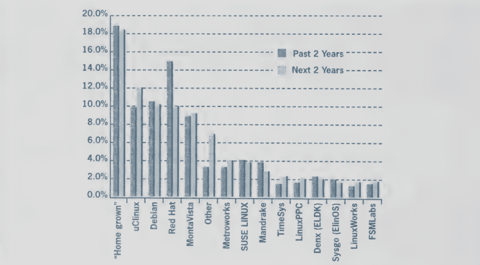

图 6.1.3：嵌入式 Linux 发行版（来源：LinuxDevices.com）

在嵌入式领域，没有任何一个发行版获得市场大部分，正如 LinuxDevices.com 调查结果所示。在使用嵌入式 Linux 时，开发者仍然倾向于从免费获取的源码创建自己的 Linux 系统。用于嵌入式系统的领先发行版包括 uClinic、Debian、Red Hat 和 MonteVista。

80 第 6 节：市场分析

2004年9月

## 超级计算


Linux 在许多高性能超级计算机中使用显示了其适应性。通过聚类许多 Linux 系统从廉价硬件构建计算机的能力显著降低了成本。这使得 Linux 成为该市场的主要操作系统之一，配备了 IBM、HP 和 Dell 的基于 Linux 的超级计算机。

## 6.2 案例研究

### 卑尔根市

挪威第二大城市，人口为 237,430 人，位于北海边。作为其迁移到 Linux 战略方向的一部分，该市旨在将 Linux 作为标准操作系统平台，决定将 Novell SUSE Linux Server (SLES) 部署在 HP 和 IBM 板机上，以取代专有的 UNIX 和 Microsoft Windows。最初计划是部署 SLES 8，但在测试了最新版本 9 后，将在新时代实施。该市已经拥有存储区域网络（SAN），选择的一部分是 Linux 2.6 内核对 SAN 有更好的支持。

在选择战略重点时，该市寻求一种不绑定单一供应商的业务模式。通过迁移到 Linux，该市获得了一个开放民主的模式，以及一个可以确保未来更大自由度和大幅节省成本的模式。

在引入 Linux 发行版时，该市希望统一 SUSE 或 Red Hat。在选择 SLES 时，该市认为 SUSE 发行版具有更好的 64 位支持和更多的管理工具。该市的另一个考虑是对于英语为母语的国家语言支持。对于 Linux 用户界面，还认为 KDE 优于 Red 提供的 GNOME。

### 行政网络与服务器

主要项目是迁移该市现有的 30 个 Oracle 数据库（20 个在 HP-UX 上，10 个在 MS Windows 2000 上），这些将支持该市的一系列业务，包括核心健康和福利服务，并供 15,000 名员工访问。要求是服务器要提供最大的可用性同时具有成本效益。

现有的 HP 服务器在很大程度上达到了运行寿命终点，需要更换。更换设备是根据欧盟社区公报（OJEC）发布的竞争性招标后选定的。

通过广泛测试，发现从 UNIX 迁移到 Linux 用于 Oracle 数据库相对简单。对员工进行了一些重新培训，这是一次性成本。数据库测试将持续到 8 月底，以选择高可用集群技术，并在 10 月期间进行生产测试，预计将于 2004 年 11 月开始部署新服务器。

该迁移在现有员工成本内管理；该市认为服务器总拥有成本（TCO）的持续支持部分将低于基于 Microsoft Windows 的类似解决方案，因为在 Linux 中解决问题不那么复杂。

## 企业级 Linux

### 教育网络与服务器

该战略中的第二个项目将涉及将 100 台微软 NT Windows 应用服务器进行迁移和整合。这些服务器目前部署在支持城市教育网络的各个学校中，并将迁移到一个包含 20 台刀式服务器的中央 Eiser BladeCenter。

由于 32,000 名学生和 4,000 名教师访问教育网络，现有的服务器环境无法满足日益增长的需求。集中化和管理是该网络的其他关键问题，目前该网络被视为一个使用过时硬件和软件的“沉没之舟”。网络的运行需要大量的支持，既来自学校内部，也来自市中央 IT 部门。服务器以及应用程序访问一致性的维护问题也日益凸显。每所学校都可以在其本地服务器上部署应用程序，但这种部署方式的性质意味着它通常没有进行备份，并可能与其他软件产生冲突。

IBM BladeCenter 也是在 OJEC 竞争招标中选中的。每台刀片都是一个完整的服务器，配备内存、处理器和存储器，但市更倾向于使用 IBM SAN 代替本地存储，因为速度更快、更安全，且服务器中的组件更少。Linux 刀片将通过开源 SAMBA（一个由四刀片组成的负载均衡集群）提供用户认证、文件和打印服务。其他服务还包括电子邮件、轻量级目录访问协议（LDAP）、域名服务器（DNS）、动态主机配置协议（DHCP）和 Open Lightweight。刀片还将作为终端服务器，运行 Tarantella Secure Global Desktop，这是 Citrix 软件的 Linux 替代方案。

成本是决定将教育网络迁移到中央服务的重要因素，迁移后将不再需要更多员工。随着迁移到中央服务，各学校中负责支持服务器的人员将重新分配到这些学校的教学和支持岗位。计划中的迁移没有遇到阻力，因为中央服务的设计和布局已经规划了长期，预期收益也得到了所有人的认可。

作为使用 Linux 业务案例的一部分，市计算出，教育网络服务器的成本仅为使用同等 Microsoft Windows 2000 服务器安装成本的 60%。

部署将在 2004 年夏季暑假后开始，并将利用现有的网络基础设施。通过专用广域网（WAN）连接的 85 所学校将在今年年底前完成迁移，其余 15 所使用异步数字用户线路（ADSL）连接的学校的推广将在 2005 年初完成。

### 迁移到 Linux

这两个项目以及采用 Linux 作为战略服务器平台的一个主要益处，是将全市所有的学校整合进一个计算中心，有助于解决管理和安全方面的问题（以及成本）。通用的技能组合可以支持两个网络，策略可以进行集中管理和执行，支持人员将花费更少的时间往返全市的 100 所学校。

市政府对迁移到 Linux 进行了详尽调查，以识别任何潜在风险。无法招募到具备 Linux 技能的支持人员的预期风险被证明是毫无依据的，因为大学毕业了大量既具备 UNIX 和 Linux 技能的高素质人才。

明年（2005年），市政府将把其他服务器迁移到 Linux，例如各种网络服务以及应用和 Web 服务器。根据 2003 年的初步测试，市政府还将在教育网络上测试 Linux 桌面客户端，但由于 Microsoft Office 与运营业务应用程序的后端服务器有特定的集成，行政网络上的客户端目前必须保持为 Windows 客户端。然而，市政府计划从 2006 年开始对行政客户端评估 MS Windows 的替代方案，希望能够将大部分或所有客户端迁移到 Linux 桌面。

根据与伯尔根市技术官 Ole-Bjørn Tuft 的对比，2024 年 7 月。

# Racpace 托管服务

Racpace 托管服务（Racpace）成立于 1998 年，总部位于美国德克萨萨斯州圣安东尼奥。它在美、英的三个数据中心拥有 400 名员工。它从位于伦敦尼康（Ux）的基地出发，为各类机构提供托管托管服务，包括：微软、尼康、雷诺以及前四名的咨询公司。

该公司为客户提供 Linux 或 Microsoft Server 平台供部署，并提供多种选择，包括独立冗余阵列（RAID）、保证互联网带宽和备份文件。对于运行 Linux 的客户，有三种服务级别选项，对应不同的价格：

1. 专用（Dedicated）——单服务器，运行 Linux，带控制面板，且无防火墙。
2. 管理（Managed）——多台服务器和防火墙。
3. 企业（Enterprise）——更多服务器和负载均衡。

自 2000 年以来，Racpace 的复合年增长率（CAGR）达到 53%。作为一家专用托管公司，它不能将托管视为增值服务或亏损性产品。它必须为客户提供比他们自己提供或委托给其他机构提供的更好、更具效益的服务。因此，它的所有系统和流程都是为了提供最高效且成本管理的托管服务而构建的。

它是一个中端市场参与，并不打算在低端市场竞争。它将提供短期合同，最短为 30 天。然而，Racpace 的托管托管服务提供了另一家服务公司业务的技术组件。在其服务的顶端，是支持少数客户开发大规模数据农场。

Racpace 最初仅在运行 Red Hat 的 Linux 服务器上提供托管，但为了响应客户，已扩展支持 Microsoft Windows Server（2000 和 2003），以及少量运行 FreeBSD 和 Debian Linux 发行版的实例。

为了交付服务，Racpace 有四个战略合作伙伴：Red Hat、Dell 和 Cisco。Linux 发行商 Red Hat 是 Racpace 的投资者，Racpace 拥有世界上数量最多的 Red Hat 服务器，同时也是欧洲唯一的高级托管合作伙伴。这种关系的亲密源于 Racpace 是第一家提供 Red Hat Enterprise Server 的托管公司。由于与微软和 Red Hat 的密切关系，Racpace 将获得“错误补丁”

## 邓迪市议会 (Dundee City Council)

邓迪是位于英国苏格兰东海岸的一座城市，人口14.5万。作为一个单一制管理机构，它为居民提供广泛的服务，包括住房、社会服务、垃圾收集和休闲设施。

面对中央政府现代化目标的压力，以及市民对更好服务（且要求在方便的时间提供服务，而非局限于议会办公时间）日益增长的期望双重压力，该机构意识到它必须为邓迪市民和服务员工提供更广泛的在线服务。

同时，议会的 IT 部门拥有一系列基于 UNIX 的服务器，其中几台已经接近运行寿命的终点。这些服务器运行着住房系统、社会工作系统和租金会计服务等多种应用程序。IT 部门并未寻求同类替换，而是寻求通过整合来减少空间、热量输出、运营和许可成本的机会。但这必须在不增加故障风险的前提下进行，不仅包括工资等关键系统，还包括议会面向市民的接口网站 `www.dundee.gov.uk`。

经过深重考虑，作为公开采购流程的一部分，议会决定将现有的基于 Linux 的 UNIX 服务器替换为 IBM TotalStorage 企业存储服务器 (ESS) 800 主机，并由 IBM Tier 1 高可用存储提供支持。其主要目标是降低长期运行成本，并确保主机环境的稳定性或可用性。经计算，zSeries 上的 Linux 虚拟机对空间和热量输出的需求也低于物理服务器。

有趣的是，与许多其他 Linux 部署案例不同，邓迪并没有现成的 zSeries 也没有运行主机的既有技能组合，但即使在迁移方面付出了额外努力，议会仍通过收益和节省的成本证明了该项目的合理性。

IBM 为项目提供了硬件、软件、实施和迁移服务，以及该项目所有的培训/教育。

zSeries 为当地居民提供了多种在线服务，包括使用议会网站结算未付账单、更新个人记录、向议会部门提醒以及查询信息。议会完全集成的人力资源和工资系统（来自 Northgate Information Solutions 的 ResourceLink）已部署在 zSeries 上。

主机部署后的成本来自几个领域。除了行政、管理和支持成本外，还有热量输出的减少。这实际上是电费上的双重节省：既减少了服务器消耗的电量，也减少了运行空调系统以消除热量的电量。进一步的成本将来自 Oracle 数据库更低的许可成本，这些是基于所使用的处理器数量的。

zSeries 的管理和管理能力也为 IT 部门在响应议会需求的时间范围内提供了优势。可以通过“克隆”在几分钟内创建额外的虚拟机，新虚拟机默认继承所有的安全控制措施。议会及其 IT 部门认为，通过运行 Linux 虚拟机的 zSeries，他们现在为未来使用提供了一套高度灵活的基础设施。

## 第 7 节：

表格


## 企业级 Linux

报告的这部分由三个主要部分组成：

- 1. Butler Group 企业 Linux 特性矩阵（第 7.1 节）。
- 2. Butler Group 企业 Linux 产品能力图（第 7.2 节）。
- 3. Butler Group 企业 Linux 生命周期周期位置图（第 7.3 节）。

Butler Group 邀请了其认为解决方案最符合本报告主题——企业级 Linux——的供应商（强调 Linux 发行版而非仅仅是内核）参与评估和比较活动。被选中的供应商与 Butler Group 的分析师合作，开展了出现在第 9 节的“技术审计”研究工作，并编写了出现在本节的“特性矩阵”。在 Butler Group 看来，这些供应商及其产品占据了市场很大份额，并高度地代表了该领域应能交付的产品和解决方案。

技术审计过程涉及由 Butler Group 分析师检查每种受审查的解决方案，与供应商讨论其优缺点，然后根据分析得出一份评估结果。评估在“特性矩阵”中以比较的方式进行，即对所有解决方案的能力相对于彼此进行标记；并以以绝对的方式进行，即对每种解决方案进行评分，以查看其在每个主要功能领域的交付情况。这些分以“产品能力图”的形式在本节的第二部分显示。最后，根据供应商在所考虑市场中的表现，以及 Butler Group 认为其个人地位在短期到长期内将如何演变，进行整体分组。

对于此类任何领域，都有许多不同的方法，并不总是能够进行直接比较。例如，我们接触过的某些供应商仅提供解决方案，而另一些则有需要持续支持的硬件遗产。在任何情况下，用户必须对供应商提供的产品进行自己的评估。

特性矩阵基于一种极其严谨且稳健的方法论，该方法考虑了可靠性、可扩展性、安全性、互操作性和管理领域。评分和市场定位的最终分析是 Butler Group 分析师试图对供应商解决方案得出客观观点的尝试，并考虑了上述主要主题以及供应商如何应对市场。

### 7.1 BUTLER GROUP 企业级 Linux 特性矩阵

| 通用特性 | Debian - Debian/Linux | Mandrakesoft - Mandraklinux 2.1 | Novell - SUSE Linux 8.0 | Red Hat - Red Hat |
| :--- | :--- | :--- | :--- | :--- |
| 内核 | 2.6 | 2.4.18 | 2.4.7 | 2.4.21 |
| 处理器 | 受限于架构架构 | 32 (x86), (amd64) | 64 | 16 |
| 64位支持 | Y | Y | - | Y |
| 设备支持 | Y | Y | - | Y |
| RAID 硬件 | Y | Y | Y | Y |
| RAID 软件 | Y | - | Y | Y |
| 磁带库 | Y | Y | Y | Y |
| 分布式存储 | Y | - | Y | Y |
| 电源管理 | Y | Y | Y | Y |
| UPS | Y | Y | Y | Y |
| 本地备份 | Y | N | Y | Y |
| 环境监控 | Y | Y | Y | Y |
| LSB 支持 | Y | - | Y | Y |
| 系统计费 | Y | Y | Y | Y |
| 性能 | Debian - Debian/Linux | Mandrakesoft - Mandraklinux 2.1 | Novell - SUSE Linux 8.0 | Red Hat - Red Hat |
| :--- | :--- | :--- | :--- | :--- |
| SMP | Y | Y | Y | Y |
| 多处理器 | 受限于架构架构 | | | 64 | 8 |
| NUMA | Y | N | Y | Y |
| 集群 | | 独立产品 (Mandrak-clustering) | | |
| 每个节点最大 CPU | 无限 | | 64 |  SMP |
| 每个集群最大节点 | 无限 | | 1024 | 带集群套件 |
| 内存和文件系统 | 物理（架构设计通常高于支持的系统） | 16 EB (1600万 TB) | 4GB TB | 64GB (x86); 96GB (AMD64); 128GB (Itanium2) |
| 标准文件系统 | ext2, ext3 | vfat, nfs(riso), hfs, ufs, iso9660 | nfs, smbfs | |
| 最大文件大小 | 8 EB (800万 TB) | Y | 8 EB (800万 TB) 取决于文件系统，高达16 TB | 1 TB | 8 TB |
| 日志支持 | Y | Y | Y | Y |
| 额外文件系统 | XI-S, reiserfs, JFS | reiserfs, xfs, jfs 取决于文件系统，高达2 TB | | |
| 网络文件系统 | Intermezzo, AFS | | Y | Y |
| 分布式文件系统 | Intermezzo | coda, intermezzo, davfs | | |
| 集群文件系统 | | | | |

列出的特性是基于供应商对 Butler Group 问卷的回答。“-”并不一定意味着缺少该特性。

## 企业级 Linux

| | Debian - Debian GNU/Linux | Mandrakesoft - Mandrakelinux Corporate Server 2.1 | Novell - SUSE LINUX Enterprise 8.0 | Red Hat - Red Hat Enterprise AS |
|---|---|---|---|---|
| **性能（续）** | 内存文件系统 | | | Y |
| 性能优化（续） | | Y (ramfs) | Y | 提供大页支持 |
| | 动态页面大小调整 | | | Y |
| | 高级作业控制系统 | | | | |
| | 附加功能 | | | | 许多 Linux 2.6 内存管理与调度器性能特性 |
| 集群 | 高可用性集群 | | 独立产品 (Mandrake-clustering) | Y | Y |
| | HA 集群内的多个应用程序实例 | | | Y | Y |
| | 集群内分区 | | Y (MAUI, urpi parallel) | | | |
| | TCP 连接故障转移 | | Y (LVS) | Y | | |
| | 存储高可用性功能 | | N | GFS | IP 故障（需要重新连接） |
| | 集群文件系统 | | Y (PVFS) | Y | Y |
| | 集成集群管理应用 | | | Y | Y |
| | Globus 工具包 | | N | Y | 由第三方提供 |
| 分区 | 分区 | | 自定义分区器，以及 cldos/disk/parted 选项 | Y | N | Y |
| | 分区内的故障隔离 | | Y | | Y |
| | 分区的粒度与灵活性 | | 优秀 | | Y |
| | 分区中使用的虚拟资源 | | | | Y |
| | 分区的动态重配置 | | | Y (lvm) | Y |
| | 按需容量 | | 非自动，但可以根据管理员请求扩展文件系统 | | Y |


# 92 第7节：表格

2004年9月

## 企业级 Linux

| | Debian Debian GNU/Linux | Mandrakesoft Mandrakelinux Corporate Server 2.1 | Novell SUSE Linux Enterprise Server 8.0 | Red Hat Red Hat Enterprise Linux AS |

|---|---|---|---|-|

| **韧性** | | | | |

| 韧性 | 99.999% 系统可用性保证 | 不在 Debian 考虑范围内 | - | Y |

| | 处理器的在线添加/删除 | | | | Y |

| | 内存的在线添加/删除 | | | | Y |

| | I/O 适配器的在线添加/删除 | | | - | Y |

| | 热的热更换 | Y | 取决于硬件 | Y | Y |

| | 备内核安装 | | Y（但无实时切换） | Y | Y |

| | 动态内核补丁 | | N | | Y |

| | 动态应用补丁 | | | - | Y |

| | 灾难恢复功能 | | | | Y |

| | 系统韧性功能 | | | 内核/用户态分离 | Y |

| 恢复 | 处理器在线自动重配置 | | | | Y |

| | 内存在线自动重配置 | | | | Y |

| | 磁盘 I/O 适配器在线自动重配置 | | | | Y |

| | 网络适配器在线自动重配置 | | | | Y |

| | 链路聚合保护 | | | | Y |

| | 文件系统恢复 | | Y | Y | Y |

| | 容错文件系统 | | Y (reiserfs, ext3, xfs, jfs) | | Y |

| | 内核转储分析设施 | | Y (ksyms) | Y | Y |

| | 动态核心文件生成 | | | | Y |

| | 多模式启动 | | Y (lilo) | Y | Y |

| | 供应商故障预测 | | | N | 使用 Cluster Suite |

| | 自动挂起检测和解决设施 | | | 软件包保护 | Y |

| | 自动系统恢复设施 | | | 启动时自动 fsck | Y |

| | 交互式系统恢复设施 | | | 带有 fsck 的恢复系统 | Y |

| | 配置备份/恢复 | | Y | Y | Y |

| | 配置备份/恢复 | | Y | Y | Y |

| | 数据备份/恢复软件 | | Y | Y | Y |

| | 其他恢复功能 | | | - | Y |

列出的功能基于供应商对 Butler Group 问卷的回答。'-' 并不表示缺少某功能。

## 企业级 Linux

| | Debian GNU/Linux | Mandrakesoft - Mandrakellinux Corporate Server 2.1 | Novell - SUSE LINUX Enterprise 8.0 | Red Hat Red Hat Enterprise Linux AS |

|---|---|---|---|---|n|

| 互操作性 | 集成 Web 服务器 | | | | |

| 互联网和 Web 应用程序服务 | 集成代理服务器 | Y | Y | Y | Y |

| | 集成时间服务器 | Y | Y | Y | Y | Y |

| | 支持的协议 | HTTP | Y | Y | Y | Y |

| | SSL | Y | Y | Y | Y |

| | SMTP | Y | Y | Y | Y |

| | FTP | Y | Y | Y | Y |

| | NNTP | Y | Y | Y | Y |

| | POP | Y | Y | Y | Y |

| | IMAP | Y | Y | Y | Y |

| | XML | | Y | Y | Y |

| | JVM | | Y | Y | Y |

| | IPv6 | | Y | Y | Y |

| | VLAN | | Y | Y | Y |

| | IKE | | Y | Y | Y |

| | 高级 Socket API | - | - | - |

| | C/C++ | P+S | Y | P+S |

| | 语言提供/支持 (N / S / P+S) | PERL | P+S | Y |

| | Python | P+S | Y | Y |

| | VB | N | - | P+S |

| | Java | S | Y | Y |

| | Java Servlets | S | Y | P+S | Y |

| | 托管 ( |) | P | | | Y |

 | | | | | Script | P |S | Y | Y |

| | Active Server Pages | P+S | - | Y |

| | FrontPage Extensions | P+S | Y | - |

| | ODBC Support | P+S | Y | - |

| | JDBC Support | S | - | Y | Y |

| | TCP 优化功能 | | | ECN & cookies | Y | Y |

| | Mobile 支持 | | | | Y |

| | RADIUS 支持 | | | | Y |

| 互互操作性 | 消息队列服务 | Y | | Y | - |

| | 事务管理服务 | - | - | - |

| | 集成文件/打印服务器 | Y | Y | Y |

| | Microsoft Windows 支持 | Y | Y | Y |

列出的功能基于供应商对 Butler Group 问卷的回答。'-' 并不表示缺少某功能。

## 互操作性（续）

| | Debian - Debian GNU/Linux | Mandrakesoft - Mandraklinux Corporate Server 2.1 | Novell - SUSE Linux Enterprise 8.0 | Red Hat - Red Hat Enterprise Linux |

|---|---|---|---|---|

| 互操作性（续） | Apple 客户端支持 | Y | Y | Y | Y |

| | Linux 客户端支持 | Y | Y | Y | Y |

| | Unix 客户端支持 | Y | | Y | Y |

| | 访问外部文件/打印服务器 | Y | | tcp or smb network | Y | Y |

| | 集成终端服务器 | | | | Y | Y |

| | 邮件服务器 | Y | | | Y | Y |

| | 邮件客户端 | Y | Y | Y | Y |

| | Web 应用程序服务器 | Y | | Y | Y |

| 系统管理接口 | 集成系统管理工具 | | | Y | Red Hat Network |

| | 命令行界面 | Y | | Y | Y |

| | GUI 界面 | | | Y | Y |

| | Web 界面 | | | Y | Y |

| | 远程访问工具 | | | Y | Y |

| | 单个控制台管理多个系统 | Y | | | | |

| | 通过 API 添加设施 | | | | | |

| | 作为 Web 服务发布的管理工具 | | Y | Y | |

| | 资源指标 | | Y | Y | |

| | 资源的动态发现： | | | Y (udev, devfs, hotplug) | Y |

| | 事件监控和告警管理设施 | | | N | |

| | 来自/来自第三方应用程序的代理 | | | N | |

| | 用户/组管理 | Y | | N | Y |

| | 网络管理 | Y | | Y | Y |

| | 打印机管理 | Y | | Y | Y |

| | 文件共享管理 | Y | | Y | Y |

| | 服务管理 | Y | | Y | Y |

| | 集群管理 | | | N | |

| | 分区管理 | Y | | | Y |

| | 按需容量功能 | | | | |

| | 配置复制管理 | | Y | Y | Y |

| | Debian - Debian GNU/Linux | Mandrakesoft - Mandrakelinux Corporate Server 2.1 | Novell - SUSE LINUX Enterprise Server 2.0 | Red Hat - Red Hat Enterprise Linux |

|---|---|---|---|---|

| 管理（续） | 存储配置和监控工具 | | Y | Y |

| 存储管理 | 存储分区 | | Y | Y |

| | 热备盘的配置与管理 | | | Y |

| | 识别热点并重新分配以平衡负载 | | | | |

| | 与系统管理工具集成的工具 | Y | | | |

| 管理 | 软件包管理工具 | Y (RPM + UPMI) | Y | Y |

| | 软件注册表/配置数据库 | | Y | Y |

| | 版本控制和两阶段提交 | | Y | | |

| | 单点管理多个服务器 | | Y | | |

| | 客户端配置管理 | | Y | | |

| | 与系统管理工具集成的工具 | | | | | |

| 工作负载管理 | 资源管理工具 | | | N | |

| | 于 SMP 和集群环境 | | Y | | |

| | 支持的分区 | | | | |

| | 基于权限或目标的资源管理工具 | | | | |

| 安装选项 | 操作系统提供 | Y | CDs | Y |

| | 预装选项 | | N | Y |

| | 预配置选项 | | Y | Y |

| | 安装自动化 | | AutoYAST2 | | |

| 通用安全 | | | | |

|---|---|---|---|---|

| 身份验证服务 | | Y | PAM | Y |

| | 加密服务 | | | ssh | Y |

| | 基于证书的验证 | | Y | | Y |

| | SSL 加密 | | Y | Yes | Y |

| | 访问控制 | | Y | POSIX | Y |

| | 基于 IP 的安全 | Y (ipsec, iptables) | Y iptables | Y | Y |

| | 系统区域网 | | | | Y |

| | VPN | | Y (ipsec, pptp) | Y | Y |

## 企业级 Linux

| 安全性对比 | Debian - Debian GNU/Linux | Mandrakesoft - Mandrelinux Corporate Server 2.1 | Novell - SUSE LINUX Enterprise Server 8.0 | Red Hat - Red Hat Enterprise Linux |

| :--- | :--- | :--- | :--- | :--- | :--- |

| 一般安全性对比 | 集成目录/身份验证服务 | | | Y | |

| 集成目录/DNS 服务 | | | | Y | |

| 集成目录/文件安全服务 | | | | Y | |

| 智能卡认证 | | | | Y | |

| “单点登录”支持 | | | Y | | |

| 目录和安全服务 (LDAP) | LDAP 验证用户身份 | 支持 | Y | Y | Y |

| LDAP 用户/组授权 | | 支持 | Y | Y | Y |

| 不符合规范的 LDAP 架构 | | | | Y | |

| 打印与 LDAP 集成 | | | | Y | |

| 邮件服务利用 LDAP 目录 | | 支持 | | Y | Y |

| Kerberos 与 LDAP 集成 | | 支持 | Y | | Y |

| 与 LDAP 的额外集成 | | 支持 | Y | Y | |

| 安全网络 | 分布式安全应用 | | | Y | Y |

| SOCSS5 协议 | | | | | |

| 安全 Shell/脚本环境 | | | | Y | Y |

| 网络命令的安全版本 | Y | | | Y | Y |

| 入侵检测与防御功能 | | | Y (prelude, tripline) | saint, nessus | Y |

| IP 过滤工具 | Y | | | Y | |

| 管理员角色委派 | | | Y (libsafe) | | Y |

| 缓冲区溢出保护 | | | | | Y |

| 加密设施 | Y | Y (GPG) | | | | |

| 操作系统的安全合规性 | | | | Y | EAL3 & COE |

| 集成防火墙 | | | | Y | Y |

| 包含反病毒软件 | N | | | Y | |

| 额外的安全网络功能 | | | | | Ispec |

| 客户端功能 | 客户端产品 | Debian GNU/Linux 10.0 | Mandrakelinux | SUSE LINUX Desktop | Red Hat Desktop |

| :--- | :--- | :--- | :--- | :--- | :--- |

| 一般 | 文件服务 | Y (各种) | Y | Y | Y |

| 网络邻域集成 | | Y | Y | Y | Y |

| 打印 | | Y | | Y | |

| Active Directory 集成 | | Y | | Y | |

| 日历功能 | | | | OpenOffice, Star Office, 通过 Codewaver 使用的 MS Office | Y |

| 文件格式支持 | | 所有主要文件格式 | | 私有 | Y |

| 管理功能 | | 标准 Linux 管理工具 | | 远程管理 | |

列出的功能基于供应商对 Butler Group 问卷的回答。`*` 并不一定意味着某功能的缺失。

2004年9月

第 7 节：表格 97

## 企业级 Linux

| | Debian Debian GNU/Linux | Mandrakesoft Mandrelinux Corporate Server 2.1 | Novell SUSE LINUX Enterprise Server 8.0 | Red Hat Red Hat Enterprise Linux AS |

|---|---|---|---|---|---|

| 安全 | 认证服务 | LDAP, Kerberos, PAM 等 | Y | KDE 桌面 | Y |

| | 加密文件系统 | | 是 (所有文件系统均可加密) | Y | |

| | 密钥管理 | Y | Y (GPG) | | Y |

| | 加密接口 | | 多种 | Y (GPG) | | 内内核级！ |

| 接口 | 蓝牙 | Y | Y | | Y |

| | USB | Y | Y | | Y |

| | 红外线 | | Y | | Y |

| | 1394 | | Y | | Y |

| | 同步 | | Y | | Y |

| | 流媒体视频 | | Y | | Y |

| 移动 | 无线连接 | Y | Y | | Y |

| | 电源管理 | | Y | | Y |

列出的功能基于供应商对 Butler Group 问卷的回答。`~` 并不一定意味着某功能的缺失。

## 7.2 BUTLER GROUP 企业级 Linux 产品能力图

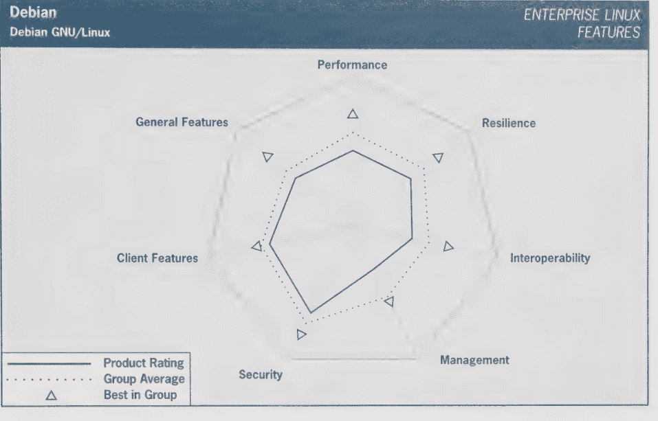


## 企业级 Linux

## Novell

SUSE LINUX Enterprise Server 8.0

企业级 Linux 特性

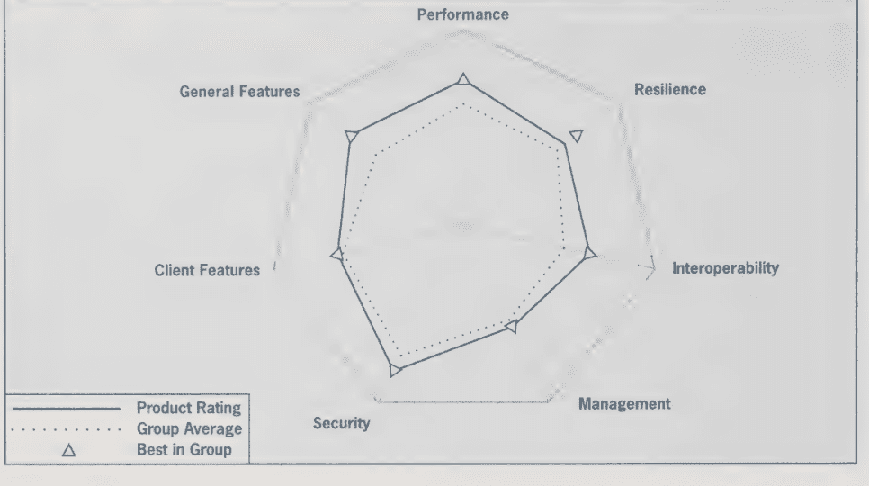

## Red Hat

Red Hat Enterprise Linux AS

企业级 Linux 特性

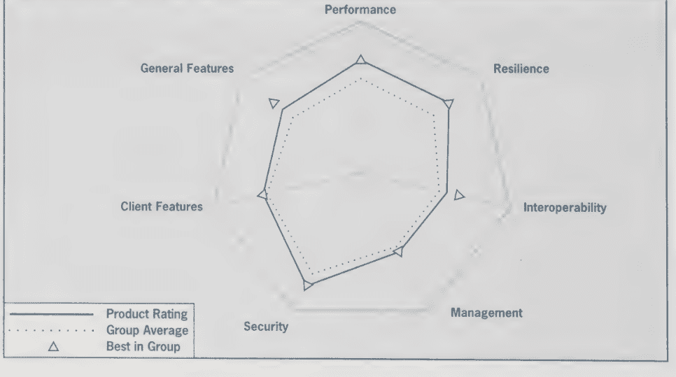

## 7.3 BUTLER GROUP 企业级 Linux 市场生命周期位置

Linux 发行版

| 表现卓越 | Novell SUSE LINUX Red Hat | Novell SUSE LINUX Red Hat |

| --- | --- | --- |

| 表现良好 | Novell SUSE LINUX Red Hat | Asianux* Mandrakeux Red Hat |

| 表现不佳 | Debian Asianux | Debian Mandrakeux |

| Linux 服务 | 表现卓越 | IBM |

| --- | --- | --- |

| 表现良好 | IBM | Novell Red Linux |

| 表现不佳 | IBM | Novell Red Linux |

| 早期采用期至2005 | 市场采用期2006-2009 | 市场成熟期2010年以后 |

## 企业级 Linux

## 关于 Butler Group 位置

垂直轴分为三组，每组对供应商和产品做出陈述。水平轴反映了市场成功情况。在每组内，按字母顺序排列，并不重要。

- * 表现卓越：供应商拥有成熟的市场地位，其解决方案被广泛认为是顶级的。

- * 表现良好：供应商定位良好，且营销到位。该解决方案具有竞争力的功能和性能。

- * 表现不佳：供应商定位不佳，时机不对，且未能有效进行营销。产品可能存在缺陷或过时。

- * 早期采用期：代表市场的早期阶段，通常由新进入者推动的新技术或标准被创新型公司采用。

- * 市场采用期：大多数技术发生的阶段，通常持续三四年。


## 市场成熟期
在成熟之后，市场可能会因供应商收购、新产品以及产生影响的努力而重塑。某些供应商可能被收购，明确的领导者将会出现。

## Linux 发行版 – 早期采用期至2005

### Novell LINUX
被母公司 Novell 收购后，SUSE 现在拥有全球组织的支持和营销背景，并能够提供完整的生态系统。Butler Group 认为这将有助于在其家乡德国和西欧获得更广泛的认可。SUSE LINUX 将在所有平台上发布软件，这为其提供了竞争优势。

### Red Hat
Red Hat 是领先的发行商，首次推出了此前仅存在专有操作系统中的支持和培训。它通过合作伙伴获得了行业巨头的认可，并提供了广泛的服务供应商。通过将 Red Hat Desktop 加入其企业产品家族，它提供了跨架构的一致平台。

### Debian
Debian 项目是一个非商业化运营，知名度较低。与部署其他主流发行版相比，组织使用 Debian 所需内部技能较少。

Debian 正在开发 UserLinux，旨在构建一个包含认证、服务和支持选项的免费企业级稳定 Linux 发行版。HP 对 Debian 投入了大量，但成果尚未显现。

### Mandrakesoft
Mandrakeft 于 2003 年 1 月进入破产保护，并于 2004 年 3 月退出该状态。它在法国本土市场实力强大，该市场有关注“本土”产品的历史，目前正专注于新产品和更新产品的开发。

### MIRACLE LINUX
在其本土日本市场实力强大，并经过 Oracle 的全面测试和支持，包含了集群功能和日志文件系统。Oracle 拥有该公司 58.5% 的股份，NEC（日本电气）持有 14%。它最近与红旗（Red Flag）合作创建了 Asianux，旨在成为企业服务器的标准发行版。

红旗 Linux 由中国科学院软件研究所和新民锐创投于 2000 年 6 月共同创立。该公司与 MIRACLE LINUX 公司合作，于 2004 年 3 月宣布 Asianux 1.0 Beta 版本的完成，这是唯一专为亚洲企业开发的标准化的 Linux 运行环境。中国新兴市场的庞巨大规模确保了它在量级上将成为一个主要的发行版。

### Turbinolux
于1992年创立，Turbinolux 是一种在日本实力强大的 Linux 软件，致力于提供最新的 Linux 解决方案。它得到了全球高科技领域一些领先公司的支持。

## 2006-2009年市场采用

作为美洲和西欧两个关键发行版之一，红帽（Red Hat）凭借其强大的开发团队，将处于任何候选名单的顶端，与 Novell 的 SUSE LINUX 并列。凭借 Novell 的营销实力和广泛的地理覆盖范围，SUSE LINUX 发行版将从其西欧大本脱颖而出。结合服务和支持，它将提供一个强大且具有吸引力的选择。

源自 Linux 和红旗，Asianux 应该成为日本和蓬勃增长的中国市场的主导发行版，并且在其坚实基础的基础上，Turbinolux 也将在这些市场中占据重要份额。

尽管 Debian 在开源社区中引发了广泛讨论，并构许多其他发行版的核心，但我们并不认为 Debian 能获得企业级的普及。我们认为 Mandrakesoft 在法国市场将保持特别强劲，但无法获得必要的全球关注以夺取重大的全球市场份额。

## 2010年及之后的成熟度

从长远来看，我们预计红帽和 Novell SUSE LINUX 将继续占据发行市场的大份额。随着中国市场的不断增长，我们预计 Turbinolux 将获得支持并拥有庞大的基础，尽管 Asianux 将是亚太地区的主导发行版。到这一时间点，Debian 可能会建立适当的合作伙伴关系以利用其潜力。我们不认为 Mandrakesoft 能够突破其法国市场的限制。

## Linux 服务 – 2005年之前的早期采用者

IBM 可能拥有最全面的 Linux 产品和支持范围。其全球服务组织加强了这一点；对于在企业级迁移到 Linux 的组织来说，使用 IBM 将最大限地减少感知和真实的风险，尽管与使用 IBM 一样，这总会有成本。

HP 的硬件和软件方案、补偿计划，以及其对迁移或部署可靠 Linux 的用户的内部承诺，增强了其信心。作为一家拥有强大支持服务部门的全球性公司，HP 将是大型组织的潜在合作伙伴。

Oracle – 跨越整个软件栈提供单一公司支持的“不可摧毁的 Linux”非常有吸引力，特别是对于 Oracle 广泛的客户群，尤其是那些从 Microsoft Windows NT4 平台迁移的客户。

## 企业中的 Linux

### Fujitsu
通电将 Linux 视为另一种 UNIX 的“变体”，正处于 Linux 服务计划的初始阶段，但作为世界第四大 IT 公司，在亚太地区拥有重要足迹，并在英国拥有大型公共部门合同，它定位为 Linux 服务领域的主要参与者。

### Novell
在对 Xishan 和 SUSE LINUX 进行明智收购后，公司将利用其遗留应用、经验和存在感，将其产品推向全球市场。

### Sun Microsystems
其策略似乎是混乱的，这从其近期对业务伙伴红帽的攻击，以及宣布正在考虑将 Solaris 发布到开源社区中看出。

## 2006-2009年市场采用

我们认为 HP 在中期内将与 IBM 并列，成为 Linux 服务市场的主导参与者。通过提供完整的生态系统并整合其遗留应用，Novell 应该吸引更广泛的 Linux 市场，提供与 HP 和 IBM 相同的规避风险的论点。富士将继续为其已迁移或部署 Linux 的客户群提供全面支持。凭借 Oracle 对 Linux 的坚定承诺以及为希望迁移到 Linux 的客户提供的参考架构，该公司将保留相当大的市场份额。我们认为 Sun Microsystems 在此阶段将理理出一个连贯的策略，使其有机会成为 Linux 服务市场中的重要参与者。

## 2010年及之后的成熟度

我们认为新入者不太可能在该市场留下印象，HP 和 IBM 将继续占据主导地位。Novell 在拥有两个主要 Linux 发行版之一的支持下，将继续在市场中占据相当份额。同样，富士和 Oracle 凭借其强大的客户群将继续拥有一份份额，而且只要 Sun Microsystems 成功明确策略，从长期来看，它也可以在 Linux 服务市场中占据重要份额。

## 第 8 节：比较

Butler Group
不妥协的分析

## 企业中的 Linux

一些人对开源运动仍持有复杂情感，主要是因为有许多发行版，每种发行版的产品略有不同。在本文报告中，我们考虑了企业级发行版，因此产品数量大幅减少。然而，Linux 因其快速增长和企业客户的采用而成为一种行业现象。这是由软件社区的重要支持驱动的，这种支持使得 Linux 对于潜在客户（无论是桌面端还是服务器）都变得非常有意义。

### 8.1 Linux 发行版

#### Debian GNU/Linux
Debian 项目是一个生产 Debian 发行的全球协会。Debian GNU/Linux 是基于 Linux 和 GNU 精神开发的，是一个稳定且完整的 Linux 发行版。Debian 起于一个紧密的小黑客群体，逐渐发展成为一个组织良好的开发者社区。Debian 项目由约 1000 名开发者组成，每人负责发行版的某些离散部分。这些开发者得到了成千上万相互支持用户的帮助。这是一个开放系统，任何用户都可以参与并促进 Debian。最活跃的用户可以成为 Debian 开发者。

Debian GNU/Linux 的当前版本是 3.0，于2002年7月发布。自2002年初以来，整个发行版的下一个版本正在开发中，代号为“sarge”，并将作为 Debian 3.1 发布。Debian GNU/Linux 3.0 为希望开发自己 Linux 系统的组织提供了选择，避免了许多 Linux 发行版的成本。Debian 的高级软件包工具 `APT` 允许管理员轻松安装和更新软件，它还拥有一个友好的客户端可以浏览可用和已安装软件。

与其主要竞争对手相比，Debian 的形象较低，因为它没有同等的硬件和软件供应商合同。随着 Linux 项目的发展，构建一个免费的企业级发行版是 Debian 未来增长的关键。作为一种 GNU/Linux 发行版，Debian 表示其力量源于发行背后的自由，以及软件呈现给用户的方式。它对许多用户的主要吸引力是其周围的社区，其软件包管理系统被认为非常强大。它的软件包经过定期审核和质量保证程序，大多数 Debian 开发者只维护少数软件包以便集中精力。

## 企业级 Linux

在企业级市场中，Debian 面临着缺乏独立软件供应商（ISV）支持的问题；由于缺乏与应用提供者的合作伙伴关系，许多潜在客户不会将其视为数据中心环境下切实可行的方案。然而，Debian 被广泛应用于 Web 服务器上，并被许多内部开发者所使用。2001 年，普普将 Debian 标准化为其内部 Linux 研发环境。到 2003 年底，HP 宣布将加强对运行 Debian 客户的支持。

## Mandrakesoft

法国机构 Mandrakesoft 已从 2003 年的财务困境中恢复，目前正专注于开发新产品和更新产品。Mandrakesoft 的目标市场包括中小型企业（SMEs）和大型机构。Mandrakesoft 的产品通过其在线商店、全球分销网络以及增值分销商（VARs）进行直接销售，尽管其在法国市场实力最强。Mandrakesoft 的商业模式建立在利用全球快速开发的基础上。这意味着其提供 40 多种语言的 Mandraelux 国际 Linux 发行版。全球成千上万的独立开发者不断地为代号为 Kernel 的代码做出贡献并改进，使其成为最简单且强大的 Linux 解决方案之一。

Mandrakesoft 产品提供了完整的解决方案，专为易用性设计，具有直观的图形用户界面（GUI）和用于配置的组件以实现快速部署。通过点点式安装程序和易于配置所有主功能的组件可以实现实施。目前提供 Mandrakesoft Corporate Server 2.1、多网络防火墙和 Mandclustering，Mandraelux Corporate Desktop 将于 2004 年晚些时候发布以完善产品组合。新的 Corporate Server 3.0 也将于 2004 年 9 月发布，将为企业环境提供最新的 Linux 2.6 内核特性和增强。企业级产品面向中小型企业和机构，并由个性化解决方案和维护计划（PSMP）的支持，使其成为一个易于业务往来的机构。Mandclustering 以基于 Mandraelux 操作系统（OS）的即插可用集群环境提供。它提供了扩展相干接口（SCI）驱动程序、若干个智能的消息传输层、图形化监控工具、并行化工具以及大量的数学库。

Mandraelux 提供了一套工具，允许对系统进行轻松的远程更新。它包括 `uprmi` 和 `Mandrakeupdate`、包管理工具以及确保系统完整性的自动安全功能。该公司还提供额外服务，向系统管理员提醒新的安全警报和更新。它还提供了多种配置工具。Mandrakesoft S.A 基于 Linux 2.6 内核。10 PowerPack+ 适用于主流发行版和低成本业务服务器，用于修复漏洞。SUSE LINUX 9.1 同样基于 Linux 2.6 内核，提供了比 Fedora Core 更好的开箱用体验。Mandraelux 10 可以在 Pentium 或更好的 x86 机器以及 AMD-64 上运行。

通过专注于易于部署和成为良好的业务伙伴，Mandrakesoft 有能力巩固其在企业 Linux 领域的地位。然而，该公司最近才走出类似于第 11 章的破产保护，非常关注法国市场。潜在客户可能会质疑 Mandrakesoft 能否成功为其其市场覆盖范围的扩张，以及是否能吸引需要此类支持 ISV。

## Novell SUSE LINUX

Butler Group 认为，Novell 收购 SUSE LINUX 对其前景产生了显著影响。它可以受益于 Novell 的地理覆盖范围以扩大其主要的欧洲基础，并受益于 Novell 的全球客户群和市场可见度。

Novell 的 `SUSE Linux Enterprise Server 8` 和 `SUSE Linux Standard 8` 为企业提供了预配置、易于管理、稳定且安全的应用程序。Novell 还对这一系列 SUSE Linux Server 进行了进一步开发，以为各种规模和部门的异构 IT 环境提供专业化部署。该平台针对稳定性和安全性进行了优化，并集成了 Linux 中的所有服务器服务。`SUSE Linux Enterprise Server 8` 适用于小型、中型企业，而 `SUSE Linux Standard 8` 是 Novell 为中小型企业和合作伙伴提供高性价比开源解决方案努力。Novell 提供了一系列由 SUSE Linux 企业支持的广泛服务。

`SUSE Linux Enterprise Server 8` `SLES8` 是一款领先的企业级开源操作系统，适用于各种规模和部门的异构环境的专业化部署，同时也提供了投资保护。基于 Linux 和开源技术，Novell 提供了一个具有统一代码库的单一服务器操作系统。`Autobuild` 是 Novell SUSE Linux 业务部门多年前开发的自动化流程。这是一项旨在确保代码和系统一致性，并在多个平台上一致重现代码的开发工作。我们的客户受益于整合到一个通用平台、广泛的硬件、完全的兼容性、技能整合，从而降低管理、培训和开发成本。

在生产环境中，SUSE Linux 能够从单一代码库为许多硬件架构完成 SUSE Enterprise。它适用于所有相关的硬件、32 位和 64 位处理器。SUSE Standard 是针对小型机构的更具成本效益的解决方案，其实施地可以扩展到最多 32 个 CPU，而 Enterprise Server 可以扩展到 64 位。SUSE 9.1 适用于主流发行版和低成本业务服务器角色。它基于 Linux 2.6 内核，具有比 Red Hat 更好的软件安装工具。

Novell 的 SUSE Linux Enterprise Server 可作为各种规模机构灵活、可靠且具有成本效益的基础设施。随着其基于 Linux 2.6 内核的新版 SUSE Linux 发布，为 Novell 提供在所有平台同时发布新版本的机会，展示其相对于其他 Linux 发行版的竞争优势。在完善生态系统的增强下，其 SUSE Linux 业务处于扩大市场影响力的强势地位。

## Red Hat

Red Hat Linux 系列操作系统为大型机构、中小型企业、技术工作站和高性能计算（HPC）需求提供了 Linux 平台。它们由提供补充性服务的 Red Hat Desktop 支持。红 Hat 还提供了 Red Hat Network，一个用于 Linux 基础设施的企业级系统管理平台，让系统管理员拥有高效管理网络的工具。Red Hat 合作伙伴的贡献对于提供客户重要的广泛应用和服务同样关重要。企业可以确信，在合作伙伴能力的支持下，Red Hat 的培训和专业服务可以实现成功的部署。

Red Hat 企业系列的产品包括：
- `Red Hat Enterprise AS`，支持高端和关键业务系统
- `Red Hat Enterprise ES` 针对中端系统
- `Red Hat Enterprise Linux WS` 适用于所有工作站和单桌面/客户端需求
- `Red Hat Desktop`，是 Red Hat Linux 家族的最新成员

Red Hat 已从 Web 服务器解决方案的愿景，通过应用服务器和数据库服务器，发展为企业架构平台。其性能特性已逐步升级，以适应从桌面计算到刀片技术再到数据中心环境的需求。

## 企业级 Linux

该公司是领先的 Linux 供应商。通过与 IT 行业巨头建立合作伙伴关系，它拥有一段令人羡慕的行业背书历史，并为客户提供了广泛的供应商选择。随着 Red Hat Desktop v3.0 加入其企业级产品家族，它提供了一个跨架构的开放、安全、可管理且一致的平台。

Red Hat 的管理工具以公司 Red Hat Network 服务的形式存在，经过几年的成熟，已成为 Red Hat 服务器池的管理接口。通过 Red Hat Desktop，可以通过 Red Hat Network 模块处理某些配置任务，该模块允许管理员编辑配置文件并将其推送到他们正在管理的系统上。这些配置功能需要为每个被管理的系统提供配置许可权限。

Red Hat Enterprise Linux 直到 2005 年才会发布包含完整 Linux 2.6 内核的版本。然而，该公司建立在可靠基础的企业级和桌面级系列提供了一种强大的组合，将说服客户认真考虑迁移到 Linux 平台。

## 红旗（Red Flag）、神龙（MIRACLEUX）与 Asianux

红旗软件有限公司（Red Flag Software）由中国科学院软件研究院和新民创投于 2000 年 6 月共同创立，并于 2001 年 3 月获得了信息产业部下属中信服资本的投资。其重点是基于 Linux 的操作系统的开发与推广，以及提供全面的 IT 解决方案和专业支持。公司的目标是为客户提供领先的技术和最好的服务。它与 IBM、Intel、HP、Oracle、BEA、联想、方创、长长、东方和 TCL 达成了战略联盟。它与合作伙伴携手在中国市场推广 Linux。红旗软件还构建了完善的全球客户服务网络，包括 100 多家培训合作伙伴、红旗认证企业计划、渠道和独立软件供应商（ISV），以确保高效客户支持服务的可用。

神龙 Linux 有限（MIRACLE LINUX CORPORATION）负责针对 Oracle 经过调优的 Linux 操作系统的开发与销售，以及 Oracle Linux 产品的营销，提供咨询、教育和管理等 Linux 相关支持服务。该机构成立于 2000 年 6 月，Oracle 拥有 58.5% 的市场份额，NEC 拥有 14%。神龙 Linux 标准版 V2.1 是一种为下一代企业业务环境设计的服务器操作系统。它经过了 Oracle9 的全面测试和支持，并包含了集群和日志文件系统以实现高扩展性和高可用性。它还拥有用于部署和管理的图形化工具“Install Navigator for Oracle”和“Webmin”。这有力地支持了系统管理和硬件管理功能。


红旗软件有限公司和神龙 Linux 有限于 2004 年 3 月宣布了 Asianux 1.0 的测试版本，这是唯一专门为亚洲企业开发的标准 Linux 运行环境。Asianux 是一种服务器操作系统，旨在为亚太地区的组织创建一个通用标准的企业 Linux 平台。它旨在为企业客户提供高可靠性、可扩展性、可管理性以及更好的硬件和软件兼容性。目前有一个 Asianux 认证合作伙伴计划，有 40 家主要的 ISV 和硬件供应商正在接受 Asianux 认证。Asianux 将验证与神龙（MIRACLE LINUX）V3.0 和红旗 DC4.1 的兼容性，这将缩短认证的时间成本，并使合作伙伴能够使用 Asianux 开发新产品。我们相信 Asianux 将成为远东地区领先的 Linux 分发版，特别是在中国采用的浪潮中崛起。

## Turbolinu

Turbolinu 是一家领先的 Linux 软件公司，成立于 1992 年，致力于提供最新的 Linux 解决方案。包括 BEA、HP、富士通、Intel、NEC、Novell、NTT 和东芝在内的高科技世界领先公司对其提供了支持。该公司在日本、中国和美国设有办公室，能够很好地利用中国 IT 支出高速增长的机遇，帮助该国实现数字基础设施转型。

Turbolinu 分发版专为企业计算设计。Turbinux 8 Server 支持大文件系统（LFS），用于管理或处理高达 4TB 数据的应用程序，这是服务 500 强及以上公司基础设施的共同需求。由 UnitedIn 驱动的 Turbolinu Enterprise Server 8 是一个高质量的业务服务器平台，涉及可靠性、可用性和扩展性特性。其核心是 UnitedIn V.1.0，它提供了一个具有自动化安全和维护更新的使命级事件系统，并设计用于认证支持许多商业企业应用。Turbolinu 表示，它将继续提供由 UnitedIn 驱动的 Turbolinu Enterprise Server 8，并在版本 1.0 的生命周期内（截至 2007 年 12 月）为当前及未来的客户提供维护更新和支持。它目前正在评估 UnitedIn 的后续版本，以管理迁移到企业级产品的下一阶段，并表示它正与其合作伙伴 Coneca 和 Novell 密切合作，概述该平台的性能。

其 Linux Desktop 10 (D10) 包含了许多旨在让 Windows 到 Linux 的迁移变得简单舒适的资源和工具，并且能够在 Windows 网络中共存。公司表示，它拥抱开源的精髓、行业标准和商业软件，通过集成到 IT 环境中的产品来利用和保护组织的计算投资。

随着亚洲企业在其在日本和中国等青睐市场的崛起，Turbolinu 在未来几年内可能会感到威胁，尽管其已建立的基石可能使其能够保留大量的市场份额。

# 8.2 LINUX 服务

## 富士通服务（Fujitsu Services）

富士通服务的母公司富士通日本对 Linux 投入了巨资，这有助于其子公司在未来在开源软件市场中占据稳固地位。该公司将 Linux 视为另一种版本的 UNIX。富士通服务在英国拥有数百名技术人员，可以开发和部署 UNIX 解决方案。凭借目前的资源，其提供 Linux 解决方案的能力远高于目前的需求。该公司表示，它持续监控需求，并在市场需要时做出响应。

从战略上讲，富士通服务的执行官 David Stuart 和架构师 Richard Christou 致力于扩大其基于 Linux 的解决方案，目标是为客户在传统的 UNIX 环境和现代 Linux 平台之间提供无缝切换。

## Linux 服务（Linux Services）

富士通服务的母公司富士通日本对 Linux 投入了巨资，这有助于其子公司在未来在开源软件市场中占据稳固地位。该公司将 Linux 视为另一种版本的 UNIX。富士通服务在英国拥有数百名技术人员，可以开发和部署 UNIX 解决方案。凭借目前的资源，其提供 Linux 解决方案的能力远高于目前的需求。该公司表示，它持续监控需求，并在市场需要时做出响应。

从战略上讲，富士通服务的执行官 David Stuart 和架构师 Richard Christou 致力于扩大其基于 Linux 的解决方案，目标是为客户在传统的 UNIX 环境和现代 Linux 平台之间提供无缝切换。

## 企业级 Linux

IBM 在全球有 8,500 名员工从事 Linux 的开发、研究、服务和销售。在内部，它目前在超过 1,000 台服务器上运行 Linux，包括支持其网站 ib.com 的服务器。它提供了超过 275 种软件产品，涵盖 DB2、WebSphere、Lotus、Rational 和 Tivoli，这些产品目前在 Linux 上可用。据报道，2003 年，17% 的 IBM 主机服务器已在处理工作负载，该公司公司估计其 65% 的 Z2/S390 客户正在实施或评估 Linux。解决方案提供商已针对 IBM iSeries 服务器上的 Linux 宣布了超过 80 种解决方案，现在有超过 50,000 名开发者正在创建可以在 IBM xSeries Intel 平台上运行的基于 Linux 的应用程序。总而言之，这些开发者已为 IBM 软件创建了超过 6,500 个基于 Linux 的应用程序。

除了所有支持 Linux 的 IBM 硬件以及所有正在迁移到该平台的软件外，通过 IBM 全球服务、外包和咨询服务，该公司可以轻松提供 Linux 领域任何公司中最广泛的产品和服务。

## Novell

Novell 的收购策略通过将 Xim 和 SUSE 的产品和服务整合到其产品范围内，可以为公司带来巨大的利益。Novell 的目标是为 Linux 用户提供服务，并消除任何阻碍企业采用 Linux 的因素。它认为，感知上对 Linux 支持的意味着组织正在寻找一个信赖的合作伙伴，能够提供全方位的支持和服务。Novell 认识到了企业面临的障碍，并设计了其服务和解决方案来应对这些异议。它消除了与此类行动相关的风险，这种策略应该对考虑 Novell 的组织产生吸引。

完成对 SUSE LINUX 的收购时，它为 Linux 引入了全球技术支持、咨询和培训服务，以及行业领先的网络和安全技术，为希望利用开源优势的公司提供了一个具吸引力的替代方案。SUSE LINUX 成为 Novell 内部的一个产品业务，其销售和营销由 Novell 现有的区域业务部门以及 SUSE LINUX 目前的销售和营销人员负责。Novell 拥有强大的 SUSE LINUX 品牌。

Novell 有一个重大机会将其产品组合（如文件、打印、安全和目录应用程序）集成到一个终端应用程序服务器平台中。其不断增长的服务和解决方案应确保 Novell 在迁移到 Linux 平台的组织中得到充分考虑，其全球化的经验和影响力将对在不同地点需要全面服务和支持的组织产生吸引力。

## Oracle

Oracle 早于 1998 年在 Linux 上发布了产品，补充了专有的 UNIX 和 Microsoft Windows 平台。它意识到该操作系统尚未为企业级应用准备绪。当时分发版是碎片化的，发布频率不一，且向后兼容性极低，这些因素阻碍了它在商业环境中建立公信力。Oracle 与 Red Hat 和 SUSE LINUX 合作开发了额外的功能，最重要的是改进了支持流程的质量，包括结构化的发布计划。

2002 年，该公司与 Red Hat 的 Enterprise Linux 联合，开创建了“不可摧毁的 Linux”（Unbreakable Linux）概念和品牌，提供了一个深度集成的操作系统和数据库栈，并由 Oracle 员工提供“一站式”的支持和问题解决，能够提供所需的代码级修复。Oracle 已将其所有产品置于 Linux 平台之上。该公司将 Linux 作为其内部开发环境，并正将其内部系统迁移到 Linux。

## 企业级 Linux

作为早期采用者，它与 Dell 和 Red Hat 拥有一个参考架构，且 10g 数据非常适合利用跨 Linux 服务器网格计算的优势。Oracle 可以为其产品和 Linux 操作系统提供“一站式”支持。它是唯一在需要时为 Linux 内核提供代码级修复的 ISO 厂商。Oracle 对软件和操作系统的捆绑能够很好地提供让许多组织产生吸引力的信心。此外，从现有的专有 UNIX 平台迁移到成本较低的 Intel 平台的意图将吸引许多客户。Oracle 在 Linux 部署方面拥有良好的记录。由于 Oracle 10g 与网格范式的结合，它能够很好地继续保持其在 Linux 领域的认知领导者地位。

该公司表示，有超过 9,000 名开发者在 Linux 平台上创建 Oracle 产品，并意图成为全球最大的基于 Linux 的开发组织。“无处不在 Linux”（Linux Everywhere）活动继续加强这一策略，并在维护 Oracle 作为 Linux 平台主要支持者的形象方面发挥关键作用。其对 Linux 的承诺对提高人们对操作系统作为一个业务就绪平台的意识产生了重大影响。Oracle 能够很好地继续保持其在 Linux 产品和服务领域的认知领导者地位。

## Sun Microsystems

Sun Microsystems 为 Red Hat Enterprise Linux 和 SUSE Enterprise Server 平台提供教育、咨询和集成支持服务。它是开源社区知识产权最大的贡献者之一，且其投资持续扩大。它通过利用公司全面的全球基础设施提供一站式支持。需要经验丰富的供应商为其 Linux 平台提供中心和本地服务及支持的组织会将 Sun 视为一个有任的合作伙伴。然而，最近公司发出了关于 Linux 及其其中一个合作伙伴的消息，潜在客户可能需要 Sun 澄清其策略。

从表面上看，Sun 改变了对 Linux 的态度。原因可能是由于已发布的 Solaris UNIX 产品开发的进展，潜在客户可能需要 Sun 澄清其策略。Sun Microsystems 在 Linux 方面拥有深厚历史，最近公司发出了关于 Linux 及其其中一个合作伙伴的消息，潜在客户可能需要 Sun 澄清其策略。

## 企业级 Linux 应用

组织必须防止 Linux 成为另一个技术孤岛。让 Linux 与现有的 IT 基础设施充分集成至关重要。实现这种可见性可确保整个企业能够充分利用 Linux 资源。挑战并不主要在于 Linux 本身，而是在很大程度上，组织在整个系统环境中成功吸纳和管理 Linux 的能力。

### 组织必须防止 Linux 成为另一个技术孤岛。

IT 支出的大部分仍然集中在培训、实施和集成领域。通过使用允许操作系统（OS）属性进行混合组合的解决方案，可以更好地控制成本，同时保持现有的策略和 IT 员工的专业知识。这在公司开始实施 Linux 时尤为相关。

如果使用一套全新的解决方案来管理 Linux 系统，那么实施、培训和集成的成本将大幅增加。利用现有工具，通过在 Linux 平台上安装一个或多个代理（agent），可以实现模块化方法的采用。新环境可以立即成为企业管理环境的一部分，包括服务水平协议（SLA）报告。

> CA 在 Linux 社区中发挥了领导作用，以促进理解。

供应商对其产品所使用的操作系统有深入的理解是关重要的，Linux 也不例外。CA 在 Linux 社区中发挥了领导作用，以促进理解。该公司是 kernel.org 社区的成员，也是开源开发实验室（OSDL）的创始人。其他关键组织的成员身份包括嵌入式 Linux 联盟、Open Group 和 EMBLIX。CA 还积极贡献于 Linux 代码库，并在多个企业系统中使用 Linux。

## 解决方案操作

CA 提供了一系列解决方案，允许公司轻松实现 Linux 的接受、部署和管理。这包括与现有管理解决方案的集成，以及一个提供跨平台可见性的统一用户界面。

该套件提供四个不同领域的领域：

- 1. 企业管理。
- 2. 存储与资源管理。
- 3. 安全管理。
- 4. 数据管理。

www.butlergroup.com

## 企业级 Linux 应用

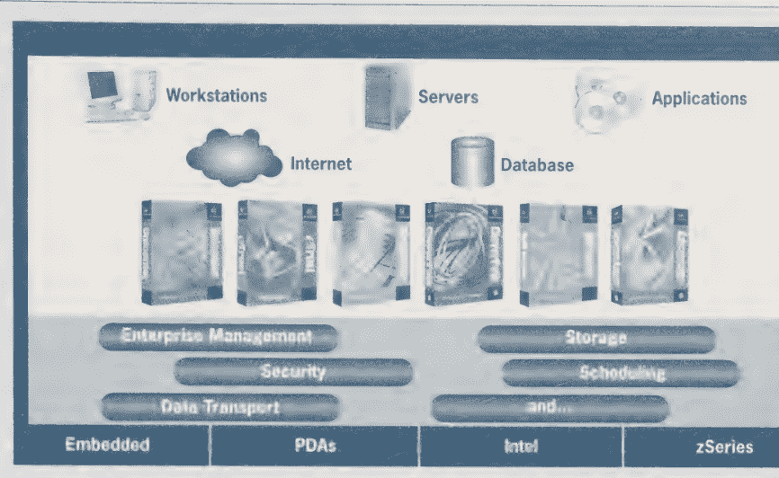

图 1：CA 的 Linux 集成解决方案

所有解决方案都使用名为 CA Common Services 的通用例程，以实现最高层和底层的通信与集成。

适用于 Linux 的可用管理软件包括：

- Linux 企业管理解决方案 – 允许 Linux 基础设施与现有环境集成。无论计划是在 IT 环境中继续使用不同的操作系统，还是统一到 Linux 上，CA 的解决方案都能够通过一个中心化的管理功能提供支持和维护。
- Linux 安全解决方案 – 协助管理员使用基于策略的控制、用户访问、身份管理和防病毒软件保护基于 Linux 的系统。
- Linux 存储解决方案 – 适用于分布式和大型机 Linux 环境，提供数据可用性和完整性。这些解决方案还促进了跨多个异构平台存储资源的管理。
- Linux 生命周期和数据管理解决方案 – 允许企业在 Linux 环境中共享、访问、处理信息和应用程序。
- Linux 的 S/390 和 zSeries 解决方案 – 允许大型机使用 z/VM 或 VM/ESA 运行多个 Linux 镜像，并将 Linux 与大型机数据及应用程序集成。

## 解决方案重点

Linux@CA 理念涵盖了企业中 Linux 的发现、管理、集成安全。

2004年9月

第 9 节：Computer Associates – Linux 解决方案 121

## 企业级 Linux 应用

## 部署

Linux2CA 解决方案包含一系列产品，每种解决方案都需要某些特定的产品知识来进行安装和实施。CA 使开箱即用的体验尽可能无缝。每个安装程序都可以在有限的专业知识下完成。集成各种产品需要特定的专业技能。在大多数情况下，这将是架构和操作知识的混合。专家可以是 CA 员工、外部顾问、内部人员或这些人员的组合。

实施的平均时间因解决方案而异。Unicenter NS 需要六到十二个月才能完全实施，而 Rust Admin 可以在几周内实施。CA 的策略始终是允许客户利用异构环境，而无需重新学习产品、产品功能，或需要为每个操作系统经历重大的策略变更。

由于大多数 Linux 发行版都部署在现有环境中（这些环境中已经存在平台混合），因此唯一的新开销是为管理服务器增加额外的代理报告。如果软件的管理部分将移动到 Linux 服务器，那么相应的资源开销将更高。在大多数情况下，这意味着要运行数据存储、监听并管理代理的管理软件以及报告组件。

> CA 的经验是，Linux 是运行管理软件的极佳平台，因为该操作系统具有扩展性，并且 CPU 利用率高于某些其他可用平台。

它是运行管理软件的极佳平台，因为该操作系统具有扩展性，并且 CPU 利用率高于某些其他可用平台。

大多数客户提供并负责运行 CA 软件的资源。CA 与运行 CA 管理软件的服务提供商有良好的关系，客户可以在受外包监控的系统中利用这些低影响代理。

CA 为不同专业水平的人员提供课堂产品培训，包括现场培训或在 CA 场地的培训，涵盖架构师、操作人员和服务台人员。由于这些解决方案的性质，CA 建议频繁更新并进行实践培训，并在发布新版本使用一天更新。CA 通过电话提供 24 小时客户支持，并允许客户访问在线帮助。

CA 的 Linux 解决方案适用于 RedHat、SUSE、Debian、Mandrake 等发行版。大多数 CA 解决方案都需要数据存储器。然而，当安装多个产品时，它们将在用户界面级别进行集成。

## 企业级 Linux

CA 并没有针对 Linux 解决方案设定特定的目标市场，考虑到对管理软件的需求是普遍的。目前，CA 正在针对其现有客户推销 Linux 解决方案，可以说是针对全球财富 5000 强企业。然而，CA 认为中小企业（SMEs）市场在存储和安全解决方案方面具有的增长潜力，特别是那些拥有 100 到 2000 个工作站且超过 5 台服务器的机构。

投资回报率（ROI）因解决方案而异；即使在特定领域，不同产品也有不同的投资回报；用于安全管理的 eTrust Admin 在安装新平台并能通过一键迁移所有用户账户时，其回报周期可能很短，仅为四到六周。而 UnicerServiceDesktop 的实现需要更长时间，可能需要 8 到 24 个月才能实现投资回报。

CA 在每个解决方案领域的市场路径各不相同。eTrust 和 BrightStore 仅通过合作伙伴和渠道销售。Unicer 和 AllFusion 解决方案既直接销售，也通过合作伙伴销售。CSC、EDS、Futs、Origin 和 IBM 等服务公司支持所有的管理解决方案。

CA 与 Red Hat、Novell/SUSE LINUX、TurboLinux 以及其他发行版建立了合作伙伴关系。CA 还与 Oracle、IBM、HP、Dell、Sun 和 Intel 等公司合作，确保产品发布、联合开发和测试的协调，并在新标准上达成一致。所有 Linux 发行版发布后不久将获得支持。

2.6 内核的新功能将在 2004 年底之前利用，包括配置和性能增强。我们的产品将在 2005 年包含动态资源配置，包括 eTrust 和 Unicer。

OSDL 已接受了 CA 的技术，即内核通用事件管理（KGEM），该技术将被包含在未来的内核构建中。使其能够拦截系统事件，而无需为每个特定产品重新构建内核。

CA 在将 Ingres 发布到开源社区时采用了了新的许可模式。CA 与 JBOSS 之间的一大联盟将合并并整合技术，发布一个集成的 Java 开放平台。CA 还在与开源内容管理社区 Zone 和 Plone 紧密合作。

## 公司简介

Computer Associates International, Inc. (NYSE:CA) 定位自己为全球最大的管理软件公司。它提供运营、安全、存储、生命周期和服务管理领域的软件和服务，帮助机构优化其企业 IT 环境的性能、可靠性和效率。CA 成立于 1976 年，总部位于纽约州冰兰市，拥有 15,000 多名员工，业务遍及 100 多国，并已获得 ISO9001:2000 认证。

过去三个财年（截至 3 月 31 日）的收入和营业收入如下：

| | 2004 年（百万美元） | 2003 年（百万美元） | 2002 年（百万美元） |


|---|---|---|---|

| 收入 | 3,276 | 3,027 | 2,886 |

| 同上增长率 | 8.23% | 4.89% | (38.10%) |

| 总净利润/(亏损） | 25 | (267) | (1,102) |

www.butlergroup.com

企业级 Linux

CA 已声明一项政策，通过在异构环境中整合各种系统来增强和保护客户的 IT 投资。为了维持这一立场，它与技术供应商、系统集成商和 IT 咨询公司建立了广泛的合作伙伴关系。

关键联盟伙伴包括：

- Microsoft。
- HP。
- SAP AG。
- BearingPoint Inc.。
- Intel。
- Oracle。
- PeopleSoft。
- Ernst & Young LLP。

CA 的客户包含了财富 500 强企业中的 95%。

## 摘要

出于多种原因，Linux 的趋势是在企业 IT 环境中变得更加流行。重要的是，Linux 能够被视为与基础设施中现有操作系统相同的对待，从而通过易于集成和管理发挥 Linux 的优势。CA 对 Linux 社区的积极参与以及管理软件的提供确保了这一点的实现。

## 联系方式

**美国总部**

Computer Associates International Inc.

One Computer Associates Plaza

Iceland

New York

11749

USA

**英国总部**

Computer Associates Plc

Ditton Park

Riding Court Road

Datchet, Slough

Berkshire, SL3 9LL

UK

电话：+1 631 342-6000

传真：+1 631 342-6800

www.ca.com

电话：+44 (0)1753 577733

传真：+44 (0)1753 825464

2004 年 9 月

第 9 部分：Computer Associates – Linux 解决方案

## DEBIAN:

Debian GNU/Linux 3.0

Butler Group

不妥协的分析

### Debian GNU/Linux 3.0

## 摘要

Debian GNU/Linux 是按照 Linux 和 GNU 的精神开放开发的，是一个稳定且完整的 Linux 发行版。Debian 起于一个小型、联系紧密的自由软件黑客群体，逐渐成长为一个大型、组织良好的开发者和用户社区。Debian GNU/Linux 3.0 为希望开发和培养自身 Linux 技能的机构提供了替代方案，并规避了企业级 Linux 主流发行版的成本。Debian 的高级软件包工具（APT）允许管理员安装和更新软件。

## 发现

- Debian GNU/Linux 具有稳定性，由于其对成熟内核的使用。
- 未来的发布基于 Debian。
- 范围内的 Debian，由于公司提供支持。
- APT 提供了一个强大的安装和更新系统。
- 其他 Linux 发行版基于 Debian。
- 少数独立的认证。

关键：产品优势 | 产品劣势 | 信息点

## 展望

Debian GNU/Linux 发行版在过去一年中在服务器领域增长迅速。然而，与其主要的竞争对手相比，由于其知名度较低，因为它没有相同的硬件和软件认证。该项目的计划是构建一个自由且稳定的 Linux 发行版是关键。

## 功能性

Debian GNU/Linux 发行版在过去一年中在服务器领域增长迅速。然而，与其主要的竞争对手相比，由于其知名度较低，因为它没有相同的硬件和软件认证。该项目的计划是构建一个自由且稳定的 Linux 发行版是关键。

## 企业级 Linux

作为一个 GNU/Linux 发行版，Debian 声称其优势不在软件本身，因为几乎每个 GNU/Linux 相同的软件池。它的力量源于背后的组织。对用户的主要吸引力在于背后的社区。

Debian 项目由数千全球开发者组成，他们对版本的某些离散部分负责。围绕这些开发者的是一个用户社区，他们相互提供支持。这是一个开放系统，任何用户都可以参与并促进 Debian 及其目标。最活跃的用户会成为 Debian 开发者。

Debian 声称在软件集成方面，其软件包管理系统非常强大，由于软件包的高质量。其软件包经过严格的审核和质量保证程序，大多数 Debian 开发者只维护少数软件包以便集中精力。结果是，Debian 拥有一个大型软件包存档，包含超过 10,000 个封装好的软件项目供用户使用。

它还说它支持任何 GNU/Linux 发行版中最广泛的硬件，官方支持十一种硬件架构。因此，终端用户可以信赖他们购买的可以安装 Debian 的通用计算机。

Debian 通过 iptables 提供集成的防火墙功能，通过 samhain 和 snort 提供入侵检测，并通过 grseccy、SELinux、LIDS 提供机密性支持。Debian 曾称，这些功能已经超出了 Linux 安全的标准要求。

为了可管理性和易用性，Debian 提供了多种满足终端用户需求的解决方案。

Debian 目前包含超过 8250 个软件包，用户可以使用为此目的提供的工具选择安装哪些软件包。在任何 Debian 镜像站点都可以找到软件软件包的列表和描述。参与其分发和开发无需加入财团成员或支付费用。所有正式成为 Debian GNU/Linux 一的软件包均免费分发，通常遵循 GNU 公共通用许可证（GNU Public License）规定的条款。Debian FTP 存档还包含约 350 个软件包，这些软件包可以根据每个特定的特定条款进行分发。

尽管 GNU/Linux 本身是免费软件，但它是构建增值 Linux 发行版的基础。Debian 表示，通过提供可靠的、功能全系统，它让 Linux 用户的能力得以增强，并让 Linux 发行版创建者能够消除重复劳动，专注于使其发行版与众不同的事情。

Debian 称它是唯一一个面向每位开发者并为其工作贡献的发行版。它是唯一非商业实体的 Linux 大型型发行商。它是唯一拥有宪章、社会契约和政策文件来组织项目的大型项目。Debian 还是唯一采用“微软件包”的发行版，使用关于包间关系的详细依赖信息来确保升级过程的一致性。

与大多数发行版一样，Debian GNU/Linux 提供了：

- 用于软件开发、文件操作和文本处理的 GNU 应用程序，包括 gcc、g++、Tc/Tk、texinfo、Emacs、Bash Shell 以及许多 UNIX 实用。
- Perl、Python、Tcl 以及针对它们的各种相关程序、模块和库。
- Tex (LaTeX) 和 Lyx、dvips 以及 Ghostscript。
- X Window 系统，它为 Linux 提供了网络图形界面，以及包括 GNOME 在内的无数 X 应用。
- 一整套应用程序

Debian GNU/Linux 拥有一个漏洞跟踪系统，详细列出用户和开发者报告的漏洞。由于 Debian 开发者在地理上的分散性，需要复杂的工具和快速的漏洞及修复通信方式来加速系统的开发。每个漏洞都被分配一个编号，并一直保留直到被记录为已处理。Debian 提供了漏洞跟踪网页。

## 企业级 Linux

## 部署

部署 Debian 需要熟练的 Debian 管理员。它运行在几乎每种硬件架构上，因此不需要特殊硬件。部署或迁移到 Debian 所需熟练 Debian 管理员的数量很大程度上取决于终端用户的需求。Debian GNU/Linux 在管理开销方面高度可扩展，单一的 Debian 管理员在某些非熟练劳动力的帮助下，可以在一个月内轻松部署一千台服务器和工作站。另一方面，如果终端用户有必须移植到 Debian 的自定义应用程序，负担将迅速取决于之前使用的平台。

Debian 不为终端用户提供付费支持，并希望他们雇佣技能合格的管理员来维护其 IT 基础设施。许多终端用户向 Debian 寻求合适管理员的建议，Debian 认为使用内部支持社区在业务案例上是可行的。

> Debian 不为终端用户提供付费支持，并希望他们雇佣技能合格的管理员来维护其 IT 基础设施。

Debian 表示，培训最好由熟练的 Debian 管理员提供，其要求将取决于终端用户支持人员的经验。Debian 是一个 GNU/Linux 发行版，适用于一个 GNU/Linux 发行版的许多知识可以迁移到另一个。

持续的技术支持由终端用户提供，但在安装量较小的情况下，大型 Debian 社区可以增加或完全取代内部支持系统。硬件必须从第三方购买，有许多硬件供应商提供兼容 Debian 的硬件。

Debian 是一个社区开发的 GNU/Linux 发行版。该发行版的所有部分既是标准的也是可选的，且所有组件的购买价格为零——Debian 是一个免费的 GNU/Linux 发行版。

Debian GNU/Linux 3 可在以下架构可用：

- IA-64
- S/390
- Alpha
- ARM
- HP PARSC
- Intel I386
- Sun SPARC
- MIPS (DEC)
- MIPS
- Motorola 68000 系列
- PowerPC

## 产品策略

Debian 将其市场定义为需要通用计算机软件的组织。这些组织的规模从从小到大不等。Debian 将其主要的市场机会看到：人们对使用外部资源极高成本的意识日益增强。无论这些外部资源是提供软件还是支持服务，Debian 断言，当组织使用免费的 Debian GNU/Linux 发行版时，成本几乎总是比他们提供的高出一个数量级。

## 企业级 Linux

Debian 直接提供给终端用户，也通过多个合作伙伴提供。它认为其主要竞争对手是 Red Hat、SUSE 和 Microsoft。Debian 表示，一名熟练的 Debian 管理员通常可以管理 30 台服务器和 500 台工作站。

Debian 正在快速演进。该组织提供了两种主要的发布计划供终端用户选择，“稳定”（stable）和“Sid”发布周期。“稳定”发布周期较慢，大约每年升级一次。“Sid”发布周期每天提供更新，但管理员可以选择是否应用。有些人选择每六月更新一次，有些人每周一次，还有人每天更新。

Debian 将继续通过更大的开源社区集成功能，只要功能可用。

Debian 将继续通过更大的开源社区集成功能，只要这些功能可用。它认为对其市场份额的主要威胁是教育不足以及来自竞争的误导性营销材料。

## 公司简介

Debian 是一个创建该发行版的开发者社区。Debian 的法律伞 Software in the Public Interest 是一家非营利公司，在美国纽约注册。

Debian 始于 1993 年，当时 Ian Murdock 想要创建一个基于二进制的 GNU/Linux 发行版。在此之前，用户负责手动下载和编译源码。在整个 90 年代，Debian 在规模和复杂性上不断增长，并发布许多版本。它继续增长并为终端用户提供高昂许可和支持成本的替代方案。

大约有 1000 名 Debian 开发者以及万万活跃参与社区的终端用户。Debian 高度集中在美国、欧洲、澳大利亚和巴西。大多数 Debian 开发者可以归类为研发人员，尽管约34% 担任管理员。Debian 开发者还负责支持他们维护的软件包，活跃的 Debian 用户通常承担销售和营销工作，并向其他终端用户提供支持。

Debian 预计在未来 12 个月内增加 50 名 Debian 开发者。Debian 有教育、商业和政府用户。虽然 Debian 没有可用的用户数量，但它认为这些可以达到数百万。

自1993年以来，Debian 有几位领导者。在 Ian Murdock 之后，Bruce Perens 从 1996 年 4 月领导 Debian 直到 1997 年 12 月，Ian Jackson 从 1998 年 1 月接任直到 1998 年 12 月，Hermann Ackerman 从 1999 年 1 月领导直到 2001 年 3 月，Ben Collins 从 2001 年 4 月领导直到 2002 年 4 月，Dadle Garlee 从 2002 年 4 月领导直到 2003 年 4 月，Martin Michlich 在 2003 年 3 月被当选并目前领导 Debian。

## 摘要

Debian 项目是一项非商业运营。Debian GNU/Linux 3.1 的开发基于志愿者的努力，旨在创建一个包含全套应用程序的免费、高质量操作系统。这是一种通用的软件发行版，设计用于适用于各种计算需求。我们认为，使用 Debian 的组织所具备的内部技能可能比部署其主要竞争对手发行版所所需的技能更多，因为目前的支持由分散在世界各地的 Debian 开发人员提供。

为了提高竞争力，Debian 正在开发 UserLinux，旨在构建一个免费的、企业级稳定的 Linux 发行版，该版本将包含认证、服务和支持选项。对于考虑转向企业级 Linux 的组织来说，这将深受期待。

## 联系方式

Software in the Public Interest, Inc.

P.O. Box 502761

Indianapolis

IN 46250-7761

USA

www.debian.org

## HP：

Linux 服务与支持

Butler Group

不妥协的分析

## HP Linux 服务与支持

## 摘要

HP 的 Linux 战略是“自适应企业”（Adaptive Enterprise）概念的核心，通过使用利用开放标准的技术赋予业务灵活性。其策略是做到与硬件和软件无关，并将开源组件与专有工具结合，为其客户提供广泛的选项。所有 HP 硬件都经过了 Linux 运行测试，并提供了 200 多种打印机驱动程序。通过参与开源开发实验室（OSDL）以及与 Red Hat 和 SUSE 的合作，HP 正在赋予客户企业企业部署安装 Linux 的信心。HP 内部运行着超过 5000 台 Linux 服务器，并为其客户提供经过测试和认证的“端到端”Linux 解决方案。发布的补偿计划应为企业提供关于版权问题某种程度的信心，但这要求所有组件和服务都必须来自 HP。Butler Group 认为，HP 是一个极具远见的 Linux 以及广义开源软件的倡导者。

## 核心发现

- 所有硬件均支持 Linux。
- HP 将提供经过测试和认证的“端到端”Linux 解决方案。
- 补偿要求所有组件均通过 HP 提供支持。
- 供应商硬件以及与软件无关的服务。
- 可用 200 多种打印机驱动程序。
- 经证明的参考架构，具有多供应商 Linux 栈。

| 产品优势 | 产品劣势 | 信息点 |
| :--- | :--- | :--- |

## 前瞻

HP 的地位优势在于它对硬件和软件的无关性。虽然其 HP-UX 仍然在高端业务部署中占据主导地位，但 Linux 将越来越多地占据中低层。HP 受推崇的服务部门和管理工具可以利用这一点。

## 功能性

HP 有一个底层的“自适应企业”概念——即组织使用基于标准的基础设施，能够快速捕捉业务环境变化的愿景。这一愿景包括利用最合适的硬件和软件组合来交付经过认证和测试的解决方案，无论硬件来自 HP 还是其他供应商，无论软件是专有的还是开源的。HP 希望为业务和 IT 管理人员提供保证，让他们可以放心地部署 HP 交付的解决方案，并确认该方案最符合其业务需求，并且可以从单点获得深度支持。

## 企业级 Linux

HP 有四大支柱支撑其 Linux 战略：

**1. 硬件平台的广度** - 所有服务器、台式机和 PDA 都将运行 Linux，并为全系列 HP 打印机提供了驱动程序。如果需要，可以将 Linux 下载到 HP iPAQ 中。HP 将针对所有主流 Linux 发行版（包括 Red Hat 和 SUSE）对所有设备提供最高三级支持。

**2. 信心部署** – 这是 HP 对业务用户提出的 Linux 平台及其支持服务的“业务就绪”担忧的回应。

- HP 注意到 SCO Group 声称 Linux 为其版权引起了业务界的广泛关注。作为回应，HP 为从 HP 购买硬件、软件和服务的组织创建了一个补偿计划。如果此类组织被 SCO Group 诉起，则 HP 将根据该计划派遣法律团队支持该案件。
- HP 以身证明了对 Linux 的信心。它在全球范围内的 5000 多台服务器上内部使用 Linux，HP 的电子邮件通过基于 Linux 的服务器发送。该公司还提到了其与 Linux 社区的关系，它是开源开发实验室（OSDL）的主要支持者。

**3. 端到端解决方案** – HP 提供由经过认证和测试的硬件及软件组成的完整解决方案。HP 销售操作系统（无论是 Red Hat 还是 SUSE），并提供一级和二级支持，仅在三级支持时升级给 Red Hat 或 SUSE，因为 HP 使用了一系列用于快速部署的工具，包括其互补的系统管理工具 HP Systems Insight Manager（其原生运行在 Linux 上）以及 OpenView。HP 的适应管理平台处理多个平台，数据中心人员可以使用与管理 Microsoft Windows 或环境相同的工具来管理 Linux 基础设施。

**4. 交付最佳投资回报率 (ROI)** – HP 相信，通过其行业标准硬件提供的自由和灵活性，以及与软件无关的方法，客户可以获得与其业务需求更“匹配”的解决方案，从而产生更大的价值。

HP 与主要的独立软件供应商（ISV）合作，包括 BEA、SAP、Oracle，以及路透社（Reuters）和彭博（Bloomberg）等内容提供商，并与其对所有版本进行测试并根据需要调整性能。HP 还与开源软件供应商 MySQL 和 JBOS 合作，并将他们的产品纳入 HP 参考架构中。HP 参考架构涵盖了：

- 硬件。
- Linux 发行版。
- 管理功能。
- 高可用性。
- 特定工作负载的软件。

HP 测试整个解决方案栈，并针对特定业务对栈内使用的组件提供建议，但始终将选择权交给客户。一旦安装，HP 服务将为整个解决方案栈提供一系列咨询、集成、客户支持和服务支持。

## www.butlergroup.com

## 企业级 Linux

![img/767d23264d3e5471ce58a1972dfd0dc_138_0.png 图 1：HP Linux 参考架构


在 HP 看来，Linux 部署现在可以放心地跨越整个企业。从网络边缘的原始部署以及相关的基础设施（如代理服务器、缓存、防火墙、目录、Web 服务器和电子邮件），操作系统已经发展并成熟，能够为可证明的业务应用提供平台，例如客户关系管理（CRM）和供应链管理（SCM）。HP 认为，2.6 内核的开发及其对 16 核 CPU 的支持现在为运行数据库和内容服务提供了一个可扩展且健壮的环境。

## HP 服务

HP 服务部门可以为部署或迁移到 Linux 的组织提供全协助和支持：

- 架构设计 – 基于 HP Linux 参考架构设计并实施解决方案。
- 咨询 – 就以下方面提供建议和支持：
  - 集群。
  - 电子邮件服务。
  - Web 服务。
- 项目管理 – 提供单一点责任制。
- 迁移 – 在整个过程中支持客户支持。

2004年9月

第 9 节：HP – Linux 服务与支持 139

## 企业级 Linux

- 部署 - 提供：
    - 集成服务。
    - 现场安装。
    - 数据中心服务。
    - 培训 - 通过广泛的课程和交付方式。
- 支持 - 包括：
    - 关键任务级支持。
    - 主动规划与协助。
    - 响应式硬件和软件支持。

HP 服务部门的另一个值得关注的特点是，他们可以被委托支持任何 Linux 安装，无论是否涉及任何 HP 硬件或软件。

## ▶ 部署

如前所述，包括 iPA-4 在内的所有 HP 硬件平台都已通过测试并支持 Linux。这包括在 Integrity Superdome 上运行 Linux 的 HP 高端 Integrity 服务器。HP 的 StorageWorks 产品系列也提供 Linux 支持。StorageWorks 可扩展文件系统（Scalable File System）可以利用 Lustre 开源协议为 Linux 集群提供 100 倍的带宽。对于超过 200 种 HP 打印机已提供 Linux 驱动程序，并且可以使用 HP Systems Insight Manager 和 HP OpenView 部署和管理 Linux 环境。

## 部署案例

菲亚（Fiat）是意大利最大的工业城市，总部位于都灵。其业务遍及 120 多个国家，自1899年成立以来已生产了超过 8500 万汽车和轻型车辆。该公司意识到，随着全球竞争时代的到来，特别是欧洲巨大的单一市场，它正面临着多重挑战：

1. 竞争对手正日益将车辆市场推向商品化环境。
2. 菲亚拥有昂贵的分销基础设施。
3. 其渠道中存在许多低效环节，这也导致了高昂的管理成本。
4. 菲亚希望在服务和汽车上都能实现差异化。

HP 服务顾问与菲亚汽车（Fiat Auto）合作，开发了 Fiat Link 基础设施，以简化分销并增强菲亚的 CRM 系统。

在合作期间，HP 提供的服务包括：

- 系统集成。
- 三层架构的规划与设计。
- 企业级应用集成 (EAI) 咨询。
- 实施、测试和安装。

## 企业级 Linux

HP 为菲亚部署的最终三层架构由：

- 运行在集群配置的 HP Integrity rx5670 (2) 和 rx26000 (2) 服务器上的 Oracle 9 应用程序集群和 Red Hat Enterprise Linux。每台服务器均配备双 Intel Titanium 2 处理器，并配置了 HP StorageWorks 虚拟阵列光纤 SAN (RAID 5)，容量为1TB。
- 运行在 HP Proliant DL380 服务器上的 Oracle 9 应用程序服务器软件，每台服务器配备运行 Red Hat Enterprise Linux AS 2.1 的 Intel Xeon 处理器。
- 运行在 HP Proliant ML370 服务器上的 Apache Web 服务器软件，每台服务器配备运行 Red Hat Enterprise Linux AS 2.1 的 Intel Xeon 处理器。

Apache 驱动的前端通过运行浏览器软件的 HP Tablet PC1100 系统，为菲亚零售商提供了访问 Fiat link 的 Wi-Fi。

报告的结果和部署效益包括：

- 零售商和菲亚汽车获得了一个建立客户关系和忠诚度的工具。
- 该解决方案增强并简化了购买流程，同时降低了销售成本。
- 现在有了以客户为中心的分销模式，这将推动销售额和市场份额的增长。
- 跨越 17 个国家的 5,800 家零售商的流程整合降低了库存成本。

伊士曼化学公司（Eastman Chemical Company）是一家总部位于美国的全球性公司，制造并销售超过1200种化学品、纤维和塑料产品，这些产品反过来被全球数千万消费者使用。

当企业资源计划 (ERP) SAP R/2 环境升级到 SAP R/3 时，公司计划集中管理 ERP 输出，并实施一种稳健且灵活的输出解决方案。

伊士曼选择了 HP Output Server 来简化和优化来自 Linux、VMS 和 UNIX 应用环境的所有输出。选择 HP Output Server 是为了向公司内部各种输出目标（如打印、传真、电子邮件和 ftp）提供可靠的文档交付解决方案。Output Server 的核心交付服务包括交付管理、队列管理和目的管理，用于确保业务关键文档以正确的格式交付到相应的输出端。HP Output Server 还包括促进平稳交付过程的服务，包括事件、权限、配置和库存的管理。

HP Output Server 运行在 Linux 上，并部署在 IBM AIX 平台之上，这为 3900 个远程打印、传真、电子邮件和 ftp 队列提供了必要的选项。目前有 500 人直接使用，另有1000 人正在使用。来自 SAP R/3 的输出占当前打印量的 65%，以及传真和电子邮件负载的 95%。在伊士曼内部，还有300名用户使用 HP Output Server 桌面打印。

该公司的 BMS 服务器通过管理队列利用 HP Output Server，电子商务应用程序使用适用于 Microsoft Windows 的 HP Output Server 客户端。数据报告显示，每天平均约有35,000 个作业——包括1100 份传真、2000 封电子邮件、3000 份发送到打印目的地的报告。

伊士曼从 HP Output Server 获得的最显著收益之一是通过队列的定义和维护实现集中管理的简单化。用户不再需要理解其输出的设备格式，因为 HP Output Server 透明地提供了这些功能，并确保了准时交付。

## 企业级 Linux

## 产品策略

尽管对 Linux 作为企业操作系统有明确的承诺和愿景，但它仅是 HP 三种战略操作系统 (OS) 之一，另外两个是：

1. Microsoft Windows。
2. HP-UX。

尽管对 Linux 作为企业操作系统有明确的承诺和愿景，它仅是 HP 三种战略操作系统 (OS) 之一，另外两个是：

1. Microsoft Windows。
2. HP-UX。

HP 与微软有密切的合作伙伴关系，并将 Linux/微软产品视为互补，这符合其认为异构 IT 环境将持续存在的信念，让客户选择最适合的环境。

尽管 HP 认为 HP-UX 将继续作为其高端产品，但认为 Linux 在低端市场拥有巨大机会，作为 Microsoft Windows 和底层配置的高效可行替代方案。在这里，HP 认为随着企业进行技术更新，以及操作系统过期，Linux 将通过开放标准和行业标准架构提供替代方案，避免未来的“锁定”。

HP 认为我们将看到更加明确和分化的功能。

该公司深度参与了 OSDL，并将自己定位为 Linux 和开源技术的领导者。

## 企业级 Linux

HP 认为未来的技术格局将由以服务为中心的计算为主导，在这种模式下，信息技术将作为服务被交付、管理和购买。在过去的几年里，它将其业务重组为三个产品生成部门和三个面向客户的组织。在20世纪90年代，HP 大多数的增长率达到了20%。

该公司是面向全球消费者、企业和机构的技术解决方案提供商。其产品涵盖了 IT 基础设施、个人电脑和接入设备、全球服务以及成像。对于截至2003年10月31日的财政年度，HP 的总收入达到731亿美元。HP 称，该期间的最新收入为251亿美元。

## 摘要

尽管 HP 在硬件方面拥有深厚底蕴，但在 Linux 部署方面，它对硬件和软件均不设限态度，并提供跨所有供应商平台的支持。其服务部门将为不使用 HP 硬件或软件的组织承担支持合同。

HP 旨在基于其 Linux 架构，利用行业标准硬件的测试和认证配置，以及最合适的软件（无论是专有的还是开源），提供完整的“端到端”解决方案。

通过其内部部署、测试和认证计划的示例，HP 意赋予组织部署或迁移到 Linux 基础设施的信心。这是一个坚实的愿景，与 HP 的“自适应企业”（Adaptive Enterprise）概念紧密结合。该战略已经得到了开源社区的大量投资和承诺。值得注意的是，JBoss 和 MySQL 都包含在 HP 的 Linux 产品组合中。HP 认为应该为组织提供所需的信心，将 Linux 视为 IT 基础设施的核心部分进行投资。

## 联系方式

公司总部

惠尔-惠奇 (Hewlett-Packard)

3300 Hanover Street

Palo Alto, CA 94304

电话: +1-650-487-1500

传真: +1-650-487-5518

www.hp.com

英国总部

Hewlett-Packard (UK) Ltd.

Amen Corner

Bracknell

RG12, UK

电话: +44 (0) 1344 36000

传真: +44 (0) 1344 36344

2004年9月 第9部分：HP – Linux 服务与支持

## IBM：Linux 产品、服务与支持

## 摘要

与任何其他供应商相比，IBM 可能拥有与 Linux 相关最广泛的产品和服务。全球范围内有超过 10,000 个 Linux 合作项目，其中包括许多中央和地方政府项目。IBM 方法的优势在于具有“全公司”的视角，并在每个地区设有 Linux 战略负责人，以确保客户获得完整的产品和服务组合包。案例研究和参考部署已证明了显著的投资回报率（ROI），IBM 认为对更好管理、整合和技术更新的压力是组织采用或迁移到 Linux 的关键驱动力。作为 Linux 的母体，IBM 对将其作为业务平台进行持续开发并使其“主流化”的承诺是不容置疑的。IBM 将继续被视为 Linux 领域的传教士和领导者。

## 关键发现

- 在所有硬件平台上提供 Linux 支持。
- 可提供完整的支持、服务和咨询。
- 所有 IBM 产品与 Linux 操作系统紧密集成。
- 在 IBM zSeries 上使用 Linux 作为分区是高端参考站常态。
- IBM 是两个主流 Linux 发行版的强力支持者。
- 明显偏向 IBM 硬件和软件。

图例：产品优势、劣势、信息要点

## 展望

除了平台的创建者 Linus Torvalds 之外，IBM 作为一家公司可能是最大的传教士。Linux 是公司硬件、软件和服务业务战略的核心，且 Linux 是按需计算概念的根基石。

## 功能性

IBM 在采用和迁移到 Linux 背后拥有一套全公司哲学，其软件栈被移植到 Red Hat（红帽）或 SUSE 平台运行，且所有 IBM 硬件均已启用运行 Linux 和基于 Linux 的应用程序。

## 企业级 Linux

www.butlergroup.com

## 应用 - 定制、封装

硬件处理器/虚拟化 - Intel, POWER, zSeries, 集群, ...

图 1：Linux 上的 IBM 软件栈

IBM 自豪于拥有与 Linux 相关最广泛的产品和服务。此外，其所有硬件平台都支持 Linux。该公司自 1997 年以来一直致力于 Linux，据报道，2001 年在 Linux 及相关产品和服务上投入了超过 10 亿美元，包括确保每种 IBM 硬件和软件产品都已启用 Linux。

该公司报告，全球有 8,500 多名员工从事 Linux 开发、研究、和服务工作。在公司内部，IBM 目前在超过 1,000 台服务器上运行 Linux，包括支持其网站 ibm.com 的服务器。

目前来自 DB2、WebSphere、Rational 和 Tivoli 系列的 275 多种软件产品可在 Linux 上使用， 2003 年 17% 的 IBM 主机销售处理了 Linux 负载。IBM 估计，其 65% 的 zSeries/390 客户处于实施或评估 Linux 的某个阶段。

解决方案供应商已宣布了 80 多种针对 IBM 系列服务器的 Linux 解决方案，现在有超过 50,000 名开发者正在创建可以在 IBM xSeries Intel 平台上运行的基于 Linux 的应用程序。总计，开发者已为 IBM 软件创建了超过 6,500 个基于 Linux 的应用程序。

IBM 报告，新的 Linux 应用程序中只有三分之一是由独立软件供应商（ISVs）创建的，大多数由企业内部开发，IBM 认为这一数据是采用的一个主要标志。

IBM 认为企业采用 Linux 的基础是双方面的：

1. 业务驱动因素：
   - 成本。
   - 可靠性。
   - 安全性。
   - 灵活性。
   - 按需容量和服务的需求。

2004年9月 第9部分：IBM – Linux 产品、服务与支持

企业级 Linux

2. 技术赋能因素：
   - 开源标准。
   - Linux 成熟度。
   - 硬件标准。
   - 中间件标准。
   - 支持。

IBM 认为这些因素共同创造了 Linux 作为 IT 行业和 IBM 电子商务按需战略的核心。Linux 2.6 内核支持 16 路处理和 64 位处理器，使得 Linux 非常适合取代低端专有平台。IBM 将 Linux 视为一种可靠、安全的操作系统，提供异构硬件支持。

## IBM 全球服务 (IGS)

为了支持客户，IBM 拥有广泛的服务能力，可以在 Linux 项目生命周的所有阶段增加价值。这由全面的服务产品组合支撑，范围从量化采用 Linux 业务效益的初始工作到全面的交付后支持能力。该组合如图 2 所示。

## 企业级 Linux

| 评估 Linux 策略研讨会 | Linux 讨论 | Linux 演示 | 实地访问 | 计划 TCO 研究 | 网格计算研讨会 |
| :--- | :--- | :--- | :--- | :--- | :--- |
| 企业架构研究 | | | | | |
| 容量规划研究 | | | | | |
| 基础设施就绪/转型与规划 | | | | | |
| 合并 ALIGN 研究 | 设计/开发 Linux 集群服务 | 实施/部署 | | | |
| 基础设施设计服务 | 通用/特定迁移服务 | | | | |
| 定制化应用开发 | 内部优化 | | | | |
| 技术解决方案与架构 | 现场服务 | | | | |
| | 应用程序发布服务 | | | | |
| | 测试服务 | | | | |
| | 滚动发布/部署服务 | | | | |
| | 运行支持热线服务 | | | | |

项目/计划管理与方法论 (IBM 全球服务方法)

IBM 学习服务 - Linux 执行路线图

在早期项目中，针对 IGS 引入具有深度行业对齐技能的顾问，以确保推荐的解决方案能够带来持续业务效益。这些解决方案由具有深厚技术技能的从业人员进行设计、集成和支持。

尽管 IGS 承担的大多数客户项目涉及服务器 Linux 解决方案，但 IBM 最近推出了产品组合扩展以涵盖客户端解决方案，并在与意大利米兰流行银行（Banca Popolare di Milano）和德国施瓦本银行（Schwaebische Bank）项目中取得了巨大成功。

## ► 部署

Red Hat 和 SUSE 发行版可以部署在所有的 IBM 硬件上，从（基于 x86 的）桌面、、笔记本和服务器，到 iSeries 和 pSeries 服务器，再到 zSeries 主机。IBM 表示，所使用的平台将是符合客户业务需求的平台。例如，高性能应用程序将在 Linux 集群上运行，而 zSeries/iSeries 则需要高输入/输出 (I/O) 能力，或者需要高可用 xSeries/pSeries 集群。IBM 全球服务方法中心也支持 Linux，提供项目管理、定制培训与开发以及持续支持。

由于 IBM 硬件和软件的广泛范围，IBM 对许多组织来说可能是 Linux 硬件、软件、咨询和支持的单一来源。

大型参考场地，例如奥地利 OMV 的 SAP R/3 部署，以及英国 Waitrose 的客户服务解决方案，正在 zSeries 主机上使用 Linux。这为他们提供了长期开发的广泛系列管理和支持工具，以最有效地使用和支持基于 Linux 的应用程序。

## 部署示例

西约克郡警察分局（West Yorkshire Police）拥有 Linux 平台和一系列 IBM 软件，用于为警方视频比对身份创建一个一致的全国性系统。名为 VIPER（电子记录身份比对）的解决方案包含一个拥有超过 10,000 张图片的数据库。

## 企业级 Linux

IBM 基础设施包括：IBM 通用并行文件系统 (GPFS)、IBM TotalStorage FAST1500 存储服务器、IBM SAN 和 LTO 磁带库以及 Tivoli Storage Manager。该解决方案由 IBM TotalStorage 解决方案中心和 IBM 业务伙伴 Sagitta 设计、实施和支持。

该系统允许身份识别方在两小时内汇合，而不是几周，将每对的成本从 720 英镑 - 1,200 英镑降低到 150 英镑。预计每年总可节省 660 万英镑。该解决方案基于 1.4TB 存储，构建配置为 Linux 集群的行业标准硬件，使用 IBM GPFS 快速访问单个图像文件。使用 Linux 对于确保处理大视频文件所需的带宽共享至关重要。它符合约克警察现有的 Linux 基础设施，减少了管理开销和总成本 (TCO)。

国家 VIPER 局现在平均每天处理 82 对，15 个警察力量部门有 61 套身份设备在线，20 套身份设备正在投入运行。


下一次开发将是将 `VIPER` 的视频技术与其他识别系统链接，例如人脸/虹膜识别和数字指纹。

卑根市（City of Bergen）是挪威第二大城市，人口为 237,430 人，位于北海中心。根据其迁移到 `Linux` 作为服务器标准操作系统的战略方向，该市决定在多个 `HP` 服务器和 `IBM` 刀机上部署 `Novell Linux Enterprise Server (SLES) 9`，以取代行政和教育网络的专用 `UNIX` 和 `Microsoft Windows` 服务器。

选择 `Linux` 作为一种战略利益，该市寻求获得一种不依赖于单一供应商的业务模式。通过迁移 `Linux`，该市认为它拥有一种开放、民主的业务模式，并将确保未来拥有更大的选择自由、更高效的运行以及大幅的成本节省，造福其市民。

第一个项目是将该市现有 20-30 台运行在 `HP` 和 `MS Windows 2000` 上的 `Oracle` 数据库服务器迁移到 `HP Itanium 64` 位服务器。这将支持该市的一系列运营业务应用程序，包括核心健康和福利服务，并将供 15,000 名员工访问。

第二个项目将涉及将该市教育网络各学校内的 100 台 `NT Windows` 应用程序服务器迁移并合并到一个拥有 20 台刀片服务器的集中式 `IBM eServer BladeCenter`。

迁移工作正在消除人员成本的范围内进行管理，该市认为 `HP` 服务器的 `TCO` 持续支持部分将低于基于 `Windows` 服务器的同解决方案，因为 `Linux` 解决问题通常不那么复杂。作为使用 `Linux` 业务案例的一部分，该市计算出教育网络的服务器成本仅为运行 `Windows 2000` 的服务器进行同等安装的 60%。

## 产品策略

`IBM` 被许多人认为是 `Linux` 市场的教父，鼓励其在 `Red Hat Enterprise` 和 `SUSE` 领域开发出两个“业务级”发行版（后者现在是 `Novell Linux Enterprise` 的一部分），具有业务客户所期待的严格发布周期、支持和培训。无疑，如果没有公司的支持，`Linux` 以及整个开源软件的渗透和知名度不会如此高，发展也不会如此快，这种支持包括在开源开发实验室 (`OSDL`) 与 `HP` 和 `CA` 等公司的伙伴关系。`Linux` 的创造者，特别是商标所有者 `Torvalds` 雇佣于 `OSDL`。

## 企业级 Linux

`Linux` 现在是 `IBM` 产品直线的核心，它不仅符合按需计算范式，还通过基础设施和技能的整合应对了 `TCO` 问题。`2.6` 内核对更多数量处理器的支持将使 `IBM` 在按需模型中提供灵活性和动力。

`Linux` 现在是 `IBM` 产品供应的核心，它不仅符合按需计算范式，还通过基础设施和技能的整合应对 `TCO` 降低的问题。

`IBM` 将银行、政府和零售作为 `Linux` 采纳的关键市场，其他行业，特别是中小企业被特定的 `IBM` 行业解决方案以及 `ISV` 创建的 `Linux` 版本所吸引。

从地理区域来看，`IBM` 将欧洲和美国视为早期采用者，但已确定中国、俄罗斯和巴西是 `Linux` 采纳非常快速的市场。

`IBM` 将 `Linux` 视为泛在计算设备的理想操作系统，这需要 64 位支持和性能来进一步获得取代 `UNIX` 服务器的市场。

2004 年，`IBM` 将通过“`IBM` 解决方案”标签推动 `Linux`。

- 它已经实现了水平集群以创建带有 `ICE` 的大型 `DB2` 数据库，并在处理器（`iSeries` 服务器）上演示了 64 位 `DB2` 技术。
- `Java 2` 企业版 (`J2EE`) 服务器将迁移到 `Linux` 上的 `WebSphere`。
- 邮件服务器将迁移到 `x` 上的 `Linux Lotus Domino`。

## 公司简介

国际商业机器 (`IBM`) 是全球最大的科技公司之一，在 164 个国家运营。该公司公司于 1911 年 6 月 15 日在纽约州成立，名为 `Computing — Tabulating — Recording Co (C-T-R)`，由 `Computing Scale of America`、`The Tabulating Machine Co.` 和 `International Time Record of New York Merger`。1924 年，`C-TR` 采用了 `International Business Machines` 的名称。总部位于美国纽约阿马科。

`IBM` 在全球拥有超过 30 万名员工。`IBM` 的普通股在纽约证券交易所 (`NYSE: IBM`) 以及美国其他交易所和全球上市。`IBM` 制造广泛的计算机，包括 `PC`、`大型机`、`网络服务器`、`外围`，并生产全面的软件。它有一个咨询服务部门。公司近 60% 的销售额来自非美国客户。`IBM` 继续关注互联网和电子商务。

过去三年的财务状况（截至12月31日）如下表：

| | 2003年（百万美元） | 2002年（百万美元） | 2001年（百万美元） |
|---|---|---|---|
| 收入 | 89,131 | 81,186 | 83,067 |
| 较去年增长/减少 | 9.79% | -2.30% | -2.40% |
| 净利润 | 7,613 | 5,334 | 8,146 |
| 较去年增长/减少 | 42.73% | -34.50% | 3.50% |

2003年全球服务占收入的48%，硬件贡献了32%，软件占16%，其余部分来自其他活动。`IBM`是一家拥有广泛产品组合的大型公司，但报告显示2003年相关销售和服务交付创造了20亿美元的收入。

在`Linux`平台上部署了解决方案的 `IBM` 客户包括：

- 查尔斯理伯（`Charles Schwab`）。
- 邓迪市议（`Dundee City Council`）。
- 意大利外交部。
- `Lawson` 产品公司（`Lawson Products Inc.`）。
- 澳大利亚北地学校。
- 普林斯大学。
- 瑞士电信（`Swisscom`）。
- 西约克郡警方（`West Yorkshire Police`）。

`IBM` 声称全球范围内有10,000个`Linux`客户参与，其中约275个已成为参考账户。

## 总结

虽然`Linux`是`Linux`之父，但`IBM`无疑是教父，并对该平台做重大的企业承诺。`IBM`拥有大量的业务和技术合作伙伴来支持其运营，并通过这些合作伙伴在`Linux`领域投入了大量资金。除了`IBM`的硬件支持`Linux`以及所有软件迁移到该平台外，凭借其全球服务、外包和咨询部门，`IBM`可能可以提供`Linux`领域内任何公司中最广泛的产品和服务。

## 联系方式

公司总部

`IBM` 公司总部

`New Orchard Road`

`Armonk, NY 10504`

`USA`

`IBM (UK) Ltd.`

`PO Box 41`

`North Harbour`

`Portsmouth, Hampshire`

`PO6 3AU, UK`

电话：`+1 (914) 499 4100`

电话：`+44 (0)23 9256 1000`

传真：`+44 (0)23 9238 8914`

`www.ibm.com`

`www.ibm.co.uk`

## MANDRAKESoft:

`Mandraklinux`

`Butler Group`

不妥协的分析

## Mandrakesoft Mandraklinux

## 摘要

`Mandrakesoft`的`Mandraklinux`产品提供了完整的企业解决方案，旨在通过直观的图形界面（`GUI`）和配置向导来实现易用性，从而实现快速部署。可以通过点击式的图形安装程序以及易于使用的向导来配置所有主要功能进行实施。

`Mandrakelin Corporate Server 2.1`、`多网络防火墙`和`Mandrakustering` 目前与将于2004晚晚时候发布的 `Mandrakelin Corporate Desktop` 一起提供，以完善企业产品组合。新的 `Mandrakelin Corporate Server 3.0` 也将于2004年9月发布，将为企业环境提供最新的`Linux 2.6`特性和增强。`Mandrakesoft`以中小企业和大型组织为目标提供其企业产品，并辅以个性化解决方案和维护计划（`PSMP`），使其成为易于合作的机构。

## 关键发现

- `Mandrakesoft`专注于使产品易于使用和部署。
- 该公司在法国拥有强大的企业客户。
- `PSMP`提供了一种具有成本效益的业务模式。
- `Corporate Server 2.1` 目前基于`Linux 2.4`内核。

关键：产品优势、产品劣势、信息点

## 展望

`Mandrakesoft`已从2003年的财务危机中恢复，正专注于开发新产品和更新产品。通过专注于易于部署和成为良好的业务伙伴，它理想地能够巩固其在企业级`Linux`领域的地位。

## 功能

`Mandrakesoft`为企业提供了一系列`GNU Linux`和开源软件及相关服务。面向企业的产品包括`Mandraklinux Corporate Server 2.1`、`多网络防火墙`和`Mandrakustering`。

## Mandraklinux Corporate Server 2.1

`Mandraklinux Corporate Server 2.1` 是一种适用于`AMD OPTERON`或`x86`架构的服务器解决方案，适用于中大型组织。`Mandrakesoft`表示，这是一种多功能解决方案，为企业提供关键的业务服务器功能，并带有公司“用户友好”的特色。该产品以订阅方式提供，包含技术支持和直接访问软件更新的权限。标准支持选项在一年内适用于5次事件，而无限选项则在一年内适用于不限次数的事件。

## 企业中的Linux

`Mandrakesoft`表示，它提供了一个完整的企业解决方案，包含了在企业中快速部署世界级`Linux`应用所需的所有内容。`Mandraklinux Corporate Server 2.1`基于屡殊荣的`Mandraklinux`操作系统，提供部署世界级`Linux`应用所需的所有工具。

可以通过`Mandrakesoft`著名的“点即点”图形安装程序轻松完成该产品的安装。易于配置所有主要功能的向导确保了客户能够快速启动并运行系统。关键特性包括：

- 通过直观的图形界面轻松安装。
- 使用易于使用的向导配置服务。
- 使用任何安全的`Web`浏览器进行管理。
- `Linux`内核 `2.4`。
- 多种日志文件系统可选。
- 动态主机配置协议（`DHCP`）服务器。
- `Apache Web`服务器，预配置了`PHP`（脚本语言）和`MySQL`（数据库），用于构建动态且易于维护的网站。
- `Postfix`邮件服务器，提供`Sendmail`的安全替代方案。
- `ProFTP FTP`服务器。
- `Squid`服务器。
- `Samba`文件和打印服务器，用于与运行微软系统的网络计算机共享资源。
- `LDAP`邮件目录联系目录服务器。
- 防火墙和路由器，提供安全性和互联网共享。
- `POP3`、`IMAP`和`Web`邮件提供了一个可靠且强大的企业邮件系统。

## 多网络防火墙

`Mandrakesoft`的集成网络安全解决方案多网络防火墙（`MNF`）结合了虚拟专用网络（`VPN`）、入侵检测和流量管理。

- 系统管理员可以根据系统使用情况设置不同的安全级别。
- 定期扫描系统安全的服务。
- `MNF`。

## 企业中的Linux

### Mandrakelin HPC解决方案

`Mandrakelin`集群是一种易于部署的密集计算解决方案。

- 碰撞模拟。
- 声学分析。
- 地震建模。
- 蒙特卡洛模拟。
- 风险分析。

## 部署

`Mandrakesoft` 表示，`Mandrakelinux` 的典型完整安装主要是自动化的，大约需要 30 分钟。它提到，最低配置要求为奔腾级 `PC`，硬盘上至少有 1GB 空闲空间以及 128MB 内存。所需大部分资源由产品提供，但额外的服务和资源可以在其网站（不含 `Mandrakeclub`）上，通过 `Mandrakesoft` 支持和 `Mandrakeline` 等不同服务获取。

`Mandrakustering` 可以由 `Mandrakesoft` 或客户在客户现场进行完全安装，客户可以向 `Mandrakesoft` 提供测试结果，随后由 `Mandrakesoft` 对运行配置中出现的故障提供支持和解答。

`Mandrakesoft` 产品的设计旨在需要最少的培训。`Mandrakesoft` 称，大多数具有基础知识的微软用户都可以毫不费力地处理 `Mandrakelinux`。该公司与其产品附带电子和纸质文档，`Mandrakeclub` 上还提供知识库。此外，许多培训中心可以按需提供 `Mandrakelinux` 培训课程。

## Mandrakesoft 产品的设计旨在需要最少的培训。

盒装产品提供基础的 `Web` 和电子邮件支持。对于购买企业服务器及其他产品的客户，还提供电话支持。客户还可以通过公司的在线商店 `http://www.mandrakestore.com` 购买单独的故障服务。

`Mandrakesoft` 的 `PSMP` 是一个易于使用且有效的计划，能够满足各种规模业务的需求。`PSMP` 允许客户以优惠的价格购买 `Mandrakesoft` 解决方案。它降低了与评估、采购、实施和维护电子商务软件相关的成本。它通过基于互联网的图形界面提供了精简的采购和集中的解决方案管理。

`PSMP` 是一个高度个性化和定制化的计划，为客户提供了比竞争对手更丰富的体验。`PSMP` 是现代 `Web` 解决方案的完美范例，旨在为客户提供完整的开源解决方案一站式服务，包括产品、支持、更新和服务。

`Mandrake` 声称，`PSMP` 为客户提供了最大的节约、最少的烦恼，且无购买限制。`PSMP` 用户友好的 `Web` 设计架构允许客户购买其所需的解决方案来配置、管理和更新其系统，以最低的成本赋予他们完全的灵活性。该公司表示，它可以帮助从最新技术中获得最大价值，带来节省时间和资金的效益。`Mandrake` 表示，与零售购买选项相比，`PSMP` 降低了软件成本。`PSMP` 针对各种规模的组织、学术机构、政府机构、全球合作伙伴、批量购买者、中小企业、非营利组织、`VAR` 和经销商。

## 产品策略

`Mandrakesoft` 的商业模式基于利用全球快速开发。它表示，这 `Mandrakelin` 成为最国际 `Linux` 发行版，提供 40 多种语言。世界各地的数百独立开发者不断贡献并改进代号为 `Cooker` 的产品，帮助其成为可用的最简单、最强大的 `Linux` 解决方案之一。

`Mandrakesoft` 产品因其卓越的技术而受到认可。`Mandrakelin` 在 1999 年 `LinuxWorld` 展上荣获“年度产品”和“最佳 `Linux` 发行版/服务器”，并获得了英国和美国出版物的奖励。

`Mandrakesoft` 的目标市场包括中小企业（`SMEs`）和大型组织。`Mandrakesoft` 产品通过其在线商店销售，同时也通过全球分销网络和增值代理商（`VARs`）销售。

## Mandrakesoft 的目标市场包括中小企业（SMEs）和大型组织。

该公司在内部维护着 `Mandrakelin` 的 `IA-64` 版本，当大型公司请求定制 `Linux` 发行版时，他们会按需部署，正如 `TotalFirstFit` 部署的那样。

该公司的大部分产品采用开源许可方案，但硬件供应商在经过认证或适配过程后支付费用以分发产品。没有通常使用的许可费用。

`Mandrakesoft` 的产品是开源的，但大部分价值来自于咨询、集成、适配和支持。`Mandrakelin Corporate Server` 是针对中大型组织的解决方案，提供一年的支持。

`MNF` 产品是针对模拟应用程序的易用解决方案，价格为 799.90 美元。`Mandrakelin clustering` 是针对高性能计算的易用部署解决方案，价格为 219.90 美元。

公司与 `HP` 和 `Shuttle Computer` 建立了关键业务关系。它还与 `AMD`、`HP`、`Shuttle Computer`、`NVIDIA` 等建立了技术合作伙伴关系。

许多 `Mandrakesoft` 的产品针对个人和小企业，如 `Discovery` 和 `PowerPack`。这些产品按月发布。企业产品按年发布。

## 企业级 Linux

公司继续开发新产品，并计划在未来推出新的服务器以及用于大型部署的 `Mandrakelin` 企业桌面。

`Mandrakesoft` 认为软件专利立法是一项重大威胁。公司在欧洲积极应对以避免这种立法。`Mandrakesoft` 将微软视为主要竞争对手。

## 公司简介

`Mandrakesoft` 是开源领域的项目发起者，也是技能组织者。其目标是通过提供一个强大、稳定且受认可的操作系统来帮助用户从创新中受益，并配备 `Windows` 类图形界面、兼容办公套件和内核浏览器，以及 `Web` 服务器、电子邮件服务器和打印机服务器。

该公司由 1998 年 11 月在互联网上相识的几位 `Linux` 爱好者创立。自那时，这家公司已成为 `Linux` 发行版的国际参考。`Mandrakesoft` 的策略基于在其产品范围内为从初学者到专家、从个人到企业用户创建全面的可定制服务范围。

公司扩张迅速，从三名员工发展到现在的约 55 人。其产品包含超过 2300 个应用程序。`Linux-Mandrake` 提供了一个易于安装和使用的发行，且快速可靠。如今，`Linux-Mandrake` 是一个国际发行版，并支持 40 多种语言。

`Mandrakesoft` 在 `Euronet` 市场上市（路透代码：`MAKE.PA`），目前在美国 `OTC` 市场上市（股票代码：`MDKFF`）。投资者包括 `AXA Placement Innovation`、`Ventures (Groupe Viendi)`、`Iliad Group`、`BBS Finance`、`France Innovation (ABN AMRO)` 和 `Aze Ventures (Lazard Group)`。过去三年的收入分别为 2001 年的 360 万欧元、2002 年的 470 万欧元，以及去年的 390 万欧元。预计今年收入将达到 540 万欧元。

全球 `Mandrakesoft` 分销商：

- `AMAZIS.NET`
- `BYK`
- `Editions Profil`
- `GEEKONLINE`
- `Heavy Industries`
- `ITALSEL`
- `Kudzu Distribution`
- `LINUX CENTRAL`
- `LINUXPUSHER`
- `Linux Store Sweden`
- `MCD2 Diffusion`
- `BAR & BELL CO.LTD`
- `DLL Press`
- `Everything Linux`
- `GT Enterprises`
- `Interactive ideas`


- IXSOFT

- LINDIST

- LXNUSHOP

- Linux Technology

- MENSYS

162 第 9 ：Mandrakesoft – Mandrakesoft 2004年9月

## butlergroup.com

## 企业级 Linux

- OpenWay

- QCM

- 软件来源

- 软件工作站

- Techworx Solutions

- Trustation Argentina

- O'Reilly

- ShopNet Corporation

- Modusys Systems Ltd

- Techno-Sol

- TESLA

- TUXENERGY

Linux-Mandrake 发行版的支持服务由 Mandrakesoft、Alcove、EMC、惠普、IBM Global Services、IdealX、Savoir Faire 以及 Sun Microsystems 处理。此外已与 Alpha Processor Inc.、Arke、AR Systems、ASL、Aurora、惠普、Matra Datision（Aespatiale Matra 的子公司）、MaxSpeed、Quadrate、Solsoft 以及 Sun Microsystems 建立了技术联盟。目前正在开发高等教育合作伙伴关系，包括作为开发开源软件项目的一部分，与法国的 ENSTA 工程学院建立合作。

据估计，全球 Mandraklinux 用户群有 400 万用户。主要客户包括部署科学高性能 64 位工作站的 FinalAI、使用开发工作站的法国电信（France Telecom），以及拥有数千台服务器的法国政府多个部门。

# ► 摘要

Mandrakesoft 于 2003 年 1 月进入破产保护（类似于美国的第 11 章保护），并于 2004 年 3 月退出该状态。公司专注于易用性和创新，这体现在其远程更新系统、自动检查系统完整性以及向系统管理员发送安全警报和更新警告的工具。Butler Group 对 PSMP 留下了深刻，这是一个高度个性化和定制化的计划，为客户提供了比竞争对手更好的体验。PSMP 是现代 Web 解决方案的示例，旨在为客户提供完整开源解决方案的一站式商店服务，包括产品、支持、软件更新和服务。这种水平的支持对于初次尝试 Linux 环境的企业来说非常重要。

# ► 联系方式

Mandrakesoft

11875 Pigeon Pass Road

D-1 #117

Moreno Valley, CA 92557

USA

电话：+1 909 341 6937

www.mandrakesoft.com

Mandrakesoft S.A.

43, rue d'Aboukir

75002 Paris

France

电话：+33 (0) 1 40 41 00 41

2004年9月 第 9 部分：Mandrakesoft – Mandrakelin

www.butlergroup.com 技术评估与比较报告

## NOVELL：Linux 服务

Butler Group

不作妥协的分析

## 企业级 Linux

## Novell Linux 服务

## 摘要

Novell 的目标是为 Linux 用户提供服务，消除企业采用 Linux 系统的障碍。它认为，对 Linux 缺乏支持的感知意味着组织正在寻找一个信赖的合作伙伴，能够提供全方位的支持和服务。在过去的一年里，公司收购了 SUSE 和 Ximan 以补充其现有的 Linux 服务，并提供全面的 Linux 相关服务、产品和解决方案。Novell 已经意识到企业在考虑采用 Linux 时可能面临的障碍，并设计了其和服务解决方案来应对这些异议。其目的是消除与此类迁移相关的风险，这一策略对于考虑使用 Linux 的组织具有吸引力。

## 关键发现

- Novell 为使用 Linux 提供了完整的生态系统。

- 它的服务和解决方案将吸引现有客户群和潜在客户。

- 公司具有全球影响力和广泛的合作伙伴网络。

- Novell 致力于开源社区。

- 关键：产品优势、产品劣势、信息点

## 展望

Novell 通过将 Linux 和 SUSE 产品及服务整合到其产品系列中采取的策略，有望为公司带来成果。Novell 的全球经验和影响力将吸引那些在不同地点需要全面服务和支持的组织。

# ▶ 功能

Linux 是根据通用公共许可证开发的，其代码对所有人都是开放的。由于 Linux 的功能性和可用性，它在全球范围内变得越来越流行，并越来越多被视为其他操作系统的替代方案。

Novell 在 2003 年宣布的战略植根于提供全面的 Linux 相关服务、产品和解决方案，以满足客户需求。该战略旨在消除客户迁移到 Linux 的风险。Novell 通过其对整个网络生态系统的理解，为客户提供支持 Linux 或 NetWare 的服务。

## 企业级 Linux

Novell 旨在通过提供全面的服务来消除客户采用 Linux 的障碍。这些服务包括旨在增强环境的全面专业服务、咨询和实施。它还提供高质量的培训和认证流程，并对开源行业有强有承诺。

Novell 旨在通过提供全面的服务来消除客户采用 Linux 的障碍。

## 专业服务

Novell 通过其对整个网络生态系统的理解，为客户提供支持 Linux 以及 NetWare 其他产品的服务。

公司在全球范围内拥有丰富的顾问，能够根据客户适应变化的速度交付全面的客观服务组合。其服务基于稳健、成熟的方法及其行业专业知识，这些知识在 2001 年收购 Cambridge Technology Partners 后得到了增强。Novell 相信通过定义的交付物来组织项目，使其客户可以随时脱离，并充满信心地执行实实的以业务为导向的计划。其识别和实施解决方案的方法结合项目管理能力，可以帮助客户更快获得投资回报并在短期内取得切实成果。

Novell 的一些关键服务方案包括：

- 发现（Discovery）：旨在帮助 CIO 其他利益相关者了解在特定环境中实施 Linux 的影响。它包括业务和战术目标摘要、高级概念技术架构以及建议后续步骤的高级业务理由。

- 策略（Strategy）：深入评估实施 Linux 的业务理由及其对公司特定 IT 基础设施的影响。

- 实施与部署（Implementation and Deployment）：涵盖架构、软件设计与开发、迁移、部署、集成、测试和整合。

- 应用相关（Application-Related）：提供在 Linux 平台上有效实施各种应用程序所需的技能。

## 产品与解决方案

在 2003 年宣布后，Novell 向其大型客户群证明了它可以提供带有 NetWare 或 Novell 内核的未来路径。希望迁移到 Linux 的客户可以在 Novell 的支持和指导下进行，而无需放弃其业务所赖的 NetWare 网络和基于网络的服务。然而，重要的是，Novell 还致力于为非 NetWare 客户提供增强和扩展 Linux 产品，包括：

SUSE LINUX Enterprise Server 9 是一个开源服务器操作系统平台，集成了许多新特性：

- 最新的 Linux 内核 2.6。

- 基于单一源代码的多硬件架构支持。

- 高性能的 Linux 服务器操作系统。

- 利用改进后的管理框架实现新级别的系统管理。

Novell Open Enterprise Server 是一个安全、可用的平台，连接了 NetWare 和 SUSE Linux，在开放环境中提供文件、打印和应用程序服务。它使客户能够为其环境选择正确的基础。它整合了来自开源和专有网络领域的最佳解决方案；领导者和各个部门配备了通用的管理工具、用于安全的目录启用服务、高可用性解决方案以及整个支持生态系统，并由 Novell 提供支持。它包含：

- NetWare 6.5 服务、内核以及增强功能。

- 运行在 2.6 Linux 内核上的 SUSE Linux Server 9 企业版服务。

- Nprise Linux Services 1.0 及其增强功能。

- 集成的通用管理工具（Linux 和 NetWare 的管理工具）。

- Novell Storage Services®

- 适用于 Linux、Microsoft 和 NetWare 的迁移工具和升级程序。

- 适用于 NetWare 基于标准的包管理 (RPM)。

- 虚拟办公室管理。

- Microsoft Windows 与 Linux 客户端之间的共享文件夹功能。

- 来自 Novell 客户端的 Linux 映射驱动器支持。

- 通用信息模型 (CIM)set。

- Linux 或 NetWare 集群。

- 适用于 Linux 桌面的 iPrint 客户端。

Novell ZENWorks 6.5 提供了跨平台的可靠基于身份的系统管理。它允许组织整合 IT 资源管理，并在整个业务生命周期内降低管理环境的成本。ZENWorks 6.5 为应用程序管理迁移提供了安全的、基于身份的策略驱动自动化，以最小的管理工作交付并维护信任且稳定的环境。它现在包含了 ZENWorks Management，其前身为 Ximian® Red Carpet Enterprise™。这为 SUSE LINUX 和 Red Hat 服务器及桌面系统提供了安全、可扩展、中心化的管理。它还为来自广泛公共和私有源（包括 Novell 来源）的软件包和更新提供依赖和冲突解决，涵盖了 SUSE LINUX、Red Hat 以及第三方解决方案。

ZENWorks 补丁管理帮助企业防御网络免受入侵，同时尽可能地减轻 IT 管理员的负担。每个补丁都提供了信息，以便管理员能够选择所需且最关键的补丁，然后通过自动部署确保组织在所有系统上获得最新的保护。

## 部署

Novell 的企业级支持服务不仅提供客户在出现问题时可以拨打的热线。当大型企业运行新的操作系统时，其 IT 组织需要考虑许多问题，包括企业架构、网络基础设施、技术人员和终端用户的培训、应用程序支持和可用性，以及数据转换与集成。为了取得成功，IT 组织还需要对实施前和实施后的考虑因素进行仔细计划，包括配置管理、可用性、备份和恢复程序以及功能和性能测试，然后才能将新服务器投入生产。

尽管某些组织可能具备一些必要的技能，但他们会意识到，由一家在操作系统、网络和 IT 基础设施方面拥有丰富深度经验的大型供应商提供支持和补充，他们的技能将产生价值。与行业其他某些公司一样，Novell 在为大公司提供全球、7x24x365 支持服务方面拥有丰富的经验。

该公司已为其客户提供了二十年的企业级支持。Novell 技术支持部门已支持多种 Linux 产品一段时间。其全球支持团队可以为其 Linux 客户提供 7x24x365 支持，涵盖从网络服务层到操作系统内部。该公司对在 Linux 上运行 Novell 产品提供免费和付费支持。免费支持服务包括知识库（KnowledgeBase）、在线产品支持论坛、可下载的技术文档和补丁信息，以及交换技巧、诀和免费工具的 Cool Solutions 社区（http://support.novell.com/）。

## 该公司已为其客户提供了二十年的企业级支持。

客户可以购买高级支持（Premium Support），提供广泛的服务级别，旨在满足在 Linux、NetWare、Microsoft 等各种平台上运行 Novell 软件的所有客户的需求。客户可以选择通过电话或电子方式获得按事件付费的支持。

Novell 培训与认证服务帮助部署基于 Linux 解决方案的客户通过一系列免费和付费支持服务，以及全面的培训和认证计划获得最大价值，使组织能够从其 Linux 平台获得最大收益。

Novell 通过引入 Novell认证 Linux 工程师培训作为其最新的认证之一，对此做出了响应。Novell 培训服务通过发布认证 NetWare 工程师（后改为 Novell 工程师，CNE®）计划开创了 IT 认证。CNE 之后又发布了几个受行业认可的认证，包括认证 Novell 管理员 SM (CNASM)、认证目录工程师® (CDE®) 和主认证 Novell 工程师 (MCNES)。Novell 表示，有超过 350,000 名 IT 专业人士持有 Novell 认证证书。

## 企业中的 Linux

## 产品策略

在过去的一年里，Novell 进行了两项重大收购以巩固其 Linux 产品：Ximian 和 SUSE。自成立以来，Ximian 快速发展，以推动行业对 Linux 平台和 GNOME 桌面面的采用。2000 年 8 月，Ximian 帮助推动了 GNOME 基金会的形成，该基金目前包括 Sun Microsystems、IBM、Red Hat、HP 和 SUSE 等行业领导者。Novell 于 2003 年 8 月收购了 Ximian，使其成为 Novell Linux 战略的核心组成部分。

2004 年 1 月 13 日，Novell 完成了对 SUSE LINUX 的收购，这一结合将全球支持、咨询和培训服务以及行业领先的网络和安全引入 Linux，并为希望利用开源许多优势的公司提供了极具吸引力的替代方案。SUSE LINUX 成为 Novell 内部的顶级业务部门，其销售和营销由 Novell 的现有业务部门和 SUSE 的销售人员负责。Novell 强化了强大的 SUSE Linux 品牌。

结合 SUSE LINUX 交易，Novell 为其 SUSE LINUX 客户推出了新的补偿计划，以针对 Linux 的知识产权挑战提供额外的保护。Novell 的补偿计划是为 Linux 企业客户设计的。根据该计划，对于获取 SUSE LINUX Enterprise Server Linux 8 并在2004 年 1 月 12 日之后从 Novell 或参与的 Novell/SUSE LINUX 渠道伙伴获得有效技术支持合同的注册 Novell 客户，提供补偿。客户必须接受计划条款，包括限额和其他限制。

## 公司简介

公司于 1979 年以 Novell Data Systems 为名成立，制造计算机和磁盘操作系统。1983 年 1 月，该公司注册为 Novell, Inc.，用于设计和销售用于数据网络的软件和硬件，并引入了 NetWare，这是第一个基于文件服务器技术的局域网软件。到 20 世纪 90 年代初，NetWare 已更新以为分布式企业增加功能，使其以近 70% 的市场份额领先市场。在随后关注客户异构平台的目录级管理后，Novell 于 1999 年发布了 NDSirect，作为一种提供开放标准和互操作性的身份驱动服务。

## 企业级 Linux

2001年，诺贝尔（Novell）收购了领先的 eSolutions 咨询公司 Cambridge Technology Partners，以增强其在电子商务业务需求背景下为客户提供服务和产品的能力。这一进程在2002年通过收购 Web 应用开发领域的领导者 ServerStream Software 进一步推进，最终使诺贝尔具备了业务专业知识、一个基于 Web 的 Web 应用程序平台（基于 ServerStream 产品开发的 Novell extend）以及用于运行基于 Web 服务的应用程序的网络和身份管理基础设施。

该公司对 Linux 日益增长的投入是其收购“先验”（Xianian，一家 Linux 工具提供商）以及在 2004 年完成对 SUSE 收购的背景。诺贝尔计划通过在 Linux 和开源领域的操作系统、网络技术和开发活动方面建立其非常稳固的地位，并基于其在基础设施管理和身份驱动服务方面的优势。

诺贝尔（纳斯达克代码：NOVL）拥有 5600 名员工，分布在 37 个国家的 96 个办事处。在其在全球收入中，51% 来自美国，35% 来自欧洲、中东和非洲（EMEA），14% 来自其他地区：最近三年的财务状况列于下表：

| | 2003年（百万美元） | 2002年（百万美元） | 2001年（百万美元） |
|---|---|---|---|
| 收入 | 1,105 | 1,134 | 1,051 |
| 毛利润 | 667 | 685 | 712 |
| 运营收益（亏损） | (28) | (68) | (121) |

在全球范围内，该公司拥有 5000 多名客户，其中超过 250 家客户授权了多个诺贝尔产品。以下是其部分大客户：

- BT。

- 汉莎航空（Lufthansa）。

- 德国 Grundig。

- 荷兰 UPS。

- 比利时铁路。

- DGI（法国税务局）。

- 英国和荷兰的 ABN Amro (GTS)。

- 法国巴黎法帕业银行（BNP Paribas）。

- 诺威奇联合保险（Norwich Union）。

## 总结

当企业考虑迁移到 Linux 时，他们正在寻找一个能够提供信心让他们迈向未知领域的业务伙伴。在过去的一年里，诺贝尔专注于通过收购先验和 SUSE 来开发其 Linux 战略。它的全球影响力是只有少数几个竞争对手可以比拟的，而且拥有一个强大且忠诚的客户群。

Linux 为诺贝尔提供了机会，能够将其产品组合（如文件、打印和目录应用程序）集成到不断扩展的应用程序平台中。这种日益增长的服务和解决方案将确保迁移到 Linux 平台的组织认为诺贝尔是非常值得考虑的。

## 联系方式

Novell Inc.

1800 South Novell Place

Provo

Utah 84606

USA

电话：+1 888 321 4272

电子邮箱：crc@novell.com

www.novell.com

诺贝尔英国总部

1 Arlington Square

Downshire Way, Bracknell

Berkshire, TW14 8HD

UK

电话：+44 (0)1344 742000

传真：+44 (0)1344 742001

电子邮箱：ukresponse@novell.com

www.butlergroup.com

技术评估与比较报告

# 诺贝尔：

SUSE LINUX Enterprise Server 8

Butler Group

不妥协的分析

# 诺贝尔 SUSE LINUX Enterprise Server

## 摘要


SUSE LINUX Enterprise Server 8 和 SUSE LINUX Standard Server 为企业提供了预配置、易于管理的、稳定且安全的应用程序。这些是诺贝尔对其 SUSE LINUX 服务器家族的进一步开发，旨在为各种规模和部门的异构 IT 环境提供专业级部署。该平台针对稳定性和安全性进行了优化，并集成了所有与 LINUX 相关的服务器服务。SUSE LINUX Enterprise Server 8 是诺贝尔努力为中、大型企业和部门提供高性价比开源解决方案工作的一部分。诺贝尔提供广泛的服务范围。

## 核心发现

- 易用的中心化 GUI 工具，用于设置、安装和管理。
- 诺贝尔及其渠道合作伙伴现在能够为客户提供令人羡慕的支持和服务。
- 基于坚实实战经验的企业级 Linux。
- 在硬件环境中提供的稳定单一代码库，支持同步发布。

关键要素：产品优势 | 产品劣势 | 信息点

## 展望

Butler Group 认为，诺贝尔收购 SUSE LINUX 对其市场前景具有重大影响。它可以从诺贝尔的地理范围以及诺贝尔的全球客户群和市场可见度中受益。

## 功能

SUSE LINUX 服务器家族由 SUSE LINUX Enterprise Server 8 和 SUSE LINUX Standard Server 8 组成。

| | SUSE LINUX standard server | SUSE LINUX enterprise server |
|---|---|---|
| 特性 | | |
| 每个服务器最大 32 位处理器数量 | 2 | 32 |
| 每个服务器最大 64 位处理器数量 | 不支持 | 64 |
| 最大内存 (32 位版本) | 4 GB | 64 GB |
| 最大内存 (64 位版本) | 不支持 | 512 TB |
| 服务 | | |
| 基于 Web 的配置和管理 | 是 - 可选 | 是 - 可选 |
| 服务器服务管理 | | |
| LDAP 目录服务 | 是 - 可选 | 是 - 可选 |
| Windows/Linux 兼容 | 是 | 是 |
| 作为 DNS 服务器 | 是 | 是 |
| 作为 DHCP 服务器 | 是 | 是 |
| 作为 Internet 网关 | 是 | 是 |
| 高可用性 (HA) | 是 | 是 |
| 集群 | 否 | 是 |
| 系统要求 | | |
| 推荐 CPU 速度 | 700 MHz | 800 MHz |
| 推荐内存 | 256 MB | 256 MB |
| 安装所需的空间 | 约 1 GB | 约 2 GB |
| 支持的平台 | | |
| AMD/x86 | 是 | 是 |
| 64 位 | 否 | 是 |
| Itanium 处理器 | 否 | 是 |
| i 系列 | 否 | 是 |
| p 系列 | 否 | 是 |
| z 系列 | 否 | 是 |
| 390 | 否 | 是 |

图 1：SUSE LINUX 家族比较

## 企业级 Linux

Novell 认为，通过使用 LDAP、TCP/IP、Java 和 Samba 等开源工具和标准，集成到现有的 IT 基础设施并不是问题。一个示例是使用 Samba，SUSE LINUX Server 可以集成到现有的 Windows 环境中。

SUSE Linux Server 系列可以作为基础 IT 架构的一部分，涵盖安全、连接性和系统管理在内的广泛附加服务。SUSE Linux Enterprise Server 8 已获得全球首个开放系统的通用标准（Common Criteria）认证。它已成功通过《IT 通用标准 2.1 版》的评估，并达到了评估保证等级（EAL）2 级，我们目前正在准备 EAL 3 级。这意味着 SUSE Linux Enterprise Server 是安全稳定 IT 环境的经过认证的基础。

对于系统管理，客户可以使用 YaST2、AutoYast 和 Alice 等 SUSE 工具。这些工具在一个集中且易于配置的管理器中，设置、安装和管理所有服务器和用户数据。它们既可以配合 GUI 界面使用，也可以配合命令行界面使用，执行这些任务时不再需要专业的 LINUX 知识。对于系统监控，则需要强大的开源工具。

SUSE Linux Enterprise Server 包含了最流行、最著名的 Web 服务开源工具，包括 Apache 和 Tomcat。SUSE Linux Server 系列遵循通用标准。它适用于多种架构，并与主机和大型系统上的所有原生操作系统保持着强有合作。Novell 断言，其 Linux Enterprise Server 是在异构环境中促进优化连接的理想平台。

为了补充公司提供的咨询和支持服务，Novell 的业务合作伙伴提供建立复杂 IT 基础设施的服务。针对特定账户和试点客户的咨询，以及通过 SUSE 业务伙伴（SUSE Business Partner）提供的额外支持合同支持。

## 部署

取决于计划的 IT 基础设施的复杂性，所需的资源从一名系统管理员到较多的外部客户不等。对于单个基础设施服务器的初始安装和设置，只需要基础 IT 知识。实施时间取决于计划的 IT 基础设施的复杂度，在带有 Windows 客户端的小型网络中，将 SUSE LINUX Standard 设置为基础设施服务器可能需要几小时。在分布式环境中建立具有许多应用程序和数据库服务器的复杂 IT 基础设施显然需要更长时间。

SUSE Linux Server 系列可以使用分布式环境中，因为服务器服务可以分散在多个不同的集群上。服务器的集群化也是可能的，实施这种高可用解决方案也是如此。

对于基础设置，只需要基础的 IT 服务器知识。Novell 与全球范围内的培训合作伙伴合作进一步培训。培训课程促进并支持 Linux 专业人员协会（LPI）、联合 Linux 认证专家（ULCP）和联合 Linux 认证专家（ULCE）认证，此外还有 Novell 自身的 CLP（认证 Linux 专业人员）资格。所有课程都可以在世界各地的地点参加。

## 企业中的 Linux

Novell 提供了一种两阶段支持模型。使用 SUSE LINUX Enterprise Server 的客户将获得为期 12 个月的维护计划，包括维护和支持，并可每年续约。此外，SUSE 还提供了两种不同支持水平的标准化支持合同，以支持生产环境中的系统。

Novell 通过高级服务（Premium Service）为 SUSE LINUX 和其他 Novell 解决方案提供支持——这基于服务级别的分级支持模型，从偶尔的电话支持到专属服务工程师。

对于需要仅限 SUSE LINUX 支持解决方案的中小型企业（SME）客户，Novell 提供了“SUSE 小企业支持”（SUSE Small Business Support）和“SUSE LINUX 服务器支持”包。

维护计划还涵盖了带有功能更新和版本升级的安全更新及漏洞修复。补丁和升级在 Yaast 自动更新（YOU）的帮助下安装。维护支持涵盖应用补丁过程中出现的任何问题。它还提供产品的基本安装支持。SUSE LINUX 维护网站为 SUSE LINUX 维护计划的用户提供最新的信息、提示和技巧。

## 产品策略

SUSE Linux Enterprise Server 9 预计于 2004 年 9 月发布。

该公司适用于小企业也适用于大型企业。Novell 认为 Linux 在市场上上有巨大的动力，因为它是一个强大、稳定、灵活、可靠、安全且具有效益的 IT 平台。Novell 认为 SUSE LINUX Server 具有开源社区的力量和动力，同时也拥有专业供应商的信誉和支持。它将自己视为专利和开源开发的推动者，并为所有硬件提供事实标准接口。Novell 认为它拥有技术知识、所需的合作伙伴系统以及商业成熟度，可以充分利用不断的市场。

公司通过 PartnerNet 计划（该计划包含了 SUSE 合作伙伴）运营，这将使 Novell 的解决方案供应商、硬件、软件和培训合作伙伴之间产生更有效的协同效应，增强独立软件和硬件供应商（ISV/IHV）的招募，帮助合作伙伴带来新业务，并为客户与 Novell 提供新选择。

## 企业级 Linux

Novell 认为，阻碍 Linux 采用的感知因素包括缺乏支持、培训和商业应用。它认为目前缺乏意识，而专业的 Linux 公司不仅提供商业支持，还通过合作伙伴提供额外的支持覆盖。SUSE 与 IGS 和 HP 全球服务部门签署了支持协议，为其合作伙伴的客户提供三级支持。随着越来越多的增值代理商（VAR）将 Linux 纳入其商业战略组合的一部分，他们的技能随之提高以满足日益增长的需求，并能够更好地支持客户的 Linux 实施工作。

随着 Linux 市场的增长，越来越多的培训公司意识到提供 Linux 培训的业务合理性。该公司认为，只要提供相关培训，将会有更多个人掌握 Linux 技术。在 Linux 的采用率达到关键规模之前，几家关键供应商尚未投入资金将其软件迁移到 Linux 平台。首批拥抱 Linux 的 SAP、Oracle 和 Sage，其他公司也正在加入这一行列。Linux 采用的下一个阶段取决于广泛被认为与当今业务相关的专业应用程序的可用性。

## 公司简介

SUSE 是 Novell 下的一项业务，总部位于德国纽伦堡。它是全球领先的 Linux 软件和服务服务的提供商之一，拥有专门的 Linux 研发团队。它提供企业级软件和服务，利用开源社区的创新能力、上市速度和独立性。通过其全球业务合作伙伴，公司为全球客户提供支持。

Die Gesellschaft für Software-Systementwicklung mbH (SUSE) 由四名大学生于 1992 年创立，他们洞察到了开源解决方案的机遇。它已成为全球领先的提供商之一，也是欧洲最大的 LINUX 发行组织。SUSE LINUX 是世界上最老的商业 LINUX 供应商。

SUSE LINUX 业务拥有近 400 名员工，其中 300 人位于德国，其余分布于全球。40% 的人员参与研发。公司预计员工人数将继续增加。

- 西门子业务服务（Siemens Business Services）。
- 瑞士电信 IT 服务（Swisscom IT Services）。
- 科隆银行（金融业）。
- Schaper & Brümmer（医药业）。
- MTU 航空发动机（机械工程）。
- Telia Connect（电信和互联网服务）。
- 德国航空管制（DFS Deutsche Flugsicherung）。
- 欧洲空间局（ESA）。

## 摘要

基于 Linux 内核 2.6 的 SUSE LINUX 新版本即将推出，将为 Novell 提供在所有平台上同步发布其新版本的机会。这将展示 Novell 认为的相对于其他 Linux 发行版的竞争优势。在完善生态系统的增强下，Novell 及其 SUSE LINUX 业务处于扩大其在 Linux 市场影响力的强势地位。

## 联系方式

SUSE LINUX

Maxfeldstr. 5

D-90409

Nurnberg, Germany

电话：+49 911 740 53.0

传真：+49 911 741 77 55

Novell GmbH

Noerdlicher Zubringer 9-11

Duesseldorf

Germany 40470


电话：+49 211 56 31 00

传真：+49 211 56 31 250

Novell UK

Novell House 1 Arlington Square

Downshire Way

Bracknell, Berkshire, RG12 1WA

UK

电话：+44 (0)1344 724000

传真：+44 (0)1344 724001

Novell France

8 Rue de l'Hotel de Ville

92200 Neuilly

France 92200

电话：+33 (0)1 55 62 50 00

传真：+33 (0)1 55 62 51 99

欲获取其他办公室或公司信息，请访问 `www.novell.com`

## ORACLE

### Linux 产品、服务与支持

## Oracle Linux 产品、服务与支持

### Abstract

Oracle 已将其所有产品置于 Linux 平台，将 Linux 作为其开发环境，并并将所有内部系统迁移到 Linux。作为早期采用者，它已经在戴尔和红帽之上构建了参考架构，且 10g 数据库能够很好地利用跨 Linux 服务器的网格计算优势。它可以为其产品和 Linux 操作系统的支持提供提供“一站式服务”，是唯一一个可以在需要时为 Linux 内核提供代码级修复的独立软件供应商（ISV）。软件、硬件和操作系统的“捆绑”概念将提供令许多企业感兴趣的信心水平，而应用程序从现有的专有 UNIX 平台迁移到低成本的 Intel 架构的机会同样具有吸引力。Oracle 处于保持其在 Linux 产品和服务领域感知领导者的良好地位。

### 主要发现

- 所有 Oracle 产品均支持 Linux。
- Oracle 可以为 Linux 内核提供代码级补丁。
- 顶级部署案例，包括 Amazon.com。
- Unbreakable Linux（不可破坏 Linux）的产品是一个“一站式服务”。
- Oracle 的组合包可用。
- 对 Linux 的支持。

| 产品优势 | 劣势 | 信息点 |
| :--- | :--- | :--- |
| （此处内容为空） |  |  |

### 展望

Oracle 处于保持其在 Linux 产品和服务领域感知领导者的良好地位。

### 功能性

“Unbreakable Linux”产品是一个“一站式服务”。…… Oracle 是唯一一个可以在需要时为 Linux 内核提供代码级修复的软件供应商。软件、硬件和操作系统的“捆绑”概念将提供令许多企业感兴趣的信心水平，而应用程序从现有的专有 UNIX 平台迁移到低成本的 Intel 架构的机会同样具有吸引力。Oracle 处于保持其在 Linux 产品和服务领域感知领导者的良好地位。

2.6 内核的发展凭借其对 64 位架构的支持，将带来新的动力和开发水平。公司致力于与更广泛的 Linux 社区开放合作，并向 Linux 社区贡献代码，例如 Oracle 集群文件系统的代码。

### 企业级 Linux

2002 年，Oracle 与红帽共同创建了……宣布了“Linuxever”活动，目标是让所有 Oracle 都能通过 Mozilla 开源浏览器访问。

Oracle 需求服务（Demand Services）在 Linux 平台上为 Oracle 产品提供端到端的托管和维护，并可以在客户现场的 Oracle 数据中心部署这些系统。Oracle 采用基于服务器的软件方法，并将应用程序抽象到浏览器级。

- 数据库 9i 和 10g。
- 应用 — E-Business Suite。
- 应用服务器。
- 协作套件。

188 第 9 节：Oracle — Linux 产品、服务与支持 2004年9月

### 企业级 Linux

Oracle 表示，它并不希望拥有操作系统，也不想成为发行分发商。它认为自己的价值在于提供在这些平台上运行的数据库和产品，并能够从单一公司提供最高三级支持。该公司认为，Novell 收购 SUSE 为该操作系统提供了巨大的信誉，并增强了企业客户的信心。作为一家全球性组织和拥有全球营销分销能力的 Linux 发行商，补充了 Oracle 的 Linux 全球战略。

### Oracle 认可 Linux 系统作为网格计算构建模块的潜力。

Oracle 认可 Linux 系统作为网格计算构建模块的潜力。Oracle 10g 数据库的特性（g”代表 Grid）旨在跨服务器“网格”进行分布式存储和处理，结合低成本的通用 Linux 服务器，这是企业级网格部署的基础。

### 部署

所有软件都可以部署在 Red Hat 或 SUSE Linux 发行版上。运行在 Red Hat Linux 上的 Oracle 标准版甚至可以预装在 Dell 服务器上，并可以直接从 Dell 订购。

尽管与 Dell 有此合作伙伴关系，运行在 Linux 上的 Oracle 软件与底层硬件平台无关。例如，Oracle 广为报道的非集群 Linux TP-C 记录是在一台 NEC Express 5800 上完成的。

Oracle 与 Red Hat 和 SUSE 直接合作，为其客户提供从第一到第三线的支持，其咨询部门将根据需要协助客户进行评估、测试和实施。

Oracle 将提供广泛的培训和认证，以满足相应客户的需求。这包括针对 Linux 的 Oracle 专业人员（OCP）特别认证。

### 部署示例

美国弗吉尼亚州法雷 Fairfax克斯县（Fairfax County）的学校现在开始使用 Linux 版 Business Crystal Enterprise 10，以及运行在 Red Hat Enterprise 上的 Oracle 数据库，为学生的出勤数据、成绩和分数提供在线分析。之前的内部决策支持系统（DSS）供 2,000 名管理员使用，但无法高效扩展到供 20,000 名教师使用。新系统为所有教师和管理员提供了基于 Web 的访问。据估计，如果使用 Microsoft Windows 进行部署，将需要四倍的 Intel 服务器才能提供所需的服务。

该学区还计划将其所有数据库标准化在 Linux 服务器上，从现有的 HP-UX 和 Solaris 系统迁移过来，目标是转向单一操作系统环境。

Amazon.com 及其卖家在以下类别中列出许多新旧物品：电子、计算机、厨房用品、家居、音乐、DVD、视频和照片物品、软件、电脑和视频游戏、手机及服务、工具和硬件、旅游服务、杂志订阅和户外生活用品。Amazon.com 在带有 Oracle 分区的区的 Oracle9 数据库版上运行其数据仓库。该数据库包含 10 TB 的数据，且规模和查询量每年翻一倍。数据库每天更新六次，因为每日运营周期遍及法国、德国、日本、英国和美国的子公司网站。

### 企业级 Linux

数据仓库的高级项目目标为：

- 一个灵活、可扩展、高可用的数据仓库。
- 提高站点性能并改进客户服务。
- 业务的单一视图。

Oracle 数据仓库现在是 Amazon 业务智能驱动过程最重要的来源，例如活动管理、供应链优化和网站个性化。个人消费者通过数据仓库的使用从某些功能中受益，例如产品推荐和个性化店面。

来自公司每个部门的约 800 名 Amazon.com 用户向 Oracle 数据仓库输入数据。用户每天提交超过 4,000 次查询，查询数量每年翻一倍。Oracle9 数据库的提取、转换和加载（ETL）功能允许 Amazon.com 从使用第三方工具处理这些过程转变为 Oracle/Linux 环境内执行所有任务。Amazon.com 认为对合作伙伴和产品的持续变更比以前更少耗时。Amazon.com 每六个月发布一次财务报告。

# Western Gas Resources

Western Gas Resources 是一家位于科罗拉多州丹佛的独立天然气生产商、采集商、加工商、运输商能源市场交易商。该公司在美国拥有 17 家加工厂，连接到落基山脉、美国中部和美国西部地区超过 9,300 英里的管道。2003 年，其收入为 525 亿美元。Western Gas 使用运行在 Linux 上的 Oracle 数据库的 Dell 服务器和网络存储设备（NetApp）。

在 2002 年曾在专有 UNIX 平台上使用过 Oracle Financials 后，Western Gas 开始将其 Oracle 数据库从 UNIX 和 Windows 服务器迁移到运行 Red Hat Enterprise Linux 的 Oracle Linux 服务器上。该公司确定迁移将降低成本，并确保处理预期数据量增长所需的扩展性。

迁移到 Linux 和 NetApp 存储的高级项目目标为：

- 提供可靠性能的能力。
- 提供高可用性和扩展性。
- 满足管理每年数据增长 50% 的存储需求。
- 为 Oracle 数据库提供快速、安全、简单的备份和恢复。
- 符合公司的灾难恢复计划。
- 部署一个成本效益的企业级应用基础设施。

NetApp 存储使 Western Gas 能够以成本效益分配存储。由于 NetApp 是集群化的，Western Gas 可以扩展以满足预期数据量每年 50% 的增长。NetApp 还为 Western Gas 的 Oracle 数据库和数据提供了可靠的灾难恢复解决方案。测试表明，环境可以在一小时内启动运行。

作为迁移业务案例的一部分，Western Gas 的成本效益分析表明，使用 Dell 服务器和 Linux 购买的服务器功率是升级现有设备的四倍。

## 产品策略

归根底，Oracle 销售非常出色的数据库，这些数据库被自身的应用程序和解决方案利用。提供平台无关性完全是常识。为了确保选择的准确性，Oracle 表示，超过 9,000 名在 Linux 平台上创建 Oracle 产品的开发者目标是成为全球最大的开发组织。

“无处不在（Everywhere）”活动继续了营销策略，并加强了“坚不可摧（Unbreakable）”活动的宣传，他们将在维护 Oracle 作为 Linux 主要支持者的形象方面发挥关键作用。

# 公司概况 (NASDAQ:ORCL)

Oracle 公司总部位于加利福尼亚州红木树岸（Redwood Shores），在全球范围内设有办事，是世界第二大独立软件公司，专门从事信息管理。产品线涵盖数据库、工具和应用。Larry Ellison、Robert Milner、Edward Oates 和 Bruce Scott 于 1977 年以 Software Development Inc (SDLI) 之名创立 Oracle 公司。早期，公司为 IBM 构建了名为 Oracle 的商业数据库管理系统。1982 年，这成为了 SDLI 的名称，公司追求数据库软件的开发和发行，Milner、Oates 和 Scott 负责开发，而 Ellison 过去仍然负责组织的愿景和引入客户。

该公司还提供咨询、教育和支持服务。在 40,650 名全职员工中，有 9,429 名从事研发。Oracle 技术遍布全球每个行业，并出现在 100 百强公司的办公室中。

2003 年研发支出占总收入的 12%，或占 2003 年新软件许可收入的 36%。

截至 5 月 31 日的过去三个财年的收入和净利润如下：

| | 2003 | 2002 | 2001 |
| --- | --- | --- | --- |
| | （十亿美元） | （十亿美元） | （十亿美元） |
| 收入 | 9.475 | 9.673 | 10.961 |
| 百分比变化 | (-2.0%) | (-11.8%) | 7.1% |
| 净净利润/（亏损） | 2.307 | 2.224 | 2.561 |

## 企业级 Linux

部分关键客户示例包括美国海军、CalPERS、TAM、以色列陆军、飞利浦电子、Ventureforth 以及 ACCO Brands。全球有超过 200,000 名客户使用 Oracle 数据库。

在 Linux 平台上部署解决方案的 Oracle 客户包括：

- Amazon.com。
- bluecycle.com。
- 欧洲核子研究组织 (CERN)。
- Precision Response Corporation。
- 美盛士 (Merill Lynch)。
- 德克萨斯科技大学。
- 凯恩斯市议。
- 戴。

## 总结

Oracle 可以为其部署在 Linux 上的产品提供全面的支持和服务。“不可摧毁的 Linux”以及与红帽（Red Hat）和戴的合作，为组织信信迁移到 Linux 平台提供了可靠的参考架构。该公司是唯一能够为 Linux 内核提供代码级补丁的软件供应商（ISV），所有开发工作都在 Linux 平台上进行，且公司所有内部系统都在迁移到 Linux 平台，这些事实为其他考虑迁移的企业提供了进一步的动力。Oracle 对 Linux 的承诺在提高操作系统作为业务就绪平台的意识方面发挥了重大影响。

## 联系方式

**全球总部**

Redwood Shores

Oracle Corporation

500 Oracle Parkway

Redwood Shores, CA 94065

USA

Oracle Corporation UK Ltd.

Oracle Parkway

Thames Valley Park

Reading, Berkshire

RG1 1RA

UK

电话：+1 650 506 7000

邮箱：oracles_us@oracle.com

`www.oracle.com`

电话：+44 (0)1189 240000

`www.oracle.co.uk`

# 红帽

红帽企业级 Linux

以及红帽桌面版 v. 3


# 红帽企业级 Linux 和红帽桌面版 v. 3

## 摘要

红帽企业级 Linux 操作系统家族为大型组织、中小企业（SMEs）以及技术工作站和高性能计算（HPC）需求提供了 Linux 平台。这些平台得到了提供互补技术和服务的红帽桌面版的支持。

红帽还提供了红帽网络（Red Hat Network），这是一个用于 Linux 基础设施的企业级系统管理平台，让系统管理员拥有高效管理网络的工具。红帽合作伙伴的贡献被认为是为客户提供重要应用和服务的关键要素。

企业可以相信，通过红帽的培训和专业服务，并在合作伙伴能力的支持下可以成功实现红帽 Linux 的高效部署。

## 核心发现

- 基于开放标准和开源开发方法。
- 适用于业务关键部署的可扩展性和管理功能。
- IT 行业领导者的广泛认可。
- 红帽因停止其低端 Linux 发行版令粉丝感到意外。

| 关键点 | 产品优势 | 产品劣势 | 信息点 |
| :--- | :--- | :--- | :--- |

## 展望

红帽企业级 Linux 将于 2005 年之后配合红帽 2.6 内核发布。然而，该公司在可靠基础之上构建的企业和桌面系列提供了强大的组合，将说服客户认真考虑迁移到 Linux 平台。

## 功能

红帽在其企业家族中提供四种产品：

- 红帽企业级 Linux AS 支持高端和业务关键系统，并提供最高级别的支持。
- 红帽企业级 Linux ES 针对中低端系统。
- 红帽企业级 Linux WS 适用于所有技术工作站和单机桌面/客户端需求。
- 红帽桌面版是红帽企业级 Linux 家族的最新成员。它提供了一个高质量、全功能的客户端系统，适用于广泛的桌面部署。

## 企业级 Linux

`www.butlergroup.com`

# 红帽 Linux AS

这是红帽顶级的企业级 Linux，支持高端和业务关键系统，并提供最高级别的支持。Linux 解决方案。红帽企业级 Linux AS 是核心操作系统和基础设施企业级解决方案。它可以支持多达 16 个 CPU 和 64GB 内存的通用架构服务器。该解决方案专为大型部门和数据中心设计。

红帽企业级 Linux AS 受到领先软件供应商（ISV）的广泛应用支持，并在戴、H P、IBM、Sun、Bull、富士西门子和日立提供的系统上通过了认证。它取得了令人印象的行业标准基准结果。

# 红帽企业级 Linux ES

该解决方案用于中小型服务器，满足当今大多数业务计算需求。红帽企业级 Linux ES 为广泛的入门级开发者服务器应用程序提供核心操作系统和网络基础设施。它非常适合网络、文件、打印、邮件、Web 以及自定义或封装的业务应用程序。它完全兼容红帽企业级 Linux 家族，并提供关键应用部署所需的稳定性、性能和支持。

红帽企业级 ES 提供与红帽企业级 Linux AS 相同的的核心能力，但它支持多达两个 CPU 和 8GB 主内存的中小型 X86 系统。

# 红帽企业级 Linux WS

这是适用于所有技术工作站和单机客户端需求的解决方案，包括软件开发、高性能桌面、目标客户端应用程序以及高性能计算（HPC）。红帽企业级 Linux WS 是企业级 Linux AS 和企业级 Linux ES 的技术和设计工作站。它非常适合所有的开发桌面，包括设计工作站、软件开发环境和针对性的交互式客户端应用程序。当配置为无头工作站时，企业级 Linux WS 也适用于 HPC 环境中的计算节点。

红帽企业级 Linux WS 与红帽企业级 Linux 产品家族的其他成员完全兼容，并提供互补技术和服务。它支持多达两个 CPU 的工作站系统，并针对客户端环境进行设计。红帽企业级 Linux WS 不包含红帽企业级 Linux AS 和红帽企业级 Linux ES 中的某些服务器应用程序。

# 红帽桌面版

对于客户端系统部署，红帽桌面版提供 10 台和 50 台装包，并与红帽网络代理或卫星服务器捆绑。公司表示，红帽桌面版使使用户能够在安全且易于管理的环境中立即投入工作。它是红帽企业级 Linux 家族的最新成员，提供了一个高质量、全功能的客户端系统，适用于广泛的桌面环境。

虽然侧重于企业和商业市场，但红帽桌面版的功能和稳定性使其在小型环境中使用也具有吸引力。它提供包含红帽网络代理或卫星服务器的配置，确保完整部署提供最高的可管理性和安全性。红帽桌面版支持 4GB 内存的单 CPU 内存。它以 10 台或 50 台一组的形式供大规模部署。它完全兼容红帽企业级 Linux 产品家族的其他成员，并提供互补技术和服务。

# 红帽开源架构


这些解决方案属于红帽开源架构，这是红帽未来五年的技术战略。公司计划创建一个通用组件的分层结构，并提供完全基于标准的开源基础设施。

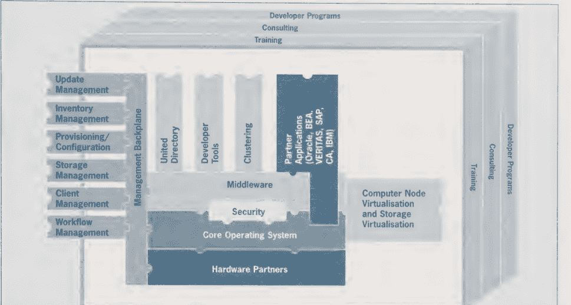

图 1：红帽开源架构

红帽声称其是市场上唯一的开源解决方案。公司还表示，它在该市场上具有竞争优势，包括：

* 定期的技术创新和维护
* 硬件和软件认证与集成
* 集成维护与管理
* 全球服务与支持
* 与 Linux 思想领者的直接关系
* 优化且可预测的 Linux

红帽正积极与 ISV 和 OEM 合作伙伴合作，提供审计的行业标准基准结果，并已发布了大量的企业 Linux v2.1 基准。公司在产品发布之前发布了第一个企业 Linux v.3 基准。

红帽企业级 Linux 自发布之日起支持五年，并由红帽选定的合作伙伴（如 Oracle、戴和 IBM）交付。提供三种支持类型：

* 全支持，包括硬件更新、漏洞修复和安全。
* 部署支持，包括安全漏洞修复。
* 维护支持，包含安全和选定的漏洞修复。

## 企业级 Linux

为了管理 Linux 基础设施，红帽公司提供了 Red Hat Network（红帽网络），这是一个易于使用的系统管理平台。它基于开放标准构建，并使用基于互联网的界面。Red Hat Network 为管理员提供了高效管理其网络上系统的工具。它还具有模块化设计，因此随着网络的扩展，管理员可以为其整个基础架构的系统更新、管理和配置添加增强功能。Red Hat Network 可以节省成本、提高生产力并增强安全性。

为了管理 Linux 基础设施，红帽提供了 Red Hat Network，这是一个易于使用的系统管理平台。

红帽通过在桌面自动推送更新和补丁，确保所有系统都是安全且最新的。它还通过对影响其用户的威胁和漏洞进行持续评估，并为安全问题提供单一联系点，借此为其企业级产品提供安全保障。它还与其竞争对手以及组织合作，例如 CERT 协调中心（CERT/CC）、国家基础设施安全协调中心（NISCC）和 Mire Corporation。

### 部署

红帽企业版（Red Hat Enterprise）以三种实现方式形式出售，适用于以下专业角色：

- **AS**：在数据中心环境中为企业应用提供基础，并提供数据服务等功能。
- **ES**：提供 Web 相关的网络能力，如 DNS、Web 服务器和 FTP，或满足受限用户群的需求（具有数据库或 Java 应用需求）。
- **WS**：为桌面、文件/打印服务提供支持，并提供密集计算能力。

这些功能由红帽企业版家族的最新成员——红帽企业桌面版（Red Hat Enterprise Desktop）实现。

所有产品都通过 Linux 标准 RPM 方法部署，该方法提供了一种软件包管理方案。红帽表示，典型的部署规模为 100 台或更多服务器，执行各种类型的任务。

部署时间跨度可以从几天到几个月不等，取决于部署的规模和复杂度。对于简单的文件和打印服务，启动时间可以小于一周。对于复杂的数据库环境，规划、部署和验证时间可能需要几个月。

红帽企业版 Linux（RHEL）经常部署在同时使用多个系统的异构环境中。Linux 系统能够轻松地与 UNIX 和 Windows 系统交换数据，因此可以模块化部署。持续维护的资源开销与相同规模的 UNIX 部署相似。

在资源方面，有几种实现可能性：

- 安装客户拥有的资源，需要时红帽服务团队提供帮助。
- 红帽对客户 IT 管理人员进行培训，然后他们独立完成安装。
- 红帽顾问或系统集成商可以迁移计划并协助部署。

红帽提供多种培训替代方案，已培训了超过 70,000 名客户员工。这些培训提供了关于开发、安全技能以及应用程序的高级培训。公司提供基于性能的认证：

- 红帽认证工程师（Red Hat Certified Engineer）。
- 红帽认证技术人员（Red Hat Certified Technician）。

课程可以在红帽自己的培训中心进行，也可以根据客户需求进行定制并在现场提供。培训课程在全球范围内 85 个城市提供，其中 35 个位于北美。红帽拥有许多合作伙伴，在全球范围内通过互联网提供培训服务。

红帽专业服务（Red Hat Professional Services）提供 24/7 全天候的 8 种语言全球支持服务。购买高级服务包的客户可以在小时内获得 1 级问题的支持。红帽的 OEM 合作伙伴也提供支持。购买预装硬件的客户可以致电硬件供应商寻求 1 级和 2 级支持问题。硬件供应商与红帽合作处理 3 级升级。

产品支持和开发包括使用红帽社区，该社区拥有超过 10,000 名认证工程师的全球成员，其中许多就职于其他领先软件供应商。与特定客户需求相关的工作需要资源时，属于额外购买。

核心产品红帽企业版 Linux 按照订阅模式出售，产品随同一种支持服务以及与 Red Hat Network 的连接交付。

红帽集群套件（Red Hat Cluster Suite）作为红帽企业版 Linux 3 版的分层产品提供。红帽集群技术最初作为 Enterprise Linux AS 2.1 版本的一部分交付。在 2003 年 10 月 15 日之前购买 Enterprise Linux AS 2.1 版本的客户，在升级到 Enterprise Linux 3 版本时，在其 Enterprise Linux AS 订阅有效期内，自动获得免费红帽集群套件订阅。

在所描述的服务中，可选的包括培训、咨询、技术账户管理、开发者支持、定制工程以及通过 Red Hat Network 进行系统监控。Cluster Suite、Portal Server、CMS 和 RHDS 都是在红帽 Linux 之外额外购买的产品。

### 产品策略

红帽企业版 Linux 是 Linux 的一种“发行版”。公司并不拥有该产品的代码（该代码由开源社区开发），因此不销售产品，而是提供订阅服务。该服务将红帽企业版 Linux 打造成一个稳定的平台，定期发布增强功能，并提供应用程序开发和部署的框架以及产品支持。红帽认为，由于以下因素，其开发模型优于专有开发方法：

- 来自开源社区和公司的工程师池及测试团队的规模、质量以及追求卓越的动力。
- 用于确保一致性和质量的流程，包括完全基于标准的方法。
- 独立软件和硬件供应商、开源社区之间的协作，红帽汇聚了最大的可用专业知识。

### 企业中的 Linux

在产品进展方面，红帽已从提供 Web 服务器解决方案（通过应用服务器和数据库服务器）变为企业架构平台。其性能特性已逐渐升级，以适应从桌面计算到刀片技术再到数据中心环境的需求。它已部署在移动设备、主机以及 x86 和精简指令集（RISC）芯片环境中。

红帽已从提供 Web 服务器解决方案变为企业架构平台。

它对客户的吸引力超越了通知的低成本优势。可扩展性和可靠性足以确保在保守型组织中销售，作为许多业务应用的基础。开源模型通过较低的准入门槛鼓励了供应商之间的竞争，降低了终端用户的参与成本。

红帽在垂直领域和技术领域获得了特别优势：

* 政府/公共部门。
* 金融服务。
* 电信。
* 嵌入式设备应用。
* 高性能计算。
* 销售终端。

红帽企业版 Linux 通过直接、OEM 合作伙伴和互联网销售。公司与 IBM Global Services 以及分销商 Interactive Ideas 有关键业务合作伙伴关系。其关键技术合作伙伴包括：

* AMD。
* EMC。
* 富士西门。
* Intel。
* 惠普（HP）。
* Dell。
* Dot Hill。
* 太阳。
* IBM。

作为专业 Linux 供应商的直接竞争对手是拥有 SUSE 子公司的 Novel，尽管基于 Linux 未来的市场成功，也将微软和太阳视为长期竞争对手。

红帽企业级 Linux 系列操作系统按系统、年度订阅的方式提供。订阅分为三个版本：基础版（Basic）、标准版（Standard）和高级版（Premium）。每个版本都有不同的支持级别和交付选项，以便客户能够选择最符合其业务需求的订阅组合。

### 版本定价

| 基础版 | 标准版 | 高级版 |
|---|---|---|

| **Red Hat Enterprise Linux AS** | | |
| Intel x86 | US$1499 | US$2499 |
| Intel Itanium2 and EM64T, AMD64, IBM iSeries & pSeries | US$1992 | US$2988 |
| IBM zSeries/s/390 | US$15000 | US$18000 |
| **Red Hat Enterprise Linux ES** | | |
| Intel x86 | US$349 | US$799 |
| Intel x86 | US$179 | US$299 |
| Intel Itanium2 and EM64T, AMD64 | US$792 | |
| 代理启动包 | 卫星启动包 | 扩展包 |
|---|---|---|

| **Red Hat Desktop** | | |
| Intel Itanium2 and EM64T, AMD64 | US$3500 | US$13500 |

红帽企业 Linux（Red Hat Enterprise Linux）拥有 18 个月的发布周期，以与其 ISV 合作伙伴的发布周期同步，确保完全的互操作性。红帽的开源架构（Open Source Architecture）勾勒了未来五年的技术战略。其下一次发布将是 Red Hat Linux 4，预计于 2005 年初发布。红帽计划继续开发开源架构：

- 一种可扩展的通用的开源操作系统发行版。
- 通过应用服务器、开发套件和集群提供的 OSS 分层产品。
- 具有红帽网络（Red Hat Network）的管理基础架构。

### 公司政策（NASDAQ:RHAT）

红帽公司（Red Hat Inc.）总部位于美国北卡罗来纳州罗利。它在英国、澳大利亚和日本设有主要办事处。企业家 Bob Young 和 Marc Ewing 于 1994 年创立了红帽，其商业模式完全围绕使用和开发开源软件。红帽通过提供红帽企业 Linux 平台（通过订阅模式销售）、发行版、集成、增强、技术服务、支持和培训，以及红帽网络来产生收入。所有代码开发都提交给开源社区，供他人复制和创新。

公司的全球培训计划在全球范围内 60 多个地点运营，其特色是全球标准 Linux 认证 RHCE。

### 财务数据

截至 2 月结束的财年数据如下：

| | 2003 年（百万美元） | 2002 年（百万美元） | 2001 年（百万美元） |
|---|---|---|---|
| 收入 | 90.9 | 78.9 | 80.8 |
| 同比增长（减少） | 15.2% | (2.4%) | 90.6% |
| 总净利润/(亏损） | (6.6) | (140.2) | (86.7) |

部署红帽 Linux 的主要客户包括：

- Figaro。
- 摩根士利（Morgan Stanley）。
- 瑞信第一波士顿（Credit Suisse First Boston）。
- 美盛林（Merill Lynch）。
- 亚马逊（Amazon）。
- 甲骨骨文（Oracle）。
- 英国石油（BP）。
- 梦工厂（Dreamworks）。

## 总结

红帽是领先的 Linux 供应商。通过合作伙伴关系，它拥有 IT 行业巨头认可的向往的历史，并且客户有广泛的服务供应商可供。随着 Red Hat Desktop v.3 加入其企业级产品家族，它提供了一个跨架构的开放、安全、可管理且一致的平台。Butler Group 认为，所有考虑迁移到 Linux 平台的各种规模组织都将被红帽提供的产品规模所震撼。

## 联系方式

**Red Hat, Inc.**

1801 Varsity Dr.

Raleigh,

NC 27606

USA

电话: +1 919 754 3700

传真: +1 919 754 3701

电子邮箱: info@redhat.com

www.redhat.com

**Red Hat Europe**

10 Alan Turing Road

Surrey Research Park

Guildford, Surrey

GU2 7YF, UK

电话: +44 (0)1483 300169

传真: +44 (0)1483 574944

电子邮箱: solutions-eu@redhat.com

www.europe.redhat.com

## 太阳微系统：Linux 服务

Butler Group

绝不妥协的分析

### 太阳微系统 Linux 服务

#### 摘要

太阳微系统（Sun Microsystems）为 Red Hat Linux 和 SUSE Linux Enterprise Server 平台提供教育、咨询和集成支持服务。它是开源社区最大的知识产权贡献者之一，并持续扩大其参与。它通过全面的全球基础设施提供一站式 Linux 支持。寻求经验丰富的全球供应商为其 Linux 平台提供集中和本地服务及支持的组织，将认为太阳是理想的合作伙伴。然而，最近公司关于 Linux 及其 Linux 合作伙伴传出了复杂杂的信息，潜在客户可能要求太阳公司澄清其未来战略。

#### 关键发现

- 太阳在 Solaris 方面的经验使其在提供 Linux 支持方面具有优势。
- 尽管太阳公司与其合作伙伴密切合作，但其最近批评了红帽。
- 全球企业可以获得本地语言能力的支持。
- 该公司是开源社区的主要贡献者。

图例：产品优势 / 劣势

#### 展望

上看，太阳似乎正在改变其 Linux 及其 Linux 合作伙伴，潜在客户可能要求太阳公司澄清其未来战略。然而，最近公司关于 Linux 及其 Linux 合作伙伴传出了复杂杂的信息，潜在客户可能要求太阳公司澄清其未来战略。

#### 功能

太阳微系统提供了最符合客户需求的解决方案，包括：

- Java 技术，包括 Java 系统。
- x86 硬件。
- 对 Red Hat Linux 和 SUSE Linux Enterprise Server 的支持服务。
- 满足需求的集成服务。

### 企业级 Linux

其支持服务设计为在产品生命周期内持续，其托管服务设计为在客户关系期间持续。其他服务可以按需提供，例如大规模集成，它还提供一次性的课堂或网络培训。

太阳的服务根据其对西格玛方法的实施（即 SunSigma）交付。所有服务共同构太阳架构、实施和管理（AIM）生命周期方法的一部分。除了 SunSigma，太阳还提供基于 ITIL 方法的管理服务。

架构上，设计方法建立在定义、测量、分析、设计和验证模型（DMADV），该模型已被调整为适用于三个生命周期的框架：问题分析、解决方案开发和解决方案维持。在经典的西格玛背景下，当首次开发流程或产品，或者现有流程或产品可以改进以满足既定的关键质量（CTQ）指标时，会应用 DMADV 模型。

# 企业级 Linux

| 定义 | 方法论启动 | 问题分析空间 |
| --- | --- | --- |
| 测量 | 需求开发 | |
| 分析 | 问题空间分析 | |
| 设计 | 解决方案设计 | 解决方案开发空间 |
| 验证 | 解决方案实施、测试与部署 | |
| 控制 | 解决方案维护 | 解决方案维护空间 |

图 1：Sun Sigma DMADVC 模型

Sun 表示，它通过 IT 解决方案交付价值，这些解决方案降低了复杂性和成本，提高了可管理性，并具有可用性、可扩展性和安全性。它提供了一系列整合并创新了新技术的 x86 产品。其 x86 硬件系列已认证为与 Red Hat Enterprise Linux 和 SUSE Enterprise Server 兼容。由于 Sun 与 Red Hat 和 SUSE 的全球联盟关系，该公司可以分发并支持 Red Hat Enterprise Linux 和 SUSE Enterprise Server。

该公司致力于在 Solaris 和 Java Enterprise 系统上提供其软件产品，Java Enterprise System 将在下一个版本中支持 Red Hat Enterprise Linux，且若干 SUN 产品已在早期版本的 Red Hat Linux 上可用。

Sun 是唯一将 Linux 和 UNIX 操作系统（OS）带入 x86 平台的公司。作为企业产品和服务的领导者，该公司利用其经验为 Linux 提供专业知识。Linux 和 Solaris 应用通过 Java 技术以及通用接口和工具（如 Linux 和 Solaris 兼容性工具 LinCAT）实现兼容性。Sun 为 Linux 提供了一个企业级开发平台，并专注于交付带有 Java 技术附加值的品牌化 Linux。Sun 服务和 Java Enterprise System 很快将可以在 Linux 上可用。

该公司表示，它是开源社区知识产权最大的贡献者之一。Sun 还是自由标准组织（Free Standards Group，Linux 标准组织）以及开源开发实验室（OSDL）的成员。Sun 的代表共同主持 Linux 国际化工作（L18n）。Sun 为自由和开源项目贡献资源和自由，包括：

- OpenOffice.org。
- GNOME.org。
- Mozilla.org。
- NetBeans.org。
- Grid Engine Project。
- Project JXTA。

2004年9月 第9 节：Sun Microsystems – Linux 服务 207

### 企业级 Linux

Sun 计划继续支持其许多开源倡议，并寻求向开源社区贡献 Java 技术、Solaris 以及其他 Sun ONE 代码和知识产权（IP）的机会：

- Sun 开源计划创建了 SunSource.net，这是一个致力于 Sun 参与自由和开源项目的网站。
- Java 社区进程（JCP）是由国际 Java 开发人员和许可者组成的开放组织，其章程是开发和修订 Java 技术规范、参考实现和技术兼容性包。


进入`/path/to/xxx`目录，找到`xxx.json`。

在表达式`cvar = avar + bvar`中，加法运算符（`+`）将`avar`与`bvar`相加，得到它们的和`cvar`

在`List.of(arg0, arg1, arg2)`中，`List`接口的工厂方法`of()`接受一系列的元素，返回包含它们的只读列表。

之后我们这样调用`cmd`命令：`cmd arg0 arg1 arg2`。

```
if (condVar > someVal) {console.log("xxx")}
```


作为富士日服务的母公司，富士日对 Linux 投入巨大，这将有助于其子公司在 Linux 生态系统中保持非常领先的地位。该公司在技术层面将 Linux 视为 UNIX 的另一个版本。英国的富士日服务在 UNIX 方面拥有深厚积累，拥有数百可以开发和部署 UNIX 解决方案的技术人员。凭借其资源，其交付 Linux 解决方案的能力远高于目前客户的需求。公司进行持续监控，并在市场需要时具备响应能力。

从战略上讲，富士日的首席工程师 Dave Stewart 领导由主席 Richard 的 Linux 特别兴趣小组（Linux SIG），负责就 Linux 和开源提供建议。Linux SIG 协调跨业务部门的开源活动——即拥有客户关系和销售业务的人员，以及能力部门——即开发技术的人员。类似的部门存在于富士日国际业务的其他地区，例如富士日澳洲，这些部门协作开发最佳实践。

此外，Linux SIG 已与 Novell 和 Hat 建立了关系，以拉近与这些关键供应商的关系，并认为开源供应商需要与富士日服务等外部人员更紧密地合作，而不是传统的硬件供应商，因为越来越多的技术决策是由外包伙伴做出或由外包伙伴产生的。

### 供应商概况

富士日是全球第三大 IT 公司，也是全球市场领先的、以客户为中心的信息技术和通信解决方案提供者。它提供计算和电信平台，以及一支全球性的系统和服务专家团队。该集团为上市公司，总部位于东京。截至 2003 年 3 月 31 日，富士日有限公司（TSE: 6702）报告合并收入为 4.6 万亿日元（380 亿美元）。该公司在 100 个国家拥有 170,000 名员工。

## 富士日服务

Observatory House

Windsor Road

Slough, Berkshire

SL1 2YEY, United Kingdom

电话：+44 (0)870 242 7998

传真：+44 (0)870 242 4445

电子邮件：askfitsu@fujitsu.com

www.fujitsu.com

## 富士日澳洲有限公司

2 July Avenue

North Ryde,

NSW 2113

Australia

电话：+61 2 9776 4555

## KNOPPIX

### 产品概况 – KNOPPIX 3.4

KNOPPIX 是一个可启动光盘，包含一套 GNU/Linux 软件集合，并具有自动硬件检测功能。它支持许多显卡、声卡、SCSI 和 USB 设备以及其他外设。KNOPPIX 可作为 Linux 演示、教育或救援系统。它包含了最新的软件包，如 OpenOffice、Abiword、Konqueror 和 Mozilla。

### 供应商概况

KNOPPIX 由 Klaus Knopper 开发的，被认为适用于各种任务。Knopper 接收的大量邮件表明了对 KNOPIX 的兴趣。作为结果，de-media GmbH 以新的 KNOPIX 支持中心的形式运营。KNOPIX 支持团队提供商业建议和解决方案。访问 `http://www.de-media.org/knoppix/en/index.html`。

## KNOPPER.NET

Klaus Knopper

Dansenberger Straße 44

6761 Kaislautern

德国

电子邮件：info@knopper.net

www.knopper.net

## 企业级 Linux

## Libranet

### 产品概况 - Libranet GNU/Linux

Libranet 的目标是构建一个技术和非技术用户都使用的系统。它适用于家庭和商业环境。该系统快速、稳定且全面，易于安装且所需支持很少。

Libranet 是基于 Debian 的系统，具有易于安装、可靠支持、配置和系统管理功能等优点。该系统功能强大，用户可以从多种窗口管理器、电子邮件客户端和 Web 浏览器中进行选择。对于开发者和希望运行服务器的用户，Libranet 包含了大量的软件包，可以轻松构建复杂的 Debian 系统。它对新用户友好，而经验用户也可以快速上手。简单的安装配合自动配置和软件包选择，使得系统易于启动。它包含了最新的软件包，如 IceWM 管理器、KDE、Gnome、Xfce 和 Enlightenment 桌面环境。

Libranet 更新安全存档有助于用户保持系统更新。部署 Libranet GNU/Linux 的最低系统要求为：

- Intel（例如 AMD）。
- Pentium 类及以上。
- 32MB 内存（建议 64MB 及以上）。
- SuperVga 640x480（推荐 800x600）。
- 硬件硬性要求：最小化安装 – 600MB，全功能安装 – 3.0GB，推荐 – 4.0GB。支持 IDE、SATA 和 SCSI。
- CD-ROM 驱动器。

2004 年9 月第 10 节：供应商概况 219

## 供应商简介

Librant Linux Desktop 是 Libra Computer Systems Ltd. 的产品。Libra 自 1984 年以来一直提供 UNIX 系统和软件开发，位于加拿大不列颠哥伦比亚省温哥华。它推出 GNU/Linux 作为 Librant 的基础，因为它认为其既稳固又符合 GNU/Linux 的精神。Librant 是一个团队，他们认为 Librant 不仅是 Microsoft Windows 的替代品，在某些方面也超越了它。随着 GNU/Linux 的演进，越来越多的硬件得到了支持，他们认为企业没有必要使用其他系统。他们在自己的桌面端和服务器环境中均使用 Librant，并满足 Librant 的业务和个人计算需求。其目标是继续生产一个令其骄傲的系统。

## Libra Computer Systems Ltd.

温哥华，BC

加拿大

www.librant.com

## Linspire

### 产品简介 – Linspired™ 4.5

Linspired 操作系统在提供 Linux 强大、稳定性和成本优势的同时，兼具 Windows 环境的易用性。它最近从 LinuxOS 改名，并因其友好、色彩丰富的界面而易体验。Linspire 表示，它只需 10 分钟即可完成安装，新手只需点击鼠标即可使用该系统。所有 Linspire 副本都预装了 Click-N-Run (CNR) 技术，这使得添加新软件或升级操作系统以及所有已安装程序变得简单。这得到了 Linspire CNR 仓库的支持，该仓库包含超过 1800 多个软件程序。

Linspire 是一个功能齐全的操作系统，类似于 Microsoft Windows XP 或 Apple OSX。该公司表示，它提供了 Linux 的强大、稳定性和成本优势，同时兼顾 Windows 环境的易用性。Linspire Web 为方便性和可用性进行了优化。标签页网络浏览器带有弹出广告拦截功能，防止桌面杂乱。此外，集成功能让用户只需点击鼠标即可自定义 Web 搜索。直观的邮件垃圾过滤器可以识别用户认为的垃圾邮件和不良邮件，提供了有效的垃圾邮件解决方案。Linspire 拥有强大的办公套件，包括与 Microsoft Windows 兼容的 (.doc) 文字处理器、Excel 兼容的 (.xls) 表格和 PowerPoint 兼容的 (.ppt) 软件。

Linspire 具有高级硬件检测功能，并安装必要的驱动程序。它提供了广泛的硬件支持，包括用于无线网络的 WiFi 支持。此外，它的 Easy Networking 让用户可以在 Microsoft 网络上进行读取、写入和浏览。

最低系统要求为：

- 配有 800 MHz 或更高处理器的 PC。
- 128 MB RAM（推荐 256 MB 或更高以获得最佳性能）。
- 硬盘。
- 1024 x 768 或更高分辨率显示器。
- CD-ROM 或 DVD 驱动器，键盘和鼠标。
- 与 Linspire 兼容的声卡及声器或耳机。
- 与 Linspire 兼容的 56 Kbps 硬件调制调器、电缆调制调器或 DSL 调制调器。
- 用于连接/局域网连接的以太网卡。

## 供应商简介

Michael Robertson 是 MP3.com 的创始人兼前 CEO，他创立了 Lindows.com, Inc. 公司。Microsoft 因指控侵犯商标对该公司提起诉讼，通过法院进行了三年诉讼，结果在2004 年公司将其名称和产品更改为 Linspire。这是一家消费者驱动型公司，使命是通过新型且负担得起的计算方案为用户带来选择。Linspire 的核心是一个操作系统，提供了 Linux 的强大、稳定性和成本优势，以及 Microsoft Windows 的易用性。

## Linspire

9333 Genesee Ave. 3 Floor

圣地亚哥

CA 92121

美国

www.linspire.com

## MIRACLE LINUX CORPORATION

### 产品简介 – MIRACLE LINUX 标准版版本 2.1

MIRACLE LINUX 标准版 V2.1 是一款下一代企业业务环境的服务器操作系统。它经过 Oracle9 的完全测试和支持，还包含集群和日志文件系统，以实现高扩展性和高可用性。它还有图形化工具“Install Navigator for Oracle”和“Webmin”，以便于部署和管理。使用此图形界面，安装 Oracle 的任务变得简单得多，它支持 Linux 版 Oracle、Oracle9 Application Server 以及 Database for Linux。Webmin 提供了系统管理和硬件管理功能，具有 IP 地址设置、分区设置、时间调整和打印机管理器。

通过与中国红旗（Red Flag）联合开发，Asianux 1.0 旨在为亚洲企业提供一个运营环境，提供增强的可用性、可靠性、扩展性、管理性和许多功能。Asianux 将作为每个发行版的下一个版本以安装 CD 的形式绑定，不进行任何修改，这受到了日本和中国每个品牌（MIRACLE LINUX V3.0 和 红旗 DC4.1）的重视。

## 供应商简介

MIRACLE LINUX CORPORATION 从事 Linux 操作系统的开发和销售，针对 Oracle 进行了微调，并进行 Miracle 营销，提供 Linux 相关的支持服务，如咨询、教育和维护。该公司成立于 2000 年 6 月。Miracle 拥有公司 58.5% 的股份，NEC 拥有 14%。该公司与中国红旗软件有限公司联合宣布建立了。

## MIRACLE LINUX CORPORATION

Linux 相关的支持服务：咨询、教育和维护。

该公司成立于 2000 年 6 月。Miracle 拥有公司 58.5% 的股份，NEC 拥有 14%。

与中国红旗软件有限公司联合宣布建立了。

## MontVista

### 产品简介 – 嵌入式 MontVista

基于 Linux 的实时操作系统。MontVista 于 1999 年由 James Ready 创立，提供消费级产品系列。它是一个先进的开发环境，为连接设备的需求提供支持。

不列颠哥伦比亚省温哥华，港口

107

电话：(408) 9000

www.miracle.com

## 供应商简介

MontVista Software 是一家私有公司，总部位于加利福尼亚州阳光谷。它获得了 Alloy Ventures、英飞科技、Intel Capital、松下和三星公司等领先投资者的资金。

### MontVista Software, Inc.

1237 Arques Ave.

阳光谷

CA 94085

美国

电话：(408) 328-9200

传真：(408) 328-9204

电子邮件：sales@mvista.com

### MontVista Software SAS

ZA Buisson de la Coudre

71890 TRAPPES

法国

电话：+33 1 30 16 28

传真：+33 1 30 16 29

电子邮件：info-fr@mvista.com

## NETLINE

### 产品简介 – OpenXchange Server 5.0

OpenXchange 是一种运行在 Linux 上的 Web 协作解决方案，提供软件和电子邮件服务，包括知识库、待办事项、日历、书签和基础项目管理。OpenXchange Server 本身开源但并非基于 GPL。它针对中小企业（SMB）的需求。

提供了完整的工具：OpenXchange 基于 Java、完全基于对象、具有 WebDAV/XML 接口，支持 Microsoft Outlook 和 Palm。它设计用于 Red Hat 或 SUSE 发行版。

Netline 成立于 1996 年，位于德国奥斯陆。目前拥有 15 名员工，2003 年通过 SUSE 的销售额报告为 70 万欧元。目前的客户包括卡特彼勒、Mövenepik、凯斯大学和 VBG。其重点是为中小企业市场开发基于 Java 的三层 Web 应用程序。

2004年8，Netline 宣布 Open-Exchange 将以通用公共许可发布，并可从 `www.Open-change.org` 下载。这将允许第三方和 ISV 开发包含协作功能的新应用程序。

butlergroup.com

## Netline Internet Service GmbH

Martinstr. 41

D-57462 Olpe

Germany

Tel: +49 2761-83850

Fax: +49 2761-838530

info@netline-is.de

`http://mirror.open-xchange`

## 红旗软件公司 (Red Soft Software)

### 产品简介 – 红旗 Linux (Red Flag Linux)

中国科学院对开放系统的二十年研究，以及十年的中文系统开发经验，构成了红旗 Linux的基础。该系统拥有许多政府部门资助的重要中国政府项目，包括国家发展委员会、信息工业部电子发展基金、科学技术部专项计划基金、北京市科技委员会和北京市经贸委员会。红旗 Linux 已广泛应用于中国电子政和 IT 基础设施的建设。其业务涵盖国家和地方政府、金融、能源、教育、交通、邮政、电信、媒体、彩票，以及许多与国家安全相关的政府部门和行业。

红旗软件公司的目标是为其客户提供领先的技术和优质的服务。公司与 IBM、Intel、Oracle、BEA、联想、长长、曙光、同方和 TCL 建立了战略联盟。它与合作伙伴共同在中国市场推广 Linux。红旗软件公司还建立了完整的全国客户服务网络，包括 100 多个培训中心、红旗认证工程师计划、销售渠道和 ISP 合作伙伴，以确保高效客户支持的可用性。

## 供应商简介

红旗软件有限公司（红旗软件）由中国科学院软件研究院和新信源创投于 2000 年 6 月共同创立，并于 2001 年 3 月获得了信息工业部旗下 CCID 资本的投资。其重点是基于 Linux 的操作系统和应用程序的开发与推广。其产品线包括桌面、高性能计算操作系统、操作系统和嵌入式系统，并提供全面的 IT 解决方案和专业支持。红旗软件使计算机能够最大性能运行，为政府和企业客户提供可靠高效的计算环境。

红旗软件公司与 MIRACLE LINUX 于 2004 年 3 月宣布完成 Asianux 1.0 Beta 开发，这是首个专为业务开发的标准化 Linux 运行环境。随着 Asianux 1.0 Beta 的完成，软件供应商可以通过新启动的 Asianux 认证计划获得产品认证。Asianux 1.0 由红旗软件和 MIRACLE LINUX 联合开发，旨在为亚洲企业提供高可用性、可靠性、可扩展性、管理性和多功能的运行环境。Asianux 将作为每个发行版版本的安装 CD 附带，不做任何修改，并以每个品牌名称（MIRACLE LINUX V3.0 和红旗 DC4.1）于 2004 年年中在日本和中国发货。

2004 年 9 月

第 10 节：供应商简介

## 红旗软件有限公司

北京市海淀区王渠恒路68 号紫金大厦 6 层

邮编 100086

中国

电话: +8610 82656655

传真: +8610 82658096

邮箱: support@redflag-linux.com

www.redflag-linux.com

## Slackware Linux 项目

### 产品简介 – Slack Linux 10.0

Slack Linux 为新用户和老用户提供功能完备的系统，能够胜任从桌面工作站到机房服务器的任何角色。Web 服务器、FTP 服务器和电子邮件服务器均开箱即用，并配有多种流行的桌面环境。对于希望开发或编译额外软件的用户，系统还包含了一系列开发工具、编辑器和当前库。

Slack Linux 兼容大多数 Intel PC 硬件。它在高端系统上表现出良好的性能，包括支持多达 16 个处理器的对称多处理、PCI，以及针对 486、Pentium、Pentium Pro 和 AMD Athlon 的特殊代码优化。Slackware Linux 10.0 延续了 Slackware 十年来建立的简单、稳定和安全性的传统。从创立之初，Slackware 就为 UNIX 老军兵提供了一个稳定且安全的 Linux 发行版，并为初学者提供了一个易于使用的系统。Slackware 声称，它包含了运行强大的服务器或工作站所需的一切。每个 Slackware 软件包都尽可能遵循作者的设置和安装说明，以提供最稳定且易于扩展的设置。


在最新版本中，许多程序更新和发行版的增强，提供了目前可用最先进的两个桌面环境。这些是预编译的 GNOME 应用、KDE 3.2.3（屡奖 K 桌面环境的最新版本）。Slackware 使用 2.4.26 内核来提供高级性能特性，如 ReiserFS 的日志文件系统、SCSI 和 ATA RAID 卷控制，以及对 XDRi（为 3D 桌面图形提供硬件加速支持的 Linux 接口）的支持。额外的内核允许使用任何 Linux 可用的日志文件系统安装 Slackware，包括 ext3、ReiserFS、IBM JFS 和 XFS。对于希望尝试新的 2.6.x 内核系列的 Slackware 用户，它通过预编译的 Linux 2.6.7 内核完全支持，并提供了模块和源代码，同时附带了如何安装新内核的完整说明。

Slackware 通过电子邮件和电话为客户提供安装支持和有限的技术支持。使用更广泛支持选项的用户可以使用第三方支持公司提供的服务。这些公司提供广泛的支持选项，包括标准电话支持和支持合同。

# 供应商简介

由 Patrick Volkerding 正式发布的 Slack Linux 是一款先进的 Linux 操作系统，以易用性和稳定为首要目标设计。Slackware 在包含最新流行软件的同时保持了传统感，提供了简单易用性的同时也提供了活性和强大功能。

## Slack Linux

www.slackware.com

## Sybase

### 产品简介 - Sybase Linux

Sybase 称，它五年前是首个在 Linux 上交付企业级 DBMS 的公司，现在提供支持 Linux 的全面产品和服务。Sybase Adaptive Server Enterprise (ASE) 是一个用于高性能业务应用的强大数据管理平台。它设计用于支持事务密集型、关键任务 OLTP 和决策支持应用的严苛需求。ASE 的高效查询优化为基于 Linux 的应用程序提供了高水平的性能和可扩展性。Sybase 称，ASE 易于部署和维护，具有增强的操作扩展性，以支持更繁重的负载……（注：由于原文后续存在大量重复的 OCR 错误文本，译文已根据要求精简保留核心内容）

### 企业级 Linux

## Terra Soft Solutions

### 产品简介 – Yellow Dog Linux

Yellow Dog Linux 是一种易于安装的操作系统，为 PowerPC 提供了最佳的 Linux 体验。对于新手和经验 Linux 用户来说，Yellow Dog Linux 包含了 900 多种应用程序和实用程序、优雅的图形环境、服务器应用程序以及核心编程工具。软件范围包括图形化界面、KDE、微软的替代品“Open Office”、AbiWord、Mac-On-Linux、拨号配置、全功能控制面板套件以及 4 种网络浏览器。

自推出以来，Yellow Dog Linux 吸引了多个领域的关注，那些希望使用 Linux 的希望利用 RISC PowerPC 架构提供的高性能计算优势。Yellow Dog Linux 4.0 是其第一个基于 Fedora 的发行版（Fedora 是围绕红帽基金会构建的社区转型）。Yellow Dog Linux 4.0 是 32 位的，并通过双 G5 Power Mac 支持 USB-3。

Y-HPC 是一个 64 位操作系统，它允许 G5 塔式机运行，并增加了 G5 X 服务器和集群节点。这种架构对于特定类型的高性能计算至关重要，例如天气建模、粒子物理研究、结构工程和核研究，在这些领域，模拟真实世界需要极高的精确大量的内存。

### 供应商简介

Terra Soft 位于科罗拉多州洛维兰的落基山山脚。它是一家私营公司，其主要市场定位是推进 PowerPC Linux 的能力和应用，同时支持软件开发的开源哲学。20 世纪 90 年代后期，Terra Soft 的执行官 Kai Staats 被邀请设计并构建一台 Web 服务器，他面临着独特的困境：使用 Apple Mac，但那个时代的非 Unix Mac 对于任务关键型服务并不可靠。Staats 熟悉 Linux 并欣赏它的稳定性；然而，他不想购买 IBM 硬件，随后在他 IT 团队的帮助下，将 Linux 移植到了 PowerPC（当时已有 Mac G3）。因此，针对 PowerPC 的 Yellow Dog Linux 诞生了。2003 年，Terra Soft 赢得了一份为美国海军国防承包商洛克希德·马丁（Lockheed Martin）建造声纳成像系统的合同。公司的客户名单还包括来自加州理工学院（Caltech）、斯坦福大学、劳伦斯·利弗莫实验室、波音以及美国航天局（NASA）多个部门的科技巨头。

Terra Soft 是 IBM 的业务伙伴或增值经销商。它获得许可销售预装 Yellow Dog Linux 的 BladeCenter JS20 及同系列产品。它还不是 IBM 的主要开发商，但该公司与红帽（Red Hat）和 SUSE 的财务关系要深得多。

### Terra Soft Solutions

| 地点 | 详情 |
| :--- | :--- |
| 洛维兰 (Loveland) | 美国 |
| Web | www.terrasoftsolutions.com |

## Turbinolux Inc.

### 产品简介 – Turbinolux

Turbinolux 发行版专为企业计算设计。Turbinolux 8 支持大文件支持（LFS）标准，用于管理或处理高达 4TB 数据的应用程序——这是服务世界 500 强及更大公司基础设施的常见需求。由 UnitedLinux 驱动的 Turbinolux Enterprise Server 8 是集成可靠性、可用性和扩展性功能的高级业务服务器平台。

### 企业级 Linux

Turbinox Enterprise Server 的核心是 UnitedLinux V.1.0，它提供了一个具有自动化安全和维护更新的任务关键型系统环境，并设计用于认证支持许多商业企业应用程序。其 Turbinox 10 桌面（1OD）包含许多增强功能和工具，使从 Windows 迁移到 Linux 变得简单舒适。在 Windows 网络共存的功能也内置在产品核心中。

Turbinolux 操作系统运行在各种硬件平台和配置上，公司与戴尔（Dell）、惠普（Hewlett-Packard）、IBM、AMD 和英特（Intel）拥有合作伙伴关系和全球支持。公司表示，它拥抱开源、行业标准以及集成到 IT 环境中的商业软件产品，以利用和保护组织的计算投资。

### 供应商简介

Turbinux 成立于 1992 年，是一家领先的 Linux 软件公司，致力于提供最新的 Linux 解决方案。高科技世界的领先公司都支持 Turbinux，企业投资者包括 BEA、康柏、富士通、英特、NEC、Novell、NTT 和东司。该公司在全球设有办公室，包括日本、中国和美国，能够很好地利用中国 IT 支出的高增长机遇，并帮助该国转型其数字基础设施。

Turbinux, Inc.

100 S. Sunrise Way, Suite 283

Palm Springs

CA 92262

USA

Tel: +760 318 0495

Fax: +160 406 4056

Turbinux, Inc.

Morimo-Building 55

3-3-5 Shibuya, Shibuya-ku

Tokyo, 150-0002

Japan

Tel: +81-3-5766-1660

Fax: +81-3-5766-1661

## uLinux

### 产品简介 - uLinux

uLinux/微控制器项目是一个没有内存管理单元（MMU）的 Linux 系统移植版。它的读音为“you-see-Linux”，其名称 uLinux 来自希腊字母“μ”和英语大写字母“C”的组合。“μ”代表“micro”，C 代表“controller”。摩托罗拉 MC6328，DragonBall 集成微处理器。这是第一个通过 Palmlet 成功启动的目标系统。

uLinux 操作系统运行在各种硬件平台和配置上，公司与戴尔（Dell）、惠普（Hewlett-Packard）、IBM、AMD 和英特（Intel）拥有合作伙伴关系和全球支持。公司表示，它拥抱开源、行业标准以及集成到 IT 环境中的商业软件产品，以利用和保护组织的计算投资。

uLinux

E-mail: info@ulinux.com

www.ulinux.com

## 第 11 节：术语表

### 企业级 Linux

ABI – 应用二进制接口 (Application Binary Interface)

应用程序访问操作系统的接口。

ACL – 访问控制列表 (Access Control Lists)

负责授予或取消对特定系统对象（例如文件目录）的访问。

ACPI – 高级配置与电源接口 (Advanced Configuration and Power Interface)

一种开放的行业规范，用于笔记本电脑、台式机和服务器由操作系统引导配置和电源管理的行业标准接口。

Alpha

由数字设备公司（Digital Equipment Corporation）开发的 64 位处理器，于被康培收购以及随后后者与惠普合并之前开发。

Apache

一种以开源许可分发的 Web 服务器。它运行在大多数基于 UNIX 的操作系统和 Windows 2000 上。

API – 应用程序接口 (Application Programming Interface)

由程序定义的接口，允许编程人员对该应用程序进行调用。

APM – 高级电源管理 (Advanced Power Management)

便携式计算机内置的功能，用于监控和控制其功耗，使其在使用闲时恢复“待机”模式。

ASP – 活动服务器页 (Active Server Pages)

允许在 Web 页面上动态生成内容。

BIND – 伯克利互联网域名 (Berkeley Internet Name Domain)

BIOS – 基本输入输出系统 (Basic Input Output System)

存储在计算机芯片上的代码，用于在硬件和操作系统之间提供接口。

BSD

最初指“伯克利软件分发版”（Berkeley Software Distribution），现在指在加利州大学伯克利分校开发的 UNIX 操作系统特定版本。

C2 安全级

由美国国家计算机安全中心建立的安全评级，授予通过了特定安全测试的产品。

CPU – 中央处理器 (Central Processing Unit)

一个或多个 CPU 赋予计算机运行软件（如操作系统）的能力。

DAT – 数字音频带 (Digital Audio Tape)

一种已演变为广泛使用的音频存档标准的磁带格式。

DES – 数据加密标准 (Data Encryption Standard)

一种使用密钥进行数据加密的方法。

DLT – 数字线性磁带 (Digital Linear Tape)

一种成熟的磁带标准，备份速度为每小时20GB。

DNS – 域名系统 (Domain Name System)

定位互联网域名并将其转换为 IP 地址。

### 企业级 Linux

DMA - 直接内存访问 (Direct Memory Access)

在不使用 CPU 的情况下在内存与内存之间传输数据。

EISA

一种标准计算机连接，将行业标准架构（ISA）标准扩展到 32 位接口。

ext2 - 第二扩展文件系统或扩展文件系统版本 2

用于提高计算机文件系统速度的 Linux 代码。

FAT - 文件分配表 (File Allocation Table)

FAT 文件系统是一种简单的文件系统，位于卷顶部的表格。

FC-AL - 光纤通道仲裁环 (Fibre Channel-Arbitrated Loop)

用于实现更快速吞吐和性能的内部磁盘阵列。

FC-SW-2 - 光纤通道交换矩阵 (Fibre Channel Switch Fabric FC-SW-2)

由国家信息技术标准委员会（NCITS）开发，是一种旨在允许客户利用差异进行竞争的标准。

FIPS-151 – 联邦信息处理标准 151

目前为版本 2，是可移植操作系统接口（POSIX）标准的一部分。在20世纪90年代代中期，它定义了 C 语言语言到操作系统环境的接口。

FTP - 文件传输协议 (File Transfer Protocol)

一种标准的互联网协议，是跨互联网计算机之间传输文件最简单的方法。

Globus

Globus 项目是一个旨在创建网格计算工具的研究计划。（www.globus.org）

GNOME - GNU 网络对象模型环境 (GNU Network Object Model Environment)

用于 Linux 操作系统的开源 GUI 和桌面应用程序。

GNU

由自由软件基金会分发的类似于 UNIX 的开源操作系统。

GPL

GNU 公用许可证 (GNU Public Licence)。

Grid

网格计算是在单个问题中同时使用许多计算机的资源，通常是具有海量数据的大型项目。网格服务在此基础上构建可以共享计算、电源和应用程序等资源的环境。

GUI - 图形用户界面 (Graphical User Interface)

基于图标、下拉菜单和鼠标的屏幕用户界面。

HBA – 热插总线适配器 (Hot Bus Adapter)

在主处理器与磁盘控制器之间提供接口的硬件。

HPFS - 高性能文件系统 (High Performance File System)

最初随 IBM 的 OS/2.1 引入的文件系统，允许访问市场上出现的更大的硬盘（改进了 FAT 文件系统）。

HTTP - 超文本传输协议 (HyperText Transfer Protocol)

一种用于在 Web 上交换文件的协议。使用统一资源定位符（URL）从 HTTP 服务器请求文件，并发送到 HTTP 客户端（通常是 Internet Explorer 等 Web 浏览器）。

### 企业级 Linux

HTTPS - SSL 超文本传输协议 (Hypertext Transfer Protocol over SSL)

安全套层。一种通过 Web 服务器加密和解密用户页面请求及内容的 Web 协议。（另参考 S-HTTP 作为 HTTPS 的替代方案）。

IBCS-2 – 英特尔二进制兼容规范 (Intel Binary Compatibility Specification)

适用于在英特尔平台上运行应用程序的通用系统调用接口。

IIS – 互联网信息服务器 (Internet Information Server)

一组包含微软 Windows 2000 或 NT 操作系统功能的互联网服务器。

IKE – 互联网密钥交换 (Internet Key Exchange)

与 IPSec 标准配合使用的密钥管理协议标准。

IMAP – 互联网消息访问协议 (Internet Messaging Access Protocol)

用于从本地服务器访问电子邮件的标准客户端/服务器协议。

I/O – 输入/输出 (Input/Output)

计算机的输入与输出。

IP – 互联网协议 (Internet Protocol)

另见 TCP/IP。

IPSec

一种为 IP 数据包提供强效身份验证和加密的 IP 特性。

IPv6 – 互联网协议 (Internet Protocol)

下一代 IP 协议。

ISA – 行业标准架构 (Industry Standard Architecture)

一种标准总线架构。

Itanium

英特尔基于 64 位架构的微处理器。

JDBC – Java 数据库连接 (Java Database Connectivity)

一种将用 Java 编写的程序连接到流行数据库数据的应用程序接口规范。

JVM – Java 虚拟机 (Java Virtual Machine)

一种将 Java 代码转换为机器语言的平台无关语言。

KDE – 桌面环境 (Desktop Environment)

用于 Linux 操作系统的开源 GUI。它包含文件管理器、帮助系统和实用。

Kerberos

一种用于计算机网络中服务请求的安全方法。

Kernel

内核

操作系统的核心服务集合，提供用户进程与系统之间的接口。

L18n – 国际化倡议

这是一个由 Linux 和开源贡献者组成的自愿工作小组。其目标是实现国际化背景下软件/应用程序的可移植性。

### 企业级 Linux

LS120

格式化容量为 120MB 的 3.5 英磁盘。

LSB – Linux 标准基础 (Linux Standard Base)

自由标准小组的工作，目标是开发一套标准，以增加 Linux 发行版之间的兼容性，并使应用程序能够在任何符合标准的系统上运行。

LVM – 逻辑卷管理器 (Logical Volume Manager)

MCA – 微通道架构 (Micro Channel Architecture)

计算机与其扩展卡及关联设备之间的接口。由 IBM 为其 PS/2 桌面开发。

.NET

微软的 Web 服务计划，包括工具、运行时平台以及身份验证、个性化和安全等 Web 端服务。

NetBEUI - NetBios 增强型用户界面

一种允许计算机在局域网内通信的程序。

NFS – 网络文件系统 (Network File System)

分布式文件系统，使网络上的计算机可以使用文件。

NNTP – 网络新闻传输协议 (Network News Transfer Protocol)

它是客户端和服务器管理 Usenet 新组帖子的主要协议。

NTFS – 微软 Windows NT（新技术）文件系统

它将文件组织成排序的目录。不依赖于底层硬件，也不需要磁盘上的特殊位置。

NTP – 网络时间协议 (Network Time Protocol)

一种用于同步计算机实时时钟的协议。

NUMA – 非对称内存访问 (Non-Uniform Memory Architecture)

一种内存被划分为近远端库的多处理器架构。

ODBC – 开放数据库连接 (Open DataBase Connectivity)

一种访问数据库的标准 API。


# OLE – 对象链接与嵌入 (Object Linking and Embedding)

一组创建和显示复合文档（如文本或日历）的 API。

# OS – 操作系统 (Operating System)

控制计算机系统的程序。

# OSS – 开源软件 (Open Source Software)

任何用户或开发者可以使用或进一步增强的程序。

# PAM – 存在与可用性管理论坛 (Presence and Availability Management Forum)

它解决可用性信息的使用和保护。

# PCI – 外围组件连接 (Peripheral Component Interconnect)

微处理器与附加设备之间的连接系统。

# PCI-X – 外围组件连接扩展 (Peripheral Component Interconnect Ext)

允许数据以 133MHz 的速度在计算机内部移动的总线技术，而非 66MHz。

# PHP

PHP 是一种用于 Linux 服务器的脚本语言和解释器。

# PKI – 公钥基础设施

PKI 允许公共网络的用户安全且私密地交换数据。

# POP – 接入点

互联网的接入点。

# POSIX – 可移动操作系统接口

一种 IEEE 1003.1 标准，定义了 UNIX 操作系统与应用程序之间的接口。

# PPP – 点对点协议

提供通过串行线路进行拨号访问。

# QIC – 四分之一英寸盒

一种常用的磁带驱动器。

# RADIUS – 远程认证拨号用户服务

一种访问方法，使用挑战/响应方法进行身份验证。

# RAID – 独立廉价磁盘阵列或独立磁盘冗余阵列

一种在多个硬盘上存储相同数据的方法的方法。

# RAM – 随机访问内存

计算机中存放操作系统、数据和当前使用的程序的区域。

# RISC – 减少指令集计算

一种微处理器，旨在通过执行较小的计算指令集来提高速度。

# Samba

一种开源文件服务器和打印服务器。

# SCO – 圣克鲁兹运营公司

一家服务器操作系统提供商。

# SCSI – 小型计算机系统接口

一种将服务器连接到存储设备的方法。

# S-HTTP – 安全超文本传输协议

安全的 HTTPS，它是 HTTP 的扩展，允许在 Web 上安全地交换文件。每个 S-HTTP 文件要么加密，要么包含数字证书，或者两者兼有。

（另见 HTTPS 作为 S-HTTP 的替代方案）。

# SMP – 对称多处理

可以同时运行多个处理器。

# SMTP – 邮件传输协议

用于发送和接收电子邮件的 TCP/IP 协议。通常 SMTP 用于发送，而每个 POP3 或 IMAP 用于接收。

# SOCKS5

一种行业标准的防火墙穿越解决方案。它在两台计算机之间提供了一个安全的数据通道。

# SPARC – 可扩展处理器架构

一种基于 RISC 技术的高性能处理器。

## 企业级 Linux

# SSH – 安全 Shell 或安全套 Shell

一种基于 UNIX 的命令行接口和协议，用于安全访问远程计算机。

# SSL – 安全套接层

一种用于管理互联网消息传输安全的协议。

# SVID3 – System V 接口定义第三版

该规范的开发者 UNIX 系统实验室已不再运营，因此业界对于符合该规范的要求存在一些困惑。

# TB – 太字节

约一万亿字节。

# Tcl – 工具命令语言

由 John Ousterhout 开发，是一种嵌入且可扩展的脚本语言。

# TCP

见 TCP/IP。

# TCP/IP

传输控制协议/网协议。

# UDI – 统一驱动程序接口

这是一系列允许内容库访问所有数据的驱动程序。

# UDMA – 超 DMA 或超直接内存访问

这是系统总线主控 DMA 协议的后续版本，将最大数据传输率提高到 33MB/ps。

# UNIX

一种最初于 1969 年开发的操作系统，被广泛认为是第一个可以任何人修改的操作系统。它是非专有的，不属于任何制造商。Open Group 拥有官方 UNIX 商标。

# UPS – 不间断电源

电力连接故障时使用的备用电源。

# USB – 通用串行总

计算机与附加设备之间的即插用接口。

# VB – Visual Basic

一种微软编程环境。

# VDM – 虚拟 DOS 机器

Windows NT 创建的模拟 DOS 环境的 DOS 会话。

# VLAN – 虚拟局域网

一种使用地理位置以外的其他方式映射工作站的局域网。

# vtcl – Visual Tcl 或 Visual 工具命令语言

见 Tcl。

# WBEM – 基于 Web 的企业管理

由分布式管理任务小组开发的一系列管理和标准技术。

# XML – 可扩展标记语言

由 W3C 在 1998 年作为建议定义的标记语言。用作元语言描述数据，现在在许多领域有广泛应用，如：应用程序集成；内容管理；电子数据交换；无线通信。XML 是“可扩展”的，因为与 HTML 不同，它的标记符号是无限的且自定义的。使用 XSL 样式表，XML 可以转换为在 Web 页面上显示为 HTML，或转换为在其他类型客户端设备上显示的替代格式。

# XPG4 - X/Open 可移植性指南第 4 期

一个包含国际化实用、头文件和接口的规范。

# Butler Group

不妥协的分析

## 技术评估与比较报告

本报告揭示了：

- 为什么 Linux 现在被视为企业稳健且可行的选择。
- 开源开发方法的优缺点。
- 行业支持如何帮助 Linux 演变为企业级操作系统。
- 各 Linux 发行版之间的差异，以及哪一个适合企业。
- 领先的 Linux 服务供应商之间的差异。
- 迁移到 Linux 的标准以及需要考虑的部署问题。
- 是否应该将 Linux 策略扩展到桌面。

# Butler Group

不妥协的分析

总部：

Europa House, 184 Ferensway,

Hulk, East Yorkshire,

HU1 3UT UK

电话：+44 (0)1482 586149

传真：+44 (0)1482 323577

澳大利亚销售办公室：

Butler Direct Pty Limited, Level 6,

275 Alfred Street, North Sydney,

NSW 2060, Australia

电话：+61 (0)2955 6249

传真：+61 (0)2955 5883
