# 职场Linux使用指南

## 引言

你可能从其他操作系统转用Linux和KDE，想必已经习惯用电脑浏览网页、收发邮件、制作文档以及处理其他工作相关事务。无论你是有一定经验还是完全的初学者，这本书都是为你量身编写的。总体而言，本书不要求你具备任何计算机使用基础。我们会介绍Linux和KDE分别是什么（见第1章“了解各组成部分”），甚至会教你如何使用鼠标（Linux下的鼠标有三个按键）。当然，你已有的经验越多，学习速度就会越快，因为KDE界面的使用方式与其他流行的图形界面非常相似，仅存在一些重要差异。

尽管市面上有大量Linux商业软件，但它们并非本书的重点。相反，我们聚焦于免费提供的、通常预装在大多数Linux发行版中的程序。我们不会涵盖KDE附带的所有应用程序，只聚焦于你在普通办公甚至家庭环境中最可能用到的那些。等你熟悉了本书的内容后，学习任何你想使用的特定商业或免费程序都会非常轻松。

## 本书的独特之处

传统上，Linux一直是计算机技术素养较高的用户青睐的操作系统。因此，你会发现很多Linux书籍会告诉你Linux和UNIX类似（确实如此）、如何安装Linux、Linux为何优秀，以及如何用Linux完成特定任务（例如运行Web服务器）。也有大量书籍会详细介绍如何用Linux运行特定软件（例如GIMP图形程序），还有书籍会对比微软Windows和Linux的功能差异。本书的不同之处在于，我们假设你不想安装Linux、不想学习如何成为系统管理员，也不想处理一些更复杂的任务。我们假设你的办公桌上已经有一台可正常运行的Linux系统，只需要用它完成工作即可。这些工作大概包括收发邮件、浏览网页、处理文档，以及完成各类通用办公任务。此外，我们假设在大多数情况下，你会用Linux自带的KDE图形用户界面（GUI）来完成这些任务。（当然，当你熟练掌握所有这些任务后，你可能会想了解什么是命令行，以及如何用命令行更高效地完成部分任务。）本书的另一个独特之处在于，它出自我们公司SSC的多名员工之手。贡献者包括：我们的出版人菲尔·休斯；市场部的卡尔·费尔柴尔德、丽贝卡·卡西蒂、克拉丽莎·格罗夫、詹姆斯·格雷；编辑部的理查德·弗农、吉尔·富兰克林、唐·马蒂、希瑟·米德、乔尔·梅加尔；我们的平面设计师莉迪亚·金纳塔；网站管理员斯科特·布兰查德；以及我们的系统管理员之一迈克·奥尔。SSC作为一家出版公司，自1993年起就开始使用Linux。我们中的一些人从1980年就开始使用UNIX，已经从UNIX命令行界面过渡到用GUI完成部分任务。另一些人则是没有任何UNIX或Linux经验的“门外汉”，先学了GUI，再拓展知识掌握命令行工具。正因如此，我们都还记得初学Linux工作相关任务、初次接触KDE桌面时的感受。除杂志排版和一些会计工作外，我们所有的日常工作都在Linux上完成。其中大部分工作使用KDE桌面以及大多数Linux发行版附带的工具完成。我们编写本书的目的就是让你能快速上手使用Linux和KDE。在本书的编写和测试过程中，我们使用了Debian “Woody”、SuSE 7.3和8.0发行版（关于发行版的更多信息，请见第1章“了解各组成部分”）。另外，和Linux本身一样，许多开源程序都处于持续开发中。因此，你使用的某个程序的版本可能与本书讨论的版本不同。不过这些差异通常是新增的功能，一般不会影响程序的核心功能。所以只要你按照书中的指导操作，即使版本略有不同，学习使用这些应用时也不会遇到任何问题。那么，欢迎来到Linux和KDE桌面的世界！我们相信，经过一点练习，你很快就能熟练使用，并会逐渐欣赏Linux操作系统的强大、可靠，甚至会发现其中的乐趣。

## 第1章：了解各组成部分

人们常称Linux是一款“免费”操作系统（OS）。本章将详细解释这一说法的具体含义，以及它如何影响Linux的分发方式。本章还会介绍KDE桌面、它与Linux的关系，以及Linux上常用的一些办公相关软件。

### 什么是Linux？

Linux是一款计算机操作系统，是你电脑运行的最核心的程序。它通过分配资源、解析你的指令（通过鼠标和键盘）、向显示器输出内容、管理所有文件以及执行许多其他重要任务，来控制电脑上运行的所有程序。Linux与大多数操作系统的不同之处在于，它由全球众多程序员共同开发。Linux是免费的，一方面你无需为它付费（尽管你可以选择付费，很多人也确实这么做了），另一方面它的源代码（内部构成部分）对任何想要查看或修改它的人开放。源代码“开放”使得任何人都可以试用Linux、查找漏洞并提交修复补丁，这些补丁会先提交到中央控制点，再被纳入Linux的未来版本中。内核是Linux的中枢神经系统，它是运行整个计算机的操作系统代码。虽然一些高级Linux用户会修改自己系统上的内核，但你可能完全不会接触到它。不过你需要知道，这是你电脑系统的核心，且正处于持续开发中。由于大量开发者参与Linux的开发，其开发速度很快，问题通常能被快速发现并解决。

### Linux的溯源

Linux的血统可追溯到UNIX——它是世界上经过最多验证的操作系统，其各类变体在过去三十多年里一直是使用最广泛的网络计算机操作系统。UNIX由贝尔电话实验室开发，设计目标是支持多用户同时在多台计算机上工作，所有计算机互联并共享信息与资源。使用这类操作系统时，多人可以同时用单台计算机的硬件完成多项任务，单个用户也可以在同一台机器上同时执行多项任务（多任务处理）。这能提升资源利用率，打造更强大的系统。Linux可运行在多种平台上，包括x86、PowerPC、DEC Alpha、Sun Sparc和ARM，因此无论你使用什么类型的计算机硬件，Linux基本都能运行。Linux致力于符合POSIX（可移植操作系统接口，针对UNIX）标准。POSIX是一套定义程序与操作系统之间接口的标准。遵循这些标准，软件开发人员可以确信他们的程序能够轻松移植到任何符合POSIX标准的操作系统，例如各类UNIX版本。这意味着Linux用户可以受益于为通用UNIX系统开发的软件。

### Linux性能

Linux因其稳定性备受赞誉——搭载Linux操作系统的计算机可以连续数月甚至数年运行而不会崩溃、卡顿或需要重启。Linux设备也以速度极快著称，这是因为Linux在管理内存、算力、磁盘空间等资源方面效率极高。事实上，万维网的大部分服务都由运行Linux和Apache网络服务器的老旧计算机提供。此外，NASA、桑迪亚国家实验室、费米实验室等机构通过将多台性能较低的Linux设备组合成集群协同工作，打造出了性能强大且成本低廉的超级计算机。

### Linux发行版

由于Linux是免费开源的，任何公司或个人都可以基于它添加软件，将最终整合的版本（免费或付费）作为Linux发行版发布。由此产生了种类繁多的发行版。部分发行版的开发企业还会对Linux内核做小幅修改，并内置自主开发的Linux管理、配置工具，以简化安装和管理流程。尽管各发行版存在细微差异，但大多数区别仅在于预装的软件不同。好消息是，就算你的发行版没有预装你需要的工具或应用，通常也可以从互联网免费下载。

### 与Linux交互的方式：文本界面与图形界面

与Linux交互的一种方式是在命令行输入文本，这和用DOS时熟悉的命令提示符（`C:>`）类似。文本界面要求用户输入操作系统能识别的特定语法命令。计算机会显示一个*prompt（提示符）*，告知用户已准备好接收命令。输入命令的位置被称为命令行。20世纪80年代中期或更早使用过个人计算机的用户，应该都熟悉某种文本用户界面。许多实用工具或程序都是基于命令行的。这意味着你无需点击鼠标访问程序，当计算机会显示提示符时，只需在所谓的*终端窗口*中输入对应单词即可。本书要到最后一章才会讨论这些实用工具。第13章会介绍命令行界面和部分实用工具，但你可以放心，这一章是选读内容。另一种与Linux交互的方式是通过*图形用户界面（GUI）*。这种界面通常被称为桌面，包含图标、窗口、对话框、工具栏和面板等元素，你在使用Linux这种点按式操作系统时就能看到这些元素。图形界面被认为更易用，因为它提供了可视化提示，你可以通过这些提示让计算机执行操作，无需记忆大量命令。本书重点介绍KDE图形界面的使用。尽管我们会提及命令行及相关部分命令，但你所需的所有操作都可以通过KDE图形界面完成。

### KDE

#### 什么是KDE？

*KDE*是一种图形界面，是能与操作系统交互、但不属于操作系统核心组成部分的软件。它的作用就是提供与操作系统交互的途径，你可以把它想象成你和Linux之间的翻译器。GNOME是另一种适用于Linux的流行桌面图形界面。GNOME和KDE分别由不同的软件开发团队创建和维护。两者功能都很完善，选择哪一个主要取决于个人偏好。本书以KDE为例，是因为我们办公室日常使用该界面，且几乎所有Linux发行版都内置了KDE。

#### 还包含哪些内容？

除了Linux系统本身和KDE桌面外，你的Linux操作系统还预装了诸多其他程序。仅KDE就内置了100余款程序，包括图片查看器、文本编辑器、电子邮件程序、网页浏览器和游戏等。你甚至还能找到免费的办公软件套件（*OpenOffice*）和类Photoshop程序（*The GIMP*），这两款软件本书都会做相关介绍。*OpenOffice*和*The GIMP*普遍被认为是各自领域内的领先免费应用。因此我们为两款软件各设置了独立章节。

## 第2章：登录与导航

本章将介绍Linux系统下使用KDE图形界面的基础操作。如果你用过其他图形界面环境，这些内容对你来说可能比较基础，但你还是可以快速浏览一遍，了解其中的差异。

### 登录与退出

首次启动Linux时，会先进入登录界面。进行任何操作前，你需要输入登录名（有时也叫用户名）和密码，两者都由系统管理员提供。这一过程被称为*登录*。由于Linux系统可以设置多个用户，每个用户都有自定义的桌面和配置，输入登录名就是告诉Linux你的身份，系统会据此加载你的专属配置。当多个人共用同一台计算机时，用户名尤为重要。

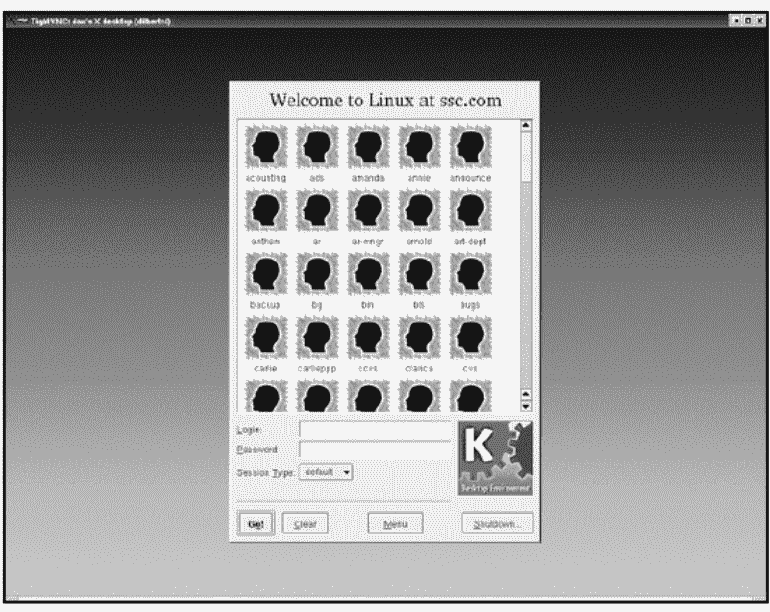

> **图2.1：登录界面**

Linux会通过密码验证你的身份，因此你需要妥善保密。输入密码时，你输入的内容不会显示在输入框中，取而代之的是会显示加号或星号。（根据Linux系统的配置不同，也可能完全不会显示密码相关内容，你需要盲打输入。）输入登录名和密码后，按下`ENTER`键。计算机会用短暂的时间加载你所需的全部资源，KDE会显示加载进度。设备初始化完成后，KDE桌面就会出现，你就可以开始工作了。

### 修改密码

设置密码时，要选择容易记住（最好不要写下来）、且他人难以猜到的密码。不要使用姓名、字典中的词汇，或任何与可轻易获取的个人信息相关的内容作为密码。好的密码会混合大小写字母和非字母数字按键。*nCk&Ve*或*uG]y$Uds*都是不错的密码示例。系统管理员可能会为你分配初始密码，如果你需要自行设置密码，建议每两个月更换一次。你可以通过K菜单中「实用工具」子菜单里的`KPasswd`工具修改密码，具体操作方法会在本章后续内容中介绍。

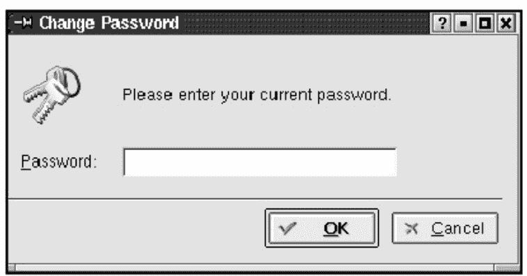

图2.2：修改密码对话框

### 退出登录

会话结束后退出计算机时，点击面板上的K按钮，在弹出的菜单中选择「退出登录」。此时会弹出对话框，询问你是否要在下次登录时恢复当前会话，同时确认是否真的要退出登录。点击「退出登录」即可完成确认。

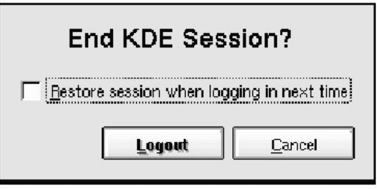

图2.3：退出登录界面

> **提示** 退出系统前，请确保所有工作都已保存，以免数据丢失。

### 关于root账号

首次安装KDE时，安装程序会提示你至少创建两个账户：`root`账户和普通用户账户。*root*是超级用户账户，仅用于系统管理，该账户拥有对系统几乎所有的操作权限。大多数办公环境会限制`root`账户的访问权限，仅向系统管理员开放。如果你拥有系统的`root`权限，需要注意：对系统文件的修改可能会彻底改变系统的运行方式。在你试用和熟悉KDE的过程中，可能会遇到仅允许`root`访问的项，这些内容需要系统管理员协助才能修改。

### KDE桌面概览

登录计算机后，你会看到一块空白的背景，上面有一些小图标，屏幕底部还有一条带有更多图标的工具栏。背景被称为*桌面*；底部的条状栏被称为*面板*；上面的小图片是*图标*，代表你计算机上最常用的程序和工具。例如，救生圈图标是帮助程序的标识，地球图标代表用于上网的`Konqueror`网页浏览器。

**提示** 程序或程序组也被称为应用程序。桌面图标下方会标注对应的功能，比如打印机、电子邮件。当鼠标指针悬停在面板图标上时，会弹出文字说明该图标的功能。KDE界面或其任何应用中的几乎所有图标、按钮都遵循这个规则。面板和桌面图标的使用方法会在本章「桌面导航」部分介绍。要打开某个程序，只需将鼠标指针移至对应图标上，单击鼠标左键即可。鼠标指针旁会出现一个闪烁的迷你图标，表明你的计算机正在打开对应的程序或文件。迷你图标的样式会提示正在打开的是哪个程序。比如，如果你点击面板上的地球图标打开`Konqueror`浏览器，就会出现闪烁的地球图标。

### 菜单、窗口与工具栏

*菜单*会列出可执行的任务选项。例如，点击面板左下角的K按钮，会弹出菜单，列出你系统中安装的各类程序和工具。将鼠标指针向上移动，会弹出更多子菜单。这些是*子菜单*，对应主菜单中具体条目的二级菜单。例如，这里展示的是「游戏」对应的子菜单。在菜单或子菜单中找到想要打开的程序后，单击程序名称即可启动该程序。

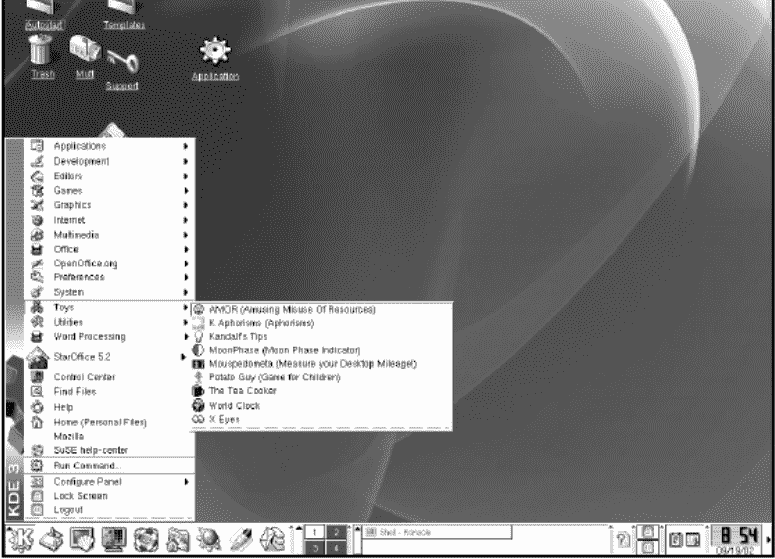

图2.4：K菜单项的子菜单

**提示** 如果图标或菜单项旁边出现小的黑色箭头，说明存在子菜单。将鼠标移到该项目上即可调出子菜单。

程序启动时会显示在*window*（窗口）中，即屏幕上一个封闭的矩形区域。你可以在桌面上同时打开多个程序，每个程序对应一个窗口。（你将在下一节了解具体可以同时打开多少个桌面和窗口。）这是Linux的*multitasking*（多任务）功能的一部分。当一个程序正在执行任务时，你可以同时操作另一个程序。例如，当你的电脑正在安装程序时，你可以同时用`AbiWord`愉快地撰写信件。每个程序窗口的顶部通常都有一个菜单栏，列有菜单项——即适用于当前已打开特定程序的选项和命令组。

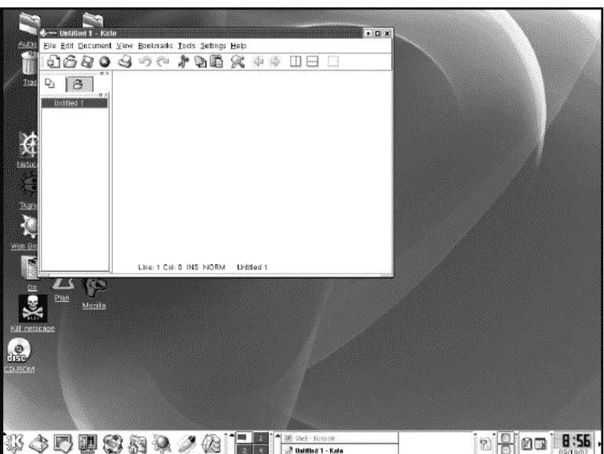

**图2.5：程序内带子菜单选项的典型菜单栏**

虽然左鼠标按钮最常用，但点击鼠标右键通常会调出程序的隐藏选项菜单（如果有的话）。例如，当指针位于空白桌面（不在图标或文件上）时点击鼠标右键，会弹出一个菜单，提供注销、锁定桌面（即需要输入密码才能访问内容）、新建文档、排列图标和窗口，以及执行其他各类任务的选项。这些弹出式可用选项菜单会随你使用的程序不同而变化，因此请留意查看你最常用的图标和工具。

- 新建
- 书签
- 撤销 `Ctrl+Z`
- 粘贴 `Ctrl+V`
- 桌面帮助
- 运行命令...
- 配置桌面...
- 启用桌面菜单
- 整理窗口
- 层叠窗口
- 对齐图标
- 排列图标
- 刷新桌面
- 锁定屏幕
- 注销

图2.6：桌面的隐藏菜单

### 鼠标的其他用法：移动与复制

你还可以用鼠标移动桌面上的项目：点击项目并拖动到新位置即可，这种方法称为*drag and drop*（拖放）。操作时先将鼠标指针直接移到要移动的项目上，然后按住鼠标左键，移动鼠标即可将项目拖到屏幕各处。到达目标位置后，松开鼠标按键即可将项目放到此处。你甚至可以借助拖放功能执行操作，例如，你可以将文件拖到打印机图标上打印。要将窗口移动到屏幕的其他位置，把指针移到窗口的*titlebar*（标题栏，即窗口最顶部的区域）上，然后拖放窗口到新位置即可。窗口到达目标位置后，松开鼠标按键。要调整窗口大小，把鼠标指针移到窗口边缘，当出现双向箭头时，点击并拖动箭头向内或向外到所需大小即可。从窗口角落调整可以同时改变宽度和高度（沿对角线拖动）。

| 提示 |  |
| --- | --- |
| 如果要移动标题栏无法访问的窗口（比如你太兴奋了，把它拖到了屏幕顶端以外），按住`ALT`键，点击窗口任意位置，然后拖动即可。 | |
| 你还可以用鼠标将文本从任何带文本输入区域的窗口复制到另一个窗口。例如，你可以用鼠标把网页上的文本复制到文档或电子邮件中。只需将鼠标指针移到文本开头，按下左键，然后拖动指针经过要复制的文本（双击可以逐词高亮，而非按空格高亮）即可选中要复制的文本。点击鼠标中键（或双键鼠标同时点击左右键）即可将文本粘贴到文本光标所在的任意位置。 | |

显示内容超出单屏的窗口，最右侧会有一条垂直的灰色条，顶部有指向上方的小黑箭头，底部有指向下方的小黑箭头。这就是*scroll bar*（滚动条），用于在文档中垂直移动。点击向下箭头可以显示文档下部内容，点击向上箭头可以回到上部内容。你也可以用鼠标指针点击滚动条本身并上下拖动。对于过宽的窗口同理，滚动条会出现在窗口底部。

### 浏览你的桌面

如前所述，登录KDE后，你会看到左侧排列着若干图标的彩色背景，底部还有一条排列着更多图标的栏，称为面板。

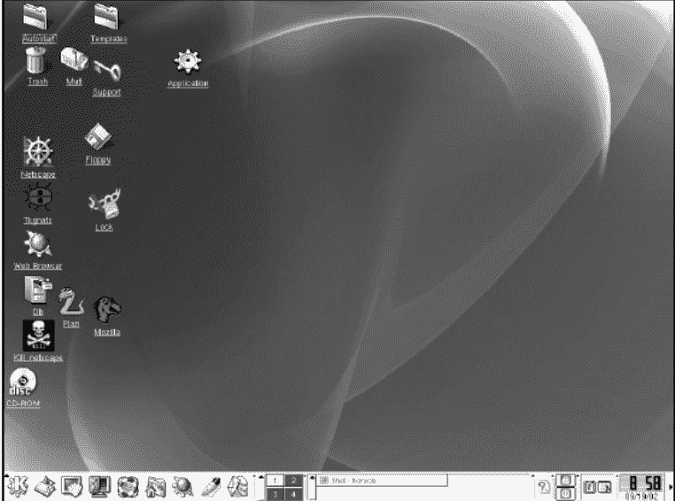

图2.7：KDE桌面

#### 面板

面板可以快速访问最常用的程序，还能帮你导航已打开的窗口。面板上的每个图标都对应菜单、目录、应用程序或实用工具，只需点击一下即可显示在屏幕上供你使用。其中最重要的图标是左上角的大写K。

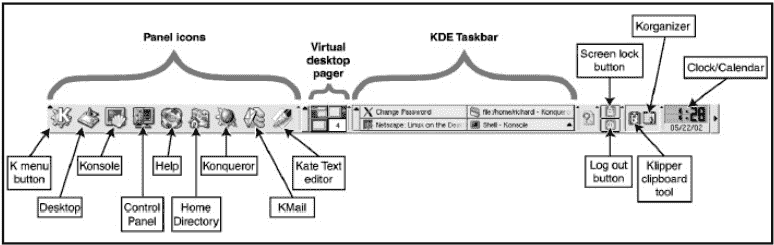

图2.8：K菜单面板

#### K菜单

点击K图标会弹出一个菜单，这就是KDE的主菜单——K菜单。该菜单中的每个条目都像文件柜中的文件夹，代表你计算机上的应用程序或目录。


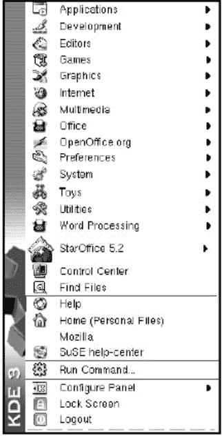

图2.9：K菜单

K菜单中的大部分条目都有图标，部分条目带有箭头。图标可以帮助你识别每个条目的含义，比如你的主目录旁边会有一个房子图标。

## 导航K菜单

K菜单提供了多种访问计算机内容的方式。鼠标指针滑过条目时会高亮显示，让你清楚知道自己当前在菜单中的位置。要访问子菜单，先高亮带有箭头的条目，然后将指针移入其中一个方框。这些关联的子菜单及其对应的主菜单标题共同组成K菜单树。要关闭子菜单，把指针移到桌面的空白区域并点击即可。

> **提示** 要保持子菜单打开，可以点击子菜单标题，或者将鼠标指针移到标题上打开子菜单，之后将鼠标指针移出菜单即可。

## 通过K菜单打开和关闭窗口

当然，你导航K菜单的最终目标是找到需要的文件和应用程序。找到目标条目后，点击鼠标（任意按键均可）即可打开。例如，要使用计算机的计算器，打开K菜单，把指针移到“实用工具”，然后移入子菜单选择“计算器”。

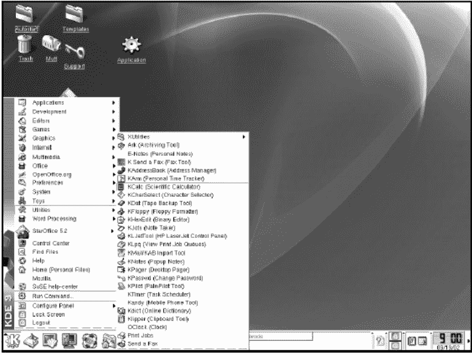

图2.10：通过K菜单打开窗口

点击“计算器”，弹指之间计算器就会显示出来。要关闭窗口，点击标题栏最右上角的X按钮。

> **提示** 如果你打开计算器之后再次打开K菜单，会发现菜单里出现了一些新内容：计算器及其图标现在显示在顶部。这是因为KDE会记录你最近访问过的文件夹、文件和应用程序，方便你更快地再次打开。菜单中这部分的内容会随你最近使用的程序而变化。你也可以将K菜单配置为记录最常使用的项目，而非最近使用的项目。相关内容可参见第11章的“面板”部分。

## 帮助

一开始你最常用的面板图标之一可能是帮助图标（救生圈样式的）。无论你是忘记了`KSnapshot`的延迟拍摄功能怎么用，还是不知道如何更改鼠标指针的速度，帮助系统都能为你解答。启动帮助系统后，会打开KDE帮助中心的起始页面。窗口左侧有两个标签页，分别是“目录”和“术语表”，可以让你快速查找特定主题。窗口的主区域会自动打开“第1章 欢迎使用KDE”，在这里你可以阅读完整的KDE用户文档，或者点击“KDE用户手册”“KDE常见问题（FAQ）”之类的感兴趣的内容，也可以点击“桌面面板”“文件管理器”等链接查看KDE基础应用的相关信息。点击窗口顶部的“上一页”或“下一页”按钮可以翻阅KDE帮助手册的各个章节。

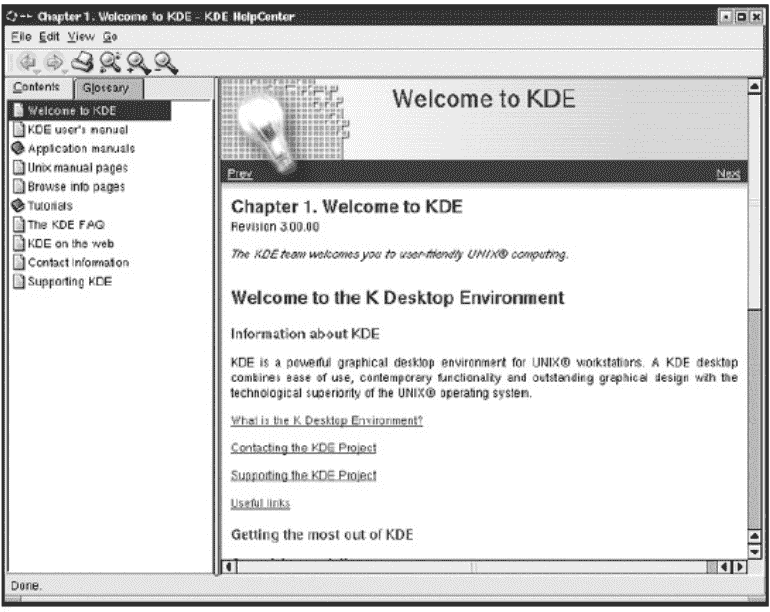

以下是一些帮助导航的使用技巧：

- 使用“向上”、“主页”、“下一页”和“上一页”链接在您浏览过的页面之间切换。“下一页”和“上一页”链接会同时显示在文本的上方和下方，而“主页”和“向上”链接仅显示在下方。

- 点击带下划线的文本可获取更多信息（例如“什么是K桌面环境？”）。

- 使用选项卡在“目录”和“术语表”之间切换。

> **提示** 如果您在`KMail`或`KOrganizer`等程序内打开帮助（通过点击顶部菜单栏的“帮助目录”选项），系统会自动呈现与该程序对应的帮助文档。否则，您可以滚动浏览目录列表或术语表来查找特定条目。大多数帮助文档以网页（HTML文件）形式呈现，其中包含更多信息的链接。

## 虚拟桌面

虚拟桌面其实就是额外的桌面。它有点像将多台显示器连接到同一台电脑，只是同一时间只能看到其中一台。其目的是为用户提供更多的工作空间。Linux的多任务处理能力可以让您的计算机同时处理多项任务，而虚拟桌面能让这些多任务的管理更加便捷，也支持您同时打开比单桌面更多数量的窗口。

面板图标行后面的数字块（1、2、3、4）统称为分页器图标，代表各个虚拟桌面。起初您可能会疑惑为什么需要多个桌面，但您很快会爱上额外桌面提供的更多空间，以及它们帮您保持工作条理的能力。默认桌面是1号桌面。如果您在这个桌面上打开窗口，面板分页器区域中代表1号桌面的方块内会显示该窗口的缩略图，表明该桌面上有打开的窗口。如果您再打开一个窗口，分页器显示中新打开的窗口会呈蓝色，之前打开的窗口会呈灰色，表示它当前不在最前端。

点击其他数字即可在桌面之间切换。如果没有打开的窗口，看起来不会有任何变化，您可以尝试这样操作：回到1号桌面，点击终端图标（显示显示器和贝壳的图标）打开终端窗口，再切换到2号桌面。是不是看起来终端窗口消失了？回到1号桌面就会发现它仍在。

如果某个桌面上有打开的窗口，可以通过窗口左上角的小图钉将其移动到其他桌面。要移动窗口，点击图钉使其呈现按下的状态，窗口就会跟随您切换到任意桌面。要让窗口固定在某一桌面，再次点击图钉即可。

面板分页器图标右侧有一个带箭头的弹出菜单。点击该箭头就会弹出“显示窗口列表”，列出您所有虚拟桌面的内容。您也可以在任意桌面的空白处按鼠标中键，调出相同的菜单。

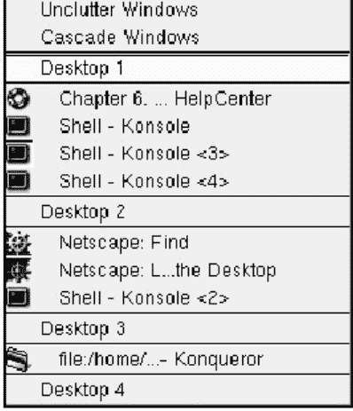

**图2.12：** 显示窗口列表

显示窗口菜单顶部的“整理窗口”和“层叠窗口”选项可以帮您整理当前桌面上的多个窗口。“整理窗口”会将所有窗口铺开，让您可以同时看到全部窗口；而“层叠窗口”则会让窗口像重叠的卡片一样排列。您可以在桌面上打开不同的窗口，尝试切换这两个选项体验效果。

在“整理窗口”和“层叠窗口”选项正下方，您会看到全部4个桌面的列表。如果您在任意桌面上打开了窗口，这些窗口会以子标题的形式显示在对应桌面名称的下方。点击其中任意一个窗口，就会将其置于最前端以供使用。

### 任务栏

分页器图标旁边的长条形区域（没有打开窗口时为空白）就是KDE任务栏，它会显示您当前桌面上的所有打开窗口。任务栏为您提供了高效管理这些窗口的方式：打开窗口时，任务栏上会填充用于标识每个窗口的矩形按钮。要将特定窗口置于最前端，点击任务栏上对应的按钮即可，此时会切换到该窗口所在的桌面并显示该窗口处于最前端，同时您也会看到任务栏上对应的按钮呈按下状态，表明该窗口正在使用中。右键点击任意任务栏按钮，即可弹出包含更多窗口管理选项的快捷菜单。

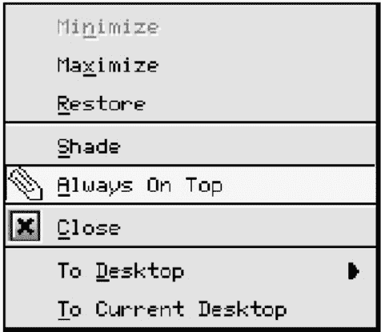

**图2.13：** 窗口菜单

您也可以通过右键点击窗口的标题栏调出窗口菜单。

> **提示** 除了使用窗口菜单外，还有一种方式可以最小化打开的窗口：点击其在任务栏上的按钮，再次点击该按钮，窗口就会恢复到桌面的最前端。

> **提示** 如果您希望窗口保持打开状态且易于访问，可以将其“卷起”。卷起后的窗口会像拉上的百叶窗一样，仅标题栏部分可见。双击标题栏即可卷起窗口，再次双击即可恢复原状。

## K面板附加功能

任务栏右侧有几个按钮，提供了更多管理KDE会话的快捷方式：

- **锁定桌面与注销登录：** 分别对应挂锁图标和电脑钥匙孔图标。这两个按钮可以在您离开电脑时防止他人操作您的设备。如果只是暂时离开，不想关闭桌面上的窗口，可以使用“锁定”功能，点击后会启动屏幕保护程序，覆盖桌面但不会关闭正在运行的窗口。如果您完成了一天的工作，或者需要以其他用户身份重新登录，可以使用“注销”功能完全退出KDE会话。（点击这两个按钮前请确保您记得密码，因为重新进入系统时需要输入密码验证。）

- **剪贴板（Klipper）：** 剪贴板按钮会打开一个窗口，显示您最近的剪切、粘贴和复制操作记录，方便您快速重复这些操作。

- **时钟：** 右键点击KDE时钟并选择“偏好设置”，即可修改时钟的显示样式。点击时钟可以弹出当前月的完整日历，当前日期会被高亮显示。

- **隐藏面板：** 面板最左端和最右端的箭头可以满足需要更多桌面空间的用户和极简主义者的需求。点击任意一端的箭头，面板就会快速滑出屏幕，仅保留外侧带反向箭头的标签。再次点击该箭头即可恢复面板显示。

> **提示** 要将面板移动到屏幕的任意一侧，只需拖拽任务栏上的空白区域到桌面的左侧或右侧，当您看到面板的轮廓出现在目标位置时，松开鼠标按钮，面板就会跳转到屏幕的新位置。

### 桌面

接下来我们一起看看桌面本身的相关功能。首先，我们从桌面调出两个实用的快捷菜单。

## 桌面快捷菜单

右键点击桌面的任意空白区域即可弹出菜单，您会发现其中包含许多与面板上相同的选项，例如“帮助”菜单、“运行命令”等。

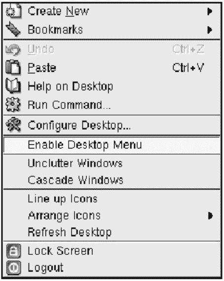

**图2.14：** 桌面快捷菜单

点击“启用桌面菜单”选项后，菜单会立即转换为桌面顶部的一个工具栏。要通过该工具栏访问菜单功能，只需点击您想要访问的标题，然后从下拉菜单中选择对应条目即可。要移除该工具栏，右键点击桌面，然后选择“禁用桌面菜单”即可。

如果您的鼠标带有中键，在桌面上按鼠标中键即可调出“显示窗口列表”，该功能也可以在面板上找到。

#### 桌面图标

最后一类KDE默认图标是桌面图标，不同发行版的桌面图标可能有所差异。（如需添加额外图标或替换现有图标，请参阅第11章的“添加图标”部分。）

- **回收站：** 打开`Konqueror`浏览器显示已丢弃的文件。回收站为空时，图标为带盖子的状态；回收站内有文件时，图标会显示为装满垃圾的溢出状态。（更多关于回收站的使用方法，请参阅第3章的“文件操作”部分。）

- **自动启动：** 打开`Konqueror`窗口，您可以将每次登录时希望自动启动的应用程序放置在此处。

- **打印机：** 打开打印机配置窗口，您可以在其中控制并自定义您的单个打印任务。

- **软盘：** 可访问软盘中的文件。

- **光盘驱动器：** 可访问CD-ROM光盘中的文件。要将应用程序添加到自动启动列表，只需在`Konqueror`文件管理器（`Konqueror`的使用方法请参阅第3章）中选择您希望添加的程序，然后将其拖拽到自动启动文件夹即可，此时会弹出菜单供您确认添加该条目到自动启动列表。软盘和光盘驱动器的图标用法会在第3章的“可移动介质文件访问”部分详细介绍。如果您的系统连接了其他驱动器，例如`LS120`或`Zip`磁盘驱动器，这些驱动器的图标也会显示在桌面上。

## 键盘导航

使用键盘快捷键代替鼠标操作可以节省大量时间。早期版本的KDE将这些键盘组合称为“键绑定”，目前则统称为“快捷键”。用于管理桌面的默认快捷键被称为“全局快捷键”。您可以从K菜单打开“偏好设置”子菜单，再打开“外观与体验”，选择“快捷键”选项。该窗口的第一个选项卡包含了所有KDE默认的全局键盘快捷键，同时标注了对应的组合键和功能。如果您忘记了某个快捷键对应的键绑定，可以通过这个窗口快速查询。注意其中有些功能描述没有标注组合键，这是因为KDE允许您自定义键绑定，您可以自行添加额外快捷键或修改现有快捷键。具体操作方法请参阅第11章。

### Alt键

`Alt`键可以与其他按键组合使用，用于调出特定菜单、关闭或识别窗口、以及显示虚拟桌面的内容。KDE的默认设置允许`Alt`键与前五个功能键（键盘顶部一行以`F`开头后跟数字的按键）组合使用。同时按下`Alt+F1`可进入K菜单，使用方向键可以在该菜单中上下左右滚动，按`Enter`键可打开子菜单，按`Esc`键可退出子菜单，单独按下`Alt`键可完全退出K菜单。同时按下`Alt+F2`可调出“运行命令”窗口，按下`Alt+F3`可调出窗口菜单

当前正在使用的窗口的。本菜单条目中的带下划线字母是你可以通过键盘调用对应菜单选项的按键。

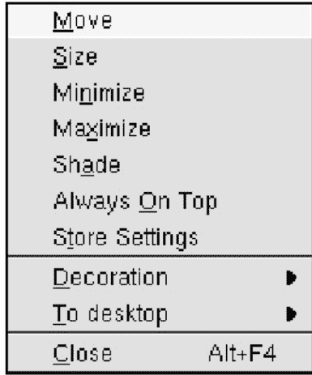

**图2.15：使用键盘操作窗口菜单**

使用方向键向下滚动到你想要使用的条目。按下向下方向键选中“移动”选项，然后按下字母`M`。看起来似乎没有任何变化，但如果你随意按方向键，就会发现窗口再次开始移动。要退出移动模式，按下`ENTER`键。

现在再次调出同一个菜单，选中“大小”选项，按下`S`。使用方向键调整窗口的大小，完成操作后按下`ENTER`键。

按下`ALT-F4`组合键可以关闭当前窗口，按下`ALT-F5`组合键可以调出“窗口列表”，列出所有正在使用的虚拟桌面和窗口。

> **提示** 你可以使用`ALT-TAB`组合键在桌面上已打开的窗口之间循环切换。按住`ALT`键的同时按下`TAB`键，即可在不同窗口间切换，找到你想要使用的窗口后松开`ALT`键即可。

你也可以同时使用鼠标和键盘来移动窗口或调整窗口大小。从你的面板上打开一个终端窗口（图标为屏幕加命令行提示符）。将指针移到窗口的空白区域，按住`ALT`键并单击。松开`ALT`键，但继续按住鼠标左键并移动鼠标，当你把窗口移动到满意位置后松开左键。现在再次将指针移到窗口空白区域，按住`ALT`键并右键单击。还记得这个双向箭头吗？根据你点击的位置不同，会出现垂直、水平或对角线方向的箭头。要调整窗口形状，在按住鼠标右键的同时松开`ALT`键，然后向任意方向拖动鼠标即可。

## CTRL键

按下`CTRL`键分别与`F1`、`F2`、`F3`、`F4`组合，即可切换到1、2、3、4号桌面；按下`CTRL-TAB`组合键可跳转到下一个桌面；按下`CTRL-ESC`组合键可调出任务管理器窗口；按下`CTRL-ALT-V`组合键可调出`Klipper`弹出菜单。同样，按下`ALT`或`ESC`键即可关闭这些窗口。

最初你可能习惯用鼠标操作桌面，但当你越来越熟悉KDE桌面环境后，就可以开始尝试使用这些快捷键了，你甚至可能发展到很少将手从键盘上拿开。

## 第3章：文件管理

`Konqueror`是一款允许你查看和整理文件的程序，你可以把它看作一个智能文件柜。它支持自定义，能够以多种形式展示你的文件。它还兼具文件查看应用的功能，可以只读方式显示`JPEG`、`PDF`等文件以及格式化文档。遇到它无法直接处理的识别到的文件类型，它可以调用辅助程序来打开或显示，比如`AVI`文件（互联网上最常见的音视频数据格式）。`Konqueror`同时也是一款网页浏览器，允许你通过万维网浏览和处理文件。本节我们将介绍`Konqueror`作为文件管理器的使用方法，它的其他用途会在第10章“访问网络”和第11章“自定义你的桌面”中讨论。

### 让Konqueror文件管理器成为你的好帮手

点击面板上的主目录图标（带小房子图案的图标）即可启动`Konqueror`文件管理器。

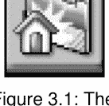

**图3.1：主目录面板图标**

#### 地址栏

根据你主目录中的内容不同，主显示窗口中会出现不同的图标，顶部有各类菜单和工具栏。菜单下方是地址栏，会显示下方主窗口中呈现的文件所在位置。


**图3.2：带主目录路径的地址栏**

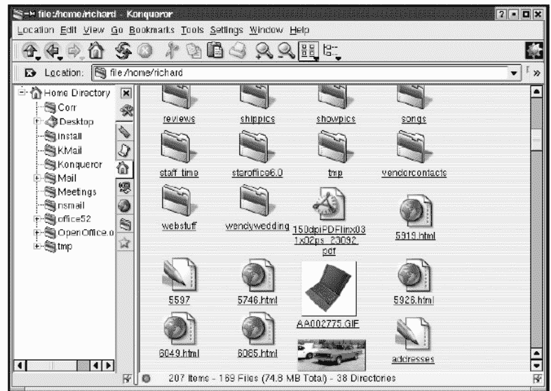

**图3.3：Konqueror文件管理器显示界面**

地址栏中“file:”部分的前方有一个小文件夹图标，两者共同表明当前显示的是目录中的文件，而非网页（别忘了`Konqueror`也是一款网页浏览器）。当显示网页时，该图标会发生变化，“file:”会变为“http:”。工具栏最右侧是一个旋转的KDE标志，表示`Konqueror`正在读取文件。这个动态标志是一个活动指示器，可以让你知道`Konqueror`何时处于忙碌状态，何时已完成任务。

地址栏中显示的“file:/home/ `用户名`”就是一个路径名的例子，因为它展示了到达最终目的地（此处为主目录）的路径。`/`符号代表目录，例如`/home`是`用户名`所在目录的父目录。你的`/home/用户名`目录下可能有一个名为`Mail`的目录，如果点击它，你会发现地址栏中的路径名会变为`/home/用户名/Mail`，因为`Mail`是位于`/home/用户名`下的目录。如果你将鼠标光标移到地址栏中，删除其中的“Mail”一词，地址栏会再次显示`file:/home/用户名`。目前这个目录里可能还没有太多内容，但这很可能是保存你个人使用的文件和目录的最佳位置。

`Konqueror`的一个省时功能是地址栏最右侧的箭头按钮，它可以提供最近访问过的位置的历史记录。你不需要重新输入最近访问过的位置，只需向下滚动到想要的地址或路径名即可。此外，地址栏会记住之前输入过的地址和路径名，一旦它识别出你的输入意图，就会在地址栏正下方弹出的菜单中提供基于历史输入的选项列表。使用上下方向键选中正确选项后按下`ENTER`键。

> **提示** 地址栏中的文本是可拖动的，这意味着你可以将目录或网页从地址栏拖到桌面上，以便之后更快地访问。只需点击地址栏中的文件夹图标、地址栏内的文字，或“地址”一词，将其拖到桌面，然后在弹出的菜单中选择“复制”即可。一旦将它放到桌面上，只需单击它，`Konqueror`就会打开并显示对应的网页或目录内容。

#### Konqueror文件显示区域

`Konqueror`的显示界面分为两个部分：左侧是较窄的侧边栏，右侧是更大的主窗口。默认情况下，`Konqueror`会在主窗口中显示文件，代表文件类型的小图标下方会显示文件名。例如目录会显示为文件夹图标，文本文档会显示为铅笔加纸张的图标，图片文件则会显示为图片缩略图或图片图标（具体取决于你对文件管理器的配置）。

右键单击图标会弹出一个菜单，可用来对文件进行相关操作（更多内容将在“处理文件”部分介绍），或获取文件的相关信息。

你电脑中的文件以分层结构排列，就像带分支和子分支的树一样。`Konqueror`主窗口左侧的侧边栏中的文件展示就是这种结构的示例。主目录图标代表一个目录（文件夹），其中可以存储子目录（子目录内部还可以存储更多子目录）或文件。

左侧的这个侧边栏提供了一种访问目录的替代方法。你不需要在地址栏中输入目标目录的路径名，只需单击侧边栏中对应的图标，即可在右侧窗口中显示该目录的内容。

单击房子图标，你就可以在主窗口中看到主目录的内容。侧边栏中每个图标的左侧都有一个带加号（`+`）的小方框，单击这个方框会以树形结构显示父目录下包含的所有子目录。再次单击该方框（此时显示为减号`-`），就会折叠该目录内部的视图。另外，双击文件夹图标（而非单击）和单击小方框的效果相同。

如果单击侧边栏中的子目录，其内容会在主窗口中显示。

单击主窗口中的任意文件图标，即可在`Konqueror`中以只读方式打开该文件，这意味着你无法修改或编辑该文件，只能查看。这是`Konqueror`的重要特性之一：无需启动其他程序，就可以查看多种不同格式的文件。

除了用鼠标选择文件和目录外，你还可以使用方向键在`Konqueror`显示的文件之间移动光标。

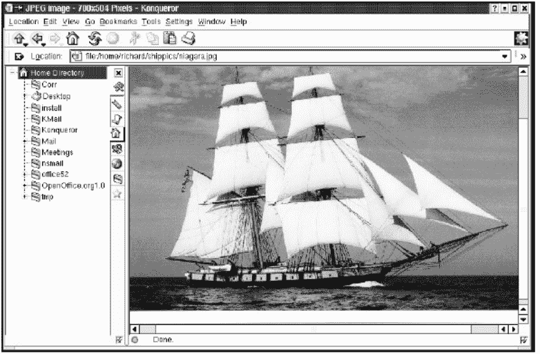

图4.4：使用Konqueror（征服者）查看图像文件


### 访问可移动介质上的文件——光盘与软盘驱动器

光盘和软盘驱动器的文件系统独立于计算机硬盘或其他网络驱动器，需要挂载后才能被计算机读取。使用完这类文件系统后，必须卸载才能取出光盘或软盘。KDE让这一流程非常简便。你的桌面应该有软盘和光盘的对应图标，只需点击图标，相应的文件系统就会被挂载，其内容会显示在Konqueror窗口中（尝试此操作前别忘了先插入软盘或光盘）。图标旁会出现绿色小指示灯，表示目录已挂载，其中的文件可访问。使用完毕后，需要先卸载目录才能取出磁盘。卸载时，右键点击图标，在弹出的菜单中选择“卸载”选项即可，绿色指示灯会随之熄灭，表示没有目录处于挂载状态。

> **提示** 如果你无法卸载光盘或软盘，很可能是因为有程序正在访问它，关闭该程序后即可正常完成卸载。

#### 菜单与工具栏按钮

你可以使用窗口顶部附近的工具栏按钮来浏览文件。例如，若你的主目录下有一个名为cutekitties（意为“可爱小猫”）的子目录，其中存储了幼猫的图像文件，且该目录的内容正显示在Konqueror主窗口中，你只需点击向上按钮（蓝色向上箭头）即可回到主目录的内容显示，而非cutekitties目录的内容。后退按钮（指向左侧的蓝色按钮）会带你回到之前的任何显示页面，无论其路径名与当前目录的路径关系如何。比如你正在查看主目录，之后打开了一个网页，点击后退按钮就会回到主目录的显示页面。形似房屋的按钮同样会带你回到主目录，无论你当前处于什么位置。使用放大镜按钮可以放大或缩小图标的显示尺寸。这两个按钮右侧的两个按钮可在树形视图（参见下文的“视图菜单”部分）和文件的图标视图之间切换。

> **提示** 位置栏左侧的黑色×按钮为一键清除功能，点击即可清除当前网址或路径名，以便输入新内容。

> **提示** 按下`CTRL+O`组合键会打开一个对话框，你可以在其中输入位置信息（和位置栏功能一致），无需将手从键盘上移开即可进行导航操作。

Konqueror菜单中的部分选项更偏向其作为网页浏览器的功能，部分则同时适用于文件管理和网页浏览两种场景，本章将介绍和文件管理相关的选项。若想了解更多将Konqueror用作网页浏览器的相关内容，请参阅第10章。

##### 位置菜单

位置菜单包含6个固定选项，若使用Konqueror打开文件进行查看，还会出现其他和文件操作相关的选项，具体选项取决于文件类型。

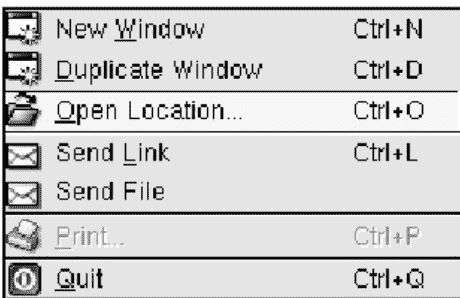

图3.5：位置菜单

6个固定菜单项及其功能如下：

- 新建窗口：打开一个新的Konqueror窗口，默认显示你的`/home/*username*`（用户主目录）的内容。

- 复制窗口：创建当前窗口的完全副本，显示内容和当前窗口一致，而非默认显示你的`/home/*username*`目录的内容。

- 打开位置：调出另一条位置栏。

- 发送链接：打开邮件客户端（默认为KMail），你可以将位置栏中显示的网址或网页地址通过邮件发送给他人，该选项多用于将Konqueror作为网页浏览器的场景。

- 发送文件：打开默认为KMail的邮件客户端，发送当前显示的文件。

- 退出：关闭Konqueror。

若当前显示的是可打印文件（如文本文档、图像文件等），“打印”菜单项会处于可用状态。点击“打印”选项会打开对话框，你可以根据文件和打印机的情况选择打印选项（如使用的打印机）。除了通过打印菜单打印外，你还可以通过拖放方式打印：将文件图标拖拽到桌面的打印机图标上即可。

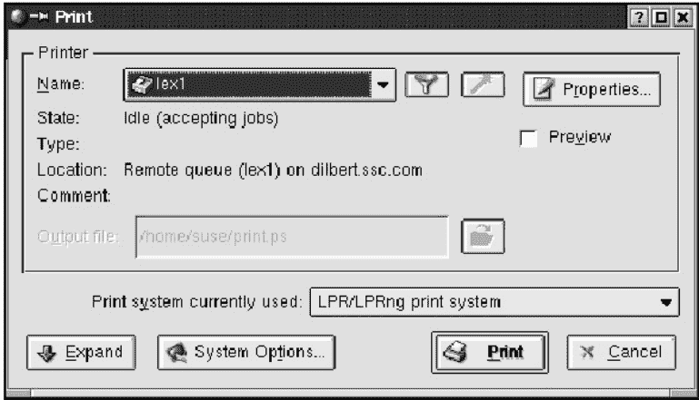

图3.6：打印对话框

> **提示** K菜单的“工具”子菜单中有两个可用于查看、调整打印队列中任意任务顺序的程序：`Klpq`（打印作业管理）和`KJobViewer`（在菜单中可能仅显示为“打印作业”）。

位置菜单中还有使用更高级的应用程序打开当前显示文件的选项。Konqueror以只读格式显示文件，如果你想编辑文档，必须用其他应用程序打开。本章“打开文件”和“右键点击文件”部分会更详细地介绍相关内容。

##### 视图菜单

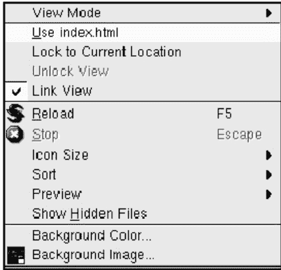

图3.7：视图菜单

视图菜单的第一个选项是“视图模式”，你可以通过该选项更改目录内容的显示方式。将鼠标指针悬停在该选项上，会弹出包含显示选项的子菜单。

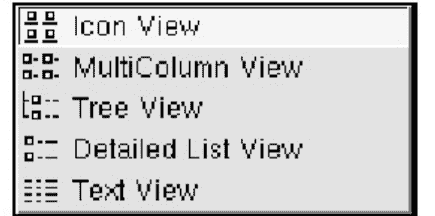

图3.8：视图模式——文件管理器显示选项

- 图标视图：默认视图，你已经很熟悉了。

- 多列视图：以垂直列（按字母顺序排列）而非水平行的方式显示图标。

- 树形视图：显示内容和侧边栏类似，但会额外显示文件大小、最后修改日期、文件权限等信息。文件权限的相关内容会在本章“修改权限”部分和第13章进一步介绍。

- 详细列表视图：和树形视图类似，但没有展开/收起（+/−）按钮以及对应的可折叠子目录菜单。

- 文本视图：和详细列表视图类似，但用纯文本代替图标显示。

下一个选项“使用index.html”，如果选中的目录包含`index.html`文件，你就可以将其作为网页查看，而非以文本列表的形式显示文件。

“锁定到当前位置”会锁定当前显示内容，在该模式下点击已显示的文件不会替换当前显示内容，若点击的是文件则会在新窗口中打开，若点击的是目录则不会打开。

“链接视图”选项会将当前视图与多视图窗口中的其他视图关联。

“重新加载”和“停止”选项会在第10章“访问网页”中介绍。

部分菜单项会根据你在视图模式子菜单中选择的文件显示类型发生变化，这些选项可用于进一步调整文件的排序和显示方式。

“显示隐藏文件”选项会显示文件名以句点（`.`）开头的文件，这类文件通常是*配置文件*，用于决定某些应用程序的运行行为。

最后两个选项“背景颜色”和“背景图片”可用于自定义文件显示区域的背景色，或用图片替换背景色。设置背景色时只需选择“背景颜色”，点击你想要的色彩，再点击“确定”即可。设置背景图片的流程相同，你可以选择系统提供的图片，也可以浏览选择自己的图片文件。更多自定义相关的内容会在第11章介绍。

##### 工具菜单

工具菜单的第一个选项是“运行命令”，打开后会弹出一个对话框，你可以在其中的输入栏输入想要运行的程序名或想要查看的网页地址，即可打开对应的程序或网页。某些场景下，这种方式比逐级翻阅菜单寻找对应选项更高效。这个对话框也可以在主K菜单中找到。

图3.9：工具菜单

“打开终端”项会打开一个Konsole终端窗口，它是一个基于文本的用户界面。几乎所有能通过鼠标、窗口和图标完成的操作，都可以在这个小巧的终端里完成，而且在很多情况下速度更快。缺点是学习必要的命令需要花费一些时间；那个闪烁的小光标并不算直观。更多信息请参阅第13章。

“查找文件”功能允许你搜索文件和目录。对话框底部的“查找范围”栏允许你输入想要搜索的目录。如果你不确定文件具体在哪个目录，可以启用子目录搜索功能。要缩小搜索范围，你可以使用“日期范围”选项卡或“高级”选项卡。在“名称”栏输入文件名，以及你预期文件所在的目录（父目录或子目录），也可以使用“浏览”按钮。

图3.10：查找文件

查找文件工具的运行方式与其他操作系统中的类似程序略有不同。你会发现“名称”栏里有一个星号，用来输入文本。这个星号代表通配符，可以匹配任意字符甚至没有字符。例如，如果你记不清完整文件名，但记得文件名以“report”开头，就可以在“名称”栏输入`report*`，返回的文件就会是所有以“report”开头、后缀为任意内容的文件。如果你想搜索系统中（或指定目录下）的所有PDF文件，输入`*.pdf`，就会得到所有后缀为`.pdf`的文件。如果你不知道文件名的首尾字符，可以在你要搜索的内容前后都加上星号。例如，输入`*report*`就会返回所有文件名中包含“report”的文件。

“创建图片库”项可以让你创建一个包含缩略图的网页，这些缩略图会自动链接到对应的大图版本。打开图片文件显示界面，在弹出的对话框中选择“创建图片库”及相应偏好设置，即可生成该网页。

图3.11：创建图片库

最后一项“执行Shell命令”与“运行命令”项功能类似。Shell命令的更多细节同样请参阅第13章。

##### 设置菜单

设置菜单包含多个选项，可以让你对文件管理器进行大量自定义设置，调整Konqueror的各项功能。和其他支持单击更改设置的KDE菜单类似，当前已启用的设置项旁边会有勾选标记。

图3.12：设置菜单

第一项“显示菜单栏”可以让你隐藏菜单栏本身，为窗口显示区域腾出更多空间。按下快捷键`Ctrl+M`即可重新调出菜单栏。其余“显示”菜单项的含义不言自明。

> **提示** 你可以点击工具栏最右端的竖线来隐藏工具栏和位置栏，为显示窗口腾出更多空间。当栏位被隐藏后，这些竖线会变为横线，点击横线即可重新调出对应的栏位。

如前一章“键盘导航”部分所述，“配置快捷键”选项可以让你自定义按下特定按键时Konqueror执行的操作。某些功能会与键盘上的特定按键绑定，例如“显示帮助内容”功能就绑定了`F1`键。通过该菜单项，你可以修改现有按键绑定，也可以添加新的绑定。

如果你选择“配置工具栏”，会弹出一个窗口，允许你对四个工具栏（主工具栏、附加工具栏、位置栏、图标视图工具栏）的按钮及对应功能进行添加或删除操作。“配置Konqueror”项会打开KDE配置模块，你可以在此自定义Konqueror的各个方面的设置。左侧边栏中列出了可以修改的Konqueror相关元素。第一个是“文件管理器”，你可以在此更改字体（大小和类型），还可以设置目录是在同一窗口还是独立窗口中打开。第二项“文件关联”的说明会在本章后续的“处理Microsoft Word文档”部分以及第11章中介绍。其余项目均与Konqueror的网页浏览器功能相关，相关内容会在第10章中介绍。

图3.13：Konqueror配置对话框

##### 窗口菜单

窗口菜单提供了更多自定义Konqueror文件显示效果的选项。

图3.14：窗口菜单

| 功能 | 快捷键 |
| --- | --- |
| 左右拆分视图 | `Ctrl+Shift+L` |
| 上下拆分视图 | `Ctrl+Shift+T` |
| 移除当前活动视图 | - |
| 显示终端模拟器 | - |
| 显示导航面板 | `F9` |
| 保存视图配置“文件管理” | - |
| 配置视图配置... | - |
| 加载视图配置 | - |
| 全屏模式 | `Ctrl+Shift+F` |

除了将主窗口拆分为不同视图的选项外，还有移除侧边栏、在Konqueror窗口底部添加X终端子窗口，以及切换至全屏模式的选项。

#### 访问手册页

在开始“文件操作”部分之前，了解Konqueror的另一个实用功能——手册页展示，或许会对你有所帮助。UNIX/Linux系统命令和工具的相关信息都会以电子形式记录在*手册页*（简称man页）中。手册页会提供命令的使用说明，例如可用于自定义命令行为的参数或规范。这些内容主要对使用终端窗口（如Konsole）输入命令的用户有用。传统上，手册页需要通过命令行访问（详见第13章），但Konqueror也支持快速访问。只需在位置栏中输入目标命令前加上井号（`#`）即可。例如输入`#lpr`，就会显示`lpr`打印命令的手册页。

图3.15：lpr手册页

正如窗口菜单所展示的，Konqueror具备极高的自定义性。只要你熟悉了Konqueror文件管理的基础操作，就可以尝试调整各项可用的配置选项。你可以充分利用自己需要的功能，移除不需要或不喜欢的设置。

### 文件操作

Konqueror的图形界面让文件的操作、管理和访问都变得非常简单。现在你已经熟悉了菜单和工具栏的用法，也完成了文件管理器的自定义设置，下一步就是实际使用这些文件了。

#### 创建新文件夹和文件

首先，你可能需要创建新的文件夹（子目录）和新的文件。在Konqueror中，只需点击窗口顶部菜单栏中的“编辑”，选择“新建”，再选择你要创建的内容类型即可。在普通办公场景中最常用的两个选项分别是“目录”（以文件夹图标表示，用于存储文件或子目录）和“文本文件”（以纸笔图标表示）。

> **提示** 你也可以在文件管理器界面的空白处右键单击，弹出包含“新建”“重新加载”“新建窗口”“撤销”“粘贴”等选项的菜单。

选择要创建的内容类型后，会弹出对话框要求你为其命名。输入名称后，对应的目录或文件就会出现在你的文件管理器页面中。

#### 移动文件

KDE中的拖放方式让文件整理变得非常简单。你只需要掌握如何拖动鼠标即可。如果同时打开两个窗口会很有帮助，这样你可以轻松看到要移动的文件或目录的原始位置以及目标位置。要完成这个设置，如果是在同一个目录内移动文件，可以点击顶部菜单中的“位置”，选择“打开重复窗口”。如果是在不同目录之间移动项目，你可以通过“位置”菜单选择要打开的新目录。两个窗口都打开后，将鼠标放到要移动的项目上，按住鼠标左键不放，将鼠标拖动到新位置，该项目就会跟随鼠标移动到目标位置。将项目拖动到目标位置后松开鼠标左键，此时会出现三个选项：“复制到此处”“移动到此处”“链接到此处”。“复制到此处”会在新位置创建文件或目录的副本，原始文件或目录仍保留在原来的位置。“移动到此处”会直接将项目移至新位置，并从原位置删除。“链接到此处”与“复制到此处”类似，链接文件后可以从新位置访问该文件，但实际文件仅存在于原始位置，新位置出现的图标只是快捷方式。这样做可以节省磁盘空间，因为你不需要复制文件的新版本。

图3.17：移动文件

图3.18：移动文件的可选操作

#### 打开文件

如前所述，你可以通过左键单击文件图标或文件名，以只读格式打开已有文件。这种操作适用于基础文本文档、HTML文档、大多数类型的图片以及可执行程序。

文件打开后，下拉菜单中会增加更多对应文件类型的操作选项（前文“位置栏”部分曾提及相关内容）。举例来说，如果你打开的是文本文档，此时“位置”菜单中还会新增多个可用文本编辑器或文字处理软件打开的选项。任选其中一个程序打开文件，你就可以对文件进行编辑、打印、保存或任意你需要的操作。若要了解如何操作特定类型的文件与应用程序的更多详细信息，可参阅第5章“OpenOffice办公套件”、第6章“其他办公软件”以及第7章“图形处理”。

由于不同类型的程序生成的文件格式不同，因此通常我们会在文件名后添加后缀，用来标识文件类型。这能帮助我们判断应该使用哪款应用程序打开并处理该文件。程序创建或保存文件时，通常会自动添加文件后缀。比如，如果你用AbiWord给你暗恋的人写一封信，保存文件时（假设文件名为“secret”），AbiWord会自动添加`.abw`后缀，最终完整文件名为`secret.abw`。Konqueror（文件管理器）会通过文件后缀判断文件类型，并推荐最合适的打开程序。如果文件类型是Konqueror无法识别的，那么仅通过单击操作可能无法打开该文件。遇到这种情况时，你可以右键单击文件，选择“打开方式”，再从列表中选择合适的程序（或者手动输入程序名称）来打开文件。这一操作流程会在第11章详细介绍。

不过本章会以Microsoft Word文档的处理流程为例进行说明，因为你可能需要对Konqueror的配置进行调整。

图3.19：使用特定应用程序打开文件

#### 处理Microsoft Word文档

若要配置Konqueror识别Microsoft Word文档并使用合适的应用程序打开，首先单击“设置”下拉菜单，选择“配置Konqueror”，再选择“文件关联”（位于左侧边栏）。

**图3.20：文件关联**

接下来，在“已知类型”栏目下，单击“应用程序”旁边的带加号的小方框（这个方框和你之前见过的文件管理器窗口左侧的树状结构外观一致）。在弹出的菜单中选择“msword”。此时，树状结构右侧会弹出一个可输入文件名匹配规则的输入框。输入框中可能已经默认填入了常见的MS Word文件后缀（`.doc`和`.dot`）。如果有的话，你无需进行额外操作。如果输入框为空，你可以单击“添加”按钮并手动输入这两个后缀。

图3.21：添加应用程序偏好设置

输入框下方是“应用程序偏好顺序”板块。你可以在这里选择自动打开该类文档所使用的程序。你可以选择多个程序，以防首选程序无法正常打开文件，当你尝试打开文件时，Konqueror会按照你输入的程序顺序依次尝试打开该文件（不同文件类型的对应程序列表相互独立）。针对MS Word文档，OpenOffice完全可以胜任。因此接下来单击“添加”按钮，会弹出一个可供选择程序的窗口。向下滚动列表，单击你想要使用的程序（本示例中为OpenOffice），再单击“确定”。此时你会回到“文件关联”界面，你会在“应用程序偏好顺序”窗口中看到OpenOffice。单击“应用”，再单击“确定”。之后你再在Konqueror文件管理器界面中单击`.docx`文件，就会自动用OpenOffice打开了。

#### 右键单击文件

另一种打开或处理文档、图片的简便方式是右键单击文件。此时会弹出一个包含以下选项的菜单：剪切、复制、粘贴、重命名、移至回收站、删除、粉碎、添加到书签（该选项针对Konqueror作为网页浏览器的使用场景，相关内容在第10章介绍）、打开方式、预览、复制到、移动到、编辑文件类型、属性。这些选项同样可以在Konqueror窗口顶部的“编辑”下拉菜单中找到。熟悉这些功能可以让你的文件操作更加便捷。

图3.22：编辑菜单

#### 使用剪切、复制、粘贴和重命名功能

如果你习惯使用各类文字处理程序，那么剪切、复制、粘贴和重命名这几个选项的功能不言自明。你可以在文件内选中文本，再选择剪切或复制（剪切会从原始位置移除选中内容；复制会生成副本并保留原始内容），最后单击粘贴，即可将选中内容放置到你想要的位置（打开文件后，在页面任意位置右键单击就能找到这些选项）。而在Konqueror中，你也可以对文件和文件夹执行这些操作，轻松在不同目录和子目录之间移动或复制文件、文件夹。只需右键单击文件或文件夹，选择剪切或复制即可。接着将鼠标光标移至目标文件夹上（通过移动指针并单击的方式），单击文件夹打开它，在文件管理器窗口的空白区域右键单击，再选择粘贴，目标文件或文件夹就会出现在新位置上。

> **提示** 你电脑上有两种光标：*文本光标*，会出现在X终端、Konsole窗口或文字处理类程序内，指示下一个输入的文字出现的位置；*鼠标光标*，则跟随鼠标移动确定位置。

> **提示** 还有一种方法同时适用于选中文本、鼠标光标指向的文件夹和文件：使用键盘快捷键。按下`CTRL+X`可剪切，`CTRL+C`可复制，`CTRL+V`可粘贴。


若要修改文件名，只需右键单击该文件，选择“重命名”即可；文件或文件夹图标下方会弹出带有高亮当前名称的输入框，你可以直接输入新名称覆盖原有内容。如果你想保留原有文件或文件夹作为参考，请在重命名前先为其创建副本。

**图3.23：重命名文件**

### 使用“移至回收站”“删除”和“粉碎”功能

这些都是删除不需要的文件或文件夹的操作方式。“移至回收站”会将文件或文件夹转移到回收站中。这个功能既可以帮你清理不需要的文件，也能在你误删文件时将其恢复，就和真实的垃圾桶功能一样。如果你需要找回误删的内容，可以单击回收站图标进入回收站。此时会打开一个`Konqueror`窗口，展示回收站目录内的所有内容。你可以对回收站内的文件执行任意操作，和它在原始位置时没有区别。如果你确定不再需要某个文件，在回收站目录窗口的任意位置右键单击，就能找到“清空回收站”选项。单击该选项后，文件就会被永久删除。请确认你要清空回收站时，回收站内没有其他你还需要的文件，因为一旦清空所有内容都会彻底消失，就像你把家里所有的垃圾都倒进了垃圾压缩机一样。

**图3.24：回收站**

> **提示** 你可以通过鼠标拖拽的方式将项目移至回收站，操作方式和前文“移动文件”部分介绍的在不同目录间移动文件或文件夹的方法完全一致。

“删除”和“粉碎”功能（“粉碎”仅在`Konqueror`的“编辑”菜单中提供）可以更快地删除文件，不需要经过在回收站中停留的环节。选择“粉碎”删除文件的方式会让文件几乎无法恢复。粉碎操作会删除该功能会对文件执行全文件范围重复写入，数据几乎无法恢复。如果你想彻底清除敏感数据，这显然是不二之选。不过，当你点击这两个选项中的任意一个时，仍然有最后一次反悔的机会：会弹出一个提示框，询问你是否真的要删除（或粉碎）文件。因此请先想清楚你是否真的需要清除该文件，再点击对应的按钮。这个对话框还有一个复选框，你可以勾选它来跳过未来删除/粉碎文件的确认步骤。

**图3.25：删除确认框**

### 使用“打开方式”

正如本章前面“打开文件”部分所述，“打开方式”选项可以让你选择用哪个程序打开当前文件。系统会根据你正在操作的文件类型显示默认可用程序，你可以选择你最熟悉的程序。例如，对于文本文件，你可能会看到`OpenOffice`、`KWrite`以及其他一些字处理软件和文本编辑器的选项。如果你想用其他程序，只需点击“其他”，就会弹出一个包含“已知应用程序”列表的选择框，你也可以在顶部的输入栏直接输入你想要的程序名称。

**图3.26：“打开方式”选项**

有关程序与文件关系的更多信息，请参阅第11章。

### 使用“预览”

“预览”选项和“打开方式”类似，但仅允许你在选定的程序中查看文件，无法对其做任何修改（和你直接单击某个文件时的情况一致）。

### 使用“编辑文件类型”

“编辑文件类型”功能可以让你配置`Konqueror`识别特定类型文件时所使用的文件名匹配规则（或文件扩展名）。例如，只要`JPEG`图像的文件名带有以下任意一个扩展名，就会被系统识别：`.jpeg`、`.jpg`或`.JPG`。如果你想为某种文件类型添加更多可识别的扩展名，点击“添加”按钮并输入对应扩展名即可。

**图3.27：编辑文件类型**

在窗口下半部分，你可以配置“应用程序优先级顺序”，这里会显示用于打开该文件的默认程序，你也能够添加更多程序，或是调整程序的使用顺序。如果你点击“嵌入”选项卡，就可以设置针对该特定文件的左键单击操作，修改服务项目的优先级顺序，或添加更多服务。

### 使用“属性”

点击“属性”可以查看特定文件的相关信息，包括文件类型、存储位置、文件大小、最后修改日期和时间，以及最后访问日期和时间。

**图3.28：文件属性**

### 更改权限

属性窗口（见上一节）的另一个选项卡是“权限”。点击该选项卡可以查看哪些用户对该特定文件拥有何种权限。文件权限决定了不同用户可以对文件执行的操作。共有三种权限类型：读取、写入和执行。“读取”权限允许用户查看文件但无法修改；“写入”权限允许用户修改文件；“执行”权限仅对程序文件生效，允许用户运行该文件。每个文件的权限都分为三类：所有者（用户）、所属组和其他用户。所属组的成员由系统管理员设置，默认所属组是你当前所在的用户组。例如，企业的用户组通常会按部门划分，财务部的所有员工都会被划入同一个用户组。“其他用户”指除所有者和所属组成员之外的所有人，这类权限有时也被称为全局权限。如果你创建了一个文件，你将成为该文件的所有者，可以为其他两类用户设置权限。勾选你希望授予的权限对应的复选框即可。通常你只能更改自己主目录下文件的权限。如果你因为权限问题无法访问所需文件，请联系你的系统管理员。有关权限的更多信息，请参阅第13章的“文件属性和权限”部分。

**图3.29：权限设置**

### 使用鼠标中键单击

如果你的鼠标带有中键，可以试试用它单击你想要操作的文件。系统会直接用默认程序打开该文件，你可以立刻开始工作，无需再经过选择程序的步骤。使用鼠标中键单击是开始工作的最快方式。

### 使用文件压缩

如果你要操作的是压缩文件（比如扩展名为`.tgz`的文件），右键单击该文件，就会在弹出的菜单的常规选项列表中看到“用`Ark`打开”的选项，`Ark`是一款归档工具。点击该选项后，你就可以看到压缩包内的所有文件，以及它们的相关信息（文件名、权限信息、大小和时间戳）。`Ark`窗口顶部的常规菜单支持你打开单个文件、解压文件以及执行其他相关操作。有关使用`Ark`的更多细节，请参阅第12章。

**图3.30：归档工具**

## 第4章：高效整理

本章介绍了多款旨在帮你简化日常任务的程序。无论是像用电脑自带计算器（而不是翻找办公桌抽屉里的印章和尺子）这样简单的事，还是像将`PDA`通讯录和你的工作站合并这样稍复杂的需求，`KDE`都能帮你提升条理性和工作效率。

### KOrganizer日程管理

`KOrganizer`是一款功能丰富的日程管理程序，提供了多种功能来满足不同用户的需求。要打开`KOrganizer`，请依次点击`K`菜单→应用程序→`KOrganizer`。新版本的`KOrganizer`支持群组协作功能。这意味着，如果你在录入日程时启用了该功能，且网络配置正确，其他用户就可以在他们的日历上查看相同的日程事件。如需启用群组协作功能，请联系你的系统管理员。`KOrganizer`有两个核心功能：事件日历和待办事项列表。如果你有点健忘，日历功能可以创建事件提醒，在桌面弹出提示。如果你喜欢提前规划，日历支持按日、周、月三种视图查看。如果你有大量需要尽快处理的任务，就可以使用`KOrganizer`的待办事项列表功能。

**图4.1：打开KOrganizer：启动KOrganizer后，你会看到个人日视图日历、待办事项列表，以及一个迷你的月视图日历。**

#### 配置KOrganizer

在`KOrganizer`中，你可以配置偏好设置，比如设置工作时段的显示、为不同视图分配颜色、安排事件在开始前几分钟弹出提醒等。要打开偏好设置，请在设置菜单中选择“配置`KOrganizer`”。

**图4.2：KOrganizer偏好设置窗口**

弹出的窗口中，左侧是带图标的7个配置分类。点击任意一个图标即可修改对应分类的设置。点击**应用**可以立刻查看更改效果，方便你测试想要使用的不同颜色和字体。设置完成后，点击**确定**保存更改并退出配置窗口。如果你不想保存更改，点击**取消**。如需修改多个分类的设置，可以点击图标在分类之间切换。

> **提示** 如果你在任意一个设置窗口中点击*默认*，你所有的自定义配置都会被删除，恢复为系统默认设置。

##### 个人设置

“个人”分类用于设置自动保存的频率。你也可以输入自己的邮箱地址，若希望接收事件邮件提醒，可以勾选“发送副本给所有者”选项。

**图4.3：个人设置**

###### 时间与日期

“时间与日期”功能可让您指定所在时区、设置是否在日历中显示周六和节假日、默认工作时间以及默认预约时长。在`KOrganizer`中打开日视图或周视图时，日历的默认起始时间为当天的技术性起始点：凌晨12:00。您可以在此设置更符合自身需求的默认工作时间。

同理，默认预约时长是您新建日程时自动填充的时间。虽非强制要求，但设置默认预约时长非常实用，尤其是当您通常会预留固定时间用于预约时。

**图4.4：时间与日期设置**

##### 字体

“字体”部分用于设置`KOrganizer`中所用字体的大小与样式。您可以尝试几种不同的字体，找到最适合您的一款。

**图4.5：字体设置**

##### 颜色

您可以为不同日程分类、工作时间、背景及其他若干项目设置颜色。通过设置对比色，您可以快速浏览日历时更轻松地区分不同项目。

**图4.6：配置KOrganizer的颜色方案**

###### 视图

在“视图”设置下，您可以调整所有可用视图窗口类型的相关设置。若要查看完整的待办事项列表，您大概率需要全窗口展示，请确保已勾选*“待办视图使用全窗口”*选项；否则您可能只能看到列表的前几项。

同理，请勾选*“月视图使用全窗口”*选项，确保月历在您的显示器上显示足够大。

您还可以启用*“显示马库斯·班恩斯线”*功能，该功能会在您的日视图中插入一条标有当前时间的红色线条，让您清楚距离任意一场预约还有多久。

**图4.7：视图设置**

###### 打印

在此处您可以选择用于预览待打印文件的程序。建议您使用默认的`kghostview`作为预览程序，若您的设备已安装`gv`和`xv`，二者也可正常使用。

**图4.8：打印机首选项**

##### 偏好设置

- 个人
- 时间与日期
- 字体
- 颜色
- 视图
- 打印
- 组日程安排

打印预览程序：`kghostview`

默认值 | 确定 | 应用 | 取消

###### 组日程安排

此部分用于配置共享环境下使用`KOrganizer`所需的邮件设置。请在此添加所有小组成员的邮箱地址，启用该功能前请咨询您的系统管理员。

**图4.9：组设置**

> **提示** *“设置”菜单*还支持您启用或禁用各类工具栏与菜单、配置快捷键（或键位绑定），以及修改日期和时间设置。

#### 菜单与工具栏

您应该对窗口顶部菜单栏中的可用选项并不陌生。这些菜单中的常用项也会显示在下方的“主工具栏”上。当您熟悉了菜单选项旁对应各个操作的图标后，就会发现工具栏能帮您节省不少时间。

##### 工具栏图标

`KOrganizer`中共有两组工具栏。若要查看它们，您需要确保已在“设置”菜单中勾选对应选项（若工具栏已开启，其选项旁会显示勾选标记）。这两组工具栏分别是位于上方的“主工具栏”和“视图工具栏”。

**图4.10：主工具栏与视图工具栏**

主工具栏图标：

- 空白页：新建文件。
- 文件夹：打开文件。
- 磁盘：保存。
- 打印机：打印。
- 带闪电标识的打印机：打开打印预览窗口。
- 剪刀：剪切。
- 两页文本：复制。
- 带剪贴板的页面：粘贴。
- 放大镜：查找。
- 向左箭头：后退一天。
- 向右箭头：前进一天。
- 带单日填充的日历：跳转至今天。
- 飞行信封图标：发送邮件。
- 带星标的日历：添加新日程。
- 带对勾的日历：编辑您的待办事项列表。

> **提示** *您在`KOrganizer`中仅应使用单个文件。使用多个文件的风险等同于同时管理多本预约记事本，绝非良策。*

视图工具栏图标：

- 带两个红点的纸张：列出（已排定日程的）下一项待办内容。
- 带两条已列项内容的纸张：列出全部日程。
- 带单日填充的日历：显示今天。
- 带五日填充的日历：显示工作日。
- 带七日填充的日历：显示完整周历。
- 带全月填充的日历：显示月历。
- 带对勾的日历：显示待办事项列表。

##### 从KOrganizer打印

点击打印机图标，您可以选择要打印的日期范围以及视图类型（日视图、周视图、月视图或待办事项列表）。

要选择打印的日期范围，您可以直接输入日期，也可以点击“日期”字段旁的日历图标，随后在日历中点击对应日期。

**图4.11：从KOrganizer打印**

点击带闪电标识的打印机图标，您可以在打印前预览文件，还可在此阶段对文件进行修改。

选择该选项后，系统会引导您完成和打印文件相同的操作步骤，但最终生成的是图形文件，该文件会使用您在打印配置项中选择的图形程序打开。

#### 使用待办事项列表

借助待办事项列表功能，您可以创建包含子任务、截止日期和优先级的任务列表，并在完成每项任务后将其勾选掉。

> **提示** 处理待办事项列表时，您可能会发现单独查看该列表更为便捷；点击*“待办列表视图”*图标即可切换至对应视图。

##### 向待办事项列表添加任务

要向列表中添加新项目，请在“操作”菜单中选择*“新建待办”*，在弹出窗口的“常规”和“与会者”选项卡中填写任务相关信息。

**图4.13：分类列表**

“常规”选项卡中唯一必填的字段是“摘要”，但您也可以填写截止日期和时间等额外信息，会更便于管理。

在“摘要”输入框中填写任务名称或简要描述，该名称将显示在待办事项列表的左侧边缘，且旁侧会带有勾选标记。

要选择截止日期，请确保“截止”字段旁的复选框已被勾选，随后可在日历中选择截止日期，或直接在文本框中输入日期。

若需要设置截止时间，请勾选“关联时间”字段旁的复选框，即可在该字段中输入具体时间。

若还需要（或仅需要）设置开始日期，请按照设置截止日期的相同操作处理“开始”字段即可。

使用右侧的下拉菜单可设置任务优先级，默认优先级为3（中等）。

您还可以通过左侧的下拉菜单选择完成百分比，以追踪任务进度。

在窗口底部的大文本框中输入与该任务相关的备注或评论。将待办项添加到待办事项列表后，双击该待办项即可查看这些备注。

要为任务设置分类，请点击“分类”按钮，将弹出显示所有可用分类的新窗口。

**图4.14：编辑分类**

若要添加列表中未显示的分类，请点击“编辑分类”按钮，将弹出“编辑分类”窗口。在窗口底部的空白输入框中输入新分类的名称，再点击“添加”即可。

要删除分类，请先选中该分类，再点击“移除”按钮。修改完成后点击“确定”保存更改。

如果您具备群件功能，且希望该任务出现在所有小组成员的列表中，请在“编辑待办”窗口的“访问权限”菜单中选择“公开”；否则请选择“私有”或“机密”。

###### 与会者

“与会者”选项卡中的所有信息均为选填项，但如果您管理的是有众多参与者的大型项目，填写这些信息会非常有帮助。

点击“新建”即可添加新的姓名与邮箱地址。

您可以通过下拉菜单选择角色（如参与者、观察者）和状态（如需操作、已拒绝），“角色”与“状态”菜单均不支持手动编辑。

完成参会者信息填写后，选择“应用”即可将参会者添加到列表中。所有活动参会者都会显示在“参会者”界面的主窗口中，其详细信息会列在对应的分区下：姓名、电子邮件、角色、状态和回复状态。参会者被添加到列表后，你可以通过选中该条目、修改信息并点击“应用”来编辑参会者信息；选中参会者后点击“移除”即可删除该参会者。

##### 查看和编辑待办事项列表

待办事项列表中出现条目后，你可以通过右键点击该条目来查看其详情或进行编辑，此时会弹出包含以下选项的窗口：

- **显示**：弹出一个小窗口，展示你录入的该条目的全部信息。双击该条目是此操作的快捷方式。
- **编辑**：打开你最初录入该条目时的窗口（包含“常规”和“参会者”标签页），可在此进行修改。
- **删除**：弹出提示框，询问你是否要永久删除该条目。
- **新建待办**：向列表中添加新条目。
- **新建子待办**：添加附属待办条目。此选项仅在当前菜单中提供。选择“新建子待办”后，你会进入新建条目的流程，但该条目会被列在选中的待办任务*下方*。

列表中包含子待办条目的任务旁会显示“-”或“+”。若显示“-”，代表所有子待办条目均已展示；若显示“+”，代表所有子待办条目均已隐藏。点击“-”或“+”即可在这两种视图间切换。

- **清除已完成项**：待办列表的每个条目旁都有一个黑色小方框。如果你用此列表跟踪当前项目，可以在条目完成后勾选对应方框。“清除已完成项”功能会删除所有已勾选的条目。

> **提示** 可以通过拖放方式轻松在多个待办列表之间移动条目。

待办条目和子待办条目有多种排序方式。点击“摘要”可按字母顺序排序，点击“优先级”可按从高到低的优先级排序。“截止日期”和“截止时间”均按时间顺序排序，但若按“截止日期”排序，无截止日期的条目会显示在列表最前方；若按“截止时间”排序，无截止时间的条目会显示在列表最后方。

**图4.15：对待办列表进行排序**

#### 安排活动

查看日历时，你可以通过点击月历中的日期（窗口左侧的小月历），或点击月历顶部的箭头来逐日切换。单箭头用于切换月份，双箭头用于切换年份。若你处于任意周视图下，点击月历中的单个日期，就会跳转至该日期对应的日视图。

##### 添加活动

要添加活动，在日历窗口中双击即可。弹出的窗口与待办列表的窗口标签页一致，仅额外增加了“重复”标签页，因此新建活动的流程你应该会感到熟悉。

**图4.16：添加活动**

填写“摘要”字段以及开始和结束日期与时间。时间录入完成后，活动时长会显示在这些字段的右侧。如果在配置设置中指定了默认时间，默认时间会自动填充。如果活动没有关联的时间（仅需设置日期），勾选“无关联时间”选项即可，选择该选项后活动会显示为持续一整天。

如果活动会定期举办，勾选“重复活动”选项，之后你可以在“重复”标签页中录入更多关于该重复活动的信息（此选项的更多说明可参阅“重复”章节）。


如需接收提醒，勾选此选项。勾选后，你可以录入希望活动开始前多少分钟、小时或天收到提醒。具体操作是：在文本框中输入数字，然后从下拉菜单中选择“分钟”“小时”或“天”。你也可以选择将音频或视频文件设为活动提醒：点击时间增量下拉菜单旁的音乐图标或跑步图标按钮即可选择对应选项。点击音频或视频按钮后，会弹出窗口，你可以选择`KDE`自带的任意音频或视频文件，也可以选择自己的本地文件。

> **提示** 要使用闹钟功能，你需要在退出程序前，从“文件”菜单中选择“启用”。该选项会在`KOrganizer`未打开时也能跟踪日程安排，并向你发送提醒。

通过“显示时间为”菜单，你可以选择“忙碌”或“空闲”，该选项会对应在日历中标记对应时间段为忙碌或空闲状态。此处的“分类”窗口与新建待办条目时弹出的“分类”窗口一致，编辑方式也相同。

> **提示** 待办条目和活动的分类列表内容是一致的，编辑其中任意一个列表，实际上会同时修改两个列表。

再次，在大型文本字段中输入任意备注或评论。活动添加到日历后，你可以通过双击该活动查看这些备注。此外，如果你使用群件，选择“公开”即可让群组中的所有人在自己的日历中看到该活动；否则选择“私密”或“机密”。

“参会者”标签页的字段与待办列表“参会者”部分的字段完全一致（可参阅“使用待办列表”章节）。

> **提示** “邮件预约”功能仅在日历中选中了已录入带电子邮件地址参会者的活动时才可在“操作”菜单中找到。选择该选项后，系统会自动生成包含活动摘要、开始日期、时间及结束时间的邮件，并发送给所有参会者。

### 重复设置

“编辑活动”窗口的第三个标签页“重复”是活动日历独有的功能。如果你没有在“常规”标签页中勾选“重复活动”选项，系统会弹出如下提示：“此活动不重复，请在常规标签页中启用重复功能”。启用重复功能后，你就可以让该活动在所有举办的日期都显示在日历中。只有规律举办的活动才能使用此功能，例如每月第一个周二举行的会议。

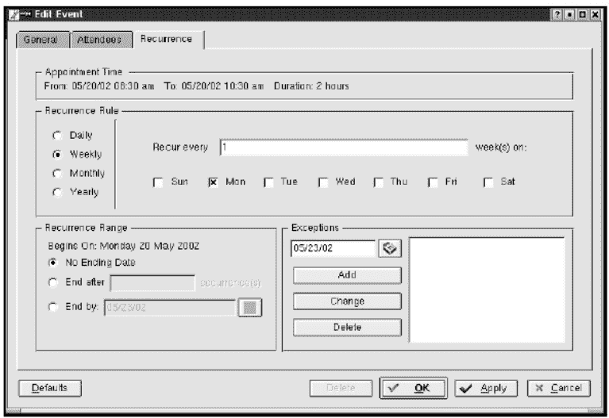

*图4.17：重复活动*

此处会使用“常规”标签页中设置的预约时间，如需修改需返回“常规”标签页操作。在“重复规则”部分，点击对应活动重复频率的正确按钮，然后填写该选项要求的正确信息。在“重复范围”部分，你可以选择“无结束日期”（活动会无限期重复），也可以输入你希望活动重复的次数，还可以选择活动结束的日期。

在“例外”部分，你可以从日历中选择日期并点击“添加”来添加例外规则。要移除日期，选中活动旁大方框中的日期后点击“删除”即可。

> **提示** “显示过滤器”功能可在“设置”菜单中找到，提供以下选项：“启用过滤器”“包含：重复和浮动活动”“排除：重复和浮动活动”，你可以通过这些选项选择是否同时查看重复活动和一次性活动，或是否在视图中排除这两类活动。选择“启用过滤器”即可激活过滤功能，如果不选择任何选项，视图中会同时包含浮动活动和重复活动。

### 查看和编辑日历中的活动

编辑活动的方式与编辑待办列表一致：右键点击活动，会弹出包含以下选项的菜单：

- **显示**：展示该活动的相关信息。

- **编辑**：打开你最初录入信息的窗口，可在此进行修改。

- **删除**：弹出提示，询问你是否确认要删除该活动。

- **切换闹钟**：如果闹钟/提醒已开启，活动旁会显示一个小铃铛图标，点击“切换闹钟”即可开启或关闭闹钟。

> **提示** 你也可以在任意日历视图中使用鼠标编辑部分活动属性。要修改活动时间或时长，只需将活动拖放到新的日期或时间位置即可。要修改活动时长，将鼠标移至活动顶部或底部边缘，会出现双向垂直箭头，按住鼠标左键并移动鼠标即可拉长（或缩短）活动时长，调整完成后松开鼠标按键即可。

在日视图、工作日视图和周视图中，主日历上方会显示包含活动摘要的状态栏。你可以在此窗口或主日历窗口中右键点击活动来编辑它。

### `KOrganizer`中的导入、导出和归档功能

这些功能可在“文件”菜单中找到，能够便捷地访问其他程序的日历，并使用`KOrganizer`归档日程安排。

#### 导入

“从`Ical`导入”功能支持导入`iCalendar`格式保存的文件，仅有的要求是文件必须带有正确的扩展名`.ics`。“合并日历”功能等同于导入日历，你可以直接导入其他程序的文件，无需重新录入所有信息。合并日历时，请先确认你处于要导入信息的目标日历中（无论是要导入的新文件，还是你已经在使用的已有日历），然后在“位置”框中选择要导入的文件。

#### 归档

“归档旧条目”功能可以存储已过期但你不想遗忘的日程安排。使用时，选择开始日期（即你希望归档的起始日期）和文件名即可。

图4.18：约会归档

#### 导出

此处提供三种导出选项：**网页**、`iCalendar` 和 **vCalendar**。导出文件时，系统会以你选择的格式重新生成并保存为新文件。

> **提示：**导出文件后，若要修改内容，最佳方式是更新 **KOrganizer** 文件后再次导出。

选择 **网页** 格式导出时，你可以选择导出 **待办事项列表**、**事件列表**，或两者都导出，以便在网页浏览器中查看。此时你还可以选择需要导出信息的日期范围。在 **事件** 设置区域，你可以选择是否包含分类和与会者信息；在 **待办事项列表** 设置区域，你可以选择是否包含截止日期、分类和与会者信息。完成导出项的选择后，点击「**导出**」按钮。

> **提示：**你可以在浏览器的地址栏输入文件名，以此打开已导出的文件。

注意，事件日历虽然信息不够详尽，但采用了易于阅读的列表格式。待办事项列表会展示每个条目的完整描述，并且包含指向子待办事项的链接（子待办事项会显示在待办事项完整列表的下方）。如果选择单独导出其中一项，导出的文件将仅包含对应部分。

图4.19：导出到网页的待办事项列表与事件

另外两种导出选项`iCalendar`和**vCalendar**是更高级的功能，可与**`KPilot`**配合使用。**vCalendar**是一种以`ASCII`格式存储信息的文件格式，可轻松导入到其他日程管理程序中。*iCalendar*是一种支持互联网日历共享、且兼容掌上电脑（PDA）的文件格式。

### **`KPilot`**

**`KPilot`**是一款可在台式机与搭载`PalmOS`系统（3.3版及以上）的掌上电脑（PDA）之间传输数据的应用程序。该程序兼容多款掌上电脑，但不同机型对应的可用选项会略有差异。使用时需要搭配同步底座，目前大多数手持设备都会附赠该配件。

打开**`KPilot`**的路径为：K菜单 • 实用工具 • **`KPilot`**。你仅能在**`KPilot`**与掌上电脑之间互传文件，反之亦然。这意味着，除非你已经在**`KPilot`**中加载了文件，否则这些文件无法传输到你的掌上电脑；同理，掌上电脑中的文件也仅在**`KPilot`**中可见。这一限制虽减少了操作选项，但你仍可从多个网站免费下载额外软件来拓展功能。你或许可以找到支持日历共享等功能的程序。你可以尝试在`http://www.tucows.com/`搜索，获取更多相关选项的信息。

#### 与**`KPilot`**同步

若要将掌上电脑中的数据同步到**`KPilot`**，只需将掌上电脑放入同步底座即可。然后从「**文件**」菜单中选择「**热同步**」或「**快速同步**」，或者点击工具栏上的「**热同步**」图标。系统会提示你按下同步底座上的「**热同步**」按钮，随后电脑与掌上电脑的连接就会被建立。使用**`KPilot`**时，窗口底部会显示一行小字提示你需要执行操作，很容易被忽略。**`KPilot`**不会提供详细的程序状态或同步状态信息，但你的掌上电脑大概率会显示相关提示。

#### **`KPilot`**文件

**`KPilot`**支持同步、且允许你从**`KPilot`**中打开的标准文件类型包括：备忘录、**通讯录**和文件安装器。你可以通过「**通道**」菜单或工具栏右侧的下拉菜单打开这些文件。选择「**`KPilot`** v4.x.x」即可返回应用程序主界面。

#### **通讯录**

**`KPilot`**通讯录操作简单，且与你的掌上电脑完全兼容。你可以通过**`KPilot`**窗口右上角的菜单栏打开任意文件。

图4.20：**`KPilot`**通讯录

#### **备忘录**

**备忘录**功能非常实用，你可以将电脑中的小型文本文件导入**`KPilot`**，再同步到掌上电脑，反向操作也支持。该选项会打开包含掌上电脑中**备忘录**的文件。在打开的窗口中，你可以将电脑中的文本文件导入**`KPilot`**、将**备忘录**导出到电脑、删除**备忘录**、编辑**备忘录**，或查看**备忘录**。通过窗口顶部的下拉菜单，你可以查看不同的**备忘录**分类，这些分类与你掌上电脑中设置的分类保持一致。你无法在**`KPilot`**中编辑这些分类，必须通过掌上电脑进行修改。下一次同步时，**`KPilot`**会自动同步这些修改。若要查看文件，选中该文件，其内容就会显示在右侧的栏目中。

图4.21：向掌上电脑导入文本

> **提示：**将文本文件导入**`KPilot`**的**备忘录**区域后，你需要先完成同步、将文件传输到掌上电脑，才能删除该条目。

#### **文件安装器**

当你熟练使用**`KPilot`**后，可能想要更换外部通道。通过**文件安装器**，你可以为掌上电脑添加新的功能和文件，具体可选内容取决于你所用的掌上电脑型号。要将**`KOrganizer`**的待办事项列表导入**`KPilot`**，请选择「**通道** • 外部通道」。在弹出的窗口中，点击 **`KOrganizer`待办通道**，然后将该项目从 **可用** 列表拖拽到 **已启用** 列表中。双击该项目可查看可选设置，选择要导入数据对应的文件，该文件必须使用`.vcs`后缀。

*iCalendar*是一种支持互联网日历共享、且同样兼容掌上电脑的文件格式。如果你使用的是微软`Windows`系统的电脑或Mac，需要购买`iCalendar`对应版本，才能让电脑访问掌上电脑中的`iCalendar`文件。但 **KOrganizer** 本身支持`iCalendar`文件的导入与导出。

> **提示：**要将 **KOrganizer** 的待办事项列表导入，需将其保存为`vCalendar`格式，才能被掌上电脑识别。

#### **配置`KPilot`**

**`KPilot`**的配置选项与其他程序略有不同，且专业度更高。你大概率只需要了解 **「常规」** 和 **「同步」** 两个设置区域。如需修改**`KPilot`**的配置选项，请在「**文件**」菜单中选择「**设置**」。

> **提示：**该配置界面没有默认按钮。修改选项后点击「**确定**」，你无法一键恢复默认设置，只能手动重新调整。在当前操作会话中，你可以随时点击「**取消**」来撤销修改。

图4.22：**`KPilot`**设置

在 **「常规」** 设置区域，你需要配置以下选项：

- **掌上电脑设备**：掌上电脑同步底座连接的`CPU`串口名称，默认值为`/dev/pilot`，通常可直接使用。除非尝试同步时出现问题，否则不建议修改默认值。

- **传输速度**：通过**速度**选项旁的下拉菜单可调整数据传输速度。该设置仅与你使用的掌上电脑型号相关，你可以尝试不同速度来找到最优设置。

- **掌上电脑用户**：输入掌上电脑上设置的用户名，系统会将其与你的登录名比对。如果不一致，系统会询问你哪一个是正确的，之后会以该用户名作为掌上电脑用户名称。

> **提示：**新型掌上电脑的传输速度远高于老款机型。

共有四项启动选项，你可以根据需求启用任意数量的选项。但建议你在充分熟悉**`KPilot`**后再启用这些选项，各选项说明如下：

- **登录时启动热同步守护进程**：登录后自动开始热同步操作。

- **热同步时启动`KPilot`**：即使**`KPilot`**未打开，你也可以开始热同步操作，点击热同步按钮后程序会自动启动。

- 在`KPanel`中显示守护进程：会在面板中显示热同步选项，不过该选项仅对部分用户开放。

- 退出时停止守护进程：退出`KPilot`时停止同步进程。

> **提示** *守护进程是一种可使特定功能运行的计算机进程。在`KPilot`中，它本质上就是同步进程。*

地址部分可以保留默认设置，以下是简要说明：

- 地址格式：导入和导出格式都规定了同步时信息（姓名、地址、城市、州等）的传输顺序。每个字段由三个字符表示：两个字母加一个`%`。

- 地址显示：查看记录列表时，该选项支持按「姓氏+名字」或「公司名+姓氏」的顺序排列记录。

数据库特殊选项用于配置数据库，这里的默认配置即可满足需求。

- 显示隐私记录：`PDA`中标记为私密的记录传输到`KPilot`时不会显示。

- 仅备份：列表中的条目表示同步时会备份的数据库。

- 跳过：同步时跳过该数据库。

- `AvGo`：`AvantGo`的缩写，是你可能在`PDA`中存储新闻文章的数据库，默认情况下`AvGo`数据库已在跳过选项中列出。

最后一个部分是「同步」，包含一些额外选项，等你成为同步高手后可以进一步探索这些功能。

- 同步文件：如果希望下次同步时将文件安装程序中的文件安装到`PDA`，请勾选此项。

- 本地覆盖掌上设备：默认`PDA`中的文件比`KPilot`中的更新，会用`PDA`文件替换`KPilot`中的文件。

- 每次都强制首次同步：如果将`KPilot`与多个`PDA`配对使用，请勾选此项。

- 更换`PC`时执行完整备份：如果`PDA`搭配多台电脑使用，请勾选此项。

- 优先使用快速同步而非热同步：快速同步不会执行完整同步，通常不建议选择此项。

### `KArm`：时间管理

如果你为了记账而记录时间，或者只是好奇时间都花在了哪里，`KArm`是非常实用的功能。要打开`KArm`，请依次点击K菜单 • 工具 • `KArm`。

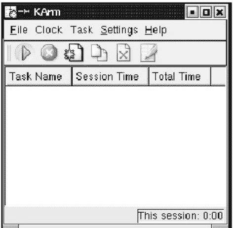

**图4.23：** 打开`KArm`

#### 任务操作

首次使用时间追踪工具时，你需要创建一个新任务。之后你可以选择旧任务或创建新任务。要创建新任务，请点击工具栏上的空白页图标，你可以创建任意数量的任务。

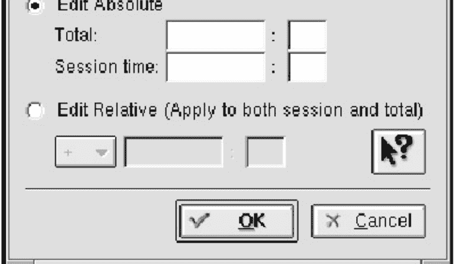

**图4.24：** 在`KArm`中创建新任务

接下来系统会提示你输入任务名称，并提供「编辑绝对时间」和「编辑相对时间」两个选项。创建新任务时，请点击「编辑相对时间」旁的按钮，确保选中`+`号，你不需要在旁边的空白栏中输入任何内容。

> **提示** 调整时间时请注意，第一个栏位是小时，第二个栏位是分钟。

要开始使用时间追踪工具，请先确保目标任务处于选中状态（单击即可），然后点击开始图标。要停止计时，选中任务后点击停止图标。启动计时器后，项目旁会出现一个小时钟，指针会循环转动；停止任务后，时钟会消失。

> **提示** 如果要同时为多个任务计时，只需按照每个任务的计时启动说明操作即可。

> **提示** 要快速启动或停止某个任务的计时，只需用鼠标左键双击该任务即可。

要创建子任务，请先选择要添加子任务的父任务，然后点击子任务图标，按照创建新任务的说明操作即可。主窗口的任务列表中，包含子任务的项目旁会显示`+`或`-`符号；如果所有子任务都已展开，任务旁会显示`-`，如果子任务被隐藏，则显示`+`。点击`+`可展开子任务，点击`-`可隐藏子任务。

> **提示** 删除任务时，其下的所有子任务也会被一并删除。

点击各选项的列标题可以对列表进行不同排序：按「任务名称」可按字母顺序排序；按「单次计时」可按单次时长从短到长排序；按「总时长」可按总耗时从短到长排序。

右下角的状态栏会统计所有任务处于激活状态时的总耗时。

使用完`KArm`后，选择「退出」即可，所有更改会自动保存。

如果需要调整某个任务的时间，选中任务后点击编辑图标即可。

如果要同时增减单次计时和总时长，选择「编辑相对时间」，在下拉菜单中选择`+`或`-`，然后在空白文本栏中输入要增减的分钟数。

如果要单独调整单次计时和总时长，点击「编辑绝对时间」，直接修改栏位中显示的单次计时和总时长即可。

#### 配置`KArm`

要配置`KArm`，请点击设置菜单中的「配置`KArm`」选项，在这里你可以设置闲置检测和保存偏好。

如果你经常离开时不让电脑休眠，闲置检测功能会非常实用。

要设置闲置检测，请勾选「尝试检测闲置状态」旁的选框，然后选择经过多少分钟后系统会提示你电脑处于闲置状态。

如果系统检测到你在选定的分钟数内没有使用电脑，会弹出窗口，提供「还原并停止」「还原并继续」或「继续」三个选项，点击对应的按钮即可。

### `KNotes`

`KNotes`也叫弹出式便签，等同于在你的桌面上贴便利贴——不过你不需要把它们贴在显示器上就能确保它们不会丢。如果你总是忽略长长的待办事项列表，`KNotes`是记录那些你可能忘掉的重要事项的好帮手。

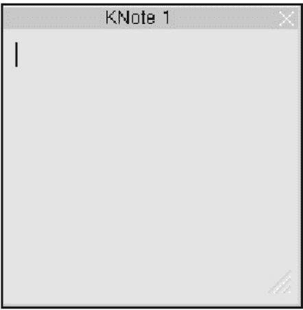

**图4.25：** 一个`KNotes`便签

> **提示** *`KNotes`的默认颜色是非常刺眼的亮黄色，虽然可以修改，但建议换成同样醒目的颜色，这样就不会忽略便签了。*

要打开`KNotes`，请依次点击K菜单 • 工具 • `KNotes`。

这个应用看起来几乎隐形，打开`KNotes`后，K面板会出现一个小图标，看起来像是一支笔在黄色小记事本上书写。

如果上一次会话退出时`KNotes`处于打开状态，新会话启动时会自动打开。

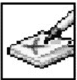

**图4.26：** `KNotes`图标

要打开`KNotes`主菜单，只需右键点击桌面任务栏中的`KNotes`图标。

主菜单支持新建便签、退出等操作，每个便签也有独立的菜单。

右键点击已打开便签的标题或名称即可唤出独立菜单。

单个便签的菜单选项包括插入日期、邮件、打印、便签偏好设置、始终置顶等。

「移到桌面」选项甚至支持你在多个虚拟桌面之间移动便签。

> **提示** *选择「始终置顶」可以确保你不会在桌面上「弄丢」便签。*

#### 使用`KNotes`

要新建便签，右键点击`KNotes`图标，然后在菜单中选择「新建便签」，便签弹出后你就可以点击输入文字了。输入完成后，点击屏幕其他位置即可结束编辑。

> **提示** *要打开旧的便签，用鼠标左键点击`KNotes`图标，然后在菜单中选择对应的便签即可。*

下次打开`KNotes`时，所有仍处于激活状态（包含文本内容）的便签都会自动打开，你也可以选择新建便签。

要关闭便签，点击便签右上角的X按钮即可。

#### 配置`KNotes`


要设置KNotes的偏好，右键点击小记事本图标，选择「偏好设置」，你可以修改显示、编辑器和操作相关设置。

如果在这个菜单中设置偏好，这些设置会应用到之后所有新建的便签。

你也可以通过之前提到的单个便签菜单，单独设置每个便签的配置。

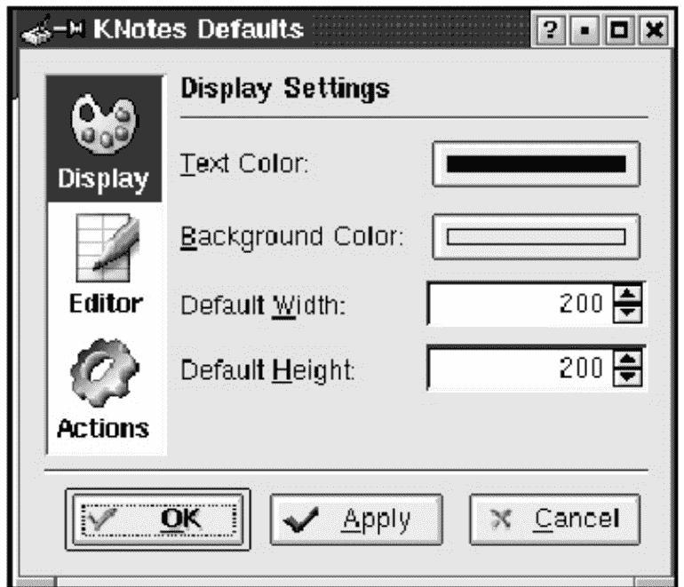

**图4.27：** 配置KNotes

在显示和编辑器设置中，你可以修改便签的文字颜色、背景颜色、宽度高度、字体大小、制表符大小等参数。

KNotes可以打开邮件程序，将便签内容插入到邮件正文中。

你需要在配置菜单的操作部分指定要使用的邮件程序。

可以请你的系统管理员帮忙设置。

默认使用`KMail`，其他邮件程序也可以正常使用。

## KJots

`KJots`可以看作是带完善归档系统的`KNotes`，在这个程序中，用户会创建书籍，并使用书籍内的页面来记录笔记。这个程序的一大优势是，书籍和书籍内的页面都可以保存为`ASCII`格式。`KJots`可以是整理多项目笔记的便捷方式。要打开`KJots`，请依次进入`K`菜单 • 实用工具 • `KJots`。

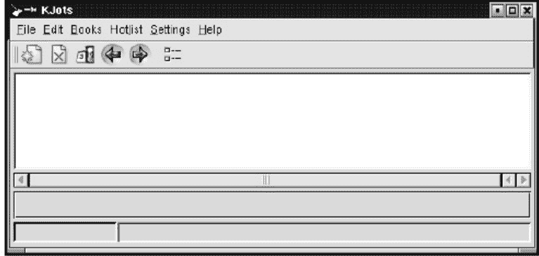

图4.28：`KJots`

### 使用KJots

要开始使用`KJots`，首先需要从「文件」菜单中选择「新建书库」，输入你要创建的书库的标题。随后会弹出对话框，要求你为书库命名。标题会显示在`KJots`窗口的左下角，你可以在文本框中输入笔记内容。如果中途想为书库添加新页面，只需点击工具栏中的空白页图标，或者选择工具栏中「编辑」菜单下的「新建页面」。你常用的书库可以通过点击菜单栏中的「常用列表」，再选择「添加当前书库」来加入，常用列表中的所有书库都可以通过按钮快速访问。

## KCalc

`KCalc`是KDE旗下易用的计算器工具。要打开`KCalc`，请依次进入`K`菜单 • 实用工具 • `KCalc`。打开`KCalc`后，会弹出一个看起来和普通计算器一致的窗口。这款应用很有实用价值，因为它包含了许多办公用标准计算器没有的功能。

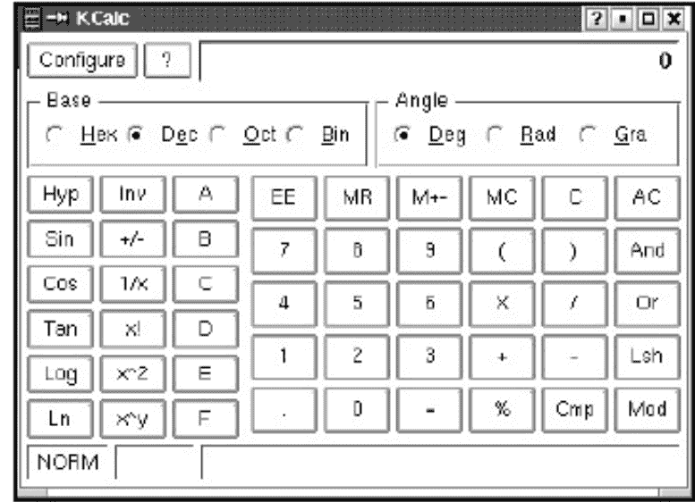

图4.29：`KCalc`计算器

### 使用KCalc

要执行运算，只需像使用手持计算器一样，用鼠标点击对应的按钮即可。你也可以通过键盘输入数字，按回车键代替等号来得出结果，但多数功能还是需要点击计算器上的按键来执行。

### 配置KCalc

要更改`KCalc`的偏好设置，请点击窗口顶部的「配置」按钮。「精度」设置会控制你电脑上的`libc`和`libmath`文件，建议保留这两项的默认值，默认值完全能够满足日常使用需求。「模式」选项会更改计算器最左侧一列按键的功能，根据你从事的工作类型，可能需要在三角函数模式和统计模式之间切换。你也可以在这里自定义`KCalc`的字体和颜色。

# 第5章：办公软件套件

## 概述

本章将带你快速上手`OpenOffice`，让你能够完成电子表格制作、图表绘制、文档撰写与排版等常规办公任务。本章及下一章将为你介绍适合办公场景使用的工具。虽然Linux平台可用的办公应用远不止这些，但我们只会介绍那些开发足够成熟、可以让你放心使用的产品。

Linux平台拥有大量商业及免费的办公应用。风格统一、捆绑分发的应用组合通常被称为*套件*。收费的办公套件包括曾用名`Applixware Office`的`Anyware Desktop`（`http://www.vistasource.com`）、`Corel`的`WordPerfect`（`http://www.wordperfect.com/`）以及`Sun Microsystems`的`StarOffice`（`http://www.sun.com/software/star/staroffice/`）。本章及下一章将介绍部分免费套件：`OpenOffice`、`KOffice`、`KWrite`和`AbiWord`。

`StarOffice 5.2`版本此前为免费产品。随着`6.0`版本的发布，`Sun`开始对`StarOffice`的两个版本收取适度费用，但`OpenOffice`（`http://www.openoffice.org/`）仍保持免费。许多Linux发行版（包括SuSE）都预装了`OpenOffice`。

需要注意的是，Linux世界的免费产品并不等同于质量低下的产品。事实上，SSC多年来一直将Sun的`StarOffice`作为默认办公套件，现在也开始转向使用`OpenOffice`。`OpenOffice`和`StarOffice`的大部分差异源于`StarOffice`包含Sun付费授权的组件，因此这些组件未出现在`OpenOffice`中，包括特定字体（如亚洲语言字体）、数据库支持、模板以及部分剪贴画。此外`StarOffice`提供用户手册和技术支持，而`OpenOffice`没有，但`OpenOffice`的「帮助」菜单中提供了相当全面的主题列表。

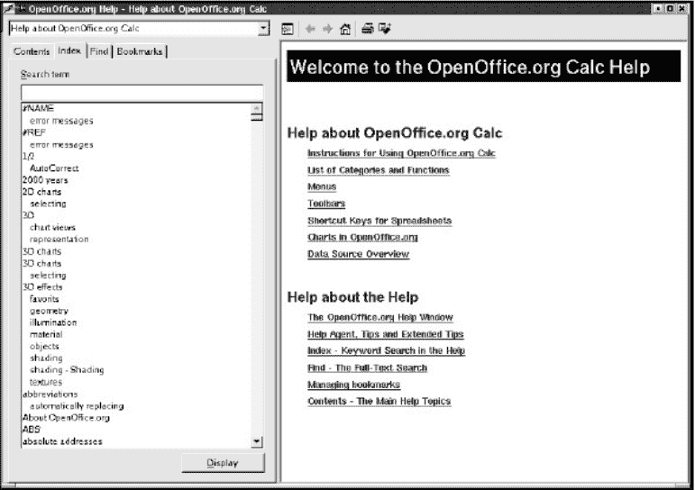

## OpenOffice简介

`OpenOffice`是由`Sun Microsystems`发行维护的功能丰富的办公生产力套件。它与`Microsoft Office`对标，包含文字处理器、电子表格应用、演示软件和图形程序。`OpenOffice`功能十分强大，很多人认为它不仅不逊色于`MS Office`，在很多方面甚至更出色。`OpenOffice`还支持`Solaris`、`Microsoft Windows`等其他平台，在所有平台上的运行表现都同样优秀。

`OpenOffice`支持从`Microsoft Word`等其他多种程序导入不同类型的文档和模板，也可以导出为`HTML`、`PDF`、`MS Office XP`等丰富格式。你的Linux发行版可能已经预装了`OpenOffice`，如果未预装，只需访问`http://www.openoffice.org/`即可免费下载最新版本，该网站还列出了销售含该软件安装光盘的经销商列表。

> **提示** 订阅`users@openoffice.org`邮件列表是获取`OpenOffice`帮助的好途径，详情可访问`http://www.openoffice.org/`，你也可以使用内置的在线帮助。

`OpenOffice`默认安装完成后，会在`K`菜单中添加`OpenOffice`子菜单，你可以从这里启动任意`OpenOffice`程序（`Writer`、`Calc`、`Draw`或`Impress`）。你也可以直接点击任意已有的`OpenOffice`文档，系统会自动用对应的`OpenOffice`应用打开它。打开某个应用后，还可以通过该应用的「文件」菜单启动其他`OpenOffice`程序。这些菜单和工具栏的设计和其他办公程序类似——顶部是主菜单栏，默认显示两层工具栏，应该会让你感到熟悉。和常规操作一样，大部分常用菜单项都可以通过工具栏上的图标访问，把鼠标指针悬停在图标上即可查看它的功能。

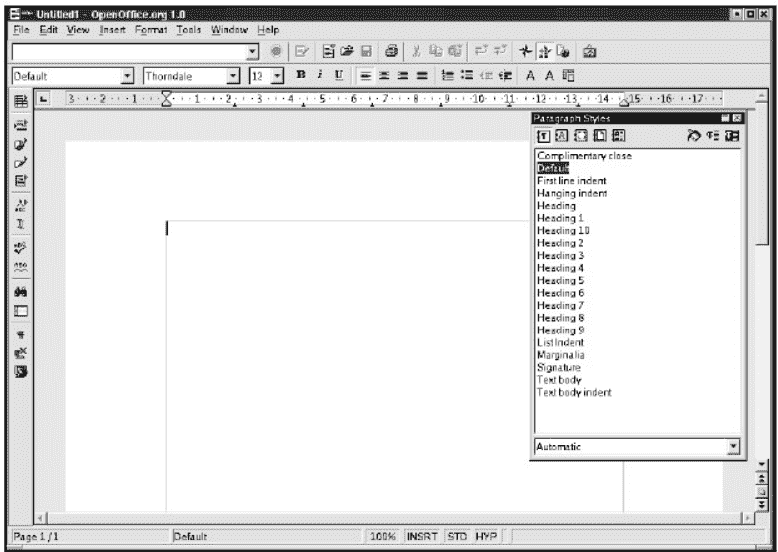

图5.2：`OpenOffice` `Writer`

> **提示** 如果你经常使用`OpenOffice`或其文档，可以将对应图标添加到桌面或面板栏中，具体方法可参阅第11章的「添加图标」部分。

### Writer：文本处理

`Writer`是一款文字处理器，你可以用它撰写信件、文章等文档，也支持以`HTML`、`ASCII`、`RTF`、`MS Word`等多种文件格式导入、导出其他系统的文档。

#### 创建新文档

启动`Writer`后会自动打开一个新文档，你无需进行额外操作，直接开始输入内容即可。如果你需要辅助构建文档，`Writer`提供了多种常用文档的自动向导，包括传真封面、销售合同、学生论文等。

> **提示** 你可以使用「段落样式」工具为文档设置样式，启动`Writer`时会自动开启该功能，也可以通过「格式」菜单中的「样式」选项手动开关它。

#### 使用自动向导

自动向导在其他办公程序中常被称为「向导」，它会引导你完成一系列文档定制问题。要使用该功能，请在「文件」菜单中选择「自动向导」，然后选择你要创建的文档类型，可选类型包括备忘录、传真、信件和网页。选择后会出现「自动向导议程」对话框，你需要选择布局样式、添加`logo`或图形、为文件命名来完成文档定制。

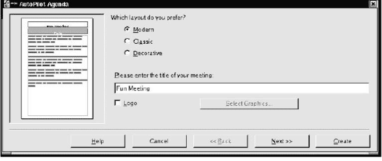

图5.3：自动向导议程对话框

点击「下一步」选择你需要的选项，每完成一组定制问题就再次点击「下一步」，全部设置完成后点击「创建」，你的文档就会生成。

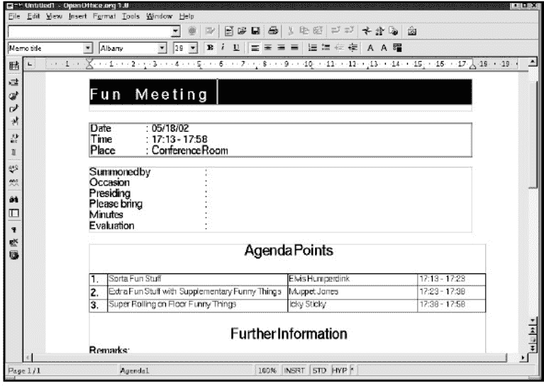

图5.4：自动向导生成的议程文档

> **提示** 在「编辑」菜单中开启「自动文本」功能，勾选「输入时显示名称剩余部分作为建议」选项，然后输入你想要添加到自动文本列表的单词即可。

> **提示** 你可以通过「文件」→「属性」→「统计」选项查看文档的字数。

#### 打开已有文档

要打开已有文档，可以在「文件」菜单中选择「打开」，或者点击`OpenOffice`主工具栏上的打开文件图标（该图标是带有一个表示打开的小箭头的文件夹图标）。点击后会打开你的主目录，双击你想要打开的文件，文档就会自动加载。

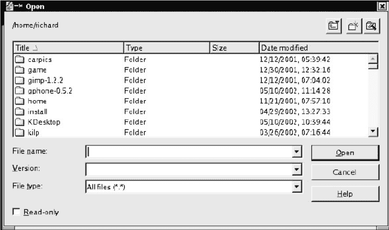

**图5.5：打开已有文档**

当你通过这种方式从目录中打开文件时，“打开文件夹”对话框允许你选择文件类型。`OpenOffice`默认选择“全部”，会自动列出并搜索所有文件格式。你可以通过从“文件类型”下拉菜单中选择特定格式来缩小可选格式的范围。例如，如果你忘记了要打开的文档的名称，但知道它是`MS Word 97`格式，就可以从下拉菜单中选择`MS Word 97`，此时该目录下的所有`MS Word 97`文件都会显示在“打开”对话框中。更多文件格式选项可参考“打开”对话框。

“打开”对话框还支持创建新文件夹来保存或移动文档等操作，只需点击“创建新目录”图标（该图标为一个右上角带有星号的文件文件夹）。位于“创建新目录”图标右侧、显示为铁锤样式的默认目录图标，可让你快速返回默认目录（默认设置为你的主目录）。为了帮你找到目标文件，“创建新目录”图标右侧的“上一级”图标可带你进入当前目录的父目录。

`OpenOffice`还会在“文件”菜单底部列出最近使用的文档，方便快速访问。

在`OpenOffice`中导入和导出`MS Word`及其他常用文字处理格式的文档十分快捷简便。要导入外来文件格式，可参照前文“打开已有文档”中的示例操作。要将文档保存为外来文件格式，请打开“另存为”对话框，只需点击“文件类型”文本框内的下拉箭头，然后从滚动条中选择所需的文件格式即可。

> **提示** `OpenOffice`自带同义词库，你可以通过*工具菜单*访问它。

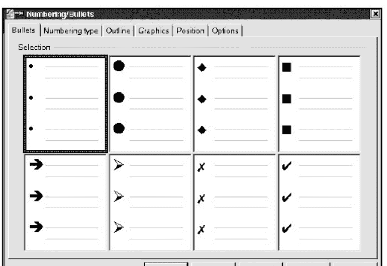

**图5.6：项目符号/编号对话框**

选择顶部的对应选项卡（项目符号、编号或图形），然后点击你想要的示例框，再点击“确定”。

#### 格式化你的文档

格式化功能可让你为文档选择字体和页面样式，`Writer`提供了大量可用选项。本文仅介绍标准格式化工具，高级用户可以放心，其他格式化功能（如应用文本样式、添加表格、创建索引等）也都可用，它们通常和其他文字处理软件中的位置一致。所有这些格式化选项都可以在新建文档前设置，也可以应用到已有文档上。

> **提示** 要检查文档的拼写，可从“工具”菜单中选择“拼写检查”或“自动拼写检查”。

> **提示** 当你开始某项任务，或开启`OpenOffice`认为可以为你解释说明的功能（例如自动拼写检查）时，窗口左下角会出现一个灯泡图标，点击它即可在帮助内容中弹出相关主题。

#### 选择字体

`Writer`的默认字体是12号的`Thorndale`字体。要更改字体，只需选中目标文本，然后点击文档正上方的字体类型和字号选择框进行设置即可。字体名称和字号旁边是粗体、斜体和下划线按钮。

#### 对齐文本

`Writer`默认将文档内所有文本左对齐。如果你希望部分或全部文本采用其他对齐方式，选中对应文本后，点击文档上方、字体属性图标旁边的对齐图标即可，可选对齐方式包括左对齐、居中、右对齐和两端对齐。

#### 使用项目符号列表

将鼠标指针移动到想要插入项目符号或编号的段落或句子的开头，点击`OpenOffice`桌面顶部图标栏第二行的项目符号或编号图标，该段落或句子会立即被设置为对应类型的列表。要关闭项目符号，将鼠标指针移动到想要结束列表或删除项目符号的段落或句子开头，再次点击项目符号或编号图标即可。你可以通过“格式”菜单选择“项目符号/编号”来应用不同的项目符号或编号样式，此时会弹出“项目符号/编号”对话框。

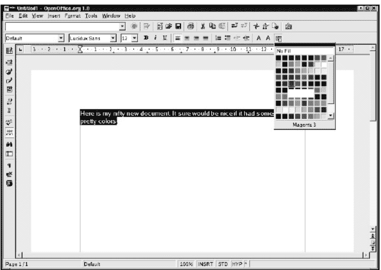

**图5.7：为文档设置背景色**

#### 增加和减少缩进

要增加或减少文本缩进，点击文档上方、编号和项目符号图标右侧的两个缩进图标即可。带有向左箭头的文本图标是减少缩进，带有向右箭头的文本图标是增加缩进，多次点击对应图标可调整缩进幅度。

#### 应用颜色

颜色可以应用于文本字符，也可以作为高亮标记添加到文本段上，颜色图标位于缩进图标旁边。通过点击并拖动鼠标指针选中你想要着色或高亮的文本，然后点击带有字母`A`、背景为黄色的图标，即可为文本添加高亮。颜色也可以应用于文档背景，带有完整调色板的图标（位于字符颜色图标旁）即可实现该功能，点击背景颜色图标，会弹出对话框提示你选择颜色，选中想要的颜色后，文档背景就会更换为新颜色。

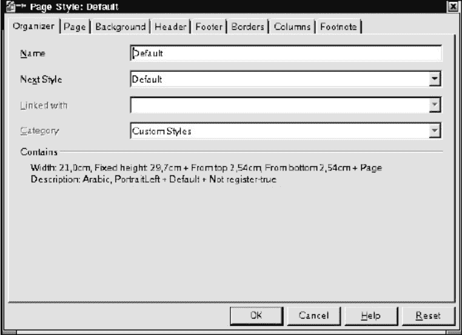

**图5.8：页面样式对话框**

#### 高级格式化工具

高级页面格式化工具位于名为“页面样式”的中央对话框中，要打开它，请在“格式”菜单中选择“页面”，“页面样式”对话框便会弹出，你可以在其中选择文档的背景色、纸张大小和页边距，添加页眉、页脚和边框，甚至可以设置分栏。

此外还有高级段落和字符格式化工具，在“格式”菜单中选择“段落”或“字符”，“段落”或“字符”对话框便会弹出，你可以在其中设置首字下沉、制表位、对齐方式等其他高级段落格式化选项。

要给文档添加页码，请在“格式”→“页面”中选择“页脚”选项卡，勾选“启用页脚”复选框后点击“确定”。接下来，在“插入”菜单中选择“域”，再选择“页码”，页脚处就会出现数字`1`。如果你希望页码显示为“1/10”“1/18”这类格式，请选择“域”→“页面数”，然后在页脚区域编辑文本，添加“/”即可。

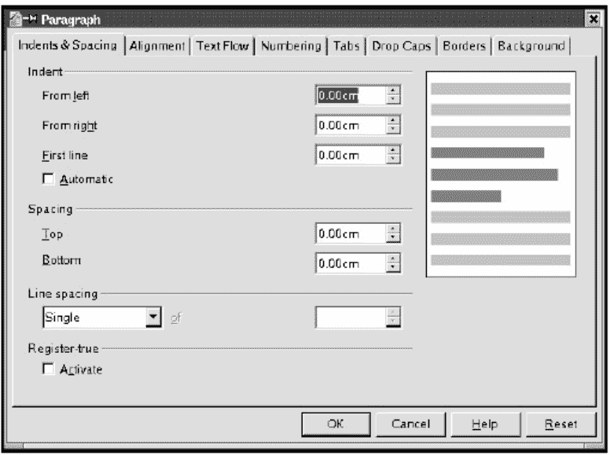

**图5.9：段落对话框**

#### 向文档中插入图像

在“插入”菜单中选择“图像”→“来自文件”，“插入图像”对话框便会弹出。

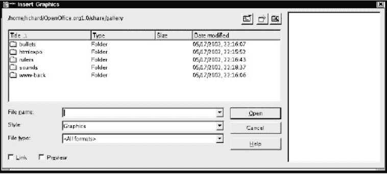

**图5.10：插入图像对话框**

选择图像文件的方式和选择已有文档文件的方式相同。图像插入到文档后，你可以随时双击它打开“图像”对话框，在其中可以裁剪图像、将图像设置为超链接或添加边框，选好需要的选项后，点击“确定”应用更改，或点击“取消”放弃所有更改。

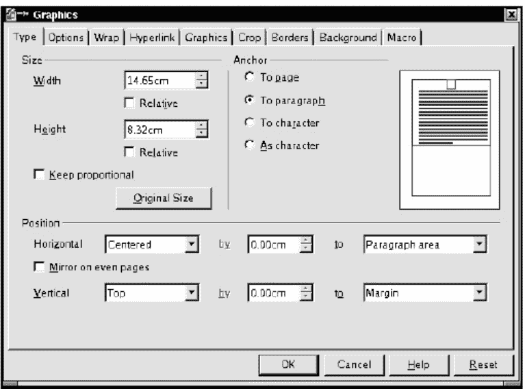

**图5.11：图像对话框**

> **提示** 你可以通过在文档任意位置点击并拖动图像来移动它。

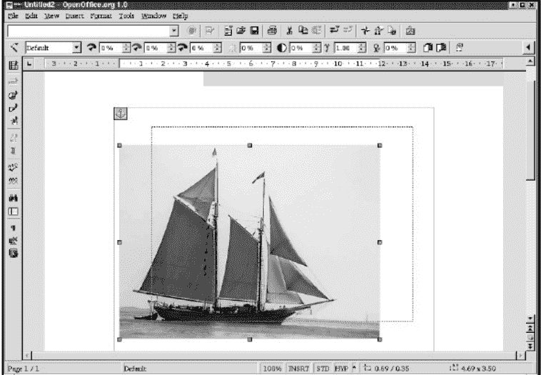

**图5.12：插入和移动图像**

要删除图像，只需用鼠标选中它后点击剪切图标，或者右键点击图像，从下拉菜单中选择“剪切”即可。

#### 保存文档

要保存文档，你可以点击顶部工具栏的软盘（保存）图标，或者选择“文件”菜单中的“保存”或“另存为”选项，此时会弹出“保存”对话框，提示你为文档命名。

给你的文件命名（如果尚未命名的话），指定要保存文件的目标目录，并选择文档要保存的文件格式（点击“文件类型”旁边的箭头即可查看文件格式选项列表）。这就是之前提到的、可用于准备导出文档的位置。

> **提示** 若要将文档保存为`PostScript`文件，请在“文件”→“打印”菜单中选择“打印到文件”，并将文件保存为`.ps`后缀格式。请注意，以此格式保存的文档无法再次编辑，因此你还需要额外保存一份标准文档格式的副本。

#### 创建文档模板

尽管当前版本的`OpenOffice`未预装现成文档模板，但你仍然可以自行创建。首先打开一个新文档，创建一套样式并赋予其所需的结构，然后在“另存为”对话框中直接将文档保存为模板即可。

#### 打印文档

打印文档非常简单：只需点击菜单栏正下方工具栏中的打印图标，或在“文件”菜单中选择“打印”即可。无论通过哪种方式，都会弹出“打印”对话框，你可以选择将文档输出到打印机或文件。如果不需要打印整个文档，还可以选择打印指定页码范围，或是打印多份副本。

> **提示** 若从“文件”菜单中选择“打印”，可查看更多打印选项；点击工具栏中的打印机图标则会按照默认设置打印。

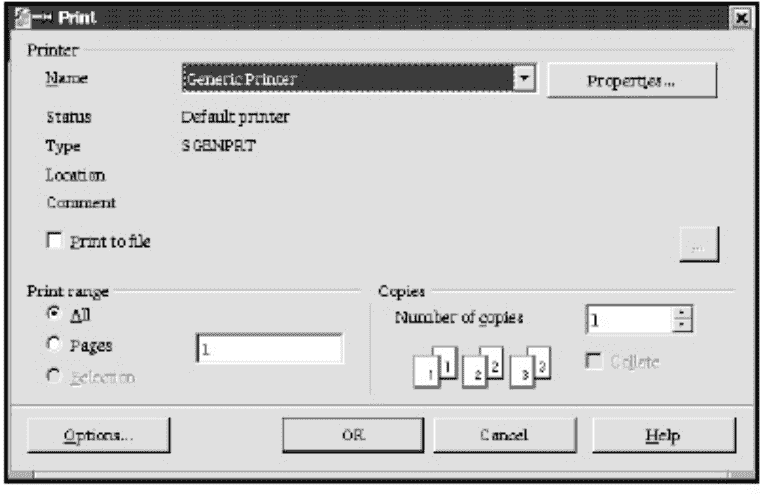

图5.13：打印对话框

### OpenOffice Calc：电子表格

`OpenOffice Calc`是一款功能强大的电子表格程序，支持导入和导出包括`MS Excel`在内的其他主流电子表格格式。电子表格是大型表格，信息会被录入位于行和列中的独立*单元格*中，非常适合用于账务处理和制作数据对比。

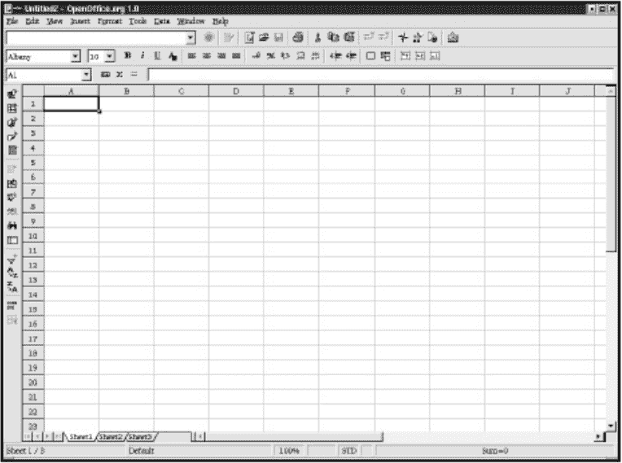

图5.14：`OpenOffice Calc`

在`OpenOffice Calc`中输入数据、公式，并根据这些信息创建图表都非常简单。要启动`OpenOffice Calc`，只需在`K`菜单的`OpenOffice`子菜单中选择“Calc”即可。

> **提示** 对于高级用户来说，*OpenOffice Basic*可通过宏实现部分流程的自动化。在*工具*菜单中选择*宏*，或是查阅*OpenOffice帮助*中的*Basic IDE*相关内容即可。

#### 创建新的电子表格


启动`OpenOffice Calc`后，系统会自动打开一个新的电子表格，你可以直接开始录入数据；也可以打开已有的电子表格（新建•打开）来开展工作。电子表格的单元格按行和列排布。要开始向电子表格录入数据，只需点击目标单元格，选中的单元格周围会出现黑色边框。你可以输入文本或数字，输入完成后，只需点击其他单元格或是按键盘上的`ENTER`键即可。你也可以使用方向键或`TAB`键移动到下一个单元格。这个过程和文字处理器中输入数据非常相似，只不过在此处，每次仅能向一个单元格录入一条数据。

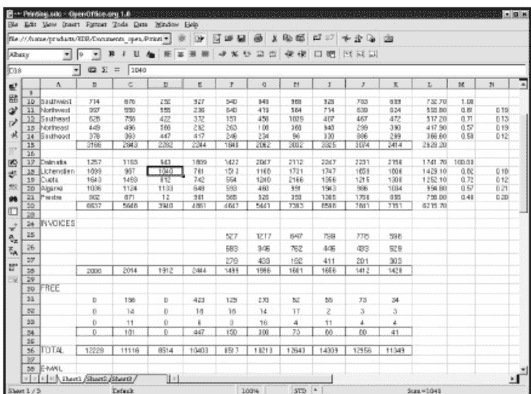

图5.15：向电子表格录入数据

> **提示** 若要选中表格区域，请点击目标区域左上角的单元格并按住鼠标左键，然后将鼠标指针拖动到区域右下角的单元格后松开即可。

### 删除或移动数据

由于电子表格通常内置了公式，因此删除或移动数据的操作比在文字处理器中稍显复杂。要删除单个单元格中的数据，只需使用退格键删除想要清除的字符或数字即可。要移动某个单元格中的数据，请在单元格内单击鼠标右键，根据需求选择“剪切”或“复制”；在目标新单元格中再次单击鼠标右键，这次选择“粘贴”即可。你也可以删除或移动整行或整列的所有数据：可以通过“编辑”菜单中的“删除单元格”选项操作，也可以直接在数据上单击鼠标右键，在弹出的菜单中选择“删除”。该选项允许你指定删除行后的调整方式，例如上移行或偏移列。

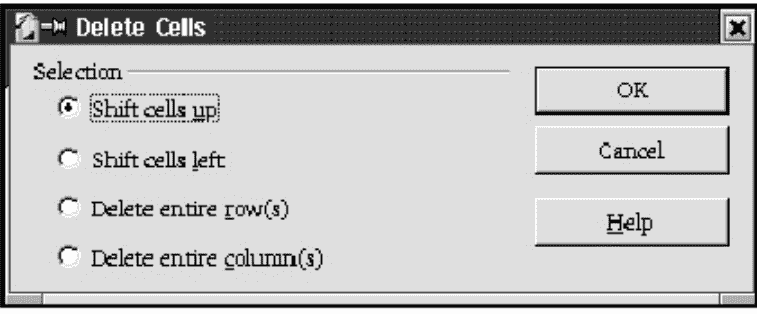

图5.16：删除单元格对话框

### 调整行高和列宽

电子表格中的单元格通常比较小，但可以调整尺寸以容纳更长的输入内容，让打印出的数据更易阅读。调整尺寸有两种方法：第一种是将鼠标光标移动到分隔行和列的参考线上（表格顶部带字母标识的方框是列参考线，左侧带数字标识的方框是行参考线）。例如，若想加宽`A`列的宽度，可将鼠标指针移动到`A`列引导线和`B`列引导线的分界线上，当指针变为双向箭头时，点击并向左或向右拖动即可缩短或延长列的宽度。调整行高的操作逻辑相同，只需要将双向箭头向上或向下拖动，即可缩短或增加行的高度。第二种调整单元格尺寸的方法更加精确，允许你选择固定增量数值：在“格式”菜单中选择“单元格”“行”或“列”，在弹出子菜单中选择首个选项（“列宽”或“行高”），即可输入以英寸为单位的具体尺寸。

### 使用公式和函数

公式和函数会在单元格内显示数字前自动完成数学计算。公式始终以等号（`=`）开头，由字母和数字组合而成。每个单元格都有网格地址，例如第`A`列第1行的单元格记为`A1`，第`B`列第6行的单元格记为`B6`，以此类推。公式可以用于加减乘除运算：要编写公式，首先在单元格中输入等号（`=`），这表示你需要执行计算，然后输入公式内容，例如输入`=A9+A10+A11+A12`，公式输入完成后按下`ENTER`键，`Calc`就会自动完成计算，本例中会求和指定单元格的数值，并将结果展示在你输入公式的单元格中。函数是预定义的公式，会按照特定顺序使用指定值完成计算。函数以函数名开头，后接左括号，再输入函数的特定数值（通常称为参数），参数之间用逗号分隔，最后以右括号结尾。同样，函数前也必须加上等号。例如，在单元格中输入`=SUM(A9:A12)`并按下`ENTER`键，即可得出`A9`和`A12`单元格的数值总和。`Calc`提供了数百种不同类别的函数（如逻辑函数、财务函数、数学函数等），你可以在“插入”菜单中选择“函数列表”查看所有可用函数的完整列表。

### 设置电子表格格式

设置电子表格格式和设置文档格式的流程非常相似，可用的功能也一致，比如修改字体和字号、为部分或全部背景添加颜色等。具体操作可参考本章前文的《设置文档格式》部分。设置电子表格格式时，你可以轻松格式化单个单元格或整片单元格区域，例如想要为`D`列所有单元格添加背景色，只需点击目标区域最上方的单元格并按住鼠标左键选中这片区域，然后将鼠标指针拖动到区域最下方的单元格后松开，接着点击“背景色”图标，选择你喜欢的颜色，大功告成！

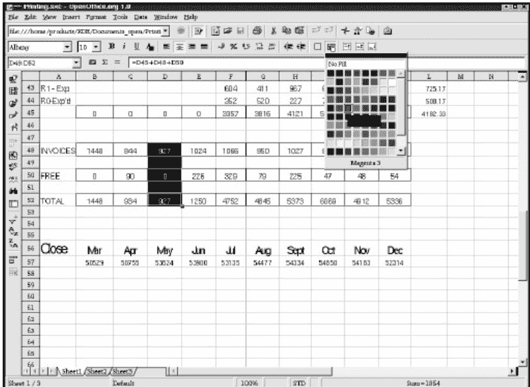

图5.17：为整列单元格添加颜色

> **提示** 你可以冻结行，这样在向下滚动窗口时该行会始终保持可见。点击你想要保留可见的最末一行的底部线条，然后在“窗口”菜单中选择“冻结”即可。

### 制作图表

将电子表格中的数据转换为图表非常简单：首先打开已有的电子表格，选中你想要用来制作图表的行、列和标题所在的区域，在“插入”菜单中选择“对象”，然后在弹出的子菜单中选择“`OLE`对象”，此时会弹出“插入`OLE`对象”对话框。

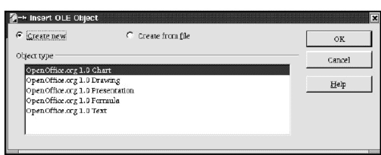

图5.18：插入`OLE`对象对话框

选择“新建”，然后选择“图表”，点击“确定”即可生成对应的图表。

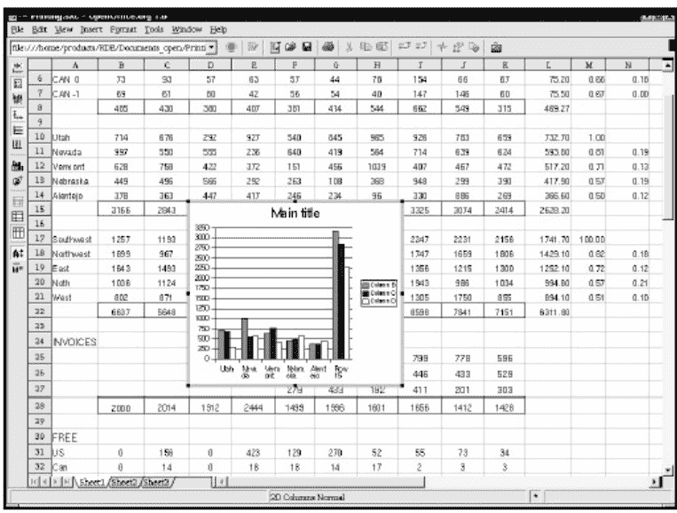

**图5.19：创建图表**

你可以通过点击并拖动图表的边框来轻松调整其大小。要修改图表内的文本，请点击框内对应的文本位置。在图表区域内右键单击会弹出许多额外的自定义选项。你可以选择多种不同类型的图表。双击图表区域，然后从“格式”菜单中选择“图表类型”，“图表类型”对话框便会弹出，提示你选择多种二维或三维图表中的一种。

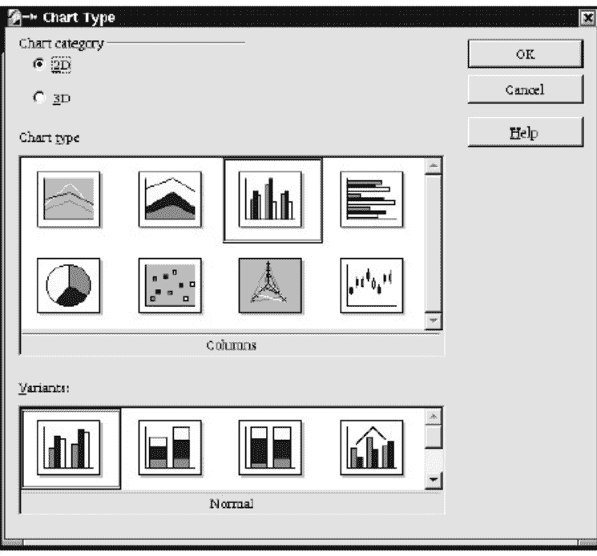

**图5.20：“图表类型”对话框**

### 保存电子表格

保存电子表格时，使用的菜单项与保存文字处理文档时相同。从“文件”菜单中选择“保存”或“另存为”选项，“保存”对话框会再次弹出，提示你为文件命名（如果尚未命名的话），并选择要保存电子表格的文件格式（点击“文件类型”旁的箭头可查看文件格式选项列表）。和`MS Word`文档一样，你可以在`OpenOffice`中导入或导出`MS Excel`以及其他常用的电子表格文件格式。参照前一节“打开已有电子表格”中的示例导入外来文件格式。若要以外来文件格式保存电子表格，只需在“另存为”对话框中点击“文件类型”框内的箭头，选择所需的文件格式即可。

### 在单个电子表格中使用多个工作表

有时你可能需要在一个电子表格中设置多个独立的工作表。例如，假设你每个月都要制作一份详细的报告。你希望每个月的报告各占一个工作表，但又想将所有页面整合在一起。请注意屏幕底部显示“工作表1”“工作表2”等字样的选项卡。你可以用鼠标切换页面，右键单击选项卡并选择“重命名”即可对页面重命名。你也可以通过将鼠标指针放在选项卡上，然后拖动工作表到新位置来调整工作表的显示顺序。

### 打印电子表格

打印电子表格前，你应该先花时间考虑你希望表格呈现的效果。你是否需要显示网格线？你是要打印整个电子表格，还是只打印其中的部分数据？要打印整个电子表格，请从“文件”菜单中选择“打印”；如果仅要打印电子表格的一部分，请先选中该部分，再从“格式”菜单中选择“打印范围”，然后选择“定义”，之后继续执行标准打印流程即可。打印电子表格前通常会关闭网格线，其他格式化功能还包括将表格缩放至适应单页、仅打印图表、仅打印数据。要使用这些或其他格式化工具，请从“格式”菜单中选择“页面”。

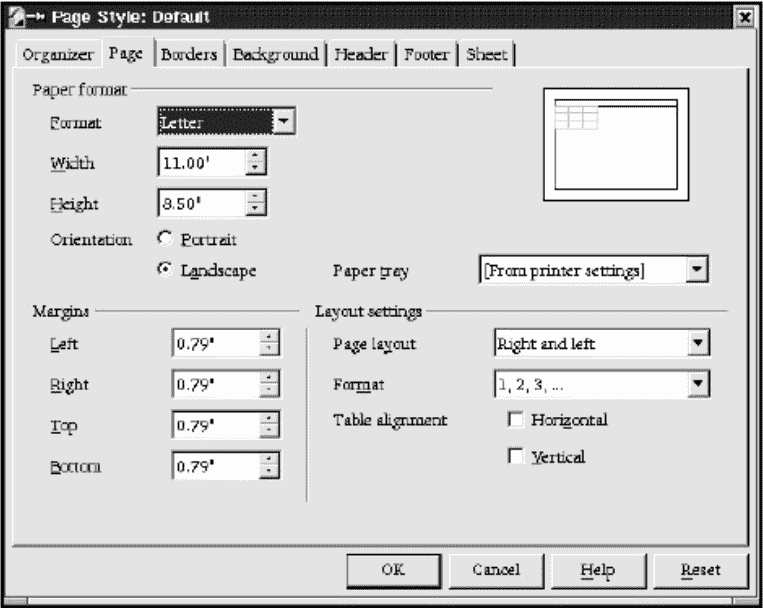

图5.21：“`Calc`页面样式”对话框

如果将电子表格横向打印，在单页打印纸上显示更多列，通常会让表格看起来更美观，也更高效实用。默认情况下，所有文档都采用正常的8.5英寸×11英寸布局打印，这种布局称为纵向模式。你可以通过从“格式”菜单中选择“页面”来将布局更改为横向模式，横向模式采用11英寸×8.5英寸的布局。在随后弹出的对话框中，选择“页面”选项卡，然后在“页面格式”部分选择“横向”。

## `OpenOffice Impress`：演示文稿与幻灯片放映

你可以用`Impress`快速、简便地创建演示文稿。演示文稿的信息载体是幻灯片，每张幻灯片的大小和单屏一致，可以同时包含文本和图形。演示文稿既可以打印出来，也可以在显示器上播放。从菜单栏中选择“文件”→“新建”→“演示文稿”。在“自动演示文稿向导”对话框中选择“空演示文稿”，然后单击“下一步”。在接下来的界面中，你需要完成一些选择来自定义演示文稿。第三个界面允许你添加淡入淡出等效果。完成选择后，单击“创建”。此时会弹出“修改幻灯片”对话框，你可以选择幻灯片的布局，完成选择后单击“确定”。


**图5.22：指定布局**

此时你的演示文稿第一张幻灯片已经出现。点击你想要添加文本或插入图形的区域开始输入即可（如果该区域已有文本，只需单击文本，直接覆盖输入即可）；或者从“插入”菜单中选择“图形”，然后选择你需要的图形文件名继续操作。


**图5.23：向幻灯片添加文本**

当你完成演示文稿的第一张幻灯片后，可以点击屏幕左下角第一张幻灯片页面选项卡旁边的空白灰色条，来插入新幻灯片。要修改这张新创建的幻灯片，只需右键单击名为“幻灯片2”的新选项卡，选择“修改幻灯片”，然后按照创建第一张幻灯片的步骤继续操作即可。

### 优化调整演示文稿

要修改单张幻灯片，请点击垂直滚动栏上方图标组中的绘图视图图标。要调整幻灯片的显示顺序，请点击垂直滚动栏上方的幻灯片视图图标，此后你可以轻松将幻灯片拖放到你想要的顺序位置。`OpenOffice Impress`还提供许多其他格式化选项，实际上这些内容单独写一本书都绰绰有余。但说实话，只要你掌握了基础操作，多自己点击探索就能了解你需要知道的所有功能。

### 保存与导出演示文稿

你已经完成了所有幻灯片的制作，现在可以保存演示文稿了。操作方法是：从“文件”菜单中选择“另存为”，为演示文稿命名后选择“保存”。默认的保存格式是`Impress`格式，如果你需要的话，也可以选择保存为`Draw`格式或`MS PowerPoint`格式。

### 导出为网页演示文稿

将文件导出为网页演示文稿非常实用，因为这样任何网页浏览器都可以浏览。首先从“文件”菜单中选择“导出”选项。操作时无需关心你当前在哪张幻灯片上，该操作会导出整个演示文稿。为你的演示文稿设置文件名后保存，之后系统会引导你完成整个导出流程。首先选择一个`HTML`设计，在“HTML导出”对话框中选择“新建设计”，然后单击“下一步”。接下来需要你选择发布类型，你希望`HTML`演示文稿以什么形式呈现？选项包括纯`HTML`页面、框架、自动幻灯片放映或网络广播。选择你需要的自定义选项后单击“下一步”，根据你选择的选项不同，你还需要完成一系列其他`HTML`特性的选择。


**图5.24：导出为`HTML`**

完成`HTML`特性的选择后，就可以保存`HTML`演示文稿了。选择文件类型（选项包括`GIF`或`JPG`）、压缩值、屏幕分辨率（分辨率越低，图形图像文件越小），以及是否要在幻灯片切换时播放声音，完成后单击“创建”。现在你可以在浏览器（或`OpenOffice`）中查看你的`HTML`演示文稿了，只需打开你常用的网页浏览器，访问该`HTML`演示文稿的文件名即可。

### 打印演示文稿

打印演示文稿（制作投影胶片时尤其方便）非常简单，只需点击屏幕顶部的打印图标即可。

### 浏览演示文稿

要以幻灯片放映方式浏览演示文稿，请点击垂直滚动栏上方的“开始幻灯片放映”图标，演示文稿会立即开始自动播放。你可以设置自动播放的时间间隔，也可以选择通过鼠标单击切换幻灯片，如果你需要和其他人互动演示，这个功能非常实用。要修改演示文稿的设置，请从菜单栏中选择“幻灯片放映”，然后选择“幻灯片放映设置”。

**图5.25：访问幻灯片放映设置**

将弹出一个对话框，可供您修改基础设置，例如是否包含先前创建的幻灯片，或是调整幻灯片的切换方式。

## 用于图形处理的`OpenOffice Draw`

`OpenOffice`内置了一款名为`Draw`的图形处理程序。虽然从技术层面来说它是矢量程序，但也提供了类似`The GIMP`这类程序的位图功能，可被归类为入门到中级难度的图形处理程序。它非常适合将文本、形状、线条和图像整合到单个文档中，并且可以完成通常需要专用程序处理的多类任务，不过功能有限。虽然它的部分功能不如`The GIMP`这类程序完善，但优势在于所有功能都集成在这一个程序中。因此，如果你想制作带图案的名片，无需在多个程序间来回切换即可完成。和`Kontour`一样，`Draw`支持绘制贝塞尔曲线、几何图形，也可将位图导入到文档中。你还可以导入电子表格，或是从中导入图表。借助`Draw`，你可以添加三维形状，还能将二维图像的轮廓转为三维，从而将其作为三维对象进行编辑。

### `Draw`文档示例

假设你是一名二手出租车销售员，想要为社区通讯制作一则广告。你需要准备一些抓人眼球的文案、一张说明性配图，以及用图表呈现的能证明你产品优势的数据。你甚至可能想加一些特效来锦上添花。在`Draw`中新建文档的步骤与其他`OpenOffice`程序相同（新建 • 绘图）。我们先从文本开始。点击左侧工具栏中的大写`T`图标，此时鼠标指针会变为十字准星形状，你可以借此绘制一个文本框来输入内容。按住鼠标左键开始绘制文本框，拖动鼠标直到文本框达到你想要的尺寸（绘制过程中会实时显示轮廓）。调整到合适大小后松开鼠标按键，接着点击文本框内部即可开始输入文本。请注意，在`Draw`中处理文本时，你可以使用`OpenOffice Writer`的功能，例如拼写检查和同义词词典。


**图5.26：输入文本**

要添加图形，请点击插入菜单中的「图形」选项。此时会弹出一个对话框，可供你浏览并选择目标文件。和文本一样，图形会显示在带有控点的边框内，你可以通过点击并拖动边框来调整图形。

> **提示** 如果你想将其他文档中的图片添加到当前文档，可以右键点击该图片，选择「剪切」或「复制」，再右键点击当前文档，选择「粘贴」。


**图5.27：插入图形对话框**

要插入图表，请依次点击「插入 • 对象 • `OLE`对象」。此时会弹出一个对话框，可供你选择目标对象。选择所需的图表后，它就会插入到你的文档中。


- `OpenOffice.org 1.0`电子表格
- `OpenOffice.org 1.0`图表
- `OpenOffice.org 1.0`演示文稿
- `OpenOffice.org 1.0`公式编辑器
- `OpenOffice.org 1.0`文本文档

**图5.28：插入`OLE`对象对话框**

现在你已经得到了包含文本、图形和图表的文档。


**图5.29：包含文本、图形和图表的示例文档**

为了让广告更出彩，你可以添加一些特效，例如将图形处理成炭笔素描的效果。点击图形将其选中，此时`Draw`窗口左上角的「编辑节点」图标会变为滤镜图标。点击该图标即可看到多种修改图形外观的选项，这些选项包括曝光过度、马赛克、平滑、浮雕、炭笔素描，以及其他7种效果。


**图5.30：将图形转换为炭笔素描效果**

若要了解`Draw`的其他功能，以及通用的图形处理方法，建议你阅读第7章《处理图形》和第8章《图形处理进阶：The GIMP》。届时你就能轻松掌握`OpenOffice Draw`的各项功能了。

### `OpenOffice`办公套件的键盘快捷键

虽然使用鼠标指针操作`OpenOffice`十分便捷，但当你熟练之后，可能会希望通过键盘快捷键来提升操作效率。无需将手从键盘移到鼠标处，可以节省不少时间。`OpenOffice`中的快捷键分为两类。第一类快捷键是按住`ALT`键加对应字母来打开菜单，再按按键选择菜单内的选项，所有快捷键对应的字母在菜单中都会带有下划线。例如，如果你想在文档中插入水平线，可以按下`ALT–I`组合键打开插入菜单，再按`Z`键打开「插入水平线」选项框。注意「Horizontal」一词中的字母`z`带有下划线，代表该字母是触发此快捷键的按键。第二类快捷键被称为加速键。通过按下`Ctrl`键加对应按键，你可以立即执行任务，例如保存文件或打印文档。加速键的说明会标注在菜单中对应选项的右侧。例如，假设你正在编辑文档并需要打印它，无需通过鼠标选择「文件」再点击「打印」，你可以直接按下`Ctrl–P`组合键打开打印对话框。你可以花些时间浏览菜单，尝试使用各类可用的快捷键。


**图5.31：如图所示，打开文件的加速键是`Ctrl–O`**

当你花时间使用`OpenOffice`办公套件、熟悉常用功能的快捷键后，一定会感慨它的强大、功能丰富和灵活度，也会好奇如此优秀的软件为何免费。

## 第6章：其他办公软件

### KOffice

`KOffice`是一款仍处于发展初期的办公套件，2001年才发布1.x版本。本章将介绍`KOffice`的文字处理和电子表格应用，这两款软件都易用且可靠。`KOffice`套件包含多款应用：

- `KWord`：基于框架的全功能文字处理器和桌面排版应用。
- `KSpread`：标准的面向表格的电子表格应用。
- `KContour`（旧称`KIllustrator`）：类似`CorelDRAW`或`Adobe Illustrator`的矢量绘图程序，该应用会在第7章介绍。
- `KPresenter`：演示文稿应用。
- `Kivio`：流程图绘制应用。

以下应用可用于编辑需要插入到主应用中的对象，例如图表和图形：

- `KChart`：图表绘制程序。
- `KFormula`：公式编辑器。
- `Krayon`：基于像素的图像处理程序。

尽管许多用户选择使用更为成熟的`OpenOffice`环境，但我们仍建议关注`KOffice`的开发进度，它有望在不久的将来成为行业标准。你应该可以在`Linux`发行版中找到`KOffice`。如果找不到，也可以从`http://www.koffice.org/`下载该套件。`KOffice`拥有一系列出色的办公相关应用，各应用间协作流畅，且不会占用太多硬盘空间。你可能会发现`KOffice`没有`MS Office`、`OpenOffice`这类办公套件那样精致。不过你会发现，所有日常必备功能，乃至更多扩展功能，它都能很好地满足需求。

> **提示** 请经常访问`KOffice`官网`http://www.koffice.org/`查看最新版本发布。

#### 操作`KOffice`


安装完 KOffice 后，可以从 K 菜单的 Office 子菜单中启动它。你可以从这里启动任意单个应用，也可以在“运行命令”对话框中输入应用名称来启动。除了单独启动 KOffice 的各个应用外，你也可以选择打开 KOffice 工作区（同样在 Office 子菜单中），一次性启动整套套件。

界面左侧有两个实用菜单：“部件”和“文档”。你会发现“部件”菜单可以便捷地打开任意其他应用。看向界面底部，你会看到一个标注为“文档”的按钮。虽然它位置偏僻且不醒目，但可以通过这个菜单在任意已打开的文档间切换。这种导航方式确实与其他主流办公套件不同，但你会发现它是操作 KOffice 的高效方式。

除此之外，KOffice 的导航方式与其他办公套件类似。如果你习惯使用鼠标，可以点击应用栏顶部的菜单和命令。如果你更倾向于关于键盘操作，你可以使用第 5 章中名为“OpenOffice 套件键盘快捷键”部分介绍的各类型键盘快捷键。例如，在 KWord 中，按下 `ALT+T` 再按 `S` 即可激活工具菜单，启动拼写检查功能。

遗憾的是，在 KOffice 工作区中，若不使用鼠标，无法在不同文件之间或同一文件内移动。另一个实用的快捷键是组合 `CTRL` 键与字母键来激活各类命令，你可以在顶部菜单中找到对应的功能。

你可能对常用快捷键不陌生：`CTRL+S` 用于保存，`CTRL+Q` 用于退出，`CTRL+P` 用于打印，这些在 KOffice 中都是标准配置。不过需要注意，你偶尔会遇到无效的按键组合，尤其在文本格式化操作中。例如，在大多数文字处理软件中，`CTRL+B` 可以生成粗体文本，但在 KOffice 系列应用中却不适用。

## KWord

如果你曾因使用普通文字处理软件进行桌面排版（DTP）而感到十分苦恼，KWord 或许是你需要的工具。KWord 支持在文档中放置一系列文本框，每个文本框可包含图形、文本或来自其他 KOffice 应用的对象。

帧的概念由 Adobe Framemaker 软件推广普及，它能实现各类元素的流畅融合。KWord 有待改进的一个方面是文件格式的兼容性。KWord 可以导入 MS Word 文档，但无法导出该类文档。此外，KWord 也无法打开 StarOffice 或 OpenOffice 文档。

不过，目前正在开发针对 AbiWord、ApplixWord、DocBook、HTML、LaTeX、MIF、RTF、StarOffice、OpenOffice、StarWriter 和 WordPerfect 格式的导入导出功能。

### 新建 KWord 文档

新建 KWord 文档最直观的方法是点击部件菜单中的 KWord 图标。此时会弹出对话框，要求你从四个选项中选择：

- 使用模板新建文档，该选项提供两种子选择：
  1. 页面布局文档：针对桌面排版类文档，提供两个含多个文本框的模板。
  2. 文本类文档：标准文字处理文档可选择 A4、纯文本、双栏或 US Letter 模板，每个模板包含一个主文本框。（本章后续会介绍“使用文本框”。）
- 打开已有文档。
- 打开最近使用的文档。
- 新建空白文档。


完成选择后，你就会得到一个新建的 KWord 文档。除此之外，还可以点击左上角的纸张样式图标，或通过文件菜单选择“打开”来新建文档。


对美国用户而言，不幸的是唯一提供英寸制边距测量的模板是 US Letter 模板。其余模板的边距单位均为毫米，这算是练习公制计量单位的有趣方式。

此外，KWord 乃至整个 KOffice 的模板数量都较少，这意味着大多数类型的文档都需要你自行创建。

### 打开已有文档

要打开已有文档，可选择文件菜单中的“打开”选项。默认情况下，KWord 会首先搜索用户主目录，因此这是存储文档的理想位置。可通过对话框查找目标文件，之后双击文件，或选中文件后选择“打开”即可。


如果迷失了路径，你可以随时点击房子样式的“主页”图标回到用户主目录。另外，你会欣喜地发现“打开最近文件”选项位于“打开”选项下方，在该选项中可以看到你近期编辑过的所有文档的列表。

### 使用文本框

如果打开的是文本类文档，你会得到一个大的文本框。如果仅需编辑纯文本，它的功能和普通文字处理软件一致。处理复杂文档时，KWord 采用文本框系统，功能性远强于普通文字处理软件。该功能让 KWord 更接近页面排版软件，而非传统文字处理工具。

文本框是文档中的浅灰色方框。通过文本框，你可以排版文本块、图片和各类对象，并将其放置在任意位置。

要创建文本框，可在插入菜单中选择“文本框”选项。此时鼠标光标会变为十字准星样式。将十字准星移动到文本框的一个起始角位置，按下鼠标左键并拖动至对角位置，即可生成文本框的轮廓。当文本框达到预期尺寸时，松开鼠标左键。

此时会弹出“连接文本框”对话框，询问你是否要创建文本框集（即其他文本框的文本不会流入其中的独立文本框）。


要输入文本，点击文本框内部即可开始输入。如果要移动文本框，将鼠标光标移至文本框边缘，待其变为四向箭头时，按下鼠标左键并拖动文本框至目标位置即可。

如果将鼠标光标放在左键点击文本框后出现的方框周边的蓝色方块上，光标会变为双向箭头，此时可以拖动来拉伸文本框的边界，调整其长度或高度。如果要按比例调整文本框的高度和宽度，可将鼠标光标放在文本框角落的蓝色方块旁即可。


### 格式化文档

格式化功能可以让你选择字符样式和页面样式。KWord 提供了大量可用的格式化选项。高级用户可以放心，其他格式化功能，如应用文本样式、添加表格、创建索引等一应俱全，且大多和其他文字处理软件的对应功能位置一致。


### 选择字体

KWord 的默认字体因版本不同而有所差异。要更改字体，选中需要修改的文本，然后在文档上方的字体下拉菜单中选择字体类型和大小即可，选中文本会随之更新。也可以在新建文档时直接设置这些选项。

粗体、斜体和下划线功能同样可用，分别点击字体工具栏右侧的 `B`、`I`、`U` 按钮即可应用对应格式。上标和下标选项可在字体菜单中找到，或点击工具栏中间的对应图标即可使用。


### 文本对齐

KWord 默认将文档内所有文本左对齐。如果需要对部分或全部文本调整对齐方式，先选中目标文本，再点击底部工具栏中的对应对齐按钮即可。

可选对齐方式包括左对齐、居中、右对齐和强制两端对齐。也可以在开始输入前就设定好文档的对齐方式。


### 使用项目符号和编号列表

将鼠标指针移至要插入项目符号或编号的段落或句子的开头位置。点击底部工具栏的编号图标，该图标仅能生成编号列表。（再次点击该图标即可取消该功能，恢复默认格式。）

如果要将编号改为项目符号，可在格式菜单中选择“段落”选项，在弹出的对话框中，选择“项目符号/编号”选项卡，其中提供了修改列表编号样式、将编号改为项目符号的选项。


### 应用和调整缩进

要增加或减少文本缩进，可点击编号/项目符号图标右侧的两个缩进图标：其中带左箭头的图标用于减少缩进，带文本和右箭头的图标用于增加缩进。多次点击对应图标可沿同一方向继续调整缩进量。

### 应用颜色

KWord 支持为文本字符添加颜色，但除了基础的选中功能外，无法为文本块添加高亮。选中要添加颜色的文本后，点击底部工具栏最右侧的文本颜色图标（即带颜色方框的字母 `A`）。

弹出的对话框提供了多种颜色供你选择，也可以使用吸管工具点击色标来自定义颜色，再将新颜色添加到调色板中。


### 将图形插入文档

将图像插入 KWord 的操作与其他文字处理器不同。首先，你需要在“插入”菜单中选择“图片框架”，这会弹出显示你主目录内容的对话框。


找到你想要的图像后，点击“确定”，你会得到一个十字形光标。用这个光标绘制一个框架，或者直接点击，你的图像就会出现在框架中。你可以按照前一节“使用框架”中描述的方式对它进行操作。

## KSpread


### 创建新电子表格

要创建新电子表格，请在 K 菜单的“办公”子菜单中选择 KSpread。“选择选项”对话框会打开，提示你打开新电子表格或已有电子表格。选择“打开新电子表格”，就会打开一个空白电子表格。

### 打开已有电子表格

要在 KSpread 中打开已有电子表格，请在“文件”菜单中选择“打开”，或者直接点击打开图标调出“打开”对话框。


在“打开文档”对话框中导航非常直观。向上箭头可以让你返回上一级目录，房屋图标可以跳转到你的主目录，以此类推。选中你要加载的电子表格后，点击它的名称并选择“确定”。

### 输入数据

使用方向键在单元格之间导航。按回车键向下移动一个单元格。选中一个单元格（可通过方向键或鼠标），然后输入信息。你既可以在这个单元格中输入，也可以在电子表格上方的输入栏中输入。无论你在哪里输入，数据都会同时显示在两个位置。

要开始向电子表格中输入数据，点击一个单元格，输入文本或数值数据，然后点击另一个单元格，继续完善你的电子表格。这个过程和向文字处理器中输入数据非常相似，唯一的区别是每次只能在一个单元格中输入一条数据。


用鼠标选择一组单元格时，你最后突出显示的那个单元格实际上不会被高亮，但它会和其他突出显示的单元格一样，带有深色边框。

你可以在输入文档数据之前，也可以在选中单元格之后更改文本样式、颜色、字体和格式。如果你想通过颜色、字体样式或大小区分行或列，这个功能非常合适。要删除单元格的内容，选中该单元格后按退格键或删除键即可。

### 使用公式和函数

公式和函数会自动执行计算，然后将结果显示在单元格中。关于向电子表格中输入公式和函数的详细信息，请参阅第 5 章的“OpenOffice Calc：电子表格”部分。

要在任意单元格中创建公式或函数，只需点击该单元格，以标准的 `=sum()` 条目开头，再添加公式或函数，然后列出需要进行计算的行和列的标题（所有内容都需在括号内）。

> **提示** KSpread 顶部菜单栏中有一个求和图标。选中你需要的单元格后点击求和图标，就可以自动完成函数运算，无需手动输入公式。此外，求和图标左侧还有一个下拉菜单，其中包含“求和”选项。点击该下拉菜单，就能看到其他自动函数选项。


## KWrite

KWrite 是一款简洁的文本编辑器，常受程序员青睐，因为它支持针对多种编程语言定制的彩色语法格式化。对于普通办公用户来说，KWrite 是一款直观的应用程序，当你需要快速方便地输入一些文本时，它是最佳选择。


要启动 KWrite，可以在“运行命令”对话框中输入 `kwrite`。或者从 K 菜单中选择“编辑器”，再选择“高级编辑器”，KWrite 就会自动打开。

打开新文件非常简单，只需在“文件”菜单中选择“新建”即可。和我们之前讨论过的其他文本编辑器相比，在 KWrite 中写入、打开或编辑文档都是标准操作。它包含了撤销、剪切、复制、粘贴等常用功能。

## AbiWord

AbiWord 是一款适合只需要基础功能、不喜欢等待大型办公套件启动的用户使用的优秀文字处理器。它不属于 KDE 项目，你的 Linux 发行版中可能没有预装它，但它是一款小巧、精干、实用的小型文字处理器，我们特意将它收录在这里。

如果你的电脑上没有安装 AbiWord，你可以访问 `http://www.abisource.com/` 查找并下载安装文件。

尽管 AbiWord 看起来非常简单，但它在背后拥有强大的扩展能力。如果你愿意学习一点 Perl 编程语言，你甚至可以用脚本扩展它的功能，将这款文字处理器用作任意你喜欢的 Perl 任务的前端。

AbiWord 最近发布了 1.0 版本，该版本应该比较稳定，但你仍需经常保存工作成果。如果你使用过 Microsoft Word 或 KWord 这类文字处理器，你会发现 AbiWord 的大部分功能都很熟悉，而且还有在线帮助可供使用。和 KDE 其他应用程序一样，AbiWord 的“帮助”菜单会调用 Konqueror 浏览器来显示帮助文件。

### 启动 AbiWord

在“运行命令”对话框中输入 `abiword` 即可启动 AbiWord（按 `Alt+F2` 可调出“运行命令”对话框）。

### 从浏览器或邮件客户端打开

AbiWord 是阅读和打印他人通过电子邮件附件发送的文字处理文件的绝佳选择。你可以将它设为处理 Microsoft Word 文档的默认应用程序（详见第 3 章“打开文件”部分）。

AbiWord 的启动速度比其他文字处理器更快，因此你可以更快地访问你的文档。

### AbiWord 界面


和部分文字处理器不同，AbiWord 没有包含多个文档窗口的主窗口。如果你打开多个文档，会得到多个独立的主窗口，这些窗口可以被移动到不同的 KDE 工作区。你甚至可以同时运行一个 AbiWord 实例，打开多个文档并将它们分布在不同的桌面上。

### 处理文件

除原生格式外，AbiWord 还支持 HTML 4.0、XHTML、Microsoft Word 格式、RTF、DocBook、纯文本等多种格式。

查看当前支持的文件格式列表最简单的方法是：在“文件”菜单中选择“另存为”，然后点击“打开文件类型”下拉菜单。新格式会定期添加。

> **提示** 要以 HTML 格式查看你的文档，请在“网页”菜单中选择“预览网页”。

### 新建、打开和打开副本

“文件”菜单中的“新建”和“打开”选项可以让你开始处理新文档。“新建”会创建空白文档，而“打开”和“打开副本”都会打开已有文档。

“打开”和“打开副本”的区别在保存时才会体现：如果你用“打开副本”打开了文档，程序会执行字面操作——打开你选中的文件的副本，并会提示你为文档输入新名称。如果你想修订或更新文档，同时又想保留原文档，这个功能非常实用。


### 保存、另存为和保存副本

如果没有未保存的更改，“保存”选项会处于灰色不可用状态；除非你尚未为文档命名，或者你是通过“打开副本”打开的该文档，否则不会弹出文件名输入提示。

“另存为”会始终打开文件对话框，提示你输入新名称，下次保存该文件时，AbiWord 会以你输入的新名称保存。

“保存副本”也会打开文件对话框，以你输入的名称保存副本，但会保留原有文件名用于下一次“保存”操作。

“新建”、“打开”、“保存”和“另存为”选项也可以在标准工具栏中找到。

> **提示** 请将你的工作文档设置为组可读但组不可写，这样你的同事就可以阅读你的工作成果，并以新名称继续编辑，不会意外覆盖原文件。

## 设置视图选项以提升工作效率

视图菜单中的任何选项都不会实际修改文档中的文本，因此从这里开始设置是个不错的选择。

选择“普通布局”可以去掉文档边缘的灰色区域，选择“缩放至页面宽度”可以让整行文本完整显示在屏幕中。

打印前，选择“打印布局”和“缩放至整页”来预览效果。


> **提示** 不确定是否要显示工具栏？按 `F11` 键切换全屏模式，即可在工具栏丰富的视图和仅保留菜单栏的简洁视图之间切换。

## 格式化

AbiWord 拥有基础的格式化命令，这些命令你可能在其他文字处理软件中见过。例如，选中部分文本后，点击格式化工具栏上的小 `B` 按钮，就能得到粗体文本；或者先点击小 `B` 再输入内容，就能直接输入粗体文本，非常方便。

部分格式化操作（如字体选择和加粗）是逐字符应用的，你做的任何修改只会影响当前选中的字符，或是后续输入的新文本。

其他格式化操作（如文本对齐和行间距）是按段落应用的，修改会影响光标所在的段落，无论该段落是否有文本被选中。

你可以通过三种方式使用格式化命令：从格式化工具栏、从“格式”菜单，或是使用“格式”菜单中列出的键盘快捷键。

要从“编辑”菜单中选择“撤销”（快捷键为 `CTRL-Z`）来撤销任意格式化命令。

> **提示** 跨全页的单行单倍行距文本可能很难阅读，你可以点击标准工具栏上的分栏按钮将文本分为两栏，或是从附加工具栏中选择双倍行距，也可以从“格式”下拉菜单中选择“段落”进行设置。

## 设置制表位和页边距

制表位和页边距的设置控件与其他文字处理软件类似，拖动水平标尺顶部的两个方块可设置左右页边距，拖动左上角的三角形可设置每段首行的缩进。


要设置制表位，可将标尺左侧制表位框中的制表位拖动到水平标尺上。制表位支持左对齐、右对齐、居中对齐和小数点对齐四种方式；你可以沿标尺拖动制表位来移动位置，也可以将其拖出标尺来删除。

你可以通过垂直标尺设置上下页边距，也可以从“文件”菜单的“页面设置”中设置页边距，这是唯一一个不在“格式”菜单中的格式化选项。

### 使用样式

应用样式后，你可以一次性设置所有选中文本的格式化属性，无需单独选择字体、字号、加粗和页边距，这能让你的文档格式更统一。

要应用样式，你可以先选中已有的文本，也可以为即将输入的文本预设样式，之后在格式化工具栏最左侧、字体菜单旁的样式下拉框中选择对应样式即可。

你可以通过“格式”菜单中的“样式”选项来修改现有样式或创建新样式。


图6.20：AbiWord中的部分可用样式

### 使用拼写检查器

AbiWord默认开启实时拼写检查。如果你看到单词下方有红色波浪线，右键点击该单词即可打开拼写菜单；如果菜单中的某个建议符合你的意图，选中它即可修改单词并消除红色波浪线；如果你确实想按当前方式输入该单词，可以选中“添加”将其加入拼写词典。


图6.21：拼写检查对话框

亲爱的妈妈：

我目前的假期过得很愉快，只发生了一件不幸的小意外。弗兰克表弟的小兔子好像失踪了，最近这个地区白头海雕泛滥，我们担心最坏的情况发生了。

- 白头海雕
- 全部忽略
- 添加
- 检查拼写...
- F7

> **提示** 要二次检查文档，可以打开“偏好设置”对话框的“拼写”选项卡，点击“重置”来清空被忽略的单词列表。如果只想在当前文档中忽略某个单词，而不将其加入词典，可以选择“全部忽略”。你也可以点击标准工具栏上的“检查整个文档拼写”按钮，或是选择“工具→检查拼写→拼写”来检查整个文档的拼写。

### 添加链接

你可以将任意选中的文本设置为启动Konqueror的超链接。如果你开启了附加工具栏（可以通过“工具栏→视图”选项激活），选中要作为链接的单词或短语后，点击左侧的小地球图标即可。如果工具栏未显示，可以从“插入”菜单中选择“超链接”选项。

### 设置偏好

你可以通过“工具”菜单中的“偏好设置”选项打开偏好设置对话框，大部分选项都一目了然；关闭你不需要的、占用屏幕空间的功能即可。其中，你可以单独关闭工具栏、标尺和状态栏，禁用实时拼写检查，以及关闭AbiWord的启动闪屏。

偏好设置对话框中的“布局”选项卡可以开启隐藏的布局标记，包括制表符、空格和段落标记字符。如果你想确保样式仅应用于单个段落，或是确保没有误输入多余空格，开启这个功能会很有帮助。

## 第7章：处理图形

本章介绍KDE系统默认的KPaint应用，以及第三方应用xscanimage，它们通常已经作为Linux发行版的一部分预装在KDE桌面中，如果没有，也可以轻松从网上获取。本章还会简要介绍KSnapshot（一款用于截图的KDE默认应用），以及图片查看器KView和gv。根据你的系统版本和发行版不同，可能还预装了其他图片查看器和图形应用，但如果你熟悉了本章介绍的工具，你会发现其他工具的操作方式也大同小异。

### KPaint

KPaint是一款易于使用的图形绘图程序。要打开它，可以点击K菜单，滚动到“图形”选项，然后选择“画图”（或KPaint，具体名称取决于你的KDE版本），之后会弹出启动窗口。


图7.1：KPaint启动窗口

#### 工具栏

开始使用前，请先从左到右熟悉工具栏的各个功能。


图7.2：KPaint的工具栏

#### 页面图标

点击页面图标可以打开新的绘图窗口，系统会提示你选择以像素为单位的窗口尺寸。这部分内容比较复杂，我们会在介绍图像扫描时进一步讲解。目前你只需要记住：在显示器上查看的图片（比如网页图片）渲染精度为每英寸72像素，因此如果你想要一张宽4英寸、高3英寸的图片，就需要一个288×216像素的“画布”。之后你可以通过点击工具栏上方的“图像”下拉菜单，选择“图像→调整大小”来调整画布尺寸。注意：调整画布尺寸时，你已经绘制的所有内容也会被同时调整。

> **提示** KPaint是位图绘图工具，意味着你是在通过像素作画。如果你放大图片，程序会增加用来表示原来单个像素的像素数量，导致边缘出现锯齿。你可能会喜欢这种效果，但更常见的需求是反向操作：即一开始画得稍大一些，再缩小尺寸来提升图像的清晰度。

#### 文件夹图标

你可以通过文件夹图标打开已有图形，在位置栏中输入文件路径和文件名即可。你要打开的图形格式必须是KPaint支持的格式，支持的文件类型列在“筛选”下拉菜单中。

> **提示** KPaint可以打开TIFF文件，但可能无法正确显示颜色。

#### 保存

定期保存文件是个好习惯。除了系统卡死、断电等常见问题外，KPaint没有撤销或恢复功能，因此一旦修改了文件就无法回退。一个解决办法是定期用其他文件名保存文件，这让我们回到了过去那个糟糕的年代，那时我们必须养成在多个已保存文件间来回切换的习惯，以确保拥有可用的副本，防止你添加的炫酷效果最后不如预期。

#### 剪切、复制和粘贴到剪贴板

剪切、复制和粘贴图标可以让你在其他应用和KPaint之间剪切、复制或粘贴你的画作。使用对应工具，用鼠标拖拽选择要剪切或复制的区域，然后选择“编辑→复制（或剪切）”；点击粘贴图标，即可将所选内容粘贴回当前图片或其他应用中。

#### 缩放

使用百分比和放大工具可以手动设置视图缩放比例，或是按固定步长放大、缩小视图。将视图设置为100%时，你可以看到画作打印或在网上发布时的实际效果。

#### 绘图工具

KPaint包含两个椭圆工具，可以绘制选定颜色的椭圆或正圆。你也可以绘制直线，或是点击形状/线条类型后，在画布上点击并拖拽鼠标来绘制矩形或圆角矩形。默认颜色为红色和绿色，按下鼠标左键可绘制红色（或左侧的颜色），按下鼠标右键可绘制绿色（或右侧的颜色）。要更改默认颜色，请参阅“颜色”章节。

本章后续内容将对此进行介绍。你可以使用喷枪工具喷洒彩色像素，或用A形文本工具向图像添加文字——但仅支持黑色。文本工具没有颜色选项。KPaint是一款简易程序，你无法选择画笔大小、文字大小或字体。如果需要更多自定义选项，请使用GIMP（参见第8章）。

##### 文档内的复制粘贴

矩形选框可用于选择需要复制或剪切的区域。选定区域后，打开「编辑」下拉菜单，选择「剪切」「复制」或「粘贴」。将光标移至要选区域的某一角，拖动至对角即可完成选区。如果对选区满意，可打开下拉菜单（「编辑」•「复制」或「编辑」•「剪切」）。要将项目粘贴回图像，点击「编辑」菜单中的「粘贴」，然后回到图像，将鼠标光标移至想要放置项目的位置，左键点击即可粘贴项目（可在任意位置、任意次数粘贴）。持续左键点击会重复粘贴项目，直到你选择其他工具使用，或选择其他要复制/剪切的内容。你也可以通过「编辑」菜单中的「粘贴图像」选项，将内容粘贴到新文档中。

> **提示** 你可以根据自己的喜好配置工具栏，不妨试试「设置」•「配置工具栏」选项。

##### 颜色

颜色菜单位于绘图区右侧。你可以在其中看到你的作品缩略图，缩略图下方有两个颜色选择按钮（注意：绘画时你可以通过鼠标左右键切换这两个颜色）。颜色按钮下方是带有多个色板选项的下拉菜单。本图中选中的是网页友好色板菜单。如果你点击缩略图下方的左/右颜色按钮，就会进入「调色板」，支持更多高级颜色选择。只需点击你选定颜色的色板，然后移动右侧滑块上的箭头上下调整，直到你想要的色调在色框中稳定显示。点击「确定」后，该颜色就会成为左/右按钮的对应颜色。


图7.3：颜色菜单图标

你还可以在「自定义颜色」菜单中添加新颜色，之后这些颜色会出现在KPaint主窗口的「色板」下拉菜单中。只需点击「添加到自定义颜色」按钮，你选定的颜色就会出现在自定义色板中。颜色菜单还支持你手动输入HSV（色相/饱和度/明度）、RGB（红/绿/蓝）或HTML（十六进制格式的RGB颜色）对应的数值颜色。不过，颜色值和色彩空间超出了本书的讲解范围。图像是针对不同媒介制作的，比如仅用于屏幕展示的演示软件、网页或印刷品，每种媒介都最适合用特定的色彩空间模型。大多数场景下，用于屏幕显示的图像使用RGB色彩空间即可，用于商业印刷的图像则使用CMYK（也叫四色印刷）色彩空间。


图7.4：文档信息菜单

在KPaint窗口底部，你可以看到一些有用的信息，包括窗口大小、视图、当前选中的工具和文件位置。留意这些信息能帮助你更有条理地操作。

多动手操作KPaint，熟悉它的工具和菜单。当你进入第8章更复杂、更强大、更有趣的GIMP世界时，你会发现这些练习非常值得。作为进阶过渡，你还可以试试Xpaint，它不是KDE的组件，但根据你使用的Linux发行版不同，可能会出现在「图形」菜单里。Xpaint的操作逻辑和KPaint很像，但在颜色、图案、画笔大小和文字插入方面提供了更多的选项。


图7.5：KPaint绘制的示例图

##### 扫描

扫描仪可以将照片、幻灯片、印刷品，甚至手绘稿扫描并导入电脑，转换成图形应用可识别的格式。目前市面上有很多商业和免费的扫描软件，本章我们将介绍GNU工具xscanimage。

###### xscanimage

根据你使用的Linux发行版不同，xscanimage可能位于发行版菜单中（K菜单 • SuSE • 图形 • 图形 • XScanImage），也可能位于「图形」下的发行版名称子菜单中（K菜单 • 图形 • Debian • xscanimage）。选择xscanimage后，会弹出启动窗口。


图7.6：xscanimage启动窗口

「偏好设置」下拉菜单（「偏好设置」•「高级选项」）提供更多设置项，但根据你的显示器尺寸和屏幕分辨率不同，该菜单窗口可能过大而无法完全显示在屏幕上。


图7.7：xscanimage高级选项

之后你可以尝试各种选项来了解它们的作用，目前除了「扫描模式」和「扫描分辨率」外，其余设置保持默认即可。根据你要扫描的内容选择合适的扫描模式：线稿（Lineart）、半色调（Halftone，适用于绘画）、灰度（Grayscale）或彩色（Color，适用于照片）。


##### 扫描模式选项

扫描钢笔墨水画时，请使用线稿扫描模式，该模式会生成高对比度的黑白线条图像。你可能需要调整「对比度」设置来获得想要的效果，本图中对比度设置为+58。


图7.9：适合线稿扫描模式的艺术作品示例

半色调选项会生成由全黑像素组成的图像，明暗区域通过黑点的多少来实现。你也可以尝试这种酷炫的效果，用于复印、报纸印刷等低分辨率打印场景。


图7.10：彩色照片以半色调模式扫描的输出结果

扫描照片时，根据最终成品需求选择灰度或彩色模式即可。


图7.11：彩色照片以灰度模式扫描的结果

「高级选项」中包含了伽马校正和几何校正的设置。常规使用场景下，你可以保持伽马校正和几何校正为默认设置。当你想要深入了解伽马校正或扫描分辨率相关知识时，可以参考以下在线教程：

- http://www.cgsd.com/papers/gamma_intro.html
- http://hem.passagen.se/harsman/gamma.htm

###### 文档信息

在KPaint窗口底部，你可以看到一些有用的信息，包括窗口大小、视图、当前选中的工具和文件位置。留意这些信息能帮助你更有条理地操作。


图7.12：保存新扫描文件前检查目录路径

文件名末尾需加上你需要的文件类型的三字符扩展名：比如TIFF格式用`.tif`，JPEG格式用`.jpg`。和你熟悉的其它操作系统的应用不同，这款程序会根据三字符格式扩展名智能保存，也就是说保存格式仅由扩展名决定，无需额外选择文件类型。

> **提示** 如果一次性扫描多张照片，请务必小心！点击「扫描」按钮前检查文件名路径，如果和上一次扫描的文件名相同，就会覆盖原有文件。

扫描仪有多种类型，比如滚筒式或幻灯片式，但大多数办公场景都使用更常见的平板扫描仪。平板扫描仪的外观和桌面复印机类似，从顶部打开。清洁扫描仪盖板下方的玻璃（称为扫描板）后，用定位标尺将待扫描物品放在扫描板上。注意将文本页、照片或带有直线的艺术作品这类矩形物品的边缘与扫描板边缘对齐。虽然你之后可以用GIMP或Kontour等应用旋转扫描得到的图像，但效果往往不理想。扫描前请花时间确保最终图像的质量。点击xscanimage启动窗口右下角的按钮打开预览窗口，然后点击「获取预览」。扫描仪会执行预扫描，你的图像缩略图会出现在预览窗口中。接下来，用光标仅选择你想要扫描的部分，或者回到xscanimage窗口调整设置；不断点击「获取预览」直到你对效果满意为止。


图7.13：采集预览窗口显示图像的低分辨率版本，以便在扫描前进行必要的调整

准备就绪后，点击扫描按钮（位于预览按钮左侧）。只有在实际的图像处理应用（比如GIMP）中打开图像时，你才能看到扫描结果。

> **提示**
>
> *扫描前请先清洁！* 拿取照片时应捏住边缘或戴手套。如果使用的是平板扫描仪，扫描前请用普通玻璃清洁剂清洁玻璃面板。*这样你事后就能节省大量修图时间。*

###### 扫描分辨率

xscanimage程序的默认分辨率为每英寸300点（dpi），你可以将dpi值从12调整到1600。数值越高，生成的图像就越大，无论是对系统渲染所需的资源，还是屏幕上的实际尺寸都是如此。如果你的图像仅作为演示文稿（或网页）的一部分在显示器上查看，且你对原始尺寸感到满意，那么可以以72或96 dpi的分辨率扫描。在显示器领域，屏幕上的每英寸点数为72或96，具体取决于你的计算机是Mac兼容还是PC兼容。无论哪种情况，处理72 dpi的图像都游刃有余。如果你需要更大的图像，可以以144 dpi或更高的分辨率扫描。生成的图形仍然是72 dpi，但在屏幕上会比原图更大。

如果你的图像用于商业印刷，事情就会复杂得多。纸张印刷技术使用一种称为每英寸线数（lpi）的度量单位。用于商业印刷的图像的经验法则是：lpi × 2 = dpi。请将扫描分辨率设置为生成的图像尺寸至少是印刷页面上所需尺寸的四倍。对于仅在显示器上查看的图像，可以按1:1的宽高比扫描，如果你希望小图像在屏幕上显示得更大，可以按大于1:1的宽高比扫描。

###### 莫尔条纹

莫尔（Moire）源于法语，指的是织物上不规则的波纹图案。当你扫描已经包含半色调网屏的内容（比如印刷图像）时，就会出现莫尔条纹。印刷品通常会在页面上打印细小的网点，颜色由青色、品红色、黄色和黑色的网点表示。由于网点非常小，眼睛会将颜色混合，让你看到连续的色阶，而不仅仅是彩色的网点。印刷厂的操作员会为每种油墨使用不同的网角，形成漂亮的彩色网点玫瑰斑图案，这有助于眼睛将网点混合成感知到的颜色。用放大镜看杂志上的照片，你就会明白我们的意思。当你扫描印刷页面时，网角无法匹配，玫瑰斑图案会在你扫描后的屏幕图像中显现出来，如果以这种方式发送给打印机，最终得到的成品会一团糟。虽然可以用GIMP降低这个问题的影响，但总体而言，不要扫描印刷图像。这样做在法律上也更安全。

### Kontour

KDE自带一个名为Kontour（曾用名KIllustrator）的Adobe Illustrator克隆应用。Kontour是一款矢量绘图应用，换句话说，你在屏幕上看到的图像由该应用通过数学计算生成，因此边缘和文字都非常平滑。如果你的文档用于传统纸张印刷，这一点尤为重要。如你在第8章中将看到的，GIMP将图像视为单个像素的集合，是处理绘画效果或照片的合适应用。Kontour也适合处理文字或几何形状。不过你可以同时使用这两款应用，GIMP中的位图图像可以导入或放置到Kontour文档中。

## 开始使用Kontour

通过以下方式打开Kontour：

- K菜单 • 办公 • Kontour

打开后会看到介绍界面。

> **提示**
>
> 如果你在K菜单的“办公”分类下找不到Kontour，可以在运行命令对话框中输入`kontour`。在这里你可以打开现有的Kontour文档、最近使用的文档，或者新建文档。你甚至可以把XFig（.fig）、MS Office（.msod）或Windows图元（.wmf）格式的文件作为模板打开。


图7.14：打开Kontour

新建一个文件，你就会看到一个绘图窗口，左侧是工具选项，顶部是文件、视图、复制和粘贴选项。


图7.15：Kontour新建文档窗口


工具栏包含手绘线条、贝塞尔路径（详见第8章“智能选择”下的贝塞尔工具相关内容）、各种几何形状、文字以及路径文字的工具。你也可以将剪贴画或位图图像导入到文档中。使用“图层”选项卡来整理你的工作内容。你可以将单个图层设置为隐藏、可打印，或是当前工作图层。如果你熟悉Adobe Illustrator，需要注意Kontour包含部分相同功能，但整体复杂程度低很多。你可以尝试使用这些工具，记住鼠标右键可以访问更多选项和偏好设置。

## 便捷截图工具KSnapshot

你可能需要在演示文稿、用户文档或网站中插入屏幕截图。KSnapshot支持截取桌面上所有打开窗口或单个指定窗口的截图。要截取屏幕截图，请按以下步骤操作：

- 首先，在桌面上排列好需要截取的窗口。
- 接着，打开KSnapshot（K菜单 • 图形 • 截图）。弹出窗口会显示一个小缩略图，以及“抓取”和“保存”两个按钮。
- 检查目录路径和文件名，添加你需要的三字符文件格式扩展名，例如`.png`、`.jpg`或`.bmp`。
- 如果你不修改文件名，KSnapshot会默认使用PNG格式，将截图命名为`snapshot1.png`，并保存到你当前的目录中。
- 点击“保存”按钮，即可截取当前整个桌面的图像。


**图 7.16：KSnapshot窗口**

如果你需要对截图进行更精细的控制，请勾选*仅抓取鼠标指针所在窗口*选项。接着点击“抓取”，KSnapshot窗口会消失。现在点击你想要截取的窗口的边框内部即可。使用“延迟”选项可以在截图前有几秒钟的停顿，比如你想要抓取正在展开的下拉菜单时就需要用到这个功能。该功能的工作原理和相机的定时器完全一致。


**图 7.17：延迟选项可捕获过渡中的流畅菜单**

抓取操作完成后，KSnapshot窗口会重新出现。捕获的屏幕截图的缩略图会显示在预览窗口中。根据需要修改目录路径和文件名，然后点击“保存”按钮。


**图 7.18：保存前检查路径**

## KView

有时你需要查看或修改图像，但不需要Kontour或GIMP这类应用的所有花里胡哨的功能。KView就是为此设计的，它包含在所有版本的KDE中。KView支持将图像设置为桌面背景、调整亮度、变换图像，或者播放多张图片的幻灯片放映。

### 开始使用KView

通过K菜单（K菜单 • 图形 • 图像查看器）打开KView，它也被称为图像查看器。

> **提示**
>
> 你也可以通过在命令行输入`kview 文件名`来打开KView。要打开特定目录下的所有文件，请输入`kview \**`。关于命令行的使用方法，请参阅第13章。


**图 7.19：从命令行打开文件**

这里展示的是Larry Ewing创作的著名Linux吉祥物Tux企鹅的图像，该图像是为了纪念Linux 2.0内核而创作的。


**图 7.20：Linux企鹅Tux**

> **提示**
>
> KView默认显示为小窗口，你可以通过拖动窗口的边角标签来调整其大小。

### 使用KView进行编辑

菜单栏中提供了有限的视图、变换和滤镜选项，这里我们选择了“变换 • 垂直翻转”。


**图 7.21：哟！翻跟头的小企鹅！**

如果你爱你的图片爱到想天天看到它，可以通过桌面下拉菜单把它设为KDE桌面壁纸。


**图 7.22：用KView创建平铺桌面**

如果你改变主意了，可以去KDE控制中心的「外观与感觉」选项移除背景图片。更多自定义桌面的细节请参阅第11章。KView在「滤镜 • 强度」菜单中提供了几个简单的选项，可调整图片亮度和伽马值。你也可以通过「滤镜 • 灰度」或「滤镜 • 平滑」将图片转为灰度或添加模糊效果。


**图 7.23：平滑滤镜在小企鹅图片上多次运行的效果**

你可以在「图像 • 列表」菜单下对所有打开的图片进行排序或其他整理操作（KView每次只能查看一张打开的图片）。


**图 7.24：列表菜单的选项**

「幻灯片放映」菜单选项会按顺序滚动播放每个打开的图片。选择「设置 • 配置KView」可以调整幻灯片放映的时间间隔设置。

## gv

这款实用的应用并不随KDE默认安装，但使用非常广泛，你的桌面可能已经通过K菜单 • 图形 • 查看器 • GV提供了它，你也可以在运行命令对话框中输入`gv`来启动。`gv`是一款PostScript文件查看器，用于打开、查看和打印`.ps`（PostScript）或`.eps`（封装PostScript）文件。选择「文件 • 打开」即可打开PostScript文件。


**图 7.25：gv的打开菜单窗口**

> **提示** 如今很多EPS格式的文件都包含TIFF格式的预览，这允许用户在打开实际文件前查看图片的缩略图。但`gv`程序无法打开包含TIFF预览的EPS图片，反而会在`gv`窗口中弹出错误消息对话框。如果你在打开EPS图片时遇到错误消息对话框，请索要预览选项设为「无」的文件版本。

# 第8章：更多图形知识：GIMP

## 概述

GIMP是GNU图像处理程序的缩写，是一款开源程序，和广受欢迎的Adobe Photoshop应用类似。Photoshop和GIMP都是非常庞大的应用，拥有众多功能，完全掌握可能需要数年时间。仅介绍GIMP本身就是一个值得出书的大项目；事实上，已经有不少关于它的优秀著作了。不妨看看Carey Bunks所著的 *《精通GIMP》*，由New Riders Press出版，或是Karin和Olaf S. Kylander所著的宝贵著作 *《GIMP手册》*，你可以通过`http://gimp.org/`在线获取，也可以从The Coriolis Group购买印刷版的 *《GIMP：官方手册》*。`http://gimp.org/`网站包含常见问题解答、可供下载使用的酷炫特效，还有艺术家的作品样例供你汲取灵感。

GIMP和Photoshop一样是位图应用，换言之，它通过像素来表示颜色和形状。你可以用GIMP借助各种绘画效果和工具创作你自己的原创艺术作品，也可以处理、修整或以其他方式修改你扫描到电脑里的照片。你甚至还可以为网页制作动态横幅和按钮。本章不会讲解GIMP的全部功能，但会介绍一些简单的基础操作，让你可以修润照片、添加文字，或用特效为图片增色。如果你坚持使用GIMP，说不定最终能成为GNU专家！

## 快速入门

对于之前用过Adobe Photoshop的用户来说，GIMP既熟悉又陌生。GIMP的用户界面乍一看和Photoshop完全一致，但部分选项有所不同。GIMP还大量使用鼠标右键，很多在Photoshop中位于屏幕顶部的菜单选项，在GIMP中只需要快速右键单击就能调出（包括保存选项）。这需要一点时间适应，但养成习惯后就会非常方便。

要启动GIMP，请进入K菜单，滚动到「图形」（或你所用发行版的名称）选项。GIMP会出现在「图形」子标题下，或是发行版名称下（例如Debian）。

> **提示** 你可以直接从命令行或运行命令对话框中输入`gimp`来启动GIMP。GIMP的启动画面会加载，随后会弹出每日提示，之后你就会进入应用主界面。GIMP 1.2版本新增了一项功能：启动时会保留你上次使用时打开的菜单。如果你用完关闭了所有菜单，它启动时就只会显示工具栏。

> 
>
> 图 8.1：首次启动GIMP时，你会看到工具栏

### 工具栏

工具栏上的所有工具也可以通过在任何打开的图片内单击鼠标右键调出，所以你或许会发现并不需要一直显示工具栏。

### 文件与扩展菜单

首先是基础的「文件」和「Xtns（扩展）」菜单。在「文件」菜单下，你可以打开文件或调出对话框，里面包含「画笔」、「图案」、「调色板」和「渐变」菜单。这些菜单允许你选择画笔的大小和类型、颜色以及渐变效果，都非常直观。如果你在「文件」菜单中选择「获取」，还可以用GIMP进行截图，功能和KSnapshot几乎完全一致（见第7章）。

「Xtns」菜单可以访问扩展和模块菜单，这些功能用于创建特效，面向高级用户。最好不要更改它们的默认设置。非常受欢迎的Script-Fu（稍后会详细介绍）和GIMP资源的直接网络链接也可以在「Xtns」菜单中找到。

### 颜色菜单


图 8.2：颜色菜单中显示的前景色和背景色

在工具栏左下角是颜色选择菜单，这里会显示当前选中的前景色和背景色。单击箭头图标可以在前景色和背景色之间切换（默认颜色为黑色和白色）。双击任意一种颜色可以打开颜色选择菜单，选择新颜色。在这里你可以滚动彩虹色条来选择色相范围，在大的色相范围窗口内单击可选择色调，也可以手动输入或调整HSV（色相/饱和度/明度）或RGB（红/蓝/绿）颜色的数值等效值。

> **提示** GIMP中的绘画工具以前景色绘制，画布的颜色为背景色。当你移动选中的区域或使用橡皮擦工具时，会显露背景色。单击颜色菜单中的箭头图标即可在前景色和背景色之间切换。

### 对话框菜单


图 8.3：对话框菜单

位于工具栏右下角的对话框菜单可以快速访问画笔、图案和渐变菜单，同时还会显示缩略图，方便你从工具栏查看当前激活的画笔、图案和渐变。如果你更改了这三项中任意一项的默认设置，工具栏上对话框菜单的图标也会同步更新。单击对话框菜单图标左上角的方块即可访问画笔菜单。


图 8.4：画笔菜单

画笔菜单通常和铅笔、画笔、钢笔工具配合使用，用来控制这些工具绘制的线条的粗细和类型。


图 8.5：图案菜单

单击右上角的方块即可打开图案菜单，注意图标会随当前激活的图案变化。


图 8.6：渐变菜单

同样，下方的矩形框显示当前渐变效果，单击它即可打开渐变菜单。

**提示** 双击任意工具即可打开其“选项”菜单，该菜单可用于调整工具的参数。

**提示** 将鼠标指针悬停在任意工具上方时，会弹出一个小提示框，说明该工具的功能。

## Selection


图8.7：选择工具图标

三种选框工具可用于选择图像中的矩形、圆形或手绘区域。在某些场景下，仅用这些选择工具就足够了；如果需要更精细的控制，你可以使用下面一组更智能的选择工具。

### Smart Selection


图8.8：更高级的选择工具图标

接下来是模糊选择、贝塞尔曲线和智能剪刀工具。当你需要对图像的局部区域进行抠取、处理、缩放、扭曲、移动或调色时，GIMP提供了这些选择工具，可满足从简单到精准的各种控制需求。

使用模糊选择工具点击照片内的区域，该工具会自动选择颜色相近的像素。你可以在选项窗口中调整工具的“模糊度”参数。当模糊度设置为0时，GIMP会匹配你点击位置像素的完全相同的颜色。调高模糊度设置后，GIMP会匹配选中像素周围密度渐变的更多颜色——例如不仅匹配纯黑色，还会匹配不同深浅的灰色。设置项的数值越高，选中的灰色范围就越广。

所有选择工具都要保留开启抗锯齿单选按钮。抗锯齿设置会让GIMP对边缘的高对比度区域做轻微混合，减少纯黑白像素半色调图像中出现的锯齿边缘。羽化选项可以让选区的边缘呈现半透明效果，实现模糊过渡。“合并采样”选项仅适用于多层文件，当当前图层包含图层蒙版，或图层混合模式不是“正常”时，该选项会将后续图层的像素数据也纳入选择范围。

贝塞尔工具的使用逻辑类似钢笔，是选择图像区域最精准的工具。使用该工具时，你可以围绕图形绘制带有可编辑样条曲线的轮廓（即使用贝塞尔工具在选区周围拖动光标时出现的线条，以及锚点），从而实现更精准的控制。这个工具需要一定练习才能上手，但任何使用过矢量绘图软件（如Adobe Illustrator或Kontour）的用户都会觉得熟悉。如果没有相关经验，多练习几次就能熟练掌握。

但要注意，你无法像在Adobe Photoshop中那样添加或删除锚点（锚点看起来像小方块）。在你想选择的图像区域周围点击确定大致轮廓后，再次点击第一个锚点即可闭合图形。接下来，将光标移到锚点上方并点击，就会显示连接线条。你可以拖动这些线条，调整锚点之间的样条曲线弧度，从而完全掌控选区的形状。按住`CTRL`键可以重新定位锚点，按住`SHIFT`键可以将锚点的默认圆角改为尖角。当你对样条曲线和锚点的位置满意后，点击闭合图形内部，即可将其转换为选区。如果你想选择图像中的其他所有区域，右键点击并选择“选择”→“反向”，即可选中除已勾勒区域外的所有内容。

使用智能剪刀工具，你可以在图像中高对比度的区域周围“绘制”轮廓。点击绘制的闭合图形内部，该区域就会变为选区。你可以在工具的选项菜单中设置选择灵敏度，还可以将选区转换为贝塞尔曲线。右键点击并选择“选择”选项，还能获取其他选择功能。

### Move, View, and Crop


图8.9：移动、视图和裁剪工具图标

下一组工具可用于移动整张图像或图像内的选区，调整视图放大（左键点击图像放大）或缩小（按住`SHIFT`键缩小），以及裁剪图像。

移动功能的作用就是把选中的区域或整张图像在图像窗口内拖动。移动选区后，背景色或下方的图层会显示在移动后的选区下方。裁剪功能可以让你只保留需要编辑的图像部分，舍弃其余内容。

点击裁剪工具按钮，然后拖动鼠标，将需要保留的区域框入选区。此时会弹出“裁剪信息”窗口，显示裁剪区域的尺寸信息。点击“裁剪”按钮后，图像将仅保留选中的区域，其余部分会被删除。

### Transform, Flip, and Text


图8.10：变换、翻转和文本工具图标

变换工具可对选中区域或整张图像进行缩放、旋转、斜切或透视缩放。透视缩放功能可以拉伸或压缩选区的局部，营造出图像元素离观察者更近或更远的视觉效果。翻转工具可沿水平或垂直轴对称翻转图像。这些设置都可以在选项窗口中进行调整。

文本工具可用于在图形中添加文字。该工具仅适用于大字号文字、少量文字，或仅用于屏幕展示的图像中的文字。桌面X服务器中加载的字体都会显示在字体菜单中。文字会以像素形式渲染，而非文字处理器或矢量软件中那样使用数学定义的曲线。

如果需要完美的文字清晰度，或者需要为图像添加大量文字，可以将GIMP图像保存为JPEG、TIFF或EPS格式，再导入Kontour或OpenOffice等软件处理——这类软件会以数学方式而非像素集合的方式处理文字和绘制的元素，因此文字边缘会完全平滑。如果选择直接在GIMP图像中添加文字，请确保使用PostScript Type 1字体，因为非PostScript字体无法正常缩放。可以联系系统管理员确认你的系统中仅安装了PostScript字体。

在绘图区域点击文本工具后，会弹出设置窗口，可调整字体、字号、间距等参数。文字颜色为当前选中的前景色。在窗口下方的输入框中输入文字即可。点击“确定”后，文字会以选区形式显示在图像中。当你点击图像的其他位置，或使用其他工具时，文字就会合并为图像的一部分。我们后续会介绍图层功能，这里请记住：将文字放在独立的图层上是个好习惯。

### Color Picker, Bucket, and Gradient


图8.11：吸管、填充和渐变工具图标

吸管工具的外观像滴管，可用于从图像中选取颜色。用吸管工具点击像素后，“颜色”菜单中的前景色会变为该像素的颜色值。你可以用这个功能从图像中选取颜色，并用该颜色进行绘画。

填充工具的作用像打翻的油漆桶，会将颜色相近的区域填充为当前前景色。你可以在选项菜单中设置不透明度、阈值（选择灵敏度）或填充类型。在选项菜单中选择“图案填充”，还可以用“图案”菜单中的图案填充画布。

混合工具可以在你点击并拖动光标的任意方向上创建渐变效果，既可用于整张图像，也可仅用于选区内。你可以在选项菜单中选择渐变类型，设置是从前景色到背景色渐变、以波形重复渐变（可用于制作漂亮的金属质感渐变），还是其他渐变效果。

### 铅笔、画笔、橡皮擦和墨水工具

*铅笔、画笔、橡皮擦和墨水工具*


**图8.12：** 铅笔、画笔、橡皮擦和墨水工具的图标

铅笔、画笔和墨水工具均以前景色绘制。可以从“画笔”对话框菜单选择要使用的画笔大小和类型。注意，墨水工具是GIMP 1.2版本起新增的工具。

> **提示**
>
> 对话框菜单也可以从“文件”菜单打开，或者在图片上右键单击，从弹出菜单中选择“对话框”来访问。


铅笔和墨水工具绘制出的边缘平滑（即使你选择了边缘模糊的画笔）。画笔工具绘制出的边缘更柔和，更接近真实画笔的效果。橡皮擦工具用于擦除（擦除后会显示背景色）。可以使用“橡皮擦选项”菜单设置硬边缘或软（增量）边缘。

> **提示**
>
> 在“画笔”菜单中，你不仅可以更改可用的画笔类型，还能调整颜料的不透明度。尝试不同的选项，探索绘画的所有可能性。

### 喷枪、克隆和卷积工具


**图8.13：** 喷枪、克隆和卷积工具的图标

喷枪工具的工作方式与实物喷枪一致，你可以在“选项”菜单中调节喷枪的喷射速率和压力。该工具非常适合手绘阴影或混合色彩区域，还可以配合滤镜和`Script-Fu`选项制作投影等类似效果。

克隆工具可以让你使用图案或图像内的某个区域，复制图像的一部分。这是一款非常实用的照片修复工具。双击可设置选项；然后按住`CTRL`键并单击图像，选择要克隆的源区域，接着单击并拖动到需要修复的区域。无论是添加毛发、去除瑕疵或划痕，还是给人加上两个鼻子，克隆工具都能帮你实现。

卷积工具可用于模糊或锐化像素。模糊的原理是均衡被模糊区域相邻像素的颜色值，锐化则完全相反。`GIMP`会提升像素颜色之间的对比度，让锐化后的区域从图像其余部分中凸显出来。上述两种效果都可以通过“滤镜”菜单访问（右键单击并选择“滤镜”，然后选择“模糊”或“增强”即可）。可以通过卷积工具的“选项”菜单调整模糊和锐化的压力设置。

### 减淡、加深和涂抹工具


**图8.14：** 减淡、加深和涂抹工具

这些工具是`GIMP`的新增功能，可让你为图像制作更多效果。减淡和加深工具用于调整亮度或明暗，尤其适合处理过度曝光或曝光不足的照片，可以通过“选项”菜单切换减淡和加深功能。涂抹工具的功能正如其名——用该工具单击并拖动的位置会形成涂抹效果。

### 最后，开始上手操作`GIMP`吧！

单击“文件”→“新建”可创建新文件。设置画布的尺寸（请注意，每英寸包含72个像素）、颜色空间（RGB或灰度均可），以及绘画区域的基础背景色。“背景”和“前景”选项会使用颜色菜单当前选中的背景/前景色填充画布（默认分别为黑色和白色）。“白色”选项不言自明。“透明”选项会提供空白的颜色空间，灰白棋盘格图案代表透明区域。刚开始学习绘画工具和效果时建议选择“白色”，等你熟悉`GIMP`后就会发现，透明背景色是更实用的选项。


**图8.15：** 选择“文件”→“新建”后会出现空白窗口

## 图层


**图8.16：** 图层菜单

要打开图层菜单，请在绘图窗口上右键单击，选择“图层”→“图层与通道”。图层菜单允许你添加或删除绘画图层，当你希望将元素放在独立的专属空间时，该功能非常有用。可以点击底部看起来像复制页面的图标来新建图层，双击图层名称即可重命名，单击垃圾桶图标即可删除图层。


**图8.17：** 为每个图层设置易懂的名称来整理工作

你可以将单个图层设置为完全透明或部分透明。等你成为`GIMP`高手后，就会学会如何为选中区域添加蒙版，让元素透过上一个图层显示出来。如果单击“通道”选项卡，你就可以分别处理红、蓝、绿三色的独立颜色通道。这个话题比较复杂，本书不会详细讲解，但你可以通过额外学习和练习，借助操作图层和通道，完全掌控图像的元素和色彩空间。

在`GIMP`中打开空白绘图窗口（“文件”→“新建”），尝试使用各种绘画、选择和变换工具，直到你熟练掌握为止。


**图8.18：** 尝试各种绘图和绘画工具，感受它们的区别

### 照片修图

为了完善我们对`GIMP`的介绍，现在让我们打开一张示例照片，练习修图以提升图像质量。这张照片是Linux布道师、专家`Eric S. Raymond`和《Linux Journal》出版社的`Phil Hughes`在2000年度Linux展示交易会上拍摄的。如你所见，当时的拍摄光线条件并不理想，这张照片需要大量修饰。


**图8.19：** 需要修图的照片

#### 裁剪

首先，使用裁剪工具（右键单击后选择“工具”→“裁剪”，或从工具栏选择裁剪工具），将照片的焦点集中在核心人物上。


**图8.20：** 裁剪工具的实际应用

#### 色阶

接下来，我们来看看“色阶”菜单（右键单击后选择“图像”→“颜色”→“色阶”）。


**图8.21：** 色阶菜单

将调节亮度色阶的白色三角形滑块移动到黑色直方图形状的边缘，就已经能大幅提升照片的可读性了。“自动色阶”选项可以自动调整图像的色阶，但除非赶时间，否则不推荐使用该功能，手动控制图像效果会更好。


**图8.22：** 调整三角控制器来改变图像亮度

#### 曲线

还可以通过“曲线”菜单调整图像的亮度和对比度，右键单击后选择“图像”→“颜色”→“曲线”即可打开该菜单。在某些方面，曲线和色阶的功能类似，但提供了另一种调整图像亮度和对比度的控制方式：从中间位置向上或向下拖动线条，或添加一个或多个锚点后拖动它们，即可微调亮度、色阶和对比度。你也可以在单个颜色通道上调整色阶和曲线。如果你查看“图层与通道”中的“通道”选项卡，就会发现当前色彩空间中的每种颜色都有独立的通道：`R`代表红色，`G`代表绿色，`B`代表蓝色。通过在单个颜色通道上操作色阶或曲线，你可以精准掌控图像的颜色，等你熟练使用`GIMP`后再尝试通道相关功能即可。


**图8.23：** 曲线菜单

> **注意**
>
> “图像”菜单中虽有调整亮度和对比度的设置，但稍有职业素养的设计师很少会用到该功能，色阶和曲线能对图像进行更精细的调控。如你所见，只需在曲线上添加两个锚点，再轻微上下拖动形成平缓的S形，就能让照片更干净、清晰，可读性更强。


**图8.24：** 用曲线调整亮度和对比度

#### 更多修图操作

现在假设我们想去除照片中的一些背景杂物。背景中有个人对照片的整体内容没有任何贡献（抱歉啦Gretchen！）。我们可以使用自由选择工具（小套索）选中背景区域后删除或填充，但针对这张照片，我们可以使用精度更高的贝塞尔选择工具，把前景人物和背景分离开。


**图8.25：** 用贝塞尔工具描摹埃里克·S·雷蒙德的轮廓

> **提示**
>
> 为获得更理想的效果，建议将视图放大到100%以上再使用贝塞尔工具，（右键单击并选择“视图 • 放大”，或者使用放大工具提高视图缩放比例）。当你沿着选定的选取区域描摹完成后，单击第一个锚点，即可将轮廓转换为选取范围。


**图8.26：** 选取背景区域

现在我们来使用模糊滤镜为背景添加动态模糊效果。右键单击并选择“滤镜 • 模糊 • 动态模糊”。我们设置的角度为45度，模糊半径为37像素。

**图8.27：** 模糊菜单

你可以使用卷积工具修复动态模糊区域和图像主体焦点之间的边缘。


**图8.28：** 动态模糊效果

## 滤镜

不妨多花些时间尝试各种滤镜。你会发现大量有趣的功能可供体验，从前面提到的模糊选项，到边缘检测、光照效果（哇，超新星！）、艺术化的“绘画风格”处理等等。请仅选取图像的一小部分进行尝试，因为滤镜非常消耗资源，渲染整张图像可能会耗费过长的时间。

## `Script-Fu`与你

借助`Script-Fu`，原本需要在“滤镜”菜单下单独使用的多种效果，已被整合为可在现有图像上打开或运行的单个脚本。`GIMP`自带一些预设的`Script-Fu`选项，你也可以从`http://www.gimp.org/`下载更多选项（该网站还包含值得一看的`Script-Fu`教程）。你可以通过“扩展”菜单，或者右键单击图像并选择“Script-Fu”来访问`Script-Fu`功能。前一种选项可访问预设图像：这些`Script-Fu`文件不会应用于当前打开的图像，它们是`GIMP`自带的图像，你可以直接使用，或作为自己创作的一部分使用；而右键菜单中的`Script-Fu`选项会影响当前图像或图像内的选中区域，你可以为你的作品添加酷炫的特效。


**图8.29：** 从“扩展 - Script-Fu”打开的预设图像


**图8.30：** 应用于`GIMP`扫描图像的`Script-Fu`效果

如果你的`GIMP`配置中已添加`xscanimage`插件，你可以通过选择“获取图像”直接从“扩展”菜单访问`xscanimage`。如果该选项不可用，请联系系统管理员为你添加。至此，你已经初步了解了`GIMP`的强大功能。一如既往，想要了解更多，请尝试使用各种工具、打开菜单、把玩操作结果。记得将测试图像另存为其他文件名，这样万一你不小心把图像弄坏了，还可以随时回到原始版本。

# 第9章 通信：使用电子邮件、Usenet新闻和传真

使用桌上的电脑，你就可以和办公室内乃至全世界的人沟通。电子邮件（简称Email）是通过通信网络传输信息的方式，信息内容可以是简短的便签，也可以是附带图形、文档等支持文件的完整商业计划。与电子邮件相关的还有新闻组和`Usenet`，它是类似于互联网的全球分布式讨论系统，其中的讨论组（新闻组）按主题分层分类。本章我们将介绍`KDE`的邮件客户端`KMail`，以及如何访问`Usenet`群组，此外还会讨论几款传真应用程序，为你提供另一种从桌面端与世界各地的人沟通的方式。

## `KMail`

`KMail`是`KDE`的邮件客户端，是一款用户友好、图形化的电子邮件程序。你可以用它收发消息，还能对消息进行分类和整理。`KMail`主打直观的界面，因此你需要的功能都很容易找到和使用。要访问`KMail`附带的完整文档，请在“帮助”菜单中选择“目录”，你会在`Konqueror`浏览器中看到一份带有超链接的文档，打开后即为目录页。你可以通过“K菜单 • 互联网 • KMail”启动`KMail`。

> **提示**
>
> 如果K面板上有`KMail`的图标，只需单击它即可启动。（请参阅第11章了解如何创建图标。）


**图9.1：** 启动`KMail`

你的收件箱可能已经由系统管理员初始化完成，其中已录入你的个人账户和访问信息设置。如果尚未初始化，你就需要自行设置（我们马上就会讲具体步骤）。在收件箱初始化完成前，邮件阅读器窗口（`KMail`的主窗口）会打开，但不会显示任何消息，并且会提示你完成配置。


**图9.2：** `KMail`窗口

### 配置`KMail`

要配置你的邮箱，请在“设置”菜单中选择“配置”。


**图9.3：** 配置`KMail`

在`KMail`配置窗口左侧的菜单面板中选择对应选项，输入你的个人信息和邮件设置：

- 身份：你的个人信息。
- 网络：互联网连接设置。
- 外观：字体、颜色、布局、配置文件以及地址簿。
- 编辑器：创建消息的默认设置。
- 安全：GNU隐私保护（`GPG`）加密设置。
- 其他：其他消息和邮箱偏好设置。

#### 身份

“身份”选项卡用于存储你的个人信息，你必须填写你的全名和电子邮箱地址。你也可以选择设置组织名称、回复地址，以及签名。


> **提示**
>
> 签名会附加在你发送的所有消息末尾，可以包含备用联系信息或其他描述性信息。

如果你想用`KMail`访问多个电子邮箱账户，就需要设置多个身份，每个账户对应一个身份。请在默认身份中填写你最常使用的账户的信息；单击“新建”按钮创建额外身份。你也可以使用“重命名”和“删除”选项卡管理已有的身份。

#### 网络

接下来选择“网络”选项卡，设置收发邮件所需的邮件传输技术细节。这些设置很可能已经由系统管理员为你的电脑配置好了。如果没有，系统管理员会提供相关信息，并告知你应该选择哪些选项。


**图9.5：** 配置网络设置

在“发送邮件”选项卡中，设置你被分配的邮件发送协议。协议是两台设备之间传输数据时约定的格式，在此处就是指计算机收发电子邮件所使用的方法。在“接收”选项卡中，添加收件账户。单击“添加”按钮打开窗口，输入你要使用的账户类型，可选类型包括本地邮箱、`POP3`、`Sendmail`、`SMTP`和`IMAP`。这些协议由你的网络管理员或互联网服务提供商（`ISP`）决定，因此请咨询他们应该选择哪种类型。单击“确定”并填写账户详情，完成后配合你的账户名和密码，你就可以查看收件箱，开始收发邮件了。

> **提示**
>
> 如果系统管理员在“添加”界面中设置了“启用定时邮件检查”选项并填写了数值，请不要为了更快收到邮件而调低该数值。如果所有人都这么做，整个网络都会变得极其缓慢。

#### 外观

“外观”配置包含多个部分，你可以自定义`KMail`呈现邮件阅读器窗口、文件夹、邮件头和消息的方式。

**图9.6：** 配置外观

在「字体」标签页中，你可以指定用于文件夹列表、邮件正文、邮件列表以及三级引用文本的字体名称、大小和样式（常规、粗体、斜体或粗斜体）。从列表中选择你要自定义的文本类型，然后选择对应的字体、大小和样式。

在「颜色」标签页中，你可以为背景、所有可配置字体的文本类型，以及新邮件、未读邮件、`URL`和已访问`URL`选择自定义颜色。只需双击你想要修改的选项，就会弹出一个窗口供你选择新颜色。关于如何在桌面上选择颜色的完整说明，请参阅第11章。

> **提示**
>
> 请确保你设置的背景色与你选择的其他所有颜色都不同。如果蓝色文本印在蓝色背景上，那么它将完全看不见。

**图9.7：** 指定`KMail`布局

在「布局」标签页中，你可以勾选选项来配置额外的显示功能。文件夹列表通常占据邮件浏览器窗口三分之二的空间，但你可以勾选「显示长文件夹列表」，使其从浏览器窗口顶部一直显示到底部。其他选项允许你在邮件头部框架中显示邮件大小，或在邮件头部列表中启用线程化。*线程*是邮件回复顺序的视觉提示，能帮你理清事件的先后顺序。

「配置方案」标签页允许你选择`KMail`的整体视觉风格。例如，「高对比度」选项是为视障用户设计的。

### 编辑器

编辑器的配置功能允许你编写自己的默认回复文本。当你回复邮件时，引用的邮件正文前会带有一段简短的描述，例如「2002年1月12日，你写道：」。你可以在「短语」标签页中修改这些预设短语。只需从「短语」部分顶部的列表中选择你要使用的消息对应的正确代码即可。通用短语会在你回复时自动提取每封邮件的特定信息。例如，如果你选择的回复内容是「On %D, the ever-charming %F told me:」，那么你在回复`Pete`的实际内容中就会显示为「2002年5月24日星期五06:00，永远迷人的 Pete Doe 告诉我：」。

**图9.8：** 编辑器选项

编辑器选项还允许你使用智能引号、在每封你发送的邮件末尾附加签名、用`GPG`为邮件签名，以及自动换行。

> **提示**
>
> 智能引号不是标准的`ASCII`字符，在其他人的邮件程序中可能会显示异常。建议只在桌面排版中使用它们。

在「MIME头部」标签页中，你可以为外发邮件设置自定义的`MIME`邮件头部标签。你可以创建包含自定义信息的新头部，或覆盖`KMail`自动生成的头部，这个功能对高级用户非常有用。

### 安全

在安全配置面板中，你可以选择相应的邮件加密设置，确保邮件在从你的系统传输到收件人的过程中，不会被其他能访问你邮件账户的人读取。通过互联网发送的邮件要么是加密（编码）的，要么是明文（即你撰写的原始内容）。如果邮件是明文且被截获，那么任何人都可以查看其内容。

**图9.9：** 安全设置

其中一种加密方式叫作`GNU Privacy Guard（GPG）`。在安全选项窗口中，只需点击一下，`KMail`就会自动调用`GPG`为你加密，该选项位于「选择要使用的加密工具」下拉菜单中。如果你选择了`GPG`并收到`GPG`加密的邮件，你就可以直接在`KMail`中解密并查看。设置好`GPG`后，你会发现它是一个实用且易于使用的工具。如果你想加密外发邮件，只需点击编辑器窗口工具栏上的锁定按钮即可。

**图9.10：** 选择`GPG`加密

`GPG`和加密密钥的设置超出了本章的讲解范围，该操作明确建议由高级用户进行。如需了解如何在系统管理员的许可下设置`GPG`和加密密钥的简要说明，请参阅附录C。

### 其他

最后一个配置页面是`KMail`的其他杂项配置选项。

**图9.11：** 其他设置


如果你想在清空文件夹前看到确认提示、在退出程序时清空回收站等，请勾选对应的复选框。完成网络配置后，你应该给自己发送一封测试邮件（具体操作方法请参阅本章的「发送邮件」部分）。如果你没有收到测试邮件，请检查你的配置选项或联系你的网络管理员。

## 使用 KMail

现在 KMail 已经配置完成，你可以收发邮件、创建地址簿，以及完成许多其他实用操作。每次启动 KMail 时，都会打开邮件客户端窗口，你会在其中看到菜单栏、工具栏和三个框架（也称为窗格）。左上角的框架会列出你当前的邮箱文件夹，右上角的框架会列出邮件头部，下方的窗格则用于显示邮件正文或内容。

### 阅读邮件

有多种选项可用于查看和整理你的邮件。默认情况下，新邮件头部显示为蓝色，未读邮件头部显示为红色，其余所有邮件头部显示为黑色。邮件头部框架会列出每封邮件的主题、发件人、日期和大小。点击某个头部，对应的邮件就会显示在下方的邮件大框架中。如果你使用鼠标右键点击邮件头部，就会弹出一个包含更多选项的菜单。

使用 KMail 时，你可以回复邮件、全部回复（如果原始邮件是发送给多个收件人的）、转发邮件、退回（拒收）邮件，还可以将邮件移动到其他已保存的邮箱，或为其创建副本。所有这些选项都可在「邮件」下拉菜单中找到。部分选项设有快捷键，例如按 `R` 键回复，按 `F` 键转发。这些快捷键会显示在下拉菜单的命令旁边（具体请参阅本章的「配置 KMail 快捷键」部分）。你也可以使用工具栏上的图标进行操作，比如删除邮件（红色 `X` 图标）、回复邮件（蓝色向左箭头图标）。

如果你想修改邮件头部框架中邮件的排列顺序，可以点击「主题」「发件人」或「日期」标签页。你可以调整标签页本身的大小，或调整它们在窗格顶部的排列顺序。要调整位置，只需点击标签页并向左或向右拖动，然后松开即可。注意当你把鼠标移到标签页之间的分隔线上时，光标会从箭头变为两条竖线。使用该光标，你可以向左或向右拖动列的边缘，从而相应地调整标签页的宽度。

> **提示** 你可以用同样的方法调整框架的大小。点击框架之间的分隔条，然后上下或左右拖动即可。

点击「主题」标签页会切换邮件的按主题字母排序顺序：升序（`A` 到 `Z`）或降序（`Z` 到 `A`）。你也可以按邮件状态升序或降序分组邮件，状态包括新邮件、未读邮件和已读邮件。每次点击「日期」标签页都会切换排序方式。

> **提示** 你可能需要调整 KMail 窗口的大小，才能在邮件头部框架中看到「日期」列。

你可以通过在邮件头部框架中点击邮件、使用工具栏上的图标或使用快捷键来切换查看不同邮件。如果你想选择多封连续的邮件，可以先点击第一封邮件，然后按住 `SHIFT` 键点击最后一封邮件，从第一封到最后一封的所有邮件都会被选中。如果要单独选择更多不连续的邮件，可以在点击每封邮件时按住 `CTRL` 键，这样就能跳过你不想要选中的邮件。你可能需要选择多封邮件，以便将它们全部移动到其他文件夹，或一次性全部删除。选中邮件后，你可以将它们拖放到目标文件夹中，也可以通过工具栏或菜单选择「转发」「打印」等选项。

如果你想调整显示的头部数量，可以前往「视图」菜单进行设置。

**图 9.13：更改头部显示**

在所有可用选项中，「全部头部」会显示邮件的最多信息，「简要头部」显示的信息最少。无论你选择哪种查看选项，所有头部都会始终附在你的邮件上；该选项仅影响邮件的显示效果。

文件夹对于整理邮件非常有用，你可以将同一发件人的邮件归集到同一个文件夹中，也可以将同一主题的邮件归集到一起，等等。文件夹还能避免你的收件箱堆积数百封邮件，导致难以找到所需内容。默认文件夹包括「收件箱」和「发件箱」。你可以随时打开「文件夹」菜单并选择「创建」来添加新的文件夹。

#### 图9.14：创建新邮件文件夹

弹出窗口会要求你输入文件夹名称，并选择该文件夹是放在文件夹层级的最顶层，还是作为现有顶级文件夹的子文件夹。如果你创建文件夹是为了存储邮件列表或新闻组的邮件/帖子，弹出窗口中的「关联邮件列表」选项卡可让你输入帖子地址（也就是向该邮件列表发送帖子的真实邮箱地址）。

#### 以下是关于文件夹的其他一些提示：

- 要将邮件从收件箱移动到文件夹，只需在标题栏中点击该邮件，然后将其拖到左侧栏中列出的目标文件夹即可。
- 要查看文件夹内容，点击左侧栏中的对应文件夹，它就会在标题栏中打开。
- 要查看你已发送的邮件，打开「已发送邮件」文件夹即可。

KMail 中的邮件会将网址和邮箱地址显示为可点击的活性链接：点击链接中的邮箱地址即可撰写发往该地址的新邮件，点击网址链接则会在 Konqueror 网页浏览器中打开对应页面。只需点击链接，就会打开新窗口。如果使用鼠标右键点击链接，会弹出包含多个额外选项的窗口。

#### 图9.15：邮箱或网址操作菜单

对于收到的所有邮箱地址链接，你可以选择向其发信、回复、转发、添加到通讯录，或者复制到剪贴板。对于网址链接，你可以选择在新 Konqueror 窗口中打开，也可以将其复制到剪贴板，供后续在浏览器或新邮件中使用。

### 发送邮件

撰写待发送的新邮件时，你需要在 KMail 的撰写窗口中操作。首先按照之前所述的方法打开新邮件界面。

#### 图9.16：KMail 撰写窗口

和 KMail 的其他功能一样，这些功能的使用非常直观。在「收件人：」栏中输入收件人的邮箱地址；你还可以在「抄送：」栏中添加其他抄送地址。这两个栏的旁边都有一个按钮，点击即可打开通讯录，你可以从中选择联系人。（参见后续章节「使用 KMail 通讯录」。）请务必填写描述邮件内容的主题栏。此外，如果你为了不同用途设置了多个邮箱账户，「身份」字段旁边的子菜单可以让你选择要使用的回复身份。

要输入邮件正文，点击标题栏下方的大片空白区域即可开始输入。

#### 图9.17：撰写邮件

如果你想要随邮件附带额外的文件，可以点击回形针图标，将其添加为附件。

#### 图9.18：随邮件发送附件

点击后会打开附件浏览窗口，默认定位到你的主目录。你可以在该窗口中选择要发送的文件，必要时切换目录。你甚至可以从桌面或其他目录中将文件直接拖到撰写窗口中。如果勾选了「自动预览」选项，你可以在浏览文件时看到文件的预览图。你也可以通过「附件」菜单管理附件，该菜单提供了移除已选附件、保存附件的选项。另外，如果你想要将其他文件插入到邮件正文中，可以通过「邮件」菜单中的「插入文件」选项操作，此时会弹出类似的文件浏览窗口。

#### 图9.19：将文件插入到邮件正文

只有文本类文件可以成功插入到邮件正文中，因此如果你要发送纯文本以外的文件，应该使用「附件」功能或工具栏上的回形针图标来添加附件。

> **提示** 通常更推荐将大文件上传到网络，而非作为邮件附件发送。网速较慢的收件人可以选择稍后查看附件。此外，如果你刚发完邮件就发现错误，可以直接在网络端修改，无需重新发送整个附件。

阅读收到的邮件时，你有时会在邮件正文中看到文件图标，这代表有人给你发送了附件。KMail 提供了三种附件显示方式，你可以在「视图」菜单中选择：内嵌显示、图标显示或智能显示。

#### 图9.20：附件显示选项

如果文件是 KMail 可以直接打开的类型，内嵌附件会直接显示在邮件正文中。文本文件、HTML 文件和适合网页展示的图片文件都可以通过这种方式查看。图标显示的附件会先以带有文件名的文档图标形式呈现，你需要点击图标才能打开文件。智能显示附件会尝试判断文件类型，如果可以内嵌显示就以内嵌形式展示，否则以图标形式展示。

当你点击附件图标时，会弹出警告提示。

#### 图9.21：警告提示

该提示会警告你附件可能会威胁系统安全。附件是传播计算机病毒的常见载体，病毒可能会对你的电脑以及你连接到的其他电脑造成严重损害。病毒甚至可能攻击你的通讯录，给其中所有联系人发送自身的副本。你不应该打开来自陌生人的附件，同时也要警惕陌生的文件类型（文件类型会显示在图标对应的文件名中）。警告提示旁有「保存到磁盘」「打开」和「取消」三个选项。

> **提示** 在附件图标上点击鼠标右键，即可快速调出选项列表。

KMail 还内置了拼写检查功能。要对你正在撰写的邮件运行拼写检查，点击「编辑」菜单，然后选择列表底部的「拼写检查」选项。此时会弹出 KMail 拼写检查窗口，你可以选择忽略或接受检查建议。

#### 图9.22：KMail 拼写检查窗口

「忽略」按钮会对检查出的拼写错误单词跳过处理；「替换」按钮会立即应用纠正建议。只要你的邮件中出现该单词，「全部忽略」和「全部替换」按钮就会执行对应的操作。「添加」按钮可以将单词添加到拼写检查器的词典中。拼写检查窗口中的状态栏可以显示拼写检查的进度。此外还有「帮助」「停止」和「取消」按钮。

如果拼写检查器对某个单词没有纠正建议，说明该单词不在检查器的词典中，此时「替换」栏会直接显示该单词原内容。你可以自行编辑「替换」栏来指定你想要的修改。你可以浏览邮件撰写窗口的各个菜单，查看这里未提及的其他选项。需要注意的几点：「视图」菜单可以让你在邮件顶部添加额外字段；「选项」菜单中可以设置邮件送达通知；「编辑」菜单提供了「查找与替换」功能，可以搜索邮件中出现的特定词汇或短语。

> **提示** 如果你的段落行长度参差不齐，「编辑」菜单中的「清理空格」功能可以快速整理段落，但请注意，该操作会丢失所有空白格式（例如用制表符缩进的格式）。

完成邮件撰写后，你可以立即发送，也可以将其加入发送队列稍后发送，或者保存到「草稿」文件夹中，之后再决定是否发送。工具栏上的第一个选项（带有箭头的信封图标）用于发送邮件；第二个选项（一叠信封图标）用于将邮件加入稍后发送的队列。当你准备好发送队列中的邮件时，点击邮件阅读窗口「文件」菜单中的「发送队列中的邮件」选项即可。你可以通过点击「邮件」菜单中的「删除」选项，或点击窗口右上角的带叉的小方框来删除已撰写的邮件。如果你在输入内容后想要取消撰写邮件，会弹出警告窗口确认你是否要完全放弃该邮件，因为邮件内容将无法恢复。

当你点击“回复”或“全部回复”按钮（或从“消息”菜单中选择这两个选项）打开撰写窗口时，该窗口会自动预填邮件头中已指定的收件人、主题，以及原消息的引用文本。你可以在原消息的上方或下方输入回复内容，删除原消息中与你的回复无关的部分，然后像发送新消息一样发送即可。

## 使用 KMail 通讯录

通讯录是个非常实用的功能，它会存储电子邮件地址以及其他相关信息，当你要发送消息时，无需再到处查找联系人信息，帮你节省时间和精力。你可以通过 KMail 的“文件”菜单打开通讯录。


> **图9.23：打开通讯录**

若要向通讯录中添加联系人，请在通讯录的“文件”菜单中选择“新建联系人”，即可打开条目编辑窗口。


> **图9.24：向通讯录添加条目**

你可以通过三个选项卡存储每个联系人的大量信息：“通用”选项卡用于存储电话号码、地址等信息；“详细信息”选项卡用于存储助理、配偶的姓名、生日等信息；“所有字段”选项卡允许你添加自定义字段，还可以选择多个字段同时查看。

若要删除旧地址，请在上方列表中选择该条目，然后点击“删除”按钮。如果条目编辑出现错误，或是误删了条目，可以点击“取消”按钮。完成通讯录的修改、添加和删除操作后，点击“确定”即可。

向通讯录中添加联系人后，你可以通过两种方式使用它。第一种是发送消息时，点击“收件人:”“抄送:”“密送:”邮件头字段右侧的按钮，即可弹出包含所有联系人姓名和邮箱的窗口，你只需点击想要的联系人，相关信息就会自动填充到对应字段中。


> **图9.25：从通讯录中选择收件人撰写新消息**

第二种使用通讯录的方式是创建邮件列表，邮件列表是一组处于同一名称和地址下的电子邮件地址集合，也常被称为别名。使用邮件列表后，每次给同一群人发消息时无需重复输入姓名和邮箱地址，是项目协作或委员会工作中非常实用的功能。

若要创建邮件列表，请在通讯录的“文件”菜单中选择“邮件列表”，之后输入列表名称。在下一界面中，选中下方窗口中你想要添加到该列表的联系人姓名，点击“添加条目”按钮，选中的联系人就会出现在上方的实际列表窗口中。此外还可以通过相关按钮修改邮箱地址、移除单个联系人，或是删除整个列表。


> **图9.26：创建邮件列表**

完成创建后，邮件列表名称会作为可用的联系人名称显示在通讯录主窗口中。除了 KMail 之外，你还可以在其他 KDE 应用（例如各类传真应用和 KOrganizer）中使用该通讯录及其中存储的联系人。任何支持调用通讯录的应用都可以对通讯录的条目和列表进行添加、修改、删除操作，所有更改都会全局同步。

## KMail 的其他功能

KMail 提供了多种自定义方式，你可以根据自己的使用偏好和习惯调整其功能。其中比较实用的功能包括工具栏、快捷键和搜索功能。

### 配置 KMail 工具栏

如果你经常使用标准工具栏上没有的功能，KMail 提供了便捷的添加功能：在“设置”菜单中选择“配置工具栏”即可。


> **图9.27：工具栏配置窗口**

左侧列表展示了所有可用的功能选项，右侧列表是当前已选择要显示在工具栏上的按钮，中间是上下左右四个方向的箭头按钮。例如，如果你想把“退出”功能添加到工具栏，先在左侧列表中选择“退出”，然后点击右箭头按钮，“退出”就会自动移动到右侧列表中。如果想调整工具栏上按钮的顺序，先在右侧列表中选择对应功能，再点击上下箭头按钮，即可看到顺序发生变化。

并非所有功能选项的描述左侧都有对应的工具图标，请勿将没有图标的功能添加到工具栏，否则会出现无法点击激活的空白按钮。

### 配置 KMail 快捷键

快捷键也常被称为按键绑定，是一系列按键组合，无需使用鼠标点击，即可触发对应的菜单或工具栏操作。如果你双手已经在键盘上，使用快捷键完成操作比使用鼠标快得多，记住常用操作的快捷键后，可以大幅提升任务完成效率。多数操作都预设了默认快捷键，下表列出了 KMail 的操作及对应的快捷键、工具栏图标。

| 操作 | 快捷键 | 工具栏图标 |
| --- | --- | --- |
| 下一封未读消息 | `+` (加号) | [icon] |
| 下一封消息 | `N` | [icon] |
| 上一封未读消息 | `-` (减号) | [icon] |
| 上一封消息 | `P` | [icon] |
| 撰写新消息 | `CTRL-N` | [icon] |
| 保存消息 | `CTRL-S` | [icon] |
| 打印消息 | `CTRL-P` | [icon] |
| 检查收件箱 | `CTRL-L` | [icon] |
| 全选消息 | `K` | |
| 回复 | `R` | [icon] |
| 全部回复（群组） | `A` | [icon] |
| 回复邮件列表 | `L` | |
| 转发 | `F` | [icon] |
| 重定向 | `E` | |
| 编辑 | `T` | |
| 删除 | `D` | [icon] |
| 撤销 | `CTRL-Z` | |
| 复制文本 | `CTRL-C` | |
| 搜索消息 | `S` | [icon] |
| 在消息中查找 | `CTRL-F` | |
| 应用过滤器 | `CTRL-J` | |
| 打开通讯录 | | [icon] |
| 关闭窗口 | `CTRL-W` | |
| 帮助 | `F1` | |
| 帮助“这是什么” | `SHIFT-F1` | |

部分操作（例如“标记为未读”，该操作会将已读消息重新标记为未读）没有预设默认快捷键，你可以自行配置。在“设置”菜单中选择“配置快捷键”即可。


> **图9.28：按键绑定配置窗口**

配置窗口顶部是可按字母顺序浏览的操作列表。选中某个操作后，你可以选择“无”“默认”（若该操作没有默认快捷键，该选项会呈灰色不可选）或“自定义”三种模式。如果选择“自定义”，鼠标光标会变为文本插入光标（也称为 `I` 形光标）。其旁的按钮会显示当前设置的快捷键（若没有则为空），你在键盘上输入按键序列时，该按钮会显示你按下的按键。如果不想保存当前的快捷键设置，直接点击“取消”即可。你可以点击“确定”保存修改，也可以点击“默认”恢复所有快捷键的默认设置。

### 搜索你的消息

如果你的消息数量很多，想要查找某一条特定消息，可以使用 KMail 的搜索功能更快速地找到。你可以先在“编辑”菜单中选择“搜索消息”开始操作。


> **图9.29：KMail 搜索**

“在文件夹中搜索”弹出菜单会列出你所有的邮件文件夹，如果你知道目标邮件在某个特定文件夹中，可以只在该文件夹内搜索。如果不知道邮件的位置，可以选择“在所有文件夹中搜索”选项。你可以按照“主题”“发件人”“收件人”“抄送”“组织”邮件头，或是按完整消息内容进行搜索。选择文件夹后，点击“位置”旁的弹出菜单，然后在“包含内容”旁的弹出菜单中输入你要搜索的关键词，KMail 就会查找符合你设定条件的消息。

## 使用 Netscape 收发邮件

虽然 KMail 是 KDE 系统默认的电子邮件应用，你也可以选择其他可选方案，例如内置于 Netscape 网络浏览器中的 Netscape Messenger。如果你选择用 Netscape 收发邮件，打开 Netscape 浏览器后，点击“Communicator”菜单并选择“Messenger”即可。顺带一提，如果你使用的是 Mozilla 网络浏览器，且已安装其邮件客户端，你可以在这里按照稍后介绍的 Netscape 的设置方式配置你的电子邮件账户。Mozilla 是后来被称为 Netscape Navigator、之后又更名为 Netscape Communicator 的产品的原始代号，现在 Mozilla 指的是 Netscape 的开源互联网软件。


> **图9.30：打开 Netscape 邮件**

窗口顶部是菜单栏和工具栏，旁边还有一条状态指示栏，会显示你当前的操作状态。


图 9.31：网景邮件客户端（Netscape Messenger）的布局与KMail类似，左侧是邮件/新闻文件夹框架，右上角是邮件头框架，右下角显示邮件内容。大部分操作和KMail一样通过鼠标点击完成。如果你点击文件夹框架中“本地邮件”项目旁的切换框，它就会展开显示子文件夹，或折叠为单行以节省屏幕空间。此外，右键点击会弹出操作菜单，可直接选择对应功能，无需点击工具栏或菜单。

图 9.32：鼠标触发的菜单

新建邮件窗口允许你通过菜单选项和工具栏条目，指定收件人、附件以及其他邮件相关信息。

图 9.33：网景邮件窗口

要收发邮件，你需要确保网景邮件客户端已配置正确的偏好设置。你可以通过点击编辑菜单中的“偏好设置”选项进入相关配置界面。在偏好设置对话框中，点击“邮件与新闻组”旁的箭头（用鼠标点击）展开对应区域查看配置，再点击对应子板块即可查看或修改设置。身份、邮件服务器、新闻组服务器的相关偏好设置会控制你的邮件和新闻组访问权限，其设置逻辑和KMail的对应设置完全一致。

图 9.34：网景偏好设置

#### 其他邮件客户端

`Pine`、`Mutt`、`Elm`是几款可用的纯文本邮件程序。虽然图形用户界面的邮件程序有易于上手的优势，但纯文本程序同样受众广泛。不过需要注意，这类程序无法用鼠标选择或发送邮件，你需要熟悉相关键盘快捷键，使用方向键进行导航。要启动这些邮件程序，只需在终端窗口的命令行中输入对应的程序名称（全部为小写）即可。（第13章会介绍命令行和终端窗口的使用方法。）这些程序最常用的键盘快捷键通常会显示在屏幕顶部或底部，例如按`M`键发送邮件。`H`键或`?`键通常是帮助快捷键，`Q`键通常用于退出程序，回到终端窗口的命令行界面。

### 网络新闻组（Usenet）

正如本章开头所述，Usenet新闻组用于在互联网上交换新闻、信息、数据以及展开讨论。理想情况下，新闻组名称会按照分层结构组织以便于访问，但实际上也有不少小组在该组织结构之外创建并发展壮大。正式结构中的组名按从笼统到具体的顺序排列，以点号分隔。例如`comp.os.linux.announce`是面向Linux操作系统相关公告的新闻组，属于更宽泛的“计算机”主题范畴。以下是其他几个宽泛的主题分类：

- 新闻：关于Usenet新闻的相关信息。
- 交流：时事议题与讨论内容。
- 社会：社会议题、文化相关内容。
- 休闲：游戏、爱好、体育、艺术相关内容。
- 科学：科学相关主题。
- 其他（Alt）：任何内容；最初是“备选”层级分类。

文章和消息会发布到新闻服务器（仅负责处理新闻组数据的专用计算机）上，再传输到其他新闻服务器，供全世界用户阅读。引发了后续回复的帖子被称为“讨论串”（thread），就像一段连贯的对话。包含严厉谴责内容的文章被称为“骂帖”（flame）。每个新闻组都有自身特性和行为准则，部分会明确公布，部分则没有。有些小组允许批评和指正而不予处罚，有些则不允许。如果某个小组是审核制的，意味着会有专门的人员或团体在消息发布前进行审核，确保讨论主题不偏离方向、氛围保持文明友好。否则，新闻组的讨论方向、内容和氛围将由所有参与者共同决定。

#### KNode

KDE的默认新闻阅读器名为`KNode`，你可以在K菜单的互联网模块中找到它。

图 9.35：KNode窗口

`KNode`和KMail关联度很高，因此你应该能认出它的工具栏和布局结构。第一次打开`KNode`时，可能会弹出`KNode`偏好设置对话框。如果没有弹出，或者你想为个人使用配置`KNode`，可点击设置菜单中的“配置KNode”选项。

图 9.36：KNode配置

在此处你可以设置个人身份信息，还可指定你的新闻组服务器和邮件服务器。网络管理员会提供给你新闻组和邮件服务器的名称。针对`KNode`，你可以配置导航、过滤、安全、发帖以及消息显示的相关规则。`KNode`的配置界面和KMail的非常相似，你可以自由探索和自定义，直至找到适合你的设置即可。如果你尚未订阅任何新闻组，可点击账户菜单中的“订阅新闻组”选项开始订阅。

图 9.37：KNode订阅界面

如果没有可用的新闻组，会弹出对话框询问你是否要获取最新列表。点击“是”，`KNode`就会从你的新闻服务器获取可用新闻组列表，这个过程可能需要一点时间。`KNode`窗口左下角的状态指示条会显示所有需要下载的操作的状态，例如从服务器下载可用组列表、下载某个组内的消息等。

你的新闻服务器所携带的新闻组会以可折叠的字母顺序列表形式，显示在“订阅新闻组”对话框的左侧。你可以通过滚动条、`PAGE UP`和`PAGE DOWN`键以及键盘的方向键滚动查看列表。你可以点击组名左侧带有`+`（加号）或`−`（减号）标志的小方框，来展开或折叠对应的层级。完整的新闻组名称左侧有一个更大的选择框，勾选或取消勾选即可订阅或退订该组。

图 9.38：选择小组

订阅完小组后，构成`KNode`界面的三个框架会变得更容易操作。你可以在最左侧的框架中，点击新闻服务器图标来展开或折叠对应的小组，在右上角的话题框架中选择消息，在右下角的消息查看框架中查看文章正文。

> **提示** 按`TAB`键时，`KNode`和KMail会在三个窗口之间切换焦点。

图 9.39：KNode使用界面

`KNode`的工具栏包含检查服务器新消息、发布文章或回复文章、阅读下一条消息、过滤消息以及搜索文章的相关选项。

> **提示** 和KMail一样，你可以通过设置菜单中的“配置工具栏”选项，自定义工具栏上显示的按钮组合。

配置好新闻服务器并订阅了一些小组后，每当你想要阅读新闻组消息时，点击新闻列表并选择对应小组即可。`KNode`中的阅读消息、回复消息以及跟踪讨论串的操作逻辑和KMail完全一致。你可以在帮助菜单的“内容”选项中找到`KNode`的官方手册，内容非常全面，如果你打算使用新闻组和Usenet，非常值得查阅。

#### 网景浏览器的Usenet新闻功能

KMail和`KNode`是KDE下的两个独立应用程序，而网景浏览器（以及Mozilla）则在同一个应用程序中同时支持邮件收发和Usenet新闻组访问功能。你可以在编辑菜单的“偏好设置”选项中配置新闻服务器连接。同样，如果这些信息还未配置，可以联系你的系统管理员获取帮助。

图 9.40：新闻偏好

要订阅新闻组，请在文件菜单中选择“订阅”。这将打开新闻组对话框，你可以在按字母排序的群组列表中找到新闻组。

图 9.41：在Netscape中选择新闻组

从你的新闻服务器下载所有可用的新闻组名称可能需要一些时间。如果你已经订阅了部分群组，群组名称右侧会出现一个紫色对勾。你可以在字母列表中查找更多新闻组，也可以点击“搜索”选项卡，搜索名称包含你输入内容的新闻组。如果你找到想要订阅的新闻组，点击群组名称右侧的点即可，它会变为对勾，表示这是你偶尔想要查阅的群组。要取消订阅某个群组，点击对勾即可，你的订阅状态将会被取消。

订阅部分群组后，你会在文件夹面板的“新闻”标题下看到已订阅的列表。你只需滚动切换群组，查看是否有新帖子，回复、保存或打印帖子的方式和Netscape中处理电子邮件的方式一致。

### 传真

KDE提供了多种传真选项，每种选项的要求和功能各不相同。总体而言，所有传真应用都存在兼容性和功能集的限制。因为传真是重要的办公任务，本节将简要介绍KDE中可用的相关程序。

不过，从计算机发送传真这个领域，你最好咨询系统管理员的指导，因为该过程涉及电话线路，通常还涉及传真服务器（后端）。

#### K发送传真

`K发送传真`是一个简单的传真工具，用于配合KDE打印系统使用，可让几乎所有KDE应用都支持传真功能。你可以在K菜单的“实用工具”模块中找到它；部分版本中它显示为“发送传真”或`Kdeprintfax`。这个工具非常直观，由网络管理员完成安装和配置后，操作十分简单。

要使用`K发送传真`发送传真，你需要提供收件人的姓名、传真号码，以及要发送的消息正文和文件名。你输入信息的弹出窗口和KMail的编辑器窗口类似。点击“添加文件”图标会打开第二个指向主目录的窗口，你可以选择要发送的文件，或者切换到其他目录选择需要附加的目标文件。添加文件后，填写“传真号码”“姓名”“企业”和“备注”字段即可。最后点击“发送传真”图标。如果输入错误，点击“中止”即可。如果返回错误信息，点击“查看日志”图标可查看出错原因。

图 9.42：K发送传真主窗口

#### 提示

请注意，你添加到地址簿中的条目可在所有KDE功能中使用，包括`K发送传真`。

#### KFax

`KFax`是KDE图形软件包的一部分。它是一个文件查看器，可显示和打印所有常见的传真文件格式（通常扩展名为`.g3`）。这是一个仅支持查看和打印传真的应用，不支持发送传真。你可以在K菜单的“图形”模块中找到它，用来查看和打印由其他任何传真应用存储在计算机中的传真文件。例如，如果有人通过电子邮件向你发送了传真文件，你可以用`KFax`打开、查看和打印它。这个应用本身非常基础，选择要打开的文件后，即可按需查看传真页面、放大页面或打印页面。

图 9.43：在KFax中查看传真

传真工具是KDE开发者持续开发、扩展和完善的另一个领域。

## 第10章：访问Web

### 概述

KDE提供了许多可用于浏览万维网的工具。第3章中你学习了如何将`Konqueror`用作文件管理器，本章将介绍如何将`Konqueror`用作网页浏览器，同时也会介绍`Netscape`、`Opera`等其他浏览器的用法。本章重点关注如何利用`Konqueror`提供的众多自定义选项，让浏览器满足你的需求和偏好。本章末尾会讨论如何使用文字处理应用程序和`Quanta Plus`创建你自己的网页。

在深入讲解网页浏览、快捷键、书签等内容之前，我们先介绍几个基本术语，了解这些术语可以帮助你高效使用万维网，理解本章其余内容。如果你已经是网页浏览高手，可以直接跳转到下一节“Konqueror详解”。

- 互联网：一种去中心化的全球性网络，连接了数百万台计算机，用于交换数据、信息、新闻、观点等内容。
- 万维网：World Wide Web的缩写，是一套支持特殊格式化文档的互联网服务器系统。
- 网页浏览器：一种可在计算机上显示网页的软件应用程序。
- 网站：由个人、团体、公司或组织拥有和管理的万维网上的一个位置，可能仅包含一个网页，也可能包含许多文件、图形和其他相关信息，通常内容围绕同一个主题。
- URI：统一资源标识符，是万维网上所有对象的名称和地址的统称。
- URL：统一资源定位符，是万维网上某个网页的具体地址。
- IP地址：分配给网络上每台计算机和设备的标识代码。
- 域名：网络中统一管理的一组计算机和设备，例如`mail.example.com`和`http://www.example.com/`
- 网络：两台或更多计算机互联组成的系统。
- HTML：超文本标记语言，是用于创建万维网文档的通用语言。通过使用标题、字体大小、颜色等元素的标签和属性，可创建可供任何网络设备或浏览器查看的文档。
- 在线：计算机连接到网络或万维网时的状态。
- 协议：两台机器之间传输数据时约定的或标准化的方法。

### Konqueror详解

你已经知道，`Konqueror`启动时会自动打开你的主页，默认是你的主目录的文件列表，但系统管理员可能会将其更改为其他网页。部分办公环境会将主页设置为公司页面，网站的地址（即URL）会显示在位置栏中。

#### 基础导航操作

在位置栏中输入网站的URL（即地址，例如`http://www.linuxjournal.com/`），按下`Enter`键即可开始导航。当你切换到新页面时，请注意位置栏上方的左箭头会变为可点击状态，这就是“后退”按钮，点击它可以返回上一页。此时“前进”按钮（即右箭头）会变为可点击状态，点击它可以跳转到你访问的第二个网页。

图 10.1：启动KDE浏览器并打开主页

网页的一大功能是通过超链接引导你访问相关内容。*超链接*是经过特殊格式处理的文字和图像（图像地图），点击后会自动将浏览器跳转到另一个网页。你通常可以通过以下特征识别超链接：默认带有下划线，且字体颜色通常与其他文字不同。你也可以通过将鼠标指针移动到文字或图像地图上识别超链接：如果指针变为手型，说明这是链接。有时链接会在新的浏览器窗口中打开，但更多时候你的`Konqueror`主页面会直接跳转到链接指向的页面，原始页面会丢失。通常情况下你可以使用后退箭头返回上一页，但这样会耗费较长时间（每个页面都需要重新加载）。此外，有时你最多只能往回跳转一定页数，有时你可能希望同时查看两个页面。这种情况下，你可以在浏览器的新实例中打开链接，具体操作是：将鼠标指针移动到链接上，点击鼠标右键，在弹出的菜单中点击“新窗口”，即可在新打开的浏览器实例中跳转到该链接指向的页面。

链接主要用于访问其他网页，也可用于访问不同类型的文件，例如流媒体音视频、PDF文件和下载文件。当你点击这类其他文件类型的链接时，`Konqueror`会尝试选择合适的应用程序打开它们。你可以参阅第11章了解如何帮助`Konqueror`为不同类型的文件选择对应的应用程序。

如果网页加载时间过长需要停止加载，或者需要浏览其他页面，点击“停止”按钮即可。`Konqueror`会先加载文字再加载图片，因此加载过程中停止页面加载时，通常可以看到页面文字，但图片链接会显示为破损。“重新加载”按钮（位于“停止”按钮旁边）可用于检查网页（例如新闻或讨论站点）是否已更新。如果你正在开发自己的网页，想要实时查看修改后的效果，这个按钮也非常实用。

> **提示** `ALT–F2`运行框的奇妙之处还有很多。它的使用方式和`Konqueror`的位置栏非常类似：启动`Konqueror`并显示你在位置栏输入的任何网址对应的网页。

如果你曾中断过页面加载，或是页面加载不正常，可以点击重新加载按钮重试。即使重新加载页面，仍有可能无法正常显示页面，这可能是由于HTML编写不规范、图片链接失效或是网络拥堵导致的。

##### 了解你的历史记录

你在第3章已经学习了如何使用位置栏及其自动补全功能，刚才也介绍了后退和前进按钮。`Konqueror`提供的另一种导航选项是“转到”菜单。


**图 10.2：转到菜单**

“转到”菜单最多会保存11个网址的列表：包括你当前正在浏览的网址，以及你此前访问过的10个页面的网址。你当前正在查看的页面旁边会有一个勾选标记。要重新访问最近10个网址中的某一个，只需打开“转到”菜单，点击你想访问的页面即可。

不过，“转到”菜单只会显示页面标题，如果你访问的网站所有页面都使用相同的标题（例如“欢迎访问`http://www.site.com/`”），那这个功能的实用性就会比较低。

##### 搜索万维网

搜索是网页浏览中非常重要的一部分，不同的人也有不同的搜索偏好。`Lycos`、雅虎、谷歌这类搜索引擎是你常用的搜索站点。为了节省时间，`Konqueror`提供了两种网页搜索快捷方式：网络关键词和网页快捷方式。这两个功能都能帮你更高效地完成搜索，接下来我们分别介绍一下。

网络关键词指的是输入到位置栏中，能将浏览器重定向到相关站点的词语或短语。很多公司会付费购买网络关键词，通过这种重定向为自己的站点引流。举个例子，你只需要在空的位置栏中输入`CNN`，就能直接跳转到`http://www.cnn.com/`。不过如果`Konqueror`没能匹配到对应的网络关键词，它会自动使用你在“配置Konqueror”菜单中设置的默认搜索引擎（稍后会介绍这部分内容）。

网页快捷方式是一种简写形式，你可以在位置栏中使用它，指定搜索引擎和搜索主题来发起网页搜索。在`Konqueror`中，使用网页快捷方式的语法是*快捷方式:搜索内容*，其中*快捷方式*是搜索引擎的缩写，*搜索内容*是你想要搜索的关键词。举个例子，如果你想用谷歌搜索更多关于火星的信息，可以在位置栏中输入以下内容：

```
gg:mars
```

`Konqueror`会识别该网页快捷方式，并显示谷歌搜索引擎检索到的和火星相关的结果。


**图 10.3：增强浏览**

要配置系统的网络关键词和网页快捷方式设置，请打开`Konqueror`的“设置”菜单，选择最后一个选项“配置Konqueror”。配置菜单的左侧边栏会显示一系列图标，点击“增强浏览”即可。右侧窗口会显示两个主要板块：网络关键词和网页快捷方式。

“网络关键词”板块包含一个复选框，用于启用网络关键词功能，还有一个下拉框，可以在关键词搜索无结果时，设置你选定的搜索引擎作为备用选项。换句话说，如果你在位置栏输入的关键词没有被任何人付费注册为网络关键词，浏览器就会将你引导至指定的搜索引擎。如果你禁用了网络关键词功能，所选定的搜索引擎也会同时被禁用。不过如果提供指定网络关键词的网站无法访问，`Konqueror`不会自动切换到备用搜索引擎。


**图 10.4：使用快捷方式**

“增强浏览”窗口中已经预置了多种快捷方式。要添加网页快捷方式，你需要了解你常用的站点是如何将你的查询内容转换为网址的。谷歌的做法很简单，它会在网址末尾添加`?q=`再加上你的搜索内容。举个例子，如果你想搜索Linux相关内容，对应的网址就是`http://www.google.com/search?q=Linux`。这种请求方式被称为GET，也是最常见的网页搜索类型。还有一些站点比如*Linux Journal*，情况会更复杂一些，因为它们使用的是另一种名为POST的表单类型，不会把搜索关键词放在网址里。对于POST表单，你几乎总是可以通过将查询内容嵌入网址，模拟GET请求的方式来创建对应的网页快捷方式。

在搜索表单上使用“查看源代码”功能，找到指定搜索框的`input`标签，它的样子大概如下（来自*Linux Journal*站点）：

```html
<input type="text" name="query" size="14">
```

我们需要的正是这个`query`名称。把它放在搜索结果页面的网址末尾即可（这个网址不一定和搜索表单的网址相同），示例如下：

```
http://linuxjournal.com/search.php?query=
```

最后，添加上这个神奇的标识`\1`。`\1`有什么作用呢？`Konqueror`会自动将它替换为你输入的搜索关键词。因此对应的搜索URI就是：

```
http://linuxjournal.com/search.php?query=\1
```


现在我们已获取到所需的所有信息，回到“配置 Konqueror”菜单，选择“增强浏览”对话框，点击“添加”按钮，然后按照以下内容填写“新建搜索提供商”对话框：


点击“确定”，再次点击“确定”即可退出设置。现在按下 `ALT–F2`，输入`lj:kde`，就会弹出搜索结果窗口，里面已经充满了这家最受欢迎的 Linux 出版物发布的 KDE 相关新闻。

如果想修改网页快捷方式，选中对应的快捷方式后点击“更改”按钮即可。完成修改后，点击“应用”，再点击“确定”。你可以在 Konqueror 的位置栏输入新的快捷方式来测试修改是否生效。网页快捷方式可以通过复选框禁用，但对应的搜索引擎仍会在“网络关键词”板块中保留。

### 设置新的主页

当你熟练使用 Konqueror 后，更换主页显示内容大概率是你首先会想做的事情。在企业环境中，你会希望选择能让你最方便访问常用内部文档的页面作为主页，很多公司也会为员工设置企业内网页作为默认主页。个人使用时，你可以选择最符合你的娱乐或信息需求的网页作为主页，目的是减少你在位置栏手动输入网址的次数，同时确保能访问所有你需要的信息。本章后续我们会介绍如何创建一个简单的个人主页。


**图 10.5：更换主页**

更换主页的操作非常简单，随时都可以进行。打开“设置”菜单，选择“配置 Konqueror”，会弹出设置对话框，在右侧窗口的中间位置会看到一个名为“主页网址”的输入栏。默认值是`~`，这是计算机识别你的主目录的方式。要更换主页，在“主页网址”输入栏中输入新的网址即可，注意要保留`http://`前缀，输完后点击“确定”。如果想恢复默认设置，可以点击“使用默认值”，或者在“主页网址”输入栏中输入`~`，再点击“确定”。

### 使用书签

如果你已经熟悉其他网页浏览器的书签功能，可以直接跳到下一节学习如何导入你已有的书签。和现实中的书签一样，Konqueror 的书签是网页的标记，能让你快速访问网页，无需记住对应的网址。通过“书签”菜单，你可以随意添加、编辑书签，将它们存储在文件夹或子菜单中，也可以自由调整位置来满足你的使用习惯。书签的设计初衷就是为了方便使用，你会发现它们能帮你节省很多时间。你可以通过 Konqueror 的“书签”菜单访问书签，同时“书签”工具栏也能让你直接在桌面访问书签，我们稍后会介绍书签工具栏的相关内容。

#### 创建书签

要对书签进行更多自定义操作，首先你得创建一些书签。可以想想你经常访问的网页（或者那些你记住网址就会经常访问的网页），然后打开它。举个例子，如果你对太空探索感兴趣，可以访问 `http://www.jpl.nasa.gov/`，这是 NASA 关于该主题的官方网页。

**图10.6：创建书签。** 当目标页面已在浏览器中打开时，打开书签菜单（位于菜单工具栏上），然后单击“添加书签”。再次打开书签菜单时，菜单底部会显示该NASA网址。后续添加的书签会排在已有书签的下方。提前规划能帮你节省大量查找已创建书签的时间。书签菜单中有“新建文件夹”选项，可帮助你整理书签。使用该选项时，你可以将书签和其他相关网站的书签一起放到合适的文件夹中。创建一个名为“新闻”的文件夹，仅将新闻类网站添加进去，就能更快找到新闻链接，同时保持主书签菜单整洁。遗憾的是，你无法直接从书签菜单中移动或删除书签，要完成这些操作需要打开书签编辑器。

- **提示** 尽量保持文件夹主题通用；21个书签设置20个文件夹，带来的麻烦可能比收益还多。

#### 书签编辑器


**图10.7：书签编辑器**

书签编辑器是一款简易应用，可帮你管理书签的布局和内容。如果你想对书签进行任何较大的调整，就需要用到它。启动征服者浏览器后，通过书签菜单（工具栏上的）中的“编辑书签”选项即可打开它。书签编辑器的主要用途是整理、重命名和删除当前书签。此外，在将书签导入或导出到其他浏览器时，你也会用到书签编辑器。

- **提示** 切记你必须在书签编辑器中保存所有做出的更改。

#### 整理书签

书签编辑器提供了几个选项，帮你维护书签、保持书签整洁。和征服者浏览器中的书签菜单类似，书签编辑器的“插入”菜单也提供了新建文件夹的选项。不过书签编辑器还允许你选择文件夹的存放位置。新文件夹会出现在你用鼠标指针在编辑器窗口中选中的任意行的下方。


**图10.8：创建新文件夹**

你可以通过拖放功能移动文件夹和单个书签。选中要移动的项目，按住鼠标左键，将鼠标指针移动到目标位置后松开即可。记得更改必须在保存后才会生效。


**图10.9：添加分隔符**

分隔条是另一种整理书签的选项。选中编辑器窗口中间位置的某个书签，然后单击“文件”菜单中的“插入分隔符”，红、白、蓝三色的分隔条就会插入到你的书签列表中。保存书签后，回到征服者浏览器的书签菜单，就能看到你添加的细分隔线。

- **提示** 如果你使用的是书签工具栏，请不要使用分隔符。

分隔条是视觉上区分书签的便捷方式。添加分隔条的功能，加上创建文件夹和移动书签的功能，让你能以最便捷的方式排列和整理书签。如果你偏好基础整理方式，比如按字母顺序排列书签，选中要调整的书签文件夹，然后单击“编辑”菜单中的“按字母顺序排序”即可。

#### 编辑书签

假设你不小心删除了一个书签，能找回吗？和征服者浏览器的其他功能类似，“撤销”和“重做”按钮可以让你撤销自打开书签编辑器或上次保存工作后所做的所有更改。这一点非常重要：你必须在征服者浏览器中保存工作才能看到更改，但保存后会禁用“撤销”和“重做”按钮，直到你做出新的尚未保存的更改。添加书签时，书签的默认名称是你添加书签的网页的标题。这些标题通常很长或者不太实用，将其重命名为你更容易记住的名称会让书签更有用。此外，如果你的某个书签关联的网址发生变化，你可以在书签编辑器中选择“更改网址”来进行修改。


**图10.10：更改网址关联**

有多种方式可以重命名书签，所有方式都简单易用。最简单的方式是双击书签的名称或网址，该区域就会进入可编辑状态，然后输入新的名称或网址即可。重命名书签后，按下 `ENTER` 键或点击书签以外的任意位置，即可退出编辑模式。记住，你必须先保存更改，更改才会在征服者浏览器中显示。如果你在书签编辑器中想要直接打开某个书签，单击书签编辑器书签菜单中的“在征服者浏览器中打开”，就会启动一个新的征服者浏览器实例并打开该书签。这个功能很有用，因为你在保存更改前就可以查看书签的变更效果。你列表中的每个书签旁边可能都有一个图标，其中很多图标由对应网站自动设置，通常是网站或公司的标识。更改书签关联的图标是另一种视觉上区分部分书签的便捷方式。要更改图标，选中书签，然后单击“编辑”菜单中的“更改图标”，或右键单击书签后在弹出的菜单中选择“更改图标”。文件系统图标是默认选项，你可以通过更改右上角下拉框中的类别来调整显示的图标。


**图10.11：更改书签图标**

如果你要使用的图标不在可选范围内，选择“其他图标”，这样就会启用“浏览”按钮，你可以导航到目录中找到要使用的图标。如果你需要复习如何导航目录，请参阅第3章。当你发现书签多到泛滥，其中很多你不再使用时，就是清理的时候了。你可以通过选中书签或包含多个书签的文件夹，然后按 `DELETE` 键来删除它们。如果你删除书签后还没有点击保存，可以单击“撤销”按钮将其恢复。

#### 导入和导出书签

对于正在切换到征服者浏览器、且已有书签的 Netscape 或 Mozilla 浏览器用户，书签编辑器允许你导入现有书签，无需手动重新创建。打开“文件”菜单，选择“导入 Netscape 书签”或“导入 Mozilla 书签”，征服者浏览器就会立即导入你现有的书签。


**图10.12：导入书签**

你可以选择将导入的书签添加到征服者浏览器已有的书签中，也可以选择完全替换现有的征服者书签。导入书签后，记得保存。不用担心，你的书签不会从其他浏览器中消失。


**图10.13：导入的 Netscape 书签**

将书签从征服者浏览器导出到 Netscape 或 Mozilla 浏览器和导入一样简单，仅需一次点击。打开“文件”菜单，选择“导出到 Netscape 书签”或“导出到 Mozilla 书签”。导出时不会有确认提示，但你可以启动其他浏览器确认书签已成功导入。如果你在从征服者浏览器导出书签时打开了 Netscape 浏览器，Netscape 会提示你书签已更改，询问你是否要重新加载，选择“是”即可。导出书签并不意味着书签会从征服者浏览器中消失。征服者浏览器还允许你无需导入即可访问 Netscape 中的书签。在“设置”菜单中选择“在征服者浏览器窗口中显示 Netscape 书签”，该选项前会出现勾选标记。单击“保存”按钮，然后打开征服者浏览器的书签菜单，你会发现“新建文件夹”下方新增了 Netscape 书签分区。不过，通过此选项你无法通过征服者浏览器或书签编辑器编辑、移动或删除 Netscape 书签，因为你的 Netscape 书签仍存储在 Netscape 中。

#### 书签工具栏

书签工具栏位于浏览器窗口顶部，和其他工具栏并列，专门用于存放书签。设置书签工具栏需要几个步骤，但如果你经常访问相同的网站，它会非常实用。你可以在征服者浏览器的“设置”菜单中选择“显示书签工具栏”来让它显示出来。如果你还没有创建任何书签，会出现一个很大的空白工具栏，位于地址栏下方。如果你的书签工具栏是空的，但你已经创建了一些书签，说明你还没有选择工具栏文件夹。


**图10.14：设置书签工具栏**

要选择工具栏文件夹，启动书签编辑器。在主窗口中，选中包含你想要放到工具栏上的所有内容的文件夹，然后单击“编辑”菜单中的“设为工具栏文件夹”。只有当你选中了文件夹图标时，该选项才可用。保存后，你的书签工具栏会刷新以显示所有更改。


**图10.15：设置工具栏文件夹**

使用书签工具栏时，需要记住应该从书签编辑器中的工具栏文件夹里移除分隔符，否则它们会让工具栏显得杂乱。这样做会损失书签菜单中提供用于视觉辅助的分隔符。此外，书签工具栏中的条目顺序与工具栏文件夹中的条目顺序完全一致——你无法让两者顺序不同。

### 使用插件

部分网站会使用你的 Web 浏览器无法识别的文件类型（例如 Flash 或 Shockwave 文件）。这类网站通常会提供下载链接，你可以通过该链接下载名为“插件”的应用程序来读取这类文件。当这类文件出现时，点击对应链接，按照下载指引操作，安装该应用程序后，它就会自动关联自己所能访问的文件类型。企业办公用户往往没有安装插件所需的权限，因此请务必咨询你的系统管理员。总的来说，使用插件可以提升 Web 浏览体验，因为它能让你访问更多类型的文件。不过你也可能发现，由于你的浏览习惯，你总是被迫启用那些其实用不上的插件。由于插件会占用硬盘和内存空间，安装过多插件可能会拖慢整台设备的运行速度。

Konqueror 提供了用于插件的基础开关复选框。在 Konqueror 的「设置」菜单中，点击「配置 Konqueror」，在弹出的菜单中选择「Konqueror 浏览器」。该 Konqueror 浏览器菜单的第五个标签页名为「插件」，其中提供了一个用于启用或禁用插件的简易复选框。默认状态下插件处于启用状态，如果你没有遇到特定的插件问题，无需更改该设置。

返回纵向排列的「设置」菜单，在「配置 Konqueror」菜单中的 Netscape 插件板块，提供了多个用于管理你已有的 Netscape 插件的选项。你会发现该区域分为两个标签页：「扫描」和「插件」。

> **提示**
> 下载新插件时，你很可能找不到专门适用于 KDE 的版本，请安装 Netscape 版本的插件，之后点击「在此扫描」。


**图10.16：扫描插件**

「扫描」标签页的主窗口会显示 Konqueror 当前用于访问你的 Netscape 插件的目录。这些是 Netscape 使用的默认目录，你很可能不需要做任何修改。如果你已经向 Netscape 中添加了新的插件，希望 Konqueror 能充分利用这些插件，可以点击「扫描新插件」按钮。虽然你可以设置 Konqueror 在每次 KDE 重启时自动扫描，但如果你不会频繁向 Netscape 中添加新插件，无需开启该功能。

「插件」标签页的主要用途是展示你拥有的插件，以及这些插件关联的文件类型。你不需要在这里修改任何内容，但当你被问及是否支持某个特定插件时，可以到这个页面查询。你可以先询问该文件类型使用的扩展名，来判断你是否拥有对应的插件，这样会更方便。扩展名通常是 3 个字符，在主窗口中很容易识别。扩展名也被称为后缀，例如 `.sdw` 或 `.pdf`。

### 保存网页和图片

互联网上有很多你希望留存供日后查阅的信息和图片。虽然你可以通过设置书签便捷地访问线上网站，但如果你需要在离线时访问，或是担心网站或页面下线，就需要将这些内容保存到硬盘中。Konqueror 支持将网站和图片以普通文件的形式保存到硬盘中。


**图10.17：保存网页**

进入你想要保存到硬盘的网页，打开「位置」菜单并选择「另存为」，此时会弹出对话框。你会发现筛选条件已设置为 HTML 文件，保存位置默认是你想要保存的网页名称。你可以根据需要修改网页名称，按照第 3 章所学的内容将其保存为文件。这样做只会把页面本身保存到硬盘中，而图片是独立文件，除非图片被嵌入在页面中，否则在你本地保存的副本中会显示为失效链接。


**图10.18：保存图片**

将网络图片保存到硬盘的操作同样简单。找到网页中的图片，右键点击它，选择「图片另存为」，图片就会以常规方式保存到你的硬盘中。要打开你保存在硬盘中的文件，按照第 3 章所学处理普通文件的步骤操作即可：点击「位置」菜单，选择「打开位置」，切换到包含目标文件的目录，点击「确定」，页面或图片就会被打开。

> **提示** KDE 3.0 新增了「工具」菜单下的「归档网页」选项，该功能可以快速便捷地保存选中的网页。这里需要提醒你：当网页显示图片时，会依据文本文件中列出的路径名查找对应的图片，该路径名通常对应图片在网站上的存储位置。因此，你可能需要修改网页文件中的路径名，使其对应你本地目录中图片的实际存储路径。

### 打印网页

打印网络信息是常见且实用的操作。你在第 3 章已经学习过打印相关内容，打印网页和打印其他内容没有区别。打开包含你想要打印信息的网页，在「位置」菜单中选择「打印」，或点击工具栏上的「打印」按钮即可。此时会弹出对话框，你可以选择要使用的正确打印机，并调整需要打印的页数。点击「属性」按钮会弹出小菜单，你可以在其中将页面布局从纵向（竖版）改为横向（横版）。如果你想查看网页的纯文本（源代码）而非 HTML 格式，只需右键点击网页，弹出的对话框中就会包含「查看文档源代码」选项。


**图10.19：查看源代码**

部分网站会使用框架，这意味着你看到的页面实际是多个页面被“嵌框”组合成的一个页面。这类网站的滚动条通常独立于主窗口存在。对于这类网站，当你选择「查看」菜单时，会发现「查看框架源代码」选项已被启用。「查看框架源代码」只会显示包含你鼠标指针的网站框架内的文本；而「查看文档源代码」则会显示整个页面及所有组成部分框架的文本。

### 其他选项

KDE 3.0 为 Konqueror 新增了多个网页相关选项，你可以在「工具」菜单中找到它们。这些选项包括「翻译网页（支持所列多种语言互译）」和「验证网页」（用于确认页面符合 WWW 标准，如果你要编写任何会在网上发布的内容，这个功能非常实用）。

## 自定义 Konqueror

Konqueror 提供了多种自定义外观和功能的方式，你可以根据自己的喜好和需求进行调整。Konqueror 内部专门设置了 KDE 控制模块，用于管理其大部分运行相关设置。你可以通过「设置」菜单中的「配置 Konqueror」子菜单进入该模块，选择该选项实际上会启动设置模块。除了你已经了解的调整主页、搜索引擎和插件的功能外，该模块还支持你调整浏览器显示链接和字体的方式、Java 交互逻辑，以及管理你所访问网站的 Cookie。


**图10.20：KSettings**

### Konqueror 浏览器设置

选择左侧图标列表中的「Konqueror 浏览器」选项，右侧窗口会切换为对应内容。窗口中会显示 5 个标签页：HTML、外观、Java、JavaScript 和插件。本章已经讲解过插件相关内容，接下来我们讲解其余部分。

#### HTML

HTML 部分提供了基础的管理选项，用于控制 Konqueror 与超链接、样式表及其他项目的交互方式。（样式表是页面布局的参数，包括字体大小、页面尺寸等。）

默认设置会将鼠标指针变为手形，当它处于网页内的链接上方时。同时链接本身会变为下划线样式。

有些人选择仅让鼠标指针改变形状或仅让链接显示下划线，而非两者同时生效。

当你对浏览越来越熟悉时，可以尝试不同的设置，找到自己觉得最舒适的方式。

如果你发现默认设置让你难以识别链接，可前往此处设置让链接始终显示下划线。


**图10.21：** 配置HTML

HTML图像文件比纯文本文件更大，会拖慢`Konqueror`加载网页的速度。

如果你希望快速加载包含大量图像的页面，可以考虑取消勾选“自动加载图像”选项。

应用更改后，主工具栏会出现一个图标，看起来像一滴红蓝绿三色颜料，右下角带有绿色加号。

此时，已加载的页面会以空白方框的形式显示图像。

如果你想要加载当前浏览的页面中的图像，点击该图标即可重新加载带图像的页面。

使用“重新加载”按钮则会再次加载不带图像的页面。

> **提示** 自动加载图像虽然方便，但会延长页面加载所需的时间。

样式表允许你创建网页布局偏好设置，覆盖网站自身的设计。

在多人共用计算机的办公场景中，该功能十分实用。

假设有5个人对浏览器的网页显示方式有不同的偏好，轮流使用同一台计算机。

每个人都可以选择特定的样式表，无需在轮到使用时单独调整各项设置。

不过，样式表的创建超出了本书的讲解范围。

如果你发现自己很少或从不更改设置，那么对你来说创建样式表可能并无必要。

##### **外观**

“外观”板块允许你设置`Konqueror`中字体显示的默认参数。

字体大小由数值定义，字体样式由样式名称定义。

“外观”板块中的字体大小设置并非针对系统的绝对设置，而是相对的，取决于你访问的网站的规范。

这意味着如果你选择“中等”选项，显示的字体大小就是网站要求浏览器显示的尺寸，即直接采用网站原有的字体。

尝试不同的字体设置，找到让自己舒适浏览网页的选项。


##### **Java与JavaScript**

`Java`和`JavaScript`是用于构建小程序和嵌入式代码的编程语言，能让网页开发者制作出内容更丰富的网页。

但它们也会带来一些安全问题。

`Konqueror`的默认设置是禁用所有站点的`Java`，启用`JavaScript`。

你可以根据自己的安全顾虑调整设置，但这些设置通常由系统管理员负责处理。

###### **Cookie**

`Cookie`是存储在计算机硬盘上的小型文件，网站用它来管理访客访问的相关信息。

人们通常对`Cookie`有所担忧，因为它允许网站追踪你的一些信息，但如果你主动管理`Cookie`，它能为你的浏览体验带来不少提升。

`Cookie`能让网站记住你的访问记录，或在浏览网站时保存你的相关信息。

在决定如何与`Cookie`交互时，你需要留意网站使用了哪些信息、以及谁在使用这些信息。

`Konqueror`在`Cookie`管理方面提供了很高的灵活性，你可以自主决定允许哪些网站在你的硬盘上存储`Cookie`，还能查看`Cookie`中存储的具体信息。


**图10.23：** 设置`Cookie`策略

####### **Cookie策略**

你需要做的第一件事是决定是否允许使用`Cookie`。

如果你希望允许，请保留“启用`Cookie`”选项的勾选状态。

否则，取消勾选该选项即可完全禁用`Cookie`。

禁用`Cookie`后，“策略”选项卡会变为不可用状态，但不会影响硬盘上已有的`Cookie`。

如需了解硬盘上已有的`Cookie`，请跳转至下一节“`Cookie`管理”。

除禁用`Cookie`外，最简单的选项是默认接受所有`Cookie`。

该选项使用起来非常方便，你访问的任何使用`Cookie`的网站都可以在你的硬盘上留下`Cookie`。

这样一来，网站会根据你之前的访问记录与你进行差异化交互，无需你进行额外操作。

但你也需要知道，默认接受`Cookie`意味着你无法控制哪些网站能在你的硬盘上存储`Cookie`。

访问一个网站时，不仅该网站本身，其广告商和第三方也可能在你的硬盘上留下多个`Cookie`。

例如，部分广告商会收集你访问过的、投放了他们广告的网站信息，并根据你的网页浏览习惯建立用户画像模型。

该模型可用于向你推送特定类型的广告。

这并非指所有广告商或同属一家母公司的网站都会将`Cookie`用于上述目的。

但你需要意识到，作为用户的你，是所浏览网站的重要商业资源。

> **提示** *要清楚，在你与网站交互的同时，网站也在与你交互。*

`Cookie`策略的第三个选项允许你控制哪些网站可以在你的硬盘上存储`Cookie`。

启用该选项后，每次访问新网站时，系统都会询问你是否接受该网站的`Cookie`。

你的选择将决定该网站后续的`Cookie`策略。

> **提示** 如果向你请求存储`Cookie`的域名并非你正在访问的网站域名，那它很可能是广告商的域名。

当你允许或拒绝网站使用`Cookie`时，你会发现每个网站都会被添加到“策略”窗口中。

网站域名会显示在“主机名”列，对应的策略会显示在“策略”列。

如需修改或删除“策略”窗口中某主机的策略，请选中该主机名，然后点击“更改”或“删除”按钮。

如需在不访问网站的情况下添加策略，点击“添加”按钮并填写相关信息即可。

如果在主机名前缀的句点前不添加“`www`”，那么该策略将对整个域名生效。

####### **Cookie管理**

“管理”选项卡会展示你同意（无论是默认同意还是手动确认同意）存储`Cookie`的域名对应的`Cookie`信息。

主窗口包含两列，一列列出向你发送`Cookie`的域名，另一列列出每个`Cookie`的名称。

默认情况下，每个域名下的多个`Cookie`会被折叠显示。

点击域名旁的加号即可展开该域名下的全部`Cookie`列表。

选中某个域名后，该域名会显示在“`Cookie`详情”的“域名”部分。

选中该域名下的某个单独`Cookie`后，“`Cookie`详情”中的其余字段会自动填充对应内容。

你可以借此查看网站在`Cookie`中存储的确切内容。

部分值会显示为乱码，因为它们经过加密，或使用了仅网站自身知晓的编码。


**图10.24：** 管理`Cookie`

###### **加密**

控制模块的“加密”板块用于管理证书、安全套接层（`SSL`）等相关内容。

*证书*是电子信息的附件，可为你提供一定保证，确认你正在与你认为的通信对象进行交互。

*`SSL`*是一种协议，用于在互联网上的不同设备间安全传输信息。

当你建立安全连接时，`Konqueror`工具栏上的小锁图标会显示为锁定状态。

除非你清楚自己在做什么，以及选择或取消选择单个加密算法带来的影响，否则请保留默认设置。

你可以将加密算法理解为：在安全交易过程中，你的计算机与其他计算机通信时使用的编码。


**图10.25：** 配置加密设置

> **提示** 在安全交易过程中，`Konqueror`上的锁形图标应显示为锁定状态。

##### **用户代理**

*用户代理*是浏览器发送给网站的文本字符串，用于标识自身身份。

`Konqueror`的默认用户代理字符串如下所示：

```
Mozilla/5.0 (compatible; Konqueror/2.1.2; X11)
```

该字符串会告诉网站将`Konqueror`视为`Mozilla 5.0`浏览器，如果网站与`Mozilla`存在兼容性问题，则将其视为`Konqueror`或`X11`。

在用户代理中首先传递`Mozilla`标识，是为了最大程度保障与网站的兼容性。

遗憾的是，部分网站未按照正确的标准设计。

如果你发现某个网站显示异常，更改用户代理可能会让网站以不同的方式响应你，从而解决问题。

目前，`Mozilla`在网站开发领域的认可度高于`Konqueror`。

###### 设置

- 增强浏览

- `Cookies`

- 缓存

- 代理

- 样式表

- 加密

- 用户代理

- `Netscape`插件

你可以在此处控制浏览器报告的“用户代理”内容。

- [X] 发送浏览器标识

- 自定义默认标识

- [X] `Mozilla/5.0 (compatible; Konqueror/5.0.0; Linux)`

- [ ] 添加操作系统版本

- [ ] 添加平台名称

- [ ] 添加机器（处理器）类型

- [ ] 添加你的语言设置

####### 站点/域特定标识

| 站点/域名 | 用户代理 | 别名 |

|------------------|-----------|-------|

- + 新建...

- 修改...

- 删除

- 全部删除

图10.26：配置用户代理

要添加或更改用户代理，首先在“连接至”字段中输入网址。该字段可以填入具体网址（`www.examplecompany.com`），也可以填入整个域名（`.examplecompany.com`）。

现在你可以从“发送用户代理字符串”的下拉框中选取现成的用户代理字符串，也可以自行输入。

提供的列表包含大量可选选项，但本示例中我们新建一个：

```html
Konqueror/2.1.2 (compatible; Mozilla/5.0; Linux 2.4.14 i686)
```

现在你可以创建一个别名，该别名会出现在后续可用的用户代理列表中，例如`KonqOnLinux`。

接下来，点击“添加”，即可将该用户代理添加到你的快捷方式及可用用户代理列表中。

你还需要应用这些更改。

### 其他应用程序

我们已经了解了如何将`Konqueror`用作网页浏览器，以及各种自定义方式以提高其使用效率和舒适度，接下来我们简要介绍几款与网络相关的其他应用程序：文件传输协议和其他浏览器。

#### FTP与KBear

文件传输协议（`FTP`）是用于在互联网上传和下载文件的标准协议。

如果你熟悉`FTP`，那么`KBear`的界面一目了然。如果不熟悉，`KBear`自带的优秀帮助文件可以帮你快速上手。

需要提前提醒的是，如果你使用`FTP`代理，`KBear`可能会遇到问题。`FTP`代理是你网络连接中的一台计算机，位于你的设备和你试图交换文件的设备之间，让对方计算机误以为它就是你的设备。出于安全考虑，这类代理或替身通常是必要的。这些通常属于系统管理员的职责范围；做出修改前请先咨询他们。

`KBear`软件包与`KDE`兼容。如果你的系统中尚未安装该软件，可以从`http://kbear.sourceforge.net/`下载。

#### Netscape

`Netscape Navigator`是一款与`KDE`兼容性良好的网页浏览器，但你可能偶尔会遇到显示异常，或是`Netscape`与`KDE`剪贴板不兼容的问题。

`Netscape`应位于`K`菜单的互联网模块下。要配置`Netscape`，请打开“编辑”菜单并选择“偏好设置”。

#### Opera

`Opera`是一款相对较新的网页浏览器，以速度快、符合标准、体积小巧著称。如果你拥有设备的超级用户权限，可以下载免费含广告的版本（意味着菜单栏会有常驻轮播广告），并在几分钟内完成安装。如果没有权限，请联系你的系统管理员。

本书中介绍的所有`Konqueror`使用方法都适用于`Opera`，非常值得尝试。考虑到其拥有的功能数量，`Opera`的运行速度极快。`Opera`还有付费零售版，会禁用免费版中的广告栏。


### 构建Web内容

虽然本书并非`Web`内容构建指南，但我们会介绍几个简单操作，因为它们是`Konqueror`和`KDE`的组成部分。可以说，这些只是基础的技巧和程序，只是冰山一角。

#### 使用“保存”功能生成HTML

本书中介绍的许多文字处理和办公应用程序，在保存文档时都有一个可选功能：除了原始纯文本文件外，还可以自动生成该文档的`HTML`文件。

要使用该功能，请在选中的文字处理软件中打开文档，点击“文件”菜单并选择“保存”。在弹出的对话框的“文件类型”框中，使用滚动条找到`HTML`并选中。

几秒后，新文件就会以`filename.html`为文件名保存完成。之后你可以在浏览器中打开该文件，查看网页格式的文档。

> **提示** 部分文字处理软件的“文件”菜单会在主下拉菜单中直接显示“另存为`HTML`”选项，可以帮你节省几秒钟的操作和点击次数。

#### 使用Quanta Plus

`Quanta Plus`是一款`Web`开发环境，旨在让用户通过简单的图形界面创建任意复杂度的网页。`Quanta Plus`与`KDE`完全兼容。如果你的系统中尚未安装该软件，可以从`http://quanta.sourceforge.net/`下载。

和往常一样，安装额外软件前你可能需要咨询系统管理员以获取许可。对于不熟悉`HTML`标签语法或结构（即实现网页转化的规范）的用户来说，图形界面非常友好。虽然`HTML`超出了本书的讲解范围，但接下来的部分会引导你使用`Quanta Plus`创建一个非常简单的网页。

#### 如何构建Hello World页面

通过`K`菜单的“开发”模块选择`Quanta Plus`并启动。在主窗口上方，你会看到一张带有流星图案的纸张，点击它即可。


图10.28：快速入门

随后会弹出一个对话框，在标题栏中输入`Hello World`后点击“确定”，对话框便会关闭。


图10.29：`Hello World`

你会看到主窗口的“快速启动”功能已经预填了一些`HTML`标签。现在你的光标应该位于`<body>`标签和`</body>`标签之间。你在这两个标签之间输入的任何内容都会成为网页的文本，输入`This is my home page!`即可。

```html
<!DOCTYPE HTML PUBLIC "-//W3C//DTD HTML 4.0//EN">
<html>
<head>
<title>Hello World</title>
</head>
<body>
This is my home page!
</body>
</html>
```

现在预览该页面，点击右上角工具栏中的眼睛图标，即可查看网页在浏览器中的显示效果（页面应显示“`This is my home page!`”）。再次点击眼睛图标即可查看页面的文本内容。


图10.30：预览页面

保存文件后，你可以像打开其他文件一样用`Konqueror`打开该文件。


图10.31：最终效果

虽然`Quanta Plus`具备开发一流网站所需的全部功能，但本书不会详细介绍其使用方法。有空时你可以探索其可用选项，尝试设计网页。你可以进行各种操作，例如更改颜色和字体、添加列表、图表和图片，以及实现页面交互。请务必阅读“帮助”菜单中的文档，学习如何创建有趣、内容详实且独特的网页。

### 第11章：自定义你的桌面

`KDE`可以让你轻松根据自己的独特喜好修改桌面的外观和观感。本章将介绍如何更改桌面的背景颜色、启用不同的屏幕保护程序、调整图标大小，甚至修改鼠标、窗口和菜单的行为。本章介绍的多数功能并非完成日常办公任务所必需，但可以让你的使用体验更个性化，甚至更愉悦。

### 使用控制中心

控制中心提供了配置桌面环境及众多`KDE`应用程序的界面，包括文本编辑的拼写检查功能。但你在此处指定的控制设置不会影响非`KDE`专属的应用程序，例如`OpenOffice`或`GIMP`。


**图11.1：** 控制中心介绍界面

要打开控制中心，请点击面板上的控制中心图标（带有电路板的显示器图标）。在窗口左侧，你会看到可自定义的项目列表，包括文件浏览、外观、网络、外设、声音和网页浏览。点击你想要自定义的类别（或模块），即可展开该大类下所有子类别的下拉列表。（单击类别名称即可关闭该下拉列表。）从下拉列表中单击子类别，右侧会弹出展示该子类别所有选项的窗口。

在控制中心操作具体项目时，窗口底部会提供以下按钮：帮助、默认、应用和重置。这些按钮的功能非常直观。当你过度自定义颜色时，“帮助”“默认”和“重置”按钮会非常有用。

选项卡位于控制中心窗口的顶部，用于展示可用选项的相关信息。左侧边栏的三个选项卡（索引、搜索、帮助）始终保持不变。“索引”选项卡会展示所有可用分类的完整列表；“搜索”选项卡适合在你清楚想要修改什么、但不确定其所属分类时查找所需内容；“帮助”选项卡则会显示你当前选中的特定项目的相关信息。需要注意，大部分情况下，不同版本的`KDE`都包含相同的模块，仅分类方式可能存在细微差异。如果本文提到的某个功能在你使用的版本中没有被归入相同模块，你可以使用“搜索”选项卡查找其位置。


**图11.2：使用选项卡进行搜索**

根据你选中的分类不同，窗口右侧也可能设有选项卡。这些选项卡会随你切换分类而变动，可能包含安装、布局、快捷键等相关主题。你可以花些时间探索控制中心，了解所有可供自定义的内容，以满足你的使用需求。

#### 文件浏览

“文件浏览”模块（控制中心窗口左侧边栏中列出的第一个模块）用于管理文件与应用程序的关联，以及`Konqueror`文件管理器的外观与使用体验。不同类型的文件需要对应不同的应用程序才能打开（相关内容可参阅第3章的“打开文件”和“处理`Microsoft Word`文档”部分）。

- 提示：文件类型通常被称为`MIME`（多用途互联网邮件扩展）类型。文件的`MIME`类型几乎总能通过文件扩展名确定，例如以`.jpg`结尾的文件是`JPEG`图像文件。

##### 文件关联

如果你点击“文件关联”子分类，就可以查看并配置（或重新配置）`MIME`类型与对应使用所需应用程序之间的关联关系。该模块会告知`Konqueror`，打开不同类型的文件时需要启动哪个应用程序。例如，默认情况下`KDE`会将带`.pdf`扩展名的文件识别为`PDF`文件，并自动用`Acrobat Reader`打开，而不会尝试用`KView`这类无法打开该格式的应用程序打开。大部分文件类型与应用程序的关联已经默认配置完成，如果有未配置的，你可以在这里修改或新增设置，确保文件始终用你偏好的应用程序打开。要开始设置这些关联，只需在“已知类型”列表中点击对应的文件类型，右侧边栏就会自动填充相关选项。在右上角你可以添加文件名匹配模式，从而识别某个文件类型的所有可能扩展名。


**图11.3：文件名匹配模式**

在“应用程序优先级”区域中，你可以点击“添加”按钮选择程序，为每种特定类型的文件添加对应的应用程序。


**图11.4：选择应用程序**

你可以通过选中程序后点击对应的“上移”或“下移”按钮，调整Konqueror打开某类文件时启动应用程序的顺序，这样就能确保你首选的应用程序会被优先尝试打开。

- 提示：另一种修改文件/应用程序关联的方法是，在右键点击文件弹出的菜单中选择“打开方式”选项（关于“打开方式”的更多使用方法，可参阅第3章）。

### 文件管理器

“文件管理器”是“文件浏览”下的另一子分类，你可以用它自定义文件管理器窗口的外观。“行为”选项卡包含“在独立窗口中打开目录”“减少内存占用”等操作选项，还支持开启“显示文件提示”功能，开启后当你将鼠标指针悬停在文件上时，会弹出显示文件相关信息的黄色小提示框。“外观”选项卡用于设置文件管理器中使用的字体类型、大小和颜色，还提供“自动换行图标文本”“给文件名加下划线”“以字节为单位显示文件大小”等选项，这些选项都会影响文件管理器中的内容显示效果。“回收站”选项卡用于设置是否要在删除、粉碎或移动文件到回收站时显示确认提示。“预览”选项卡则包含Konqueror的文件预览相关设置，你可以在此指定需要启用预览功能对应的协议。部分预览功能加载耗时较长，会根据你电脑的性能有所不同，因此你可能需要禁用某些协议的预览功能，还可以在此设置预览的最大文件大小。


**图11.5：自定义文件管理器**

### 快速复制与移动插件

该子分类用于配置`kuick`（即KDE快速复制与移动插件）。如果你在Konqueror文件管理器中通过拖放或其他方式将文件从某一目录复制或移动到另一目录，一旦操作失误，你可以通过点击“编辑”菜单选择“撤销”来快速撤回操作。你可以在这个控制中心模块中设置需要缓存的目录编辑次数，以及是否将缓存的目标目录作为菜单项展示。


**图11.6：自定义快速复制与移动插件**

## 信息

“信息”模块用于查看系统配置和使用相关的重要信息，例如已连接的设备、这些设备占用的系统资源量，以及总内存使用量。对于在局域网办公环境中工作的用户来说，这里最重要的子分类大概是“块设备”和“内存”。“块设备”会显示硬盘分区、硬盘已使用容量，以及你电脑上的其他数据相关设备（比如软驱、光驱），同时会列出这些设备在`/dev`（设备）目录中的名称以及挂载点。这些信息有助于你在桌面上设置这些设备的快捷图标，但相比之下，系统管理员使用该功能的频率可能远高于普通用户。“内存”项会显示你电脑的随机存取存储器（RAM）相关信息，RAM是影响电脑运行速度与整体性能的最关键因素之一，该子分类下的信息可以提示你的RAM是否足以支撑设备的最佳性能。


**图11.7：内存信息可帮助你判断电脑的内存资源是否紧张**

## 外观与体验

若要调整桌面设计使其更符合审美，或是自定义部分桌面功能，只需点击控制中心窗口左侧的“外观与体验”模块，再点击任意选项（背景、颜色、字体、风格等）即可进行你想要的修改。完成任意子分类下的修改后，记得在关闭窗口前点击“应用”按钮。

- 提示：如果你不喜欢所做的更改，可以随时单击`默认设置`，然后单击`应用`按钮，恢复至KDE默认配置。

- 提示：“外观”类别也可以通过K菜单中的“首选项”进入。大部分自定义选项的操作逻辑都非常直观，只要你点击对应选项，就能在窗口右侧看到弹出的设置项，以下是简要说明。

### 背景

“背景”模块提供了修改整个桌面屏幕背景色的相关选项。你可以为所有桌面选择相同的背景，也可以为每个桌面设置单独的颜色甚至专属壁纸。默认设置会为所有桌面应用相同背景，因此若要为每个独立桌面自定义背景色，只需取消勾选“统一背景”复选框即可。

#### 背景模块


**图 11.8：背景模块**

请注意，默认的桌面数量为4个。你将在本章后续的“桌面”部分看到，最多可以添加16个桌面。你可以通过点击“模式”下拉菜单，将桌面设置为纯色，或是多种不同的渐变效果。设置完成后，记得点击“应用”保存设置。

如果你忘记这一步就尝试关闭窗口，也不会丢失设置。此时会弹出一个对话框，询问你是否要保存新设置。

你可以通过选中指定桌面（窗口顶部按编号列出了所有桌面）、点击色条、再从色板中选择你喜欢的颜色，来更改不同桌面的颜色。窗口右上角的小显示器可以预览颜色效果。选好想要的颜色后，再次点击“应用”。

如果你想要使用壁纸（背景图片或图案）而非纯色，可以点击“壁纸”选项卡，指定图片的显示方式：单张/多张、居中、平铺、缩放（即拉伸至铺满整个屏幕）等。KDE内置了多款壁纸，你可以通过点击“壁纸”下拉菜单选择。


**图 11.9：壁纸选项**

你也可以点击“浏览”按钮，在“位置”栏输入路径和文件名，选择自己的图片文件作为壁纸，而非使用KDE提供的图案。同样，点击“应用”前请查看预览显示器，确认效果符合你的需求。

### 颜色


**图 11.10：颜色模块**

“外观”下的颜色模块支持更复杂的自定义设置。在这里你可以修改活动窗口、非活动窗口、窗口背景、按钮、链接等的颜色，甚至可以更改窗口和菜单中显示的文字的颜色。你可以从预设的互补配色方案列表中选择适合你窗口设计的方案，也可以点击“部件颜色”下拉菜单中的名称，从下方的色条中选择各个独立部件的自定义颜色。顶部会显示一份标注了各窗口部件的“示意图”供你参考，在你做出选择时还会提供效果预览。

如果你自定义了配色方案，可以为其命名，点击“保存方案”栏即可保存。下次你打算修改设置时，该方案就会出现在配色方案菜单中。

> **提示** 你为窗口、按钮等选择的方案会应用于所有桌面，你无法像设置背景那样为每个桌面设置不同的配色方案。

### 桌面

在控制中心点击“桌面”，会显示可设置图标排列方式、是否显示隐藏文件（通常是你不常使用的配置文件）、可见菜单等的选项。你还可以在“桌面”选项卡中更改使用不同鼠标按键点击桌面时触发的操作，查看各个按键的下拉菜单即可了解可设置的内容。此外，你还可以设置需要对哪些类型的文件生成自动预览，例如图片、PostScript 和 PDF 文件。


**图 11.11：桌面模块**

点击“外观”选项卡，你可以更改桌面上图标的字体大小和字体类型（关于创建图标的更多内容，可参考本章的“图标”部分）。你还可以选择图标下方文字的显示颜色，以及是否给文字添加下划线。


**图 11.12：图标外观**

“桌面数量”选项卡允许你添加超过默认4个的桌面，最多可添加16个独立桌面。点击该选项卡还可以为每个虚拟桌面设置专属名称，名称会显示在屏幕底部的控制栏中，方便你整理区分。要添加更多桌面，只需拖动窗口顶部的滑块，直到达到你想要的桌面数量。启用新桌面后，你可以点击每个桌面，在对应的输入框中输入名称来为其命名。


**图 11.13：桌面数量选项卡**

“路径”选项卡允许你修改桌面、回收站、自动启动、文档这几个文件夹的目录路径。修改路径后，系统会自动移动对应文件夹的内容，无需你手动操作。


**图 11.14：配置桌面、回收站、自动启动及文档的路径**

### 字体

字体自定义功能顾名思义，你可以为桌面的不同区域选择不同的字体。只需点击各个桌面区域（工具栏、菜单等）对应的“选择”按钮，选择你喜欢的字体，或是修改字体大小即可。点击“应用”前，系统会提供预览界面，展示每种字体的效果。如果修改后你觉得还是最初的样式更好，点击“默认”即可恢复初始设置。


**图 11.15：字体选项**

### 图标

如果你选择自定义图标，会看到一个包含“主题”和“高级”两个选项卡的窗口。在“主题”选项卡中，你可以更改颜色主题（具体功能取决于你使用的KDE版本）；KDE官网发布新主题后，你可以在此下载安装。


**图 11.16：更改图标主题**

在“高级”选项卡中，你可以根据图标是启用还是停用状态，修改其大小或颜色（需使用“设置效果”按钮）。标注为`图标用途`的区域可以让你选择要配置的图标类型，例如工具栏图标或面板图标。


**图 11.17：高级图标自定义**

### 启动反馈

启动反馈功能支持启用“忙碌光标”——即你点击某个程序的图标后，光标旁会显示一个闪烁的小图标，提示该程序正在启动。你还可以启用（或禁用）任务栏的程序启动通知，以及设置启动提示的超时时长。


**图 11.18：启动反馈**

### 菜单设置

根据你使用的发行版不同，你可能会看到“菜单设置”模块。该模块仅允许你选择主菜单是使用发行版专属菜单还是标准K菜单，你还可以在此选择要添加到面板的额外菜单。注意，部分发行版可能不会在控制中心显示该模块。


**图 11.19：菜单设置模块**

### 面板

该模块允许你修改屏幕底部的面板、按钮栏等元素。


**图 11.20：面板自定义**

“位置”选项卡允许你修改面板的位置（默认位于屏幕底部）、对齐方式和尺寸，你甚至还可以精确指定面板占用桌面宽度/高度的百分比。如果你不喜欢面板，希望将整个屏幕用于其他用途，可以选择“隐藏”选项卡，勾选对应的复选框启用自动隐藏，闲置时面板就会自动消失。如果你需要使用面板，只需将鼠标指针移动到面板之前所在的位置，它就会自动重新显示。如果你启用了面板自动隐藏，还可以调整鼠标指针离开面板区域后，面板消失所需的时长，拖动滑块设置鼠标移开后面板消失前的等待秒数即可。如果你不想使用自动隐藏，也可以选择手动隐藏，只需点击面板最左侧或最右侧的箭头即可手动隐藏面板。


**图 11.21：启用面板隐藏**

选择“外观”选项卡，你可以修改面板上每个独立按钮的颜色（需要勾选“启用背景平铺”选项），这样面板图标看起来会像一排实体按钮。你还可以选择启用“图标放大”和“显示工具提示”功能。


**图11.22：启用背景磁贴**

菜单选项卡允许您选择希望在K菜单中显示的菜单，还可自定义是否要在文件浏览器菜单中显示隐藏文件，以及要显示的条目数量。您也可以在此自定义快速启动条目。快速启动功能会将最近或最常使用的项目添加到K菜单顶部。在此您可以决定是显示最近使用还是最常使用的项目，以及要显示的数量。


**图11.23：面板菜单**

下一个选项卡是小程序。小程序是在另一个程序内启动的小型程序。启用小程序后，您就能通过面板快速访问各类程序。例如，`knewsticker`小程序会在面板上的小方框内显示新闻头条（从各个新闻网站收集而来）。如果您看到感兴趣的标题，点击它，Konqueror浏览器就会带您查看完整报道。

> **提示**

> *如果您的KDE版本的面板模块中没有“小程序”选项卡，也可以通过依次点击K菜单 • 配置面板 • 添加 • 小程序找到相同的配置选项。“小程序”下有不同小程序的子菜单可供选择，选中并激活某个小程序后，只需右键点击它，就能打开其偏好设置菜单并在此进行配置。*

要让小程序正常运行并添加到面板需要几个步骤。以下是设置`knewsticker`的方法：在小程序选项卡中会看到两个列表，分别标注为受信任的小程序和可用的小程序。菜单上方有一个清单，您可以在此设置安全级别。（默认且最安全的选项是“仅加载内部受信任的小程序”，因为该选项允许您自行决定要加载哪些小程序。）如果`knewsticker`（或您要加载的小程序）在右侧列表（可用的小程序）中，您需要将其移动到左侧列表（受信任的小程序）中。操作方法为：点击`knewsticker`（或您要加载的任意小程序），然后点击双左箭头，即可完成`knewsticker`的加载。如果两个列表中都没有`knewsticker`，您可以从`http://apps.kde.com/`下载它以及任何其他KDE小程序。完成上述操作后，您需要打开K菜单，选择“配置面板”，在子菜单中选择“添加”，再选择“小程序”，最后从弹出的小程序列表中选择“新闻滚动条”。遗憾的是，此处列出的很多小程序并非以名称（`KNewsTicker`）标注，而是以功能（新闻滚动条）标注，分辨起来应该不会太难。您可以参阅“新闻滚动条”部分自定义该小程序的行为和内容。

#### 屏幕保护程序

点击此选项即可选择启用KDE提供的任意一款屏幕保护程序。勾选“启用屏幕保护程序”复选框，点击任意听起来有趣的屏幕保护程序名称即可预览效果——如果时间充裕，您可以通过预览监视器查看所有屏幕保护程序的效果。您还可以点击屏幕保护程序列表底部的“测试”按钮，该按钮会将当前选中的屏幕保护程序在全屏下展示（点击鼠标即可返回控制中心），但该程序不会永久激活，直到您点击“应用”按钮才会生效。


**图11.24：屏幕保护程序激活**

“测试”按钮旁边的“设置”按钮用于设置不同类型屏幕保护程序的速度及其他属性。对于横幅类屏幕保护程序，您可以输入自定义消息或励志名言，该内容会以您选择的颜色和速度在屏幕上滚动，替代默认的KDE横幅。在窗口的“设置”部分，您可以选择屏幕保护程序的启动等待时间，以及关闭屏幕保护程序、返回桌面是否需要输入密码。

> **提示**

> 最好将优先级标记保留为“低”。该设置决定了计算机会为屏幕保护程序进程分配多少优先级。将其调至“高”会改善动画效果，但可能导致其他后台进程运行困难。

#### 快捷键

快捷键功能允许您自定义原本可能习惯用鼠标完成的任务的键盘快捷键。根据不同版本的KDE，该模块可能被称为“按键绑定”而非“快捷键”，但二者功能完全相同。即使您不想修改快捷键，浏览这些信息也有好处，这些快捷键能让您无需将手从键盘上移开即可完成常用操作，从而节省大量时间。

该模块包含两个主选项卡：快捷键方案和修饰键。在快捷键方案下有三个子选项卡：全局快捷键、快捷键序列和应用程序快捷键。在全局快捷键选项卡中，您会看到一系列操作（例如关闭窗口、注销）及其对应的键盘快捷键。例如，注销时只需按下`CTRL+ALT+DELETE`组合键，无需通过鼠标点击操作完成。要修改某项设置，请选中该操作，然后点击窗口底部的“自定义”按钮，在弹出的对话框中完成修改即可，修改完成后点击“确定”。您还可以通过点击“当前方案”下拉菜单，切换到其他更熟悉的预定义方案（例如Mac方案、Unix方案）来修改快捷键。


**图11.25：键盘快捷键**

快捷键序列选项卡允许您查看在窗口和不同桌面之间切换的快捷键。要修改设置，请使用上述方法。


**图11.26：快捷键序列**

应用程序快捷键与全局快捷键基本一致，区别仅在于（显而易见）它们适用于`KWrite`、`Konqueror`等特定应用程序。您可能会使用这些快捷键完成的操作包括保存、打印、剪切和粘贴。您可以使用默认快捷键，也可以像修改全局快捷键一样自定义这些快捷键。


**图11.27：应用程序快捷键**

#### 样式

控制中心的“样式”部分允许您自定义小部件的外观和风格。*小部件*指的是按钮、复选框这类元素。KDE提供了可选的小部件主题列表供您选择。请注意，这个特定的自定义分区不会提供任何预览效果，您必须点击“应用”才能看到更改后的效果。如果您想恢复之前的样式，又不记得之前的设置的话会比较麻烦，但您随时可以选择KDE默认的小部件样式和主题，恢复到您修改自定义设置之前的样式。


**图11.28：自定义小部件**

在“效果”选项卡中，您可以调整图形界面效果，例如将工具提示行为更改为动画或淡入淡出。在“杂项”选项卡中还有工具栏的样式选项：您可以选择仅显示图标、仅显示文本或二者同时显示——具体取决于您希望工具栏看起来更紧凑还是更简洁。还有一个“鼠标悬停时高亮按钮”选项，意思是当鼠标指针悬停在按钮上时，该按钮会高亮显示。如果取消勾选此选项，鼠标指针悬停在按钮上时不会有任何高亮提示。在这里您还可以启用或禁用透明工具栏，也可以启用或禁用工具提示。

#### 任务栏


任务栏功能允许您进行如下配置：让所有桌面上打开的窗口都显示在当前活动桌面的任务栏中，或仅显示当前活动桌面上打开的窗口，以及是否在任务栏上显示窗口列表按钮。

你还可以启用或禁用“将相似任务分组”、“按虚拟桌面排序任务”以及“显示应用程序图标”。你可以在此处修改鼠标按钮操作，调整使用不同按钮点击任务栏时的响应效果，所有按钮的选项都可以通过下拉菜单查看。


### 主题管理器

主题管理器可用于安装 KDE 主题。窗口左侧是预安装主题的列表，点击任意主题即可在窗口右侧预览其效果，窗口最右侧有四个按钮：

- 【添加】按钮可让你浏览已下载主题的存储位置。
- 【另存为】按钮可将当前主题以新名称保存，这样你就能修改主题而不会损坏原始版本。
- 【创建】按钮可将当前桌面设置保存为自定义主题。
- 【移除】按钮会将所选主题从列表中删除。

【内容】选项卡可让你选择或取消选择特定区域，这样主题就不会影响你的桌面所有部分。

> **提示** 你可以在`http://kde.themes.org/`找到大量可供添加的额外主题。


**图 11.30：主题管理器**

### 窗口行为

窗口行为模块可让你自定义窗口的运作方式，例如你可以设置激活窗口是否需要点击，或者选择让窗口跟随鼠标移动（当鼠标指针悬停在窗口上时，该窗口会自动置顶）。在键盘设置区，你可以在 KDE 模式和 CDE 模式之间切换：切换为前者时，按下`ALT-TAB`可在窗口间切换；切换为后者时，按下`CTRL-TAB`可实现窗口切换。如果勾选了【遍历所有桌面上的窗口】选项，那么按下`ALT-TAB`或`CTRL-TAB`就会遍历所有桌面上的所有窗口，而非仅当前活动桌面上的窗口。


**图 11.31：窗口行为**

在【操作】选项卡中，你可以自定义每个鼠标按钮的功能，使其对窗口移动、键盘快捷键产生不同的效果。如该模块的帮助栏所述，只有当你使用`KWin`作为窗口管理器时，才能进行这些修改；如果你使用其他窗口管理器，此处修改的设置将不会生效。


**图 11.32：自定义窗口行为**

【移动】选项卡可让你配置窗口移动时的显示效果；【高级】选项卡可对窗口行为进行更精细的调整，例如阴影效果：启用该功能后，窗口会卷起并仅显示标题栏。


**图 11.33：移动窗口配置选项**


**图 11.34：窗口行为高级选项**

### 窗口装饰

窗口装饰模块可让你选择预配置的窗口边框样式，该功能主要会更改你的部件样式和窗口边框颜色。


**图 11.35：窗口装饰**

### 网络

网络模块包含多个系统本身的配置项，其中大部分配置项最好由系统管理员处理，超出了本书的讲解范围。不过其中也有少量和普通用户配置相关的选项，比如电子邮件和新闻滚动条。

#### 电子邮件

该模块仅用于输入用户的基本电子邮件信息，以及向 KDE 发送错误报告。


**图 11.36：输入电子邮件信息**

#### 新闻滚动条

在新闻滚动条板块中，你可以修改新闻滚动条的设置。默认情况下，`knewsticker`会从 Slashdot、Freshmeat、Linux Weekly News 等 Linux 新闻站点获取新闻内容，但也可以设置为从任意你喜欢的新闻站点获取。在【常规】选项卡中，你可以设置新闻搜索频率、滚动速度、字体和颜色。


**图 11.37：配置新闻滚动条**

在【新闻源】选项卡中，你可以设置要检查的新闻站点，选中你想要添加的新闻源后点击【添加】即可。


| 分类 | 站点名称 | 源文件 |
| --- | --- | --- |
| 艺术 | Bureau42 | `http://www.bureau42.com/rdf/` |
| 艺术 | FilmCritic | `http://filmcritic.com/rdf.xml` |
| 艺术 | Superhits | `http://www.superhits.com/cgi-bin/superhits.cgi?page=rdf` |
| 商业 | InternetCom | `http://headlines.internet.com/internetnews/bus-news/news.rss` |
| 商业 | TradeSims | `http://www.tradesims.com/tradesims/AHEX.rdf` |
| 计算机 | Artintechra | `http://artintechra.com/etc/rdf/art/art.rdf` |
| 科学 | AslakShaathnet | `http://aslakshaath.net/aslakshaathnet/rdr` |
| 科学 | BSD 今日 | `http://bsdtoday.com/backendnews.rss` |
| 科学 | 守护进程新闻 | `http://daily.daemonnews.org/rdf.php3` |
| 科学 | FreshPorts | `http://www.freshports.org/news.php3` |
| 科学 | Meatball | `http://meatball.wiki.net/netnews/rdn` |
| 科学 | GNOME 新闻 | `http://news.gnome.org/gnome-news/rdf` |
| 游戏 | Jabber 新闻 | `http://www.jabber.org/rss/articles/rss` |
| 游戏 | Kuro5hin | `http://www.kuro5hin.org/backend.rdf` |
| 游戏 | Linux 游戏宝库 | `http://happyhacker.penguin.org/html/news.rdf` |
| Linux | Linux 每周新闻 | `http://lwn.net/headlines/rss` |
| Linux | LinuxUs（以及 RadioTux 和 Magazin42） | `http://www.linuxuser.de/newsticker11` |
| 新闻 | Linux 新手 | `http://www.linuxnewbie.org/news.cdf` |

**图 11.38：选择新闻源**

此时会弹出【添加新闻源...】对话框，输入站点名称（不是网址，只需输入你熟知的站点名称即可，例如`Linux 期刊`）。


**图 11.39：添加新闻源**

新闻站点通常都有一个包含文章标题和摘要的文件，`knewsticker`的新闻内容就来自这些文件，这些文件通常以`.rss`或`.rdf`作为扩展名。例如`Linux 期刊`网站的源文件地址为`http://www.linuxjournal.com/news.rss`，因此只需在【源文件】输入框中输入该地址，点击【确定】即可完成设置。如果你在新闻滚动条的显示区域上点击右键，就会弹出你已选择的所有新闻站点的列表，选中其中一个站点即可选择检查该站点的新闻，也可以直接跳转到列出的某条新闻标题。

### 外设

通过外设模块，你可以进入数码相机、键盘和鼠标的设置界面。在数码相机模块中，你可以点击窗口右上角的小相机图标，然后输入你所使用的相机型号，根据你输入的相机型号不同，会显示其他可用选项。键盘的可用选项有限，很大程度上取决于键盘自身的硬件设计以及所使用的 X 服务器，如果系统支持该功能，你可以调整按键点击音量，通常情况下你基本不需要修改外设模块中的键盘设置。

#### 鼠标

外设模块中的鼠标选项实用性会更高，鼠标配置分为两个部分，分别由【常规】和【高级】选项卡表示。在【常规】选项卡中，你可以为左撇子用户映射鼠标按钮，也可以设置启动或打开程序、文件、菜单项时需要双击（而非默认的单次点击）；你也可以配置鼠标，使其在指针悬停在图标上时自动选中该图标，当你只想选中图标而不打开它时，这个功能会很有用。其他选项还包括：让指针在悬停在图标上时变为手型，或者在指针悬停在图标上时弹出对话框说明该图标的用途；最后一个选项是增大光标尺寸，约为正常大小的两倍，方便视觉导航。


**图 11.40：自定义鼠标的可用选项**

【高级】选项卡中的设置会影响鼠标速度，以及两次鼠标移动之间的时间间隔，例如双击必须在多长时间内完成才会被判定为双击而非两次单次点击。默认设置对大多数用户来说都足够使用，不过如果你从事像素级的图形工作，调整这些设置可能会更有帮助。你可以自由尝试这些设置，但要注意指针加速度不要设置得太高，否则指针会飞出屏幕。


**图 11.41：高级鼠标选项**

### 个性化

通过个性化模块，你可以进一步优化桌面环境，例如自定义所在区域的货币书写格式、密码设置等。下面简要介绍个性化模块下的可用选项。

#### 辅助功能

辅助功能为残障用户提供专属功能，例如用视觉提示替代声音提示，支持用数字小键盘（即数字按键）操控鼠标。你可以设置按键重复所需的按住时长，还允许用户使用数字小键盘（而非物理鼠标）来移动鼠标指针。

#### 国家与语言

“国家与语言”模块可控制语言、数字和时间格式设置，可根据你所在地区的标准进行调整。例如如果你居住在法国，想要修改系统中货币的显示格式，让千位分隔符为句点而非逗号，就可以在此处完成设置。此外你还可以指定日期显示为月/日/年还是日/月/年格式，以及其他相关设置。


**图 11.42：区域自定义设置**

### 加密

安全始终是计算机领域的重要议题。在使用互联网时，你会在安全网站和非安全网站之间切换。幸运的是，系统默认会针对某些安全问题和风险向你发出警告。所有这些信息都可以在“加密”菜单项中查看。你可以在此处修改`SSL`（安全套接层）和证书等安全措施的设置。尽管安全话题超出了本书的讨论范围，但你仍然应当熟悉与计算机和互联网相关的安全问题。关于该主题的简要概述请参阅第10章。

### 终端（Konsole）

`Konsole`模块用于自定义终端窗口。例如你可以选择默认终端应用、设置终端窗口的颜色。关于配置终端窗口和使用命令行的更多详细信息，请参阅第13章。

### 密码

密码模块可让你访问密码设置选项。你可以选择显示一颗星或三颗星（输入每个字母时屏幕上显示的星号数量），也可以选择无回显，这样屏幕上不会显示密码的字母长度。最后你还可以设置要求重新验证密码前的等待时长。

### 会话管理器

会话管理器用于设置登录/注销界面。例如你可以启用“注销前确认”或“保存会话供下次登录使用”选项。你还可以设置注销后的默认操作：登录为其他用户、关闭计算机或重启计算机。


### 拼写检查

拼写检查项允许你自定义部分拼写检查选项，例如“将连写单词视为拼写错误”。你还可以选择希望 KDE 使用的词典。

### 电源控制

根据你的具体安装情况，电源控制模块的功能基本和名称一致。你可以监控电池电量（对笔记本电脑尤其有用）、配置节能功能、控制笔记本电脑的电源设置，或者设置电量过低时的提醒警报。大部分设置都和笔记本电脑相关，但“能源”设置项允许你控制显示器进入睡眠模式的等待时长。一旦进入该节能模式，只需移动鼠标或按下任意按键即可退出。

**图 11.43：能源设置**

### 声音

假设你的系统中安装了声卡和扬声器，KDE 支持你的设备播放多种声音——从与计算机事件相关的提示音到播放音乐 CD 等都可以实现。KDE 内置了一款名为 `KsCD` 的优质 CD 播放器，用于播放音乐 CD。通过 K 菜单进入“多媒体”子菜单即可找到该工具。尽管界面简洁，这款播放器仍具备不少实用功能，例如支持通过网络连接获取相关信息。在控制中心的“声音”菜单中，你可以找到“AudioCD IO 从属设备”选项，它可以让你控制 `KsCD`（或你电脑上的其他 CD 播放器）的行为。选择该选项后会显示四个标签页。


*图 11.44：AudioCD IO 从属设备选项*

第一个标签页是 CDDA 设置，它用于指定计算机查找 CD-ROM 驱动器的路径。大多数情况下，勾选“自动检测设备”和“遇到错误不跳过”选项是最佳选择。接下来的两个标签页可用来设置 Ogg Vorbis 和 MP3 两种数字音乐格式的声音质量参数。（Ogg Vorbis 是较新的音频格式，其优势在于开源。）最后一个标签页是 CDDB 设置，CDDB 是 CD 数据库的缩写，是一项可提供音乐 CD 的标题和曲目信息的互联网服务。在此处你可以输入计算机访问该信息的节点地址。

> **提示** Debian Linux 发行版默认预置了 `freedb` 设置。通常此处只需要勾选“启用 CDDB 查询”选项即可。`freedb`站点提供免费服务，且数据库非常完善。CD 播放器会向 CDDB 服务发送数据，服务识别出对应的 CD 后，会返回标题和曲目信息并显示在 CD 播放器上。


**图 11.45：标题与曲目信息**

> **提示** 点击 `KsCD` 中的 `i`（信息按钮）可查看更多功能。如果系统知道当前播放的艺术家信息（通过 CDDB 获取），该按钮可以让你搜索该艺术家的 CD、新闻和巡演日程。

### 系统通知

系统通知也在控制中心的“声音”菜单中。你可以通过它自定义特定事件（例如错误提示、系统启动、窗口打开或关闭等）的通知方式。只需浏览所有可选选项（数量过多无法在此一一列举），查看是否有需要自定义的设置。如果有，点击带加号的小方框，选择你需要的通知方式。可选方式包括：

- 记录到文件（该方式会将事件通知写入文件，不会直接向你弹出提示）
- 播放声音
- 显示消息框
- 标准错误输出


**图 11.46：系统通知**

### 系统

系统模块用于配置系统控制项。修改其中多数项目都需要 `root` 或超级用户权限，因为这些修改会作用于整个系统。例如要修改启动管理器（`LILO`）或日期与时间模块的设置，你需要以 `root` 身份登录。


**图 11.47：系统模块**

登录管理器用于自定义登录界面。你可以更换背景、选择界面使用的语言、设置允许登录的用户，还可以选择是否启用自动登录或无密码登录功能。此处修改同样需要超级用户权限。


**图 11.48：登录管理器**

打印管理器可以查看打印机的配置信息，以及当前队列中的打印任务。建议该部分设置交由系统管理员处理。


**图 11.49：打印管理器**

### 添加快捷图标

为你常用的程序和工具创建桌面图标，可以实现快速启动。创建图标的步骤非常简单，无论你想将图标添加到面板还是桌面本身都可以。你还可以随意移动图标，或直接将其删除。

#### 面板按钮

在面板中，图标被称为按钮。要添加面板按钮，首先打开 K 菜单，选择“配置面板 • 添加 • 按钮”。此时 K 菜单会重新展开，从中点击你需要的应用程序，对应的图标就会出现在面板栏中。该图标与 K 菜单中应用程序名称旁的图标一致。例如，你可以

如果你想为 `KCalc` 添加图标，请依次进入 K 菜单 • 控制面板 • 添加 • 按钮 • 工具 • `KCalc`。


**图 11.50：** 创建 `KCalc` 图标的步骤

图标出现在面板栏上后，只需单击即可启动程序。如果想把它移动到栏上的其他位置，请右键单击该图标，然后在弹出菜单中选择“移动”。鼠标指针会变为四向箭头，你可以在栏上拖动它。当箭头到达你想要的位置时，单击鼠标，图标就会移动到新位置。


**图 11.51：** 用于从面板移动或删除图标的弹出菜单类型


如果你想将图标从面板移动到桌面，操作也很简单。将指针移到图标上方，按住鼠标左键，将其拖动到桌面上的目标位置，然后松开按键。此时会弹出一个菜单，询问你是要将图标复制、移动还是链接到新位置。做出选择后，图标就会出现在新位置。

## 桌面图标

你可能最终会在电脑上安装一些原本没有的程序，需要为这些程序在桌面上添加图标；或者你经常使用某个特定文档，希望从桌面一键访问。要为应用程序添加图标，请右键单击桌面上的空白处，会弹出一个菜单，最顶部的选项是“新建”。接着会看到子菜单，选择“链接到应用程序”，此时会弹出一个对话框，供你设置图标。

请记住，`图标`是程序的链接或标识，它会告诉计算机前往该程序的路径并启动它。


在“常规”选项卡中输入应用程序名称。对话框左侧有一个带有通用 KDE 图标的按钮，单击它会显示所有可选图标图像的缩略图供你选择。“权限”选项卡用于设置哪些用户可以使用该链接。“执行”选项卡中需要填写计算机启动该程序的命令，这个命令和在“运行命令”框中启动程序时输入的内容一致。“应用程序”选项卡中输入将显示在图标下方的名称，你还可以在此处为该应用程序关联指定的文件类型。全部设置完成后，单击“确定”，即可完成图标创建。

**图 11.52：** 向桌面添加程序图标


**图 11.53：** 图标选项

要为任意文件或目录创建图标，只需在 Konqueror 文件管理器中右键单击该文件或目录即可。例如，“自动启动”目录很适合放在桌面上，因为你可能会频繁更改其中的内容。“自动启动”既是目录，也是一个程序——它会启动存放在其中的程序或文件（详见第 2 章的“桌面图标”部分）。打开你的主目录，在主目录路径的用户名后添加 `.kde3`（版本号会因你使用的 KDE 版本不同而不同），其中显示的其中一个子目录就是“自动启动”。右键单击该目录会弹出常规菜单，选择“复制”，然后将副本拖动到桌面。松开鼠标按键后，会弹出另一个对话框，询问你是否要将副本复制到桌面。之后，任何你复制到“自动启动”中的文件或程序，都会在登录时自动启动。

随着时间推移，你可能比以前更频繁地使用某些程序，而另一些程序的使用频率降低。为了回收面板和桌面的空间，移除图标是十分便捷的操作。如果图标在面板上，请右键单击它，然后选择“移除”；如果图标在桌面上，请右键单击它，然后选择“删除”。

## 向 K 菜单添加项目

你可以使用 KDE 的菜单编辑器向 K 菜单添加新菜单项（可根据需要添加子菜单）。请依次进入 K 菜单 • 系统 • 菜单编辑器来打开编辑器。


**图 11.54：** 打开菜单编辑器

单击窗口左上角的新建项目图标，即可向 K 菜单添加新条目。此时会弹出一个对话框，要求你为新项目命名。


**图 11.55：** 为新菜单项命名

输入你想添加的项目名称，单击“确定”后，即可在菜单编辑器窗口中输入备注（非必填）和命令（用于在命令行中打开程序的命令）等信息，然后从下拉菜单中选择合适的类型（应用程序或链接）。

> **注意** 根据程序的存储位置，你可能需要系统管理员协助填写这些信息。

你可以单击问号图标按钮，为项目选择图标，此时会跳转到一个显示所有可选图标的窗口。找到合适的图标后，只需单击它，就会返回设置窗口，此时显示的是你选择的图标（而非默认的问号图标）。单击“应用”，即可将新项目添加到菜单中。


**图 11.56：** 将 Mozilla（及其图标）添加到 K 菜单

要为已有或新建的项目添加子菜单，请选中需要添加子菜单的菜单项，然后单击“新建子菜单”图标（位于“新建项目”图标右侧）。之后的步骤和创建新菜单项的步骤完全一致，只是在完成操作后，该项目会作为子菜单项显示。为子菜单项选择图标的方式和为新菜单项选择的方式相同。

# 第 12 章：工作备份

## 概述

尽管计算机的可靠性总体上已大幅提升，仍有许多可能导致数据损坏甚至丢失的情况发生。断电、硬件故障，甚至他人篡改你的文件，都是为工作制作备份副本的充分理由。如果你处于联网的办公环境中，通常会有系统管理员负责定期备份系统数据——大多会存储在磁带设备中，但你也可能需要备份自己的部分文件。

也许你有一个想在很久之后参考的项目，但又不希望它在此之前占用主目录的空间；或者你有一份非常重要的工作，常规的系统备份无法提供足够的安全保障来保护它。又或者你需要将大型文件复制到可移动存储介质上发送给他人，或是归档保存已过时的项目。总之，你可能会有很多理由需要备份部分工作内容。

对于小容量的备份任务，软盘可能就足够了。第 3 章的“让 Konqueror 文件管理器成为你的助手”一节介绍了如何访问软盘的文件系统，“文件操作”一节则说明了如何复制文件。不过，如果要备份的文件超出了软盘 1.4MB 的标准容量上限，你就需要使用容量更大的存储介质，比如 Zip 盘或 LS120 超级磁盘，二者的容量分别为 100MB 和 120MB（注意部分 Zip 盘容量为 250MB）。

问题是，尽管几乎每台电脑都有软驱，但并非所有电脑都配有 Zip 或 LS120 驱动器，因此在某些场景下，这些选项并非传输数据的最佳选择。光盘是另一种选择，其标准 650MB 的容量以及光驱的普及度让它成为不错的备份选择。本章将介绍如何向这些可移动存储介质制作备份。

## Ark 归档器备份工具

KDE 内置了一款支持多种主流 UNIX 备份格式的图形化程序，名为 Ark。它可以将多个文件合并为一个文件，甚至还能对文件进行压缩，减少其在可移动存储介质中占用的空间。使用归档器解压文件的操作说明位于第 3 章的“文件操作”部分，本节将介绍如何创建文件归档。

某些情况下，只需将完整的文件或目录复制到备份介质上（和将文件复制到硬盘其他目录的操作一致）就足够了。但通过某种方式压缩数据往往是更高效、更整洁的方法，Ark 工具就提供了这种压缩功能。

请通过 K 菜单中的工具子菜单打开 Ark。我们的目标是将需要备份的文件合并为一个文件，或至少减少文件数量。例如，如果你要备份主目录，可以为主目录下的每个子目录分别创建独立的归档文件。

### 图12.1：Ark 实用工具

要创建新的归档文件，请在“文件”菜单中选择“新建”，此时会打开一个带有目录显示区域的窗口，默认显示你的主目录，左侧有侧边栏显示区域，可加快文件浏览速度。

### 图12.2：新建归档文件窗口

在窗口底部的“位置”栏中输入你要为新归档文件命名的名称，在顶部的栏中输入你想要显示的目录的路径名。顶部栏中显示的目录就是归档文件创建后出现的位置。Ark 创建的归档格式由你为文件名添加的后缀决定，例如：`.tar` 是常用的 tar 格式后缀，`.tgz`（或 `.tar.gz`）是经过 gzip 压缩的 tar 文件格式。因此如果你希望归档文件被压缩，请确保文件名以 `.tgz`（gzip 压缩 tar 文件）结尾。除非你要在搭载非 UNIX 兼容操作系统的电脑上处理这些文件，否则这两种格式通常就够用了。这种情况下你可能需要 Zip 格式，不过其他操作系统的压缩工具也支持 `.tgz` 格式。

当你为归档文件命名并点击“确定”后，会返回第一个 Ark 窗口。你会发现窗口顶部的标题栏现在包含了你输入的归档文件名称。接下来你可以选择要加入归档的文件，在“操作”菜单中选择“添加文件”，在弹出的窗口中就可以选择要加入归档的文件。如果要选择连续显示的多个文件，先选中第一个或最后一个文件，按下回车键，然后使用向上或向下方向键高亮相邻文件即可。

**图12.3：选择多个文件**

文件选择完成后，你可以在 Ark 主窗口中查看、打开或删除文件。只要完成归档文件命名并添加文件，就会生成归档文件。之后如果在 Ark 窗口中添加或删除文件，归档文件会立即更新。你可以在创建文件的目录中找到它。现在你已经得到了一个单独的备份文件，可以方便地复制到任意便携存储设备中。

要访问系统中的软盘、Zip 盘或超级磁盘驱动器的文件系统，请参阅第3章的“访问可移动介质上的文件——CD-ROM 和软盘驱动器”部分（将文件复制到可写入 CD-ROM 驱动器的流程略有不同，相关内容将在下一节介绍）。

挂载驱动器后，通过 Konqueror 文件管理器复制归档文件，就和从硬盘文件系统的某一个位置复制到另一个位置一样（相关内容请参阅第3章的“处理文件”部分）。

### 使用 KOnCD 刻录 CD 数据

#### 准备工作

你需要一台 CD 刻录机（CD-R 可刻录光盘 或 CD-RW 可重复刻录光盘 类型）以及若干张光盘。这两类 CD 刻录机的区别就像永久性记号笔和可擦记号笔的区别：你可以擦除 CD-RW 光盘并重新刻录，但一旦刻录到 CD-R 光盘上就无法更改。另一个区别是：CD-RW 光盘只能在 CD-RW 驱动器中读写，而 CD-R 光盘既可以在 CD-R 驱动器中刻录和读取，也可以在 CD-RW 驱动器中刻录和读取。音频 CD-R 通常还可以在普通 CD 播放机中播放。更多详情请查看 CD 介质对照表。

| | 擦除 | 在 CD-R 驱动器中刻录 | 在 CD-R 驱动器中播放 | 在 CD-RW 驱动器中刻录 | 在 CD-RW 驱动器中播放 | 在 CD 播放机中播放 |
| --- | --- | --- | --- | --- | --- | --- |
| CD-R 数据光盘 | 否 | 是 | 是 | 是 | 是 | 否 |
| CD-R 音频光盘 | 否 | 是 | 是 | 是 | 是 | 是 |
| CD-RW 数据光盘 | 是 | 否 | 否 | 是 | 是 | 否 |
| CD-RW 音频光盘 | 是 | 否 | 否 | 是 | 是 | 否 |

当然，在一台驱动器上刻录的光盘能否在其他驱动器上播放，只有试过才知道。越便宜的驱动器兼容性越差。要确保你的光盘能在尽可能多的驱动器上播放，请选择高品质的 CD-R 光盘。另一方面，如果你需要反复擦写光盘，且只会在 CD-RW 驱动器中使用，请选择高品质的 CD-RW 光盘。

如果你的系统没有安装 KOnCD，可以从该程序的官方主页 `http://www.koncd.org/` 下载。你还需要有 CD 设备的读写权限，如果需要开通该权限，请联系你的系统管理员。

KOnCD 运行期间，会在你的硬盘上创建一个等于待刻录数据总大小的临时文件，这个文件被称为 CD 镜像，在 KOnCD 的术语中也简称为“镜像”。请确保硬盘上有足够的剩余空间来存储该文件。

> **提示** 等你成功刻录过几张 CD 后，可以尝试 KOnCD 的“实时刻录”功能，该功能无需创建临时文件，但仅在你的电脑性能较好、负载较低时才有效。

刻录 CD 对 CD 技术的要求非常精确。常见的一个问题是缓存欠载：CD 刻录机需要立刻获取某段数据时，电脑还没有准备好，等数据送达时，光盘已经旋转过了对应位置，导致刻录失败。这些报废的光盘很适合当杯垫，但无法正常播放，因此请随时准备几张空白光盘备用。

此外，缓存欠载会立刻终止刻录流程，但其他错误可能不会被立刻检测到。刻录完成后请务必读取光盘，尤其是备份光盘。

如果打算在其他播放机中读取这张光盘，不要`想当然`认为它能正常使用，一定要实际测试确认。

当你在某台电脑上刻录过几张光盘并在其他播放机上测试后，就会大致了解刻录成功的概率，以及你需要多谨慎。但既然我们在讨论备份，谨慎一点总是不够的。

#### 启动 KOnCD

你可以通过以下方式启动 KOnCD：在 K 菜单（多媒体 • KOnCD）中选择它，或在“运行命令”框中输入 `koncd`。


图12.4：KOnCD 主窗口

> **提示** *根据你系统的文件权限设置，你可能需要以 root 用户身份运行 KOnCD 或访问部分功能。*

我们先稍作技术层面的验证，确认 KOnCD 能识别我们的驱动器。按下 KOnCD 主窗口中的“设置”按钮。


图12.5：设置窗口

你应该能看到“读取器”和“写入器”的条目，如果没有看到，说明你可能收到了错误提示，需要联系系统管理员处理。

在设置对话框中，勾选“启用 Burn-Proof”选项。Burn-Proof 是一项可消除缓存欠载的技术，只有驱动器也支持 Burn-Proof 功能时，该技术才会生效。

点击“用户”选项卡，设置允许运行 KOnCD 的用户，否则只有 root 用户可以刻录 CD。

完成设置窗口中的配置后，选择“保存”。

#### 备份文件

在 KOnCD 主窗口中，点击“主光盘”按钮。


**图12.6：主光盘窗口**

这个窗口的上部区域名为“CD 数据”，包含多个选项卡，你可以在这里指定要备份的目录和文件。下方的三个按钮分别用于添加条目（文件夹图标）、删除条目（剪刀图标）或删除所有条目（垃圾桶图标）。

我们添加 `/tmp/burnable` 目录，点击带有文件夹图标的按钮，会弹出“选择目录”对话框，进入该目录后点击“确定”即可。


图12.7：选择目录对话框

CD 盘片通常最多可存储 650MB 的数据。要验证所选数据的总量，请点击「计算」按钮。如果源目录中有你`不想`备份的项目，可以使用「排除目录」和「排除文件」标签页来排除这些项目。「数据」区域还有一个重要的标签页：「镜像」标签页。如果该标签页被隐藏，请使用右侧的小箭头滚动到它。在这里你需要指定镜像文件（即临时文件）的路径/文件名。请选择有足够剩余空间的目录，并选择以 `.iso` 结尾的文件名。你不需要强制使用该扩展名，但这是通用惯例。例如：`/tmp/cd.iso`。


图12.8：显示镜像标签页的主 CD 对话框

「启动镜像」区域并不重要，因为我们没有制作可启动 CD。「镜像类型」（带铅笔图标的按钮）会打开一个包含类型选择器和大量复选框的对话框。如果光盘仅在 Linux 或其他 UNIX 系统上读取，默认的镜像类型（Unix Rock-Ridge）即可满足需求。如果光盘还需要在 Windows 系统上读取，请选择 Rock-Ridge + Win9x/NT。点击「保存」。


图12.9：设置镜像类型对话框

回到主 CD 窗口，你可以选择「CD 标识」标签页并填写文本字段。这些字段均为可选。「CD 刻录机」区域中，选择擦除模式（如果光盘是 CD-RW）和刻录速度。请选择你的 CD 驱动器和光盘均支持的最高速度。如果你不知道合适的速度，可以自行测试，或者选择相对较慢的速度，比如 8 倍速。主 CD 窗口的「选项」区域中有多个复选框：「创建 CD 镜像」和「写入 CD」已默认选中，因为这些都是你通常需要执行的操作。你也可以选择其他需要的选项：

- 可启动 CD：生成可从其启动的光盘。本书不作介绍。
- 模拟模式：“我们没做但说我们做了”。在实际刻录 CD 前，该模式可用于验证所有准备工作是否就绪。
- 多区段：如果光盘还有剩余空间，该功能允许你之后继续追加刻录数据。该功能甚至适用于 CD-R 光盘。但缺点是部分 CD-ROM 驱动器仅能识别第一个区段。
- 不固定：暂时不要勾选该选项。（注意：不固定与多区段、不固定与音频 CD 之间存在部分兼容性问题，更多信息请查阅在线帮助。）
- 保留镜像：表示 K3b 不会删除其生成的庞大临时磁盘文件。如果你需要刻录多张相同的光盘，请勾选该选项。完成第一张光盘的刻录后，取消勾选「创建 CD 镜像」复选框，这样可以节省几分钟的时间。
- 强制模式：使程序忽略错误。如果你的首要目标是确保备份可靠，请勿勾选该选项。
- 忽略介质容量：忽略光盘自身声明的容量信息。请勿勾选该选项。
- 刻录完成后弹出 CD：这只是为了方便操作，功能与描述一致。

最后，点击主 CD 对话框底部的「开始」按钮，刻录流程就会启动。运气好的话，几分钟后你就会得到一张崭新的备份光盘。刻录完成后，建议将新制作的光盘挂载到 CD-ROM 驱动器（详见第 3 章），并验证所有数据均可正常读取。

# 第13章：使用命令行

## 概述

有人可能会问：`我为什么要使用命令行？` 最好的答案是：命令行可以节省大量时间，尤其是当你执行重复性任务时。例如，在 vi 或 Emacs 中执行复杂的编辑操作，所需的按键次数远少于使用基于鼠标的图形界面编辑器执行相同任务的次数。而对于重复性编辑工作，`sed` 等程序可以帮你自动完成任务，`awk` 则可用于自动化生成报告。

在吓跑你之前我们先说明：就算你从未接触过命令行，也可以顺利使用 KDE 桌面环境。如果你大部分时间都在使用 OpenOffice 等办公套件，或者运行自定义应用程序，可以放心跳过本章，继续正常使用 KDE。但如果你需要用到命令行的强大功能，KDE 也提供了诸多优势：

- 支持在同一个图形界面中打开多个终端窗口。
- 支持选择多种屏幕和字符大小。
- 支持会话管理，包括发送信号的功能。
- 支持模拟不同类型的终端，以及多种字符集。

## 终端窗口

要输入命令，你必须打开终端窗口。这是一类会弹出基于文本的窗口并启动命令解释器（称为 shell）的程序。相关内容详见本章后文的「Shell」部分。启动终端窗口最简单的方法是点击 KDE 面板上的终端图标。


图13.1：终端图标

另一种启动终端窗口的方法是按下 `Alt+F2` 组合键调出「运行命令」对话框，然后输入终端应用的名称，比如 `Konsole` 或 `xterm`。


> **提示** 结合第 2 章和第 11 章学过的多桌面功能与终端窗口，你可以同时运行数十甚至数百个 shell。如果你需要监控大量远程系统，这个功能会非常实用。

### Konsole

KDE 的默认终端应用是 Konsole，另一个常见的终端应用是 `xterm`。默认情况下，点击终端图标会启动 Konsole。


#### 图13.2：Konsole 终端窗口

Konsole 终端窗口顶部有菜单栏，右侧有滚动条，底部有图标。「新建」标签的第一个图标支持在当前 KDE 窗口内创建更多终端。「新建」图标后方会显示你创建的各个终端对应的图标。默认情况下你只有一个终端，每次点击「新建」都会创建一个新的。之后你可以点击终端图标来切换不同终端。

> **提示** 你可以使用 `Ctrl` 组合键加上左右方向键，在 Konsole 内的各个终端窗口之间切换。

菜单栏支持你进行各类配置操作。「文件」菜单中，你可以选择打开不同类型的终端，或者完全退出 Konsole。


#### 图13.3：带有会话和信号菜单的 Konsole

「编辑」菜单支持你向当前终端发送信号，或者重命名终端会话。「发送信号」功能支持你向当前终端窗口中运行的程序发送异步事件。信号和信号处理是高级主题，大部分内容超出了本书的讨论范围。这里举个简单的例子：挂断信号。如果你远程连接到某计算机系统，连接中断时（比如电话线被呼叫等待打断），你运行的程序会收到一个挂断信号。这些程序可以自行决定如何处理这个信号。

你可以使用「重命名会话」菜单项来修改终端窗口的名称。默认情况下，终端名称为「终端」或「Shell」，并按顺序编号。修改名称可以让你更容易记住每个窗口的用途。

> **提示** 部分发行版提供了 `titlebar` 或 `xttitle` 等命令行工具，可以修改任意终端窗口的标题；你只需要输入 `titlebar` 或 `xttitle`，再加一个空格，最后输入你想要的终端名称即可。

「设置」菜单支持你对终端窗口进行配置。


#### 图13.4：带有设置菜单的 Konsole

「配色方案」配置选项支持你设置前景色、背景色、尺寸和字体的组合。「大小」选项支持你修改窗口的列数和行数，「字体」选项支持你调整窗口内字符的大小。「显示」选项支持你开启或关闭窗口周边的各类辅助信息。你可以开启或关闭底部菜单栏、顶部工具栏和边框。

关闭工具栏后也不用慌，只要光标位于终端窗口内，右键点击鼠标就能调出「设置」菜单。这些设置仅对当前 Konsole 会话生效。如果你希望这些设置对后续启动的会话也生效，请点击「保存设置」按钮。「帮助」菜单可以提供 Konsole 的相关信息，选择「目录」还能搜索在线手册。

### xterm

第二种终端窗口是 `xterm`，你可以在「运行命令」对话框中输入 `xterm` 来启动它。你只需要了解 `xterm` 即可：部分情况下远程系统可能无法识别 Konsole。比如当远程系统是运行非 Linux 系统的大型机时，就可能出现这种情况。总的来说，Konsole 是更优的选择，功能也更多。

### Shell

Shell 是解释你输入的命令、并调用相应程序执行指定任务的程序。换句话说，Shell 提供了一些基础功能，让你可以更便捷地与程序交互。这些功能包括：

- 命令行编辑：支持你使用退格键修改正在输入的行内容。

- 作业控制：允许您从一次 shell 调用中控制（启动、停止和终止）多个程序。

- 输入输出文件控制：通常，程序会从您的键盘接收输入，并将输出发送到屏幕。shell 允许您将这些数据文件的位置更改为计算机系统中的其他程序或文件。

- 命令历史记录：允许您调用、编辑并执行之前输入的命令。

#### Shell 选择

Linux 系统自带多种 shell 可供选择。每种 shell 都有自己的优缺点。例如，部分程序员认为 `csh`（称为 C shell）的编辑功能非常有吸引力。有些人认为 `ash` 的紧凑体积是重要的考量因素，而对于一些人来说，`ksh`（称为 Korn shell）的标准化特性简化了他们在 Linux 系统和其他 UNIX 平台之间的切换。Linux 用户中最受欢迎的 shell 是 Bash，它是 Bourne Again Shell 的缩写。这个名字源于 UNIX 的历史。第一个提供自身编程语言的 shell——即能够基于可测试的条件，在保存的命令集内部做出控制决策的能力——由当时 AT&T 的史蒂文·伯恩（Steven Bourne）编写。Bash 继承了这些能力，并在多年来不断扩展。要了解关于 shell 的所有知识，完全可以写一整本书。出于本章的目的，我们将使用 Bash 作为我们的 shell。不过，所介绍的大部分内容几乎适用于所有可用的 shell。

> **提示** 对于熟悉 `csh` 并希望使用其高级历史记录和脚本功能的用户，可以使用来自加州大学伯克利分校的 `csh` 增强克隆版本 `tcsh` shell。

#### Shell 提示符

当 shell 准备好接受您的命令输入时，显示的字符串称为 shell 提示符。可以将提示符配置为单个字符的简单形式，也可以每次动态生成。默认的 shell 提示符通常是当前环境的有用信息的组合。我撰写本文时，我的提示符显示为

``` 
fyl@nicaragua:~/KDE/Command > 
```

该字符串提供三条动态信息：
- `fyl` 是我的用户名。
- `nicaragua` 是这台计算机的名称。
- `~/KDE/Command` 是我当前目录的名称。

注意，`~` 是我的主目录的简写。偶尔，当您期待常规 shell 提示符或应用程序程序的提示符时，可能会看到单个 `>` 字符。`>` 字符是默认的辅助 shell 提示符，表示 shell 正在等待您输入更多内容。最常见的情况是，您输入了一个引号，shell 正在等待您输入匹配的引号。解决此问题的最快方式是按下 `CTRL-C`。这将终止执行尝试，并让您返回 shell 提示符。

> **提示** 您可以通过设置 `PS1` 环境变量来更改 shell 提示符。

#### 控制字符

shell 会解释各种控制字符，使您可以编辑输入的行并执行其他本地任务。按下 `ENTER` 键表示您已完成命令行的输入。按下 `ENTER` 之前，两个基本的编辑键是 `BACKSPACE` 和 `CTRL-U`。按下 `BACKSPACE` 键会删除最近输入的字符。按下 `CTRL-U` 会删除当前行中输入的所有字符，让您可以重新开始。按下 `ENTER` 键后，控制权将移交给应用程序。例如，如果您输入 `ls -l` 并按下 `ENTER`，shell 会将控制权移交给 `ls` 程序。因此，`BACKSPACE` 和行删除字符序列将不再由 shell 解释。如果您想终止程序的执行，可以按下 `CTRL-C`。这将向程序发送中断信号。如果您想挂起程序的执行，请按下 `CTRL-Z`。这将挂起程序，并让您返回 shell 提示符。输入 `fg` 命令（后接 `ENTER`）将恢复挂起的程序。您也可以输入 `bg`（后接 `ENTER`）在后台恢复挂起的程序。这意味着程序将被重新启动，但您将获得 shell 提示符。当您想要运行耗时的报告程序，并将其输入和输出流都重定向到文件时，这非常有用。最后，您可以使用 `CTRL-S` 暂停正在运行的命令的输出，按下 `CTRL-Q` 可恢复输出。请注意，程序输出可能滚动得太快，无法有效使用这些控制序列。通常，使用 `more` 或 `less` 这样的分页程序会更好，两者都允许您一次查看一屏的输出。例如，如果 `ls -l` 命令的输出超过一屏，您可以输入 `ls -l | more`。

> **提示** 部分程序要求您发送 End-of-File（EOF）字符，以表示您已完成输入。要发送此字符，请按下 `CTRL-D`。

#### 管道与重定向

默认情况下，shell 会与终端窗口建立三个连接。这些连接分别称为标准输入、标准输出和标准错误。在 UNIX 文档中，您通常会看到它们被缩写为 `stdin`、`stdout` 和 `stderr`。`stdin` 连接连接到键盘，程序通过读取 `stdin` 来获取您的键盘输入。`stdout` 连接连接到屏幕，是程序向您返回输出的途径。`stderr` 连接也连接到屏幕，是程序发送问题和异常输出的途径。存在两个输出流（`stdout` 和 `stderr`），因此即使命令的正常输出被发送到其他地方（文件或其他程序），也可以将错误信息发送到您的屏幕。将这些流连接到其他位置的工具称为管道和重定向。管道允许您将一个程序的输出连接到另一个程序的输入，即把一个程序的 `stdout` 连接到另一个程序的 `stdin`。例如，假设您有一个名为 `bigreport` 的程序，它会产生大量输出，而您想一次查看一屏。我们之前讨论过支持按屏查看的 `more` 程序，因此您想要运行 `bigreport` 程序，并将其输出（`stdout`）发送到 `more` 的输入（`stdin`）。竖线字符（`|`）用于表示管道，因此执行此任务的命令如下所示：

``` 
bigreport | more 
```

前面的示例在管道字符周围显示了空格，这些空格是允许的但不是必需的，以下命令同样有效：

``` 
bigreport|more 
```

当然，您的系统中可能没有名为 `bigreport` 的程序，因此为了练习，请输入一个会产生大量输出的命令，尝试以下命令：

``` 
ls /bin | more 
```

您应该看到如下输出：


图 13.5：stdout 管道连接到 more

请注意，屏幕底部的“More”字样以反色显示，这表明您仍处于 `more` 程序中，而非 shell 提示符。按下空格键将显示下一屏内容，按下 `Q` 将终止 `more` 并返回 shell 提示符。`more` 程序及其功能更强大的同类程序 `less` 非常方便。要了解其他功能，请在 `more` 提示符下输入 `?`。使用管道可以将两个程序连接在一起，使用重定向可以告诉程序从文件读取输入或将输出写入文件。要将 `stdout` 重定向到新文件，请使用 `>` 字符。回到之前的示例，我们可以通过输入以下命令，让 `ls` 命令将其输出写入文件 `ls.output`：

``` 
ls /bin > ls.output 
```

与管道一样，重定向字符周围的空格是可选的。现在我们已经将这些信息保存在文件中，接下来的技巧是实际读取它。我们需要做的就是再次使用 `more` 命令，并将其输入（`stdin`）从我们创建的文件重定向。输入重定向操作符是 `<`，因此我们输入：

``` 
more < ls.output 
```

more 的操作与之前的操作几乎完全相同——之前是 shell 处理管道，而这里是 shell 处理重定向。`more` 程序本身不知道数据的实际来源。与之形成对比的是 `more ls.output`，在这种情况中 `more` 程序本身会打开文件。除了这两种重定向形式外，还有其他形式，下表列出了其他重定向形式。

| 字符 | 作用 |
| --- | --- |
| `>` | 将命令的输出（`stdout`）重定向到指定文件。 |
| `>>` | 与 `>` 类似，但如果文件已存在，则会向文件追加内容。 |
| `2>` | 将命令的错误输出（`stderr`）重定向到指定文件。 |
| `<` | 将命令的输入（`stdin`）从指定文件重定向。 |
| `|` | 连接两个命令，左侧命令的输出（`stdout`）将被发送到右侧命令的输入（`stdin`）。 |

#### 命令行格式

上一节介绍了一些基本的命令行格式，现在让我们来看看命令行实际是如何工作的。

- 命令行由单词组成。
- 单词之间由空白分隔，空白定义为一个或多个空格、制表符，或是两者的组合。
- 行的第一个单词是命令本身，也就是您要求 shell 运行的程序，它可能是二进制程序、别名、供 shell 解释的脚本，或是 `awk`、`Python` 等其他多种解释型语言之一。
- 命令行上剩余的单词称为参数。
- 一种名为“选项”的特殊参数以连字符（`-`）开头。长选项是一类特殊的选项，以两个连字符（`--`）开头。通常，选项用于修改命令的运行方式。
- 多个命令可以通过分号（`;`）分隔，写在同一行中输入。
- 可以在命令末尾加上和号（`&`），让 Shell 在后台运行该命令，不会占用终端屏幕。

##### 示例

展示 `/bin` 目录下所有文件的详细长列表，并通过 `more` 分页显示：

``` 
ls -l /bin | more 
```

在终端打印当前日期，然后将 `/bin` 目录下所有文件的长列表写入 `/tmp/testme` 文件。注意重定向仅对 `ls` 命令生效，对 `date` 命令不生效：

``` 
date; ls -l /bin > /tmp/testme 
```

### 命令行编辑与 Shell 历史

Shell 会记录你最近的命令，允许你检索、编辑并重新执行这些命令。

根据 Shell 的设置模式，历史命令的访问和编辑操作会分别类似 `Emacs` 编辑器或 `vi` 编辑器的操作方式。

也就是说，`vi` 或 `Emacs` 中适合在单行使用的所有文本编辑功能，在 Shell 中都可以使用。

要选择 `vi` 编辑器模式，在 Shell 提示符后输入 `set -o vi`。

要选择 `Emacs` 编辑模式，在 Shell 提示符后输入 `set -o emacs`。

你可以通过将对应的 `set` 命令添加到主目录下的 `.bashrc` 文件末尾，来永久更改编辑模式。

注意该更改需要下次登录后才能生效。

如果你不熟悉 `Emacs` 或 `vi` 中的任何一个，使用 `Emacs` 模式的效果大概率会更好。

在该模式下，可以使用上下方向键浏览历史命令列表，熟练使用左右方向键以及 `BACKSPACE` 和 `DELETE` 键即可编辑命令。按下 `ENTER` 键即可执行编辑后的命令。

如果你处于 `vi` 模式，按下 `ESC`（退出键）后，即可使用所有适用于单行的 `vi` 命令。使用上下方向键，或 `J` 和 `K` 键，在历史命令列表中移动。

#### 命令补全

除了提供命令历史功能外，当你输入文件名时，Bash 会猜测你想要输入的名称。

当你输入的文件名已经足够独特（能唯一确定目标文件）时，按下 `TAB` 键。

如果该文件名确实唯一，Bash 会自动补全剩余的名称。

如果存在多个匹配的文件名，则不会有任何操作。

此时你可以再次按下 `TAB` 键，Shell 会列出所有可能的匹配项，等待你继续输入字符。

#### Shell 扩展

有一种名为“Shell 扩展”的特殊简写功能，允许你在命令行中选择多个文件名。

该扩展功能是 Shell 在命令行中最实用的强大功能之一。

使用得当的话，它可以帮你节省大量按键操作和时间。

| 通配符 | 说明 |
| --- | --- |
| `?` | 匹配任意单个字符。 |
| `*` | 匹配任意数量（零个或多个）的任意字符。 |
| `~` | 主目录名称的简写。`~name` 会被替换为用户 `name` 的主目录路径名。如果省略 `name`，`~` 会被替换为你自己的主目录路径名。 |
| `[]` | 用于包裹一组字符，匹配单个字符。例如 `[aQz]` 匹配 `a`、`Q` 或 `z`。可以使用连字符（`-`）指定范围，例如 `[am-pZ]` 匹配 `a`、`m`、`n`、`o`、`p` 或 `Z`。开头的 `^` 表示否定匹配，例如 `[^a-z]` 匹配除小写字母外的所有字符。 |
| `$` | 用于引入 Shell 变量。该变量会被替换为 Shell 保存的它的值。例如 `$HOME` 会被替换为你主目录的路径名。 |
| `\` | 关闭后续字符的特殊含义。例如 `\?` 会匹配一个 `?` 字符，而非任意单个字符；`\[` 会匹配一个 `[` 字符，而非引入一组匹配字符。 |

> **提示** 不要将 Shell 扩展和正则表达式混淆。二者有一些相似之处，但适用的场景和具备的能力不同。

#### 引用机制

除了使用反斜杠（`\`）来避免字符被 Shell 扩展或解释外，还有其他引号字符。当然，反斜杠也可以用来关闭这些引号字符的特殊含义。

| 引号 | 说明 |
| --- | --- |
| `"` | 关闭被包裹字符串中除 `$` 外所有字符的特殊含义。当你需要把多个单词当作单个参数处理时，通常会用到这种引号。 |
| `'` | 关闭被包裹字符串中所有字符的特殊含义。 |
| `` ` `` | 执行被包裹的字符串作为命令，并将其替换为执行该命令后的输出结果。 |

##### 示例

`echo` 命令会将它的参数输出到屏幕。在这个例子中，`echo` 会输出输入的字符串，其中 `$HOME` 会被替换为 `HOME` 环境变量的值，也就是你的主目录路径名。

``` 
echo "My home directory is $HOME" 
```

在这个例子中，`$HOME` 会被原样显示，而不会被替换为环境变量的值。

``` 
echo 'My home directory is $HOME' 
```

`date` 命令会返回当前日期和时间，格式为 26 个字符的字符串。在这个例子中，反引号标记的内容会在行打印前被替换为执行 `date` 命令的结果：


`echo "The current time is `date`"`

### 约定

本章剩余部分的示例会使用特定的约定作为元语言，帮助你理解命令。

| 类型 | 说明 |
| --- | --- |
| 等宽字体 | 等宽字体用于标识示例内容。 |
| `[ ]` | 方括号用于表示命令中可选的、可以包含但无需实际输入的信息。不要将这种用法和字符匹配操作混淆。 |
| 粗体 | 粗体用于标识输入特定命令的正确语法——换句话说，就是命令的配置和输入方式。 |
| 斜体 | 斜体用于标识需要替换的参数。所用词汇为描述性词汇。最常见的例子是用`file`表示文件名，复数形式（例如`files`）表示允许多个实例。 |
| `option` | `option`关键字可以被替换为任意可用的命令选项，使用复数形式`options`表示可以同时使用多个选项。 |

#### 文件层级

你在第3章学过文件的相关内容，当时你可以通过鼠标点击在文件层级中导航。使用Shell时，你需要知道如何在层级中移动，因为你不会得到任何图形化的提示。

> **提示** 虽然Linux允许文件名中包含任意字符（包括控制字符），但最好仅使用字母、数字和一些安全的特殊字符，例如`_`、`.`和`,`。

##### 层级组成部分的命名

按照约定，斜杠字符（`/`）用于分隔文件层级中的不同级别。

整个文件层级的最高级通常称为根目录，由`/`标识，所有其他文件都相对于它定位。

文件在层级中的位置称为它的路径名。

路径名可以相对于你当前的目录（也就是你当前所在的位置）指定，也可以相对于根目录指定。

以`/`开头的路径名表示它是相对于根目录的，称为绝对路径名。

如果路径名不以`/`开头，则是相对于当前目录的，称为相对路径名。

层级中的每个目录下都有两个特殊文件，名为`.`（点）和`..`（点点）：`.`是当前目录的同义词，`..`是当前目录的父目录的同义词。

这两个文件始终存在，因此你可以将它们用作简写，帮助你在层级中移动。

##### 示例

```
My home directory is called fyl and lives under the directory home, which is off the root of the hierarchy. The full pathname of my home directory is /home/fyl.
```

如果我如前面的例子所述处于自己的主目录中，而你的主目录名为`jill`，同样位于`home`目录下，那么`/home/jill`就是你的主目录的绝对路径名，`../jill`是你的主目录的相对路径名。

#### 移动操作

要在文件系统层级中导航并知晓当前位置，你需要掌握两个命令：`cd`和`pwd`。其中更简单的`pwd`命令可以显示你当前所在目录的名称，它不需要传入任何参数。

`cd`命令有三种使用方式：

第一，直接输入不带任何参数的`cd`，即可跳转到你的主目录。当然，你可以通过输入`pwd`来验证结果。

如果你知道某个目录相对于根目录的路径，可以在`cd`后跟上目标目录的完整路径名。例如，许多你会在命令行中使用的程序都存放在`/usr/bin`目录下，输入`cd /usr/bin`就可以将`/usr/bin`设为当前目录。同理，输入`cd /var/spool`会将系统的`spool`目录设为当前目录。

#### 文件操作工具

现在你已经可以在文件系统中导航，也了解了命令的基本用法，是时候尝试几个常用命令了。

##### `ls`——列出目录内容

你在之前的示例中已经见过这个命令，它可以输出指定文件的名称列表，如果加上对应参数，还可以显示其他相关信息。`ls`的最基本用法是列出当前目录下所有名称不以点（`.`）开头的文件。该命令的通用格式为：

```
ls [options] [files]
```

##### 常用选项

| 选项 | 说明 |
|--------|-------------|
| `-a` | 包含名称以点开头的文件。（Linux 会将所有名称以点开头的文件视为*隐藏*文件，意味着默认不会显示这些文件的名称。）|
| `-l` | 包含文件大小、所属用户、所属组以及权限相关信息。|
| `-R` | 递归模式——包含所有子目录。|
| `-t` | 按最后修改时间排序。|
| `-u` | 按最后访问时间而非最后修改时间排序。|

##### 示例

列出当前目录下所有文件，并按最后修改时间排序：

```
ls -lt
```

列出`/usr/bin`目录下所有名称以`gif`开头的文件，并以长格式显示详细信息：

```
ls -l /usr/bin/gif*
```

##### `cp`——复制文件

`cp`命令用于复制一个或多个文件，其最基本用法是指定源文件名和目标文件名：

```
cp [options] source destination
```

如果最后一个参数是目录，那么所有指定的文件都会被复制到该目录下，且保持原有文件名：

```
cp [options] files directory
```

##### 常用选项

| 选项 | 说明 |
|--------|-------------|
| `-a` | 归档模式，保留文件属性，包含子目录，但不会跟随符号链接。|
| `--help` | 显示帮助信息。|
| `-p` | 尽可能保留文件的所属用户、修改时间、访问权限等属性。|
| `-R` | 递归包含所有子目录。|
| `-v` | 显示正在执行的操作说明。|

##### 示例

将当前目录下的`harry`文件复制一份，重命名为`chest`后存放到`tmp`目录下：

```
cp harry /tmp/chest
```

将`/tmp`目录下所有名称以`a`或`b`开头的文件复制到当前目录，并保留文件属性：

```
cp -p /tmp/[ab]* .
```

将`/home/bill/secret`目录及其所有子目录下的所有文件复制到`/tmp/savebill`目录下：

```
cp -R /home/bill/secret/* /tmp/savebill
```

##### `mv`——重命名或移动文件

`mv`命令用于移动或重命名文件，你不需要区分二者的区别，`mv`会根据需求自动完成对应操作。和`cp`命令类似，`mv`也有两种用法格式，最基本的形式是指定源文件名和目标文件名：

```
mv [options] source destination
```

##### 常用选项

| 选项 | 说明 |
|--------|-------------|
| `--help` | 显示帮助信息。|
| `-i` | 覆盖文件前会弹出提示（交互模式）。|
| `-u` | 仅移动比目标位置更旧的文件或全新非目录文件。|
| `-v` | 显示正在执行的操作说明。|

> **提示** *部分 Linux 发行版默认设置了将`-i`选项加入`mv`命令的 shell 别名，你可以在 shell 提示符后输入`alias`命令查看当前已有的别名列表。*

##### 示例

将当前目录下的`harry`文件移动到`/tmp`目录下，并重命名为`chest`：

```
mv harry /tmp/chest
```

将`/tmp`目录下所有名称以`a`或`b`开头的文件移动到当前目录，覆盖文件前会弹出提示：

```
mv -i /tmp/[ab]* .
```

##### `rm`——删除文件

`rm`命令用于删除一个或多个文件，也可以强制删除目录。

```
rm [options] files
```

##### 常用选项

| 选项 | 说明 |
|--------|-------------|
| `-f` | 强制删除，不弹出任何提示。|
| `--help` | 显示帮助信息。|
| `-i` | 删除前弹出提示（交互模式）。|
| `-r` | 递归删除目录内的所有内容。|
| `-R` | 递归包含所有子目录。|
| `-v` | 显示正在执行的操作说明。|

##### 示例

删除当前目录下的`harry`文件：

```
rm harry
```

删除`/tmp`目录下所有名称以`a`或`b`开头的文件：

```
rm /tmp/[ab]*
```

删除当前目录下名为`Garbage`的目录，包括其内部的所有文件和子目录，这种情况下`-r`和`-R`选项都可以使用：

```
rm -r Garbage
```

> **提示** *有时你需要删除名称以连字符（`-`）开头的文件，此时可以在文件名前加上`./`（不会改变文件路径的含义），或者使用完整路径名来指定该文件。*

##### `mkdir`——创建目录

`mkdir`命令用于创建目录，和用 Konqueror 文件管理器新建文件夹是同一个操作：

```
mkdir [options] dirnames
```

##### 常用选项

| 选项 | 说明 |
|--------|-------------|
| `--help` | 显示帮助信息。|
| `-m mode` | 将目录权限设置为`umask`值掩码处理后的`mode`值，可以使用符号值（例如`a=rwx`表示所有用户拥有所有权限）或八进制数值（如`777`），具体可参考本章“权限工作原理”部分。|
| `-p` | 为每个参数创建缺失的父目录，目录权限设置为`umask`值经`u+wx`修改后的结果，已有的目录参数会被忽略。|
| `-v` | 显示正在执行的操作说明。|

##### 示例

在当前目录下创建名为`Harry`的目录，并在`/tmp`目录下创建名为`Chest`的目录：

```
mkdir Harry /tmp/Chest
```

在当前目录下创建名为`Harry`的目录，并强制设置权限为：用户拥有所有权限，用户组拥有读取和执行（搜索）权限，其他用户没有任何权限。（具体可参考本章“权限工作原理”部分。）

```
mkdir -m u=rwx,g=rx,o=--- Harry
```

重复上述操作，仅使用数值模式指定权限：

```
mkdir -m 750 Harry
```

在当前目录下的`Harry`目录内创建子目录`Chest`，如果`Harry`目录不存在会自动创建：

```
mkdir -p Harry/Chest
```

##### `rmdir`——删除目录

`rmdir`命令是`mkdir`命令的逆操作，仅用于删除空目录。

```
rmdir [options] directories
```

##### 常用选项

| 选项 | 说明 |
|--------|-------------|
| `--help` | 显示帮助信息。|
| `-p` | 删除指定目录后，会尝试删除路径中的每一个父级目录（如果为空）。|
| `-v` | 显示正在执行的操作说明。|

##### 示例

删除当前目录下名为`Harry`的目录，以及`/tmp`目录下名为`Chest`的目录：

```
rmdir Harry /tmp/Chest
```

删除当前目录下`Harry`目录内的子目录`Chest`，如果删除后`Harry`目录为空，则一并删除：

```
rmdir -p Harry/Chest
```

### 文本编辑器

本节将介绍 Linux 命令行下最常用的编辑器，不过每个编辑器都足以写成一整本书，`vi`和 Emacs 的相关著作已经问世。注意不要将这些文本编辑器与文字处理软件混淆，这类程序仅用于输入和编辑文本，文本格式化能力仅局限于设置行长限制。传统上，这些编辑器会搭配`troff`等文本处理程序使用，以生成排版后的文档。

#### Emacs

Emacs 是自由软件基金会的项目，很多人将其视为一个工作环境，而不仅仅是一个编辑器。它内置了专属编程语言，因此你可以自由定制它的功能。

#### Joe

Joe 的普及度低于 Emacs 或`vi`，但对初学者非常友好。除了默认带有屏幕菜单的易用模式外，它还支持模拟 Emacs 和`vi`的基础操作。

#### vi

在目前可用的编辑器中，`vi`无疑是普及度最高的。`vi`有众多衍生版本，包括`nvi`、`vim`、`vile`、`elvis`和`stevie`。所有版本都拥有所谓的模式系统：在一种模式下输入文本，在另一种模式下编辑文本。`vi`的用户和开发者都以能用最少的按键完成任务为荣。

#### `lpr`——发送文件到打印机

`lpr`命令可用于将文件加入打印队列，这和图形界面应用程序中的菜单选项、KDE 中的拖拽打印功能类似。

```
lpr [options] [files]
```

如果未指定文件，`lpr`会从标准输入读取内容。

##### 常用选项

| 选项 | 说明 |
|--------|-------------|
| `-m [user]` | 打印任务完成后，向指定用户发送邮件（默认发送给当前用户）。|
| `-P printername` | 将文件发送到名为`printername`的打印机，而非默认打印机（`$PRINTER`环境变量指定的打印机）。|
| `-r` | 打印完成后删除原文件。|

### 文件属性与权限

每个文件和目录都关联着两个所有权字段和一组权限设置，所有权和权限用于限制对文件的访问。

#### 权限工作原理

每个文件都有一个所有者，即与文件关联的用户ID。文件还属于一个组，默认情况下该组设置为创建文件的用户的默认组。例如，你的系统可能会配置为同一部门的所有用户都在同一个组中。若要与其他组成员共享文件，你可以将文件的所属组更改为目标组的所属组。

文件共有9种基本权限，分为3组。这三组分别对应文件所有者、文件所属组、以及其他所有用户。在这三组中，分别包含读取文件、写入文件、将文件作为可执行程序运行的权限。此外，每个目录也有对应的权限设置。

注意，当你创建文件时，你就是该文件的所有者。普通用户无法更改该所有权。如果确实需要更改所有权，系统管理员必须以`root`用户身份登录才能完成修改。

你可以将权限视为一个三位八进制数。最左侧的数字代表所有者的权限，中间数字代表所属组的权限，最右侧数字代表其他所有用户的权限。在单个数字中，`4`代表文件读取权限，`2`代表文件写入权限，`1`代表文件执行权限或目录搜索权限。设置权限时，只需将对应位的数值相加即可。例如，`754`表示文件所有者拥有读、写、执行权限（`7=4+2+1`），所属组拥有读、执行权限（`5=4+1`），其他用户仅拥有读权限。

除了数字表示法，还可以使用字母组合以符号形式指定权限：`u`、`g`、`o`分别代表所有者、组、其他用户，`r`、`w`、`x`分别代表读、写、执行权限。字母`a`代表`u`、`g`、`o`三类的组合。可以通过标点符号组合这些字母来指定权限：使用等号（`=`）可将权限设置为指定值，减号（`-`）表示要移除的权限，加号（`+`）表示要添加的权限。如果需要指定多个权限规则（例如为组添加写入权限、为其他用户移除读取权限），可以使用逗号（`,`）拼接多个规则。如果这些规则听起来比数字表示法更复杂，那确实如此。但如果你愿意使用，也是可行的。

> 例如前面提到的`754`权限，也可以用符号形式表示为`u=rwx,g=rx,o=r`。

#### `chmod`命令——修改文件权限

`chmod`命令用于修改文件（及目录）的权限。可以通过符号形式或八进制数字形式指定目标权限：

```
chmod [options] mode files
```

##### 常用选项

| 选项 | 说明 |
|----------|-----------------------------------------------------------------------------|
| `-c` | 与`-v`类似，但仅当权限发生变更时输出提示。 |
| `-f` | 屏蔽错误提示信息。 |
| `--help` | 显示帮助信息。 |
| `-R` | 递归修改文件及目录的权限。 |
| `-v` | 解释正在执行的操作。 |

##### 使用示例

将当前目录下名为`harry`的文件的权限修改为：所有者可读可写、所属组可读、其他用户无权限：

```
chmod 640 harry
```

将名为`Harry`的目录及其包含的所有内容的权限修改为仅所有者可读可执行：

```
chmod -R 500 Harry
```

> **提示** 每个文件和目录还有3个额外的权限位，高级用户可能会需要了解相关细节，可输入`man chmod`查看详情。

#### `chgrp`命令——修改文件所属组

`chgrp`命令用于修改文件（或目录）所属的组：

```
chgrp [options] group files
```

##### 常用选项

| 选项 | 说明 |
|----------|-----------------------------------------------------------------------------|
| `-c` | 与`-v`类似，但仅当组发生变更时输出提示。 |
| `--help` | 显示帮助信息。 |
| `-R` | 递归修改文件及目录的权限。 |
| `-v` | 解释正在执行的操作。 |

##### 使用示例

将当前目录下名为`harry`的文件的所属组修改为`buenas`：

```
chgrp buenas harry
```

将名为`Harry`的目录及其包含的所有内容的所属组修改为`buenas`：

```
chgrp -R buenas Harry
```

> **提示** `chown`命令可以同时修改文件的所有者和所属组，但只有超级用户才有权限修改文件的所有权。

### 信息查询

#### `file`命令——猜测文件类型

有时你需要对文件的内容进行合理推断。`file`命令可以帮助你完成这一操作。它通过内置的智能规则和*魔数文件*来给出合理的推断结果。

```
file files
```

##### 使用示例

猜测当前目录下名为`harry`的文件类型：

```
file harry
```

猜测`/tmp`目录下所有文件的类型：

```
file /tmp/*
```

#### `man`命令——在线文档

如果你需要查询某个命令的描述，或是查找针对特定对象的命令，`man`命令可以帮到你。

##### 使用示例

要查看特定命令的文档，可使用以下命令：

```
man [section] command
```

要搜索与某个关键词相关的所有命令，可使用：

```
man -k keyword
```

查看`more`命令的相关信息，使用默认的章节编号：


# 查看 `more` 命令相关信息

查看 `more` 命令的相关信息，指定章节编号。注意：所有用户命令属于第 1 章，系统调用属于第 2 章，库函数属于第 3 章，以此类推。绝大多数情况下你都需要查看第 1 章的内容：

```man 1 more```

列出所有与 `permissions` 关键词相关的命令概要：

```man -k permissions```

## 排序与搜索

Linux 搭载了大量用于查找内容、处理数据的工具。此处介绍的只是其中很小的一部分。如果需要处理复杂的数据操作和报表，可以了解 `awk`、`Perl` 和 `Python` 工具。通常我们会使用管道将这些命令串联起来，并连接到 `more` 这类分页工具。这正是 Linux 工具集特性的体现。

### `grep` 命令——在文件中搜索字符串

`grep` 命令用于在文件中定位特定数据模式。它的怪异名字来源于最初 UNIX 编辑器中执行该操作需要输入的命令。在最基础的用法中，`grep` 仅显示与指定字符串匹配的行。但若要充分发挥 `grep` 的功能，你需要了解正则表达式，这是一种特殊的模式指定语言。

```grep [options] string files```

#### 常用选项

| 选项 | 说明 |
|------|------|
| `-c` | 统计匹配到的行数，而非直接输出这些行。 |
| `-i` | 忽略匹配字符串中字母的大小写。 |
| `-l` | 在每行输出前添加该行在输入文件中的行号。 |
| `-v` | 反转匹配结果，仅显示不匹配的行。 |

#### 使用示例

显示当前目录下 `harry` 文件中所有包含 `cool` 字符串的行：

```grep cool harry```

显示当前目录下 `harry` 文件中所有不包含 `real cool` 字符串的行，并通过 `more` 命令分页展示输出结果：

```grep -v "real cool" harry | more```

显示当前目录下长格式文件列表中所有包含 `Oct` + 空格字符串的行，并通过 `more` 命令分页展示输出结果：

```ls -l | grep "Oct " | more```

### `find` 命令——定位文件

`find` 命令的语法非常复杂，选项也很多，但正因如此，它的功能极其强大：

```find [paths] expression```

`paths` 部分用于指定 `find` 命令的搜索起始位置，之后会递归搜索指定起始点下的所有内容。`expression` 部分是一系列条件，用于指定要查找的文件，如果你需要，还可以指定对每个匹配结果执行的操作。默认操作是直接打印文件名。默认情况下，所有指定条件都必须满足，条件会从左到右依次匹配。如果需要满足“或”逻辑而非“与”逻辑，可以使用 `-o` 连接多个条件。

#### 常用选项

`-name *文件名*`：`*文件名*` 必须匹配。注意可以在匹配中使用 shell 通配符，但匹配字符串必须加引号，以防止由 shell 而非 `find` 执行扩展。

| 选项 | 描述 |
|------|------|
| `-group *组*` | 文件属于 `*组*`。 |
| `-name *文件名*` | 与 `-iname` 类似，但匹配时不区分大小写。 |
| `-newer *文件*` | 目标文件的修改时间比 `*文件*` 更近。 |
| `-v` | 解释正在执行的操作。 |

#### 示例

在当前目录下查找名为 `harry` 的文件：

```find . -name harry```

重复上一个示例，但忽略大小写，匹配所有以 `harry` 开头的文件：

```find . -iname "harry*"```

在当前目录和 `bill` 的家目录下查找所有文件名匹配 `harry` 或 `chest` 的文件：

```find . ~bill -name harry -o -name chest```

### `locate`——定位文件

虽然 `find` 命令总能找到文件，但可能需要较长时间。`locate` 命令使用定期生成（通常每天一次）的数据库来尝试查找匹配的文件。有时需要将 `locate` 与 `grep` 结合使用以缩小匹配范围。

```locate [options] pattern```

#### 常用选项

| 选项 | 描述 |
|------|------|
| `-l` | 忽略匹配的大小写。 |
| `--help` | 显示帮助信息。 |

#### 示例

查找所有路径名包含字符串 `picture` 的文件：

```locate picture```

查找所有路径名同时包含 `picture` 和 `Secret` 的文件：

```locate picture | grep Secret```

## 系统相关命令

这里仅对一些系统相关命令做简要介绍。尽管你在 KDE 特定的图形化命令中已经了解其中大部分功能，但使用命令行操作部分命令可能更具优势。例如，想想你已经学过的 `grep` 相关知识，你可以用 `grep` 来从 `ps` 命令的输出中选择特定行。

### `ps`——进程状态

Linux 中的每个活跃程序都称为进程。当你输入命令时，就会启动一个进程。如果你输入多个由管道连接的命令，就会启动两个或更多进程。此外，系统还有很多守护进程。这些是负责系统维护、为你执行后台任务的程序。一个典型例子是打印假脱机程序——负责监控打印队列并与打印机交互的程序。默认情况下，`ps` 仅显示你拥有的进程。

```ps [options]```

#### 常用选项

| 选项 | 描述 |
|------|------|
| `A` | 显示所有与终端关联的进程。 |
| `T` | 显示所有与当前终端关联的进程。 |
| `L` | 以长格式显示。 |
| `F` | 显示 ASCII 艺术形式的进程层级。 |

> **提示**：有大量可用于格式化和排序输出的选项。详情请参考 `man` 手册页。

#### 示例

显示你所有的进程：

```ps```

以长格式显示所有与终端关联的进程：

```ps al```

显示所有与终端相关进程的进程树：

```ps af```

### `top`——实时进程状态监视

如果你想查看当前进程的持续实时显示，`top` 是合适的选择。进程按活跃度从高到低排序，最活跃的排在顶部。`top` 有很多选项和交互式命令，但 99% 的情况下只需要直接运行 `top` 即可。按 `Q` 键退出 `top`。

```top```

### `df`——显示可用磁盘空间

该命令显示所有非零大小已挂载文件系统的位置、挂载点、总大小、已用空间和已用百分比。有很多可用选项，但默认选项几乎总能满足你的需求。

```df```

### `du`——显示磁盘空间使用情况

该命令会从指定位置或多个位置向下递归估算文件的使用量。

```du [options] files```

#### 常用选项

| 选项 | 描述 |
|------|------|
| `-a` | 不仅统计目录，还输出所有文件的大小统计。 |
| `-h` | 以人类可读的格式输出大小。 |
| `--help` | 显示帮助信息。 |
| `-s` | 为每个参数输出汇总结果。 |

#### 示例

显示当前目录下所有文件的使用情况：

```du```

显示 `/usr/bin` 和 `/bin` 的汇总使用信息：

```du -s /usr/bin /bin```

## 结论

本章仅对命令行功能做了初步介绍。shell 提示符下有数百个可用命令，shell 命令行还提供更多功能。此外，shell 提供了内置编程语言，支持条件判断和选择性执行命令。已有大量关于 shell 编程的专著出版。如果你想了解更多，我们建议你前往一家优质的技术书店，挑选适合自己的书籍。此外，SSC 推出了两款参考卡，分别是 Bash 参考卡和 Korn shell 参考卡，属于其 *Linux 文库* 系列的一部分。你可以在 `http://store.linuxjournal.com/` 查看这些参考卡，以及其他 SSC 的书籍和参考卡。

## 附录 A：OpenOffice 默认键位绑定/键盘快捷键

### OpenOffice Writer

| 快捷键 | 功能 |
|------|------|
| `F2` | 插入公式 |
| `F3` | 运行自动图文集输入 |
| `F5` | 导航器开/关 |
| `F7` | 拼写检查 |
| `F8` | 扩展选择开 |
| `F9` | 更新域 |
| `F11` | 样式面板开/关 |
| `F12` | 编号开/关 |
| 向下箭头 | 转到下一行 |
| 向上箭头 | 转到上一行 |
| 向左箭头 | 向左移动一个字符 |
| 向右箭头 | 向右移动 |
| `HOME` | 转到行首 |
| `END` | 转到行尾 |
| `PAGE UP` | 转到上一页 |
| `PAGE DOWN` | 转到下一页 |
| `RETURN` | 插入段落 |
| `ESCAPE` | 取消 |
| `INSERT` | 覆盖/插入模式切换 |
| `SHIFT + F5` | 转到下一框架 |
| `SHIFT + F8` | 多选开 |
| `SHIFT + F9` | 计算表格 |
| `SHIFT + F11` | 新建模板（应用） |
| `SHIFT + F12` | 项目符号开/关 |
| `SHIFT + 向下箭头` | 向下选择 |
| `SHIFT + 向上箭头` | 向上选择至上一行 |
| `SHIFT + 向左箭头` | 向左选择一个字符 |
| `SHIFT + 向右箭头` | 向右选择一个字符 |
| `SHIFT + HOME` | 选择至行首 |
| `SHIFT + END` | 选择至行尾 |
| `SHIFT + PAGE UP` | 选择至上一页 |
| `SHIFT + PAGE DOWN` | 选择至下一页 |
| `CTRL + 1` | 行距：1 |
| `CTRL + 2` | 行距：2 |
| `CTRL + 5` | 行距：1.5 |
| `CTRL + B` | 粗体 |
| `CTRL + D` | 双下划线 |
| `CTRL + E` | 居中对齐 |
| `CTRL + I` | 斜体 |
| `CTRL + J` | 两端对齐 |
| `CTRL + L` | 左对齐 |
| `CTRL + R` | 右对齐 |
| `CTRL + U` | 下划线 |
| `CTRL + Y` | 样式目录 |
| `CTRL + Z` | 撤销 |
| `CTRL + 向下箭头` | 向下移动当前行 |
| `CTRL + 向上箭头` | 向上移动当前行 |
| `CTRL + 向左箭头` | 向左移动一个单词 |
| `CTRL + 向右箭头` | 向右移动一个单词 |
| `CTRL + HOME` | 转到文档开头 |
| `CTRL + END` | 转到文档结尾 |
| `CTRL + PAGE UP` | 转到页眉 |
| `CTRL + PAGE DOWN` | 转到页脚 |
| `CTRL + SPACE` | 插入不间断空格 |
| `CTRL + BACKSPACE` | 删除至单词开头 |
| `CTRL + DELETE` | 删除至单词结尾 |
| `CTRL + 减号(–)` | 插入软连字符 |
| `CTRL + SHIFT + B` | 下标 |
| `CTRL + SHIFT + F` | 重复查找 |
| `CTRL + SHIFT + P` | 上标 |
| `CTRL + SHIFT + R` | 恢复视图 |
| `CTRL + SHIFT + T` | 取消工作表保护 |
| `CTRL + SHIFT + F9` | 更新输入域 |
| `CTRL + SHIFT + F11` | 更新模板（应用） |
| `CTRL + SHIFT + F12` | 关闭编号 |
| `CTRL + SHIFT + 向下箭头` | 转到表格末尾 |
| `CTRL + SHIFT + 向上箭头` | 转到表格开头 |
| `CTRL + SHIFT + 向左箭头` | 选择至单词开头 |
| `CTRL + SHIFT + 向右箭头` | 选择至单词结尾 |
| `CTRL + SHIFT + HOME` | 选择至文档开头 |
| `CTRL + SHIFT + END` | 选择至文档结尾 |
| `CTRL + SHIFT + BACKSPACE` | 删除至句子开头 |
| `CTRL + SHIFT + DELETE` | 删除至句子结尾 |

### OpenOffice Calc

| 快捷键 | 功能 |
|------|------|
| `F2` | 设置输入模式 |
| `F4` | 数据源 |
| `F5` | 导航器开/关 |
| `F7` | 拼写检查 |
| `F8` | 扩展选择状态 |
| `F9` | 重新计算 |
| `F11` | 样式面板开/关 |
| `F12` | 插入分组 |
| 向下箭头 | 向下移动 |
| 向上箭头 | 向上移动 |
| 向左箭头 | 向左移动 |
| 向右箭头 | 向右移动 |
| `HOME` | 转到文档开头 |
| `END` | 转到文档结尾 |
| `PAGE UP` | 向上翻页 |
| `PAGE DOWN` | 向下翻页 |
| `ESCAPE` | 取消 |
| `BACKSPACE` | 删除内容 |
| `INSERT` | 选择性粘贴 |
| `SHIFT + F4` | 相对/绝对引用切换 |
| `SHIFT + F5` | 追踪从属关系 |
| `SHIFT + F8` | 扩展选择状态 |
| `SHIFT + F11` | 另存为模板 |
| `SHIFT + 向下箭头` | 向下选择 |
| `SHIFT + 向上箭头` | 向上选择 |
| `SHIFT + 向左箭头` | 向左选择 |
| `SHIFT + 向右箭头` | 向右选择 |
| `SHIFT + HOME` | 选择至文档开头 |
| `SHIFT + END` | 选择至文档结尾 |
| `SHIFT + PAGE UP` | 向上选择一页 |
| `SHIFT + PAGE DOWN` | 向下选择一页 |
| `SHIFT + SPACE` | 选择行 |
| `SHIFT + BACKSPACE` | 撤销选择 |
| `CTRL + 1` | 行距：1 |
| `CTRL + 2` | 行距：2 |
| `CTRL + 5` | 行距：1.5 |
| `CTRL + B` | 粗体 |
| `CTRL + D` | 选择列表 |
| `CTRL + E` | 水平居中对齐 |
| `CTRL + I` | 斜体 |
| `CTRL + J` | 两端对齐 |
| `CTRL + L` | 左对齐 |
| `CTRL + R` | 右对齐 |
| `CTRL + U` | 下划线 |
| `CTRL + Y` | 样式目录 |
| `CTRL + Z` | 撤销 |
| `CTRL + 向下箭头` | 向下移至下边距区域 |
| `CTRL + 向上箭头` | 向上移至上边距区域 |

#### OpenOffice Calc 快捷键

| 快捷键 | 功能 |
|--------|------|
| `CTRL + Left Arrow` | 移至左侧块边界 |
| `CTRL + Right Arrow` | 移至右侧块边界 |
| `CTRL + HOME` | 移至文件开头 |
| `CTRL + END` | 移至文件末尾 |
| `CTRL + SPACE` | 选中整列 |
| `CTRL + BACKSPACE` | 返回当前单元格 |
| `CTRL + SHIFT + 1` | 数字格式：小数 |
| `CTRL + SHIFT + 2` | 数字格式：指数 |
| `CTRL + SHIFT + 3` | 数字格式：日期 |
| `CTRL + SHIFT + 4` | 数字格式：货币 |
| `CTRL + SHIFT + 5` | 数字格式：百分比 |
| `CTRL + SHIFT + 6` | 数字格式：标准 |
| `CTRL + SHIFT + B` | 下标 |
| `CTRL + SHIFT + F` | 重复搜索 |
| `CTRL + SHIFT + P` | 上标 |
| `CTRL + SHIFT + R` | 重绘 |
| `CTRL + SHIFT + T` | 工作表区域输入框 |
| `CTRL + SHIFT + F9` | 强制重算 |
| `CTRL + SHIFT + Down Arrow` | 选中至下方块边界 |
| `CTRL + SHIFT + Up Arrow` | 选中至上方块边界 |
| `CTRL + SHIFT + Left Arrow` | 选中至左侧块边界 |
| `CTRL + SHIFT + Right Arrow` | 选中至右侧块边界 |
| `CTRL + SHIFT + HOME` | 选中至文件开头 |
| `CTRL + SHIFT + END` | 选中至文件末尾 |

### OpenOffice Impress 快捷键

| 快捷键 | 功能 |
|--------|------|
| `F2` | 文本 |
| `F3` | 进入组合 |
| `F4` | 位置和大小 |
| `F5` | 导航开/关 |
| `F7` | 拼写检查 |
| `F8` | 编辑节点 |
| `F11` | 样式开/关 |
| `F12` | 大纲视图 |
| `DELETE` | 删除 |
| `SHIFT + F3` | 复制 |
| `SHIFT + INSERT` | 粘贴 |
| `SHIFT + DELETE` | 剪切 |
| `CTRL + 1` | 行距：1 倍 |
| `CTRL + 2` | 行距：2 倍 |
| `CTRL + 5` | 行距：1.5 倍 |
| `CTRL + B` | 加粗 |
| `CTRL + C` | 复制 |
| `CTRL + E` | 居中 |
| `CTRL + I` | 斜体 |
| `CTRL + J` | 两端对齐 |
| `CTRL + L` | 左对齐 |
| `CTRL + N` | 新建 |
| `CTRL + O` | 打开文件 |
| `CTRL + P` | 打印文件 |
| `CTRL + Q` | 退出 |
| `CTRL + R` | 右对齐 |
| `CTRL + S` | 保存文档 |
| `CTRL + U` | 下划线 |
| `CTRL + V` | 粘贴 |
| `CTRL + W` | 关闭窗口 |
| `CTRL + X` | 剪切 |
| `CTRL + Y` | 样式目录 |
| `CTRL + Z` | 撤销 |
| `CTRL + F2` | 幻灯片放映 |
| `CTRL + F3` | 退出组合 |


### OpenOffice Draw 快捷键

| 快捷键 | 功能 |
|---------|---------|
| `F2` | 文本 |
| `F3` | 进入组合 |
| `F4` | 位置和大小 |
| `F5` | 导航开/关 |
| `F7` | 拼写检查 |
| `F8` | 编辑节点 |
| `F11` | 样式开/关 |
| `DELETE` | 删除 |
| `SHIFT + F3` | 复制 |
| `SHIFT + INSERT` | 粘贴 |
| `SHIFT + DELETE` | 剪切 |
| `CTRL + 1` | 行距：1倍 |
| `CTRL + 2` | 行距：2倍 |
| `CTRL + 5` | 行距：1.5倍 |
| `CTRL + B` | 加粗 |
| `CTRL + C` | 复制 |
| `CTRL + E` | 居中 |
| `CTRL + I` | 斜体 |
| `CTRL + J` | 两端对齐 |
| `CTRL + L` | 左对齐 |
| `CTRL + N` | 新建 |
| `CTRL + O` | 打开文件 |
| `CTRL + P` | 打印文件 |
| `CTRL + Q` | 退出 |
| `CTRL + R` | 右对齐 |
| `CTRL + S` | 保存文档 |
| `CTRL + U` | 下划线 |
| `CTRL + V` | 粘贴 |
| `CTRL + W` | 关闭窗口 |
| `CTRL + X` | 剪切 |
| `CTRL + Y` | 样式目录 |
| `CTRL + Z` | 撤销 |
| `CTRL + F3` | 退出组合 |
| `CTRL + Plus (+)` | 前移一层 |
| `CTRL + Minus (–)` | 后移一层 |
| `CTRL + SHIFT + A` | 取消组合 |
| `CTRL + SHIFT + B` | 下标 |
| `CTRL + SHIFT + G` | 组合 |
| `CTRL + SHIFT + K` | 组合 |
| `CTRL + SHIFT + P` | 上标 |
| `CTRL + SHIFT + F8` | 适合框架 |

## 附录B：功能对应：根据你的任务选择合适程序

以下程序通常预装在主流Linux发行版中，用于完成常见的办公任务。第一列是程序名称，一般是K菜单中显示的名称；第二列是在“运行命令”对话框中输入以启动程序对应的命令；第三列是程序的功能说明。注意，部分应用程序的程序名和命令可能因KDE版本和安装情况存在差异。

| 程序 | 命令 | 功能说明 |
|---------|---------|---------------|
| AbiWord | `abiword` | 跨平台文字处理软件 |
| Acrobat Reader | `acroread` | 可查看和打印Adobe PDF文件 |
| Ark（压缩工具） | `ark` | 用于管理压缩文件的归档工具 |
| Emacs | `emacs` | 可扩展跨平台文本编辑器 |
| Find Files | `kfind` | 可在目录层级中查找文件 |
| The GIMP | `gimp` | GNU图像处理程序（GIMP） |
| gv | `gv` | 可查看和打印PostScript及PDF文件 |
| ImageMagick | `display` | 支持多格式图像的查看、读取和写入 |
| KAddress Book | `kaddressbook` | 地址管理工具 |
| KArm | `karm` | 个人时间追踪工具 |
| Kate | `kate` | 带语法高亮功能的多文档文本编辑器 |
| KBear | `kbear` | 图形化FTP客户端 |
| KCalc | `kcalc` | 科学计算器 |
| KChart | `kchart` | 图表与图形制作工具 |
| KDE Application Finder | `kappfinder` | 菜单更新工具 |
| (KAppfinder) | | |
| KDE Floppy Formatter | `kfloppy` | 可格式化3.5英寸和5.25英寸软盘 |
| KDVI（DVI查看器） | `kdvi` | 可查看和打印TeX排版系统生成的DVI文件 |
| KEditBookmarks | `keditbookmarks` | 书签编辑工具 |
| KFax/KFaxView | `kfax` | 可显示和打印所有常见传真文件格式 |
| KGhostView | `kghostview` | 可查看和打印PostScript及PDF文件 |
| KIconEdit | `kiconedit` | 用于制作图标的图形编辑器 |
| Kivio | `kivio` | 流程图制作工具 |
| KJots | `kjots` | 笔记记录与整理工具 |
| Klipper | `klipper` | 剪贴板剪切粘贴工具 |
| （剪切粘贴历史） | | |
| KLpq | `klpq` | 可显示打印队列并支持移除打印任务 |
| （查看打印任务队列） | | |
| KMail | `kmail` | KDE邮件客户端 |
| KMix（调音台） | `kmix` | 可调整声卡音量 |
| KNewsTicker | `kticker` | 可从选定站点下载并显示新闻头条 |
| Knode | `knode` | Usenet新闻阅读器 |
| KNotes（弹出便签） | `knotes` | 可在桌面放置弹出便签的工具 |
| Konqueror | `konqueror` | 集文档查看、文件管理、网页浏览功能于一体 |
| Konsole（终端） | `konsole` | 又称Shell的终端模拟器窗口 |
| Kontour | `kontour` | 矢量绘图工具 |
| KOrganizer | `korganizer` | 个人信息管理工具，包含日历和日程安排功能 |
| KPager（桌面切换器） | `kpager` | 可显示所有虚拟桌面的缩略图 |
| KPaint | `kpaint` | 画图工具 |
| KPasswd | `kdepasswd` | 可修改你的KDE密码 |
| KPilot | `kpilot` | 支持Palm/Palm Pilot/Visor设备与电脑交换信息 |
| KPresenter | `kpresenter` | 演示文稿制作工具 |
| KRuler | `kruler` | 可测量桌面对象和图像的尺寸 |
| KsCD（CD播放器） | `kscd` | KDE官方CD播放器 |
| KSnapshot（屏幕截图） | `ksnapshot` | 可截取整个桌面或单个窗口的屏幕截图 |
| KSpread | `kspread` | 电子表格工具 |
| KTimer | `ktimer` | 任务调度工具 |
| Kugar | `kugar` | 商务报表生成工具 |
| KView | `kview` | 支持格式转换和图像处理的图像查看器 |
| KWrite（高级编辑器） | `kwrite` | 带语法高亮支持的文本编辑器 |
| Menu Editor | `kmenuedit` | 可重新配置K菜单 |
| Noatun | `noatun` | 插件式多媒体播放器 |
| Open Calc | `scalc` | 电子表格工具 |
| Open Draw | `sdraw` | 栅格图像图形工具 |
| Open Impress | `simpress` | 演示文稿工具 |
| Open Writer | `swriter` | 文字处理工具 |
| Send to Fax | `kdeprintfax` | 可查看文件并发送传真 |
| Xpdf | `xpdf` | PDF文件查看器 |
| XScreenSaver（锁屏） | `xscreensaver` | X Window系统的屏幕保护和锁屏工具 |

## 附录C：为KMail创建和维护GPG密钥

KMail的GPG集成功能非常实用，但你需要先准备GPG密钥才能使用该功能。以下是创建和维护GPG密钥的基础信息，受篇幅限制无法提供完整的GPG教程，但本入门指南足以帮助有保密通信需求的用户快速上手。

### 生成你的密钥

第一次在命令行输入`gpg`运行GNU隐私保护（GPG）时，程序会自动在你的主目录下创建`.gnupg`目录并写入空白配置文件，随后退出。在命令行输入`gpg --gen-key`再次运行GPG，即可生成新密钥。GPG会提示你选择若干配置项，默认配置安全且便捷，几乎适用于所有使用场景。密钥生成流程的最后一步是设置密码短语：如果他人盗取你的电脑或获取了你主目录的副本，没有这个密码短语，他们无法使用你的密钥解密或签署任何内容。但如果他人盗取你的电脑或复制了你的主目录，他们可以极快地无限次猜测你的密码短语。因此，请设置一个足够安全的密码——不要仅使用单个单词、短句或诗歌。你的密码短语最好有些无厘头或引人发笑，且包含字母、数字和标点符号。没有人会看到这个密码，所以可以填入你内心最真实的想法或幻想，让他人难以猜测。使用有趣的密码短语还会提醒你不要在他人可见的位置输入它。如果你的有趣想法里没有数字或标点，可以加在一些不合常理但容易记住的位置。

首次创建密钥时还有三个重要步骤需要完成：首先，保存密钥ID和密钥指纹，你需要用它们向他人证明这个密钥属于你。你可以通过复制密钥生成流程的最后三行输出来完成保存，输出内容类似如下：

```
pub 1024D/5BAD9DC9 2002-05-24 Joe Test (test key drivel do not use) <joe@example.com>
Key fingerprint = C321 0ACC 837E 3CCA 9EA1 0359 C9A8 2939 5BAD 9DC9
sub 1024g/B5B76E08 2002-05-24
```

你的密钥ID是“pub”后的8位十六进制数字，本例中为`5BAD9DC9`。如果需要再次查看密钥ID和指纹，可在命令行输入`$ gpg --finger joe@example.com`。最后一步：生成吊销证书。别担心，生成吊销证书并不意味着要废弃你辛苦创建的密钥，而是为了在电脑丢失等需要吊销密钥的情况下，你仍有机会执行吊销操作。（如果他人偷看到你输入的密码短语后盗走了电脑，你会庆幸自己提前生成了这个证书。）要生成吊销证书，可在命令行输入：

```
$ gpg --gen-revoke 5BAD9DC9 > gpg-emergency.txt
```

按照提示操作，然后打印`gpg-emergency.txt`文件，并将其妥善保存在远离计算机的安全位置。

#### 将密钥发布到密钥服务器

还记得我们第一次运行GPG时它创建的`.gnupg`目录吗？进入该目录，然后编辑`options`文件。你的系统管理员会告知你使用哪个密钥服务器；如果没有，可以访问`http://www.pgp.net/`查找附近的服务器。假设你已选定`http://keyserver.example.com`作为你的密钥服务器。

```
keyserver keyserver.example.com
```

将上述行添加到`options`文件中，保存后退出编辑器。（在*Linux期刊*，我们使用`http://wwwkeys.pgp.net/`）

现在你可以使用以下命令将密钥发布到密钥服务器：


```bash
gpg --send-keys 5BAD9DC9
```

（请使用你自己的密钥ID）。

### 为其他人的密钥签名

当你收到他人的邮件时，KMail会自动通知GPG从密钥服务器获取发件人的密钥。

### 密钥签名活动

有些人会举办密钥签名活动，互相签署GPG密钥。这有助于互不相识的全世界人们进行通信。不必担心参加活动前对GPG了解不多；组织者会向你发送一份分步指南供你遵循。

### OpenPGP与GPG文档

详细文档可访问<http://www.gnupg.org/docs.html>获取。

## 图表列表

### 第2章：登录与系统操作

- 图2.1：登录界面
- 图2.2：修改密码对话框
- 图2.3：注销界面
- 图2.4：K菜单项的子菜单
- 图2.5：程序内的典型菜单栏（含子菜单选项）
- 图2.6：桌面的隐藏菜单
- 图2.7：KDE桌面
- 图2.8：K面板
- 图2.9：K菜单
- 图2.10：从K菜单打开窗口
- 图2.11：KDE帮助中心介绍界面
- 图2.12：显示窗口列表
- 图2.13：窗口菜单
- 图2.14：桌面快捷菜单
- 图2.15：在窗口菜单中使用键盘

### 第3章：文件管理

- 图3.1：主目录面板图标
- 图3.2：带主目录路径的地址栏
- 图3.3：Konqueror文件管理器界面
- 图3.4：用Konqueror查看图像文件
- 图3.5：位置菜单
- 图3.6：打印对话框
- 图3.7：视图菜单
- 图3.8：视图模式——文件管理器显示选项
- 图3.9：工具菜单
- 图3.10：查找文件
- 图3.11：创建图片库
- 图3.12：设置菜单
- 图3.13：Konqueror配置对话框
- 图3.14：窗口菜单
- 图3.15：lpr手册页
- 图3.16：创建新文件
- 图3.17：移动文件
- 图3.18：移动文件的选项
- 图3.19：使用指定应用程序打开文件
- 图3.20：文件关联
- 图3.21：添加应用程序首选项
- 图3.22：编辑菜单
- 图3.23：重命名文件
- 图3.24：回收站
- 图3.25：删除确认
- 图3.26：“打开方式”选项
- 图3.27：编辑文件类型
- 图3.28：文件属性
- 图3.29：权限设置


## 第4章：整理归档


## 第5章：OpenOffice办公套件


- 图5.16：删除单元格对话框
- 图5.17：为单元格列添加颜色
- 图5.18：插入OLE对象对话框
- 图5.19：创建图表
- 图5.20：图表类型对话框
- 图5.21：Calc页面样式对话框
- 图5.22：指定布局
- 图5.23：为幻灯片添加文本
- 图5.24：导出为HTML
- 图5.25：访问幻灯片放映设置
- 图5.26：输入文本
- 图5.27：插入图形对话框
- 图5.28：插入OLE对象对话框
- 图5.29：含文本、图形和图表的示例文档
- 图5.30：将图形转换为炭笔草图
- 图5.31：如图所示，打开文件的快捷键是`CTRL-O`

### 第6章：其他办公软件

- 图6.1：在KWord中打开文档
- 图6.2：新建文档
- 图6.3：打开已有文档
- 图6.4：创建框架
- 图6.5：操作框架
- 图6.6：设置文档格式
- 图6.7：选择字体
- 图6.8：对齐文本
- 图6.9：选择要添加到文档的项目符号类型
- 图6.10：为文本字符添加颜色
- 图6.11：在文档中插入图形
- 图6.12：KSpread
- 图6.13：KSpread打开文档对话框
- 图6.14：在电子表格中输入数据
- 图6.15：在KSpread电子表格中输入公式和函数
- 图6.16：打开新文件
- 图6.17：AbiWord
- 图6.18：AbiWord文件菜单
- 图6.19：AbiWord视图菜单
- 图6.20：AbiWord中的部分可用样式
- 图6.21：AbiWord中的部分可用样式

### 第7章：图形处理

- 图7.1：KPaint启动窗口
- 图7.2：KPaint工具栏
- 图7.3：颜色菜单图标
- 图7.4：文档信息菜单
- 图7.5：KPaint绘制的示例图画
- 图7.6：xscanimage启动窗口
- 图7.7：xscanimage高级选项
- 图7.8：扫描模式选项
- 图7.9：适用于线条艺术扫描模式的作品类型示例
- 图7.10：半色调模式扫描的彩色照片输出效果
- 图7.11：灰度模式扫描的彩色照片
- 图7.12：保存新扫描文件前检查目录路径
- 图7.13：采集预览窗口（显示低分辨率图像，以便在扫描前进行必要调整）
- 图7.14：打开Kontour
- 图7.15：Kontour新建文档窗口
- 图7.16：KSnapshot窗口
- 图7.17：延迟选项可捕捉处于过渡状态的动态菜单
- 图7.18：保存前检查路径
- 图7.19：从命令行打开文件
- 图7.20：Linux企鹅Tux
- 图7.21：哎呀，翻转的Tux！
- 图7.22：用KView创建平铺桌面
- 图7.23：对Tux图像多次应用平滑滤镜
- 图7.24：列表菜单的列表选项
- 图7.25：gv打开菜单窗口

### 第8章：更多图形知识：GIMP

- 图8.1：首次启动GIMP时会显示工具栏
- 图8.2：颜色菜单中显示选定的前景色与背景色
- 图8.3：对话框菜单
- 图8.4：画笔菜单
- 图8.5：图案菜单
- 图8.6：渐变菜单
- 图8.7：选择工具图标
- 图8.8：更高级的选择工具图标
- 图8.9：移动、查看和裁剪工具图标
- 图8.10：变换、翻转和文本工具图标
- 图8.11：拾色器、油漆桶和渐变填充工具图标
- 图8.12：铅笔、画笔、橡皮擦和钢笔工具图标
- 图8.13：喷枪、克隆和卷积工具图标
- 图8.14：减淡、加深和涂抹工具
- 图8.15：选择“文件-新建”时会弹出空白窗口
- 图8.16：图层菜单
- 图8.17：为每个图层设定易于理解的名称来整理工作
- 图8.18：尝试各种绘图和绘画工具，了解它们之间的差异
- 图8.19：需要修图的照片
- 图8.20：裁剪工具的实际应用
- 图8.21：色阶菜单
- 图8.22：调整三角控制器来改变图像亮度
- 图8.23：曲线菜单
- 图8.24：用曲线调整亮度与对比度
- 图8.25：用贝塞尔工具沿埃里克·S·雷蒙德的轮廓描边
- 图8.26：选择背景区域
- 图8.27：模糊菜单
- 图8.28：动态模糊效果
- 图8.29：从Xtns-Script-Fu打开的预设图像
- 图8.30：应用到我们图像上的Script-Fu特效

### 第9章：通信：使用电子邮件、网络新闻与传真

- 图9.1：启动KMail
- 图9.2：KMail窗口
- 图9.3：配置KMail
- 图9.4：配置身份信息
- 图9.5：配置网络设置
- 图9.6：配置外观
- 图9.7：设置KMail布局
- 图9.8：邮件撰写选项
- 图9.9：安全设置
- 图9.10：选择GPG加密
- 图9.11：其他设置
- 图9.12：配置完成的KMail邮箱
- 图9.13：更改邮件头显示
- 图9.14：创建新邮件文件夹
- 图9.15：电子邮件或网址操作菜单
- 图9.16：KMail邮件撰写窗口
- 图9.17：撰写邮件
- 图9.18：随邮件发送附件
- 图9.19：在邮件正文中插入文件
- 图9.20：附件查看选项
- 图9.21：警告信息
- 图9.22：KMail拼写检查窗口
- 图9.23：打开地址簿
- 图9.24：向地址簿添加条目
- 图9.25：从地址簿选择姓名以撰写新邮件
- 图9.26：创建通讯组列表
- 图9.27：工具栏配置窗口
- 图9.28：快捷键绑定配置窗口
- 图9.29：KMail搜索
- 图9.30：打开网景邮件
- 图9.31：网景信使
- 图9.32：鼠标激活菜单
- 图9.33：网景邮件消息
- 图9.34：网景偏好设置
- 图9.35：KNode窗口
- 图9.36：KNode配置
- 图9.37：在KNode中订阅新闻组
- 图9.38：选择新闻组
- 图9.39：使用KNode
- 图9.40：新闻偏好设置
- 图9.41：在网景中选择新闻组
- 图9.42：KSendFax主窗口
- 图9.43：在KFax中查看传真

### 第10章：访问互联网

- 图10.1：启动KDE浏览器并打开主页
- 图10.2：“转到”菜单
- 图10.3：增强浏览功能
- 图10.4：使用快捷键
- 图10.5：更改主页
- 图10.6：创建书签
- 图10.7：书签编辑器
- 图10.8：创建新文件夹
- 图10.9：添加分隔符
- 图10.10：更改网址关联
- 图10.11：更改书签图标
- 图10.12：导入书签
- 图10.13：导入的网景书签
- 图10.14：设置书签工具栏
- 图10.15：设置工具栏文件夹
- 图10.16：扫描插件
- 图10.17：保存网页
- 图10.18：保存图片
- 图10.19：查看源代码
- 图10.20：KSettings
- 图10.21：配置HTML
- 图10.22：配置外观
- 图10.23：设置Cookie策略
- 图10.24：管理Cookie
- 图10.25：配置加密功能
- 图10.26：配置用户代理
- 图10.27：Opera 5浏览器
- 图10.28：快速入门
- 图10.29：Hello World示例
- 图10.30：预览你的网页
- 图10.31：最终效果

### 第11章：自定义你的桌面

- 图11.1：控制中心介绍界面
- 图11.2：通过标签页查找设置项
- 图11.3：文件名匹配模式
- 图11.4：选择应用程序
- 图11.5：自定义文件管理器
- 图11.6：自定义快速复制/移动插件
- 图11.7：内存信息可帮助你了解计算机内存资源的占用紧张程度
- 图11.8：背景模块
- 图11.9：壁纸选项
- 图11.10：颜色模块
- 图11.11：桌面模块
- 图11.12：图标外观
- 图11.13：虚拟桌面数量标签页
- 图11.14：配置桌面、回收站、自动启动项和文档的存储路径
- 图11.15：字体选项
- 图11.16：更改图标主题
- 图11.17：高级图标自定义设置
- 图11.18：启动反馈
- 图11.19：菜单设置模块
- 图11.20：面板自定义
- 图11.21：启用面板自动隐藏
- 图11.22：启用平铺背景
- 图11.23：面板菜单
- 图11.24：屏幕保护程序启动设置
- 图11.25：键盘快捷键
- 图11.26：快捷键组合
- 图11.27：应用程序快捷键
- 图11.28：自定义桌面小部件
- 图11.29：配置任务栏
- 图11.30：主题管理器
- 图11.31：窗口行为
- 图11.32：自定义窗口行为
- 图11.33：窗口移动配置选项
- 图11.34：窗口行为高级选项
- 图11.35：窗口装饰
- 图11.36：输入电子邮件信息
- 图11.37：配置新闻滚动条
- 图11.38：选择新闻来源
- 图11.39：添加新闻来源
- 图11.40：可用的鼠标自定义选项
- 图11.41：鼠标高级选项
- 图11.42：区域自定义设置
- 图11.43：能源设置
- 图11.44：音频CD IO从设备项
- 图11.45：光盘标题与音轨信息
- 图11.46：系统通知
- 图11.47：系统模块
- 图11.48：登录管理器
- 图11.49：打印管理器
- 图11.50：创建KCalc图标的步骤
- 图11.51：从面板移动或删除图标时弹出的菜单类型
- 图11.52：向桌面添加程序图标
- 图11.53：图标选择
- 图11.54：打开菜单编辑器
- 图11.55：为新菜单项命名
- 图11.56：将Mozilla（及其图标）添加到K菜单

### 第12章：作业备份

- 图12.1：Ark压缩工具
- 图12.2：新建压缩包窗口
- 图12.3：选择多个文件
- 图12.4：KOnCd主窗口
- 图12.5：设置窗口
- 图12.6：主光盘窗口
- 图12.7：选择目录对话框
- 图12.8：镜像标签页可见的主光盘对话框
- 图12.9：设置镜像类型对话框

### 第13章：使用命令行

- 图13.1：终端图标
- 图13.2：Konsole终端窗口
- 图13.3：带会话与信号菜单的Konsole终端
- 图13.4：带设置菜单的Konsole终端
- 图13.5：标准输出通过管道传送至`more`命令
