# Linux (含实践指南)

## 前言

编写本书的目的是涵盖孟买大学规定的“Linux”全部修订大纲。

Linux 是当今应用广泛的鲁棒、可靠、灵活、免费且开源的操作系统。它可以运行在从个人电脑到大型机的各种平台上。本书旨在阐明 Linux 中提供的各种概念。

Linux 有多种发行版，其主要操作基本相同。它们都使用相同的桌面、Shell、文件系统、服务器、管理支持和网络配置。许多发行版还提供自己的 GUI 工具。

本书分为四个部分。第一部分由第 1 至 3 章组成。第 1 章介绍 Linux：其历史、各种发行版、特性及其重要性。第 2 章将重点介绍各种安装方法以及 Linux 发行版 CentOS 的安装。第 3 章描述 Linux 的架构、各种启动过程、init 文件以及用于加载 Linux 操作系统的脚本。它还涵盖了 Linux 中使用的各种图形和桌面环境及其特性。

第二部分由第 4 至 7 章组成。第 4 章重点介绍桌面操作、使用的网络操作、如何安装和升级软件软件包、各种文本编辑器、图形编辑器和使用的多媒体应用程序。第 5 章描述使用基本命令和各种可用实用程序的命令行操作。第 6 章详细描述 Linux 的文档。第 7 章重点介绍文件系统的工作原理、文件类型、文件系统类型以及操作文件的各种命令。

第三部分由第 8 至 10 章组成。第 8 章重点介绍 Linux 安全性和身份验证方式。第 9 章描述 Linux 中的网络连接，如连接到远程系统和传输文件。第 10 章重点介绍 Shell 脚本、其特性、控制结构以及各种文件和字符串处理命令。

最后一部分包含详细的实践内容。每条命令及其对应的输出都得到了详细阐述，使其易于理解和执行。

Binita Thakkar 女士

## 致谢

我要感谢 *M/s. Sheth Publishers Pvt. Ltd.* 的所有人员，是他们让这本书成为现实，特别是管理层和编辑们在生成本书最终版本时所做的努力。特别感谢 *Ahtesham Shaikh 先生*，他给了我机会，并认可了我编写这本书的能力。

我还要感谢我的母亲 *Mala Thakkar* 和我的兄弟 *Ankit Thakkar*，感谢他们在编写本书期间给予我的持续支持、鼓励以及对截稿日期的提醒。此外，感谢我的好友兼益友 *Mr. Rabi N Padhy*，他在使概念精准化和具体化方面给予了我指导。

作者

## 大纲

### 第一单元 (15 L)

**介绍**

Linux 历史、哲学、社区、术语、发行版、Linux 内核与发行版的区别。

为什么学习 Linux？Linux 在软件生态系统中的重要性：Web 服务器、超级计算机、移动设备、服务器。

**安装**

安装方法，使用 CD/DVD 或 USB 驱动器进行实际安装。

**Linux 结构**

Linux 架构、文件系统基础、启动过程、init 脚本、运行级别 (runlevels)、关机过程、Linux 进程的基础介绍、打包方法：rpm/deb、图形界面与命令行对比。

### 第二单元 (15 L)

**图形桌面**

会话管理、基本桌面操作、网络管理、安装和更新软件、文本编辑器：gedit, vi, vim, emacs、图形编辑器、多媒体应用程序。

**命令行**

命令行模式选项、Shell、基本命令、通用实用程序、安装软件、用户管理、环境变量、命令别名。

**Linux 文档**

Man 页面, GNU info, help 命令, 更多文档资源。

**文件操作**

文件系统、文件系统架构、文件类型、文件属性、文件操作、备份、压缩。

### 第三单元 (15 L)

**安全**

理解 Linux 安全、root 的用途、sudo 命令、密码操作、绕过用户身份验证、理解 ssh。

**网络**

网络基础介绍、网络协议：http, ftp 等、IP 地址, DNS, 浏览器, 文件传输。

Ssh, telnet, ping, traceroute, route, hostname, 网络 GUI。

**基础 Shell 脚本**

特性与功能、语法、结构、修改文件, Sed, awk 命令, 文件处理实用程序, 处理大文件和文本, 字符串处理, 布尔表达式, 文件测试, Case, 调试, 正则表达式。

## 试卷格式

[时间：2.5 小时]

[分值：75 分]

**1. 全部尝试。(每题 5 分) (15)**

a) 多选题

- 1.

- 2.

- 3.

- 4.

- 5.

b) 填空题。

- 1.

- 2.

- 3.

- 4.

- 5.

c) 简答题。

- 1.

- 2.

- 3.

- 4.

- 5.

**2. 尝试以下题目。(任选三题) (每题 5 分) (15)**

- a)

- b)

- c)

- d)

- e)

- f)

**3. 尝试以下题目。(任选三题) (每题 5 分) (15)**

- a)

- b)

- c)

- d)

- e)

- f)

**4. 尝试以下题目。(任选三题) (每题 5 分) (15)**

- a)

- b)

- c)

- d)

- e)

- f)

**5. 尝试以下题目。(任选三题) (每题 5 分) (15)**

- a)

- b)

- c)

- d)

- e)

## 第一单元

### 第一章：介绍

**大纲**

- 操作系统

- 什么是 Linux？

- Linux 历史

- 哲学

- 社区

- 术语

- 发行版

- Linux 内核与发行版的区别

- 为什么学习 Linux？

- Linux 的特性

- Linux 在软件生态系统中的重要性：Web 服务器、超级计算机、移动设备和服务器。

### 1.1 操作系统

**操作系统**是一个为用户管理计算机硬件和软件的程序。

- 操作系统旨在执行重复性的硬件任务，例如管理文件、运行程序以及接收用户的命令。

- 用户通过用户界面与操作系统交互，用户界面允许操作系统接收并解释用户发送的指令。

- 操作系统还管理软件应用程序。

- 要执行不同的任务（如编辑文档或进行计算），需要特定的软件应用程序。

- 操作系统控制所有程序的加载和执行，包括任何软件应用程序。

- 文件管理、程序管理和用户交互是所有操作系统共有的传统特性。

- 例如：MS-DOS, Windows, Unix, Linux, Android。

### 1.2 什么是 LINUX？

- Linux 是一个多用户且多任务的操作系统。

- 作为一个多任务系统，你可以要求系统同时执行多个任务。

- 作为一个多用户系统，多个用户可以同时登录系统，每个人通过自己的终端与系统交互。

- Linux 的优势在于能够处理用户可能面临的各种任务。

- 用户不会被限制在与操作系统之间有限且僵化的交互中。

- 相反，操作系统被认为是为用户提供了一套高效的工具。

- 这种面向用户的哲学意味着你可以配置和编程系统以满足你的特定需求。

- Linux 和 UNIX 程序非常相似。

- 事实上，几乎所有为 UNIX 编写的程序都可以在 Linux 上编译和运行。

### 1.3 LINUX 历史

- 1968 年，来自通用电气、AT&T 贝尔实验室和麻省理工学院的一组研究人员开展了一个名为 MULTICS（分时信息和计算服务）的特殊操作系统研究项目，该项目在多任务、文件管理和用户交互方面融入了许多新概念。

- 1969 年，Ken Thompson、Dennis Ritchie 以及 AT&T 贝尔实验室的研究人员开发了 Unix 操作系统，吸收了 MULTICS 研究项目的许多特性。

- 因此，Unix 成为了一个经济且高效的多用户多任务 OS。

- 1973 年，Dennis Ritchie 与 Ken Thompson 合作，使用 C 语言重写了 Unix 系统的编程代码。

- Unix 成为了由许多不同供应商（如 Novell 和 IBM）分发的标准软件产品。

- 在整个 20 世纪 70 年代，贝尔实验室开始发布 Unix 的官方版本并向不同用户授权。

- 其中一个用户是加州大学伯克利分校的计算机科学系，他们为系统添加了许多新特性，这些特性后来成为了标准。

- 1975年，伯克利发布了自己的 Unix 版本，被称为伯克利软件发行版 (BSD)。

- 1983年，伯克利发布了一个功能强大的 Unix 版本，称为 BSD 4.2 版。

- 该版本包含了先进的文件管理以及基于互联网网络协议的网络功能——这些协议正是现在互联网所使用的协议。

- Linux 最初是为基于 Intel 的 PC 设计的。

- 它始于赫尔辛基大学，是计算机科学专业的学生林纳斯·托瓦兹 (Linus Torvalds) 的一个个人项目。

- 当时的学生们正在使用一个名为 Minix 的程序，该程序突出了不同的 Unix 特性。

- Minix 由安德鲁·塔能鲍姆 (Andrew Tanenbaum) 教授创建，并通过互联网广泛分发给世界各地的学生。

- 林纳斯的意图是为 Minix 用户创建一个高效的 PC 版 Unix。

- 它被命名为 Linux，并在 1991 年推出了 0.11 版本。

### 1.4 哲学

Linux 哲学源自 Unix 哲学。Linux 哲学的主要原则如下：

- **开源软件 (Open Source Software)** – Linux 是一款开源软件。“开源”是指其源代码可供任何人自由下载、修改和重新分发的软件。由于是开源的，任何具备编程知识的人都可以对其进行修改。

- **小即是美 (Small is Beautiful)** – 每个程序应该只做好一件事。这使得系统资源的利用更加高效，并使程序易于理解。将许多小程序链接在一起，可以执行那些每个小程序的原始编程者都未曾预见的任务。

- **每个程序只做好一件事 (Each Program Does One Thing Well)** – 利用许多功能明确的小程序的强大能力，并通过管道和重定向将它们连接起来，可以实现令人惊叹的各种可能性，这比原始编程者所能想象的要更具创意和多样性。

- **采用 GNU GPL 许可证的免费软件 (Freeware with GNU GPL License)** – Linux 由 GNU 项目（自由软件基金会）开发。GNU 是一个递归缩写，意为 "GNU's Not Unix"（GNU 不是 Unix），之所以这样命名是因为 GNU 的设计类似于 Unix，但作为自由软件且不包含 Unix 代码，与 Unix 不同。Linux 提供 GPL 许可证。GNU 通用公共许可证 (GPL) 是最广泛使用的自由软件许可证。Linux 的主要优势在于其成本：核心操作系统是免费的。

- **利用软件杠杆 (Use Software Leverage)** – 软件杠杆意味着通过使用四个命令行指令，我们实际上是在利用创建这些指令的程序员所编写的 5,000 多行 C 代码。也就是说，不需要重新生成代码。软件杠杆的另一个方面是：优秀的程序员写出好的代码，而伟大的程序员借鉴好的代码。永远不要重写已经写好的代码。

- **避免封闭用户界面 (Avoid Captive User Interfaces)** – 封闭界面通常臃肿且丑陋，且扩展性差。它们提供的选择有限，无法利用软件杠杆。

- **让每个程序都成为过滤器 (Make Every Program a Filter)** – 每个命令都会接收一个输入（通常来自标准输入），通过对其进行某些更改来“过滤”数据流，然后将结果数据流发送到标准输出。

## 1.5 社区

- **Linux.com** – 由 Linux 基金会赞助的 Linux 社区门户网站。

- **LinuxGizmos.com** – 关于嵌入式 Linux 新闻的权威场所。

- **Linux.org** – 一个了解 Linux 相关一切事物的绝佳起点。

- **LinuxQuestions.org** – 网络上最友好且最活跃的 Linux 社区之一。该论坛涵盖了关于 Linux 的所有你想知道的内容——如何选择工作站软件包、如何保证数据安全、在桌面、笔记本或服务器上运行等等。

- **UbuntuForums.org** – 它是 Ubuntu 用户的最佳社区。UbuntuForums 中的帖子分类明确，非常容易找到特定的帖子。

- **AskUbuntu.com** – 另一个 Ubuntu Linux 用户社区。虽然不如 UbuntuForums.org 活跃，但仍有大量与 Ubuntu 相关的帖子。如果你在 Google 上搜索任何 Ubuntu 相关问题，很有可能会跳转到 AskUbuntu 的帖子。

## 1.6 术语

- **命令 (Commands)**：让你能够向操作系统发出指令。

- **终端 (Terminal)**：与文件和程序交互的主要方式/界面。终端用于执行命令、运行脚本和安装软件。

- **Shell**：Shell 是一个命令解释器，用于在命令提示符下检查语法，将注释传递给内核执行，并在语法出现问题时抛出异常。

- **服务 (Service)**：Linux 提供了各种服务，可以是后台进程或前台进程。你需要在需要时启动或停止服务。

- **桌面环境 (Desktop environment)**：是在操作系统顶层提供的图形用户界面 (GUI)。Linux 中常见的桌面环境是 GNOME 和 KDE。

- **Root**：Linux 具有特定用户角色。Root 账户拥有系统的完全访问权限，即可以访问系统中的每个命令和文件。Root 用户也被称为超级用户 (super user)。

- **Sudo**：在 Linux 中，当你以任何用户身份登录时，sudo 用于以超级用户身份执行命令。Sudo 确保核心文件不会被普通用户访问或更改，因为更改可能会导致操作系统不稳定或崩溃。

- **软件包 (Packages)**：软件包包含在 Linux 上运行任何软件所需的程序或部分程序。可以使用终端或软件包管理器安装软件包。

- **软件源/仓库 (Repositories)**：软件源就像计算机的存储库，通过在线资源提供。它们包含我们可以通过软件管理器、软件包管理器或终端下载并在系统中使用的软件包和源代码。

- **软件包管理器 (Package Manager)**：软件包管理器是用于在系统中自动安装、删除和管理应用程序的系统。Linux 的两个主要软件包管理系统是：dpkg 和 rpm。dpkg 最初用于 Debian 系统，但现在也被 Ubuntu 等系统采用。RPM 是为 Red Hat Linux 发行版创建的，但现在被 Fedora、SuSE 等使用。

- **内核 (Kernel)**：这是 Linux 的核心。Linux 内核是一个多任务内核，用 C 语言编写，是系统中最大的单个“应用程序”。没有内核，你就没有 Linux 操作系统。内核管理系统的硬件以及计算机上的程序。Linux 内核是开源的，为许多发行版提供了核心。

- **发行版 (Distribution)**：Linux 发行版是 Linux 的捆绑变体。有许多主要的发行版，例如：Ubuntu, Fedora, SuSE, Debian。此外还有大量次要发行版：PCLinuxOS, Linux Mint, Alive, Gentoo 等。每个发行版都有自己的卖点。例如：Ubuntu 是最受新用户欢迎的发行版之一。

- **GNU**：'GNU' 项目是一组自由软件的集合，包括一些 Linux 最受欢迎的应用程序。虽然 Linux 在互联网的自由开放环境中发展，但它遵循官方的 Unix 标准。

## 1.7 发行版

Linux 发行版将 Linux 内核与其他自由软件结合起来，创建一个完整的软件包。目前有许多 Linux 发行版。

- **Debian**：Debian 是一个仅由自由、开源软件组成的操作系统。Debian 项目自 1993 年起就开始运行。这个备受推崇的项目仍在发布新版本，但它以更新速度远慢于 Ubuntu 或 Linux Mint 等发行版而闻名。这使其更加稳定和保守，非常适合某些系统。

- **Ubuntu**：Ubuntu 可能是最著名的 Linux 发行版。Ubuntu 基于 Debian，但拥有自己的软件仓库。这些仓库中的许多软件是从 Debian 的仓库同步过来的。Ubuntu 项目专注于提供可靠的桌面（和服务器）体验，并且不惧于构建自己的自定义技术来实现这一目标。Ubuntu 曾使用 GNOME 2 桌面环境，但现在使用自己的 Unity 桌面环境。当其他发行版在研究 Wayland 时，Ubuntu 甚至在构建自己的 Mir 图形服务器。Ubuntu 足够现代但不过分追求前沿。它每六个月发布一个版本，每两年发布一个更稳定的 LTS（长期支持）版本。

- **Red Hat Enterprise Linux**：Red Hat Enterprise Linux 是一款面向服务器和工作站的商业 Linux 发行版。它基于开源的 Fedora 项目，但旨在成为一个具有长期支持的稳定平台。Red Hat 使用商标法来防止其官方 Red Hat Enterprise Linux 软件被重新分发。不过，其核心软件是自由且开源的。

- **CentOS**：CentOS 是一个社区项目，它采用 Red Hat Enterprise Linux 的代码，移除所有 Red Hat 的商标，并使其可供免费使用和分发。它是 RHEL 的免费版本，因此如果你想要一个能被支持很长时间的稳定平台，它是一个很好的选择。CentOS 和 Red Hat 最近宣布他们正在合作，因此 CentOS 现在已成为 Red Hat 的一部分。


- **Fedora**：Fedora 是一个非常注重自由软件的项目——在这里你找不到简单的安装专有图形驱动的方法，尽管第三方仓库是可用的。Fedora 处于技术前沿，包含最新版本的软件。与 Ubuntu 不同，Fedora 不开发自己的桌面环境或其他软件。相反，Fedora 项目使用“上游”软件，提供一个集成所有这些上游软件且不添加过多自定义工具或补丁的平台。Fedora 默认配备 GNOME 3 桌面环境，不过你也可以获得配备其他桌面环境的 "spins" 版本。Fedora 由 Red Hat 赞助，是商业 Red Hat Enterprise Linux 项目的基础。与 RHEL 不同，Fedora 追求前沿且支持周期较短。如果你想要一个更稳定且支持时间更长的版本，Red Hat 建议你使用其企业级产品。

- **Mandrake**：Mandrake 曾是极具用户友好性的 Linux 发行版之一。与 Fedora 和 openSUSE 一样，这是一个旨在创建开源 Linux 发行版的社区创建项目。Mandriva SA 不再为桌面 PC 创建消费者 Linux 发行版，但其商业 Linux 服务器项目基于 Mageia 代码——就像 Fedora 和 openSUSE 为其企业对应版本提供代码一样。

- **Open SUSE**：openSUSE 是一个由 Novell 赞助的社区创建的 Linux 发行版。Novell 在 2003 年收购了 SuSE Linux，并且他们仍然在创建企业级 Linux 项目。被称为 SUSE Linux Enterprise。正如 Red Hat 拥有为 Red Hat Enterprise Linux 提供支持的 Fedora 项目一样，Novell 拥有为 SUSE Linux Enterprise 提供支持的 openSUSE 项目。与 Fedora 类似，openSUSE 是一个更前沿（bleeding edge）的 Linux 版本。SUSE 曾是三大用户友好型桌面 Linux 发行版之一，但 Ubuntu 最终夺得了这一桂冠。

- **Slackware**：Slackware 是另一个传奇。Slackware 成立于 1993 年，是目前仍在维护并发布新版本的最古老的 Linux 发行版。它的血统显而易见——与 Arch 一样，Slackware 舍弃了所有那些不必要的图形化工具和自动配置脚本。它没有图形化安装程序——你必须手动对磁盘进行分区，然后运行安装程序。Slackware 默认启动到命令行环境。它是一个非常保守的 Linux 发行版。

## 1.8 LINUX 内核 vs 发行版

### Linux 内核

Linux 内核是一个在本质上被定义为类 Unix 的操作系统 (OS) 内核。它被用于不同的操作系统中，主要以不同 Linux 发行版的形式存在。Linux 内核是第一个真正完整且著名的自由开源软件示例，这促使其被广泛采用，并获得了数千名开发者的贡献。Linux 内核由芬兰赫尔辛基大学的学生 Linus Torvalds 于 1991 年创建。随着程序员采用其他自由软件项目的源代码以扩展内核功能，它迅速获得了影响力。

### 发行版

一个典型的 Linux 发行版由 Linux 内核、GNU 工具和库、附加软件以及文档组成。Linux 发行版（通常简称为 distro）是由软件集组成的操作系统，它基于 Linux 内核，且通常包含一个软件包管理系统。大多数发行版在提供时已准备好直接使用，并针对特定的指令集进行了预编译，而一些发行版主要以源代码形式分发，并在安装期间在本地编译。各种发行版包括 Red Hat、Ubuntu、SUSE、Mandrake、CentOS 等。

### GNU

Linux 社区支持自由软件的概念，即不受限制且遵循 GNU 通用公共许可证 (GPL) 的软件。自由软件基金会 (FSF) 由 Richard Stallman 创建，他是 GNU Emacs 的作者，后者是 UNIX 及其他系统上最著名的文本编辑器之一。Stallman 是自由软件概念的先驱，他启动了 GNU 项目（GNU 的名称代表 "GNU's Not Unix"），试图创建一个与 UNIX 兼容但不受专有 UNIX 名称和源代码限制的操作系统和开发环境。GNU 软件根据 GNU 通用公共许可证 (GPL) 的条款进行分发。该许可证明确规定，发布的软件是自由的，任何人永远不能剥夺这些自由。获取软件并将其转售（即使是为了获利）是可以接受的；然而，在转售中，销售者必须发布完整的源代码，包括任何更改。因为转换后的软件包仍处于 GPL 许可下，该软件包可以被免费分发，也可以再次被任何人转售获利。至关重要的一点是免责条款：程序员不对其软件造成的任何损害负责。该许可证体现了 copyleft（对 “copyright” 的一种改编/反讽）的概念。Copyleft 旨在防止他人对自由软件的使用设置限制。

## 1.9 为什么学习 LINUX？/ LINUX 的重要性

- **开源** - *开源* 是一个术语，适用于其源代码（程序的内部运作机制）可供任何人免费下载、修改和重新分发的软件。

- **免费** - Linux 的优势在于它是免费的，因此成本可以忽略不计。

- **易用性** - Linux 通过命令行和图形用户界面 (GUI) 都非常易于使用。

- **可定制性** - Linux 操作系统可以通过各种软件进行定制。

- **高安全性** - Linux 操作系统提供高安全性，具有内置的防火墙机制。

- **高稳定性** - Linux 操作系统不易崩溃。即使崩溃，整个系统也不会完全瘫痪。

- **社区支持** - Linux 社区有助于与其他 Linux 开发者协作学习并分享知识。

- **发行版** - Linux 有多种版本，如 Red Hat Enterprise Linux, CentOS, Ubuntu, Debian 等。

- **对编程语言的支持** - Linux 支持多种编程语言，如 C/C++, Java, PHP, Python 等等。

- **Shell 脚本** - Linux 具有编写各种脚本的能力。主要优势是将一系列命令作为单个命令运行。

## 1.10 LINUX 的特性

- **多用户** – 多个用户可以同时在同一台机器上工作。

- **多任务** – 多个程序可以同时运行。

- **文件系统** – Linux 支持多种文件系统，如 FAT32, VFAT, ext3, ext4, NTFS。

- **Linux 服务器** – 可以配置多种服务器，如 NFS, Samba, 邮件服务器, Apache, DNS, DHCP, FTP 等。

- 支持网络连接。

- 具有内置的防火墙机制。

- Linux 在互联网上被广泛分发，在随后的几年中，其他程序员对其进行了完善和增强，融入了目前在标准 Unix 系统中可见的大多数应用程序和功能。

- Linux 拥有所有的网络工具，例如 FTP 支持、网络浏览器，以及全套网络服务（如电子邮件、域名服务和动态主机配置），以及 FTP、Web 和打印服务器。

- 它还拥有一套完整的程序开发工具，如 C++ 编译器和调试器。

- Linux 操作系统保持精简、稳定且快速。

## 1.11 LINUX 在软件生态系统中的重要性：Web 服务器、超级计算机、移动端及服务器

### Web 服务器

*Web 服务器* 是服务器软件，或者是专门用于运行该软件的硬件，能够满足万维网客户端的请求。

- **稳定性和性能**：如果托管方案包含基于 Linux 的服务器，那么 Web 服务器的性能会非常好。这个操作系统最稳定，不会变慢或冻结。Linux Web 服务器不会出现内存泄漏，其运行时间（up-time）通常远优于其他服务器。

- **灵活性**：Linux 提供了灵活的托管环境和大量高性能应用程序。你可以同时使用桌面和服务器应用程序。磁盘空间可以轻松节省，因为你可以仅安装计划使用的组件。例如，你可以只安装几个办公程序，而不是整个套件。

- **经济性**：Linux 是一个开源操作系统，因此最适合 Web 托管服务。

- **多任务处理**：Linux 服务器可以同时运行多个程序，并允许程序在用户运行其他程序时在后台持续运行。因此，Linux Web 服务器具有多任务处理能力。

### 超级计算机

- **定制化**：Linux 的开源特性使得源代码可供修改，超级计算机管理员可以对其代码进行修改或定制。因此，定制化服务器的实施成为可能。

- **易于备份**：配备超级计算机的 Linux 服务器拥有更便捷的备份设施。

- **低开销**：Linux 具有自动升级功能，不需要额外的软件来更新或升级。因此它速度更快。

### 移动端

- Google 的 Android 开发者修改了 Linux 内核，创建了基于 Linux 内核的 Android 操作系统。

- Android OS 由 Google 所有并由 Linux 内核驱动，广泛应用于各种设备中。

### 服务器

- **可靠** – 提供无故障的服务。

- **灵活性** – 易于定制。可以根据需求轻松修改源代码。

- **易于管理** – 服务器易于管理。它们可以通过远程方式进行管理和控制。

- **安全性** – 借助内置防火墙提供高水平的安全性。

- **对应用程序的支持** – 各种类型的服务器支持许多应用程序。

## 问题

1. 什么是操作系统？请阐述 Linux 的历史。

2. 请解释 Linux 的哲学。

3. 请解释 Linux 的各种社区。

4. 请解释 Linux 中的各种术语。

5. 列举并解释各种 Linux 发行版。

6. 什么是 Linux？为什么我们要学习 Linux？

7. 请阐述 Linux 的特性。

8. 请阐述 Linux 在 Web 服务器和超级计算机中的重要性。

9. 请阐述 Linux 在移动端和服务器中的重要性。

## 客观题

**单选题：**

1. Linux 是由 ______ 开发的。

   a) Linus Torvalds

   b) Dennis Ritchie

## 简介

1. [OCR 遗漏问题]

   c) Ken Thompson

   d) 以上都不是

2. GPL 代表 _____。

   a) General Private League

   b) General Private License

   c) General Public License

   d) General Public League

3. _____ 社区门户由 Linux 基金会赞助。

   a) Linux.org

   b) LinuxQuestions.org

   c) AskUbuntu.com

   d) Linux.com

4. _____ 是用于在命令提示符上检查语法的命令解释器。

   a) Terminal

   b) Shell

   c) Sudo

   d) Kernel

5. _____ 旨在防止他人对自由软件的使用设置限制。

   a) Copyright

   b) Distribution

   c) RPM

   d) Copyleft

[答案 (1 – a), (2 – c), (3 – a), (4 – b), (5 – d)]

## 第一单元

## 第二章：安装

### 概要

- 安装方法

- 使用 CD/DVD 或 USB 驱动器的实操安装。

## 2 安装

### 2.1 安装方法

- Linux 在互联网上可免费获取。

- Linux 是无需许可的软件。

- Linux 是开源软件，其源代码可用于内核开发。

- Linux 有许多发行版，因此其发行商提供 Live CD，或者可以在相应的网站上获取 iso 镜像。

- 本书将演示 CentOS Linux 的安装。

- 您可以通过多种不同的方法安装或升级 CentOS Linux。每种方法在不同的情况下效果最佳，且有不同的要求。

**从 CD-ROM 安装**

如果您拥有 CentOS Linux CD-ROM，且您的计算机具有支持的 CD-ROM 驱动器，您应该考虑这种安装方法。直接从 CD-ROM 安装是最直接的方法。从 CD-ROM 安装时，您选择的软件包将从 CD-ROM 读取并安装到您的硬盘上。

**从 FTP 站点安装**

如果您没有 CentOS Linux CD-ROM 或 CD-ROM 驱动器，但拥有网络访问权限，那么 FTP 安装可能适合您。通过 FTP 安装时，您选择的 CentOS Linux 软件包将通过网络（使用 FTP）下载到您的计算机，并安装在您的硬盘上。

**从 NFS 服务器安装**

如果您的系统没有 CD-ROM 驱动器，但拥有网络访问权限，那么 NFS 安装可能适合您。通过 NFS 安装时，您选择的 CentOS Linux 软件包将由 NFS 服务器系统通过 NFS 服务提供给您的计算机。随后这些软件包将安装在您的硬盘上。

**从 SMB 共享卷安装**

如果您的系统没有 CD-ROM 驱动器，但拥有网络访问权限，那么使用 SMB 共享卷安装 CentOS Linux 可能适合您。在进行 SMB 安装时，您的计算机使用 DOS 风格的网络驱动器访问 CentOS Linux 软件包。随后您选择的软件包将安装在您的硬盘上。

**从硬盘安装**

如果其他安装方法都不适用，但您有某种手段将 CentOS Linux 软件包文件写入系统的硬盘，您可以从硬盘安装。在这种安装方法中，您选择的 CentOS Linux 软件包从硬盘上的一个分区读取，并安装在另一个分区（或一组分区）上。

### 2.2 使用 CD/DVD 或 USB 驱动器或 ISO 镜像的实操安装

- **VMware Player** 是 VMware 提供的一款免费虚拟化软件，允许您在一个操作系统中运行另一个操作系统。

- **CentOS** 是一款基于 **CentOS Enterprise Linux** 的流行 Linux 发行版。在本章中，我们将介绍如何在 Windows 的 VMware Player 上安装 CentOS。

1. 首先，下载 CentOS ISO 文件。

2. 接下来，您需要下载 VMware Player 安装程序，该软件对个人非商业用途免费。访问该链接。您将看到产品列表。找到 **VMware Player**（在 **Desktop & End-User Computing 菜单**下），然后点击右侧的 **Download Product** 链接。

3. 接下来，在您的 Windows 机器上安装 VMware Player。

4. 安装完成后启动 VMware Player。选择 File > New Virtual Machine 来创建一台新的虚拟机。

5. **New Virtual Machine Wizard**（新建虚拟机向导）打开。选择 **Install from 菜单**下的第二个选项，并浏览到您下载的 CentOS ISO 文件。VMware Player 应该能识别出操作系统的版本。点击 **Next** 继续。

6. 输入用户名信息。您选择的密码也将用于 **root** 账户。

7. 输入虚拟机名称及其存储位置。

8. 选择最大虚拟硬盘大小，以及您希望将虚拟磁盘存储为单个文件还是多个文件。

9. 点击 **Finish** 创建虚拟机。勾选 **Power on this virtual machine after creation**（创建后启动此虚拟机）复选框。

CentOS 安装程序应当启动。通常安装将自动完成，无需您进行任何干预。安装完成后，使用您在第六步中指定的用户名和密码登录。

## 问题

1. 解释各种 Linux 安装方法。

2. 解释 CentOS Enterprise Linux 的安装过程。

## 客观题

多选题：

1. _______ 是 VMware 提供的一款免费虚拟化软件，允许您在一个操作系统中运行另一个操作系统。

   a) VMware software

   b) VMware Player

   c) VMware Hardware

   d) VMware backend

2. _______ 是 Linux 安装方法之一。

   a) 从 http 服务器安装

   b) 从 apache 服务器安装

   c) 从 dns 服务器安装

   d) 从 ftp 服务器安装

[答案 (1 – b), (2 – d)]

## 第一单元

## 第三章：Linux 结构

### 概要

- Linux 架构

- 文件系统基础

- 引导过程

- init 脚本

- 运行级别 (Runlevels)

- 关机过程

- Linux 进程的基础介绍

- 打包方法：rpm/deb

- 图形界面与命令行对比。

## 3. LINUX 结构

### 3.1 Linux 架构

- **硬件 (Hardware)** – 硬件由所有连接到系统的物理设备组成。例如：硬盘驱动器、RAM、主板、CPU 等。

- **内核 (Kernel)** – 内核是任何（Linux）操作系统的核心组件，直接与硬件交互。

- **壳层 (Shell)** – Shell 是接收用户输入并将指令发送给内核的接口，同时接收内核的输出并将结果返回到输出 shell。

- **应用程序 (Applications)** – 这些是在 Shell 上运行的实用程序。可以是任何应用程序，如您的 Web 浏览器、媒体播放器、文本编辑器等。

### 3.2 文件系统基础

**什么是文件？**

- 在 Linux 系统中，一切皆文件。

- Linux 系统与 UNIX 一样，不在文件和目录之间做区分，因为目录只不过是一个包含其他文件名文件的文件。

- 程序、服务、文本、图像全部都是文件。

- 根据系统定义，输入和输出设备，以及通常的所有设备都被认为是文件。

**文件类型**


## 文件类型

### 普通文件 (Ordinary Files)

这是大多数系统中最常见的文件类型。它是一个字符序列或字节序列。这类文件的示例包括：源代码文件和可执行文件（或二进制文件）。对于 UNIX 操作系统来说，文本文件和二进制文件没有区别：两者都是被分成“块”并存储在文件系统中的字节流。

### 目录文件 (Directory Files)

目录是一种特殊类型的文件：它是文件的文件。这类文件不包含任何文本或可执行程序，而是包含文件名列表、目录名以及其他相关信息，例如在存储设备上的位置、文件大小及其所有权。

## 设备文件

UNIX 在硬件（如磁盘和打印机）与操作系统之间提供了一个标准接口。设备文件（或称为特殊文件）位于 `/dev` 子目录下。UNIX 系统上的所有输入和输出都是通过使用这些文件来处理的。就 UNIX 操作系统而言，计算机终端也是一个文件。

## 什么是文件系统？

文件系统是分区或磁盘上文件的逻辑集合。分区是信息的容器，如果需要，可以跨越整个硬盘。每个分区一个文件系统允许对不同的文件系统进行逻辑维护和管理。Linux 使用分层文件系统结构，非常像一棵倒置的树，根目录 (`/`) 位于文件系统的底部，所有其他目录由此延伸。

## 启动过程

- 任何操作系统要在标准 PC 硬件上启动，都需要一个引导加载程序 (boot loader)。
- 引导加载程序是计算机启动时运行的第一个软件程序。
- 它负责将系统的控制权移交给操作系统。
- 引导加载程序驻留在磁盘的主引导记录 (MBR) 中（即驱动器的第一个扇区），它知道如何启动并运行操作系统。
- Linux 发行版中提供的主要选择是 GRUB (*the Grand Unified Bootloader*) 和 LILO (*Linux Loader*)。

### GRUB

- 许多 Linux 发行版在安装期间使用 GRUB 作为默认引导加载程序。
- GRUB 是 Fedora、Red Hat Enterprise Linux (RHEL)、openSUSE、Mandrake、Ubuntu 以及大量其他 Linux 发行版的默认引导加载程序。
- GRUB 旨在兼容 Multiboot 规范并提供许多功能。
- GRUB 的启动过程分阶段进行。
- 每个阶段由特殊的 GRUB 镜像文件处理，前一个阶段帮助下一个阶段运行。
- 其中两个阶段是必需的，而其他任何阶段都是可选的，取决于具体的系统设置。

#### 第一阶段 (Stage 1)

- 此阶段使用的镜像文件是必需的，用于首先启动 GRUB。
- 它通常嵌入在磁盘的 MBR 或分区的引导扇区中。
- 此阶段使用的文件名为`stage1`。
- 第一阶段镜像可以直接加载 Stage 1.5 或直接加载第二阶段 (Stage 2)。

#### 第二阶段 (Stage 2)

- Stage2 镜像由两种类型的镜像组成：中间镜像（可选镜像）和实际的 stage2 镜像文件。
- 可选镜像被称为 Stage 1.5，充当第一阶段和第二阶段之间的桥梁。
- Stage 1.5 镜像是特定于文件系统的；也就是说，它们理解某种文件系统的语义。
- Stage 1.5 镜像的名称形式为 — `x_stage_1_5` — 其中 x 可以是一个文件系统。
- 例如，加载驻留在文件分配表 (FAT) 文件系统上的操作系统所需的 Stage 1.5 镜像名称类似于 `fat_stage1_5`。
- Stage 1.5 镜像允许 GRUB 访问多个文件系统，并在使用时帮助将 Stage 2 镜像作为文件在文件系统中定位。
- Stage2 是 GRUB 的核心，包含加载启动 OS 内核的实际代码，它显示启动菜单，并且还包含可以输入 GRUB 命令的 GRUB shell。
- GRUB shell 是交互式的，有助于提高 GRUB 的灵活性。
- 例如，可以使用 shell 启动当前未列在 GRUB 启动菜单中的项目。

### LILO

- LILO 是 Linux Loader 的缩写，是一个启动管理器。
- 它允许你启动多个操作系统，前提是每个系统存在于自己的分区中。
- 除了启动多个操作系统外，通过 LILO，你还可以选择不同的内核配置或版本来启动。
- 配置 LILO 非常简单。
- 配置文件 (`/etc/lilo.conf`) 指定了哪些分区可以启动，如果分区是 Linux，则指定加载哪个内核。
- 当`/sbin/lilo`程序运行时，它会获取这些分区信息并重写引导扇区，写入必要的代码以呈现配置文件中指定的选项。
- 在启动时，会显示一个提示符（通常是`lilo:`），你可以选择指定操作系统。
- LILO 从选定分区加载必要的代码（内核），并将全部控制权移交给它。

## init 脚本 / rc 脚本

- `/etc/inittab`文件指定在运行级别 (runlevels) 更改时运行哪些脚本。
- 这些脚本负责启动或停止该运行级别特有的服务。
- 由于需要管理的服务数量较多，因此使用了 rc 脚本。
- 主要的脚本`/etc/rc.d/rc`负责按正确的顺序为每个运行级别调用相应的脚本。
- 这样的脚本很容易变得极其难以控制。
- 对于每个运行级别，`/etc/rc.d`目录下都存在一个子目录。
- 这些运行级别子目录遵循`rcX.d`的命名方案，其中 X 是运行级别。
- 例如，运行级别 3 的所有脚本都在`/etc/rc.d/rc3.d`中。
- 在运行级别目录中，创建了指向`/etc/rc.d/init.d`目录中脚本的符号链接。
- 符号链接不直接使用`/etc/rc.d/init.d`目录中存在的脚本名称，而是在前面加上前缀`S`（如果脚本是要启动服务）或`K`（如果脚本是要停止或杀死服务）。
- 这两个字母是区分大小写的。
- 请使用大写字母，否则启动脚本将无法识别它们。
- 在许多情况下，这些脚本的运行顺序至关重要。
- 为了强制执行顺序，在 S 或 K 后面加上两位数字。
- 数字较小的先执行，数字较大的后执行。
- 例如，`/etc/rc.d/rc3.d/S10network`在`/etc/rc.d/rc3.d/S55sshd`之前运行（`S10network`配置网络设置，而`S55sshd`启动安全外壳 [SSH] 服务器）。
- `/etc/rc.d/init.d`目录中指向的脚本是实际的工作者；它们执行启动和停止服务的实际过程。
- 当`/etc/rc.d/rc`遍历特定运行级别的目录时，它会按数字顺序调用每个脚本。
- 它首先运行以 K 开头的脚本，然后运行以 S 开头的脚本。
- 对于以 K 开头的脚本，传递`stop`参数；对于以 S 开头的脚本，传递`start`参数。

## 运行级别 (Runlevels)

- init 进程是启动的第一个非内核进程，它总是获得进程 ID 号 1。
- init 读取其配置文件`/etc/inittab`，并确定它应该启动的运行级别。
- 运行级别决定了系统的行为。
- 每个级别都有特定的用途。
- 如果存在`initdefault`运行级别则选中它；否则，系统会提示你提供一个运行级别值。

| 运行级别 | 描述 |
| :--- | :--- |
| 0 | 停止系统 |
| 1 | 进入单用户模式 |
| 2 | 多用户模式，但没有网络文件系统 (NFS) |
| 3 | 全多用户模式（正常） |
| 4 | 未使用 |
| 5 | 与运行级别 3 相同，但使用 X Window 系统登录而非文本登录 |
| 6 | 重启系统 |

- 当被告知进入某个运行级别时，init 会按照`/etc/inittab`文件的指示执行脚本。
- 系统启动进入的默认运行级别由`/etc/inittab`文件中的`initdefault`条目决定。
- 例如，如果文件中的条目是`id:3:initdefault`，这意味着系统将启动到运行级别 3。
- 但另一方面，如果文件中的条目是`id:5:initdefault`，这意味着系统将启动到运行级别 5，并运行带有图形登录界面的 X Window 子系统。

## 关机过程

- Linux 最初并非设计为需要关机，但如果你确实必须这样做，请使用`shutdown`命令。在完成关机 (shutdown) 步骤后，`-h`选项将停止系统，而`-r`将重启系统。
- reboot 和 halt 命令现在如果在系统处于运行级别 1–5 时运行，能够调用 shutdown，从而确保系统的正确关闭，但养成这种习惯并不好，因为并非所有 UNIX/Linux 版本都具有此功能。
- 如果你的计算机不能自动断电，在看到指示系统已停止或完成关机的消息之前，你不应该关闭计算机，以便给系统时间卸载所有分区。缺乏耐心可能会导致数据丢失。

## Linux 进程基础介绍

- 进程是运行程序的实例。
- 当程序开始执行时，进程就诞生了。
- 进程在活跃期间一直存活。
- 进程在执行完成后死亡。
- 进程有一个名称，即被执行程序的名称。
- 进程不等于程序。
- 当两个用户运行同一个程序时，磁盘上只有一个程序，但内存中有两个进程。
- 由内核管理进程。
- 它决定分配给进程的时间和优先级，以便多个进程可以共享 CPU 资源。
- 它提供了进程可以在有限时间内执行的机制。
- 然后将控制权交给另一个进程。
- 进程具有属性，由内核维护在进程表 (process table) 中。
- 两个重要的属性是：
  - i) 进程 ID (PID) - 它是进程诞生时由内核分配的唯一数字。它被用于控制进程，例如杀死进程。
  - ii) 父进程 PID (PPID) – 它是父进程的 PID。多个进程可以有相同的 PPID。因此，杀死一个父进程比杀死所有子进程更容易。
- 如果进程在预期时间内未完成，或被移至后台，或被杀死，则需要挂起该进程。
- 每个进程都有一个父进程。
- 父进程是另一个进程，由它产生的进程被称为其子进程。
- 一个进程只能有一个父进程，但一个进程可以产生多个子进程。

### 进程状态与僵尸进程

- 在任何时刻，进程都处于某种状态。
- 进程创建后处于可运行状态 (runnable state)。
- 进程在等待时处于睡眠状态 (sleeping state)。
- 进程可以通过 `Ctrl+Z` 被挂起。
- 其父进程不等待其死亡的进程会进入僵尸状态 (zombie state)。
- 当一个进程死亡时，它进入僵尸状态。
- 它一直保持在该状态，直到父进程从进程表中获取子进程的退出状态。
- 之后，进程表项由内核释放。
- 僵尸进程是一个无害的已死子进程，但你无法将其杀死。
- 父进程有可能在子进程死亡之前先死亡。
- 此时子进程变成孤儿进程，内核会将 init 进程设为所有孤儿进程的父进程。
- 当这个被领养的子进程死亡时，init 会等待它的死亡。

### 在 Linux 中杀死进程

- kill 命令用于在 Linux 中终止（杀死）一个进程。
- 如果一个程序完全失去响应，你可能被迫使用此命令来终止它。
- kill 命令向运行中的进程（通过其 PIDs 标识）发送信号，以请求终止该进程。
- 除了告知进程结束外，信号还可以告知进程重新读取配置文件、暂停、在停止后继续运行等。
- 信号使用不同的数字表示。如果你没有指定信号，默认值为 15，这会导致进程退出，但允许它关闭打开的文件。
- 使用的各种信号：

| 信号 | 数字 | 用途 |
| :--- | :--- | :--- |
| SIGHUP | 1 | 终止交互式程序，并导致许多守护进程重新读取其配置 |
| SIGKILL | 9 | 强制进程退出，不执行常规的关闭任务 |
| SIGTERM | 15 | 导致进程退出，但允许其关闭打开的文件 |
| SIGSTOP | 17,19,23 | 停止进程 |
| SIGCONT | 18,19,25 | 如果已停止则继续运行 |

### Process 命令及其选项

**ps:** 如果你在运行`ps`命令时不带任何参数，它将显示当前 shell 的进程。

**ps -A:** 显示 Linux 系统上的每个活动进程。

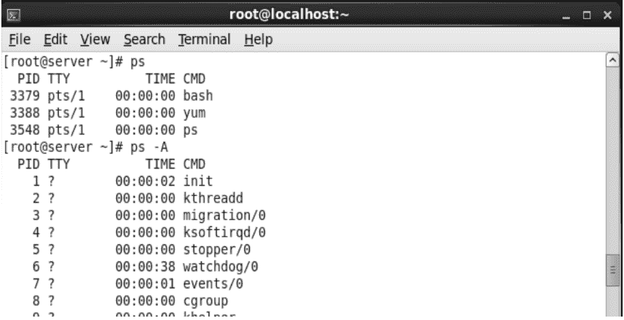

**ps -aux:** 以 BSD 格式显示所有进程。

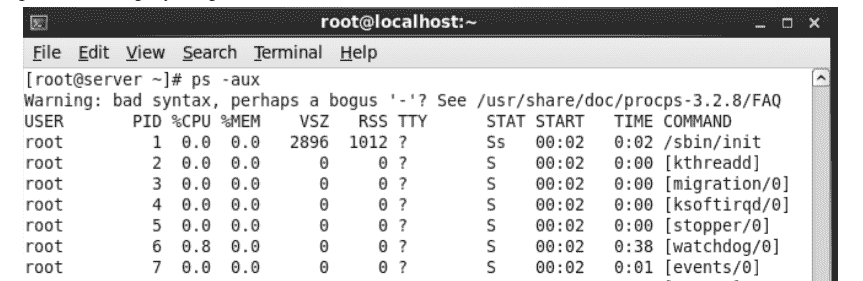

**ps -ef:** 执行全格式列出。

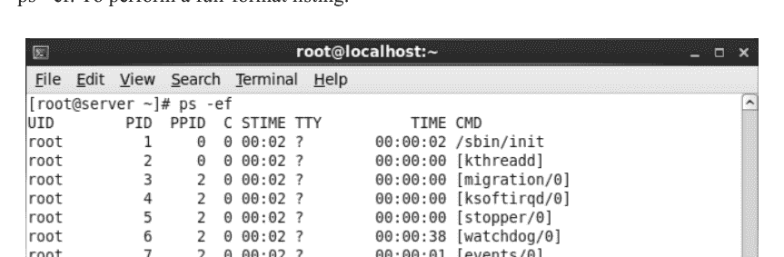

**ps -X:** 显示用户拥有的所有进程。

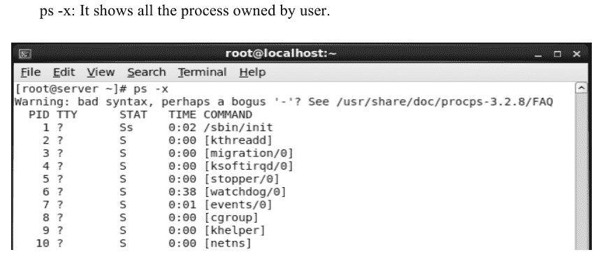

**ps -fp 1:** 用于按进程 ID 列出进程。

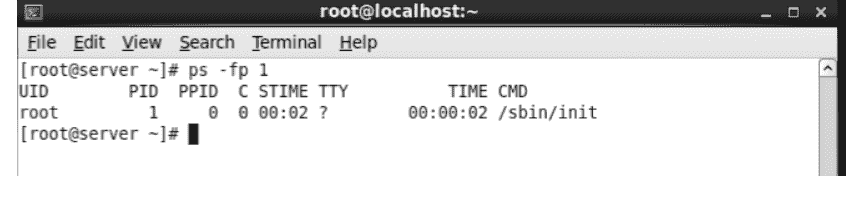

**ps -A | grep -i sshd:** 此命令用于识别 sshd 进程的进程 ID。

**kill:** 用于通过进程 ID 终止该进程。

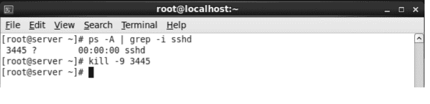

### 打包方法：rpm/deb

**RPM (Red Hat Package Manager)**

- RPM 是一个强大的软件配置管理器，是 Red Hat Linux 系统上安装、删除、验证和更新软件包的主导工具。
- RPM 由两个组件组成：一套存储已安装软件信息的数据库，以及与这些数据库接口的程序。
- 它可以处理二进制包和源码包。
- 二进制包（通常简称为 RPMs）包含已编译的、可供安装的软件，并使用`.rpm`文件扩展名。
- 源码包（更常被称为 source RPMs）是用于创建二进制 RPM 的未编译包，具有`.src.rpm`文件扩展名。
- RPM 有多种模式：
  - 常规选项
  - 查询
  - 软件包维护
  - 软件包验证
  - 软件包构建
  - 管理选项
  - 杂项选项
- 查询功能可用于获取关于已安装软件的大量信息。
- 软件包维护实现了软件包的安装、删除和升级。
- 软件包验证使系统管理员能够将 rpm 安装的文件当前状态与来自原始软件包的信息进行比较。
- 软件包构建模式用于从源代码构建或重新构建 rpms。
- 管理和杂项模式用于修复可能的数据库损坏以及确定 RPM 的常规配置。

常规选项为：

| 选项 | 描述 |
| :--- | :--- |
| -V | 显示关于 RPM 运行状态的基本信息。 |
| -vv | 显示调试信息。 |
| --quiet | 仅显示错误信息。 |
| --help | 显示使用摘要。 |
| --version | 显示 RPM 版本号。 |
| --justdb | 仅更新数据库，不更新文件系统。 |

**安装 RPMs**

安装 RPM 的基本语法为：

```
# rpm -i [options] package [...]
```

| 选项 | 描述 |
| :--- | :--- |
| --force | 如果已安装，则强制安装软件包。 |
| --h | 打印最多 50 个井号 (#) 以说明安装进度。 |
| --nodeps | 在安装或升级软件包之前不进行依赖性检查。 |
| --test | 不安装软件包或更新数据库，识别并显示冲突或依赖错误。 |
| -v | 详细模式，在安装过程中显示有用信息。 |

**升级 RPMs**

- 升级现有 RPM 的选项有两种形式：`-U`用于升级 (upgrade)，`-F`用于刷新 (freshen)。
- 升级软件包和刷新软件包之间有什么区别？
- 使用`-U`升级软件包时，即使当前未安装早期版本也会安装它；而使用`-F`刷新软件包时，仅在当前已安装早期版本的情况下才会安装。

**删除 RPMs**

- 移除或删除 RPM 及其内容非常简单，甚至简单得令人惊恐。
- 命令的一般形式为：

```
rpm -e package [...]
```

- package 仅为要删除的 RPM 的名称。可以通过在命令行中列出每个软件包来同时删除多个软件包。
- 例如，以下命令删除了 fortune-mod 和 whois RPMs：

```
# rpm -e fortune-mod whois
```

**DEB**

- Debian 软件包被多个 Linux 发行版采用，最著名的是 Ubuntu、Knoppix 和 Linux Mint。
- Debian 软件包通常具有`.deb`扩展名。
- 安装、删除或列出 Debian 软件包时，使用`dpkg`命令。
- dpkg 命令中使用的一些常见选项为：

| 选项 | 描述 |
|:------:|:------------|
| i | 安装软件包 |
| r | 移除软件包 |
| P | 移除软件包及其配置文件 |
| p | 显示关于已安装软件包的信息 |
| l | 显示已安装软件包的列表 |

**使用 dpkg 安装软件包**

要安装`.deb`软件包，请使用`dpkg`命令并配合`-i`选项：

```
$ sudo dpkg -i vim-common
```

**使用 dpkg 移除软件包**

要移除`.deb`软件包，请使用`dpkg`命令并配合`-r`选项：

```
$ sudo dpkg -r vim-common
```

**使用 dpkg 显示已安装软件包列表**

要列出系统中所有安装的软件包，请使用`dpkg`命令并配合`-l`选项：


```bash
$ sudo dpkg –l
```

**使用 `dpkg` 显示软件包信息**

要显示关于已安装软件包的信息，请使用 `–p` 选项以及软件名称：

```bash
$ sudo dpkg –p firefox
```

### 3.9 图形界面 vs 命令行

| 序号 | GUI | CLI |
|:------:|:----|:----|
| 1. | 图形用户界面 | 命令行界面 |
| 2. | 一种允许用户通过图形图标和视觉指示器进行交互的用户界面。 | 一种用户通过连续的文本行或命令行发布命令以执行任务的界面。 |
| 3. | 每个用户都能轻松操作。 | 用户应具备良好的命令知识。 |
| 4. | 由于包含许多图形组件，对内存的需求较高。 | 对内存的需求较低。 |
| 5. | 灵活性较高。 | 灵活性较低。 |
| 6. | 运行速度较慢。 | 运行速度较快。 |
| 7. | 有很多更改外观的选项。 | 没有更改外观的选项。 |

## 问题

1. 解释 Linux 架构。
2. 什么是文件？解释文件的类型。
3. 解释 Linux 的启动过程。
4. 解释 init 脚本和运行级别（runlevels）。
5. 通过示例解释进程。
6. 解释 RPM。
7. 解释 DEB。
8. 区分 GUI 和 CLI。

## 客观题

### 单选题

1. ______ 不是 Linux 架构的一部分。

   a) Shell

   b) Software

   c) Kernel

   d) Applications

2. ______ 代表根目录。

   a) ~

   b) |

   c) /

   d) !

3. Linux 中的运行级别总数是 ______。

   a) 6

   b) 8

   c) 7

   d) 5

4. ______ 不是一个引导加载程序（bootloader）。

   a) GRUB

   b) LILO

   c) GNU GRUB

   d) Windows

5. ______ 不是进程的一种信号 ______。

   a) SIGHUP

   b) SIGTERM

   c) SIGSTOP

   d) SIGCOUNT

[答案. (1 – b), (2 – c), (3 – c), (4 – d), (5 – d)]

## 第二单元

# 第 4 章：图形化桌面

## 概要

- 会话管理
- 基础桌面操作
- 网络管理
- 软件安装与更新
- 文本编辑器：`gedit`、`vi`、`vim`、`emacs`
- 图形编辑器
- 多媒体应用程序

## 4.1 会话管理

会话发生在用户登录 GNOME 桌面到用户注销之间。在登录管理器对用户进行身份验证后，会话管理器启动。会话管理器允许用户管理会话。例如，用户可以保存会话状态，并在下次登录时返回到该会话。在一个会话中，至少运行以下应用程序：

- 会话管理器，`gnome-session`。
- GConf X 设置守护进程，`gnome-settings-daemon`。
- Gnome-panel 应用程序，用于在 GNOME 桌面上运行面板。
- Metacity 窗口管理器。

下表列出了包含默认会话信息的文件：

| 文件 | 描述 |
|:---|:---|
| `/usr/share/gnome/default.session` | 默认会话文件。默认会话详情存储在此文件中。 |
| `$HOME/.gnome2/session` | 用户会话文件。当用户修改会话时，详情存储在此文件中。 |

## 4.2 基础桌面操作

桌面环境是一套使计算机使用变得更简单的工具。桌面环境的组件包括以下部分或全部内容：

- **窗口管理器（Window manager）**：用于管理主题和窗口行为。
- **面板（Panels）**：用于显示系统菜单和快速启动图标。
- **菜单（Menus）**：方便地访问应用程序和控件。
- **小部件（Widgets）**：用于显示天气、新闻片段或系统信息等信息。
- **文件管理器（File Manager）**：用于管理和组织文件。
- **浏览器（Browser）**：用于浏览互联网。
- **办公套件（Office Suite）**：创建文档、电子表格和演示文稿。
- **文本编辑器（Text Editor）**：创建简单的文本文件并编辑配置文件。
- **终端（Terminal）**：提供对命令行工具的访问。
- **显示管理器（Display Manager）**：调整屏幕和图形。

### GNOME

GNOME 桌面环境默认包含一个单一面板。要唤起 GNOME 仪表板，你需要按下键盘上的 super 键（在大多数计算机上显示为 Windows 徽标）。GNOME 包含一组核心应用程序，但也有许多专门编写的其他应用程序。

核心应用程序包括：

- 图形 shell
- 控制中心（类似于 Windows 控制面板）
- Tweak 工具（用于自定义 GNOME）
- 聊天、IRC、联系人和邮件
- 文件、文档和照片
- 音乐和视频
- 传输
- Boxes（虚拟机）
- 凭据
- 磁盘实用程序和磁盘使用分析器
- 软件（包管理器）
- 时钟
- 地图和天气
- Web（网页浏览器）
- 计算器和日历
- 字典
- 笔记和 `Gedit`（文本编辑器）
- Gitg（GIT 的前端）

GNOME 的自定义程度不是很高，但其丰富的实用工具提供了极佳的桌面体验。它有一套默认的键盘快捷键可用于系统导航。

**优点：**

- 现代化的桌面
- 核心应用程序和开发套件
- 大量的键盘快捷键
- 搜索功能和过滤

**缺点：**

- 内存占用较高
- 功能不如其他桌面丰富
- 较为僵化，自定义程度低

### KDE

KDE Plasma 提供的桌面界面与 Cinnamon 类似，但通过“活动（Activities）”的形式增加了一些额外功能。该桌面遵循更传统的路线，底部有一个单一面板，包含菜单、快速启动栏和系统托盘图标。你可以在桌面上添加小部件以获取新闻和天气等信息。

KDE 默认附带大量应用程序。这里无法一一列举，但一些关键亮点包括：

- Akonadi：个人信息管理器
- Ark：压缩实用工具
- Dolphin：文件管理器
- Gwenview：图像查看器
- KAccounts：账户管理
- Calc：计算器
- Kdenlive：视频编辑器
- Kontact：联系人管理器
- kMail：邮件
- Akregator：RSS 阅读器
- Kopete：即时通讯工具
- Kate：文本编辑器
- Konqueror：网页浏览器

KDE 应用程序的外观和感觉非常相似，它们拥有海量的功能且高度可定制。KDE 非常适合现代计算机。

**优点：**

- 对于 Windows 用户来说很熟悉
- 提供许多默认应用程序
- 高度可定制

**缺点：**

- 内存占用较高
- 备份和还原不够简便
- 部分组件较为复杂

## 4.3 网络管理

### a) 设置以太网卡

网络上的每个节点都由一个 IP 地址标识。因此，有必要配置你连接的以太网卡。为此，请执行 `setup` 命令。

在“选择工具（Choose a Tool）”窗口中选择“网络配置（Network Configuration）”。

在“选择操作（Select Action）”窗口中选择“设备配置（Device Configuration）”。

在“选择设备（Select A Device）”窗口中选择 `eth0-Ethernet`。

输入设备名称、静态 IP 地址、子网掩码（Netmask）、默认网关（Default gateway）和主 DNS 服务器等详细信息。

点击 OK（确定）、Save（保存）、Save & Quit（保存并退出）和 Quit（退出）。

### b) `ifconfig`

它是一个用于网络接口配置的命令行界面工具，也用于在系统启动时初始化接口。一旦服务器启动并运行，它可以用于为接口分配 IP 地址，并根据需要启用或禁用该接口。它还用于查看当前活动接口的 IP 地址、硬件/MAC 地址以及 MTU（最大传输单元）大小。因此，`ifconfig` 对于调试或进行系统调优非常有用。

### c) `hostname`

它显示机器的主机名。

### d) `/etc/sysconfig/network`

该文件指定所有网络接口的路由和主机信息。

### e) `/etc/hosts`

该文件的主要目的是解析无法通过其他方式解析的主机名。它也可以用于没有 DNS 服务器的小型网络中解析主机名。无论计算机处于何种类型的网络，该文件都应包含一行，将回环设备的 IP 地址（`127.0.0.1`）指定为 `localhost.localdomain`。

### f) `/etc/resolv.conf`

该文件指定 DNS 服务器的 IP 地址和搜索域。除非另有配置，否则网络初始化脚本会填充此文件。

### g) `service`

它将通过建立连接来启动所有网络服务。

### h) `netstat`

这是一个命令行工具，用于显示有关 Linux 网络子系统的有用信息，例如网络连接、路由表、接口统计等。它对于网络故障排除和性能分析非常有用。它也是一个基础的网络服务调试工具，用于检查哪些程序在监听哪些端口。

### i) `arp`

用于显示相邻设备的 IP 地址到 MAC 地址的解析信息。

```text
[root@localhost ~]# arp
Address                  HWtype  HWaddress           Flags Mask     Iface
172.16.0.1               ether    c0:ea:e4:f7:f7:04   C               eth1
[root@localhost ~]#
```

### j) `ping`

`ping`（Packet Internet Groper）是一个通常用于测试网络上两个系统（局域网（LAN）或广域网（WAN））之间连通性的实用程序。它使用 ICMP（互联网控制消息协议）与网络上的节点通信。要测试与另一个节点的连通性，只需提供其 IP 或主机名，例如：

```text
[root@localhost ~]# ping 172.16.0.1
PING 172.16.0.1 (172.16.0.1) 56(84) bytes of data.
64 bytes from 172.16.0.1: icmp_seq=1 ttl=64 time=1.06 ms
64 bytes from 172.16.0.1: icmp_seq=2 ttl=64 time=0.988 ms
64 bytes from 172.16.0.1: icmp_seq=3 ttl=64 time=0.987 ms
^Z
[1]+ Stopped                ping 172.16.0.1
[root@localhost ~]#
```

### k) `route`

`route` 是一个用于显示或操纵 Linux 系统 IP 路由表的命令行实用程序。它主要用于通过某个接口为特定主机或网络配置静态路由。

```text
[root@localhost ~]# route
Kernel IP routing table
Destination     Gateway         Genmask         Flags Metric Ref    Use Iface
172.16.0.0      *               255.255.0.0     U     1      0        0 eth1
default         172.16.0.1     0.0.0.0         UG    0      0        0 eth1
[root@localhost ~]#
```

### l) `dig`

`dig`（domain information groper）是另一个简单的 DNS 查询实用程序，用于查询 DNS 相关信息，如 A 记录、CNAME、MX 记录等，例如：

```text
[root@localhost ~]# dig server.linux.edu
; <<>> DiG 9.8.2rc1-RedHat-9.8.2-0.30.rc1.el6 <<>> server.linux.edu
;; global options: +cmd
;; Got answer:
;; ->>HEADER<<- opcode: QUERY, status: NXDOMAIN, id: 47892
;; flags: qr rd ra; QUERY: 1, ANSWER: 0, AUTHORITY: 1, ADDITIONAL: 0
;;
;; QUESTION SECTION:
;server.linux.edu.                   IN      A
;;
;; AUTHORITY SECTION:
linux.edu.                1799    IN      SOA     master.linux.edu. eduard.linuxlabs.com. 2019032708 86400 600 604800 86400
;;
;; Query time: 4631 msec
;; SERVER: 8.8.8.8#53(8.8.8.8)
;; WHEN: Thu Sep 19 00:46:27 2019
;; MSG SIZE  rcvd: 97
[root@localhost ~]#
```

```text
[root@localhost ~]# dig 172.16.20.120
; <<>> DiG 9.8.2rc1-RedHat-9.8.2-0.30.rc1.el6 <<>> 172.16.20.120
;; global options: +cmd
;; Got answer:
;; ->>HEADER<<- opcode: QUERY, status: NXDOMAIN, id: 6592
;; flags: qr rd ra; QUERY: 1, ANSWER: 0, AUTHORITY: 1, ADDITIONAL: 0
;; QUESTION SECTION:
;172.16.20.120.            IN      A
;; AUTHORITY SECTION:
.                   86398   IN      SOA     a.root-servers.net. nstld.verisign-grs.com. 2019091802 1800 900 604800 86400
;; Query time: 4 msec
;; SERVER: 8.8.8.8#53(8.8.8.8)
;; WHEN: Thu Sep 19 00:46:53 2019
;; MSG SIZE  rcvd: 106
[root@localhost ~]#
```

## m) `traceroute`

`traceroute` 是一个命令行实用程序，用于跟踪从本地系统到另一个网络系统的完整路径。它会打印出在到达目标服务器路径上经过的跳数（路由器 IP）。它是 `ping` 命令之后一个简单易用的网络故障排除工具。

```text
[root@server ~]# traceroute 8.8.8.8
traceroute to 8.8.8.8 (8.8.8.8), 30 hops max, 60 byte packets
1  dhcp-192-254-33.in2cable.com (203.192.254.33)  1.094 ms  5.949 ms  5.768 ms
^Z
[2]+  Stopped                 traceroute 8.8.8.8
[root@server ~]#
```

## 4.4 安装和更新软件

### YUM

YUM（Yellowdog Updater Modified）是一个针对基于 RPM（RedHat Package Manager）的 Linux 系统的开源命令行及图形化软件包管理工具。它允许用户和系统管理员在系统上轻松地安装、更新、删除或搜索软件包。它在 GPL（通用公共许可证）下开发并发布，作为开源软件，这意味着任何人都可以下载并访问代码以修复 Bug 并开发定制包。YUM 使用大量的第三方存储库，通过解决依赖问题来自动安装软件包。

#### a) 安装软件包

要安装名为 `dhcp` 的软件包，只需运行以下命令，它将自动查找并安装 `dhcp` 所需的所有依赖项。

```text
[root@localhost ~]# yum install dhcp*

Loaded plugins: fastestmirror, refresh-packagekit, security

Setting up Install Process

base                     | 3.7 kB      00:00

base/primary_db          | 3.7 MB      00:01

extras                   | 3.3 kB      00:00

extras/primary_db       | 20 kB       00:00

updates                  | 3.4 kB      00:00

updates/primary_db      | 5.9 MB      00:02

Resolving Dependencies

--> Running transaction check

---> Package dhcp.i686 12:4.1.1-63.P1.el6.centos will be installed
```


---> Package dhcp-common.i686 12:4.1.1-43.P1.el6.centos will be updated

Verifying  : 12:dhcp-common-4.1.1-43.P1.el6.centos.i686

Installed:

  dhcp.i686 12:4.1.1-63.P1.el6.centos  dhcp-devel.i686 12:4.1.1-63.P1.el6.centos

Updated:

  dhcp-common.i686 12:4.1.1-63.P1.el6.centos

Dependency Updated:

  dhclient.i686 12:4.1.1-63.P1.el6.centos

Complete!

[root@localhost ~]#
```

上述命令在系统中安装任何软件包之前都会请求确认。如果您想在不请求确认的情况下自动安装软件包，请使用如下示例中的`-y`选项。

```bash
#yum install -y dhcp*
```

#### b) 删除软件包

要将软件包及其所有依赖项完全删除，只需运行如下所示的命令。

```bash
[root@localhost ~]# yum remove dhcp*

Loaded plugins: fastestmirror, refresh-packagekit, security

Setting up Remove Process

Resolving Dependencies

--> Running transaction check

---> Package dhcp.i686 12:4.1.1-63.P1.el6.centos will be erased

---> Package dhcp-common.i686 12:4.1.1-63.P1.el6.centos will be erased

--> Processing Dependency: dhcp-common = 12:4.1.1-63.P1.el6.centos for package: 12:dhclient-4.1.1-63.P1.el6.centos.i686

---> Package dhcp-devel.i686 12:4.1.1-63.P1.el6.centos will be erased

--> Running transaction check

---> Package dhclient.i686 12:4.1.1-63.P1.el6.centos will be erased

--> Processing Dependency: dhclient >= 12:4.1.0 for package: 1:NetworkManager-0.8.1-75.el6.i686

--> Running transaction check

---> Package NetworkManager.i686 1:0.8.1-75.el6 will be erased

--> Processing Dependency: NetworkManager = 1:0.8.1-75.el6 for package: 1:NetworkManager-gnome-0.8.1-75.el6.i686

--> Running transaction check

---> Package NetworkManager-gnome.i686 1:0.8.1-75.el6 will be erased

Erasing  : 12:dhclient-4.1.1-63.P1.el6.centos.i686              5/6

Erasing  : 12:dhcp-common-4.1.1-63.P1.el6.centos.i686          6/6

Verifying : 12:dhclient-4.1.1-63.P1.el6.centos.i686              1/6

Verifying : 12:dhcp-4.1.1-63.P1.el6.centos.i686                  2/6

Verifying : 12:NetworkManager-gnome-0.8.1-75.el6.i686            3/6

Verifying : 12:NetworkManager-0.8.1-75.el6.i686                  4/6

Verifying : 12:dhcp-devel-4.1.1-63.P1.el6.centos.i686            5/6

Verifying : 12:dhcp-common-4.1.1-63.P1.el6.centos.i686           6/6

Removed:

  dhcp.i686 12:4.1.1-63.P1.el6.centos

  dhcp-common.i686 12:4.1.1-63.P1.el6.centos

  dhcp-devel.i686 12:4.1.1-63.P1.el6.centos

Dependency Removed:

  NetworkManager.i686 1:0.8.1-75.el6    NetworkManager-gnome.i686 1:0.8.1-75.el6

  dhclient.i686 12:4.1.1-63.P1.el6.centos

Complete!

[root@localhost ~]#
```

同样，上述命令在删除软件包之前会请求确认。要禁用确认提示，只需添加如下所示的`-y`选项。

#### c. 更新软件包

要将软件包更新到最新的稳定版本，请运行以下命令，它将自动解决所有依赖问题并安装它们。

```bash
#yum update dhcp*
```

#### d. 列出软件包

`list`功能用于通过名称搜索特定软件包。例如，要搜索名为`openssh`的软件包，请使用该命令。

```bash
#yum list openssh
```

#### e. 搜索软件包

如果您不记得软件包的准确名称，可以使用`search`功能搜索所有可用软件包，以匹配您指定的软件包名称。例如，搜索所有匹配"networking tools"词组的软件包。

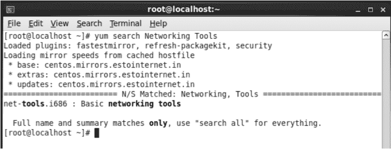

#### f. 软件包信息

在安装软件包之前，可以使用`yum info`命令获取该软件包的信息。

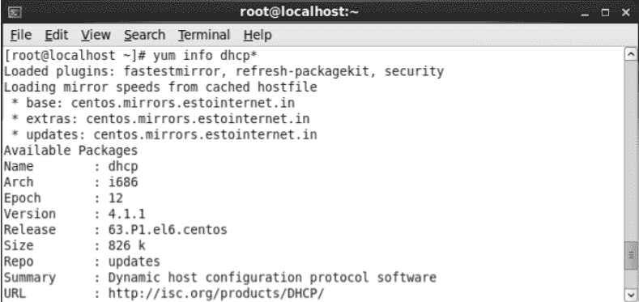

#### g. 可用软件包

列出 Yum 数据库中所有可用的软件包。

```bash
#yum list | less
```

#### h. 已安装软件包

要列出系统上所有已安装的软件包，只需执行以下命令，它将显示所有已安装的软件包。

```bash
#yum list installed | less
```

#### i. 更新系统

为了使您的系统保持最新的所有安全和二进制软件包更新，请运行以下命令。它将为您的系统安装所有最新的补丁和安全更新。

```bash
#yum update
```

#### j. 可用组软件包

在 Linux 中，许多软件包被捆绑在特定的组中。与其使用 yum 安装单个软件包，您可以安装特定的组，这将安装属于该组的所有相关软件包。例如，要列出所有可用组，只需执行以下命令。

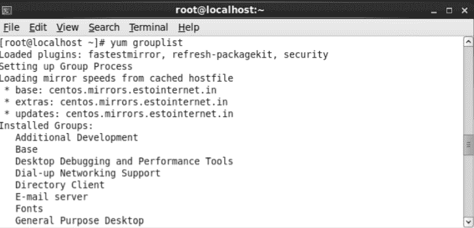

#### k. 安装组软件包

要安装特定的软件包组，我们使用`groupinstall`选项。

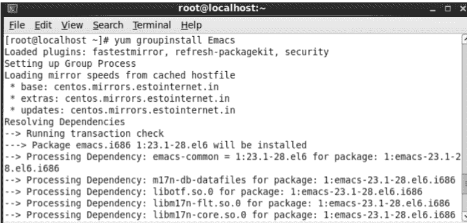

#### l. 更新组软件包

要更新任何已安装的组软件包，只需运行如下所示的命令。

```bash
#yum groupupdate 'Emacs'
```

#### m. 删除组软件包

要从系统中删除或移除任何已安装的组，请使用以下命令。

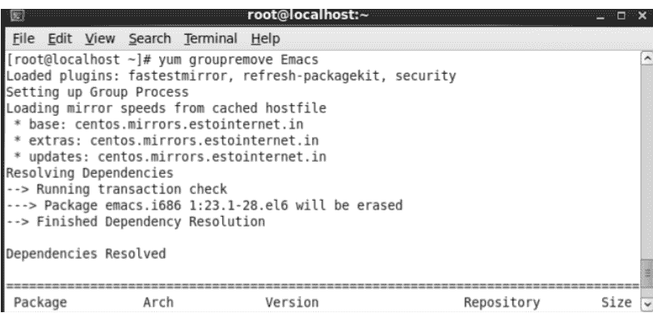

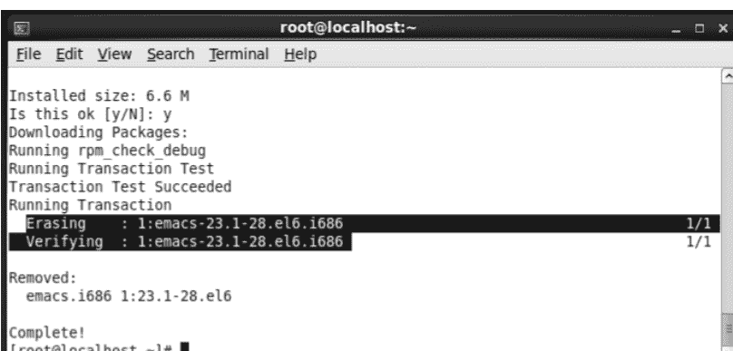

#### n. 列出已启用的 yum 存储库

要列出系统中所有已启用的 Yum 存储库，请使用以下选项。

```bash
# yum repolist
```

## RPM

RPM (Red Hat Package Manager) 是 Red Hat 系列系统（如 RHEL、CentOS 和 Fedora）默认的开源且最流行的软件包管理实用程序。该工具允许系统管理员和用户在 Linux 操作系统中安装、更新、查询、验证和管理系统软件软件包。RPM 实用程序仅适用于构建为`.rpm`格式的软件包。RPM 将所有已安装软件包的信息保存在`/var/lib/rpm`数据库中。RPM 处理`.rpm`文件，其中包含关于软件包的实际信息，例如：它是什么、来自哪里、依赖信息、版本信息等。

### RPM 的五种模式

- Install：用于安装任何 RPM 软件包。
- Remove：用于擦除、删除或卸载任何 RPM 软件包。
- Upgrade：用于更新现有的 RPM 软件包。
- Verify：用于验证 RPM 软件包。
- Query：用于查询任何 RPM 软件包。

您可以通过以下站点查找并下载所有 RPM 软件包：

1. http://rpmfind.net
2. http://www.redhat.com
3. http://freshrpms.net/
4. http://rpm.pbone.net/

在 Linux 中安装软件包时必须是 root 用户，凭借 root 权限，您可以使用相应的选项来管理`rpm`命令。

## a) 安装 RPM 软件包

要安装 rpm 软件安装包，请使用带有`-i`选项的命令。

```bash
[root@server]# rpm -ivh dhcp-4.3.5-11.1.i586.rpm
```

RPM 选项：

- `-i`：安装软件包
- `-v`：详细模式，用于更好的显示效果
- `-h`：在解包软件包时打印 hash 标记。

## b) 在安装前检查依赖关系

在安装或升级软件包之前，使用`-R`选项进行依赖检查。它将显示软件包的依赖关系列表。

```bash
[root@server]# rpm -qpR dhcp-4.3.5-11.1.i586.rpm
```

RPM 选项：

- `-q`：查询软件包
- `-p`：列出该软件包提供的能力（capabilities）。
- `-R`：列出该软件包依赖的能力。

## c) 不检查依赖关系地安装软件包

您可以使用`--nodeps`（不检查依赖关系）选项来在不检查依赖的情况下安装软件包。它将忽略依赖错误强制安装 rpm 软件包，但如果缺失这些依赖文件，程序将无法正常运行，直到您安装它们。

```bash
[root@server]# rpm -ivh -nodeps dhcp-4.3.5-11.1.i586.rpm
```

## d) 检查软件包是否已安装

使用`-q`选项和软件包名称来检查 rpm 是否已安装。

```bash
[root@server]# rpm -q dhcp
```

## e) 列出已安装软件包的所有文件

使用`-ql`（查询列表）选项来查看已安装 rpm 软件包的所有文件。

```bash
[root@server]# rpm -ql dhcp
```

## f) 列出已安装的软件包

使用`-qa`选项来列出系统中所有已安装的 rpm 软件包。

```bash
[root@server]# rpm -qa
```

## g) 升级 RPM 软件包

使用`-U`（升级）选项来升级任何 rpm 软件包。它将升级到最新版本，并保留旧版本的备份。

```bash
[root@server]# rpm -Uvh dhcp-4.3.5-11.1.x86_64.rpm
```

## h) 移除 RPM 软件包

使用`-e`（擦除）选项从系统中移除已安装的 rpm 软件包。

```bash
[root@server]# rpm -evv dhcp
```

## i) 不检查依赖关系地移除 RPM 软件包

将`-nodeps`与`-e`选项结合使用，以强制从系统中移除已安装的 rpm 软件包。

```bash
[root@server]# rpm -evv --nodeps dhcp
```

## j) 查询已安装 RPM 软件包的信息

使用`-qi`（查询信息）选项来了解已安装 rpm 软件包的信息。

```bash
[root@server]# rpm -eqi dhcp
```

## k) 验证 RPM 软件包

使用`-Vp`（验证软件包）选项将软件包已安装文件的信息与 rpm 数据库进行对比。

```bash
[root@server]# rpm -Vp dhcp
```

## l) 验证所有 RPM 软件包

使用`-Va`（验证所有）选项来验证所有已安装的 rpm 软件包。

```bash
[root@server]# rpm -Va
```

## 4.5 文本编辑器：gedit、vi、vim、emacs

### Gedit

Gedit 是一个为 GNOME 桌面环境设计的全功能文本编辑器。它可用于编写简单的笔记和文档，也可以利用其一些高级功能将其打造为您自己的软件开发环境。


`gedit`启动后，您可以立即开始写作。点击`gedit`工具栏中的保存图标即可保存文本。

### 创建新文件

点击工具栏左侧的“创建新文档”按钮，或按下`Ctrl+T`。

### 关闭文件

要关闭文件，选择“关闭”。您可以点击文件选项卡右侧出现的微小“x”，或按下`Ctrl+W`。

### 打开文件或一组文件

要打开文件，点击“打开”按钮或按下`Ctrl+O`。随后将出现一个“打开”对话框。您选择的文件将在新选项卡中打开。

### 保存文件

要保存文件，点击“保存”按钮或按下`Ctrl+S`。随后会出现一个对话框，为您提供为该文件命名。输入您选择的名称即可。

### 添加和删除选项卡

在单个窗口中，我们可以同时处理多个文件。如果某个选项卡比其他选项卡大，意味着该文件当前处于打开状态。较小的选项卡表示可用文件。

要添加新选项卡，使用`Ctrl+T`创建一个新文件。该选项卡将被添加到其他所有选项卡的右侧。

要删除选项卡，点击选项卡右侧的叉号。要删除所有打开的选项卡，按下`Ctrl+Shift+W`。

### 更改 gedit 窗口中的选项卡顺序

要更改窗口中的选项卡顺序：

1. 在选项卡上点击并按住鼠标按钮。
2. 将选项卡移动到其他选项卡之间 Desired 的位置。
3. 松开鼠标按钮。

选项卡将被放置在您松开鼠标时最接近的位置，紧邻其他已打开的选项卡。

### 移动选项卡以创建新的 gedit 窗口

从现有选项卡创建新窗口：

1. 在选项卡上点击并按住鼠标按钮。
2. 将选项卡拖出 gedit 窗口。
3. 松开鼠标按钮。

### 将选项卡移动到另一个 gedit 窗口

如果您想将选项卡从一个窗口移动到另一个窗口：

1. 在选项卡上点击并按住鼠标按钮。
2. 将选项卡拖到新窗口中。
3. 将其放置在新窗口的其他选项卡旁边。
4. 松开鼠标按钮。

### 替换文本

替换功能可以帮助查找并替换部分文本。

1. 通过点击“菜单”按钮 -> “查找和替换”，或按下`Ctrl+H`打开替换工具。
2. 在“查找”字段中输入您想要替换的文本。
3. 在“替换为”字段中输入新的替换文本。
4. 输入原文本和替换文本后，您可以为搜索添加额外参数。您还可以选择替换方式：
   - 要仅替换下一个匹配项，点击“替换”。
   - 要替换所有出现的搜索文本，点击“全部替换”。

### 更多选项

如果需要，您可以为搜索添加一些额外参数：

#### 区分大小写（Match case）

- “区分大小写”选项允许您指定搜索是否对字母大小写敏感。
- 如果选中此选项，搜索将区分大小写。
- 如果未选中，搜索将不区分大小写。

#### 仅匹配全词（Match entire word only）

- 此选项用于搜索特定词汇，而不包含其他词汇的片段。
- 例如，如果选中此选项并搜索单词`'the'`，则`'the'`会被匹配，但`'there'`和`'together'`不会被匹配。

#### 向后搜索（Search backwards）

- 此命令的行为与“查找上一个”命令完全相同。
- 如果您希望从末尾向开头逐步查看搜索结果，请选择此选项。

#### 循环搜索（Wrap around）

启用循环搜索选项后，`gedit`在到达文件底部后将从文件顶部重新开始搜索/替换操作。这确保了您的搜索/替换操作覆盖整个文件。

#### 使用转义序列

- 您可以使用转义序列来搜索换行符、回车符和制表符。
- `\n` - 新行
- `\r` - 回车
- `\t` - 制表符
- 如果您想在文本中搜索`\`（反斜杠）或其中一个转义序列，您需要用额外的反斜杠来转义该反斜杠。
- 例如，要搜索`\`，您需要在搜索或替换字段中输入`\\`。
- 您可以用同样的方式搜索转义序列：要搜索或替换为`\n`，请使用`\n`术语。

### 查找文本

1. 通过点击“菜单”按钮 -> “查找...”，或按下`Ctrl+F`打开搜索窗口。这将把光标移至搜索窗口的起始位置。
2. 在搜索窗口中输入您要查找的文本。
3. 当您输入时，`gedit`将开始突出显示与您输入内容匹配的文本部分。

要滚动浏览搜索结果，可执行以下任何操作：

- 点击搜索窗口旁边的向上或向下箭头。
- 按键盘上的上箭头或下箭头键。
- 按下`Ctrl+G`或`Ctrl+Shift+G`。


要关闭搜索窗口，请按下 `Esc` 或 `Enter`。按下 `Esc` 将把光标返回到开始搜索之前的位置。按下 `Enter` 将把光标返回到搜索结果的当前位置。

### 撤销操作

按下 `Ctrl+Z` 撤销上一步操作。

### 更改颜色

1. 从顶栏打开 gedit 菜单，然后选择“首选项” -> “字体与颜色”。
2. 选择您想要的配色方案。

### 更改默认颜色

1. 选择 gedit -> “首选项” -> “字体与颜色”。
2. 取消勾选“使用系统等宽字体”旁边的复选框。
3. 点击当前的字体名称。gedit 将打开一个字体选择窗口，允许您查看可用字体并选择您喜欢的字体。
4. 选择新字体后，使用字体列表下方的滑块设置默认字体大小。
5. 点击“选择”，然后点击“关闭”。

### 语法高亮

- 如果 gedit 在您打开文件时识别出所使用的语法，它将自动突出显示文本。
- 如果启动时您的语法或语言未被高亮，您可以通过点击“查看” -> “高亮模式”，然后选择所需的语法来手动选择。

### 全屏模式

- 使用全屏模式将隐藏菜单栏、选项卡栏和工具栏，为您提供更多的文本显示空间，让您能更好地专注于任务。
- 按下 `F11` 开启全屏模式。
- 在全屏模式下，按下 `Ctrl+Alt+PgUp` 或 `Ctrl+Alt+PgDn` 在打开的选项卡之间切换。
- 按下 `F11` 关闭全屏模式。

## 图形桌面

### 从侧边栏查看并打开文件

- 要激活侧边栏，请选择 View -> Side Panel，或者直接按下 `F9` 键。
- 您可以随时通过按下 `F9` 键来切换侧边栏的打开或关闭状态。
- 要打开文件，请从面板顶部的下拉菜单中选择 File Browser。
- 这将激活侧边栏的 File Browser 模式。然后您可以使用面板顶部的导航按钮来定位并打开所需的文件。

## Vi 编辑器

VI 编辑器是 Linux 家族中最受欢迎且最经典的文本编辑器。

- 它几乎在所有的 Linux 发行版中都可用。
- 它在不同的平台和发行版之间运行方式相同。
- 它非常用户友好。因此，数百万 Linux 用户喜爱它并将其用于编辑需求。

vi 编辑器有三种模式：

### 命令模式 (Command mode)

- 这是编辑器的默认模式。
- 按下的每个键都被解释为在文本上运行的命令。
- 要复制和删除文本，您必须处于此模式。
- 按下 `Esc` 键确认您处于此模式。

### 输入模式 (Input mode)

- 切换到此模式后，按下的每个键都将显示为文本。
- 此模式用于在文件中插入文本。

### Ex 模式 (Ex mode)

- 此模式用于处理文件。
- 在命令模式下按下 `:`（冒号）即可调用 Ex 模式。
- 然后输入 Ex 模式命令，最后按下 `Enter` 键。
- 随后您将返回默认的命令模式。

### 启动 vi 编辑器

要启动 VI 编辑器，打开终端 (CLI) 并输入：

```text
vi <new_filename> or <existing_filename>
```

vi 是区分大小写的。

### 输入模式命令

#### 插入文本

| 按键 | 操作 |
|---|---|
| `i` | 在光标位置左侧插入文本 |
| `a` | 在光标位置右侧追加文本 |
| `I` | 在行首插入文本 |
| `A` | 在行尾追加文本 |

#### 开启新行

| 按键 | 操作 |
|---|---|
| `o` | 在当前行下方开启新行 |
| `O` | 在当前行上方开启新行 |

#### 替换文本

| 按键 | 操作 |
|---|---|
| `r` | 替换光标位置下的单个字符 |
| `s` | 用多个字符替换光标下的一个字符 |
| `R` | 替换从光标位置向右的所有文本 |
| `S` | 无论光标位置如何，替换整行 |

### Ex 模式命令

| 按键 | 操作 |
|---|---|
| `:w` | 保存文件但保持打开状态 |
| `:q` | 不保存直接退出 |
| `:wq` 或 `:x` | 保存文件并退出 |
| `:r` 或 `:recover` | 从崩溃中恢复 |
| `:w <filename>` | 类似于 Windows 中的“另存为” |

### 导航

#### 四方向移动

| 按键 | 操作 |
|---|---|
| `k` | 光标上移 |
| `3k` | 光标上移 3 个位置 |
| `j` | 光标下移 |
| `2j` | 光标下移 2 个位置 |
| `h` | 光标左移 |
| `3h` | 光标左移 3 个位置 |
| `l` | 光标右移 |
| `2l` | 光标右移 3 个位置 |

#### 单词导航

| 按键 | 操作 |
|---|---|
| `b` | 向后移动到单词开头 |
| `e` | 向前移动到单词结尾 |
| `w` | 向前移动到下一个单词开头 |

#### 移动到行两端

| 按键 | 操作 |
|---|---|
| `0 (零) 或 \|` | 移动到行首第一个字符 |
| `$` | 移动到行尾 |

#### 滚动

| 按键 | 操作 |
|---|---|
| `Ctrl+f` | 向前滚动 |
| `Ctrl+b` | 向后滚动 |
| `Ctrl+d` | 向前滚动半页 |
| `Ctrl+u` | 向后滚动半页 |

#### 绝对移动

| 按键 | 操作 |
|---|---|
| `G` | 跳转到文件末尾 |
| `40G` | 跳转到第 40 行 |

### 编辑文本

#### 删除文本

| 按键 | 操作 |
|---|---|
| `x` | 删除单个字符 |
| `3x` | 删除当前字符以及右侧的两个字符 |
| `dd` | 删除整行 |
| `6dd` | 删除当前行及其下方五行 |

#### 移动文本

| 按键 | 操作 |
|---|---|
| `p` | 将复制/删除的文本放置在当前行下方 |
| `P` | 将复制/删除的文本放置在当前行上方 |

#### 复制文本/Yank 文本

| 按键 | 操作 |
|---|---|
| `yy` | 复制/Yank 当前行 |
| `7yy` | 复制/Yank 当前行及其下方六行 |

#### 合并行

| 按键 | 操作 |
|---|---|
| `J` | 将当前行与下一行合并 |
| `4J` | 将接下来的三行与当前行合并 |

### 撤销上次编辑

| 按键 | 操作 |
|---|---|
| `u` | 撤销最后一次更改 |
| `U` | 撤销对当前行所做的所有更改 |

### 搜索模式

| 按键 | 操作 |
|---|---|
| `/pat` | 向前搜索模式 `pat` |
| `?pat` | 向后搜索模式 `pat` |
| `n` | 沿上次搜索方向重复搜索 |
| `N` | 沿与上次搜索相反的方向重复搜索 |

## Vim

Vim 是 vi 编辑器的增强版本，被称为 `Vi Improved`。

vim 编辑器有 3 种模式：

### 命令模式 (Command mode)

- 这是编辑器的默认模式。
- 按下的每个键都被解释为在文本上运行的命令。
- 要复制和删除文本，您必须处于此模式。
- 按下 `Esc` 键确认您处于此模式。

### 输入模式 (Input mode)

- 切换到此模式后，按下的每个键都将显示为文本。
- 此模式用于在文件中插入文本。

### Ex 模式 (Ex mode)

- 此模式用于处理文件。
- 在命令模式下按下 `:`（冒号）即可调用 Ex 模式。
- 然后输入 Ex 模式命令，最后按下 `Enter` 键。
- 随后您将返回默认的命令模式。

### 启动 vim 编辑器

要启动 vim 编辑器，打开终端 (CLI) 并输入：

```text
vim <new_filename> or <existing_filename>
```

vim 是区分大小写的。

### 输入模式命令

#### 插入文本

| 按键 | 操作 |
|---|---|
| `i` | 在光标位置左侧插入文本 |
| `a` | 在光标位置右侧追加文本 |
| `I` | 在行首插入文本 |
| `A` | 在行尾追加文本 |

#### 开启新行

| 按键 | 操作 |
|---|---|
| `o` | 在当前行下方开启新行 |
| `O` | 在当前行上方开启新行 |

#### 替换文本

| 按键 | 操作 |
|---|---|
| `r` | 替换光标位置下的单个字符 |
| `s` | 用多个字符替换光标下的一个字符 |
| `R` | 替换从光标位置向右的所有文本 |
| `S` | 无论光标位置如何，替换整行 |

### Ex 模式命令

| 按键 | 操作 |
|---|---|
| `:w` | 保存文件但保持打开状态 |
| `:q` | 不保存直接退出 |
| `:wq` 或 `:x` | 保存文件并退出 |
| `:r` 或 `:recover` | 从崩溃中恢复 |
| `:w <filename>` | 类似于 Windows 中的“另存为” |

### 导航

#### 四方向移动

| 按键 | 操作 |
|---|---|
| `k` | 光标上移 |
| `3k` | 光标上移 3 个位置 |
| `j` | 光标下移 |
| `2j` | 光标下移 2 个位置 |
| `h` | 光标左移 |
| `3h` | 光标左移 3 个位置 |
| `l` | 光标右移 |
| `2l` | 光标右移 3 个位置 |

#### 单词导航

| 按键 | 操作 |
|---|---|
| `b` | 向后移动到单词开头 |
| `e` | 向前移动到单词结尾 |
| `w` | 向前移动到下一个单词开头 |

#### 移动到行两端

| 按键 | 操作 |
|---|---|
| `0 (零) 或 \|` | 移动到行首第一个字符 |
| `$` | 移动到行尾 |

#### 滚动

| 按键 | 操作 |
|---|---|
| `Ctrl+f` | 向前滚动页面 |
| `Ctrl+b` | 向后滚动页面 |
| `Ctrl+d` | 向前滚动半页 |
| `Ctrl+u` | 向后滚动半页 |

#### 绝对移动

| 按键 | 操作 |
|---|---|
| `G` | 跳转到文件末尾 |
| `40G` | 跳转到第 40 行 |

### 编辑文本

#### 删除文本

| 按键 | 操作 |
|---|---|
| `x` | 删除单个字符 |
| `3x` | 删除当前字符以及右侧的两个字符 |
| `dd` | 删除整行 |
| `6dd` | 删除当前行及其下方五行 |
| `dw` | 从光标处向后删除一个单词 |
| `db` | 向前删除一个单词 |
| `d$` | 删除到行尾 |
| `d^ (脱字符)` | 删除到行首 |

#### 移动文本

| 按键 | 操作 |
|---|---|
| `p` | 将复制/删除的文本放置在当前行下方 |
| `P` | 将复制/删除的文本放置在当前行上方 |

#### 复制文本/Yank 文本

| 按键 | 操作 |
|---|---|
| `yy` | 复制/Yank 当前行 |
| `7yy` | 复制/Yank 当前行及其下方六行 |
| `y$` | 从光标处复制到当前行末尾 |
| `yw` | 从光标处复制到当前单词末尾 |

#### 合并行

| 按键 | 操作 |
|---|---|
| `J` | 将当前行与下一行合并 |
| `4J` | 将接下来的三行与当前行合并 |

## 撤销上次编辑

| 按键 | 操作 |
|---|---|
| `u` | 撤销上次更改 |
| `U` | 撤销对当前行所做的所有更改 |

## 模式搜索

| 按键 | 操作 |
|---|---|
| `/pat` | 向前搜索模式 `pat` |
| `?pat` | 向后搜索模式 `pat` |
| `n` | 沿上次搜索方向重复搜索 |
| `N` | 沿与上次搜索相反的方向重复搜索 |

## 分页

| 按键 | 操作 |
|---|---|
| `Ctrl+l` | 进行分页 |

## 示例

### 打开新文件

1. **输入** `vim filename`（创建一个名为 filename 的文件）
2. **输入** `I`（切换到插入模式）
3. **输入** 文本（输入你的姓名）
4. **按下** `Esc key`（切换回命令模式）
5. **输入** `:wq`（写入文件并退出 vim）

### 编辑现有文件

1. **输入** `vim filename`（编辑名为 filename 的现有文件）
2. 使用 `h`/`j`/`k`/`l` 键或任何适当的命令在文件中移动。
   - `h` 将光标向左移动一个字符
   - `l` 将光标向右移动一个字符
   - `k` 将光标向上移动一行
   - `j` 将光标向下移动一行
   - `nG` 或 `:n` 光标移至指定的第 (n) 行
3. **编辑** 所需文本（替换、删除或插入）
4. **按下** `Esc key`（如果你插入或替换了文本，请退出插入模式）
5. **输入** `:wq`

## Emacs

Emacs 被认为是一个编辑器家族，这意味着它有许多版本、变体或迭代。最常用的 Emacs 编辑器版本是 GNU Emacs，由 Richard Stallman 创建。vi、vim 等文本编辑器与 Emacs 之间的主要区别在于，由于其简单的用户界面，Emacs 在使用上更快速、强大且简单。与之前的编辑器不同，Emacs 编辑器不使用插入模式，默认即处于编辑模式，也就是说，除非你通过快捷键手动进入命令模式，否则你输入的所有内容都将直接写入缓冲区。

```text
To use emacs editor, use command
emacs [-option] <file_name>
```

### Emacs 选项

| 按键 | 操作 |
|---|---|
| `-file filename` | 提供要编辑的文件名 |
| `+number` | 指定文件中的行号 |
| `-q` 或 `–no-init-file` | 此选项防止 Emacs 加载初始化或 init 文件 |
| `-no-splash` | 此选项防止 Emacs 在启动时显示欢迎界面 |
| `-version` | 显示版本和许可证信息 |
| `-help` | 显示帮助 |

### 常规快捷键

| 按键 | 操作 |
|---|---|
| `Ctrl+x` | 查找文件 |
| `Ctrl+f` | 创建新文件 |
| `Ctrl+x` 或 `Ctrl+s` | 保存文件 |
| `Ctrl+w` | 写入文件 |

### 剪切、复制和粘贴快捷键

| 按键 | 操作 |
|---|---|
| `Ctrl+d` | 剪切光标位置的字符 |
| `Esc d` | 从当前位置剪切单词直到下一个空格 |
| `Ctrl+k` | 从当前位置剪切直到行尾 |
| `Ctrl+y` | 在当前光标位置粘贴（Yank）最近复制或剪切的字符 |

### 搜索和替换快捷键

| 按键 | 操作 |
|---|---|
| `Ctrl+s` | 向前搜索 —— 提示输入搜索词，并在缓冲区中从当前光标位置搜索至末尾 |
| `Ctrl+r` | 向后/反向搜索 —— 提示输入搜索词，并从当前位置搜索至缓冲区开头 |
| `Esc%` | 替换 —— 提示输入搜索词和替换词，并替换光标后缓冲区中首次出现的该词 |

### 移动光标

| 按键 | 操作 |
|---|---|
| `Ctrl+a` | 行首 |
| `Ctrl+e` | 行尾 |
| `Ctrl+f` | 向前移动一个字符 |
| `Ctrl+b` | 向后移动一个字符 |
| `Ctrl+n` | 将光标移至下一行 |
| `Ctrl+p` | 将光标移至上一行 |
| `Esc >` | 缓冲区末尾 |
| `Esc <` | 缓冲区开头 |
| `Esc f` | 向前移动一个单词 |
| `Esc b` | 向后移动一个单词 |

### 杂项

| 按键 | 操作 |
|---|---|
| `Ctrl+z` | 停止 Emacs 并立即退出且不确认（缓冲区中所有更改均丢失） |
| `Ctrl+g` | 取消当前命令并从命令模式返回 |
| `Ctrl+u` | 撤销上一个命令 |
| `Ctrl+x` 或 `Ctrl+c` | 保存并退出 |
| `Ctrl+h` | Emacs 帮助 |

## 4.6 图形编辑器

矢量图形编辑器允许你创建和编辑矢量图形图像，创建矢量对象并对其进行各种操作。以下是 Linux 中一些图形编辑器的列表，并非全部都是开源的。

### 1. Inkscape

Inkscape 是一款免费且开源的强大矢量设计工具，适用于插画师和网页设计师。它包含专业级的跨平台图形工具，可用于创建插图、图标、徽标、图表、地图和网页图形。它可以导入和导出多种文件格式以便工作，具有简单的界面，并可通过插件自定义功能。

#### 特性

- Inkscape 包含绘图工具，如用于简单路径自由绘制的铅笔工具、用于创建曲线和直线的钢笔工具，以及使用代表书法笔触的填充路径进行自由绘制的书法工具。
- 包含矩形、椭圆、星形/多边形、螺旋形等形状以及文本工具。
- 包含变换、Z 轴顺序操作、对象分组和分层，以及各种对齐和分布命令。
- 包含颜色选择器、颜色吸管工具、图案填充、虚线描边和路径标记。
- 支持节点编辑、转换为路径、布尔运算、位图追踪。
- 支持各种文本操作和渲染。
- 支持多种文件格式，如 SVG、PNG、DXF、EPS 和 PostScripts。


## 2. Gravit

`Gravit` 是一款适用于 Linux 和其他平台的全新免费矢量图形编辑器。它是一个功能齐全的矢量设计应用，可用于屏幕设计、高质量图标、插图、印刷、演示、原型设计和动画。不过，它不是开源的。

### 特性

- 能够以极高精度创建矢量图形，支持像素等任何单位。
- 拥有功能强大的页面，包含母版、真实图层和符号来组织内容。
- 支持多种填充和边框、各种效果和混合模式。
- 具有基于网格和锚点的专业且强大的布局。
- 适用于演示文稿、动画、状态图、原型等。
- 创建无限种模拟变体，无需使用立体成像即可进行 3D 查看。


## 3. Vectr

`Vectr` 是一款免费的图形设计工具，用于创建在不损失分辨率的情况下可缩放的矢量图形。它可用于创建 2D 图形、名片图形、图标、网站、插图、徽标、简历、手册、海报和演示文稿。它可以作为桌面应用程序或在线使用。

### 特性

- 工具栏包含创建矩形、曲线、圆形、直线所需的所有必要创建工具。
- 支持将文件导出为 PNG、JPG 或 SVG。
- `Vectr` 在缩放时能保持光栅图形的形状和图像质量。
- `Vectr` 提供在社交媒体上分享作品的选项。
- 提供各种滤镜以及添加多种背景、顺序和阴影的选项。
- `Vectr` 提供实时分享功能，你可以通过唯一的 URL 直接将作品发布到社交媒体上，允许他人编辑你的项目副本。


## 4. LibreOffice Draw

`LibreOffice` 是一款免费且开源的办公套件，包含许多应用程序。`LibreOffice Draw` 是该套件中的一个矢量图形编辑器和图表工具，可让你从快速草图制作到复杂的专业图表。`Draw` 是一个创建绘图、海报、曲线等内容的极佳应用。

### 特性

- 最大页面尺寸为 300cm x 300cm，`Draw` 是创建技术图纸和手册的绝佳工具。
- 工具可以根据你的偏好进行排列，“样式和格式化”框让你只需点击一次即可应用所有图形样式。
- `Draw` 允许你操纵图形对象、对其分组、裁剪，以及在 3D 中使用对象等。
- 智能连接线让你轻松构建流程图、组织结构图和网络图。
- 提供强大的引擎，允许将图像转换为一系列图像和文档格式。

## 5. sK1

`sK1` 是另一款开源、跨平台的图形编辑器，它配备了专业的色彩管理引擎和广泛的文件格式兼容性，确保所有文件类型的色彩准确度和绘图灵活性。`sK1` 支持多种专业出版功能，如多页内容、CMYK 颜色、分色、ICC 色彩管理、精确打印和 PDF 输出。

### 特性

- 支持 CMYK 色彩空间和专色（SPOT color）。
- 多语言 Pango 文本布局。
- 针对纯色和光栅图像的色彩管理。
- 扩展的导入/导出功能。
- 节点编辑、放大镜、文本编辑功能。
- 支持绘制连接线、贝塞尔曲线、椭圆和多边形。

## 4.7 多媒体应用程序

每一位 Linux 用户都可以根据个人喜好和所使用的发行版标准选择多一个多媒体应用程序。以下是适用于 Linux 桌面最酷的多媒体软件列表。

### 1. Miro Media Player

`Miro` 是 Linux 桌面端最优秀的网络电视多媒体播放器之一。它由参与式文化基金会（Participatory Culture Foundation）开发，几乎可以播放所有音频和视频格式。

#### 特性

- 记住上次播放的位置。
- 支持所有主流视频格式，包括 MPEG、DivX、AVI、Quicktime、WMV、FLV 等。
- 同时支持 Bit torrent 文件下载。

### 2. VLC Media Player

`VLC` 在 Windows 中是一款非常受欢迎的媒体播放器，同时也适用于 Linux 桌面环境。它是一款免费且开源的多媒体播放器，支持大多数视频格式。

#### 特性

- 记住上次播放的位置。
- 支持所有主流视频格式，包括 MPEG、DivX、AVI、Quicktime、WMV、FLV 等。
- 同时支持 Bit torrent 文件下载。

### 3. UMPlayer

`UMPlayer` 代表通用媒体播放器（Universal Media Player），因为它能够播放各种媒体格式且独立于平台。其用户界面美观、简单且易于使用。它基于 GNU 许可证授权，可免费下载。您还可以使用 `UMPlayer` 观看 YouTube 视频。

#### 特性

- 搜索并播放 YouTube 视频。
- 支持多种媒体格式，包括 AC3、AVI、WMV、Mp4、MPEG、XVID 等。
- 您还可以使用 `UMPlayer` 录制 YouTube 视频。
- 提供本地化支持。

### 4. GIMP

`GIMP` 是一款受欢迎的照片编辑软件，可帮助您自行编辑、增强并创建新图像。它还提供了多种工具用于调整大小、锐化以及为照片添加更多效果。您甚至可以去除图像中的灰尘和红眼。`GIMP` 还提供了各种照片编辑过滤器和工具，以及图层和蒙版等功能，让您能够完全控制图片。

#### 特性

- 拥有海量的工具和过滤器。
- 提供图层和蒙版。
- 支持 `.psd`、`.psp`（paint shop pro）等图像格式。
- 扫描和打印照片。

### 5. LightWorks

`Lightworks` 是一款著名的非线性视频编辑软件。它被广泛应用于电影工业，用于剪辑和为场景添加效果。一些著名的好莱坞电影如《华尔街之狼》、《盗火线》、《通往 Perdition 之路》、《低俗小说》、《雨果》以及更多电影都是使用 `Lightworks` 编辑的。

#### 特性

- 支持所有主流格式。
- 专用的 Web 导出功能。
- 精确的编辑功能。
- 实时效果。
- 为动画提供数百个预设。

### 6. Audacity

如果您想在 Linux 桌面环境下编辑和录制音频，那么可以选择 `Audacity` 这样优秀的工具。通过此工具，您可以通过麦克风或混音器录制实时音频。

#### 特性

- 带有用于监测音量的电平表。
- 也可以捕捉流媒体音频。

### 7. Mixxx

`Mixxx` 是一款 DJ 软件，您可以混合各种音乐格式，并将其用于酒店、派对等场景的现场表演。您可以通过各种过滤器、速度控制等实现完全控制。您还可以使用 `Mixxx` 同步两个不同的流，然后使用背景算法来寻找相关的节拍。

#### 特性

- 支持所有最新的 DJ 技术。
- 对 DJ 控制器提供广泛支持。
- 同时支持封面艺术。

| 问题 | |
| :--- | :--- |
| 1. | 解释 Linux 中的会话管理（Session Management）。 |
| 2. | 解释 Linux 中的 GNOME 桌面。 |
| 3. | 解释 Linux 中的 KDE 桌面。 |
| 4. | 解释 Linux 中用于网络管理的各种命令。 |
| 5. | 解释如何通过 `yum` 安装和升级软件包。 |
| 6. | 解释如何通过 `rpm` 安装和升级软件包。 |
| 7. | 详细解释 `gedit` 文本编辑器。 |
| 8. | 详细解释 `vi` 文本编辑器。 |
| 9. | 详细解释 `vim` 文本编辑器。 |
| 10. | 详细解释 `emacs` 文本编辑器。 |
| 11. | 解释 Linux 中的各种图形编辑器。 |
| 12. | 解释 Linux 中的各种多媒体应用程序。 |

## 客观题

### 多选题

1. _______ 是 Linux 中的一个桌面环境。
   a) KDE
   b) emacs
   c) vi
   d) gedit

2. ________ 不是用于网络管理的命令。
   a) ifconfig
   b) hostname
   c) cat
   d) ping

3. ________ 是 Linux 中的一个文本编辑器。
   a) vim
   b) GNOME
   c) KDE
   d) 以上都不是

4. ________ 不是 Linux 中的一种模式。
   a) 命令模式（Command mode）
   b) 输入模式（Input mode）
   c) Ex 模式（Ex mode）
   d) 追加模式（Append mode）

5. `vi` 编辑器中的 ________ 命令将光标向左移动。
   a) k
   b) h
   c) j
   d) l

**答案：(1 – a)，(2 – c)，(3 – a)，(4 – d)，(5 – b)**

## 第二单元

## 第 5 章：命令行

### 概要

- 命令行模式选项
- Shell
- 基础命令
- 通用实用程序
- 安装软件
- 用户管理
- 环境变量
- 命令别名

## 5. 命令行

### 5.1 命令行模式选项

Linux shell 用于运行命令，它允许用户向这些命令传递运行时参数。这些参数也被称为命令行参数，允许用户控制命令的流程或指定命令的输入数据。在运行命令时，用户可以在命令行中传递可变数量的参数。在命令脚本中，可以通过“位置参数”访问传递的参数。这些参数的范围从 `$0` 到 `$9`，其中 `$0` 指代命令本身的名称，而 `$1` 到 `$9` 则是第一到第九个参数，具体取决于实际传递了多少个参数。

Shell 脚本同样接受命令行参数。命令行参数对于在运行时向脚本传递输入非常有用，这具有其自身的优势。要传递命令行参数，我们只需在脚本名称之后写上它们，并用空格分隔。所有命令行参数都可以通过其位置编号并使用 `$` 来访问。

命令行参数列表：

- `$*` – 存储所有命令行参数
- `$@` – 存储所有命令行参数
- `$#` – 存储命令行参数的数量
- `$0` – 存储脚本本身的名称
- `$1` – 存储第一个命令行参数
- `$2` – 存储第二个命令行参数
- `$3` – 存储第三个命令行参数
- `$9` – 存储第九个命令行参数

向脚本传递命令行参数的示例：

```
# sh example.sh abc 22 mumbai
```

此处：

- `sh` – Linux shell
- `example.sh` – 存储在参数 `$0` 中的 Linux shell 脚本
- `abc` – 存储在 `$1` 中的第一个命令行参数
- `22` – 存储在 `$2` 中的第二个命令行参数
- `mumbai` – 存储在 `$3` 中的第三个命令行参数

### 5.2 Shell

Shell 既是一个解释器也是一种脚本语言。这意味着 shell 可以是交互式的，也可以是非交互式的。

Shell 的类型：

#### a) Bourne Shell

- 这是一个被广泛使用的 shell，由 AT & T 贝尔实验室的 Steve Bourne 在 1970 年开发。
- 它是主要的 Unix 命令解释器，随每个 Unix 系统一起提供。
- 美元符号提示符（`$`）是 Bourne shell 的标志。

#### b) C Shell

- 由 Bill Joy 创建，并在加州大学伯克利分校开发。
- C shell 是伯克利版本 Unix 的默认 shell。
- 它具有 Bourne shell 的两个优点：
  - 它能记住用户输入的命令，并允许在无需重新输入的情况下调用它们，这被称为历史机制（history mechanism）。
  - 它允许通过你定义的缩写来调用频繁使用的命令，这被称为别名（aliasing）。

#### c) Korn Shell

- 由 AT&T 贝尔实验室的 David Korn 开发。
- 它比 Bourne shell 更庞大，包含更多特性使其更为优秀。
- 它可以完全替代 Bourne shell，并且拥有更多功能，使其通用且高效。
- 它包含了 C shell 中的所有增强功能，如历史机制和别名。

#### d) Bash Shell

- 被称为 Bourne again shell，由 GNU 开发。
- 它是一个巨大的超集，结合了 C shell 和 Korn shell 的特点。

## 5.3 基础命令

### a) touch

`touch` 命令在文件不存在时创建一个没有任何内容的空文件。使用 `touch` 命令创建的文件是空的。也可以创建多个空文件。它还用于更改修改时间和访问时间。其语法为：

```
touch [options] [expression] filename(s)
```

#### touch 命令选项

- `-a`: 仅更改访问时间
- `-c`: 如果文件不存在，则不创建它
- `-d`: 更新访问和修改时间
- `-m`: 仅更改修改时间
- `-r`: 使用文件的访问和修改时间
- `-t`: 使用指定的时间创建文件

表达式由 8 位格式 `MMDDhhmm` 组成。

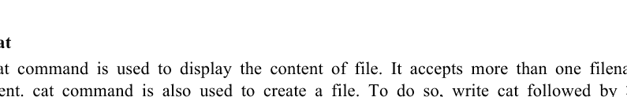

### b) cat

`cat` 命令用于显示文件的内容。它接受一个或多个文件名作为参数。`cat` 命令还用于创建文件。为此，输入 `cat` 后跟 `>` 然后是文件名。按下回车键后，提示符消失，等待用户输入。按下 `Ctrl+d` 停止输入，这被标记为 EOF（文件结束）。`cat` 是一个多功能命令，用于创建、显示、连接和追加到文件。

#### 命令行

语法：`cat > filename` 或 `cat filename`

```
[student@localhost ~]$ cat > test1
hello
good morning
[student@localhost ~]$
```

```
[student@localhost ~]$ cat test1
hello
good morning
[student@localhost ~]$
```

### c) ls

`ls` 是一个 Linux shell 命令，用于列出文件和目录的目录内容。文件按字母顺序排列。其语法为：

```
ls [options] [filename|directoryname]
```

```
[student@localhost ~]$ ls
abc        Documents    Music    pgr    Templates    Videos
Desktop    Downloads    Pictures    Public    test1    xyz
[student@localhost ~]$
```

### d) mkdir

`mkdir` 命令用于创建目录。语法：

```
mkdir [options] directoryname(s)
```

你也可以在单个命令中创建多个目录。在下面的示例中，我们首先创建了一个名为 `sample1` 的目录。然后创建了多个目录 `sample2` 和 `sample3`。要在一个目录内创建子目录，请使用 `-p` 选项。这里，我们在目录 `one` 中创建了一个名为 `two` 的子目录。

```
[student@localhost ~]$ mkdir sample1
[student@localhost ~]$ mkdir sample2 sample3
[student@localhost ~]$ mkdir -p one/two
[student@localhost ~]$ ls
abc            Documents    Music    Pictures    Public      sample2      Templates    Videos
Desktop        Downloads    one      pqr          sample1      sample3      test1        xyz
[student@localhost ~]$
```

### e) ls -a

它列出所有文件，包括以 `.` 开头的隐藏文件。

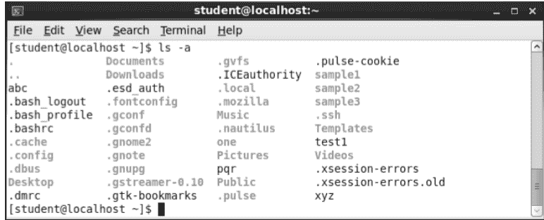

### f) ls -l

它以长格式列出文件并显示权限。

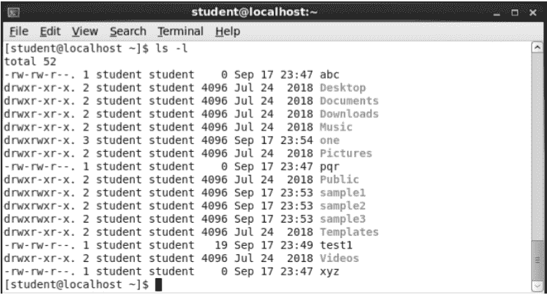

### g) ls -R

它递归地列出目录树。

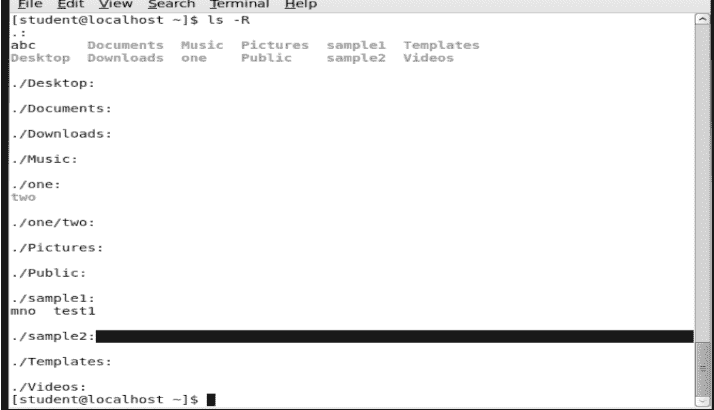

### h) rm

`rm` 命令用于删除一个或多个文件。文件一旦删除无法恢复。要删除所有文件，请使用 `rm *`。其语法为：

```
rm [options] filename
```

#### 选项

- `-i`（交互式删除）：`-i` 选项使命令在删除每个文件之前要求用户确认；你必须按下 `y` 确认删除，按下任何其他键则保留文件不删除。
- `-f`（强制删除）：如果文件是写保护的，`rm` 会提示确认删除。`-f` 选项会覆盖这种轻微的保护并强制删除文件。
- `-r`（递归删除）：使用 `-r`（或 `-R`）选项，`rm` 命令将执行树遍历，并递归地删除父目录下的所有文件和子目录。在每个阶段，它都会删除找到的所有内容。通常，`rm` 不会删除目录，但与此选项结合使用时，它将删除目录。
- `--version`：此选项用于显示当前在系统中运行的 `rm` 的版本。

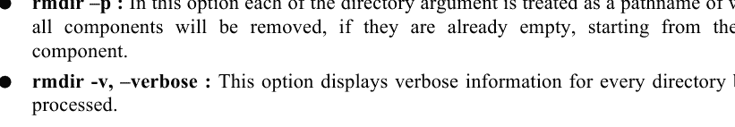

### i) rmdir

`rmdir` 命令用于删除目录。你可以删除一个或多个目录。

```
rmdir [options] directoryname
```

#### 选项

- `--help`：它将打印命令的一般语法以及可与 `rmdir` 命令一起使用的各种选项，并对每个选项给出简短描述。


- `rmdir -p`：在此选项中，每个目录参数都被视为一个路径名，如果所有组成部分（从最后一个组件开始）已经为空，则全部被删除。
- `rmdir -v, --verbose`：此选项显示每个正在处理的目录的详细信息。
- `rmdir --ignore-fail-on-non-empty`：此选项不对仅因目录非空而发生的失败进行报告。通常，当指示 `rmdir` 删除非空目录时，它会简单地报告错误。此选项会抑制所有这些错误消息。
- `rmdir --version`：此选项用于显示版本信息并退出。


### j) `cp`

`cp` 命令用于复制一个文件或一组文件。它在磁盘上创建文件的精确映像，但使用不同的名称。

语法：

```bash
cp [option] source destination        或
cp [option] source directory          或
cp [option] source1 source2 source3 ... directory
```

当两者都是普通文件时，第一个文件的内容被复制到第二个文件中。`cp` 还可以用于将多个文件复制到一个目录中，此时目标必须是一个目录。

#### 选项

- `-i`：在覆盖目标文件之前会警告用户。
- `-R`：复制整个目录结构。


### k) `mv`

`mv` 代表 move（移动）。它用于重命名文件或目录。它还用于将一组文件或目录从一个地方移动到另一个地方。它不会创建文件的副本，而只是对其进行重命名。

语法：

```bash
mv [option] source destination
```

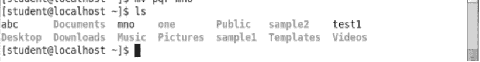

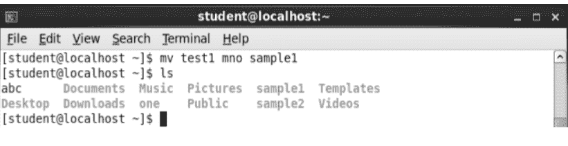

### l) `cd`

`cd` 命令被称为切换目录（change directory）命令。它用于更改当前工作目录。

语法：

```bash
cd [directoryname]
```

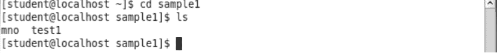

### m) `cd ..`

此命令用于移动到当前目录的父目录，或当前目录向上的一级目录。`..` 代表父目录。

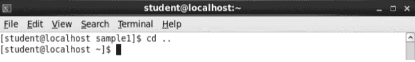

### n) `tac`

`tac` 命令用于连接并以反向顺序打印文件。该命令将每个文件写入标准输出，最后一行最先输出。

语法：

```bash
tac [option] [filename]
```

在下面的示例中，使用 `cat` 创建了一个名为 `file1` 的文件。为了以反向顺序打印文件，使用了 `tac` 命令后跟文件名 `file1`。

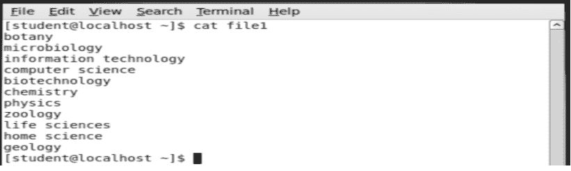

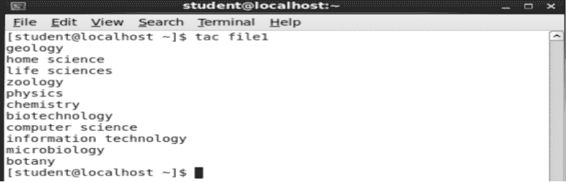

### o) `head`

它显示文件顶部的内容。不使用选项时，显示前十行。`-n` 选项用于指定行数。`-c` 选项用于指定字节数。

语法：

```bash
head [option] [filename]
```

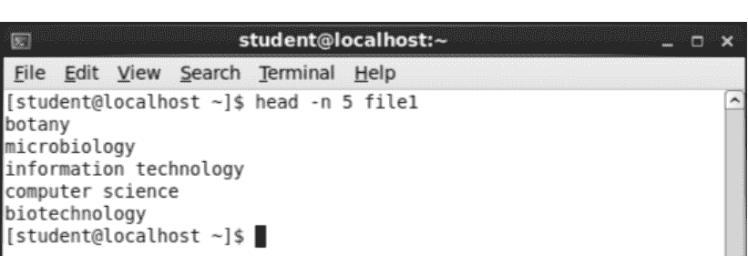

### p) `tail`

它用于显示文件的末尾内容。在不使用选项时，显示最后十行。`-n` 选项用于指定行数，`-c` 选项用于指定字节数。

语法：

```bash
tail [option] [filename]
```

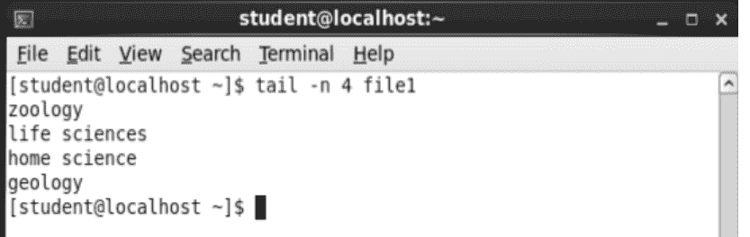

### q) `pwd`

`pwd` 命令打印当前工作目录。它会将当前工作目录的完整系统路径打印到标准输出。

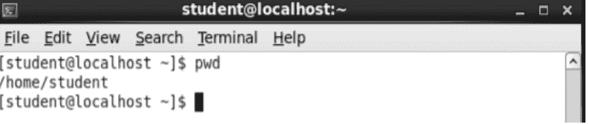

### r) `diff`

它用于显示文件的差异。它会告诉你一个文件中的哪些行需要被更改才能使两个文件完全相同。它使用特定的符号和指令来指示使两个文件一致所需的更改。每条指令使用一个地址结合一个应用于第一个文件的操作。

```bash
diff [option] filename1 filename2
```

在下面的示例中，显示了两个文件 `abc1` 和 `abc2` 之间的差异。

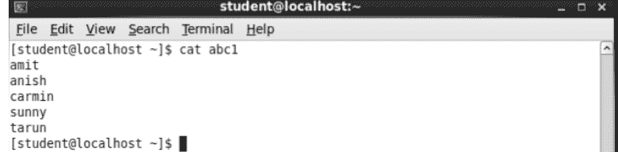

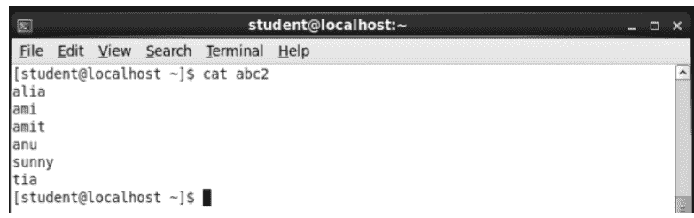

```diff
[student@localhost ~]$ diff abc1 abc2
0a1,2
> alia
> ami
2,3c4
< anish
< carmin
---
> anu
5c6
< tarun
---
> tia
[student@localhost ~]$
```

### s) `comm`

`comm` 命令用于查找两个文件的共同点。它要求两个文件必须是已排序的。它会输出 3 列内容：第一列包含第一个文件中的唯一行，第二列包含第二个文件中的唯一行，第三列包含两个文件共有的行。

语法：

```bash
comm [option] filename1 filename2
```

```text
[student@localhost ~]$ comm abc[12]
      alia
      ami
anish      amit
carmin      anu
      sunny
tarun      tia
[student@localhost ~]$
```

```text
[student@localhost ~]$ comm -3 abc1 abc2
anish      ami
carmin
tarun
[student@localhost ~]$
```

```text
[student@localhost ~]$ comm -13 abc1 abc2
alia
ami
anu
tia
[student@localhost ~]$
```

### t) `cmp`

`cmp` 命令用于查看两个文件是否相同。两个文件将逐字节进行比较，并且第一个不匹配的位置将回显在屏幕上。与 `-l` 选项一起使用时，会列出所有不匹配项。如果两个文件完全相同，`cmp` 不会给出任何消息。

语法：

```bash
cmp [option] filename1 filename2
```

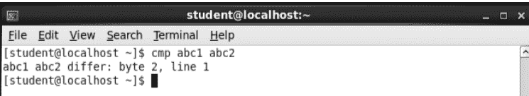

```text
[student@localhost ~]$ cmp abc1 abc2
abc1 abc2 differ: byte 2, line 1
[student@localhost ~]$
```

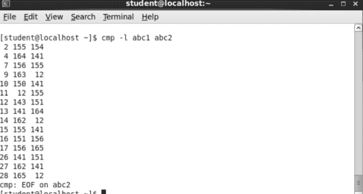

```text
[student@localhost ~]$ cmp -l abc1 abc2
2 155 154
4 164 141
7 156 155
9 163 12
10 150 141
11 12 155
12 143 151
13 141 164
14 162 12
15 155 141
16 151 156
17 156 165
26 141 151
27 162 141
28 165 12
cmp: EOF on abc2
[student@localhost ~]$
```

### u) `wc`

`wc` 命令用于统计文件中的行数、单词数和字符数。它接受一个或多个文件名作为参数，并给出四列输出。第一列显示文件中的行数，第二列显示单词数，第三列显示字符数，第四列显示文件名。

语法：

```bash
wc [option] filename
```

- `-l` 选项显示行数。
- `-w` 选项显示单词数。
- `-c` 选项显示字节数。

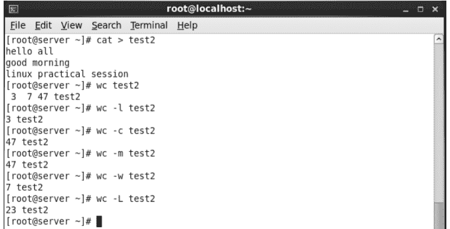

```text
[root@server ~]# cat > test2
hello all
good morning
linux practical session
[root@server ~]# wc test2
3 7 47 test2
[root@server ~]# wc -l test2
3 test2
[root@server ~]# wc -c test2
47 test2
[root@server ~]# wc -m test2
47 test2
[root@server ~]# wc -w test2
7 test2
[root@server ~]# wc -L test2
23 test2
[root@server ~]#
```

## 5.4 通用实用程序

### a) `date`

它显示当前的日期和时间。可以使用特定的格式。每个格式前都有一个加号 `+`，随后是 `%` 运算符和一个描述格式的单个字符。部分格式选项如下：

| 格式 | 含义 |
| :--- | :--- |
| `%a` | 简写星期几 |
| `%A` | 全称星期几 |
| `%b` | 简写月份名称 |
| `%B` | 全称月份名称 |
| `%c` | 显示包含时间的完整日期格式 |
| `%h` | 与 `%b` 相同 |
| `%H` | 24 小时制显示小时 |
| `%m` | 数字格式显示月份 |
| `%M` | 显示分钟 |
| `%T` | 以 `HH:MM:SS` 格式显示时间 |
| `%u` | 数字格式显示星期几 |

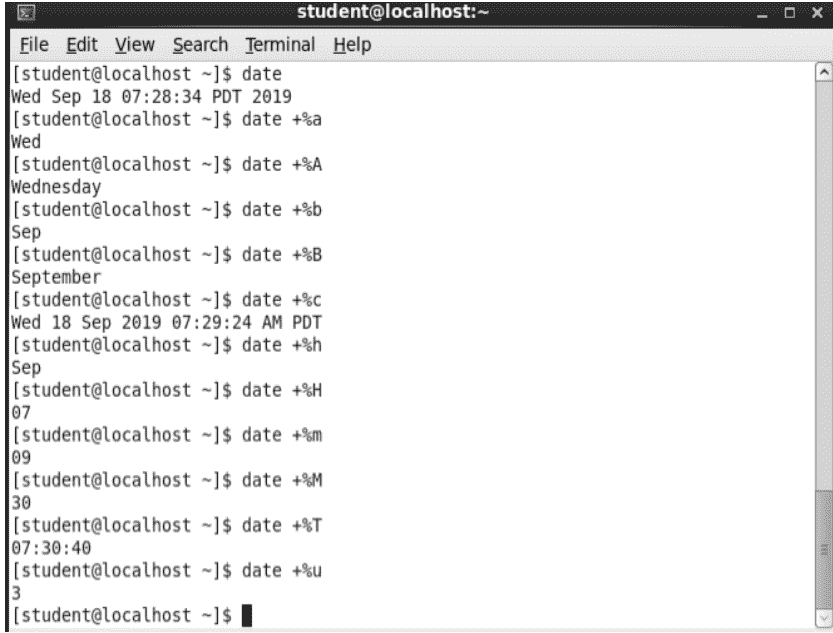

### b) `cal`

它用于查看特定月份或全年的日历。

语法：

```bash
cal [[month] year]
```

在不带参数使用时，显示当前月份的日历。

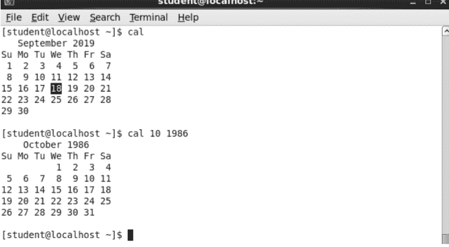

要显示全年的日历，请输入 `cal` 命令后跟年份。


### c) `bc`

`bc` 命令用于命令行计算器。它类似于基础计算器，我们可以使用它进行基本的数学计算。在不带参数使用时，它会等待用户输入。它可以进行多次计算。`bc` 仅执行整数运算，会截断小数。要启用浮点运算，请启用 `scale` 并分配一个值。分配的值决定了截断的小数位数。按下 `Ctrl+d` 结束计算。

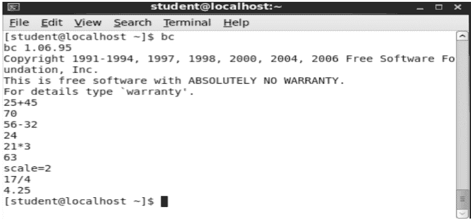

### d) `man`

`man` 提供在线帮助功能。它显示名为 man 文档的文档。要寻求 `echo` 命令的帮助，请运行 `man` 命令并将 `echo` 作为参数。

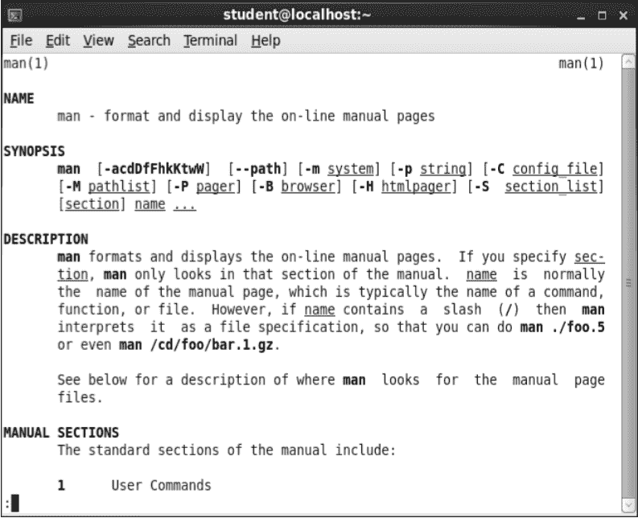

### e) `history`

`history` 命令用于显示你的 shell 历史记录。

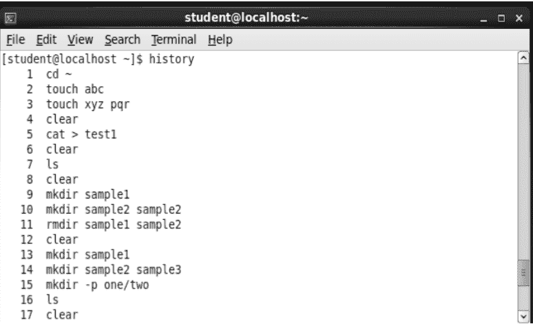

### f) `clear`

`clear` 命令用于清屏。

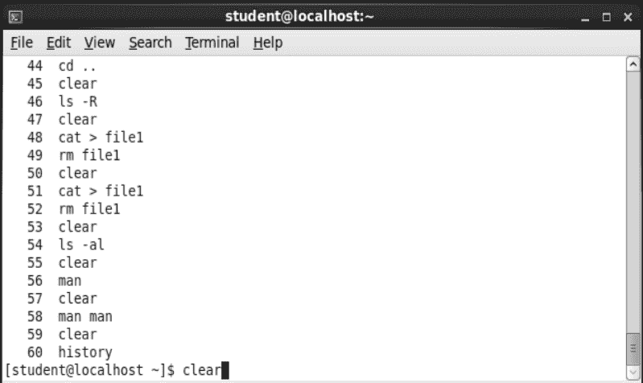

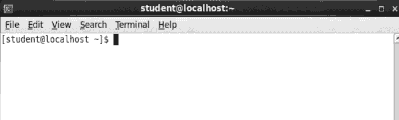

### g) `pr`

该命令有助于为在终端上打印文件进行格式化。该命令提供了许多选项，有助于对文件进行所需的格式更改。为了理解这个命令，我创建了一个名为 `file1` 的文件。

```text
[student@localhost ~]$ cat > file1
botany
microbiology
information technology
computer science
biotechnology
chemistry
physics
zoology
life sciences
home science
geology
[student@localhost ~]$
```

当 `pr` 与 `-x` 选项一起使用时，会将数据显示为多列。输入 `pr` 后跟数字，将显示该数量的列，随后是文件名。在下面的示例中，它将文件内容显示为 3 列。

```text
[student@localhost ~]$ pr -3 file1

2019-09-18 00:18                 file1                 Page 1

botany                   biotechnology           life sciences
microbiology             chemistry               home science
information technology   physics                 geology
computer science         zoology
[student@localhost ~]$
```

当 `pr` 与 `-h` 选项一起使用时，会为文件分配一个页眉。`-h` 选项后面应紧跟用双引号括起来的页眉值。在下面的示例中，页眉是 `"Science Courses"`，随后是文件名。

```text
[student@localhost ~]$ pr -h "Science Courses" file1

2019-09-18 00:18           Science Courses           Page 1

botany
microbiology
information technology
computer science
biotechnology
chemistry
physics
zoology
life sciences
home science
geology
[student@localhost ~]$
```

当 `pr` 与 `-n` 选项一起使用时，会为所有行标注行号。

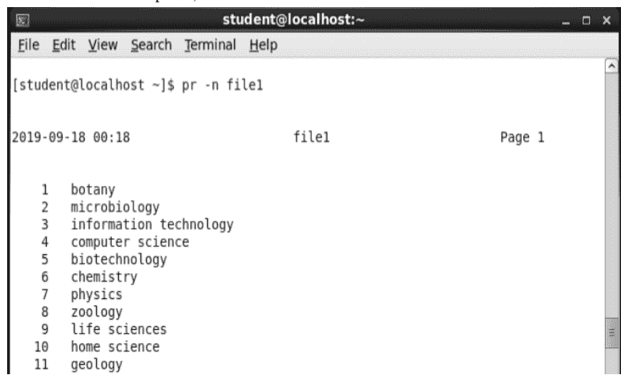

### h) `whoami`

调用此命令时，它会显示当前用户的用户名。

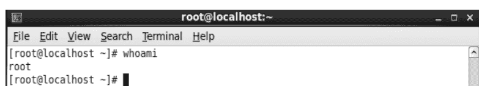

### i) `logname`

`logname` 命令让你知道当前用户的登录名称。

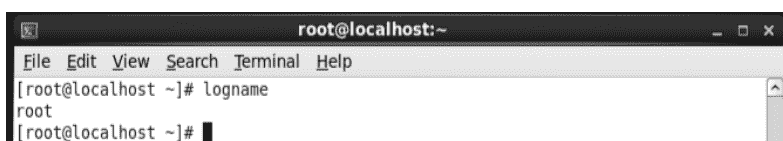

### j) `uname`

`uname` 命令显示操作系统的某些特征。默认情况下，它显示操作系统的名称。与 `-a` 选项一起使用时，它按以下顺序打印所有系统信息：内核名称、网络节点主机名、内核发行日期、内核版本、机器硬件名称、硬件平台、操作系统。

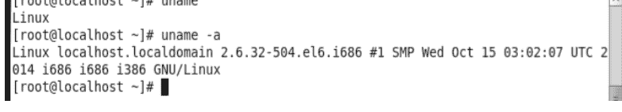

### k) `du`

`du` 命令（disk usage 的缩写）用于估算文件空间的使用情况。`du` 命令可用于追踪在硬盘驱动器上占用过多空间的文件和目录。

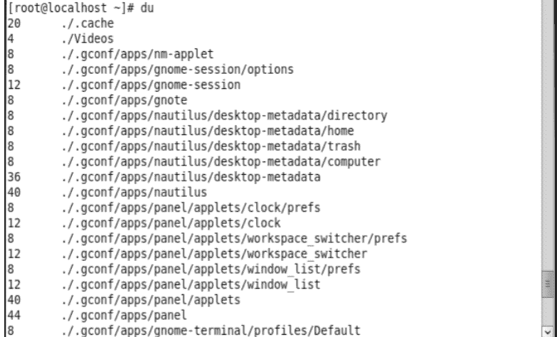

### l) `df`

`df` 命令（disk free 的缩写）用于显示与文件系统相关的总空间和可用空间信息。


### m) `echo`

它用于显示消息。这是一个内置命令。它也可以用于接收来自终端的输入。

语法：

```bash
echo [options] string
```

- `-e` 启用对反斜杠转义字符的解析。
- `\n` 选项在所在位置创建新行。
- `\t` 选项将文本向右推 8 个字符位置，用作制表符（Tab）。

#### 示例

```bash
echo -e "good \nmorning"
```

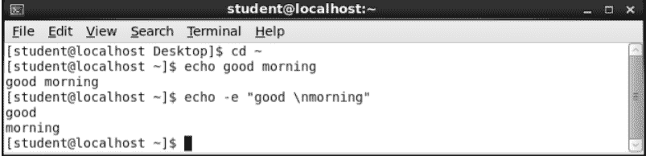

### n) `printf`

它用于在终端窗口上显示给定的字符串、数字或任何其他格式说明符。`printf` 可以包含格式说明符、转义序列或普通字符。最常用的 `printf` 说明符是 `%s`、`%b`、`%d`、`%x` 和 `%f`。

#### 示例

`%s` 说明符：它基本上是用于字符串输出的字符串说明符。

```bash
$ printf "%s\n" "hello world"
```

`%d` 说明符：它是用于显示整数值的整数说明符。

```bash
$ printf "%d\n" "120" "85"
```

`%x` 说明符：它用于输出整数的小写十六进制值，并用于填充输出。

```bash
$ printf "%08x\n" "1024"
```

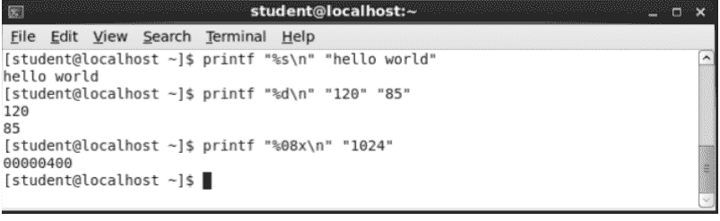

### o) `script`

`script` 允许您将登录会话记录到文件中。它会记录所有活动的日志。默认记录在名为 `typescript` 的文件中。输入 `script` 命令并按回车，之后输入的所有内容都将被记录。要终止脚本，请输入 `exit`。您可以使用 `cat` 命令查看该文件。它会覆盖任何之前存在的 `typescript` 文件。若要将内容追加到文件中，请使用 `-a` 选项。您也可以使用不同的日志文件。

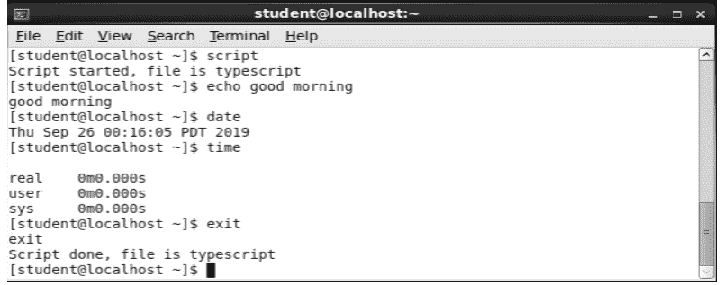


```
[student@localhost ~]$ cat typescript
Script started on Thu 26 Sep 2019 12:15:52 AM PDT
[student@localhost ~]$ echo good morning
good morning
[student@localhost ~]$ date
Thu Sep 26 00:16:05 PDT 2019
[student@localhost ~]$ time
real	0m0.000s
user	0m0.000s
sys	0m0.000s
[student@localhost ~]$ exit
exit
Script done on Thu 26 Sep 2019 12:16:11 AM PDT
[student@localhost ~]$
```

```
[student@localhost ~]$ script logfile
Script started, file is logfile
[student@localhost ~]$ who
student	tty1		2019-09-26 00:11 (:0)
student	pts/0		2019-09-26 00:12 (:0.0)
student	pts/1		2019-09-26 00:17
[student@localhost ~]$ uname
Linux
[student@localhost ~]$ echo linux practical
linux practical
[student@localhost ~]$ exit
exit
Script done, file is logfile
[student@localhost ~]$
```

```
[student@localhost ~]$ cat logfile
Script started on Thu 26 Sep 2019 12:17:14 AM PDT
[student@localhost ~]$ who
student	tty1		2019-09-26 00:11 (:0)
student	pts/0		2019-09-26 00:12 (:0.0)
student	pts/1		2019-09-26 00:17
[student@localhost ~]$ uname
Linux
[student@localhost ~]$ echo linux practical
linux practical
[student@localhost ~]$ exit
exit
Script done on Thu 26 Sep 2019 12:17:48 AM PDT
[student@localhost ~]$
```

## p) passwd

它用于更改用户的密码。它要求您响应三次。当您输入密码时，系统会对该密码进行加密。加密会生成一串随机字符，用于确定密码的真实性。这被存储在`/etc/shadow`文件中。

## q) who

`who`命令维护登录到系统的用户账户记录。

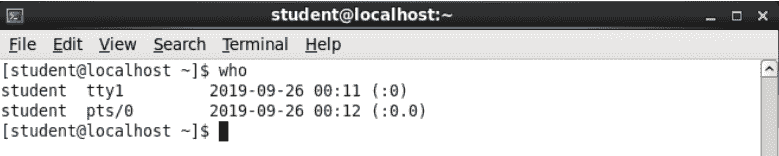

## 5.5 安装软件

### Yum

YUM (Yellowdog Updater Modified) 是一个开源的命令行及图形化软件包管理工具，适用于基于 RPM (RedHat Package Manager) 的 Linux 系统。它允许用户和系统管理员轻松地在系统上安装、更新、删除或搜索软件包。它在 GPL (General Public License) 下开发并发布，这意味着它是开源的，任何人都可以下载并访问代码以修复漏洞和开发自定义包。YUM 使用许多第三方仓库，通过解决依赖问题来自动安装软件包。

#### a) 安装软件包

要安装名为`dhcp`的软件包，只需运行以下命令，它将自动查找并安装`dhcp`所需的所有依赖项。

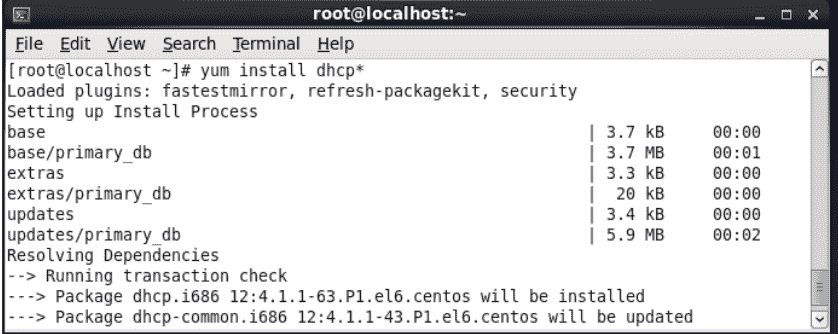

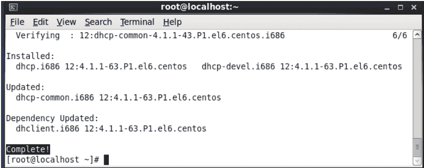

上述命令在系统上安装任何软件包之前都会要求确认。如果您想在不询问任何确认的情况下自动安装软件包，请使用如下示例所示的`-y`选项。

```
#yum install -y dhcp*
```

#### b) 卸载软件包

要将软件包及其所有依赖项完全删除，只需运行如下所示的命令。

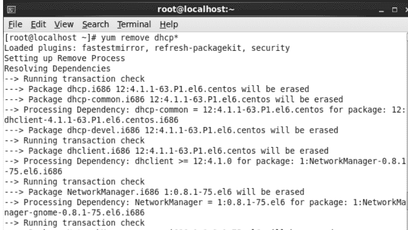


同样，上述命令在删除软件包之前会要求确认。要禁用确认提示，只需像下面这样添加`-y`选项。

#### c) 更新软件包

要将软件包更新到最新的稳定版本，请运行以下命令，它将自动解决所有依赖问题并安装它们。

```
#yum update dhcp*
```

#### d) 列出软件包

`list`功能用于通过名称搜索特定软件包。例如，要搜索名为`openssh`的软件包，请使用该命令。

```
#yum list openssh
```

#### e) 搜索软件包

如果您不记得软件包的确切名称，请使用`search`功能搜索所有可用软件包，以匹配您指定的软件包名称。例如，搜索所有匹配`networking tools`词组的软件包。


#### f) 软件包信息

在安装软件包之前，使用`yum info`命令获取其信息。


#### g) 可用软件包

列出 Yum 数据库中所有可用的软件包。

```
#yum list | less
```

#### h) 已安装软件包

要列出系统中所有已安装的软件包，只需执行以下命令，它将显示所有已安装的软件包。

```
#yum list installed | less
```

#### i) 更新系统

为了让您的系统保持最新，包含所有安全补丁和二进制包更新，请运行以下命令。它将在您的系统上安装所有最新的补丁和安全更新。

```
#yum update
```

#### j) 可用组软件包

在 Linux 中，许多软件包被捆绑到特定的组中。与其使用`yum`安装单个软件包，您可以安装特定的组，这将安装属于该组的所有相关软件包。例如，要列出所有可用组，只需执行以下命令。


#### k) 安装组软件包

要安装特定的软件包组，我们使用`groupinstall`选项。


#### l) 更新组软件包

要更新任何现有的已安装组软件包，只需运行如下所示的命令。

```
#yum groupupdate 'Emacs'
```

#### m) 删除组软件包

要从系统中删除或卸载任何现有的已安装组，请使用以下命令。


#### n) 列出启用的 yum 仓库

要列出系统中所有启用的 Yum 仓库，请使用以下选项。

```
# yum repolist
```

### RPM

RPM (Red Hat Package Manager) 是基于 Red Hat 的系统（如 RHEL, CentOS 和 Fedora）默认的开源且最受欢迎的软件包管理工具。该工具允许系统管理员和用户在 Linux 操作系统中安装、更新、查询、验证和管理系统软件软件包。RPM 工具仅适用于构建为`.rpm`格式的软件包。RPM 将所有已安装软件包的信息保存在`/var/lib/rpm`数据库下。RPM 处理`.rpm`文件，其中包含关于软件包的实际信息，例如：它是什么、来自哪里、依赖信息、版本信息等。

**RPM 的五种模式：**

- Install（安装）- 用于安装任何 RPM 软件包。

- Remove（删除）- 用于抹除、删除或卸载任何 RPM 软件包。

- Upgrade（升级）- 用于更新现有的 RPM 软件包。

- Verify（验证）- 用于验证 RPM 软件包。

- Query（查询）- 用于查询任何 RPM 软件包。

您可以通过以下网站查找并下载所有 RPM 软件包：

1. http://rpmfind.net

2. http://www.redhat.com

3. http://freshrpms.net/

4. http://rpm.pbone.net/

在 Linux 中安装软件包时必须是 root 用户，拥有 root 权限后，您可以结合适当的选项管理 rpm 命令。

#### a) 安装 RPM 软件包

要安装 rpm 软件软件包，请使用带有`-i`选项的命令。

```
[root@server]# rpm -ivh dhcp-4.3.5-11.1.i586.rpm
```

## RPM 选项：

- -i: 安装软件包

- -v: 详细模式，用于更友好的显示

- -h: 在解包软件包存档时打印哈希标记（进度条）。

### b) 在安装前检查依赖关系

在安装或升级软件包之前，可以使用`-R`选项进行依赖项检查。它将显示该软件包的依赖关系列表。

```
[root@server]# rpm -qpR dhcp-4.3.5-11.1.i586.rpm
```

## RPM 选项：

- -q: 查询软件包

- -p: 列出该软件包提供的功能（capabilities）。

- -R: 列出该软件包依赖的功能。

### c) 无视依赖关系安装软件包

您可以使用`--nodeps`（不检查依赖关系）选项来安装软件包。它将忽略依赖错误强制安装 RPM 包，但如果这些依赖文件缺失，那么在您安装它们之前，程序将完全无法运行。

```
[root@server]# rpm -ivh --nodeps dhcp-4.3.5-11.1.i586.rpm
```

### d) 检查软件包是否已安装

使用`-q`选项配合软件包名称来检查 RPM 是否已安装。

```
[root@server]# rpm -q dhcp
```

### e) 列出已安装软件包的所有文件

使用`-ql`（查询列表）选项来查看已安装 RPM 软件包的所有文件。

```
[root@server]# rpm -ql dhcp
```

### f) 列出已安装的软件包

使用`-qa`选项来列出系统中所有已安装的 RPM 软件包。

```
[root@server]# rpm -qa
```

### g) 升级 RPM 软件包

使用`-U`（升级）选项来升级任何 RPM 软件包。它将升级到最新版本，并保留旧版本的备份。

```
[root@server]# rpm -Uvh dhcp-4.3.5-11.1.x86_64.rpm
```

### h) 移除 RPM 软件包

使用`-e`（删除）选项从系统中移除已安装的 RPM 软件包。

```
[root@server]# rpm -evv dhcp
```

### i) 无视依赖关系移除 RPM 软件包

将`--nodeps`与`-e`选项结合使用，以强制从系统中移除已安装的 RPM 软件包。

```
[root@server]# rpm -evv --nodeps dhcp
```

### j) 查询已安装 RPM 软件包的信息

使用`-qi`（查询信息）选项来获知已安装 RPM 软件包的信息。

```
[root@server]# rpm -eqi dhcp
```

### k) 验证 RPM 软件包

使用`-Vp`（验证软件包）选项将软件包已安装文件的信息与 RPM 数据库进行比较。

```
[root@server]# rpm -Vp dhcp
```

### l) 验证所有 RPM 软件包

使用`-Va`（验证全部）选项来验证所有已安装的 RPM 软件包。

```
[root@server]# rpm -Va
```

## 5.6 用户管理

### 用户账户操作

用户管理涵盖了从在系统中创建用户到删除用户的所有操作。由于 Linux 是一个多用户操作系统，因此非常需要一名管理员来管理用户账户、其权限以及整体系统安全性。用户管理是 Linux 系统管理员的重要任务之一。Linux 操作系统中的本地账户或用户通过`useradd`、`usermod`、`userdel`和`passwd`命令进行管理。

- `useradd`命令用于在 Linux 中创建新账户

- `usermod`命令用于修改 Linux 中现有的账户

- `userdel`命令用于删除 Linux 中的本地账户

- `passwd`命令用于给本地账户或用户分配密码。

### 创建用户

在 Linux 中，每个用户都被分配一个独立账户，其中包含该用户的所有文件、信息和数据。

您可以在 Linux 操作系统中创建多个用户。语法：

`useradd account_name`

当在 Linux 中创建用户时，以下内容会被更新：

- 在`/home/<username>`下创建主目录

- 在`/etc/passwd`文件中更新用户信息

- 组信息存储在`/etc/group`中

- 在`/etc/shadow`文件中更新密码信息。

- 在`/var/spool/mail/<username>`下创建用户的电子邮件文件

```
[root@localhost Desktop]# cd ~
[root@localhost ~]# useradd binita
[root@localhost ~]# passwd binita
Changing password for user binita.
New password:
BAD PASSWORD: it is too short
BAD PASSWORD: is too simple
Retype new password:
passwd: all authentication tokens updated successfully.
[root@localhost ~]#
```

```
[root@localhost ~]# useradd mala
[root@localhost ~]# passwd mala
Changing password for user mala.
New password:
BAD PASSWORD: it is too short
BAD PASSWORD: is too simple
Retype new password:
passwd: all authentication tokens updated successfully.
[root@localhost ~]#
```

```
[root@localhost ~]# useradd ankit
[root@localhost ~]# passwd ankit
Changing password for user ankit.
New password:
BAD PASSWORD: it is too short
BAD PASSWORD: is too simple
Retype new password:
passwd: all authentication tokens updated successfully.
[root@localhost ~]#
```

### /etc/passwd 文件

完整的账户信息存储在`/etc/passwd`文件中。该文件包含每条系统用户账户记录，格式如下（字段由冒号分隔）。

`username:x:UID:GID:comment:home_directory:default_shell`

1. `username`字段包含用户账户的名称。

2. 第二个字段中的`x`表示该账户由影子密码（在`/etc/shadow`中）保护，登录为`username`时需要该密码。

3. `UID`和`GID`字段是整数，分别代表用户标识（User IDentification）和`username`所属的主组标识（Group IDentification）。

4. `home_directory`指向`username`主目录的绝对路径。

5. `default_shell`是该用户登录系统时可用的 Shell。

### 修改用户账户

添加账户后，您可以使用`usermod`命令编辑信息。其语法为：

`usermod [options] username`

选项：

- **-l** new_username 将账户名称从 username 更改为 new_username。

- **-L** 通过在`/etc/shadow`中用户加密密码前放置一个`!`来禁用（锁定）username 的账户。

- **-U** 通过移除`!`来启用（解锁）账户。

如果 username 已经登录，`usermod`将执行失败，因为您不能更改已登录用户的登录名。

在下面的示例中，我们使用`usermod`命令将用户名 ankit 修改为新用户名 ankit_15。


### 删除用户

`userdel`命令删除用户账户，并可选择删除相关文件。其语法为：

`userdel [-r] username`

- username 指定要删除的用户账户。

- 使用**-r**会删除相应的主目录和邮件池。

- 不使用 -r 时，`userdel`仅删除用户和组数据库文件中的账户引用。

- 您不能删除已登录用户的账户，因此如果 username 已登录，`userdel`将执行失败。


### 为用户账户创建密码

`passwd` 命令更新用户的所有身份验证令牌，登录密码仅是其中之一。其语法为：

```text
passwd [-dkluf] [-s] username
```

选项：

- `-d`：移除 `username` 的密码，从而禁用账户。
- `-k`：使 `passwd` 仅更新过期的身份验证令牌（在这种情况下是密码和令牌）。
- `-l` 或 `-u`：分别通过在`/etc/shadow`中 `username` 的密码前放置或移除 `!` 来锁定或解锁 `username` 的密码。
- `-s`：显示关于 `username` 的简短状态消息，指示账户是否被锁定或解锁，使用了哪种加密方式等。


## 组账户操作

与用户账户一样，组具有组标识号（GID），用户通常是多个组的成员。组用于将一个或多个用户绑定在一起，以简化管理任务。

### 创建组

要创建新组，请使用 `groupadd` 命令。其语法为：

```text
groupadd [[-g gid [-oil]] [-r] [-f] groupname
```

- `groupname` 是唯一必需的参数，且必须是一个不存在的组名。
- 当仅调用新组名称时，`groupadd` 会创建该组并为其分配第一个大于 500 且尚未被使用的可用 GID。

#### 选项

- `-f`：强制 `groupadd` 接受一个已存在的 `groupname`。
- `-g gid`：如果您想指定新组的 GID，请将 `gid` 替换为唯一的 GID。使用 `-o` 选项可强制 `groupadd` 接受非唯一的 GID。
- `-r`：要创建具有特殊权限的系统组，请使用此选项。
- 在下面的示例中，我们创建了两个组——`sales` 和 `account`。相应的条目已在`/etc/group`文件中创建。


### `/etc/group` 文件

该文件包含组账户的详细信息。每行一条记录，每行的格式为：

```text
groupname:password:gid:userlist
```

1. `groupname` 是组的名称。
2. `password` 是一个可选字段，包含加密的组密码。
3. `gid` 是数字组 ID 号。
4. `userlist` 是组成该组的用户账户名称的逗号分隔列表。


### 修改组

`groupmod` 允许您更改组的 GID 或名称。其语法为：

```text
groupmod [option] groupname
```

Linux (F.Y.B.Sc.C.S.) (第二学期)

- 在下面的示例中，我们使用 `-n` 选项将组账户的名称修改为 `new_account`。
- 该条目在`/etc/group`文件中被修改。

## 删除组

- `groupdel` 命令用于删除已经创建的组。你不能删除一个不存在的组。其语法为：

```text
groupdel groupname(s)
```

- 在下面的示例中，我们正在删除组 `new_account`。
- 该条目将从`/etc/group`文件中被移除。

## `id`

要检查特定用户的 UID 和 GID，请使用 `id` 命令后跟用户名。默认情况下，所有用户都是一个与其用户名同名组的成员。

要将任何用户添加到组，请使用 `usermod` 命令配合 `-aG` 选项，然后是需要添加用户到的组名，最后是用户名。

在下面的示例中，我们将用户 `binita` 和 `mala` 添加到了 `sales` 组。

### `gpasswd`

`gpasswd` 允许你设置和修改组的身份验证和成员信息。

在下面的示例中，使用 `gpasswd` 命令设置了 `sales` 组的密码。

## 5.7 环境变量

Shell 变量分为两种类型：局部变量和环境变量。局部变量的作用范围受限。环境变量在用户的整个环境中可用，即在其子 Shell 和编辑器中可用。它们控制系统的行为并决定你工作的环境。以下是各种环境变量：

| 命令 | 描述 |
| --- | --- |
| `HOME` | 指定用户的主目录。 |
| `PATH` | 指定 Shell 搜索命令时所查找的目录列表。 |
| `USER` | 指定用户的登录名。 |
| `LOGNAME` | 指定用户的登录名。 |
| `OSTYPE` | 指定所使用的操作系统的内核版本。 |
| `SHELL` | 指定用户的登录 Shell。 |
| `PWD` | 指定当前目录的绝对路径。 |
| `TERM` | 指定终端的类型。 |
| `MAIL` | 指定用户邮箱文件的绝对路径。 |

例如：

```text
echo $HOME
```

`env` 命令显示所有的环境变量。

### 设置新的环境变量

你可以创建自定义变量，语法为：

```text
variable_name=variable_value
```

变量区分大小写，通常以大写字母创建。

### 删除变量

可以使用以下语法从系统中删除变量：

```text
unset variable_name
```

示例：

```text
VAR1=1234
echo $VAR1
unset VAR1
```

- 环境变量决定了操作系统中程序的行为。

| 命令 | 描述 |
| --- | --- |
| `echo $VARIABLE` | 显示变量的值 |
| `env` | 显示所有环境变量 |
| `VARIABLE_NAME=variable_value` | 创建一个新变量 |
| `unset` | 删除一个变量 |
| `export Variable=value` | 设置环境变量的值 |

## 5.8 命令别名

Linux 用户经常重复使用同一个命令。反复输入或复制相同的命令会降低你的工作效率，并让你分心。通过为你最常用的命令创建别名，你可以节省一些时间。别名就像是自定义快捷方式，用于代表一个命令（或一组命令），无论是否带有自定义选项。

只需执行 `alias` 命令，即可查看配置文件中已定义的别名列表。

```shell
# alias
```

### 在 Linux 中创建别名

创建别名的语法是：

```text
alias name=value
```

### `alias` 命令的选项

- `-p`：此选项打印所有已定义的别名。

在下面的示例中，我们为 `history` 命令创建了名为 `h` 的别名，为 `ls -l` 命令创建了名为 `l` 的别名。下次当我们想要检查历史记录或文件的详细列表时，可以使用 `h` 或 `l` 来代替完整的命令名称。

### 在 Linux 中删除别名

要删除所有已创建的别名，请使用：

```shell
# unalias -a
```

## 问题

1. 什么是命令行参数？请举例说明。
2. 什么是 Shell？解释各种类型的 Shell。
3. 解释 Linux 中的基本命令。
4. 解释 Linux 中的通用实用程序。
5. 解释如何创建和维护用户账户。
6. 解释如何创建和维护组。
7. 什么是环境变量？列举并解释各种环境变量。
8. 举例解释 `alias` 命令的用法。

## 客观题

### 多项选择题

1. 命令行参数总共有 ______ 个。
   - a) 10
   - b) 9
   - c) 8
   - d) 7

2. ______ 命令用于创建目录。
   - a) `rmdir`
   - b) `rm`
   - c) `mkdir`
   - d) `touch`

3. _________ 命令用于重命名文件或目录。
   - a) `cp`
   - b) `mv`
   - c) `cd`
   - d) `pwd`

4. _________ 命令被用作基础计算器。
   - a) `calculator`
   - b) `cal`
   - c) `bc`
   - d) `calc`

5. _________ 命令用于创建新用户。
   - a) `usermod`
   - b) `adduser`
   - c) `useradd`
   - d) `createuser`

**答案**：（1 – a）、（2 – c）、（3 – b）、（4 – c）、（5 – c）

---

## 第二单元

# 第 6 章：LINUX 文档

### 概要

- man 页面
- GNU info
- `help` 命令
- 更多文档来源

## 6. LINUX 文档

### 6.1 man 页面

`man` 命令用于格式化和显示 man 页面。man 页面是大多数 Linux 发行版在安装时默认内置的用户手册。它们提供了关于命令和系统其他方面的详尽文档，包括配置文件、系统调用、库例程和内核（即操作系统的核心）。配置文件是一种简单的数据库，包含告诉程序或操作系统如何运行的数据。系统调用是通过软件中断（即由软件发起的向内核发送的信号）由活动进程请求内核执行的一项服务。库例程是程序员用来简化软件开发的子程序。

`man` 命令极其易于使用。其基本语法为：

```text
man [option(s)] keyword(s)
```

`man` 最常在没有任何选项且仅有一个关键字的情况下使用。关键字是所需信息的命令或其他项目的确切名称。例如，以下命令提供关于 `ls` 命令（用于列出任何指定目录的内容）的信息：

```shell
man ls
```

另一个示例，以下命令显示关于 man 页面的 man 页面：

```shell
man man
```

`man` 自动将其输出通过一个分页器发送，通常是 `less` 程序。分页器是一个程序，它使任何程序的输出一次显示一屏，而不是让大量文本高速滚动过屏幕。

`less` 在屏幕底部写入一个冒号，表示屏幕页面的结束。用户可以通过按下空格键移动到下一页，可以通过按下 `b` 键返回前一页。按下 `q` 将退出 man 页面并返回到 Shell 程序。

每个 man 页面被分为若干个部分，其标题用大写字母标记。命令的部分包括 NAME、SYNOPSIS、DESCRIPTION、OPTIONS、AUTHOR、BUGS、COPYRIGHT、HISTORY 和 SEE ALSO。其中一些部分可能会被进一步细分为小节，特别是对于具有众多选项的命令，其 OPTIONS 部分通常如此。

### 6.2 GNU info

你可以使用 `info` 命令阅读关于某个命令的 Info 页面。这些页面通常包含更近期的信息，且使用起来相对更容易。某些命令的 man 页面会引用 Info 页面。

在终端窗口中输入 `info info`。使用方向键浏览文本，将光标移动到以星号开头的行（包含你想要了解信息的关键字）并按下 `Enter`。使用 `P` 和 `N` 键跳转到上一个或下一个主题。空格键会将你向后移动一页，无论这是否开始了一个新主题或另一个命令的 Info 页面。使用 `Q` 退出。`info` 程序包含更多信息。

基本语法为：

```text
info [option] [item]
```

info 文档的默认位置是`/usr/share/info`。

#### `info` 命令的选项

| 选项 | 描述 |
| --- | --- |
| `-a`, `--all` | 使用所有匹配的手册。 |
| `-d`, `--directory=DIR` | 将 `DIR` 添加到 `INFOPATH` 中。 |
| `-f`, `--file=MANUAL` | 指定要访问的 Info 手册。 |
| `-h`, `--help` | 显示此帮助并退出。 |
| `-n`, `--node=NODENAME` | 指定首次访问的 Info 文件中的节点。 |
| `-o`, `--output=FILE` | 将选定的节点输出到 `FILE`。 |
| `-O`, `--show-options`, `--usage` | 跳转到命令行选项节点。 |
| `-v`, `--variable VAR=VALUE` | 为 Info 变量 `VAR` 分配值 `VALUE`。 |
| `--version` | 显示版本信息并退出。 |
| `-w`, `--where`, `--location` | 打印 Info 文件的物理位置。 |

## 示例

要查看 `info` 命令的手册页，请使用以下命令：

```shell
man info
```

要查看 `info` 命令的帮助页面，请使用以下命令：

```shell
info --help
```


## 6.3 `help` 命令

`help` 命令正如其名，旨在帮助您了解任何内置命令。`help` 命令仅显示有关 shell 内置命令的信息。其语法如下：

```text
help [-dms] [pattern]
```

上述语法中指定的 `pattern` 指的是您想要了解的命令；如果它与任何 shell 内置命令匹配，则 `help` 会提供详细信息；如果不匹配，则 `help` 会打印出帮助主题列表以方便您查阅。这里的 `d`、`m` 和 `s` 是您在 `help` 命令中可以使用的选项。

### `help` 命令中的选项

| 选项 | 描述 |
| :--- | :--- |
| `-d` | 当您只想获取任何 shell 内置命令的概览时使用，即它仅提供简短描述。 |
| `-m` | 以伪 man 页格式显示用法。 |
| `-s` | 仅为每个匹配的主题显示简短的用法大纲。 |

### 示例

```shell
help echo
```


## 6.4 更多文档资源

### 1. Red Hat Enterprise Linux (RHEL)

RHEL 由 Red Hat 开发，面向商业市场。它拥有最优秀的文档之一，涵盖了从 RHEL 基础到安全、SELinux、虚拟化、目录服务器、集群、JBOSS、HPC 等高级主题。Red Hat 文档已被翻译成 22 种语言，并提供多页 HTML、单页 HTML 和 PDF 格式。好消息是，您也可以将相同的文档用于 CentOS 或 Scientific Linux（社区企业发行版）。所有这些文档都随操作系统一起分发，因此如果您没有网络连接，依然可以使用它们。RHEL 文档涵盖了从安装到配置集群的所有内容。唯一的缺点是您需要成为付费客户。这对于企业公司来说非常完美。

### CentOS Wiki

CentOS（Community ENTerprise Operating System）是基于 RHEL 免费可用源代码包的免费重建版本。它为个人和其他用途提供真正可靠、免费的企业级 Linux。您无需支付认证和支持费用即可获得 RHEL 的稳定性。CentOS wiki 分为 Howtos、技巧与窍门（Tips & Tricks）等多个部分。


### 2. Arch Wiki 和论坛

Arch Linux 是一个独立开发的 Linux 操作系统，它拥有以 Wiki 网站形式呈现的非常出色的文档。它由 Arch 用户社区协作开发，允许任何用户添加和编辑内容。文章分为多个类别，如优化、软件包管理、系统管理、X 窗口系统以及获取与安装 Arch Linux。官方论坛对于解决许多问题非常有用。它共有 4 万多名注册用户和超过 100 万篇帖子。Wiki 包含一些同样适用于其他 Linux 发行版的通用信息。

### 3. Ubuntu Wiki 和文档

Ubuntu 是领先的桌面和笔记本电脑发行版之一。官方文档由 Ubuntu 文档项目开发和维护。您可以获取大量信息，包括入门指南。最棒的是，这里包含的信息可能也适用于其他基于 Debian 的系统。您还会发现由用户创建的 Ubuntu 社区文档。这是关于 Ubuntu 相关“Howtos、技巧、窍门和黑客技巧”的参考资料。Ubuntu Linux 拥有网络上最大的 Linux 社区之一，为新手和经验丰富的用户提供帮助。

### 4. Linux.com – Linux 信息源

Linux.com 是 Linux 基金会的产物。该网站通过利用全球 Linux 用户的力量，在所有 Linux 相关事务上提供信息、协作和连接，提供新闻、指南、教程和其他关于 Linux 的信息。

### 5. Advanced Linux Programming（高级 Linux 编程）

本书面向已经熟悉 C 编程语言的程序员。它采用教程方式，教授 GNU/Linux 系统在应用程序中最重要概念和强大的功能特性。如果您已经是经验丰富的 GNU/Linux 系统编程开发人员，或者熟悉另一种类 UNIX 系统并有兴趣开发 GNU/Linux 软件，或者想要从非 UNIX 环境转换而来且熟悉编写优秀软件的一般原则，那么这本书非常适合您。此外，您会发现本书同样适用于 C 和 C++ 编程。

### 6. Linux: Root User's Tutorial and Exposition（Linux：Root 用户教程与阐释）

本书涵盖了针对 RedHat 和 Debian 等流行发行版的 GNU/Linux 系统管理，既可作为新用户的教程，也可作为高级管理员的参考书。它旨在对 UNIX 系统的每个方面提供简洁、详尽的解释和实际示例。任何想要获取关于（商业上称为）Linux 的综合教材的人无需再寻找其他资料——这里几乎涵盖了所有内容。

### 7. Ubuntu Pocket Guide（Ubuntu 袖珍指南）

本书由 Keir Thomas 编写。对于日常 Ubuntu 用户来说，这是一本很好的读物。本书的目的是向您介绍 Ubuntu 操作系统及其背后的哲学。您可以从官方网站下载 PDF 版本，或通过亚马逊订购印刷版。

### 8. Debian GNU/Linux 文档和 Wiki


Debian 是另一个基于 Linux 的操作系统，主要使用根据 GNU 通用公共许可证发布的软件。Debian 以严格遵守 Unix 和自由软件哲学而闻名。它也是最流行且最具影响力的 Linux 发行版之一，并被用作 Ubuntu 等许多其他发行版的基础。Debian 项目以易于访问的形式为用户提供妥帖的文档。该网站分为 Wiki、安装指南、常见问题解答（FAQs）和支持论坛。

### 9. The Linux Documentation Project (TLDP)

Linux 文档项目致力于为 Linux 操作系统开发免费、高质量的文档。该网站由志愿者创建和维护。网站分为特定主题的帮助、较长且深入的指南书等。我推荐这份关于使用 Bash 进行 Shell 脚本编写的教程兼参考文档。HOWTOs 列表也是新用户的良好起点。

### 10. Slackware Book Project (Slackware 书籍项目)

Slackware Linux 是我的第一个发行版。它是最早基于 Linux 内核的发行版之一，也是目前仍在维护的最古老的发行版。该发行版面向高级用户，非常注重稳定性。Slackware 是少数几个最像“Unix”的 Linux 发行版之一。官方 Slackware 书籍旨在帮助您快速上手 Slackware Linux 操作系统。它并非旨在涵盖发行版的每一个细节，而是展示其能力并为您提供系统的基本操作知识。书分多个主题，如安装、网络与系统配置、系统管理、软件包管理等。

## 问题

- 1. 解释 `man` 命令。
- 2. 解释 `info` 命令。
- 3. 解释 `help` 命令。
- 4. 列举并解释各种 Linux 文档资源。

## 客观题

单选题：

- 1. _________ 命令提供关于命令的详尽文档。
  a) `help`
  b) `man`
  c) `info`
  d) 以上都不是

- 2. _________ 命令用于学习内置命令。
  a) `help`
  b) `man`
  c) `info`
  d) 以上都不是

- 3. _________ 命令用于获取关于某个命令的信息。
  a) `help`
  b) `man`
  c) `info`
  d) 以上都不是

- 4. ________ 不是 Linux 文档资源。
  a) The Linux Documentation Project
  b) Advanced Linux Programming
  c) Arch and Wiki Forums
  d) Doxygen

[答案. (1-b), (2-a), (3-c), (4-d)]

## 第二单元

## 第 7 章：文件操作

### 概要

- 文件系统
- 文件系统架构
- 文件类型
- 文件操作
- 文件属性
- 备份
- 压缩

## 7. 文件操作

### 7.1 文件系统

Linux 将物理磁盘划分为称为*分区 (partitions)*的逻辑磁盘。每个分区都是一个独立的文件系统。每个磁盘设备都被赋予一个自己的*主设备号 (major device number)*，每个分区都有一个相关的*次设备号 (minor device number)*，设备驱动程序使用该号码来访问原始文件系统。

主/次设备号的组合充当进入设备切换表的句柄。也就是说，主号充当索引，次号作为参数传递给驱动程序例程，以便它们能够识别设备的特定实例。

每个文件系统包含：

1. *引导块 (boot block)* 位于文件系统的前几个扇区。引导块包含用于加载操作系统的初始引导程序。第一个扇区包含一个引导程序，它从接下来的几个扇区读取一个更大的引导程序，以此类推。
2. *超级块 (super block)* 描述文件系统的状态：分区的总大小、块大小、空闲块列表的指针、根目录的 `inode` 编号、魔数 (magic number) 等。
3. *inode*（称为“索引节点”）的线性数组。文件与 `inode` 之间存在一一映射关系，反之亦然。`inode` 通过其 `inode` 编号来标识，该编号包含在磁盘上查找 `inode` 本身所需的信息。因此，虽然用户根据文件名来思考文件，但 Linux 根据 `inode` 来思考文件。
4. 包含文件实际内容的 *数据块 (data blocks)*。

`inode` 是文件的句柄，包含以下信息：

- 文件所有权指示
- 文件类型（例如：普通文件、目录、特殊设备、管道等）
- 文件访问权限。可能设置了 `setuid` (sticky) 位。
- 最后一次访问和修改的时间
- 指向该文件的链接（别名）数量
- 指向该文件数据块的指针
- 以字节为单位的文件大小（对于普通文件），特殊设备的主设备号和次设备号。

整数个 `inode` 恰好适应于单个数据块。`inode` 不包含的信息：

- 文件的路径（短路径或全路径）名称

标准的 Linux 发行版提供以下文件格式的分区选择，每种格式都有特殊的含义：

1. `ext2`
2. `ext3`
3. `ext4`
4. `jfs`
5. `ReiserFS`
6. `XFS`

#### `ext2`

- `Ext2` 文件系统于 1993 年推出，由 Remy Card 开发。它是 RedHat 和 Debian 等多个 Linux 发行版的第一个默认文件系统。
- 它是为了克服传统 Ext 文件系统的限制。
- 最大文件大小为 16GB – 2TB。
- 不具备日志记录 (Journaling) 功能。
- 通常用于基于闪存的存储介质，如 USB 闪存盘、SD 卡等。

#### `ext3`

- `Ext3` 文件系统于 2001 年推出，并集成在 Kernel 2.4.15 中，增加了日志记录功能，旨在提高可靠性并消除在非正常关机后检查文件系统的需要。
- 最大文件大小 16GB – 2TB。
- 提供从 `Ext2` 升级到 `Ext3` 文件系统的功能，无需备份和还原数据。

#### `ext4`

- `Ext4` 是备受期待的 `Ext3` 继承者。
- 2008 年 10 月，作为稳定代码的 `Ext4` 被合并到包含 `Ext4` 文件系统的 Kernel 2.6.28 中。
- 向后兼容。
- 最大文件大小 16GB 到 16TB。
- `Ext4` 文件系统具有关闭日志记录功能的选项。
- 其他特性包括子目录可扩展性 (Sub Directory Scalability)、多块分配 (Multiblock Allocation)、延迟分配 (Delayed Allocation)、快速 FSCK 等。

#### `JFS`

- 日志文件系统 (JFS) 由 IBM 为 AIX UNIX 开发，用作 system ext 的替代方案。
- JFS 目前是 `ext4` 的一种替代方案，适用于需要高稳定性且资源占用极少的场景。
- 当 CPU 功率有限时，JFS 非常实用。

#### `Reiserfs`

- 它作为 `ext3` 的替代方案推出，具有更高的性能和先进的特性。
- 曾有一段时间 SuSE Linux 的默认文件格式是 ReiserFS，但后来 Reiser 公司倒闭，SuSE 除返回 `ext3` 外别无选择。
- ReiserFS 支持动态文件系统扩展，这在当时是一个相对先进的特性，但该文件系统在某些性能领域存在不足。

#### `XFS`

- `XFS` 是一种高速 JFS，旨在实现并行 I/O 处理。
- 美国国家航空航天局 (NASA) 仍然在他们的 300+ TB 存储服务器上使用此文件系统。

### 7.2 文件系统架构

- `/` 目录被称为根目录，通常位于文件系统结构的顶部。
- 在许多系统中，`/` 目录是系统上的唯一分区，所有其他目录都挂载在它之下。
- `/` 目录的主要目的是引导系统，并纠正可能阻止系统引导的任何问题。

根据文件系统层次结构标准 (FHS)，`/` 目录必须包含或具有指向以下目录的链接：

- **bin**: 包含供系统管理员或其他用户使用的命令文件。bin 目录不能包含子目录。
- **boot**: 包含操作系统的核心——内核。该目录中还包含与引导系统相关的文件，如引导加载程序 (bootloader)。
- **dev**: 包含关于系统中设备（硬件或软件设备）信息的文件。
- **etc**: 该目录及其子目录包含大多数系统配置文件。网络相关文件位于子目录 **sysconfig** 中。etc 的另一个子目录是 **skel** 目录，用于在创建用户时在用户主目录中创建文件。
- **home**: 包含系统上的用户目录。home 的子目录将以所属用户的名称命名。
- **initrd**: 在系统引导时用作挂载点。不包含任何数据，但非常重要。
- **lib**: 包含共享系统文件和内核模块。
- **media**: 包含可移动介质（如软驱、CD-ROM 驱动器和 USB 设备）的挂载点。
- **mnt**: 手动挂载的临时文件系统（如 CD）的挂载点位置。
- **opt**: 保存安装在系统上的应用程序。
- **proc**: 关于当前运行系统进程的虚拟信息的挂载点。
- **root**: root 用户的家目录。与 `/` 不同。
- **sbin**: 包含 root 用户使用的系统二进制文件。
- **srv**: 保存系统提供服务的站点特定数据。
- **sys**: 类型为 `sysfs` 的虚拟文件系统的挂载点，用于保存关于系统和设备的信息。
- **tmp**: 包含系统使用的临时文件。
- **usr**: 挂载在自己的分区上。包含可共享的只读数据。`/usr/local` 下的子目录用于应用程序。
- **var**: 包含可变信息，如系统日志。

### 7.3 文件类型

- **普通文件 (Ordinary Files)**: 这是大多数系统中发现的最常见的文件类型。它是一个字符或字节序列。这类文件的例子包括：源代码文件和可执行文件（或二进制文件）。对于 UNIX 操作系统来说，文本文件和二进制文件没有区别：两者都是被分成“块”并存储在文件系统中的字节流。

- **目录文件 (Directory Files)**: 目录是一种特殊类型的文件：它是“文件的文件”。这种文件不包含任何文本或可执行程序，而是包含文件名列表、目录名以及其他相关信息，如在存储设备上的位置、文件大小及其所有权。

- **设备文件 (Device Files)**: UNIX 在硬件（如磁盘和打印机）与操作系统之间提供了一个标准接口。设备文件（或特殊文件）位于子目录 `/dev` 中。UNIX 系统上的所有输入和输出都通过使用这些文件来处理。就 UNIX 操作系统而言，计算机终端就是一个文件。

### 7.4 文件操作

#### a) `cut`

UNIX 中的 `cut` 命令用于从文件的每行中切出片段并将结果写入标准输出。它可以根据字节位置、字符和字段来切割行的部分内容。基本上，`cut` 命令对一行进行切片并提取文本。必须在命令中指定选项，否则会报错。其语法为：

`cut [option] filename`

在下面的示例中，创建了一个名为 'file2' 的文件。

**(图片: img/e36872d2cba92dd42c2fa188256d9573_117_0.png)**

**选项：**

- **-c**: 用于通过以逗号分隔的列号列表提取特定列。范围可以用连字符指定。列列表中不应有空格。在下面的示例中，列范围 6-22 和 37-51 切出了姓名和职衔。

**(图片: img/e36872d2cba92dd42c2fa188256d9573_117_1.png)**

在下面的示例中，列范围 6-22 和 30-40 切出了姓名、职衔的末尾部分以及日期的起始部分。

**(图片: img/e36872d2cba92dd42c2fa188256d9573_117_2.png)**

- **f**: 用于裁剪字段以提取有用数据。`cut` 命令默认使用制表符（tab）作为分隔符。
- **d**: 用于指定字段分隔符。

在下面的示例中，裁剪了第 2 和第 5 个字段，使用分隔符 "|" 分隔，并将输出存储在名为 'file' 和 '3' 的新文件中。

``

我们可以使用 `cat` 命令打开文件并检查其中存储的第 2 和第 5 个字段。

``

在下面的示例中，裁剪了第 1 和第 4 个字段，使用分隔符 "|" 分隔，并发送到名为 'file3' 的标准输出文件中。

``

#### b) `paste`

它用于通过将指定文件的每一行输出为由制表符分隔的行，从而实现文件的并行合并。

在下面的示例中，`paste` 命令用于合并 'file' 和 'file3' 的 `cut` 命令输出结果。

``

在下面的示例中，`paste` 命令用于合并 'file' 和 'file3' 的 `cut` 命令输出结果，并使用分隔符 '|' 分隔。

``

#### c) `sort`

它是将数据按升序或降序排列。可以针对特定字段进行排序。默认情况下，会对整行进行排序。默认情况下，`sort` 按 ASCII 排序顺序重新排列行——首先是空白字符，然后是非数字字符，接着是数字，最后是大写和小写字母。其语法为：

```
sort [option] filename
```

**选项：**

- **-k**: 称为基于主键排序。在下面的示例中，对 'file2' 的第 2 个字段应用 `sort`。
  ``

- **-t**: 指定分隔符。
- **-r**: 按反向顺序排序。在下面的示例中，对 'file' 的第 2 个字段应用反向排序。
  ``

通过指定字段内的字符位置也可以应用 `sort`。

在下面的示例中，根据年份（按列）对 'file2' 的第 4 个字段应用 `sort`。

``

#### d) `grep`

`grep` 命令扫描其输入以查找模式，并显示包含该模式的行、行号或出现该模式的文件名。其语法为：

**`grep [options] pattern filename`**

如果未指定文件，`grep` 会在单个或多个文件或标准输入中搜索模式。

下面两个文件 'f1.txt' 和 'f2.txt' 是使用 `cat` 命令创建的。所有 `grep` 选项都将在这两个文件上执行。

``

``

- 显示 `f1.txt` 文件中包含字符串 `president` 的行。
- 显示 `f1.txt` 和 `f2.txt` 文件中包含字符串 `director` 的行。
- 显示 `f1.txt` 文件中包含字符串 `president` 的行。当模式包含多个单词时，请使用引号。在本例中，`'kush gupta'` 是一个使用引号指定的模式。

``

**选项：**

- **-i**: 忽略大小写搜索名称。

```
[student@localhost sample1]$ grep -i 'agarwal' f1.txt
sia agarwal | president | 80000
[student@localhost sample1]$
```

- **-v**: 选择除搜索模式以外的所有行。

```
[student@localhost sample1]$ grep -v director f1.txt
raj malhotra | marketing | 90000
sia agarwal | president | 80000
sesh aggarwal | marketing | 80000
jia aGrawal | sales | 142587
kush Gupta | marketing | 50000
[student@localhost sample1]$
```

- **-n**: 显示包含该模式的行号。

```
[student@localhost sample1]$ grep -n 'marketing' f1.txt
1:raj malhotra | marketing | 90000
4:sesh aggarwal | marketing | 80000
6:kush Gupta | marketing | 50000
[student@localhost sample1]$
```

- **-c**: 统计包含该模式的行数。

```
[student@localhost sample1]$ grep -c 'marketing' f1.txt
3
[student@localhost sample1]$
```

- **-l**: 显示包含该模式的文件名。

```
[student@localhost sample1]$ grep -l 'marketing' *.txt
f1.txt
f2.txt
[student@localhost sample1]$
```

- **-e**: 有助于匹配多种类型的模式。


## 正则表达式

### 字符类 `[]`

它允许您指定包含在 `[]` 内的一组字符，在这种情况下，会对组中的单个字符进行匹配。例如，`[ar]` 匹配 `'a'` 或 `'r'`。

在 `f1.txt` 文件中匹配 `agarwal`。字符类 `[aA]` 匹配小写和大写字母。字符类 `[ar][ar]` 匹配 `aa`、`ar`、`ra` 和 `rr` 四种模式。


在 `f1.txt` 文件中匹配 `agarwal` 和 `aGrawal`。


在 `f1.txt` 文件中匹配 `aGrawal`。


### 符号 `*`

`*` 指代紧接在其之前的字符。它表示前一个字符可以出现多次，也可以完全不出现。`g*` 匹配单个字符 `g` 或多个 `g`。如果前一个字符可能不出现，它还匹配空字符串。前一个字符出现零次或多次描述了 `*` 的意义。


### 点号 (`.`)

点号 `.` 匹配单个字符。`.*` 表示任意数量或更多字符。


### 模式位置 (`^` 和 `$`)

它匹配文件开头或结尾的模式。当关注特定位置时使用。

- `^` 匹配行首。
- `$` 匹配文件末尾。

提取以 `'r'` 开头的行。


提取不以 `'r'` 开头的行。


要选择模式位于 `90000` 和 `99999` 之间的行，请在模式末尾使用 `$`。


### 符号 `+` 和 `?`

它们用于替代 `*` 以限制匹配范围。`+` 匹配一个或多个前一个字符。`?` 匹配零个或一个前一个字符。

`g+` 匹配 `g`、`gg`、`ggg`、`gggg` 等出现情况。


`g?` 匹配单个 `g` 实例或没有 `g`。


### 匹配多个模式

`|` 用作分隔符。例如在不两次使用 `-e` 选项的情况下，从文件中定位 `sengupta` 和 `dasgupta`。字符 `(` 和 `)` 允许使用 `|` 将模式分组，在圆括号内部形成一个紧凑的模式。


## e) ln

链接看起来像一个普通文件，但它更像是一个存在于某个位置的指针，引导您到达另一个位置。`ln` 命令用于在文件之间创建链接。链接有两种类型：

1. 软链接（Soft Link）或符号链接（Symbolic links）
2. 硬链接（Hard Links）

符号链接可以指向任何其他文件或任何其他目录，无论其位于何处。硬链接指向存在于同一设备上的文件。对于符号链接，原始文件和链接之间存在区别。如果您删除了原始文件，符号链接将不再工作，因此失效。硬链接更像为您给文件起的一个额外名称。

`inode` 是文件的管理信息。为了访问文件，文件系统在文件系统元数据中读取文件的 `inode`，并从中学习如何访问存储文件实际数据的块。为了找到 `inode`，文件系统使用存在于某个目录中的文件名。硬链接是您可以创建在同一设备上任何目录中的额外文件名，它提供了对相同文件系统元数据的访问权限。对于硬链接，您只需要原始文件名即可创建。一旦创建完成，原始文件名就不再需要，可以被删除。通常，您会使用符号链接而不是硬链接，因为硬链接有一些严重的限制。

### 创建链接

1. 打开终端，并确保您具有 `root` 权限。
2. 使用命令 `ln -s /etc/hosts ~/symhosts`。这将在您的主目录中创建一个名为 `symhosts` 的符号链接。
3. 使用命令 `ln /etc/hosts ~/hardhosts`。这将在您的主目录中创建一个名为 `hardhosts` 的硬链接。
4. 使用命令 `echo 10.0.0.10 dummyhost >> /etc/hosts`。验证您可以在所有三个文件中看到此添加内容：`/etc/hosts`、`~/symhosts` 和 `~/hardhosts`。
5. 使用命令 `ls -il /etc/hosts ~/symhosts ~/hardhosts`。选项 `-i` 显示 `inode` 编号。您可以看到 `/etc/hosts` 和 `~/hardhosts` 的 `inode` 编号相同，就像文件的所有其他属性一样。
6. 使用 `rm /etc/hosts`。尝试读取 `~/symhosts` 的内容。发生了什么？现在尝试访问 `~/hardhosts` 的内容。您看到区别了吗？
7. 通过重新创建 `/etc/hosts` 文件来恢复原始状态。您可以通过使用 `ln ~/hardhosts /etc/hosts` 创建一个新的硬链接轻松完成。

## 7.5 文件属性

```bash
ls -l
```

`ls -l` 命令用于显示文件和目录的属性。它共列出七项属性。列表前面有 `total 52` 字样，这表示这些文件在磁盘上总共占用了 52 个数据块。

- **文件类型和权限：** 第一列显示与每个文件相关联的类型和权限。该列中的第一个字符如果是 `-` 表示它是一个文件，如果是 `d` 则表示目录。例如：`abc`、`xyz`、`test1` 是文件；`Sample1`、`sample2` 是目录。
- **链接数：** 第二列表示与该文件相关联的硬链接数量。
- **所有权：** 当你创建一个文件时，你会自动成为其所有者。第三列显示 `student` 是所有文件的所有者。所有者拥有篡改文件内容和权限的完整权限。如果你是某个目录的所有者，你可以在该目录中创建、删除和修改文件。
- **组所有权：** 在开设用户账户时，系统管理员会将用户分配到某个组。第四列代表文件的组所有者。
- **文件大小：** 第五列显示文件的大小（以字节为单位），即它包含的数据量。
- **最后修改时间：** 第六、七和第八列表示文件的最后修改时间，精确到秒。只有在文件内容发生变化时，才被认为该文件已被修改。
- **文件名：** 最后一列代表按 ASCII 顺序排列的文件名。

### 文件所有权

当你创建一个文件时，你成为了该文件的所有者。如果你复制了他人的文件，你成为了该副本的所有者。多个用户可以属于一个组。如果用户在同一个组中，所有创建的文件具有相同的组所有者。组权限由文件的所有者设置，而非由组员设置。当系统管理创建用户账户时，会为其分配 `UID` 和 `GID`。

### 文件权限

`ls -l` 命令在第一列中列出文件的权限。权限分为三组。每组代表一个类别，并包含三个槽位，分别代表读取、写入和执行。`r` 表示读取权限，意味着可以使用 `cat` 显示文件；`w` 表示写入权限，意味着你可以使用编辑器编辑文件；`x` 表示执行权限，意味着文件可以作为程序执行。`-` 表示缺失该权限。文件的默认权限为：

`r w - r w - r - -`

`rw-` 权限授予所有者。你必须以 `student` 身份登录才能获得该特权。

`rw-` 权限授予组。这意味着属于该组的用户拥有读写权限，但没有执行权限。

`r--` 权限面向所有人（world）。它不属于特定用户或组。

### chmod：更改文件权限

文件或目录在创建时具有默认设置。我们可以使用 `chmod` 命令（代表 `'change mode'`，即更改模式）。通过该命令，我们可以为所有者、组和所有人设置文件/目录的权限（读、写、执行）。其语法为：

`chmod category operation permissions filename(s)`

`chmod` 的参数是一个由字母和符号组成的表达式，用于描述用户类别以及被赋予或移除的权限类型。该表达式由三个部分组成：

- 用户类别（user, group, others）
- 要执行的操作（赋予或移除）
- 权限类型（read, write, execute）

该命令有两种使用方式：

1. 相对权限
2. 绝对权限

#### 1. 相对权限

在相对权限模式下，你可以修改特定所有者的权限。它利用数学符号来修改文件权限。

| 运算符 | 描述 |
| --- | --- |
| `+` | 为文件或目录添加权限 |
| `-` | 移除文件或目录的权限 |

各种所有者的表示方式如下：

| 符号 | 描述 |
| --- | --- |
| `u` | 用户/所有者 (User/ Owner) |
| `g` | 组 (Group) |
| `o` | 其他人 (Others) |
| `a` | 所有用户 (All) |

文件 `mno` 和 `test1` 的默认权限为：用户读写，组读写，其他人只读。

要为文件 `mno` 的其他人分配执行权限，请使用 `chmod` 命令，`o` 代表其他人，`+` 代表分配，`x` 代表执行权限，随后加上文件名。使用 `ls -l` 加上文件名来查看更改。

要为文件 `test1` 的所有人分配执行权限，请使用 `chmod` 命令，`ugo` 代表用户、组和其他人，或者使用 `a` 代表所有人，`+` 代表分配，`x` 代表执行权限，随后加上文件名。使用 `ls -l` 加上文件名来查看更改。

同样地，要移除文件 `test1` 所有人的执行权限，请使用 `chmod` 命令，`ugo` 代表用户、组和其他人，或使用 `a` 代表所有人，`-` 代表移除，`x` 代表执行权限，随后加上文件名。使用 `ls -l` 加上文件名来查看更改。

#### 2. 绝对权限

在这种模式下，文件权限不使用字符表示，而是一个三位八进制数。

下表给出了所有权限类型的对应数字。

| 数字 | 权限类型 | 符号 |
|---|---|---|
| `0` | 无权限 | `---` |
| `1` | 执行 | `--x` |
| `2` | 写入 | `-w-` |
| `3` | 执行 + 写入 | `-wx` |
| `4` | 读取 | `r--` |
| `5` | 读取 + 执行 | `r-x` |
| `6` | 读取 + 写入 | `rw-` |
| `7` | 读取 + 写入 + 执行 | `rwx` |

这里，`777` 表示用户、组和其他人都被分配了读、写和执行权限。类似地，`5` 表示用户有读和执行权限，`2` 表示组有写入权限，`4` 表示其他人有读取权限。

```bash
[student@localhost sample1]$ chmod 777 test1
[student@localhost sample1]$ ls -l test1
-rwxrwxrwx. 1 student student 19 Sep 17 23:49 test1
[student@localhost sample1]$ chmod 524 mno
[student@localhost sample1]$ ls -l mno
-r-x-w-r--. 1 student student 0 Sep 17 23:47 mno
[student@localhost sample1]$
```

### 更改文件所有权

要更改文件/目录的所有权，可以使用以下命令：

`chown user filename`

如果你想同时更改文件或目录的用户和组，请使用该命令：

`chown user:group filename`

在下面的示例中，文件 `abc` 的所有者是 `root`。要将所有者改为 `binita`，请使用 `chown`，然后是用户名和文件名。使用 `ls -l` 命令检查更改。

```bash
[root@localhost ~]# touch abc
[root@localhost ~]# ls -l abc
-rw-r--r--. 1 root root 0 Sep 18 01:46 abc
[root@localhost ~]# chown binita abc
[root@localhost ~]# ls -l abc
-rw-r--r--. 1 binita root 0 Sep 18 01:46 abc
[root@localhost ~]#
```

如果你只想更改组所有者，请使用 `chgrp` 命令（`'chgrp'` 代表 `change group`）。

`chgrp groupname filename`

在下面的示例中，`abc` 文件属于 `root` 组。要将组改为 `binita`，请使用 `chgrp`，然后是组名和文件名。使用 `ls -l` 命令检查更改。

## 7.6 备份

在整个行业中，你经常会听到 3-2-1 备份模型。在实施备份计划时，这是一个非常好的实践方法。3-2-1 定义如下：

- **3 份数据副本**；例如，我们可能有一个工作副本；一个使用 `rsync` 放置在旨在实现冗余的 CentOS 服务器上的副本；以及从备份服务器的数据创建的、轮换的异地 USB 备份。
- **2 种不同的备份介质**。在这种情况下，我们实际上有三种不同的备份介质：笔记本电脑或工作站 SSD 上的工作副本，RAID6 阵列上的 CentOS 服务器数据，以及存储在 USB 驱动器上的异地备份。
- **1 份数据副本异地存放**；我们每晚轮换异地存放的 USB 驱动器。另一种现代方法可能是使用云备份供应商。

用于备份的命令有：

- `dd`：用于创建和还原已配置服务器的生产磁盘镜像。
- `rsync`：用于对所有用户数据进行增量备份。
- `tar` & `gzip`：用于存储包含管理员密码和备注的加密文件备份。通常，这些备份可以放在 USB 驱动器上，加密后锁在只有高级经理才能访问的保险箱中。此外，这可以确保如果当前的管理员中奖并消失在某个阳光灿烂的岛屿上时，其他人仍能获知关键的安全凭据。

如果系统因硬件故障或灾难而崩溃，恢复操作将经历以下不同阶段：

- 使用配置好的裸金属镜像构建一台可运行的服务器。
- 从备份中将数据还原到运行服务器。
- 拥有执行前两项操作所需的凭据的物理访问权限。

### 使用 rsync 进行文件级备份

`rsync` 是一个极佳的实用工具，可用于在本地或向另一台服务器同步文件目录。`rsync` 被系统管理员使用了多年，因此它在数据备份方面非常成熟。

`rsync` 可以通过多种方式使用：

- 创建本地备份
- 通过 SSH 创建远程备份
- 还原本地备份

`rsync` 的名称源于其用途：*Remote Sync*（远程同步），它在应用中既强大又灵活。

### 使用 dd 创建逐块裸金属恢复镜像

`dd` 是一个 Linux 实用工具，自 Linux 内核与 GNU 工具集结合之初就一直存在。

简单来说，*dd* 的功能就是复制所选磁盘区域的镜像。然后它提供了复制物理磁盘所选数据块的能力。因此，除非你有备份，否则一旦 `dd` 覆盖了磁盘，所有数据块都会被替换。先前数据的丢失程度甚至超出了高价专业级数据恢复的能力。

使用 *dd* 制作可启动系统镜像的整个过程如下：

- 使用可启动的 Linux 发行版从 CentOS 服务器启动
- 找到要制作镜像的可启动磁盘的设备名称
- 决定恢复镜像的存储位置
- 查找磁盘上使用的块大小（block size）
- 开始执行 `dd` 镜像操作

## tar

它用于将文件备份/恢复到磁带驱动器。`tar` 可用于将一组文件归档到另一个文件中，或者更常见地用于将一组文件写入/从磁带驱动器恢复。

| 选项 | 描述 |
|---|---|
| `c` | 创建归档文件 |
| `t` | 显示归档文件中的文件 |
| `x` | 从归档文件中提取 |
| `v` | 详细模式 - 显示文件名 |
| `z` | 压缩文件（使用 `gzip`） |
| `f` | 要写入的设备名称或文件名 |
| 目录或文件 | 要使用的目录或文件 |

### 示例

| 选项 | 功能 |
|---|---|
| `tar cvf /dev/st0 /` | 将整个系统备份到磁带 |
| `tar cvzf /dev/st0 /bin` | 仅将 `/bin` 目录备份到磁带并压缩 |
| `tar tvf /dev/st0` | 查看磁带内容 |
| `tar xvf /dev/st0` | 恢复磁带的全部内容 |
| `tar xvf /dev/st0 /etc/sendmail.cf` | 仅从磁带恢复文件 `/etc/sendmail.cf` |
| `tar xvzf /dev/st0 /bin` | 从磁带恢复并解压 `/bin` 目录 |

## 7.7 压缩


有时将一组文件存储在一个文件中很有用，这样它们就可以被备份、轻松传输到另一个目录，甚至传输到不同的计算机。有时将文件压缩到一个文件中也很有用，这样可以占用更少的磁盘空间并加快下载速度。

理解*归档文件*（archive file）和*压缩文件*（compressed file）之间的区别和关系非常重要。归档文件是存储在一个文件中的文件和目录的集合。归档文件没有被压缩 —— 它占用的磁盘空间与所有单个文件和目录的总和相同。压缩文件是存储在一个文件中的文件和目录的集合，*并且*存储方式使其占用的磁盘空间少于所有单个文件和目录的总和。如果你的计算机磁盘空间不足，你可以压缩不经常使用的文件，或者想要保存但不再使用的文件。你甚至可以先创建一个归档文件，然后对其进行压缩以节省磁盘空间。

## 文件压缩

压缩文件比大型未压缩文件占用更少的磁盘空间，且下载速度更快。你可以使用`gzip`、`bzip2`或`zip`压缩工具来压缩文件。

推荐使用`bzip2`压缩工具，因为它提供的压缩率最高，且在大多数 Linux 操作系统中都有。`gzip`压缩工具也可以在大多数 Linux 操作系统中找到。如果你需要在 Linux 和其他操作系统（如 MS Windows）之间传输文件，你应该使用`zip`，因为在这些其他操作系统中它更常用。

| 压缩工具 | 文件扩展名 | 解压缩工具 |
|----------|------------|------------|
| `gzip`   | `.gz`      | `gunzip`   |
| `bzip2`  | `.bz2`     | `bunzip2`  |
| `zip`    | `.zip`     | `unzip`    |

要使用`bzip2`压缩文件，输入以下命令：

`bzip2 filename`

文件将被压缩并保存为`filename.bz2`。

要展开（解压）压缩文件，输入以下命令：

`bunzip2 filename.bz2`

要使用`gzip`压缩文件，输入以下命令：

`gzip filename`

文件将被压缩并保存为`filename.gz`。

要展开（解压）压缩文件，输入以下命令：

`gunzip filename.gz`

要使用`zip`压缩文件，输入以下命令：

`zip –r filename.zip filedir`

要提取`zip`文件的内容，输入以下命令：

`unzip filename.zip`

## 问题

1. 解释 Linux 中使用的各种文件系统。

2. 解释 Linux 文件系统架构。

3. 解释 Linux 中的各种文件类型。

4. 请举例说明`cut`、`paste`和`sort`命令。

5. 请举例说明`grep`命令。

6. 解释 Linux 中的各种文件属性。

7. 解释 Linux 文件系统的备份。

8. 解释 Linux 中的压缩。

## 客观题

### 多选题：

1. ______ 不是文件系统中的块。

   a) boot

   b) superblock

   c) inode

   d) pointer

2. ______ 命令用于查找模式匹配。

   - find

   - grep

   - cut

   - sort

3. ______ 不是一个正则表达式。

   - []

   - ^

   - &

   - *

4. ______ 是一种链接类型。

   - Soft

   - Symbolic

   - Device

   - 以上都不是

5. ______ 命令用于更改文件的权限。

   - chmod

   - chage

   - chown

   - 以上都不是

[答案] (1 – d), (2 – b), (3 – c), (4 – b), (5 – a)

# 第三单元

# 章节：安全

## 大纲

- 理解 Linux 安全
- root 的用途
- sudo 命令
- 密码操作
- 绕过用户认证
- 理解 ssh

## 8. 安全

### 8.1 理解 Linux 安全

Linux 最佳安全工具和方法

1. **加密你的驱动器（全盘加密）**

当你安装新的 Linux 发行版时，无论是 Gnome、Kubuntu、BackTrack 还是任何其他类型，其新版本总是会询问你是否要加密驱动器。无论是 SSD 驱动器还是硬盘，只要被加密，你的数据几乎 100% 安全。是的，登录时会被要求输入密码来解密驱动器，但这是拥有一个只有你知道密码才能访问的驱动器所必须付出的代价。当你移动办公并使用笔记本电脑时，这尤其有用。如果你的驱动器被加密而笔记本电脑被盗，罪犯很可能无法访问你的重要数据。此外，如果黑客拥有笔记本电脑的物理访问权限并且知道你的账户密码，例如，解密驱动器所需的代码将阻止他进入你的驱动器。如果有人偷走你的硬盘，原理也是一样的。除了全盘加密，Linux 还提供加密主文件夹（Home folder）的功能，这意味着即使有人能访问你的计算机，他们也无法篡改这个对 Linux 至关重要的目录中的任何内容。

2. **启用你的防火墙**

基本上，这是每个自律的 Linux 用户在安装 Linux 发行版时都应该做的一件事。这更多的是一种安全伦理建议，主要是因为即使禁用防火墙，Linux 无论如何都会锁定所有端口。但是，你永远不知道你的计算机是否迟早会被盯上，因为一个拥有强化安全防护的人显然有东西要隐藏，人们很快就会意识到这一点。

3. **禁用 root 通过 SSH 登录**

为了禁止任何人通过 SSH 登录，你应该访问负责 SSH 配置的文件。该文件的位置如下：

`/etc/ssh/sshd_config`

找到该文件后，使用文本编辑器应用打开它，找到以下代码行，并去掉其前面的 # 符号：

`PermitRootLogin no`

4. **让你的 BIOS 更安全**

这个技巧可能与 Linux 没有直接关系，但被认为是大多数 Linux 发行版的通用安全风险。在计算机上安装 Linux 后，禁用计算机通过 USB、CD/DVD 或其他外部驱动器启动的可能性是一个好主意。这意味着没有人可以通过覆盖你的 Linux 来损坏它，甚至无法通过启动 Live OS 来尝试访问你的驱动器。而这仅仅是启用外部启动时安全威胁的冰山一角。因此，你应该在系统启动时进入 BIOS，在启动（Boot）选项卡中禁用来自外部驱动器的启动选项。

除了这些措施外，还可以添加 BIOS 密码，这将阻止拥有物理访问权限的人进入 BIOS。

5. **禁用 USB 挂载**

确保更高安全性（特别是针对能够物理篡改计算机的人）的一个关键方法是禁止他们使用 USB 进行攻击。有许多复杂的基于 USB 的恶意软件，在 U 盘插入 USB 端口时会自动激活，因此这是增强 Linux 安全性的一个关键技巧。唯一的代价是你必须支付的代价就是停止一直使用 USB 驱动器，并寻找另一种安全传输数据的方法。

### 6. 启用根模式并使其安全化

`root`访问权限对于 Linux 操作系统的管理控制至关重要，启用它同样关键。要启用通过`root`登录，应使用以下命令：

```
sudo passwd root
```

完成后，你应该输入你的密码。然后，输入以下命令：

```
sudo passwd -u root
```

若要进入 root 模式，只需输入：

```
sudo -i
```

当你输入该命令时，系统会要求你输入密码，之后你将进入特权 root 模式。

### 8.2 root 的用途

`root`是在 Linux 或其他类 Unix 操作系统中，默认拥有所有命令和文件访问权限的用户名或账户。它也被称为 root 账户、root 用户或超级用户（superuser）。

Root 权限是 root 账户在系统上拥有的权力。root 账户是系统中权限最高的账户，对其拥有绝对权力（即：可以完全访问所有文件和命令）。root 的权力包括：以任何期望的方式修改系统，以及为其他用户授予或撤销访问权限（即：读取、修改和执行特定文件及目录的能力），包括那些默认仅为 root 保留的权限。

类 Unix 操作系统的权限系统默认设置为防止普通用户访问系统的关键部分以及属于其他用户的文件和目录。这是因为拥有 root 访问权限非常容易损坏类 Unix 系统。然而，类 Unix 操作系统的一个重要原则是提供最大限度的灵活性来配置系统，因此 root 用户被授予了充分的权力。

#### root 的职责：

1. Linux 系统管理员
2. 安装和配置服务器
3. 安装和配置应用程序软件
4. 创建和维护用户账户
5. 备份和还原文件
6. 监控和调优性能
7. 配置安全系统
8. 安全监控工具

#### Linux 超级用户

在 Linux 操作系统中，root 是在所有模式（单用户或多用户）下拥有所有权利或权限（对所有文件和程序）的用户的惯用名称。root 用户可以执行许多普通用户无法执行的操作，例如更改文件的所有权以及绑定端口号低于 1024 的端口。该术语的词源可能是因为 root 是唯一有权限修改 Linux 系统根目录的用户账户。

#### 以超级用户登录

你需要使用以下任意一个命令来在 Linux 上以超级用户/root 用户登录：

1. `su`命令 – 在 Linux 中以替代用户和组 ID 运行命令
2. `sudo`命令 – 在 Linux 中以另一个用户身份执行命令

#### 超级用户登录 – 如何在 Linux 中使用 su 成为超级用户

在 Linux 下，你使用名为`su`的命令。它用于在登录会话期间切换为另一个用户，或以超级用户身份登录。如果调用时没有提供用户名，`su`默认成为超级用户。强烈建议你在`su`命令中使用`-`参数。它用于提供一个类似于 root 用户直接登录时所期望的环境。按如下方式输入`su`命令：

```
$ su -
```

### 8.3 sudo 命令

Linux 中的`sudo`（Super User DO）命令通常用作某些仅允许超级用户运行的命令的前缀。如果你在任何命令前加上"sudo"，它将以提升的权限运行该命令，换句话说，它允许具有适当权限的用户以另一个用户（如超级用户）的身份执行命令。这相当于 Windows 中的"以管理员身份运行"选项。`sudo`选项让我们拥有多个管理员。这些可以使用`sudo`命令的用户需要在位于`/etc/sudoers`的'sudoers'文件中有一条记录。请记住，要编辑或查看 sudoers 文件，你必须使用`sudo`命令。要编辑 sudoers 文件，请使用`visudo`命令。默认情况下，`sudo`要求用户使用密码进行身份验证，该密码是用户的密码，而不是 root 密码本身。

#### 退出 su 或 sudo 会话

你只需输入`exit`命令或`logout`命令。

#### sudo 的基本用法

要向个人用户提供 sudo 访问权限，请将以下行添加到`/etc/sudoers`文件中。

```
$ abc ALL (ALL)=ALL
```

在上述示例中：

- `abc` : 被允许使用 sudo 的用户名
- `ALL` : 允许从任何终端（任何机器）进行 sudo 访问。
- `(ALL)` : 允许以任何用户身份执行 sudo 命令。
- `ALL` : 允许执行所有命令。

要向一个组提供 sudo 访问权限，请将以下行添加到`/etc/sudoers`文件中。

```
$ %sysadmin ALL (ALL)=ALL
```

在上述示例中：

- `sysadmin` : 被允许使用 sudo 的组名。组名前应加上百分号。
- `ALL` : 允许从任何终端（任何机器）进行 sudo 访问。
- `(ALL)` : 允许以任何用户身份执行 sudo 命令。
- `ALL` : 允许执行所有命令。

#### 示例：

1. **授予执行特定命令的权限**

在下面的示例中，系统管理员允许用户`abc`重启 apache 服务器。

```
$ sudo /etc/init.d/apache2 restart
```

系统管理员通过在`/etc/sudoers`文件中添加以下条目允许`test`执行此操作：

```
abc ALL= /etc/init.d/apache2
```

在此示例中，我们可以看到如何授予无需密码的特定命令执行权限。

2. **学习如何清除 sudo 缓存**

当用户使用 sudo 运行命令时，会在`/var/run/sudo`目录中创建一个与用户名同名的文件；如果文件已存在，则将文件的最后修改时间更新为当前时间。如果时间戳被设置为非零值，sudo 将检查文件的最后修改时间，以确定用户是否被允许无需密码运行命令。默认情况下，sudo 在你输入密码后 15 分钟内会记住你的密码。你可以使用`-k`选项使 sudo 凭据缓存失效，如下所示。

```
$ sudo -k
```

3. **你可以更改密码超时时间**

你可以设置密码超时时间。该数字对应于 sudo 记住你密码的分钟数。在终端中运行`visudo`命令。向下滚动到类似这样的行：

```
Defaults env_reset
```

然后将其改为：

```
Defaults env_reset, timestamp_timeout=30
```

将 30 改为你希望在超时前等待的时间（分钟）。

4. **以提升的权限执行命令**

要以提升的权限执行命令，只需在命令前加上`sudo`单词，如下所示：

```
$ sudo cat /etc/passwd
```

当你执行此命令时，它会要求输入`abc`的密码，而不是 root 用户的密码。

5. **以另一个用户身份执行命令**

除此之外，我们还可以使用`sudo`以另一个用户身份执行命令。例如，在下面的命令中，用户`abc`以`pqr`用户的身份执行命令。

```
$ sudo -u pqr whoami
[sudo] password for abc:
pqr
```

6. **访问 root shell**

为了解决上述问题，我们可以获取 root shell 的访问权限，并在其中执行任何命令，包括 Shell 的内置命令。

要访问 root shell，请执行以下命令：

```
$ sudo bash
```

执行此命令后，你会观察到提示符符号变为了井号（#）字符。

### 8.4 密码相关操作

`/etc/passwd`是存储每个用户账户的密码文件。`/etc/shadow`文件包含用户账户的密码信息以及可选的过期信息。`/etc/group`文件是一个定义系统组的文本文件，每行一条记录。

`/etc/passwd`文件存储登录时所需的关键信息，即用户账户信息。`/etc/passwd`是一个文本文件，包含系统账户列表，为每个账户提供一些有用信息，如用户 ID、组 ID、主目录、shell 等。它应该具有常规读取权限，因为许多实用程序（如`ls`）使用它将用户 ID 映射到用户名，但写入权限仅限于超级用户/root 账户。

`/etc/passwd`为系统的每个用户（或用户账户）每行包含一条记录。所有字段由冒号（:）符号分隔。共有以下七个字段：

- **a) 用户名（Username）：** 用户登录时使用。长度应在 1 到 32 个字符之间。

- **b) 密码（Password）：** `x`字符表示加密密码存储在`/etc/shadow`文件中。请注意，你需要使用`passwd`命令来计算在 CLI 输入的密码的哈希值，或将密码的哈希值存储/更新到`/etc/shadow`文件中。

- **c) 用户 ID（UID）：** 每个用户必须被分配一个用户 ID（UID）。UID 0（零）为 root 保留，UID 1-99 为其他预定义账户保留。此外，UID 100-999 由系统保留用于管理和系统账户/组。

- **d) 组 ID（GID）：** 主组 ID（存储在`/etc/group`文件中）。

- **e) 用户 ID 信息（User ID Info）：** 注释字段。允许你添加关于用户的额外信息，如用户的全名、电话号码等。此字段被`finger`命令使用。

- **f) 主目录（Home directory）：** 用户登录时所在的目录的绝对路径。如果该目录不存在，则用户目录变为`/`。

- **g) 命令/shell（Command/shell）：** 命令或 shell（`/bin/bash`）的绝对路径。通常这是一个 shell。请注意，它不一定必须是 shell。

加密密码和其他信息（如密码过期信息，即密码有效期信息）存储在`/etc/shadow`文件中。所有字段由冒号（:）符号分隔。它为`/etc/passwd`文件中列出的每个用户每行包含一条记录。它包含以下内容：

- **a) 用户名（Username）：** 你的登录名。

- **b) 密码（Password）：** 你的加密密码。密码长度应至少为 8-12 个字符，包括特殊字符、数字、小写字母等。

- **c) 最后一次修改密码时间（lastchanged）：** 自 1970 年 1 月 1 日起，密码最后一次修改的天数。

- **d) 最小值（Minimum）：** 两次修改密码之间所需的最少天数，即用户被允许更改其密码前剩余的天数。

- **e) 最大值（Maximum）：** 密码有效的最大天数（之后用户将被强制更改密码）。

- **f) 警告（Warn）：** 在密码过期前，警告用户必须更改密码的天数。

- **g) 不活跃（Inactive）：** 密码过期后，账户被禁用的天数。

- **h) 过期（Expire）：** 自 1970 年 1 月 1 日起，账户被禁用的天数，即指定登录可能不再可用的绝对日期。

### 8.5 绕过用户身份验证


- 务必使用`visudo`程序编辑`/etc/sudoers`，而不要直接调用文本编辑器。`visudo`使用锁机制确保一次只有一个用户编辑`/etc/sudoers`，并在保存文件前验证是否存在语法错误。

- 绝不允许通过`sudo`以 root 权限调用以下程序：`su`、`sudo`、`visudo`，以及任何具有 shell 转义功能的 shell 和程序。

- 在`/etc/sudoers`中为每个命令指定参数列表时要极其谨慎。如果不小心，即使是像`cat`和`chmod`这样的常用命令也可能成为获取 root 权限的跳板：

```
$ sudo cat /etc/shadow > my_file
$ sudo ~root/.ssh/id_dsa > my.copy.of.roots.ssh.key
$ sudo chmod 777 /etc/passwd; emacs /etc/passwd
$ sudo chmod 4755 /usr/bin/less
```

如果用户对某个脚本具有写权限，绝不能允许用户通过`sudo`调用该程序或脚本。例如，

```
abc ALL=(root)/home/abc/myprogram
```

这是一个糟糕的做法，因为`abc`可以随意修改`myprogram`。

## 问题

你希望某个用户在无需提供密码的情况下，以另一个用户的身份运行命令。

## 解决方案

使用`sudo`的`NOPASSWD`标签，它告诉`sudo`身份验证不需要密码：

```
abc ALL=(pqr) NOPASSWD: /usr/local/bin/mycommand args
abc ALL=(root) NOPASSWD: /usr/local/bin/my_batch_script ""
```

## 8.6 理解 ssh

### 什么是 SSH

SSH（Secure Shell，安全外壳）是一种远程管理协议，允许用户通过互联网控制和修改其远程服务器。该服务旨在替代未加密的 Telnet，并采用加密技术确保与远程服务器之间所有的通信都以加密方式进行。它提供了一种机制用于验证远程用户身份、将输入从客户端传输到主机，并将输出回传给客户端。

任何 Linux 用户都可以直接从终端窗口 SSH 连接到其远程服务器。Windows 用户可以使用 Putty 等 SSH 客户端。你可以像直接操作远程计算机一样执行 shell 命令。

### SSH 如何工作

对于 Linux 用户，请打开你的**终端**程序，然后按照以下步骤操作：

SSH 命令由 3 个独立部分组成：

```
ssh {user}@{host}
```

SSH 密钥命令指示你的系统你想要建立一个加密的安全外壳连接。**{user}** 代表你想要访问的账户。例如，你可能想访问 **root** 用户，这基本上等同于具有修改系统任何内容完整权限的系统管理员。{host} 指的是你想要访问的计算机。这可以是一个 IP 地址（例如 244.235.23.19）或一个域名（例如 www.xyzdmain.com）。

当你按下回车键时，系统会提示你输入请求账户的密码。当你输入时，屏幕上不会显示任何内容，但你的密码实际上正在被传输。输入完成后，再次按下回车键。如果密码正确，你将进入远程终端窗口。

### 理解不同的加密技术

SSH 相比其前身最显著的优势是使用加密来确保主机和客户端之间信息的安全传输。主机是指你尝试访问的远程服务器，而客户端是你用来访问主机的计算机。SSH 使用了三种不同的加密技术：

1. 对称加密
2. 非对称加密
3. 哈希（Hashing）

#### 对称加密

对称加密是一种加密形式，客户端和主机双方使用同一个密钥对消息进行加密和解密。实际上，任何持有该密钥的人都可以解密传输的消息。

对称加密通常被称为共享密钥或共享秘密加密。通常只使用一个密钥，或者有时使用一对密钥，其中一个密钥可以通过另一个密钥轻松计算得出。

对称密钥用于加密整个 SSH 会话期间的所有通信。客户端和服务器通过约定的方法推导出秘密密钥，且结果密钥绝不对任何第三方公开。创建对称密钥的过程由密钥交换算法执行。该算法之所以特别安全，是因为密钥从未在客户端和主机之间传输。相反，两台计算机共享公共数据片段，然后通过处理这些数据独立计算出秘密密钥。即使另一台机器截获了公开共享的数据，也无法计算出密钥，因为密钥交换算法是未知的。

存在多种对称加密算法，包括但不限于 AES（高级加密标准）、CAST128、Blowfish 等。在建立安全连接之前，客户端和主机通过按优先级顺序发布支持的加密算法列表，共同决定使用哪种算法。客户端支持的算法中优先级最高且同时存在于主机列表中的算法将被用作双向加密算法。

#### 非对称加密

与对称加密不同，非对称加密使用两个独立的密钥进行加密和解密。这两个密钥被称为公钥（public key）和私钥（private key）。这两个密钥共同组成一个公钥-私钥对。

公钥正如其名，是公开分发并与所有相关方共享的。虽然它在功能上与私钥紧密相关，但无法通过公钥在数学上计算出私钥。这两个密钥之间的关系极其复杂：由某台机器的公钥加密的消息，只能由同一台机器的私钥解密。这种单向关系意味着公钥无法解密其自身加密的消息，也无法解密由私钥加密的内容。

私钥必须保持私密，也就是说，为了确保连接安全，任何第三方都绝不能知道私钥。整个连接的强度在于私钥从未被泄露，因为它是唯一能够解密使用其对应公钥加密消息的组件。因此，任何能够解密公开签名消息的一方必须持有相应的私钥。

与普遍认知不同，非对称加密并不用于加密整个 SSH 会话。相反，它仅用于对称加密的密钥交换算法期间。在启动安全连接之前，双方生成临时的公钥-私钥对，并共享各自的公钥以产生共享秘密密钥。

一旦建立了安全的对称通信，服务器会使用客户端的公钥生成一个挑战（challenge）并将其传输给客户端进行身份验证。如果客户端能成功解密该消息，则意味着它持有连接所需的私钥。随后 SSH 会话开始。

#### 哈希

单向哈希（One-way hashing）是安全外壳连接中使用的另一种加密形式。单向哈希函数与上述两种加密形式的不同之处在于，它们的设计初衷就不是为了被解密。它们为每个输入生成一个固定长度的唯一值，且不显示任何可被利用的明显趋势。这使得它们在实践中几乎不可能被逆向还原。

从给定输入生成加密哈希很容易，但从哈希还原输入是不可能的。这意味着如果客户端持有正确的输入，他们可以生成加密哈希并比较其值，以验证其是否持有正确的输入。

SSH 使用哈希来验证消息的真实性。这是通过 HMAC，即**基于哈希的消息认证码**实现的。这确保了接收到的命令没有被任何形式的篡改。

在选择对称加密算法的同时，也会选择一个合适的消息认证算法。其工作方式与对称加密部分解释的算法选择方式类似。

每条传输的消息必须包含一个 MAC，它是使用对称密钥、数据包序列号和消息内容计算得出的。它作为通信数据包的结尾部分，发送在对称加密数据之外。

### SSH 如何结合这些加密技术工作

SSH 的工作方式是利用客户端-服务器模型，实现两个远程系统的身份验证以及它们之间传输数据的加密。

SSH 默认在 TCP 端口 22 上运行（如果需要可以更改）。主机（服务器）在 22 端口（或任何其他分配给 SSH 的端口）上监听传入连接。它通过验证客户端身份，并在验证成功后打开正确的 shell 环境来组织安全连接。

客户端必须通过与服务器启动 TCP 握手来开始 SSH 连接，确保安全的对称连接，验证服务器显示的身份是否与之前的记录匹配（通常记录在 RSA 密钥存储文件中），并提供所需的凭据以验证连接。

建立连接分为两个阶段：第一，双方必须就加密标准达成一致，以保护未来的通信；第二，用户必须进行身份验证。如果凭据匹配，则用户将被授予访问权限。

### 用户身份验证

在用户被授予服务器访问权限之前的最后阶段是验证其凭据。为此，大多数 SSH 用户使用密码。用户被要求输入用户名，随后输入密码。这些凭据通过对称加密隧道安全传输，因此没有被第三方截获的可能性。

尽管密码经过加密，但仍不建议在安全连接中使用密码。这是因为许多机器人可以简单地通过暴力破解简单或默认的密码来获取你的账户访问权限。

这是一组不对称密钥，用于在无需输入任何密码的情况下对用户进行身份验证。

## 问答题

1. 解释 Linux 安全的工具和方法。
2. 解释 root 的用途。
3. 解释 sudo 命令。
4. 解释用于存储密码的各种文件。
5. 解释如何使用 sudo 绕过身份验证。
6. 解释 ssh 的工作原理。

## 客观题

### 多选题：

1. ______ 命令最常作为前缀，以超级用户身份运行命令。

   a) root
   b) su
   c) sudo
   d) 以上都不是

2. 加密后的密码存储在 ______ 文件中。

   a) /etc/shadow
   b) /etc/passwd
   c) /etc/fstab
   d) 以上都不是

3. SSH 代表 ______。

   a) System Shell
   b) Secure Shell
   c) Superuser Shell
   d) Source Shell

4. 不对称加密使用 ______ 个密钥。

   a) 1
   b) 2
   c) a 或 b
   d) 既不是 a 也不是 b

5. 密钥（Secret key）也被称为 ______。

   a) Sacred key
   b) Shared secretkey
   c) Public key
   d) Private key

> [答案. (1 – c), (2 – a), (3 – b), (4 – b), (5 – d)]

## 第三单元

## 第 9 章：网络

### 概要

- 网络基础介绍
- 网络协议：http, ftp
- IP 地址
- DNS
- 浏览器
- 文件传输：ssh, telnet, ping, traceroute, route, hostname
- 网络图形用户界面 (GUI)。

## 9. 网络

### 9.1 网络基础介绍

#### 什么是网络？

网络由两台或多台计算机组成，它们相互连接以共享资源（如打印机和 CD）、交换文件或进行电子通信。网络上的计算机可以通过电缆、电话线、无线电波、卫星或红外光束连接。建立计算机网络的目的是通过网络发送和接收存储在其他设备中的数据。这些设备通常被称为节点。

计算机网络有**五个基本组件**：


**消息 (Message)**：它是需要在计算机网络中从一台设备传输到另一台设备的数据或信息。

**发送者 (Sender)**：发送者是拥有数据并需要将数据发送到连接到网络的其他设备的设备。

**接收者 (Receiver)**：接收者是期望从网络上其他设备接收数据的设备。

**传输介质 (Transmission media)**：为了将数据从一台设备传输到另一台设备，我们需要传输介质，如电线、电缆、无线电波等。

**协议 (Protocol)**：协议是发送者和接收者共同商定的一套规则，没有协议，两个设备可以连接但无法通信。为了在两个不同的设备之间建立可靠的通信或数据共享，我们需要一套称为协议的规则。例如，http 和 https 是 Web 浏览器用于从互联网获取和发布数据的两种协议，同样，smtp 协议被连接到互联网的电子邮件服务所使用。

网络必须能够满足一定的标准。其中最重要的是性能、可靠性和安全性。

#### 计算机网络模型

**计算机网络**由用于在设备之间发送和接收数据的软件和硬件组成。硬件的作用是提供发送和接收数据所需的物理设备，而软件则定义了利用硬件设备进行数据传输的一组指令。

最重要的计算机网络模型是：

1. OSI 模型
2. TCP/IP 模型

#### OSI 模型：

- **OSI 模型**代表开放系统互连 (Open System Interconnection) 模型。
- **OSI 模型**定义了数据如何在计算机之间传输。在一个简单的场景中，两台通过局域网 (LAN) 和连接器连接的计算机使用网卡 (NIC) 传输数据。这形成了一个计算机网络，然而，如果两个系统使用不同的操作系统，例如一个系统运行 Windows，另一个运行 MacOS，那么这两个不同的系统之间如何传输数据？这时就体现了 OSI 模型的作用，它是一个七层模型，定义了数据如何在不同系统之间传输。
- OSI 模型由国际标准化组织 (ISO) 于 1984 年推出。
- OSI 模型共有七层。


每一层的功能：


#### TCP/IP

TCP/IP 模型在 OSI 模型之前开发。TCP/IP 模型中的层级与 OSI 模型不同。

**TCP/IP 模型中的层级**

1. 物理层 (Physical Layer)
2. 数据链路层 (Data Link Layer)
3. 网络层 (Network Layer)
4. 传输层 (Transport Layer)
5. 应用层 (Application Layer)


### 9.2 网络协议：http, ftp

#### 超文本传输协议 (HTTP)

- HTTP 根据请求/响应模型运行，其中 HTTP 客户端向远程服务器发送请求，服务器处理该请求并发送响应。
- 默认情况下，HTTP 服务器在 TCP 端口 80 上运行。
- HTTP 的请求和响应被称为消息。
- HTTP 消息可以包括消息头和消息体。
- HTTP 协议使用方法来执行操作。例如，"GET"方法用于检索网页，"POST"方法用于向服务器发送数据。

#### HTTP 事务

- 图 22.10 展示了客户端和服务器之间的 HTTP 事务。
- 虽然 HTTP 使用 TCP 的服务，但 HTTP 本身是一种无状态协议，这意味着服务器不保存关于客户端的信息。
- 客户端通过发送请求初始化事务。
- 服务器通过发送响应进行回复。


#### HTTP 的请求方法：

| 方法 | 动作 |
| :--- | :--- |
| GET | 向服务器请求文档 |
| HEAD | 请求有关文档的信息，但不请求文档本身 |
| POST | 从客户端向服务器发送某些信息 |
| PUT | 将文档从服务器发送到客户端 |
| TRACE | 回显接收到的请求 |
| CONNECT | 保留 |
| DELETE | 删除网页 |
| OPTIONS | 查询可用选项 |

#### 状态码与响应

| 状态码 | 状态短语 | 描述 |
| :--- | :--- | :--- |
| | | **信息性 (Informational)** |
| 100 | Continue | 收到请求的初始部分，请继续。 |
| 101 | Switching | 服务器同意切换协议。 |
| | | **成功 (Success)** |
| 200 | OK | 请求成功。 |
| 201 | Created | 创建了新的 URL。 |
| 202 | Accepted | 请求已接受，但尚未立即执行。 |
| 204 | No content | 正文中没有内容。 |
| | | **重定向 (Redirection)** |
| 301 | Moved permanently | 请求的 URL 不再被服务器使用。 |
| 302 | Moved temporarily | 请求的 URL 已临时移动。 |
| 304 | Not modified | 文档未修改。 |
| | | **客户端错误 (Client Error)** |
| 400 | Bad request | 请求中存在语法错误。 |
| 401 | Unauthorized | 请求缺乏适当的授权。 |
| 403 | Forbidden | 服务被拒绝。 |
| 404 | Not found | 未找到文档。 |
| 405 | Method not allowed | 此 URL 不支持该方法。 |
| 406 | Not acceptable | 请求的格式不可接受。 |
| | | **服务器错误 (Server Error)** |
| 500 | Internal server error | 服务器端出现错误，例如崩溃。 |
| 501 | Not implemented | 无法执行请求的操作。 |
| 503 | Service unavailable | 服务暂时不可用。 |

#### HTTP 示例

- 我们使用 GET 方法来检索路径为 /usr/bin/image1 的图像。
- 请求行显示了方法 (GET)、URL 和 HTTP 版本 (1.1)。
- 请求头有两行，显示客户端可以接受 GIF 或 JPEG 格式的图像。
- 该请求没有正文。
- 响应消息包含状态行和四行请求头。
- 请求头定义了日期、服务器、MIME 版本和文档长度。
- 文档正文紧随请求头之后。

## 网络

### FTP

- **文件传输协议 (File Transfer Protocol, FTP)** 是 TCP/IP 提供的用于将文件从一台主机复制到另一台主机的标准机制。
- 虽然将文件从一个系统传输到另一个系统看起来简单直接，但必须首先处理一些问题。
- 例如，两个系统可能使用不同的文件名约定。
- 两个系统可能具有不同的文本和数据表示方式。
- 两个系统可能具有不同的目录结构。
- 所有这些问题都由 FTP 以一种非常简单且优雅的方式解决了。
- FTP 与其他客户端-服务器应用程序的不同之处在于，它在主机之间建立两个连接。


一个连接用于数据传输，另一个用于控制信息（命令和响应）。命令与数据传输的分离使得 FTP 更加高效。控制连接使用非常简单的通信规则。我们每次只需要传输一行命令或一行响应。另一方面，由于传输的数据类型多样，数据连接需要更复杂的规则。FTP 使用两个众所周知的 TCP 端口：端口 21 用于控制连接，端口 20 用于数据连接。FTP 使用 TCP 的服务。它需要两个 TCP 连接。众所周知的端口 21 用于控制连接，众所周知的端口 20 用于数据连接。

该图展示了 FTP 的基本模型。客户端包含三个组件：用户界面、客户端控制进程和客户端数据传输进程。服务器包含两个组件：服务器控制进程和服务器数据传输进程。控制连接在控制进程之间建立。数据连接在数据传输进程之间建立。**控制连接**在整个交互式 FTP 会话期间保持连接。数据连接在每次文件传输时打开，传输完成后关闭。每当使用涉及文件传输的命令时，它就会打开，当文件传输完成时，它就关闭。换句话说，当用户启动一个 FTP 会话时，控制连接打开。在控制连接打开期间，如果传输多个文件，数据连接可以多次打开和关闭。

### 连接

FTP 的两个连接（控制连接和数据连接）使用不同的策略和不同的端口号。

#### 控制连接

控制连接的创建方式与迄今为止描述的其他应用程序相同。分为两个步骤：服务器在众所周知的端口 21 上执行被动打开（passive open）并等待客户端；客户端使用一个临时端口并执行主动打开（active open）。连接在整个过程中保持打开状态。IP 协议使用的服务类型是最小化延迟 (minimize delay)，因为这是用户（人类）与服务器之间的交互式连接。用户输入命令并希望在没有明显延迟的情况下收到响应。图中显示了服务器和客户端之间的初始连接。

#### 数据连接

**数据连接**在服务器端使用众所周知的端口 20。然而，数据连接的创建与我们之前看到的有所不同。以下显示了 FTP 如何创建数据连接：由客户端（而非服务器）使用临时端口执行被动打开。这必须由客户端完成，因为是客户端发出传输文件的命令；客户端使用`PORT`命令将此端口号发送给服务器（我们稍后将讨论此命令）；服务器接收端口号，并使用众所周知的端口 20 和接收到的临时端口号执行主动打开。创建初始数据连接的步骤如图所示。

## 通信

运行在不同计算机上的 FTP 客户端和服务器必须相互通信。这两台计算机可能使用不同的操作系统、不同的字符集、不同的文件结构和不同的文件格式。FTP 必须使这种异构性兼容。FTP 采用了两种不同的方法，一种用于控制连接，另一种用于数据连接。

### 通过控制连接通信

FTP 使用与 TELNET 或 SMTP 相同的方法在控制连接上进行通信。它使用 NVT ASCII 字符集。通过命令和响应实现通信。这种简单的方法对于控制连接来说足够了，因为我们一次只发送一个命令（或响应）。每个命令或响应仅为一行短文本，因此我们无需担心文件格式或文件结构。每行以两个字符（回车符和换行符）的行尾标记结束。

### 通过数据连接通信

数据连接的目的和实现与控制连接不同。我们希望通过数据连接传输文件。客户端必须定义要传输的文件类型、数据的结构以及传输模式。在通过数据连接发送文件之前，我们先通过控制连接为传输做准备。异构性问题通过定义通信的三个属性来解决：文件类型、数据结构和传输模式。

## 9.3 IP 地址

在 TCP/IP 协议族的 IP 层中，用于标识连接到互联网的每个设备的标识符称为互联网地址或 **IP 地址**。IPv4 地址是一个 32 位地址，它唯一且通用地定义了主机或路由器与互联网的连接；IP 地址即接口的地址。IPv4 地址是唯一的。唯一是指每个地址定义一个且仅一个与互联网的连接。互联网上的两个设备不可能在同一时间拥有相同的地址。然而，如果一个设备通过两个网络与互联网有两个连接，它就拥有两个 IPv4 地址。IPv4 地址是通用的，这意味着任何想要连接到互联网的主机都必须接受该编址系统。

### 表示法

表示 IPv4 地址有三种常用表示法：二进制表示法（2 进制）、点分十进制表示法（256 进制）和十六进制表示法（16 进制）。然而，最流行的是 256 进制。

#### 二进制表示法：2 进制

在 **二进制表示法** 中，IPv4 地址显示为 32 位。为了使地址更易读，通常在每个字节（8 位）之间插入一个或多个空格。每个 8 位组被称为一个字节（byte）。因此，IPv4 地址被称为 32 位地址、4 组字节地址或 4 字节地址。**例如** 01110101 10010101 00011101 11101010

#### 点分十进制表示法：256 进制

为了使 IPv4 地址更紧凑且更易读，IPv4 地址通常写成十进制形式，用小数点（点）分隔字节。这种格式被称为 **点分十进制表示法**。图中显示了一个点分十进制表示法的 IPv4 地址。因为每个字节（octet）只有 8 位，所以点分十进制表示法中的每个数字都在 0 到 255 之间。

#### 十六进制表示法：16 进制

我们有时会看到 **十六进制表示法** 的 IPv4 地址。每个十六进制数字相当于四位二进制。这意味着一个 32 位地址有 8 个十六进制数字。这种表示法经常用于网络编程。

### IP 地址类型

IP 地址分为两类：

- 分类 IP 编址（Classful IP addressing）是一种旧方案，它将整个 IP 地址池分为 5 个不同的类——A、B、C、D 和 E。
- 无分类 IP 编址（Classless IP addressing）具有任意长度的前缀。

### 识别类别

**A 类** IP 地址用于大型互联网络。第一个字节是网络部分，后三个字节是主机部分。在 8 位网络部分中只有 256 个可用数字，但在每个网络地址的主机部分中有 $2^{24}$ 或 16,777,216 个可用数字。**B 类** 地址用于中型互联网络。前两个字节是网络部分，后两个字节是主机部分。网络部分有 $2^{16}$ 或 65,536 个可用数字，主机部分也有同等数量。**C 类** 地址正好与 A 类相反。前三个字节是网络部分，最后一个字节是主机部分。

对于 A 类地址，第一个字节的第一位——即整个 32 位字符串的最左侧位——始终被设置为 0。因此，我们可以通过将第一个字节中的所有其余位设置为 0（最小值）和 1（最大值）来找到 A 类范围内的最小值和最大值。这一操作得出的十进制数字是 0 和 127，但有几个例外：0 被保留作为默认地址的一部分，127 被保留用于内部环回地址。这留下了 1 到 126；任何第一个八位组在 1 到 126 之间（含）的 IP 地址都是 A 类地址。B 类地址的左起第一位总是被设置为 1，第二位被设置为 0。同样地，通过将所有剩余位分别设置为 0 和 1 来寻找第一个八位组的最小值和最大值，我们可以从图中看到，任何第一个八位组在十进制范围 128 到 191 之间的地址都是 B 类地址。在 C 类地址中，前两位被设置为 1，第三位被设置为 0。结果是第一个八位组的范围为 192 到 223。在 D 类地址中，前三位被设置为 1，第四位被设置为 0。结果是第一个八位组的范围为 224 到 239。在 E 类地址中，前四位被设置为 1。结果是第一个八位组的范围为 240 到 255。


| 类 | IP 地址范围（第 1 个八位组） | 网络掩码 | 前缀 | 网络数量 | 主机数量 |
|-------|-------------------------|--------------|--------|--------------------|-----------------|
| A | 1. – 127. | 255.0.0.0 | /8 | 125 | 16,777,214 |
| B | 128. – 191. | 255.255.0.0 | /16 | 16,382 | 65,534 |
| C | 192. – 223. | 255.255.255.0 | /24 | 2,097,150 | 254 |
| D | 224. – 239. | 组播地址 | | | |
| E | 240. – 254. | 受限/实验性 | | | |

## 9.4 DNS

### DNS 的必要性

为了标识一个实体，TCP/IP 协议使用 IP 地址，它唯一地标识了一个主机到互联网的连接。然而，人们更倾向于使用名称而不是数字地址。因此，我们需要一个能够将名称映射到地址或将地址映射到名称的系统。当互联网规模较小时，映射是通过主机文件（host file）完成的。主机文件只有两列：名称和地址。每个主机都可以将主机文件存储在自己的磁盘上，并定期从主主机文件进行更新。当程序或用户想要将名称映射到地址时，主机会查阅主机文件并找到映射关系。然而在今天，不可能使用单个主机文件来将每个地址与名称及其反向关联。主机文件将太大，无法存储在每个主机中。此外，每次发生更改时，也不可能更新所有主机文件。

一种解决方案是将整个主机文件存储在单台计算机中，并允许每个需要映射的计算机访问这个集中式信息。但我们知道，这会在互联网上产生巨大的流量。另一种解决方案（也是目前采用的方案）是将这海量的信息分成较小的部分，并将每个部分存储在不同的计算机上。在这种方法中，需要映射的主机可以联系持有所需信息的最近的计算机。这种方法被**域名系统 (Domain Name System, DNS)** 所采用。图 19.1 展示了 TCP/IP 如何使用 DNS 客户端和 DNS 服务器将名称映射到地址；反向映射过程与之类似。


在图中，用户想要使用文件传输客户端来访问运行在远程主机上的相应文件传输服务器。用户仅知道文件传输服务器的名称，例如 *forouzain.com*。然而，TCP/IP 套件需要文件传输服务器的 IP 地址才能建立连接。以下六个步骤将主机名映射为 IP 地址：

1. 用户将主机名传递给文件传输客户端。
2. 文件传输客户端将主机名传递给 DNS 客户端。
3. DNS 客户端利用已知的 DNS 服务器 IP 地址，向 DNS 服务器发送一条包含文件传输服务器名称查询的消息。
4. DNS 服务器响应所需文件传输服务器的 IP 地址。
5. DNS 客户端将 IP 地址传递给文件传输服务器。
6. 文件传输客户端现在使用接收到的 IP 地址来访问文件传输服务器。

我们需要两个连接：第一个用于将名称映射到 IP 地址；第二个用于传输文件（例如）。

### 域名空间

为了拥有一个分层的名称空间，设计了**域名空间 (domain name space)**。在这种设计中，名称定义在一个倒置的树形结构中，根节点在最顶端。该树最多可以有 128 层：从第 0 层（根）到第 127 层。


### 标签 (Label)

树中的每个节点都有一个标签，它是一个最大长度为 63 个字符的字符串。根标签是一个空字符串（null string）。DNS 要求一个节点的子节点（从同一个节点分支出的节点）必须具有不同的标签，这保证了域名的唯一性。

### 域名 (Domain Name)

树中的每个节点都有一个域名。一个完整的域名是由点 (.) 分隔的一系列标签。域名总是从该节点向上读取直到根节点。最后一个标签是根标签（空）。这意味着完整的域名总是以空标签结尾，也就是最后一个字符是一个点，因为空字符串没有任何内容。图中显示了一些域名。


### 完全限定域名 (FQDN)

如果一个标签以空字符串结束，它被称为完全限定域名 (Fully Qualified Domain Name, FQDN)。FQDN 是一个包含主机全名的域名。它包含了从最具体到最通用的所有标签，唯一地定义了主机的名称。例如，某个域名是安装在 De Anza College 的高级技术中心 (ATC) 中名为 challenger 的计算机的 FQDN。DNS 服务器只能将 FQDN 匹配到地址。请注意，名称必须以空标签结尾，但因为空意味着没有内容，所以标签以一个点 (.) 结尾。`challenger.atc.fhda.edu.`

### 部分限定域名 (PQDN)

如果一个标签没有以空字符串结束，它被称为部分限定域名 (Partially Qualified Domain Name, PQDN)。PQDN 从一个节点开始，但没有到达根节点。当要解析的名称属于与客户端相同的站点时，会使用 PQDN。此时，解析器可以提供缺失的部分（称为*后缀 suffix*）来创建 FQDN。例如，如果 *fhda.edu* 站点的用户想要获取 challenger 计算机的 IP 地址，他/她可以定义部分名称 `challenger`。DNS 客户端在将地址传递给 DNS 服务器之前会加上后缀 *atc.fhda.edu.*。DNS 客户端通常持有一份后缀列表。以下可能是 De Anza College 的后缀列表。

- `null` 后缀不定义任何内容。当用户定义 FQDN 时，会添加此后缀。


### 名称服务器的类型

**主服务器 (Master)：** 主服务器包含关于该域的所有信息，并在请求时提供这些信息。当主服务器包含你正在寻找的信息且能够提供该信息时，它被列为权威服务器。

**从服务器 (Slave)：** 从服务器旨在作为备份，以防主服务器宕机或不可用。该服务器包含与主服务器相同的信息，并在主服务器无法联系时，在请求时提供信息。

**缓存服务器 (Caching)：** 缓存服务器不向外部源提供信息；它用于向本地网络上的其他服务器和工作站提供域名信息。使用缓存服务器可以加快搜索速度，因为域名信息已经存储在内存中。

### 顶级域名

DNS 是一种可以用在不同平台上的协议。在互联网中，域名空间（树）被分为三个不同的部分：通用域名、国家域名和反向域名。


#### 通用域名

**通用域名 (generic domains)** 根据注册主机的通用行为来定义。树中的每个节点定义一个域，它是域名空间数据库的一个索引。


查看该树，我们发现通用域名部分的第一层允许 14 个可能的标签。这些标签描述了组织类型，如下表所示。

| 标签 | 描述 |
|-------|-------------|
| aero | 航空公司和航空航天公司 |
| biz | 商业公司或企业 (类似于 "com") |
| com | 商业组织 |
| coop | 合作商业组织 |
| edu | 教育机构 |
| gov | 政府机构 |
| info | 信息服务提供商 |
| int | 国际组织 |
| mil | 军事团体 |
| museum | 博物馆和其他非营利组织 |
| name | 个人姓名（个人） |
| net | 网络支持中心 |
| org | 非营利组织 |
| pro | 专业个人组织 |

#### 国家域名

**国家域名 (country domains)** 部分使用两个字符的国家缩写（例如，us 代表美国）。第二级标签可以是组织性的，也可以是更具体的国家内指定。例如，美国使用州缩写作为 us 的细分（例如，ca.us）。图中展示了国家域名部分。地址 *anza.cup.ca.us* 可以被翻译为美国加利福尼亚州库比蒂诺的 De Anza College。

## 反向域名 (Inverse Domain)

反向域名用于将地址映射到名称。例如，当服务器收到客户端发送的任务请求时，可能会发生这种情况。虽然服务器有一个包含授权客户端列表的文件，但其中仅列出了客户端的 IP 地址（从接收到的 IP 数据包中提取）。服务器会请求其解析器向 DNS 服务器发送查询，将地址映射到名称，以确定该客户端是否在授权列表中。这种类型的查询被称为反向查询或指针 (PTR) 查询。为了处理指针查询，反向域名被添加到域名空间中，其一级节点被称为 *arpa*（出于历史原因）。二级节点同样是一个单一节点，名为 *in-addr*（代表 inverse address，反向地址）。域名的其余部分定义 IP 地址。处理反向域名的服务器同样采用分层结构。这意味着地址中的 netid 部分应处于比 subnetid 部分更高的层级，而 subnetid 部分又高于 hostid 部分。这样，服务于整个站点的服务器就处于比服务于每个子网的服务器更高的层级。与通用域名或国家域名相比，这种配置使域名看起来像是反转的。


为了遵循从底向上读取域名标签的惯例，像`132.34.45.121`这样的 IP 地址（`netid`为`132.34`的 B 类地址）被读取为`121.45.34.132.in-addr.arpa`。

请参阅图表以了解反向域名的配置示意图。

## 9.5 浏览器

### 1. Firefox

- Firefox 是世界上最受欢迎的浏览器，而且很可能是最受欢迎的 Linux 浏览器，因为它在许多 Linux 发行版中是默认预装的。
- 它在 2002 年的首次发布标志着 Netscape Navigator 的重生，尽管直到 2004 年它才被称为 “Firefox”，在此之前它先后被称为 “Phoenix” 和 “Firebird”。
- 它是可定制化程度最高的浏览器之一，为其创建的海量用户插件和主题可能永远不会被其他项目超越。
- 它的性能表现也很出色——测试表明，Firefox 在主流浏览器中内存效率最高，并且拥有最佳的 Javascript 性能。
- Mozilla 有通过引入不向后兼容的更改而给插件开发人员和用户带来困难的历史，其中一项就是对 UI 的彻底翻新。

### 2. Chrome

- Chrome 是 Google 应对 Microsoft Internet Explorer 和 Mozilla Firefox 的产品。
- Chrome 让所有人大吃一惊，它提供了轻量级、响应迅速的体验以及快速的 Javascript 引擎。
- 这影响了所有其他浏览器，因为每个人都不得不拼命追赶。
- 如今，它是最受欢迎的浏览器，占据了超过一半的市场份额。
- 在 Linux 上，你更有可能看到 Chromium，它是 Chrome 所基于的开源项目。
- 另一方面，它不包含 Google 的追踪软件。
- 与其主要竞争对手一样，Chrome 仅自带最基本的功能，但它具有极强的扩展性，插件数量在过去几年中大幅增加。

### 3. Opera

- 尽管 Opera 是最具创新性的浏览器之一（它是第一个拥有快速拨号 Speed Dial 功能的浏览器），但其市场份额从未很高。
- 近年来，他们放弃了自有的布局引擎 Presto，转而使用 Google 基于 WebKit 分叉出的 Blink 引擎。
- 这基本上意味着 Opera 现在是 Chromium 的一个版本，这一举动让一些老用户感到失望，因为在过渡过程中丢失了一些自定义选项。
- 然而，它保留了旧版本的大部分外观和感觉，并提供鼠标手势、下载管理器、扩展、私密浏览和 Turbo 模式。

### 4. Konqueror

- Konqueror 是 KDE 为文件浏览和网页浏览提供的一站式解决方案。
- 默认情况下，它使用 KHTML 渲染引擎，但它也支持 KHTML 的后继者 WebKit。
- 按照典型的 KDE 风格，这是一个功能极其繁多的应用程序。
- 它具备现代浏览器中预期的大多数便利功能，如标签页、弹出窗口拦截、广告过滤、书签管理和无鼠标浏览。
- 但这些仅是其功能的一部分：借助 KDE 的 KIO 插件，可以用它进行 FTP、SAMBA 和 IMAP 浏览，甚至将其作为 ISO 镜像查看器。
- 毫无疑问，Konqueror 是任何平台上最先进的文件/网页浏览器组合应用程序。

### 5. Conkeror

- Conkeror 是极简主义、键盘驱动 GUI 浏览器浪潮的代表。Vimperator 是尝试将 Firefox 转换为类 Vim 环境的尝试，而 Conkeror 则受到了 Emacs 方式的启发。
- 这不仅体现在键盘快捷键上，还体现在其固有的可扩展性上。
- 许多 Firefox 扩展可以在 Conkeror 中运行，并且你可以使用简单的 CSS 脚本自定义其外观。
- 对于程序员和无鼠标浏览的爱好者来说，这是一个极佳的浏览器。Conkeror 与 Konqueror 无关；它是基于 Mozilla 的技术构建的。

## 9.6 文件传输 - ssh, telnet, ping, traceroute, route, hostname

### a) ssh

`ssh`命令在不安全的网络上为两个主机之间提供安全的加密连接。

此连接还可用于终端访问、文件传输以及其他应用程序的隧道传输。

#### ssh 命令

- `ssh-keygen` - 为公钥认证创建密钥对
- `ssh-copy-id` - 将公钥配置为服务器上的授权密钥
- `ssh-agent` - 用于单点登录地持有私钥的代理
- `ssh-add` - 将密钥添加到代理的工具
- `scp` - 具有类 RCP 命令接口的文件传输客户端
- `sftp` - 具有类 FTP 命令接口的文件传输客户端
- `sshd` - OpenSSH 服务器

Linux 通常使用 OpenSSH 客户端。登录远程机器的`ssh`命令非常简单。

要登录名为`client.ssh.com`的远程计算机，请在 shell 提示符下输入以下命令：

```bash
ssh client.ssh.com
```

如果你是第一次使用 ssh 连接到该远程机器，它会询问你是否确定要连接 (yes/no)？输入 yes。

一旦服务器连接建立，用户将通过身份验证。通常，它会要求输入密码。一旦验证通过，你将进入远程机器的 shell 提示符。

#### ssh 命令行选项

OpenSSH 客户端一些最重要的命令行选项包括：

- `-1` 仅使用协议版本 1。
- `-2` 仅使用协议版本 2。
- `-4` 仅使用 IPv4 地址。
- `-6` 仅使用 IPv6 地址。
- `-A` 启用身份验证代理连接的转发。
- `-a` 禁用身份验证代理连接的转发。
- `-C` 使用数据压缩。
- `-c cipher_spec` 选择用于加密会话的加密规范。
- `-D [bind_address:]port` 动态应用层端口转发。这会在本地端分配一个套接字以监听端口。当连接到此端口时，连接将通过安全通道转发，然后使用应用协议确定从远程机器连接到何处。
- `-E log_file` 将调试日志追加到`log_file`而非标准错误输出。
- `-F configfile` 指定每用户配置文件。每用户配置文件的默认值是`~/.ssh/config`。
- `-g` 允许远程主机连接到本地转发的端口。
- `-i identity_file` 从该文件中读取公钥认证的身份密钥（私钥）。
- `-J [user@]host[:port]` 通过先与跳板机建立 ssh 连接，然后从那里建立 TCP 转发到最终目的地，从而连接到目标主机。
- `-l login_name` 指定在远程机器上登录的用户。
- `-p port` 要连接到远程主机的端口。
- `-q` 静默模式。
- `-V` 显示版本号。
- `-v` 详细模式。
- `-X` 启用 X11 转发。

### b) telnet

`telnet`命令用于使用 TELNET 协议与另一台主机进行交互式通信。它在命令模式下启动，并打印 telnet 命令提示符 ("telnet>")。

#### 连接到 telnet 服务器：

基本问题是用户如何使用 telnet 连接。用户可以使用主机的主机名或 IP 地址进行连接。

**语法 1：**

```bash
$ telnet Hostname/ip Address
```

**示例：**

```bash
$ telnet 10.20.208.110
Telnet>
```

它将直接连接到 telnet 服务器。telnet 命令在内部执行不带任何选项的`open`命令。

**语法 2：**

```bash
$ telnet
telnet> open hostname/ipaddress
```

如果用户不想在 telnet 命令中使用任何参数，只需输入`telnet`命令，然后使用`open`命令连接到特定的远程主机。

#### 尝试打开到远程主机的连接

Telnet 命令用于打开与远程主机的连接。如果连接建立，主机将提示输入登录名和密码。

```bash
$ telnet www.yahoo.com
```

- **检查特定用户的 telnet 支持命令**

与 FTP 命令类似，Help 命令或`?`用于显示特定用户可用的 telnet 支持命令。

```
$telnet help
```

此命令将向您展示 telnet 用户的各种支持命令。

- **检查并更改 Telnet 配置**

用户可以检查并更改 telnet 配置。用户需要使用 vi 编辑器打开 telnet 文件。

用于打开 telnet 配置的命令：

```
vim /etc/xinetd.d/telnet
```

**输出：**

```
service telnet
{
flags = REUSE
socket_type = stream
wait = no
user = root
server = /usr/sbin/in.telnetd
log_on_failure += USERID
disable = no
}
```

### c) ping

- Ping（或 Packet Internet Groper）是一种网络管理实用程序，用于检查 IP 网络上源计算机/设备与目的计算机/设备之间的连通性状态。
- 它还可帮助您评估在网络中发送并接收响应所需的时间。
- Ping 使用 ICMP（Internet Control Message Protocol，互联网控制消息协议）分别向主机和目的计算机发送和接收回显消息，以告知我们网络的性能。
- 一个 ICMP 请求消息被发送到目的计算机；如果目的 IP 地址可用，它会向主机计算机发送一个 ICMP 消息响应。
- 这告诉我们网络的连通性状态，例如往返时间（round-trip time）——即发送和接收一个信息数据包所需的时间。
- 输入 ping 命令，后接 IP 地址或主机名。

## 语法

```
ping [-t] [-a] [-n count] [-l length] [-f] [-i ttl] [-v tos] [-r count] [-s count] [[-j host-list] | [-k host-list]] [-w timeout] destination-list
```

## 参数

- `-t`: 持续 ping 指定的主机，直到被中断。
- `-a`: 将地址解析为主机名。
- `-n count`: 发送由 count 指定数量的 ECHO 数据包。默认值为 4。
- `-l length`: 发送包含 length 指定数据量的 ECHO 数据包。默认值为 64 字节；最大值为 8192。
- `-f`: 在数据包中发送一个“不要分片”（Do Not Fragment）标志。数据包在路径上的网关处不会被分片。
- `-i ttl`: 将生存时间（time to live）字段设置为 ttl 指定的值。
- `-v tos`: 将服务类型（type of service）字段设置为 tos 指定的值。
- `-r count`: 在记录路由字段中记录传出数据包和返回数据包的路由。count 必须指定 1 到 9 个主机。
- `-s count`: 为 count 指定的跳数指定时间戳。
- `-j host-list`: 通过 host-list 指定的主机列表路由数据包。连续的主机之间可以用中间网关分隔（松散源路由）。IP 允许的最大数量为 9。
- `-k host-list`: 通过 host-list 指定的主机列表路由数据包。连续的主机之间不能用中间网关分隔（严格源路由）。IP 允许的最大数量为 9。
- `-w timeout`: 指定以毫秒为单位的超时时间间隔。
- `destination-list`: 指定要 ping 的远程主机。

### d) traceroute

- 这一诊断实用程序通过向目的地发送具有不同生存时间（TTL）值的互联网控制消息协议（ICMP）回显数据包，来确定到达目的地的路由。
- 路径上的每个路由器在转发数据包之前都需要将 TTL 至少减 1，因此 TTL 实际上就是跳数。
- 当数据包上的 TTL 达到 0 时，路由器应向源计算机发送一个 ICMP “时间过期”（Time Exceeded）消息。
- `tracert`通过发送第一个 TTL 为 1 的回显数据包，并在随后的每次传输中将 TTL 增加 1，直到目标响应或达到最大 TTL 为止，从而确定路由。
- 通过检查中间路由器发回的 ICMP 时间过期消息来确定路由。
- 一些路由器会静默丢弃 TTL 过期的数据包，因此对`tracert`来说是不可见的。

## 语法

```
tracert [-d] [-h maximum_hops] [-j host-list] [-w timeout] target_name
```

## 参数

- `-d`: 指定不对地址解析为主机名。
- `-h maximum_hops`: 指定搜索目标的最大跳数。
- `-j host-list`: 指定沿`host-list`的松散源路由。
- `-w timeout`: 每个回复等待`timeout`指定的毫秒数。
- `target_name`: 目标主机的名称。

### e) route

该诊断命令用于操作网络路由表。

## 语法

```
route [-f] [command [destination] [MASK netmask] [gateway] [METRIC metric]]
```

## 参数

- `-f`: 清除路由表中所有的网关条目。如果此参数与其中一个命令结合使用，则在运行该命令之前清除路由表。
- `command`: 指定四个命令之一—— print（打印）、add（添加）、delete（删除）、change（更改）。
- `destination`: 指定发送`command`的主机。
- `MASK`: 如果存在，指定将下一个参数解释为`netmask`参数。
- `netmask`: 如果存在，指定与此路由条目相关联的子网掩码值。如果不存在，此参数默认为 255.255.255.255。
- `gateway`: 指定网关。
- `METRIC`: 指定目的地的路由跃点数（代价）。

| 目的地 | 网关 | 通用掩码 | 标志 | 跃点数 | 引用 | 使用 | 接口 |
|---|---|---|---|---|---|---|---|
| 172.16.0.0 | * | 255.255.0.0 | U | 1 | 0 | 0 | eth1 |
| default | 172.16.0.1 | 0.0.0.0 | UG | 0 | 0 | 0 | eth1 |

### f) hostname

该诊断命令打印出运行该命令的主机名称。

## 语法

`hostname` — 此命令没有参数。

```
[root@localhost ~]# hostname
server.linux.edu
[root@localhost ~]#
```

## 9.7 网络 GUI

- 网络上的每个节点都由一个 IP 地址标识。因此，有必要配置您所连接的以太网卡。为此，请执行`setup`命令。

```
[root@localhost ~]# setup
```

- 在“选择工具”（Choose a Tool）窗口中选择“网络配置”（Network Configuration）。

### 网络配置

- 在“选择操作”（Select Action）窗口中选择“设备配置”（Device Configuration）。
- 在“选择设备”（Select A Device）窗口中选择 eth0-Ethernet。
- 输入详细信息，如设备名称、静态 IP 地址、子网掩码、默认网关和主 DNS 服务器。
- 点击 OK、Save、Save & Quit 和 Quit。

## ifconfig

它是一个用于网络接口配置的命令行界面工具，也用于在系统启动时初始化接口。一旦服务器启动并运行，它可以用于为接口分配 IP 地址，并根据需要启用或禁用接口。它还用于查看当前活动接口的 IP 地址状态、硬件/MAC 地址以及 MTU（最大传输单元）大小。因此，ifconfig 对于调试或进行系统调优非常有用。

## 问题

1. 什么是网络？解释网络的组成部分。
2. 解释 OSI 模型。
3. 解释 TCP/IP 协议族。
4. 什么是 IP 地址？解释 IP 地址的表示法和分类编址。
5. 写一篇关于 HTTP 的简短笔记。
6. 写一篇关于 FTP 的简短笔记。
7. 写一篇关于 DNS 的简短笔记。
8. 解释 Linux 支持的各种浏览器。
9. 解释 Linux 中 ssh, telnet 和 ping 的用途。
10. 解释 Linux 中 traceroute, route 和 hostname 命令的用途。
11. 解释如何使用 GUI 设置 IP 地址。

## 客观题

### 多选题：

1. \_\_\_\_\_\_ 不是网络的组成部分。
   a) 发送方
   b) 接收方
   c) 信道
   d) 协议

2. \_\_\_\_\_\_ 不是 TCP/IP 协议族中的层。
   a) 物理层
   b) 网络层

## 网络

- c) 应用层
- d) 表示层

**3. FTP 的全称是 _______.**

a) File Text Protocol  
b) File Transfer Protocol  
c) File Terminate Protocol  
d) File Transport Protocol

**4. IPv4 地址是 _______ 位。**

a) 32  
b) 64  
c) 128  
d) 256

**5. _______ 不是一种 DNS 服务器类型。**

a) Central  
b) Master  
c) Slave  
d) Caching


**[答案. (1 – c), (2 – d), (3 – b), (4 – a), (5 – a)]**

## 第三单元

### 第 10 章：基础 Shell 脚本

#### 概要

- 特点与能力
- 语法
- 执行计算
- 结构
- 修改文件
- Sed
- `awk` 命令
- 文件处理工具
- 处理大文件和文本
- 字符串处理
- 布尔表达式
- 文件测试
- Case 语句
- 调试
- 正则表达式

## 10. 基础 Shell 脚本

### 10.1 特点与能力

Shell 脚本是一个文本文件，其中包含了一系列用于 Linux 操作系统的命令。Shell 脚本通常用于创建用户需要重复使用且旨在节省时间的命令序列。与其他程序一样，Shell 脚本可以包含 Shell 必须遵循的参数、注释和子命令。用户只需在命令行中输入文件名即可启动 Shell 脚本中的命令序列。

编写 Shell 脚本有许多原因：

- 避免重复工作并实现自动化
- 系统管理员使用 Shell 脚本进行常规备份
- 系统监控
- 为 Shell 添加新功能等

#### Shell 编程基础

- **a)** 要获得 Linux shell，你需要启动一个终端。
- **b)** 要查看你使用的是哪个 shell，运行：`echo $SHELL`。
- **c)** 在 Linux 中，美元符号 (`$`) 代表一个 shell 变量。
- **d)** `echo` 命令仅返回你输入的任何内容。
- **e)** 在链接多个命令时，管道指令 (`|`) 能派上用场。
- **f)** Linux 命令有自己的语法。如果你写错了命令，不会导致崩溃或损坏任何东西，但它无法运行。
- **g)** `#!/bin/sh` – 这被称为 shebang。它写在 shell 脚本的顶部，并将指令传递给程序 `/bin/sh`。

### 10.2 语法

#### 编写和执行 Shell 脚本的过程

Shell 脚本就是一个具有 `.sh` 扩展名且拥有可执行权限的简单文本文件。

- **a)** 打开终端。
- **b)** 使用 `cd` 命令导航到你想要创建脚本的位置。
- **c)** `cd` (回车) [这将把提示符带到你的主目录]。
- **d)** `touch hello.sh`
- **e)** `vi hello.sh` [你可以使用你喜欢的编辑器来编辑脚本]。
- **f)** `chmod 744 hello.sh` (使脚本可执行)。
- **g)** `sh hello.sh` 或 `./hello.sh` (运行脚本)

#### 示例：1. 第一个 shell 脚本

使用 vi 创建一个名为 `hello.sh` 的文件并输入以下内容：

`vi hello.sh`

```bash
#!/bin/bash
echo "Hello World"
```

保存并退出文件。现在设置执行 shell 脚本的权限。

```bash
$ chmod 777 hello.sh
```

执行文件。

```bash
$ ./hello.sh
```

#### 变量与输入

- 使脚本如此灵活的是变量的使用。
- 变量是从某处获取的一个动态值。
- 你可以在脚本的某处定义一个变量，并在稍后以灵活的方式使用它。
- 要定义变量，使用 `varname=value`；要获取变量的值，稍后可以使用 `echo` 命令调用。
- 在 shell 脚本中使用变量的优势在于，你可以用不同的方式来处理动态数据。
- 这里有一些例子：
    - 针对某个值的单一管理点
    - 由用户通过某种方式提供的值
    - 动态计算出的值
- 另一种获取输入的方法是直接请求输入。
- 为实现此目的，你可以在脚本中使用 `read`。
- 使用 `read` 时，脚本会等待用户输入并将其放入一个变量中。

**示例：**

```bash
echo "Enter your name:"
read name
echo "Your name is $name"
```

### 10.3 执行计算

#### expr:

`expr` 是一个 Unix 命令行工具，用于计算表达式并输出相应的值。`expr` 计算整数或字符串表达式，包括模式匹配正则表达式。编写表达式时面临的大部分挑战是防止调用命令行 shell 对旨在交给 `expr` 处理的字符执行操作。

可用运算符包括：

- **整数：** 加法、减法、乘法、除法和取模。
- **字符串：** 查找正则表达式，在字符串中查找一组字符；在某些版本中：查找子字符串，字符串长度。
- **通用：** 比较（等于，不等于，小于等）。

**示例：**

执行两个数字的加法：

```bash
$ expr 3 + 5
# 输出: 8
```

执行两个数字的减法：

```bash
$ expr 5 - 3
# 输出: 2
```

执行两个数字的乘法（注意：在 `expr` 的算术表达式中使用乘法运算符 (`*`) 时必须进行转义）：

```bash
$ expr 5 \* 3
# 输出: 15
```

执行除法操作：

```bash
$ expr 10 / 2
# 输出: 5
```

递增变量：

```bash
$ y=10
$ y=`expr $y + 1`
$ echo $y
# 输出: 11
```

#### test:

`test` 命令用于检查文件类型和比较值。`test` 用于条件执行，具体用途包括：

- 文件属性比较
- 执行字符串比较
- 基础算术比较

**语法：**

- `test condition`
- `test condition && true-command`
- `test condition || false-command`
- `test condition && true-command || false-command`

**示例：**

```bash
test file1 -nt file2
```

### 10.4 结构

你可以通过控制结构来控制 shell 脚本中 Linux 命令的执行。控制结构允许你重复执行命令或在多个命令中选择执行某些命令。一个控制结构由两个主要部分组成：一个测试（`test`）和一系列命令。如果测试成功，则执行这些命令。通过这种方式，你可以使用控制结构来决定是否执行命令。

#### if 语句

使用 `if` 仅在满足某些条件时执行命令。条件指定在方括号 `[ ]` 中，后跟一个空格。如果指定的条件为真，则执行 `then` 语句之后的命令。`if` 语句总是以 `fi` 结束。

**语法：**

```bash
if [ condition ]
then
        command
fi
```

#### if…then…else

为了进一步自定义 `if` 的工作方式，你可以使用 `else` 来指明如果不满足条件时应该发生什么。如果指定的条件不为真，则执行 `else` 语句之后的命令。

**语法：**

```bash
if [ condition ]
then
        command
else
        command
fi
```

#### if…elif…else

要在 if-else 块中使用多个条件，请使用 `elif`。如果指定的条件不为真，则将检查 `elif` 之后的条件，并执行 `elif` 语句之后的命令。如果 `elif` 后的条件也不为真，则执行 `else` 语句之后的命令。

**语法：**

```bash
if [ condition ]
then
        command
elif [ condition ]
then
        command
else
        command
fi
```

#### 示例：

- **编写一个 shell 脚本来找出两个数字中的最小值。**

```bash
echo "Enter two numbers:"
read n1 n2
if [ $n1 -lt $n2 ]
then
        echo "First number is lowest."
else
        echo "Second number is lowest."
fi
```

- **编写一个 shell 脚本来找出三个数字中的最大值。**

```bash
echo "Enter three numbers:"
read n1 n2 n3
if [ $n1 -gt $n2 ] && [ $n1 -gt $n3 ]
then
    echo "$n1 is greatest number."
elif [ $n2 -gt $n1 ] && [ $n2 -gt $n3 ]
then
    echo "$n2 is greatest number."
else
    echo "$n3 is greatest number."
fi
```

#### for

有时需要执行一系列命令，无论是执行有限次数还是无限次数。在这种情况下，`for` 循环提供了一个极佳的解决方案。

**语法：**

```bash
for ((initialization;condition;increment/decrement))
do
    commands
done
```

**或者**

```bash
for variable in list-values
do
    commands
done
```

for-in 旨在用于值列表；变量操作数被连续地赋值为列表中的值。

#### 示例：

- 编写一个 shell 脚本来计算一个数字的阶乘。

```bash
#!/bin/bash
fact=1
echo -e "Enter a number:"
read n
if [ $n -gt 0 ] ; then
for ((i=$n;i>=1;i--))
do
    fact=`expr $fact \* $i`
done
fi
echo "Factorial of $n is $fact."
```


#### while

你可以使用 `while` 在条件满足时运行命令。

**语法：**

```bash
while condition
do
    commands
done
```

#### 示例：

- 编写一个 shell 脚本，输入一个数字并显示直到该数字为止的所有数字。

```bash
echo "Enter num:"
read n
i=1
while [ $i -le $n ]
do
    echo "$i"
    i=`expr $i + 1`
done
```


#### until

`until` 正好与 `while` 相反；也就是说，它会一直运行直到条件满足。

**语法：**

```bash
until condition
do
    commands
done
```

#### 示例：

- 编写一个 shell 脚本来显示 1 到 10 的数字

```bash
echo "Enter num:"
read n
i=1
until [ $i -gt $n ]
do
    echo "$i"
    i=`expr $i + 1`
done
```

### 10.5 修改文件

你可以使用任何编辑器来修改文件。vi 编辑器是 Linux 系列中最流行且最经典的文本编辑器。

#### 输入模式命令

**插入文本**

| 按键 | 动作 |
|-----|--------|
| `i` | 在光标位置左侧插入文本 |
| `a` | 在光标位置右侧追加文本 |
| `I` | 在行首插入文本 |
| `A` | 在行尾追加文本 |

**打开新行**

| 按键 | 动作 |
|-----|--------|
| `o` | 在当前行下方打开新行 |
| `O` | 在当前行上方打开新行 |

**替换文本**

| 按键 | 动作 |
|-----|--------|
| `r` | 替换光标位置下的单个字符 |
| `s` | 用多个字符替换光标下的一个字符 |
| `R` | 替换从光标位置向右的所有文本 |
| `S` | 无论光标位置如何，替换整行 |

#### Ex 模式命令

| 按键 | 动作 |
|-----|--------|
| `:w` | 保存文件但保持打开状态 |
| `:q` | 不保存退出 |
| `:wq` 或 `:x` | 保存文件并退出 |
| `:r` 或 `:recover` | 从崩溃中恢复 |
| `:w <filename>` | 类似于 Windows 中的“另存为” |

#### 导航

**四个方向的移动**

| 按键 | 动作 |
|-----|--------|
| `k` | 光标上移 |
| `3k` | 光标上移 3 个位置 |
| `j` | 光标下移 |
| `2j` | 光标下移 2 个位置 |
| `h` | 光标左移 |
| `3h` | 光标左移 3 个位置 |
| `l` | 光标右移 |
| `2l` | 光标右移 2 个位置 |

**单词导航**

| 按键 | 动作 |
|-----|--------|
| `b` | 向后移动到单词开头 |
| `e` | 向前移动到单词结尾 |
| `w` | 向前移动到下一个单词开头 |

**移动到行端**

| 按键 | 动作 |
|------|--------|
| `0` (零) 或 `\|` | 移动到行首字符 |
| `$` | 移动到行尾 |

**滚动**

| 按键 | 动作 |
|------|--------|
| `Ctrl+f` | 向前滚动 |
| `Ctrl+b` | 向后滚动 |
| `Ctrl+d` | 向前滚动半页 |
| `Ctrl+u` | 向后滚动半页 |

**绝对移动**

| 按键 | 动作 |
|------|--------|
| `G` | 前往文件末尾 |
| `40G` | 前往第 40 行 |

#### 编辑文本

**删除文本**

| 按键 | 动作 |
|------|--------|
| `x` | 删除单个字符 |
| `3x` | 删除当前字符以及右侧两个字符 |
| `dd` | 删除整行 |
| `6dd` | 删除当前行及其下方五行 |

**移动文本**

| 按键 | 动作 |
|------|--------|
| `p` | 将复制/删除的文本放置在当前行下方 |
| `P` | 将复制/删除的文本放置在当前行上方 |

**复制文本/Yanking 文本**

| 按键 | 动作 |
|------|--------|
| `yy` | 复制/yank 当前行 |
| `7yy` | 复制/yank 当前行及其下方六行 |

**合并行**

| 按键 | 动作 |
| --- | --- |
| `J` | 合并当前行和下一行 |
| `4J` | 将接下来的三行与当前行合并 |

**撤销最后一次编辑**

| 按键 | 动作 |
| --- | --- |
| `u` | 撤销最后一次更改 |
| `U` | 撤销对当前行所做的所有更改 |

### 10.6 Sed

`sed` 命令或 **Stream Editor**（流编辑器）是 Linux/Unix 系统提供的一个非常强大的工具。它主要用于文本替换、查找和替换，但也可以执行其他文本操作，如插入、删除、搜索等。通过 `sed`，我们无需实际打开文件即可编辑完整文件。`sed` 还支持正则表达式，这使其成为了一个更强大的文本处理工具。

#### 语法-

```bash
sed [options] [script] [file]
```

考虑以下文件 `file.txt`


#### i) 显示文件的部分文本

使用 `sed`，我们可以只查看文件的某一部分，而不是查看整个文件。要查看第 2 到第 4 行，请使用以下命令。


#### ii) 显示除某些行以外的所有行

要显示文件除某些部分以外的所有内容，请使用选项 `d`。

若不查看第 2 到第 4 行，请使用以下命令。


#### iii) 使用 sed 命令删除一行

要使用 `sed` 从文件中删除一行，请使用行号后跟 `d`。要删除第 5 行，请使用以下命令。


#### iv) 使用 sed 搜索并替换字符串

要搜索并替换文件中的字符串，请使用选项 `s`，它将首先搜索单词，然后将其替换为另一个单词。

这里选项 `s` 将在每一行中搜索单词 `Programming` 并将其替换为 `Prgmg`。


#### v) 在特定行替换字符串

若仅在特定行替换字符串，请使用行号、选项 `s`，然后是待搜索的单词以及待替换的单词。在第 9 行将单词 `Programming` 替换为 `Prgmg`。


#### vi) 在匹配搜索之后/之前添加一行

要在每个模式匹配之后添加一行新内容，请使用选项 `a`。


要在每个模式匹配之前添加一行新内容，请使用选项 `i`。


#### vii) 更改匹配模式的整行

当搜索模式匹配时，若要将整行更改为新行，请使用选项 `c`。


### viii) 运行多个 `sed` 命令

要执行多个 `sed` 表达式，可以使用选项 `e` 来链式调用 `sed` 命令。


### ix) 在编辑文件前创建备份副本

在编辑文件之前创建备份副本，请使用选项 `-i.bak`。


### x) 追加行

要使用 `sed` 在每行之前添加一些内容，请如下使用 `*` 和 `&`：


## 10.7 `awk` 命令

有时你需要更强大的工具，让你能够更灵活地控制数据处理。这就是 `awk` 命令的用武之地。`awk` 命令（具体而言是 GNU `awk`）提供了一种用于文本处理的脚本语言。使用 `awk` 脚本语言，你可以实现以下功能：

- 定义变量。
- 使用字符串和算术运算符。
- 使用控制流和循环。
- 生成格式化报告。

### 语法

```bash
awk [options] program file
```

| 选项 | 用法 |
|---|---|
| `-F fs` | 指定字段分隔符。 |
| `-f file` | 指定包含 `awk` 脚本的文件。 |
| `-v var=value` | 声明变量。 |

### 读取 `awk` 脚本

要定义 `awk` 脚本，请使用单引号包围的大括号。

考虑 `file2`。


要打印 `file2`，请使用以下命令。


要查找包含字符串 `raj` 的行。


## 使用变量

使用 `awk`，您可以处理文本文件。`awk` 为发现的每个数据字段分配了一些变量：

- `$0` 代表整行。
- `$1` 代表第一个字段。
- `$2` 代表第二个字段。
- `$n` 代表第 `n` 个字段。

在 `awk` 中，空格或制表符（tab）等空白字符是字段之间的默认分隔符。要打印每行的第三个和第六个单词，请使用以下命令。


创建一个名为 `file3` 的文件。


## 从文件读取脚本

您可以将 `awk` 脚本写在文件中，并使用 `-f` 选项指定该文件。


## `awk` 预处理

如果您需要为结果创建标题或页眉，可以使用 `BEGIN` 关键字来实现。它在处理数据之前运行：

为 `file3` 添加页眉 “Employee Details”。


## `awk` 后处理

要在处理完数据后运行脚本，请使用 `END` 关键字。

为 `file3` 添加结束标记 “End of File”。


## 内置变量

数据字段变量 `$1`、`$2`、`$3` 等用于提取数据字段。但这些并不是唯一的变量，还有更多的内置变量。以下列表显示了一些内置变量：

| 内置变量 | 用途 |
|---|---|
| `FIELDWIDTHs` | 指定字段宽度。 |
| `RS` | 指定记录分隔符。 |
| `FS` | 指定字段分隔符。 |
| `OFS` | 指定输出分隔符。 |
| `ORS` | 指定输出分隔符。 |

默认情况下，`OFS` 变量为空格；您可以设置 `OFS` 变量来指定您需要的分隔符。

## 更多变量

还有一些其他变量可以帮助您获取更多信息：

| 变量 | 用途 |
|---|---|
| `ARGC` | 获取传递的参数数量。 |
| `ARGV` | 获取命令行参数。 |
| `ENVIRON` | Shell 环境变量及其对应值的数组。 |
| `NF` | 正在处理的行的字段数。 |
| `NR` | 获取处理记录的总数。 |
| `FNR` | 正在处理的记录数。 |
| `IGNORECASE` | 忽略字符大小写。 |

`ENVIRON` 变量像这样检索 shell 环境变量：


## 用户定义变量

变量名可以是任何内容，但不能以数字开头。您可以像在 shell 脚本中一样分配变量，如下所示：

```awk
awk '
BEGIN{
a="This is a test file"
print a
}'
```


## 结构化命令

`awk` 脚本语言支持 `if` 条件语句。

创建一个包含数字的文件 `numfile`。


在 `numfile` 中查找大于 30 的数字。


在 `numfile` 中查找大于 30 的数字并对其进行处理。


## `for` 循环

`awk` 脚本语言支持 `for` 循环。


## `while` 循环

您可以使用 `while` 循环在满足某个条件时迭代数据。

## 格式化打印

`awk` 中的 `printf` 命令允许您使用格式说明符打印格式化输出。

格式说明符的编写方式如下：

`%[修饰符]控制字母`

此列表显示了您可以在 `printf` 中使用的格式说明符：

| 格式说明符 | 用途 |
|---|---|
| `c` | 将数值输出打印为字符串 |
| `d` | 打印整数值 |
| `e` | 打印科学计数法数字 |
| `f` | 打印浮点数值 |
| `o` | 打印八进制值 |
| `s` | 打印文本字符串 |

## 10.8 文件操作实用程序

以下是 Linux 中使用的文件操作实用程序。

### a) `tac`

`tac` 命令用于连接并以反序打印文件。该命令会将每个文件写入标准输出，最后一行首先打印。其语法为：

`tac [选项] [文件名]`

在下面的示例中，使用 `cat` 创建了一个名为 `file1` 的文件。要以反序打印文件，使用 `tac` 命令后跟文件名 `file1`。


### b) `rev`

Linux 中的 `rev` 命令用于按字符反转行。该实用程序通过将指定文件复制到标准输出，反转每行中字符的顺序。

**语法：**

`rev [选项] [文件名]`

**选项：**

- `rev -V`：此选项显示版本信息并退出。
- `rev -h`：此选项将显示帮助信息并退出。

在下面的示例中，使用 `cat` 创建了一个名为 `file1` 的文件。要按字符反序打印文件，使用 `rev` 命令后跟文件名 `file1`。

```text
[student@localhost ~]$ cat file1
geology
home science
life sciences
zoology
physics
chemistry
biotechnology
computer science
information technology
microbiology
botany
[student@localhost ~]$
```

```text
[student@localhost ~]$ rev file1
ygoloeg
ecneics emoh
ecneics efil
ygolooz
scisyhp
yrtsimehc
ygolonhcetoib
ecneics retupmoc
ygolonhcet noitamrofni
ygoloiborcim
ynatob
[student@localhost ~]$
```

### c) `paste`

它用于并行合并文件，通过将指定每个文件的行（以制表符作为分隔符）输出到标准输出。

在下面的示例中，我们创建了文件 `f1`、`f2`、`f3`、`f4` 和 `f5`。

```text
[student@localhost ~]$ cat f1
executive
C.E.O
president
H.R
Admin
receptionist
[student@localhost ~]$
```

```text
[student@localhost ~]$ cat f2
1221
1222
1223
1224
1225
1226
[student@localhost ~]$
```

```text
[student@localhost ~]$ cat f3
raj malhotra
jay rachh
shoetal patel
ram kapoor
shri mehta
alia sharma
[student@localhost ~]$
```

```text
[student@localhost ~]$ cat f4
12/06/2016
31/07/2014
25/10/2013
02/12/2015
14/05/2017
17/08/2019
[student@localhost ~]$
```

```text
[student@localhost ~]$ cat f5
75000
100000
200000
85475
9000
5000
[student@localhost ~]$
```

`paste` 命令合并两个文件 `f2` 和 `f3`。

```text
[student@localhost ~]$ paste f2 f3
1221 raj malhotra
1222 jay rachh
1223 sheetal patel
1224 ram kapoor
1225 shri mehta
1226 alia sharma
[student@localhost ~]$
```

`paste` 命令合并三个文件 `f2`、`f3` 和 `f5`。

```text
[student@localhost ~]$ paste f2 f3 f5
1221 raj malhotra    75000
1222 jay rachh       100000
1223 sheetal patel   200000
1224 ram kapoor      85475
1225 shri mehta      9000
1226 alia sharma     5000
[student@localhost ~]$
```

## 10.9 处理大文件和文本

### a) `Split`

`split` 命令用于在 Linux 系统中将文件拆分或断开成若干碎片。每当我们使用 `split` 命令拆分大文件时，拆分输出文件的默认大小为 1000 行，默认前缀为 `x`。

**语法：**

`split [选项] [文件名] [前缀]`

#### i) 将文件拆分为碎片

使用下面的 `split` 命令进行拆分。下面的命令将文件拆分为一个名为 `xaa` 的部分。


#### ii) 带有 verbose 选项的 `Split` 命令

我们可以使用 `-verbose` 选项以详细模式运行 `split` 命令。


#### iii) 使用自定义行数拆分文件（`-l`）

要使用自定义行数拆分文件（例如每文件 200 行），请在 `split` 命令中使用 `-l` 选项。要验证每个文件的行数，请使用 `wc -l xa*` 命令。


#### iv) 使用选项 `-b` 按文件大小拆分文件

使用 `split` 命令我们可以按文件大小拆分文件。使用以下语法按字节、KB、MB 和 GB 拆分文件：

- 基于字节拆分文件：`split –b2000000 file2`
- 基于 KB 拆分文件：`split -b 50K file2`
- 基于 MB 拆分文件：`split -b 50M file2`
- 基于 GB 拆分文件：`split -b 1G file2`


### v) 使用数字后缀而非字母后缀创建拆分文件（`-d`）

使用 `split` 命令的 `-d` 选项，可以创建具有数字后缀（如 `x00`、`x01`、…、`x0n`）的拆分输出文件。


### iv) 使用自定义后缀拆分文件

使用 `split` 命令，我们可以创建具有自定义后缀的拆分输出文件。若要创建后缀为 `split_` 的文件：


## b) `Join`（连接）

UNIX 中的 `join` 命令是一个命令行实用程序，用于根据共同字段连接两个文件的行。它可以用于通过选择行内的字段并基于这些字段将两个文件连接起来。结果将写入标准输出。要使用 `join` 命令连接两个文件，文件必须具有相同的连接字段。默认的连接字段是由空格分隔的第一个字段。在接下来的示例中，有两个文件 `f6` 和 `f7`。

**语法：**

```bash
join [options] file1 file2
```


这些文件共享第一个字段作为连接字段，因此可以被连接。


### 选项

- `-1 field number`：基于第一个文件中指定的字段编号进行连接。
- `-2 field number`：基于第二个文件中指定的字段编号进行连接。
- `-j field number`：等同于 `-1 field number` 和 `-2 field number`。
- `-o list`：仅显示两个文件中指定的字段。
- `-t char`：输入和输出字段的分隔符。
- `-a file number`：打印文件中未匹配的行。
- `-i`：连接时忽略大小写。

下面的示例连接了第一个文件（`f6`）的第 1 列和第二个文件（`f7`）的第 1 列。


## 10.10 字符串操作

`test` 命令可用于对字符串执行操作。各种比较运算符如下：

| 运算符 | 描述 |
|---|---|
| `s1 = s2` | 检查字符串 `s1` 是否等于字符串 `s2` |
| `s1 != s2` | 检查字符串 `s1` 是否不等于字符串 `s2` |
| `s1 < s2` | 检查字符串 `s1` 是否小于字符串 `s2` |
| `s1 > s2` | 检查字符串 `s1` 是否大于字符串 `s2` |
| `-n s1` | 检查字符串 `s1` 的长度是否大于零 |
| `-z s1` | 检查字符串 `s1` 的长度是否为零 |

- 编写一个脚本来比较两个字符串。

```bash
echo "Enter first String"
read s1
echo "Enter second string "
read s2
if [ $s1 = $s2 ]
then
echo "Two strings are equal "
else
echo "Two strings are not equal"
fi
```

## 基础 Shell 脚本


- 编写一个脚本来连接两个字符串。

```bash
echo "Enter one string "
read s1
echo "Enter second string "
read s2
echo $s1 $s2
```


- 编写一个脚本来查找字符串的长度。

```bash
echo "Enter any String"
read s1
t=`echo $s1 | wc -c`
t=`expr $t - 1`
echo "Length of \"$s1\" is \"$t"
```


- 编写一个脚本来反转字符串。


# 基础 Shell 脚本

## 模式匹配运算符

模式匹配运算符可用于在变量中搜索模式，如果找到该模式，则修改变量。这非常有用，因为它允许你完全按照想要的方式定义变量。

模式匹配运算符总是尝试定位给定的字符串。在这种情况下，该字符串是`.*`。换句话说，模式匹配运算符会搜索一个由另一个字符`*`先导的`.`。

在此模式匹配运算符中，`##`用于从字符串开始搜索所提供字符串的最长匹配项。因此，模式匹配运算符会搜索字符串中出现的最后一个`.`，并将其及其之前的所有内容全部删除。脚本是如何做到删除`.`之前的所有内容的？这是因为模式匹配运算符引用的是`.*`而不是`.`。在这种情况下，所寻找的模式位于字符串的最后位置，模式匹配运算符将删除所有内容。

通过使用单个`#`，你可以让模式匹配运算符寻找最短匹配项，同样是从字符串开始。例如，如果脚本使用`filename=${1#*.}`，模式匹配运算符将查找完整文件名中的第一个`.`，并将其及其之前的所有内容删除。

在这些示例中，`*`非常重要。

## 模式匹配运算符示例

模式匹配运算符`${1#*.}`删除找到的第一个`.`及其前面的任何内容。模式匹配运算符`${1%.}`仅在值以`.`开头时才删除第一个`.`。但是，如果`.`之前有任何内容，该运算符将不知道如何处理。

你也可以从字符串的末尾进行搜索。为实现此目的，使用`%`代替`#`。`%`指模式的最短匹配，而`%%`指最长匹配。除了`.`之外，我们甚至可以使用`/`或`-`。

## 字符串长度

编写一个脚本来打印字符串的长度。

```bash
a="this is string manipulation"
echo ${#a}
```


## 字符串匹配

编写一个脚本来查找最短字符串匹配。

```bash
name="www.google.com"
echo ${name#*.}
echo ${name%.*}
```


编写一个脚本来查找最长字符串匹配。

```bash
name="www.google.com"
echo ${name##*.}
echo ${name%%.*}
```


## 命令替换

编写一个对命令`date +%d-%m-%y`使用命令替换，并将结果保存到名为`DATE`的变量中的脚本。

```shell
DATE=$(date +%d-%m-%y)
TODAY=${DATE%-*}
THISMONTH=${DATE%-*}
THISMONTH=${THISMONTH#*-}
THISYEAR=${DATE##*-}
echo today is $TODAY
echo this month is $THISMONTH
echo this year is $THISYEAR
```


## 布尔表达式

### 逻辑或 (||)

逻辑或是一个运算符，它将根据另一个命令的退出状态来执行其他命令。

**语法：**

```shell
command1 || command2
或
command1 -o command2
```

只有当`command1`返回非零退出代码时，才会执行`command2`。也就是说，要么成功运行`command1`，否则成功运行`command2`。

**示例：**

```shell
echo "Enter first number:"
read n1
echo "Enter second number:"
read n2
if [ $n1 -le 5 -o $n2 -gt 10 ]
then
echo "Correct"
else
echo "Incorrect"
fi
```


**示例 2：**

```bash
echo $1 $2
if [ $1 == "a" ] || [ $2 == "b" ]
then
echo c
fi
```


### 逻辑与 (&&)

逻辑与是一个运算符，它根据先前执行命令的结果来执行命令。如果先前命令的结果为真，则执行随后的命令。

**语法：**

```bash
command1 && command2
或
command1 -a command2
```

如果`command1`成功执行且退出状态为真，则运行`command true`。

**示例 1：**

```bash
echo Enter first number:
read n1
echo Enter second number:
read n2
if [ $n1 -le 5 -a $n2 -gt 10 ]
then
    echo "Correct"
else
    echo "Incorrect"
fi
```


**示例 2：**

```bash
echo $1 $2
if [ $1 == "a" ] && [ $2 == "b" ]
then
echo c
fi
```


## 文件测试

`test`命令用于检查文件类型并比较值。`test`用于条件执行，其用途包括：

- 文件属性比较
- 执行字符串比较
- 基础算术比较

**语法：**

```
test condition
或
test condition && true-command
或
test condition || false-command
或
test condition && true-command || false-command
```

一些测试选项如下：

| 选项 | 用途 |
|--------|-----|
| `test -e $1` | 检查`$1`是否为文件，而不考虑它具体是什么类型的文件。 |
| `test -f $1` | 检查`$1`是否为常规文件，而不是（例如）设备文件、目录或可执行文件。 |
| `test -d $1` | 检查`$1`是否为目录。 |
| `test -x $1` | 检查`$1`是否为可执行文件。注意你也可以测试其他权限。例如，`-g`将检查是否设置了SGID权限。 |
| `test $1 -nt $2` | 检查`$1`是否比`$2`新。 |
| `test $1 -ot $2` | 检查`$1`是否比`$2`旧。 |
| `test $1 -ef $2` | 检查`$1`和`$2`是否指向同一个inode。如果其中一个是另一个的硬链接，则情况如此。 |
| `test $1 -eq $2` | 查看`$1`和`$2`的整数值是否相等。 |
| `test $1 -ne $2` | 检查整数`$1`和`$2`是否不相等。 |
| `test $1 -gt $2` | 如果整数`$1`大于整数`$2`，则为真。 |
| `test $1 -lt $2` | 如果整数`$1`小于整数`$2`，则为真。 |
| `test -z $1` | 检查`$1`是否为空。这是一个非常有用的结构，用于确定变量是否已被定义。 |
| `test $1` | 如果`$1`为真，则给出退出状态0。 |
| `test $1=$2` | 检查字符串`$1`和`$2`是否相同。这在比较两个变量的值时最有用。 |
| `test $1 != $2` | 检查字符串`$1`和`$2`是否不相等。你可以将`!`与所有其他测试一起使用，以检查语句的否定。 |

## 文件类型检查

编写一个shell脚本来检查输入的参数是文件还是目录。

```bash
if [ -f $1 ]
then
echo "$1 is a file"
elif [ -d $1 ]
then
echo "$1 is a directory"
else
echo "I don't know what $1 is"
fi
exit 0
```


## 参数检查

编写一个shell脚本来检查是否提供了参数。

```bash
if [ -z $1 ]
then
echo You have to provide an argument with this command
exit 1
fi
echo the argument is $1
exit 0
```


## Case 语句

`case`语句是多层`if-then-else-fi`语句的一个很好的替代方案。它允许你将一个变量与多个值进行匹配。它更易于阅读和编写。

### 语法

```bash
case $variable-name in
pattern1)
commands
;;
pattern2)
commands
;;
pattern3)
commands
;;
patternN)
commands
;;
*)
commands
;;
esac
```

### 示例：菜单驱动计算器

编写一个shell脚本，使用`case`语句实现一个菜单驱动的计算器。

```bash
sum=0
i="y"
echo " Enter one no."
read n1
echo "Enter second no."
read n2
while [ $i = "y" ]
do
echo "1.Addition"
echo "2.Subtraction"
echo "3.Multiplication"
echo "4.Division"
echo "Enter your choice"
read ch
case $ch in
1)
	sum=`expr $n1 + $n2`
	echo "Sum ="$sum;;
2)
	sum=`expr $n1 - $n2`
	echo "Sub = "$sum;;
3)
	sum=`expr $n1 \* $n2`
	echo "Mul = "$sum;;
4)
	sum=`expr $n1 / $n2`
	echo "Div = "$sum;;
*)
	echo "Invalid choice";;
esac
echo "Do u want to continue ?"
read i
if [ $i != "y" ]
then
	exit
fi
done
```


## 调试

在大多数编程语言中，都提供了用于调试的调试器工具。调试器是一个可以运行程序或脚本的工具，使你能够在程序运行过程中检查其内部情况。在shell脚本中，我们没有专门的调试器工具，但借助命令行选项（`-n`，`-v`和`-x`），我们可以进行调试。

### 禁用 Shell (-n选项)

`-n`选项是`noexec`（意为无执行）的缩写，它告诉shell不要运行命令。相反，shell仅检查语法错误。此选项不会让shell执行更多的检查，而是仅执行正常的语法检查。使用`-n`选项，shell不会执行你的命令，因此如果你想测试脚本是否包含语法错误，这是一种安全的方法。

以下示例展示了如何使用`-n`选项。考虑脚本`debug.sh`：

```bash
echo "USER=$USER"
echo "HOME=$HOME"
echo "OSNAME=$OSNAME"
```

现在使用`-n`选项运行该脚本：


如上述输出所示，存在语法错误：缺少双引号。

### 结合使用 -n 和 -v 选项

我们可以结合使用命令行选项（`-n`和`-v`）。这是一个很好的组合，因为我们可以在查看脚本输出的同时检查脚本的语法。

让我们考虑之前使用的脚本`debug.sh`：


## 正则表达式

### 字符类 []

它允许你指定一组由`[]`包围的字符，在这种情况下，匹配将针对组中的单个字符进行。例如，`[ar]`匹配`'a'`或`'r'`。

为了在文件`f1.txt`中匹配`agarwal`：字符类`[aA]`匹配小写和大写字母。字符类`[ar][ar]`匹配四种模式`aa`，`ar`，`ra`和`rr`。


为了在文件`f1.txt`中匹配`agarwal`和`aGrawal`：


为了在文件`f1.txt`中匹配`aGrawal`：


### 星号 *

`*`指代紧邻其前的字符。它表示前一个字符可以出现多次，或者根本不出现。`g*`匹配单个字符`g`或多个`g`。如果前一个字符可能不出现，它还会匹配空字符串。前一个字符出现零次或多次即为`*`的含义。


### 点号 (.)

点号(`.`)匹配单个字符。`.*`表示任意数量或更多数量的字符。


### 模式位置 (^ 和 $)

它匹配文件开头或结尾的模式。当你关注特定位置时使用它。

- `^`匹配行首。
- `$`匹配文件末尾。

提取以`'r'`开头的行：


提取不以`'r'`开头的行：


要选择模式在`90000`和`99999`之间的行，请在模式末尾使用`$`。


### + 和 ?

它们用于替代`*`以限制匹配范围。`+`匹配前一个字符一次或多次。`?`匹配前一个字符零次或一次。

`g+`匹配`g`，`gg`，`ggg`，`gggg`等出现情况。


`g?`匹配单个`g`实例或没有`g`。


### 匹配多个模式

`|`被用作分隔符。为了在不两次使用`–e`选项的情况下从文件中定位`sengupta`和`dasgupta`。字符`(`和`)`允许你使用`|`对模式进行分组；括号内部形成一个紧凑的模式。


## 问题

1. 定义shell脚本。解释编写shell脚本的语法。
2. 解释在shell脚本中执行计算的各种方法。
3. 结合适当的示例，解释shell脚本中使用的各种控制结构。
4. 解释`case`语句的用法。编写一个使用`case`执行算术运算的shell脚本。
5. 结合各种选项和示例解释`sed`。
6. 解释`awk`命令及其各种用途。
7. 结合示例解释`tac`，`rev`和`paste`命令的用法。
8. 结合示例解释`split`和`join`命令。
9. 有哪些各种字符串比较运算符？编写一个shell脚本来比较两个字符串，查找字符串长度并反转字符串。
10. 解释字符串的模式匹配，包括最短匹配和最长匹配。
11. 解释各种测试选项。编写一个脚本来识别输入的参数是文件还是目录。
12. 结合示例解释shell脚本中使用的各种布尔运算符。
13. 解释调试。
14. 解释脚本中使用的各种正则表达式。

## 客观题

### 多选题：

1. \_\_\_\_\_\_\_\_ 命令用于在shell脚本中执行计算。
   a) `bc`
   b) `cal`
   c) `expr`
   d) `calc`

2. \_\_\_\_\_\_\_\_ 用于在脚本中获取用户输入。
   a) `test`
   b) `expr`
   c) `read`
   d) `echo`

3. \_\_\_\_\_\_\_ 用于保存并退出文件。
   a) `:wq`
   b) `:q`
   c) `:w`
   d) `:r`

4. \_\_\_\_\_\_\_ 命令用于操作文本文件。
   a) `awk`
   b) `sed`
   c) `grep`


d) `join`

## 5. 使用 `test` 命令检查目录

______ 选项与 `test` 命令一起使用以检查是否为目录。

a) `-x`

b) `-f`

c) `-e`

d) `-d`

> [答案：`(1-c)`、`(2-c)`、`(3-a)`、`(4-b)`、`(5-d)`]


## 实操

1. Linux 安装：
   - a) 安装你选择的 Linux 发行版。
   - b) 尝试使用不同的安装介质（如 CD/DVD、USB 驱动器）进行安装。

### Ubuntu 的安装

**步骤 1：** 在 BIOS 中将第一个启动设备设置为你的 CD/ROM（如果你从 CD/ROM 安装 Ubuntu）或 USB 设备（如果你从 USB 设备安装 Ubuntu）。保存更改并重启计算机。

**步骤 2：** 在欢迎界面上，选择语言并点击安装 Ubuntu。


**步骤 3：** 接下来，Ubuntu 将检查我们的系统是否有足够的磁盘空间以及是否连接到互联网。勾选相关选项并点击**继续**。


**步骤 4：** Ubuntu 将检测你的计算机上是否安装了其他操作系统，并询问你进一步的步骤。选择第一个选项，该选项将擦除磁盘并安装 Ubuntu。点击**现在安装**。


**步骤 5：** 接下来，Ubuntu 将询问你的所在地。选择你的所在地并点击**继续**。


**步骤 6：** 接下来，我们需要选择键盘布局。选择您偏好的键盘布局并按下**继续（Continue）**。


**步骤 7：** 现在我们需要输入您的登录名和密码详情，还需要选择计算机的主机名。输入您的登录详情并按下**继续（Continue）**。


安装程序现在应该开始运行了。

## Red Hat Enterprise Linux 的安装

### 步骤 1：在您的机器上启动安装程序

1. 您可以使用以下方式启动安装程序：
   - **启动（Boot）** CD-ROM —— 您的机器支持可启动的 CD-ROM 驱动器，并且您希望执行硬盘安装。
2. 插入启动介质并重启系统。您可能需要更改 BIOS 设置以允许从 CD-ROM 或 USB 设备启动。
3. 要在 x86、AMD64 或 Intel® 64 系统上更改 BIOS 设置，请查看计算机首次启动时显示屏上提供的指令。
4. 屏幕上会出现一行文字，告知您按下哪个键进入 BIOS 设置。
5. 进入 BIOS 设置程序后，找到将 CD-ROM 置于启动顺序首位的选项部分。
6. 这将指示计算机首先在 CD-ROM 驱动器中查找可启动介质。
7. 在退出 BIOS 之前，按下 F10 保存您的更改。


### 步骤 2：欢迎使用 Red Hat Enterprise Linux

1. **欢迎（Welcome）**界面不需要您输入任何内容。
2. 点击**下一步（Next）**按钮继续。


### 步骤 3：语言选择

1. 使用鼠标选择用于安装的语言。
2. 您在此处选择的语言将在操作系统安装完成后成为默认语言。
3. 选择合适的语言还有助于在稍后的安装过程中定位您的时区配置。
4. 选择好合适的语言后，点击**下一步（Next）**继续。


### 步骤 4：键盘配置

1. 使用鼠标，为安装过程以及系统默认值选择正确的键盘布局类型（例如：美国英语）。
2. 选择完成后，点击**下一步（Next）**继续。


### 步骤 5：输入安装编号

选择跳过输入安装编号。


### 步骤 6：磁盘分区设置

1. 分区允许您将硬盘划分为隔离的部分，每个部分都像一个独立的硬盘一样运行。
2. 如果您运行多个操作系统，分区将特别有用。
3. 在此屏幕上，您可以使用“创建自定义布局（Create custom layout）”选项选择手动创建分区。
4. 选择完成后，点击**下一步（Next）**继续。


### 步骤 7：删除分区

1. 要删除分区，请在**分区（Partitions）**部分将其高亮显示，然后点击**删除（Delete）**按钮。
2. 在提示时确认删除。

### 步骤 8：编辑分区

1. 要编辑分区，请选择**编辑（Edit）**按钮或双击现有分区。
2. 如果分区已存在于磁盘上，您只能更改分区的挂载点。
3. 要进行任何其他更改，必须先删除该分区然后重新创建。

### 步骤 9：添加分区

1. 删除分区后，您可以向系统添加新分区。
2. 弹出一个窗口，要求为该分区设置挂载点。
3. 在这里我们创建了两个分区：第一个挂载点为`/`且文件系统为`ext3`；另一个则不选择挂载点，仅选择文件系统为`swap`。

**a) 挂载点（Mount Point）**：输入分区的挂载点。此分区应为根分区。

**b) 文件系统类型（File System Type）**：使用下拉菜单，为此分区选择合适的文件系统类型。选择`ext3`。

#### `ext3`

- `ext3` 文件系统基于 `ext2` 文件系统，具有一个主要优点——日志记录（journaling）。
- 使用日志文件系统可以减少崩溃后恢复文件系统的时间，因为无需对文件系统执行`fsck`。
- `ext3` 文件系统是默认选择且强烈推荐的。

**a) 大小（Size (MB)）**：输入分区的大小。

**b) 交换分区（Swap）** —— 交换分区用于支持虚拟内存。当 RAM 不足以存储系统正在处理的数据时，数据将被写入交换分区。

**c) 确定（OK）**：当您对设置满意并希望创建分区时，选择**确定（OK）**。


### 步骤 10：引导加载程序配置

1. 为了在没有启动介质的情况下启动系统，您通常需要安装一个引导加载程序（boot loader）。
2. 引导加载程序是计算机启动时运行的第一个软件程序。
3. 它负责加载并将控制权转移给操作系统内核软件。
4. 随后，内核初始化操作系统的其余部分。
5. 默认安装的 `GRUB`（GRand Unified Bootloader）是一个非常强大的引导加载程序。
6. `GRUB` 可以加载各种自由操作系统，也可以通过链式加载（chainloading）加载专有操作系统。
7. 所有可启动分区都会被列出，包括其他操作系统使用的分区。
8. 在偏好的启动分区旁选择“默认（Default）”，以选择您的默认可启动操作系统。
9. 除非您选择一个默认启动镜像，否则无法继续安装。


## 实践操作

### 步骤 11：网络配置

安装程序会自动检测您拥有的任何网络设备，并将其显示在**网络设备（Network Devices）**列表中。此处为`eth0`。


### 步骤 12：时区配置

1. 通过选择离您的计算机物理位置最近的城市来设置时区。点击地图可放大查看世界的特定地理区域。
2. 从这里有两种方式可以选择时区：
   - a) 使用鼠标点击交互式地图来选择特定城市（由黄点表示）。出现红叉 X 表示您的选择。
   - b) 您也可以滚动屏幕底部的列表来选择时区。使用鼠标点击某个位置以高亮显示您的选择。


### 步骤 13：设置 `Root` 密码

1. 设置 `root` 账户和密码是安装过程中最重要的步骤之一。
2. `root` 账户用于安装软件包并执行大多数系统维护工作。
3. `root` 密码长度必须至少为六个字符；您输入的密码不会在屏幕上显示。
4. 您必须输入两次密码；如果两次输入的密码不匹配，安装程序将要求您重新输入。


### 步骤 14：软件包组选择

1. 出现**软件包安装默认值（Package Installation Defaults）**屏幕，详细列出了 Red Hat Enterprise Linux 安装的默认软件包集。
2. 要进一步自定义软件包集，请选择屏幕上的**现在自定义（Customize now）**选项。
3. 点击**下一步（Next）**将带您进入**软件包组选择（Package Group Selection）**屏幕。
4. 您可以选择软件包组（根据功能将组件组合在一起，例如 **X Window System** 和 **Editors**）、单个软件包，或两者的组合。


### 步骤 15：添加可选软件包

一旦选择了软件包组，如果可用可选组件，您可以点击**可选软件包（Optional packages）**来查看哪些软件包是默认安装的，并从中添加或删除可选软件包。


### 步骤 16：准备安装

现在出现了一个为您准备安装 Red Hat Enterprise Linux 的屏幕。


### 步骤 17：安装软件包

此时，在所有软件包安装完成之前，您无需进行任何操作。安装速度取决于您选择的软件包数量以及计算机的运行速度。


### 步骤 18：安装完成

您的 Red Hat Enterprise Linux 安装现已完成！


### c) 自定义桌面环境

通过更改不同的默认选项（如更改默认背景、主题和屏幕保护程序）来自定义桌面环境。

要更改背景和主题，在“系统（System）”菜单中，选择“首选项（Preferences）”，然后选择“外观（Appearance）”。


出现“外观首选项（Appearance Preferences）”窗口。点击“背景（Background）”选项卡，选择您喜欢的背景，然后点击关闭。


## 实践

出现“外观首选项（Appearance Preferences）”窗口。点击“主题（Theme）”选项卡，选择您喜欢的主题，然后点击关闭。


要更改屏幕保护程序，在“系统（System）”菜单中，选择“首选项（Preferences）”，然后选择“屏幕保护程序（Screensaver）”。


出现“屏幕保护程序首选项（Screensaver Preferences）”窗口。选择您喜欢的屏幕保护程序，然后点击关闭。


## 2. 屏幕分辨率

确定您桌面的当前屏幕分辨率。

- a) 要更改分辨率，在“系统（System）”菜单中，选择“首选项（Preferences）”，然后选择“显示（Display）”。


出现“显示首选项（Display Preferences）”窗口。选择您想要的分辨率，然后点击关闭。


### b) 网络

获取您桌面的当前网络配置。您使用的是有线连接还是无线连接？如果有的话，有哪些可用的无线网络？

在终端中，输入 `system-config-network`。选择“设备配置（Device Configuration）”并回车。


选择“Auto eth1”网卡并回车。


检查详细信息，如设备名称、IP 地址、网关和 DNS 服务器名称。


点击“Ok-save-Save & Quit”。

### c) 时间设置

将系统的时区更改为（如果您当前在印度时间，则更改为洛杉矶时间）。显示的时间是如何变化的？在记录时间变化后，将时区改回您的本地时区。

要检查当前日期和时间，输入 `date` 命令。


`/etc/localtime` 文件用于设置系统的本地时间。要更改时区，请创建符号链接。


检查 `/etc/sysconfig/clock` 文件，确认时区已设置为 `"America/Los_Angeles"`。


打开 zoneinfo 文件并查看可用时区列表。


将时区设置为 `"Asia/Kolkata"`。


检查更新后的新时间。

```bash
[root@localhost zoneinfo]# vi /etc/sysconfig/clock
[root@localhost zoneinfo]# vi /etc/sysconfig/clock
[root@localhost zoneinfo]# cat /etc/sysconfig/clock
ZONE="Asia/Kolkata"
[root@localhost zoneinfo]# date
Sat Sep 14 16:27:49 IST 2019
[root@localhost zoneinfo]#
```


## 3. 安装和删除软件

### a) 安装 `gcc` 软件包

验证其是否运行，然后将其删除。

要安装 `gcc` 软件包，执行 `yum install -y gcc` 命令。同时也会进行验证。


```bash
[root@localhost ~]# yum install -y gcc
Loaded plugins: fastestmirror, refresh-packagekit, security
Setting up Install Process
base                                       | 3.7 kB         00:00
base/primary_db                            | 3.7 MB         00:01
base                                       | 3.3 kB         00:00
extras/primary_db                          |  20 kB         00:00
extras                                     | 3.4 kB         00:00
updates                                    | 3.4 kB         00:00
updates/primary_db                         | 5.5 MB         00:01
Resolving Dependencies
--> Running transaction check
---> Package gcc.i686 0:4.4.7-11.el6 will be updated
---> Package gcc.i686 0:4.4.7-23.el6 will be an update
---> Processing Dependency: libgomp = 4.4.7-23.el6 for package: gcc-4.4.7-23.el6.i686
---> Processing Dependency: cpp = 4.4.7-23.el6 for package: gcc-4.4.7-23.el6.i686
---> Processing Dependency: libgcc >= 4.4.7-23.el6 for package: gcc-4.4.7-23.el6.i686
--> Running transaction check
---> Package cpp.i686 0:4.4.7-11.el6 will be updated
---> Package cpp.i686 0:4.4.7-23.el6 will be an update
---> Package libgcc.i686 0:4.4.7-11.el6 will be updated
---> Package libgcc.i686 0:4.4.7-23.el6 will be an update
---> Package libgomp.i686 0:4.4.7-11.el6 will be updated
---> Package libgomp.i686 0:4.4.7-23.el6 will be an update
--> Finished Dependency Resolution
```


| 软件包 | 架构 | 版本 | 软件源 | 大小 |
|---------|------|---------|------------|------|
| gcc | i686 | 4.4.7-23.el6 | base | 8.2 M |
| cpp | i686 | 4.4.7-23.el6 | base | 3.4 M |
| libgcc | i686 | 4.4.7-23.el6 | base | 115 k |
| libgomp | i686 | 4.4.7-23.el6 | base | 137 k |

```bash
Dependencies Resolved

Transaction Summary
========================================================================
Upgrade        4 Package(s)
Total download size: 12 M
Downloading Packages:
(1/4): cpp-4.4.7-23.el6.i686.rpm        | 3.4 MB     00:04
(2/4): gcc-4.4.7-23.el6.i686.rpm        | 8.2 MB     00:05
(3/4): libgcc-4.4.7-23.el6.i686.rpm     | 115 kB     00:00
(4/4): libgomp-4.4.7-23.el6.i686.rpm    | 137 kB     00:00
------------------------------------------------------------------------
Total                                       1.1 MB/s | 12 MB     00:10
warning: rpmts_HdrFromFdno: Header V3 RSA/SHA1 Signature, key ID c105b9de: NOKEY
```


要删除已安装的 `gcc` 软件包，执行 `yum remove -y gcc` 命令。


## 4. 文档

### a) 查找 Info 文档

通过命令行调出 `grep` 命令的 info 页面，并调出使用（usage）部分。


```text
File: grep.info, Node: Generic Program Information, Next: Matching Control,
Up: Command-line Options

2.1.1 Generic Program Information
------------------------------

`--help'
    Print a usage message briefly summarizing the command-line options
    and the bug-reporting address, then exit.

`-V'
`--version'
    Print the version number of `grep' to the standard output stream.
    This version number should be included in all bug reports.
```


### b) 使用 `grep --help` 查看 `grep` 的用法

```bash
[root@localhost ~]# grep --help
Usage: grep [OPTION]... PATTERN [FILE]...
Search for PATTERN in each FILE or standard input.
PATTERN is, by default, a basic regular expression (BRE).
Example: grep -i 'hello world' menu.h main.c

Regexp selection and interpretation:
  -E, --extended-regexp    PATTERN is an extended regular expression (ERE)
  -F, --fixed-strings      PATTERN is a set of newline-separated fixed strings
  -G, --basic-regexp       PATTERN is a basic regular expression (BRE)
  -P, --perl-regexp        PATTERN is a Perl regular expression
  -e, --regexp=PATTERN     use PATTERN for matching
  -f, --file=FILE          obtain PATTERN from FILE
  -i, --ignore-case        ignore case distinctions
  -w, --word-regexp        force PATTERN to match only whole words
  -x, --line-regexp        force PATTERN to match only whole lines
  -z, --null-data          a data line ends in 0 byte, not newline

Miscellaneous:
  -s, --no-messages          suppress error messages
  -v, --invert-match         select non-matching lines
  -V, --version              print version information and exit
      --help                 display this help and exit
```


```text
Output control:
  -m, --max-count=NUM         stop after NUM matches
  -b, --byte-offset           print the byte offset with output lines
  -n, --line-number           print line number with output lines
      --line-buffered         flush output on every line
  -H, --with-filename         print the filename for each match
  -h, --no-filename          suppress the prefixing filename on output
      --label=LABEL          print LABEL as filename for standard input
  -o, --only-matching         show only the part of a line matching PATTERN
  -q, --quiet, --silent      suppress all normal output
      --binary-files=TYPE    assume that binary files are TYPE;
                               TYPE is `binary', `text', or `without-match'
  -a, --text                 equivalent to --binary-files=text
  -I                         equivalent to --binary-files=without-match
  -d, --directories=ACTION   how to handle directories;
                               ACTION is `read', `recurse', or `skip'
  -D, --devices=ACTION       how to handle devices, FIFOs and sockets;
                               ACTION is `read' or `skip'
  -R, -r, --recursive        equivalent to --directories=recurse
      --include=FILE_PATTERN search only files that match FILE_PATTERN
      --exclude=FILE_PATTERN skip files and directories matching FILE_PATTERN
      --exclude-from=FILE    skip files matching any file pattern from FILE
      --exclude-dir=PATTERN  directories that match PATTERN will be skipped.
```


### c) 从命令行查找 man 页

打开 `ls` 命令的 man 页，向下滚动到 `EXAMPLES`（示例）部分。

## 实操

```text
-d, --directory
    列出目录项而非其内容，且不对符号链接进行解引用

-D, --dired
    生成专为 Emacs 的 dired 模式设计的输出

-f
    不排序，启用 -aU，禁用 -ls --color

-F, --classify
    在条目后追加指示符（*/=>@| 之一）

--file-type
    同上，但不在末尾追加 '*'

--format=WORD
    across -x, commas -m, horizontal -x, long -l, single-column -1, verbose -l, vertical -C

--full-time

-g
    类似于 -l，但不列出所有者

--group-directories-first
    将目录分组在文件之前。可配合 --sort 选项使用，但任何 --sort=none (-U) 的使用都会禁用分组

-G, --no-group
    在长格式列表中，不打印组名

-h, --human-readable
    配合 -l 使用，以人类可读的格式打印大小（例如：1K 234M 2G）

--si
    同上，但使用 1000 的幂而非 1024

-H, --dereference-command-line
    跟踪命令行中列出的符号链接

--dereference-command-line-symlink-to-dir
    跟踪每个指向目录的命令行符号链接

--hide=PATTERN
    不列出匹配 shell 通配符 PATTERN 的隐含条目（被 -a 或 -A 覆盖）

--indicator-style=WORD
    在条目名称后追加风格为 WORD 的指示符：none（默认）、slash (-p)、file-type (--file-type)、classify (-F)

-i, --inode
    打印每个文件的索引号

-I, --ignore=PATTERN
    不列出匹配 shell 通配符 PATTERN 的隐含条目

-k
    类似于 --block-size=1K

-l
    使用长格式列表

-L, --dereference
    在显示符号链接的文件信息时，显示链接所指向文件的信息而非链接本身的信息

--time-style=STYLE
    配合 -l 使用，使用 STYLE 风格显示时间：full-iso, long-iso, iso, locale, +FORMAT。FORMAT 的解析方式类似于 'date'；如果 FORMAT 为 FORMAT1<newline>FORMAT2，则 FORMAT1 适用于非近期文件，FORMAT2 适用于近期文件；如果 STYLE 以 'posix-' 为前缀，则 STYLE 仅在 POSIX locale 之外生效

-t
    按修改时间排序

-T, --tabsize=COLS
    假设制表位间隔为 COLS 而非 8

-u
    配合 -lt：按访问时间排序并显示；配合 -l：显示访问时间并按名称排序；否则：按访问时间排序

-U
    不排序；按目录顺序列出条目

-v
    对文本中的（版本）数字进行自然排序

-w, --width=COLS
```

**退出状态：**

- 0 表示正常，
- 1 表示有轻微问题（例如，无法访问子目录），
- 2 表示严重问题（例如，无法访问命令行参数）。

**作者**

由 Richard M. Stallman 和 David MacKenzie 编写。


## 报告 Bug

请将`ls`的 bug 报告至 bug-coreutils@gnu.org。

GNU coreutils 主页：<http://www.gnu.org/software/coreutils/>

GNU 软件通用帮助：<http://www.gnu.org/gethelp/>

请将`ls`翻译相关的 bug 报告至 <http://translationproject.org/team/>

## 版权

Copyright © 2010 Free Software Foundation, Inc. 许可证 GPLv3+：GNU GPL 第 3 版或更高版本 <http://gnu.org/licenses/gpl.html>。这是自由软件：您可以自由地修改并重新分发它。

## c) 按主题查找 man 页

有哪些可用 man 页记录了文件压缩相关内容？

```bash
[root@localhost ~]# man tar
```

## 名称

`tar` - tar 1.23 的手册页

## 概要

`tar [OPTION...] [FILE]...`

## 描述

GNU `tar` 将许多文件一起保存到一个单一的磁带或磁盘存档中，并且可以从存档中还原单个文件。

请注意，本手册页仅包含由 `help2man` 工具最初生成的非常简短的描述（或更像是一个可能的功能列表）。`tar` 的完整文档是以 Texinfo 手册的形式维护的。如果您的系统中正确安装了`info`和`tar`程序，命令`info tar`应该能让您访问完整的手册。

### 示例

- `tar -cf archive.tar foo bar`

  由文件 `foo` 和 `bar` 创建 `archive.tar`。

- `tar -tvf archive.tar`

  详细列出 `archive.tar` 中的所有文件。

- `tar -xf archive.tar`

  从 `archive.tar` 中提取所有文件。

### 主要操作模式

- `-A, --concatenate`：将 tar 文件追加到存档中。
- `-c, --create`：创建一个新存档。
- `-d, --diff, --compare`：查找存档与文件系统之间的差异。
- `--delete`：从存档中删除（不能用于磁带！）。
- `-r, --append`：将文件追加到存档末尾。
- `-t, --list`：列出存档的内容。
- `--test-label`：测试存档卷标并退出。
- `-u, --update`：仅追加比存档中副本更新的文件。
- `-x, --extract, --get`：从存档中提取文件。
- `-C, --directory=DIR`：切换到目录 `DIR`。
- `-f, --file=ARCHIVE`：使用存档文件或设备 `ARCHIVE`。
- `-j, --bzip2`：通过 `bzip2` 过滤存档。

### 选择输出流

- `--ignore-command-error`：忽略子进程的退出代码。
- `--no-ignore-command-error`：将子进程的非零退出代码视为错误。
- `-0, --stdout`：将文件提取到标准输出。
- `--to-command=COMMAND`：将提取的文件通过管道传输到另一个程序。

### 文件属性处理

- `--acls`：将 ACL（访问控制列表）保存到存档中。
- `--time-preserve[=METHOD]`：保留转储文件的访问时间，可以通过读取后还原时间（`METHOD='replace'`；默认）或最初不设置时间（`METHOD='system'`）来实现。
- `--delay-directory-restore`：将提取目录的修改时间和权限设置延迟到提取结束时。
- `--mtime=DATE-OR-FILE`：从 `DATE-OR-FILE` 设置添加文件的 mtime（修改时间）。
- `-m, --touch`：不提取文件的修改时间。
- `--no-acls`：不从存档中提取 ACL。
- `--no-delay-directory-restore`：取消`--delay-directory-restore`选项的效果。
- `--no-same-owner`：以您自己的身份提取文件（普通用户的默认设置）。
- `--no-same-permissions`：在从存档提取权限时应用用户的 umask（普通用户的默认设置）。
- `--no-selinux`：不从存档中提取 SELinux 上下文。
- `--no-xattrs`：不提取扩展属性。

### 压缩选项

- `-a, --auto-compress`：使用存档后缀来确定压缩程序。
- `-I, --use-compress-program=PROG`：通过 `PROG` 过滤（必须接受 `-d`）。
- `-j, --bzip2`：通过 `bzip2` 过滤存档。
- `-J, --xz`：通过 `xz` 过滤存档。
- `--lzip`：通过 `lzip` 过滤存档。
- `--lzma`：通过 `lzma` 过滤存档。
- `--lzop`：通过 `lzop` 过滤存档。
- `--no-auto-compress`：不使用存档后缀来确定压缩程序。
- `-z, --gzip, --gunzip, --ungzip`：通过 `gzip` 过滤存档。
- `-Z, --compress, --uncompress`：通过 `compress` 过滤存档。

## man zip

```bash
[root@localhost ~]# man zip
```

`ZIP(1L) zip ZIP(1L)`

### 名称

`zip` - 打包并压缩（存档）文件。

### 概要

`zip [ -aABcddEfFghjkllMoqrRSTuvVwXyz!@$] [ --longoption ... ] [-b path] [-n suffix] [-t -t date] [-tt -date] [zipfile [file ...]] [-xi list]`

`zipcloak`（请参阅单独的 man 页）

`zipnote`（请参阅单独的 man 页）

`zipsplit`（请参阅单独的 man 页）

注意：`zip`的命令行处理已更改，以支持长选项并更一致地处理所有选项和参数。一些依赖于命令行不一致性的旧命令行可能不再有效。

### 描述

`zip` 是一款适用于 Unix、VMS、MSDOS、OS/2、Windows 9x/NT/XP、Minix、Atari、Macintosh、Amiga 和 Acorn RISC OS 的压缩和文件打包实用程序。它类似于 Unix 命令 `tar(1)` 和 `compress(1)` 的组合，并且与 PKZIP（Phil Katz 为 MSDOS 系统开发的 ZIP）兼容。

配套程序 `unzip(1L)` 用于解压 zip 存档。该程序可用于将一组文件打包分发、存档文件，以及通过暂时压缩不使用的文件或目录来节省磁盘空间。

`zip` 程序将一个或多个压缩文件放入一个单一的 zip 存档中，同时包含有关文件的信息（名称、路径、日期、最后修改时间、保护信息以及用于验证文件完整性的校验信息）。整个目录结构可以通过单个命令打包到 zip 存档中。文本文件的压缩比通常在 2:1 到 3:1 之间。`zip` 有一种压缩方法（deflation），也可以在不压缩的情况下存储文件。（如果添加了 `bzip2` 支持，`zip` 还可以使用 `bzip2` 压缩，但此类条目需要相对现代的 `unzip` 才能解压。当选择 `bzip2` 压缩时，它将取代 deflation 成为默认方法。）`zip` 会为每个要压缩的文件自动选择两者中较好的一种（deflation 或 store，或者如果选择了 `bzip2`，则为 bzip2 或 store）。

**命令格式。** 基本命令格式为：

`zip options archive inpath inpath ...`

其中 `archive` 是一个新或现有的 zip 存档，`inpath` 是一个目录或文件路径，可选地包含通配符。当给出现有 zip 存档的名称时，`zip` 将替换存档中同名的条目（匹配存储在存档中的相对名称）或为新名称添加条目。例如，如果 `foo.zip` 存在并包含 `foo/file1` 和 `foo/file2`，且目录 `foo` 包含文件 `foo/file1` 和 `foo/file3`，那么：

`zip -r foo.zip foo`

或更简洁地：

`zip -r foo foo`

将替换 `foo.zip` 中的 `foo/file1` 并将 `foo/file3` 添加到 `foo.zip` 中。此后，`foo.zip` 包含 `foo/file1`、`foo/file2` 和 `foo/file3`，其中 `foo/file2` 与之前未改变。

因此，如果在执行 `zip` 命令之前 `foo.zip` 拥有：

`foo/file1 foo/file2`

并且目录 `foo` 拥有：

`file1 file3`

那么 `foo.zip` 将拥有：

`foo/file1 foo/file2 foo/file3`

其中 `foo/file1` 被替换，`foo/file3` 是新增的。

### 流式输入和输出

`zip` 同样接受单个连字符（`-`）作为 zip 文件名，在这种情况下，它会将 zip 文件写入标准输出，从而允许将输出通过管道传输到另一个程序。例如：

```bash
zip -r - . | dd of=/dev/nrst0 obs=16k
```

这将把 zip 输出直接写入到指定块大小的磁带中，用于备份当前目录。

`zip` 同样接受单个连字符（`-`）作为待压缩的文件名，在这种情况下，它将从标准输入读取文件，允许 `zip` 接收来自另一个程序的输入。例如：

```bash
tar cf - . | zip backup -
```

这将压缩 `tar` 命令的输出，以达到备份当前目录的目的。这通常比之前使用 `-r` 选项的示例产生更好的压缩效果，因为 `zip` 可以利用文件之间的冗余。该备份可以使用以下命令恢复：

```bash
unzip -p backup | tar xf -
```

当没有给出 zip 文件名且标准输出（stdout）不是终端时，`zip` 将充当过滤器，将标准输入压缩到标准输出。

## d) 通过分节查找 man 页

在命令行中，调用 man 手册。

```bash
[root@localhost ~]# man printf
```

```text
PRINTF(1)                          User Commands                          PRINTF(1)

NAME
       printf - format and print data

SYNOPSIS
       printf FORMAT [ARGUMENT]...
       printf OPTION

DESCRIPTION
       Print ARGUMENT(s) according to FORMAT, or execute according to OPTION:

       --help   display this help and exit

       --version
              output version information and exit

       FORMAT controls the output as in C printf. Interpreted sequences are:

       \"      double quote
       \\      backslash
       \a      alert (BEL)
       \b      backspace
       \c      produce no further output
       \e      escape
       \f      form feed
       \n      new line
       \r      carriage return
       \t      horizontal tab
       \v      vertical tab
       \NNN    byte with octal value NNN (1 to 3 digits)
       \xHH    byte with hexadecimal value HH (1 to 2 digits)
       \uHHHH  Unicode (ISO/IEC 10646) character with hex value HHHH (4 digits)
       \UHHHHHHHH Unicode character with hex value HHHHHHHH (8 digits)
       %%      a single %
       %b      ARGUMENT as a string with '\' escapes interpreted, except that
```

作者：David MacKenzie。

### 报告错误（REPORTING BUGS）

请将`printf`的错误报告至 bug-coreutils@gnu.org。

GNU coreutils 主页：<http://www.gnu.org/software/coreutils/>

GNU 软件通用帮助：<http://www.gnu.org/gethelp/>

请将`printf`的翻译错误报告至 <http://translationproject.org/team/>

### 版权（COPYRIGHT）

版权所有 © 2010 Free Software Foundation, Inc. 许可证 GPLv3+：GNU GPL 第 3 版或更高版本 <http://gnu.org/licenses/gpl.html>。

这是自由软件：您可以自由地修改和重新分发它。

在法律允许的范围内，不提供任何担保。

### 另请参阅（SEE ALSO）

`printf(3)`

`printf` 的完整文档以 Texinfo 手册形式维护。如果您的系统中正确安装了`info`和`printf`程序，则可以使用以下命令：

`info coreutils 'printf invocation'`

从而查阅完整的手册。

GNU coreutils 8.4（结束）2014 年 10 月 PRINTF(1)

## e) printf 库函数的页面

库函数在手册页的哪个分节中？

```text
PRINTF(3) Linux Programmer's Manual PRINTF(3)

NAME
       printf,   fprintf,   sprintf,   snprintf,   vprintf,  vfprintf,  vsprintf,
       vsnprintf - formatted output conversion

SYNOPSIS
       #include <stdio.h>

       int printf(const char *format, ...);

       int fprintf(FILE *stream, const char *format, ...);

       int sprintf(char *str, const char *format, ...);

       int snprintf(char *str, size_t size, const char *format, ...);

       #include <stdarg.h>

       int vprintf(const char *format, va_list ap);

       int vfprintf(FILE *stream, const char *format, va_list ap);

       int vsprintf(char *str, const char *format, va_list ap);

       int vsnprintf(char *str, size_t size, const char *format, va_list ap);

Feature Test Macros Requirements for glibc (see feature_test_macros(7)):

       sprintf(), vsnprintf(): _BSD_SOURCE || _XOPEN_SOURCE >= 500 ||
       _ISOC99_SOURCE; or cc -std=c99
```

## f) 命令行帮助

列出`mkdir`命令的可用选项。您该如何操作？


## 5. 命令行操作

### a) 在您的系统上安装任何新软件包

#### 安装 telnet


```bash
[root@localhost ~]# yum install -y telnet
Loaded plugins: fastmirror, refresh-packagekit, security
Existing lock /var/run/yum.pid: another copy is running as pid 2915.
Another app is currently holding the yum lock; waiting for it to exit...
The other application is: PackageKit
 Memory :  32 M RSS ( 47 MB VSZ)
 Started: Tue Sep 17 00:16:07 2019 - 00:16 ago
 State : Sleeping, pid: 2915
Another app is currently holding the yum lock; waiting for it to exit...
The other application is: PackageKit
 Memory :  32 M RSS ( 47 MB VSZ)
 Started: Tue Sep 17 00:16:07 2019 - 00:18 ago
 State : Sleeping, pid: 2915
Setting up Install Process
Loading mirror speeds from cached hostfile
 * base: centos.mirrors.estointernet.in
 * extras: centos.mirrors.estointernet.in
 * updates: centos.mirrors.estointernet.in
 * extras: centos.mirrors.estointernet.in
 * updates: centos.mirrors.estointernet.in
Resolving Dependencies
--> Running transaction check
---> Package telnet.i686 1:0.17-48.el6 will be installed
--> Finished Dependency Resolution

Dependencies Resolved

===============================================================================
Package       Arch          Version                    Repository      Size
===============================================================================
Installing:
 telnet       i686          1:0.17-48.el6              base            57 k
===============================================================================
Transaction Summary
===============================================================================
Install       1 Package(s)
===============================================================================

Install       1 Package(s)

Total download size: 57 k
Installed size: 102 k
Downloading Packages:
telnet-0.17-48.el6.i686.rpm                       |  57 kB   00:00
Running rpm_check_debug
Running Transaction Test
Transaction Test Succeeded
Running Transaction
  Installing : 1:telnet-0.17-48.el6.i686              1/1
  Verifying  : 1:telnet-0.17-48.el6.i686              1/1

Installed:
  telnet.i686 1:0.17-48.el6

Complete!
```

## b) 卸载已安装的软件包

### 卸载 `telnet` 软件包


| 软件包 | 架构 | 版本 | 软件仓库 | 大小 |
| :--- | :--- | :--- | :--- | :--- |
| telnet | i686 | 1:0.17-48.el6 | @base | 102 k |


## c) 使用 `find` 命令在 `/` 中查找 `passwd` 文件

```bash
[root@localhost ~]# find /etc -name passwd
/etc/passwd
/etc/pam.d/passwd
[root@localhost ~]#
```


## d) 为上一步中找到的文件创建符号链接


检查 `/root/passwordfile` 文件。


## e) 创建一个名为 `example.txt` 的空文件，并使用相对路径将其移动到 `/tmp` 目录

- i) 使用 `touch` 命令创建文件 `example.txt`。
- ii) 使用 `mv` 命令将文件 `example.txt` 移动到 `/tmp/` 目录。
- iii) 使用 `ls` 命令检查文件 `example.txt` 是否不再存在于最初创建它的 `/root` 目录中。


## f) 使用绝对路径删除上一步移动到 `/tmp` 的文件

从目录中删除 `/tmp` 下的 `example.txt` 文件。系统将要求确认，请输入 `y`。


## g) 查找 `ls`、`ps`、`bash` 命令的位置

使用 `whereis` 命令检查 `ls`、`ps` 和 `bash` 命令的位置。


## 6. 文件操作

### a) 探索您系统上已挂载的文件系统


| 文件系统 | 1K-块 | 已用 | 可用 | 使用% | 挂载点 |
| :--- | :--- | :--- | :--- | :--- | :--- |
| `/dev/sda2` | 18175756 | 2424100 | 14821712 | 15% | `/` |
| `tmpfs` | 515244 | 76 | 515168 | 1% | `/dev/shm` |
| `/dev/sda1` | 289293 | 26543 | 247390 | 10% | `/boot` |

### b) 在 Linux 上探索已挂载文件系统的不同方法有哪些？

```bash
[root@localhost Desktop]# mount
/dev/sda2 on / type ext4 (rw)
proc on /proc type proc (rw)
sysfs on /sys type sysfs (rw)
devpts on /dev/pts type devpts (rw,gid=5,mode=620)
tmpfs on /dev/shm type tmpfs (rw,rootcontext="system_u:object_r:tmpfs_t:s0")
/dev/sda1 on /boot type ext4 (rw)
none on /proc/sys/binfmt_misc type binfmt_misc (rw)
vmware-vmblock on /var/run/vmblock-fuse type fuse.vmware-vmblock (rw,nosuid,nodev,default_permissions,allow_other)
gvfs-fuse-daemon on /root/.gvfs type fuse.gvfs-fuse-daemon (rw,nosuid,nodev)
```

```bash
[root@localhost Desktop]# cd /mnt
[root@localhost mnt]# mkdir hardmount
[root@localhost mnt]# ls
bin  dev  hardmount  lib  media  opt  root  selinux  sys  usr
boot  etc  home  lost+found  mnt  proc  sbin  srv  tmp  var
```

将 `/dev/sda2` 挂载到 `/mnt` 下的 `hardmount` 目录。

```bash
[root@localhost mnt]# mount /dev/sda2 /mnt/hardmount
[root@localhost mnt]# umount /mnt/hardmount
```

### c) 使用 `tar` 和 `gzip` 命令对您的主目录或工作目录进行归档和备份

```bash
[root@localhost Desktop]# pwd
/root/Desktop
[root@localhost Desktop]# tar -cvf home.tar /tmp/
tar: Removing leading '/' from member names
/tmp/
/tmp/orbit-root/
tar: /tmp/orbit-root/linc-93a-0-53c559ac47779: socket ignored
tar: /tmp/orbit-root/linc-915-0-5d6716e46d768: socket ignored
tar: /tmp/orbit-root/linc-93e-0-55204b347adc: socket ignored
tar: /tmp/orbit-root/linc-993-0-28777b4b8e7a: socket ignored
tar: /tmp/orbit-root/linc-8d5-0-468a38c0ea0a5: socket ignored
tar: /tmp/orbit-root/linc-8f5-0-75bad9d929211: socket ignored
/tmp/orbit-root/bonobo-activation-server-be502cc9e6d64ffba0c565c80000013d-ior
tar: /tmp/orbit-root/linc-960-0-545f953034791: socket ignored
tar: /tmp/orbit-root/linc-963-0-4e02e3003f3c1: socket ignored
tar: /tmp/orbit-root/linc-8ff-0-2c32b387b5a5c: socket ignored
tar: /tmp/orbit-root/linc-922-0-cd637b070884: socket ignored
tar: /tmp/orbit-root/linc-9e8-0-23e8e909c27f6: socket ignored
tar: /tmp/orbit-root/linc-967-0-6218307e414f6: socket ignored
tar: /tmp/orbit-root/linc-907-0-44864b0c213fd: socket ignored
tar: /tmp/orbit-root/linc-96e-0-181cb676ec2c: socket ignored
tar: /tmp/orbit-root/linc-917-0-4006584fd71c6: socket ignored
tar: /tmp/orbit-root/linc-9c7-0-225fdc9c7f978: socket ignored
tar: /tmp/orbit-root/linc-9f6-0-8db4c03946df: socket ignored
```

```bash
[root@localhost Desktop]# gzip -r /bin/
gzip: /bin/nisdomainname: Too many levels of symbolic links
gzip: /bin//rvi: Too many levels of symbolic links
gzip: /bin//gtar: Too many levels of symbolic links
gzip: /bin//ping is set-user-ID on execution - ignored
gzip: /bin//iptables-xml-1.4.7: Too many levels of symbolic links
gzip: /bin//umount is set-user-ID on execution - ignored
gzip: /bin//rview: Too many levels of symbolic links
gzip: /bin//mount is set-user-ID on execution - ignored
gzip: /bin//csh: Too many levels of symbolic links
gzip: /bin//view: Too many levels of symbolic links
gzip: /bin//red has 1 other link -- unchanged
gzip: /bin//traceroute6: Too many levels of symbolic links
gzip: /bin//iptables-xml: Too many levels of symbolic links
gzip: /bin//sh: Too many levels of symbolic links
gzip: /bin//mail: Too many levels of symbolic links
gzip: /bin//domainname: Too many levels of symbolic links
gzip: /bin//fusermount is set-user-ID on execution - ignored
gzip: /bin//ed has 1 other link -- unchanged
gzip: /bin//awk: Too many levels of symbolic links
gzip: /bin//su is set-user-ID on execution - ignored
gzip: /bin//ypdomainname: Too many levels of symbolic links
gzip: /bin//dnsdomainname: Too many levels of symbolic links
gzip: /bin//rnano: Too many levels of symbolic links
```

### d) 使用 `dd` 命令创建文件

```bash
[root@localhost Desktop]# dd if=/home/binita/file1 of=/mnt/file1
0+1 records in
0+1 records out
50 bytes (50 B) copied, 0.00744389 s, 6.7 kB/s
[root@localhost Desktop]#
```

### e) 使用 `diff` 命令创建两个文件的差异文件

在用户主目录中创建两个文件 `file1` 和 `file2`。然后使用 `diff` 命令显示差异。

```bash
[root@localhost Desktop]# useradd binita
[root@localhost Desktop]# passwd binita
Changing password for user binita.
New password:
BAD PASSWORD: it is too short
BAD PASSWORD: is too simple
Retype new new password:
passwd: all authentication tokens updated successfully.
[root@localhost Desktop]#
```

### f) 使用 `patch` 命令补丁一个文件。然后再次使用 `diff` 命令分析补丁

创建一个文件 `hello.c`。

```bash
vi hello.c
```

```c
#include <stdio.h>
int main() {
    printf("Hello World\n");
}
```

将 `hello.c` 的内容复制到 `hello_new.c`。


```bash
[root@localhost Desktop]# cp hello.c hello_new.c
```

打开文件`hello_new.c`并进行以下更改：

```bash
vi hello_new.c
```

```c
#include <stdio.h>
int main(int argc, char *argv[]) {
    printf("Hello World\n");
    return 0;
}
```

使用`diff`命令识别两个文件之间的差异，并将其存储到标准输出文件`hello.patch`中。

```bash
[root@localhost Desktop]# diff -u hello.c hello_new.c > hello.patch
```

要检查差异，请打开`hello.patch`

```bash
vi hello.patch
```

```diff
--- hello.c    2019-09-11 00:37:54.021997865 -0700
+++ hello_new.c 2019-09-11 00:38:57.515997604 -0700
@@ -1,6 +1,7 @@
-#include<stdio.h>
+#include <stdio.h>
-int main() {
+int main(int argc, char *argv[]) {
 printf("Hello World\n");
+return 0;
 }
```

## 7. 使用环境

### a) 您是以哪个账户登录的？如何发现？

### b) 使用`cat`显示`/etc/shadow`文件并理解`shadow`文件的重要性。它与`passwd`文件有何不同。

#### `/etc/shadow`文件：

加密的密码和其他信息，如密码过期信息（密码老化信息），存储在`/etc/shadow`文件中。所有字段都由冒号 (`:`) 符号分隔。它为`/etc/passwd`文件中列出的每个用户每行包含一个条目。它包含以下内容：

- **i) 用户名 (Username)**：您的登录名。

- **ii) 密码 (Password)**：您的加密密码。密码长度应至少为 8-12 个字符，包括特殊字符、数字、小写字母等。

- **iii) 最后一次密码修改时间 (lastchanged)**：自 1970 年 1 月 1 日以来密码最后一次修改的天数。

- **iv) 最小值 (Minimum)**：两次密码修改之间所需的最小天数，即用户被允许修改其密码之前剩余的天数。

- **v) 最大值 (Maximum)**：密码有效的最大天数（之后用户将被强制修改其密码）。

- **vi) 警告 (Warn)**：在密码过期前，警告用户必须修改密码的天数。

- **vii) 禁用 (Inactive)**：密码过期后，账户被禁用的天数。

- **viii) 过期 (Expire)**：自 1970 年 1 月 1 日以来账户被禁用的天数，即指定登录可能不再可用的绝对日期。

#### `/etc/passwd`文件：

`/etc/passwd`为系统的每个用户（或用户账户）每行包含一个条目。所有字段都由冒号 (`:`) 符号分隔。共有以下七个字段：

- **i) 用户名 (Username)**：用户登录时使用。长度应在 1 到 32 个字符之间。

- **ii) 密码 (Password)**：字符`x`表示加密密码存储在`/etc/shadow`文件中。请注意，您需要使用`passwd`命令来计算在命令行界面输入的密码哈希，或者将密码哈希存储/更新到`/etc/shadow`文件中。

- **iii) 用户 ID (UID)**：每个用户必须被分配一个用户 ID (UID)。UID 0 (零) 保留给`root`，UID 1-99 保留给其他预定义账户。此外，UID 100-999 由系统保留用于管理和系统账户/组。

- **iv) 组 ID (GID)**：主组 ID（存储在`/etc/group`文件中）。

- **v) 用户 ID 信息 (User ID Info)**：注释字段。允许您添加关于用户的额外信息，例如用户的全名、电话号码等。此字段被`finger`命令使用。

- **vi) 家目录 (Home directory)**：用户登录时所在的目录的绝对路径。如果此目录不存在，则用户目录变为`/`。

- **vii) 命令/shell (Command/shell)**：命令或 shell (`/bin/bash`) 的绝对路径。通常这是一个 shell。请注意，它不一定必须是一个 shell。

```
[root@localhost Desktop]# cat /etc/passwd
root:x:0:0:root:/root:/bin/bash
bin:x:1:1:bin:/bin:/sbin/nologin
daemon:x:2:2:daemon:/sbin:/sbin/nologin
adm:x:3:4:adm:/var/adm:/sbin/nologin
lp:x:4:7:lp:/var/spool/lpd:/sbin/sbin/nologin
sync:x:5:0:sync:/sbin:/bin/sync
shutdown:x:6:0:shutdown:/sbin:/sbin/shutdown
halt:x:7:0:halt:/sbin:/sbin/halt
mail:x:8:12:mail:/var/spool/mail:/sbin/nologin
uucp:x:10:14:uucp:/var/spool/uucp:/sbin/nologin
operator:x:11:0:operator:/root:/sbin/nologin
games:x:12:100:games:/usr/games:/sbin/nologin
gopher:x:13:30:gopher:/var/gopher:/sbin/nologin
ftp:x:14:50:FTP User:/var/ftp:/sbin/nologin
nobody:x:99:99:Nobody:/:/sbin/nologin
dbus:x:81:81:System message bus:/:/sbin/nologin
usbmuxd:x:113:113:usbmuxd user:/:/sbin/nologin
vcsa:x:69:69:virtual console memory owner:/dev:/sbin/nologin
rtkit:x:499:497:RealtimeKit:/proc:/sbin/nologin
avahi-autoipd:x:170:170:Avahi IPv4LL Stack:/var/lib/avahi-autoipd:/sbin/nologin
pulse:x:498:496:PulseAudio System Daemon:/var/run/pulse:/sbin/nologin
haldaemon:x:68:68:HAL daemon:/:/sbin/nologin
ntp:x:38:38::/etc/ntp:/sbin/nologin

apache:x:48:48:Apache:/var/www:/sbin/nologin
saslauth:x:497:76:Saslauthd user:/var/empty/saslauth:/sbin/nologin
postfix:x:89:89::/var/spool/postfix:/sbin/nologin
abrt:x:173:173::/etc/abrt:/sbin/nologin
gdm:x:42:42::/var/lib/gdm:/sbin/nologin
sshd:x:74:74:Privilege-separated SSH:/var/empty/sshd:/sbin/nologin
tcpdump:x:72:72::/:/sbin/nologin
student:x:500:500:CentOS:/home/student:/bin/bash
binita:x:501:501::/home/binita:/bin/bash

[root@localhost Desktop]# 
```

## c) 获取当前工作目录。

```
[root@localhost Desktop]# pwd
/root/Desktop
[root@localhost Desktop]# 
```

## d) 探索获取命令历史的不同方法，如何运行之前执行过的命令而无需重新输入？

在终端执行简单的`history`命令将显示一个包含行号的最近执行命令的完整列表。


`history`命令用于回顾之前使用的特定命令。使用**感叹号和 25** (`!25`) 的组合命令将调用你执行过的第 **25** 号命令。


## e) 为最常用的命令创建别名。

**alias**命令指示 shell 在执行命令时将一个字符串替换为另一个字符串。下面我们为`history`命令创建了别名 'h'，为`ls -l`命令创建了别名 'l'。


## 8. Linux 编辑器：vim/emacs

a) 在编辑器中创建、修改、搜索和导航文件。

### i) 创建文件。

- 要创建文件，在终端输入`vi`后跟文件名。这里我们创建文件为：

  `vi file3`

- 要在此文件中插入数据，按下`i`。此时您将进入输入模式，可以输入数据。输入以下内容：

  Welcome to the practical session

  We are current performing practical on linux

  There are various distributions of linux like

  fedora

  red hat enterprise linux

  ubuntu

  centos

- 要保存文件，按下`:wq`。您的文件将被保存。

### ii) 修改文件。

- 打开文件：`vi file3`

- 要在第 2 行之后打开一个新行，按下`o`。

- 然后按下`i`输入新的一行，例如 "The practical session will be truly amazing"。按下`Esc`。

- 要在 "red hat enterprise linux" 之后追加 "(RHEL)"，按下`a`。追加后按下`Esc`。

  Welcome to the practical session

  We are current performing practical on linux

  The practical session will be truly amazing

  There are various distributions of linux like

  fedora

  red hat enterprise linux (RHEL)

  ubuntu

  centos

### iii) 在文件中搜索

- 要查找一个单词（向后搜索），按下`/`后跟要搜索的单词。

- 要搜索 'linux'，输入`/linux`


- 找到搜索内容后，按下`N`进行下一次搜索。


- 要向前搜索，按下`?`后跟要搜索的单词。


### iv) 导航

#### 四个方向的移动

| 按键 | 动作 |
|------|------|
| `k` | 光标上移 |
| `5k` | 光标上移 5 个位置 |
| `j` | 光标下移 |
| `2j` | 光标下移 2 个位置 |
| `h` | 光标左移 |
| `3h` | 光标左移 3 个位置 |
| `l` | 光标右移 |
| `2l` | 光标右移 2 个位置 |

#### 单词导航

| 按键 | 动作 |
|------|------|
| `b` | 移回单词开头 |
| `e` | 移向单词末尾 |
| `w` | 移向下一个单词开头 |

#### 移动到行两端

| 按键 | 动作 |
|------|------|
| `0` (零) 或 `\|` | 移动到行的第一个字符 |
| `$` | 移动到行尾 |

#### 滚动

| 按键 | 动作 |
|------|------|
| `Ctrl+f` | 向前滚动一页 |
| `Ctrl+b` | 向后滚动一页 |
| `Ctrl+d` | 向前滚动半页 |
| `Ctrl+u` | 向后滚动半页 |

#### 绝对移动

| 按键 | 动作 |
|------|------|
| `G` | 跳转到文件末尾 |
| `4G` | 跳转到第 4 行 |

b) 学习所有基本命令，如搜索、搜索/替换、高亮、显示行号。

- i) **搜索**

  要匹配任何字符，在字符串中需要匹配的位置输入一个点 (`.`)。

  

- ii) **替换**

  语法：`g/word-to-be-replaced/s//new-word/gc`

  

  

  按下`y`

  

- iii) **高亮**

  使用`set hlsearch`

  

- iv) **显示行号**

  使用`set nu`

  

## 实操


## 9. Linux 安全

a) 使用`sudo`将用户权限更改为 root。

创建一个名为`user1`的用户。


要赋予某些用户 root 权限，请使用`visudo`编辑`/etc/sudoers`。按照下方高亮部分输入新行。


### b) 识别所有需要`sudo`权限的操作。


### c) 创建一个新用户并将其添加到`sudo`配置文件中。


点击切换用户。现在以`student`身份登录。创建一个名为`user2`的新用户。


### d) 为新用户设置密码。


### e) 使用密码有效期设置修改新用户的过期日期。


- `-E`: 过期日期
- `-m`: 修改密码前的最短天数
- `-M`: 密码有效期天数
- `-I`: 账户失效天数
- `-W`: 密码过期前发出警告的天数


### f) 删除新添加的用户。


## 10. 网络

- a) 使用`ifconfig`获取机器的 IP 地址。


```bash
[root@localhost ~]# ifconfig
eth1      Link encap:Ethernet  HWaddr 00:0C:29:A9:9D:74
          inet6 addr: fe80::20c:29ff:fea9:9d74/64 Scope:Link
          UP BROADCAST RUNNING MULTICAST  MTU:1500  Metric:1
          RX packets:120164 errors:0 dropped:0 overruns:0 frame:0
          TX packets:253 errors:0 dropped:0 overruns:0 carrier:0
          collisions:0 txqueuelen:1000
          RX bytes:10154925 (9.6 MiB)  TX bytes:65190 (63.6 KiB)
          Interrupt:19 Base address:0x2024

lo        Link encap:Local Loopback
          inet addr:127.0.0.1  Mask:255.0.0.0
          inet6 addr: ::1/128 Scope:Host
          UP LOOPBACK RUNNING  MTU:65536  Metric:1
          RX packets:96 errors:0 dropped:0 overruns:0 frame:0
          TX packets:96 errors:0 dropped:0 overruns:0 carrier:0
          collisions:0 txqueuelen:0
          RX bytes:7160 (6.9 KiB)  TX bytes:7160 (6.9 KiB)

[root@localhost ~]#
```

- b) 如果未设置 IP，请根据您的网络设置分配一个 IP 地址。

右键点击窗口右上角的网络连接图标。点击“编辑连接 (Edit Connections)”。


出现网络连接窗口。选择 Auto eth1 并点击“编辑 (Edit)”按钮。


出现编辑 Auto eth1 窗口。选择 IPv4 设置选项卡。点击“添加 (Add)”按钮以添加 IP 地址、掩码、网关和 DNS 服务器地址。点击“应用 (Apply)”。

使用`ifconfig`命令检查 IP 地址是否已生效。

```bash
[root@localhost ~/Desktop]# ifconfig
eth1      Link encap:Ethernet  HWaddr 00:0C:29:A9:9D:74
          inet addr:172.16.20.120  Bcast:172.16.255.255  Mask:255.255.0.0
          inet6inet6 addr: fe80::20c:29ff:fea9:9d74/64 Scope:Link
          UP BROADCAST RUNNING MULTICAST  MTU:1500  Metric:1
          RX packets:124958 errors:0 dropped:0 overruns:0 frame:0
          TX packets:273 errors:0 dropped:0 overruns:0 carrier:0
          collisions:0 txqueuelen:1000
          RX bytes:10532874 (10.0 MiB)  TX bytes:69890 (68.2 KiB)
          Interrupt:19 Base address:0x2024

lo        Link encap:Local Loopback
          inet addr:127.0.0.1  Mask:255.0.0.0
          inet6 addr: ::1/128 Scope:Host
          UP LOOPBACK RUNNING  MTU:65536  Metric:1
          RX packets:96 errors:0 dropped:0 overruns:0 frame:0
          TX packets:96 errors:0 dropped:0 overruns:0 carrier:0
          collisions:0 txqueuelen:0
          RX bytes:7160 (6.9 KiB)  TX bytes:7160 (6.9 KiB)

[root@localhost Desktop]#
```

- c) 获取机器的主机名。

```bash
[root@localhost ~]# hostname
localhost.localdomain
[root@localhost ~]#
```

- d) 使用`ping`检查与远程机器的网络连通性。

```bash
[root@localhost ~]# ping www.google.com
PING www.google.com (172.217.160.196) 56(84) bytes of data.
64 bytes from bom07s16-in-f4.le100.net (172.217.160.196): icmp_seq=1 ttl=55 time=3.96 ms
64 bytes from bom07s16-in-f4.le100.net (172.217.160.196): icmp_seq=2 ttl=55 time=3.81 ms
64 bytes from bom07s16-in-f4.le100.net (172.217.160.196): icmp_seq=3 ttl=55 time=3.92 ms
64 bytes from bom07s16-in-f4.le100.net (172.217.160.196): icmp_seq=4 ttl=55 time=3.90 ms
^Z
[2]+ Stopped                 ping www.google.com
[root@localhost ~]#
```

- e) 使用`telnet`/`ssh`连接到远程主机。

```bash
[root@localhost ~]# ssh root@localhost
root@localhost's password:
Last login: Sat Sep 14 03:13:36 2019 from localhost
[root@localhost ~]# exit
logout
Connection to localhost closed.
You have mail in /var/spool/mail/root
[root@localhost ~]#
```

- f) 使用`traceroute`、`ping`、`route`命令进行网络故障排除。

### traceroute

```bash
[root@localhost ~]# traceroute google.com
traceroute to google.com (172.217.160.174), 30 hops max, 60 byte packets
 1  dhcp-192-254-33.in2cable.com (203.192.254.33)  1.118 ms  0.817 ms  1.326 ms
 2  * * *
 3  dhcp-192-198-254.in2cable.com (203.192.198.254)  3.567 ms  3.380 ms  3.218 ms
 4  * * *
 5  dhcp-192-196-1.in2cable.com (203.192.196.1)  3.957 ms  4.569 ms  4.418 ms
 6  * * *
 7  209.85.251.28 (209.85.251.28)  5.994 ms 209.85.242.110 (209.85.242.110)  4.859  74.125.253.106 (74.125.253.106)  3.900 ms
 8  216.239.62.237 (216.239.62.237)  9.999 ms 74.125.251.133 (74.125.251.133)  9.840 ms 108.170.248.219 (108.170.248.219)  4.917 ms
 9  108.170.248.161 (108.170.248.161)  4.762 ms  3.896 ms bom05s12-in-f14.1e100.net (172.217.160.174)  3.898 ms
[root@localhost ~]#
```

### ping

```bash
[root@localhost ~]# ping yahoo.com
PING yahoo.com (98.137.246.7) 56(84) bytes of data.
64 bytes from media-router-fp1.prod1.media.vip.gq1.yahoo.com (98.137.246.7): icmp_seq=1 ttl=52 time=266 ms
64 bytes from media-router-fp1.prod1.media.vip.gq1.yahoo.com (98.137.246.7): icmp_seq=2 ttl=52 time=259 ms
64 bytes from media-router-fp1.prod1.media.vip.gq1.yahoo.com (98.137.246.7): icmp_seq=3 ttl=52 time=260 ms
^Z
[1]+  Stopped                 ping yahoo.com
[root@localhost ~]#
```

### route

```bash
[root@localhost ~]# route
Kernel IP routing table
Destination     Gateway         Genmask         Flags Metric Ref    Use Iface
172.16.0.0      *               255.255.0.0     U     1      0        0 eth1
default         172.16.0.1      0.0.0.0         UG    0      0        0 eth1
[root@localhost ~]#
```

## 11. Shell 脚本编程

### a) 使用`grep`搜索

在`/etc/passwd`文件中搜索你的用户名。

```bash
echo "Enter the username:"
read uname
cat /etc/passwd | grep $uname
```

### b) 使用`awk`解析文件

以列的形式显示`/etc/passwd`中所有用户所使用的唯一 shell 列表。`/etc/passwd`中的哪个字段保存了 shell（手册页中的用户命令解释器）？如何创建一个唯一条目的列表（即没有重复条目）？

```bash
awk -F':' '{ print $7}' /etc/passwd > shells.txt
```

```bash
cat shells.txt
```

### c) 使用`sed`搜索和替换

在`/etc/passwd`中搜索所有用户命令解释器 (shell) 等于`/bin/false`的实例，并使用`sed`将其替换为`/bin/bash`。

使用`vi`编辑`/etc/passwd`并将`/bin/bash`替换为`/bin/false`：

```bash
sed -i '/user1/s/false/bash/g' /etc/passwd
```

### d) 退出状态

编写一个脚本，对一个不存在的文件执行`ls`。显示上一个命令的退出状态。现在创建该文件并再次显示退出状态。在每个任务中，将`ls`的输出发送到`/dev/null`。

```bash
echo Enter a filename
read file
if ls $file 1> /dev/null 2>&1
then
    echo "file do exist"
else
    echo "file do not exist"
    touch $file
    ls
fi
```

### e) 文件操作

编写一个 shell 脚本，要求用户输入一个目录，创建该目录并切换到该目录，然后使用`pwd`命令告诉用户当前所在位置。现在使用`touch`创建一些新文件，随后显示这些文件名。

```bash
echo "Enter a directory:"
read dir
cd /home
mkdir $dir
cd $dir
echo $PWD
touch file1.txt file2.txt
ls
```

### f) 环境变量

编写一个脚本，显示系统上的所有环境变量。

```shell
echo "The environmental variables are:\n"
printenv
```

### g) 算术运算

编写一个可作为算术计算器执行加、减、乘、除运算的脚本。用户应在命令行传递一个参数（字母`a`、`s`、`m`或`d`）和两个数字。如果传递的参数数量错误，则显示错误消息。使用函数来执行操作。

```bash
a()
{
    z=` expr $1 + $2 `
    echo "Addition of $1 and $2 is $z"
}

s()
{
    z=` expr $1 - $2 `
    echo "Subtraction of $1 and $2 is $z"
}

m()
{
    z=` expr $1 \* $2 `
    echo "Multiplication of $1 and $2 is $z"
}

d()
{
    scale=2
    z=` expr $1 / $2 `
    echo "Division of $1 and $2 is $z"
}
```

### h) Case 语句

编写一个脚本，接收月份数字作为参数，并将该数字转换为月份名称。

```bash
echo "You have entered month $1"
if [ $# -eq 1 ]
then
    case $1 in
        1) echo "January" ;;
        2) echo "February" ;;
        3) echo "March" ;;
        4) echo "April" ;;
        5) echo "May" ;;
        6) echo "June" ;;
        7) echo "July" ;;
        8) echo "August" ;;
        9) echo "September" ;;
        10) echo "October" ;;
        11) echo "November" ;;
        12) echo "December" ;;
        *) echo "The entered value is incorrect." ;;
    esac
else
    exit ;;
fi
```

### i) 脚本参数和用法信息

编写一个恰好接收一个参数（目录名）的脚本。该脚本应将该参数打印到标准输出。确保脚本在需要时生成用法消息，并能通过消息处理错误。

```bash
if [ $# -eq 0 ]
then
    echo "Please enter any 1 directory name."
elif [ $# -gt 1 ]
then
    echo "Please enter only 1 argument"
elif [ -d $1 ]
then
    echo "The directory name is $1"
else
    echo "You have not entered the directory name"
fi
```

### j) 随机性

创建一个脚本，从用户那里接收一个单词作为参数，然后在该单词后附加一个随机数并将其显示给用户。加入检查机制以确保用户传递了单词，如果没有传递单词作为参数，则显示用法说明。

```bash
if [ $# -eq 0 ]
then
    echo "Please enter a username."
fi
```

```bash
fi
```

```bash
echo $1 $RANDOM
```


### k) 字符串

编写一个脚本，从用户那里读取两个字符串。该脚本将对这两个字符串执行三个操作：

1. 使用`test`命令检查其中一个字符串的长度是否为零，而另一个是否为非零长度，并将这两个结果告知用户。
2. 确定每个字符串的长度，并告知用户哪个更长，或者它们的长度是否相等。
3. 比较这两个字符串是否相同，并告知用户结果。


```bash
clear
i="y"
a=0
t=0
while [ $i = "y" ]
do
clear
echo "1.Compare 2 strings"
echo "2.Zero/non-zero length string"
echo "3.Find length of string"
echo "4.Exit"
echo "Enter your choice"
read ch
case $ch in
1)echo "Enter first String"
read s1
echo "Enter second string "
read s2
if [ $s1 = $s2 ]
then
echo "Two strings are equal "
else
echo "Two strings are not equal"
fi;;
2)echo "Enter one string "
read s1
if test -z "$s1"
then
echo "String is zero-length"
else
echo "String is non zero-length"
fi;;
3)echo "Enter first string:"
read s1
echo "Enter second string:"
read s2
t=`echo $s1 | wc -c`
t=`expr $t - 1`
echo "Length of string 1 "$s1" is "$t
u=`echo $s2 | wc -c`
u=`expr $u - 1`
echo "Length of string 2 "$s2" is "$u
if [ $t -gt $u ]
then
echo ""$s1" is longest string"
else
echo ""$s2" is longest string"
fi ;;
4)exit;;
*)echo "Invalid choice";;
esac
echo "Do u want to continue ?"
read i
if [ $i != "y" ]
then
exit
fi
done
```


## 12. 进程

### a) 调度一次性备份：使用 `at` 创建一个作业，在 10 分钟后将一个目录中的文件备份到另一个目录。

创建一个名为 `fycs` 的目录，并在其下创建两个文件 `abc.txt` 和 `pqr.txt`。使用 `ls` 检查。

```bash
[root@localhost ~]# pwd
/root
[root@localhost ~]# mkdir /fycs
[root@localhost ~]# touch /fycs/{abc.txt,pqr.txt}
[root@localhost ~]# ls /fycs
abc.txt  pqr.txt
[root@localhost ~]#
```

```bash
[root@localhost ~]# crontab -e
crontab: installing new crontab
[root@localhost ~]#
```

打开 `crontab` 文件并输入以下内容。

第一列表示分钟，第二列小时，第三列一个月中的日期，第四列月份，第五列一周中的日期。然后输入备份命令。

```bash
/10 * * * * cp /fycs/* /tmp
```

检查结果。


```bash
[root@localhost tmp]# ls
abc.txt
anaconda-tb-rs10Ui
keyring-nXteo2
keyring-RRbyiK
ks-script-TkuJY7
ks-script-TkuJY7.log
orbit-gdm
pvsauthsvclog.txt.0
pulse-fibnj5bftxN
pulse-vJesMq3k0x5Z
pulse-wvJnzL9xPKJC
gvauthsvclog.txt.0
virtual-root.5vJUbO
orbit-root
pqr.txt
pulse-flnbnj5bftxN
VMwareDnD
vmware-root
yum.log
[root@localhost tmp]#
```


### b) 调度重复备份：设置一个 `cron` 作业，每天上午 09 点将一个目录中的文件备份到另一个目录。将命令放入名为 `mycron` 的文件中。


`vi mycron`

```bash
0 9 * * * cp /fycs/* /linux
0 9 * * * cp /cs/* /crondata
```


## 孟买大学试卷 (2017年11月)

[时间: 2.5 小时] [分值: 75 分]

- 1. 所有题目均为必答题。
- 2. 右侧数字表示分值。
- 3. 鼓励提供图解、深入的回答和图表。
- 4. 不允许跨小题合并回答。

### 1. 全部作答 (每题 5 分) (15)

**a) 多项选择题**

1. _______ 是为了组成操作系统而组合的一组应用程序。

   a) 服务 (Service)

   b) 发行版 (Distribution)

   c) Linux

   d) 文件系统 (File system)

2. `ls` 命令的哪个选项用于查看文件的 inode 编号？

   a) `-1`

   b) `-i`

   c) `-a`

   d) `3`

3. 运行级别 _______ 表示多用户模式。

   a) 0

   b) 1

   c) 2

   d) 3

4. 要先运行 `date` 然后运行 `ls -l`，以下哪个是正确的？

   a) `date $ ls -l`

   b) `date ; ls -l`

   c) `date -ls -l`

   d) `date > ls -l`

5. 以下哪个是文本编辑器？

   a) GNOME

   b) LILO

   c) `emacs`

   d) GRUB

**b) 填空题**

- 1. _______ 是将操作系统载入内存的程序。
- 2. _______ 是进程与操作系统之间的接口。
- 3. _______ 控制命令提示符的设置。
- 4. _______ 通配符用于匹配任意数量的字符（包括零个）。
- 5. _______ TCP/IP 协议用于远程连接服务。

**c) 简答题**

- 1. 说明 `pwd` 命令的作用。
- 2. 在 Linux OS 中，“服务”是指什么？
- 3. 定义“内核 (kernel)”这一术语。
- 4. 使用哪个命令更改 root 用户的密码？请写出正确的语法。
- 5. 如果给出合适的选项，写出能打印系统信息（如内核名称、操作系统等）的命令名称。

### 2. 作答以下题目 (任选三题) (每题 5 分) (15)

- a) 用简洁的图表解释内核 (Kernel) 和 Shell 之间的关系。
- b) 讨论 Linux OS 的启动过程。
- c) 解释关机过程的选项：`-a`, `-r`, `-h`, `Time`, `message`。
- d) 与命令行界面相比，使 GUI 更用户友好的不同点有哪些？
- e) 证明 Linux 作为操作系统在 Web 服务和移动设备上的重要性。
- f) 为什么人们倾向于选择像 Linux OS 这样的自由开源系统？请给出理由并详细说明。

### 3. 作答以下题目 (任选三题) (每题 5 分) (15)

a) 对以下内容写简评：

- i) 启动器 (Launcher)
- ii) 搜索栏 (Dash)
- iii) 工作区 (Workspaces)

b) 说明以下命令的作用：

- i) `nslookup`
- ii) `dig`
- iii) `arp`
- iv) `factor`
- v) `info`

c) 结合适当的例子简要解释硬链接 (hard link) 和软链接 (soft link)。

d) 什么是环境变量？请用一行字解释以下环境变量。

- i) `PATH`
- ii) `PS1`
- iii) `HOME`
- iv) `PS2`
- v) `TERM`

e) 说明以下目录的作用：

- i) `/bin`
- ii) `/var`
- iii) `/tmp`
- iv) `/boot`
- v) `/mnt`

f) 解释以下命令的用途：

- i) `cal`
- ii) `date`
- iii) `who`
- iv) `echo`
- v) `wc`

### 4. 作答以下题目 (任选三题) (每题 5 分) (15)

- a) 写一篇关于 IP 地址和域名系统 (DNS) 的短文。
- b) 说明以下正则表达式的作用：`^`, `$`, `*`, `()`, `?`
- c) 编写一个 Shell 脚本来计算并打印输入数字的阶乘。
- d) 写一篇关于 `telnet` 的短文。
- e) 编写一个 Shell 脚本，从用户那里接收两个数字和一个运算符。根据运算符执行加、减、乘、除运算。
- f) 假设有一个名为 "number" 的文件，数据如下：

| 列 1 | 列 2 |

| :--- | :--- |

| 1 | 2 |

| 4 | 5 |

| 6 | 6 |

| 8 | 9 |

写出 `awk` 命令的作用，并编写执行以下操作的命令：

- 1. 两列相加。
- 2. 计算平均值。
- 3. 两列相乘。

### 5. 作答以下题目 (任选三题) (每题 5 分) (15)

- a) 解释进程以及 `ps` 命令及其选项和用法？
- b) Linux 中的通用实用程序有哪些？请结合语法和示例进行解释。
- c) 用一两句话定义以下术语：

  - 协议 (Protocol)
  - HTTP
  - TCP/IP
  - UDP
  - FTP

- d) 列出 `ls -l` 命令的详细信息并简要描述每一列的含义。
- e) 提供 Shell 脚本中多分支决策语句的语法，并举出适当的例子。

## 孟买大学试卷 (2018年4月)

[时间: 2.5 小时] [分值: 75 分]

**注意事项：**

1. 所有题目均为必答题。
2. 右侧数字表示分值。
3. 鼓励提供图解、深入的回答和图表。
4. 不允许跨小题合并回答。

### 1. 全部作答 (每题 5 分) (15)

**a) 多项选择题**

1. 以下哪个操作系统不是基于 Linux 的？

   a) Ubuntu

   b) Redhat

   c) BCD

   d) 以上都不是

2. 在 Linux 中，所有内容都存储为 ______。

   a) 文件 (File)

   b) 目录 (Directory)

   c) 可执行文件 (Executable file)

   d) 以上全部

3. 哪个符号代表用户主目录？

   a) `/`

   b) `.`

   c) `..`

   d) `~`

4. 以下哪个是文本编辑器

   a) GNOME

   b) LILO

   c) `emacs`

   d) 以上都不是

5. 命令 `"awk {print $1} san.txt"` 将会

   a) 打印文件 `san.txt` 的第一行

   b) 打印 `san.txt` 每行的第一个字段

   c) 产生语法错误

   d) 以上都不是

**b) 填空题**

1. Man 页面被称为 ______。

2. GRUB 其实就是 ______。

3. `who` 命令的作用是 ______。

4. `sed` 其实就是 ______。

5. `head` 命令的作用是 ______。

**c) 简答题**

1. 陈述在 Linux 中编写文件名的规则。

2. `arch` 是什么意思？

3. 定义 RPM 和 DEB 术语。

4. Shell 是什么意思？

5. 提供 `mv` 命令的语法。

## 2. 回答以下问题（任选三题）（每题 5 分）（15）

- a) 以图解方式说明 Linux 架构中用户-外壳-内核（User-Shell-Kernel）之间的关系。
- b) 定义以下 Linux 中使用的术语：桌面环境（Desktop Environment）、软件包（Package）、服务（Service）、终端（Terminal）、root。
- c) 区分 Linux 内核（Kernel）和发行版（Distribution）。
- d) 给出 Linux 启动过程的步骤。
- e) 定义进程（process）。解释 `ps` 命令及其选项和用法。
- f) 讨论 Linux 作为服务器和超级计算机在软件生态系统中的重要性。

## 3. 回答以下问题（任选三题）（每题 5 分）（15）

- a) 以下网络管理命令的目的分别是什么：`ifconfig`, `ping`, `netstat`, `dig`, `nslookup`。
- b) 定义环境变量。解释其类型。
- c) 结合示例解释以下基础命令：`cat`, `cp`, `mv`, `rm`, `pwd`。
- d) 讨论 Linux 文档命令：`man`, `GNU info` 和 `help`。
- e) 以图解方式说明文件系统架构。
- f) 写一篇关于 `emacs` 编辑器的短文。

## 4. 回答以下问题（任选三题）（每题 5 分）（15）

- a) 详细解释 `ssh`。
- b) 定义网络协议。详细解释 HTTP。
- c) 以下命令的目的是什么？请给出合适的示例：`ssh`, `telnet`, `ping`, `traceroute`, `hostname`。
- d) 给出并解释 `if…else` 和 `if…elif…else` 命令的语法，并附带示例。
- e) root 在 Linux 系统中的用途是什么？请解释。
- f) 编写一个 shell 脚本，从用户处读取文件名，检查该文件是普通文件、目录文件还是其他类型的文件。

## 5. 回答以下问题（任选三题）（每题 5 分）（15）

- a) 解释 `shutdown` 命令及其以下选项的含义：`-r`, `-h`, `-p`, `Time`, `message`。
- b) `ls -l` 命令的列分别代表什么？请解释。
- c) 给出并解释 `sed` 语法。同时结合示例解释 `sed` 中 `q`, `p`, `d`, `!`, `=` 操作命令的含义。
- d) 给出以下正则表达式字符的目的：`^`, `$`, `*`, `?`, `( )`。
- e) 解释以下压缩命令：`bzip2`, `bzcat`, `bunzip2`, `gzip`, `gunzip`。

***

# 孟买大学试卷

# (2018 年 11 月)

[时间：2.5 小时]

[总分：75 分]

**注意事项：**

1. 所有题目均为必答题。
2. 右侧数字表示分数。
3. 鼓励提供插图、深入的回答和图表。
4. 不允许混合回答子问题。
5. 在需要的地方请假设合适的数据。

## 1. 全部回答（每题 5 分）（15）

### a) 多选题

1. 在 OSI 网络架构中，路由是由 \_\_\_\_\_\_\_ 执行的

   a) 数据链路层 b) 物理层 c) 网络层 d) 会话层

2. 如何将新用户 Amit 添加到你的系统中？

   a) `useradd` b) `adduser` c) `linuxconf` d) 以上全部

3. 哪个命令用于切换目录？

   a) `pwd` b) `rm` c) `cd` d) `mv`

4. 对于基于文本的计算器，请使用 \_\_\_\_\_\_\_ 命令。

   a) `calc` b) `bc` c) `cal` d) 以上都不是

5. http 的全称是 \_\_\_\_\_\_\_

   a) High through transfer policy

   b) Hypertext transfer protocol

   c) Head to this page

   d) Hypertext transport protocol

### b) 填空题

(?, Dennis Ritchie, pwd, $, Linus Torvalds, x, I, U)

1. \_\_\_\_\_\_\_ 命令在 `vi` 编辑器中用于删除单个字符。

2. \_\_\_\_\_\_\_ 创立了 Linux 内核。

3. \_\_\_\_\_\_\_ 命令用于检查当前工作目录。

4. \_\_\_\_\_\_\_ 命令在 `vi` 编辑器中用于在行首追加文本。

5. bash shell 的默认提示符符号是 \_\_\_\_\_\_\_ 符号。

### c) 简答题

1. 定义 Linux 中的启动加载程序（Boot loader）。

2. 网络中的半双工模式（half duplex mode）是什么？

3. 定义 Linux 中的命令行（command line）？

4. 写出 `cp` 命令的语法？

5. 如何获取 2018 年的日历？

## 2. 回答以下问题（任选三题）（每题 5 分）（15）

- a) 简要解释 Linux 的运行级别（runlevels）。
- b) Linux 的架构是什么？请解释。


- c) 简要解释 `process` 术语及其选项和用法。

- d) 什么是文件？解释 Linux 中文件的各种类别。

- e) 给出启动步骤并解释。

- f) 详细解释 Linux 的关机过程。

## 3. 回答以下问题（任选三题）（每题 5 分）（15）

- a) 简要解释 vi 编辑器的三种模式。

- b) 解释以下命令：

    - i) `cp`

    - ii) `mv`

    - iii) `cat`

    - iv) `pwd`

    - v) `wc`

- c) 简要解释 `man`、`info` 和 `help` 命令。

- d) `chmod` 命令的目的是什么？请详细解释。

- e) 写一篇关于命令别名（command aliases）的短文。

- f) 就环境变量解释以下几点：

    - i) 什么是环境变量？

    - ii) 查看所有环境变量的命令。

    - iii) 仅查看全局环境变量的命令。

    - iv) 创建局部环境变量的命令。

    - v) 将局部环境变量转换为全局环境变量的命令。

## 4. 回答以下问题（任选三题）（每题 5 分）（15）

- a) 解释 `/etc/passwd` 文件的字段。

- b) 正则表达式的目的是什么？解释其中任意四个字符。

- c) 解释以下命令：`telnet`、`route`、`hostname`、`ping`、`ifconfig`。

- d) 列出 `awk` 的任意三个特性。结合示例解释其语法。

- e) 写一篇关于 HTTP 的短文。

- f) 编写一个 shell 脚本，计算前 'n' 个数字阶乘之和。[从用户处读取 'n' 的值。]

## 5. 回答以下问题（任选三题）（每题 5 分）（15）

- a) 列出 Linux 的特性，并解释其中任意四个。

- b) root 的用途是什么？给出 `sudo` 命令的目的。

- c) 写一篇关于 `ssh` 的短文。

- d) 给出 `HOME`、`PS2`、`PS1`、`SHELL`、`USER` shell 变量的目的。

- e) 结合示例解释任意两个文件压缩实用程序。

---

# 孟买大学试卷 (2019 年 4 月)

[时间：2.5 小时] [总分：75 分]

**注意事项：**

1. 所有题目均为必答题。

2. 右侧数字表示分数。

3. 鼓励提供插图、深入的回答和图表。

4. 不允许混合回答子问题。

5. 如有需要或未给出，请假设合适的数据。

## 1. 全部回答（每题 5 分）（15）

### a) 多选题

1. \_\_\_\_ 代表用户的家目录。

   a) `/` b) `\` c) `~` d) `|`

2. \_\_\_\_ 不是 Linux 发行版

   a) Centos b) Fedora c) Ubuntu d) MS Windows

3. 如何将文件 "new" 重命名为文件 "old"？

   a) `mv new old` b) `move new old` c) `cp new old` d) `rn new old`

4. SSH 的全称是 \_\_\_\_

   a) Secure Shell b) System Shell c) Source Shell d) Superuser Shell

5. 考虑命令 `echo "My name is khan" | gawk '{$4="university"; print $4}'` 将打印出：

   a) My name is khan b) Khan c) university d) My name is university

### b) 填空题 (copy, cp, /dev, /bin, head, who, chmod)

1. \_\_\_\_ 命令用于复制文件和目录。

2. \_\_\_\_ 目录包含设备特殊文件。

3. 使用 \_\_\_\_ 命令来显示用户信息。

4. \_\_\_\_ 命令用于打印文件的前几行。

5. \_\_\_\_ 用于更改文件权限。

### c) 简答题

1. 陈述在 Linux 中编写文件名的规则。

2. Linux 中 `cat` 命令的需求是什么？

3. 就通信而言，定义全双工（full duplex）术语。

4. 你所说的 shell 是什么意思？

5. 给出包含用户密码相关信息的文件名称（路径）。

## 2. 回答以下问题（任选三题）（每题 5 分）（15）

- a) 结合清晰的图表解释内核（kernel）和外壳（shell）之间的关系。

- b) 与命令行界面相比，使 GUI 更用户友好的不同点有哪些？

- c) 论证 Linux 作为 Web 服务和移动端操作系统的重要性。

- d) 讨论 `init` 进程及其运行级别。

- e) 解释关机过程中的以下选项：

    - `-a`

    - `-r`

    - `-h`

    - `Time`

    - `Message`

- f) 写出 Linux 中以下目录的用途：

    - i) `/etc`

    - ii) `/root`

    - iii) `/bin`

    - iv) `/sbin`

    - v) `/lib`

## 3. 回答以下问题（任选三题）（每题 5 分）（15）

- a) 为以下内容写一篇短文：

    - 启动器 (Launcher)

    - 搜索栏 (Dash)

    - 工作区 (Workspaces)

- b) 陈述以下命令的目的：

    - `nslookup`

    - `dig`

    - `arp`

    - `factor`

    - `info`

- c) 你所说的环境变量是什么意思？用一句话解释以下环境变量：

    - `PATH`

    - `SHELL`

    - `HOME`

    - `PS2`

- d) 解释以下命令的用法：

    - `cal`

    - `date`

    - `wc`

    - `echo`

    - `whoami`

- e) 结合合适的示例简要解释硬链接（hard link）和软链接（soft link）。

- f) 讨论以下 Linux 文档命令：

    - i) `man`

    - ii) `info`

## 4. 完成以下题目（任选三题）（每题 5 分）

a) 简述 FTP。

b) 讨论用于文件比较的 `test` 命令。

c) 说明以下正则表达式的用途：

`^`, `$`, `*`, `(`, `)`, `?`

d) 编写一个 shell 脚本，从用户处接收 2 个数字和一个运算符。根据输入的运算符执行加法、减法、乘法和除法。

e) 列出管理员的任意五项权限。

f) 假设有一个名为 "number" 的文件，包含以下数据。

| 第一列 | 第二列 |

|---|---|

| 1 | 2 |

| 4 | 5 |

| 6 | 6 |

| 8 | 9 |

写出 `awk` 命令的用途以及执行以下操作的命令：

- 1. 将两列相加。

- 2. 计算平均值。

- 3. 将两列相乘。

## 5. 完成以下题目（任选三题）（每题 5 分）

a) 说明 `ps` 命令的用途并列举任意 4 个选项。

b) 解释以下文件压缩实用程序：

- i) `bzip2`

- ii) `gzip`

c) 描述以下术语：

- HTTP

- TCP/IP

d) 列出 `ls -l` 命令的选项并简要描述每一列的含义。

e) 讨论 IP 地址。
