# Linux：安装、配置与命令行基础

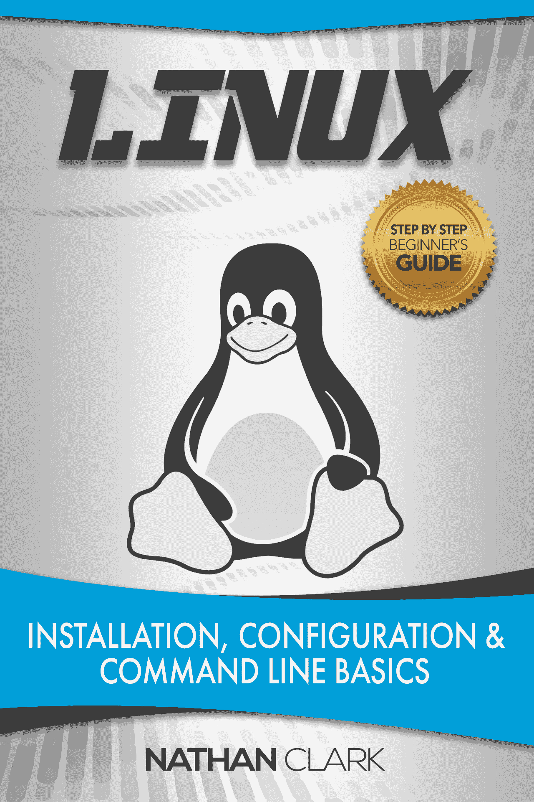


## 本系列书籍

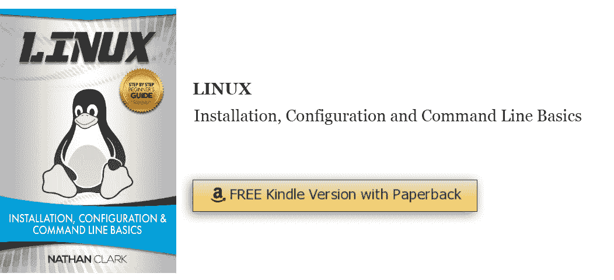


## 关于本书

我们已尽力确保在出版时此处提供的内容对我们的读者是准确且有用的。然而，这并不是对主题的详尽探讨。对于因提供的信息而导致的损失或损害，我们不承担任何责任。

使用的任何商标均未经许可使用，且对这些商标的任何使用并不意味着已获得所有者的同意或许可。书中发现的任何商标或品牌纯用于说明目的，其所有者均无任何方式与本书产生联系。

## 1. 什么是 Linux？

Linux 是一个基于 UNIX 的操作系统，其核心由成千万万人维护。今天，Linux 是开发者中最受欢迎的。

### 1.1 从 UNIX 到 Linux

Linux 的历史可以追溯到 90 年代。为了理解 Linux 背后的故事，我们还需回顾一下早期的。

### 1.2 Linux 简史

在 1965 年，多路用信息计算服务（`Multics`）开始开始。`Multics` 是麻省理工学院（MIT）、通用电气（GE）和贝尔实验室（Bell Labs）合作的结果。在 Ken Thompson 和 Dennis Ritchie 的领导下，他们开发的主要产品是 `Unics`。后来它被命名为 `UNIX`。当时的 UNIX 操作系统主要在加州大学伯克利分校使用。

#### UNIX

#### UNIX 变体

UNIX 的概念被许可给几家公司，它们开发并维护了自己的 UNIX 变体。这包括 `Solaris/SUN OS`（`SUN Microsystems`，现由 `Oracle` 所有）、`AIX`（`IBM`）、`Scenix`（`Siemens`）、`SCO UNIX`、`Xenix`（`Microsoft`）以及 `HP-UX`（`Hewlett-Packard`）、`NeXTSTEP`、`Mac OS`（`Apple`）和 `Android`（`Google`）。开源实现包含了伯克利系统发行（`BSD`）及其变体：`NetBSD`、`OpenBSD` 和 `FreeBSD`。

#### UNIX 哲学

UNIX 在设计时考虑了许多严格的原则。这些原则涵盖了可移植性、多任务和多用户导，并结合了分时方法。此外，它基于网络连接，遵循 `TCP/IP` 方案。

原始开发是使用 `C` 编程语言进行的，这导致了对硬件的独立。它附带了一系列开发工具和库，允许你轻松扩展到你特定的需求。

#### 工具

UNIX 类似于一个工具箱，由各种工具组成。每个工具都有特定的目的，并专为该任务设计。其核心思想是每个任务使用一个工具。为了实现更复杂的目标，你会把多个工具组合成链。

```bash
$ ls *.py | wc -l6
```

我们将在指南的后续部分详细解释这些命令及其用法。

### 1.3 Linux 简简史

与 UNIX 类似，Linux 操作系统有着不同的根源，它基于许多位大师的作品。其中包括理查德·M·斯尔曼（Richard M. Stallman）、安德鲁·S·塔能鲍姆（Andrew S. Tanenbaum）和林纳·托瓦尔斯（Linus Torvalds）。

理查德·M·斯尔曼是 MIT 的一名黑客和开发者，自由软件基金会（FSF）的首任主席，`GNU` 项目之父。`GNU` 是口号“GNU 不是 UNIX”的缩写。该项目的目标是开发一个自由的 UNIX 操作系统。直到 20 世纪 90 年代初，工具集可用但内核仍然缺失。整个软件于 1983 年左右根据 `GNU 公共许可证`（`GPL`）发布。

Linux 的下一步来自安德鲁·S·塔能鲍姆。当时他是阿姆斯特丹大学的教授。为了他的学生，他开发了 `Minix`，这是一个用于教学目的操作系统，旨在演示和理解 UNIX 原则。正如他指出的，`Minix` 并非用于实际操作。

林纳·托瓦尔斯是赫尔辛基大学的一名芬兰学生，他是 `Minix` 的用户，并对其限制并不满意。1990 年，他开始基于 `Minix` 的理念、UNIX 原则和 `POSIX` 标准开发一个全新的操作系统。他的动力是拥有一个自己能理解且能最大限度利用硬件边界的系统。他还想寻找乐趣，并且没有任何商业意图。Linux 背后的整个故事记录在他名为《趣味人生》（`Just for Fun`）的自传中。如今，林纳·托瓦尔斯监督着 `Linux 内核` 的开发。

为了让 Linux 对外部世界产生吸引力，它需要一个漂亮的标志。基于吉祥物竞赛，提交了大量的提案。拉里·尤因（Larry Ewing）提交了他关于书封面上企鹅的想法，他的提案获胜了。这只企鹅设计带有顽皮的微笑和丰满的身，名为 `Tux`，代表了快乐且满意的用户形象。

### 1.4 Linux 的用途范围

Linux 最初为基于 Intel 的系统设计，如今运行在各种平台上。其中包括 ARM 架构（命名为 `arm` 和 `arm64`）、Motorola/Freescale 的 68k 架构（`m68k`）、Intel x86（`i386` 和 `amd64`）、IBM s390（`s390`）、PowerPC（`powerpc`）和 SPARC（`sparc`）。

从一开始开始，Linux 就专注于服务器系统。它作为 Web 服务器、文件服务器、邮件和新闻服务器、互联网网关、无线路由器和防火墙被持续使用。作为一个计算单元，它帮助渲染了视频序列以及《泰坦尼克号》、《史莱克》、《玩具总动员》。此外，Linux 还应用于汽车产品、航天、军事、物流和工程领域。自 2006 年以来，Linux 服务器运行着世界上所有的交易所。它还运行着几乎所有的互联网搜索引擎。

在过去的十年里，Linux 也征服了桌面。由于其极高的灵性和稳定性，它作为文本处理、图形设计、桌面出版、电子表格计算、通信（电子邮件、聊天、音频和视频）以及你的手机和电视的用户界面的可靠配置。

### 1.5 Linux 认证

Linux 的广泛使用增加了对确清楚自己在做什么的工程师和用户的需求。在此时，获得 Linux 认证变得非常有优势。这些认证可以分为通用程序（不特定于某个发行版）和专项程序（特定于某个 Linux 发行版）。下面的列表提供了目前存在的主要认证的概述。

#### 非通用认证

- Linux Essentials
- LPIC-1: Linux 服务器专业认证
- LPIC-2: Linux 工程师
- Linux Foundation 认证系统管理员（`LFCS`）
- Linux Foundation 认证工程师（`LFCE`）
- CompTIA A+
- CompTIA Network+

#### 特定于发行版的认证

- RedHat 认证工程师（`RHCE`）
- RedHat 认证系统架构师（`RHCSA`）
- RedHat 认证架构师（`RCA`）
- SUSE 认证管理员（`SCA`）
- SUSE 认证工程师（`SCE`）
- SUSE 企业架构师（`SEA`）

## 2. 软件许可证

与市场上的大多数产品一样，软件也附带相应的许可证。软件许可证描述了软件的使用方法并允许或限制其使用。对于商业软件，仅在相当严格的边界内允许更改和复制。例如，许可证限制你供 5 个用户并行使用，并要求你获取另一个许可证块来添加第 6 或第 7 个用户。常见的许可证有微软的 `共享源代码` 和 `Apple 许可证`。

对于开源软件，许可证的限制要少得多。明确允许更改和复制，在某些情况下甚至鼓励这样做，以便为每个用户和目的做出改进。目标是让软件现在和将来对所有人可用。这种所谓的“左拷贝”（`Copyleft`）原则确保每个人都有权根据需要进行调整，并且对涵盖软件的使用和分发的限制降到最低。用于单个 Linux 组件及其工具的常用许可证是 `GNU 公共许可证`（`GPL`）、`BSD 许可证` 和 `Apache 许可证`。

开源软件许可证遵循若干自由规则：

- 为任何目的使用该程序（无限使用权——`自由 0`）
- 理解程序如何工作以及如何根据需求更改它（阅读程序源代码的权利——`自由 1`）
- 复制软件以帮助你的邻居（分发权——`自由 2`）
- 改进软件并发布你的更改，以便所有其他用户也能从你的改进中受益（`自由 3`）

这确保了可用软件的质量不断提高，并且每个人都能获得这些改进。使用 `GPL` 时，更改必须使用相同的许可证发布。其他如 `BSD` 之类的开源许可证则没有这种强制性要求。

## 3. 生活中的 Linux

有几个术语可能会让 Linux 初学者感到困惑。首先是它的名称，`Linux` 与 `GNU/Linux`。正如第 1 章之前描述的，`Linux` 术语仅指 `Linux` 内核。在实际上，许多用户将 `Linux` 称为整个操作系统，即内核加上库和工具。此外，`Linux` 一词也用于包含所有在 `Linux` 上运行的或为这个伟大的操作系统提供的程序。

此外，`GNU/Linux` 的描述需要进一步理解。带有此名称前缀的 Linux 发行版通过 `GNU` 实现的系统工具和程序来充实。其中一个例子是 `Debian GNU/Linux`。正如第 1 章所指出的，`GNU` 项目起源于理查德·M·斯尔曼（Richard M. Stallman）的倡议以及他开发自由 `UNIX` 系统的梦想。基于他在 MIT 的经验以及与其他同事的合作，他选择使用已有的自由软件来重写他需要的工具。这包括 `TeX` 排版系统以及 `X11` 窗口系统。他尽可能在 `GPL` 许可证下发布这些重写后的工具，以便让任何感兴趣的人都能免费使用他的工作。

接下来我们将更详细地查看不同的 Linux 发行版。

### 3.1 什么是 Linux 发行版？

Linux 发行版是一组相互配合的软件包集合。一个发行版由一个软件开发者团队维护。团队的每个成员专注于发行版中不同的包。他们作为一个团队，共同确保单个软件包是最新的，并且不会与该发行版同一发布版本的其他包发生冲突。

截至 2018 年，对于 `Debian GNU/Linux` 9，官方仓库包含超过 51,000 个不同的包。仓库是具有特定目的的包目录。`Debian GNU/Linux` 根据开发状态对其包进行分类。官方仓库名为 `stable`，反映了当前发布的稳定包。其他仓库命名为 `testing` 和 `unstable`，工作方式相同，但不被视为官方包。

通常，一个 Linux 发行版包含 `Linux` 内核包、引导加载程序、`GNU` 工具和库、带有窗口环境的图形桌面环境，以及额外的软件，如网络浏览器、电子邮件客户端、数据库和文档。软件以两种方式提供：源代码和编译后的二进制包。这允许你理解软件是如何设计的，对其进行研究并根据你的个人需求进行调整。这一步被描述为第 2 章列表中的自由 1。

根据 Linux 发行版的侧重点不同，它还包含特定用途的包，例如网络或取证工具、用于教育目的科学软件以及多媒体应用。更多细节见下文。

### 3.2 哪些 Linux 发行版？

根据 Distrowatch 的数据，存在超过 600 个不同的 Linux 发行版。主要发行版包括 `Debian GNU/Linux`、`Ubuntu`、`Linux Mint`、`Red Hat Enterprise Linux`（`RHEL`）、`Fedora`、`CentOS`、`openSUSE Linux`、`Arch Linux`、`Gentoo` 和 `Slackware`。主要问题之一是：使用哪种 Linux 发行版？根据我们的经验，建议如下：

- 对于初学者：`Ubuntu`、`Xubuntu`、`openSUSE`、`Linux Mint`
- 对于有经验的高级用户：`Debian GNU/Linux`、`Red Hat Enterprise Linux`（`RHEL`）、`Fedora`、`CentOS`
- 对于开发者：`Arch Linux`、`Gentoo`、`Slackware`

书中的示例我们使用 `Debian GNU/Linux`。虽然这个发行版被推荐给高级用户，但它对初学者仍然非常友好，我们将在本指南后面展示这一点。但选择它最重要的原因是它的稳定性，以及人们在过去 20 年作为服务器和桌面系统长期使用对该 Linux 发行版的信任。其他 Linux 发行版波动太大，让人难以适应。

非常欢迎你选择不同的 Linux 发行版。本书的大部分适用于大多数发行版。但如果你是一个完全的新手，我们强烈建议至少在本指南期间坚持使用 `Debian GNU/Linux`，因为我们将逐步完成它的安装和配置。

通常，选择 Linux 发行版可以取决于下述的几个标准：

- 根据可用性：免费或商业用途
- 根据用途：桌面、服务器、Wi-Fi 路由器/网络设备
- 根据目标读者：终端用户、网络工程师、系统管理员、开发者
- 根据包格式：`.deb`、`.rpm`、`.tar.gz`
- 根据更新时间：每个 Linux 发行版都有自己的更新周期
- 根据提供的支持：支持可以是免费的（基于社区）或付费的（基于支持合同）

在选择发行版时，我们建议选择稳定、定期更新并符合你计算机用途的发行。下面你将找到上述每个 Linux 发行行的简短描述。


#### Debian GNU/Linux

`Debian GNU/Linux`（简写为 `Debian`）建立于 1993 年，是一个完全免费且基于社区的操作系统，遵循 `GNU` 原则。超过 1,000 名开发者根据自己的意愿持续对其进行工作。`Debian` 背后没有公司，也不涉及商业利益。

一个设计目标是为积极提供服务的计算机提供一个稳定可靠的操作系统。它针对那些明确自己需求且有经验的用户。`Debian` 开发者维护并使用他们自己的软件。包以 `.deb` 格式提供，并根据以下许可证进行分类：

- `Main`：自由软件
- `Contrib`：依赖非自由软件的自由软件
- `Non-free`：具有非自由许可证的包

`Debian` 在服务器和桌面系统上的运行都非常好。支持多种架构，如 `ARM EABI`（`arm`）、`IA-64`（`Itanium`）、`mips`、`MIPSel`、`powerpc`、`s390`（32 和 64 位），以及 `sparc`、`i386`（32 位）和 `amd64`（64 位）。每个版本的代号基于电影《玩具总动员》中的角色名字，例如 `Debian GNU/Linux` 9 的 `Stretch`。


#### Ubuntu

`Ubuntu` 是由 Canonical Ltd 公司资助的自由 Linux 发版。基于 `Debian` 但专注于初学者。这就是为什么它每个任务只包含一个工具。此外，`Ubuntu` 团队尝试引入缺乏稳定性的新元素。包以 `.deb` 格式提供，并根据来自 `Canonical` 的支持情况进行分类：

- `Main`：由 `Canonical` 支持的自由软件
- `Restricted`：由 `Canonical` 支持的非自由软件
- `Universe`：不受支持的自由软件
- `Multiverse`：不受支持的非自由软件

Ubuntu 提供三个官方版本：Ubuntu Desktop、Ubuntu Server 和 Ubuntu Core（用于物联网）。它支持多种架构，如 `i386`、`IA-32`、`amd64`、`ARMhf`（ARMv7 VFPv3-D16）、`ARM64`、`powerpc`（64 位）和 `s390x`。最初发布于 2004 年，每年发布两次：分别在 4 月和 10 月。发布版本通过版本号体现：`18.04` 指的是 2018 年 4 月发布的版本。版本的代号基于一个形容词和一个动物，例如 Ubuntu 14.10 的代号为 `Utopic Unicorn`。


#### Linux Mint

Linux Mint 是一种基于 Ubuntu 的非商业发行版，并遵循其发布方案。首次发布日期可以追溯到 2006 年。从 2014 年开始，每年发布两次，比 Ubuntu 发布晚一个月。发布版本的代号是以 `a` 结尾的女性名字，例如版本 6 的 `Felicia`。Linux Mint 支持 `IA-32` 和 `amd64` 两种架构。该发行版的目标是能够轻松使用的桌面用户。


#### Red Hat Enterprise Linux（RHEL）

`RHEL` 是一种商业 Linux 发行版。它基于 Red Hat Linux（1995 年至 2004 年间可用）加上 `Fedora` 19 和 20 的组合。其原始发布日期可以追溯到 2000 年。它对企业客户的关注包括长期支持、培训和认证计划（见第 1 章）。红帽的社区项目被称为 `Fedora`（见下文）。软件包以 `.rpm` 格式（红帽包管理器）提供。`RHEL` 支持 `arm`（64 位）、`i386`、`amd64`、`powerpc` 以及 `s390` 和 `zSeries` 架构。该发行版同时针对服务器和桌面。版本的代号看起来相当随机，因为它没有遵循类似于 Debian 或 Ubuntu 的方案。


#### Fedora

Fedora 是一种社区 Linux 发行版，主要面向桌面使用。它基于 `Red Hat Enterprise Linux`（`RHEL`）并由红帽赞助。它于 2003 年 Red Hat Linux 结束支持时推出。截至 2018 年，它提供了以下版本：

- Workstation：用于 PC
- Server：用于服务器
- Atomic：用于云计算

Fedora 支持 `amd64`、`ArmHF`、`powerpc`、`mips`、`s390` 和 `RISC-V` 架构。该发行版的生命周期较短，大约每 6 个月发布新版本。版本的代号没有遵循固定的命名方案，主要由城市名称组成。


#### CentOS


CentOS 是 Community Enterprise Operating System（社区企业操作系统）的缩写。与 Fedora 一样，它基于 Red Hat Enterprise Linux，并在二进制软件包方面保持兼容。这允许在 CentOS 上使用最初为 RHEL 设计和开发的软件。与 Fedora 不同，它侧关注桌面和服务器的企业级用途，并提供长期支持。CentOS 的首次发布可以追溯到 2004 年 5 月。软件包来自三个不同的仓库：

- `Base`：常规、稳定的软件包
- `Updates`：安全、错误修复或增强更新
- `Addons`：构建构成 CentOS 发行版的大型软件包所需的包，但上游并未提供

CentOS 支持 `i386` 和 `amd64` 架构。不支持其他架构。

## openSUSE

Linux 发行版 openSUSE 起根于 SUSE Linux 和商业版的 SUSE Linux Professional，后者于 1994 年首次发布。SUSE 的名称是原始德国所有者 `Gesellschaft für Software- und Systementwicklung GmbH` 的缩写。openSUSE 基于 Red Hat Linux 和 Slackware 的结构，并使用 `.rpm` 作为软件归档格式。它支持 `i586`、`x86-64` 和 `ARM` 架构。openSUSE 项目的目标是每八个月发布一个新版本。与 Fedora 一样，版本的代号没有遵循固定的命名方案。

## Arch Linux

Arch Linux 是一种免费的 Linux 发行版，于 2002 年首次发布。它遵循滚动更新（rolling release）原则，导致该发行版每月发布一次。目前核心团队由约 25 名开发者组成，并受到许多被称为“信任用户”的其他开发者的支持。Arch Linux 使用 `Pacman` 作为软件包管理系统。软件包存储在四个软件仓库中：

- `Core`：用于基础系统的软件包
- `Extra`：额外的软件包，如桌面环境和数据库
- `Community`：由信任用户维护的软件包
- `Multilib`：可以在多个架构上使用的软件包

Arch Linux 支持 `amd64` 架构。2007 年之前的早期版本代号没有遵循特定方案。

## Gentoo

与 Arch Linux 一样，Gentoo 也遵循滚动更新原则。每周提供新的安装镜像，首次发布见于 2002 年。Gentoo 的特殊之处在于它是一个基于源码的发行版。在安装软件之前，必须先编译。支持的架构包括 `alpha`、`amd64`、`arm`、`hppa`、`IA-64`、`m68k`、`mips`、`powerpc`、`s390`、`sh` 和 `sparc`。

## Slackware

Slackware 是最老的活跃 Linux 发行版。首次发布可以追溯到 1992 年。定期发布没有固定间隔。它针对专业用户，并尽可能给予他们自由。Slackware 使用压缩的 `.tar.gz` 存档作为软件包格式，并支持 `i486`、`alpha`、`sparc` 和 `arm` 四种架构。该发行版也被移植到了 `s390` 架构。image356.jpg](http://www.Amazon.com/gp/customer-reviews/write-a-review.html?asin=B07HDTG5D)

# 安装 Linux 系统

如上一章所述，我们将使用 Debian 进行演示。回顾一下，Debian 是一个提供极佳稳定性且一旦你的技能和知识超过了初级阶段，其扩展性非常好。在本章中，我们将安装并配置 Debian，向你展示其中的每一个步骤。

## 安装类型

Debian 提供了多种设置方法。这包括图形界面安装和文本安装；我们将使用前者。对于安装媒体，Debian 开发者提供了三种变体：

- 用于 32 位和 64 位的 CD 或 DVD
- 用于 32 位和 64 位的网络镜像（所谓的 Netinst-ISO）
- 用于 32 位或 64 位的微型 CD

我们还提供了测试介质。这些包括 32 位和 64 位的实时镜像，允许你在向电脑上安装 Debian 之前进行尝试。在编写本文时，版本 9.5 是 Debian 的当前稳定版本。此处描述的设置基于此版本和 `amd64` 架构。从 [www.debian.org/distrib](http://www.debian.org/distrib) 下载网络镜像后，系统不再需要引用额外的静态镜像。相反，它依赖互联网连接来检索要安装的软件包并保持你的操作系统更新。整个过程将花费大约一小时，并允许你根据特定需求进行精简的软件选择。你不需要使用的软件包将不会出现在你的系统中。你可以在需要时随时添加它们。我们安装的目标系统是一个基于 XFCE 的单用户桌面系统，配有网络浏览器和音乐播放器。网络浏览器我们使用 `Mozilla Firefox`，音乐播放器使用 `VLC`。这两个程序都是 Linux 发行版的永久组件。我们用于演示的环境是一个基于 `VirtualBox` 的虚拟机，配置有 4 GB 内存和 15 GB 磁盘空间。

## 4.2 逐步安装 Linux

### 启动菜单

为了开始安装 Debian，首先从你下载的 ISO 镜像启动电脑（在我们的案例是 `VirtualBox` 镜像）。如果你也使用虚拟机，请查看虚拟机供应商网站获取如何启用 ISO 镜像的帮助。接下来，等待启动菜单在屏幕上出现。下图显示了提供的不同选项。使用方向键导航启动菜单，按 `Enter` 键选择项目。

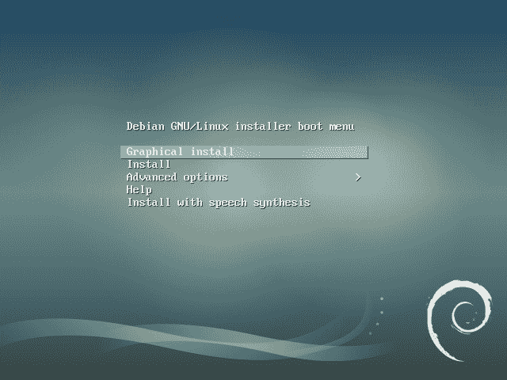

不同的选项有：

- 图形化安装 (Graphical install)：使用图形化安装程序启动安装过程
- 安装 (Install)：使用文本安装程序启动安装过程
- 高级选项 (Advanced options)：选择更多选项，如专家模式、自动安装或救援模式（详细信息见下图）
- 帮助 (Help)：获取进一步帮助
- 带语音合成安装 (Install with speech synthesis)：带有语音支持启动安装过程

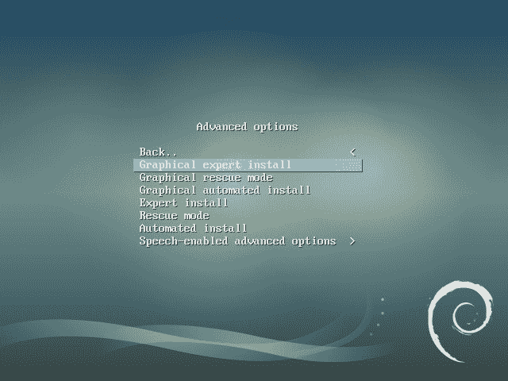

从主启动菜单中选择 `Graphical install` 项，并按 `Enter` 键继续。

### 语言选择

接下来，选择你希望在整个安装过程中使用的语言。对话框和消息将进行相应的翻译。此选择不会不可逆地决定你的 Linux 系统的语言，你以后可以随时选择不同的语言。下图显示了对话框。英语已被预选，因此你只需点击对话框右下角的 `Continue` 按钮即可继续。

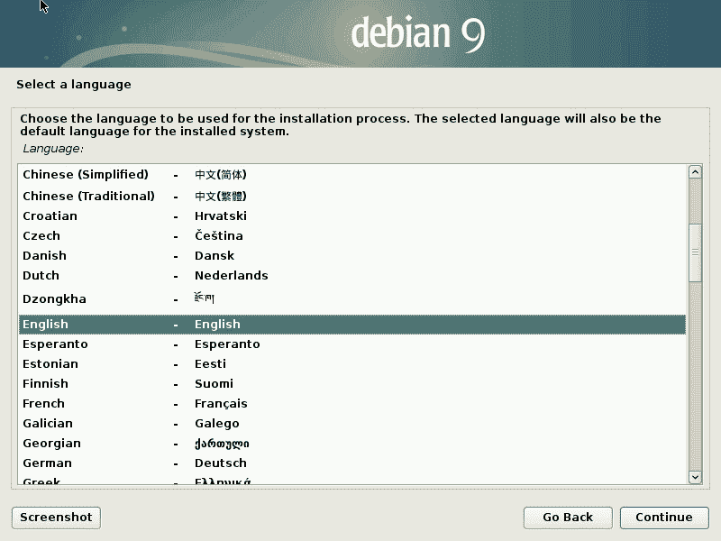

### 位置选择

第三，对你的位置进行选择（见下图）。根据你之前设置的语言，列表将列出主要使用该语言的国家。这也会影响本地化设置，例如你电脑所在的时区。如果需要不同的设置，请选择列表末尾标题为 `other`（其他）的项目并从那里开始。完成后，点击 `Continue` 按钮进入第四步。

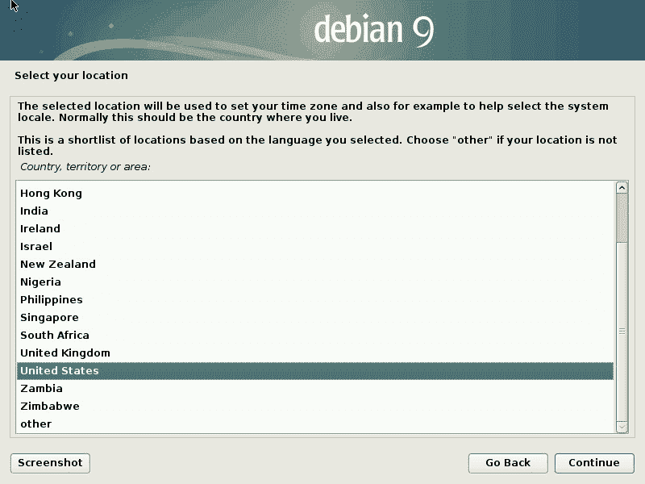

### 键盘选择

第四，从列表中选择你的键盘布局（见下图）。对于美国，预选是美英语 (American English)。如果你使用不同的键盘布局，请从列表中选择正确的项。完成后，点击 `Continue` 按钮进入第五步。

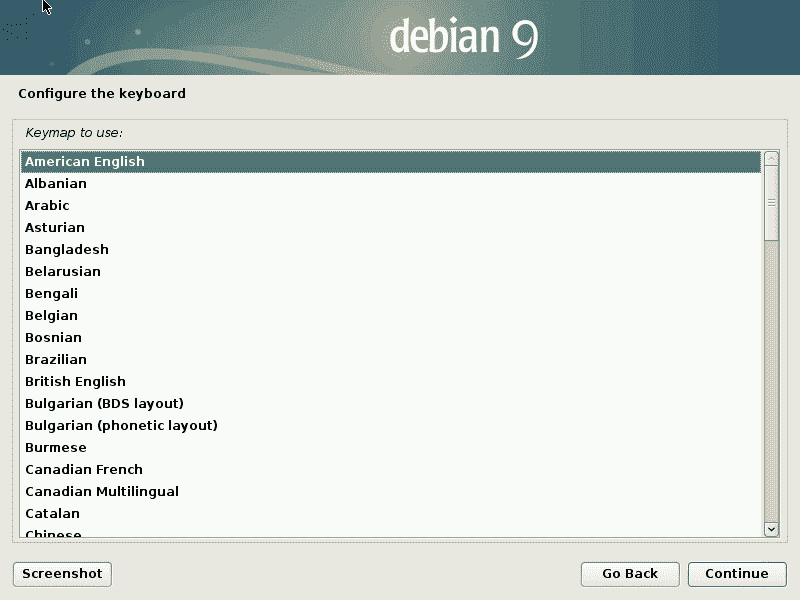

### 网络设置

第五步包括从 ISO 镜像加载安装程序组件，并检测网络硬件以加载正确的网络驱动程序。然后，安装程序尝试连接互联网，通过 `DHCP` 从你的本地网络服务器检索 IP 地址。

完成后，你可以设置电脑的主机名（见下图）。为你的机器选择一个唯一的名称，该名称由单个名称组成且在你的本地网络段中尚不存在。使用水果、地点、乐器、作曲家和电影角色名称是很常见的。在这种情况下，我们选择了名称 `debian95`，它简单代表 Linux 发行版及其版本号。

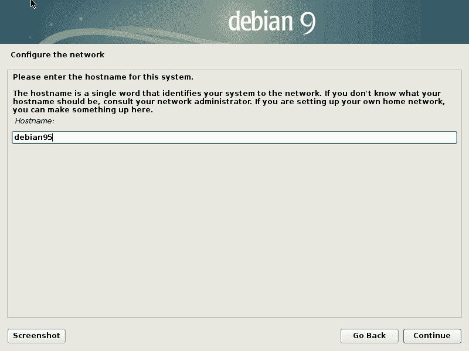

完成后，点击 `Continue` 按钮进入第六步，添加类似 `yourcompany.com` 的域名（见下图）。在本文情况下不需要。因此我们留空该输入字段。点击右下角的 `Continue` 按钮继续安装。

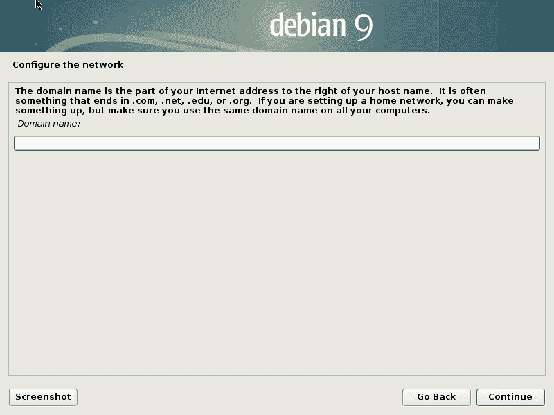

### 用户与角色

我们的 Linux 系统至少需要两个用户才能正常运行。一个是具有固定名称 `root` 的管理员用户，另一个是普通用户，在此案例中我们将其命名为 `User`。

在接下来的两个步骤中，你为 `root` 用户设置密码（见下图），以及普通用户的全名和账户名。为了简单起见，我们使用 `Debian User` 作为全名，`User` 作为账户名。对于这两个用户，请选择一个不同且你记得的密码。

稍后你需要这些密码来登录电脑。

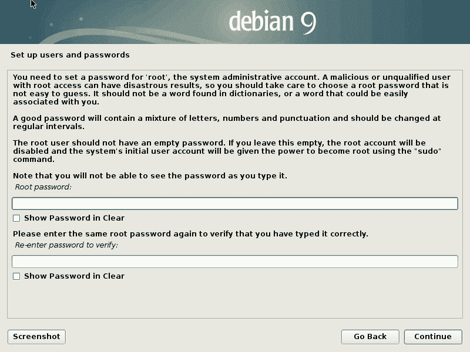

### 时区

设置正确的时区对于与其他服务的通信非常重要，特别是在网络中。从下所示的列表中选择值。列表中的项目基于你之前选择的位置。完成后，点击 `Continue` 按钮定义存储介质及相应的分区。

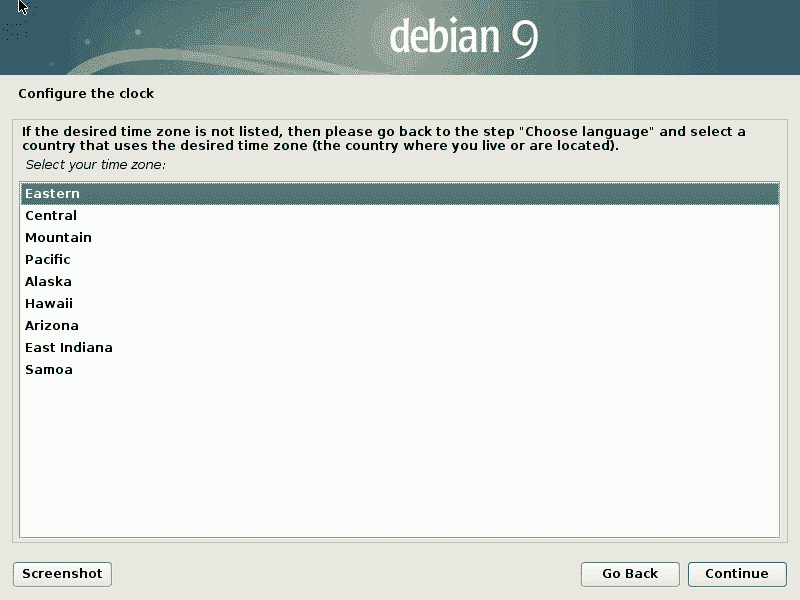

### 存储介质与分区

Linux 系统可以分布在多个不同的存储介质上，如硬盘和闪存。此外，一个存储介质可以划分为多个磁盘分区。为了实现这一点，Debian 的设置程序提供了以下方法（见下图）：

- 引导式 - 使用整个磁盘 (Guided - use entire disk)：按照提供的步骤操作，并将整个磁盘用于 Linux 安装。这将创建固定大小的分区。
- 引导式 - 使用整个磁盘并设置 LVM (Guided - use entire disk and set up LVM)：按照提供的步骤操作，并将整个磁盘用于 Linux 安装。此选项利用逻辑卷管理 (`LVM`) 来创建以后可以更改大小的分区。
- 引导式 - 使用整个磁盘并设置加密 LVM (Guided - use entire disk and set up encrypted LVM)：按照提供的步骤操作，并将整个磁盘用于 Linux 安装。此选项利用逻辑卷管理 (`LVM`) 来创建以后可以更改大小的加密分区。
- 手动 (Manual)：单独创建分区。这是专家模式，需要关于分区和文件系统参数的更深知识。

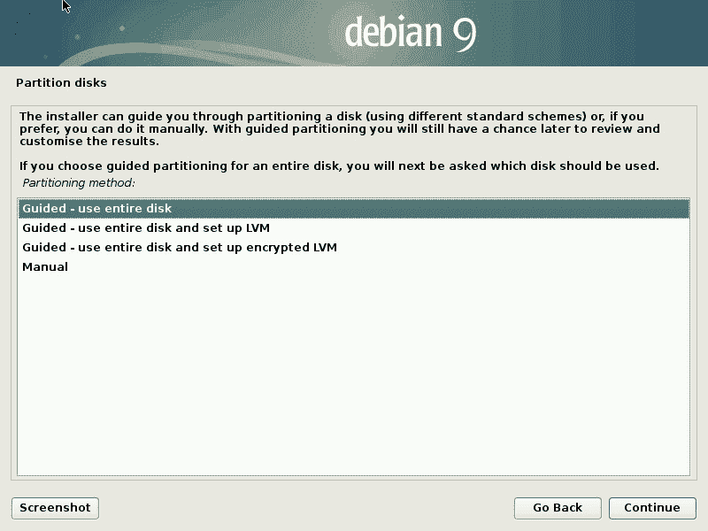

从列表中选择 `Guided - use entire disk` 项。分区大小的值根据经验通过算法实现选择。不需要手动计算。点击右下角的 `Continue` 按钮继续安装。

接下来，选择要分区的磁盘。在我们的案例中，只有一个可用磁盘（见下图）。在指南的后文中，该磁盘将统称为 `/dev/sda`（第 1 个 SCSI 磁盘）。

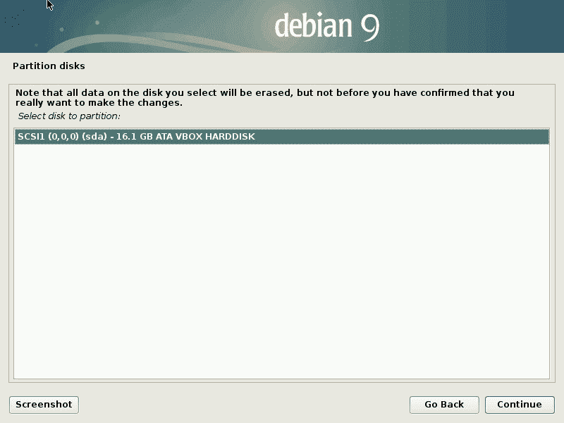

磁盘分区是指存储介质上单独组织的部分，旨在包含 Linux 文件系统树的一个分支。没有通用的方法来正确进行这种分离。本指南展示了一个适用于基础系统的简单且安全的解决方案。对话框中的菜单提供以下选项：

- 所有文件在一个分区中 (All files in one partition)：仅使用单个分区存放程序和用户数据
- 单独的 `/home` 分区 (Separate `/home` partition)：将程序和用户数据存储在单独的分区中
- 单独的 `/home`, `/var` 和 `/tmp` 分区 (Separate `/home`, `/var`, and `/tmp` partitions)：将用户数据、变量数据和临时数据保持在单独的分区中

如如下所示，选择第三项 `Separate /home`, `/var`, and `/tmp` partitions`。点击右下角的 `Continue` 按钮继续安装。(image466.jpg)

下一步是确认分区方案。该方案是根据经验自动计算，包含以下分区：

- `sda1`：第一个 SCSI 磁盘的第一个分区是主分区，大小为 3 GB，使用 `ext4` 文件系统格式，称为文件系统树的根部分（用 `/` 表示）
- `sda5`：第一个 SCSI 磁盘的第五个分区是逻辑分区，大小为 1.3 GB，使用 `ext4` 文件系统格式，用于存储文件系统树的变量数据（用 `/var` 表示）
- `sda6`：第一个 SCSI 磁盘的第六个分区是逻辑分区，大小为 3.3 GB，格式为交换文件系统（swap）
- `sda7`：第一个 SCSI 磁盘的第七个分区是逻辑分区，大小为 311 MB，使用 `ext4` 文件系统格式，用于存储文件系统树的临时数据（用 `/tmp` 表示）
- `sda8`：第一个 SCSI 磁盘的第八个分区是逻辑分区，大小为 8.8 GB，使用 `ext4` 文件系统格式，用于存储文件系统树的用户数据，即主目录（用 `/home` 表示）

由于历史原因，一个硬盘只能包含四个主分区。如果第四个分区被划分为所谓的逻辑分区或逻辑驱动器，则称为 `Extended Partition`。在我们案例中，逻辑分区 `/dev/sda5`、`/dev/sda6`、`/dev/sda7` 和 `/dev/sda8` 存储在主分区 `/dev/sda4` 上。分区 `/dev/sda2` 和 `/dev/sda3` 未使用。(image482.jpg)

从上述列表中选择 `Finish partitioning and write changes to disk` 项。点击右下角的 `Continue` 按钮继续并确认分区方案（见下图）。从列表中选择 `yes` 并点击 `Continue` 按钮对磁盘分区。请注意，所选存储设备上的所有数据将丢失，且磁盘将为空。(image486.jpg)

在将存储介质划分为分区后，分区将按照之前定义的文件系统进行格式化。在我们案例中，分区 `/dev/sda1`、`/dev/sda5`、`/dev/sda7` 和 `/dev/sda8` 将获得 `ext4` 文件系统，分区 `/dev/sda6` 将获得交换文件系统。一旦完成此步骤，接下来将安装 Debian 的基础系统。

## 软件包管理

ISO 镜像包含了安装程序和若干用于设置 Linux 系统的软件包。例如，这包括下方将安装的 Linux 内核。(image492.jpg)

接下来，你需要决定是否使用额外的安装介质。在我们案例中，我们只有一个安装磁盘，因此可以从菜单中选择 `No`（见下图）。然后点击 `Continue` 按钮继续。(image496.jpg)

如前所述，Debian 的软件是以包的形式组织的。这些包在多个软件存储库中提供。存储库通过由大学、个人、公司和其他组织维护的软件包镜像提供。这些镜像位于不同的国家。

在下一步中，你必须决定从哪个国家获取你的 Debian 软件包。建议选择地理位置上离你最近的镜像，以尽量减少数据通过网络从镜像传输到你电脑的时间。作为第一步，选择你所在的国家。(image501.jpg)

作为第二步，从列表中选择一个首选镜像（见下图）。列表包含了大学、互联网提供商、政府服务和其他组织。(image505.jpg)

如果你的计算机网络包含用于与外界通信的代理服务器，请在此处输入相应信息。在我们案例中没有代理，因此留空字段。点击 `Confirm` 按钮继续。(image509.jpg)

一旦设置好单个参数，Debian 安装程序将连接到之前选择的软件包镜像并那里获取软件包列表。软件包列表包含可用包，包括名称、大小和描述。取决于网络连接的质量和带宽，此步骤可能需要一段时间。(image513.jpg)

接下来，你会被要求参加 `Popcon`，即 Debian 软件包受欢迎调查（见下图）。此信息可选可选，仅供负责 Debian 软件包的开发者团队使用。根据 `Popcon`，他们找出哪些 Debian 软件包安装频率最高。该信息直接影响安装镜像的准备，以及针对不同架构保留或舍弃哪些包。在我们案例中，我们不参与 `Popcon`，将选择留在 `No`。点击 `Confirm` 按钮继续选择软件任务 (`tasksel`)。(image518.jpg)

## 软件选择

Debian 提供精心安排的软件包选择，称为“任务”（tasks）。其后的思想是将特定用途的软件包分组，以简化安装。从对话框中的列表（见下图），你可以选择不同的桌面环境，以及 Web 服务器、打印服务器、SSH 服务器和标准系统实用程序。要进行最小化安装，只需启用列表最后两项。我们将稍安装 `XFCE` 桌面环境。(image523.jpg)

确认软件选择后，Debian 安装程序将从软件包镜像检索所需的包、解压并安装。下方的进度条显示进度。在我们案例中，需要下载 140 个软件包。(image527.jpg)

## 设置 GRUB

为了启动新安装的 Debian 系统，我们也必须设置这些信息。这个过程被称为系统引导。处理这一步骤的软件组件名为 `Grand Unified Boot Loader`（准确说是 `GRUB` 或 `GNU GRUB`）。`Yes` 项已预选，因此我们可以点击 `Continue` 继续。(image532.jpg)

Debian 安装程序需要知道在哪里安装 `GRUB`。下图中的菜单列出了需要考虑的存储介质。在我们案例中，我们选择列表中的第二项 (`/dev/sda`)。然后点击 `Continue` 继续。(image536.jpg)

现在基础安装已接近完成，剩下的工作只需读取一个对话框。

## 完成安装

以下对话框告知你安装已完成。点击 `Continue` 重启新安装的系统。(image542.jpg)


几秒钟后，屏幕上将出现文本版本的`GRUB`启动菜单（见下图）。启动菜单包含两个选项：`Debian GNU/Linux`和`Advanced options for Debian GNU/Linux`。第一个菜单项被选中并预选。第二个菜单项允许你设置特定的启动选项。要查看这些选项的完整列表，请参考[www.gnu.org/software/grub/manual/grub](http://www.gnu.org/software/grub/manual/grub)中的`GNU GRUB`手册。

保持第一个菜单项选中并按`Enter`继续并启动新系统。（image547.jpg）

你的 Debian 系统将启动并初始化必要的系统服务。这一步骤需要几秒完成。最后，在名为`tty1`的第一个文本终端上（见下图）将看到一个黑白屏幕，并要求你登录系统。（551.jpg）

登录提示由两部分组成：你的 Linux 系统主机名（`debian95`），后面跟着一个空格和单词`login`。

```
| Debian GNU/Linux 9 debian95 tty1debian95 login: _ |
```

登录系统后，你将添加额外的软件，以能够使用基于 XFCE 桌面的图形用户界面。在安装过程的这一步，添加额外的软件只能通过管理员 root 用户身份登录来完成。要这样做，请在登录提示符输入`root`，按`Enter`，等待`Password:`文本出现，然后输入你之前为 root 用户设置的密码。Linux 系统将用一条登录消息欢迎你（见下图）。登录消息的第一行将显示你上次登录的时间，随后是当前运行的 Linux 内核版本（第二行）以及使用建议（第五行到第八行）。

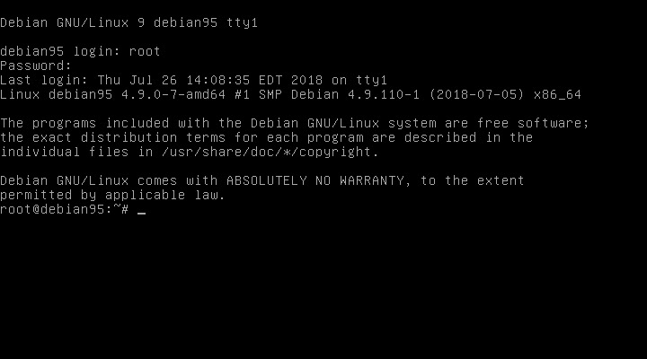

在显示欢迎消息后，Debian 会打开一个命令行提示符：

```
root@debian95 ~# |
```

该命令行提示符由四个部分组成：

- `root`：登录用户的名称。
- `debian95`：Linux 系统的主机名。
- `~`：当前目录。在这种情况下，它是当前登录用户的家目录。如果没有其他设置，它对于普通用户定义为`/home/username`，对于管理员用户定义为`/root`。`~`只是它的缩写。
- `#`：登录符号。`#`符号代表 root 用户，而`$`用于没有管理员权限的普通用户。

**重要提示**：你现在以管理员 root 用户身份登录。请小心你输入的命令，如果有疑问请检查两次。任何错误都可能导致需要重新安装或修复你的 Linux 系统。

## 4.3 添加图形用户界面

在当前阶段，Debian 系统已完全激活并可以用于生产环境。对于适用于普通用户的桌面系统，它仍然缺少一个漂亮且易用的图形用户界面。在这一步，我们将改变这一点并安装 XFCE 桌面管理器。为此，我们将安装以下软件包：

- `aptitude`包管理器
- `xdm`显示管理器
- `xfce4`桌面环境

Debian 使用软件包管理器`apt`来处理软件包及相关包列表的安装、更新和删除。此外，`apt`还会解决所有的包依赖并确保相关软件在系统上可用。在我们案例中，需要从软件包镜像检索并安装总计约 450 MB 的数据/软件。如前，这需要可用的互联网连接来下载所需的软件包。要安装这三个软件包，请在命令行提示符输入以下命令。只需在`#`符号后输入命令即可：

```
root@debian95 ~# apt-get install aptitude xdm xfce4 |
```

`apt`将显示有关要安装软件包的更多信息。这包括依赖包列表和推荐包。最后，你将看到一个命令行提示符。输入`Y`或按`Enter`安装`aptitude`、`xdm`和`xfce4`以及相关的依赖包。对于`xdm`显示管理器，必须确认两个对话框（见下图）。按两次`Enter`确认使用`xdm`。

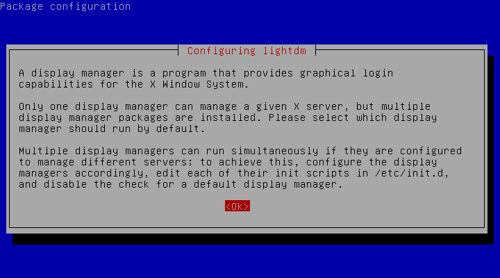
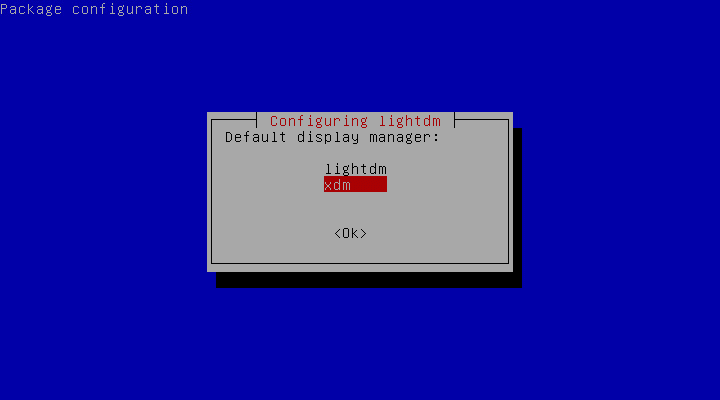

检索要安装的软件软件包需要一些时间。完成后，命令行提示符将再次出现。为了激活有关图形桌面环境的更改，请重启系统。在命令行提示符上所示输入命令`reboot`：

```
root@debian95 ~# reboot |
```

重启 Linux 系统后，Debian 用一个图形化启动屏幕欢迎我们（见下图）。按`Enter`以默认设置启动 Linux 系统。（image621.jpg）

几秒钟后，将看到图形化登录界面（见下图）。使用之前创建的名为`user`的普通用户登录系统。输入`user`，按`Enter`并输入用户的密码。然后再次按`Enter`确认并登录。（image625.jpg）

接下来，将看到 XFCE 桌面（见下图）。桌面带有若干默认元素：一个顶部导航栏、底部导航栏和桌面图标。这些元素在下文中有详细解释。（image629.jpg）

- **顶部导航栏**：显示访问不同应用程序、四个虚拟桌面、时钟以及各种用户操作按钮，例如锁定屏幕、切换用户、切换到待机模式和退出当前会话。
- **底部导航栏**：此栏包含几个按钮，用于隐藏所有打开的窗口并显示空桌面、打开终端、文件管理器、网络浏览器、查找应用程序以及直接用家目录打开文件管理器。
- **桌面图标**：从上到下有垃圾箱、链接到计算机的文件管理器图标以及家目录。

在桌面上右键点击可以打开一个菜单，允许你访问各种应用程序（见下图）。（image640.jpg）

## 4.4 添加额外软件

到目前，你的 Linux 系统上可用的软件相当有限。下一步要做的工作是添加以下四个 Debian 软件包，让你的生活变得简单一点：

- `firefox-esr`：浏览器 Mozilla Firefox（扩展支持版）
- `gnome-terminal`：由 GNOME 项目维护的终端模拟器
- `screensaver`：X11 系统的基础锁屏程序
- `vlc`：视频播放器 Video Lan Client (VLC)

这三个软件包的安装将通过终端模拟器中的命令行完成（我们将在指南稍后的部分详细介绍终端）。目前，你的系统上安装了 X11 终端模拟器`xterm`。要打开`xterm`，请点击底部导航栏中的终端按钮，或从上下文菜单中选择`Application > System > Xterm`。第一步，打开`xterm`。接下来，在命令行提示符旁输入命令`su`并按`Enter`：

```
user@debian95: ~$ suPassword: |
```

你可能记得之前的步骤提到，只有管理员用户才能在 Debian 系统上安装、更新或删除软件。`su`命令是 switch user（切换用户）的缩写，并改变你的当前角色。在不带额外名称的情况下使用，角色将变为管理员 root 用户。在密码提示符输入管理员用户的密码并按`Enter`。作为管理员用户，安装软件包：`firefox-esr`、`gnome-terminal`、`screensaver`和`vlc`如下：

```
root@debian95: ~# apt-get install firefox-esr gnome-terminal xscreensaver vlc |
```

输出所示：（image673.jpg）

安装四个软件包后，你可以切换回普通用户角色。按`Ctrl+D`退出管理员部分，再次按`Ctrl+D`关闭`xterm`。

安装 Firefox 产生以下影响：

- 应用程序菜单中出现了新软件`Firefox`。
- 命令行出现了新命令`firefox`。
- 底部导航栏中的地球图标链接到 Firefox 浏览器。

安装 GNOME 终端软件包产生以下影响：

- 新软件`gnome-terminal`均可通过命令行和应用程序菜单可用。
- 底部导航栏中的终端图标指向 GNOME 终端。
- 上下文菜单中的“在此处打开终端”项指向 GNOME 终端。

为了看到更改，请从右菜单中选择`Open Terminal Here`项。下面的图片显示了终端窗口。它具有白色背景和更大的字体，更容易阅读。

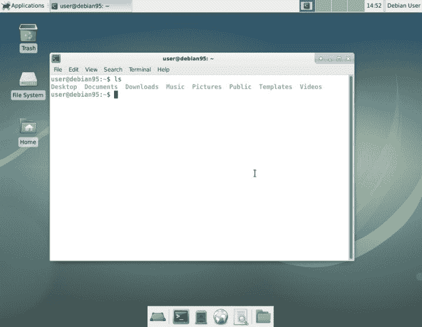

## 4.5 退出 Linux

为了正确使用 Linux，你还需要学习如何退出 Linux 以及重启系统。在下面，你将学习如何退出 XFCE 桌面环境、关闭 Linux 系统以及重启系统。我们将介绍两种方法：第一种基于图形界面，第二种也可以用于服务器和无线路由器等非图形系统。

## 退出 XFCE 桌面环境

退出 XFCE 桌面并注销当前会话的最简单方法是点击顶部导航栏右角的按钮。该按钮标记有你的用户名，在我们的案例中是`Debian User`。从弹出菜单中选择标记为`Log Out`的最后一项（见下图）。或者，你也可以从左上角的`Application`按钮或右菜单选择标记为`Log Out`的项。

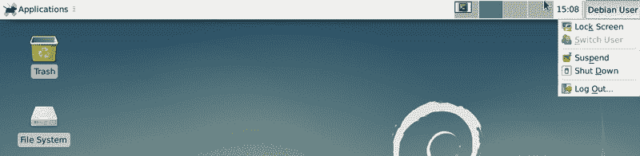

会打开另一个窗口，其中包含`Log Out`（注销）、`Restart`（重启）、`Shutdown`（关机）、`Suspend`（挂起）和`Hibernate`（休眠）五个按钮（见下图）。点击`Log Out`退出你的会话。随后你将返回登录界面。

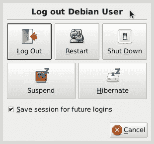

## 关闭 Linux 系统

关闭整个 Linux 系统的方法与退出 XFCE 类似。点击顶部导航栏右角的按钮。该按钮标记有你的用户名，在我们的案例中是`Debian User`。从弹出菜单（见上图）选择标记为`Shut Down`的项。在接下来的对话框中，点击标记为`Shut Down`的按钮停止 Linux 系统。

在终端会话中，你可以以管理员身份运行`halt`或`shutdown -h now`命令。普通用户不允许执行这些命令。

```bash
# halt
```

## 重启 Linux 系统

为了重启 Linux 系统，点击顶部导航栏右角的按钮。该按钮标记有你的用户名，在我们的案例中是`Debian User`。从弹出菜单中选择标记为`Restart`的项（见上图）。在接下来的对话框中，点击标记为`Restart`的按钮重启 Linux 系统。

在终端会话中，你可以以管理员身份运行命令`reboot`或`shutdown -r now`。普通用户不允许执行这些命令。

```bash
# reboot
```

随后系统将重启，你将返回启动界面。

# 5. Linux 导航

UNIX/Linux 系统上的文件系统包含不同类型的项目。这包括普通文件、目录（或文件夹）、符号链接、块设备和字符设备、命名管道和套接字。本章涉及目录以及相应的 Linux 工具。

## 5.1 文件系统层次结构标准（FHS）

现代 Linux 系统具有相当一致的目录结构，这是基于文件系统层次结构标准（FHS）。该定义规定了哪些主目录以及它们存储了哪些内容。FHS 由 Linux 基金维护。FHS 的最新版本是 3.0，于 2015 年 6 月 3 日发布。

第 3 章提到的 Linux 发行版遵循 FHS 结构。尽管如此，存在发行特定的扩展。以下是正在使用的常用目录：

| 目录 | 描述 |
| :--- | :--- |
| `/` | 主层次结构根和整个文件系统层次结构的根目录 |
| `/bin` | 所有用户所需的各种命令二进制文件 |
| `/boot` | 引导加载程序 |
| `/etc` | etcetera 的缩写，包含特定主机的系统级配置文件 |
| `/home` | 用户的家目录 |
| `/lib` | `/bin`和`/sbin`中二进制文件所需的库 |
| `/media` | 可移动式介质的挂载点 |
| `/proc` | processes 的缩写，是 Linux 内核的虚拟文件系统 |
| `/root` | root 用户的家目录 |
| `/sbin` | 关键系统二进制文件 |
| `/tmp` | 临时数据和文件 |
| `/usr` | Unix 系统资源，包含用户工具和应用程序 |
| `/var` | 可变数据，如日志文件和数据库文件 |

某些 Linux 发行版具有如`/opt`等额外目录或使用符号链接。Linux 还有一些常用的缩写，它们在日常工作中非常有帮助：

| 缩写 | 描述 |
| :--- | :--- |
| `$HOME` | 包含用户家目录的本地变量 |
| `~` | 指向用户的家目录，例如`/home/tom` |
| `.` | 指向当前目录 |
| `..` | 指向父目录 |

你可以在终端的命令行和脚本中使用这些缩写来缩短命令。接下来我们将查看其中一些命令。

## 5.2 目录命令

与文件一样，Linux 提供了一系列命令来列出、创建、删除、更改和重命名目录。你可以在终端中使用这些命令。

### 列出目录

要列出目录，使用命令`ls`并配合开关`--directory`（短`-d`）：

```bash
$ ls -d */
finances/
projects/
work/
...
$
```

此示例列出了当前目录下目录的名称。输出中的“...”表示列表较长，此处进行了缩短。若要列出包括以“.”开头的隐藏目录在内的所有目录，你可以输入如下命令：

```bash
$ find . -maxdepth 1 -type d
./projects
./.mozilla
./.ipython
./.dbus
./.video
...
$
```

要了解更多关于`ls`命令的信息并列出其他项目，请查看涵盖终端命令的第 6 章。

`tree`命令递归搜索目录并非常漂亮地输出整个目录结构。开关`-d`将输出限制为目录，如下所示：

```bash
$ tree -d
.
├── archive
│   ├── ballet-zebola
│   │   ├── documents
│   │   └── invoices
│   └── charles-darwin-university
├── projects
├── .dbus
├── .ipython
└── .mozilla
...
$
```

### 创建目录

要创建目录，使用`mkdir`命令（make directory）。下一个示例在当前目录下创建一个名为“training”的新条目：

```bash
$ mkdir training
```

开关`--verbose`（短`-v`）会打印一条命令执行成功的额外消息。

```bash
$ mkdir -v training
mkdir: directory "training" created
$
```

开关`--parents`（短`-p`）允许你创建整个子目录结构。尚未存在的父目录也会被创建。以下示例创建了目录“training”及其子目录“linux”（第 1 级）和“lpic1”（第 2 级）。

```bash
$ mkdir -p training/linux/lpic1
```

要在同一层级创建两个子目录，请利用底层命令行解释器的功能。Bash 使用括号`{}`中的值来实现这一点。下一个示例展示了你如何一次性创建`training/linux/lpic1`和`training/linux/lpic2`两个目录：

```bash
$ mkdir -p training/linux/{lpic1,lpic2}
$
```

### 删除目录

使用`rmdir`命令（remove directory）删除目录。下一个示例删除了当前目录下名为“training”的条目：

```bash
$ rmdir training
```

与`mkdir`一样，开关`--verbose`（短`-v`）会打印命令执行成功的额外消息。

```bash
$ rmdir -v training
mkdir: directory is removed, "training"
$
```

只要目录是空的，这种方法就有效。如果你的目录包含任何项目（如文件或子目录），使用`rmdir`命令会报错并保持目录不变：

```bash
$ rmdir training
rmdir: failed to remove `training`: Directory not empty
$
```

为了解决这种情况，`rm`命令（remove）结合开关`--recursive`（短`-r`）变得非常有用。此时，`rm`会递归删除所有项目。以下示例结合了`-r`和`-v`两个开关，以便删除一个文件和三个目录。

```bash
$ tree training/
training/
├── lpic1
│   └── introduction.txt
└── lpic2
2 directories, 1 file
$ rm -rv training/
"training/lpic1/introduction.txt" was removed
Directory was removed: "training/lpic1"
Directory was removed: "training/lpic2"
Directory was removed: "training/"
```

### 切换目录

`cd`（切换目录）命令允许你在系统中进行移动。要向上移动一级到父目录，请使用此命令：

```bash
$ cd ..
```

要向下进入子目录，请输入`cd`命令后紧跟目录名称。`cd /home/user/test`命令将直接带你进入`/home/user/test`目录。正如之前解释过的，有一些快捷方式可用。命令`cd ~`（波浪号）和`cd $HOME`始终会将你带回主目录，而`cd /`则将带你去`/`根目录。

**提示**：由于 Linux 是区分大小写的，因此`cd`和`CD`是不同的。在使用大写和小写字母时需要格外小心。

### 重命名目录

可以使用`mv`命令（移动）来实现。要将目录名称从“lpic1”重命名为“lpic-1”，请输入以下：

```bash
$ mv lpic1 lpic-1
```

## 5.3 基于终端的文件管理器

在命令行中导航 Linux 并不是最理想的情况。基于终端和图形化的文件管理器是极好的替代方案。基于终端的文件管理器运行在终端内部，不会在桌面上打开独立的窗口。有许多程序可用，因此我们只向你介绍我们最喜欢的几个。


### GNU Midnight Commander (mc)

[www.midnight-commander.org](http://www.midnight-commander.org)

这是一个免费的、全屏的文本模式可视化文件管理器，允许你搜索、复制、移动以及删除单个或多个文件，甚至是整个目录树。`mc` 集成了查看器和编辑器。

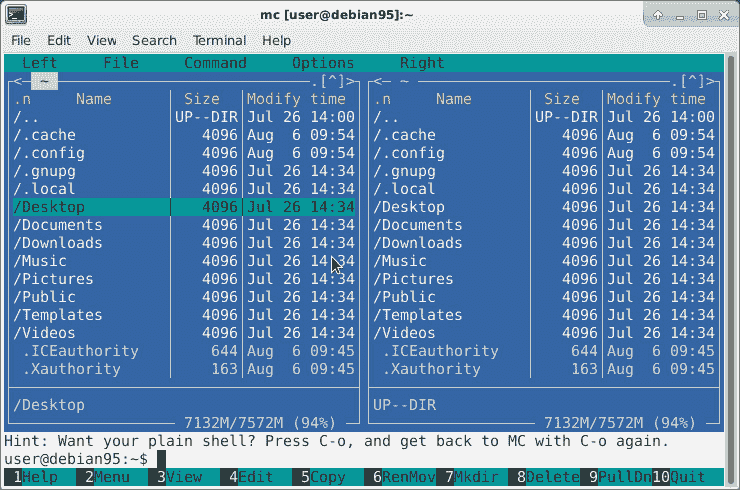

### Vi 文件管理器 (vifm)

[`vifm.info/`](https://vifm.info/)

与 `mc` 类似，Vi 文件管理器 `vifm` 带有基于 curses 界面的两个导航窗口。它为管理文件和目录提供了类似于 Vi(m) 的环境。如果你熟悉 Vi 的键位绑定，那么这个文件管理器非常适合你。

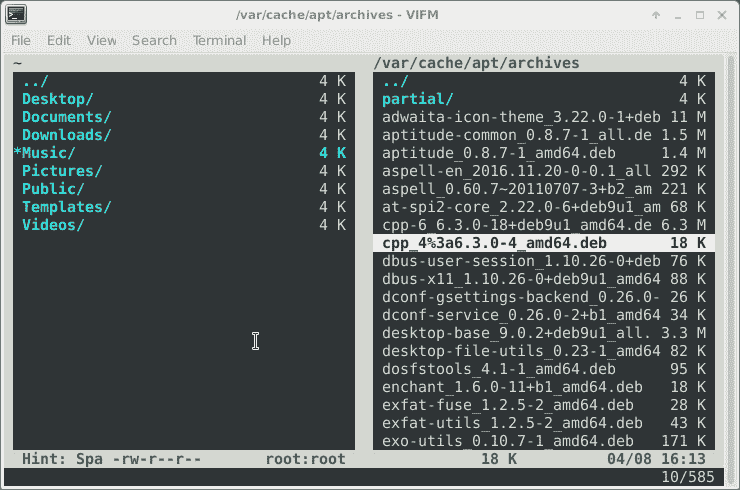

## 5.4 图形化文件管理器

与基于终端的文件管理器类似，图形文件管理器也能协助导航 Linux。这些文件管理器会在独立的窗口中打开，但提供了更好的用户体验。同样，有许多程序可用，所以我们只向你介绍我们最喜欢的几个。

### Konqueror

[`packages.debian.org/stretch/konqueror`](https://packages.debian.org/stretch/konqueror)

Konqueror 是 KDE 桌面环境的强大文件管理器。Konqueror 提供了简单的文件管理功能，如复制、移动、搜索和删除文件目录，以及一些高级功能，例如访问压缩包、浏览和刻录音频 CD，以及对访问 FTP 和 SFTP 服务器以及 SAMBA（Windows）共享的支持。

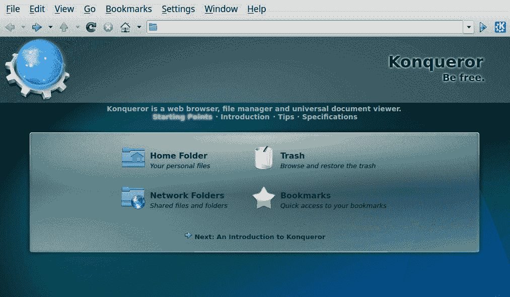

### Nautilus

[`wiki.gnome.org/Apps/Nautilus`](https://wiki.gnome.org/Apps/Nautilus)

Nautilus 是 GNOME 桌面上的文件管理器。它提供了对 Linux 系统文件的轻松导航和管理。这包括简单的文件管理功能，如复制、移动、搜索和删除文件及目录，以及轻松访问本地和远程文件。

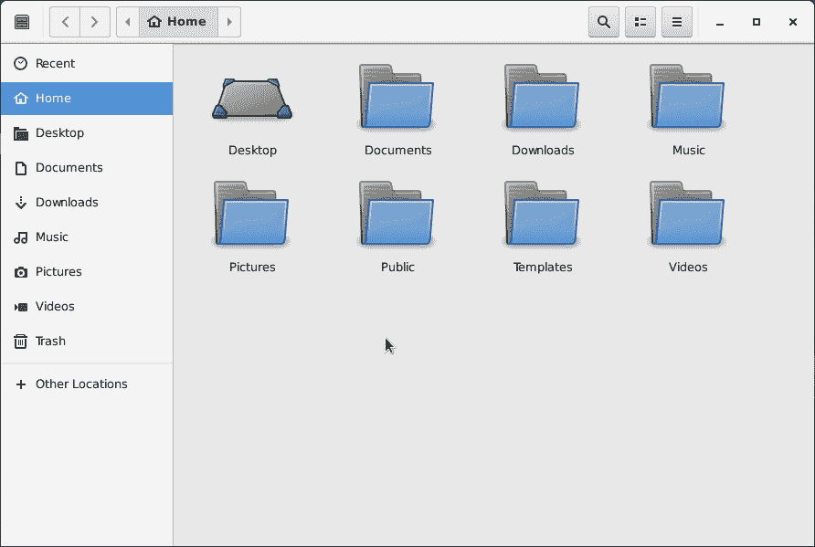

### Dolphin

[www.kde.org/applications/system/dolphin/](http://www.kde.org/applications/system/dolphin/)

Dolphin 是作为 KDE 包的一部分开发的轻量级文件管理器。它为简单、灵活和完全可定制而设计，允许用户轻松地在 Linux 系统中浏览、定位、打开、复制和移动文件。

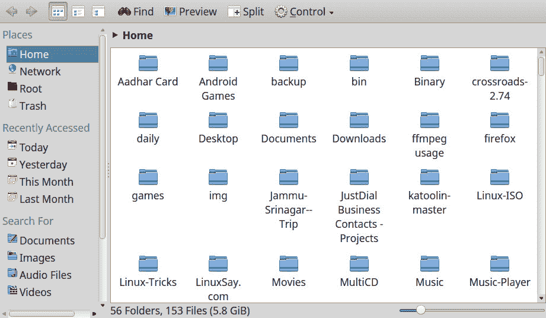

### Thunar

[`docs.xfce.org/xfce/thunar/start`](https://docs.xfce.org/xfce/thunar/start)

Thunar 是用于 XFCE 桌面的现代轻量级文件管理器。它的设计目标是快速、响应迅速且易用。我们在这里使用它是因为它的界面简洁直观，提供的用户选项较少且重要。

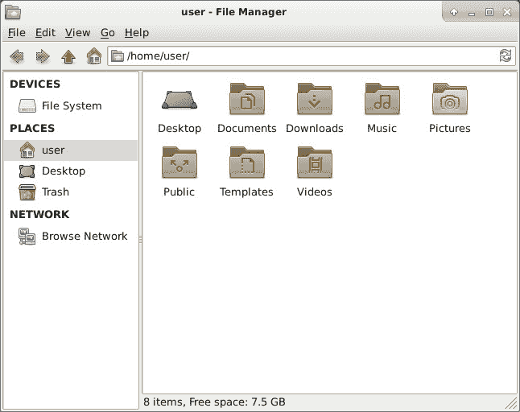

# 6. Linux 终端简介

使用 Linux 系统需要你具备终端和命令行的知识。了解这些是什么，并至少稍微熟悉它们的用法和可标准命令是非常关重要的。其中一些命令已经在第 5 章中介绍过。

## 6.1 什么是终端？

终端被描述为“一个在其他显示架构中模拟视频终端的程序”。尽管它通常与 `shell` 或文本终端同义，但终端一词涵盖了所有远程终端，包括图形界面。图形用户界面内部的终端模拟器通常被称为“终端窗口”。

准确来说，终端只是外部。终端内部运行着一个名为 `shell` 的命令行解释器。

Debian Linux 支持很长的终端软件列表。包括 `Aterm`、`GNOME terminal`、`Kterm`、`Mate Terminal`、`Rxvt`、`Xterm` 和 `Xvt`。这些不同的终端实现在稳定性、对字符集的支持、设计、颜色和字体，以及应用背景图像或处理透明度的方面有所不同。

在本书中未使用 `GNOME terminal`，因为它稳定、简单且易于调整。要增大或缩小终端窗口内显示内容的大小，请使用双键组合 `CTRL+` 和 `CTRL-`。

## 6.2 什么是 Shell？

简单来说，`shell` 是一个复杂的命令行解释器。在循环中，`shell` 读取字符，在某些条件下对其进行修改，并执行结果。

在某些条件下，在从命令行读取到执行实际结果之间，`shell` 必须解释你输入中的特殊字符。下表显示了可用的特殊字符：

| 字符 | 含义 |
| :--- | :--- |
| `$name` | 变量替换 |
| `name=` | 变量赋值 |
| `'command'` | 命令替换 |
| `$( command )` | 命令替换 |
| `< > >> 2> 2>>` | 输入和输出重定向 |
| `\|` | 命令管道 |
| `" ' \ \|` | 引用 |
| `* [ ] ?` | 创建文件名（通配符匹配） |
| `;` | 命令分隔符 |
| `&` | 在后台运行命令 |
| `\| &&` | 在特定条件下运行命令 |
| `{ } ( )` | 组合命令 |

为了方便起见，`shell` 将命令行划分为单个单词以确定命令，其过程如下所示：

| 步骤 | 描述 | 特殊字符 |
| :--- | :--- | :--- |
| 1 | 读取直到命令分隔符并进行标记（命令替换） | `\n & \|\|\| && ; $(...) \ "..." '..."` |
| 2 | 标记（输入/输出重定向，值赋值） | `< > >> 2> 2>> name=` |
| 3 | 分为单个单词 | 空格、制表符 |
| 4 | 变量替换 | `$name` |
| 5 | 命令替换 | 标记，见步骤 1 和 2 |
| 6 | 输入/输出重定向 | 标记，见步骤 1 和 2 |
| 7 | 变量赋值 | 标记，见步骤 1 和 2 |
| 8 | 划分为单词 | 基于 IFS |
| 9 | 创建文件名 | `* [ ]` |
| 10 | 命令执行 | |

在步骤 1 和 2 中，标记仅发生在步骤 5 到 7 之间，且不会发生进一步操作。如果标记完成，则执行步骤 5 到 7。接下来，`shell` 会移除所有特殊字符。在步骤 10 中，命令行仅包含执行命令所需的参数。`shell` 将第一个单词解释为要执行的命令名称，其余单词是其参数：

```bash
| command arg1 arg2 arg3 ... |
```

## 6.3 可用的 Shell

你的 Linux 系统允许使用多种 `shell`。每个 `shell` 都可以通过我们之前安装的 Debian 软件包管理器 `Aptitude` 作为独立的软件包进行安装。`shell` 的列表非常长，因此我们只列出了一些最常用的可用 `shell`：

* Almquist Shell (ash)
* Bourne Again Shell (bash)
* Debian Almquist Shell (dash)
* Z Shell (zsh)
* C Shell (csh)
* Korn Shell (ksh)
* Tenex C Shell (tcsh)

除非另有说明，本文档中的示例均基于 Bourne Again Shell (`bash`)。在编写本文档时，这是 Debian 的默认 `shell`。你的 Linux 系统允许哪些其他 `shell` 可以在配置文件 `/etc/shells` 中进行设置。使用 `cat` 命令，你可以查看到被允许的 `shell` 列表：

```bash
user@debian95:~$ cat /etc/shells
## /etc/shells: valid login shells
/bin/sh
/bin/dash
/bin/bash
/bin/rbash
/usr/bin/screen
user@debian95:~$
```

你终端中当前正在使用的 `shell` 名称存储在 `shell` 变量 `$0` 中。以下简单命令可以输出 `shell` 的名称：

```bash
user@debian95:~$ echo $0
bash
user@debian95:~$
```

为了更改当前正在使用的 `shell`，请查看后续章节介绍的 `chsh` 命令和配置文件 `/etc/passwd`。

# 7. 基础 Linux 命令

在本章中，我们将解释基础 Linux 命令，这些命令将帮助你处理文件和目录、文本处理命令、用户和用户组、进程管理、网络以及帮助系统。

## 7.1 文件和目录

### touch

`touch` 命令用于更新文件的访问日期或修改日期，它以两种方式工作：如果文件已存在，则文件的访问和修改时间戳将被设置为当前时间戳。如果文件不存在，将创建一个具有当前时间戳的空文件（见下图）。

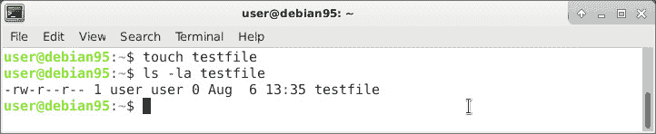

使用 `touch` 命令可以设置文件的时间戳，并判断你是否有相应的权限写入目录或整个文件系统。

### ls

此命令列出目录中的条目。下图显示了两种常用方式：不带任何选项，以及带有选项 `-la`（`-l -a` 的缩写，意味着 long all）。第一个输出仅显示普通文件的条目名称，而第二个输出列出了普通文件和隐藏条目。此外，它还显示了所有信息，如条目类型、权限、所有者名称、条目大小、访问日期和条目名称。

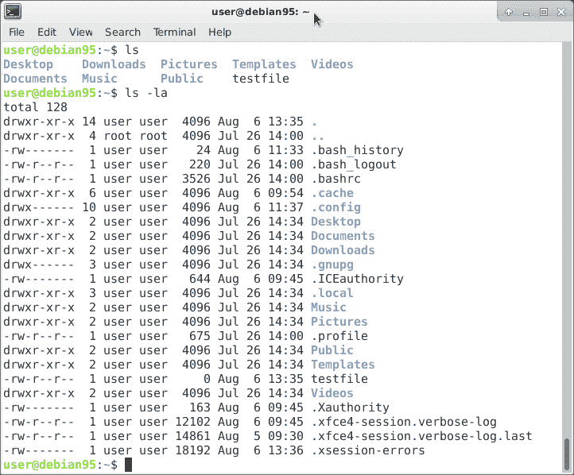

为了仅列出目录，使用选项 `-d`（`--directory` 的缩写）。

### mkdir

此命令用于创建目录（make directory）。以下示例在当前目录下创建一个名为“training”的新目录：

```bash
$ mkdir training
```

### rmdir

此命令用于删除空目录（remove directory）。以下示例删除了当前目录下一个名为“training”的空目录。

```bash
$ rmdir training
```

### rm

`rm` 命令是“remove”的缩写，用于删除文件和目录。要删除当前目录下所有以 `.txt` 结尾的文件，请执行以下命令：

```bash
$ rm *.txt
```

在删除文件和目录时为了起起见，请结合选项 `-i`（或 `--interactive`）和 `-v`（用于 `--verbose`）。在删除文件之前，`rm` 将请求你的显式确认并打印状态消息：

```bash
$ rm -iv invoice156.txt
rm: remove regular file "invoice156.txt"? y
"invoice156.txt" was deleted
```

### cp

`cp` 命令用于复制文件。

### mv

`mv` 命令是“move”的缩写，用于移动或重命名文件和目录。

### file

`file` 命令用于确定文件类型。

## 7.2 文本处理

`head` 和 `tail` 输出文件的前几行。在不带后续参数的情况下调用，它们会输出最多十行。相比之下，`tail` 执行相同的操作，但从文件末尾开始。为了输出前两行，请如下所示添加 `-n 2` 选项：

```bash
$ head -n 2 placesAmsterdamBerlin$
```

为了输出最后两行，按照同样的方法使用 `tail` 即可。与 `tac`（见本章前面的部分）不同，`tail` 不会改变输出顺序。

```bash
$ tail -n 2 placesBernCape Town$
```

`nl` 类似于 `cat`（见本章前面的部分），但会在输出的每行开头添加行号。

```bash
$ nl places1 Amsterdam2 Berlin3 Bern4 Cape Town$
```

### wc

该命令是“word count”（单词计数）的缩写，用于统计输入数据的行数、单词数和字符数。除非另有指定，将打印所有三个值：

```bash
$ wc places4 5 32 places$
```

`wc` 还提供了以下选项来限制输出：

- `-l`: 仅输出行数，后跟文件名
- `-w`: 仅输出单词数，后跟文件名
- `-c`: 仅输出字符数，后跟文件名

此示例显示了如何统计文件的行数：

```bash
$ wc -l places4 places$
```

## 7.3 用户与组

这些命令处理各种操作以管理你 Linux 系统的用户和组。除非明确说明，这些这些都可以作为普通用户运行。

### whoami

该命令如下返回你的当前用户 ID：

```bash
$ whoamiuser$
```

### users, who 和 w

`users`、`who` 和 `w` 命令显示当前登录你 Linux 系统的用户。`w` 扩展了 `who` 的输出增加了运行时间和另一个包含最后执行命令的列。相比之下，`users` 仅以空格分隔的列表形式单行输出用户名（见下图）。

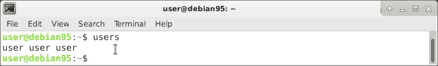

`who` 的单列以用户的登录名开始。输出随后是终端名称，其中“console”代表登录终端，“pts/1”是第一个伪终端会话的缩写。最后两列包含登录时间和用户所在的主机，在括号中（见下图）。

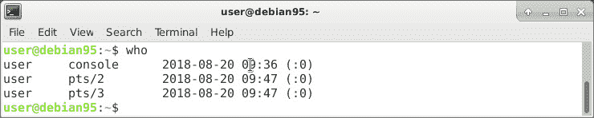

`w` 的单列包含用户的登录名（标题为 `LOGIN`）、终端名称（标题为 `TTY`）、用户所在的主机（标题为 `FROM`）、登录时间（标题为 `LOGIN@`）、活动（空闲时间和 CPU 使用率标题为 `IDLE`、`JCPU` 和 `PCPU`）以及用户执行的最后命令（标题为 `WHAT`）（见下图）。

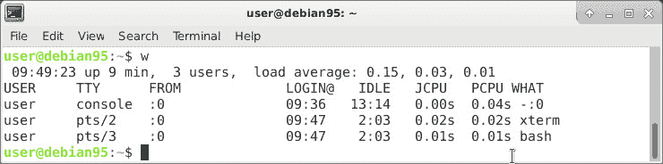

### id 和 groups

`id` 命令输出当前用户的用户和组信息（见下图）。从左到右列显示用户 ID (`uid=1000(user)`)、组 ID (`gid=1000(group)`) 以及用户所属的组名称。

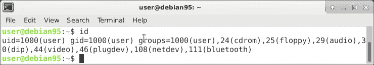

为了列出用户所属的所有组，也可以调用 `groups` 命令（见下图）。输出是空格分隔的组名列表。

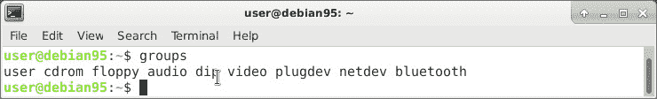

### passwd

如第 4 章所述，Linux 系统至少有两个用户：一个管理员 root 用户和一个我们简称为 `user` 的普通用户。每个账户也用密码保护。为了更改密码，请使用 Debian `passwd` 软件包中的 `passwd` 命令（参考第 4 章关于如何安装额外软件）。如下所示，先输入当前密码，按回车，输入新密码，按回车确认，再次输入新密码并按回车确认。

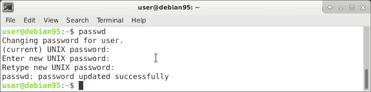

作为普通用户，你只被允许更改自己的密码。管理员 root 用户能够为自己以及其他用户设置新密码。在这种情况下，我们如下调用 `passwd`：

```bash
# passwd felix
Changing password for felix.(current) UNIX password:
Enter new UNIX password:
Retype new UNIX password:
passwd: password updated successfully
```

密码以哈希值的形式存储在配置文件 `/etc/shadow` 中。该文件的内容对管理员用户可见。下面的示例显示了如何借助 `grep` 命令（见本章前面的部分）提取用户“user”的信息。

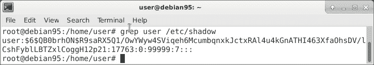

### chfn

该命令同样来自 Debian `passwd` 软件包，用于更改存储在系统文件 `/etc/passwd` 中的用户信息。在你的 Debian 系统安装期间，基础设置已经完成。为了修改这些信息，你可以在交互模式下不带后续参数运行 `chfn`，或使用以下一个或多个选项仅调整特定值：

- `-f` 或 `--full-name`: 更改用户的全名
- `-h` 或 `--home-phone`: 更改家庭电话
- `-r` 或 `--room`: 更改房间号
- `-w` 或 `--work-phone`: 更改办公电话

以下示例将家庭电话号码项改为 135：

```bash
$ chfn -h 135Password:$
```

### chsh

该命令（同样来自 Debian `passwd` 软件包）更改你登录 Linux 系统时使用的 `shell` 条目。同样，这些信息存储在 `/etc/passwd` 文件中。允许使用的 `shell` 受配置文件 `/etc/shells` 中的条目。`chsh` 的工作与 `chfn` 命令类似。不带后续选项调用时，将使用交互方法（见下图）。

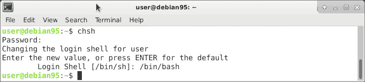

`chsh` 接受选项 `-s`（`--shell` 的缩写）以便在非交互模式下设置 `shell`。以下示例显示了相应的命令行调用：

```bash
$ chsh -s /bin/bash
```

为了修改你之外其他用户的 `shell`，请将用户名作为参数调用 `chsh` 命令。注意，只有管理员才能为其他用户执行此操作。下一个示例显示了如何为用户“felix”操作：

```bash
# chsh felix
Changing the login shell for felix
Enter the new value, or press ENTER for the new value
Login shell [/bin/bash]:#
```

### su 和 sudo

为了从一个用户切换到另一个，你使用 `su` 命令。`su` 是“switch user”（切换用户）的缩写。在不带后续选项的情况下，你如下切换到 root 用户：

```bash
$ suPassword:#
```

作为管理员 root 用户工作意味着巨大的责任，并假设你完全清楚自己在做什么。要以 root 不同的用户身份工作，如下使用所需的用户名调用 `su` 命令：

```bash
$ su felixPassword:$
```


`su`命令永久更改当前角色。若要以管理员身份运行单个命令，请使用`sudo`命令。这需要安装 Debian 的“sudo”软件包（请参阅第 4 节“安装额外软件”），并使用`visudo`命令将额外用户添加到配置文件`/etc/sudoers`中。这一步将在稍后进行详细解释。

## `adduser`

`adduser`命令用于创建新用户账户。下图显示了所需的信息。这包括在`/etc/passwd`文件中添加一个新条目，以及创建一个新组和主目录。此外，来自`/etc/skel`目录的预备数据会被复制到之前创建的主目录中。之后，可以使用`chsh`命令修改账户信息（参见本章前面的内容）。

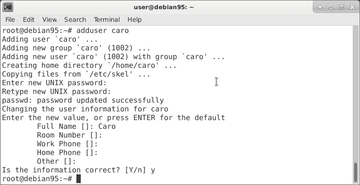

设置好新用户后，`/etc/passwd`文件中的条目如下：

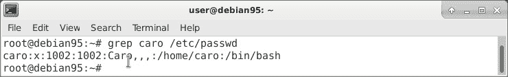

删除用户账户和修改用户账户通过`deluser`和`usermod`两个命令完成。这些命令用法将在稍后进行详细解释。

## 进程管理

### `ps`

该命令列出 Linux 系统中运行的进程。下图显示了你当前终端会话中的进程，其中调用`ps ax`（见随后的图像）列出了 Linux 系统中的所有进程。`ps`命令有一长系列选项，将在稍后进行更详细解释。

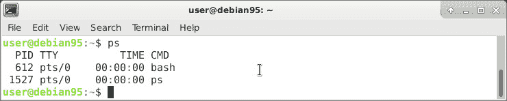

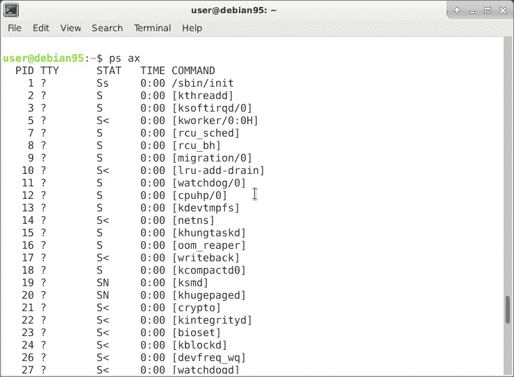

### `pgrep`

`pgrep`是用于进程的`grep`命令（参见本章前面的内容）。该命令遍历当前运行的进程，并输出匹配给定模式的进程 ID。

下图显示了两次调用。第一次请求`pgrep`搜索名称中包含“xterm”字符串模式的进程，并仅输出结果进程 ID。第二次调用使用了`-l`（`--list-name`的缩写）和`-a`（`--list-full`的缩写）两个选项，以便显示进程 ID 和结果进程名。

`pgrep`的伙伴是`pkill`。这两个命令都是 Debian “procps”软件包的一部分（请参阅第 4 节“如何安装额外软件包”）。

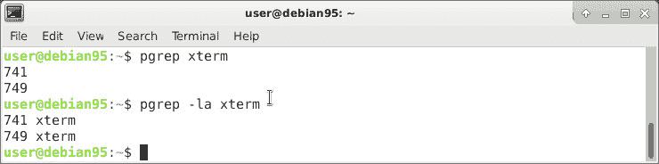

### `kill`

该命令向进程发送特定信号。要终止此进程，请使用`SIGTERM`信号。下一个示例显示了如何结束 ID 为 12345 的进程。

`kill`命令需要进程 ID 才能正常工作。请先使用`ps`或`pgrep`获取相应的进程 ID（参见本章前面的内容）。

```bash
$ kill 12345
```

### `killall`

该命令是 Debian 基本软件包“psmisc”的一部分（请参阅第 4 节“安装额外软件包”）。`killall`向所有匹配指定命令的进程发送信号。例如，命令

```bash
killall firefox
```

向所有名为“firefox”的进程发送`SIGTERM`信号以终止进程。除其他选项外，`killall`还允许这些参数：

- `-e`（`--exact`的缩写）：要求精确匹配
- `-I`（`--ignore-case`的缩写）：处理进程名时不区分大小写
- `-i`（`--interactive`的缩写）：在终止进程前交互式请求确认
- `-v`（`--verbose`的缩写）：如果进程终止，则发送确认消息

接下来的示例显示了如何结合`pgrep`和`killall`两个命令。首先，使用`pgrep`获取进程 ID 以及进程的精确名称。其次，带有`-i`和`-v`选项调用`killall`以终止所有该名称的进程。在杀死进程之前，`killall`会要求你确认，并在之后输出确认消息。

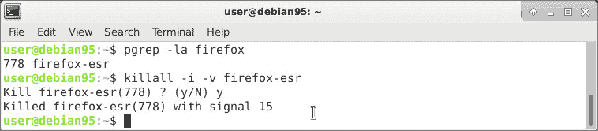

### `pkill`

`pkill`和`pgrep`（参见本章前面的内容）两个命令属于同一个软件包。`pgrep`扫描进程列表并输出进程 ID，而`pkill`命令向匹配给定模式的进程发送终止信号。要终止所有“xterm”进程，请调用以下命令：

```bash
$ pkill xterm
```

### `top`

`top`命令根据活动情况显示进程。最活跃的进程位于顶部，随后是不活跃的进程。列表每秒更新一次。单列包含进程 ID（标题为`PID`）、进程所有者的用户名（标题为`USER`）、进程优先级（标题为`PR`）、nice 值（标题为`NI`）、虚拟内存使用（标题为`VIRT`）、预留内存（标题为`RES`）、共享内存（标题为`SHR`）、CPU 和内存使用的百分比（标题为`%CPU`和`%MEM`）、进程的运行时间（标题为`TIME+`）以及调用进程的命令（标题为`COMMAND`）。

要退出`top`请按`q`键。

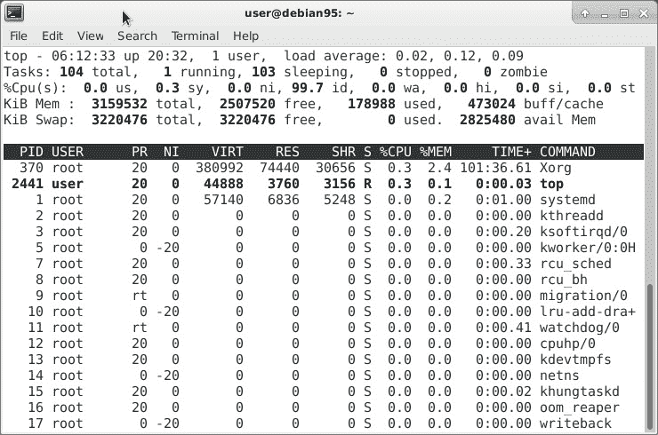

### `htop`

“htop”是一个额外的软件包（请参阅第 4 节“安装额外软件包”），包含一个更具交互性的`top`版本（我们在上面提到过）。列的布局与`top`类似。使用导航键和功能键来选择、排序或删除进程。功能键如下：

- `F1`：显示帮助
- `F2`：配置 htop
- `F3`：在进程列表中搜索
- `F4`：过滤终端输出
- `F5`：以进程树的形式显示进程
- `F6`：更改进程的排序顺序
- `F7`：降低选中进程的 nice 值
- `F8`：增加选中进程的 nice 值
- `F9`：终止选中进程
- `F10`：退出程序

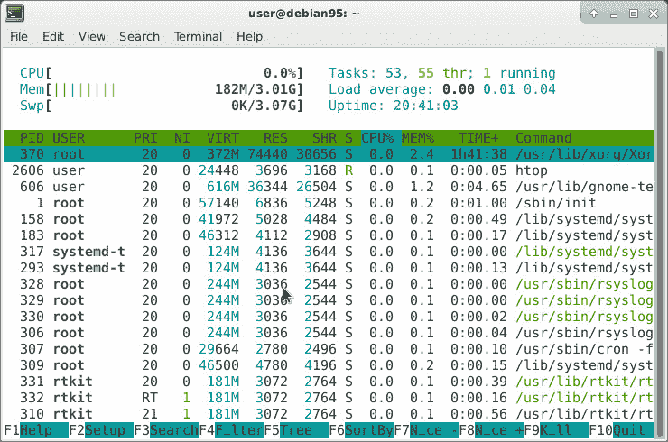

## 网络和系统信息

### `uname`

`uname`是“UNIX name”的缩写。该命令显示系统信息，例如 Linux 内核的准确名称和版本以及你计算机的主机名。

下图显示了带有参数`-a`（`--all`的缩写）的`uname`调用。输出包含操作系统（Linux）、主机名（debian95）、内核版本及其编译日期（4.9.8-7-amd64 #1 SMP Debian 4.9.110-1 (2018-07-05））以及架构（x86_64）。

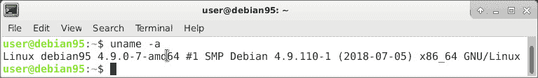

### `uptime`

该命令显示系统运行了多久。它显示当前时间（07:36:47），随后是以小时计算的运行时间（21:56）、登录用户数（1 user）以及过去 1、5 和 15 分钟的平均负载（load average: 0.47, 0.43, 0.29）。

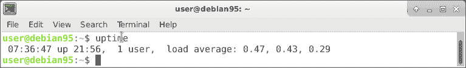

为了以更漂亮的方式查看运行时间，请使用选项`-p`（`--pretty`的缩写）。下图显示了更易读的信息版本。系统已运行了 22 小时 3 分钟。

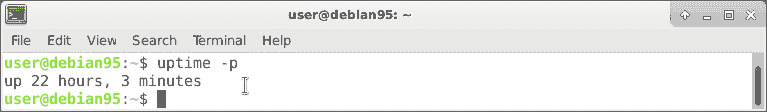

### `ip`

`ip`命令（配合关键词`address show`）显示当前的网络配置。下图显示了环回接口（`lo`）和以太网接口（`enp0s3`）。以太网接口配置了 IP 地址`10.0.2.15`。网络接口缩写如下：

- `lo`：环回接口。用于访问本地代理或 Web 服务器 http://127.0.0.1/
- `eth0`：连接到网络交换机或路由器的第一个以太网接口
- `wlan0`：第一个无线接口
- `ppp0`：第一个点对点接口，用于通过 VPN 或拨号服务连接

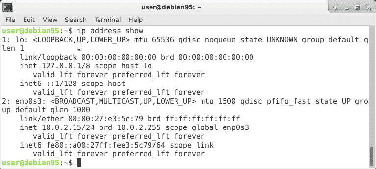

`ping`命令向给定的 IP 地址或主机发送 ICMP 网络包，并显示往返时间。下图展示了针对主机[`www.google.com`](http://www.google.com)的操作。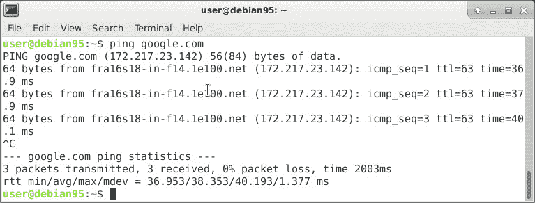

## 获取帮助

UNIX/Linux 是一个相当复杂的操作系统，特别是对于初学者来说。当你开始学习时，程序列表可能会让你非常困惑。每个程序的参数或选项列表都比上一个长。而且它们并不容易记忆，有长短名称，且没有标准化。在遇到困难时寻求帮助并不是错误，也不是知识匮乏的表现。

为了在你的 Linux 系统上获取帮助，有几种方法。这包括手册页（称为 man pages）、信息页（称为 info pages）以及每个命令内置的帮助。在本章中，我们将仔细查看这些帮助系统，并熟悉`man`、`info`、`whereis`和`whatis`命令。

### Man 手页

Man 手页是分发程序文档的传统方式。“man page”一词是“manual page”（手册页）的缩写，对应于打印版手册的页面。Man 手页是你 Linux 系统基础安装的一部分。相应的 Debian 软件包名为“manpages”。

一个 man 手页对应于完整 UNIX 手册中的特定章节：1 代表命令，2 代表系统调用，等。要获取有关特定命令的信息，请在终端窗口中打开相应的 man 手页。例如，对于`cp`命令，操作如下：

```bash
$ man cp
```

生成的 man 手页如下所示：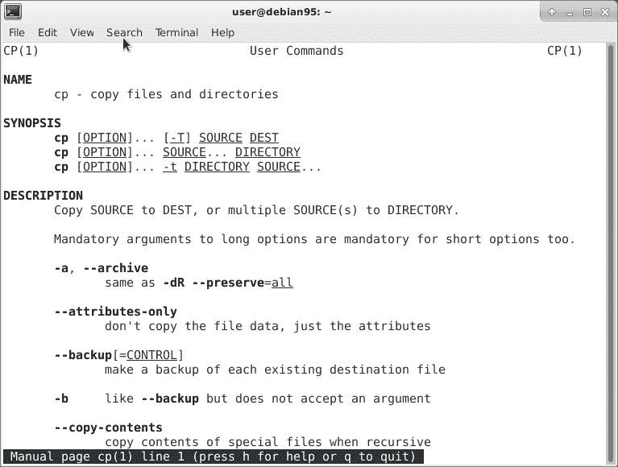快捷键绑定与文本编辑器`vi(m)`类似。使用方向键向上向下滚动，使用`q`退出 man 手页并返回终端。

### Info 页

Info 是 GNU 项目内部文档的默认格式。在 20 世纪 90 年代初，GNU 项目认为 man 文档系统已经过时，并编写了`info`命令来取代它。`info`具有基础的超链接功能，并使用了一种更简单的标记语言（与用于 man 页的`troff`系统相比）。如今，这两个系统并存存在。

Debian 的基础安装不包含 info 页。为了使用它，请安装后安装名为“info”的软件包（参考第 4 章关于如何安装额外软件包）。要获取有关特定命令的信息，请在终端窗口中打开相应的 info 页。例如，对于`cp`命令，操作如下：

```bash
$ info cp
```

生成的 info 页如下所示：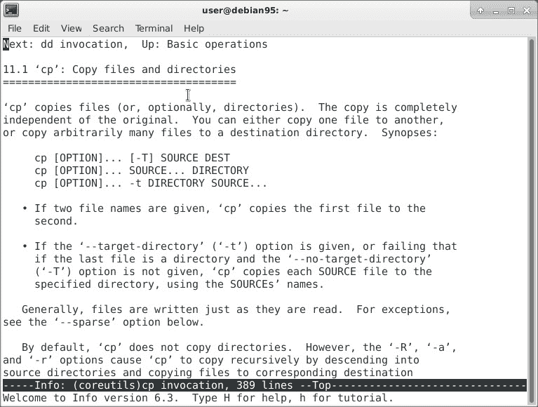

### 内置帮助

除了 man 和 info 页外，许多命令都有`-h`选项（`--help`的缩写）。使用此选项调用命令会打开一个特定的帮助部分。下图显示了`uname`命令的内置帮助。

此外，`whatis`命令有助于获取 Linux 命令或函数的简要信息。它会为与命令行参数传递给`whatis`命令的字符串匹配的命令显示单行 man 手页描述。

`whatis`命令在其索引数据库中搜索该字符串（该数据库由`mandb`程序维护），并从该命令 man 手页的 NAME 部分选取简短描述。下图展示了`mv`和`man`两个命令的情况。

另一个选项是`whereis`命令，它有助于在 Linux 系统中定位命令的手册页。这是一个非常简单的实用程序。下图展示了`mv`和`man`两个命令的情况

每个命令还提供了额外的信息和配置示例。这些内容存储在`/usr/share/doc`目录下，每个程序都有自己的子目录。内容是标准化的，且因程序而异。每个用户都可以访问这些内容。下方显示目录片段

### 外部帮助

如果软件工具提供的帮助不足，需要进一步的解释，则需要用到外部资源。可以咨询几个在线社区，例如：

* LinuxHint - [`support.linuxhint.com`](https://support.linuxhint.com)
* LinuxHelp - [`www.linuxhelp.com`](https://www.linuxhelp.com)

另一个选项是 Linux 用户组 (LUG)。LUG 是由来自同一地区、对 Linux 操作系统有共同兴趣的人组成的群体。他们被组织为松散关联的人群或定期聚会的协会。全球 LUG 的完整列表可以在 LugsList 获取：[`lugslist.com`](http://lugslist.com)!!

许多 LUG 组织聚会和活动，以分享想法、交流经验并相互学习。这包括本地和国际活动。

## 延伸阅读

关于 Linux 的进一步阅读，请务必关注我们的指南 [Linux: System Administration and Practical Management Guidelines](https://www.amazon.com/dp/1085961540)。系统管理是 Linux 一个不可避免的方面。即使出现了像 Ubuntu 和 Mint 等用户友好的发行版，仍然需要大量的用户配置来保持 Linux 日常运行。本书的编写旨在引导你应对大多数遇到的场景，无论你是系统管理的新手还是维护系统多年的专家。

在书中，我们将详细查看用户和组的管理，研究如何创建一个更安全、更受威胁的系统，并深入探讨文件系统和存储分区的各个方面。我们还讨论了特定主题，如处理硬链接和软链接、充分利用文本处理、包管理和架构、利用共享库、通过进程优化系统，以及每个精通的 Linux 用户和管理员需要了解的其他主题。

## 关于作者

Nathan Clark 是一位资深程序员，在软件行业拥有近 20 年的经验。他拥有麻省理工硕士学位，曾在美国一些领先的软件公司工作过，积累了丰富的软件设计和开发知识。

Nathan 和他的妻子 Sarah 于 2009 年创立了自己的开发公司，以便承担更具挑战性和创造力的项目。如今，他们为来自全球的高端客户提供服务。Nathan 喜欢通过他的系列书籍分享编程知识，为客户开发创新的软件解决方案，并在空闲时间观看经典的科幻电影。
