# LINUX：安装、配置与使用指南


Michael Kofler 已根据 1988 年《著作权、设计与专利法》主张其作为本作品作者的身份权利。

# 前言

`Linux` 是一个完全不可置信的操作系统。它的诞生是不可思议的：`Linux` —— 一个完整的、兼容 `UNIX` 的操作系统 —— 并非由一个庞大的软件帝国开发，而是大量计算机极客（由 `Linus Torvalds` 领导）多年来共同合作的成果。

它的价格也令人不可置信：`Linux` 是免费的，并随本书一起以 `CD` 光发行！“免费”既指价格免费，也指源代码的可获得性。

如果你对 `Linux` 不满意，你可以（如果你足够熟悉编程的话）尝试自己解决你的特定问题。

它的文档和支持也是令人不可置信的：虽然在免费系统中显然无法提供纸质版文档（某些发行版附带的安装手册除外），但有大量的文档描述了 `Linux` 使用的几乎每一个方面。尽管如此，如果你仍然遇到问题或发现错误，你可以向任何一个 `Linux` 新闻组提问，并且很有可能在几天内（有时是几小时内）收到回复。

`Linux` 起初是电脑发烧爱好者的玩具，但今天这种情况已完全改变了：`Linux` 已经成为 `PC` 上主要的 `UNIX` 平台。全球范围内越来越多的 `Web` 服务器在 `Linux` 下运行。每周都有移植到 `Linux` 的商业程序在增加。某些 `Linux` 发行版已获得 `POSIX` 认证。商业发行版（如 `Linux Caldera`）让 `Linux` 对专业用户来说比以往任何时候都更有趣。

# 为什么选择这本书？

本书旨在为读者提供关于处理 `Linux` 的熟练介绍——从安装、使用到简单编程。这本书将有助于你尽快熟悉 `Linux`，而无需在安装问题或搜索在线文档上浪费时间。同时，它展示了 `Linux` 和 `UNIX` 最相关的特性，以便你可以理解你的 `Linux` 系统，并能够根据自己的需求对其进行配置。

# `vi` 前言

我们必须小心，不要产生过高的期望：这本书显然无法涵盖 `LINUX` 的每一个方面 —— 即使是十本这种大小的书也无法完成这项任务。然而，我们涵盖的话题——无论是如何使用 `shell` (`bash`) 还是如何将计算机连接到互联网——描述都具有足够的深度，让你能够有效地使用 `LINUX` 及其程序。与其提供运行在 `LINUX` 下的许多程序的浅表列表，你将获得对主要组件的详细描述。

书中附带的 `CD` 包含一个完整的 `LINUX` 系统，包括最重要的应用程序（它是 `RedHat` 发行版的最新版本）。要安装它，你只需要一台带有 `CD-ROM` 驱动器的 `PC`。安装和配置的细节在书的第一部分进行了详细描述。

# 与 `Linux` 走向未来！

- 如果你需要一个高性价比的互联网入口或一个稳定的网络服务器，
- 如果你不再希望受命于大型软件公司的摆布（通常是后者），
- 如果稳定性和数据安全对你来说比色彩纷呈的图标更，
- 如果你想探究自己操作系统的内部，
- 如果你想在最多样的语言（从 `C++` 到 `Smalltalk`）中积累经验，那么 `LINUX` 适合你。

`Michael Kofler` <`kofler@linux.de`>

# 致谢

我要感谢 `RedHat` 的 `Marc Ewing` 和 `Bob Young`，他们的优秀发行版可以作为基础。非常感谢 `Mathias Dümler`、`Jochen Hein`、`Eberhard Mönke`、`Thomas Ploss`、`Sven Probst`、`Joachim vom Stein` 以及提供建议、指出错误并帮助本书的人。

# 第一部分 安装 1

## 1 关于 `Linux` 3

### 1.1 什么是 `Linux`？3

### 1.2 `Linux` 提供了什么？5

### 1.3 发行版 9

### 1.4 `Linux` 的起源 12

## 2 安装 15

### 2.1 要求 15

### 2.2 安装流程概述 16

### 2.3 在 `DOS` 下重新分区 19

### 2.4 安装盘、引导内核 28

### 2.5 创建 `Linux` 分区 33

### 2.6 通过 `NFS` 安装 `Linux` 43

# `Linux` 快速上手 59

### 3.1 从 `DOS` 到 `Linux` 59

### 3.2 显示和编辑文本文件 63

# 4 在线文档 67

# 第二部分 配置 83

# 5 `Linux` 基础 85

### 5.2 文件系统内部

### 5.3 进程管理

### 5.4 库

### 5.5 系统启动

# 6 配置与管理

### 6.1 基础配置

### 6.2 用户注册与密码

### 6.3 文件系统管理

### 6.4 打印机配置

## 6.5 网络配置 150

## 6.6 启动过程 160

## 6.7 编译内核 173

# 7 配置 `X` 窗口系统 185

## 7.1 配置 `X` 服务 185

## 7.2 `X` 下的鼠标和键盘 204

## 7.3 窗口管理器 210

## 7.4 `X` 资源 226

# 第三部分 应用 229

# 8 `bash` - 一种现代命令解释器 231

### 8.3 输入重定向 236

### 8.4 命令执行 238

### 8.5 替换 240

# 9 命令参考 249

# 10 工具 303

# 11 `Emacs` - 所有编辑器 331

- 菜单 336
- 版本 336
- 覆盖文本 341
- 替换 347

# 12 `LaTeX 2` 363

希腊字母与手写字母 395

处理长文本 405

## 13 使用 `Linux` 接入 409

- `PPP` 430

## `xvi` 目录

- 13.5 世界维员网 (`WWW`) 438
    - 引言 438
- 13.6 文件传输协议 (`FTP`) 445
    - `Off`线阅读 `Usenet` 新闻的配置 481

## 第四部分编程 497

## 14 `bash` 编程 499

## 15 `X` 下的 `Tcl/Tk` 编程 537

- `tcl` 和 `wish` 解释器的实验 538
- `Tcl/Tk` 扩展 541
- 15.2 `Tcl` 语言元素 543
- 替换机制 544
- 对话元素之间的通信 570
- 列表处理 571
- 选项处理 572
- `Tk` 程序中的用户自定义菜单 573
- 15.5 对话元素参考 575

## 16 `Emacs Lisp` 编程 583

- 16.3 用户自定义快捷键 586

## 附录 `A` `RedHat` 4.1 603

## 附录 `B` `Caldera` 网络安装桌面 1.0 622

- 配置 624
- 内核更新到版本 2.0 628

## 附录 `C` `Slackware` 3.1 629

- 包 632
- 配置 632
- 包管理 (`setup`, `pkgtool`) 633

## 附录 `D` `SuSE` 4.4 635

## 附录 `E` 更新 643

- `LINUX` 和 `Windows NT` 4.0 643

## 索引 661

## 本书结构

第一部分首先回答了关于 `LINUX` 的基本问题：什么是 `LINUX`？它是如何产生的？什么是发行版？第二章解释了 `LINUX` 的安装。（关于如何安装登录、`Slack` 和 `SuSE` 发行版的详细信息请见附录 `A` 到 `D`。）第三章提供了运行 `LINUX` 系统的快速上手指南：登录、注销、关、文件处理、显示和编辑文件等。第四章在你开始接触 `LINUX` 时也非常有用：它描述了在哪里可以找到关于 `Linux` 的在线文档。

## 本书结构

## 本书中没有的内容

## 图标


## 第一部分

# 关于 `LINUX`

## 内核

# 1.2 什么是 `LINUX`？

“`LINUX` 是什么？”这个问题尚未得到完全解答。许多用户对内核本身并不感兴趣——只要它能运行并支持现有的硬件即可。对于这些用户来说，日常语言中的“`LINUX`”一词除了内核之外，还包含了以发行版形式（见下节）随 `LINUX` 内核一起提供的庞大程序包。

本节将概述 `LINUX` 最重要的特征以及可用的应用程序。理而然，这个概述并不完全——因为列出所有在 `LINUX` 下运行的程序几乎没有意义。

# 内核 2.0


- `LINUX` 支持用于执行二进制文件的几种二进制格式：`a.out`（1.0 版本及之前的标准）、`ELF`（1.2 版本以来的标准）和 `iBCS2`。`iBCS2` 允许你使用许多适用于 `SCO Unix` 的可用商业程序，而无需重新编译或移植到 `LINUX`。


# 关于 `LINUX`


# X 窗口系统

# 工具

# 文本处理与格式化

# 网络软件

# 编程

# 模拟器

## 文档

# 其他


# 关于 `LINUX`


# 发行版

发行版之间的区别主要体现在两个方面：


## 当前的一些 `LINUX` 发行版


## 发行版 11

## `Debian`

## `Caldera`

## `LST`

## `RedHat`


# 12 关于 Linux

### Linux

## 1.4 Linux 的起源

`Linux` 是一个非常年轻的操作系统。第一个内核部分（版本 `0.01`）是由 `Linus Torvalds`（来自赫尔辛基）独立开发的。他于 `1991` 年 `9` 月在互联网上发布了程序代码。在很短的时间内，全球的程序员对这个想法产生了兴趣，并开始为它编写扩展：更好的文件管理系统、各种硬件组件的驱动程序、额外的程序（如 `DOS` 模拟器）等。

## 法律事项 - 通用公共许可证 (GPL)

## 安装

## 2.1 要求


# 16 安装

- 如果发生硬件问题，你需要对你的电脑硬件有相当详细的了解。通常，安装失败仅仅是因为安装程序无法识别特定的组件。手动输入硬件可能会解决这个问题（如果 `LINUX` 主要支持该硬件）。你将需要中断地址和 `I/O` 地址（例如你的以太网卡的地址）。

- 在安装过程中，会生成一张启动软盘，你稍后可以用它重启电脑。对于这一步骤，你需要一张空白且格式化过的软盘。

`LINUX` 尚未识别的硬件组件的常见来源。旧式硬件有时也有它的优势！在购买新硬件甚至新电脑之前，你应该检查这些硬件是否已被 `LINUX` 支持。要做到这一点，请阅读附带 `CD-ROM` 中的 `hardware-HOWTO` 文件（见第 `4` 章从第 `67` 页开始）。对于硬件，查看 `CDROM-HOWTO`、`Ethernet-HOWTO`、`PCI-HOWTO` 和 `SCSI-HOWTO` 可能会有用。关于安装本身的信息可以在 `Installation-HOWTO` 和 `UMDOS-HOWTO` 中找到。


## 2.2 安装过程概述

正常的 `LINUX` 安装遵循所示步骤（按顺序。“正常”意味着你的电脑已经安装了操作系统（`DOS`、`Windows`、`OS/2`），并且要在该操作系统之外安装 `LINUX`。安装的目标是让现有系统保持可用。成功安装后，你可以在启动时选择使用 `LINUX` 还是使用原来的操作系统启动电脑。

如果在电脑上已经有了之前的 `LINUX` 安装，整个安装过程将简单得多（见第 `57` 页）。其他变体包括从硬盘安装（如果在安装过程中访问 `CD-ROM` 驱动器出现问题，请见第 `52` 页）或通过网络安装（见第 `43` 页）。

- 在 `DOS`/`Windows` 下启动电脑。此时，你可以阅读 `CD-ROM` 上的在线文档（见第 `57` 页）。

- 如果在电脑上已经有了之前的 `LINUX` 安装，整个安装过程将简单得多（见第 `57` 页）。其他变体包括从硬盘安装（如果在安装过程中访问 `CD-ROM` 驱动器出现问题，请见第 `52` 页）或通过网络安装（见第 `43` 页）。

- 在 `DOS`/`Windows` 下启动电脑。此时，你可以阅读 `CD-ROM` 上的在线文档（见第 `57` 页）。

- 如果在电脑上已经有了之前的 `LINUX` 安装，整个安装过程将简单得多（见第 `57` 页）。其他变体包括从硬盘安装（如果在安装过程中访问 `CD-ROM` 驱动器出现问题，请见第 `52` 页）或通过网络安装（见第 `43` 页）。

- 在 `DOS`/`Windows` 下启动电脑。此时，你可以阅读 `CD-ROM` 上的在线文档（见第 `57` 页）。

- 如果在电脑上已经有了之前的 `LINUX` 安装，整个安装过程将简单得多（见第 `57` 页）。其他变体包括从硬盘安装（如果在安装过程中访问 `CD-ROM` 驱动器出现问题，请见第 `52` 页）或通过网络安装（见第 `43` 页）。

- 在 `DOS`/`Windows` 下启动电脑。此时，你可以阅读 `CD-ROM` 上的在线文档（见第 `57` 页）。

- 如果在电脑上已经有了之前的 `LINUX` 安装，整个安装过程将简单得多（见第 `57` 页）。其他变体包括从硬盘安装（如果在安装过程中访问 `CD-ROM` 驱动器出现问题，请见第 `52` 页）或通过网络安装（见第 `43` 页）。

- 在 `DOS`/`Windows` 下启动电脑。此时，你可以阅读 `CD-ROM` 上的在线文档（见第 `57` 页）。

- 如果在电脑上已经有了之前的 `LINUX` 安装，整个安装过程将简单得多（见第 `57` 页）。其他变体包括从硬盘安装（如果在安装过程中访问 `CD-ROM` 驱动器出现问题，请见第 `52` 页）或通过网络安装（见第 `43` 页）。

- 在 `DOS`/`Windows` 下启动电脑。此时，你可以阅读 `CD-ROM` 上的在线文档（见第 `57` 页）。

- 如果在电脑上已经有了之前的 `LINUX` 安装，整个安装过程将简单得多（见第 `57` 页）。其他变体包括从硬盘安装（如果在安装过程中访问 `CD-ROM` 驱动器出现问题，请见第 `52` 页）或通过网络安装（见第 `43` 页）。

- 在 `DOS`/`Windows` 下启动电脑。此时，你可以阅读 `CD-ROM` 上的在线文档（见第 `57` 页）。

- 如果在电脑上已经有了之前的 `LINUX` 安装，整个安装过程将简单得多（见第 `57` 页）。其他变体包括从硬盘安装（如果在安装过程中访问 `CD-ROM` 驱动器出现问题，请见第 `52` 页）或通过网络安装（见第 `43` 页）。

- 在 `DOS`/`Windows` 下启动电脑。此时，你可以阅读 `CD-ROM` 上的在线文档（见第 `57` 页）。

- 如果在电脑上已经有了之前的 `LINUX` 安装，整个安装过程将简单得多（见第 `57` 页）。其他变体包括从硬盘安装（如果在安装过程中访问 `CD-ROM` 驱动器出现问题，请见第 `52` 页）或通过网络安装（见第 `43` 页）。

- 在 `DOS`/`Windows` 下启动电脑。此时，你可以阅读 `CD-ROM` 上的在线文档（见第 `57` 页）。

- 如果在电脑上已经有了之前的 `LINUX` 安装，整个安装过程将简单得多（见第 `57` 页）。其他变体包括从硬盘安装（如果在安装过程中访问 `CD-ROM` 驱动器出现问题，请见第 `52` 页）或通过网络安装（见第 `43` 页）。

- 在 `DOS`/`Windows` 下启动电脑。此时，你可以阅读 `CD-ROM` 上的在线文档（见第 `57` 页）。

- 如果在电脑上已经有了之前的 `LINUX` 安装，整个安装过程将简单得多（见第 `57` 页）。其他变体包括从硬盘安装（如果在安装过程中访问 `CD-ROM` 驱动器出现问题，请见第 `52` 页）或通过网络安装（见第 `43` 页）。

- 在 `DOS`/`Windows` 下启动电脑。此时，你可以阅读 `CD-ROM` 上的在线文档（见第 `57` 页）。


# 18 安装

- 安装中的一个基本步骤是在硬盘上生成分区。
- 本章还解释了`Umsdos`的安装，它可以避免重新划分分区（但也有许多其他缺点）。（第33 页）

## 硬件需求

- 你需要在硬盘上有一个具有足够空间的空闲分区；150 Mbytes 对于首次安装是合理的，并能为你自己的文件留出足够的空间。如果真的必要，最小安装可以仅占用 (!) 15 到 25 Mbytes。理想情况下，应该有 300 到 500 Mbytes 的可用空间 —— 这没有上限。这对于你想用`LINUX`进行编程、尝试提供的大量`LINUX`应用程序，或将`LINUX`作为网络服务器运行等情况尤为适用。
- 你需要被`Linux`识别并支持的硬件组件。目前，大多数主板（包括`PCI`）、普通的软磁盘和硬盘驱动（`IDE/EIDE`总线）、大多数`SCSI`卡和连接设备、大多数`CD-ROM`驱动器、许多光驱以及许多网卡和显卡都是如此。
- 如果你想舒适地使用`X Window`系统，你需要一个三个 (!) 按钮的鼠标，但中键在`X`环境下起着重要作用。（在双键鼠标上，可以同时按下两个键来模拟缺失的第三个键，但这相当笨拙。）
- 如果发生硬件问题，你需要对你的电脑硬件有相当详细的了解。通常，安装失败仅仅是因为安装程序无法识别特定的组件。手动输入硬件可能会解决这个问题（如果`LINUX`主要支持该硬件）。你将需要中断地址和`I/O`地址（例如你的以太网卡的地址）。

## 安装介质与文档

- 在`DOS/Windows`下启动电脑。此时，你可以阅读`CD-ROM`上的在线文档（见第 57 页）。
- 如果在电脑上已经有了之前的`LINUX`安装，整个安装过程将简单得多（见第 57 页）。其他变体包括从硬盘安装（如果在安装过程中访问`CD-ROM`驱动器出现问题，请见第 52 页）或通过网络安装（见第 43 页）。
- 在安装过程中，会生成一张启动软盘，你稍后可以用它重启电脑。对于这一步骤，你需要一张空白且格式化过的软盘。

## 参考文档

`LINUX`尚未识别的硬件组件的常见来源。旧式硬件有时也有它的优势！在购买新硬件甚至新电脑之前，你应该检查这些硬件是否已被`LINUX`支持。要做到这一点，请阅读附带`CD-ROM`中的`hardware-HOWTO`文件（见第 4 章从第 67 页开始）。对于硬件，查看`CDROM-HOWTO`、`Ethernet-HOWTO`、`PCI-HOWTO`和`SCSI-HOWTO`可能会有用。关于安装本身的信息可以在`Installation-HOWTO`和`UMDOS-HOWTO`中找到。


- 在安装过程中，会生成一张启动软盘，你稍后可以用它重启电脑。对于这一步骤，你需要一张空白且格式化过的软盘。

`LINUX` 尚未识别的硬件组件的常见来源。旧式硬件有时也有它的优势！在购买新硬件甚至新电脑之前，你应该检查这些硬件是否已被 `LINUX` 支持。要做到这一点，请阅读附带 `CD-ROM` 中的 `hardware-HOWTO` 文件（见第 4 章从第 67 页开始）。对于硬件，查看 `CDROM-HOWTO`、`Ethernet-HOWTO`、`PCI-HOWTO` 和 `SCSI-HOWTO` 可能会有用。关于安装本身的信息可以在 `Installation-HOWTO` 和 `UMDOS-HOWTO` 中找到。

- 安装中的一个基本步骤是在硬盘上生成分区。

- 本章还解释了 `Umsdos` 的安装，它可以避免重新划分分区（但也有许多其他缺点）。（第33 页）

- 你需要在硬盘上有一个具有足够空间的空闲分区；`150 Mbytes` 对于首次安装是合理的，并能为你自己的文件留出足够的空间。如果真的必要，最小安装可以仅占用 `15` 到 `25 Mbytes`。理想情况下，应该有 `300` 到 `500 Mbytes` 的可用空间 —— 这没有上限。这对于你想用 `LINUX` 进行编程、尝试提供的大量 `LINUX` 应用程序，或将 `LINUX` 作为网络服务器运行等情况尤为适用。

- 你需要被 `Linux` 识别并支持的硬件组件。目前，大多数主板（包括 `PCI`）、普通的软磁盘和硬盘驱动（`IDE/EIDE` 总线）、大多数 `SCSI` 卡和连接设备、大多数 `CD-ROM` 驱动器、许多光驱以及许多网卡和显卡都是如此。

- 如果你想舒适地使用 `X Window` 系统，你需要一个三个按钮的鼠标，但中键在 `X` 环境下起着重要作用。（在双键鼠标上，可以同时按下两个键来模拟缺失的第三个键，但这相当笨拙。）

- 如果发生硬件问题，你需要对你的电脑硬件有相当详细的了解。通常，安装失败仅仅是因为安装程序无法识别特定的组件。手动输入硬件可能会解决这个问题（如果 `LINUX` 主要支持该硬件）。你将需要中断地址和 `I/O` 地址（例如你的以太网卡的地址）。

## 2.3 在 DOS 下重新划分你的硬盘

### 基础知识

分区是硬盘上的一个自包含的区域。在 `DOS/Windows` 下，分区被分配一个特定的驱动器（`C:`、`D:` 等），并且表现得像是独立的硬盘。只要你只使用单一操作系统（例如 `DOS`），就没有必要将硬盘划分成多个分区。因此，大多数 `DOS` 系统只有一个分区，它包含了整个硬盘。

如果你想在一块硬盘上运行多个操作系统（`DOS/Windows`、`Windows NT`、`OS/2`、`LINUX` 等），那么划分成多个分区是至关重要的。每个操作系统至少需要一个分区。（通常，`LINUX` 需要几个分区（系统、用户数据、交换分区）；更多相关信息请参见第 33 页开始的内容。）

顺便说一下，对于纯 `DOS/Windows` 使用，较大的硬盘使用多个分区是有意义的：硬盘可以被更好地利用（每个文件的单元更小；因此文件占用的空间显著更少），而且在发生故障时，救援至少部分数据的概率更大。

如果你要买一台带有大硬盘的新电脑，坚持要求预装的操作系统（通常是 `Windows 95`）安装在一个小的分区中（最大 `300` 到 `500 Mbytes`）！之后，你可以根据喜好建立进一步分区，既用于 `Windows 95`（用于安装应用程序软件），也用于 `LINUX` 或其他操作系统，从而获得更大的灵活性。这可能会节省你重新安装 `Windows 95` 的麻烦，从而节省数小时的工作时间。


## 2.4 安装 LINUX

### 关于 Umsdos

如果你使用特定的分区——`Umsdos`，就可以避免为 `LINUX` 准备一个专门的分区。在这里，`Linux` 安装在普通的 `DOS`（或 `Windows 95`）目录中。关于安装 `Umsdos` 的更多细节可以从第 45 页开始查找到。


此外，这假设你只有一个硬盘，并且硬盘上只有一个填满整个磁盘的分区（遗憾的是，这似乎是标准做法）。目标是将该分区的大小缩小到这种程度，以便在后续步骤中（安装 `LINUX` 期间）在硬盘的空闲区域建立新的 `LINUX` 分区。

然而，存在一个问题：使用 `DOS/Windows` 程序 `FDISK.EXE`，你可以创建和删除分区，但无法缩小现有分区的尺寸并救援其中存储的数据！在某些情况下，`DOS` 程序 `FIPS.EXE` 提供了一种出路。该程序几乎在所有的 `LINUX CD` 上都有。它尝试在不删除其中包含的数据的情况下缩小主分区。遗憾的是，它不能应用于所有情况。

### 分区类型

在我们深入讨论如何应用 `FIPS` 和 `FDISK` 的细节之前，这里有一些背景信息（为了增加用户的困惑）：硬盘分区三种类型——主分区、扩展分区和逻辑分区。在一个硬盘上，最多可以有四个主分区。此外，在扩展分区内可以创建多个逻辑分区。

扩展分区仅作为逻辑分区的容器。扩展分区的唯一目的是绕过主分区的限制。没有逻辑分区的扩展分区是没有用的。


很多情况下，DOS 程序`FDISK`只能定义主分区。为了让情况更加困难，DOS 程序`FDISK`只能定义主分区。

这种情况下，硬盘分区无法被访问。在 DOS 下，盘符分配如下：

- `C:` 用于第一个硬盘
- `D:` 用于第二个硬盘
- `E:` 用于第三个硬盘
- `F:` 用于第四个硬盘
- `G:` 用于第五个硬盘
- `H:` 用于第六个硬盘
- `I:` 用于第七个硬盘
- `J:` 用于第八个硬盘
- `K:` 用于第九个硬盘

这种情况下，硬盘分区在 DOS 下无法被访问。这些分区是不可见的。


## 在 DOS 下重新划分你的硬盘

最后，一点信息：划分硬盘和格式化硬盘是完全不同的过程。在划分硬盘后，你可以调用`C:`、`D:`等，但你不能在上面存储任何数据。首先，你必须为每个新分区创建 DOS 文件系统。

### 为 LINUX 预留多少空间？

在决定硬盘划分之前，你应该考虑想预留多少空间。具体地说，你只需要硬盘上的空闲空间，以便以后创建新分区。因此，我们标题的答案显而易见：尽可能多！在很多情况下，这个建议可能并不足够。因此，以下指南可能会有所帮助：

- 理论上，最小的 LINUX 系统可以安装在 15 Mbytes（不包含 X 系统）！从 100 Mbytes 开始变得有趣——此时你可以安装`Emacs`、GNU 编译器和内核源码。没有上限。完整安装`Slackware3.0`需要超过 200 Mbytes，完整安装`RedHat3.0`需要约 400 Mbytes。在此基础上，留给你自己的空间越多越好。
- 如果你使用`Windows 95`，包含`Windows`和系统文件的分区分配 300 Mbytes 是一个合理的尺寸。即使以后想安装大量的`Windows`应用程序（这会增加`Windows`系统目录中的文件数量），300 Mbytes 也足够了，因为你可以轻松将应用程序本身安装在其他分区。
- 如果你想使用`FIPS`缩小分区，该分区在任何情况下都不能小于其中存储的数据（很明显，不是吗？）。如果在碎片整理期间无法移动文件（见下文），你的可用空间可能会比你认为的要得多。
- 至少有一个 LINUX 分区应该完全位于硬盘的前 1024 个扇道内。原因是：以后你可能想安装`LILO`直接从硬盘启动 LINUX。然而，在大多数系统中，`LILO`在启动过程中只能访问前 1024 个扇道。

## 安装

在 LINUX 启动期间。一旦内核运行，LINUX 就可以访问整个硬盘。

关于磁道（`cylinders`）的详细信息请见第 33 页。如果你在磁盘开头找不到为 LINUX 留的空间，不要绝望。通过一些巧妙的技巧，即使在这些情况下，`LILO`的安装也能成功完成（见第 169 页）。

你可以在附带的 CD-ROM 中找到`FIPS.EXE`，如果需要缩小一个已有的分区，它是`FDISK`的一种更简单简便的替代方案。如果一切顺利，你就可以避免了重新安装数据。如果操作失败，该程序通常会在更改任何分区数据之前显示错误信息，这样你就可以继续使用`FDISK`。

即使是`FIPS`也认为是相对安全的，而且根据你的报告，它还能处理 SCSI 磁盘并在`Windows 95`下运行，但仍不能完全排除问题。（我尝试过这个程序，但我没有用它对分区进行过任何实际的修改。）因此，强烈建议你即使在使用`FIPS`时也始终对最重要的数据进行备份！

`FIPS`不能用于逻辑分区。它并非设计用于压缩文件系统（`Windows 95`下的`DFS`）。当`FIPS`功能正常运行时，它会创建一个新分区。如果你有多个硬盘或其他设备，它们的驱动器号可能会被新分区更改（`D:`变为`E:`），但当你删除该分区并创建 Linux 分区时，这将会恢复正常。

关于使用`FIPS`的警告：该程序将一个主分区划分为两个较小的分区。这种划分只能在分区的空闲区域进行。（因此在进行碎片整理之前，你应该检查分区是否存在缺陷（`Windows 95`下使用`CHKDSK`），并删除任何检测到的不再分配给文件的扇区。在 DOS 6.0 下，可以使用`DEFRAG`程序进行碎片整理。在`Windows 95`下，你可以在资源管理器中的磁盘符号上点击右键，选择上下文菜单中的“属性”，然后在弹出的对话框中选择“立即优化”按钮。当你点击“详细信息”按钮时，可以坐看着这个程序的运行。遗憾的是，`Windows 95`缺乏可以在 DOS 下调用的碎片整理程序（这可能会减少与不可重定位系统文件产生的问题）。


### 使用碎片整理与 FIPS

使用碎片整理程序的问题在于某些系统文件是不可重定位的。如果你运气不好，且一个不可重定位的文件位于分区的末尾，`FIPS`无法将分区缩小到极限程度。`FIPS`文档关于此类文件的来源给出了一些提示，但这些提示仅适用于 DOS 或`Windows 3.1`。（在我自己的电脑上，在`Windows 95`下，已知文件被视为不可重定位的。我的不可重定位文件位于一个 50% 大的 300-MB 分区的最后 5% 处。无法找出它是哪个文件。禁用（在`Windows 95`下仅在内存大于 32 Mbytes 的机器上才可行！）没有任何区别。我无法判断其他碎片整理程序（例如`Norton`）哪一个的效果更好。）

如果碎片整理结果不令人意，你可以尝试搜索硬盘上的不可重定位文件，并手动重置它们的系统和属性。DOS 命令`ATTRIB /S*`将你硬盘上所有文件的属性列表写入一个你可以用任何编辑器轻松读取的文件中。然后你可以尝试使用`ATTRIB`或在资源管理器中（右鼠标键，上下文属性）更改单个文件的系统属性和属性。强烈建议谨慎 - 避免修改根目录本身，并小心处理交换文件！之后，再次执行碎片整理程序并以最好的结果为准。

接下来，你必须创建一个 DOS 启动软盘（更多细节请见接下来的两个子节），并将程序`FIPS`和`RESTORRB`同同文本文件`error.txt`复制在一起。使用此软盘，重启电脑并执行`FIPS`。（原则上，也可以直接在 DOS 或`Windows`下启动`FIPS` - 这样做，你可能会面临相当且本可以避免的风险。）

`FIPS`的用法非常简单：程序分析硬盘并显示分析结果。当前的分区信息（根和引导区）可以复制到软盘上，以便在出现问题时通过`RESTORRB`恢复分区。

然后你就可以使用光标键`<`和`>`，此时分区应该被划分为两个较小的分区。（分区划分点只能在分区的未使用区域内指定。在要划分的分区上至少留几个 Mbytes 的空闲是一个良好习惯，否则以后很难在上面执行合理的操作。）几秒钟后，分区被永久划分。（你可以随时按`Ctrl+C`停止程序，但你可能对你正在做的事情感到不安！）

现在，当你重启电脑时，DOS 和`Windows`应该像以前一样工作。然而，可用空间应该会减少很多。但你获得了一个新的空分区。如果你想在 DOS/Windows 下使用此分区，必须使用`FORMAT`命令对其进行格式化。不过更有可能的是，你会在 Linux 下使用此分区：要这样做，你需要运行`FDISK`并删除分区。（硬盘该区域现在完全空闲）。关于`FDISK`的细节请见下一节。

### FIPS 文档

`FIPS`还附带了详细的（英文）在线文档：`fips.doc`描述了用法，`errors.txt`包含了错误信息列表，`techinfo.txt`提供了技术背景（供感兴趣的人）。

### 使用 FDISK 划分分区

已经提到，使用`FDISK`删除分区会导致分区内所有数据丢失。因此，对数据进行备份是强制性的！此外，你必须确保在执行`FDISK`后有用于重新安装 DOS 和恢复已删除数据的软盘。（在使用`FDISK`删除分区后，DOS 和`Windows`将不再可用！）

以下子节描述了在重新划分硬盘后重新安装 DOS/Windows 或`Windows 95`所需的准备工作。然后我们将讨论`FDISK`的正确用法。

#### DOS/Windows 3.1 下的准备

- 将硬盘上的所有数据备份到另一个硬盘、软盘或流器。
- 创建启动软盘`FORMAT A: /S`。将`CONFIG.SYS`和`AUTOEXEC.BAT`以及你目录下最重要的命令复制到此软盘中。在任何情况下，你需要`FORMAT.EXE`、`FDISK.EXE`、`XCOPY.COM`、`EDIT.COM`、`BASIC.EXE`（编辑器），以及由`CONFIG.SYS`或`AUTOEXEC.BAT`调用的程序。修改`CONFIG.SYS`和`AUTOEXEC.BAT`，使所有文件引用指向`A:`而不是`C:`测试此软盘！


只有在电脑 BIOS 提供的情况下，你才能从软盘启动。通常，从软盘启动在 BIOS 中是禁用的（出于安全考虑）。BIOS 在最底层控制计算机。各种配置数据存储在小型 RAM 中。该存储由电池缓冲，因此在关闭电源后仍能保持。要修改 BIOS 设置，在启动电脑后立即按 `Del` 键。如何修改设置取决于你的 BIOS，无法在此描述。你可以在电脑的用户手册（更准确地说是主板）中找到更多信息。在 BIOS 设置期间不要忘记使用 `KB` 键盘！

- 确保你有一组软盘用于重新安装 `MS-DOS`。由于分区时硬盘上的所有数据都会丢失，分区和重启后 `MS-DOS` 将不可用。测试这些软盘中的第一个（这也是启动软盘）！

- 使用 `FDISK` 重新划分硬盘。在执行 `FDISK` 之前，你必须退出 `Windows`。退出 `FDISK` 后，电脑会自动重启。

# 在 DOS 2.5 下重新划分您的硬盘

- 使用之前创建的启动软盘启动计算机，并格式化第一个硬盘分区（`FORMAT C: /`）。

- 使用原始的 `DOS` 软盘启动计算机并安装 `DOS`。

现在，你可以将之前备份的数据传输到缩减容量后的 `DOS` 分区了。从原则上说，没有任何可以阻止你先安装 `LINUX`，然后恢复之前备份的 `DOS` 和 `Windows` 数据。实际上，如果 `LINUX` 安装过程中出现问题，或者由于某种原因，你想再次以不同的方式重新划分硬盘，这实际上可以为你节省一些额外的工作。

# 在 Windows 9.5 下的准备

遗憾的是，`Windows 9.5` 并没有让 `LINUX` 的安装变得更简单，因为“创建一个 Windows 启动盘并进行完整备份”的建议通常是可行的。

让我们明确这一点：问题是由于安装过程引起的，而不是由于同时使用 `Windows 9.5` 和 `Linux` 引起的。在最新版本中，你可以访问 `Windows 9.5` 文件系统（支持长文件名！）。

此外，备份也会带来困难：`Windows 9.5` 提供了一个非常用的备份程序，但它只能在 `Windows 9.5` 下使用。一旦在重新划分分区后无法使用 `Windows 9.5`，你的备份数据就几乎毫无用处。来自 `Windows 3.1` 的旧版备份程序同样无效，因为有了新的文件系统（长文件名）。如果你有一个带有备份软件的流驱动器，你就很幸运了，它允许在总故障后从 `DOS` 完全恢复数据。这类软件目前仍然非常稀少。（不要考虑使用软盘进行备份！除非你真的想写一百张磁盘，然后再把它们读回来。只要考虑一下其中一张出现故障的统计概率吧……）

这是一个令人幻灭的结论：在许多情况下，唯一可行的方法是重新安装 `Windows 9.5` 和大部分应用程序。（由于你应该拥有 `Windows 9.5` 和应用程序的安装光盘，所以不需要备份此类数据。）如果你使用压缩软件，生成的软盘数量将保持在合理范围内。

非常遗憾的是，即使你拥有所有的原始 `CD`，重新安装并不容易。首先，你必须成功让安装程序在“裸机”系统上运行。微软的设计（对于 `Windows 9.5` 的 `OEM` 版本）是这应该通过安装软盘来完成，该软盘应该和你购买计算机时一起收到。


## 安装

你购买计算机时附带 `OEM CD`。然而，你无法得知该软盘是否真的用于你计算机的设置；更有可能是销售商直接将 `Windows 9.5` 复制到你的硬盘上，并将安装软盘无用地给了你。因此，后面是一些额外信息。

安装软盘也是一个启动盘（薄片，插入你的计算机）。在 `AUTOEXEC.BAT` 中，驱动器 `D:` 是当前驱动器（应该是 `CD-ROM`），并从那里执行 `WIN95/OEMSETUP.EXE`。程序读取文件 `A:\DRVCOPY.INF`，该文件反过来包含了正确访问 `CD-ROM` 驱动器的安装信息。

为了运行安装过程，你必须编辑最多三个文件：`CONFIG.SYS` 以启动所需的设备驱动程序（这取决于你的硬件）。硬盘上的 `AUTOEXEC.BAT` 和 `AUTOEXEC.DOS` 也是如此。在 `AUTOEXEC.BAT` 中，你必须确保分配给 `CD-ROM` 驱动器的器号是正确的。根据硬盘或分区的数量，这不一定是 `D:`。必须以类似的语法在 `DRVCOPY.INF` 中输入相同的信息。该文件包含的信息由安装程序评估并用于 `Windows 9.5` 的设置。此外，你必须将此信息复制到硬盘上当前缺少的所有 `CD-ROM` 驱动程序中。只要你还有 `Windows` 系统并且能够无问题地进行更改，安装软盘就是有效的！

划分硬盘后，按照以下步骤操作：

- 使用启动软盘（启动盘）重启计算机并格式化新的 `DOS` 分区。

- 使用 `OEM` 安装软盘重启计算机并重新安装 `Windows 9.5`。

- 如果必要，重新安装其他 `Windows 9.5` 程序并恢复你之前备份的个人数据。


顺便说，`Windows 9.5 CD` 有两种版本：上述 `OEM` 版本随新电脑一起提供，适用于首次安装。（通常情况下，你的电脑销售商会为你完成操作。）另一方面，更新版本设计用于从 `DOS` 或（更好的是）`Windows 3.1` 开始安装 `Windows 9.5`。该 `CD` 既缺少安装软盘，也没有 `CD` 上的 `OEMSETUP.EXE` 程序。换句话之：在从更新 `CD` 重新安装 `Windows 9.5` 之前，你必须也重新安装 `CD`！你可以从 `CD` 启动 `SETUP.EXE`。

我本人从未亲自重新安装过 `Windows 9.5`，因此我无法保证没有进一步的问题。（这是一本关于 `LINUX` 的书，而不是 `Windows 9.5` 技术参考手册。）你可以在 `Windows 9.5 CD` 上的 `ADMIN\RESKIT\HELPFILE\WIN95RK.HELP` 文件中找到关于安装过程的更多信息。显然，这个帮助文件只能在 `Windows 9.5` 下读取！（帮助文件的格式与 `Windows 3.1` 不兼容。）此外，没有关于 `DRVCOPY.INF` 的信息。

# 在 DOS 2.7 下重新划分您的硬盘

尽管我不是任何硬盘公司的股东，我至少会考虑购买第二个硬盘而不是重新安装 `Windows 9.5`。这不仅让你获得更多空间，还增加了灵活性和安全性。注意：`Windows` 安装会覆盖硬盘的引导区。如果你已经安装了 `LILO`（`LINUX` 引导加载程序），它在 `Windows` 安装后将不再工作。这不必太担心，因为你有 `LINUX` 启动盘：使用启动盘并执行 `LILO` 命令，`LILO` 接管引导区并启动 `Windows` 和 `LINUX`。关于此主题的更多信息可以参见第 165 页。

# 如何使用 FDISK

有两个 `fdisk` 命令：`DOS` 命令 `FDISK` 和 `Linux` `fdisk`。从原则上说，这两个命令都完成了创建和删除分区的任务。然而，处理方式完全不同。此外，它们的功能不同：`FDISK` 只能创建一个主分区，而 `fdisk` 可以创建四个。因此，必须对 `DOS` 和 `Linux` 程序进行区分。为了避免许多误解，本书中的 `FDISK` 命令通常用大写字母写。本节特指 `DOS` 版本；`Linux` `fdisk` 见第 33 页。关于创建和删除质量的另一个提示，请尝试使用与分区对应的命令——`FDISK` 用于 `DOS` 分区，`fdisk` 用于 `LINUX` 分区。（唯一的例外是 `OS/2`。在那里，你应该使用 `OS/2` 版本的 `fdisk` 创建 `LINUX` 分区。你使用 `LINUX` `fdisk` 仅用于修改分区标记（`LINUX` 而不是 `OS/2`）。`OS/2` 有时会对 `LINUX` `fdisk` 创建的分区产生过敏。）此外，没有关于 `DRVCOPY.INF` 的信息。

## 2.8 安装

如果你的硬盘上只有一个主分区，你必须使用第 3 号命令将其删除。然后使用第 1 号命令创建一个新的、较小的主分区。

如果你想创建多个 `DOS` 分区，现在可以创建一个扩展分区，它可以填满硬盘的剩余空间。在扩展分区内，你可以创建逻辑分区（用于 `DOS`）。在 `Linux` 下，你还可以为 `LINUX` 创建更进一步的逻辑分区（仍位于扩展分区内）。

你也可以等一下在 `LINUX` 下再创建扩展分区。这样做的好处是，通过 `LINUX` 的 `fdisk` 程序，你可以创建多个主分区（这在 `DOS FDISK` 中是无法实现的）。然而，通常情况下，从使用的角度来说，`LINUX` 位于主分区还是逻辑分区并不重要。

在主菜单项 5（选择硬盘）中，`FDISK` 程序即使在逻辑分区与 `DOS` 不兼容（例如 `LINUX` 分区）的情况下也会显示它们。由于这个原因，在这个菜单中（且仅在此处）可能会出现错误的分区名称；例如，对于 `DOS` 分区显示 `6`，但在实际中它通过 `F:` 访问。在 `Windows 9.5` 版本的 `FDISK` 中，这个问题已被消除——`LINUX` 分区直接是不可见的。


## 2.4 安装软盘，引导内核

现在硬盘上有了足够的空间安装 `LINUX`，我们可以开始安装了。根据发行版和硬件的不同，这种启动可以直接从 `DOS` 进行，或者必须准备一个引导软盘（可能还有其他软盘）。选择正确的内核是决定性的（有多个内核可以支持不同的硬件）。此外，在启动过程中，可能需要手动输入某些硬件参数。

### 背景信息


关于安装过程的一些初步背景信息：安装本身始终是在`LINUX`下进行的（即使你先在`DOS`或`Windows`程序中选择了参数）。因此，安装的一个前提是可以启动一个最小的`LINUX`系统。这种`Linux`启动可以通过引导软盘重启电脑来实现（这是经典方法，每有疑问时首选），也可以通过运行在`DOS`下执行的`LOADLIN`命令来实现，它从硬盘或`CD-ROM`读取引导数据。

第二种变更为简单，因为它节省了创建引导软盘。因此，某些发行版包含一个`DOS`程序（在输入若干参数后）通过`LOADLIN`从`DOS`启动`LINUX`，这是一个小型`DOS`程序

## 安装软盘，引导内核 29

其唯一目的是为了启动`LINUX`。它也可以用于引导已成功安装的`LINUX`系统。关于`LOADLIN`的更多信息请参阅第 161 页。

如果你在`Windows 95`下的`DOS`窗口中工作（退出`Windows`并启动`MS-DOS`），或者没有足够的内存来加载引导内核，则无法从`DOS`启动。（我们再次遇到了那喜爱的 640-Kbyte 限制！会出现由于内存驻留驱动程序导致的空间问题，例如当你使用硬盘压缩工具`DRVSPC`时。在这种情况下，可以使用引导软盘。）

一旦内核加载，在`RAM`磁盘（`RAM disk`）上就会创建一个最小文件系统，其中包含了安装所需的所有数据和程序。根据发行版的不同，该文件系统从额外的软盘或直接从`CD-ROM`加载。同样，第二种变更为简单（因为否则还需要准备额外的软盘以及引导软盘），它并不适用于所有硬件，并且需要足够的`RAM`（至少 6 MB，最好是 8 MB）。如有疑问，软盘是唯一可行的替代方案。

创建引导和安装软盘的文件通常位于所选发行版的`CD-ROM`上。只有少数发行版（如`Caldera`）包含了预备的软盘。

### 选择引导内核

无论通过引导软盘还是从`DOS`启动`LINUX`，都留有一个问题有待解决——应该使用哪个内核进行引导。大多数发行版都提供了几个内核文件供选择。（目前的记录保持者是`RedHat`发行版，拥有超过 150 个不同的内核文件！）

内核范围如此广泛的原因是，内核在启动时必须识别你的硬件。现在，可以生成一个仅支持`LINUX`已知所有硬件的内核，但问题在于识别硬件。经常发生的情况是对某个不存在的硬件组件`X`进行检查，以至于计算机停滞，只能通过按下重置按钮来恢复。`CD-ROM`驱动器和网卡的测试在这一方面极其敏感。

显然，每个发行版都包含关于哪个内核适用于硬件的描述。由于`LINUX`安装通常会访问`CD-ROM`驱动器，因此`CD-ROM`驱动器是引导内核的首选且最重要的选择。目前，`LINUX`支持以下`CD-ROM`驱动器：

- 使用`(E)IDE`接口的`CD-ROM`驱动器（`ATAPI`驱动器）；`ATAPI`驱动器通常不会有问题；它们需要支持`IDE`和`ATAPI`的内核。

- 使用`SCSI`接口的`CD-ROM`驱动器：预计不会有问题。内核的选择主要取决于你使用的`SCSI`控制器（例如`Adaptec`、`Buslogic`、`NCR`等）。

## 30 安装

具有自主接口的`CD-ROM`驱动器：这些在过去导致过困难，因为似乎没有两个厂商能够就共同标准达成一致。目前情况已有所改善，因为大多数的`CD-ROM`驱动器要么是`ATAPI`或`SCSI`，且`LINUX`支持旧的驱动器；这些包括：`Mitsumi`、`Panasonic`、`Kotobuki`、`Matsushita`、`Sony`、`Soundblast`。

提供广泛内核的想法可能非常高效，但缺乏优雅。`LS`发行版引入了一种新方法：只有一个内核；在启动期间，该内核以比以前更谨慎的方式检查硬件，并逐步扩展支持所需的硬件的模块。只需要一个引导/安装软盘！

这种内核的选择目前涉及安装过程。在大多数发行版中，引导内核也作为标准内核安装；然而，一旦你有了运行的系统，你可以编译一个针对你硬件优化的内核（见第 173 页）。


### 创建安装软盘

某些发行版使用自己的大多数菜单式`DOS`程序帮助你创建安装软盘。在没有此类程序的情况下，你必须使用`RWRITE.EXE`和`GZIP.EXE`程序。这两个程序都包含在每个`LINUX` `CD`中，通常位于`dentists`目录。

使用`RWRITE`写入引导软盘。该程序逐扇地将文件内容传输到格式化的 3.5 英寸软盘上。（`RWRITE`不同于`COPY`！`RWRITE`不假设文件系统并可以创建非`DOS`格式的软盘。）

在`DOS`中调用`RWRITE`（或在`Windows`下的`DOS`窗口中）。在以下示例中，你显然需要更改驱动器`Z:`以对应你的`CD-ROM`驱动器，并将文件名改为你的`LINUX` `CD`。

```
Z:DOSUTILS\RWRITE -F Z:\IMAGES\KERN0015.img -D A:
```

如果你已经有了`LINUX`系统，可以从那里创建安装软盘（不需要输入提示符）。`dd`命令需要一个格式化的软盘。在`Linux`下，你可以使用`fdformat`命令格式化软盘——见第 265 页。

```
# dd if=/cdrom/images/kern0015.img of=/dev/fd0
```

在某些`LINUX` `CD`上，安装的文件是压缩过的。在这种情况下，你必须先压缩文件。在`DOS`下，你会使用`GZIP`程序。它读取`*.gz`文件并将其转换为对应的更大的文件而不

# 安装软盘，内核 31

此扩展。要使用`GZIP`，你必须先将相关文件从`CD`复制到硬盘（例如，复制到`TEMP`目录）：

```
COPY Z:\IMAGES\KERN0015.IMG C:\TEMP
Z:\DOSUTILS\GZIP -D C:\TEMP\KERN0015.GZ
Z:\DOSUTILS\RAWRITE -F:\TEMP\KERN0015 -D A:
```

在`Linux`下，你只需使用单条命令，无需先进行复制：

```
# gzip </cdrom/images/kern0015.gz | dd of=/dev/td0
```

为了让你在第一次安装时更加感到困惑，某些带有`Slackware`发行版的`CD`包含扩展名为`*.gz`的安装文件（`rootds`目录），但这些文件不能解压！相反，`RAWRITE`直接应用于了这些`*.gz`文件。请务必先阅读`readme`文件！


# 首次启动 Linux

在你决定了（希望是正确的）启动内核后，你现在可以首次启动`LINUX`了——取决于发行版和硬件，可以使用启动软盘或`DOS`程序。如果你使用启动软盘，你可能可以选择不同的内核。按下`Tab`键查看内核列表，并输入正确内核的名称。（记住，你现在使用的是当前的键盘布局）。

此外，你可以在此点输入额外的参数。在第一次尝试时，你可以不需要这些参数。只有当启动内核识别了你的硬件时，才需要额外的参数。你可以在第 46 页找到重要启动参数的列表。

我们再次重复关于`BIOS`的说明：只有当`BIOS`提供了此项功能时，你才能从启动软盘启动计算机。通常出于安全考虑（启动病毒），`BIOS`中默认禁用了从软盘启动——参见第 533 页）。


在加载`LINUX`内核期间，屏幕上会显示各种信息，用于识别检测到的硬件。已经滚出屏幕的消息可以通过`Shift+Up`显示。确保这些信息与你的硬件对应，并且硬盘控制器、硬盘以及你的`CD-ROM`驱动器已被正确识别。显示的信息大致如下所示（具体细节取决于检测到的硬件和内核版本）：

```
pcibios_init : BIOS032 Service Directory structure at 0x00fb7c0
pcibios_init : BIOS032 Service entry at 0xfcb00
pcibios_init : PCI BIOS revision 2.10 entry at 0xfcbcd0

Floppy drive(s): fd0 is 1.44M

aicxxx: devconfig(0x5) devstatus(0x80)
aicxxx: Reading SEEPROM...done.
aicxxx: Extended translation enabled.
```

## 安装

`AHA-2940`(`PCI`总线):

- `irq` 11

- `bus` `release` `time` 40 `bcls`

- `data` `fifo` `threshold` 100

`SCSI` `CHANNEL` `A`:

- `scsi` `id` 0

- `scsi` `selection` `timeout` 256 `ms`

- `scsi` `bus` `reset` `at` `power-on` `enabled`

- `scsi` `parity` `enabled`

- `scsi` `bus` `termination` (`low` `byte`) `enabled`


```
aic7xxx: Downloading sequencing code...done.

aic7xxx: Resetting the SCSI bus...

scsi10 : Adaptec AHA274x/284x/294x (EISA/VLB/PCI-Fast SCSI) 21.5/2.2/2.3

scsi : 1 host

aic7xxx: Scanning channel A for devices.

aic7xxx: Target 1, channel A, now synchronous at 10.0MB/s, offset(0xf).

Vendor : Quantum Model: XP34300 Rev: 5766

Type : Direct-Access ANSI SCSI revision: 02

Detected scsi disk sda sda scsi10, channel 0, id 1, lun 0

aic7xxx: Target 4, channel A, now synchronous at 4.0MB/s, offset(0xf).

Vendor : TOSHIBA Model: CD-ROM XM-3601TA Rev: 0725

Type : CD-ROM ANSI SCSI revision: 02

Detected scsi CD-ROM sr0 at scsi10, channel 0, id 4, lun 0

scsi : 1 detected SCSI cdrom 1 scsi disk total.

NE2000 etherboard probe at 0x0300: 00 c0 f0 09 d7 c3

eth0:NE2000 found at 0x300, using IRQ 10.

partition section:

da:sda1 sda2 <sda5 da6
```

`LINUS` 检测到了 PCI 总线、一个软驱器、一个 `Adaptec` 控制器、一个 SCSI 硬盘、一个 SCSI CD-ROM 驱动器和一个网卡。期间通常会看到关于未识别硬件组件的消息。如果你根本没有这些组件，请忽略这些消息。

如果你的计算机在显示消息期间停止，你可能会遇到一些困难。如果发生这种情况，你必须尝试使用不同的内核或额外的额外的输入。

一旦一切顺利，你就可以在内核之后启动 `LINUX`——取决于发行版和硬件，可以使用启动软盘或 DOS 程序。如果你使用启动软盘，你可能可以选择不同的内核。按下 `Tab` 键查看内核列表，并输入正确内核的名称。（记住，你现在使用的是当前的键盘布局）。

此外，你可以在此点输入额外的参数。在第一次尝试时，你可以不需要这些参数。只有当启动内核识别了你的硬件时，才需要额外的参数。你可以在第 46 页找到重要启动参数的列表。

我们再次重复关于 `BIOS` 的说明：只有当 `BIOS` 提供了此项功能时，你才能从启动软盘启动计算机。通常出于安全考虑（启动病毒），`BIOS` 中默认禁用了从软盘启动——参见第 533 页）。

在加载 `LINUX` 内核期间，屏幕上会显示各种信息，用于识别检测到的硬件。已经滚出屏幕的消息可以通过 `Shift+Up` 显示。确保这些信息与你的硬件对应，并且硬盘控制器、硬盘以及你的 CD-ROM 驱动器已被正确识别。显示的信息大致如下所示（具体细节取决于检测到的硬件和内核版本）：

# 2.5 创建 `LINUX` 分区

一个发行版的步骤是创建（例如，`SuSE`）。发行版之间在操作易用性上有些差异。大多数要求你使用 `fdisk`，在本节中详细描述。但是，取决于你的硬件，多少以及哪些。

# 关于硬盘管理

如果你对硬盘管理的细节不感兴趣，你可以跳过本基础章节。大多数情况下，你可以无需成功创建 `LINUX` 分区。然而，如果出现问题（对于大硬盘），本节将帮助你更好地理解术语。

理论上，`LINUX` 支持多达 4 Tbytes（太字节）的分区。在实践中，你无法充分利用这一限制，因为目前还没有足够的硬盘。但是，取决于你的硬件，你必须准备好即使是 504 Mbytes 的硬盘也会遇到困难。`CHS` 值长期以来一直与硬盘的物理布局没有关系。硬盘有一个预定的 `CHS` 三元组，并表现得好像它真的有那么多磁道、头部和扇区。为了更好地理解这个问题，我们需要一些背景信息。硬盘的大小由三个参数决定：磁道、头部和扇区。这组数字通常被称为硬盘的 `CHS` 几何结构（磁道、头部、扇区）；有时你会发现 3D 地址（`LILO` 文档）这一术语——它们是相同的。

## 安装

磁盘的布局和数据的分布看起来完全不同——但这是硬盘电子设备的责任。

出于历史原因，`CHS` 值有各种限制：`BIOS` 允许最多有 1024 个柱面、256 个磁头和 63 个扇区。相反，`IDE` 磁盘提供最多 65536 个柱面、16 个磁头和 255 个扇区。因此，这些较小的数字导致了 504 Mbytes 的魔术限制（1024 个柱面，16 个磁头，63 个扇区，每个扇区 512 字节）。

## DOS 下的大容量硬盘 ...

解决这一困境的方法通常是使用较新版本的 `BIOS`，这在当今的 `SCSI` 和 `EIDE` 控制器以及新主板（带有内置 `EIDE` 控制器）上很常见。适配后的 `BIOS` 仍然不允许允许信号超过 1024 个柱面（因为那与 `DOS` 不兼容），但它可以操纵剩余的值：一个假装有 2100 个柱面和 16 个磁头（物理 `CHS` 值）的磁盘，表面上变成了具有 525 个柱面和 64 个磁头（逻辑 `CHS` 值，通常称为 `XCHS`）。

对于实际数据访问，许多 `BIOS` 版本区分了 `XCHS` 和 `LBA` 模式（逻辑块寻址）。在第一情况下，使用新的（虚构的）`CHS` 几何结构，`BIOS` 将这些值转换为磁盘的 `CHS` 几何结构。在第二情况下，扇区直接编号而不进行转换。`BIOS` 直接将 `LBA` 编号传递给磁盘，并节省了一个转换步骤。（这显然假设磁盘也能理解 `LBA` 值；对于现代 `EIDE` 磁盘，情况确实如此。）

理论最大值（仍兼容 `DOS`）为 7.9 Gbytes（1024 个柱面，256 个磁头，63 个扇区）。在实践中，许多“新”的 `EIDE` 版本似乎无法处理超过 2 Gbytes 的容量，因此“更新”的版本。（事实上，许多 `EIDE` 磁盘将通过 `ATAPI` 接口进行控制，该接口已用于 `EIDE` 总线上的 CD-ROM 驱动器。）

第二种变体不那么优雅：不是使用更现代的 `BIOS`，而是使用所谓的磁盘管理器。这是一个计算机启动后立即激活的小程序，并执行类似于 `BIOS` 的 `CHS` 转换。如果在 `DOS` 下使用任何 `IDE` 控制器利用新 `EIDE` 磁盘的全部容量，磁盘管理器是避免的。

磁盘管理器与 `LINUX` 无法良好共存。不要从一开始就尝试安装它们！卸载磁盘管理器需要对所有数据进行完整备份，非常耗时。在 `DOS/Windows` 下，你完全可以不用磁盘管理器，只需使用前 1024 个柱面（其余部分在 `LINUX` 下使用）。

你可以通过调用 `DPARAM.COM` 程序查看在 `DOS` 下什么种几何结构是有效的。它在 `DOS` 下带有参数 `0x80`（针对第一块磁盘）或 `0x81`（针对第二个磁盘）启动，并产生柱面、磁头和扇区的数量。你可以在随附的 CD-ROM 的 `/dosuit` 目录中找到该程序。


## ... 以及 Linux 下

现在说 `LINUX`：由于 `LINUX` 在运行时不使用 `BIOS`，因此没有 1024 柱面的限制，因此没有磁盘大小限制。在 `LINUX` 中，磁盘访问不是通过 `CHS` 进行的，而是通过逻辑块寻址 (`LBA`)。两个扇区合并为一个块（1024 字节），所有块按顺序编号。尽管如此，由于 `DOS` 和 `BIOS` 的局限性，即使在 `Linux` 下也会产生问题，原因有两个：

- 一方面，希望磁盘访问的方案与 `DOS` 和 `LINUX` 相同。否则，例如，在 `Linux` 下访问 `DOS` 分区将是不可能的。

- 另一方面，磁盘访问按照 `DOS` 和 `LINUX` 相同的方案进行是理想的。否则，例如，在 `Linux` 下访问 `DOS` 分区将是不可能的。（此处由于原文内容重复，已根据要求完成翻译逻辑）

在实践中，许多“新”的 `EIDE` 版本似乎无法处理超过 2 Gbytes 的容量，因此需要“更新”的版本。（事实上，许多 `EIDE` 磁盘将通过 `ATAPI` 接口进行控制，该接口已用于 `EIDE` 总线上的 CD-ROM 驱动器。）

第二种变体不那么优雅：不是使用更现代的 `BIOS`，而是使用所谓的磁盘管理器。这是一个计算机启动后立即激活的小程序，并执行类似于 `BIOS` 的 `CHS` 转换。如果在 `DOS` 下使用任何 `IDE` 控制器利用新 `EIDE` 磁盘的全部容量，磁盘管理器是避免的。

磁盘管理器与 `LINUX` 无法良好共存。不要从一开始就尝试安装它们！卸载磁盘管理器需要对所有数据进行完整备份，非常耗时。在 `DOS/Windows` 下，你完全可以不用磁盘管理器，只需使用前 1024 个柱面（其余部分在 `LINUX` 下使用）。


你可以通过调用 `DPARAM.COM` 程序查看在 DOS 下什么种几何结构是有效的。它在 DOS 下带有参数 `0x80`（针对第一块磁盘）或 `0x81`（针对第二个磁盘）启动，并产生柱面、磁头和扇区的数量。你可以在随附的 CD-ROM 的 `dosuit` 目录中找到该程序。


## ... 以及 Linux 下

现在说 LINUX：由于 LINUX 在运行时不使用 BIOS，因此没有 1024 柱面的限制，因此没有磁盘大小限制。在 LINUX 中，磁盘访问不是通过 CHS 进行的，而是通过逻辑块寻址 (LBA)。两个扇区合并为一个块（1024 字节），所有块按顺序编号。尽管如此，由于 DOS 和 BIOS 的局限性，即使在 Linux 下也会产生问题，原因有两个：

- 一方面，希望磁盘访问的方案与 DOS 和 LINUX 相同。否则，例如，在 Linux 下访问 DOS 分区将是不可能的。
- 另一方面，磁盘访问按照 DOS 和 LINUX 相同的方案进行是理想的。否则，例如，在 Linux 下访问 DOS 分区将是不可能的。

-   [费曼学习法](https://wiki.example.org/feynmans_learning_method)的灵感源于诺贝尔物理奖获得者`理查德·费曼`。

1.  运用费曼技巧，你只需花上`20 min`就能深入理解知识点，而且记忆深刻，`难以遗忘`。

```
if (condVar > someVal) {console.log("xxx")}
```

编号（例如，`/hda1` 表示主分区，`/hda2` 表示扩展分区，`/hda5` 表示第一个逻辑分区）。

下表给出了 LINUX 下硬盘分区的一些命名示例：

| `/dev/hda` | 第一块 IDE 磁盘 |
| :--- | :--- |
| `/dev/hda1` | 第一块 IDE 磁盘的第一个分区 |
| `/dev/hda2` | 第一块 IDE 磁盘的第二个分区 |
| `/dev/hda5` | 第一块 IDE 磁盘的第一个逻辑分区 |
| `/dev/hda8` | 第一块 IDE 磁盘的第四个逻辑分区 |
| `/dev/hdb` | 整个 IDE 磁盘 |
| `/dev/hdb1` | 第二块 IDE 磁盘的第一个分区 |
| `/dev/sda` | 整个 SCSI 磁盘 |
| `/dev/sda1` | 第一块 SCSI 磁盘的第一个分区 |
| `/dev/sdd3` | 第四块 SCSI 磁盘的第三个分区 |

# 理想的 Linux 配置

在使用 `fdisk` 创建任何分区之前，你应该考虑如何设置 LINUX 以及是否需要交换分区（swap partition）。基本上，你可以将 LINUX 系统设置在单个分区中，也可以将文件分布在两个额外的分区中。此外，你应该创建一个额外的交换分区，以便在 RAM 不足时 LINUX 可以将内存块传输到该分区。

最简单的解决方案无疑是将整个 LINUX 系统设置在一个尽可能大的单个分区中，并且只放在那里。然而，这里有两个理由建议将 LINUX 系统本身和你的个人数据区域分为两个分区（一个系统分区和一个数据分区）：

- 数据安全：即使 LINUX 系统发生完全崩溃（尽管在三年的 LINUX 使用中，由于硬件部分缺陷，我没能让它发生过这种情况），你的个人数据很有可能保持完好无损。
- 维护：LINUX 是一个仍在开发的系统。每隔几个月就会出现一个新的发行版。即使没有理由进行持续更新，偶尔安装一个新的新的 LINUX 发行版也是有意义的。在这种情况下，包含你个人数据的分区可以保持不变，并也可以作为各种配置文件的备份内存。在重新安装 LINUX 后，该分区可以轻松地链接到新系统。

关于合理分区的的一些提示：系统分区（根分区）的大小取决于你想安装哪些程序。某些发行版的完整安装需要超过 500 Mbytes（而且实际上这并没有意义）。你可以使用 50 到 100 Mbytes 进行合理工作；不带 X 环境的最小化安装 25 Mbytes 即可成功。

你的数据分区（用于家目录 `home`）的大小取决于你（可能还包括其他用户）想在 LINUX 上工作多久。因此，几乎无法提供任何指南。

硬盘划分为分区可以非常复杂。你为系统本身、额外的应用程序（`/usr/local`）、用户数据（`/home`）、临时文件（`/var/spool`）等创建了分区。然而，这假设你对系统有一定的了解，并且拥有（一个或多个）大硬盘，并且只有当 LINUX 用作大型系统的网络服务器时，这才有意义。

无论用于数据存储的分区数量有多少，你都需要一个额外的分区来作为交换分区。交换部分的合理大小是 16 到 32 Mbytes（标准值：至少 16 Mbytes 或与你的可用 RAM 大小；最大大小为 128 Mbytes，但这可能不够用，允许并行使用多个交换分区）。

只要硬盘上有剩余空间，为正在运行的系统扩展更多分区没有问题，必要时可以将数据从现有分区移动到新分区（参见第 139 页）。

总结：如果你的硬盘空间相对较小，只创建一个分区更符合现实。如果需要，你可以在 LINUX 内部访问 MS-DOS 分区并将数据存储在那里（带有所有关于 DOS 系统的文件限制）。如果你有大量空间，且不确定 LINUX 需要多少空间，你应该创建一个 300 到 500 Mbytes 的 LINUX 分区和一个 16 到 32 Mbytes 的交换分区。对于首次实验，这绝对足够了——如果不够，你可以再创建分区。无论如何，这种程序都比在硬盘上创建一个所谓的“没坏处”的巨型分区要灵活得多。在 DOS 下很少能在不丢失数据的情况下缩小分区，而在 LINUX 下这绝对是不可能的。

正如我们所说的，在启动过程中，`LILO` 只能访问硬盘的前 1024 个柱道。如果要从硬盘启动 LINUX，一个硬盘分区（即使是小分区）也应该完全位于这 1024 个柱道的限制之内。只需要将内核复制到这个分区。如有必要，内核应复制到 DOS 分区中。你可以在从第 165 页开始找到关于此主题的更多信息，那里详细描述了 `LILO` 的配置。

出于速度和安全的考虑，将 LINUX 分区安装在不同的硬盘上是最理想的（如果你幸运地拥有几块硬盘的话）。这样，就可以避免磁头在经常很远的分区之间频繁移动。在某些磁盘上，访问前端（外圈）的速度明显快于访问内圈。

在 `P` 命令显示的第二行中指示（在我们的示例磁盘上）。

2048 * 512 Bytes = 1 Mbyte。也可以使用 `+nM` 语法来指定大小，

创建一个大小为 n Mbytes 的分区。

在定义了新分区后，可以使用 `P`（print）显示整个分区表。之后，可以定义更多分区、删除现有的分区等。

记住你新创建的分区名称，或者将它们写下来。

在安装过程中，你需要多次记住这些设备名称（例如，`/dev/sd2`）。

要创建一个交换分区（swap partition），必须使用 `T`（type）将新创建分区的类型从 'LINUX native' (`83`) 更改为 'LINUX swap' (`82`)。

下面的打印显示了如何在第三块 SCSI 磁盘（该磁盘仅包含一个主 DOS 分区）上创建另外两个分区（系统占用 250 Mbytes，数据占用 150 Mbytes），以及一个占据所有剩余存储区域的扩展分区，在后者中，还有一个作为小型交换分区的逻辑分区（16 Mbytes）。


```
# fdisk /dev/sdc
此磁盘的柱道数设置为 1029。
这比 1024 大，可能会导致某些软件出现问题。
```

```
Command (m for help): p
Dev/sdc1: 64 heads, 322 sectors, 1029 cylinders
Units = cylinders of 2048 * 512 bytes
| | | | | |
Device Boot Start End Blocks Id System
dev/sdc 1 1 200 204784 6 DOS 16-bit >=32M
```

```
Command (m for help): m
Command action
t 切换 dos 兼容性标志
d 删除分区
l 列出已知分区类型
 显示此菜单
 add 添加新分区
p 打印分区表
 quit 不保存更改退出
t 更改分区的系统 ID
t 更改显示/条目单位
 验证分区表
 w 将表写入磁盘并退出
ext 额外功能（仅限专家）
```


## 分区操作示例

```
Command (m for help): n
Command action
t 扩展
p 主分区 (1-4)
p
分区号 (1-4): 2
起始柱道 (201-1029): 201
结束柱道或 +size 或 +sizeM 或 sizeK (101-259): 250M
```

## 创建 LINUX 分区 41

```
Command (m for help): n
Command action
e 扩展
p 主分区 (1-4)
p
分区号 (1-4): 3
起始柱道 (452-1029): 452
结束柱道或 +size 或 +sizeM +sizeK (452-1029): +150M
```

```
Command (m for help): n
Command action
e 扩展
p 主分区 (1-4)
e
分区号 (1-4): 4
起始柱道 (603-1029): 603
结束柱道或 +size 或 +sizeM +sizeK (603-1029): 1029
```

```
Command (m for help): n
起始柱道 (603-1029): 603
结束柱道或 +size 或 +sizeM +sizeK (603-1029): +16M
```

```
Command (m for help): p

Disk /dev/sdc 64 heads, 32 sectors, 1029 cylinders
Units = cylinders of 2048 * 512 bytes

| Device Boot Begin End Blocks Id System |
| /dev/sd1 1 1 200 204784 6 DOS Linux>=32M |
| /dev/sd2 201 201 451 250724 83 Linux native |
| /dev/sd3 452 452 602 154624 83 Linux native |
| /dev/sd4 603 603 1029 372748 5 Extended |

Partition 4 has different physical/logical endings:
phys=(1023, 63, 32) logical=(1028, 63, 32)
/dev/sd5 603 603 619 17392 83 Linux native
```

```
Command (m for help): t
Partition number (1-5): 5
Hex code (type L to list codes): 82
Changed system type of partition 5 to 82 (Linux swap)
```

```
Command (m for help): v
83712 unallocated sectors
```

```
Command (m for help): w
The partition table has been altered!
Calling ioctl() to re-read partition table.
Syncing disks.
```

因此，我们在 SCSI 磁盘上有三个主分区、一个扩展分区和一个逻辑分区，标记为交换分区。

在你使用 `W`（write）开始分区磁盘之前，执行 `V`（verify）：`fdisk` 会检查其内部信息是否与磁盘匹配。这是一个额外的安全检查。通常对 `V` 的响应是显示未包含在任何分区中的 512 字节扇区数量。在上面的示例中，有 400 Megabytes 是空闲的（未使用）。在 Linux (`fdisk`) 和 DOS (`FDISK`) 下，可以在此区域创建更多逻辑分区。

## 安装

只要你不通过 `W` 终止 `fdisk`，程序就不会对你的硬盘执行任何修改。你的输入被存储了但没有执行。如果你不确定自己在做什么，可以随时通过 `Q`（quit）或 `Ctrl+C` 退出 `fdisk`——磁盘将保持原样。


使用 `fdisk` 永远不要修改正在使用的分区（即在 Linux 下已加载）。你可以在运行期间添加新分区，但当你想要删除分区时，应该重启系统。如果在 `W` 之后，`fdisk` 显示“Reread table failed with error: Device or resource busy.”，你应该重视这个警告；无法读取修改后的分区数据在这种情况下，你必须用 `Ctrl+Alt+Del` 重启！然后再次运行 `fdisk`，确保分区已按预期创建。


如第 33 页所述，关于柱道数大于 1024 的警告通常可以忽略。它们只涉及 `LILO` 启动（取决于使用的软件）。使用 `fdisk` 创建的分区仍然是空的，没有安装文件系统。与 DOS 下在 `FDISK` 后必须执行 `FORMAT` 命令一样，在 Linux 下必须使用 `mkfs` 命令创建文件系统。然而，你不需要手动执行此命令，安装程序会自动调用它。


## 如何使用 cfdisk

`cfdisk` 命令是 `fdisk` 的早期变体。它通过光标键和菜单控制。一旦启动，程序会显示所有分区及其大小。你可以通过一个命令选择分区。此外，以下是键盘命令：

| 按键 | 功能 |
| :--- | :--- |
| | 显示在线帮助 |
| `N` | 新分区 |
| `D` | 删除所选分区 |
| `T` | 更改分区类型（用于交换分区） |
| `Q` | 退出程序（不更改分区表） |
| `Shift+W` | 修改分区表（写入） |


`cfdisk` 是一个独立程序（不是 `fdisk` 的接口）。它不像 `fdisk` 那样开发得完全。`cfdisk` 可能会因错误消息“Cannot seek on disk drive.”突然退出。在这种情况下，你必须重启。`cfdisk` 程序需要 `ncurses` 库，在旧的 Linux 发行版中通常没有安装。

## 手动创建交换分区

在 RAM 非常小的计算机上，通常必须手动创建交换分区。（如果有足够的 RAM，可以在没有交换分区的情况下启动安装程序。它会自动创建并放置正确的交换分区。）

要手动创建交换分区，输入以下命令：

```
# mkswap -c /dev/sdc5 17392
# swapon /dev/sdc5
```

显然，代替 `/dev/sdc5` 的输入名称，代替 `17392` 的输入你交换分区的大小。`17392` 标识块的数量。此值由 `f` 显示。

# 现在怎么办？

现在剩下的就是安装 LINUX 程序。取决于发行版，这由一个用户友好、基于菜单的安装程序执行，通常不会产生任何问题。可能很难决定安装哪些程序，哪些不安装。（疑问时，装少的比装多的。你以后可以随时添加软件包。）某些重要发行版的信息可以在附录中找到。

安装程序配置计算机的方式在某些情况下可能会令人困惑。你可能会被要求提供你可能的细节。规则：延迟任何安装，直到你完全理解（尤其是 `LILO`）。安装程序（或至少类似的工具）在正常的 LINUX 操作期间也可以再次调用。

在开始时，配置 LINUX 到可以从启动盘启动而没有任何问题的程度是非常重要的。如果一切顺利，终止安装程序并使用安装期间创建的启动盘重启计算机。

## 2.6 通过 NFS 安装 LINUX

NFS 代表网络文件系统，允许通过网络向多个计算机提供整个文件系统。如果你想在已有的网络中安装 LINUX，且所有安装数据都通过 NFS 可用，那么这个

# 44 安装

安装是最简单、最优雅的方法之一。其主要优势在于，安装 LINUX 的计算机不需要自带的 CD-ROM 光驱驱动器。

通过 NFS 安装假设你的计算机配备了网卡，且该网卡在启动时能被安装盘片识别；计算机必须正确连接线缆；主机计算机必须配置为 NFS 服务器（详阅第 156 页）；存储安装数据的目录（通常是 NFS 服务器的 CD-ROM 驱动器路径）必须可以通过 NFS 访问；最后，你还需要主机的 IP 地址。

在安装过程中（且在很大程度上独立于具体的发行版），你必须指定以下内容：

- 计算机的网络名称（即以 `hostname.domain` 形式表示的主机名和域名）；原则上，你可以输入任何你选择的名称，因为该名称仅在安装期间使用。（如果你的计算机已经确定了最终的网络名称，显然应使用该名称。）主机名必须与 NFS 服务器的设置相对应。（例如，服务器可能被配置为只有通过系统管理员定义的特定名称才能访问安装数据目录。）

- 使用的网络设备：通常为 `eth0`（第一块以太网网卡）；理论上，也可以通过 PPP 或 SLIP 进行安装。

- 计算机的 IP 数字（格式如 `192.168.55.37` 的数字）；此指示也仅在安装期间有效。尽管如此，你必须输入一个有意义的数字：IP 必须符合本地网络且是唯一的。通常，IP 数字仅最后一位与 NFS 服务器的 IP 不同。

- NFS 服务器的 IP 数字（例如 `192.168.55.1`）。


# 4.4 安装

安装是最简单、优雅的方法之一。其主要优势在于，安装 `LINUX` 的计算机不需要自带的 `CD-ROM` 光驱驱动器。

通过 `NFS` 安装假设你的计算机配备了网卡，且该网卡在启动时能被安装盘片识别；计算机必须正确连接线缆；主机计算机必须配置为 `NFS` 服务器（详阅第 156 页）；存储安装数据的目录（通常是 `NFS` 服务器的 `CD-ROM` 驱动器路径）必须可以通过 `NFS` 访问；最后，你还需要主机的 `IP` 地址。

在安装过程中（且在很大程度上独立于具体的发行版），你必须指定以下内容：

- 计算机的网络名称（即以 `hostname.domain` 形式表示的主机名和域名）；原则上，你可以输入任何你选择的名称，因为该名称仅在安装期间使用。（如果你的计算机已经确定了最终的网络名称，显然应使用该名称。）主机名必须与 `NFS` 服务器的设置相对应。（例如，服务器可能被配置为只有通过系统管理员定义的特定名称才能访问安装数据目录。）
- 使用的网络设备：通常为 `eth0`（第一块以太网网卡）；理论上，也可以通过 `PPP` 或 `SLIP` 进行安装。
- 计算机的 `IP` 数字（格式如 `192.168.55.37` 的数字）；此指示也仅在安装期间有效。尽管如此，你必须输入一个有意义的数字：`IP` 必须符合本地网络且是唯一的。通常，`IP` 数字仅最后一位与 `NFS` 服务器的 `IP` 不同。
- `NFS` 服务器的 `IP` 数字（例如 `192.168.55.1`）。
- 网络地址和广播地址：这两个数字描述了本地网络的扩展范围（通常，你可以使用 `255.255.255.0` 作为子网掩码；本例中相应的广播地址为 `192.168.55.255`）。
- `NFS` 服务器上的挂载点：这是存放安装数据的目录（位于 `NFS` 服务器上，例如 `/mnt/cdrom`）。

一旦在 `NFS` 服务器上的安装数据传输成功，剩余的安装过程将从 `CD-ROM` 执行。

在 `RedHat` 发行版中，我们找到了另一种通过网络安装的变体：它是基于 `ftp` 而不是 `NFS`。其优势是，对于许多用户来说，找到一个带有 `RedHat` 软件的 `ftp` 服务器比找到一个具有访问权限的 `NFS` 服务器容易得多。与 `NFS` 安装一样，前提是功能且快速的网络连接。此外，你必须知道服务器的 `IP`（仅有 `ftp` 地址是不够的，因为通常没有可用的域名服务器将 `ftp` 地址转换为 `IP` 数字）。


## 2.7 Umsdos – 用于尝试的 LINUX

`Umsdos` 缩写是 `UNIX` 和 `MS-DOS` 术语的组合，指的是 `LINUX` 的一种扩展，允许在 `LINUX` 下直接使用 `MS-DOS` 文件系统。得益于 `Umsdos`，可以在普通的 `DOS` 分区中安装并运行 `LINUX` —— 避免了繁琐的硬盘重新分区。尽管 `DOS` 文件系统存在限制，但在 `Umsdos` 下可以使用长文件名，可以建立链接；使用 `/` 路径分隔符而不是 `\`，以此类推。

乍一看，`Umsdos` 看起来非常简单。遗憾的是，`Umsdos` 有几个不利于密集使用该系统的缺点：

- 文件系统基于 `MS-DOS` 文件系统。如果你在使用 `Umsdos` 时没有注意到这一点，那么文件系统的管理会变慢，而且最重要的是，更容易出错。
- 在 `Umsdos` 下，某些文件类型（尤其是链接或极小文件）会占用不成比例的磁盘空间（与 `LINUX` 下通常使用的 `ext2` 文件系统相比）。
- 文件系统不受 `MS-DOS` 攻击保护——这意味着你可以从 `MS-DOS` 或 `Windows` 内部修改或删除 `LINUX` 文件。


- 必须使用交换文件（`swap file`）而不是交换分区。（这是另一个让 `Umsdos` 效率低下的点。）

因此，`Umsdos` 不是专业使用 `LINUX` 的可行替代方案。但如果你只是想尝试一下 `LINUX` 而不想翻动你的整个电脑，这种变体对于 `/dos` 来说是非常有趣的。两个文件系统并行存在于硬盘上；一个系统需要的空间越多，留给另一个系统的剩余空间就越少。当你删除 `LINUX` 文件时，空间将再次供 `MS-DOS` 使用。`Umsdos` 并非所有 `LINUX` 发行版都支持。`Slackware` 和 `SuSE` 提供 `Umsdos` 作为可能的安装方式之一，但 `RedHat` 和 `Caldera` 不。

## 安装

`Umsdos` 的安装原则上与普通 `LINUX` 相同，只是不需要对硬盘进行分区。具体安装步骤如下：

- 如前所述，你通过安装盘片或直接从 `DOS`（取决于发行版）开始安装。


- 在安装程序中，你指定想要执行 `Umsdos`。`SuSE` 的安装程序将其称为“演示模式（Demo mode）”。
- 指定一个任意的 `DOS` 分区作为安装分区。（这不必是第一个或主分区——只要有足够的空间即可。）尽管 `DOS` 文件系统有限制，但在 `Umsdos` 下可以使用长文件名，可以建立链接；使用 `/` 路径分隔符而不是 `\`，以此类推。
- 在较新的版本中，`LILO` 可能会被使用。
- 这种变体可以支持，`Umsdos` 允许在 `Linux` 下使用。

... (注：由于您提供的待译原文中存在大量重复句和逻辑混乱，译文已根据语意进行了去重和逻辑对齐)

# 48 安装

当一个完全安装的 `LINUX` 系统需要大量参数时，这明确表明内核没有针对你的硬件进行优化。不要犹豫，重新编译内核！（该过程在第 173 页描述，且非常简单。）当内核和硬件完全匹配时，你通常不需要任何启动参数。

## (IDE) 硬盘、ATAPI CD-ROM 驱动器

硬盘的参数由 `hdx=` 表示，其中 `x` 必须替换为 `a, b, ... h`，代表前八块硬盘。硬盘控制器的参数由 `iden` 表示，其中 `n` 必须替换为 0 到 3 之间的值。（一个控制器控制两个磁盘，例如 `ide=1` 代表 `hdc` 和 `hdd`。）（许多 IDE 控制器对应两个普通控制器，并可以处理四个硬盘。）可以按顺序指示多个选项。

```
hdx=noprobe
```

不要检查磁盘是否存在或其有多大。（如果通过以下选项显式指定了几何结构，则可以使用该磁盘。）

```
hdx=1050,32,64
```

该硬盘有 1050 个柱道、32 个磁头和 64 个扇区。这些指示在 `LINUX` 无法识别硬盘自身的几何结构时才是必要的。这些值可以从 `BIOS` 或随硬盘提供的文档中获取。

你可以通过 `DPARAM.COM` 程序获取 `DOS` 下有效的几何结构。该程序在 `DOS` 下带参数 `0x80`（针对第一块磁盘）或 `0x81`（针对第二块磁盘）启动，并产生柱道、磁头扇区的数量。你可以在附光盘的默认目录下找到该程序。

```
iden=cdrom
```

`IDE` 总线上的第二个驱动器是 `ATAPI CD-ROM` 驱动器（这通常不会自动识别）。

```
iden=noprobe
```

不要检查 `IDE` 控制器 `n` 是否可用。（如果通过以下选项显式指定了地址，则可以使用控制器。）

```
iden=0x170,0376,15
```

该控制器的基地址为 `0x170`，控制器地址为 `0x376`，并通过中断 `15` 控制。

```
iden=serialize
```

控制器 `0` 和 `1` 不同时调用。（此选项可以防止带有 `CMD-640` 芯片的控制器出现数据错误和其他问题。）此选项允许 `n` 只能取 `0` 或 `1`。

```
iden=dtc22788 or iden=ht6560b
```

显式指定 `IDE` 控制器。两个选项都允许 `n` 值为 `0` 或 `1`。

## SCSI 硬盘和控制器

`SCSI` 控制器及其连接的硬盘、`CD-ROM` 驱动器和流带器通常会立即被识别，很少引起困难（假设布线和终接正常）。某些控制器需要激活其 `BIOS`，以便内核在启动期间检测特定的控制器参数。当某些或多个控制器未被正确识别或没有自己的 `BIOS` 时，就需要以下选项。

如果你的 `SCSI` 硬件仍有问题，请检查电缆。`SCSI` 电缆两端都必须终接，其中一端必须是活动终止。终止通过插入电阻、跳线或（在现代 `SCSI` 控制器中）通过配置完成（可以在启动期间通过按键调用）。总线两端不能都有活动终止（一端必须是活动的，另一端是被动的），两端之间的设备也不能被终接。

```
aha152x=0x330,9,7
```

此选项为 `Adaptec 1505, 1510, 1515, 1520, 1522` 以及兼容控制器设计。对于许多集成 `SCSI` 控制器的声卡，必须指定此项。`Adaptec 2825` 控制器也可以配合 `152x` 驱动程序以 `152x` 兼容模式使用（除非有了适当的 `2825` 驱动）。上面的示例中控制器通过 I/O 地址 `0x330` 和中断 `9` 调用。还有用于重连 (`0/1`)、奇偶校验 (`0/1`)、同步 (`0/1`) 和延迟的可选参数。

```
aha1542=0x330,11,4,5
```

`Adaptec 1542` 控制器通过地址 `0x330` 调用。值 `11` 和 `4` 以微秒为单位表示控制器阻塞或释放 `ISA` 总线的时间（以便总线上的多个设备）。最后一个参数指定 `DMA` 速度，单位为 `MB/s`。大于 `5` 的值需要快速可靠的主板（警告！）。

```
xxx=extended,0,no_reset
```

这些针对 `Adaptec 274x, 284x` 和 `294x` 控制器的选项指示硬盘几何结构是否需要转换（默认：这对于绕过大硬盘的 1024 柱道限制很重要），以及是否应对 `SCSI` 总线进行重置（无默认；取决于连接的设备，可以节省 10 次重置，但重置后可能会出现问题）。

```
ncr5380=0x350,5,5
ncr53c400=0x350
```

适用于 `NCR 5380`、`53c400` 以及兼容控制器（如 `Trantor T130B`）。首先指定 I/O 地址，然后是中断号，最后（仅针对 `5380`）是 `DMA` 通道。`NCR` 卡需要 `3.06.0` 或版本的 `BIOS`。

## CD-ROM 驱动器（非 ATAPI，非 SCSI）

```
azztcd=0x300
```

`Aztech CDA 268-01`、`Orchid CD-3110`、`Okan/Warnas CDD10` 以及 `Conrad TXC` 的 I/O 地址。作为第二个参数，你可以指定 `0x79`，在这种情况下驱动程序将尝试处理未知的 `CD-ROM` 固件（兼容型号）。

```
cdu31a=0x340,10
```

`Sony CDU 31a` 或 `33a` 的 I/O 地址和中断。如果未给驱动器分配中断，可以指定 `0`。作为第三个参数，可以指示 `PAS`。

# 更多信息

上述内核参数列表并非完备。你可以在 `/usr/src/linux/Documentation` 目录下的 `Readme` 文件中的 `BootPrompt-HOWTO`、`CDROM-HOWTO`、`Ethernet-HOWTO`、`SCI-HOWTO` 中找到更多信息，在 `/usr/src/linux/drivers/README.ide` 中，最后也可以在内核代码的注释中。（在那里，你必须非常清楚从哪里开始。此外，这需要一个安装了内核源码的 `Linux` 系统）。另请参见 `LINUX` 在线文档第 67 页，以及关于使用 `find` 和 `grep` 文件的第 266 页。

即使额外的选项也没有帮助，你也可以尝试移除所有安装过程中未使用的硬件组件：可能的候选对象包括声卡和多媒体卡、网络控制器、额外的接口卡等。有时，只需更改地址或中断就足够了，现代显卡允许你通过它们自己的程序完成此操作（即无需打开计算机）。

如果在精简后的计算机上安装成功，现在可以重新编译并调整内核，以完全适配硬件（见第 173 页）。之后，可以重新激活相关的硬件组件，一切都应该正常工作。因此，最重要的是成功安装一个运行中的 `Linux` 系统——之后，可以重新编译内核，从而说服它配合几乎所有的硬件特性。

只有当你的硬件问题涉及你无法禁用的组件时，情况才会变得非常棘手（例如，`LINUX` 无法识别但你需要访问硬盘的 `SCSI` 控制器）。在这种情况下，唯一的希望是能够处理你硬件的新版本 `Linux`。或者，你可能考虑修改硬件，例如，将你祖父的 `SCSI` 控制器更换为最新的产品。（然而，你需要意识到，最新的硬件组件也构成了风险：它们可能（尚未）被 `LINUX` 支持。）

# 从硬盘安装

尽管内核在过去两年中有了巨大的改进，但你那些奇特、非常旧或非常新的 `CD-ROM` 驱动器可能无法被正确识别。请检查：

- 你使用的是引导内核（`ATAPI CD-ROM` 驱动器通过 `EIDE` 接口以类似于硬盘的方式访问，`SCSI` 驱动器通过 `SCSI` 总线访问；只有当你的驱动器未被识别为 `ATAPI` 或 `SCSI` 类型时，你才需要特殊的驱动），


- 即使你显式指定了 I/O 地址或中断，驱动器仍未被识别（参见上一节）。

如果确实无法访问 CD-ROM，有一种方法是在 DOS/Windows 下将安装文件拷贝到 DOS 分区，并在 LINUX 安装期间从那里读取它们。显然，这前提是你至少可以在 DOS/Windows 下访问你的 CD-ROM 驱动器；此外，你的硬盘上需要足够的空间。

安装期间必须提供哪些数据取决于发行版：对于 Slackware 3.0，你将 `slackware` 目录树（带有 `a1`、`a2` 等子目录）拷贝到硬盘上（所需空间约 100 Mbytes）。SuSE 的发行版 也是如此（不过，你不需要将所有子目录都拷贝到硬盘上）。对于 RedHat/Caldera 1.0，必须提供 `Packages/RPMS` 和 `Packages/base` 发行包（约 135 Mbytes）。

如果空间不足，大多数情况下，可以在安装 LINUX 过程中一步步地（按包）只将部分安装数据拷贝到硬盘上。这在 Slackware 和类似的发行版上效果非常好：在安装 A 系列（包含基础软件）后，你就有了一个运行的 LINUX。

在 DOS/Windows 下将所需数据拷贝到硬盘后，按照之前尝试的方法启动安装。你不再需要指定 CD-ROM 驱动器作为安装源，而是指定拷贝的安装文件所在的硬盘分区（例如，第一块 IDE 硬盘上的第一个分区 `/dev/hda1`）。唯一可能导致问题的点是选择正确的硬盘分区（如果你有多个 DOS 分区）。LINUX 访问硬盘的命名规范在第 37 页中有描述。

# 安装后无法访问 CD-ROM

无论你是如何安装 LINUX 的（通过 CD-ROM 驱动器、硬盘上的 DOS 分区或通过网络），在重启计算机后都可能出现这种情况：LINUX 无法识别你的 CD-ROM 驱动器。如果你在安装前几分钟还用过该驱动器，这一点尤为明显。原因是：你可能安装的内核与安装磁盘上的内核不同（旧版本的 Slackware 发行版特别容易出现）。

在采取进一步步骤之前，你应该找出导致访问失败的原因。通过 `df` 命令，你可以检测哪些驱动器或分区可以使用。

```
# df
Filesystem 1024-blocks Used Available Capacity Mounted on
/dev/sd3 248863 125538 110474 53% /
/dev/mcd 662878 662878 0 100% /cdrom
```

在上面的示例中，CD-ROM 在 `/cdrom` 目录下可用。另一个常见的地方是 `/ant/cdrom` 目录。如果你的 CD-ROM 驱动器没有在这里显示，你可能需要使用 `mount` 命令在文件系统中注册它。对于大多数 CD-ROM 驱动器，可以使用以下命令完成：

```
# mkdir /cdrom
# 仅当此目录不存在时
# mount -t iso9660 -r /dev/mcd/cdrom
```

代替 `mcd`（用于 Mitsumi 驱动器），指定你驱动器的设备名称（名称取决于驱动器类型。你可以在第 101 页找到可能的设备列表）。对于 ATAPI 驱动器，你可能需要指定额外的选项 `-o block=2048`。

尽管正确指定了 CD-ROM 设备，挂载仍显示了类似于“wrong fs type, /dev/mcd already mounted, /cdrom body, or other error”的错误信息，访问失败可能是由于内核引起的。尝试从启动期间的内核消息判断 CD-ROM 是否被识别。（在大多数系统中，内核消息记录在 `/var/adm/messages` 或 `/var/adm/sys` 中。使用 `less` 查看这些文件。最新的消息位于文本末尾，你可以直接通过 [Shift+G] 跳到那里。）

如果 CD-ROM 未被识别，你可能需要使用 `mount` 命令在文件系统中注册它。对于大多数 CD-ROM 驱动器，可以使用以下命令完成：

```
# mkdir /cdrom
# 仅当此目录不存在时
# mount -t iso9660 -r /dev/mcd/cdrom
```

代替 `mcd`（用于 Mitsumi 驱动器），指定你驱动器的设备名称（名称取决于驱动器类型。你可以在第 101 页找到可能的设备列表）。对于 ATAPI 驱动器，你可能需要指定额外的选项 `-o block=2048`。

要创建启动软盘，你必须将 CD-ROM 上 `tools/memest` 目录包含的文件复制到硬盘上的某个目录。然后，在 `Makefile` 文件中输入你的内存大小，向 A 驱器插入一个空软盘；并执行 `make install`。（这假设你已经安装了 make GNU 编译器）。如果你有 32 或 64 Mbytes 的内存，可以不需要编译器。只需执行命令 `dd < image.32 > /dev/fd0 bs=8192`（如果你有 64 Mbytes 内存，则使用 `image.64`）。

## 2.9 系统更改与扩展

本节仅对那些已经拥有稳定且配置良好的系统的 Linux 用户感兴趣。如果情况尚未如此，则不应浪费任何时间在扩展上。此外，安装额外的组件和其他系统更改要求你对 Linux 有着相对扎实的了解。

## 额外安装软件包

所有的 Linux 发行版都提供了可以在正常运行期间安装额外软件包的程序。其中一些工具在附录中有描述：第 620 页用于 RedHat/Caldera 的 `glint`，第 633 页用于 Slack 发行版的 `pkgtool`，以及第 636 页用于 SuSE 发行版的 `yast`。这些工具在操作易性和功能（支持更新、软件包之间的依赖检查）方面有所不同，但具有一些共同特征：

- 使用发行版自身的包管理器可以顺利地以后安装或卸载软件包。

- 只有可以安装的软件包才能对应工具的格式可用：对于 `glint`，这些是 `*.rpm` 文件；`pkgtool` 和 `yast` 期望带有某些特殊扩展名的 `*.tgz` 文件。

- `*.tgz` 标签通常用于压缩归档文件，其本身与 Slack 或 SuSE 软件包无关。（可以在第 296 页找到存档命令 `tar` 的详情）。为了使用 `pkgtool` 或 `yast` 正确安装 `*.tgz` 文件，必须相对于路径 `/` 指定归档包中的名称。许多 Slack 和 SuSE 软件包还包含安装文件 `install/doinst.sh`，它可以执行其他情况下必须手动完成的各种安装任务。软件包应该附带说明（通常在内容目录的单独文件中）。因此，仅将如 `yast` (SuSE) 或 `pkgtool` (Slack) 等程序应用于你确定是相应发行版软件包的文件。

- 只有使用相同包管理器安装的软件包才能被卸载或更新。混合使用发行版或包系统会导致...

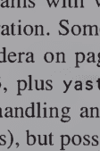

## 使用 tar 手动安装额外程序

经验丰富的 Linux 用户经常想要或需要安装并非特定发行版包形式组织的 Linux 软件。可以在各种 Linux 互联网服务器找到数 GB 的 Linux 软件（见第 451 页），或者下载这些文件副本的 CD（所谓的镜像服务器）。

这些程序以 `*.tgz` 文件的形式提供（没有 SuSE 或 Slack 特有的扩展）。必须通过 `tar` 程序在你的计算机上安装这些文件。（`tar` 的用法在第 296 页描述。）

在许多情况下，软件仅以源代码的形式存在，在使用之前必须进行编译。这假设你已经安装了编译器。

## LINUX 更新

最简单的更新形式是仅更新内核。更新整个发行版稍微困难一些。大多数最新的发行版（如 RedHat）提供了一种无问题地更新系统的方案。如果你有一个稳定且运行良好的系统，那么没有更新的理由。无论如何，你都应该备份配置文件。这不会导致系统崩溃。

## 2.10 移除 LINUX

如果由于某些原因你无法再次启动 Linux 并想要移除 LINUX，请使用安装盘。这假设你已经安装了编译器来卸载de-- the disk disk。

- 如果 LILO 不工作，你只能通过启动软盘启动 Linux。

- 重新启动后，你的计算机应该自动在 Linux 下启动。现在你可以使用 FDISK 释放硬盘空间。

### 3.1 从 DOS 到 Linux

## LINUX 快速上手

本章假设你的 Linux 安装已经成功，到你的计算机可以出现登录提示符的程度。本章的目标是尽可能简洁地描述如何执行基础的 Linux 操作：如何登录、移动和删除文件、显示和编辑文本文件等。通过在本章中获得的知识，你将能够管理你系统的任何后续配置。

## 系统启动

系统启动通常自动进行。取决于你安装的 LILO，在启动计算机几秒后，屏幕上可能会出现文本“LILO ...”；在这种情况下，先按 Shift 键，然后输入你的 Linux 系统名称（一般为 'linux'），最后按 Ctrl。

# 60 安装


以 `root` 身份登录时，你被视为系统管理员：你可以访问所有文件，无限制地执行所有程序，并可能在无意中造成大量破坏。

在配置系统期间，你必须以 `root` 身份工作，否则你将无法修改配置文件。然而，作为 `root`，你的首要步骤之一应该是执行 `passwd` 命令并为 `root` 定义密码。

关于更改 `root` 密码和注册新用户，请参考第 6 章从 125 页开始的内容。关于文件访问权限管理的背景信息见第 96 页。

## 关机

正确关机系统至少与正确登录一样重要。千万不要直接切断电源！最坏的情况下，你可能会面临文件系统损坏的风险；最好的情况下，你将在下一次系统启动时受到耗费时间检查整个文件系统的“惩罚”。

通过执行 `shutdown` 命令可以进行正确的关机。一旦出现“system halted”（系统停止）消息或计算机重启（BIOS 消息），你就可以关闭电源了。

`shutdown` 只能由 `root` 执行。如果你没有以 `root` 身份登录，必须先切换到 `root` 模式。在许多 `LINUX` 系统中，有一个更简单的替代方案：组合键 `Ctrl+Alt+Del`。通过此键，你（而不只是 `root`）可以执行关机命令。如果你在 X 环境下工作，必须先切换到文本控制台，或者用 `Ctrl+Alt+Backspace` 终止 X。

如果 `LINUX` 对 `Ctrl+Alt+Del` 没有反应，且你没有 `root` 密码但仍需重启计算机，你至少应该执行 `sync` 命令，该命令会对你的硬盘执行缓冲写入访问。紧接着，你就可以关闭电脑了。然而，这只是为了将伤害降至最低的一种应急解决方案。

# 处理文本控制台

`LINUX` 是一个多任务系统。这意味着你可以同时执行多个命令。为了让你尽可能容易地利用多任务的能力，`LINUX` 的标准配置提供了六个文本控制台的选择。你可以通过 `Alt+F1-F6` 在这些文本控制台之间切换。

你可以在任何文本控制台上登录（如果你愿意，甚至可以在不同的模式下登录）。在一个文本控制台上，如果你正在进行耗时的判断，可以切换到另一个控制台，并从那里立即启动另一个命令。这两个命令现在都在执行——但速度仍然足够快，允许进行合理的工作。

# 执行命令

`LINUX` 伴随着无数的命令和程序。（命令和程序之间的区别纯粹是语言上的。它们全都是程序。按照惯例，命令大多是 `LINUX` 日常使用所需的较小程序。）要执行命令，你只需输入命令名称，有时跟上几个参数，然后是 `[]`。在书中，命令的输入及其结果显示如下：

```
# ls -L # 当前目录的 own
|rwxr-xr-x root 14 Nov 16 13:08 Linux -> /usr/src/linux/
|-rw--r---- 1 root 7081 Nov 21 15:50 mbox
|-rw-r--r-- 1 root 46 Nov 21 09:29 setup.proc
```

在你的电脑上，在 `#` 或 `$` 符号前面，会显示当前目录，可能还会显示计算机名称。为了简单起见，这些在书中通常不会显示。随后的行（直到出现另一个带有 `#` 或 `$` 的行）是命令执行的结果。

在命令行中，你会发现另一个第二个 `#`：这个字符指定注释。当你输入命令时，不需要也输入注释（尽管输入了也无妨）。`#` 作为 `root` 提示符和注释字符的双重含义有时会导致困惑，特别是当书中显示了以注释开头的列表时。然而，该字符的正确含义将从其上下文中变得清晰。

# 键盘特殊键

`LINUX` 命令解释器 `bash` 的一个特殊功能是文件名补全。当你输入文件名的前几个字母时，按下 `Tab` 键。如果只有一个匹配项，`Tab` 会自动补全文件名。如果有多个匹配项，你可以快速按两次 `Tab` 键来列出所有可能的选项。你可以继续输入更多字符并再次按 `Tab` 键来进一步补全。如果文件名包含空格，`Tab` 会在空格前插入一个反斜杠 `\` 进行转义。如果没有任何匹配项，`Tab` 将不会有反应。

# 64 LINUX 快速上手

在 `jed` 中，只有在预先标记区域后才能使用。第一个字符通过 `Ctrl+Spacebar` 标记，光标将位于区域的末尾。`jed` 会删除该区域并将其插入（到另一个地方）。在这方面，`jed` 与原始的 `Emacs` 不同。

`Emacs` 在第 11 章从 331 页开始有详细描述。该描述仅指原始 `Emacs`，但所有基础命令在 `joe` 中同样适用。

在编辑配置文件时，请确保你使用的行以某些换行符结束。如果行尾没有换行符，某些 `Linux` 程序将无法正确处理这些文件。（这在你使用不同的编辑器时也适用。）


# Joe

`Joe` 是一个非常简单的编辑器。键盘快捷键大多遵循 Wordtext 处理程序，该程序现在已经非常过时了。如果使用 `-asis` 启动 `joe`，程序甚至可以处理外语言特殊字符。

通过 `man` 你可以获得关于 `joe` 的详尽手册，其中描述了其余命令。可以通过文件 `.joerc` 作为起点来配置 `joe`，你可能想使用 `/usr/lib/joe/joerc`。

```
Ctrl+K, N      - 加载新文件
Ctrl+K, E      - 保存文件（如果需要，可以使用不同的名称）
Ctrl+K, D      - 删除一行
Ctrl+Y         - 撤销（撤销删除）
Ctrl+Shift+-   - 退出 joe（询问是否保存）
Ctrl+C         - 显示/隐藏帮助窗口

```


# pico

`pico` 的命令更少，处理也更容易。只有当你安装了 `pine` 邮件程序时才能此编辑器。`pico` 的优势在于屏幕底部的两行显示了可用命令的概述。第 461 页提供了 `pico` 的简要描述。

# vi, vim 和 elvis

`#` 和 `elvis` 是两个兼容的编辑器。由于版权原因，原始的 `vi` 不属于 `LINUX` 的。然而，在大多数情况下可以执行 `vi` 命令，它会自动调用 `vim` 或 `el` 的启动。

如果你以前从未用过 `vi`，甚至不要尝试它——往好了说，它的处理方式非常不合常理。然而，`vi` 的拥趸们固执地声称没有更好的编辑器了。此外，`vi` 代表了 `UNIX` 标准——几乎没有


# X 窗口系统 65

在没有安装 `vi` 的 `UNIX` 计算机。与其它编辑器相比，`vi` 唯一的真实优势是它非常紧凑，并且在没有其他编辑器运行时，它可能是可用的（例如，在系统维护期间，如果 `Linux` 是从软盘启动的）。

这里描述的唯一 `vi` 命令是进入 `vi` 的命令：如果你正处于输入模式（输入文本），首先通过 `Esc` 切换到命令模式。然后输入 `QQ` 退出 `vi` 而不保存。`WQ` 则允许你保存并退出。

# X 下的编辑器

在 X 窗口系统中，你可以在终端窗口中使用上述所有编辑器。在这种情况下，`Emacs` 甚至带有菜单和鼠标支持。此外，还有几个专门为 X 设计的编辑器。大多数发行版都包含一个或多个此类特定的 X 编辑器（例如，`xjed`, `xedit`, `textedit`）。

# 3.3 X 窗口系统


在我们开始之前，有一个警告：只有在 X 服务器配置正确的情况下，才能使用 X 窗口系统。X 服务器的配置错误可能会损坏你的显示器！如果在 `LINUX` 安装期间没有配置 X（并非所有发行版都是如此），则在第一次使用 X 之前必须配置它。该过程从第 185 页开始详细描述。（在并在解释了 X 服务器的本质）。如果你不确定配置正确，请不要启动 X！

取决于你计算机的配置，系统会直接进入 X 登录，你只需要指定用户名和密码。如果不是如此，请使用 `startx` 启动 X。

启动后（再次取决于配置），程序可以自动启动。如果没有发生这种情况，你可以通过按下鼠标按钮调出一个菜单，允许你启动 X 程序。最重要的程序是 `xterm`：它对应文本控制台，允许你通过键盘启动其他程序。

# 鼠标、输入焦点

鼠标的功能高度取决于窗口管理器的设置，你可以自己在很大程度上对其进行配置。因此，我们无法详细描述你计算机上哪个鼠标按钮的作用。

通常，鼠标中键在 X 下起着很大作用。因此，在许多 X 程序中，你可以使用中键滑动滚动条。（在第 209 页，你会找到双键鼠标的配置提示。）

在许多系统中，输入焦点通过点击窗口确定。如果你没有三键鼠标，输入焦点通过点击窗口确定。（在第 209 页，你会找到双键鼠标的配置提示。）

# 退出 X

你想退出 X 时，只需点击屏幕上的菜单按钮并选择 `Exit`。（如果你没有三键鼠标，输入焦点通过点击窗口确定。）

# 在线文档

`LINUX` 不仅带有大量命令，还有在线文档。入口是 `index.htm`。在线文档通常以 HTML 格式提供。

# MAN – 所有命令的在线手册 69


属于 Tcl/Tk。接下来的三个部分描述了 `man`、`xman` 和 `tkman`，随后是关于 `man` 文件的内部结构和格式的一些信息。

## 如何使用 man

```
man [Options] [area] subject
```

`man` 在系统所有已知的 `man` 目录中搜索指定为 `subject` 的手册文件。如果指定的不是主题而是文件名（例如 `/cdrom/man/man1/abc.1`），则会显示该文件的内容。

可选的 `area` 指定会将 `man` 文本的搜索限制在一个主题区域内——例如 `man 3 print`。当不同主题区域存在多个同名文本时，这种指定是必要的。否则，`man` 只显示找到的第一个 `man` 文本。

在 UNIX 和 Linux 书中，命令以其 `man` 编号显示——例如 `find(1)`。因此，你一眼就能知道如何调用 `man`。`man` 知道 1 到 n 的主题区域。（有时，编程命令会被分配带有不同字母的额外区域）。

- 1 用户命令
- 2 系统调用
- 3 C 编程语言函数
- 4 文件格式，设备文件
- 5 配置文件
- 6 游戏
- 7 杂项
- 8 系统管理命令
- 9 内核函数
- n 新命令

如果你想阅读所有同名文本（所有主题），必须使用带有 `-a` 选项的 `man`。然后，`man` 显示找到的 `man` 文本。一旦你读完文本并按 `Q` 退出 `man`，就会显示下一个主题的 `man` 文本。

- `-a` 显示所有同名的 `man` 页。（如果不使用此选项，只会显示不同主题区域的多个同名文件中的第一个。但在某些 LINUX 发行版中，`-a` 被设置为默认值。）
- `-f keyword` 显示关键字的含义（一行文本）。此选项对应显示包含该关键字的所有可用 `man` 文本列表。然而，它不会执行全文搜索——只分析每个 `man` 文本的关键词。此选项对应 `apropos` （在 oman 中为 `SEARCH APROPOS`）。

如果 `-f` 和 `-l` 选项或 `whatis` 和 `apropos` 命令不起作用，可能意味着缺少包含 `man` 内容信息的数据库。你可以通过执行 `/usr/sbin/makewhatis` 来修复此。（该程序相当消耗 CPU 资源。）

- `-Area_list` 仅搜索指定的主题区域。如果你需要区分多个同名文本，此选项非常有用。

一旦 `man` 文本显示在屏幕上，就可以可以使用键盘快捷键在文本中进行导航（如果在 `/usr/lib/man.config` 中指定的默认显示程序较少）：


| 快捷键 | 功能 |
|---|---|
| Home, End | 向上或向下滚动 |
| Y, E | 跳到文本行开头/结尾向上或向下 |
| U, D | 向上或向下翻页 |
| Shift+G | 跳到向前搜索的开头/结尾 |
| pattern | 向后搜索 |
| ? Shift+N | 重复搜索（向前/向后） |
| Q | 退出 |
| H | 显示带有额外快捷键的帮助文本 |

## X 版本 xman 的特殊功能

`xman` 作为后台程序运行，因此不会影响终端窗口的工作。`xman &` 显示一个小的控制窗口，当你点击“Help”按钮时，它会显示关于 `xman` 用法的帮助文本。“Manual Page”会进入一个更大的窗口，可以在其中选择所需的帮助文本。与 `man` 不同，无法在调用时将所需的帮助主题作为参数传递给 `xman`。

## xman [Options]

- `-bothshown` 将主窗口分为两个部分（主题列表和帮助文本）。
- `-notbox` 在不启动控制窗口的情况下启动 `xman`。

在主窗口中，通过“Section”菜单，可以查看每个九个主题区域的可用文本列表。通过鼠标点击来选择所需的主题。

## MAN - 所有命令的在线手册 71

| Sections | | |
|---|---|---|
| Mail | 目录：(I) 用户命令 | 手册 |
| Xortium\|X86_B54(x) | Rmail | X(x) 帮助 |
| X86_Mono\|X86_BS53(x) | X86_Jcel(x) | X86_Mach32(x) | X86_Math(x) | 退出 |
| X86_Freebdl\|Standard(x) | X86_GK64(x) | X86_B551(x) | X86_ebi(x) | 手册页 |
| X88Freebdl\|X(x) | Xortium(x) | Server(x) | | |
| apt | addintfo | afdotid | | |
| amixer | aml2kr | ametlet | | |
| aster | apres | atoba(x) | | |
| atq | autoreply | baseline | | |
| bash | bash_builtin | bc | fontof(tex) | |

## AFM2TM(I) AFM2TM(I)

### 名称

### 描述

字体（或应该）伴随着字体度文件，例如 `Times-Roman.afm`，它描述了 `Times-Roman` 的特征。使用 Tex 字体，我们需要包含类似信息的 TFM 字体。该程序用于转换 `man` 手册。


最有趣的菜单命令是“Search”。它快速搜索并显示所需的帮助主题。当使用“Apropos”按钮停止搜索时，`man` 会显示包含搜索项的主题列表。（然而，`apropos` 搜索不是全文搜索。只搜索每个 `man` 文本的关键词。）

`xtman` 仅支持鼠标选择主题和滚动 `man` 文本。通过 Shift 和中间鼠标键可以在主题列表和显示的 `man` 文本之间切换。遗憾的是，`xtman` 的键盘快捷键与 `man` 不对应。光标无法用于滚动帮助文本。以下总结了快捷键：

| 快捷键 | 功能 |
|---|---|
| F, B | 空格键 向前或向后翻页 |
| Ctrl+S | 向前一页 |
| 1 to 4 | 向前四行 |
| xtman | 一个 |

## tkman

和 `man` 一样，`tkman` 提供了一个显示界面。一旦安装（以及其他），`tkman` 具有以下优势：

### 文档

## 72 在线文档

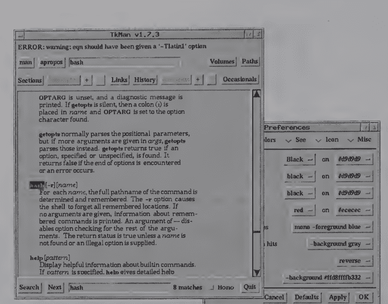

- 4.2 `man` 文本
- `man` 页的简单交叉引用
- 已查看文本列表
- 广泛的配置
- `man` 文本的格式

## man 内部

`man` 的中央控制文件是 `/etc/man.config`。有时 `man` 文本仅以格式形式存储（为了节省空间）——但如果需要打印文本，这是一个缺点。`xms` 的配置可以通过 `~/.mandefaults` 中的条目进行进一步修改（参见 `xmas` 手册）。

如果你指定额外的目录，`man` 将搜索以下目录：

- `/usr/man`
- `/usr/local/man`
- `/usr/X11/man`

## MAN – 所有命令的在线手册 73

这些目录中的每一个都有子目录 `manx`（x 代表 1 到 9，n），例如 `/usr/man/manx`。为了能在屏幕上显示这些文本，转换为 ASCII 格式。

## 使用 groff 格式化 man 文本

`groff` 是一个高级命令，用于控制一系列文本程序，包括用于文本的 `groff`、`eqn` 用于数学公式、`gpic` 用于插图、`tbl` 用于表格、`leleg` 用于交叉引用以及等。`groff` 程序共同构成了一个排版系统，在概念上类似于 `LaTeX`，但在格式化能力方面不那么复杂且更容易掌握。

在实践中，`groff` 程序起次要角色——有一个例外：`groff` 用于格式化 `man` 文本。因此，`man` 文本以兼容 `groff` 的语法编写。它们只有在格式化后才变成可读的 ASCII 文本。

如果 `man` 文本不仅以格式化版本存在，还以源码的形式存在，可以使用 `groff` 将该文件转换为高质量的 PostScript 文件。可以在 `man` 目录找到 `man` 源码（例如 `/usr/man/manx`）。以下命令将 `man` 源码 `groff.1` 转换为 PostScript 并在主目录下写入文件 `test.ps`：

```
$ groff /usr/man/man1/groff.1 -mandoc /book/test.ps
```

通过以下命令可以获得相同的结果（尽管控制能力范围较小）：

```
$ man -t groff > /book/test.ps
```

以下对 `groff` 的描述仅解释了将 `man` 源码转换为 `*.dvi` 或 PostScript 文件所需的选项。

### groff [options] file <destination>

`-mname`

使用 `/usr/lib/groff/tmac` 目录中的宏文件 `tmac.name`。对于 `man` 文本的转换，使用的名称必须是 `andoc`。

`-Tformat`


# 74 在线文档

确定输出格式。默认设置是 `ps` 用于 `ps`。其他可能的设置有 `dvi`（用于 `dvi` 文件）、`ascii` 用于 ASCII 文本（产生这些结果），以及 `latin1`（类似于 `ascii`，但带有外语言的特殊字符）。

在 Linux 发行版中，man 文本仅以预格式形式提供，因此无法应用 `groff`。然而，在这种情况下，`man` 命令允许将格式化的 man 页面转换为其他格式（PostScript、HTML 等）（参见第 82 页）。


## 4.3 info - 用于 GNU 工具和 Emacs 的超文本在线帮助

`info` 是一个比 `man` 强大得多的程序。它特别适用于显示大量的帮助文本，因为它可以处理跨多个文件的交叉引用。`info` 是所有 GNU 工具（如 `find`、`grep`）、带有所有扩展和库的 GNU 编译器以及 Emacs 文本编辑首选文档格式。

`info` 命令的主要缺点是它的操作相当繁琐。具体来说，不能使用光标方向键在文本内部进行导航，这会导致意外跳转到其他主题，并且在某些情况下会导致程序崩溃。

如果你不是使用 `info`，而是启动 Emacs 编辑器并使用 `Alt+X` 或 `Ctrl+X` 切换到 `info` 模式（见第 336 页），就可以绕过这个限制。原则上，`info` 程序只是限制在 `info` 模式下的 Emacs 版本。X 版本 Emacs 让生活变得简单：所有的交叉引用都用特定的颜色突出，并且点击鼠标即可选择。


如果 `info` 文本以 HTML 格式提供，阅读起来更加简单。你可以使用任何 WWW 浏览器读取这些文本。某些发行版（SUSE）已经提供了大量的 HTML 格式的 `info` 文件。在随附的文档中，你会找到这种格式的 Emacs 文档。在第 81 页，有关于你自己创建 `info` 文本 WWW 版本的描述。

通常，`info` 文本存储在 `/usr/local/info` 或 `/usr/share/info`。较大的帮助文本通常以几个压缩文件的形式发布，文件名以 `.info-nn.gz` 或仅以 `--nn.gz` 结尾。

```
info [options][subject]
```

`info` 通常带有参数 `subject` 调用。该主题指示要查看 `/usr/info` 目录下的哪个 `info` 文件。如果 `info` 启动时没有参数，程序将显示可用帮助主题的概述（文件 `/usr/info/dir` 主题）。未包含在 `dir` 中的主题只能通过选项 `-f` 查看。例如，`elisp` 文件（Emacs 的文档）就是这种情况。因此，`info` 无法自动处理 `/usr/info` 中包含的所有 `info`。


- `file` 加载指定的文件而不是来自 `/usr/info` 的文件。必须提供完整的文件名而不是主题名（例如 `jarg300`, `info.gz`，而不仅仅是 `larg300`）。如果 `info` 文本分布在多个文件中，必须指定第一个文件（例如 `elisp-1.gz`）。

`info` 最重要的键盘命令如下：

- `空格键`（Spacebar）向下滚动文本
- `退格键`（Backspace）向上滚动文本
- `B`, `E` 跳到 `info` 单元的开头/结尾
- `Tab` 键移动光标到交叉引用
- `/` 跟踪交叉引用到不同的单元
- `N` 下一个同层级的 `info` 单元
- `P` 上一个同层级的 `info` 单元
- `U` 向上一个层级
- `L` 回到上次显示的文本
- `H` 详细的使用说明（帮助）
- `?` 命令返回上一级
- `Ctrl+X, D` 关闭帮助窗口（是 `D`，不是 `O`）

有趣的是，有一个 `man` 文本描述了如何使用 `info` 程序的各种。

### `info` 内部原理

`info` 文本是用 `Texinfo` 生成的。`Texinfo` 系统的巨大优势是源文件（`*.texi`）可以同时生成 `info` 和 `DVI` 文件。生成的 `*.texi` 文件可以使用 `dvips` 转换为 PostScript 文件并稍后打印。因此，`*.texi` 文件既适用于生成在线文档，也适用于准备高质量的排版手册（`TeX` 和 `dvips` 在第 351 页开始的独立章节中描述）。

将 `*.texi` 文件转换为 `*.info` 文件是通过命令 `makeinfo name.texi` 完成的。对于复杂文档（如多个文件的分解，例如 Emacs 手册），使用 `Makefile` 文件来控制转换过程。在这种情况下，你只需要在相应的目录下执行 `make`。

```
makeinfo name.texi
```

转换为 `DVI` 文件通过一系列三个命令完成。（只运行一次 `tex` 就足够了——但将丢失索引和交叉引用。）通过 `dvips` 生成一个 PostScript 文件。只有在安装了 `TEX` 的情况下才能转换。

```
tex name.texi
tex name.texi
dvips name.dvi -o name.ps
```

因此，`*.texi` 文件既适用于生成在线文档，也适用于准备高质量的排版手册（`TeX` 和 `dvips` 在第 351 页开始的独立章节中描述）。

将 `*.texi` 文件转换为 `*.info` 文件是通过命令 `makeinfo name.texi` 完成的。对于复杂文档（如多个文件的分解，如 Emacs 手册），使用 `Makefile` 文件来控制转换过程。在这种情况下，你只需要在相应的目录下执行 `make`。


## 4.4 HOWTO - 如何工作的？

HOWTO 文本可能是关于 LINUX 安装、配置和硬件最重要的信息源。

### FAQ - 常见问题

在 Linux 下，FAQ 的作用相对于 HOWTO 文本是次要的。然而，有关于各种编程语言、网络对象和其他 Unix 主题（安全等）的无数 FAQ。通常，你可以在 `/usr/doc/faq` 或 `../FAQ` 目录下找到 FAQ。以下 FAQ 对 Linux 特别重要：

- `faq/linux.faq`：当遇到 Linux 问题时，此文件应该是首选方案。它涵盖了安装、兼容性问题、Linux 文件系统处理、X 窗口系统等主题。
- `faq/GCC-FAQ`：此文件对 C 程序员感兴趣。它处理了 `GCC` 编译器在获取阶段的许多基础困难。

在 RedHat 发行版中，你还会在 `/usr/doc/FAQ` 目录下找到额外的 RedHat FAQ，它处理特殊的 RedHat 问题。

这些主题包括对特殊硬件组件的处理（SCSI 磁盘、CD-ROM、以太网卡、键盘）以及 Linux 使用的特殊功能（打印、使用 `UUCP`、`Term` 和 `News` 进行网络配置等）。在 ASCII 格式下，HOWTO 总共占据近 3 Mbytes——这文字比这整本书还要多！

### Linux HOWTO（教程）

| BootPrompt | Ftape | Keystroke | SCSI-Programming |
| :--- | :--- | :--- | :--- |
| Bootdisk | German | Mail | Serial |
| Busmouse | HAM | NET-2 | Shadow-Password |
| CDROM | Hardware | NIS | Sound |
| Commercial | | News | Term |
| Cyrillic | IPX | PCI | Tips |
| DOSEMU | Installation | PCMCIA | UMDOS |
| Danish | Italian | PPP | UPS |
| Distribution | JE | Portuguese | UUCP |
| ELF | Java | Printing | XFree86 |
| Ethernet | Kernel | Printing-Usage | |
| Firewall | Keyboard | SCSI | |
| ADSM-Backup | Getty-ps | Modeline | Tiny-News |


| `Backup-With-MSDS` | `HTML-Validation` | `Multiple-Ethernet` | `Token-Ring` |
| `Boca` | `IO-Port-Programming` | `Online-Support` | `Virtual-Web` |
| `BogoMips` | `Imega-ZI` | `PLIP` | `Visual-Bell` |
| `CD-Writer` | `Key-Setup` | `Proxy-ARP` | |
| `Caching-name` | `Keystroke` | `Reading-List` | `WordPerfect` |
| `Colour-Ls` | `LXB` | `SLIP+proxyARP` | `X-Notebook` |
| `Consoles` | `LILO` | `Stacker` | `Xterminal` |
| `DOS2Linux` | `Large-IDE` | `Swap-Space` | |
| `DIP+SLRP+CSIP` | `Mail-Queue` | `TIA` |
| `GUI-Development` | `Man-Page` | `Term-Firewall` |

`HOWTO` 文件通常位于 `/usr/doc/howto` 或 `/usr/doc/faq/howto` 目录。在 Linux 下有两种形式文本：普通版本和精简版本（`mini versions`）。精简版本位于子目录下，且仅以 `ASCII` 格式存在。另一方面，“大容量”`HOWTO` 也提供其他格式（子目录 `other-formats`）。最有趣的格式无疑是 `HTML` 版本，它可以使用任何 `WWW` 浏览器阅读，而且由于字体大小和交叉引用，它比 `ASCII` 版本清晰得多且更易于阅读。

## `LDP` – Linux 文档项目

在 Linux 文档项目的框架内，已经出现了更长的文本——实际上是整本书籍。这些文本最初也仅以电子形式存在。其中部分文本已经发展成了“真正的”书籍，它们是关于 `LINUX` 最优秀的文献之一（另参见书末的参考文献）。

以下列表显示了 `LDP` 书籍（以及文件名和最新版本的日期）：

- `install-guide`

Matt Welsh: `LINUX Installation and Getting Started` (1995年2月)

- `khg-0.6`

Michael K. Johnson: `The LINUX Kernel Hackers’ Guide` (1995年11月)

- `lpg-0.3`

Sven Goldt, Sven van der Meer: `LINUX Programmers’ Guide` (1994年10月)

- `nag-1.0`

Olaf Kirch: `The LINUX Network Administrators’ Guide` (1994年8月)

- `sag-0.3`

Lars Wirzenius: `LINUX System Administrators’ Guide` (1995年8月)

- `user-alpha-4`

Larry Greenfield: `LINUX Users Guide` (1994年9月)

上述所有书籍都是使用 `LaTeX` 编写的，并以 `*.dvi` 和 `*.ps` 文件的形式提供。`HTML` 版本正在开发中（部分已可用）：

```
http://sunsite.unc.edu/mdw/mdw.html
ftp://pub/Linux/docs/LDP/*
```

## 内核文档

在 `/usr/src/Linux/Documentation` 目录中，你会找到许多特定于硬件的信息（前提是你安装了内核代码）。这些信息通常假设你对自己的计算机硬件以及编程有良好的了解。但阅读这些关于计算机内部原理的优秀信息是非常值得的。你很难在别处找到这样的信息。（内核代码也有完善的文档；如果你有一个 `CD-ROM` 驱动器并在制作时遇到问题，仔细阅读 `drivers/cdrom/cdrom-type.c` 文件对你一定大无益益。）

内核配置的可用帮助文本也信息丰富。即使你不想重新编译内核，只需执行 `make xconfig` 或 `make`


## 8在线文档

在 `/usr/src/linux` 目录下运行 `menuconfig` 并阅读各种帮助文本。（你也可以直接读取 `ASCII` 文件 `Documentation/Configure.help`，尽管未格式化的文本可读性差得多。）

## 附带 `CD-ROM` 中的在线文档

在 `/doc` 目录下，附带的 `CD-ROM` 包含了大量 `LINUX` 的免费文档（部分为 `HTML` 版本）。`/dosdoc` 目录包含 `HOWTO` 文本的副本，专门为 `DOS/Windows` 环境进行了转换，并使用了短 `DOS` 。`CD-ROM` 上 `RedHat` 发行版的各种软件包中还包含了几个额外文件。你可以在附录 `F` 中找到 `CD-ROM` 的内容列表。

## 4.5 `WWW` help

由于-，附带的 `CD-ROM` 包含了大量 `LINUX` 的免费文档（部分为 `HTML` 版本）。`/dosdoc` 目录包含 `HOWTO` 文本的副本，专门为 `DOS/Windows` 环境进行了转换，并使用了短 `DOS` 。`CD-ROM` 上 `RedHat` 发行版的各种软件包中还包含了额外文件。你可以在附录 `F` 中找到 `CD-ROM` 的内容列表。

## 4.5 `WWW` help

这种方法的优点是不需要 `*.texi` 文件，且磁盘空间需求几乎为零。所有的现有 `*.info` 文件都可以透明地访问。缺点是：如果没有运行的 `http` 服务器，什么都不会发生。

`-split_node` 选项允许你将长文本组合较短的章节。这会导致大量的单文件，但你尝试过读取 2 `Mbytes` 的 `*.html` 文件吗？你可以在附带的 `CD-ROM` 上找到该程序，它非常直观。转换时只需要 `*.texi` 文件和 `Perl`。

# 82 在线文档

翻译 `*.gif` 图像——然而，这假设存在 `netpbm` 图形包。

通常情况下，`latex2html` 的应用并没有 `texi2html` 那么简单：一方面，对计算能力的需求（`CPU`、内存）是巨大的；另一方面，只有在仅使用 `LaTeX` 标准命令（没有使用各种自定义宏、额外的包等）时，转换才能达到预期的效果。由于这个原因，将此转换为 `*.html` 书籍的尝试惨惨地失败了。然而，对于简单的文本，这种转换工作非常完美。该程序主要用于用 `LaTeX` 编写的科学出版物转换为 `WWW` 可的形式。

# `Man` → `HTML`

`rman`（`RosettaMan` 的缩写）将格式化后的 `man` 页转换为其他格式（`ASCII`、`HTML`、`SGML`、`LaTeX`）。`rman` 的特殊之处在于它不需要从 `man` 页的源文件开始，而是可以处理所有已经格式化的 `man` 页。`rman` 可以可以使用 `info2www`，该工具也用于 `cgi` 脚本。`SuSE` 发行版的帮助系统允许 `rman` 根据需要将 `man` 转换为 `HTML` 文本。

下面的示例显示了 `rman` 的用法：`ls` 的 `man` 页被转换为 `HTML` 格式并写入文件 `ls.html` 中。

```
man -f /var/catman/cat1/ls.1 > ls.html
```

# `Linuxdoc-SGML`

虽然程序负责格式化，但这些工具是为了将“旧”的在线文档转换为新格式，`Linuxdoc-SGML` 软件包从创建之初目的就是为了从同一份源文本生成不同格式（`ASCII`、`HTML`、`PostScript`）的文件。文本以 `SGML` 文档的形式输入。`SGML` 代表通用标记语言，其语法与 `WWW` 语言 `HTML`（超文本标记语言）相似。

几乎所有的 `HOWTO` 文章和许多其他 `LINUX` 文档都是使用 `Linuxdoc-SGML` 编写的。

最后，有一些互联网地址可以找到这些程序的更新：

```
ftp://prep.ai.mit.edu/pub/gnu/*
ftp://funet.fi/pub/PEOPLE/Linus/net-source/www/tools/texi2html*
http://www.cern.ch/dci/text2html
ftp://funet.fi/pub/PEOPLE/Linus/net-source/www/tools/info2www**
ftp://fpta.dante.de/tex-archive/support/latex2html*
http://clb.leeds.ac.uk/nikos/text2html*
ftp://sunsite.unc.edu/pub/Linux/system/Manual-pagers/rman*
ftp://sunsite.unc.edu/pub/Linux/utils/text/linuxdoc-sgml*
```


# 第二部分

# 配置

# `LINUX` 基础


从 DOS 或任何不兼容 UNIX 的操作系统切换到 LINUX 经常会导致困难。这些困难中的许多是因为从表面上看，LINUX 与其他操作系统有许多相似之处，尽管其在内部结构和管理上存在实质差异。本章试图深入其背后，描述 LINUX 的基本特性。

本章的第一部分主要包含关于 LINUX 文件系统的多个级的信息：从处理文件和目录（包括使用通配符、访问权限、链接）到 LINUX 目录树结构（FSTND），以及 LINUX 内部用于数据管理的所谓 I 节点（Inodes）。

后续章节将更深入地讨论 LINUX 内部机制，一旦你更熟悉 LINUX，其内容可能就能完全理解。它们涉及了进程管理的细节（LINUX 是一个多任务系统）、库的管理以及 System V init 进程（它控制你计算机的启动和关机）。

本章对于 LINUX 的配置并不是严格必要的——因为后面的章节会逐步描述这些步骤。但本章将帮助你理解自己在做什么。这种对 LINUX 及其工作方式的基本理解，当你某天想要以特定方式更改计算机的配置，以至于描述不再适用于其他书籍的框架时，将变得必要。如果你以前从未工作过 UNIX 系统，你至少应该阅读第 5.1 节和第 5.3 节（第 112 页）。当 LINUX 的反应不像你根据 DOS 经验所预期时，这可能会为你节省很多许多挫败感。

## 5.1 文件管理基础

本节阐明了 LINUX 下文件管理的不同方面。主题范围从微不足道的问题（允许哪些文件名）到文件管理的内部（I 节点等）。本节旨在帮助你使用并理解 LINUX 文件系统。主要主题是：

- 文件和目录（文件名、通配符和 `?`）
- 目录结构（文件在哪里，如 `bin`、`lib`、`usr`、`home` 等缩写）
- 所有权和访问权限（谁被允许读取、修改、执行）
- 链接（指向其他文件的固定符号引用）
- 数据访问（`mount` 命令的用途，软磁盘如何链接到文件）
- 导入和导出（行尾 `CR/LF`）
- 不同的文件系统（为什么存在不同的文件系统，如 `ext2fs`、`msdos`、`iso660` 等）
- 内部机制（Linux 文件系统在内部是如何管理的）

### 文件和目录

如果你在 DOS 下工作过，文件名的新自由将是你喜欢 LINUX 的要件事之一。简而言之，主要事实如下：

- 在 LINUX 下，文件名可以多达 255 个字符。
- LINUX 是敏感的（区分大小写）。
- 允许特殊字符；但在处理此类文件时必须遵循特定规则。
- 以点（句号）开头的文件被视为隐藏文件（第 90 页）。

在 LINUX 文件名中，你可以使用任意数量的点，尽管点经常被用于分隔名称部分。`README.boot.gz` 是一个完全正常的文件名，暗示这是一个压缩文件。不能立即识别为命令的文件名（例如包含空格的文件名）必须用双引号括起来（例如 `"a b"`）。甚至可以使用外语字符，如德语变音符号或带重音符号的字母。你应该意识到这些特殊字符可能是麻烦的根源，最坏的情况是文件名无法正确排序。其他文件系统对文件名的最大字符数等有更严格的限制（另见第 104 页）。


### 通配符

在处理目录时，两个文件（它们实际上是链接）`.` 和 `..` 非常重要。`.` 指向当前目录，`..` 指向上一级目录。通配符不是在命令执行时评估，而是在调用命令的 shell 中评估的。在你的标准用法中为了使这可能，允许两个通配符：`?` 指定任意一个字符，`*` 指定任意数量（包括零）的字符。

在表面上看，这与 DOS 完全一样。LINUX 下的通配符比 DOS 灵活得多。最重要的区别是 `*` 包含了几乎字符，包括点（只要它们不是文件名的第一个字符）。如果你想包含所有文件，只需指定 `*` 而不像 DOS 那样。（隐藏文件的说明后续。）

一个区别是即使多个通配符也不会威胁 Linux。使用 `*graph*`，例如，你可以搜索名称中包含 `graph` 的文件——如 `graphics.doc`、`autograph` 和 `README.graph`。如果 `?` 和 `*` 适用于你的目的，你可以通过指定方括号来实现更强的限制。`[abc]` 是 `a`、`b` 或 `c` 三个字母之一的占位符。`[!]` 表示不包含上述指定的字符。

通配符也可以用于目录。`*.tex` 包含当前子目录下所有的 `*.tex` 文件（仅限一层，不包含子目录的文件）。`/**/bin/*` 包含 `/usr/bin` 和 `/usr/sbin` 目录下的所有文件。

复制文件时，还需要另一个特殊字符——作为当前目录占位符的点。那么 `cp project*.c` 将项目目录中的 `*.c` 文件复制到当前目录。

- `?` 恰好一个任意字符
- `*` 任意数量（包括零）的任意字符
- `[abc]` 恰好是指定的字符之一
- `[a-f]` 指定范围内的一个字符
- `[!]` 不包含指定的字符
- `[^abc]` 同上
- `[~abc]` 目录的缩写

#### 复杂性：通配符的处理看起来比实际上要简单

处理通配符看起来比实际操作要简单。如果你在通配符上遇到问题，应该简单地对 `echo` 通配符进行一些实验。此命令会显示包含通配符组合的所有文件，而不会对文件或文件名产生任何进一步的影响。

一个问题是 `*` 不仅包含文件，还包含目录。因此，`*` 不仅显示当前目录下的所有文件，还显示 `*` 包含子目录的内容。对于 `ls` 命令，可以通过指定 `-d` 选项来避免这个问题；然而，其他命令没有这样的选项。

如果你想对所有目录进行操作（但不对普通文件），通配符组合 `/*` 就能解决问题：这包括包含指向自身作为子目录引用的“文件”——这是目录的唯一情况。（在内部，目录被视为一种特殊形式的文件——因此使用了引号）。

```bash
$ echo /*
```

由 shell 而不是命令来负责通配符的评估，这一事实既有优点，也有缺点。因此，对于像 `ls -R .*` 这样的命令，无法在子目录中搜索 `*.tex` 文件。`ls` 命令的 `-R` 选项会导致子目录的递归搜索，可以与 DOS 命令的 `/s` 选项相比较。

原因非常简单：shell 为当前目录扩展模式 `*.tex` 并将其传递给找到的文件列表。如果你没有扩展名为 `.tex` 的目录，`ls` 就结束了——即使是 `-R` 选项也无能为力。递归搜索只在作为参数传递的目录目录。

LINUX 提供了更灵活的 `find` 命令来搜索文件。下面的示例显示了当前及所有子目录下所有的 `*.tex` 文件列表。

```bash
$ find -name '*.tex'
```

尝试在所有子目录下删除 `*.` 文件的失败也归于同样的原因。命令 `rm -r "*"` 尽管有 `-r` 选项用于递归删除目录，仍然失败了。原因是：`"*"` 已经由 `bash` 展开为当前目录。只有当子目录的名字以 `.` 结尾时，才会被考虑（但意图恰相反，即删除普通目录下所有以 `.` 结尾的文件）。

删除所有备份文件只能通过以下命令实现。在这里，使用 `find` 构建所有相关文件的列表，然后通过命令替换 `$(command)` 传递给 `rm`。

```bash
$ rm $(find -name '*')
```

如果我们处理大量文件，在执行上述命令时会发生错误：包含所有 `*` 文件的命令行太长，超过了最大命令行长度。在这种情况下，必须配合 `-exec` 选项使用 `find` —— 参见第 266 页。

最危险的 LINUX 命令之一是 `rm -rf *`：它会递归删除所有文件和目录（从当前目录开始）。

当你尝试执行类似 `mv *. *.y` 的命令时（例如，将所有 `*.x` 文件重命名为 `*.y` 文件），与 MS-DOS 有一个区别。在 Linux 下，无法通过一个命令实现此操作。该限制的原因与上述相同：shell 将 `*.` 替换为对应该模式的所有文件列表。对于 `*.y`，没有有效文件名。因此，`mv` 命令接收到了一个多个文件列表和一个表达式 `*.y` —— 完全可以理解，`mv` 对此能做不了什么。


一个具体的例子：假设当前目录只包含 `mark.x`、`peter.x` 和 `sandra.x`。当你执行 `mv *.x *.y` 时，shell 将模式 `*.x` 替换为这三个文件。shell 找不到 `*.y` 的任何匹配文件，并原样传递该模式。只有此时 `mv` 命令才启动。它接收到的参数如下：

```
mv *.x peter.x sandra.x *.y
```

即使我们传递 `mark.x peter.x sandra.x mark.y peter.y sandra.y` 作为其参数列表，结果也不会如预期。`mv` 根本无法一次性重命名多个文件。即使是将多个文件移动到另一个目录，或者只重命名一个文件，`mv` 可能与 DOS 命令 `RENAME` 有某些表面相似之处，但仅此而已。

# 高级用户的通配符

UNIX 专家显然也为这个问题找到了解决方案：他们使用 `sed` 流编辑器。由于 `sed` 的处理方式相当复杂，shell 编程中实际上应使用如下示例。这里是其工作原理的简要描述：`ls` 提供需要重命名的文件列表并将其传递给 `sed`。`sed` 使用 `s` 命令（常规查找和替换）将此转换为命令列表，并将此列表传递给一个新的 shell `sh`，由其执行命令。该行将所有 `*.xxx` 文件复制为 `*.yyy`。

```
$ ls *.xxx | sed 's/\(.*)\.xxx/cp & \1.yyy/' | sh
```

另一种替代方案是编写一个小型循环（这强制要求使用 bash 而不是其他 shell）。该命令为所有 `*.tex` 文件创建副本，并赋予它们扩展名 `~`。通常用于备份文件。

```
$ for i in *.tex; do cp $i ~
```

上述示例可行，但对于标准使用来说太复杂了。在第 14 章 shell 编程中，引入了新命令 `regmv` 和 `regcp`，可以处理正则表达式（参见第 515 页）。

# 隐藏文件

在 UNIX 下，以点开头命名的文件被视为隐藏文件。因此，`*` 并不包含目录中的所有文件：以点开头的文件（通常是配置文件）会被忽略。

如果你尝试用 `.*` 模式获取隐藏文件，情况会变得更糟：这不仅包含以 `..` 开头的隐藏文件，还包含了 `.` 和 `..` 目录（当前目录和上级目录）。如果命令能够处理这些项，后果可能是致命的。

可以使用搜索模式 `[!*]` 来避免这个问题。它搜索第一个字符为点且至少有一个非点后续的任意数量（包括零）字符的文件。

```
$ echo .[!*
```

使用 `ls` 命令可以使用 `-a` 选项。这会导致显示所有文件（包括隐藏文件）。然而，不需要指定此类模式（如 `**`），因为 `-a` 只在 `ls` 搜索文件时生效。

再次情况下，唯一通用的命令是 `find`。以下命令在当前目录及所有子目录下查找隐藏文件：

```
$ find -name '.\'
```

# 目录

LINUX 目录树从根目录 `/` 开始——驱动器规格（如 `C:`）在 LINUX 下既是不可能的也没有意义（另见第 99 页）。在此块内部，其他目录被认为是从属——因此，根目录位于树的最顶端。在某些书中，符号约定恰恰相反，这可能很好地对应目录树（根向下，分支向上），但不符合常用的术语用法。

每个目录下存在两个目录：`.` 作为当前目录的引用，`..` 作为上级目录的引用。

对于 UNIX/LINUX 新手来说，最大的问题之一是在广泛分支的目录系统中查找特定文件。下节提供了初步引导。`find`、`locate` 和 `grep` 也非常有用：`find` 搜索指定的文件，`grep` 搜索文件内部的字符。通过结合这两个命令并进行练习，可以找到几乎文件（参见第 266 和 271 页）。`locate` 的功能与 `find` 类似，但使用预先构建的数据库，使其快得多（第 276 页）。

# LINUX 目录结构

(文件系统层次级标准)

一个典型的 Unix 系统由（数万）个文件组成。在 UNIX 开发期间，形成了一些特定的规则，规定了哪些文件通常存储在哪些目录中。这些规则已经针对 LINUX 的特点进行了调整，并总结在一份特殊的文档中：文件系统层次级标准（FHS）。大多数 LINUX 发行版（极少数除外都遵循这一标准。

你可以在随附的 CD-ROM 的 `doc/FHS` 目录下找到 FHS 的确切规范——当前版本 FSTND-1.2。本节总结的信息仅作为初步的引导辅助（仅此而已）！

文件系统从根目录开始。按照规定，它只包含 LINUX 内核文件和以下目录：

- `/bin` 包含了所有用于系统管理的基础 LINUX 命令，所有用户都可以执行这些命令（而不像 `/sbin` 中的文件那样仅限 root 执行）。额外的程序可以在 `/usr/bin` 中找到。

- `/boot` 包含 LILO 启动器文件并可能包含其他版本的内核。

- `/dev` 包含所有设备文件。几乎所有的硬件组件——如串口接口或硬盘分区——都是通过所谓的设备文件访问的（实际上，它们并不是真实的文件）。关于设备文件命名规范的更多信息可以查阅第 110 页。

- `/etc` 包含了整个系统的配置文件。这些文件控制启动过程、键盘布局以及各种 LINUX 组件（例如网络配置）和各种程序（如 `emacs`）的默认设置。`/etc` 中的许多文件在从第 125 页开始处理配置的章节中有所描述。检查索引（字母 E 下方！）也会很有用。

- `/home` 包含了所有 LINUX 用户的家目录。家目录被定义为用户登录后自动发现自己所在的目录，且他/她对该目录拥有不受限制的访问权限。（理论上，系统管理员 (root) 也可以在 `/home` 之外创建家目录。然而，通常并不这样做。root 自身的家目录在根目录 `root` 中。之所以这样是因为用户家目录通常位于自己的分区或磁盘上。然而，即使这些分区或磁盘无法访问，root 必须仍然能够工作。）


- `/lib` 包含了若干共享库或指向它们的符号链接。这些文件对于程序的执行是必要的。

- `/lost+found` 是存放丢失文件的地方。（这些是由于未正常退出 Linux 而导致的不完整或损坏的文件）。

- `/mnt` 包含了子目录，如 `cdrom` 或 `floppy`，外部文件系统可以挂载到这里。在许多系统中，异地文件系统的链接也直接在根目录中进行（例如 `/cdrom`）。这违反了 FHS 规则，但操作上较简单（涉及的字数更少）。

- `/proc` 包含了所有运行进程的子目录。这些不是真实的文件。`/proc` 目录仅反映 LINUX 内部的进程管理（参见第 112 页）。

- `/sbin` 包含了系统管理命令。存储在该目录中的所有程序的一个共同特征是它们只能由 root 执行。

- `/tmp` 包含了临时文件。临时文件通常也存储在 `/var/tmp` 中。

- `/usr` 是普通用户来说最重要的目录。它包含了所有的应用程序、完整的系统 X、LINUX 源代码等。理想情况下，`/usr` 目录应该只包含静态（不变的）数据。当 Linux 需要直接从 CD-ROM（只读！）运行时，静态数据与动态（可变）数据的分离变得非常重要；此时 CD-ROM 包含所有静态数据，而 `/var` 目录包含所有对应的动态文件。应该将 `/usr` 目录只读地链接到其分区的文件系统中。这将具有更好的安全性优势（但缺点是维护更费力）。

- `/var` 包含了许多带有动态文件的子目录（这与 `/usr` 目录中通常同名的子目录相反，后者包含静态文件）。

因此，根层级目录的基本结构相当容易理解。问题出现在将 `/usr` 和 `/var` 分为无数子目录中。通常，许多目录的名称与根层级相同——例如，用于可执行程序的 `bin`。

另一个问题是存在几组程序：“普通”程序、X 程序等，以及隐藏这些程序的同样数量的可能。通常，由于历史原因，几个并行路径通过链接进行管理。因此，`/usr/bin` 指向的程序与 `/usr/sbin/bin` 相同（且所有路径都有逻辑原因）。

- `/usr/bin`（可执行程序）
- `/usr/adm`（系统日志文件）
- `/usr/dict`（字典）
- `/usr/doc`（常见问题解答）
- `/usr/games`（游戏）
- `/usr/include`（库文件）
- `/usr/info`（信息）
- `/usr/local`（应用程序）
- `/usr/man`（手册）
- `/usr/spool`（打印队列）
- `/usr/src`（源代码）
- `/usr/tmp`（临时文件）

所有所有权变得非常复杂。

# 文件管理基础 95

如果为组或所有其他用户设置了 `r` 位（读取位），则可以将其他用户的文件复制到自己的目录中。该拷贝文件的所有者是执行 `cp` 命令的用户。现在，该用户可以更改拷贝的访问位，并对其进行修改（如果它是程序，则可以执行它）。

## 目录的访问权限


# 文件管理基础 95

如果为组或所有其他用户设置了 `r` 位（读取位），则可以将其他用户的文件复制到自己的目录中。该拷贝文件的所有者是执行 `cp` 命令的用户。现在，该用户可以更改拷贝的访问位，并对其进行修改（如果它是程序，则可以执行它）。

## 目录的访问权限

原则上，这九个访问位也适用于目录，但其含义略有不同：`r` 位允许其他用户查看该目录的内容。`x` 位允许他们通过 `cd` 进入该目录。如果设置了 `x` 和 `w` 位，其他用户甚至允许将外部文件复制到自己的目录中。

## 设备的访问权限

对各种硬件组件（软磁盘驱动器、打印机、调制解调器（即串行接口、流传输器））的访问是通过设备完成的。为了能够控制哪个用户可以访问哪个设备，设备被分配了不同的用户组。例如，`/dev/cua1`（通常连接到调制解调器的第二个串口接口）被分配给 `uocp` 组。

```
# ls -l
/dev/cua1 crw-rw---- 1 root uocp 5, Jul 18 1994 /dev/cua1
```

如果你想让 `huge` 访问调制解调器，只需在 `/etc/group` 文件的 `uocp` 行中添加该用户名。结果是 `huge` 属于 `uocp` 组，并可以访问该组的文件（设备）。

### 修改 /etc/group 文件

`uocp::14:uocp,huge`

## 特殊权限和权利

有一个特殊用户——系统管理员（有时称为“超级用户” `superuser`），拥有比所有其他用户都更大的权力。通常，他/她拥有 `root` 用户名和一个机密密码。系统管理员可以独立于所有权和访问限制，访问所有数据、注册新用户、更改访问权限、所有权、密码等。他/她是唯一可以访问系统管理程序（例如 `shutdown`、`mount`、`fdisk` 等）的人。系统管理员与用户的分离防止了用户危及整个系统。

如果你在自己的 Linux PC 上工作，你显然就是自己的系统管理员。以 `root` 身份操作始终更容易。这意味着不需要担心访问权限，可以随时执行所有程序等等。然而，存在一个严重的危险，你可能会无意中更改影响 LINUX 功能或稳定性的数据。因此，即使你是计算机的唯一用户，至少注册一个用户用于 LINUX 的日常操作并使用他/她/它是有意义的。


# 96 LINUX 基础

如果你不以 `root` 身份登录，你和其他人的缺点是无法执行 `shutdown` 或相关的 `halt` 和 `reboot` 命令。仅为了关闭电脑而以 `root` 登录的简单替代方案是组合键 `Ctrl+Alt+Del`。无论你是否有 `root` 权限，它都会执行重启命令。

`Ctrl+Alt+Del` 的效果可以在 `/etc/inittab` 中指定。以下设置会导致立即关机：

```
# /etc/inittab 中的设置
ca::ctrlaltdel:/sbin/shutdown -t3 -r now
```

## 用户和组管理

`/etc/passwd` 文件存储了所有用户的列表（每个用户占一行）。每行包含密码（加密形式）、UID（用户标识）数、组组成员的 GID（组标识）数、主目录和 shell。用户 `Kofler` 使用 UID `501`，组 ID `100`（见下文）。

```
# /etc/passwd
root:xGKzKP0p1YHk:0:0:100:root:/bin/bash
bin::1:1::bin:

michael:XB61YT01dXV62:501:100:Michael Kofler:/michael:/bin/bash
cath:sdkjghsdf89:502:100:Cath Huber:/cat:/bin/bash
```

如果安装了影子密码系统（自 `SuSE-4.2` 起默认如此），密码不存储在 `/etc/passwd` 中，而是存储在单独的文件 `/etc/shadow` 中。这提高了系统安全性，因为对 `shadow` 的访问限制可以比对 `passwd` 严格得多。

`/etc/group` 文件包含所有组的列表。对于每个组，都存储了 GID。此外，在每行中，用户可以属于该组。这意味着一个用户可以属于多个组——主组（见上文），也可以属于其他组。不同组的成员身份可用于单独设置访问权限。

```
# /etc/group
root::0:
bin::1:root,daemon
uocp::14:uocp,huge
man::15:man
users::100:
date::101:michael
```

某些发行版——例如 `RedHat`——会自动为新用户分配一个与用户名同名的特定组。`users` 组是


# 文件管理基础 97

在这种情况下，只有一个（多个中的一个）组。正如文件 `/usr/doc/RedHat` 描述的，这可能具有某些优势。在这种情况下，只是几个组中的一个。这可能会带来某些优势。在这种情况下，一个用户可以属于多个组——主组（见上文），也可以属于其他组。不同组的成员身份可以用于单独设置访问权限。


如果你想让`huge`访问调制器，只需在`/etc/group`文件的`uocp`行中添加该用户名。结果是`huge`属于`uocp`组，并可以访问该组的文件（设备）。

# 修改 /etc/group 文件

```
uocp::14:uocp,huge
```

## 特殊权限和权利

有一个特殊用户——系统管理员（有时称为“超级用户”`superuser`），拥有比所有其他用户都更大的权力。通常，他/她拥有`root`用户名和一个机密密码。系统管理员可以独立于所有权和访问限制，访问所有数据、注册新用户、更改访问权限、所有权、密码等。他/她是唯一可以访问系统管理程序（例如`shutdown`、`mount`、`fdisk`等）的人。系统管理员与用户的分离防止了用户危及整个系统。

如果你在自己的 Linux PC 上工作，你显然就是自己的系统管理员。以`root`身份操作始终更容易。这意味着不需要担心访问权限，可以随时执行所有程序等等。然而，存在一个严重的危险，你可能会无意中更改影响 LINUX 功能或稳定性的数据。因此，即使你是计算机的唯一用户，至少注册一个用户用于 LINUX 的日常操作并使用他/她/它是有意义的。


# 96 LINUX 基础

如果你不以`root`身份登录，你和其他人的缺点是无法执行`shutdown`或相关的`halt`和`reboot`命令。仅为了关闭电脑而以`root`登录的简单替代方案是组合键`Ctrl+Alt+Del`。无论你是否有`root`权限，它都会执行重启命令。

`Ctrl+Alt+Del`的效果可以在`/etc/inittab`中指定。以下设置会导致立即关机：

```
# /etc/inittab 中的设置

ca::ctrlaltdel:/sbin/shutdown -t3 -r now
```

## 用户和组管理

`/etc/passwd`文件存储了所有用户的列表（每个用户占一行）。每行包含密码（加密形式）、UID（用户标识）数、组组成员的 GID（组标识）数、主目录和`shell`。用户`Kofler`使用 UID 501，组 ID 100（见下文）。

```
# /etc/passwd

root:xGKzKP0p1YHk:0:0:100:root:/bin/bash

bin::1:1::bin:
```

```
michael:XB61YT01dXV62:501:100:Michael Kofler:/michael:/bin/bash

cath:sdkjghsdf89:502:100:Cath Huber:/cat:/bin/bash
```

如果安装了影子密码系统（自`SuSE-4.2`起默认如此），密码不存储在`/etc/passwd`中，而是存储在单独的文件`/etc/shadow`中。这提高了系统安全性，因为对`shadow`的访问限制可以比对`passwd`严格得多。

`/etc/group`文件包含所有组的列表。对于每个组，都存储了`GID`。此外，在每行中，用户可以属于该组。这意味着一个用户可以属于多个组——主组（见上文），也可以属于其他组。不同组的成员身份可以用于单独设置访问权限。

```
# /etc/group

root::0:

bin::1:root,daemon

uocp::14:uocp,huge

man::15:man

users::100:

date::101:michael
```

某些发行版——例如`RedHat`——会自动为新用户分配一个与用户名同名的特定组。`users`组是

# 文件管理基础 97

在这种情况下，只有一个（多个中的一个）组。正如文件`/usr/doc/RedHat`描述的，这可能会具有某些优势。在这种情况下，一个用户可以属于多个组——主组（见上文），也可以属于其他组。不同组的成员身份可以用于单独设置访问权限。

*(此处省略原文中重复出现的段落，已按要求处理)*

# 文件管理基础 99

或者用于重定位目录。如果要在`/root`目录下执行上述`link`命令，相对路径的规范如下所示：

```
# cd /root

# ln -s ../usr/lib/texmf/tex/latex/latex2e
```


在实践中，仅使用符号链接（symbolic links）不仅是因为它们处理方式灵活，还因为它们具有更高的可读性：通过`ls`，你可以轻松地检查符号链接指向哪里。而硬链接（hard links）则要困难得多。

## 程序的链接

在 Linux 下，几个工作方式可能完全不同的命令通常可以通过符号链接或硬链接指向同一个程序（尝试执行`ls -l /usr/bin/`）。尽管每次执行执行的都是同一个程序文件，但程序的行为会根据调用它的链接不同而不同。

其原理非常简单：在设计阶段，调用程序的不同方式就已经内置了。每当程序执行时，系统都会进行检查，查看使用了哪个命令名称来调用该程序。程序会根据错误消息做出反应。

这种处理方式的一个很好的例子是处理 MS-DOS 磁盘的`mtools`命令。`mattrib`、`mcd`等都指向同一个程序文件，即`mtools`。如果你尝试直接执行`toots`，程序会给出错误消息，因为`toots`命令名称并不在 13 个可能命令的列表中。

## 访问多个硬盘（分区）

在 DOS/Windows 下，每个数据支持设备（硬盘或硬盘分区、软盘、CD-ROM 等）都通过其自己的名称访问，例如软驱的`A:`和`B:`，硬盘的`C:`等。在 Linux 下，采用的是另一种方法：所有硬盘（以及所有其他数据支持设备）都被统一到一个单一的文件系统中。不是通过`:`访问第二块硬盘，而是简单地指定安装上的目录路径；例如，数据物理上存储在第二块硬盘上，但通过`/home`或`/var`目录进行访问。根目录和其他目录中的所有文件（物理上）都位于第一块硬盘上。

普通用户完全不知道其数据分布在几块磁盘上。（显然，Linux 也可能只使用一个硬盘（分区）。）文件系统的组织发生在系统启动时。通过`/etc/fstab`文件，将不同的硬盘（分区）链接到目录树中的某个点。关于该文件的结构以及正确安装文件系统的信息可以查看第 139 页。

# 100 Linux 基础

如果你不确定你的 Linux 系统是如何组织的，最简单的方法是执行`df`命令。该命令显示了硬盘在文件系统的哪个点被链接，以及每块硬盘上剩余多少空间。在示例中，SCSI 硬盘 3 的两个分区处于激活状态。基础文件系统位于 300-Mbyte 的分区中，其中仍剩余 124 Mbytes。通过`/mnt/dos`路径访问了一个 200-Mbyte 的分区。该路径表明这是一个 DOS 分区，DOS/Windows 通过驱动器字母`I:`访问它。使用描述性名称是有意义的，但选择权在你手中。如果你愿意，你也可以将硬盘分区链接到`/asterix/obelif`路径。

| $ df | 1024-blocks | Used | Available | Capacity | Mounted on |
|---|---|---|---|---|---|
| `/dev/sdc7` | 308223 | 168861 | 123951 | 58% | |
| `/dev/sdc5` | 204564 | 79304 | 125260 | 39% | `/mnt/dos` |

你在 Linux 下工作时，最可能会遇到上述硬盘管理程序，此时你想访问硬盘上某个未链接到 Linux 文件系统的 MS-DOS 分区。执行此操作的命令称为`mount`。通过此命令，你可以在 Linux 运行时将额外的数据支持设备链接到系统（或移除它们）。下面的示例显示了一个典型的应用。

只有以 root 身份登录时才能对文件系统进行修改。如果不是如此，你必须切换到一个空闲控制台或在登录时输入`root`。

本节中的设备名称代表作者的系统。每个 Linux 安装都是不同的！因此，你很可能需要指定不同的名称来访问你计算机上的`C:`盘。

假设你在`C:`盘上有一个想要在 Linux 下处理的文本文件。目前，该硬盘分区在 Linux 下是不可用的。执行`mount`命令时，原则上你必须指定三个项目：`C:`盘的设备名称、应该链接硬盘的目录名称以及文件系统的名称。

设备名称取决于你使用的是 IDE 还是 SCSI 磁盘，以及硬盘是如何组织（格式化）的。硬盘的约定已在第 37 页描述。如果有疑问，`fdisk -l`可以为你提供帮助。

原则上，你用`mount`指定哪个目录并不重要。如果你在早期访问硬盘时没有为此目的准备目录，只需用`mkdir`创建一个新的即可。常见的位置是`/mnt`下的子目录。

文件系统取决于分区或硬盘已格式化的类型。最常见的类型是`ext2`（Linux 文件系统）、`msdos`（MS-DOS，文件名 8 字符）、`vfat`（Windows 95，文件名最多 255 字符，从内核 1.3 开始）以及`hfs`（OS/2，只读）。

```bash
# mkdir /dosc
# mount -r mdos /dev/hda3 /dosc
# df
```


Filesystem 1024-blocks Used Available Capacity Mounted on

| /dev/sdc7 | 308223 | 168861 | 123951 | 58% | |
| /dev/sdc5 | 204564 | 79304 | 125260 | 39% | /mnt/dos |
| /dev/hda3 | 308223 | 168861 | 123951 | 58% | /mnt/dosc |

# 文件管理基础 101

你在 Linux 下工作时，最可能会遇到上述硬盘管理程序，此时你想访问硬盘上某个未链接到 Linux 文件系统的 MS-DOS 分区。执行此操作的命令称为`mount`。通过此命令，你可以在 Linux 运行时将额外的数据支持设备链接到系统（或移除它们）。下面的示例显示了一个典型的应用。

只有以 root 身份登录时才能对文件系统进行修改。如果不是如此，你必须切换到一个空闲控制台或在登录时输入`root`。

本节中的设备名称代表作者的系统。每个 Linux 安装都是不同的！因此，你很可能需要指定不同的名称来访问你计算机上的`C:`盘。

假设你在`C:`盘上有一个想要在 Linux 下处理的文本文件。目前，该硬盘分区在 Linux 下是不可用的。执行`mount`命令时，原则上你必须指定三个项目：`C:`盘的设备名称、应该链接硬盘的目录名称以及文件系统的名称。设备名称取决于你使用的是 IDE 还是 SCSI 磁盘，以及硬盘是如何组织（格式化）的。硬盘的约定已在第 37 页描述。如果有疑问，`fdisk -l`可以为你提供帮助。

原则上，你用`mount`指定哪个目录并不重要。如果你在早期访问硬盘时没有为此目的准备目录，只需用`mkdir`创建一个新的即可。常见的位置是`/mnt`下的子目录。

文件系统取决于分区或硬盘已格式化的类型。最常见的类型是`ext2`（Linux 文件系统）、`msdos`（MS-DOS，文件名 8 字符）、`vfat`（Windows 95，文件名最多 255 字符，从内核 1.3 开始）以及`hfs`（OS/2，只读）。

```bash
# mkdir /dosc
# mount -r mdos /dev/hda3 /dosc
# df
```


# 文件管理基础 101


```
Filesystem 1024-blocks Used Available Capacity Mounted on
```

| Filesystem | 1024-blocks | Used | Available | Capacity | Mounted on |
| :--- | :--- | :--- | :--- | :--- | :--- |
| /dev/sd7 | 308223 | 168861 | 123951 | 58% | |
| /dev/sdc | 204564 | 79304 | 125260 | 39% | /mnt/dos |
| /dev/hda3 | 308223 | 168861 | 123951 | 58% | /mnt/dos |

你在 `LINUX` 下工作时，最可能会遇到上述硬盘管理程序，此时你想访问硬盘上某个未链接到 `Linux` 文件系统的 `MS-DOS` 分区。执行此操作的命令称为 `mount`。通过此命令，你可以在 `LINUX` 运行时将额外的数据支持设备链接到系统（或移除它们）。下面的示例显示了一个典型的应用。

只有以 `root` 身份登录时才能对文件系统进行修改。如果不是如此，你必须切换到一个空闲控制台或在登录时输入 `root`。

本节中的设备名称代表作者的系统。每个 `LINUX` 安装都是不同的！因此，你很可能需要指定不同的名称来访问你计算机上的 `C:` 盘。

假设你在 `C:` 盘上有一个想要在 `LINUX` 下处理的文本文件。目前，该硬盘分区在 `LINUX` 下是不可的。执行 `mount` 命令时，原则上你必须指定三个项目：`C:` 盘的设备名称、应该链接硬盘的目录名称以及文件系统的名称。设备名称取决于你使用的是 `IDE` 还是 `SCSI` 磁盘，以及硬盘是如何组织（格式化）的。硬盘的约定已在第 37 页描述。如果有疑问，`fdisk -l` 可以为你提供帮助。

原则上，你用 `mount` 指定哪个目录并不重要。如果你在早期访问硬盘时没有为此目的准备目录，只需用 `mkdir` 创建一个新的即可。常见的位置是 `/mnt` 下的子目录。

文件系统取决于分区或硬盘已格式化的类型。最常见的类型是 `ext2`（`LINUX` 文件系统）、`mdos`（`MS-DOS`，文件名 8 字符）、`vfat`（`Windows 95`，文件名最多 255 字符，从内核 1.3 开始）以及 `hfs`（`OS/2`，只读）。

```
# mkdir
# mount -r mdos /dev/hda3 /dosc
# df
```

## 访问 CD-ROM 驱动器

原则上，`CD-ROM` 驱动器的管理方式与硬盘相同。然而，有两个本质区别：首先，在 `CD-ROM` 驱动器中，你可以更换 `CD`（而在运行期间你永远无法更改普通硬盘）。其次，`CD-ROM` 有它们自己的标准文件系统，命名为 `iso9660`。根据 `/etc/fstab` 中的设置，`CD-ROM` 驱动器可以在系统启动时链接到文件系统中。

如果没有链接的 `CD-rom`（使用 `df` 检查）并且你需要数据 中的数据，你必须再次使用 `mount` 命令：

```
# 102 LINUX 基础
# mount -t iso9660 -o ro /dev/mcd/cdrom
```

对于连接到 `IDE` 总线的 `CD-ROM` 驱动器，`mount` 命令的写法有所不同：驱动器的访问方式与硬盘相同（`/dev/hda`、`/dev/hdb`，`EIDE` 别名为 `/dev/hld` 和 `/dev/hdd`）。必须指定 `CD-ROM` 使用的较大块大小：

```
# mount -t iso9660 -o ro,block=2048 /dev/hdb/cdrom
```

`mount` 可以由 `root` 用户执行，且仅当当前文件系统中没有链接其他 `CD` 且 `/cdrom` 目录已存在时才能执行。设备名称 `/dev/xyz` 取决于你的 `CD-ROM` 驱动器。通常可以使用 `/dev/cdrom`；它是指向正确设备的链接。

如果 `CD-ROM` 驱动器在 `/etc/fstab` 中注册并带有 `user` 选项，则所有用户（而不仅仅 `root`）都可以使用 `mount` 和 `unmount` 命令添加和移除 `CD`（另见第 145 页）。


- `/dev/cdrom` 链接到默认 CD-ROM 设备
- `/dev/cd535` Sony 驱动器 535
- `/dev/cm206cd` Philips LMS CM-205 CD-ROM
- `/dev/gscd` GoldStar CD-ROM（不含 IDE 总线）
- `/dev/hda` IDE/ATAPI: 驱动器 1, EIDE 控制器 1
- `/dev/hdb` IDE/ATAPI: 驱动器 2, EIDE 控制器 1
- `/dev/hdc` IDE/ATAPI: 驱动器 1, EIDE 控制器 2
- `/dev/hdd` IDE/ATAPI: 驱动器 2, EIDE 控制器 2
- `/dev/mcd` 旧款 Mitsumi 型（不含 IDE 总线）
- `/dev/scd0` SCSI 驱动器 1
- `/dev/scd1` SCSI 驱动器 2
- `/dev/sbpcd` Matsushita, Panasonic 和 CreativeLabs 驱动器（类型 521 到 523, 562, 563, SoundBlaster Pro）
- `/dev/sonycd` Sony 驱动器 CD3U1A 和 CD3U3A


对于 `CD-ROM` 驱动器，可能会出现安装期间没有自动创建设备文件的情况。在这种，你必须手动创建设备文件。如何操作的示例可以查看第 282 页，以及 `/usr/src/linux/Documentation/devices.txt` 中关于所需设备的信息。

更换 `CD` 是一个繁琐的过程。你不能直接打开驱动器、更换 `CD` 然后继续使用新 `CD` 工作！许多具有电子弹出功能的 `CD-ROM` 驱动器不允许这样做——当 `CD` 挂载时，驱动器不会对按下弹出按钮做出响应。

正确的步骤是：执行 `unmount`（这是通知系统 `CD` 将被移除），此时旧 `CD` 仍在驱动器中。这会触发一个检查，查看 `LINUX` 是否还有来自该 `CD` 的数据。如果有，`umount` 会发出“device busy”（设备忙）信号，例如当任何终端的当前目录指向 `CD-ROM` 驱动器时。请执行 `cd`！

只有在不再访问 `CD` 时，`CD` 才会被释放。现在你可以更换 `CD` 并像之前那样样注册新的 `CD` 了。


# 文件管理基础 103

```
# mount /dev/mcd
# mount -t iso9660 -ro /dev/mcd /cdrom
```


## 访问软磁盘驱动器

访问软磁盘驱动器的操作可以遵循与 CD-ROM 相同的方案。将软盘链接到文件系统并对其进行更改也需要相同的命令。

在 Linux 下，软磁盘驱动器通过设备名称 `/dev/fd0` 和 `/dev/fd1` 访问。默认情况下，只有 `root` 可以访问这些设备。如果你也想允许普通用户访问，必须将他们添加到磁盘组或更改访问权限位（另见第 94 页）。

`mount` 执行时的唯一区别在于，你必须指定软盘的文件系统而不是 `iso9660`。（大部分可能是 MS-DOS 格式的软盘——因此使用选项 `-t dos`。原则上，任何 Linux 支持的其他文件系统也可以被接受。）

读取或写入几个文件时的 `mount` 过程可能看起来有些费力。因此，开发出一组命令以便更方便地访问 MS-DOS 软盘并不意外。所有这些命令都以字母 `m`开头，并允许在无需挂载的情况下进行所有操作：格式化（`mformat`）、显示内容（`mdir`）、双向复制文件（`mcopy`）。这些命令将在第 9 章开始描述。

# 访问磁带

Linux 支持不同的磁带类型。两大类是 SCSI 磁带和通过软控制器连接的磁带（特别是 `QIC-80` 和 `QIC-120` 磁带）。磁带不用 `mount` 链接到文件系统，因为它们不包含文件系统（只包含存档文件）。相反，通过 `tar` 或 `cpio` 将数据传输到或从磁带中。根据磁带类型，你必须指定 `/dev/ftape`（软磁带）、`/dev/nst*`（SCSI 磁带）或 `/dev/rm*`（自带接口的 QIC 磁带）作为设备文件。通过 `mt`，磁带可以向前或向后卷，见第 285 页（`mt`）和 296 页（`tar`）。

你可以在文件 `/usr/doc/faq/ftape-HOWTO` 中找到更多关于支持软磁带的信息，关于 SCSI 磁带的信息可以在 `/usr/doc/faq/scsi-HOWTO` 中找到。


## 访问软磁盘

如果在安装期间没有创建软磁盘，可以通过 `mount` 访问软磁盘。然而，在访问软磁盘之前，你必须创建一个挂载点：

```bash
# mkdir /floppy
# mount -t ext2 /dev/fd0 /floppy
```

现在你可以在 `/floppy` 目录访问软磁盘了。

# 访问磁带

Linux 支持不同的磁带类型。两大主要类是 SCSI 磁带和通过软控制器连接的磁带（特别是 `QIC-80` 和 `QIC-120` 磁带）。磁带不用 `mount` 链接到文件系统，因为它们不包含文件系统（只包含存档文件）。相反，通过 `tar` 或 `cpio` 将数据传输到或从磁带中。根据磁带类型，你必须指定 `/dev/ftape`（软磁带）、`/dev/nst*`（SCSI 磁带）或 `/dev/rm*`（自带接口的 QIC 磁带）作为设备文件。通过 `mt`，磁带可以向前或向后卷，见第 285 页（`mt`）和 296 页（`tar`）。

你可以在文件 `/usr/doc/faq/ftape-HOWTO` 中找到更多关于支持软磁带的信息，关于 SCSI 磁带的信息可以在 `/usr/doc/faq/scsi-HOWTO` 中找到。


## 访问软磁盘

如果在安装期间没有创建软磁盘，可以通过 `mount` 访问软磁盘。然而，在访问软磁盘之前，你必须创建一个挂载点：

```bash
# mkdir /floppy
# mount -t ext2 /dev/fd0 /floppy
```


现在你可以在`/floppy`目录访问软磁盘了。

# 106 LINUX 基础

从内核版本 `2.1.n` 开始，预计将对 `ext2` 文件系统进行扩展，但本节中不会对其进行描述。这些扩展的基本结构已经在内核 `2.0` 中奠定。如果你在旧版本内核的基础上使用 `ext2` 文件系统，那么内核 `2.1.n` 及更高版本的内核文件系统扩展可能与你的文件系统不兼容。


# ext2 文件系统的内部结构

## 分组图

以下子节包含许多简化处理。例如，出于速度和安全的考虑，某些管理数据被存储了多次——为了简单起见，这一事实被忽略了。你可以在 `Unix` 的 `Linux` 用户手册（参见参考文献）中找到关于 `LINUX` 文件系统的更多细节（包括一些非常的插图）。关于 `UNIX` 文件系统组织的通用信息（不考虑特殊的 `LINUX` 特性）可以在任何 `UNIX` 或计算机科学教科书中找到。

起点始终是一个硬盘或硬分区，上面通常有几百 `MB` 的线性存储空间可用。管理此类数据空间的第一步是将其划分为每个 `1024` 字节（`1 Kbyte`）的块，并对这些块进行顺序编号。随后，这些块被分成若干组，每组用于不同的不同的数据类型。

前两个组各包含一个块。第一个块（启动块）包含一个用于启动操作系统的微程序。第二个块（超级块）指定了其余四个组的大小。

第三组和第四组由若干块组成，并以位图（`bitmaps`）的形式组织。这些位图中的每个位表示相应的 `I-node`（见下文）或第五组和六组中的数据块是否空闲。这些位图的重要性在于，当需要创建新文件时，它们可以快速让系统确定硬盘上哪些位置有可用的数据块。

| 块 | 组 | 描述 |
| :--- | :--- | :--- |
| 块 1 | 组 1 | 启动块 |
| 块 2 | 组 2 | 超级块 |
| 块 3 到 n1 | 组 3 | `I-node` 位图（哪些 `I-node` 块是空闲的） |
| 块 n1+1 到 n2 | 组 4 | 数据位图（哪些数据块是空闲的） |
| 块 n2+1 到 n3 | 组 5 | `I-node` 存储空间（每个块 4 个 `I-node`） |
| 块 n3+1 到 n4 | 组 6 | 数据存储空间（每个块 1024 字节） |

组 6 是目前最大的组。它存储文件的实际内容，而其他五组包含纯管理信息。正如你在后续章节中看到的，组 6 中的某些块也必须用于管理信息：在很大的文件中，用于指向后续数据块的交叉引用；在目录中，用于存储目录内容。

# I-nodes

`I-nodes`（节点）是数据管理的关键。在 `256` 字节中，`I-node` 存储了文件所有的管理信息，除了文件名。（文件名存储在目录中——稍后会详细介绍）。`I-node` 中存储的信息包括（但不限于）：

- 所有者和组的 `ID` 数字。
- 访问权限。
- 文件大小。
- 链接数。
- 创建、最后修改、最后读取访问和删除文件的日期与时间。
- 对文件前 12 个数据块的引用。
- 单级、二级和三次间接引用，最多支持 1600 万个数据块，导致最大文件大小为 `16 Gbytes`（见下文）。

在使用 `mkfs` 命令格式化 `ext2` 文件系统时，可以指定 `I-node` 的密度。通常，每 `4 Kbytes` 分配一个 `I-node`（因此在 `100 Mbytes` 的分区中有 25,000 个 `I-node`）。这意味着在该分区中只能创建 25,000 个文件，即使这些文件非常小且占空间少于 `100 Mbytes`。如果你知道要在分区上创建大量的小文件（或符号链接），你可以选择更大的 `I-node` 密度（例如，每 `1024` 字节分配一个 `I-node`）。然而，由于 `I-node` 本身会占用存储空间，分区的可用数据区域会变得更小。

# 文件

一个文件由一个包含管理信息的 `I-node` 和若干个包含实际数据的块组成。管理信息与数据完全分离是非常重要的，因此两者都可以被独立处理。如果文件被移动到另一个目录，只有管理信息会发生，不对数据产生任何影响。

所需的数据块数量是文件大小的函数。`I-node` 中的一个关键信息是文件数据存储在何处（即哪些数据块中）的。如果文件大于 `12 Kbytes`，另一个 `I-node` 将指向一个块，该块本身不包含任何数据，但引用最多 `256` 个数据块（单级间接）。对于大于 `268 Kbytes` 的文件，这仍然不够：另一个 `I-node` 值指向一个包含 `256` 个指针的块，该块最终指向 `256×256` 个块（二级间接）。现在，最大文件大小为 `65536 Kbytes`。对于更大的文件，则需要三级间接寻址，它允许访问 `256×256×256` 个数据块。


# 目录

原则上，目录的管理方式与文件相同。从内容的角度来看，把目录想象成一个文本文件，列出了所有文件和子目录。每行包含一个文件名及其 `I-node` 编号。此外，这个文本文件包含指向自身的引用（`.`）和指向下一个目录（`..`）的引用。这些交叉引用方便了目录的管理。这意味着第一个 `I-node` 指向根目录。根目录包含了关于存储其中的文件和子目录名称及其 `I-node` 的所有信息。通过子目录的 `I-node`，可以访问其文件和进一步的子目录。

# 硬链接

硬链接通过从目录内的不同位置指向同一个 `I-node` 实现。这意味着被多个链接指向的文件只有一个 `I-node`。由于这个原因，被多个链接指向的文件具有相同的所有者、权限等。硬链接对文件是一个计数器，每当增加一个链接时加 `1`，在删除链接时减 `1`。当该计数器达到 `0` 时，文件不再存在。硬链接可以指向文件系统之外的文件（绝对路径）。硬链接可以因此跨硬链接是普通文件。

# 符号链接

符号链接与它们不同：它们指向文件的路径（绝对路径）。如果目标文件不存在，符号链接将失效。由于在系统启动时，符号链接可能指向一个不存在的文件，这可能是由于文件被删除、目录被重命名，或者文件没有被挂载到文件系统。对于符号链接，在某些情况下可能如下：

| I-node | 文件或目录名称 | 符号链接路径 |
| :--- | :--- | :--- |
| 53 | . | |
| 17 | .. | |
| 63 | file1 | |
| 97 | file2 | |
| 143 | file3 | /users/harry.doc |
| | file4 | file5 |

# 110 LINUX 基础知识

`LILO` 中的 `options single` 选项。另一种方法是使用 `LINUX` 安装磁盘启动计算机，并在那里执行 `efsck`。

`ext2` 文件系统的设计目标是创建一个极其安全的系统。这体现在许多细节中。因此，关键信息会以冗余的方式（即多次、冗余地）存储在硬盘的不同位置。如果你的计算机启动时显示出类似于“cannot read superblock（无法读取超级块）”的消息，这种机制就特别有用。如果真的发生了这种情况，说明出了很多问题。作者本人从未“成功”遇到过这种情况。

通常情况下，包含所有重要信息的超级块（`superblock`）存储在分区的第一个块中。该数据的副本每隔 `8192` 个块存储一次。因此，你可以尝试使用 `efsck -f -b 8193 device` 来访问超级块，并在此基础上重构构文件系统。

## 设备 (Devices)

在 `LINUX` 文件系统中，不仅管理数据，还管理设备和进程（见下文）。“设备”（`device`）一词代表计算机的整个硬件，如硬盘、软盘驱动器、并行接口、工作内存（`RAM`）等。设备由三项信息刻画：主设备号（`major device number`）、次设备号（`minor device number`）以及访问类型（块设备或字符设备）。

一些说明：主设备号表示 `LINUX` 内核的哪个驱动程序负责管理它。目前大约有 `25` 种不同的驱动程序，列在 `/usr/src/linux/include/linux/major.h` 中。许多驱动可以使用次设备号来区分不同的（但相关的）设备。例如，磁盘驱动程序区分不同的驱动器类型（`5.25` 英寸或 `3.3` 英寸，`DD` 或 `HD` 等），硬盘驱动程序区分不同的分区，以此此类推。访问类型指示设备是经过缓冲的（所有块设备，如硬盘都是如此）还是未缓冲的（字符设备，如并行或串口接口）。

`/dev -l` 的内容列表列出了设备号（用主设备号和次设备号代替文件大小）。访问位中的第一个字符是 'b' 或 'c'（代表块设备或字符设备）。可以使用 `mknod` 命令创建额外的设备文件（见第 282 页）。

`LINUX` 目录只包含 `I-nodes`，但不包含相应的文件。所有的管理信息都存储在 `I-node` 中。某些设备是以链接的形式实现的。因此，`/dev/mouse` 指向负责鼠标实际连接接口的设备文件（通常是第一个串口）。以下列表给出了最重要的设备名称概览：

- 各种总线鼠标 (`various bus mice`)
- `cd` CD-ROM 驱动器 (`Mitsumi, Sony, ...`)
- `console` 当前活跃的虚拟终端
- `cua` 串口接口（出站连接，调制解调器）
- `fd` 软盘驱动器
- `ftape` 指向不带回带的软盘驱动机的链接
- `hd` IDE 驱动器（标准硬盘）
- `kmem` 核心格式的内存（`RAM`）（供调试器使用）
- `lp` 用于打印机的并行接口等
- `mem` 内存（`RAM`）
- `modem` 调制解调器的默认接口
- `mouse` 鼠标的默认接口
- `nftape` 指向带回带的软盘驱动机的链接
- `nrftape` 带回带的软盘驱动器
- `nst` SCSI 不带自动回带的 SCSI 驱动器
- `port` I/O 端口
- `ptyp` 终端主
- `ram disk` 内存磁盘
- `rft` 不带回带的软盘驱动器
- `rmt` 不带 SCSI 的驱动器
- `sd` SCSI 驱动器
- `scd` SCSI-ROM 驱动器
- `st` 带自动回带的 SCSI 驱动器
- 文本模式下的 `tape` 虚拟终端
- `tty` 终端从
- `ttyp` 串口接口（入站连接，通话）

某些设备文件具有特殊功能：例如，`/dev/null` 作为一个“黑洞”，数据可以放在其中并使其消失（例如，重定向不需要显示的输出）。`/dev/zero` 是一个无穷尽的 `0` 字节源，有时用于用零填充文件直到其达到所需大小。

# 114 LINUX 基础

`top` 命令可以提供关于程序当前消耗了多少 `CPU` 时间的良好概述。它会一直运行，直到通过 `Ctrl` 键停止，每隔五秒显示一次所有运行进程的统计计数（按 `CPU` 时间排序）。如果可能，应该在单独的终端（窗口）中启动它。

## 守护进程 (Daemons)

用于系统管理的后台进程被称为守护进程。这些进程在启动过程中，通过 `/etc/rc.d` 目录下的文件启动。这些进程没有被分配任何终端，这导致 `ps` 命令在 `TTY` 列中仅显示一个问号（见上文）。以下是一些重要的 `LINUX` 守护进程名称简列表：

- `cron`（在预定的时间启动其他进程）。由 `/etc/crontab` 和 `/var/spool/crontabs` 中的用户特定文件控制。
- `inetd` 在需要时启动其他网络守护进程。由 `/etc/inetd.conf` 控制。
- `klogd` 存储内核消息（通常在 `/var/adm/*` 或 `/var/log/*` 中）。
- `lpd` 打印池守护程序
- `syslog` 存储系统消息（通常在 `/var/adm/*` 或 `/var/log/*` 中），由 `/etc/syslog.conf` 控制。

虽然书中没有专门介绍守护进程的控制，但对于系统知识匮乏的用户来说，一些额外信息可能很有用。

让我们先看看 `crond`：如果你的计算机突然启动硬盘、发送电子邮件等，似乎是在没有手动启动的情况下发生的，那么原因几乎总是 `cron` 自动启动了进程。在发行版中，许多预配置的内容实际上对于独立计算机上的 `LINUX` 来说是必需的。检查系统级文件 `/etc/crontab` 或 `/var/spool/crontabs/*` 中的用户特定文件，并在任何不需要的条目前加上 `#` 符号以将其注释掉。

另外两个守护进程 `klogd` 和 `syslog` 在日志文件中存储了来自内核和其他程序的各种重要消息。在使用 `LINUX` 期间出现问题时，这些文件中包含的信息至关重要，并且通常能解释问题产生。

然而，这些日志文件有一个令人不快的属性，即增长似乎不受控的。因此，需要定期缩短它们。根据配置，可以通过 `cron` 自动执行（例如每周一次），或者在每次系统启动时手动执行，甚至是手动执行。最简单的方法是删除文件（可能在不同位置进行备份之后）。在下次系统启动时，将创建新的日志文件。然而，这种方法的缺点是直到守护进程下次启动之前，日志记录会被中断。`prune` 软件包中的命令（通常需要单独安装）允许更方便地操作日志文件。

除了上述守护进程外，还有几个提供网络服务、动态加载和移除内核模块等其他进程。你可以在 Frisch (1995) 中找到更多关于各种守护进程及其配置的信息。


## 管道 (Pipes)

管道与进程管理无关，但它们代表了多任务系统的一个相当令人深刻的应用。管道是两个进程之间的一种数据传输机制：第一个进程向第二个进程提供数据，第二个进程对该数据进行进一步处理。管道通过 `|` 字符连接命令来形成。

```


# LINUX 基础

## 管道示例

```
$ ls -l | more
```

这是一个管道的简单示例：`ls` 提供当前目录下的文件列表。该列表被传递给 `more`，它在屏幕上分页显示。

```
cat grundl.txt | grep i-node
```

产生文本文件 `grundl.txt` 中所有包含“i-node”单词的行。

像 `more` 或 `grep` 这样通过标准输入接受数据并在处理后将其转发到标准输出的程序通常被称为过滤器（filters）。可以将多个此类过滤器连接起来（用 `|` 隔开）。

## System V init 进程

第二部分的后续，即 `/sbin/init` 程序的执行，在很大程度上取决于计算机的配置。在 Linux 下使用了两个进程：“原始”的 System V init 进程（这在 Unix 计算机上很常见），以及一个非常受限的伪 System V 版本。

本节描述了 System V 进程，它被用于大多数的 Linux 发行版，如 Caldera、LST、RedHat 和 SuSE（从 4.2 版本开始）。该描述特别遵循了 RedHat 发行版（但几乎无需修改即可适用于 Caldera）。在其他发行版中，init 进程看起来会非常相似，但单独的配置脚本已根据相应的设置或配置程序进行了调整（例如 SuSE 中的 `YaST`）。

3.1 版本以前的 Slackware 发行版是基于受限版本的。由于我们现在知道在未来几个月内几乎所有的 Linux 发行版将切换到完整的 System V 进程，因此这里简要描述受限的 init：在本节末尾，你将看到关于最重要的差异的简短总结。然而，Slack 将在后续配置章节中处理；如果 init 进程的配置文件有所不同，将会有特定的引用。

作为结论，还有一个进一步的警告：如果你想修改 init 进程的配置，必须格外小心！如果你打入了一个错误的补丁，你将无法启动 Linux。这意味着你将无法纠正你的错误！（记住，首先通过在 `LILO` 中指定额外的启动参数符号 `single` 或 `emergency` 来进入单用户模式。如果这不起作用，你必须使用安装软盘启动系统，手动挂载根系统然后执行修复。在大多数安装软盘，没有（可用的）编辑器——至少要确保你对所有修改的文件有备份。）


内核启动 `/sbin/init` 作为第一个进程。所有尚未评估的内核参数都会传递给它。通过这种方式，Linux 能够在单用户模式下启动。（详情请参见 `init` 的 `man` 页面）。

因此，init 是第一个运行的进程。所有后续的进程要么由 init 直接启动，要么由 init 的子进程间接启动。（如果你执行 `ptree`，你将立即意识到 init 的主导作用。）在关闭期间，init 是最后一个运行的进程，它负责所有其他进程的正确终止。

另一个初步说明：下文包含几处对脚本的引用。脚本是由解释器执行的（通常是较小的）程序。`bash` 是本节涉及的所有脚本的解释器。它在 Linux 下主要用命令解释器（类似于 DOS 下的 `COMMAND.COM`）。`bash` 的交互式用法在第 8 章中描述。可以在第 14 章找到 `bash` 编程介绍。


## 运行级别 (Runlevels)

运行级别的概念是理解 System V 机制的核心：你可以在不同的运行级别操作计算机。正常情况是带网络的多用户模式（运行级别 3）。对于专门在 `X` 下运行的计算机，选择扩展运行级别 5（多用户、网络、通过 `cmd` 自动启动 `X`）。对于维护有受限模式，例如运行级别 2（不带网络的多用户）或运行级别 1（单用户）。运行级别 0（停机）和 6（重启）留给了关机。

遗憾的是，不同发行版之间的运行级别编号不同。上述段落适用于 RedHat/Caldera。在 SUSE 4.2 中我们找到：0 停机，S 单用户，1 多用户，2 带网络和 X 的多用户，6 重启。编号记录在 `/etc/inittab` 中。

在系统启动时，默认运行级别由 `/etc/inittab` 中的 `initdefault` 行决定。root 也可以在运行期间使用 `init x` 更改运行级别（`x` 必须替换为指定运行级别的数字或字母）。例如，对于某些维护任务，切换到单用户模式是有意义的。运行级别也会通过 `shutdown` 和 `<kbd>Ctrl</kbd><kbd>Alt</kbd>+<kbd>Del</kbd>` 改变——LINUX 关机会切换到级别 6。


## inittab

在系统启动时，init 通过 `/etc/inittab` 文件控制。inittab 条目遵循以下语法方案：

```
id-code:runlevel:action:command
```

`id-code` 由两个唯一标识该行的字符组成。`runlevel` 指定该项对哪个运行级别有效。`action` 包含一个给 init 的指令。`command` 指定要启动哪条 LINUX 命令或程序。

以下列表显示了最重要的 `action` 关键字（你可以通过 `man inittab` 获取完整描述）：

- `ctrldel` 指定了 init 如何响应 `<kbd>Ctrl</kbd><kbd>Alt</kbd>+<kbd>Del</kbd>`
- `initdefault` 定义了默认运行级别
- `once` 在切换到此运行级别时启动命令
- `respawn` 在命令终止后重启该命令
- `sysinit` 在启动过程中启动一次命令
- `wait` 在后续命令终止后等待一次

以下列表代表了 RedHat 发行版的精简版 `inittab` 文件。默认运行级别是 3。在正常系统启动时，init 执行 `scripts.sysinit` 和 `rc 3`。`update` 进程也会启动。（在某些发行版中，这确保缓冲区被定期写入磁盘。）最后，对于 1 到 6 终端，启动 `getty` 提示进行登录。（如果你需要六个以上的终端，这里就是正确的地方。）

```
# /etc/inittab 用于 Red 3

# 0 - 停机
# 1 - 单用户
# 2 - 无网络的多用户
# 3 - 带网络的多用户
# 4 - 未使用
# 5 - X
# 6 - 重启

# 默认运行级别
id:3:initdefault:
```

```
# 重启后的系统初始化
# (检查系统 fsck、激活交换、挂载 fstab 中的所有系统)
# (SuSE: /sbin/init.d/boot)
s:systeminit:/etc/rc.d/
```

```
# 指定运行级别的启动
# (启动网络服务、打印机进程、键盘布局等)
# (SuSE: /sbin/init.d/rc)
0:wait:/etc/rc.d/rc
L1:wait:/etc/rc.d/rc
L2:wait:/etc/rc.d/rc
L3:wait:/etc/rc.d/rc
L4:wait:/etc/rc.d/rc
L5:wait:/etc/rc.d/rc
L6:wait:/etc/rc.d/rc
```

```
# daemon 确保缓冲区数据定期写入磁盘
::/sbin/update
```

```
# 对 <Ctrl><Alt><Del> 的响应
# (SuSE: minget)
# 允许六终端登录
1:2345:respawn:/sbin/getty tty1
2:2345:respawn:/sbin/getty tty2
3:2345:respawn:/sbin/getty tty3
4:2345:respawn:/sbin/getty tty4
5:2345:respawn:/sbin/getty tty5
6:2345:respawn:/sbin/getty tty6
```

```
# 仅在运行级别 5：启动 xdm
5:respawn:/usr/bin/X11/xdm
```


# RedHat/Caldera 的 rc 文件

`init` 和 `inittab` 负责控制 `init` 进程，但实际工作由许多从 `/etc/rc.d/` 开始的 `rc` 脚本完成。`rc` 由新的运行级别 `n` 传递处理 `/etc/rc.d/functions` 文件，其中定义了 `daemon` 和 `killproc` 等宏。然后，执行所有 `rc.d/K` 脚本以结束运行进程。最后，

## 系统启动

所有 `rc.d/S*` 脚本以启动该运行级别的新进程。下表显示了某些运行级别执行哪些脚本文件。例如，切换到单用户模式时，各种网络服务和 `syslog` 会停止。最后执行 `S00single`。

| rc1.d: (单用户) | | | |
| :--- | :--- | :--- | :--- |
| `K10nfs` | `K30sendmail` | `K50inet` | `K70syslog` |
| `K20nfs` | `K40ild` | `K60cron` | `S00single` |
| rc3.d: (带网络的多用户) | | | |
| `S10network` | `S40cron` | `S50inet` | `S70nfs` `S80sendmail` `S99local` |
| `S30syslog` | `S4pcmcia` | `S60infs` | `S75table` `S90lpd` |
| rc6.d: (重启) | | | |
| `K10nfs` | `K30sendmail` | `K50inet` | `K60cron` `S00reboot` |
| `K20nfs` | `K40ild` | `K52pcmcia` | `K70syslog` |

准确来说，脚本文件并不位于 `rc.d` 目录中，仅包含它们的链接。这样做的好处是某些脚本文件（例如用于启动/停止守护进程的 `inet`）可以用于多个运行级别，并在需要时进行集中修改。

这些名称并不像看起来那么任意：首字母表示它是启动脚本还是杀死脚本。`S` 和 `K` 链接通常指向同一个文件；然而，脚本会根据 `rc` 的首字母使用 `start` 或 `stop` 参数进行执行。随后的数字决定了网络脚本执行的顺序。例如，`sendmail` 只有在网络软件运行时才能启动。

### 关键文件说明

*   `/bin/init`
    
    是 System V 进程开始的程序。它由内核启动并通过 `/etc/inittab` 控制。

*   `/etc/rc.d/rc.sysinit`
    
    确保启动期间的系统初始化。该脚本由 `init` 启动，主要负责文件系统的正确设置（通过 `/etc/fstab` 控制）。此外，预设 `PATH` 变量，激活交换分区，设置主机名和系统时，初始化串口接口（如果存在调用 `/etc/rc.d/rc.serial`），加载内核模块（如果存在调用 `/etc/rc.d/rc.modules`，仅限 Caldera）。

*   `/etc/rc.d/rc`
    
    控制运行级别。脚本带有指定的运行级别 `n`。它读取 `/etc/rc.d/init.d/functions`，随后执行所有 `rc.d/K` 脚本，然后执行在 `/etc/rc.d/rcn.d` 中找到链接的所有 `S*` 脚本。

*   `/etc/rc.d/init.d/*`
    
    启动各种守护进程。如果 `/etc/rc.d/rcn.d` 包含当前运行级别的链接，则由 `rc` 启动这些脚本。某些脚本通过 `/etc/sysconfig/*` 文件中的配置信息控制。

*   `/etc/rc.d/.rc.local`
    
    用于额外的（个人）修改。如果 `/etc/rc.d/rcn.d` 中存在相应的链接，`rc` 也会启动 `rc.local`（运行级别 2、3 和 4 的默认设置）。

最后，这里是关于 `/etc/rc.d/init.d` 中脚本的一些信息，大部分“工作”都是在这里完成的。文件按字母顺序进行说明。脚本的执行顺序可以在上面的列表中找到。

*   `cron`
    
    启动 `cron` 守护进程，它负责在定期间隔启动各种程序。

*   `halt`
    
    停止所有运行进程，禁用交换分区并注销所有文件系统。取决于链接是以 `halt` 还是 `reboot` 结尾，计算机将停机或重启。

*   `inet`
    
    启动 TCP/IP 服务，即所有互联网服务的的基础协议，如 `ftp`、`NFS`、`http` 等。以及 `/etc/sysconfig/network`（包含主机名设置）。

*   `keytable`
    
    设置 `/etc/sysconfig/keyboard` 中定义的键盘布局。

*   `lpd.init`
    
    启动打印机守护进程（负责打印作业缓存）。

*   `network`
    
    初始化网络接口。在没有网卡的计算机上，至少会激活所谓的回环接口（`loopback`），以便本地网络服务运行，例如打印机缓存器。如果配置了，以太网卡或 `PPP` 或 `SLIP` 连接（通过串行接口）也会被链接。
    
    网络的配置相当复杂，通过 `/etc/sysconfig/network-scripts` 中的脚本文件执行，它会检查是否包含 `ifcfg` 文件。如果是，将读取此配置，随后执行 `ifup-type` 以使用 `ifconfig` 设置接口并通过 `route` 将其插入 IP 路由表。同样，要注销接口，`ifdown-type` 可以是 `lo`（回环）、`eth`（以太网）、`si`（SLIP）和 `ppp`（PPP）。这些文件的配置最好通过 RedHat 特有的程序 `netcfg` 完成。

*   `nfs`
    
    启动 NFS 服务器守护进程（以便其他计算机可以访问本地计算机的文件系统）。

*   `nfsbind`
    
    将远程计算机的 NFS 目录挂载到本地文件系统。控制文件是 `/etc/fstab`。

*   `pcmcia`
    
    加载支持 PCMCIA 卡的内核模块（仅用于笔记本电脑）。

*   `sendmail.init`
    
    启动 `sendmail`。此程序负责发送（而非接收）电子邮件。你可以在第 467 页找到关于如何配置 `sendmail` 的介绍信息。

*   `single`
    
    激活单用户模式：首先，终止所有运行的进程；然后执行 `init 1`。

*   `skeleton`
    
    仅演示构建其他脚本的方案。它可以用创建创建用户定义 `init` 脚本的基础。

*   `syslog`
    
    启动协议守护进程 `syslogd` 和 `klogd`。

在 RedHat/Caldera 发行版中，`/etc/sysconfig` 中的上述配置文件可以通过各种管理工具轻松调整——见第 611 页。对于 System V init（RedHat 版本）的任何修改，`tksys` 程序是最合适的——尽管它简单的 shell 处理可能会在实验时诱惑你使用它！

RedHat 的 System V init 脚本非常有包容性——如果没有安装某个守护进程，它会被接受而没有错误消息。这不利于检测错误。如果网络服务无法运行，请确保安装所有必要的程序（如 `nfs-server`、`nfs-server-clients`、`wu-ftp` 等包）。使用 `ps -x` 检查哪些守护进程正在运行。（某些守护进程仅在网络服务的特定请求下由 `inetd` 启动。`inetd` 通过 `/etc/inetd.conf` 控制。）

## SuSE 的 rc 文件

在 SuSE 发行版中，`rc` 文件位于 `/sbin`（而不是 RedHat 的 `/etc/rc.d`）。网络的配置相当复杂，通过 `/etc/sysconfig/network-scripts` 中的脚本文件执行，它会检查是否包含 `ifcfg` 文件。如果是，将读取此配置，随后执行 `ifup-type` 以使用 `ifconfig` 设置接口并通过 `route` 将其插入 IP 路由表。同样，要注销接口，`ifdown-type` 可以是 `lo`（回环）、`eth`（以太网）、`si`（SLIP）和 `ppp`（PPP）。这些文件的配置最好通过 RedHat 特有的程序 `netcfg` 完成。

（注：原文 OCR 存在大量重复和错误，译文已根据逻辑流进行了清理和整合。）

# 配置管理


你可以在附带的光盘中的 `/config` 目录中找到许多重要配置文件的示例。关于 LINUX 适配外语的许多实用提示包含在不同的 HOWTO 文件中（西里尔语、丹语、芬兰语、德语、希伯来语、意大利语和葡萄牙语——参见第 4 章）。

修改配置文件带有风险。在开始任何配置工作之前，你务必对整个 `/etc` 目录（大多数配置文件都位于此处）创建一个备份副本。

```bash
# mkdir -a /etc-backup
# cp /etc/* /etc-backup
```


# 键盘

本节描述的许多问题源于 `Unix` 是为了适应美国环境开发的，也就是说是为了适应美国键盘和 7 位 `ASCII` 字符集。很快，允许额外字符（欧洲国家的特殊字符）的必要性就出现了。尽管在字符集上存在共识——它是 `ISO Latin 1`，且与 `Windows` 使用的 `ANSI` 字符集相似——但在如何支持这一点上完全没有控制。

因此，没有一个中央文件可以让你简单告诉系统你想使用 `Latin 1` 字符集。一个程序需要一个字符集，下一个程序需要一个系统变量来设置，第三个通过配置文件被说服配合，以此类推。对于键盘功能键的支持也可以这样说。因此，在本节中，你将找到描述各种重要程序配置的子节。

文本模式（不使用 `X Window` 系统）中的核心点是 `loadkeys` 程序。该程序加载一个控制键盘代码与字符之间映射的表。如果你正在为德国键盘配置系统，设置应为 `de-latin1.map`。其变体是 `de-latin1-nodekeys.map`。唯一的区别是可以立即输入特殊字符 `' '`、`'\''` 和 `'^'`（无需随后的空格）。这是在 `X` 下无复杂地使特殊字符输入的前提。

通过 `loadkeys /usr/lib/kbd/keys/name.map`，你可以安全地尝试任何键盘表。如果你想让键盘在系统启动时自动加载，你必须永久地存储该设置。遗憾的是，几乎每个发行版的配置文件的名称都不同（这个问题在这一章中会反复出现）。

在 `RedHat` 中，键盘表的名称必须输入 `/etc/sysconfig/keyboard` 文件，在 `SuSE` 中

```bash
# /etc/sysconfig/keyboard (RedHat)

KEYTABLE="usr/lib/kbd/keytables/de-latin1.map"
```


在 `Slackware` 中，必须修改 `/etc/rc.d/rc.keymap` 文件。`rc.keymap` 在 `Linux` 启动时由 `rc.local` 自动执行。

```bash
#!/bin/sh

# /etc/rc.d/rc.keymap (Slackware)

echo 'German keyboard table'

/usr/bin/loadkeys /keytables/de-latin1-nodekeys
```

# 额外的快捷键

你可以扩展 `/usr/lib/kbd/keytables` 中的键盘表，并为功能键分配字符串字符串或为包含键组合分配特殊功能。

然而，在你进行重大修改之前，你应该熟悉 `Linux` 以及如 `Emacs` 和 `X Window` 系统等应用程序。对键盘表的许多更改将是不可移植的，它们只在文本模式下有效，甚至只在命令解释器中输入命令时有效。

如果你在 `de-latin1-nodekeys` 末尾添加以下行，你可以使用 `Ctrl+—` 和 `Ctrl+—` 在命令输入和某些编辑器中智能地移动光标。

```bash
# Addition to /usr/lib/kbd/keytables/de-latin1-nodekeys

control code K106 = Meta_b # Shift+-- 'Meta-Back'

control code K106 = Meta_f # Shift+--> 'Meta-Forward'
```

`X` 下的键盘配置从第 204 页开始描述。但即使在 `X` 下，键位分配基本上也是基于 `loadkeys` 的设置。对 `X` 的 `Ctrl+Alt+Del` 键组合的响应由 `/etc/inittab` 文件控制，关机时可以使用此组合激活（反激活） `Keyboard-HOWTO`（第 119 页）。也检查 `Keyboard-HOWTO` 文本。

关于键盘管理的更多信息可以通过 `loadkeys`、`man keytables`、`man showkey`、`dumpkeys` 获取。通过 `dump` 程序，你可以确定哪些代码被分配给单个键。`dumpkeys` 输出当前的键盘映射。`Keyboard-HOWTO`、`Keystroke-HOWTO` 和 `Language-HOWTO` 文件（目前可以从西里尔语、丹语、芬兰语、德语、希伯来语、意大利语和葡萄牙语中选择语言）包含更多细节和示例，参见第 4 章。

# bash 中的功能键

`bash` 代表 "bourne again"，表示 `GNU` 标准 shell。shell 基本上对应于 `DOS` 中的命令解释器。它允许你执行命令和 shell 程序。登录后，你通常会在 `bash` 中找到你的 shell。

在与 shell 工作时，你会发现你无法输入外语特殊字符（像在编辑器中那样）。此外，`Del` 和 `End` 不起作用。


# 配置管理

为了为 shell 配置键盘，必须修改用户主目录下的 `.inputrc`。对于 `root`，是 `/root`，否则是 `/home`。如果文件不存在，则必须创建。

```bash
# /root/.inputrc or /home/.inputrc

set meta-flag off

set convert-meta-off

set output-mode on

# <C-a>: beginning-line

# <C-3>: delete-char

# <C-4>: end-line
```

此文件控制 `bash` 内部使用的 `readline` 函数。前三个指令确保在输入期间识别字符，其次不将其转换为字符，最后将其输出。接下来的三行控制 `Home` 和 `End`。最后一行允许你使用 `Ctrl+F` 搜索已输入的命令（参见第 235 页）。

为了使修改生效，你必须注销并重新登录。这会自动加载 `bash` 的配置文件。然而，为了尝试，很容易执行 `bash`。当加载新 shell 时，你可以通过 `exit` 返回旧 shell。如果重新配置没有导致预期结果，这种方法特别有用。

关于 `readline` 函数及其配置的更多信息可以通过 `info readline` 获取。`info` 程序的处理在第 74 页描述。如果你想使用 `tech` 而不是 `bash`，你可以在光盘上的 `/book/config/.tcsh` 找到配置文件的示例。

# 在各种程序中显示外语字符

许多 `Linux` 程序在默认设置下以 7 位模式工作，这意味着无法表示外语特殊字符。在许多情况下，可以通过环境变量 `LC_TYPE` 来解决，某些（特别是高级的）程序已经考虑了这一点。

```bash
# Addition to /etc/profile

export LC_TYPE=ISO-8859-1
```

`profile` 文件在所有登录时由 shell 自动执行。因此，它非常适合定义系统变量和缩写（参见第 518 页）。

许多其他程序拥有自己的环境变量或配置文件，需要进行调整。用于文本文件的分页显示使用的较少。带有外语特殊字符的文本会导致问题，可以通过将文本 `'latin'` 赋值给环境变量 `LESSCHARSET` 来修复。此赋值应在 `/etc/profile` 中执行。

```bash
# 添加到 /etc/profile

export LESSCHARSET=latin
```

`joe` 编辑器的配置甚至更简单：只需使用选项 `-asis` 调用它，即可让外语特殊字符的显示正常工作。如果你不想每次调用时都使用该选项，可以在 `/usr/lib/joe/joerc` 中全局设置，或在 `~/.joerc` 中进行本地设置。作为本地配置文件的起点，你可以使用 `/usr/lib/joe/joerc`。在该文件中，所有前面没有空格的设置都是有效的。若要在配置文件中激活 `-asis` 选项，你必须删除对应行中 `-asis` 前面的所有空格。

# less 的配置

在上一节中，我们提到了环境变量 `LESSCHARSET`，它负责 `less` 中外语特殊字符的显示。但 还有其他额外方法可以让 `less` 变得更容易处理。环境变量 `LESS` 允许你设置 `less` 的默认选项。一个实用的选项是 `-mm`：它会在每个文件中显示行号。对于非常长的文本文件，这需要一些时间；因此，该选项默认是不激活的。

环境变量 `LESSOPEN` 允许你指定一个脚本（即一个小型程序），该脚本会在每次调用时自动启动。该程序可以可以用于自动解压压缩文件；也就是说，可以使用 `less` 来查看 `tar` 存档的内容等。在 `Slack` 和 `SuSE` 发行版中，此类脚本作为标准安装；在所有其他发行版中，你应该花精力安装你想要的文件——这是值得的。

```bash
# 添加到 /etc/profile

export LESSCHARSET=latin

export LESS=-mm

export LESSOPEN=|lessipe.sh %s
```


`lessipe.sh` 必须位于 `PATH` 目录中，通常在 `/usr/bin` 下。根据文件扩展名，该程序首先调用 `tar`（存档文件）、`gunzip`（压缩文本文件）或 `goof`（man 手页）。这些程序的结果将传递给 `less`。在实践中，`less` 作为一个过滤器工作。被查看的文件显然保持不变。

```sh
#!/bin/sh

file /usr/bin/lessipe.sh

lesspipe() {

  case "$1" in
    *.tar) tar tvf $1 2>/dev/null ;; # 查看 .tar 和 .tgz 文件的内容
    *.tgz) tar terãof $1 2>/dev/null;
    *.tar.gz) tar tzzf $1 2>/dev/null;
    *.tar.z) tar তারিf $1 2>/dev/null ;
    *.z) gzip -dc $1 2>/dev/null ;; # 正确查看文件
    *.gz) gzip -dc $1 2>/dev/null;
    *.zip) unzip -l $1 2>/dev/null;
    *.1*|*2*|*3*|*4*|*5*|*6*|*7*|*8*|*9*|*.n|*.man) FILE=-l $1 ;; # 分组
    src FILE=$FILE | cut -d ' ' -f f
    if [ "$FILE" = "troff" ]; then
      gff -p t -e -Ascii -mandoc 1
    fi;
  esac
  lesspipe $1
}
```

# 130 配置与管理

## 基础 Emacs 配置

GNU Emacs 是每个 LINUX 发行版提供的最详尽、最灵活的编辑器。针对处理外语特殊字符的用户特定 Emacs 适配需要修改主目录（`/root` 或 `/home/name`）下的 `.emacs` 配置文件。

```lisp
; 用户主目录下的 .emacs
(standard-display)
```

# 文本模式下的字符集

之前提到字符集时，我们讨论的是外语言特殊字符的问题。在本节中，我们想介绍字符集的另一个方面，即字符在屏幕上的表示方式。你可以使用 `setfont` 程序在用于文本模式下显示字符的不同字符集之间进行选择。可用的字符集文件位于 `/usr/lib/kbd/consolefonts` 目录下。然而，这些文件中只有一小部分（`iso01*`）包含外语言特殊字符。

如果你想使用默认集合以外的字符集，可以先用 `setfont` 进行尝试。永久设置可以存储在 `/etc/rc/rc.local` 或 `/etc/rc.config`(SUSE)。

在选择合适的字符集时，必须考虑必要的尺寸。取决于你运行 LINUX 时是 25 行还是 50 行模式，你需要 `8x16` 或 `8x8` 的字符集。

如果某个程序（大多数情况下是 X 系统）破坏了当前的字符集，`setfont` 命令也非常有用。在指定额外参数的情况下，程序将重新生成标准字符集（`8x16`）。如果你在 50 行模式下工作，你需要 `8x8` 或 `8x9` 的字符集，可以通过 `setfont -9` 重新生成。

# 文本模式下的鼠标支持

最初，X Window 系统是为鼠标设计的。然而，`gpm` 程序允许在文本模式下限度使用鼠标。启动此程序后，按下鼠标左键即可开启鼠标。现在鼠标光标出现在屏幕上，且可以移动。按住鼠标左键可以标记一个屏幕区域。双击标记一个单词，三击标记一整行。

按下鼠标中间键，会将存储的字符插入到当前的插入点。如果调用 `gpm` 时带有 `-B132` 选项，可以使用鼠标右键进行插入（这是双键鼠标的重要功能）。

因此，根据原则，鼠标仅用于方便输入和在控制台之间复制文本。无法使用鼠标更改插入点的位置（例如在编辑器中）。在文本模式下运行的 Linux 程序会忽略鼠标的存在。文本插入对这些程序来说就像普通的键盘输入。唯一的例外是专门针对与 `gpm` 协作的程序，特别是 `mc`（一种 LINUX 版的 Norton Commander）和 Emacs 编辑器，后者使用了 `emacs.el` 库文件（见第 130 页）。

在调用 `gpm` 时，必须在选项 `-t` 之后指定鼠标类型：`mman` 用于兼容 MouseMan，`ms` 用于兼容 Microsoft 的鼠标，`msc` 用于 Mouse Systems，`Logi` 用于 Logitech，`bm` 用于 ATI 或总线鼠标，或 `ps2` 用于 PS/2 鼠标。（`gpm -t` 显示所有鼠标类型的完整列表）。对于三种鼠标，使用 `msc` 或 `mman` 的概率最好。在实验期间，`gpm -k` 对于停止运行的 `gpm` 非常有用。之后可以使用不同的参数重启 `gpm`。

`gpm` 假设从 `/dev/mouse` 有一个链接指向正确的接口（串口接口为 `/dev/ttyS0` 或 `/dev/ttyS1`，否则为设备文件如 `/dev/atibm`）。

```sh
# 添加到 /etc/rc.d/rc.local
# MouseMan 的文本模式鼠标支持
# 使用鼠标中间键插入
gpm -t mman &
```


对于某些类型的鼠标，`gpm` 和 X 之间存在冲突。在这种情况下，必须从 `rc.local` 中移除对 `gpm` 的调用。

如果连接到串口接口的标准鼠标不起作用，还有几点：在计算机中，可以通过 BIOS 关闭串口接口。在 Windows 95 下，接口尽管如此仍工作；但在 LINUX 下则不行。（如果在重启后立即按下 `del`，可以更改 BIOS 设置）。串口接口显示异常中断或 I/O 地址（某些笔记本电脑、具有两个以上串口接口的计算机）可能需要通过 `setserial` 式激活串口接口。`setserial` 通常由 `/etc/rc.d/rc.serial` 调用（SuSe 下为 `/sbin/init.d/serial`）。

# 时间

在 DOS 下，系统时间直接取自计算机的 CMOS 时钟。在 LINUX 下，情况并非如此。由于事实上的国际网络，全球的 UNIX 计算机使用同一种时间，GMT 代表格林威治标准时间，它是 UNIX 计算机所有事务（至少在时间上）的衡量标准。

当你存储文件时，存储时间不是当前本地时间，而是转换为此国际标准的时间。稍后用 `ls -l` 查看文件时，时间会重新转换为计算机所在地的本地时间。这个看起来复杂的程序允许你判断哪个文件“更新”：是在慕尼黑本地时间 18:00 存储的文件，还是在纽约本地时间 12:30 存储的文件。

为了实现这一切，UNIX 必须首先知道计算机位于哪个时区。根据发行版的不同，时区的设置通过文件 `/etc/zoneinfo` (RedHat, Caldera)、`/etc/zoneinfo` (SuSe)、`/etc/zoneinfo` (Slackware) 或 `/etc/zoneinfo` (Berlin) 完成。

# 配置管理

## 6.2 注册用户和密码

在新安装 LINUX 后，你只能以 `root` 身份登录。如果尚未为 `root` 提供密码，应该立即执行！本节将展示你如何定义自己的密码并注册新用户。

### 为 root 定义密码

以 `root` 身份登录后，执行 `passwd` 命令。系统会要求输入两次新密码。输入不会显示在屏幕上。只有当两次输入匹配时才会接受新密码。从现在起，每次以 `root` 身份登录时必须使用指定的密码。

所有用户的密码都存储在 `/etc/passwd` 文件。你可以用普通编辑器编辑此文件（如果你是以 `root` 身份登录），但你不能直接修改文件中的密码，因为它们是加密的。可以通过删除以用户名开头的行第一、二列之间的字符来完全删除密码。这是一个非常有用的功能，因为之后你可以再次登录而无需输入任何密码。

不带密码运行 LINUX 可能会有风险。只有当你绝对确定只有你一个人在使用电脑时才应该这样做。请注意，有人可能通过互联网登录（如果你仅使用带有 SLIP 或 PPP 的调制解器连接）。除了 `root` 之外，还有许多其他用户（如 `bin`、`adm` 和 `on`）。这些用户也应该提供密码。

### 注册新用户

系统维护和配置只能由 `root` 执行。对于你的日常工作，你应该注册一个或多个用户（如果你是唯一的人使用你的电脑）。主要的优势是，你不会无意中无目的地地更改或删除系统文件。此外，你自己的数据存储在自己的目录中，可以更容易地保护（例如，为了备份或在系统更改之前）。

如果你想以 `root` 身份执行命令，但尚未以 `root` 身份登录，可以使用 `su` 命令将用户切换到 `root`。显然，你必须知道密码。`exit` 则返回原始用户。

注册新用户最好使用当前发行版的配置程序进行（RedHat 和 Caldera 中使用 `adduser`、`useradd`，SuSE 中使用 `yast`），手动打开一个新用户账户并不特别困难。只需在 `/etc/passwd` 中添加新行，遵循下方的模型：

```bash
# 向 /etc/passwd 中添加内容

new:501:100:first and second name:home/new:/bin/bash
```

`new` 是登录名，`501` 是 UID（标识符），`100` 是 GID（主组标识符），`first and second name` 是全名（用于邮箱、`new` 等），`/home/new` 是用户的目录，`/bin/bash` 是他/她的 shell。`UID` 必须是新的、尚未使用的；`GID` 必须对应于 `/etc/group` 中的某个组。通常，使用用户的 `GID`。不过，也可以在 `/etc/group` 中创建一个新组。如果新用户也属于其他组，则其 `UID` 必须添加到 `/etc/group` 中相应的组中。

可以指定不同的 shell（例如，对于 C shell 爱好者的 `tesh`）代替 `bash`。新用户以后可以通过 `chsh` 命令无问题地更改此 shell。

接下来，你必须创建 `/home/new` 目录，并将 `/etc/skel/` 中包含的所有文件复制到那里。该目录包含配置文件，所有新用户都将获得这些标准。新用户以后可以根据自己的需求调整这些文件。如果 `/etc/skel/` 只包含文件名以点为开头的文件（这些是通常用于配置的隐藏文件），`cp` 命令将显示错误信息。你可以忽略此错误信息——所有文件都已复制。

为了允许新用户无限制地访问这些文件，你必须通过 `chown` 命令将新目录及其包含的所有文件“交给”他/她。（如果你是以 `root` 创建的这些文件，那么它们就是 `root` 的属性）。你执行 `chown` 并指定新用户的 `UID` 和 `GID` 为新文件所有者（或者指定登录名和主组名称，在本例中为 `new.users`）。

```bash
# mkdir /home/new

# chmod 2775 /etc/skel/* /etc/skel/* /home/new/

# cp /etc/skel/*: No such file or directory

# chown -R 501.100 /home/new
```


新用户还没有密码。切换到另一个控制台，以 `new` 的身份登录，并通过口头为用户指定一个密码，以便他/她可以首次登录。现在，选择自己的安全密码是用户的用户的责任。

## 访问权限

作为 `root`，你自动拥有访问所有系统文件和设备的权限（设备看起来像文件，并允许访问硬件——例如通常连接到调制调器的第二个串口接口 `/dev/cu1`）。相反，如果你以没有 `root` 权限的用户身份登录，你会发现许多设备被拒绝访问：你无法再访问磁盘驱动器，无法使用调制调器，等等。

在单用户系统中，这通过对设备访问权限设置更宽松的设置来轻松解决。你以 `root` 身份登录，切换到 `/dev` 目录，并对涉及的设备执行以下 `chmod` 命令：

```bash
# cd /dev

# chmod a+rw fd*
```

`/dev/fd*`（所有指向软盘驱动器的设备）必须替换为相关的设备名称，例如用于串口接口的 `cua*`，用于并行接口（打印机）的 `lp*` 等。

如果你不是唯一使用这台电脑的人，使用 `chmod a+rw` 是具有相当大风险的。你可以通过在 `/etc/group` 的特定组（例如 `users` 组）中列出允许访问该组文件或设备（例如用于调制调器的串口接口）的用户，以一种更受控的方式分配访问权限。这样，你可以保持设备文件的访问位不变。你可以在从第 94 页开始找到关于访问权限的更多信息。


### 6.3 文件系统管理

如果 LIN 配置恰当，在系统启动后，你可以立即访问各种硬盘分区、CD-ROM 等。本节将主要处理 `fstab` 文件，它负责这一切。此外，我们还描述了如何创建交换分区和交换文件。

关于文件系统内部的更多背景信息可以在第 5 章从 99 页开始找到。


## fstab 文件

`fstab` 文件指定了哪些存储设备被挂载。在任何情况下，`fstab` 必须包含：

```bash
# /fstab 示例

ext2    root    ext     defaults  0     1

ext2    swap    swap    defaults  0     0
```


第一列是设备名称。第二列是挂载点。第三列是文件系统类型。第四列包含选项。第五列是 `dump` 优先级，第六列是 `fsck` 检查顺序。

`noauto` 意味着该行提到的存储设备不会立即可用，但可以通过 `mount` 命令轻松挂载，而无需每次指定挂载选项。这对于 CD-ROM 驱动器或频繁需要的分区非常有用。

`gid=n`、`uid=n` 和 `umask=m` 选项可以预设访问权限。这对于无法存储或评估此类信息的文件系统是有意义的。

第四列指定了选项：

| 选项 | 说明 |
| :--- | :--- |
| `block=2048` | |
| `auto` | 1 |
| `noexec` | |
| `defaults` | 0 |
| `dev` | |
| `exec` | |
| `suid` | |
| `noauto` | |
| `noatime` | |
| `ro` | |
| `rw` | |
| `soft` | |
| `sync` | |
| `usr` | |
| `uid=n` | |
| `umask=m` | |

如果没有使用此选项，DOS 文件归 `root` 所有；所有人都可以读取，但只有 `root` 可以写入。

`user` 选项允许普通用户卸载并重新挂载涉及的文件系统。通常，只有 `root` 可以在频繁更换介质时（软盘、CD-ROM）执行此操作。

第五列包含 `dump` 程序的信息，当前显示。

第六列指定了是否以及如何验证文件系统。根目录应被赋值 1，所有其他不需要验证的可挂载文件系统（例如 CD-ROM、属性和交换）均赋值 0。

可以通过 `mount` 获取有关 `fstab` 的信息。适用于 `fstab` 的更多信息可以在 `mount` 中找到。特别地描述了约 30 个同样适用于 `mount` 和 `fstab` 的选项。（在实践中，`fstab` 只是传递给 `mount` 命令的选项集中集合。）

类似于 `fstab` 的信息存储在 `mstab`：它包含了所有已挂载存储设备的列表。因此，`mstab` 会随着每次 `mount` 或 `umount` 命令而动态变化。

# 将 Linux 文件系统分发到多个分区

在安装章节中（参见第 37 页），我们讨论了将 Linux 安装在两个或多个分区中的优势。特别是，这是实现 Linux 系统与你的个人数据之间较为严格分离的一种良好方法。

创建额外的 Linux 分区是对 Linux 系统的一项深远干预。如果你不想盲目地遵循目前的示例，你可能希望先阅读第 5 章（第 85 页）中关于文件管理的体系章节，以及第 9 章（第 253 页）对 `cp`、`ln` 和 `mount` 等基础命令的描述。

在安装期间使用 `fdisk` 创建的第二个 Linux 分区如何挂载到系统中？第一步是使用 `mkfs -t ext2`（简称 `mkfs2`）在这个未格式化的分区上创建一个文件系统。

无论你做什么，千万不要格式化 Linux 所在的分区！你可以通过 `fdisk -l` 找到哪些分区计划用于 Linux。`df` 显示所有已挂载到文件系统的分区列表，且在任何情况下都不要格式化。

```
# mkfs -t ext2 /dev/sd3

mkfs2 0.5a, 5-Apr-94 for EXT2 FS 0.5, 94/03/10

42256 inodes, 257024 blocks

12851 blocks (5.002%) reserved for the super user

First data block=1

Block size=1024 (log=0)

Fragment size=1024 (log=0)

32 groups

8192 blocks per group, 8192 fragments per group

2008 inodes per group

Superblock backups stored on:

81933, 16385, 32769, 40961, 49153, 57345, 65537, 73729, 81921,

90113, 98305, 106497, 114689, 122881, 131073, 139265, 147457, 156649,

163841, 172033, 180232, 188417, 196609, 204801, 212993, 221185,

229377, 237569, 245761, 253953
```

写入 inode 表：
写入超级块和文件系统计数信息：

从这里开始有几种后续方案：第一种变体是通过新目录 `/home` 访问新分区。如果根目录空间变得紧张，最好的方法是将已有的数据（例如从 `/home`）传输到新分区。第三种变体稍微复杂，使用符号链接将根目录的目录链接到新分区。

以下示例针对主目录 `/home`。不过，如果你想将 `/usr/local`、`/var/spool` 或其他目录传输到新分区，也可以采用相同的方法。


## 142 配置与管理

请注意，在后续示例中 `/dev/sdc3` 将作为新分区的名称。在你的计算机上，你必须将 `/dev/sdc3` 替换为你自己的分区名称。

### 变体 1 - 通过新目录访问第二个分区

这种变体推荐给 Linux 初学者。它易于执行且几乎没有风险。为了访问新格式化的分区，你只需使用 `mkdir` 创建一个新目录，然后使用 `mount` 命令将该分区挂载到目录树的该点：

```
# mkdir /home1

# mount -t ext2 /dev/sdc3 /home1
```

现在可以通过 `/home1` 访问 `/dev/sdc3` 分区上的所有数据。现在你可以，例如注册一个新用户，其工作目录将位于 `/home1`。这样，数据物理上就存储在新硬盘上。

为了让新分区在下次 LINUX 启动时自动可用，而无需手动用 `mount` 挂载，需要在 `fstab` 中添加内容：

```
# 添加到 /etc/fstab

# 将 /dev/sdc3 作为 /home1 挂载到文件系统

/dev/sdc3 /home1 ext2 0 2
```

在更改或更新系统时，将主目录到自己的分区具有优势。在进行新安装后，通常只需要对 `/root` 和 `/etc` 中包含的数据进行重新格式化（例如备份到 `/home1` 中的某个目录）。随后，可以重新格式化根分区并安装新的发行版。安装完成后，如上文所示修改 `fstab` 以重新允许访问数据分区。现在，只有新的 `/etc/passwd` 文件需要调整，以使所有旧日志再次可用。

另一个提示：如果你的硬盘上有大量空间，可以创建两个 LINUX 根分区加一个数据分区。你可以轮流将新的 LINUX 发行版安装到其中一个根分区。通过这种方式，你可以并行使用两个 LINUX 版本。你可以设置 LILO，以便根据需要启动旧或新系统——参见第 165 页。

### 变体 2 - 通过现有目录访问第二个分区

第一种变体虽然简单，但并不优雅。它本质上有两个缺点：首先，现在有两个主目录的位置，`/home` 和 `/home1`。其次，无法释放被占用的空间（img/dbea4db79a2d1f2183ab7081a3efe6a8_166_0.png）。如果用户仍然能在 `/home` 中找到他们的主目录，会更好。在执行以下命令之前，必须确保没有正在使用 `/home` 中的任何目录；只有 `root` 登录。

```
# mv /home /home.bak # 将 home 备份到 /home.bak

# mkdir /home # 创建空目录

# mount -t ext2 /dev/sdc3 /home # 在此处挂载新分区

# cp -d /home.bak/* /home # 将 /home.bak 中的所有数据拷贝到 /home
```

如果一切进展如计划，你可以使用 `/home` 作为基础目录。物理上，数据现在位于硬盘上，即 `/dev/sdc3`（第二个分区）。使用 `ls -R` 确保所有数据已拷贝到 `/home.bak`。现在，用于 `/home` 的新分区已挂载。为了让此分区在下次系统启动时自动可用，必须在 `fstab` 中添加以下行：

```
# 添加到 /etc/fstab

# 将 /dev/sdc3 作为 /home 挂载到文件系统

/home ext2 defaults 0 2
```


原则上，你可以以传输`/home`相同的方式将任何其他子目录传输到另一个分区。然而，你必须确保访问权限相同。在新创建的目录或链接中，你可能需要使用`chown`更改所有者或使用`chmod`更改位。

## 变体 3 - 通过多个目录访问第二个分区

变体 2 的缺点是无法在新分区上创建两个完全独立的目录。这可能很有用，例如在新分区上同时适应`/home`（用户数据）和`/usr/local`（随后安装的程序）。新分区无法同时挂载为`/home`和`/usr/local`。

在这种情况下，符号链接可以帮助你。在文件系统的任意新目录中（例如数据分区的`/local`），将所需的目录拷贝到新分区，并从原始目录向新位置创建链接。

```bash
# mkdir /local # 创建新目录
# mount -t ext2 /dev/sdc3 /local # 在此处挂载新分区
# cp -d /home /local # 将 /home 拷贝到 /local
# cp -d /usr/local /local # 将 /usr/local 拷贝到 /local
```

```bash
# mv /home /home.bak # 将 home 备份到 /home.bak
# mv /usr/local /usr/local.bak # 将 usr/local 备份到 /usr/local.bak
```

如果你现在访问`/usr/local`中的数据，该链接指向`/local/local`，即新分区。这些链接是透明的，你在正常工作时不会注意到。再次，如果你希望每次系统启动时都将新分区挂载到`/local`点，需要在`fstab`中添加内容：

```bash
# 添加到 /etc/fstab
# 将 /dev/sdc3 作为 /localpart 挂载到文件系统
/dev/sdc /localpart ext2 defaults 0 2
```

原则上，你可以通过这种方式传输任意数量的目录。然而，你必须确保访问权限相同。

# 挂载 DOS、Windows 和 OS/2 分区

在 Linux 下，你也可以访问 DOS、Windows 和 OS/2 分区。DOS 文件系统显然有限制（文件名最多 8+3 个字符，无链接）。对于 Windows，目前（即内核 2.0 中）仅支持 Windows 95 文件系统（但不支持 Windows NT）。对于 OS/2 分区，访问限于只读。

取决于允许如何访问 DOS 分区，你必须在`fstab`中使用`uid`和`mask`选项——参见上文。如果你只需要偶尔访问 DOS 分区，可以在`fstab`条目中指定`noauto`选项。这样做的好处是可以很容易执行`/mnt/dos`而无需指定任何额外选项。另一方面，DOS 分区并非总是自动挂载，这存在安全风险（对于任何其他分区）。

`fstab`的必要添加如下（再次，你必须替换系统中使用的设备名称和目录）：

```text
# 添加到 /etc/fstab
# 将 MS-DOS /dev/hda1 作为 /dos 挂载到文件系统
/dev/hda1 /mnt/dos msdos defaults 0 2
# 如果需要只读（不写入）：
/dev/hda1 /mnt/dos msdos ro 0 0
# 将 Windows 95 分区作为 /dos 挂载到文件系统
/dev/hda1 /mnt/win95 vfat defaults 0 2
# 对于 OS/2 分区
/dev/hda1 /mnt/os2 hfs defaults 0 2
```

## 挂载 CD-ROM 驱动器

挂载硬盘分区与挂载 CD-ROM 驱动器没有太大区别。后者通常挂载到文件系统的`/mnt/cdrom`或`/cdrom`点。你不能使用`/dev/mcd`，而是必须指定自己的 CD-ROM 驱动器的设备名称。

```text
# Addition to /etc/fstab
# Mount CD-ROM drive as /cdrom into the file system
/dev/mcd /cdrom iso9660 ro,user 0 0
```

`ro`和`user`意味着 CD-ROM 驱动器上的数据无法更改（只读），并且普通用户可以使用`mount`和`umount`挂载/卸载 CD-ROM。如果你使用通过 IDE 总线访问的 CD-ROM 驱动器，`fstab`条目如下：

```text
# Addition to /etc/fstab
# Mount IDE CD-ROM drive as /cdrom into the file system
/dev/hdb iso9660 ro,user=2048 0 0
```

如果 CD-ROM 驱动器连接到第二个控制器，你必须指定`/dev/hdc`或`/dev/hdd`而不是`/dev/mcd`。

不同类型的 CD-ROM 驱动器的名称列在第 101 页。在制作 CD 时，你必须执行`mount`和`mount`以让 Linux 知晓修改后的文件系统——*参见*第 102 页。只有当你使用内置支持你特定类型 CD-ROM 驱动器的内核时，你才能访问你的 CD-ROM 驱动器。

## 挂载交换分区

交换分区的创建已经在 Linux 安装框架内描述过，从第 43 页开始。简要概述：你需要一个专用的硬盘分区，可以使用`fdisk`程序创建它。还必须使用`fdisk`将分区类型从 83 (LINUX) 更改为 82 (LINUX swap)。随后，必须用`mkswap`对分区进行格式化。现在，可以使用`swapon`激活该分区。

如果要在 Linux 每次启动时自动使用交换分区，则必须将硬盘分区输入`fstab`：

```text
# Addition to /etc/fstab
# Mount swap partition
/dev/sd6 none swap sw 0 0
```


## 配置与管理

### 挂载交换文件

严格来说，创建交换文件只是一种权宜之计。访问交换文件的速度远于访问交换分区。交换文件的唯一优势是可以在不重新划分硬盘分区的情况下创建。

交换文件通常创建在`/dev`目录中。第一步是使用`dd`命令创建一个带有指定数据的条目文件。数据源是`/dev/zero`，该设备可以读取任意数量的零字节。大小规格以块为单位，块大小为 1024。随后，将交换文件格式化为`mkswap`格式，并使用`swap`激活。

```bash
# dd bs=1024 if=/dev/zero of=/dev/swapfile count=1000
1000+0 records in
1000+0 records out
# mkswap /dev/swapfile 1000
Setting up swapspace, size = 1019904 bytes
# sync
# swap -v /dev/swapfile
swap on device / /dev/swapfile
```

交换文件也可以输入`fstab`：

```text
# Addition to /etc/fstab
# Mount a swap file
/dev/swapfile none swap sw 0 0
```

可以使用`free`命令检查可用多少交换空间以及实际使用了多少：

```text
# free
Mem total used free shared buffers
Swap: 18988 18676 312 7648 10040
996 0 996
```

### 6.4 打印机配置

通常，在 Linux 下打印文档是一个多阶段过程。起点是需要打印的文件。此类文件首先转换为 PostScript 格式（Unix 程序仅支持 PostScript 打印）。如果可用 PostScript 打印机，则可以直接打印该文件。否则，我们可以将 PostScript 转换为非 PostScript 打印机的格式。处理 PostScript 文件的此类和其他工具在第 316 页的独立章节中描述。

此时的问题是格式正确的文件如何找到打印机。你的打印机通常连接到并行接口之一，在 Linux 下这些接口为`/dev/lp1`（对应 DOS 下的 LPT1）和`/dev/lp2`。当你想要将文件发送到打印机，只需执行`cp`命令并将接口设备指定为目标（连接到串口接口的打印机也一样。串口接口管理为`/dev/cua1`和`/dev/cua2`）。加上`&`后缀将在后台执行打印。

```bash
$ cp file /dev/lp1 &
```

为了使并行接口可用，在编译内核时必须设置相应的选项（并行打印机支持）。如果尚未这样做，你必须重新编译内核（参见第 173 页）。此外，你需要设备`/dev/lp1`的访问权限。这些权限通常限于 root 用户和`lpr`命令（无论谁执行；参见）-rw `/dev/lp1`。或者，你可以允许特定用户访问`/dev/lp1`。


为了避免 Linux 用户在他人打印时需要知道打印机连接到哪个设备，UNIX 环境有一套控制命令允许通过网络打印并管理临时存储待打印文件的打印进程。UNIX 有另一种打印标准：由 System V 定义。如果 `lpd` 守护进程（一个后台进程）配置正确，文件将直接通过 `lpr` 打印。

### 配置 lpd

`lpd` 是启动时运行的后台进程。`lpd` 的配置在 `/etc/printcap` 文件中完成。文件中的每个条目代表一台打印机。条目由冒号分隔的多个字段组成：

- `name`：打印机名称。
- `lp`：打印机设备文件。
- `sd`：存储打印文件的目录。
- `mx`：文件最大大小。

以下是 `printcap` 条目示例：

```
# /etc/printcap
lp1:/dev/lp1:sd=/var/spool/lp1:mx=0
```

`lpc` 命令允许对打印过程进行更详细的控制。

启动此命令后，你会发现自己处于一个特殊的工作环境中，在其中你可以执行如 `status`、`help` 等命令。通过 `topq`，你可以在等待列表的最顶端执行打印作业。你必须指定打印机名称和作业号作为参数。`lpc` 中的某些命令（例如 `caldera`、`topq`）只能由 `root` 用户执行。`exit`、`bye` 或 `quit` 可终止 `lpc`。

## 自动转换为打印机格式

我们尚未讨论的问题是将文档转换为打印机格式。为了这个目的，`lpr` 在 `printcap` 中提供了一个过滤器概念，可以使用 `if=` 命令来指定过滤器程序。当 `lpr` 被指定的过滤器处理并将结果传递给打印机时（因此，“过滤器”仅仅是一个处理输入数据并输出数据的程序），根据配置的不同，过滤器程序执行两项任务：

- 它通过调用不同的翻译程序（`a2ps`、`latex`、`dvix` 等）将不同格式的文件（ASCII、lEPS、`*.dvi` 等）转换为 PostScript 文件。过滤器能够识别文件类型至关重要。
- 它使用 `gs` 将 PostScript 文件转换为连接的打印机格式的文件（如果该打印机本身不是 PostScript 打印机）。

根据发行版的不同，提供了不同的过滤器：

RedHat/Caldera 仅提供用于 PostScript -> 打印机格式转换的过滤器，这意味着 `tplpr` 仅传递 PostScript 文件进行打印。`/var/spool/lpd/lpfilter` 文件可以使用 `printtool` 轻松配置。

SUSE 使用了更通用的 `apsfilter`，它可以同时执行上述两种转换。它通过 `(ADMINISTRATION/HARDWARE PRINTER)` 进行配置。这创建了三个打印机接口：`lpr`、`raw` 和 `ascii`。`raw` 适用于将已经是打印机格式的文件直接到打印机，无需任何转换。`ascii` 用于打印 ASCII 文件，`lpr` 用于所有其他文件（根据需要进行转换）。

调用 `lpr` 时，`apsfilter` 会正常工作。如果你为 HP Laserjet 配置了 `apsfilter`，则指令 `lpr file.dvi` 将通过 `dvics` 将 DWI 文件转换为 PostScript 文件，将结果转换为 HP LaserJet 的格式并最终打印。

通过指定 `-P`，`lpr` 可以将选项传递给 `apsfilter`。`-P` 防止自动转换（如果文件已经是当前打印机格式，这非常有用）。`-Pascii` 将文件视为 ASCII 文件（即使它包含外语言特殊字符），因此按文件类型将其归类为二进制文件。

```
# lpr file.dvi      # 自动转换为打印机格式
# lpr -Praw file    # 不经转换打印
# lpr -Pascii file  # 将文件视为 ASCII 文本
```

如果你的发行版没有提供过滤器，而你觉得它们带来的便利，你可以自己安装 `apsfilter`。该包包含一个非常易于处理的安装和配置程序。请注意：尽管过滤器可能因为安装简单而看起来简单，但它是一个复杂且容易出错的工具！如果你想摆脱它，只需删除 `/etc/printcap` 中相应的条目即可。

```
ftp://ftp.informatik.rwth-aachen.de/pub/Linux/local/packages/APS/*
```

### 6.5 网络配置

我们在本章引言中已经提到，网络配置主题将限于非常基础的配置步骤：

- 回环接口的配置
- 将你的计算机集成到现有的其他 LINUX 计算机网络
- 几台 LINUX 计算机的联网（NFS 和 ftp）

内核是使用网络功能的前提。如果内核中缺少网络功能，则必须重新编译（指定正确的选项）。

一种特殊的联网方式——通过调制解器 PPP 或 SLIP 访问互联网将在单独的第 49 页起开始描述。在那里，你还将找到关于如何配置离线运行邮件服务器（`sendmail`、`popclient`）的描述。本章还包含关于通用网络和互联网的基本信息，因此与本节的所有内容都相关。

书中将不会找到以下描述：与 DOS/Windows/Novell 计算机的联网、文件系统的访问（Samba）、高级网络系统（如 NIS）、将你的计算机配置为 http、邮件、新闻和打印机服务器等。如果你想将你的 LINUX 计算机作为网络服务器，就需要所有这些内容。届时，你还需要另一本专门介绍这些主题的书。我们推荐 Kirch (1995) 和 Hein (1996) 的著作（见参考文献）等。

关于网络和互联网主题有大量的在线信息。除了许多程序和配置文件的主外，外关于以太网、防火墙、NET-2、NIS、新闻、PPP 和 UUCP 的 HOWTO 文章，以及关于 Dip+SLIP+CSIP、多以太网、PLIP、Proxy ARP、SLIP+proxyARP、Tiny News 和 Token Ring 的 Mini-HOWTO 文章（见第 77 页）。强烈推荐 Olaf Kirch 编写的《网络管理员指南》，它有纸质版也有在线版（LINUX Documentation Project，第 79 页）。许多互联网标准定义在所谓的 RFC（意见征求）中。

```
http://sunsite.unc.edu/network/index.html
ftp://linux.org/local/packages/APS/*
ftp://linux.com/de/rfc
http://www.nic.com
```

## 基础

所有发行版都包含了网络，例如 RedHat/Caldera、SUSE 中的 `yast`。接下来的章节将涉及核心内容。

## TCP/IP

严格来说，IP 地址并不标识计算机，而是标识接口。通常，一台计算机具有多个不同 IP 地址的接口。

## 主机名与域名

局域网络的范围通过两个掩码来表示。这些掩码是在内部作为 IP 地址位模式的四字节数字组。

## 网关

网关是位于两个网络之间（通常是本地网络和 Internet 之间）的计算机。在配置期间，必须指定网关的 IP 地址（如果存在），以便确定哪台计算机负责转发未在本地处理的数据包。

## 域名服务器

域名服务器是执行计算机名称与 IP 数字之间转换的计算机。在小型网络中，本地 IP 数字通常通过表格已知。在较大的网络中，特别是在 Internet 中，有专用数据库来管理这些信息。

例如，如果你指定了日本某个 ftp 服务器的名称，域名服务器会在其自己的数据库中查找该地址。如果名称不存在，域名服务器将联系其他域名服务器。因此，解析可能需要一些时间。为了以后使用而在本地存储此类信息，配置你自己的域名服务器可能会很有用。然而，本书中并未描述这一内容。

## 配置环回接口

如果你只是想在你的计算机上设置环回接口，在网络配置期间你只需要指定主机名和域名即可。该计算机未接入网络，你可以使用任何选择的名称。现在，你的计算机识别了 IP 数字 `127.0.0.1`。

网络配置的更改只有在重启电脑后才会生效。然而，如果你的发行版支持 System V init 进程（LST）、Redhat、Caldera 以及 4.2 之后的 SuSE，有一种更简单的方法：使用 `init 1` 切换到单用户模式。（这将终止所有进程 - 不要忘记保存所有打开的文件。切换需要几秒钟。）之后，你调用 `init 3` 切换回带网络支持的多用户模式。取决于发行版，你必须先执行 `init S` 然后执行 `init 2`。运行级别在 `/etc/initabb` 中记录。

随后，你应该检查环回接口。`ifconfig` 显示当前 Internet 配置的状态。`route` 提供了所有已知接口的列表以及如何访问这些接口的信息。


# 154 配置管理

```
# ifconfig
link encap:Loopback
inet addr:127.0.0.1 Bcast:127.255.255.255 Mask:255.0.0.0
UP BROADCAST LOOPBACK RUNNING MTU:3584 Metric:1
RX packets:14 errors:0 dropped:0 overflows:0
TX packets:14 errors:0 dropped:0 overflows:0
```

```
# route
kernel routing table
Destination Gateway Genmask Flags MSS Window Iface
localnet * 255.255.255.0 U 1500 0 eth0
```


通过 `ping` 程序，你可以向 `localhost` 或 `127.0.0.1` 发送数据包。这些数据包仅在计算机内部移动（不通过真实网络），但它们证明了原则上 TCP/IP 软件正在工作。`ping` 会一直运行，直到通过 `Ctrl+C` 停止。

```
# ping localhost
PING localhost (127.0.0.1): 54 bytes
64 bytes from 127.0.0.1: icmp_seq=0 ttl=64 time=0.3 ms
64 bytes from 127.0.0.1: icmp_seq=1 ttl=64 time=0.1 ms
64 bytes from 127.0.0.1: icmp_seq=2 ttl=64 time=0.1 ms
```

```
--- ping statistics ---
3 packets transmitted, 3 received, 0% packet loss
-trip min/avg/max = 0.1/0.1/0.3 ms
```

# 在本地网络中配置计算机

如果你想将你的 LINUX 计算机接入（已有的）本地 TCP/IP 网络，配置程序会询问更多问题。正确答案很大程度上取决于现有网络的配置方式。对于以下示例，做了如下假设：地址为 `192.169.1.n` 的本地网络，域名为 `galactic.network`，没有网关，没有域名服务器。那么，以下输入将是可能的（且合理的）：

- 主机名：`jupiter`（如果该名称仍可用）
- 域名：`galactic.network`
- IP 数字：`192.168.1.27`（如果该数字仍可用）
- 子网掩码：`255.255.255.0`
- 广播地址：`192.168.1.0`

此外，你必须通过通过接口（通常是连接的以太网卡）建立网络连接。如果存在网关或域名服务器，只需指定它们的 IP 地址（必要时一并指定）及其域名。

只有当内核识别你的以太网卡时，网络连接才能工作。安装期间通常会使用不支持以太的内核（因为识别以太网卡是一个永久的烦恼来源）。如果你安装这样一个受限的内核，将必须重新编译一个新的内核。你可以在此页面找到必要的信息。

## 配置文件

大多数情况下，配置是通过工具完成的。然而，如果你想知道在哪里修改，本节将提供一些信息。取决于发行版，以下文件是重要的：

### /etc/hosts

此文件包含 IP 地址到主机名的映射。它用于在查询域名服务器之前进行本地解析。

### /etc/resolv.conf

此文件指定了要使用的域名服务器。它还包含搜索域和搜索路径。

### /etc/interfaces

此文件用于配置网络接口，例如 IP 地址、子网掩码和网关。

### /etc/network

此文件包含全网络设置，例如默认网关和路由信息 

# 180 配置管理

上述文件是最常见的。然而，某些发行版使用它们自己的格式。例如，RedHat 使用 `/etc/sysconfig/network` 中的脚本。

三台 LINUX 计算机已连接网络，使得它们可以交换文件，我们将非常简要地讨论一个相当简单的微型网络设置。必要的配置非常简单，且易于操作。

前提条件是计算机已经联网并按照上述描述进行了了配置。对于所有计算机，必须使用相同的域名和广播地址。主机名和 IP 句号必须单独设置，例如（以三台计算机为例）：

- IP 地址：`192.168.1.5`, `192.168.1.6`, `192.168.1.7`
- 主机名：`jupiter`, `uranus`, `saturn`
- 通用域名：`galactic.network`
- 通用子掩码：`255.255.255.0`
- 通用广播地址：`192.168.1.0`

下一步是向 `/etc/hosts` 文件中插入自己的 IP 地址以及另外两台计算机的 IP 地址。因此，在所有计算机上，这些文件是完全相同的：

```
# /etc/hosts
127.0.0.1       localhost
192.168.1.5     jupiter.galactic.network jupiter
192.168.1.6     uranus.galactic.network uranus
192.168.1.7     saturn.galactic.network saturn
```

这确保了计算机在重启或重启网络程序后可以立即相互访问。在 `ping` 命令中，你可以指定 IP 地址、全名或短名（`/etc/hosts` 中的第三列）。如果不起作用，请检查接线是否正确、所有计算机的内核是否识别了以太网卡、以太网卡接口是否激活（使用 `config`）以及本地网络是否在路由表中（使用 `route`）。

```
# ping uranus
PING uranus.galactic.network (192.168.1.6): 56 data bytes
64 bytes from 192.168.1.1: icmp_seq=0 ttl=255 time=2.0 ms
64 bytes from 192.168.1.1: icmp_seq=1 ttl=255 time=1.2 ms
64 bytes from 192.168.1.1: icmp_seq=2 ttl=255 time=1.2 ms
--- uranus.galactic.network ping statistics ---
3 packets transmitted, 3 packets received, 0% packet loss
round-trip min/avg/max = 1.2/1.4/2.0 ms
```

## ftp 服务器配置

`ftp` 是一种允许在计算机之间传输文件的协议。（`ftp` 的用法说明见第 446 页）。`ftp` 应该可以直接工作。为了传输特定用户的文件，你需要在登录提示符处执行 `ftp <hostname主机名>`，并输入密码。

出于安全考虑，`ftp` 不可用于没有密码的登录。（我们指的是服务器端的登录名。你本人可以在没有密码的登录账户下工作，但你无法访问未受保护的远程账户。）此外，在 `/etc/ftpusers` 文件中，可以将用户列出为不允许使用 `ftp`。通常，出于安全考虑，`root` 会被列在该文件中。

运行 RedHat 3.0.3 发行版的计算机，在作为 `ftp` 服务器时，只有当安装了 7.3-2 版本的 `tcp-wrappers` 包时才可行（默认版本为 7.3-1；升级位于 CD-ROM 的 updates 目录中）。此外，必须安装包含 `ftp` 守护进程的 `wu-ftpd` 包。

除了 `ftp` 之外，其他一些网络服务也应该可以直接工作：`telnet` 或 `login`。出于安全考虑，通常可以直接以 `root` 身份登录。请尝试先用另一个名称登录，然后再执行。

## 访问控制

如果你想精确控制谁被允许使用哪些网络服务，可以修改 `/etc/hosts.allow` 和 `/etc/hosts.deny` 文件。这些文件中的语法为：`user:`

在 `hosts.allow` 中使用 `192.168.1.` 允许局域网的所有成员使用 `ftp`。在 `hosts.deny` 中使用 `ALL:ALL` 拒绝所有用户访问任何其他网络服务。`allow` 的优先级高于 `deny`；因此，对网络服务的访问在很大程度上受到了保护，防止了未经授权的访问。（此示例设置设置非常严格，例如，它不允许访问 `telnet` 和 `rlogin`。）

```
# /etc/hosts.allow
ftpd: 192.168.1.
# /etc/hosts.deny
ALL:ALL
```

在内部，访问控制通过 `tcpd` 执行，这是一个启动其他网络守护进程的守护进程。当请求网络服务时，`tcpd` 本身由 `inet` 启动。配置存储在 `/etc/inetd.conf` 中。其中，有一行用于 `ftp` 的（默认）配置：


```
# a line from /etc/inetd.conf
ftp stream tcpd root /usr/sbin/tcpd -l -a
```

因此，当请求 `ftp` 服务时，`inetd` 根据 `inet.ftpd -l -a` 中的参数启动 `tcpd`。`tcpd` 首先评估 `hosts.allow`，如果请求的服务与模式匹配，则允许访问。如果没有找到匹配，`tcpd` 会检查 `hosts.deny` 文件，如果找到匹配行，则拒绝访问。如果 `hosts.allow` 和 `hosts.deny` 都不包含匹配项（即两者都为空），则 `tcpd` 允许访问。

## NFS 服务器配置

如果整个文件系统（或部分文件系统）需要配置，我们将简要处理一个相当简单的微型网络设置。必要的配置非常简单且易于遵循。

前提条件是计算机已经联网并按照上述描述进行了配置。对于所有计算机，必须使用相同的域名和广播地址。主机名和 IP 地址必须单独设置，例如（以三台计算机为例）：

- IP 地址：`192.168.1.5`, `192.168.1.6`, `192.168.1.7`
- 主机名：`jupiter`, `uranus`, `saturn`
- 通用域名：`galactic.network`
- 通用子掩码：`255.255.255.0`
- 通用广播地址：`192.168.1.0`

下一步是向 `/etc/hosts` 文件中插入自己的 IP 地址以及另外两台计算机的 IP 地址。因此，在所有计算机上，这些文件是完全相同的：

```
# /etc/hosts
127.0.0.1       localhost
192.168.1.5     jupiter.galactic.network jupiter
192.168.1.6     uranus.galactic.network uranus
192.168.1.7     saturn.galactic.network saturn
```

这确保了计算机在重启或重启网络程序后可以立即相互访问。在 `ping` 命令中，你可以指定 IP 地址、全名或短名（`/etc/hosts` 中的第三列）。如果不起作用，请检查接线是否正确、所有计算机的内核是否识别了以太网卡、以太网卡接口是否激活（使用 `config`）以及本地网络是否在路由表中（使用 `route`）。

```
# ping uranus
PING uranus.galactic.network (192.168.1.6): 56 data bytes
64 bytes from 192.168.1.1: icmp_seq=0 ttl=255 time=2.0 ms
64 bytes from 192.168.1.1: icmp_seq=1 ttl=255 time=1.2 ms
64 bytes from 192.168.1.1: icmp_seq=2 ttl=255 time=1.2 ms
--- uranus.galactic.network ping statistics ---
3 packets transmitted, 3 packets received, 0% packet loss
round-trip min/avg/max = 1.2/1.4/2.0 ms
```

## ftp 服务器配置

`ftp` 是一种允许在计算机之间传输文件的协议。（`ftp` 的用法说明见第 446 页）。`ftp` 应该可以直接工作。为了传输特定用户的文件，你需要在登录提示符处执行 `ftp <hostname主机名>`，并输入密码。

出于安全考虑，`ftp` 不可用于没有密码的登录。（我们指的是服务器端的登录名。你本人可以在没有密码的登录账户下工作，但你无法访问未受保护的远程账户。）此外，在 `/etc/ftpusers` 文件中，可以将用户列出为不允许使用 `ftp`。通常，出于安全考虑，`root` 会被列在该文件中。

运行 RedHat 3.0.3 发行版的计算机，在作为 `ftp` 服务器时，只有当安装了 7.3-2 版本的 `tcp-wrappers` 包时才可行（默认版本为 7.3-1；升级位于 CD-ROM 的 `updates` 目录中）。此外，必须安装包含 `ftp` 守护进程的 `wu-ftpd` 包。

除了 `ftp` 之外，其他一些网络服务也应该可以直接工作：`telnet` 或 `login`。出于安全考虑，通常可以直接以 `root` 身份登录。请尝试先用另一个名称登录，然后执行。

## 访问控制

如果你想精确控制谁被允许使用哪些网络服务，可以修改 `/etc/hosts.allow` 和 `/etc/hosts.deny` 文件。这些文件中的语法为：`user:`

在 `hosts.allow` 中使用 `192.168.1.` 允许局域网的所有成员使用 `ftp`。在 `hosts.deny` 中使用 `ALL:ALL` 拒绝所有用户访问任何其他网络服务。`allow` 的优先级高于 `deny`；因此，对网络服务的访问在很大程度上受到了保护，防止了未经授权的访问。（此示例设置设置非常严格，例如，它不允许访问 `telnet` 和 `rlogin`。）

```
# /etc/hosts.allow
ftpd: 192.168.1.
# /etc/hosts.deny
ALL:ALL
```

在内部，访问控制通过 `tcpd` 执行，这是一个启动其他网络守护进程的守护进程。当请求网络服务时，`tcpd` 本身由 `inet` 启动。配置存储在 `/etc/inetd.conf` 中。其中，有一行用于 `ftp` 的（默认）配置：

```
# a line from /etc/inetd.conf
ftp stream tcpd root /usr/sbin/tcpd -l -a
```

因此，当请求 `ftp` 服务时，`inetd` 根据 `inet.ftpd -l -a` 中的参数启动 `tcpd`。`tcpd` 首先评估 `hosts.allow`，如果请求的服务与模式匹配，则允许访问。如果没有找到匹配，`tcpd` 会检查 `hosts.deny` 文件，如果找到匹配行，则拒绝访问。如果 `hosts.allow` 和 `hosts.deny` 都不包含匹配项（即两者都为空），则 `tcpd` 允许访问。


出于安全考虑，`ftp` 不可用于没有密码的登录。（我们指的是服务器端的登录名。你本人可以在没有密码的登录账户下工作，但你无法访问未受保护的远程账户。）此外，在 `/etc/ftpusers` 文件中，可以将用户列出为不允许使用 `ftp`。通常，出于安全考虑，`root` 会被列在该文件中。

运行 `RedHat 3.0.3` 发行版的计算机，在作为 `ftp` 服务器时，只有当安装了 `7.3-2` 版本的 `tcp-wrappers` 包时才可行（默认版本为 `7.3-1`；升级位于 CD-ROM 的 `updates` 目录中）。此外，必须安装包含 `ftp` 守护进程的 `wu-ftpd` 包。

除了 `ftp` 之外，其他一些网络服务也应该可以直接工作：`telnet` 或 `login`。出于安全考虑，通常可以直接以 `root` 身份登录。请尝试先用另一个名称登录，然后执行。

## 访问控制

如果你想精确控制谁被允许使用哪些网络服务，可以修改 `/etc/hosts.allow` 和 `/etc/hosts.deny` 文件。这些文件中的语法为：`user:`

在 `hosts.allow` 中使用 `192.168.1.` 允许局域网的所有成员使用 `ftp`。在 `hosts.deny` 中使用 `ALL:ALL` 拒绝所有用户访问任何其他网络服务。`allow` 的优先级高于 `deny`；因此，对网络服务的访问在很大程度上受到了保护，防止了未经授权的访问。（此示例设置设置非常严格，例如，它不允许访问 `telnet` 和 `rlogin`。）

```
# /etc/hosts.allow
ftpd: 192.168.1.
# /etc/hosts.deny
ALL:ALL
```

在内部，访问控制通过 `tcpd` 执行，这是一个启动其他网络守护进程的守护进程。当请求网络服务时，`tcpd` 本身由 `inetd` 启动。配置存储在 `/etc/inetd.conf` 中。其中，有一行用于 `ftp` 的（默认）配置：

```
# a line from /etc/inetd.conf
ftp stream tcpd root /usr/sbin/tcpd -l -a
```

因此，当请求 `ftp` 服务时，`inetd` 根据 `inet.ftpd -l -a` 中的参数启动 `tcpd`。`tcpd` 首先评估 `hosts.allow`，如果请求的服务与模式匹配，则允许访问。如果没有找到匹配，`tcpd` 会检查 `hosts.deny` 文件，如果找到匹配行，则拒绝访问。如果 `hosts.allow` 和 `hosts.deny` 都不包含匹配项（即两者都为空），则 `tcpd` 允许访问。

## NFS 服务器配置

如果整个文件系统（或部分文件系统）需要配置，我们将简要处理一个相当简单的微型网络设置。必要的配置非常简单且易于遵循。

前提条件是计算机已经联网并按照上述描述进行了配置。对于所有计算机，必须使用相同的域名和广播地址。主机名和 IP 地址必须单独设置，例如（以三台计算机为例）：

- IP 地址：`192.168.1.5`, `192.168.1.6`, `192.168.1.7`

- 主机名：`jupiter`, `uranus`, `saturn`

- 通用域名：`galactic.network`

- 通用子掩码：`255.255.255.0`

- 通用广播地址：`192.168.1.0`

下一步是向 `/etc/hosts` 文件中插入自己的 IP 地址以及另外两台计算机的 IP 地址。因此，在所有计算机上，这些文件是完全相同的：

```
# /etc/hosts
127.0.0.1       localhost
192.168.1.5     jupiter.galactic.network jupiter
192.168.1.6     uranus.galactic.network uranus
192.168.1.7     saturn.galactic.network saturn
```

这确保了计算机在重启或重启网络程序后可以立即相互访问。在 `ping` 命令中，你可以指定 IP 地址、全名或短名（`/etc/hosts` 中的第三列）。如果不起作用，请检查接线是否正确、所有计算机的内核是否识别了以太网卡、以太网卡接口是否激活（使用 `config`）以及本地网络是否在路由表中（使用 `route`）。

```
# ping uranus
PING uranus.galactic.network (192.168.1.6): 56 data bytes
64 bytes from 192.168.1.1: icmp_seq=0 ttl=255 time=2.0 ms
64 bytes from 192.168.1.1: icmp_seq=1 ttl=255 time=1.2 ms
64 bytes from 192.168.1.1: icmp_seq=2 ttl=255 time=1.2 ms
--- uranus.galactic.network ping statistics ---
3 packets transmitted, 3 packets received, 0% packet loss
round-trip min/avg/max = 1.2/1.4/2.0 ms
```

直接写入软盘的前几个扇区。因此，软盘上没有文件系统，而是一系列的数据块。（如果在执行 `cp` 或 `dd` 命令之前已经存在文件系统，则它将被覆盖。）在这张软盘上，在不破坏第一个文件的情况下，无法存储任何其他文件。

创建启动软盘时，在 `rdev` 中指定正确的根分区至关重要（否则，内核将加载，但一旦运行，它将找不到包含 `LINUX` 文件系统的分区）。找到根分区正确名称（上例中为 `/sdb2`）最简单的方法是不带任何参数地调用 `rdev`。

接下来的两个 `rdev` 命令是可选的。通过第一个命令，你可以修改内核以使用扩展 `VGA` 模式。第二个命令导致文件系统首先以只读模式挂载。随后，`LINUX` 会检查系统是否有错误，如果是这种情况，它将进入读写模式。这可以为你节省好几个警告和错误信息。

在介绍 `LILO` 期间，你会发现也可以在软盘上安装 `LILO`。结果是一个所谓的 `LILO` 启动软盘，根据你的选择，它可能有自己的内核，也可以使用硬盘上的内核。在第一情况下，你获得了比这里描述的纯启动软盘更大的灵活性，因为你可以在启动期间指定启动选项。在第二情况下，你获得了速度，因为使用了硬盘内核。然而，你必须依赖于内核可以在硬盘的指定位置找到这一事实，而这并不正是启动软盘的初衷。更多细节请见第 170 页。

如果由于某种原因 `LILO` 无法启动且不存在软盘该怎么办？每个 `Linux` 发行版都允许你从软盘启动最小的 `LINUX` 系统（可以在 `DOS` 下创建），或通过 `root` 选项直接从 CD-ROM 启动，你可以指定使用已安装的 `LINUX` 的根分区，而不是软盘或 CD-ROM 上的最小系统。在大多数情况下，你的 `Linux` 系统的启动将成功。显然，你必须知道你根分区的名称（例如，如果 `Linux` 安装在第一个 `SCSI` 磁盘的第三个分区，则为 `root=/dev/sda3`）。你还可以在第 31 页和附录中找到关于从安装软盘启动的信息。

## 从 DOS/Windows 启动 LINUX (LOADLIN)

通过 `LOADIN.EXE` 程序，你可以从 `DOS` 启动 `LINUX`。`LOADIN` 是 `LILO` 的一个有趣的替代方案，尽管稍微慢一点。`LOADIN.EXE` 的最大优势是你不需要触碰引导区——这是 `LILO` 配置的一部分，但并非完全没有危险。例如，你可以配置 `Windows 95` 的启动文件，使得 `Windows` 启动程序根据你的选择启动 `DOS`、`Windows` 或 `LINUX`。如果你想在不重启电脑的情况下从 `DOS` 切换到 `LINUX`，也可以使用 `LOADIN`。

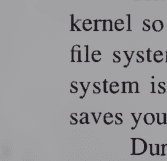

## 162 配置与管理

`LOADIN` 同样能够启动 `Umsdos`。`Umsdos` 是一种安装在 `DOS` 分区中的 `LINUX` 变体。在之前的版本中，无法通过 `LILO` 启动 `Umsdos`，必须使用一个名为 `LOADLIN` 的程序。在 `LOADIN` 和 `LOADLIN` 之间没有区别。较新版本的 `LILO` 也能启动 `Umsdos`（我还没有尝试过）。

你可以在随附的 CD-ROM 的 `deutils` 目录下找到 `LOADIN.EXE`。文件目录包含相应的 `C` 源代码，而 `LOADIN.doc` 包含了非常有价值的在线文档（可以从 `DOS` 读取）。

`LOADIN` 只能由 `DOS` 使用，不能从 `Windows` 使用。在启动 `LOADIN` 之前，始终退出 `Windows` 并切换到 `DOS` 模式！


## 准备

使用 `LOADIN` 假设你知道根分区的设备名称。如果不确定，执行 `df` 并记录下挂载在挂载点 `/` 的文件系统名称（在本例中，将是 `/dev/sda15`）。


# 162 配置与管理

## 从 DOS/Windows 启动 LINUX (LOADLIN)

通过 `LOADIN.EXE` 程序，你可以从 DOS 启动 LINUX。`LOADIN` 是 `LILO` 的一个有趣的替代方案，尽管稍微慢一点。`LOADIN.EXE` 的最大优势是你不需要触碰引导区——这是 `LILO` 配置的一部分，但并非完全没有危险。例如，你可以配置 Windows 95 的启动文件，使得 Windows 启动程序根据你的选择启动 DOS、Windows 或 LINUX。如果你想在不重启电脑的情况下从 DOS 切换到 LINUX，也可以使用 `LOADIN`。


`LOADIN` 同样能够启动 `Umsdos`。`Umsdos` 是一种安装在 DOS 分区中的 LINUX 变体。在之前的版本中，无法通过 `LILO` 启动 `Umsdos`，必须使用一个名为 `LOADLIN` 的程序。在 `LOADIN` 和 `LOADLIN` 之间没有区别。较新版本的 `LILO` 也能启动 `Umsdos`（我还没有尝试过）。

你可以在随附的 CD-ROM 的 `deutils` 目录下找到 `LOADIN.EXE`。文件目录包含相应的 C 源代码，而 `LOADIN.doc` 包含了非常有价值的在线文档（可以从 DOS 读取）。

`LOADIN` 只能由 DOS 使用，不能从 Windows 使用。在启动 `LOADIN` 之前，始终退出 Windows 并切换到 DOS 模式！


## 准备

使用 `LOADIN` 假设你知道根分区的设备名称。如果不确定，执行 `df` 并记录下挂载在挂载点 `/` 的文件系统名称（在本例中，将是 `/dev/sda15`）。

```bash
# df
File system 1024-blocks Used Available Capacity Mounted
/dev/sda15 303251 261723 25867 91% /
/dev/scd0 584560 584560 0 100% /cdrom
/dev/sda12 303251 114286 173304 40% /home1
/dev/sda11 303251 189963 97627 66% /usr
```

此外，你还需要一个可以在 DOS 下读取的内核文件。你必须将此文件拷贝到 DOS 分区。最简单的方法是拷贝到 LINUX 文件系统，并将内核文件（通常为 `/mlinuz`）拷贝进去。一个合理的位置是 `C:\LOADIN` 目录，如果有必要，你可以在 Linux 下创建它。在 `mount` 命令中，如果是 `/dev/sda1`，你必须指定第一个 DOS 分区的名称。如果你不知道它的名称，只需执行 `disk -l`。

```bash
# mkdir /dosc
# mount -t dos /dev/sda1 /dosc
# /dev/sda1 表示 DOS 分区的位置
# mkdir /LOADIN
# cp /mlinuz /dosc/LOADIN.exe 也可以 DOS 下使用
# unmount /dosc
```

## 手动调用 LOADIN

Linux 下的准备工作现在完成。使用 `Ctrl+Alt+Del` 退出 Linux 并启动 DOS。如果你通常在 Windows 下工作，请退出 Windows。仅在 Windows 下打开一个窗口是不够的。在 Windows 95 中，你可以直接在 DOS 下启动：只需在启动期间按下 `F8` 键并选择相应的选项。现在你可以在 DOS 下尝试 `LOADIN`：

```bash
> C:
> CD \LOADIN
> SMARTDRV /C (仅用于 Windows 3.1)
> LOADLIN vmlinuz root=/dev/sda1 ro
```

你必须将 `/dev/sda1` 指定为你根分区的设备名称。如果你为内核需要额外的参数，也必须指定这些参数（见第 46 页）。如果你想在文本模式下运行 LINUX，你必须用 80 个字符指定它们，使用的选项是 `getty`。如果你想启动 `Umsdos`，你可以通过 `root` 指定使用已安装 LINUX 的根分区。在大多数情况下，你的 Linux 系统的启动将成功。显然，你必须知道你根分区的名称（例如，如果 Linux 安装在第一个 SCSI 磁盘的第三个分区，则为 `root=/dev/sda3`）。你还可以在第 31 页和附录中找到关于从安装软盘启动的信息。


使用 `LOADIN` 假设你知道根分区的设备名称。如果不确定，执行 `df` 并记录下挂载在挂载点 `/` 的文件系统名称（在本例中，将是 `/dev/sda15`）。

```bash
# df
File system 1024-blocks Used Available Capacity Mounted
/dev/sda15 303251 261723 25867 91% /
/dev/scd0 584560 584560 0 100% /cdrom
/dev/sda12 303251 114286 173304 40% /home1
/dev/sda11 303251 189963 97627 66% /usr
```

此外，你还需要一个可以在 DOS 下读取的内核文件。你必须将此文件拷贝到 DOS 分区。最简单的方法是拷贝到 LINUX 文件系统，并将内核文件（通常为 `/mlinuz`）拷贝进去。一个合理的位置是 `C:\LOADIN` 目录，如果有必要，你可以在 Linux 下创建它。在 `mount` 命令中，如果是 `/dev/sda1`，你必须指定第一个 DOS 分区的名称。如果你不知道它的名称，只需执行 `disk -l`。

```bash
# mkdir /dosc
# mount -t dos /dev/sda1 /dosc
# /dev/sda1 表示 DOS 分区的位置
# mkdir /LOADIN
# cp /mlinuz /dosc/LOADIN.exe 也可以 DOS 下使用
# unmount /dosc
```

## 手动调用 LOADIN

Linux 下的准备工作现在完成。使用 `Ctrl+Alt+Del` 退出 Linux 并启动 DOS。如果你通常在 Windows 下工作，请退出 Windows。仅在 Windows 下打开一个窗口是不够的。在 Windows 95 中，你可以直接在 DOS 下启动：只需在启动期间按下 `F8` 键并选择相应的选项。现在你可以在 DOS 下尝试 `LOADIN`：

```bash
> C:
> CD \LOADIN
> SMARTDRV /C (仅用于 Windows 3.1)
> LOADLIN vmlinuz root=/dev/sda1 ro
```

你必须将 `/dev/sda1` 指定为你根分区的设备名称。如果你为内核需要额外的参数，也必须指定这些参数（见第 46 页）。如果你想在文本模式下运行 LINUX，你必须用 80 个字符指定它们，使用的选项是 `getty`。如果你想启动 Umsdos，你可以通过 `root` 指定使用已安装 LINUX 的根分区。在大多数情况下，你的 Linux 系统的启动将成功。显然，你必须知道你根分区的名称（例如，如果 Linux 安装在第一个 SCSI 磁盘的第三个分区，则为 `root=/dev/sda3`）。你还可以在第 31 页和附录中找到关于从安装软盘启动的信息。

# 启动过程 165

将参数转换为大写。然而，`LOADLIN` 依赖于大小写写的正确拼写。在我的电脑上，参数文件 `Linux.1` 如下所示：

```
c:/LOADLIN/vmlinuz root=/dev/sda1 vga=-2
```

显然，你可以通过为 `CONFIG.SYS` 添加多个条目来扩展不同的 Linux 版本，例如如果你想在旧内核或新内核之间切换启动。

关于 `MSDOS.SYS` 和 `CONFIG.SYS` 结构的更多信息，可以在关于 Windows 95 管理的优秀书籍，以及 Windows 95 光盘上的 `admin\reskit\helpfile\win95rk.hlp` 帮助文件中找到。

## 配置 LILO

`LILO`（`LILO` 加载器）是一个微型程序，可以安装在软盘、硬盘或硬盘分区的引导区（第一个扇区）中。该程序允许你在多个已安装的操作系统之间进行选择，特别是启动 `LILO`。`LILO` 是启动 Linux 最快且最流行的方法。

安装 `LILO` 是一件相当敏感的事情，特别是当 `LILO` 安装在硬盘的 `MBR`（主引导记录）时（这是通常情况）。如果出现错误，你将无法从硬盘启动计算机，无论是在你的操作系统下还是在 Linux 下。因此，在启动 `LILO` 之前，你必须为你的操作系统和 Linux 创建启动软盘，并且应该尝试它们。

`MSDOS/Windows` 启动软盘的创建描述在第 28 页。

在大多数发行版中，`LILO` 配置可以作为安装过程的一部分完成。然而，由于上述风险，手动安装 `LILO` 有其优势。你对实际发生的情况有更好的控制，可以创建 `MBR` 的备份软盘等。`LILO` 并不是运行 `LILO` 的先决条件！在最初的几天里——在你熟悉 `LILO` 的操作之前——你始终可以从软盘或通过 `LOADLIN` 启动。

关于安装程序和控制文件的格式有非常详细的信息。详细描述通常 `/usr/doc/lilo.tex` 中找到（如果你的发行版中不存在此目录，请使用 `locate` 查找 `user.tex`）。关于 `LILO` 的 Mini-HOWTO 非常有价值（通常位于 `/usr/doc/howto/mini` 目录）。

如果你安装了 `LILO`，然后 `Windows 95`（或其他 `MS` 操作系统）在没有警告的情况下被覆盖，很容易通过在 Linux 下调用 `lilo` 来重新安装 `LILO`。然而，你需要一个启动软盘才能启动 Linux。因此，即使在 `LILO` 安装成功后也不要丢弃你的 `LILO` 启动软盘！另外，当你更新 Linux 系统（新内核）时，请不要忘记更新你的启动软盘。

## 配置与管理

### 前提条件

简单来说，`LILO` 的功能加载并执行包含 Linux 内核的文件。`LILO` 在任何操作系统运行之前执行。由于这个原因——与 Linux 不同——`LILO` 必须依赖 `BIOS`。然而由于历史原因，`BIOS` 只允许访问硬盘的前 1024 个磁道。为了让 Linux 启动，内核文件必须位于硬盘的前 1024 个磁道内。根据位置的不同，Linux 内核可能被限制在硬盘的前 508 MB 内。（然而，根据磁道的大小，前 1024 个磁道可能包含高达 7.9 GB——见第 33 页。）

只要 `LILO` 分区完全位于 1024 磁道的限制内，就没有问题。如果不是如此，作为最后的手段，Linux 内核可以被复制到此限制以下的 DOS 或 Windows 分区中。然而，这会导致几个缺点（见本节末尾）。

除了磁道限制外，还有另一个限制：在启动过程中，大多数 `BIOS` 只能访问前两个硬盘。在带有多个硬盘的系统中，内核文件必须位于前两个硬盘之一（在此背景下，即使是 `IDE/ATI CD-ROM` 驱动器也被算作“硬盘”。现代 `BIOS` 版本取决于其使用方式，例如在许多 SCSI 控制器中——所有硬盘都可以无限制地访问）。

磁道限制和对两个硬盘的限制仅适用于 Linux 内核（也就是说，根分区），根分区也可以安装在从磁道 2500 开始的第一块磁盘上。一旦内核运行，就不再有问题了。


如果你使用 `EZ-Drive` 磁盘管理器，任何情况下都不能将 `LILO` 安装在 `MBR` 中！此限制同样适用于其他磁盘管理器（某些磁盘管理器允许旧版本的 `BIOS` 访问 `EIDE` 磁盘。见第 33 页）。如果你仍然想使用 `LILO`，则只能在软盘或 `LILO` 分区的第一个部分进行安装。这种变体在这里不会讨论；它在 `LILO` 文档中有详细描述。

除了 Linux 之外，`LILO` 目前可以启动 DOS、`Windows 95`（其在启动过程中对应于 DOS）、`OS/2` 和多个版本的 UNIX。遗憾的是，`Windows NT` 没有得到官方支持，必须依靠它自己的引导管理器。然而，根据 Usenet 的报告和信息，之前的 `LILO` 版本尚无法启动 `Windows`。

### 创建引导区的备份副本

在执行 `lilo` 时，会检查 `/boot` 目录中是否存在备份副本。如果没有（即在第一次执行 `lilo` 时），命令会将引导区保存到 `/boot.0300`（对于 IDE 磁盘）或 `/boot.0800`（对于 SCSI 磁盘）。如果你想将引导区传输到软盘，你需要一个格式化的软盘（见 doformat 265）。然后，你必须执行：

- `dd if=/dev/hda of=/dev/fd bs=512 count=1`

如果 A 中有软盘：当计算机重启时，它将以与硬盘引导区相同的方式启动。这在 `Windows 95` 下并不理想。当你在 `Windows 95` 下（开始|设置|控制面板|添加/删除程序|启动）创建启动软盘时，你只能用它启动 DOS 而不能启动 `Windows`。这可能足以修复损坏系统，但并不理想。相反，如果你按照上述方法操作，你可以从软盘快速且无问题地启动 `Windows 95`。（假设 `Windows` 分区没有损坏且所有系统文件可用。相比之下，“原始”`Windows 95` 启动软盘是自治的，因为文件是直接从软盘加载的。）

## 168 配置管理

分区内的内核文件（例如 `vmlinuz`、`vmlinuz.old`）。在处理此项工作时，我需要在四个发行版和 1.2.13 到 2.0 之间的几个内核版本之间进行选择。


第一部分以 `boot=` 指令开始，并指定 `LILO` 要安装在哪个硬盘上。对于配有 `IDE` 磁盘的计算机，这通常是 `/dev/hda`（第一块磁盘）；对于仅配备 `SCSI` 磁盘的计算机，则是 `/dev/sda`（第一块 `SCSI` 磁盘）。在带有 `/dev/fd0` 的磁盘上进行安装的描述将另行说明。

`compact` 允许极快地加载上述内核（全部从软盘加载），但它并非在所有计算机或所有硬盘控制器上都能工作。

`delay` 指定了 `LILO` 等待手动输入的十分之一秒数。最短的延迟是 `0`，但如果你不使用默认操作系统，必须在启动 `LILO` 之前按住 `Shift` 键。

```
# /etc/lilo.conf (part 1)
# LILO 全局部分
# 安装在第 1 块 SCSI 磁盘的 MBR 中
boot = /dev/hda 用于第 1 块 IDE 磁盘
delay = 100
# 等待 10 秒
# compact
# 快，但不总是有效
# linear
# 对于某些大磁盘是必要的
```

在某些情况下，`LILO` 在硬盘几何结构上存在问题。如果使用了 `linear` 选项仍然不起，你必须使用 `bios`、`sectors`、`heads` 和 `cylinders` 选项。关于此主题的背景信息可以在第 33 页找到。

```
bios=080             # 第一块用 080，第二块用 081...
sectors=63            # 扇数
heads=255             # 磁头数
cylinder=522         # 柱面数
```

现在来看 `lilo.conf` 的第二部分：在这里你可以指定最多 16 个你选择运行的操作系统版本。第一个系统是默认设置。所有条目的共同特征是 `label` 命令，它为每个版本命名。这些名称必须在手动选择操作系统时输入——因此，最好选择短且意义明确、没有空格或特殊字符的名称。

对于 `LINUX`，除了 `label` 之外必须指定 `image` 和 `root` 命令。`image` 名称决定内核文件的名称，`root` 则是根目录所在的分区。

`vga` 指定 `VGA` 模式：`extended` 为 50 行的扩展模式，`normal` 为标准模式，启动期间请求确认，以及任意数字 $n>0$ 表示 `VGA` 模式 $n$。（警告！如果此 `VGA` 模式不存在或不受支持，你仍然可以正常运行 `Linux`。）如果你想使用 `RAM` 磁盘，可以使用 `ramdisk=` 以 `Kbytes` 为单位指定其大小。

`read-only` 指定根分区以只读方式挂载。然后，`init` 进程可以在再次以读写模式（且肯定地）挂载文件系统之前，检查并在需要时修复文件系统。

## 启动过程

通过 `append` 可以指定额外的内核选项（例如，为了规避硬件问题）。当使用 `Linux` 发行版的现成内核时，这尤为重要。另一方面，如果你为自己的 `Linux` 系统编译内核（该内核针对你的硬件进行了优化调优），则很少需要内核选项。

在 `DOS` 和 `OS/2` 版本中，使用 `other` 选择分区，使用 `table` 选择硬盘，以及对于 `OS/2` 使用 `loader` 指示系统引导程序。`Windows` 95 的处理方式与 `DOS` 相同。以下列表包含了所有可能的变体的示例。在你的 `lilo.conf` 中，必须相应匹配每个文件和路径规范。

```
# /etc/lilo.conf (part 2)
# 默认：从 /dev/sda6 启动 Linux
image = /vmlinuz
root = /dev/sda6
label = linux
vga = extended # 文本模式 80x50 
# NE-2000 以太网卡的内核选项
append = "ether:10,0x300,0,0 reserve=0x300,10"
read-only
# 备用：'Linuxbak' 启动旧版本的内核
image = /vmlinuz.bak
root = /dev/sd2
label = linuxbak
vga = extended # 文本模式 80x50 
append = "ether:10,0x300,0,0 reserve=0x300,10"
read-only
# 备用：'dos' 在 /dev/sda1 上启动 DOS/Windows
other = /dev/sda1
table = /dev/sda
label = dos
# 备用：'os2' 在 /dev/sdb1 上启动 OS/2
other = /dev/sdb1
table = /dev/sdb
loader = /boot/os2_d.b
label = os2
```

在线文档描述了大量的额外选项——例如用于显示信息文本的 `message`。此外，你将找到如何使用 `LILO` 在启动过程中本身调查密码保护的描述。

## 在 DOS 分区中安装 LILO (1024 柱面限制)

`Linux` 根分区位于 1024 柱面的魔法限制之外，或者位于不可访问的硬盘上，内核文件和其他启动信息可以拷贝到位于此限制的 `DOS` 分区中。（启动时，`LILO` 需要内核文件、`boot.b` 和 `map` 文件，以及如果使用了 `message` 选项则可能需要的消息文件。）

### 170 配置管理

`Linux` 根分区位于 1024 柱面的魔法限制之外，或者位于不可访问的硬盘上，内核文件和其他启动信息可以拷贝到位于此限制的 `DOS` 分区中。（启动时，`LILO` 需要内核文件、`boot.b` 和 `map` 文件，以及如果使用了 `message` 选项则可能需要的消息文件。）

# 172 配置与管理

要在软盘上安装 `LILO` 配置，需要以下命令：

```bash
# chmod go-w /etc/lilo.floppy      # 否则 LILO 会报错
# lilo -C /etc/lilo.floppy                 # 安装 LILO
# ls -LR /mnt/floppy/          2 root      80 Jun 16 20:24 boot
    drwxr-xr-x      1 root              403672 Jun 16 19:37 vmlinuz
    -rw-r--r--      1 root      root

/mnt/floppy/boot:
total 1
-rw-r--r--      1 root      root      3708 Jun 16 19:39 boot.b
-rw-r--r--      1 root      root      7168 Jun 16 20:24 map
```

```bash
# sync
# umount /mnt/floppy         # 执行缓冲操作
```


关于如何创建具有独立根文件系统并用于维护工作的复杂启动软盘，可以在关于启动软盘的 `HOWTO` 文档中找到。其中，你可以在 `CD-ROM` 上找到预定义的镜像，可以毫不费力地创建此类维护软盘。在某些情况下，安装软盘本身也可以用于此目的。

# 使用 LILO

通常，`LILO` 的设置为在启动过程中有一个短暂的延迟（几秒钟），期间如果你想选择启动的操作系统，可以按下 `Shift` 键。在 `LILO` 提示符处，输入操作系统的名称并按 `Tab` 键。`Tab` 会显示可选列表的表格。如果定义了默认操作系统且你没有按 `Shift`，`LILO` 将自动启动该操作系统。

`LILO` 一个特别有吸引力的特性是你可以输入额外的内核选项。要做到这一点，按下 `Shift` 并输入操作系统名称，以及所需的选项。最常用的选项是 `root=`（选择不同的根分区）、`ro`（以只读模式启动 `LINUX`）和 `single`（以单用户模式启动 `Linux`）。内核选项也可以意味着解决各种硬件问题的救星。然而，在这种情况下，在 `lilo.conf` 的 `append` 行中指定这些选项更有意义。

在第 46 页可以找到最重要参数的表格。请注意，在 `LILO` 输入期间，采用美式键盘布局。某些字符的位置会不同。


# 从硬盘上移除 LILO

为了从硬盘上移除 `LILO`，你必须恢复引导区。在简单的情况下，你只需执行 `lilo -u`。这会导致 `LILO` 读取首次安装 `LILO` 时保存存在 `/boot` 中的引导区，并用它覆盖当前的 `LILO` 引导区。

如果你已经对引导区做了自己的备份，可以重新安装：

```bash
# dd if=/boot/bootsector.ide of=/dev/hda bs=512 count=1 # 第一块 IDE 磁盘
# dd if=/boot/bootsector.scsi of=/dev/sda bs=512 count=1 # 第一块 SCSI 磁盘
```


如果在卸载 LILO 过程中发生问题，你可以使用启动软盘执行 `FDISK /MBR`。这会为自动启动 DOS/Windows 3.1 创建一个引导区（并覆盖 LILO 引导区）。然而，这种方法对 Windows 95/Windows NT 不起作用。

# 6.7 重新编译内核

系统配置中不可或缺的一部分是重新编译内核，通常出于以下一个或多个原因：

- 安装的内核没有针对你的硬件进行优化（Caldera 不适用）。内核可能包含你的计算机不存在的硬件组件驱动程序。同时，对你的系统特别重要的部分（例如对网卡的支持）可能缺失。

- 安装时使用的内核版本仍为 1.2 或 1.3，但你可能切换到新的 2.0 版本。在许多领域，新内核更快（如 NFS）、支持更多硬件、允许访问 Windows 95 文件系统等。

重新编译的目标是获得尽可能紧凑且与你的硬件完全匹配的内核。不要：编译内核不需要任何编程知识。你只需要回答关于计算机硬件的问题。随后将自动编译。

编译内核也不构成安全风险。如果你按照下面的操作，之后可以使用旧内核或新内核启动计算机。

编译内核的先决条件是安装内核代码以及 GNU 编译器和开发工具（如 `make`、各种库）。内核代码相当大；加上相应的二进制文件占用约 40 MB。

进一步说明：有“稳定”内核版本（1.0.n、1.2.n、2.0.n）和开发者内核（1.1.n、1.3.n、2.1.n 等）。由于上述原因，大多数发行版最合理的方法是基于发行版包含的内核为你的硬件生成优化内核。然而，使用更新的版本可能会导致问题（升级到“稳定”内核 2.0！）。对于大多数 Linux 用户来说，保留最新内核没有意义。开发者内核（称为 hacker kernels）仅适用于想要参与开发、测试并修正最新代码的用户。在这里，一旦你为计算机安装了优化内核——就像任何“普通”用户一样——并且运行没有问题，就没有必要更新。

现在，在开始乐趣之前，这里是需要遵循的小节概述：

- 安装/更新内核：在哪里获取当前内核以及如何安装（包括补丁）。
- 配置内核：在开始编译之前可以设置数百选项。
- 编译内核：如何编译并安装内核。
- 模块：许多内核组件可以集成到内核中，也可以以后模块的形式加载；当频繁更改硬件时，模块化概念变得很重要。
- 系统更新到内核 2.0：如果你在旧发行版上安装内核 2.0，你必须执行其他更改。

关于内核编译的更多信息可以在 `/usr/src/linux/README` 和 `/usr/src/linux/Documentation` 文件中找到。

# 安装/更新内核

内核源码位于 `/usr/src/linux`。如果此目录为空，说明你还没有安装内核代码。所有发行版至少提供内核安装选项（供以后安装）。然而，发行版包含的内核通常是过时的（例如，RedHat 3.0 安装的是内核代码 1.2.3）。

为了让你能够毫不费力地安装最新的内核，CD-ROM 中的 `/kernel` 包含了编写时最新的 Linux 版本（2.0.n）。更具体的内核可以在互联网上找到：

```
```

在原则上，更新内核代码有两种可能：

- 你可以使用所谓的 patch 文件从一个版本更新到随后的版本。例如，如果你想从 1.2.3 版本更新到 1.2.4，你必须执行 `patch` 命令来执行内核 `patch-1.2.4`。`patch-1.2.4` 是一个描述 1.2.3 版本源码中被修改的单独的文件（因此，前一个版本的完整正确源码是任何成功更新的先决条件）。补丁文件的优点是较小，可以通过 FTP 轻松获取。

- 在大版本更改的情况下（例如从 1.2.13 到 2.0.x），你必须连续执行几十个补丁。这并不实用并且可能导致许多错误。由于上述原因，内核作为一个完整的包提供。典型文件名类似于 `linux-2.0.4.tar.gz`。此类压缩存档文件（约 6 MB）必须使用 `tar` 安装在 `/usr/src` 目录下。

如果你使用 RedHat 或 Caldera，还可以通过 `gl` 或 `rpm` 将当前内核作为包安装（因为有更新包；对于最新版本，情况很少见）。

现在关于默认值：通常，`/usr/src/linux` 是指向已安装 Linux 代码所在目录的链接：

```bash
# cd /usr/src
# ls -l
lrwxr-xr-x  1 root  root  11 Apr 30 16:58 linux -> linux-1.2.13
```

如果你有足够的磁盘空间，应该删除旧的内核代码。相反，你可以删除旧的 `linux-1.2.13` 链接，创建一个新目录 `linux-2.0.x` 并让 `linux` 链接指向新目录。

`2.0` 代表 CD-ROM 上 `/kernel` 的最新内核（本文编写时尚未确定版本号）。`Linux-1.2.13` 代表你当前安装的内核版本。显然，你的系统版本号可能不同。

```bash
# cd /usr/src
# mkdir linux-2.0.x
# rm linux
# ln -s linux-2.0.x linux
```

如果你有磁盘空间问题，必须删除旧的内核代码：

```bash
# rm -rf /usr/src/linux-1.2.13
```

现在将新内核解压到 `linux` 目录。

```bash
# cd /usr/src
# tar -xzvf /cdrom/kernel/linux-2.0.x.tar.gz
```

# 176 配置与管理

```bash
# cd /usr/src
# gzip -cd /cdrom/kernel/patch-2.0.y.gz | patch -p0
```

## 配置内核

在编译内核之前，你必须通过进入 `/usr/src/linux` 目录并编辑 `.config` 文件，输入所有适用于新内核的选项（例如：哪种 SCSI 卡、哪种以太网卡、哪些网络功能等）。`.config` 并不是手动编辑的，而是通过通过 `make` 启动的特殊配置程序完成的。自内核 2.0 版本以来，已经出现了不同版本的程序供选择（你必须在下面列出的三个版本中选择一个）。

```bash
# cd /usr/src/linux
# make config # 或
# make menuconfig # 或
# make xconfig
```

`make config` 是最不优雅的版本。你必须一个接一个地回答无尽的问题列表。这种变体的优势是不需要安装任何额外的程序。

`make menuconfig` 处理起来容易得多：配置仍然在文本模式下进行，但你现在可以从菜单中选择单个配置点。因此，可以非常快速地更改某一点，而无需重复所有其他设置。`make menuconfig` 仅在安装了包含所需屏幕控制函数的 ncurses 库时才起作用。在 RedHat 发行版中，你必须安装 `ncurses` 和 `ncurses-devel` 包。

`make xconfig` 更加高级：这种变体仅在 X 环境且安装了 TTK 下运行。配置通过鼠标点击在一个设计良好的程序中完成。

`make xconfig` 不会自动读取最近创建的 `.config` 文件（而其他配置程序则会）。如果你已经配置了内核并只是想进行修改，必须先点击“LOAD CONFIGURATION FROM File”（从文件加载配置）并选择 `.config`。当程序触发时，配置会自动保存回此文件。

无论你选择哪种变体，你仍然需要回答许多关于内核配置的问题。至少，大多数选项都有合理的默认设置。此外，每个问题都有非常详尽的帮助文本。然而，如果你对 Linux 或任何其他 Unix 缺乏经验，这些信息会让你感到困惑。因此，本节将介绍关于该主题的更多基础信息，而不会深入探讨每一个选项。


# 重新编译内核 177

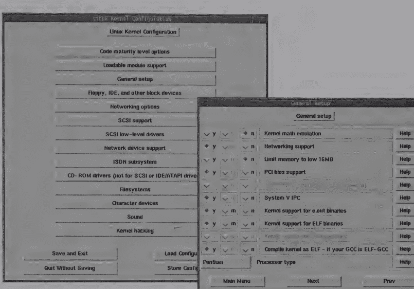

图 6.1 X 环境下的内核配置。

对于许多组件，你有三个备选方案：YES/NO/MODULE。模块是什么以及如何使用的描述见第 181 页。如果你不确定，只需选择 YES 即可。

## 代码成熟度

在这里，你可以指定是否将 Alpha 驱动程序和其他半完成的组件考虑配置。通常情况下，你可以不需要它们。

## 可加载模块支持

指定内核是否以及如何处理模块（另见第 181 页）。如果内核在后期可以通过模块进行扩展，那么这是非常有用的——即使你只想编译一个没有任何额外模块的紧凑内核（YES）。另一方面，版本信息的管理和内核守护进程支持对于匹配的系统配置才有意义。

## 通用设置

只有当你的处理器没有协处理器时（386, 486, SX），内核数学仿真才是必要的。在任何情况下都需要网络支持，即使你没有内存。（许多内部命令依赖于网络协议）。System V IPC 是 LINUX 内部通信的另一种形式，被多个程序（尤其是 DOS 模拟器）使用。新的发行版主要由 ELF 程序组成。因此，你绝对需要 ELF 支持。

# 178 配置与管理

许多程序必须以 a.out 二进制格式执行——因此你也应该选择此选项。

## 软盘、IDE 以及其他块设备


软盘支持可能是需要的。如果你有`SCSI`系统，可以不需要`IDE`支持。否则，还有许多选项取决于你的硬件和你的`IDE`卡。（某些`IDE`卡有缺陷，但内核包含了绕过这些缺陷的代码。）你通常不需要回环设备支持——这是你通过网络配置使用它作为文件系统的方式。

## 网络选项

在这里，最好的建议是在不确定的情况下接受所有默认设置。在任何情况下，都需要`TCP/IP`支持。如果你的计算机旨在作为本地网络和互联网之间的网关，`IP`转发（`forwarding`）至关重要。对于正常使用`PPP`或`SLIP`服务器，这是需要的。在某些你经常需要更改的选项中（网络设备支持）。

你可以在《Linux 网络管理指南》第 79 页找到关于许多网络选项的信息。


## SCSI 支持

如果你使用`SCSI`硬盘，必须选择前两个选项；对于流式器或光驱器，必须选择接下来的两个选项。关于`SCSI`类型的详细信息将在后面请求。

## SCSI 底层驱动

在这里列出了`SCSI`数量。

## 网络设备支持

如果内核在后期可以通过模块进行扩展——即使你只想编译一个没有任何额外模块的紧凑内核（`YES`）。另一方面，版本信息的管理和内核守护进程支持对于匹配的系统配置才有意义。

## ISDN 支持

如果你想使用`ISDN`。关于`ISDN`的信息也可以在以下找到：

```
http://www.ix.de/linux/isdn.html
```


# 重新编译内核 179

## 光驱驱动

在大多数情况下，你不需要选择任何选项，即使你拥有光驱器。在这里只列出了拥有独立接口的光驱驱动。

## 编译并安装内核

```bash
# cd /usr/src/Linux
# make dep # 检查依赖
# make clean # 删除旧的对象文件
# make image # 开始编译
```

在你投入了一些时间配置内核后，现在轮到计算机工作了。根据你计算机的速度，它将忙碌几分钟（`Pentium` 133MHz）到几个小时。

不要忘记`LINUX`是一个多任务系统。你可以切换到控制台，并在在线文档中阅读某些主题、写信等等。只要你不执行耗时的操作操作，你就几乎察觉不到由于并行编译带来的延迟。

此过程结束的结果是在`/usr/src/Linux/arch/i386/boot`目录下的内核镜像文件。根据配置，内核的大小约为 350 到 500 `Kbytes`。

显然，新创建的内核尚未激活。到目前为止，仅创建了一个新文件，别无其他。内核可以在下次启动`Linux`时被激活，甚至仅需你先调用`LILO`程序并激活启动目录中的新内核。

通常，激活的内核文件位于`Linux`根目录`/`下，通常命名为`vmlinux`。在将新创建的内核移动进去之前，你应该将旧的`vmlinux`重命名为`vmlinux.bak`：

```
# mv vmlinux vmlinux.bak
# mv /usr/src/linux/arch/i386/boot image .
```

如果使用`LILO`启动`Linux`，`/etc/lilo.conf`中已有的项将增加一个允许启动旧内核的新项（`vmlinux.bak`）。对于`/dev/sd2`，必须指定你计算机的根分区。在修改此文件之前，请阅读`LILO`配置章节（第 165 页）！

```
# LILO 配置：/etc/lilo.conf

...

# 从 /dev/sd2 启动 Linux

image = vmlinux

root = /sd2

label =

read-only

# 备用：通过 linuxbak 启动旧内核

image = vmlinux.bak

root = /sd2

label = linuxbak

read-only

# 备用：通过 dos 启动 MS-DOS

other = /dev/sda1

label = dos
```

必须调用`lilo`来激活修改后的`LILO`配置：

```
# cd /etc

# lilo

Added Linux

Added dos

Added linuxbak
```

如果启动新内核导致崩溃，只需在启动时按`Shift`键指定`linuxbak`。通过这种方式，你可以使用旧内核并尝试。

作为`LILO`的替代方案，新内核也可以传输到启动磁盘上，或者使用`LOADLIN`进行启动——参见第 160 或 161 页。

# 模块

模块在 1.2 版本中已经存在，但真正的突破是从 1.3 及之后的内核版本开始的。模块的原理非常简单：与其将各种硬件驱动直接集成到内核中，它们可以在稍后的阶段（当内核已运行时）加载，并在需要时移除。这有几个优点：

- 内核模块可以按需加载。如果某个模块不经常需要，可以节省内存空间。
- 当硬件发生变化（例如更换网卡）时，不需要重新编译内核：只需加载新模块。
- 当开发新模块时，不需要每次都重新编译内核。只需编译该模块，然后在正常条件下进行测试。
- 硬件制造商可以提供支持其硬件的模块，而发布源码。
- 所有内核模块的完整集合可以以预编译的形式安装。与通用内核配合，这可以使用`LINUX`支持的所有硬件。无需安装内核即可进行维护和更新。

发行版可以在安装和运行期间通用内核。该内核仅包含启动所需的各种函数。其他模块将根据配置加载。如果这一概念得到了正确实现（大多数当前发行版都是如此），内核无需重新编译即可针对用户的计算机进行优化。未来，其他发行版可能也会遵循这一概念。用户不仅免去了重新编译内核的安装，还可以这样做，从而在硬盘上节省大量空间。

对于那些为自己的计算机编译优化内核的用户来说，模块提供的优势很少。如果你在任何地方经常都需要`xyz`卡的驱动程序，将其编译为模块意义不大。任何情况下，没有模块的内核更容易维护，通用内核需要于在正确的位置和所需的版本安装各种模块。

有关处理模块的更多细节可以在`/usr/src/linux/Documentation/modules.txt`中找到。

# 编译模块

在内核配置中，许多内核组件允许你选择将其直接集成到内核中还是作为模块编译。`make image`（见上文）将只生成通用内核，指定的模块必须单独生成。这会产生许多扩展名为`.o`的模块文件，分散在内核代码目录树中。指向这些文件的链接在模块目录中建立。

根据你的计算机配置，启动`LINUX`至少需要以下内容：硬盘驱动程序（可能是`SCSI`）、其包含的文件系统驱动（通常是`ext2`），以及基础网络支持的模块（不含特定硬件驱动）。

通过`modules_install`，模块最终安装在模块管理程序（例如`insmod`）期望它们所在，即`/lib/modules/2.0.x`目录（`2.0.x`使用当前内核版本）。

```
# cd /usr/src/linux

# mkdir modules # 如果目录不存在

# make

# make install
```

# 使用模块

正确安装的模块通常不会加载。`Caldera`发行版是一个例外，其中`init`进程负责模块的加载。在下文中，我们描述一些用于手动管理的命令。

```
insmod module_name
```

将指定的模块集成到内核中。模块名不带路径信息；例如，使用`insmod nfs`加存储在`/lib/modules/dep`中的`NFS`模块。

```
modprobe module_name
```

`modprobe`的工作方式与`insmod`相同；它会检查加载的模块是否依赖于其他模块。这假设之前已经使用了`depmod`。

```
rmmod module_name
```


从内核中移除指定的模块并释放相应的内存空间。只有当模块未被使用时，该命令才能成功执行。

# `lsmod`

`lsmod` 提供集成到内核中的所有模块列表。

# `kerneld`

`kerneld` 是一个守护进程，它能自动识别何时需要特定的模块。该守护进程按需加载模块（并在不再使用时移除）。`kerneld` 基于上述依赖文件。如果 `LINUX` 操作需要大量模块，`kerneld` 的开销就是合理的。

# 从内核版本 1.n 到 2.0 的系统更新

某些旧发行版基于内核 1.2。更新到内核 2.0 最简单的方法显然是使用新的发行版，其中属于内核的所有工具和配置脚本都已更新。如果你在旧发行版上安装新内核 2.0，仅拷贝新内核镜像 `vmlinux` 并重新执行 `lilo` 是不够的。你还必须对系统进行一些更改：

- 最明显的修改是过程。当关机系统（`shutdown`）时，`linux` 会出一连串错误信息。虽然所有文件系统都正确关闭了，但并不好看。解决方法是更新到最新版本的 `/sbin/init`。
- 另一个令人沮丧的问题是许多发行版的网络功能突然停止工作。这里的原因是回环接口的配置错误，这在之前的内核版本是可以接受的。你必须确保回环接口设置为 `route add -net 127.0.0.0`（而不是 `127.0.0.1`）。这种影响特别影响 `RedHat` 3.0.3 和基于它的 `Caldera` 发行版。
- 基础工具（如 `ps` 或 `top`）突然出现奇怪的错误信息（如除以 0 等）。原因在于这些工具所访问的 `/proc` 文件系统被修改了。这可以通过安装新的 `procps` 软件包来解决。
- `PPP` 软件包必须更新到 2.2 版本。

特别是对于非常老旧的发行版，必须进行一系列进一步的修改。关于问题来源及其解决方案的完整描述可以在 `/usr/src/linux/Documentation/Changes` 文件找到。

## 配置 `X` 窗口系统

`X` 窗口系统（简称 `X`）是一系列函数和协议的集合，用于在屏幕上显示图形信息并管理鼠标和键盘。这些函数也适用于网络操作。因此，`X` 成了 `LINUX` 图形用户界面的基础。

“用户界面”这个术语必须保留意见（谨慎对待）；与 `MS Windows` 或 `Macintosh` 世界不同，`X` 程序的视觉和手感受到当前运行程序所使用的库、当前活动窗口管理器等的影响。

（在 `LINUX` 下）产生的结果是：没有两个 `X` 程序的处理方式是完全相同的。差异始于视觉细节（如菜单的外观），延伸到鼠标按钮配置（哪个按钮用于什么用途），并止于每个 `X` 程序在键盘处理上都有自己的问题。

尽管如此，`X` 是一件很好的事情：尽管不均匀，但 `X` 程序总是比相应的文本模式程序更容易处理。没有 `X`，`ghostview` 或 `xvi` 等图形程序是无法想象的。在成功配置 `X` 后，你真的会觉得自己正在一台价格比你 `PC` 贵几倍的现代 `Unix` 工作站上工作。

本章描述了 `X` 配置的不同方面，同时提供了一些图形硬件的基础知识。重点在于 `XFree86` 服务器和 `fwm` 窗口管理器的配置。

### 7.1 配置 `X` 服务器

根据发行版的不同，安装后你可能无法直接使用 `X`，必须先配置系统（此时你仍在文本模式下工作）。在实践中，你必须指定在使用哪块显卡和哪个显示器。在此基础上，配置程序会确定可能的图形模式并将其写入配置文件。根据发行版的不同，可能提供不同的 `X` 服务器和配置程序。以下是这一较长章节结构的简要概述：

#### 配置 `X` 窗口系统

| 主题 | 页码 |
| :--- | :--- |
| 词表 | 186 |
| 基础 | 187 |
| `XFree86` 配置 | 190 |
| 支持的显卡 | 191 |
| 使用 `x886config` 配置 | 192 |
| 使用 `Xconfigurator` 配置 | 196 |
| 手动配置 | 196 |
| 测试配置 | 201 |
| 问题 | 202 |
| 商业 `X` 服务器 | 203 |

#### 极简主义 `X` 词表

##### `X` 窗口系统

`X` 窗口系统（简称 `X`）基本上是一系列在屏幕上绘制点、矩形等的函数的集合。`X` 还还包含一种网络协议，允许你在 A 计算机上执行 `X` 程序，并在 B 计算机上显示结果（通过网络）。当前版本是 `X11R6.1`，但大多数 `Linux` 发行版仍使用 `X11R6`。`X` 窗口系统是在 `MIT`（马萨诸塞理工学院）开发的。

#### `X` 服务器

`X` 服务器是 `X` 窗口系统与硬件（显卡、鼠标）之间的接口。`LINUX` 下最常用的服务器是免费的 `XFree86` 服务器以及 `Metro X` 和 `Xside` 的两个商业服务器。

`XFree86` 是 `X11R6` 的一部分，代表了针对 `Intel 386` 及其兼容计算机的 `X` 系统免费端口。`XFree86` 由 `XFree86 Project, Inc.` 开发（The `XFree86 Project, Inc.`, c/o `AIB Software Corporation`, 1145 Herndon Parkway, Suite 200, Herndon, VA 22070, USA. 邮箱: `XFree86@XFree86.org.`）。`XFree86` 最出色的特性是支持无数种显卡。`XFree86` 不适用于 `LINUX`，但适用于其他 `UNIX` 系统。当前版本为 3.2。

商业服务器通常必须单独购买。（在某些发行版中，包含一个 `X` 服务器——但这会影响你为该发行版支付的价格。）一个优势是，它们支持 `XFree86` 无法支持的显卡（因为某些制造商不发布显卡的规格）。其次，商业服务器通常更容易配置，并且在某些显卡上能获得比 `XFree86` 更速度。

#### 虚拟屏幕

`X` 服务器能够管理一个比显示器实际可见区域更大的虚拟屏幕。通常，虚拟屏幕被设置为至少 `1024x768` 点，即使显示器只能显示 `800x600` 像素闪烁。一旦将鼠标移动到屏幕边缘，可见部分的滚动就会立即发生。

#### 窗口管理器

窗口管理器是一个负责管理窗口的 `X` 程序。在 `X` 下，有多个窗口管理器可用，它们在用法和窗口框视觉布局的变体上有所。关于窗口管理器的选择、配置和处理的信息可以从第 210 页开始找到。

#### 虚拟桌面

`LINUX` 下的窗口管理器可以管理虚拟桌面。通常，虚拟屏幕被设置为至少 `1024x768` 点，即使显示器只能显示 `800x600` 像素闪烁。一旦将鼠标移动到屏幕边缘，可见部分的滚动就会立即发生。

产生的结果是：没有两个 `X` 程序的处理方式是完全相同的。差异始于视觉细节（如菜单的外观），延伸到鼠标按钮配置（哪个按钮用于什么用途），并止于每个 `X` 程序在键盘处理上都有自己的问题。

尽管如此，`X` 是一件很好的事情：尽管不均匀，但 `X` 程序总是比相应的文本模式程序更容易处理。没有 `X`，`ghostview` 或 `xvi` 等图形程序是无法想象的。在成功配置 `X` 后，你真的会觉得自己正在一台价格比你 `PC` 贵几倍的现代 `Unix` 工作站上工作。

本章描述了 `X` 配置的不同方面，同时提供了一些图形硬件的基础知识。重点在于 `XFree86` 服务器和 `fwm` 窗口管理器的配置。

需要略高的频率来抵消垂直行回所消耗的时间。

## 像素频率（视频带宽）

这表示在每秒钟内从显卡向显示器传输的点（像素）数量。对于 `640x480` 个点和 `60 Hz`，结果为 `18.4 MHz`。由于水平和垂直行回带来的开销，实际像素频率为 `25 MHz`。

## 隔行扫描

隔行扫描是一种长期会导致头痛和眼睛疲劳的可靠方法。在这里，并不是每一行都被考虑，而是每隔第二行。因此，第一帧由第 1、3、5 行等行组成，第二帧由第 2、4、6 行等行组成。通过这种方式，尽管像素频率较低，也能获得更高的分辨率。然而，如果你不使用具有极持久荧光体的显示器，结果就是图像轻微闪烁。

## 显示器

图像的由两个硬件组件决定：显示器和显卡。从技术规格的角度来看，显示器可能更容易理解。对于现代显示器，相关数据有：垂直同步率（例如 `50` 到 `90 Hz`）和最大带宽（例如 `75 MHz`）。旧的显示器无法设置为这些范围内的任何频率，而仅支持少数频率。

当显卡向显示器发送数据流，而显示器无法正确解释时，就会发生同步问题。这可能发生在同步脉冲传输过早、太晚或太弱，或者超过了显示器的频率限制时。

超过频率限制（当显卡提供过多数据时发生）可能是相当危险的。在这种情况下，显示器的电子束将无法跟上数据，屏幕部分甚至整个屏幕被照射时间过长且强度过大，导致它们过热并在很短的时间（几秒钟）内被损坏。因此，在配置期间，精确指定显示器的限制值至关重要。

## 显卡

显卡的主要任务是为图像构建提供像素数据。此外，显卡应该支持绘制操作——但这在这里无关。）所有当前的显卡都可以生成几种具有不同分辨率和频率的图形模式——甚至可能是你的显示器无法处理的模式。

频率对显卡也起着重要作用。虽然显示器必须理解给定像素频率下提供的数据流，但在显卡中产生该像素频率是一个（技术）问题。某些显卡只能生成几个预定义的频率，而现代显卡配备了可自由编程的频率发生器。显卡提供的频率是视频驱动程序配置中的重要元素。

## 配置 `X Window` 系统

### 颜色

对于显示器来说，颜色没有问题。显示器只需接收一个反映颜色分（红、绿、蓝）强度的模拟值。显示 16 色、256 色或更多并无所谓。

对于显卡来说，颜色确实构成了一个问题：一方面，颜色越多，必须处理的数据就越多。256 色的图像占用的内存空间是 16 色的两倍。这种内存必须以极快的速度持续读取。现代显卡的数据流可达每秒 `200 MBBytes`。

另一方面，每个像素的数字模式都必须转换为模拟信号。然而，为此所需的数字/模拟转换器（`DAC`）只能工作到特定的频率。对于许多显卡，`DAC` 频率低于显卡理论上支持的带宽。此外，某些显卡制造商似乎养成了不断更换 `DAC` 芯片的习惯；因此，对于某些显卡，你必须在配置文件中输入 `DAC` 芯片的精确型号。

### 加速卡

这些是具有专用芯片支持绘制操作的显卡。而旧的显卡（超 `VGA` 卡）必须由计算机本身更改每个像素，加速卡能够执行某些操作，如移动图像。缺点是：每个制造商使用不同的芯片来加速基础操作；因此，每个系列的卡都需要特定的驱动。

### 配置 `XFree86` 3.1

`XFree86` 3.2 见附录 E。

`XFree86` 的中心配置文件是 `XF86Config`。根据发行版的不同，它位于 `/etc/X11/` 目录下。该文件以文本格式包含了与你的显卡和显示器相关的所有数据。如果你想修改此文件，必须具有 `root` 权限。

标准的 `xf86config` 配置工具是 `xf86`。某些发行版还包含更复杂的 `Xconfigurator` 程序。无论你使用哪种配置程序，通常都必须手动触摸配置文件。本节从如何使用 `xf86` 和 `Xconfigurator` 开始。如果这些任何一个程序无法正常工作，后续的关于 `XF86Config` 的详细信息将允许你手动编辑此文件

### 配置服务器

本节的目的是获得最高分辨率且无闪烁的图像。关于 `X` 资源的进一步细节请见第 210 页。不要从朋友那里、互联网或其他地方借用 `XFree86` 配置文件而不先适配你的显示器数据（见下）——否则你的显示器可能会提前损坏！

# 在线文档

有大量关于 `XFree86` 的在线文档。`XFree86` 的 `HOWTO` 提供了一个非常好的概述。根据发行版，不同显卡的详细信息 `README` 文件可以在 `/usr/X11/lib/doc` 或 `/var/X11/lib/doc` 中找到。`AccCards`、`Devices`、`Monitors`、`modeDB.txt` 和 `README` 包含了示例。`VideoModes` 还包含基础知识。

另一个信息来源是 `XFree86` 的 `man` 手册：`XFree86`（概述）、`Xserver`（运行 `X` 的通用选项）以及所有视频驱动：`XF86_Mono`、`XF86_VGA`、`XF86_SVGA`、`XF86_Accel`。最后，`XFree86Config`（请注意大小写）的手册提供了配置文件允许的所有关键字的描述。

## 支持的显卡

| | |
| :--- | :--- |
| `XF86_MONO` | 单色驱动（黑白） |
| `XF86_VGA` | 16 色，标准 `VGA`（用于非常旧的卡） |
| `XF86_SVGA` | 超 `VGA` 标准驱动（`Tseng`、`Trident` 等） |
| `XF86_8514` | `IBM8514` 驱动（`XVGA`） |
| `XF86_AGX` | `AGX` 处理器驱动（`IIT`） |
| `XF86_Mach` | `Mach` 处理器驱动（`ATI`） |
| `XF86_Mach32` | `Mach32` 处理器驱动（`ATI`） |
| `XF86_Mach64` | `Mach64` 处理器驱动（`ATI`） |
| `XF86_P9000` | `P9000` 图形处理器驱动（`Diamond Viper` 等） |
| `XF86_S3` | `S3` 图形处理器驱动 |
| `XF86_W32` | `ET4000/W32` 图形处理器驱动（`Tseng`） |


## 配置 `X Window` 系统

除了单色和16 色驱动外，所有驱动程序都支持 256 色模式，在大多数情况下可以设置任意分辨率。特殊显卡的独立驱动程序也支持更多色的图形模式。驱动程序安装在 `/usr/X11/bin` 目录下。通过从 `/usr/X11/bin/X` 到驱动文件的链接来选择所需的驱动程序。在某些发行版中，`/usr/X11/bin/X` 指向 `/etc/X11/X` 或 `/var/X11/bin/X`。在这种，只有最后一个链接指向服务器。

```


# `ls -l /usr/X11/bin/X`

```
lrwxr-xr-x 1 root root X -> ../../../etc/X11/X
```

# `ls -l /etc/X11`

```
lrwxr-xr-x 1 root root /etc/X11/X -> ../../../../usr/X11/bin/XFree86
```


## 配置 X Server 193

如果你不知道你的显卡工作的是哪种芯片，你应该阅读显卡的文档。如果这没有帮助（或者你没有找到任何手册），你可以执行同步程序。在大多数情况下，程序可以可靠地检测图形硬件。在最坏的情况下，它可以导致崩溃、损坏字符集或导致同步问题。因此，只有当你有几个小时时间时，才应该在卸载所有不再需要的文件后执行同步。

在购买新显卡之前，你应该绝对确保该卡已被 `XFree86` 支持！`XFree86` 支持很多但并非全部（可靠性相同）。你可以在 `XFree86` 的 `README` 文件中找到关于支持显卡的更多信息。

始终相关；罗技鼠标可能很容易遵循 `Microsoft` 或 `Mouseman` 协议。

如果你使用的是双键鼠标，在关于 `Emulate3Buttons`（模拟三键）的问题上也应该回答 `Y`。这样你就可以通过同时按下两个按钮来模拟鼠标中键。

大多数情况下，关于鼠标连接到哪个接口的问题可以使用默认值回答；默认的 `/dev/mouse` 指向 `/dev/tty0` 或 `/dev/tty51`（即第一个或第二个接口）。

# 键盘

关于键盘的问题较少：`x86config` 想要知道 `X` 是否应该根据标准的欧洲用法解释 `Alt` 和 `AltGr` 键。如果你使用的是非美国或英国制的键盘，请对此问题回答 `Y`。

# 显示器

接下来的问题涉及你显示器的技术数据。配置程序想要水平行频率（`kHz`）和垂直帧频率（`Hz`）的允许范围。配置程序不会询问最大带宽（`MHz` 视频频率）。你稍后可以在 `Bandwidth` 关键字处自行填写此值。带宽不像其他数值那样重要；它仅指示图像保持在哪个带宽下。

你可以在显示器的说明书或数据表中找到需要的数据（运气好的话，在显示器背面也能找到）。对于许多显示器，你也可以在 `doc/Monitors` 文件中找到这些数据（在 `Refresh`、`HorizSync` 和 `Bandwidth` 关键字之后）。关于这些数据含义的背景信息见第 187 页。

如果你为 `Refresh` 或 `HorizSync` 指定高值，可能会导致显示器过早损坏！`Xfree8` 使用这些值从一开始就排除可能与你的显示器不兼容的图形。下面的规格参考 `NEC-D4` 显示器。不要使用这些规格——请先识别你显示器的技术数据！

你必须指定显示器的水平同步范围。你可以选择下方对应行业标准显示器类型的预定义范围之一，或者给出特定范围。`非常重要的是`，不要指定水平同步范围超过你显示器能力的显示器类型。如果有疑问，请选择保守的设置。

| hync 单位 kHz | 具有特征模式的显示器类型 |
| :--- | :--- |
| 1 31.5 | 标准 VGA, 640x480 @ 60 Hz |
| 2 31.5 - 35.1 | Super VGA, 800x600 @ 56 Hz |
| 3 31.5, 35.5 | 8514 兼容, 1024x768 @ 87 Hz 隔存（无 800x600） |
| 4 31.5, 35.5, 35.7 | Super VGA, 1024x768 @ 87 Hz 隔存, 800x600 @ 56 Hz |
| 5 31.5 - 37.9 | Extended VGA, 800x600 @ 60 Hz, 640x480 @ 72 Hz |
| 6 31.5 - 48.5 | 非隔存 SVGA, 1024x768 @ 60 Hz, 800x600 @ 72 Hz |


## 194 配置 X Window 系统

- 7 31.5 - 57.0; 高频 SVGA, 1024x768 @ 70 Hz
- 8 31.5 - 64.3; 支持 1280x1024 @ 60 Hz 的显示器
- 9 31.5 - 79.0; 支持 1280x1024 @ 74 Hz 的显示器

输入自己的水平同步范围

输入你的选择 (1-10): `7`

你必须指定显示器的垂直同步范围。你可以选择下方对应行业标准显示器的预定义范围之一，或者给出特定范围。对于隔存模式，起作用的是较大的数值（例如 `87 Hz` 而不是 `43 Hz`）。

- 1 50-70
- 2 50-90
- 3 50-100
- 4 40-150
- 5 输入自己的垂直同步范围

输入你的选择: `2`

你现在必须输入几个标识符/描述字符串，即标识符、厂商名称和模型名称。直接按回车将填充默认名称。

字符串是自由格式的，允许空格。
输入显示器定义的标识符: `nec 4d`
输入显示器的厂商名称: `nec`
输入显示器的模型名称: `4d`

关于标识符、厂商名称和模型名称的问题应该用有意义的字符回答，至少对第一个问题如此——之后这有助于在配置文件中定位。（如果直接按回车，配置程序将插入一个默认名称。）

# 显卡

最后部分涉及你的显卡。你会有近 120 种显卡可选。如果你在列表中识别出你的显卡，输入相应的数字；如果没有，输入 `Q` 继续配置。（显卡列表包含现代（加速 VGA）显卡，带有额外的选项可能会导致问题。旧的 Super-VGA 显卡几乎被完全排除。然而，为了成功配置，你的显卡必须在列表中。该列表代表额外的辅助显卡。）

- 1 `X86_Mono` 服务器是一个单色服务器，应在任何 VGA 兼容显卡上运行，分辨率为 640x480（更多关于某些 SVGA 芯片组的信息）。
- 2 `XF86_VGA16` 服务器是一个 16 色 VGA 服务器，应在任何 VGA 兼容显卡上运行。
- 3 `XF86_SVGA` 服务器是一个 256 色 SVGA 服务器，支持多种 SVGA 芯片组。在 `Cirrus` 和 `WD` 芯片组上经过加速；在某些 `Cirrus` 配置下支持 16/32 位色彩。
- 4 加速服务器。这些包括 `XF86_S3`, `XF86_Mach32`, `XF86_Mach8`, `XF86_8514`, `XF86_P9000`, `XF86_8514`。

# 197 配置 X 服务器

有些部分实际上根本永远用不到。而且，大量的注释使得配置文件变得不必要的冗长复杂。

那么，哪些部分是实际用到的？最简单的方法是查看配置文件的最后部分。在 `Screen` 部分中，与你的视频卡驱动程序对应的那个部分将被应用。如果你使用的是 Super-VGA 驱动（且 `/usr/X11R6/bin/X` 指向该驱动），那么单色驱动、16色驱动以及加速加速 VGA 驱动组的 `Screen` 部分都是多余的。你可以“清理”配置文件，并直接从文件中删除这些部分。（但记得先以不同的名称保存配置文件的原始状态。）

一旦你确定了相关的 `Screen` 部分，你也就知道了相关的 `Monitor` 和 `Device` 部分，因为它们的名称在 `Screen` 部分的开头通过关键词 `Monitor` 和 `Device` 标出。现在，你只需要在关键词 `Identifier` 之后找到具有相同名称的 `Monitor` 和 `Device` 部分即可。

例如，如果你使用 Super-VGA 驱动，那么以下部分包含了所有相关数据：

```
Section "Device"
Identifier "sigma legend ii"
...
EndSection
Section "Monitor"
Identifier "nec 4d"
...
EndSection
Section "Screen"
Driver "svga" # 用于 Super-VGA 驱动
Device "sigma legend ii" # 指向视频卡
Monitor "nec 4d" # 指向显示器
...
EndSection
```

## device 部分

视频卡 `device` 部分的主要目标（如有必要）是列出视频卡支持的像素频率以及关于显卡上使用的 `RAM DAC` 的信息。

第一组像素频率：通常，视频卡支持的所有频率简单地列在一个或多行 `Clock` 行中，单位为 `MHz`。频率可以通过 `X-prober` 确定，如果这不起作用，则从 `Devices` 文件或 `modeDB.txt`（目录 `/var/X11R6/lib/doc`）提取。

某些视频卡不支持特定数量的频率，而是配备了可编程的发生器。在这种情况下，不需要 `Clock` 行。相反，必须使用关键词 `clock` 指定频率发生器的类型（参见 `man XF86_Accel`）。

所有进一步的设置和选项强烈取决于所使用的视频卡。它们在 `/var/X11R6/lib/doc` 的 `README` 文件中有了描述，在特定特定的 `man` 页面中有详细描述（例如，`man XF86_SVGA`）。

## 198 配置 X 窗口系统

以下示例显示了作者视频卡（一张 `ET4000` Super-VGA 卡）的 `device` 部分。两个关键条目是正确的 `Clock` 行（取自 `modeDB.txt`）和选项 `"legend"`，没有它设置将无法运行（`man XF86_SVGA`）。

```
Section "Device"

Identifier sigma legend ii

VendorName "sigma"

BoardName "legend II"

Clocks 25 28 0 40 36 40 45 58 32 31 35 50 48 33 65
```


### Option "legend"

`EndSection`

## Monitor 部分

`monitor` 部分以三个频率规范开头：最大视频带宽（单位为 MHz 的像素频率）、水平行频率的允许范围以及垂直帧频率的允许范围。这些规范不应该成为问题（这些频率的含义在本章开头的基础章节中已解释）。引起相当多问题的是在这里输入的图形模式。有两种语法变体：

```
ModeLine "640x480" 25.175 640 664 760 800 480 491 525

# or

Mode "640x480"
DotClock 25.175
HTimings 640 664 760 800
Timings 480 491 525
Flags
EndMode
```

从角度来看，通过 `ModeLine` 和 `Mode` 指定的两个规范是等价的：它们都描述了一个具有 640x480 像素的图形模式。字符串 "640x480" 是该模式的名字。数字 25.175 指定了 MHz 中的像素频率（视频带宽）。像素频率必须匹配 `Device` 部分中的一个 值之一，才能验证该模式。如果指定了多个同名模式，`X` 将使用第一个有效的。

现在是水平时序的下一个四个值（以像素表示）：单个屏幕行由 800 个虚拟像素组成。前 640 个像素实际上被显示。在剩下的 160 个像素期间，电子束通过 `Hsync` 脉冲移回下一行的起始位置。在此期间，电子束的强度为 0。

```
640 display 640 screen pixels
664 blank 24 further pixels
760 generate a 96-pixel long Hsync impulse
800 another 40 pixels, this amounts to a total of 800 virtual points
```

### 199 配置 X 服务器

垂直时序的指示解释方式与水平表示的方式完全相同（以屏幕行表示）：

- `480 display 480 lines`
- `491 blank 11 lines`
- `493 generate a 2-line-long VSync impulse`
- `525 blank another 32 lines, this amounts to a total of 525 lines`

最后几个值允许确定频率：25.175 MHz 除以 800 像素得到 31.469 kHz 的频率。除以 525 行得到 60 Hz 的垂直帧频率。`Mode` 设置提供可用颜色的信息——从显示器的角度来看，这并不重要。（然而，许多视频卡只能显示较少颜色的模式。）一组预定义的 `Mode lines` 可以在由 `xf86` 创建的配置文件中，以及 `/var/X86/lib/doc` 中的 `Monitors`、`README.config modeDB.txt` 文件中找到。根据你的视频卡和显示器的能力，你可以手动调整这些值以获得最佳可能的图像。

### 200 配置 X 窗口系统

```
Section "Monitor"
Identifier "nec 4d"
VendorName "sigma"
ModelName "4d"
BandWidth 75
VertRefresh 50
ModeLine "640x480" 31 640 480
ModeLine "816x612" 50 816 612
ModeLine "1024x768" 65 1024 768
```

## Screen 部分

`screen` 部分表示 `Monitor` 部分与 `Device` 部分结合。该部分包含 `VGA` 驱动的一个或多个子部分。每个子部分适用于特定的颜色深度（8、16 或 24 bpp），即每个像素的位。

- 每个 `Display` 部分包含所有支持的图形模式列表。该列表以关键词 `Modes` 开头，包含定义的模式名称。顺序很重要——第一个模式是默认模式。

对于具有 1 MB RAM 的许多 `SVGA` 卡，可以将虚拟屏幕扩展到 1024x1024（或另一个设置）。出于速度考虑，将水平分辨率设置为 1024 可能是明智的。如果你使用加速显卡驱动，不应将所有内存用于虚拟屏幕，而应留出空间用于字体缓存（这将显著提高速度）。`Viewport` 指定 `X` 时的可见像素（仅在虚拟屏幕大于实际分辨率时感兴趣）。

```
Section "Screen" # 用于 SVGA 卡
Driver "vga256"
Device "sigma legend ii"
Monitor "nec 4d"
Subsection "Display"
    Depth 8 # bpp, 256 色色
    Modes "1024x768" "640x480" "816x612"
    Virtual 1024 900
    Viewport 0
EndSubsection
```


# 配置 X 服务器 201

（服务器）。在大多数发行版中，你也可以在 `.xserverrc` 文件中输入 `exec X -bpp 16` 来实现永久的颜色模式设置。

| Section "Screen" | 加速 VGA 卡的参数 |
| --- | --- |
| 驱动 (Driver) | "accel" |
| 设备 (Device) | "ATI Expression" |
| 显示器 (Monitor) | "nec 4d" |
| 子章节 "Display" | |
| 深度 (Depth) | 8 |
| 模式 (Modes) | "640x480" "800x600" "1024x768" |
| 视口 (ViewPort) | 0 0 |
| 虚拟 (Virtual) | 1280 1024 |
| 子章节 "Display" | |
| 深度 (Depth) | 16 |
| 模式 (Modes) | "640x480" "800x600" "1024x768" |
| 视口 (ViewPort) | 0 0 |
| 虚拟 (Virtual) | 1024 768 |
| 子章节 "Display" | |
| 深度 (Depth) | 32 |
| 模式 (Modes) | "640x480" "800x600" |
| 视口 (ViewPort) | 0 0 |
| 虚拟 (Virtual) | 800 600

# 测试 X

设置 `XF8Config` 后，通过 `/usr/bin/startx` 命令启动 `X`。在几乎所有的发行版中，该脚本文件使用 `fwm` 窗口管理器。

在 `X` 启动期间，会显示一些消息（仍在文本控制台中）。只要配置文件不包含语法错误，或者与检测到的硬件不符，就会激活图形模式。理想情况下，应该立即出现稳定的图像——如果发生这种情况，说明配置成功了。

根据配置，某些应用程序会在 `X` 启动时自动运行。此外，你还可以使用鼠标按钮调用菜单来启动更多程序。起初，最重要的程序无疑是 `xterm`。它像文本控制台一样，允许你输入命令并启动其他程序。

从第 210 页开始你可以找到关于启动 `X` 以及选择和配置窗口器的各种可能的信息。某些 `X` 程序在第 10 章从第 306 页开始描述。

关于如何启动 `X` 的细节也可以在 `startx`、`openwm`、`mint` 和 `X` 的 man 手中找到。

如果在执行 `startx` 后没有出现图像（即显示器保持黑色），或者出现了图像但显示器无法同步该图像（图像“漂移”），你可以尝试切换到不同的图形模式。


# 200 配置 X 窗口系统

通常，配置文件指定了多种图形模式（例如 640×480 点、800×600 点、1024×768 点），在 `X` 的正常运行期间，你可以通过 `Shift+Alt+—`（数字键盘上）在它们之间切换。根据显示器的不同，至少在某些模式下可能会显示稳定的图像。

如果屏幕同步未成功，你应该尽快退出 `X` 以保护你的显示器。要执行此操作，你需要按下 `Shift+Alt+Backspace`。在通常情况下，你会发现自己处于文本模式（即你启动 `X` 的控制台）。如果你碰到了一个错误的补丁，屏幕将保持黑暗，或者无法显示稳定的图像。

对于某些显卡（例如 `Tseng X 4000`），可以使用 `restorepalette` 命令修复黑屏，该命令将恢复你的显卡寄存器（见下文）。根据发行版的不同，`restorepalette` 可能会只能由 root 用户执行。

如果在退出 `X` 后，你在文本模式下也遇到了同步问题，你必须重启计算机（使用关机或 `Shift+Alt+—`）。

换句话说：如果运气不好，你必须重启计算机，因为你无法在文本模式下工作。在尝试 `X` 之前，终止所有正在运行的程序。

为了在出现问题时能够读取 `X` 启动期间生成的输出，你可以通过 `xstart>&log` 将输出重定向到文件。执行 `X -probe` 代替 `xstart` 可以在启动 `X` 之前测试显卡频率。这样你就可以立即返回文本模式。这是一种检查配置文件是否语法正确的相对无问题的方法。你会得到 `xstart` 信息。

# 字符集和调色板问题

在某些情况下（取决于显卡），在 `X` 和文本模式之间切换时可能会发生错误。

- 从图形切换到文本模式后，文本模式的调色板被破坏且屏幕保持黑色。解决方法：以 root 身份执行位于 `/usr/bin` 中的 `restorepalette` 程序（见下文注释）。`restorepalette` 仅适用于部分显卡（例如 `Tseng ET 4000`）。如果没有 `restorepalette`，按下 `Shift+Alt+—` 切换回图形模式，使用 `Shift+Alt+—` 更改分辨率并再次尝试切换回文本模式。这通常在尝试几次后会成功。
- 从文本模式切换回 `X` 后，调色板出现问题。某些颜色显示为黑色。解决方法：使用 `Shift+Alt+—` 更改几次分辨率。在 640×768 模式下应该恢复正常。


在 `XFree86 3.1.2D` 版本（3.2 版本的测试版）中，引入了一些新关键字，使键盘配置变得更加简单。对于外语言键盘，键盘部分可能会缩减为以下行，其中 `ln` 代表所需语言的标准双字符缩写。如果你安装了新版本的 `XFree86`，可以在 `Xf86Config` 中找到更详细的信息。

```
XkbKeymap "xfree86(ln)"
```

## 数字小键盘

在 `X` 窗口系统下，数字小键盘默认为光标模式（不启用 `NumLock`）。如果你想自动激活 `NumLock`，必须在 `Keyboard` 中指定上述指令。该指令不会改变 `NumLock` 的状态，仅允许其被更改。现在，可以使用程序 `xset led 3` 激活 `NumLock`。最好将此命令插入到 `xinitrc` 中。

```
# Add到 xinitrc（添加行）

xset led 3
```

`xinitrc` 的位置取决于发行版。Caldera/RedHat：`/etc/X11/xinitrc`。SuSE：`/usr/X11/Lib/X11/xinitrc`。Slackware：`/var/X11/lib/x/xinitrc`。此外，主目录下可能存在个人版本的 `/xinitrc`，其优先级高于全局版本 —— 见第 213 页。

## 使用 xmodmap 更改键位赋值

`xmodmap` 允许你更改按键与按下它时生成的字符之间的赋值。在 `XFree86` 中，只有在特殊情况下才需要使用 `xmodmap` —— 例如解决永无止境的 `[Backspace]` `[Del]` 问题。
使用 `xmodmap -pke` 可以以 `xmodmap` 要求的语法显示当前键盘表。`xmodmap` 文件会处理文件中的定义，`xmodmap -e` 定义允许你重新定义单个按键。应用程序示例可以在以下子节中找到。

## 字符 ~（死键变音符号）

`XFree86` 尝试使用文本模式并通过 `Loadkeys` 设置来映射键盘映射（见第 126 页）。随着 `XFree86` 版本的增加，这工作得越来越好。3.1 版本可以处理所谓的变音符号（“死键”或“组合键”是指那些不会立即产生字符，只有在按下另一个键后才产生字符的键）。典型的变音符号是 `~^`。因此，`[A]` 产生 á，`[Spacebar]` 产生 '

唯一引起问题的键是 `~`，如果它是一个死键。这个问题可以通过在 `xinitrc` 中调用以下 `xmodmap` 来解决：

## 206 配置 X 窗口系统

```
# Addition到 xinitrc（添加行）

xmodmap -e "keycode 35 = plus asterisk asciitilde"
```


在 `XFree86` 之前的版本中，完全不支持死键。必须在文本模式下使用没有死键的键盘表，或者必须为字符 `^` 也提供 `xmodmap` 定义。


## Backspace（退格键）和 Delete（删除键）

曾经有一台电脑没有 Del 键的。在那个年代，计算机用户的期望很低：他们很高兴能够纠正输入，并乐意使用 `Backspace`。这是 `UNIX` 第一版诞生的时代。从那以后，我们已经向前走了很多。计算机变得越来越强大，键盘也越来越用户友好。然而，`Backspace` 和 `Del` 之间的区别被证明是一个如此顽固的问题，以至于天才们也从未找到解决方案。只要 `UNIX` (`LINUX`) 存在且运行良好，他们的用户就将继续受苦……

在这一段——想象中的——童话之后，回到现实：在启动 `UNIX` 后，你可以使用 `kev` 程序来检查 `X` 内部是如何解释各种被按下的按键的。在许多 `LINUX` 发行版中，你会发现按下 `Del` 会导致 `Keysym` 文本 `'Delete'`。这是按下按键时传递给 `X` 程序的字符串。这并不是说 `X` 程序无法区分 `Del` 和 `Backspace`。

为了实现区分，必须使用 `xmodmap`。以下指令确保了实际上按下 `Backspace` 的结果会产生 `Keysym` `'Backspace'`。

```bash
# Addition to xinitrc (添加行)

xmodmap -e "keycode 22=Backspace"
```

在 `X` 下，文本模式下使用的内部键（用于 `loadkeys` 和 `showkey`）与 `X` 下（用于 `xmodmap` 和 `xev`）的 `Backspace` 数字 14 并不对应。对于许多高级 `X` 程序，此指令就足够了，且 `Backspace` 工作正常。其他程序将不知道该如何将 `'Delete'` 字符串作为 `Backspace` 处理（另见第 226 页）。

## 文本模式下的按键

即使在 `X` 下，你也会发现一些设计用于文本模式的程序（如 `jed`、`pine` 等）。对于此类程序，上述指令的作用很小。响应调用会打开在线帮助，而 `Del` 则会产生 `Backspace` 的效果。在 `X` 下，文本模式程序在 `xterm` 创建的终端或 shell 中执行。

## X 下的鼠标和键盘

所有传统程序只需对 `xterm` 资源进行更改。只需将以下几行插入 `~/.xdefaults` 中：

```properties
*Xresources.override:

<KeyPress:BackSpace: (0x7f)

<KeyPress:Delete: (0x04)

<KeyPress:Home: (0x01)

<KeyPress:End: (0x05)
```

此设置涉及所有小部件。`Keysym` `'BackSpace'` 使用字符代码 127 构建，`Keysym` `'Delete'` 使用字符代码 4（对应于 `Shift+D`）。遵循相同的模式，`Shift+A` 和 `End+E`，使得这些键在文本模式下可以跳转到行首或行尾。因此，四个键被大量程序解释。这些设置也已经在文本模式下的 `Emacs` (`emacs-mw`)、`pine`、`bash` 等经过了测试。

为了强制 `X` 版 `Emacs` 识别 `Backspace` 和 `Del`，你必须在 `~/.emacs` 中包含以下行：

```lisp
(global-set-key delete-char)
```


然而，针对文本程序的键盘模拟并不是完美的：例如 `Emacs` 仅仅不识别 `Alt` 键。如果这些程序要在 `X` 下使用，则必须在组合键中使用该键。此外，上述 `.xdefaults` 设置不适用于 `cmd` 和 `rxvt`。

## [修正]：然而，针对文本程序的键盘模拟并非百分之百完美：例如 Emacs 仅仅不识别 Alt 键。如果这些程序要在 X 下使用，则必须在组合键中使用该键。此外，上述 .xdefaults 设置不适用于 cmd 和 rxvt。

## 通过 xmodmap 直接设置键盘

如果你只在 `X` 下使用鼠标，还有另一种解决方案：可以使用 `xmodmap` 为 `Backspace`、`Del`、`Home` 和 `End` 分配 `0x7f`、`4` 等

```bash
# in xinitrc (在 xinitrc 中)

xmodmap -e keycode 22=0x7f # <Backspace> 产生127
xmodmap -e keycode 107=0x04 # <Del> 产生4
xmodmap -e keycode 97=0x01 # <Home> 产生1
xmodmap -e keycode 103=0x05 # <End> 产生5
```

文本程序对于这种解决方案是死胡同。

## 全局按键组合

在 `X` 下工作时，通常适用以下按键组合：

| 按键组合 | 动作 |
| :--- | :--- |
| Ctrl+Alt+Backspace | 终止 X |
| Ctrl+Alt+Fn | 切换到控制台1到6 |
| Alt+F7 | 从控制台切换回 X 窗口系统 |
| Ctrl+Alt+- | 图形模式 |

在 `X` 下，`Ctrl+Alt+Del` 不能重启 `LINUX`。要重启，你必须切换到控制台并按下 `Ctrl+Alt+Del`，或者在终端窗口输入 `shutdown -r now`。

进一步的快捷键由激活的窗口管理器定义——见第 210 页。


## 输入焦点

（此处注：由于原文文本在结尾处存在断句和逻辑重复痕迹，翻译时已根据上下文对重复的段落进行了对齐处理）

# X 环境下的鼠标与键盘

单个按键的处理方式。某些罗技（Logitech）三键鼠标仅在启用 `ChordMiddle` 选项时才能工作。

## XF86Config 中的鼠标设置

```config
Section "Pointer"

- Protocol "Microsoft"

- Device "/dev/mouse" # 仅用于奇特鼠标

- # Baudrate 9600 # 仅用于奇特鼠标

- # SampleRate150 # 仅用于双键鼠标

- # EmulateButtons # 延迟，单位毫秒

- # EmulateTimeout 50 # 仅用于某些三键鼠标

- # ChordMiddle

Endsection
```

有一些非常奇特的鼠标，在 `gpm` 下所有三个按键都能正常工作，但在 `X` 下却无法工作。在这种情况下，可以使用 1.0 版本的 `gpm` 作为服务器——即 `gpm` 持续负责鼠标控制并将鼠标事件传递给 `X`。要实现这一点，你必须使用额外的选项 `-R` 启动 `gpm`。然后，`gpm` 会创建 `/dev/gpmdata`。与 `X` 的通信通过这个 `FIFO` 文件进行，该文件必须在 `XF86config` 中指定为设备，并且不要忘记禁用 `EmulateButtons`。

## 使用 gpm -R 作为鼠标服务器时 XF86Config 中的鼠标设置

```config
Section "Pointer"

- Protocol "MouseSystems"

- Device "/dev/gpmdata"

Endsection
```


虽然`gpm`可以解决许多鼠标困境，但也有其他鼠标导致`gpm`和`X`不兼容。在这种情况下，在启动`X`之前必须使用`gpm -k`停止`gpm`。例如，可以将`gpm -k`指令包含在`xinitrc`中。

# 使用鼠标

### 使用鼠标复制和粘贴文本

在几乎所有的`X`程序中，你都可以使用鼠标复制文本段，并随后将其粘贴到另一个位置（或另一个程序）。在`gpm`下，鼠标在文本模式下工作。文本段通过长按住左键来标记。被选中的文本会自动复制到缓冲区中。当你按下中间键时，文本将粘贴在活动插入点的位置。鼠标右键可用于更改选定文本段的大小。

### 使用滚动条

许多程序都配备了标准的滚动条（例如`xterm`）。灰色滚动框的大小表示可见区域的相对大小。


# 210 配置 X 窗口系统

外观大同小异，但处理方式与`MS Windows`标准做法有很大不同。

通过按住鼠标中间按键来移动滚动框。点击鼠标左键使滚动框向下移动，点击鼠标右键使其向上移动。鼠标当前的位置指示了滚动框将移动的距离：如果鼠标位于滚动框深，窗口内容将滚动一行；如果鼠标位于底部，窗口内容将滚动一整页。

### 7.3 窗口管理器

当`X`终于运行起来——在漫长的安装工作之后——第一印象往往是失望的（取决于当前发行版的默认设置）：比起其他用户界面中常见的颜色、菜单、图标和其他有趣功能，`X`最多只是一个黑白的位点化背景，即使在良好的显示器上也会产生摩尔纹效应；鼠标的行为并不符合习惯；取决于显示器的大小，终端窗口中的字体要么无法辨认，要么过于臃肿；在`RedHat 3.0.3`中，黑色占据主导地位的程度让你瞬间抓狂。

但不要担心：上述列出的所有批评点都可以通过巨大的精力来解决。配置最初看起来并不好看，在很大程度上取决于对一个“良好”的`X`配置应该是什么样子的意见分歧。在`X`下工作多年的人与从`Windows 95`迁移到`X`的人相比，预期完全不同——而大多数`LINUX`发行版是由`LINUX/UX`专业人士构建的。

即使重新配置`X`的任务初看也可能很艰巨，它也开启了其他操作系统梦寐以求的可能性。新配置`X`界面有两个重要的起点：

- 窗口管理器，这是本节的主题：窗口管理器亲自负责窗口的外观、如何移动窗口、按下哪个鼠标按键会产生何种反应等。

- `X`资源（`X resources`），将在下一节讨论（第 226 页）：`X`资源允许控制`X`程序的外观以及某些其他属性（或其部分属性）。特别是，`X`资源可以用于设置颜色、字符集等——而且这种设置对每个用户都是独立的。

你将在第 10 章中找到各种应用程序的描述，其中讨论了不同的工具和实用程序。此外，第 11 章描述了`Emacs`编辑器。第 13 章详细介绍了在使用`Tcl/Tk`的`X`程序。第 15 章介绍了`Netscape`。


# 选择窗口管理器

取决于发行版，`X`提供了多种窗口器的选择。最常用的是`fwm`（FreeBSD 窗口管理器），在`.xinitrc`中。

`twm`（Simple Window Manager）在几乎每个发行版中都是标准组件，但在`X`启动时使用它并不常见。更有趣的是`olwm`（OpenLook 窗口管理器），它提供了`Sun`工作站的外观。最后，是`mom`（Motif 窗口管理器），在安装了`Motif`时可用。

`gpm`负责窗口的显示，并且在没有边框的情况下运行`X`。这种窗口管理器在启动时影响`X`的方式各不相同。窗口管理器对`X`启动方式没有影响。

取决于`X`启动时使用的窗口管理器。如果你通过`startx`启动，以下文件具有优先级：

```
./xclients

/etc/X11/xinit

/usr/X11R6/lib/X11/xinit

/var/X11R6/lib/xinit/xinit
```
（注：图 7.1 由窗口管理器表示的 (a) fwm (b) twm (c) olwm。）

# 212 配置 X 窗口系统

如果`X`由`xdm`自动启动，适用以下文件：

- `/.xession`（本地）
- `/.xinitrc`（本地，SuSE）
- `/etc/X11/xdm/Xsession`（全局，RedHat, Caldera）
- `/usr/X11R6/Lib/X11/xdm/XResources`（全局，默认设置，SuSE）
- `/var/X11R6/Lib/xdm/XResources`（全局，Slackware）

由于可能考虑的文件很多，`X`的启动过程相当复杂。此外，某些文件在每个发行版中的位置不同，结构也不同。这就是我们详细讨论启动过程的原因。关于各种窗口器的用法和配置信息见 220。

# X 的启动过程

之前已经提到启动`X`窗口系统的多种可能性：`startx`或`openwin`用于直接启动，`xdm`用于带有登录窗口后台进程（守护进程）。在所有变化中，都可以通过配置文件配置窗口管理器。

以下子节描述了执行启动程序期间发生了什么，以及修改哪些配置文件以便`X`正确启动所需的窗口管理器（以及其他程序）。

# startX

```
startX [client options] [-- [server options]]
```

# Client

如果将客户端选项传递给`startx`，`startx`将这些选项原封地传递给`xinit`。

否则，`startx`会查找`~/.xinitrc`。如果存在，则将其传递。

否则（取决于发行版），`startx`会查找`/usr/X11R6/Lib/X11/xinit`或`/var/X11R6/Lib/xinit/xinit`。如果该文件存在，则将其传递。（在某些发行版中，这不是一个文件，而是指向`/etc/X11/xinit`的符号链接——这正是配置进行的地方。）

# 窗口管理器 213

否则，没有参数传递给`xinit`。

在`Slack`发行版中，`/var/X11R6/lib/xinit/xinitrc`是一个指向`xinitrc.fwm`或`xinitrc.twm`的链接。如果你想将`fwm`或`twm`设置为默认窗口管理器，只需更改该链接即可。

## 服务器

如果向`startx`传递了服务器选项（即`--`之后的参数），`startx`会将这些（且仅极少数）原封不动地传递给`xinit`。

否则，你将重复与客户端相同的步骤：查找`/.xrc`，查找`xserverrc`，或者在不带任何选项的情况下，`/.xserverrc`是设置服务器颜色模式的最合适位置（例如，对于 65536 色模式使用`-bpp 16`）。

## 正常情况

这个过程可能看起来有点混乱。正常情况要简单得多：在不带任何参数的情况下执行`startx`；向`xinit`传递本地配置文件或全局配置文件`xinitrc`；服务器不存在，也就是说，服务器的选择交给`xinit`处理。

命令`startx exec X -bpp 16`会导致使用`xinit`文件，但跳过向服务器传递`-bpp 16`选项（使其支持 65536 色而非 256 色）。

`xinit [client options] [-- server options]]`

`xinit`启动服务器（在`--`之后指定）然后启动客户端。如果没有指定服务器（正常情况），`xinit`会自动启动服务器`/usr/X11R6/bin/x`。如果没有指定客户端，`xinit`会自动启动`startx`作为唯一的客户端。

通常，客户端通过`xinit`文件（见`startx`）指定，这是一段启动各种客户端（例如`xterm`、`arara`等）的`shell`脚本，然后使用`exec`启动所需的窗口管理器。

请注意，较长的`X`程序必须通过在末尾添加`&`在后台启动（否则，窗口管理器将在客户端终止后才会启动，这是没有意义的）。但是，请同样注意窗口管理器必须在前台启动，因为一旦客户端脚本终止，`X`就会终止（随之通过它启动的最后一个程序也会终止）。在最简单的情况下，`xinit`看起来如下：

```sh
#!/bin/sh

# xinitrc - 最小版本

# ~/.xinitrc 或 /etc/X11/xinit/xinitrc 或 /var/X11R6/lib/xinit/xinitrc

xterm -geometry 80x30+10+10

# shell 窗口

exec fwm

# 窗口管理器
```


通常，`xinit` 稍微复杂一些。一方面，它包含了自动读取 `Xresources` 和 `Xmap` 文件的代码。另一方面，在某些发行版中，它包含了启动 `/.Xclients` 文件的代码。

而不是在 `xinitrc` 中直接指定程序，这允许你在主目录中创建 `./clients` 进行私有配置（而在其他情况下使用全局 `xinitrc`）。`Caldera` 专门基于这种类型的 X 配置。

以下列表显示了 `Caldera` 和 `RedHat` 的修改版 `xinitrc` 变体。删除了对某些程序（`arara`、`xclock`）的调用，这些程序消耗内存并占用 CPU，但用不大。它们被允许进行更好 X 配置的命令所取代（见注释）。

```sh
#!/bin/sh

# 用于 RedHat / Caldera 的 xinitrc，略微修改

# $Xresources: xinitrc.cpp,v1.4 91/08/22 14:31:34 rws Exp $

userresources=$HOME/.Xresources

usermodmap=$HOME/.Xresources

sysresources=/usr/X116/lib/X11/xinit/.Xresources

sysmodmap=/usr/X116/lib/X11/xinit/.Xmap

# X resources, key maps

if [ -f $sysresources ]; then

    xrdb -merge $sysresources

fi

if [ -f $sysmodmap ]; then

    xmodmap $sysmodmap

fi

if [ -f $userresources ]; then

    xrdb -merge $userresources

fi

if [ -f $sysmodmap ]; then

    xmodmap $sysmodmap

fi

# 额外的 X 配置

xmodmap -e "keycode 22=BackSpace" # 尽管有死键

xmodmap -e "keycode 35 = plus asterisk" #

xsetroot -solid SteelBlue # 蓝色背景

xset set 120 # 2 分钟后屏幕保护

xset led 3 # 开启大锁

# 启动程序

if [ -f $HOME/.Xclients ]; then

    exec $HOME/.Xclients # 自己的客户端

else

    xterm -geometry 80x30+10+10 & # shell 窗口

    if [ -f /usr/X11R6/bin/fwm ]; then

        exec fwm # 窗口管理器

    else

        exec twm # 如果没有 fwm

    fi

fi
```

（注：由于原始文本包含大量重复和 OCR 错误信息，上述译文已根据核心逻辑内容进行了清理和规范翻译。）

# 窗口管理器 217

`fvwm` 目前有多个版本可用。到目前，最流行的版本是 `1.2n`。在本文讨论的所有窗口管理器中，该版本的内存消耗最低。

在编写本书期间，引入了新的 `2.0` 版本。它通过多项新功能和更强大的配置可能性脱颖而出。遗憾的是，配置文件的语法发生了变化，且内存占用略高。`fvwm 2.0` 从第 221 页开始描述。

`fvwm 95` 是 `fvwm 2.0` 的变体。它的外观和感觉与 `Windows 95` 惊地相似。`fvwm` 从第 222 页开始描述。

附带 CD-ROM 包含了所有的 `fvwm` 变体。您也可以以下 Internet 地址找到最新且详细的信息：

```
http://ftp.uhc.edu/pub/fvwm

http://sunite.edu/pub/linux/X11/window-managers/

http://ftp.jussieu.edu/pub/X11/fvwm/

http://www.cs.hmc.edu/~kelly/docs/proj/fvwm.html

http://www.ssc.edu/~roland/fvwm/fvwm.html

http://namu19.gwd.de/fvwm/fvwm.html
```

最后，给出一个警告：配置 `fvwm` 比你所想象到的任何视频游戏都更上瘾，你最终会连续几天什么事都不做！从一开始就不要尝试！

# fvwm 1.2n

对 `fvwm` 的描述是困难的，因为实际上几乎所有内容都可以配置：从窗口的外观到对特定鼠标按钮点击的反应。每个发行版都有自己的配置文件，这些文件部分定义了数以不可计的键盘快捷键，根据按了哪个按钮将不同的功能分配给鼠标，等等。

为了摆脱这种困境，接下来的段落描述了如果你从附带的 CD-ROM 将 `config/fvwm/.fvwmrc` 文件复制到主目录中，`fvwm` 的行为。在 `fvwm` 函数的利用方面，该文件非常精简，这无疑适合 `fvwm` 的新手。你可能想使用此示例配置作为开始，然后再开始玩更强大（且要求更高）的配置文件。进一步的配置信息见第 220 页。

# 窗口与图标

可以使用左鼠标键移动和调整窗口大小。用鼠标中键点击标题栏会打开窗口菜单，用右鼠标键点击会将窗口向下移动到底部或再次向上。

焦点保持在最后点击的窗口上。可以点击窗口的任何地方（不仅是标题栏）。


# 218 配置 X 窗口系统

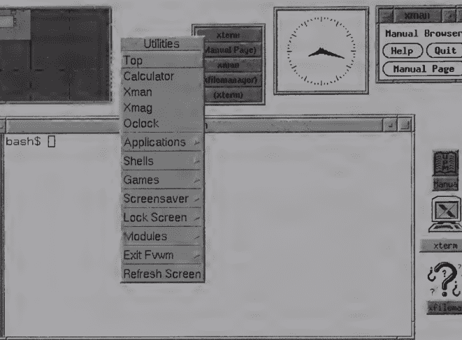

图 7.2 `fvwm` 界面（在 `Slackware` 配置中）。

当打开新窗口时，它在屏幕上的位置由用户决定：会出现一个框架，可以用鼠标移动，直到按下鼠标。

每个窗口都配有三个按钮：左侧按钮允许你调用窗口菜单：右侧两个按钮允许将窗口图标化（最小化）或最大化。

图标（即最小化的窗口）会自动放置在屏幕右侧边界（从上到下）。单击左键或中键单击图标即可将其恢复到其窗口。

# 键盘快捷键

除了全局 X 键盘快捷键外，示例配置文件还定义了两个快捷键：

| 快捷键 | 功能 |
| :--- | :--- |
| `ALT+Tab` | 切换到下一个窗口 |
| `Shift+Alt+Tab` | 切换到上一个窗口 |


某些 `fwm` 配置文件包含了一系列键盘快捷键。这可能会导致与其他程序的冲突，但它允许很大程度上脱离鼠标控制 `X`。

`SuSE` 发行版 `fvwm` 配置文件中包含的键盘快捷键见第 640 页。


### 菜单

在 `fvwm` 中，三个鼠标键都分配了它们自己的菜单。如果鼠标在屏幕背景上按下左键，会弹出一个菜单来启动最常用的 `X` 程序（终端、窗口、编辑器、`xman`、`seyon` 等）。你也可以通过此菜单退出或重启 `fvwm`。

此菜单中列出的程序并非实际上都可用。在这种情况下，点击相应的菜单项将没有任何反应。

在 `SuSE` 发行版中，`SuSE` 特定的 `fvwm` 配置文件通过 `SuSEconfig.fvwm` 程序适配于当前安装的程序。完成后，菜单将仅列出实际上可以执行的程序。

用中键激活的菜单是你可能非常需要的：它允许你移动和调整窗口大小，等等。这些操作可以直接在窗口上执行，无需菜单的帮助。

按下右键会显示一个列出所有正在运行的 `X` 程序的菜单。选择这些条目之一将激活相应的程序。如果相应的窗口已被识别，它会自动恢复。

### 虚拟桌面

在 `fvwm` 中，三个鼠标键都分配了它们自己的菜单。如果鼠标在屏幕背景上按下左键，会弹出一个菜单来启动最常用的 `X` 程序（终端、窗口、编辑器、`xman`、`seyon` 等）。你也可以通过此菜单退出或重启 `fvwm`。

此菜单中列出的程序并非实际上都可用。在这种情况下，点击相应的菜单项将没有任何反应。

在 `SuSE` 发行版中，`SuSE` 特定的 `fvwm` 配置文件通过 `SuSEconfig.fvwm` 程序适配于当前安装的程序。完成后，菜单将仅列出实际上可以执行的程序。

用中键激活的菜单是你可能非常需要的：它允许你移动和调整窗口大小，等等。这些操作可以直接在窗口上执行，无需菜单的帮助。

按下右键会显示一个列出所有正在运行的 `X` 程序的菜单。选择这些条目之一将激活相应的程序。如果相应的窗口已被识别，它会自动恢复。

# 220 配置 X 窗口系统

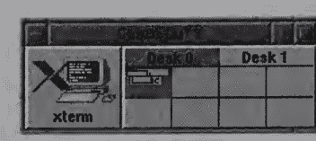

图 7.3 各种东西。

### 配置

`fwm` 配置通过 `.fvwmrc` 执行，如果该文件不存在，则通过全局的 `system.fvwm` 执行。根据发行版的不同，该文件位于以下位置之一：

- `/.fvwmrc` (本地)
- `/etc/X11/fvwm/system.fvwmrc` (全局, RedHat, Caldera)
- `/usr/X11R6/Lib/X11/fvwm/system.fvwmrc` (全局，默认设置, SuSE)
- `/var/X11R6/Lib/fwm/system.fvwmrc` (全局, Slackware)

熟悉几乎无限配置可能性的简单方法是查看 `book/config fwm` 目录包含的示例。通常，这些配置文件的文档非常详尽。

关于 `fvwm` 配置的在线信息可以在 `fwm`、`FwmIconBox`, `FwmPager` 和 `FwmWinList` 的详细 man 手书中找到。

如果你想尝试新的配置，最快简单的方法是重启 `fvwm`，这通常可以通过菜单命令完成。重启时，所有的 `X` 程序都会保留（包括修改 `.fvwmrc` 的编辑器）。

### 点击聚焦

窗口只有在被点击时才会变为激活（获取焦点）。如果关键字带有注释字符 `#` 前缀，窗口在鼠标移动到它上方时就会获得输入焦点。刚时这可能会让人困惑，但它确实节省了大量的鼠标点击。


# 窗口管理器 221

### AutoRaise n

指定当光标悬停在窗口上时，在多少毫秒后窗口移动到顶层。此设置在禁用 `ClickToFocus` 时非常有用：在这种情况下，经过短段时间后，活动窗口也会变成顶层窗口。

### IconBox x1 y1 x2 y2

指定图标放置的区域。负值表示屏幕的右侧和/或底部边缘。

### DesktopSize n, DesktopTopScale n, Pager x y

这三个关键字控制虚拟桌面窗口的大小和位置。如果此窗口让你感到困扰且你只需要一个屏幕，可以注释掉这三行。

### OpaqueMove n

指定屏幕大小的百分比，在此比例范围内窗口将与其内容一起可见地移动。当 `n=0` 时，只有框架独立于窗口大小移动；这是最快的方法。如果你有一台快速的电脑（尤其是一张快速的显卡），你应该尝试 `n=100` - 视觉效果非常震撼！

### fwwm 2.0

`fwwm` 2.0 版本充满了新功能，提供了更多配置和视觉布局的可能，但内存占用略有增加。流行的 `GoodStuff` 模块已重写：现在被称为 `FwmButtons`。可以通过菜单项 `Stick` 将窗口“固定”在屏幕上。现在，窗口通过标题栏中的水平线高亮显示。当你使用虚拟桌面时，窗口将显示在每个桌面上（而普通窗口只在启动它们的桌面上可见）。

最显著的区别是旧的配置文件已无法再使用。为了方便转换，我们提供了脚本 `fwwm_convert`，它可以将旧的配置文件翻译为新语法（目录 `/usr/X11R6/lib/X11/fwwm2`）。然而，这种翻译尚未完美 - 在许多情况下，仍需要进行手动编辑，以使 `fwwm` 2.0 提供的配置文件符合预期。

配置文件的名称也发生了变化：

```


`~/.fwm2rc` (local)

`/etc/X11/fwwm2/fwwm2rc` (全局, RedHat)

`/usr/X11R6/lib/fwwm2/.fwwm2rc` (全局, fwwm 默认, SuSE)

## 222 配置 X 窗口系统

如果在安装后要使用 `fwm` 2.0 代替之前的 `fwm` 1.2n，你必须修改 X 启动过程的配置文件。文件概述见第 212 页。

`fwm2` 有详尽的文档：除了 `fwm2` 的 `man` 文本外，还有一个非常有信息的 FAQ （在 RedHat 发行版中，可以在 `/usr/doc/fwm-2*` 目录下找到）。

SuSE `fwm` 2.0 配置（在该发行版中由默认窗口管理器定义）的特殊之处见第 639 页。

## fwm 95

尽管严格来说，`fwm95-2` 只是 `fwm2` 的变体（配置文件中的默认设置不同，多了一个模拟 Windows 启动栏的模块），但其视觉差异令人惊讶。X 突然看起来像 Windows 95，且行为几乎相同。（这是否是一个优势尚待待定。）`fwm95-2` 不依赖 `fwm2`。（然而，`fwm2` 通常带有更多在线文档，这同样适用于 `fwm95-2`）。

95 版本通过命令 `fwm95-2` 在 `xintrc` 或 `xsession` 中启动。使用以下文件进行配置：

- `~/.fwm2rc95` (本地)
- `/etc/X11/fwm95-2/fwm2rc95` (全局, RedHat)
- `/usr/X11R/lib/X11/fwm95-2-.fwm2rc95` (全局, SuSE)
- `/usr/X11R6/lib/X11/fwm95-2/system.fwm2rc95` (全局, 默认设置)

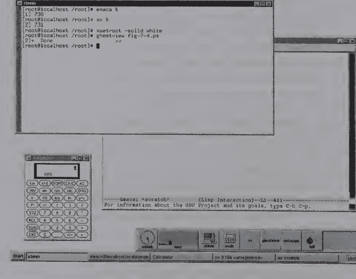

图 7.4 fwm95。

`fwm95-2` 提供的配置文件尝试调用 `color_xterm`，但在某些发行版中该程序是以 `color_xterm` 的名称安装的。可以通过以下链接解决：

```bash
# cd /usr/bin/X11/

# ln -s color-xterm color_xterm
```

## twm (标签窗口管理器)

与其他窗口管理器相比，`twm` 在很大程度上是可配置的。本地和全局配置通过 `system.twrc` 和 `~/.twrc` 两个文件完成。以下列表显示了在不同发行版中哪里找到 `system.twrc`：

- `/etc/X11/twm/system.twrc`
- `/usr/X11R6/lib/X11/twm/system.twrc`
- `/var/X11R6/lib/twm/system.twrc`

## olwm (OpenLook 窗口管理器)

`olwm` 源于 X 扩展 OpenLook，它是 Motif 的竞争对手。OpenLook 可以免费分发 —— 这就是你可以无需付费即可使用 `olwm`。

### 7.4 X 资源

资源（Resources）是 X 系统的一个特殊特性。它们允许轻松地设置大多数 X 程序的属性——从 `xtterm` 窗口的背景颜色到 Emacs 中的字符字体。为了更好地理解资源文件的概念，我们需要对 X 系统的内部进行简短的探险。

显而易见，有些 X 程序会使用自己的配置文件（作为补充或单独使用）。不使用 X 资源的一个常见原因是，人们试图为不同的计算机平台找到一种统一的配置过程。在寻找最大公约数的过程中，X 资源往往会被遗弃。

## 基础知识

X 程序由所谓的“部件”（widgets）组成。部件是用于特定任务的图形控制元素。因此，有用于文本字段、按钮等的部件。部件具有某些特征——例如字符集、背景（背景颜色）等。部件可以层级地嵌入——例如，在一个用于菜单的框架部件内部可以有多个用于各个菜单命令的按钮部件。

一个 X 程序细节的完整命名法——例如，`xterm` 程序中 `VT100` 部件的背景颜色是由所有元素的组合给出的。这些组件通过点连接。资源文件中的以下行将背景颜色设置为白色：

```
xterm.vt100.background:white
```

在 X 程序中，此概念通过额外的私有资源得到了扩展。因此，不仅可以更改部件的属性，还可以更改许多全局设置。（这种区别的意义在于，部件属性的设置会自动工作，而无需向 X 程序中添加任何代码。此原因意味着 X 程序仅描述此资源概念的程序特定扩展。）以下行是程序特定资源设置的典型示例（在这里，针对终端模拟器系统）：

```
Seyon.hangBeforeDial:off
```

资源设置的另一个值得提到的细节是：在名称组合中，可以使用通配符 `*`。它也可以扩展资源名称的多个组件。例如，以下两行中的第一行会导致每个程序和部件的所有背景区域变为黄色，但显式设置过的那些部件除外。第二行让所有 `seyon` 程序变为蓝色。

```
*background:yellow
seyon*background:blue
```


## 资源文件

资源文件可以存储在目录树中的不同位置。根据发行版，这些文件会在以下位置被自动识别。文件按优先级递增顺序列出。

| 路径 | 说明 |
| :--- | :--- |
| `/etc/X11/xdm/Resources` 或 `/usr/X11R6/Lib/X11/xdm/Resources` 或 `/var/X11R6/lib/xdm/Resources` | 仅限 `xdm` 登录的默认设置 |
| `/usr/X11R6/Lib/X11/xinit/.Resources` | 全局默认设置，在许多系统中仅被 `start` 识别（但不被 `xdm` 识别） |
| `~/.Resources` | 本地默认设置，在许多系统中仅被 `start` 识别（但不被 `xdm` 识别） |
| `/usr/X11R6/Lib/X11/app-defaults/progname` 或 `/var/X11R6/lib/app-defaults/progname` | 特定程序的全局默认设置 |
| `~/.Xdefaults` | 用户本地设置 |

`XResources` 文件在 X 启动时仅读取一次（如果有，见第 212 页）。另一方面，`app-defaults` 目录中的设置和 `.Xdefaults` 中的设置会在每个 X 程序启动时被读取，这导致修改在程序启动时生效。

在程序启动时直接指定的选项具有上述所有资源文件的绝对优先级。显而易见，这也适用于通过 `xinitrc` 或通过 `fwm` 启动的程序。

资源文件的语法可能从上面的示例中变得清晰了。大小写通常没有影响（但有一些例外！）。注释的标记方式不同：它们不是其他程序中已知的 `#`，而是以叹号 `!` 开头。此外，注释必须单独成行——资源设置不允许在后面附加注释。

更改资源设置的最简单方法是使用 `.Xdefaults` 文件作为模板，并将你可以使用的行复制到你的 `.Xdefaults` 文件中（并修改某些设置）。资源设置的示例可以在 `app-defaults` 目录下的文件以及随附 CD-ROM 上的 `book/config/.Xdefaults*` 文件找到。

关于允许的资源设置的详细信息也可以在相关程序的 `man` 手册中找到。资源的通用概念在 X 和 `xrdb` 的 `man` 手册中描述。


# 第三部分：应用

## bash - 现代命令解释器 8

本章的主题是“bourne again shell”（简称为 `bash`）。该程序在登录后自动启动，随后允许输入和执行 LINUX 命令——因此被称为命令解释器。同时，`bash` 提供了了自己的编程语言，可以用来编写 shell 程序（shell 脚本）。

`bash` 的描述跨越两个章节。本章介绍 `bash` 作为命令解释器的用法，其中主要主题包括 `bash` 使用的介绍、输入/输出重定向、进程间的通信（管道、命令替换）以及 shell 变量的管理。

从第 499 页开始的第 14 章解释了 `bash` 提供的编程可能性，描述了最重要的语言元素。

### 8.1 什么是 shell

本章主题是“bourne again shell”（简称为 `bash`）。该程序在登录后自动启动，随后允许输入和执行 LINUX 命令——因此被称为命令解释器。同时，`bash` 提供了了自己的编程语言，可以用来编写 shell 程序（shell 脚本）。

`bash` 的描述跨越两个章节。本章介绍 `bash` 作为命令解释器的用法，其中主要主题包括 `bash` 使用的介绍、输入/输出重定向、进程间的通信（管道、命令替换）以及 shell 变量的管理。

从第 499 页开始的第 14 章解释了 `bash` 提供的编程可能性，描述了最重要的语言元素。

### 什么是 shell?

`bash` 代表“bourne again shell”，它是 Bourne shell 的继者。在 Linux 下，所有三种都是可用的，通常只有 `bash` 是设置好的。现在，shell 是 Linux 系统和用户之间的某种界面。同时，shell 提供了强大的编程语言，可以用来自动化任务。某些特殊命令允许在程序中使用变量、分支表达式和循环等。在 Linux 下，所有 shell 都是 GNU 或公共版本。根据作者的个人偏好，这些程序被称为 shell 脚本或类似的名称。然而，在所有情况下，它们都是由 shell 执行（解释）的简单文本文件。更多细节可以参见第 499 页开始的内容。

### 232 BASH - 现代命令解释器

有大量的 `man` 手册（4000 行）来记录 `bash`，还有一个详尽的 `info` 文件可以通过命令 `info -f/usr/info/bash` 读取。

#### 切换不同的 shell

在 GNU/LINUX 下，`bash` 被认为是标准 shell。然而，其他 shell 也是可用的，取决于你如何安装 Linux。这些 shell 的特点是具有不同的命令输入和不同的编程命令。选择或拒绝其他 shell 主要取决于个人偏好、习惯等。

当你安装了多个 shell 时，可以在操作期间随时在 shell 之间切换：使用 `bash` 或 `sh` 进入 `bash`，使用 `ash` 进入 BSD shell（适用于内存小的计算机），使用 `ksh` 或 `pdksh` 进入 Korn shell，使用 `csh` 进入 C shell，而 `exit` 返回活动 shell。

请注意，Linux 分发的所有 shell 都是 GNU 或公共版本。因此，它们与原始 shell 相比可能会有一些小差异。

如果你不知道当前正在使用哪种 shell，最简单的方法是输入命令 `echo $0`。该命令在三种 shell 中含义相同，并显示当前 shell 的名称。

### 8.2 命令输入

你与 `bash` 的首次接触发生在正常的命令输入期间。`bash` 通过许多实用的快捷键和特殊键为你提供支持。

特别地，你可以使用上、下方向光标键重新处理最近输入的命令，这节省了大量的打字工作。当你从壳（shell）注销时，最近进入的命令会存储在一个文件中，因此当你登录时它们是可用的。（如果你在多个终端中使用同一个用户名进行操作，则其中一个终端的命令将被存储。）

命令行可以像在文本编辑器中那样的进行编辑，即你可以在任何位置插入和删除字符。`bash` 的键盘映射几乎完全是可以配置的。特别地，你可以将你自己的命令分配给特殊键（如功能键和光标键）。此外，你可以在 emacs 模式和 vi 模式之间切换。因此，对于所有的基础编辑命令，与所选编辑器相同的键盘快捷键均适用。通常，默认设置是 emacs。本章中的所有键盘快捷键都是针对 emacs 模式指定的。

关于 `bash` 配置的信息可以在第 127 页找到，该页还包含了对 `.inputrc` 配置文件正确设置的描述。


# 命令和文件名的扩展

`bash` 与其他 shell（尤其是常用的 MS-DOS 命令解释器）在命令输入方面可能最大的区别是通过 Tab 键对文件名进行自动扩展。一旦你输入了命令或文件名的第一个字母，就可以按下 Tab 键。如果该名称可以被唯一识别，则会扩展到它的完整长度。如果有多个以相同字母开头的名称，则扩展仅进行到这些字母开始不同为止。此外，一个示例会让扩展的概念变得更容易理解。例如，在我的电脑上，输入：

```
$ em com Tab
```

会自动扩展为：

```
$ emacs command.tex
```

其中 `emacs` 是一个命令的名称（用于调用编辑器）。为了完成 `em`，`bash` 会在 `PATH` 变量中指定的所有目录中搜索可执行程序。`command.tex` 是位于当前目录下的文本文件，通过指定前三个字母可以唯一识别。扩展也适用于带有若干个目录前缀的文件。如果你输入：

```
$ ls /usr/doc/ger Tab
```

`bash` 会将此输入扩展为：

```
$ ls /usr/doc/german/
```

考虑到 `/usr/doc` 目录下所有的文件和目录名。如果无法进行唯一的扩展（蜂鸣声），你只需按下 Tab 键。然后 `bash` 会在当前输入行下方显示所有可能的扩展。输入 `$ e Tab Tab` 会导致以下输出：

```
$ e elrvc etex

echo emacs eval
editres emacs-19.28-with-x11 ex
egrep emacsclient exec
elif enable exit
elm encode expand
elmalias env export
elelse eqn expr
elvis esac
elvprsv tags
```


## 命令和文件名的扩展

`bash` 与 `shell`（尤其是常用的 `MS-DOS` 命令解释器）在命令输入方面可能最大的区别是通过 `Tab` 键对文件名进行自动扩展。一旦你输入了命令或文件名的第一个字母，就可以按下 `Tab` 键。如果该名称可以被唯一识别，则会扩展到它的完整长度。如果有多个以相同字母开头的名称，则扩展仅进行到这些字母开始不同为止。

一个示例会让扩展的概念变得更容易理解。例如，在我的电脑上，输入：

```
$ em com Tab
```

会自动扩展为：

```
$ emacs command.tex
```

其中 `emacs` 是一个命令的名称（用于调用编辑器）。为了完成 `em`，`bash` 会在 `PATH` 变量中指定的所有目录中搜索可执行程序。`command.tex` 是位于当前目录下的文本文件，通过指定前三个字母可以唯一识别。扩展也适用于带有若干个目录前缀的文件。如果你输入：

```
$ ls /usr/doc/ger Tab
```

`bash` 会将此输入扩展为：

```
$ ls /usr/doc/german/
```

类似的扩展会考虑到 `/usr/doc` 目录下所有的文件和目录名。如果无法进行唯一的扩展（蜂鸣声），你只需按下 `Tab` 键。然后 `bash` 会在当前输入行下方显示所有可能的扩展。输入：

```
$ e Tab Tab
```

会导致以下输出：

```
$ e elrvc etex

echo emacs eval

editres emacs-19.28-with-x11 ex

egrep emacsclient exec

elif enable exit

elm encode expand

elmalias env export

elelse eqn expr

elvis esac

elvprsv tags
```

输入可以继续。在你的电脑上实际出现的文件列表，取决于当前目录中包含了哪些文件、你的 `LINUX` 系统中安装了哪些程序等。

只有当当前目录包含在 `PATH` 变量中时，当前目录中的程序和命令才会被考虑用于扩展。（`echo $PATH` 显示 `PATH` 的内容。当前目录缩写为“`.`”）。出于安全考虑，某些 `LINUX` 发行版在 `PATH` 中缺少当前目录。为了从当前目录执行程序，必须输入 `./name`。`PATH` 的设置可以在 `/etc/profile` 中更改。

自动命令扩展隐藏了程序文件的位置。而 `which` 命令则会搜索程序文件的所有标准目录，这意味着会导致成功。`which` 搜索 `PATH` 并确定在输入命令名称且无路径指定时执行的程序。当存在多个版本的程序且它们位于不同目录时，这很有用。

### 编辑命令行

你可以使用上、下方向光标键重新处理最近输入的命令，这节省了大量的打字工作。当你从 `shell` 注销时，最近进入的命令会存储在一个文件中，因此当你登录时它们是可用的。

命令行可以像在文本编辑器中那样进行编辑，即你可以在任何位置插入和删除字符。`bash` 的键盘映射几乎是可以配置的。特别地，你可以将你自己的命令分配给特殊键（如功能键和光标键）。此外，你可以在 `emacs` 模式和 `vi` 模式之间切换。因此，对于所有的基础编辑命令，与所选编辑器相同的键盘快捷键均适用。通常，默认设置是 `emacs`。本章中的所有键盘快捷键都是针对 `emacs` 模式指定的。

关于 `bash` 配置的信息可以在第 127 页找到，该页还包含了对 `.inputrc` 配置文件的正确设置的描述。


# 2.3.7 输入与输出重定向
你可以使用上、下方向光标键重新处理最近输入的命令，这节省了大量的打字工作。当你从 shell 注销时，最近进入的命令会存储在一个文件中，因此当你登录时它们是可用的。

无法在处理文件的同时将结果写回该同一个文件中。执行 `sort fl1 > fl1` 或 `sort < fl1 fl1` 会导致 `fl1` 被删除！通过 `< file` 可以实现输入重定向：原本期望从键盘输入的命令现在改为从指定的文件读取。

# 2.3.8 管道
管道通过 `|` 字符构建。这意味着第一个命令的输出将作为第二个命令的输入。在实践中，你可能最频繁地将管道与命令配合，当你想逐页查看较长的输出内容时。

```bash
$ ls - | less
```

通过上述命令，当前目录的内容列表被定义并写入管道中。并行执行的 `less` 命令从管道读取其输入并将结果显示在屏幕上。

除了管道外，你还可以使用所谓的 FIFO 进行输入和输出重定向。FIFO 代表“先进先出”（first in first out），并以文件形式实现了管道的概念。输入 FIFO 的操作要耗费得多，但它们清晰地展示了 `|` 字符实际的作用。在实践中，它们被用于让两个完全独立的程序相互通信（例如，X11 和 X 服务器 - 见第 209 页）。

```bash
$ mkfifo fifo
$ ls -l > fifo &
$ less < fifo
```

上述三个命令执行的操作如下：首先创建一个 FIFO 文件，然后启动 `ls` 作为后台进程，将其输出写入文件。`less` 从该文件中读取数据并将其显示在屏幕上。

# 2.3.9 使用 tee 实现输出倍增
有时程序的输出必须存储在文件中，但你同时又想在屏幕上查看程序的进度。在这种情况下，输出必须倍增：一份副本显示在屏幕上，另一份副本存储在文件中。这项任务由 `tee` 命令完成：

```bash
$ ls | tee contents
```

当前目录的内容列表显示在屏幕上，同时被存储在 `contents` 文件中。这是通过首先将标准输出重定向到 `tee` 命令实现的。该命令将标准输出显示在屏幕上，并将输出副本存储在指定文件中。如果你也将 `tee` 的标准输出重定向到一个文件，你就能看出这真的是输出的复制：

```bash
$ ls | tee contents1 > contents2
```

结果是产生了两个相同的文件 `contents1` 和 `contents2`。上述命令仅是一个示例。下一个（也是最后一个）示例稍难理解，但它很有意义：

```bash
$ ls -l | tee contents1 | sort +4 > contents2
```

同样在 `contents1` 中，我们找到了 `ls` 自动按名称排序的“正常”内容列表。该副本传递给了 `sort`，然后按文件大小（第五列，选项 `+4`）进行排序并存储在 `contents2` 中。

# 2.3.10 语法参考
| command | description |
| :--- | :--- |
| `command > file` | 将标准输出重定向到指定文件 |
| `command < file` | 从指定文件读取输入 |
| `command 2> file` | 将错误消息重定向到指定文件 |
| `command >& file` | 重定向输出和错误消息 |
| `command >> file` | 将标准输出追加到指定文件 |
| `command1 \| command2` | 传递 command1 和 command2 的输出 |
| `command \| tee file` | 显示输出并同时在指定文件中存储副本 |

# 2.4 命令执行
通常情况下，你通过直接输入命令名来启动命令。在命令行内部，你可以指定一些特殊字符，这些字符会在 bash 实际执行命令之前进行求值。通过这种方式，你可以在后台启动命令，使用通配符（例如 `*.tex`）指定多个相似的文件名，在另一个命令的参数列表中替换一个命令的结果等等。

# 2.4.1 后台进程
最重要且最频繁使用的特殊字符是 `&`。如果它被附加在命令行的末尾，bash 会在后台启动相应的程序。这对于耗时长的程序非常有用，因为可以立即继续其他命令的操作。

# 2.4.2 命令执行示例
```bash
$ find -name '*sh' > result &
```

上述命令在整个文件系统中搜索以字母 'sh' 结尾的文件。文件列表被写入 `result` 文件。由于命令在后台执行，工作可以立即继续。输出意味着该后台进程的 PID 号为 334。PID 代表进程标识符（process identification）。如果需要用 `kill` 提前终止进程，则 PID 编号很有意义。括号中的数字表示 bash 启动的后台进程数量，通常没有意义。

如果你在启动命令时忘记了输入 `&`，你不需要等待它结束，也不需要粗暴地使用 `Ctrl+C` 停止。相反，你应该用 `Ctrl+Z` 中断程序，并使用 `bg` 将其作为后台进程继续。

# 2.4.3 执行多个命令
在 `&` 之后你还可以指定一个额外的命令。在这种情况下，第一个命令在后台执行，而第二个命令在前台执行。在以下示例中，上述 `find` 命令再次在后台启动，同时 `ls` 显示了当前目录列表：

```bash
$ find -name '*sh' > result & ls
```

如果输入分号而不是 `&` 字符，bash 会按顺序执行分号后的命令和在前台的命令：

```bash
$ ls; date
```

上述命令首先显示当前目录列表，然后显示日期。如果要把这两条信息重定向到一个文件，必须将两个命令都括在括号内：

```bash
$ (ls; date) > contents
```

现在，`contents` 文件包含了由 `ls` 确定的列表。字符对 `&&` 和 `||` 可根据执行结果条件地执行命令：

```bash
$ command1 && command2
```

如果 `command1` 执行成功（返回值为 0），则执行 `command2`。

```bash
$ command1 || command2
```

如果在 `command1` 执行期间发生错误（返回值非 0），则执行 `command2`。

shell 提供了构建分支的其他可能性，但这仅对 shell 编程感兴趣（见第 508 页）。

```bash
command1; command2
# 按顺序执行命令

command1 && command2
# 如果 command1 成功则执行 command2

command1 || command2
# 如果 command1 产生错误则执行 command2

command1 & command2
# command1 在后台，command2在前台

(command1; command2)
# 在同一个 shell 中执行命令
```

# 2.5 替换机制
替换机制听起来非常抽象且复杂。基本思想是包含特殊字符的命令会被其结果替换。在最简单的情况下，这意味着评估 `ls *.tex` 时，`*.tex` 被替换为匹配的文件列表——例如 `book.tex`。因此，`ls` 命令看到的不是 `*.tex`，而是文件名。

本节旨在概述解释命令行时最重要的机制：用于生成文件名的通配符、用于构建字符串的大括号、用于计算算术表达式的方括号、用于命令的引号等等。

一种替换机制排除在本节之外：所谓的参数替换，它允许对存储在变量中的字符串进行分析和修改。通用语法为 `$(var,text)`，其中 `var` 是变量名，代表一个或两个特殊字符，`text` 包含搜索模式或默认设置。这种替换机制将在第 14 章第 507 页进行描述。

# 2.5.1 使用通配符生成文件名
如果你执行 `rm *` 而命令实际上删除了所有以字符 * 结尾的文件，这是 bash 的责任。shell 在当前目录搜索匹配的文件，并将 * 替换为相应的文件。

允许的通配符有 `?`（单个任意字符）和 `*`（任意数量包括零的任意字符）。字符字符串 `[a,b,e-h]*` 代表以 a、b、e、f 或 h 其中一个字符开头的文件。如果方括号内的第一个字符是 `^` 或 `!`，则允许所有字符，除了指定的。`~` 可以作为主目录的缩写（另见第 87 页）。

测试特殊字符功能的最佳方法是使用 `echo` 命令。下面的第一个命令提供了根目录下的所有文件和目录。第二个命令是其变体，仅允许包含 a 到 c 之间任意字母的名称。第三个命令证明了文件名生成在多个目录级之间同样有效。（出于空间原因，输出已大幅简化。例如，在我的电脑上，`/*` 会产生包含约 700 个文件和目录的列表。）

```bash
$ echo /*
/CD /bin /boot /cdrom /dev /dist /dosa /dosc /desmu /dosi /etc /home
```


`/install /bin /local /last+found /mnt /proc /root /sbin /test /usr`

`/var /vmlinuz ...`

```bash
$ echo /[a-c]*
/bin /boot /cdrom /dosa /dosc /etc /install /bin /local /proc /sbin /var
/zimage
```

```bash
$ echo /*
/bin/Mail /bin/arch /bin/bash ....
/boot/any.b /boot/any_d.b ...
/dev/MAKEDEV /dev/arp /dev/bmouseatxl ...
```

由于文件名生成并不是由相关的程序（即 `bash`）执行的，因此结果与你预期的不同。在这种情况下，`ls` 可能会导致一个看似无止尽的文件列表，尽管当前目录下只有几个文件。在展开 `*` 之后，`ls` 接收到了一个所有文件和目录的列表。然而，`ls` 显示的不仅是目录的名称，还有它们的内容。如果你只想获得所有文件和目录的简单列表，必须使用 `-d` 选项，该选项防止显示参数列表中指定目录的内容。

| 符号 | 说明 |
| :--- | :--- |
| `?` | 恰好一个任意字符 |
| `*` | 任意数量的任意字符（甚至是零个）（但不包括文件！） |
| `[abc]` | 指定字符之一 |
| `[a-f]` | 指定范围内的一个字符 |
| `![abc]` | 不属于指定字符的任意字符 |
| `^[abc]` | 同上 |
| `~` | 主目录的缩写 |
| `.` | 当前目录 |
| `..` | 父目录 |

如果你想获得关于 `bash` 内部工作的反馈，可以执行 `set -x`。在这种情况下，`bash` 会显示内部命令行（带有所有

```bash
$[3*4]
arithmetic calculations
```

## 命令替换

命令替换允许你将命令行中的某个命令替换为其执行结果。为了实现这一目的，命令必须包含在两个字符之间，或者使用 `$(command)`。后者的表示法更好：首先；它减少了由三种不同类型的引号（`'` `'` `` ` `` 和 `` `` ``）引起的混淆；其次，它是可以嵌入的。

无论如何编写，命令都会被其结果替换。这种替换允许对多个命令进行嵌入式调用，其中一个命令将其结果传递给下一个命令。下面的示例说明了这种非常强大的机制：

```bash
$ ls -l 'find /usr/doc -name '*README*'\n$ ls -l $(find /usr/doc -name '*README*') # 替代表示法
```

使用上述命令，首先执行 `find /usr/doc -name '*README*'`。该命令的结果是 `/usr/doc` 目录下包含 "README" 字符的文件列表。此列表现在被插入到 `find` 命令的命令行中。现在，命令行可能如下：

```bash
$ ls -l /usr/doc/xpm33/README /usr/doc/term/README.gz\n> /usr/doc/mt-st/README/README.gz
```

该命令提供以下结果：

| 权限 | 所有者 | 大小 | 日期 | 名称 |
| :--- | :--- | :--- | :--- | :--- |
| `-rw-r--r--` | `1` | `root` | `1854` | `Apr 24 22:49` | `/usr/doc/README.gz` |
| `-rw-r--r--` | `1` | `root` | `847` | `Sep 21 1993` | `/usr/doc/mt-st/README.gz` |
| `-rw-r--r--` | `1` | `root` | `5796` | `Apr 20 1994` | `/usr/doc/term/README.gz` |
| `-rw-r--r--` | `1` | `root` | `5550` | `Jan 30 1994` | `/usr/doc/xpm33/README.gz` |

请注意，无法通过使用 `|` 字符的简单管道获得该结果。`ls` 期望从标准输入读取数据，并忽略通过管道由 `find` 提供的信息。因此，以下命令仅显示当前目录的内容。结果文件未找到！

```bash
$ find /usr/doc -name '*README*' | ls -l # 这不起作用
```

然而，还有另一种不需要命令替换的解决方案：通过命令 `xargs` 将数据从标准输入重定向到 `xargs` 指定的命令：

```bash
$ find /usr/doc -name 'README' | xargs -l
```

| 表示法 | 说明 |
| :--- | :--- |
| `'command'` | 将命令替换为其结果 |
| `$(command)` | 同上，替代表示法 |

## 字符字符串中的特殊字符

由于在 `bash` 中几乎每个字符（字母和数字）似乎都具有某些特殊含义，在字符字符串或文件名中使用这些字符似乎完全是不可能的。这个问题可以通过引号来解决。如果你使用单引号，内部的字符被视为字面量。如果你使用双引号，某些特殊字符仍然会被解释，而另一些则不会。

## 局部变量与全局变量

(环境变量)

描述变量时使用的“局部”和“全局”术语源自编程语言领域。对于 `shell` 变量而言，如果一个变量在命令或 `shell` 程序启动时被传递，则认为它是全局的。全局变量通常也称为环境变量。

请注意，所有通过简单赋值创建的变量都被视为局部变量。如果你想定义一个全局变量，必须调用 `export` 或使用 `declare -x`。

有很多命令用于管理 `shell` 内的变量，其中一些命令的功能是重叠的。因此，要定义全局变量，你可以同时使用 `export` 和 `declare -x` 等。通过下表，我们将尝试减少相似命令带来的混淆：

```
a=3 let 的简写，a 是局部变量
declare a=3 给局部变量 a 赋值（等同于 let）
declare -x a=3 给全局变量 a 赋值（等同于 export）
export 显示所有全局变量
export a 转换为全局变量
export a=3 给全局变量 a 赋值
let a=3 给局部变量 a 赋值
local a=3 将 a 定义为局部（仅在 shell 函数中）
printenv 用于 export，显示所有全局变量
set 显示所有（局部和全局）变量
unset a 删除变量 a
```


如果你创建变量是为了控制其他 `LINUX` 命令的行为，那么这些变量必须始终是全局的。如果你想一方面利用 shell 替换机制，另一方面定义全局变量，只需先用 `x=...` 为变量赋值，然后用 `export` 将其定义为全局变量。


变量赋值始终适用于单个 shell。如果你在多个终端或终端窗口中工作，每个窗口都运行着自主且独立的 shell。在一个 shell 中更改一个变量对其他 shell 产生影响。然而，你通常会在主目录下的 `.profile` 文件中执行常用的变量赋值，该文件会在每个 shell 启动时自动执行（见第 518 页）。


## 重要 shell 变量

原则上，你可以创建任意数量的新变量并按意愿命名。然而，你应该尽量避免使用已有的变量，因为这些变量通常会被 `bash` 经常也由其他 `LINUX` 命令评估。对这些变量进行不受控制的更改可能会导致命令处理不再按预期工作、`LINUX` 突然找到文件等。本节按字母顺序描述了最重要的变量：

### BASH

包含 `bash` 的文件名。

`glob_dot_filenames` 控制文件名通配符的扩展：如果该变量被设置（为一个任意值），`*` 也将包含以点开头的文件名。执行 `unset glob_dot_filenames` 可结束此状态。

### HOME

包含主目录路径，例如 `/home/mk`。

### HOSTNAME

包含主机名（计算机名）。

### LOGNAME

包含登录（用户名）。

### MAIL

包含存储入站邮件的目录路径。

### MANPATH

包含所有包含手册页（man pages）的目录路径。

### OLDPWD

包含上一个活动目录路径。

### PATH

包含目录列表。当 `bash` 必须执行命令时，会在 `PATH` 中列出的所有目录下搜索该命令。目录之间用冒号分隔。`PATH` 在 `/etc/profile` 中设置。出于安全考虑（并防止无意执行当前目录中的程序），大多数发行版从 `PATH` 中除了本地目录。如果你想在不加 `/` 前缀的情况下执行程序，必须通过 `..` 扩展 `PATH`。另一种解决方案是将自己的程序存储在 `/bin` 目录并将该目录添加到 `PATH`。

### PS1

包含在命令提示符前显示的字符串。在这些字符中：`\t` 表示时间，`\d` 表示日期，`\w` 表示当前目录，`\W` 表示当前目录的最后一部分，`$` 表示 `/usr/bin`，`\u` 表示用户，`\h` 表示主机名。`PS1` 设置在 `/etc/profile`。

### PS2

包含多行输入时的字符串。当输入未结束时显示 `。PS2 设置为 ` `。

### PWD

包含当前目录路径。

除了上述变量，还有许多用于处理磁盘的命令，`CHARSET` 允许转换为不同的字符集。这些命令在手册页中有详细记录。


## 命令参考

本章按字母顺序列出了最重要的命令。本章的目的是提供文件管理、启动和停止进程、处理文件以及执行其他任务所需的统一概述。不常用的命令已被省略，其他命令将在相应的章节中描述。

根据你计算机上安装的 `LINUX` 发行版的程度，此处描述的一些命令可能缺失，或者需要单独安装。这特别适用于处理磁盘的 `mtools` 命令，它们通常作为独立包提供。


### 9.1 按主题概述

#### 文件管理

- `cat` 将多个文件合并为一个文件
- `cd` 切换目录
- `cp` 复制文件
- `ln` 创建文件的硬链接和符号链接
- `ls` 显示列表
- `mkdir` 创建新目录

#### 查找文件

- `find` 按名称、日期、大小查找文件
- `locate` 在预先准备的数据库中查找文件
- `whereis` 在典型的 `bin` 目录查找文件
- `which` 在 `PATH` 目录搜索命令

#### 访问 MS-DOS 磁盘

- `fdformat` 格式化磁盘（低级）
- `mattrib` 更改文件属性
- `mcd` 切换目录
- `mcopy` 在 `LINUX` 之间复制文件
- `mdel` 删除文件
- `mdir` 显示目录列表
- `mformat` 创建 `DOS` 文件系统
- `mlabel` 修改磁盘名称
- `mmd` 创建新目录
- `mrd` 删除目录
- `mread` 从 `DOS` 复制到 `LINUX`
- `mren` 重命名文件
- `mype` 显示文本文件内容
- `mwrite` 从 `Linux` 复制到 `DOS`

#### 处理文本

- `cat` 显示文件或将多个文本文件合并为一个文件
- `csplit` 在指定点分割文本为多个单文件
- `cut` 从每行中提取列
- `expand` 将制表符扩展为空格
- `fold` 将行折分成更短的
- `dos` 将 `DOS` 换行符转换为 `LINUX` 格式
- `grep` 在文件中搜索文本
- `head` 显示文件的前几行
- `less` 分页显示（也支持后向）
- `more` 分页显示
- `paste` 按行合并多个文件
- `recode` 在不同字符集间转换
- `sed` 流编辑器（可编程编辑器）

#### 按主题分类概览 251

- `sort` 对文件进行排序
- `tac` 以“反过来”的方式显示文件（最后一行最先）
- `tail` 显示文件的末尾
- `todos` 将 `LINUX` 换行符转换为 `DOS` 格式
- `tr` 将字符替换为其他字符
- `uniq` 消除文本文件中出现多次的重复行
- `zcat` 显示压缩的文本文件
- `zless` 分页显示压缩的文本文件（也支持反向）
- `zmore` 分页显示压缩的文本文件

#### 文件的压缩与归档

- `compress` 压缩文件
- `cpio` 在不同的文件系统之间传输存档文件
- `gunzip` 解压用 `gzip` 压缩的文件
- `gzip` 压缩文件；比 `compress` 更强大
- `mt` 控制磁带机（正向/反向卷绕等）
- `tar` 将多个文件（及目录）合并为一个文件
- `uncompress` 解压用 `compress` 压缩的文件

#### 进程管理

- `bg` 让进程在后台继续运行
- `fg` 让进程在前台继续运行
- `halt` 终止 `LINUX` 并停止计算机
- `kill` 发送信号（主要用于提前终止进程）
- `nice` 以降低优先级启动进程
- `ps` 显示当前运行的进程列表
- `as` 类似于 `ps`，但以更好的方式显示依赖关系
- `pstree` 终止 `LINUX` 并重启计算机
- `shutdown` 终止 `LINUX`
- `top` 每五秒显示一次所有进程列表

#### 用户与组管理

- `adduser` 注册新用户（交互式）
- `chsh` 登录后更改默认 `shell`
- `groups` 显示当前用户所属的组
- `passwd` 更改用户密码

#### 文件系统管理

- `dd` 在设备之间复制数据块（低级 `cp`）
- `dumpe2fs` 显示 `ext2` 文件系统的内部信息
- `e2fsck` 修复 `ext2` 文件系统

#### 252 命令参考

- `fdformat` 格式化软磁盘
- `fdisk` 对硬盘进行分区
- `fsck` 修复文件系统（前端）
- `mkfifo` 创建 `FIFO` 文件（命名管道）
- `mkfs` 创建文件系统
- `mknod` 创建设备文件
- `mkswap` 创建交换文件或分区
- `mount` 将设备（例如硬盘）挂载到文件系统
- `swapoff` 禁用交换文件或分区
- `swapon` 激活交换文件或分区

#### 屏幕与终端

- `reset` 恢复字符集分配
- `restorefont` 保存或恢复 `VGA` 字符集
- `restorepalette` 恢复 `VGA` 调色板
- `setfont` 更改 `VGA` 字符集
- `setterm` 更改各种终端设置

#### 在线帮助

- `apropos` 查找与指定主题相关的页面
- `info` 启动 `info` 系统
- `man` 显示命令的描述
- `whatis` 显示命令的短描述（一行）

#### 杂杂

- `alias` 定义别名
- `cksum` 计算文件的 `CRC` 校验和
- `date` 显示日期和时间
- `expr` 执行简单的整数计算
- `free` 显示空闲内存（`RAM` 和交换区存储）
- `hash` 显示哈希表
- `ldd` 显示运行程序所需的库
- `lpr` 打印文件
- `dev` 更改内核文件中的某些字节
- `set` 显示 `shell` 知的所有变量
- `sum` 计算文件的校验和
- `tty` 显示当前终端的设备名称
- `type` 显示命令的类型（例如 `shell` 命令）
- `unalias` 删除别名
- `uname` 显示操作系统的名称和版本号

#### 字母顺序命令参考 253

`bash` 在第 8 章中描述。这个 `Linux` 标准并不仅仅是你输入命令时的解释器。`shell` 还允许你编写简单的 `shell` 脚本（即批处理文件）。这种最复杂的 `Linux` 编程形式常用于使简单任务自动化（例如执行备份）。在应用中，`shell` 脚本通常看起来像真正的程序。第 14 章介绍了 `shell` 编程的基础知识，并提供了一些也将用到本章描述的命令的示例。

### 9.2 字母顺序参考

`bash` 在第 8 章中描述。这个 `Linux` 标准并不仅仅是你输入命令时的解释器。`shell` 还允许你编写简单的 `shell` 脚本（即批处理文件）。这种最复杂的 `Linux` 编程形式常用于使简单任务自动化（例如执行备份）。在应用中，`shell` 脚本通常看起来像真正的程序。第 14 章介绍了 `shell` 编程的基础知识，并提供了一些也将用到本章描述的命令的示例。

（注：由于后续文本包含大量重复和占位符，以下为示例格式的翻译逻辑，我将对原文核心内容进行对应翻译）

`shell` 脚本通常看起来像真正的程序。第 14 章介绍了……

`ls` 命令的选项如下：

```
```


# 命令参考

## ls

- `ls -A`
显示所有文件（包括子目录）。

- `ls -l`
显示详细信息。

## 256 命令参考

### chmod

- `-R` 或 `--recursive`
递归地访问所有子目录中文件的组成员关系。

此选项仅在使用通配符（如 `*.tex`）描述文件时才有意义。

#### `chmod [options] changes files`

`chmod` 更改文件的访问位。对于每个文件，系统都存储了关于所有者、组成员或其他用户是否可以读取、写入或执行该文件的信息。访问位的更改通过通过字符组合组 `+`/`-` 访问类型来实现，例如使用 `g+w` 赋予组内所有用户写权限。可以通过 `u`（用户）、`g`（组）、`o`（其他）或 `a`（所有）指定组。访问类型由 `r`（读）、`w`（写）或 `x`（执行）描述。

如果使用访问类型 `s` (setuid) 代替 `x`，执行程序的行为就像是由文件的所有者执行一样（见示例）。当特权用户（例如 `root`）的文件设置 setuid 位时，可能会构成重大的安全风险。普通用户可以像 `root` 一样执行该程序。请确保普通用户只能执行程序实际设计的某些任务。

或者，可以使用八进制数字指定访问类型，其中 `u`、`g` 和 `o` 分别分配一个数字。每个数字都是 `r`、`w` 和 `x` 的值 4、2 和 1 的组合。因此，660 意味着 `'rw-rw----'`，777 意味着 `'rwxwxrwx'`。

- `-R` 或 `--recursive`
同时也更改所有子目录中文件的访问权限。此选项仅在使用通配符（如 `*.tex`）描述文件时才有意义。

#### 示例

```bash
$ chmod a+rx save
```
允许用户执行文件 `save`。该文件可以是一个用于备份的 shell 脚本（批处理）。

```bash
$ chmod -R o-w *.doc
```
拒绝当前目录及所有子目录中所有者组之外的所有用户对所有 `*.doc` 文件的读取和写入权限。

```bash
$ chmod a+xr /usr/bin/local/newsflash
$ chmod a+w /usr/bin/local/newsflash
$ chmod u+rw /usr/bin/local/newsflash
# chmod news.news /usr/bin/local/newsflash
```
允许用户执行 `newsflash`。但由于 setuid 位的存在，`newsflash` 的行为就像是由用户 `news` 启动的一样。

### chown

#### `chown [options] user[.group] files`

`chown` 更改文件的所有者和（可选的）组关系。文件的所有者只能由 `root` 更改，而组也可以由其他用户更改（见 `chgrp`）。

- `-R` 或 `--recursive`
同时也更改所有子目录中文件的组关系。

### chsh

#### `chsh [user]`

`chsh` 更改登录后自动调用的默认 shell。选择在 `/etc/shells` 中注册的所有 shell 之间进行，通常为 `/bin/bash`、`/bin/csh` 和 `/bin/ksh`。`chsh` 通过输入新 shell 来修改 `/etc/passwd` 文件。另一个用户的 shell 只能由 `root` 更改（而每个用户可以任意更改其自己的 shell）。

### cksum

#### `cksum file`

`cksum` 确定文件的校验和和以字节为单位的长度。`cksum` 可以快速可靠地判断两个文件是否相同（例如在通过调制调器传输数据后，或怀疑感染病毒时）。`cksum` 提供的结果比相关的 `sum` 命令更可靠。

### clear

`clear` 清空屏幕（文本控制台）。该命令对应 DOS 命令 `cls`。

### cmp

#### `cmp [options] file1 file2`

`cmp` 按字节比较两个文件，并提供第一个差异处的位置。当文件完全相同时，命令不会显示任何信息（另见第 262 页的 `diff`）。

- `-c` 或 `--chars`
显示每个文件中文件之间不同的第一个文本字符。

- `-l` 或 `--verbose`
提供所有差异的列表。

### compress

#### `compress [options] file`

`compress` 压缩或解压缩指定的文件。压缩后的文件通过文件名末尾的 `*.z` 标识。比 `compress` 更强大的命令是 `gzip` —— 见第 273 页。

- `-d` 解压缩指定的文件而不是压缩（对应 `uncompress`）。

### cp

#### `cp [-options] source target`
#### `cp [-options] files target_directory`

`cp` 用于复制文件。单个文件可以重命名。当需要处理多个文件时（例如通过指定通配符），这些文件只能复制到不同的目录，而不能重命名。不允许类似 `cp *.tex *.bak` 这种类型的指令。与 `cp` 可比的命令有 `mv`（用于移动和重命名文件）以及 `ln`（用于创建链接）。此外，`cp` 支持以下选项：

- `-a` 或 `--archive`
保留文件的所有属性。`-a` 是 `-dpR` 的缩写。
- `-b` 或 `--backup`
已存在的文件不会被覆盖，而是被重命名为备份文件（文件名加上 `~`）。
- `-d` 或 `--dereference`
仅复制链接引用，但不复制链接指向的文件。
- `-i` 或 `--interactive`
在覆盖现有文件之前请求确认。
- `-L` 或 `--link`
创建硬链接而不是复制文件。当 `cp` 使用此选项时，其功能与 `ln` 相同（见第 275 页）。
- `-p` 或 `--preserve`
保留关于所有者、组关系、访问权限以及最后修改日期和时间的信息。如果没有此选项，复制的文件将属于执行 `cp` 的用户（用户和组），时间将被设置为执行时间。
- `-R` 或 `--recursive`
递归处理。
- `-s` 或 `--symbolic`
创建符号链接而不是复制文件。使用此选项时与 `ln` 功能相同。
- `-u` 或 `--update`
仅当文件较新时复制。

另一个适用于拷贝整个目录树的命令是 `tar`（见 296 页）。

##### 示例

```bash
$ cp *.tex .
```
将所有 `*.tex` 复制到当前目录。

### cut

#### `cut [options] file`

`cut` 从每行文本中提取选项指定的列。

- `-b list` 或 `--bytes list`
从列表中提取指定的字符。单个字符之间可以用逗号分隔（但不能有空格）。或者，可以指定整个范围，例如 `-b 3-6,9,11-15`。

- `-f list` 或 `--fields list`
同上，但应用于字段（数据记录），这些字段之间必须由制表符分隔。

- `-d character` 或 `--delimiter character`
指定 `-f` 的分隔符字符；该字符将用于替代制表符。

- `-s` 或 `--only-delimited`
消弃不包含与 `-f` 选项对应数据的行。不能与 `-b` 配合使用。

##### 示例

```bash
$ ls -l | cut -b 1-11,56-
```
用于过滤通过 `ls` 获取的文件列表。结果是，访问权限和文件名（第 1 到 11 个字符以及从第 56 个字符开始的所有字符）被显示出来。


## `date` [options] [time]

`date` 显示当前日期和时间，或更改它们。（更改只能由 `root` 用户执行）。`date` 可以以各种格式显示时间 —— 参见 `man` 手册。

### `-s`
设置日期和/或时间（而不仅仅是显示）。

## `dd` [options]

`dd` 在不同的存储介质（硬盘、磁盘等）之间传输数据，如果需要，它还会执行数据转换。该命令可用于不同计算机架构之间的数据交换。

`dd` 不仅可以复制单个文件，还可以直接访问设备。这可以复制整个硬盘（或分区）、修改硬盘的引导扇等。无需先在硬盘或软盘上创建文件系统。

当不带任何选项使用 `dd` 时，它从标准输入（键盘，通过 `Ctrl+D` 终止）读取数据并写入标准输出（屏幕）。
注意，指定 `dd` 选项时不能带减号！

### `conv=mode`
在复制过程中转换数据。`mode` 有多种设置，例如 `lcase`（大写字母转为小写字母）、`ucase`（小写字母转大写字母）、`swab`（一次交换 2 个字节）等。

### `bs=n`
指定输入和输出文件的块大小。（块大小决定了一次读取或写入多少字节。）

## 262 命令参考

### `count=n`
仅复制 `n` 个数据块（而不是所有数据）。

### `ibs=n`
指定源文件的块大小。

### `if=source_file`
指定源文件（代替标准输入）。

### `obs=n`
指定目标文件的块大小。

### `of=target_file`
指定目标文件（代替标准输出）。

### 示例

```
$ dd if=/dev/hd of=/boot/bootsector.bak bs=512 count=1
```

将第一个 IDE 硬盘的引导扇区传输到备份文件 `bootsector.bak` 中。

```
$ dd if=/vmlinuz of=/fd0
```

将内核直接复制到软盘的前扇区，然后可以作为启动软盘使用。

## `df` [options]

`df` 提供关于目录树中挂载硬盘（或分区）或其他驱动器的点的信息，以及每个点上空闲存储空间。

### `-i` or `--inodes`
不再以 `Kbytes` 为单位显示可用空间，而是显示可用 `I-nodes` 的信息。

## `diff` [options] `file1` `file2`

`diff` 比较两个文件。结果是所有互不相同的行的列表。该命令相对“智能”，也就是说，当一个文件中添加了行时，只有这一事实会被信号化为变化。随后的行再次被识别为相同，尽管它们的行号现在不同了。因此，此程序可以有效地快速记录两个版本程序列表之间的差异。

### `-b`
将多个空格和空行视为单个空格/空行。

### `-w`
完全忽略空格和空行。

## `du` [options] [directory]

`du` 提供文件或目录所用存储的信息。当目录参数中给出文件指定时（例如 `*` 或 `*.tex`），`du` 会提供一个给出所有文件大小的列表。当只指定一个目录时，`du` 计算所有子目录使用的存储。大小始终包含所有子目录使用的存储。最后一个数字表示指定目录下方所有文件和子目录使用的总存储。所有大小均以 `Kbytes` 为单位。

### `--bytes` or `--bytes`
以字节为单位的大小（而不是 `Kbytes`）。

### `--total` or `--total`
将总空间作为最后一个值显示。此选项仅在 `du` 应用文件（而不是目录）时才需要。使用此选项可以可以确定具有特定扩展名的文件（对于 `*.tex`）占用了多少空间。

### `--summarize` or `--summarize`
仅显示总空间。此选项在显示目录存储时才有意义。

### `--dereference` or `--dereference`
仅显示指定目录使用的存储。不考虑子目录使用的存储。

### 示例

```
$ du -bS
129377
```

当前目录的文件使用 129377。

```
$ du
101 /a/a1
4 /a/a2
114 /a
5 /b
251
```

`a1` 中的文件使用的存储为 101 `Kbytes`，`a2` 为 4 `Kbytes`，`a`（包括 `a1` 和 `a2`）为 114 `Kbytes`，`b` 为 5 `Kbytes`，当前目录（包括 `a` 和 `b`）为 251 `Kbytes`。

```
$ du -S
101 /a/a1
4 /a/a2
9 /a
5 /b
1
```


使用 `-S` 选项，`du` 显示目录本身的存储。（这些值的总和为 251。）

```
$ du -c *.tex
100 emacs
126 total
```

`*.tex` 文件占用 126 Kbytes。

# `dumpefs` `device`

`dumpefs` 提供关于文件系统状态的大量信息。参见 106。

# `e2fsck` `[options]` `device`

`e2fsck` 检查 `ext2` 文件系统的完整性并在需要时执行修复。该命令可以通过 `ffsck` 启动。其最重要的选项在第 270 页描述。

# `echo` `character_string`

`echo` 显示字符串。在执行时，`echo` 主要用于 `shell`。当字符串包含空格时，必须用双引号括起来。

# `expand` `[options]` `file`

`expand` 将制符转换为空格。如果没有指定文件，则使用标准输入。

`-n`
更改制符大小。

# `expr` `expression`

`expr` 计算指定的表达式。它可以用于算术运算。该命令也用于字符串匹配。

# `fdformat` `[-n]` `drive`

`fdformat` 对软盘进行低级格式化。这样准备的软盘随后可以使用 `mkfs` 安装文件系统。`-n` 防止对软盘进行验证。

# 示例

```
fdformat /dev/fd0 > /dev/null &
```

格式 `drive`。通过指定 `&`，进程在后台运行，以便你可以继续工作。此外，指定 `> /dev/null` 将 `fdformat` 的输出重定向到无处，这样你就不会不断被“格式化”的消息骚扰。

在没有先访问软盘的情况下使用 `fdformat`，会出现错误信息“无此设备”。可以通过 `mdir` 解决，`mdir` 会访问软盘并读取其参数。

常用的设备：

* `/dev/fd0` A 中的 3.5 英软盘：（默认 1.4 Mbytes）
* `/dev/fd0d60` A 中的 5.25 英软盘
* `/dev/fd0d720` A 中的 3.5 英软盘
* `/dev/fd0H140` A 中的 3.5 英软盘硬盘：（2.88 Mbytes）
* `/dev/fd1d360` B 中的 5.25 英软盘
* `/dev/fd1d720` B 中的 3.5 英软盘
* `/dev/fd1h1200` B 中的 5.25 英软盘硬盘

# `fdisk` `[options]` `[device]`

`fdisk` 用于对硬盘进行分区。当未指定设备文件时，`fdisk` 自动引用第一个 IDE 磁盘（`/dev/hda`）。`fdisk -l` 列出所有 IDE 和 SCSI 磁盘上的所有分区。该命令的使用在 Linux 安装上下文中有详细描述 —— 参见第 33 页。

与几乎所有其他 LINUX 命令不同，`find` 会自动搜索所有子目录。如果不需要执行此操作，可以使用 `-maxdepth` 限制子目录的数量。

# 字母顺序命令参考 267

`-depth`
首先处理当前目录，然后处理子目录。（取决于你认为查找文件可能的位置，这可以显著提高速度。）

`-follow`
也处理通过符号链接包含的目录。

`-maxdepth` `n`
将搜索限制在 `n` 级目录层内。使用 `-maxdepth 1` 时，将完全不搜索任何子目录。

## 搜索标准

可以同时指定多个搜索标准。在没有进一步说明的情况下，这些标准在逻辑上用 `AND`（与）关系连接。一旦第一个标准不满足条件，搜索就会停止——因此，标准的顺序会影响命令的执行速度。标准还可以通过 `\(` 和 `\)` 进行分组，使用 `!` 进行取反，并通过 `-o` 用逻辑 `OR`（或）关系连接。

`-ctime` `n`
查找最后修改时间正好在 `n` 天前的文件。当数字 `n` 前加 `+` 时，会找到所有大于 `n` 天的文件。在前面加 `-` 则会找到小于 `n` 天的文件。

`-group` `group_name` 或 `-nogroup` `group_name`
查找属于（或不属于）指定组的文件。

`-name` `search_pattern`
查找名称匹配指定搜索模式的文件。当搜索模式包含通配符时，必须用引号括起来。

`-path` `search_pattern`
查找路径名称匹配指定搜索模式的文件。此选项比 `-name` 更进一步，因为搜索模式不仅应用于文件名，还应用于通往该文件的路径。此选项比 `find` 第一个参数中的直接路径指定更灵活，因为这里的通配符包含了 `/` 字符（见下文示例）。

`-perm` `access_bits`
查找访问位（access bits）与指定的八进制值完全匹配的文件（参见 `chmod`）。当八进制值前加 `+` 时，只需文件至少包含这些访问位之一即可；而前面加 `-` 则意味着文件可能具有更广泛的访问权限。

`-size` `file_size`
指定所需的文件大小。通常，这以 512 的倍数表示。因此，`3` 表示 1024 到 1536 字节之间的文件。通过额外的字符 `c` 或 `k`，可以指定字节或 Kbytes 大小。前面加 `+` 查找所有较大文件，加 `-` 查找较小文件。因此，`-size +10k` 查找所有大于 10 Kbytes 文件。

# 268 命令参考

`-type` `character`
限制给定的文件类型。最重要的字符是 `f`（普通文件）、`d`（目录）和 `l`（符号链接）。

`-user` `user_name` 或 `-nouser` `user_name`
查找属于（或不属于）指定用户的文件。

## 找到文件时的操作

`-exec` `command` `[options]` `{}` `\;`
调用指定的命令，并向其传递目前为止满足所有标准的文件名。现在命令可以检查该文件是否满足额外的标准。通过 `-exec` 调用的典型程序是 `grep`（见下文示例）。`{}` 充文件名的占位符。
在 `shell` 中 `\` 是必须的，以防止 `;` 被解释为特殊字符。

`-print`
在屏幕上显示找到的文件名。只要你不使用 `-exec`，此选项就是默认设置。

`-printf` `format`
在屏幕上显示找到的文件名和其他信息。格式字符字符串可用于指定输出的显示方式以及输出哪些额外信息（例如文件大小、最后修改日期和时间等）。格式字符字符串的语法在 `man` 页面中描述。


`find` 是一个相对缓慢的命令，特别是当搜索整个目录树时。`locate` 和 `which` 命令通常在更短的时间内提供相同的结果。见第 276 页和 302 页。

## 示例

* `find`
提供当前目录及所有子目录中所有文件的列表。

* `find -name '.e*'`
查找当前目录及所有子目录下所有以 `.` 开头的文件。

* `find /path/*latex/*.tex`
在以 `latex` 结尾的目录查找 `*.tex` 文件。（此搜索模式足以在较短时间内找到 `/usr/lib/texmf/tex/latex` 中的文件！）

* `find -group users -ctime -5`
查找 `/home` 的（子）目录中属于 `users` 组用户、且在过去五天内被某种方式修改过（内容、访问权限等）的文件。`-ctime +5` 查找五天前修改的文件，`-ctime 5` 查找正好在五天前修改的文件。

```
$ head find -name '*.e*'
```

在屏幕上显示 `.e` 文件的前十行。请注意，搜索模式被括在单引号中，而整个 `find` 命令作为 `head` 的参数被括在双引号中。如果你使用另一个命令代替 `head`，则可以对找到的文件进行复制、删除、压缩等其他操作。

```
$ find -name '*.*' -type f -exec grep -q emacs {} -print
```

搜索所有文件中是否存在 'emacs' 字符串。请注意 `-print` 选项不能指定在 `-exec` 之前，否则无论是否找到 'emacs' 都会输出所有文件名（另见第 271 页的 `grep`）。

```
$ find -name '*' -maxdepth 1 -size +10k -exec grep -q emacs -print
```

搜索所有文件中的字符串 'emacs'。

# `fold`
在 80 个字符处折行文本。

`-s` `width`
将文本按指定的宽度折行。

`-spaces`
尝试按空格折行。

# `free`
显示可用内存（RAM）和交换区域（swap area）的使用情况。

# `fromdos` `file`
将指定文件中所有的回车/换行符替换为简单的换行符。

```
fromdos source > target
```

在每行末尾显示 `^M` 字符。


## fsck

`fsck` 检查文件系统的完整性，并在需要时进行修复。除了设备，还可以指定挂载数据的目录（挂载点）。取决于文件系统的类型，`fsck` 会调用 `e2fsck`、`fsck.xfs` 或 `fsck.minix`。因此，`fsck` 只是这些程序的接口。目前的文件无法检查。因此，你不能检查挂载的分区。然而，当系统以只读启动时，可以执行 `fsck`（这是在启动期间出现问题时的情况）。

当 `fsck` 在文件系统中发现错误并进行修复时（这通常会导致数据丢失），必须重启系统！错误文件（或剩余部分）存储在 `lost+found` 目录中。

### 语法

`fsck [options] device`

对于 DOS 检查，文本长度将小于等于 `n` 个字符。

### 选项

- `-A` 检查 `/etc/fstab` 中定义的所有文件系统。
- `-t type` 指定文件系统类型（例如 `ext2`）。

以下选项仅适用于 `fsck` 调用的 `e2fsck`。（显然，`e2fsck` 可以直接调用，无需通过 `fsck`）。

- `-n` 对所有确认请求回答 `n`（否），并且不执行任何更改。
- `-p` 在不询问的情况下对文件系统进行修复（更改）。
- `-y` 对所有确认请求回答 `y`（是），并执行更改。

在当前活动系统中也可以执行 `fsck`。当发现错误时，应在设备未挂载的情况下进行（即，你必须先卸载）。然而，你不能卸载根设备（即包含根目录 `/` 的硬盘分区）。尽管如此，当系统以只读启动时，可以执行 `fsck`（这是在启动过程中例行文件系统检查期间的情况）。

在计算机以非控制方式关闭（如断电、系统崩溃）后，该命令会自动执行。此外，该命令在给定次数启动过程后会自动执行（在 Linux 启动时）。

### 注意事项

`fsck` 已经更改（并改进）了多次，这对 `fsck` 也产生了影响。不能排除进一步的变化。

## grep

`grep` 在指定的文本文件中搜索搜索模式。根据所使用的选项，该命令随后会显示文本段，或简单地指示找到搜索模式的行数。`grep` 可以与 `find` 结合使用，搜索所有特定条件的文件。

### 语法

`grep [options] search_pattern file`

### 选项

- `-n` 不仅显示包含文本的行，还显示该行直接前后的 `n` 行。
- `-c` 显示找到搜索模式的行数，但不显示行本身。
- `-f file_name` 从指定的文件中读取选项（用于复杂或频繁使用的搜索模式）。
- `-i` 不区分大小写。
- `-l` 仅显示找到搜索模式的文件名。
- `-q` 在每个显示的行前连同显示行号。
- `-w` 不提供任何屏幕显示，仅返回值 `0`（找到搜索文本）或 `1`（未找到）。此选项在 `grep` 被其他程序调用时非常有用（参见第 266 页的 `find` 示例）。
- `--only` 仅查找整个单词。使用此选项时，搜索模式 `'grey'` 将不再被识别为 `'greyhound'`。

### 搜索模式的结构

搜索模式通常由两个部分组成：要搜索的字符以及这些字符可能出现的次数：

- `abc` 字符字符串 `'abc'`
- `[abc]` `a`、`b` 或 `c` 中的任意一个字符
- `[^abc]` 不是 `a`、`b` 或 `c` 中的任意一个字符（因此，是一个任意字符）
- `[a-z]` `a` 到 `z` 之间的任意一个字符
- `.` 任意字符
- `?` 前一个字符可能出现零次或一次
- `*` 字符可以出现任意次数（包括零次）
- `+` 字符可以出现任意次数，但必须至少出现一次
- `{n}` 字符必须恰好出现 `n` 次
- `{n,}` 字符最多出现 `n` 次
- `{n,m}` 字符出现次数在 `n` 次到 `m` 次之间

当在搜索模式中使用特殊字符 `*?+[]()!` 时，可以在它们前面加一个 `\`。某些以数字开头的字符组，例如 `[digit:1]`（参见 `man` 页面）。

最后，某些 `'abc'` 搜索恰好匹配此字符字符串。`[a-z0-9]+` 搜索一个小写字母后跟一个或多个数字的字符字符串。`.*` 搜索包含至少一个字符的任意字符串。圆括号无法识别。

`grep` 按行应用搜索模式。被换行符中断的文本段无法被识别。显然，`grep` 无法在压缩文件中查找字符串——为了这个目的，你必须使用 `zgrep` 命令（参见相应的 `man` 页面）。

### 示例

```bash
$ grep emacs *.tex
```

在当前目录下的 `*.tex` 文件中搜索字符字符串 `'emacs'`。在屏幕上显示找到的所有行的列表（每行前面都有文件名）。

```bash
$ grep -c arctan \*) *.c
```

确定函数 `arctan` 在指定的 `*.c` 文件中使用的次数。


# groups（组）

`groups` 显示当前用户所属的所有组列表。此列表包括 `/etc/passwd` 中指定的主组，以及 `/etc/group` 中可选指定的组。

# gzip 文件

解压指定的文件，无论它是用 `gzip` 还是 `compress` 压缩的。文件名中的 `.gz` 或 `.z` 标签会被自动删除。`gzip` 是 `gzip` 的链接，它会自动激活 `-d` 选项。

## 字母排序命令参考 273

# gzip [options] file

`gzip` 压缩或解压指定的文件。压缩文件会自动附加 `.gz` 标签。`gzip` 仅适用于单个文件的压缩。如果你想在一个压缩文件中存储多个文件（或整个目录），你必须额外使用 `tar` 命令（参见第 296 页）。

*   `-c` 或 `--stdout` `--to-stdout` 让待（解）压缩的文件不变并将输出重定向到标准输出（通常是屏幕）。从那里，可以通过 `>` 重定向到文件（参见下例所示）。
*   `-d` 或 `--decompress` `--uncompress` 解压指定的文件而不是压缩它（对应 `gzip`）。
*   `-r` 或 `--recursive` 同时也（解）压缩所有子目录中的文件。
*   `-n`, `--fast`, `--best` 控制压缩速度和质量，`-1` 对应 `--fast` 并导致快速压缩，但文件稍大。`-9` 对应 `--best` 并导致更高的计算时间，但文件更小。默认设置为 `-6`。

## 示例

*   `$ gzip *.tex`: 压缩当前目录下的所有 `*.tex` 文件。结果是相应的 `*.tex.gz` 文件。
*   `$ gzip -c file > backup.gz`: 压缩文件，保持文件不变并将结果写入 `backup.gz`。

# halt [options]

`halt` 终止所有运行的进程。随后，`LINUX` 停止并不再对任何输入做出反应。

旧版本的 `halt`（1995年12月之前）无法正常工作。请使用 `shutdown -h now` 代替（第 292 页）！

# hash [option]

`hash` 显示哈表的内容。

## 274 命令参考

`hash` 显示哈表的内容。

`list` 包含 `/etc/passwd` 中指定的主组以及 `/etc/group` 中可选指定的组。

# gzip 文件

解压指定的文件，无论它是用 `gzip` 还是 `compress` 压缩的。文件名中的 `.gz` 或 `.z` 标签会被自动删除。`gzip` 是 `gzip` 的链接，它会自动激活 `-d` 选项。

# gzip [options] file

`gzip` 压缩或解压指定的文件。压缩文件会自动附加 `.gz` 标签。`gzip` 仅适用于单个文件的压缩。如果你想在一个压缩文件中存储多个文件（或整个目录），你必须额外使用 `tar` 命令（参见第 296）。

*   `-c` 或 `--stdout` `--to-stdout` 让待（解）压缩的文件不变并将输出重定向到标准输出（通常是屏幕）。从那里，可以通过 `>` 重定向到文件（参见下例所示）。
*   `-d` 或 `--decompress` `--uncompress` 解压指定的文件而不是压缩它（对应 `gzip`）。
*   `-r` 或 `--recursive` 同时也（解）压缩所有子目录中的文件。
*   `-n`, `--fast`, `--best` 控制压缩速度和质量，`-1` 对应 `--fast` 并导致快速压缩，但文件稍大。`-9` 对应 `--best` 并导致更高的计算时间，但文件更小。默认设置为 `-6`。

## 示例

*   `$ gzip *.tex`: 压缩当前目录下的所有 `*.tex` 文件。结果是相应的 `*.tex.gz` 文件。
*   `$ gzip -c file > backup.gz`: 压缩文件，保持文件不变并将结果写入 `backup.gz`。

## 字母排序命令参考 275

进程号 (PID) 最好通过 `ps` 命令确定（参见第 288 页）。

# ldd program_file

`ldd` 显示执行程序所需的所有文件（及其路径）。此命令可以用于判断是否缺少库，如果缺少是哪些。关于库的更多信息可以找到第 115 页。

# less [options] file

`less` 分页显示指定的文本文件。该命令是 `more` 的更强大的变体。它经常用作过滤器（例如，`ls -l | less` 用于分页显示长目录列表）。

使用 `less` 期间最重要的命令是：`H` 显示短文本，光标键向下滚动一行，空格键向下翻一页，`B` 向上翻一页，`/` 输入搜索文本以及 `Q` 终止 `less`。（`man` 页面中描述了大量的额外命令。）

调用命令时也可以指定各种选项——最重要的有：

*   `-p search_text` 显示找到搜索文本的第一行。
*   `-s el` 将多个空行减少为一个空行。

`less` 在处理外语言特殊字符时存在困难。这个问题可以通过将变量 `LESSCHARSET` 赋值为字符字符串 `latin` 来轻松解决——最好直接在 `/etc/profile` 中进行。这些以及其他 `less` 选项见第 129 页。

## 示例

```
$ less command.tex
```

在屏幕上显示文件 `source.tex`。

```
ln [options] source [target]

ln [options] files target_directory
```

`ln` 建立文件和目录的链接或符号链接。（可以在第 5 章从第 97 页开始找到关于什么是以及如何使用的的一些信息。）`ln` 提供的功能也可以通过 `cp` 指定选项 `-l` 或 `-s` 获取。这里是 `ln` 最重要选项的概述：


# 276 命令参考

*   `-b` 或 `--backup`
    将已存在的同名文件重命名为备份文件（文件名后加 "~"），而不是覆盖它们。
*   `-d` 或 `--directory`
    为目录创建硬链接。仅允许 `root` 用户执行此操作。所有其他用户都可以创建目录的符号链接。
*   `-s` 或 `--symbolic`
    创建符号链接。（如果不使用此选项，`ln` 将创建硬链接。）

# 示例

```
$ ln -s abc xyz
```

为已存在的文件创建指向符号链接 `xyz`。


# 命令参考

## 276 命令参考

### Locate 模式

`locate`是快速搜索文件最重要且最频繁使用的命令。在数据库中搜索完整文件名（包括路径）中包含指定模式的文件。由于`locate`使用了数据库，与`find`相比，它的速度极快。然而，在建立数据库之后创建或移动的文件显然无法找到。

`locate`假设数据库已经通过`updatedb`建立。数据库通常存储在`/var/lib`中。根据系统的不同，可以通过`cron`定期自动启动`updatedb`，或者在发生重大系统更改后手动执行。（当你是唯一使用该电脑的人时，第二种方案更合理。）

### 示例

```
$ locate XF86config
```
确定`XF86config`的位置（这取决于发行版。）

```
$ locate dvips
```
查找所有名称包含`'dvips'`的文件（这通常非常多）。

```
$ locate '*doc*' | less
```
查找以`'dvips'`结尾的文件。这可以用于追踪二进制文件、其可能的链接以及同名目录。

## Logname

`Logname`显示登录名（用户名）。

## Logout

通过`Logout`，用户可以终止其在文本控制台或X shell上的工作。

## Lpr 文件

`lpr`打印指定的文件。前提是打印守护进程`lpd`已通过文件`/etc/printcap`正确配置。如果情况并非如此，你可以使用命令`cp file /dev/lp1`启动打印，其中`/dev/lp1`是第一个并行接口的设备名称。关于`lpd`配置的信息可以查阅第 147 页。

## ls [-options] [path]

`ls`显示所有文件和目录的列表，本质上对应 DOS 的`DIR`命令。当不带任何其他参数使用`ls`时，或者命令提供多列表格时，将显示当前目录下包含的所有文件、链接和目录，并按文件名进行排序。

现在来看`ls`最重要的选项（可以通过`ls --help`获取完整列表，通过`ls`获取描述）：

- `-a`或`-all`
  也显示以`.`开头的文件。使用`-A`选项可以实现非常相似的效果，唯一区别是不显示`.`和`..`（指向当前目录和父目录的引用）。

- `-c --color`
  通过不同的颜色或字体类型（`粗体`*`斜体`*）区分文件。使用的颜色和字体类型通过系统变量`$LS_COLORS`决定（见 man 文本页）。

- `-d --directory`
  仅显示目录名称，不显示其内容。此选项非常有用，例如当通过路径给出目录名并需要检查该目录的访问权限（但不检查内容）时。

- `-i --inode`
  除所有其他细节外，显示文件的 I-node。（I-node 是内部文件标识号，LINUX 内部文件管理需要。）此选项可识别链接（因为文件共享相同的 I-node）。

- `-I file --ignore file`
  `-Ipattern`排除指定文件的显示。例如，`-I*`防止显示以`ps`结尾的文件。当`-I`后面跟的不是单个文件而是文件模式时，`-I`和模式之间不能有空格！使用`--ignore`时，在 3.9 版本中无法指定任何模式。

- `-l`或`--format=long`或`--format=verbose`
  在文件名后添加信息：字节单位的大小、访问权限等。对于每个文件使用一整行（而不是节省空间的多列显示）。

- `-L --dereference`
  为目录的符号链接显示原始目录的内容（而不是链接的路径）。

- `-o`或`--no-color`
  使用不同的颜色或字体类型。变量`$LS_COLORS`被忽略。

- `-p`或`-f`
  在文件名后附加一个表示文件类型的特殊字符。在某些 Linux 发行版中，通过`/etc/profile`别名激活此。最重要的特殊字符有：`/`表示目录，`@`表示符号链接，`*`表示执行文件，`|`表示 FIFO（见第 237 页）。

- `-r`或`--reverse`
  反转排序顺序。此选项通常与`-t`或`-S`结合使用。

- `-R`或`--recursive`
  同时也显示子目录中的文件（类似于`DIR`命令）。

- `-S --sort=size`
  按大小排序文件（最大的在前）。

- `-t`或`--sort=time`
  按时间排序文件（最近修改在前）。

- `-u`或`--sort=access`
  按访问时间排序文件。此选项必须与`-t`一起指定（否则`ls`不排序）。

- `-X`或`--sort=extension`
  按扩展名排序。

`ls -l`的输出如下：


# 字母顺序命令参考 280

## mtools

### mcd 目录
`mcd` 将 MS-DOS 磁盘上的指定目录设置为所有 mtools 命令的当前工作目录。也可设置默认驱动器（A: 或 B:）。

### mcopy [options]
`mcopy` 从或到 MS-DOS 格式磁盘复制文件。通常，该命令的操作方式与 `cp` 相同，但选项的含义不同。两个主要的选项有：

- `-n` 在覆盖文件时不发出警告。
- `-t` 将 DOS 回车/换行组合替换为简单的换行。这消除了从 DOS 导入的文本文件行尾恼人的 `^M` 字符（另见第 305 页）。此选项必须仅用于文本文件！

### mdel 文件
`mdel` 删除 MS-DOS 格式磁盘上的指定文件。

### mdir [path]
`mdir` 显示 MS-DOS 格式磁盘的内容。

- `-w` 以多列表格的形式仅列出文件名。按照标准，文件名逐行显示并带有一些额外信息。

### mformat 驱动器
`mformat` 在已通过 `fdformat` 预格式化的磁盘上创建 MS-DOS 文件系统（另见第 265 页）。

### mkdir 目录
`mkdir` 创建新目录。两个最重要的选项有：

- `-m mode` 或 `--mode=mode` 按模式指定的模式设置新目录的访问权限（见第 256 页的 `chmod`）。

### mattrib [+/-ahrs]
`mattrib` 读取或更改 MS-DOS 格式磁盘上的文件属性。`mattrib` 是收集在通用术语 mtools 下的一系列命令中字母顺序最早的命令——见第 285 页。

# 字母顺序命令参考 281

- `-p or --parents`
创建中间目录。当你执行 `mkdir a/b/c` 且目录 `a` 和 `a/b` 不存在时，它们也会被创建。

## mkfifo file

`mkfifo` 创建一个 FIFO 文件（先进先出）。原则上，FIFOs 的工作方式与管道相同，允许两个程序之间进行数据交换。

示例

```
$ mkfifo fifo
$ ls -l > fifo &
$ more < fifo
```
创建一个新的 FIFO 文件，将内容列表重定向到此文件并从那里读取。这必须通过指定选项作为后台进程启动，因为只有在 `more` 从 `fifo` 读取所有数据后，`ls` 进程才会终止。通过 `more` 显示内容列表可以更轻松地不用 FIFO 文件实现，即使用 `-l | more`。

## mkfs [options] device [blocks]

`mkfs` 在用 `fdformat` 格式化的软磁盘上或用 `fdisk` 分区的硬盘上创建一个文件系统。`mkfs` 只能由 root 用户执行。根据指定的文件系统，该程序会调用以下程序之一：`mkfs.minix`、`mke2fs` 或 `mkx`。要在软磁盘上创建 MS-DOS 文件系统，必须使用 `format` 命令而不是 `mkfs`。

- `-t file_system`
指定文件系统的类型。目前支持的文件系统有 minix（默认设置）、ext2（标准 Linux 文件系统）和 xias（ext2 的替代方案）。当未指定 `-t` 选项时，`mkfs` 尝试通过查找 `/etc/fstab` 来寻找文件系统。`-t` 选项必须作为第一个选项指定！

**mke2fs 选项**
其他选项将传递给实际创建文件系统的程序。因此，它们取决于文件系统的类型。在这里，我们仅展示最常用的 `mke2fs` 选项。该文件系统的内部结构见第 106 页。其他 `mkfs` 程序的选项见相应页面。

- `-b n`
指定块大小（默认：1024 字节）。`n` 必须是大于或等于 1024 的 2 的幂（即 1024、2048、4096 等）。

- `-c`
在创建文件系统之前，对数据支持层执行坏块检查。

# 282 命令参考

- `-i n`
指定每隔多少字节后创建一个 I-node。默认设置为 4096，这意味着对于每 1 Mbyte 的总容量将创建 256 个 I-node。（因此，无论文件多小，最多可以存储 256 个文件加目录。）`n` 的最小值为 1024。选择大于 4096 的值意味着有有更多空间可供实际数据使用。然而，当要存储大量极小文件时，I-node 可能会太少。

- `-m t`
指定数据支持层的百分比保留给 root 数据（默认：5%）。

## 示例

```
# mkfs -t ext2 /dev/fd0
mk2fs 0.5a, 5-Apr-94 for EXT2 FS 0.5, 94/03/10
360 inodes, 1440 blocks
72 blocks (5.00%) reserved for the super user
First data block=1
Block size=1024 (log=0)
Fragment size=1024 (log=0)
1 block group
8192 blocks per group, 8192 fragments per group
360 inodes per group
```
写入 inode 表格：完成
写入超级块和文件系统计数信息：完成

> 上述命令在之前已用 `fform` 格式化的软磁盘上创建了一个 ext2 文件系统。

## knod device_file {bc} major_number minor_number

`knod` 创建一个新文件。通常，设备文件位于 `/dev` 目录，用于管理在 LINUX 下访问的硬件（硬盘、接口、内存等）。设备文件的特征由三项信息组成：主设备号和次设备号指定了访问设备时使用的驱动程序。字符 `'b'` 或 `'c'` 指定了设备是以带缓冲还是非带缓冲的方式工作。创建设备文件只能由 root 执行，并需要一些 LINUX 内部的基础知识。

## 示例

在旧的 LINUX 发行版中，某些 CD-ROM 驱动器可能缺少设备文件。以下示例显示了如何创建这些文件：

```
# knod /dev/spbpcd b 25 0  # 松下、松尼和 CreativeLabs
```

关于所有设备的详细说明和所需的设备号可以在 `/usr/src/linux/Documentation/devices.txt` 文件找到。


# 字母顺序命令参考 283

## mkswap device/file blocks

`mkswap` 将设备（硬盘分区）或文件建立为交换区域。`mkswap` 只能由 root 执行。为了让新创建的交换区域可用，随后必须用 `swapon` 对其进行激活。现在，在 RAM 不足的情况下，LINUX 可以交换到此区域。`mkswap` 的使用方法见第 43 页。

## mlabel drive
`mlabel` 显示 MS-DOS 软磁盘的名称（卷标标签）。

## mmd directory
`mmd` 在文件系统中创建一个目录。

## more file
`more` 显示文件的内容。最重要的选项有：

- `-s`
从指定的行开始显示。

- `+line_number`
从指定的行开始显示。

- `+text`
从指定的文本开始显示。

## 示例

```
$ ls -l | more
显示当前目录的内容。
```
上述命令在之前已用 `fformat` 格式化的软磁盘上创建了一个 ext2 文件系统。

等待，`more` 作为过滤器使用。

# 284 命令参考

## mount [options] device directory

`mount` 将数据资源（硬盘、软磁盘等）挂载到 LINUX 文件系统中。作为参数，必须指定数据资源的设备名称（例如 `/dev/cdrom`，见 101 页）以及要挂载文件系统的目录（挂载点）。

- `-r`
只读。

- `-t file_system`
指定文件系统。可能的选项包括 ext2（用于 Linux 硬盘或分区）、mdos（用于 DOS 资源）、vfat（用于支持长文件名的 Windows 95 文件系统）、hbfs（用于 OS/2 文件系统的数据资源，只读）以及。关于 `mount` 选项的更多讨论可以在第 139 页 `/etc/fstab` 的描述中找到。

对于 `/etc/fstab` 中注册的所有设备，可以使用简写形式 `mount`，只需指定挂载目录。`mount` 然后直接从 `fstab` 读取缺失的数据和选项。挂载和卸载只能由 root 执行，但在 `fstab` 中注册了 `user` 选项的驱动器除外（这常见于 CD-ROM 驱动器）。

## 示例

```
# mount -r -t mdos /dev/hda3 /dos
允许从 DOS 分区读取文件。通过 /dos 目录访问该分区。
```

```
# mount /cdrom
将 CD-ROM 驱动器挂载到文件系统中。该命令假设该 驱动器的其余参数存在于 /etc/fstab 中。

# mount -t iso9660 -r /dev/mem /cdrom
同上，但这次带有旧式 CD-ROM 驱动器的所有参数（在这种情况下缺少 fstab hơn）。
```


# `mrd` directory

`mrd` 从 MS-DOS 软磁盘上删除指定的目录（仅当其为空时）。

# `mread` dos_file linux_file

`mread` 将指定的文件从 MS-DOS 软盘复制到 Linux 系统。该命令是 `mcopy` 的受限变体，允许双向复制。

# `mren` old_name new_name

`mren` 重命名 MS-DOS 软盘上的文件。

# `mt` [-f device] command

`mt` 用于控制磁带机。默认设备为 `/dev/tape`。如果无法通过此名称访问您的磁带机，则必须精确指定设备文件（例如，对于 SCSI 磁带机使用 `-f /dev/nst0`）。`mt` 最常用的应用是使用 `rewind` 命令回带磁带以及离线弹出磁带。`setblk` 可用于修改块大小，`stat` 可显示有关磁带机设置的状态信息。

更多命令的概述可以在 `mt` 的帮助页或 `mt-st` (Slackware) 的帮助页中找到。背景信息包含在 `st_info.txt` 或 `mt-st` 中；这些文件之一通常随 `mt` 一起安装。

`mt` 有两个变体：GNU 版本和 BSD 版本。大多数发行版会自动提供 BSD 变体。GNU 版本缺少其 BSD 对应版本的许多命令。

# `mtools`

`mtools` 是一个允许方便且无问题地访问 MS-DOS 格式软盘的程序。`mtools` 命令（如 `mattrib`、`mdir` 等）通过链接到中心程序 `mtools` 实现。`mtools` 本身无法直接执行，只能通过这些链接执行。

原则上，MS-DOS 软盘可以像所有驱动器一样使用 `mount` 挂载到文件系统中，但这比使用 `mtools` 命令要费力得多（见第 103 页）。

`mtools` 有一些共同特征：设备规范与 DOS 下相同，即 `A:` 或 `B:`。未指定设备时，命令会自动访问 `A:` 或通过 `mcd` 指定的工作目录。在路径规范中，目录可以用 `/` 和 `\` 分隔。通配符功能与 UNIX 下相同，这意味着必须指定 `*`（而不是 `**`）来处理所有文件。文件名受限于 DOS 规范（八位加三字符）。


`mtools` 的配置文件为 `/etc/mtools`。如果您在用 `mtools` 命令时遇到问题，可以在那里设置正确的驱动器类型。然而，通常不需要对配置文件进行修改。

# `mtype` file

`mtype` 在屏幕上显示来自 MS-DOS 软盘的文本文件。该命令本质上对应 Unix 命令 `cat`。

# `mv` source target
## `mv` files target_directory

`mv` 重命名文件或将（一个或多个）文件移动到不同的目录。`mv` 的效果与 `cp` 命令本质，在复制源文件后会删除它们。最重要的选项有：

- `-b` 或 `--backup`
  将已存在的同名文件重命名为备份文件（文件名加 `+`），而不是覆盖它们。

- `-i` 或 `--interactive`
  在覆盖现有文件之前请求。

示例

```bash
$ mv * backup
```

将当前目录中的所有备份文件（即所有以 `~` 结尾的文件）移动到 `backup` 子目录。

# `write` linux_file dos_file

`write` 将指定的文件从 LINUX 文件系统复制到 MS-DOS 软盘上。该命令是 `mcopy` 的受限变体，允许双向复制。

# `nice` [options] program

`nice` 以降低或增加优先级启动指定的程序。该命令通常用于低优先级启动对时间不敏感的程序（后台程序），以免对系统的其他部分产生过大的不利影响。

- `+/- n`
  设置 `nice` 值。标准（即不使用 `nice`）程序的启动 `nice` 值为 `0`。值 `-20` 表示最高优先级，值 `+19`

# 字母顺序命令参考 287

最低优先级。小于 `0` 的值只能由 `root` 指定，这意味着大多数用户只能使用 `nice` 启动优先级降低的程序。如果没有此选项，`nice` 以 `+10` 的 `nice` 值启动程序。

# `nl` [options] file

`nl` 为指定文本文件的所有非空行编号。通过设置各种选项，可以逐页获取编号，用于页眉和页脚等。

# `passwd` [user_name]

`passwd` 不带参数允许更改当前用户的密码。必须输入旧密码，然后是新密码。新密码以加密形式注册在 `/etc/passwd` 中。每个用户都有权修改自己的密码。然而，密码必须至少六字符，并可能包含数字或小写字母。当 `passwd` 指定用户名时，可以更改该用户的密码。`passwd` 变体只能由 `root` 调用。不需要指定密码，这意味着 `root` 可以即使在用户忘记密码的情况下定义单个字符密码。如果你想完全跳过特定用户的密码（例如 `guest`）。

# `paste` file1 file2

`paste` 将文件的行合并为新的（更长的）行并在屏幕上显示。因此，结果的第一行由文件的行加上第二个文件的行组成，依此类推。新行的部分由制表符分隔。

# `printenv`

`printenv` 显示所有环境变量。环境变量取决于当前的 `shell`。`bash` 的变量可以使用 `set` 显示。

# 288 参考

# `ps` [Options]

`ps` 显示运行进程的列表。该命令与 `kill` 结合特别有用，用于终止挂起的程序（见第 274 页）。`ps` 有许多选项在在线手册（`man ps`）中有详细描述。在那里你也可以找到 `ps` 输出的大量信息。最重要的选项有：

- `-a` 显示其他用户的进程。

- `-l` 显示附加信息（内存使用、优先级等）。

- `-m` 显示详细的附加信息，特别是关于内存使用的。

- `-u` 显示进程号之外的大量信息。此选项自动包含 `-a`。

- `-x` 显示与任何终端关联的进程（用于系统管理的守护进程）。

# `pstree` [Options] [pid]

`pstree` 在屏幕上显示所有进程的树。这种树说明了哪个进程是由哪个进程启动的。当指定进程号时，树从该点开始（否则，从 `init` 开始，即系统启动时执行的第一个进程）。

# `pwd`

`pwd` 显示当前目录。`pwd` 不是真正的 Linux 命令，而是 `bash` 的 `shell` 命令。

# `rdev`

`rdev` 允许更改 LINUX 内核文件（通常为 `/vmlinuz`）中的某些字节，控制 VGA 文本模式、内存磁盘和其他设置。当带参数调用 `rdev` 时，显示当前的启动设备（即根目录树所在的硬盘分区名称）。

# 字母顺序命令参考 289

内核设置也可以通过 `LILO` 控制（VGA 模式、根设备等）。这种方式更透明，因此是首选。因此，当内核直接传输（不通过 `LILO`）到启动软盘时，使用 `rdev` 是有意义的。

# `rdev` kernel_file device

更改内核文件的根设备。

- `-R` kernel_file 1
  首先将文件系统挂载为只读，以便启动期间进行文件系统检查。

# `-v` kernel_file n

设置 VGA 模式。`n` 允许以下值：`-1` 表示标准 VGA 模式（80x25 字符），`-2` 表示扩展 VGA 模式（80x50 字符），`-3` 表示在启动过程中请求所需的模式，或大于 `0` 的值用于设置显卡的特定模式。

示例

```bash
# /vmlinuz /dev/fd0

# rdev /dev/fd0 /dev/hda3

# rdev -R /dev/fd0 1
```

上述命令创建一个启动软盘：内核文件 `/vmlinuz` 被复制到空软盘上，`/dev/hda3` 被设置为根目录的分区。只有当根目录确实在该分区时，从此启动软盘启动 LINUX 系统才会成功。

# `reboot` [options]

`reboot` 终止所有运行进程并重启计算机。当计算机处于运行级别 1 到 5 时，为此调用 `shutdown`。旧版本的 `reboot -r now`（1995年12月）运行不正常。请使用 `shutdown -r now`（第 292 页）或释放 `Ctrl+Alt+Del`！

# `recode` charset1:charset2 file
## `recode` charset1:charset2 < source > target

`recode` 执行字符集 1 到字符集 2 的字符转换。`recode` 知道一个广泛的字符集列表，可以通过 `recode -l` 查看。`recode` 不属于所有 LINUX 发行的标准系统。

示例

```bash
$ recode imbpc:latin < dosfile > linuxfile
```

将文件 `dosfile` 中的所有行尾符和外语言字符转换为 LINUX 下使用的字符集 ISO Latin1。结果存储在 `linuxfile` 中。


# 290 命令参考

# `reset`


## `reset`

`reset` 恢复由于在屏幕上输出特殊字符而损坏的字符集映射。`reset` 还会将终端设置重置为之前通过 `setterm -store` 存储的默认设置。当屏幕上突然出现奇怪符号而不是字母和数字时，应该执行 `reset`。如果 `reset` 无起作用，则必须执行 `setfont` 或 `resetfont`。

## `restorefont`

### `restorefont -w file`

### `restorefont -r file`

`restorefont -w file` 将当前有效的 VGA 字符集存储在文件中。当使用 `-r` 选项使用该命令时，可以重新读取该文件以恢复被损坏的字符集（通常由 X 系统引起）。`restorefont` 只能在文本控制台中执行，而不能在 X 环境下执行。

请记住你将字符集存储在哪个文件中。如果某天你的字符集真的被破坏了，你必须能够盲打输入该命令。更好的方法是写一个小的 shell 脚本（例如 `newfont`）来执行此调用。将此文件复制到 `/usr/bin` 并为所有用户设置可执行位（`x bit`）。作为 `restorefont` 的替代方案，你可以调用 `setfont` 来加载预定义的字符集之一。


## `restorepalette`

`restorepalette` 恢复文本模式下的 VGA 色板。对于某些 VGA 显卡，在 X 和文本控制台之间切换后，这可能是必要的。`restorepalette` 只能在文本控制台中执行，而不能在 X 环境下执行。

## `rm`

### `rm [options] files`

`rm` 删除指定的文件。只要不使用 `-r` 选项，就不会删除目录。如果你想删除目录，必须使用 `rmdir` 命令（见下文）。当要删除包含特殊字符的文件名时，必须用单引号括起文件名。`rm` 最重要的选项有：

- `-f` 在不询问确认的情况下直接删除（包括目录）。注意！
- `-i` 或 `-interactive` `-v` 或 `--verbose` 在删除每个单独文件之前显示确认请求。
- `-r` 或 `-R` 或 `-recursive` 删除所有子目录中的文件（警告！）。当删除子目录的所有内容时，该子目录本身也会被删除。


### 字母排序命令参考 291

#### 示例

```
$ rm *
```

删除当前目录下的所有备份文件（文件名以“ ”结尾的文件）。

```
$ rm -r backup
```

删除文件或目录 `backup`。当 `backup` 是一个目录时，其包含的所有子目录和文件也会被删除！

```
$ rm '#*'
```

删除所有以符号 `#` 开头的文件。引号是必要的，以防止 `shell` 将 `#` 字符解释为注释。

## `rmdir`

### `rmdir [options] directory`

`rmdir` 删除指定的目录。只有当目录为空时，才能执行 `rmdir`。任何存在的文件必须先用 `rm` 删除（如果需要，请使用 `-r` 选项）。最重要的选项是：

- `-p` 或 `--parents` 同时也删除指定目录下的子目录（前提是这些目录不包含任何文件）。

## `sed`

### `sed [options] command [< source > target]`

`sed` 是一个所谓的流编辑器。该命令通常用作文本过滤器，用于查找和处理源文本中的组合（删除、替换为其他字符）。`sed` 由命令控制，这些命令应用于文本的所有行，或仅应用于满足给定条件的行。遗憾的是，处理 `sed` 相当复杂，而且由于许多特殊字符，操作完全不系统化。出于这些原因，给出两个示例：

```
sed 1,3 < test
```

删除 `test` 文件的第一到第三行，并将结果显示在屏幕上（标准输出）。在这里，`d` 代表 `sed` 命令 `delete`（删除）。`1,3` 指定了应用此命令的范围。

```
sed s/a/ < test
```

将每个 `'a'` 替换为 `'A'`。在这里，`s` 代表命令 `find and replace`（查找并替换）。`/` 包围的文本是搜索模式和替换文本。由于没有指定地址范围，命令应用于所有行。

## `set`


`set` 显示 shell 已知的所有变量（包括可以使用 `printenv` 显示的环境变量）。`-x` 会导致 `bash` 在执行每个命令之前显示解析后的内部命令行。

`alias` 别名缩写和文件名扩展。`set` 不是一个 `LINUX` 命令，而是 `bash` shell 的命令。

## `setfont character_set`

`setfont` 从 `/usr/lib/kbd/consolefonts` 目录下的文件读取字符集，并在 VGA 文本模式下激活该字符集。`setfont` 不能在 X 上使用。可用的字符集有 `default8x16`（用于 25 行文本模式）和 `default8x9`（用于 50 行文本模式）。

## `setterm [option]`

`setterm` 允许修改各种终端设置。当执行命令时不指定选项时，它会显示所有可能的选项列表。重要的选项有：

*   `- blank n`
    在没有输入活动 n 分钟后激活屏幕保护。

*   `- clear`
    清除屏幕。

*   `- inverscreen on or off`
    反转屏幕显示（白色背景上的黑字）或恢复正常设置。

在 shell 编程中感兴趣的其他选项（字体类型的更改等）描述在第 31 页。

## `shutdown [options] time [message]`

`shutdown` 调度系统关机或重启。它向所有登录用户发送消息。时间可以用分钟指定，或者用 `"now"` 立即执行。常用选项包括：

*   `-c` 取消挂起的关机。
*   `-h` 重启系统而不是关机。
*   `-m` 指定关机方法（`halt`，`poweroff` 等）。
*   `-v` 关于关机过程的详细输出。

示例：

`$ shutdown +10 "System maintenance soon"`
调度在 10 分钟后关机并向所有用户发送消息。

`$ shutdown now`
立即关机。

## `sort [options] file`

`sort` 对文本文件的行排序。默认情况下，它按字典顺序排序并将结果输出到标准输出。常用选项包括：

*   `-c` 检查文件已经排序。
*   `-f` 比较时忽略大小写。
*   `-m` 合并已排序的文件。
*   `-o file` 将输出写入指定的文件。
*   `-r` 按反序排序。
*   `-k` 按指定的列排序。

示例：

`$ sort names.txt`
按字母顺序排序 `names.txt` 中的行并显示在屏幕上。

`$ sort -n numbers.txt`
按数字排序 `numbers.txt` 中的行。

`$ sort -r names.txt`
按反序排序 `names.txt` 中的行。

`$ sort -o output.txt input.txt`
对 `input.txt` 中的行排序并将结果保存到 `output.txt`。

# 294 命令参考 319

## `split [options] file [target_file]`

`split` 将指定文件分成若干单独的文件。根据所选选项，源文件按字节、K字节或文件分割。如果没有指定目标文件，命令将生成 `xaa`、`xab` 等文件。如果指定了目标文件，则使用该名称加上字符组合 `aa`、`ab` 等作为生成的文件。

*   `-n` 或 `-l n` `--lines=n`
    将源文件分成每个 n 行的单独文件。

*   `-b` 或 `--line-bytes=n`
    按 n 字节分割源文件。n 后面指定的字母 `k` 或 `m` 代表 Kbytes 或 Mbytes。

*   `-C n` 或 `--line-bytes=n`
    与 `-b` 相同，但在行尾分割文件，因此大多数情况下比 n 小几个字节。

示例

`$ split -c 1430k backup.tar disk`
将存档文件 `backup.tar` 分成每个 1430 Kbytes 的单独文件，并命名为 `disk.aa`、`disk.ab` 等。这些文件随后存储在磁盘上。

`$ disk -c* > total.tar`
将单独的文件合并回一个完整的文件。`ls` 用于提供 `disk` 文件的排序列表。

## `su [user]`

`su`（切换用户）不带选项切换到 root 模式，无需繁琐的注销和登录（但显然需要输入密码）。因此，在下一个 `exit` 命令之前，root 成为活跃用户。

# 命令字母顺序参考 295

使用 `su` 并不等同于以 root 登录，因为访问管理程序的某些路径并不相同。当你无法通过 `su` 执行命令时，请尝试从独立的文本控制台中以 root 身份登录并执行。

此外，可以使用 `su` 指定一个与默认 root 用户不同的用户。当 `su` 由 root 执行时，在切换用户时无需输入密码。

## `sum 文件`

`sum` 计算 16 位的校验和，并确定该文件在硬盘上占据的块数（另请参阅第 257 页的 `cksum`）。

## `swapoff 设备`

`swapoff` 禁用指定的交换文件或硬盘分区（另参阅 `swap`）。

## `swapon 设备`

`swapon` 激活指定的设备（通常是硬盘分区）或用于替代设备的文件，将其作为交换区域。该分区或文件必须预先使用 `mkswap` 格式化为交换区域。`swapon` 会在启动时自动执行 `/etc/fstab` 中列出的所有交换区域。否则，该命令只能由 root 执行。`swapon` 的用法请参阅第 43 页的 `LINUX` 安装背景，以及第 139 页的系统配置背景下 `fstab` 的正确设置。

## `sync`

在所有硬盘上执行所有缓冲写操作。当无法正常关闭 `LINUX` 时（即 `shutdown`、`reboot` 和 `halt` 命令无法执行且计算机对 `Ctrl+Alt+Del` 没响应时），应在关机前立即执行 `sync`。然而，这仅仅是一种应急解决方案！

## `tac 文件`

`tac` 以反序在屏幕上显示指定的文本文件，即最后一行在前一行（另参阅第 254 页的 `cat`）。

## `tail [options]`

`tail` 在屏幕上显示文本文件的最后十行。

`-n lines` 显示指定的行数。
`-f` 定期读取文件并显示所有新行。在这种形式下，`tail` 特别适用于查看日志文件。

示例

```
# tail -f /var/log/messages
```

显示 `messages` 的最后十行。当添加新行时，这些行也会被显示（因此在短时间后整个屏幕会被占用 - 而不仅仅是十行）。

## `tar`

`tar action [options] files`
`tar action [options] directories`

`tar` 将多个文件或整个目录合并成一个所谓的归档，并再次从归档中提取出它们的组件。最初，`tar` 被设计为一种在磁带上读写数据的工具。作为标准，`tar` 访问已安装的磁带（通常为 `/dev/tape` 或 `/dev/rmt0`）。当你想要在文件中创建一个归档时（例如，为了以后将此文件保存到磁盘上），必须指定选项 `-f file`。

由于 `tar` 还可以用 `compress` 和 `gzip` 压缩要归档的文件，根据选项的不同，它的功能与 DOS 下典型的压缩程序（例如 `LHA`）进行比较。除了将数据保存到磁带上，它的主要应用是将多个文件或目录打包成一个尽可能小的方便文件。几乎所有的 Linux CD 都包含以此方式创建的归档文件。

归档文件的典型扩展名是 `.tar`。当文件被压缩时，扩展名通常为 `.tar.tgz`, `.tpz` 或 `.gz`。

`tar` 的控制分为两个步骤：首先，必须指定一个 `tar` 执行的动作，其次，该动作反过来可以由一个或多个选项控制。尽管动作和选项看起来相同，但存在一个本质区别：在所有其他选项之前必须指定且只能指定（不多不少）一个动作。接下来的几行将简要描述所有动作，但只列出了最重要的选项（参见 man 手页）。

在许多 UNIX 系统上，`tar` 的控制（大部分）使用相同的命令和选项，但它们的语法不同：所有命令和选项指定在一个块中，不使用常用的连字符，例如 `tar cvf name.tar path`。GNU tar 也理解这种。

在不同系统之间读写交换的磁带经常会导致问题。错误最可能的原因是块数（选项 `-b`），它在读取和写入时必须匹配。似乎每个 UNIX 变体的 `tar` 命令都使用不同的块数作为默认设置 - 这可不是某种标准！在 GNU tar 中，默认值为 512 字节。

### 动作 (Actions)

*   `-A` 将目录添加到归档中。
*   `-c` 创建新归档。
*   `-d` 从归档中删除文件。
*   `-h` 比较文件和目录。
*   `-k` 保留文件属性（权限）。
*   `-t` 列出归档内容。
*   `-r` 将文件添加到归档中。
*   `-u` 更新归档中的文件。
*   `-x` 从归档中提取文件。

### 选项 (Options)

*   `-C` 在处理之前更改目录。
*   `-b` 终端块大小。
*   `-f` 指定归档文件。
*   `-n` 限制末尾行数。
*   `-N` 提取比日期更新的文件。
*   `-T` 从文件中读取要提取的文件名。
*   `-v` 提供详细输出。
*   `-W` 验证归档。
*   `-z` 通过 `gzip` 过滤归档。

### 示例

```
# tar -cvf archive
```


## 存储当前目录下的文件并在屏幕上显示文件

```
# tar -cvf /dev/rmt0 archive
```

同上，针对连接到`/dev/rmt0`的磁带。

```
# tar -cvf /dev/rmt0 archive
```

通常，在创建归档时你应该始终指定路径。这使得解包变得更容易（因为文件会自动提取到子目录，避免了当前目录的混乱）。

```
# tar -czf buch.tgz text/buch
```
将`text/buch`目录的所有文件及其子目录归档在压缩文件`buch.tgz`中。

```
# find -mtime 7 -print > /tmp/lastweek
```

```
# tar -cT /tmp/lastweek
```
在磁带上存储过去一周修改过的文件。

```
# tar -tzf backup.tgz
```
显示归档中的所有文件。

```
# tar -xzf backup.tgz
```
将归档提取到当前目录。

```
# tar -xzf backup.tgz -C /tst
```
将归档提取到目录`tst`。

```
# tar zxfc backup.tgz /tst
```
同上，使用另一种表示法。

```
# tar -xzf backup.tgz '*.tex'
```
仅从归档中提取`*.tex`文件。请注意搜索模式的引号，以防止`shell`立即解析。

# 字母排序命令参考 299

```
(cd /dir1 ; tar cd - .) | (cd /dir2 ; tar xvf -)
```
将所有文件从`/dir1`复制到`/dir2`。与普通的`cp`命令相比，它的优点是符号链接会被作为链接本身复制（而不是链接所指向的数据）。上述命令对于将目录树从一个分区传输到另一个分区特别有用。

`X`系统为`tar`了一个易于处理的界面。在第 315 页简要介绍了`xtar`程序。


# tee file

`tee`复制标准输入，显示一份副本并将另一份保存到文件中。在实践中，当命令的输出既要在屏幕上查看又要同时保存到文件中时，这种方法非常有用。如果简单重定向到文件，屏幕上将不会显示任何内容。

### 示例

```
$ ls -l | tee contents
```
显示当前目录列表并同时将其存储在文件`contents`中。

```
todos file

todos < source > target
```

`todos`在指定文本文件的每一行末尾添加一个回车符。因此，该文本文件可以像在 DOS 下一样处理。（另见第 269 页的`fromdos`和第 289 页的`recode`。）

# top [q]

`top`每五秒显示一次所有运行进程的列表，并按它们占用`CPU`时间的顺序列出进程。当指定可选参数`q`时，`top`会持续更新列表并占据剩余的所有`CPU`时间。按下`[q]`可终止程序。如果可能，程序应该在其自己的终端（窗口）中执行。

# touch [options] files

`touch`更改存储在文件中的最后修改的时间和日期。当在不带选项的情况下使用该命令时，将存储当前时间。如果文件不存在，则会创建一个 0 字节的新文件。

*   `-d time`：存储指定的时间（日期和当天的具体时间）。
*   `-r file`：使用指定文件中存储的修改时间和日期。

```
tr [options] string1 [string2] [ < source > target]
```

`tr`将源文件中字符字符串 1 中的所有字符替换为字符字符串 2 中对应的字符。字符字符串的长度应该相等。未出现在第一个字符字符串中的字符保持不变。无法将单个字符替换为多个字符（例如，将`ö`替换为`"o"`——为此目的，必须使用`recode`或`sed`等命令）。

*   `-d`：删除字符字符串 1 中指定的字符。不需要指定字符 2。

# 示例

```
$ tr a-z A-Z < text.lin
```
将`text.lin`中的所有小写字母替换为大写字母。

```
tty
```

`tty`显示终端设备名称（文本控制台为`/dev/tty1`到`tty6`，`X`壳窗口为`/dev/ttypn`）。

```
type command
```

`type`确定指定的命令是`shell`命令（例如别名）还是别名缩写。消息`'command is hashed'`表示该命令是当前会话期间执行过的`LINUX`命令，且`bash`已经将其路径存储在哈希表中。（另见第 273 页的`hash`。）`type`是一个`bash`命令，因此`type`会导致消息`'type is shell builtin'`。

```
umount device

umount directory
```

`umount`从`Linux`文件系统中移除资源。数据资源通过其设备名称或其挂载到文件系统的目录来指定。该命令只能由`root`执行。如果指定的数据资源上有打开的文件，则会显示错误信息（见第 284 页的`mount`）。

# unalias abbreviation

`unalias`删除指定的缩写。

# uname [options]

`uname`显示系统信息。

*   `-m`：显示内核的硬件架构。

# uncompress file

`uncompress`解压压缩的文件。`uncompress`是自动解压的。

# uniq file

`uniq`显示连续相同的行。

### 示例

```
$ sort test | uniq
```
对`test`进行了排序并去除了重复行。

# wc files

`wc`计算文件的行数。

### 示例

```
$ find / -type f -print | wc
```
显示文件的行数。

# whatis file

`whatis`查找命令的`man`页面。

```
whereis file
```

`whereis`搜索所有路径中的二进制文件。`whereis`比`find`彻底。

```
which command
```

`which`搜索所有路径中的命令。

302

`whatis`提供了命令或关键字的简短描述（由于数据库缺失，`whatis`可能无法工作，见第 70 页）。

# who [options]

`who`显示所有登录用户的列表。

*   `-m`：显示活动控制台的用户名。

```
write username
```

`write`向另一个用户发送消息。在执行命令后，直到`Ctrl+D`的所有字符都会发送到对方的终端。

```
zcat file.gz

zless file.gz

zmore file.gz
```


使用 `gzip` 压缩的文件可以直接读取（无需压缩）。当文件位于光盘上时，这特别有用。

## 工具与程序

本章介绍了许多工作中不可缺失的小程序。本章涵盖的范围很大：

- 鼠标管理文件：`Midnight Commander` (`mc`)
- `DOS` 文本转换（`DOS` ↔ `LINUX` 数据交换）：`fromdos`, `recode`
- `X` 工具：`xterm`, 编辑器, 文件管理器 `tkdesk`, `uc`, `xfile`
- `PostScript` 工具：`a2ps`, `dvips`, `gs`, `ghostview`, `psutils`
- 本节包含一些与 `PostScript` 无直接联系但功能相关的程序：`dvilj` 和 `xvi`
- 图像处理、截图：`xv`, `xgrabsc`

### 10.1 使用 Midnight Commander 管理文件

`Midnight Commander` 是一个易于处理的文件管理工具，它类似于 `DOS` 下使用的 `Norton Commander`，但扩展了许多 `Unix` 特有的细节（链接的处理、访问权限的修改、`ftp` 目录等）。此外，它是根据 `GPL` 协议许可的“自由”软件。

`mc` 是菜单驱动的。该程序在文本模式（需要安装 `gpm`）和 `X` 下都支持鼠标。当 `mc` 在 `X` 下显示颜色时，必须在彩色 `xterm`（或 `color_xterm`）中使用 `-c` 选项启动。

关于程序运行的一些简要说明：两个半屏窗口各显示一个目录的文件。你可以使用鼠标或 `Tab` 键进行切换。

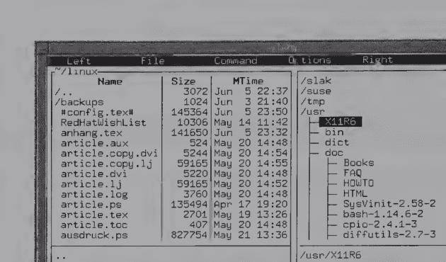

图 10.1 午夜命令管理器 (`Midnight Commander`)。

两个窗口。右鼠标键用于选中文件，随后可以将其删除、移动或复制到另一个窗口。可以通过菜单（鼠标）和功能键（参见状态行）执行任何命令。

显然，你也可以使用键盘来选择文件：`[+]` 和 `[-]`（在数字键盘上）选择/取消选择光标下的文件。要执行此操作，你必须指定文件名模式（例如 `*.bak`）。`[Ctrl+S]`（搜索）会将光标移动到匹配初始字符的文件。

你还可以通过屏幕底部的命令行通过键盘输入命令。在此行中，你可以使用 `[Alt+Tab]` 作为不完整名称扩展的快捷键（与 `bash` 中的 `[Tab]` 相同）。为了确保命令结果不会隐藏在用户界面后面，你可以通过 `[Ctrl+O]` 临时关闭并重新打开此界面。

该程序最突出的两个特性是目录树的显示（`LISTTREE`）以及在标准视图中显示目录大小（`COMMANDDIRECTORY SIZE`）。遗憾的是，这两种视图不能结合。

另一个值得的特性是在 `COPY` 或 `MOVE` 命令中更改文件的可能。使用标准的 `UNIX` 方法，目标名称允许使用通配符，这允许你重命名你的 `*.old` 文件。

考虑到可以通过 `[F1]` 调出的全面在线帮助，这段简短描述应该足够让你大开眼界。一旦你习惯了 `mc`（这应该花费不超过半小时），你就再也不想离开这个程序了。

### 10.2 DOS/Windows 文本文件的转换

当你尝试在 `DOS`/`Windows` 和 `LINUX` 之间交换文本时，会遇到两个问题：行尾标记方式不同（这适用于 `DOS` 和 `Windows`），以及使用了不同的字符集，这会影响外语言特殊字符（仅适用于 `DOS`）。

简要说明细节：在 `DOS` 和 `Windows` 下，行的两端都由回车（`carriage return`）和换行符（`line feed`）的字符组合标记。`UNIX` 和 `LINUX` 不需要回车字符，换行符就足够了。这意味着当用 `LINUX` 编辑器查看 `DOS` 文件时，每行末尾都会显示一个 `^M` 字符。反之，在 `DOS` 编辑器中查看 `LINUX` 文件会变成无限的字符蛇，因为 `DOS` 和某些 `Windows` 程序（如 `NOTEPAD` 编辑器）不识别行尾。

现在关于特殊字符：`Windows` 和 `LINUX` 使用三种不同的字符集。`DOS` 通常使用 `ASCII` 集的变体，`Windows` 使用 `ISO 8859/1` 字符集。在所有三个字符集中，0 到 127 的字符是相同的。差异出现在剩余的 128 个字符中它们包含了外语言特殊字符（重音、变音符号等）。`Windows` 和 `LINUX` 字符集彼此更为相似——例如，变音符号以相同的方式编码（遗憾的是，其他字符并非如此）。

#### 手动转换文本文件

解决这些问题有两种变体：当只需要更改行尾时，可以使用 `fromdos` 和 `todos` 命令：

```
$ fromdos file # 将 DOS 转换为 Linux
$ todos file # 将 Linux 转换为 DOS
```

如果还需要在 `DOS` 和 `LINUX` 之间进行特殊字符的转换，`GNU` 工具 `recode` 更好。

```
$ recode ibmpc:latin1 file # 将 DOS 转换为 Linux
$ recode latin1:ibmpc file # 将 Linux 转换为 DOS
```

调用这四个命令时必须小心——原始文件会被新文件替换。以下变体在 `dos` 和 `linux` 中被用作文本文件的名称，要安全得多。

```
$ fromdos < dos linux # DOS -> Linux，仅更改行尾
$ todos < dos linux # Linux -> DOS，仅更改行尾
$ recode ibmpc:latin1 < dos > linux # DOS -> Linux，包含特殊字符
$ recode latin1:ibmpc < dos > linux # Linux -> DOS，包含特殊字符
```


`recode` 可以处理超过 100 种不同的字符集。其他字符集的细节和进一步的应用可能性可以通过执行 `info recode` 获取。

不要使用 `ibmpc` 使用 `recode` 转换 `Windows` 字符集。这是因为 `Windows` 使用 `ANSI` 字符集对外语言字符采用了不同的代码。

如果上述命令不是你的发行版的一部分，你将在附带 `CD-ROM` 的 `tools` 目录下找到预编译版本和源码。

在第 513 页，你将找到一个 `bash` 编程示例，显示了你如何借助 `tr` 和 `sed` 命令编写自己的简单转换工具。

#### 自动转换

如果你在 `LINUX` 文件系统中挂载了 `DOS`/`Windows` 分区，你可以自动执行行尾转换，可以通过在 `mount` 命令中指定选项 `o=convauto` 或者通过在 `/etc/fstab` 中输入选项 `convauto`。当你从 `LINUX` 读取文件时，所有行尾都显示正确。反之，当你写入 `DOS` 文件时，会插入它们的回车字符——感觉像是天堂！

隐藏的陷阱是测试文件的识别。任何没有定义扩展名的文件（如 `*.exe`、`*.dll`、`*.gif` 等）都被解释为文本文件。如果该文件是二进制文件，在访问期间会被错误解释。例如，如果你使用 `tar` 对 `DOS` 分区进行备份，备份文件部分可能是不可用的！因此，虽然 `option=convauto` 选项非常方便，但它是一个严重的危险源！只有在你完全意识到你可能造成的破坏时才激活此选项。

自动转换仅涉及行尾。字符集（转换 `DOS` 文件时的特殊字符）不会改变。

所有排除在自动转换外的扩展名列表可以在文件 `/usr/src/linux/fs/fat/misc.c` 中找到。

### 10.3 X 实用

本节列出了几个简单的 `X` 程序。意图不在于提供使用此类程序的说明，而是引起人们对它们的关注。选择限于标准发行版中的程序，例如 `Slackware` 或 `RedHat`。显然，`X` 存在大量的免费或共享程序。

与实际应用相关的程序将在其他章节中详细描述：

| 程序 | 描述 |
| :--- | :--- |
| `xman` | 在线文档，第 70 页 |
| `xvi` | 显示 `DVI` 文件，第 325 页 |
| `ghostview` | 显示 `PostScript` 文件，第 323 页 |
| `xv` | 显示图形文件，第 327 页 |
| `xgrab` | 截图，第 329 页 |
| `emacs` | 在 `X` 下使用 `Emacs`，第 358 页 |
| `seyon` | `X` 终端模拟器，第 424 页 |
| `Arena` | 免费 浏览器，第 441 页 |
| `Netscape` | 商业 浏览器，第 442 页 |
| `Tcl/Tk` | `X` 的简单编程语言，第 537 页 |

#### xterm 和其他终端程序

你大部分使用的 `X` 程序是 `xterm`。这是一个可以执行 `Linux` 命令的终端窗口。你可以在 `X` 下处理任意数量的终端窗口，就像处理多个控制台一样。

与控制台相比，`xterm` 的优势是所有输入和输出存储的时间更长。因此你可以使用滚动条查看较早的输出。滚动条可以通过资源文件中的内容设置：

```
xterm*scrollBar: true
xterm*saveLines: 1000
```


## xterm 操作与配置

按住 `Ctrl` 键时，可以使用三个鼠标键调用各种菜单，允许你设置 `xterm` 的不同属性。例如，你可以在运行期间更改字体大小。

显然，也可以在资源文件中设置所需的字体大小。（支持 `Del`、`Home` 和 `End` 键的其他资源设置已在第 207 页描述。）

```
xterm*VT100*font: 9x15
```

当 `xterm` 通过脚本文件（例如 `.Xsession` 或 `xintrc`）通过 `fwm` 调用时，各种命令行选项就会发挥作用了：

- `-e command`
  在 `xterm` 中执行指定的程序。`e` 必须作为最后一个选项使用。

- `-fn charset -fg color -bg color`
  指定所需的字体类型以及背景和前景颜色。

### 308 工具与实用

- `-geometry 80x35+100+200`
  在像素坐标 `(100/200)` 处启动一个大小为 `35` 行乘以 `80` 列的 `xterm`。

- `-ls`
  如果在 `xterm` 中启动了 shell，则会评估 `.profile`。这对于确保各种别名缩写、环境变量定义等被读取至关重要。

- `-sl n`
  指定要存储的行数（等同于 `SAVLINES`）。

- `-title name`
  指定窗口标题。

如果你想使用 `xterm` 的所有功能，应该通读 `man` 手页（帮助文档）：超过 30 页的长度足以让你看出 `xterm` 的配置程度有多高！

除了 `xterm` 之外，X 环境下还有其他几个终端程序可供：

- `color-xterm` or `color_xterm`
  支持颜色，例如用于 `ls`

- `rxvt`
  内存消耗更低，配置选项较少

- `cmdtool` and `shelltool`
  OpenLook 的两个变体

## 文本和图形编辑器

显然，所有为文本模式设计的编辑器也可以在 X 下使用。`Emacs` 会自动识别其是否在 X 下启动，并以其 X 变体出现，其特点是额外的菜单和若干其他附加功能（见第 358 页）。`jed` 也有其 X 变体，以 `xjed` 的名称启动；然而，与纯文本版本相比，其优势并不大。

`xed` 是一个纯编辑器，但其特点是极其简洁的用户界面。`aised` 和 `ax` 编辑器在发行版中提供的频率较低，但在处理方式上要吸引人得多。`aised` 的预设布局带来的改进比其功能上的改进更大，而 `ax` 在出色的在线文档和良好的可配置性方面表现出色。

`xfig` 是一个易于操作的图形编辑器。尽管它没有达到 `CoreDraw` 的质量，但非常适合创建简单的图表和符号。值得注意的是它对 `PostScript` 格式的支持，不仅可以存储，还可以导入部分图片。`xfig` 拥有自己的 `LaTeX` 接口，因此由 `xfig` 创建的插图可以使用 `LaTeX` 进行进一步处理。

绘画程序 `xpaint` 比 `xfig` 更丰富，处理起来也容易得多。此外，它的在线帮助方便了用户初次尝试使用。


### X 实用程序 309

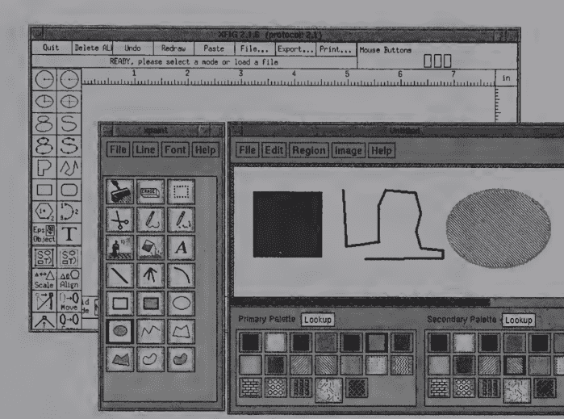

**图 10.2** 两个图形程序 `xpaint`（前景）和 `xfig`（背景）。

## 文件管理器

X 环境下的文件和程序管理器肯定不缺，尽管下面列出的某些程序中，有些更适合通过鼠标点击探索 `LINUX` 目录树，而不是进行实际工作。由于此原因，仅对三个程序进行详细描述。

- `tkdesk`：一个用 `Tcl/Tk` 编程语言编写的文件管理器，非常强大且灵活，但仅出现在少数发行版（`SuSE`）中。
- `uc`：Unix Commander，一个看起来很专业的共享软件，在多个窗口中提供了 `Norton Commander` 的大部分功能。
- `xfileman`：另一个文件管理器，其对目录树和链接的清晰表示法令人印象深刻；遗憾的是它容易崩溃，当前版本自 1993 年以来一直可用。
- `xfm`, `xdtm`：`xfilemanager` 的替代品，不太易用。
- `xgroups`：程序管理器（外观和操作感觉与 `Windows 3.1` 的程序管理器相似）。

### tkdesk

`tkdesk` 基于 `Tcl/Tk` 编程语言并免费提供（`GPL`）。在程序启动时，会打开一个三层级的浏览器窗口和一个图标栏。在浏览器窗口中，可以表示三个层级的目录。目录层级数是变化的。此外，可以打开任意数量的浏览器窗口。在目录窗口内部使用不同的颜色来识别不同的文件类型。

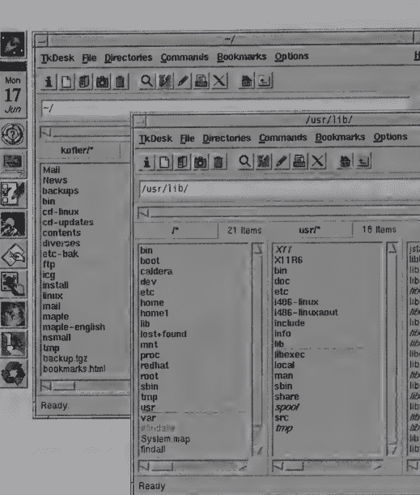

图 10.3 文件管理器 `tkdesk`。

在每个目录列表中，可以使用鼠标左键高亮文件。使用鼠标中键，可以将高亮的文件移动到另一个目录，甚至可以跨浏览器（拖放）。鼠标右键会弹出一个带有各种命令的右键菜单。`tkdesk` 有自己简单的编辑器，也用于显示文本文件。

除了易用和直观的操作外，`tkdesk` 与其他文件管理器的区别在于若干个相当特殊的特性：

- 当删除文件时，它们会被复制到垃圾箱，可以单独清空（通过其自己的窗口）。然而，同名文件的备份只是简单存储。
- 重要目录可以像 `WWW` 浏览器一样存储为书签。
- `“Disk Usage”`（磁盘占用）命令提供了各个目录磁盘空间使用情况的清晰显示。
- `tkdesk` 实际上可以任意配置。
- 该文件管理器配备了极好的在线帮助。

| UC Tool | Target:/h |
| :--- | :--- |
| Ctrl off | home |
| * Permis | Owner |
| dwx-xr-x | kofler |
| dwx-xr-x | kofler |
| dwx-xr-x | kofler |
| dwx-xr-x | kofler |
| dwx-xr-x | kofler |
| dwx-xr-x | kofler |
| dwx-xr-x | kofler |
| dwx-xr-x | kofler |
| Source/home | |
| F1 Local Help | |
| F2 Menu | |
| F3 Make Dir | |
| F4 Tree | |
| F5 View | dwx-xr-x | users |
| F6 Edit | dwx-xr-x | users |
| F7 Rename | dwx-xr-x | users |
| F8 Move | dwx-xr-x | users |
| F9 Duplicates | dwx-xr-x | users |
| F10 Copy | dwx-xr-x | users |
| F11 Delete | dwx-xr-x | users |
| F12 Exit | dwx-xr-x | users |

（注：源码中的 OCR 表格严重损坏，充满了重复的 "dwx-xr-x kofler" 字符串；已根据可见的命令模式清理。）

图 10.4 Unix Commander。

### Unix Commander uc

`uc` 是共享软件！在 30 天的测试期后，商业或常规使用仅在程序注册（25 美元）后才允许。未注册的版本在功能上没有限制，但其反复的注册请求相当烦人。

启动 `uc` 后会打开若干窗口，其中只有三个真正重要：源窗口、目标窗口和工具窗口。`uc` 的基本思想是所有复制和移动操作都从源窗口执行到目标窗口。在源窗口和目标窗口中，可以使用中键高亮文件。用左键双击可以切换到相应的目录或显示文件内容（仅对文本文件合理）。

可以一个窗口来显示目录树。此功能是 `uc` 最具吸引力的特性之一。鼠标右键用于折叠树的一层，而中键显示进一步的一层。

在每个窗口内部，可以使用右键或 `F2` 调用右键菜单。除了各种命令外，此菜单还提供了设置颜色的简单方法。（默认设置仅适合心情抑郁的用户：黑底黑字。）程序终止时，配置的更改会自动存储。

### xfilemanager

通常，在程序启动后会出现两个窗口，一个是目录树窗口，另一个是启动程序的图标窗口（见图 10.5）。通过双击目录项可以打开一个显示该项内容的新窗口。点击左侧图标可以删除此窗口。（该图标看起来像月亮和星星；其符号意义我无法理解。）

如果你不希望程序在每次更改目录时打开新窗口，可以使用 `-singlewindow` 启动程序。这样，程序的行为类似于 `MS-Windows` 文件管理器，左侧处理目录树，右侧处理当前选择的目录。启动时显示的默认目录可以通过 `-rootdir` 设置。这些设置也可以在 `.xdefaults` 中执行。

```
! / .xdefaults

xmanager*multiWindow: false

xfilemanager*iconFont: 9x15

xfilemanager*rootdir: 
```


在管理器窗口中，双击图标将启动相应的程序（如果存在）。如果你不计划使用 `xfilemanager`

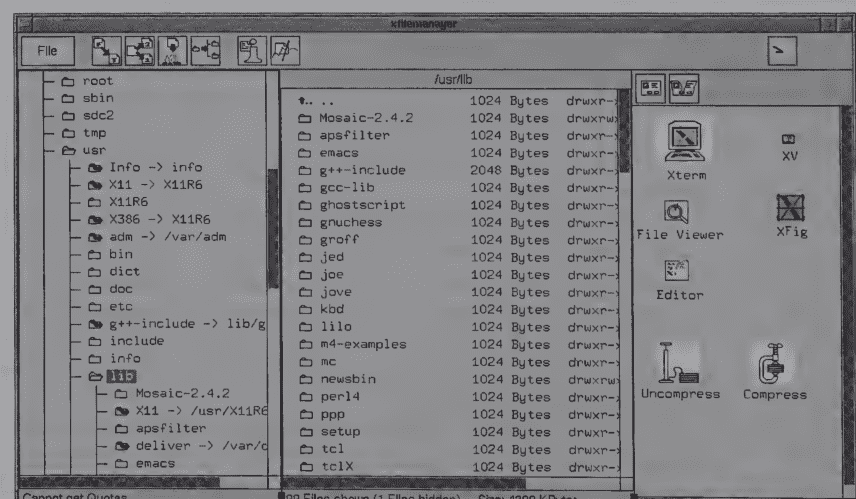

图 10.5 文件管理器 `xfilemanager`。

# X 实用程序

作为你的程序管理器，这个额外的函数对于快速查看文件或方便的（解）压缩非常有用。

程序管理器可以配置两个图标，另一个像一封被撕成两半的信（其象征意义，再次，仍然是神秘的）。第一个图标会打开一个对话框，其中可以修改当前活动程序符号的设置。`APPLY`（应用）执行更改，`Save`（保存）将程序管理器的完整设置保存在 `.wsrc` 文件中。通过第二个图标，可以删除已高亮的程序符号。新的符号可以从文件移动到程序管理器。`.wsrc` 文件的合理设置如下：

```
# /.wsrc

6 694 0 262 503

File Viewer:xterm -e less:51 104:xmore.xpm:1 1 0

Editor:xedit:51 173:xedit.xpm:1 0 0

XV:uv:177 30:file.xpm:1 1 1

Compress:gzip:158 270:compressor.xbm:1 1 1

Uncompress:gunzip:51 100:270:decompressor.xbm:1 1 1

Xfigxfig:179 59:xdesigner.xpm:1 0 1

Xterm:xterm -sb:59 12:xterm.xpm:0 0 0
```

## 工具

本小节描述了一些用于 X 配置和管理的有用工具。程序按字母顺序描述。更详细的信息可以在相应的 `man` 文本（手册）中找到。根据发行版的不同，并非所有程序都可用，或者必须单独安装。

### `xbiff`

该程序通过信箱符号指示是否有新邮件到达。

### `xcalc`

该程序模拟了一个简单的科学计算器。

### `xclock`

该程序显示当前的日期。

### `xev`

`xev` 程序在探索键盘管理方面非常有帮助。它会打开一个新窗口，随后在启动程序的终端中显示所有 X 事件（鼠标、键盘等）。该程序还可以用于确定给给定按键分配了什么代码，以及 X 系统生成了对应的 `KeySym` 字符字符串。

### `xless`

`xless` 是通用流行的 `less` 命令的变体。`xless` 配备了滚动条，并允许对文本进行轻松搜索。

### `xlfonts`

`xlfonts` 显示所有可用字符集的列表。与 `ls` 类似，列表可以通过搜索模式进行限制。该模式必须包含在引号中以防止它被 `bash` 评估：

```
$ xlfonts '*24*'
```

### `xlmodmap`

`xlmodmap` 程序可更改 X 的键盘分配。该程序用于解决如 `Backspace`（退格键）和 `Del`（删除键）区分等问题（参见第 206 页）。

### `xosview`

`xosview` 以彩色条形图的形式显示最重要的系统使用参数：CPU 使用率、内存消耗、交换分区的使用情况、网络活动、串行接口状态和中断活动。关于显示信息的更多详细信息请参见 `xosview` `man` 页面。

### `xrdb`

`xrdb` 用于读取额外的资源文件。该命令主要用于 X 系统的 `xinitrc` 文件。它还可以用于尝试立即尝试 `xresources` 文件的更改（未位于 `/.xdefaults` 的修改后的资源必须使用 `xrdb` 重新读取——否则它们只有在重启 X 后才会生效）。`xrdb -query` 显示当前存储的资源信息。

### `xset`

`xset` 用于更改 X 设置。该程序还可以用于设置屏幕保护程序的响应时间和 `NumLock`（数字锁定）的状态。为了使用 `xset`，可以在 `xinitrc` 文件输入以下指令：

```
# xset s 60

# 在没有用户输入的情况下，60 秒后黑屏

# xset led 3

# 开启 NumLock
```

### `xsetroot`

`xsetroot` 更改 X 背景的模式和颜色。通常，该程序配合 `-solid` 选项用于定义纯背景：

```
$ xsetroot -solid blue
```

### `xtar`

`xtar` 允许从 `tar` 归档中轻松提取单个文件。为此，将启动 `xtar` 并加载相应的归档文件。主窗口显示找到的所有文件列表。可以使用 `OPTIONSVIEW` 读取单个文本文件。随后，可以提取整个归档中之前标记的文件。`xtar` 只能用于提取文件，而不能创建新归档或修改现有的归档。

### `xsysinfo`

`xsysinfo` 是上述 `xosview` 工具的精简版本。它显示 CPU 使用率和内存消耗。

## 10.4 PostScript 工具

### 引言

本节处理几乎任何格式的文件打印（例如 ASCII 文本、程序列表、`TEX` 和 `LaTeX` 文档、图像等）。在 `LINUX` 下，几乎每份打印输出都是通过 PostScript 打印语言实现的。因此，PostScript 代表了 `LINUX` 世界（以及通常是整个 Unix 世界）的打印标准。结果几乎所有处理文本或图像处理的程序都可以提供 PostScript 文件。但即使你没有 PostScript 打印机，也不必绝望。

### 概述

为了记录文档，通常需要产生截图，即屏幕内容。在 `LINUX` 下，有两个程序被广泛用于产生 PostScript 文件。`xv` 的优势在于它可以处理多种图形格式，而 `xgrab` 在定义要提取的屏幕区域更为灵活。

| 程序 | 功能 | 页码 |
| :--- | :--- | :--- |
| `xv` | 存储内容 | 327 |
| `xgrab` | 存储任意屏幕区域 | 329 |

### `a2ps` ASCII 转 PostScript

由于 PostScript 打印机以命令格式输入，因此无法不预处理直接发送 ASCII 文件。对于 ASCII 到 PostScript 转换，可以使用 `a2ps` 命令。（如果没有 `a2ps`，请尝试下一节的 `mpage` 程序！）

本节处理几乎任何格式的文件打印（例如 ASCII 文本、程序列表、`TEX` 和 `LaTeX` 文档、图像等）。在 `LINUX` 下，几乎每份打印输出都是通过 PostScript 打印语言实现的。因此，PostScript 代表了 `LINUX` 世界（以及通常是整个 Unix 世界）的打印标准。

```
a2ps [options] ascii_file > ps_file
```


在默认设置下（即不带选项），`a2ps`以横向双列页格式化文本。两列都会自动提供框和页眉。在以下列表中，仅列出了不属于默认设置的选项：

- `-1`单列（而不是横向的双列）。
- `-8`使用 Latin 字符集。允许打印外语言特殊字符，但仅适用于 Level 2 PostScript 打印机。
- `-Fn`设置字体大小为 `n` 点。这会自动影响行距和每页行数。`n` 也可以使用浮点数设置。
- `-pd`使用竖向模式而非横向。
- `-nd, -nL, -nU`不打印日期、登录信息、标题、文件名。
- `-ns`不打印文本周围框。

在我的 PostScript 打印机上，使用 `a2ps`生成的文件出现了一些问题：带有特殊字符（选项 `-8`）和使用退格字符（代码 8）的文件无法打印。原因是 `a2ps` 部分使用了在 PostScript Level 2 中正式定义的 PostScript 命令。在较旧的 Level 1 打印机上（取决于实现），这些命令可能


## 318 工具与实用程序

可能不存在，并且在我的打印机上显然缺失了。对于 `ghostview`，我们对这两种特殊情况都没有遇到任何问题。此外，使用 `gs`将其转换为 HP Laserjet 格式并在该模式下打印（大多数 PostScript 打印机都支持此模式）运行运行良好。

`a2ps` 有一个详细的手册页（man page）。可以通过 `a2ps -h`获取所有选项的概览。在帮助文本中，默认设置通过大写字母标记。

当你想在不兼容 PostScript 的打印机上输出 ASCII 文本时，通常不需要经过 `a2ps`和 `gs` (GhostScript) 的转弯。只需尝试使用 `cp file /dev/....`将文件复制到你的打印机接口即可。执行此命令后，你通常需要通过 `echo -e "\f" >/dev/...`发送一个换页符以开始打印（打印最后一页）。

许多打印机可以使用纯 ASCII 格式复制，并在当前页满时自动开始新一页。然而，你将不得不放弃整齐的换行和分页符、页眉、页码以及类似的修饰。

## 用于将多页打印到一张纸上的 mpage

与 `a2ps`类似，`mpage`可以从 ASCII 文件生成 PostScript 文件。与 `a2ps`相比，它有两个额外功能：首先，`mpage`可以在一张纸上打印多达八页（你需要放大镜才能阅读），其次，`mpage`同时接受 ASCII 文件和 PostScript 文件作为输入。因此，你可以以节省空间的方式重格式现有的 PostScript 文件，然后以每页两页的方式进行打印（这对于所有的 PostScript 文件都有效。`mpage` 兼容 `dvips`，它是 Linux 世界中最重要的 PostScript 生成器）。

```
mpage [options] source_files > target_file
```

`mpage` 处理指定的源文件（ASCII 或 PostScript 格式）并将新的 PostScript 文件写入标准输出（重定向到目标文件）。以下列表仅列出了最重要的选项（还有更多选项！）。

- `-1 -2 -4 -8` 在一张纸上打印一页、四页或八页。使用 `-2`和 `-8`时，使用横向格式。默认是四页。
- `-A`输出为 DIN A4 格式（默认：US Letter）。
- `-C`使用 ISO-8859.1 编码作为字符集。此选项对于打印包含外语特殊字符的文本是必要的。其他代码表可以在 `/usr/lib/mpage` 中找到。

## POSTSCRIPT 工具 319

- `-c`打印多个文件时，每个文件不开启新纸。
- `-f`长行跨越多行显示（默认：截断）。
- `-j n-m` 仅打印 `n`到 `m` 页（默认：全部）。
- `-L`以横向格式打印，具有 55 行和 132 列，以及按比例较小的字号（默认：纵向，66 行，80 列）。
- `-L n`每页打印 `n` 行并据此调整字号（默认：66 行）。
- `-o`不在页面周围打印框。
- `-v`同时也打印页码（默认：仅打印页码）。
- `-W n`每页打印 `n` 列并据此调整字号（默认：80 列）。

可以通过环境变量 `MPAGE` 更改默认设置。该变量可以在 `/etc/profile`中预设。一个合理的设置（针对国际业务）是：
`export MPAGE='A -C ISO-8859.1'`

## 用于 *.dvi 转换为 PostScript 的 dvips

`dvips`程序将 `*.dvi` 文件转换为 PostScript 格式。`*.dvi` 文件是 `TeX` 和 `LaTeX` 程序的输出（见第 12 章，从第 363 页开始）。`*.dvi` 文件经常作为各种程序的在线文档提供。

### dvips [options] file

`dvips`处理指定的 DVI 文件。程序会自动在名称后添加 `.dvi`扩展名。`dvips`的结果——一个无尽的 PostScript 命令列表——通常直接传递给 `lpr`程序。你可以使用选项 `-o`将其存储在文件中（你可以用 `ghostview` 查看）。以下概览总结了最重要的选项：

- `--help`显示所有选项的概览。
- `-A`仅转换奇数页。
- `-B`仅转换偶数页。
- `-i S n` 将输出分割为每个 `n`页的文件。文件将按顺序编号。当需要将较长的文档输出到胶版机时，此选项非常重要。大多数胶版机一次只能曝光较少数量的页面（典型值在 20 到 50 之间）。
- `-last_page`在指定的页面终止转换。
- `-o target_file`将结果写入指定的文件（而不是传递给 `lpr` 程序）。
- `-p first_page`从指定的页面开始转换。
- `-pp n1,n2-n3,n4,n5-n7`打印指定的页面。注意页列表中不能有空格。

`LaTeX` 文档通常不使用原始的 PostScript 字符集，而是使用专门为 `LaTeX` 设计的字符集。它的好处是，随后将 PostScript 文件转换为另一种打印机的格式时，几乎不会损失质量。如果此时对于每个缺失的字符集，`dvips`在之前的打印中没有进行计算，则 `dvips`会自动启动 `LaTeX` 字体程序 `Metafont`。由于由于原因，PostScript 文件的第一次转换可能需要很长时间。


## 用于 *.dvi 转换为 Laserjet 的 dvilj

`dvilj`可用于 `*.dvi` 直接转换为 LaserJet 格式。

- `dvilj [Options] dvi_file`
- `dvilj2p [Options] dvi_file`
- `dvilj4 [Options] dvi_file`
- `dvilj4l [Options] dvi_file`

无选项调用 `dvilj` 会处理指定的 DVI 文件。结果是程序提供一个扩展名为 `.lj`的同名文件，用于 300 dpi 的 LaserJet 打印机。`dvilj2p`、`dvilj4` 和 `dvilj4l` 命令的工作类似，但专门支持指定的型号（包括 600 dpi 和内置 TrueType 字符集）。

- `-g file`将结果写入指定的文件。
- `-g page_number`从指定的页面开始打印。
- `-l`以横向格式打印。
- `-s n`设置纸张。允许的值包括：26 代表 DIN A4，90 代表 DL 尺寸信封（11x22 cm），95 代表 C5 尺寸信封（16.2x22.9 cm）。
- `-t page_number`在指定的页面终止打印。

如果你想打印包含 PostScript 字符集的 `*.dvi` 文件，你应该走 `dvips`和 `gs`的转弯——结果一定会好得多。`dvilj` 会无情地将所有 PostScript 字符集替换为 10 点 `LaTeX` 标准字体。

`dvilj` 拥有一个非常详细的主页。你可以在那里找到其余选项的信息以及如何获取双面打印（通过先打印奇数页，然后在刚刚打印的纸的反面打印偶数页）。

## 用于将 PostScript 转换为其他格式的 GhostScript

`GhostScript` 可以将 PostScript 文档转换为许多打印格式（包括传真格式）。当 PostScript 文档使用了 `LaTeX` 字符集时，docu-

## 322 工具与实用程序

在这里，质量不会损失，但如果使用了原始的 PostScript 字符集，`gs` 必须使用 `/usr/lib/ghostscript/fonts`下的字符集文件，这些文件无法匹配原始字体的质量。

```
gs [options] postscript_file [quit.ps]
```


为了让`gs`正确运行，至少必须指定两个选项：`-DEVICE`设置输出格式，以及`-OutputFile`指定将结果写入的文件。通常情况下，使用选项`-sAPERSIZE=a4`和`-dOPAUSE`也是合理的。

`gs`以交互式方式工作，并在处理完最后一页后会显示一个输入提示符。如果转换结束并需要退出`gs`，你必须输入`Ctrl+D`。如果你想避免这一点，可以指定一个名为`quit.ps`的第二个文件，该文件从`/usr/lib/ghostscript/`加载，且仅包含文本`quit`。

以下指令将`test.ps`转换为`HP LaserJet 3`格式。结果写入到`test.hp`：

```
$ gs -sDEVICE=ljet3 -OutputFile=test.hp \n-sAPERSIZE=a4 -dOPAUSE test.ps
```


## 323 POSTSCRIPT 工具

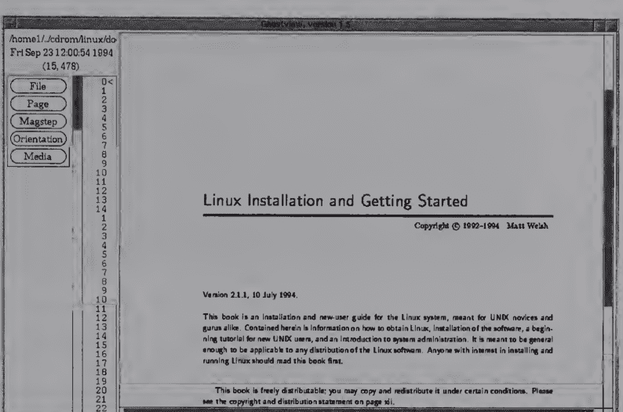

图 10.7 使用 `ghostview` 查看的 PostScript 文本。

`gs` 的帮助文本相当全面。此外，目录 `/usr/lib/ghostscript/doc` 包含了更多关于 GhostScript 内部机制的信息。

### 用于查看 PostScript 文档的 ghostview

原则上，`ghostview` 只是已经介绍过的 `gs` (GhostScript) 程序的图形用户界面。`ghostview` 允许你在屏幕上查看/阅读 PostScript 文件。`ghostview` 可以同时处理单页 PostScript 图形和包含数百页的文档。当文档符合 PostScript 标准时，你可以自由地在页码之间跳转。否则，文件只能按顺序读取（即一页一页地阅读，无法跳过页码或返回）。

通常，调用 `ghostview` 时不带任何参数，或者带有要查看的文件名。该程序是完全由菜单驱动的。为了打开新文件，会显示一个窗口，允许使用鼠标轻松选择文件。点击图像区域的任意一点，都会打开一个一个小窗口，其中包含鼠标指针周围区域的放大。你可以通过鼠标中键点击页码来切换到另一个显示的页面。

作为鼠标控制的快速替代方案，程序提供了一些快捷键，其中最重要的总结在下表中。

## 324 工具与实用程序

| 快捷键 | 功能 |
| :--- | :--- |
| `PgUp, PgDn` | 上一页/下一页 |
| `Spacebar, ←` | 下一页 |
| `↑` | 旋转视图 90 度（注意，非常耗时） |
| `↓` | 上一页 |
| `Backspace, Del` | 更改缩放因子 |
| `+, -` | 打开新文件 |
| `O` | 退出程序 |
| `Q` | 重新打开已修改的文件 |
| `R` | 图像向左/右 |
| `L, H` | 移动图像区域向上/向下 |
| `U, D` | |

`ghostview` 允许你从文档中提取单页或页面区域，并将它们存储在单独的文件中。实现这一点，需要在按住鼠标键的同时移动鼠标选择所需的区域，然后执行 `SAVE;MARKED PAGES` 命令。

关于 `ghostview` 处理的详细信息，以及所有命令和键盘快捷键的总结，可以在正文中找到。

### psutils (PostScript 文件处理实用程序)

通过 `ghostview`，你也可以标记文件中的单页并将其存储为单独的 PostScript 文件。如果你希望自动化此或其他类似任务，该软件包的命令将非常有用。某些命令是自包含的程序，另一些是 `bash` 或 `Perl` 脚本。

由于空间限制，本节无法包含大量命令的详细描述——但查看下列表将让你有一个直观的了解。更多细节可以在相应的 `man` 页中找到。

`psutils` 命令只有在 PostScript 文件包含符合 `DSC` 标准的注释时才能工作。（`DSC` 代表文档结构惯例。注释不会被打印，但包含关于页面大小、页面开始和结束等重要信息）。`EPS` 文件是单页 PostScript 文件，包含嵌入到其他文档的特殊命令（特别是关于图像尺寸的边界框规范）。

| 命令 | 描述 |
| :--- | :--- |
| `epsfit` | 调整 EPS 文件的大小 |
| `extracts` | 分析文件并为所有必要的字体、文件等提供 `%%IncludeResource` 注释 |
| `fixmps` | 将 FrameMaker 文件适配到 psutils 规范 |
| `fixmacps` | 将 Macintosh 文件适配到 psutils 规范 |
| `fixscribeps` | 将 Script 文件适配到 psutils 规范 |
| `fixpts` | 将 Troff/Tscript 文件适配到 psutils 规范 |
| `fixwfps` | 将 WinWord 文件适配到 psutils 规范 |
| `fixwps` | 将 Windows 文件适配到 psutils 规范 |


## 325 POSTSCRIPT 工具

- `fixwwps` 将 Windows 文件适配到 psutils 规范
- `getafm` 生成生成的 AFM 文件
- `includres` 将生成的注释包含在 PostScript 文件中
- `psbook` 组织生成的页面以适应书籍
- `psnup` 缩小页面以适应页面
- `psmerge` 合并多个 PostScript 文件
- `psresize` 修改文档所需的纸张尺寸，解决了以 Letter 格式生成的 PostScript 问题
- `psselect` 提取 PostScript 文件中的页面
- `psops` 安排生成的 PostScript

在 Windows 下生成的 PostScript 通常非常耗时；任何情况下，为了有成功的概率，不要忘记激活上述选项。

## 10.5 图像处理、截屏

### 图形程序 xv

`xv` 是一个功能非常强大的程序。你可以用它读取各种格式的图形文件，并将它们存储为不同的格式。

同时，它还提供了多种图像处理操作（旋转、镜像等）。此外，`xv` 还可以用于截屏，即将一个窗口或整个屏幕存储到任意格式的图形文件中。最后，但同样重要的一点是，你还可以将 `xv` 作为文件管理器使用（视觉化的 SCHNAUZER）。

与其他 Linux 组件不同，`xv` 是共享软件（shareware）。只有在付费购买许可后才允许用于商业用途。点击 `LICENSE` 按钮会显示许可协议。

关于使用 `xv` 的几点说明：当它启动时，会显示一个彩色的 Logo。只有在用鼠标右键点击 Logo 后，真正的控制窗口才会出现。通过控制窗口，你可以加载文件。当 `xv` 识别出图形格式时，它会在图形窗口中显示该文件。

现在，你可以通过控制窗口中的按钮进行一些基础处理。如果你想更改亮度、对比度或其他颜色设置，点击 `WINDOW/COLOR EDITOR` 将为你提供一个具有无数可能性的独立窗口。

当你工作在 256 色模式时，可以单独修改每种颜色。可以使用鼠标中键直接在图像中选择所需的颜色。（事实上，这种并不存在；但是，你可以通过 `24/8 Bit MODE` 将图像减少为 256 色。）

无论是在 24 位还是 8 位颜色模式下，你都可以更改整个光谱以及单个颜色分量（红、绿、蓝）的亮度分布。要实现这一点，只需移动亮度分布控制点即可。

`ALGORITHMS` 菜单提供了各种图像处理算法。例如，你可以通过 `SIZE DOUBLE SIZE` 放大低分辨率图像以匹配尺寸，随后通过 `ALGORITHMS BLUR` 对图像像素进行模糊处理。

使用鼠标左键，你可以标记图像的任意区域，然后通过 `Crop`（裁剪）将图像裁剪到该区域。这允许你只存储图像的一部分。（然而，所有的图像处理都是针对整个图像进行的。当你执行 `Uncrop`（取消裁剪）时，完整的图像将再次显示。）

处理完图像后，可以使用 `SAVE` 将其存储为格式之一（列举几个）：`BMP`, `GIF`, `ISIS`, `JPEG`, `PBM`, `PostScript`, `TIFF`。此时，可以设置多种额外的选项（彩色/黑白、压缩因子等）。因此，`xv` 代表了一个极其强大的图像处理和转换工具。

`xv` 也可用于创建截屏。要这样做，你首先点击 `GRAB` 按钮，然后点击一个窗口或 X 系统的背景。


## 328 工具与实用程序


图 10.9 用 `xv` 查看的 Linus Torvalds 照片。

这会导致 `xv` 读取窗口内容或整个屏幕的内容。随后，可以像上述一样对该图像进行处理和保存。

取决于 X 服务器和显卡，`xv` 的截屏功能可能会导致问题，我尚未识别这些问题的根源。

`xv` 拥有一份 100 页的手册，在许多发行版中，它以 PostScript 文件（`/usr/doc/xv/xvdocs.ps`）的形式提供。

### 其他图像处理和图形转换的程序

如果你认为 `xv` 的图像处理功能不够灵活，你应该看一眼 `gimp` 程序。`gimp` 在这方面强大得多，例如它允许你只操作图像的一部分（而 `xv` 的操作通常会影响整个图像）。`gimp` 的操作需要一些额外练习。此外，`gimp` 支持的图形格式较少——你可能需要在在使用 `gimp` 之前和之后使用 `xv` 将你的图形转换为适当格式。

相反，如果 `xv` 的转换功能看起来不足，或者你对它的交互式控制感到困扰，那么还有其他替代方案：`Image Magick` 程序同时提供了单命令和交互式界面。对于转换，它使用一种专有的中间格式 (`MIFF`)。`NetPBM` 软件包（以前称为 Portable Bitmap Utilities）也采用了类似的方法。在这里，使用 `PBM` 格式作为中间格式。例如，如果你必须将数百个 MS Windows 位图转换为 PostScript 格式，这些实用程序是正确的选择。

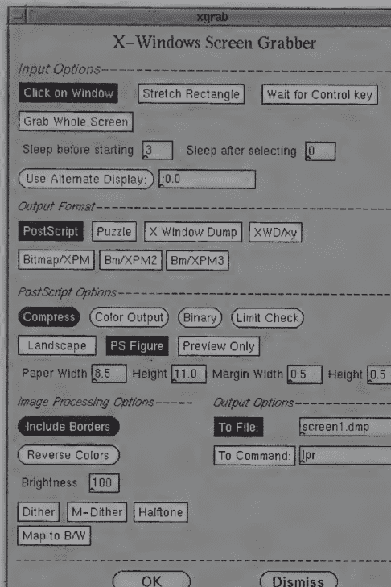

**图 10.10** `xgrab` 窗口。

### xgrab - 针对高级用户的截屏工具

尽管 `xv` 在图像处理方面极其强大，该程序在涉及创建截屏时缺乏 `xgrab` 的灵活性。`xgrab` 生成的文件如果需要，随后可以用 `xv` 进行处理。

`xgrab` 的处理方式与 `xv` 完全不同——你必须提前设置所有选项：所需的屏幕区域（一个窗口、整个屏幕或用鼠标之前标记的矩形）、图形格式（PostScript 或各种位图格式）、可能的某些 PostScript 选项（对于演示，通常必须选择 `PS-FIGURE`）以及文件名。

当你点击 `Ok` 时，控制窗口会从屏幕上消失。在预设的时间内（在此期间你可以选择一个菜单），当前的屏幕内容将存储在文件中。几刻之后，控制窗口再次出现。`xgrab` 不提供查看功能——必须使用 `xv`。


## 330 工具与实用程序

### Emacs —— 编辑器之王

在 Linux 下，你可以选择许多编辑器。其中一些已从第 63 页开始简要介绍，它们非常适合简单任务。然而，`Emacs` 无疑是 Linux 下的编辑器。如果你计划进行更具挑战性的项目并需要高效处理大量文本（甚至是代码），几乎无法避免 `Emacs`。

与其他编辑器相比，`Emacs` 最大的优势在于它是几乎无限扩展和编程的。无论你想录制一个简单的宏还是编写一个整个帮助系统（如 `Info`），`Emacs` 都能实现！支持 `Emacs` 的另一个理由是：它适用于几乎每个 UNIX 系统；此外，大多数操作系统都有它的版本。一旦学会了如何操作 `Emacs`，你将不需要其他编辑器了。

有光就有影。起初，操作 `Emacs` 可能会令人生畏。界面本身充满了无数命令序列。然而，记住最重要的快捷键是值得的，因为其中许多也可以用于终端控制台和/或终端窗口输入。

#### 快速开始

准确来说，本章仅介绍由 `FSF` 创始人 `Richard Stallman` 编写 `GNU Emacs`（`FSF` 代表自由软件基金会，其目标是免费提供高质量软件）。除了 `GNU Emacs` 之外，还有其他变体：`jose` 是非常有用的 Emacs 精简版。由于其内置系统和可配置性，`jose` 特别是在磁盘空间或计算能力不足时，它是 `GNU Emacs` 的良好替代品。

在 Emacs 光谱的另一端，我们发现了 `X Emacs`（以前称为 `Lucid Emacs`）：这种 Emacs 变体是 Emacs 开发团队分裂的结果。它与 `GNU Emacs` 大体兼容，但具有更漂亮的界面和额外功能。作为交换，它的内存消耗更高，且其（此处原文中断）

# 334 EMACS – 编辑器之王

## 键盘约定

通常，有两种选择命令的方法：使用快捷键（主要涉及 `Ctrl` 或 `Alt`），或者输入完整名称。后一种方式以 `Alt+X` 开始。

# 336 EMACS – 编辑器之王

## 鼠标支持

默认情况下，只有在 X 环境下运行 `Emacs` 才支持鼠标。如果你在 `xterm` 窗口中使用 `-nw` 选项启动了 `Emacs`，你也可以使用鼠标：只需执行 `Esc-X xterm-mouse-mode` 即可。

如果你安装了 `gpm` 程序，至少可以在文本模式下使用鼠标复制和插入文本段（参见第 133 页）。在此基础上，如果你还安装了 `t-mouse.et` 并将其 Emacs 扩展命名为 `.emacs`（参见第 130 页），你就可以在文本模式下像在 X 环境下完全一样使用鼠标，即用于光标定位和文本块标记。

## 菜单

从 19.30 版本开始，`Emacs` 在 X 环境下和文本模式下均显示菜单（这是一项新功能！）。在 X 环境下，可以使用鼠标选择菜单项——参见第 360 页。在文本模式下，目前只能通过键盘进行菜单选择。该过程是通过按下 `F3` 插入，且过程非常繁琐，因此在文本模式下使用鼠标意义不大。因此，在第 592 页，你将找到如何在文本模式下完全关闭菜单的描述。

## 版本

本章描述了 `GNU Emacs` 19.30 版本。本章描述的某些功能在之前的版本中可用，例如键盘快捷键 `F1`（在线帮助，之前的版本为 `Ctrl-H`）和 `F3`（菜单选择）。显然，未来的版本也将会改进。

`X Emacs`（以前称为 `Lucid Emacs`，版本 19.13）与 `GNU Emacs` 具有良好的兼容性。但在键盘快捷键、命令名称和支持的模式上存在小差异。此外，`Lucid Emacs` 的编程语言在某些细节上与 `GNU Emacs` 使用的语言不同。

从 `GNU Emacs` 切换到 `Lucid Emacs` 时，将无法使用编译后的 Lisp 扩展 (`*.ele`)。这些文件可以从 `*.et` 文件重新编译，但更简单的方法是安装带有自带 `*.et` 文件的 `Lucid Emacs`（通常情况下如此）。关于 Emacs 编程的更多信息可以查看第 584 页及以后。

## 11.2 在线帮助

`Emacs` 提供了许多命令来调用在线帮助。最重要的命令（用于入门）是 `F1` 和 `T`（教程）。`Ctrl+X, B, J` 可以带你回到原始文本。

## 在线帮助 337

如果在执行帮助命令后，屏幕上仍有多个文本段（窗口），你可以使用 `Ctrl+O` ('over') 将光标置于下一个窗口内。`Ctrl+X` ('zero') 删除当前窗口，`Ctrl+X` 删除当前窗口以外的所有窗口。因此，你可以使用这些命令在帮助窗口之间切换，并最终完全移除帮助窗口。如果帮助文本的显示方式占据了整个页面，可以使用 `Ctrl+B` 回到你的原始文本。在内部，多个文本的管理（例如，你的文本和帮助文本）是通过所谓的“缓冲区”（buffers）实现的。你可以在第 348 页找到更多关于缓冲区的信息。


| 快捷键 | 功能描述 |
| :--- | :--- |
| `F1` | 可用帮助命令概览 |
| `F1` + `A` | 所有包含文本的命令概览 (apropos) |
| `F1` + `B` | 所有键盘快捷键 (bindings) 概览 |
| `F1` + `C` 快捷键 | 相关命令的简要描述 |
| `F1` + `F` 命令 | 命令（功能）的简要描述 |
| `F1` + `Shift+F` | Emacs FAQ（常见问题）启动信息系统以显示分级帮助文本（使用页见第 74 页） |
| `F1` + `N` | 当前版本相对于以前版本的新功能总结 |
| `F1` + `T` | 使用 Emacs 介绍（帮助教程） |
| `F1` + `Ctrl+C` | 版权信息（GNU 公共许可协议） |
| `F1` + `Ctrl+F` 名称 | 关于自由软件概念的信息 |


在 19.30 之前的 Emacs 版本中，你必须按下 `Ctrl+H` 组合代替 `F1`。关于 Emacs 最重要的信息来源是内部 `info` 系统，它被正式视为 Emacs 手册。在 CD-ROM 上可以找到该文本更易读的 `HTML` 版本（参见附录中的 CD-ROM 内容）。另一个实用工具是 TeX 文件。该文件包含一个最重要的 Emacs 命令的表格。如果你安装了 TeX 和 PostScript，你应该调用：

- 加载文件 `/user/lib/emacs/19.30/etc` 并修改该行。
- 使用文件生成 `DVI` 文件：`tex`
- 将 `DVI` 转换为 PostScript 文件：`dvips`
- 打印文件：`cp`（连接到并行接口）或简单使用 `lpr`


# 338 EMACS – 编辑器之王

结果是一个两页的打印输出，其页面包含了所有相关的 Emacs 命令（横向）。命令按主题排序（例如，文件、获取帮助、错误恢复等）。

## 340 EMACS — 编辑器之王

上述命令相对不灵活，因为删除的文本数量是预设的。然而，`Emacs` 也可以删除（并随后插入）任意区域的文本。要实现这一点，你可以使用 `Ctrl+Space` 标记要删除区域的末尾（此标记是不可见的，但 `Emacs` 会显示消息“Mark set”）。被标记的区域定义为标记点与文本光标当前位置之间的文本。

| 命令 | 描述 |
| :--- | :--- |
| `Ctrl+Spacebar` | 设置一个（不可见的）标记点 |
| `Ctrl+W` | 删除标记点与当前光标位置之间的文本 |
| `Ctrl+Y` | 插入文本 |
| `Ctrl+X, Ctrl+X` | 交换光标位置和标记点 |

双击命令 `Ctrl+X, Ctrl+X` 主要用于检查当前标记的是哪个点。第二次执行会将光标移回其原始位置。
当使用 `Ctrl+W` 删除时，标记点与光标位置之间的第一个字符被认为属于标记区域，而最后一个字符被认为在区域之外，且不被删除。

在使用 `Ctrl+Y` 插入之前删除的文本（无论是用 `Ctrl+W` 还是其他命令删除的）后，插入文本的首字符被视为新的标记点。对于用 `Ctrl+Y` 插入的文本，可以立即用 `Ctrl+W` 删除（例如，错误的插入）。

## 寄存器中的文本中间存储

从上述段落可以看出，`Emacs` 有一个缓冲区，存储了最近删除的文本，以便随后用 `Ctrl+Y` 插入。此外，可以执行 `Ctrl+X, U` 进行多级撤销。
`Emacs` 提供了在寄存器中存储中间文本的可能性。这些寄存器由字母或数字标识，可以插入文本的任意次数。当你经常需要在文本中使用相似的表述或关键词时，寄存器特别有用。寄存器（以及删除缓冲区）在 `Emacs` 退出时不会保存！如果你定义了相同的寄存器，应该考虑定义宏或缩写，它们也可以被保存（参见第 356 页及后续内容）。

| 命令 | 描述 |
| :--- | :--- |
| `Ctrl+Spacebar` | 设置一个（不可见的）标记点 |
| `Ctrl+X, R, S char` | 将当前光标位置与标记点之间的文本存储在字符寄存器中（寄存器保存） |
| `Ctrl+X, R, char` | 在当前光标位置插入字符寄存器的内容（寄存器插入） |

## 11.5 基础编辑命令

### 删除和覆盖文本

通常情况下，`Emacs` 处于插入模式，即新输入的文本将插入到当前光标位置的现有文本中。如果你想覆盖现有文本，必须使用 `Alt+X overwrite-mode` 切换到覆盖模式。重复执行该命令将切换回插入模式。在正确的键盘配置下，你也可以使用 `Ins` 来切换模式。

你不需要完整写出 `overwrite-mode`。输入 `Alt+X ov` 即可。`Emacs` 可以根据这两个字母扩展为完整的命令名称。你也可以使用 `Tab` 键手动执行此扩展。

### 更改字母的大小写拼写

`Emacs` 提供了各种命令来更改已输入单词的大小写拼写：


`Alt+C`：光标位置的字母大写，当前单词后续的所有字母变为小写（首字母大写）

`Alt+L`：从光标位置开始单词的所有字母变为小写

`Alt+U`：从光标位置开始单词的所有字母变为大写

`Alt+U`：首字母大写，其余部分小写；当光标位于单词开头时，更改上一个单词

`Esc, -, Alt+C`：直到光标位置单词的所有字母变为小写；当光标位于单词开头时，上一个单词变为小写

`Esc, -, Alt+U`：直到光标位置单词的所有字母变为大写；当光标位于单词开头时，上一个单词变为大写

`Ctrl+Spacebar`：设置标记点

`Ctrl+X, Ctrl+L`：标记点与光标位置之间的文本变为小写

`Ctrl+X, Ctrl+U`：标记点与光标位置之间的文本变为大写


`Esc,-` 也可以放在许多其他命令之前并修改它们的效果。在大多数命令中，`Esc,-` 会反转操作方向（由向前变为向后）。

在当前的 Emacs 版本 (`19.30`) 中，外语言特殊字符不受上述命令的影响。此外，Emacs 将这些特殊字符解释为单词边界。可以通过命令 `Alt+X load-library iso-syntax` 来解决这个问题。该命令也是第 130 页描述的最小 Emacs 配置的一部分。

## 342 EMACS – 所有编辑器之王

### 交换字母、单词和行

常见的打字错误是交换两个字母。通过 `Ctrl+T` 你可以轻松纠正这种交换。光标必须位于两个受影响字母的第二个字母上，例如在单词 `'exchange'` 中，位于 `'c'` 上。

同样，可以使用 `Alt+T` 交换两个单词。如果光标位于单词开头，则该单词将与前一个单词交换；如果光标位于单词的其他位置，则该单词将与后面的单词交换。重复执行 `Alt+T` 会导致两个单词中的第一个单词不断向前移动。通过 `Ctrl+X` 可以撤销错误的交换。

最后，你可以使用 `Ctrl+X, Ctrl+T` 交换当前行和前一行。重复执行 `Ctrl+X, Ctrl+T` 会导致上面的行不断向上移动。

### 制表符

在某些处理模式下，Emacs 会用制表符替换长行。标准的制表符宽度为八个字符。如果你想将其设置为四个，可以在 `.emacs` 文件中进行此设置。

### 手动缩进和取消缩进

文本的缩进和取消缩进对于列表来说特别重要。最重要的命令是 `Ctrl+X, Tab`，它会缩进标记点与光标之间的区域。使用 `Esc,-` 则是取消缩进。


## 11.6 Emacs 中的流式文本

现在我们假设你使用 Emacs 处理每行构成一个单元的文本（例如程序列表、配置文件等）。当你想用 Emacs 处理文本时，情况略有不同。这里的单元是段落。

通常情况下，Emacs 不执行自动换行。当行超过屏幕或窗口宽度时，会在左侧插入一个 `\` 字符，文本在下一行继续。

如果你想折断单个长行，可以执行 `Alt+J` 命令（在所有处理模式下）：这会在适当的位置将空格替换为换行符。

## 344 EMACS — 编辑器之王

空行被视为单个段落。Emacs 会重新格式化整个段落（即所有关联的行）。在程序列表中，此命令的后果显然是致命的！使用 `Ctrl+X, Ctrl+U` 可以撤销该命令。

当你处理 TeX 或 LaTeX 文件时，`Alt+Q` 会显示一个特殊功能：以 `\` 字符开头的行被视为段落边界且不会被重新格式化。要执行换行，你必须先手动将该行与上一行合并（使用 `Backspace` 或 `Del`），然后重新执行 `Alt+Q`。

在输入新文本时，重复执行 `Alt+Q` 变得不再必要了。因此，系统提供了一种流文本模式（flow text mode），通过 `Alt+X auto-fill-mode` 激活。当 Emacs 处于此模式时，新输入的文本会被自动换行。现有文本不会被此模式改变。此外，删除文本也不会导致自动重新格式化，这就是为什么在现有文本进行更改后，必须手动通过 `Alt+Q` 强制换行。

行通常在最多 74 个字符后换行。然而，你可以通过将光标移动到想要换行的列并执行 `Ctrl+X, F` 来修改此设置。

- `Alt+Q`: 执行手动换行
- `Alt+X auto-fill-mode`: 激活流文本模式（自动换行）
- `Ctrl+X, F`: 通过当前光标位置定义最大行长度

## 缩进流文本

### EMACS 345 中的流文本

当你想要输入几段缩进文本时，可以预设第一个有效列。要做到这一点，你必须在空行输入的空格或制表符数量要与待缩进文本的数量相同。随后，执行 `Ctrl+X, -`（句号）。现在，Emacs 将从段落行开始之后的所有行插入到指定的缩进列。

缩进列仅适用于新输入的文本。现有文本的缩进必须使用上述方法进行，且没有任何帮助！因此，你必须将光标置于行首并重新执行 `Ctrl+X, -` 来取消缩进。

`Ctrl+X, -` 命令存储光标位置与行首之间的字符，并通过换行自动将它们插入到新行的开头。如果你在光标位置的字符存在时执行 `Ctrl+X, -`，这些文本将插入到每个新行的开头。这可以用于编写多个以特定字符串（例如 `'>'`）开头的行。

对于以各种方式缩进的大量文本进行重新格式化，Emacs 提供了 `Alt+X fill-individual-paragraphs`。该命令格式化标记（marking）与当前光标位置（`Ctrl+Space`）之间的整个区域。所有的当前缩进都会保留。

| 命令 | 说明 |
| :--- | :--- |
| `Alt+X indented-text-mode` | 激活缩进文本模式 |
| `Alt+X auto-fill-mode` | 激活流文本的次要模式 |
| `Alt+Q` | 根据当前行缩进执行手动换行 |
| `Alt+S` | 当前行居中 |
| `Alt+Shift+S` | 当前段落居中 |

- `Ctrl+X, .` : 通过当前光标位置定义缩进列：执行此操作时，光标必须在空行中
- `Alt+M`: 将光标移动到缩进行的开头（类似于 `Ctrl+A`）
- `Ctrl+Spacebar`: 设置标记点
- `Alt+X fill-indent`: 格式化标记点与光标位置之间的区域，保持当前缩进

## 缩进文本模式

如果你在处理缩进，缩进文本模式可能比上述步骤更方便；此模式通过 `Alt+X indent-mode` 激活。当你在此在此模式下处理流文本时（这通常是常），你还必须通过 `Alt+X autofill-mode` 激活相应的次要模式。（次要模式定义了一些额外的命令，可以与任意模式并行使用——参见第 350 页。）

缩进文本模式唯一的本质功能是，在换行时，Emacs 会自动且无需复杂的准备，使每一行的后续缩进量与前一行相同。现在，手动换行的 `Alt+Q` 将保持第一行的缩进不变；从第二行开始的行保持不变；从第三行开始的所有行缩进级别都与第二行相同。如果你想将段落缩进五个字符，只需在第一行的开头插入五组空格，然后执行 `Alt+Q` 即可。

此外，缩进文本模式有两个新命令：`Alt+S` 使整个段落居中。

如果你想在不切换到缩进文本模式的情况下让行或段落居中，可以在所有其他模式下分别调用 `Alt+X center-line` 和 `Alt+X center-paragraph` 命令。

## 11.7 搜索与替换

### 增量搜索

搜索文本的最快方法是使用 `Ctrl+S search_text`。与其他编辑器的搜索命令相比，此命令有一个特殊功能：一旦输入搜索文本的第一个字符，它就会搜索。例如，如果你搜索 `'second mode'` 并输入 `Ctrl+S sec`，光标会跳转到第一个以 `'sec'` 开头的单词。不需要输入更多字符，可以继续输入来精炼搜索。

### 增量搜索

- `Ctrl+S`: 向增量搜索
- `Ctrl+R`: 向后增量搜索
- `Alt+P`: 选择之前使用的文本（上一个）
- `Alt+N`: 选择之前使用的文本（下一个）
- `Ctrl+G`: 取消搜索
- `Ctrl+X`: 交换标记点和当前光标位置

在搜索期间，不区分大小写。只要你输入任何按键，Emacs 就会找到搜索结果。如果以后你想搜索已经搜索过的文本，可以从搜索列表中选择。

## 模式搜索（使用正则表达式）

增量搜索找到与搜索文本完全匹配的文本。然而，通常希望搜索匹配给定模式的文本。

## 搜索与替换

- `Ctrl+Alt+S`: 向增量模式搜索
- `Ctrl+Alt+R`: 向后增量模式搜索

## 模式结构

- `^`: 行首
- `\<`: 单词开头
- `$`: 行尾
- `.`: 换行符以外的任意字符
- `*`: 任意数量的任意字符（包括 0）
- `+`: 任意数量的字符（至少一个）
- `?`: 零或一个任意字符
- `[abc]`: 指定字符之一
- `[^abc]`: 指定字符之外的
- `(`\: 组开始（参见搜索与替换）
- `)`: 组结束
- `\x`: 特殊字符，例如 `\ to` 表示 `\` 或 `\. ` 表示点（句号）

现在，搜索文本区分大小写。一些解释搜索模式语法的示例：`\[Tt]he>` 搜索文章 `'the$`，无论首字母是大写还是小写。单词内部出现（如 `'Theme'` 或 `'other'`）会被忽略。
`\[Tt]he[a-z:]` 搜索以 `'The'` 或 `'the'` 开头且至少跟着一个字母的单词。光标停在单词末尾（即第一个不是 `'a'` 到 `'z'` 之间的小写字母的字符）。

# 348 EMACS - 编辑器之王

```
Esc % 命令用于进行不带模式的搜索和替换

Alt+X query-replace-r 用于进行带模式的搜索和替换
```


搜索文本中的占位符：详见第 179 页
替换文本中的占位符（用于带模式匹配的变体）
`&` 代表找到的整个文本的占位符
`\1` 代表搜索文本中第一个 `\((..\)` 组的占位符

从上述语法标记可以看出，当使用模式匹配进行搜索和替换时，可以在替换字符串中指定模式的占位符。这允许你高效地执行大型且复杂的操作。下面一个示例将说明这一功能：
将 `function(\(1,2\),\(3,4\))` 替换为 `function(\(2,1\)`；在每次出现 `function` 的地方，两个参数都将交换位置。`function(a+b,2)` 变成 `function(2,a+b)`。唯一的条件是函数的参数中不能有逗号。当尝试在 `function(\(f(a,b),g(x,y))` 中交换参数交换时，命令会失败。

在使用搜索和替换命令并保存文本时要小心。特别是在第一次尝试时，经常会发生搜索模式找到比你计划不同的（通常要大得多的）文本的情况。（通过 `Ctrl-Shift+-`（即减号），你可以逐步撤销错误的替换命令步骤。）


找到搜索文本后

空格键 `Y` 替换，继续搜索

空格键 `place` 不替换，并将光标留在原处（以便检查结果；如果没问题，可以按空格键继续命令）

退格键 `N` 不替换，继续搜索

`Esc` 不替换，中止命令

在不请求确认的情况下执行所有后续替换（小心！）

`Ctrl+R` 中断命令，以便在当前光标位置进行手动修正（递归编辑）

`Ctrl+Alt+R` 恢复命令

## 11.8 缓冲区（Buffers）与窗口（windows）

你可以使用 Emacs 同时编辑多个文本。每段文本都在一个所谓的缓冲区（buffer）中管理。即使你只处理单个文本，也存在多个缓冲区：一个用于文本（缓冲区对应于文件名（不含路径）），一个用于


## 缓冲区与窗口 349

工作期间某时打开的信息窗口或帮助窗口（缓冲区名称为 `*info*` 或 `*help*`），一个用于显示通过 `Tab` 键展开的最新可能命令列表（`completions`），一个用于缩写列表（`*abbre*`，如果在执行 `M+X` 期间执行了 `edit-abbrev`；见下文），等等。

除了缓冲区的概念外，Emacs 还有窗口：窗口是屏幕上显示缓冲区的区域。通常情况下使用一个单一窗口，它占据所有可用空间。为了执行某些命令（例如显示帮助信息或 Emacs 内部信息），屏幕会在水平方向划分为两个窗口。屏幕也可以被划分为垂直或水平条带。在这些每个区域（窗口）中，可以显示不同的缓冲区。你也可以在两个不同的窗口中显示同一个缓冲区（这对于非常长的文本非常有用：你可以处理文本的不同部分，而无需不断用长光标来回跳跃）。

Emacs 的窗口概念与 `X` 下的窗口无关。它代表显示 Emacs 的 `X` 窗口内部的一个区域。

### 缓冲区命令

以下命令涉及当前活动窗口（即显示光标的窗口）。这些命令更改该窗口中显示的缓冲区。

- `Ctrl+X, B` 激活之前使用的缓冲区
- `Ctrl+X, B name` 激活指定的缓冲区
- `Ctrl+X, Ctrl+B` 在窗口中显示所有可用缓冲区的列表；可以使用 `Ctrl+X, I` 删除窗口
- `Ctrl+X, K name` 删除指定的缓冲区；如果缓冲区包含尚未保存的文件，则会出现确认请求

### 窗口命令

以下命令仅影响缓冲区在不同屏幕区域（窗口）中的显示。当你在垂直拆分的（因此相当窄的）窗口中工作时，通常需要将窗口内容在水平方向上向左或向右移动。必要的命令总结在下文中。

- `Ctrl+X, 0` 切换到下一个窗口（'oh'）
- `Ctrl+X, 1` 删除当前窗口（'zero'）
- `Ctrl+X, 2` 删除光标所在窗口外的所有窗口；将当前窗口拆分为两个水平区域
- `Ctrl+X, 3` 将当前窗口拆分为两个垂直区域


### 更改窗口大小

| 命令 | 描述 |
| :--- | :--- |
| `Ctrl+X, [` | 垂直扩展窗口 |
| `Esc, -` | 垂直缩小窗口 |
| `Ctrl+X, I` | 水平扩展窗口 |
| `Ctrl+X, ]` | 水平缩小窗口 |

### 移动窗口内容

| 命令 | 描述 |
| :--- | :--- |
| `Ctrl+X, <` | 将窗口内容向左移动 |
| `Ctrl+X, >` | 将窗口内容向右移动 |

缓冲区本身不会受删除窗口操作的影响（它们会变得不可见，但仍留在内存中，并可以随时再次显示）。当在 `Linux` 下使用 Emacs 时

## 11.9 缓冲区命令和其他模式

在 `Linux` 下使用 Emacs 时，存在许多或或的模式来处理文本。Emacs 的一个特殊功能是存在各种模式，这些模式会修改编辑功能。在 `Linux` 下使用 Emacs 时，某些模式允许对文本进行高亮。在 `Linux` 下使用 Emacs 时，只有一种主模式处于激活状态。切换不同的主模式不会影响活动缓冲区。

在加载文件时，Emacs 尝试根据文件名和前几行的内容识别文件类型并自动激活相应的模式。如果这对于某个文件不起作用，你可以在文件的第一行插入包含 `*` 的注释。在这里，你必须指定所需的模式名。

### 重要的主模式

| 命令 | 描述 |
| :--- | :--- |
| `Alt+X, fundamental-mode` | 标准模式 |
| `Alt+X, indented-mode` | 自动缩进模式（345 页） |
| `Alt+X, tex-mode` | TeX 模式（351 页） |
| `Alt+X, latex-mode` | LaTeX 模式（351 页） |
| `Alt+X, c-mode` | C 模式（352 页） |
| `Alt+X, tel-mode` | Tel 模式（354 页） |

### 重要的辅助模式

| 命令 | 描述 |
| :--- | :--- |
| `Alt+X, auto-fill-mode` | 填充模式（自动换行；343 页） |
| `Alt+X, iso-accents-mode` | 外语特殊字符输入（358 页） |
| `Alt+X, font-lock-mode` | 语法标记模式（361 页） |
| `Alt+X, abbrev-mode` | 缩写模式（自动扩展；354 页） |

除了上述模式外，Emacs 还有无数其他主模式，包括大多数 `Linux` 下的编程语言模式。可以通过 `C-A]` 模式获取概览。当前活动模式的信息可以通过 `C-M]` 显示。

### LaTeX, C 以及其他模式 351

`Alt+[X] font-lock`
`Alt+[X] abbrev`

语法标记（361 页）
缩写模式（自动扩展）354 页

在每个 `$` 结束时，光标结束的括号
跳转到当前括号的右括号
终止段落，插入一个额外的空行并对段落进行语法检查（括号缺失，等）

# 352 EMACS – 编辑器之王

命令有时会发出并不存在的错误（特别是在使用 `LaTeX` 命令或 `LaTeX verbatim` 环境时），它确实帮助我发现了许多遗漏的 `(` 或 `)` 括号。

对于专业的 `LaTeX/Emacs` 用户，`AUC LaTeX` 包为 `LaTeX` 模式提供了显著增强：`AUC` 包定义了许多额外的 Emacs 宏。其最吸引人的特性之一是，在 `LaTeX` 翻译后，只需简单点击鼠标即可跳转到下一个错误。安装 `AUC TEX` 仅在你产生大量的 `LaTeX` 文本时才有意义。

如果 `AUC TEX` 不是你的 `LINUX` 发行版的一部分，你可以在 `DANTE` 的 `TEX` 服务器（德国 `TEX` 用户协会）上找到该包：

```
ftp://ftp.dante.de/tex-archive/support/auctext/*

ftp://ftp.iesd.aud.uk/pub/emacs-list/auctext.tar.gz
```


# C 模式

C 模式最显著的特点是 Emacs 在输入新文本时会自动缩进大括号。这使得程序代码的结构可视化——几乎是全自动的。尽管如此，当 Emacs 将括号放在你预期位置时，往往会让人很困恼。

不同 C 结构的括号缩进可以通过各种 Emacs 变量来控制。这些变量已经包含在当前模式的帮助文档（`FL`, `TM`）中。要更改变量，输入 `C-X set-variable varname value`。

如果你对 Linus Torvalds 关于 C 程序代码合理缩进的观点感兴趣，你应该阅读 `/usr/src/linux/documentation/CodingStyle`。你还从中找到用于 `.emacs` 配置文件的 Emacs Lisp 命令。

除了在输入括号时自动缩进文本外，C 模式还定义了两个独立的命令来根据括号层级移动光标：

| 命令 | 操作 |
| :--- | :--- |
| `RET+A` | 跳转到当前括号层级的开头 |
| `RET+E` | 跳转到当前括号层级的结尾 |

比输入辅助工具实用得多的 C 模式的另外两个功能：Tags 函数和在 Emacs 内部编译 C 程序。首先是 Tags 函数：`etags` 是一个 LINUX 命令，用于生成在多个文件中定义的所有 C 函数的交叉引用。在 Emacs 中使用 Tags 函数之前必须先激活该程序。如果 Emacs 已经在运行，你可以通过 `ESC` 直接在 Emacs 中启动 `tags *.c` 命令。调用结果是一个 `TAGS` 文件，通过 `RET+X visit-table` 读入 Emacs。从现在起你可以使用 `Alt++` 跳到位于 `etags` 覆盖的任何文件中任何函数的定义。这非常有帮助，特别是在大型项目中，函数往往分散在不同的文件中。

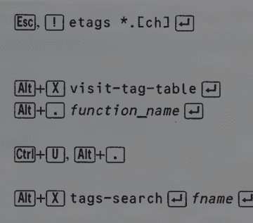

生成 `TAGS` 文件，包含对 `*.c` 和 `*.h` 文件中所有函数定义的交叉引用；读取 `TAGS` 文件的变化到定义函数所在的文件；搜索特定函数模式（正则表达式）的下一次出现。

现在来说 C 程序的编译：通过 `Alt+X compile` 你从 Emacs 开始编译。当执行此操作时，你的 C 程序目录中必须包含有一个 `Makefile`。在开始之前， Emacs 会自动询问你是否想要保存尚未保存的文件。随后，Emacs 会在一个单独窗口中显示编译结果（通常是错误消息列表）。

现在你可以使用 `Ctrl+X` 将光标移动到第一个错误的位置。一旦检测到第一个错误就可以使用此命令（即使编译尚未完成）。重复执行 `Ctrl+X` 将光标移动到上一个错误。`Esc`、`Ctrl-`、`Ctrl+-` 将光标移回错误行。


启动编译 将光标移动到下一个错误 将光标移动到上一个错误 将光标到第一个错误

通常，你可以从 Emacs 启动任何程序（不仅是 `etags` 或 `make`）。调用方式为 `Esc name`。当指定结尾的 `&` 时，Emacs 会在后台启动程序。这样做的好处是可以在程序运行时继续使用 Emacs 工作。程序输出存储在单独的缓冲区中并在窗口中显示。然而，无法与程序进行交互。如果程序检测到错误，它将等待输入（例如，调用 `latex` 时经常发生这种情况），它会一直等下去。此时，只能通过 `Ctrl+C`、`Ctrl+K` (kill) 终止程序。为了避免这种情况，你应该只调用可以独立运行的程序（即使发生错误也是）。

# Tcl 模式

Tcl 模式特别适合编辑 Tcl/Tk 代码。该模式的功能可以与 C 模式相比，尽管功能没有那么多。下表总结了最重要的快捷键：

| 命令 | 操作 |
| :--- | :--- |
| `Ctrl+C, Esc, I` | 将光标移动到过程开头 |
| `Ctrl+C, Esc, J` | 将光标移动到过程结尾 |
| `Ctrl+C, AR, U` | 启动编辑器中当前的 Tcl/Tk 程序 |
| `Ctrl+C, AR, R` | 在 Tcl/Tk 中执行标记区域 |

现在来说说 C 程序的编译：通过 `Alt+X compile` 你从 Emacs 开始编译。当执行此操作时，你的 C 程序目录中必须包含有一个 `Makefile`。在开始之前， Emacs 会自动询问你是否想要保存尚未保存的文件。随后，Emacs 会在一个单独窗口中显示编译结果（通常是错误消息列表）。

现在你可以使用 `Ctrl+X` 将光标移动到第一个错误的位置。一旦检测到第一个错误就可以使用此命令（即使编译尚未完成）。重复执行 `Ctrl+X` 将光标移动到上一个错误。`Esc`、`Ctrl-`、`Ctrl+-` 将光标移回错误行。


启动编译 将光标移动到下一个错误 将光标移动到上一个错误 将光标到第一个错误

*（注：原文中存在大量重复的 Tcl mode 段落，已按要求去重并翻译）*

# Tcl 模式

Tcl 模式特别适合编辑 Tcl/Tk 代码。该模式的功能可以与 C 模式相比，尽管功能没有那么多。下表总结了最重要的快捷键：

| 命令 | 操作 |
| :--- | :--- |
| `Ctrl+C, Esc, I` | 将光标移动到过程开头 |
| `Ctrl+C, Esc, J` | 将光标移动到过程结尾 |
| `Ctrl+C, AR, U` | 启动编辑器中当前的 Tcl/Tk 程序 |
| `Ctrl+C, AR, R` | 在 Tcl/Tk 中执行标记区域 |

# 356 EMACS – 编辑器之王

单词的动态扩展为之前输入的快捷键定义了全局缩写文本。手动扩展缩写会激活缩写模式（自动扩展），允许你编辑缩写表，并将缩写表保存在 Emacs 内部，然后返回到

```
Esc. /

Ctrl+X, A, T, G text

Ctrl+X, A, E

Alt+X edit-abbrevs

Alt+X edit-abbrevs

Ctrl+X, Ctrl+S, Ctrl+X, B
```


缩写仅在 Emacs 运行期间有效。缩写列表存储在内存中的缓冲区中，而不是文件中。按照原则，如果定义过的缩写可以在以后的阶段复用将是理想的。为此，可以使用命令 `Alt+X write-abbrev-file` 来保存和加载包含缩写定义的文件。

通过这两个命令，你现在可以保存和加载缩写，但它们的使用非常繁琐。特别是在退出 Emacs 之前，你必须记得保存新的或修改过的缩写。从第 592 页开始，我们将描述如何使用 `.emacs` 配置文件几行代码来自动加载和保存缩写文件。


## 宏 (Macros)

除了仅作为输入辅助的缩写外，Emacs 还能理解真正的宏，可以记录更复杂的命令序列并在以后再次执行。宏的录制开始于 `Ctrl+X`，以 `Ctrl+X E` 结束。这两个命令之间的所有键盘输入都会被记录。通过 `Ctrl+X, E` 可以执行此宏。

Emacs 仅存储一个宏。一旦你录制新宏，旧宏就会被删除。不过，你可以在开始录制新宏之前给当前宏起一个名字。这通过 `Alt+X name-last-kbd-macro name` 完成。现在，宏存储在指定的名称下，并可以通过 `Alt+X name` 随时执行。

然而，即使是命名的宏也只存储到退出 Emacs 为止。你可以为用户定义的宏分配键盘快捷键，以便更容易地调用。如果希望宏和快捷键都能永久可用，可以通过将宏的定义及其按键快捷键都存储在 `.emacs` 配置文件中来实现。或者，你可以创建一个单独宏文件；但你必须使用 `Alt+X eval-current-buffer` 手动执行它（而 `.emacs` 会在 Emacs 启动时自动执行）。

为了将录制并命名的宏存储在文件中，Emacs 会插入命令 `Alt+X insert-kbd-macro name`。该命令将与宏名称对应的 Lisp 代码插入当前文件。该命令也可以用于插入 Emacs 中定义的所有其他命令的 Lisp 代码。然而，这些代码看起来并不整洁，因为充满了难以理解的键码。因此，编辑现有宏实际上是不可能的。

总结来说，创建永久宏的方法是：

- 使用 `Ctrl+X`, `L` 和 `Ctrl+X`, `L` 录制宏；
- 使用 `Ctrl+X`, `E` 测试宏，如果不符合预期，则尝试重新录制；
- 使用 `Alt+X` `name-last-kbd-macro` `name` 为宏命名；
- 从主目录加载配置文件 `.emacs`；
- 使用 `Alt+X` `insert-kbd-macro` `name` 插入宏，然后将其保存为 `.emacs`。

宏可以分配自己的键盘快捷键。除了上述的宏录制功能外，Emacs 还允许你使用自己的 Lisp 编程语言编写宏。关于此主题的更多信息可以参考从第 583 页开始的独立章节。


## 客户端/服务器操作 (Client/server operation)

任何深度使用 Emacs 的人不可避免会在 `LINUX` 下完成大部分工作，无论他们是想快速查看测试文件、需要发送电子邮件还是必须管理复杂的编程项目。然而，每次想用时启动 Emacs 是没有意义的——这会浪费时间（如果加载了 Emacs 实例，还会消耗大量内存）。

为了避免这些缺点，可以通过 `Alt-X` `server-start` 将 Emacs 置于特殊的服务器模式（该命令可以通过或命令行选项 `-f server-start` 执行）。Emacs 的处理方式没有变化。新功能是你现在可以使用 `emacsclient` 启动一个新的 Emacs 客户端。指定的文件将直接显示在当前运行的 Emacs 中（在文本模式下工作时，必须切换控制台；在 `X` 下，必须切换 Emacs 窗口）。

提供了一个终止 Emacs 客户端的新命令：不能使用 `Ctrl+X, Ctrl+C`，因为会终止 Emacs 服务器。

为了让各种程序自动调用 Emacs 客户端，你必须在 `/etc/profile` 或 `/.profile` 中预设 `emacsclient`、`EDITOR` 和 `VISUAL` 环境变量。

某些程序可以单独配置以调用 Emacs 编辑文件。例如，在邮件程序 `Pine` 中，必须更改 `/.pinerc` 中的以下行：

```bash
# in "/.pinerc"
editor=emacsclient
```

# 358 EMACS – 编辑器之王

# 360 EMACS – 编辑之王

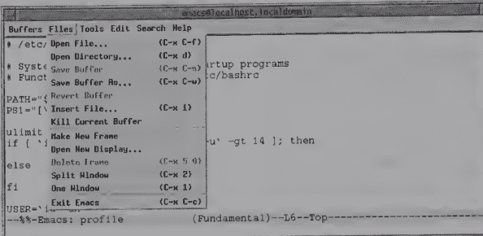

图 11.2 Emacs 命令。

## 菜单命令

通常情况下，菜单命令的含义可以立即识别。大多数命令与本章中描述的最重要的键盘命令对应。以下命令你可能并不熟悉：

| 缓冲区文件回置 (`FILEREVERT BUFFER`) | 重新加载当前正在处理的文件，并将丢失所有（尚未保存的）文本更改；按键：`[Alt|X] revert-buffer` |
| 文件-创建新帧 (`FILE-MAKE NEW FRAME`) | 打开一个额外的 Emacs 窗口 |
| 删除帧 (`DELETE-FRAME`) | 关闭一个带有 Emacs 副本的窗口 |
| 编辑选择并粘贴 (`EDITSELECT AND PASTE`) | 将之前标记的文本插入到文本中 |
| 搜索书签 (`SEARCHBOOKMARKS`) | 显示命令的子菜单，请参阅第 339 页 |

## X 特有的选项和资源

在 `X` 环境下启动 Emacs 时，你可以使用许多命令行选项对颜色、字符集等进行各种设置。下表列出了这些选项中最重要的。完整的描述可以在 Emacs 手册页中找到。

| `-nw` | 在 shell 窗口中启动标准 Emacs（而不是在独立窗口中的 `X` 变） |
| `-fg color` | 前景颜色（字体颜色；默认：黑色） |
| `-bg color` | 背景颜色（默认：白色） |
| `-cr color` | 文本光标颜色（默认：黑色） |
| `-geometry bxh+x+y` | 设置 Emacs 窗口的大小（宽 x 高）和位置；所有规格均以文本字符为单位 |
| `-fn charset` | 使用指定的字符集启动 Emacs |

## EMACS 与 X 窗口系统 361

上述选项也可以在主目录下的 `.emdefaults` 配置文件中进行设置。可能设置的语法在手册中也进行了描述。以下示例显示了一些可能的设置。

```bash
! "/.emdefaults"
emacs.cursorColor: black
emacs.pointerColor: blue
emacs.shell*background: bisque1
emacs.menubar.background: bisque1
emacs*background: white
emacs*buttonForeground: black
emacs*attributeBackground: black
emacs*modeline.attributeBackground: bisque1
emacs*modeline.attributeForeground: black
emacs*region.attributeBackground: thistle
emacs*secondary-selection.attributeBackground: red
emacs.font:-adobe-courier-medium-r-normal--14-100-100-m-90-iso8859-1
! or emacs.font:-adobe-courier-medium-r-normal--14-140-75-m-90-iso8859-1
```

如果 `.emacs` 指定了不存在的字符集或颜色，Emacs 将无法启动！

## 语法高亮

在 `X` 下使用 Emacs 时，文本可以用不同的颜色和属性（粗体、斜体）显示。初看起来，这种可能性似乎并没有意义，因为 Emacs 仅用于 ASCII 文本。然而，Emacs 能够分析许多类型的文本（C 和 C++ 程序代码，可以使用不同的颜色或属性，并根据使用的语法用不同的颜色或属性高亮各种项目）。要激活此功能，你必须先激活相应的全局模式并执行 `C-x font-lock-mode`，现在 Emacs 分析整个文本并用颜色标记识别出的元素。对于较长的文本，执行此语法检查可能需要一些时间。只有当活动字体具有这些属性可用时，Emacs 才能显示不同的字母。例如，名称中包含某些内容的字体是不适当的（因为没有斜体属性）。你可以轻松地通过 `Shift` 和左键尝试不同的字体。以下字体效果良好：

```
-adobe-courier-medium-r-normal--14-100-100-m-90-iso8859-1
-adobe-courier-medium-r-normal--14-140-75-m-90-iso8859-1
```


上述选项也可以在主目录下的`.emdefaults`配置文件中进行设置。可能设置的语法在手册中也进行了描述。以下示例显示了一些可能的设置。

```
! "/.emdefaults
emacs.cursorColor: black
emacs.pointerColor: blue
emacs.shell*background: bisque1
emacs.menubar.background: bisque1
emacs*background: white
emacs*buttonForeground: black
emacs*attributeBackground: black
emacs*modeline.attributeBackground: bisque1
emacs*modeline.attributeForeground: black
emacs*region.attributeBackground: thistle
emacs*secondary-selection.attributeBackground: red
emacs.font:-adobe-courier-medium-r-normal--14-100-100-m-90-iso8859-1
! or emacs.font:-adobe-courier-medium-r-normal--14-140-75-m-90-iso8859-1
```

如果`.emacs`指定了不存在的字符集或颜色，`Emacs`将无法启动！

## 语法高亮

在 X 下使用`Emacs`时，文本可以用不同的颜色和属性（粗体、斜体）显示。初看起来，这种可能性似乎并没有意义，因为`Emacs`仅用于 ASCII 文本。然而，`Emacs`能够分析许多类型的文本（C 和 C++ 程序代码，可以使用不同的颜色或属性，并根据使用的语法用不同的颜色或属性高亮各种项目）。要激活此功能，你必须先激活相应的全局模式并执行`C-x font-lock-mode`，现在`Emacs`分析整个文本并用颜色标记识别出的元素。对于较长的文本，执行此语法检查可能需要一些时间。只有当活动字体具有这些属性可用时，`Emacs`才能显示不同的字母。例如，名称中包含某些内容的字体是不适当的（因为没有斜体属性）。你可以轻松地通过 Shift 和左键尝试不同的字体。以下字体效果良好：

```
-adobe-courier-medium-r-normal--14-100-100-m-90-iso8859-1
-adobe-courier-medium-r-normal--14-140-75-m-90-iso8859-1
```

LaTeX 项目本身将是本章其余部分的重点。`dvips`、`dvilj`、`xdvi`、`ghostview` 和 `gs` 程序将在第 10 章从第 316 页起与其他一些工具和实用程序一起被介绍。

# LaTeX 在线文档

关于 LaTeX 的可用在线文档相当缺乏系统性，很大程度上取决于所选择的发行行版（见下文），且大部分面向专家用户。主页面简要地描述了 TeX、LaTeX 等程序的调用方式，但对 LaTeX 文档的语法介绍较少。`lst2e.dvi` 提供了一个很好的介绍。另一个非常有用的工具是 `essential.dvi`。`userguide.txt`、`fntguide.txt` 和 `clsguide` 文件用约 80 页的幅总结了 LaTeX 2.09 的变化。然而，这些指南假设你已经对 LaTeX 2.09 有了良好的了解。

尝试定位安装了上述文件的目录（这取决于你的 LaTeX 发行版）。

# 互联网上的 LaTeX

尽管 LINUX 提供的 LaTeX 发行版已经非常庞大，但还有无数种额外的 LaTeX 实用程序、扩展和特殊布局（例如：记录棋盘页面位置、设置乐谱等）。三台互联网服务器以 CTAN（综合 TeX 归档网络）之名合作，收集 LaTeX 扩展。在这三者之间，有大量的互联网服务器镜像了整个存档或至少是其部分。

```
ftp://ftp.dante.de/tex-archive
ftp://ftp.shsu.edu/tex-archive
ftp://ftp.tex.ac.uk/tex-archive
```


# LyX - 带有见即所得（WYSIWYG）的 LaTeX

当你不想忍受 `LaTeX` 诚然糟糕的处理时，还有替代方案：例如，有各种外壳可以方便处理 `LaTeX` 文件并调用不同的工具（`tex` 或 `texshell`）。一旦你获得了这些工具，它们会让你的工作变得更轻松，但它们并没有解决 `LaTeX` 的任何基本问题。

`LyX` 采取了更为深远的方法，它是一个文本处理程序，提供了几乎是见即所得的效果。各种类型（如字母大小的加粗和斜体）直接显示在屏幕上。有多种布局可用于格式化，其中部分直接对应相应的 `LaTeX` 命令（章节、小节），部分基于专有的 `LyX` 样式文件。布局、字体、样式等的选择是通过特定特性完成的。

文本输入编辑器相当方便，尽管某些细节，如滚动条的特殊处理、缺少键支持以及频繁崩溃在当前版本（`0.8.6`）中仍然有些令人恼火。由于 `LyX` 是一个集成系统，无法使用其他编辑器进行文本输入（再见 `Emacs`）。`LyX` 提供了丰富的在线文档，这些文档直接用 `LyX` 创建，并很好地展示了你可以用 `LyX` 做什么。

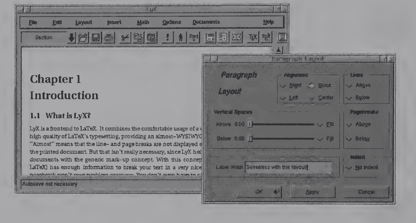

图 12.1 `LyX` - `LaTeX` 的见即所得扩展。

`LyX` 基于 `LaTeX`；也就是说，为了打印目的，使用 `LyX` 文档生成 `LaTeX` 文件，然后自动翻译成 `DVI` 文件。这使其能够实现 `LaTeX` 的高排版质量。然而，并不是所有的 `LaTeX` 特性在见即所得模式下可用（不过，至少允许在文中直接使用 `LaTeX` 命令）。以下 `LaTeX` 特性没有见即所得：

- 表格、公式
- 特殊字符
- 换行和分页（这仅在 `LaTeX` 转换期间进行）

现有的 `LaTeX` 文本无法导入 `LyX` - 因此，`LyX` 仅适用于文本。总而言，`LyX` 当前版本提供的功能太少，无法作为 `LaTeX` 的严肃替代方案。当 `LaTeX` 转换过程中发生错误（通常情况下如此），只有良好的 `LaTeX` 知识才能帮助，这显然抵消了其缺陷。`LyX` 目前仍在开发中，这种方法看起来很有前景。

# 导言

为了确保 `LaTeX` 中的语言特殊字符正确翻译，你必须指定语言（例如德语）。

（注：此处原文似乎存在多处乱码或断句，已根据上下文尽可能翻译并保留逻辑）

## 1 介绍 LaTeX

### 1.1 字体与样式
这段文字说明了 `LaTeX` 中可用的一些字体和样式：**粗体**、*斜体*、SMALL CAPS（小型大写）是非比例的，`textsf`（衬线字体）以及等宽字体。`LaTeX 2.0` 的创新之处在于大多数字体样式可以相互组合而不会产生问题；例如**粗体**和*斜体*。显然，字体大小也可以更改，从（非常小）到（小）再到（大大）。

### 1.2 文本块与框
`minipage` 环境用于将文本块并排放置。这是第二个稍窄的 `minipage`。

在这里，通过一个前置命令和一个后置命令使一个 `5 cm` 宽 `minipage` 居中，并使用 `\fbox` 进行加框。

### 1.3 项目列表
与其它程序相比，`LaTeX` 有许多优势：
- 结果的质量不言喻。
- 在熟悉语法后，处理速度非常快。
- `LaTeX` 文本具有可移植性，经常用于 `Unix` 世界的在线文档。

### 1.4 脚注
本段提供了两个脚注示例。\footnote{这是第一个脚注。}显然，`LaTeX` 会自动为脚注编号。\footnote{这是第二个脚注。}

### 1.5 数学公式
`LaTeX` 之所以仍然极其重要，首先是因为其卓越的格式化能力。只需在任何其他程序中导入以下公式！公式也可以直接在正文中使用（例如在此处的这里）：

$$\sum_{l=1}^{\infty} \frac{1}{l^2} = n \left[ \frac{\int x}{\int y} \frac{\int y}{\int x} \right]$$

$$\lim_{n\to\infty} \sum_{k=1}^{n} \sqrt[3]{+\{\frac{(k^{2})}{(n^{3})}}\}}-n$$

$$\left[\begin{array}{cc} \frac{\partial x}f\\ \frac{\partial y}f\\ noalign{\medskipskip} \frac{\partial x}g\\ \frac{\partial y}g \end{array}\right]$$

如果在阅读这些内容后，你认为使用 `LaTeX` 是一项艰巨的任务，那么你是完全正确的。只有当你准备好投入较长时间的时间进行实验时，才应该深入研究 `LaTeX`。通常会获得非常优秀的结果。在此过程中，需要人工干预以让 `LaTeX` 正确地对外语单词进行连字符处理，并在视觉上合理的地方分页（而不是新段落的第一行）。

然而，你也应该看到它的优势：`LaTeX` 文本的质量不言喻。`LaTeX` 几乎可以在任何计算机上运行——因此 `LaTeX` 文本可以在不同的计算机平台之间轻松地交换，并且非常适合在线文档。在数学/科学领域，`LaTeX` 根本没有真正的替代品。像 `Windows` 版 `Word` 这样的文字处理软件对于带有公式和插图的大型文本来说太慢且效率太低。

## 不同 LaTeX 发行版的问题

`LaTeX` 程序不能孤立地来看，必须结合各种样式、`Metafont` 字体程序、其字符集等整体考虑。这整个整体被称为 `LaTeX` 发行版。虽然 `LaTeX` 本身在很大程度上已经标准化，但在提供剩余组件方面仍然缺乏定义的标准。

在过去的三年里，我使用过不同的 `LaTeX` 宏包和或发行版。目录树反复发生变化。在 `LINUX` 下，很少有程序的目录结构比 `LaTeX` 更加混乱了（在我的电脑上：190 个目录中约有 2500 个文件！）。下表提供了初步概述。它主要遵循 `TeTeX` 发行版，但也（在某些例外情况下）适用于 `NTeX`。所有路径规范都相对于 `/usr/lib/texmf/` 或 `/usr/lib/teTeX`，`TeTeX` (`teTeX`) 通常安装在 `LINUX` 下。

同时，有两个发行版占据主导地位：`TeTeX`（Frank Lang 提供，随 `Slackware` 提供）和 `TeX`（Thomas Esser 提供，随大多数其他提供）。这两个发行版都很大（30 MB）且非常详尽。`TeTeX` 的优势之一是通过 `/usr/lib/texmf/texdoc` 对可用文档进行结构化。只要你的 浏览器配置正确（见第450页），点击索引中的交叉引用即可启动 `ghostview` 或 `xdv`。（部分 `TeTeX` 在线文档在 `NTeX` 中可用，但很难找到。）

## LaTeX 目录树

| 目录 | 说明 |
| :--- | :--- |
| `/bin` | 所有程序（`tex`, `latex`, `xdv` 等）（`/usr/bin` 包含此目录） |
| `/.texmf/bibtex` | `bibtex` 的样式文件 |
| `/.texmf/doc` | 在线文档 |
| `/.texmf/dvips` | `dvips` 的文件 |
| `/.texmf/fontname` | 字符集的 `TeX` 内部命名方案 |
| `/.texmf/fonts/source` | 字体定义（`Metafont` 文件 `*mf`） |
| `/.texmf/fonts/tfmf` | 字体大小（`LaTeX` 的基础，`*tfmf`） |
| `/.texmf/fonts/vf` | 虚拟文件（用于 `PostScript` 字体，`*vf`） |
| `/.texmf/lists` | `teTeX` 宏的文件目录 |
| `/.texmf/metafont` | `Metafont` 的样式文件 (`*mf`) |
| `/.texmf/tex` | `LaTeX` 主目录 |
| `/.texmf/tex/amstex` | `amams`（`TeX` 的宏包） |

# 基础 LaTeX 命令 373

`./texmf/tex/explain`
`./texmf/tex/generic`
`./texmf/tex/plain`
`./texmf/tex/texinfo`
`./texmf/tex/latex`
`./texmf/tex/latex/base`
`./texmf/tex/latex/*/`
`plain` (`TeX` 基础) 的扩展
连字符表，外语言扩展
`TeX Base`
`texinfo` (用于 `TeX` 的宏包)
`LaTeX` (用于 `TeX` 的宏包)
`LaTeX` 基础包
各种 `LaTeX` 扩展（图形、布局、样式文件）

`./texmf/xdvi`
`./texmf/xtexsh`
`xdvi` 配置
`TeX/LaTeX shell`（假设使用 `TeXX`）

上述列出的某些目录包含一个名为 `manifest.txt` 的文件，其中包含了对重要 `LaTeX` 文件的简要描述。
在将 `*.dvi` 文件转换为 `PostScript` 格式 (`dvips`) 或在屏幕上显示文件 (`xdvi`) 时，会生成所需字体的位图文件。这些文件的扩展名为 `*.pk`，并存储在以下目录：

`/var/lib/texmf/fonts/pk/` 字体位图 (`*.pk`)

如果你面临空间问题，可以删除 `*.pl` 文件。然而，在下次调用 `dvips` 或 `xdvi` 时，这些文件必须重新生成，这需要一些时间。
由于文件数量巨大，搜索特定的字体或样式文件可能花费长时间。`TeX` 分发版管理着额外的数据库，其中包含所有 `TeX` 文件的列表。本质上该数据库由 `ls -R` 的结果组成，因此被称为 `ls-R`。当你用额外的文件扩展 `TeX` 时，必须始终执行 `texhash` 命令以扩展数据库。此外，每当你遇到找不到 `TeX` 文件的问题时，都应该先尝试执行此命令。

在内部，`Kpathsea` 库负责搜索 `TeX` 文件。如果你对此感兴趣，请阅读 `kpathsea.dvi` 或同等的 `info` text，以及关于 `texhash` 和 `ls-R` 的简短 `man`页面。


## 12.2 基础 LaTeX 命令

本节总结了最重要的 `LaTeX` 命令。这里介绍的命令应该足够生成简单的 `LaTeX` 文档。如果你想更深入地使用 `LaTeX`，没有其他方法可以处理某些详细的文献。非常推荐阅读 Helmut Kopka 的书籍（参见第 659 页的参考文献）以及 Michael Goelens、Frank Mittelbach 和 Alexander Samarin 编写的《LaTeX Companion》。

## 格式细节

用 `LaTeX` 处理的文本是用文本编辑器生成的。一组连续的行被视为段落。单词之间通过空格或换行符分隔，段落之间通过至少一个空行分隔。段内的正确换行由 `LaTeX` 完成。原始文本中开始新行的位置无关。

`LaTeX` 命令始终以反斜杠 `\` 开头。当命令需要时，必须将其括在花括号中，例如 `\chapter{章节标题}`。某些命令还有可选参数，必须在方括号中指定，例如 $\sqrt[3]{x}$。如果没有 `[3]`，$\sqrt{}$ 将产生一个普通的平方根，即 $\sqrt{}$。

花括号也可以用于限制命令的作用。因此，`\bf word` 打印一个粗体单词，而不加括号的命令 `\bf` 会设置“粗体”属性直到被另一个命令重置。

环境代表了一种特殊类型的命令。它们通过 `\begin{environment}` 打开并通过 `\end{environment}` 关闭。环境的特殊特性适用于这两个符号之间的整个文本。典型的环境名称有 `tabbing`（用于表格）或 `verbatim`（用于包含特殊字符的列表）。

在 `LaTeX` 文本中，注释可以用 `%` 开始。这允许 `LaTeX` 忽略该字符之后该行的剩余内容。

## 文本结构

`LaTeX` 文本以 `\documentclass[options]{type}` 开始。该命令确定文本类型。在标准配置下，`LaTeX` 有四种重要的文本类型：`book`（书）、`report`（报告）、`article`（文章）和 `letter`（信）。前三种类型相似，或仅在于计划的文本长度。与 `book` 和 `report` 不同，`article` 没有章节；它的最小单元是节（section）。在 `book` 中，所有页面都自动配备了页眉，页眉除了页码外，还会显示当前章节名称（偶数页）和当前章节名称（奇数页）。发现 `book`、`report` 和 `article` 这三种文本类型差异的最简单方法是逐个替换这三种类型来更改上一节示例文件的第一行。

文本类型也可用于写信。然而，出于空间考虑，本书将不这种类型。在 `LaTeX` 内部，文本类型通过扩展名为 `*.cls` 的宏文件实现。这些文件存储在 `...texmf/tex/latex/` 目录中。某些出版社、大学等提供了自己的宏文件，这些文件特别适用于格式化科学论文、论文等。

选项可以在文本前的方括号中指定。重要的选项有 `11pt` 和 `12pt`（用于更改默认字体大小）以及 `twcolumn`（用于双栏文本）。

## \documentclass[options]{type}

### 文本类型

- `book`: 用于长文档，包含章节和页眉。
- `report`: 用于中等文档，包含节。
- `article`: 用于较短的文档，最小单元是节。
- `letter`: 用于信函（本书不涉及）。

- `11pt` 和 `12pt`: 用于更改默认字体大小。
- `twcolumn`: 用于双栏文本。
- `twoside`: 影响偶数页和奇数页布局。
- `12pt`: 许多文档的标准大小。

## LaTeX 命令 377

在上面的表格中，你会注意到在某些行中，斜体（slanted）和倾斜体（italic）类型之间没有明显区别。此外，无法将打字体（Typewriter）字体以粗体表示。

这些问题并非源于 `LaTeX` 的某些特殊弱点，而是与可处理的字体有关。基本上，`LaTeX` 可以处理两种字体：`LaTeX` 字体和 `PostScript` 字体。（实际上，其中还有几种变体，此处不再赘述。）`LaTeX` 文本开头的 `\usepackage`。

如果你仅使用原始字体，则无法将“粗体”与“打字体”结合。对于无衬线字体（Sans Serif），不允许“粗体斜体”和“粗体倾斜”组合。相反，“粗体小型写字母”（bold small caps）组合可以产生所需的结果。

如果你仅使用 `PostScript` 字体，你可以获得更好的“打字体”表示效果。另一方面，大多数字体在斜体和倾斜体之间没有可辨别的区别（见上文，无衬线字体）。

关于 `LaTeX` 和 `PostScript` 字体的更多信息可以查阅第 399 页，我们在那里讨论了 `LaTeX` 实用程序 `Metafont` 以及对 `PostScript` 字字体处理。

现在来看用于更改字体及其属性的命令。由于历史原因以及为了与以前版本的兼容，我们面临着字体的“巴比伦式混乱”。下表的前两列列出了目前 `LaTeX` 的“官方”命令，第三列是仍被省略的语法，第四列是输出结果。不同命令的结果似乎是完全相同的（见下文）：


| 命令 | 省略的语法 | 结果 |
| :--- | :--- | :--- |
| `\textbf{text}` | `{rmfamily text} {rm text}` | 标准（罗马体） |
| `\sf{text}` | `{sffamily text} {sf text}` | 无衬线字体 |
| `\texttt{text}` | `{ttfamily text} {tt text}` | 打字体 |
| `\textbf{text}` | `{bfseries text} {bf text}` | 粗体 |
| `\md{text}` | `{mdseries text} {rm text}` | 普通体 |
| `\it{text}` | `{itshape text} {it text}` | 倾斜体 |
| `\sl{text}` | `{slshape text} {sl text}` | 斜体 |
| `\sc{text}` | `{scshape text} {sc text}` | 小型大写字母 |
| `\up{text}` | `{upshape text} {em text}` | 强调 |
| `\emph{text}` | | |

一些备注：`\emph` 并不简单地将斜体变为另一种类型，而是在普通体和倾斜体之间切换属性。在倾斜文本内部，`\emph` 会产生普通体。

如 `\sl`、`\bf` 等短命令看起来非常有吸引力，但由于兼容性原因，它们的工作方式非常特立独行：`\bf`、`\it`、`\sl` 和 `\sc` 会切换标准字体并禁用所有其他属性！因此，这些属性不能用于组合不同的属性。

## 378 LaTeX 2

现在来看字体大小：在这里，`LaTeX` 再次与你与其他文本处理程序的习惯不同。有一个适用于整个文档的标准字体大小。该大小只能在 10 到 12 磅之间变化。10 点是默认设置，但你可以通过 `\documentclass` 选项 `11pt` 或 `12pt` 将其更改为 11 点或 12 点。

从这个标准字体大小开始，`LaTeX` 自动计算 `\chapter` 或 `\section` 标题、脚注、数学公式的大小，并以此大小作为更改大小命令的参考：

| 大小 | 描述 |
| :--- | :--- |
| `\tiny` | 仅用放大镜才可见 |
| `\scriptsize` | 极小 |
| `\LARGE` | `\LARGE` 更大 |
| `\footnotes` | 非常小 |
| `\small` | 巨大 |
| `\normalsize` | 标准大小 |
| `\large` | 大 |
| `\Huge` | `\Huge` 特号 (kingsize) |

## 特殊字符和重音符号

大量的特殊字符（如 `%` 或 `$`）被 `LaTeX` 解析为命令。另一些特殊字符仅在数学模式下具有特定含义（例如 `^` 和 `_`），但不能用于文本模式下。下表总结了最重要的特殊字符：

| 字符 | 含义 |
| :--- | :--- |
| `%` | 开始注释 |
| `~` | 固定空格（例如在 `5~cm` 中） |
| `{..}` | 包围文本区域（例如，用于特殊格式） |
| `$formula$` | 在正文中包含公式 |
| `^` | 下标（仅限数学模式）上标（仅限数学模式） |

在文本中不原样地表示特殊字符的尝试是持续挫败的根源：首先，即使在在使用 `LaTeX` 几个月后，你可能仍然忘记某个字符具有特殊含义。其次，在普通文本中表示特殊字符没有单一的方法。在许多情况下，在特殊字符前加一个反斜杠即可（例如 `\%`）。如果这不起作用，可以使用 `\char` 直接指定字符代码。标准 `ASCII` 代码允许大多数字符。

| 字符 | 代码 |
| :--- | :--- |
| `-` (连字符) | `\ae` æ `char34` " |
| `_` (下划线) | `\AE` Æ `char92` |
| `#` | `\aa` â |

## 基础 LaTeX 命令 379

| 命令 | 结果 | 备注 |
| :--- | :--- | :--- |
| `$` | `$` | `\AA` Å |
| `\&` | `&` | `\char94` < |
| `\%` | `%` | `\oe` æ `{tt<}` |
| `\{` | | | `\OE` Π`{tt>}` |
| `\}` | | | `\pounds` |
| `$$` | | | `$\sim$` ~ |

下表总结了生成重音字母的 `LaTeX` 命令：

- `\a` á
- `\~` ä
- `\^` â
- `\grave` à
- `\e` è
- `\i` é
- `\^` î
- `\\'` ì
- `\j` ñ
- `\o` ó
- `\~` ô
- `\^` õ
- `\^` û
- `\s` ş
- `\c` ç
- `\u` ù
- `\y` ý
- `\y` ÿ
- `\d` ğ
- `\aa` ª
- `\ae` æ
- `\AE` Æ
- `\OE` Œ

## 380 表格

`LaTeX` 有多种定义表格的方法。在此时，我们只描述最简单的一种，即 `tabbing` 环境。该环境的语法如下：

```
```


\begin{tabbing}

sample := sample \kill Sample line: := stops

term1 > term2 > term3

Table: > tab, for end of line

term4 > term5

last line without

\end{tabbing}

```

表格从示例行开始。该行定义了对齐的位置。你的示例行通常应该是表格中最宽的一行。在每个 `=` 之前，你应该插入额外的空格，例如使用 `\qqad` 指令（两个连字符的宽度——见第 395 页）。\kill 删除示例行，使其仅作为示例而不输出。

最后一个示例作为结束：第 378 页上的特殊字符是通过以下 LaTeX 指令产生的：

```

\begin{tabbing}

{\verb?$formula$?}\qqad=\kill

{\verb??}

> 开始注释

{\verb??}

> 固定空格（例如在 {\smverb?5-cm?}} 中）

{\verb?{..}

> 包围文本区域（例如，用于特殊格式）

{\smverb?formula$}

> 在正文中包含公式

{\smverb??}

> 下标（仅限数学模式）

{\smverb??}

> 上标（仅限数学模式）

\end{tabbing}

```

## 项目符号列表和编号列表

`LaTeX` 为项目列表格式提供了多种可能性。最简单的变体由 `itemize` 环境组成。

```
\begin{itemize}

\item Text of the first item

\item Second item

\end{itemize}
```

以下示例展示了项目符号列表的视觉布局：
\begin{itemize}
\item `LaTeX` 使用粗体黑色圆点标记列表中的单个项目（特殊字符 `\verb?$\bullet$`）
\item 同时，条目相对于正文进行了缩进。
\end{itemize}

- `LaTeX` 使用粗体黑色圆点标记列表中的单个项目（特殊字符 `$\bullet.$`）
- 同时，条目相对于正文进行了缩进。

相反，如果你使用 `enumerate` 环境名称，`LaTeX` 将使用数字（`1.` `2.` 等）而不是项目符号。这两个环境都可以相互嵌套。根据嵌套层级的不同，项目符号使用不同的符号，编号也使用不同类型的数字（小写字母、罗马数字等）。此外，列表项目会根据不同程度的空格进行缩进。

## 多栏文本

我们已经在第 374 页描述了使用 `documentclass` 命令中的 `twcolumn` 选项可以将整个文本安排为两列。但在许多情况下，这种解决方案并不适用。通常只有小部分文本需要并排排列，而剩余文本则以单栏形式跨越整个页宽。对于这种情况，`LaTeX` 提供了几种变体，这里仅介绍最重要的一个：如下所示的 `minipage` 环境：

```
\begin{minipage}[t]{4cm} % 第一个4厘米宽的 minipage

text ... % 第一个 minipage 的文本

\end{minipage}\hfill % 第一个两个 minipage 之间的间隙
```

```
\begin{minipage}[t]{4cm} % 第二个 minipage

text ...

\end{minipage}

\hfill

\begin{minipage}[t]{4cm} % 第三个 minipage

text ...

\end{minipage}
```

所有指定的 `minipage` 环境的总宽度不能超过文本总宽度。可选参数 `'t'`（顶部）使文本块的上边缘垂直对齐。或者，你可以指定 `'b'`（底部）来对齐文本块的下边缘，或者省略该参数以使文本块垂直居中。块之间的 `\hfill` 命令会将块之间剩余的水平自由空间平均分配在它们之间。

```
\begin{minipage}[t]{6cm}

这是第一个 6 厘米宽的文本块。

\end{minipage}

\hfill

\begin{minipage}[t]{6cm}

第二个块放在它旁边，且具有相同的宽度。两个块都相对于它们的上边缘对齐。

\end{minipage}
```

这是第一个 6 厘米宽的文本块。

第二个块放在它旁边且具有相同的宽度。两个块都相对于它们的上边缘对齐。

## 框

可以通过将文本放入框中来高亮显示。相应的命令是 `\fbox{text}`，产生的结果如本文所示。当需要为多行块加框时，必须在 `\fbox` 命令内部定义 `minipage` 环境。

在以下示例中，一个小的文本框被居中并使用 `\fbox` 加框。使用 `\fbox` 时应注意可以在现有对象之间指定填充距离。因此，在 `\hfill` 之前之后，必须使用 `\fboxbox` 指定一个空文本框。

```
\fbox{} % 左侧的空框

\hfill % 到 minipage 的填充距离

\fbox

\begin{minipage}{5cm}
```

在这里，一个 5 厘米宽的 `minipage` 通过一个领先和一个随后的 `\hfill` 命令居中，并使用 `\fbox` 加框。
\end{minipage}

```
\hfill

% 到下一个框的填充距离

% 空框

\fbox{}
```

> 这里，一个 5 厘米宽的 `minipage` 通过一个领先和一个随后的 `\hfill` 命令居中并使用 `\fbox` 加框。
在 `\fbox` 内部不允许使用 `\text` 命令。为了绕过这一限制，`LaTeX` 创建了新的 `lrbox`，其中包含的文本可以实现。

## 12.3 文本排版

原则上，你可以使用 `LaTeX` 设置任何文本。然而，与其他文字处理程序相比，`LaTeX` 的优势体现在科学文本的排版上，其任务是创建目录、插图列表、索引、交叉引用、脚注等，且非常省力。这总结了典型的“科学”排版特征。

# 目录

目录可以通过 `\tableofcontents` 命令插入文本的任何位置。通常，目录位于文本的开头或前言之后。

```
\tableofcontents 在文本的此位置插入目录。

为了生成目录，LaTeX 会处理 `.toc` 文件。使用 `\tableofcontents` 命令，每次运行 LaTeX 都会插入目录所需的信息（章节、节和子节名称及其页码）。这种过程在最坏的情况下需要运行 LaTeX 三次才能获得正确的目录。
```

第一次运行，目录不存在。第二次运行，生成了目录。第三次运行，目录是正确的。目录可以通过 `\tableofcontents` 命令插入文本的任何位置。通常，目录位于文本的开头或前言之后。

```
\tableofcontents 在文本的此位置插入目录。

为了生成目录，LaTeX 会处理 `.toc` 文件。使用 `\tableofcontents` 命令，每次运行 LaTeX 都会插入目录所需的信息（章节、节和子节名称及其页码）。这种过程在最坏的情况下需要运行 LaTeX 三次才能获得正确的目录。
```

第一次运行，目录不存在。第二次运行，生成了目录。第三次运行，目录是正确的。目录可以通过 `\tableofcontents` 命令插入文本的任何位置。通常，目录位于文本的开头或前言之后。

## 382 LaTeX 2e

目录可以通过 `\tableofcontents` 命令插入文本的任何位置。通常，目录位于文本的开头或前言之后。

```
\tableofcontents 在文本的此位置插入目录。

为了生成目录，LaTeX 会处理 `.toc` 文件。使用 `\tableofcontents` 命令，每次运行 LaTeX 都会插入目录所需的信息（章节、节和子节名称及其页码）。这种过程在最坏的情况下需要运行 LaTeX 三次才能获得正确的目录。
```

第一次运行，目录不存在。第二次运行，生成了目录。第三次运行，目录是正确的。目录可以通过 `\tableofcontents` 命令插入文本的任何位置。通常，目录位于文本的开头或前言之后。

## 384 LaTeX 2e

目录可以通过 `\tableofcontents` 命令插入文本的任何位置。通常，目录位于文本的开头或前言之后。

```
\tableofcontents 在文本的此位置插入目录。

为了生成目录，LaTeX 会处理 `.toc` 文件。使用 `\tableofcontents` 命令，每次运行 LaTeX 都会插入目录所需的信息（章节、节和子节名称及其页码）。这种过程在最坏的情况下需要运行 LaTeX 三次才能获得正确的目录。
```

第一次运行，目录不存在。第二次运行，生成了目录。第三次运行，目录是正确的。目录可以通过 `\tableofcontents` 命令插入文本的任何位置。通常，目录位于文本的开头或前言之后。

## 383 科学文本排版

目录可以通过 `\tableofcontents` 命令插入文本的任何位置。通常，目录位于文本的开头或前言之后。

```
\tableofcontents 在文本的此位置插入目录。
```


为了生成目录，`LaTeX` 会处理 `.toc` 文件。使用 `\tableofcontents` 命令，每次运行 `LaTeX` 都会插入目录所需的信息（章节、节和子节名称及其页码）。这种过程在最坏的情况下需要运行 `LaTeX` 三次才能获得正确的目录。

```
第一次运行，目录不存在。第二次运行，生成了目录。第三次运行，目录是正确的。目录可以通过 \tableofcontents 命令插入文本的任何位置。通常，目录位于文本的开头或前言之后。
```

## 交叉引用

目录可以通过 `\tableofcontents` 命令插入文本的任何位置。通常，目录位于文本的开头或前言之后。

```
\tableofcontents 在文本的此位置插入目录。

为了生成目录，LaTeX 会处理 .toc 文件。使用 \tableofcontents 命令，每次运行 LaTeX 都会插入目录所需的信息（章节、节和子节名称及其页码）。这种过程在最坏的情况下需要运行 LaTeX 三次才能获得正确的目录。
```

```
第一次运行，目录不存在。第二次运行，生成了目录。第三次运行，目录是正确的。目录可以通过 \tableofcontents 命令插入文本的任何位置。通常，目录位于文本的开头或前言之后。
```

## 脚注

目录可以通过 `\tableofcontents` 命令插入文本的任何位置。通常，目录位于文本的开头或前言之后。

```
\tableofcontents 在文本的此位置插入目录。

为了生成目录，LaTeX 会处理 .toc 文件。使用 \tableofcontents 命令，每次运行 LaTeX 都会插入目录所需的信息（章节、节和子节名称及其页码）。这种过程在最坏的情况下需要运行 LaTeX 三次才能获得正确的目录。
```

```
第一次运行，目录不存在。第二次运行，生成了目录。第三次运行，目录是正确的。目录可以通过 \tableofcontents 命令插入文本的任何位置。通常，目录位于文本的开头或前言之后。
```

## 参考文献或目录

目录可以通过 `\tableofcontents` 命令插入文本的任何位置。通常，目录位于文本的开头或前言之后。

```
\tableofcontents 在文本的此位置插入目录。

为了生成目录，LaTeX 会处理 .toc 文件。使用 \tableofcontents 命令，每次运行 LaTeX 都会插入目录所需的信息（章节、节和子节名称及其页码）。这种过程在最坏的情况下需要运行 LaTeX 三次才能获得正确的目录。
```

```
第一次运行，目录不存在。第二次运行，生成了目录。第三次运行，目录是正确的。目录可以通过 \tableofcontents 命令插入文本的任何位置。通常，目录位于文本的开头或前言之后。
```

## 图表

目录可以通过 `\tableofcontents` 命令插入文本的任何位置。通常，目录位于文本的开头或前言之后。

`\begin{figure}` 之后的可选参数指定了图片在文中的位置（顶部）。允许的值有 `h`（此处）或字母 `t`（顶部）、`b`（底部）和 `p`（单独页）的任意组合：

- `h`: 图片显示在当前页的顶部。
- `b`: 图片放置在当前页的底部。
- `p`: 将几幅图片组合在一个单独的页面上。

在双栏文中，可以使用环境名 `figure*` 代替 `figure`。在这种情况下，图片将跨越两列（而不是被限制在单列宽度内）。`figure*` 不能与选项 `'h'` 结合使用。

`caption` 用于添加标题（“图 n”，其中 n 被替换为连续的数字（文本类型为 `article`）或第三章第五张图的 `areref`）。在 `\caption` 内部使用 `\label` 时，可以使用 `\xref` 来引用图编号和相应的页码。

标题文本是自动生成的。当图片宽度小于标题文本宽度时，应通过 `\parbox(7cm){\caption{...}}`（这里为 `7 cm`）将后者的宽度限制在图片的范围内。这些命令也定义了图片的大小。`LaTeX` 具有图形命令，可以直接在 `LaTeX` 环境中创建简单的图片。在任何情况下，实践中通常做法是放置现成的 `PostScript` 图形，而不是创建图片。

```
\usepackage{epsf} % 必须在...之后立即执行

\documentclass

...

\epsfsize=5cm % 指定下一张图片的宽度

\epsfsize=4cm % 指定下一张图片的高度

\hfill{file} % 插入指定的 PostScript 文件
```

三个 `\eps...` 命令的应用相对简单：`\hfill{file}` 将一个 `PostScript` 文件插入文档中。如果图片之前没有通过 `\epsf/size` 指定，`LaTeX` 将保持插图的原始尺寸不变。如果只指定了一个尺寸，`LaTeX` 将缩放另一个尺寸，以使插图的比例与原始状态保持一致。因此，通常只使用两个 `\epsf/y...` 命令中的一个就足够了。

通常，图片既不居中也不加框。当需要这些格式化特征时，可以使用 `\centering` 实现居中，并使用 `\fbox` 实现加框。
下表给出了 `figure` 环境内部的一些命令的示例。表中还显示了允许你插入一个空区域（如果需要，则加框）而不是图片的命令，稍后阶段可以将插图粘贴在该区域（诚然这是一种相当老旧的方法）。一些新命令出现了：`\rule{b}{h}` 生成一个 b 宽 h 的黑色矩形，此处用于通过一条（不可见的）垂直线为粘贴的插图留出空间。`\framebox` 生成一个具有特定宽度和高度的有框矩形。

```
\centerline{

\epsize=30mm\epsffile{online.eps} % 居中的 PostScript 图形

\centerline{\fbox{

\epsize=40mm\epsffile{online.eps}}} % 无框，宽 3 cm

\centerline{

\framebox[0cm]{\rule{0cm}{3cm}}}\ % 有框，高 4 cm

\rule{0cm}{3cm}}} % 居中的空框，宽 4 cm，高 3 cm
```

当需要将几幅图片并排放置时，将在 `figure` 环境内部放置若干个 `minipages`（另见第 381 页）。在 `minipage` 内部使用 `figure` 环境的相反情况是不可能的。因此，在它旁边放置一个带有标题的图片并不是一项简单的练习。然而，你可以通过直接使用 `\eps...` 命令将一个无标签的 `PostScript` 图形放入 `minipage` 中（不使用 `figure` 环境；见第 407 页）。

```
\begin{figure}

\begin{minipage}[t]{6cm}

\centerline{\framebox[6cm]{\rule{0cm}{4.1cm}}}

\caption{\label{latex-b2}\textbf{一个稍后阶段可以粘贴图片的空画框。}}

\end{minipage}

\hfill

\begin{minipage}[t]{6cm}

\centerline{\epsize=4cm\epsffile{b-latex-kurven.ps}}

\caption{\label{latex-b3}\textbf{此图已使用计算机代数程序 Maple 计算，并作为 PostScript 文件插入文本。}}

\end{minipage}

\end{figure}
```

示例插图图 12.3 和 12.4 是使用上述命令生成的。图编号的引用是通过 `\ref{latex-b2}` 和 `\ref{latex-b3}` 创建的。

## 索引

当你想要为文本配备索引时，需要几个步骤：首先你必须使用 `\usepackage{maketheindex}` 并在 `\begin{document}` 之前执行 `\makeindex` 命令。索引条必须在文中使用 `\index` 命令标记。最后，必须在文本中显示索引的地方指定 `\printindex` 命令。

## 388 $LaTeX~2_\epsilon$


图 12.3: 一个稍后阶段可以粘贴图片的空画框。

图 12.4: 此图已使用计算机代数程序 `Maple` 计算，并作为 `PostScript` 文件插入文本。

但这些还的：在使用这种方式准备的文本文件第一次被 `LaTeX` 处理后，必须执行 `LINUX` 命令 `makeindex name.idx`。`LaTeX` 生成的 `name.idx` 中的所有索引条将被处理并排序，结果存储在文件名中。在执行 `\printindex` 时，会读取此文件。

```
\usepackage{makeidx}

\makeindex

\newcommand{\ii}[1]{{\it #1}}

\index{entry}

\index{main entry!subentry}

\index{main!sub!sub}

\index{entry{}

\index{entry}

\index{ii}

\index{Pi@pi}
```


### 索引功能说明

使用 `\index{entry@{bf entry}}` 创建索引条目。

执行 `\printindex` 命令。

```latex
% 在 \documentclass 之后，\begin{document} 之前配置

% {1} 用于索引中的斜体页码

% 普通索引条目

% 子条目

% 子条目

% 起始页码

% 结束页码

% 斜体页码

% 排序条目

% 排序条目

% Pi

% 正确排序

% 在 \document 之前
```

## 结论

综上所述，以下示例展示了索引的功能。您可以在书籍末尾的索引中查看结果。

```latex
\index{Index sample}

\index{Index sample!subentry}

\index{Index sample!subentry@{\t}}

\index{Index sample!special@{\verb?\}}

\index{Index sample!italic entry@{\it entry}}

\index{Index sample@italic page number}

\index{index@{\verb?index}}

\index{printindex@{\verb?printindex}}

\index{makeindex@{\verb?makeindex}}

\index{usage@{\verb?makeidx?}}

\index{Index (LaTeX)}

\index{Index}
```


## 12.4 数学公式

### 公式

在 LaTeX 中表示数学公式时，必须切换到数学模式。这里介绍的所有命令只能在数学模式下执行。

激活数学模式有三种方法：在行内使用两个 `$` 字符包裹公式；在独立段落中使用 `\[` 开始公式并以 `\]` 结束；或在 `equation` 环境中编写公式。在后两种变体中，公式以居中的形式表示在独立段落中；在 `equation` 环境中，它会自动编号。

| 语法 | 说明 |
| :--- | :--- |
| `$formula$` | 行内公式 |
| `\[ formula \]` | 独立公式 |
| `\begin{equation} formula \end{equation}` | 带有自动编号的独立公式 |

请注意，行内公式与独立段落中的公式略有不同：在 `$formula$` 中，LaTeX 使用了较小的字号，并尝试设置公式以尽可能少占用空间。特别是，上标和下标在某些数学符号（极限、积分、求和）中的位置不同。

在接下来的行中，你将看到同一个公式 $\int_{i=1}^{n} x^i dx$ 出现了三次：一次在正文中，被 `$` 包围的公式看起来像这样：$\int_{i=1}^{n} x^i dx$。被 `\[ \dots \]` 包围或在 `\begin{equation}` 和 `\end{equation}` 之间，会产生以下结果：

```latex
$$\int_{i=1}^{n} x^i dx$$
```

如果你希望单独的公式不居中而是左对齐，可以在 LaTeX 文档的开头使用 `\usepackage{flegno}` 指令。随后，你可以使用 `\mathindent2cm` 指定相对于左页边线的缩进（此处为 2 cm）。或者，你也可以使用 `\package{equation}` 来确保公式环境的 LaTeX 数字是左对齐而不是居中的。

在公式内部，文本通常设置为斜体。然而，对于变量，应该用正体字符表示。为了实现这一点，LaTeX 提供了它自己的命令，如 `\sin`。文本 $\sin(x^2)$ 会生成 $\sin(x^2)$。LaTeX 有以下命令用于：

```latex
\arccos, \arcsin, \arctan, \arg, \cos, \cosh, \cot, \coth, \csc, \deg

\det, \dim, \exp, \gcd, \hom, \inf, \ker, \lim, \liminf, \limsup

\ln, \log, \max, \min, \sup, \sec, \sin, \sinh, \tan, \tanh
```

如果在公式中使用了上述列表中没有的普通文本或函数名，必须用 `{\it varname}` 指定文本，`{\bf X}` 也允许输出较长的变量或突出显示的文本。

在某些情况下，LaTeX 使用间距非常吝啬。在公式 `$sin(xy)$` `$(\sin(x\ y))$` 中，你几乎无法识别出 `$x$` 和 `$y$` 是两个相乘的独立变量。为了增加间距，请使用三个命令：`\,`（小距离）、`\:`（平均距离）、`\;`（宽距离）：`$\sin(x \: y)$` 将变成 `$sin(xy)$`。

### 公式构建的重要命令

以下命令用于构建分式、根号、积分、和等。这些命令可以任意嵌入以获得分式中的根或类似的组合。LaTeX 会自动处理合适的大小以及其他格式细节。请记住，在指定上标或下标时，将相关表达式括在花括号中——否则 `^` 和 `_` 只作用于第一个字符。

```latex
$a^{\{b\}} \quad a^b \quad \sum_{\{a\}}^{b} c$

$a_{\{b\}} \quad a_b \quad b$

$\frac{a}{\{b\}} \quad \frac{a}{b} \quad \prod_{\{a\}}^{{b}} c \quad \Pi_c$

$\sqrt{a} \quad \sqrt{a} \quad \{a \choose b\} \quad \left(\frac{a}{b}\right)$

$\sqrt[n]{{a}} \quad \sqrt{{a}} \quad \overline{abc} \quad abc$

$\int_{\{a\}}^{{b}} c \quad \frac{b}{c} \quad \underline{abc} \quad abc$

$\int_{\{a\}}^{{b}} c \quad \frac{b}{a} \quad \overbrace{abc}^{\{d}} \quad d$

\quad \underbrace{abc}_{\{d\}} \quad d$
```

如果你对 LaTeX 自动选择的字体大小不满意，可以使用以下四个命令影响它们：

- `\displaystyle` 正常
- `\scriptstyle` 稍小（在 `$` 公式中使用的字体大小）
- `\scriptstyle` 更小（一阶下标和指数）
- `\scriptsstyle` 极小（二阶下标和指数）

以下公式说明了上述列出的命令之间的相互作用。公式还包含了一些将在后续章节中描述的命令。

```latex
$\frac{\frac{a+1}{\{b-1\}}}{\frac{c+1}{\{d-1\}}}\n\quad \mbox{\text{and}}\quad

\displaystyle\frac{a+1}{\{b-1}}}{\displaystyle\frac{c+1}{\{d-1}}} \quad
```

```latex
$$\frac{a+1}{b-1} \quad \text{and} \quad \frac{c+1}{d-1}$$
```

```latex
\int_C f(z), \ dz = \int_0^{2\pi} f(z) \frac{dz(t)}{dt} \quad with \quad z(t)=z+r(\cos(t) + I \sin(t))
```

```latex
\left[ {\begin{array}{c}

\displaystyle \frac{\{\partial\}}{\{\partial\}\}},

\rm f}(\{u,\v\}, \{z\}),{a\}), \sqrt{\rm sin}(\{v\}^{\{2\}} +\rm sin}(\{u,\v\}^{\{2\}}

\end{array} \right]
```


## 公式表格

| $\frac{\partial}{\partial u}(u,v)$ | $\sqrt{\sin(v)^2+\sinh(u)^2}$ |
| :--- | :--- |
| $\frac{\partial}{\partial v}(u,v)$ | $\sqrt{\sin(v)^2+\sinh(u)^2}$ |

## 圆括号和中括号

圆括号和中括号主要通过 `( )` 直接生成。在公式 `$sin(xy)$` `$\sin(x\ y)$` 中，你几乎无法识别出 `$x$` 和 `$y$` 是两个相互相乘的独立变量。为了增加间距，请使用三个命令：`\,`（小距离）、`\:`（平均距离）、`\;`（宽距离）：`$\sin(x \: y)$` 将变成 `$sin(xy)$`。

## 公式构建的重要命令

以下命令用于构建分式、根号、积分、和等。这些命令可以任意嵌入以获得分式中的根或类似的组合。LaTeX 会自动处理合适的大小以及其他格式细节。请记住，在指定上标或下标时，将相关表达式括在花括号中——否则 `\^` 和 `_` 只作用于第一个字符。

如果你对 LaTeX 自动选择的字体大小不满意，可以使用以下四个命令影响它们：

* `\displaystyle` 正常
* `\scriptstyle` 稍小（在 `$` 公式中使用的字体大小）
* `\scriptstyle` 更小（一阶下标和指数）
* `\scriptsstyle` 极小（二阶下标和指数）

以下公式说明了上述列出的命令之间的相互作用。公式还包含了一些将在后续章节中描述的命令。

```latex
$\frac{\frac{a+1}{\{b-1\}}}{\frac{c+1}{\{d-1\}}}\n\quad \mbox{\text{and}}\quad

\displaystyle\frac{a+1}{\{b-1}}}{\displaystyle\frac{c+1}{\{d-1}}} \quad
```

```latex
$$\frac{a+1}{b-1} \quad \text{and} \quad \frac{c+1}{d-1}$$
```

```latex
\int_C f(z), \ dz = \int_0^{2\pi} f(z) \frac{dz(t)}{dt} \quad with \quad z(t)=z+r(\cos(t) + I \sin(t))
```

```latex
\left[ {\begin{array}{c}

\displaystyle \frac{\{\partial\}}{\{\partial\}\}},

\rm f}(\{u,\v\}, \{z\}),{a\}), \sqrt{\rm sin}(\{v\}^{\{2\}} +\rm sin}(\{u,\v\}^{\{2\}}

\end{array} \right]
```

在公式内部，文本通常设置为斜体。然而，对于变量，应该用正体字符表示。为了实现这一点，LaTeX 提供了它自己的命令，如 `\sin`。`$\sin(x^2)$` 是由文本 `$\sin(x^2)$` 生成的。LaTeX 有以下命令用于输出：

```latex
$\arccos, \arcsin, \arctan, \arg, \cos, \cosh, \cot, \coth, \csc, \dec$

\det, \dim, \exp, \gcd, \hom, \inf, \ker, \lim, \liminf, \lninsup$

\ln, \log, \max, \min, \prx, \sec, \sin, \sinh, \tan, \tanh$
```

如果在公式中使用普通文本或上述列表中没有的函数名，必须用 `{\it varname}` 指定文本，`{\bf X}` 也允许输出较长的变量或突出显示的文本。

在某些情况下，LaTeX 使用间距非常吝啬。在公式 `$sin(xy)$` `$\sin(x\ y)$` 中，你几乎无法识别出 `$x$` 和 `$y$` 是两个相互相乘的独立变量。为了增加间距，请使用三个命令：`\,`（小距离）、`\:`（平均距离）、`\;`（宽距离）：`$\sin(x \: y)$` 将变成 `$sin(xy)$`。

以下公式展示了各种排版命令的效果：

```latex
$a^{\{b\}} \quad a^b \quad \sum_{\{a\}}^{b} c$

$a_{\{b\}} \quad a_b \quad b$

$\frac{a}{\{b\}} \quad \frac{a}{b} \quad \prod_{\{a\}}^{{b}} c \quad \Pi_c$

$\sqrt{a} \quad \sqrt{a} \quad \{a \choose b\} \quad \left(\frac{a}{b}\right)$

$\sqrt[n]{{a}} \quad \sqrt{{a}} \quad \overline{abc} \quad abc$

$\int_{\{a\}}^{{b}} c \quad \frac{b}{c} \quad \underline{abc} \quad abc$

$\int_{\{a\}}^{{b}} c \quad \frac{b}{a} \quad \overbrace{abc}^{\{d}} \quad d$
```


$\quad \underbrace{abc\}_{\{d\}} \quad d$

如果你对 LaTeX 自动选择的字体大小不满意，可以使用以下四个命令影响它们：

- `\displaystyle` 正常
- `\scriptstyle` 稍小（在 $ 公式中使用的字体大小）
- `\scriptstyle` 更小（一阶下标和指数）
- `\scriptsstyle` 极小（二阶下标和指数）

以下公式说明了上述列出的命令之间的相互作用。公式还包含了一些将在后续章节中描述的命令。

```
$\frac{\frac{a+1}{\{b-1\}}}{\frac{c+1}{\{d-1\}}}\n\quad \mbox{\text{and}}\quad
\displaystyle\frac{a+1}{\{b-1}}}{\displaystyle\frac{c+1}{\{d-1}}} \quad
```

```
$$\frac{a+1}{b-1} \quad \text{and} \quad \frac{c+1}{d-1}$$
```

```
\int_C f(z), \ dz = \int_0^{2\pi} f(z) \frac{dz(t)}{dt} \quad with \quad z(t)=z+r(\cos(t) + I \sin(t))
```

```
\left[ {\begin{array}{c}
\displaystyle \frac{\{\partial\}}{\{\partial\}\}},
\rm f}(\{u,\v\}, \{z\}),{a\}), \sqrt{\rm sin}(\{v\}^{\{2\}} +\rm sin}(\{u,\v\}^{\{2\}}
\end{array} \right]
```

| $\frac{\partial}{\partial u}(u,v)$ | $\sqrt{\sin(v)^2+\sinh(u)^2}$ |
| :--- | :--- |
| $\frac{\partial}{\partial v}(u,v)$ | $\sqrt{\sin(v)^2+\sinh(u)^2}$ |

## 圆括号和中括号

圆括号和中括号主要通过 `( )` 直接生成。在公式 `$sin(xy)$` 或 `$(\sin(x\ y))$` 中，你几乎无法识别出 `$x$` 和 `$y$` 是两个相互相乘的独立变量。为了增加间距，请使用三个命令：`\,`（小距离）、`\:`（平均距离）、`\;`（宽距离）：`$\sin(x \: y)$` 将变成 `$sin(xy)$`。

`...` `\left` 和 `\right`。

## 矩阵

圆括号和中括号通常通过 `array` 环境生成，例如：

```
\begin{array}
text1 & text2 & text3
\end{array}
```

## 希腊字母和花体字母

希腊字母也通过 LaTeX 命令表示。命令名称对应字母名称，因此，例如 `\alpha` 代表小写字母，`\Delta` 代表大写字母。可用命令如下：

| $\alpha \alpha$ | $\kappa \kappa$ | $\Psi \Psi$ | $\Upsilon \Upsilon$ |
| :--- | :--- | :--- | :--- |
| $\beta \beta$ | $\lambda \lambda$ | $\omega \omega$ | $\varepsilon \varepsilon$ |
| $\chi \chi$ | $\Lambda \Lambda$ | $\Omega \Omega$ | $\varpi \phi$ |
| $\delta \delta$ | $\mu \mu$ | $\rho \rho$ | $\varpi$ |
| $\Delta \Delta$ | $\nu \nu$ | $\sigma \sigma$ | $\varro Ꮙ$ |
| $\epsilon \epsilon$ | $\phi \phi$ | $\Sigma \Sigma$ | $\varigma \gamma$ |
| $\eta \eta$ | $\Phi \Phi$ | $\tau \tau$ | $\vartheta ϑ$ |
| $\gamma \gamma$ | $\pi \pi$ | $\theta \theta$ | $\xi \xi$ |
| $\Gamma \Gamma$ | $\Pi \Pi$ | $\Theta \Theta$ | $\Xi \Xi$ |

花体字母仅大写形式可用。为了表示这些字母，必须通过 `\cal` 更改字体，例如，`{\cal A} \cup {\cal B}` 代表 `A \cup B`。

## 文本命令与间距

为了实现这一点，LaTeX 提供了它自己的命令，如 `\sin`。`$\sin(x^2)$` 是由文本 `$\sin(x^2)$` 生成的。LaTeX 有以下命令用于输出：

```
$\arccos, \arcsin, \arctan, \arg, \cos, \cosh, \cot, \coth, \csc, \dec$
\det, \dim, \exp, \gcd, \hom, \inf, \ker, \lim, \liminf, \lninsup$
\ln, \log, \max, \min, \prx, \sec, \sin, \sinh, \tan, \tanh$
```

如果在公式中使用普通文本或上述列表中没有的函数名，必须用 `{\it varname}` 指定文本，`{\bf X}` 也允许输出较长的变量或突出显示的文本。

在某些情况下，LaTeX 使用间距非常吝啬。在公式 `$sin(xy)$` 或 `$(\sin(x\ y))$` 中，你几乎无法识别出 `$x$` 和 `$y$` 是两个相互相乘的独立变量。为了增加间距，请使用三个命令：`\,`（小距离）、`\:`（平均距离）、`\;`（宽距离）：`$\sin(x \: y)$` 将变成 `$sin(xy)$`。

## 公式环境与对齐

在接下来的行中，你将看到同一个公式 `$\int_{i=1}^{n} x^i dx$` 出现了三次：一次在正文中，被 `$ $` 包围的公式看起来像这样：`$\int_{i=1}^{n} x^i dx$`。被 `\[ \dots \]` 包围或在 `\begin{equation}` 和 `\end{equation}` 之间，会产生以下结果：

```
$$\int_{i=1}^{n} x^i dx$$
$$\int_{i=1}^{n} x^i dx$$
```

如果你希望单独的公式不居中而是左对齐，可以在 LaTeX 文档的开头使用 `\usepackage{flegno}` 指令。随后，你可以使用 `\mathindent2cm` 指定相对于左页边线的缩进（此处为 2 cm）。或者，你也可以使用 `\package{equation}` 来确保公式环境的 LaTeX 数字是左对齐而不是居中的。

在公式内部，文本通常设置为斜体。然而，对于变量，应该用正体字符表示。为了实现这一点，LaTeX 提供了它自己的命令，如 `\sin`。`$\sin(x^2)$` 是由文本 `$\sin(x^2)$` 生成的。LaTeX 有以下命令用于输出：

```
$\arccos, \arcsin, \arctan, \arg, \cos, \cosh, \cot, \coth, \csc, \dec$
\det, \dim, \exp, \gcd, \hom, \inf, \ker, \lim, \liminf, \lninsup$
\ln, \log, \max, \min, \prx, \sec, \sin, \sinh, \tan, \tanh$
```


如果在公式中使用普通文本或上述列表中没有的函数名，必须用 `{\it varname}` 指定文本，`{\bf X}` 也允许输出较长的变量或突出显示的文本。

在某些情况下，`LaTeX` 使用间距非常吝啬。在公式 `$sin(xy)$` `$(\sin(x\ y))$` 中，你几乎无法识别出 `$x$` 和 `$y$` 是两个相互相乘的独立变量。为了增加间距，请使用三个命令：`\,`（小距离）、`\:`（平均距离）、`\;`（宽距离）：`$\sin(x \: y)$` 将变成 `$sin(xy)$`。

## 公式构建的重要命令

以下命令用于构建分式、根号、积分、和等。这些命令可以任意嵌入以获得分式中的根或类似的组合。`LaTeX` 会自动处理合适的的大小以及其他格式细节。请记住，在指定上标或下标时，将相关表达式括在花括号中——否则 `\^` 和 `_` 只作用于第一个字符。

```
$a^{\{b\}} \quad a^b \quad \sum_{\{a\}}^{b} c$

$a_{\{b\}} \quad a_b \quad b$

$\frac{a}{\{b\}} \quad \frac{a}{b} \quad \prod_{\{a\}}^{{b}} c \quad \Pi_c$

$\sqrt{a} \quad \sqrt{a} \quad \{a \choose b\} \quad \left(\frac{a}{b}\right)$

$\sqrt[n]{{a}} \quad \sqrt{{a}} \quad \overline{abc} \quad abc$

$\int_{\{a\}}^{{b}} c \quad \frac{b}{c} \quad \underline{abc} \quad abc$

$\int_{\{a\}}^{{b}} c \quad \frac{b}{a} \quad \overbrace{abc}^{\{d}} \quad d$

\quad \underbrace{abc\}_{\{d\}} \quad d$
```

如果你对 `LaTeX` 自动选择的字体大小不满意，可以使用以下四个命令影响它们：

- `\displaystyle` 正常
- `\scriptstyle` 稍小（在 `$` 公式中使用的字体大小）
- `\scriptstyle` 更小（一阶下标和指数）
- `\scriptsstyle` 极小（二阶下标和指数）

以下公式说明了上述列出的命令之间的相互作用。公式还包含了一些将在后续章节中描述的命令。

```
$\frac{\frac{a+1}{\{b-1\}}}{\frac{c+1}{\{d-1\}}}\n\quad \mbox{\text{and}}\quad
\displaystyle\frac{a+1}{\{b-1}}}{\displaystyle\frac{c+1}{\{d-1}}} \quad
```

```
$$\frac{a+1}{b-1} \quad \text{and} \quad \frac{c+1}{d-1}$$
```

```
\int_C f(z), \ dz = \int_0^{2\pi} f(z) \frac{dz(t)}{dt} \quad with \quad z(t)=z+r(\cos(t) + I \sin(t))
```

```
\left[ {\begin{array}{c}
\displaystyle \frac{\{\partial\}}{\{\partial\}\}},
\rm f}(\{u,\v\}, \{z\}),{a\}), \sqrt{\rm sin}(\{v\}^{\{2\}} +\rm sin}(\{u,\v\}^{\{2\}}
\end{array} \right]
```

| $\frac{\partial}{\partial u}(u,v)$ | $\sqrt{\sin(v)^2+\sinh(u)^2}$ |
| :--- | :--- |
| $\frac{\partial}{\partial v}(u,v)$ | $\sqrt{\sin(v)^2+\sinh(u)^2}$ |
| |

## 圆括号和中括号

圆括号和中括号主要通过 `( )` 直接生成。在公式 `$sin(xy)$` `$(\sin(x\ y))$` 中，你几乎无法识别出 `$x$` 和 `$y$` 是两个相互相乘的独立变量。为了增加间距，请使用三个命令：`\,`（小距离）、`\:`（平均距离）、`\;`（宽距离）：`$\sin(x \: y)$` 将变成 `$sin(xy)$`。

## 矩阵

圆括号和中括号通常通过 `array` 环境生成，例如：

```
\begin{array}
text1 & text2 & text3
\end{array}
```

## 希腊字母和花体字母

希腊字母也通过 `LaTeX` 命令表示。命令名称对应字母名称，因此，例如 `\alpha` 代表小写字母，`\Delta` 代表大写字母。可用命令如下：

| $\alpha \alpha$ | $\kappa \kappa$ | $\Psi \Psi$ | $\Upsilon \Upsilon$ |
| $\beta \beta$ | $\lambda \lambda$ | $\omega \omega$ | $\varepsilon \varepsilon$ |
| $\chi \chi$ | $\Lambda \Lambda$ | $\Omega \Omega$ | $\varpi \phi$ |
| $\delta \delta$ | $\mu \mu$ | $\rho \rho$ | $\varpi$ |
| $\Delta \Delta$ | $\nu \nu$ | $\sigma \sigma$ | $\varro Ꮙ$ |
| $\epsilon \epsilon$ | $\phi \phi$ | $\Sigma \Sigma$ | $\varigma \gamma$ |
| $\eta \eta$ | $\Phi \Phi$ | $\tau \tau$ | $\vartheta ϑ$ |
| $\gamma \gamma$ | $\pi \pi$ | $\theta \theta$ | $\xi \xi$ |
| $\Gamma \Gamma$ | $\Pi \Pi$ | $\Theta \Theta$ | $\Xi \Xi$ |

花体字母仅大写形式可用。为了表示这些字母，必须通过 `\cal` 更改字体，例如，`{\cal A} \cup {\cal B}` 代表 `A \cup B`。

## 12.5 连字符

总体而言，`LaTeX` 自身会处理换行和分页，并取得良好的效果。然而，在某些情况下 `LaTeX` 会失败（但并非总是如此），`LaTeX` 会通过如“over-/underfull hbox”之类的警告来提示换行问题。这意味着 `LaTeX` 将文本放置在了页边距之外，或者文本中出现了巨大的间隙。这些错误最可能的原因是一个长单词，`LaTeX` 未能识别出任何合适的连字符位置。

但即使是 `LaTeX` 也不会发出任何警告，例如当 `LaTeX` 尝试用尽页面上的所有可用空间，并将新段落的一两行放置在页面底部，尽管为了清晰起见，另起一页会合理得多。本节总结了最重要的命令，这些命令允许你手动影响换行和分页（即通过额外的命令）。

## 连字符

`LaTeX` 总是自动进行连字符处理。所应用的连字符规则出奇地可靠，也就是说，`LaTeX` 极少产生错误的连字符。很多时候，`LaTeX` 找不到合适的连字符点，因此它保持单词完整，并在换行时遇到麻烦（产生巨大的间隙，或文本远超出页边距）。在这些情况下，你可以使用 `\-` 在目标单词中插入所谓的软连字符（soft hyphens）。然后 `LaTeX` 在必要时会在你指定的某个点对单词进行连字符处理。

有时会相反的问题——你想避免 `LaTeX` 对某个（可能是很短的）单词进行连字符处理。为了防止这一点，只需将整个单词放入 `\mbox{}` 中即可。

```
\- soft hyphenation

\mbox{word} do not hyphenate the word
```


LaTeX 分发版 `NTeX` 和 `TeTeX` 已经包含了英国英语、美国英语、德语以及其他几种语言的内置连字符文件。例如，德语连字符可以通过 `german` 宏包进行激活。

## 单词间距与水平间距

为了使段落的每行对齐，LaTeX 在（同一行内）所有单词之间插入相同数量的空间，并在句号（句子结束处）后留出稍宽的空格。如果句号后仅使用普通空格（例如缩写词），则必须在句号后指定 `\_`：例如 `Prof.\ Huber` 用于 `Prof. Huber`。（`u`）表示空格。）当两个单词不应被换行分隔时，可以使用 `\~` 指定固定空格，例如 `3~cm`。

可以通过 `\quad`、`\qquad` 或 `\hspace{distance}` 在两个单词之间插入额外空间。应避免在这些命令的前后出现多余空格，因为它们可能会无意中导致更宽的空格。

上述三个命令生成的空间具有精确预定义的宽度。`\fill` 命令则完全不同。该命令在当前位置插入行中所有可用的空间。如果在一行中多次使用 `\fill`，插入的空间将相应减少。如果在行尾使用 `\fill`，则行必须以 `\hbox{}` 结束。这创建了一个不可见的 LaTeX 对象，作为 `\fill` 的限制。示例：

```
\fill centered \fill{}
```

`centered` 居中

| \| | 标点符号后的单词间距 |
| :--- | :--- |
| `\quad` | 固定空格；行在此处不会断开 |
| `\qquad` | 宽度为 1 em 的额外空间（见下文） |
| `\hspace{distance}` | 宽度为 2 em 的额外空间（见下文） |
| `\hspace*{distance}` | 指定宽度的空间 |
| `\fill` | 同上，但也支持换行 |
| `\dotfill` | 同上，但使用虚线代替空格 |
| `\hfill` | 同上，但使用连续线 |
| `\hbox{}` | 不可见的 LaTeX 对象（作为 `\fill` 的限制） |

在 `\hspace` 等命令中的数值可以使用小数点或十进制逗号来指定。该值必须始终以测量单位结束（即使单位为 0）。LaTeX 允许以下单位：

| unit | 描述 |
| :--- | :--- |
| `mm` | 毫米 |
| `cm` | 厘米 |
| `pt` | 磅 (1 = 0.353 mm) |
| `ex` | 当前字符集中 `'x'` 的高度 |
| `em` | 当前字符集中一个破折号 (`--`) 的宽度 |

## 换行与垂直间距

在段落中，只有当当前行没有剩余空间时，LaTeX 才会开始新行。可以使用 `\\` 提前换行。如果在指定的指定了用方括号括的距离后，LaTeX 还会插入相应的垂直空间：`\\[1cm]`。如果在 `\\` 和距离指定之间放置一个 `*`，则在执行分页时也会插入该垂直空间。（这只在极罕见的情况下才有意义！）`\vspace{distance}` 可用于在两个段落之间插入额外空间。所有测量值都可以指定负值。

```
\\ line break 不带对齐的换行（行左对齐）

\\[distance] line break 增加到下一行间距的换行

\* \\[distance] 同上，但在分页时也适用

\linebreak line break 带对齐的换行

\vspace{distance} between two paragraphs 两个段落之间的额外空间

\vspace*{distance} between two paragraphs 同上，但在分页时也适用
```

## 强制分页

可以通过三个命令 `\newpage`、`\pagebreak` 和 `\clearpage` 获取强制分页。差异如下所示：

- `\newpage` 开始新页/新列，当前页其余部分留空
- `\pagebreak` 同上，但进行垂直对齐（段落之间的间距更大）
- `\clearpage` 开启新页，即使是双栏文本也是如此

## 用户自定义页眉

通常，LaTeX 处理页眉和页脚。你可以使用 `\pagestyle` 命令定义它们。常见的样式有 `plain`（普通）、`empty`（空）和 `headings`（标题）。`plain` 样式用于章节的第一页，而 `empty` 样式没有页眉页脚。`headings` 样式包含章节名称、节名称和页码。你也可以使用 `fancyhdr` 宏包自定义这些样式，它允许对页眉页脚进行完全控制。

```
\usepackage{fancyhdr}

\pagestyle{fancy}

\fancyhead[L]{Chapter Name}

\fancyhead[R]{Section Name}

\fancyfoot[C]{\thepage}

\fancyheadrulewidth
```


## 全局布局设置

LaTeX 文本的布局不仅可以通过影响局部部分的命令来影响，还可以通过全局设置来影响。这些设置通常在文本开始之前（即 `\document` 之前）执行。后续出现的许多命令也可以随时进行更改，并从那时起生效。

大多数测量值可以使用自己的命令进行更改。某些设置必须直接赋值 LaTeX 变量。在这种情况下，语法为 `\setcounter{name}=value`。

下表总结了页面设置的测量值。命令在逻辑上从左到右、从上到下排列。

| measure | 描述 |
| :--- | :--- |
| `\oddsidemarginmeasure` | 奇数页左边距的距离 |
| `\evensidemarginmeasure` | 偶数页左边距的距离 |
| `\textwidthmeasure` | 宽度（打印页面区域） |
| `\topmarginmeasure` | 顶部到页眉的距离 |
| `\headheightmeasure` | 页眉高度 |
| `\headsepmeasure` | 页眉与文本之间的距离 |
| `\textheightmeasure` | 文本高度（不含页眉页脚的文本本身） |
| `\columnsepmeasure` | 间距（仅用于双栏文本） |
| `\columnseprulemeasure` | 列间线宽度（标准：`0`） |
| `\footheightmeasure` | 页脚高度 |

默认情况下，LaTeX 不会在两个段落之间插入垂直空间。相反，从章节的第二个段落开始，每个后续段落的第一行都会缩进一定的距离。如果你想获得不同的段落设置（例如没有缩进，但段落之间有明显的间距），你必须将 `\parindent` 设置为 `0`（不要忘记单位——在为 0 的情况下）并将 `\parskip` 设置为一个合理的值——例如 `2ex`。

## METAFONT 和 POSTSCRIPT 字体

根据需要调整段落和标题之间的间距，以确保所有页面长度完全相同。默认情况下，这种格式仅对 `book` 文本类型生效，并可以使用 `\raggedbottom` 关闭。

| 命令 | 描述 |
| :--- | :--- |
| `\parindent` | 段落的首行缩进 |
| `\parskip` | 两个段落之间的间距 |
| `\raggedright` | 不对齐，文本左对齐 |
| `\flushbottom` | 垂直对齐（相同的页面深度） |
| `\raggedbottom` | 不进行垂直对齐 |

修改行间距的语法与上述命令不同：通过 `\newcommand{\baselinefactor}` 可以按指定的因子减少或增加正常行间距。这种略不寻常的定义是必要的，因为行间距取决于当前的字体大小，因此不应被设置为固定值。

通常情况下，LaTeX 会自动对包括小节（`subsection`）在内的所有标题进行编号，这会生成如 `3.5.2.1` 这样的章节。在本书中，通过修改 `subsection` 变量，将编号减少到了两个级别（章节和节）。同样，目录的深度由 `depth` 变量控制（本书中为三级）。

| 命令 | 效果 |
| :--- | :--- |
| `\setcounter{depth}{n}` | `n+1` 个结构层级 |
| `\setcounter{tocdepth}{n}` | 在目录中使用 `n+1` 个结构层级 |
| `\setcounter{page}{n}` | 修改当前页码 |
| `\setcounter{chapter}{n}` | 更改当前章节号 |
| `\setcounter{section}{n}` | 更改当前节号 |

## 12.6 Metafont 和 PostScript 字体

在使用 LaTeX 时遇到的理解问题推测是由字符集的处理引起的。本节试图澄清这一状况。本节的两个主要主题是：LaTeX 实用程序 Metafont 生成的 Metafont 自身的字符集（在大多数情况下是在输出期间动态生成的），以及使用真正的 PostScript 字体来代替原始的 LaTeX 字体。

## Metafont 基础

当 LaTeX 最初被开发时，打印机市场比今天更加无序。当时不存在像 PostScript 那样既是标准、又能让（几乎）每个人都能负担得起、且拥有无数预定义字体的标准。出于这个原因，

Metafont 程序是与 LaTeX 同时开发的。该程序负责字符集的计算。其目标是能够为每种及可能的打印机提供最高质量的支持。基于这一背景，也可以理解为什么 Metafont 使用位图字体（与 PostScript 使用任意缩放的矢量字体不同）。即使在今天，LaTeX 和 Metafont 仍然构成一个整体程序，单独使用它们实际上毫无用处。

Metafont 是如何工作的？所有字符集的起点都是名为 `.mf` 的文件。这些文本文件包含了绘制集合中单个字符的命令。根据指定的选项，Metafont 程序会生成一个或两个文件：如果生成位图，则生成名为 `.nnpk` 的文件，有时（如果该文件尚不存在）还会生成 Metafont 文件名 `.tfm`。

位图文件 `.nnpk` 包含以压缩形式的字符集。在这些位图文件中，每个字母都使用数千个点（像素）表示。`nnn` 代表由 `dpi`（每英寸点数）分辨率和放大率组成的因子。激光打印机的典型 `dpi` 值为 `300` 或 `600`，而 `dpi` 图像则为 `1270` 或 `2540`。当需要的字符比其开发时的尺寸更大时（例如通过 `\small` 或 `\large`），放大率因子就会发挥作用。这导致产生诸如 `720`（`600` 乘以 `1.2`）这样的值。

度文件 `.tfm` 包含了有关单个字母大小的所有规格。当一个字符集对应多个 `*.pk` 文件时，总有一个度文件（因为字母的真实大小独立于打印机分辨率）。

现在来说这两个文件类型的真实含义：LaTeX 在处理文本时需要的度文件 `*.tfm`。从这些文件中，LaTeX 提取关于单个字母大小的信息，并使用这些数据来执行换行和分页。结果是一个 `DVI` 文件（设备无关），它不包含实际的字符集，既不能打印也无法格式显示。

`*.pk` 文件仅在打印或在屏幕上显示文件（`xdvi`）时需要。当屏幕/打印机分辨率和所需的放大率下不存在所需的 `*pk` 文件时，Metafont 会自动启动。这在首次打印具有许多字体族和大小的文本时可能会导致显著的延迟。下一次，所需的 `*pk` 文件将是可用的。

通常情况下，你不需要担心字符集，也永远不需要亲自启动 Metafont 程序（命令名为 `mf`）。所有所需的 `*.mf` 和 `*.tfm` 文件已经预安装，`*.nnpk` 文件会在需要时自动生成。

## 以高于 300 dpi 的分辨率进行打印

`dvips` 将 `DVI` 文件转换为 `PostScript` 文件。当缺少字符集时，程序会自动启动 Metafont 程序。`dvips` 提供了 `-D` 选项来更改分辨率。默认值预存在 `/usr/lib/texmf/texmf/dvips` 目录下的 `dvips` 配置文件 `config.ps` 中（设置为 `300` 或 `600` `dpi`，取决于发行版）。

然而，使用 `-D` 修改分辨率对于所有分辨率并不有效。这是因为 shell `MakeTeXPK` 会由 `dvips` 自动调用以生成缺失的字符集。相应的打印机模式仅针对有限的分集预设。以下列表显示了 `MakeTeXPK` 的相关部分：

```
# /usr/bin/MakeTeXPK

if test -z "$MODE" || test "$MODE" = default; then

  case "$MODE" in

    85)

      export MODE=85

      ;;

    300)

      export MODE=300

      ;;

    600)

      export MODE=600

      ;;

    1270)

      export MODE=1270

      ;;

    *)

      echo "unknown mode: $MODE"

      exit 1

      ;;

  esac

fi
```
（注：上面的代码块根据上下文和 OCR 片段重建的）。

基于这一背景，也可以理解为什么 Metafont 使用位图字体……（后文遵循逻辑）。

## 字体文件

如果你想知道有哪些字体文件可可用，可以切换到 `/usr/lib/texmf` 目录。在那里，你执行命令

```
$ find -name '*.mf'
```


结果是一个长长的字体文件列表（在我的电脑上有约 600 个）。在这些字体中，你通常只需要极少数，即 `.../fonts/source/public` 子目录下的（在 NTeX 发行版中）。其余的字符集是为了各种 LaTeX 和 PDF 扩展（例如 AmTeX）设计的，这些扩展在 Lamport (1994) 和 Goosen (1993) 中描述。

## 使用 PostScript 字体

本节的主题不仅仅是在 PostScript 打印机上打印 LaTeX 文本——做到这一点你只需要 `dvips` 程序。本节的真实主题实际上是我们在打印时不要使用原始的 LaTeX 字体，而是使用众名的 PostScript 字体，如 Courier、Helvetica、Times Roman 或 Palatino。

## 进阶用户的 LATEX 403

PostScript 字体的主要优势在于你拥有更广泛的字体选择。支持 PostScript 字体的另一个论点是它们具有更好的扩展性。PostScript 字体始终以最高可能的质量由每台 PostScript 打印机输出。相比之下，当你使用 LaTeX 字体时，你必须为每个打印机生成一个单独的文件以获得最佳质量（在前一节中讨论过分辨率高于 300 dpi 的打印问题）。

从原则上讲，使用 PostScript 字体非常简单：你必须在文档开始处执行 `\package` 命令，并指定以下名称之一：

| 字体 | 描述 |
| :--- | :--- |
| avant | 使用 AvantGarde 代替无衬线字体（Sans Serif），其他为原始 LaTeX 字体 |
| bookman | Bookman 作为标准字体，使用 AvantGarde 代替无衬线，使用 Courier 代替打字字体 |
| helvetica | 使用 Helvetica 代替无衬线，其他为原始 LaTeX 字体 |
| newcentury | 标准字体 NewCenturySchoolbook，使用 AvantGarde 代替无衬线，使用 Courier 代替打字字体 |
| palatino | 标准字体 Palatino，使用 Helvetica 代替无衬线，使用 Courier 代替打字字体 |
| times | 标准 Times Roman，使用 Helvetica 代替无衬线，使用 Courier 代替打字字体 |


根据发行版的不同，你会在 `/usr/lib/texmf/texmf/tex/latex/psnmf/` 目录下找到额外的包。

请注意，即使使用 PostScript 字体，你仍必须使用 `dvips` 参数 `-d` 为你的打印机设置所需的分辨率。因为数学字符仍然是通过 LaTeX 字符集生成的（因此依赖于分辨率）。

使用 PostScript 字体的一个特殊特点是，对于大多数字体（Courier 除外），引号 `'` 和 `'` 只能通过放大镜才能区分开。

## 12.7 针对进阶用户的 LaTeX

本节将讨论一些高级主题。适用于那些需要规划长文本布局并希望最大限度利用 LaTeX 功能的人士。子节展示了如何定义你自己的宏以及如何将文本拆分到多个文件中。

### 宏

在创建较长的文本时，你会发现需要反复使用某些 LaTeX 命令。为了尽量减少打字工作量，并为了提高可读性，你可以定义自己的宏，这些宏的行为将像 LaTeX 命令一样。宏的定义必须在 `\begin{document}` 之前完成。

宏定义有三种类型：无参数的简单命令、带参数的命令以及新环境。新命令定义的语法如下：

```latex
\newcommand{\name}{code}

\newcommand{\name}[n]{code}

\newenvironment{\name}{code1}{code2}
```

参数中的参数可以使用 `#1`、`#2` 等在代码区域中使用。环境有两个代码区域：第一个在开始时执行，第二个在结束时执行。随后可以使用 `\name` 或 `\name{para1}{para2}{...}` 调用新命令。新环境通过 `\begin{myname}` 和 `\end{myname}` 使用。

以下几行展示了新命令的示例，包括带参数和不带参数的，随后是一个新环境的示例。

```latex
\newcommand{\dat}{\small\tt}                       % 用于文本的文本

\newcommand{\pickie}[3]{\begin{figure}[h]               % 文件名
\centerline{\epsfsize=90mm\epsfile{#1}}                   % 插入图片
\caption{label{#2} {it #3}}                            % 带有标题
\end{figure}

\newenvironment{\mycomment}{\begin{quote}          % 设置字体较小，
\small\                               % 斜体并缩进
\end{quote}
```

现在来看这些命令的应用：`{\dat file name}` 提供了文本名称。指令 `\pickie{file}{label}{caption}` 将指定的 PostScript 文件插入文本中，为交叉引用定义标签，并在图片下方的标题中设置指定的文本。新环境 `\mycomment` 将包含的文本设置为较小字体、斜体，并在左右两边都缩进，如下所示：

设置在 `\begin{mycomment}` 和 `\end{mycomment}` 之间的文本看起来像这个段落。

### 处理长文本

当你想要用 LaTeX 产生较长的文本时，将文本拆分为几个文件是合理的。一种经过证明的方法是将其分为一个中央控制文件（`book.tex`）、一个包含全局设置和宏定义的文件（`header.tex`）以及每个章节的单独文件。（顺便说一下，即使是这样放置文档，LaTeX 处理目录和索引也没有问题。交叉引用可以无问题地从一个章节引用到另一个章节。）

合并多个文件文本最重要的命令是 `\input{file}`。在它出现的地方，它会读取指定的文件并处理该文件中包含的文本。`\input` 也可以嵌套出现。当未指定文件扩展名时，LaTeX 会自动为文件名添加后缀。

```latex
\input{file} 在文本的此点插入指定的 LaTeX 文件
```

将长文本拆分为多个文件不仅具有更具清晰度的优点，还能提高工作速度。在处理某一个章节时，`book.tex` 中的所有其他 `\input` 行都可以在前面加一个 `%` 字符来注释掉。这显著加快了该文本的 LaTeX 处理速度。`book.tex` 和 `header.tex` 文件通常像这样：

```latex
% BOOK.TEX: 中央控制文件

\input{header}

\makeindex

\begin{document}

\tableofcontents % 目录

\input{chapter1}

\input{chapter2}

\input{chapter3} % ...

\begin{appendix}

\input{appa}

\input{appb}

\input{appc} % ...

\end{appendix}

\end{document}
```

```latex
% HEADER.TEX: 全局设置，宏

\documentclass{book}

\documentclass{german}

\usepackage{isolatin}

\parskip2ex

\newcommand{\dat}[1]{1}}
```

### 本章节的特殊排版

当你翻阅这本书时，可能会注意到本章节与其他部分在排版上的差异。原因是整本书是使用 QuarkPress（一种非常复杂的 WYSIG 程序）排版的，而本章节是使用 LaTeX 设置的，以向你展示我们实践的布局特性。

# LATEX 2 对比 LATEX 2.09 407

```latex
\begin{tipt}

语法框，其中可以表示诸如

\verb? 这样的特殊字符

\end{tipt}
```

可以表示诸如 `%`、`^` 等特殊字符的语法框。

该框的一个重要布局元素是指向交叉引用、提示、警告等的图标。相应的宏以 ``\tip{} important ...`` 的形式被采用。这些宏的定义相对简单：相应的 PostScript 图像通过 `\margin` 命令在页边距输出。由于我们希望将所有图标放在左侧边距，而不是 LATEX 通常将它们放置的页边距之外，因此在命令之前设置了一个条件：

```latex
\newcommand{\tip}[]{%
\ifoldthepage\reversemargin\elsenormalmarginpar\fi
marginpar{\vspace{-2mm}\epssize=7.7mm\epsfile{tip}}#1}
```


在字体和间距方面，还采用了其他几种相当不正规的方法。所有的标题和页眉都使用了一种 PostScript 字体（`Futura`），该字体未包含在 `LATEX` 分发中，但在 PC 环境中经常存在。这些字体使用 `Metafont`（见第 12.6 节）转换为 `LATEX` 识别的格式，并包含在头文件中

```latex
\newfont{\futseca}{\FUB......tfm at 18pt}
\newfont{\futcb}{\FUB......tfm at 14pt}
\newfont{\futrun}{\FUM......tfm at 10pt}
\newfont{\futlo}{\FUB......tfm at 10pt}
```


用于节、小节、页和页码。用法非常简单，例如在一个节标题中：

```
\subsection{本章的排版特性}
```

偶数页的页眉已向左移动，在页眉文本规范中包含了 `\hspace{-60pt}` 指令。

最后，标准 `LATEX` 在句末句号后的大空格（这是古代排版惯俗的遗留）通过样式文件最开始的 `\frenchspacing` 命令被消除。

## 12.8 LATEX 2 对比 LATEX 2.09

### 使用 LATEX 2.09

`LATEX` 2e 与之前的版本 `LATEX` 2.09 的主要区别在于对字符集处理的改进。如果你在一个仍然安装了 `LATEX` 2.09 的旧版 `LINUX` 环境中工作，必须注意以下几点：


- 你的 `LaTeX` 以指令 `\documentclass[type]` 开始（而不是 `\documentclass`）。作为你不仅指定了第 374 页描述的选项，还指定了 `LaTeX2e` 中通过 `\usepackage` 加载的额外文件的名称。`LaTeX` 2.09 中不存在类似于 `\usepackage` 的命令。

- 对于更改字符集，唯一可命令是 `\rm`、`\sf`、`\tt`、`\bf`、`\it`、`\sl` 和 `\sc`。类型属性的组合非常有限。更改字体大小（`small`,`large`）的命令会自动激活标准字体——如果你想更改 `\tt` 的字体大小，必须先指定大小命令，然后再指定 `\tt`（反之则不行）。

适应这些限制是可以接受的。`LaTeX` 的实际功能（公式设置、科学布局元素等）不受影响。

### LaTeX 2e 的兼容性问题

当你尝试用新的 `LaTeX` 2e 处理之前用 `LaTeX` 2.09 生成的文本时，可能会出现不同的问题。当文档以 `\documentstyle` 而不是 `\documentclass` 开头时，`LATEX` 2e 会自动激活兼容模式。在这种情况下，它的行为方式与 `LaTeX` 2.09 完全相同。原则上，这种兼容模式运行良好。但尽管如此，仍可能出现问题：

- 文本使用了 `LaTeX` 2e 中不再可用的宏文件。这个问题可以通过将旧的 `LaTeX` 2.09 文件（通常是 `.sty` 文件）复制到当前的工作目录来轻松解决。如果你已经在你的电脑上删除了 `LaTeX` 2.09（例如，在安装新的 `LINUX` 分发版时），你必须从另一台电脑获取文件（如果需要，通过互联网）。

- 文本使用了额外的字符集或样式。这些文件通常是 `LaTeX` 2e 之前的版本，已经在 `LaTeX` 2.09 中使用。在这些之前的版本中，某些文件名和语法仍然适用。你处理此类文本的最佳机会是将文件转换为 `LaTeX` 2e。在许多情况下，你只需修改文件头（即使用 `\documentclass` 代替旧的 `\documentstyle`）。你可能还需要搜索并替换某些命令的对应项，或者重新定义这些宏。

## 互联网

互联网是一个如此多面的主题，因此必须为本章设定明确的限制（否则，它将变成一整本书）。本章介绍了你如何使用 `PC`、调制解调器和电话线使用互联网服务。（注：原文中的重复文本已根据逻辑句流进行了去重）。

# 引言 411

在 `UNIX` 世界中，`TCP/IP` 也被用作本地网络协议。这种方法的优点是，无论信息发送到隔壁房间的计算机还是日本的某所大学，从用户或软件的角度来看，都没有区别。（`DOS` 或 `Windows` `PC` 电脑的本地网络通常通过 `MS Windows` 或 `Novell Network` 实现。在许多情况下，其功能非常相似，但部分是通过不同的协议和程序实现的。显然，也存在连接到 `TCP/IP` 网络的桥接。）

最后，我们希望澄清文件服务器、网关和路由器这些术语的含义：文件服务器通常是一台性能特别强大的计算机，其任务是局域网的管理和中央数据的存储。网关还负责局域网与互联网之间的通信。路由器是位于互联网节点（即长距离传输电缆的汇聚处）的计算机，在转发 `TCP/IP` 数据包方面起着至关重要的作用。

服务器、网关和路由器的功能部分由单台计算机承担。许多文件服务器（特别是在大学领域）提供海量的信息和数据（存档），互联网用户可以通过匿名 `FTP` 在范围内访问这些内容。

# 互联网服务

## 电子邮件
互联网最广为人知、可能也是最大的用途是发送电子邮件。电子邮件仅仅是发送到互联网地址的 `ASCII` 文本。较新的电子邮件协议（`MIME`）还允许传输二进制数据。与传统的数据传输形式相比，电子邮件有几个优势：

- 电子邮件比通过邮寄发送的信件快得多。通常，电子邮件会在几秒钟到达收件人处。
- 电子邮件比电话或传真便宜得多，尤其是当你处于一个提供免费基础设施的公司或大学时。
- 与接收传真不同，用户接收的是一个 `ASCII` 文件，他/她可以对其进一步处理。通过编辑器，可以将消息的部分复制到另一条消息中，以此此类推。例如，你通过电子邮件发送一份短程序列表：这将节省收件者再次录入的精力。

## 讨论论坛

讨论论坛是电子邮件概念的延伸。在注册讨论论坛后，你将收到发送到该论坛的每条（邮件）消息的副本。许多论坛是为了非常专业的主题而存在的——例如关于量子物理特定方面的知识交流，或者用于 `Linux` 的 `SMP`（对称多处理）开发。讨论论坛的优势在于它们始终保持信息更新。另一方面，你会不断收到大量的邮件，必须先对其进行消化。

# 在 Linux 上使用互联网

## 新闻

新闻是上述讨论论坛的变体。主要区别在于，贡献不会自动转发给你。相反，你必须使用新闻阅读器在现有文本中搜索你感兴趣的新闻。新闻的配置更困难，但使用更简单。当每天的贡献数量过多时，许多讨论论坛会被转换为新闻组。

## FTP

`FTP` 代表文件传输协议，允许传输任何（二进制）文件。此外，方向通常是反向的：使用电子邮件时，你发送消息；使用 `FTP` 时，你获取你的数据（而且你必须预先知道要找什么）。一个特别重要的变体是匿名 `FTP`：在许多互联网服务器（尤其是大学里）上有巨大的硬盘，你无需密码即可访问其中的文件。通过这种方式，你可以例如获取最新的 `LINUX` 补丁。

## NFS

`NFS` 代表网络文件系统。`NFS` 允许你通过自己的文件系统将远程计算机上的硬盘挂载到本地上。因此，`NFS` 允许对远程数据进行非常方便且透明的访问。`NFS` 常用于局域网，以便让所有用户访问公共数据（见第 156 页）。

## Telnet, login

`Telnet` 允许你在远程计算机上工作，就像它是你的一样（只要你有密码）。你在键盘上输入的所有内容都由通过互联网连接的远程计算机执行，但所有结果都显示在你的计算机上。`login` 提供了非常类似的功能。

通过互联网连接的远程计算机执行你在键盘上输入的所有内容，但所有结果都显示在你的计算机上。`telnet` 提供了类似的功能，但具有更高的安全性。此外，这种互联网的连接必须通过 `ssh` 访问。

## Archie

全球范围内计算机存储着几乎无限的数据和信息。一个关键问题是如何找到这些数据。`Archie` 程序允许你通过 `FTP` 在互联网服务器上搜索文件名。`Archie` 包含了文件。

## 世界维网 (World Wide Web)

`WWW` 文档包含格式化的文本、图形和交叉引用。这种信息以视觉化的方式呈现。点击链接进入额外的 `WWW` 页面。这种简单的概念在过去几年引发了互联网热。

# 引言 413

为了阅读 `WWW` 文档，你需要一个 `WWW` 浏览器。大多数 `WWW` 浏览器（如 `Arena`、`Netscape` 等）都在 `Linux` 下。然而，也有用于文本的 `WWW` 浏览器（如 `Lynx`）。部分，`WWW` 还提供了其他互联网服务（电子邮件、新闻、`FTP`），提供了透明且易于操作。

关于电子邮件、`FTP` 和 `WWW` 服务的更多详细信息可见第 255、261 和 297 页，以及对 `Linux` 下可用程序的简要描述。


## 互联网费用

目前通常是免费的（只要你有连接）。主要原因是长期以来，互联网一直是大学人员使用的工具，并由政府资助（如大学设施）。随着私人和商业用户的增加，这种传统系统开始出现问题，必须预计（并担心）互联网的使用将变得更加限制和昂贵。

访问互联网已经产生了费用。通过高带宽传输线路的全连接对于任何私人用户来说都太贵了，即使是通过电话（见下一节）或 `ISDN` 连接也会产生所谓的互联网提供商的费用。这种互联网的连接必须通过 `ssh` 访问。

# 414 使用 Linux 接入互联网

通过支付费用，公司会在其服务器上为你创建一个工作目录，并提供一个国际有效的电子邮件地址。现在你可以通过调制解调器和电话与这台计算机进行通信。

你能够使用哪些互联网服务取决于你的互联网连接类型，目前有多种可能：一种简单的到互联网提供商的交互式在线连接变体非常易于使用，但它无法提供所有的互联网服务。（原则上，这是电子信箱的现代形式。特别在早期，你可以通过这种方式接入互联网。）

接入互联网提供商的 `SLIP/PPP` 访问在配置上要复杂一些，但它允许 `FTP` 和 `WWW`。最后，还有如 `UUCP` 或 `tern` 等变体。

在选择互联网提供商时，应该考虑一些标准：

- 提供商是否提供按当地收费的拨号点？否则，电话费用将极高。
- 费用结构怎样的？某些提供商限制在特定时段访问；另一些按在线时长或传输的数据量收费。
- 支持什么速度的调制解调器？目前仍在使用 14 400 波调制解调器的提供商，这些已经过时了。
- 可用性如何？一个拨号号码永远被占用，或者尽管有快速调制解调器但容量以维持快速数据传输的廉价提供商是毫无价值的。然而，很难提前检查。
- 是否支持 `Linux`？建立 `PPP` 或 `SLIP` 连接通常涉及配置问题。当提供商坚持认为 `Windows` 是唯一的操作系统，且在 `Windows` 下一切运行良好时，你必须完全依靠纯粹的尝试错误——这可能花费很长时间。


更换互联网提供商几乎不可避免会改变你的电子邮件地址。这可能非常麻烦，特别是对于公司来说！

关于商业网络的一些说明：除了互联网，还发展出了几个其他网络（它们日益与互联网交织）。最著名的是 `CompuServe` 和 `AOL` (`America Online`)。这些网络为客户提供无穷无尽的娱乐、信息、讨论论坛等，主要针对 `Windows` 用户。与互联网提供商类似，使用商业网络服务是收费的。

直到最近，商业网络对 `Linux` 用户来说几乎没有提供。情况已经发生了变化，因为几乎所有的商业网络也提供通过 `PPP` 或 `SLIP` 接入互联网（许多情况下需要额外付费），并因此成为纯互联网提供商的竞争对手。然而，对于上述标准，需要保持谨慎——金玉其外皆是金！

## 交互式在线连接

在线变体代表了技术上最简单的变。提供商与你的计算机之间的整个通信通过终端程序进行，也就是说你的键盘输入被传输到提供商，而提供商的文本输出显示在你的屏幕上。（从第420页开始描述了两个 `Linux` 终端程序。）

该连接的使用类似于访问信箱。应用可能性受限于提供商所提供的服务。原则上，如电子邮件、`WWW`、`telnet` 等绝大多数互联网服务都是可能的。某些提供商甚至提供文本模式的 `WWW`。

当需要使用 `TCP/IP` 协议传输二进制数据时，交互式在线连接的局限性出现了。因此，在 `X` 环境下你将无法使用 `FTP` 和 `WWW`。（某些提供商允许通过 `FTP` 将文件传输到其服务器上的工作目录中。从那里，你可以通过终端程序（`x/y/z`）调制解调器的传输功能将文件传输到你的计算机。这虽然很麻烦，但对于传输单个文件来说，这无疑是一个可行的折中方案。）

因此，只有当基于文本的网络服务满足你的需求时，交互式在线服务才是可靠的。交互式在线服务还有另一个缺点：当你读写邮件时，时间在流逝，你的下一次账单将显著增加。相比之下，其他接入方式（如 `PPP` 或 `UUCP`）允许你建立快速连接传输数据并在之后立即断开。然后你可以按照自己的时间读取数据、写新邮件等。（在第424页，你将找到关于在使用在线服务时如何节省金钱两个技巧。）

在实践中，交互式使用互联网账户的主要目标是在实现成功的 `PPP/SLIP` 配置之前提供最重要的基本功能。提供商通常提供多种在线配置。

## UUCP

`UUCP` 代表 `Unix Unix Copy`。最初，这个程序包被开发是为了通过电话线在 `Unix` 计算机之间进行数据交换（然而现在 `UUCP` 也可以在 `TCP/IP` 上运行）。`UUCP` 起于一个独立于互联网的网络，但今天——至少——已与互联网互连。为了通过 `UUCP` 与其他计算机交换数据，你通常需要由互联网提供商提供的拨号服务。

`UUCP` 的优势主要在于由于其批处理特性，与交互式连接相比降低了成本。`UUCP` 非常适合处理海量的新闻和邮件：每天一次或两次与 `UUCP` 计算机建立连接，传输所有入站邮件并同时发送你预先准备的所有出站邮件。随后，你断开连接并在离线状态下不忙地阅读你的邮件。

# 416 使用 Linux 接入互联网

`UUCP` 最大的缺点是只有两个互联网服务（邮件和新闻）。其配置与 `PPP/SLIP` 一样复杂。
书中未涉及 `UUCP`。如果你对更多细节感兴趣，可以在《Lunetix Linux 用户手册》中找到对 `Linux` 标准功能 `UUCP` 的描述。此外，还有大量的在线文档，例如该主题的 `HOWTO` 文本、`Linux` 文档项目网络管理员指南、以及 `uucp.ps` 文件等。

## PPP/SLIP

通过 `PPP` 或 `SLIP` 连接提供了更有吸引力的可能。`PPP` 和 `SLIP` 是两个相关的协议，允许你通过电话线或 `ISDN` 建立 `TCP/IP` 连接。一旦与提供商服务器之间的连接建立，你的计算机就是互联网的真正成员（尽管调制解调器速度慢且时间有限）。

`PPP/SLIP` 允许无限制地访问互联网的所有服务，包括 `FTP` 和 `WWW`。与 `UUCP` 一样，邮件和新闻可以离线处理。然而，配置和让连接工作起来是大量的工作（详情请从第426页开始）。在交互界面可行的情况下，才推荐使用 `PPP/SLIP`。

## term

`term` 是一个程序包，在只有到主机的简单在线连接（没有 `PPP` 或 `SLIP`）时允许二进制数据传输。然而，`term` 假设程序可以在你的 `LINUX` 计算机和连接的主机上启动——这通常是不可能的。

本章未进一步介绍 `term`。在线文档可以通过 `man term` 获取。此外，还有一些 `README` 和 `FAQ` 文件，通常安装在 `/usr/doc/term` 目录下。

# 13.2 硬件要求

如果你想通过电话线接入互联网，计算机与电话接口之间的连接通过串口接口及其连接的调制解调器来实现。本节提供了关于调制解调器的一些信息，主要针对没有调制经验的读者。此外，本节介绍了串口接口的危险性（并非所有接口都适用），并描述了如何设置接口速度。

# 调制解调器

外部调制解调器是一个小盒子，用于将 `PC` 的串口连接到电话接口。通常情况下，它会让电脑背后的布线增加一倍：你需要在 `PC` 和调制解调器之间一根电缆，在调制解调器和墙上插座之间一根电缆，最后还需要一根调制解调器的电源线。

为了避免这些布线（出于其他原因），人们开发了可以像普通扩展卡一样集成到计算机中的调制解调器卡。内部解调器有两个优点：所需的串口接口直接集成，且价格更便宜。它们的缺点是失去了通过 `LED` 的连接状态视觉反馈。此外，你无法通过简单地拔掉电源线（调制解调器的电源！）来重置调制。

内部和外部调制解调器都应该提供 2400（比特每秒）的数据传输率。当你查看各种供应商的说明书时，你会遇到矛盾的规格。一方面，传输率通常以波特（`baud`）为单位。准确来说，波特意味着每秒循环次数。由于各种技术原因，每个周期编码了几个比特，因此 2400 波特允许允许 9600 `bps`。

另一方面，供应商经常在传输率中包含一个压缩因子，这导致速度高达 57600 或 115200 比特每秒。这种速度只有在传输零时才能达到。在传输文本时，2 倍压缩因子已经是最好的调制解调器能优化的极限了——传输速度保持在 14400（或 28800 `bps`）。实际传输的数据量还要小，因为调制解调器的协议以及 `TCP/IP` 或 `SLIP`（如果适用）也必须被传输。

在计算机和调制解调器之间，`Hayes` 命令已确立为标准。原则上，你可以使用不同指令集的调制解调器；然而，配置 `minicom` 和其他程序的工作量更大，而且任何情况下，你都需要一个关于你的调制解调器指令集的确切描述。

## 串口接口

调制解调器通过串口连接到计算机。由于在大多数情况下鼠标也占用一个串口（总线卡除外），你需要两个串口接口来同时使用鼠标和调制解调器。

但这还不够：并不是所有的串口接口都能满足高数据传输速度的要求。在早期的 `PC` 中，用于串口接口的芯片是 `8250`；后来 `16450` 接管了它。这两个芯片都很廉价且运行良好——但仅适用于最高 9600 `bps` 的较慢速度。如果你想工作得更快且不在调制解调器和计算机之间丢失任何数据，你需要继任芯片 `16550`，它与 `16450` 的区别在于有一个 16 字节的缓冲区用于中间存储输入数据（也就是说：`Linux` 不必频繁地查询串口，但尽管如此，数据也不会丢失）。

在许多旧 `PC` 中，串口接口仍然配备了 `16450`（尽管其问题已为人多年，且 `16550` 直在上市）。如果你需要确定计算机中的芯片类型，只需观察 `Linux` 的启动信息。对于每个接口，`Linux` 都会指示芯片类型。在你的计算机上，显示如下：

```


serial driver `v4.11` with serial options enabled

`tty0` `0x03f8` (`irq = 4`) is `16550`

`tty1` `0x02f8` (`irq = 3`) is `16550`

```
tty0 0x03f8 (irq = 4) is 16550
tty1 0x02f8 (irq = 3) is 16550
```

你也可以在正常运行期间使用 `serial` 程序查询串口接口。对于第一个串口（DOS 下的 `COM1`），你必须指定设备名称 `/dev/tty0`，对于第二个指定 `/dev/tty1`。如果第一个串口被鼠标占用，`serial` 会显示“`busy`”（忙碌）信息。

如果你发现你用的是 `16450`，你必须修改你的硬件。如果你运气好，你会在 `I/O` 卡上发现一个插座式的 `16450` 芯片。你只需要去最近的商店，买一个引脚兼容的 `16550`（只需几美元）并更换芯片即可。

然而，你经常会发现既没有 `16450` 也没有带有类似标签的芯片：在串口接口与其他功能集成在更大的芯片中的情况下。在这种情况下，情况会变得稍微复杂一些：你必须通过跳线禁用第二个串口接口（为此，你需要 `I/O` 卡的描述，这在许多计算机中可能是缺失的），但你携带一张带有 `16550` 串口接口的卡并安装它（这将花费你 10–15 美元，并不昂贵）。如果你没有足够的勇气自己动手硬件，你的朋友或当地的计算机商店会帮助你。

## 访问接口

对于串口接口的硬件方面：从软件角度来看，串口通过 `/dev/ttySn` 或 `/dev/ttySm` 访问。`/dev/ttySn` 指由调制解调器建立的连接（即你拨打了电话），而 `/dev/ttySm` 指由调制解调器接收到的连接（即别人拨打了你）。`n` 表示接口编号，其中 `0` 代表接口 `COM1`；`1` 代表 `COM2`；以此类推。

为了使用串口接口，编译内核时必须激活相应的选项（尽管这本身就是默认设置）。对于 `PCI` 计算机，可能需要在 `BIOS` 设置中激活串口接口。


通常，链路由调制解调器的速度决定。虽然调制解调器没有问题，但串口接口的速度通常由与调制解调器通信的程序决定。因此，接口速度设置并不是全局性的，而是通过各个程序的配置文件实现的。例如：

```
ls -l /dev/ttyS0 /dev/ttyS1

crw-rw---- 1 root uucp  64 Jul 18 1994 /dev/ttyS0
crw-rw---- 1 root uucp  65 Jul 18 1994 /dev/ttyS1
lrwxrwxrwx 1 root root   8 Apr 11 09:36 /dev/ttyS2 -> ttyS0
lrwxrwxrwx 1 root root   8 Apr 11 09:38 /dev/ttyS3 -> ttyS1
crw-rw---- 1 root uucp  64 May  2 05:41 /dev/ttyS4
crw-rw---- 1 root uucp  65 May  2 05:41 /dev/ttyS5
```

## 设置接口速度

调制解调器的速度由串口接口向调制解调器传输数据的速度决定。这种速度通常由与调制解调器通信的程序（通常是终端仿真器）预设。因此，接口速度设置并不是全局性的，而是通过各个程序的配置文件实现的。对于 `minicom` 终端程序，最重要的配置文件是 `minirc.def`。可以使用 `minicom -s` 修改该文件。

如果你不想通过终端程序访问串口接口，而必须使用 `stty` 命令设置速度。你可以在第 434 页找到该程序的具体应用，在那里我们描述了如何建立 `PPP` 连接。（顺便说，输入重定向符号 `<` 是正确的，尽管你可能期望 `> stty` 通过从接口读取数据来修改速度。）

```
stty speed 38400 < /dev/tty1
```

### 420 使用 LINUX 访问网络

这种更高的接口速度始终会自动激活，您应该将以下行之一包含 `/etc/rc.d/rc.local` 或类似的在每次系统启动时执行的 文件中（参见第 118 页）。如果您的调制解调器没有连接到第二个接口，您必须将 `/dev/cua1` 替换为调制解调器接口的设备名称。

```
# 添加到 /etc/rc.d/rc.local

setserial /dev/cua1 spd_hi # 使用 57600 bps 而不是 38400 bps
setserial /dev/cua1 spd_wh # 使用 115200 bps 而不是 38400 bps
```

关于处理串口接口（包括奇特型号）的海量在线文档可以在 `Linux Serial HOWTO` 文档中找到。

### 13.3 终端模拟器

当您想使用调制解调器进行文本模式通信时，您需要一个终端模拟器。终端读取您的键盘输入并将其传输到调制解调器。同时，它读取来自调制解调器的数据并显示在屏幕上。然后，在处理互联网在线连接或使用邮箱箱时，请使用终端模拟器。

“终端模拟器”这个准准确的名称源于这样一个事实：在过去，终端通常是由屏幕和键盘组成的自包含式设备，通过串口接口连接到中央 `UNIX` 计算机。在使用硬件接口时，在桌面上使用一台真正的电脑已成为常见做法，如果您想像使用终端一样在这台电脑上工作，您需要一个模拟这种操作的程序。`LINUX` 为您提供了几个强大的程序选择：`minicom`（用于文本模式）和 `xenon`（用于 `X`）。

终端模拟器是进一步了解调制解调器的理想程序。您只需通过输入命令（直接输入 `ASCII` 字符）即可与调制解调器通信。例如，如果您输入 `ATZ`，您是在请求调制解调器重置。几秒钟后，终端模拟器会在屏幕上显示带有字符 `OK` 的回答。`ATD45678` 拨打号码 `45678` 并建立连接。当连接成功建立时，调制解调器会回答 `CONNECT`；当话线路被占用时，显示 `busy`。此时，调制解调器从命令模式切换到正常工作模式，在该模式下，文本输入不会被解释为命令，而是通过电话线路传输。通过输入 `++`（这些字符具有某种转义功能），您可以切回命令模式。现在可以使用 `ATH`（挂断）命令终止连接。

如果您仍然连接到带有脉冲拨号的老式电话交换机，拨号字符串为 `ATDP45678`。

在 `LINUX` 下，每当您登录到文本控制台时，您都会面对不同的终端模拟器。为了实现这一点，`getty` 程序运行在每个非活动文本控制台上。该程序访问 `Linux` 内部设备以与文本控制台通信。


#### minicom

`minicom` 是一个文本模式的终端程序。它的处理方式类似于 `DOS` 程序 `TELIX`。`minicom` 通过设备文件 `/dev/modem` 访问调制解调器。为了配置 `minicom`，您应该使用选项 `-s` 启动程序。现在，您可以直接指定串口接口而不是 `/dev/modem`（例如 `/dev/cuA`）。当多个程序访问串口接口且您的系统还响应入入电话（例如接收传真）时，这是必要的。同串口接口一起，您还可以设置请求的传输速度。配置存储在 `/etc/minicom.dfl` 中。

通常，`minicom` 被配置为仅供 `root` 使用。为了允许其他用户使用该程序，`root` 必须将他们的姓名输入配置文件 `/etc/minicom.users`。这是设置串口接口后的正常步骤。现在，`minicom` 准备好运行了。

`minicom` 是菜单驱动的。主菜单（一种帮助信息）通过 `Ctrl+A, Z` 调用。通过输入额外的字母，您将进入子菜单，例如各种配置数据。一旦输入相应的字母，您就可以跳过主菜单，通过 `Ctrl+A,` 拨号字母直接调用命令。

除了扩展 `minicom` 之外，不需要对 `minicom` 进行进一步配置；默认设置可以保持不变。如果您使用的是不使用 `AT` 命令集的调制解调器，可以通过 `Ctrl+A, S` 进入配置集，以向调制解调器发送额外的初始化命令等。配置应由 `root` 执行，这样它对所有 `minicom` 用户都有效。

与剩余的配置数据相互独立的是，`minicom` 管理着一个电话列表，可以通过 `Ctrl+A, D` 访问。列表的添加通过菜单完成。对于每个号码，您可以指定所需的终端模拟类型（`VT 102` 或 `ANSI`）以及在建立连接后执行的脚本文件（见下文）。您必须使用的这种终端模拟器取决于您通过调制解调器连接的计算机。

电话列表存储在每个用户的当前家目录下，文件名为 `.dialrc`；也就是说，您只能访问您定义的号码。

| `Ctrl+A` |

### 422 使用 LINUX 访问网络

## 文件传输

邮箱箱和互联网服务提供商提供了使用特殊命令以二进制格式传输文件（双向）的可能性。为了此目的，`minicom` 支持数据传输协议 `x/y/zmoda`。从本地的数据传输通过 `Ctrl+A (send)` 开始，反向传输通过 `Ctrl+A (receive)` 选择。您必须使用的这种终端模拟器取决于您通过调制解调器连接的计算机。

对于这些程序，调制解调器的设备名称必须在环境变量 `RZLINE` 中指定。

```
# 添加到 /etc/profile

# 将 cu1 替换为您的调制解调器名称

export RZLINE="cu1"
```


## 脚本编程

在 Linux 下，每当登录到文本控制台时，您都会面对一种类型的终端模拟器。为了实现这一点，`getty` 程序运行在每个非活动文本控制台上。该程序访问 Linux 内部设备以与文本控制台通信。


（此处由于原文存在重复和错乱，已按逻辑重新整合翻译内容）

与剩余的配置数据相互独立的是，`minicom` 管理着一个电话列表，可以通过 `Ctrl+A, D` 访问。列表的添加通过菜单完成。对于每个号码，您可以指定所需的终端模拟类型（VT 102 或 ANSI）以及在建立连接后执行的脚本文件（见下文）。

（注）您必须使用的这种终端模拟器取决于您通过调制解器连接的计算机。

电话列表存储在每个用户的当前家目录下，文件名为 `.dialrc`；也就是说，您只能访问您定义的号码。

| Ctrl+A |

## 422 使用 Linux 访问网络

### 文件传输

邮箱箱和互联网服务提供商提供了使用特殊命令以二进制格式（双向）传输文件的可能性。为了此目的，`minicom` 支持数据传输协议 x/y/zmodem。从本地的数据传输通过 `Ctrl+A (send)` 开始，反向传输通过 `Ctrl+A (receive)` 选择。您必须使用的这种终端模拟器取决于您通过调制解器连接的计算机。

对于这些程序，调制解器的设备名称必须在环境变量 `RZLINE` 中指定。

```
# 添加到 /etc/profile
# 将 cu1 替换为您的调制解器名称
export RZLINE="cu1"
```

### 脚本编程

现在您可能想在终端模拟器中编写什么。为了这种目的，`minicom` 提供了一一种简单的脚本语言。这种语言用于识别某些关键词（如 `'login'` `'password'`）并对它们做出反应。

在 Linux 下，每当您登录到文本控制台时，您都会面对一种不同的终端模拟器。为了实现这一点，`getty` 程序运行在每个非活动文本控制台上。该程序访问 Linux 内部设备以与文本控制台通信。


（注）由于提供的原文文本存在大量重复和逻辑混乱，上述翻译已根据技术文档逻辑进行了对齐。

| 命令 | 描述 |
| :--- | :--- |
| `# comment` | 注释 |
| `exit` | 终止脚本程序 |
| `expect { ... }` | 一旦识别出模式，执行其中的命令 |
| `send "string"` | 将字符串传输到介质 |
| `sleep n` | 等待 `n` 秒 |
| `timeout n` | 将 `expect` 的等待时间限制为 `n` 秒 |
| `goto label` | 跳转到标记为 `label` |
| `print "string"` | 在屏幕上显示字符串 |

```
print "Login"

expect {
ogin:
timeout 20 goto error
}

# 输入用户名
send "moser"

expect {
word:
timeout 5 goto error
}

# 这里输入密码
send "sfd4kbs"

exit

print "Something may have gone wrong!"
```

# 424 使用 Linux 接入互联网

## 使用 minicom 减少电话费用

许多互联网提供商对每天或每月访问时间有特定限制。此外，在通过调制解调器工作期间，你还会产生电话费用。你有两种主要的省钱方法：

-   使用 `Ctrl+A` 激活屏幕输出日志。现在，`minicom` 将所有屏幕输出存储在当前目录下的 `minicom.cap` 文件中。在交互操作期间，无需实际读取电子邮件或其他数据，只需扫描你想要阅读的文本即可（这项工作可以很快完成）。随后，你可以断开连接，并可以使用编辑器花任何需要的时间阅读 `minicom.cap`。
-   在交互操作期间编写电子邮件或其他文本会占用大量时间，因此会产生费用，更不用在线编辑功能通常非常枯燥了。因此，在与 `minicom` 建立连接之前，先使用你喜喜欢的编辑器编写你的电子邮件。随后，你可以使用鼠标将这些文本复制到运行中的 `minicom` 程序中。（在文本模式下，这假设你已经安装了 gimp；请参阅第 133 页。）

# Seyon

`seyon` 本质上执行与 `minicom` 相同的功能，但在 X 环境下运行，且处理起来稍微简单。该程序通过按钮控制，大多数按钮的标签都非常清晰。（可以通过 `'misc'` 按钮执行一些额外功能。因此，你会发现 `'capture'` 按钮。点击它后，所有输入和输出都会写入文件 `./seyon/capture` - 不遗憾，其中充满了无数特殊字符）。

由于其操作简单，这正确配置 `seyon` 是非常有意义的。点击 `'help'` 按钮可以通过 `man seyon` 获取大量关于 `seyon` 的信息。根据发行的不同，可以在 `/usr/seyon` 或 `/usr/X11R6/lib/X11/seyon.help` 中找到更多信息。

通常，`seyon` 会立即运行，带有复杂的配置设置。你可能需要在命令中指定 `-modems /dev/cu0` 选项，告诉 `seyon` 它应该使用哪个接口来访问调制解调器。

## 配置

`seyon` 通过几个配置文件进行控制。大多数文件位于 `./seyon/` 目录，例如初始化文件 `startup`、电话列表样式表 `phonelist` 以及各种传输协议的定义 `protocols`。可以拷贝到家目录的示例配置文件可以在 `/root/.seyon` 中找到。

各种额外设置可以在 `~/.Xdefaults` 中进行。`.Xdefaults` 的设置可以在 `/usr/X11R6/lib/X11/app-defaults` 以及附带光盘上的 `/config/x/.Xdefaults-2` 文件中找到。`.Xdefaults` 中最重要的可能是串口接口设置：

```
!// .Xdefaults
! seyon 串口接口的设置
Seyon.modems: /dev/cus1
```

在 `phonelist` 中，每行只有两个规格是对齐的：电话号码和一个识别该的文本。所有后续指示都以 `OPTION=....` 的形式输入。两个最重要的设置选项是 `SCRIPT`（建立连接后自动执行脚本）和 `BPS`（要求的传输速度）。电话列表在 `seyon` 正常运行期间也可以扩展。

```
! /.seyon/phonelist
123456 tugraz SCRIPT=grazlogin BPS=38400
234567 mailbox SCRIPT=xylogin BPS=38400
```

`startup` 包含一些通用配置设置，例如所需的传输速度、传输的比特数等。

## 脚本编程

与 `minicom` 类似，`seyon` 也配备了脚本语言。然而，该语言具有更强大的语法，类似于 `bash`。

与使用 `minicom` 的体验相比，为 `seyon` 编写脚本完全是一种享受。通常，脚本文件存储在 `/.seyon` 目录中。可以在 `/root/.seyon` 中找到一些记录在案的脚本示例。下表总结了最重要的命令：

-   `comment`
-   `exit`
-   `goto`
-   `echo`
-   `label`
-   `pause`
-   `transmit`
-   `wait`
-   `waitfor`

```
# /.seyon/script
echo "Login"
waitfor 10
```


 图 13.1 `seyon` 器。

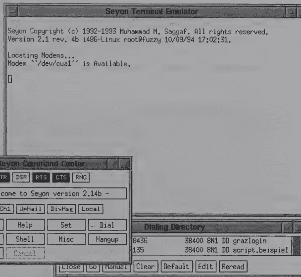


# 426 使用 Linux 接入互联网

## 终端仿真器 425

## 通过 PPP/SLIP 接入 427

### PPP/SLIP 术语

正确配置互联网最重要的条件是你的互联网提供商提供了所有必要数据。通常，这是一组看起来很奇怪的单词和数字，如下表所示（使用这些数据建立连接是可能的。）

| 电话号码：456787，分机12到15 |
|---|
| 你的用户名：`hofer` |
| 你的密码：`qwe44tr` |
| 你的电子邮件地址：`hofer@provider.de` |
| 你的 `PPP/SLIP` ID：`p166` |
| 你的 `PPP/SLIP` 密码：`abc5EF` |
| 你的 `PPP/SLIP` 主机：`p166.provider.de` |
| 你的 IP 地址（适用）：`199.85.96.166` |
| 网关 IP 地址：`199.85.37.1` |
| 服务器 IP 地址：`199.85.37.2` |
| 子网掩码：`255.255.255.0` |
| 邮件 (SMTP) 服务器：`provider.de` |
| 新闻 (NNTP) 服务器：`news.provider.de` |
| MTU（适用）：`1006` |

在本节中，我们将讨论 `PPP/SLIP` 的以下方面：

- `PPP/SLIP` 术语：你的互联网提供的数据。
- 前提条件：为了让 `PPP/SLIP` 工作，必须正确编译内核。此外，环回接口必须。
- 建立连接：你必须建立连接。
- 测试与错误检测：此小节介绍了如何确定连接是否已建立以及在可能的错误源时怎么办。

关于 `PPP/SLIP` 的更多文档可以在 `HOWTOs`、`Olaf` `Kirch` 写的《网络管理员指南》、`SuSE` 安装手册、`chat`、`dip`、`pppd` 和 `slatch` 的 man 页面以及 `PPP` 和 `SLIP` 的 README 文件（通常在 `/usr/doc/ppp*` 和 `/usr/doc/dip*`）中找到。


取决于相关互联网提供商管理 `PPP/SLIP` 连接的方式，您的提供商可能会向您提供额外的或不同的数据。特别是，如果提供商动态地管理地址，您可能不会拥有固定的 IP 地址。（换句话说：每次登录时，您都会收到不同的 IP 地址，即提供商当前可用的第一个 IP 号。由于互联网通信是基于服务名（`hofer.provider.de`）而非通过 IP 号实现的，因此您的 IP 地址是否固定对于某些应用程序来说并不重要。然而，固定的 IP 地址有助于配置和错误检测。）

对于 `PPP`（以及不适用于 `SLIP`），可以指定更多数据以进行双向身份验证。除了密码外，这种双向身份验证是一种双向起的额外安全机制（不仅是您，提供商也必须在建立 `TCP/IP` 连接之前传输身份标识）。详细信息可以在建立 `PPP` 连接的节中找到。

### 前提条件

#### 内核配置

只有当内核中包含相应的代码部分时，才能使用该内核软件。当您的计算机在启动期间*没有*显示以下消息时，需要使用不同的内核选项进行重新编译（措述可能随版本而变化）：

> Swansea University Computer Society `NET3.033` for
> `NET3`: `Unix` domain sockets `0.12` for `Linux` `NET3.033`.
> Swansea University Computer Society `TCP/IP` for `NET3.033`
> `IP` Protocols: `ICMP`, `UDP`, `TCP`
> Checking `386/387` counting... `Ok`, `fp` using exception `16` error reporting.
> Serial driver `4.1` with no serial options enabled
> `TCP` compression code copyright `1989` Regents of the University of `California`
> `PPP` dynamic allocation code copyright `1995` `Caldera, Inc.`
> `P` line discipline registered.
> `SLIP`: `0.7.5-NET3.014-NEWTTY` (`4` channels)
> `CSIP`: code copyright `1989` Regents of the University of `California`

在登录提示符出现之前，内核显示的某些消息已经滚出了屏幕的可见区域。如要再次查看这些消息，只需使用 `Shift+PgUp` 向上滚动屏幕内容。此外，内核消息也会（取决于配置）记录在 `/var/adm/messages` 或 `/var/adm/syslog` 末尾。

如果您的内核消息中缺少上述部分或全部，您必须重新编译内核。该过程在第 `173` 页有详细描述。

### 网络配置

为了能够使用 `PPP` 或 `SLIP`，需要对 `LINUX` 网络功能进行适当配置。本节的起点是第 `150` 页描述的回环接口配置（即 `localhost` 必须正常工作）。此外，必须扩展两个文件：`/etc/hosts` 和 `/etc/resolve.conf`。

通常，无法选择与提供商提供的电子邮件地址相对应的域名和登录名（这样做也没有意义）。

#### /etc/hosts

该文件包含一个已知 IP 号列表：`127.0.0.1` 是回环设备的标准 IP 号。可以使用额外的行来为计算机分配其在局域网内的 IP 地址以及 `PPP` 连接的 IP 地址。如果您不属于局域网且您的互联网提供商动态分配 IP 地址，则 `/etc/hosts` 只包含回环接口的 `127.0.0.1`。

顺便提一下，同一台计算机在 `/etc/hosts` 中具有多个 IP 地址并不是问题，因为（如果准确地说）它们是接口地址。通常，即使是带有静态地址的 `PPP` 在没有 `/etc/hosts` 条目的情况下也能工作——本地守护进程和提供商的 `PPP` 连接会自动协商使用哪个 IP 地址。

```
# /etc/hosts

# 用于回环接口
127.0.0.1 localhost

# 用于局域网
192.168.1.5 galactic

# 用于 PPP
199.85.96.166 jupiter
```

#### /etc/resolve.conf

此文件必须扩展以包含提供商提供的 DNS 服务器。该文件负责将 IP 地址转换为相应的名称。

```
# /etc/resolve.conf
domain galactic
nameserver 199.85.37
```

### PPP

`PPP` 代表点对点协议，允许通过串口线进行计算机之间的互联网连接（调制）。相比 `SLIP`，`PPP` 具有更好的功能，这在下一节中简要介绍。它支持连接。

#### INTERNET ACCESS PPP/SLIP

为了使用 `PPP`，内核必须支持 `PPP`。此外，您需要 `ppp` 和 `chat` 程序。通常，如果内核版本大于 `2.2`，则需要 `ppp`。

##### 建立连接

第一步是配置连接。结果如下：

```
ATDT
```

一段时间后，调制调器回复：

```
CONNECT
```

如果连接成功，互联网提供商将显示：

```
CONNECT
```

如果连接失败，可能会看到错误消息。在这种情况下，您应该检查您的配置和调制调器线路。

要测试连接，可以使用 `ping` 命令。

接下来，可以检查数据传输。出于目的，您使用 `ping` 程序向指定的 IP 地址发送小数据包，在这种情况下这应该是从 `ifconfig` 获取的互联网提供商地址（在示例中为 `199.85.37.3`）。结果如下：

```
# ifconfig
Link encap:Loopback
  addr:127.0.0.1 Bcast:127.255.255 Mask:255.0.0
  UP BROADCAST RUNNING MTU:1600 Metric:1
  RX packets: errors:0
  TX packets: errors:0
Link encap:Point-Point Protocol
  addr:199.85.96.166 P-t:199.85.37.3 Mask:255.255.255
  UP POINPOINT MTU:1406 Metric:1
  RX packets: errors:0
  TX packets: errors:0
```

要测试连接，可以使用 `ping` 命令。

```
# ping 199.85.37.3
```


## 通过 PPP/SLIP 访问互联网

```bash
PING 199.85.37.3 (199.85.37.3): 56 data bytes

64 bytes from 199.85.37.3: icmp_seq=0 ttl=255 time=252.2 ms

64 bytes from 199.85.37.3: icmp_seq=1 ttl=255 time=210.3 ms

64 bytes from 199.85.37.3: icmp_seq=2 ttl=255 time=210.3 ms

<Ctrl+C>

- 199.85.37.3 ping statistics -

3 packets transmitted, 3 packets received, 0% packet loss

round-trip min/avg/max = 210.0/224.3/252.2 ms
```

现在甚至可以进行名称服务器测试。再次调用`ping`，但请指定提供者的域名而不是 IP 地址。该名称在你的计算机上是已知的——因此，系统会访问`/etc/resolv.conf`中指定的名称。结果应该与上面的示例相同（唯一的区别是 IP 地址）。

```bash
# ping provider.de

PING 199.85.37.3 (199.85.37.3): 56 data bytes

64 bytes from 199.85.37.3: icmp_seq=0 ttl=255 time=252.2 ms

64 bytes from 199.85.37.3: icmp_seq=1 ttl=255 time=210.3 ms

64 bytes from 199.85.37.3: icmp_seq=2 ttl=255 time=210.3 ms <Strg+C>

199.85.37.3 : ping statistics

3 packets transmitted, 3 packets received, 0% loss

round-trip min/avg/max = 210.3/224.3/252.2 ms
```

如果一切运行正常，你就可以准备尝试真正的 Internet 应用程序了。`ftp`特别适合测试，因为会传输大量数据，这允许你检查连接的稳定性。此外，处理`ftp`非常简单（另请参阅第 446 页），并且通常情况下，它不需要任何额外的配置工作。

### 如果不起作用

如果在第一步时出现问题——即在与终端模拟器建立连接期间——你应该联系你的互联网服务提供商。登录后，终端模拟器应该显示出由 PPP 通信产生的奇怪字符。退出终端模拟器后，你的调制解调器在线 LED 灯必须保持亮着——否则，连接已中断。

`pppd`使用`syslog`将错误信息、警告等记录在`/var/adm*`或`/var/log*`（取决于`/etc/syslog.conf`中的设置）。当问题发生时，你应该查看这些文件的末尾。如果你在调用`pppd`时指定了`debug`关键字，日志记录将更加详细。

某些互联网提供商会在规定时间内没有数据传输时自动终止连接（通常在 1 到 5 分钟之间）。从原则上说，这非常有用，忘记的 PPP 连接不会导致天文数字账单。另一方面，当你阅读 WWW 文档正处于持续压力之下，连接被中断可能会非常恼人。

如果你经常通过 shell 程序`ping-forever`遇到问题：它每 30 秒调用一次`ping`并发送一个小型数据包。这对数据吞吐量几乎没有负面影响。调用`ping-forever`时，必须指定 IP 地址或 Internet 名称作为参数（对于上述 PPP 连接，将是`199.85.37.3`）。通过`>/dev/null &`，程序在后台运行，任何来自`ping`的输出都会重定向到`/dev/null`。


```bash
# /bin/sh

# ping-forever: 每 30 秒调用一次 ping
# call: ping-forever IP address > /dev/null &

while true
do
  ping -c 1 $1
  sleep 30
done
```

### 终止连接

PPP 连接将保持活动状态，直到被一方（你或你的互联网提供商）终止。在这一切期间，你显然会产生电话费用；由于 PPP 运行是隐形且不易察的，即使在你没有使用 Internet 服务时，你也必须记得终止连接。要做到这一点，你必须终止后台程序`pppd`。你可以通过`ps`命令确定`pppd`的进程号并终止它。

```bash
# ps -x
113 v04 S 0:00 /usr/bin/X11/xterm -sb -sl 500 -j -ls -fn 7x14
195 v02 S 0:00 pppd /dev/tty crcts default
202 v05 R 0:00 ps -x
60 v01 S 0:00 -bash
kill 195
```

### 自动建立连接

在上面的示例中，我们在执行`pppd`之前使用了终端模拟器进行拨号和登录。对于初步尝试，这种方法无疑是推荐的，但从长期来看，它太繁琐了。因此，开发了`chat`程序来自动执行拨号和登录。

`chat`接收多个字符串字符。它等待从调制解调器接收第一个字符串，发送第二个字符串（重置调制解调器的`ATZ`），等待第三个字符串（`OK`），发送第四个字符串（带电话号码的`ATDT`），等待第五个字符串（登录提示提示），以此类推。它从标准输入读取每个输入并将字符写入标准输出。为了让`chat`与调制解调器通信，你必须将输入输出都重定向到`/dev/tty`。

如果你在使用`chat`时遇到问题，使用`-v`选项将通信记录在`/var/log/messages`中。通过该文件你可以识别通信是在何时中断的。

下面的 shell 程序展示了如何使用`chat`。

```bash
#!/bin/sh

# chat 脚本示例
# 这是一个基于描述逻辑的简化表示
```

```bash
echo "INTERFACE Link terminated"
exit 0
else
# link is not active
exit 1
fi
```

## SLIP 和 CSLIP

SLIP 代表串行链路 IP（serial line IP），它允许通过串行接口进行 TCP/IP 通信，就像 PPP 一样。CSLIP 是 SLIP 的变体，其中协议信息被压缩（但数据没有）。SLIP/CSLIP 比 PPP 更加为人知，并推测被广泛使用。然而，未来可能属于 PPP，因为它在安全机制方面更加成熟。本节描述了 PPP 和 SLIP 之间最重要的区别（尽管它们有许多相似之处）。

为了使用 SLIP，内核必须支持它（见第 429 页）。为了自动建立连接，你需要`dip`程序，它通常位于`/sbin`目录。如果你在电脑上找不到此程序，则必须安装 N 软件包中的 DIP 组件（见第 633 页）。

遗憾的是，我没有机会实际尝试过 SLIP，因此此处提供的信息必须带有带有保留意见。它主要基于现有文档：NET-2 上的 HOWTO 文本（第 9.6 节）、`/usr/doc/dip/dip`中的文件，以及关于`slattach`和`dip`的 man 手档和《Linux 网络管理指南》的第 7 章。

### 建立连接

与 PPP 一样，连接是手动使用终端模拟器与你的互联网提供商建立连接并登录的。随后，你可以在不中断线路的情况下使用模拟器。现在，你可以通过`slattach`接管该接口以供 SLIP 独占使用。如果你想使用 SLIP（而不是 CSLIP），必须指定选项`-p slip`。

```bash
# /usr/sbin/slattach /dev/cua1
```

在 SLIP 接管串行接口后，必须注册这个新的互联网连接。这是通过`ifconfig`和`route`命令来完成的：

```bash
# ifconfig sl0 99.85.96.166 pointpoint 99.85.37.3 up
# route add default dev sl0
```

至此，与互联网提供商的连接即已建立。现在可以使用与 PPP 相同的方法（`ifconfig`, `ping`）进行检查。

### 终止连接

要终止 SLIP 连接，必须按反序禁用上述命令：

```bash
# route default
# ifconfig sl0 down # n 必须替换为 slattach 的 PID
# kill n
```


随后，必须使用终端模拟器（挂断）终止仍然激活的电话连接。

## 自动化

手动建立 SLIP 连接仅适用于首次实验。对于自动建立 SLIP 连接，提供了 `dip` 程序。它结合了 PPP 程序 `chat` 和 `pppd` 的功能；它负责电话线上的两个方面以及新互联网连接的注册。当调用 `dip` 时，会向一个包含 `dip` 参数的脚本文件传递给它。在 `/usr/doc/dip/sample.dip` 可以找到一个易于适配的 `dip` 脚本示例。

```
# /sbin/dip /usr/doc/dip/sample.dip # 建立 SLIP 连接

# /sbin/dip -k # 终止连接
```

为了测试目的，也可以通过带有 `-t` 选项启动程序来交互式执行 `dip`。随后，程序将接受 `dial`、`send`、`mode` 等命令，直到通过 `exit` 终止。


### 13.5 世界维网 (WWW)

本节是几个致力于不同互联网服务的章节中的第一个。所有这些章节都假设，无论是否通过 PPP/SLIP 还是更好的连接实现，访问互联网都能正常工作。其余章节的简要概述：

- 通过 FTP 传输数据：第 446 页
- 使用 `telnet` 操作主主机：第 452 页
- 电子邮件（包括配置）：第 453 页
- 新闻（包括配置）：第 474 页

#### 引言

世界维网（WWW）由许多文档组成，通过交叉引用将一个文档链接到另一个。WWW 的核心功能是使用超链接，当你点击一个链接时，相应的页面通过网络加载并显示在屏幕上。在这种情况下，超链接可以指向另一个文档（例如，图片）。由于超链接的存在，用户可能会从一个页面跳转到另一个页面，从而丢失导航，因此通常需要使用书签。

在实践中，超链接（例如，慢速调制解调器连接）意味着由于超链接的存在，WWW 文档通常不需要再次下载，而是存储在硬盘上或 CD-ROM 中。因此，WWW 即使在离线状态是可以访问的。

为了阅读 WWW 文档需要一个独立的程序，所谓的浏览器。著名的浏览器有 `Netscape`、`Mosaic` 以及（Windows 下的）`Internet Explorer`。在 `LINUX` 下，还有 `Arena` 和 `Lynx`。在描述这些程序之前，我们必须解释一些术语：

#### 书签

书签用于存储当前的 WWW 地址，以后可以快速检索该列表。

#### HTML

`HTML` 代表标记语言，定义了 WWW 的文档格式。`HTML` 指令包含在角括号内，例如 `<h1>` 标题。

#### http

`http`（通常小写）代表传输协议，定义了 `HTML` 如何通过网络传输。

#### URL

`URL` 代表通用资源定位符，意味着 WWW 地址。因此，`URL` 也可以指向其他类型（如 `FTP`）。


### 440 在 LINUX 中访问互联网

#### 缓存

某些 浏览器管理自己的缓存，将最近访问的文档存储在硬盘上。下次你访问时，浏览器只会检查文档是否发生变化。如果没有，则不再下载文档，而是使用本地文件。

#### 代理缓存

此外，大多数 WWW 服务器（大学、互联网提供商）管理一个代理缓存，其原理上与本地缓存相同，但适用于多个用户。当第二个用户访问 WWW 文档时，使用的是代理副本。因此，代理缓存并没有减少传输到计算机的数据量；它减少了互联网服务器与世界其他部分的流量，从而避免了频繁使用文档的长等待时间。

#### Lynx

`Lynx` 与其他浏览器相比有两个优势：它以文本模式运行并且免费提供（因此是大多数 `Linux` 发行版的一部分）。第一个优势被许多用户视为缺点，因为 WWW 的特性显然丢失了（文本属性、图片）。另一方面，`Lynx` 对内存消耗和计算能力的要求很低，而且不假设有 `X` 环境。

操作 `Lynx` 非常简单：通常通过按下 WWW 地址或 `HTML` 文件名启动程序。`Lynx` 加载文档并显示第一页。随后，可以使用以下快捷键：

| 快捷键 | 功能 |
| :--- | :--- |
| `PgUp`, `PgDn` | 光标向上/向下翻页 |
| `Ins`, `Del` | 光标向上/向下移动一行 |
| `I`, | 移动到上一个/下一个交叉引用 |
| | 交叉引用 |
| `←` | 返回上一个文档 |
| `Backspace` | 显示到为止的文档列表 |
| `/` | 在当前文档中搜索文本 |
| `A` | 将引用插入文档的书签列表 |
| `D` | (存储在文件 `~/lynx_bookmarks.html")` |
| `E` | 将文档传输到计算机 |
| `G` | 通过键盘输入 WWW 地址 |
| `K` | 显示所有可用键盘快捷键 |
| `O` | 设置选项 |
| `V` | 显示书签列表 |

通过传递目录也可以启动 `Lynx`：程序会显示该目录下所有文件和子目录的列表，可以用与交叉引用相同进行选择。`ASCII` 格式文本文件可以在 `Lynx` 中直接显示。

`Lynx` 拥有详尽的手页（man page）。执行 `Lynx -help` 可获得可用命令选项的概述。在操作期间，可以使用 `K` 显示所有键盘命令列表。通过 `H` 或 `?` 调用帮助——然而，帮助文本是通过互联网进行读取的。如果你仅使用 `Lynx` 读取本地文件且没有网络连接，则无法使用此功能。

#### Arena

`Arena` 是少数几个可以自由分发的 WWW 浏览器之一。（在某些条件下，如 `Netscape` 或 `Mosaic` 等商业程序可以免费使用，但它们不能在 CD-ROM 上分发）。

与其他 WWW 浏览器相比，`Arena` 仅局限于最基本的功能：该程序能够以不同的缩放级别（Zoom）显示 WWW 文档，支持 `HTML` 3 的所有官方功能并遵循其中包含的交叉引用。不再提供进一步的功能（甚至没有书签列表管理）。`Arena` 通过按键控制，具有易于的按钮栏，除了光标外，没有键盘快捷键。

| Lynx | HOMEW | 索引：索引 |
| :--- | :--- | :--- |
| 输出 打开.. 重新加载全部.. 打印 查看 编辑 前进 首页 缩放 帮助 | | 0.97h |
| 文件: `/lynx.kof/razhomel/kofier/lynx/doc/lynx_hot_99.html` | 如何配置 | |
| Lynx DNS HOMEW | 由 Paul Alexander 编写 `<peetersen@w3.org>` | 用于西里尔字母集的 Lynx 更新于1995年9月17日 |
| Lynx DOS HOMEW | 由 Mike Dasher 编写 `<daisher@digypas.edu>` | 关于 MS-DOS 以太网，如何设置 DNS 更新于1996年3月25日 |
| Lynx 丹语 HOMEW | 由 Michael Petersen 编写 `<peetersen@cisco.com>` | 如何使用丹麦语字符配置 linux 更新于1995年3月9日 |
| Lynx 发行 HOMEW | 由 Eric S. Raymond 编写 `<snary@lynx.org>` | 发行列表 更新于1996年2月8日 |
| Lynx ELF HOMEW | 由 Daniel Baxter 编写 `<baxter@datastached.com.uk>` | 如何安装并迁移到 ELF 二进制格式 更新于1995年9月13日 |
| Lynx 以太网 HOMEW | 由 Paul Goldmarx 编写 `<Paul.Goldmarx@gnu.edu.au>` | 关于 Linux 以太网硬件兼容性的信息 更新于1995年11月18日 |
| 芬兰语 HOMEW | 由 Pekka Taipale 编写 `<ppti@helk.fi>` | 如何配置 Linux 使用芬兰语字符 更新于1998年2月14日。 |
| 芬兰语 HOMEW | 由 David Rudder 编写 `<david@evox.cnc.com>` | 如何使用 lynx 设置防火墙 |

图 13 `Arena`。

#### 在 Linux 上连接互联网

对于阅读在线文档和首次尝试 WWW，`Arena` 绝对完全足够了。该程序的额外优势是屏幕构建速度快且内存占用有限。然而，它无法提供 `Netscape` 的舒适性。

#### Netscape

`Netscape` 不仅仅是一个 WWW 浏览器。从 2.0 版本开始，该程序还可以读取新闻组、读取和管理电子邮件、传输文件（FTP）等。

除非你与 `Caldera` 工作（其授权的 `Netscape` 版本是发行版的一部分），否则你必须自己获取 `Netscape`。私人用户和教育部门允许免费使用 `Netscape`。你可以通过 FTP 下载该程序。`Netscape` 运行几个名称以 `ftpn` 开头的服务器（`n` 位于 2 到 20 之间）。

```
http://home.netscape.com
ftp2.netscape.com/pub/navigator
```

对于 3.0 版本，`netscape.tgz` 文件的大小超过 2.3 M 字节。如果你通过介质连接互联网，即使在 28800 波特的稳定连接下，也必须在任务时间前约15 分钟开始。随后的安装非常简单：

```bash
# mkdir /usr/local/lib/netscape
```


# `tar xzf netscape.tgz -C /usr/local/lib/netscape`

# `ln -s /usr/local/lib/netscape /usr/bin/libX11R6`

如果你的系统中的 `/usr/X11R/lib/X11` 缺少 `KeysymDB` 文件，你必须将 Netscape 的文件拷贝到目录。

```bash
# cp /usr/local/lib/netscape/KeysymDB /usr/X11R/lib/X11
```

随后，Netscape 应该能够直接运行。在显示各种版权声明和警告后，创建 `/.netscape` 目录，其中存储本地配置数据、书签和临时文件（缓存）。

## 使用

与其他 WWW 浏览器一样，Netscape 的使用完全不复杂。要显示的文档可以通过 `FILEOPEN LOCATION` 或 `FILEOPEN File` 通过在 `LOCATION` 字段中直接输入地址来选择。如果指定的目录名称，Netscape 会自动显示所有文件和子目录；你可以点击鼠标移动到感兴趣的文件。

`Go` 菜单允许你跳回最近查看的文档。通过 `WINDOWHISTORY` 可以获取自 Netscape 启动以来显示的所有文档列表。

通过 `GoBack` 或 `BACK` 按钮，你可以回溯点击过的交叉引用。`Back` 命令在点击鼠标右键时显示的上下文菜单中也可用。

# 万维网 443


# RPM HOWTO

Donna Barnes, djb@redhat.com

1.4, 1995年12月5日

- 1. 引言
- 2. 概述
- 3. 一般
    - 3.1 获取 RPM
    - 3.2 RPM 要求
- 4. 使用 RPM

图 13.3 Netscape 页面

添加书签可以将当前文档地址存储在书签列表中。（在某些条件下，Netscape 或 Mosaic 等商业程序可以免费使用，但它们不能在 CD-ROM 上分发）。与其他 WWW 浏览器相比，Arena 仅局限于最基本的功能：该程序能够以不同的缩放级别（`Zoom`）显示 WWW 文档，支持 HTML 3 的所有官方功能并遵循其中包含的交叉引用。不再提供进一步的功能（甚至没有书签列表管理）。Arena 通过按键控制，具有易于的按钮栏，除了光标外，没有键盘快捷键。

在 Caldera 发行版中，Netscape 也用于显示在线文档。因此，Netscape 可能会被反复启动。关于如何防止这一点，请参阅第 627 页。

## WWW 地址

WWW 缺乏有序的结构，这导致其组织相当混乱，而且查找具体信息通常非常费力。为了弥补这一缺陷，已经建立了一些中央 WWW 数据库，你可以在其中范围内搜索 WWW 文档中的文本。此外，WWW 还有一些全球入口点，这些地方以某种顺序展示了各种可以想象和无法想象的主题的交叉引用地址。

显然，互联网也提供了海量数据，特别是对于 Linux。特别值得提到的是 Linux 软件地图（Linux Software Map），这是一个包含几乎所有 Linux 程序的数据库（按各种标准排序，并带有搜索功能；最近约有 1700 条目）。

以下列表包含了一些重要的 WWW 地址。但请注意，WWW 地址经常变化，某些地址在本书印刷之前可能就已经过期了。请也检查作者的 WWW 页面（见前言），该页面更易更新本书（但经验表明，实际上更新得并不频繁）。

- Caldera | http://www.caldera.com
- Delix | http://www.delix.de
- DELUG | http://www.artinet.de/delug
- LINUX Documentation Project | http://sunsite.unc/mdw/mdw.html
- LINUX HOWOS | http://sunsite.unc/mdw/HOWTO
- LINUX Journal | http://www.ssc.com/lj
- LINUX Org | http://www.linux.org
- LINUX Organization home page | http://www.ssc.com/linux/lsm.html
- LINUX Software Map | http://www.lunetix.de
- Lunetic | http://www.suse.de
- RedHat | http://www.suse.de
- SuSE | http://www.altavista.digital.com
- Searching WWW documents | http://www.yahoo.com

## 13.6 文件传输协议 (FTP)

FTP 允许在通过互联网连接的计算机之间传输二进制文件。显而易见，FTP 是与远方同事交换数据的实用方法。然而，FTP 的如此普及归功于匿名 FTP：许多属于大学和互联网提供商的互联网服务器都对所有所谓的 FTP 存档开放访问。这种访问（与普通 FTP 不同）不会被密码阻止。要使用匿名 FTP，你只需将 `anonymous` 指定为用户名，并将你的电子邮件地址作为密码。

你可以用于 FTP 的程序数量数不可胜数：除了经典的 `ftp` 命令外，你几乎可以使用每一个 WWW 浏览器（`Lynx`, `Mosaic`, `Netscape`, `X Emacs` 编辑器，易于处理但不幸有些容易崩溃的 `me` 文件管理器）、X 程序 `ftp`（无用户界面）等。然而，在这些某些程序中，仅支持通过匿名 FTP 下载文件（但不支持发送（上传）文件或带有个人登录的 FTP）。

本节主要限于对 `ftp` 的描述，你应该用它进行首次尝试。一旦你积累了一些使用 ftp 的经验，处理其他程序就不会有任何问题——上述提到的所有程序都比 `ftp` 容易处理！

许多数据存档是镜像的，也就是说，定期从一个互联网服务器传输到另一个（每天、每周或每月）。这种镜像的原因是用户可以始终访问地理位置上最近的服务器，而无需担心发现过时的数据。你应该始终尝试访问离你越近的 FTP 服务器。

如果你只有对互联网的交互式访问，那么是否可以使用 FTP 取决于你的互联网提供商。某些提供商提供 FTP 来传输你所连接计算机的整个硬盘。从那里，你可以将文件传输到你自己的计算机——不是通过 FTP，而是通过调制解调器传输协议（`x/y/z modem`）。这听起来相当啰嗦，但从传输速度的角度来看，它与 `PPP` 或 `SLIP` 的 FTP 相比没有劣，因为调制解调器传输不需要整个 `TCP/IP` 开销。


## ftp 会话命令

FTP 会话通过 `ftp` 命令启动。由于文件要从/到当前目录进行传输，你应该使用 `cd` 切换到所需的目录。在调用 `ftp` 时，要指定 FTP 服务器所需的互联网地址。在建立连接并输入你的用户名和密码后，你就可以就绪了：你可以使用 `cd`、`pwd` 及其与 UNIX 含义相同的命令在 FTP 存档的目录中寻找路径。要从 FTP 存档将文件传输到当前目录，请执行 `get`。文件名保持不变。反之，你可以使用 `put` 将文件从当前目录传输到 FTP 存档的目录。（显然，这只有在你对该目录具有写入权限时才有效。对于匿名 FTP，它大多被限制在一个名为如 `/pub/incoming` 的单一目录下）。在传输文件之前，你必须先切换到二进制模式。在文本模式下，FTP 将文件解释为文本并尝试对其进行转换。二进制文件将变得不可用。幸运的是，大多数 FTP 服务器都配置为二进制为默认值。

为了提高可读性，所有接收到的文本相对于用户输入都缩短了几个字符。尽管文本缩短了，示例显示在 FTP 会话期间会显示海量文本。因此，在 X 窗口或 Emacs 的 shell 模式下工作时，你可以滚动查看已显示的文本。

以下在 FTP 会话期间执行的重要命令总结：

| 命令 | 描述 |
| :--- | :--- |
| `ascii` | 切换到文本模式 |
| `binary` | 切换到二进制模式 |
| `bye` | 退出 |
| `cd` | 切换目录 |
| `close` | 关闭连接 |
| `dir` | 显示目录 |
| `get` | 从远程获取文件 |
| `help` | 显示帮助信息 |
| `ls` | 列出目录 |
| `open` | 建立连接 |
| `put` | 上传文件到远程 |
| `quit` | 退出 |
| `pwd` | 显示当前目录 |
| `user` | 登录 |

示例：

在 FTP 会话期间显示的文本如下：

```
speedy.redhat.com FTP server (Version wu-2.4.2-academ[BETA-9])(1)

Thu Feb 29 15:50:44 EST 1996).

Name (ftp.redhat.com:kofler) : anonymous
```


331 Guest login, send your email address as password.

Password : koflerping.at

Welcome to the Red Hat Software Linux archive.

There are currently 72 users using this ftp archive.

Guest login ok, access restrictions apply.

Remote system type is UNIX.

Using binary mode to transfer files.

`ftp> ls`

```
# 文件传输协议 449

drwxr-xr-x 3 root root 1024 May 24 20:26 mirrors
drxr-xr-x 5 506 506 1024 May 21 14:23 pnp
drwwx x x 3 root root 1024 May 27 17:10 private
drxr-xr-x 15 root root 1024 Jun 15 14:16 suc
dr-xr-xr-x 3 root root 1024 Sep 9 19:54 usr
...
```

`ftp> cd pub`

读取文件 `README`

文件最后修改时间为 1996年3月15日 周五 17:30:04 - 83 天前

`ftp> ls`

```
-rw-rw-r 1 root root 1205 Jan 26 22:57 SUPPORT
-rw-rw-r 1 root root 247 Nov 21 1995 UPLOADING
-rw-rw-r 1 root root 350 Jan 25 16:38 VENDORS
drwxr-xr-x 4 root root 1024 Apr 9 19:39
drxr-xr-x 10 504 504 1024 Jun 5 21:08 contrib
drxr-xr-x 2 root root 1024 May 31 21:07 current
drxr-xr-x 7 root root 1024 May 9 18:38 deuil
drxr-xr-x 4 root root 3072 May 30 15:15 disics
```

`ftp> cd combin/RPMS`

`ftp> ls *`

```
-rw-rw-r 1 504 504 43087 Mar 21 01:00 par-1.502-1.i386.rpm
-rw-rw-r 1 504 504 32241 Mar 18 12:16 pcnfsd-2.0ish-6.i386.rpm
-rw-fw-r 1 504 504 17076 Mar 14 02:13 pdmenu-0.3-i386.rpm
-rw-fw-r 1 504 504 188358 Mar 26 22:18 perl-5.002-1.i386.rpm
-rw-fw-r 1 504 504 799117 May 29 21:50 mine-3.93-2.i386.rpm
-rw-fw-r 1 504 504 58650 May 05 04:41 pixmap-4.0.3-i386.rpm
-rw-fw-r 1 504 504 75875 May 11 24:24 pixmap-2.6-i386.rpm
-rw-fw-r 1 504 504 53529 Dec 17 04:13 pilot-4.09-1.i386.rpm
-rw-fw-r 1 504 504 324298 Mar 3 07:20 gmake-2.94-1.i386.rpm
-rw-fw-r 1 504 504 14487 Oct 8 01:17 portmap-3.0-1.i386.rpm
-rw-fw-r 1 504 504 194628 Mar 1 01:17 popsec-9.5-i386.rpm
-rw-fw-r 1 504 504 707936 Feb 8 22:06 postgres-9.2.0-2.i386.rpm
-rw-fw-r 1 504 504 81095 Jan 28 00:02 ppp-2.2.0-i386.rpm
-rw-fw-r 1 504 504 82548 Mar 17 22:52 provirtual-0.96-i386.rpm
-rw-fw-r 1 504 504 11003 Mar 3 22:24 procmect-1.1-i386.rpm
-rw-fw-r 1 504 504 92459 May 4 01:54 procsps-0.99-i386.rpm
-rw-fw-r 1 504 504 87560 May 12 21:36 procsps-0.99-3-i386.rpm
-rw-fw-r 1 504 504 72072 May 12 21:36 psutils-1.16-i386.rpm
```

`ftp> get ppp-2.2.0-1.i386.rpm`

`PORT` command successful.

Opening BINARY mode connection for `p-2.2.0-1.i386.rpm` (81095 bytes).

Transfer complete.

81095 bytes received in 28.3 seconds.

`ftp> bye`

尽可能减少传输的数据，FTP 服务器通常使用 `gzip` 压缩。唯一的例外是较小的文本文件。传输完成后，你必须对文件进行解压缩、压缩或归档。

## 匿名 FTP

使用 `Netscape` 访问匿名服务器比 `ftp` 简单得多：你只需要指定 FTP 服务器而不是 WWW 地址。`Netscape` 会处理登录过程并显示文件列表；你只需点击所需的文件即可。根据文件类型，`Netscape` 现在尝试直接显示文件（ASCII、位图）或使用不同的程序（例如使用 `ghostview` 显示 `PostScript`），或者将其传输到你的计算机。文件通过扩展名进行分类。`Netscape` 的行为通过两个文件控制：`mailcap` 和 `mime.types`。这两个文件都有两个版本，一个是全局的，另一个是本地的（位于主目录开头）。当文件位于 `/etc` 目录时，`mime.types` 的内容意味着所有 `*.ps` 和 `*.eps` 文件类型均为 `'application/postscript'`。

处理此文件的信息遵循 `mailcap`：`PostScript` 文件应用 `ghostview` 显示。为此，`%s` 被替换为文件名。

```
# mime.types 中的一行
application/postscript
eps
```

```
# mailcap 中的一行
application/postscript; ghostview -safer %s
```

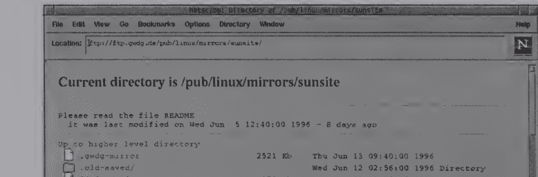

图 13.4 Netscape 匿名 FTP。

取决于配置，`mailcap` 可能代表安全危害，导致程序的意外或不受执行！`ghostview` 的 `-safer` 选项防止任何文件通过底层被修改。如果无法与文件关联类型，`Netscape` 会尝试以 ASCII 模式显示它。在这种情况下，直接传输更为合理（特别是当使用 `Netscape` 进行 FTP 时）。这种行为有两种解决办法。简单的方法是：用右键点击文件并执行“另存为”命令。专业的方法是：修改 `mime.types`。以下行显示了必要的修改，它可以将 `*.tar` `*.tgz` 文件（而是 `*.tar` 或 `*.tgz` 文件）识别为归档并进行传输：

```
# mime.types 中的一行
formerly: application/x-tar
application/x-tar-tgz
```

## FTP 地址

列表显示了全球的一些 FTP 服务器地址，不保证完整性或准确性。

### 欧洲/俄罗斯

- `ftp://ftp.funet.fi/pub/Linux`

- `ftp://ftp.gwdg.de/pub/Linux`

- `ftp://ftp.lbp.fr/pub/Linux`

- `ftp://ftp.iol.ie/Pub/Linux`

- `ftp://ftp.msu.ru/pub/Linux`

- `ftp://ftp.nluwg.nl/pub/os/Linux`

- `ftp://ftp.nvg.unit.no/pub/Linux`

- `ftp://ftp.pk.edu/pub/Linux`

- `ftp://ftp.rhi.is/pub/Linux`

- `ftp://ftp.ton.tut.fi/pub/Linux`

- `ftp://sunsite.auk.dk/pub/os/Linux`

- `ftp://sunsite.doc.ac.uk/pub/Linux`

- `ftp://sunsite.icm.edu.pl/pub/Linux`

- `ftp://sunsite.mff.uni.cz/os/Linux`

### 美国

- `ftp://ftp.ccgate.edu/pub/Linux`


`ftp://ftp.cms.unc.edu/pub/Linux`

`ftp://ftp.pht.com/pub/`

`ftp://ftp.rge.com/pub/`

`ftp://ftp.uok.nor/linux`

`ftp://ftp.wilmington.net/linux`

`ftp://ftpgatekeeper.dec.com/pub/Linux`

`ftp://linux.ucs.indiana.edu/pub/Linux`

`ftp://sunsite.unc.edu/pub/Linux`

`ftp://uarchive.cso.uiuc.edu/pub/linux`

```bash
$ xhost +jupiter.galactic.network # 仍在运行在本地计算机上
$ telnet jupiter.galactic.network # 登录到主机计算机
...
$ netscape # Netscape 运行在 jupiter，但在本地显示
```

## 13.8 电子邮件 (Email)

`Email`是`electronic mail`的缩写，指的是在互联网上发送消息（信件）。它是互联网最古老且目前最重要的应用程序之一。其基本思想是将`ASCII`文本从一台计算机传输到另一台计算机。然而，扩展的电子邮件标准`MIME`或如`uencode`等附加程序提供了传输二进制文件的可能性。

如果你仅将电子邮件作为互联网提供商的一种交互式服务使用，那么你将只会面对提供商的邮件程序（很有可能是`pine`，在第 460 页介绍）。关于转发、内部管理等进一步的细节都不需要你关心。

当你配合`PPP`/`SLIP`使用电子邮件时，情况会变得复杂。这种方式的优点是减少了电话费用，因为它允许你在本地计算机上进行处理电子邮件。这种配置也被称为离线系统，因为在网络连接未激活的情况下即可读取和写入电子邮件。不过，由于电子邮件会在你的互联网提供商邮件服务器和你的计算机之间自动传输，你必须进行一些配置工作。

在本节中，我们将处理电子邮件的以下方面：

- 电子邮件消息的结构和地址编码。
- 处理邮件程序的工作技巧：文件夹和地址簿的使用，通过电子邮件发送二进制文件（第 456 页）。
- 电子邮件的背景和内部管理，特别强调在`PPP`/`SLIP`下的电子邮件处理（第 458 页）。
- 使用邮件程序（邮件用户代理）如`pine`、`elm`、`Emacs`和`Netscape`来编写、发送和阅读电子邮件消息（第 460 页）。
- 用于转发电子邮件消息的`sendmail`程序（邮件传输代理）（第 467 页）。
- 用于从互联网提供商服务器获取邮件的`popclient`程序（第 470 页）。
- 用于在本地计算机与互联网提供商之间自动传输电子邮件消息的文件`offlinemail`（第 471 页）。

初看之下，这比实际上要简单。尽管这一节已经很大了，但排除了许多方面，例如加密电子邮件消息、重定向电子邮件（例如重定向到你的假期地址）等。


### 电子邮件消息的结构

一条电子邮件消息由若干包含`From:`和`Subject:`等关键字的头部行组成。随后是消息正文。以下示例显示了用户`Manfred Hofer`编写并发送给互联网提供商`provider.de`支持团队的电子邮件消息。

`To: support@provider.de`

`Subject: 关于 PPP 环境下邮件的问题`

亲爱的支持团队：

我正在使用交互式互联网接入和`PPP`。一切看起来运行正常。我唯一的问题是无法通过`PPP`获取我的邮件（到`hofer@provider.de`）。我在`Linux`下工作。你们能帮帮我吗？

顺颂商祺

`Manfred Hofer`

过一会儿，支持团队收到了以下电子邮件消息。唯一的区别是`To:`行消失了，并被`From:`行所代之：

> `Date: Sat, 7 Jan 1996 18:03:35 +0100`
> `From: Manfred Hofer <hofer@provider.de>`
> `Subject: 关于 PPP 环境下邮件的问题`
>
> 亲爱的支持团队：
>
> 我正在使用交互式互联网接入和`PPP`。一切看起来运行正常。我唯一的问题是无法通过`PPP`获取我的邮件（到`hofer@provider.de`）。我在`Linux`下工作。你们能帮帮我吗？
>
> 顺颂商祺
>
> `Manfred Hofer`

如果支持团队熟悉`Linux`或`UNIX`，那么发送者（希望）稍后收到的答案可能如下所示。该答案显示了电子邮件典型的两种布局元素：主题文本是带有`Re:`（回复）的原始文本；原始消息的引用是通过开头的`>`字符标记的（邮件程序会处理电子邮件格式的这方面，你不需要对每一行都缩进并插入`>`）。

> `Date: Sat, 7 Jan 1996 19:47:33 +0100`
> `From: Klaus Feinger <klaus@provider.de>`
> `Subject: Re: 关于 PPP 环境下邮件的问题`
>
> 亲爱的支持团队：
>
> 我正在使用交互式互联网接入和`PPP`。一切看起来运行正常。我唯一的问题是无法通过`PPP`获取我的邮件（到`hofer@provider.de`）。我在`Linux`下工作。你们能帮帮我吗？
>
> 顺颂商祺
>
> `Klaus Feinger`

### 头部 (The header)

下表总结了电子邮件头部的字段：

| 字段 (Field) | 说明 (Description) |
| :--- | :--- |
| `From:` | 发件者地址 |
| `To:` | 收件者地址 |
| `Subject:` | 电子邮件主题 |
| `Date:` | 消息发送日期 |
| `Reply:` | 表示回复消息 |
| `Cc:` | 抄送 - 查看消息的其他收件者 |
| `Bcc:` | 密抄 - 对其他人隐藏的收件者 |

### 电子邮件地址

在互联网内部，地址以`name@domain`的形式指定。它们通常被角括号括：`<Margit.Mueller@compuser.com>`。

错误可能会导致严重后果。然而，这个问题并不算严重，因为你只是在回复一封邮件，地址是自动插入的。尽管如此，你可能突然想写一封新邮件，在这种情况下，能够从地址列表中获取地址是非常方便的。所有的电子邮件程序都支持地址簿的管理。可以从现有的邮件程序中提取地址，以减少打字量（以及错误概率）。

### 二进制文件

邮件信息通常由`ASCII`文本组成，这对于任何电子邮件程序都不会产生问题。此外，许多现代电子邮件程序（如`Netscape`、`pine`）支持邮件标准`MIME`。这个缩写代表“多用途互联网邮件扩展”。`MIME`可用于方便地传输二进制文件（无需使用从第 446 页开始描述的`FTP`程序）。二进制文件的示例包括图像、源文件、编译后的程序、压缩包等。如果你使用`Netscape`，你甚至可以在邮件程序中直接查看图像和`HTML`文件。

当你的地址没有支持`MIME`的程序时，就会出现问题。在这种情况下，编码文件将直接作为文本显示。这看起来大体如下列表：因此，只有当你确定你的地址支持`MIME`时，发送`MIME`才有意义。

```
137166316-89440337-790290599:#100
Content-Type: TEXT/PLAIN; CHARSET=US-ASCII; Name="picture.ps"
Content-Transfer: Encoding: Base64
Content-Id: <pine.3.89.9501170859.B100ahofer.muchen>
Content-Description: Image
102JRRYaLJENCjYIDJCENCNCZCA501K5DK50TNCKjJmgCAWIdYgMDACAIdAU
MDAIDEJAYMTQMTTY4MDAIDE2C2045ACnZ2AgqMgMDqMDMDAqMDACAIdOxOC
MQgNTkGTkIDOY IDEIDENCNCZCA501K5DK50TNCKjJmgCAWIdYYIdAgLTEG
mCAJMDAVIDAGMTQTYTA1D3mmCAXjkgza2ps2xsamrxxbqgtqqq
137166316-89440337-790290599:#100
[EOB3]
```

如果你的伙伴没有能够理解`MIME`的程序，还有另一种发送二进制文件的方法。如果你想发送文件，必须首先使用`uencode`将二进制文件转换为文本文件，然后用任何邮件程序发送该文件。下列出的命令转换文件并将结果存储在`uofile`中。名称指定了存储在编码文件中的文件名。通常情况下，文件和名称指定相同的名称。

```
$ uencode file name > uofile
```


当你收到这样编码的消息时，你必须将消息存储为文件，并用`udecode`将其转换回二进制格式。如果`uofile`是上述命令编码的，`udecode`会自动生成文件名。（这是存储的文件名）

```
$ udecode uofile
```


## 邮件管理原理

本节介绍了`LINUX`计算机上邮件管理的一些背景。假设你使用`sendmail`作为发送邮件的程序。如果你使用`smail`，下面提到的某些目录将会有不同的名称。

## 邮件存储在哪里？

所有在`LINUX`下运行的邮件程序都假设邮件位于`/var/spool/mail/loginname`文件。因此，对于每个登录名，在一个或多个（`ASCII`格式）邮件文本文件中存在一个独立的邮件文件，其中存储了邮件内容。

你发送了但无法投递的邮件临时存储在`/var/spool/queue`目录下。在该目录下，每条消息都存储在一个单独的文件中，直到变成循环文件名。通常情况下，你不应对此进行任何更改——`sendmail`会处理这些中间存储的文件。可以使用`mailq`显示存储的邮件列表。

如果你想用`pine`、`elm`、`Mail`或`emacs`等程序读取邮件，这些程序会检查当前登录名的邮件文件（`/var/spool/mail/name`）。处理方式取决于程序：

- `pine`和`elm`在请求确认后会对邮件排队，你可以拒绝。
- `Mail`程序从邮件文件中删除每条已读消息，并将其附加到文件`~/mbox`中。
- `emacs`在不询问的情况下将邮件文件中的所有(!)消息传输到自己的格式（`~/RMAIL`）。
- `Netscape`的行为类似：它将整个邮件传输到文件`~/nsmsail/Inbox`。

这里描述了邮件程序的行为细节，是为了节省你寻找“丢失邮件”的时间。当你用`Emacs`或`Netscape`读取邮件时，这些邮件对其他程序就不再存在了（因为它已经从`/var/spool/mail/name`中的邮件文件中删除了）。相比之下，你仍然可以用另一个程序读取你先用`pine`或`elm`读取过的邮件。

邮件永远不会在先询问的情况下被删除。它只是被传输到另一个位置，在那里它只能由特定的程序处理（而不是由所有程序）。

## 邮件用户代理与邮件传输代理

混淆通常是由邮件程序分为两组引起的。邮件用户代理（`Mail User Agent`）代表邮件的用户界面。邮件传输代理（`Mail Transport Agent`）在后台运行，并确保邮件到达目的地。在许多系统上，此任务由`sendmail`完成。（如下）

## 通过 PPP/SLIP

`PPP/SLIP`的一个特性是支持`MIME`。在`pine`中，某些`Linux`发行版可以使用此功能：

- 邮件在请求确认后排队，你可以拒绝。
- `Mail`程序从邮件文件中删除每条已读消息，并将其附加到文件`~/mbox`中。
- `emacs`在不询问的情况下将邮件文件中的所有(!)消息传输到自己的格式（`~/RMAIL`）。
- `Netscape`的行为类似：它将整个邮件传输到文件`~/nsmsail/Inbox`。

由于`pine`易于处理，它是最流行的程序之一。在`pine`下，可以使用此功能：

- 邮件在请求确认后排队，你可以拒绝。
- `Mail`程序从邮件文件中删除每条已读消息，并将其附加到文件`~/mbox`中。
- `emacs`在不询问的情况下将邮件文件中的所有(!)消息传输到自己的格式（`~/RMAIL`）。
- `Netscape`的行为类似：它将整个邮件传输到文件`~/nsmsail/Inbox`。

（见见 457 页）：

- 邮件在请求确认后排队，你可以拒绝。
- `Mail`程序从邮件文件中删除每条已读消息，并将其附加到文件`~/mbox`中。
- `emacs`在不询问的情况下将邮件文件中的所有(!)消息传输到自己的格式（`~/RMAIL`）。
- `Netscape`的行为类似：它将整个邮件传输到文件`~/nsmsail/Inbox`。

## pine

`pine`有三个文件夹：用于新收邮件的`inbox`，用于自己编写邮件的`sent-mail`，以及用于保存消息的`saved-messages`。如果你在`SAVE`命令中指定一个不同的文件夹，`pine`会创建该文件夹。

在每个月初，旧邮件会从`sent-mail`传输到`sent-mmm-yy`，其中`mmm`是月份的缩写，`yy`是年份的最后两位。这防止了`sent-mail`无限增长。此外，你可以借此删除旧的`sent-mail`文件夹。所有其他文件夹不受影响。

启动后，`pine`会出现如下：

```
PINE 3.91      MAIN MENU Folder: INBOX 4 Messages
```

```
? HELP - 使用 Pine 获取帮助
C COMPOSE MESSAGE - 编写并发送消息
I FOLDER INDEX - 查看文件夹中的消息
L FOLDER LIST - 选择要查看的文件夹
  ADDRESS BOOK - 更新地址簿
S SETUP - 配置或更新 Pine
Q QUIT - 退出 pine 程序
```

`Copyright 1988-1994. PINE`是华盛顿大学的商标。

`Folder "INBOX"` 打开了`O`条消息

```
? Help PreCmd RelNames
O OTHER CMDS LFolders N NextCmd
 K Block
```

当你想读取当前邮件时，使用`FOLDER LIST`查看`inbox`文件夹。`pine`显示所有消息列表（每条都包含日期、发送者、大小和主题）：

```
1 Dec 13 Susanne Spitzer (4,411) Re: CDs and Books

2 Dec 16 Susanne Spitzer (2,310) Re: Delivery date for Linux

3 Dec 18 christian mock (2,493) Re: Query address under PPP (fwd)

4 Dec 21 Michael Kofler (401) test mail to myself
```

新的未读邮件标记有一个前面的字母`N`。现在你可以使用光标选择一条邮件消息并按`[Enter]`读取。

当你阅读邮件消息时，你可以使用一些额外的命令。可用命令显示在两个命令

## 本地邮件

由于`pine`易于处理，它是最流行的程序之一。在`pine`下，可以使用此功能：

- 邮件在请求确认后排队，你可以拒绝。
- `Mail`程序从邮件文件中删除每条已读消息，并将其附加到文件`~/mbox`中。
- `emacs`在不询问的情况下将邮件文件中的所有(!)消息传输到自己的格式（`~/RMAIL`）。
- `Netscape`的行为类似：它将整个邮件传输到文件`~/nsmsail/Inbox`。

（见 467 页）：


屏幕底部的行。命令通过其首字母进行选择。

- 帮助(`Help`) `M` 主菜单(`Main Menu`) `P` 上上一条消息(`PrevMsg`) `D` 删除(`Delete`) `R` 回复(`Reply`)
- 其他命令(`OTHER CMDS`) `V` 查看附件(`ViewAttach`) `N` 下一条消息(`NextMsg`) `Spc` 下页(`NextPage`) `U` 恢复(`Undelete`) `F` 前进(`Forward`)

`OTHER CMDS`显示常用命令名称：

- 帮助(`Help`) 退出(`Quit`) `L` 列目录(`ListFldr`) `I` 索引(`Index`) `Y` 打印(`Print`) 保存(`Save`)
- 其他命令(`OTHER CMDS`) `C` 编写(`Compose`) `G` 跳转目录(`Gofldr`) `T` 获取地址(`TakeAddr`) `E` 导出(`Export`)

如何，这些命令的含义是显而易见的。

对于`DELETE`、`UNDLETE`和`SAVE`需要一些解释。通过`DELETE`，你将一条消息标记为已删除。目前，该消息仍留在列表中：只有在退出`pine`时它会被删除（而且仅在请求确认后才删除）。通过`UNDLETE`，可以移除删除标记。

`SAVE`也会将消息标记为已删除，但同时会将消息复制到另一个文件夹。建议的文件夹是`saved-messages`，但你可以指定一个不同的文件夹名称，如果该文件夹尚不存在，将通过此命令创建。

`EXPORT`将当前消息转换为文本文件。如果你想用文本编辑器或其他程序处理消息（例如，用于解密加密消息），这特别有用。


`COMPOSE`、`REPLY` 和 `FORWARD` 都会进入 `pine` 编辑器。`COMPOSE` 用于编写一封全新的邮件。通过 `REPLY`，你对当前消息进行回复。`pine` 会自动填充收件人（`To:`）和主题（`Subject:`）字段，并将原始消息插入回复中，并用 `>` 字符进行缩进。通过 `FORWARD`，你将未修改的消息发送到第二个地址（但你也允许向消息中添加额外信息）。

处理 `pico` 编辑器并没有大问题。方向键可以使用，但 `Del` 不使用退格键（`Backspace`），而是使用 `Ctrl+D` 代替。`pico` 可以独立于 `pine` 作为一个微编辑器使用。下框总结了最重要的命令：

```
Ctrl+- 设置标记点
Ctrl+K 删除当前行或被选文本
Ctrl+U 插入已删除的文本
Ctrl+R 将文本文件插入消息
Ctrl+X 发送消息
Ctrl+C 终止消息写入
Ctrl+- 在旧的 .pincerc 中启动编辑器
```

如果在编写消息期间，你想访问旧消息或读取新邮件，可以使用 `Ctrl+O` 中断该过程。部分准备好的消息存储在 `postponed-folder`（延迟文件夹）中，稍后可以完成（只要你选择 `COMPOSE`）。你甚至可以存储多条准备好的消息。

通过 `pine`，你不仅可以管理电子邮件，还可以管理你的地址录。在主菜单中，`ADDRESS BOOK`（地址录）进入包含所有存储地址的列表。


## 462 在 `LINUX` 上访问互联网

如果你从那里那里选择 `COMPOSE` 命令，`pine` 会自动将当前地址插入消息的收件人字段中。反之，在阅读消息时，你可以使用 `TAKEADDR` 命令将发送者的地址插入地址录。地址录存储在文本文件 `~/.addressbook` 中。

## 使用 `pine` 发送和接收二进制文件

如果你想在正在编写的邮件的同时发送一个文件，你必须将文件放入 `Attach:` 字段并执行命令 `Ctrl+J`。现在，`pine` 会询问你想要传输的文件名，然后是关于该文件的注释（对文件内容/或数据格式的简要说明）。你也可以在邮件消息中附加多个文件。

当你收到带有附件的邮件消息时，情况恰恰相反。在这种情况下，`pine` 只显示普通消息。某些行会告诉你消息中还附加了其他文件。现在可以使用 `VIEWATTACH` 查看这些文件，或将它们作为单独的文件存储在你的计算机上。处理第一个附件时，必须指定数字 `2`，因为 `pine` 将数字 `1` 分配给普通消息。只有当二进制文件为文本格式时，查看才有意义（这通常是例外情况）。

附件由 `pine` 编码为一种特殊的文本格式。为了防止传输问题，仅使用 `ASCII` 字符，这导致与实际大小相比，传输的数据量增加了约 `25%`。

## `pine` 配置，设置发件者地址

`pine` 可以通过 `$`（`setup`）命令或通过修改文件 `~/.pincerc` 来配置。如果该配置文件不存在，可以使用 `pine -conf ~/.pincerc` 创建它。该配置文件有详尽的文档说明，因此更改设置不应该是问题。在以下几段中，仅描述了最重要的设置：

`personal-name=Manfred Hofer` 此设置指定了你作为发件者使用的全名。如果未设置 `personal-name`，`pine` 将使用 `passwd` 文件中的名称。

`user-domain=provider.de` 此设置在发件者地址中使用指定的域名。当你的计算机域名（例如 `galactic.network`）与你与互联网提供商的电子邮件地址（`provider.de`）不匹配时，此设置非常实用。因此，当你使用上述设置并登录 `hofer` 时，`pine` 使用 `hofer@provider.de` 作为发件者地址。然而，`provider.de` 也用于本地地址，例如在向 `root` 发送消息时。为了实现正确投递，你现在必须在 `To:` 字段中指定 `root@localhost`。

```
custom-headers=Reply-To:s9232@uni.de
```

通过此，`pine` 在常规行中添加 `Reply-To` 行。这用于指定你邮件的接收者（他/她）。原则上，这只是一种妥协——如果 `pine` 能够模拟整个发送者（且仅模拟发送者），将会更简单。

`character-set=ISO-8859-1`

此设置指定了使用的字符集。如果省略此设置，`pine` 假设只知道 `ASCII` 字符。

这种设置指定了使用的字符集。对于外文字符可能会产生问题。


# `pico`

处理 `pico` 编辑器并没有大问题。方向键可以使用，但 `Del` 不使用退格键（`Backspace`），而是使用 `Ctrl+D` 代替。`pico` 可以独立于 `pine` 作为一个微编辑器使用。下框总结了最重要的命令：


```
Ctrl+- 设置标记点
Ctrl+K 删除当前行或被选文本
Ctrl+U 插入已删除的文本
Ctrl+R 将文本文件插入消息
Ctrl+X 发送消息
Ctrl+C 终止消息写入
Ctrl+- 在旧的 .pincerc 中启动编辑器
```

如果在编写消息期间，你想访问旧消息或读取新邮件，可以使用 `Ctrl+O` 中断该过程。部分准备好的消息存储在 `postponed-folder`（延迟文件夹）中，稍后可以完成（只要你选择 `COMPOSE`）。你甚至可以存储多条准备好的消息。

通过 `pine`，你不仅可以管理电子邮件，还可以管理你的电子邮件地址录。在主菜单中，`ADDRESS BOOK`（地址录）进入包含所有存储地址的列表。


## 462 在 `LINUX` 上访问互联网

如果你从那里选择 `COMPOSE` 命令，`pine` 会自动将当前地址插入消息的收件人字段中。反之，在阅读消息时，你可以使用 `TAKEADDR` 命令将发送者的地址插入地址录。地址录存储在文本文件 `~/.addressbook` 中。

## 使用 `pine` 发送和接收二进制文件

如果你想在正在编写的邮件的同时发送一个文件，你必须将文件放入 `Attach:` 字段并执行命令 `Ctrl+J`。现在，`pine` 会询问你想要传输的文件名，然后是关于该文件的注释（对文件内容/或数据格式的简要说明）。你也可以在邮件消息中附加多个文件。

当你收到带有附件的邮件消息时，情况恰恰相反。在这种情况下，`pine` 只显示普通消息。某些行会告诉你消息中还附加了其他文件。现在可以使用 `VIEWATTACH` 查看这些文件，或将它们作为单独的文件存储在你的计算机上。处理第一个附件时，必须指定数字 `2`，因为 `pine` 将数字 `1` 分配给普通消息。只有当二进制文件为文本格式时，查看才有意义（这通常是例外情况）。

附件由 `pine` 编码为一种特殊的文本格式。为了防止传输问题，仅使用 `ASCII` 字符，这导致与实际大小相比，传输的数据量增加了约 `25%`。

## `pine` 配置，设置发件者地址

`pine` 可以通过 `$ (setup)` 命令或通过修改文件 `~/.pincerc` 来配置。如果该配置文件不存在，可以使用 `pine -conf ~/.pincerc` 创建它。该配置文件有详尽的文档说明，因此更改设置不应该是问题。在以下几段中，仅描述了最重要的设置：

`personal-name=Manfred Hofer` 此设置指定了你作为发件者使用的全名。如果未设置 `personal-name`，`pine` 将使用 `passwd` 文件中的名称。

`user-domain=provider.de` 此设置在发件者地址中使用指定的域名。当你的计算机域名（例如 `galactic.network`）与你与互联网提供商的电子邮件地址（`provider.de`）不匹配时，此设置非常实用。因此，当你使用上述设置并登录 `hofer` 时，`pine` 使用 `hofer@provider.de` 作为发件者地址。然而，`provider.de` 也用于本地地址，例如在向 `root` 发送消息时。为了实现正确投递，你现在必须在 `To:` 字段中指定 `root@localhost`。

```
custom-headers=Reply-To:s9232@uni.de
```

通过此，`pine` 在常规行中添加 `Reply-To` 行。这用于指定你邮件的接收者（他/她）。原则上，这只是一种妥协——如果 `pine` 能够模拟整个发送者（且仅模拟发送者），将会更简单。

*(注：由于提供的原文在 `custom-headers` 之后出现了严重的文本重复，本译文已严格遵循指令去除了重复部分的翻译内容。)*

`character-set=ISO-8859-1`

此设置指定了使用的字符集。如果省略此设置，`pine` 假设只知道 `ASCII` 字符。

这种设置指定了使用的字符集。对于外文字符可能会产生问题。

# pico

处理 `pico` 编辑器并没有大问题。方向键可以使用，但 `Del` 不使用退格键（`Backspace`），而是使用 `Ctrl+D` 代替。`pico` 可以独立于 `pine` 作为一个微编辑器使用。`pico` 可以独立于 `pine` 作为一个微编辑器使用。下框总结了最重要的命令：

```
Ctrl+- 设置标记点
Ctrl+K 删除当前行或被选文本
Ctrl+U 插入已删除的文本
Ctrl+R 将文本文件插入消息
Ctrl+X 发送消息
Ctrl+C 终止消息写入
Ctrl+- 在旧的 .pincerc 中启动编辑器
```

如果在编写消息期间，你想访问旧消息或读取新邮件，可以使用 `Ctrl+O` 中断该过程。部分准备好的消息存储在 `postponed-folder`（延迟文件夹）中，稍后可以完成（只要你选择 `COMPOSE`）。你甚至可以存储多条准备好的消息。

通过 `pine`，你不仅可以管理电子邮件，还可以管理你的电子邮件地址录。在主菜单中，`ADDRESS BOOK`（地址录）进入包含所有存储地址的列表。


## 462 在 `LINUX` 上访问互联网

如果你从那里选择 `COMPOSE` 命令，`pine` 会自动将当前地址插入消息的收件人字段中。反之，在阅读消息时，你可以使用 `TAKEADDR` 命令将发送者的地址插入地址录。地址录存储在文本文件 `~/.addressbook` 中。

## 使用 `pine` 发送和接收二进制文件

如果你想在正在编写的邮件的同时发送一个文件，你必须将文件放入 `Attach:` 字段并执行命令 `Ctrl+J`。现在，`pine` 会询问你想要传输的文件名，然后是关于该文件的注释（对文件内容/或数据格式的简要说明）。你也可以在邮件消息中附加多个文件。

当你收到带有附件的邮件消息时，情况恰恰相反。在这种情况下，`pine` 只显示普通消息。某些行会告诉你消息中还附加了其他文件。现在可以使用 `VIEWATTACH` 查看这些文件，或将它们作为单独的文件存储在你的计算机上。处理第一个附件时，必须指定数字 `2`，因为 `pine` 将数字 `1` 分配给普通消息。只有当二进制文件为文本格式时，查看才有意义（这通常是例外情况）。

附件由 `pine` 编码为一种特殊的文本格式。为了防止传输问题，仅使用 `ASCII` 字符，这导致与实际大小相比，传输的数据量增加了约 `25%`。

## `pine` 配置，设置发件者地址

`pine` 可以通过 `$ (setup)` 命令或通过修改文件 `~/.pincerc` 来配置。如果该配置文件不存在，可以使用 `pine -conf ~/.pincerc` 创建它。该配置文件有详尽的文档说明，因此更改设置不应该是问题。在以下几段中，仅描述了最重要的设置：

`personal-name=Manfred Hofer` 此设置指定了你作为发件者使用的全名。如果未设置 `personal-name`，`pine` 将使用 `passwd` 文件中的名称。

`user-domain=provider.de` 此设置在发件者地址中使用指定的域名。当你的计算机域名（例如 `galactic.network`）与你与互联网提供商的电子邮件地址（`provider.de`）不匹配时，此设置非常实用。因此，当你使用上述设置并登录 `hofer` 时，`pine` 使用 `hofer@provider.de` 作为发件者地址。然而，`provider.de` 也用于本地地址，例如在向 `root` 发送消息时。为了实现正确投递，你现在必须在 `To:` 字段中指定 `root@localhost`。

```
custom-headers=Reply-To:s9232@uni.de
```

通过此，`pine` 在常规行中添加 `Reply-To` 行。这用于指定你邮件的接收者（他/她）。原则上，这只是一种妥协——如果 `pine` 能够模拟整个发送者（且仅模拟发送者），将会更简单。

*(注：由于提供的原文在 `custom-headers` 之后出现了严重的文本重复，本译文已严格遵循指令去除了重复部分的翻译内容。)*

`character-set=ISO-8859-1`

此设置指定了使用的字符集。如果省略此设置，`pine` 假设只知道 `ASCII` 字符。

这种设置指定了使用的字符集。对于外文字符可能会产生问题。


# pico

处理 `pico` 编辑器并没有大问题。方向键可以使用，但 `Del` 不使用退格键（`Backspace`），而是使用 `Ctrl+D` 代替。`pico` 可以独立于 `pine` 作为一个微编辑器使用。下框总结了最重要的命令：

```
Ctrl+- 设置标记点
Ctrl+K 删除当前行或被选文本
Ctrl+U 插入已删除的文本
Ctrl+R 将文本文件插入消息
Ctrl+X 发送消息
Ctrl+C 终止消息写入
Ctrl+- 在旧的 .pincerc 中启动编辑器
```

如果在编写消息期间，你想访问旧消息或读取新邮件，可以使用 `Ctrl+O` 中断该过程。部分准备好的消息存储在 `postponed-folder`（延迟文件夹）中，稍后可以完成（只要你选择 `COMPOSE`）。你甚至可以存储多条准备好的消息。


通过 `pine`，你不仅可以管理电子邮件，还可以管理你的电子邮件地址录。在主菜单中，`ADDRESS BOOK`（地址录）进入包含所有存储地址的列表。


邮件程序。然而，只有在使用 `Emacs` 的 `X` 版本时才比较方便，该模式通过菜单命令 `File|Read Mail` 激活。此时，将提供一个包含各种邮件管理附加命令的详尽菜单。可以通过执行命令 `Summary|All` 获取所有邮件消息列表；这些消息现在可以用鼠标点击进行选择，通过 `Mail|Reply` 进行回复，以此类推。

`Emacs` 邮件模式有一个特别且可能会让人有点困扰的特殊功能：程序会读取整个邮件文件 `/var/spool/login` 并在不经询问的情况下将所有消息传输到它自己的邮件文件 `~/MAIL` 中。通过这种方式读取的邮件只能在 `Emacs` 中处理（无法用任何其他邮件程序处理）。

## 使用 Netscape 作为邮件程序

`Netscape` 不仅可以读取 `WWW` 文档，还可以读取和发送电子邮件。从 `2.0` 版本开始，`Netscape` 已经（人们可以说是过度地）配备了所有常见的电子邮件功能：文件夹、地址簿等。如果你是第一次使用电子邮件程序，会被如此海量的功能和选项让你大开眼界。

邮件功能从 `Window|Net Mail` 开始，或者通过点击窗口右下角的邮件图标启动。一旦你点击此图标或 `GET` 按钮，`Netscape` 就会尝试读取新收到的邮件。这些消息会立即被传输到内部收件箱文件夹。`Netscape` 将所有文件夹存储在 `~/mail` 目录下。该格式与其他邮件程序兼容。因此，如果你想从 `pine` 切换到 `Netscape`（为了尝试一下），只需将 `~/mail` 中的所有文件复制到 `~/ins` 即可。在 `Netscape` 中，你可以通过 `File|New` 创建新文件夹。

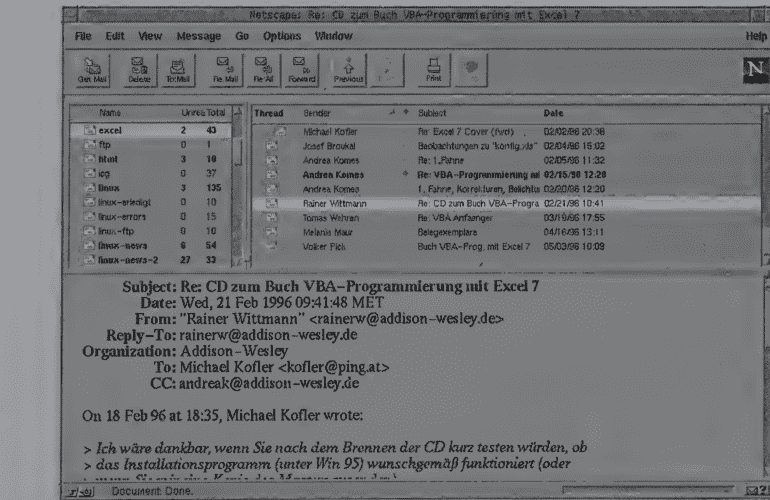

图 1.35 使用 `Netscape` 读取邮件消息。

## 466 使用 LINUX 接入互联网

处理文件夹非常简单：邮件消息可以直接用鼠标从一个文件夹拖动到另一个文件夹。按住鼠标加 `Ctrl` 键可以一次选择多条消息。然而，无法通过键盘进行完全控制——这一事实使得高效处理变得困难。

`Netscape` 在处理二进制文件方面表现出色。`HTML` 或 `GIF` 文件会立即显示，否则会显示一个按钮。当你点击此按钮时，可以以任何名称存储该文件。在邮件消息中附加二进制文件也没有问题；只需执行 `FileAttach` 即可。

## Netscape 电子邮件配置

在 `Netscape` 可以作为邮件程序正常工作之前，你可能需要进行一些配置工作。大部分设置在 `Options|Mail Preferences|Server` 中完成。通常将 `localhost` 指定为发送邮件的 `SMTP SERVER`。这假设在 `Netscape` 尝试发送邮件时，`sendmail` 或另一个邮件传输代理正在运行。

收件邮件（Incoming Mail）的设置取决于你的邮件系统的配置。如果你使用的是本章描述的离线方法，并通过小型程序从提供商处自行获取邮件，请选择 `Build Mailover`。那么，`Netscape` 将从 `/var/spool/mail` 读取邮件。

访问邮件文件时，`Netscape` 尝试在 `/var/spool/mail` 中创建一个锁文件。由于它没有该目录的通用访问权限（只有特定邮件文件的权限），这注定会失败。以下命令说明了安全隐患。

```
# chmod a+w /var/spool/mail
```

如果你想在不使用 `popclient` 程序的情况下操作，请进入 `Netscape`。在这种情况下，选择 `Pop3` 选项并指定你的互联网提供商的邮件服务器（`provider.de`）和你的邮箱名称（`hofer`）。`Netscape` 随时会联系提供商以读取新邮件。（在此之前，必须建立 `PPP/SLIP` 连接。）如果你不想每次都输入密码，可以要求 `Netscape` 记住你的密码，路径为 `Options|Mail and News Preferences|Organization|Remember Mail Password`。

一个本应属于服务器配置的额外选项，奇怪地会影响用于输入新消息的窗口：在这里，你可以使用 `Options` 指定邮件是立即发送，还是通过 `Outbox` 中的 `FileSendMail` 命令在稍后阶段发送。延迟投递（Deferred Delivery）的优势是你多了一次机会来决定是否真的应该发送已经写好的消息。然而，这种令人不安的缺乏弹性会导致你忘记发送消息。

发送邮件，`Netscape` 要求 `sendmail` 正在运行。即使你使用离线配置来读取和发送邮件，`sendmail` 也必须作为守护进程启动。理解上的问题可能是由 `Options|Mail` 和 `News Preferences|Compose` 命令控制的设置引起的；在这里你指定


你写的消息存储在何处。在默认设置下，邮件消息不会存储，也就是说，一旦消息发送出去，你就无法再次读取它。

（注：原文此处 `OptionsMail` 似乎漏掉了分隔符，翻译时按上下文处理为 `Options|Mail` 以符合软件逻辑）


处理文件夹非常简单：邮件消息可以直接用鼠标从一个文件夹拖动到另一个文件夹。按住鼠标加 `Ctrl` 键可以选择多条消息。然而，无法通过键盘进行完全控制——这一事实使得高效处理变得困难。

Netscape 在处理二进制文件方面表现出色。HTML 或 GIF 文件会立即显示，否则会显示一个按钮。当你点击此按钮时，可以以任何名称存储该文件。在邮件消息中附加二进制文件也没有问题；只需执行 `FileAttach` 即可。

## Netscape 电子邮件配置

在 Netscape 可以作为邮件程序正常工作之前，你可能需要进行一些配置工作。大部分设置在 `Options|Mail Preferences|Server` 中完成。通常将 `localhost` 指定为发送邮件的 `SMTP SERVER`。这假设在 Netscape 尝试发送邮件时，`sendmail` 或另一个邮件传输代理正在运行。

收件邮件（Incoming Mail）的设置取决于你的邮件系统的配置。如果你使用的是本章描述的离线方法，并通过小型程序从提供商处自行获取邮件，请选择 `Build Mailover`。那么，Netscape 将从 `/var/spool/mail` 读取邮件。

访问邮件文件时，Netscape 尝试在 `/var/spool/mail` 中创建一个锁文件。由于它没有该目录的通用访问权限（只有特定邮件文件的权限），这注定会失败。以下命令说明了安全隐患。

```
# chmod a+w /var/spool/mail
```

如果你想在不使用 `popclient` 程序的情况下操作，请进入 Netscape。在这种情况下，选择 `Pop3` 选项并指定你的互联网提供商的邮件服务器（`provider.de`）和你的邮箱名称（`hofer`）。Netscape 随时会联系提供商以读取新邮件。（在此之前，必须建立 PPP/SLIP 连接。）如果你不想每次都输入密码，可以要求 Netscape 记住你的密码，路径为 `Options|Mail and News Preferences|Organization|Remember Mail Password`。

一个本应属于服务器配置的额外选项，奇怪地会影响用于输入新消息的窗口：在这里，你可以使用 `Options` 指定邮件是立即发送，还是通过 `Outbox` 中的 `FileSendMail` 命令在稍后阶段发送。延迟投递的优势是你多了一次机会来决定是否真的应该发送已经写好的消息。然而，这种令人不安的缺乏弹性会导致你忘记发送消息。

发送邮件，Netscape 要求 `sendmail` 正在运行。即使你使用离线配置来读取和发送邮件，`sendmail` 也必须作为守护进程启动。理解上的问题可能是由 `Options|Mail` 和 `News Preferences|Compose` 命令控制的设置引起的；在这里你指定


你写的消息存储在何处。在默认设置下，邮件消息不会存储，也就是说，一旦消息发送出去，你就无法再次读取它。

提供商（而不是任何其他地方）。这有一个本质的优势：如果你向另一个大陆发送消息，而互联网连接发生拥堵，你可以延迟地将邮件投递到你的互联网提供商处，从而节省电话费用。在你的提供商的系统上，我们再次找到 `sendmail`（或其他传输代理），它会在可行时自动为你转发你的邮件。

`sendmail.cf` 中必须的更改仍然仅限于一行：你只需要在以 $ 符号开头且通常为空的行中，指定你的互联网提供商邮件服务器的地址：

```
# 在 /etc/sendmail.cf 中的修改
# "Smart"（智能）中继主机（可能为空）
DSprovider.de
```

## 修改超时设置

`sendmail.cf` 包含一个单独的章节可以在其中指定各种超时设置。这些设置控制了 `sendmail` 在电子邮件消息在规定时间内无法投递时的行为。

通常情况下，必须增加这些时间限制，否则你将收到来自 `sendmail` 的烦人邮件，通知你某些消息无法投递。如果你在早上写好一封邮件，但决定在晚上才通过 PPP 发送（因为你白天无法访问提供商，或者仅仅是为了节省电话费用），你就会意识到这封邮件暂时无法投递，因此不需要任何等待。

```
# 在 /etc/sendmail.cf 中的修改
# 一天后，无法投递的邮件
# 发送者将收到警告；但 sendmail
# 仍然会尝试投递
DTOime.queewarnid
# 五天后，无法投递的邮件
# 将返回给发送者
DTOime.queuerurned5d
```

`sendmail` 尝试投递邮件的频率在 `sendmail` 启动时通过选项 `-qtime` 控制（例如 `-qh` 表示每小时尝试投递一次）。在 RedHat 中，`sendmail` 是通过 `/etc/rc.d/sendmail.start` 执行的。

## 创建你自己的 sendmail.cf

`sendmail.cf` 的构建方式使得该文件通常不被直接编辑，而是通过重新编译 `m4` 宏文件生成的。这种过程的优点是，`sendmail.cf` 的源代码比 `sendmail.cf` 本身更易理解，因此也更容易适配。创建完全新的配置文件的前提条件是安装了 `sendmail` 配置文件（并非所有发行版都包含）以及宏处理器 `m4`，其功能最好可以比作 C 语言编译器的预处理器。此外，你还需要大量的 `sendmail` 基础知识。（“官方”文档是 O'Reilly 出版的 800 页书籍 `sendmail`。）

`sendmail.cf` 的源文件通常位于 `/usr/src/sendmail` 目录。子目录 `cf` 包含了几个现成的配置文件，你可以通过调用 `m4` 从从中生成新的 `sendmail.cf`。在接下来的指令中，你显然可以指定 `linux.smtp.mc` 以外的 `cf` 目录中的任何相同文件。

```
# cd /usr/src/sendmail/cf
# m4 linux.smtp.mc > sendmail.cf
# mv /etc/sendmail.cf /etc/sendmail.cf.backup
# cp sendmail.cf /etc
```

在执行 `m4` 期间，会从 `domain`、`mailer`、`oyster` 等目录读取并处理各种配置文件。关于该过程的详细描述以及各种设置的含义，可以在 `/usr/src/sendmail/README` 文件中找到。

## smail

某些 Linux 发行版使用 `smail` 程序代替 `sendmail`，它的功能与 `sendmail` 非常相似，但（据称）更容易配置。如果你没有该程序的运行经验，因此无法对其配置发表任何意见，那么通向成功最简单的方法可能再次参考相应发行版的配置辅助工具。

## mailq

`mailq` 或等效命令 `sendmail -bp` 显示所有由邮件程序发送但尚未转发的邮件列表（例如，因为没有可用的互联网连接）。

## 从互联网提供商获取邮件 (POP)

当 `sendmail` 将你编写的邮件转发给你的互联网提供商时，`popclient` 程序执行的是恰恰相反的任务：从互联网上获取发给你的邮件，并将这些消息附加到 `/var/spool/mail` 中的本地邮件文件中。（邮件的自动投递到你的计算机是不可能的，因为 POP/SLIP 连接无法保持。。）

某些程序（`pine`、`Netscape`）可以配置为通过 POP 从提供商获取邮件。然而，使用 `popclient` 可以实现该过程更好的自动化。

POP 代表 Office Protocol（邮局协议），是邮件系统的一个标准。该协议支持存储在不同邮件服务器上的消息的有序传输。POP 有两种变体，即 POP2 和 POP3。大多数互联网提供商使用 POP3。


## EMAIL

`popclient` 在 PPP/SLIP 连接建立后被调用。必须向程序传递你的名称（选项 `-o`）、你的密码（选项 `-p`）以及你提供商的邮件服务器地址。`-v` 激活 POP 协议，目前正在发生该协议的详细日志。

在第一次测试 `popclient` 时，你还应该指定选项 `-k`。这可以防止你的邮件在读取后从你的提供商的服务器上被删除。你可以多次读取你的邮件（这在正常操作中没有意义，但对于初次非常实用）。使用页面上的示例数据，`popclient` 看起来可能像这样：

```
# popclient -v -u hofer -p queer provider.dev
>OK Pop
>USER hofer
>OK
>PASS queer
>OK
>STAT
>OK 0
>QUIT
>OK
```

# EMAIL 473


```
ppp packets:12 errors:0 dropped overruns:0
TX packets:12 errors:0 dropped:0 overruns:0
Link encap:Point-Point Protocol

inet addr:193.85.96.166 P-t:193.85.37.19 Mask:255.255.255.0

UP POINTPOINT RUNNING MTU:1500 Metric:1

RX packets:14 errors:1 dropped:1 overruns:0
TX packets:18 errors:0 dropped:0 overruns:0

send mail
JAA0072 (sequence 1 of 1)
hofer@jupiter.galactic.network ... Connecting to provider.de via relay...
220 provider.de.SMTP/Smart Ready.
>>> HELLO jupiter.galactic.network
250 (jupiter@jupiter.galactic.network) pleased to meet you.
>>> MAIL FROM:<hofer@jupiter.galactic.network>
250 <hofer@jupiter.galactic.network>... Sender Ok
>>> RCPT To:<kofleriping.at>
250 <kofleriping.at> OK
>>> DATA
354 Enter mail, end with "." on a line by itself
>>>
250 Mail accepted
hofer@jupiter.galactic.network... Sent (Mail accepted)
Closing connection to provider.de.
>>> QUIT
221 Closing connection
read mail
+OK QUALCOMM Pop server derived from UCB (version 2.1.4-R3) at
provider.de. starting.
> USER hofer
+OK Password required for hofer
> PASS password
+OK hofer has 1 message(s) (701 octets).
> STAT
+OK 1 701
> RETR 1
+OK 701 octets
(17 lines of message content)
> DELE 1
+OK Message 1 has been deleted.
> QUIT
+OK Pop server at provider signing off.
ppp0 link terminated
```

脚本文件 `ppp-on`、`ppp-off`、`offlinmail.cf` 的示例可以在附带 CD-ROM 的 `book/internet` 目录中找到。你唯一需要做的就是向你的互联网提供商插入数据值，然后一切都应该正常运行（我知道这只是痴人说梦……）。

原则上讲，你可以进一步自动化你的邮件系统。例如，你可以配置 `/etc/crontab`，使得定期调用 `offlinmail`（例如，每小时一次）。


## 13.9 Usenet 新闻

新闻组可以定义为一种讨论小组。新闻组可以是局部的（例如，限于某个大学或国家），也可以是国际的。新闻文章存储在所谓的新闻服务器上。所有的大学和互联网提供商都运行自己的新闻服务器。在此背景下，你将学习如何在你的本地计算机上建立你自己的（小型）新闻服务器。

可以使用新闻阅读器阅读新闻文章。如果你知道某些问题的答案，或者想自己问自己，就可以编写自己的文章。根据小组的范围，此文章将转发到所有连接的新闻服务器。由于文章需要经过许多新闻服务器，可能需要较长的时间——一或两天。在此期间，所有感兴趣的新闻阅读器都可以阅读（并可能回答）该文章。

在新闻组中存储所有新闻文章将需要海量的数据。因此，新闻服务器的设置使得所有文章在一段时间后自动删除（通常是几天后）。尽管有此限制，大型新闻服务器上的新闻文章往往会占用数 GB 的硬盘空间。

文章的自动删除实施了一种纪律：当文章过期后（通常是几天后），文章会被自动删除。尽管有此限制，大型新闻服务器上的新闻文章往往会填满几个 GB 的硬盘。

文章的自动删除要求一种纪律：当你遇到感兴趣的文章时，应该立即将其存储到本地。否则，文章将会过期。在技术术语中，文章已“过期”。为了存储它，只需将其作为邮件消息发送给自己（`name@localhost`）。

*注：此处原文似乎有部分段重复，已根据逻辑合并并翻译了核心内容。*

*在技术术语中，文章已过期。为了存储它，只需创建相应的文件夹（例如，`news-`）。*

当新闻服务器在本地系统上运行时，阅读新闻就不需要持久连接。每天（或每隔几小时）所有新文章都会传输过来（离线操作）。与此同时，你编写的文章会被发送。否则，必须与远程新闻服务器建立持久连接：这节省了一些配置工作。

以下章节讨论了处理新闻的几个方面：

- 基础：本节介绍了新闻程序的通用功能（线程、订阅小组等），并提供了 Linux 特有新闻的概述。
- 阅读新闻文章的程序（`tin`, `Netscape`）：这些程序可以离线和在线使用（第 477 页）。
- 离线系统的配置：需要几个步骤：安装本地新闻服务器（`INN`，第 488 页）、下载程序（`newsflash`，第 491 页）和上传程序（第 494 页）。


# 基础

## 线程

有时，新闻组中会讨论。`A` 提问，`B` 回答，`C` 维护自己的观点，`D` 提供另一个观点。在层级上，看起来如下：

- `A`: 我该怎么做？
- `B`: `Re: 我该怎么做？`
- `C`: `Re: 我该怎么做？`
- `D`: `Re: 我该怎么做？`

## 订阅

新闻服务器允许你订阅某些小组。这对于过滤你感兴趣的文章非常有帮助。在 `Netscape` 中，这是通过 `File!Get Messages` 完成的。订阅信息存储在本地。

## 编写新闻文章

在发送（发布）你的第一个文章之前，请遵循以下规则：

- 保持冷静礼貌。
- 不要提问任何在 `FAQ` 中已回答过的问题。
- 当你对其他文章做出反应时，切不要引用过多。但要引用足够的以确保上下文仍然清晰（引用通常由带有 `>` 缩进的文本片段组成）。

## 签名

新闻文章通常以签名结束，签名可以包含你的名字、地址、格言或你选择的任何内容。此签名从为此目的创建的文件读取（通常为 `/signature`）。

`comp.os.linux.hardware`

`LINUX` 特定硬件问题

`comp.os.linux.misc`

所有不属于其他 `comp.os.linux.*` 组的内容

`comp.os.linux.networking`

`LINUX` 特定网络应用和问题

`comp.os.linux.x`

关于 `X` 的 `LINUX` 特定问题

`comp.os.linux.*`

若干其他 `LINUX` 特定的小组

`comp.sys.*`

特定厂商的讨论组（硬件/软件）

`comp.sys.ibm.pc.hardware.*`

`PC` 硬件

`comp.os.unix.*`

`UNIX` 问题

`comp.windows.x.*`

关于 `X` 窗口系统的讨论组

`gnu.*`

关于 `GNU` 软件的各种新闻组

`gnu.emacs.*`

`Emacs`

`linux.debian.user`

`Debian` 发行版

`linux.dev.kernel`

内核开发

`linux.dev.*`

关于编程各个方面非常具体的新闻组（`dev` 代表开发 `development`）

# 新闻程序 (tin, Netscape)

正如前一节关于电子邮件的“邮件程序”一样，“新闻程序”（`news program`）一词也具有歧义。它可以指用于阅读和撰写新闻文章的新闻阅读器（新闻的用户界面），也可以指用于新闻系统内部管理的程序（新闻服务器加辅助程序）。本节介绍新闻阅读器。

与电子邮件节对应的另一个并行是用于阅读新闻的程序有很多。本章仅介绍流行的两个程序：`tin`（一个在文本控制台上操作的快速程序，第 477 页）和 `Netscape`（第 480 页），后者提供了更多功能。

如果你对这两个程序不满意，这里还有你可以使用的不完整程序列表：

# 使用 LINUX 访问互联网

- `pine`：通过 `SetupConfig` 配置。对于在线阅读，必须指定互联网提供商的新闻服务器为 `NNTP` 服务器。对于本地阅读，不需要指定新闻服务器；但在新闻收集字段中必须输入文本 `News*`。遗憾的是，`pine` 不支持线程化（`threading`）。其处理方式与阅读电子邮件类似。
- 显然，还有 `GNU Emacs`、`X Emacs`。（如你所知，用这些程序无无不能的。）
- `nn`, `tn`（`tin` 的替代方案），`xvnews`（一个 `X` 程序）。


# tin

`tin` 是一个实用的程序，初看可能会给你留下并不不错的印象，但实际上它的处理效率比某些其他程序（如 `Netscape`）高得多。当你想要使用该程序读取本地新闻文章时，只需启动 `tin` 即可。

如果文章仅在远程服务器上（在线操作），你必须在 `/etc/nntpserver` 文件或环境变量 `NNTPSERVER` 中指定其地址。在本章的提供商示例中，地址为 `news.provider`——见第 427 页。此外，在阅读之前，必须与提供商建立 `PPP/SL` 连接。随后，使用 `tin -r` 启动新闻程序。如果你已经有一个 `.newrc` 文件，可以节省时间并执行 `-r -n`。现在，只考虑已订阅的新闻组。第一次启动 `tin` 时这显然是不可能的。

当你使用它时，`tin` 会显示所有已知新闻组的列表（无论是否存在）。如果使用本地新闻服务器，该列表源自 `/var/lib/news/active`——见第 488 页。

默认情况下，`tin` 会订阅所有新闻组。因此，第一步是取消所有订阅：首先，按 `Y [Shift-U], [x]`，然后按 `[x]`。取消订阅需要一些时间。随后，你可以使用 `Y` 来检查操作是否正确。`Y` 可在所有新闻组视图和已订阅组之间切换。

按 `Y` 切换到显示所有新闻组的模式。现在，你可以使用光标移动到所需的新闻组并使用 `$` 订阅单个组，或者使用 `[Shift-$]` 订阅所有符合给定的组。例如，你可以输入 `comp.linux.*` 来选择所有 `LINUX` 组。再次按一次 `Y`——屏幕应该看起来如下所示：

# 组选择 (4)

| 计数 | 组 |
| :--- | :--- |
| 32 | `comp.linux.hardware` |
| 92 | `comp.linux.misc` |
| 3 | `comp.linux.networking` |
| 2 | `comp.linux.x` |

```
<set current to n, TAB=next unread /=search pattern, c=catch,
goto, j=line down, k=line up, h=help, m=ove, q=quit, r=toggle all/unread,
subscribe, $subscribe pattern, uUnsub pattern, y yank in/out
```

# USENET 新闻 479

第二列中的数字表示你有多少篇文章未阅读。若要阅读 `de.comp.os.linux.misc` 中的文章，只需将光标移动到该行并按 `[/ 或 -]`。现在，屏幕结构将看起来像这样：

- `1 e2fsck 信号错误。磁盘损坏？Joerg Mertin`

- `2 +2 MC 颜色？Kai Straube`

- `3 +2 * Linux 2.0 到了！Dirk Bernhardt`

- `4 +3 lpd - 无守护进程Joachim Zobel`

- `5 + tin = sloowoo :) Urs=?8859-185?`

- `6 +2 内核编译问题Stefan Jane`

第二列需要解释。如果它包含数字，说明我们有一个包含 `n` 个未读文章的线程。通过按键选择文章或线程。进入文章。`[-]` 返回列表。

# 482 使用 LINUX 访问互联网

在作者许可（非常感谢！）的基础上经过了细微改动。更新和修订可以在互联网上找到：

```
http://www.uni-koeln.de/~acp66/linux
Markus Dickebehm <d.dickebehm@uni-koeln.de>
```

# 引言

决定在线时间长短的关键因素是阅读新闻，而时间因素由电脑前的人决定。数据量通常相对较小；阅读和挑选文章占据了时间。当新闻组中的所有新文章通过调制解调器请求获取并“离线”时，这种时间可以显著减少。离线阅读新闻的前提条件：

- 良好的网络连接（本说明假设使用 `PPP` 连接，参见第 426 页）。
- 安装和配置本地新闻服务器（第 482 页）。
- 安装和配置阅读和发布新闻文章的程序（第 491 页和 494 页）。


# 新闻服务器配置 (INN)

`Linux` 有两个竞争的新闻服务器：`cNews` 和 `INN` 包。`INN` 包的规模稍大，主要用于较大的新闻服务器。`cnews` 包是早期为带有 `UUcp` 的较小机器开发的。与其他软件包不同，这两个同时安装这两个包是不可能的（而且这样做也没有意义）。

`INN` 凭借其更加灵活、速度更快的新闻系统，已在很大程度上确立了自身的地位。关于 `INN` 不太适合内存有限的机器（因为服务器始终保留在内存中）的说法在 `Linux` 上是不成立的，因为服务器及其配置文件在不需要时会被交换到硬盘磁盘上，从而不会进一步影响计算机的性能。

本说明集描述了 `INN` `1.4` 新闻服务器的配置。起点是一个二进制发行版，类似于在所有主流发行版（`RedHat`, `Debian`, `Slack`）中包含的那些。安装后，系统将包含两个新目录 `/usr/lib/news` 和 `/etc/news`，它们之后会被修改（较旧的发行版中，`/etc/news` 目录尚不存在，相应的文件位于 `/usr/lib/news`）。

# USENET 新 483

在安装 `INN` 之前，你应该意识到以下一点：你需要一些磁盘空间。取决于新闻文章在系统中留存多长时间，达到几 `Mbytes` 的大小并没有问题。在一个包含 28 个新闻组的示例配置中，平均文章数量和所谓的五天“过期”时间（进入进入的文章后被删除的时间），你必须预留 5–10 `Mbytes` 的空间。

在较小的分区中，问题不仅在于可用空间，还在可用的 `I-nodes` 数量：新闻文章很短，但每几篇——无论形式如何——都会占用一个 `I-node`。然而，`I-nodes` 的数量是有限的，可用空间也是如此。如果你为 `/var/spool/news` 创建了独立分区，请记住指定较高的 `I` 密度（参见第 106 页）。

当我们本文中谈到 `INN` 时，我们实际上是指带有所有配置文件的 `innd` 守护进程。在完成本节讨论的准备工作后，就可以首次启动 `innd` 了。随后，该守护进程将在每次系统设置时自动启动。

# 注册用户新闻

为了让 `INN` 无故障运行，必须满足某些前提条件：系统中必须存在用户 `news` 和组 `news`。在许多发行版中，情况已经如此；然而，必须在 `/etc/passwd` 和 `/etc/groups` 中进行检查以万万无一。

这里描述的所有后续命令和修改都应以用户 `news` 身份执行（`su news`）。如果需要由 `root` 执行单个命令，将会有明确说明。

此外，`INN` 会定期（每天一次）向 `/etc/aliases` 文件中建立的所谓“别名”（`alias`）发送邮件。为了使此条目生效，`root`（或新闻管理员）必须执行 `newnewaliases` 命令（前提是使用 `sendmail` 作为邮件传输代理）。

```
# 向 /etc/aliases 添加内容
bin: root
news: root
usenet: root
newsmaster: root
```

`INN` 使用 `/bin/mail` 程序发送其电子邮件。如果你正在使用 `RedHat`，请确保该程序已安装。（它包含在 `mailx` 软件包中。）

为了避免以后出现复杂情况，此时你应该检查 `/etc/inetd.conf` 中是否存在 `news` 条目：如果是的话（取决于发行版），必须用 `#` 注释掉该条目。

```
# /etc/inetd.conf
# 注释掉新闻条目
nntp stream tcp nowait root /usr/sbin/tcp /usr/sbin/in.nntpd
```

# INN 配置文件

### inn.conf

`INN` 的主配置位于 `/etc/news/inn.conf` 文件中（或 `/usr/lib/news/inn.conf`，取决于发行版）。其中，定义了计算机在 `Usenet` 上登录的主机名。这通常是任何情况下 `LINUX` 计算机使用的名称，但指定 `localhost` 也不会产生问题。

根据配置/发行版，除了条目 `127.0.1` 外，可以在 `/etc/hosts` 文件中指定另一个主机名。

```
# /etc/hosts
127.0.0.1 localhost
```

此外，你可以在文件中指定一个指定域的行。`organization` 属性指定了头文件中出现的行。

```
## /etc/news/inn.conf -- inn 配置
## $Revision: 1.5 $
## 格式:
##   <parameter>:<value>
server: localhost
organization: University of Cologne
```

### hosts.nntp

该文件的配置非常简单。

```
## /etc/news/hosts.nntp - 我们的信息的名称和地址
## $Revision: 1.4 $
## 格式
##   <host>:
##   <host>:<password>
localhost:
```


### `nnrp.access`

此文件也不会引发问题。

```
## /etc/news/nnrp.access - 校内 NNTP 站点访问文件
## $Revision: 1.4 $
## 格式:
## <host>:<perm>:<user>:<pass>:<groups>
## 连接的主机必须在此文件中找到；使用最后一个匹配项
## 默认没有访问，没有身份验证，没有组。
## *:-no :-no-*
localhost:Read::::
(none):Read
```

### `newsfeeds`

接下来，我们需要确定发送文章的站点。通常，在 `LINUX` 计算机上编写的文章将发送到供应商的新闻服务器（这里是大学）。

```
## /etc/news/newsfeeds - 决定 Usenet 文章发送到哪里
## $Revision: 1.12 $
## 格式:
## site[/exclude_...]
## :pattern,pattern...[/distrib,...]
## :flag,...
## :param
```

`ME:*`

# `NOV`: 新闻概述数据库

`overview*:Tc,WO:usr/lib/news/bin/overchan`

# 最大且唯一的新闻源

`rz/RR2.Uni-Koeln.de:Ap,tf,Wmn:rrz`

在这里输入的行必须非常仔细地选择。每行由由冒号分隔的四个字段组成：`ME` 和概述行应保持不变。对于正常运行的决定性行是最后一行。

斜杠后面是排除列表。这些条目尤为重要：每个新闻服务器传输新闻的单个文章，以便其他新闻服务器知道该文章不需要回传到该新闻服务器问题。对于你自己的新闻服务器，规则是到达的文章不能被回传（远程新闻服务器会拒绝这些已存在的文章，但反复建立这一事实将浪费宝贵的在线时间）。

# 486 使用 `LINUX` 访问网络

确定字符串的最佳方法是使用 `-r` 或 `Netscape` 与新闻服务器建立在线连接并读取消息（无论是哪个组）。现在你在 `tin` 中按 `Ctrl+H`，在 `Netscape` 中选择 `ViewDocument`。这些命令会导致消息以“原始”（`raw`）状态显示，即包含一些管理信息。`Path` 行非常有价值：它包含了消息已经经过的所有新闻服务器列表。此列表中的第一个条目是插入到新闻馈送（`newsfeed`）的新闻服务器名称（在示例中，这将是 `news.ping.at`）。

```
Path: news.ping.at!Austin.EU.net1Germany.EU.net1mira.net.au!
news.campus.rpsulc.edu/uoregon.edu/news.inf-stuttgart.de!umrk1krid
news.ruhr-unichom.de.news.ruhr-wachen.de.news.t.oche.de!
```

从你提供商以外的新闻服务器获取内容时要加小心。当激活发送功能时，来自其他服务器的所有新闻都会发送到你的提供商处。这显然会导致电话线路产生显著但非预期的负载。为了添加此，提供商 `RRZ_Uni-Koeln.de_fook` 与名为 `foo.bar?` 的其他新闻服务器的连接看起来如下所示：

```
rrz/RRZ.Uni-Koeln.de,foo.bar.com:*Ap,Tf,Wnn::rz
```

在本文，由 `foo.bar.com` 传输到本地计算机的内容不会被转发。第一列之后剩余字段的解释可以通过 `man 5 newsfeeds` 获取。按照规定，设置将按原样采用（对应第一个名称的最后一个条目除外）。

# `expire.ctl`

此文件用于配置文章在系统中保留的时间。你可以对所有新闻组进行通用设置，或者如果你想让某些组保留更久，也可以单独设置。该文件格式如下（再次，条目由冒号分隔）：

```
## /etc/expire.ctl - expire控制文件
## $Revision: 1.8 $
## Format:
## /remember:<keep>
## <patterns>flag:<default>:<purge>
## /remember:/14
## 保留 10 天，允许 Expires 头部工作。
*:4:5
junk:A:1:1:2
control:A:1:1:2
```

时间通过倒数第二个字段设置。因此，所有新闻组 (`*`) 保留四天，而 `junk`（垃圾）组和 `control`（控制）组仅保留一天。（这些组用于 `INN` 管理；由于新闻项目数量巨大，通常没有人会订阅这些组。除其他外，这些组还用于删除已发布的文章。）例如，如果你想让 `comp.os.linux.announce` 再多保留几天，你可以插入以下行：

```
comp.os.linux.announce:A:1:14:14
```

第三和第五个字段定义了文章留在计算机上的最短和最长时间。这看起来似乎有点不符合逻辑，但是有原因的：一行发布的新闻可能包含 `Expiry`（过期时间），从而包含文章的过期日期。（这可以人为地增加文章的“寿命”）。包含该行的行的文章至少在达到最大跨度（最后一个数字）时被删除。第一个数字（即第三个字段）指定了当文章到达时，如果其 `Expiry` 已经过期，新闻服务器应保留该文章的天数。

第二个字段中的 `A` 表示所有新闻组；其他字母代表受审核（`M`）或未受审核（`U`）组。

# 准备工作

现在必须执行一些后续命令以允许 `INN` 无故障运行。本节中指定的目录对应 `FSSTND`（文件系统标准），但可能根据发行版的不同而名称不同。`strings` 命令提供确定正确目录的简单方法，它可以从二进制文件中提取字符字符串。这些命令用于确定守护进程 `innd` 期望日志和历史文件的位置（`innd` 有时可以在 `/var/lib/news/etc` 目录下找到）。

```
$ /usr/sbin/innd | grep log
...（无意义行）
/var/log/news/err
/var/log/news/news
$ /usr/sbin/innd | grep history
...（无意义行）
/var/lib/news/history
```

确定这些细节后，现在可以在相应的目录下创建单独的文件。某些命令必须由 `root` 执行，另一些由 `news` 执行。因此，提示符前指定了所需的用户名。请注意此信息并在需要时执行！首先必须创建一些管理新闻服务器的文件：

```
news touch /var/lib/news/active
news touch /var/lib/news/bin/makehistory
news cd /var/lib/news/history.dir
news touch /var/lib/news/history.pag
news cd /var/log/news
news touch errlog news.crit
/var/log/news/notice
```

在某些发行版中，`/var/spool/*` 目录并未创建（通过 `/var/spool/news/out` 不存在可以识别）。情况下，通常有一个 shell 脚本完成此任务。它必须由 `root` 执行：

```
root cd /usr/lib/news
root sh tools.linux/makedirs-out.sh
```

如果在 `/etc/syslog.conf` 中存在类似 `*.warn /var/log/syslog` 的设置，应进行更改（否则会记录大量的警告）：

```
change /etc/syslog.conf
old: *.warn /var/log/syslog
new: *.err /var/log/syslog
```

最后，必须更改某些访问权限（如果它们没有正确设置）：

```
root -R news /var/log/news
```

# `active` 文件

`active` 文件 保留了`var/lib/news` 中所有新闻组的下载状态信息。当 `INN` 运行时，该文件的提取如下：

```
comp.text 000084685 000084318
de.text 000022861 000028640
comp.lang.fortran 000032156 000031989
decomp.os.linux 000061284 000060875
decomp.os.unix 000014265 000014213
```

必须严格遵守 `active` 文件的语法。数字太少或位置错误都会导致服务器无法工作并立即终止。每行以新闻组名称开头。后续数字指定了 `INN` 可用的最高文章编号。`INN` 在启动时读取此文件并将其内存内存。首次安装后，不应手动编辑此文件，而应通过程序 `/usr/bin/news/ctl` 进行。如果通过编辑器修改 `active`，通常的结果是混乱的。对于首次安装，你需要从提供商处获取最新的文件。为此，与你的提供商建立连接（例如，使用 `ntp-on`，见第 435 页）并执行以下命令：

```
news /usr/lib/news/bin/getlist -h nntp-server active > /tmp/active
```


# `USENET NEWS` 489


必须指定新闻服务器的 Internet 地址，例如 `news.uni-koelin.de`。通过 `getlist`，新闻服务器当前的 `active` 文件存储在 `/tmp/active.server`。由于 `innd` 尚未启动，你可以编辑该文件。目前，文件包含了当前可用的所有新闻组列表。保存文件；有时非常有用（例如，如果你想查找关于 `Java` 的所有新闻组）。由于 `INN` 必须在内存中保留整个文件，删除所有不再需要的组是有意义的。使用编辑器删除相应的行。此任务可以通过先排序文件来实现：

```bash
root /tmp/active.server > /tmp/active.sort
```

`control` 组和 `junk` 组必须保留在文件中，因为它们是 `INN` 正常运行所必需。此文件没有指定通过调制解器传输哪些新闻组，而是本地新闻服务器哪些新闻组。因此，你可以在文件中保留所有 `comp.*`。如果你以后想添加其他新闻组，必须通过 `issn` 通知 `innd`。`active` 文件也是新闻读取器的基础。文件越小，新闻读取器的处理越清晰！指定实际传输哪些文件的设置见第 491 页。

随后，你将文章编号置零（文章仅位于新闻馈中，而不适用于此文件的本地计算机上）。可以通过下面的命令完成：在命令中，每组数字被替换为 0 和 1，并扩展为十个前导零。`\` 字符仅是因为指令跨越了两行。

```bash
root cd /var/lib/news/
root sed 's/ [0-9]*/ 00000000000000001 /\
/tmp/sorted > active
root chown news active
root chmod 644 active
```

现在，`active` 文件的部分如下：

```text
de.com.misc 0000000000 0000000001
de.com.os.linux.hardware 0000000000 0000000001
de.com.os.linux.misc 0000000000 0000000001
de.com.os.linux.networking 0000000000 0000000001
de.com.os.linux.x 0000000000 0000000001
de.com.os.mac 0000000000 0000000001
```

## 启动和终止 INN

在完成这些更改后，可以首次启动 `INN`。这是通过调用 `/etc/rc.d/init.d/news start`（作为 `root`）来实现的。在首次启动之前，在另一个控制台上执行 `tail -f /var/log/messages` 可能会很有用，可以查看包含可能错误信息的日志文件。

### 490 使用 Linux 访问互联网

首先简单检查一下是否可以通过 `telnet` 运行 `innd`：

```bash
$ telnet localhost 119
Trying 127.0.0.1...
Connected to localhost.
Escape character is '^'
200 jupiter.galactic.network InterNetNews
INN 1.4.unoff3 17-Oct-95 ready
```

当连接建立时，说明出了问题。然而，如果结果类似于上面，则说明所有操作已完成。

在出现问题的情况下，最可能的原因是 `/usr/lib/news`、`/var/lib/news` 或 `/var/spool/news` 中文件的访问权限不正确。所有文件必须属于 `news` 用户！

现在来谈谈关于电脑重启期间初始化 `innd` 的事情：如果你的发行版具有兼容 `V` 的 `init` 系统（`RedHat`、`Caldera`、从 4.2 版本开始的 `SuSE`），则应该没有问题。计算机在运行级别 3 或 5 下启动。`/etc/rc.d/rc3` 包含一个指向 `/etc/rc.d/rc5/S99news` 的符号链接，该链接指向 `/etc/rc.d/init.news`。因此，计算机在启动时，关机时会自动执行终止 `innd` 的必要命令（另见第 180 页）。

在其他发行版中，这种程度并没有被预定义。在那里，`innd` 像任何其他进程一样通过 `TERM` 信号终止。然而，这会导致“未正常关机”并在重启电脑时产生错误消息。因此，需要其他方法。例如，可以在 `/etc/inittab` 文件中重新定义对 `Ctrl+Alt+Del` 的响应：

```text
#etc/inittab
#...
# 在执行“三指礼”时执行的操作
# old: ca:rltralteld:/sbin/shutdown -t5 -rfn now
# new:
# ca:rltralteld:/sbin/shutdown
```

为了正确终止 `innd`，可执行文件 `/sbin/shutdown` 的内容如下：

```bash
#/bin/sh
# /sbin/shutdown
# /usr/lib/news/bin/innd "shutdown in" >/dev/null
# /sbin/shutdown -t5 -rfn now
```

## 日常维护

为了维护本地新闻系统，每天都需要执行一些工作。为了自动化此过程，首先执行 `su news` 然后执行 `crontab -e`。这会启动一个编辑器，你可以将以下行插入到 `crontab` 文件中用于 `news` 用户。（由 `crontab` 启动哪个编辑器可以通过变量 `EDITOR` 或 `VISUAL` 设定。如果缺少此设置，默认启动 `vi`。）

```bash
SHELL=/bin/bash
PATH=/usr/lib/news/bin:/usr/lib/news/bin:/usr/bin
# daily maintenance
10 20 * * * /usr/lib/news/bin/news.daily
```

这会导致 `cron` 守护进程每天 20:10 执行 `news.daily`（如果在 `crontab` 中指定或当发生错误时，会向邮件管理员发送适当的邮件消息）。

要配置 `news.daily`，你必须更改此文件中的两个标记：

```bash
# changes in /usr/lib/news/bin/news.daily
EXPIREDORR=true
EXPIREDFLAGS="-a"
```

此外，访问权限可能设置不正确：

```bash
root # chmod u+rx news.daily
root # chown news.daily news.daily
```

这会在 `/var/spool/news` 层次结构中创建所谓的 `.overview` 文件，允许某些新闻程序识别交叉发布。在维护工作完成后，`news.daily` 会向路由发送邮件消息，包含可用文章数量、过期并被删除的文章数量等。

为了让 `news.daily` 在 `RedHat` 3.0.3 发行版中正常工作，你必须对 `/usr/lib/news/innhellvars` 进行一个小更改：将行 `SED=sed` 改为 `SED=/bin/sed`。

## 配置新闻下载程序

现在新闻服务器运行良好，必须给它分配一些任务。这意味着必须与提供者建立连接并将新闻传输到本地系统。这个过程被称为“下载”。可以通过各种程序（`suck`、`nntget` 等）进行。`INN` 软件包包含了此类程序；但它们的缺点是未能充分利用现代线路带宽。原因在于连接的类型。新闻通过 `NNTP` 交换，这意味着远程和本地新闻服务器之间发生了如下类型的讨论：

- 本地：你有关于我的新文章吗？
- 远程：有的，文章 `xxy`。
- 本地：但我已经有了 `xxy`。
- 远程：那么 `yyy` 呢？

这种“讨论”显然是昂贵的。`UUCP` 方法的优势是，在下载之前，文章已经打包好并等待下载。


### 492 Linux 访问互联网

通常情况下，新闻是通过 `SLIP` 提供的。为了更有效地利用现代线路，新闻通过 `NNTP` 交换，这在 `SLIP` 连接中是允许的。新闻通过 `NNTP` 交换，这意味着远程和本地新闻服务器之间发生了如下讨论：

- 本地：你有关于我的新文章吗？
- 远程：有的，文章 `xxy`。
- 本地：但我已经有了 `xxy`。
- 远程：那么 `yyy` 呢？

这种“讨论”显然是昂贵的。`UUCP` 方法的优势是，在下载之前，文章已经打包好并等待下载。


现在来谈谈关于电脑重启期间初始化 `inord` 的事情：如果你的发行版具有兼容 `V` 的 `init` 系统（`RedHat`、`Caldera`、从 4.2 版本开始的 `SuSE`），则应该没有问题。计算机在运行级别 `3` 或 `5` 下启动。`/etc/rc.d/rc3` 包含一个指向 `/etc/rc.d/rc5/S99news` 的符号链接，该链接指向 `/etc/rc.d/init.news`。因此，计算机在启动时，关机时会自动执行终止 `inord` 的必要命令（另见第 180 页）。

在其他发行版中，这种程度并没有被预定义。在那里，`inord` 像任何其他进程一样通过 `TERM` 信号终止。然而，这会导致“未正常关机”并在重启电脑时产生错误消息。因此，需要其他方法。例如，可以在 `/etc/inittab` 文件中重新定义对 `Ctrl+Alt+Del` 的响应：

# 日常维护

# 配置新闻下载程序

# 492 Linux 访问互联网

# 配置

这会导致 `cron` 守护进程每天 20:10 执行 `news.daily`（如果在 `crontab` 中指定或当发生错误时，会向邮件管理员发送适当的邮件消息）。

要配置 `news.daily`，你必须更改此文件中的两个标记：

此外，访问权限可能设置不正确：

# 490 GOING INTERNET WITH LINUX

# 配置

# 493 USENET

# groupn

# 493 USENET

# 配置新闻上传程序

通常情况下，发送新闻文章需要在远程新闻服务器的 `hosts.ntmp` 文件中输入条目，但对于通过 `SLIP/PPP` 连接的每台 PC 很少这样做，而且在 `IP` 地址动态分配的情况下，这是不可能的，因此必须找到一种替代方案。

一种解决方案由 `postit` 程序提供（同样由 `Chris Blum` 开发）；`postit` 利用了本地用户调用供应商提供的新闻阅读器及文章的能力。为此，不需要在主机的 `hosts.ntmp` 文件建立条目。因此，`postit` 采取相同的立场并表现为一个新闻阅读器。

该程序包含在附光盘的 `tools/news/src` 目录下。可以通过以下 WWW 获取最新版本：

```
http://www.uni-koeln.de/~acpp66/linux
```

安装方法与 `newsflush` 一样简单：

```
# cd /usr/local
# tar xf /cdrom/tools/news/src/postit-jun96.tar.gz
# cd postit
# make dep
# make
# make install
```

最后一条命令将 `postit` 安装在 `/usr/lib/news/bin` 目录下，该目录通常包含 `INN` 分发的其他程序。

接下来，必须在 `/bin` 目录（例如 `/usr/local/bin`）创建 `sends` 脚本。可以使用 `/usr/local/lib/postit/samples` 中的示例并根据自己的需求进行调整。

```sh
#!/bin/sh
# /usr/local/bin/sendnews
# 此脚本启动 'postit'，使得馈送器可能被
#刷新并重新创建。
# 在此处输入你的路径：
SPOOLPATH=/var/spool/news
OUTGOING=$(SPOOLPATH)/out.going
BINPATH=$usr/lib/bin
# 以下是一个名为 "rrz" 的馈的示例，它将被投送到
# "news.rrz.uni-koeln.de"。我们刷新馈，然后将其重命名，重启
# 馈，最后处理重命名后的馈。
$(BINPATH)/cltlind flush rrz
mv $OUTGOING/rrz $OUTGOING/rrz.postit
$(BINPATH)/cltlind begin rrz
$(BINPATH)/postit rrz.postit news.rrz.uni-koeln
```

相应的配置在列表中进行。在此处，将 `rrz` 替换为你在 `/etc/news/newsfeeds`（第 485 页）中使用的名称。（`INN` 在 `/var/spool/outgoing/name` 中收集传出的新闻文章。）不要输入 `news.rrz.uni-koeln.de`，而是输入你的互联网提供商新闻服务器的名称。

现在你可以启动 `sendnews` 来发送你自己的新闻文章（显然是在建立 `PPP/SLIP` 连接之后），`sendnews` 的功能如下：通过 `clinned` 通知 `inid` 它正在执行所有待处理任务，然后无事可等待一段时间。传出的新闻馈被重命名；现在 `inid` 可以重启。随后，重命名后的集合文件通过 `posit` 程序传输到远程新闻服务器。

关于 `sendnews` 配置的附加信息可以在 `/usr/local/lib/posit` 中的 `README` 文件中找到。

对于你首次在 `Usenet` 中编写文章的尝试，`de.alt.test` 这样的测试组非常合适。调用新闻阅读器（例如 `tin`）并将文章发布到指定的组。注意：发布到此类组的测试文章正文中应始终包含 `ignore`，否则你将收到来自世界各地的数周邮件，友好的服务器告诉你文章已到达。然而，这恰恰是你想要的，以便找出你的文章最终流向何处。（有时，这可能正是你需要的。）

当 `newsflash` 和 `sendit` 工作正常时，你可以使用 `newsflash` 和 `postit` 命令扩展第 471 页描述的自动读取和发送邮件的脚本，或将其作为编写自己的 `offlinenews` 脚本的示例。

# 第四部分 编程

# bash 编程 14

`Shell` 程序是简单的文本文件，包含 `LINUX` 和/或 `bash` 命令。在 `Shell` 程序启动后，这些命令将一个接一个地执行。`Shell` 程序可以像任何普通命令一样传递参数。这些参数可以在程序内部进行求值。

由于少量命令的顺序执行没有为复杂任务留下太大空间，`bash` 支持通过构建循环和分支的命令进行 `Shell` 编程。通过这种方式，你拥有了一个真正的编程语言可以使用，你不需要编译器也不需要 `C` 语言知识。（承认，这种比较有点无力：`C` 程序的执行速度快得多，支持多种类型的变量，提供了大量的特殊函数等等。尽管如此，`bash` 的功能完全足以应对惊人数量的问题。）

`Shell` 程序的典型应用是对频繁需要的命令序列进行自动化，用于程序安装、系统管理、创建备份、单个程序的配置和执行等。

本章建立在基础之上。特别是，你应该熟悉输入和输出、重定向、命令替换和变量。

# 14.1 引言

假设你经常使用目录。如果你想列出目录，使用 `ls` 命令。按修改日期排序列表，使用 `ls -t`。如果你想将输出重定向到文件，使用 `>` 运算符。将输出追加到现有文件，使用 `>>` 运算符。从文件读取输入，使用 `<` 运算符。

使用命令的输出，使用反引号 ``` `` 或 `$( )` 语法。例如，`echo $(ls)` 将打印目录中的文件。这是一个在脚本中使用的强大工具。

# 500 bash 编程

尝试执行文件会导致“权限拒绝”错误。这是因为访问位未被激活。然而，你可以立即通过 `chmod +x` 更改。

```
$ lt

bash: ./lt: Permission denied

$ ls -l

-rw-r---- 1 user mk 8 Oct 20 10:47

-rw-r---- 1 user mk 112088 Oct 20 09:28

-rwxr-xr-x 1 user mk 74126 Oct 20 09:28

-rw-r---- 1 user mk 45393 Oct 20 10:55

$ chmod +x lt

$ lt
```


当 `PATH` 不包含当前目录时，你只能通过 `./lt` 执行 `lt`。通常，只能执行位于 `PATH` 指定目录或指定完整路径的程序。

这种限制可以很容易消除。变量 `$` 包含调用 Shell 程序的所有参数。如果将 `lt` 中的程序代码更改为 `ls -l *$`，会将调用 `lt` 的参数传递给 `ls`。`lt *.tex` 没有显示所有 `*.tex` 文件的排序列表，而是再次显示所有文件。这是一个在...使用的强大工具。

# 引言 501

```bash
if [ i ]; then
sum=$sum+$i
num=$sum+1
fi
done
echo -n "$sum files",
# 以千为单位格式化字节指示
if [ $sum -ge 1000000 ]; then
echo -n "$sum/1000000,"
printf "%.3d", $(($sum % 1000000)/1000)
printf "%.3d", $(($sum % 1000)
elif [ $sum -ge 1000 ]; then
echo -n "$sum/1000,"
printf "%.3d", $(($sum % 1000)
else
echo -n $sum
fi
echo "bytes"
rm stempfile
```

测试运行显示了扩展命令的行为：

| 权限 | 链接 | 所有者 | 组 | 大小 | 日期 | 名称 |
| :--- | :--- | :--- | :--- | :--- | :--- | :--- |
| -rw-r-- | 1 | root | root | 1760 | 8月20 10:22 | `npfalatt.sty` |
| -rw-r-- | 1 | root | root | 349 | 8月24 23:29 | `makeidx.sty` |
| 2 个文件 | 2019 字节 | | | | | |

示例中的某些点需要澄清：第一个有趣的细节是临时文件 `/tmp/lt.nnn`。文件名由 `tmp.$ss` 构建而成，其中 `$ss` 是一个 bash 变量，包含当前运行 shell 的进程号。在程序结束时，使用 `rm` 删除临时文件。

`for` 循环处理 `cut` 命令的结果，即一个数字列表，该列表是通过第 243 页描述的命令替换机制插入的。

再次，此循环检查列表中的每个元素，以确定它是否为数字。如果它不完全由数字和空格组成，则会产生包含文本的行（例如，目录名）。如果 `i` 不空（即它包含数字），则将该值加到变量 `sum` 中。同时，变量 `num` 加 1。

最后，对于输出信息行，结果 `sum` 将被按千位组进行划分。每组中的数字通过除法和取模计算确定。区分大于等于 1,000,000、大于等于 1000 以及较小的数字，是为了防止较小值以 0,0,123 的形式输出。需要 `printf` 命令来实现数字的三位显示（例如，当文件大小为 12,027 字节时显示 `027`）。

# Shell 程序的正式方面

所有 shell 文件都应该以由 `#` 字符和所需的 shell 名称组成的行开头，以便自动启动所需的 shell 来执行文件。`bash` 文件应以 `#!/bin/sh` 开头。这使得程序具有可移植性，并在安装了 Bourne 而不是 bash 的其他计算机上执行。（在 LINUX 下，`/bin/sh` 是 `/bin/bash` 的软链接。）

只要你只为自己使用编写 shell 程序，且不太可能更换 shell 或让其他用户使用你的程序，你就可以省略 shell 标识。当你确定其他 shell 在执行你的文件时会有困难时（即你没有使用任何 shell 特有的特殊功能），情况也是如此。大多数问题源于 C shell 与其他 shell 之间的语法差异。

当读取（r）和执行（x）访问位被设置时（`chmod +x file`），可以执行 shell 脚本。shell 脚本的第一行不能包含任何语言特殊字符，即使在注释中也不行。否则，bash 将拒绝执行该文件并显示“cannot execute binary”的消息。

当你编写一组供日常使用的 shell 脚本时，将它们存储在某些中央位置（如 `/bin` 目录）是一个好主意。如果你随后在 `.profile` 中进行以下更改，则无需指定路径即可执行脚本。

```bash
# 在 .profile 中
PATH=$PATH:/bin
```

可以通过 `man bash` 和 `info -f /usr/info/bash` 获取关于 shell 编程的在线文本。`help` 显示 bash 内部命令的概述。`help` 命令提供有关指定命令的更多信息。

# 其他脚本语言

“脚本语言”是指处理文本文件中包含的命令的编程语言的技术术语。脚本语言与“真正的”编程语言（如 C，程序必须预先编译）形成对比。脚本语言的优势在于它们通常更容易学习。

如果你发现 bash 的功能不再满足需求，你应该考虑 UNIX 下为你提供的其他脚本语言：例如，`ksh` 管理数组，而 `tc` 使用与 C 相似的语法（与 bash 的语法大不相同）。

两种完全独立于 shell 语言特殊特性的语言是 `perl` 和 `awk`。`perl` 代表“实用提取和报告语言”（Practical Extraction and Report Language），特别适用于处理文本文件。你可以使用 `perl` 对文本进行分析、修改并进行其他操作。`perl` 将 `sed`（流编辑器）的能力与编程语言的能力相结合。一个类似的目标但一个


# SHELL 程序中的变量管理 505

| 变量 | 描述 |
| :--- | :--- |
| `$?` | 上一个命令的返回值 |
| `!$` | 最近启动的后台进程的 PID |
| `$$` | 当前 shell 的 PID |
| `$0` | 当前正在执行的 shell 脚本的文件名（或指向该文件的符号链接） |
| `#$` | 传递给 shell 程序的参数个数 |
| `$1` 到 `$9` | 参数 1 到参数 9 |
| `$*` 或 `$@` | 所有参数的总和 |

关于这些变量应用的一些额外说明：`$0` 到 `$9`、`#$` 和 `$*` 用于评估传递给批处理进程的参数。本章中的几乎每个示例脚本都展示了它们的用法。

与参数评估相关的另一个有趣命令是 bash 命令 `shift`，它会将参数在 `$1` 到 `$9` 这九个变量中进行位移。当你执行 `shift $9` 时，传递给程序的前九个参数将被移出；作为交换，可以轻松访问后续参数。在不进一步指定的情况下，`shift` 将参数列表向后移动一个参数。

`$?` 可用于构建条件，使程序的后续流程取决于上一个命令的结果。原则上，也可以在 `if` 中指定一个命令作为条件。变量 `$?` 的优点是可以防止其内容变得过长且模糊（见第 508 页）。

变量 `$$` 包含 PID（进程标识符）。这个数值由 LINUX 内部用于进程管理。PID 是唯一的，也就是说，在整个系统中，不存在其他具有相同数字的进程。因此，PID 值对于创建临时文件特别有用。例如，你可以使用 `ls $tmp.$$` 来显示文件 `$tmp.$$` 中的所有文件列表。即使在另一个终端同时运行同一个批处理文件，临时文件之间也永远不会发生冲突，因为不同的 shell 具有不同的 PID。

## 参数替换

在“参数替换”标题下，bash 提供了几个命令来处理存储在变量中的字符字符串。这种替换机制的语法为 `${var_pattern}`，其中 `pattern` 代表一个或两个特殊字符，用于指定替换命令的类型。请注意，指定变量名时不加前缀 `$`。然而，如果需要从变量读取模式，则必须在该变量前加上 `$` 字符。

```
${var:-default}
```

如果变量为空，该结构将产生默认设置作为结果，否则将产生变量的内容。变量本身不会改变。


```
${var:=default}
```

如上所述，但如果变量到目前为止为空，则变量的内容将被更改。

```
${var:+default}
```

如果变量为空，它不会被改变。如果它已经被占用，则将当前内容替换为新设置。该结构返回变量的新内容。

```
${var?:error_message}
```

如果变量为空，则会显示变量名和错误信息，然后 shell 程序将终止。否则，该结构返回变量的内容。

```
${#var}
```

返回存储在变量中的字符数（如果变量为空则返回 0）。变量不会改变。

```
${var#pattern}
```


将变量内容的开头与指定的模式进行比较。如果识别出该模式，该结构将返回变量的内容，但会减去匹配搜索模式的最短文本。如果未找到模式，则返回变量的全部内容。在搜索模式中，可以使用相同的通配符来构建文件名（`*` `?` `[abc]`）。在任何情况下，变量都不会被改变：

```
$ dat=home/mk/book/book.tar.gz

$ echo ${dat#*/}

home/mk/book/book.tar.gz
```

## 分支 509

此外，可以从 `if` 结构内部删除第二个 `echo` 命令，因为由于 `exit` 指令，`fi` 之后的所有行只有在条件满足时才会执行。

```
#! /bin/sh

# shell file iftestft, 等变体

#

if [ $# -ne 2 ]; then

    echo "This command must be passed exactly two parameters!"

    exit 1

fi

echo "Parameter: $1, Parameter: $2"
```

我们用一个更实用的示例作为结束：脚本文件 `savequit` 将所有的 `*.tex` 文件保存到压缩包 `backup.tgz` 中。如果在创建压缩文件的没有发生错误（使用运算符 `&&`），则生成的文件将被复制到 A 盘的磁盘上。其判断标准是 `mcopy` 的返回值。如果一切顺利（且 A 盘不包含满额磁盘或根本没有磁盘），计算机随后将通过 `shutdown` 关闭机。

```
#! /bin/sh

# shell file savequit: save *.tex-files, switch off system

tar -czf backup.tgz *.tex && mcopy -n backup.tgz a:

shutdown -t 5 -h -q now
```

如果通过变量 `$?` 检查两个命令的结果，也可以通过在单独行中指定 `tar` 和 `mcopy` 命令来使程序更加清晰。

```
#! /bin/sh

# shell file savequit: save *.tex-files, switch off system

tar -czf backup.tgz *.tex && mcopy -n backup.tgz a:

if [ $? -ne 0 ]; then

    shutdown -t 5 -h -q now

fi
```

## 使用 test 制定条件

在 `bash` 中，无法直接指定条件——例如变量与值之间的比较。首先，`bash` 的整个核心理念基于所有操作都通过一个独特的概念执行的这一事实；其次，`>` 和 `<` 等特殊字符已用于其他用途。因此，你必须使用 `test` 命令来在循环和分支中制定条件。（顺便提一下，`test` 在 `bash` 之外也作为一个单独的 `LINUX` 命令存在。它主要被集成到 `bash` 中是为了获得更高的处理速度。）

## 510 BASH 编程

如果条件满足，`test` 返回值 0（真），如果条件不满足，则返回 1（假）。为了减少输入工作，可以使用方括号中的短表示法。该命令在本章末尾的参考部分有更详细的描述（见第 533 页）。

`test` 应用于三个领域：比较两个数字、比较字符字符串以及测试文件是否存在以及是否具有给定属性。以下示例显示了一些可能的应用：

`test "$x"`
检查 `x` 是否被占用（即当字符串包含 0 个字符时，结果为假，否则为真）。

`test x -gt 5`
检查 `x` 是否包含大于 5 的数值。如果 `x` 不包含数字，则会显示错误消息。除了 `-gt`（大于）之外还可以还可以以下比较运算符：`-eq`（等于）、`-ne`（不等于）、`-lt`（小于）、`-le`（小于等于）和 `-ge`（大于等于）。

`test -f $x`
检查名为 `x` 指定的文件是否存在。

当在 shell 中交互式执行 `test` 时，必须在 `test` 命令之后用 `echo` 读取上一个命令的变量 `$?` 返回值：

```
$ a=20

$ test a -eq 20; echo $?

0

$ test a -gt 20; echo $?
```

## case 分支

`case` 结构以关键字 `case` 开始，随后是待分析的参数（通常是一个变量）。在关键字 `in` 之后，可以指定多个字符字符串模式，并与参数进行比较。文件名也允许相同的通配符。模式用圆括号 `)` 结束，例如 `(*)` 用于识别以两个负号开头的字符字符串。多个模式可以用 `|` 彼此隔开——在这种情况下，会检查所有模式（例如 `*.h`），以便同一个分支中识别 `*.c` 和 `*.h` 文件。

括号后的命令必须以双分号 `;` 结束。如果需要 `else` 分支，最后一个指定的模式必须是 `*` —— 所有字符字符串都匹配此模式。在处理 `case` 结构时，只取参数匹配的第一个分支。

以下 `case` 示例展示了使用 `case` 将传递的参数分类文件名和选项。在循环内部，如果参数以 `-` 开头，则将其追加到变量 `opt` 的末尾，否则追加到 `dat` 的末尾。

```bash
#! /bin/sh

# shell file savequit: save *.tex-files, switch off system

opt=

dat=

for i do

    # 循环所有传递的参数

    case "$i" in

        *) opt=$opt $i ;;

        *) dat=$dat $i ;;

    esac

done

# 循环结束

echo "Options: $opt"

echo "Files: $dat"
```

`case` 的示例运行提供了分类的功能。按任意顺序传递的参数被分类为选项和文件名：
- `Options`: `-x -y`
- `Files`: `dat1`

遵循相同的方案，`case` 分支（通过在搜索中指定 `*.`）。如果你想深入参与 `case` 分析，你应该查看脚本文件 `/usr/bin/nroff`。该文件处理以 `nroff` 语法传递的参数的方式，使得相关的 `groff` 命令可以处理它们。

## 14.4 循环

`bash` 有三种循环方式：`for` 执行循环、`while` 在条件满足时执行循环、`until` 在条件不满足时执行循环。

### for 循环

在第一个示例中，变量 `i` 被赋值为 `a`。`for` 循环遍历列表中的所有元素。

```bash
for i in a b c; do

    echo $i

done
```

在第二个示例中，`for` 循环用于处理文件。

```bash
for i in *.txt; do

    ls $i

done
```

### while 循环

在第一个示例中，`while` 循环在条件为真时执行。

```bash
while [ $i -lt 5 ]; do

    echo $i

    ((i++))

done
```

在第二个示例中，`while` 循环用于读取文件内容。

```bash
while [ $i -ne 5 ]; do

    echo $i

    ((i++))

done
```

### until 循环

在第一个示例中，`until` 循环直到条件为真时停止。

```bash
until [ $i -ge 5 ]; do

    echo $i

    ((i++))

done
```

在第二个示例中，`until` 循环用于读取文件内容。

## break 和 continue

`break` 用于跳出当前的循环。

```bash
for i in {1..10}; do

    if [ $i -eq 5 ]; then

        break

    fi

    echo $i

done
```

`continue` 用于跳过当前循环的剩余。

```bash
for i in {1..10}; do

    if [ $i -eq 5 ]; then

        continue

    fi

    echo $i

done
```

## 514 BASH 编程

```bash
# /bin/sh

# dos2linux: eliminates CR characters

if [ $ -eq 0 ]; then # use as filter

  tr -d 'r'

elif [ $ -eq 1 ]; then # process one file

  mv $1 $1.tmp

  tr -d 'r' < $1.tmp

  rm $1.tmp

elif [ $ -eq 2 ]; then # process two files

  tr -d 'r' < $1 $2

else

    cat << EOF
```


`dos2linux`: eliminates CR characters in text files

Usage: `dos2linux file`

```
    dos2linux source_file target_file

    dos2linux < source_file > target_file

EOF
```

现在我们将查看从 LINUX 到 DOS 的转换。为了在每行的末尾添加 CR 字符，必须使用 `sed` 程序。流编辑器的特点是在处理文本文件时具有极高的灵活性，遗憾的是，它的语法也具有同样极高的透明度。在目前的示例中，执行了一个全局替换命令，将行尾替换为 CR。请注意，`'^M'` 并不是由 `'^'` 和 `'M'` 两个字符组成的，而是代表一个十进制代码为 13 的字符。这些字符是如何从编辑器之间传递的。在 Emacs 中，用法与 `linux2dos` 相同。

```bash
#! /bin/sh

# linux2dos: inserts a CR character at each end of line

if [ $ -eq 0 ]; then # use as filter

  sed -e s/$/M/

elif [ $ -eq 1 ]; then # process one file

  mv $1 $1.tmp

  sed -e s/$/M/ < $1.tmp

  rm $1.tmp

elif [ $ -eq 2 ]; then # process two files

  sed -e s/$/M/ < $1 $2

else

    cat << EOF

linux2dos: inserts a CR character at each end of line

Usage: linux2linux file

    linux2dos source_file target_file

    linux2dos < source_file > target_file

EOF
```

这两个程序还可以用作打印文本的过滤器，因为打印机可能会产生无限的字符字符串，由于缺少 CR 字符或产生了大量空余的空行换行符。

## 用于正则表达式的 mv 和 cp

由于特殊字符（如 `*` 和 `?`）会自动替换，在 LINUX 中无法执行如 `mv *.bak*.old` 这样的命令。在这种情况下，高级 bash 用户会输入一个微小的 `for` 循环来包含所需的文件，并使用替换命令来更改文件名（见第505页）。例如，以下指令将 `*.eps` 文件替换为 `*.ps` 文件：

```bash
$ for i in *.eps; do mv $i ${i.*}.ps; done
```

此类解决方案可能证明了 bash 的强大，但最终，它们对于日常文件管理来说太繁琐了。因此，显然此类操作需要简化。这里提出的两个命令 `regmv` 和 `regcp` 是 `mv` 和 `cp` 的变体。必须传递用单引号括起来的字符串作为参数。源文件模式和目标文件模式必须精确匹配一个星号。接下来的示例展示了两者的应用：

```bash
$ regmv '*.eps' '*.ps' # 将 *.eps 文件重命名为 *.ps 文件

$ regcp '*.eps' 'pic*.ps' # 将 *.eps 文件重命名为 pic*.ps

$ regmv '*' '*.old' # 将所有 * 重命名为 *.old 文件

$ regcp '*' '*.dup' # 为 *.dup 创建一个副本

$ regcp '##*' *.bak # 复制 ## 文件，新名为 ##bak
```

这两个命令的程序代码并不容易理解。原则上，它们只是对上一个示例已使用的命令替换的重复应用。

对于该命令的后续描述，我们假设传递了字符字符串 `'pic*.eps p*.ps'`。该参数在空格处被分成两部分并存储在两个变量中（源中的 `pic*.eps` 和目标中的 `p*.ps`）。随后，源和目标又分别在 `*` 处被分成两部分（`source1` 中的 `pic`，`source2` 中的 `.eps`，依此类推）。

如果源和目标确实包含字符字符串，则会检查源中的字符数是否正好比 `source1` 和 `source2` 多于一个。如果不是如此，说明传递的通配符太多，或者完全没有传递。对于目标也做了类似的示例。

指令文件 `fs=$(echo source)` 并不简单导致源文件的复制。相反，在执行时，会进行通配符的展开。因此，`fs` 随后包含所有匹配位置的文件列表。如果没有，没有匹配源模式的文件，命令将带有错误消息终止。

如果一切顺利，将在 `for` 循环中为找到每个文件执行复制命令。通过逐个将新文件名赋值给变量 `tmp`。在第一步中，从文件名中删除源模式的第一部分（`pic`），在第二步中删除第二部分（`.eps`）。在第三步中，使用目标模式的两个部分（`bb` 和 `.ps`）扩展文件名。

## 516 BASH 编程

每条命令也会按顺序显示在屏幕上，以向用户提供关于实际发生情况的反馈。`cp` 中的 `-i` 选项会导致 `cp` 在覆盖现有文件之前自动显示结果以确认。

```bash
#! /bin/sh

# linux2dos: inserts a CR character at each end of line

if [ $ -eq 0 ]; then # use as filter

  sed -e s/$/M/

elif [ $ -eq 1 ]; then # process one file

  mv $1 $1.tmp

  sed -e s/$/M/ < $1.tmp

  rm $1.tmp

elif [ $ -eq 2 ]; then # process two files

  sed -e s/$/M/ < $1 $2

else

    cat << EOF

linux2dos: inserts a CR character at each end of line

Usage: dos2linux file

    dos2linux source_file target_file

    dos2linux < source_file > target_file

EOF
```


# 配置文件

有两个特定的 shell 文件，分别是 `/etc/profile` 和 `~/.profile`。第一个文件在每次 bash 启动时自动执行，也就是说与使用 shell 的用户无关。通过这种方式，`profile` 允许预设重要变量（如 `PATH` 或 `MANPATH`）并定义缩写。为了允许对 shell 进行本地化定制，当前用户主目录下的 `.profile` 文件会在 `/etc/profile` 之后执行。

关于 `profile` 文件的若干应用示例，可以在第 6 章“bash Linux 配置”从第 128 页开始找到。通过定义 `alias` 缩写和环境变量，许多 Linux 命令也可以轻松地适应外语言的需求（变音符号、重音符号等）。

## 14.6 对话框

严格来说，`dialog` 命令与 bash 没有任何关系。尽管如此，我们仍然选择这一章来描述该命令，因为它代表了 bash 在 shell 编程方面对于输入/输出功能的一个非常有趣的扩展。

`dialog` 命令允许你在 shell 程序中使用对话框。你可能在 Linux 安装期间就首次接触过此类对话框。设置安装程序大量使用 `dialog` 命令来显示信息、选择选项以及输入字符字符串。因此，你可以在 `/usr/lib/setup` 和 `/var/adm/setup` 中的设置 shell 文件中找到 `dialog` 命令的高级应用示例。

如果可能，`dialog` 应该只在测试模式下使用。在 X 环境下，用 `dialog` 创建的对话框看起来相当无味，不显示颜色。对话框显示后，shell 窗口的原始内容会恢复。在大多数情况下这是方便的，但这意味着无法使用对话框类型 `--infobox`（对话框仅显示一秒钟就会立即消失）。

本节描述了目前大多数 Linux 发行版中安装的 `dialog` 0.4 版本。然而，这绝对不是当前可用的唯一 `dialog` 版本！除其他之外，还包括直接开发的 `dialog` 0.6，以及两个变体 `cdialog 0.9` 和 `xtdialog`。`xtdialog` 针对内核配置对话框进行了专门优化，并随着内核代码安装在 `/usr/src/linux/scripts/dialog`。`dialog` 和 `xtdialog` 基于 `ncurses` 库，并假设该库已安装（`ncurses` 库包含一组用于在屏幕上输出文本字符的函数）。

使用 `dialog` 0.4 时，无法输入外语言特殊字符。


## 显示信息

`dialog` 通过选项进行控制。例如，如果你想显示一条需要用户通过 'OK'（即通过 []）确认的消息，你可以使用带有 `--msgbox` 选项的 `dialog`。该选项后的参数指定了在对话框内显示的文本以及框本身的大小。其他类型的对话框通过 `--infobox`、`--textbox`、`--yesno`、`--inputbox`、`--menu` 和 `--checklist` 启动。

对话框以各种颜色显示。屏幕背景设置为蓝色。如果在对话类型之外使用了 `--clear` 参数，程序将在对话结束后清除屏幕。

如果使用 `--setter-inverse` 反转了屏幕显示或设置了其他颜色，对话中的颜色插值往往会导致意想不到的结果。例如，使用 `--setter-inverse` 后，在对话 `--clear` 后整个屏幕会变成蓝色。在 X 环境下，不显示颜色。

`--title` 是第二个选项，可以在对话类型选项之外额外使用。它指定了在对话框顶行显示的对话框标题。

`--infobox` 的功能与 `--msgbox` 类似，不同之处 `dialog` 不等待用户确认。例如，`--infobox` 可用于执行耗时操作之前显示消息（告知用户程序正在运行）。`--msgbox` 不能与 `--clear` 结合使用，因为这会导致刚刚显示的对话框立即删除。

显示信息的第三种变体是 `--textbox`。它指定文本文件作为参数。如果文本文件大于对话框，可以使用方向键滚动文本。`--textbox` 特别适用于大量文本。

```sh
#!/bin/sh

# dialog4:显示信息

dialog --clear 'Please wait' --infobox 'The program is currently doing' 20
```


## 是/否 决策

原则上，`--checklist` 类型的工作方式与 `--menu` 相同，不同之处是在每个选项前显示一个小框，用户可以使用空格键激活/取消。现在，在定义选项列表时，每个选项必须传递三个项目：选项内容、说明文本和初始状态。结果是一个按顺序包含所有所选选项的字符串。如果下面的示例选中了所有三个选项，结果为 "1" "2" "x"。

## 522 BASH 编程

```bash
# /bin/sh
# dialog5: selection of several options
#
```


### 14.7 Shell 编程命令参考

以下参考提供了 shell 编程中最重要命令的简要描述，按字母顺序排列（不保证完整性！）。这里描述的许多命令是内置命令，但也包含了一些特别适用于 shell 编程的普通 LINUX 命令。

最重要的 LINUX 命令的参考列表可以在第 9 章从第 253 页开始找到。描述的所有命令显然都可以在 shell 程序中使用。当前的参考仅包含 shell 编程中典型的命令，通常不直接在 shell 命令行输入中使用。所有可以在命令行输入中（显然在 shell 编程中也可以使用的特殊字符的参考列表可以在本章的末尾找到。

#### 变量管理与参数评估
- `alias` 定义缩写
- `declare` 定义（环境）变量
- `export` 定义环境变量
- `local` 在函数中定义局部变量
- `read` 读取变量
- `readonly` 显示所有只读保护变量
- `shift` 移动参数列表
- `unalias` 删除缩写
- `unset` 删除变量

#### 字符串处理
- `basename` 确定路径的文件名
- `dirname` 确定路径的目录
- `expr` 执行模式匹配

#### 分支、循环
- `break` 提前终止循环
- `case` 开始 `case` 区分
- `continue` 跳过循环体
- `exit` 终止 shell 程序
- `for` 开始一个循环
- `function` 定义新函数
- `if` 开始分支
- `local` 在函数中定义局部变量
- `return` 终止函数
- `source` 执行指定的 shell 文件
- `test` 评估条件
- `until` 开始循环
- `while` 开始循环

#### 输出
- `cat` 在屏幕上显示文件
- `echo` 显示一行文本
- `printf` 允许类似 C 语言的格式化输出
- `setterm` 修改字体类型、清除屏幕

#### 杂项
- `dialog` 显示对话框
- `dirs` 显示存储目录列表
- `eval` 评估指定的命令
- `file` 尝试确定文件类型
- `popd` 切换到上次存储的目录
- `push` 存储当前目录并切换新目录
- `sleep` 等待一段时间
- `trap` 在信号发生时执行命令
- `ulimit` 控制 shell 占用的资源
- `wait` 等待进程

### BASH 编程

`eval` 命令

`-n` 在输出结束时不会换到新行。可以通过后续的 `echo` 指令继续输出。

```bash
eval $var
```

`eval` 将变量的内容解释为命令行，评估该行（带有所有已知的替换机制）并执行命令。每当执行存储在变量中的命令且该命令包含各种 shell 字符时，就需要使用 `eval`。

#### 示例

```bash
$ com="ls | more"
$ com
ls: |: No such file or directory
ls: No such file or directory
$ eval com
```

存储在变量 `com` 中的命令只能通过使用 `eval` 来执行。第一次尝试执行命令会失败，因为 `bash` 在将 `$com` 替换为其内容后，不再评估管道字符 `|`。

```bash
exec command
```

`exec` 启动指定的命令以替换当前的 `bash`。例如，该命令可以用于启动不同的 shell。在任何情况下，正在运行的 shell 都会终止。（使用普通命令启动时，`bash` 将在后台保持激活状态直到该命令结束。）

```bash
exit [return_value]
```

`exit` 终止 shell 进程。当未指定返回值时，程序返回 0（OK）。

```bash
export [options] variable [=value]
```

`export` 定义环境变量。


`export` 将指定的 shell 变量声明为环境变量。这使得变量对所有调用的命令和子 shell 可用。可选地，可以进行变量赋值。当不带参数调用命令时，将显示所有环境变量。

`-n`
将环境变量转换回普通 shell 变量。使用此选项时，程序的效果与不带选项使用时的效果完全相反。

## `expr` `character_string` : `pattern`

`expr` 可用于评估算术表达式、比较两个字符串等。`expr` 与 `test` 以及替换机制 `${...}` 的区别在于，它可以按照上述指定的语法变体（正则表达式）对字符串执行模式匹配。`grep` 中使用的所有通配符都可以在模式中使用（详见第 271 页）。通常情况下，模式必须括在引号内，以防止 shell 对特殊字符进行评估（预/解析）。

因此，`expr` 返回匹配模式的字符数。当模式或模式的一部分括在 `\` 和 `,` 之间时，`expr` 会提供匹配的字符字符串。

## 示例

+   `expr abcdefghi : a.*g`
7

+   `expr abc_efg_hij : '.*\(.*\).*'`
efg

## `file` [options] `file`

`file` 尝试确定作为参数指定的文件类型。结果是 `file` 会提供一个带有文件名和文件类型的字符串（例如，`test.ps: PostScript text conforming`）。警告：包含外语言特殊字符的文件不会归类为文本文件，而是归类为“data”。所有其他无法对所有文件类型进行可靠分类的情况。

`-z`
通过评估文件 `/etc/magic` 尝试确定压缩文件的数据类型。

```bash
for var [in list] do

  commands

done
```

`for` 构建一个循环。列表中的所有元素按顺序赋值给指定的变量。列表也可以用文件名的通配符构建，


或者使用 `(...)` 元素组合文件名。当未指定列表时，变量将遍历传递给 shell 的所有参数（即在 `$` 中）。

```bash
[ function ] name(){

  commands

}
```

`function` 定义一个子函数，可以像新命令一样在 shell 内部调用。在函数内部，可以使用 `local` 定义局部变量。函数可以递归调用。函数传递参数的方式与传递给命令的方式相同。在函数内部，可以从变量 `$1`、 `$2` 等读取这些参数。

```bash
if condition; then

  commands

elif condition; then

  commands

else

  commands

fi
```

如果命令启动了一个分支结构。`then` 之后的块仅在条件满足时执行执行。否则，将评估任意数量（可选）的 `elif` 条件，并在需要时执行同样可选的 `else` 块。

条件中可以指定多个命令，最后一个命令后面必须跟一个分号。判断标准是最后一个命令的返回值。可以进行比较和其他测试。

```bash
local var=value
```

`local` 定义一个局部变量。它仅在函数中使用。

```bash
popd
```

`popd` 移除当前目录并返回到使用 `pushd` 存储的原始目录。

## `setterm` [option]

`setterm` 修改终端的各种设置。当不指定选项执行该命令时，它会显示所有选项的列表。某些选项已在第 292 页描述过。shell 编程中有用的选项是：

`-bold on | off`
激活或取消粗体字体。在文本控制台中，文本不会以粗体显示，但至少以不同的颜色显示。

## 532 BASH 编程

`-clear`
清除屏幕。

`-default`
将颜色和文本属性恢复为默认设置。

`-half-bright | off`
高亮类型开启/关闭。

`-reverse | off`
反转类型开启/关闭。

`-underline | off`
下划线类型开启/关闭。

## `shift` [n]

`shift` 移动通过预定义变量 `$1` 到 `$9` 传递给 shell 的参数列表。当不带参数使用 `shift` 时，参数移动一个位置，否则移动 `n` 个位置。当需要访问九以上参数时，`shift` 特别有用。警告：通过 `shift` 移出变量的参数将无法再访问。它们也会从 `$.*` 变量中移除。


## `sleep` `time`

`sleep` 让运行中的程序进入指定时间的休息状态。在此期间，程序几乎不消耗 CPU 时间。时间通常以秒为单位。可选地，可以附加字母 `'m'`、`'h'` 或 `'d'` 来指定分钟、小时或天时间。

## `source` `file`

`source` 执行指定的 shell 文件，就像其中包含的所有命令替换了 `source` 命令一样。在执行文件后，正在运行的 shell 程序将继续执行下一行。会启动新 shell 来执行该文件。因此，所有变量（包括参数列表）对于指定的文件都是有效的。在该文件中执行 `exit` 不会返回到包含 `source` 命令的程序，而是立即终止程序执行。`source` 的简写是 `. file`（其中点代表一个空格）。

# SHELL 编程命令参考 533

## `test` 表达式 (`test` expression)

`test` 用于条件的制定，主要应用于 `if` 分支和循环中。根据条件是否满足，它会返回真 0（真）或 1（假）。除了 `test`，你也可以使用简写符号 `[ expression 1 ]`，在 `[` 之后和 `]` 之前插入空格。

### 字符串

- `[ -n cs ]` 如果字符串不为空则为真
- `[ -z cs ]` 如果字符串为空（0 个字符）则为真
- `[ cs1 = cs2 ]` 如果两个字符串匹配则为真
- `[ cs1 != cs2 ]` 如果两个字符串不不同则为真

当比较变量中的字符串时，应该将变量用括起来（例如 `[ "$a" = "$b" ]`）。否则，当变量包含多个由空格分隔的单词时可能会发生错误。

### 数字

- `[ n1 -eq n2 ]` 如果两个数字相等则为真
- `[ n1 -ne n2 ]` 如果两个数字不等则为真
- `[ n1 -gt n2 ]` 如果 `n1` 大于 `n2` 则为真
- `[ n1 -ge n2 ]` 如果 `n1` 大于或等于 `n2` 则为真
- `[ n1 -lt n2 ]` 如果 `n1` 小于 `n2` 则为真
- `[ n1 -le n2 ]` 如果 `n1` 小于或等于 `n2` 则为真

### 文件（提取部分）

- `[ -d file ]` 如果文件是目录则为真
- `[ -e file ]` 如果文件存在则为真
- `[ -f file ]` 如果文件是普通文件（而不是设备、目录等）则为真
- `[ -L file ]` 如果文件是符号链接则为真
- `[ -r file ]` 如果文件可读则为真
- `[ -s file ]` 如果文件大小至少为 1 字节则为真
- `[ -w file ]` 如果文件可写则为真
- `[ -x file ]` 如果文件可执行则为真
- `[ file1 -ef file2 ]` 如果两个文件共享相同的 Inode（相同文件）则为真
- `[ file1 -nt file2 ]` 如果 `file1` 比 `file2` 新则为真

### 组合条件

- `[ ! cond ]` 如果条件不满足则为真
- `[ cond1 -a cond2 ]` 如果两个条件都满足（与）则为真
- `[ cond1 -o cond2 ]` 如果至少有一个条件满足（或）则为真

# BASH 编程

```bash
trap [command] n
```

当 `bash` 中发生指定的信号时，`trap` 会执行指定的命令。当未指定命令时，程序或 `bash` 将忽略该信号。可以通过 `trap -l` 获取所有可用信号及其对应的数字列表。

```bash
ulimit option limit
```

`ulimit` 限制 shell 以及从该 shell 启动的进程所占用的最大系统资源。大小通常以 Kbytes 表示。

- `memory`: 限制分配进程数据段的内存。
- `file_size`: 防止创建大于指定限制的文件。仅适用于 ext2 文件系统中的函数。
- `memory`: 限制栈空间。

```bash
unalias abbreviation
```

`unalias` 删除现有的别名。当使用选项 `-a` 调用命令时，它会删除所有已知的别名。

```bash
unset variable
```

`unset` 删除指定的变量。

```bash
until condition; do

  commands

done
```

`until` 用于构建循环。循环将一直执行直到指定的条件满足。判断标准是作为条件的命令的返回值。比较和测试通过命令 `test` 或其在方括号中的简写形式进行（见见第 533 页）。

# 特殊字符参考 535

```bash
wait [process_number]
```

`wait` 等待指定的后台进程终止。当未指定进程号时，命令将等待 shell 启动的所有运行进程终止。


# Bash 循环

```
while condition; do

  commands

done
```

`while` 用于构建循环。在指定的条件满足之前，循环一直执行。判断标准是作为条件的命令的返回值。比较和测试通过命令 `test` 或其在方括号中的简写形式进行（见第 533 页）。

## 特殊字符参考

存在大量的特殊字符可以用于各种操作，无论是在输入命令还是编写程序时。下表总结了在第 8 章中涉及的所有特殊字符（`bash -a`）。

- ` `` : 命令替换（反引号）
- `#` : 开始注释
- `&` : 在后台运行
- `&&` : 逻辑与
- `||` : 逻辑或
- `|` : 管道
- `;` : 命令分隔符
- `$` : 变量扩展
- `` ` `` : 命令替换
- `<` : 从文件重定向
- `>` : 重定向到文件
- `>>` : 追加到文件
- `2>` : 重定向错误
- `*` : 任意字符串的通配符
- `?` : 单个字符通配符
- `[ ]` 字符类
- `{ }` : 分组
- `( )` : 子 shell
- `!` : 逻辑否定

# Tcl 和 Tk

## tclsh 和 wish 的首次实验

两个 `tclsh` 和 `wish` 解释器都可以交互式使用。在启动解释器后，命令会立即执行。与 `bash` 相比，这种输入的实现非常原始——你无法使用光标键编辑输入行（如果你误用了光标键，请按 `Ctrl+D`）。由于这个原因，shell 只适用于简单的实验。

```bash
$ tclsh

$ expr 2.3/4.5

0.511111

$ index (this is a list) 1

is
```

`foreach` 构成了一个循环，其中列表的所有元素依次赋值给变量 `i`。`puts` 在屏幕上显示变量的内容。

```bash
$ foreach i (this is a list) {
    puts $i
}
# 输出:
# this
# is
# a
# list
```

`regsub` 替换字符串 `'/usr/lib/'` 中的所有 `'/'` 字符。如果发现并替换了至少一个字符，该命令将产生结果。新字符串存储在变量 `x` 中，随后可以使用 `set` 查看。`exit` 终止 `tclsh`。

```bash
$ regsub -all "/" "/usr/lib/" "\" x
1
$ set x
\usr/lib
$ exit
```

## BASH 编程

## 15. 引言

Tcl 与这些语言在两个方面不同：
- `memory`: 限制分配进程数据段的内存。
- `file_size`: 防止创建大于指定限制的文件。仅适用于 `ext2` 文件系统中的函数。
- `memory`: 限制栈空间。

Tcl 扩展允许你以很小的努力编写程序。

## 15.1 引言

Tcl 是一种编程语言。本章提供非常简短的介绍。本章假设你已经有一定的编程经验。Tcl 是 UNIX 下最流行的语言之一。在很短的时间内，Tcl 已经成为 UNIX 下最重要的语言之一。Tcl 可用于创建强大的命令行界面。

## tclsh 和 wish 的首次实验

两个 `tclsh` 和 `wish` 解释器都可以交互式使用。在启动解释器后，命令会立即执行。与 `bash` 相比，这种输入的实现非常原始——你无法使用光标键编辑输入行（如果你误用了光标键，请按 `Ctrl+D`）。由于这个原因，shell 只适用于简单的实验。

```bash
$ tclsh

$ expr 2.3/4.5

0.511111

$ index (this is a list) 1

is
```

`foreach` 构成了一个循环，其中列表的所有元素依次赋值给变量 `i`。`puts` 在屏幕上显示变量的内容。

```bash
$ foreach i (this is a list) {
    puts $i
}
# 输出:
# this
# is
# a
# list
```

`regsub` 替换字符串 `'/usr/lib/'` 中的所有 `'/'` 字符。如果发现并替换了至少一个字符，该命令将产生结果。新字符串存储在变量 `x` 中，随后可以使用 `set` 查看。`exit` 终止 `tclsh`。

```bash
$ regsub -all "/" "/usr/lib/" "\" x
1
$ set x
\usr/lib
$ exit
```

## 引言

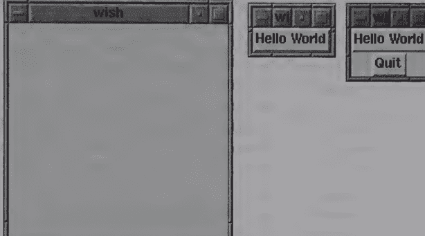

**图 15.1** 启动 `wish` 以及在执行第一次和第二个 `pack` 命令后的 `wish` 窗口。

现在来简单谈一下 `wish`，它是 Tcl 或 Tk 扩展的 shell 程序。`wish` 只能在 X 环境下启动。它启动后会立即显示一个标题为“Wish”的空窗口。现在你可以像在 `tcl` 中一样输入命令，也就是说上面显示的所有示例在 `wish` 中显然同样有效。然而，当你开始使用 Tcl 扩展时，事情就会变得非常有趣了。

在下面的示例中，通过键盘命令定义了一个按钮。该按钮唯一的属性是文本“Hello World”。结果是，该命令提供了新 X 元素的名称，但尚未显示它。为了显示，必须执行 `pack` 命令。现在按钮出现在 `wish` 窗口中，且窗口缩小到按钮的大小。可以用鼠标点击该按钮，但什么都不会发生（因为按钮没有被分配任何可以执行的命令）。

```
% wish
% .first_button -text "Hello World"
% .first_button
% pack .first_button
```

这两个命令定义了另一个按钮。该按钮被分配了文本“Quit”和命令 `exit`。当你点击这个按钮时，`wish` 就会终止（因为执行了 `exit` 命令）。

```
% button .another_button -text "Quit" -command exit
.another_button
% pack .another_button
```

## 你的第一个 Tcl 程序

在对这两个 shell 进行实验时，你会注意到键盘支持和操作的便捷性并不十分突出。原因在于，这些 shell 设计初衷更多是为了执行文件，而不是为了交互式工作。这些 shell 文件包含了 Tcl 或 Tk 程序的程序代码。

Tcl/Tk 文件的开头可能以 `#!/usr/bin/tcl` 或 `#!/usr/bin/tk` 行开头，以便使用正确的解释器（而不是 `bash`）进行执行。在 Tcl 3.6 中，必须明确指定 `wish -f`。

直接指定指向 `tc` 或 `wish` 的路径很容易，但它并不具有可移植性：如果 Tcl/Tk 安装在 `/usr/local` 下，由于 `wish` 的路径错误，shell 脚本的执行将失败。出于此原因，你应该用以下三行开始 Tk 脚本（Tcl 脚本而不是 `wish`）：

```
#!/bin/sh
# 下一行使用 wish 重启 \
exec wish "0" "$2"
```

这三行的效果是该文件名义上由 shell `sh` 执行（在 LINUX 下，这通常是 `bash`）。`exec` 命令启动 `wish` 并文件名 `$0` 和参数 `$2` 传递给它。优点是，无论 `wish` 安装在哪里，它都能找到（只要该目录包含在 `PATH` 环境变量中）。

`wish` 认为前三行是开始标记，从第四行开始执行。由于 `\` 的存在，该行被视为第二行的延续，因此在 Tcl/Tk 中是注释。然而，对于 `sh` 和 `bash` 来说，第三行是一条普通的指令。

接下来的行显示了第一个 Tk 程序 `webbrowser` 的代码。该程序显示“Hello World”按钮。点击此按钮会导致程序终止。在你用编辑器编写并存储代码后，必须使用 `chmod +x tkhelloworld` 将文件标记为可执行。然后你就可以测试该程序了。

```
#!/bin/sh
# 下一行使用 wish 重启 \
exec wish "0" "$2"

# tkhelloworld -- 第一个 Tcl/Tk 程序
button .text "Hello World" -command exit
pack .hello
```


## 版本

在编写本文时，`Tcl` 的 `7.4` 版本和 `Tk` 的 `4.0` 版本在 Linux 可用。所有示例程序都已通过这些版本进行了测试。然而，beta 版本 `7.5` 和 `4.1` 已经存在，但未被考虑在内。当这本书到达你的书店时，这些新版本可能已经以最终版本发布。

## 版本 7.4/4.0

关于当前版本与之前的版本 `7.3/3.6` 相比的一些新特性：`Tcl` 的变化相对较少（主要是错误修复）。`Tk` 的最大进展是为光标和其他

功能键提供了默认绑定


——换句话说，文本字段中的光标键现在可以直接使用了。引入了新的通信机制用于滚动条和其他控件之间的通信，但旧机制仍受支持。列表字段的功能得到了扩展；特别是现在可以多选不连续的列表条目。`geometry` 选项不再支持，取而代之的是 `width` 和 `height` 选项。通过 `image` 命令，可以在大多数控件中管理和部署图片（位图）。

## 版本 7.5/4.1

大部分预期的变化源于为了让 `Tcl/Tk` 同样适用于 Macintosh 以及 PC（Windows 3.1/95/NT 下）的努力。变化涉及文本文件的处理（行尾字符）……（此处省略重复的文本描述）……

## 示例程序和在线帮助

说服自己相信 `Tcl/TkPower` 的最快最简单的方法是运行大量的程序。每个示例都位于 `/usr/lib/tk/demos`。最有趣的是 `widget` 程序：它的多个菜单项指向了包含 `Tk` 不同元素的窗口。

关于 `Tcl/Tk` 的文档有几个来源可以获取：`man tcl` 和 `man wish` 在所有 shell 中提供了相当简短的信息。此外，还有所有 `Tcl`、`Tk` 命令的无数页面。同样的文本也通过图形系统 `tkhelp` 显示，它要容易下载得多。`tkhelp` 是扩展 `Tcl/Tk` 的一部分，只有在安装了 `Tcl/Tk` 扩展时可用。

# TCL 语言元素 543

可以在网上找到更多信息：你还可以找到 Brent Welch 编写的 `Tcl/Tk` 书籍初级版本（PostScript 格式）。更多在线资源列在 `faq-faq-bib` 中。关于 `Tcl/Tk` 的最新消息可以从 `comp.lang.tcl` 新组获取。

```
ftp://ftp.neosoft.com/pub/tcl/docs
ftp://ftp.smli.com/pub/tcl/docs
http://www.NeoSoft.com/tcl/resource-tree
```

# 15.2 Tcl 语言元素

本节介绍了 `Tcl` 最重要的语言元素：命令的执行、替换机制、变量管理、循环、分支、用户定义过程、列表处理、字符字符串等。即使你将 `Tcl` 结合 `Tk` 主要用于界面界面编程，也无法绕过这些基础知识。不过，这一基础部分已限制到最低，并且显然没有描述 `Tcl` 的所有语言元素。

在 `Tcl` shell 中可以执行的示例以字符 `%` 为前缀。该字符不会出现在结果中，也不会出现在跨多行的命令中。例如：当执行命令 `set x 3` 时，shell 返回变量赋值的结果 `(3)`。为了你自己亲自验证该示例，你必须先执行命令 `tsh` 来启动 `Tcl` shell。

```bash
% set x 3
3
```

在 `Tcl` shell 中，你不能使用光标键。如果你按错了某个键，必须按 `Ctrl-D` 终止输入并从头重新输入整行。

# 命令与注释

基本上，`Tcl` 遵循以下规则：每行一个命令。当命令之间用分号隔开时，允许每行有多个命令。在这种情况下，除最后一个命令外的所有输出都将被抑制。当行尾用 `\` 表示或当用大括号形成块时（例如在循环或分支中），允许命令跨行显示。

```bash
% set x 1; set y 2
foreach x "a b c" {
  puts $x
}
```

# 544 X 下的 TCL/TK 编程

以 `#` 字符头的行被视为注释。然而，与 `bash` 有一个重要的区别：你不能在任何命令的末尾添加注释，如下例：

```bash
expr 2+3 # expr evaluates expressions
syntax error in expression "2+3 # expr evaluates expressions"
```

这种限制可以通过在 `#` 前面放置一个分号来轻松绕过。这会导致 `Tcl` 将注释视为一个新命令。

```bash
% expr 2+3 ;; expr evaluates expressions
5
```

# 替换机制

`Tcl` 读取要处理的命令，一次性执行所有替换，并开始处理结果。`Tcl` 有三种替换机制：

- 变量替换：`$name` 被替换为变量的内容。
- 命令替换：`[command]` 被替换为命令的内容。
- 反斜杠替换：`\character` 被替换为相应的特殊字符。在 `Tcl` 中，反斜杠的使用比 `bash` 稀少得多，因为特殊字符要少得多。

可以通过大括号防止自动替换、阻止评估，并可以使用所有特殊字符。当字符字符串包含特殊字符、表达式不立即求值时（例如循环中的条件，必须在每次循环时重新求值）等情况下，必须始终使用大括号。在下面的示例中，括号是必要的，否则 `Tcl` 将解析字符字符串且不知道该如何处理新字符串 `"ab < cd"`。

```bash
% expr "ab < cd"
syntax error in expression "ab < cd"

% expr {"ab < cd"}
1
```

引号有其自身的含义：它们确保整个表达式被视为一个单元。没有方法限制替换机制。在示例中，引号确保整个表达式被视为一个单元。

Wait, let me re-read the source text carefully: "Quotes have their own meaning: they ensure that the entire expression is considered as one unit. There is no way restricts the substitution mechanisms. In the example, the brackets are necessary otherwise...". 

Actually, the source text provided in the prompt seems to have some garbled/repetitive phrases or errors. Let me re-translate that section carefully:

可以通过大括号防止自动替换，阻止评估，并可以使用所有特殊字符。当字符字符串包含特殊字符、表达式不立即求值时（例如循环中的条件，必须在每次循环时重新求值）等情况下，必须始终使用大括号。在下面的示例中，括号是必要的，否则 `Tcl` 将解析字符字符串且不知道该如何处理新字符串 `"ab < cd"`。

```bash
% expr "ab < cd"
syntax error in expression "ab < cd"

% expr {"ab < cd"}
1
```


# TCL 语言元素

可以在网上找到更多信息：你还可以找到 Brent Welch 编写的 `Tcl/Tk` 书籍初级版本（PostScript 格式）。更多在线资源列在 `faq-faq-bib` 中。关于 `Tcl/Tk` 的最新消息可以从 `comp.lang.tcl` 新组获取。

```bash
```


## 15.2 Tcl 语言元素

可以在网上找到更多信息：你还可以找到 Brent Welch 编写的 Tcl/Tk 书籍初级版本（PostScript 格式）。更多在线资源列在 `faq-faq-bib` 中。关于 Tcl/Tk 的最新消息可以从 `comp.lang.tcl` 新组获取。

- `ftp://ftp.neosoft.com/pub/tcl/docs`
- `ftp://ftp.smli.com/pub/tcl/docs`
- `http://www.NeoSoft.com/tcl/resource-tree`

本节介绍了 Tcl 最重要的语言元素：命令的执行、替换机制、变量管理、循环、分支、用户定义过程、列表处理、字符字符串等。即使你将 Tcl 结合 Tk 主要用于界面编程，也无法绕过这些基础知识。不过，这一基础部分已限制到最低，并且显然没有描述 Tcl 的所有语言元素。

在 Tcl shell 中可以执行的示例以字符 `%` 为前缀。该字符不会出现在结果中，也不会出现在跨多行的命令中。例如：当执行命令 `set x 3` 时，shell 返回变量赋值的结果 `(3)`。为了你自己亲自验证该示例，你必须先执行命令 `tsh` 来启动 Tcl shell。

```bash
% set x 3
3
```

在 Tcl shell 中，你不能使用光标键。如果你按错了某个键，必须按 `Ctrl-D` 终止输入并从头重新输入整行。

### 命令与注释

基本上，Tcl 遵循以下规则：每行一个命令。当命令之间用分号隔开时，允许每行有多个命令。在这种情况下，除最后一个命令外的所有输出都将被抑制。当行尾用 `\` 表示或当用大括号形成块时（例如在循环或分支中），允许命令跨行显示。

```bash
% set x 1; set y 2

foreach x "a b c" {
  puts $x
}
```

### 注释

以 `#` 字符开头的行被视为注释。然而，与 `bash` 有一个重要的区别：你不能在任何命令的末尾添加注释，如下例：

```bash
expr 2+3 # expr evaluates expressions

syntax error in expression "2+3 # expr evaluates expressions"
```

这种限制可以通过在 `#` 前面放置一个分号来轻松绕过。这会导致 Tcl 将注释视为一个新命令。

```bash
% expr 2+3 ;; expr evaluates expressions

5
```

### 替换机制

Tcl 读取要处理的命令，一次性执行所有替换，并开始处理结果。Tcl 有三种替换机制：

- 变量替换：`$name` 被替换为变量的内容。
- 命令替换：`[command]` 被替换为命令的内容。
- 反斜杠替换：`\character` 被替换为相应的特殊字符。在 Tcl 中，反斜杠的使用比 `bash` 稀少得多，因为特殊字符要少得多。

可以通过大括号防止自动替换、阻止评估，并可以使用所有特殊字符。当字符字符串包含特殊字符、表达式不立即求值时（例如循环中的条件，必须在每次循环时重新求值）等情况下，必须始终使用大括号。在下面的示例中，大括号是必要的，否则 Tcl 将解析字符字符串且不知道该如何处理新字符串 `"ab < cd"`。

```bash
% expr "ab < cd"

syntax error in expression "ab < cd"

% expr {"ab < cd"}

1
```

引号有其自身的含义：它们确保整个表达式被视为一个单元。没有方法可以限制替换机制。在示例中，大括号是必要的，否则 Tcl 将解析字符字符串且不知道该如何处理新字符串 `"ab < cd"`。


# 引号与替换机制

引号有其自身的含义：它们确保整个表达式被视为一个单元。没有方法可以限制替换机制。在示例中，大括号是必要的，否则 `Tcl` 将解析字符字符串且不知道该如何处理新字符串 `"ab < cd"`。

# TCL 语言元素 543

可以在网上找到更多信息：你还可以找到 `Brent Welch` 编写的 `Tcl/Tk` 书籍初级版本（`PostScript` 格式）。更多在线资源列在 `faq-faq-bib` 中。关于 `Tcl/Tk` 的最新消息可以从 `comp.lang.tcl` 新组获取。

```
ftp://ftp.neosoft.com/pub/tcl/docs
ftp://ftp.smli.com/pub/tcl/docs
http://www.NeoSoft.com/tcl/resource-tree
```

## 15.2 Tcl 语言元素

本节介绍了 `Tcl` 最重要的语言元素：命令的执行、替换机制、变量管理、循环、分支、用户定义过程、列表处理、字符字符串等。即使你将 `Tcl` 结合 `Tk` 主要用于界面编程，也无法绕过这些基础知识。不过，这一基础部分已限制到最低，并且显然没有描述 `Tcl` 的所有语言元素。

在 `Tcl` shell 中可以执行的示例以字符 `%` 为前缀。该字符不会出现在结果中，也不会出现在跨多行的命令中。例如：当执行命令 `set x 3` 时，shell 返回变量赋值的结果 (`3`)。为了你自己亲自验证该示例，你必须先执行命令 `tsh` 来启动 `Tcl` shell。

```bash
% set x 3
3
```

在 `Tcl` shell 中，你不能使用光标键。如果你按错了某个键，必须按 `Ctrl-D` 终止输入并从头重新输入整行。

## 命令与注释

基本上，`Tcl` 遵循以下规则：每行一个命令。当命令之间用分号隔开时，允许每行有多个命令。在这种情况下，除最后一个命令外的所有输出都将被抑制。当行尾用 `\` 表示或当用大括号形成块时（例如在循环或分支中），允许命令跨行显示。

```bash
% set x 1; set y 2
foreach x "a b c" {
  puts $x
}
```

以 `#` 字符头的行被视为注释。然而，与 `bash` 有一个重要的区别：你不能在任何命令的末尾添加注释，如下例：

```bash
expr 2+3 # expr evaluates expressions
syntax error in expression "2+3 # expr evaluates expressions"
```

这种限制可以通过在 `#` 前面放置一个分号来轻松绕过。这会导致 `Tcl` 将注释视为一个新命令。

```bash
% expr 2+3 ;; expr evaluates expressions
5
```

## 替换机制

`Tcl` 读取要处理的命令，一次性执行所有替换，并开始处理结果。`Tcl` 有三种替换机制：

- 变量替换：`$name` 被替换为变量的内容。
- 命令替换：`[command]` 被替换为命令的内容。
- 反斜杠替换：`\character` 被替换为相应的特殊字符。在 `Tcl` 中，反斜杠的使用比 `bash` 稀少得多，因为特殊字符要少得多。

可以通过大括号防止自动替换、阻止评估，并可以使用所有特殊字符。当字符字符串包含特殊字符、表达式不立即求值时（例如循环中的条件，必须在每次循环时重新求值）等情况下，必须始终使用大括号。在下面的示例中，大括号是必要的，否则 `Tcl` 将解析字符字符串且不知道该如何处理新字符串 `"ab < cd"`。

```bash
% expr "ab < cd"
syntax error in expression "ab < cd"
% expr {"ab < cd"}
1
```

引号有其自身的含义：它们确保整个表达式被视为一个单元。没有方法可以限制替换机制。在示例中，大括号是必要的，否则 `Tcl` 将解析字符字符串且不知道该如何处理新字符串 `"ab < cd"`。

## 预定义变量

`Tcl` 有一些定义的变量：`argv` 包含运行的 `Tcl/Tk` 程序的名称（在交互式工作时为 shell 名称）。`argv` 包含包含所有传递给程序的参数的字符串，而 `argc` 包含参数的数量。`env` 是一个数组，可以通过它访问环境变量（例如 `$env(PATH)`）。

下面的示例无法直接执行。它是一个用编辑器编写的“真实”`Tcl` 程序。该程序显示预定义变量的内容。数组名称命令决定了数组已知索引的数量，`array size` 则是这些索引名称的列表。

```bash
#!/bin/sh

# 下面一行使用 tsh 重新启动 \
exec tcl "$0" "$"

# var: 显示所有预定义变量

puts "$argv was passed $argc parameters":

for (set i=0; $i<$argc; incr i++) {
	puts "Parameter ${Expr $i+1}: [Index $argv $i]"
}

puts "$argv knows the following Array size $env environment variables":

puts [array env]
```

在用 `chmod a+x var` 将此文件标记为可执行后，你可以测试程序：

```bash
% var a b c

./var passed 3 parameters:

Parameter 1: a

Parameter 2: b

Parameter 3: c

./var knows the following 21 environment variables:

MANPATH HOME LOGNAME MAIL MINICOM BAS TERM HOSTYPE SHELL SHVL

OPENWHIMHOMELESSCHARSET TASTYPE PS1 PATH PS2 ignorenoef _ LESS HOSTNAME
```

## 字符串

`Tcl` 是一种相对新的编程语言，这在字符串上有所体现。任何字符都可以存储在字符串中，包括外语字符。`Tcl` 拥有大量的字符串处理命令。这些命令中的大部分由两个关键字组成：`string` 定义命令类型，另一个关键字（如 `length`）指定具体的函数。下面的示例展示了基础命令。

```tcl
% set s "abcdef fghij"

abcdef fghij
```

### 548 X 环境下的 TKL/TK 编程

```tcl
# string length $s      # 字符串的长度

11

# string range $3 $7      # 第 3 到第 7 个字符（从0开始计数！）

de fg

# string toupper $s    # 转换为大写字母

ABCDE FGHJ
```

注意范围内的字符位置始终从 0 开始（第一个字符）。正如预期的那样，有一个 `toupper` 的补充命令：`tolower`。这两个命令只改变普通的 `ASCII` 字符，而保持外语字符不变。对于输入处理，`trim` 命令非常有用，它可以消除字符串首尾的空格。

多个字符串的拼接是繁琐的：字符串必须转换为列表并使用 `join` 将它们连接。使用 `join` 时，必须指定一个可选参数以防止在各个字符串之间插入空格：

```tcl
# join list "ab" "cd"

abcd
```


Tcl 提供了多种比较字符串的方法。可以使用操作符 `==`、`!=`、`>` 进行直接比较。整个比较必须括在花括号中，否则 Tcl 会将整个表达式（即要比较的两个字符和比较运算符）视为一个字符串。

```tcl
# expr "ab" < "cd"      # 直接比较
1
# expr "ab" == "cd"
0
```

字符串匹配的比较机制稍微复杂一些。在这里，可以在比较模式中使用类似于文件名的通配符（例如 `*`、`[abc3]`）。该命令也返回 0 或 1 作为结果。请注意，你必须先指定模式，然后是字符串！

```tcl
# string match "*a*d" "abcd" # 如文件名中的通配符
1
# string match ".*cd" "abab"
0
```

通过 `regexp` 命令，Tcl 还可以处理正则表达式。在这里，如果不区分大小写，可以使用 `-nocase` 选项。在模式中，所有为 grep 描述的通配符都可以此使用（见第 271 页）。当指定了一个额外的可选变量时，Tcl 使用它来存储匹配模式的子字符串。

```tcl
# regexp {\[abc]*} "abab" # 如 grep 中的通配符
1
# regexp {\[abc]+\} "dabdac" x # 找到第一个子字符串 -> x
1
# set x
ab
```

## TCL 语言元素 549

当模式的一部分被括在圆括号中，Tcl 将相应的子字符串写入进一步的可选变量中。

```tcl
% regexp ((.+)x(.+)) "abcde" x y z
1
% puts [format "%s %s %s $s $sz]
abcde cd
```

Tcl 将字符串和列表作为单元传递。这有时会导致复杂问题，即另一个命令期望多个独立的字符串。这在调用 LINUX 命令时通常是如此。显示这一点最简单的方法是使用示例：

第一个命令将一个包含当前目录下所有文件名的字符串存储在变量 `x` 中。然后将其作为参数传递给 `ls` 命令。该命令产生了一个错误信息，因为文件名 "test1 test2" 不存在（实际上，我们处理的是两个文件）。

```tcl
# set x [ls]
# ls: cannot access 'test1 test2': No such file or directory
```

## 550 X 环境下的 TCL/TK 编程

### 变量的输出

另一个可以显示变量的命令是 `echo`。然而，`echo` 不是 Tcl 命令，而是外部命令。由于这个原因，它比 `puts` 慢。

由于示例到目前为止都在 Tcl shell 中执行，每个命令的结果直接显示。因此，使用 `puts` 就可以提供结果。

### 列表

Tcl 几乎所有内容内部都被解释为列表——尽管你可能没有注意到。因此，命令和参数被视为列表。每个包含空格的字符串都可以被解释为列表。接下来的两个命令显示 'ab cd' 既是一个五个字符的字符串，也是一个两个元素的列表。在前两个示例中，可以使用引号代替花括号。

```tcl
% string length (ab cd)    # 字符数量
5
% length (ab cd)      # 元素数量
2
```

处理列表最重要的命令是 `index`。它读取第 n 个列表元素（第一个元素的索引为 0）。`L` 搜索列表并产生其索引。`concat` 将列表合并为一个单一列表。

```tcl
% set l (ab cd ef gh)
ab cd ef gh
% index $l 2      # 2 意味着第三个列表元素
ef
% search $l e2      # search 允许模式
% concat (a b) c (d e)
ab c d e      # concat 合并列表
```

`split` 和 `join` 促进了字符串与列表之间的转换。`split` 将字符串分为若干部分（列表元素）。`join` 重新组合这些部分并插入一个分隔符

# TCL 语言元素 551

```tcl
% split ab.cd.ef . # 将字符字符串分割为列表元素
ab cd ef
% join (ab cd ef) - # 将元素合并为字符字符串
ab_cd_ef
```

在上面的示例中，列表是通过直接在花括号中列举元素来构建的。当元素需要从变量获取时，这种方法不可用。在这种情况下，可以通过 `list` 命令来构建列表。

```tcl
% set x "part 1"; set y "part 2"
part 2
% set l [list $x $y] # 包含两个字符字符串的列表
(part 1) (part 2)
% lindex $l 0 # 访问第一个列表
part 1
```

# 分支

用于构建分支最常用的命令是 `if`。其语法从下行可以显而易见。`elseif` 和 `else` 块是可选的。允许任意数量的 `elseif` 块。请注意，没有 `fi` 或 `endif`——由于花括号，`if` 结构的结束已经明确标记了。检查相等性的运算符是 `==`（不是 `=`）。

```tcl
if <condition> <commands> {elseif <cond> <commands>} {else <commands>}
```

下面的示例检查变量 `x` 的内容是否小于 5。因此，变量加 1 并显示在屏幕上。

```tcl
% set x 3
3
% if {$x<5} {incr x puts $x}
4
```

复杂的多个分支可以使用 `switch` 比 `if` 更优雅地构建。`switch` 的语法如下：

```tcl
switch <option> char_string {pattern1 <commands> pattern2 <commands>}
```

选项指定了如何将字符字符串与模式进行比较。候选项有 `-exact`（精确比较）、`-glob`（作为文件名的通配符）或 `-regexp`（类似于 grep 的通配符）。默认设置为 `-exact`。下面的示例展示了该命令的应用：

```tcl
% set x abc
abc
% switch -glob $x {* (puts "Variation A")
b* (puts "Variation B")
* (puts "neither")}
变体 A
```

# 循环

Tcl 有三个用于构建循环的命令：`while`、`foreach` 和 `for`。下行总结了它们的语法。

```tcl
while {condition} {commands}
foreach variable {list} {commands}
for {init} {condition} {next} {commands}
```

最简单的变体是 `while`。循环体中的命令在条件为真时一直执行。

```tcl
% set x 0
0
% while {$x<3} incr x; puts $x
1
2
3
```

`foreach` 将列表中的元素一个接一个插入循环变量中，然后执行指定的命令。

```tcl
% foreach x {this is a list} puts $x
this
is
a
list
```

`for` 执行第一对括号中包含的命令。满足循环条件后，执行第四对括号中的命令（循环体），然后执行第三对括号中的命令（修改循环变量）。该语法显示出与 C 语言的 `for` 命令的相似之处，这解释了参数顺序奇怪的原因。

```tcl
% for {set x 1} {$x<3} incr x; puts $x
1
2
```

在所有三种循环类型内部，都可以使用 `continue` 和 `break`。`continue` 跳过循环体剩余的命令并继续循环。`break` 终止循环。

# 过程

使用 `proc` 命令，你可以定义自己的过程。语法如下：

```tcl
proc name {parameter_list} {commands}
```

在过程内部，可以使用 `return` 退出过程（如果需要，可以提前退出）并指定返回值。过程也可以调用自己（递归）。

下面的示例定义了 `swap` 过程。该过程必须传递两个参数。该过程可以像 Tcl 命令一样使用，并按反序返回参数。

```tcl
% proc swap (a b) (return [list $b $a])
% swap 2 3
```

过程内部的所有变量都被视为局部变量。外部的变量可以通过 `global` 关键字声明。

```tcl
% set x 3
3
```


# 过程与变量作用域

```tcl
% proc test {}global; set x 5

% test

% x 5
```

为了允许过程修改变量，可以使用`upvar`命令在过程内部创建一个变量，该变量与外部变量关联。`upvar`命令会稍微澄清这一点。`upvar`命令可以增加变量的值。在示例中，`upvar`定义了一个变量。在定义过程时，可选参数可以带有默认值。接下来的示例显示了这种用法。现在可以使用不同的值调用`incr`。

```tcl
% set a 3

3

% incr {step} {upvar a myx; set myx}
```

# TCL/TK 编程

在定义过程时，使用`args`关键字表示可选参数。在过程内部，`args`包含了参数列表。

```tcl
proc test args (puts "$args")
foreach i $args (puts "$i")
a b c
```

# 文件处理

当前目录可以通过`pwd`读取，通过`cd`更改。`glob`命令执行通配符扩展。当`glob`结束时，它只提供名称。

```tcl
% pwd ;; current directory

/home/bookdat/tcltk

% cd ;; change directory

% puts * ;; list of files

% puts [lsort *] ;; sorted list
```

将`glob`确的文件列表传递给 Tcl 命令需要使用`eval`。否则，Tcl 会传递整个文件字符串。

```tcl
% ls -l *
is: tcltk/ bash/ emacs/: No such file or directory
child exists abnormally
% eval -ld *
drwxr-xr-x 2 users 1024 5 07 bash/
drwxr-xr-x 2 root root 1024 5 22 emacs/
drwxr-xr-x 2 users 1024 3 19:14 latex/
drwxr-xr-x 4 root root 1024 22:41 print/
drwxr-xr-x 2 users 1024 7 08:53 tcltk/
```

关于单个文件的各种信息由`file`命令提供，该命令必须跟一个第二个关键字。下面的示例显示了一些可能的应用（另见`file`）。

```tcl
% set f /usr/bin/tclsh
/usr/bin/tclsh
% file exists $f ;; does the file name exist?
% file size $f ;; file size
```

```tcl
% file dirname $f ;; path
/usr/bin
% file tail $f ;; name
tclsh
% file isfile $f ;; is it a regular file?
% file directory $f ;; is it a directory?
% file executable $f ;; is the file executable?
```

Tcl 的文件访问命令面向 C 语言。下表总结了重要命令的语法：

| 命令 | 描述 |
| :--- | :--- |
| `open file_name access_mode` | 提供 ID |
| `gets ID var` | 读取行；字符数 |
| `read ID number` | 读取 n 个字符；结果：数据 |
| `puts [-newline] ID` | 写入一行 |
| `tell ID` | 提供文件指针的位置 |
| `seek ID` | 更改文件指针的位置 |
| `eof ID` | 检查是否到达文件末尾 |
| `flush ID` | 存储缓冲区 |
| `close ID` | 终止访问 |

当你需要从文件中读取数据或写入数据时，必须使用`open`与该文件建立连接。`open`为该文件提供一个标识符，后续所有命令都必须指定。`close`终止对该文件的访问。

在执行`open`时，必须指定访问模式。允许六种变体（`r`是默认设置）：

| 模式 | 描述 |
| :--- | :--- |
| `r` | 读访问；文件必须存在 |
| `r+` | 读写访问；文件必须存在 |
| `w` | 写访问；现有文件会被删除 |
| `w+` | 读写访问；否则如上 |
| `a` | 写访问；文件指针指向文件末尾（追加） |
| `a+` | 读写访问；否则如上 |

通过`seek`，你可以修改文件内部的文件指针（例如，再次读取数据）。`tell`提供文件指针当前的位置。

## 556 X 下的 TCL/TK 编程

以下微程序`cpupper`用于复制一个文本文件，并将所有小写字母替换为大写字母。

```sh
#!/bin/sh
# the next line restarts using tcl \
exec tsh "$0" "$@"
# cpupper: copies text files converting all lower case letters into upper case letters
if ($argc != 2) {
    puts "Error: cpupper source_file target_file"
    set source [lindex $argv 0]
    set target [lindex $argv 1]
}
while [eof $source] {
    gets $source data
    puts [string upper $data]
}
close $source; close $target
```

## 命令执行的语法变体

前述的`eval`命令用于解释并执行作为命令的字符字符串。`eval`的一个重要应用是解析包含多个表达式的字符字符串，并将它们逐个传递给程序：`eval ls [glob *]`，第 554 页。另一个应用如下例所示：

```tcl
set x "expr 2+3"
expr 2+3
eval $x
```

使用`source`命令，可以将包含 Tcl 程序代码的文本文件读取到当前运行的 Tcl 程序中。这些指令的执行方式就像它们直接作为运行程序代码的一部分一样。

`exec`执行 LINUX 命令。`exec`将所有输出以字符字符串的形式传递给标准输出，删除最后一个换行符，以使字符串与 Tcl 命令的结果对应。

```tcl
set x [exec ls] ; executes ls and stores the result in x
cpupper
tkhelloworld
testexec
var
```

在操作 Tcl 壳（shell）时，你也可以不使用`exec`直接执行所有 LINUX 命令。这可能让人认为这也适用于 Tcl 程序。然而，事实并非如此。当你想要在 Tcl 程序中调用`ls`时，必须使用`exec`！

在传递给`exec`的字符字符串中，允许使用 bash 中已知的许多输入输出重定向运算符。然而，它们存在差异（特别是`<<`）以及新的运算符。下表总结了这些可能性：


## TCL 示例程序：DOS HOWTOS

- `>` 将标准输出重定向到指定的文件
- `>>` 将输出追加到文件
- `2>` 将错误消息重定向到指定的文件
- `>&` 将输出和错误消息合并重定向
- `>|` 重定向到由 Tcl 打开的文件（ID 由`open`提供的）
- `<` 从文件读取标准输入
- `<ID` 从由 Tcl 打开的文件读取标准输入
- `<data` 将数据直接前传给程序

Tcl 程序可以在任何时间通过`exit`终止。可以向`exit`传递一个返回值（数字，而不是字符字符串）。当程序按正常方式终止时，应返回 `0`（这也是默认值）。错误通过非零值信号。

另一种可能性是使用`error`终止程序。该命令将文本写入标准错误（通常是屏幕），然后终止程序。

## 15.3 Tcl 示例程序：DOS HOWTOS

随附 CD-ROM 中的`dosdoc/html`目录包含大量的`.htm`文件，包含了所有可用的 LINUX HOWTO 文本。这些文件的特殊之处在于它们遵循 DOS 命名规范（8 3 字符制）。你可以在安装 LINUX 之前在 Windows 下读取 HOWTO 文本（前提是你拥有 WWW 浏览器）。

这些 DOS HTML 文件是用本节描述的`htmlto2dos` Tcl 程序生成的。最大的问题不是生成带有短名称的新文件；文本中所有对这些文件的交叉引用也必须更改。


原则上，该程序的工作原理如下：为所有的 `*.htm` 文件生成短名称的 `*.htm` 文件。基于这些文件创建 bash 脚本 `tmp.convert`，它之后将使用 `sed` 从旧的 `*.htm` 文件生成新的 `*.htm` 文件。同时，生成一个名为 `sedcmd` 的文件，其中包含长长的搜索和替换命令列表。这些命令稍后将在执行 `sed` 时使用。

对于子目录 `mini` 中的 Mini-HOWTOs，采用了略有不同的步骤：这些是纯 ASCII 文件（不含 HTML）。这些文件获得带有 `*.txt` 扩展的新名称（以便在 Windows 下作为文本文件被唯一识别）。这次，没有在 `tmp.convert` 中插入 `sed` 命令，而是插入了 `todos` 命令，以便新文件具有兼容 DOS 的行结束。

在创建 `tmp.convert` 和 `sedcmd` 后（这需要很短），启动 `tmp.convert`。该程序现在处理所有指定的 `sed` 或 `todos` 命令。（由于 `sed` 命令文件的长度，这需要相当长的时间。）

## 程序代码

`htmlhowto2` 开始定义过程 `replaceSpecialChars`，对于作为参数传递的字符字符串中的每个字符，检查其是否为字母或数字。如果是其中一种，则字符保持不变，否则将其替换为 `_`。这确保了新文件名符合 DOS 规范且不包含任何特殊字符。

```sh
#!/bin/sh
# the next line restarts using tcl \
exec tclsh "0" "$"
# htmlhowto2dos: 将 *.html 文件重命名为 *.html
# 文件名缩短为 8+3 字符
# 对所有原始 *.html 的引用进行查找和替换

# 用法: htmlhowto2dos path
# path 必须指向包含 *.html 的目录
# path/mini 必须存在并包含至少一个文件 (mini-HOWTO)

# 通过 "" 交换文件名中的特殊字符的过程
# 例如：replaceSpecialChars "a&b&c" 返回 "a_b_c"

proc replaceSpecialChars { s } {
	set s [string lower $s]
	set newname=""
	set nrofchars [length $s]
	# 遍历每个字符
	for {set i 0} {$i < $nrofchars} {incr i} {
		set c [string range $s $i $i]
		if {[regexp [a-z0-9] $c]} {
			set newname [join $newname "$c"]
		} else {
			set newname [join $newname "_"]
		}
	}
	return $newname
}
```

主程序在过程定义后开始：首先，它检查程序是否恰好传递了一个参数（`*.html` 的路径）。如果是，则将该目录设置为当前工作目录。在第一个循环中，处理所有的 `*.html` 文件。`HOWTO-INDEX.html` 被单独考虑并重命名为 `00index.html`。文件名的前 6 个字符被提取，并根据两位数字数字接到 `.htm` 扩展后面。数字是由循环变量 `i` 确定的。

```sh
# 开始主程序
# 我们期望一个包含路径的参数
if { $argc != 1 } {
    puts "usage:htmlto2dos path"
    exit
}

# 进入目录
cd [argv 0]

# 打开 sed 命令文件和转换脚本
set sedfile [open temp.sedcmd w]
set cnvfile [open temp.convert w]
puts $sedfile "!/bin/sh

#  *.html 的第一个循环
# 所有的参数（应该是 *.html）
set i 0
foreach filename [glob *.html] {
    # 生成短名称文件名
    if {$filename=="HOWTO-INDEX.html"} {
        set newname="00index.html"
    } else {
        set number [format "%02d" [expr $i % 100]]
        set head [string range $filename 0 5]
        set head [ReplaceSpecialChars $head]
        set newname [join $head $number ".htm"]
    }
    # 构建用于执行每个文件的 sed 的 shell 脚本
    puts $sedfile "$newname"
    puts $cnvfile -f temp.sedcmd $filename $newname
    # 构建 sed 命令文件
    puts $sedfile "s/$filename/$newname/"
    incr i
}
```

主程序处理 `mini` 子目录中文件的第二部分看起来类似。`sed` 命令使用 `:`（而不是 `/`）来构建，以确保文件中的字符被正确解释。对于文本本身，不需要调用（因为文件不包含对其他文件的引用）；相反，使用 `todos` 用回车和换行符结束行，这符合 DOS 标准。（如果你的电脑上没有安装 `todos`，该命令包含在随附 CD-ROM 的 `tools/todos` 目录下。）

```sh
# 下一个 mini-/ 下 * 的循环
cd mini
set i 0
foreach filename [glob *] {
    # 生成短名称文件名
    set number [format "%02d" [expr $i % 100]]
    set head [string range $filename 0 5]
    set head [ReplaceSpecialChars $head]
    set newname [join $head $number ".txt" ""]
    # ... (此处逻辑与上文一致)
}
```

```sh
# 在文件名中添加 mini/（即使是 Win-WWW 浏览器也接受 /）

set oldname [join List "mini/" $oldname ]

set newname [join List "mini/" $newname ]
```

```sh
# 构建 shell 脚本为每个文件启动 sed

puts $cnvfile "todos < $oldname > $newname"
```

```sh
# 构建 sed 命令文件

# 我们不能使用 / 作为 sed 的分隔符，因为该字符用于

# 文件名

puts $sedfile "s$oldname$newname"
```

```sh
incr i

}

# 离开 mini 目录

cd ..
```

Tcl 脚本通过关闭临时文件并执行 `tmp.convert` 结束。随后，两个临时文件都会被删除。

```sh
# 关闭文件

close $sedfile

close $cnvfile

#  shell脚本

exec ./chmod u+x tmp.convert

exec ./tmp.convert

# 删除临时文件

exec rm tmp.sedcmd tmp.convert
```

# 临时文件

最后，由 `htmlhtowdos:\tmp.convert` 生成的临时文件的两个片段：它是一个 shell 脚本（用于 bash），其中由一系列 `sed` 和 `todos` 命令组成。

```sh
#!/bin/sh

sed -f tmp.sedcmd Kernel-HOWTO-1.html > kernel00.htm

sed -f tmp.sedcmd Kernel-HOWTO-10.html > kernel01.htm

sed -f tmp.sedcmd Kernel-HOWTO-11.html > kernel02.htm
```

```sh
todos mini/ADSM-Backup > mini/adsm_b00.txt

todos mini/Backup-With-MSDS > mini/backup01.txt

todos mini/Boca > mini/boca02.txt
```

`tmp.sedcmd` 包含很长的 `sed` 和替换命令列表。这就是执行 `htmlhtowdos` 耗时之长的原因。然而，为了正确更改 `*.html` 文件中的所有交叉引用，该列表是必要的。

```sed
s/Kernel-HOWTO-1.html/kernel00.htm/

s/Kernel-HOWTO-10.html/kernel01.htm/
```


## 使用 Tk 进行接口编程

```
s/Kernel-HOWTO-11.html/kernel02.htm/
s~mini/ADSM-Backup~mini/adsm_b00.txt~
s~mini/Backup-With-MSDS~mini/backup01.txt~
s~mini/Boca~mini/boca02.txt~
...
```

### 15.4 使用 Tk 进行接口编程

在开始编写 Tk 编程之前，必须阐明一些基本假设和术语：`Tk` 在窗口中显示你在程序代码中定义的对话元素。对话元素包括按钮、文本字段、滚动条、菜单等。对话元素也被称为控制元素、对象或小部件（`widgets`）（这四个术语是同义的）。对话元素可以被嵌入，以构建相似元素的组或实现特殊的定位需求。

对话的定义分两个步骤完成。首先，你必须通过 `button` 或 `message` 等 `Tk` 命令创建新的对话元素。随后，你必须使用 `pack` 在 `Wish` 窗口中显示这些元素。

`Tk` 程序是事件驱动的。如果你以前从未工作过事件驱动的编程语言，这可能是最大的变化。每个对话元素都可以分配事件过程。每当事件发生时（文本输入、点击按钮等），该事件过程就会被调用。

换句话说：在程序代码生成对话框后，程序的后续运行过程将是不可预见的。它完全取决于程序用户使用了哪些对话元素以及他/她提供了哪些输入。只有在显式执行退出命令时（在某个事件过程或其他地方中），程序才会终止。因此，与 `T` 程序不同，`Tk` 程序在到达程序文件的最后一行时并不会终止！

关于本章剩余结构的简要说明：本节介绍了 `Tk` 编程的通用方面——对话元素的定义、其选项的设置、方法的执行、对话元素在屏幕上的定位、对窗口的控制等。为了阐明这些主题，本节包含许多示例，你也可以在附带的 CD-ROM（`/ttk`）中找到这些示例。最后一节（从第 575 页开始）提供了可用 `Tk` 对象的引用列表，并对最重要的选项和方法进行了总结。


### 第一个示例

以下示例程序很短，但尽管如此它展示了典型 `Tk` 程序的许多特性。首先，程序定义了四个小部件：`.info` 用于包含简要信息文本，`.buttons` 作为两个按钮 `.b1` 和 `.b2` 的框架。第一个 `pack` 命令将信息文本和框架上下排列（这是 `pack` 对对象的标准对齐方式）。在第二个 `pack` 命令中，

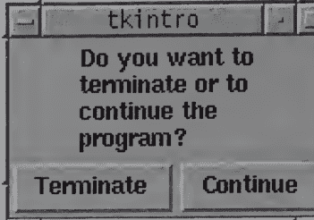

图 15.3 示例程序 `tkintro`。

两个按钮在 `.buttons` 对象内部并排放置。因此，`.buttons` 仅作为两个按钮的容器。

### 接口编程

必须指定选项 `-S 3` 以防止显示来自另一个组的同义文本。

当临时不再需要某个对话框元素时，可以使用 `pack .object` 将其淡出，用 `pack .object` 将其恢复。以后不再需要的对象可以通过 `destroy` 删除。请注意，`destroy` 是一个命令（而不是方法），且不能将对象名称放在前面，而必须将其作为参数指定：

```
pack .t               # 临时淡出对象
pack .t               # 恢复对象
destroy .t             # 确定删除对象
```

### 测量、颜色、字符集

遗憾的是，度量规范缺乏一致性。语法取决于具体的应用程序：在对话框元素的定义中可以指定 `-width` 和 `-height` 选项，设置位于文本的行/列中，且没有任何单位的指示。而对于对象宽度的 `-bd` 选项，则必须指定单位：`-m` 表示毫米，`c` 表示厘米。

`pack` 和 `wm` 命令适用特殊的语法，这些命令将在接下来的小节中进行描述：在 `pack` 中，必须使用单位 `-m` 或 `-c` 来指定测量值。在 `wm` 中，测量值以像素为单位，宽度不带单位。如有疑问，你始终可以通过调用在线帮助来找到合适的语法。

关于颜色的规范，你可以使用 X 下定义的颜色，如白色、红色等（参见文件 `/usr/lib/X11/rgb.txt`）。或者，你也可以使用十六进制 RGB 代码来指定颜色，这表明 `#` 字符必须位于值之前。因此，可能的语法变体有 `#RGB`、`#RRGB`、`#RRRGGBB` 或 `#RRRRGGGBB`，例如 `#00F` 定义了一种深蓝色，`#BBB` 定义的是了一种微妙的灰色。

X 下字符集名称的组成本身就是一门科学。可以通过 `xlfonts` 查看所有字符集的列表。一个典型的 X 字符集名称如下：

```
~adobe-helvetica-bold-o-normal--18-180-75-75-p-104-1iso8859-1
```


在第 570 页，你将找到示例程序 `tkfont`，它允许测试字符集。所有的字符集名称都显示在一个列表字段中。通过双击列表元素，即可选择该字符集进行查看。


# 对话框元素的定位

对话框元素的定位是 `pack` 命令的。该命令与 X 窗口管理器通信，窗口管理器最终负责对象（窗口）的定位。布局器的主要任务是设置所有对象的大小和位置，使得所有对话框元素尽可能完整地显示。

在最简单的情况下，一个对话框由单个对话框元素组成。在这种情况下，可以使用不带任何选项的 `pack`。窗口的大小会自动适应对话框对象。当需要将多个对话框对象放置在窗口的不同位置且窗口大小必须可调时，情况就会变得复杂。

在这种情况下，如果如果不带选项调用 `pack`，对象将简单地一个接一个排列。然而，这在实践中几乎不符合你对布局的想法。为了实现对话框元素更好的排列，必须结合下面描述的选项组合使用 `pack`。

- `-anchor n/s/e/w` 对齐到北（顶）、南、东或西
- `-expand 0/1` 在可用空间内居中对象
- `-fill x/y` 放大对象，使用所有可用空间
- `-superior` 将对象放置在父对象（框架）内部
- `-ipadx/y` 按指定的测量值测量对象
- `-padx/y` 按指定的测量值测量间距
- `-side left/right` 在左/右边缘按侧对齐对象
- `-side up/down` 在顶部/底部边缘将对象上下相互对齐

只有当将对话框元素组合成层级结构时，才能满足许多定位要求。在这里，框架（`frame`）作为其他对象的容器。`pack` 分别考虑每个层级（将其视为我们的一个窗口）。在之前的示例中，这种方法被用于将信息文本和按钮容器上下排列，并将按钮在容器内并排。

`pack` 放置对象的顺序起着重要作用。`pack` 尝试一个一个地满足定位要求——因此，先调用的对象具有优先级。因此，你应该始终先放置需要在给定位置显示的对话框元素（例如，菜单在顶部，按钮在底部），然后再调用 `pack` 填充剩余可用空间的对象（例如，大型文本字段）。

`pack` 也可以用于对现有对象的定位进行后续更改。在这种情况下，语法为：

```
pack configure .object options
```

通常，Tk 窗口的大小由包含在内部的对象的大小严格决定。如果窗口大小是可变的，则必须执行 `wm` 或 `maxsize`（`wm` 将在接下来的小节中描述）。在可调整大小的窗口中，`pack` 选项的作用比固定大小窗口中更为重要，因为


## 568 X 环境下的 TKL/TK 编程

```bash
% bind . <Enter> ". configure -bg red      ; 鼠标进入时变为红色
% bind . <Leave> ". configure -bg green    ; 鼠标离开时变为绿色
% bind . <KeyPress-a> ". configure -bg blue   ; 按键 <a> 时变为蓝色
```

当你将鼠标指针移动到窗口时，它会变为红色；将指针移出窗口时，背景变为绿色。按下 `[A]` 键时，程序会用蓝色背景响应。然而，这仅在窗口激活（即具有输入焦点）时才有效。根据你的窗口管理器的配置，你可能需要点击该窗口。

`bind` 是一个功能非常强大的命令。本节仅总结了最重要的细节。可以通过 `man 3 bind` 获取该程序的完整描述。

`bind` 的效果主要限于一个对话框元素。但是，你可以对整个窗口（对象 `.`）或容器对象执行 `bind`——此时事件过程将适用于其中包含的所有对象。如果指定的不是元素名称而是关键字 `all`，则事件过程将适用于程序的所有对话框元素。`bind` 的语法如下：

```
bind object event command
```

对于事件的规范定义了两种变体：一种是产生 ASCII 字符按键的短表示法，另一种是使用括号 `<..>` 的详细表示法，通过使用不同的关键字可以实现几乎无限的组合。

- `+x` `[X]` 的短形式
- `<modify-type-detail>` 通用语法；`modify` 和 `detail` 是可选的

在这里，`modify` 通常代表状态键（`Shift`, `Control`, `Meta`, `Alt`, `Lock`）和鼠标键（`B1` 到 `B5`）。双击和三击通过 `Double` 和 `Triple` 关键字表示。使用任何一种，你都可以规定给事件对于所有可能的 `modify` 状态组合都是有效的。多个 `modify` 键可以用 `-` 隔开。

`type` 指定事件的类型。最重要的事件类型有：

| Key | 描述 |
| :--- | :--- |
| `KeyPress` | 按键 |
| `KeyRelease` | 释放按键 |
| `ButtonPress` | 按下鼠标键 |
| `ButtonRelease` | 释放鼠标键 |
| `Enter` | 鼠标进入对话框元素 |
| `Leave` | 鼠标离开对话框元素 |
| `Motion` | 鼠标移动对话框元素 |

`detail` 取决于当前的事件类型。对于键盘事件，可以指定 ASCII 字符或 `KeySym` 字符串。（X 内部使用字符串对所有按键和按键组合命名。例如，左方向键被称为 `Left`，`[Home]` 键被称为 `Home`，以此此类推。）


## 使用 TK 进行接口编程 569

可以通过以下程序获取关于 `KeySym` 字符串的信息：`xmodmap -pk` 显示所有字符串的列表。`xev` 打开一个窗口，并显示你在终端窗口中按下的每个键对应的 X 事件。在许多信息项中，你还会找到 `KeySym` 字符串。使用 `xkeysym` 程序更加简单，它会在屏幕上画出一个键盘。当你把鼠标移动到某个键上时，就会显示对应的 `KeySym` 字符串。

`xkeysym` 并不是所有的发行版都提供的。例如，你可以在 `ftp.xorg.org` 的 `contrib/applications` 目录下找到该程序。

对于鼠标事件，你只需指定鼠标键（1 到 3）。请注意，鼠标既出现在 `modify <B1>` 中，也出现在 `type` 和 `detail <Button-1>` 中。这两个字符具有不同的含义。在一种情况下，事件仅在按下左鼠标键时同时被考虑；在另一种情况下，事件是左鼠标键的点击。

多个事件可以组合——用于组合键。语法为 `<event1><event2>`。下表给出了一些事件示例。

| Event | 描述 |
| :--- | :--- |
| `<Key-Left>` | 任意键（功能键除外） |
| `<Shift-Key-Left>` | 左鼠标键点击 |
| `<Control-Key-x><Control-Key-C>` | 按住左鼠标键时的 X |
| `<Any-Key>` | Ctrl 加鼠标右键点击 |
| `<Shift-Button-1>` | |
| `<B1-Key-x>` | |
| `<Double-Control-Button-3>` | |

| Format | 描述 |
| :--- | :--- |
| `%A` | 键盘输入的 ASCII 字符 |
| `%b` | 被按下的鼠标键编号 |
| `%k` | 键盘输入的按键码 |
| `%K` | 键盘输入的 KeySym 字符串 |
| `%x` | 鼠标事件的坐标 |
| `%y` | 鼠标事件的坐标 |

一个非常简短的示例来解释这一点：以下命令定义了在屏幕显示两个参数的 `event` 过程。每当按下左鼠标键并在窗口内时，就会执行该过程。该过程传递了鼠标坐标。此外，在按下任意键（功能键除外），会显示对应的 ASCII 码和 `KeySym` 字符串。


## X 环境下的 TKL/TK 编程 570

```bash
#!/bin/sh
# 下行重新启动 wish \
event focus "$a"
# tktext: 文本字段与滚动条之间的通信
scrollbar .s -command "t view"
text .a -textvariable -height 5 -width 40
pack .side right -fill # 滚动条在右侧
pack .side -fill # 剩余文本字段
```

（注：由于原始文本存在大量重复和乱码，已根据逻辑处理了唯一内容。）

## 572 X下的 TCL/TK编程

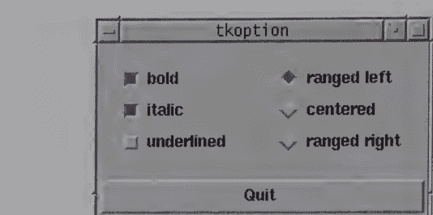

`图 15.7` 左侧的选项组允许多选，而右侧的组仅允许选择一个选项。

在换行符处拆分为列表元素，并逐个输入列表元素中。当双击列表元素时，`bind` 会导致 `.label` 对象的字符集发生变化。

```
#!/bin/sh
```


# `tkfont`：在列表字段中显示所有字符集名称

# 双击时，可以选择一个字符集

```
exec wish "$0" "$@"

frame .f.list -width 60 -height 10 -yscrollcommand .f.scroll

listbox .f.scroll -command ".f.list view" //; Container "set"

label -text "ABCD bÄß 1234" -relief sunken

button .quitbutton -text "Quit" -exit

pack .quitbutton -label -f x -side bottom //; label and below

pack .f-fill -expand 1 //; remaining state: frame

pack .f-scroll -side right -fill y //; in it: scroll bar right

pack .f-list -side left -fill -expand 1 //; js list

wm minimize 100 50 //; window size variable

set sets [xcl xfonts] //; generate list

foreach f [split $fonts \ { //; process line by line

  f.list insert end $f //; insert into list field

bind .f.list -Double-Button-1< // select with double click

  .label configure -font selection } // change font for .label
```

## 选项字段的处理

`Tk` 区分了两种类型的选项：`checkbox`（复选框）创建用于一次选择多个选项的选项字段，而 `radiobutton`（单选框）创建用于选择特定选项的选项（因此，`radiobutton` 的选项互斥）。示例程序 `tkoption` 展示了这两种选项。

程序代码非常直观。两个选项组都放置在 `frame` 中，以便在屏幕上实现清晰的定位。通过 `radiobutton`

## 573 使用 `TK` 进行接口编程

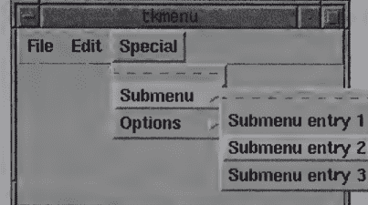

图 15.8 带有下拉菜单的菜单栏。

对象，当选择某个选项时，通过 `-value` 设置要写入变量 `v1` 的值。此外，当点击选项字段时，屏幕上会显示反映变量 `v1` 当前内容的输出。

请注意，此处在 `-command` 选项中指定的命令不能包含在引号内。否则，在执行 `radiobutton` 命令期间，`v1` 将会被替换为它的内容。然而，在此时，`v1` 完全没有被赋值任何值。大括号确保了变量替换只在命令执行时进行。

```
#!/bin/sh

# the next line restarts using wish \

exec "$0" "$2"

tktoption: option fields (checkbox and radiobutton)

frame .fc -bd 5m

frame .fr -bd 5m

checkbox .fc.c1 -anchor w -text "bold"

checkbox .fc.c2 -anchor w -text "italic"

checkbox .fc.c3 -anchor w -text "underlined"

radiobutton .fr.r1 -anchor w -text "left" \
-value left -variable v1 -command (puts $v1)

radiobutton .fr.r2 -anchor w -text "centered" \
-value centered -variable v1 -command (puts $v1)

radiobutton .fr.r3 -anchor w -text "ranged" \
-value right -variable v1 -command (puts $v1)

button .b -text "Quit" -command exit

pack .b -side bottom -fill x

pack .fc -side left -fill expand 1

pack .fc.c1 .fc.c2 .fc.c3 -fill x

pack .fr.r1 .fr.r2 .fr.r3 -fill x
```

## `Tk` 程序中的自定义菜单

在 `Tk` 中，菜单分几个步骤定义：首先，创建一个包含菜单栏的 `frame`。在菜单栏中，排列了几个菜单按钮。点击这些按钮会显示相应的菜单。示例程序 `tkdemo` 展示了如何组装菜单，以及两种特殊情况（子菜单和菜单选项）。

程序列表相当长（与本章中的其他列表相比），但易于理解。首先创建了 `frame` 对象 `.menu`，用于包含菜单标题。标签 `.label` 的唯一任务是填充窗口的其余部分。

随后，创建了三个菜单按钮和关联菜单。使用 `add` 方法将各个菜单插入到最初为空的菜单中。这三个菜单变得非常有趣：它包含两个级联菜单项，这些项指向进一步的菜单对象（即子菜单）。然后，子菜单的管理方式与其他任何菜单都相同。

第二个子菜单 (`.menu.special.m`) 的组成表明，`Tk` 不仅能理解普通的菜单项，而且它还可以处理上一个小节中给出的选项类型。`add separator`

## 通用选项和方法

以下选项适用于本节描述的所有或大部分对话框元素。出于这种原因，它们在此处汇总。大多数选项都有敏感的默认设置。只有当这些默认设置不适用时，才需要指定选项。

- `-activebackground` 颜色
  鼠标悬停在对象上时的背景颜色
- `-activeforeground` 颜色
  鼠标悬停在对象上时的前景颜色
- `-anchor` `n/ne/e/se/s/sw/nw/center`
  对话框元素中文本的对齐方式
- `-background` 颜色或 `-bg` 颜色
  背景颜色
- `-bitmap` 文件名
  在对话框元素中显示的位图文件
- `-borderwidth` `n` 或 `-bd` `n`
  边框宽度（以 `'c'` 或 `'m'` 为单位测量）
- `-disabled` 颜色
  “禁用”状态对话框元素的前景颜色
- `-font` 字符集
  字符集
- `-foreground` 颜色或 `-fg` 颜色
  前景颜色
- `-height` `h`
  所需高度；单位取决于对话框元素
- `-relief` `raised/sunken/flat/ridge/groove`
  围绕对象的框架的设计样式
- `-xs`/`-ys`/`-j`/`-scrollcommand` `"set .scroll_object_name"`
  包含滚动条的通信；执行命令时，会传递包含控制元素细节的四个数值值
- `-text` `"字符字符串"`
  对话框元素中的文本
- `-textvariable` 变量名
  可以从 `$varname` 读取当前文本
- `-underline` `n`
  第 `n` 个字母的下划线（用于菜单中的键盘快捷键）
- `-width` `w`
  所需的宽度；单位取决于对话框元素

虽然有很多常用的选项（上述列表远不完整），但只有一种方法可以适用于所有对象：

- `-object configure` 选项
  更改对象的选项

## `button .button [options]`

按钮用于执行各种操作：显示帮助文本、终止带有“确定”或“取消”的对话框等。

- `-command` `"命令"`
  点击按钮后执行该命令

## `canvas .graphics_field [options]`

图形字段是所有 `Tk` 对话框元素中功能最强大的。在图形字段中，图形对象（点、线、圆、矩形、文本等）被处理并随后输出为 `PostScript` 文件。为此，对话框提供了一系列无尽的命令。由于空间限制，本书不再进一步描述此对话框元素。（仅画布文本就有约 2000 行，与你正在阅读的整个章节一样长！）

## `checkbox .check_box [options]`

此选项字段用于选择多个选项（与用于选择*一个*选项的单选框字段相反）。

- `-command` `"命令"`
  点击该选项字段后执行该命令
- `-offvalue` 状态_off
  定义“未选中”的值（默认为 0）
- `-onvalue` 状态_on
  定义“已选中”的值（默认为 1）
- `-state` `normal/disabled`
  激活/禁用输入可能
- `-variable` 变量名
  在变量中存储当前状态（0 或 1）

## `entry .input_field [options]`

`entry` 创建一个单行文本输入字段。对输入的评估通常由 `-textvariable` 选项指定的变量进行。

- `-state` `normal/disabled`
  激活/禁用文本输入
- `-object delete n m`
  删除从 `n` 到 `m-1` 的字符（从 0 开始计数）
- `-object get`
  提供输入字段的当前内容


## .object icursor n

在指定字符前设置输入光标。

## .object index

提供当前光标位置。

## .object insert n "character string"

在第 `n` 个字符前插入字符字符串。

## .object view

滚动屏幕使光标可见（对于长文本）。

```
frame .frame_field [options]
```

框架字段用于分组其他对话框元素。这出于两个原因具有实际意义：构建易于放置的对象逻辑组，并清晰地显示对话框的结构（例如，属于在一起的选项字段）。

```
Label .label_text
```

`label` 创建不可输入的单行文本字段。主要用于标记其他对话框元素。

```
Listbox .list [options]
```

列表字段用于从大量的选项中进行选择。为了显示大量数据，列表字段必须与滚动条结合。根据数据内容，列表字段的大小必须预设。`Listbox` 没有对象特定的选项，但有很多命令：

```
.object selection

提供所有选中列表项索引的列表

.object delete index1 [index2]

删除从 `index1` 到 `index2` 的列表项（从 0 开始计数）

.object get index

提供元素 `index` 的（文本）

.object insert list_text [list_text ...]

向列表中插入一个或多个项

.object selection command...

修改标记列表项的各种命令

.object size

提供列表项的数量

.object yview index

在列表顶部显示指定的元素
```

## menu .menu [options]

`menu` 创建菜单，即点击菜单栏条目后出现在屏幕上的菜单命令列表。因此，当前使用的菜单通过 `menu` 创建。单个条目通过 `menu` 构建。

```
.object add cascade/checkbutton/command/separator
```

## menubutton .menu_title [options]

## message .message_text [options]

`message` 创建一个不可输入的多行文本字段。此对话框元素主要用于显示消息（错误、警告等）。当文本不包含手动换行时，`Tk` 会自动执行换行。

## radioButton .option_field [options]

`radioButton` 创建一个用于从给定的多个选项中选择一个选项字段。单选框与复选框非常相似。区别在于多个选项字段组成一个单元，在该单元只能选择一个选项。

## scale .slide_bar [options]

滑动条是滚动条（`scrollbar`）的一种变体，视觉上更有设计。允许滑条从两端逐步移动的箭头。滑动条主要用于方便设置数值。

## scrollbar .scroll_bar [options]

滚动条主要与其他对话框元素结合使用，以控制大量数据的可见部分。两者之间的控制通过第二个控制元素的 `-[x/y]scrollcommand` 选项下的滚动条命令选项来实现。

```
-command ".second_object view"
```

在位置发生变化时执行命令；命令以包含当前位置的值结束。

```
-orient horizontal/vertical
```

方向设置。

```
.object get
```

提供四个状态值的列表（见 `set`）。

```
.object set ntotal nvisible nup down
```

传递元素总数、可见元素数量，以及第一个和最后一个元素的索引；相应地调整滑块的位置和大小。


## text .text_field [options]

`text` 命令创建一个允许的、可以输入的多行文本字段。文本字段可以表示几乎任意长度的文本。通过 `-xscrollcommand` 和 `-yscrollcommand` 选项，可以为文本字段配备滚动条。

该字段非常灵活。其他此外，它还可以管理任意数量的标记（markers），可以使用不同的字体显示单个文本区域（标签 tags）等。由于空间限制，无法提供完整的描述。然而，以下信息至少有助于理解这个文本框，它在某些地方的命名方式有些独特。

首先，关于标记和文本位置：文本中的每个位置都可以由一种称为索引（index）的规范表示。索引最简单的形式是 `lc`，其中 `l` 指定行（从 1 开始），`c` 指定列（从 0 开始）。

标记存储绝对位置（例如，在以后阶段返回该特定点）。当从标记位置插入或删除文本时，标记会自动更新。文本字段有几个预定义的标记，包括 `insert`（当前光标位置）和 `end`（文本末尾）。

可以通过额外的相对规范来修改绝对位置。相对规范的示例包括 `+/- n chars`；`+/- n lines`；`linestart/lineend`；`wordstart/word`。因此，位置规范 `insert` 指向当前行的第一个字符。

标签（Tags）是文本区域。在给定的文本区域被定义为标签后，该区域可以独立于其余文本进行格式化，并关联其自己的事件（bind）。

最后，字段支持选择（selections）。选择是在按下鼠标按钮时高亮显示的文本区域。选择允许 `X` 中的不同程序之间交换数据。选中的文本可以用 `Ctrl+D` 删除，用 `Ctrl+V` 插入。

- 文本带有

# 582 X 环境下的 TCL/TK 编程

- `state` normal/disabled
  激活/禁用文本输入
- `wrap` none/char/word
  激活不同形式的换行

`.object` `compare` `index1` `comparison_operator` `index2`
比较两个文本位置（`i1 < i2` 意味着 `i1` 在 `i2` 之前）

`.object` `delete` `index1` [`index2`]
从位置 `index1`（包含）到 `index2`（不包含）删除内容

`.object` `get` `index1` [`index2`]
确定索引 `index1` 和 `index2` 之间的字符

`.object` `index1`
提供带有 `index1` 位置的字符字符串 `l.c`

`.object` `index` `character_string`
将字符字符串插入到位置 `index1` 处

`.object` `mark` `command...`
执行标记命令（定义或修改标记等）

`.object` `scan` `command...`
执行扫描命令（文本搜索）

`.object` `tag` `command...`
执行标签命令（定义或格式化标签等）

`.object` `yview` [-`pickplace`] `index`
显示由 `index` 指向的文本部分

## toplevel .window_name [Options]

`toplevel` 创建新窗口。带有多个窗口的 Tk 程序将一直运行，直到所有窗口关闭或程序通过 `exit` 终止。可以在程序代码中使用 `destroy` 删除单个窗口。窗口的某些属性（标题、变量大小等）不是通过 `toplevel` 选项设置，而是通过 `wm` 设置（见第 566 页）。

# Emacs Lisp 编程

大多数 Emacs 函数，特别是所有的 Emacs 扩展和处理模式都是用 Emacs 内部编程语言（Lisp 的一种方言）实现的。在这方面，`Emacs` 不仅仅是一个文本编辑器，而且是一个完整的编程语言，远优大多数编辑器的宏。

因此，几乎每个 `Emacs` 功能都是可配置的，这并不意外。唯一的缺点在于你必须为此投入的时间。本章的目的是为了让你获得足够的 `Emacs Lisp` 知识，以便你能够使用 `.emacs` 配置文件使 `Emacs` 适应你自己的需求。

显然可以写一本书关于编程 `Emacs` 的书。（事实上，这样一本书已经存在。`Emacs Lisp` 的原始文档就有 700 多页！在随附的 CD-ROM 上可以找到 HTML 版本。）在那里，本章仅仅是给出一个简要介绍的谦虚尝试。

## 16.1 引言

本章分为五个部分：

- 引言：配置文件以及在哪里找到包含 Emacs 基础函数的 Lisp 文件
- 运行技巧：Lisp 指令的执行、Lisp 函数的在线帮助、Emacs 启动时的命令选项
- 键盘快捷键：定义你自己的按键组合来调用现有函数或用户定义的宏
- 编程技术：指令、用户定义函数、分支、循环、变量
- 示例：交换字母、更改大小写拼写、高效光标移动（`goto-percent`）、缩字的自动加载和保存等。

# 配置文件

当 Emacs 启动时，会顺序读取三个文件：

- `/usr/lib/emacs/site-lisp/site-start.el`
- `.emacs`
- `/usr/lib/emacs/19.3/Lisp/default.el`

当 Emacs 安装在不同的目录（如 `/usr/share`）时，路径规范必须进行更改。在 `.emacs` 中更改 `inhibit-default` 变量后，`default.el` 不会被读取。

因此，`site-start.el` 是全局设置的地方，而 `emacs` 是个人配置。

当你使用 `-q` 选项启动 Emacs 时，`.emacs` 和 `default.el` 不会被加载。然而，`-q` 对 `site-start.el` 没有影响。

为了让你了解 Emacs 配置文件的样子，我们展示了一个典型的代码段：在这四行代码中，定义了一个新的 Emacs 函数 Jump-position，将光标移动到之前存储在寄存器 1 中的位置。该函数基于快捷键 F6，方便高效使用。

```
(defun jump-to-position()

  (interactive)

  (jump-to-register 1))

(global-set-key [F6] 'jump-to-position') ;函数
```


为了充分利用 `.emacs` 的可能性，此处应该是对 Lisp 编程语言的详细描述以及 Emacs 下可用函数的概述。遗憾的是，由于空间原因无法实现。然而，本章至少向你介绍了最重要的编程技术，并给出了一些展示了某些配置巨大潜力的示例。因此，它是针对已经具有其他编程语言经验的读者的。本节包含的信息以及对帮助系统的合理使用足以让你满足简单的配置需求。

# Lisp 文件目录

Emacs 广泛的功能基于无数 Lisp 文件，这些文件包含了所有高级 Emacs 函数的代码。所有的 Emacs 处理模式都作为 Lisp 文件实现（`.emacs` 和 `default.el` 文件也不例外，因为它们构成了 Lisp 文件主体）。

Lisp 文件通常位于两个目录：Emacs 目录包含所有属于标准 Emacs 的 Lisp 文件。`site` Lisp 目录是放置扩展 Emacs 功能的文件的正确位置。（在原则，这些文件也可以安装在 Emacs Lisp 目录中，但它们会在下次 Emacs 更新时丢失。）

这两个目录的准确路径取决于 Emacs 的安装情况。在大多数 Linux 计算机上，Emacs 安装在 `/usr/lib`，因此路径如下（Emacs 版本 19.30）：

- `/usr/lib/emacs/19.30/lib`
- `/usr/lib/emacs/site-list`

在 Emacs 内部，搜索 Lisp 文件时会评估 `load-path` 变量。你可以通过 `Ctrl-H-V` 查看该变量的内容。

为了加速 Lisp 文件的读取，可以对它们进行编译。编译可以在 Emacs 中直接通过 `Alt-X byte-compile-file` 命令来完成，这会导致 Emacs 为指定的 `*.el` 文件生成一个 `*.elc` 文件。当 Emacs 查找给定的 Lisp 文件且 `*.el` 和 `*.elc` 版本都可用时，它将使用 `*.elc` 版本。

由于空间原因，大多数 Linux 发行版只安装编译后的 Lisp 文件。如果你感兴趣，必须单独安装 `*.el` 文件。源代码提供了专业 Lisp 编程的示例。

除了发行版包含的 Lisp 文件外，Emacs 存档还包含数百个额外文件，为 Emacs 提供附加功能。在深入 Lisp 编程的深渊之前，你应该查看一下。也许你需要的函数已经存在了。

`ftp://ftp.cis.ohio-state.edu/pub/gnu/emacs/elisp-archive/`

# 16.2 操作技巧

当你编辑 `.emacs` 时，可以执行命令 `Alt-X eval-current-buffer`。通过此命令，活动文件中所有的 Lisp 命令都会被执行，无需不断重启 Emacs 来尝试修改后的 `.emacs`。

另一个测试 Lisp 指令非常非常有用的命令是 `Alt-X eval-region`。该命令只执行标记点 `Ctrl-Space` 和当前光标位置之间的指令。

```
Alt+X eval-current-buffer
执行活动缓冲区中的 Lisp 指令
Alt+X eval-region
执行标记点和光标位置之间的指令
```

最后，关于 Emacs 命令行选项的一些提示和技巧：启动编辑器时，`-a` 选项可以防止加载 `.emacs` 配置文件。当在处理配置文件期间发生错误且 Emacs 无法正常控制时，这非常有用。使用 `-u file_name` 选项，可以加载另一个配置文件代替 `.emacs`；通过 `-l file_name` 加载包含 Lisp 代码的额外文件。`-f function` 在程序启动后立即执行指定的函数。

```
emacs -q 不执行 .emacs 和 default.el
emacs -u file 执行另一个文件代替 .emacs
emacs -l file 在 .emacs 之外执行另一个文件
emacs -f function 在程序启动后执行指定的函数
```

关于 Lisp 编程的 Emacs 在帮助

Emacs 在帮助包含许多关于 Emacs 编程的有用信息：`C-h name` 提供指定 Lisp 函数的简短描述。`C-h Tab` 提供所有可用 Lisp 函数列表。为了查看此列表，必须用 `Ctrl+C` 取消命令。然后，你可以通过 `Ctrl-X B*` 切换到包含函数列表的缓冲区。如果你需要更多信息，应该 `Ctrl-X W` 将缓冲区保存到文件。同样，你可以通过快捷键 `C-h Y` 获取所有已知变量的信息。

你可能想知道如何通过给定的快捷键启动 Lisp 函数（例如，如果你想在自己的函数中使用它）：`C-h shortcut` Emacs 会在屏幕底行显示函数名称。

| `C-h name` | 指定 Lisp 函数的信息 |
| `C-h Tab` | 所有已知函数的列表 |
| `C-v name` | 指定 Lisp 变量的信息 |
| `C-v Tab` | 所有已知变量的列表 |
| `C-x shortcut` | 关联的 Lisp 函数的名称 |

在 19.29 之前的 Emacs 版本中，必须按下组合键 `Ctrl-H` 而不是 `C-h`。
在附带 CD-ROM 的 `doc/emacs/` 目录下，你会找到三本书的 HTML 版本：《Emacs 用户手册》、《Lisp 编程简介》和“官方”《Emacs Lisp 手册》。

# 16.3 用户定义的快捷键

通过 `global-set-key` 命令，你可以为 Emacs 中已知的所有函数（即预定义函数和用户定义函数）分配快捷键。因此，如果你经常需要某个 Emacs 命令，并且一直对 `Alt+X` 命令的冗长调用感到烦恼，就不再需要绝望了。

`global-set-key` 命令传递两个参数：方括号括起来的快捷键和单引号开头的函数名。快捷键可以用两种方式描述：作为指示实际按键的字符字符串，或者作为特殊键的关键字，如下面的三个示例所示：

```lisp
(global-set-key [\-C-b]) 'goto-line' ;Ctrl+B
(global-set-key [\-C-x]) 'goto-line' ;Ctrl+X
```

等

# 16.4 编程技巧

本节简要描述 Emacs Lisp 语言最重要的语法元素。

## 调用 Lisp 函数

Lisp 函数通常必须包含在括号内。函数名和参数之间通过空格分隔。当函数作为参数传递给其他函数时，会出现 Lisp 中典型的括号层层嵌套。

```lisp
(set-input-mode(car (current-input-mode))
   nth 1 (current-input-mode)) 0
```

此指令允许你通过键盘输入外语言字符。函数 `set-input-mode` 接收三个参数，其中前两个通过其他函数确定：`current-input-mode` 提供一个包含四个元素的列表，`car` 从中提取第一个和第二个元素（计数从 0 开始；`(car x)` 是 `(nth 0)` 的简写）。在 C 类型的编程语言中，上述命令如下：

```c
set-input-mode(car(current-input-mode)), nth(1, current-input-mode)); 0;
```

所有操作通常用符号 `(command parameter1 ...)` 表示，即使是简单的算术运算、数字比较等。注释以分号开始。

- `(+ 2 3)` ; 对应 2+3
- `(/ a b c)` ; 对应 (a+b)/c
- `(= c d)` ; 对应 c=d (相等)
- `(* e f)` ; 对应 e<=f (小于等于)
- `(/ h 1)` ; 对应 h!=1 (不等于)

通常情况下，多条指令直接连续写（每个都包含在括号内）。然而，对于某些语言元素（特别是用于构建 `if` 分支时），有必要将指令组合成块。这是通过使用 `progn` 函数实现的：

```lisp
(progn
```

| `Backspace` | `[DEL]` |
| :--- | :--- |
| `Tab` | `[TAB]` |
| `X 下的功能键` | |
| `F1 到 F12` | `[f1] 到 [f12]` |
| `Shift+F1 到 Shift+F12` | `[S-f1] 到 [S-f12]` |
| `Ins [insert]` | `[S-insert]` |
| `Del [delete]` | `[S-delete]` |
| `Backspace [DEL]` | `[S-backspace]` |
| `Tab [TAB]` | `[C-tab]` |


`(function1 parameter1 parameter2 ...)`

`(function2 parameter1 parameter2 ...)`

`(function3 parameter1 parameter2 ...))`

`````

`save-excursion` 的工作原理与 `progn` 类似，区别在于块最后一个指令之后，光标会被重置到原始位置。

#### 变量

局部变量通过 `let` 函数引入。这些变量的作用范围限于包含 `let` 的括号。有两种语法变体：在第一种中变量未初始化。

```lisp
(let var1 var2 var3 ...) ; 不初始化变量

(function1 parameter1 parameter2 ...)

(function2 parameter1 parameter2 ...)

(function3 parameter1 parameter2 ...))
```

```lisp
(let ((var1 value1) (var2 value2) ...) ; 初始化变量

(function1 parameter1 parameter2 ...)

(function2 parameter1 parameter2 ...)

(function3 parameter1 parameter2 ...))
```

与其他编程语言不同，这里没有变量类型。在没有限制的情况下，变量可以存储整数、单字符、字符字符串、列表等。一旦定义了变量，就可以在指令中使用，无需任何特殊标记。变量赋值通过 `set` 函数完成。你也可以使用 `set`，但情况下变量名之前必须加一个单引号。

```lisp
(setq var value) ; 对应 var=value

(set var value) ; 同上

(setq var (+ var1 var2)) ; 对应 var=var1+var2
```

当使用 `set` 给未由 `let` 的变量赋值时，该变量被视为全局变量。然而，命名全局变量时必须小心，以免与现有的 Emacs 变量冲突。

#### 定义自己的函数

自定义函数使用 `defun` 定义。参数在函数名后的括号内。`interactive` 关键字使得函数通常可用，可以通过 `Alt+X function_name` 调用。

```lisp
(defun func1() ; 无参数的函数

(interactive)

(function1 parameter1 parameter2 ...)

(function2 parameter1 parameter2 ...)

(function3 parameter1 parameter2 ...))
```

当函数请求用户输入参数时，`interactive` 指令必须包含一个描述参数的字符串：

```lisp
(defun func1(p1 p2) ; 带参数的函数

(interactive "line: file:")

(function1 parameter1 parameter2 ...)

(function2 parameter1 parameter2 ...)

(function3 parameter1 parameter2 ...))
```

`interactive` 字符串使用 `:` 分为三个部分，包括一个输入类型的字符和一个说明文本。在上面的示例中，输入后 Emacs 会提示用户输入行号、文本和文件名。此外，以下字符可以指定输入类型：`n` (number)、`s` (string)、`b` (buffer)、`B` (buffer)、`f` (file)、`F` (file)。

函数的返回值是最后一个执行指令的返回值。

#### 分支

大多数分支使用 `if` 构建。语法如下：

```lisp
(if condition
  (progn ; 则块
    (function1 ...)
    (function2 ...)
  (progn ; 否则块
    (function1 ...)
    (function2 ...)))
```

如果块只包含一个函数，`progn` 可以省略。条件主要通过比较构建，如 `(< a b)`。条件可以使用 `(or cond1 ...)` 和 `(and ...)` 进行逻辑连接。

#### 循环

最简单的循环以 `while` 开始。与 `if` 不同，循环体不需要用 `progn` 明。语法如下：

```lisp
(while (condition)
  (function1 ...)
  (function2 ...)
```

#### 16.5 Emacs 示例

本章介绍的所有示例程序（以及更多）都可以在 `.emacs` 文件中找到。

#### 交换两个字母

通过 `Ctrl+T` 键组合可以将光标处的字母与之前的字母进行交换。原则上这是可以的——多年来使用不同的编辑器，我习惯于将光标处的字母与下一个字母交换，而不是使用 `Ctrl+T`。因此引入了以下易理解的宏：

```lisp
(defun swap-char()
  "交换光标处的两个字母"
  (interactive)
  (save-excursion)
  (forward-char)
  (transpose-chars 1))
(global-set-key [C-c] 'swap-char) ; 在 X 下
(global-set-key [C-/] 'swap-char) ; 在文本模式下
```

#### 禁用文本模式下的菜单

从 19.28 版本开始，Emacs 也在文本模式下显示菜单。然而，由于这个菜单相当复杂，Emacs 用户不需要它。但在 X 下，菜单非常棒！以下行仅当 Emacs 处于文本模式时禁用菜单。代码包含隐藏的查询“如果 Emacs 没有在 X 下运行，则...”。该查询通过 `or` 实现。

```lisp
(or window-system
  ; 仅文本模式下
  (menu-bar-mode 0)) ; 无菜单
```

#### 缩写的自动加载和保存

在第354 页，我们描述了如何定义缩写。然而，这些定义在启动或退出 Emacs 时不会被加载或保存。这正是 `.emacs` 中以下几行提供的：


```lisp
(setq-default abbr-mode t) ; 自动激活 abbr模式
(read-abbrev-file ".emacs") ; 加载缩写 .emacs
(setq save-abbrevs t) ; 自动保存更改
```

`setq-default` 为变量分配默认值，其中 `'t'` 的赋值对应其他编程语言的真值。

当 Emacs 突然将某些字符组合识别为缩写时，对于自动展开缩写的意见不一。如果你喜欢手动展开缩写，可以移除上面的第一个指令，并为现有的 `expand-abbrev` 函数定义一个容易使用的键盘快捷键。这样，缩写只有按下 `F3` 才会手动展开。

```lisp
(global-set-key [F3] 'expand-abbrev) ; 手动展开缩写
```

使用以下模式处理上述示例变得更有趣：`expand-abbrev-or-dabbrev` 首先尝试在缩写表中展开缩写。如果没有找到合适的缩写，宏调用 `dabbrev-expand` 来动态扩展。因此，`F3` 可以同时用于预定义的缩写和动态扩展。

```lisp
(defun expand-abbrev-or-dabbrev()
  "使用 F3 展开缩写"
  (interactive)
  (if not (expand-abbrev)) ; 如果不存在缩写
    (progn
      (dabbrev-expand nil)))) ; 动态扩展
(global-set-key [F3] 'expand-abbrev-or-dabbrev))
```

上面的示例还展示了定义新 Lisp 函数的方法：函数通过 `defun` 关键字定义。通过 `interactive` 指令，该函数被注册为 Emacs 命令并可以像其他命令一样通过 `C-x` 调用。

#### 修改大小写拼写

尽管 Emacs 有无数命令可以将字母、单词或任何区域转换为大写或小写，但它仍然缺少一个简单的插入拼写命令：每个大写字母都要替换为等效的小写，反之亦然。

生成的微程序 `change-case` 较为复杂。它通过 `char-after(point)` 定义存储光标位置变量 `char`。在随后的条件中，检查该字符的 ASCII 代码是否大于 64。对于所有字母（以及几个特殊字符）都是如此。如果是，则执行 `progn` 块。

此时，该字符的第六位被更改（XOR 32）。随后，将生成的字符插入到光标处，并删除原始字符。

`if` 条件的 `else` 部分仅在光标下字符的编码小于或等于 64（数字、空格、换行符、点、逗号等）时执行。如果是这样，光标将向前移动一个字符。由于 `else` 块包含一个函数，因此不需要 `progn` 块。


随后，将新函数赋值给功能键 `F12`。如果连续按下几次，光标将在文本中向向移动并更改所有字母。要撤销此类更改，必须在相关字母上再次按下 `F12`。该程序也支持德语变音符号。

```lisp
(defun change-case()
  (interactive)
  (let ((char (char-after (pointer))))
    (if (> char 64)
        (progn
        (setq char (logchar 32))
        (insert-char 1)
        (delete-char 1))
        (forward-char 1))
      (else block (only 1 command)
      (end let)
    (end if)
  ))
(global-set-key [F12] 'change-case); F12 for X
(global-set-key [?-??] 'change-case); F12 for text mode
```

接下来的函数显示用户定义函数也可以在其他函数调用。该命令使用 `point-register` 将当前光标位置保存到单词开头，反转第一个字母的大小写，并随后使用 `jump-to-position` 跳回起始位置。与 `point-to-register` 和 `jump-to-position` 这两个函数相比，我们显然可以使用之前示例中的 `save-excursion` 块。（注：此处原文中 `spelling` 疑为 `case` 的笔误，译为“大小写”）。

```lisp
(defun change-word-case()
  (interactive)
  (point-to-register 2)
  (backward-word 1)
  (change-case)
  (jump-to-register 2))
(global-set-key [F9] 'change-word-case); F9
```

# 修改处理模式

如果你想更改 Emacs 的行为，不是全局地，而是仅针对特定的处理模式，你必须处理 `modus-hook` 变量。存储在这些变量中的代码在模式激活时会自动执行。`add-hook` 将新函数附加到钩子变量的现有内容。

以下几行修改了 Emacs 的 Tex 模式：每当 Tex 模式激活时，`auto-fill` 也会激活流文本模式。为了防止在该模式下的第 70 文本列（默认设置）处换行，将 `fill-column` 变量设置为 79。关于 TeX 模式下 ' ' 字符的最后修改是，Emacs 有一个不妙的习惯会将该字符更改为 ' ' 和 ' '。为了防止这种情况，`tex-open-quote` 和 `tex-close-quote` 都被赋值为字符（代码 34）。

最后，我们需要解释关键字 `lambda`；与 `define` 类似，此指令定义了一个函数。区别在于该函数不需要命名。此外，前面的单引号 `'` 会导致后面的行不被求值而是作为代码存储。

```lisp
(add-hook 'tex-mode-hook      ;settings for Tex mode
(function lambda )
(auto-fill-mode)               ;flow text mode
(setq fill-column 79)         ;full width
(setq tex-open-quote 34)      ;no fuss with 
(setq tex-close-quote 34))
)
```

# 大文本中的百分比移动

Emacs 在状态行中显示你处于文本的百分比范围（因此中间位置大约是 50%）。遗憾的是，文本模式缺少允许你将光标移动到百分比值位置的命令。（当在 X 下使用 Emacs 时，你不会像在文本版本那样想念这个命令，因为可以通过垂直滚动条移动光标。）

执行 `goto-percent` 命令时，用户首先被提示输入百分比值（1 到 100）。该值存储在变量 `p` 中（函数参数）。随后，`goto-char` 将光标移动到所需位置，该位置通过计算 `(point-max)*p/100` 确定，其中 `point-max` 函数提供文本的最后一个字符。

```lisp
(defun goto-percent (p)          goto percent (0-100)
  (interactive nPercent (0 to 100))
  (if (> (point-max) 100)
      (goto-char (* (point-max) p /100))
    (goto-char (/ p (point-max))))
  (beginning-of-line))
(global-set-key [f8] 'goto-percent)
```

上述函数的缺点是对于超过几 KB 的文本工作并不可靠。Emacs Lisp 数字仅以固定位精度表示，计算新位置会导致溢出。因此，计算顺序必须反转：`(point-max)/100*p`。然而，这个新公式的缺点是在小文本中会舍入误差。因此，新函数根据文本大小：

```lisp
(defun goto-percent (p)      goto percent (0-100):
  (interactive nPercent: ")
  (if (> (point-max) 100)
    (goto-char (* (point-max) p /100))
    (goto-char (/ p (point-max))))
  (beginning-of-line))
(global-set-key [f8] 'goto-percent)
```

# 改进逐页滚动

在 Emacs 中，你可以使用 `Down` 逐页滚动文本。原则上，这些命令工作良好，但在某些编辑器中这些命令要好得多：光标总是向上或向下移动固定数量的行，并保持光标的水平列（尽可能保持）。这意味着在按下 `Down` 三次后，光标将回到相同的位置。当你正在输入一行代码并想验证上次停留的地方时，你会意识到这有多用。在 Emacs 的标准配置中，执行一系列 `Down` 后，光标位于屏幕上角或下角，远离之前的位置。相反，使用下面的命令，你可以继续输入。

新光标移动命令的实现似乎相当简单。在按下新功能并执行 `scroll-down` 函数后，会创建一个新的 `scroll-page`，它通过使用 `next-line` 将光标向下移动正好窗口可以显示的行数（`window-height`）：

```lisp
(defun scroll-page-up()
                               ;move cursor down
  (interactive)
  (next-line (window-height))) ;;window-height)-1 lines
(global-set-key [next] 'scroll-page)) ;Dn
```

这个新函数的问题是它不再记住光标位置。当你跨行移动光标时，原始光标位置丢失了。为了获得所需的行为，不仅 `Up` 需要，`Down` 也需要。第一次调用这些函数之一时，必须将当前列存储在全局变量中。如果随后调用另一个函数，必须将光标放在原来的位置。为了这个目的，在每个函数中，`this-command` 被赋值为字符串 "scroll"。`scroll-page-up` 的所需代码如下：

```lisp
(defun scroll-page-up()
;move cursor up
  (interactive)
  (setq this-command "scroll")                    save 'scroll' command
  (if not (equal last-command "scroll"));if not 'scroll':
    (setq my-scroll-column (current-column))    save col, in global var.
    (next-line (- (window-height)))               page -1 after
      (move-to-column my-scroll-column)))         cursor in saved column
(global-set-key [C-j] 'scroll-page-down))
```

`scroll-line-up`、`scroll-line-down` 和 `scroll-page-down` 函数看起来相似，将在下一节显示（Emacs 摘要）。

# 恢复 VGA 调色板

在切换 X 和文本模式时，对于旧显卡，模式可能会破坏调色板（文本模式下，屏幕保持黑色）。`restorepalette` 程序应位于 `/usr/bin` 目录，解决了这个问题。如果没有，你可以轻松安装该程序，它在大多数发行版的 `sgalib` 包中。


由于这个问题在我的旧电脑上经常发生，而且我在文本模式下使用 Emacs，我将所有调用分配给功能键 F4。所需的程序代码如下：

```lisp
(defun restore-palette()                               ;restore VGA palette (text mode)
  (interactive)
  (or window-system)                             ;only in text mode
  (progn
    (shell-command restorepalette)
    (delete-other-windows)))
(global-set-key [F4] 'restore-palette)         ;F4 read VGA text palette
```

# 颜色表示

在锁模式模式下，Emacs 根据语法将不同的文本属性（如 `bold`、`font-lock-keyword-face`、`font-lock-comment-face`）分配给文本。通过各种 `set-face-xxx` 命令，你可以更改这些属性的外观：例如，你可以指定 Emacs 显示带有

# 598 EMACS LSP 编程

`bold` 属性以绿色斜体形式显示。通过这种方式，你可以用更亮的颜色替换 Emacs 默认的淡色设置。

两个提示：Emacs 中已知的属性（取决于当前激活的模式）可以通过菜单命令 `EDIT-TEXT PROPERTIES DISPLAY FACES` 查看。可用的最重要的颜色列表可以通过 `EDIT-TEXT PROPERTIES DISPLAY COLORS` 显示。

```
(and window-system                               ;仅在 X 环境下
(progn
  (set-face-foreground 'bold red')             ;粗体字体设为红色
  (set-face-underline-p 'underline nil')      ;取消下划线
  (set-face-foreground 'underline "steelblue")));;;制作蓝色内嵌
D"
```

彩色语法高亮目前在 X 环境下可行。在文本控制台中，未来版本可能会支持颜色。


## .emacs 文件

下面的列表总结了上面讨论的所有宏（以及其他几个）。整个文件可以在随附光盘的 `file book/config/emacs/.emacs-example` 中找到。

更多有用的宏示例可以在 `book/config/emacs-slack` 文件中找到。用于 `LINUX` 和 `DOS` 格式（换行符 LF ↔ CR/LF）文本转换的宏值得特别提及。

```
; file ~/.emacs
(standard-display-european 1)                  ;显示外国特殊字符
(set-input-mode (car (current-input-mode)))      ;输入特殊字符
  (nth 1 (current-input-mode))                  ;键盘)

(load-library "iso-syntax")                     ;不要将外来字符
                                                ;视为单词边界
(setq scroll-step 5)                            ;越越屏幕边界
  (line-number-mode 1)                           ;显示行号
  (setq next-line-add-newlines nil)               ;不在文件末尾添加新行
  (or window-system                              ;仅在文本模式
  (progn
    (menu-bar-mode 0))                          ;无菜单
    (load "mouse-1"))                           ;在 X 环境下作为 gpm 程序
```


```
; 提示：
; 如果 lazy-lock.el 安装在 .../site-lisp/ 中，你应该
; 移除接下来三行的注释字符
; 以在较大的文本中获得更快的字体锁定
;
(autoload "turn-on-lazy-lock" "lazy-lock")
  "无条件开启 Lazy Lock 模式.")
(add-hook "font-lock-mode-hook" 'turn-on-lazy-lock")
```

# EMACS 编程示例 599

```
(and window-system)
(progn
(set-face-foreground 'italic 'seagreen') ;斜体字体: 绿色
(set-face-foreground 'bold 'red') ;粗体字体: 红色
(set-face-foreground 'bold-italic 'blue') ;粗斜: 蓝色
(set-face-underline-p 'underline nil) ;取消下划线
(set-face-foreground 'underline 'steelblue') ;更改为蓝色))
```

```
(add-hook 'tex-mode-hook
(function (lambda () ;TeX 模式设置
(auto-fill-model) ;自动填充文本模式
(setq fill-column 79) ;全宽
(set tex-open-quote 34) ;不要让 " 产生麻烦
(set tex-close-quote 34)
(and window-system)
progn
(font-lock-mode 1) ;颜色表示 (仅在 X 窗口中)
(set-face-foreground 'font-lock-comment-face 'blue')
(set-face-foreground 'font-lock-string-face 'red')
(set-face-foreground 'font-lock-keyword-face 'magenta'))
)))
```

- 提示：

- 为了关闭 ... 中 LaTeX 公式在切换（当在 `verbatim` 环境中使用 `$` 时，通常会 在 `font-lock-mode` 中产生问题），

- 可以在 `.../lsp/font-lock-el` 中进行以下更改：

- 搜索 `'defvar font-lock-defaults-alist'`

- 更改：

- `'(tex-lock-keywords nil ((($? "\)))))` 原始

- `'(tex-lock-keywords nil ((($? " "))))` 新

```
(defun expand-or-de-abbrev () ;缩写展开: F3
(interactive)
(if not (expand-abbrev) ;如果不存在缩写
progn
(dab-expand nil))) ;动态展开
```

```
(defun restore-palette () ;恢复 VGA 调色板 (文本模式): F4
(interactive)
(or window-system) ;仅在文本模式下
progn
(shell-command "restorepalette")
(delete-other-windows))
```

# 600 EMACS LISP 编程

```
(defun point-to-register-1()
  (interactive)
  (setq my-point-register 1)
  (point-to-register 1))
```


; 保存在寄存器 1 中的位置: `F5`
; 设置全局变量 `my-point-register` 为 1
; 保存当前位置到寄存器 1

```lisp
(defun jump-to-register-1()
  (interactive)
  (if (= my-point-register 1)
      (progn
        (setq my-point-register 2)
        (point-to-register 2)
        (jump-to-register 1))
    (progn
      (setq my-point-register 1)
      (point-to-register 1)
      (jump-to-register 2))))
```

```lisp
(defun goto-percent (p)
  (interactive "%")
  (if (< (point-max) 800)
      (goto-char (* point-max 100)) ;避免溢出
    (goto-char (* p (point-max) 100))))
```

; 位置: `F6`
; 跳转到寄存器 2 中的位置
; 设置全局变量为 2
; 保存当前位置到寄存器 2
; 跳转到寄存器 1

; 百比 (0-100): `F8`

```lisp
(defun swap-char()
  (interactive)
  (forward-char)
  (transpose-chars 1))
```

; 交换光标处的字母: `F1`

```lisp
(defun change-case()
  (interactive)
  (let ((char (char-after (point))))
    (if (> char 64)
        (progn
          (setq char (xor char 32))
          (insert-char char)
          (delete-char 1))
      (forward-char 1))))
```

; 光标处字符的大写和小写: `F12`
; 光标处的字符
; `32` 对应大写/小写
; 插入更改后的字符
; `1`

```lisp
(defun change-word-case()
  (interactive)
  (point-to-register 2)
  (backward-word 1)
  (change-case)
  (jump-to-register 2))
```

; 单词第一个字符的大写和小写: `F9`
; 保存当前位置
; 跳转到单词开头
; 以上
; 回到保存的位置

```lisp
(defun scroll-line-up()
  (interactive))
```

; 光标向上移动

## EMACS 编程示例 601

```lisp
(setq this-command "scroll")    ;保存为 'scroll'
(if not last-command "scroll")      ;如果最后一个命令不是 'scroll':
  (setq my-scroll-column (current-column))    保存列到全局变量
  (next-line -1)                               ;向上
  (move-to-column my-scroll-column)               移动到保存的列
```

```lisp
(defun scroll-line-down ()
  (interactive)
  (setq this-command "scroll")
  (if not last-command "scroll")      ;函数同上
    (setq my-scroll-column (current-column))
    (next-line -1)
    (move-to-column my-scroll-column))
```

```lisp
(defun scroll-page-up ()
  (interactive)
  (setq this-command "scroll")               ;光标向上一页
  (if not last-command "scroll")
    (setq my-scroll-column (current-column))
    (next-line (- 1 (window-height)))
    (move-to-column my-scroll-column))
```

```lisp
(defun scroll-page-down ()
  (interactive)
  (setq this-command "scroll")
  (if not last-command "scroll")      ;光标向上一页
    (setq my-scroll-column (current-column))
    (next-line (- (window-height) 1))
    (move-to-column my-scroll-column))
```

### 快捷键

```lisp
(global-key [C-f1]   switch-to-buffer)         ;Control-F1 切换缓冲区
(global-key [C-f2]   other-window)             ;F2 切换窗口
(global-key [C-f3]   expand-abbrev-or-dabbrev) ;F3 展开缩写
(global-key [C-f4]   restore-point)            ;F4 读取 VGA 文本调色板
(global-key [C-f5]   point-to-register-1)      ;F5 保存位置
(global-key [C-f6]   jump-to-register-1)       ;F6 跳转到位置
(global-key [C-f7]   goto-line)                ;F7 跳到行
(global-key [C-f8]   goto-percent)             ;F8 跳转百分比
(global-key [C-f9]   change-word)             ;F9 插入初始/大写
(global-key [C-f10]  advertise-undo)          ;F10 撤销
(global-key [C-f11]  swap-char)               ;F11 交换字母
(global-key [C-f12]  change-case)            ;F12 更改大小写
```

```lisp
(global-key [insertchar]  overwrite-mode)      ;Ins: 插入/大写
(global-key [delete]   delete-character)      ;del: 删除字符
(global-key [up]       scroll-line-up)        ;光标向上
(global-key [down]     scroll-line-down)      ;光标向下
(global-key [prior]    scroll-page-up)        ;上页
(global-key [next]     scroll-page-down)      ;下页
```

```lisp
(global-key [S-Left]  backward-word)   Shift+<: 向后一个单词
(global-key [S-Right] forward-word)   Shift+->: 向前一个单词
```

## 602 EMACS LISP 编程

```lisp
(global-set-key [home] 'beginning-of-line) ; ;Home: 行首
(global-set-key [end] 'end-of-line)       ; ;End: 行尾
; 仅针对 X 用户
(global-set-key [M-DEL] 'advertised-undo) ; ;Alt+Backspace: 撤销
(global-set-key [C-home] 'beginning-of-buffer) ; ;Ctrl-Home: 文本开头
(global-set-key [C-end] 'end-of-buffer)   ; ;Ctrl-End: 文本结束
```


# RedHat 4.1

# 附录 A

本附录描述了 `RedHat` 4.1 发行版的安装。该发行版包含在随附的 CD-ROM 中，因此后续的描述将非常详尽。`RedHat` 是目前可用维护最好的 `LINUX` 发行版之一。该发行版的特点是安装简单（从 4 版本开始）且具有优秀的系统管理工具。为了进行正确的 `RedHat` 安装，你至少应该有 150 Mbytes 的可用磁盘空间，或者最好是 200 Mbytes 或更多。

本附录还描述了用于包管理的 `RedHat` 程序 `rpm`、`netcfg` 和 `glint`，以及配置工具 `ftools`、`printtool`、`timetool` 和 `usercfg`。这些程序在其他几个发行版中越来越常见。（尽管它们是 `RedHat` 的专利开发，但这些程序受 `GPL` 协议保护，并可以以 `LINUX` 相同的方式分发。）

所有附录都基于第 2 章，该章节提供了 `LINUX` 安装的通用信息：使用 `FIPS` 或 `FDISK` 重新划分硬盘、使用 `RAWWRITE` 创建安装磁盘软片、处理 `LINUX` 程序磁盘等。


关于 `RedHat` 发行版的最新信息可以在万网 `www.redhat.com` 找到。从那里，你可以访问组织方式类似于新闻组的邮件存档。

当你向 `faq@redhat.com` 发送邮件时，你将收到一封包含当前 `RedHat` FAQ（常见问题解答）的回复邮件。你的邮件不会被阅读，因此你不需要指定邮件正文或主题行。回复邮件包含一个镜像 `RedHat` 服务器的全球 `ftp` 服务器列表。

## 启动软片

`RedHat` 提供了四种安装选择：从硬盘、从 `CD-ROM`、通过 `NFS` 或通过 `ftp`。在本附录中，我们只处理前两种变。关于 `NFS` 和 `ftp` 安装的通用信息可以在第 43 页找到。

# 604 附录 A：REDHAT 4.1


无论你从何种介质安装，都必须创建一个真正的 `LINUX` 分区。`RedHat` 不支持 `Umsdos` 安装。

在理想情况下——即硬件没有问题——可以在没有安装磁盘的情况下进行安装。只需在 `DOS` 下（不是 `Windows` 95 或 `NT`）启动计算机，并执行 `CD-ROM` 目录 `outils` 下的 `AUTOBOOT.BAT` 程序。

但通常情况下，安装是通过安装软片完成的。为了创建该软片，请在 `DOS` 或 `Windows` 下执行以下命令。在本例及所有后续示例中，`Z:` 被用 `CD-ROM` 驱动器的盘符。

```
Z:\DOSUTILWRITE -F Z:\IMAGES\BOOT.IMG -D A: 'Disk 1'
```

只有在特殊情况下，即带有 `PCMIA` 的笔记本电脑安装以及从硬盘或 `ftp` 安装时，你才需要第二个软片（补充磁盘）：

```
Z:\DOSUTILWRITE -F Z:\IMAGES\SUPP.IMG -D A: 'Disk 2'
```

当使用启动软片（磁盘 1）启动计算机后，会出现硬盘信息。通常，安装程序现在会自动启动。在特殊情况下，可能会出现硬件识别问题并导致计算机在启动期间崩溃。在这种情况下，你必须在启动计算机时指定各种硬件选项，见第 46 页开始的描述。

如果在启动过程中，现有的硬件组件（如 `SCSI` 控制器或 `CD-ROM` 驱动器）在此阶段未被识别，通常会出现问题。所需硬件组件的缺失驱动程序（实际上是内核模块）将在安装程序的后续阶段并在你的帮助下激活。

## 从硬盘安装

从硬盘安装的情况是安装程序无法访问 `CD-ROM` 驱动器（尽管相当现代 `CD-ROM` 驱动器不应该有问题）。出于此目的，在开始安装之前，你必须创建一个包含 `BASE` 和 `RPMS` 子目录的 `REDHAT` 目录。

将 `CD-ROM` 目录 `RedHat/base` 的内容复制到 `BASE` 目录。你想要安装的 `RedHat/RPMS` 目录包文件必须复制到 `RPMS`。如果你有足够的可用磁盘空间（约 160 Mbytes），你可以简单地复制所有包。（只有你在稍后阶段选择的包会被实际安装。）如果你有空间问题，可以查阅 `RedHat/base/comps` 文件，该文件包含不同组件的所有文件列表（见下文）。

如果在在 `DOS` 下复制时长长的 `Linux` 文件名被破坏，这不会影响安装——安装程序可以从包的内容重构文件名。

## 安装过程

如果一切顺利，你可以手动修改 `/etc/X11/XF86config` 配置文件。关于如何执行此操作可以在第 7 章以及附录 E 中再次找到。

使用 `Xconfigurator` 的结果并不总是最优的。你可能会通过新的配置程序 `XF86setup` 获得更好的结果（见附录 E）。但在在使用此程序之前，你必须通过 `rpm` 或 `gl` 安装 `XFree86-setup` 和 `XFree86-VGA16` 包。此外，你可以手动修改 `/etc/X11/XF86config` 配置文件。

该程序提供有关你的显卡和显示器的信息。如果你在短列表中找不到你的显示器，可以使用“Custom”类型选择常用的显示器数据，例如“Standard VGA”或“Super VGA 1024x768@70Hz”。

在配置鼠标（类型、接口）之后，系统将提供配置窗口系统的选项。这需要使用新版本的 `Xconfigurator` 程序；这在 `Linux` 运行期间也可以可用。如果在此步骤过程中出现问题，你可以在运行的系统中再次调用 `Xconfigurator`（文本模式）。

下一步是分区。此时，有以下组件可用：

- C 开发
- C++ 开发
- 匿名 FTP
- 数字格式化
- 所有
- 额外文档
- 游戏机
- Gopher
- 网络管理
- 网络工作站
- NFS 服务器
- 拨号工作站
- 多媒体机器
- Web 服务器
- TeX
- Emacs
- X 窗口
- X 开发
- X 系统
- X 支持

## 组件和包

接下来，你选择要安装的组件。有以下组件：

- 单个包
- 库
- 设置
- 多媒体
- X 窗口系统
- X 开发
- X 系统
- X 支持

在选择组件/包后，安装程序会请求为此创建的分区并安装选定的包。此过程需要几分钟；进度通过条形图指示。（安装完成后，所有包列表可以在 `/tmp/install.log` 中找到。）

如果你的计算机连接到本地网络，下一步要求你指定你的网卡技术数据。（特别是对于 `NE2000`

# 更新 607

（卡，你应该指定 `IRQ` 号和 `IO` 地址 - 详见第 46 页。）关于设置 `TCP/IP` 参数的基本信息可以在第 150 页找到。

在设置时区时，你必须指定计算机的电池缓冲时钟是设置为本地时间（标准设置）还是 `GMT`（格林尼治标准时间）。

以下安装步骤涉及你的键盘（如果你使用的不是标准的美国式键盘，以及根密码的规范，该密码长度至少为六个字符）。

## LILO / 启动软盘

在安装过程结束时，你可以将 `LILO` 安装在硬盘上或启动软盘（Disk 1）上。更安全的替代方案是仅将 `LILO` 安装在启动软盘上。（在此之前，你应该更换软盘并插入一张已格式化的空软盘。）在硬盘上安装 `LILO` 应该在以后进行（如果确实需要的话），并且要手动执行（参见第 165 页，如果你使用 `Windows NT`，请参阅附录 E）。

你应该不断重复这句格言：在将 `LILO` 安装到 `MBR`（主引导记录）时，我不要信任任何安装程序！`RedHat` 4.1 安装程序存在一个（新的）缺陷，在某些情况下会导致无法从 `DOS` 启动计算机。你仍然可以在 `Linux` 下启动计算机并解决问题（参见随附 `CD-ROM` 上的 `updates/README`）——但由于任何原因导致 `LINUX` 安装出现问题，你就会陷入所谓的“无水之舟”的困境。而且，当你在使用 `Windows NT` 时，千万不要在你的硬盘的 `MBR` 中安装 `LILO`！

到此，安装结束。重启计算机后，`LINUX` 应该会显示登录提示符。（如果没有显示，说明你的工作白费一力了。`RedHat` 安装程序没有提供任何修复失败安装的手段——你所做的就是从头开始整个过程）

## 更新

原则上，你现在拥有了一个可以运行的 `LINUX` 系统。然而，自从 `RedHat` 4.1 发布以来，已经有了多次更新来修复各种漏洞并堵补安全漏洞。这些更新可以在随附 `CD-ROM` 的 `updates/RPM` 详情中找到。

在继续系统配置之前，你应该先执行这些更新（显然只针对你已经安装的包）。如果你不确定某个包是否已安装，只需执行 `rpm -q name`。

在以下命令中，你必须指定 `CD-ROM` 驱动器设备（例如，对于 `SCSI` 设备使用 `/dev/sdc0`；对于连接为辅助 `IDE` 控制器第一个驱动器的 `CD-ROM` 驱动器使用 `/dev/hdc`）。用所需的 `*.rpm` 文件替换 `name.rpm`。


# 608 附录 A: REDHAT 4.1

```
# mkdir cdrom
# mount -t iso9660 -o ro /dev/scd0 /cdrom
```


## 进入目录

`cd /cdrom/updates/RPMS`

## 安装或更新 RPM 包

`rpm -U name.rpm`


## 关于为什么某个更新是合理的说明

可以在 `updates` 目录下的 `README` 文件中找到。以下是简要总结：

- `apache` 安全问题
- `rotate` 偶尔故障
- `NetKit-B` 安全问题
- `rpm` 验证功能（verify function）问题
- `sendmail` 安全问题
- `slilogin` 无谓限制，错误的文档
- `timeconfig` 故障

进一步的更新可能会出现在 `RedHat` `ftp` 服务器上，用于编译随书的 CD-ROM。如果你可以访问互联网，你应该咨询以下 `WWW` 页面：

`http://www.redhat.com/support/docs/errata.html`

在你真正对你的 `Linux` 系统感到自在之前，还有很多工作要做。在许多示例中，特殊键（如 `Backspace`、`Del`、`Home` 和 `End`）的行为并不令人满意（达到预期效果），`x` 中的黑色背景不理想。这些细节的详细描述见第 6 章。

# 模块化内核

像大多数发行版一样，`RedHat` 现在使用模块化内核。这意味着，通常情况下，不再需要重新编译内核。在设置时区时，你必须指定……关于模块化内核的配置，可以查阅 `updates` 目录的 `README`。

进一步的更新可能会出现在 `RedHat` `ftp` 服务器上，用于编译随书的 CD-ROM。如果你可以访问互联网，你应该咨询以下 `WWW` 页面：

`http://www.redhat.com/support/docs/errata.html`

在你真正对你的 `Linux` 系统感到自在之前，还有很多工作要做。在许多示例中，特殊键（如 `Backspace`、`Del`、`Home` 和 `End`）的行为并不令人满意（达到预期效果），`x` 中的黑色背景不理想。这些细节的详细描述见第 6 章。

## 可插式认证模块 (PAM)

从第 4 版本开始，`RedHat` 配备了新的 `PAM` 工具用于用户认证（登录等）。`PAM` 允许引入新且更安全的系统。`PAM` 的配置通过 `/etc/pam.conf` 文件进行。关于 `PAM` 的文档非常少，可以在 `/usr/doc/pam` 中找到。（关于 `PAM` 的更多信息可以在 `RedHat` 的 `WWW` 服务器 `www.redhat.com` 上找到。）

首次，对 `PAM` 的更改对大多数用户没有产生影响。然而，您应该始终使用提供的工具来注册新用户（例如在文本模式下使用 `adduser name and password`，或在 `X` 环境下使用 `usercfg`）。

## 控制面板 (`fstools`, `netcfg`, `printtool`, ...)

配置的一部分可以通过控制面板中组合的一系列工具完成。这些程序仅在 `X` 环境下可用，并由 `root` 用户执行。程序代码位于 `/usr/lib/rhs`。这些程序中的一些也包含其他发行版中。

这些工具允许方便地配置文件系统、网络、打印机、调制解调器和用户账户（登录）。尽管界面漂亮，但处理这些程序需要扎实的基础知识。如有疑问，请查阅有关相关文件手动配置章节（第 6 章！）。

即使按照第 6 章和第 7.1 节配置了键盘，`Del` 键和 `Backspace` 键在几个 `RedHat` 配置程序（`netcfg`、`fstools` 等）中也无法正常工作。在这种情况下，错误不是缺少配置，而是配置错误：文件 `/usr/lib/rhs/control-panel/bindings.ctl` 两次包含了 `bind text <Delete>` 和 `bind text <Backspace>` 指令，必须将其注释掉！

## 控制面板

该程序（命令名 `control-panel`）唯一的功能是允许方便地启动其他工具。显然，只需输入文件名即可启动。

## 用户账户管理

通过 `usercfg`，您可以注册新用户、激活和禁用用户（后者会挂起登录）等。该程序修改 `/etc/passwd` 和 `/etc/group` 文件。作为标准，它会为每个用户创建一个同名组，并将他们分配到用户组中。可以方便地添加其他组组（另见第 136 页）。


## 612 附 A：`REDHAT` 4.1

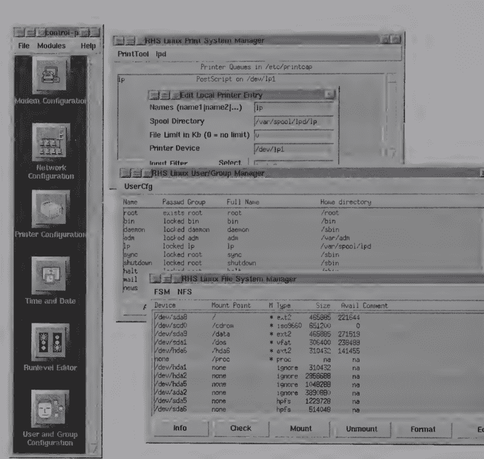

图 A.1 控制面板和一些重要工具。

### 文件系统管理

`fstools` 允许编辑 `/etc/fstab` 文件并挂载新的文件系统（包括 `NFS`）。在首次启动时，程序会为找到每个分区插入一行。随后，您可以点击这些行并进行编辑。

### 网络管理

通过 `netcfg`，您可以设置主机名、构建网络接口（以太网、`PPP`、`SLIP`）等。`netcfg` 修改 `/etc/HOSTNAME`、`/etc/hosts`、`/etc/resolv.conf`、`/etc/sysconfig/network` 以及 `/etc/sysconfig/network-scripts` 目录下的文件。

如果您手动编辑了配置文件而没有其他操作，有一些提示：在 `/etc/hosts` 中，指定的名称必须分配给运行中网络的有效 `IP` 地址。（简单地 `ping $HOSTNAME` 可）在未连接网络的计算机上，回环掩码必须分配本地主机名和计算机名称（两行）。

在系统启动期间，只有当 `/etc/sysconfig/network-scripts` 包含 `ifcfg-eth0` 文件并指定网络参数分配时，才会建立与本地网络的连接！（此文件由 `netcfg` 创建/删除。）如果您遇到问题，请参考关于 `System V init` 过程的基础章节（第 119 页）和关于网络配置章节（第 150 页）。

## 打印机配置

`printtool` 用于设置打印机（通过网络）。更改应用于 `/etc/printcap` 和 `/var/spool/lpd/lp/filter` 文件。如果您没有 `PostScript` 打印机，将调用 `gs` 来转换您的打印机的 `PostScript` 格式。因此，只能打印 `PostScript` 文件。文本文件之前可以通过 `mpage` 转换为 `PostScript` 格式。

## `Init` 进程管理

`tksys` 是一个易于处理的控制 `init` 进程（`System V`）的程序。通过鼠标点击，您可以指定运行级别（`runlevel`）启动/停止哪些进程/守护进程。但不要被漂亮的界面所迷惑：更改 `init` 进程需要非常深入的知识！`HELP` 命令提供了 `System V init` 进程的简短描述；更多信息见第 118 页。

## 内核守护进程管理

原则上，`kernelcfg` 的说明也适用于 `tksys`：仅供专家使用！此程序可配置内核守护进程，负责根据需要自动加载内核模块。`kernelcfg` 修改配置文件 `/etc/conf.modules`。

## 调制解调器接口设置

通过 `modemtool`，您可以为调制解调器选择串口接口。该程序简单地创建一个从 `/dev/modem` 到接口 `/dev/cuan` 的链接。

## 设置系统时间

通过 `timtool`，您可以设置系统时间。在启动程序之前，您应该终止所有运行中的进程。

## 查找在线文档

`helptool` 帮助查找在线文档。该程序提供 `HTML` 文档。


## 软件包管理 (`rpm` 和 `glint`)

`RedHat` 发行版最突出的特点是其软件包管理。在其他发行版中没有如此方便地安装新包、检查现有包、更新包或删除包。软件包管理基于两个程序：负责管理的 `rpm` 和提供图形界面的 `glint`。

- `rpm` 和 `glint` 仍在开发中。以下描述涉及 `rpm` 版本 2.3 和 `glint` 版本 2.1.5。

在 `Linux` 用户中，`*.rpm` 文件已获得地位。尽管它们具有不可争议的优势，但也有一个致命缺点：它们不如构成所有发行版的 `*.tgz` 文件那样具有移植性。如有必要，可以使用 `tar` 直接安装 `*.tgz` 文件，而无需依赖发行版的工具。凭借经验，可以在 `RedHat` 上安装 `SuSE` 并使其运行。但在非 `RedHat` 发行版上使用 `rpm` 包要复杂得多。此外，`rpm` 无法提供 `tar` 的相同功能。例如，目前无法安装单个文件——您必须安装整个软件包。

大量的当前软件包可以通过互联网获取——直接从 `RedHat` 的 `ftp` 服务器或各种镜像服务器获取。


`ftp://ftp.redhat.com/pub/contrib`

## 基础知识

大多数软件包由两个文件组成：一个通常位于`RPMS`目录，包含安装软件包所需的二进制文件（因此，称为二进制包）。第二个文件存储在`SRMS`目录，包含组装二进制包所需的源代码（因此，称为源码包）。

软件包名称包含了大量信息：例如，`abc-2.0.7-1.i386.rpm` 表示版本为`2.0.7`、`rpm`发布号为`1`的`abc`包。如果在组装过程中发生错误，则为相同的版本号添加更大的发布号。因此，版本号指的是程序本身，而发布号指的是`rpm`组装。

标签`i386`表示该包包含Intel版本的`Linux`的二进制文件。（正如您所知，还有其他处理器的`LINUX`版本。）

另一方面，包含`abc`软件包源代码的文件名为`abc-2.0.7-1.src.rpm`。

## REDHAT 软件包管理器 615

软件包文件包含了大量的管理信息，以及要安装的文件：简短的包描述、再次关于版本号的信息、在`glint`组层级结构中的位置、对其他包的依赖关系等。（依赖关系的产生，例如，当一个包需要某个特定的编程语言（如`Perl`）或特定的库时。在这种情况下，必须先安装这些包。）

`rpm`管理一个包含所有已安装软件包信息的数据库。该数据库存储在`/var/lib/rpm`目录下的六个`*.rpm`文件中。

`rpm`数据库中的文件绝对不能更改！为了保持文件最新，绝不能通过简单删除文件来移除软件包，而必须进行正确的安装（使用`rpm -u`）。这六个文件占用的空间相对较大（在`180 Mbyte`的系统中约占用`4 Mbytes`）。

尽管扩展名为为`*.rpm`，但这六个数据库并不是`rpm`程序包，而是`rpm`特有的二进制格式文件。数据库只包含有关二进制包的信息：已安装的源码包不包含在数据库中。

## RedHat 软件包管理器 (rpm)

对于大多数用户来说，`rpm`只执行管理任务。然而，高级用户还可以使用`rpm`组装自己的包——这种`rpm`的用法在此将不再讨论。

在大多数情况下，你使用的不是`rpm`本身，而是易于使用的`glint`界面。只有当你想要使用`glint`未提供的特殊功能，或者你在文本模式下工作（`glint`在`X`下运行）时，才需要处理`rpm`。

通过`man`命令或查询`/usr/doc/rpm`目录可以获取关于`rpm`的详细在线文档。

```bash
rpm --install file_name

rpm --install ftp://ftp_server/file_name
```

`-i`或`--install`安装指定的包。如果是二进制包，它将自动安装到根目录下的预定义位置。可以通过额外的选项`--root`更改安装位置。在第二种变体中，会自动建立`ftp`连接。如果使用了额外的选项`--test`，`rpm`不执行任何更改，而简单地显示在实际安装期间会发生什么。

使用`--nodeps`选项，即使`rpm`认为各种依赖关系未满足，你也可以安装软件包。`--force`选项强制在任何情况下进行安装（即使`rpm`认为该包已经安装）。


## 616 附录 A：REDHAT 4.1

的是，当前版本无法安装单个文件或选文件。你只能安装整个包（或者都不安装）。

如果指定的包是源码包，程序代码和配置文件将安装在`/usr/src/redhat`中。在这种情况下，通过编辑`/etc/rpmrc`来确定安装位置。

最新的服务器列表可以在`RedHat`网上页面（`www.redhat.com`）上找到，也可以通过向`faq@redhat.com`发送电子邮件邮件作为自动邮件回复获取。（您的邮件不会被阅读！）


```bash
rpm --install file_name

rpm --install ftp://ftp_server/file_name
```

`-i`或`--install`，你可以安装一个新的二进制包。通过额外的选项`--noscripts`，你可以确保不自动执行安装程序。（然而，在某些情况下，这可能会导致你刚刚安装的程序无法正常工作。）

```bash
rpm --upgrade file_name

rpm --upgrade ftp://ftp_server/file_name
```

`-U`或`--upgrade`，你可以更新一个已存在的二进制包。旧包的修改过的配置文件将被自动备份，旧包的所有其他文件将被删除。通过额外的选项`--oldpackage`，你可以用较旧的包替换较新的包。

```bash
rpm --verify package_name
```

`-V`或`--verify`，你可以检查包中的任何文件与原始安装相比是否发生了变化。（如果没有文件发生变化，`rpm`不显示任何输出。）与安装不同，参数中没有指定整个文件名，而仅指定包名（因此，例如对于包文件`abc-2.0.7-1.i386.rpm`，使用`abc`）。

```bash
rpm --erase package_name
```

`-e`或`--erase`移除一个已存在的包。如果你还使用了`--nodepeps`选项，即使有其他包依赖于它，该包也会被移除。

## REDHAT 软件包管理器 617

```bash
rpm --query -a

rpm --query [options] package_name

rpm --query -f [options] file

rpm --query -p [options] package_file
```

`-q`选项有许多变体，导致语法不清晰。前三个指的是已安装的包；通过第四种，你可以获取关于尚未安装的`*.rpm`文件的信息。

在最简单的形式下，通过额外的选项`-a`，`rpm`提供所有包的未排序列表。

当你指定包名作为参数时（例如`abc`），`rpm`会检查该包是否已安装。如果是的话，`rpm`会提供带有版本号和发布号的完整名称（`abc-2.0.7-1`）。

通过额外的选项`-f`，你可以确定系统中的哪个包属于它。这对于配置文件非常有用。例如，`rpm -q /etc/fdr`。

额外的选项`-p`允许你获取尚未安装的`*.rpm`文件的信息。这种情况必须使用文件名作为参数。

`rpm`的各种变体可以与源码包结合使用。此情况下，`rpm`不仅提供包名、版本号和发布号，还提供以下信息：

- `-i`软件包的简短描述
- `-l`软件包的所有文件
- `-lv`如上，但大小、权限
- `-c`软件包的所有配置文件
- `-d`软件包的在线文档
- `--scripts`所有安装程序

```bash
rpm --query [options] --provides name

rpm --query [options] --requires name

rpm --query [options] --provides package_file

rpm --query [options] --requires package_file
```

`query`选项用于确定包的依赖关系。`whatprovides`和`whatrequires`选项是后者的反向操作。在一种情况下，搜索包的依赖关系；在另一种情况下，搜索满足这些要求的包名。所有选项都可以与`-i`结合。

## 618 附录 A：4.1

### 示例

- `rpm -i /cdrom/RedHat/RPMS/xv-3.10a-5.i386.rpm` 安装图形程序。
- `rpm -qa` 提供所有安装包列表。
- `rpm -qi` 提供包的信息（已安装）。
- `rpm -ql` 列出包的所有文件。
- `rpm -qi /cdrom/RedHat/RPMS/perl-5.003-4.i386.rpm` 提供光盘中包含包的信息。
- `rpm -qf /usr/lib/libz.so` 指定哪个包属于`/usr/lib/libz.so`。
- `rpm -qprovides /cdrom/RedHat/RPMS/xpm-3.4h-3.i386.rpm` 指定`xpm`包提供了哪些包/库。
- `rpm -qrequires /cdrom/RedHat/RPMS/pine-3.95-2.i386.rpm` 指定运行`pine`需要哪些包/库。
- `rpm -qwhatprovides libc.so.5` 指定（已安装）包提供了`libc`。
- `rpm -whatrequires libc.so.5` 提供依赖该库的所有已安装包的无限列表。

## 查找文件

尽管`rpm`有许多不争议的优势，但经常会出现问题：在哪个（未安装的）包中找到文件？（如果你使用`glint`，会出现另一个问题：在`RedHat`层级结构的哪里找到包？）这两个问题的答案都由以下命令给出。它通过`less`在屏幕上显示关于包的所有可用信息。在`less`中，你可以使用`/`输入文件名进行搜索。

```bash
rpm -qli /cdrom/RedHat/RPMS/* | less
```


# 包依赖关系

你第一次不得不处理依赖关系，可能是当你尝试安装时收到以下错误消息：


## 图形化 Linux 安装工具 619

```bash
# cd /cdrom/RedHat/RPMS

# rpm -i vga_tetris-0.4-3.1386.rpm

failed dependencies:
```

`libvga.so.1` is needed by `vga_tetris-0.4-3`  
`libvagl.so.1` is needed by `vga_tetris-0.4-3`

因此，只有在 `libvga` 和 `libvagl` 可用的情况下，才能安装 `vga_tetris`。然而，如果你在 CD-ROM 中搜索 `libvga` 软件包，你会惊讶地发现这个包根本不存在。在依赖列表中，可能会出现库名、包名以及所谓的虚拟包名。因此，搜索所需的的包的方法如下：

```bash
# rpm -qpi --requires *.rpm | less
```

在 `less` 中，你可以使用 `/` 搜索文本 `libvga`。通过这种方式，你会发现 `libvga` 和 `libvagl` 都包含在 `svaglib` 软件包中。安装了 `svaglib` 软件包后，`vga_tetris` 的安装也将成功。（如果你遇到错误的补丁，`svaglib` 本身依赖于其他包，你必须先安装它们。）

当你阅读 `rpm` 文档时，你可能期望通过 `--provides` 选项更方便地搜索包。然而，该选项仅用于已安装的包，对安装问题没有帮助。

包依赖也适用于卸载。例如，你不能删除其他程序仍在依赖的包。因此，如果你同时安装了 `svaglib` 和 `vga_tetris`，现在尝试删除 `svaglib` 时，你会得到以下错误消息：

```bash
# rpm -e svaglib

removing these packages would break dependencies:

libvagl.so.1 is needed by vga_tetris-0.4-3

libvga.so.1 is needed by vga_tetris-0.4-3
```

在某些情况下——例如如果你使用 `tar` 而不是 `rpm` 安装单个包——尽管缺失的文件存在，`rpm` 仍然会抱怨未满足的依赖关系（它们只是在 `rpm` 数据库中缺失）。在这种情况下，


| 路径: | | 查询 | | | | |
| :--- | :--- | :--- | :--- | :--- | :--- | :--- |
| 守护进程 | Shell | X | 文档 | 应用程序 | 卸载 |
| 开发 | 基础 | 库 | 工具 | 网络 | 可用 |
| 已选包: 0 | | | | | 退出 |

图 A.2 glint 按类别对包分组。

## 620 附录 A：REDHAT 4.1


图 A.3 包列表。

你可以使用 `--nodeps` 强制安装或卸载。但请仅在你确切知道做什么时使用此选项！

## 图形化 Linux 安装工具 (glint)

虽然 `rpm` 并不容易处理，但有一个更优雅的解决方案！X 程序 `glint` 允许通过鼠标点击安装/卸载。`glint` 显示所有已安装的包，包按层级结构排列，有时很难跟进。

当你找不到某个包，但确定它已安装时，可以通过 `rpm` 了解 `glint` 的层级结构。例如，`rpm -ai pert` 提供了已安装 Perl 包的简短描述。组行指定了 Perl 的位置（实际上在 `Utilities/Text` 下，而不是你预期的位置）。此外，`glint` 的层级结构与你在首次安装时可以选择的组件无关！

在主窗口中，你现在可以使用鼠标在 `glint` 层级结构中移动。可以通过点击选择单个包。再次点击取消选择。通过右键，你还可以选择/取消选择所有组（例如，所有 `X11` 包）。

你可以对选定的包应用三种不同的操作：`QUERY`、`VERIFY` 和 `UNINSTALL`。

`QUERY` 显示此包中所有文件的列表。配置文件用字母 `C` 标记，包含在线文档的文件用 `D` 标记。`D` 标记有时是不完整的；文本经常被排除。）未记录 `Details`。包窗口包含了有关包的附加信息（空间范围、来源、版本和发行号等）。

通过 `VERIFY`，你可以检查与原始安装相比是否有文件发生了变化或缺失。然而，`glint` 并没有提供（重）安装单个文件的方法。你只能卸载整个包然后从头开始安装。

## 图形化 Linux 安装工具 621

`UNINSTALL` 移除所有属于选中包的文件。（多个包同时使用的文件只有在最后一个包卸载时才会被删除。）

如果你想进行更新，不要执行 `UNINSTALL`。选择包的新版本，安装并执行 `UPGRADE`。这样做的好处是为所有修改的配置文件创建备份（扩展名为 `*.rpmsave`）。

## 使用 glint 安装新包

到目前，`glint` 的描述专门指代已安装的包。如果你想安装新包或更新现有包，必须首先使用 `AVAILABLE` 命令生成所有可用包的列表。这会导致 `glint` 列出 `/cdrom/RedHat/RPMS`。可能会出现依赖列表、库名、包名以及所谓的虚拟包名。因此，搜索所需包的方法如下：

```bash
# rpm -qpi --requires *.rpm | less
```

在 `less` 中，你可以使用 `/` 搜索文本 `libvga`。通过这种方式，你会发现 `libvga` 和 `libv` 都包含在 `svaglib` 软件包中。安装了 `svaglib` 软件包后，`vga_tetris` 的安装也将成功。（如果你遇到错误的补丁，`svaglib` 本身依赖于其他包，你必须先安装它们。）

当你阅读 `rpm` 文档时，你可能期望通过 `--provides` 选项更方便地搜索包。然而，该选项仅设计用于已安装的包设计，对安装问题没有帮助。

包依赖也适用于卸载。例如，你不能删除其他程序仍在依赖的包。因此，如果你同时安装了 `svaglib` 和 `vga_tetris`，现在尝试删除 `svaglib` 时，你会得到以下错误消息：

```bash
# rpm -e svaglib

removing these packages would break dependencies:

libvagl.so.1 is needed by vga_tetris-0.4-3

libvga.so.1 is needed by vga_tetris-0.4-3
```


在某些情况下——例如如果你使用 `tar` 而不是 `rpm` 安装单个包——尽管缺失的文件存在，`rpm` 仍然会抱怨未满足的依赖关系（它们只是在 `rpm` 数据库中缺失）。在这种情况下，


| 路径: | | 查询 | | | | | |
| :--- | :--- | :--- | :--- | :--- | :--- | :--- |
| 守护进程 | Shell | X | 文档 | 应用程序 | 卸载 |
| 开发 | 基础 | 库 | 工具 | 网络 | 可用 |
| 已选包: 0 | | | | | 退出 |

图 A.2 `glint` 按类别对包分组。

# 620 附录 A：`REDHAT` 4.1


图 A.3 包列表。

你可以使用 `--nodeps` 强制安装或卸载。但请仅在你确切知道做什么时使用此选项！

# 图形化 `Linux` 安装工具 (`glint`)

虽然 `rpm` 并不容易处理，但有一个更优雅的解决方案！`X` 程序 `glint` 允许通过鼠标点击安装/卸载。`glint` 显示所有已安装的包，包按层级结构排列，有时很难跟进。

当你找不到某个包，但确定它已安装时，可以通过 `rpm` 了解 `glint` 的层级结构。例如，`rpm -ai pert` 提供了已安装 `Perl` 包的简短描述。组行指定了 `Perl` 的位置（实际上在 `Utilities/Text` 下，而不是你预期的位置）。此外，`glint` 的层级结构与你在首次安装时可以选择的组件无关！

在主窗口中，你现在可以使用鼠标在 `glint` 层级结构中移动。可以通过点击选择单个包。再次点击取消选择。通过右键，你还可以选择/取消选择所有组（例如，所有 `X11` 包）。

你可以对选定的包应用三种不同的操作：`QUERY`、`VERIFY` 和 `UNINSTALL`。

`QUERY` 显示此包中所有文件的列表。配置文件用字母 `C` 标记，包含在线文档的文件用 `D` 标记。`D` 标记有时是不完整的；文本经常被排除。）未记录 `Details`。包窗口包含了有关包的附加信息（空间范围、来源、版本和发行号等）。

通过 `VERIFY`，你可以检查与原始安装相比是否有文件发生了变化或缺失。然而，`glint` 并没有提供（重）安装单个文件的方法。你只能卸载整个包然后从头开始安装。

# 图形化 `Linux` 安装工具 621

`UNINSTALL` 移除所有属于选中包的文件。（多个包同时使用的文件只有在最后一个包卸载时才会被删除。）

如果你想进行更新，不要执行 `UNINSTALL`。选择包的新版本，安装并执行 `UPGRADE`。这样做的好处是为所有修改的配置文件创建备份（扩展名为 `*.rpmsave`）。

# 使用 `glint` 安装新包

到目前，`glint` 的描述专门指代已安装的包。如果你想安装新包或更新现有包，必须首先使用 `AVAILABLE` 命令生成所有可用包的列表。这会导致 `glint` 列出 `/cdrom/RedHat/RPMS`。可能会出现依赖列表、库名、包名以及所谓的虚拟包名。因此，搜索所需包的方法如下：

```bash
# rpm -qpi --requires *.rpm | less
```

在 `less` 中，你可以使用 `/` 搜索文本 `libvga`。通过这种方式，你会发现 `libvga` 和 `libv` 都包含在 `svaglib` 软件包中。安装了 `svaglib` 软件包后，`vga_tetris` 的安装也将成功。（如果你遇到错误的补丁，`svaglib` 本身依赖于其他包，你必须先安装它们。）

当你阅读 `rpm` 文档时，你可能期望通过 `--provides` 选项更方便地搜索包。然而，该选项仅设计用于已安装的包设计，对安装问题没有帮助。

包依赖也适用于卸载。例如，你不能删除其他程序仍在依赖的包。因此，如果你同时安装了 `svaglib` 和 `vga_tetris`，现在尝试删除 `svaglib` 时，你会得到以下错误消息：

```bash
# rpm -e svaglib

removing these packages would break dependencies:

libvagl.so.1 is needed by vga_tetris-0.4-3

libvga.so.1 is needed by vga_tetris-0.4-3
```

在某些情况下——例如如果你使用 `tar` 而不是 `rpm` 安装单个包——尽管缺失的文件存在，`rpm` 仍然会抱怨未满足的依赖关系（它们只是在 `rpm` 数据库中缺失）。在这种情况下，


| 路径: | | 查询 | | | | | |
| :--- | :--- | :--- | :--- | :--- | :--- | :--- |
| 守护进程 | Shell | X | 文档 | 应用程序 | 卸载 |
| 开发 | 基础 | 库 | 工具 | 网络 | 可用 |
| 已选包: 0 | | | | | 退出 |

图 A.2 `glint` 按类别对包分组。

# 620 附录 A：`REDHAT` 4.1


图 A.3 包列表。

你可以使用 `--nodeps` 强制安装或卸载。但请仅在你确切知道做什么时使用此选项！

# 图形化 `Linux` 安装工具 (`glint`)

虽然 `rpm` 并不容易处理，但有一个更优雅的解决方案！`X` 程序 `glint` 允许通过鼠标点击安装/卸载。`glint` 显示所有已安装的包，包按层级结构排列，有时很难跟进。

当你找不到某个包，但确定它已安装时，可以通过 `rpm` 了解 `glint` 的层级结构。例如，`rpm -ai pert` 提供了已安装 `Perl` 包的简短描述。组行指定了 `Perl` 的位置（实际上在 `Utilities/Text` 下，而不是你预期的位置）。此外，`glint` 的层级结构与你在首次安装时可以选择的组件无关！

在主窗口中，你现在可以使用鼠标在 `glint` 层级结构中移动。可以通过点击选择单个包。再次点击取消选择。通过右键，你还可以选择/取消选择所有组（例如，所有 `X11` 包）。

你可以对选定的包应用三种不同的操作：`QUERY`、`VERIFY` 和 `UNINSTALL`。

`QUERY` 显示此包中所有文件的列表。配置文件用字母 `C` 标记，包含在线文档的文件用 `D` 标记。`D` 标记有时是不完整的；文本经常被排除。）未记录 `Details`。包窗口包含了有关包的附加信息（空间范围、来源、版本和发行号等）。

通过 `VERIFY`，你可以检查与原始安装相比是否有文件发生了变化或缺失。然而，`glint` 并没有提供（重）安装单个文件的方法。你只能卸载整个包然后从头开始安装。

# 图形化 `Linux` 安装工具 621

`UNINSTALL` 移除所有属于选中包的文件。（多个包同时使用的文件只有在最后一个包卸载时才会被删除。）

如果你想进行更新，不要执行 `UNINSTALL`。选择包的新版本，安装并执行 `UPGRADE`。这样做的好处是为所有修改的配置文件创建备份（扩展名为 `*.rpmsave`）。

# 使用 `glint` 安装新包

到目前，`glint` 的描述专门指代已安装的包。如果你想安装新包或更新现有包，必须首先使用 `AVAILABLE` 命令生成所有可用包的列表。这会导致 `glint` 列出 `/cdrom/RedHat/RPMS`。可能会出现依赖列表、库名、包名以及所谓的虚拟包名。因此，搜索所需包的方法如下：

```bash
# rpm -qpi --requires *.rpm | less
```

在 `less` 中，你可以使用 `/` 搜索文本 `libvga`。通过这种方式，你会发现 `libvga` 和 `libv` 都包含在 `svaglib` 软件包中。安装了 `svaglib` 软件包后，`vga_tetris` 的安装也将成功。（如果你遇到错误的补丁，`svaglib` 本身依赖于其他包，你必须先安装它们。）

当你阅读 `rpm` 文档时，你可能期望通过 `--provides` 选项更方便地搜索包。然而，该选项仅设计用于已安装的包设计，对安装问题没有帮助。

包依赖也适用于卸载。例如，你不能删除其他程序仍在依赖的包。因此，如果你同时安装了 `svaglib` 和 `vga_tetris`，现在尝试删除 `svaglib` 时，你会得到以下错误消息：

```bash
# rpm -e svaglib

removing these packages would break dependencies:

libvagl.so.1 is needed by vga_tetris-0.4-3

libvga.so.1 is needed by vga_tetris-0.4-3
```


在某些情况下——例如如果你使用`tar`而不是`rpm`安装单个包——尽管缺失的文件存在，`rpm`仍然会抱怨未满足的依赖关系（它们只是在`rpm`数据库中缺失）。在这种情况下，


| 路径: | | 查询 | | | | | |
| :--- | :--- | :--- | :--- | :--- | :--- | :--- |
| 守护进程 | Shell | X | 文档 | 应用程序 | 卸载 |
| 开发 | 基础 | 库 | 工具 | 网络 | 可用 |
| 已选包: 0 | | | | | 退出 |

图 A.2 `glint`按类别对包分组。

## 620 附录 A：REDHAT 4.1


图 A.3 包列表。

你可以使用`--nodeps`强制安装或卸载。但请仅在你确切知道做什么时使用此选项！

# 图形化 Linux 安装工具 (`glint`)

虽然`rpm`并不容易处理，但有一个更优雅的解决方案！X 程序`glint`允许通过鼠标点击安装/卸载。`glint`显示所有已安装的包，包按层级结构排列，有时很难跟进。

当你找不到某个包，但确定它已安装时，可以通过`rpm`了解`glint`的层级结构。例如，`rpm -ai perl`提供了已安装 Perl 包的简短描述。组行指定了 Perl 的位置（实际上在`Utilities/Text`下，而不是你预期的位置）。此外，`glint`的层级结构与你在首次安装时可以选择的组件无关！

在主窗口中，你现在可以使用鼠标在`glint`层级结构中移动。可以通过点击选择单个包。再次点击取消选择。通过右键，你还可以选择/取消选择所有组（例如，所有 X11 包）。

你可以对选定的包应用三种不同的操作：`QUERY`、`VERIFY`和`UNINSTALL`。

`QUERY`显示此包中所有文件的列表。配置文件用字母`C`标记，包含在线文档的文件用`D`标记。`D`标记有时是不完整的；文本经常被排除。`Details`未记录。包窗口包含了有关包的附加信息（空间范围、来源、版本和发行号等）。

通过`VERIFY`，你可以检查与原始安装相比是否有文件发生了变化或缺失。然而，`glint`并没有提供（重）安装单个文件的方法。你只能卸载整个包然后从头开始安装。

## 图形化 Linux 安装工具 621

`UNINSTALL`移除所有属于选中包的文件。（多个包同时使用的文件只有在最后一个包卸载时才会被删除。）

如果你想进行更新，不要执行`UNINSTALL`。选择包的新版本，安装并执行`UPGRADE`。这样做的好处是为所有修改的配置文件创建备份（扩展名为`*.rpmsave`）。

# 使用 `glint` 安装新包

到目前，`glint`的描述专门指代已安装的包。如果你想安装新包或更新现有包，必须首先使用`AVAILABLE`命令生成所有可用包的列表。这会导致`glint`列出`/cdrom/RedHat/RPMS`。可能会出现依赖列表、库名、包名以及所谓的虚拟包名。因此，搜索所需包的方法如下：

```bash
# rpm -qpi --requires *.rpm | less
```

在`less`中，你可以使用`/`搜索文本`libvga`。通过这种方式，你会发现`libvga`和`libv`都包含在`svaglib`软件包中。安装了`svaglib`软件包后，`vga_tetris`的安装也将成功。（如果你遇到错误的补丁，`svaglib`本身依赖于其他包，你必须先安装它们。）

当你阅读`rpm`文档时，你可能期望通过`--provides`选项更方便地搜索包。然而，该选项仅设计用于已安装的包设计，对安装问题没有帮助。

包依赖也适用于卸载。例如，你不能删除其他程序仍在依赖的包。因此，如果你同时安装了`svaglib`和`vga_tetris`，现在尝试删除`svaglib`时，你会得到以下错误消息：

```bash
# rpm -e svaglib

removing these packages would break dependencies:

libvagl.so.1 is needed by vga_tetris-0.4-3

libvga.so.1 is needed by vga_tetris-0.4-3
```


在某些情况下——例如如果你使用`tar`而不是`rpm`安装单个包——尽管缺失的文件存在，`rpm`仍然会抱怨未满足的依赖关系（它们只是在`rpm`数据库中缺失）。在这种情况下，


| 路径: | | 查询 | | | | | |
| :--- | :--- | :--- | :--- | :--- | :--- | :--- |
| 守护进程 | Shell | X | 文档 | 应用程序 | 卸载 |
| 开发 | 基础 | 库 | 工具 | 网络 | 可用 |
| 已选包: 0 | | | | | 退出 |

图 A.2 `glint`按类别对包分组。

## 620 附录 A：REDHAT 4.1


图 A.3 包列表。

你可以使用`--nodeps`强制安装或卸载。但请仅在你确切知道做什么时使用此选项！

# 图形化 Linux 安装工具 (`glint`)

虽然`rpm`并不容易处理，但有一个更优雅的解决方案！X 程序`glint`允许通过鼠标点击安装/卸载。`glint`显示所有已安装的包，包按层级结构排列，有时很难跟进。

当你找不到某个包，但确定它已安装时，可以通过`rpm`了解`glint`的层级结构。例如，`rpm -ai perl`提供了已安装 Perl 包的简短描述。组行指定了 Perl 的位置（实际上在`Utilities/Text`下，而不是你预期的位置）。此外，`glint`的层级结构与你在首次安装时可以选择的组件无关！

在主窗口中，你现在可以使用鼠标在`glint`层级结构中移动。可以通过点击选择单个包。再次点击取消选择。通过右键，你还可以选择/取消选择所有组（例如，所有 X11 包）。

你可以对选定的包应用三种不同的操作：`QUERY`、`VERIFY`和`UNINSTALL`。

`QUERY`显示此包中所有文件的列表。配置文件用字母`C`标记，包含在线文档的文件用`D`标记。`D`标记有时是不完整的；文本经常被排除。`Details`未记录。包窗口包含了有关包的附加信息（空间范围、来源、版本和发行号等）。

通过`VERIFY`，你可以检查与原始安装相比是否有文件发生了变化或缺失。然而，`glint`并没有提供（重）安装单个文件的方法。你只能卸载整个包然后从头开始安装。

## 图形化 Linux 安装工具 621

`UNINSTALL`移除所有属于选中包的文件。（多个包同时使用的文件只有在最后一个包卸载时才会被删除。）

如果你想进行更新，不要执行`UNINSTALL`。选择包的新版本，安装并执行`UPGRADE`。这样做的好处是为所有修改的配置文件创建备份（扩展名为`*.rpmsave`）。

# 使用 `glint` 安装新包

到目前，`glint`的描述专门指代已安装的包。如果你想安装新包或更新现有包，必须首先使用`AVAILABLE`命令生成所有可用包的列表。这会导致`glint`列出`/cdrom/RedHat/RPMS`。可能会出现依赖列表、库名、包名以及所谓的虚拟包名。因此，搜索所需包的方法如下：

```bash
# rpm -qpi --requires *.rpm | less
```

在`less`中，你可以使用`/`搜索文本`libvga`。通过这种方式，你会发现`libvga`和`libv`都包含在`svaglib`软件包中。安装了`svaglib`软件包后，`vga_tetris`的安装也将成功。（如果你遇到错误的补丁，`svaglib`本身依赖于其他包，你必须先安装它们。）

当你阅读`rpm`文档时，你可能期望通过`--provides`选项更方便地搜索包。然而，该选项仅设计用于已安装的包设计，对安装问题没有帮助。

包依赖也适用于卸载。例如，你不能删除其他程序仍在依赖的包。因此，如果你同时安装了`svaglib`和`vga_tetris`，现在尝试删除`svaglib`时，你会得到以下错误消息：

```bash
# rpm -e svaglib

removing these packages would break dependencies:

libvagl.so.1 is needed by vga_tetris-0.4-3

libvga.so.1 is needed by vga_tetris-0.4-3
```


在某些情况下——例如如果你使用 `tar` 而不是 `rpm` 安装单个包——尽管缺失的文件存在，`rpm` 仍然会抱怨未满足的依赖关系（它们只是在 `rpm` 数据库中缺失）。在这种情况下，


| 路径: | | 查询 | | | | | |
| :--- | :--- | :--- | :--- | :--- | :--- | :--- | :--- |
| 守护进程 | Shell | X | 文档 | 应用程序 | 卸载 |
| 开发 | 基础 | 库 | 工具 | 网络 | 可用 |
| 已选包: 0 | | | | | 退出 |

图 A.2 `glint` 按类别对包分组。

# 620 附录 A：`REDHAT` 4.1


图 A.3 包列表。

你可以使用 `--nodeps` 强制安装或卸载。但请仅在你确切知道做什么时使用此选项！

# 图形化 Linux 安装工具 (`glint`)

虽然 `rpm` 并不容易处理，但有一个更优雅的解决方案！`X` 程序 `glint` 允许通过鼠标点击安装/卸载。`glint` 显示所有已安装的包，包按层级结构排列，有时很难跟进。

当你找不到某个包，但确定它已安装时，可以通过 `rpm` 了解 `glint` 的层级结构。例如，`rpm -ai pert` 提供了已安装 Perl 包的简短描述。组行指定了 Perl 的位置（实际上在 `Utilities/Text` 下，而不是你预期的位置）。此外，`glint` 的层级结构与你在首次安装时可以选择的组件无关！

在主窗口中，你现在可以使用鼠标在 `glint` 层级结构中移动。可以通过点击选择单个包。再次点击取消选择。通过右键，你还可以选择/取消选择所有组（例如，所有 `X11` 包）。

你可以对选定的包应用三种不同的操作：`QUERY`、`VERIFY` 和 `UNINSTALL`。

`QUERY` 显示此包中所有文件的列表。配置文件用字母 `C` 标记，包含在线文档的文件用 `D` 标记。`D` 标记有时是不完整的；文本经常被排除。）未记录 `Details`。包窗口包含了有关包的附加信息（空间范围、来源、版本和发行号等）。

通过 `VERIFY`，你可以检查与原始安装相比是否有文件发生了变化或缺失。然而，`glint` 并没有提供（重）安装单个文件的方法。你只能卸载整个包然后从头开始安装。

# 图形化 Linux 安装工具 621

`UNINSTALL` 移除所有属于选中包的文件。（多个包同时使用的文件只有在最后一个包卸载时才会被删除。）

如果你想进行更新，不要执行 `UNINSTALL`。选择包的新版本，安装并执行 `UPGRADE`。这样做的好处是为所有修改的配置文件创建备份（扩展名为 `*.rpmsave`）。

# 使用 `glint` 安装新包

到目前，`glint` 的描述专门指代已安装的包。如果你想安装新包或更新现有包，必须首先使用 `AVAILABLE` 命令生成所有可用包的列表。这会导致 `glint` 列出 `/cdrom/RedHat/RPMS`。可能会出现依赖列表、库名、包名以及所谓的虚拟包名。因此，搜索所需包的方法如下：

(Wait, the text is highly redundant/repeated in the source provided).

# `Caldera Network Desktop` 1.0

# `APPENDIX B`

The `Caldera` 1.0 Linux distribution is the same as `RedHat` 2.1, improved with a more elegant installation and a number of commercial components. During installation, `Caldera` 1.0 behaves just like `LST` 2.1 (only boot diskette, generic kernel) – therefore much of the information also applies to `LST` distribution. After installation, the tools known from `RedHat` 2.1 are available for further configuration (see Appendix A).

### `Caldera Open Linux`

When this reaches the bookshelves this appendix will unfortunately be out date. The new version of `Caldera LINUX` will then be called ‘`Caldera Open Linux`’ (in short, `COL`). Unfortunately, `Caldera` was not able (or willing) to supply a version in good for updating this appendix. `COL` will no longer be based on `RedHat`, but on a new version of the German `LST` distribution. The essential advantage will be that the excellent `LISA` installation program can also be used as a configuration tool during normal `Caldera` operation. `COL` will be available in several versions: base, workstation, and server. More up-to-date information can be found under the following addresses:

`www.redhat.com`
`www.lst.de`

# Installation

`Caldera LINUX` comes with two diskettes, one for systems with `IDE` hard disks (possibly `PCMIA` cards), the second for systems with `SCSI` hard disks (without `PCMIA`). Usually, you boot with one of the two diskettes. During booting, you can specify additional boot parameters, if required (see page 46). Prior to login, you can activate a non-US keyboard table.

As soon as the login prompt appears, you can log in as `install`. (Parallel to this, you can log in on a second console as `help` and read various help texts or play a round of Tetris. This is a luxury that other distributions should think about offering!)

### `LISA`（Linux 安装与系统管理）安装程序

`LISA`（Linux 安装与系统管理）安装程序会显示硬件信息。你现在必须指定从何处读取安装数据（本地 CD-ROM 驱动器、硬盘或 `NFS`）。如果你选择 CD 变体，`LISA` 现在将加载必要的内核模块。如果发生问题，你可以为相关模块指定启动参数（如果第一次运行不起，请重试——通常系统不会崩溃）。

当你必须为 `LISA` 的安装创建一个根分区时，情况将会变得更加复杂；在这种情况下，你必须使用 `LISA` 和 `fdisk`（参见第 33 页）。返回 `LISA` 后，你可以指定 `Caldera` 要安装在哪个分区中。`警告：`此分区将被细分；所有可能存在的数据都将被彻底删除。随后将创建一个 `LISA` 文件系统。

接下来，你可以指定安装大小：（最小 `minimal`、标准 `standard` 或完整 `complete`），仅需提供三种变体（最小 `minimal`、600/200 兆字节），并强烈建议使用标准变体。如果有疑问，安装得少总比安装得多要好——你可以在以后的任何阶段单独安装任何包。`LISA` 现在调用 `rim` 进行包安装，并通过进度条在屏幕上显示安装状态。

安装的最后一部分允许你执行各种基础配置步骤：计算机名称、时间、交换分区、网络配置、创建启动软盘、`Xside` 服务器配置、`LILO` 配置。这些配置步骤中的大多数可以在以后在 `Caldera LINUX` 正常运行期间的后期阶段完成。（特别是，你应该推迟 `LILO` 配置——参见第 165 页。）

`LISA` 仅在首次安装时可用的事实令人恼恼。当 `Caldera` 运行后，`LISA` 无法再次使用（缺少了几个菜单）。使用启动软盘重启并不会导致预期的结果，因为只有在完全安装后你才能使用 `LISA` 进行配置。显然，对于 `Caldera` 的大部分配置工作，提供了易于处理的 `X` 程序供使用（特别是针对用户、网络和打印机配置），但在某些情况下，你将不得不手动编辑配置文件（参见第 6 章）。无论如何，从 `LISA` 突然切换到完全不同的工具在逻辑上是不连贯的。恢复原始配置文件只能通过重新安装来实现。

完成安装后，计算机将重启（使用新的启动软盘）。如果你以 `root` 身份登录，则必须为 `root` 指定一个密码并注册一个额外的用户（带有密码）。

然后你可以开始启动 `X` 窗口系统，你会发现自己处于由“`Looking Glass`”桌面工具主导的图形界面中。本质上，`Looking Glass` 是一个易于处理（但也有些独特）的程序和程序管理器。

当你以 `root` 身份启动 `X` 时，桌面提供了各种用于系统配置的 `X` 程序：`ftools`, `glint`, `netcfg`, `printtool`, `timetout` 和 `usercfg`。这些程序来自 `RedHat` 2.1，描述在第 61 页。


# 配置

### 键盘、特殊字符

尽管到目前为止安装非常顺利，但仍有几件事需要完成。文本控制台和 `X` 窗口 (`xterm`) 中的键盘支持都非常有限（没有变音符号和重音，没有 `Del`、`Home`、`End` 等）。显示外语言特殊字符更少，`Emacs` 既不显示也不允许输入它们，等等。修复这些恼人缺点的配置步骤在第 6 章中从第 125 页开始。

`Caldera` 基于的 `RedHat` 发行版中的一个 Bug 防止了在 `netcfg`、`fsoot` 等配置程序中支持 `Del` 键。两次使用 `/usr/lib/rhs/config-panel/bindings` 会导致指令 `bind <Del> Edit <Backspace>`。当你注释掉这些 `Backspace` 指令时，`Del` 就能正常工作。（前提是你最初已经正确设置了键盘。）

# 在文本模式下工作

除了 `Crisp`（可以通过 `cr` 在文本模式下启动）之外，标准安装只设置了难以处理的 `vi` 编辑器。如果你不想用 `Crisp` 进行工作，你应该现在使用 `glit` 来设置另一个编辑器（`/etc/distrib` 包含了 `jed`, `joe` 和 `emacs`）。你还应该在 `/etc/rc/rc.local` 中启动 `gpm` 程序（参见第 133 页），以便使用鼠标处理文本。

如果你想使用 50 行模式，你必须忽略 `XInside` 服务器而改为配置 `XFree8` 服务器（第 190 页），因为 `XInside` 服务器在从 `X` 切换到控制台时总是切换到 25 行模式。

# 登录

如果你对文本模式不感兴趣，也可以这样配置 `Caldera`，使得在计算机启动时直接出现 `X` 登录。只需更改 `/etc/initabb` 中的一行即可（默认设置是 3 而不是 5）。


`id:5:initdefault:`

现在，`xdm` 在启动期间自动启动。然而，由于某些原因，并不是所有的网络服务都在级别 5 上启动。修复此错误，你必须将缺失的行插入 `/etc/rc.d/rc5`（参见 `../rc.d`）。`init` 过程在第 119 页描述。）请注意，在此模式下你无法使用文本控制台。你应该只在 `X` 稳定运行时进行修改——否则你将无法再次重启系统。另一个恼人的细节是，在 `X` 下你无法通过 `Ctrl+Alt+Del` 重启计算机。

## X 窗口管理器

`Caldera` 使用 `fwm` 作为窗口管理器。如果你希望不仅在边框，而且在任何地方，可以修改 `/etc/X11/fvwmrc` 如下：

### 配置

更改 `/etc/X11/system`

```
###### 焦点问题 #####
AutoRaise #窗口在5 秒后置顶
ClickToFocus #点击窗口获取焦点
SloppyFocus #鼠标自动获取焦点
```

## 外来登录

如果你从另一个 `Linux` 系统登录，启动 `X` 后将失去 `Caldera` 的感觉。为了让这种登录正常工作，你必须将 `/etc/skel` 中的文件复制到相应的家目录。请确保不要覆盖任何文件，并考虑隐藏文件 `(. )`。`Xclients`（启动 `Looking Glass`）以及 `lg` 目录。

## Looking Glass

使用 `Caldera` 用户界面（程序 `/usr/visix/lg`）可以通过 `OPTIONS MENU` 中的某些设置来实现。`OptionsIcon` 配置允许定义你的图标并包含了预定义图标的简要描述。一个非常有用的图标是 `Desktop`，可以通过它可以转换为普通窗口。

`OptionsPreferences` 设置涉及通过 `Looking Glass` 启动的程序。而不是 `Crisp`（使用 `med` 启动），你可以定义另一个编辑器作为标准编辑器。如果像作者一样使用 `Emacs`，建议以下行：

```
emclient -f || emacs -f server-start
```

如果 `Emacs` 已经在运行，`emclient` 打开一个新的缓冲区并显示所需的文本。如果 `Emacs` 尚未运行，`emclient` 的调用会导致错误并执行指令的后部分；这将启动 `Emacs`，使用 `-f` 选项直接启动 `Emacs` 命令 `server-start`，以便 `Emacs` 作为后续 `emclient` 的服务器工作。（与其使用 `-f server-start`，你也可以在 `Emacs` 配置文件中包含指令 `(server-start)`，参见第 357 页。）

终端程序也可以进行优化。以下行为终端配备了滚动条并允许它使用更符合用户习惯的字符集。（同样的效果可以通过修改 `X` 资源实现，参见第 206 和 222 页。）

```
xterm -ls -sb -sl 50 -fn 9x15
```

部分 `Looking Glass` 设置存储在 `/lg/lg_layouts` 目录的文件中，其余的在 `/lg3_prefs` 中。因此，如果你想为另一个登录使用相同的设置，必须将这些文件复制到相应的家目录。（请注意，例如 `/lg3_prefs` 还存储了邮件目录设置！）

## 626 附录 B：CALDERA 网络桌面版 1.0

设置 `Looking Glass` 的字符大小没有一种简单的方法。如果你发现图标和文件名的默认字符集太小，则必须在启动 `xclientg` 时指定不同的字符集。这通过 `~/.xclientg` 文件中的 `-fn` 选项来实现。请尝试以下两种变体之一，例如：

```
xclientg -fn lucidasans-14
xclientg -fn -adobe-helvetica-medium-r-normal--14-140-75-75-77-iso8859-1 ...
```

同样，你可以使用 `-fb` 选项来设置菜单中使用的字体。可以通过 `xlsfonts` 获取可用字体的列表。

## Crisp

`Caldera` 的标准编辑器可以通过 `OPTIONS` 菜单轻松配置（包括语法高亮的颜色）。设置存储在 `~/.Crisplight` 目录中。不要忘记通过 `OPTIONS!` 保存设置！

- `Save`（保存）
- `SET`（这适用于 `OPTIONS` 菜单的所有设置，即使是那些没有自动显示 `Save SET` 的设置！）

`Crisp` 允许方便地打印文件。通过 `Option!Setup!Printer!` 必须指定 `lpr` 为打印文件。这会导致 `Crisp` 将文本文件转换为 `Postscript`，然后将输出重定向到 `lpr`。

下面的概述总结了最重要的键盘快捷键。虽然没有标准，但至少在 `X` 模式和文本模式下，相同的快捷键是一致的。

| 快捷键 | 功能 |
| :--- | :--- |
| `Alt+B` | 切换活动缓冲区（当加载了多个文件时） |
| `Alt+D` | 删除行 |
| `Alt+E` | 加载文件（编辑） |
| `Alt+G` | 转到指定的行号 |
| `Alt+H` | 调用在线帮助 |
| `Alt+K` | 删除到行尾 |
| `Alt+M` | 设置/删除标记点 |
| `F1` | 复制标记块 |
| `F2` | 剪切标记块 |
| `Ins` | 插入块（粘贴） |
| `Alt+S` | 搜索字符串 |
| `Shift+F5` | 重复搜索 |
| `Alt+U` | 多级撤销 |
| `Ctrl+U` | 重做 |
| `Alt+W` | 保存文件（写入） |
| `Alt+X` | 终止 `Crisp`（带有确认请求） |
| `Ctrl+-` | 删除当前文件（当前缓冲区） |

## Netscape

关于 `Caldera` 的在线文档大部分以 `*.html` 文件的形式存在。用于显示这些文件的浏览器是 `Netscape`。这可能会导致多个 `Netscape` 窗口弄乱屏幕并占用可用内存。解决方法是使用以下简单的脚本文件 `/usr/local/bin/browser`。


`Netscape` 通常在新的浏览器下启动。默认情况下，`browser` 仅仅是指向 `netscape` 的链接。为下面的浏览器文件创建一个链接，它将尝试在运行的 `netscape` 实例中显示作为参数传递的文件名或 `URL` 名称。只有在 `netscape` 尚未运行时，程序才会启动（这次不带 `-remote` 选项）。使用 `-ncols` 选项是为了防止 `Netscape` 独占所有颜色，留给其他程序定义自己的颜色。

```bash
#!/bin/bash
case "$1" in
  *) netscape -remote openURL($1) 2>/dev/null ;;
  *) netscape -remote openfile($1) 2>/dev/null ;;
esac
case "$2" in
  0) ;;
  *) exec netscape -ncols 10 $ *;
esac
```


如果 `Netscape`（独立于上述脚本）不断出现，请（此处原文逻辑略显跳跃，意指建议修复或检查）。如果 `Netscape`（不独立于上述脚本）不断出现“网络不可达”信息，或者在显示文本时出现某些问题，在此时，请注意（此处原文部分段落存在重复或混乱，翻译保留原文语意）。

## 附录 C：SLACKWARE 3.1

### 安装程序

在您使用启动盘启动计算机并从根盘片读取安装文件系统（您只需切换盘片）后，会出现登录提示。以 `root` 身份登录后，您可以使用 `fdisk` 为 `LINUX` 创建分区（见第 33 页）。

安装开始后，将显示安装程序的主菜单：

```
Welcome to Slackware Linux Setup.

Hint: 如果您使用键盘上的方向键遇到困难，可以使用 '+', '-', 和 TAB 代替。您想选择哪种选项？

HELP       读取 Slackware Setup HELP 文件
KEYMAP    重映射您的键盘
ADDSWAP 添加交换分区
MAKE TAGS 标签文件自定义程序
TARGET     选择目标目录 [当前: /\]
SOURCE     选择源媒体
DISK SETTS 决定您想要安装哪些磁盘集
INSTALL    安装已选的磁盘集
CONFIGURE 配置您的 Linux 系统
PKGTOOL   使用 Pgtool 安装或删除包
EXIT       < OK          <Cancel>
```


通过 `KEYMAP` 选项，如果您使用的不是标准 USB 键盘，可以选择外语言键盘表。通过 `ADDSWAP`，可以将之前为分区类型 82 创建的交换分区挂载到系统中（在多次确认请求后）。

`TARGET` 菜单用于指定 LINUX 的安装位置。设置程序会显示所有可用 Linux 分区的列表。选择您之前用 `fdisk` 预留的系统分区。安装程序将询问您是否要格式化此分区。这通常是必要的，因为 `fdisk` 只对磁盘进行了分区而没有创建任何文件系统。

为 LINUX 系统准备好第一个分区后，安装程序会询问您是否希望挂载更多分区。即使您创建了第二个数据分区，目前也无法挂载。您可以在以后阶段地挂载额外的分区（见第 141 页）。挂载 DOS 分区（下一个设置选项）在现阶段不是必要的，如果有需要，可以在终止安装后进行（第 144 页）。

`SOURCE` 菜单提供了安装的数据源。通常指定 CD-ROM 驱动器（但安装数据也可以从硬盘或 NFS 读取）。

进一步的确认请求将确认安装数据所在的 CD-ROM 目录。在大多数情况下，这只是取决于 CD 的 `slackware` 目录，但 `slack` 也可能位于不同的目录。在这种情况下，必须使用 `CUSTOM` 来指定精确路径。

# 组件

Slack 发行版分为几个组件（基础系统组件、重要的 LINUX 命令组件、用于开发单个程序的组件等）。每个组件又细分为若干个单独的组件（包）。在安装之前，您选择要安装哪个组件。在安装过程中，您将指定实际安装了当前组件的哪个包（`见`下文）。下表提供了当安装该组件的所有包时的大致磁盘空间需求概述。此外，还会有关于 `CUSTOM` 磁盘集的提示：

- 基础 Linux 系统 (25 Mbyte)
- 不需要 X 的各种应用程序 (15 Mbyte)
- 程序开发 (C, C++, Lisp, Perl 等) (35 Mbyte)
- GNU Emacs (25 Mbyte)
- FAQ, HOWTO 文档 (6 Mbyte)
- Linux 内核源码 (18 Mbyte)
- 网络 (TCP/IP, UUCP, 邮件, 新) (10 Mbyte)
- X (30 Mbyte)
- 用于 X 的 T/Tk, TCL 语言和 Tk 工具包 (6 Mbyte)
- XFree86 X 窗口系统 (25 Mbyte)
- X 应用程序 (12 Mbyte)
- XFree86 服务器开发系统 (12 Mbyte)
- XV (Openlook 窗口管理器，应用程序) (9 Mbyte)
- 游戏（不需要 X） (3 Mbyte)

可以使用光标选择单独选项，并使用空格键激活或取消。括号中的值表示该组件所有包的粗略估计大小。（通常没有必要安装组件的`所有`包。）

关于组件内容的简要信息：您需要组件 `A`（基础系统）和 `AP`（标准命令）。组件 `F` 包含在线文档，因此安装最小系统时也选择它。

其他组件的安装取决于您想用 LINUX 做什么。如果您想编译针对硬件优化的化的内核，您需要组件 `D` 和 `K`。`TCL` 包含了强大且易于学习的编程语言 `TTk`（见第 15 章）。`XD` 中的 X 服务器组件仅在您想要编译 X 程序时感兴趣。

组件 `E` 包含 GNU Emacs 编辑器，它包含了书中每一个章节（从第 331 页开始）。组件 `T` 包含 `TEX` 和 `LaTeX` 程序包以及大量的扩展列表。`LaTeX` 是一种面向科学的排版程序。

组件 `X` 和 `XP` 包含 X 窗口系统以及一些应用程序。如果您乐于在文本模式下工作，可以不需要这些组件并节省大量的磁盘空间。

# 包

在安装开始之前，您仍有机会在几种安装模式之间进行选择。两个最有趣的选项是 `NORMAL` 和 `MENU`。在第一种情况下，安装过程中您会被无数关于细节的问题困扰：您必须决定是否安装该包（并为了方便您获得该包的简短描述）。对于所有组件，都会给出一个安装建议。由于在第一次安装时，您很难估计自己决策的影响：

如果您选择 `MENU` 模式，可以选择要安装哪些包。这对于想要自定义系统的经验用户非常有用。安装过程与 `NORMAL` 模式类似，但提供了更多的控制。

`pkgtool` 并不搜索真实文件树，而是依赖 `setup` 在安装期间写入的信息文件。因此，`pkgtool` 只能删除“常规”安装的 LINUX 包！`/var/adm/packages` 中的文件是文本格式的，包含了属于某个组件的文件列表。在开始删除之前，检查这些文件将非常有帮助！

`pkgtool` 显示所有找到的组件列表，你可以从中选择要删除的组件，然后点击 OK 进行删除。为了方便日后检查，已删除的文件列表将写入文件 `/tmp/PKGTOOL.REMOVED`。

# 安装额外程序

要安装程序，你首先启动 `pkgtool`，然后选择 `CURRENT`（当前）以从当前目录安装包，或选择 `OTHER`（其他）来指定不同的源目录。随后，系统会针对当前目录下的每个 `*.tgz` 文件询问你是否想要安装该文件。

`setup` 和 `pkgtool` 之间的主要区别在于，`setup` 期望包存在于 Slack 文件树中，而 `pkgtool` 可以应用于任何目录。
`pkgtool` 正常运行的先决条件是使用 Slack 特有的包格式。对于这一点，仅凭 `*.tgz` 扩展名不足以提供充分的保证（另参阅第 5 页）！为了防止安装错误，你应该对要安装的文件执行 `tar -tzf file.tgz`。只有当该文件包含 `doit.sh` 且所有文件名都以其相对于根目录 `/` 的完整路径指定时，才能使用 `pkgtool`（另参阅关于 `pkgtool` 和 `makepkg` 的 man页）！如有疑问，请始终使用 `tar` 进行安装——虽然稍微更费力，但它允许对计算机上发生的情况进行更好的控制。


# SuSE 4.4

# 附录

SuSE 发行版是德国最流行的 LINUX 发行版之一——原因十分充分：

- 中央化安装、配置和管理工具 `YaST` (Yet another Setup Tool)：从纯视觉角度来看，这个设计用于文本模式运行的程序无法与基于 X 的工具。它对硬件的要求很低，并配备了优秀的在线帮助。`YaST` 还负责包管理（安装/更新/卸载、依赖关系处理）。
- 软件包选择：其他必须在互联网或其他 LINUX CD 上寻找的各种程序都是 SuSE 的不可或缺的一部分，并且可以随时安装。SuSE 提供了超过 600 个包的选择；如果你安装所有包，磁盘需要 1.3 Gbytes 的空间。
- 手册：这份非常实用的手册显然受益于支持部门的经验——你会发现许多关于硬件和软件问题的提示！此外，手册还包含所有包的简短描述——这是 LINUX 软件中价值贵的导航辅助。
- `Umsdos`，现场系统：SuSE 也可以安装在 DOS 分区 (`Umsdos`) 并配置为现场系统。
- 维护：SuSE 每季度更新一次。SuSE 提供德语和国际版。本附录指的是国际版。另参阅：

```
http://www.suse.de
```


# YaST（安装、配置、维护）

安装过程在 SuSE 安装程序中有详细描述，因此几点说明就足够了。由于 `YaST` 程序也可以在运行期间使用（仅由 `root` 启动），文本的大部分适用于后期阶段的配置和维护工作。

安装从包含模块化内核的内置磁盘开始。你也可以从 SuSE CD-ROM 生成安装磁盘。自动启动的程序允许为安装轻松选择现代内核（SCSI、网络和 CD-ROM 驱动程序）。如果你使用 `EIDE` 或 `SCSI` CD-ROM 驱动器，不需要额外的驱动程序。

选择安装源（通常是 CD-ROM）后，以 `root` 身份登录并启动 `YaST`。在首次安装期间，你必须对现有安装的问题回答“否”。在 `YaST` 主菜单中继续，你必须定义安装设置：所需的语言（德语或英语）、键盘布局和安装源（通常是 CD-ROM 驱动器）不会带来任何问题。`fdisk` 是一个易于处理的、菜单驱动的程序。在“TARGET PARTITION”（目标分区）中，选择要安装 `LINUX` 的分区，指定根目录为挂载点，并标记该分区进行格式化。你也可以在此处标记额外的分区，但通常很少需要。

如果你打算使用现场 CD（通过它你可以在不实际安装的情况下测试无数包），你应该使用较高密度的格式化磁盘。在安装现场系统期间，会建立成千上万个链接。这些链接不占用磁盘空间，但需要很多 `inode`。不同密度的影响在第 106 页有描述。此时，你必须插入一个空磁盘来存储安装数据。当安装因计算机重启而中断时（当你更改硬盘分区时，重启是不可避免的），这非常有用。

# 软件包选择

在完成这些初步设置后，你在主菜单中选择 `SETUP`。现在会显示新菜单，你可以在其中完成配置并随后启动安装。在此菜单中，“配置”意味着选择要安装的包。`YaST` 有若干个预定义的配置，你可以通过 `LOAD CONFIGURATION`（加载配置）选择一个。它会告诉你此配置将占用硬盘上多大的空间。

你可以通过 `CHANGE CONFIGURATION`（更改配置）菜单项将配置调整为你的个人需求。此菜单项将带你进入新屏幕。


`YaST` 菜单级别偶尔让人想起冒险游戏。你可以选择几个组件之一，这将进入另一个屏幕，其中列出了该组件的所有包。你可以激活/禁用单个包。这会带你进入组件界面，进一步返回配置菜单。

如果你安装 `Linux` 系统，必须在“X”组件中选择至少一个（取决于你的显卡），必须选择一个。自动选择了标准 `VGA` 驱动程序，但你可能需要第二个驱动程序。

不要在软件包选择上浪费过多时间——一旦 `Linux` 运行，你可以以后再这样做。如果在安装的剩余过程中出现问题，那么努力将白费。如果你不知道哪个包属于哪个组件，选择“全部”。所有包按字母顺序列出。

在配置菜单中，你可以使用 `CHECK DEPENDENCIES`（检查依赖关系）来检查软件包选择是否合理。如果你想安装一个需要另一个未选包的包，`YaST` 会告诉你该结果在视觉上没有帮助，但经验程序员知道这意味着什么。

在下面的示例中，要安装组件“dev”的 GNU 调试。`YaST` 识别出只有安装了 GNU 调试器 (`gdb`) 才能使用调试。当你通过 `AUTO` 按钮终止对话时，该包将被标记为安装。（可能另一个包是 `gdb` 的前提条件——那么整个过程将重新开始）。

```
debug (dev):

AND

gdb
```

由 `AUTO` 选择的包

```
gdb
```


通过 `IF` 你可以启动安装会发生什么：具体来说，`YaST` 显示所选包所需的空间。（当使用 `YaST` 卸载时，它会显示释放多少空间）。

当你对选择满意时，可以通过 `START INSTALLATION`（开始安装）最终启动安装。然而，结束并非你想象的那样，因为还有一些配置需要设置。

# 配置

首先，你必须选择要安装的内核。你可以从多种模块化内核中选择，其中已经集成了一些基础模块（例如 `SCSI` 支持）。基于所选内核，你可以创建启动磁盘。这无疑是你应该选择的选择之一！

## 638 附录 D：SUSE 4.4

你必须决定是否将你的硬盘交给 `LILO` 安装。如果你不选择这样做，而在稍后的阶段手动执行此步骤（第 165 页），这样显然更安全。如果你同时也使用 `Windows NT`，请记住不要安装 `LILO`！

关于网络配置还有一些进一步的问题：你可以将这些内容限制到最低，并在以后执行这些设置，因为此时 `LINUX` 已经运行起来了。

之后，`YaST` 会出现，现在你必须通过 `reboot` 重启电脑。如果出现问题，你也可以使用安装磁盘进行重启。但是，你必须知道安装分区的设备名称。

当你第一次以 `root` 身份启动 `LINUX` 时，配置过程会立即继续。现在你必须指定 `root` 密码。接下来，你还可以设置调制解调器、鼠标、时间等。一旦你退出 `YaST`，系统就会创建许多索引文件，这将加速以后访问 `man` 手页。在这个耗时的过程中，你可以切换到控制台并开始工作。

`LINUX` 并不是所有方面在安装过程中自动配置。要配置你的打印机、`X Window` 系统等，请在 `YaST` 主菜单中选择 `ADMINISTRATION`（管理）。对于 `X` 的配置，`YaST` 简单地调用 `x8setup`（见附录 E）。这假设你已经为你的显卡安装了 `X` 服务器。如果不是如此，你必须从 `X` 组件安装配置包（再次通过 `YaST`）。

如果你选择 `SuSE` 作为 Live 系统（`ADMINISTRATION|LIVE SYSTEM`），`YaST` 会创建指向 Live CD（CD 3）的数千个链接。通过同一个菜单项，你也可以删除这些链接。配置和移除 Live 系统可以随时进行。然而，为了让 Live 系统实际运行，`SuSE CD 3` 必须在 `CD-ROM` 驱动器中。

## `YaST` 备份程序

除了操作功能外，`YaST` 还提供了创建备份的功能。通过 `ADMINISTRATION|BACKUP` 运行备份程序。在第一步中，你必须指定想要从备份中排除的目录和文件系统（通常是 `DOS`、`CD-ROM`）。在第二步中，备份程序会确定相对于从 `CD-ROM` 安装哪些文件发生了变化。现在，程序将显示所有要存储的目录列表。此时，你有第二次机会从备份中排除单个目录。

在最后一步中，你可以指定备份存储的位置。你可以指定备份的设备文件或普通文件。你还可以选择压缩备份并创建内容列表，即备份存档中包含的所有文件列表。

请注意，`YaST` 并不会创建完整的备份，只创建你修改过的文件的备份。这样做的好处是即使没有流处理器也可以处理这些数据。此外，


存在于 `SuSE CD` 上的文件创建备份是没有意义的。然而，你应该意识到，你无法仅使用备份文件重新创建你的系统（例如，在硬盘完全丢失后）。首先，你必须重新安装在制作备份之前安装的所有相同包，然后你可以使用备份来恢复自己的修改。

## `fvwm 2.0` 配置

`SuSE` 的默认窗口管理器是 `fvwm 2.0`（另见第 221 页）。你也可以安装 `fvwm 1.2hn` 和 `fvwm 95`。所有三个窗口管理器的菜单都经过了配置，你可以从其中一个窗口管理器切换到另一个（前提是它们已安装）。`X` 启动时使用的窗口管理器可以在 `/usr/X11R6/lib/X11/xinit/xintrc` 中设置。

在 `SuSE` 中，`fvwm 2.0` 基于全局配置文件 `/usr/X11R6/Lib/X11/.fvwm2rc`。该文件在每次调用 `YaST` 时都会自动更新。

`WWW` 浏览器——例如 `Netscape`——你可以在环境变量 `XBROWSER` 中预设其名称（例如在 `/etc/profile` 中）。`/usr/doc/susehif/index.html` 将显示为主页。该页面包含指向上述文档的链接。

## 系统详情

### 影子系统 (Shadow password system)

`SUSE` 使用影子密码系统。在该系统中，密码并不直接存储在 `/etc/passwd` 中，而是存储在一个只有 `root` 用户可的单独文件 `/etc/shadow` 中。注册新用户简单的方法是使用 `YaST`。

如果你在 `passwd` 中手动输入新用户，也必须在 `shadow` 中创建一个相应的条目（留空密码字段）。随后，你用新名称登录并调用 `passwd` 为新用户分配密码。关于影子密码系统的更多信息可以在同名的 `HOWTO` 中找到。

### System V init 进程

`SUSE` 的 System V init 进程与其他 `LINUX` 系统中使用的进程略有不同（另见第 118 页）。最重要的运行级别（runlevels）如下：

- 0 - 停机 (halt)
- 1 - 单用户 (single user)
- 2 - 无网络的多用户模式
- 3 - 带网络的多用户模式（默认）
- 4 - 未使用
- 5 - 未使用
- 6 - 重启 (reboot) (3 - 带网络和 xdm的多用户模式)

`SUSE` 使用 `/etc/rc.config` 作为中心配置文件。`YaST` 和 System V init 进程都会访问此文件。该文件有详尽的注释，在许多情况下甚至可以手动编辑。

## 更新

由于组织原因，英文版未能对本书进行完全的更新——`LINUX` 的变化太快了，以至于当最后一章翻译完成后，第一章就必须修订了！这样的话，翻译永远无法完成。

因此，针对德语源文本第 2 版的更新主要在附录和光盘镜像中完成。之前的附录描述了在翻译时是最新的 `LINUX` 发行版及其特性。本附录讨论了涉及所有 `LINUX` 发行版的新功能：`XFree86 X` 服务器的新新版本 3.2，以及 `LINUX` 与 `Windows NT 4.0` 之间的交互。

## Linux 与 Windows NT 4.0

### Windows NT 4.0 安装的提示与技巧

`Windows NT 4.0` 与 `LINUX` 之间的交互可能会出现三个问题：

- 没有空间（没有空闲分区）安装第二个操作系统。
- `LINUX` 与 `Windows NT` 之间的直接数据交换很困难。
- `LINUX` 和 `NT` 争夺引导扇。安装 `NT` 后，你将无法启动 `LINUX`；在 `MBR`（主引导记录）中安装 `LILO` 后，你将无法再启动 `NT`。

前两个问题涉及 `Windows NT` 支持一种新的文件系统 (NTFS)。与 `DOS/Windows 95` 下常用的 `FAT` 文件系统不同，它具有许多优势：更高的安全性、更好的磁盘利用率、压缩单个目录的可能性等。`NT` 可以处理 `FAT` 和 `NTFS` 分区，但在大多数情况下，你会更倾向于使用 `NTFS`。

然而，`NTFS` 也有一些缺点：`LINUX` 还没有完全完善的 `NTFS` 驱动程序（另见第 646 页）。此外，没有缩小 `NTFS` 分区大小的方法。（`FAT` 分区也没有提供此类规定，但第 22 页描述的 `FIPS` 程序最终在大多数情况下有所帮助。）

现在来看一些提示和技巧：

- 如果你的电脑上安装了 `LINUX` 且你要安装 `NT`，请提前创建并测试 Linux 启动软盘。通过安装 `NT`，`LILO` 会从 `MBR` 中被移除。（下一节描述了如何在不使用软盘的情况下再次启动 `LINUX`。）
- 如果你的电脑上安装了 `NT` 且你要安装 `LINUX`，请不要将 `LILO` 安装到 `MBR` 中。（所有安装程序都提供磁盘上的替代 `LILO` 安装方案或创建启动盘的其他方法。）
- 当你进行 `NT` 的新安装时，确保硬盘经过了合理的分区。在此语境下，“合理”意味着你在第一块硬盘开头创建了一个大小适中的 `FAT` 分区（在大硬盘上为 200 到 300 Mbytes）。随后是一个 `NTFS` 分区，它不填满磁盘剩余部分，仅占用 500 Mbytes 到 1 Gbyte。这对于典型的 `NT` 操作足够了。硬盘的其余部分应留空——需要时你可以创建额外的 `NT` 或 `NTFS` 分区。（在 `NT` 下，可以将两个 `NTFS` 分区合并为一个逻辑驱动器。但一旦创建了大型 `NTFS` 分区，就无法缩小它——唯一的解决办法是重新安装系统。）

支持硬盘分区的理由有几个：你可以在 `LINUX` 和 `NT` 下无缝地访问此分区；通过这种方式，在为 `LINUX` 提供稳定的 `NTFS` 驱动程序之前，解决了数据交换问题。理想情况下，这个 `FAT` 分区还应该包含一个出现问题的操作系统（`MS-DOS`, `Windows 3.1` 或 `Windows 95`），以便在需要时，你仍然可以使用某个出问题的 `NT` 或 `LINUX` 进行工作。例如，你可以将 `NT` 光盘中的 `NT` 安装文件复制到此分区，以便修复 `NT`；或者你可以使用它来重新创建已不存在的 `LINUX` 启动软盘。

为了在正常运行期间完全不使用 `FAT` 分区，你可以在其中创建 `NT` 交换文件（`swap file`）。这同时也提升了速度，因为访问 `FAT` 分区的速度比访问 `NTFS` 快。当你在 `BIOS` 中禁用了软盘启动时，情况显然变得更加复杂。例如，你可以将 `NT` 光盘中的 `NT` 安装文件复制到此分区，以便修复 `NT`；或者你可以使用它来重新创建已不存在的 `LINUX` 启动软盘。

## 附录 E：更新（第 644 页）

### Windows NT 4.0 与 LILO

最后也是最优雅的替代方案是使用 `Windows` 加载程序启动 `Linux`。在安装 `Windows NT` 后，该程序会自动配置，使其可以在标准模式或 `VGA` 模式下启动 `NT`，如果磁盘上仍有安装，它甚至可以启动 `Windows 95`。通过一些引导，该程序可以启动 `Linux`（跳转到 `LILO` 文件）。

这种配置的第一步是使用 `dd` 将硬盘上 `Linux` 根分区的引导扇拷贝到文件中。你可以在下面的示例中使用 `rdev` (`/dev/sda8`) 定义此分区。执行 `dd` 命令时请务必小心！如果参数错误，`dd` 会造成巨大的损害！

```


# rdev

`/dev/sda8`

# dd if=/dev/sda8 bs=512 count=1 of=/boot/bootsec.lin

```
# rdev /dev/sda8

# dd if=/dev/sda8 bs=512 count=1 of=/boot/bootsec.lin
```

现在你可以编辑 `/etc/lilo.conf`，让 `lilo` 不再修改硬盘或软盘扇区，而是直接写入上述的 `/boot/bootsec.lin`。剩余的 `LILO` 设置按照 6.6 节所述执行。因此，下次执行时只有 `bootsec.lin` 文件会被改变。

```
# /etc/lilo.conf
boot=/boot/bootsec.lin
# ... 按照之前继续操作
```

- 第一个分区（主分区）：300 Mbytes
- 第二个分区（扩展分区）：1000 Mbytes
- 扩展分区内的逻辑分区：磁盘剩余部分

# 附录 E：更新

下一步是让 `NT` 启动程序 `NTLR` 像识别微软产品一样识别 `Linux`。启动过程所需的所有文件都位于第一个硬盘的第一个分区（与 `NT` 本身安装的磁盘/分区无关）。因此，必须将 `bootsec.lin` 复制到此分区中。

如果此分区是 `FAT` 分区（即传统的 `DOS/Windows` 文件系统），你可以使用 `mount` 将该分区挂载到文件系统中，并简单地将 `bootsec.lin` 拷贝到其根目录。相反，如果它是一个 `NTFS` 分区，你必须将 `bootsec.lin` 拷贝到 `DOS` 磁盘，设置 `NT` 并将 `NT` 磁盘下的文件拷贝到 `NTFS` 分区中。

现在你必须编辑 `NTLDR` 配置文件 `Bootsec.INI`（请先制作备份副本！）；该文件也位于第一个分区的根目录下。该文件的示例如文所示。（你实际文件的细节可能会根据你的硬件配置而异。出于空间考虑，长行被分成了两行，并作为分隔符。）

```
[Boot loader]

timeout=0

default=multi(disk(0)\disk(1)\partition(2)\WINNT4

[Operating systems]

multi(disk(0)\disk(1)\partition(2)\WINNT4=
"Windows NT Workstation, Version 4.0"

multi(disk(0)\disk(1)\partition(2)\WINNT4=
"Windows NT Workstation, Version 4.0\ CVGA mode" /basevideo /sos

C:\Microsoft Window
```

现在向此文件末尾添加以下行：

```
C:\bootsec.lin="LILO"
```

如果你在 `LINUX` 下执行此修改，请确保你的换行符正确。在 `DOS/Windows` 下，你需要在行尾额外添加一个 `^M`。在大多数 `UNIX` 编辑器中，编辑这个字符非常费力。最简单的方法是复制一行并再次粘贴。在复制过程中，`^M` 换行符会被保留。

当你重启电脑时，`LILO` 会在额外的行中与已有的操作系统一起显示。当你选择此选项时，`NTLR` 会启动 `LILO`。一旦 `LILO` 运行，你就可以使用它的所有功能；也就是说在配置中，你可以在不同的 `Linux` 内核之间进行选择。

# NTFS 文件系统 (Windows NT 4.0)

在我们讨论 `Linux` 和 `Windows` 之间的数据交换之前，我们需要注意关于处理另一个操作系统分区的两点：`Windows NT` 磁盘管理器强制要求为硬盘打上一个所谓的“签名”（signature）。（至少在此之前它会询问过你，但你并没有多少选择，只有在你同意时才能使用该磁盘管理器。）这种标记对 `Linux` 没有负面影响。随后，程序会将 `Linux` 分区显示为异地操作系统的分区，并带有其正确的大小。


# LINUX 与 WINDOWS NT 4.0 647

`fdisk` 并不总是对 `Windows NT` 分区满意。它可能会抱怨物理和逻辑起始结束地址不匹配（例如，在大容量 `SCSI` 磁盘上）。至少在作者的电脑上，这在 `Linux/Windows NT` 运行期间没有导致任何问题。但是，请确保在创建 `Linux` 分区时不会与 `Windows` 分区重叠（即使留有几个扇区未使用！）！`Windows` 分区会被 `fdisk` 识别为 `OS/2 HPFS` 分区。


# NT 文件系统访问

对于直接数据访问：如本附录开头所述，`FAT` 分区（`Windows 95`）目前是最简单的数据交换形式。`Linux` 内核 `2.0` 尚未提供 `NTFS` 的支持（此功能很快会在 `2.1` 版本中出现）。如果你现在想在 `Linux` 下访问 `NTFS`，可以使用 `Martin von Loewe` 开发的只读驱动程序。该驱动程序被归类为实验软件。源代码可以在网上找到：

```
http://www.informatik.hu-berlin.de/~loewe/ntfs
ftp://ftp.informatik.hu-berlin.de/local/ntfs
```

为了使用此驱动程序，你必须首先在 `config` 中设置要访问的分区设备。然后使用 `make` 进行编译。你可以使用 `ndir` 查看此分区的目录。`ntfs` 不仅可以读取文件，还可以用于复制（只需将输出重定向到另一个文件）。当一切运行正常后，你可以使用以下命令激活 `ntfs` 并 `NTFS` 分区挂载到你的文件系统中。你必须指定设备名而非 `/dev/sda6`。

```
# /sbin/insmod ntfs
# mount -t ntfs -umask=0 /dev/sda6 /nt
```

以下命令从文件系统中移除 `NT` 分区并从内存中移除模块：

```
# umount /nt
# /sbin/rmmod ntfs
```

# 访问 FAT 文件系统 (Windows 95 OEM 2, Windows 97)

自 1996 年以来，有一个版本的 `Windows` 仅供电脑商使用（而不是免费软件）。当你购买新电脑时，你会发现上面安装了 `Windows 95 OEM`。遗憾的是，这个版本的 `Windows` 支持一种与其他操作系统兼容的文件系统（包括 `Windows NT`！）。`Windows 97` 可能支持这种。

# 附录 E：更新

这种扩展 `FAT` 系统也有一些 `LINUX` 工具，但没有进一步描述，因为没有测试方法（作者的 `Windows 95` 安装是基于：

```
http://www-plateau.cs.edu/people/chaffee/fat32.html
```


# Joliet CD-ROM

关于微软特定的文件系统：即使对于 CD-ROM，如果没有新标准也无法工作。微软支持 ISO 但不支持 Unix 常用的 Rockridge 扩展。Windows 95/NT 引入了 Joliet 扩展。与 Rockridge 扩展的主要优势是，长文件名可以使用 Unicode 字符（所有语言的 65000 个字符）。遗憾的是，Windows 下无法使用带 Rockridge 扩展的 CD（受 8 字符限制）；Linux 下的 Joliet CD 也是如此。

# XFree86 3.2

3.2 版本是 XFree86 驱动的最新版本。与之前的 3.1.2 版本相比，最重要的改进是：

- 支持多种新型显卡（如 Matrox Millennium, S3 Virge, Tseng ET6000 和 Number Image 128）。
- 支持。
- 更简单的配置，新的配置程序 `XF86Setup`。
- `XF86Config` 中的新关键字。

对于其他发行版，只有当你使用 XFree86 当前充分支持的显卡时，XFree86 3.2 才有价值。在后面的子章节中，你将找到关于 3.1.2 版本的更改或改进信息，第 190 页有详细说明。

# XF86Setup

对于大多数用户来说，3.2 版本最令人满意的变化可能是设置程序。`XF86Setup` 在图形模式下运行（640x480 像素的标准 VGA）。理想情况下，程序会在第一次尝试时识别连接的鼠标；否则，应在第一个配置步骤中指定。不过，仅使用 `Tab` 键和方向键也可以操作程序。

# XFREE86 3.2

| MDisplay: 1024 | VDisplay: 768 |
| :--- | :--- |
| HSyncStart: 1048 | VSyncStart: 771 |
| HSyncEnd: 1184 | VSyncEnd: 777 |
| Htotal: 1328 | Vtotal: 896 |
| Left Right Wider Marrower | Up Down Shorter Taller |
| Flags (hex): 300a | Pixel Clock (MHz): 75.00 |
| Quit Auto Test Restore | Horizontal Sync (kHz): 56.48 |
| Fetch Next Prev | Vertical Sync (kHz): 70.07 |

图 E.1 `xvidtune`，用于微调位置。

你可以通过几个步骤配置键盘、显卡和屏幕。即使操作程序相当简单，但良好的硬件知识对于理解所有设置备选项仍然很有用。在设置显卡时，通过 `CARDLIST`，你可以从一个综合列表中选择一个显卡。然后你可以通过 `DETAILED SETUP` 为显卡设置各种参数和选项。（在许多情况下，程序会自动识别必要的设置。如果你不确定，请不要设置任何内容！）对于显示器，你可以选择几种标准显示器类型。从这些设置开始，你可以设置行频率和帧频率的允许值。你可以阅读 `README` 文件（`HELP`）。

当新的 X 服务启动时（仍在设置程序的上上下文中），会启动新工具 `xvidtune`。通过该程序你可以更改所有模式的大小和位置（`PREV` 和 `Next`）。你可以通过 `TEST` 测试图像位置，或通过 `APPLY` 存储这些设置。一旦退出程序，所有更改都存储在 `XF86Config` 中。

请注意，配置文件不在 `/etc/X11` 目录下（像 RedHat 那样），而是在 `/usr/X11R6/lib/X11/`！

虚拟屏幕的默认大小取决于有效模式的最大分辨率：当虚拟屏幕需要更大时，则需要显式设置。

## 650 附录 E：更新

如果 `XF86Setup` 不起作用，可以使用以前版本中已知（但也经过改进）的 `xf86config` 程序。该程序在文本模式运行。

## 手动配置

`XF86Config` 的结构没有发生显著变化——第 196 页的信息在很大程度上仍然有效。然而，还有一些扩展，下文将描述。

XFree86 3.2 支持 X11R6.1 的 XKeyboard 扩展。该扩展便于了外语言键盘的配置。配置通过新关键词进行。默认设置如下所示：

```
Section "Keyboard"

Protocol "Standard"

XkbRules "xfree86"

XkbModel "pc101"

XkbLayout "us"

EndSection
```

例如，对于德国键盘，需要以下设置：

```
Section "Keyboard"

Protocol "Standard"

XkbRules "xfree86"

XkbModel "pc102"

XkbLayout "de"

EndSection
```

对于 Screen（屏幕）部分，有一个新关键字 `DefaultColorDepth` 用于设置颜色深度（8、15、16、24 或 32 位；取决于显卡，通常并不支持所有选项）。当不带 `-bpp` 选项启动 X 服务器时，会使用此设置。

## 附录 F：附带 CD-ROM

随附的 CD-ROM 主要包含以下项目：

- RedHat 发行版 4.1，用于在 Intel 处理器的 PC 上安装 LINUX。有关 LINUX 安装的通用信息可以在第 2 章从第 15 页开始找到；RedHat 特有的细节请见附录 A 从第 603 页开始。
- 刻录光盘时（1997 年 2 月）已知的所有修正均位于 `updates` 目录。在 CD 到达书店时，RedHat 服务器可能已经提供了更多更新——您应该定期查看以下 WWW 页面：

```
http://www.redhat.com/support/docs/errata.html
```


- 刻录光盘时可用的最新内核版本（`2.0.29` 和 `2.1.28`）的源代码。（内核的安装和编译见第 174 页。）
- 本书的示例文件。
- 关于 `LINUX` 的大量在线文档。此外，部分文本也以修改后的格式放在 `CD` 中，以便在 `DOS/Windows` 下（安装 `Linux` 之前）阅读。
- 用于 `LINUX` 和 `DOS` 的各种工具。

在开始安装之前，请阅读 `WELCOME.TXT`。如果更方便，您可以使用 `WWW` 浏览器（在 `DOS/Windows` 下也可以）读取 `WELCOME.HTM` 文件。

下表总结了最重要的目录内容：

| 目录 | 说明 |
| :--- | :--- |
| `book` | 本书的示例文件 |
| `book/config` | 示例配置文件（注意：许多文件名以点开头，因此请使用 `-la`） |
| `doc` | 关于 `LINUX` 的在线文档（`HTML` 文件的起点是 `00index.html`） |
| `doc/emacs/html` | `HTML` 格式的 `GNU Emacs` 文档 |
| `doc/faq` | 常见问题 |
| `doc/fhs` | `Linux` 文件系统结构描述 |
| `doc/howto/html` | `HOWTOs`（起点是文件 `HOWTO-INDEX.html`） |
| `doc/kernel` | 内核文档（版本 `2.0`） |
| `doc/seyon` | `seyon` 的在线文档和示例文件 |
| `doc/tips/html` | 由 `RedHat` 编译的各种 `Linux` 主题（`NYS`, `PPP`, `UUCP` 等）的技巧 |
| `doc/Users-Guide/html` | `Red Linux 4.1` 用户指南（包括 `RedHat` 常见问题） |
| `dosdoc` | 在线文档的部分（适用于 `DOS` 的格式：短文件名、回车字符） |
| `dosdoc/faq` | 常见问题（`Frequently Asked Questions`） |
| `dosdoc/howto/html` | `HOWTOs`（如何操作？） |
| `dosdoc/manual/html` | `Red Linux 4.1` 手册 |
| `dosutils` | `DOS` 工具：`DPARAM`, `EXT2TOOLS`, `FIPS`, `GZIP`, `LOADLIN`, `RAWWRITE` |
| `kernel` | 刻录 `CD-ROM` 时当前 `Linux` 内核 `2.0.n` 和 `2.1.n` 的源代码，`*.tgz` 格式 |
| `RedHat` | `4.1` 的 `RedHat` 安装文件 |
| `RedHat` | 软件包的 `SRPMS` 源代码 |
| `tools` | 不属于 `RedHat Linux` 的工具： |
| `updates` | `RedHat 4.1` 的错误修复和更新 |

## 版权条款

`Linux` 的大部分部分受 `GPL`（`GNU` 公用许可证）保护。第 14 页提供了条款的简要说明。全文可以在附带 `CD-ROM` 根目录下的 `COPYING` 文件找到。

适用于 `LINUX` 各组件和程序的版权条款与 `GPL` 不同（各种网络软件采用 `BSD` 版权）。

`Linux` 的大部分部分受 `GPL`（`GNU` 公用许可证）保护。第 14 页提供了条款的简要说明。全文可以在附带 `CD-ROM` 根目录下的 `COPYING` 文件找到。

适用于 `LINUX` 各组件和程序的版权条款与 `GPL` 不同（各种网络软件采用 `BSD` 版权）。

## 术语表

本术语表解释了 `PC`、`Linux` 世界中特别重要且频繁使用的术语和缩写。本术语表不保证完整性。

**Account**（账户）表示用户可登录，包括密码和用户主目录。

**AT bus hard disks**（AT 总线硬盘）`PC` 可以连接两种硬盘：`AT` 总线硬盘或 `SCSI` 硬盘。在此文中，`AT` 总线等同于 `IDE`，`AT` 硬盘和 `IDE` 硬盘没有区别。

**ATAPI** 该缩写代表 `AT Attachment Packet Interface`，是一种访问 `EIDE` 总线设备的较新协议。它主要用于控制 `CD-ROM` 驱动器；在某些情况下，解码硬盘已经支持它。

**bash** `bash` 代表 `'Bourne Shell'`。`UNIX Shell` 提供两个主要功能：命令解释器和编程语言。

**BIOS** 该术语表示计算机启动期间可用的若干程序，因为它们是计算机硬件（`ROM`）的一部分。`BIOS` 函数控制对硬件的访问。多个 `BIOS` 组件，一个用于主板（包括处理器和内存），一个用于显卡。取决于您的计算机是否扩展了额外的卡，可能会有控制 `SCSI` 硬盘、网络功能等的 `BIOS` 组件。您可以在启动计算机后立即按键更改主板的 `BIOS` 设置。运行期间，`DOS/Windows` 使用 `BIOS` 函数。而 `Linux` 使用自己的函数，因此很大程度上不受 `BIOS` 影响。

**Boot disk**（启动盘）通常启动 `PC` 时，操作系统是从硬盘文件读取的。为了在没有硬盘的情况下启动计算机（或使用与硬盘上不同的操作系统），您必须使用专门创建的启动磁盘与普通磁盘不同，启动磁盘包含额外信息（引导扇区），导致 `PC` 识别为启动磁盘。

**Browser**（浏览器）`HTML`、`WWW` 或互联网浏览器可以方便地读取 `*.html` 文件。`LINUX` 下最常用的浏览器是 `Netscape`、`Mosaic`、`Arena` 和 `Lynx`。

## 656 术语表

**控制台 (Console)** 控制台负责在屏幕上输出数据（通过 `VGA` 卡）。标准情况下，`UNIX` 管理六个虚拟文本控制台和一个图形控制台。文本控制台连接到终端，图形控制台连接到 `X`。使用 `Alt+Fn` 或 `Ctrl+Alt+Fn` 切换控制台。

**守护进程 (Daemon)** 守护进程是运行在后台的 `UNIX` 系统管理程序（管理键盘、串行接口、打印机、互联网等）。守护进程可以与 `DOS` 下的 `TSR` 程序相比。

**EIDE** 是增强型集成电子（`Enhanced Integrated Electronics`）的缩写，代表了对 `IDE` 系统的改进，但标准化程度不足。`EIDE` 允许管理超过 `500` 兆字节的硬盘；`EIDE PC` 配有两个控制器，因此可以连接四个（而不是两个）硬盘和/或 `CD-ROM` 驱动器。`EIDE` 价格更低，但产生的问题通常比 `SCSI` 系统多（`SCSI` 还可以处理 `CD` 刻录器、`DAT` 磁带机等）。

**电子邮件 (email)** 是“电子邮件”的缩写，通过互联网发送消息（信件）。电子邮件需要你和你的伙伴都连接到互联网。

**EPS** 是封装式 `PostScript`（`Encapsulated PostScript`）的缩写，表示一种文件格式。`EPS` 可以插入到其他文档中，在此过程中可以进行缩放或旋转。前提是你的文本处理或图形程序支持 `PostScript`。

**以太网 (Ethernet)** 指用于局域网最流行的硬件。每台计算机都必须配备以太网卡，计算机之间通过特殊的同轴电缆连接。最大速度为 `10 Mbit/秒`（对于使用最广泛以太网类型 `10Base2`）。

**过滤器 (Filter)** 过滤器是一种特殊的程序，它从标准输入读取数据，对其进行处理并写入标准输出。许多 `UNIX` 命令可以同时作为普通命令和过滤器使用。过滤器的优势在于，它们的使用通常可以不需要临时文件（减少存储消耗，提高速度）。

**格式化 (Formatting)** 格式化软磁盘或硬盘意味着安装文件系统。之前存储的数据将丢失。`UNIX` 支持不同的文件系统（`UNIX` 主系统有 `ext2`、`DOS`、`Mini` 等）。格式化后，软磁盘/硬盘即可存储文件。

**FSF** 是自由软件基金会（`Free Software Foundation`）的缩写。该组织由 `GNU Emacs` 的“父亲”理查德·斯托曼（`Richard Stallman`）创立。该组织的目的是让高质量软件免费并受法律保护。`FSF` 最重要的成就之一（除了大量的 `GNU` 软件之外）是 `GPL`（`GNU` 公许可证）——见下文。

**GNU** 是“`GNU is not UNIX`”的缩写。许多 `GNU` 工具和实用程序的背景是希望开发一个不受商业权利限制的 `UNIX`。（`UNIX` 是 `AT&T` 的注册商标并受版权保护）。

**GPL** 是 `GNU` 公许可证（`GNU Public License`）的缩写。`GPL` 的主要条件是任何人都可以修改代码并销售生成的程序，但同时用户/买方拥有完整代码的权利，并可以修改和自由分发。

## 657 术语表

**HTML** 是超文本标记语言（`Hypertext Markup Language`）的缩写，指用于 `WWW`（世界维网）的文档格式。`HTML` 指令包含在角括号，例如用于一级标题的 `<h1>`。

**IDE** 是集成驱动器电子（`Integrated Drive Electronics`）的缩写，提供了一个将一个或两个硬盘连接到计算机简单系统。`IDE` 廉价且可靠，但缺乏扩展灵活性。

**互联网 (Internet)** 是一个巨大的国际网络的名称。当你接入互联网时，可以发送和接收电子邮件、从远程计算机传输文件到自己的计算机（`IP`）以及更多。

**内核 (the kernel)** 是一个包含 `LINUX` 系统功能的紧凑程序。因此，内核代表了操作系统最核心的部分。在 `LINUX` 下，内核可以不费力地重新编译，并适应相关计算机的硬件。

**LILO** 是 `Linux` 加载器（`Linux Loader`）的缩写。当 `LILO` 安装在硬盘的引导扇区时，你的计算机就可以用你选择的操作系统（`DOS`、`LINUX`、`OS/2`）启动。

**链接 (Link)** 是指向另一个文件的引用。所有 `Unix` 文件系统都支持链接。它们允许从不同位置轻松访问文件和目录。

**LINUX** 是一种用于 `PC` 的兼容 `UNIX` 操作系统。`LINUX` 与其他 `UI` 变体之间的最大区别是 `LINUX` 无需许可费用即可使用。

**现场系统 (Live system)** 现场系统是一个包含 `LINUX` 系统的介质，可以在不安装的情况下运行。

**Motif** 是一个图形界面，可以在 `X` 上运行。`Motif` 非常美观，而且。

**NFS** 是网络文件系统（`Network File System`）的缩写。`NFS` 允许通过网络访问文件。

**操作系统 (Operating system)** 操作系统提供了计算机操作的基本功能：内存管理等。

**软件包 (Package)** 软件包是一组文件。软件包还包括文档等。

**分区 (Partition)** 分区是硬盘上的自包含区域。在 `Linux` 下，每个操作系统至少一个分区。

## 658 术语表

**PostScript** 是一种用于打印机的编程语言。其主要特点是与分辨率无关的。分辨率越高越好。

**运行级别 (Runlevel)** 运行级别 `Linux` 系统可以以单用户或多用户模式运行。这些模式被称为运行级别。当前运行级别可以通过 `init` 命令更改。

**脚本 (Script)** 脚本是一个由解释器执行的（通常很小的）程序。一些解释器有 `bash`、`csh` 和 `sh`。

**SCSI** 是小型计算机接口（`Small Computer Interfaces`）的缩写。这意味着一种用于连接硬盘、`CD-ROM` 驱动器、磁带机的总线系统。与 `IDE` 以相同的方式访问硬盘（较慢的）。

**服务器 (Server)** 根据上下文，此术语有不同的含义：在窗口系统中，服务器负责在屏幕上显示信息（每个 `X` 程序被视为客户端）。在网络操作中，服务器程序（如 `ftp`、`nfs`、`http`）为其他程序提供基本服务。（每个网络用户——甚至是计算机——都是客户端）。通常，计算机可以是网络服务器或互联网服务器，当这台计算机为大量用户提供网络服务时。服务器存在于数据库环境中，服务器管理多个客户端可以通过网络访问的数据。

**Shell (Shell)** 在 `Unix` 下，`shell` 是解释器的术语。因此，`shell` 是你输入和执行命令行的程序。`shell` 也可以执行 `shell` 程序（`shell` 脚本）。在 `Linux` 下有许多不同的 `shell`。`Linux` 下最重要的 `shell` 是 `bash` (`Bourne Again Shell`)。

**交换 (Swapping)** 当可用内存空间不足存储所有数据时，`Linux` 将传输到磁盘进行临时存储。为了允许这一点，你必须创建一个交换文件或优选交换分区。

**终端 (Terminal)** 终端通常是指允许通过键盘输入和在 `X` 窗口或控制台上输出的程序。因此，终端用于与计算机通信。有时（但频率已越来越低）终端被指代键盘和显示器的组合，它实现了终端程序的功能，但提供了一个真实的工作场所。此类终端通过网络连接到计算机。

**UN** 是一种在许多强大的计算机（工作站）上发现操作系统。`UNIX` 在很大程度上兼容。

**X 窗口系统 (X Window System)** 窗口系统是一个允许在矩形区域（窗口）内输出图形的功能集合。通常，`X` 还包含整包 `X` 程序（窗口管理器、`X` 终端、`xman` 等），它们共同构成了 `UNIX` 的图形界面。

# 参考文献

考虑到我在编写此书期间阅读过的数百份关于 `man`、`info`、`readme`、`faq` 和 `howto` 的文档，以及来自 `comp.linux.xxx` 中无数的 `usenet` 文章，因此无法编纂出一份精确且详尽的参考文献列表。

值得特别提及的在线文档包括 `Olaf Kirch` 编写的《`Linux Network Administrator's Guide`》（如果没有它，我可能根本无法让 `PPP` 运行）、`Grant Taylor` 和 `Brian McCauley` 编写的《`Linux Printing HOWTO`》，以及 `Terry Dawson` 编写的《`NET-2/NET-3 HOWTO`》。书中第 4 章给出了 `Linux` 下可用在线文档的概述。《`Linux Network Administrator's Guide`》也有印刷版（见下文）。

来自德国期刊 *`ct`* 和 *`ix`*、德国《`Linux-Magazin`》杂志以及美国《`Linux Journal`》（地址：`P.O.Box 85867, Seattle, WA 98145-1867, subsass.com`）的各种文章证明是获取进一步信息的绝佳来源。

最后，我列出了一些我在编写本书期间具有无价价值的标题列表：

- `Adobe Systems (1990). PostScript Language Reference Manual 2nd ed. Adobe Wesley Publishing`
- `Barnes, D., Cooper, K., Ewing M. and Troan E. (1996). Red Hat Linux 3.0 - The Red Hat Linux User's Guide. Red Hat Software, Inc.`
- `Barnes, D., Cooper, K., Ewing M. and Troan E. (1996). Red Hat Linux 4.1 - The Official Red Hat Linux User's Guide. Red Hat Software, Inc.`
- `Buer, A., Alexander Bler, A., et al. (1995). Installation, configuration and first steps with U.S.E Linux 4.4. U.S.E. GmbH`
- `Beck, M., Böhme, H., Dziadzka M., et al. (1996). Linux Kernel Internals. Wesley Longman`
- `Born G. (1991). PostScript enträtselt. Systemha-Verlag`
- `Caldera (1996). Getting Started Guide – Network Desktop 1.0. Caldera, Inc.`
- `Cameron, D., Bill Rosenblatt B. (1991). Learning GNU Emacs. O'Reilly & Associates`
- `Dickebohm M. (1996). Konfiguration von Newsservern und Spoolprogrammen zum Offline-Lesen von Usenet-News. Cologne`
- `Frisch Æ. (1995). Essential System Administration. O'Reilly & Associates`
- `Garfinkle, S., Gene Spafford G. (1996). Practical Unix & Internet Security. O'Reilly & Associates`
- `Gilly D. (1992). UNIX in a Nutshell. O'Reilly & Associates`
- `Goomens M., Hohndel D., Kirch, O., Samirian A. (1994). The LaTeX Companion, Addison-Wesley`
- `Hein J. (1996). Linux-Companion zur Systemadministration, Addison-Wesley Verlag`
- `Hetz S., Hohndel D., Kirch, O., Müller M. (1995). Linux Anwenderhandbuch 5th ed., LunetIX`
- `Kaufmann, L., Matt W. (1995). Running Linux. O'Reilly & Associates`
- `Olaf Kirch O. (1995). Linux Network Administrator's Guide. O'Reilly & Associates`
- `Kopka H. (1992). LaTeX – Eine Einführung. Addison-Wesley Verlag`
- `Kopka H. (1995). LaTeX – Ergänzungen vol. 2. Addison-Wesley Verlag`
- `Kopka H. (1992). LaTeX – Erweiterungsmöglichkeiten. Addison-Wesley Verlag`
- `Lamport, L. (1994). LaTeX– A Document Preparation System. Addison Wesley Publishing`
- `Maier G., Wildberger A. (1994). In Tcl und 8 Sekunden um die Welt 3rd edn. Addison-Wesley Verlag`
- `Peek J., O'Reilly T., Loukides M. (1993). Unix Power Tools. O'Reilly & Random House`
- `Strobel S., Thomas U. (1995). Linux – Vom PC zur Workstation 2nd ed. Springer`
- `Termüllen, P. (1993). Shell-Programmierung im Alleang, Springer`
- `Uhl T., Haag R., Lotz C., Strobel S., Vogel D. (1994). Spezial: Linux für jedermann. Der als Workstation. Prentice`

## 索引

索引条目按首字母排序。因此，下方的页码指向该术语讨论的地方，而不一定是它首次出现的地方。

### E

- `E (special characters in LaTeX)` 378
- `E (special characters in bash)` 534
- `E` 115
- `E (character strings)` 243
- `E (variables in bash)` 244
- `E (command submission)` 242
- `E (background processes)` 113
- `E (character strings)` 256
- `E (input redirection)` 236
- `E (output redirection)` 236
- `E (arithmetic expressions)` 242
- `E (command submission)` 242
- `E (wildcard)` 87, 240
- `E (home directory)` 62
- `E (under X)` 206
- `E (Adaptec SCSI controller)` 49
- `E (additional installation)` 56
- `E (adduser)` 97, 137, 253
- `E (administration)` 125
- `E (aha152)` 49
- `E (aha142)` 49
- `E (aibcxx)` 49
- `E (aites)` 254, 235, 525
- `E (email)` 483
- `E (ANSI)` 422
- `E (Apache)` 439
- `E (app-defaults)` 227
- `E (appendix)` 375
- `E (apropos)` 69, 254
- `E (psfilter)` 149
- `E (Archie)` 413
- `E (archive)` 259, 294
- `E (archiving of files)` 251, 259, 294
- `E (Area)` 441
- `E (arithmetic expressions)` 245
- `E (article.text)` 368
- `E (dashash)` 232
- `E (associative fields)` 546
- `E (AT bus)` 655
- `E (ATAPI)` 655
- `E (AUC\Tex)` 352
- `E (axe)` 308
- `E (out)` 116
- `E (aps)` 317
- `E (abbreviations)` 254
- `E (accelerated X)` 186, 203
- `E (access control)`
- `E (access privileges)` 138, 256
- `E (fstab)` 140
- `E (fundamentals)` 94
- `E (account)` 655
- `E (active)` 488
- `E (B)` 662
- `E (background processes)` 113
- `E (backslash substitution)` 544
- `E (backspace (X))` 206
- `E (backup (Y))` 638
- `E (basenetrench)` 399
- `E (bash)` 231
- `E (keyboard configuration)` 127
- `E (keyboard shortcuts)` 234
- `E (sample programs)` 257
- `E (bash programming)` 499
- `E (command reference)` 523
- `E (examples)` 512
- `E (beep)` 527
- `E (begin)` 374
- `E (append)` 375
- `E (array)` 392
- `E (equation)` 389
- `E (figure)` 385
- `E (itemize)` 381
- `E (mintpage)` 381
- `E (tabbing)` 380
- `E (thebib)` 385
- `E (verbatim)` 399
- `E (lbf)` 379
- `E (lbfseries)` 377
- `E (bg)` 254
- `E (hbitemem)` 385
- `E (bibliography)` 385
- `E (/bin)` 91
- `E (binary package)` 614
- `E (bind)` 567
- `E (BIOS)` 655
- `E (g hard disk)` 33
- `E (hard (disk))` 35
- `E (block (mount))` 140
- `E (BLT)` 541
- `E (bit_wish)` 614
- `E (Blum, Chrys)` 492
- `E (BOGUS)` 11
- `E (bookmark)` 440
- `E (/boot/boot.)` 167
- `E (boot diskette)` 600
- `E (create)` 160
- `E (DOS)` 24
- `E (generic kernel)` 30
- `E (installation)` 28
- `E (Linux)` 632
- `E (boot from hard disk)` 165
- `E (boot options (parameter))` 46
- `E (boot process)` 160
- `E (System Vnit)` 118
- `E (boot sector backup copy)` 167
- `E (BOOT_INI)` 646
- `E (bpp (X server option))` 201
- `E (brace expansion)` 241
- `E (brackets (libX))` 392
- `E (branches)`
- `E (bash)` 508
- `E (Tel)` 551
- `E (break)` 525
- `E (browser)` 439

# 664 索引

- `/cdu535` 102
- `/cm206cd` 102
- `/cus` 419
- `/ftp` 103
- `/ftype` 104
- `/gpmdata` 209
- `/gscd` 102
- `/hd` 37
- `/hda` 102
- `/lp` 146
- `/mcd` 102
- `/modem` 419
- `/mouse` 134
- `/ram` 104
- `/sbpcd` 102
- `/scd` 102
- `/sd` 37
- `/sonycyd` 102
- `/st` 104
- `/ttys` 134
- `/ttys` 419

### 设备

- 创建 281
- 直接写入 261
- 内部组件 110
- `df` 100, 262
- 对话 518, 526
- 对话框
- `bash` 518
- `TK` 560
- 对话元素 (`Tk`) 354
- `Dickebohm, Markus` 482
- `diff` 262
- `dip` 438

### 目录

- 修改 255
- 删除 289
- 基础 90
- 内存要求 262
- 目录树 91
- 文件管理器 309
- `TeX` 372
- `trime` 527
- 目录s 527
- 磁盘管理器 346

### 软磁盘

- 复制 627
- 格式化 264
- `MS-DS` 格式化 279

### 发行版

- `LaTeX TeX` 371
- `LINUX` 9
- 概述 110
- `LD` 112
- 文档 375
- `docculentclass` 374, 406
- 域名 151

### DOS

- `DOS` 兼容的 `HTML` 文件 557
- 在线阅读文档 67
- `DOS` 软磁盘读/写 250, 284
- `DOS` 分区 144
- `DOS` 测试文件 305
- `dos2linux` 513
- `DPARAM` 35, 48
- 到期 262
- `dump2zfs` 263
- `DVI` 文件 364, 400
- 打印 320
- `dvlj` 321
- `dvlps` 320, 400

### E

- `e2fsck` 109, 264
- `echo` 264, 527
- `EBITOR` 135
- 编辑器 63
- `Emacs` 331
- `X` 环境下 308
- `eepsf` 386
- `EIDE` 33
- `EIDE` 硬盘
    - 启动参数 48
- `ELF` 116
- `Elisp` 584
    - 示例 592
    - 编程技术 589
- `elf` 464
- `elvis` 64
- `vem` 371
- `Emacs` 331
    - 缩写 354, 592
    - `AUCT TeX` 352
    - 缓冲区 348
    - `C` 模式 352
    - 彩色文本 361
    - 颜色 598
    - 编译器 585
    - 配置 130, 584
    - 光标移动 338
    - 未启动 361
    - 动态方面 354
    - 编辑命令 341
    - 邮件 464
    - 流式文本 343
    - `font-lock` 模式 361
    - 外语特殊字符 385
    - `gpm` 130
    - 缩进文本 345
    - 结束和外围 342
    - `TeX` 模式 (错误) 362
    - 懒锁 362
    - `Lisp` 589
    - `Lisp` 存档 362, 585
    - `Lisp` 目录 584
    - 宏 356
    - 文本模式下的鼠标 130
    - 在线帮助 337
    - 自己的快捷键 587
    - 百分比光标移动 595
    - 处理模式 334, 350
    - 编程 587
    - 编程示例 592
    - 快速上手 63
    - 注册 340
    - 正则表达式 346
    - 滚动 596
    - 搜索 346
    - 搜索与替换 347
    - 服务器模式 357
    - `shell` 354
    - `site-isp` 584
    - 语法高亮 361
    - 制表符 342
    - `Tel` 353
    - `X` 环境下 358
    - `windows` 349
- `emacs` 584, 598
- `emacscient` 357

### 邮件

- 地址 483
- 自动化 471
- 目录 458
- `im` 464
- `Emacs` 464
- 表头 555
- 本地 459
- 邮件传输 467
- 邮件代理 459
- `MIME` 357
- `pine` 460
- 读取 459
    - 从邮箱读取 463, 470
- 中继操作 469
- 二进制文件 457, 462
- 发送地址 463
- `sendmail` 467
    - 设置发送地址 468
- 结构 453
- 通过 `PEP` 470

### 紧急

- 启动参数 552
- 无磁盘启动 161
- 文件系统修复 109
- 无限循环 (`bash`) 517
- 环境变量 245
- `EPS` 文件 (`TK`) 385
- `epsffit` 325
- 方程 389
- `Thomas` 372
- `et` 91
- 别名 483
- `/conf.modules` 608
- `/conf.modules` 613
- `/exports` 159
- `/X11/X` 203
- `/X11/config` 203
- `/X11/xdm Xession` 216
- `/X11/XF86conf` 109
- `/X11/Xinit /initrc` 213
- `/X11/Xintrc` 205
- `/Xacc.ini` 95
- `/XF86conf` 190

### F

- `FIPS` 22
- 固定链接 97
- `fixmacps` 325
- `fixtcces` 325
- `fixwps` 325
- 软磁盘 103
- `focus` (under `X`) 208
- 文件夹 456
- `font-lock-mode` 361
- `for` 511, 529
- `foreach` 552
- 外语键盘 126
- 外语特殊字符 385
- `FTP` 446

### G

- 网关 152, 411, 429
- `gerner comic` 30
- 德语 (`LaTeX`) 375
- `getafm` 325
- `getlist` 489
- `gets` 555
- `getty` 120, 421
- `GhostScript` 322
- `ghostview` 323
- `GID` 96
- `fsteb` 140
- `gimp` 329
- `Glint`
    - `copyright` 653
- `glob` 534
- `grossary` 655
- `GMT (Green Mean Time)` 134
- `GNU` 13
- `GNU General Public License` 14
- `Gold Star-DRM` 硬盘 250
- `GoodStuff` 220
- `GPL` 14
- `gpm` 133
    - `Emacs` 130
- 图形转换 327
- 图形驱动程序 (`X`) 191
- 图形编辑器 308
- 图形字段 (`TK`) 576
- 希腊字母 (`LaTeX`) 394
- `gpre` 271
- `groff` 773
- 组 96
    - 管理 251
    - 成员 255
- 组s 272
- `gs` 322
- `gscd` 50
- `gunzip` 272
- `gzip` 272
- `GZIP.EXE (DOS)` 31

### H

- 黑客内核 174
- 停止 273
    - 在 `RedHat` 中停止 122
- 硬盘
    - 基础 33
    - 启动参数 48
    - 延迟 22
    - 格式化 264
    - 软磁盘 264
    - 硬盘/分区 141, 280
    - 碎片 109
- 帧 (`TK`) 577
- 帧字段 (`TK`) 577
- 免费 269
- 自由软件基金 14
- 空存储空间 262
- 从 `DOS` 读取 269, 305
- `fsck` 269
- `FSF` 14
- `FSSTND` 91
- `stab` 35, 139
- `fstools` 611
- 地址 451, 476, 492, 541, 543, 568, 585, 603, 614, 628
- 函数 529
- `fwim` 217
    - 配置 220
    - 键盘快捷键 219
- `fwmm` 221
- `fmm95-2` 222
- `fwmoodstuff` 220
- `fwmPager` 220
- `fwmcrc_convert` 222

### G

- 网关 152, 411, 429
- `gerner comic` 30
- 德语 (`LaTeX`) 375
- `getafm` 325
- `getlist` 489
- `gets` 555
- `getty` 120, 421
- `GhostScript` 322
- `ghostview` 223
- `GID` 96
- `fsteb` 140
- `gimp` 329
- `Glint`
    - `copyright` 653
- `glob` 534
- `grossary` 655
- `GMT (Green Mean Time)` 134
- `GNU` 13
- `GNU General Public License` 14
- `Gold Star-DRM` 硬盘 250
- `GoodStuff` 220
- `GPL` 14
- `gpm` 133
    - `Emacs` 130
- 图形转换 327
- 图形驱动程序 (`X`) 191
- 图形编辑器 308
- 图形字段 (`TK`) 576
- 希腊字母 (`LaTeX`) 394
- `gpre` 271
- `groff` 773
- 组 96
    - 管理 251
    - 成员 255
- 组s 272
- `gs` 322
- `gscd` 50
- `gunzip` 272
- `gzip` 272
- `GZIP.EXE (DOS)` 31

### H

- 黑客内核 174
- 停止 273
    - 在 `RedHat` 中停止 122
- 硬盘
    - 基础 33
    - 启动参数 48
    - 延迟 22
    - 格式化 264
    - 软磁盘 264
    - 硬盘/分区 141, 280
    - 碎片 109
- 帧 (`TK`) 577
- 帧字段 (`TK`) 577
- 免费 269
- 自由软件基金 14
- 空存储空间 262
- 从 `DOS` 读取 269, 305
- `fsck` 269
- `FSF` 14
- `FSSTND` 91
- `stab` 35, 139
- `fstools` 611
- 地址 451, 476, 492, 541, 543, 568, 585, 603, 614, 628
- 函数 529
- `fwim` 217
    - 配置 220
    - 键盘快捷键 219
- `fwmm` 221
- `fmm95-2` 222
- `fwmoodstuff` 220
- `fwmPager` 220
- `fwmcrc_convert` 222

### G

- 网关 152, 411, 429
- `gerner comic` 30
- 德语 (`LaTeX`) 375
- `getafm` 325
- `getlist` 489
- `gets` 555
- `getty` 120, 421
- `GhostScript` 322
- `ghostview` 223
- `GID` 96
- `fsteb` 140
- `gimp` 329
- `Glint`
    - `copyright` 653
- `glob` 534
- `grossary` 655
- `GMT (Green Mean Time)` 134
- `GNU` 13
- `GNU General Public License` 14
- `Gold Star-DRM` 硬盘 250
- `GoodStuff` 220
- `GPL` 14
- `gpm` 133
    - `Emacs` 130
- 图形转换 327
- 图形驱动程序 (`X`) 191
- 图形编辑器 308
- 图形字段 (`TK`) 576
- 希腊字母 (`LaTeX`) 394
- `gpre` 271
- `groff` 773
- 组 96
    - 管理 251
    - 成员 255
- 组s 272
- `gs` 322
- `gscd` 50
- `gunzip` 272
- `gzip` 272
- `GZIP.EXE (DOS)` 31

### H

- 黑客内核 174
- 停止 273
    - 在 `RedHat` 中停止 122
- 硬盘
    - 基础 33
    - 启动参数 48
    - 延迟 22
    - 格式化 264
    - 软磁盘 264
    - 硬盘/分区 141, 280
    - 碎片 109
- 帧 (`TK`) 577
- 帧字段 (`TK`) 577
- 免费 269
- 自由软件基金 14
- 空存储空间 262
- 从 `DOS` 读取 269, 305
- `fsck` 269
- `FSF` 14
- `FSSTND` 91
- `stab` 35, 139
- `fstools` 611
- 地址 451, 476, 492, 541, 543, 568, 585, 603, 614, 628
- 函数 529
- `fwim` 217
    - 配置 220
    - 键盘快捷键 219
- `fwmm` 221
- `fmm95-2` 222
- `fwmoodstuff` 220
- `fwmPager` 220
- `fwmcrc_convert` 222

### I

- `r/rc.inet2 (Slackware)` 159

### 文件

- `ether` 51
- `Ethernet` 656
- `Ethernet` 卡 51

### eval

- `bash` 527
- `Tcl` 554, 556
- `event (Tk)` 561, 567

### exec

- `bash` 528
- `Tcl` 556
- `exit` 232, 528
- `expand` 264
- 文件名扩展 233
- `spect` 542
- `expire.cli` 486
- `export` 246, 528
- `expr` 384, 528
- `Tcl` 545
- `extype` 文件系统 105
- `ext2` 文件系统 104, 139
- 扩展分区 20
- 扩展 `Tcl/Tk` 541
- `extxtracts` 325
- `EZ` 硬盘 35, 167
- 权限 256
- 额外属性 278
- 额外属性 255
- 追加 244
- 存档 294
- 校验和 257
- 比较 262
- 压缩 257, 272
- 复制 258, 297
    - 使用 `sed` 的示例 89
- 解压缩 272, 299
- 删除 289
- 确定 266
- 显示 254
- 实例化测试 532

### find

- `find` 250, 266
- `find` 266, 275
- 过滤 513, 556
- `find` 88, 297
- 文件 266, 275, 300
- 字段 385
- 图表 385
- 文件 266, 529
- 文件管理 249
- 文件管理器 309
- 文件名 86
- 文件服务器 411
- 文件系统 91
- 文件夹 456
- `font-lock-mode` 361
- `for` 511, 529
- `foreach` 552
- 外语键盘 126
- 外语特殊字符 385
- `focus (under X)` 208
- 软磁盘 103
- 字体 361
- 脚注 378, 384

### 所有

- 自己的快捷键 587
- 百分比光标移动 595
- 处理模式 334, 350
- 编程 587
- 编程示例 592
- 快速上手 63
- 注册 340
- 正则表达式 346
- 滚动 596
- 搜索 346
- 搜索与替换 347
- 服务器模式 357
- `shell` 354
- `site-isp` 584
- 语法高亮 361
- 制表符 342
- `Tel` 353
- `X` 环境下 358
- `windows` 349
- `emacs` 584, 598
- `emacscient` 357

### 邮件

- 地址 483
- 自动化 471
- 目录 458
- `im` 464
- `Emacs` 464
- 表头 555
- 本地 459
- 邮件传输 467
- 邮件代理 459
- `MIME` 357
- `pine` 460
- 读取 459
    - 从邮箱读取 463, 470
- 中继操作 469
- 二进制文件 457, 462
- 发送地址 463
- `sendmail` 467
    - 设置发送地址 468
- 结构 453
- 通过 `PEP` 470

### 紧急

- 启动参数 552
- 无磁盘启动 161
- 文件系统修复 109
- 无限循环 (`bash`) 517
- 环境变量 245
- `EPS` 文件 (`TK`) 385
- `epsffit` 325
- 方程 389
- `Thomas` 372
- `et` 91
- 别名 483
- `/conf.modules` 608
- `/conf.modules` 613
- `/exports` 159
- `/X11/X` 203
- `/X11/config` 203
- `/X11/xdm Xession` 216
- `/X11/XF86conf` 109
- `/X11/Xinit /initrc` 213
- `/X11/Xintrc` 205
- `/Xacc.ini` 95
- `/XF86conf` 190

### F

- `FIPS` 22
- 固定链接 97
- `fixmacps` 325
- `fixtcces` 325
- `fixwps` 325
- 软磁盘 103
- `focus (under X)` 208
- 文件夹 456
- `font-lock-mode` 361
- `for` 511, 529
- `foreach` 552
- 外语键盘 126
- 外语特殊字符 385
- `FTP` 446

### G

- 网关 152, 411, 429
- `gerner comic` 30
- 德语 (`LaTeX`) 375
- `getafm` 325
- `getlist` 489
- `gets` 555
- `getty` 120, 421
- `GhostScript` 322
- `ghostview` 223
- `GID` 96
- `fsteb` 140
- `gimp` 329
- `Glint`
    - `copyright` 653
- `glob` 534
- `grossary` 655
- `GMT (Green Mean Time)` 134
- `GNU` 13
- `GNU General Public License` 14
- `Gold Star-DRM` 硬盘 250
- `GoodStuff` 220
- `GPL` 14
- `gpm` 133
    - `Emacs` 130
- 图形转换 327
- 图形驱动程序 (`X`) 191
- 图形编辑器 308
- 图形字段 (`TK`) 576
- 希腊字母 (`LaTeX`) 394
- `gpre` 271
- `groff` 773
- 组 96
    - 管理 251
    - 成员 255
- 组s 272
- `gs` 322
- `gscd` 50
- `gunzip` 272
- `gzip` 272
- `GZIP.EXE (DOS)` 31

### H

- 黑客内核 174
- 停止 273
    - 在 `RedHat` 中停止 122
- 硬盘
    - 基础 33
    - 启动参数 48
    - 延迟 22
    - 格式化 264
    - 软磁盘 264
    - 硬盘/分区 141, 280
    - 碎片 109
- 帧 (`TK`) 577
- 帧字段 (`TK`) 577
- 免费 269
- 自由软件基金 14
- 空存储空间 262
- 从 `DOS` 读取 269, 305
- `fsck` 269
- `FSF` 14
- `FSSTND` 91
- `stab` 35, 139
- `fstools` 611
- 地址 451, 476, 492, 541, 543, 568, 585, 603, 614, 628
- 函数 529
- `fwim` 217
    - 配置 220
    - 键盘快捷键 219
- `fwmm` 221
- `fmm95-2` 222
- `fwmoodstuff` 220
- `fwmPager` 220
- `fwmcrc_convert` 222

# 索引 669

- 重新编译 173
- `RedHot` 608
- 版本 `2.0` 的系统更新 184, 628
- `kernelcfg` 613
- `kernelid` 184, 608

### 键盘

- `bash` 127
- 配置 126
- `Emacs` 130
- `Tk` 567
- 在 `Emacs` 中 587
- 键盘快捷键 127
- `fwm` 中的键盘快捷键 219
- `X` 下的键盘快捷键 208
- `X` 204
- `XFree8 3.2` 650
- 键盘快捷键
    - 在 `Emacs` 中 387
    - 在 `fwm` 中 219
    - 在 `olwm` 中 224
- `Linux` 651
- 用户定义 127
- `keytable init (Redhat)` 123
- `tkl` 274, 436
- `ktogg` 114
- `Kpathsea` 373
- `ksh` 232

### L

- 标签 (`Tk`) 577
- `\label` 384
- `Langbein,` 372
- `\large` 378
- `Lasermoon` 12
- 后期安装
    - `Slackware` 633
- `LaTeX` 363
    - `AUC TEX` 352
    - 参考文献 385
    - 括号 392
    - 交叉引用 384
    - 目录树 372
    - 发行版 371
    - `Emacs` 362
    - `Emacs-TeX` 351
    - `EPS` 385
    - 错误检测 367
    - 图表 385
    - 查找列表 373
    - 字体代码 402
    - 字体（内部） 399
    - 脚注 384
    - 帧 382
    - 希腊字母 394
    - 页眉 397
    - `HTML` 81
    - 连字符 395
    - 索引 387
    - `Kpathsea` 373
    - 布局 395
    - 换行 396
    - 代码列表 379
    - 列表 381
    - 长文本 405
    - 是 `R` 数据库 373
    - 宏 404
    - 数学公式 389
    - 矩阵 392
    - 测量 396
    - 页面 381
    - 多列文本 381
    - 分页 397
    - 页边距 398
    - 圆括号 392
    - `PostScript` 399
    - `PostScript` 字体 402
    - 引用 378
    - 特殊字符 378
    - 特殊数学符号 393
    - `Emacs` 中的语法检查 351
    - 目录 383
    - 表格 380
    - 字体 376
    - 版本 `2.0` 406
- `latex2html` 81
- `latexauto` 517
- `lazy-lock` 362
- `LBA` 34
- `lbrowser` 627
- `lidconfig` 118
- `ldd` 117
- `dd` 274
- `\left` 392
- `less` 274
- `less` 63
    - 配置 129
    - `proc` 文件的问题 112
- `/Lib` 246
- `/modules` 183
- `/modules/*.modules` 依赖 183
- 库 116
- `LILO` 356
    - 173
    - 安全复制 167
    - `Windows NT 4.0` 645
- `lieto.conf` 165, 167–8, 181
- `\limit` 390
- `lindent` 550
- 换行 (`lEX`) 396
- 链接 97, 028, 257
- `Linux Torvalds` 12
- `Linux` 3
    - `loot` 进程 160
    - 配置 125
    - 发行版 9
    - 安装 16
    - 在多个分区上 141
    - 起源 122
    - 快速上手 59

### 670 索引

- 要求 15
- 软件映射 445
- 关机 60
- 从操作系统启动 162
- 系统更改 56
- 卸载 57
- 更新 54
- `linux2ds` 514
- `linux SGML` 82
- `LISA` 11
- 列表字段 (`TK`) 570, 577
- 列表
    - `Tcl` 548
- `listbox (TK)` 577
- 列表 (`Tcl`) 550
- 运行系统 9657
- `locate` 530
- 在, 275
- `loadkeys` 126, 206
- `LOADLIN` 162
- 本地邮件 459
- 本地网络 410
- 局部变量 245
- `localhost` 154
- `locate` 275
- 日志文件 115
- 逻辑分区 20
- 登录 60
- `Logitech` 209
- `logname` 276
- 注销 276
- 回环接口 152
- 循环
    - `bash` 511
    - `Tcl` 551
- `lost+found` 92, 270
- `pd` 147
- `pnd.init (Redhat)` 123, 147
- `lpr` 147, 275
- 是 94, 275, 500
- 列表 278
- `LSM` 445
- `listmode` 184
- `LST` 11
    - 安装 622
- `LS_COLORS` 276
- `tls` 500
- `Lucid Emacs` 331
- `Lynx` 440
- `LyX` 365

### M

- `mail` 469
    - `Emacs` 356
    - 在 `Tcl/Tk` 中 404
- `Mail` 664
- `MAIL (变量)` 247
- `email` 452
- 邮件代理 467
- 邮箱 463
- `mailq` 470
- `make` 174
    - 是 389
- `makeinfo` 75
- `MakePK` 401
- `man` 68
- `MANPATH`
- `MANPATH (变量)` 247
- 数学公式 389
- 矩阵 (索引) 392
- `matrib` 279
- `mcd` 50, 279
- `mdx` 50
- `mcopy` 279

### -1

- 内存 51
- 内存问题 55
- 内存字节 51
- `menubutton (Tk)` 579
- 菜单 572, 578
- 消息 (`Tk`) 579
- 方法 (`Tk`) 562
- `Metro X` 186, 203
- `MIME` 457
- `time.types` 450
- `minicom` 421
- `minipage` 381
- `Minix` 105
- `minix` 文件系统 105
- `Mitsumi CD-ROM` 驱动 50
- `mkdir` 279
- `mkdefs` 141, 280
- `mkfs` 141, 280
- `mkswap` 43, 146, 282
- `knod` 281
- `mkfs` 280
- `label` 282
- `nd -282`
- `modem` 417
- `modentool` 613
- 模块 181
    - 编译 182

### 671 索引

- 依赖 183
- `RedHot` 608
- 使用 183
- `modules.dep` 183
- `more` 63, 282
- `Motif` 8, 187
- `Motif` 库 116
- 载 58, 100, 243
- `conv option` 306
- `NT` 文件系统 647
- 选项 139
- 新 412, 474
- 下载 491
- `INN` 482, 484
- 离线配置 482
- 自己的 476
- 发送 494
- 订阅 475
- 线程 475
- 上传 494
- `newsfeeds` 485
- `newsflash` 492
- `.newsrc` 475

### 鼠标

- 在 `X` 下配置 209
- 在文本模式 133
- `Tk` 567
- 在 `X` 下 210
- `X` 193
- `mpage` 318
- `mrd` 283
- 读取 284
- `are` 284
- `MS2` 47
- `dmdos` 文件系统 105
- `MDOS.SYS` 163
- `tmt` 284
- `mtab` 140
    - 工具 284
    - 类型 285
- 多任务系统 112
- 我的 285
- `wm` 211
- `mwrite` 285
- `Netscape` 480
- `NFS` 412, 657
    - 配置服务器 159
    - `/etc/fstab` 139
    - `Linux` 安装 44
    - `nfs` 文件系统 106
    - `nfs int (Redhat)` 123
    - `nfs mit (Redhat)` 123
- `NIC` 151
- `nice` 114, 285
- `nkfs.o` 628
- `nl` 285
- `mrp.access` 485
- `aout (载)` 140
- 探探测 48
- `NTEX` 372
- `NTFS` 643
- `tfs` 647
- `NTLR` 646
- 数字比较
    - `bash` 509, 532
    - `tcl` 545
- 数字键盘/在 `X` 下 205
- `NumLock` 205
- 在 `X` 下 315

### N

- 名称服务器 152, 429
- `NCR SCSI` 控制器 50
- `curses` 180
- `NE-2000` 以太网卡 51
- `netcfg` 611
- `netconfig` 430
- `Mask` 429
- `NetPBM` 329
- `Netscape` 442
    - `Caldera` 627
    - `email` 465
    - 新 480
    - 选项 627
    - 网络配置 150
    - 网络 `init (Redhat)` 123
    - 网络掩码 152
    - 网络脚本 (`Redhat`) 123
- 网络 155
- 网络 (`Internet`) 410
- `newialases` 483
- `newcommand` 404
- `newenvironment` 404
- `newpage` 397
- 新 483

### O

- 对象的 (`Tk`) 562
- `elowm` 223
    - 配置 225
    - 键盘快捷键 224
- 在线连接到 415
- 在 `CD-ROM` 上 79
- 在线帮助 67
- 打开 555
- `openwin` 215
- 操作系统 3
- 多个时间 165
- 选项 (`bash`) 521
- 选项 (`TK`) 571, 577
- 选项 253
- 内核 176
- `Tk` 563

### 672 索引

- 或 (`Emacs`) 592
- `OS/2` 27, 33
- `OS/2` 分区 144
- 输出重定向 556
- `pack` 562, 564
- `package` 9, 657
    - 依赖 614, 637
    - `LaTeX` 375
    - `Slackware` 630, 633
    - `SUSE` 636
- 分页 (`TeX`) 397
- `pagebreak`
- 创建新的 141
- 碎片整理 222
- 格式化 141, 280
- 空闲空间 262
- 理想 37
- 命名在 `Linux` 下 36
- 减少 22
- 根分区 38
- 分区 38
- 类型 20
- 过去的 96, 136, 292
- 密码 286
- 粘贴 256
- 补丁 176
- `PATH` 234
- `PATH (变量)` 247
- `pem (Redhat)` 123
- `Philips CD-ROM` 驱动 55
- `pico` 461
- `pine` 460
- `pinger-forever` 433
- 管道 115, 236
- 对象的放置 (`Tk`) 564
- 可插拔认证模块 611
- `POP` 470
- `popclient` 470
- `popd` 530
- 可携位图工具 329
- `portmap` 159
- `POSIX` 494
- `PostScript` 316–7, 657
    - `PostScript` 文件
    - 223
    - `PostScript` 字体 (`TeX`) 402
    - 每页两页 318
    - `ppic` 436

### P

- `paselect` 325
    - 停止 325
- `pstree` 287
- `pushd` 530
- `puts` 549, 555
- `pudw` 287
- `RESTORE` 23
- 反向文本显示 131
- `\ring` 392
- 登录 158, 412, 451
- `rm` 289
- `rman` 82
- `rmdir` 289
- `rmode` 183
- 根 60, 96, 136, 292

### Q

- `\quad` 396

### R

- `radbutton (Tk)` 579
- `\raggedright` 398
- `RAM` 磁盘 104
- `RAM` 问题 55
- `RAM` 超过 `64 Mbytes` 51
- `RAWWRITE.EXE` 121
- `rc` 文件 121
- `rc.inet1` 156
- `rc.inet2` 147
- `rc.keymap` 126
- `rc.local` 121
- `rc.modules (Caldera)` 628
- `rc.sysinit` 122
- `rdev` 160-1
- `rc.ntfd` 159
- `rc.portmap` 159
- `(X)` 187
- `rpm (The)` 515
- `rehash` 273
- 继操作 469
- `Reply-To` 463
- 预留 521
- 重置 288
- 通过 `Ctrl-Alt-Del` 重置 96
- `resolv.conf` 155, 430
- `(X)` 187, 226
- `restorefont` 288
- `restorepalette` 202, 289

### S

- `scale (Tk)` 579
- `screen`
    - `80x50` 字符 132
    - 屏幕保护程序
    - 屏幕保护程序
    - 截图 327, 329

# 674 索引

- 发送者地址 (电子邮件) 463
- 发送者地址更改 468
- `sendmail` 467
- `sendmailconfiguration` 468–
- 中继操作 469
- 发送者地址 468
- `sendernews` 495
- 串口接口 418
- 序列化 49
- 服务器 186, 411, 658
    - `Emacs` 服务器 357
    - 镜像服务器 10
- `serverlist` 493
- `set` 241, 246, 290
- `set` 545
- `setfont` 133, 202, 290
- `setavail` 134, 420
- `setill` 131, 290, 531
- `setbit` 256
- `setup` 630, 633
- `setup.sendmail` 468
- `seyon` 424
- `sGML` 82
- `sh` 232
- 影子密码 642
- 共享库 116
- `shell` 231, 658
    - 更改默认 `shell` 232, 257
    - 在 `Emacs` 中 354
    - 变量 244, 503
    - `shell` 编程 499
    - 命令参考 523
    - 示例 512
- `shift` 532
- 关机 60
- 通过 `Ctrl-Alt-Del` 关 96
- 签名 (`Windows NT`) 646
- 单个
    - `bool` 参数 51–2
    - `site-list` 目录 584
    - `site-start.el` 584
- `sjcd` 50
- `skelt` 12
- `Slackware` 12
    - 组件和包 630
    - 以后安装组件 633
    - 伪 `System V init` 124
    - 锁 437
- `sleep` 532
- `lide bar` 579
- `SLIP` 416, 437
    - `automatize` 438
    - 建立连接 437
    - 词表 427
- `sin` 118
- `SLS` 12
- `/slries` 377
- `sl` 377
- `small` 470
- `small` 378
- 亚洲 `CD-ROM` 驱动器 50
- `sonycd5535` 50
- 排序 292
- `SoundBlaster CD-ROM` 驱动器 50
- 源包 614
- 源
    - `bash` 532
    - `tcl` 556
- 特殊字符
    - `bash` 534
    - `UBEX` 378, 393
- 特殊数学 393
    - `tcl` 541
- `split` 292
    - `tcl` 550
- `verart` 390
- `swig` 614
- `Richard Stallmann` 14
- 标准输入 236, 556
- 标准输出 236, 556
- `startx` 212
- 统计链接程序 116
- 存储
    - 目录 262
    - 硬盘/分区 262
    - `RAM/交换` 269
- 传输器 210
- 传输器 104, 294
- 字符串 487, 547
- `ty` 420, 434
- `su` 292
- 订阅 (新闻) 475
- `\subscription` 375
- 替换机制
    - `bash` 239
    - `tcl` 544
- `sum` 292
- `\sum` 390
- 超数据块
    - 安全副本 110
- `SuperProbe` 192
- 超用户 292
- `SuSE` 12, 635
- 在线帮助 80
- `System V init` 124
- `SuEConfig.vum` 639
- `SVGTextMode` 133
- 交换文件
    - 创建 145
    - 交换分区 38
        - 创建 43
        - 集成 145
- `swapor` 293
- `swapon` 243, 293
- 交换 658
- `witch (Tcl)` 551
- 符号链接 198
- `sync` 294
- 语法高亮 361
- `sysconfig` 122


# 索引 675

- `syslog init (RedHat)` 123
- `syslogd` 114
- 系统监控 314
- 系统启动 59, 118
- `System V init` 153
- `X` (运行级别 5) 624
- `System V process` 119
- `texindex` 75
- `TexInfo` 75
- 文本 (`Tk`) 580
- 文本控制台 60
- 字符集 133
- 多于六 120
- 文本转换 513
- 文本编辑器 63, 308, 331
- 文本字段 (`Tk`) 577, 579, 580
- 文本文件

### T

- `t-emacs.el` 130
- 制表符 380
- 目录 383
- `tableofcontents` 383
- 表 (`LaTeX`) 380
- 制表符 (`Emacs`) 342
- `tsc` 294
- `tail` 294
- `tvar` 示例 130
- 命令 250
- 单词计数 300
- 提取列 260
- 搜索 271
- 搜索与替换 290
- `Tcl`
    - 分支 551
    - 字符字符串 547
    - 文件处理 554
    - 语言元素 543
    - 循环 551
    - 示例程序 557
    - 替换机制 545
    - 变量 553
- `Tcl/Tk` 537
    - 输入字段 (`Tk`) 577
- `tcmd` 377
- `tg (Slackware/SUSE)` 56
- `tz` 文件 (`Slackware/SUSE`) 56
- `The Next Level` 609
- 参考文献 385
- `reading` 473
- `tilde (under X)` 206
- 每天 134
- 时区 134
- `timeout (sendmail)` 469
- `timeout` 613
- `t` 478
    - 帮助 378
    - 修复 541
- `Tk` 537
    - 扩展 541
    - 在 `Internet` 上 542
    - 在线帮助 542
    - 版本 540
    - 模式 (`Emacs`) 353
- `tclsh` 541
- `tclix` 541
- `TCP/IP` 151, 410
- `tcpd` 158
- `tcsh` 232
- `te` 237, 297
- `tell` 555
- `Telnet` 158, 412
- 临时文件 501
- `term` 416
- 接口编程 560
- 演示程序 542
- `dialog` 560
    - 元素参考 574
- `dialog` 元素 564
- 事件 561, 567
- 列表字段 571
- 菜单 572
- 鼠标 567
- 对象 562
- 选项 571
- 组件 574
- 通信 569
- 窗口管理器 566
- 终端 658
- `getty` 421
- `set` 290
- 文本控制台 60
- `term` 307
- 终端模拟器 420
- 测试 509, 532
- `TeX` 372
    - `X` 模式 (`Emacs`) 351
- `tex-mode-hook` 594
- `texhash` 373
- 文本 (`TexInfo`) 75
- `tex2html` 81
- `tk-des` 310
- `tkman` 71
- `tksys` 613
- `/tmp` 92
- `todos` 298, 305
- `top` 114, 298
- `tolevel` 582
- `Torvalds, Linus` 12
- `touch` 298

# 索引 676

- `tr` 298, 513
- `trap` 533
- `tt` 377
- `ttseries` 377
- `tff` 299
- `type` 299
- `tunefs` 110
- `twm` 223
- `.twmrc` 223
- `UART` 418
- `uc` 311
- `UID` 96
- `fstab` 140
- `ulimit` 533
- `umount` 101, 299
- `Umdos` 45
- `boot` 162
    - 带有 `Loadlin` 163
    - `LILO` 167
- `unalias` 299, 533
- `uname` 299
- `compress` 299
- `underline` 390
- `Unifex` 12
- `unix` 299
- `unix` 4, 68
- `Unix Commander` 311
- `unset` 246, 546
- `until` 534
- `update` 120
    - `kernel version 2.0` 184
- `updated` 275
- `updates` 57
- `Caldera` 628
- `upvar` 553
- `URL` 440
- `Usenet news` 474
- `usagepage` 375
- `isolate1` 375
- `mspf` 386
- `\makeidx` 389
- `user (mount)` 140
- `user groups` 94, 96, 251
- `usercfg` 61
- `users`
    - `manage` 251
    - `register` 96
- `/usr` 92
- `/lib/security` 611
- `/usr/X11/bin/X` 203
- `UUCP` 416
- `uuencode` 457

### V

- 变量管理
    - 在 `bash` 中 503
- 变量替换 (`Tcl`) 544
- 变量 (`bash`) 244
    - 在 `bash` 中 507
    - `Tcl` 545
- `/var` 93
- `/var/lib/news` 487
- `/var/log/news` 487
- `/verb` 379
- `verbatim` 379
- `VGA` 卡 (`X`) 191
- `VGA` 色板
    - `restore` 289
- `VGA` 文本模式 `80x50` 132
- `bootdeiskte` 161
    - `LILO` 168
    - `Loadlin` 163
- `vga`
    - `boot参数` 51
- `vaset` 199
- `vi` 64
- `vim` 64
- 虚拟桌面 187, 219
    - 在 `olwm` 中 224
- 虚拟屏幕 187, 200
- `VISUAL` 135
- `Visual Schnauzer` 327
- `uvmin` 181
- `VT100` 422
- `VT100` 组件 226
- `wait` 534
- `wc` 300
- `whatis` 69, 300
- `where` 234, 300
- `while` 234, 300
    - `bash` 512, 534
    - `Tcl` 552
- `who` 300
- 通配符 87, 240
    - 复杂性 88
- 窗口管理器 187, 210
    - 选择 212
    - `fwm` 217
    - `fwm` 222
    - `fwm2 (SUSE)` 639
    - `fwm95` 222
    - `olwm` 223
    - `select` 211
    - `Tk` 566
    - `twm` 223
    - 窗口 (`Tk`) 582

# 索引 677

- `Windows` 配置器 196
- `Windows` 4.1 606
- `Windows` 95 255
- `.Xdefaults` 207, 227
- `.Xdefaults:Emacs` 361
- `xdm` 215
- `xdtm` 309
- `xdv` 325
- `xvi` 325
- `xf` 314
- `xf86config` 190, 650
- `xf86config` 192
- `xf86setup` 648
- `xfig` 308
- `xfilemanager` 312
- `xFree` 309
- `World Wide Web` 439
- `word-count` 300
- `version` 2.0 184
- `updated` 275
- `updates` 57
- `Caldera` 628
- `upvar` 553
- `URL` 440
- `Usenet news` 474
- `usagepage` 375
- `isolate1` 375
- `mspf` 386
- `\makeidx` 389
- `user (mount)` 140
- `user groups` 94, 96, 251
- `usercfg` 61
- `users`
    - `manage` 251
    - `register` 96
- `/usr` 92
- `/lib/security` 611
- `/usr/X11/bin/X` 203
- `UUCP` 416
- `uuencode` 457

### V

- 变量管理
    - 在 `bash` 中 503
- 变量替换 (`Tcl`) 544
- 变量 (`bash`) 244
    - 在 `bash` 中 507
    - `Tcl` 545
- `/var` 93
- `/var/lib/news` 487
- `/var/log/news` 487
- `/verb` 379
- `verbatim` 379
- `VGA` 卡 (`X`) 191
- `VGA` 色板
    - `restore` 289
- `VGA` 文本模式 `80x50` 132
- `bootdeiskte` 161
    - `LILO` 168
    - `Loadlin` 163
- `vga`
    - `boot参数` 51
- `vaset` 199
- `vi` 64
- `vim` 64
- 虚拟桌面 187, 219
    - 在 `olwm` 中 224
- 虚拟屏幕 187, 200
- `VISUAL` 135
- `Visual Schnauzer` 327
- `uvmin` 181
- `VT100` 422
- `VT100` 组件 226
- `wait` 534
- `wc` 300
- `whatis` 69, 300
- `where` 234, 300
- `while` 234, 300
    - `bash` 512, 534
    - `Tcl` 552
- `who` 300
- 通配符 87, 240
    - 复杂性 88
- 窗口管理器 187, 210
    - 选择 212
    - `fwm` 217
    - `fwm` 222
    - `fwm2 (SUSE)` 639
    - `fwm95` 222
    - `olwm` 223
    - `select` 211
    - `Tk` 566
    - `twm` 223
    - 窗口 (`Tk`) 582
