# Linux 内核

前言由

`Ingo Molnar`,

红帽公司内核开发组


- 涵盖新版 Linux 内核 2.4
- 详细介绍 Linux 文件系统
- 深入解析 Linux 系统调用


`Moshe Bar`,

Linux 专栏作家，`Byte.com`

# 前言

在过去的两年里，Linux 经历了惊人的进步，首先通过 2.0 版本，然后是 2.2 版本，很快将是 2.4 版本，使其成为目前可能是服务器和工作站中最先进的操作系统之一。

特别是随着即将发布的 2.4 系列，我们开发人员投入了大量精力，使内核具有高度可扩展性，并能够高效地处理和管理大量内存、许多并发 CPU 以及大量现代外设。

几年前，如果有人去阅读内核源代码并自行理解主要概念，这在今天确实变得非常困难。不仅源代码的规模显著增长，而且随着核心开发人员本身学习了新技术，算法和源代码也变得越来越复杂和难以理解。

`Moshe Bar` 的工作使 Linux 内核 2.3.xx 和 2.4 的复杂性更接近爱好者、系统管理员和系统程序员，这对于缩小内核开发人员和用户之间的差距至关重要。

在编写这本书期间，我与 `Moshe` 保持密切沟通，不得不面对并回答数十个问题。在完全理解算法或功能之前，他从未仅仅接受一个答案。

作为内核核心开发人员，我发现这本书既是一个好的入门指南，也是一部用于查阅 Linux 内核概念的参考书。

多年来，`Moshe Bar` 撰写了大量关于操作系统原理的文章、论文和专论，他对先前操作系统项目（如 `MVS`、`VM` 和 `BSD`）的参与，体现在他严谨的方法和清晰的技术语言中。

`Ingo Molnar`

# 引言

《Linux 内核剖析》旨在增进对 Linux 内部工作机制的普遍理解。这些“内部机制”大多发生在 Linux 操作系统内核的内核中。然而，这本书并不是通常意义上的完整源代码评注。虽然对许多代码都进行了注释，但重点在于代码的功能性，而不是代码本身。

Linux 内核包含控制系统资源、用户进程、数据 I/O 以及扩展功能（如 Linux 内核空间 Web 服务器 `kHTTPd`）的代码。

## Linux 内核

*内核*是在保护模式下运行并可以访问硬件特权寄存器的操作系统软件。一些操作系统采用*微内核架构*，其中设备驱动程序和其他代码按需加载和执行，并不一定始终驻留在内存中。

内核并不是在系统上运行的单独进程。它是操作系统的核心，控制进程调度以实现多任务处理，并提供一组常驻内存的例程，每个用户空间进程都可以访问这些例程。

相比之下，*单体架构*（其中所有设备驱动程序都是内核主体的一部分）在 UNIX 实现中更为常见，也是诸如 `BSD` 等经典系统所采用的设计。Linux 内核也主要是一个单体内核——所有设备驱动程序都是内核主体的一部分——但与 `BSD` 不同的是，Linux 内核的设备驱动程序也可以是*可加载*的，即可以通过用户命令将它们加载到内存中或从内存中卸载。

本书主要参考适用于 Intel x86 架构的 2.4.x 系列内核（在本书撰写时，仍被称为 2.3.51）。全书使用的代码示例均基于 2.3.49 内核，尽管有时也会使用 2.5 内核系列的预览版本。

## 谁应该读这本书

《Linux 内核剖析》面向系统管理员、网络管理员、开发人员以及容量规划经理。它也会吸引那些对硬件和软件有良好通用理解的 Linux 爱好者。

在后续章节中，系统管理员将学习如何根据特定需求和硬件环境调整内核。此外，通过在适当位置调整内核参数，系统吞吐量可以显著提升。本书的“文件系统”部分将讨论文件系统的选择、安装以及正确配置。Linux 开发人员将会了解哪些编程技术能为其程序带来最佳性能，并且阅读本书后，调试将变得更容易，因为对用户程序的外部因素会有更深入的理解。

最后，一般来说，Linux 爱好者在发现其技术设计中隐藏的精华之后，将会更加欣赏他们喜爱的内核。

## 阅读本书前需要了解的知识

不需要具备之前的内核知识，但了解硬件和软件的基本概念会有所帮助。此外，熟悉 Linux 接口以及具备基本系统管理的初步知识也会很有帮助。

能够阅读 `C` 程序也有帮助，尽管书中提供的大多数代码都有解释。对于 `C` 语言的优质入门书籍，我始终强烈建议阅读 `C` 语言设计者 `Kernighan` 和 `Ritchie` 所著的《`The C Programming Language`》（《C 程序设计语言》）。

## 本书包含的内容

本书首先对操作系统理论和内核概念进行总体介绍，并详细探讨其与 `UNIX` 的相关性。

接下来的章节专门介绍所有内核的五大支柱：

- 进程
- 进程间通信
- 信号（中断）处理
- 虚拟内存
- 文件系统

每一章的结构都相同；首先详细解释内核中与主题相关的内部运作机制。然后，提供几个代码示例来展示如何更改内核的功能。最后，列出相关的内核数据结构（`C` 头文件）以便快速参考。结合章节正文中列出的算法，读者将获得代码和数据的完整集合，以及必要的解释。本书并不试图对 Linux 内核源代码进行详尽的评论，而是重点关注内核最重要的主题以及与性能相关的问题。书末附有附录，内容涵盖系统调用、`GPL` 许可证以及其他有用信息。

你可以按顺序阅读各章节以更多地了解 Linux 内核，也可以选择直接跳转到感兴趣的章节，并将本书作为参考使用。每当文本中展示代码片段时，相应的数据结构可以在该章末尾找到。

## 在哪里获取更多资讯

关于 Linux 内核的最新信息可以在互联网上找到。然而，这些基本上是原始数据。收集、整理并将这些信息整合成连贯的格式并非易事。这正是《Linux 内核设计与实现》（`Linux Internals`）的最大价值所在——它提供了一个连贯的、经过研究和格式化整理的信息源，而这些信息否则只能通过分散的网站或个人网站、源代码和文章获取。

当然，内核的一个良好信息来源就是内核源代码本身。在 `http://lxr.linux.no/source/` 有一个网站，为所有可用的架构和 Linux 版本提供了出色的源代码导航器。

在 `http://www.linuxhq.com` 可以找到所有内核版本的信息，特别是当前正在开发版本的信息。有关 `GNU` 工具的完整列表，请访问 `www.gnu.org`。

最后，关注内核开发者邮件列表是有启发性的，尽管该邮件列表海量的信息量以及较差的信噪比使得有时难以提取有用的信息。

## 建议与评论

非常欢迎任何建议或评论，可以通过 `moshe_bar@hotmail.com` 或通过以下地址发送给 `Moshe Bar`：`McGraw-Hill, Professional Book Group, Two Penn Plaza, New York, NY 10121`。

## 致谢

首先，我有责任感谢上帝赐予我撰写本书所需的一切。

如果没有 Linux 内核开发界一些明星开发者的帮助，本书不可能完成。像 `Ingo Molnar`、`Andrea Arcangeli`、`Stephen Tweedie`、`Hans Reiser` 和 `Steve Best` 这样的人对本书做出了巨大贡献。

`Joe Pranevich` 的文章“The Wonderful World of 2.4 Kernels”给了我重要的思路，让我知道如何总体描述 2.4 内核所取得的进展。谢谢你，`Joe`。

`FreeBSD` 知名人物 `Matthew Dillon` 撰写了一篇重要的论文，描述了通用的虚拟内存概念，这启发了本书中关于 Linux 通用 `VM` 概念的描述。谢谢你，`Matt`。

几位天使守护着本书的创作与完成：`Patricia Campbell`、`Scott Fallin`、`Tom Syroid`、`Philip Courier` 及其妻子 `Patricia Lambert`，以及 `Brad Dixon`，他们都自愿在有限的时间内贡献了大量时间帮助我编辑这本书。`Patricia Campbell` 和 `Brad Dixon` 的技术专长指出了许多在付印前可能令人尴尬的错误。`Scott Fallin`，我长期合作开发 `GPL` 许可的 `Khaos` 操作系统的伙伴，突出了许多难以理解的文段并帮助我改进它们。`Philip Courier` 和 `Patricia Lambert`，常常带着幽默，极大地改善了各章的风格和一致性。我的朋友、作者 `Tom Syroid` 通过与我分享他的创作经验帮助使这本书成为现实。我尤其感谢他。

在编辑过程中，使用了一个邮件列表（显然是基于 Linux 的）在编辑人员之间讨论 `C` 编码风格、术语的正确定义等主题。事实证明这是一个明智之举，极大地促进了团队精神和本书的质量。感谢你们所有人。

`Robo-chan`，我的灵魂兄弟，在我精神低落时提振了我的士气。谢谢你，`Roberto`。

还要衷心感谢 `TopTier Israel` 和 `Baan` 集团，在我撰写本书期间为我提供了系统管理员/顾问的工作，以保持收入流的稳定，并提供了测试我所编写内容的机器。

# 第 1 章

## 开源——对现代操作系统的影响


毫无疑问，Linux 取得非凡成功的主要原因是其通用公共许可证（`GPL`）。然而，开源的概念（有时也被称为自由软件）实际上已经存在很久了。自由软件的首倡者是自由软件基金会（`FSF`）的 Richard Stallman，他为一些优秀且如今已广泛传播的编程语言设计了 `GPL` 许可证——最著名的是 `Emacs` 编辑环境和针对 C 和 C++ 的 `GCC` 编译器。Richard Stallman 多年来也一直致力于一个完整的 `GNU` 操作系统，一个名为 `GNU Hurd` 的项目。经过近十年的开发，这个操作系统仍未成为现实，但从该项目涌现出的许多强大技术已应用于其他操作系统，如 `Linux`、`BSD` 等。

操作系统通过开源的开发方式在两个方面受益：可靠性和性能。Linux 的可靠性在很大程度上源于数十万名开发者对代码的审查、改进、修改和测试。正如 Eric Raymond 在其著名论文《大教堂与集市》中所言：“只要有足够大的 beta 测试者和共同开发者基础，几乎任何问题都能被快速发现，且修复方案对某个人来说显而易见。”

Linux 的性能提升也是因为同样的原因；对代码的公开审查导致内核执行路径的整体效率持续改进。此外，许多学术机构采用 `Linux` 操作系统进行研究，并能够使用硬件剖析和虚拟机跟踪器等先进技术，找出代码中此前隐藏的性能瓶颈。

最后，通过将 `Linux` 内核移植到多种处理器平台，某些部分不得不进行适配或重写。通过这种比较和适配的过程，产生了更好的代码，并很快被反向移植到其他平台。

如此多双眼睛审查 `Linux` 代码库，使得它比任何闭源软件开发组织所能负担得起的质量保证（`QA`）部门都更出色。这反过来又带来了更高质量的软件。

仅仅像开源这样的开发模式本身无法取代适当的设计和方法编码。但在此方面，开源模式也以巨大优势胜过专有模式。考虑 `Linux` 内核改进的例子。自从黑客群体存在以来，一直高度重视优雅的设计、合适的数据结构设计以及与性能相关的问题。即使在最晦涩的—

在代码片段中，你有时会发现一些美丽且精心打造却又惊人高效的设计。

## Linux 历史

`Linux` 的起源，与大多数成功的项目一样，源于芬兰在 1991 年的一种需求。当时，林纳斯·B·托瓦兹（Linus B. Torvalds）是赫尔辛基大学的一名学生，他购买了一台基于 `i386` 的 PC，这是第一个在芯片内支持虚拟内存管理的 `Intel` CPU。由于对 `MS/DOS` 操作系统不完全满意，托瓦兹决定在他的 PC 上实现 `Minix` 操作系统（需要补充 `Minix` 的起源和性质说明），而不是使用原有的系统。

当 `AT&T` 在 20 世纪 70 年代意识到他们的 `UNIX` 操作系统正成为一种有价值的商业产品时，他们决定从第 7 版开始，禁止像以前那样将源代码与二进制文件一起分发。因此，许多大学不得不放弃对 `UNIX` 的研究，转而只学习理论。

不幸的是，仅研究理论无法让学生获得在实际操作系统中应用概念时所能达到的那种对操作系统理论的自信。因此，安德鲁·塔宁豪斯（Andrew Tanenbaum）决定开发一个包含 `UNIX` 所有概念和功能，但完全由新源代码编写的操作系统。这样，他就可以避免 `AT&T` 严格的许可限制，同时仍能向他的学生讲授 `UNIX`。`Minix` 从设计上就旨在 PC 上运行，最初基于 `AT&T UNIX` 第 7 版的功能集。然而，很快，塔宁豪斯对 `Minix` 进行了显著增强，直到它包含了现代操作系统的所有功能和特性。`Minix` 至今仍被用作教学工具，也在一些选定的生产系统中使用。对于 `Minix` 的全面概述，建议阅读 Andrew S. Tanenbaum 和 Albert S. Woodhull 的经典著作（Prentice Hall 出版的《操作系统》）。

很快，他开始增强 `Minix`，以提供他学习所需的功能和特性。他决定 `Minix` 过于学术化；他开始了从零创建一个操作系统的工作。托瓦兹最重要的决定是通过互联网免费公开其新操作系统的源代码——换句话说，即开源——并将其命名为 `Linux`，这是 `Linus` 和 `UNIX` 的缩写。

第一个版本，`0.01` 版，于 1991 年 8 月在互联网上提供下载。同年 10 月，托瓦兹正式宣布 `0.02` 版可用。该版本已经可以运行诸如 `bash shell`、`GNU gcc` 编译器和其他基本实用工具等 `UNIX` 用户空间程序，但没有太多其他功能。

由于项目的开源性质，加上源代码立即在全球可用，很快许多黑客、电脑迷和 PC 爱好者开始查看代码并对其进行增强。许多人开始向托瓦兹发送他们的建议，他建立了“官方”的 `Linux` 参考源代码开发树。在审查他们的代码建议时，他拒绝了大多数，但将一些纳入了 `Linux`。开发以这种方式继续了三年，随后第一个生产版本宣布发布。

1992 年和 1993 年，第一个 `Linux` 发行版出现。发行版，获取功能完整的操作系统的主要方式，包括 `Linux` 内核、`X` 窗口系统以及一个包含数百个甚至更多应用程序和实用工具的综合软件包。发行版还包括安装程序，它准备操作系统的二进制镜像和启动/关闭脚本，并确保所有组件彼此兼容并针对彼此进行了调优。最后但同样重要的是，发行版还提供文档。如今，许多发行版存在，最成功的是 `RedHat`、`SuSE` 和 `Caldera`。

1994 年 3 月，`1.0` 版发布。它仍然表现出偶尔的怪异行为，正如我亲切地回忆的那样，但它已相当可用。`Linux 1.0` 支持 `TCP/IP`、`SLIP` 和打印机支持，并拥有足够的驱动程序来支持当时可用的广泛 PC 设备。在那之后，`Linux` 的繁荣真正开始，世界各地数以百万计的爱好者开始使用该系统。

`Linux` 稳步上升至今成为 IT 市场主要力量的亮点如表 1.1 所示。

### 表 1.1：Linux 开发时间线

| 时间 | 事件 |
| :--- | :--- |
| 1991 年 8 月 | 版本 `0.01` |
| 1991 年 10 月 | 正式宣布 `0.02` |
| 1993 年 11 月 | 第一个 `Slackware` 发行版，内核 `0.99` |
| 1994 年 3 月 | 版本 `1.0` |
| 1995 年 6 月 | 首次移植到 `Alpha` 架构 |
| 1996 年 10 月 | `Debian Linux` 在轨道上的航天飞机中使用（在一台 `IBM` 笔记本电脑上） |
| 1999 年 1 月 | 版本 `2.2.0` |
| 2000 年 3 月 | 版本 `2.3.49`（`2.4.0` 之前） |

## Linux 功能

自 1991 年 humble 的起步以来，`Linux` 已经走了很长一段路。随着开源现象的广泛传播，越来越多的人为 `Linux` 内核及其子系统做出贡献。与此同时，成千上万的用户空间软件包正以越来越高的频率被添加。随着万维网的同步兴起，一些网站专门用于每日发布关于 `Linux` 可用新软件版本的公告。

`Linux` 在许多平台上可用，包括 `Intel`、`Sparc`、`Alpha`、`MIPS`、`Motorola 68000` 系列和 `PowerPC`。早期，`Linux` 就被调整为符合可移植操作系统接口（`POSIX`）标准。其 `POSIX` 兼容性使得在 `Linux` 下开发的应用程序可以非常容易地移植到其他符合 `POSIX` 标准的操作系统上。在基于 `Intel` CPU 的系统上，`Linux` 二进制文件符合 `iBCS` 标准。这使得例如，静态链接的程序可以在 `FreeBSD` 或 `Solaris` 下运行而无需重新编译。

从技术上讲，`Linux` 提供（其中包括）以下功能：

- 多用户环境
- 多进程、多处理器（`SMP`）环境
- 进程间通信（`IPC`，管道，套接字）
- 进程控制
- `POSIX` 风格的终端管理
- `TCP/IP`、`Ipv4`、`Ipv6` 支持
- 支持广泛的硬件
- 可选最近最少使用（`LRU`）算法和页面着色的按需分页
- 交换
- 缓冲缓存
- 动态和共享库
- 支持多种文件系统（`ext2fs`、`UFS`、`NTFS`、`HPFS`、`MS/DOS`、`ISO9660`、`coda`，以及更多）

### 2.4 内核的新特性

`Linux 2.2` 是 `Linux 2.0` 和 `Linux 1.x` 系列的重大改进。它支持许多新的文件系统，新的文件缓存系统，并且具有更好的可扩展性。`Linux 2.4` 在这些改进和更多方面进行构建，成为在各种情况下性能最佳的 `Linux` 内核。

`Linux` 内核是一个模块化组件和子系统的集合，包括设备驱动程序、协议和其他类型的组件。这些通过应用程序编程接口（`APIs`）粘合到 `Linux` 内核的核心，`APIs` 提供了一种标准方法，可用于扩展 `Linux` 内核。本书的大部分内容关注这些 `Linux` 操作系统的组件，即执行最多工作的组件。

- 在 `2.4` 内核系列中，`Linux` 极大地提高了处理大量进程和任务的能力。任务限制现在超过 `4,090`。调度程序的效率略有提高，`Linux 2.4` 比早期版本更能很好地处理具有大量并发进程的系统。
- `Linux 2.4` 还可以处理比之前 `Linux` 内核修订版大得多的“企业级”硬件。例如，`Linux 2.4`，加上适当的补丁，可以寻址超过 `4GB` 的 `RAM`。（我见过的一台机器配置了 `12GB` 的 `RAM`，驻留大小为 `8.3GB` 的一个地址空间。）
- 在 `SMP` 系统上的可扩展性现在可与专有操作系统相媲美，在某些情况下甚至更好。


- 对其他处理器平台的支持也增加了。除了前面提到的传统架构外，`Linux 2.4` 现在直接支持新的 `Transmeta Crusoe` 处理器。`3Com PalmPilot` 以及 `Psion6` 都原生运行 `Linux`。新的 `Intel IA64`（`x86` 架构的下一代 64 位继任者）可能在 2000 年准备好，但尚未直接包含在内核中。

- 添加了新的文件系统支持（`Irix efs` 文件系统和用于 `DVD` 磁盘的 `UDF` 标准），而其他某些支持已过时（`QNX` 和 `ext1`）。

- `tasklets` 的引入，一种处理低级中断的革命性方法，使得 `TCP/IP` 堆栈（以及其他子系统和用户程序）效率大大提高。新的网络协议软件能够处理 `DECNet` 标准。

- `Linux 2.2` 和 `Linux 2.0` 包括内置支持，每当执行 `Java` 应用程序时（如果存在）启动 `Java` 解释器。（`Linux` 是在内核层面执行此操作的最早的操作系统之一。）`Linux 2.4` 仍然包括根据需要加载 `Java` 解释器的支持。

1. 我们将在第 3 章中看到 `tasklets` 是如何工作的。

但具体的 `Java` 驱动程序已被移除，用户必须升级其配置以使用“Misc.”（杂项）驱动程序。

- 第一个采取此举措的操作系统是 `Linux 2.4` 内核，它包含一个内核 Web 守护进程，即 `kHTTPd`。该功能允许更高效地处理静态网页。

在随后的章节中，我们将详细探讨这些以及 `Linux` 内核的许多其他特性。

## 第 2 章

## 编译内核

大多数系统管理员配置新的 `Linux` 服务器时，首先会从某个广泛发行版（如 `RedHat`、`SuSE` 或 `TurboLinux`）安装基础系统。此安装过程实现了两个基本目的。它方便地安装了一套协调且兼容的编译器、内核源文件、文件管理工具以及其他工具和子系统。它还安装了服务器或工作站上可启动的内核，管理员随后可以基于此创建所需的配置。

基础系统安装完成后，尽职的系统管理员应随后按需编译内核。大多数系统管理员希望更改内核的处理器支持。许多发行版仍然安装针对最常见公分母（即 `i486` 类型 CPU）的内核。通过编译他们自己的内核，系统管理员可以告诉内核配置器为特定类型的 CPU 准备内核，如今——尤其是在服务器上——这通常是 `Pentium II` 或 `Pentium III`。一些管理员可能希望内核中支持 `SCSI`，或在需要时支持 `ISDN`。

对于许多人来说，需要编译和安装新内核的前景似乎是一项危险且令人望而却步的任务。你可能会害怕做错什么，导致机器无法启动。确实，以错误的方式行事存在一定的风险，正如所有系统管理员任务一样。这就是为什么最好在安装后立即编译新内核。如果出现问题，系统可以从头开始重新安装，而不会浪费你太多时间。如果稍后（例如安装了数据库管理器之后）再犯这种错误，将会痛苦得多。不过，没有必要担心。编译和安装内核比许多人想象的更简单。


**小心！在编译内核之前，请应用所有必要的内核源代码补丁。获取通用内核补丁的链接位于`www.linuxhq.com`。**

### 源代码树结构

为了修补内核并编译它，以及帮助你更好地理解后续章节中的信息，了解源代码树结构的良好概览是很有帮助的。

```text
-- Documentation
   `-- arm
   `-- nwfpe
   `-- cdrm
   `-- fb
   `-- filesystems
   `-- i386
   `-- isdn
   `-- kbuid
   `-- m68k
   `-- networking
      `-- ip_masq
   `-- powerpc
   `-- sound
   `-- sysctl
   `-- video4linux
      `-- bttv
-- arch
   `-- i386
      |-- boot
      |-- compressed
      `-- tools
      |-- kernel
      |-- lib
      `-- math-emu
      `-- mm
-- configs
-- drivers
   |-- acorn
      |-- block
      |-- char
      |-- net
      `-- scsi
   `-- ap1000
   `-- block
      `-- parade
   `-- cdrom
   `-- char
      |-- ftape
      |  |-- compressor
      |  |-- lowlevel
      |  `-- zftape
      |  `-- hfmodem
      |  `-- ip2
      |  `-- joystick
   `-- dio
   `-- fc4
   `-- isdn
      |-- act2000
      |-- avmbi
      |-- divert
      |-- eicon
      `-- hisax
|-- icn
|-- isdnloop
|-- pcbit
`-- sc
-- macintosh
-- misc
-- net
|-- fc
|-- hamradio
|   `-- soundmodem
`-- irda
-- nubus
-- pci
-- pnp
-- sbus
|-- audio
`-- char
-- scsi
`-- aic7xxx
-- sgi
`-- char
-- sound
`-- lowlevel
-- tc
-- usb
`-- maps
-- video
`-- zorro
-- fs
|-- adfs
|-- affs
|-- autofs
|-- coda
|-- devpts
|-- efs
|-- ext2
|-- fat
|-- hfs
|-- hpfs
|-- isofs
|-- lockd
|-- minix
|-- msdos
|-- ncufs
|-- nfs
|-- nfsd
|-- nls
|-- ntfs
|-- proc
|-- qnx4
|-- romfs
|-- smbfs
|-- sysv
`-- ufs
|-- umsdos
|`-- vfat
`-- ibcs
  |--- Doc
  |--- PROD.Patches
  |--- Patches
  |--- Tools
  |--- VSYS
  |--- devtrace
  |--- iBCSemul
  |`--- maps
  |--- include
  |   `-- ibcs
  |`--- x286emul
  -- include
     |--- asm -> asm-i386
     |--- asm-generic
     |--- asm-i386
     |--- linux
     |   |--- byteorder
     |   |--- lockd
     |   |--- modules
     |   |--- modules-BOOT
     |   |--- modules-smp
     |   |--- modules-up
     |   |--- nfsd
     |   |--- raid
     |   `--- sunrpc
     |--- net
     |   `-- irda
     |`-- scsi
     |--- video
     `-- init
     -- ipc
     -- kernel
     -- lib
     -- mm
     -- modules
     -- net
     |--- 802
     |   |--- pseudo
     |   `-- transit
     |--- apple talk
     |--- ax25
     |--- bridge
     |--- core
     |--- decnet
     |--- econet
     |--- ethernet
     |--- ipv4
     |--- ipv6
     |--- ipx
     |--- irda
     |   |--- compressors
|-- ircomm
|-- irlan
|-- irlpt
|-- lapb
|-- netlink
|-- netrom
|-- packet
|-- rose
|-- sched
|-- sunrpc
|-- unix
|-- wanrouter
|-- x25
|-- pcmcia-cs-3.0.14
|-- cardmgr
|-- clients
`-- patches
|-- debug-tools
|-- doc
|-- etc
`-- cis
|-- flash
|-- include
|   |-- linux
`-- pcmcia
|-- man
|-- modules
`-- scripts
|   |-- ksymoops
`-- lxdialog
```


请注意 Linux 如何将源代码组织为依赖架构和独立于架构的代码。大约 95% 的内核源代码是独立代码，因此在所有 Linux 移植版本集上都将完全相同。剩余的 5% 通常是汇编代码或诸如时钟定时器频率等细微细节。

### `arch/` 目录

依赖架构的代码位于 `arch/` 目录中。在该目录下，对于每个现有的 Linux 移植版本集，还有三个子目录：`kernel/`、`lib/` 和 `mm/`。

`kernel/` 子目录包含通用内核特性（如信号处理、时钟处理等）的依赖架构的实现。`lib/` 子目录包含库函数的本地实现，这些函数如果从依赖架构的源代码编译会运行得更快。`mm/` 子目录包含本地内存处理实现。

### `drivers/` 目录

或许不出所料，所有驱动程序源代码都位于 `drivers/` 目录中。由于 Linux 2.4 支持的设备种类繁多，这里有很多源代码；实际上，超过 50% 的所有内核源代码都位于 `drivers/` 目录内。

### `fs/` 目录

`fs/` 目录是所有受支持文件系统的所在地。那些正在试验新文件系统（如 IBM 的 JFS 或 Hans Reiser 的 reiserfs）的人，将需要修补此目录以包含这些文件系统的源代码。

### `include/` 目录

在新内核实际编译之前，必须先对其进行配置。在此上下文中，配置意味着告诉 `make` 实用程序将哪些驱动程序、特性和模块编译到内核中。默认情况下，大多数标准发行版都附带单处理器内核。要实施内核的标准 SMP 特性，需要进行 SMP 配置。

### `ipc/` 目录

处理进程间通信所需的所有代码都在 `ipc/` 目录中。至关重要的信号量处理 C 代码就在这里（`sem.c`）。然而，此目录仅包含 3,751 行代码。

### `init/` 目录

`main.c` 位于 `init/` 目录中，其中包含许多非常重要的代码，例如实现 `fork()` 的代码以及最经常执行的代码——`cpu_idle()` 循环。

那些仍然查看启动时的 bogomips 读数作为速度指标的人会在这里找到产生该读数的代码。你会发现它实际上并没有测量处理器速度。BogoMips 读数在某种程度上已成为计算机速度的指标。它实际上衡量的是处理器执行 `noop`（无操作）所需的时间，这完全不能反映系统的性能。

```c
void __init calibrate_delay(void)
{
    unsigned long ticks, loopbit;
    int lps_precision = LPS_PREC;

    loops_per_sec = (1<<12);

    printk("Calibrating delay loop... ");
    while (loops_per_sec >>= 1) {
        /* wait for "start of" clock tick */
        ticks = jiffies;
        while (ticks == jiffies)
            /* nothing */;
        /* Go .. */
        ticks = jiffies;
        __delay(loops_per_sec);
        ticks = jiffies - ticks;
        if (ticks)
            break;
    }
}
```

### `lib/` 目录

`lib/` 目录存放着内核其他部分经常需要的代码。例如，可以在这里找到 `inflate.c`；这段代码可以在启动时解压内核并将其加载到内存中。它还知道如何解压标准的 PKZIP 8位压缩算法。

### `kernel/` 目录

一些被调用最频繁的内核函数位于 `kernel/` 目录中。调度器、`fork()` 和 `timer.c` 都在这里。你也会在这个目录中找到 `printk.c`。在整个内核源代码中，使用 `printk()` 而不是 `printf()`，因为在内核内部调用时，`printf()` 函数不支持 SMP（对称多处理）。如果支持，运行在不同 CPU 上的各个任务可能会同时向控制台或 `syslog` 写入数据，从而导致输出混乱。

### `mm/` 目录

`mm/` 目录包含用于实现 Linux 内核中虚拟内存管理器的源代码。

### `net/` 目录

所有网络支持相关的代码都在 `net/` 目录中。TCP/IP、Netware 和 Appletalk 都在这里。

## 编译它

在你实际编译内核之前，你必须告诉编译工具你希望使用哪些功能，以及是将这些功能内置于内核中，还是将其配置为可动态加载的模块（我们将稍后了解内核如何处理可加载模块）。

表 2.1 显示了用于配置内核的命令。

### 表 2.1 用于配置内核的命令

| **类型** | **命令（作为 root）** |
| :------- | :-------------------- |
| 文本提示 | `make config` |
| 文本菜单（ncurses 风格） | `make menuconfig` |
| 图形界面（需要运行 X） | `make xconfig` |

正如你在上表中看到的，配置内核有三种方式。`make config` 简单地打开一个字符模式对话框，在终端上依次提问，直到所有问题都得到回答。对于每个问题，有三种可能的答案：是（Yes）、否（No）或模块（Module）。这里的“模块”告诉内核配置在执行时使用可加载模块，而不是将函数静态链接到内核中。这会使执行时首次调用特定函数的速度稍慢，但通过显著减小的内核大小得到了补偿。如果你需要让内核装入软盘中，这通常是唯一的方法。

`make menuconfig` 打开一个色彩鲜艳（在彩色终端上）的基于菜单的工具，允许你根据需要配置内核。大多数人使用这种方式配置内核，因为它使用方便。其功能显然与其他两个命令相同。

配置内核的第三种方式是 `make xconfig`。只有在你有一个正确配置并正在运行的 X 窗口环境时，它才有效。它将允许使用鼠标选择项目并按需设置。

## 第 2 章

`make config` 命令会保存你之前的选择，因此你可以随时重新开始并只需更改所需的部分。

一旦你对内核配置感到满意，就可以继续进行编译。

```bash
root@maguro /usr/src # make dep; make clean; make bzImage; make modules-install
```

指令 `make bzImage` 编译内核，并在 `arch/i386/boot` 中留下一个名为 `bzImage` 的文件（除了其他内容外）。上述编译代码可能需要一些时间执行。在一台双核 PIII 700 MHz、512MB RAM 的计算机上，此代码运行约需 4 分钟。在较慢的计算机上，编译时间会更长。

现在是安装新内核的时候了。大多数人使用 LILO（Linux Loader）来执行此操作。`make bzImage` 命令安装内核，在其上运行 LILO，并准备好引导系统，但前提是你的系统按以下方式配置了 LILO：`kernel` 是 `/vmlinuz`，（是的，你没错，lilo）位于 `/sbin` 中，并且你的 `lilo` 配置（`/etc/lilo.conf`）与此一致。

否则，你需要直接使用 LILO。这是一个相当容易安装和使用的软件包，但其配置文件容易让人困惑。查看 `config` 文件（旧版本为 `/etc/lilo/config`，新版本为 `/etc/lilo.conf`），以确定当前设置。配置文件看起来像这样：

```text
image = /vmlinuz
  label = Linux
  root = /dev/hda1
...
```

`image` 设置为当前安装的内核。大多数人都使用 `/vmlinuz`。`label` 命令用于 LILO 确定引导哪个内核或操作系统，而 `root` 是该特定操作系统的 `/` 目录。

为你的旧内核制作一个备份副本，并将你刚刚制作的 `bzImage` 复制到指定位置（如果你使用 `/vmlinuz`，则执行 `cp bzImage /vmlinuz`）。

重新运行 LILO。你现在已将内核添加到引导管理器中。或者，如果你希望制作一张引导磁盘，以便在将新内核提交到 LILO 配置之前进行检查，你可以使用大多数发行版提供的 `mkbootdisk` 实用程序。

## GNU gcc 编译器

Linux 内核是为 GNU gcc 编译器编写的。尝试使用其他任何 C 编译器进行编译都会导致彻底失败。源代码中充满了 gcc 特有的指令，阻止使用除 gcc 编译器以外的任何编译器。由于这种对 gcc 的依赖，对于习惯于为其他 C 编译器开发的人员来说，内核源代码可能看起来有些奇怪。其中一个常见的怪癖是内联函数的使用。内联函数是发给 gcc 编译器的指令，要求完全展开被调用函数在每次递归中的实现，而不是每次执行对被调用函数单一引用实例的函数调用（这需要昂贵的栈操作）。


有些人可能会反对说，这阻止了实现真正的可移植代码。然而，事实并非如此。由于 `gcc` 编译器存在于所有 Linux 已移植的平台（固有特性）上，因此代码在这些架构之间是可移植的。当然，它不能在能在其他 C 编译器下正确编译的意义上说是可移植的。另一方面，内核不需要在架构和编译器之间具备可移植性。Linux 内核针对可靠性和效率进行了优化，这两个目标显然比可移植性重要得多。

## 编码规范

读完这本书后，你可能会觉得自己准备好为 Linux 内核做出贡献了。显然欢迎这样做，前提是你遵守某些规范。

- 注释始终采用 `/* */` 样式，即使是单行注释。`//` 注释是不被接受的。

- 大多数情况下，函数开头的括号（`{`）位于单独的一行。

- 如果语句的编码方式如下：

```c
if (str[0] >= '0' && str[0] <= '9') {
    strncpy(name, "ttyS");
    strncpy(name + 4, str, sizeof(name) - 5);
} else
    strncpy(name, str, sizeof(name) - 1);
name[sizeof(name) - 1] = 0;
```

- 单行 `if` 语句是可以接受的：

```c
if (!strcmp(str, "ttya")) strcpy(name, "ttyS");
```

- 使用 `goto` 是完全没问题的：

- 内核源代码，自早期以来，始终包含大量 `goto`。Linux 也不例外。它大约每 80 行代码就包含一个 `goto`。这不是因为编程风格松散，而是对快速代码需求的必然要求。在嵌套的 `while` 语句中，使用 `goto` 跳出代码比使用 `break` 容易得多。

## 架构依赖性

Linux 运行在多种处理器平台上。几乎每个月，你都能读到关于向另一种架构成功移植的新报道。请记住，Linux 起源于 `i386` 处理器。这在内核代码的方方面面都清晰可见。

表 2.2 说明了迄今为止实现的移植：

### 表 2.2 迄今为止实现的移植

| 处理器类型 | 位大小 | 维护者 |
| :--- | :--- | :--- |
| `Intel x86` | 32 | Linus Torvalds |
| `Crusoe` | 32 | Linus Torvalds |
| `MIPS` | 32/64 | Alan Cox |
| `IA64` | 64 | The Trillian Project |
| `PA-RISC` | 64 | The Puffin Group |
| `Alpha` | 64 | Richard Henderson |
| `ARM` | 32 | Russell King |
| `Sparc` | 32/64 | David S. Miller |
| `PPC` | 32 | Cort Dougan |
| `M68000` | 32 | Jes Sorensen |

# 第 3 章

## Linux 内核基础功能

在进一步深入研究之前，本章是必修的内容，因为它涉及 Linux 内核的通用功能。这些通用功能包括 CPU 管理、设备处理、中断处理、时钟和时间处理，以及启动和关机问题。强烈建议读者在阅读后续章节时，每当遇到本章中详述的概念时，都要回过头来参考本章内容。（除非另有说明，本章中提到的源代码均指 `2.3.99`（`2.4`）版本的源代码。有时，也会给出 `2.5` 系列的预览。）

关于中断处理和时钟处理的章节在技术上肯定是最具挑战性的。在阅读这些章节时，手边备一本优秀的 C 语言参考书会很有帮助。

正如第 2 章中讨论的那样，操作系统的主要任务是提供一组扩展指令。这些扩展指令被称为系统调用。在 Microsoft Windows® 世界中，它们被称为应用程序接口（API）。在很多方面，我们感知到的操作系统实际上只是其一组系统调用。例如，只要你能提供 MS Windows 的系统调用（或 API），你就可以在 Linux 下运行一个为 MS Windows95 编写的程序。（当然，前提是该程序运行在相同的 CPU 架构上。）开源的 `WINE`¹ 项目所做的正是如此；它允许像 Microsoft Word97 这样的应用程序在 Linux 下原生运行。

### 操作系统究竟是什么？

据 Andrew Tanenbaum 所述，操作系统的功能主要是为用户提供对真实硬件的便捷接口（这不仅仅指图形用户界面，还包括应用程序接口）。在这方面，操作系统是硬件的扩展。它向用户呈现了一个扩展机器或虚拟机的等价物，这比底层硬件更易于编程。

因此，操作系统是应用程序和机器之间的接口。这就是为什么所有的物理过程（对外部或内部外设、内存和其他硬件资源的访问）都转移到了操作系统的原因。对物理层的虚拟化及其多样性，使开发者摆脱了管理所有现有外设的复杂性。

操作系统还避免了向用户暴露特定机器的局限性。如果该系统在多种机器架构上可用，用户界面和程序将是相同的，不需要针对新架构进行适应。

### 资源管理

现代计算机包含大量组件，如处理器、内存、时钟、定时器、磁盘、网络接口等。操作系统的工作是在各种争夺这些资源的程序中，有序且受控地分配处理器、内存和 I/O 设备。

由于在现代操作系统中，许多程序和用户可以同时访问或共享计算机的资源，因此需要某种机制来保护免受竞争性需求的影响。用户 A 不应能在未经用户 B 事先同意的情况下修改用户 B 的数据。同样，一个行为不端的程序也不应能够覆盖保留给操作系统本身的内存，因为这必定会导致系统崩溃；这正是用户在 Microsoft Windows 操作系统上看到令人恐惧的“蓝屏死机”时发生的情况。最后，现代操作系统还应该能够记录计算机资源的使用情况，并为向用户收取资源费用提供统计数据或原始数据。

### CPU 管理

在我们深入内核细节和 Linux 特定的实现之前，了解 CPU 实际是如何工作的非常重要。这将有助于理解本书后续内容中为什么 Linux 内核坚持为了性能而采用非正统的方式来处理事务。

`RISC` 风格的 CPU，如 `MIPS`² 系列或 `PA-RISC`³，执行数据处理指令（例如加、减、乘等），并将结果发送到 CPU 寄存器。`RISC` 风格的 CPU 通常使用一条或两条指令来处理 `CISC` 处理器需要五条、六条或更多指令才能完成的工作。显然，这并不涉及任何魔法。`CISC` CPU 需要某个地方来存储临时结果，通常是在汇编程序员看不到的内部寄存器中。有时，`CISC` CPU 还使用立即常量而不是寄存器，这些寄存器仅用于指令（如 `$r0=1$` 或 `MOV r0, #1`）中的固定值（例如“1”）。

假设我们有以下两条指令：

```
MOV r0, #0;
ADD r1, r2, r3;
```

第一条指令通常先执行，但由于第二条指令对第一条指令没有数据依赖（即它不使用 `$r0$` 寄存器），从逻辑上看，CPU 也可以同时执行这两条指令。这就是`指令级并行`或`ILP`。

现在，假设程序包含了以下指令：

```
MOV r0, #0;
ADD r1, r0, r2;
```

在这种情况下，第二条指令只能在第一条指令完成之后才能执行，因为它依赖于第一条指令将 0 移动到寄存器 `$r0$` 的操作。由于对 `$r0$` 的数据依赖，这两个操作不能并行执行。不用说，生成这种汇编代码的编译器应该被处死，因为它完全可以直接在第二条指令中添加常量 0，从而使 CPU 能够并行执行两者。

### 内存加载延迟

加载延迟是以 CPU 周期为单位的延迟（在当今的 CPU 中，一个周期通常约为 1.5 纳秒；1 纳秒 = 十亿分之一秒），介于执行加载操作（从内存获取数据）和能够对刚刚加载的数据执行操作之间。加载延迟的概念涉及对 `RAM` 模块的访问。对 CPU 内部内存（寄存器）的访问没有加载延迟。

`0` 的延迟意味着可以在同一个周期内组合另一个操作，例如在一个周期内执行加载和加法。`1` 的加载延迟意味着对获取的数据的操作只能在下一个周期开始，依此类推。

最小加载延迟是当数据位于 1 级缓存中时，对于 `Intel Pentium` CPU，1 级缓存位于处理器芯片上。糟糕的加载延迟情况发生在系统必须从 `RAM` 存储体获取数据时。在现代系统中，这通常需要约 120 个周期，并且随着 CPU 速度加快而 `RAM` 速度进展缓慢，这种情况会更糟。

从 CPU 的角度来看，最糟糕的情况是发生`页面错误`，操作系统需要从硬盘调入一个虚拟内存页。对于习惯于以纳秒为单位看待世界的人来说，等待 50 毫秒或更长时间让磁盘调入一个页面并由操作系统正确处理，简直就是永恒。

显然，延迟越大，`ILP` 减少得越多，因为并行化的指令可能在 CPU 从内存取回数据后重置之前未能执行。

大多数大量使用浮点数的程序倾向于将数据存储为数组结构，因此具有较高的潜在 `ILP`，这可能就是浮点（`FP`）性能比整数性能增长更快的原因，尽管另一个原因是 CPU 设计者能够在芯片上分配更多的晶体管用于 `FP` 操作。

为了存储关于系统虚拟内存状态、任务以及其他许多事项的数据，Linux 内核大量使用`链表`（有时也称为`数组`）。链表或数组是数据在一组连续的、大小相同的单元格中的排列。数组中任何元素的位置只是：


"index0_location + index_number * cell_size"

对于链表，每个单元格都是独立的，并包含指向内存中下一个单元格位置的指针（如果是列表中的最后一个单元格则为 0）以及实际数据。这不仅占用更多的内存，而且跳跃到随机位置的速度也慢得多，因为你必须经过列表中的每一个前一个单元格，这会导致大量 CPU 停顿以在从 RAM 存储体取回数据后重置。不过，链表有一些优点，我们不得不继续使用它们。

*   ² `MIPS` CPU 由 `MIPS Inc.` 生产，`MIPS Inc.` 是 `Silicon Graphics, Inc.` (`SGI`) 的子公司。`MIPS` CPU 通常是 64 位的，速度非常快，同时对电力和空间的要求适度。除了 `SGI` 工作站和服务器外，许多嵌入式系统都运行 `MIPS` 处理器。长期以来，`MIPS` 架构都有可用的 Linux 移植版本。
*   ³ `PA-RISC` 由 `Hewlett-Packard` 制造，主要用于其工作站和服务器。该处理器的 Linux 移植版本由 `Puffin Group` 提供，这是一个由 `HP` 资助的黑客组织。

## 搜索链表末尾的代码

| 标签 | 汇编指令 | 注释 |
|---|---|---|
| `Loop` | `LOAD r0,r0` | 加载指向下一个单元格的指针（尽管通常写作 "LOAD r0,[r0]"） |
| | `CMP r0,#0` | 将指针与 0 进行比较 |
| | | 如果上次比较结果不为相等，则执行“分支”跳回“Loop”标签 |
| | `BNE Loop` | 分支 = 跳转 = `goto` = 设置程序计数器 (`PC`) 寄存器。`PC` 寄存器指向下一条要加载和执行的指令。 |

上述三条指令构成了一个用于搜索链表末尾的代码循环的核心。这里只使用了 `r0` 寄存器，因此你可能会认为并行化是不可能的。但实际上，CPU 可以在执行比较指令的同时，开始执行循环的第二次迭代。加载操作在周期结束时写入 `r0`，因此不会影响比较，而分支操作也不使用 `r0`。你可以通过专门编译循环（类似于“循环展开”）或利用乱序执行（如果可用）来实现这一点。下图对此进行了说明。

### 链表循环中可能的 ILP

| CPU 周期 | 迭代 1 | 迭代 2 | 迭代 3 |
|---|---|---|---|
| 1 | `LOAD r0,r0` | | |
| 2 | `CMP r0,#0` | `LOAD r0,r0` | |
| 3 | `BNE Loop` | `CMP r0,#0` | `LOAD r0,r0` |
| 4 | | `BNE Loop` | `CMP r0,#0` |
| 5 | | | `BNE Loop` |

在这里，每个“CPU 周期”所在行中的指令是在该周期内执行的。在 600MHz 的 CPU 上，这个周期仅持续 1.667 纳秒。CPU 实际上每个周期执行三条指令。然而，上述示例假设加载延迟为 1。`Intel Pentium`、`Pentium II` 和 `Pentium III` 处理器的初级缓存（primary cache）加载延迟为 3。在这种情况下，指令流看起来如下所示：

## Linux 内核基础功能

### 加载延迟为 3 时链表循环的 ILP

| **CPU 周期** | **迭代 1** | **迭代 2** | **迭代 3** |
|---|---|---|---|
| 1 | `LOAD r0,r0` | | |
| 2 | `load 1` | | |
| 3 | `load 2` | | |
| 4 | `CMP r0,#0` | `LOAD r0,r0` | |
| 5 | `BNE Loop` | `load 1` | |
| 6 | | `load 2` | |
| 7 | | `CMP r0,#0` | `LOAD r0,r0` |
| 8 | | `BNE Loop` | `load 1` |
| 9 | | | `load 2` |
| 10 | | | `CMP r0,#0` |
| 11 | | | `BNE Loop` |

如你所见，更高的延迟会降低平均每周期指令数。

表 3.1 说明了加载延迟如何影响平均每周期指令数（即实现的 ILP 水平）：

**表 3.1**

**加载延迟对 ILP 的影响**

| **加载延迟（CPU 周期）** | **平均 ILP（每周期指令数）** |
|---|---|
| 1 | 3 |
| 2 | 1.5 |
| 3 | 1 |
| 4 | 0.75 |
| 5 | 0.6 |

这些示例被大大简化了。在现实世界中，由于现代 PC 和服务器通常具有三级内存模型（包括一级缓存 `L1`、二级缓存 `L2` 以及 `RAM`，加上 CPU 寄存器），计算会变得更加复杂。这些层级都有不同的加载延迟。因此，你需要计算每个内存层级的平均命中率或未命中率，并将其应用于上述表格的公式中。

## 缓存

缓存是主内存的一个子集，用于加快内存访问速度。当发出内存访问请求时，首先检查缓存；如果数据尚未被缓存，则需要访问主内存。鉴于缓存将保存成千上万个内存地址，不可能快速检查每一个缓存行，因此需要做出折衷。最快的缓存类型是 `直接映射` 或 `单路组相联`。对于每种可能的内存请求，只有一个位置需要检查。虽然它非常简单且速度很快，但效率不高。假设你只有 10 个缓存位置（10 个“行”）对应每个内存地址；需要检查的缓存行是内存地址“模 10”的结果——即 0, 10, 20 等（`goto` 位置 0, 1, 11, 21 等；`goto` 位置 1，以此类推）。大多数一级缓存是 `二路` 或 `四路组相联` 缓存。这意味着每个内存位置可能存在于两个或四个可能的位置中。这会变慢。缓存越大，使其速度变快的难度就越大，这就是为什么大多数非常大的二级缓存都是直接映射的原因。大小、速度和相联度的选择取决于速度要求和晶体管预算。你不可能两者兼得，尽管随着制造工艺尺寸的缩小，情况会变得更加容易实现。

处理缓存时最重要的因素是缓存 `命中率`，即找到的条目与搜索条目之间的百分比。不同的程序和不同的数据集具有较高或较低的命中率。无论如何提高实现的 `ILP`，缓存命中率也会影响程序的最终速度。内核设计师的责任是确保处理器能有效地利用其上可用的缓存。在这方面，再次强调，Linux 内核始终试图通过巧妙的算法和数据结构设计来避免缓存未命中。

## 分支预测

经过执行的指令流很少在没有分支的情况下超过四条指令。正如我们所见，现代 CPU 一次执行多条指令——有时甚至是乱序执行。然而，如果 CPU 不知道在分支处接下来执行哪条指令，代码中的每个分支都会停止这种并行性。这是因为分支通常基于某个条件发生。

你可能有这样的代码：

```
LOAD r0,r0
CMP r0,#0
BNE Loop
```

其中 `BNE` 意为分支不等（`Branch Not Equal`）。如前所述，这里的乱序执行是不可能的，因为分支的目标取决于之前的结果。

然而，现代 CPU 可以预测分支。智能的编译器知道如何排序汇编代码以促进 CPU 的分支预测。`C` 程序员也有责任向编译器提供提示，以便其生成考虑分支预测的汇编代码。

## 软件问题

在只有一个 CPU 的系统中，跟踪该 CPU 相当容易。由于 Linux 是一个支持对称多处理（`SMP`）的操作系统，内核还需要跟踪所有存在的 CPU，并在它们之间调度工作负载。即使是形式最简单的 `SMP` 计算机，拥有两个 CPU，也带来了许多新的可能性和难度。首先，让两个 CPU 使用相同的内核映像和相同（共享）的硬件是一项相当复杂的任务。一个可能适用于单 CPU 系统的内核，当由两个或更多 CPU 并发执行时，会惨败。

为了让 Linux 支持 `SMP`，用户必须将 `SMP` 选项设置为 `yes` 并重新编译内核。有关重新编译和安装新 Linux 内核的分步教程，请参阅第 2 章。

在单处理器内核中，所有与 `SMP` 相关的代码都是空的，不执行任何操作。因此，在 Linux 中，单处理器内核和 `SMP` 内核有很大不同。与专有操作系统（如 `WinNT` 或 `Solaris`）不同，Linux 内核的单处理器版本比 `SMP` 版本轻量得多，因为它没有被不必要的 `SMP` 代码拖慢速度。在 `SMP` 条件下，内核内的某些操作必须被序列化。换句话说，针对某些数据结构的某些内核事务需要由且仅由一个 CPU 每次执行一次，以避免混乱。

让我们以一个指示中断是否已被处理的数据结构 `irq_served` 为例。如果 `irq_served` 大于零，则内核知道有工作要做。现在，假设当 CPU 0 检查该值，发现为 1，并打算开始执行时，CPU 1 也发现了值 1 并同样开始执行。由于 CPU 0 短暂被中断，CPU 1 有时间完成对中断的处理。现在，当 CPU 0 返回来处理该中断时，它发现无事可做（因为 CPU 1 已经处理了它），并且将因错误而失败。这可能看起来是一个无害的例子，但存在数百个更危险的代码部分，如果未正确序列化，它们会给你的系统带来灾难。在内核术语中，这些序列化机制被称为 `自旋锁` 或 `互斥锁`。

## 自旋锁（互斥锁）


随着 2.0 版本的发布，`Linux` 内核首次具备了 `SMP` 意识，并且虽然未必完美，但至少能很好地扩展到有限的 `CPU` 数量（最多可能为 4 个）。2.4 版本和即将发布的 2.5 版本在具有许多 `CPU` 的系统中扩展性更好。

下面的图表（图 3.1）说明了内核只能扩展到一定限度，之后会对性能产生不利影响。

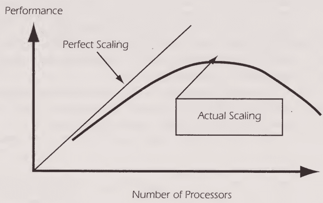


`Linux` 内核开发者的主要关注点是如何让 `Linux` 在大型多处理器服务器上良好运行。

序列化是操作系统在多处理器硬件上的主要约束。实现 `SMP` 架构的系统具有单个物理地址空间和内核虚拟地址空间。操作系统的单个映像由系统上安装的所有处理器共享。这种对称性源于处理器；不存在负责执行所有内核代码和处理中断的主处理器。所有处理器都可以处理中断、执行内核函数等，如图 3.2 所示。

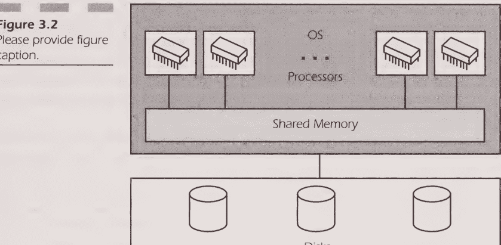

为了更好地理解自旋锁（我们也会使用术语“互斥锁”，即“`mutual exclusion`”的缩写；这两个术语可以互换使用），不妨借助另一个示例。假设内核需要向其进程列表中添加一个新进程。内核必须遍历所有进程列表，获取最后一个进程 ID 号（`PPID`），并在列表中插入一个新条目。如果在内核正在添加条目、但尚未完成之前，第二个处理器执行了内核中完全相同的代码段，试图再添加另一个进程，那么第二个处理器将获得相同的新进程 ID 号，进程列表可能会因此损坏。因此，插入新进程的整个代码段必须进行“互斥处理”。内核通过在进入关键代码段之前将变量设置为 −1，并在完成后将该变量加 +1 以表示自旋锁/互斥锁结束，从而实现这一点。该数据结构及其定义附在本节末尾：

```text
linux/smp_lock.h
linux/smp.h
```

如果另一个处理器想要执行相同的代码段，它在进入之前会测试该变量；这个第二个处理器会看到变量已被设置为 −1；只要该变量保持负值，第二个处理器就必须等待，直到能够进入关键代码段。一旦第一个处理器退出该区域，它会向该变量加 1。现在值为 0，第二个处理器可以进入该区域，并立即再次将变量设置为 −1，从而防止其他处理器执行该区域。

自旋锁有两种形式：自适应 和 自旋。当内核代码段尝试获取互斥锁时，如果锁正被持有，线程可以做两件事之一：自旋 或 阻塞。在自旋锁上自旋意味着简单地执行一个紧密循环，在循环的每次迭代中尝试获取锁。阻塞意味着让线程进入睡眠状态。

两种方法各有利弊。自旋的优点是不需要在处理器中进行上下文切换，因此，一旦获取了锁，执行就会继续。节省上下文切换对性能至关重要。上下文切换后，正在执行的任务可能发现其缓存行不在一级或二级缓存中，从而导致通过总线访问速度慢得多的内存模块。缺点是，在自旋期间会消耗一个处理器。

阻塞可以释放处理器，因为被阻塞的任务进入睡眠状态，处理器切换上下文到另一个任务，从而将其释放出来用于其他工作。然而，阻塞需要在线程可用时将其切换回来的开销，以及处理唤醒机制的一般开销。

自适应自旋锁以动态方式处理这些选择。当内核任务尝试获取锁时，如果自旋锁当前由另一个任务拥有，系统会检查任务的状态。如果持有锁的任务正在运行，那么试图获取锁的内核任务将自旋，假设正在运行的任务很快就会释放锁。如果锁的持有者（其拥有者任务）正在睡眠，那么想要获取锁的任务也会阻塞（睡眠），因为消耗处理器自旋并等待持有者醒来并释放锁没有意义。`Linux` 内核中的大多数互斥锁都是自适应的。自旋锁仅用于不允许上下文切换的锁，例如最高优先级的上半部分中断，如定时器。在内核任务因互斥锁或 读者/写者锁 而阻塞的情况下（读者/写者锁不是自适应的——持有写锁总是导致睡眠），使用带有超时的睡眠队列（参见本章后面关于中断处理的文本），并在锁可用时同步唤醒。

`UNIX` 内核中有成千上万个这样的关键代码区域。为所有这些区域制定健全且优化的锁定策略对于良好的 `SMP` 性能至关重要。多年来，`Linux` 已经发展出优秀的 `SMP` 能力。即将推出的 2.5 系列内核无疑会进一步提高这一能力。

## 数据结构—linux/smp.h

```c
#ifndef LINUX_SMP_H
#define LINUX_SMP_H

/*
 *   通用 SMP 支持
 *   Alan Cox. <alan@redhat.com>
 */

#ifndef __SMP__

#include <asm/smp.h>

/*
 * 主要跨 CPU 接口，处理 INIT、TLB 刷新、STOP 等。
 * （定义在 asm 头文件中）：
 */

/*
 * 停止所有 CPU，但当前 CPU 除外：
 */
extern void smp_send_stop(void);
/*
 * 向另一个 CPU 发送“重新调度”事件：
 */
extern void FASTCALL(smp_send_reschedule(int CPU));

/*
 * 启动处理器调用，加载其他 CPU：
 */
extern void smp_boot_cpu(void);

/*
 * 处理器调用入口。必须保持处理器直到 ...
 */
extern void smp_callin(void);

/*
 * 多处理器现在可以调度
 */
extern void smp_commence(void);

/*
 * 在所有其他处理器上调用函数
 */
extern int smp_call_function (void (*func) (void * info), void *info,
                              int retry, int wait);

/*
 * 每进程空闲 fork 后的 true 标志
 */
extern int smp_threads_ready;

extern int smp_num_cpu;

extern volatile unsigned long smp_msg_data;
extern volatile int smp_src_cpu;
extern volatile int smp_msg_id;
#define MSG_ALL_BUT_SELF        0x8000   /* 假设 <32768 个 CPU */
#define MSG_ALL                 0x8001


#define MSG_INVALIDATE_TLB      0x0001   /* 远程处理器 TLB 无效化 */
#define MSG_STOP_CPU            0x0002   /* 发送以关闭从属 CPU
                                           * 当重启时
                                           */
#define MSG_RE_SCHEDULE         0x0003   /* 来自主 CPU 的重新调度请求 */
#define MSG_CALL_FUNCTION       0x0004   /* 在所有其他 CPU 上调用函数 */

#else

/*
 *       这些宏将 SMP 功能折叠到单 CPU 系统中
 */

#define smp_num_cpus                  1
#define smp_processor_id ()           0
#define hard_smp_processor_id ()      0
#define smp_threads_ready             1
#define kernel_lock ()
#define cpu_logical_map (cpu)         0
#define cpu_number_map (cpu)          0
#define smp_call_function (func, info, retry, wait) ({ 0; })

#endif
#endif
```

### 数据结构 linux/smp_lock.h

```c
#ifndef LINUX_SMP_LOCK_H
#define LINUX_SMP_LOCK_H

#if defined(__SMP__)

#define lock_kernel()                       do { } while(0)
#define unlock_kernel()                     do { } while(0)
#define release_kernel_lock(task, cpu)       do { } while(0)
#define reacquire_kernel_lock(task)          do { } while(0)


#include <asm/smplock.h>

#endif /* __SMP__ */

#endif
```

### 设备处理


Linux 内核中的所有设备处理都是通过`特殊文件`进行的。特殊文件在文件系统树结构中作为`/dev`下的普通文件出现。然而，这些特殊文件不使用空间。相反，这些特殊文件是设备驱动程序的链接。设备驱动程序要么包含在内核中，要么通过内核模块机制按需调用。通常，系统管理员决定是将驱动程序编译到内核中还是使其成为可加载模块。将驱动程序编译在内核内部会略微增加内核二进制映像的大小，直到它可能无法放入单个软盘。然而，使用可加载模块会增加首次访问设备的响应时间，因为内核必须先定位模块并将其附加到自身。

由于本书针对的是服务器而不是较小的安装环境，内核稍大的问题不予考虑。除了测试和/或内核维护任务外，服务器从软盘启动的情况鲜有听闻。向内核添加几 KB 并不是值得担忧的原因。在一台具有 1GB 内存的机器上，如我们稍后将看到的，内核结构完整的组合轻松占用多达 50MB。

当进程打开一个特殊文件时，内核将所有读和写请求重定向到相应的设备驱动程序。驱动程序随后代表进程执行原始的读或写操作。特殊文件有两种类型：`块模式设备` 和 `字符模式设备`。所有这些设备共享相同的元信息：

- 类型（块或字符）。
- 主设备号（标识设备控制器的编号，例如磁盘的 IDE 控制器）。
- 次设备号（标识控制器内实际设备的编号）。

## 块设备处理

所有将内部数据结构化为块的设备（如磁盘、软盘和 CD-ROM）都以块（或更准确地说，以数据块）的形式读取或写入数据。内核缓冲区缓存优化了与块之间的读写操作。

由于理解后文所涉及的概念是必要的，我们必须讨论磁盘设备访问的基本概念。

### 磁盘访问时间组成：磁盘 I/O 操作的路径

这里我们将考察 SCSI 磁盘，因为 IDE 磁盘真的不值得放入一台有尊严的 Linux 服务器中；IDE 控制器在等待磁盘 I/O 完成时不会从总线断开连接。在像 Linux 这样多用户、多任务的环境中，这显然对性能有害——轻描淡写地说。

一个简单的 SCSI 子系统由四个主要组件组成：宿主机、SCSI 宿主适配器、嵌入式目标控制器以及磁盘机构本身。当操作系统收到来自用户的 I/O 请求时，它会将请求转换为 SCSI 命令序列。发起请求的进程会被阻塞，直到 I/O 操作完成，除非该请求是同步发出的（在某些应用中这样做是有意义的）。然后，命令序列通过宿主机的 I/O 总线（如 PCI、ISA、SBUS、Channels 等）传输到 SCSI 宿主适配器。宿主适配器随后承担起与目标控制器及其设备交互的责任。

接下来，当总线可用时，宿主适配器通过拉高 SCSI 总线上的控制线来选择目标；这段时间被称为`选择阶段`。当目标对选择做出响应时，宿主适配器将命令传输给目标；这段时间被称为`命令阶段`。

如果目标能够立即满足命令（可能是从其缓存中），它会返回请求的数据或状态。如果操作是读取，数据通常不可用，因此目标会断开连接，从而释放 SCSI 总线以供其他操作使用。如果操作是写入，`数据阶段`会紧随命令阶段在总线上发生；数据被传输到目标的缓存中，然后目标断开连接。

写入操作在数据实际写入磁盘盘片之前`不会`得到确认。这是因为目标控制器的缓存容易受到断电影响。在某些单元上，可以配备不间断电源（UPS），并且可以指示磁盘控制器在数据进入缓存时立即确认写入。这能极大地提高性能。

### 机械磁盘操作

将磁盘臂径向移动（寻道）需要 0.5 到 40 毫秒的时间，具体取决于臂实际需要移动的距离。另一种机械操作，即等待盘片旋转直到目标块滑到磁头下方，需要 4.2 到 8.6 毫秒。这种延迟被称为`旋转延迟`。将数据从盘片传输到磁盘 RAM（或反之）的实际时间被称为`内部传输时间`，这取决于盘片的旋转速度以及数据记录在盘片上的密度。虽然对于任何给定的磁盘，旋转速度是恒定的，但记录密度通常是可变的。对于典型的磁盘驱动器，内部传输速度在 2MB/sec 到 7MB/sec 之间变化。数据从磁盘盘片传输到所有 SCSI 磁盘嵌入式智能磁盘控制器中。对于典型的 8KB I/O 请求，内部传输消耗 1 到 4 毫秒。此外，I/O 请求在处理时会在操作系统中花费 0.5 到 2 毫秒（取决于宿主处理器的速度）。最后，数据必须通过 SCSI 总线传输。在快速/宽 SCSI 总线 20MB/sec 的速度下，典型的 I/O 还需要额外 0.39 毫秒。因此，在平均情况下，假设所有路径都没有竞争，一次 I/O 大约需要 28 到 30 毫秒。在像 UNIX 这样的多用户、多任务环境中，基本上所有 I/O 都是随机行为的；也就是说，它们分布在整个磁盘和磁盘单元上。

### RAID 力挽狂澜

通过`条带化`（RAID 0 和 1）和`镜像`可以获得最佳性能。如果你将数据库条带化分布在几个磁盘上，并额外进行镜像，RAID 控制器的逻辑会确保将 I/O 分布到尽可能多的磁盘上，从而更快地将所需数据返回给用户进程。

怎么强调都不为过：不要在一个磁盘上存储太多数据。使用一个 18GB 磁盘来代替安装和维护三四个较小的磁盘是有诱惑力的。专业的系统管理员必须抵制这种诱惑。我们需要说明原因吗？好吧，为了报告的完整性，让我们再重复一遍。在一个例如 2GB 的磁盘上，你有 x 个 I/O 通过上述整个链路。在一个 18GB 的磁盘上，你将通过相同的总线、相同的控制器和相同的磁盘设备拥有 9x 的 I/O。无论新的 18GB 或 31GB 磁盘有多快，它们永远无法弥补与小设备相比访问时间的线性增加。

### 字符设备处理

所有要求内核逐字节发送或接收数据的设备都是`字符设备`。终端、调制解调器和打印机都属于此设备类型。在 PC 系统（无论是工作站还是服务器）上，访问设备（声卡、SCSI 控制器、图形适配器）的主要机制是`直接内存访问`（DMA）。DMA 实际上是这些设备中可通过 RAM 映射的一块内存区域。这允许通过写入特定的 RAM 位置来访问这些设备的寄存器。因此，DMA 的正确处理对于内核识别和管理连接到 DMA 控制器的那些设备（大多数设备）至关重要。

### DMA 操作

大多数 64 位平台都有特殊的硬件，将总线地址（DMA 地址）转换为物理地址，类似于页表和/或`转换旁路缓冲器`（TLB）将虚拟地址转换为物理地址。这是必要的，以便例如 PCI 设备可以通过单个地址周期（32 位 DMA 地址）访问 64 位物理地址空间中的任何页。

在之前的 Linux 中，像 Alpha 这样的 64 位平台必须对系统中的最大 RAM 大小设置人为限制，以便 `virt_to_bus()` 静态方案能够工作（DMA 地址转换表在启动时填充，以将每个总线地址映射到物理页 `__pa`(`bus_to_virt()`)）。

为了让 Linux 使用动态 DMA 映射，它需要驱动程序的一些帮助。必须考虑到 DMA 地址只应在实际使用期间映射，并在 DMA 传输后取消映射。当然，以下 API 在没有这种硬件的平台上也能工作。

首先，必须确保驱动程序代码中包含：

```c
#include <linux/pci.h>
```

该文件将获取 `dma_addr_t` 类型的定义，该类型应在使用从 DMA 映射函数返回的 DMA（总线）地址的所有地方使用。

### DMA 地址限制

设备可能存在 DMA 寻址限制。例如，某些设备仅能在 PCI 总线上驱动地址的低 24 位进行 DMA 传输。为了正确运行，驱动程序必须在设备探测例程中询问 PCI 层，查看机器上的 PCI 控制器是否能正确支持该设备的 DMA 寻址限制。此查询通过对 `pci_dma_supported()` 的调用完成：

```c
int pci_dma_supported(struct pci_dev *pdev, dma_addr_t device_mask)
```

这里，`pdev` 是指向设备 PCI 设备结构的指针，`device_mask` 是一个位掩码，描述该设备支持 PCI 地址的哪些位。如果适配器卡能在机器上正确执行 DMA，则返回非零。如果返回零，则设备无法在此平台上正确执行 DMA，尝试这样做将导致未定义行为。在失败的情况下，有两种选择：

1. 如果可能，使用某些非 DMA 模式进行数据传输。
2. 忽略此设备并不初始化它。

建议驱动程序向 Syslog 打印内核 `KERN_WARN` 消息，指示选择了哪种选项。这有助于调试过程。

因此，如果例如你的设备在 PCI 总线主控期间只能驱动地址的低 24 位，你可能会做类似这样的事情：

```c
if (! pci_dma_supported(pdev, 0x00FFFFFF))
    goto ignore_this_device;
```

## DMA 映射的类型

DMA 映射有两种类型，`一致性`（consistent）和`流式`（streaming）。

一致性 DMA 映射通常在驱动程序初始化时进行映射，并在驱动程序初始化结束时解除映射。硬件应保证设备和 CPU 可以并行访问数据，并且无需显式软件刷新即可看到彼此所做的更新。

一致性映射的良好应用包括：

- 网络卡 DMA 环形描述符。
- SCSI 适配器的邮箱命令数据结构。
- 从主内存执行的设备固件微代码。


这些示例共同要求的不变条件是，任何 CPU 到内存的存储操作都能立即被设备看到，反之亦然。一致性映射保证了这一点。

流式 DMA 映射通常是为一次 DMA 传输进行映射，并在传输完成后立即解除映射（除非你使用下面的 `pci_dma_sync`）。硬件可以为顺序访问优化流式映射。

流式映射的良好应用包括：

- 设备发送或接收的网络缓冲区。

- SCSI 设备写入或读取的文件系统缓冲区。

流式映射的接口是这样设计的，使得实现者可以根据硬件允许的性能优化进行优化。为此，在使用此类映射时，你必须明确说明你希望发生什么。

## 使用一致性 DMA 映射

要分配并映射一个一致性 DMA 区域，你应该输入：

```c
dma_addr_t dma_handle;
cpu_addr = pci_alloc_consistent(dev, size, &dma_handle);
```

其中 `dev` 是一个 `struct pci_dev`。对于设备没有 `struct pci_dev` 的 PCI 类总线（如 ISA 和 EISA），你应该传入 `NULL`。需要这个参数是因为 DMA 翻译可能是总线特定的（并且通常是专属于设备所连接的总线的）。

`size` 参数是驱动程序需要分配的区域长度。

该例程为该区域分配 RAM，因此其作用类似于 `__get_free_pages`，但它接受的是大小而不是页面顺序。它返回两个值：虚拟地址（你可以使用它从 CPU 访问该区域）和 `dma_handle`（你将其传递给卡）。

CPU 返回地址和 DMA 总线主控地址都保证对齐到大于或等于请求大小的最小 `PAGE_SIZE` 顺序。这个不变条件的存在（例如）是为了保证，如果你分配一个小于或等于 64 千节的块，你收到的缓冲区范围不会跨越 64K 边界。

要解除映射并释放这样的 DMA 区域，驱动程序调用：

```c
pci_free_consistent(dev, size, cpu_addr, dma_handle);
```

其中 `dev, size` 与上述调用中的相同，`cpu_addr` 和 `dma_handle` 是 `pci_alloc_consistent` 返回给你的值。

### DMA 方向

下面描述的接口接受一个 DMA 方向参数，它是一个整数，取以下值之一：

- `PCI_DMA_BIDIRECTIONAL`

- `PCI_DMA_TODEVICE`

- `PCI_DMA_FROMDEVICE`

- `PCI_DMA_NONE`

如果你知道确切的 DMA 方向，请提供它。

值 `PCI_DMA_TODEVICE` 表示“从主内存到 PCI 设备”；`PCI_DMA_FROMDEVICE` 表示“从 PCI 设备到主内存。”强烈建议设备驱动程序开发者尽可能精确地指定这一点。

如果你绝对无法知道 DMA 传输的方向，请指定 `PCI_DMA_BIDIRECTIONAL`。这意味着 DMA 可以朝任一方向进行。平台保证你可以合法地指定这一点并且它会起作用，但这可能会以牺牲性能为代价。

值 `PCI_DMA_NONE` 用于调试。可以在你尚未得知 DMA 传输的确切方向之前，将此值保留在数据结构中。这有助于捕获方向跟踪逻辑未能正确设置参数的情况。

精确指定此值的另一个优势（除了潜在的平台特定优化外）在于调试。有些平台实际上有一个写权限布尔标志，可以用它来标记 DMA 映射，就像用户程序中的页面保护一样。此类平台可以并且确实会在内核日志中报告错误，当 PCI 控制器硬件检测到权限设置违规时。

只有流式映射指定方向；一致性映射隐含具有 `PCI_DMA_BIDIRECTIONAL` 的方向属性设置。

SCSI 子系统提供了机制，让你可以轻松获取在 SCSI 命令中使用的方向：

```c
scsi_to_pci_dma_dir(SCSI_DIRECTION)
```

其中 `SCSI_DIRECTION` 是从你的驱动程序正在处理的 SCSI 命令的 `sc_data_direction` 成员中获取的。上面提到的接口返回一个适合传递给下面流式 DMA 映射接口的值。

对于网络驱动程序，这是一件相当简单的事情。对于传输数据包，使用 `PCI_DMA_TODEVICE` 方向说明符进行映射和解除映射。对于接收数据包，则正好相反：使用 `PCI_DMA_FROMDEVICE` 方向说明符进行映射和解除映射。

## 使用流式 DMA 映射

流式 DMA 映射例程可以从中断上下文中调用。每种映射/解除映射都有两个版本，其中一个映射或解除映射单个内存区域，另一个映射或解除映射分散列表。

要映射单个区域，请输入：

```c
dma_addr_t dma_handle;
dma_handle = pci_map_single(dev, addr, size, direction);
```

要解除映射，请输入：

```c
pci_unmap_single(dev, dma_handle, size, direction);
```

你应该在 DMA 活动完成时调用 `pci_unmap_single`，例如，当中断状态告诉你 DMA 传输已完成时。

同样，对于分散列表，通过输入以下内容来映射从几个区域收集的缓冲区：

```c
int i, count = pci_map_sg(dev, sglst, nents, direction);
struct scatterlist *sg;
for (i = 0, sg = sglst; i < count; i++, sg++) {
    hw_address[i] = sg_dma_address(sg);
    hw_len[i] = sg_dma_len(sg);
}
```

其中 `nents` 是 `sglist` 中的条目数。

实现可以将几个连续的 `sglist` 条目合并为一个，并返回其映射到的实际 `sg` 条目数量。例如，如果 DMA 映射以 `PAGE_SIZE` 粒度完成，那么任何连续的 `sglist` 条目都可以合并为一个——前提是第一个条目结束且第二个条目开始于页面边界。事实上，这对于无法进行分散聚集或具有非常有限的分散聚集条目数量的卡来说是一个巨大的优势。

在这种情况下，你应该循环 `count` 次（这可能少于 `nents` 次），并使用 `sg_dma_address()` 和 `sg_dma_length()` 宏，而不是像上面所示那样访问 `sg->address` 和 `sg->length`。

要解除分散列表的映射，只需调用：

```c
pci_unmap_sg(dev, sglst, nents);
```

确保 DMA 活动已完成。

> **注意**
>
> `pci_unmap_sg` 调用中的 `nents` 参数必须与你传入 `pci_map_sg` 调用的相同；它不应该是 `pci_map_sg` 调用返回的 `count` 值。

每个 `pci_map_(single,sg)` 调用都应该有对应的 `pci_unmap_(single,sg)` 调用，因为总线地址空间是一种共享资源（尽管在某些端口中，映射是每个总线的，因此竞争同一总线地址空间的设备更少）。你可能会通过消耗所有总线地址而使机器无法使用。

如果你需要多次使用相同的流式 DMA 区域，并且在 DMA 传输之间接触数据，只需使用 `pci_map_(single,sg)` 映射该区域即可。每次 DMA 传输后，调用以下任一命令：

```c
pci_dma_sync_single(dev, dma_handle, size, direction);
```

或者：

```c
pci_dma_sync_sg(dev, sglist, nents, direction);
```

并且在最后一次 DMA 传输后，调用一个 DMA 解除映射例程 `pci_unmap_(single,sg)`。如果你没有接触第一个 `pci_map*` 的数据，并直接调用 `pci_unmap*`，那么你根本不需要调用 `pci_sync*` 例程。

下面是一些伪代码，展示了你需要使用 `pci_dma_sync_*( )` 接口的一种情况。


```c
my_card_setup_receive_buffer(struct my_card *cp, char *buffer, int len)
{
    dma_addr_t mapping;

    mapping = pci_map_single(cp->pdev, buffer, len, PCI_DMA_FROMDEVICE);
    cp->rx_buf = buffer;
    cp->rx_len = len;
    cp->rx_dma = mapping;
    give_rx_buf_to_card(cp);
}

...

my_card_interrupt_handler(int irq, void *devid, struct pt_regs *regs)
{
    struct my_card *cp = devid;
    ...
    if (read_card_status(cp) == RX_BUF_TRANSFERRED) {
        struct my_card_header *hp;

        /* 检查头部以查看我们是否希望
        * 接受数据。但首先要同步
        * DMA 传输与 CPU，
        * 以便我们看到更新的内容。
        */
        pci_dma_sync_single(cp->pdev, cp->rx_buf, cp->rx_len,
                           PCI_DMA_FROMDEVICE);

        /* 现在检查缓冲区是安全的。 */
        hp = (struct my_card_header *) cp->rx_buf;
        if (header_is_ok(hp)) {
            pci_unmap_single(cp->pdev, cp->rx_buf, cp->rx_len,
                            PCI_DMA_FROMDEVICE);
            pass_to_upper_layers(cp->rx_buf);
            make_and_setup_new_rx_buf(cp);
        } else {
            /* 只需将缓冲区交还给卡。 */
            // ...
        }
    }
}
```

已经完全转换到该接口的驱动程序不应再使用`virt_to_bus`，也不应使用`bus_to_virt`。由于动态 DMA 映射方案中不再有`bus_to_virt`的等效物，某些驱动程序需要进行少量修改；您必须始终将`pci_alloc_consistent`和`pci_map_single`调用返回的 DMA 地址（如果平台在硬件中支持动态 DMA 映射，`pci_map_sg`会将它们存储在分散列表本身中）保存在您的驱动程序结构体中，以及/或者在卡寄存器中。

## 中断处理

对于操作系统开发人员来说，中断是生活中重大且不愉快的事实。在编写中断处理代码时必须极其小心。在这里，对运行系统动态的完整而深刻的理解至关重要，或许比代码中的其他任何地方都更重要。它们丑陋、复杂，并且真的应该由硬件或某处隐藏起来，以免打扰操作系统开发人员。由于这不可能，操作系统开发人员所能做的最好事情就是将中断处理例程深藏在内核的深处，使得内核的其他任何部分都不必处理中断。这正是 Linux 内核所做的。

例如，Linux 设备驱动程序并不了解中断的概念；它们只是发出 I/O 请求，并让内核去处理由该 I/O 操作产生的中断。

作为一个很好的例子，查看定时器中断处理程序的源代码很有帮助。`定时器`就像你床边的闹钟。它被设置为一个微秒级的时间值，当该值倒计时归零时返回。

内核定时器中断处理程序是位于`kernel/timer.c`中的`do_timer()`：

```c
void do_timer(struct pt_regs * regs)
{
	(*(unsigned long *)&jiffies)++;
	lost_ticks++;
	mark_bh(TIMER_BH);
	if (!user_mode(regs))
		lost_ticks_system++;
	if (tq_timer)
		mark_bh(TQUEUE_BH);
}
```

这段代码首先将全局`jiffies`变量增加一，然后标记相应的定时器`下半部分处理程序`（bottom-half handler）以便运行。`Jiffie`是 Linux 中对执行单位的名词。在 IA32 (i386) 机器上，它通常是 10 毫秒。下半部分处理程序在 IRQ 例程返回后立即运行。下半部分处理程序是特殊的`软中断例程`，类似于 NT 的（延迟过程调用 DPC$^{4}$）概念。

定时器中断还处理`丢失的中断`。例如，如果定时器下半部分执行时间过长（例如，因为有非常高的中断负载到达系统），可能会出现新的定时器中断在定时器下半部分完成执行之前到达的情况。这在较快的机器上不会发生，但在较慢的系统上这是一种必须考虑的可能性。

定时器下半部分处理程序是实际执行时间和定时器处理任务的地方。函数`timer_bh()`实际上运行所有内核定时器及其回调函数：

```c
void timer_bh(void)
{
    update_times();
    run_old_timers();
    run_timer_list();
}
```

`update_times()`处理日时间计算、系统负载计算以及每个进程的时间和处理器使用率统计。

代码片段`run_old_timers()`只是古老的 Linux 代码；它可能会在 2.5 版本中被移除。它是一个简单的定时器实现，仍在少数地方使用。

实际的 Linux 定时器代码位于`run_timer_list()`中。

Linux 定时器具有高度可扩展性。在繁忙的互联网服务器上，可以同时运行超过 100,000 个定时器。Linux 定时器实现是一个非常巧妙的技巧，由 Arne Gangstad 编写，也被专有操作系统厂商复制。该技巧在于保持`指数`超时值，而不是`绝对`超时值。其实现代码位于定时器向量（kernel/timer.c）中，如下所示：

```c
struct timer_vec {
  int index;
  struct timer_list *vec[TVN_SIZE];
};

struct timer_vec_root {
  int index;
  struct timer_list *vec[TVR_SIZE];
};

static struct timer_vec tv5 = { 0 };
static struct timer_vec tv4 = { 0 };
static struct timer_vec tv3 = { 0 };
static struct timer_vec tv2 = { 0 };
static struct timer_vec_root tv1 = { 0 };
```

每个定时器向量都是定时器环形列表的数组。定时器根据相对于当前时间的超时值进行排序。短期定时器被放入`tv1`，具有较大超时的定时器被放入`tv2`、`tv3`等。定时器向量的寻址是指数的：超时值被划分为位段，最高阶非零位段显示使用哪个定时器向量。

现在到了精彩的部分。在每次定时器中断时，所有定时器都必须推进，因为它们的超时值减 1。显然，我们不想对比如说 100,000 个定时器都这样做，因此使用了以下技巧。定时器向量有一个当前指针（`index`），如果前一个时间向量溢出，则它增加 1。也就是说，`tv1`的索引从 0 推进到 255；一旦达到 256，我们将`tv2`推进 1，并将`tv1`的索引设置为 0。如果`tv2`溢出到 64，则`tv3`推进 1，且`tv2`索引设置为零。如果`tv3`溢出到 64，则`tv4`推进，以此类推。如您所见，`tv1`索引在每次定时器滴答（`jiffy`）时增加，`tv2`索引每 256 次滴答增加，`tv3`索引每 256×64 次滴答增加，`tv4`索引每 256×64×64 次滴答增加，以此类推。短期定时器非常常见，因此`tv1`被增加以容纳 256 个定时器列表项。

此外，如果当前索引（刚刚增加的那个）有一个非零项，则该项必须“过期”：


```c
static inline void run_timer_list(void)
{
  spin_lock_irq(&timerlist_lock);
  while ((long)(jiffies - timer_jiffies) >= 0) {
    struct timer_list *timer;

    if (!tv1.index) {
      int n = 1;
      do {
        cascade_timers(tvecs[n]);
      } while (tvecs[n]->index == 1 && ++n < NOOP_TVECS);
    }

    while ((timer = tv1.vec[tvl.index])) {
      void (*fn)(unsigned long) = timer->function;
      unsigned long data = timer->data;
      detach_timer(timer);
      timer->next = timer->prev = NULL;
      spin_unlock_irq(&timerlist_lock);
      fn(data);
      spin_lock_irq(&timerlist_lock);
    }

    ++timer_jiffies;
    tvl.index = (tv1.index + 1) & TVR_MASK;
  }
  spin_unlock_irq(&timerlist_lock);
}
```

在 `tv1` 过期的情况下，必须运行所有定时器（即必须执行定时器函数）。对于 `tv2`、`tv3` 和其他向量，“过期”意味着必须将该定时器列表中的所有定时器移动到低一级的定时器向量中。这是由 `cascade_timers()` 完成的。

这种方法的优势是什么？优势在于 `add_timer()`、`del_timer()` 和 `modify_timer()` 以恒定时间执行，与系统中的定时器数量无关。我发现有很大比例的长期定时器在其过期之前被删除，特别是在网络代码中。在这种情况下，处理过期不会付出任何代价。

级联和使定时器过期也非常快。有 Linux SMP 系统演示显示，超过 400 万个定时器正在运行和过期，内核可以轻松应对。

从 SMP 可扩展性的角度来看，定时器过期部分特别有趣：

```c
while ((timer = tv1.vec[tvl.index])) {
  void (*fn)(unsigned long) = timer->function;
  unsigned long data = timer->data;
  detach_timer(timer);
  timer->next = timer->prev = NULL;
  spin_unlock_irq(&timerlist_lock);
  fn(data);
  spin_lock_irq(&timerlist_lock);
}
```

请注意，在执行（用户提供的）定时器函数之前，定时器列表自旋锁被解锁。这极大地提高了 SMP 可扩展性，并且是任何 UNIX 风格操作系统中最可扩展的 IRQ 处理代码。

作为一个基于内核的良好示例，实现用于过期定时器的测量机制是有意义的。为了测量系统中的定时器过期速率，您必须编写一个简单的内核模块并使用 `add_timer()`。在这个例子中，我们使用一个 10 秒的定时器：

```c
DECLARE_WAIT_QUEUE_HEAD(timer_sleep);
void your_handler (unsigned long private_data)
{
        printk("timer expired, data got: %01x.\n", private_data);
        wake_up(&timer_sleep);
}

int init_module(void)
{
        struct timer_list *timer;

        timer = kmalloc(sizeof(*timer));
        memset(timer, 0, sizeof(*timer));

        timer->function = your_handler;
        timer->expires = jiffies + 10*HZ;
        add_timer(timer);

        printk("waiting for timer ...\n");
        sleep_on(&timer_sleep);
        printk("timer finished, good.\n");
        del_timer(timer);

        return -1; // fake error, thus the module wont stay
}

int cleanup_module (void)
{
        // doesnt actually get called
        return 0;
}
```

另一个网络 IRQ 处理的良好例子，其中 IRQ 以非常高的速率发生，特别是对于千兆比特设备，是在数据包到达时，网络驱动程序从网络硬件的结构中出队数据包，确认 IRQ，然后返回。下半部分处理程序 `NET_BH` 处理数据包，计算校验和（如果硬件没有直接计算校验和），将数据包加入套接字处理器，并更改套接字状态。`NET_BH` 的总处理时间可能只有几毫秒，而硬件中断

它们仍以高频率不断到达。如果我们在中断处理程序中完成所有工作，那么未确认的中断信号将导致硬件停滞，同时也会阻碍新数据包的到达。

在最新的内核版本（`2.3.48`）中，Ingo Molnar 和其他开发者引入了*任务片段*（`tasklets`）的概念，这是 SMP（对称多处理）可扩展的下半部处理程序的等价物。目前，一种类型的下半部处理程序假定 SMP 排他性。其他类型可能并行执行得没问题，但同一类型的下半部处理程序不能并行执行（且中断处理程序也可以与下半部处理程序并行执行）。这些任务片段的代码已从 `2.3.48` 版本进入 Linux 内核。

## 数据结构——`linux/interrupt.h`

```c
/* Tasklets --- multithreaded analogue of BHs.

Main feature differing them of generic softirqs: tasklet
is running only on one simultaneously.

Main feature differing them of BHs: different tasklets
may be run simultaneously on different CPUs.

Properties:
* If tasklet_schedule() is called, then tasklet is guaranteed
to be executed on some cpu at least once after this.
* If the tasklet is already scheduled, but its execution is still not
started, it will be executed only once.
* If this tasklet is already running on another CPU (or schedule is called
from tasklet itself), it is rescheduled for later.
* Tasklet is strictly serialized with regard to itself, but not
with regard to other tasklets. If client needs some intertask synchronization,
it makes it with spinlocks.
*/

struct tasklet_struct
{
   struct tasklet_struct *next;
   unsigned long state;
   atomic_t count;
   void (*func)(unsigned long);
   unsigned long data;
};
```

最新内核中的另一个新特性是 SMP 中断亲和性（IRQ affinity），由 Ingo Molnar 设计和实现。`cat /proc/irq/IRQ#/smp_affinity` 的输出指定了给定中断源允许的目标 CPU。

此特性通过允许的 CPU 位掩码实现。它实际上不能关闭所有 CPU，如果中断控制器不支持中断亲和性，则值不会从默认值 `0xffffffff` 改变。

以下是一个将 `IRQ44`（`eth1`）限制在 CPU 0 到 3，然后将中断限制在 CPU 4 到 8 的示例（在一个 8-CPU 的 SMP 机器上）：


```bash
root@hatta# cat smp_affinity
ffffffff
root@hatta# echo 0f > smp_affinity
root@hatta# cat smp_affinity
000000000000000f
root@moon# ping -f ika
PING ika (192.168.1.199): 56 data bytes
--- ika ping statistics ---
29 packets transmitted, 29 packets received, 0% packet loss
round-trip min/avg/max = 0.1/0.1/0.4 ms
root@hatta# cat /proc/interrupts | grep 44:
44:      0       1785     1785     1783     1783     1        0
       IO-APIC-level eth1
root@hatta# echo f0 > smp_affinity
root@hatta# ping -f ika
PING ika (192.168.1.199): 56 data bytes
--- ika ping statistics ---
2779 packets transmitted, 2777 packets received, 0% packet loss
round-trip min/avg/max = 0.1/0.5/585.4 ms
root@hatta# cat /proc/interrupts | grep 44:
44:     1068       1785     1785     1784     1069     1070     1069     1069
       IO-APIC-level eth1
root@hatta#
```

## Linux 时间保持功能

系统对时间和日期的感知是一种软件抽象，因此并不在硬件中保留任何地方。为了使系统在重启之间保持一致的日期，显然必须使用硬件来存储和更新时间与日期。这在最低的硬件层级完成，维护用于间隔计时的硬件寄存器（计算处理器时钟滴答），以及用于存储详细日期信息（即年、月、日、时、分、秒）的更大硬件寄存器空间。操作系统中的一些软件函数仅使用间隔计数器，加上一个已知的起点，并将滴答数转换为对普通人更有意义且与计算机软件相关的内容。

当然，基于某些整数计数来确定日期和时间，如果没有参考点和计数单位（秒、毫秒等）的知识是不可能的。如今大多数可用的 UNIX 系统使用 1970 年 1 月 1 日 00:00:00 作为`纪元`（epoch），即时间计数器的参考点。换句话说，时钟计数器值维护自纪元以来的秒数，并且，借助参考日期和间隔，内核可以执行必要的算术运算，将计数器值转换为正确的日期和时间。UNIX 系统中 2038 年问题的原因是使用 1970 年 1 月 1 日作为参考日期。使用 32 位数据类型，计算自纪元以来的秒数会导致内核在 2038 年 1 月 19 日左右溢出。这个问题在 64 位内核中消失了，那里有一个 64 位数据类型用于计算自纪元以来的秒数——因此我们大约可以保证 100 亿年或更长。

所有符合 Intel MP 规范的 SMP 板都有所谓的`IO-APIC`，它实际上是一个增强的中断控制器。它允许我们将硬件中断路由到多个 CPU，或 CPU 组。

Linux 支持所有变体的符合规范的 SMP 板，包括具有多个 IO-APIC 的板。（多个 IO-APIC 用于高端服务器中进一步分配 IRQ 负载）。

在某些较旧的板上存在（少数）已知的故障，其通常由内核进行规避。如果你的符合 MP 规范的 SMP 板无法启动 Linux，请首先查阅 `linux-smp` 邮件列表存档。

如果你的机器使用启用的 IO-APIC 中断正常启动，那么你的`/proc/interrupts`看起来像这样：

```text
root @ hatta:-> cat /proc/interrupts

            CPU0
0: 1360293  IO-APIC-edge    timer
1:         4  IO-APIC-edge    keyboard
2:         0  XT-PIC     cascade
13:        1  XT-PIC     fpu
14:      1448  IO-APIC-edge    ide0
16:    28232  IO-APIC-level  Intel EtherExpress Pro 10/100 Ethernet
17:     51304  IO-APIC-level  eth0
NMI:       0
ERR:       0
```

时钟和定时器设施被内核用于必须在固定间隔执行的一般维护工作。内核（软件）设置计算机时钟（硬件）以在固定间隔生成时钟中断。每次时钟中断都会进入中断处理程序，并且此处理程序代码为内核执行间隔处理（我们将稍后更详细地查看这一点）。内核还可以使用硬件时钟进行实时性能分析或其他与时间和间隔相关的功能。Solaris 提供命令行和编程接口用于定时器和日期功能，当然包括基本的 `date(1)` 命令，该命令设置或获取内核对日期和时间的概念。

## 系统时钟

所有计算机系统——从桌面 PC 到高端多处理器系统——都有某种时钟电路。

所有 PC 都有内置的`实时时钟`（RTC）。通常，RTC 内置于计算机芯片组中，但有些可能在板上实际拥有一个 Motorola MC146818（或克隆芯片）。这是计算机关闭时保持日期和时间的时钟。同样的时钟芯片还可以用于生成从缓慢的 2Hz 到相对较快的 8192Hz 的信号，以 2 的幂为增量。时钟还可以像闹钟一样工作，在倒计时到先前存储的值时触发 IRQ 8。闹钟还可以编程为仅检查三个可编程值中的任意子集，这意味着它可以设置为例如在每小时的第 30 分钟的第 30 秒响铃。

控制实时时钟的驱动程序是 `/dev/rtc`（主设备号 10，次设备号 135，只读字符设备），它报告当前值的格式为无符号长整型。最低字节包含触发的中断类型（更新完成、闹钟响铃或周期性）；其余字节包含自上次读取以来的中断数量。如果启用了 `/proc` 文件系统，状态信息通过伪文件 `/proc/driver/rtc` 报告。用户进程可以通过对 `/dev/rtc` 执行 `read(2)` 或 `select(2)` 来监视这些中断。

在高 IRQ 负载下，有时中断会堆积，因为它们由内核的下半部 IRQ 处理程序一起处理。用户程序需要检查自上次读取以来接收的中断数量。在现代硬件上，这些 IRQ 阻塞通常发生在频率高于 4096Hz 或更高时。编程和/或启用高于 64Hz 的中断频率仅允许 root 执行。这样做是为了防止行为不端的用户程序生成大量影响整体系统性能的 IRQ。

另外，如果内核时间与外部时间源同步，内核将每 11 分钟将时间写回 CMOS 时钟。在此过程中，内核会短暂关闭 RTC 周期性中断，因此如果你正在做严肃的工作，请注意这一点。

警报和/或中断频率通过 `ioctl(2)` 调用编程到实时时钟（RTC）中，如 `include/linux/mc146818rtc.h` 中所示（参见下方的数据结构）。

以下用户程序（随 RedHat 发行版的内核文档提供）最好地说明了如何使用 ioctl 控制实时时钟：


```c
/*
 * Real Time Clock Driver Test/Example Program
 *
 * Compile with:
 * gcc -s -Wall -Wstrict-prototypes rcttest.c -o rcttest
 *
 * Copyright (C) 1996, Paul Gortmaker.
 *
 * Released under the GNU General Public License, version 2,
 * included herein by reference.
 */

#include <stdio.h>
#include <linux/mc146818rtc.h>
#include <sys/ioctl.h>
#include <sys/time.h>
#include <sys/types.h>
#include <fcntl.h>
#include <unistd.h>
#include <errno.h>

void main(void) {

int i, fd, retval, irqcount = 0;
unsigned long tmp, data;
struct rtc_time rtc_tm;

fd = open ("/dev/rtc", O_RDONLY);

if (fd == -1) {
    perror("/dev/rtc");
    exit(errno);
}

fprintf(stderr, "\n\t\t\tRTC Driver Test Example.\n\n");

/* Turn on update interrupts (one per second) */
retval = ioctl(fd, RTC_UIE_ON, 0);
if (retval == -1) {
    perror("ioctl");
    exit(errno);
}

fprintf(stderr, "Counting 5 update (1/sec) interrupts from reading /dev/rtc:");
fflush(stderr);
for (i=1; i<6; i++) {
    /* This read will block */
    retval = read(fd, &data, sizeof(unsigned long));
    if (retval == -1) {
        perror("read");
        exit(errno);
    }
    fprintf(stderr, " %d",i);
    fflush(stderr);
    irqcount++;
}
fprintf(stderr, "\nAgain, from using select(2) on /dev/rtc:");
fflush(stderr);
for (i=1; i<6; i++) {
    struct timeval tv = {5, 0}; /* 5 second timeout on select */
    fd_set readfds;
    FD_ZERO(&readfds);
    FD_SET(fd, &readfds);
    /* The select will wait until an RTC interrupt happens. */
    retval = select(fd+1, &readfds, NULL, NULL, &tv);
    if (retval == -1) {
        perror("select");
        exit(errno);
    }
    /* This read won't block unlike the select-less case above. */
    retval = read(fd, &data, sizeof(unsigned long));
    if (retval == -1) {
        perror("read");
        exit(errno);
    }
    fprintf(stderr, " %d",i);
    fflush(stderr);
    irqcount++;
}
/* Turn off update interrupts */
retval = ioctl(fd, RTC_UIE_OFF, 0);
if (retval == -1) {
    perror("ioctl");
    exit(errno);
}
/* Read the RTC time/date */
retval = ioctl(fd, RTC_RD_TIME, &rtc_tm);
if (retval == -1) {
    perror("ioctl");
    exit(errno);
}
fprintf(stderr, "\n\nCurrent RTC date/time is %d-%d-%d, %02d:%02d:%02d.\n",
    rtc_tm.tm_mday, rtc_tm.tm_mon + 1, rtc_tm.tm_year + 1900,
    rtc_tm.tm_hour, rtc_tm.tm_min, rtc_tm.tm_sec);
/* Set the alarm to 5 sec in the future, and check for rollover */
rtc_tm.tm_sec += 5;
if (rtc_tm.tm_sec >= 60) {
    rtc_tm.tm_sec %= 60;
    rtc_tm.tm_min++;
}
if (rtc_tm.tm_min == 60) {
    rtc_tm.tm_min = 0;
    rtc_tm.tm_hour++;
}
if (rtc_tm.tm_hour == 24)
    rtc_tm.tm_hour = 0;

retval = ioctl(fd, RTC_ALM_SET, &rtc_tm);
if (retval == -1) {
    perror("ioctl");
    exit(errno);
}

/* Read the current alarm settings */
retval = ioctl(fd, RTC_ALM_READ, &rtc_tm);
if (retval == -1) {
    perror("ioctl");
    exit(errno);
}

fprintf(stderr, "Alarm time now set to %02d:%02d:%02d.\n",
    rtc_tm.tm_hour, rtc_tm.tm_min, rtc_tm.tm_sec);

/* Enable alarm interrupts */
retval = ioctl(fd, RTC_AIE_ON, 0);
if (retval == -1) {
    perror("ioctl");
    exit(errno);
}

fprintf(stderr, "Waiting 5 seconds for alarm...");
fflush(stderr);
/* This blocks until the alarm ring causes an interrupt */
retval = read(fd, &data, sizeof(unsigned long));
if (retval == -1) {
    perror("read");
    exit(errno);
}
irqcount++;
fprintf(stderr, " okay. Alarm rang.\n");

/* Disable alarm interrupts */
retval = ioctl(fd, RTC_AIE_OFF, 0);
if (retval == -1) {
    perror("ioctl");
    exit(errno);
}
/* Read periodic IRQ rate */
retval = ioctl(fd, RTC_IRQP_READ, &tmp);
if (retval == -1) {
    perror("ioctl");
    exit(errno);
}

fprintf(stderr, "\nPeriodic IRQ rate was %ldHz.\n", tmp);

fprintf(stderr, "Counting 20 interrupts at:");
fflush(stderr);

/* The frequencies 128Hz, 256Hz, ... 8192Hz are only allowed for root. */
for (tmp=2; tmp<=64; tmp*=2) {
    retval = ioctl(fd, RTC_IRQP_SET, tmp);
    if (retval == -1) {
        perror("ioctl");
        exit(errno);
    )

    fprintf(stderr, "\n%ldHz:\t", tmp);
    fflush(stderr);

    /* Enable periodic interrupts */
    retval = ioctl(fd, RTC_PIE_ON, 0);
    if (retval == -1) {
        perror("ioctl");
        exit(errno);
    }

    for (i=1; i<21; i++) {
        /* This blocks */
        retval = read(fd, &data, sizeof(unsigned long));
        if (retval == -1) {
            perror("read");
            exit(errno);
        }

        fprintf(stderr, " %d", i);
        fflush(stderr);
        irqcount++;
    }

    /* Disable periodic interrupts */
    retval = ioctl(fd, RTC_PIE_OFF, 0);
    if (retval == -1) {
        perror("ioctl");
        exit(errno);
    }
}

fprintf(stderr, "\n\n\t\t\t*** Test complete ***\n");
fprintf(stderr, "\nTyping `cat /proc/interrupts` will show %d more events on IRQ 8.\n\n", irqcount);
close(fd);
} /* end main */
```


与许多（但并非所有）基于 UNIX 的操作系统一样，内核在启动时将该时钟芯片设置为每 `n` 百分之一秒向内核发出中断。通常，UNIX 机器将此值设置为每秒 100 次。在类 Solaris 的操作系统中，此值是一个可调整参数。虽然在快速硬件上让时钟每秒向内核发出少于 100 次中断没有意义，但让它更频繁地发出中断（例如每秒 1,000 次）可能是有意义的。

人类可读的时间记录是基于内核的，并通过 `gettimeofday()` 和 `settimeofday()` 系统调用（例如 `arch/i386/kernel/timer.c`）进行管理。在启动时，内核将自身与 BIOS（CMOS）时钟对齐，随后基于定时器中断更新其时间。

在这个全球化的互联网世界中，准确的时间极其重要；因此，内核还有一个网络时间协议（NTP）设施，配合 `xntpd` 使 Linux 能够跟上散布世界各地并通过互联网可访问的高精度原子时钟。非常复杂且非常精确的 NTP 协议本身由 `xntpd` 实现。内核提供了加速和减缓时间流动的功能，而不会引入用户可见的时间扭曲或时间跳跃。一个与原子时钟连接的此类 Linux 系统的示例是：

```
[mingo@s]$ date
Tue Jan 4 13:22:19 CET 2000
[mingo@s]$ ntptrace
localhost: stratum 4, offset -1.113059, sync distance 0.15135
goliath.eik.bme.hu: stratum 3, offset -1.039804, sync distance 0.05267
maze.bme.hu: stratum 2, offset -1.134906, sync distance 0.06520
hora.cs.tu-berlin.de: stratum 1, offset -1.132075, sync distance 0.00023, refid 'GPS'
```

上述 Linux 机器通过多个 NTP 服务器与一个原子时钟同步，该原子时钟每 `n` 毫秒发送一次中断。在 i386 架构上，此值通常设置为 10 毫秒。换句话说，内核将每秒唤醒 100 次。NTP 的精度在 100 微秒以内。

为了能够处理诸如设置时钟之类的维护任务，Linux 内核要求定时器以固定间隔向其发送 `IRQ`。设置此值的确切位置在内核的架构相关部分。因为每个架构可能有不同的需求，这样做的意义是显而易见的。

对于 i386，与定时器相关的一切都位于 `linux/arch/i386/kernel/time.c` 中，但实际时钟初始化发生在 `linux/arch/i386/kernel/irq.c` 中的 `init_IRQ()` 函数中：

```c
_initfunc(void init_IRQ(void))
{
[...]
/*
 * Set the clock to 100 Hz, we already have a valid
 * vector now:
 */
outb_p(0x34,0x43); /* binary, mode 2, LSB/MSB, ch 0 */
outb_p(LATCH & 0xff, 0x40); /* LSB */
outb(LATCH >> 8, 0x40); /* MSB */

[...]
}
```

其中 `LATCH` 是一个在 `linux/include/linux/timex.h` 中定义的宏：

```c
/* LATCH is used in the interval timer and ftape setup. */
#define LATCH ((CLOCK_TICK_RATE + HZ/2) / HZ)
/* For divider */
```

而 `CLOCK_TICK_RATE` 由 `linux/include/asm-i386/timex.h` 提供：

```c
#define CLOCK_TICK_RATE 1193180 /* Underlying HZ */
```

基本上公式是：

```
CLOCK_TICK_RATE / HZ --> downcount
```

然后内核将 `downcount` 写入定时器芯片。`HZ` 是我们希望实现的定时器中断频率。

在 i386 架构上，Linux 主要使用 100Hz 定时器，因为早期的 Linux 开发是在当时过时的标准下进行的，对于处理器而言，百分之一秒是一段显著的时间。现在，随着像 Alpha 芯片这样快几个数量级的处理器出现，架构在 Linux 中使用 1024Hz 定时器。

从上面的公式可以看出，若要使 IA32（Intel x86）移植版使用例如 1000Hz 的定时器，唯一需要修改的是 `HZ` 定义，这是该公式唯一的输入参数。

```text
root@hirame:~/kernel > find 2.2.13/include/asm-* -type f -exec
egrep '# *define HZ' {} /dev/null \;
2.2.13/include/asm-alpha/param.h:# define HZ 1024
2.2.13/include/asm-arm/arch-eb2s110/param.h:#define HZ 100
2.2.13/include/asm-arm/proc-arm226/param.h:#define HZ 100
2.2.13/include/asm-arm/proc-arm235/param.h:#define HZ 100
2.2.13/include/asm-arm/arch-nexuspci/param.h:#define HZ 100
2.2.13/include/asm-arm/proc-rpc/param.h:#define HZ 100
2.2.13/include/asm-arm/proc-arm0/param.h:#define HZ 100
2.2.13/include/asm-i386/param.h:#define HZ 100
2.2.13/include/asm-m68k/param.h:#define HZ 100
2.2.13/include/asm-mips/param.h:#define HZ 100
2.2.13/include/asm-ppc/param.h:#define HZ 100
2.2.13/include/asm-sparc/param.h:#define HZ 100
2.2.13/include/asm-sparc64/param.h:#define HZ 100
```

每种架构都有一个首选的 `HZ` 定义值。

虽然将 `HZ` 更改为 1,000 后内核将使用 1,000Hz 的定时器，但请注意，用户空间中运行的任何程序（如果未相应适应）仍会认为内核是以 100Hz 定时器运行的。换句话说，某些用户空间程序（如 `top`）可能会因此出错。这是因为一些数据仍以滴答数（jiffy）为单位（每秒 100 个）从内核空间导出到用户空间。

内核内部存在的这种“可见性”问题，可以通过将目前唯一的 `HZ` 拆分为内部 `HZ` 和导出到用户空间的 `HZ` 来解决。已有相关的补丁实现了这一点。它们尚未集成到内核中，仅仅是因为 100Hz 定时器似乎造成的影响不大。

值得注意的是，在 IA32-SMP 系统中，定时器中断仅用于管理系统时间并启动软件中断（下半部处理程序）。所有调度核算实际上是由 `IO-APIC` 向所有 CPU 广播生成的 SMP 定时器中断触发的（与定时器中断不同，后者在 IA32-SMP 移植版中是单播中断）。因此，如果增加定时器频率的目的是使调度更细致，在 IA32-SMP 系统中，我们应仅通过重新编程 `IO-APIC` 来改变 SMP 定时器中断的频率。`IO-APIC` 本地定时器 `IRQ` 的频率是在 `linux/arch/i386/kernel/smp.c` 文件中的 `setup_APIC_timer()` 函数内设置的。

### 数据结构——linux/mc146818rtc.h


```c
/* mc146818rtc.h - register definitions for the Real-Time-Clock / CMOS RAM
 * Copyright Torsten Duwe <duwe@informatik.uni-erlangen.de> 1993
 * derived from Data Sheet, Copyright Motorola 1984 (!).
 * It was written to be part of the Linux operating system.
 */
/* permission is hereby granted to copy, modify and redistribute this code
 * in terms of the GNU Library General Public License, Version 2 or later,
 * at your option.
 */

#ifndef _MC146818RTC_H
#define _MC146818RTC_H
#include <asm/io.h>
#include <linux/rtc.h> /* get the user-level API */

#ifndef RTC_PORT
#define RTC_PORT (x)       (0x70 + (x))
#define RTC_ALWAYS_BCD     1
#endif

#define CMOS_READ (addr) (( \
outb_p ((addr) ,RTC_PORT (0)); \
inb_p (RTC_PORT (1)); \
))
#define CMOS_WRITE (val , addr) (( \
outb_p ((addr) ,RTC_PORT (0)); \
outb_p ((val) ,RTC_PORT (1)); \
))

/*****/
** register summary *
****/
#define RTC_SECONDS        0
#define RTC_SECONDS_ALARM  1
#define RTC_MINUTES        2
#define RTC_MINUTES_ALARM  3
#define RTC_HOURS          4
#define RTC_HOURS_ALARM    5
/* RTC_*_alarm is always true if 2 MSBs are set */
# define RTC_ALARM_DONT_CARE       0xC0

#define RTC_DAY_OF_WEEK  6
#define RTC_DAY_OF_MONTH 7
#define RTC_MONTH        8
#define RTC_YEAR         9

/* control registers - Moto names
*/
#define RTC_REG_A        10
#define RTC_REG_B        11
#define RTC_REG_C        12
#define RTC_REG_D        13

/*******************************************************************
 * register details
********************************************************************/
#define RTC_FREQ_SELECT RTC_REG_A

/* update-in-progress - set to "1" 244 microseconds before RTC goes off the bus,
 * reset after update (may take 1.984ms @ 32768Hz RefClock) is complete,
 * totalling to a max high interval of 2.228 ms.
 */
# define RTC_UIP         0x80
# define RTC_DIV_CTL      0x70
/* divider control; refclock values 4.194 / 1.049 MHZ / 32.768 kHz */
# define RTC_REF_CLK_4MHZ         0x00
# define RTC_REF_CLK_1MHZ         0x10
# define RTC_REF_CLK_32KHZ        0x20
/* 2 values for divider stage reset, others for "testing purposes only" */
# define RTC_DIV_RESET1   0x60
# define RTC_DIV_RESET2   0x70
/* Periodic intr. / Square wave rate select. 0=none, 1=32.8KHz,... 15=2Hz */
# define RTC_RATE_SELECT  0x0F

/*******************************************************************
#define RTC_CONTROL      RTC_REG_B
# define RTC_SET 0x80       /* disable updates for clock setting */
# define RTC_PIE 0x40       /* periodic interrupt enable */
# define RTC_AIE 0x20       /* alarm interrupt enable */
# define RTC_UIE 0x10       /* update-finished interrupt enable */
# define RTC_SOWE 0x08      /* enable square-wave output */
# define RTC_DM_BINARY 0x04 /* all time/date values are BCD if clear */
# define RTC_24H 0x02       /* 24 hour mode - else hours bit 7 means pm */
# define RTC_DST_ON 0x01    /* auto switch DST - works f. USA only */

/*******************************************************************
#define RTC_INTR_FLAGS RTC_REG_C
/* caution - cleared by read */
# define RTC_IRQF 0x80      /* any of the following 3 is active */
# define RTC_PF 0x40
# define RTC_AF 0x20
# define RTC_UF 0x10

/*******************************************************************
#define RTC_VALID        RTC_REG_D
# define RTC_VRT 0x80       /* valid RAM and time */
/*******************************************************************

/* example: !(CMOS_READ(RTC_CONTROL) & RTC_DM_BINARY)
 * determines if the following two #defines are needed
 */
#ifndef BCD_TO_BIN
#define BCD_TO_BIN (val) (((val)=((val)&15) + ((val)>>4)*10)
#endif

#ifndef BIN_TO_BCD
#define BIN_TO_BCD (val) ((val)=((val)/10)<<4) + (val)%10)
#endif

#endif /* _MC146818RTC_H */
```

## 实时性能分析

有时，希望提高程序速度和/或消除冗余或未使用代码的开发者可能需要测量其代码每段被执行了多少次。为此，可以使用一种称为`实时性能分析`的功能，内核会保留程序执行时的实时时间戳集合，并将这些时间戳写入日志文件以供后续分析。实时性能分析需要硬件的支持才能工作。Intel 架构默认提供此类功能。如何加以利用取决于操作系统。Windows 操作系统不提供实时性能分析功能。


对于 `2.2.x` 和 `2.3.x` 内核的实时性能分析，你只需在启动内核时指定参数 `profile=4` 即可。其中的 `4` 是我通常使用的性能分析图粒度。换句话说，对于每 4 字节长的代码段，都会分配一个整数计数变量。从而生成代码段使用情况的直方图原始统计数据。

在 IA 32（Intel `i386`）架构上，性能分析程序在 UP（单处理器）模式下由定时器中断运行，在 SMP（多处理器）模式下由 SMP 本地 APIC 定时器中断运行（因此两个 CPU 都会被进行性能分析）。假设我们有一个内核镜像，范围从 `0xc0100000` 到 `c0154321`。内核性能分析器在此 EIP 范围内进行性能分析。对于每个性能分析中断（通常为 `IRQ0`），我们知道被中断的 EIP。其逻辑如下：

```c
/*
 * Only measure the CPU's specified by /proc/irq/prof_cpu_mask.
 * (default is all CPUs.)
 */
if (!(1<<smp_processor_id() & prof_cpu_mask))
    return;

if (prof_buffer) {
    eip -= (unsigned long) &_stext;
    eip >>= prof_shift;
    /*
    * Don't ignore out-of-bounds EIP values silently,
    * put them into the last histogram slot, so if
    * now, they will show up as a sharp peak.
    */
    if (eip > prof_len-1)
        eip = prof_len-1;

    atomic_inc( (atomic_t *)&prof_buffer[eip]);
}
```

`prof_cpu_mask` 是新增加的功能。它可以通过 `/proc/irq/prof_cpu_mask` 进行设置。（我们可以选择特定的 CPU 进行性能分析。尽管 Linux SMP 是完全对称的，但有时我们确实只想查看单个 CPU 的性能分析命中情况。）

在上述直方图中，`prof_shift` 是直方图的粒度；也就是说，如果粒度为 `4`，那么所有位于 `x`+0 到 `x`+15 字节内的 EIP 都被计入单个直方图数组条目。（其中 `x` 是 16 的倍数）。

可以通过 `/proc/profile` 读取性能分析信息（这将把内核性能分析缓冲区导出到用户空间）。存在一个实用工具用于解析性能分析缓冲区。`prof` 缓冲区也可以被重置：

```
root@hirame:~ > readprofile -m /boot/System.map-2.2.13aa4 | sort -nr | head -5

369 total 0.0005

133 do_wp_page 0.1614

24 copy_page_range 0.0480

19 ext2_alloc_block 0.0552

16 startup_32 0.0976
```


```
注意：原文开头存在多余的 ```，根据排版规则第5点（代码块前后加上三个反引号）及上下文逻辑，该处应为正文的延续，且原文中“133”、“0.1614”为数值，`do_wp_page`为函数名。由于原文开头直接是 ``` 且没有对应的开头语言标识，且后续是段落，这里判断原文开头的 ``` 是误植或格式错误，应移除或修正。根据示例，非代码块不应有 ```。观察原文结构，第一段是文本，不是代码。因此移除开头的 ```。

其中 `133` 是定时器 `IRQ` 在函数 `do_wp_page` 内触发的次数。大小比率 `0.1614` 是相对于正在分析的函数大小进行比较的。

内核性能分析唯一的缺点是，那些在 `IRQ` 禁用状态下运行的函数无法被进行性能分析。在 `2.3.x` 版本中，内核还包含一个频率为 `HZ` 的不可屏蔽中断（`NMI`）`IRQ`（用于自动解锁以及获取在 `IRQ` 禁用期间发生的锁死堆栈跟踪）。在 `2.3.x` 中，我们可以选择在 `NMI` 代码内部进行内核性能分析，因为性能分析代码中不存在可能的跟踪痕迹。

对内核进行性能分析的另一种方法是：不在每个定时器 `IRQ` 处递增性能分析计数，而是在每个函数之前递增。这可以利用 `gcc` 编译器的特性来实现。显然，这种性能分析方法不适用于生产环境，因为它会使系统减速过多，但它对于了解内核中调用最频繁的函数可能很有趣。

对于用户空间，GNU `gcc` 编译器通过在使用 `-pg` 选项编译时提供性能分析支持。可以使用名为 `gprof` 的实用工具在程序执行后读取性能分析信息。GNU `gcc` 的性能分析基于程序的函数调用跟踪以及由内核通过特殊的 `SIGPROF` 信号提供的 `PROF` 定时器。`PROF` 定时器可以通过 `setitimer` 接口设置。

## 实时（`TOD`）函数

有一个名为 `gettimeofday` 的系统调用。它以微秒分辨率向用户空间提供当前的系统时间和操作系统时间。内核在一个名为 `xtime` 的变量中记录系统时间，这是一个普通变量，并在每次定时器 `IRQ` 时增加。为了获得比 `0.01` 秒更精细的分辨率，我们可以使用 `IA32` 上的两种技术：

- 如果 `CPU` 是 `486` 或 `386`，在 `gettimeofday` 时，我们从定时器芯片读取倒计数器或锁存寄存器，然后计算自上次定时器 `IRQ` 以来经过的时间。最大 `TOD` 分辨率受限于定时器芯片的最高频率。
- 在奔腾及更新的芯片上，我们在每个定时器 `IRQ` 时保存时间戳计数器的值。然后，在 `gettimeofday` 时，通过比较最后保存的时间戳计数器与当前的时间戳计数器，我们发现自上次定时器 `IRQ` 以来经过了多少时间。我们知道 `CPU` 的频率，因此可以通过简单的乘法将 `CPU` 周期转换为实际时间间隔。这为我们提供了这些最新芯片上可能的最佳 `TOD` 分辨率。它比微秒精确得多，但 `gettimeofday` 接口不允许我们返回纳秒级别的信息。

现在让我们看看当定时器 `IRQ` 中断处理例程在内核中被进入时发生了什么。

一些操作系统——这里我们以 `Solaris` 为例——设置系统中存在的空闲内存水平。`Linux` 不这样做，原因有几个。最重要的是，生成一些空闲内存可能需要换出（`swapout`），但我们不能在 `IRQ` 处理程序中等候 `I/O` 完成。

> 虽然换出几乎总是异步的，但有时我们可能需要等待换入/换出 `I/O` 的完成，以确保在尝试新的内存分配之前有一些空闲内存。相反，原子空闲内存池由一个合适的内核守护进程（`kswapd`）保持空闲。

然后，显然，`IRQ` 处理程序需要检查和调整时钟以应对可能的抖动。在固定的时间间隔内，`i386` 端口在定时器 `IRQ` 中将系统时间刷新到硬件时钟（也称为 `CMOS`、实时时钟 [ `RTC` ]）。

`IRQ` 处理程序随后继续计算在前一个执行时间单元（`jiffy`）中忙碌、等待和运行的百分比。请注意，每 `CPU` 和每进程的统计只告诉每个 `CPU` 或进程是否在最后一次定时器滴答中处于用户/优先/系统/空闲模式。你无法知道最后一次滴答是否花在网络代码中，例如。

不久以前，`Andrea Arcangeli` 编写了代码来提供有关 `CPU` 和当前进程在内核 `SMP` 锁中花费了多少时间的信息。这相当有趣，因为如果你看到一个 `CPU` 把所有时间都花在内核锁上，这意味着代码对于你的目的来说 `SMP` 线程化程度不够。

负载平均值（`loadavg`）统计也都是在定时器 `IRQ` 中完成的。

基本上，我们可以将这些步骤重复为定时器 `IRQ` 路径：

- 将当前时间戳计数器和当前锁存计数保存到静态变量中，供 `gettimeofday` 使用。
- 进入所有架构的公共代码，调用 `do_timer()`。
- 因为 `do_timer()` 增加了 `jiffies` 并将该滴答记录为 `lost_ticks`，下次更新系统时钟时将读取并重置 `lost_ticks`。`lost_ticks` 是一种必要的技巧，以避免与 `gettimeofday` 发生竞态条件（竞态条件是其他任务访问同一资源时的争用情况；通常发生在设计不良的代码在 `SMP` 系统上运行时），并允许在底部半部处理程序内部进行系统时钟的更新。
- 标记定时器底部半部队列，以便在从定时器 `IRQ` 返回之前运行它（或者我们之前的某个其他 `CPU` 将允许在另一个 `CPU` 上启动它）。
- 使用被中断代码的信息更新内核性能分析（当然，只有当它是内核代码时）。
- 如果是单处理器（`UP`）系统，我们还更新每 `CPU` 和每进程的性能分析变量（因为在 `UP` 中没有 `IO-APIC SMP` 定时器 `IRQ`）。
- 检查是否到了将系统时钟刷新到 `RTC` 的时候（我们大约每 `11` 分钟做一次）。
- 返回。

现在，`IRQ` 代码（在实际执行 `iret` 之前，因此仍处于 `IRQ` 上下文中）将尝试执行底部半部处理程序，并注意到底部半部队列位字段已被设置（我们在第 `4` 点标记了它）。我们将进入 `timer_bh()`，它将更新系统时间（根据 `lost_ticks`）并运行定时器（包括旧和新定时器）。所有这些操作都将从底部半部上下文中运行，从硬件角度来看，这仍然是 `IRQ` 上下文。

当 `timer_bh` 返回后（在所有定时器都执行和轮换后），我们将实际地从定时器中断中返回。

单处理器（`UP`）和对称多处理（`SMP`）之间的区别在于，在 `UP` 中，第 (`6`) 点在定时器 `IRQ` 内执行。在 `IA-32 SMP` 中，第 (`6`) 点不在定时器中断处理程序内执行；定时器 `IRQ` 完全跳过它。相反，我们向所有 `CPU` 广播一个特殊的 `SMP` 定时器 `IRQ`，并仅在 `ioapic` 本地定时器 `IRQ` 内运行第 (`6`) 点。

## 系统初始化和启动

大多数 `Linux` 发行版通过 `initrd` 设施进行启动，这增加了引导程序加载 `RAM` 磁盘的功能。然后，该 `RAM` 磁盘可以被挂载为根文件系统，并从中运行程序。之后，可以从不同的设备挂载一个新的根文件系统。之前的根文件系统（来自 `initrd`）要么被移动到 `/initrd` 目录，要么被卸载。这就是 `Linux` 将内核映像引导到内存中，然后挂载真实文件系统的方式。

`initrd` 实用程序主要是设计用来允许系统启动分为两个阶段进行：第一阶段，内核以最少的一组编译进去的驱动程序启动；第二阶段，从 `initrd` 加载额外的模块。

使用 `initrd` 时，系统启动过程如下：

1. 引导程序加载内核和初始 `RAM` 磁盘。
2. 内核将 `initrd` 转换为“正常”的 `RAM` 磁盘，并释放 `initrd` 使用的内存。
3. `initrd` 以读写方式挂载为根文件系统。
4. 执行 `/linuxrc`（这可以是任何有效的可执行文件，包括 `shell` 脚本；它以 `uid` `0` 运行，基本上可以做 `init` 所做的任何事情）。
5. 当 `linuxrc` 终止时，挂载“真实”的根文件系统。
6. 如果存在 `/initrd` 目录，则将 `initrd` 移动到该目录。否则，卸载 `initrd`。

## `7`. 常规启动顺序

常规启动顺序（例如调用 `/sbin/init`）是在根文件系统上执行的。

请注意，将 `initrd` 从 `/` 移动到 `/initrd` 并不涉及通过 `umount()` 调用将其卸载。因此，在此过程中，仍可能有进程在 `initrd` 上运行（或者仍可能有文件系统处于挂载状态，但请参见下文）。然而，如果 `/initrd` 不存在，只有当没有其他进程使用 `initrd` 时，才能将其卸载。如果无法卸载，它将保留在内存中。

还需注意的是，挂载在 `initrd` 下的文件系统仍然可访问，但其 `/proc/mounts` 条目将不再更新。此外，如果 `/initrd` 不存在，`initrd` 无法卸载，它会“消失”，并随之带走那些文件系统，从而阻止它们被正确重新挂载。因此，强烈建议在从 `initrd` 切换到“常规”根文件系统之前，一般性地卸载所有文件系统（当然，根文件系统除外，但包括 `/proc`）。要释放用于初始 `RAM` 磁盘的内存，必须在卸载 `/initrd` 后执行 `freeramdisk`（参见下文“资源”部分）。

### 启动时内核表的创建顺序

在启动时，内核必须创建并正确填充系统正常运作所需的所有表。它们几乎都在数据段中静态分配并在编译时初始化。位于数据结构中的 `task_struct`、`init_mm` 和 `pg_data_t` 数组包含了机器内存状态的所有信息。在先前的内核中（`2.2.x` 及更早版本），这些信息存储在内核全局变量中。如今，在使用集群 `Linux` 服务器中，这些变量是每节点（per node）的。

在 `2.3.49` 版本的 `/include/linux/mzone.h` 中，`IA32`（`Intel x86`）非 `NUMA` 机器的唯一节点被称为 `contig_page_data`。`contig_page_data->node_mem_map` 是 `2.2.x` 中的旧 `mem_map_t` 数组，其中包含所有 `struct page *`。`node_mem_map` 数组在启动时动态分配，一旦系统中页数的数量被确定即进行分配。

### 启动时的硬件识别

在 `2.2.x` 版本中，内核被用于回忆每个配置在内核中的子系统的初始化回调。然后，每个子系统针对配置在内核中的每个底层驱动程序调用设备初始化代码。此过程被称为分层初始化（hierarchical initialization），对于设备数量有限的简单系统运行良好。

在 `2.3.x` 中，硬件识别过程发生了相当大的变化。以前，为了添加某些内容，需要修改高层的 `init` 回调，例如：

```c


```c
#ifdef CONFIG_MY_DRIVER

    init_my_driver();

#endif
```

这不再必要了，因为我们在一个特殊的 ELF 段中包含了指向 `init_my_driver()` 的指针，而高层会解析每个特殊文件（设备驱动程序）的 `init` 段，并回忆所有的 `init` 回调，而无需在底层驱动程序的 `.c` 文件之外编写代码。这简化了启动时的初始化。

值得注意的是，采用这种新的硬件识别策略或顺序后，设备驱动程序编译时的链接顺序变得重要起来，因为信息位于目标文件的 ELF 头中。因此，在某些特殊情况下，可能仍然需要显式调用初始化函数。然而，对于大多数情况，这是不必要的。在早期阶段（例如，在设置控制台或虚拟内存管理器时），动态内核结构是通过一个新的 `bootmem` 分配器分配的，该分配器可以返回大的物理连续内存块。在 2.2.x 中，我们过去使用一个指针来跟踪早期阶段手动分配的内存，但随着较新机器可以在内存中间分配表，因此需要一个分配器（`bootmem`），它也能感知启动过程早期阶段的内存空洞。`bootmem` 分配器还确保在可能的情况下返回非 DMA 内存。这样，我们就避免了用不需要在那里的内核结构浪费前 16MB 内存。

一旦虚拟内存管理器启动并初始化，且 `get_pages` 和 `get_free_pages` 从 `bootmem` 获取适当的指针，所有进一步的内存分配都由 VM 直接处理。

### 关机

所有繁重的工作都在用户空间完成。`halt -f` 只是通过 `SIGSTP` 通知 `init` 进程机器即将关机。然后，`shutdown` 执行 `sys_reboot(SYS_HALT)`，并在 IA32 计算机上稍后调用 `exit(2)`。事实上，如果你运行 `halt -f`，你的机器仍然可以正常运行；然而 `init` 将停止 fork 登录会话，因为它收到了来自 `halt` 进程的 `SIGSTP`。

关机时的通用代码会回忆一个称为 `machine_halt()` 的每架构函数。在 IA32 上，此函数是一个空操作（noop）。例如，在 Alpha 上，它会向所有 CPU 发送 IPI，使它们都调用 `palcode HALT` 函数，以便 SRM 稍后可以获取对它们的控制。

重启的工作方式基本上相同，但不是调用 `machine_halt`，而是回忆另一个函数（`machine_restart`）。在 IA32 上，它通过向所有 CPU 发送停止信号并在 SMP 中禁用 I/O-APIC，然后向 I/O 地址写入一个特殊值来重启。如果这还不够，我们向 CPU 的中断表描述符（ITD）加载一个虚假的中断表。然后我们调用 `int3`（软中断），这将导致三重故障；CPU 将重启机器。

也有内核参数选项，强制内核使用 BIOS 函数而不是上述技术进行重启。

### 数据结构—linux/reboot.h

```c
#ifdef _LINUX_REBOOT_H_

#define _LINUX_REBOOT_H_

/*
 * Magic values required to use _reboot() system call.
 */

#define LINUX_REBOOT_MAGIC1  0xfee1dead
#define LINUX_REBOOT_MAGIC2  672274793
#define LINUX_REBOOT_MAGIC2A 85072278
#define LINUX_REBOOT_MAGIC2B 369367448


/*
 * Commands accepted by the _reboot() system call.
 *
 * RESTART    Restart system using default command and mode.
 * HALT       Stop OS and give system control to ROM monitor, if any.
 * CAD_ON     Ctrl-Alt-Del sequence causes RESTART command.
 * CAD_OFF    Ctrl-Alt-Del sequence sends SIGINT to init task.
 * POWER_OFF  Stop OS and remove all power from system, if possible.
 * RESTART2   Restart system using given command string.
 */

#define LINUX_REBOOT_CMD_RESTART  0x01234567
#define LINUX_REBOOT_CMD_HALT     0xCDEF0123
#define LINUX_REBOOT_CMD_CAD_ON   0x89ABCDEF
#define LINUX_REBOOT_CMD_CAD_OFF  0x00000000
#define LINUX_REBOOT_CMD_POWER_OFF 0x4321FEDC

#define LINUX_REBOOT_CMD_RESTART2      0x01B2C3D4


#ifdef KERNEL

#include <linux/notifier.h>

extern struct notifier_block *reboot_notifier_list;
extern int register_reboot_notifier (struct notifier_block *);
extern int unregister_reboot_notifier (struct notifier_block *);


/*
 * Architecture-specific implementations of sys_reboot commands.
 */

extern void machine_restart(char * cmd) ;
extern void machine_halt(void);
extern void machine_power_off(void);

#endif

#endif  /* _LINUX_REBOOT_H  */
```

### 数据结构—linux/mmzone.h

```c
#ifndef _LINUX_MMZONE_H
#define _LINUX_MMZONE_H

#ifdef KERNEL
#ifndef __ASSEMBLY__

#include <linux/config.h>
#include <linux/spinlock.h>
#include <linux/list.h>

/*
 * Free memory management - zoned buddy allocator.
 */

#define MAX_ORDER 10

typedef struct free_area_struct {
   struct list_head free_list;
   unsigned int * map;
} free_area_t;

struct pglist_data;

typedef struct zone struct {

    /*
     * Commonly accessed fields:
     */

    spinlock_t lock;
    unsigned long offset;
    unsigned long free_pages;
    int low_on_memory;
    unsigned long pages_min, pages_low, pages_high;
    /*
     * free areas of different sizes
     */

    free_area_t free_area[MAX_ORDER];
    /*
     * rarely used fields:
     */

    char * name;
    unsigned long size;
    /* Discontig memory support fields.
     */

    struct pglist_data *zone_pgd;
```


## Linux 内核基础功能

```c
typedef struct zone {
    unsigned long zone_start_paddr;
    unsigned long zone_start_paddr;
    struct page * zone_mem_map;
} zone_t;

#define ZONE_DMA        0
#define ZONE_NORMAL     1
#define ZONE_HIGHMEM    2
#define MAX_NR_ZONES    3

/*
 * One allocation request operates on a zonelist. A zonelist
 * is a list of zones, the first one is the 'goal' of the
 * allocation, the other zones are fallback zones, in decreasing
 * priority.
 *
 * Right now a zonelist takes up less than a cacheline. We never
 * modify it apart from boot-up, and only a few indices are used,
 * so despite the zonelist table being relatively big, the cache
 * footprint of this construct is very small.
 */

typedef struct zonelist struct {
    zone_t * zones [MAX_NR_ZONES+1]; // NULL delimited
    int gfp_mask;
} zonelist_t;

#define NR_GFPINDEX     0x100

struct bootmem_data;

typedef struct pglist data {
    zone_t node_zones[MAX_NR_ZONES];
    zonelist_t node_zonelist[NR_GFPINDEX];
    struct page *node_mem_map;
    unsigned long *valid_addr_bitmap;
    struct bootmem_data *bdata;
    unsigned long node_start_paddr;
    unsigned long node_start_mapnr;
    unsigned long node_size;
    int node_id;
} pg_data_t;

extern int numnodes;

#define memclass (pgzone, tzone) (((pgzone)->zone_pgdat == (tzone)->zone_pgdat) \
&& (((pgzone) - (pgzone)->zone_pgdat->node_zones) <= \
((tzone) - (pgzone)->zone_pgdat->node_zones)))

/*
 * The following two are not meant for general usage. They are here as
 * prototypes for the discontig memory code.
 */

extern void show_free_areas core (int);
extern void free_area_init core (int nid, pg_data_t *pgdat, struct page **gmap,
unsigned long *zones_size, unsigned long paddr);

#ifndef CONFIG_DISCONTIGMEM

extern pg_data_t contig_page_data;

#define NODE_DATA(nid) (&contig_page_data)
#define NODE_MEM_MAP(nid) mem_map

#else /* !CONFIG_DISCONTIGMEM */

#include <asm/mmzone.h>

#endif /* !CONFIG_DISCONTIGMEM */

#define MAP_ALIGN(x) ((((x) % sizeof (mem_map_t)) == 0)? (x) : ((x) + \
sizeof (mem_map_t) - ((x) % sizeof (mem_map_t))))

#endif /* !__ASSEMBLY__ */
#endif /* __KERNEL__ */
#endif /* __LINUX_MMZONE_H */
```

## 数据结构—linux/timer.h

```c
#ifndef LINUX_TIMER_H
#define LINUX_TIMER_H

/*
 * Old-style timers. Please don't use for any new code.
 *
 * Numbering of these timers should be consecutive to minimize
 * processing delays. [MJ]
 */

#define BLANK_TIMER       0    /* Console screen-saver */
#define BEEP_TIMER        1    /* Console beep */
#define RS_TIMER          2    /* RS-232 ports */
#define SWAP_TIMER        3    /* Background pageout */
#define BACKGR_TIMER      4    /* io_request background I/O */
#define HD_TIMER          5    /* Old IDE driver */
#define FLOPPY_TIMER      6    /* Floppy */
#define QIC02_TAPE_TIMER  7    /* QIC 02 tape */
#define MCD_TIMER         8    /* Mitsumi CDROM */
#define GSCD_TIMER        9    /* Goldstar CDROM */
#define CCONTROL_TIMER   10    /* Control serial */
#define DIGI_TIMER       11    /* Digi serial */
#define GDTH_TIMER       12    /* Ugh - gdth scsi driver */

#define COPRO_TIMER      31    /* 387 timeout for buggy hardware (boot only) */

struct timer_struct {
    unsigned long expires;
    void (*fn) (void);
};

extern unsigned long timer_active;
extern struct timer_struct timer_table [32];

/*
 * This is completely separate from the above, and is the
 * "new and improved" way of handling timers more dynamically.
 * Hopefully efficient and general enough for most things.
 *
 * The "hardcoded" timers above are still useful for well-
 * defined problems, but the timer-list is probably better
 * when you need multiple outstanding timers or similar.
 *
```


# 数据结构—linux/time.h

以下代码展示了 `struct timer_list` 的定义及其相关的操作函数。

```c
/*
 * The "data" field is in case you want to use the same
 * timeout function for several timeouts. You can use this
 * to distinguish between the different invocations.
 */
struct timer_list {
    struct timer_list *next; /* MUST be first element */
    struct timer_list *prev;
    unsigned long expires;
    unsigned long data;
    void (*function)(unsigned long);
    volatile int running;
};

extern void add_timer (struct timer_list * timer);
extern int del_timer (struct timer_list * timer);

/*
 * mod_timer is a more efficient way to update the expire field of an
 * active timer (if the timer is inactive it will be activated)
 * mod_timer(a,b) is equivalent to del_timer(a); a->expires = b; add_timer(a)
 */
int mod_timer (struct timer_list *timer, unsigned long expires);

extern void it_real_fn (unsigned long);

extern inline void init_timer (struct timer_list * timer)
{
    timer->next = NULL;
    timer->prev = NULL;
#ifdef __SMP__
    timer->running = 0;
#endif
}

extern inline int timer_pending (const struct timer_list * timer)
{
    return timer->prev != NULL;
}

#ifdef __SMP__
#define timer_exit (t) do { (t)->running = 0; mb(); } while (0)
#define timer_set_running (t) do { (t)->running = 1; mb(); } while (0)
#define timer_is_running (t) ((t)->running != 0)
#define timer_synchronize (t) while (timer_is_running (t)) barrier()
extern int del_timer_sync (struct timer_list * timer);
#else
#define timer_exit (t) do { } while (0)
#define timer_set_running (t) do { } while (0)
#define timer_is_running (t) (0)
#define timer_synchronize (t) barrier()
#define del_timer_sync (t) del_timer (t)
#endif

/*
 * These inlines deal with timer wrapping correctly. You are
 * strongly encouraged to use them
 *
 * 1. Because people otherwise forget
 *
 * 2. Because if the timer wrap changes in future you wont have to
 * alter your driver code.
 *
 * Do this with "<0" and ">=0" to only test the sign of the result. A
 * good compiler would generate better code (and a really good compiler
 * wouldn't care). Gcc is currently neither.
 */
#define time_after (a,b) ((long) (b) - (long) (a) < 0)
#define time_before (a,b) time_after (b,a)

#define time_after_eq (a,b) ((long) (a) - (long) (b) >= 0)
#define time_before_eq (a,b) time_after_eq (b,a)

#endif
```

此外，`linux/time.h` 头文件提供了 `timespec` 和 `timeval` 结构体定义以及时间转换辅助函数。

```c
#ifndef LINUX_TIME_H
#define LINUX_TIME_H

#include <asm/param.h>
#include <linux/types.h>

#ifndef STRUCT_TIMESPEC
#define STRUCT_TIMESPEC
struct timespec {
    time_t tv_sec;          /* seconds */
    long tv_nsec;          /* nanoseconds */
};
#endif /* _STRUCT_TIMESPEC */

/*
 * Change timeval to jiffies, trying to avoid the
 * most obvious overflows..
 *
 * And some not so obvious.
 *
 * Note that we don't want to return MAX_LONG, because
 * for various timeout reasons we often end up having
 * to wait "jiffies+1" in order to guarantee that we wait
 * at_least_ "jiffies" - so "jiffies+1" had better still
 * be positive.
 */
#define MAX_JIFFY_OFFSET ((~0UL >> 1)-1)

static __inline__ unsigned long
timespec_to_jiffies (struct timespec * value)
{
    unsigned long sec = value->tv_sec;
    long msec = value->tv_nsec;

    if (sec >= (MAX_JIFFY_OFFSET / HZ))
        return MAX_JIFFY_OFFSET;
    msec += 1000000000L / HZ - 1;
    msec /= 1000000000L / HZ;
    return HZ * sec + msec;
}

static __inline__ void
jiffies_to_timespec (unsigned long jiffies, struct timespec *value)
{
    value->tv_nsec = (jiffies % HZ) * (1000000000L / HZ);
    value->tv_sec = jiffies / HZ;
}

struct timeval {
    time_t tv_sec;       /* seconds */
```


```c
    useconds_t tv_usec;  /* microseconds */

};

struct timezone {

    int tz_minuteswest; /* minutes west of Greenwich */

    int tz_dsttime;     /* type of dst correction */

};

#define NFDBITS NFDBITS

#ifdef KERNEL

extern void do_gettimeofday (struct timeval *tv);

extern void do_settimeofday (struct timeval *tv);

extern void get_fast_time (struct timeval *tv);

extern void (*do_get_fast_time)(struct timeval *);

#endif

#define FD_SETSIZE FD_SETSIZE

#define FD_SET (fd,fdsetp) FD_SET (fd,fdsetp)

#define FD_CLR (fd,fdsetp) FD_CLR (fd,fdsetp)

#define FD_ISSET (fd,fdsetp) FD_ISSET (fd,fdsetp)

#define FD_ZERO (fdsetp) FD_ZERO (fdsetp)

/*

 * Names of the interval timers, and structure

 */

#define ITIMER_REAL 0

#define ITIMER_VIRTUAL 1

#define ITIMER_PROF 2

struct itimerspec {

    struct timespec it_interval;   /* timer period */

    struct timespec it_value;      /* timer expiration */

};

struct itimerval {

    struct timeval it_interval;    /* timer interval */

    struct timeval it_value;       /* current value */

};

#endif
```

## 数据结构—`linux/irq.h`

```c
#ifndef _LINUX_IRQ_H
#define _LINUX_IRQ_H
```

## 第 3 章

`#include <asm/irq.h>`

```c
/*
 * 中断请求（IRQ）线路状态。
 */
#define IRQ_INPROGRESS	1	/* 中断处理程序正在运行 - 请勿进入！ */
#define IRQ_DISABLED	2	/* 中断已禁用 - 请勿进入！ */
#define IRQ_PENDING	4	/* 中断挂起 - 启用时重放 */
#define IRQ_REPLAY	8	/* 中断已重放但尚未确认（ack） */
#define IRQ_AUTODETECT	16	/* 中断正在自动检测中 */
#define IRQ_WAITING	32	/* 尚未检测到中断 - 用于自动检测 */

/*
 * 中断控制器描述符。这是我们描述底层硬件所需的全部内容。
 */
struct hw_interrupt_type {
	const char *typename;
	unsigned int (*startup)(unsigned int irq);
	void (*shutdown)(unsigned int irq);
	void (*enable)(unsigned int irq);
	void (*disable)(unsigned int irq);
	void (*ack)(unsigned int irq);
	void (*end)(unsigned int irq);
};

typedef struct hw_interrupt_type hw_irq_controller;

/*
 * 这是“IRQ 描述符”，包含有关 IRQ 的各种信息，
 * 包括它拥有哪种类型的硬件处理机制，以及它是否被禁用等等。
 *
 * 出于缓存和索引原因，将此结构填充至 32 字节。
 */
typedef struct {
	unsigned int status;	/* IRQ 状态
					-	IRQ_INPROGRESS, IRQ_DISABLED */
	hw_irq_controller *handler;	/* 在架构无关代码中从不解引用 */
	struct irqaction *action;	/* IRQ 动作列表 */
	unsigned int depth;	/* 嵌套 IRQ 的禁用深度 */
} __cacheline_aligned irq_desc_t;

#include <asm/hw_irq.h> /* 架构相关部分 */

extern irq_desc_t irq_desc[NR_IRQS];

extern int handle_IRQ_event(unsigned int, struct pt_regs *, struct irqaction *);
extern spinlock_t irq_controller_lock;
extern int setup_irq(unsigned int, struct irqaction *);

extern hw_irq_controller no_irq_type; /* **每个架构中都需要**？ */

#endif /* __asm_h */
```

## 第 4 章

### Linux 进程模型

### 进程

任何操作系统中最核心的概念是用户进程：它是正在运行的程序的抽象[^1]。

正如我们之前所见，Linux 是一个多任务操作系统，因此能够同时运行多个这样的用户进程，即使在单处理器系统上也是如此。每个具备此能力的操作系统都需要一个系统来跟踪各种进程。该系统确保进程能够及时获得所需的所有资源，但要在公平的基础上进行，且不会危及整体系统的稳定性。它还需要做到这一点的效率很高，以将这种管理活动的影响降低到最低程度。该模型及其用途是本章的主题。

内核中控制所有进程的基本数据结构是`进程结构`，随着进程的分叉和终止或被杀死，它会动态增长和缩小。进程结构（在内核源代码中称为 `task_struct`）大小约为 1k。在一个拥有 1,300 个进程的系统中，`task_struct` 表大约占用 1,300 KB 的真实内存。您可以使用以下简单的 C 程序获取该结构的确切大小：

```c
#define __KERNEL__

#include <linux/sched.h>

main()
{
    printf("sizeof(struct task_struct) -> %d\n", sizeof(struct task_struct));
}
```

在 IA32 (`i386`) 机器上，进程结构的大小正好是 960 字节。`task_struct` 的数据结构在本章末尾报告以供参考。然而，与其他 UNIX 实现不同，请注意，这个进程结构并没有在真实意义上占用空间。这是如何可能的？

自 Linux 内核 2.2.x 问世以来，`task_struct` 被分配在内核栈的底部。因此，由于 `kernel_struct` 与 `task_struct` 一样，都是每个任务的结构，所以可以在内核栈上重叠 `task_struct`。

内核栈具有固定的 8,192 字节大小（在 IA32 上）。如果内核在栈上递归仅使用了 8192 - 960 = 7232 字节，那么 `task_struct` 将被覆盖和损坏（内核很快就会崩溃）。

基本上，内核通过在内核栈的底部分配任务结构，将“可用”内核栈的大小减少到大约 7,232 字节。它必须这样做，因为 7K 字节对于内核栈来说已经绰绰有余，剩下的部分可以用于 `task_struct`。

这样做有几个优势。内核无需任何内存访问即可到达内核结构，从而减少内存使用量并避免在任务创建时进行额外的动态分配。`task_struct` 始终从 `PAGE_SIZE` 边界开始，因此在市场上大多数硬件上，缓存行始终是对齐的。在页边界（在 Linux 中通常大小为 4KB）对齐对于避免不必要的页故障和总体性能下降非常重要。

在任何给定时刻，一旦 Linux 处于内核模式，您就可以使用此极快的伪代码获取 `task_struct` 的地址：

```c
task_struct = (struct task_struct *) STACK_POINTER & 0xffffe000;
```


这正是上述伪代码在 Linux 的 `linux/include/asm-i386/current.h` 中用 C 语言实现的方式：

```c
static inline struct task_struct * get_current(void)
{
    struct task_struct *current;
    _asm__("andl $esp,0; ":"=r" (current) : "0" (~8190UL));
    return current;
}
```

例如，在 Pentium II 上，从头开始从栈指针重新计算 `task_struct` 比通过函数调用在栈上传递 `task_struct` 地址要快得多，这是某些其他操作系统（如 Solaris 7）的做法。换句话说，通过仅检查栈指针的值（完全不需要内存访问），内核就可以推导出任务结构的地址。这是一个巨大的性能提升器，它再次表明，精细的工程不仅仅限于大公司。

当进入内核模式时，内核栈是由 CPU 自动设置的（CPU 从在 `fork` 时设置的 CPU 任务段状态中加载内核栈指针地址）。这就是 x86 内核栈的布局：

```
---- 0xXXXX0000 (栈的底部和 task_struct 的地址) TASK_STRUCT
---- 0xXXXX03C0 (内核作为真实内核栈可用的最后一个字节) KERNEL_STACK
---- 0xXXXX2000 (栈的顶部，作为内核栈使用的第一个字节)
```

还要注意，在 i386 Linux 2.4 中，`task_struct` 的大小正好是 960 字节。这可能会随内核版本的变化而变化，因为从任务结构中删除或插入的每个变量都会改变其大小。反过来，内核栈的上限也将随 `task_struct` 的大小而变化。

进程数据结构的内存，正如我们之前所说，是在 Linux 内核执行期间动态分配的。更确切地说，内核根本不分配 `task_struct`，而只分配宽两页的内核栈；内核使用内核栈的一部分作为 `task_struct`。

在下图（图 4.1）中，您可以看到 `task_struct` 如何管理任务。

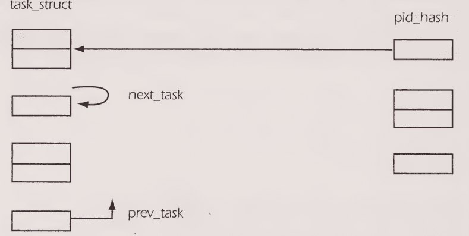

#### 图 4.1

任务通过双链接循环列表进行管理，具有指向前一个任务和下一个任务的指针。`pid_hash` 结构使每个分配的条目指向某个任务，或者如果有多个相同进程的话，则指向更多任务。

在许多 UNIX 机器中，内核有一个最大进程数参数。在像 Solaris 这样的商用操作系统中，它是一个自调参数，根据启动时发现的 RAM 量进行调整。（但在 Solaris 中，您仍然可以在 `/etc/system` 中调整此参数。）在 Linux 2.4 中，最大进程数参数也是运行时可调参数。在 2.2.x 中，它是编译时可调参数。

在 2.2.x 中，要更改最大任务数，系统管理员需要更改 `linux/include/linux/tasks.h` 中的 `NR_TASKS` 预处理器定义：

```c
#define NR_TASKS 512 /* 在 x86 上最大为 4092，配置了 APM 时为 4090。 */
```

而在 2.4 中，它是一个可调参数，默认设置为：

```
系统内存大小 / 内核栈大小 / 2
```

假设您有 512MB 的 RAM，可用的进程默认上限将是：

```
512×1024×1024 / 8192 / 2 -> 32768
```

现在，32,768 个进程听起来可能很多，但对于拥有数据库和企业级 Linux 服务器，并且有来自局域网或互联网的大量连接来说，这是一个非常合理的数字。再次，系统管理员必须根据他的需求调整此参数。

在 2.4 中，还可以通过在运行时调用 `syscall` 系统调用来增加最大任务数。如果管理员想要将并发任务数增加到 40,000，他只需以 `root` 身份输入：

```
echo 40000 > /proc/sys/kernel/threads-max
```

### 分叉

起初有一个刚加载的内核，它是好的。但如果用户程序无法运行，仅内核本身是无用的。因此，在引导时，内核将 `init` 加载为第一个用户程序。从那时起，`init` 是所有用户程序的母亲。在 UNIX 术语中，进程的父亲实际上被称为父亲，而不是母亲。所以，`init` 是所有用户程序的父亲。在引导过程中，使用 `linux/init/main.c` 中的以下代码调用 `init`：

```c
static int init(void * unused)
{
    lock_kernel();
    do_basic_setup();
    /*
     * Ok, we have completed the initial bootup, and
     * we're essentially up and running. Get rid of the
     * initmem segments and start the user-mode stuff..
     */
    free_initmem();
    unlock_kernel();
    if (open("/dev/console", O_RDWR, 0) < 0)
        printk("Warning: unable to open an initial console.\n");
    (void) dup(0);
    (void) dup(0);
    /*
     * We try each of these until one succeeds.
     *
     * The Bourne shell can be used instead of init if we are
     * trying to recover a really broken machine.
     */
    if (execute_command)
        execve(execute_command, argv_init, envp_init);
    execve("/sbin/init", argv_init, envp_init);
    execve("/etc/init", argv_init, envp_init);
    execve("/bin/init", argv_init, envp_init);
    execve("/bin/sh", argv_init, envp_init);
    panic("No init found.  Try passing init= option to kernel.");
}
```

在此，`init` 作为内核任务进入，并创建一个名为 `init` 的用户空间进程。`init` 函数被声明为 `unused`，因为它不接受任何参数；它只是从磁盘读取用户空间程序的代码并启动它。

`init` 始终被分配进程 ID（PID）号 1。为什么不是 0，就像计算机行业中通常的计数方式那样？因为 0 已经被在启动时创建的空闲进程占用了。

在上述代码中，你还可以看到启动期间释放部分内存的 `console` 消息来源：`free_initmem`。该函数释放了内核 `.text.init` 段中不再需要的函数。这是在 512MB RAM 系统（此处命名为 `hatta`）上启动时生成的典型消息：

```
Mar 19 09:14:35 hatta kernel: Freeing unused kernel memory: 72k freed
```

### 进程的创建：Fork 与 Clone

`init`，即“父亲”，通过 `fork` 其子进程来创造后代。因此，`init` 是无性别的，能够独自繁殖，无需女性伴侣的帮助。严肃地说，用户程序要么从 `init` 创建，要么从 `init` 的子进程创建。创建子进程的系统调用称为 `fork`，虽然在 Linux 中还有创建子进程的另一种方式，`__clone()`。系统调用名称前的双下划线是为了表明它通常应该由包装它的库函数调用，以提供更友好的用户界面。

`Forking` 是父进程自我复制为精确副本的一种方式，除了 PID 不同。`fork()` 函数在某个时刻必须将新创建的任务添加到 `task_struct` 中。用于添加和删除任务的内核函数是 `add_to_runqueue` 和 `del_from_runqueue`。你可以在 `linux/kernel/sched.c` 中找到它：

```c
static inline void add_to_runqueue(struct task_struct * p)
{
    list_add(&p->run_list, &runqueue_head);
    nr_running++;
}
```


从新任务诞生的那一刻起，它就是完全独立的。

正如我们之前所见，Linux 还引入了创建用户进程的另一种手段，`__clone`。与 `fork()` 不同，`__clone` 允许子进程与其父进程共享执行环境的部分，如内存空间、文件描述符表和信号处理程序表。`__clone` 的主要用途是实现线程。线程是程序中多个控制流，它们在共享内存空间中并发运行。使用 `__clone` 时要小心，因为它是 Linux 特定特性，因此不可移植到其他操作系统；而 `fork()` 是标准函数，存在于许多平台上，包括 `Windows`。

让我们看看极其重要的 `PID` 是如何在内核中分配的。实际函数是 `linux/kernel/fork.c` 中的 `get_pid()`：

```c
static int get_pid(unsigned long flags)
{
	static int next_safe = PID_MAX;
	struct task_struct *p;
	if (flags & CLONE_PID)
		return current->pid;
	spin_lock(&lastpid_lock);
	if( (++last_pid) & 0xffff8000) {
		last_pid = 300;
		/* Skip daemons etc. */
		goto inside;
	}
	if(last_pid >= next_safe) {
	inside:
		next_safe = PID_MAX;
		read_lock(&tasklist_lock);
	repeat:
		for_each_task(p) {
			if(p->pid == last_pid ||
			   p->pgrp == last_pid ||
			   p->session == last_pid) {
				if( ++last_pid >= next_safe) {
					if(last_pid & 0xffff8000)
						last_pid = 300;
					next_safe = PID_MAX;
				}
				goto repeat;
			}
			if(p->pid > last_pid && next_safe > p->pid)
				next_safe = p->pid;
			if(p->pgrp > last_pid && next_safe > p->pgrp)
				next_safe = p->pgrp;
			if(p->session > last_pid && next_safe > p->session)
				next_safe = p->session;
		}
		read_unlock(&tasklist_lock);
	}
	spin_unlock(&lastpid_lock);
	return last_pid;
}
```

这里的代码可能让你觉得很难理解，因为开发者试图让代码（以及因此的整体进程创建）尽可能快。

如果速度是关键，为什么程序员不直接使用任务结构中进程的索引号？因为许多用户空间程序员仍然假设相同的 `PID` 不会在进程使用它之后很快再次出现。他们认为 `PID` 在 `PID` 编号空间中循环。虽然从未有人做出过这种保证，但内核必须与这些设计不良的程序兼容。该函数确实保留一个指向下一个可能或安全 `PID` 的指针，这里称为 `next_safe`。每次创建进程时，`last_pid` 字段增量超过 `next_safe` `PID` 时，上述函数必须遍历整个任务列表以搜索另一个 `PID` 候选者。

两个任务可能共享相同的 `PID`，如果它们是同一进程内的线程。在这种情况下，以下代码段：

```c
if (flags & CLONE_PID)
	return current->pid;
```

立即返回相同的 `PID`。

一旦 `last_pid` 环绕 `PID` 编号空间（32,767），上述代码开始寻找新的 `PID`。然而，它会跳到 300 之后的下一个数字，因为 300 以下的许多数字通常被系统守护进程和在启动时启动并运行整个系统生命周期的程序占用。这些 `PID` 几乎从未返回到空闲列表。为了节省几个宝贵的时钟周期，内核只是跳过它们。

在配置最大任务数超过 32,767 的系统中，理论上可能会出现没有可用 `PID` 槽位的情况。因此，任务创建将以负返回码失败。

显然，程序员并不总是希望启动原始程序的副本，而是希望在程序执行期间的某个时刻启动一个完全不同的程序。对于这些情况，她必须使用 `exec()`。

用户程序将执行权传递给另一个程序的唯一方式是：

- 使用 `fork()` fork 到自身的另一个实例。
- 然后使用 `exec()` 加载另一个二进制程序映像并传递执行权。

实现 `exec()` 调用的内核代码位于 `linux/fs/exec.c`。该程序太长而无法在此包含（在 2.3.52 版本中近一千行）。这是它被调用时所做的：

- `prepare_binprm()` 代码定位包含二进制映像的文件，并将前 128 字节读取到 `bprm` 结构体的 `buf` 变量中。（参见本章末尾的数据结构。）

```c
int prepare_binprm(struct linux_binprm *bprm)
{
	int mode;
	int retval, id_change, cap_raised;
	struct inode * inode = bprm->dentry->d_inode;
	mode = inode->i_mode;
	if (!S_ISREG(mode)) /* must be regular file */
		return -EACCES;
	if (!(mode & 0111)) /* with at least one execute bit set */
		return -EACCES;
	if (IS_NOEXEC(inode)) /* FS mustn't be mounted noexec */
		return -EACCES;
	if (!inode->i_sb)
		return -EACCES;
	if ((retval = permission(inode, MAY_EXEC)) != 0)
		return retval;
	/* better not execute files which are being written to */
	if (atomic_read(&inode->i_writecount) > 0)
		return -ETXTBSY;
	bprm->e_uid = current->euid;
	bprm->e_gid = current->egid;
	id_change = cap_raised = 0;
	/* Set-uid? */
	if (mode & S_ISUID) {
		bprm->e_uid = inode->i_uid;
		if (bprm->e_uid != current->euid)
			id_change = 1;
	}
	/* Set-gid? */
	/*
	 * If setgid is set but no group execute bit then this
	 * is a candidate for mandatory locking, not a setgid
	 * executable.
	 */
	if ((mode & (S_ISGID | S_IXGRP)) == (S_ISGID | S_IXGRP)) {
		bprm->e_gid = inode->i_gid;
		if (!in_group_p(bprm->e_gid))
			id_change = 1;
	}
	/* We don't have VFS support for capabilities yet */
	cap_clear(bprm->cap_inheritable);
	cap_clear(bprm->cap_permitted);
	cap_clear(bprm->cap_effective);
	/*  To support inheritance of root-permissions and suid-root
	 *  executables under compatibility mode, we raise the
	 *  effective and inherited bitmasks of the executable file
	 *  (translation: we set the executable "capability dumb" and
	 *  set the allowed set to maximum). We don't set any forced
	 *  bits.
	 *


# Linux 进程模型

- 2. 设置要传递给新调用程序及其参数的参数（`argc`, `argv`, `envp`）。
- 3. 根据二进制文件的魔数选择相应的二进制处理器。正如我们在前面的章节中看到的，Linux 能够执行多种二进制格式，包括 `a.out`、`ELF`、`Java`、`iBCS` 和 `EM86`。函数 `search_binary_handler` 根据头部信息中包含的魔数来识别二进制映像。

以下是来自 `fs/exec.c` 的函数 `search_binary_handler`：

```c
cap_set_full(bprm->cap_effective);
}

/* Only if pP' is _not_ a subset of pP, do we consider there
 * has been a capability related "change of capability". In
 * such cases, we need to check that the elevation of
 * privilege does not go against other system constraints.
 * The new Permitted set is defined below -- see (***) . */

{
    kernel_cap_t working =
        cap_combine(bprm->cap_permitted,
        cap_intersect(bprm->cap_inheritable,
                current->cap_inheritable));

    if (!cap_issubset(working, current->cap_permitted)) {
        cap_raised = 1;
    }
}

if (id_change || cap_raised) {
    /* We can't suid-execute if we're sharing parts of the executable */
    /* or if we're being traced (or if suid execs are not allowed)    */
    /* (current->mm->mm_users > 1 is ok, as we'll get a new mm anyway)  */
    if (IS_NOSUID(inode)
            must_not_trace_exec(current)
        || (atomic_read(&current->fs->count) > 1)
        || (atomic_read(&current->sig->count) > 1)
        || (atomic_read(&current->files->count) > 1)) {
        if (id_change && !capable(CAP_SETUID))
            return -EPERM;
        if (cap_raised && !capable(CAP_SETPCAP))
            return -EPERM;
    }
}

memset(bprm->buf,0,sizeof(bprm->buf));

return read_exec(bprm->dentry,0,bprm->buf,128,1);
}

int search_binary_handler(struct linux_binprm *bprm,struct pt_regs *regs)
{
    int try,reval=0;
    struct linux_binfmt * fmt;

#ifdef __alpha__
/* handle /sbin/loader... */
    {
        struct exec * eh = (struct exec *) bp_rm->buf;
        struct linux_binprm bprm_loader;

        if (!bprm->loader && eh->fh.f_fmagic == 0x183 &&
            (eh->fh.f_flags & 0x3000) == 0x3000)
        {
            int i;
            char * dynloader[] = { "/sbin/loader" };
            struct dentry * dentry;

            lock_kernel();
            dput (bprm->dentry);
            unlock_kernel();

            bprm->dentry = NULL;

            bprm_loader.p = PAGE_SIZE*MAX_ARG_PAGES-sizeof(void *);

            for (i = 0 ; i < MAX_ARG_PAGES ; i++)    /* clear page-table */
                bprm_loader.page[i] = NULL;

            lock_kernel();
            dentry = open_namei(dynloader[0], 0, 0);
            unlock_kernel();

            retval = PTR_ERR(dentry);

            if (IS_ERR(dentry))
                return retval;

            bprm->dentry = dentry;
            bprm->loader = bprm_loader.p;

            retval = prepare_binprm(bprm);

            if (retval<0)
                return retval;

            /* should call search_binary_handler recursively here,
               but it does not matter */
        }
    }
    #endif

    for (try=0; try<2; try++) {
        for (fmt = formats ; fmt ; fmt = fmt->next) {
            int (*fn)(struct linux_binprm *, struct pt_regs *) = fmt->load_binary;
            if (!fn)
                continue;
            retval = fn(bprm, regs);
            if (retval >= 0) {
                if (bprm->dentry) {
                    lock_kernel();
                    dput (bprm->dentry);
                    unlock_kernel();
                }
                bprm->dentry = NULL;
                current->did_exec = 1;
                return retval;
            }
        }
    }
}
```


```c
            if (retval != -ENOEXEC)

                break;

            if (bprm->dentry) /* We don't have the entry anymore */

                return retval;

            if (retval != -ENOEXEC) {

                break;

                #ifdef CONFIG_KMOD

                } else {

                #define printable(c) (((c)=='\t') || ((c)=='\n') || (0x20<=(c) && (c)<=0x7e))

                char modname[20];

                if (printable(bprm->buf[0]) &&

                printable(bprm->buf[1]) &&

                printable(bprm->buf[2]) &&

                printable(bprm->buf[3]) {

                break; /* -ENOEXEC */

                sprintf(modname, "binfmt-%04x", *(unsigned short *)(&bprm->buf[2]));

                request_module(modname);

                }

                #endif

            }

    return retval;

}
```

4. 最后，控制权被移交给从文件读取的二进制映像。

显然，`fork()`、`__clone()` 和 `exec()` 内核函数对虚拟内存管理器有严重的影响。VM 必须为新程序设置虚拟地址空间。它通过每次引用时创建每个 VM 页面的精确副本来实现这一点。在引用时，寻址硬件会产生页错误（因为这是一个不存在的 VM 地址）并调用 VM 代码。VM 识别这种情况并复制创建新页面。然而，我们将在 Linux VM 管理器章节中更详细地研究 VM 的工作原理。

### 线程

在过去大约 10 年里，出现了一个从重量级进程到线程模型的普遍趋势。原因很清楚：创建和维护一个具有自己地址空间的完整进程需要花费大量时间（以毫秒计）。相反，线程在父进程的相同地址空间内运行，因此创建它们所需的时间少得多。随着 Web 服务器和电子商务浪潮的巨大重要性，高效且响应迅速的任务创建和关闭是一个主要关注点。事实上，Web 服务器开发人员已经尝试了一段时间，将所有编程功能包含在单个地址空间内。例如，Apache 包含一个 Perl 模块，使 Web 开发人员能够执行 Perl 代码而无需退出地址空间。

在 Linux 下，进程和线程之间有什么区别？更重要的是，从调度程序的角度来看，区别是什么？简而言之：没有区别。

线程和进程之间唯一有价值的区别是线程完全共享相同的地址空间。所有线程都在相同的地址空间内运行，因此上下文切换基本上就是从代码的一个位置跳到代码的另一个位置。

在 `linux/arch/i386/kernel/process.c` 中，可以找到避免转换后备缓冲区（TLB）——CPU 内部将虚拟内存地址转换为实际 RAM 地址的机制——刷新和内存管理器上下文切换的简单检查：

```c
/* Re-load page tables */

{
  unsigned long new_cr3 = next->tss.cr3;
  if (new_cr3 != prev->tss.cr3)
    asm volatile("movl %0,%%cr3": :"r" (new_cr3));
}
```

上述检查位于 Linux 内核上下文切换的核心。它检查当前进程的页目录地址和待调度进程的页目录地址是否相同。如果相同，意味着它们共享相同的地址空间（换句话说，它们是两个线程），内核避免写入 `%cr3` 寄存器，这样用户空间页表就不会被无效化。这是因为 `cr3` 寄存器仅包含内核将写入的数据（写入它将意味着使 TLB 无效化）。通过上述两行检查，Linux 定义了内核进程切换和内核线程切换之间的区别。这是唯一值得注意的区别。

由于线程和进程之间完全没有区别，Linux 调度程序是用非常干净的代码编写的。只有少数与信号处理相关的地方在进程和线程之间做出区分。这与例如 Solaris 相反，在 Solaris 中，与线程和轻量级进程相比，进程处于极大的劣势。下面的代码展示了一个在 Solaris 服务器上的测量结果，一个运行 Solaris 2.6 的 Ultra 2 桌面 167-MHz 处理器：

```
orion> ftime
Completed 100 forks
Avg. Fork Time: 1.137 milliseconds

# Linux 进程模型

orion> time
已完成 100 次线程创建
平均线程时间：0.017 毫秒
```

在上述示例中，`ftime` 正在执行 100 次 `fork` 并测量经过的时间。正如你所见，平均 `fork` 耗时 1.137 毫秒，而平均创建线程（`time` 代码）耗时 .017 毫秒（17 微秒）。在这个例子中，线程创建速度快了大约 67 倍。此外，我的线程测试用例没有在创建线程的调用中包含标志，以指示内核通过线程创建新的轻量级进程（LWP）并将线程绑定到该 LWP。这将增加调用的额外开销，使其更接近 `fork` 的耗时。

即使创建 LWP 缩小了进程（`forks`）和线程之间的创建时间差距，用户线程在资源利用和调度方面仍具有优势——我们将很快看到这一点。

当然，Linux SMP（甚至单处理器变体）的调度器足够聪明，能够优化在同一 CPU 上线程的调度。这是因为通过重新调度线程，不会发生任何 TLB 刷新，基本上也几乎没有上下文切换。换种说法就是，虚拟内存寻址不会改变。与进程切换相比，线程切换非常轻量级，且调度器对此是 aware 的。Linux 在两个线程之间切换时（并非严格按顺序）所做的操作只有：

- 进入 `schedule()`。
- 恢复新线程的所有寄存器（包括栈指针和浮点指针）。
- 使用新线程的数据更新 TSS。
- 跳转到新线程的旧 EIP。

TLB 未被触及，地址空间和所有页表保持不变。而且巨大的优势在于 Linux 完成这一切的速度非常快。其他 UNIX 系统因 SMP 锁而臃肿，因此内核在进入任务切换点时浪费了时间。因此，Solaris 的内核线程比用户空间的内核线程慢。当然，基于内核的线程可以将负载扩展到多个 CPU 上，但像 Solaris 这样的操作系统在 CPU 数量较少的系统上，为了在拥有大量 CPU 时能够良好扩展而付出了巨大的固定成本。

基本上，Solaris 内核线程比 Linux 内核线程更轻并没有技术上的原因，因为 Linux 只是在上下文切换路径中执行了尽可能少的操作（并且执行速度很快）。

## 2.4 线程化内核

Linux 内核线程技术正在不断改进。让我们再次看看不同的版本：

- 2.0.x 没有内核线程
- 2.2.x 有
- 2.3.x 非常 SMP 线程化

在 2.2.x 中，许多地方仍然是单线程的，但 2.2.x 内核在双路 SMP 上扩展性非常好。在 2.2.x 中，例如，IRQ 和定时器处理完全由 SMP 线程处理，且 IRQ 负载分布在多个 CPU 上。

在 2.4 中，内核内大多数有价值的代码段都被重写以支持 SMP 线程。例如，在 2.4 中，所有虚拟内存（VM）都是 SMP 线程化的。最有趣的路径具有更细的粒度，并且在 2.4 中扩展性非常好。

## 性能限制

为了系统的稳定性，内核必须在压力情况下做出良好的反应。它必须，例如，降低行为不良进程的优先级和资源。调度器如何处理一个（愚蠢的）程序紧密循环并在每次循环迭代时 `fork`——因此在几秒钟内 `fork` 出成千上万个进程？

显然，调度器不能限制进程创建的时间间隔——例如，每 0.5 秒一个进程——因为从 CPU 的角度来看，时间的含义非常有趣。因此，在某些时刻，0.5 秒足以容纳一个程序的疯狂 `fork`，而在其他时刻则会危及系统的稳定性。

然而，在 2.4 内核中，在 `fork` 之后，进程的运行时优先级在父进程和子进程之间平分。这意味着父进程或子进程将与其它任务相比受到惩罚，其它任务将继续良好运行，直到优先级的第一次重新计算。这使得系统在 `fork` 泛滥期间不会停滞。这是 `linux/kernel/fork.c` 中的相关代码段：

```c
/*

 * "share" dynamic priority between parent and child, thus the

 * total amount of dynamic priorities in the system doesnt change,
```


# Linux 进程模型

* more scheduling fairness. This is only important in the first
* timeslice, on the long run the scheduling behaviour is unchanged.

*/

`current->counter >>= 1;`

`p->counter = current->counter;`

此外，还有一个每用户线程限制，可以在生成第一个用户进程之前通过`init`进行设置。在`bash`中可以用`ulimit -u`进行设置。你可以告诉用户`moshe`最多可以运行`10`个并发任务（显然`shell`和每个进程都必须在这`10`个任务范围内）。在`Linux`中，`root`用户总是保留一些额外的任务给自己。因此，如果用户循环生成任务，管理员只需登录并杀掉违规用户的所有任务即可。

因为任务的运行时优先级（源代码中的`current->counter`）在父进程和子进程之间平分，内核能够足够平稳地应对这些情况。

如果你希望修改内核以允许每个处理器`tick`（`jiffy`——通常每`1/100`秒一次，但此参数也是可调整的）只执行一次`fork()`，你需要像这样修补`linux/kernel/fork.c`中的内核：

```
--- 2.3.52/kernel/fork.c
+++ /tmp/fork.c Tue Nov 9 01:34:36 1999

@@ -591,6 +591,14 @@

int retval = -ENOMEM;

struct task_struct *p;

DECLARE_MUTEX_LOCKED(sem);

+

static long last_fork;
+

while (time_after(last_fork+1, jiffies))
+
{
+
__set_current_state(TASK_UNINTERRUPTIBLE);
+
schedule_timeout(1);
+
}
+

last_fork = jiffies;

if (clone_flags & CLONE_PID) {
/* This is only allowed from the boot up thread */
```

这就是开源的美妙之处。如果你不喜欢某样东西，就改变它！

### 数据结构—linux/sched.h

```
1  #ifndef _LINUX_SCHED_H
2  #define _LINUX_SCHED_H
3
4  #include <asm/param.h>    /* for HZ */
5
6  extern unsigned long event;
7
8  #include <linux/binfmts.h>
9  #include <linux/personality.h>
10 #include <linux/threads.h>
11 #include <linux/kernel.h>
12 #include <linux/types.h>
13 #include <linux/times.h>
14 #include <linux/timex.h>
15
16 #include <asm/system.h>
17 #include <asm/semaphore.h>
18 #include <asm/page.h>
19 #include <asm/ptrace.h>
20
21 #include <linux/smp.h>
22 #include <linux/tty.h>
23 #include <linux/sem.h>
24 #include <linux/signal.h>
25 #include <linux/securebits.h>
26
27 /*
28  * cloning flags:
29  */
30 #define CSIGNAL             0x000000ff    /* signal mask to be sent at exit */
31 #define CLONE_VM            0x00000100    /* set if VM shared between processes */
32 #define CLONE_FS            0x00000200    /* set if fs info shared between processes */
33 #define CLONE_FILES         0x00000400    /* set if open files shared between processes */
34 #define CLONE_SIGHAND       0x00000800    /* set if signal handlers shared */
35 #define CLONE_PTRACE        0x00001000    /* set if ptraced */
36 #define CLONE_PTTRACE       0x00002000    /* set if we want to let tracing continue on the child too */
37 #define CLONE_VFORK         0x00004000    /* set if the parent wants the child to wake it up on mm_release */
38 #define CLONE_PARENT        0x00008000    /* set if we want to have the same parent as the cloner */
39
40 /*
41  * These are the constant used to fake the fixed-point load-average
42  * counting. Some notes:
43  *  - 11 bit fractions expand to 22 bits by the multiplies: this gives
44  *      a load-average precision of 10 bits integer + 11 bits fractional
45  *  - if you want to count load-averages more often, you need more
46  *      precision, or rounding will get you. With 2-second counting freq,
47  *      the EXP_n values would be 1981, 2034 and 2043 if still using only
```

```c
48        *       11 bit fractions.
49        */
50 extern unsigned long avenrun[];          /* Load averages */
51
52 #define FSHIFT            11      /* nr of bits of precision */
53 #define FIXED_1           (1<<FSHIFT)     /* 1.0 as fixed-point */
54 #define LOAD_FREQ         (5 * HZ) /* 5 sec intervals */
55 #define EXP_1             1884    /* 1/exp(5sec/1min) as fixed-point */
56 #define EXP_5             2014    /* 1/exp(5sec/5min) */
57 #define EXP_15            2037    /* 1/exp(5sec/15min) */
58
59 #define CALC_LOAD(load,exp,n) \
60                load *= exp; \
61                load += n*(FIXED_1-exp); \
62                load >>= FSHIFT;
63
64 #define CT_TO_SECS(x)     ((x) / HZ)
65 #define CT_TO_USECS(x)    (((x) % HZ) * 1000000/HZ)
66
67 extern int nr_running, nr_threads;
68 extern int last_pid;
69
70 #include <linux/fs.h>
71 #include <linux/time.h>
```


72 `#include <linux/param.h>`

73 `#include <linux/resource.h>`

74 `#include <linux/timer.h>`

75

76 `#include <asm/processor.h>`

77

78 `#define TASK_RUNNING 0`

79 `#define TASK_INTERRUPTIBLE 1`

80 `#define TASK_UNINTERRUPTIBLE 2 /* TASK_UNINTERRUPTIBLE */`

81 `#define TASK_ZOMBIE 4 /* TASK_ZOMBIE */`

82 `#define TASK_STOPPED 8`

83 `#define TASK_EXCLUSIVE 32`

84

85 `#define __set_task_state(tsk, state_value) \`

86 `do { (tsk)->state = (state_value); } while (0)`

87 `#ifdef __SMP__`

88 `#define set_task_state(tsk, state_value) \`

89 `set_mb((tsk)->state, (state_value))`

90 `#else`

91 `#define set_task_state(tsk, state_value) \`

92 `__set_task_state((tsk), (state_value))`

93 `#endif`

94

95 `#define __set_current_state(state_value) \`

96 `do { current->state = (state_value); } while (0)`

97 `#ifdef __SMP__`

98 `#define set_current_state(state_value) \`

99 `set_mb(current->state, (state_value))`

100 `#else`

101 `#define set_current_state(state_value) \`

102 `__set_current_state(state_value)`

103 `#endif`

104

105 /*

106 * Scheduling policies

107 */

108 `#define SCHED_OTHER 0`

109 `#define SCHED_FIFO 1`

110 `#define SCHED_RR 2`

111

112 /*

113 * This is an additional bit set when we want to

114 * yield the CPU for one re-schedule.

115 */

116 `#define SCHED_YIELD 0x10`

117

```c
struct sched_param {
    int sched_priority;
};
```

122 `#ifdef __KERNEL__`

124 `#include <linux/spinlock.h>`

126 /*

127 * This serializes "schedule()" and also protects

128 * the run-queue from deletions/modifications (but

129 * _adding_ to the beginning of the run-queue has

130 * a separate lock).

131 */

132 `extern rwlock_t tasklist_lock;`

133 `extern spinlock_t runqueue_lock;`

135 `extern void sched_init(void);`

136 `extern void init_idle(void);`

137 `extern void show_state(void);`

138 `extern void cpu_init(void);`

139 `extern void trap_init(void);`

140 `extern void update_one_process(struct task_struct *p, unsigned long ticks, unsigned long user, unsigned long system, int cpu);`

143 `#define MAX_SCHEDULE_TIMEOUT LONG_MAX`

144 `extern signed long FASTCALL(schedule_timeout(signed long timeout));`

145 `asmlinkage void schedule(void);`

147 /*

148 * The default fd array needs to be at least BITS_PER_LONG,

149 * as this is the granularity returned by copy_fdset().

150 */

151 `#define NR_OPEN_DEFAULT BITS_PER_LONG`

153 /*

154 * Open file table structure

155 */

```c
struct files_struct {
    atomic_t count;
    rwlock_t file_lock;
    int max_fds;
    int max_fdset;
    int next_fd;
    struct file ** fd; /* current fd array */
    fd_set *close_on_exec;
    fd_set *open_fds;
    fd_set close_on_exec_init;
    fd_set open_fds_init;
    struct file * fd_array[NR_OPEN_DEFAULT];
};
```

170 `#define INIT_FILES { ATOMIC_INIT(1), RW_LOCK_UNLOCKED, NR_OPEN_DEFAULT, __FD_SETSIZE, 0, &init_files.fd_array[0], &init_files.close_on_exec_init, &init_files.open_fds_init, { { 0, } }, { { 0, } }, { NULL, } }`

```c
struct fs_struct {
    atomic_t count;
    int umask;
    struct dentry * root, * pwd;
};
```

190 `#define INIT_FS { ATOMIC_INIT(1), 0022, NULL, NULL }`

196 /* Maximum number of active map areas.. This is a random (large) number */

197 `#define MAX_MAP_COUNT (65536)`

199 /* Number of map areas at which the AVL tree is activated. This is arbetary. */

200 `#define AVL_MIN_MAP_COUNT 32`

```c
struct mm_struct {
    struct vm_area_struct * mmap; /* list of VMAs */
};
```


```
struct vm_area_struct * mmap_avl; /* tree of VMAs */
struct vm_area_struct * mmap_cache; /* last find_vma result */
pgd_t * pgd;
atomic_t mm_users; /* How many users with user space? */
atomic_t mm_count; /* How many references to "struct mm_struct" (users count as 1) */
int map_count; /* number of VMAs */
struct semaphore mmap_sem;
spinlock_t page_table_lock;
unsigned long context;
unsigned long start_code, end_code, start_data, end_data;
unsigned long start_brk, brk, start_stack;
unsigned long arg_start, arg_end, env_start, env_end;
unsigned long rss, total_vm, locked_vm;
unsigned long def_flags;
unsigned long cpu_vm_mask;
unsigned long swap_cnt; /* number of pages to swap on next pass */
unsigned long swap_address;
/*
 * This is an architecture-specific pointer: the portable
 * part of Linux does not know about any segments.
 */
void * segments;
};

#define INIT_MM(name) { \
    &init_mmap, NULL, NULL, \
    swapper_pg_dir, \
    ATOMIC_INIT(2), ATOMIC_INIT(1), 1, \
    __MUTEX_INITIALIZER(name.mmap_sem), \
    SPIN_LOCK_UNLOCKED,
    0, \
    0, 0, 0, 0, \
    0, 0, 0, \
    0, 0, 0, \
    0, 0, 0, \
    0, 0, 0, 0, NULL }

struct signal_struct {
    atomic_t count;
    struct k_sigaction action[_NSIG];
    spinlock_t siglock;
};

#define INIT_SIGNALS { \
    ATOMIC_INIT(1), \
    { {{0,}}, }, \
    SPIN_LOCK_UNLOCKED }

/* Some day this will be a full-fledged user tracking system.
 * Right now it is only used to track how many processes a
 * user has, but it has the potential to track memory usage etc.
 */
struct user_struct;

struct task_struct {
    /* these are hardcoded - don't touch */
    volatile long state;    /* -1 unrunnable, 0 runnable, >0 stopped */
    unsigned long flags;    /* per process flags, defined below */
    int sigpending;
    mm_segment_t addr_limit;        /* thread address space:
                0-0xBFFFFFFF for user-thread
                0-0xFFFFFFFF for kernel-thread
        */
    struct exec_domain *exec_domain;
    volatile long need_resched;

    cycles_t avg_slice;
    int lock_depth;         /* Lock depth. We can context switch in and out
                                of holding a syscall kernel lock... */
    /* begin intel cache line */
    long counter;
    long priority;
    unsigned long policy;
    /* memory management info */
    struct mm_struct *mm, *active_mm;
    int has_cpu;
    int processor;
    struct list_head run_list;
    struct task_struct *next_task, *prev_task;
    int last_processor;

    /* task state */
    struct linux_binfmt *binfmt;
    int exit_code, exit_signal;
    int death_signal; /*  The signal sent when the parent dies  */
    /* ??? */
    unsigned long personality;
    int dumpable:1;
    int dis_exec:1;
    pid_t pid;
    pid_t pgrp;
    pid_t tty_old_pgrp;
    pid_t session;
    /* boolean value for session group leader */
    int leader;
    /*
    * pointers to (original) parent process, youngest child, younger sibling,
    * older sibling, respectively.  (p->father can be replaced with
    * p->p_ptr->pid)
    */
    struct task_struct *p_opptr, *p_pptr, *p_cptr, *p_ystr, *p_osptr;

    /* PID hash table linkage. */
    struct task_struct *pidhash_next;
    struct task_struct **pidhash_pprev;

    wait_queue_head_t wait_chldexit;        /* for wait4() */
    struct semaphore *vfork_sem;            /* for vfork() */
}
```


### 3.2 内核代码片段：`task_struct` 定义

以下代码展示了 Linux 内核中 `task_struct` 结构体的部分字段定义，以及相关的常量、初始化宏和内联函数。这些内容主要涉及进程的状态、时间统计、权限、文件描述符、信号处理以及 PID 哈希表的操作。

```c
313 unsigned long rt_priority;
314 unsigned long it_real_value, it_prof_value, it_virt_value;
315 unsigned long it_real_incr, it_prof_incr, it_virt_incr;
316 struct timer_list real_timer;
317 struct tms times;
318 unsigned long start_time;
319 long per_cpu_utime[NR_CPUS], per_cpu_stime[NR_CPUS];
320 /* mm fault and swap info: this can arguably be seen as either mm-specific or thread-specific */
321 unsigned long min_flt, maj_flt, nswap, cmin_flt, cmaj_flt, cswap;
322 int swappable:1;
323 /* process credentials */
324 uid_t uid,euid,suid,fsuid;
325 gid_t gid,egid,sgid,fsuid;
326 int ngroups;
327 gid_t groups[NGROUPS];
328 kernel_cap_t cap_effective, cap_inheritable, cap_permitted;
329 struct user_struct *user;
330 /* limits */
331 struct rlimit rlim[RLIM_NLIMITS];
332 unsigned short used_math;
333 char comm[16];
334 /* file system info */
335 int link_count;
336 struct tty_struct *tty; /* NULL if no tty */
337 /* ipc stuff */
338 struct sem_undo *semundo;
339 struct sem_queue *semsleeping;
340 /* CPU-specific state of this task */
341 struct thread_struct thread;
342 /* filesystem information */
343 struct fs_struct *fs;
344 /* open file information */
345 struct files_struct *files;
346 /* signal handlers */
347 spinlock_t sigmask_lock; /* Protects signal and blocked */
348 struct signal_struct *sig;
349 sigset_t signal, blocked;
350 struct signal_queue *sigqueue, *sigqueue_tail;
351 unsigned long sas_ss_sp;
352 size_t sas_ss_size;
354 /* Thread group tracking */
355 u32 parent_exec_id;
356 u32 self_exec_id;
357 /* Protection of fields allocation/deallocation */
358 struct semaphore exit_sem;
359 };
360
361
362 /* Per process flags */
363 #define PF_ALIGNWARN 0x00000001 /* Print alignment warning msgs */
364 /* Not implemented yet, only for 486*/
366 #define PF_STARTING       0x00000002 /* being created */
367 #define PF_EXITING        0x00000004 /* getting shut down */
368 #define PF_TRACED         0x00000010 /* set if ptrace (0) has been called */
369 #define PF_TRACESYS       0x00000020 /* tracing system calls */
370 #define PF_FORKNOEXEC     0x00000040 /* forked but didn't exec */
371 #define PF_SUPERPRIV      0x00000100 /* used super-user privileges */
372 #define PF_DUMPCORE       0x00000200 /* dumped core */
373 #define PF_SIGNALED       0x00000400 /* killed by a signal */
374 #define PF_MEMALLOC       0x00000800 /* Allocating memory */
375 #define PF_VFORK          0x00001000 /* Wake up parent in mm_release */
377 #define PF_USEDGPU        0x00100000 /* task used FPU this quantum (SMP) */
378 #define PF_DTRACE         0x00200000 /* delayed trace (used on m68k, i386) */
380 /*
381  * Limit the stack by to some sane default; root can always
382  * increase this limit if needed.  SMB seems reasonable.
383  */
384 #define _STK_LIM          (8*1024*1024)
386 #define DEF_PRIORITY      (20*HZ/100) /* 200 ms time slices */
388 /*
389  * INIT_TASK is used to set up the first task table, touch at
390  * your own risk!. Base=0, limit=0x1fffff (=2MB)
391  */
392 #define INIT_TASK(name) \
393 /* state etc */ { 0,0,0,KERNEL_DS,&default_exec_domain,0, \
394 /* avg_slice */ 0, -1, \
395 /* counter */  DEF_PRIORITY, DEF_PRIORITY, SCHED_OTHER, \
396 /* mm */      NULL, &init_mm, \
397 /* has_cpu */  0,0, \
398 /* run_list */ LIST_HEAD_INIT(init_task.run_list), \
399 /* next_task */ &init_task,&init_task, \
400 /* last_proc */ 0, \
401 /* binfmt */  NULL, \
402 /* ec,brk... */ 0,0,0,0,0,0, \
403 /* pid etc... */ 0,0,0,0,0, \
404 /* proc_links */ &init_task,&init_task,NULL,NULL,NULL, \
405 /* pidhash */    NULL, NULL, \
406 /* child_wait */ __WAIT_QUEUE_HEAD_INITIALIZER(name.wait_chldexit), NULL, \
407 /* timeout */     0,0,0,0,0, \
408 /* timer */       { NULL, NULL, 0, 0, it_real_fn }, \
```


```c
409 /* utime */       (0,0,0,0),0, \
410 /* per CPU times */ (0, ), {0, }, \
411 /* ffl */         0,0,0,0,0,0, \
412 /* swp */         0, \
413 /* process credentials */              \
414 /* uid etc */    0,0,0,0,0,0,0,0, \
415 /* suppl_grps */  0, { }, \
416 /* caps */        CAP_INIT_EFF_SET,CAP_INIT_INH_SET,CAP_FULL_SET, \
417 /* user */        NULL, \
418 /* rlimits */     INIT_RLIMITS, \
419 /* math */        0, \
420    /* comm  */        "swapper", \
421    /* fs info */        0, NULL, \
422    /* ipc  */        NULL, NULL, \
423    /* thread  */        INIT_THREAD, \
424    /* fs  */        &init_fs, \
425    /* files  */        &init_files, \
426    /* signals */        SPIN_LOCK_UNLOCKED, &init_signals, ({{}}), ({{0}}), NULL, \
    &init_task.sigqueue, 0, 0, \
427    /* exec cts */        0,0, \
428    /* exit_sem */        __MUTEX_INITIALIZER(name.exit_sem), \
429 }

430

431 #ifndef INIT_TASK_SIZE
432 # define INIT_TASK_SIZE 2048*sizeof(long)
433 #endif
434

435 union task_union {
436             struct task_struct task;
437             unsigned long stack[INIT_TASK_SIZE/sizeof(long)];
438 };
439
440 extern union task_union init_task_union;
441
442 extern struct      mm_struct init_mm;
443 extern struct task_struct *init_tasks[NR_CPUS];
444
445 /* PID hashing. (shouldnt this be dynamic?) */
446 #define PIDHASH_SZ (4096 >> 2)
447 extern struct task_struct *pidhash[PIDHASH_SZ];
448
449 #define pid_hashfn(x)       (((((x) >> 8) ^ (x)) & (PIDHASH_SZ - 1)))
450
451 extern __inline__ void hash_pid(struct task_struct *p)
452 {
453             struct task_struct **htable = &pidhash[pid_hashfn(p->pid)];
454
455             if((p->pidhash_next = *htable) != NULL)
456                     (*htable)->pidhash_pprev = &p->pidhash_next;
457             *htable = p;
458             p->pidhash_pprev = htable;
459 }
460
461 extern __inline__ void unhash_pid(struct task_struct *p)
462 {
463             if(p->pidhash_next)
464                     p->pidhash_next->pidhash_pprev = p->pidhash_pprev;
465             *p->pidhash_pprev = p->pidhash_next;
466 }
467
468 extern __inline__ struct task_struct *find_task_by_pid(int pid)
469 {
470             struct task_struct *p, **htable = &pidhash[pid_hashfn(pid)];
471
472             for(p = *htable; p && p->pid != pid; p = p->pidhash_next)
473 ;
474
475 return p;
476 }
477
478 /* per-UID process charging */
479 extern int alloc_uid(struct task_struct*);
480 void free_uid(struct task_struct*);
481
482 #include <asm/current.h>
483
484 extern unsigned long volatile jiffies;
485 extern unsigned long itimer_ticks;
486 extern unsigned long itimer_next;
487 extern struct timeval xtime;
488 extern void do_timer(struct pt_regs*);
489
490 extern unsigned int * prof_buffer;
491 extern unsigned long prof_len;
492 extern unsigned long prof_shift;
493
494 #define CURRENT_TIME (xtime.tv_sec)
495
496 extern void FASTCALL(__wake_up(wait_queue_head_t *q, unsigned int mode));
497 extern void FASTCALL(__wake_up_sync(wait_queue_head_t *q, unsigned int mode));
498 extern void FASTCALL(sleep_on(wait_queue_head_t *q));
499 extern long FASTCALL(sleep_on_timeout(wait_queue_head_t *q,
500 signed long timeout));
501 extern void FASTCALL(interruptible_sleep_on(wait_queue_head_t *q));
502 extern long FASTCALL(interruptible_sleep_on_timeout(wait_queue_head_t *q,
503 signed long timeout));
504 extern void FASTCALL(wake_up_process(struct task_struct * tsk));
505
506 #define wake_up(x) _wake_up((x),TASK_UNINTERRUPTIBLE | TASK_EXCLUSIVE)
507 #define wake_up_all(x) _wake_up((x),TASK_INTERRUPTIBLE | TASK_EXCLUSIVE)
508 #define wake_up_sync(x) _wake_up((x),TASK_UNINTERRUPTIBLE | TASK_EXCLUSIVE)
509 #define wake_up_interruptible(x) _wake_up((x),TASK_INTERRUPTIBLE | TASK_EXCLUSIVE)
510 #define wake_up_interruptible_all(x) _wake_up((x),TASK_INTERRUPTIBLE | TASK_EXCLUSIVE)
```


```c
511 #define wake_up_interruptible_sync(x) _wake_up((x),TASK_INTERRUPTIBLE | TASK_EXCLUSIVE)

extern int in_group_p(gid_t);
extern int in_egroup_p(gid_t);

extern void flush_signals(struct task_struct*);
extern void flush_signal_handlers(struct task_struct*);
extern int dequeue_signal(sigset_t * , signfo_t *);
extern int send_sig_info(int, struct signfo *, struct task_struct*);
extern int force_sig_info(int, struct signfo *, struct task_struct*);
extern int kill_pg_info(int, struct signfo *, pid_t);

extern int kill_sl_info(int, struct siginfo *, pid_t);
extern int kill_proc_info(int, struct siginfo *, pid_t);
extern int kill_something_info(int, struct siginfo *, int);

extern void notify_parent(struct task_struct *, int);
extern void force_sig(int, struct task_struct *);
extern int send_sig(int, struct task_struct *, int);
extern int kill_pg(pid_t, int, int);
extern int kill_sl(pid_t, int, int);
extern int kill_proc(pid_t, int, int);

extern int do_sigaction(int, const struct k_sigaction *, struct k_sigaction *);
extern int do_sigaltstack(const stack_t *, stack_t *, unsigned long);

extern inline int signal_pending(struct task_struct *p)
{
    return (p->sigpending != 0);
}

/* 重新评估该任务是否有待传递的信号。
这需要在 blocked sigset_t 每次发生变化时进行。
所有调用者都应持有 t->sigmask_lock。 */
static inline void recalc_sigpending(struct task_struct *t)
{
    unsigned long ready;
    long i;
    switch (_NSIG_WORDS) {
    default:
        for (i = _NSIG_WORDS, ready = 0; --i >= 0 ;)
            ready |= t->signal.sig[i] &~ t->blocked.sig[i];
        break;
    case 4:
        ready = t->signal.sig[3] &~ t->blocked.sig[3];
        ready |= t->signal.sig[2] &~ t->blocked.sig[2];
        ready |= t->signal.sig[1] &~ t->blocked.sig[1];
        ready |= t->signal.sig[0] &~ t->blocked.sig[0];
        break;
    case 2:
        ready = t->signal.sig[1] &~ t->blocked.sig[1];
        ready |= t->signal.sig[0] &~ t->blocked.sig[0];
        break;
    case 1:
        ready = t->signal.sig[0] &~ t->blocked.sig[0];
    }
    t->sigpending = (ready != 0);
}

/* 如果位于替代信号栈上，则返回真。 */
static inline int on_sig_stack(unsigned long sp)
{
    return (sp - current->sas_ss_sp < current->sas_ss_size);
}

static inline int sas_ss_flags(unsigned long sp)
{
    return (current->sas_ss_size == 0 ? SS_DISABLE
         : on_sig_stack(sp) ? SS_ONSTACK : 0);
}

extern int request_irq(unsigned int,
    void (*handler)(int, void *, struct pt_regs *),
    unsigned long, const char *, void *);
extern void free_irq(unsigned int, void *);

/*
 * 这现在已变成一个例程而不是宏，如果返回真则设置一个标志
 * （以进行 BSD 风格的统计，当进程使用 root 权限时对其进行标记）。
 * 这意味着你应该先进行正常的权限检查，最后检查 suer()。
 *
 * [1997 年 12 月 -- Chris Evans]
 * 为了正确性，上述考虑需要扩展到 fuser()。
 * 这已经做到了，并且将 fuser() 检查移动到执行的最后。
 *
 * 这些最终会被移除，但在此期间，当设置了 SECURE_NOROOT 标志时，
 * uids 不授予权限。
 */

extern inline int suer(void)
{
    if (!issecure(SECURE_NOROOT) && current->euid == 0) {
        current->flags |= PF_SUPERPRIV;
        return 1;
    }

    return 0;
}

extern inline int fuser(void)
{
    if (!issecure(SECURE_NOROOT) && current->fsuid == 0) {
        current->flags |= PF_SUPERPRIV;
        return 1;
    }

    return 0;
}

/*
 * capable() 检查特定的能力。
 * 新的权限检查应使用此接口，而不是 suer() 或 fuser()。
 * 参见 include/linux/capability.h 中定义的能力。
 */

extern inline int capable(int cap)
{
#if 1 /* ok now */
    if (cap_raised(current->cap_effective, cap))
#else
    if (cap_is_fs_cap(cap) ? current->fsuid == 0 : current->euid == 0)
#endif
    {
        current->flags |= PF_SUPERPRIV;
        return 1;
    }

    return 0;
}

/*
 * 处理 mm_structs 的例程
 */

extern struct mm_struct * mm_alloc(void);
extern struct mm_struct * start_lazy_tlb(void);
extern void end_lazy_tlb(struct mm_struct *mm);

/* mmdrop 丢弃 mm 和页表 */
extern inline void FASTCALL(____mmdrop(struct mm_struct *));

static inline void mmdrop(struct mm_struct * mm)
{
```


```c
    if (atomic_dec_and_test(&mm->mm_count))

        __mmdrop(mm);

}

/* mmput 清除映射和所有用户空间资源 */

extern void mmput(struct mm_struct *);

/* 移除当前任务对旧 mm_struct 的陈旧引用 */

extern void mm_release(void);

/*

 * 处理 fd 数组的例程

 */

extern struct file ** alloc_fd_array(int);

extern int expand_fd_array(struct files_struct *, int nr);

extern void free_fd_array(struct file **, int);

extern fd_set *alloc_fdset(int);

extern int expand_fdset(struct files_struct *, int nr);

extern void free_fdset(fd_set *, int);

/* 扩展文件描述符。出错时返回 <0；未做任何事时返回 0；

 * 文件已扩展时返回 1，此时我们可能已经阻塞。

 *

 * 调用时应持有 files->file_lock 自旋锁的写权限。

 */

static inline int expand_files(struct files_struct *files, int nr)

{

    int err, expand = 0;

#ifdef FDSET_DEBUG

    printK (KERN_ERR __FUNCTION__ " %d: nr = %d\n", current->pid, nr);

#endif

    if (nr >= files->max_fdset) {

        expand = 1;

        if ((err = expand_fdset(files, nr)))

            goto out;

    }

    if (nr >= files->max_fds) {

        expand = 1;

        if ((err = expand_fd_array(files, nr)))

            goto out;

    }

                                                        err = expand;

out:

#ifdef FDSET_DEBUG

                            if (err)

                            printk(KERN_ERR __FUNCTION__ " %d: return %d\n", current->pid,

                                err);

#endif

    return err;

}

extern int copy_thread(int, unsigned long, unsigned long, struct task_struct *,

    struct pt_regs *);

extern void flush_thread(void);

extern void exit_thread(void);

extern void exit_mm(struct task_struct *);

extern void exit_fs(struct task_struct *);

extern void exit_files(struct task_struct *);

extern void exit_sigand(struct task_struct *);

extern void daemonize(void);

extern int do_execve(char *, char **,char **, struct pt_regs *);

extern int do_fork(unsigned long, unsigned long, struct pt_regs *);

extern inline void add_wait_queue(wait_queue_head_t *q, wait_queue_t * wait)

{

    unsigned long flags;

    wq_write_lock_irqsave(&q->lock, flags);

    __add_wait_queue(q, wait);

    wq_write_unlock_irqrestore(&q->lock, flags);

}

extern inline void add_wait_queue_exclusive(wait_queue_head_t *q,

    wait_queue_t * wait)

{

    unsigned long flags;

    wq_write_lock_irqsave(&q->lock, flags);

    __add_wait_queue_tail(q, wait);

    wq_write_unlock_irqrestore(&q->lock, flags);

}

extern inline void remove_wait_queue(wait_queue_head_t *q, wait_queue_t * wait)

{

    unsigned long flags;

    wq_write_lock_irqsave(&q->lock, flags);

    __remove_wait_queue(q, wait);

    wq_write_unlock_irqrestore(&q->lock, flags);

}

#define __wait_event(wq, condition) \

    do { \

        wait_queue_t __wait; \

        init_waitqueue_entry(&__wait, current); \

        \

        add_wait_queue(&wq, &__wait); \

        for (;;) { \

            set_current_state(TASK_UNINTERRUPTIBLE); \

            if (condition) \

                break; \

            schedule(); \

        } \

        current->state = TASK_RUNNING; \

        remove_wait_queue(&wq, &__wait); \

    } while (0)

#define wait_event(wq, condition) \

    do { \

        if (condition) \

            break; \

        __wait_event(wq, condition); \

    } while (0)

#define __wait_event_interruptible(wq, condition, ret) \

    do { \

        \

        wait_queue_t __wait; \

        init_waitqueue_entry(&__wait, current); \

        \

        add_wait_queue(&wq, &__wait); \

        for (;;) { \

            set_current_state(TASK_INTERRUPTIBLE); \

            if (condition) \

                break; \

            if (signal_pending(current)) { \

                schedule(); \

                continue; \

            } \

            ret = -ERESTARTSYS; \

            break; \

        } \

        current->state = TASK_RUNNING; \

        remove_wait_queue(&wq, &__wait); \

    } while (0)

#define wait_event_interruptible(wq, condition) \

    do { \

        wait_queue_t __wait; \
```


```
init_waitqueue_entry(&__wait, current); \
\
add_wait_queue(&wq, &__wait); \
for (;;) { \
    set_current_state(TASK_INTERRUPTIBLE); \
    if (condition) \
        break; \
    if (signal_pending(current)) { \
        schedule(); \
        continue; \
    } \
    current->state = TASK_RUNNING; \
    remove_wait_queue(&wq, &__wait); \
    return -ERESTARTSYS; \
} \
current->state = TASK_RUNNING; \
remove_wait_queue(&wq, &__wait); \
} while (0)
```

# Linux 进程模型

```c
#define __wait_event_interruptible(wq, condition, name) ({ \
        int __ret = 0; \
        if (!(condition)) \
                __wait_event_interruptible(wq, condition, __ret); \
        __ret; \
})

#define REMOVE_LINKS(p) do { \
    (p)->next_task->prev_task = (p)->prev_task; \
    (p)->prev_task->next_task = (p)->next_task; \
    if ((p)->p_optr) \
        (p)->p_optr->p_ysptr = (p)->p_ysptr; \
    if ((p)->p_ysptr) \
        (p)->p_ysptr->p_osptr = (p)->p_optr; \
    else \
        (p)->p_ptr->p_cptr = (p)->p_optr; \
    } while (0)

#define SET_LINKS(p) do { \
    (p)->next_task = &init_task; \
    (p)->prev_task = init_task.prev_task; \
    init_task.prev_task->next_task = (p); \
    init_task.prev_task = (p); \
    (p)->p_ysptr = NULL; \
    if (((p)->p_optr = (p)->p_ptr->p_cptr) != NULL) \
        (p)->p_osptr->p_ysptr = p; \
    (p)->p_ptr->p_cptr = p; \
    } while (0)

#define for_each_task(p) \
    for (p = &init_task ; (p = p->next_task) != &init_task ; )

static inline void del_from_runqueue(struct task_struct * p)
{
        nr_running--;
        list_del(&p->run_list);
        p->run_list.next = NULL;
}

extern inline int task_on_runqueue(struct task_struct *p)
{
        return (p->run_list.next != NULL);
}

extern inline void unhash_process(struct task_struct *p)
{
        if (task_on_runqueue(p)) BUG();
        write_lock_irq(&tasklist_lock);
        nr_threads--;
        unhash_pid(p);
        REMOVE_LINKS(p);
        write_unlock_irq(&tasklist_lock);
}

static inline int task_lock(struct task_struct *p)
{
       down(&p->exit_sem);
       if (p->p_ptr)
           return 1;
       /* He's dead, Jim. You take his wallet, I'll take the tricorder... */
       up(&p->exit_sem);
       return 0;
}

static inline void task_unlock(struct task_struct *p)
{
       up(&p->exit_sem);
}

#endif /* __KERNEL__ */

#endif
```

## 第 5 章

## Linux 虚拟内存管理器

内存是 Linux 系统中的主要资源，必须对其进行仔细的管理。显然，每个程序员都希望拥有无限的内存。不幸的是，这在目前还不可能实现，因此早期的计算机架构师实现了内存层次结构，包含少量的极快、昂贵且易失的缓存；几十或几百兆的中速、中等价格且易失的 RAM；以及数百甚至数千兆——以及更多——的非易失性、廉价的磁盘存储。协调这些内存的使用方式是由操作系统负责的。

为了做到这一点，`Linux` 内存管理器管理着若干张表，这些表列出了现有的虚拟内存页面、它们的状态、年龄以及其他有用信息。内存管理器还利用 CPU 的硬件功能将虚拟内存地址转换为 RAM 地址。CPU 本身有一个称为转换旁路缓冲器（`TLB`）的表，用于加速转换过程。

由于虚拟内存子系统对用户程序的性能有巨大影响（与 `AIX` 等系统不同，`Linux` 内核本身是不可分页的），因此对构成内存管理器功能的 C 源代码给予了特别关注。

本章首先考察虚拟内存管理器及其功能的一般方面，然后讨论其在 2.4 内核中实现的特殊性。由于虚拟内存（`VM`）是操作系统理论中最难理解的概念之一，我们将比本书其他章节中解释其他子系统时花费更多的时间来解释虚拟内存的工作机制。我们将看到内核维护哪些表，以及哪些算法与这些表交互。最后，我们将通过一个新页面置换算法的示例，看看内核黑客会如何更改这些设置。

### 虚拟内存概念

每个用户进程看到一个单一的、私有的、连续的虚拟内存地址空间，每个这样的空间可以包含几种类型的内存对象。像程序文本和程序数据这样的对象实际上是一个内存映射文件（即正在运行的二进制文件），但程序代码是只读的，而程序数据是写时复制的。任意文件也可以内存映射到地址空间中，共享库机制就是这样工作的。此类映射可能需要修改以保持仅对创建它们的进程私有。

此外，内存管理器必须能够处理如 `fork()` 或 `__clone()` 等系统调用。当进程 fork 时，结果是两个进程——每个进程都有自己的私有地址空间，包括原始进程在调用 `fork()` 之前所做的任何修改。如果虚拟内存系统在 `fork()` 时完全复制数据，那将是浪费宝贵的 CPU 周期，因为很可能这两个进程中至少有一个从此后只需要从该页面读取数据，从而允许继续使用原始页面。原本是私有的页面现在再次变为写时复制，因为每个进程（父进程和子进程）都期望其自身的 fork 后修改保持私有，不影响另一个进程。包含程序二进制文本的虚拟内存页面就是一个例子：每个程序二进制文件都包含一个先前（在编译时）初始化过的数据段，该段最初直接从程序文件映射。

当程序加载到进程的虚拟地址空间时，该区域最初是内存映射的，并由程序二进制文件本身作为后备，允许虚拟内存系统释放或重新使用该页面，并稍后从二进制文件中将其加载回来。然而，一旦进程修改此数据，虚拟内存系统必须为该进程创建页面的私有副本。由于私有副本已被修改，虚拟内存系统不能再释放它，因为已经没有后来恢复它的方法了。

### 交换


私有数据页面最初要么是写时复制页面，要么是零填充页面。当发生更改（因此进行复制）时，原始的后备对象（通常是文件）不能再用于在虚拟内存系统需要将其重新用于其他用途时保存页面副本。这就是交换发挥作用的地方。显然，交换仅对已写页面（脏页面）是必要的。确实，没有理由将纯代码页面写入交换空间，因为你可以直接从原始镜像中分页它们。只有可写页面才应该被交换出去；如果可执行页面的页框被回收，则该页面应该被解除映射并被遗忘，以便在缺页中断时从镜像中重新读取。由于该镜像始终处于忙状态，因此不可能达到一种状态，其中包含该镜像的磁盘在镜像运行时可以被卸载。

图 5.1

虚拟内存、物理内存和磁盘上辅助交换空间之间的关系。

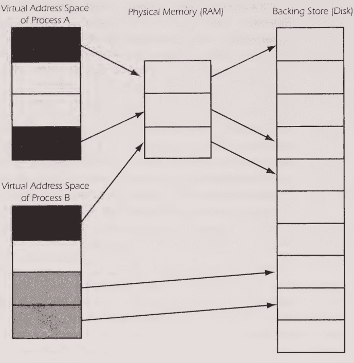

*   已交换出的页面
*   已交换进的页面
*   未映射的页面

访问已交换出的页面会导致缺页中断，这会导致该页面被加载到物理内存中，替换另一个页面。

访问未映射的页面会导致缺页中断，从而导致段错误。

### 页面置换

当发生缺页中断时，虚拟内存管理器必须选择一个页面从内存中移除，以便为必须调入的页面腾出空间。如果待移除的页面在内存中已被修改，则必须将其重写回磁盘以使磁盘副本保持最新。然而，如果页面未更改，则不需要刷新。待读入的页面将覆盖被驱逐的页面。

随机替换页面实际上可能是页面置换算法的一种实用实现。然而，实现一种选择使用不频繁的页面的算法可能更有价值。在 `2.4` 内核中，`Linux` 使用最近最少使用（`LRU`）算法。顾名思义，该算法正在寻找长时间未被引用的页面，假设它们将继续不被引用更长时间，甚至可能永远不再被引用。就开销而言，`LRU` 并不便宜。`Linux` 必须维护所有内存中页面的链表，最近使用的页面在链表前端，最近最少使用的页面在链表末端。难点在于，该链表必须在每次内存引用时更新。在列表中查找页面、删除它，然后将其移动到前端是一个非常耗时的操作。

### Linux 2.4 实现

在本节中，我们探讨 `Linux` 虚拟内存实现以及涉及的算法和数据结构。重要的是要记住，这本书基于 `IA32`（`Intel x86`）架构。任何操作系统的虚拟内存都是内核中最依赖平台相关的领域之一。像 `Linux` 这样的多架构操作系统的内核，仍然需要能够支持一种通用方法。

### 地址转换

对于逻辑地址到物理地址及其反向的转换，内核使用 `CPU` 内可用的硬件设施，即内存管理单元（`MMU`）。

`MMU` 在 `CPU` 中存在了将近 30 年，并以现代形式引入于通用电气 645 计算机中，该计算机专为运行传奇的 `Multics`<sup>1</sup> 项目而设计。`Multics` 是第一个拥有具有按需分页的虚拟内存概念的现代操作系统。（`Atlas` 计算机早在 1962 年就有按需分页。`IBM` 的 `MFP`（多重固定分区）操作系统<sup>2</sup> 在几年前就拥有了整个分区的交换功能。然而，它并没有按需分页功能。`UNIX` 的开发者直接从 `Multics` 项目继承了虚拟内存范式，并将其应用于 `DEC PDP` 架构，该架构在某些型号中带有可选的 `MMU`。）

> 1 关于开创性的 `Multics` 项目的更多信息，可在 `www.best.com/~thvv/~thvv/multics.html` 找到。
>
> 2 `IBM 系统期刊` 第 5 卷，1966 年，《OS/360 的功能结构》。

### MMU 与内核协同工作以进行地址翻译

内核询问 `MMU` 应将哪些虚拟页映射到物理页，以覆盖每个用户地址空间。随后，`MMU` 为内核执行这些翻译。`MMU` 具备在翻译过程中发生任何错误时发出信号（中断）的能力。最常见的错误情况是所需物理页未驻留在 `RAM` 中。当发生这种页面故障时，内核必须从交换设备或交换文件中检索所需的页。

另一种可能的错误情况是，用户空间程序试图访问位于其他用户地址空间内的虚拟地址。或者，它可能试图访问内核的受保护内存。还有一种可能是试图写入用户自身地址空间中的只读区域。所有这些错误均由 `MMU` 向内核发出信号，以便内核采取适当的措施。

### Linux 虚拟内存管理器采用两级地址翻译表概念

`IA32` 架构采用了硬连线的三级地址翻译方法。正如我们稍后所见，这并非障碍。其他处理器可能具有不同的架构，但内核通过其对地址翻译的通用方法知道如何处理它们。图 5.2 中的图表展示了地址翻译的过程。每当用户空间程序需要访问虚拟内存地址时，`MMU` 将该地址分解为三个组成部分：

*   页目录项 (`PGD`) 或第一级。
*   页表项 (`PTE`)，有时也称为页帧号（`[PFN]`）或第二级。
*   偏移量或第三级。

页目录是指向页表的指针数组。每个页表是指向物理页的指针数组。因此，翻译地址意味着遍历整个指针链以到达物理页内的地址。因此，页目录指向页表，而页表又指向页。最后，偏移量指向该页内的一个地址。

`Linux` 运行在各种各样的架构上，因此必须将依赖于架构的代码减至最少。因此，内核设计者决定采用 `MMU` 的三级视图。为了使这种三级视图适用于 `IA32` 中现有的两级（或二级）范式，页中间目录的大小被设置为 1。因此，就所有实际目的而言，页中间目录的行为与页目录相同。

在 `IA32` 中，在总共 32 位的虚拟地址中，10 位保留给页目录项 (`PGD`)，10 位用于页表项 (`PTE`)，剩余的 12 位用于偏移量。这就是为什么在一页内有 4,096 个偏移量（`4K = 2^12`）的原因。

虚拟地址

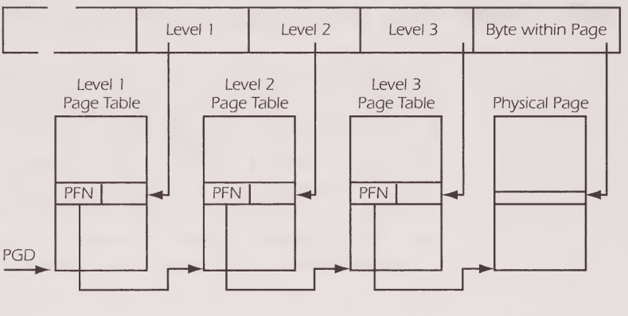

### Linux 中的 TLB

为了加速地址翻译过程，内核使用 `TLB`。实际上，内核在管理 `TLB` 方面无需做太多工作；`CPU` 自行完成所有工作。内核唯一需要介入的情况发生在调度器切换到另一个用户的地址空间以执行，并且 `TLB` 必须用新地址空间的缓存项重新加载时。为此，内核只需向 `TLB` 加载一个值，从而强制 `CPU` 认为其已失效并将其刷新。通过正常的地址翻译工作，`CPU` 会用新条目重新填充 `TLB`。

这种刷新是通过调用 `__flush_tlb` 汇编宏完成的。它所做的只是将 `CR3` 值保存到临时变量 `tmpreg` 中，然后将 `tmpreg` 复制回 `CR3`。这就足以使 `TLB` 失效。相关代码位于 `include/asm-i386/pgtable.h` 中。

```c
#define __flush_tlb()                 \
    do {                               \
        unsigned int tmpreg;           \
                                       \
        __asm__ __volatile__(          \
            "movl %%cr3, %0;          # flush TLB \n" \
            "movl $0, %&cr3;\t\n" \
            : "=r" (tmpreg) \
            : : "memory");
        } while (0)
```

### 页面分配与释放

内核 `2.4` 中的页面分配器是基于区域的。物理内存被划分为若干区域。分配器尝试将空闲内存合并为大的物理连续内存块。这些块在物理内存中自然对齐。分配或释放单个页的顺序为 0。分配两个连续物理页的顺序为 1（例如，任务结构 + 内核栈以顺序 1 分配，因为其大小为 8,192 字节）。对于哈希表，顺序增长得更快——高达分配 2Mbytes 的连续物理内存。

用于页面分配和释放的机制和数据结构或许是维持虚拟内存子系统效率的最关键部分。系统中的所有物理页都由 `mem_map` 数据结构描述，它是一个 `mem_map_t` 的链表。每个 `mem_map_t` 描述系统中的单个物理页。重要字段（就内存管理而言）包括：

*   `count`——这是该页用户数量的计数。当页在多个进程之间共享时，计数大于一。
*   `age`——此字段描述页的“年龄”，用于决定该页是否是丢弃或交换的良好候选对象。
*   `map_nr`——这是 `mem_map_t` 描述的物理 `PFN`。

`free_area` 结构被页面分配代码用于查找和释放页。整个缓冲区管理方案由此机制支持，并且就代码而言，`CPU` 使用的页大小和物理分页机制无关紧要。

`free_area` 的每个元素都包含关于页块的信息。数组中的第一个元素描述单个页，下一个描述两个页的块，以此类推，按 2 的幂次递增。列表元素用作队列头，并具有指向 `mem_map` 数组中页结构的指针。空闲页块在此排队。`map` 是指向位图的指针，该位图跟踪此大小的已分配页组。如果第 N 个页块空闲，则位图中的第 N 位被置位。

图 5.3 展示了 `free_area` 结构。元素 0 有一个空闲页（`PFN 0`），元素 2 有两个四个页的空闲块，第一个从 `PFN 4` 开始，第二个从 `PFN 56` 开始。

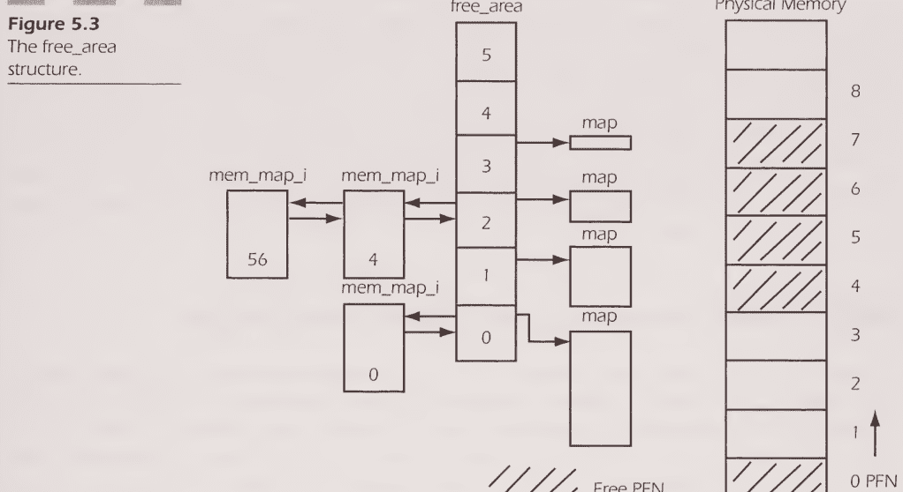

### 页面释放


分配页块往往会使内存碎片化，较大的空闲页块被分解为较小的块。页面释放代码会在可能的情况下将空闲页重新合并为较大的块。页块大小非常重要；它便于将块合并为更大的块。每当释放一个页块时，都会检查相邻的同大小块是否空闲。如果空闲，则将其与新释放的页块合并，形成下一个大小的新空闲页块。每次两个页块合并为一个更大的空闲页块时，页面释放代码都会尝试将该块合并为更大的块。这样，空闲页块的大小将尽可能大，以适应用内存的使用。

例如，在图 5.3 中，如果 `PFN` `1` 被释放，那么它将与已经空闲的 `PFN` `0` 合并，并作为大小为两个页的空闲块排队到 `free_area` 的元素 `1` 中。

### 最近最少使用 (LRU) 算法

`Linux` 使用 `LRU` 算法来决定哪些页应被选中进行换出。`Linux` 中的 `LRU` 实现很大程度上基于操作系统理论中的常识。存在一个变量 `lru_page`，它指向 `LRU` 的头。每当页被添加到任何类型的可释放缓存中（以便在内存不足时 `shrink_mmap` 可能需要缩小缓存），该页就会排入 `LRU` 列表的一端。在另一端，`shrink_mmap` 试图释放页。在此过程中涉及一个用于老化的引用位，以避免在每次缓存命中时滚动列表的成本。所有 `LRU` 处理都是 `SMP` 线程化的，并允许 `VM` 在另一个 `CPU` 查询页缓存时缩小缓存。

### 页面交换与丢弃

当内存变得稀缺时，`Linux` 内存管理子系统尝试释放物理页。此功能由内核交换守护进程 `kswapd` 执行。名称 `swap daemon` 有点名不副实，因为该守护进程所做的不仅仅是将修改过的页交换到交换文件。其任务是保持内存管理系统高效运行。`kswapd` 由内核 `init` 进程在启动时启动，并等待内核交换计时器定期过期。每当计时器过期时，`VM` 管理器都会唤醒 `kswapd`，`kswapd` 会检查系统中的空闲页数量是否过低。

`kswapd` 的主要功能是为原子分配提供空闲内存。这些分配发生在中断上下文中，不能睡眠，因为它们需要快速，以免损害 `IRQ` 或软 `IRQ` 的延迟。`kswapd` 守护进程是一个自治的内核线程，其唯一任务是在 `mm/vmscan.c` 中无限运行 `kswapd()` 函数。`kswapd` 守护进程通常在 `kswapd_wait` 等待队列上睡眠。如果给定区域（或全局）内的内存压力超过给定阈值，区域分配器会唤醒它；然后 `kswapd()` 尝试释放页，使内存压力返回到正常的低状态。这就是它做的全部工作。

释放页是一个复杂任务，涉及五个步骤：

1. 尝试释放“干净”页（页缓存、缓冲区缓存）。
2. 收缩 `dentry` 缓存。
3. 收缩 `inode` 缓存。
4. 尝试交换出共享内存。
5. 尝试释放“脏”页。

`VM` 管理器试图避免同时有太多页面被写入交换文件，因此它使用 `nr_async_pages` 来统计当前正在写入交换文件的页面数量。`free_pages_low` 和 `free_pages_high` 参数在系统启动时设置，并与系统中的物理页数量相关。如果有足够的空闲页面，`swap` 守护进程将休眠，直到其计时器到期；否则，`swap` 守护进程将尝试通过三种方式来减少系统使用的物理页数量：

1. 减少缓冲区和页面缓存的大小。
2. 交换出共享页面。
3. 交换出或丢弃页面。

默认情况下，`swap` 守护进程每次运行时尝试释放四个页面。上述方法依次尝试，直到释放了足够数量的页面。然后，`swap` 守护进程再次休眠，直到其计时器到期。

## 交换出页面

`swap` 守护进程依次检查系统中的每个进程，看它是否适合被交换出。好的候选者是那些可以被交换出（有些进程不能被交换出）且具有一个或多个可以从内存中交换出或丢弃的页面的进程。只有当页中的数据无法通过其他方式检索时，页面才会被交换出。可执行映像的大部分内容来自映像的文件，并且可以轻易地从该文件重新读取。例如，映像的可执行指令永远不会被映像修改，因此永远不会被写入交换文件。这些页面可以简单地丢弃；当进程再次引用它们时，它们将从可执行映像中被重新加载到内存中。

一旦确定了要交换出的进程，`swap` 守护进程就会遍历其所有虚拟内存区域，寻找未共享或未锁定的区域。`Linux` 不会交换出所选进程的所有可交换页面；相反，它只移除少量页面。如果页面满足以下条件，则不能交换出或丢弃：

- 在内存中被锁定
- 是共享的

交换出这些页面有一个单独的、显式的机制。交换算法使用页面老化。每个页面都有一个计数器（保存在 `mem_map_t` 数据结构中），它给内核 `swap daemon`（交换守护进程）提供一些关于页面是否值得交换出的线索。页面在未被使用时老化，在被访问时恢复活力；`swap daemon` 只交换出老旧的页面。当页面首次分配时，默认操作是将其初始年龄设为 `3`。每次内存管理子系统触碰它时，其年龄增加 `3`，最大为 `20`。每次内核 `swap daemon` 运行时，它会使页面老化，将其年龄递减 `1`。这些默认操作可以被更改，因此它们（以及其他交换相关信息）被存储在 `swap_control` 中。

### 图 5.4

`Alpha AXP` 页表项。

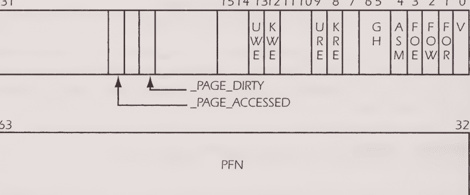

如果页面较旧，`swap daemon` 会进一步处理它。脏页是可以被交换出的页面。`Linux` 使用架构相关的位来描述 `PTE` 中的此类页面。然而，并非所有脏页都会被写入交换文件。进程的每个虚拟内存区域可能有自己的交换方法，在这种情况下，将使用该方法。否则，`swap daemon` 将分配交换文件中的一个页面，并将该页面写入交换文件设备。如果使用交换文件，该页面的页表项（`PTE`）将被替换为一个标记为无效但包含页面在交换文件中位置信息的 `PTE`。无论使用哪种交换方法，原始物理页都通过将其实放入 `free_area`（空闲区）中而变为空闲。干净的（或者更准确地说，非脏的）页面可以被丢弃并放回 `free_area` 中重用。这些页面的 `PTE` 会被标记为无效。当进程试图访问这些页面时，它们将从正在运行的可执行映像中重新读取。

由于进程的 `PTE` 已更改，`CPU` 的转换后备缓冲区（`TLB`）必须更新，`TLB` 包含 `PTE` 的缓存的、内部的、`CPU` 可读副本。此更新机制是架构相关的。如果可交换进程的页面被交换出或丢弃的数量足够多，交换守护进程将再次休眠。它下次唤醒时，将考虑系统中的下一个进程。通过这种方式，交换守护进程逐渐消耗每个进程的物理页，直到系统再次平衡。这比交换出整个进程要公平得多。

`Linux` 在交换出阶段相当复杂，因为它维护了一个交换缓存。这类似于文件系统的页面缓存。例如，如果我们要第二次交换出一个仍然保持最新状态的页面，交换缓存可以避免我们两次写入磁盘。它还避免了如果我们交换出了一个页面并在随后不久又产生缺页，需要从磁盘交换入的情况（这会变成轻微缺页而不是严重缺页）。交换缓存的另一个功能是避免任务需要分叉一个子进程，而该子进程会对父进程 `VM` 中已交换出的页面进行严重缺页（交换入）。（因为 `2.0.x` 没有交换缓存，所以你经常看到每次 `Apache` 分叉子进程时都会发生持续的交换入。我在 `2.1.x` 中期发现了这个问题的原因；该问题在 `2.2.x` 中得到妥善修复，`2.2.x` 更好地利用了交换缓存。）

交换出过程经历以下步骤：

1. 以轮询方式搜索任务的所有页表，寻找标记为 "old" 的匿名页面。
2. 将这样的页面添加到交换缓存，并标记为 "locked"（锁定）。
3. 以异步模式将这样的页面写入磁盘（每页的锁定位通过 `IO` 完成中断释放）。
4. 设置包含交换项信息的 `PTE`，并将 `PTE` 标记为 "page-not-present"（页面不在）。

在 `2.4` 中有三个水位线：

```
high = min*3
low = min*2
min
```

一旦空闲页面数量低于低水位线，只要有请求需要内存，`kswapd` 守护进程就会立即唤醒。如果空闲页面数量低于最小水位线，则任务阻塞，`kswapd` 自行释放内存（如果可以的话）。唤醒后，`kswapd` 继续运行，直到空闲页面数量回到高水位线以上。换言之，它的任务是从低水位线移动到 High 水位线。

因此，`kswapd` 在后台释放页面以及为分配释放页面非常有用（例如在不能自行释放内存的 bottom-half 处理程序或 `IRQ` 处理程序中，因为它们不能阻塞）。

## 减少页面和缓冲缓存的大小

每次内核交换守护进程尝试收缩页面和缓冲缓存时，它会检查 `mem_map` 页向量中一定数量的页面，以查看是否有任何页面可以从物理内存中丢弃。检查的页面数量由调用代码的优先级定义。页块以循环方式进行检查；每次尝试收缩内存映射时，都会检查不同的页块。

检查每个页面以确定它是否缓存在页面缓存或缓冲缓存中。此时不考虑共享页面，并且一个页面不能同时存在于两个缓存中。如果页面不在任何缓存中，则检查 `mem_map` 页向量中的下一个页面。


页面被缓存在缓冲缓存中（或者更确切地说，是页面内的缓冲区被缓存），以使缓冲区分配和释放更高效。正在收缩的内存映射代码试图释放正在检查的页面中包含的缓冲区。如果所有缓冲区都被释放，那么包含这些缓冲区的页面也会被释放。页面被排队到页面缓存中，以加速对磁盘上映像和数据的访问。如果正在检查的页面在此缓存中，它将从页面缓存中移除并释放。

当本次尝试释放了足够多的页面后，内核交换守护进程等待下次被唤醒。由于释放的页面都不属于任何进程的虚拟内存（它们是缓存页面），因此无需更新页表。如果没有足够多的缓存页面被丢弃，那么交换守护进程将尝试交换出一些共享页面。

## 换出共享页面

在进程之间共享的物理页面与普通页面是分开换出的。当交换守护程序尝试换出共享页面时，它使用`shm_segs`（一个指向`shmid_ds`数据结构指针的向量）来查找共享页面中适合换出的候选者。对于每个`shmid_ds`，都有一个`vm_area_struct`结构体列表，其中每个结构体描述了特定进程的虚拟内存与该共享内存区域的关系。与非共享内存类似，页表项必须被修改，以表明该页面位于交换文件中。然而，在将页面写入交换文件并释放之前，必须修改所有共享该页面的进程的页表。每个进程的页表项通过跟随每个`vm_area_struct`结构体中的`vm_mm`指针来查找。每个`vm_mm`指针都指向该进程的一级页表。

## 换入页面（请求调页）

无论 Linux 运行在何种体系结构上，其缺页处理程序都会被调用。相关的页表项 (`PTE`) 会被检查，如果它是一个无效条目，则有三种处理方式：`交换页`、`共享交换页`以及`可执行映像页面`。

### 交换页

如果 `PTE` 被标记为交换页，则必须从交换文件读取该页面，并更新`swap_cache`和`PTE`。

### 共享交换页

交换文件中的共享页面与非共享页面分开处理。

分配一个物理页面，并使用`PTE`中的交换文件信息以及为交换文件保留在`swap_info_struct`树中的信息，从交换文件将该页面读入其中。由于该页面是共享页面，必须更新所有共享该虚拟内存的进程的页表，以表明该页面再次存在于物理内存中。

### 可执行映像页面

如果 `PTE` 未被标记为在交换中，则从可执行映像中将适当的页面读入内存，并更新`PTE`以反映新分配并填充的物理页面。无论页面是如何读入内存的，都会为该页面创建一个新的`PTE`，并且`TLB`会被更新以反映所做的页表更改。

## 在 Intel x86 上寻址超过 4GB

最近，内核黑客 Andrea Arcangeli 提出了一种在 IA32 体系结构上寻址超过 4GB 内存的方法。允许 IA32 突破 2.3.x 中旧内存限制（在 2.2.x 中需附加一个补丁）的设计工作原理如下：

1. 基本上你拥有 4GB 物理内存和 4GB 虚拟内存：
```
| 用户空间虚拟 0-3g | 内核虚拟 3-4g |
```

2. 为了访问物理内存，首先必须建立正确的虚拟到物理映射。内核将 3GB 到 4GB 范围映射到 0 到 1GB 物理范围：
```
| 内核物理 0-1GB | 未使用物理内存 1(??)-4GB |
```
并且用户空间*虚拟*地址（0 到 3GB 区域）以 4kbyte (`PAGE_SIZE`) 粒度映射到内核可寻址的所有物理内存上，这完全取决于用户页表设置。旧 2.2.x 设计的局限性（在此新设计中已被移除）在于内核无法处理无法通过恒等映射访问的内存，即 3 到 4GB 虚拟区域（内核运行处），它指向 0 到 1GB 物理内存。换句话说，内核一直在执行以下操作：
```
* (virtual_address) = 0;
```
以写入位于地址 `virtual_address - 3GB` 的物理内存：

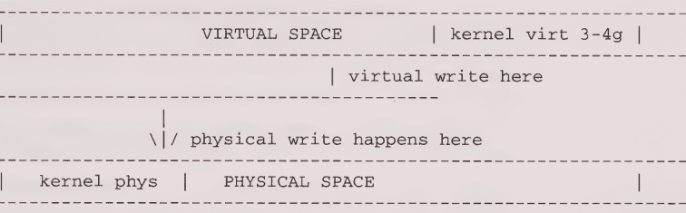

如图所示，内核在写入恒等映射时所能访问的最后一个地址恰好是 4GB-1，它指向物理地址 1GB-1。然后，由于 IA32 CPU 家族的 32 位虚拟地址限制，虚拟地址会回绕。

> 我们不能使用用户空间的虚拟空间来写入 1GB 物理 RAM 地址之后的内存。这是因为用户空间页表属于进程内存布局，如果我们不清除用户空间映射并刷新用户 TLB，就无法更改它们。

新设计的主要成就是允许内核访问内核物理区域之上、1GB 以上的物理内存。为了干净地实现这一点，在虚拟内存末尾保留了一池虚拟页面（大约在地址 4GB 处），并将页表放置在那里，以将它们映射到 2GB 范围之上的物理空间。

这正是 2.4 内核如何在 IA32 上支持超过 1GB RAM 的方式。下图展示了这一新颖之处（截至内核 2.3.41）：

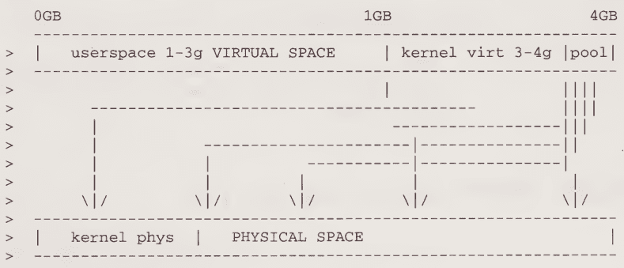

如图所示，通过在虚拟地址 4GB 附近放置虚拟页面池，我们现在可以从内核寻址所有可用的物理空间。在图中，物理空间与虚拟空间一样大（4GB）。借助新的物理地址扩展 (`PAE`) 支持，代码以完全相同的方式工作，区别在于，在 PAE 模式的三级页表中，物理空间大于 4GB——多达 64GB。因此，图表应予以修改，将物理空间的末尾移动到地址 64GB 而不是 4GB。这是 PAE 模式与非 PAE 模式之间唯一的区别。

用户空间继续指向整个物理空间。但现在，用户空间可以通过其页表寻址的物理空间不再局限于 0 到 1GB 的物理 RAM；相反，它可以寻址所有物理内存，正如我们的虚拟内核页面池一样。这是因为内核现在能够处理 1GB 之后的物理范围，并允许用户空间也使用它。

当然，如图所示，访问 1GB 以上的内存存在性能损失，因为我们必须建立虚拟到物理映射并刷新旧的 TLB 条目。然而，为了处理更多内存而承担这种性能损失是非常合理的。与 Andrea Arcangeli 一起，我在最坏情况（最大缺页率）下测量的性能打击仅为 2 个百分点。在日常操作中，这种影响是难以察觉的。

为了映射和解除映射预留的虚拟页面以访问内存，Andrea 创建了两个辅助函数`kmap()`和`kunmap()`，它们自动处理虚拟到物理映射。

使用预留池访问超过 1GB 内存的 2.3.x 代码如下所示：

```c
page = get_page();
virtual_address = kmap(page);
* (virtual_address) = 0;
kunmap(page);
```

这是卓越工程的另一个绝佳范例，表明通过创造力和坚持，以前被认为不可能的事情实际上是可以做到的。

## 改进虚拟内存

我们再次试图通过新功能来改进内核。显然，这些改进的实用性和实际需求是可以争议的。重点在于学习方面，如果学生试图增强其研究对象，这一方面的重要性要高得多。

## 实现页面着色

页面着色是一种性能优化技术，旨在确保对虚拟内存中连续页面的访问能最有效地利用处理器缓存。在古代（即 10 或更多年前），处理器缓存倾向于映射虚拟内存而非物理内存。这导致了许多问题，包括在某些情况下每次上下文切换都需要清除缓存，以及缓存中的数据别名问题。

现代处理器缓存以物理内存映射方式工作，其设计正是为了解决这些问题。这意味着进程中并排的两个页面不一定对应缓存中并排的两个页面。事实上，如果你不小心，虚拟内存中并排的页面可能会最终使用处理器缓存中的同一个页面——导致可缓存数据过早被丢弃，从而降低 CPU 性能。即使在使用多路组相联缓存时，这种情况也是如此（尽管影响在某种程度上有所缓解）。

针对每个任务的虚拟内存页面缓存分配跟踪器是实现动态页面着色的最佳方式；在我看来，检查页表速度相当慢。完美的静态着色（在可能的情况下）可能是不幸应用程序的最糟糕做法。

在本书撰写时，有一些使用此技术的初步实现正在开发中，但尚未准备好包含在此处。

## 数据结构——`include/linux/sched.h`

```c
#ifndef _LINUX_SCHED_H
#define _LINUX_SCHED_H

#include <asm/param.h>  /* for HZ */

extern unsigned long event;

#include <linux/binfmts.h>
#include <linux/personality.h>
#include <linux/threads.h>
#include <linux/kernel.h>
#include <linux/types.h>
```

# 134

# 第 5 章


```c
#include <linux/times.h>
#include <linux/timex.h>

#include <asm/system.h>
#include <asm/semaphore.h>
#include <asm/page.h>
#include <asm/ptrace.h>

#include <linux/smp.h>
#include <linux/tty.h>
#include <linux/sem.h>
#include <linux/signal.h>
#include <linux/securebits.h>

/*
 * cloning flags:
 */
#define CSIGNAL  0x000000ff  /* signal mask to be sent at exit */
#define CLONE_VM   0x00000100  /* set if VM shared between processes */
#define CLONE_FS   0x00000200  /* set if fs info shared between processes */
#define CLONE_FILES  0x00000400  /* set if open files shared between processes */
#define CLONE_SIGHAND  0x00000800  /* set if signal handlers shared */
#define CLONE_PID  0x00001000  /* set if pid shared */
#define CLONE_PTRACE  0x00002000  /* set if we want to let tracing continue on the child too */
#define CLONE_VFORK  0x00004000  /* set if the parent wants the child to wake it up on mm_release */
#define CLONE_PARENT  0x00008000  /* set if we want to have the same parent as the cloner */

/*
 * These are the constants used to fake the fixed-point load-average
 * counting. Some notes:
 * - 11 bit fractions expand to 22 bits by the multiplies: this gives
 * a load-average precision of 10 bits integer + 11 bits fractional
 * - if you want to count load-averages more often, you need more
 * precision, or rounding will get you. With 2-second counting freq,
 * the EXP_n values would be 1981, 2034 and 2043 if still using only
 * 11 bit fractions.
 */
extern unsigned long avenrun[];    /* Load averages */

#define FSHIFT    11    /* nr of bits of precision */
#define FIXED_1   (1<<FSHIFT)      /* 1.0 as fixed-point */
#define LOAD_FREQ (5*HZ)  /* 5 sec intervals */
#define EXP_1  1984   /* 1/exp(5sec/1min) as fixed-point */
#define EXP_5  2014   /* 1/exp(5sec/5min) */
#define EXP_15  2037  /* 1/exp(5sec/15min) */

#define CALC_LOAD(load,exp,n) \
load *= exp; \
load += n*(FIXED_1-exp); \
load >>= FSHIFT;
```

# Linux VM 管理器

```c
#define CT_TO_SECS(x)    ((x) / HZ)
#define CT_TO_USECS(x)   (((x) % HZ) * 1000000/HZ)

extern int nr_running, nr_threads;
extern int last_pid;

#include <linux/fs.h>
#include <linux/time.h>
#include <linux/param.h>
#include <linux/resource.h>
#include <linux/timer.h>

#include <asm/processor.h>

#define TASK_RUNNING        0
#define TASK_INTERRUPTIBLE  1
#define TASK_UNINTERRUPTIBLE 2
#define TASK_ZOMBIE         4
#define TASK_STOPPED        8
#define TASK_EXCLUSIVE      32

#define __set_task_state(task, state_value)  \
        do { (task)->state = (state_value); } while (0)
#ifdef __SMP__
#define set_task_state(task, state_value)    \
        set_mb((task)->state, (state_value))
#else
#define set_task_state(task, state_value)    \
        __set_task_state((task), (state_value))
#endif

#define __set_current_state(state_value)     \
        do { current->state = (state_value); } while (0)
#ifdef __SMP__
#define set_current_state(state_value)        \
        set_mb(current->state, (state_value))
#else
#define set_current_state(state_value)        \
        __set_current_state(state_value)
#endif

/*
 * Scheduling policies
 */
#define SCHED_OTHER           0
#define SCHED_FIFO            1
#define SCHED_RR              2

/*
 * This is an additional bit set when we want to
 * yield the CPU for one re-schedule.
 */
#define SCHED_YIELD           0x10
```


```c
struct sched_param {
    int sched_priority;
};

#define __KERNEL__

#include <linux/spinlock.h>

/*
 * This serializes `schedule()' and also protects
 * the run-queue from deletions/modifications (but
 * adding to the beginning of the run-queue has
 * a separate lock).
 */
extern rwlock_t tasklist_lock;
extern spinlock_t runqueue_lock;

extern void sched_init(void);
extern void init_idle(void);
extern void show_state(void);
extern void cpu_init(void);
extern void trap_init(void);
extern void update_one_process( struct task_struct *p,
    unsigned long ticks, unsigned long user, unsigned long system, int cpu);

#define MAX_SCHEDULE_TIMEOUT LONG_MAX
extern signed long FASTCALL(schedule_timeout(signed long timeout));
asmlinkage void schedule(void);

/*
 * The default fd array needs to be at least BITS_PER_LONG,
 * as this is the granularity returned by copy_fdset().
 */
#define NR_OPEN_DEFAULT BITS_PER_LONG

/*
 * Open file table structure
 */
struct files_struct {
    atomic_t count;
    rwlock_t file_lock;
    int max_fds;
    int max_fdset;
    int next_fd;
    struct file ** fd; /* current fd array */
    fd_set *close_on_exec;
    fd_set *open_fds;
    fd_set close_on_exec_init;
    fd_set open_fds_init;
    struct file * fd_array[NR_OPEN_DEFAULT];
};

#define INIT_FILES { \
    ATOMIC_INIT(1), \
    RW_LOCK_UNLOCKED, \
    NR_OPEN_DEFAULT, \
    __FD_SETSIZE, \
    0, \
    &init_files.fd_array[0], \
    &init_files.close_on_exec_init, \
    &init_files.open_fds_init, \
    { { 0, } }, \
    { { 0, } }, \
    { NULL, } \
}

struct fs_struct {
    atomic_t count;
    int umask;
    struct dentry * root, * pwd;
};

#define INIT_FS { \
    ATOMIC_INIT(1), \
    0022, \
    NULL, NULL \
}

/* Maximum number of active map areas. This is a random (large) number */
#define MAX_MAP_COUNT (65536)

/* Number of map areas at which the AVL tree is activated. This is arbitrary. */
#define AVL_MIN_MAP_COUNT 32

struct mm_struct {
    struct vm_area_struct * mmap;        /* list of VMAs */
    struct vm_area_struct * mmap_avl;    /* tree of VMAs */
    struct vm_area_struct * mmap_cache;  /* last find_vma result */
    pgd_t * pgd;
    atomic_t mm_users;    /* How many users with user space? */
    atomic_t mm_count;    /* How many references to "struct mm_struct" (users count as 1) */
    int map_count;        /* number of VMAs */
    struct semaphore mmap_sem;
    spinlock_t page_table_lock;
    unsigned long context;

    unsigned long start_code, end_code, start_data, end_data;
    unsigned long start_brk, brk, start_stack;
    unsigned long arg_start, arg_end, env_start, env_end;
    unsigned long rss, total_vm, locked_vm;
    unsigned long def_flags;
    unsigned long cpu_vm_mask;
    unsigned long swap_cnt; /* number of pages to swap on next pass */
    unsigned long swap_address;

    /*
     * This is an architecture-specific pointer: the portable
     * part of Linux does not know about any segments.
     */
    void *segments;
};

#define INIT_MM(name) { \
        &init_mm.mmap, NULL, NULL, \
        swapper_pg_dir, \
        ATOMIC_INIT(2), ATOMIC_INIT(1), 1, \
        _MUTEX_INITIALIZER(name.mmap_sem), \
        SPIN_LOCK_UNLOCKED, \
        0, \
        0, 0, 0, 0, \
        0, 0, 0, \
        0, 0, 0, \
        0, 0, 0, \
        0, 0, 0, 0, NULL }

struct signal_struct {
        atomic_t        count;
        struct k_sigaction action[_NSIG];
        spinlock_t              siglock;
};

#define INIT_SIGNALS { \
        ATOMIC_INIT(1), \
        { {{0}}, }, \
        SPIN_LOCK_UNLOCKED }

/*
 * Some day this will be a full-fledged user tracking system.
 * Right now it is only used to track how many processes a
 * user has, but it has the potential to track memory usage etc.
 */
struct user_struct;

struct task_struct {
/* these are hardcoded - don't touch */
        volatile long state;  /* -1 unrunnable, 0 runnable, >0 stopped */
        unsigned long flags;  /* per process flags, defined below */
        int sigpending;
        mm_segment_t addr_limit;    /* thread address space:
                                     0-0xBFFFFFFF for user-thread
                                     0-0xFFFFFFFF for kernel-thread
                                     */

        struct exec_domain *exec_domain;
        volatile long need_resched;

        cycles_t avg_slice;
        int lock_depth;    /* Lock depth. We can context switch in and out of
                           holding a syscall kernel lock... */
/* begin intel cache line */
        long counter;
        long priority;
        unsigned long policy;

/* memory management info */
struct mm_struct *mm, *active_mm;
int has_cpu;
int processor;
struct list_head run_list;
struct task_struct *next_task, *prev_task;
int last_processor;

/* task state */
struct linux_binfmt *binfmt;
int exit_code, exit_signal;
int pdeath_signal;  /* The signal sent when the parent dies */
/* ??? */
unsigned long personality;
int dumpable:1;
int did_exec:1;
pid_t pid;
pid_t pgrp;
pid_t tty_old_pgrp;
pid_t session;
/* boolean value for session group leader */
int leader;
/*
 * pointers to (original) parent process, youngest child, younger sibling,
 * older sibling, respectively. (p->father can be replaced with
 * p->p_optr->p_id)
 */
struct task_struct *p_optr, *p_pptr, *p_cptr, *p_ystr, *p_osptr;

/* PID hash table linkage. */
struct task_struct *pidhash_next;
struct task_struct **pidhash_pprev;

wait_queue_head_t wait_chdexit; /* for wait4() */
struct semaphore *vfork_sem;     /* for vfork() */
unsigned long rt_priority;
unsigned long it_real_value, it_prof_value, it_virt_value;
unsigned long it_real_incr, it_prof_incr, it_virt_incr;
struct timer_list real_timer;
struct tms tms_times;
unsigned long start_time;
long per_cpu_utime[NR_CPUS], per_cpu_stime[NR_CPUS];
/* mm fault and swap info: this can arguably be seen as either mm-specific or
thread-specific */
unsigned long min_flt, maj_flt, nswap, cmin_flt, cmaj_flt, cnswap;
int swappable:1;
/* process credentials */
uid_t uid, euid, suid, fsuid;
gid_t gid, egid, sgid, fsgid;
int ngroups;
gid_t   groups[NGROUPS];
kernel_cap_t cap_effective, cap_inheritable, cap_permitted;
struct user_struct *user;
/* limits */
```


```c
struct rlimit rlim [RLIM_NLIMITS];
unsigned short used_math;
char comm [16];
/* 文件系统信息 */
int link_count;
struct tty_struct *tty; /* 如果没有终端则为 NULL */
/* IPC 相关 */
struct sem_undo *semsundo;
struct sem_queue *ssemwaiting;
/* 此任务的 CPU 特定状态 */
struct thread_struct thread;
/* 文件系统信息 */
struct fs_struct *fs;
/* 打开文件信息 */
struct files_struct *files;
/* 信号处理程序 */
spinlock_t sigmask_lock;  /* 保护 signal 和 blocked */
struct signal_struct *sig;
sigset_t signal, blocked;
struct signal_queue *sigqueue, **sigqueue_tail;
unsigned long sas_ss_sp;
size_t sas_ss_size;

/* 线程组跟踪 */
u32 parent_exec_id;
u32 self_exec_id;
/* 字段分配/释放的保护 */
struct semaphore exit_sem;
};

/*
 * 每个进程的标志
 */
#define PF_ALIGNWARN       0x00000001  /* 打印对齐警告消息 */
/* 尚未实现，仅用于 486 */
#define PF_STARTING        0x00000002  /* 正在创建 */
#define PF_EXITING         0x00000004  /* 正在关闭 */
#define PF_PTRACE          0x00000010  /* 如果调用了 ptrace (0) 则设置 */
#define PF_TRACE           0x00000020  /* 跟踪系统调用 */
#define PF_FORKNOEXEC      0x00000040  /* fork 但未 exec */
#define PF_SUPERPRIV       0x00000100  /* 使用了超级用户权限 */
#define PF_DUMPCORE        0x00000200  /* 已转储核心 */
#define PF_SIGNALED        0x00000400  /* 被信号杀死 */
#define PF_MEMALLOC        0x00000800  /* 正在分配内存 */
#define PF_VFORK           0x00001000  /* 在 mm_release 中唤醒父进程 */

#define PF_USEDFPU         0x00100000  /* 任务在此时间片使用了 FPU (SMP) */
#define PF_TRACE           0x00200000  /* 延迟跟踪 (用于 m68k, i386) */

/*
 * 将栈限制设置为某个合理的默认值：root 如果需要
 * 总是可以增加这个限制..  8MB 似乎是合理的。
 */
#define _STK_LIM           (8*1024*1024)

#define DEF_PRIORITY (20*HZ/100) /* 200 ms 时间片 */
/*
 * INIT_TASK 用于设置第一个任务表，修改请
 * 自担风险！Base=0, limit=0x1ffffff (=2MB)
 */
#define INIT_TASK(tsk) \
(
 state: 0, \
 flags: 0, \
 sigpending: 0, \
 addr_limit: KERNEL_DS, \
 exec_domain: &default_exec_domain, \
 lock_depth: -1, \
 counter: DEF_PRIORITY, \
 priority: DEF_PRIORITY, \
 policy: SCHED_OTHER, \
 mm: NULL, \
 active_mm: &init_mm, \
 run_list: LIST_HEAD_INIT(tsk.run_list), \
 next_task: &tsk, \
 prev_task: &tsk, \
 p_opptr: &tsk, \
 p_pptr: &tsk, \
 wait_chldexit: __WAIT_QUEUE_HEAD_INITIALIZER(tsk.wait_chldexit), \
 real_timer: { \
 function: it_real_fn \
 }, \
 cap_effective: CAP_INIT_EFF_SET, \
 cap_inheritable: CAP_INIT_INH_SET, \
 cap_permitted: CAP_FULL_SET, \
 rlim: INIT_RLIMITS, \
 comm: "swapper", \
 thread: INIT_THREAD, \
 fs: &init_fs, \
 files: &init_files, \
 sigmask_lock: SPIN_LOCK_UNLOCKED, \
 sig: &init_signals, \
 signal: ({0}), \
 blocked: ({0}), \
 sigqueue: NULL, \
 sigqueue_tail: &tsk.sigqueue, \
 exit_sem: __MUTEX_INITIALIZER(tsk.exit_sem)
)

#ifndef INIT_TASK_SIZE
# define INIT_TASK_SIZE 2048*sizeof(long)
#endif

union task_union {
 struct task_struct task;
 unsigned long stack[INIT_TASK_SIZE/sizeof(long)];
};

extern union task_union init_task_union;

extern struct mm_struct init_mm;
extern struct task_struct *init_tasks[NR_CPUS];

/* PID 哈希。(这是否应该是动态的？) */
#define PIDHASH_SZ (4096 >> 2)
extern struct task_struct *pidhash[PIDHASH_SZ];

#define pid_hashfn(x) (((x) >> 8) ^ (x)) & (PIDHASH_SZ - 1))

extern __inline__ void hash_pid(struct task_struct *p)
{
    struct task_struct **htable = &pidhash[pid_hashfn(p->pid)];

    if ((p->pidhash_next = *htable) != NULL)
        (*htable)->pidhash_pprev = &p->pidhash_next;
    *htable = p;
    p->pidhash_pprev = htable;
}

extern __inline__ void unhash_pid(struct task_struct *p)
{
    if (p->pidhash_next)
        p->pidhash_next->pidhash_pprev = p->pidhash_pprev;
    *p->pidhash_pprev = p->pidhash_next;
}

extern __inline__ struct task_struct *find_task_by_pid(int pid)
{
    struct task_struct *p, **htable = &pidhash[pid_hashfn(pid)];

    for (p = *htable; p && p->pid != pid; p = p->pidhash_next)
        ;

    return p;
}

/* 按 UID 进行进程收费。 */
extern int alloc_uid(struct task_struct *);
void free_uid(struct task_struct *);

#include <asm/current.h>

extern unsigned long volatile jiffies;
extern unsigned long itimer_ticks;
extern unsigned long itimer_next;
extern struct timeval xtime;
extern void do_timer(struct pt_regs *);

extern unsigned int * prof_buffer;
extern unsigned long prof_len;

extern unsigned long prof_shift;

#define CURRENT_TIME (xtime.tv_sec)

extern void FASTCALL(__wake_up(wait_queue_head_t *q, unsigned int mode));
extern void FASTCALL(__wake_up_sync(wait_queue_head_t *q, unsigned int mode));
extern void FASTCALL(sleep_on(wait_queue_head_t *q));
extern long FASTCALL(sleep_on_timeout(wait_queue_head_t *q,
    signed long timeout));

extern void FASTCALL(interruptible_sleep_on(wait_queue_head_t *q));
extern long FASTCALL(interruptible_sleep_on_timeout(wait_queue_head_t *q,
    signed long timeout));
extern void FASTCALL(wake_up_process(struct task_struct * tsk));

#define wake_up(x)        __wake_up(x,TASK_UNINTERRUPTIBLE | TASK_INTERRUPTIBLE |
                          TASK_EXCLUSIVE)
#define wake_up_all(x)    __wake_up(x,TASK_UNINTERRUPTIBLE | TASK_INTERRUPTIBLE)
#define wake_up_sync(x)   __wake_up_sync(x,TASK_UNINTERRUPTIBLE |
                          TASK_INTERRUPTIBLE | TASK_EXCLUSIVE)
#define wake_up_interruptible(x)   __wake_up(x,TASK_INTERRUPTIBLE | TASK_EXCLUSIVE)
#define wake_up_interruptible_all(x)     __wake_up(x,TASK_INTERRUPTIBLE)
#define wake_up_interruptible_sync(x)    __wake_up_sync(x,TASK_INTERRUPTIBLE |
                                        TASK_EXCLUSIVE)

extern int in_group_p(gid_t);
extern int in_egroup_p(gid_t);

extern void flush_signals(struct task_struct *);
extern void flush_signal_handlers(struct task_struct *);
extern int dequeue_signal(sigset_t *, siginfo_t *);
extern int send_sig_info(int, struct siginfo *, struct task_struct *);
extern int force_sig_info(int, struct siginfo *, struct task_struct *);
extern int kill_pg_info(int, struct siginfo *, pid_t);
extern int kill_s1_info(int, struct siginfo *, pid_t);
extern int kill_proc_info(int, struct siginfo *, pid_t);
extern int kill_something_info(int, struct siginfo *, int);
extern void notify_parent(struct task_struct *, int);
extern void force_sig(int, struct task_struct *);
extern int send_sig(int, struct task_struct *, int);
extern int kill_pg(pid_t, int, int);
extern int kill_s1(pid_t, int, int);
extern int kill_proc(pid_t, int, int);
extern int do_sigaction(int, const struct k_sigaction *, struct k_sigaction *);
extern int do_sigaltstack(const stack_t *, stack_t *, unsigned long);

extern inline int signal_pending(struct task_struct *p)
{
    return (p->sigpending != 0);
}

/* 重新评估任务是否有待发送的信号。
 * 每次 blocked sigset_t 改变时都需要这样做。
 * 所有调用者都应持有 t->sigmask_lock。 */

static inline void recalc_sigpending(struct task_struct *t)
{
	unsigned long ready;
	long i;

	switch (_NSIG_WORDS) {
	default:
		for (i = _NSIG_WORDS, ready = 0; --i >= 0 ;)
			ready |= t->signal.sig[i] &~ t->blocked.sig[i];
		break;

	case 4: ready = t->signal.sig[3] &~ t->blocked.sig[3];
		ready |= t->signal.sig[2] &~ t->blocked.sig[2];
		ready |= t->signal.sig[1] &~ t->blocked.sig[1];
		ready |= t->signal.sig[0] &~ t->blocked.sig[0];
		break;

	case 2: ready = t->signal.sig[1] &~ t->blocked.sig[1];
		ready |= t->signal.sig[0] &~ t->blocked.sig[0];
		break;

	case 1: ready = t->signal.sig[0] &~ t->blocked.sig[0];
	}

	t->sigpending = (ready != 0);
}

/* 如果我们位于备用信号栈上，则返回真。 */

static inline int on_sig_stack(unsigned long sp)
{
	return (sp - current->sas_ss_sp < current->sas_ss_size);
}

static inline int sas_ss_flags(unsigned long sp)
{
	return (current->sas_ss_size == 0 ? SS_DISABLE
			: on_sig_stack(sp) ? SS_ONSTACK : 0);
}

extern int request_irq(unsigned int,
				void (*handler)(int, void *, struct pt_regs *),
				unsigned long, const char *, void *);
extern void free_irq(unsigned int, void *);

/*
 * 现在这变成了一个例程而不是宏，如果
 * 返回真则设置一个标志（以便进行 BSD 风格的计费，当进程使用 root 权限时会被标记）。
 * 这意味着你应该先执行正常的权限检查，最后再检查 user()。
 *
 * [1997 年 12 月 -- Chris Evans]
 * 为了正确性，上述考虑需要扩展到
 * fusser()。这是通过移动 fusser() 检查来实现的
 */
```


# Linux VM 管理器


# 数据结构—linux/include/mm.h

```c
/*
 * last.
 *
 * These will be removed, but in the mean time, the SECURE_NOROOT
 * flag is set, uids don't grant privilege.
 */
extern inline int suer(void)
{
    if (!issecure(SECURE_NOROOT) && current->euid == 0) {
        current->flags |= PF_SUPERPRIV;
        return 1;
    }
    return 0;
}

extern inline int fsuer(void)
{
    if (!issecure(SECURE_NOROOT) && current->fsuid == 0) {
        current->flags |= PF_SUPERPRIV;
        return 1;
    }
    return 0;
}

/*
 * capable() checks for a particular capability.
 * New privilege checks should use this interface, rather than suer() or
 * fsuer(). See include/linux/capability.h for defined capabilities.
 */
extern inline int capable(int cap)
{
#if 1 /* ok now */
    if (cap_raised(current->cap_effective, cap))
#else
    if (cap_is_fs_cap(cap) ? current->fsuid == 0 : current->euid == 0)
#endif
    {
        current->flags |= PF_SUPERPRIV;
        return 1;
    }
    return 0;
}

/*
 * Routines for handling mm_structs
 */
extern struct mm_struct * mm_alloc(void);

extern struct mm_struct * start_lazy_tlb(void);
extern void end_lazy_tlb(struct mm_struct *mm);

/* mmdrop drops the mm and the page tables */
extern inline void FASTCALL(__mmdrop(struct mm_struct *));
static inline void mmdrop(struct mm_struct * mm)
{
    if (atomic_dec_and_test(&mm->mm_count))
        __mmdrop(mm);
}

/* mput gets rid of the mappings and all user-space */
extern void mmput(struct mm_struct *);
/* Remove the current tasks stale references to the old mm_struct */
extern void mm_release(void);

/*
 * Routines for handling the fd arrays
 */
extern struct file ** alloc_fd_array(int);
extern int expand_fd_array(struct files_struct *, int nr);
extern void free_fd_array(struct file **, int);

extern fd_set *alloc_fdset(int);
extern int expand_fdset(struct files_struct *, int nr);
extern void free_fdset(fd_set *, int);

/* Expand files. Return <0 on error; 0 nothing done; 1 files expanded,
 * we may have blocked.
 *
 * Should be called with the files->file_lock spinlock held for write.
 */
static inline int expand_files(struct files_struct *files, int nr)
{
    int err, expand = 0;
#ifdef FDSET_DEBUG
    printk (KERN_ERR __FUNCTION__ " %d: nr = %d\n", current->pid, nr);
#endif

    if (nr >= files->max_fdset) {
        expand = 1;
        if ((err = expand_fdset(files, nr)))
            goto out;
    }
    if (nr >= files->max_fds) {
        expand = 1;
        if ((err = expand_fd_array(files, nr)))
            goto out;
    }

    err = expand;
out:
#ifdef FDSET_DEBUG
    if (err)
        printk (KERN_ERR __FUNCTION__ " %d: return %d\n", current->pid, err);
#endif
    return err;
}

extern int copy_thread(int , unsigned long, unsigned long, struct task_struct *,
                      struct pt_regs *);
extern void flush_thread(void);
extern void exit_thread(void);
extern void exit_mm(struct task_struct *);
extern void exit_fs(struct task_struct *);
extern void exit_files(struct task_struct *);
extern void exit_sighand(struct task_struct *);
extern void daemonlyze(void);
extern int do_execve(char *, char **, char **, struct pt_regs *);
extern int do_fork(unsigned long, unsigned long, struct pt_regs *);

extern inline void add_wait_queue(wait_queue_head_t *q, wait_queue_t * wait)
{
    unsigned long flags;
    wq_write_lock_irqsave(&q->lock, flags);
    __add_wait_queue(q, wait);
    wq_write_unlock_irqrestore(&q->lock, flags);
}

extern inline void add_wait_queue_exclusive(wait_queue_head_t *q, wait_queue_t * wait)
{
    unsigned long flags;
    wq_write_lock_irqsave(&q->lock, flags);
    __add_wait_queue_tail(q, wait);
    wq_write_unlock_irqrestore(&q->lock, flags);
}

extern inline void remove_wait_queue(wait_queue_head_t *q, wait_queue_t * wait)
{
    unsigned long flags;
    wq_write_lock_irqsave(&q->lock, flags);
    __remove_wait_queue(q, wait);
    wq_write_unlock_irqrestore(&q->lock, flags);
}

#define __wait_event(wq, condition) \
    do { \
        wait_queue_t __wait; \
        init_waitqueue_entry(&__wait, current); \
        add_wait_queue(&wq, &__wait); \
        for (;;) { \
            set_current_state(TASK_UNINTERRUPTIBLE); \
            if (condition) \
                break; \
            schedule(); \
        } \
        current->state = TASK_RUNNING; \
        remove_wait_queue(&wq, &__wait); \
    } while (0)

#define wait_event(wq, condition) \
    do {  \
        if (condition)  \
            break;  \
        __wait_event(wq, condition); \
    } while (0)

#define __wait_event_interruptible(wq, condition, ret) \
    do {  \
        wait_queue_t __wait; \
        init_waitqueue_entry(&__wait, current);  \
        \
        add_wait_queue(&wq, &__wait); \
        for (;;) {  \
            set_current_state(TASK_INTERRUPTIBLE);  \
            if (condition)  \
                break;  \
            if (!signal_pending(current)) {  \
                schedule();  \
                continue;  \
            } \
            ret = -ERESTARTSYS;  \
            break;  \
        } \
        current->state = TASK_RUNNING; \
        remove_wait_queue(&wq, &__wait); \
    } while (0)

#define wait_event_interruptible(wq, condition) \
    ({  \
        int __ret = 0;  \
        if (!(condition))  \
            __wait_event_interruptible(wq, condition, __ret); \
        __ret;  \
    })

#define REMOVE_LINKS(p) do { \
        (p)->next_task->prev_task = (p)->prev_task; \
        (p)->prev_task->next_task = (p)->next_task; \
        if ((p)->p_opptr) \
            (p)->p_opptr->p_ysptr = (p)->p_ysptr; \
        if ((p)->p_ysptr) \
            (p)->p_ysptr->p_opptr = (p)->p_opptr; \
        else \
            (p)->p_pptr->p_cptr = (p)->p_opptr; \
        } while (0)

#define SET_LINKS(p) do { \
        (p)->next_task = &init_task; \
        (p)->prev_task = init_task.prev_task; \
        init_task.prev_task->next_task = (p); \
        init_task.prev_task = (p); \
        (p)->p_vsptr = NULL; \
        if ( ((p)->p_osptr = (p)->p_pptr->p_cptr) != NULL) \
            (p)->p_osptr->p_vsptr = p; \
        (p)->P_pptr->p_cptr = p; \
        } while (0)

#define for_each_task(p) \
    for (p = &init_task ; (p = p->next_task) != &init_task ; )

static inline void del_from_runqueue(struct task_struct * p)
{
    nr_running--;
    list_del(&p->run_list);
    p->run_list.next = NULL;
}

extern inline int task_on_runqueue(struct task_struct *p)
{
    return (p->run_list.next != NULL);
}

extern inline void unhash_process(struct task_struct *p)
{
    if (task_on_runqueue(p)) BUG();
    write_lock_irq(&tasklist_lock);
    nr_threads--;
    unhash_pid(p);
    REMOVE_LINKS(p);
    write_unlock_irq(&tasklist_lock);
}

static inline int task_lock(struct task_struct *p)
{
    down(&p->exit_sem);
    if (p->p_pptr)
        return 1;
    /* He's dead, Jim. You take his wallet, I'll take the tricorder... */
    up(&p->exit_sem);
    return 0;
}

static inline void task_unlock(struct task_struct *p)
{
    up(&p->exit_sem);
}

#endif /* __KERNEL__ */

#endif
```


```c
#ifndef _LINUX_MM_H

#define _LINUX_MM_H

#include <linux/sched.h>

#include <linux/errno.h>

#ifdef __KERNEL__

#include <linux/config.h>

#include <linux/string.h>

#include <linux/list.h>

#include <linux/mmzone.h>

extern unsigned long max_mapnr;

extern unsigned long num_physpages;

extern void * high_memory;

extern int page_cluster;

#include <asm/page.h>

#include <asm/pgtable.h>

#include <asm/atomic.h>

/*

 * Linux kernel virtual memory manager primitives.

 * The idea being to have a "virtual" mm in the same way

 * we have a virtual fs - giving a cleaner interface to the

 * mm details, and allowing different kinds of memory mappings

 * (from shared memory to executable loading to arbitrary

 * mmap() functions).

 */

/*

 * This struct defines a memory VMM memory area. There is one of these

 * per VM-area/task. A VM area is any part of the process virtual memory

 * space that has a special rule for the page-fault handlers (ie a shared

 * library, the executable area etc).

 */

struct vm_area_struct {

    struct mm_struct * vm_mm;  /* VM area parameters */

    unsigned long vm_start;

    unsigned long vm_end;

    /* linked list of VM areas per task, sorted by address */

    struct vm_area_struct *vm_next;

    pgprot_t vm_page_prot;

    unsigned long vm_flags;

    /* AVL tree of VM areas per task, sorted by address */

    short vm_avl_height;

    struct vm_area_struct * vm_avl_left;

```

## Linux 虚拟机管理器

```c

struct vm_area_struct * vm_avl_right;

/* For areas with inode, the list inode->i_mmap, for shm areas,

 * the list of attaches, otherwise unused.

 */

struct vm_area_struct *vm_next_share;

struct vm_area_struct **vm_prev_share;

struct vm_operations_struct * vm_ops;

unsigned long vm_pgoff; /* offset in PAGE_SIZE units, *not* PAGE_CACHE_SIZE */

struct file * vm_file;

void * vm_private_data; /* was vm_pte (shared mem) */

};

/*

 * vm_flags..

 */

#define VM_READ			0x00000001	/* currently active flags */

#define VM_WRITE			0x00000002

#define VM_EXEC			0x00000004

#define VM_SHARED			0x00000008

#define VM_MAYREAD			0x00000010	/* limits for mprotect() etc */

#define VM_MAYWRITE			0x00000020

#define VM_MAYEXEC			0x00000040

#define VM_MAYSHARE			0x00000080

#define VM_GROWSDOWN		0x00000100	/* general info on the segment */

#define VM_GROWSUP			0x00000200

#define VM_SHM			0x00000400	/* shared memory area, don't swap out */

#define VM_DENYWRITE		0x00000800	/* EXTBSY on write attempts. */

#define VM_EXECUTABLE		0x00001000	

#define VM_LOCKED			0x00002000

#define VM_IO				0x00004000	/* Memory mapped I/O or similar */

#define VM_STACK_FLAGS	0x00000177

/*

 * mapping from the currently active vm_flags protection bits (the

 * low four bits) to a page protection mask..

 */

extern pgprot_t protection_map[16];

/*

 * These are the virtual MM functions - opening of an area, closing and

 * unmapping it (needed to keep files on disk up-to-date etc), pointer

 * to the functions called when a no-page or a wp-page exception occurs.

 */

struct vm_operations_struct {

 void (*open)(struct vm_area_struct * area);

 void (*close)(struct vm_area_struct * area);

 void (*unmap)(struct vm_area_struct *area, unsigned long, size_t);

    void (*protect)(struct vm_area_struct *area, unsigned long, size_t, unsigned int newprot);

    int (*sync)(struct vm_area_struct *area, unsigned long, size_t, unsigned int flags);

    void (*advise)(struct vm_area_struct *area, unsigned long, size_t, unsigned int advise);

    struct page * (*nopage)(struct vm_area_struct * area, unsigned long address, int write_access);

    struct page * (*wp_page)(struct vm_area_struct * area, unsigned long address,

                struct page * page);

    int (*swapout)(struct page *, struct file *);

};

/*

 * A swap entry has to fit into a "unsigned long", as

 * the entry is hidden in the "index" field of the

 * swapper address space.

 */

typedef struct {

    unsigned long val;

} swp_entry_t;

/*
```


# Page Cache Structure and Flags

* Try to keep the most commonly accessed fields in single cache lines here (`16 bytes or greater`). This ordering should be particularly beneficial on `32-bit` processors.
* The first line is data used in page cache lookup, the second line is used for linear searches (`eg. clock algorithm scans`).

## Page Structure Definition

```c
typedef struct page {

    struct list_head list;

    struct address_space *mapping;

    unsigned long index;

    struct page *next_hash;

    atomic_t count;

    unsigned long flags;      /* atomic flags, lost possibly updated asynchronously */

    struct list_head lru;

    wait_queue_head_t wait;

    struct page **prev_hash;

    struct buffer_head * buffers;

    unsigned long virtual; /* nonzero if kmapped */

    struct zone_struct *zone;

} mem_map_t;
```

## Page Reference Count Macros

```c
#define get_page(p)         atomic_inc(&(p)->count)

#define put_page(p)         __free_page(p)

#define put_page_testzero(p)        atomic_dec_and_test(&(p)->count)

#define page_count(p)       atomic_read(&(p)->count)

#define set_page_count(p,v)         atomic_set(&(p)->count, v)
```

## Page Flag Bit Values

```c
#define PG_locked           0

#define PG_error            1

#define PG_referenced  2

#define PG_uptodate     3

#define PG_unused_00   4

#define PG_decr_after  5

#define PG_unused_01   6

#define PG_unused_02   7

#define PG_slab        8

#define PG_swap_cache  9

#define PG_skip       10

#define PG_swap_entry 11

#define PG_highmem    12

                  /* bits 21-30 unused */

#define PG_reserved   31
```

## Page Flag Operations

```c
#define PageUptodate(page)    test_bit (PG_uptodate, &(page)->flags)

#define SetPageUptodate(page) set_bit(PG_uptodate, &(page)->flags)

#define ClearPageUptodate(page) clear_bit(PG_uptodate, &(page)->flags)

#define PageLocked(page)      test_bit(PG_locked, &(page)->flags)

#define LockPage(page)        set_bit(PG_locked, &(page)->flags)

#define TryLockPage(page)     test_and_set_bit(PG_locked, &(page)->flags)

#define UnlockPage(page)      do { \
                             clear_bit(PG_locked, &(page)->flags); \
                             wake_up(&(page)->wait); \
                        } while (0)

#define PageError(page)       test_bit(PG_error, &(page)->flags)

#define SetPageError(page)    test_and_set_bit(PG_error, &(page)->flags)

#define ClearPageError(page)  clear_bit(PG_error, &(page)->flags)

#define PageReferenced(page)  test_bit(PG_referenced, &(page)->flags)

#define PageDecrAfter(page)   test_bit(PG_decr_after, &(page)->flags)

#define PageSlab(page)        test_bit(PG_slab, &(page)->flags)

#define PageSwapCache(page)   test_bit(PG_swap_cache, &(page)->flags)

#define PageReserved(page)    test_bit(PG_reserved, &(page)->flags)

#define PageSetsSlab(page)    set_bit(PG_slab, &(page)->flags)

#define PageSetsSwapCache(page) set_bit(PG_swap_cache, &(page)->flags)

#define PageTestandSetSwapCache(page) test_and_set_bit(PG_swap_cache, &(page)->flags)

#define PageClearSlab(page) clear_bit(PG_slab, &(page)->flags)

#define PageClearSwapCache(page) clear_bit(PG_swap_cache, &(page)->flags)

#define PageTestandClearSwapCache(page) test_and_clear_bit(PG_swap_cache, &(page)->flags)

#ifdef CONFIG_HIGHMEM

#define PageHighMem(page) test_bit(PG_highmem, &(page)->flags)

#else

#define PageHighMem(page) 0 /* needed to optimize away at compile time */

#endif

#define SetPageReserved(page) set_bit(PG_reserved, &(page)->flags)

#define ClearPageReserved(page) clear_bit(PG_reserved, &(page)->flags)
```

## Error Return Values

```c
#define NOPAGE_SIGBUS (NULL)

#define NOPAGE_OOM ((struct page *) (-1))
```

* `PG_reserved` is set for a page which must never be accessed (`which may not even be present`).
* `PG_DMA` has been removed, `page->zone` now tells exactly whether the page is suited to do `DMAing` into.
* Multiple processes may "see" the same page. `E.g. for untouched`


`mappings of /dev/null, all processes see the same page full of zeroes, and text pages of executables and shared libraries have only one copy in memory, at most, normally.`

`For the non-reserved pages, page->count denotes a reference count.`

`page->count == 0` means the page is free.

`page->count == 1` means the page is used for exactly one purpose (e.g. a private data page of one process).

`A page may be used for kmalloc() or anyone else who does a _get_free_page(). In this case the page->count is at least 1, and all other fields are unused but should be 0 or NULL. The management of this page is the responsibility of the one who uses it.`

`The other pages (we may call them "process pages") are completely managed by the Linux memory manager: I/O, buffers, swapping etc. The following discussion applies only to them.`

`A page may belong to an inode's memory mapping. In this case, page->inode is the pointer to the inode, and page->offset is the file offset of the page (not necessarily a multiple of PAGE_SIZE).`

`A page may have buffers allocated to it. In this case, page->buffers is a circular list of these buffer heads. Else, page->buffers == NULL.`

`For pages belonging to inodes, the page->count is the number of attaches, plus 1 if buffers are allocated to the page.`

`All pages belonging to an inode make up a doubly linked list inode->i_pages, using the fields page->next and page->prev. (These fields are also used for freelist management when page->count==0.) There is also a hash table mapping (inode,offset) to the page in memory if present. The lists for this hash table use the fields page->next_hash and page->pprev_hash.`

## Linux 虚拟机管理器

所有进程页面都可以执行 I/O 操作：

- `inode` 页面可能需要从磁盘读取，
- 已修改且为 `MAP_SHARED` 的 `inode` 页面可能需要写入磁盘，
- 已修改的私有页面可能需要交换到交换空间，并（稍后）重新读回内存。

在磁盘 I/O 期间，使用 `PG_locked` 标志。该位在 I/O 开始前置位，在 I/O 完成时复位。`page->wait` 是所有等待此页面 I/O 完成的任务的等待队列。

`PG_uptodate` 指示页面的内容是否有效。

当读取完成时，页面变为有效状态，除非发生了磁盘 I/O 错误。

对于选择哪些页面进行交换，`inode` 页面携带一个 `PG_referenced` 位，每当系统通过 `(inode,offset)` 哈希表访问该页面时，此位会被置位。

在 `sparc/sparc64` 架构上，`PG_skip` 用于“跳过”地址空间的某些部分。

当此页面发生 I/O 错误时，`PG_error` 会被置位以指示该错误。


```c
extern mem_map_t * mem_map;

/*
 * 只有一个页面分配函数，以及两个主要的命名空间。
 * `alloc_page*()` 变体返回 `struct page *`，因此可以分配高端内存页面，
 * 而 `get*page*()` 变体返回分配页面的虚拟内核地址。
*/
extern struct page * FASTCALL(__alloc_pages(zonelist_t *zonelist, unsigned long order));
extern struct page * alloc_pages_node(int nid, int gfp_mask, unsigned long order);

#ifndef CONFIG_DISCONTIGMEM
extern inline struct page * alloc_pages(int gfp_mask, unsigned long order)
{
	/* 临时检查。 */
	if (contig_page_data.node_zonelists[gfp_mask].gfp_mask != (gfp_mask))
		BUG();
	/*
	 * 会被编译器优化掉。
	 */
	if (order >= MAX_ORDER)
		return NULL;
	return __alloc_pages(contig_page_data.node_zonelists+(gfp_mask), order);
}
#else /* !CONFIG_DISCONTIGMEM */
extern struct page * alloc_pages(int gfp_mask, unsigned long order);
#endif /* !CONFIG_DISCONTIGMEM */

#define alloc_page(gfp_mask) alloc_pages(gfp_mask, 0)

extern inline unsigned long __get_free_pages (int gfp_mask, unsigned long order)
{
    struct page * page;

    page = alloc_pages(gfp_mask, order);
    if (!page)
        return 0;
    return page_address(page);
}

#define __get_free_page(gfp_mask) \
    __get_free_pages((gfp_mask),0)

#define __get_dma_pages(gfp_mask, order) \
    __get_free_pages((gfp_mask) | GFP_DMA,(order))

extern inline unsigned long get_zeroed_page(int gfp_mask)
{
    unsigned long page;

    page = __get_free_page(gfp_mask);
    if (page)
        clear_page((void *)page);
    return page;
}

/*
 * 旧接口名称将在 2.5 中移除：
 */
#define get_free_page get_zeroed_page

/*
 * 只有一个核心的页面释放函数。
 */
extern void FASTCALL(__free_pages_ok(struct page * page, unsigned long order));
extern inline void __free_pages(struct page *page, unsigned long order)
{
    if (!put_page_testzero(page))
        return;
    __free_pages_ok(page, order);
}

#define __free_page(page) __free_pages(page, 0)

extern inline void free_pages(unsigned long addr, unsigned long order)
{
    unsigned long map_nr;

#ifdef CONFIG_DISCONTIGMEM
    if (addr == 0) return;
#endif
    map_nr = MAP_NR(addr);
    if (map_nr < max_mapnr)
        __free_pages(mem_map + map_nr, order);
}

#define free_page(addr) free_pages((addr),0)

extern void show_free_areas(void);
extern void show_free_areas_node(int nid);

extern void clear_page_tables(struct mm_struct *, unsigned long, int);

extern int map_zero_setup(struct vm_area_struct *);

extern void zap_page_range(struct mm_struct *mm, unsigned long address, unsigned long size);
extern int copy_page_range(struct mm_struct *dst, struct mm_struct *src, struct vm_area_struct *vma);
extern int remap_page_range(unsigned long from, unsigned long to, unsigned long size, pprot_t prot);
extern int zeromap_page_range(unsigned long from, unsigned long size, pprot_t prot);

extern void vmtruncate(struct inode * inode, loff_t offset);
extern int handle_mm_fault(struct task_struct *tsk,struct vm_area_struct *vma, unsigned long address, int write_access);
extern int make_pages_present(unsigned long addr, unsigned long end);
extern int access_process_vm(struct task_struct *tsk, unsigned long addr, void *buf, int len, int write);
extern int ptrace_readdata(struct task_struct *tsk, unsigned long src, char *dst, int len);
extern int ptrace_writedata(struct task_struct *tsk, char * src, unsigned long dst, int len);

extern int pgt_cache_water[2];
extern int check_pgt_cache(void);

extern void free_area_init(unsigned long * zones_size);
extern void free_area_init_node(int nid, pg_data_t *pgdat, unsigned long * zones_size, unsigned long zone_start_paddr);
extern void mem_init(void);
extern void show_mem(void);
extern void si_meminfo(struct sysinfo * val);
extern void swapin_readahead(swp_entry_t);

/* mmap.c */
extern void vma_init(void);
extern void merge_segments(struct mm_struct *, unsigned long, unsigned long);
extern void insert_vm_struct(struct mm_struct *, struct vm_area_struct *);
extern void build_mmap_avl(struct mm_struct *);
extern void exit_mmap(struct mm_struct *);
extern unsigned long get_unmapped_area(unsigned long, unsigned long);

extern unsigned long do_mmap_pgoff(struct file *file, unsigned long addr,
        unsigned long len, unsigned long prot,
        unsigned long flag, unsigned long pgoff);

extern inline unsigned long do_mmap(struct file *file, unsigned long addr,
unsigned long len, unsigned long prot,
unsigned long flag, unsigned long offset)
{
        unsigned long ret = -EINVAL;
        if (((offset + PAGE_ALIGN(len)) < offset)
                goto out;
        if (!(offset & ~PAGE_MASK))
                ret = do_mmap_pgoff(file, addr, len, prot, flag, offset >> PAGE_SHIFT);
out:
        return ret;
}

extern int do_munmap(unsigned long, size_t);
extern unsigned long do_brk(unsigned long, unsigned long);

struct zone_t;
/* filemap.c */
extern void remove_inode_page(struct page *);
extern unsigned long page_unuse(struct page *);
extern int shrink_mmap(int, int, zone_t *);
extern void truncate_inode_pages(struct address_space *, loff_t);

/* 为堆叠文件系统导出的通用 vm_area_ops */
extern int filemap_swapout(struct page * page, struct file *file);
extern pte_t filemap_swapin(struct vm_area_struct * vma,
                unsigned long offset, unsigned long entry);
extern int filemap_sync(struct vm_area_struct * vma, unsigned long address,
                size_t size, unsigned int flags);
extern struct page *filemap_nopage(struct vm_area_struct * area,
                unsigned long address, int no_share);

/*
 * GFP 位掩码..
 */
#define __GFP_WAIT 0x01
#define __GFP_HIGH 0x02
#define __GFP_IO 0x04
#define __GFP_DMA 0x08
#ifdef CONFIG_HIGHMEM
#define __GFP_HIGHMEM        0x10
#else
#define __GFP_HIGHMEM        0x0 /* 空操作 */
#endif

#define GFP_BUFFER (__GFP_HIGH | __GFP_WAIT)
#define GFP_ATOMIC (__GFP_HIGH)
#define GFP_USER  (__GFP_WAIT | __GFP_IO)
#define GFP_HIGUSER       (GFP_USER | __GFP_HIGHMEM)
#define GFP_KERNEL(__GFP_HIGH | __GFP_WAIT | __GFP_IO)
#define GFP_NFS (__GFP_HIGH | __GFP_WAIT | __GFP_IO)
#define GFP_KSWAPD (__GFP_IO)

/* 标志 - 指示该缓冲区适用于 DMA。在某些
   平台被忽略，在其他平台酌情使用 */
#define GFP_DMA __GFP_DMA

/* 标志 - 指示该缓冲区可以从高端内存中获取，而高端内存并未
   被内核永久映射 */
#define GFP_HIGHMEM __GFP_HIGHMEM

/* `vma` 是第一个满足 `address < vma->vm_end` 的 VMA，
   * 甚至 `address < vma->vm_start`。必须扩展 `vma`。 */
static inline int expand_stack(struct vm_area_struct * vma, unsigned long address)
{
    unsigned long grow;

    address &= PAGE_MASK;
    grow = (vma->vm_start - address) >> PAGE_SHIFT;
    if (vma->vm_end - address > current->rlim[RLIMIT_STACK].rlim_cur ||
        ((vma->vm_mm->total_vm + grow) << PAGE_SHIFT) > current->rlim[RLIMIT_AS].rlim_cur)
        return -ENOMEM;
    vma->vm_start = address;
    vma->vm_pgoff -= grow;
    vma->vm_mm->total_vm += grow;
    if (vma->vm_flags & VM_LOCKED)
        vma->vm_mm->locked_vm += grow;
    return 0;
}

/* 查找第一个满足 `addr < vm_end` 的 VMA，如果没有则返回 `NULL`。 */
extern struct vm_area_struct * find_vma(struct mm_struct * mm, unsigned long addr);
extern struct vm_area_struct * find_vma_prev(struct mm_struct * mm, unsigned long addr,
    struct vm_area_struct **pprev);

/* 查找第一个与区间 `start_addr..end_addr-1` 相交的 VMA，
   如果没有则返回 `NULL`。假设 `start_addr < end_addr`。 */
static inline struct vm_area_struct * find_vma_intersection(struct mm_struct * mm,
unsigned long start_addr, unsigned long end_addr)
{
    struct vm_area_struct * vma = find_vma(mm,start_addr);

    if (vma && end_addr <= vma->vm_start)
        vma = NULL;
    return vma;
}

extern struct vm_area_struct *find_extend_vma(struct task_struct *tsk, unsigned long addr);
```


## 代码定义

```c
#define buffer_under_min()    (atomic_read(&buffermem_pages) * 100 < \
                                buffer_mem.min_percent * num_physpages)
#define pgcache_under_min()   (atomic_read(&page_cache_size) * 100 < \
                                page_cache.min_percent * num_physpages)
```

```c
#define vmlist_access_lock(mm)       spin_lock(&mm->page_table_lock)
#define vmlist_access_unlock(mm)     spin_unlock(&mm->page_table_lock)
#define vmlist_modify_lock(mm)       vmlist_access_lock(mm)
#define vmlist_modify_unlock(mm)     vmlist_access_unlock(mm)
```

```c
#endif /* __KERNEL__ */

#endif
```

## 第6章 Linux调度器

操作系统组件，如按需分页和信号处理，要么工作正常，要么不工作。具体的实现方式并不是那么重要。这些组件的实现选择对用户空间程序是透明的。它们只是完成所需功能的服务。然而，对于操作系统的另一个重要组件——调度器，情况恰恰相反。与其他组件相比，调度器对系统整体感知行为的影响最大，尤其是在多CPU系统上。

调度器负责协调进程的运行，以管理它们对系统资源的访问，从而确保每个候选进程都能获得可用处理时间的公平份额，同时最大化CPU的利用率。调度器（分派器）必须确保进程根据其指定的优先级和进程类别获得CPU访问权限，并且没有进程被剥夺CPU访问机会，即使它是可用的最低优先级任务。

进程可以自愿放弃使用微处理器，当它必须等待时，通常是等待某个系统资源或与另一个进程同步。或者，调度器可以在分配的时间片过期时，主动将线程或进程从CPU上移除。调度器选择下一个最适合运行的进程。

调度是内核的一个操作，它定义了以下进程状态：

-   `Running`. 该进程是当前系统进程，正在CPU上执行其操作。
-   `Running`: `Ready to Run`. 该进程位于运行队列中，准备好在CPU可用时使用CPU。
-   `Waiting`: `Interruptible`. 该进程正在等待资源或事件，但信号未被屏蔽，它可以被中断。
-   `Waiting`: `Uninterruptible`. 该进程正在等待资源或事件，但禁用了信号，使其无法被中断。
-   `Stopped`: 该进程已被停止，通常是由`SIGSTOP`信号停止，例如在执行调试时。
-   `Zombie`. 该进程已完成并准备终止；调度器尚未检测到这一点，因此其 `task_struct` 结构仍然存在。

不同操作系统上的任务调度是相似的，但每个操作系统都以自己的方式解决这个问题。在`Linux 2.4`中，任务具有优先级，范围从`-20`到`+20`。任务的默认优先级为`0`，`-20`为最高。只有管理员可以重置进程的优先级使其小于`0`，但普通用户可以在正数范围内调整优先级。这是使用 `renice` 命令完成的，尽管Linux内部使用时间片计数器（以`jiffies`为单位）在 `task_struct` 中记录此信息。

新进程继承其父进程的优先级。支持实时进程。任何实时进程的优先级都高于所有非实时进程。已经获得了一些CPU时间的线程的优先级将低于同优先级但未获得CPU时间的其他线程。

数据一致性和竞态条件问题可以通过进程间 `互斥` 和 `同步` 规则的实现来解决，而饥饿（`starvation`）则是调度器的功能。

有许多同步原语，如表6.1所示。

| **Events** | 线程可以等待事件，如标志、整数、信号或对象的存在。在该事件发生之前，线程将被阻塞，并从运行队列中移除。 |
| :--- | :--- |
| **Critical Sections** | 这些是代码区域，在任何时候只能由单个线程访问。 |
| **Mutual Exclusions** | 互斥锁（`Mutexes`）是对象，确保在任何时候只有单个线程访问受保护的变量或代码。 |
| **Semaphores** | 这些类似于互斥锁，但可能包括计数器，允许指定数量的线程访问受保护的变量或代码。 |
| **Atomic operations** | 此机制确保一个不可分解的事务由线程完成，然后才授予另一线程访问同一原子操作的权利。在线程完成操作之前，可能拥有对CPU的不可中断访问权。 |

*表6.1 同步原语*

`死锁`（`Deadlock`）是一组进程永久阻塞，这些进程要么竞争系统资源，要么相互通信。死锁可以通过 `互斥` 或 `死锁避免` 来处理。互斥防止两个线程同时访问同一资源。死锁避免可以包括拒绝启动或拒绝分配，两者都有助于在死锁状态出现之前消除其所需条件。Linux实现了称为 `自旋锁`（`spin locks`）的多处理器互斥机制，实际上使处理器停滞，直到获得临界区的锁。

自版本`1.0`以来，Linux调度器经历了相当大的变化（更好的方向）。任务调度算法稳步改进，现在足够智能，能够预测（嗯，大多数情况下）进程的需求并相应行动。

在本章中，我们首先回顾调度单位主要构建块之间的关系：任务、线程和进程。然后，我们将探索Linux调度器的一个特性，`调度启发式`。我们将讨论抢占策略，以及Linux中调度的一些更一般方面。最后，我们将以两个示例结束，展示如何改进Linux调度器提供的功能。

### 调度类

随着调度器的改进，用户空间程序经历了更好的吞吐量和更短的关键内核任务延迟。在`Linux 2.2.x`中，有三种进程类别，可以从调度器的数据定义中看到。你可以在 `linux/include/linux/sched.h` 中找到它们：

```c
/*
 * Scheduling policies
 */
#define SCHED_OTHER      0
#define SCHED_FIFO       1
#define SCHED_RR         2
```

-   `SCHED_OTHER` 任务是正常的用户任务（默认）。
-   在 `SCHED_FIFO` 中运行的任务永远不会被抢占。它们只有在等待同步内核事件，或从用户空间请求显式睡眠或重新调度时，才会离开CPU。
-   在 `SCHED_RR` 中运行的任务也是实时的，但如果运行队列中有另一个实时任务，它们将离开CPU。CPU功率将在所有 `SCHED_RR` 任务之间分配。

如果至少有一个实时任务在运行，则不允许任何 `SCHED_OTHER` 任务在任何CPU上运行。

每个实时（`RT`）任务都有一个 `rt_priority`，因此允许 `SCHED_RR` 类在所有 `SCHED_RR` 任务之间自定义分配CPU功率。`SCHED_RR` 类的 `rt_priority` 的工作方式与 `SCHED_OTHER`（默认）类的正常优先级字段完全相同。只有`root`用户可以改变当前任务的类为`RT`（更准确地说，任务必须持有 `CAP_SYS_NICE` 能力），通过 `sched_setscheduler` 系统调用。

内核的任务之一是确保系统保持在其控制之下，即使在程序行为不端的情况下。例如，一个行为不端的程序可能会太快地`fork()`太多进程，导致内核忙于自身而无法满足其其他职责。Linux对用户空间程序生成子进程的速度没有限制。许多商业UNIX系统每个处理器时钟滴答（`jiffy`）有一次`fork()`的限制。我为我的内核编写了以下补丁，允许每个`jiffie`（通常是1/100秒）最多一次`fork()`：

```diff
--- 2.3.26/kernel/fork.c		Thu Oct 28 22:30:51 1999
+++ /tmp/fork.c		Tue Nov 9 01:34:36 1999
@@ -591,6 +591,14 @@
int retwal = -ENOMEM;
struct task_struct *p;
DECLARE_MUTEX_LOCKED(sem);
+static long last_fork;
+
+while (time_after(last_fork+1, jiffies))
+{
+	__set_current_state(TASK_INTERRUPTIBLE);
+	schedule_timeout(1);
+}
+last_fork = jiffies;

if (clone_flags & CLONE_PID) {
	/* This is only allowed from the boot up thread */
```

### 线程


如前所述，线程是必要的，以使进程能够利用多CPU的能力。重申一下，从内存管理和调度角度来看，Linux并不真正区分进程和线程。一些操作系统，如Solaris，在用户进程中管理线程。在它们的线程库中，用户空间线程的调度是自动处理的。在这些操作系统中，内核只看到进程，不知道在用户进程内部哪个线程（如果有的话）正在执行。这节省了内核为每个进程的每个线程维护包含数千个条目的列表的开销。因此，这种方法非常适合进程数量相对较少，但每个进程具有数百或数千个线程的工作负载。

在 Linux 的线程实现中，内核会看到每个进程中的每一个线程，并且必须为它们维护内核资源（例如调度列表）。尽管如此，标准的 Linux 线程模型并不排除采用类似于 Solaris 等操作系统所使用的方法。只需创建一个适当的线程库即可。内核将继续把该任务视为单个进程进行监控和调度。

Solaris 方法的一个缺点在于，模拟运行在单一用户进程之上的线程将不被允许在 SMP（对称多处理）系统上并发执行；用户空间方法无法在 SMP 中扩展，因此实用性不强。只有当所有线程都是 CPU 密集型时，线程才是严格必要的。如果所有线程都是 CPU 密集型，那么你绝对希望扩展 SMP 的性能。

仅使用线程来等待事件是杀鸡用牛刀；让线程按调度睡眠是对资源和性能的浪费。几乎所有内核子系统都提供异步事件注册。更可取的方式是通过 `SIGIO` 信号来管理每个异步事件，这是一种类似 `IRQ` 驱动的处理方式，而不像使用线程时那样进行轮询处理。

采用用户空间方法时，你至少可以避免转换后备缓冲器（`TLB`）刷新，因为所有线程共享相同的内存视图。

通过线程库在用户空间管理线程的优势在于，这将把原本在内核 CPU 调度上消耗的时间归还给用户空间进程。诚然，在用户空间你可以选择实现一个非常快但不公平的轮询调度器，与聪明（但成本更高）的内核调度器相比，这可能降低调度成本。然而，采用用户空间方法并不真正值得，因为 SMP 自旋锁是一个巨大的障碍。如果运行中的线程数量非常多，有一些内核补丁可以使 Linux 调度器变成一个修改过的调度器。

说到 SMP：截至 2.3.99，在 2.2 之前，没有可能声明任何给定用户空间进程的处理器亲和性。本章末尾的“改进内核：CPU 亲和性”一节中提出了实现此功能的一种解决方案。

`2.2.x` 内核调度器存在一个 bug，使得它在 SMP 下有时比 UP（单处理器）调度器效率低。来自意大利的 `Andrea Arcangeli` 修复了所有这些 bug，并从头重写了启发式算法，他新的 SMP 调度器在负载下带来了令人印象深刻的 SMP 性能提升。

你可以在`ftp://ftp.suse.com/pub/people/andrea/kernel-patches/my-2.2.12/SMP-scheduler-2_2_11-E`获取该补丁。

此补丁可以应用于 `2.2.11` 和 `2.2.12` 内核，以加速 SMP 系统上的这两个内核。

该补丁已合并到 `2.3.15`，但尚未合并到 `2.2.x`，因为这只是一个性能问题。不过，有些人认为它值得集成到 `2.2.x` 中，因为它在 SMP 机器上极大地提高了运行速度。该补丁已被证明非常稳定。

### SMP 调度器启发式算法

`2.4` 内核中针对多 CPU 系统的调度器实现了一种现代启发式方法。换句话说，基于任务的历史经验和其行为，调度器将尝试预测其未来的资源需求，并制定相应的调度策略。SMP 调度器启发式算法作为以下因素（随机顺序）的函数起作用：

- 空闲 CPU。
- 被唤醒任务最后运行的 CPU。
- 任务的 `MM`（用于内核线程重新调度）。
- 在繁忙 CPU 上运行任务的好度（`goodness`，一种对重要度或优先级的松散综合评估，下文有解释）。
- 使正在运行的 CPU 上的 `L2` 缓存失效所需的时间（`cacheflush_time`）。
- 被唤醒任务的时间片平均值（`avg_slice`，即任务在返回睡眠前被分配运行的时间量）。

该算法收集上述数据并选择最佳 CPU 以重新调度被唤醒的任务。

Linux 调度器的行为涉及两条路径：

- `Schedule()`——正在运行或当前任务是一个其时间片已耗尽的 `SCHED_OTHER` 任务，因此内核在从定时器 `IRQ` 处理程序返回时运行 `schedule()`，以切换到下一个运行任务。
- `Reschedule_idle()`——一个任务被唤醒（通常来自 `IRQ`），我们尝试通过在最佳 CPU 上调用 `schedule()` 来重新调度这类被唤醒的任务；这是一种受控的 `schedule()`。

上述两者共享 `goodness()` 函数。`goodness()` 函数可以被视为 SMP 调度器的核心。它将任务的好度计算为以下因素的函数：

- 当前正在运行的任务
- 想要运行的任务
- 当前 CPU

下面描述的 `goodness` 函数可以在`linux/kernel/sched.c`中找到：

```c
/*
 * This is the function that decides how desirable a process is..
 * You can weigh different processes against each other depending
 * on what CPU they've run on lately etc to try to handle cache
 * and TLB miss penalties.
 *
 * Return values:
 *      -1000: never select this
 *      0: out of time, recalculate counters (but it might still be
 *          selected)
 *      +ve: "goodness" value (the larger, the better)
 *      +1000: realtime process, select this.
 */

static inline int goodness(struct task_struct * p, int this_cpu, struct mm_struct *this_mm)
{
	int weight;

	/*
	 * Realtime process, select the first one on the
	 * runqueue (taking priorities within processes
	 * into account).
	 */
	if (p->policy != SCHED_OTHER) {
		weight = 1000 + p->rt_priority;
		goto out;
	}

	/*
	 * Give the process a first-approximation goodness value
	 * according to the number of clock-ticks it has left..
	 *
	 * Don't do any other calculations if the time slice is
	 * over..
	 */
	weight = p->counter;
	if (!weight)
		goto out;

#ifdef __SMP__
	/* Give a largish advantage to the same processor... */
	/* (this is equivalent to penalizing other processors) */
	if (p->processor == this_cpu)
		weight += PROC_CHANGE_PENALTY;

	/* .. and a slight advantage to the current MM */
	if (p->mm == this_mm)
		weight += 1;
	weight += p->priority;

out:
		return weight;
}
#endif
```

在新的 `2.4` 内核中，当所有 CPU 都处于忙碌状态时，内核只尝试重新调度首选 CPU，而旧的 `2.2.x` 代码尝试重新调度所有繁忙 CPU，从而总是将任务移动到错误的 CPU 上。一个非常微妙且已在 `2.4` 中修复的 bug 是：如果当前任务和执行任务（即我们要尝试重新调度的任务）都在互斥内核，那么如果我们执行重新调度，并不一定意味着会出现锁竞争。这是因为大内核锁（`big kernel lock`）是一种感知调度的每任务锁，它在调度器内部自动释放和重新获取。普通的 `schedule()` 仅基于 `goodness()` 工作。可以看出，普通的 `schedule()` 是 SMP 感知的。请注意，如果潜在下一个任务的最后一个 CPU 是当前 CPU，其 `goodness` 会增加。


尽管如此，`reschedule_idle()` 对于 CPU 亲和性和调度器延迟来说更为关键；例如，如果你注释掉 `reschedule_idle()`，调度器延迟将变为无穷大。`Reschedule_idle()` 还处理缓存刷新时间和任务平均时间片；它是 SMP 调度器的有趣部分。在 UP 中，`reschedule_idle` 可以忽略不计。

以下是从 `2.3.26` 中获取的 `reschedule_idle()` 实现：

```c
static void reschedule_idle(struct task_struct * p)
{
#ifdef __SMP__
	int this_cpu = smp_processor_id(), target_cpu;
	struct task_struct *tsk, *target_tsk;
	int cpu, best_cpu, i;
	unsigned long flags;

	spin_lock_irqsave(&runqueue_lock, flags);

	/*
	 * shortcut if the woken up task's last CPU is
	 * idle now.
	 */
	best_cpu = p->processor;
	target_tsk = idle_task(best_cpu);
	if (cpu_curr(best_cpu) == target_tsk)
		goto send_now;

	target_tsk = NULL;
	for (i = 0; i < smp_num_cpus; i++) {
		cpu = cpu_logical_map(i);
		tsk = cpu_curr(cpu);
		if (tsk == idle_task(cpu))
			target_tsk = tsk;
	}

	if (target_tsk && p->avg_slice > cacheflush_time)
		goto send_now;

	sk = cpu_curr(best_cpu);
	if (preemption_goodness(tsk, p, best_cpu) > 0)
		target_tsk = tsk;

	/*
	 * found any suitable CPU?
	 */
	if (!target_tsk)
		goto out_no_target;

send_now:
	target_cpu = target_tsk->processor;
	target_tsk->need_resched = 1;
	spin_unlock_irqrestore(&runqueue_lock, flags);
	/*
	 * the APIC stuff can go outside of the lock because
	 * it uses no task information, only CPU#.
	 */
	if (target_cpu != this_cpu)
		smp_send_reschedule(target_cpu);
	return;
out_no_target:
	spin_unlock_irqrestore(&runqueue_lock, flags);
	return;
#else /* UP */
	int this_cpu = smp_processor_id();
	struct task_struct *tsk;

	sk = cpu_curr(this_cpu);
	if (preemption_goodness(tsk, p, this_cpu) > 0)
		tsk->need_resched = 1;
#endif
}
```

`reschedule_idle` 的唯一最终目标是在某个 CPU 上调用 `schedule()`，以在该 CPU 上重新调度被唤醒的任务。我们在……中使用 `goodness`

`reschedule_idle()` 是因为我们希望预测未来将发送到此 CPU 的 `schedule()` 的影响。通过预测未来 `schedule()` 的影响，我们可以在唤醒时选择最佳的 CPU 进行重新调度。如果需要重新调度的 CPU 不是当前 CPU，我们通过 CPU 间消息传递发送重新调度事件（在 x86 上是 `SMP-IPI` 中断）。`goodness()` 是 Linux 调度器的核心，且具有 SMP 感知能力。但 `reschedule_idle()` 才是智能 SMP 启发式算法的真正核心。

## 内核抢占与用户抢占

Linux 只能进行用户态抢占。林纳斯·托瓦兹不相信内核抢占。这不是一个问题，对于信号量来说一切都很好。由信号量保护的关键区段可以随时被抢占，因为每次争用最终都会导致一次调度，而且不可能出现死锁。以下是其工作原理（图 6.1）。

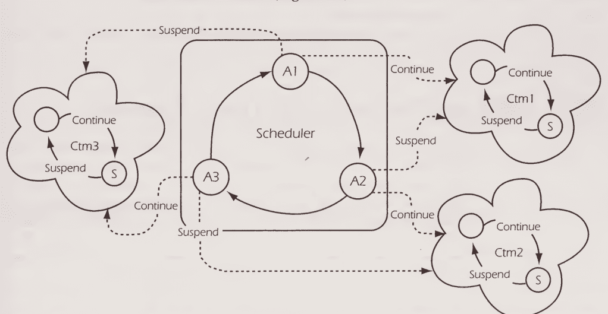

假设每个任务，在图 6.1 中由连接的时序机器 `Ctm1`、`Ctm2` 和 `Ctm3` 表示，都具有一种特性：每个状态 `s` 都有一个辅助状态，可以通过挂起信号触发进入该状态，并通过继续信号恢复。

那么，调度器可以通过发送挂起信号来“抢占”任何任务。同样地，调度器可以随意发送继续信号以让任务恢复。因此，当 `A1` 超时，它挂起 `Ctm3` 并信号 `Ctm1` 恢复；然后，当 `A2` 超时，它挂起 `Ctm1`，并继续 `Ctm2`，等等。图 6.1 中的图表是抢占式多任务的极其简单的描绘，而在实际系统中，这可能涉及优先级分配、同步、更改超时时间、中断处理程序以及就绪、运行和等待状态。

由快速自旋锁或手动锁保护的关键区段不能被抢占，除非我们阻塞定时器 IRQ。所有自旋锁都应该是 IRQ 安全的自旋锁，并且在每个关键区段之前 IRQ 应该被清除，否则 IRQ 延迟将增加一个数量级。而所有这些只是为了在战略位置保存一次对 `current` `need_resched` 的检查：

```c
if (current->need_resched)
    schedule();
```

避免内核抢占使内核更简单、更健壮。

## Linux 方式的影响

由于 Linux 的 GPL 性质，我们可以比其他操作系统更快地执行某些操作。例如，某些流行的、极度封闭的二进制专用操作系统，为了让同一个二进制专用驱动程序在 SMP 和 UP 内核上都“正常”工作，不能内联大量材料。在这样的操作系统中，例如 `spin_lock()` 或 `spin_unlock()` 必须通过函数指针调用，不能内联。这是因为同一个二进制专用驱动程序在 SMP 和 UP 内核上都正常工作。`spin_unlock` 是一条带锁的汇编指令：

```assembly
#define spin_unlock_string \\
"lock ; btrl $0,%0"
```

通过函数指针调用这样的清位指令是彻底的过度设计。Linux 中不存在这种愚蠢的二进制约束，我们可以以全速运行 CPU。

Linux 系统的另一个优点是它在 SMP 下扩展性非常好，并且对缓存页面有不错的垃圾回收机制。最后但同样重要的是，Linux 中的 SMP 调度器非常智能。拥有智能的 SMP 调度器对性能至关重要。如果调度器不感知 SMP，那么 SMP 机器上的性能甚至可能比 UP 机器更差（这在没有新启发式算法的 `2.2.x` 版本中确实发生过）。

## 改进调度器

我们现在将考察一些如何将我们的功能添加到内核的例子。内核源码可用的好处正是在于此：如果内核黑客对改进、错误修复或新增功能特别大胆，他或她可以将补丁发送给林纳斯·托瓦兹或他的二号人物艾伦·科克斯，并希望它能被纳入未来版本。然而，要让林纳斯·托瓦兹将一个补丁接受到未来版本中是非常困难的。一方面，大多数想法在过去某个时候都已经讨论过了，而且通常有很好的理由不引入某个概念、功能或变更。此外，要理解内核中微小变更的全部影响，需要对整个 Linux 系统的运作以及用户空间程序和子模块有极强的知识储备。实际上只有极少数人具备这种全局视野，因此决定任何变更也是由他们做出的。尽管如此，参与不仅受到欢迎，还受到积极鼓励。

现在让我们来看看内核改进的一个良好示例。

## 让 CPU 离线和在线

目前（内核 `2.4.x`），不可能在执行过程中让 CPU 离线，但实现这一操作也并非非常困难。基本上，函数 `cpu_idle()` 必须在调用汇编指令 `halt` 之前检查当前 CPU 是否应该关闭（一个 `unsigned long` 字可以提供此类信息）。如果应该关闭，我们可以简单进入一个循环；硬件将切断该 CPU 的电源，从而允许将其从插槽或插座中移除（停止 CPU 的函数是 `stop_this_cpu()`——它基本上进入一个无限循环）。我们最后必须做的是通知调度器，关闭的 CPU 必须尽快执行 idle 任务（或者，只有当系统 CPU 负载不重时，我们才能关闭 CPU）。

## CPU 亲和性


许多 UNIX 系统（例如 `Solaris`）向系统管理员提供将进程绑定到单个指定 CPU 的可能性。这种将进程绑定到选定 CPU 的行为更常被称为 `CPU 亲和性`。其基本原理是，CPU 的一级和二级缓存行最可能包含特定于该问题进程的条目，从而总体上提高该进程的性能。这可以显著减少该 CPU 的内存访问，从而大大加快执行速度。然而，如果进程只是在例如对 `spin_lock()` 进行自旋等待，那么更快的执行并非必要；而当进程持有另一个进程可能需要的 `wait_lock()` 处于睡眠状态时，比快速执行更重要的是更早地执行。

因此，在玩弄亲和性时必须非常小心，因为系统精密的负载均衡很严重受到干扰的可能性很高。`CPU 亲和性`在将进程绑定到某个特定 CPU 且没有其他进程可以在该 CPU 上执行时最有意义。然而，这只有在可用 CPU 数量非常大的情况下才有意义。在一台拥有 64 个 CPU 的 `Sun E10000` 上，将某个 CPU 专门分配给特定进程可能是有意义的。但在双 CPU 系统上，亲和性显然代价太高。

为了举例说明，假设 CPU 数量足够，并进一步假设工作负载确实需要为某个进程启用 `CPU 亲和性`。在这种情况下，以下补丁可能有所帮助：

```diff
--- 2.3.38-psret/include/linux/sched.h -1~    Tue Jan 11 14:46:45 2000
+++ 2.3.38-psret/include/linux/sched.h    Tue Jan 11 17:58:52 2000
@@ -363,6 +363,7 @@
	 u32 self_exec_id;
 /* Protection of fields allocation/deallocation */
	 struct semaphore exit_sem;
+	 int bind_cpu;
	};

	/*
@@ -430,6 +431,7 @@
	/* signals */	 SPIN_LOCK_UNLOCKED, &init_signals, ({}), ({}), NULL,
		&init_task.sigqueue, 0, 0, \
	/* exec cts */ 0,0, \
	/* exit_sem */ __MUTEX_INITIALIZER(name.exit_sem),	\
+NO_PROC_ID,
	}

#ifndef INIT_TASK_SIZE
--- 2.3.38-psret/kernel/sched.c -1~    Sun Jan 9 20:45:31 2000
+++ 2.3.38-pset/kernel/sched.c Tue Jan 11 18:16:45 2000
@@ -72,11 +72,13 @@
 struct schedule_data {
        struct task_struct *curr;
        cycles_t last_schedule;
+	int bind;
 } schedule_data;
 char __pad [SMP_CACHE_BYTES];
 } aligned_data [NR_CPUS] __cacheline_aligned = { {&init_task,0}};
 #define cpu_curr(cpu) aligned_data[(cpu)].schedule_data.curr
+#define cpu_bind(cpu) (aligned_data[(cpu)].bind)
 struct kernel_stat kstat = { 0 };

@@ -94,6 +96,25 @@
 void scheduling_functions_start_here(void) { }
+static int not_deadlocking(void)
+{
+	int i;
+	for (i = 0; i < smp_num_cpus; i++) {
+	int cpu;
+	cpu = cpu_logical_map(i);
+	if (!cpu_bind(cpu))
+	return 1;
+	}
+return 0;
+
+void set_bind_cpu(int cpu, int set)
+{
+	cpu_bind(cpu_logical_map(cpu)) = set;
+
*/
 * This is the function that decides how desirable a process is..
 * You can weigh different processes against each other depending
@@ -111,6 +132,9 @@
static inline int goodness(struct task_struct * p, int this_cpu, struct mm_struct
*this_mm)
{
 int weight;
+	if (not_deadlocking() && cpu_bind(this_cpu) && p->bind_cpu != this_cpu)
+	return 0;
+	/*
+	Realtime process, select the first one on the
--- 2.3.38-pset/kernel/sys.c~1~ Tue Nov 2 12:06:25 1999
+++ 2.3.38-pset/kernel/sys.c Tue Jan 11 18:18:34 2000
```

## 基于提示的调度

一些操作系统研究人员指出，当用户空间应用程序的程序员提供提示时，调度器可以最好地完成其工作。这些提示理想情况下会告诉调度器程序可能消耗哪些资源以及消耗程度。如何在 2.4 内核中实现基于提示的调度？

假设你是一个用户空间程序，正在执行关键代码段（例如共享内存部分的互斥锁），并希望给调度器一个提示，让它在当前不要抢占你，因为这将实际上阻止其他任务做任何事情，因为另一个任务持有该互斥锁。我们如何解决这个问题？

实际上，是另一个任务必须立即在慢速失败路径中进入睡眠状态。当其他任务注意到锁被占用时，它应该调用 `sched_yield()`，并且不得在用户空间中循环。

在大多数情况下，向内核提供提示是有益的，因为你应该在快速路径中提供提示——你应该在进入内核时获取互斥锁之前提供提示。冒着扰乱调度器公平性的风险是值得的。

进入内核总是代价高昂的，因此最好让快速路径非常快速，并使锁粒度更细以减少竞争。让慢速路径比损害快速路径变得更慢更好。如果关键区段非常大，那么基于信号的唤醒/睡眠信号可能比使用自旋锁并在循环中尝试重新获取锁更好。可以通过 `prctl` 系统调用轻松实现提示。可以调用：

```c
prctl(PR_RESET_TIMESLICE);
```

`Andrea Arcangeli` 针对 2.2.13 内核编写了一个实现（该实现不关心调度器公平性）：

```diff
--- 2.2.13/kernel/sys.c Sun Oct 31 23:31:39 1999
+++ /tmp/sys.c Sun Nov 28 18:00:13 1999
@@ -995,6 +995,9 @@
 }
current->pdeath_signal = sig;
break;
+		case PR_RESET_TIMESLICE:
+			current->counter += current->priority >> 1;
+			break;
		default:
			error = -EINVAL;
			break;
--- 2.2.13/include/linux/prctl.h	Sun Oct 31 23:31:38 1999
+++ /tmp/prctl.h	Sun Nov 28 18:01:01 1999
@@ -4,6 +4,7 @@
/*  Values to pass as first argument to prctl()  */
#define PR_SET_PDEATHSIG	1  /*  Second arg is a signal  */
+#define PR_RESET_TIMESLICE	2  /*  Second arg is a signal  */
#endif /* __LINUX_PRCTL_H */
```

在 `Andrea Arcangeli` 的补丁中，调用 `prctl(PR_RESET_TIMESLICE)` 系统调用的进程获得了新的半个时间片。这个补丁显然不安全，因为任何人都可以通过不断调用 `prctl` 来让他们的任务一直运行，但真正的实现应该考虑所有的安全细节。如果在我的实现中使用于可信环境，它应该工作得非常好，你可以将其作为一个示例。

### 数据结构—`linux/sched.h`


```c
1  #ifdef __LINUX_SCHED_H
2  #define __LINUX_SCHED_H
3
4  #include <asm/param.h>      /* for HZ */
5
6  extern unsigned long event;
7
8  #include <linux/binfmts.h>
9  #include <linux/personality.h>
10 #include <linux/threads.h>
11 #include <linux/kernel.h>
12 #include <linux/types.h>
13 #include <linux/times.h>
14 #include <linux/time.h>
15
16 #include <asm/system.h>
17 #include <asm/semaphore.h>
18 #include <asm/page.h>
19 #include <asm/ptrace.h>
20
21 #include <linux/smp.h>
22 #include <linux/tty.h>
23 #include <linux/sem.h>
24 #include <linux/signal.h>
25 #include <linux/securebits.h>
26
27 /**
28  * cloning flags:
29  */
30 #define CSIGNAL    0x000000ff   /* signal mask to be sent at exit */
31 #define CLONE_VM   0x00000100   /* set if VM shared between processes */
32 #define CLONE_FS   0x00000200   /* set if fs info shared between processes */
33 #define CLONE_FILES  0x00000400 /* set if open files shared between processes */
34 #define CLONE_SIGHAND 0x00000800 /* set if signal handlers shared */
35 #define CLONE_PID    0x00001000   /* set if pid shared */
36 #define CLONE_PTRACE  0x00002000 /* set if we want to let tracing continue on the child too */
37 #define CLONE_VFORK  0x00004000   /* set if parent wants the child to wake it up on mm_release */
38 #define CLONE_PARENT  0x00008000  /* set if we want to have the same parent as the cloner */
39
40 /**
41  * These are the constant used to fake the fixed-point load-average
42  * counting.  Some notes:
43  * - 11 bit fractions expand to 22 bits by the multiplies: this gives
44  * a load-average precision of 10 bits integer + 11 bits fractional
45  * - if you want to count load-averages more often, you need more
46  * precision, or rounding will get you.  With 2-second counting freq,
47  * the EXP_n values would be 1981, 2034 and 2043 if still using only
48  * 11 bit fractions.
49  */
50 extern unsigned long avenrun[];     /* Load averages */
51
52 #define FSHIFT       11    /* nr of bits of precision */
53 #define FIXED_1      (1<<FSHIFT) /* 1.0 as fixed-point */
54 #define LOAD_FREQ    (5*HZ) /* 5 sec intervals */
55 #define EXP_1        1884   /* 1/exp(5sec/1min) as fixed-point */
56 #define EXP_5        2014   /* 1/exp(5sec/5min) */
57 #define EXP_15                2037                    /* 1/exp(5sec/15min) */
58
59 #define CALC_LOAD(load,exp,n) \
60                 load *= exp; \
61                 load += n*(FIXED_1-exp); \
62                 load >>= FSHIFT;
63
64 #define CT_TO_SECS(x)         ((x) / HZ)
65 #define CT_TO_USECS(x)        (((x) % HZ) * 1000000/HZ)
66
67 extern int nr_running, nr_threads;
68 extern int last_pid;
69
70 #include <linux/fs.h>
71 #include <linux/time.h>
72 #include <linux/param.h>
73 #include <linux/resource.h>
74 #include <linux/timer.h>
75
76 #include <asm/processor.h>
77
78 #define TASK_RUNNING              0
79 #define TASK_INTERRUPTIBLE        1
80 #define TASK_UNINTERRUPTIBLE      2
81 #define TASK_ZOMBIE               4
82 #define TASK_STOPPED              8
83 #define TASK_EXCLUSIVE            32
84
85 #define __set_task_state(tsk, state_value)                \
86                 do { (tsk)->state = (state_value); } while (0)
87 #ifdef __SMP
88 #define set_task_state(tsk, state_value)                  \
89                 set_mb((tsk)->state, (state_value))
90 #else
91 #define set_task_state(tsk, state_value)                  \
92                 __set_task_state((tsk), (state_value))
93 #endif
94
95 #define __set_current_state(state_value)                  \
96                 do { current->state = (state_value); } while (0)
97 #ifdef __SMP
98 #define set_current_state(state_value)                    \
99                 set_mb(current->state, (state_value))
100 #else
101 #define set_current_state(state_value)                    \
102                 __set_current_state(state_value)
103 #endif
104
105 /*
106  * Scheduling policies
107  */
108 #define SCHED_OTHER               0
109 #define SCHED_FIFO                1
110 #define SCHED_RR                  2
111
112 /*
113  * This is an additional bit set when we want to
114  * yield the CPU for one re-schedule.
115  */
116 #define SCHED_YIELD               0x10
117
118 struct sched_param {
119         int sched_priority;
120 };
121
122 #ifdef __KERNEL__
123
124 #include <linux/spinlock.h>
125
126 /*
127  * This serializes "schedule()" and also protects
128  * the run-queue from deletions/modifications (but
129  * _adding_ to the beginning of the run-queue has
130  * a separate lock).
131  */
132 extern rwlock_t tasklist_lock;
133 extern spinlock_t runqueue_lock;
134
135 extern void sched_init(void);
136 extern void init_idle(void);
137 extern void show_state(void);
138 extern void cpu_init(void);
139 extern void trap_init(void);
140 extern void update_one_process(struct task_struct *p,
141                 unsigned long ticks, unsigned long user, unsigned long system, int cpu);
142
143 #define MAX_SCHEDULE_TIMEOUT          LONG_MAX
144 extern signed long FASTCALL(schedule_timeout(signed long timeout));
145 asmlinkage void schedule(void);
146
147 /*
148  * The default fd array needs to be at least BITS_PER_LONG,
149  * as this is the granularity returned by copy_fdset().
150  */
151 #define NR_OPEN_DEFAULT       BITS_PER_LONG
152
153 /*
154  * Open file table structure
155  */
156 struct files_struct {
157         atomic_t count;
158         rwlock_t file_lock;
159         int max_fds;
160         int max_fdset;
161         int next_fd;
162         struct file ** fd;           /* current fd array */
163         fd_set *close_on_exec;
164         fd_set *open_fds;
165 };
166
167 #define PF_ALL	0x00003fff	/* Keep 13 bits for compat */
168
169 extern int copy_process (unsigned long flags,
170 			unsigned long start_code,
171 			unsigned long brk,
172 			struct pt_regs *regs,
173 			unsigned long arg3,
174 			int retval,
175 			int clone_flags, unsigned long stack,
176 			__nocast const char *name, pid_t pid,
177 			int exit_signal, int *parent_tidptr,
178 			int *clear_child_tid);
179 extern int dup_thread (struct task_struct *);
180
181 #define PF_FORKNOEXEC	0x00000001
182
183 extern int wake_up_process(struct task_struct *);
184
185 /*
186  * Default state for a new process.
187  */
188 #define DEFAULT_MAP_UNPOPULATED		(PF_FORKNOEXEC | PF_RANDOMIZE)
189
190 #endif /* __KERNEL__ */
```


```c
extern void set_bind_cpu(int, int);

case PR_SET_CPU:
{
    error = -EINVAL;
    if (arg2 >= smp_num_cpus || arg2 < 0)
        break;

    error = 0;
    current->bind_cpu = cpu_logical_map(arg2);
    set_bind_cpu(arg3, 1);
    break;
}
default:
    error = -EINVAL;
    break;
```


```c
               fd_set close_on_exec_init;
               fd_set open_fds_init;
               struct file * fd_array[NR_OPEN_DEFAULT];
       };

#define INIT_FILES { \
                ATOMIC_INIT(1), \
                RW_LOCK_UNLOCKED, \
                NR_OPEN_DEFAULT, \
                __FD_SETSIZE, \
                0, \
                &init_files.fd_array[0], \
                &init_files.close_on_exec_init, \
                &init_files.open_fds_init, \
                { { 0, } }, \
                { { 0, } }, \
                { NULL, } \
      }

struct fs_struct {
                atomic_t count;
                int umask;
                struct dentry * root, * pwd;
      };

#define INIT_FS { \
                ATOMIC_INIT(1), \
                0022, \
                NULL, NULL \
      }

/* 最大活动映射区域数。这是一个随机的（大）数字 */
#define MAX_MAP_COUNT     (65536)

/* 激活 AVL 树时的映射区域数量。这是任意选择的。 */
#define AVL_MIN_MAP_COUNT 32

struct mm_struct {
                struct vm_area_struct * mmap;         /* VMA 列表 */
                struct vm_area_struct * mmap_avl;     /* VMA 树 */
                struct vm_area_struct * mmap_cache;   /* 最近一次 find_vma 的结果 */
                pgd_t * pgd;
                atomic_t mm_users;                   /* 有多少用户处于用户空间？ */
                atomic_t mm_count;                    /* 对 "struct mm_struct" 的引用计数（用户计数为 1） */
                int map_count;                        /* VMA 的数量 */
                struct semaphore mmap_sem;
                spinlock_t page_table_lock;
                unsigned long context;
                unsigned long start_code, end_code, start_data, end_data;
                unsigned long start_brk, brk, start_stack;
                unsigned long arg_start, arg_end, env_start, env_end;
                unsigned long rss, total_vm, locked_vm;
                unsigned long def_flags;
                unsigned long cpu_vm_mask;
                unsigned long swap_cnt; /* 下一次路径中需要换出的页面数 */
                unsigned long swap_address;
                /**
                 * 这是一个架构特定的指针：Linux 的可移植部分
                 * 不知道任何关于段的信息。
                 */
                void * segments;
      };

#define INIT_MM(name) {
        &init_mmmap, NULL, NULL,
        swapper_pg_dir,
        ATOMIC_INIT(2), ATOMIC_INIT(1), 1,
        __MUTEX_INITIALIZER(name.mmmap_sem),
        SPIN_LOCK_UNLOCKED,
        0,
        0, 0, 0, 0,
        0, 0, 0,
        0, 0, 0, 0,
        0, 0, 0,
        0, 0, 0, 0, NULL }

struct signal_struct {
        atomic_t count;
        struct k_sigaction action[_NSIG];
        spinlock_t siglock;
      };

#define INIT_SIGNALS {
        ATOMIC_INIT(1),
        { {{0}}, },
        SPIN_LOCK_UNLOCKED }

/**
 * 有一天，这将是一个完整的用户跟踪系统。
 * 目前它仅用于跟踪用户拥有多少个进程，
 * 但它具有跟踪内存使用量等的潜力。
 */
struct user_struct;

struct task_struct {
        /* 这些是硬编码的 - 请勿触碰 */
        volatile long state; /* -1 不可运行, 0 可运行, >0 停止 */
        unsigned long flags; /* 每进程标志，定义如下 */
        int sigpending;
        mm_segment_t addr_limit; /* 线程地址空间：
                                    用户线程为 0-0xBFFFFFFF
                                    内核线程为 0-0xFFFFFFFF
                                    */
        struct exec_domain *exec_domain;
        volatile long need_resched;

        cycles_t avg_slice;
        int lock_depth; /* 锁深度。我们可以进出系统调用内核锁的持有状态... */

        /* 开始 intel 缓存行 */
        long counter;
        long priority;
        unsigned long policy;
        /* 内存管理信息 */
        struct mm_struct *mm, *active_mm;
        int has_cpu;
        int processor;
        struct list_head run_list;
        struct task_struct *next_task, *prev_task;
        int last_processor;

        /* 任务状态 */
        struct linux_binfmt *binfmt;
        int exit_code, exit_signal;
        int pdeath_signal; /* 父进程死亡时发送的信号 */
        /* ??? */
        unsigned long personality;
        int dumpable:1;
        int did_exec:1;
        pid_t pid;
        pid_t pgrp;
        pid_t tty_old_pgrp;
        pid_t session;
        /* 会话组领导的布尔值 */
        int leader;
        /*
         * 指向（原始）父进程、最年幼的子进程、较年幼的兄弟进程、
         * 较年长的兄弟进程的指针，分别对应。（p->father 可以用
         * p->p_ptr->pid 替代）
         */
        struct task_struct *p_opptr, *p_pptr, *p_cptr, *p_ysptr, *p_osptr;

        /* PID 哈希表链接。 */
        struct task_struct *pidhash_next;
        struct task_struct **pidhash_pprev;

        wait_queue_head_t wait_chldexit; /* 用于 wait4() */
        struct semaphore *vfork_sem; /* 用于 vfork() */
        unsigned long rt_priority;
        unsigned long it_real_value, it_prof_value, it_virt_value;
        unsigned long it_real_incr, it_prof_incr, it_virt_incr;
        struct timer_list real_timer;
        struct tms times;
        unsigned long start_time;
        long per_cpu_utime[NR_CPUS], per_cpu_stime[NR_CPUS];
        /* 内存错误和交换信息：这可以被看作是 mm 特定的，或者
            线程特定的 */
        unsigned long min_flt, maj_flt, nswap, cmin_flt, cmaj_flt, cswap;
        int swappable:1; /* 进程凭证 */
        uid_t uid, euid, suid, fsuid;
        gid_t gid, egid, sgid, fsgid;
        int ngroups;
        gid_t groups[NGROUPS];
        kernel_cap_t cap_effective, cap_inheritable, cap_permitted;
        struct user_struct *user;
        /* 限制 */
        struct rlimit rlim[RLIM_NLIMITS];
        unsigned short used_math;
        char comm[16];
        /* 文件系统信息 */
        int link_count;
        struct tty_struct *tty; /* 如果没有 tty 则为 NULL */
        /* IPC 相关 */
        struct sem_undo *semundo;
        struct sem_queue *semsleeping;
        /* 此任务的 CPU 特定状态 */
        struct thread_struct thread;
        /* 文件系统信息 */
        struct fs_struct *fs;
        /* 打开文件信息 */
        struct files_struct *files;
        /* 信号处理程序 */
        spinlock_t sigmask_lock; /* 保护信号和阻塞状态 */
        struct signal_struct *sig;
        sigset_t signal, blocked;
        struct signal_queue *sigqueue, **sigqueue_tail;
        unsigned long sas_ss_sp;
        size_t sas_ss_size;
        /* 线程组跟踪 */
        u32 parent_exec_id;
        u32 self_exec_id;
        /* 保护字段分配/释放 */
        struct semaphore exit_sem;
};

/* 每进程标志 */
#define PF_ALIGNWARN  0x00000001 /* 打印对齐警告消息 */
                                /* 尚未实现，仅用于 486 */
#define PF_STARTING   0x00000002 /* 正在创建 */
#define PF_EXITING    0x00000004 /* 正在关闭 */
#define PF_TRACED     0x00000010 /* 如果调用了 ptrace (0) 则设置 */
#define PF_TRACESYS   0x00000020 /* 正在跟踪系统调用 */
#define PF_FORKNOEXEC 0x00000040 /* 已 fork 但未 exec */
#define PF_SUPERPRIV  0x00000100 /* 使用了超级用户权限 */
#define PF_DUMPCORE   0x00000200 /* 已转储核心 */
#define PF_SIGNALED   0x00000400 /* 被信号杀死 */
#define PF_MEMALLOC   0x00000800 /* 正在分配内存 */
#define PF_VFORK      0x00001000 /* 在 mm_release 中唤醒父进程 */
#define PF_USEDGPU    0x00100000 /* 任务在此量子中使用了 FPU (SMP) */
#define PF_TRACE      0x00200000 /* 延迟跟踪 (用于 m68k, i386) */

/*
 * 将堆栈限制在一个合理的默认值：root 总是可以
 * 在需要时增加此限制。8MB 似乎很合理。
 */
#define _STK_LIM (8*1024*1024)

#define DEF_PRIORITY (20*HZ/100) /* 200 毫秒时间片 */

/*
 * INIT_TASK 用于设置第一个任务表，
 * 使用它风险自负！Base=0, limit=0x1ffffff (=2MB)
 */
#define INIT_TASK(name) \
/* 状态等 */ { 0,0,0,KERNEL_DS,&default_exec_domain,0, \
/* avg_slice */ 0, -1, \
/* counter */ DEF_PRIORITY,DEF_PRIORITY,SCHED_OTHER, \
/* mm */ NULL, &init_mm, \
/* has_cpu */ 0,0, \
/* run_list */ LIST_HEAD_INIT(init_task.run_list), \
/* next_task */ &init_task,\&init_task, \
/* last_proc */ 0, \
/* binfo */ NULL, \
/* ec,brk,.. */ 0,0,0,0,0,0, \
/* pid 等 */ 0,0,0,0,0,0, \
/* 进程链接 */ &init_task,&init_task,NULL,NULL,NULL, \
/* pidhash */ NULL, NULL, \
/* chld wait */ __WAIT_QUEUE_INITIALIZER(name.wait_chldexit), NULL, \
/* timeout */ 0,0,0,0,0,0,0, \
/* timer */ { NULL, NULL, 0, 0, it_real_fn }, \
/* utime */ {0,0,0,0},0, \
/* 每 CPU 时间 */ { 0 }, {0 }, \
/* fil */ 0,0,0,0,0,0, \
/* swp */ 0, \
/* 进程凭证 */ \
/* uid 等 */ 0,0,0,0,0,0,0,0, \
/* 补充组 */ 0, {0}, \
/* caps */ CAP_INIT_EFF_SET,CAP_INIT_INH_SET,CAP_FULL_SET, \
/* user */ NULL, \
/* rlimits */ INIT_RLIMITS, \
/* math */ 0, \
/* comm */ "swapper", \
/* fs 信息 */ 0,NULL, \
/* ipc */ NULL, NULL, \
/* thread */ INIT_THREAD, \
/* fs */ &init_fs, \
/* files */ &init_files, \
/* signals */ SPIN_LOCK_UNLOCKED, &init_signals, { {0} }, { {0} }, NULL, \
&init_task.sigqueue, 0, 0, \
/* exec cts */ 0,0, \
/* exit_sem */ __MUTEX_INITIALIZER(name.exit_sem),
```


```c
429 } 
430 
431 #ifndef INIT_TASK_SIZE
432 # define INIT_TASK_SIZE 2048*sizeof(long)
433 #endif
434 
435 union task_union {
436     struct task_struct task;
437     unsigned long stack[INIT_TASK_SIZE/sizeof(long)];
438 };
439 
440 extern union task_union init_task_union;
441 
442 extern struct  mm_struct init_mm;
443 extern struct task_struct *init_tasks[NR_CPUS];
444 
445 /* PID 哈希。（这不应该动态计算吗？） */
446 #define PIDHASH_SZ (4096 >> 2)
447 extern struct task_struct *pidhash[PIDHASH_SZ];
448 
449 #define pid_hashfn(x)   ((((x) >> 8) ^ (x)) & (PIDHASH_SZ - 1))
450 
451 extern __inline__ void hash_pid(struct task_struct *p)
452 {
453     struct task_struct **htable = &pidhash[pid_hashfn(p->pid)];
454 
455     if((p->pidhash_next = *htable) != NULL)
456         (*htable)->pidhash_pprev = &p->pidhash_next;
457     *htable = p;
458     p->pidhash_pprev = htable;
459 }
460 
461 extern __inline__ void unhash_pid(struct task_struct *p)
462 {
463     if(p->pidhash_next)
464         p->pidhash_next->pidhash_pprev = p->pidhash_pprev;
465     *p->pidhash_pprev = p->pidhash_next;
466 }
467 
468 extern __inline__ struct task_struct *find_task_by_pid(int pid)
469 {
470     struct task_struct *p, **htable = &pidhash[pid_hashfn(pid)];
471 
472     for(p = *htable; p && p->pid != pid; p = p->pidhash_next)
473         ;
474 
475     return p;
476 }
477 
478 /* 基于 UID 的进程计费。 */
479 extern int alloc_uid(struct task_struct *);
480 void free_uid(struct task_struct *);
481 
482 #include <asm/current.h>

## Linux 调度器

483
484  extern unsigned long volatile jiffies;
485  extern unsigned long itimer_ticks;
486  extern unsigned long itimer_next;
487  extern struct timeval xtime;
488  extern void do_timer(struct pt_regs *);
489
490  extern unsigned int * prof_buffer;
491  extern unsigned long prof_len;
492  extern unsigned long prof_shift;
493
494  #define CURRENT_TIME (xtime.tv_sec)
495
496  extern void FASTCALL(_wake_up(wait_queue_head_t *q, unsigned int mode));
497  extern void FASTCALL(_wake_up_sync(wait_queue_head_t *q, unsigned int mode));
498  extern void FASTCALL(sleep_on(wait_queue_head_t *q));
499  extern long FASTCALL(sleep_on_timeout(wait_queue_head_t *q,
500                              signed long timeout));
501  extern void FASTCALL(interruptible_sleep_on(wait_queue_head_t *q));
502  extern long FASTCALL(interruptible_sleep_on_timeout(wait_queue_head_t *q,
503                              signed long timeout));
504  extern void FASTCALL(wake_up_process(struct task_struct * tsk));
505
506  #define wake_up(x)               _wake_up((x),TASK_UNINTERRUPTIBLE |
507                                TASK_INTERRUPTIBLE | TASK_EXCLUSIVE)
508  #define wake_up_all(x)           _wake_up((x),TASK_UNINTERRUPTIBLE |
509                                TASK_INTERRUPTIBLE)
510  #define wake_up_sync(x)          _wake_up_sync((x),TASK_UNINTERRUPTIBLE
511                                  | TASK_INTERRUPTIBLE | TASK_EXCLUSIVE)
512  #define wake_up_interruptible(x) _wake_up((x),TASK_INTERRUPTIBLE |
513                                  TASK_EXCLUSIVE)
514  #define wake_up_interruptible_all(x) _wake_up((x),TASK_INTERRUPTIBLE)
515  #define wake_up_interruptible_sync(x) _wake_up_sync((x),TASK_INTERRUPTIBLE |
516                                  TASK_EXCLUSIVE)
517
518  extern int in_group_p(pid_t);
519  extern int in_egroup_p(pid_t);
520
521  extern void flush_signals(struct task_struct *);
522  extern void flush_signal_handlers(struct task_struct *);
523  extern int dequeue_signal(sigset_t *, siginfo_t *);
524  extern int send_sig_info(int, struct siginfo *, struct task_struct *);
525  extern int force_sig_info(int, struct siginfo *, struct task_struct *);
526  extern int kill_pg_info(int, struct siginfo *, pid_t);
527  extern int kill_s1_info(int, struct siginfo *, pid_t);
528  extern int kill_proc_info(int, struct siginfo *, pid_t);
529  extern int kill_something_info(int, struct siginfo *, int);
530  extern void notify_parent(struct task_struct *, int);
531  extern void force_sig(int, struct task_struct *);
532  extern int send_sig(int, struct task_struct *, int);
533  extern int kill_pg(pid_t, int, int);
534  extern int kill_s1(pid_t, int, int);
535  extern int kill_proc(pid_t, int, int);
536  extern int do_sigaction(int, const struct k_sigaction *, struct k_sigaction *);

532 extern int do_sigaltstack(const stack_t *, stack_t *, unsigned long);
533 extern inline int signal_pending(struct task_struct *p)
534 {
535     return (p->sigpending != 0);
536 }
537 
538 /* 重新评估任务是否有挂起的信号待处理。
539    每次被阻塞的 sigset_t 发生变化时都需要执行此操作。
540    所有调用者都应持有 t->sigmask_lock。 */
541 
542 static inline void recalc_sigpending(struct task_struct *t)
543 {
544     unsigned long ready;
545     long i;
546 
547     switch (_NSIG_WORDS) {
548         default:
549             for (i = _NSIG_WORDS, ready = 0; --i >= 0 ;) {
550                 ready |= t->signal.sig[i] &~ t->blocked.sig[i];
551             }
552             break;
553 
554         case 4: ready = t->signal.sig[3] &~ t->blocked.sig[3];
555                ready |= t->signal.sig[2] &~ t->blocked.sig[2];
556                ready |= t->signal.sig[1] &~ t->blocked.sig[1];
557                ready |= t->signal.sig[0] &~ t->blocked.sig[0];
558                break;
559 
560         case 2: ready = t->signal.sig[1] &~ t->blocked.sig[1];
561                ready |= t->signal.sig[0] &~ t->blocked.sig[0];
562                break;
563 
564         case 1: ready = t->signal.sig[0] &~ t->blocked.sig[0];
565     }
566 
567     t->sigpending = (ready != 0);
568 }
569 /* 如果我们在备用信号栈上，则返回真。 */
570 
571 static inline int on_sig_stack(unsigned long sp)
572 {
573     return (sp - current->sas_ss_sp < current->sas_ss_size);
574 }
575 
576 static inline int sas_ss_flags(unsigned long sp)
577 {
578     return (current->sas_ss_size == 0 ? SS_DISABLE
579                 : on_sig_stack(sp) ? SS_ONSTACK : 0);
580 }
581 
582 extern int request_irq(unsigned int,
583                 void (*handler)(int, void *, struct pt_regs *),
584                 unsigned long, const char *, void *);

586 extern void free_irq(unsigned int, void *);
587 
588 /*
589  * 这现在变成了一个例程而不是宏，如果返回真，它会设置一个标志位
590  * （用于执行 BSD 风格的计费，当进程使用 root 权限时会被标记）。
591  * 这意味着你应该先执行正常的权限检查，最后检查 suser()。
592  *
593  * [1997年12月 -- Chris Evans]
594  * 为了正确性，上述考虑需要扩展到
595  * fsuser()。这是通过最后执行 fsuser() 检查来实现的。
596  *
597  * 这些将被移除，但在此期间，当设置 SECURE_NOROOT
598  * 标志时，uid 不授予特权。
599  */
602 extern inline int suser(void)
603 {
604 		if (!issecure(SECURE_NOROOT) && current->euid == 0) {
605 			current->flags |= PF_SUPERPRIV;
606 			return 1;
607 		}
608 		return 0;
609 }
610 
611 extern inline int fsuser(void)
612 {
613 		if (!issecure(SECURE_NOROOT) && current->fsuid == 0) {
614 			current->flags |= PF_SUPERPRIV;
615 			return 1;
616 		}
617 		return 0;
618 }
619 
620 /*
621  * capable() 检查特定的能力。
622  * 新的权限检查应使用此接口，而不是 suser() 或
623  * fsuser()。有关定义的能力，请参阅 include/linux/capability.h。
624  */
625 
626 extern inline int capable(int cap)
627 {
628 #if 1 /* ok now */
629 		if (cap_raised(current->cap_effective, cap))
630 #else
631 		if (cap_is_fs_cap(cap) ? current->fsuid == 0 : current->euid == 0)
632 #endif
633 		{
634 			current->flags |= PF_SUPERPRIV;
635 			return 1;
636 		}
637 		return 0;
638 }
639 
```


## Routines for handling mm_structs

```c
extern struct mm_struct * mm_alloc(void);

extern struct mm_struct * start_lazy_tlb(void);

extern void end_lazy_tlb(struct mm_struct *mm);
```

/* `mm_drop` drops the mm and the page tables */

```c
extern inline void FASTCALL(__mm_drop(struct mm_struct **));

static inline void mm_drop(struct mm_struct * mm)
{
	if (atomic_dec_and_test(&mm->mm_count))
		__mm_drop(mm);
}
```

/* `mmput` gets rid of the mappings and all user-space */

```c
extern void mmput(struct mm_struct *);
```

/* Remove the current tasks stale references to the old `mm_struct` */

```c
extern void mm_release(void);
```

## Routines for handling the fd arrays

```c
extern struct file ** alloc_fd_array(int);

extern int expand_fd_array(struct files_struct *, int nr);

extern void free_fd_array(struct file **, int);

extern fd_set *alloc_fdset(int);

extern int expand_fdset(struct files_struct *, int nr);

extern void free_fdset(fd_set *, int);
```

/* Expand files. Return <0 on error; 0 nothing done; 1 files expanded, we may have blocked. Should be called with the `files->file_lock` spinlock held for write. */

```c
static inline int expand_files(struct files_struct *files, int nr)
{
	int err, expand = 0;
#ifdef FDSET_DEBUG
	printk(KERN_ERR __FUNCTION__ " %d: nr = %d\n", current->pid, nr);
#endif
	if (nr >= files->max_fdset) {
		expand = 1;
		if ((err = expand_fdset(files, nr)))
			goto out;
	}
	if (nr >= files->max_fds) {
		expand = 1;
		if ((err = expand_fd_array(files, nr)))
			goto out;
	}
	err = expand;
out:
#ifdef FDSET_DEBUG
	if (err)
		printk(KERN_ERR __FUNCTION__ " %d: return %d\n", current->pid, err);
#endif
	return err;
}
```

```c
extern int copy_thread(int, unsigned long, unsigned long, struct task_struct *, struct pt_regs *);
extern void flush_thread(void);
extern void exit_thread(void);
extern void exit_mm(struct task_struct *);
extern void exit_fs(struct task_struct *);
extern void exit_files(struct task_struct *);
extern void exit_sighand(struct task_struct *);
extern void daemonize(void);
extern int do_execve(char *, char **, char **, struct pt_regs *);
extern int do_fork(unsigned long, unsigned long, struct pt_regs *);
```

```c
extern inline void add_wait_queue(wait_queue_head_t *q, wait_queue_t * wait)
{
	unsigned long flags;
	wq_write_lock_irqsave(&q->lock, flags);
	_add_wait_queue(q, wait);
	wq_write_unlock_irqrestore(&q->lock, flags);
}

extern inline void add_wait_queue_exclusive(wait_queue_head_t *q, wait_queue_t * wait)
{
	unsigned long flags;
	wq_write_lock_irqsave(&q->lock, flags);
	_add_wait_queue_tail(q, wait);
	wq_write_unlock_irqrestore(&q->lock, flags);
}

extern inline void remove_wait_queue(wait_queue_head_t *q, wait_queue_t * wait)
{
	unsigned long flags;
	wq_write_lock_irqsave(&q->lock, flags);
	_remove_wait_queue(q, wait);
	wq_write_unlock_irqrestore(&q->lock, flags);
}
```

```c
#define __wait_event(wq, condition) \
do { \
    wait_queue_t __wait; \
    init_waitqueue_entry(&__wait, current); \
    \
    add_wait_queue(&wq, &__wait); \
    for (;;) { \
        set_current_state(TASK_UNINTERRUPTIBLE); \
        if (condition) \
            break; \
        schedule(); \
    } \
    current->state = TASK_RUNNING; \
    remove_wait_queue(&wq, &__wait); \
} while (0)

#define wait_event(wq, condition) \
do { \
    if (condition) \
        break; \
    _wait_event(wq, condition); \
} while (0)

#define _wait_event_interruptible(wq, condition, ret) \
do { \
    wait_queue_t __wait; \
    init_waitqueue_entry(&__wait, current); \
    \
    add_wait_queue(&wq, &__wait); \
    for (;;) { \
        set_current_state(TASK_INTERRUPTIBLE); \
        if (condition) \
            break; \
        if (!signal_pending(current)) { \
            schedule(); \
            continue; \
        } \
        ret = -ERESTARTSYS; \
        break; \
    } \
    current->state = TASK_RUNNING; \
    remove_wait_queue(&wq, &__wait); \
} while (0)
```


```
#define wait_event_interruptible(wq, condition) \

({ \

    int __ret = 0; \

    if (!(condition)) \

        _wait_event_interruptible(wq, condition, __ret); \

    __ret; \

})

#define REMOVE_LINKS(p) do { \\

    (p)->next_task->prev_task = (p)->prev_task; \\

    (p)->prev_task->next_task = (p)->next_task; \\

    if ((p)->p_osptr) \\

        (p)->p_osptr->p_ysptr = (p)->p_ysptr; \\

    if ((p)->p_ysptr) \\

        (p)->p_ysptr->p_opstr = (p)->p_osptr; \\

    else \\

        (p)->p_pptr->p_cptr = (p)->p_osptr; \\

} while (0)

#define SET_LINKS(p) do { \\

    (p)->next_task = &init_task; \\

    (p)->prev_task = init_task.prev_task; \\

    init_task.prev_task->next_task = (p); \\

    init_task.prev_task = (p); \\

    (p)->p_ysptr = NULL; \\

    if (((p)->p_osptr = (p)->p_pptr->p_cptr) != NULL) \\

        (p)->p_osptr->p_ysptr = p; \\

    (p)->p_pptr->p_cptr = p; \\

} while (0)

#define for_each_task(p) \\

    for (p = &init_task ; (p = p->next_task) != &init_task ; )

static inline void del_from_runqueue(struct task_struct * p)

{

	nr_running--;

	list_del(&p->run_list);

	p->run_list.next = NULL;

}

extern inline int task_on_runqueue(struct task_struct *p)

{

	return (p->run_list.next != NULL);

}

extern inline void unhash_process(struct task_struct *p)

{

	if (task_on_runqueue(p)) BUG();

	write_lock_irq(&tasklist_lock);

	nr_threads--;

	unhash_pid(p);

	REMOVE_LINKS(p);

	write_unlock_irq(&tasklist_lock);

}

static inline int task_lock(struct task_struct *p)

{

	down(&p->exit_sem);

	if (p->p_pptr)

		return 1;

	/* He's dead, Jim. You take his wallet, I'll take the triceror... */

	up(&p->exit_sem);

	return 0;

}

static inline void task_unlock(struct task_struct *p)

{

	up(&p->exit_sem);

}

#endif /* __KERNEL__ */

#endif
```


# 第 7 章

## 信号处理

信号用于通知进程或线程发生了特定事件。本章描述了 Linux 2.4 内核如何处理这些信号。与本章所有其他章节一样，本章中引用的数据结构可以在章节末尾找到。

进程在其自己的虚拟地址空间中运行，并由操作系统保护免受其他进程的干扰。默认情况下，用户进程无法与其他进程通信，除非它使用安全的、由内核管理的机制。许多时候，进程需要共享常见资源或同步其动作。一种可能性是使用线程，根据定义，线程可以在进程内共享内存。由于线程可能带来的许多缺点，这种选择并不总是可行（或明智）的。因此，需要一种在进程之间传递消息或数据的方法。

许多计算机科学研究人员将信号与硬件中断进行比较，当诸如磁盘 I/O 接口（例如 SCSI 主机适配器）等硬件子系统生成中断到处理器作为完成 I/O 的结果时，会发生硬件中断。此事件进而导致处理器进入中断处理程序，以便根据中断的源和原因在操作系统中执行后续处理。

因此，可以恰当地将信号描述为软件中断。当向进程或线程发送信号时，可能会进入信号处理程序（取决于信号的当前处置方式），这与系统因接收到中断而进入中断处理程序类似。

UNIX 信号的早期实现被认为不可靠。不可靠性源于这样一个事实，在旧版本中，如果进程捕获信号并调用自己的处理程序，内核会将信号处理程序重置为其默认值，并且重置发生在处理程序被调用之前。试图在用户代码中解决此问题，让信号处理程序首先重新安装自己，并不总是能解决问题，因为同一信号的连续发生会导致竞态条件，即在重新安装用户定义的处理程序之前调用了默认操作。对于默认操作是终止过程的信号，这造成了严重的问题。此问题（以及其他一些问题）在 80 年代中期的 4.3BSD UNIX 和 SVR3 中得到解决。

正确和可靠的信号实现已经存在多年，其中安装好的信号处理程序保持持久，并且不会被内核重置。POSIX 标准提供了一公平的...

...定义了一套功能良好的接口，用于在代码中处理信号，如今 Linux 下的信号实现已完全符合 POSIX 标准。值得注意的是，可靠信号需要使用较新的 `sigaction(2)` 接口，而非传统的 `signal(3C)` 调用。

信号的发生相对于进程或线程可以是同步的或异步的，这取决于信号的来源及其底层原因。同步信号直接源于正在执行的指令流，其中不可恢复的错误（如非法指令或非法地址引用）要求立即终止进程。此类信号被定向至导致错误的执行流的线程。由于这类错误会在内核陷阱处理程序中引发陷阱，因此同步信号有时被称为*陷阱*。

异步信号位于当前执行上下文之外（在某些情况下与当前执行上下文无关）。一个明显的例子是通过 `kill(2)`、`_lwp_kill(2)` 或 `sigsend(2)` 系统调用，或通过 `thr_kill(3T)`、`pthread_kill(3T)` 或 `sigqueue(3R)` 库调用，由另一个进程或线程向某进程发送信号。异步信号也恰当地被称为*中断*。

每个信号都有一个唯一的信号名称，一个以 SIG 开头的缩写（例如，中断信号为 `SIGINT`）以及一个对应的信号编号。此外，对于所有可能的信号，操作系统都定义了一个默认处置方式，即当信号发生时应采取的行动。有四种可能的默认处置方式：

- **退出（Exit）**——强制进程退出。
- **核心转储（Core）**——强制进程退出并创建核心文件。
- **停止（Stop）**——停止进程。
- **忽略（Ignore）**——忽略信号；不采取任何行动。

信号在进程上下文中的处置方式指定了当信号被递送时，系统将代表进程采取何种行动。进程内的所有线程共享信号处置方式，这是进程范围的，在同一进程内的任务或线程之间不能是唯一的。

表 7.1 提供了信号的完整列表，包括其描述和默认操作。

### 表 7.1 信号列表及默认操作

| 名称 | 编号 | 默认操作 | 描述 |
| :--- | :--- | :--- | :--- |
| SIGHUP | 1 | 退出 | 挂起（参见 *termio*(7I)）。 |
| SIGINT | 2 | 退出 | 中断（参见 *termio*(7I)）。 |
| SIGQUIT | 3 | 核心转储 | 退出（参见 *termio*(7I)）。 |
| SIGILL | 4 | 核心转储 | 非法指令 |
| SIGTRAP | 5 | 核心转储 | 跟踪或断点陷阱 |
| SIGABRT | 6 | 核心转储 | 中止 |
| SIGEMT | 7 | 核心转储 | 仿真陷阱 |
| SIGFPE | 8 | 核心转储 | 算术异常 |
| SIGKILL | 9 | 退出 | 杀死 |
| SIGBUS | 10 | 核心转储 | 总线错误——实际上是地址未对齐错误 |
| SIGSEGV | 11 | 核心转储 | 段错误——**地址引用边界错误** |
| SIGSYS | 12 | 核心转储 | 非法系统调用 |
| SIGPIPE | 13 | 退出 | 管道破裂 |
| SIGALRM | 14 | 退出 | 闹钟 |
| SIGTERM | 15 | 退出 | 终止 |
| SIGUSR1 | 16 | 退出 | 用户定义信号 1 |
| SIGUSR2 | 17 | 退出 | 用户定义信号 2 |
| SIGCHLD | 18 | 忽略 | 子进程状态改变 |
| SIGPWR | 19 | 忽略 | 电源故障或重启 |
| SIGWINCH | 20 | 忽略 | 窗口大小改变 |
| SIGURG | 21 | 忽略 | 紧急套接字条件 |
| SIGPOLL | 22 | 退出 | 可轮询事件（参见 *streamio*(7I)） |
| SIGSTOP | 23 | 停止 | 停止（不能被捕获或忽略） |
| SIGTSTP | 24 | 停止 | 停止（作业控制，例如 ^Z） |
| SIGCONT | 25 | 忽略 | 继续 |
| SIGTIN | 26 | 停止 | 停止——终端输入（参见 *termio*(7I)） |
| SIGTTOU | 27 | 停止 | 停止——终端输出（参见 *termio*(7I)） |
| SIGVTALRM | 28 | 退出 | 虚拟计时器过期 |
| SIGPROF | 29 | 退出 | 性能剖析计时器过期 |
| SIGXCPU | 30 | 核心转储 | CPU 时间限制超出（参见 *getrlimit*(2)） |
| SIGXFSZ | 31 | 核心转储 | 文件大小限制超出（参见 *getrlimit*(2)） |
| SIGWAITING | 32 | 忽略 | 线程库使用的并发信号 |
| SIGLWP | 33 | 忽略 | 线程库使用的轻量级进程间信号 |
| SIGFREEZE | 34 | 忽略 | 检查点挂起 |
| SIGTHAW | 35 | 忽略 | 检查点恢复 |
| SIGCANCEL | 36 | 忽略 | 线程库使用的取消信号 |
| SIGLOST | 37 | 忽略 | 资源丢失 |
| SIGRTMIN | 38 | 退出 | 最高优先级实时信号 |
| SIGRTMAX | 45 | 退出 | 最低优先级实时信号 |

Linux 中支持信号的内核数据结构可以在我们第 4 章“Linux 进程”中讨论的任务结构中找到。

以下是任务结构中涉及信号的最常见元素：

- `current->sig` 是信号处理程序。
- `sigmask_lock` 是一个每线程自旋锁，保护信号队列以及其他信号操作的原子性。
- `current->signal` 和 `current->blocked` 是待定信号和永久阻塞信号的位掩码（当前为 64 位长整型，但可自由扩展）。
- `sigqueue` 和 `sigqueue_tail` 是待定信号的双向链表。Linux 具有也可以排队的实时信号。“传统”信号在内部映射为实时信号。

## 信号描述与默认操作

信号的处置方式可以从其默认值更改，进程可以安排捕获一个信号并调用其自己的信号处理例程，或者忽略一个默认处置方式可能不是忽略的信号，正如我们之前所说。唯一的例外是 `SIGKILL` 和 `SIGSTOP`，它们的默认处置方式不能被更改。定义和更改信号处置方式的接口是 `signal(3C)` 和 `sigset(3C)` 库以及 `sigaction(2)` 系统调用。信号也可以被阻塞，这意味着进程暂时阻止了信号的传递。生成一个已被阻塞的信号会导致该信号对该进程保持待定状态，直到它被显式解除阻塞或处置方式更改为忽略。

我们之前看到，信号可能源自多个不同的地方，出于多种不同的原因。上述表格中列出的前三个信号——`SIGHUP`、`SIGINT` 和 `SIGQUIT`——是由控制终端（`SIGINT` 和 `SIGINT` 的 `SIGHUP`）的键盘输入生成的，或者当控制终端断开连接时生成（`SIGHUP`——使用 `nohup(1)` 命令通过将 `SIGHUP` 的处置方式设置为忽略，使进程对挂起“免疫”）。

其他与终端 I/O 相关的信号包括 `SIGSTOP`、`SIGTTIN`、`SIGTTOU` 和 `SIGTSTP`。对于源自键盘命令的那些信号，生成信号的实际按键序列（通常是 `^C`（`Ctrl-C`））在终端会话参数中定义，通常通过 `stty(1)` 进行设置，结果向进程发送 `SIGINT`；其默认处置方式为退出。

作为指令执行期间遇到的错误直接结果而生成的信号，从系统上的硬件陷阱开始。不同的处理器架构定义了各种陷阱，导致立即将控制权向量转移到一个内核陷阱处理函数。Linux 内核构建了一个陷阱表，并基于 Linux 支持处理器的架构规范，在适当的位置插入陷阱处理例程。在 Intel x86 术语中，它们被称为*中断描述符表*或 IDT。

内核安装的陷阱处理程序最终向导致陷阱的线程生成信号。由硬件陷阱产生的信号是 `SIGILL`、`SIGFPE`、`SIGSEGV`、`SIGTRAP`、`SIGBUS` 和 `SIGEMT`。

除了终端 I/O 和错误陷阱条件外，信号还可以源自诸如通过 `kill(2)` 或 `thr_kill(3T)` 以编程方式发送的显式信号，或由 shell 发出 `kill(1)` 命令等来源。父进程通过 `SIGCHLD` 获知子进程的状态变化。

## 应用程序与信号处理

应用程序可以通过定义 `SIGUSR1` 和/或 `SIGUSR2` 的处理程序，然后在进程间发送这些信号，从而创建用户自定义信号作为一种较为粗糙的进程间通信形式。如果进程超出了其处理器时间资源限制，内核将发送 `SIGXCPU`；如果文件写入超出了文件大小资源限制，则发送 `SIGXFSZ`。`SIGABRT` 是调用 `abort(3c)` 库的结果。如果进程正在向管道写入数据，而读取端已终止，则会生成 `SIGPIPE`。

这些由硬错误和终端 I/O 之外的事件引发的信号示例并不代表完整的列表，而是提供了一组完善的示例，展示了可由进程诱发的及外部事件生成信号的情形。

就实际实现而言，信号表示为数据结构中的一个位（正如我们稍后将看到的那样，是多个数据结构）。更简洁地说，内核发出信号的结果是在进程级或线程级的结构成员中设置一个位。由于每个信号都有唯一的信号编号，因此会使用足够宽度的结构成员，以便通过设置对应于我们想要发出的信号的信号编号的位来表示每个信号（例如，设置第 17 位以发出信号 17，`SIGUSR1`）。

当你考虑到信号由数据结构中的位设置表示时，直觉表明内核必须定期检查已设置的位（挂起信号）。事实上，这正是投递机制。在进程典型执行流程的几个点会对已发出的信号进行检查：

- 从系统调用返回时。
- 从陷阱返回时。
- 从睡眠中唤醒时。

本质上，确定信号是否存在是一个轮询过程，其中进程中的信号字段会被频繁检查，以寻找已设置的位。一旦完成检查并确定有信号被发出，就可以根据该信号在接收进程的上下文中的当前处置采取适当的行动。

这就是你无法杀死僵尸进程的原因。（任何恐怖片迷都知道，你无法杀死僵尸。）进程必须正在执行才能接收信号。僵尸进程，顾名思义，是一个已终止的进程。它仅作为一个进程表条目存在；它的所有执行资源（即分配的内存、常量和变量存储）都已被内核释放。

`sigtoproc()` 中大量的前置工作涉及作业控制和终端 I/O 信号。符合 POSIX 规范，这种行为记录在 `signal(5)` 手册页中，我在这里总结如下：任何挂起的 `SIGCONT` 信号在接收到 `SIGSTOP`、`SIGTSTP`、`SIGTTIN` 或 `SIGTTOU` 信号时都被丢弃，无论其处置如何。反之亦然；如果接收 `SIGCONT` 时这四个信号中有任何一个处于挂起状态，它们将被丢弃（同样，无论其处置如何）。在这两种情况下，发出的信号将按照下文标题为“异步信号”的部分中描述的流程进行投递。

## 同步信号

*同步* 或陷阱信号源自内核陷阱处理程序内部。当执行的指令流引发陷阱事件时，硬件检测到它并将执行重定向到内核陷阱处理程序。陷阱处理程序代码将适当的陷阱信息填入 `siginfo` 结构，然后调用 `trap_cleanup()` 函数。进入内核信号子系统的入口是通过 `trapsig()` 函数，该函数随后被执行。在 `trapsig()` 中，如果信号被屏蔽，或者处置已设置为 *忽略*（Ignore），`trapsig()` 将取消屏蔽该信号并将处置设置为 *默认*（default）。`siginfo` 结构被放置在 kthread 的 `t_sigqueue` 列表中，并调用 `sigtoproc()` 发出信号。

Linux 中的用户任务，通过显式调用 `thr_create(3T)` 或 `pthread_create(3T)` 创建，都有自己独立的信号掩码。Linux 线程调用 `clone()` 时带有 `CLONE_`*`SIGHAND`*；这通过共享 `current->`*`sig`* 指针在线程之间共享所有信号处理程序。已投递的信号对于线程是唯一的。

在某些操作系统中，如 Solaris 7，由陷阱产生的信号（`SIGFPE`、`SIGILL` 等）被发送给导致陷阱的线程。异步信号被投递给第一个发现未屏蔽该信号的线程。在 Linux 中几乎完全相同。在特定线程上下文中发生的同步信号被投递到该线程。内核中的异步信号（例如异步网络 I/O）被投递到生成异步 I/O 的线程。显式的用户生成信号也会被投递到正确的线程。

然而，如果使用 `CLONE_`*`PID`*，所有使用 PID 来投递信号的地方都会表现得很奇怪。信号会被随机地投递到 pidhash 中的第一个线程。Linux 线程不使用 CLONE_PID，因此如果你使用的是 pthreads.h 线程 API，就不存在这种问题。

当向用户任务发送信号时，例如用户空间程序访问非法页面时，会发生以下情况：

1. `page_fault()` (entry.S) — 低级页错误处理程序。
2. `do_page_fault()` (fault.c) — 获取 i386 特定的故障参数，并对涉及的内存范围进行基本验证。
3. `handle_mm_fault()` (memory.c) — 调用通用的 MM 代码（与 i386 无关）。MM 读取页表项并使用 VMA 来确定内存访问是否合法。

以下案例详述了一个非法访问——试图对只读映射进行写入。在这种情况下，`handle_mm_fault()` 返回 0 给 `do_page_fault()`：

```c


```c
{
    int fault = handle_mm_fault (tsk, vma, address, write);

    if (fault < 0)
        goto out_of_memory;

    if (!fault)
        goto do_sigbus;
}

... 

do_sigbus:
    up ( &mm->mmap_sem );

    /*
     * 无论我们在内核模式还是用户模式，都发送 sigbus。
     */
    tsk->thread.cr2 = address;
    tsk->thread.error_code = error_code;
    tsk->thread.trap_no = 14;
    force_sig (SIGBUS, tsk);
```

你可以看到，MM 的锁定是非常细粒度的（而且必须是！），`mm->mmap_sem` 是一个每 MM 的信号量（通常因进程而异）。

`force_sig (SIGBUS, current)` 用于“强制”在发生故障的任务上发出 SIGBUS 信号。`force_sig()` 即使进程试图忽略 SIGBUS 也会投递该信号。

`force_sig` 填充信号事件结构并将其排队到进程的信号队列中（`current->sigqueue` 和 `current->sigqueue_tail`）。

信号队列持有不定数量的排队信号。`经典` 信号语义规定后续信号将被忽略——这在信号代码 `kernel/signal.c` 中被模拟实现。`通用`（或 RT）信号可以任意排队——然而，信号队列的长度存在合理的限制。

信号被排队，并更新 `current->signal`。现在是棘手的部分：内核返回用户空间。返回用户空间发生在从 `do_page_fault => page_fault` (`entry.S`)，然后 `entry.S` 中的低级退出代码按此处详述的顺序执行：

```text
page_fault => (调用 do_page_fault) => error_code =>
ret_from_exception => (检查是否返回用户空间) =>
ret_with_reschedule => (发现 current->signal 非零) =>
调用 do_signal()。
```

接下来，`do_signal()` 取消排队该信号以执行。在这种情况下是 SIGBUS。然后它调用 `handle_signal()`，传入“已取消排队”的信号（对于实时信号或消息，这可能包含额外的事件信息）。

然后它调用 `setup_frame`，在那里保存所有用户空间寄存器，并修改内核堆栈帧返回地址以指向已安装信号处理程序的处理程序。一小段跳转代码被放在用户堆栈上（显然，首先代码确保用户堆栈有效），一旦信号处理程序完成，它将使我们返回内核空间：

```c
{
  err |= __put_user(frame->retcode, &frame->pretcode);
  /* 这是 popl %eax ; movl $,%eax ; int $0x80 */
  err |= __put_user(0xb858, (short *)(frame->retcode+0));
  err |= __put_user(__NR_sigreturn, (int *)(frame->retcode+2));
  err |= __put_user(0x80cd, (short *)(frame->retcode+6));
}
```


> *这一区域是 Linux 内核中最少被理解的部分之一。原因很充分——它真的很难阅读和跟踪的代码。*

`popl %eax ; movl $,%eax ; int $0x80` x86 汇编序列调用 `sys_sigret()`，该函数稍后会将内核堆栈帧返回地址恢复为指向原始（故障）用户地址的位置。

所有这些魔法有什么用呢？首先，内核必须保证信号处理程序被正确调用，并且原始状态得到恢复。内核还必须处理二进制兼容性问题。

Linux 保证在 IA32（Intel x86）架构上，我们可以运行任何符合 iBC86 标准的二进制代码。最后，速度也是一个问题。

最终我们回到 `entry.S`，但 `current->signal` 已经被清除，因此我们不会执行 `do_signal`，而是跳转到 `restore_all`：

```
restore_all:
    RESTORE_ALL
#define RESTORE_ALL           \
    popl %ebx;                \
    popl %ecx;                \
    popl %edx;                \
    popl %esi;                \
    popl %edi;                \
    popl %ebp;                \
    popl %eax;                \
1:   popl %ds;                \
2:   popl %es;                \
    addl $4, %esp;            \
3:   iret;                    \
```

此处执行了 `iret` 指令，使我们进入用户空间；突然间，我们神奇地开始执行信号处理程序。

你难道不觉得迷失方向了吗？没有的话，这里还有更多的魔法：一旦信号处理程序结束（它像所有行为规范的函数一样执行汇编 `ret` 指令），它会在用户栈上执行我们设置的小跳转函数。我们再次返回内核，但现在执行的是 `sys_sigsuspend` 系统调用，该调用同样位于 `arch/i386/kernel/signal.c` 中。它基本上执行了以下代码段：

```c
if (restore_sigcontext(regs, &frame->sc, &eax))
    goto badframe;

return eax;
```

上述代码将用户寄存器内容精确地恢复到内核栈帧中（包括返回地址和标志寄存器），并执行正常的 `ret_from_syscall`，这使我们回到最初发生错误的代码处。希望 SIGBUS 处理程序已经解决了导致错误发生的问题。

现在，阅读上述描述时，你可能会觉得这一切非常复杂且缓慢。其实并非如此，`1mbench` 显示，在所有运行的 UNIX 类型系统中，Linux 拥有迄今为止最快的信号处理程序安装和执行性能：

```
moon:~/1> ./lat_sig install

Signal handler installation: 1.688 microseconds
```

```
moon:~/l> ./lat_sig catch

Signal handler overhead: 3.186 microseconds

最棒的是，它在 SMP 上呈线性扩展：

moon:~/l> ./lat_sig catch & ./lat_sig catch &

Signal handler overhead: 3.264 microseconds

Signal handler overhead: 3.248 microseconds

moon:~/l> ./lat_sig install & ./lat_sig install &

Signal handler installation: 1.721 microseconds

Signal handler installation: 1.689 microseconds
```

## 信号与中断，完美搭档

信号可以来自系统调用、中断以及底半部处理器；三者之间没有区别。换句话说，Linux 信号队列是中断安全的，尽管听起来非常怪异且具有递归性。因此它相当灵活。

然而，一个有趣的信号投递案例是在 SMP 环境中：假设一个线程在一个处理器上执行，它从另一个 CPU 上的 IRQ 处理器（或另一个进程）收到了一个异步事件（例如同步套接字 I/O 信号）。在这种情况下，我们向该运行进程发送跨 CPU 消息，因此信号投递没有延迟。跨 CPU 投递的速度在 350MHz 奔腾 II 上约为 5 微秒。

## 数据结构——include/linux/signal.h

```c
#ifndef _LINUX_SIGNAL_H
#define _LINUX_SIGNAL_H
#include <asm/signal.h>
#include <asm/siginfo.h>

#ifdef _KERNEL_
/*
 * 实时信号可以被排队。
 */
struct signal_queue
{
        struct signal_queue *next;
        siginfo_t info;
};

/*
 * 定义一些用于操作 sigset_t 的原语。


```c
 */

#ifndef __HAVE_ARCH_SIG_BITOPS

#include <asm/bitops.h>

/* 我们这里不使用 <asm/bitops.h>，因为不需要原子性。 */

extern inline void sigaddset(sigset_t *set, int _sig)

{

    unsigned long sig = _sig - 1;

    if (_NSIG_WORDS == 1)

            set->sig[0] |= 1UL << sig;

    else

            set->sig[sig / _NSIG_BPW] |= 1UL << (sig % _NSIG_BPW);

}

extern inline void sigdelset(sigset_t *set, int _sig)

{

    unsigned long sig = _sig - 1;

    if (_NSIG_WORDS == 1)

            set->sig[0] &= ~(1UL << sig);

    else

            set->sig[sig / _NSIG_BPW] &= ~(1UL << (sig % _NSIG_BPW));

}

extern inline int sigismember(sigset_t *set, int _sig)

{

    unsigned long sig = _sig - 1;

    if (_NSIG_WORDS == 1)

            return 1 & (set->sig[0] >> sig);

    else

            return 1 & (set->sig[sig / _NSIG_BPW] >> (sig % _NSIG_BPW));

}

extern inline int sigfindinword(unsigned long word)

{

    return ffz(~word);

}

#define sigmask(sig)            (1UL << ((sig) - 1))

#endif /* __HAVE_ARCH_SIG_BITOPS */

#ifndef __HAVE_ARCH_SIG_SETOPS

#include <linux/string.h>

#define _SIG_SET_BINOP(name, op)            \
extern inline void name(sigset_t *r, const sigset_t *a, const sigset_t *b) \
{                                            \
    unsigned long a0, a1, a2, a3, b0, b1, b2, b3;    \
    unsigned long i;                \
    for (i = 0; i < _NSIG_WORDS/4; ++i) { \
        a0 = a->sig[4*i+0]; a1 = a->sig[4*i+1]; \
        a2 = a->sig[4*i+2]; a3 = a->sig[4*i+3]; \
        b0 = b->sig[4*i+0]; b1 = b->sig[4*i+1]; \
        b2 = b->sig[4*i+2]; b3 = b->sig[4*i+3]; \
        r->sig[4*i+0] = op(a0, b0); \
        r->sig[4*i+1] = op(a1, b1); \
        r->sig[4*i+2] = op(a2, b2); \
        r->sig[4*i+3] = op(a3, b3); \
    } \
    switch (_NSIG_WORDS % 4) { \
        case 3: \
            a0 = a->sig[4*i+0]; a1 = a->sig[4*i+1]; a2 = a->sig[4*i+2]; \
            b0 = b->sig[4*i+0]; b1 = b->sig[4*i+1]; b2 = b->sig[4*i+2]; \
            r->sig[4*i+0] = op(a0, b0); \
            r->sig[4*i+1] = op(a1, b1); \
            r->sig[4*i+2] = op(a2, b2); \
            break; \
        case 2: \
            a0 = a->sig[4*i+0]; a1 = a->sig[4*i+1]; \
            b0 = b->sig[4*i+0]; b1 = b->sig[4*i+1]; \
            r->sig[4*i+0] = op(a0, b0); \
            r->sig[4*i+1] = op(a1, b1); \
            break; \
        case 1: \
            a0 = a->sig[4*i+0]; b0 = b->sig[4*i+0]; \
            r->sig[4*i+0] = op(a0, b0); \
            break; \
    } \
}

#define _sig_or(x,y)      ((x) | (y))

_SIG_SET_BINOP(sigorsets, _sig_or)

#define _sig_and(x,y)     ((x) & (y))

_SIG_SET_BINOP(sigandsets, _sig_and)

#define _sig_nand(x,y)    ((x) & ~(y))

_SIG_SET_BINOP(signandsets, _sig_nand)

#undef _SIG_SET_BINOP

#undef _sig_or

#undef _sig_and

#undef _sig_nand

#define _SIG_SET_OP(name, op) \
extern inline void name(sigset_t *set) \
{ \
    unsigned long i; \
    for (i = 0; i < _NSIG_WORDS/4; ++i) { \
        set->sig[4*i+0] = op(set->sig[4*i+0]); \
        set->sig[4*i+1] = op(set->sig[4*i+1]); \
        set->sig[4*i+2] = op(set->sig[4*i+2]);

        set->sig[4*i+3] = op(set->sig[4*i+3]);\
    }\
    switch (_NSIG_WORDS & 4) {\
    case 3: set->sig[4*i+2] = op(set->sig[4*i+2]);\
        case 2: set->sig[4*i+1] = op(set->sig[4*i+1]);\
            case 1: set->sig[4*i+0] = op(set->sig[4*i+0]);\
    }\
}

#define _sig_not(x)         (~(x))

_SIG_SET_OP(signotset, _sig_not)

#undef _SIG_SET_OP

#undef _sig_not

extern inline void sigemptyset(sigset_t *set)

{

    switch (_NSIG_WORDS) {

    default:

        memset(set, 0, sizeof(sigset_t));

        break;

    case 2: set->sig[1] = 0;

        case 1: set->sig[0] = 0;

            break;

    }

}

extern inline void sigfillset(sigset_t *set)

{

    switch (_NSIG_WORDS) {

    default:

        memset(set, -1, sizeof(sigset_t));

        break;

    case 2: set->sig[1] = -1;

        case 1: set->sig[0] = -1;

            break;

    }

}
```


```c
extern char * render_sigset_t(sigset_t *set, char *buffer);

/* 针对低 32 个信号的一些操作扩展。 */

extern inline void sigaddsetmask(sigset_t *set, unsigned long mask)

{

    set->sig[0] |= mask;

}

extern inline void sigdelsetmask(sigset_t *set, unsigned long mask)

{

    set->sig[0] &= ~mask;

}

extern inline int sigtestsetmask(sigset_t *set, unsigned long mask)

{

    return set->sig[0] & mask;

}

#endif /* __HAVE_ARCH_SIG_SETOPS */

#endif /* _KERNEL_ */

#endif /* _LINUX_SIGNAL_H */
```

```c
180 {
181     return (set->sig[0] & mask) != 0;
182 }
183
184 extern inline void siginitset(sigset_t *set, unsigned long mask)
185 {
186     set->sig[0] = mask;
187     switch (_NSIG_WORDS) {
188         default:
189             memset(&set->sig[1], 0, sizeof(long)*(_NSIG_WORDS-1));
190             break;
191         case 2: set->sig[1] = 0;
192         case 1:
193     }
194 }
195
196 extern inline void siginitsetinv(sigset_t *set, unsigned long mask)
197 {
198     set->sig[0] = ~mask;
199     switch (_NSIG_WORDS) {
200         default:
201             memset(&set->sig[1], -1, sizeof(long)*(_NSIG_WORDS-1));
202             break;
203         case 2: set->sig[1] = -1;
204         case 1:
205     }
206 }
207
208 #endif /* __HAVE_ARCH_SIG_SETOPS */
209
210 #endif /* __KERNEL__ */
211
212 #endif /* _LINUX_SIGNAL_H */
```

## 数据结构—`include/linux/kernel.h`

```c
 1 #ifdef _LINUX_KERNEL_H
 2 #define _LINUX_KERNEL_H
 3
 4 /*
 5  * 'kernel.h' contains some often-used function prototypes etc
 6  */
 7
 8 #ifdef __KERNEL__
 9
10 #include <stdarg.h>
11 #include <linux/linkage.h>
12
13 /* Optimization barrier */
14 /* The "volatile" is due to gcc bugs */
15 #define barrier() __asm__ __volatile__("" : : "memory")
16
17 #define INT_MAX ((int) (~0u>>1))
18 #define UINT_MAX (~0U)
19 #define LONG_MAX ((long) (~0UL>>1))
20 #define ULONG_MAX (~0UL)
21
22 #define STACK_MAGIC 0xdeadbeef
23
24 #define ARRAY_SIZE(x) (sizeof(x) / sizeof((x)[0]))
25
26 #define KERN_EMERG "<0>" /* system is unusable */
27 #define KERN_ALERT "<1>" /* action must be taken immediately */
28 #define KERN_CRIT "<2>" /* critical conditions */
29 #define KERN_ERR "<3>" /* error conditions */
30 #define KERN_WARNING "<4>" /* warning conditions */
31 #define KERN_NOTICE "<5>" /* normal but significant condition */
32 #define KERN_INFO "<6>" /* informational */
33 #define KERN_DEBUG "<7>" /* debug-level messages */
34
35 #define NORET_TYPE /**/
36 #define ATTRIB_NORET __attribute__((noreturn))
37 #define NORET_AND noreturn,
38
39 #ifdef __i386__
40 #define FASTCALL(x) x __attribute__((regparm(3)))
41 #else
42 #define FASTCALL(x) x
43 #endif
44
45 extern void math_error(void);
46 extern struct notifier_block *panic_notifier_list;
47 NORET_TYPE void panic(const char * fmt, ...)
48 __attribute__ ((NORET_AND format (printf, 1, 2)));
49 NORET_TYPE void do_exit(long error_code)
50 ATTRIB_NORET;
51 extern unsigned long simple_strtoul(const char *,char ** ,unsigned int);
52 extern long simple_strtol(const char *,char ** ,unsigned int);
53 extern int sprintf(char * buf, const char * fmt, ...);
54 extern int vsprintf(char *buf, const char * fmt, va_list);
55 extern int get_option(char **str, int *pint);
56 extern char *get_options(char *str, int nints, int *ints);
57
58 extern int session_of_pgrp(int pgrp);
59
60 asmlinkage int printk(const char * fmt, ...)
61 __attribute__ ((format (printf, 1, 2)));
62
63 #if DEBUG
64 #define pr_debug(fmt,arg...) \
65 	printk(KERN_DEBUG fmt,##arg)
66 #else
67 #define pr_debug(fmt,arg...)
68 	do { } while (0)
69 #endif
70
71 #define pr_info(fmt,arg...) \
72 	printk(KERN_INFO fmt,##arg)
73
74 /*
75  *      Display an IP address in readable format.
76  */
77
78 #define NIPQUAD(addr) \
79 	((unsigned char *) &addr)[0], \
80 	((unsigned char *) &addr)[1], \
81 	((unsigned char *) &addr)[2], \
82 	((unsigned char *) &addr)[3]
83
84 #endif /* __KERNEL__ */
```


```
85

86 #define SI_LOAD_SHIFT   16

87 struct sysinfo {

88 	long uptime;                  /* Seconds since boot */

89 	unsigned long loads[3];       /* 1, 5, and 15 minute load averages */

90 	unsigned long totalram;       /* Total usable main memory size */

91 	unsigned long freeram;        /* Available memory size */

92 	unsigned long sharedram;      /* Amount of shared memory */

93 	unsigned long bufferram;      /* Memory used by buffers */

94 	unsigned long totalswap;      /* Total swap space size */

95 	unsigned long freeswap;       /* swap space still available */

96 	unsigned short procs;         /* Number of current processes */

97 	unsigned long totalhigh;      /* Total high memory size */

98 	unsigned long freehigh;       /* Available high memory size */

99 	unsigned int mem_unit;        /* Memory unit size in bytes */

100 	char _f[20-2*sizeof(long)-sizeof(int)]; /* Padding: libc5 uses this.. */

101 };

102

103 #endif
```

# 信号处理

## 第 8 章

## kHTTPd

kHTTPd 是一个 HTTP 守护进程，也是 Linux 的 Web 服务器。kHTTPd 与其他 Web 服务器的不同之处在于它作为模块（设备驱动程序）在 Linux 内核内部运行。

kHTTPd 仅处理静态（基于文件）的 Web 页面，并将所有对非静态信息的请求传递给常规用户空间的 Web 服务器，例如 Apache 或 Zeus。静态 Web 页面虽然服务起来并不复杂，但仍然非常重要。这是因为几乎所有图像都是静态的，很大一部分 HTML 页面也是静态的。“常规”Web 服务器对静态页面几乎没有额外价值；它仅仅是一个“将文件复制到网络”的操作。Linux 内核非常擅长这一点——例如，网络文件系统（NFS）守护进程也在内核中运行。

在内核中加速提供静态页面的简单情况，可以让用户空间守护进程专注于它们非常擅长的任务：生成用户特定的动态内容。像 Apache 这样的用户空间 Web 服务器通常加载了许多功能并拥有大量的执行路径，因此无法像 kHTTPd 那样快速。然而，有一些 Web 服务器与 kHTTPd 一样简单，但实现于用户空间，即使与 kHTTPd 相比，它们也不是处理器周期的昂贵消耗者。

kHTTPd 非常简单；它不处理动态内容。因此，它将你对那些通过名为 `dynamic` 的 `sysctl` 配置目录的所有请求代理到一个功能完整的用户空间 Web 服务器，例如 Apache。

出于这个原因，kHTTPd 仅对静态页面更快。动态页面在 kHTTPd Web 服务器下会产生稍多的延迟，因为它们需要转发到像 Apache 这样的另一个 Web 服务器。但这是一个全局性的胜利，因为常见 Web 服务器的大部分传输都是图像，这些绝对是静态的。

从原理上讲，kHTTPd 实际上与普通的 HTTP 守护进程没有太大区别。主要区别在于它绕过了系统调用层。通常你有这样的代码：

```
socket(..)
bind(..)
listen(..)
accept(..)
```

每个调用都必须进入内核，根据传入的参数查找内核结构，将信息返回到用户空间，等等。

kHTTPd 直接运行此类系统调用的内部逻辑，因为它本身是一个内核守护进程，直接接口于涉及的相关内部内核结构，并完全避免了用户空间与内核之间的交互。同样，因为它是内核守护进程，它避免了 `switch_mm` 和 TLB 刷新。最后但同样重要的是，它避免了所有的进入和退出内核开销。

kHTTPd 的数据结构并不多。它们位于 `net/kHTTPd/structure.h` 中。第一个是每个连接的结构。第二个是每个 kHTTPd 线程的结构，通过它可以排队许多 `http_requests`：

```c
struct http_request {
    /* Linked list */
    struct http_request *Next;
    /* Network and File data */
    struct socket *sock;
    struct file *filp;
    /* Raw data about the file */
    int FileLength; /* File length in bytes */
    int Time; /* mtime of the file, unix format */
    int BytesSent; /* The number of bytes already sent */
    int IsForUser space; /* 1 means let User space handle this one */
    /* Wait queue */
    wait_queue_t sleep; /* For putting in the socket’s waitqueue */
    /* HTTP request information */
    char FileName[256]; /* The requested filename */
    int FileNameLength; /* The length of the string representing the filename */
    char Agent[128]; /* The agent-string of the remote browser */
    char IMS[128]; /* If-modified-since time, rfc string format */
    char Host[128]; /* Value given by the Host: header */
    int HTTPVER; /* HTTP-version; 9 for 0.9, 10 for 1.0 and above */
    /* Derived date from the above fields */
    int IMS_Time; /* if-modified-since time, unix format */
    char TimeS[64]; /* File mtime, rfc string representation */
    char LengthS[14]; /* File length, string representation */
    char *MimeType; /* Pointer to a string with the mime-type based on the filename */
    __kernel_size_t MimeLength; /* The length of this string */
};
```

`struct khttpd_threadinfo` 表示单个线程需要处理的四个队列。为了占用 1 个（Intel）缓存行，该结构进行了填充，以避免“缓存行乒乓”效应。

```c
/**
 * struct khttpd_threadinfo
 */
struct khttpd_threadinfo {
    struct http_request* WaitForHeaderQueue;
    struct http_request* DataSendingQueue;
    struct http_request* LoggingQueue;
    struct http_request* UserSpaceQueue;
    char    dummy[16];  /* Padding for cache-lines */
};
```


`kHTTPd` 可以被编译为可加载模块，也可以静态链接到内核中。静态链接到内核可提供更好的性能，因为它将位于更高效且 TLB 持久的页表映射中。

## 控制 kHTTPd

`kHTTPd` 守护进程通过 `/proc/sys/net/khttpd` 中的系统控制项（syscls）进行控制。以下是这些系统控制项及其描述（摘自文档）：

| 控制项 | 默认值 | 描述 |
| :--- | :--- | :--- |
| `serverport` | `8080` | `khttpd` 监听端口。 |
| `clientport` | `80` | 用户空间 HTTP 守护进程的端口。 |
| `threads` | `2` | 服务器线程数。对于小型网站，应为每个 CPU 设置一个；对于大型（活跃文件无法装入 RAM）网站，应为每个 CPU 设置两个。 |
| `documentroot` | `/var/www` | 存放文档文件的目录。 |
| `start` | `0` | 设置为 `1` 以启动 `kHTTPd`。（这同时会将 `stop` 重置为 `0`。） |
| `stop` | `0` | 设置为 `1` 以停止 `kHTTPd`。（这同时会将 `start` 重置为 `0`。） |
| `unload` | `0` | 设置为 `1` 以准备卸载 `kHTTPd`。 |
| `sloppymime` | `0` | 如果设置为 `1`，未知的 MIME 类型将被设置为 `text/html`。如果设置为 `0`，具有未知 MIME 类型的文件将由用户空间守护进程处理。 |
| `perm_required` | `S_IROTH` | 所需的最小权限；值请参考 `man 2 stat`。 |
| `perm_forbid` | `dir+sticky+execute` | 包含被禁止权限的权限掩码。（值请参考 `man 2 stat`。） |
| `dynamic` | `cgi-bin ..` | 字符串，如果它们是 URL 的子集，则表示动态内容。 |
| `maxconnect` | `1000` | 最大并发连接数。 |

## 数据结构—`linux/net/structure.h`

```c
#ifndef _INCLUDE_GUARD_STRUCTURE_H_

#define _INCLUDE_GUARD_STRUCTURE_H_

#include <linux/time.h>

#include <linux/wait.h>

struct http_request;

struct http_request
{
    /* Linked list */
    struct http_request *Next;

    /* Network and File data */
    struct socket *sock;
    struct file   *filp;

    /* Raw data about the file */
    int   FileLength;     /* File length in bytes */
    int   Time;          /* mtime of the file, unix format */
    int   BytesSent;     /* The number of bytes already sent */
    int   IsForUserSpace; /* 1 means let User space handle this one */

    /* Wait queue */
    wait_queue_t sleep;  /* For putting in the socket's waitqueue */

    /* HTTP request information */
    char  FileName[256]; /* The requested filename */
    int   FileNameLength; /* The length of the string representing the filename */
    char  Agent[128];    /* The agent-string of the remote browser */
    char  IMS[128];      /* If-modified-since time, rfc string format */
    char  Host[128];     /* Value given by the Host: header */
    int   HTTPVER;       /* HTTP-version; 9 for 0.9, 10 for 1.0 and above */

    /* Derived data from the above fields */
    int   IMS_Time;      /* if-modified-since time, unix format */
    char  TimeS[64];     /* File mtime, rfc string representation */
    char  LengthS[14];   /* File length, string representation */
    char  *MimeType;     /* Pointer to a string with the mime-type
                           based on the filename */
    __kernel_size_t MimeLength; /* The length of this string */
};

/*
struct khttpd_threadinfo represents the four queues that 1 thread has to deal with.
It is padded to occupy 1 (Intel) cache-line, to avoid "cacheline-pingpong".
*/

struct khttpd_threadinfo
{
    struct http_request* WaitForHeaderQueue;
    struct http_request* DataSendingQueue;
    struct http_request* LoggingQueue;
    struct http_request* UserSpaceQueue;

    char dummy[16]; /* Padding for cache-lines */
};

#endif
```


# 第 9 章：Linux 系统调用

本章将帮助您了解 Linux 中系统调用的动态机制。除非另有说明，当提及代码段时，我指的是 `2.3.52`（即将发布的 `2.4`）系列内核。

回顾几个广义术语：

- **内核**是运行在保护模式下的操作系统软件，并可以访问硬件的特权寄存器。
- 一些操作系统采用**微内核架构**，其中设备驱动程序和其他代码按需加载和执行，并不一定始终存在于内存中。
- 相比之下，**单片式架构**在 UNIX 实现中更为常见。诸如 BSD 的经典设计就采用了这种架构。

Linux 内核是一个主要采用单片式架构的内核：所有设备驱动程序都是内核本体的组成部分。与 BSD 不同，Linux 内核的设备驱动程序可以是可加载的，即可以通过用户命令将它们从内存中加载和卸载。内核并不是一个在系统上运行的独立进程。它是操作系统的核心，通过控制进程调度以实现多任务处理，并提供一组始终驻留在内存中的例程，供所有用户空间进程访问。

内核还包含实现用户程序与硬件设备之间接口的例程、虚拟内存的换入换出、文件管理以及系统的许多其他方面。为了实现所有这些功能，可以通过多种方式从用户空间代码调用内核例程。利用内核的一种直接方法是进程执行系统调用。共有 `116` 个系统调用；关于这些调用的文档可以在 `man(2)` 手册页中找到。

## IA32 上的系统调用与事件类别

因此，系统调用是运行中的任务向内核提出的请求，要求内核代表其提供某种服务。一般而言，由系统调用调用的内核服务构成了硬件与用户空间程序之间的抽象层，允许程序员实现操作环境，而无需将其程序过于特定地针对某一种品牌或精确的特定系统硬件组件组合进行定制。系统调用还在编程语言之间起到这种通用化作用；例如，`read` 系统调用将从文件描述符读取数据。对程序员来说，这看起来像另一个 C 函数，但实际上 `read` 的代码包含在内核中。IA32 CPU 识别两类需要处理器特别关注的事件：中断和异常。两者都会导致强制上下文切换到一个新的过程或任务。

## 中断

关于中断的详细论述，请查看第 3 章“内核基本功能”。中断可能在程序执行过程中的意外时刻发生，它们用于指示硬件需要处理器关注。当硬件设备发出中断时，中断处理程序位于内核中。IA32 识别两种中断源：可屏蔽中断，其向量由硬件确定；以及不可屏蔽中断（`NMI`s）。

## 异常

异常要么由处理器检测，要么由软件发出（抛出）：当过程或方法遇到其自身无法处理的异常条件（*异常条件*）时，它可能会抛出一个异常。两种类型的异常都会由放置在线程的过程或方法调用堆栈上的处理例程（*异常处理程序*）*捕获*——即调用过程或方法，或者如果该过程或方法不包含处理异常条件的代码，则是其调用过程或方法，依此类推。如果您程序中的某个线程抛出了一个异常，而没有任何过程（或方法）捕获它，那么该线程将终止。

异常向调用过程指示已经发生了一种非正常（但不一定罕见）的情况；例如，当一个方法以无效参数被调用时。当您抛出一个异常时，您正在执行一种结构化的“跳转”，从程序中检测到非正常条件的地方跳转到可以处理该条件的地方。异常处理程序应根据其能够处理的错误范围之广，部署在程序模块级别，以便尽可能减少异常处理器的数量

## Java 中作为对象的异常示例

你可能已经遇到了应用程序实际使用中会遇到的各种异常。

在 Java 中，异常是对象；除了抛出类声明在 `java.lang` 中的对象外，你还可以抛出自行设计的对象。要创建自己可抛出对象的类，只需将其声明为 `Throwable` 家族中某个成员的一个子类。不过通常来说，你定义的可抛出类应该继承 `Exception` 类——它们应该是“异常”。通常，异常对象本身的类表明了遇到的异常状态类型。例如，如果抛出的异常对象具有类 `IllegalArgumentException`，这表明有人向方法传递了非法参数。

当你抛出异常时，你会实例化并抛出一个对象，其类在 `java.lang` 中声明，并继承自 `Throwable`。`Throwable` 有两个直接子类：`Exception` 和 `Error`。错误（`Error` 家族的成员）通常用于更严重的问题，例如 `OutOfMemoryError`，这可能不那么容易处理。错误通常由 Java API 的方法或 Java 虚拟机本身抛出。一般而言，你编写的代码应该只抛出异常，而不是错误。

Java 虚拟机使用你抛出的异常对象的类来决定应该允许哪个（如果有）`catch` 子句来处理该异常。`catch` 子句还可以通过直接查询异常对象在实例化时嵌入的信息来获取有关异常状态的信息。`Exception` 类允许你指定一个可通过在异常对象上调用 `getMessage()` 来检索的 `String` 详细信息消息。

### 向量

每个中断或异常都有一个编号，IA32 文献将其称为其*向量*。`NMI` 中断和处理器检测到的异常被分配了 `0` 到 `31`（包括 `31`）范围内的向量。可屏蔽中断的向量由硬件决定。外部中断控制器在中断确认周期期间将向量放置在总线上。`32` 到 `255`（包括 `255`）范围内的任何向量都可以用于可屏蔽中断或编程异常。

在 `/usr/src/linux/boot/head.S` 中找到的 `startup_32()` 代码通过在启动时调用 `setup_idt()` 来启动一切。此例程设置了一个具有 `256` 个条目的中断描述符表（`IDT`），每个条目 `4` 字节长，总共 `1,024` 字节，偏移量为 `0` 到 `255`。需要注意的是，`IDT` 包含指向中断处理程序和异常处理程序的向量，因此 `IDT` 的名称有点误导，但事实如此。

实际上 `startup_32()` 并没有加载任何中断入口点，因为只有在分页启用且内核重定位到 `0xC0000000` 之后才会这样做。在启动过程中，内核有时必须加载到特定地址，因为底层的 BIOS 架构要求如此。

当控制权完全交给内核后，Linux 内核可以将其放在内存中的任何位置。通常这位于内存的高位，但在 `2GB` 限制以下。

当调用 `start_kernel()`（位于 `/usr/src/linux/init/main.c`）时，它会调用 `trap_init()`（位于 `/usr/src/linux/kernel/traps.c`）。`trap_init()` 通过宏 `set_trap_gate()`（位于 `/usr/include/asm/system.h`）设置 `IDT`。`trap_init()` 按照表 9.1 所示初始化中断描述符表。

**表 9.1 中断描述符表**

| 偏移量 | 描述 |
| :----------- | :---------------------------------------------------- |
| `0` | 除零异常 |
| `1` | 调试异常 |
| `2` | `NMI`（不可屏蔽中断） |
| `3` | 断点异常 |
| `4` | `INTO` 检测到的溢出异常 |
| `5` | `BOUND` 范围超限异常 |
| `6` | 无效操作码异常 |
| `7` | 协处理器不可用异常 |
| `8` | 双重故障异常（无论那是什么鬼东西） |
| `9` | 协处理器段溢出异常 |
| `10` | 无效任务状态段异常 |
| `11` | 段未出现异常 |
| `12` | 堆栈故障异常 |
| `13` | 通用保护故障异常 |
| `14` | 页故障异常 |
| `15` | 保留 |
| `16` | 协处理器错误异常 |
| `17` | 对齐检查异常 |
| `18-48` | 保留 |

此时，系统调用的中断向量尚未设置。它由 `sched_init()`（位于 `/usr/src/linux/kernel/sched.c`）初始化。调用 `set_system_gate(0x80, &system_call)` 将中断 `0x80` 设置为指向 `system_call()` 入口点的向量。

那么偏移量 `32` 到 `255` 何时被设置为止可屏蔽中断呢？它们在模块加载过程中从未被设置。它们在启动时一次性设置完成。然后设备驱动程序可以请求一条中断线，内核便解除该中断的屏蔽。随后，当且仅当中断发生时，处理器才会跳转以执行这个预先初始化的向量。

但是，这些表项何时填充？在 `2.3.99-pre3` 版本中（这是 `2.4` 内核；`2.2.x` 内核在设计上完全等价，但少数文件名可能会无意中改变）。

该表是中断描述符表 `idt_table`。它在 `arch/i386/kernel/traps.c` 中分配。它在 `arch/i386/kernel/i8259.c` 的 `init_IRQ()` 中使用 `set_intr_gate` 宏并通过向该宏传递向量进行初始化：

```c
/**
 * 覆盖整个向量空间，没有向量能逃避
 * 我们。（其中一些将被覆盖并成为
 * “特殊”的 SMP 中断）
 */

for (i = 0; i < NR_IRQS; i++) {
    int vector = FIRST_EXTERNAL_VECTOR + i;
    if (vector != SYSCALL_VECTOR)
        set_intr_gate(vector, interrupt[i]);
}
```


`FIRST_EXTERNAL_VECTOR` 确实是 32；低于 32 的入口点用于 CPU 异常。

你无疑会注意到，内核避免覆盖对应于系统调用入口点（`int 0x80`）的向量 `0x80`，但分配了所有入口点，以便它也可以捕获并报告伪中断。

异常（低于 `0x20`）和系统调用入口点在 `arch/i386/kernel/traps.c` 的 `trap_init()` 中初始化。向量在运行时永不改变。一切都在内核启动时完成。在运行时，同时看到的中断和异常的优先级如下：

*   最高
    *   除调试故障外的故障
    *   `INTO`, `INT n`, `INT 3` 陷阱指令
    *   针对当前指令的调试陷阱
    *   针对下一条指令的调试陷阱
    *   `NMI` 中断
*   最低
    *   `INTR` 中断

## Linux 系统调用接口

Linux 系统调用接口通过 `libc`（通常是 `glibc`）中的存根进行向量调用，并且完全依赖寄存器传参——不用于堆栈传参。`libc` 库中的每个调用通常是一个 `syscallX()` 宏，其中 `X` 是实际例程使用的参数数量。在 Linux 下，系统调用的执行是由指令 `int 0x80` 引起的可屏蔽中断或异常类传递（例如抛出异常对象）触发的。我们使用向量 `0x80` 将控制权转移到内核。此中断向量在系统启动期间初始化，与其他重要向量（如系统时钟向量）一起。在汇编级别（在用户空间中），流程如下：

```asm
ae531:   b8 15 00 00 00       movl    $0x15,%eax

ae536:   53                   pushl   %ebx

ae537:   89 c3                movl    %eax,%ebx

ae539:   b8 75 00 00 00       movl    $0x75,%eax

ae53e:   cd 80                int     $0x80

ae540:   5b                   popl    %ebx

ae541:   89 c6                movl    %eax,%esi

ae543:   81 fe 00 f0 ff ff    cmpl    $0xfffff000,%esi
```

如今，这段代码包含在 `glibc2.1` 库中。`0x80` 在 Linux 和 `glibc` 中都是硬编码的，作为将控制权转移到内核的系统调用编号。在启动时，内核已将中断描述符表（IDT）向量 `0x80` 设置为调用门——参见 `arch/i386/kernel/traps.c:trap_init()`：

```c
set_system_gate (SYSCALL_VECTOR, &system_call)
```

向量布局定义在 `include/asm-i386/hw_irq.h` 中。

直到执行 `int $0x80` 时，调用才转移到内核入口点 `_system_call()`。此入口点对于所有系统调用都是相同的。它负责保存所有寄存器，检查是否调用了有效的系统调用，并最终通过 `_sys_call_table` 中的偏移量将控制权转移到实际系统调用代码。它还负责在系统调用完成后但在返回用户空间前调用 `_ret_from_sys_call()`。

`system_call` 入口点的实际代码可在 `/usr/src/linux/kernel/sys_call.S` 中找到，许多系统调用的代码可在 `/usr/src/linux/kernel/sys.c` 中找到。其余代码分布在所有源文件中。一些系统调用，如 `fork()`，拥有专门为其编写的源文件（例如 `kernel/fork.c`）。

CPU 在 `int $0x80` 之后执行的下一条指令是 `entry.S:system_call()` 中的 `pushl %eax`。在那里，我们首先保存所有用户空间寄存器，然后对 `%eax` 进行范围检查，并调用 `sys_call_table[%eax]`，即实际的系统调用。

由于 Linux 系统调用接口完全依赖寄存器传参，且不使用堆栈传参，单个系统调用最多可以使用六个参数。`%eax` 是系统调用编号；`%ebx`、`%ecx`、`%edx`、`%esi`、`%edi` 和 `%ebp` 是用作参数 0 到 5 的六个通用寄存器；`%esp` 不能被使用，因为它在 `ring0` 入口时被内核覆盖。

如果需要更多参数，则在一个位于你地址空间中任意位置的结构中存储数据，并通过寄存器指向该结构（既不是指令指针，也不是堆栈指针；内核空间函数使用堆栈作为参数和局部变量）。这种情况极其罕见；大多数系统调用只有 0 或 1 个参数。

一旦系统调用返回，我们会检查进程结构中的一个或多个状态标志；确切数量取决于系统调用。`create()` 可能会留下十几个标志（存在、已创建、已锁定等），而 `sync()` 可能只返回一个。如果没有待处理的工作，那么我们将恢复用户态寄存器，并通过 `iret` 指令返回用户态。`iret` 之后的下一条指令就是上述示例中用户态的 `popl %ebx` 指令。

## 更复杂的系统调用

一些系统调用比其他系统调用更复杂，原因是它们的参数列表长度可变。复杂系统调用的例子包括 `open()` 和 `ioctl()`。然而，即使是这些复杂的系统调用也必须使用相同的入口点；它们只是有更多的参数设置开销。每个系统调用宏都会展开为一个汇编例程，该例程设置调用堆栈帧并通过 `int $0x80` 指令以中断方式调用 `_system_call()`。

例如，`setuid` 系统调用编码如下：

```c
_syscall1(int, setuid, uid_t, uid);
```

它会展开为：

```asm
_setuid:

subl $4, %esp

pushl %ebx

movzl 12(%esp), %eax

movl %eax, 4(%esp)

movl $23, %eax

movl 4(%esp), %ebx

int $0x80

movl %eax, %edx

testl %edx, %edx

jge L2

negl %edx

movl %edx, _errno

movl $-1, %eax

popl %ebx

addl $4, %esp

ret

L2:

movl %edx, %eax

popl %ebx

addl $4, %esp

ret
```


## 用户态系统调用代码库

用户态调用代码库位于`/usr/src/libc/syscall`。参数布局和实际系统调用编号的硬编码并不是一个问题，因为系统调用永远不会真正被更改；它们只会被“引入”或“废弃”。“废弃”的系统调用在`entry.S`的系统调用表中会被标记`old_`前缀。对它的引用会从下一个`glibc`中移除，一旦不再有任何应用程序使用该系统调用，其槽位会被标记为未使用，并可能被重新用于新引入的系统调用。

## 跟踪系统调用

如果用户希望跟踪某个程序，了解系统调用期间发生的事情同样重要，因此程序的跟踪通常也包括系统调用的跟踪。这是通过父进程（跟踪进程）和子进程（被跟踪进程）之间交换`SIGSTOP`和`SIGCHLD`信号来实现的。当被跟踪进程执行时，每次系统调用之前都会先调用一次`sys_trace()`。

这使得被跟踪进程在每次发起系统调用时向跟踪进程发送一个`SIGCHLD`信号。立即之后，被跟踪进程进入`TASK_STOPPED`状态（在任务的`task_struct`结构体中设置一个标志）。然后，跟踪进程通过多用途系统调用`_ptrace`检查被跟踪进程的整个地址空间；随后，跟踪进程发送一个`SIGSTOP`信号以允许执行重新开始。

## 如何添加你自己的系统调用

如果你遵循以下简单步骤，添加你自己的系统调用其实相当容易。请记住，如果你没有在其他可能运行你程序的机器上使这些系统调用可用，结果将是不可移植的代码。

1. 在`/usr/src/linux/`目录下创建一个目录来存放你的代码。
2. 将任何包含文件放在`/usr/include/sys/`和`/usr/include/linux/`中。
3. 将由你的新内核代码链接生成的可重定位模块添加到顶层`Makefile`的`ARCHIVES`行中，并将该子目录添加到`SUBDIRS`行中。（参见`fs/Makefile`，`fs.o`目标作为一个示例。）
4. 在`unistd.h`中添加一个`#define __NR_xx`来为你的系统调用分配一个调用编号，其中`xx`（索引）是与你系统调用相关的描述性名称。它将用于通过`sys_call_table`设置向量以调用你的代码。
5. 为你的系统调用在`sys.h`中的`sys_call_table`添加一个入口点。它应该与你在上一步分配的索引（`xx`）匹配。
6. `NR_syscalls`变量将自动重新计算。
7. 修改`kernel/`、`fs/`、`mm/`或其他地方的任何内核代码，以考虑支持你的新代码所需的环境。
8. 从顶层源代码目录运行`make`，以生成包含你新代码的新内核。

此时，你需要在库中添加一个系统调用，或者在你的用户程序中使用正确的`_syscalln()`宏，以便你的程序能够访问新的系统调用。《386DX Microprocessor Programmer's Reference Manual》（386DX 微处理器程序员参考手册）是一个很有帮助的参考资料，James Turley 的《Advanced 80386 Programming Techniques》（高级 80386 编程技巧）也是如此。

## Linux/IA32 内核系统调用列表

这些不是`libc`用户态系统调用，而是由 Linux 内核提供的真实内核系统调用。信息来源是 GNU `libc`项目`www.gnu.org`。请查阅相应的源代码文件和包含文件以获取全面的参考。

- `00` `sys_setup` [`sys_ni_syscall`]
- `01` `sys_exit`
- `02` `sys_fork`
- `03` `sys_read`
- `04` `sys_write`
- `05` `sys_open`
- `06` `sys_close`
- `07` `sys_waitpid`
- `08` `sys_creat`
- `09` `sys_link`
- `10` `sys_unlink`
- `11` `sys_execve`
- `12` `sys_chdir`
- `13` `sys_time`
- `14` `sys_mknod`
- `15` `sys_chmod`
- `16` `sys_chown`
- `17` `sys_break` [`sys_ni_syscall`]
- `18` `sys_oldstat` [`sys_stat`]
- `19` `sys_lseek`
- `20` `sys_getpid`
- `21` `sys_mount`
- `22` `sys_umount` [`sys_oldmount`]
- `23` `sys_setuid`
- `24` `sys_getuid`
- `25` `sys_stime`
- `26` `sys_ptrace`
- `27` `sys_alarm`
- `28` `sys_oldfstat` [`sys_fstat`]
- `29` `sys_pause`
- `30` `sys_utime`
- `31` `sys_systime` [`sys_ni_syscall`]
- `32` `sys_getty` [`sys_ni_syscall`]
- `33` `sys_access`
- `34` `sys_nice`
- `35` `sys_ftime` [`sys_ni_syscall`]
- `36` `sys_sync`
- `37` `sys_kill`
- `38` `sys_rename`
- `39` `sys_mkdir`
- `40` `sys_rmdir`
- `41` `sys_dup`
- `42` `sys_pipe`
- `43` `sys_times`
- `44` `sys_prof` [`sys_ni_syscall`]
- `45` `sys_brk`
- `46` `sys_setgid`
- `47` `sys_getgid`
- `48` `sys_signal`
- `49` `sys_geteuid`
- `50` `sys_getegid`
- `51` `sys_acct`
- `52` `sys_umount2` [`sys_umount`] (+2.2)
- `53` `sys_lock` [`sys_ni_syscall`]
- `54` `sys_ioctl`
- `55` `sys_fcntl`
- `56` `sys_mpx` [`sys_ni_syscall`]
- `57` `sys_setpgid`
- `58` `sys_ulimit` [`sys_ni_syscall`]
- `59` `sys_oldolduname`
- `60` `sys_umask`
- `61` `sys_chroot`
- `62` `sys_ualarm`
- `63` `sys_dup2`
- `64` `sys_getppid`
- `65` `sys_getpgrp`
- `66` `sys_setsid`
- `67` `sys_sigaction`
- `68` `sys_getmask`
- `69` `sys_setmask`
- `70` `sys_setauid`
- `71` `sys_setregid`
- `72` `sys_sigsuspend`
- `73` `sys_sigpending`
- `74` `sys_sethostname`
- `75` `sys_setrlimit`
- `76` `sys_getrlimit`
- `77` `sys_getrusage`
- `78` `sys_gettimeofday`
- `79` `sys_settimeofday`
- `80` `sys_getgroups`
- `81` `sys_setgroups`
- `82` `sys_select` [`old_select`]
- `83` `sys_symlink`
- `84` `sys_oldstatfs` [`sys_statfs`]
- `85` `sys_readlink`
- `86` `sys_uselib`
- `87` `sys_swapoff`
- `88` `sys_reboot`
- `89` `sys_readdir` [`old_readdir`]
- `90` `sys_mmap` [`old_mmap`]
- `91` `sys_munmap`
- `92` `sys_truncate`
- `93` `sys_ftruncate`
- `94` `sys_fchmod`
- `95` `sys_fchown`
- `96` `sys_getpriority`
- `97` `sys_setpriority`
- `98` `sys_profil` [`sys_ni_syscall`]
- `99` `sys_statfs`
- `100` `sys_fstatfs`
- `101` `sys_ioperm`
- `102` `sys_socketcall`
- `103` `sys_syslog`
- `104` `sys_setitimer`
- `105` `sys_getitimer`
- `106` `sys_stat` [`sys_newstat`]
- `107` `sys_lstat` [`sys_newlstat`]
- `108` `sys_fstat` [`sys_newfstat`]
- `109` `sys_olduname` [`sys_uname`]
- `110` `sys_iopl`
- `111` `sys_vhangup`
- `112` `sys_idle`
- `113` `sys_vm86old`
- `114` `sys_wait4`
- `115` `sys_swapoff`
- `116` `sys_sysinfo`
- `117` `sys_ipc`
- `118` `sys_fsync`
- `119` `sys_sigreturn`
- `120` `sys_clone`
- `121` `sys_setdomainname`
- `122` `sys_uname` [`sys_newuname`]
- `123` `sys_modify_ldt`
- `124` `sys_adjtimex`
- `125` `sys_mprotect`
- `126` `sys_sigprocmask`
- `127` `sys_create_module`
- `128` `sys_init_module`
- `129` `sys_delete_module`
- `130` `sys_get_kernel_syms`
- `131` `sys_quotactl`
- `132` `sys_getpgid`
- `133` `sys_fchdir`
- `134` `sys_bdflush`
- `135` `sys_sysfs`
- `136` `sys_personality`
- `137` `sys_afs_syscall` [`sys_ni_syscall`]
- `138` `sys_setfsuid`
- `139` `sys_setfsgid`
- `140` `sys_llseek` [`sys_lseek`]
- `141` `sys_getdents`
- `142` `sys__newselect` [`sys_select`]
- `143` `sys_flock`
- `144` `sys_msync`
- `145` `sys_readv`
- `146` `sys_writev`
- `147` `sys_getsid`
- `148` `sys_fdatasync`
- `149` `sys__syscall` [`sys_syscall`]
- `150` `sys_mlock`
- `151` `sys_munlock`
- `152` `sys_mlockall`
- `153` `sys_munlockall`
- `154` `sys_sched_setparam`
- `155` `sys_sched_getparam`
- `156` `sys_sched_setscheduler`
- `157` `sys_sched_getscheduler`
- `158` `sys_sched_yield`
- `159` `sys_sched_get_priority_max`
- `160` `sys_sched_get_priority_min`
- `161` `sys_sched_rr_get_interval`
- `162` `sys_nanosleep`
- `163` `sys_mremap`
- `164` `sys_setresuid` (+2.2)
- `165` `sys_getresuid` (+2.2)
- `166` `sys_vm86`
- `167` `sys_query_module` (+2.2)
- `168` `sys_poll` (+2.2)
- `169` `sys_nfsservctl` (+2.2)
- `170` `sys_setresgid` (+2.2)
- `171` `sys_getresgid` (+2.2)
- `172` `sys_prctl` (+2.2)
- `173` `sys_rt_sigreturn` (+2.2)
- `174` `sys_rt_sigaction` (+2.2)
- `175` `sys_rt_sigprocmask` (+2.2)
- `176` `sys_rt_sigsuspend` (+2.2)
- `177` `sys_rt_sigtimedwait` (+2.2)
- `178` `sys_rt_sigqueueinfo` (+2.2)
- `179` `sys_rt_sigtimedwait` (+2.2)
- `180` `sys_pread` (+2.2)
- `181` `sys_pwrite` (+2.2)
- `182` `sys_chown` (+2.2)
- `183` `sys_getcwd` (+2.2)
- `184` `sys_capget` (+2.2)
- `185` `sys_capset` (+2.2)
- `186` `sys_sigaltstack` (+2.2)
- `187` `sys_sendfile` (+2.2)
- `188` `sys_getpmsg` [`sys_ni_syscall`]
- `189` `sys_putpmsg` [`sys_ni_syscall`]
- `190` `sys_vfork` (+2.2)

## 数据结构—include/linux/sys.h

```c


## 数据结构—`include/asm-i386/hw_irq.h`

```c
#ifndef _LINUX_SYS_H

#define _LINUX_SYS_H

/*
 * 系统调用入口点……但并非全部都已定义
 */

#define NR_syscalls 256

/*
 * 这些系统调用将来会因新版本的出现而被移除。
 * （请谨慎处理 - ibcs2 可能需要其中某些功能。）
 */

#ifndef notdef

#define _sys_waitpid _sys_old_syscall /* _sys_wait4 */

#define _sys_olduname _sys_old_syscall /* _sys_newuname */

#define _sys_uname _sys_old_syscall /* _sys_newuname */

#define _sys_stat _sys_old_syscall /* _sys_newstat */

#define _sys_fstat _sys_old_syscall /* _sys_newfstat */

#define _sys_lstat _sys_old_syscall /* _sys_newlstat */

#define _sys_signal _sys_old_syscall /* _sys_sigaction */

#define _sys_sgetmask _sys_old_syscall /* _sys_sigprocmask */

#define _sys_ssetmask _sys_old_syscall /* _sys_sigprocmask */

#endif

/*
 * 这些系统调用尚未实现，
 * 但在表中保留了条目以作未来扩展。
 */

#endif
```

```c
#ifndef _ASM_HW_IRQ_H

#define _ASM_HW_IRQ_H

/*
 *
 * linux/include/asm/hw_irq.h
 * (C) 1992, 1993 Linus Torvalds, (C) 1997 Ingo Molnar
 * 将旧的 arch/i386/kernel/irq.h 中的部分内容移动至此。VY
 *
 * IRQ/IPI 修改取自 Thomas Radke 的工作
 * <tomsooft@informatik.tu-chemnitz.de>
 */

#include <asm/irq.h>

/**
 * 可用于外部中断源的 IDT 向量从
 * 0x20 开始：
 */

#define FIRST_EXTERNAL_VECTOR 0x20

#define SYSCALL_VECTOR 0x80

/**
 * 向量 0x20-0x2f 用于 ISA 中断。
 */

/**
 * SMP 架构使用的特殊 IRQ 向量，0x30-0x4f
 * 以下某些向量是“罕见”的，它们被合并
 * 到一个向量中（CALL_FUNCTION_VECTOR）以节省向量空间。
 * TLB、重新调度和本地 APIC 向量对性能至关重要。
 */

#define INVALIDATE_TLB_VECTOR 0x30

#define LOCAL_TIMER_VECTOR 0x31

#define RESCHEDULE_VECTOR 0x40

/** “罕见”向量： */

#define CALL_FUNCTION_VECTOR 0x41

/**
 * 在运行完美内核的完美硬件上，这些 IRQ 理论上不应发生，
 * 但我们仍会打印一条消息以捕获剩余问题 ;) 微妙之处在于，
 * APIC 架构规定虚假向量（spurious vector）的位 0-3 必须设置为 1。
 * 注意，这些向量通常不会出现，因此我们在此违反了
 * “每个优先级级别仅限 2 个向量”的规则。
 */

#define SPURIOUS_APIC_VECTOR 0x3f

#define ERROR_APIC_VECTOR 0x43

/**
 * 驱动程序可用的第一个 APIC 向量：（向量 0x51-0xfe）
 * 我们从 0x51 开始，以便在优先级级别之间均匀分布向量。
 * （注意 0x80 是系统调用向量）
 */

#define IRQ0_TRAP_VECTOR 0x51

extern int irq_vector[NR_IRQS];

#define IO_APIC_VECTOR(irq) irq_vector[irq]

/**
 * irq.c、process.c、time.c、io_apic.c 和 smp.c 所需的
 * 各种低级 IRQ 详细信息
 * C 和汇编层面的中断进入/退出代码
 */

extern void no_action(int cpl, void *dev_id, struct pt_regs *regs);

extern void mask_irq(unsigned int irq);

extern void unmask_irq(unsigned int irq);

extern void disable_8259A_irq(unsigned int irq);

extern void enable_8259A_irq(unsigned int irq);

extern int i8259A_irq_pending(unsigned int irq);

extern void make_8259A_irq(unsigned int irq);

extern void init_8259A(int aei);

extern void FASTCALL(send_IPI_self(int vector));

extern void init_VISWS_APIC_irqs(void);

extern void  setup_IO_APIC(void);

extern void disable_IO_APIC(void);

extern void print_IO_APIC(void);

extern int IO_APIC_get_PCI_irq_vector(int bus, int slot, int fn);

extern void send_IPI(int dest, int vector);

extern unsigned long io_apic_irqs;

extern volatile unsigned long irq_err_count;

extern char _stext, _etext;

#define IO_APIC_IRQ(x) (((x) >= 16) || ((1<<(x)) & io_apic_irqs))

#define __STR(x) #x

#define STR(x) __STR(x)

#define SAVE_ALL \
    "cltd\n\t" \
    "pushl %es\n\t" \
    "pushl %ds\n\t" \
    "pushl %eax\n\t" \
    "pushl %ebp\n\t" \
    "pushl %edi\n\t" \
    "pushl %esi\n\t" \
    "pushl %edx\n\t" \
    "pushl %ecx\n\t" \
    "pushl %ebx\n\t" \
    "movl $" STR(__KERNEL_DS) ", %edx\n\t" \
    "movl %edx,%ds\n\t" \
    "movl %edx,%es\n\t" 

#define IRQ_NAME2(nr) nr##__interrupt(void)

#define IRQ_NAME(nr) IRQ_NAME2(IRQ##nr)

#define  GET_CURRENT \
    "movl %esp, %ebx\n\t" \
    "andl $-8192, %ebx\n\t"

/*
 *    SMP 有一些用于 IPI 消息的特殊中断
 */

/* 宏有一个第二层，仅用于评估向量的符号名称。此更改是为 RTLinux 做的 */

#define BUILD_SMP_INTERRUPT(x,v) XBUILD_SMP_INTERRUPT(x,v)

#define XBUILD_SMP_INTERRUPT(x,v) \ 
asmlinkage void x(void); \ 
asmlinkage void call_##x(void); \ 
__asm__( \ 
"\n" __ALIGN_STR"\n" \ 
SYMBOL_NAME_STR(x) ";\n\t" \ 
"pushl $"#v"\n\t" \ 
SAVE_ALL \ 
SYMBOL_NAME_STR(call_##x) ":\n\t" \ 
"call "SYMBOL_NAME_STR(smp_##x)"\n\t" \ 
"jmp ret_from_intr\n");
#endif
```


```c
#define BUILD_SMP_TIMER_INTERRUPT(x,v) XBUILD_SMP_TIMER_INTERRUPT(x,v)

#define XBUILD_SMP_TIMER_INTERRUPT(x,v) \ 

asmlinkage void x(struct pt_regs * regs); \ 

asmlinkage void call_##x(void); \ 

__asm__( \ 

"\n" __ALIGN_STR"\n" \ 

SYMBOL_NAME_STR(x) ":\n\t" \ 

"pushl $"#v"\n\t" \ 

SAVE_ALL \ 

"movl %esp,%eax\n\t" \ 

"pushl %eax\n\t" \ 

SYMBOL_NAME_STR(call_##x) ":\n\t" \ 

"call "SYMBOL_NAME_STR(smp_##x)"\n\t" \ 

"addl $4,%esp\n\t" \ 

"jmp ret_from_intr\n");

#define BUILD_COMMON_IRQ() \ 

asmlinkage void call_do_IRQ(void); \ 

__asm__( \ 

"\n" __ALIGN_STR"\n" \ 

"common_interrupt:\n\t" \ 

SAVE_ALL \ 

"pushl $ret_from_intr\n\t" \ 

SYMBOL_NAME_STR(call_do_IRQ) ":\n\t" \ 

"jmp "SYMBOL_NAME_STR(do_IRQ));

/*

* 微妙之处。`orig_eax` 被信号代码用于区分

* 系统调用和被中断的“随机用户空间”。因此我们

* 必须在这里将负值放入 `orig_eax`。（问题在于

* 系统调用和 IRQ 都想在 `orig_eax` 中拥有小的整数值，

* 而系统调用代码在优化冲突中胜出 ;)

*

* 微妙得像猪耳朵一样。VY

*/

#define BUILD_IRQ(nr) \ 

asmlinkage void IRQ_NAME(nr); \ 

__asm__( \ 

"\n"__ALIGN_STR"\n" \

SYMBOL_NAME_STR(IRIO) #nr "interrupt:\n\t" \

"pushl $"#nr"-256\n\t" \

"jmp common_interrupt");

/*

* x86 性能分析函数，SMP 安全。我们可能希望完全用

* 汇编来实现？

*/

static inline void x86_do_profile(unsigned long eip)

{

if (prof_buffer && current->pid) {

eip -= (unsigned long) &_stext;

eip >>= prof_shift;

/*

* 不要静默地忽略超出范围的 EIP 值，

* 将它们放入最后一个直方图槽位，以便如果

* 它们存在，将显示为尖锐的峰值。

*/

if (eip > prof_len-1)

eip = prof_len-1;

atomic_inc((atomic_t *)&prof_buffer[eip]);

}

}

#ifdef __SMP__ /* 此文件的更多部分应该可能是 ifdeped SMP */

static inline void hw_resend_irq(struct hw_interrupt_type *h, unsigned int i) {

if (IO_APIC_IRQ(i))

send_IPI_self( IO_APIC_VECTOR(i));

}

#else

static inline void hw_resend_irq(struct hw_interrupt_type *h, unsigned int i) {}

#endif

#endif /* _ASM_HW_IRQ_H */
```

# 第 10 章

## 文件系统

在本章中，我们将快速探索文件系统接口的各个组成部分，并涉及 Linux 2.4 文件系统实现的一些特殊性，重点介绍一种日志文件系统的特定实现：IBM 日志文件系统（JFS）。

文件系统是一个不可或缺的组件，它提供 Linux 虚拟文件系统（VFS）层所需的超级块和文件操作系统调用，从而使操作系统能够为自身和应用程序提供以下基本的存储管理能力：

- 创建和删除文件（即在存储介质上分配和释放空间）。
- 打开文件以进行读取和写入。
- 在文件内寻址（注意：Linux 不提供内核级的文件记录概念支持）。
- 关闭文件。
- 创建目录以容纳文件组。
- 列出目录内容。
- 从目录中移除文件。

这些功能已经演变，直到我们现在通常所知的现代 UNIX 环境提供了复杂的文件操作能力，并提供了一套广泛的数据管理接口。

## 逻辑卷管理器 (LVM)

自内核 2.3.48 起，逻辑卷管理器（LVM）子系统的引入是 Linux 的一个巨大改进领域。Linux 中的 LVM 与 HP-UX LVM 非常相似，许多系统管理员对此有着良好的使用体验。LVM 彻底重新思考了文件系统和卷的管理方式。它允许驱动器跨越磁盘、调整大小，并以比当前分区表方案更灵活的方式进行管理。

逻辑卷管理器在物理外设和内核中的 I/O 接口之间添加了一个额外的逻辑层——逻辑卷（LV）的新逻辑层。这使得可以将多个磁盘（物理卷或 PV）连接起来形成存储池（卷组或 VG），其分配单元称为物理扩展（称为 PE）。这些物理扩展映射到卷组中磁盘上的偏移量和块。然后，卷组中的一部分可以以称为逻辑扩展（LE）的单元形式分配为逻辑卷。每个逻辑扩展映射到相同大小的物理范围。

随后，逻辑卷可以通过类似于 `/dev/sd[a-z]*` 或 `/dev/hd[a-z]*` 的设备特殊文件进行使用，这些文件被命名为 `/dev/VolumeGroupName/LogicalVolumeName`。

每个物理卷、卷组和逻辑卷的配置信息存储在每个物理卷的一个名为卷组描述符区域（VGDA）的区域中。在撰写本文时，VGDA 物理上位于超级块之后，但这可能在下一个版本中发生变化。配置信息还存储在自动创建的备份文件中，这些文件存储在 `/etc/lvmtab.d` 目录中。

LVM 驱动程序持有逻辑卷的逻辑块与物理卷的物理块之间的映射表。这些表由超级用户的 LVM 命令创建、更新或删除。该驱动程序的主要映射功能是由文件 `/usr/src/linux/drivers/block/ll_rw_blk.c` 中的函数 `ll_rw_block()` 和 `ll_rw_swap_file()` 针对逻辑卷中的逻辑块调用的。映射功能在表中查找对应的物理块/磁盘对。然后，它将此对返回给调用的 `ll_rw_*( )` 函数，从而将针对磁盘块的物理 I/O 请求放入队列。

实现 LVM 的主要数据结构如下：

```
pv_disk_t
vg_disk_t
lv_disk_t
and
disk_pe_t
```


在撰写本文时，这些结构位于 `/usr/src/linux/include/linux/lvm.h`（`pv_disk_t` 存储在偏移量 0 处），但这将在下一个版本中发生巨大变化。`pv_disk_t` 描述物理卷的特性，即物理卷属于哪个卷组、其在卷组中的内部编号、其大小等。`vg_disk_t` 保存卷组的名称、其内部编号、该卷组中逻辑卷的最大数量、物理块的大小等。`pv_disk_t` 结构体的成员 `vg_on_disk` 描述了 `vg_disk_t` 信息存储在磁盘上的位置。

磁盘上存储了一个 `lv_disk_t` 结构体数组，用于保存卷组中每个存在的逻辑卷的信息。该数组存储在 `pv_disk_t` 结构体的成员 `lv_on_disk` 所示的磁盘位置。每个 `lv_disk_t` 结构体保存关于一个逻辑卷的信息，例如，其名称、其访问状态（读/写）、其内部编号、其大小等。

`disk_pe_t` 数组在磁盘上保存逻辑块到逻辑卷以及物理块到物理卷的映射信息。它可以从 `pv_disk_t` 的成员 `pe_on_disk` 所持有的位置开始找到。`disk_pe_t` 数组中的每个槽对应于该物理卷上的一个物理块——槽 0 对应物理块 0，槽 1 对应物理块 1，等等。

`disk_pe_t` 数组中的映射信息表明某个物理块被使用，以及它映射到哪个逻辑卷中的哪个逻辑块。

**LVM 如何与内核的块设备表以及 IRQ 处理程序相互作用？** 它仅将 I/O 请求的 `buffer_head` 中的逻辑 `rdev`/`rsector` 对重新映射为物理对。这在 `drivers/block/ll_rw_blk.c` 中的函数 `ll_rw_block()` 中完成。之后，该请求像 Linux 中的任何其他请求一样被放入队列。

正确配置和维护 LVM 需要学习大量新命令。在附录 C 中，重印了官方 LVM 摘要，作为配置和维护的介绍。

**LVM 如何融入现有的 2.3.x 内核？** 这非常简单，因为内核中的抽象非常强大。Linux 中的块设备只是一个驱动，它可以接受 `buffer_heads` 并使用来自某些存储设备的数据填充它们，或者将数据写入存储设备。读或写如何工作并不重要。特别是，对于设备驱动而言，通过向另一个设备执行另一个 I/O，甚至向几个设备执行 I/O 来完成 I/O 请求是完全合法的。LVM 和软件 RAID 驱动都利用了这一点，通过对属于逻辑卷或 RAID 集的一个或多个磁盘执行一个或多个 I/O 来实现对虚拟设备的 I/O。

当对 LVM 或 RAID 驱动的单次 I/O 仅导致对底层磁盘的单次 I/O 时，会使用一种特殊的优化。在这种情况下，我们实际上不必创建一个新的 I/O 操作来发送给底层设备；相反，逻辑设备只是在正在读取或写入的 `buffer_head` 上添加一个标记，以说明该 I/O 实际上应该执行到不同的物理设备，即启动时挂载该物理设备的块设备驱动。

# 内核与文件系统的关系

由于 UNIX 系统上的文件数量很容易达到数十万甚至更多，组织文件系统控制结构的任务与应用程序隔离，但严格来说，它也不是内核。Linux 内核的文件子系统对文件系统具有异常抽象的观点。Linux 内核中完全没有关于 Linux 自身原生的 ext2、procfs、reiserfs 或其他任何文件系统的知识；所有文件系统都被同等对待。内核仅提供非常基本的挂钩，每个在启动时挂载的文件系统都可以附加到这些挂钩上，并通过创建和管理中间控制结构来提供（向内核和应用程序）实际功能。这种高水平的抽象是允许所有文件处理作为内核系统调用作用于实例化控制结构对象，而不是作为用户空间文件处理代码来实现的关键。这反过来又允许动态地分配和释放整个系统以及每个进程的打开文件控制结构。

应用程序使用文件作为抽象来寻址存储在某种形式的 I/O 介质（通常是 SCSI 磁盘等存储设备）上的线性字节范围。要访问文件，操作系统提供文件操作接口来打开、关闭、读取和写入每个文件中的数据。

# 用于文件系统控制操作的内核数据结构对象

下面列出了内核在 2.4 版本中实例化的那些用于控制文件系统操作的常见数据结构对象。这些数据结构所表示的抽象非常通用。在 2.3 内核中，开发人员最终设法使它们在 SMP 上具有极高的可扩展性，同时仍保持足够的通用性，以能够描述 procfs、devfs 和其他虚拟文件系统、NFS、Novell 和 Microsoft 客户端以及其他网络文件系统，以及各种磁盘文件系统。

2.4 中有三个主要变化。首先，2.4 在 SMP 上的可扩展性要好得多。新的数据结构都经过组织，使我们不需要在将数据在缓存和用户空间之间复制时持有任何 SMP 锁。

其次，内核现在允许缓冲区缓存和页面缓存共享相同的内存。缓冲区缓存一直用于缓存正在写入磁盘的数据，因为写回代码依赖于数据的物理位置可用；缓冲区缓存是唯一适合物理标记块的缓存。在较旧的内核中，该任务（将缓冲块标记到物理地址）需要我们在将数据写入磁盘时，将页面缓存数据复制到单独的内存中，但这种低效性在 2.4 中被消除。

第三，终于，我们通过以文件系统块为单位而不是字节偏移量来定义对我们缓存的所有偏移量，支持了大（>2GB）文件。

# 内核实例化的常见数据结构对象

- **`struct super_block`** — 代表在目录树中特定挂载点挂载的整个文件系统。
- **`struct inode`** — 代表该文件系统中的单个对象（文件、目录等）。
- **`struct file`** — 代表文件的特定打开实例。每次打开文件时都会创建一个新的 `struct file`，因此你可以将许多 `struct file` 附加到单个 inode。已关闭的文件不会有 `struct file`，尽管代表它的 inode 可能仍存在于内核的对象缓存中。
- **`struct dentry`** — 代表目录查找的结果，即在特定目录中查找特定名称。
- **`struct address_space`** — Linux 中的主要数据缓存是页面缓存，所有页面都在页面缓存中通过 `address_space` 内的偏移量进行索引。每个文件 inode 都在页面缓存内分配有自己的地址空间，以标识属于该 inode 的缓存数据。
- **`struct page`** — 虚拟内存系统的主要页面描述符；`struct page` 被缓存和 I/O 管理函数广泛使用。
- **`struct buffer_head`** — 描述缓冲区缓存中的一个缓冲区。缓冲区缓存用于缓存文件系统中的某些元数据，这些元数据不对应实际文件。缓冲区代表物理磁盘的缓存内容，而不是文件的缓存内容（文件是虚拟对象）。例如，在大多数磁盘文件系统中，当我们缓存位图或 inode 表时使用缓冲区缓存。它从不用于网络文件系统——仅当涉及磁盘时才使用。

`struct request`——描述针对磁盘的一个未完成的 I/O 请求。

## 缓冲区、缓存与内存垃圾回收

缓冲区（Buffers）表示的不是文件的缓存内容，而是物理磁盘的缓存内容。相比之下，缓存（Caches）实际缓存的是文件内容。Linux 对缓冲区和缓存的利用严重依赖于虚拟机（VM）的功能和性能，这在第 5 章“Linux 虚拟机管理器”中有详细讨论。

内核如何从主内存中分配缓冲区，以及如何管理缓存？就每个文件系统而言，缓存和缓冲区的分配都非常简单。文件系统会请求一个新的页面用于页面缓存，或请求一个新的缓冲区用于缓冲区缓存，而缓存机制只需从内核的空闲页面列表中取出一个页面来满足该请求即可。当然，如果我们只做这些，最终内存会被耗尽。因此，存在一种完全独立的机制，确保空闲页面不会过少。

该机制包含一套双重回收策略。首先，如果内核进程请求一个空闲页面，且该请求不是紧急的（例如，我们并非正处于为传入的网络数据包寻找空间的过程中），那么对内存分配器的调用会转而调用内存回收函数，以找到某些可以从内存中驱逐的数据。

其次，即使没有内存分配调用发生，一个后台守护进程——`kswapd`——也会定期检查空闲内存状况，如果空闲内存过低，就会开始回收内存。

在这两种情况下，回收过程是相同的。内核会遍历各种数据结构，包括进程用于将文件映射到虚拟内存的页表，以及页面和缓冲区缓存。它寻找自上次经过该页面以来未被访问过的页面，一旦发现这些页面，就会将其从使用中移除并返回到空闲列表中。

## Linux 对 inode 的使用

在启动期间，内核通过调用一个例程（位于内核内存分配器代码中）来初始化存放文件可访问性通用信息的表，该例程会为内核对象创建一个缓存。

内核实际上并不会立即创建第一个对象（即文件控制结构），而是直到有文件被打开时才会创建。

存储在该缓存中的各个独立内核对象被称为 inode。inode 是内核中的一个独立对象，由文件系统、网络重定向器或其他存储管理系统进行管理。Linux 使用纯 C 语言实现 inode，但其设计非常抽象且高度面向对象。一个 inode 本身可以代表另一个对象，例如文件或目录。每个文件都有一个 inode；文件由其所驻留的文件系统及其在该文件系统上的 inode 号唯一标识。

每个 inode 包含指向各种方法的指针，这些方法可以作用于自身或其代表的对象。这些方法可以读写数据、在文件中寻址到特定偏移量、执行目录操作（如创建新文件或重命名现有文件）等。并非所有操作或方法在所有 inode 上都是有效的。例如，你不能对普通文件进行重命名，因为在 UNIX 中，重命名是针对父目录的操作，而不是针对文件本身的操作。再举一个例子，你不能对管道（pipe）进行寻址操作。

每个 inode 包含其所含数据块数量的计数。实际数据块的数量是已分配数据块和间接块的总和。`fsck` 会计算实际的数据块数量，并将该块数与 inode 声称的实际块数进行比较。如果 inode 包含错误的计数，`fsck` 会提示操作员进行修复。

每个 inode 包含一个 64 位的大小字段。大小是指与该 inode 关联的文件中的数据字节数。大小字段的准确性可以通过根据大小字段计算应与该 inode 关联的最大块数，并将该预期块数与 inode 声称的实际块数进行比较来大致检查。

每个 inode 包含以下信息：

- 该节点驻留的设备
- 文件模式
- 文件类型
- 锁定信息
- 文件长度（文件中的字节数）
- 链接数（指向该文件的链接数）
- 所有者的用户 ID 和组 ID
- 访问权限
- 上次访问文件的时间
- inode 本身上次修改的时间
- 文件上次修改的时间
- 文件块在磁盘上的地址（指向包含文件数据的 extent 的指针）

在 ext2fs 文件系统中，一个 inode 占用 128 字节。^[1] 标准的 1,024 字节 ext2fs 块中包含 8 个 inode。inode 结构是经过填充的。实际上它可以小于 100 字节，但如果文件系统结构与块边界对齐得更好，处理起来会更简单。文件系统中 inode 的数量是在运行 `mkfs` 时确定的。在标准的 ext2fs 文件系统中，每 4,096 字节磁盘空间分配一个 128 字节的 inode，结果就是每 32 个数据块对应一个 inode 块。这是 3.12% 的初始开销。

inode 的磁盘空间是在运行 `mkfs` 时分配的。在标准 ext2fs 中，每个块组都会分配一个位图和一个 inode 分配映射表。在 ext2fs 中，这些分配映射表不能跨越块边界。

Linux 保持一个活跃且最近使用的 inode 缓存。有两种路径可以访问这些 inode。第一种是通过 `dcache`。`dcache` 中的每个条目都引用一个 inode，从而将该 inode 保留在缓存中。第二种路径是通过 inode `hash_table`。每个 inode 根据文件系统超级块的地址和 inode 号被哈希为一个 8 位数字。具有相同哈希值的 inode 通过双向链表连接在一起。

通过哈希表的访问是使用 `iget` 函数实现的，该函数仅由文件系统在对缓存中未找到的 inode 进行查找时调用，并由 `nfsd` 调用。基于 inode 号进行哈希有点局限性，因为它假设每个文件系统都可以用 32 位唯一地标识一个文件。对于至少像 NFS 这样的文件系统来说，这是一个问题，NFS 倾向于使用 256 位的文件句柄作为哈希中的唯一标识符。让文件系统提供从文件句柄到 inode 的映射函数，以最合适的方式解释文件句柄，可能更好地服务于 `nfsd` 的使用。

## 性能问题与优化策略

文件系统性能是整体系统性能的重要组成部分，严重依赖于产生负载的应用程序性质。为了实现最佳性能，基础文件系统配置必须经过平衡以匹配应用程序特征。如果你是开发人员，你可能已经对自己的应用程序如何通过文件系统读写有了很好的了解。然而，如果你是应用程序的管理员，可能需要花些时间分析应用程序，以了解呈现给文件系统的 I/O 类型。一旦我们对应用程序有了很好的了解，就可以优化文件系统配置，以最有效的方式使用底层存储设备。

我们的目标是：

1. 尽可能减少对底层设备的 I/O 次数。
2. 尽可能将较小的 I/O 合并为较大的 I/O。
3. 优化寻址模式，以减少等待磁盘寻址的时间。
4. 尽可能多地缓存数据，以减少物理 I/O。

为了让事务更快，必须考虑可以对事务的不同部分做些什么来提高速度。一个事务由以下部分组成：

1. 记录事务开始。
2. 在修改完成之前，记录将被修改的数据。
3. 从存储中访问数据库记录。
4. 对数据执行不同的操作。
5. 在修改完成之后，记录已被修改的数据。
6. 记录事务结束。

人们很容易看到需要大量的 I/O，因为数据库和日志文件都必须保存在非易失性存储上。

## 原始 I/O

Linux 最近的一个特性是实现了原始 I/O 设备，这种设备的访问不经过缓存层处理，而是直接到达低级设备本身。原始设备可用于那些复杂应用程序需要完全控制其数据缓存方式、且常规缓存的开销并不合理的情况下。原始设备也可用于对数据关键性要求较高的场景，在这些场景中，我们需要确保数据立即写入磁盘，以便在系统故障发生时不丢失任何数据。

此前有关原始 I/O 设备支持的提案被认为不适合纳入，因为它们实际上使设备节点数量翻倍，为每个块设备提供一个原始设备节点。令人遗憾的是，这正是许多商用 UNIX 系统所采用的实现方式。

2.4 Linux 实现使用了一个设备节点池，这些节点可以关联到任意块设备。为了方便这一点，2.4 版本包含了一个名为 `kiobuf` 的新对象。`kiobuf` 仅是对任意一组内核页的抽象描述，这些页在启动时由 `init.c` 中的代码设置为内核空间中的空页，用作缓冲区。`kiobufs` 可用于描述任何形式的缓冲区。

原始 I/O 的工作方式是创建一个 `kiobuf` 并填充物理页，这些物理页包含进程用于 I/O 的数据缓冲区。一旦定位到正确的数据物理内存页，`kiobuf` 就会被传递给 I/O 层进行读取或写入。I/O 层无需知道相关的页恰好属于某个用户进程：`kiobufs` 向它们隐藏了所有这些细节。I/O 层所看到的只是一组物理页和针对这些页的 I/O 请求。

## 进程资源限制

在进程的上下文中，存在针对几种在进程执行时使用的系统资源的限制；系统为每个受这些资源限制控制的资源建立默认值和最大值。这些资源限制实际上几乎是唯一的限制。对于定义的六个资源限制中的每一个，都有一个 `rlim_cur`（当前资源限制），它是默认值，以及一个 `rlim_max`（最大资源限制），它是系统为该资源规定的最大值。在 Linux 2.4 中，系统为每个进程设置的打开文件默认限制值为 1,024。

每个进程在任何给定时刻只能打开最多 `rlim_fd_cur` 个文件。请记住，对于任何进程，打开文件的总数始终包含额外的三个，因为每个进程在存在之初就有三个打开的文件：`stdin`、`stdout` 和 `stderr`（标准输入、输出和错误）。这些代表该进程的输入、输出和错误输出文件。

您可以使用 `ulimit` 或 `limit` 命令来显示 `rlim_fd_cur`，具体取决于您使用的 shell。如果您使用的是 `sh` 或 `bash`，请使用 `ulimit` 命令。如果您使用的是 C shell（`/bin/csh`），请使用 `limit` 命令。


```
[root@hatta /root]# ulimit -a

core file size (blocks)     1000000

data seg size (kbytes)      unlimited

file size (blocks)         unlimited

max memory size (kbytes)   unlimited

stack size (kbytes)        8192

cpu time (seconds)         unlimited

max user processes         2048

pipe size (512 bytes)      8

open files                 1024

virtual memory (kbytes)    2105343
```


`rlim_fd_cur` 显示为“open files”，此处显示其默认值（在大多数发行版中）为每个进程 1,024 个打开文件。

作为 root，您可以绕过资源限制检查，并将打开进程限制设置为理论上的 30 亿（signed int 数据类型最大值）。显然，您永远不会接近这个数量，因为每个打开的文件所需的每进程文件结构（`uf_entry`）会使进程的虚拟地址空间耗尽。幸运的是，我们从未遇到需要打开如此多文件的情况。然而，我们看到越来越多的安装中，每进程的打开文件数达到数千，甚至数万。

还要注意，同一个文件可以关联多个文件控制数据结构。如果在同一系统上执行的不同进程打开同一个文件，每个进程将通过该文件的文件描述符获得该文件在特定于该进程的文件控制数据结构中的唯一表示。因此，每个进程在读写文件时，都会修改其文件控制数据结构中的 `f_offset` 成员。

此外，通过 `fork()` 或 `__clone()` 系统调用继承的文件描述符，或者当进程发出 `dup()` 系统调用来复制文件描述符时，其行为也有所不同。在这些场景中，文件结构和 `f_offset` 字段都是共享的；因此，父进程对文件的读取或写入会改变子进程所看到的该文件的 `f_offset`（在 `fork(2)` 的情况下），或者改变由 `dup(2)` 和 `dup2(2)` 返回的文件描述符的引用。

## 基于区间的分配（通用）

基于区间的分配文件系统，如 Veritas 的 VxFS 和 IBM 的 JFS，以*区间*（extents）的形式分配磁盘块；区间是作为单元分配的多个块的连续序列。区间由一个三元组描述，包括逻辑偏移/长度/物理地址，从文件首次创建时开始。寻址结构是一个 B+ 树，填充有区间描述符（这些三元组），根位于 inode，以文件内的逻辑偏移作为键。请注意，文件系统元数据是在文件首次创建时写入的，这与基于块的分配不同。由于初始分配是顺序进行的，后续的读、写和查找都被强制为顺序操作；在第一个分配的块区间内，在下个区间分配之前，它们不需要额外的元数据写入。这优化了磁盘寻道模式。将块写入分组到簇中，允许文件系统向存储设备发出更大的物理磁盘写入，从而节省了大量小型 SCSI 传输的开销。参见图 10.1。

在基于块的分配中，已分配文件中的每个逻辑块都需要一个块地址号，导致每个文件都有大量的元数据。在基于区间的分配中，每个连续的数据块区间只需要起始块号和长度。这样一个只有少数极大区间的文件，只需要少量的元数据。

基于区间的文件系统为顺序文件访问提供了良好的性能，这得益于顺序分配策略以及将块聚集为较大的写入。例如，如果我们想顺序读取一个基于区间的文件，我们只需要读取起始块号及其长度。然后，我们可以继续读取该区间内的所有数据块。顺序读取时产生的元数据读取开销极少。

> B 树是一种特殊的平衡 m 叉树，它允许我们测试、检索、插入和删除包含物理地址数据或索引指针数据的记录（叶子）。B+ 树的数据仅由叶子节点指向，使用虚拟键，并且搜索键值可能出现多次。B+ 树通常是这样构建的，其节点大小由页大小定义。只有当搜索路径跟随一条边时才需要分页。此外，数据仅存储在叶子中，而不是节点中。节点中仅保留引用键，或“路线图”。因此，B+ 树因其可能具有更多分支和更扁平的分支结构而受到青睐。B+ 树是高效搜索键的最佳结构。但是真正的问题出现在执行的三个不同任务中：查找、插入、删除。在并发删除和查找的情况下，有 50% 的可能性可能会成功或导致死锁。因此，并行性不是优化基于区间的分配文件系统性能的好策略。

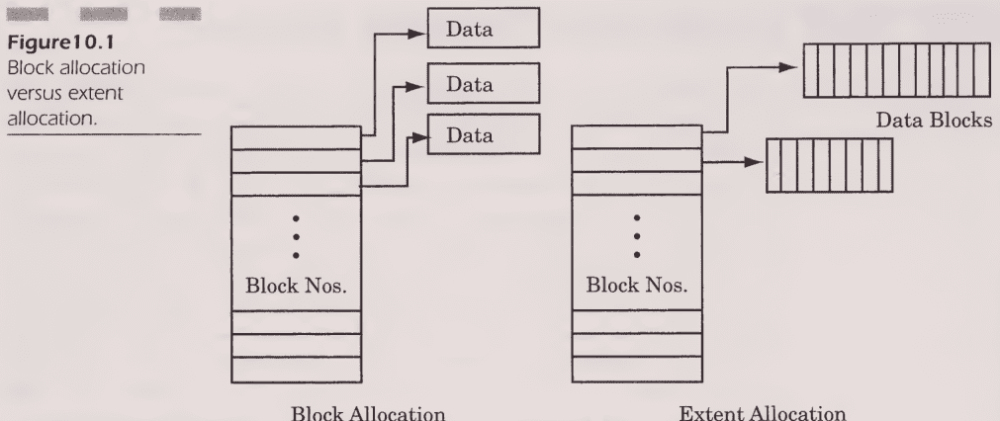

然而，当文件系统用于随机 I/O 时，基于区间的文件系统并没有提供如此大的优势。如果我们以随机方式读取文件，对于每次数据块读取，我们都需要查找所需块的块地址，这与我们在基于块的文件系统中所做的类似。

表 10.1 显示了各种文件系统及其分配格式。

### 表 10.1：文件系统分配格式

| 文件系统 | 分配格式 |
|---|---|
| Ext2 | 基于块；分配器尝试分配顺序块 |
| reiserfs | 基于区间 |
| JFS | 基于区间 |

## 基于块的分配（通用）

传统的 UNIX 文件系统使用基于块的分配策略。当文件扩展时，策略是动态地为文件分配最少数量的块（由文件系统定义）。块从空闲块映射中分配。

虽然此策略试图节省存储空间，但块有时会以随机顺序分配。这会导致过多的磁盘寻道，并且随后从文件系统的读取结果会导致磁盘

该机制试图访问文件扩展期间分配的所有随机块位置。通过优化块分配策略，使其尝试分配连续的（顺序的）块序列，可以避免随机块分配。如果使用更智能的块分配策略能够实现大块顺序分配，磁头寻道将大大减少。然而，文件系统的连续块分配最终会导致文件块在文件系统中碎片化，并且文件系统访问最终会回归到随机状态。

此外，每次扩展文件时，块分配方案都必须写入关于每个新块分配位置的信息。如果文件每次只扩展一个块，则需要大量额外的磁盘 I/O 来写入文件系统块控制结构信息。（文件系统块控制结构信息被称为*元数据*。）

在 ext2 文件系统中，元数据是异步写入存储设备的，因此改变文件大小等操作无需等待每个元数据操作完成。这大大提高了文件更新的速度，但如果系统崩溃发生在更改文件内容之后、实际写入元数据之前，则会增加数据不一致的风险。

## 事务处理或数据库的安全性问题

为了管理来自多个进程或线程对同一文件的同步访问，提供了文件锁接口（这将在我即将由麦格劳-希尔出版社出版的关于 Linux 文件系统的书中进行讨论）。Linux 或任何 UNIX 类型的操作系统都不提供支持文件记录概念的 kernel 级支持。在本节中，我们将探讨*静态*、*日志型*和*记录型*文件系统之间的差异。

所有数据库文件都必须驻留在文件系统中。Linux 的原生文件系统 ext2fs 在三四年前表现得还不错。然而，它并不适合应对当今 Linux 市场的挑战。首先，ext2fs 是*静态*的：它不跟踪更改以确保磁盘上的所有更新都安全完成。此外，ext2fs 是少数几种异步写入元数据的操作系统文件系统之一。虽然这大大加快了文件操作速度，但也意味着有关文件的信息（如创建和更改日期、所有者、权限等）相对于文件内容是延迟写入的。如果在写入文件的更新后但实际写入文件头之前断电，我们就会遇到问题。

ext2fs 的这些缺点严重阻碍了 Linux 在数据库服务器上的更广泛应用。例如，Linux 版 Oracle8i 不支持原始 I/O 设备（尽管从 2.2.x 内核开始就已支持原始 I/O）。如今，Linux 黑客们一直在努力开发一种日志型和/或记录型文件系统，以弥补 ext2fs 的不足。

### 日志记录型相对于非日志记录型的优势

这里讨论的日志型文件系统（JFS）是互联网文件服务器的关键技术，因为它在系统崩溃时能提供快速的文件系统重启时间。使用数据库日志记录技术，JFS 可以在几秒或几分钟内将文件系统恢复到一致状态。在非日志型文件系统中，文件恢复可能需要数小时甚至数天。大多数文件服务器客户无法容忍与非日志型文件系统相关的停机时间。只有通过向日志型技术的转变，这些文件系统才能避免耗时检查文件系统所有元数据以验证和恢复一致状态的过程。

在 ext2fs 这样的静态文件系统中，存在一个 inode 位置映射。这些 inode 指向目录块（包含其他 inode 及其关联文件名的列表）和数据块。Linux 目录与任何 UNIX 目录一样，是文件名与 inode 号之间的关联。使用 `ls` 的 `-i` 选项可以找到文件的 inode 号。

inode 包含所有权和权限信息，以及指向磁盘上文件数据块位置的指针。当我们更改文件 test.file 的内容时会发生什么？假设 test.file 的 inode 列出了四个数据块。

test.file 的数据位于磁盘位置 3110、3111、3506 和 3507。出现间隙是因为在初始分配磁盘块时，3111 和 3506 之间的块已经被分配给其他文件。因此我们注意到该文件是碎片化的。硬盘必须寻道到磁盘表面的 3110 区域，读取两个块，然后寻道到 3506 区域并读取两个块，才能读取整个文件。

假设你修改了第三个块。文件系统读取第三个块，进行你的更改，并重写第三个块，其位置仍然在 3506。如果你向文件追加内容，分配的块可能位于任何位置。

如果电源故障，这将很危险。想象你正在更新目录的过程中。你刚刚修改了某个巨大目录第五块中的 23 个文件条目。就在磁盘正在写入该块中间时，发生了停电；该块不完整，因此损坏了。

重启时，Linux（像所有 UNIX 系统一样）运行一个名为 `fsck`（文件系统检查）的程序，该程序遍历整个文件系统，验证所有条目，并确保块被正确分配和引用。它会发现这个损坏的目录条目并尝试修复它。然而，`fsck` 不一定能够实际修复损坏。很多时候，它做不到。有时，在这种情况下，所有目录条目都会丢失。

对于大型文件系统，`fsck` 可能需要很长时间。在拥有许多吉字节文件的机器上，`fsck` 可能运行多达 10 小时或更久。在此期间，系统不可用，对于某些安装环境来说，这代表着不可接受的停机时间。

日志型或记录型文件系统解决了这个问题……但引入了新问题。让我们看看为什么以及如何。

## 日志型文件系统如何工作

日志型文件系统使用最初为数据库开发的技术，将对文件系统元数据执行的操作记录为原子事务。在系统故障的情况下，通过重放日志并应用相应事务的日志记录，可以将文件系统恢复到一致状态。与这种基于日志的方法相关的恢复时间快得多，因为重放工具只需检查由近期文件系统活动产生的日志记录，而无需检查所有文件系统元数据。

诸如 JFS 之类的日志型文件系统，与 HPFS、ext2fs 和传统 UNIX 文件系统等非日志型文件系统相比，提供了更好的结构一致性、可恢复性以及快得多的重启时间（JFS 可以在几秒或几分钟内将文件系统恢复到一致状态）。其他这些文件系统在系统故障时有损坏的风险，因为逻辑写文件操作通常需要多次媒体 I/O 才能完成，并且在任何给定时刻可能未完全反映在媒体上。这些文件系统依赖于重启时运行的工具（在 Linux 中通常指 fsck），这些工具检查文件系统的所有元数据（如目录和磁盘寻址结构），以检测和修复结构完整性问题。这是一个耗时且易出错的流程，在最坏的情况下，可能会丢失或错位数据。

日志型文件系统只跟踪 inode 的变更，而不跟踪文件内容的变更；而记录型文件系统则同时跟踪对数据和 inode 的变更。所有变更、所有追加和所有删除都会记录到文件系统的一个不断增长的部分，即日志中。

在我们第一个关于 test.file 文件的例子中，记录型文件系统不会修改 3506 块中的数据，而是会在磁盘上的新位置存储 test.file 和第三个块两者的 inode 副本。

内存中的 inode 列表也会被更改，以将 test.file 指向新的 inode。偶尔，文件系统会进行检查点（check-point）并更新磁盘上的 inode 列表，同时释放文件的未使用部分（例如 test.file 的原始第三个块）。

记录型文件系统的写入速度显著提高，因为它只是向磁盘的同一区域追加，并且实际上不需要在磁盘上来回寻道寻找块。

因此，写入速度得到了提高，恢复时间也得到了改进（实际上，由于其结构，根本没有恢复时间）。

与静态文件系统相比，记录型文件系统的读取速度几乎相同，因为它们的文件数据块仍然容易寻道。inode 映射包含块列表，由于它们通常是内存映射的，因此可以快速读取。因此，记录型文件系统代表了两全其美的方案。读取时间与静态文件系统相当——嗯，可能由于更多的碎片化而稍慢一点：记录型文件系统的主要问题是它们很容易产生碎片化。

## 元数据日志记录

当文件系统对其磁盘上的结构进行更改时，它使用多个不连续的同步写入来执行这些更改。如果操作进行到一半时发生故障，文件系统的状态是未知的，必须对整个文件系统进行检查以确保一致性。

如果向文件末尾追加一个块（例如），那么告诉文件系统该文件每个块位置在磁盘上的映射（on-disk map）就需要先被读取、修改并写回磁盘，然后才能写入数据块。

当发生故障时，在启动时挂载文件系统之前必须对其进行检查；文件系统管理器不知道块映射是否正确，也不知道在崩溃期间哪个文件正在被修改。这会导致对整个文件系统进行全面扫描。

元数据日志文件系统（metadata logging file system）在磁盘上有一个循环（wrap-around）、仅追加（append-only）的日志区域，用于记录每个磁盘事务的状态。在修改任何磁盘结构之前，意向提交记录（intent-to-commit record）会被写入日志。随后，目录结构会被更新，并标记日志条目为完成。由于文件系统结构的每次变更都记录在日志中，因此可以通过查看日志来检查文件系统的一致性，而无需进行全面扫描。在挂载时，如果发现意向提交条目未标记为完成，则会检查该块的文件结构，并在必要时进行修复。

图 10.2 展示了一个文件的数据块（灰色）及其 inode 信息（修改时间、指向数据块的指针等），这是在一个常规（静态）文件系统中，例如 ext2fs，以及修改该文件中的数据时发生的情况。

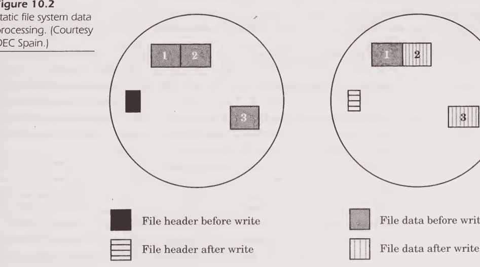

图 10.3 展示了一个类似的日志文件系统中的文件，以及修改该文件时发生的情况。

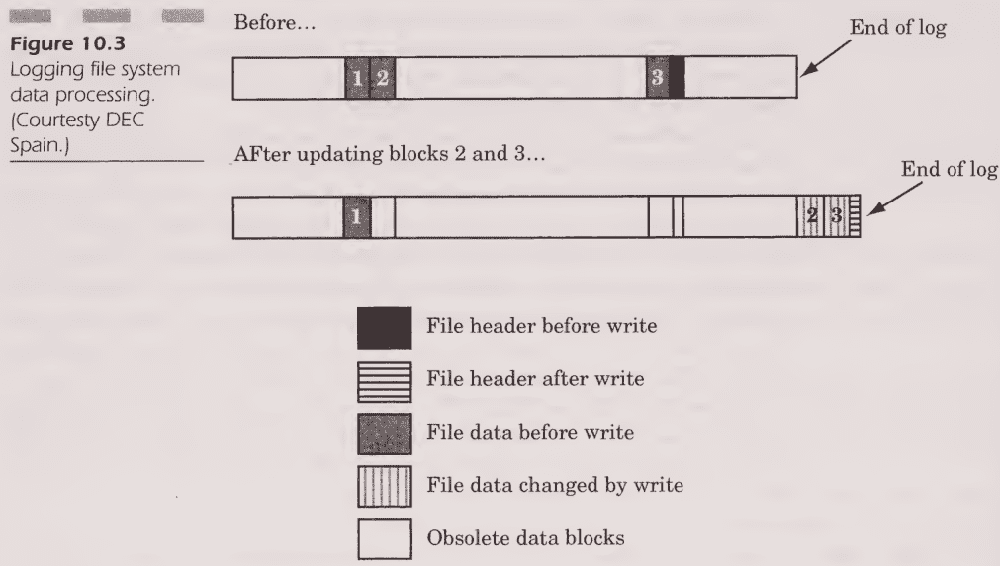

请注意，所有被修改的内容都会追加到日志的末尾。

这提高了速度，因为磁盘无需在磁盘各处寻道以写入文件的不同部分。同时也更加安全，因为在日志成功写入“新”数据块之前，文件的原始数据块不会被“丢失”。这带来了非常稳定的文件系统，崩溃后几乎不需要进行 fsck（文件系统检查）。这类文件系统在崩溃后几乎可以立即恢复在线，因为只需检查自上次检查点（checkpoint）以来的文件系统更新。

日志中的所有更改都可以快速重新应用。磁盘上损坏的部分总是最后添加到日志中的更改，可以将其视为无效并丢弃。唯一丢失的数据将是断电时丢失的那一项更改。20GB 及以上的元数据日志文件系统在崩溃后通常只需 4 到 5 秒即可进行 fsck 和修复。因此，元数据日志文件系统使得挂载一个包含大量数据的文件系统只需几秒钟，而如果使用没有日志的文件系统，则需要 10 个小时或更长时间。

## 可用的日志文件系统（Journaling File Systems）

日志文件系统已经存在相当长一段时间了。Solaris 的原生文件系统，即 UFS 文件系统，一直存在与 ext2fs 相同的可靠性问题（即延迟的元数据写入）。Veritas（见 www.veritas.com）多年来一直为 Solaris 提供日志文件系统和逻辑卷管理器（LVM）；大多数 Solaris 系统使用 Veritas 的产品，即 VxFS。2000 年 1 月 19 日，Solaris 宣布即将将 VxFS 移植到 Linux。不过，并未公布具体日期。

Sun 拥有自己改进的文件系统，随其 Solstice Disk Suite 一起提供。

SGI（原名 Silicon Graphics Inc.）在本文撰写时致力于将其优秀的 xfs 日志文件系统以开源方式提供给 Linux。xfs 文件系统非常稳定且速度极快。xfs 还为 Linux 社区提供了其他几项好处。xfs 是一个 64 位文件系统，这意味着它可以支持大文件（900 万 TB），甚至更大的文件系统（1800 万 TB）。xfs 可寻址的存储空间将在未来几年内终结对此类问题的抱怨。xfs 以惊人的速度提供了所有这些容量和可靠性。xfs 还与其他流行服务兼容，包括各种备份解决方案，以及通过 NFS 或 Samba 进行文件共享。

Linux 2.4 包含了 Linux 2.2 中存在的所有文件系统，包括 FAT12 和 FAT16（用于软盘驱动器和各种 DOS 版本的硬盘）、NTFS（用于 Windows NT）、VFAT 和 FAT32（用于 Windows 9x）、HFS（用于 MacOS）、HPFS（用于 OS/2）、UFS，以及更多。然而，在本章中，我们只讨论了始终存在的 ext2 文件系统，以及新的 IBM 日志文件系统，JFS。显然，不可能在单一章节中涵盖所有或甚至主要部分的 Linux 可用文件系统。关于 Linux 2.4 文件系统的详细研究，请参见我即将由 McGraw-Hill 出版的书籍 *Linux File Systems*[^1]。

## IBM 的 JFS

JFS 提供了 Linux 虚拟文件系统（VFS）层所需的超级块（superblock）和文件操作系统调用。JFS 是一种基于日志的、字节级文件系统，既坚固又具有可扩展性；虽然它主要针对面向事务的高性能服务器（从单处理器系统到先进的多处理器和集群系统）的高吞吐量和可靠性需求而设计，但 JFS 也适用于期望性能和可靠性的客户端配置。2000 年 2 月，IBM 宣布 JFS 将对公众开放。参见 `http://www-4.ibm.com/softwre/developer/library/jfs.html`。

## JFS 的主要数据结构和算法

### 超级块：主聚合超级块和次聚合超级块

超级块包含聚合范围的信息，例如聚合的大小、分配组的大小、聚合块大小等。次聚合超级块是主聚合超级块的直接副本。如果主聚合超级块损坏，则使用次超级块。这些超级块位于固定位置。这使得 JFS 总能找到它们，而不依赖于其他任何信息。超级块结构定义在 `linux\include\linux\JFS\JFS_superblock.h` 中的 `JFS_superblock` 结构体中。

### 索引节点（Inodes）

JFS 的磁盘 inode 为 512 字节。它包含四组基本信息。第一组描述了 JFS 对象的 POSIX 属性。第二组描述了 JFS 对象的附加属性；这些属性包括 VFS 支持所需的信息、特定于操作系统环境的信息以及 B+ 树（B+-tree）的头部。第三组包含 B+ 树根节点的 extent 分配描述符，或者内联数据（in-line data）。第四组包含扩展属性、更多内联数据或额外的 extent 分配描述符。

磁盘 inode 结构的定义位于 `linux\include\JFS\JFS_dinode.h` 中的 `dinode` 结构体。

### 标准管理实用程序

JFS 提供标准的实用程序用于创建和维护文件系统。

*创建文件系统* 实用程序提供了 `mkfs` 命令的 JFS 特定部分，在指定的驱动器上初始化 JFS 文件系统。此实用程序在低层操作，并假设文件系统所在卷的任何创建/初始化都在更高层由此实用程序之外的地方处理。用户可以在 `mkfs` 期间提供块大小等信息，这将改变文件系统的特性。

*检查/恢复文件系统* 实用程序提供了 `fsck` 命令的 JFS 特定部分。它检查文件系统的完整性并修复发现的问题。它重放日志并将已提交的更改应用到文件系统元数据。如果日志重放结果声明文件系统是干净的，则不采取进一步行动。如果文件系统未被视为干净的，表明日志因某种原因未完全正确重放，或者仅通过重放日志无法将文件系统恢复到一致状态，则执行文件系统的完整扫描。

在执行完整完整性检查时，检查/修复实用程序的主要目标是实现可靠的文件系统状态，以防止未来的文件系统损坏或故障，次要目标是在面临损坏时保留数据。这意味着该实用程序可能会为了达到文件系统一致性而丢弃数据。具体来说，当实用程序没有所需的信息来恢复结构不一致的文件或目录至一致状态而不做假设时，数据会被丢弃。在不一致文件或目录的情况下，整个文件或目录被丢弃，不尝试保存任何部分。由于删除损坏目录而产生的孤立文件或非目录放置在文件系统根目录下的 `lost+found` 目录中。

文件检查/修复实用程序的一个重要考虑因素是其所需的虚拟内存量。传统上，这些实用程序所需的虚拟内存量取决于文件系统大小，因为所需虚拟内存的大部分用于跟踪文件系统中各个块的分配状态。随着文件系统变大，块数增加，跟踪这些块所需的虚拟内存量也随之增加。

JFS 检查/修复实用程序的设计与普通 Linux fsck 不同，其虚拟内存需求由文件系统中的文件和目录数量决定，而不是由文件系统的块数决定。JFS 检查/修复实用程序的虚拟内存需求大约是 32 字节/文件或目录，无论文件系统大小如何，包含 100 万个文件和目录的文件系统大约需要 32 Mbytes。与其他所有文件系统一样，JFS 实用程序需要跟踪块分配状态——但通过使用位于实际文件系统内部的小型预留工作区来避免使用虚拟内存。

## 启动时 JFS 的设置

在启动时，文件系统创建实用程序 `mkfs` 创建完全包含在每个挂载的逻辑卷（分区）内的聚合体。聚合体是根据特定格式分配的磁盘块数组。聚合体包括：

- 超级块，它将分区标识为 JFS 聚合体。
- 分配映射，描述聚合体内每个数据块的分配状态。

## 块分配映射

块分配映射用于跟踪整个聚合体中已分配或已释放的磁盘块。由于聚合体内的所有文件集（filesets）共享相同的磁盘块池，因此此分配映射被聚合体内的所有文件集用于分配或释放磁盘块。

块分配映射本身是一个文件，由聚合 inode 2 描述。当聚合体最初创建时，为映射覆盖的聚合体空间分配数据块。当聚合体扩展或收缩时，映射可以动态增长或收缩。映射的每一页长度为 4K。映射包含三种类型的页面：`bmap control page`、`dmap control pages` 和 `dmap pages`。

每个 dmap 包含单个位来表示每个聚合块。第 n 个位表示第 n 个逻辑聚合块的分配状态。这由 `linux/include/linux/JFS/JFS_dmap.h` 文件中的 `struct dmap_t` 定义。每个 dmap 页覆盖 8K 的聚合块。

由于块分配映射可能有许多 dmap 页，它们通过 dmap 控制页进行管理。这些页面提高了查找大块空闲块的性能。聚合体的大小决定了需要这些页面和层次的数量。如果并非所有层次都是必需的，那么块映射 inode 将是一个带有空洞的稀疏文件，用于每个未使用层次的第一页。

JFS 采用提交策略以确保控制数据可靠更新。“可靠更新”意味着在面对系统故障时保持 JFS 结构和资源分配状态的一致性。为确保块分配映射处于一致状态，JFS 在 dmap 结构中维护两个映射，*工作映射*和*持久映射*。工作映射记录当前分配状态。持久映射记录已提交的分配状态，由磁盘上找到的分配状态或 JFS 日志或已提交 JFS 事务中的记录描述。

当释放聚合块时，先更新永久映射；当分配聚合块时，先更新工作映射。位 0 表示空闲资源，值 1 表示已分配资源。

> ⁴ 文件集（fileset）是可挂载的实体，类似于 ext2fs 文件系统。文件集管理文件和目录。文件和目录通过 inode 持久表示；每个 inode 描述文件或目录的属性，并作为在磁盘上查找文件或目录数据的起点。JFS 还使用 inode 来表示其他文件系统对象，例如描述文件集中每个 inode 的分配状态和磁盘位置的映射。

块分配映射的 dmap 控制页包含类似于 dmap 结构中的树，除了叶级包含 1024 个元素外。dmap 控制页由 `linux\include\linux\JFS\JFS_dmap.h` 中的 struct dmapctl_t 定义。

块分配映射的顶部有一个映射控制结构，struct dbmap_t。该结构包含摘要信息，加速查找具有高于平均水平空闲空间的 AG。该结构位于 `linux\include\linux\JFS\JFS_dmap.h` 中。

块分配映射不被日志记录：它可以在恢复期间由 logredo 修复，或由 fsck 重建。

## Inode 分配映射

Inode 分配映射解决了正向查找问题。聚合体和每个文件集维护一个 inode 分配映射，它是 *inode 分配组*（IAGs）的动态数组。IAG 是 inode 分配映射的数据。对于聚合体，inode 分配映射映射的 inode 也被称为 *聚合 inode 表*。对于文件集，inode 分配映射映射的 inode 也被称为 *文件 inode 表*。

每个 IAG 大小为 4K，描述磁盘上的 128 个物理 inode 区段。由于每个 inode 区段包含 32 个 inode，每个 IAG 描述 4,096 个 inode。IAG 可以存在于聚合体的任何位置。IAG 的所有 inode 区段都存在于一个分配组中。IAG 与那个分配组（AG）绑定，直到其所有 inode 区段被释放。那时，可以为它分配任何 AG 中的 inode 区段，然后 IAG 将与那个 AG 绑定。IAG 由 *iag_t* 结构定义，位于 `linux\include\linux\JFS\JFS_omap.h` 文件中。

inode 分配映射的前 4K 页是控制页。该页包含 inode 分配映射的摘要信息。*dinomap_t* 结构的定义位于 `linux\include\linux\JFS\JFS_omap.h` 文件中。

抽象地看，inode 分配映射是 IAG 结构的动态可扩展数组：`struct iag inode_allocation_map [1..N]`。物理上，inode 分配映射本身是聚合体内部的一个文件。聚合体 inode 分配映射由聚合体自节点描述。

文件集 inode 分配映射由 `Fileset_Inode` 描述。其页面在标准 B+树索引下按需分配和释放。B+树的键是 IAG 页的字节偏移量。

## AG 空闲 Inode 列表

AG 空闲 inode 列表解决了反向查找问题。为了减少扩展或截断聚合体的开销，JFS 设置了每个聚合体允许的最大 AG 数量。因此，AG 空闲 inode 列表头部的数量是固定的。列表的头部位于 inode 分配映射的控制页中。第 n 个条目是所有包含空闲 inode 的 inode 分配映射条目（IAGs）的双向链表头部，位于第 n 个 AG 中。

IAG 编号用作列表中的索引。-1 表示列表的结尾。每个 IAG 控制部分包含用于列表的前向和后向指针。描述 AG 空闲列表的定义位于 `linux\include\linux\JFS\JFS_imap.h` 文件中的 struct dinomap_t 中。

## IAG 空闲列表

IAG 空闲列表解决了空闲 inode 编号查找问题。它允许 JFS 找到没有相应已分配 inode 区段的 IAG。描述 IAG 空闲列表的定义位于 `linux\include\linux\JFS\JFS_dinode.h` 文件中的 struct inomap_t 中。

## 文件集分配映射 Inode

聚合体 inode 表中的文件集分配映射 inode 是一种特殊类型的 inode。因为它们代表文件集，所以它们是文件集的“超级-inode”。它们在 inode 的上半部分包含一些文件集特定的信息，而不是正常的 inode 数据。它们还跟踪文件集 inode 分配映射在 B+树中的位置。该结构由 `linux\include\linux\JFS\JFS_dinode.h` 文件中的 struct dinode_t 定义。

每个 JFS 对象都由 inode 表示。Inode 包含对象特定信息，如时间戳和文件类型（常规 vs. 目录等）。它们还包含 B+树以记录区段的分配。

特别要注意，所有 JFS 元数据结构（超级块除外）都表示为“文件”。通过使用 inode 结构作为数据，数据格式（磁盘布局）变得本质上是可扩展的。目录将用户指定的名称映射到为文件和（子）目录分配的 inode，并形成传统的名称层次结构。文件包含用户数据，并且数据中没有隐含的限制或格式。也就是说，JFS 将用户数据视为未解释的字节流。基于区段（extent）的寻址结构以 inode 为根，用于将文件数据映射到磁盘块。一个“文件”以区段序列的形式进行分配。

聚合体的超级块（superblock）和磁盘分配映射、文件描述符和 inode 映射、inode、目录以及寻址结构共同构成了 JFS 的控制结构——即其元数据。

## JFS 相对于其他文件系统的设计特点

JFS 的设计完全集成了日志记录功能，而不是在现有文件系统上添加日志记录。JFS 的许多特性使其与其他文件系统区分开来。

- **内部 JFS（潜在）限制**——JFS 是一个完整的 64 位文件系统。所有适当的文件系统结构字段均为 64 位大小，从而允许 JFS 支持大文件和大分区。
- **可移动介质**——JFS 不支持将软盘作为底层文件系统设备。
- **文件系统大小**——JFS 支持的最小文件系统（filesct）大小为 16 Mbytes。最大文件系统大小取决于文件系统块大小以及文件系统元数据结构支持的最大块数。JFS 支持的最大文件系统大小为 512 terabytes（块大小为 512 bytes）到 4 petabytes（块大小为 4 Kbytes）。
- **文件大小**——最大文件大小是虚拟文件系统框架支持的最大文件大小。例如，如果框架仅支持 32 位，则会限制文件大小。

JFS 广泛使用 B+树作为基于区段的寻址结构。

在区段分配中，文件由一个 inode 表示，其中包含 B+树的根，该根描述了包含用户数据的区段。一个区段是分配给 JFS 对象的一个可变长度连续聚合块序列。每个区段完全包含在一个单一的聚合体（aggregate）中。

定义一个区段需要两个值，即其长度和地址。长度以聚合块大小为单位进行测量。JFS 使用 24 位值来表示区段的长度，因此区段的大小范围可以从 1 到 $2^{24}-1$ 个聚合块。地址是区段第一个块的地址，以聚合块为单位（即从聚合体开始处的块偏移量）。一个区段可以跨越多个分配组（AGs）。这些区段在一个 B+树中进行索引，以优化插入新区段、定位特定区段等的性能。

当聚合块大小为 512 字节（允许的最小值）时，最大区段长度为 $512 \times (2^{24}-1)$ 字节（略小于 8G）。当聚合块大小为 4,096 字节（允许的最大值）时，最大区段长度为 $4,096 \times (2^{24}-1)$ 字节（略小于 64G）。这些限制仅适用于单个区段；它们对整体文件大小没有任何限制作用。

区段式文件系统结合用户指定的聚合块大小，不允许 JFS 单独支持内部碎片。用户可以配置聚合体使用较小的聚合块大小（例如，512 字节），以最小化包含大量小文件聚合体的内部碎片。

通常，JFS 的分配策略试图通过分配最少数量的区段来最大化连续分配，并使每个区段尽可能大且连续。这允许进行大 I/O 传输，从而提高性能。为了提高定位特定目录条目的性能，使用了一个按名称排序的 B+树。

JFS 使用基于区段的寻址结构，结合积极的块分配策略，生成紧凑、高效且可扩展的结构，用于将文件内的逻辑偏移量映射到磁盘上的物理地址。如前所述，区段是作为一个整体分配给文件的连续块序列，并由一个三元组描述，包括逻辑偏移量/长度/物理地址。该寻址结构是一个 B+树，填充有区段描述符（即上述三元组），以 inode 为根，并以文件内的逻辑偏移量作为键。

## JFS 对 B+树的进一步广泛应用

本节描述用于文件布局的 B+树数据结构。选择 B+树是为了提高读写区段的性能，这是 JFS 中最常见的操作。B+树为读取文件的特定区段提供了快速搜索。它们还为在文件中追加或插入区段提供了高效性。较少见的是，当删除文件时，JFS 可能需要遍历整个 B+树，以确保 JFS 不仅移除文件数据，还移除用于 B+树的块。B+树在遍历时也是高效的。

区段分配描述符（$x\_ad$ 结构）描述了区段，并添加了两个表示文件所需的字段：一个 **offset（偏移量）**，描述该区段所代表的逻辑字节地址，以及一个 *flags field（标志字段）*。区段分配描述符结构定义在 `linux/include/JFS/JFS_x_tree.h, struct x_ad` 中。

在 JFS 中，除了目录之外，所有索引对象都有一个通用的 B+树索引结构。被索引的数据取决于对象。B+树以数据所描述的 $x\_ad$ 的 **offset（偏移量）** 为键。条目根据 $x\_ad$ 结构的 **offsets（偏移量）** 进行排序。$x\_ad$ 结构是 B+树节点中的条目。

一旦 inode 中的八个 $x\_ad$ 结构被填满，就会尝试使用 inode 的最后一个象限（quadrant）来容纳更多的 $x\_ad$ 结构。如果 inode 的 `di_mode` 字段中设置了 INLINEA 位，则 inode 的最后一个象限可用。磁盘 inode 第二部分的底部包含一个数据描述符，它说明了 inode 后半部分存储的内容。如果文件足够小，后半部分可能包含文件的内联数据。

如果文件数据无法放入 inode 的内联数据空间，则它们包含在区段中，并且 inode 将包含 B+树的根节点。头部指示有多少 $x\_ads$ 正在使用以及有多少可用。

通常，inode 将包含 B+树根的八个 $x\_ad$ 结构。如果文件的区段数量少于或等于八个，则这八个 $x\_ad$ 结构同时也是 B+树的叶节点。它们描述了这些区段。

否则，inode 中的八个 $x\_ad$ 结构指向 B+树的叶节点或内部节点。一旦 inode 中的八个 $x\_ad$ 结构被填满，就会尝试使用 inode 的最后一个象限来容纳更多的 $x\_ad$ 结构。如果 inode 的 `di_mode` 字段中设置了 INLINEA 位，则 inode 的最后一个象限可用。一旦 inode 中所有可用的 $x\_ad$ 结构都被使用，B+树必须分裂。

### 叶节点

JFS 为 B+树的 *叶节点* 分配 4K 的磁盘空间。叶节点是一个逻辑数组，包含带有头部的 $x\_ad$ 条目。头部指向节点中第一个空闲的 $x\_ad$ 条目；其后所有的 $x\_ad$ 条目也未被分配。八个 $xad$ 条目从 inode 复制到叶节点；头部初始化为指向第九个条目作为第一个空闲条目。JFS 将 B+树的根更新到 inode 的第一个 $xad$ 结构中；该 $xad$ 结构指向新分配的叶节点。

此新 $xad$ 结构的偏移量是叶节点中第一个条目的偏移量。inode 中的头部被更新，以指示现在仅使用一个 $xad$ 用于 B+树。inode 中的头部还必须更新，以指示 inode 现在包含纯 B+树根。

随着新区段添加到文件中，它们继续按必要的顺序添加到这个相同的叶节点中。这一直持续直到该节点被填满。一旦节点被填满，就会为 B+树的另一个叶节点分配 4K 的磁盘空间。inode 中的第二个 $xad$ 结构被设置为指向这个新分配的节点。这一直持续直到 inode 中所有的八个 $xad$ 结构被填满，此时发生 B+树的另一次分裂。这种分裂创建了 B+树的内部节点，这些节点纯粹用于路由树的搜索。

### 内部节点

JFS 为 B+树的 *内部节点* 分配 4K 的磁盘空间。内部节点看起来与叶节点相同。八个 $xad$ 条目从 inode 复制到内部节点；头部初始化为指向第九个条目作为第一个空闲条目。JFS 通过使 inode 的第一个 $xad$ 结构指向新分配的内部节点来更新 B+树的根。

inode 中的头部被更新，以指示仅使用一个 $xad$ 用于 B+树。文件 `linux/include/linux/JFS/JFS_xtree.h` 在 struct $xtpage\_t$ 中描述了 B+树根的头部。文件 `linux/include/linux/JFS/JFS_btree.h` 在 struct $btpage\_t$ 中是内部节点或叶节点的头部。

### 可变块大小

JFS 在文件系统级别支持 512、1,024、2,048 和 4,096 字节的块大小，允许用户根据其应用环境优化空间利用率。较小的块大小减少了文件和目录内部的碎片量，并更具空间效率。

然而，小块会增加路径长度，因为与使用大块大小相比，块分配活动可能会更频繁地发生。默认块大小为 4,096 字节，因为对于服务器系统而言，性能通常比空间利用率更受重视。

JFS 会根据需求动态分配磁盘 inode 空间，并在不再需要时释放空间。这种支持避免了在文件系统创建时预留固定数量的磁盘 inode 空间的传统方法，从而消除了用户预估文件系统将包含的最大文件和目录数量的需求。此外，此支持解耦了磁盘 inode 与固定磁盘位置。

## 目录组织

JFS 提供了两种不同的目录组织方式。第一种组织方式用于小型目录，并将目录内容存储在目录的 inode 中。这消除了对单独目录块 I/O 的需求，也无需分配单独的存储空间。inode 内最多可内联存储八条目，不包括自身 (.) 和父目录 (..) 条目，这些条目存储在 inode 的单独区域中。

第二种组织方式用于较大的目录，并将每个目录表示为以名称为键的 B+ 树。Linux 目录与任何 UNIX 目录一样，是文件叶子名称与 inode 编号之间的关联。可以使用 `ls` 命令的 -i 开关查找文件的 inode 编号。

与传统的未排序目录组织相比，它提供了更快的目录查找、插入和删除功能。

## JFS 对稀疏文件和密集文件的支持

JFS 在文件系统级别上同时支持稀疏文件和密集文件。稀疏文件允许数据写入文件内的随机位置，而无需实例化之前未写入的中间文件块。报告的文件大小是已写入的最高字节数，但文件中任何特定块的实际分配仅在对该块执行写操作时发生。例如，假设在一个指定为稀疏文件的文件系统中创建了一个新文件。应用程序向文件的块 100 写入一个数据块。JFS 将此文件大小报告为 100 块，尽管只为其分配了一个块的磁盘空间。如果应用程序接下来读取文件的块 50，JFS 将返回一个填满零字节的块。假设应用程序随后向文件的块 50 写入一个数据块。JFS 仍然将此文件大小报告为 100 块，但现在已为其分配了两个块的磁盘空间。稀疏文件对于需要大逻辑空间但仅使用该空间小部分的应用程序具有重要意义。

对于*密集文件*，磁盘资源被分配以覆盖文件大小。在上面的示例中，第一次写入（向文件的块 100 写入一个数据块）将导致为该文件分配 100 个块的磁盘空间。对任何已隐式写入的块的读操作将返回一个填满零字节的块，情况与稀疏文件相同。

## 聚合文件和文件集

在 JFS 中，*文件*由包含 B+ 树根部的 inode 表示，该 B+ 树描述了包含用户数据的范围。B+ 树以范围的偏移量作为索引。目录是一个日志化元数据文件。

Linux 目录与任何 UNIX 目录一样，是文件叶子名称与 inode 编号之间的关联。可以使用 `ls` 命令的 -i 开关查找文件的 inode 编号。

目录由条目组成，这些条目指示目录中包含的对象。目录条目将名称链接到 inode 编号。指定的 inode 描述具有指定名称的对象。为了提高定位特定目录条目的性能，使用按名称排序的 B+ 树。

目录 inode 的 `di_size` 字段仅表示目录 B+ 树的叶子页面。当目录的叶子节点包含在 inode 中时，`di_size` 字段的值为 256。目录不包含自身 (`.`) 和父目录 (`..`) 的具体条目。相反，这些在 inode 本身中表示。自身是目录自己的 inode 编号。父目录是 inode 中的一个特殊字段 `i_dotdot`，位于 `struct droot_t` 中，在 `linux\include\linux\JFS\JFS_dtree.h` 文件中。

目录 inode 以与普通文件相似的方式包含其 B+ 树的根部。Linux 目录与任何 UNIX 目录一样，是文件叶子名称与 inode 编号之间的关联。然而，这个 B+ 树以名称作为键。目录 B+ 树的叶子节点包含目录条目，并以条目的完整名称作为键。

目录 B+ 树对 B+ 树的最后一个内部节点使用后缀压缩。其余内部节点使用相同的压缩后缀。后缀压缩将名称截断为仅足以将当前条目与前一个条目区分开来的字符数。

如前所述，目录将用户指定的名称映射到为文件和 (子) 目录分配的 inode。这形成了传统的名称层次结构。文件包含用户数据，数据中没有隐含的限制或格式。JFS 将用户数据视为未解释的字节流。以 inode 为根的基于范围的地址结构用于将文件数据映射到磁盘块。聚合文件的超级块和磁盘分配映射、文件描述符和 inode 映射、inode、目录和地址结构组成了 JFS 控制结构或元数据。

## 日志

JFS 日志在每个聚合文件中维护，用于记录关于元数据操作的信息。日志的格式也由文件系统创建实用程序设置。单个日志可被聚合文件内多个已挂载的文件系统同时使用。基于日志恢复的几个方面值得关注。首先，JFS 仅记录元数据操作，因此重放日志仅恢复文件系统内部结构关系和资源分配状态的一致性。它不记录文件数据或恢复此数据至一致状态。因此，在恢复后，部分文件数据可能会丢失或过时，对数据一致性有重要需求客户应使用同步 I/O。

在面对媒体错误时，日志记录的效果并不特别显著。具体来说，在日志或元数据写入磁盘过程中发生的 I/O 错误意味着，在系统崩溃后，需要执行耗时且可能具有侵入性的完整完整性检查，才能将文件系统恢复到一致状态。这意味着坏块重定位是 JFS 下方任何存储管理器或设备的关键功能。

JFS 日志记录语义是这样的：当涉及元数据更改的文件系统操作（例如，`unlink()`）返回成功返回代码时，该操作的效果已提交到文件系统，即使系统崩溃也会看到这些效果。例如，一旦成功删除文件，它便保持删除状态，即使系统崩溃并重启也不会重新出现。

这种日志记录风格在每个修改元数据的 inode 或虚拟文件系统 (VFS) 操作中引入了对日志磁盘的同步写入。（对于数据库专家来说，这是一种使用非窃取缓冲策略的仅重做、物理后映像、预写日志协议。）就性能而言，这与许多依赖多次谨慎的同步元数据写入来保证一致性的非日志化文件系统相比，表现良好。然而，与使用不同日志记录风格并延迟将日志数据写入磁盘的其他日志化文件系统（如 Veritas VxFS 和 Transarc Episode）相比，这是一种性能劣势。在服务器环境中，由于执行多个并发操作，*组提交*通过合并多个同步写操作为一个写操作，降低了这种性能成本。JFS 的日志记录风格随着时间推移已得到改进，现在提供异步日志记录，提高了文件系统的性能。

显然，关于 JFS 还有很多内容可以说，但随着 JFS 的进一步增强，新功能和新特性将逐渐出现，这里无法对 JFS 进行完整讨论。

## 逻辑卷管理器抽象

逻辑卷管理器抽象的目标是实施一个非常灵活的虚拟磁盘子系统，以处理磁盘存储、存储的在线分配和重定位，以及存储的在线扩展和缩减。

逻辑卷管理器 (LVM) 在物理外设和内核中的 I/O 接口之间添加了一个额外层，从而提供磁盘的逻辑视图。这也允许将多个磁盘（物理卷或 PV）级联形成存储池（卷组或 VG），其分配单元称为物理块 (PE)。

然后，可以将此 VG 的一部分以逻辑卷 (LV) 的形式分配，其单位称为逻辑块 (LE)。每个逻辑块映射到大小相等的相应物理块。这些物理块映射到磁盘上的偏移量和块。

然后，可以通过类似于 `/dev/sd[a-z]*` 或 `/dev/hd[a-z]*` 的设备特殊文件，命名为 `/dev/VolumeGroupName/LogicalVolumeName`，来使用这些 LV。

除此之外，你能够在运行时扩展或缩减 VG 和 LV。

## 配置概念

物理卷、卷组和逻辑卷的配置信息存储在每个物理卷以及自动创建的备份文件中，这些文件位于 `/etc/lvmtab.d` 目录中。

磁盘上的配置区域称为*卷组描述符区域*（VGDA）。

LVM 驱动程序持有 LV 的 LE 与 PV 的 PE 之间的映射表。这些表由超级用户执行的 LVM 命令创建/更新/删除。

该驱动程序的主要映射函数由 `usr/src/linux/drivers/block/ll_rw_blk.c` 中的函数（在函数 `ll_rw_block()` 和 `ll_rw_swap_file()` 中）以 LV 中的一个逻辑块为参数调用，并在表中查找相应的物理块/磁盘对。然后，它将此对返回给调用 `ll_rw.* ()` 函数，从而将针对磁盘块的物理 I/O 请求加入队列。

## 示例

如果 LV 的容量变得过小，而包含该 LV 的 VG 已满，您可以向该 VG 添加另一个 PV，然后简单地扩展该 LV。如果您减少或删除某个 LV，可以使用释放的容量供同一 VG 中的不同 LV 使用。此场景如图 10.4 所示。

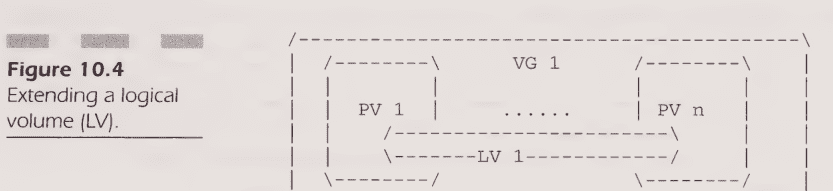

在插图中，设 `PV 1` 为 `/dev/sdc1`；`PV n` 为 `/dev/sde1`；`VG 1` 为 `vg00`；`LV 1` 为 `/dev/test_vg/test_lv`。

实现上述场景的配置步骤如下：

- 1. 安装 LVM 后，执行 `insmod lvm` 或设置 `kernelld/kmod` 以自动加载它（参见 INSTALL）。
- 2. 在两个磁盘上设置分区（#1），分区类型设为 `0x8e`（我使用此类型以避免使用 Linux 主分区。）
- 3. 执行 `pvcreate /dev/[sd]c1`。出于测试目的，您可以在磁盘上使用多个主分区和/或扩展分区。出于性能原因，在正常的 LVM 操作中请勿这样做；如果必须这样做，请勿将逻辑卷条带化到与同一磁盘上分区关联的物理卷。
- 4. 执行 `vgcreate test_vg /dev/[sd]c1`。（`vgcreate` 也会激活卷组）。
- 5. 执行 `lvcreate -L100 -ntest_lv test_vg` 以获得一个 100 MB 的线性 LV，或执行 `lvcreate -i2 -l4 -l100 -nanother_test_lv test_vg` 以获得一个包含两个条带且条带大小为 4 KB 的 100 个 LE 大小的逻辑卷。
- 6. 按您喜欢的方式使用创建的 LV；例如，使用 `mke2fs /dev/test_vg/test_lv` 在其中生成文件系统并挂载它。

## 命令概述与概念

我对 LVM 命令进行了分组和命名，使得用于物理卷处理的命令都以 `pv` 开头，用于卷组处理的命令以 `vg` 开头，而用于逻辑卷的命令以 `lv` 开头。表 10.2 列出了 LVM 命令。

**表 10.2**
**逻辑卷管理器命令**

| 命令 | 描述 |
| :--- | :--- |
| e2fsadm | 逻辑卷管理封装器，包括针对 `lvextend`、`lvreduce`、`e2fsc` 和 `resize2fs` 的文件系统调整大小功能。 |
| lvchange | 更改逻辑卷的属性。 |
| lvcreate | 创建逻辑卷。 |
| lvdisplay | 显示逻辑卷配置数据。 |
| lvextend | 扩展逻辑卷的大小。 |
| lvreduce | 减少逻辑卷的大小。 |
| lvremove | 移除逻辑卷。 |
| lvrename | 重命名非活动逻辑卷。 |
| lvscan | 查找所有现有的逻辑卷。 |
| lvmiddiskscan | 扫描所有磁盘/分区和多个设备并列出它们。 |
| lvmmsadc | 统计数据收集器。 |
| lvmsar | 统计数据报告器。 |
| pvchange | 更改物理卷的属性。 |
| pvcreate | 创建物理卷。 |
| pvdata | 调试并列出物理卷组描述符区域。 |
| pvdisplay | 显示物理卷配置信息。 |
| pvmove | 将逻辑扩展单元移动到不同的物理卷。 |
| pvscan | 查找所有现有的物理卷。 |
| vgcfgbackup | 备份所有卷组描述符区域。 |
| vgcfgrestore | 将卷组描述符区域恢复到磁盘。 |
| vgchange | 激活/停用卷组。 |
| vgck | 检查卷组描述符区域的一致性。 |
| vgcreate | 从物理卷创建卷组。 |
| vgdisplay | 显示卷组配置信息。 |
| vgexport | 导出卷组（使其对系统未知）。 |
| vgextend | 通过一个或多个物理卷扩展卷组。 |
| vgimport | 导入卷组（使其对/另一个系统已知）。 |
| vgmerge | 将两个卷组合并为一个。 |
| vgmknodes | 创建包含所有逻辑卷特殊文件的卷组目录。 |
| vgreduce | 通过一个或多个空物理卷减少卷组。 |
| vgremove | 移除空卷组。 |
| vgrename | 重命名非活动卷组。 |
| vgscan | 扫描卷组。 |
| vgsplit | 将一个卷组拆分为两个。 |

## 示例 LVM 会话输出

[^1]: 1999 年 12 月，我首先向 IBM 提议将优秀的 JFS（日志文件系统）在 GPL 许可证下发布。2000 年 2 月，IBM 宣布 JFS 将对公众开放。其他日志文件系统也已宣布，例如 ext3fs、Veritas VxFS（移植宣布于 2000 年 1 月 19 日，未指定可用日期），以及 SGI 的 xfs。非常有才华和聪明的 Linux 黑客 Hans Reiser 也编写了他自己的日志文件系统，reiserfs。截至本文撰写时，唯一可直接使用的选项是 reiserfs 和 IBM 的 JFS；reiserfs 尚未适用于 2.4 内核。

尽管 JFS 仅处于 0.4 版本，但它已经是 ext3fs 和 reiserfs 的有力竞争者，并显示出更高的可靠性。


# create physical volumes on 9 SCSI disk primary partition 1

```
pvcreate /dev/sd[b-eg-k]1

pvcreate -- /dev/sdb1 has an invalid physical volume identifier

pvcreate -- physical volume on /dev/sdb1 successfully created

pvcreate -- reinitializing physical volume

pvcreate -- physical volume on /dev/sdc1 successfully created

pvcreate -- reinitializing physical volume

pvcreate -- physical volume on /dev/sdd1 successfully created

pvcreate -- reinitializing physical volume

pvcreate -- physical volume on /dev/sde1 successfully created

pvcreate -- reinitializing physical volume

pvcreate -- physical volume on /dev/sdg1 successfully created

pvcreate -- reinitializing physical volume

pvcreate -- physical volume on /dev/sdh1 successfully created

pvcreate -- reinitializing physical volume

pvcreate -- physical volume on /dev/sdi1 successfully created

pvcreate -- reinitializing physical volume

pvcreate -- physical volume on /dev/sdj1 successfully created

pvcreate -- reinitializing physical volume

pvcreate -- physical volume on /dev/sdk1 successfully created
```

# create a volume group with default physical extent size

# from these physical volumes

```
vgcreate my_first_vg /dev/sd[b-eg-k]1

vgcreate -- INFO: using default physical extent size 4096 KB

vgcreate -- INFO: maximum logical volume size is 256 GB

vgcreate -- doing automatic backup of vg05

vgcreate -- volume group my_first_vg successfully created
```

# Oops ;-)

# Don't like the limitations caused by default physical extent size

# --> deactivate and delete volume

```
vgchange -an my_first_vg

vgchange -- my_first_vg successfully deactivated

vgremove my_first_vg

vgremove -- volume group my_first_vg successfully removed
```

# create a volume group with physical extent size of 8192 KB

# from these physical volumes

```
vgcreate -s 8192 my_first_vg /dev/sd[b-eg-k]1

vgcreate -- INFO: maximum logical volume size is 512 GB

vgcreate -- doing automatic backup of my_first_vg

vgcreate -- volume group my_first_vg successfully created
```

# display volume group config

```
vgdisplay my_first_vg

--- Volume group ---

VG Name          my_first_vg

VG Write Access  read/write

VG Status        available

VG #             1

MAX LV           31

Cur LV           0

Open LV          0

MAX LV Size      512 GB

Max PV           256

Cur   PV                     9

Act   PV                     9

VG  Size            12636 MB

PE  Size            8192 KB

Total  PE                  1579

Alloc PE / Size            0 / 0 KB

Free   PE / Size     1579 / 12632 MB
```

# do it again Sam but verbose

```
vgdisplay -v my_first_vg

--- Volume group ---

VG Name               my_first_vg

VG Write Access       read/write

VG Status             available

VG  #                         1

MAX  LV                      31

Cur  LV                       0

Open  LV                     0

MAX LV Size               512 GB

Max   PV                   256

Cur   PV                     9

Act   PV                     9

VG  Size            12636 MB

PE  Size            8192 KB

Total  PE                  1579

Alloc PE / Size            0 / 0 KB

Free   PE / Size     1579 / 12636 MB

--- No logical volumes defined in my_first_vg ---
```

--- Physical volumes ---

```
PV Name (#)           /dev/sdb1 (1)

PV Status             available / allocatable

Total  PE / Free  PE         131 / 131

PV Name (#)           /dev/sdc1 (2)

PV Status             available / allocatable

Total  PE / Free  PE         131 / 131

PV Name (#)           /dev/sdd1 (3)

PV Status             available / allocatable

Total  PE / Free  PE         131 / 131

PV Name (#)           /dev/sde1 (4)

PV Status             available / allocatable

Total  PE / Free  PE         131 / 131

PV Name (#)           /dev/sdg1 (5)

PV Status             available / allocatable

Total  PE / Free  PE         131 / 131

PV Name (#)           /dev/sdh1 (6)

PV Status             available / allocatable
```


Total PE / Free PE: `131 / 131`

```
131 / 131
```

### PV 状态
可用 / 可分配
总 PE 数 / 空闲 PE 数：`131 / 131`

### PV 名称 (#)：`/dev/sdl1` (7)
PV 状态：可用 / 可分配
总 PE 数 / 空闲 PE 数：`131 / 131`

### PV 名称 (#)：`/dev/sdj1` (8)
PV 状态：可用 / 可分配
总 PE 数 / 空闲 PE 数：`125 / 125`

### PV 名称 (#)：`/dev/sdk1` (9)
PV 状态：可用 / 可分配
总 PE 数 / 空闲 PE 数：`537 / 537`

```bash
# create a linear physical volume with all space of the volume group

lvcreate -l 100%FREE my_first_vg

lvcreate -- performing automatic backup of my_first_vg

lvcreate -- logical volume /dev/my_first_vg/lvol1 successfully created
```

```bash
# create an ext2fs on newly created logical volume

mkfs /dev/my_first_vg/lvol1

mkfs 1.10, 24-Apr-97 for EXr2 FS 0.5b, 95/08/09

Linux ext2 file system format

File system label:

3235840 inodes, 12939264 blocks

646963 blocks (5.00%) reserved for the super user

First data block=1

Block size=1024 (log=0)

Fragment size=1024 (log=0)

1580 block groups

8192 blocks per group, 8192 fragments per group

2048 inodes per group

Superblock backups stored on blocks:

8193, 16385, 24577, 32769, 40961, 49153, 57345, 65537, 73729,
81921, 90113, 98305, 106497, 114689, 122881, 131073, 139265,
147457,

Writing superblocks and file system accounting information: done

0.66 user 26.55 system 3:06.62 elapsed 14% CPU (0 avgtext+0 avgdata
0 maxresident)k

0 inputs+0 outputs (97 major+522 minor)pagefaults 0 swaps
```

```bash
# and mount it (not very exciting :) )

mount /dev/my_first_vg/lvol1 /mnt
```

### 数据结构 — `include/linux/fs.h`

```c
#ifndef _LINUX_FS_H

#define _LINUX_FS_H

/**
 * This file has definitions for some important file table
 * structures etc.
 */

#include <linux/config.h>

#include <linux/linkage.h>

#include <linux/limits.h>

#include <linux/wait.h>

#include <linux/types.h>

#include <linux/vfs.h>

#include <linux/net.h>

#include <linux/kdev_t.h>

#include <linux/ioctl.h>

#include <linux/list.h>

#include <linux/dcache.h>

#include <linux/stat.h>

#include <linux/cache.h>

#include <linux/stddef.h>

#include <linux/string.h>

#include <asm/atomic.h>

#include <asm/bitops.h>

struct poll_table_struct;

/**
 * It's silly to have NR_OPEN bigger than NR_FILE, but you can change
 * the file limit at runtime and only root can increase the per-process
 * nr_file rlimit, so it's safe to set up a ridiculously high absolute
 * upper limit on files-per-process.
 *
 * Some programs (notably those using select()) may have to be
 * recompiled to take full advantage of the new limits.
 */

/* Fixed constants first: */

#undef NR_OPEN

#define NR_OPEN (1024*1024) /* Absolute upper limit on fd num */

#define INR_OPEN 1024       /* Initial setting for nr_file rlimits */

#define BLOCK_SIZE_BITS 10

#define BLOCK_SIZE (1<<BLOCK_SIZE_BITS)

/* And dynamically-tunable limits and defaults: */

extern int max_files, nr_files, nr_free_files;

extern int max_super_blocks, nr_super_blocks;

#define NR_FILE 8192 /* this can well be larger on a larger system */

#define NR_RESERVED_FILES 10 /* reserved for root */

#define NR_SUPER 256

#define MAY_EXEC 1

#define MAY_WRITE 2

#define MAY_READ 4

#define FMODE_READ 1

#define FMODE_WRITE 2

#define READ 0

#define WRITE 1

#define READA 2 /* read-ahead - don't block if no resources */

#define SPECIAL 4 /* For non-blockdevice requests in request queue */

#define WRITEA 5 /* raw write - don't play with buffer lists */

#define NIL_FILP ((struct file *)0)

#define SEL_IN 1

#define SEL_OUT 2

#define SEL_EX 4

/* public flags for file_system_type */

#define FS_REQUIRES_DEV 1

#define FS_NO_DCACHE 2 /* Only dcache the necessary things. */

#define FS_NO_PRELIM 4 /* prevent preloading of entries, even if
                      * FS_NO_DCACHE is not set.
                      */

/*
 * These are the fs-independent mount-flags: up to 16 flags are supported
 */

#define MS_RDONLY 1 /* Mount read-only */

#define MS_NOSUID 2 /* Ignore suid and sgid bits */

#define MS_NODEV 4 /* Disallow access to device special files */
```


```c
#define MS_NOEXEC 8 /* Disallow program execution */

#define MS_SYNCHRONOUS 16 /* Writes are synced at once */

#define MS_REMOUNT 32 /* Alter flags of a mounted FS */

#define MS_MANDLOCK 64 /* Allow mandatory locks on an FS */

#define S_QUOTA 128 /* Quota initialized for file/directory/symlink */

#define S_APPEND 256 /* Append-only file */

#define S_IMMUTABLE 512 /* Immutable file */

#define MS_NOSYMTIME 1024 /* Do not update access times. */

#define MS_NODIRATIME 2048 /* Do not update directory access times */

#define MS_ODD_RENAME 32768 /* Temporary stuff; will go away as soon
                           * as nfs_rename() will be cleaned up
                           */

/*

 * Flags that can be altered by MS_REMOUNT

 */

#define MS_RMT_MASK      (MS_RDONLY|MS_NOSUID|MS_NODEV|MS_NOEXEC| \
                         MS_SYNCHRONOUS|MS_MANDLOCK|MS_NOATIME|MS_NODIRATIME)

/**

 * Magic mount flag number. Has to be or-ed to the flag values.

 */

#define MS_MGC_VAL 0xC0ED0000  /* magic flag number to indicate "new" flags */

#define MS_MGC_MSK 0xFFF0000   /* magic flag number mask */

/*

 * Note that nosuid etc flags are inode-specific: setting some file-system

 * flags just means all the inodes inherit those flags by default. It might be

 * possible to override it selectively if you really wanted to with some

 * ioctl() that is not currently implemented.

 *

 * Exception: MS_RDONLY is always applied to the entire file system.

 *

 * Unfortunately, it is possible to change a filesystems flags with it mounted

 * with files in use. This means that all of the inodes will not have their

 * i_flags updated. Hence, i_flags no longer inherit the superblock mount

 * flags, so these have to be checked separately. -- rmk@arm.uk.linux.org

 */

#define __IS_FLG(inode,flg) (((inode)->i_sb && (inode)->i_sb->s_flags & (flg)) \
                           || (inode)->i_flags & (flg))

#define IS_RDONLY(inode) (((inode)->i_sb) && ((inode)->i_sb->s_flags & MS_RDONLY))

#define IS_NOSUID(inode)                 __IS_FLG(inode, MS_NOSUID)

#define IS_NODEV(inode)                  __IS_FLG(inode, MS_NODEV)

#define IS_NOEXEC(inode)                 __IS_FLG(inode, MS_NOEXEC)

#define IS_SYNC(inode)                   __IS_FLG(inode, MS_SYNCHRONOUS)

#define IS_MANDLOCK(inode)               __IS_FLG(inode, MS_MANDLOCK)

#define IS_QUOTANIT(inode)               ((inode)->i_flags & S_QUOTA)

#define IS_APPEND(inode)                 ((inode)->i_flags & S_APPEND)

#define IS_IMMUTABLE(inode)              ((inode)->i_flags & S_IMMUTABLE)

#define IS_NOATIME(inode)                __IS_FLG(inode, MS_NOATIME)

#define IS_NODIRATIME(inode)             __IS_FLG(inode, MS_NODIRATIME)

/* the read-only stuff doesn't really belong here, but any other place is
   probably as bad and I don't want to create yet another include file. */

#define BLKROSET    _IO(0x12,93) /* set device read-only (0 = read-write) */

#define BLKROGET    _IO(0x12,94) /* get read-only status (0 = read_write) */

#define BLKRPART    _IO(0x12,95) /* re-read partition table */

#define BLKGETSIZE  _IO(0x12,96) /* return device size */

#define BLKFLSBUF   _IO(0x12,97) /* flush buffer cache */

#define BLKRASET    _IO(0x12,98) /* Set read ahead for block device */

#define BLKRRASE    _IO(0x12,99) /* Get current read ahead setting */

#define BLKPASRA    _IO(0x12,100)/* set filesystem (mm/filemap.c) read-ahead */

#define BLKPASRG    _IO(0x12,101)/* get filesystem (mm/filemap.c) read-ahead */

#define BLKSECTSET  _IO(0x12,102)/* set max sectors per request (ll_rw_blk.c) */

#define BLKSECTGET  _IO(0x12,103)/* get max sectors per request (ll_rw_blk.c) */

#define BLKSSZGET _IO(0x12, 104) /* 获取块设备扇区大小 */

#if 0
#define BLKPG _IO(0x12, 105) /* 参见 blkpg.h */
#define BKELVGET _IO(0x12, 106) /* 获取电梯调度算法 */
#define BKELVSET _IO(0x12, 107) /* 设置电梯调度算法 */

/* 这里仅仅用于展示该编号已被占用 - 
可能所有这些 _IO(0x12,*) ioctl 操作码都应该移动到 blkpg.h 中。 */
#endif
```


```c
#define BMAP_IOCT 1 /* 已废弃 - 保留以兼容旧代码 */

#define FBMAP _IO(0x00,1) /* bmap 访问 */

#define FGETBSZ _IO(0x00,2) /* 获取用于 bmap 的块大小 */

#ifdef _KERNEL_

#include <asm/semaphore.h>

#include <asm/byteorder.h>

extern void update_atime (struct inode *);

#define UPDATE_ATIME(inode) update_atime (inode)

extern void buffer_init(unsigned long);

extern void inode_init(void);

extern void file_table_init(void);

extern void dcache_init(void);

/* 缓冲区状态位 */

#define BH_Uptodate 0 /* 如果缓冲区包含有效数据，则为 1 */

#define BH_Dirty 1 /* 如果缓冲区已脏，则为 1 */

#define BH_Lock 2 /* 如果缓冲区已加锁，则为 1 */

#define BH_Req 3 /* 如果缓冲区已失效，则为 0 */

#define BH_Mapped 4 /* 如果缓冲区有磁盘映射，则为 1 */

#define BH_New 5 /* 如果缓冲区是新的且尚未写出，则为 1 */

#define BH_Protected 6 /* 如果缓冲区受保护，则为 1 */

/*

 * 尽量将最常用字段保持在单个缓存行内（16 字节）

 * 以提升性能。这种排列顺序在 32 位处理器上

 * 尤其有益。

 *

 * 前 16 字节用于在块哈希链表上进行搜索

 * 时使用的数据（例如 getblk() 及其相关函数）。

 *

 * 后 16 字节用于 LRU 缓冲区扫描，

 * 由 sync_buffers() 和 refill_freelist() 使用。-- sct

 */

struct buffer_head {

 /* 第一个缓存行： */

 struct buffer_head *b_next; /* 哈希队列链表 */

 unsigned long b_blocknr; /* 块号 */

 unsigned short b_size; /* 块大小 */

 unsigned short b_list; /* 该缓冲区所在的链表 */

 kdev_t b_dev; /* 设备（B_FREE = 空闲） */

 atomic_t b_count; /* 使用此块的用户数 */

 kdev_t b_rdev; /* 实际设备 */

 unsigned long b_state; /* 缓冲区状态位图（见上文） */

 unsigned long b_flushtime; /* 应当写出（脏）缓冲区的时间 */

 struct buffer_head *b_next_free;/* LRU/空闲链表连接 */

 struct buffer_head *b_prev_free;/* 缓冲区的双向链表 */

 struct buffer_head *b_this_page;/* 同一页内缓冲区组成的循环链表 */

 struct buffer_head *b_reqnext; /* 请求队列 */

 struct buffer_head **b_pprev; /* 哈希队列的双向链表 */

 char * b_data; /* 指向数据块的指针（512 字节） */

 struct page *b_page; /* 该 bh 映射到的页 */

 void (*b_end_io)(struct buffer_head *bh, int uptodate); /* I/O 完成回调 */

 void *b_dev_id;

 unsigned long b_rsector; /* 实际缓冲区在磁盘上的位置 */

 wait_queue_head_t b_wait;

 struct kiobuf * b_kiobuf; /* 拥有此 I/O 的 kiobuf */

 };

 typedef void (bh_end_io_t)(struct buffer_head *bh, int uptodate);

 void init_buffer(struct buffer_head *, bh_end_io_t *, void *);

 #define __buffer_state(bh, state) ((bh)->b_state & (1UL << BH_##state)) != 0

 #define buffer_uptodate(bh) __buffer_state(bh,Uptodate)

 #define buffer_dirty(bh) __buffer_state(bh,Dirty)

 #define buffer_locked(bh) __buffer_state(bh,Lock)

 #define buffer_req(bh) __buffer_state(bh,Req)

 #define buffer_mapped(bh) __buffer_state(bh,Mapped)

 #define buffer_new(bh) __buffer_state(bh,New)

 #define buffer_protected(bh) __buffer_state(bh,Protected)

 #define bh_offset(bh) ((unsigned long) (bh)->b_data & ~PAGE_MASK)

 extern void set_bh_page(struct buffer_head *bh, struct page *page, unsigned long offset);

 #define touch_buffer(bh) set_bit(PG_referenced, &bh->b_page->flags)

 #include <linux/pipe_fs_i.h>

 #include <linux/minix_fs_i.h>

 #include <linux/ext2_fs_i.h>

 #include <linux/hfs_fs_i.h>

 #include <linux/nfs_fs_i.h>

 #include <linux/msdos_fs_i.h>

 #include <linux/umsdos_fs_i.h>

 #include <linux/iso_fs_i.h>

 #include <linux/nfs_fs_i.h>

 #include <linux/sysv_fs_i.h>

 #include <linux/affs_fs_i.h>

 #include <linux/uifs_fs_i.h>

 #include <linux/efs_fs_i.h>

 #include <linux/coda_fs_i.h>

 #include <linux/romfs_fs_i.h>

 #include <linux/smb_fs_i.h>

 #include <linux/hfs_fs_i.h>

 #include <linux/adfs_fs_i.h>

 #include <linux/qnx4_fs_i.h>

 #include <linux/bfs_fs_i.h>

 #include <linux/udf_fs_i.h>

 #include <linux/ncp_fs_i.h>

 #include <linux/proc_fs_i.h>

 #include <linux/usdev_fs_i.h>

 /*

 * 属性标志。这些值应进行按位或运算，

 * 以判断哪些内容已变更！

 */

 #define ATTR_MODE      1

 #define ATTR_UID       2

 #define ATTR_GID       4

 #define ATTR_SIZE      8

 #define ATTR_ATIME     16

 #define ATTR_MTIME     32

 #define ATTR_CTIME     64

 #define ATTR_ATIME_SET 128

 #define ATTR_MTIME_SET 256

 #define ATTR_FORCE     512 /* 非变更，而是强制变更 */

 #define ATTR_ATTR_FLAG 1024

 /*

 * 这是 Inode 属性结构，用于 notify_change()。

 * 它使用上述定义作为标志，

 * 以识别哪些值发生了变化。

 * 通过这种方式，文件系统只需关注

 * 它所关心的属性值即可。本质上，

 * 这些是 VFS 层可以请求 FS 层变更的属性。

 *
 */
```


* Derek Atkins <warlord@MIT.EDU> 1994-10-20

 */

```c
struct iattr {
    unsigned int      ia_valid;
    umode_t           ia_mode;
    uid_t             ia_uid;
    gid_t             ia_gid;
    loff_t            ia_size;
    time_t            ia_atime;
    time_t            ia_mtime;
    time_t            ia_ctime;
    unsigned int      ia_attr_flags;
};
```

/*
 * 以下是 inode 属性标志定义
 */

```c
#define ATTR_FLAG_SYNCRONOUS 1 /* 同步写入 */
#define ATTR_FLAG_NOTIME 2 /* 不更新时间 */
#define ATTR_FLAG_APPEND 4 /* 仅追加文件 */
#define ATTR_FLAG_IMMUTABLE 8 /* 不可变文件 */
#define ATTR_FLAG_NODIRATIME 16 /* 不更新目录时间 */
```

/*
 * 用于磁盘配额和挂载结构的头文件包含。
 */

```c
#include <linux/quota.h>
#include <linux/mount.h>
```

/*
 * C 语言类型声明的美妙之处。
 */

```c
struct page;
struct address_space;

struct address_space_operations {
    int (*writepage)(struct dentry *, struct page *);
    int (*readpage)(struct dentry *, struct page *);
    int (*prepare_write)(struct file *, struct page *, unsigned, unsigned);
    int (*commit_write)(struct file *, struct page *, unsigned, unsigned);
    /* 不幸的是，这个临时方案是 FIBMAP 所必需的。请勿使用 */
    int (*bmap)(struct address_space *, long);
};

struct address_space {
    struct list_head pages; /* 页链表 */
    unsigned long nrpages; /* 页数 */
    struct address_space_operations *a_ops; /* 方法 */
    void *host; /* 所有者：inode、block_device */
    struct vm_area_struct *i_mmap; /* 映射列表 */
    spinlock_t i_shared_lock; /* 保护上述内容的自旋锁 */
};

struct block_device {
    struct list_head bd_hash;
    atomic_t bd_count;
    /* struct address_space bd_data; */
    dev_t bd_dev; /* 不是 kdev_t - 它是搜索键 */
    atomic_t bd_openers;
    const struct block_device_operations *bd_op;
    struct semaphore bd_sem; /* 打开/关闭互斥量 */
};

struct inode {
    struct list_head i_hash;
    struct list_head i_list;
    struct list_head i_dentry;
    unsigned long i_ino;
    unsigned int i_count;
    kdev_t i_dev;
    umode_t i_mode;
    nlink_t i_nlink;
    uid_t i_uid;
    gid_t i_gid;
    kdev_t i_rdev;
    loff_t i_size;
    time_t i_atime;
    time_t i_mtime;
    time_t i_ctime;
    unsigned long i_blksize;
    unsigned long i_blocks;
    unsigned long i_version;
    struct semaphore i_sem;
    struct semaphore i_zombie;
    struct inode_operations *i_op;
    struct file_operations *i_fop; /* former ->i_op->default_file_ops */
    struct super_block *i_sb;
    wait_queue_head_t i_wait;
    struct file_lock *i_flock;
    struct address_space *i_mapping;
    struct address_space i_data;
    struct dquot *i_dquot[MAXQUOTAS];
    struct pipe_inode_info *i_pipe;
    struct block_device *i_bdev;
    unsigned long i_state;
    unsigned int i_flags;
    unsigned char i_sock;
    atomic_t i_writecount;
    unsigned int i_attr_flags;
    __u32 i_generation;
    union {
        struct minix_inode_info minix_i;
        struct ext2_inode_info ext2_i;
        struct hpfs_inode_info hpfs_i;
        struct ntfs_inode_info ntfs_i;
        struct msdos_inode_info msdos_i;
        struct umsdox_inode_info umsdox_i;
        struct isofs_inode_info isofs_i;
        struct nfs_inode_info nfs_i;
        struct sysv_inode_info sysv_i;
        struct affs_inode_info affs_i;
        struct ufs_inode_info ufs_i;
        struct efs_inode_info efs_i;
        struct romfs_inode_info romfs_i;
        struct coda_inode_info coda_i;
        struct smb_inode_info smbfs_i;
        struct hfs_inode_info hfs_i;
        struct adfs_inode_info adfs_i;
        struct gnx4_inode_info gnx4_i;
        struct bfs_inode_info bfs_i;
        struct udf_inode_info udf_i;
        struct ncp_inode_info ncpfs_i;
        struct proc_inode_info proc_i;
        struct socket socket_i;
        struct usbdev_inode_info usbdev_i;
        void *generic_ip;
    } u;
};
```

/* Inode state bits.. */

```c
#define I_DIRTY 1
#define I_LOCK 2
#define I_FREEING 4
#define I_CLEAR 8

extern void __mark_inode_dirty(struct inode *);

static inline void mark_inode_dirty(struct inode *inode)
{
    if (!(inode->i_state & I_DIRTY))
        __mark_inode_dirty(inode);
}

struct fown_struct {
    int pid; /* pid or -pgrp where SIGIO should be sent */
    uid_t uid, eid; /* uid/euid of process setting the owner */
    int signum; /* posix.1b rt signal to be delivered on IO */
};

struct file {
    struct list_head f_list;
    struct dentry *f_dentry;
    struct vfsmount *f_vfsmnt;
```


```c
struct file_operations *f_op;

atomic_t f_count;

unsigned int f_flags;

mode_t f_mode;

loff_t f_pos;

unsigned long f_reada, f_rama, f_raend, f_ralen, f_rawin;

struct fown_struct f_owner;

unsigned int f_uid, f_gid;

int f_error;

unsigned long f_version;

/* needed for tty driver, and maybe others */

void *private_data;

};

extern spinlock_t files_lock;

#define file_list_lock() spin_lock(&files_lock);

#define file_list_unlock() spin_unlock(&files_lock);

#define get_file(x) atomic_inc(&(x)->f_count)

#define file_count(x) atomic_read(&(x)->f_count)

extern int init_private_file(struct file *, struct dentry *, int);
```

## 文件系统

```c
#define FL_POSIX            1

#define FL_FLOCK            2

#define FL_BROKEN           4    /* broken flock() emulation */

#define FL_ACCESS             8    /* for processes suspended by mandatory locking */

#define FL_LOCKD            16    /* lock held by rpc.lockd */

/*

 * The POSIX file lock owner is determined by

 * the "struct files_struct" in the thread group

 * (or NULL for no owner - BSD locks).

 *

 * Lockd stuffs a "host" pointer into this.

 */

typedef struct files_struct *fl_owner_t;

struct file_lock {

    struct file_lock *fl_next;    /* singly linked list for this inode */

    struct file_lock *fl_nextlink;/* doubly linked list of all locks */

    struct file_lock *fl_prevlink;/* used to simplify lock removal */

    struct file_lock *fl_nextblock; /* circular list of blocked processes */

    struct file_lock *fl_prevblock;

    fl_owner_t fl_owner;

    unsigned int fl_pid;

    wait_queue_head_t fl_wait;

    struct file *fl_file;

    unsigned char fl_flags;

    unsigned char fl_type;

    loff_t fl_start;

    loff_t fl_end;

    void (*fl_notify)(struct file_lock *);  /* unlock callback */

    void (*fl_insert)(struct file_lock *);  /* lock insertion callback */

    void (*fl_remove)(struct file_lock *);  /* lock removal callback */

    union {

        struct nfs_lock_info    nfs_fl;

    } fl_u;

};

/* The following constant reflects the upper bound of the file/locking space */

#ifndef OFFSET_MAX

#define INT_LIMIT(x)        (~-((x)1 << (sizeof(x)*8 - 1)))

#define OFFSET_MAX          INT_LIMIT(loff_t)

#endif

extern struct file_lock           *file_lock_table;

#include <linux/fcntl.h>

extern int fcntl_getlk(unsigned int, struct flock *);

extern int fcntl_setlk(unsigned int, unsigned int, struct flock *);

/* fs/locks.c */

extern void locks_remove_posix(struct file *, fl_owner_t);

extern void locks_remove_flock(struct file *);

extern struct file_lock *posix_test_lock(struct file *, struct file_lock *);

extern int posix_lock_file(struct file *, struct file_lock *, unsigned int);

extern void posix_block_lock(struct file_lock *, struct file_lock *);

extern void posix_unblock_lock(struct file_lock *);

struct fasync_struct {

	int 		magic;

	int 		fa_fd;

	struct fasync_struct 	*fa_next; /* singly linked list */

	struct file 		*fa_file;

};

struct nameidata {

	struct dentry *dentry;

	struct vfsmount *mnt;

	struct qstr last;

};

#define FASYNC_MAGIC 0x4601

extern int fasync_helper(int, struct file *, int, struct fasync_struct **);

#define DQUOT_USR_ENABLED		0x01 	/* User diskquotas enabled */

#define DQUOT_GRP_ENABLED		0x02 	/* Group diskquotas enabled */

struct quota_mount_options

{

	unsigned int flags;				/* Flags for diskquotas on this device */

	struct semaphore dquio_sem;		/* lock device while I/O in progress */

	struct semaphore dqoff_sem;		/* serialize quota_off() and quota_on()

						 on device */

	struct file *files[MAXQUOTAS];	/* fp's to quotafiles */

	time_t inode_expire[MAXQUOTAS];	/* expiretime for inode-quota */

	time_t block_expire[MAXQUOTAS];	/* expiretime for block-quota */

	char rsquash[MAXQUOTAS];		/* for quotas threat root as any other

					 user */

};

/*

	 * 	Unmount options

	 */

#define MNT_FORCE		0x00000001 	/* Attempt to forcibly unmount */

#include <linux/minix_fs_sb.h>
```


```
#include <linux/ext2_fs_sb.h>

#include <linux/hpfs_fs_sb.h>

#include <linux/ntfs_fs_sb.h>

#include <linux/msdos_fs_sb.h>

#include <linux/iso_fs_sb.h>

#include <linux/nfs_fs_sb.h>

#include <linux/sysv_fs_sb.h>

#include <linux/affs_fs_sb.h>

#include <linux/ufs_fs_sb.h>

#include <linux/efs_fs_sb.h>

#include <linux/romfs_fs_sb.h>

#include <linux/smb_fs_sb.h>

#include <linux/hfs_fs_sb.h>

#include <linux/adfs_fs_sb.h>

#include <linux/qnx4_fs_sb.h>

#include <linux/bfs_fs_sb.h>

#include <linux/udf_fs_sb.h>

#include <linux/ncp_fs_sb.h>

#include <linux/usbdv_fs_sb.h>

extern struct list_head super_blocks;

#define sb_entry(list)  list_entry((list), struct super_block, s_list)

struct super_block {

        struct list_head        s_list;  /* Keep this first */

        kdev_t                  s_dev;

        unsigned long           s_blocksize;

        unsigned char           s_blocksize_bits;

        unsigned char           s_lock;

        unsigned char           s_dirt;

        struct file_system_type *s_type;

        struct super_operations *s_op;

        struct dquot_operations *dq_op;

        unsigned long           s_flags;

        unsigned long           s_magic;

        struct dentry           *s_root;

        wait_queue_head_t       s_wait;

        struct list_head        s_dirty;  /* dirty inodes */

        struct list_head        s_files;

        struct block_device     *s_bdev;

        struct quota_mount_options s_dquot;  /* Diskquota specific options */

        union {

                struct minix_sb_info      minix_sb;

                struct ext2_sb_info       ext2_sb;

                struct hpfs_sb_info       hpfs_sb;

                struct ntxfs_sb_info      ntxfs_sb;

                struct msdos_sb_info      msdos_sb;

                struct isofs_sb_info      isofs_sb;

                struct nfs_sb_info        nfs_sb;

                struct sysv_sb_info       sysv_sb;

                struct affs_sb_info       affs_sb;

                struct ufs_sb_info        ufs_sb;

                struct efs_sb_info        efs_sb;

                struct romfs_sb_info      romfs_sb;

                struct smbfs_sb_info      smbfs_sb;

                struct hfs_sb_info        hfs_sb;

                struct adfs_sb_info       adfs_sb;

                struct qnx4_sb_info       qnx4_sb;
```


```c
	struct bfs_sb_info		bfs_sb;
	struct udf_sb_info		udf_sb;
	struct ncp_sb_info		ncpfs_sb;
	struct usbdev_sb_info	usbdevfs_sb;
	void			*generic_sbp;
	} u;
/*
 * 下一个字段专供 VFS 使用。任何文件系统都没有理由去查看它。你已经被警告过。
 */
struct semaphore s_vfs_rename_sem;	/* 临时解决方案 */

/* 下一个字段在 knfsd 将基于 inode 编号的文件句柄转换为 dentry 时使用。当它从下往上在 dcache 树中构建路径时，
 * 可能临时存在一条未连接到主树的 dentry 子路径。此信号量确保每个文件系统中永远只存在这样一条游离路径。
 * 注意：允许未连接的文件（或其他非目录项），但不允许未连接的目录。
 */
struct semaphore s_nfsd_free_path_sem;
};

/*
 * VFS 辅助函数。
 */
extern int vfs_create(struct inode *, struct dentry *, int);
extern int vfs_mkdir(struct inode *, struct dentry *, int);
extern int vfs_mknod(struct inode *, struct dentry *, int, dev_t);
extern int vfs_symlink(struct inode *, struct dentry *, const char *);
extern int vfs_link(struct dentry *, struct inode *, struct dentry *);
extern int vfs_rmdir(struct inode *, struct dentry *);
extern int vfs_unlink(struct inode *, struct dentry *);
extern int vfs_rename(struct inode *, struct dentry *, struct inode *, struct
		dentry *);
/*
 * 这是 "filldir" 函数类型，由 readdird() 使用，用于让内核指定其期望的 dirent 布局类型。
 * 这允许内核将目录读取到内核空间，或根据二进制类型采用不同的 dirent 布局。
 */
typedef int (*filldir_t)(void *, const char *, int, off_t, ino_t);

struct block_device_operations {
	int (*open) (struct inode *, struct file *);
	int (*release) (struct inode *, struct file *);
	int (*ioctl) (struct inode *, struct file *, unsigned, unsigned long);
	int (*check_media_change) (kdev_t);
	int (*revalidate) (kdev_t);
};

struct file_operations {
	loff_t (*llseek) (struct file *, loff_t, int);
	ssize_t (*read) (struct file *, char *, size_t, loff_t *);
	ssize_t (*write) (struct file *, const char *, size_t, loff_t *);
	int (*readdir) (struct file *, void *, filldir_t);
	unsigned int (*poll) (struct file *, struct poll_table_struct *);
	int (*ioctl) (struct inode *, struct file *, unsigned int, unsigned
		long);
	int (*mmap) (struct file *, struct vm_area_struct *);
	int (*open) (struct inode *, struct file *);
	int (*flush) (struct file *);
	int (*release) (struct inode *, struct file *);
	int (*fsync) (struct file *, struct dentry *);
	int (*fasync) (int, struct file *, int);
	int (*lock) (struct file *, int, struct file_lock *);
	ssize_t (*readv) (struct file *, const struct iovec *, unsigned long,
		loff_t *);
	ssize_t (*writev) (struct file *, const struct iovec *, unsigned long,
		loff_t *);
};

struct inode_operations {
	int (*create) (struct inode *,struct dentry *,int);
	struct dentry * (*lookup) (struct inode *,struct dentry *);
	int (*link) (struct dentry *,struct inode *,struct dentry *);
	int (*unlink) (struct inode *,struct dentry *);
	int (*symlink) (struct inode *,struct dentry *,const char *);
	int (*mkdir) (struct inode *,struct dentry *,int);
	int (*rmdir) (struct inode *,struct dentry *,int);
	int (*mknod) (struct inode *,struct dentry *,int,int);
	int (*rename) (struct inode *,struct dentry *,
		struct inode *, struct dentry *);
	int (*readlink) (struct dentry *, char *,int);
	int (*follow_link) (struct dentry *, struct nameidata *);
	void (*truncate) (struct inode *);
	int (*permission) (struct inode *, int);
	int (*revalidate) (struct dentry *);
	int (*setattr) (struct dentry *, struct iattr *);
	int (*getattr) (struct dentry *, struct iattr *);
};

/*
	* 注意：write_inode, delete_inode, clear_inode, put_inode 可以在所有文件系统中在未持有大内核锁的情况下被调用。
	*/
struct super_operations {
	void (*read_inode) (struct inode *);
	void (*write_inode) (struct inode *);
	void (*put_inode) (struct inode *);
	void (*delete_inode) (struct inode *);
	void (*put_super) (struct super_block *);
	void (*write_super) (struct super_block *);
	int (*statfs) (struct super_block *, struct statfs *);
	int (*remount_fs) (struct super_block *, int *, char *);
	void (*clear_inode) (struct inode *);
	void (*umount_begin) (struct super_block *);
};

struct dquot_operations {
	void (*initialize) (struct inode *, short);
	void (*drop)(struct inode *);
	int (*alloc_block) (const struct inode *, unsigned long, char);
	int (*alloc_inode) (const struct inode *, unsigned long);
	void (*free_block) (const struct inode *, unsigned long);
	void (*free_inode) (const struct inode *, unsigned long);
	int (*transfer) (struct dentry *, struct iattr *);
};

struct file_system_type {
	const char *name;
	int fs_flags;
	struct super_block *(*read_super) (struct super_block *, void *, int);
	struct module *owner;
	struct file_system_type * next;
};

#define DECLARE_FSTYPE(var,type,read,flags) \
struct file_system_type var = { \
	name: type, \
	read_super: read, \
	fs_flags: flags, \
	owner: THIS_MODULE, \
} ;

#define DECLARE_FSTYPE_DEV(var,type,read) \
DECLARE_FSTYPE(var,type,read,FS_REQUIRES_DEV)

extern int register_filesystem(struct file_system_type *);
extern int unregister_filesystem(struct file_system_type *);

static inline int vfs_statfs(struct super_block *sb, struct statfs *buf)
{ if (!sb)
return -ENODEV;
if (!sb->s_op || !sb->s_op->statfs)
return -ENOSYS;
memset(buf, 0, sizeof(struct statfs));
return sb->s_op->statfs(sb, buf);
}

/* VFS 锁函数的返回值 - 告知 locks.c 以传统方式加锁
 * 对于 root NFS 和 nfs_lock 来说确实有些古怪
 */
#define LOCK_USE_CLNT 1

#define FLOCK_VERIFY_READ 1
#define FLOCK_VERIFY_WRITE 2

extern int locks_mandatory_locked(struct inode *);
extern int locks_mandatory_area(int, struct inode *, struct file *, loff_t,
				loff_t, int);

/*
 * 强制锁定的候选项设置了 setgid 位，但没有设置组执行位——这是一种在其他方面没有意义的组合。
 */
#define MANDATORY_LOCK(inode) \
(IS_MANDLOCK(inode) && ((inode)->i_mode & (S_ISGID | S_IXGRP)) == S_ISGID)

static inline int locks_verify_locked(struct inode *inode)
{
if (MANDATORY_LOCK(inode))
return locks_mandatory_locked(inode);
return 0;
}

extern inline int locks_verify_area(int read_write, struct inode *inode,
struct file *filp, loff_t offset,
size_t count)
{
if (inode->i_flock && MANDATORY_LOCK(inode))
return locks_mandatory_area(read_write, inode, filp, offset,
count);
return 0;
}

extern inline int locks_verify_truncate(struct inode *inode,
struct file *filp,
loff_t size)
{
if (inode->i_flock && MANDATORY_LOCK(inode))
return locks_mandatory_area(
FLOCK_VERIFY_WRITE, inode, filp,
size < inode->i_size ? size : inode->i_size,
abs(inode->i_size - size)
);
return 0;
}

/* fs/open.c */

asmlinkage long sys_open(const char *, int, int);
asmlinkage long sys_close(unsigned int); /* 是的，它确实是无符号的 */
extern int do_close(unsigned int, int); /* 是的，它确实是无符号的 */
extern int do_truncate(struct dentry *, loff_t start);
extern int get_unused_fd(void);
extern void put_unused_fd(unsigned int);

extern struct file *filp_open(const char *, int, int);
extern struct file *dentry_open(struct dentry *, struct vfsmount *, int);
extern int filp_close(struct file *, int owner_t id);
extern char * getname(const char *);
#define __getname() ((char *) __get_free_page(GFP_KERNEL))
```


# Kernel Header Definitions

```c
851 #define putname(name) free_page((unsigned long)(name))

853 enum (BDEV_FILE, BDEV_SWAP, BDEV_FS, BDEV_RAW);

854 extern void kill_fasync(struct fasync_struct *, int, int);

855 extern int register_blkdev(unsigned int, const char *,

            struct block_device_operations *);

856 extern int unregister_blkdev(unsigned int, const char *);

857 extern struct block_device *bdget(dev_t);

858 extern void bdput(struct block_device *);

859 extern int blkdev_open(struct inode *, struct file *);

860 extern struct file_operations def_blk_fops;

861 extern struct file_operations def_fifo_fops;

862 extern int ioctl_by_bdev(struct block_device *, unsigned, unsigned long);

863 extern int blkdev_get(struct block_device *, mode_t, unsigned, int);

864 extern int blkdev_put(struct block_device *, int);

866 /* fs/devices.c */

867 extern const struct block_device_operations *get_blkfops(unsigned int);

868 extern struct file_operations *get_chrifops(unsigned int, unsigned int);

869 extern int register_chrdev(unsigned int, const char *, struct file_operations *);

870 extern int unregister_chrdev(unsigned int, const char *);

871 extern int chrdev_open(struct inode *, struct file *);

872 extern const char * bdename(kdev_t);

873 extern const char * cdename(kdev_t);

874 extern const char * kdevname(kdev_t);

875 extern void init_special_inode(struct inode *, umode_t, int);

877 /* Invalid inode operations -- fs/bad_inode.c */

878 extern void make_bad_inode(struct inode *);

879 extern int is_bad_inode(struct inode *);

881 extern struct file_operations connecting_fifo_fops;

882 extern struct file_operations read_fifo_fops;

883 extern struct file_operations write_fifo_fops;

884 extern struct file_operations read_pipe_fops;

885 extern struct file_operations write_pipe_fops;

886 extern struct file_operations rdwr_pipe_fops;

888 extern int fs_may_remount_ro(struct super_block *);

889 extern int fs_may_mount(kdev_t);

891 extern int try_to_free_buffers(struct page *);

892 extern void refile_buffer(struct buffer_head * buf);

894 #define BUF_CLEAN       0

895 #define BUF_LOCKED      1 /* Buffers scheduled for write */

896 #define BUF_DIRTY       2 /* Dirty buffers, not yet scheduled for write */

897 #define BUF_PROTECTED   3 /* Ramdisk persistent storage */

898 #define NR_LIST         4

900 /*

901 * This is called by bh->b_end_io() handlers when I/O has completed.

902 */

904 extern inline void mark_buffer_uptodate(struct buffer_head * bh, int on)

905 {

906 	if (on)

907 		set_bit(BH_Uptodate, &bh->b_state);

908 	else

909 		clear_bit(BH_Uptodate, &bh->b_state);

910 }

911

912 #define atomic_set_buffer_clean(bh) test_and_clear_bit(BH_Dirty, &(bh)->b_state)

913

914 extern inline void __mark_buffer_clean(struct buffer_head *bh)

915 {

916 	refile_buffer(bh);

917 }

918

919 extern inline void mark_buffer_clean(struct buffer_head * bh)

920 {

921 	if (atomic_set_buffer_clean(bh))

922 		__mark_buffer_clean(bh);

923 }

924

925 #define atomic_set_buffer_protected(bh) test_and_set_bit(BH_Protected,

926 	&(bh)->b_state)

927 extern inline void __mark_buffer_protected(struct buffer_head *bh)

928 {

929 	refile_buffer(bh);

930 }

931

932 extern inline void mark_buffer_protected(struct buffer_head * bh)

933 {

934 	if (!atomic_set_buffer_protected(bh))

935 		__mark_buffer_protected(bh);

936 }

937

938 extern void FASTCALL(__mark_buffer_dirty(struct buffer_head *bh, int flag));

939 extern void FASTCALL(mark_buffer_dirty(struct buffer_head *bh, int flag));

940

941 #define atomic_set_buffer_dirty(bh) test_and_set_bit(BH_Dirty, &(bh)->b_state)

942

943 extern void balance_dirty(kdev_t);

944 extern int check_disk_change(kdev_t);

945 extern int invalidate_inodes(struct super_block *);

946 extern void invalidate_inode_pages(struct inode *);

947 #define invalidate_buffers(dev) __invalidate_buffers((dev), 0)

948 #define destroy_buffers(dev) __invalidate_buffers((dev), 1)
```


# Header Definitions

## Function Declarations

```
949 extern void __invalidate_buffers(kdev_t dev, int);
950 extern int floppy_is_wp(int);
951 extern void sync_inodes(kdev_t);
952 extern void write_inode_now(struct inode *);
953 extern void sync_dev(kdev_t);
954 extern int fsync_dev(kdev_t);
955 extern void sync_supers(kdev_t);
956 extern int bmap(struct inode *, int);
957 extern int notify_change(struct dentry *, struct iattr *);
958 extern int permission(struct inode *, int);
959 extern int get_write_access(struct inode *);
960 extern void put_write_access(struct inode *);
961 extern struct dentry * do_mknod(const char *, int, dev_t);
962 extern int do_pipe(int *);
964 extern int open_namei(const char *, int, int, struct nameidata *);
966 extern int kernel_read(struct file *, unsigned long, char *, unsigned long);
967 extern struct file * open_exec(const char *);
```

## Filesystem Support

/* fs/dcache.c -- generic fs support functions */
```
970 extern int is_subdir(struct dentry *, struct dentry *);
971 extern ino_t find_inode_number(struct dentry *, struct qstr *);
```

## Error Handling Macros

/*
 * Kernel pointers have redundant information, so we can use a
 * scheme where we can return either an error code or a dentry
 * pointer with the same return value.
 *
 * This should be a per-architecture thing, to allow different
 * error and pointer decisions.
 */

```
981 #define ERR_PTR(err)  ((void *)((long)(err)))
982 #define PTR_ERR(ptr)  ((long)(ptr))
983 #define IS_ERR(ptr)   ((unsigned long)(ptr) > (unsigned long)(-1000))
```

## Lookup Event Bitmask

/*
 * The bitmask for a lookup event:
 * - follow links at the end
 * - require a directory
 * - ending slashes ok even for nonexistent files
 * - internal "there are more path components" flag
 */

```
992 #define LOOKUP_FOLLOW   (1)
993 #define LOOKUP_DIRECTORY (2)
994 #define LOOKUP_SLASHOK  (4)
995 #define LOOKUP_CONTINUE (8)
996 #define LOOKUP_POSITIVE (16)
997 #define LOOKUP_PARENT   (32)
```

## Read Descriptor

/*
 * "descriptor" for what we're up to with a read for sendfile().
 * This allows us to use the same read code yet
 * have multiple different users of the data that
 * we read from a file.
 *
 * The simplest case just copies the data to user
 * mode.
 */

```
1008 typedef struct {
1009 	size_t written;
1010 	size_t count;
1011           char * buf;
1012           int error;
1013 } read_descriptor_t;

1015 typedef int (*read_actor_t)(read_descriptor_t *, struct page *, unsigned long,
1016 unsigned long);
```

## Path and Inode Functions

```
1018 extern struct dentry * lookup_dentry(const char *, unsigned int);
1019 extern int walk_init(const char *, unsigned, struct nameidata *);
1020 extern int walk_name(const char *, unsigned, struct nameidata *);
1021 extern struct dentry * lookup_one(const char *, struct dentry *);
1022 extern struct dentry * __namei(const char *, unsigned int);

1024 #define namei(pathname)                 __namei(pathname, LOOKUP_FOLLOW)
1025 #define lnamei(pathname)                __namei(pathname, 0)

1027 extern void iput(struct inode *);
1028 extern struct inode * igrab(struct inode *);
1029 extern ino_t iunique(struct super_block *, ino_t);

1031 typedef int (*find_inode_t)(struct inode *, unsigned long, void *);
1032 extern struct inode * iget4(struct super_block *, unsigned long, find_inode_t,
1033 void *);
1034 static inline struct inode *iget(struct super_block *sb, unsigned long ino)
1035 {
1036         return iget4(sb, ino, NULL, NULL);
1037 }

1039 extern void clear_inode(struct inode *);
1040 extern struct inode * get_empty_inode(void);

1042 extern void insert_inode_hash(struct inode *);
1043 extern void remove_inode_hash(struct inode *);
1044 extern struct file * get_empty_filp(void);
1045 extern void file_move(struct file *f, struct list_head *list);
1046 extern void file_move_to(struct file *new, struct file *old);
1047 extern struct buffer_head * get_hash_table(kdev_t, int, int);
```


```c
extern struct buffer_head * getblk(kdev_t, int, int);

extern int ll_rw_block(int, int, struct buffer_head * bh[]);

extern int is_read_only(kdev_t);

extern void __brelse(struct buffer_head *);

extern inline void brelse(struct buffer_head *buf)
{
    if (buf)
        __brelse(buf);
}

extern void __bforget(struct buffer_head *);

extern inline void bforget(struct buffer_head *buf)
{
    if (buf)
        __bforget(buf);
}

extern void set_blocksize(kdev_t, int);
extern unsigned int get_hardblocksize(kdev_t);
```

## 文件系统


```c
extern struct buffer_head * bread(kdev_t, int, int);
extern struct buffer_head * breada(kdev_t, int, int, unsigned int, unsigned int);
extern void wakeup_bdfiush(int wait);

extern int brw_page(int, struct page *, kdev_t, int *, int);

typedef int (*writepage_t)(struct file *, struct page *, unsigned long, unsigned long, const char *);
typedef int (get_block_t)(struct inode *, long, struct buffer_head *, int);
/* 块文件系统的通用缓冲区处理.. */
extern int block_flushpage(struct page *, unsigned long);
extern int block_symlink(struct inode *, const char *, int);
extern int block_write_full_page(struct page *, get_block_t *);
extern int block_read_full_page(struct page *, get_block_t *);
extern int block_prepare_write(struct page *, unsigned, unsigned, get_block_t *);
extern int cont_prepare_write(struct page *, unsigned, unsigned, get_block_t *, unsigned long *);
int generic_block_bmap(struct address_space *, long, get_block_t *);
int generic_commit_write(struct file *, struct page *, unsigned, unsigned);
extern int generic_file_mmap(struct file *, struct vm_area_struct *);
ssize_t generic_file_read(struct file *, char *, size_t, loff_t *);
extern ssize_t generic_file_write(struct file *, const char *, size_t, loff_t *);
void do_generic_file_read(struct file *, loff_t *, read_descriptor_t * read_actor_t);

extern ssize_t generic_read_dir(struct file *, char *, size_t, loff_t *);
extern struct file_operations generic_ro_fops;

extern int vfs_readlink(struct dentry *, char *, int, const char *);
extern int vfs_follow_link(struct nameidata *, const char *);
extern int page_readlink(struct dentry *, char *, int);
extern int page_follow_link(struct dentry *, struct nameidata *);
extern struct inode_operations page_symlink_inode_operations;

extern int vfs_readdir(struct file *, filldir_t, void *);

extern struct super_block *get_super(kdev_t);
struct super_block *get_empty_super(void);
void remove_vfsmnt(kdev_t dev);
extern void put_super(kdev_t);
unsigned long generate_cluster(kdev_t, int b[], int);
unsigned long generate_cluster_swab32(kdev_t, int b[], int);
extern kdev_t ROOT_DEV;
extern char root_device_name[];

extern void show_buffers(void);
extern void mount_root(void);

#ifdef CONFIG_BLK_DEV_INITRD
extern kdev_t real_root_dev;
extern int change_root(kdev_t, const char *);
#endif

extern ssize_t char_read(struct file *, char *, size_t, loff_t *);
extern ssize_t block_read(struct file *, char *, size_t, loff_t *);
extern int read_head[];

extern ssize_t char_write(struct file *, const char *, size_t, loff_t *);
extern ssize_t block_write(struct file *, const char *, size_t, loff_t *);

extern int file_fsync(struct file *, struct dentry *);
extern int generic_buffer_fdatasync(struct inode *inode, unsigned long start_idx, unsigned long end_idx);

extern int inode_change_ok(struct inode *, struct iattr *);
extern void inode_setattr(struct inode *, struct iattr *);

/*
 * 用于包含在 VFS 或其他可堆叠文件系统中的通用目录项（dentry）函数。
 * 其中一些函数位于 linux/fs/ C（VFS）文件中。
 */

/*
 * 每次我们锁定父目录项后，都需要执行一次父目录项检查
 * 以验证父目录项仍然是我们的父目录项，并且我们仍然被哈希到其中..
 */
 * 这是在两个进程竞争移除（或移动）同一项时所需的：
 * 父锁会对它们进行序列化，但另一个进程会太晚.. */

#define check_parent(dir, dentry) \
    ((dir) == (dentry)->d_parent && !d_unhashed(dentry))

/*
 * 锁定父目录项是为了：
 *  - 序列化目录操作
 *  - 确保在操作过程中父目录项不会从我们脚下发生变化。
 *
 * 注意！目前我们更倾向于为此使用 "struct inode"，
 * 但我预计事物将朝着使用目录项（dentries）的方向发展，
 * 因此，从概念上依赖目录项路径的更好的接口可能更好。
 */
static inline struct dentry *lock_parent(struct dentry *dentry)
{
    struct dentry *dir = dget(dentry->d_parent);
    down(&dir->d_inode->i_sem);
    return dir;
}

static inline struct entry *get_parent(struct entry *dentry)
{
    return dget(dentry->d_parent);
}

static inline void unlock_dir(struct dentry *dir)
{
    up(&dir->d_inode->i_sem);
    dput(dir);
}

/*
 * 哎呀.. 死锁之地。幸运的是，只有两个 VFS 操作会这样做..
 */
static inline void double_down(struct semaphore *s1, struct semaphore *s2)
{
    if (s1 != s2) {
        if ((unsigned long) s1 < (unsigned long) s2) {
            struct semaphore *tmp = s2;
            s2 = s1; s1 = tmp;
        }
        down(s1);
    }
    down(s2);
}

/*
 * 呃.. _triple_lock。我们保证第 3 个参数不等于第 1 个且
 * 不等于第 2 个 - 第一种情况（目标是源头的父级）已经被捕获，
 * 第二种情况（目标是其自身的父级）是不可能的，因为这种情况会更早被捕获。
 * 非常混乱。我_认为_它能工作，但没有保证 - 请，仔细查看。
 * 那些强制为目录重命名() 函数覆盖的人该死...
 */

static inline void triple_down(struct semaphore *s1,
                               struct semaphore *s2,
                               struct semaphore *s3)
{
    if (s1 != s2) {
        if ((unsigned long) s1 < (unsigned long) s2) {
            if ((unsigned long) s1 < (unsigned long) s3) {
                struct semaphore *tmp = s3;
                s3 = s1; s1 = tmp;
            }
            if ((unsigned long) s1 < (unsigned long) s2) {
                struct semaphore *tmp = s2;
                s2 = s1; s1 = tmp;
            }
            down(s1);
        } else {
            if ((unsigned long) s1 < (unsigned long) s3) {
                struct semaphore *tmp = s3;
                s3 = s1; s1 = tmp;
            }
            if ((unsigned long) s2 < (unsigned long) s3) {
                struct semaphore *tmp = s3;
                s3 = s2; s2 = tmp;
            }
            down(s2);
        }
        down(s3);
    } else if ((unsigned long) s2 < (unsigned long) s3) {
        struct semaphore *tmp = s3;
        s3 = s2; s2 = tmp;
    }
    down(s2);
    down(s3);
}

static inline void double_up(struct semaphore *s1, struct semaphore *s2)
{
    up(s1);
    if (s1 != s2)
        up(s2);
}

static inline void triple_up(struct semaphore *s1,
                             struct semaphore *s2,
                             struct semaphore *s3)
{
    up(s1);
    if (s1 != s2)
        up(s2);
    up(s3);
}

static inline void double_lock(struct dentry *d1, struct dentry *d2)
{
    double_down(&d1->d_inode->i_sem, &d2->d_inode->i_sem);
}

static inline void double_unlock(struct dentry *d1, struct dentry *d2)
{
    double_up(&d1->d_inode->i_sem, &d2->d_inode->i_sem);
    dput(d1);
    dput(d2);
}

#endif /* __KERNEL__ */

#endif /* _LINUX_FS_H */
```

# 附录 A

## 参考文献

Corbató, F. J. 和 V. A. Vyssotsky，“Multics 系统简介与概述”，(54K)。

Glaser, E. L., J. F. Coulour 和 G. A. Oliver，“用于分时应用的计算机系统设计”，(26K)。

Vyssotsky, V. A., F. J. Corbató 和 R. M. Grahams，“Multics 监督程序结构”，(45K)。

Daley, R. C. 和 P. G. Neumann，“用于二级存储的通用文件系统”，(66K，3 张图)。

Ossanna, J. F., L. Mikus 和 S. D. Duntzen，“多路复用计算系统中的通信和输入/输出切换”，(39K，3 张图)。

随后还有许多其他论文。以下是可以在线获取的论文。

Andre Bensoussan, Charlie Clingen 和 Bob Daley 在 1969 年 10 月于新泽西州普林斯顿举办的第二届 ACM 操作系统原理研讨会上展示了论文“Multics 虚拟内存：概念与设计”；该论文随后于 1972 年在《ACM 通讯》上重新发表。(54K，6 张图)。

Corby, Charlie Clingen 和 Jerry Saltzer 在 1972 年春季联合计算机会议上展示了截至 1972 年我们的经验“Multics——前七年”。(59K，3 张图)。

Charlie Clingen 和我在 `COMPOCON 78` 的受邀论文中描述了“Multics 系统编程过程”。本文描述了系统变更是如何被管理和控制的，以及我们如何使系统具有高质量。(17K，1 张图)。

Paul Green 撰写了关于 *Multics 虚拟内存* 的详细描述，并使其在线可用。

# 论文和书籍

N. Adleman，《*Multics 安全内核产生的影响*》，Honeywell Information Systems Inc., McLean, VA, Federal Systems Operations (NTIS AD-A031 220/7), 1975 年 10 月。

N. Adleman，《*支持 Multics 安全内核软件开发的工程调查*》，Honeywell Information Systems Inc.,

McLean, VA，联邦系统运行部门（NTIS AD-A040 329/5），1976年10月19日。

N. Adleman, J. R. Gilson, R. J. Sestak，和 R. J. Ziller，*Multics 及 Secure Multics 设计、开发与认证的安全性内核评估*，*半年进度报告，1976年1月1日至1976年6月30日*，Honeywell Information Systems Inc.，McLean, VA，联邦系统运行部门（NTIS AD-A038 261/4），1976年8月。

N. Adleman, J. R. Gilson, R. J. Sestak，和 R. J. Ziller，*1975年7月至1975年12月半年进度报告*。Honeywell Information Systems Inc.，McLean, VA，联邦系统运行部门（NTIS AD-A037 501/4），1976年1月。

N. Adleman, R. J. Ziller，和 J. C. Whitmore，*Multics 安全集成需求，1976年1月1日至1980年12月31日*，Honeywell Information Systems Inc.，McLean, VA，联邦系统运行部门（NTIS AD-A041 514/1），1976年3月。

S. R. Ames, Jr. 和 D. K. Kallman，*Multics 安全内核验证：证明描述*，第1卷，Mitre Corp.，Bedford, MA（NTIS AD-A056 901/2），1978年7月。

S. R. Ames, Jr. 和 J. G. Keeton-Williams，“在安全内核基础上为可信应用演示安全性”，*IEEE 计算机学会1980年安全与隐私研讨会论文集*，1980年4月。

S. R. Ames, Jr. 和 J. K. Millen，*安全内核的接口验证，系统可靠性与完整性*，第2卷，Infotech 前沿技术报告，1-21页，1978年。

A. Bensoussan, C. T. Clingen，和 R. C. Daley，“Multics 虚拟内存：概念与设计”，*第二次 ACM SOSP 会议录*，Princeton, NJ，1969年10月；*ACM 通讯* 15卷，第5期，第308-318页，1972年5月。

D. E. Bell，和 L. J. LaPadula，*计算机安全模型：统一阐述与 Multics 解释*，ESD-TR-75-306，Hanscom 空军基地，Bedford, MA，1975年（也可作为 DTIC AD-A023588 获取）。

D. E. Bell，和 L. J. LaPadula，*安全计算机系统：统一阐述与 Multics 解释*，Mitre 技术报告 MTR-2997，第2修订版，1976年3月（也可作为 NTIS AD-A023 588/7 获取）。

J. Berstel，和 J.-F. Perrot，*MULTICS：用户指南*，Masson 信息学手册系列，巴黎，1986年。

K. J. Biba, S. R. Ames, Jr., E. L. Burke, P. A. Karger, W. R. Price, R. R. Schell, W. L. Schiller，*Multics 安全内核的高层规范*，WP-20377，Mitre Corp，Bedford, MA，1975年8月。

D. Birnbaum, J. J. Cupak, J. D. Dyar, R. Jackson，*Multics 远程数据录入系统*。第一卷，模式分析与识别公司，Rome, NY，Rome 空军发展中心，Griffis 空军基地，NY，NTIS，1979年10月。

I. I. Bisbey, L. Richard, J. Carlstedt, D. M. Chase, D. Hollingworth，*数据依赖分析*，ISI-RR-76-45，USC 信息科学研究所，1976年2月（NTIS: ADA 022017）。

R. L. Bisbey 和 D. Hollingworth，*保护分析：最终报告*，ISI-SR-78-13，USC 信息科学研究所，1978年7月（NTIS: ADA 056816）。

Bull HN Information Systems Inc.，*Multics 数据安全与数据隐私*。

E. L. Burke，等，*模拟 Honeywell 6180 计算机系统*，Mitre Corporation，AD 787 218，1974年6月，第1–73页。

C. T. Clingen，*共享树形层次结构中的程序命名问题*，软件工程技会议录，1969年10月。

A. W. Colijn，*关于 Multics 命令语言的一个说明*，*软件——实践与经验* 11卷，第6期，第741–744页，1981年7月。

F. J. Corbató，*使用 Multics 系统进行分页实验（纪念 P. M. Morse）*，MIT 出版社，Cambridge, MA，第217–228页，1969年。

F. J. Corbató，和 C. T. Clingen，*Multics 系统开发的经理视角*，收录于*软件技术研究方向*（主编），P. Wegner，MIT 出版社，1979年；以及收录于*教程：软件管理*，D. J. Reifer（主编），IEEE 计算机学会出版社，1986年。

F. J. Corbató，和 J. H. Saltzer，“关于复用计算机系统中监督程序设计的一些考量”，*IFIP 第四次全球会议录*，Edinburgh，1968年8月。

F. J. Corbató，和 V. A. Vyssotsky，“Multics 系统的介绍与概览”，*AFTIPS 会议录 27*，第185–196页，1965年。

F. J. Corbató, C. T. Clingen，和 J. H. Saltzer，“Multics——最初的七年”，*SJCC 会议录*，第571–583页，1972年5月。

F. J. Corbató, M. M. Daggett，和 R. C. Daley，“一个实验性分时系统”，AFIPS 会议录 21，第335–344页，1962年。

F. J. Corbató，“PL/I 作为系统编程工具”，Datamation 15，第68–76页，1969年5月6日。

F. J. Corbató，多用途系统设计中的敏感问题，MIT 项目 MAC MAC-M-383，1968年12月。

F. J. Corbató，“关于构建会失败的系统”（A. M. 图灵奖讲座），ACM 通讯 34卷第9期，1991年9月。

J. F. Couleux 和 E. L. Glaser，美国专利号 3,412,382，共享访问数据处理系统，1965年11月26日提交，1968年11月19日授权。

J. F. Couleux，和 R. F. Montee，美国专利号 4,300,192，共享访问多程序数据处理系统中存储和访问信息的方法与手段（“新系统架构”专利），1978年11月14日提交，1981年11月10日授权。

J. F. Couleux，“Black Canyon 计算机公司的核心”，收录于 IEEE 计算历史年鉴 17卷第4期，1995年冬季，第56–60页。

P. A. Crisman（主编），兼容分时系统：程序员指南，第2版，MIT 出版社，1965年。

R. C. Daley，和 J. B. Dennís，“Multics 中的虚拟内存、进程与共享”，ACM 通讯 11卷，第306–312页，1968年5月。

R. C. Daley，和 P. G. Neumann，“用于二级存储的通用文件系统”，AFIPS 会议录 27，第212–230页，1965年。

Datapro，操作系统安全概览，Datapro IS56-001，Datapro 信息安全报告，1986年6月。

Datapro，Bull HN Information Systems Inc：Multics 的安全功能。Datapro IS56-115-101，Datapro 信息安全报告；第3卷，1989年4月。

E. E. David, Jr. 和 R. M. Fano，“关于可访问计算的社会影响的一些思考”，AFIPS 会议录 27，第243–248页，1965年。

R. C. Davis，空军数据服务中心 Multics 系统的安全合规研究，Mitre Corp.，Bedford, MA，NTIS，1976年12月。

P. J. Denning，“用于程序行为的工作集模型”，*ACM 通讯* 11卷，第5期，第323–333页，1968年5月。

P. J. Denning，“虚拟内存”，*计算机综述* 2卷，第3期，第153–189页，1970年9月。

J. B. Dennis，“用于教育和研究的多用户计算设施”，*ACM 通讯* 7卷，第521–529页，1964年9月。

J. B. Dennis，“分段与多程序计算机系统的设计”，*IEEE 国际会议记录* 3卷，第214–225页，1965年。

L. P. Deutscher，和 B. W. Lampson，“在线编辑器”，（QED）*ACM 通讯* 10卷，第12期，第793–799页，1967年12月。

D. S. Diamond，和 L. L. Selwyn，“关于计算机公用事业定价政策的考量”，*ACM 第23届全国会议录*，第189–200页，1968年。

P. J. Dorney，*Multics 安全评估：密码与文件加密技术*，美国空军，电子系统部，Hanscom 空军基地，Bedford, MA（NTIS AD-045 279/7），1977年6月。

R. M. Fano，和 P. Elias，*项目 MAC 25 周年纪念*，MIT LCS，1989年。

R. M. Fano，“计算机公用事业与社区”，*IEEE 国际会议记录* 12卷，第30–37页，1967年。

R. M. Fano，“MAC 系统：计算机公用事业方法”，*IEEE Spectrum* 2卷，第56–64页，1965年1月。

R. M. Fano，和 F. J. Corbato，“计算机上的分时”，*科学美国人* 215卷，第3期，第129–140页，1966年9月；也收录于*信息，一本科学美国人书籍*，W. H. Freeman & Co.，1966年，第76–95页。

R. M. Fano，“项目 MAC”，收录于*计算机科学技术百科全书*，第12卷，Marcel Dekker, Inc.，纽约和巴塞尔，1979年。

R. J. Feiertag，和 E. I. Organic，Multics 输入/输出系统，*ACM 第三次 SOSP 会议录*，第35–41页，1971年10月。

R. J. Feiertag, K. N. Levitt，和 L. Robinson，“证明系统设计的多级安全性”，*ACM 操作系统评论* 11卷，第5期；*ACM 第六次 SOSP 会议录*，West Lafayette, IN，1977年11月。

R. R. Fenchel，和 J. C. Yochelson，“用于虚拟内存计算机系统的 LISP 垃圾收集器”，*ACM 通讯* 12卷，第611–612页，1969年。

R. M. Frankston，Multics 上的有限服务系统（硕士论文），MIT，1970年6月。

R. M. Frankston，“IBM 分时系统的非历史”，（信函），IEEE 计算历史年鉴 18卷第3期：第72-73页，1996年秋季。

R. A. Freiburghouse，Multics FORTRAN 编译器实现用户指南，CISL，1969年10月。

R. A. Freiburghouse，“Multics PL/1 编译器”，1969年 FJCC 会议录，第187-199页，1969年。

K. A. Frenkel，“与 Fernando José Corbató 的访谈”，ACM 通讯 34卷第9期，1991年9月。

O. D. Friesen 和 J. A. Weeldreyer，“Multics 集成数据存储：利用关系数据库方法实现的网络数据库管理器”，第11届夏威夷国际系统科学会议录，第1卷，第67-84页，1978年。

O. D. Friesen, N.S. Davids，和 R. E. Brinegar，MRDS/LINUS：系统评估，收录于*关系数据库系统：分析与比较*，J. W. Schmidt 和 M. L. Brodie（主编），Springer-Verlag，柏林，1983年。

M. Gasser，用于可发音密码的随机单词生成器，MTR-3006，Mitre Corp.，Bedford, MA，ESD-TR-75-97；HQ 电子系统部，Hanscom 空军基地，MA。

M. Gasser, S. R. Ames，和 L. J. Chmura，Multics 安全增强测试程序，Mitre Corp.，Bedford, MA，NTIS，1976年12月。

D. Gifford，“硬件估算进程的初级存储需求”，ACM 通讯，1977年9月。

E. L. Glaser，“Multics 操作系统中隐私措施的简要描述”，AFIPS 1969年 SJCC 会议录，第303-304页。

E. L. Glaser, J. F. Couleux，和 G. A. Olver，“用于分时应用的计算机系统的设计”，AFIPS 会议录 27，第197-202页，1965年。

R. M. Graham，“信息处理公用事业中的保护”，ACM 通讯 11卷第5期，第365-369页，1968年5月。

B. S. Greenberg，和 S. H. Webber，“Multics 多级分页层次结构”，1975年 IEEE 国际会议录，1975年。

## 参考文献

J. M. Grochow，“MOO in Multics”，*Software—Practice and Experience* 2, 303–308, 1972.

J. M. Grochow，“实时分时系统操作特性的图形显示”，*AFIPS Conf. Proc.* 35, pp. 379–385, 1969.

H. Henderson 和 E. I. Organick，《Xds Sigma 7 Multics 设计考量》，德克萨斯大学计算机系，NTIS，1969 年 9 月。

K. B. Henningan，《Honeywell 6180 的硬件子程序》，ESD-TR-76-352, MTR-3280, 1976 年 12 月, 1–222。

J. Whitmore, A. Bensoussan, P. Green, D. Hunt, A. Kobziar, 和 J. Stern，《Multics 安全增强设计》，ESD-TR-74-176, ESD AFSC Hanscom AFB, Bedford, MA, 1974。

Honeywell，《Multics 安全内核认证计划》，Honeywell Information Systems Inc. McLean, VA Federal Systems Operations (NTIS AD-A055 171/3), 1976 年 7 月。

K. Ikeda，《计算机实用程序结构：Multics 解剖学》（日文版），第 2 版，Shokoda Co. Ltd., Tokyo, 1976。

D. M. Jordan，“Multics 数据安全”，*Scientific Honeyweller* 2, 2, 1981 年 6 月。

J. King 和 W. A. Shelly，“Honeywell 大型计算机系统家族史”，*IEEE Annals of the History of Computing*，第 19 卷，第 4 期，1997 年 10 月/12 月。

R. D. Lackey，“计算机系统渗透概览”，*Honeywell Computer Journal* 8, 2, 1974。

C. E. Landwehr，“计算机安全现有最佳技术”，*IEEE Computer 16*(7) 86–100, 1983 年 7 月。

J. McCarthy，“为我们预计的 IBM 709 设计的一个分时操作程序”，MIT 计算中心备忘录，1959。

W. A. Montgomery，“Multics 中资源共享的测量”，*ACM Operating Systems Review 11*, 5; *Proc ACM 第 6 届 SOSP*，West Lafayette, IN, 1977 年 11 月。

NCSC 员工，《国防部可信计算机系统评估准则》，DOD 5200.28-STD（“橙皮书”），1985 年 12 月。

P. G. Neumann，“母性在系统编程波普艺术中的角色”，*Proc. Second ACM SOSP*，1969 年 10 月。

M. M. Pozzo，“可信计算机系统的全生命周期保证：Multics 的配置管理策略”，*第 7 届 DOD/NBS 计算机安全会议*，1984 年 9 月。

E. Pugh, et al, IBM's 360 and early 370 systems.

D. M. Ritchie，“UNIX 分时系统的演进”，*Bell System Technical Journal 63*, 8, 1984 年 10 月。

D. M. Ritchie，“C 语言的开发”，*ACM SIGPLAN Notices 28*, 3, 201–208 (ACM HOPL-II Conf.), 1993 年 3 月。

T. Rus，《数据结构和操作系统》，John Wiley & Sons, Chichester, 1979。

J. H. Saltzer, P. A. Janson, 和 D. H. Hunt，“由 6180 硬件关闭的一些 Multics 安全漏洞”，收录于 H. C. Forsdick 和 D. P. Reed (eds.)，《安全违规模式：指向参数的多重引用》，MIT, Cambridge, MA, 1975。

J. H. Saltzer，“按需分页性能的一个简单线性模型”，Project MAC 备忘录 M0131, 1972 年 11 月；另见 *Commun. ACM 17*, 4, 1974 年 4 月。

J. H. Saltzer 和 J. F. Ossanna，“Multics 中的远程终端字符流处理”，*AFIPS Conf Proc 36* (1970 SJCC), 621–627, 1970。

J. H. Saltzer，“对象的命名与绑定”，收录于 R. Bayer, R. M. Graham, 和 G. Seegmuller (eds.)，《操作系统：高级课程》，Springer Verlag, New York, 1979, 99–208。[附录 A：Multics 命名案例研究，193–208。]

J. H. Saltzer，“关于分页算法建模”，ACM Forum, *Commun. ACM 19*, 5, 1976 年 5 月。

P. H. Salus,《UNIX 的四十年》，Addison Wesley, 1994。

M. D. Schroeder 和 J. H. Saltzer，“用于实现保护环的硬件架构”，*Proc. ACM Third SOSP*, 42–54, 1971 年 10 月; *Commun. ACM 15*, 3, 157–170, 1972 年 3 月。

M. D. Schroeder，“为 Multics 设计安全内核”，*ACM Operating Systems Rev. 9*, 5, 25–32, *Proc. ACM 5th SOSP*, 1975 年 11 月。

M. D. Schroeder，“Multics 运行期间 GE-645 关联存储器的性能”，*Proc. ACM SIGOPS Workshop on System Performance Evaluation*, Harvard, Cambridge, MA, 1971 年 4 月。

M. D. Schroeder, D. D. Clark, 和 J. H. Saltzer，“Multics 内核设计项目”，*ACM Operating Systems Rev. 11*, 5; *Proc. ACM 6th SOSP*, West Lafayette, IN, 1977 年 11 月。

M. J. Spier 和 E. I. Organick，“Multics 进程间通信设施”，*Proc ACM Second SOSP*, 83–91, 1969 年 10 月。

J. A. Stern，《Multics 安全内核顶层规范》，Honeywell Information Systems Inc. McLean, VA, Federal Systems Operations (NTIS AD-A060 000/7), 1976 年 11 月。

T. H. Van Vleck，“产学研合作的一个例子：Multics”，*IRIA Tenth Anniversary Conf.*, Paris, 1978 年 6 月。

T. H. Van Vleck 和 C. T. Clingen，“大规模操作系统中安全概念的实现”，*Honeywell Security Symposium*, Monaco, 1980 年 12 月。

T. H. Van Vleck 和 C. T. Clingen，“Multics 系统编程过程”，*Proc. IEEE COMPCon 78*, Atlanta, 1978 年 5 月; 重印于 *IEEE Tutorial on Software Maintenance*, 1981。

T. H. Van Vleck，“对计算机系统资源的访问控制”，*Proc. IEEE COMPCon 74*, San Francisco, 1974 年 2 月。

T. H. Van Vleck，“Multics 的管理与运维”，*Project MAC Multics Symposium*, 1971 年 1 月。

D. R. Vinograd，“系统该如何做？——确保系统数据完整性”，*Proc. IEEE Conf.*, 1971 年 9 月。

V. A. Vyssotsky, F. J. Corbató, 和 R. M. Graham，“Multics 监视程序的结构”，*AFIPS Conf. Proc. 27*, 203–212, 1965。

R. Watson,《分时系统概念》，McGraw-Hill, 1970。

J. A. Weedley 和 O. D. Friesen，“Multics 关系数据存储：关系数据库管理器的实现”，*Proc. 11th Hawaii Int1. Conf. on System Sciences*, Vol. 1, 52–66. 1978。

J. Whitmore, A. Bensoussan, P. Green, D. Hunt, 和 A. Kobziar, 《Multics 安全增强设计》, Honeywell Information Systems Inc., Cambridge, MA, (NTIS AD-A030 801/5), 1973 年 12 月。

T. Whiteside, Computer Capers. 以书籍形式出版，并于 1977 年底或 1978 年初在《纽约客》上作为两部分系列发表。

P. T. Withington, Multics 安全内核的设计和抽象规范. Vol. 2, Mitre Corp., Bedford, MA (NTIS AD-A053 148/3), 1978 年 3 月。

P. T. Withington, 用于 Multics 的安全平面文件系统, Mitre Corp., Bedford MA.

B. L. Wolman, “在 Multics 环境中调试 PL/I 程序”，AFIPS Conf. Proc. 41, Part I (1972 FJCC), 507–514, AFIPS Press, 1972。

J. P. L. Woodward, Multics 安全内核的设计和抽象规范, Vol. 3, Mitre Corp., Bedford, MA (NTIS AD-A053 149/1), 1978 年 3 月。

D. B. Yntema, 剑桥项目：复杂系统分析与建模的计算机方法, 麻省理工学院, AD-783 626, 1974 年 2 月, 1–29。

## 附录 B

### GNU 许可证

Linux 是根据 GNU 通用公共许可证编写和分发的，这意味着其源代码是自由分发且对公众可用的。

### GNU 通用公共许可证

版本 2, 1991 年 6 月

版权所有 (C) 1989, 1991 自由软件基金会, Inc. 675 Mass Ave, Cambridge, MA 02139, USA

允许每个人复制并分发此许可文档的逐字副本，但不允许对其进行修改。

### 序言

大多数软件的许可证旨在剥夺你分享和修改它的自由。相比之下，GNU 通用公共许可证旨在保证你分享和修改自由软件的自由——确保该软件对所有用户都是自由的。此通用公共许可证适用于自由软件基金会的大多数软件，以及任何作者承诺使用它的其他程序。（自由软件基金会的其他一些软件则受 GNU 库通用公共许可证覆盖。）你也可以将其应用于你的程序。

当我们谈论自由软件时，我们指的是自由，而不是价格。我们的通用公共许可证旨在确保你有分发自由软件副本的自由（如果你愿意，可以为此服务收费），你可以获得源代码或者如果你想要可以获取它，你可以修改软件或将其部分用于新的自由程序；并且你知道你可以做这些事情。

为了保护你的权利，我们需要施加限制，禁止任何人剥夺你的这些权利或要求你放弃这些权利。如果你分发软件副本或修改它，这些限制转化为你承担的某些责任。

例如，如果你分发此类程序的副本，无论是免费还是收费，你都必须给予接收者你所拥有的所有权利。你必须要确保他们也能收到或获取源代码。并且你必须向他们展示这些条款，以便他们知道他们的权利。

我们通过两个步骤来保护你的权利：(1) 对软件进行版权保护，以及 (2) 提供此许可，给予你复制、分发和/或修改软件的法律许可。

此外，为了保护每位作者以及我们的利益，我们希望确保每个人都明白，此自由软件没有任何担保。如果软件被他人修改并转交给他人，我们希望其接收者知道他们所拥有的是非原版，这样由其他人引入的任何问题都不会影响原作者的声誉。

最后，任何自由软件都 constantly 受到软件专利的威胁。我们希望避免这样一种危险：即自由软件的再分发者单独获得专利许可，从而实际上使该程序成为专有软件。为了防止这种情况，我们已明确表示，任何专利都必须许可给所有人免费使用，或者根本不获得许可。

复制、分发和修改的精确条款和条件如下。

## GNU 通用公共许可证 复制、分发和修改的条款和条件

0. 本许可证适用于任何包含版权声明持有者所放置的通知，表明该作品可以在本通用公共许可证的条款下分发的程序或其他作品。“程序”在下面指的是任何此类程序或作品，而“基于程序的”作品是指根据版权法，该程序或任何衍生作品：也就是说，一个包含程序或其一部分的作品，无论是逐字照搬还是经过修改和/或翻译成另一种语言。（在此处，翻译被包含在“修改”这个术语中，没有限制。）每个被许可人被称为“你”。

除复制、分发和修改之外的其他活动不受本许可证约束；它们超出了其范围。运行程序的行为不受限制，并且程序的输出内容只有在构成基于程序的作品时（独立于通过运行程序而制作出来）才会被涵盖。是否属实取决于程序做了什么。

1. 你可以复制和逐字分发你收到的程序源代码的副本，在任何媒介上，前提是你必须在每个副本上显著且适当地发布适当的版权声明和担保免责声明；保留所有提及本许可证以及不存在任何担保的通知；并向程序的其他任何接收者提供本许可证的副本以及该程序。

你可以对物理传输副本的行为收取费用，并且你可以选择以收费的方式提供担保保护。

2. 你可以修改你的程序副本或程序的任何部分，从而形成基于程序的作品，并根据上述第 1 节的条款复制和分发这些修改或作品，前提是你还必须满足所有这些条件：

a) 你必须使修改后的文件带有显著的通知，说明你更改了文件以及任何更改的日期。

b) 你必须使任何你分发或发布的、整体或部分包含或源自程序或其任何部分的，以本许可证的条款免费许可给所有第三方作为整体。

c) 如果修改后的程序在运行时通常以交互式读取命令，你必须使其，当以这种交互用途以最普通的方式启动运行时，打印或显示一个公告，其中包含适当的版权声明和一个没有担保的通知（或者说明你提供担保）以及用户可以在此条件下重新分发程序，并告诉用户如何查看本许可证的副本。（例外：如果程序本身是交互式的，但通常不打印这样的公告，则你基于程序的作品无需打印公告。）

这些要求适用于修改后的作品整体。如果该作品中可识别的部分不是源自程序，并且可以合理地被视为独立和分开的作品本身，那么当你将这些部分作为单独的作品分发时，本许可证及其条款不适用于那些部分。但是，当你将这些部分作为基于程序的作品整体的一部分进行分发时，整个整体的分发必须遵守本许可证的条款，这些条款对其他被许可人的许可扩展到整个整体，因此扩展到每个和每一部分，无论谁编写了它。因此，本节的意图不是声称权利或挑战你完全由你自己编写的作品的权利；相反，其意图是行使控制基于程序的衍生作品或集体作品的分发的权利。

此外，将一个不基于程序的其他作品与程序（或基于程序的作品）仅仅聚合在存储或分发介质的一个卷上，并不会使其他作品进入本许可证的范围。

3. 你可以按照上述第 1 节和第 2 节的条款，以目标代码或可执行形式复制和分发程序（或基于程序的作品，见第 2 节），前提是你还执行以下其中一项：

a) 随附完整的相应机器可读源代码，该源代码必须根据上述第 1 节和第 2 节的条款，在通常用于软件交换的介质上分发；或者，

b) 随附一份书面要约，有效期至少为三年，向任何第三方提供一份完整的机器可读的相应源代码副本，分发费用不得超过你实际执行源代码分发的成本，该副本必须根据上述第 1 节和第 2 节的条款，在通常用于软件交换的介质上分发；或者，

c) 随附你收到的关于分发相应源代码要约的信息。（此替代方案仅允许用于非商业分发，并且仅当你以目标代码或可执行形式收到该程序，且该程序附有上述 b 小节规定的此类要约时。）

作品的源代码是指对该作品进行修改的首选形式。对于可执行作品，完整的源代码意味着其包含的所有模块的所有源代码，加上任何相关的接口定义文件，以及用于控制编译和安装可执行文件的脚本。然而，作为一种特别例外，分发的源代码无需包括通常与可执行文件运行的操作系统的主要组件（编译器、内核等）一起分发的任何内容（无论是以源码还是二进制形式），除非该组件本身随附可执行文件。

如果可执行代码或目标代码的分发是通过提供从指定位置复制的访问权限来实现的，那么提供从同一位置复制源代码的等效访问权限即被视为源代码的分发，即使第三方没有被强制要求随目标代码一起复制源代码。

4. 除本许可证中明确规定的情况外，你不得复制、修改、再许可或分发该程序。任何其他试图复制、修改、再许可或分发程序的行为均无效，并将自动终止你根据本许可证的权利。然而，根据本许可证从你这里获得副本或权利方的许可证不会终止，只要此类方仍完全遵守本许可证。

5. 你无需接受本许可证，因为你尚未签署它。然而，其他任何内容都没有授予你修改或分发程序或其衍生作品的许可。如果你不接受本许可证，这些行为在法律上是禁止的。因此，通过修改或分发程序（或任何基于程序的作品），你表明你接受本许可证来执行这些操作，以及本许可证中关于复制、分发或修改程序或基于程序的作品的全部条款和条件。

6. 每次你重新分发程序（或任何基于程序的作品）时，接收者自动从原始许可人处获得一项许可证，可以根据这些条款和条件复制、分发或修改程序。你不得对接收者行使本许可证授予的权利施加任何进一步限制。你无需对第三方遵守本许可证的情况负责。

7. 如果由于法院判决或专利侵权指控，或出于任何其他原因（不限于专利问题），你被强加了与本许可证条款相矛盾的条件（无论是通过法院命令、协议还是其他方式），这些条件并不能免除你遵守本许可证条款的义务。如果你无法分发以同时满足你根据本许可证以及其他相关义务的责任，那么作为结果，你根本不得分发该程序。例如，如果专利许可不允许所有直接或通过你间接获得副本的人免版税地重新分发该程序，那么满足专利许可和本许可证的唯一方式就是完全 refrain 不分发该程序。

如果本节中的任何部分在任何特定情况下被裁定无效或不可执行，该节的其余部分旨在适用，并且该节整体旨在在其他情况下适用。

本节的目的是不引诱你侵犯任何专利或其他财产权主张，或挑战此类主张的有效性；本节唯一的目的是保护自由软件分发系统的完整性，该系统通过公共许可实践来实现。许多人通过对该系统的一致应用，依赖于该系统对广泛分发的软件做出了慷慨的贡献；是否愿意通过其他系统分发软件由作者/捐赠者决定，被许可人不能强加这种选择。

本节旨在彻底澄清据信是本许可证其余部分的结果。

8. 如果程序的分发和/或使用在某些国家受到专利或版权接口的限制，将程序置于本许可证下的原始版权持有人可以添加明确的地理分发限制，排除这些国家，

因此，该分发仅允许在未如此排除的国家之间或之内进行。在这种情况下，本许可证将包含此限制，如同其已写入本许可证正文中一样。

9. 自由软件基金会（The Free Software Foundation）可能会不时发布通用公共许可证（General Public License）的修订版和/或新版本。此类新版本在精神上将与当前版本相似，但在细节上可能有所不同，以解决新的问题或顾虑。

每个版本都有一个不同的版本号。如果该程序指定了适用于该许可证的版本号以及“任何后续版本”，则您可以选择遵循该版本的条款和条件，或者遵循自由软件基金会发布的任何后续版本的条款和条件。如果该程序未指定本许可证的版本号，您可以选择自由软件基金会曾经发布的任何版本。

10. 如果您希望将程序的部分内容整合到其他分发条件不同的自由程序中，请致函作者以寻求许可。对于由自由软件基金会拥有版权的软件，请致函自由软件基金会；我们有时会对此做出例外处理。我们的决策将受两个目标指导：保持我们所有自由软件衍生版本的自由状态，以及促进软件的普遍共享和重用。

## 无保证

11. 由于该程序是免费许可的，在适用法律允许的范围内，对该程序不提供任何保证。除非另有书面声明，版权持有人和/或其他方按“原样”提供该程序，不提供任何形式的保证，无论是明示的还是暗示的，包括但不限于对适销性和特定用途适用性的隐含保证。关于程序质量和性能的完全风险由您承担。如果证明该程序存在缺陷，您承担所有必要的服务、维修或修正费用。

12. 在任何情况下，除非适用法律要求或书面协议约定，任何版权持有人，或任何根据上述许可修改和/或重新分发该程序的其他方，对您不承担因使用或无法使用程序（包括但不限于数据丢失或数据错误，或您或第三方遭受的损失，或程序无法与其他程序协同操作）而产生的任何损害，包括任何一般、特殊、偶然或间接损害，即使该持有人或其他方已被告知此类损害的可能性。

条款和条件结束

## 附录：如何将这些条款应用于您的新程序

如果您开发了一个新程序，并希望它对公众有尽可能大的用处，实现这一点的最佳方式是使其成为自由软件，让每个人都能在这些条款下重新分发和修改。

为此，请在程序上附上以下通知。为了最有效地传达免责声明，最安全的做法是将它们附加在每个源文件的开头；并且每个文件至少应包含“版权”行以及指向完整通知位置的指针。

<一行用于给出程序名称及其功能简述。> 版权所有 (C) 19yy <作者姓名>

本程序是自由软件；您可以根据自由软件基金会发布的 GNU 通用公共许可证条款重新分发和/或修改它；使用许可证第 2 版，或（在您选择下）任何后续版本。

本程序按“原样”分发，希望它有用，但无任何保证；甚至没有适销性或特定用途适用性的隐含保证。有关更多详情，请参阅 GNU 通用公共许可证。

您应该已经随本程序收到了一份 GNU 通用公共许可证的副本；如果没有，请致函：自由软件基金会，Inc.，675 Mass Ave, Cambridge, MA 02139, USA。

同时，添加关于如何通过电子邮件和纸质邮件联系您的信息。

如果该程序是交互式的，请使其在交互式模式下启动时输出如下简短通知：

```


Gnomovision 版本 69，版权所有 (C) 19yy 作者姓名

Gnomovision 绝对不提供任何保证；详情请输入 `show w`。这是自由软件，您欢迎在特定条件下重新分发它；详情请输入 `show c`。

```
假设命令 'show w' 和 'show c' 应显示通用公共许可证的相关部分。当然，您使用的命令可能不叫 'show w' 和 'show c'；它们甚至可以是鼠标点击或菜单项——无论什么适合您的程序即可。

您还应该让您的雇主（如果您作为程序员工作）或您的学校（如果有），如果需要，为程序签署一份“版权免责声明”。以下是一个示例；请更改姓名：

> Yoyodyne, Inc. 特此声明对程序 'Gnomovision'（这是一个讽刺编译器的程序，由 James Hacker 编写）的所有版权利益。
> 
> \<Ty Coon 的签名\>，1989 年 4 月 1 日
> 
> Ty Coon，Vice 公司总裁

本通用公共许可证不允许将您的程序并入专有程序中。如果您的程序是一个子程序库，您可能认为允许专有应用程序与该库链接更有用。如果您希望这样做，请使用 GNU 库通用公共许可证（GNU Library General Public License）代替本许可证。
```

### C

附录

## 逻辑卷管理器摘要

### 目标：
实现一个非常灵活的虚拟磁盘子系统来处理磁盘存储。在线分配和重新定位存储。在线扩展和缩减存储。

### 功能：
逻辑卷管理器（LVM）在物理外设和内核中的 `I/O` 接口之间添加了一个额外层，以获得磁盘的逻辑视图。

这允许连接多个磁盘（所谓的物理卷或 `PV`）以形成存储池（所谓的卷组或 `VG`），并使用称为物理扩展（`PE`）的分配单位。

来自此 `VG` 的部分可以以所谓的逻辑卷（`LV`）的形式进行分配，单位为逻辑扩展（`LE`）。每个逻辑扩展映射到相应大小的物理扩展。这些物理扩展映射到磁盘上的偏移量和块。

然后，`LV` 可以通过设备特殊文件使用，类似于 `/dev/sd[a-z]*` 或 `/dev/hd[a-z]*`，命名为 `/dev/VolumeGroupName/LogicalVolumeName`。

但不仅如此，您还能够在运行时扩展或缩减 `VG` 和 `LV`。

### 概念：
物理卷、卷组和逻辑卷的配置信息存储在每个物理卷上以及自动创建的备份文件中，这些文件存储在 `/etc/lvmtab.d` 目录中。

磁盘上的配置区域称为卷组描述符区域（`VGDA`）。

LVM 驱动程序持有 `LV` 的 `LE` 与 `PV` 的 `PE` 之间的映射表。这些表由超级用户 LVM 命令创建/更新/删除。

驱动程序的主映射功能由 `/usr/src/linux/drivers/block/ll_rw_blk.c` 中的函数（在函数 `ll_rw_block()` 和 `ll_rw_swap_file()` 中）调用，传入 `LV` 中的一个逻辑块，并在表中查找对应的物理块/磁盘对。然后它将此对返回给调用的 `ll_rw_()` 函数，导致对磁盘块的物理 `I/O` 请求进入队列。

### 示例：
如果 `LV` 的容量变得太小，且包含此 `LV` 的 `VG` 已满，您可以向该 `VG` 添加另一个 `PV`，然后简单地扩展该 `LV`。

如果您减少或删除一个 `LV`，您可以将释放的容量用于同一 `VG` 中的不同 `LV`。

上述场景如下所示：

```
      /-----------------------------------\

      /---------\   VG 1      /---------\

      |         |           |         |

      |    PV 1 |   ......   |    PV n  |

      |         |           |         |

      | /--------------------------   

      | \\----LV 1----/         

      |\-------/          \\-------/

      \
```

```
PV 1 可以是 /dev/sdc1

PV n 可以是 /dev/sde1

VG 1 可以是 vg00

LV 1 可以是 /dev/test_vg/test_lv
```

获取上述场景的配置步骤：

1. 安装 LVM 后，执行 `insmod lvm` 或设置 `kernel/d/kmod` 以自动加载（参见 INSTALL）
2. 在两个磁盘上设置分区（#1），分区类型为 `0x8e`（我使用此类型以避免使用 L1NIX 主分区等）
3. 执行 `pvcreate /dev/sd[ce]1`
   - 为了测试目的，您可以在磁盘上使用多个主分区和/或扩展分区。
   - 出于性能原因，不要在常规 LVM 操作中这样做。
   - 如果必须这样做，不要将逻辑卷条带化到与同一磁盘上的分区关联的物理卷上。
4. 执行 `vgcreate test_vg /dev/sd[ce]1`
   - （`vgcreate` 也会激活卷组）
5. 执行 `lvcreate -L100 -ntest_lv test_vg` 以获得一个 100MB 的线性 `LV`
   - 或者执行 `lvcreate -i2 -I4 -l100 -nanoher_test_lv test_vg` 以获得一个 100 个 `LE` 大的逻辑卷，具有 2 个条带和 4 KB 的条带大小。
6. 随意使用创建的 `LV`。
   - 例如，使用 `mke2fs /dev/test_vg/test_lv` 在其中生成文件系统并挂载它。

### 命令概述和概念：
我将 LVM 命令分组并命名，类似于 HP 的命令。因此，处理物理卷的命令均以 `pv` 开头，处理卷组的命令以 `vg` 开头，而处理逻辑卷的命令以 `lv` 开头。

逻辑卷以 `lv.` 开头。

- `e2fsadm` - 逻辑卷管理封装器，包括 `lvextend`、`lvreduce`、`e2fsck` 和 `resize2fs` 的文件系统调整大小功能
- `lvchange` - 更改逻辑卷的属性
- `lvcreate` - 创建逻辑卷
- `lvdisplay` - 显示逻辑卷配置数据
- `lvextend` - 扩展逻辑卷的大小
- `lvreduce` - 缩减逻辑卷的大小
- `lvremove` - 移除逻辑卷
- `lvrename` - 重命名非活动的逻辑卷
- `lvscan` - 查找所有现有的逻辑卷
- `lvmchange` - 用于更改 LVM 属性的紧急程序
- `lvm.diskscan` - 扫描所有磁盘/分区和多重设备并列出它们
- `lvm.sadc` - 统计数据收集器
- `lvm.sar` - 统计数据显示器
- `pvchange` - 更改物理卷的属性
- `pvcreate` - 创建物理卷
- `pvdata` - 调试列出物理卷组描述符区域
- `pvdlsplay` - 显示物理卷配置信息
- `pvmove` - 将逻辑区段移动到不同的物理卷
- `pvscan` - 查找所有现有的物理卷
- `vgcfgbackup` - 备份所有卷组描述符区域
- `vgcfgrestore` - 将卷组描述符区域恢复到磁盘
- `vgchange` - 激活/停用卷组
- `vgck` - 检查卷组描述符区域的一致性
- `vgcreate` - 从物理卷创建卷组
- `vgdisplay` - 显示卷组配置信息
- `vgexport` - 导出卷组（使其对系统不可见）
- `vgextend` - 通过一个或多个物理卷扩展卷组
- `vgimport` - 导入卷组（使其对当前/另一个系统可见）
- `vgmerge` - 将两个卷组合并为一个
- `vgmknodes` - 创建包含所有逻辑卷特殊文件的卷组目录
- `vgreduce` - 通过一个或多个空的物理卷缩减卷组
- `vgremove` - 移除空的卷组
- `vgrename` - 重命名非活动的卷组
- `vgscan` - 扫描卷组
- `vgsplit` - 将一个卷组拆分为两个

LVM 会话输出示例：

```
# create physical volumes on 9 SCSI disk primary partition 1

pvcreate /dev/sd[b-eg-k]1

pvcreate -- /dev/sdl has an invalid physical volume identifier

pvcreate -- physical volume on /dev/sdlb1 successfully created

pvcreate -- reinitializing physical volume

# Logical Volume Manager Abstract

pvcreate -- physical volume on /dev/sdc1 successfully created

pvcreate -- reinitializing physical volume
```


## 创建物理卷

`pvcreate -- physical volume on /dev/sdd1 successfully created`

`pvcreate -- reinitializing physical volume`

`pvcreate -- physical volume on /dev/sdl1 successfully created`

`pvcreate -- reinitializing physical volume`

`pvcreate -- physical volume on /dev/sdg1 successfully created`

`pvcreate -- reinitializing physical volume`

`pvcreate -- physical volume on /dev/sdhl1 successfully created`

`pvcreate -- reinitializing physical volume`

`pvcreate -- physical volume on /dev/sdi11 successfully created`

`pvcreate -- reinitializing physical volume`

`pvcreate -- physical volume on /dev/sdj1 successfully created`

`pvcreate -- reinitializing physical volume`

`pvcreate -- physical volume on /dev/sdkl successfully created`

## 使用默认物理扩展大小创建卷组

# create a volume group with default physical extent size

# from these physical volumes

`vgcreate my_first_vg /dev/sd[b-eg-k]l`

`vgcreate -- INFO: using default physical extent size 4096 KB`

`vgcreate -- INFO: maximum logical volume size is 256 GB`

`vgcreate -- doing automatic backup of vg05`

`vgcreate -- volume group my_first_vg successfully created`

## 撤销默认大小的卷组

# Oops ;--) # Don't like the limitations caused by default physical extent size

# --> deactivate and delete volume

`vgchange -an my_first_vg`

`vgchange -- my_first_vg successfully deactivated`

`vgremove my_first_vg`

`vgremove -- volume group my_first_vg successfully removed`

## 使用 8192 KB 物理扩展大小创建卷组

# create a volume group with physical extent size of 8192 KB

# from these physical volumes

`vgcreate -s 8192 my_first_vg /dev/sd[b-eg-k]l`

`vgcreate -- INFO: maximum logical volume size is 512 GB`

`vgcreate -- doing automatic backup of my_first_vg`

`vgcreate -- volume group my_first_vg successfully created`

## 显示卷组配置

# display volume group config

`vgdisplay my_first_vg`

```
--- Volume group ---

VG Name          my_first_vg

VG Write Access  read/write

VG Status        available

VG #             1

MAX LV                          31

Cur LV                          0

Open LV                         0

MAX LV Size                     512 GB

Max PV                          256

Cur PV                          9

Act PV                          9

VG Size                         12636 MB

PE Size                         8192 KB

Total PE                        1579

Alloc PE / Size                 0 / 0 KB

Free  PE / Size                 1579 / 12632 MB
```

## 以详细模式再次显示

# do it again Sam but verbose

`vgdisplay -v my_first_vg`

```
--- Volume group ---

VG Name                         my_first_vg

VG Write Access                 read/write

VG Status                       available

VG  #                           1

MAX LV                          31

Cur LV                          0

Open LV                         0

MAX LV Size                     512 GB

Max PV                          256

Cur PV                          9

Act PV                          9

VG Size                         12636 MB

PE Size                         8192 KB

Total PE                        1579

Alloc PE / Size                 0 / 0 KB

Free  PE / Size                 1579 / 12636 MB

--- No logical volumes defined in my_first_vg ---

--- Physical volumes ---

PV Name (#)                     /dev/sdb1 (1)

PV Status                       available / allocatable

Total PE / Free PE              131 / 131

PV Name (#)                     /dev/sdc1 (2)

PV Status                       available / allocatable

Total PE / Free PE              131 / 131

PV Name (#)                     /dev/sdd1 (3)

PV Status                       available / allocatable

Total PE / Free PE              131 / 131

PV Name (#)                     /dev/sde1 (4)

PV Status                       available / allocatable

Total PE / Free PE              131 / 131

# Logical Volume Manager Abstract

PV Name (#)              /dev/sdg1 (5)

PV Status               available / allocatable

Total PE / Free PE      131 / 131

PV Name (#)              /dev/sdh1 (6)

PV Status               available / allocatable

Total PE / Free PE      131 / 131

PV Name (#)              /dev/sdi1 (7)
```


PV Status `available / allocatable`

Total PE / Free PE 131 / 131

PV Name (#) `/dev/sdj1` (8)

PV Status `available / allocatable`

Total PE / Free PE 125 / 125

PV Name (#) `/dev/sdk1` (9)

PV Status `available / allocatable`

Total PE / Free PE 537 / 537

```
# create a linear physical volume with all space of the volume group
lvcreate -l1579 my_first_vg
lvcreate -- doing automatic backup of my_first_vg
lvcreate -- logical volume /dev/my_first_vg/lvol1 successfully created

# create an ext2fs on newly created logical volume
mke2fs /dev/my_first_vg/lvol1
mke2fs 1.10, 24-Apr-97 for EXT2 FS 0.5b, 95/08/09
Linux ext2 file system format
File system label=
3235840 inodes, 12939264 blocks
646963 blocks (5.00%) reserved for the super user
First data block=1
Block size=1024 (log=0)
Fragment size=1024 (log=0)
1580 block groups
8192 blocks per group, 8192 fragments per group
2048 inodes per group
Superblock backups stored on blocks:
		1024, 8192, 32768, 98304, 163840, 245760, 409600, 524288, 655360,
		1310720, 1310720,
Writing superblocks and file system accounting information: done
0.66user 26.55system 3:06.62elapsed 14%CPU (0avgtext+0avgdata 0maxresident)k
0inputs+0outputs (97major+522minor)pagefaults 0swaps

# and mount it (not very exixting :-) )
mount /dev/my_first_vg/lvol1 /mnt
```


## 附录 D

## 内核参数 v2.2.9

以下是内核参数的综合列表，定义在文件 `init/main.c` 中，并按英文字典顺序排序（定义为忽略所有标点符号，且不区分大小写，数字排在字母之前），并在已知情况下附带描述。

描述开头的方括号中的文本说明了使该内核参数生效的内核限制条件。所指的限制造成的结果是，如果满足以下条件，则相关选项有效：

- `APIC`：已启用 APIC 支持。
- `APM`：已启用高级电源管理（Advanced Power Management）支持。
- `AX25`：已启用相应的 AX.25 支持。
- `CD`：已启用相应的 CD 支持。
- `EIDE`：已启用 EIDE/ATAPI 支持。
- `FB`：已启用帧缓冲区（frame buffer）设备。
- `HW`：已启用相应的硬件。
- `ISDN`：已启用相应的 ISDN 支持。
- `JOY`：已启用相应的摇杆支持。
- `LP`：已启用打印机支持。
- `LOOP`：已启用回环设备支持。
- `MCA`：已启用 MCA 总线支持。
- `MDA`：已启用 MDA 控制台支持。
- `MOUSE`：已启用相应的鼠标支持。
- `NET`：已启用相应的网络支持。
- `NFS`：已启用相应的 NFS 支持。
- `PARIDE`：已启用 ParIDE 子系统。
- `PCI`：已启用 PCI 总线支持。
- `PCMCIA`：已启用 PCMCIA 子系统。
- `PNP`：已启用即插即用（Plug & Play）支持。
- `PPT`：已启用并口（Parallel port）支持。
- `PS2`：已启用相应的 PS/2 支持。
- `RAM`：已启用 RAM 磁盘支持。
- `SCSI`：已启用相应的 SCSI 支持。
- `SERIAL`：已启用串口支持。
- `SMP`：内核是 SMP 内核。
- `SOUND`：已启用相应的声音系统支持。
- `VGA`：已启用 VGA 控制台。
- `VT`：已启用虚拟终端支持。
- `XT`：已启用 IBM PC/XT MFM 硬盘支持。

此外，以下文本表示该选项：
- `BUGS=`：与指定处理器上可能存在的处理器 bug 相关。
- `KNL`：是一个内核启动参数。

请注意，下方列出的所有内核参数都是大小写敏感的。任何参数名称末尾的 `=` 表示该参数将作为环境变量输入，而如果缺少 `=`，则表示该参数将作为内核参数出现，系统启动完成后，运行中的程序可以通过 `/proc/cmdline` 读取到该参数。

`53c7xx=` `[HW,SCSI]` Amiga SCSI 控制器。

`advb_buttons=` `[HW,MOUSE]`

`advsys=` `[HW,SCSI]`

`aha152x=` `[HW,SCSI]`

`aha1542=` `[HW,SCSI]`

`aic7xxx=` `[HW,SCSI]`

`AM53C974=` `[HW,SCSI]`

`apm=` `[APM]` 高级电源管理。

`arc_rmi=` `[HW,NET]`

`atalflop=` `[HW, M68k]`

`atamouse=` `[HW,MOUSE]` 雅达利（Atari）鼠标。

`atascsi=` `[HW,SCSI]` 雅达利（Atari） SCSI。

`aztc=` `[HW,CD]` Aztec CD 驱动程序。

`baycom_par=` `[HW,AX25]` BayCom 并口 AX.25 调制解调器。

`baycom_ser_fdx=` `[HW,AX25]` 全双工模式下的 BayCom 串口 AX.25 调制解调器。

`baycom_ser_hd=` `[HW,AX25]` 半双工模式下的 BayCom 串口 AX.25 调制解调器。

`bmouse=` `[HW,MOUSE,PS2]` 总线鼠标。

`BusLogic=` `[HW,SCSI]`

`cd_31a=` `[HW,CD]`

`cm206=` `[HW,CD]`

`com2020=` `[HW,NET]`

`com9010=` `[HW,NET]`

`com90xx=` `[HW,NET]`

`console=` `[KNL]` 输出控制台 + 通信规范（速度、控制、奇偶校验）。

`cyclades=` `[HW,SERIAL]` Cyclades 多串口适配器。

`debug` `[KNL]` 启用内核调试（事件日志级别）。

`decnet=`

`digi=` `[HW,SERIAL]` I/O 参数 + 启用/禁用命令。

`digipca=` `[HW,SERIAL]`

`dmascc=` `[HW,AX25,SERIAL]` 支持 DMA 的 AX.25 Z80Scc 驱动程序。

`dmasound=` `[HW,SOUND]` （声音子系统缓冲区）。

`dtc3181e=` `[HW,SCSI]`

`eata=` `[HW,SCSI]`

`eda=` `[HW,PS2]`

`edb=` `[HW,PS2]`

`ether=` `[HW,NET]` 以太网卡参数（`iocom, irq, dev_name`）。

`fd_mcs=` `[HW,SCSI]`

`fdomain=` `[HW,SCSI]`

`floppy=` `[HW]`

`ftape=` `[HW]` 软盘磁带子系统调试选项。

`gdth=` `[HW,SCSI]`

`gscd=` `[HW,CD]`

`gvp11=` `[HW,SCSI]`

`hd=` `[EIDE]` (E)IDE 硬盘子系统几何参数（柱面/磁头/扇区）或调优参数。

`hfmodem=` `[HW,AX25]`

`HiSax=` `[HW,ISDN]`

`hisax=` `[HW,ISDN]`

`in2000=` `[HW,SCSI]`

`init=` `[KNL]` 默认 `init` 级别。

`ibmmccaschi=` `[HW,MCA,SCSI]` IBM MicroChannel SCSI 适配器。

`icn=` `[HW,ISDN]`

`ide?=` `[HW]` (E) IDE 子系统：配置（`iomm/irq`）、调优或调试（`serialize,reset,no(dma,tune,probe)`）或特定芯片组参数。

`idebus=` `[HW]` (E) IDE 子系统：VLB/PCI 总线速度。

`ip=` `[PNP]`

`ispl6=` `[HW,CD]`

`js_14=` `[HW,JOY]`

`js_am=` `[HW,JOY]`

`js_an=` `[HW,JOY]`

`js_as=` `[HW,JOY]`

`js_console=` `[HW,JOY]`

`js_console2=` `[HW,JOY]`

`kbd-reset` `[VT]`

`load_ramdisk=` `[RAM]` 从软盘加载的 RAM 磁盘列表。

`lp=0` `[LP]` 指定要使用的并口，例如 `lp=none,parport0`（`lp0` 未配置，`lp1` 使用第一个并口）。`lp=0` 禁用打印机驱动程序。`lp-reset`（可与端口一起指定）会导致连接的打印机复位。使用 `lp=port1, port2,...` 指定要关联 `lp` 设备的并口，从 `lp0` 开始。端口规范可以是 `none` 以跳过该 `lp` 设备，或者是诸如 `parport0` 的 `parport` 名称。指定 `lp=auto` 而不是端口规范列表，意味着应检查每个端口的设备 ID，以确定是否连接了符合 IEEE 1284 标准的打印机；如果是，驱动程序将管理该打印机。

`ltqc=` `[HW]`

`mac5380=` `[HW, SCSI]`

`max_loop=` `[0-255]` `[LOOP]` 设置可挂载的回环设备的最大数量。

`maxcpus=` `[SMP]` 指定 SMP 内核应利用的最大处理器数量。

`max_scsi_luns=` `[SCSI]`

`mca=pentium` `[BUGS=ix86]`

`mcd=` `[HW, CD]`

`mcdx=` `[HW, CD]`

`md=` `[HW]` RAID 子系统设备和级别。

`mdacon=` `[MDA]`

`mem=` `[KNL]` 当内核无法看到整个系统内存或用于测试时，强制使用 `XX Mb` 内存。

`msmouse=` `[HW, MOUSE]` 微软鼠标。

`ncr5380=` `[HW, SCSI]`

`ncr53c400=` `[HW, SCSI]`

`ncr53c400a=` `[HW, SCSI]`

`ncr53c406a=` `[HW, SCSI]`

`ncr53cxx=` `[HW, SCSI]`

`nfsaddr=` `[NFS]`

`nfsroot=` `[NFS]` 无盘机器的 `nfs` 根文件系统。

`nmi_watchdog=` `[KNL, BUGS=ix86]` SMP 内核的调试功能。

`no387` `[BUGS=ix86]` 告诉内核使用 `387` 数学仿真库，即使存在 `387` 数学协处理器。

`noapic` `[SMP, APIC]` 告诉内核不要使用系统中可能存在 `APIC`。

`noasync` `[HW, M68K]` 禁用所有设备的异步和同步协商。

`nodisconnect` `[HW, SCSI, M68K]` 禁用 `SCSI` 断开连接。

`no-halt` `[BUGS=ix86]`

`noinitrd` `[RAM]` 告诉内核不要加载任何配置的初始 RAM 磁盘。

`no-scroll` `[VGA]`

`nosmp` `[SMP]` 告诉 SMP 内核像 UP 内核一样运行。

`nosync` `[HW, M68K]` 禁用所有设备的同步协商。

`optcd=` `[HW,CD]`

`panic=` `[KNL]` 内核在发生恐慌（`panic`）时的行为。

`parport=0` `[HW,PPT]` 指定并口。`0` 表示禁用。

`parport=auto` 使用 `auto` 强制驱动程序使用检测到的任何 `IRQ/DMA` 设置（默认情况下忽略检测到的 `IRQ/DMA` 设置，因为可能存在冲突）。您可以指定基地址、`IRQ` 和 `DMA` 设置：`IRQ` 和 `DMA` 应该是数字，或 `auto`（用于使用检测到的特定端口的设置），或 `nofifo`（以避免使用 `FIFO`，即使检测到）。并口按照在命令行上指定的顺序分配，从 `parport0` 开始。

`pas16=` `[HW,SCSI]`

`pcbit=` `[HW,ISDN]`

`pcc.` `[PARIDE]`

`pci=` `[PCI]`

`pd.` `[PARIDE]`

`pf.` `[PARIDE]`

`pg.` `[PARIDE]`

`pirq=` `[SMP,APIC]` 多处理器表（`mp-table`）。

`plip=` `[PPT,NET]` 并口网络链接。

`profile=` `[KNL]` 通过 `/proc/profile` 启用内核分析（参数：日志级别）。

`prompt_ramdisk=` `[RAM]` 加载前提示插入软盘的 RAM 磁盘列表。

`pt.` `[PARIDE]`

`ramdisk=` `[RAM]` 以千字节为单位的 RAM 磁盘大小 [已弃用]。

`ramdisk_size=` `[RAM]` `ramdisk` 参数的新名称。

`ramdisk_start=` `[RAM]` RAM 磁盘映像的起始块（以便您可以将其放置在启动软盘上的内核映像之后）。

`reboot=` `[BUGS=ix86]`

`reserve=` `[KNL,BUGS]` 强制内核忽略某些 `iomem` 区域。

`riscom8=` `[HW,SERIAL]`

`ro` `[KNL]` 在启动时将根设备挂载为只读。

`root=` `[KNL]` 根文件系统。

`rw` `[KNL]` 在启动时将根设备挂载为读写。

`S` `[KNL]` 以单用户模式运行 `init`。

`sbpcd=` `[HW,CD]` 声卡 CD 适配器。

`scsi_logging=` `[SCSI]`

`sjcd=` `[HW,CD]`

`sonycd535=` `[HW, CD]`

`sound=` `[SOUND]`

`soundmodem=` `[HW, AX25, SOUND]` 使用声卡作为分组无线电调制解调器。

`specialix=` `[HW, SERIAL]` Specialix 多串口适配器。

`st=` `[HW]` SCSI 磁带参数（缓冲区等）。

`st0x=` `[HW, SCSI]`

`stram_swap=` `[HW]`

`switches=` `[HW, M68K]`

`sym53c416=` `[HW, SCSI]`

`sym53c8xx=` `[HW, SCSI]`

`t128=` `[HW, SCSI]`

`tmc8xx=` `[HW, SCSI]`

`tmcsim=` `[HW, SCSI]`

`tp720=` `[HW, PS2]`

`ul4-34f=` `[HW, SCSI]`

`video=` `[FB]` 帧缓冲配置。

`vga=` `[KNL]` 在 `ix386` 上，启用以选择一种特殊的视频模式（使用 `vga=ask` 获取菜单）。

`wd33c93=` `[HW, SCSI]`

`wd7000=` `[HW, SCSI]`

`wdt=` `[HW]`

`xd=` `[HW, XT]` 原始 XT 预 IDE（RLL 编码）磁盘。

`xd_geo=` `[HW, XT]`

## 索引

注意：粗体数字表示插图；斜体 t 表示表格；斜体 f 表示脚注引用。

### A

- 绝对超时，46
- 网页加速，214
- 自旋锁自适应，32
- 地址转换中，119–121，121
- 地址空间 (`Address_space`)，242
- 亲和性，CPU 亲和性，调度器，174–176
- `AG` 空闲 inode 列表，263
- 聚合块大小，日志文件系统 (`JFS`)，264–265
- 聚合组 (`AG`)，262
- 聚合节点表，262
- 聚合 (`Aggregates`)，260–261，269–270
- 页面老化，虚拟内存管理器 (`VM`)，126
- `AIX`，116
- 分配 `DMA`，40–41
- `Alpha` 微处理器，5，59
- `Apache`，214
- `AppleTalk`，17
- 应用程序接口 (`APIs`)，6，22
- `Arcangeli, Andrea`，66，130，132，177
- 在 `arch/` 目录中，14
- 体系结构，14
    - 依赖关系，20
- 数组，25
- 异步信号，197，202
- `AT&T`，3
- 原子操作，163

### B

- B 树，249f
- B+ 树中，265–266，269–270
- 备份，18
    - 镜像，37
    - `RAID`，37–38
    - 条带化，37
- 基本函数，Linux 内核（参见 `functions`）
- `Bash` shell，4
- 二进制处理器，91–93
- `BIOS` (`CMOS`) 时钟，58
- 块分配图，261–262
- 块模式设备，35–38
    - 文件系统支持，240
- 基于块的分配，249–251，250
- 被阻塞的信号，199
- 阻塞，32
- `Bmap` 控制页，261–262
- `BogoMips` 实用程序，15
- 启动磁盘，18
- 引导过程（参见系统初始化和启动）
- 下半部分处理器，46，49，50
- 分支预测，28–29
- 分支不等 (`BNE`)，29
- 断点，20
- `BSD`，220
- 缓冲区高速缓存，5，128，242
- `Buffer_head`，242
- 缓冲区
    - 文件系统支持，243
- 转换旁路缓冲区 (`TLBs`)，38
- `BzImage`，18

### C

- C 代码，15
- 高速缓存，25，27，28，242
    - 文件系统支持，243
    - 虚拟内存管理器 (`VM`)，127，128
- `Caldera`，4
- 中央处理单元 (`CPU`)，10，23–24，116
    - 亲和性，CPU 亲和性中，174–176，174
    - `CPU` 的上下线变化，调度器，173
- 字符模式设备，35–36，38–45
- 检查/恢复文件系统实用程序，日志文件系统 (`JFS`)，259–260
- 校验和，49
- 子进程，87，96–97
- 类，调度类，164–165
- 经典信号，204
- 时钟处理，14
- 时钟，系统时钟，52–60
    - `linux/mc146818rtc.h` 数据结构，61–63
- `Clone` 命令，87
    - 虚拟内存管理器 (`VM`)，117
- `Coda` 文件系统，5
- 编码规范，19–20
- 着色，页面着色，133
- 命令阶段，36
- 注释，19
- 比较命令，26
- 编译，17–18，17t
- 编译内核，9–20
    - 在 `arch/` 目录中，14
    - 体系结构依赖关系中，20
    - 备份副本中，18
    - 启动磁盘，18
    - 中央处理单元 (`CPU`) 和，10
    - 编码规范，19–20
    - 编译中，17–18
    - 在 `drivers/` 目录中，15
    - 在 `fs/` 目录中，15
    - 用于的 `GNU gcc` 编译器，19
    - 在 `include/` 目录中，15
    - 在 `init/` 目录中，15–16
    - 在 `ipc/` 目录中，15
    - 在 `kernel/` 目录中，16
    - 在 `lib/` 目录中，16
    - 在 `Linux Loader` (`LILO`) 中，18
    - 在 `mm/` 目录中，16
    - 在 `net/` 目录中，17
    - 补丁，应用，10
    - 移植，20，20t，20
    - 源代码树结构中，10–14
- 压缩，16
- 配置，15
- 一致的 `DMA` 映射，40
- 常量，立即数，23–24
- `CORE` 默认处置，197
- `Cox, Alan`，173
- `CPU` 周期，26
- `cpu_idle()` 循环，15
- 崩溃，23
- 创建文件系统实用程序，日志文件系统 (`JFS`)，259
- 临界区，163，172
- 当前指针，47
- 周期，`CPU`，26

### D

- 数据阶段，37
- 死锁避免，163
- `DECnet`，6
- 解压缩，16
- 默认操作，信号处理，197，198–199t，200–201
- 延迟过程调用 (`DPC`) 46f，46
- 按需分页，5，129–130
- 密集文件，268–269
- `Dentry`，242
- `Dev/` 子目录，35
- 设备处理，35–45
    - 分配 `DMA`，40–41，40
    - 块模式设备，35–36，36–38
    - 字符模式设备，35–36，38–45
    - 命令阶段，36
    - 数据阶段，37
    - 直接内存访问 (`DMA`)，38–45
    - 方向参数，`DMA`，41–42
    - 磁盘访问时间，36–37
    - 文件系统支持，240
    - 内部传输时间，37
    - 映射 `DMA`，40–45
    - 机械磁盘操作，37
    - 镜像，37
    - `RAID` 设备，37–38
    - 旋转延迟，37
    - `SCSI`，36–37
    - 选择阶段，36
    - 流式 `DMA` 映射，42–45
    - 条带化，37
- 数字设备公司 (`DEC`)，119
- 直接内存访问 (`DMA`)，38–45
    - 地址限制中，39
    - 方向参数，41–42
    - 映射，40–41
    - 流式 `DMA` 映射，42–45
- 直接映射高速缓存，28
- 方向参数，`DMA`，41–42
- 目录查找，242
- 目录组织，文件系统支持，268
- 脏页，126
- 丢弃页面，124–125
- 磁盘访问时间，36–37
- 处置，默认处置，197，200–201
- Linux 的发行版，4，10
- `Dmap` 控制页，261–262
- `Dmap` 页，261–262
- 信号的双向链表，199
- 驱动程序，4，7，15
- `Drivers/` 目录，15
- 动态库，5
- 动态网页，214

### E

- `Efs` 文件系统，6
- `ELF`，91
- `EM86`，91
- `Emacs` 编辑环境，2
- 纪元，52
- 错误，222
- 事件类和系统调用，`IA32`，220–221
- 事件，163
- 异常处理器，221–222
- 异常，221–222
- 可执行映像页，129，130
- `EXIT` 默认处置，197
- 指数超时，46
- `Ext1` 文件系统，6
- `Ext2fs` 文件系统，5，251，253，255
- 基于区间的分配，249–250，250，270
- 区间 (`Extents`)，249

### F

- `FAT12/FAT16` 文件系统，258
- `FAT32` 文件系统，258
- 父进程，85–86
- 取指，25
- 文件，242
- 文件 inode 表，262
- 文件大小限制，日志文件系统 (`JFS`)，264
- 文件系统支持，5，6，15，237–301
    - `address_space`，242
    - 聚合，269–270
    - B 树，249f
    - 块模式设备，240
    - 基于块的分配，249–251，250
    - 缓冲区高速缓存，242
    - `buffer_head`，242
    - 缓冲区，243
    - 高速缓存，242，243
    - 实现的数据结构，239
    - `dentry`，242
    - 设备处理，240
    - 目录查找，242
    - 现有的 2.3x 内核，240
    - `ext2fs` 文件系统，251，253，255，261f
    - 基于区间的分配，249–250，250，270
    - 区间，249
    - `FAT12/FAT16` 文件系统，258
    - `FAT32` 文件系统，258
    - 文件，242
    - 文件集，269–270
    - 垃圾回收，243
    - 组提交，271
    - `HFS` 文件系统，258
    - `HPFS` 文件系统，253，258
    - `IBM JFS`（参见日志文件系统 (`JFS`)）
    - `include` `linux/fsh`，278–301，278
    - `inodes`，242–245，262，263
    - 中断处理，240
    - 日志文件系统 (`JFS`)，238，251，252–254，257–271
        - `AG` 空闲 inode 列表，263
        - 聚合块大小，264–265
        - 聚合组 (`AG`)，262
        - 聚合节点表，262
        - 聚合，260–261，269–270
        - 算法，258
        - 块分配图，261–262
        - `bmap` 控制页，261–262
        - 启动时设置，260–264
        - B+ 树，265–266，269–270
        - 检查/恢复文件系统实用程序，259
        - 创建文件系统实用程序，259
        - 数据结构，258
        - 密集文件，268–269
        - 设计特性，与其他文件相比，264
        - 目录组织，268
        - `dmap` 控制页，261–262
        - `dmap` 页，261–262
        - 基于区间的寻址，270
        - 文件 inode 表，262
        - 文件大小限制，264
        - 文件集分配图节点，263
        - 文件集，261f，263，269–270
        - 标志字段，266
        - 空闲列表，263
        - 组提交，271
        - inode 分配组 (`IAG`) 空闲，263
        - inode 分配组 (`IAG`)，262
        - inode 分配图，262
        - `inodes`，259
        - 内部限制，264
        - 内部节点，267
        - 叶节点，266–267
        - 日志记录，270–271
        - 映射，261–262
        - 元数据，270–271
        - 偏移量，266
        - 持久映射，261–262
        - 可移除介质，264
        - 稀疏文件，268–269
        - 标准管理实用程序，259
        - 超级块，258–259
        - 可变块大小，267–268
        - 工作映射，261–262
    - 内核数据结构对象，241–243
    - 内核与文件系统的关系，241
    - `kiobufs`，247
    - 日志文件系统，251，254–257，256
    - 日志记录，270–271
    - 逻辑区间 (`LE`)，238–239，271–272
    - 逻辑卷管理器 (`LVM`)，238–240，257，271–277
    - 逻辑卷 (`LV`)，238，271–272，272
    - 内存，243

## 索引

`metadata`, 251, 254–257, 270–271
网络文件系统 (`NFS`), 257
`NFTS` 文件系统, 258
打开文件, 242
优化与性能, 245–246
页, 242
物理区 (`PE`), 238, 271
物理卷 (`PV`), 238
进程资源限制及, 247–248
`RAID` 集及, 240
原始 `I/O`, 246–247
`reiserfs` 文件系统, 258
请求, 243
`Samba`, 257
静态文件系统, 251, 255
`super_block`, 242
`superblocks` 及, 258–259
对称多处理 (`SMP`) 及, 241–243
数据库中的事务处理, 251
`UFS` 文件系统, 258
`UNIX`, 238, 253
`VFAT` 文件系统, 258
虚拟文件系统 (`VFS`), 238, 271
卷组 (`VG`), 271
卷组描述符区域 (`VGDA`), 239
`VxFS` 文件系统, 257
`xfs` 文件系统, 257

中断处理, 45–51
中断, 31
`linux/smp.h` 数据结构, 33–35
内存加载延迟, 24–27
操作系统 (`OS`), 22–23
资源管理, 23
内核扩展性及, 30
`SCSI`, 36
序列化及, 30–31
软件问题, 29–30
自旋锁（互斥锁）及, 30–33
对称多处理 (`SMP`) 及, 29–30
系统初始化与引导, 67–79
当前时间 (`TOD`) 函数, 65–67
计时函数, 51–67

## G

`Gangstad, Arne`, 46
垃圾回收及, 172–173, 243
`Gcc` 编译器, 19, 64–65
通用公共许可证 (`GPL`), 2
通用信号, 204
`GNU`, 19
`GNU gcc` 编译器, 4, 64–65
`GNU Hurd` 项目, 2
调度器中的“优”概念, 167–171
跳转, 20
`Gprof`, 64–65
粒度, 63
组提交, 271

`Fileset` 分配映射 `inode`, 263–264
`Filesets`, 261, 263, 269–270
标志字段，日志文件系统 (`JFS`), 266
浮点 (`FP`) 性能, 25
Linux 内核中调度的流程, 171
刷新缓冲区，虚拟内存管理器 (`VM`), 121
`Fork()`, 15, 16
进程创建, 85–93, 96–97
虚拟内存管理器 (`VM`), 117
四路组相联缓存, 28
空闲列表, 263
自由软件基金会 (`FSF`), 2
`Free_struct` 区域, 122–123
`FreeBSD`, 5
`Fs/directory`, 15
Linux 的功能性, 5
函数, 19, 21–79

## H

硬件中断, 49–50
引导时的硬件识别, 68–69
启发式方法，调度启发式, 164, 167–171
惠普, 24
`HFS` 文件系统, 258
层次化初始化, 69
基于提示的调度, 176–177
Linux 的历史, 3–4, 4
命中率, 28
`HPFS` 文件系统, 5, 253, 258
超文本标记语言 (`HTML`), `kHTTp`, 213–218
超文本传输协议 (`HTTP`), `kHTTPd`, 213–218

块设备处理, 36–38
分支预测, 28–29
缓存, 28
字符模式设备, 38–45
`CPU` 管理, 23–24
设备处理, 35–45
直接内存访问 (`DMA`), 38–45

## I

`iBCS`, 91
`IBM JFS` (参见日志文件系统 (`JFS`))
`If` 语句, 19–20
`IGNORE` 默认处置, 197
`Image` 参数, 18
立即常数, 23
包含 `linux/fsh`, 278–301
`Include/` 目录, 15
`Include/asm-i386/hw_irq.h` 数据结构, 232–236
`Include/linux/kernel.h` 数据结构, 210–212
`Include/linux/sched.h` 数据结构, 133–149
`Include/linux/signal.h` 数据结构, 206–210
`Include/linux/sys.h` 数据结构, 232
`Inflate.c`, 16
`Init`, 85–86
`Init/` 目录, 15–16
`Initrd` 实用工具, 67–68
内联函数, 19
`Inode`, 242, 243–245, 259, 263
`Inode` 分配组 (`IAG`), 262, 263
`Inode` 分配映射, 262
输入/输出，原始 `I/O`，文件系统支持, 246–247
指令级并行 (`ILP`), 24, 26–27, 27
`Intel`, 5, 6
内部节点, 267
内部传输时间, 37
进程间通信 (`IPC`), 5, 15
中断描述符表 (`IDT`), 200, 223–225, 223
中断处理, 6, 31, 45–51, 197
- 下半部处理器, 49
- 校验和, 49
- 文件系统支持, 240
- 硬件中断, 49–50
- `include/asm-i386/hw_irq.h` 数据结构, 232–236
- 中断描述符表 (`IDT`), 200, 223–225, 223
- `IO-APIC` 用于, 52, 60
- `linux/interrupt.h` 数据结构, 50
- `linux/irq.h` 数据结构, 77–79
- 不可屏蔽中断 (`NMI`), 64
- 实时性能分析, 63–65
- 限制中断, 50–51
- 信号处理, 206
- 系统调用, 221
- 系统时钟, 53–60
- `tasklets`, 50
- 当前时间 (`TOD`) 函数, 65–67
- 计时器, 45–49
- 向量, 222–225, 223

`IO-APIC`, 52, 60
`Ioctls`, 系统时钟, 54–58
`Ipc/` 目录, 15
`Irex`, 6
`ISDN`, 10
`ISO9660` 文件系统, 5

## J

`Java`, 6–7, 91
- 异常，对象特性, 222
`JFS`, 15
`Jiffies`, 46
日志文件系统 (`JFS`), 238, 251, 252–254, 257–271
- `AG` 空闲 `inode` 列表, 263
- 聚合块大小, 264–265
- 聚合组 (`AG`), 262
- 聚合 `inode` 表, 262
- 聚合块, 260–261, 269–270
- 算法, 258
- 块分配映射, 261–262
- `bmap` 控制页, 261–262
- 启动时设置, 260–264
- B+ 树, 265–266, 269–270
- 检查/恢复文件系统实用工具, 259–260
- 创建文件系统实用工具, 259
- 数据结构, 258
- 密集文件, 268–269
- 设计特性，与其他文件系统相比, 264–265
- 目录组织, 268
- `dmap` 控制页, 261–262
- `dmap` 页, 261–262
- 基于区段的寻址, 270
- 文件 `inode` 表, 262
- 文件大小限制, 264
- `fileset` 分配映射 `inode`, 263–264
- `filesets`, 261, 263, 269–270
- 标志字段, 266
- 空闲列表, 263
- 组提交, 271
- `inode` 分配组 (`IAG`) 空闲列表, 263
- `inode` 分配组 (`IAG`), 262
- `inode` 分配映射, 262
- 节点, 259
- 内部限制, 264
- 内部节点, 267
- 叶节点, 266–267
- 日志记录, 270–271
- 映射, 261–262
- 元数据, 270–271
- 偏移量, 266
- 持久映射, 261–262
- 可移动介质, 264
- 稀疏文件, 268–269
- 标准管理实用工具, 259–260
- `superblocks`, 258–259
- 可变块大小, 267–268
- 工作映射, 261–262
跳转, 25

## K

- 内核, 220
- 内核抢占, 171–172
- 进程中的内核栈分配, 83–84
- `Kernel/` 目录, 14, 16
- `Khttpd`, 7, 213–218
- 终止进程, 200–201
- `Kiobufs`, 247
- `Kswapd`, 124, 127–128

## L

- `Label` 命令, 18
- 延迟
  - 内存加载, 24–27
  - 旋转, 37
- 叶节点, 266–267
- 最近最少使用 (`LRU`) 算法, 5, 119
  - 虚拟内存管理器 (`VM`), 124
- 一级缓存, 25, 27, 28
- 二级缓存, 28
- `Lib/` 子目录, 14, 16
- 库, 5, 14
- 轻量级进程 (`LWP`), 95
- 链表, 25, 26, 27
- `Linux Loader` (`LILO`), 18
- `Linux/include/mm.h` 数据结构, 150–160
- `Linux/interrupt.h` 数据结构, 50
- `Linux/irq.h` 数据结构, 77–79
- `Linux/mc146818rtc.h` 数据结构, 61–63
- `Linux/mmtzone.h` 数据结构, 71–73
- `Linux/reboot.h` 数据结构, 70–71
- `Linux/sched.h` 数据结构, 177–194
- `Linux/sched.h` 数据结构, 98–114
- `Linux/smp.h` 数据结构, 33–35
- `Linux/time.h` 数据结构, 76–77
- `Linux/timer.h` 数据结构, 73–76
- 加载延迟, 24–27
- `Loadavg`, 66
- 锁定, 32, 172
- 日志文件系统, 251, 254–257, 256, 270–271
- 逻辑区 (`LE`), 238–239, 271–272
- 逻辑卷管理器 (`LVM`), 238–240, 257, 271–277
- 逻辑卷 (`LV`), 238, 271–272
- 循环, 26
- 丢失的中断, 46

## M

- `Main.c`, 15
- `make` `bzimage`, 18
- `make` `bz` `ldo`, 18
- `make` `config`, 18
- `make` `menuconfig`, 17
- `Make` 实用工具, 15
- 映射
  - `DMA`, 40–45
  - 日志文件系统 (`JFS`), 261–262
- 可屏蔽中断, 221
- 内存（另见虚拟内存管理器）, 6, 14, 16, 69
  - 分配 `DMA`, 40–41
  - 直接内存访问 (`DMA`), 38–45
  - 文件系统支持, 243
  - `linux/include/mm.h` 数据结构, 150–160
  - `linux/mmzone.h` 数据结构, 71–73
  - 加载延迟, 24–27
  - 映射 `DMA`, 40–45
  - `mm/` 子目录, 14, 16
  - 虚拟内存管理器 (`VM`), 93, 115–160
  - 内存管理单元 (`MMU`), 119–121
- 元数据, 251, 254–257, 270–271
- 微内核架构, 220
- `Minix` `OS`, 3–4
- `MIPS`, 5, 23, 24, 23
- 镜像, 37
- `Mkbootdisk` 实用工具, 18
- `Mm/` 子目录, 14, 16
- `Molar, Ingo`, 50
- 单体式架构, 220
- `Motorola` `68000`, 5
- `MS/DOS` 文件系统, 5
- `Multics`, 119
- 多处理器，多处理机 (`SMP`) 环境, 5
- 多任务，抢占式, 172
- 多用户环境, 5
- 互斥, 163

## N

- `Net/` 目录, 17
- `Netware`, 17
- 网络文件系统 (`NFS`), 214, 257

## 索引

- 网络时间协议 (`NTP`)，58
- 不可屏蔽中断 (`NMI`)，64, 221
- `NTFS` 文件系统，5, 258
- 日志文件系统 (`JFS`) 中的偏移量，266
- 单向关联缓存，28
- 开源，1–7, 22
- 打开文件，242
- 操作系统 (`OS`)，22–23
- 文件系统的优化与性能支持，245–246

### P
- 页面，242
- 页面老化，126
- 页面分配与释放，虚拟内存管理器 (`VM`)，122–123
- 页面着色，133
- 页目录项 (`PGD`)，120
- 页面错误，25, 118, 120
- 页帧号 (`PFN`)，120
- 换入交换区中的页面，129
- 页面置换，118–119
- 页表项 (`PTE`)，120, 126–127, 129
- `PalmPilot`，6
- 并行性，指令级 (`ILP`)，24, 26–27, 27t
- 补丁，10
- 路径，36–37
- `PDP` 架构，119
- 挂起信号，199
- `Pentium`，10, 25, 26
- 性能限制，96–97
- 持久映射，261–262
- 物理地址扩展 (`PAE`)，132
- 物理 extent (`PE`)，238, 271
- 物理卷 (`PV`)，238
- 管道，5
- `PKZIP`，16
- 平台支持 (另见文件系统支持)，5, 6, 20
- 可移植操作系统接口 (`POSIX`)，5, 196–197
- 端口，20, 20t
- `PowerPC`，5
- 抢占，171–172
- 抢占式多任务处理，172
- 打印机支持，4
- `Printf`，16
- `Printk`，16
- `Printk.c`，16
- 进程控制，5, 81–114
  - 2.4 线程化内核，96
  - 其中的原子操作，163
  - 二进制处理器，91–93
  - 子进程，87, 96–97
  - 类，调度类，164–165
  - `clone` 命令，87
  - `CORE` 默认处置，197
  - 其中的临界区，163
  - 其中的死锁避免，163
  - 事件，163
  - `EXIT` 默认处置，197
  - 父进程，85–86
  - 进程创建 (`forking`)，85–93, 96–97
  - 启发式算法，其中的调度启发式算法，164
  - `IGNORE` 默认处置，197
  - `init` 进程与其，85–86
  - 其中的内核栈分配，83–84, 84
  - 杀死进程，200–201
  - 轻量级进程 (`LWP`)，95
  - `linux/sched.h` 数据结构，98–114
  - 其中的互斥锁，163
  - 性能限制，96–97
  - 其中的进程结构，82
  - 其中的进程，82–85, 162
  - 进程标识符 (`PID`) 分配，87–89
  - 实时 (`RT`) 任务，164
  - 资源限制与其，247–248
  - 运行处理状态，162
  - 运行/准备运行处理状态，162
  - 其中的运行时优先级，97
  - 调度器，96–97, 162
  - 僵尸处理状态，201
  - 其中的信号量，163
  - 信号处理，94, 196
  - `Solaris` 平台与其，84–85
  - `STOP` 默认处置，197
  - 停止处理状态，162
  - 对称多处理 (`SMP`) 与其，95–96
  - 其中的同步原语，163, 163t
  - 使用其进行任务调度，162–163
  - 其中的 `task_struct`，82–84, 84
  - 其中的任务处理，84–85, 84
  - 线程，87, 93–96, 165–167
  - 进程追踪，228
  - `UNIX` 平台与其，84–85, 84
  - 虚拟内存管理器 (`VM`)，93
  - 等待/可中断处理状态，162
  - 等待/不可中断处理状态，162
  - 僵尸处理状态，162
- 进程结构，82
- 进程，82–85, 162
- 处理器 ID 号 (`PPID`)，31
- 剖析，实时，63–65
- 进程标识符 (`PID`) 分配，87–89
- `Psion` 5, 6

### Q
- `QNX` 文件系统，6
- 质量保证 (`QA`)，2

### R
- `RAID` 设备，37–38
  - 文件系统支持，240
- `RAM` (另见内存；虚拟内存管理器)，6, 25, 27, 116
- 原始 `I/O`，246–247
- `Raymond, Eric`，2
- 读者/写者锁，32
- 实时 (`RT`) 信号，199, 204
- 实时 (`RT`) 任务，164
- 实时时钟 (`RTC`)，53–60, 66
- 实时剖析，63–65
- 重启，`linux/reboot.h` 数据结构，70–71
- `RedHat`，4, 10
- 精简指令集 (`RISC`)，23
- 减小页面大小，128
- 寄存器，23–24
- `Reiser, Hans`，15, 258f
- `Reiserfs` 文件系统，15, 258f
- 可移动媒体，日志文件系统 (`JFS`)，264
- 请求，243
- 重新调度，169–171
- 资源限制，文件系统支持，247–248
- 资源管理，23
- 旋转延迟，37
- 轮转调度器，166
- 运行处理状态，162
- 运行/准备运行处理状态，162
- 运行时优先级，97

### S
- `Samba`，257
  - 其中的临界区，163, 172
  - 其中的死锁避免，163
  - 事件，163
  - Linux 内核中的调度流程，171
  - 其中的垃圾收集，172–173
  - 其中的 `goodness` 概念，167–171
  - 启发式算法，其中的调度启发式算法，164, 167–171
  - 其中的基于提示的调度，176–177
  - 其中的改进，173
  - `include/linux/sched.h` 数据结构，133–149
  - 内核抢占，171–172
  - `linux/sched.h` 数据结构，177–194
  - `linux/sched.h` 数据结构，98–114
  - 加锁，172
  - 其中的互斥锁，163
  - 抢占，171–172
  - 抢占式多任务处理，172
  - 其中的任务优先级，162–163
  - 进程与其，162
  - 实时 (`RT`) 任务，164
  - 重新调度，169–171
  - 轮转调度器，166
  - 运行处理状态，162
  - 运行/准备运行处理状态，162
  - 其中的扩展性，172
  - 调度，169–171
  - 其中的信号量，163
  - 自旋锁，172
  - 停止处理状态，162
  - 对称多处理 (`SMP`)，166–171
  - 其中的同步原语，163, 163f
  - 使用其进行任务调度，162–163
  - 线程，165–167
  - 翻译后备缓冲器 (`TLB`)，166
  - 单处理器 (`UP`) 调度器，166
  - 用户抢占，171–172
  - 改变 `CPU` 的离线和在线状态，173
  - 等待/可中断处理状态，162
  - 等待/不可中断处理状态，162
  - 僵尸处理状态，162, 201
- `SCSI` 接口/设备，10, 36–37, 196
- 选择阶段，36
- 信号量，15, 163
- 启动时内核表创建序列，68
- 串行化，30–31
- 共享库，5
- 交换区中的共享页面，129
- 共享页面，换出共享页面，129
- `Shrink_mmap`，124
- 关机，69–70, 69
- 信号处理，14, 94, 195–212
  - 异步信号，197, 202
  - 阻塞信号，199
  - 经典信号，204
  - `CORE` 默认处置，197
  - 默认动作，197, 198–199t
  - 处置，其默认处置，197, 200–201
  - 信号的双向链表，199
  - `EXIT` 默认处置，197
  - 通用信号，204
  - `IGNORE` 默认处置，197
  - `include/linux/kernel.h` 数据结构，210–212
  - `include/linux/signal.h` 数据结构，206–210
  - 中断描述符表 (`IDTs`)，200
  - 中断，197, 206
  - 杀死进程，200–201
  - 信号及默认动作列表，197, 198–199t
  - 挂起信号，199
  - 进程，196
  - 实时 (`RT`) 信号，199, 204
  - 调度器，僵尸处理状态，201
  - 其中的信号处理程序，199
  - 自旋锁，每线程，199
  - `STOP` 默认处置，197
  - 对称多处理 (`SMP`)，206
  - 同步信号，197, 202–206
  - 线程，196
  - 陷阱信号，197, 202–206
- `Silicon` `Graphics` `Inc.` (`SGI`)，24f, 257
- `SLIP`，4
- `SMP` (另见对称多处理)
- 套接字，5
- 软件问题，功能与其，29–30
- `Solaris`，5, 29, 84–85, 95, 165–166
- 源代码树结构，10–14
- `Sparc`，5
- 稀疏文件，268–269
- 特殊文件，35
- 处理器速度，15
- 自旋锁 (互斥锁)，30–33, 172
  - 每线程，199
  - 自旋，32
- `Stallman, Richard`，自由软件基金会，2
- 静态文件系统，251, 255, 255
- 静态网页，214
- `STOP` 默认处置，197
- 停止处理状态，162
- 流式 `DMA` 映射，40, 42–45
- 条带化，37
- `Sun`，257
- `Super_block`，242
- 超级块，258–259
- `SuSE`，4, 10
- 交换缓存，127
- 交换守护进程，124, 125–128
- 换出共享页面，129
- 页面换页，129–130, 129
- 换页，5, 117, 118, 124–128, 126
- 对称多处理 (`SMP`)，6, 15, 16, 29–30, 50, 63–65, 95–96
  - 文件系统支持，241–243
  - 调度器，166–171
  - 信号处理，206
- 同步原语，163, 163t
- 同步信号，197, 202–206
- 系统调用，22, 219–236
  - 添加自定义系统调用，228–229
  - 复杂类型，227–228
  - 错误，222
  - 事件类，在 `IA32` 上，220–221
  - 异常处理程序，221–222
  - 异常，221–222
  - `include/asm-i386/hw_irq.h` 数据结构，232–236
  - `include/linux/sys.h` 数据结构，232
  - 其接口，225–228
  - 中断描述符表 (`IDT`)，223–225, 223t
  - 中断，221
  - `Java` 异常，其对象特性，222
  - 列表，`IA32` 内核，229–231t
  - 可屏蔽中断，221
  - 不可屏蔽中断 (`NMI`)，221
  - 可抛出异常，222
  - 追踪，228
  - 用户空间系统调用代码库，228
  - 向量，222–225, 223t
- 系统时钟 (另见时钟；计时功能)，52–60
- 系统崩溃，23
- 系统初始化与引导，67–79
  - 引导时的硬件识别，68–69
  - 分层初始化，69
  - `initrd` 实用程序，67–68
  - `JFS` 设置，260–264
  - `linux/irq.h` 数据结构，77–79
  - `linux/mmzone.h` 数据结构，71–73
  - `linux/root.h` 数据结构，70–71
  - `linux/time.h` 数据结构，76–77
  - `linux/timer.h` 数据结构，73–76
  - 内存，69
  - 启动时内核表创建序列，68
  - 关机，69–70
  - 虚拟内存，69

## 索引

- 系统，264–265
- 2.4 Linux内核，5–7, 96
- `3Com`，6
- 塔南鲍姆，安德鲁·S.，3–4, 82f
- `Task_struct`，82–84, 84
- 任务片段（`Tasklets`），6, 50
- 任务（`Tasks`），84–85, 84
  - 调度，162–163
- `TCP/IP`，4, 5, 6, 17
- 线程，87, 93–95, 165–167
  - 2.4 线程内核，96
  - 信号处理，196
- 虚拟内存管理器（`VM`）中的三层寻址，120–121, 121
- 可抛出异常，222
- 滴答计数（`Tick` `count`），51
- 一天中时间（`TOD`）函数，65–67
- 计时函数，51–67
  - `BIOS` (`CMOS`) 时钟及，58
  - 时钟，系统时钟，52–60
  - 纪元（`Epoch`）及，52
  - `HZ` 设置，59–60
  - 初始化时钟，59–60
  - `IO-APIC` 用于，52, 60
  - `IO` 控制命令（`ioctls`）用于，54–58
  - `linux/mc146818rtc.h` 数据结构，61–63
  - `linux/time.h` 数据结构，76–77
  - `linux/timer.h` 数据结构，73–76
  - 网络时间协议（`NTP`）及，58
  - `PROF` 计时器，65
  - 实时时钟（`RTC`），53–60, 66
  - 实时性能分析及，63–65
  - `setitimer` 接口，65
  - 设置时钟，59
  - `SIGPROF` 信号，65
  - 同步，53–54
  - 滴答计数，51
  - 一天中时间（`TOD`）函数，65–67
  - `xntpd` 用于，58
- 超时值，46–47
- `Timer.c`，16
- 定时器，45–49
  - 下半部处理程序，46
  - 当前指针，47
  - 检测到的过程调用（`DPC`）46f
  - 节（`jiffies`），46
  - `linux/time.h` 数据结构，76–77
  - `linux/timer.h` 数据结构，73–76
  - 丢失的中断，46
  - 自旋锁，49
  - 超时值，46–47
- 托瓦兹，林纳斯·B.，3–4, 171, 173
- 跟踪系统调用，228
- 数据库中的事务处理，251
- 转换后备缓冲器（`TLB`），38, 94, 116, 127
  - 调度器，166
  - 虚拟内存管理器（`VM`），121–122
- `Transmeta` `Crusoe`，6
- 陷阱信号，197, 202–206
- `TurboLinux`，10
- 双向缓存，28

- `UDF`，6
- `UFS` 文件系统，5, 258
- 单处理器（`UP`）调度器，166
- `UNIX`，3–4, 58, 84–85, 95, 119, 196, 220, 238, 253
- 无符号长字，173
- 用户抢占，171–172
- 用户空间系统调用代码库，228

- 变通在线和离线 `CPU`，调度器，173
- 向量，222–225, 223t
- `Vertis`，257
- `VFAT` 文件系统，258
- 虚拟文件系统（`VFS`），238, 271
- 虚拟内存/虚拟内存管理器（`VM`），16, 69, 93, 115–160
  - 地址空间，116
  - 地址转换，119–121, 121
  - 在 `Intel` `x86` 上 4 GB 以上的寻址，130–132
  - 缓冲缓存，128
  - 缓存，127, 128
  - 克隆命令，117
  - 着色，页着色，133
  - 概念，116–117
  - 请求分页，129–130
  - 脏页，126
  - 丢弃页，124–125
  - 可执行映像页，129, 130
  - 冲刷缓冲区，121
  - 分叉，117
  - `free_struct` 区域，122–123, 123
  - 改进，132–133
  - `include/linux/sched.h` 数据结构，133–149
  - `kswapd`，124, 127–128
  - 最近最少使用（`LRU`）算法，119, 124
  - `linux/include/mm.h` 数据结构，150-160
  - 映射，116
  - 内存管理单元（`MMU`），119-121
  - 页面老化，126
  - 页分配与释放，122-123
  - 页目录项（`PGD`），120
  - 缺页，118, 120
  - 页框号（`PFN`），120
  - 交换页，129
  - 页替换，118-119
  - 页表项（`PTE`），120, 126-127, 129
  - 物理地址扩展（`PAE`），132
  - 减小页面大小，128
  - 共享交换页，129
  - `shrink_mmap`，124
  - 交换缓存，127
  - 交换守护进程，124, 125-128
  - 交换出共享页，129
  - 交换入页，129-130
  - 交换出页，125-128, 126
  - 交换，117, 118, 124-125
  - 三层寻址，120-121, 121
  - 转换 lookahead 缓冲器（`TLB`）及，116, 121-122, 127

- 卷组（`VG`），271
- 卷组描述符区域（`VGDA`），239
- `VxFS` 文件系统，257

### W

- 等待/可中断处理状态，162
- 等待/不可中断处理状态，162
- Web 守护进程，`kHTTPd`，7, 213-218
- `While`，20
- `Windows`，22, 23
- `WINE`，22
- `WinNT`，29
- `Woodhull, Albert S.`，82f
- 工作映射，261-262

### X

- X 窗口系统，4, 17
- `Xconfig`，17
- `Xfs` 文件系统，257
- `Xntpd`，58

### Z

- `Zeus` 服务器，214
- 僵尸处理状态，162, 201

## 软件和信息许可协议

本软盘上的软件和信息（统称为“产品”）是麦格劳-希尔公司（The `McGraw-Hill` `Companies, Inc.`，简称“`McGraw-Hill`”）的财产，受美国版权法和国际版权条约条款的保护。您必须像对待书籍一样对待此产品，除了您可以将其复制到计算机中使用，以及您可以制作档案副本以仅用于备份您的软件并保护您的投资免受损失。

`McGraw-Hill` 使用“像书一样”一词的意思是，例如，产品可以被任意数量的人使用，并且可以随意从一个计算机位置移动到另一个位置，只要没有产品（或产品的一部分）在一个地点或一台计算机上被使用的同时又在另一个地点被使用的可能性。就像一本书不能由两个不同的人同时在两个不同的地方阅读一样，产品也不能由两个不同的人同时在两个不同的地方使用（除非当然违反了 `McGraw-Hill` 的权益）。

`McGraw-Hill` 保留随时修改或更改产品内容的权利。

本协议有效期至终止为止。如果您未能遵守本协议的任何条款，本协议将在未通知的情况下自动终止。如果因您的违约而导致终止，您必须销毁或擦除安装在任何计算机系统或出于备份目的而制作的所有产品副本，并应将产品从您的数据存储设施中清除。

## 有限担保

`McGraw-Hill` 保证此处所包含的物理软盘在自购买之日起六十天的期限内，在材料和工艺方面无缺陷。如果 `McGraw-Hill` 在保修期内收到关于材料或工艺缺陷的书面通知，且经 `McGraw-Hill` 确定该通知正确，`McGraw-Hill` 将更换有缺陷的软盘。请将申请发送至：

客户服务
`McGraw-Hill`
`Gahanna` 工业园区
`860` `Taylor` `Station` `Road`
`Blacklick`, `OH` `43004-9615`

对于违反此有限担保的全部且独家责任和补救措施，仅限于更换有缺陷的软盘，不包括或延伸至任何其他索赔或权利，包括但不限于利润、数据或软件使用的损失，或特殊的、附带的或后果性损害或其他类似索赔，即使 `McGraw-Hill` 已特别被告知此类损害的可能性。在任何情况下，`McGraw-Hill` 对您或任何其他人员的损害赔偿责任永远不得超过建议零售价或为使用产品的许可证所实际支付价格中的较低者，无论索赔的形式如何。

THE `MCGRAW-HILL` `COMPANIES, INC.` 明确否认所有其他担保，无论是明示的还是暗示的，包括但不限于任何暗示的适销性或特定用途适用性担保。具体而言，`McGraw-Hill` 不声明或担保产品适合任何特定用途，并且任何适销性暗示担保仅限于覆盖物理软盘（而不包括软件或信息）的六十天有限担保期限，其余部分明确且具体地予以否认。

此有限担保授予您具体的法律权利，您可能拥有其他因州而异的权利。某些州不允许排除附带或后果性损害，或限制暗示担保的持续期限，因此上述某些条款可能不适用于您。

本协议构成双方关于使用产品的完整协议。任何采购订单的条款对本协议的条款没有影响。`McGraw-Hill` 在任何时间未能坚持严格执行本协议不构成对本协议下任何权利的放弃。本协议应根据纽约州法律进行解释和管辖。如果本协议的任何条款被裁定与法律相抵触，该条款将在允许的最大范围内执行，剩余条款将保持有效。


## 内核揭秘

`McGraw` `Hill`

`Moshe` `Bar`

Copyright 2005 `McGraw-Hill, Companies, Inc.`

## Linux 内核内幕指南


重要的覆盖领域包括：

- 开源设计与专有设计的差异
- Linux 设计原则
- 资源竞争与对称多处理（`SMP`）
- Linux 驱动程序模型
- 可加载模块与架构
- 性能问题
- 调优 Linux 安装

如今，数百万人将 Linux 作为其首选操作系统。尽管所有 Linux 发行版都包含源代码，但很少有人理解内核编程的内部运行机制。随着越来越多的公司开始依赖 Linux 解决方案，管理员和程序员需要优化系统性能，以确保关键业务功能平稳运行。`Linux` 内核揭秘 是一本关于内核编程和操作系统理论的综合内幕指南。由知名 Linux 专家 `Moshe` `Bar` 撰写，`Linux` 内核揭秘 详细阐述了 Linux 内核的核心概念，包括最新的 2.4 版本。书中包含富有洞察力的评论和改进建议，将帮助读者深入了解 Linux 设计原则和进程模型。

包含深入的覆盖领域：

- 影响性能的因素，并附有测量数据和解释
- 内核增强的示例
- 不同 Linux 版本之间的差异
- 繁忙服务器上的避免危机策略

此外，`CD-ROM` 包含最新的内核增强功能，这些功能可以整合到服务器内核中。对于经验丰富的 Linux 用户和希望规划并实施强大 Linux 解决方案的繁忙专业人士来说，这是目前最具洞察力和最重要的指南。

### 作者简介

`Moshe` `Bar` 是 `Byte.com` 的 Linux 专栏作家，也是即将发布的 Linux 安全版本 `Khaos` 的创作者之一。他还是 `Linux` `Journal` 的定期供稿人，并为 `Dr.` `Dobb’s` `Journal` 撰稿。`Moshe` 是一名系统管理员和操作系统研究员，早在 1981 年就在 `PDP-11` 上使用 `AT&T` `UNIX` `Release` `6` 开始学习 `UNIX`。


### 关于内容丰富的 CD-ROM：

- 最新的 Linux 内核，包括 `2.3.61` 和 `2.3.99-pre4` 文件更新
- 内核核心更新
- 众多网络驱动程序更新


