# Linux 期刊（2007 年 4 月）


# 掌控您的企业级和高性能计算


# 业界领先的 4 路 x86 计算

卓越的服务器技术，具有出色的性能和内存可扩展性

## 4 路 XtremeWorkstation™


- `AMD Opteron™ 8000` 系列处理器
- 最高 `128GB` 的 `DDR2 533/667` 内存
- 最高 `6.0TB SATA` 或 `2.4TB SAS`
- `2` 个 `PCI-E x16` 插槽，用于高端显卡
- 热插拔驱动器
- `Windows®` 或 `Linux` 操作系统

## 4 路 3U XtremeServer™

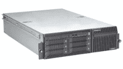

- `AMD Opteron™ 8000` 系列处理器
- 最高 `128GB` 的 `DDR2 533/667` 内存
- 最高 `4.5TB SATA` 或 `1.8TB SAS`
- `2` 个 `PCI-E x16` 和 `3` 个 `PCI-X` 插槽
- 冗余电源和风扇
- 热插拔驱动器
- `ServerDome` 管理 – `IPMI 2.0`
- `Windows®` 或 `Linux` 操作系统

# 利用 Apro XtremeServer 中的 Xen 虚拟化

请访问 `http://www.apro.com/whitepaper/White Papers.asp`

- `AMD Opteron™` 处理器：
    - 支持四核 - 无需改变数据中心基础设施即可增加容量
    - 配合节能型 `DDR2` 内存，实现最佳每瓦性能
    - 通过直接连接架构优化系统性能

欲了解更多信息，请访问 `www.apro.com` 或致电 `Apro` 销售热线 `800-927-5464` 或 `408-941-8100`。


# 今天，Dan 在伦敦配置了一台交换机，在悉尼重启了服务器，并在圣路易斯观看了他的球队攻入制胜球。

借助 `Avocent` 数据中心解决方案，世界终于可以围绕你运转。`Avocent` 将安全访问和控制置于您的指尖 – 从多平台服务器到网络路由器，从本地数据中心到分支办事处，穿越走廊或跨越全球。让其他人去推抢救车进行故障排除 – 有了 `Avocent`，故障就会被搁置。

欲了解更多信息，请访问 [www.avocent.com/ice](http://www.avocent.com/ice) 下载《数据中心控制：实现集中式管理指南》白皮书，或致电 `866.277.1924` 预约演示。


# 竞争对手毫无胜算。


如果您基于性能和价格做出部署决策，`Coyote Point` 适合您。我们已垄断了该市场。

为了证明这一点，我们邀请 `The Tolly Group` 评估我们的 `E350si` 应用流量管理器与竞争对手的表现。结果不言自明。

吞吐量？比同领域其他产品高出近 `40%`。每秒交易成本？最多低四倍。连接速率？在某些情况下，成本仅为六分之一。六分之一！据称 `Coyote Point` 是当今开源网络的首选。

但不要只听我们说。获取事实。致电 `1.877.367.2696` 或发送电子邮件至 `info@coyoteponct.com` 获取完整的 `Tolly` 报告免费副本。


光纤通道存储发票


你是否对 `iSCSI` 和光纤通道存储的高昂成本感到震惊？

# AoE 是你的答案！

`ATA-over-Ethernet` = 简单、低成本、可扩展的存储。

`www.coraid.com`

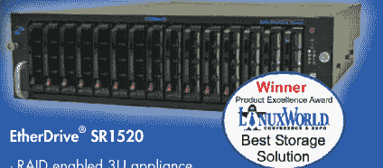

# EtherDrive® SR1520

- 支持 `RAID` 的 `3U` 设备，带有 `15` 个热插拔 `SATA` 磁盘插槽
- 查看我们的其他存储设备和 `NAS` 网关
1. 以太网存储 – 没有 `TCP/IP` 开销！
2. 无限扩展性，价格最低！！
3. 您想要更多存储……只需购买更多磁盘 – 就这么简单！！！

访问 `www.coraid.com` 获取更多信息。


## Linux 期刊

### 主编

`Nick Petreley`, [editor@linuxjournal.com](mailto:editor@linuxjournal.com)

### 执行编辑

`Jill Franklin`

`jf@linuxjournal.com`

### 高级编辑

`Doc Searls`

`doc@linuxjournal.com`

### 艺术总监

`Garrett Atkinson`

`garrick@linuxjournal.com`

### 产品编辑

`James Gray`

`rep@linuxjournal.com`

### 荣誉编辑

`Dorn Marti`

`chrank@linuxjournal.com`

### 技术编辑

`Michael Baxter`

`mab@bituzo.com`

### 高级专栏作家

`Reuven Lerner`

`reuven@lerner.co.il`

### 法式厨师

`Marcel Gagné`

`maggane@ba1mair.com`

### 安全编辑

`Mick Bauer`

`mslk@svt.com`

### 特约编辑

`David A. Bandle` • `Greg Krsak-Harrison` • `Bradley Holdren` • `Robert Love` • `Zack Brown` • `Dave Phillips` • `Marco Firoetti` • `Ludovic Marcotte` • `Paul Barry` • `Paul McKenney` • `Dave Taylor`

### 校对

`Geri Gale`

### 出版人

`Carlie Farschild`

`publisher@linuxjournal.com`

### 总经理

`Rebecca Cassidy`

`rebecca@linuxjournal.com`

### 销售总监

`Laura Whiteman`

`laurel@linuxjournal.com`

### 区域销售经理

`Joseph Kracik`

`josephk@linuxjournal.com`

### 区域销售经理

`Kathleen Boyle`

`kathleen@linuxjournal.com`

### 发行总监

`Mark Insing`

`marki@linuxjournal.com`

### 市场协调员

`Lara Neevander`

`mktg@linuxjournal.com`

### 系统管理员

`Mitch Frazer`

`sysadm@linuxjournal.com`

### 网站管理员

`Keith Daniels`

`webmaster@linuxjournal.com`

### 会计师

`Candy Beachamp`

`acct@linuxjournal.com`

### 泰然个人超级计算机

动手体验超级计算

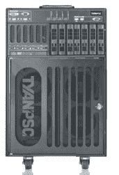

#### 台风™ 600 系列个人超级计算机


`TyanPSC`的台风™，作为下一代即插即用个人超级计算机，拥有足以碾压所有计算需求的强大性能！它专为办公室和实验室环境设计，易于部署和使用，台风™能够在偏远或受限的环境中提供强大的计算能力，工作方式如同普通 PC，且运行几乎无声。

> 高性能计算变得更加冷静
>
> 台风集群：低功耗
>
> 小型化外形：高度便携

##### 台风

###### `T-630 DX` / `T-650 QX` 系列

- 在您的办公桌上实现高达 `186` / `256 GFlops` 的性能！
- 即插即用，易于部署和使用
- 集成 5 节点集群 - 单箱内多达 `20` / `40` 个处理器核心
- 直接插入标准墙壁插座 - 仅消耗 `15` 安培电流
- 预装 `Microsoft® Windows®` 计算集群服务器 `2003` 版
- 在受限空间内表现卓越：办公室、偏远地区、飞机、船只等
- 支持 `RAID`

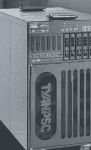


`TYANPSC`

个人超级计算机

`Tyan Computer USA`

美国加利福尼亚州弗里蒙特兰尼宽法院 3108 号

`Fremont, CA 94538`

电话 `+1-510-671-2268` 传真 `+1-510-653-1666`

邮政信箱编号 `42-654-02` `48894-35-19`

电子邮箱: `marketing@tyan.com`

如需更多信息，请访问 `www.tyanpsc.com`

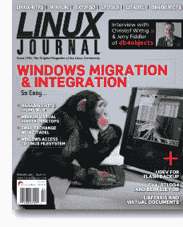

（就更多桌面类型的问题而言）以及专业领域（我在开发和服务端问题方面属于专业领域）。

总而言之，在订阅的十年里，我从未对 `Linux Journal` 的多样性、范围、深度和准确性感到如此满意。请继续保持出色工作。

– `Sean C. McCord`

# 朋友之间零点数有什么关系？

引自 `Linux for Suits`，2007 年 2 月刊。

“他们为互联网服务保留的 `15Mbps` 带宽不到其容量的 `1%`。”

`15` 千位每秒确实糟糕透顶。

– `Ian Stirling`

# 朋友之间字母有什么关系？

在《白盒手机》（2007 年 2 月）一文中，你提到 `OpenMoko` 手机来自 `Funambol`。我认为你本意是想说 `FiC`。

`Funambol` 是 `SyncML` 和移动邮件推送背后的公司。

– `Bill Weinberger`

# 总有一天别人可能要 decipher（破译）你的代码

我此前已经对 `Dave Taylor` 的专栏发表过评论，你知道我支持他开设此专栏及其教学价值。我的评论并非针对该专栏的批评，而是希望被视为对其的补充。

将一整个操作序列放在“一行”上（通过管道连接在一起）的冲动是高尚的，并且当人们“赶时间”或做“快速粗糙”的工作时是可以理解的。但这对于初学者或“半生产”工作来说并不是最明智的选择。

是的，这有可辩论之处，但我想引用你们杂志第 14 页的“他们说过的话”（2007 年 2 月）中的第三段引语，“用代码构建最简单的事情……”

随着时间推移，我作为“下一个人”学到了很多东西，试图阅读和理解“前一个人”编写的代码，我发现将此类步骤序列分解为组成部分使可维护性和可支持性显著更容易。

虽然原始状态“容易处理”，尤其是在演示中，但在工作场所，我们应该鼓励每个人在编写脚本时记住“下一个人”（总有一个下一个人）。

在一个可能被他人使用且并非每五分钟运行一次的环境中，我会添加以下内容来重写此脚本：

```
# 为了调试，注释掉这一行。
trap '/bin/rm -f $tmp1 $tmp2 $tmp3 $tmp4' EXIT
```

```
tmp1=/tmp/tmp.1.5
tmp2=/tmp/tmp.2.5
tmp3=/tmp/tmp.3.5
tmp4=/tmp/tmp.4.5
```

```
grep 'google.com/search' $ACCESSLOG | \
awk '{print $11}' > $tmp1
```

```
< $tmp1 cut -d':' -f2 | cut -d':' -f1
> $tmp2
sed 's/\*/ /g;s/N\*/2/g;s/q//s//`' < $tmp2
> $tmp3
```

```
sort $tmp3 | uniq -c > $tmp4
sort -rn $tmp4 | head -5
```

是的，这看起来有点浪费。（我上面提到五分钟是为了指出，如果在一台中等繁忙的机器上每隔半小时或更长时间运行一次，这些方法可能需要调整。）许多人会指出这种操作方式的诸多问题，其中之一是“大量写入磁盘会花费很多时间”。是的，确实如此。我从未是“保存 `PID`”群体或“让故障排查变得困难以保障工作稳定”群体的一员。大量写入磁盘的费用远低于我获得的报酬。如果运行时间额外增加 `20%`，只要它能可靠地给出正确答案，谁在乎呢？

使用我上面显示的一系列步骤，

# 关于 *Linux Journal* 的黄金时代

在近期几期 *LJ* 中，看到有读者对杂志内容感到失望，我觉得我必须提出相反的观点。

就像 *Silverton* 先生在 2007 年 1 月刊中的设置一样，我从 1995 年开始使用 *Linux*，最初安装 *Red Hat* 失败，最终定居在令人惊叹的 *Slackware* 发行版上，它来自无数未知的、好坏参半的软盘。同样，我用相当业余的方式使用 *Linux* 好几年。那时，我订阅了 *Linux Journal*，但只有一两篇文章能吸引我的注意力。后来，我创办了一家基于 *Linux* 的公司，为多种类型的企业设计基于 *Linux* 的解决方案。即使在成为 *Linux*“专业人士”后，我也并未被 *Linux Journal* 的整体质量吸引。

然而，过去几个月，我单纯地被绝大多数文章的质量所惊叹。我现在从头到尾阅读杂志。即使是那些“低于”我水平的文章，往往也包含一些我发现有趣的宝贵信息。

更具吸引力的是近期各期主题惊人的时效性。我从未真正读过前沿内容。毕竟，这是一本月刊。不过，最近，我连续几期的内容与我的个人当代兴趣非常契合，我为你们报道的广度感到高兴。你们充分满足了业余爱好者（我是业余爱好者）

## 服务器设备行业领导者

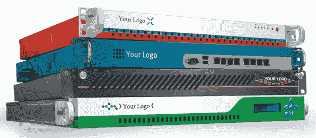

定制服务器设备或现成的参考平台，带有您的镜像和软件，起价低于 `1,000` 美元。

从设计到部署，我们全包。

交付设备需要合适的合作伙伴。`MBX Systems` 是合适的合作伙伴。我们理解，将您的名字印在我们的硬件上，就是将您的声誉托付给我们。我们对此非常重视。我们提供您支持客户所需的服务。优于竞争对手。您甚至无需接触硬件。工程。设计。部署。我们全包，这样您可以专注于对您重要的事物。您的软件。您的销售。您的成功。

今天访问 `www.mbx.com` 或致电 `1-800-681-0016`。


`www.mbx.com` | `1-800-681-0016`

### 读者来信

那些不得不弄清楚我到底搞了什么鬼的人，可以迅速找到问题的根源。现在，他们只需注释掉 `trap` 行，查看临时文件的输出，就能看到发生了什么以及如何修复它。`trap` 行在脚本退出时执行 `rm` 命令删除临时文件（即，它自动清理自身）。他们还能更好地查看流程并更快理解。

感谢您精彩的文章和有益的见解！

- `Michael C. Tiernan`

## 忽隐忽现

在 `Artificial Intelligence` [2007 年 2 月] 一文中，`Nick Petreley` 提出了进一步进入大众桌面市场的策略。其中他提到，“不要移除功能”。

我深表赞同。`KDE` 目睹了功能稳步增加，但不幸的是，一些奇特的功能被移除了。现在不再可能将最大化窗口部分移出视口。你必须先取消最大化，就像 `Microsoft` 那样。你也不能双击顶部的栏将其缩减为仅显示栏，这在以前是可能的。`Konqueror` 不再允许你右键单击文件查看删除选项，而只有移至回收站的选项。（幸运的是，有一个方法：选择文件并按 `Shift-Delete`。）

显然，策略是向 `Microsoft` 靠拢——在某种程度上。如果桌面级 `Linux` 变得相同，为什么人们要购买它而不是现成的 `Microsoft` 产品？

当 `Microsoft` 从命令行（`MS-DOS`）转向 `Windows` 时，`Linux` 也向同一方向扩展，保留了旧的功能。这是其强大之处的一部分。同样的逻辑适用于桌面 `Linux`：如果我们移除功能，我们就是在自输。

- `Chris Trayner`

据我观察，你关于将文件移至回收站的说法是对的。但我刚才将一个最大化窗口部分移出了虚拟桌面，我还通过双击标题栏缩小了窗口（将窗口缩减为其标题）。我从 `KDE` 镜像获取了 `KDE 3.5.6`，并在 `Kubuntu 6.10 AMD64` 上运行它。—*编辑注*

### `LINUX JOURNAL`

#### 为您服务

#### 杂志


纸质订阅：续订、更改地址、支付账单、查看账户详情或其他订阅咨询均可即时在线完成，适用于美国和加拿大。您可免费致电：`1-888-66-LINUX` (`54639`)，或发送电子邮件至 `subs@linuxjournal.com` 或 `2677-E`。也可以通过邮寄至：`Linux Journal, PO Box 986585, Houston, TX 77239-6835, USA`。请联系时务必附上您的姓名和地址。

数字订阅：`Linux Journal` 的数字订阅现已可用，以 `PDF` 形式全球交付，价格低廉。请访问 [www.linuxjournal.com/digital](http://www.linuxjournal.com/digital) 获取更多信息，或对上述任何数字杂志客户服务查询使用上述联系方式。

致编辑的信：我们欢迎您的来信，并鼓励您将其发送至 `letters@linuxjournal.com` 或邮寄至 `Linux Journal, 1752 New Market Street, #202, Seattle, WA 98107 USA`。来信可能会因篇幅和清晰度进行编辑。

为我们要写作：我们始终在寻找为杂志贡献的文章、教程和真实故事。作者指南、主题列表和创意示例可在网上找到。[www.linuxjournal.com/author](http://www.linuxjournal.com/author)

广告：`Linux Journal` 是读者和广告商的绝佳资源。请访问我们的网站请求媒体资料包，查看当前编辑日历和广告截止日期，或了解更多其他广告和市场机会。[www.linuxjournal.com/advertising](http://www.linuxjournal.com/advertising)。如需进一步信息，请直接联系我们。[ads@linuxjournal.com](mailto:ads@linuxjournal.com) 或 `+1 713-344-1956` 分机 `2`。

## 在线

网站：在 `Linux Journal` 网站上阅读独家和在线内容。[www.linuxjournal.com](http://www.linuxjournal.com)。此外，印刷版杂志中的一些文章也可在线获取。杂志订阅者（数字或纸质）可获得这些文章的完整访问权限，详情请联系客户服务。[sll@linuxjournal.com](mailto:sll@linuxjournal.com)

免费订阅简报：每周，`Linux Journal` 编辑将告诉您 `Linux` 世界的最新动态。接收突发新闻链接、技术技巧以及今日精选的深度报道提示。[www.linuxjournal.com](http://www.linuxjournal.com)/e-newsletters。

### 新！

**微型 WiFi 控制器**

**1.1 秒启动 Linux**


- 仅 `CPU` 板 $129
- 如所示 $249
- 10 件起享批量折扣

### 200 MHz CPU

- `TS-7400` `CPU` 板
- 低功耗、低热量、长寿命
- 板载 `Flash` 最高 `128MB`
- 最高 `128M SDRAM`
- `SD Flash` 卡插槽
- 1 个外部 `USB` 端口
- 1 个 `10/100` 以太网
- `802.11g` 内部 `WiFi` 选项
- 一体式坚固铝制外壳选项，尺寸为 `1.1" x 4.9" x 9.1"`

> 与我们的工程师一起设计您的解决方案

- 超过 20 年经营历史
- 从未停产任何产品
- 工程师提供技术支持
- 提供定制配置和设计，价格优异，周转迅速
- 大多数产品有库存，可次日发货

> 访问我们的网站了解选项、外设和 `x86 SBC`


## 技术系统（Technologic SYSTEMS）

我们使用我们的产品。

访问由 `TS-7200` 驱动的我们的网站

[www.embeddedARM.com/7400wifi](http://www.embeddedARM.com/7400wifi)

`(480) 837-5200`

### 经验、想象力与支持。

#### Pogo Linux 是为 Linux 构建的硬件解决方案，也是为您构建的。

如需开始使用，请拨打 `888.828.POGO` 或发送电子邮件至 `inquiries06@pogolinux.com` 与我们联系。

`Pogo Linux, Inc. 701 Fifth Ave. Suite 6850, Seattle, WA 98104`

`Intel`、`Intel` 标志、`Intel Inside` 标志、`Pentium`、`Xeon` 以及 `Xeon Inside` 是 `Intel` 公司或其子公司在美国和其他国家的商标或注册商标。有关更多条款和条件，请访问 `www.pogolinux.com`。

---

### 前沿

#### 新闻 + 趣味

#### diff -u

#### 内核开发中的新动态

如果几个遗留问题能够解决，内核很快将支持更大的编译二进制文件大小。`Eric Biederman` 已经有一些用于实现这一目标的补丁流传了一段时间，`IBM` 的 `Vivek Goyal` 一直在测试这些补丁。根据 `Vivek` 的说法，现在是时候将 `Eric` 的补丁（包含修改内容）展示给更广泛的受众，并将其纳入 `Andrew Morton` 的 `-mm` 树中。许多人似乎很高兴看到这些补丁，并且来自内核各方的人员正在投入大量额外工作。其中一些工作以清理的形式出现，但也有人正在处理这段代码与 `swapoff 软件挂起代码` 之间复杂的交互关系。看起来这些补丁迟早会完成并被接受进官方树中。

开源的 `ar5k 无线驱动程序` 已经排除了所有版权问题，至少根据 `软件自由法律中心` (`SFLC`) 的说法是这样。该驱动程序主要为 `OpenBSD` 开发，主要由 `Reyk Floeter` 开发，长期以来一直笼罩在 `Atheros`（支持其无线芯片组的制造商）的怀疑之下。尽管从未有证据表明 `ar5k` 开发人员存在问题，但“丑闻”足以阻止 `Linux` 人士将该驱动程序纳入 `Linux` 内核。随着 `SFLC` 的意见出台，最强烈的反对意见已被搁置，甚至完全消除，如今内核人士最大的抱怨是 `ar5k` 驱动程序可能写得不好或方法不当。目前，一些人支持将 `ar5k` 以当前形式或稍作修改后纳入内核，而另一些人则认为应该彻底废弃该驱动程序，仅将其作为全新驱动程序的硬件参考。无论辩论结果如何，可以明确的是，`Atheros` 无线芯片将很快拥有 `Atheros` 自家专有 `MadWiFi` 驱动之外的免费替代方案。

许多补丁已经出现，旨在移除内核中损坏或无人维护的部分，或在弃用期后计划移除它们。`Andrew Morton` 已计划在 2007 年 6 月移除 `FUTEX_FD`，并称该代码存在“无法修复的竞争条件”——这正是早年 `DevFS` 受到的指责。`Rusty Russell` 最初编写了该补丁，他对保留该代码没有兴趣。然而，他表示一旦移除，`futex` 代码可以简化很多。有了这样的一些朋友，`FUTEX_FD` 不需要敌人，而且很有可能连 `Andrew` 给它预留的时间都撑不到。

与此同时，`Adrian Bunk` 已提交补丁，移除一系列多年来被标记为损坏的旧驱动程序。这些包括 `VIDEO_ZR36120` 和 `SKMC` 驱动程序，以及 `MAC89x0`、`ATARI_BIONET` 和 `ATARI_PAMSTER` 驱动程序。对于后三者，`Geert Uytterhoeven` 可能有一个由 `Matthias Urlichs` 编写的补丁，用于修复 `MAC89x0` 驱动程序。但该补丁仍需测试和签署。与此同时，`Adrian` 已提交更多补丁，移除 `FB_CYBER_FB`、`FB_VIRGE`、`FB_RETINA23`、`FB_ATARI`、`FB_SUN3` 和 `FB_PM3` 驱动程序，但看起来 `James Simmons` 可能会接管维护它们，而且 `GEERT` 可能已经有一个修复 `FB_ATARI` 驱动程序的补丁。因此，这些帧缓冲驱动程序可能最终不会被移除。

同时，`sysctl 代码` 原本看似真的要被砍掉，但现在似乎得到了宽限。曾计划移除该代码的 `Eric Biederman` 发现了一些合法的 `sysctl` 用户。因此，该代码不仅不再被标记为弃用，而且在不久的将来还会默认编译到所有内核中。`Eric` 将与各个发行版合作，逐步消除 `sysctl` 的使用，并在一年或两年后再次考虑移除该代码。


### Sparse C 代码解析器

`Sparse` C 代码解析器自其原始维护者之后从未有过正式发布，因此它成为了极少数仅在换帅后才推出首个版本的项目之一。`Linus Torvalds` 最初在 2003 年创建了该工具，用于个人使用，以帮助发现内核补丁中的错误。他使该工具可供下载，但从未赋予其版本号或进行任何有组织的发布。当用户开始要求 `Linus` 本人并不想要的功能时，他建议其他人可以接管该项目。`Josh Triplett` 站了出来，正式发布包含多项功能增强的 `Sparse 0.1` 版本。随后不久发布了 `0.2` 版本，这次主要增加了错误修复。该项目是旧的，因为它始于 2003 年，还是新的，因为它刚刚发布了第一个版本？由你决定。

— `ZACK BROWN`

### 政府投票支持 Linux 安全

`Linux` 是世界上增长最快的操作系统，这在很大程度上是因为各行各业的客户都在要求高度安全的信息技术环境，尤其是公共部门的客户。

在全球范围内，超过 225 家 `IBM` 政府客户正在拥抱 `Linux`，以降低计算总成本、整合工作负载、提高效率并实施电子政务转型。但正是其固有的更高安全级别被证明是最大吸引力，使政府机构有信心将 `Linux` 扩展到网络边缘应用之外，深入企业核心以运行关键任务应用。

如今，全球成千上万的开发人员和开源社区成员致力于 `Linux` 开发，不断使其变得更好、更安全。例如，`IBM` 通过其 `Linux` 技术中心的工作支持 `Linux` 的增长，该中心由全球 40 个地点的 600 多名工程师组成，其中超过 300 名全职人员作为开源社区的一部分致力于 `Linux` 工作。

#### 致力于安全的开源社区

`Linux` 固有的安全优势在于增加的同行评审层，这是封闭系统无法提供的，因为它们完全依赖内部团队来避免安全漏洞。只有在经过同行的仔细检查和批准后，`Linux` 解决方案才能到达客户手中。同样的人才库迅速解决新兴的安全问题，在公司的基础设施受到任何损害之前就堵住漏洞并发布补丁。对于其他操作系统，错误修复和安全补丁更可能捆绑在一起，并基于适应供应商而非用户的具体时间表发布。

但随着公民应用成为常态，用户角色日益增长。公民越来越习惯于使用自助服务应用程序，如在线更新驾驶执照或缴纳罚单。随着在线访问信息的公民数量增加，网络犯罪的发病率也随之上升。黑客、诈骗犯和身份盗窃者紧跟技术进步的步骤，提高其专业化程度。

这对政府构成了重大的新威胁，主要关切包括保护国家安全和信息隐私。当公民与电子政务系统分享敏感信息，包括姓名、出生日期、地址和社会安全号码时，需要建立机制确保这些信息受到最高级别的安全保护。

因此，`Linux` 安全方面的进步持续改善，特别是在实施更高级别安全架构的可负担性方面。开源软件提供了更多的透明度和用户控制，允许用户随时识别和修复安全漏洞，而无需等待供应商修复安全缺陷。

### 通用准则——早期安全标准

全球许多政府机构要求 IT 供应商遵守通用准则安全认证标准。通用准则被国际 IT 专业人士认可为 ISO 标准 (`ISO/IEC 15408`)，用于评估美国政府和组织的技术产品的安全性和保障性。例如，世界上最大的 `Linux` 企业服务器发行版供应商 `Novell` 和 `Red Hat` 已获得三个级别的安全认证，使 `Linux` 能够被运行在多个 `IBM` 软件和硬件平台上的政府和政府机构采用。

#### 英国内阁办公室率先采用安全增强型 Linux

安全方面的进步持续改善，特别是在实施更高级别安全架构的可负担性方面。在政府内部使用，一种资源是采用安全增强型 (`SE`) `Linux`。强制访问控制基于“需知”原则提供信息访问，更好地保护政府免受潜在黑客和病毒威胁。

`IBM` 一直是关键推动者，始终支持 `SELinux` 的增长，同时确保平台内的安全得到加强、维护和增强，而不损害访问和易用性。`IBM` 最近与英国内阁办公室及合作伙伴 `Treshes` 和 `Belim Group` 合作，在英格兰一家国家医疗服务体系医院信托中，通过安全增强型 `Linux` 在电子政务应用中实施了首次强制访问控制试点。通过使用该技术，任何组织都将能够遏制黑客，为其应用程序提供必要的遏制措施，并将对企业造成的损害降至最低。

多年来，客户要求安全、开放、互操作的平台，这些平台更容易管理，并在异构架构中运行不同工作负载时更加灵活，这些架构通常由来自多个 IT 供应商的独立产品组成。这种趋势在新兴市场中尤为普遍。

### 印度：Linux 和开源的明星

印度一直是开源 `Linux` 软件的明星，仅在过去一年里，销售额增长率就翻了一番。根据 `Datapiexus` 的数据，政府和国防部门是印度 `Linux` 采用的关键驱动力之一，2005–2006 年间合计占 `Linux` 市场的 38%。在印度，客户涌向 `Linux`，因为它提供了低成本、高安全性和可定制的替代方案，以取代封闭系统和供应商锁定。

就在本月（2007 年 1 月），据报道，泰米尔纳德邦——印度最大、工业化程度最高的州之一，人口规模相当于英国——正从封闭系统转向开源。他们还在培训 30,000 名政府官员使用 `Linux`，这是一项关键举措，因为技术技能一直是阻碍开源软件进一步采用的障碍之一。最近，识字率达到 100% 的喀拉拉邦也宣布正在迁移到 `Linux`。

### Project Higgins 和用户中心管理

随着在线政府服务的增长，公民正受益于新的开源软件安全倡议，这些旨在帮助保护其个人信息。`IBM`、哈佛大学伯克曼互联网与社会中心、`Novell` 和 `Party Communications` 正在合作一个开源倡议，代号 `Higgins`，它将催生新一代安全软件，使人们对个人在线信息拥有更多控制权。

`Higgins` 倡议正在开发用于用户中心身份管理的软件，这是安全软件中的一个新兴趋势。用户中心身份管理使个人能够积极管理和控制其在线个人信息，如银行账户号码、医疗记录、电话号码和信用卡号码——而不是像今天机构管理这些信息那样。人们将决定他们希望与使用该软件的可信在线网站共享哪些信息。

用户将在未来帮助企业和机构遵守各种电子政务法规方面发挥关键作用。随着用户越来越多地访问电子公民服务，用户中心管理将帮助识别个人希望共享的信息，例如与其医疗保健提供商共享。医疗保健提供商不一定需要了解用户的个人信息，将只能访问与患者病史相关的信息，从而限制数据泄露的风险。

`Higgins` 倡议通过创建一个开放、高度安全和灵活的软件平台，将在线安全提升到下一阶段，该平台本质上将用户置于身份管理宇宙的中心。

`Linux` 正在公共部门成为一股不可阻挡的力量，帮助为政府机构及其服务全球公民提供双方都可以信任的计算机操作系统。

— `DANIEL FRYE`

---

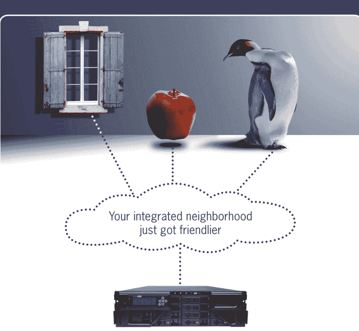


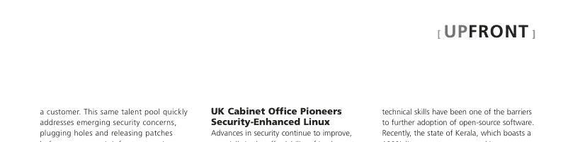

### 对 OpenXML 说不

几个月前，微软和另一家软件公司 `Novell` 签署了一项技术合作协议。这项协议的一部分可能对几乎所有公民都构成高度危险，但这并不是大多数批评者所关注的那部分。

#### 前一阶段总结

根据这项协议，微软承诺不就专利侵权和其他“知识产权”违规行为对使用 `Novell` 打包和分发的特定版本 `Linux` 的用户提起诉讼。在宣布后的下一秒，全球的 `Linux` 和自由软件支持者就开始互相解释，相信这些违规行为实际存在，或者任何法院会对 `Linux` 最终用户就此作出判决，是多么荒谬和可笑。本周，少数几份公开声明（甚至没有来自微软的）迅速表明，在现实的、非极客的世界里，这类论点是多么无足轻重。沃尔玛的首席技术官宣布，该公司最终将能够使用 `Linux` 来扩展其全球网络存在，因为“关于知识产权的问题是‘巨大障碍’”，但“`Novell` 协议中的知识产权保护使沃尔玛更有信心更广泛地使用 `Linux`。” 在得到沃尔玛的这样的确认后，哪位企业主（或沃尔玛供应商）会去听极客们发毒誓说 `Linux` 没有隐藏的法律炸弹呢？

无论沃尔玛如何，这项协议中最糟糕、最危险的部分可能不是专利诉讼部分，而是对公共文件的文化、经济和所有权产生更大影响的其他方面。

#### 请实现互操作性！

互操作性在计算机世界中极其重要。如果由计算机程序生成的文档不能被同类其他程序完全且确定地读取，那么这些文档就无法交换，在几年后就会变得不可用，或者只能通过支付远高于原始软件生产者公平费用的方式来获得。

为了避免这种情况，必须以非专有的文件格式来存储和交换文档。正如《每个人的 OpenDocument 指南》中解释的那样：“如果计算机程序是笔，那么就把文件格式想象成字母表。只要存在便宜的型号，出售高价笔并无不妥。但这一切都取决于每个人都使用相同的字母表，而无需支付费用或学习特殊秘密。”


如今，两种文件格式正在争夺我们所有的办公文件。一种是非专有的、设计完全开放的、经国际批准的标准，称为`OpenDocument`。另一种是`OpenXML`，它是下一版`Microsoft Office`使用的格式，旨在达到相同地位，但已被几位专家明确定义为专门创建用于`Microsoft Office`的格式。

### 真正的陷阱出现了

尽管有这些情况，协议中的文件格式部分明确说明，它是“为了确保使用`OpenOffice.org`的客户能够继续读写使用未来`Microsoft Office`文件格式的文档……[`Novell`将确保] 未来版本`Microsoft Office`使用的文件格式有良好规范，并对所有人开放以实现。” 你现在看出问题所在了吗？首先，协议为期五年——在`2011`年之后它无法确保任何东西。其次，它正式旨在使`OpenDocument`在`Microsoft Office`中不可用。相反，它将确保`OpenOffice.org`用户可以继续成为专有格式的奴隶，这种格式很难在其他软件程序中完全支持。

`99%`的现有办公文件被`Microsoft`锁定，几乎所有当前的桌面都是`Microsoft Office`。该协议将积极致力于维持这种状况，实际上使`OpenDocument`（以及非专有格式的概念本身）在任何大型组织中变得无关紧要且未被使用，无论其技术优势、开放性和认证如何。

想想那些大多数现有合作伙伴、客户或供应商都使用`Microsoft Office`格式的大型公司和公共管理机构。懒惰以及忽视软件现状的愿望非常强大。在这种情况下，当经理第一次带着“我打不开这个”的便条将员工或供应商发送的`OpenDocument`文件退回时，发送者就会将`OpenOffice.org`的默认文件格式设置为`OpenXML`，并且不再回头。为什么要以这种方式惹恼人，从而危及职业生涯或销售，尤其是当“我仍然可以使用这个很棒的免费软件，不是吗？” 当然可以——直到协议到期，下一版`OpenXML`打破兼容性。

这才是真正的危险；将无需就使用`Linux`起诉任何人，因为数以百万计的商业和公共文件将保留在一种单向格式中，这是专门为`Microsoft Office`定做的。

这不是互操作性。`OpenDocument`是可互操作的。在`OpenOffice.org`中支持`OpenXML`也使其看起来像是多个应用程序将支持此格式。这是`ISO`标准化的先决条件——即政府接受的条件。政府施压要求/迁移到`OpenDocument`也会更容易战斗或忽视：“既然我们的（当前）格式是`ISO`标准，甚至`Linux`都能成功打开`99.999%`的现有办公文件，为什么还要在培训、软件迁移等方面花费公共资金？看看我们鼓励竞争和给你选择的善意有多大？” 所有这一切可能会合理地拖延`OpenDocument`的采用（不是永远，别担心：只是四或五年）。这不是第一次某些事物因为`Microsoft`表示将以某种方式支持它，然后以“没有市场需求”为由而将其搁置，从而陷入僵局。

### 解决方案

即使你完全不在乎计算机，`OpenDocument`也是一个不容错过的重大机会——即使只是为了节省税收。请拒绝分发或接受`OpenXML`格式的办公文件。风险太大。使用你最喜欢的任何软件，但对`OpenXML`说不，并要求你的朋友、同事和政府这样做。这将比过去容易得多。正在积极开发用于在`Microsoft Office`中读取和保存`OpenDocument`文件的插件，以及一个跨平台查看器（类似于`OpenDocument`的`Acrobat Reader`）。很快，将不再有任何正当理由不使用`OpenDocument`。不要错过这个机会。——`MARCO FIORETTI`

### 资源

- 沃尔玛 CTO 声明：`news.com.com/Wal-Mart+eyes+Microsoft+for+W+eb+build-out/2100-1017_3-6152247.html`
- 为什么 Redmond 感到如此受 ODF 威胁：`computerworld.co.nz/news/nst/tech/CBE41F838EABA40C25717AA01A0EC9`
- 《每个人的 OpenDocument 指南》：`www.linuxjournal.com/article/8616`
- OpenDocument 入门：`opendocumentfellowship.org/introduction`
- 如何雇用 Guillaume Portes：`www.rbweier.com/blog/2006/01/how-to-hire-guillaume-portes.html`
- Novell 关于办公应用程序文件格式的声明：`www.novell.com/products/desktop/fileformats.html`
- Office OpenXML 是单向标准吗？问问 Microsoft：`blogs.adobe.com/shebanation/2006/12/open_xml_one-way.html`
- 对大多数人来说，OpenXML 是单向规范吗？`www.sutor.com/newsite/blog/open/?p=1145`
- 一场 Zendo 游戏：`www.rbweier.com/blog/2006/07/game-of-zendo.html`
- Microsoft Office 将得到一剂 OpenDocument：`news.com.com/Microsoft-Office+to+get+a+dose+of+OpenDocument/2100-1013_3-6069188.html?tag=neft.top`
- OpenDocument 查看器：`opendocumentfellowship.org/odfviewer`

### 扩大模拟漏洞


娱乐产业通过让数字商品像模拟商品那样运作——即稀缺且难以复制——来拥抱数字革命。它将其“内容”的可复制性缩小，直到只剩下它讽刺地称之为“模拟漏洞”的部分。只有通过模拟漏洞，牺牲的数字商品才能相对容易地转移，而不被`DRM`警察阻止。转移的商品不会具有相同的数字质量，但它们有看起来和听起来足够好的风险，以令用户满意。

自然，用户需求已将模拟漏洞变成了一个市场。走在最前面的是基于芝加哥的`Neuros`的产品，它热爱`Linux`，致力于将自由和开放的`Linux`价值体系带入媒体制作和复制的世界。

`Neuros Recorder 2`是一款`MPEG-4`录制器，“工作起来像一个迷你数字`VCR`”。它通过`RCA`线缆连接到源设备，并实时记录在标准的可移动闪存卡上。内容可以手动或通过`USB 2.0`连接传输到其他设备。

该公司的最新产品是`Neuros OSD`，“第一个基于开源`Linux`的嵌入式媒体中心”。它让你可以通过`RCA`或`S-Video`线缆从有线电视、卫星电视、`DVD`、电视/`oDVR`、摄像机或`VCR`进行录制，并通过局域网（以太网）、内存卡、`USB`或`RCA`线缆分发或回放录影。架构完全开放，并不断由`Neuros`和不断增长的开发者与用户社区改进。价格为`229`美元。

在`neurostechnology.com`上查看它们。——`DOC SEARLS`

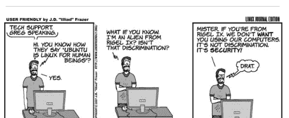

### 橡树岭国家实验室

由`UT-BATTELLE`为能源部管理


### 领导级计算领域的机遇

> 位于田纳西州东部的橡树岭国家实验室正联合一支世界一流的团队，以推动重大技术进步——开展新能力并开发新机遇，使其应用于高端科学和高性能计算。

### 解决现有技术难以触及的问题

`21`世纪的科学研究要求计算能力远超现有水平。橡树岭国家实验室（`ORNL`）与美国能源部科学办公室旨在利用计算科学与工程工具引领前沿科学发现，为世界提供新的见解和重大突破，对美国科学领导地位、工业竞争力和国家安全产生广泛深远的影响。

`ORNL`将拥有实现这些目标的丰富资源：

- 国家计算科学中心（`NCCS`）
- 能源部领导计算设施（`LCF`）
- 高级科学计算研究（`ASCR`）
- 区域科学信息基础架构
- 涉密计算（用于国家安全和能源保障）

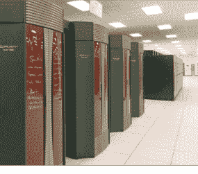

### 领导级计算能力

计算能力是基础能源科学、生物和环境科学、聚变能源、高能物理和核物理领域实现科学领导地位的关键。`NCCS`内的高性能计算平台对研究计划至关重要，并将为许多我们最紧迫的国家挑战提供解决方案。这些能力将使`ORNL`成为国家最强大的开放能力计算资源，其可持续路径将维持并扩大联邦政府和广大科学界的国家领导地位，内容将包括计算机科学、数学、建模、模拟、知识提取和发现，以及数值方法。

### 加入橡树岭国家实验室

国家的持续成功需要`T级`和`P级`计算的卓越领导地位。`ORNL`正在寻找世界一流的科学技术人才，目前在以下领域提供机遇：

- 系统编程
    - 内核
    - 网络


- 并行文件系统
- 层次存储
- 早期状态研究（新型计算技术与体系结构）
- IT基础设施的设计、开发、维护和运营
- 编译、调试和下一代工具开发
- 项目管理与控制
- 系统管理与运维
- `HPC`用户支持与推广
- 科学应用研发
- 未来计算架构
- 性能分析


如需了解并申请这些及其他相关机遇，请访问 `http://computing.ornl.gov/Employment`。如有疑问或需更多信息，请发送电子邮件至 `CCSD_Staffing@ornl.gov`。

`ORNL`是由`UT-Battelle, LLC`代表美国能源部管理的多项目研究设施，是一家致力于建设并维持多元化工作环境的平等机会雇主。

### 前沿资讯

#### 少即是多

如果你想将小型低成本计算系统组合起来，来自台湾、由美国运营的`e-Way`公司的产品绝不可错过。`e-Way`专精于销售硬件——无论是单件还是批量购买——价格都低到一次普通的`ATM`取现即可覆盖。他们提供各种微型`CPU`板和机箱，价格从90到189美元不等，屏幕及其他组件价格最低仅8美元。在消费电子展上，`e-Way`总裁`Steve Freiburger`甚至在一个极度紧凑的桌面`Linux`系统上运行了幻灯片演示。该发行版和50个应用——包括幻灯片软件——可以全部装入一张`128Mb`的`CF`卡中。可在 `ewayco.com` 上了解更多信息。

——`DOC SEARLS`

#### 市场门槛打开

电影级`35`毫米胶片摄像机一直极其昂贵，它们的数字版本也是如此。原因之一是它们结构复杂，生产昂贵。另一个原因是制造商总是在不同层级的客户群之间保持距离。专业设备不仅具有远超“消费级”设备的功能和能力，而且价格也要昂贵得多。


这种状况正在视频设备领域开始改变。`RED`数字摄像机（`red.com`）是第一款能以独立制片人负担得起的价格，以数字形式提供`35`毫米级电影摄影的专业摄像机。它使用`1200`万像素`Mysterium CMOS`传感器，以`4096 x 2304`分辨率（`2048`逐行）每秒`60`帧的`RAW`格式拍摄。它灵活、对格式不敏感，价格为`17,500`美元。对于如此出色的设备而言，这非常便宜。

`Linux`已成为好莱坞众多电影制作的首选平台。像`RED`这样的摄像机的普及是否意味着电影制作世界的其他部分也需要更多地使用`Linux`？我们将拭目以待。

——`DOC SEARLS`

#### 名言录

> 不要做小计划；它们没有激发人们热血的魔力，而且本身可能也无法实现。要做大计划；在希望与工作中追求卓越，要记住，一张高尚而逻辑严密的图纸一旦记录下来便不会消亡。
>
> ——`Daniel Burnham`

> 获得资金的最佳方法并不是找几家风险投资公司去求、借或偷；获得资金的最佳方法是做出人们愿意付费的东西。
>
> ——`Giles Bowkett`, `gilesbowkett.blogspot.com/2006/12/tale-of-two-startups.html`

> 大多数嵌入式设备供应商不发布任何源代码。然后，社区的某人会找供应商的法务部门纠缠六个月，最终得到一个无法编译的部分源代码树。我的印象是，公司不把合规性视为硬性要求，而是将其视为风险管理练习；如果 `(GPL诉讼成本) * (GPL诉讼概率) < (VxWorks许可成本) * (设备数量)`，就使用`Linux`。
>
> ——`Wes Felter`, `www.linuxjournal.com/comment/reply/1000164/209612`

> `罗斯伯格定律`：“软件很容易制作，除非你希望它做点新东西。” `罗斯伯格推论`：“唯一值得制作的软件是做新东西的软件。”
>
> ——`Scott Rosenberg`，摘自《`Dreaming in Code`》，`Cwen`出版社，2007年

> 开源化是我们七年`Second Life`开发过程中做出的最重要决定。虽然我们主动决定开源代码对我们来说显然是一个大胆的步骤，但这完全符合`Second Life`的社区创建理念。
>
> ——`Linden Lab`的`CTO` `Cory Ondrejka`

> 如果冰箱里没有足够的食物，你会说“商店一定关门了吗？”
>
> ——`Greg Elin`，在一次会议上

#### 目录，2007年4月

1. 截至2007年1月1日`Second Life`居民数量（百万）：`2.28`
2. 截至2007年1月1日`Second Life`每日消费（千美元）：`803.79`
3. `Linden Lab`开源`Second Life`查看器源代码的天数（2007年）：`8`
4. 2006年消费电子销售额（十亿美元）：`145.7`
5. 接受调查的德国居民中阅读博客的比例：`15%`
6. 接受调查的德国“影响者”中阅读博客的比例：`27%`
7. 接受调查的美国居民中阅读博客的比例：`27%`
8. 接受调查的美国“影响者”中阅读博客的比例：`34%`
9. 接受调查的日本居民中阅读博客的比例：`74%`
10. 接受调查的日本“影响者”中阅读博客的比例：`91%`
11. 所有博客中使用英语的比例：`39%`
12. 所有博客中使用日语的比例：`33%`
13. 1950年未与配偶居住的美国女性比例：`35%`
14. 2000年未与配偶居住的美国女性比例：`49%`
15. 2005年未与配偶居住的美国女性比例：`51%`
16. `Jabber`源代码首次发布以来的年数：`8`
17. 开源`XMPP`（`Jabber`）技术用户数范围（百万）：`40–50`
18. `TradeBit AG`运行的`Linux`双处理器`PC`数量：`10`
19. `TradeBit AG`提供的数据量（太字节）：`20`
20. `TradeBit`每日下载量（百万次）：`1`

**来源：** `1, 2`: `Tristan Louis` | `3`: `Linden Lab` | `4–10`: `Edelman` | `11–12`: `Technorati` | `13–15`: 《`纽约时报`》 | `16, 17`: `XMPP.org` | `18–20`: `TradeBit AG`

——`Doc Searls`

### 你真的想自己动手做点什么吗？


### 还是直接拿来即用！


### `ELinOS`

**工业级 `LINUX`**

`ELinOS` 工业级 `Linux` – 拿来即用的嵌入式 `Linux`。

嵌入式 `Linux` 凭借其功能丰富和免版税使用的优势，在过去几年里获得了巨大的普及度增长。然而，质量保证、可复现性和版本稳定性始终是项目经理必须面对的挑战。这自然引出了“自研还是外购？”的问题。`ELinOS` 工业级 `Linux` 给出了答案。

#### `ELinOS` 工业级 `Linux` 概览

#### 多用途嵌入式 `Linux`

- 工业级品质
- 支持 `PowerPC`、`x86`、`MIPS`、`ARM`、`XScale` 架构
- 内核版本 `2.6.15` 和 `2.4.31`

#### 应用开发

- 集成开发环境 (`IDE`)
- 快速启动配置编辑器
- 开箱即用的体验

#### 服务与支持

- 同级开发和生命周期支持

访问我们：

**嵌入式系统会议 硅谷站**

---

### 技术小贴士

#### 让 `USB/MIDI` 正常工作，将现有的声卡变为高品质合成器，并发挥 `X` 的潜力。

##### 如何让自编译内核下的 `USB/MIDI` 连接正常工作

我们中的许多人喜欢编译自己的内核。就我而言，我编译自有的内核有两个原因。首先，标准内核中自带的驱动倾向于以错误的顺序检测我的 `SCSI` 设备。你可以修正检测设备的逻辑（我在“技术小贴士”的前一期中解释过如何在 `Ubuntu/Kubuntu` 中做到这一点）。但为了避免这个问题，我更喜欢将驱动直接编译进内核，而不是作为模块加载。其次，我只是喜欢运行最新稳定版可用的内核。

我一直在玩带有 `USB/MIDI` 接口的合成器。令我沮丧的是，我无法让 `USB/MIDI` 连接在我自己编译的内核下正常工作。我在网上找不到任何能指出问题所在的信息，但最终我意外地找到了答案。


一旦浏览了足够的内核配置选项，你会发现解决方案其实非常简单且显而易见。问题在于，内核驱动的组织方式使得（至少对我而言）不清楚需要包含哪些驱动才能让其工作。我选择了所有的 MIDI 音序器驱动，那为什么还不行呢？你实际上需要的 USB 驱动位于声音驱动目录下，而不是 USB 驱动目录下。请从 `make menuconfig`（或你偏好的任何内核配置方法）中选择以下选项：设备驱动 (Device Drivers) → 声音 (Sound) → 高级 Linux 声音架构 (Advanced Linux Sound Architecture) → USB 设备 (USB Devices) → USB 音频/MIDI 驱动 (USB Audio/MIDI driver)。

虽然，如我所说，我通常将驱动直接编译进内核，但我建议将这一个特定的驱动编译为模块。在不用合成器键盘的时候加载该模块没有意义。

选择将上述驱动编译为模块后，它会创建一个名为 `snd-usb-audio` 的模块。模块的名称正是我困惑的根源。当我试图追踪使标准内核正常工作的原因时，找到了 `snd-usb-audio` 模块，但由于其名称，我将其排除在解决此问题的候选项之外。直到我在内核配置中偶然看到“USB Audio/MIDI”标签，我才意识到 `snd-usb-audio` 与 MIDI 有关。模块名称本身让人误以为它是为外部音频源而非外部 MIDI 源设计的。

顺便说一句，在我给女儿买了一台 Korg X50 合成器后，我受到了启发去设置这个环境。这是一台非常实惠且优秀的合成器键盘。最新的 Korg 键盘似乎不需要任何特殊配置即可连接 USB/MIDI 端口。然而，我后来发现 Yamaha 键盘并不那么友好。你必须更改 Yamaha Motif ES 键盘上的一些 MIDI 设置，才能让键盘通过 USB 端口与计算机正常工作。

这也许看似显而易见，但窍门在于遵循 Yamaha Motif ES 手册中关于连接 USB/MIDI 到计算机的说明。嗯，是吧？

RTFM（阅读附带的手册），或者更礼貌地说，仔细阅读精细的手册。但当遇到问题时，有时人们会忍不住上网寻找让键盘工作的小贴士。请注意，你不应该遵循网上找到的许多说明。这些说明通常是针对 Windows 和 Mac 的，它们会告诉您如何配置 Yamaha 键盘，使其通过计算机发送 MIDI 信号并将信号回显到键盘上。虽然可能可以通过设置 Linux 驱动程序和/或补丁守护进程（如 `jackd`）来让 Linux 应用程序在这种配置下工作，但这并不是 Linux 的默认行为。因此，在这种情况下，您应该避免上网查找，而是阅读附带的参考手册。

— Nicholas Petreley

#### 将您的计算机变成高品质合成器

也许你甚至连 Korg X50 都买不起，但你想尝试创作音乐或只是播放 MIDI 文件。问题在于，大多数与 Linux 兼容的声卡并不附带令人印象深刻的 MIDI 声音集合（这类集合通常称为 soundfonts）。虽然有免费的 soundfonts 可用，但它们听起来不如一些付费版本专业。例如，SONiVOX MI 出售一款出色的通用 MIDI (GM) soundfont，价格不到 100 美元。如果你想使用键盘录制 MIDI 序列，你可以购买许多廉价的中低端 MIDI 键盘中的一个，它们仅用于发送 MIDI 信号（不包含合成器功能）。根据你满意的品质，这些键盘的价格远低于 100 美元。

以下是如何使用 SONiVOX soundfont 的方法。首先，从下面列出的 URL 购买该字体。由于我购买副本的时间太久远了，我不记得下载的文件是 ZIP 文件还是 Windows 可执行文件。即使是 Windows EXE 文件，你也应该能够使用 `Wine` 解压它。

现在，下载并安装 `fluidsynth` 和 `qsynth` 前端（在 Debian 和许多基于 Debian 的发行版中，只需运行 `apt-get install fluidsynth qsynth` 即可）。你可能需要手动加载 ALSA 音序器驱动或在类似 `/etc/modules` 的文件中指定该模块。你需要加载的模块是 `snd-seq`，加载命令是 `modprobe snd-seq`。

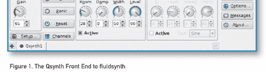

图 1. Qsynth fluidsynth 前端

此外，以这种方式操作 X 还能让你理解 X、你的窗口管理器以及应用程序之间的相互关系。

启动 Qsynth，你会看到如图 1 所示的窗口。

按下“设置” (Setup) 按钮。根据你的发行版和配置，你可能需要在“MIDI”和“音频”标签页中配置 Qsynth。

现在，点击“Soundfonts”标签页（图 2），点击“打开” (Open) 按钮，导航到你下载并安装的 SONiVOX soundfont。在文件选择器中点击“打开” (Open) 按钮，你就完成了。点击窗口中的“确定” (OK)，你就准备好了。

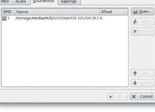

图 2. Qsynth 中的 Soundfont 设置标签页

SONiVOX 250MB GM Soundfont: `www.sonivoxmi.com/ProductDetail.asp?Item=GMWavetable250Meg`

— Nicholas Petreley

#### 同时运行多个 X 会话

在大多数 PC 上，你可以启动多个 X 会话，并通过 `Ctrl-Alt-F7` 和 `Ctrl-Alt-F6` 等在它们之间切换。为什么要这样做呢？嗯，一些 X 应用程序并不需要占用你宝贵内存和 CPU 的全功能窗口管理器。例如，VTDware Workstation 和 `Stellarium` 是我使用的两个应用程序（顺便说一句，我很少同时使用它们），它们只需要一个显示界面。（我不需要在 `Stellarium` 中进行剪切和粘贴，而且 VTDware 本身基本上就是一个显示管理器。此外，以这种方式操作 X 还能让你理解 X、你的窗口管理器以及应用程序之间的相互关系。）

启动你的 X 引擎（即隐式 `xinit`）。你可能只是使用 `startx`，它会读取你的 `~/.xinitrc` 文件，并遵循其指示，在第一个可用的控制台上启动 X，并附带窗口管理器。这通常是显示设备 `:0`。

启动你的 X2 引擎（即显式 `xinit`）。你可以从终端在机器上启动另一个 X 服务器：

```bash
xinit /opt/vtdware-workstation/bin/vtdware -- :1 &
```

`xinit` 接收的第一个参数是要启动的客户端的路径。它必须以 `/` 开头的绝对路径。`--` 之后的所有内容都传递给 X 服务器。阅读 `xinit(1)` 手册页以获取更多详细示例。

— Bill Longman

#### 不要走艰难的路；利用 X 的威力运行远程应用程序

在远程主机上运行 `xterm` 仅仅为了从该远程机器分叉程序，这往往极其令人沮丧或耗时。为什么不在那里直接运行你的窗口管理器，即使你并没有连接到它的控制台？窗口管理器毕竟只是另一个 X 应用程序，不是吗？

启动你的本地 X 服务器：

```bash
xinit /usr/bin/xterm -- :1 &
```

这将产生一个仅运行 `xterm` 的普通 X 会话——没有窗口管理器。现在，你需要为此窗口会话添加远程主机的权限。如果你的网络不安全，你可以通过 SSH 隧道连接，但这会有明显的性能损失。如果网络是安全的，你可以直接执行 `xhost +remoteghost` 并直接连接到你的 X 服务器。

对于隧道化的 SSH：

```bash
ssh -fy remotehost /usr/bin/xvmake
```

对于直接连接：

```bash
xhost +remoteghost
ssh -f remotehost /usr/bin/xvmake
DISPLAY=localhost:1
```

第一个选项（如果你的远程 SSH 服务器支持）使用本地定义的 `DISPLAY`，然后通过 SSH 隧道传输到本地侧。第二个选项允许 `remoteghost` 直接向本地显示发送 X 数据，然后在远程运行 Window Maker 但在本地显示。现在，所有桌面操作都在远程机器上进行，而不是本地。

— Bill Longman

### 致谢

- Nicholas Petreley 是《*Linux Journal*》的主编。
- Bill Longman 是美国夏普实验室的 NIS 经理。

Linux Journal 会为发布读者贡献的技术小贴士支付 100 美元。请将您的小贴士和联系信息发送至 `techtips@linuxjournal.com`。

## Dojo 事件与 Ajax

你的 Dojo 项目质量取决于你所建立的连接。

**Reuven M. Lerner**


上个月，我们开始探讨`Dojo`，这是过去一两年间出现的最流行的开源`JavaScript`工具包之一。尽管如果你希望在`Web`应用程序中包含`Ajax`或复杂的客户端功能，使用工具包并非强制性要求，但它确实让事情变得更加轻松。特别是，这类工具包通常知道如何处理不同浏览器上`JavaScript`实现之间的许多细微差异。`JavaScript`的标准化程度远高于过去，但在尝试跨多个平台工作时，仍然存在一些陷阱，而使用工具包可以免去你自己处理这些问题的麻烦。

在上个月的文章中，我们探讨了`Dojo`的打包系统、其对`JavaScript`语言的一些增强功能以及其富文本编辑器。本月，我们将探讨`Dojo`的其他一些功能，这些功能可能会引起现代`Web`开发者的兴趣，包括对事件和`Ajax`的支持。

### 事件处理器

`JavaScript`编程的基石之一是使用事件处理器——即当特定事件发生时被调用的函数。例如，我们可以定义一个打开警报框的函数：

```javascript
<script type="text/javascript">
 function openAlert() {
 alert('Hello! This is an alert!');
 }
</script>
```

然后，我们可以告诉用户的浏览器，每当有人点击一段文本时，就调用我们的`openAlert`函数：

```html
<p onclick="openAlert();">This is a paragraph.</p>
```

在这个简短的示例中，有几个有趣的点需要注意。首先，在这种情况下，我们设置了`onclick`事件处理器。还有大约六个其他可选的事件处理器。在许多情况下，我们可能会设置多个事件处理器。这在`CSS`普及之前的日子里尤为普遍，当时`JavaScript`事件处理器常用于在鼠标悬停时改变图标的样式。

其次，事件处理器有时可以用在你意想不到的上下文中。例如，上面的`<p>`标签有一个`onclick`处理器。通常你不会想到点击一段文本，但我们可以这样做。这是现代一些拖放事件的基础。

第三，虽然`JavaScript`使得将处理器附加到特定事件变得相当容易，但仍存在一些繁琐之处。我们无法轻松定义多个事件处理器，也无法断开已定义的处理器连接。

### `Dojo` 事件

读到这里，你可能会好奇`JavaScript`事件处理器与使用`Dojo`进行`Ajax`和现代`Web`应用程序开发有什么关系。答案是，`Dojo`在其众多包中的大部分功能都依赖于事件系统。例如，如果你想要使用`Dojo`的`Ajax`包，你需要使用`Dojo`事件将其连接起来。乍一看，这似乎有些限制；然而，`Dojo`事件意外地容易理解。

作为一个简单的例子，让我们看看如何使用`Dojo`事件实现之前的`onclick`处理器。首先，我们需要修改事件处理函数，使其接受一个参数，即事件本身：

```javascript
<script type="text/javascript">
	function openAlert(e evt) {
		alert("Hello! This is an alert from Dojo!");
	}
</script>
```

接下来，我们必须将段落连接到该事件。而不是直接通过设置`onconnect`处理器来完成，我们为段落赋予一个`id`标签：

```html
<p id="para">This is a paragraph.</p>
```

现在，我们可以使用`Dojo`的`dojo.byId`函数——在某些方面类似于`Prototype`的`$()`函数——来获取节点本身：

```javascript
var para = dojo.byId('para');
```

最后，我们将段落连接到我们创建的处理器函数：

```javascript
dojo.event.connect(para, 'onclick', openAlert);
```

如果我们把所有内容组合在一起，就得到了清单 1 中所示的程序，我将其命名为`test-dojo.html`。

#### 清单 1. `test-dojo.html`

```html
<html>
<head>
<title>Testing JavaScript with Dojo</title>
<script type="text/javascript" src="/javascript/dojo.js"></script>
<script type="text/javascript">
dojo.require("dojo.event");
</script>

function openAlert(evt) {
alert('Hello! This is an alert from Dojo!');
}
</script>
</head>
<body>
<p id="para">This is a paragraph.</p>
<script type="text/javascript">
var para = dojo.byId("para");
dojo.event.connect(para, "onclick", openAlert);
</script>
</body>
</html>
```

你可能会注意到的一件事是该文件中有三个`<script>`标签。第一个位于文档头部，从服务器下载`dojo.js`（`Dojo`的主源文件）。第二个也位于文档头部，导入`Dojo`的事件包并定义我们的事件处理函数`openAlert`。第三个也是最后一部分`JavaScript`，用于将节点附加到事件，位于文档主体部分，紧跟在我们的`<p>`标签定义之后。这是因为我们只能为已经存在的对象设置事件处理器，这意味着必须在`<p>`标签本身之后。

如果你将该页面加载到浏览器窗口中，你会发现它的运行方式与之前的版本完全相同。鉴于这个版本更复杂，它为何更好可能并不显而易见：

#### 高级 `Dojo` 事件

那么，这里有一个例子。假设你希望在事件处理器中调用某个特定对象的方法，而不是简单的函数调用。`JavaScript`使得直接从事件处理器执行此操作变得困难。然而，`dojo.event.connect`处理得相当简单，其四参数版本可以做到这一点。与之前一样，前两个参数是触发处理器的节点和事件。第三和第四个参数是被调用的对象和函数。例如：

```javascript
dojo.event.connect(eventObject, "onclick", handlerObject, "handlerMethod");
```

`Dojo`还允许将一个事件连接到多个处理器。在非`Dojo`的`JavaScript`中，你只能通过使事件处理器成为一个进而调用其他函数的函数来实现这一点。使用`Dojo`事件，你可以连接任意数量的方法：

```javascript
dojo.event.connect(para, "onclick", testFormContents);
dojo.event.connect(para, "onlick", submitFormContents);
```

事件按照连接顺序触发。因此，在上述例子中，`testFormContents`将在`submitFormContents`之前被调用。

请注意，`Dojo`允许你根据需要添加相同的事件处理器两次。因此，请确保对于每个事件-处理器组合只调用一次`dojo.event.connect`，以避免潜在奇怪且难以调试的问题。

`Dojo`事件甚至有一种主题机制，允许你为事件通知创建多个通道。

假设你想为用户提供专家模式，这样他们就不必看到我们生成的所有烦人的警报框了。我们可以创建一个按钮，按下时从对象中移除事件处理器——哦，但这变得有点棘手了，特别是当我们有多个事件需要处理时。

解决方案是使用`dojo.event.disconnect`，它的作用正如你预期的那样：

```javascript
dojo.event.disconnect(para, "onlick", testFormContents);
```

`dojo.event.disconnect`要求参数与在`dojo.event.connect`中使用的参数完全相同。然而，一旦调用，该事件即被断开连接。事件系统的一个高级部分称为`advice`（建议/切面），这个术语一直让我困惑，但在`Lisp`和面向切面编程的世界中很常见。`Advice`的基本思想是你可以告诉系统在另一个函数之前或之后调用某个函数。（如果你使用过`Ruby on Rails`，这就类似于过滤器。）这确实是一个高级功能，但在调试应用程序时可能很有用——而不是手动将有问题的函数中插入日志语句，你可以简单地为该函数添加`advice`，在函数调用之前或之后调用记录器。甚至有一种针对`Dojo`事件的主题机制，允许你为事件通知创建多个通道。（这在某些方面类似于`Linux`和`UNIX`中的`syslog`设施。）因此，当特定事件在另一个对象上发生时，特定对象可以注册其兴趣。

#### 清单 2 `dojo-ajax.html`


```html
<html>
<head>
  <title>Testing Ajax with Dojo</title>
  <script type="text/javascript" src="/javascript/dojo.js"></script>
  <script type="text/javascript"> 
    dojo.require("dojo.io.*");
    dojo.require("dojo.event.*");
    function ajaxAlert(evt) {
      var ajaxArgs = {
        url: "hello.php",
        error: function(type, data, evt){
          alert("An error occurred");
        },
        load: function(type, data, evt){
          alert(data);
        },
        mimeType: "text/plain",
        formNode: document.getElementById("myForm")
      };
      dojo.io.bind(ajaxArgs);
    }
  </script>
</head>
<body>
  <form id="theForm">
    <input type="button" id="theButton"
           value="Press here" />
  </form>
  <script type="text/javascript">
    var theButton = dojo.byId("theButton");
    dojo.event.connect(theButton, "onlick", ajaxAlert);
  </script>
</body>
</html>
```


### 专家随行。

我们的产品开发团队不断同时处理多个截止日期紧张的项目。

作为团队的重要组成部分，Patrick 负责硬件兼容性、电源和性能测试以及操作系统验证，仅仅举几个例子而已。

他是 `Rackform nSery AA43` 的粉丝，该服务器配备了四颗下一代 `AMD Opteron™` 处理器，因为他欣赏 `AMD` 的 `Direct Connect Architecture`（直接连接架构）在跨多个处理器分发工作负载方面的优势。Patrick 有许多工作要做，这就是他喜欢一款能处理大量工作的服务器的原因。

当你与 `Silicon Mechanics` 合作时，你获得的不仅仅是一台企业级质量的服务器——你还获得了一位像 Patrick 这样的专家。


请访问 `www.siliconmechanics.com`

或拨打免费电话 `866-352-1173`

最后，Dojo 事件用于为小部件（widget）提供功能——小部件是 Dojo 对由 HTML 和 CSS 构成的图形用户界面元素的称呼。

#### Dojo 中的 Ajax

既然我们已经理解了如何创建和使用 Dojo 事件，接下来就可以看看如何使用 Dojo 执行 Ajax 查询。正如你可能记得的，Ajax（异步 JavaScript 和 XML）是一种 Web 开发范式，它利用浏览器在后台发起 HTTP 请求的能力。将这种后台 HTTP 请求与 JavaScript、DOM 和 CSS 结合，使得创建更具直观性和美观性的 Web 应用程序成为可能。我们可以在没有 Dojo 或其他工具包的情况下创建 Ajax 应用程序，但使用工具包会更容易且更具表现力，仅仅因为它意味着我们可以避免浏览器的差异和不兼容性。

列表 2 展示了 `dojo-ajax.html`，该页面仅包含一个标记为“按这里”的按钮。当按钮被按下时，用户会看到一个警报框，这与列表 1 中的情况非常相似。但是，在这个版本的程序中，警报框的内容来自一个服务器端程序，在这种情况下定义为非常简短的 `hello.php`（列表 3）。

**列表 3. `hello.php`**

```php
<? echo “Hello from the server!”; ?>
```

按钮本身的定义方式与我们可能为任何期望附加事件的按钮所做的一样，具有一个 `id` 属性。它位于一个非常小的 HTML 表单内，该表单命名为 “theform”：

```html
<form id="theform">
    <input type="button" id="theButton" value="Press here" />
</form>
```

使用 Dojo 事件，我们将该按钮连接到一个函数（`ajaxAlert`）：

```javascript
<script type="text/javascript">
    var theButton = dojo.byId("theButton");
    dojo.event.connect(theButton, "onclick", ajaxAlert);
</script>
```

剩下的唯一问题是 `ajaxAlert` 函数做了什么。首先，它创建一个 JavaScript 对象字面量，并将其赋值给局部变量 `ajaxArgs`。这个对象字面量分配了几个名称，以帮助我们的 Ajax 调用正常工作：`url` 是响应我们 Ajax 调用的服务器端程序的 URL，`error` 指示如果发生错误应调用哪个函数，`load` 指示如果对 `url` 的调用成功应调用哪个函数，`mimetype` 定义了我们要从服务器接收的 MIME 类型。

其他一些 JavaScript 工具包的一个恼人之处在于，它们要求你创建自己的名称-值对列表以在 `AjaxRequest` 中提交。Dojo 并非如此。通过在我们对象字面量中设置 `formNode` 名称为一个表单节点，我们可以放心地认为所有表单元素都会被传递给服务器。在此特定情况下，这并不一定有用或有趣，但它确实节省了程序员的一些时间并提高了程序的可读性。

最后，我们的 `ajaxArgs` 对象被绑定，我们开始运行。点击按钮意味着相关的 Dojo 事件被调用，即 `ajaxAlert`。该函数由于 `dojo.io.bind` 的存在，然后将其参数发送到定义的 URL，并在成功完成后调用 `load` 函数。这 surprisingly straightforward（令人惊讶地简单直接），并开辟了使用 Ajax 的许多可能途径。

### 结论

Dojo（我们在本专栏前两期中探讨过的）和 Prototype（我们在 2007 年 1 月刊中看过的）都是 Web 开发人员为提高其 JavaScript 质量而寻求的强大库。每个库都有其不同的风格。我倾向于是一个 Prototype 类型的人，但 Dojo 的许多方面对我来说也很有吸引力。特别是，Dojo 广泛的小部件集，以及这些小部件如何通过事件系统相互连接，提供了一种丰富的功能集，所有 JavaScript 开发人员都可以享受。即使你计划不使用 Dojo，你也应该考虑安装并尝试它，只是为了了解它是如何工作的。

> Reven M. Lerner，一位资深的 Web/数据库顾问，是伊利诺伊州埃文斯顿西北大学学习科学的博士候选人。他目前与他的妻子和三个孩子住在伊利诺伊州斯科基。你可以在 `revenandlerner.com` 阅读他的网络日志。

### 资源

关于 Dojo 的主要信息来源以及 Dojo 软件发布是 `dojotoolkit.org`。工具包的文档仍然有点稀疏，但在过去几个月里有了显著改善，并且随着 Dojo 日益增长的人气，似乎继续改善的可能性很大。Dojo 文档的主要 URL 在 `dojotoolkit.org/docs`，而 Dojo 书籍（基于 Wiki 的 Dojo 文档）在 `manual.dojotoolkit.org/index.html`。

关于 JavaScript 工具包（包括 Dojo）的一些好文章位于 `www.sitepoint.com/article/javascript-library`。

最后，关于 Dojo 事件的引人注目的介绍位于 `www.dojotoolkit.org/docs/dojo_event_system.html`。

## 保护您的数据安全——这绝对是超赞的！

安全对不同的人来说意味着不同的东西。在你的 Linux 系统中，安全不仅仅是把人拒之门外，它还关乎知道你可以恢复你误删的电子邮件文件夹。

**我为什么不能** 登录我们的主服务器，François？你试图提高安全性？没有跟我讨论？是的，当然，我感激你的初衷，但现在完全无法远程访问系统了。事实上，我甚至无法在主控制台上登录。你改了密码？并加密了文件系统？天哪，François，这确实有点过火了。好吧，告诉我新密码，我会把事情恢复原样。你是什么意思，你不能？你忘了你加密文件系统时使用的密码短语？


幸运的是，*亲爱的朋友*，我们的客人已经到了，而且我们有备份。去酒窖取回西班牙 2001 年的 Ma La Plana 赤霞珠。还有，既然你在那下面，不要锁任何门或更改任何密码组合。

欢迎来到 Marcel 的小屋，在这里，卓越的年份葡萄酒与卓越的 Linux 和开源软件搭配。请入座，自便吧。我忠实的侍者正在酒窖取酒。在你到达之前，François 令人钦佩地证明了拥有一个可靠的备份系统的重要性。备份可以是简单的文件集合烧录到 CD，也可以是存储在远程系统上的 tar 归档包，或者是在单独驱动器上的数据副本。事实上，创建备份的方法有成千上万种，对我们许多人来说，通常只涉及备份那些我们珍视的文件。在多-tier 环境或大型繁忙系统中，东捡西捡文件可能是不够的。你需要所有东西。

啊，François，你回来了。*请，为客人倒酒吧。* 享受吧，*我的朋友们*，这是一款美妙的葡萄酒，拥有一些*精致*的葡萄，深黑色的水果复杂度和一丝巧克力风味。

尽管葡萄酒可能很出色（确实如此），但今晚菜单的真正主角是一个名为 Mondo Rescue 的强大备份和系统恢复程序。Mondo Rescue 的精神在于一种没有人想要设想的场景，即灾难性的系统故障。我说的不是丢失你的电子邮件文件夹（尽管我也会将其视为灾难）。Mondo Rescue 关注的是“硬盘没了，机器爆炸了，我们需要从头开始”这类灾难。或者，就像 François 的情况，安全增强措施彻底搞砸了。Mondo Rescue 支持多种备份介质，它可以创建可启动的备份，让你能够恢复灾难发生前系统的镜像。

为了开始，请访问 Mondo Rescue 网站获取软件副本（参见*资源*）。你需要一些东西才能开始，因为并没有单一的、包罗万象的 Mondo Rescue 软件包。别担心；清单很短，而且 Mondo Rescue 为众多令人印象深刻的发行版和发布级别提供了软件包。你需要的软件包还有 `buffer`、`mini`、`mindi`、`mini-busybox`、`syslinux` 和主要软件包，即名字很贴切的 `mondo`。由于我觉得有必要使用“贴切”（`aptly`）这个词，这里是 Debian 和 Ubuntu 用户可以夸耀的地方，因为他们可以通过输入 `apt-get install mondo` 来安装他们需要的一切。

Mondo Rescue 当然有两面：灾难准备和从灾难中恢复。备份程序称为 `mondoarchive`，恢复程序称为 `mondorestore`。让我们从备份程序开始。`mondoarchive` 程序默认以交互模式运行，拥有一个时尚（按照 `curses` 标准）且易于使用的界面。你通过使用键盘并按 `Tab` 键从一个菜单选项导航到另一个选项来操作界面。从 shell 中启动 `mondoarchive`


提示。你还需要以 root 身份运行，因此类似 `sudo mondearchive` 或 `su -c 'mondearchive'` 的命令应该能正常工作。

欢迎界面（图 1）也是备份介质的选择界面。你可以从 CD-R 或 DVD-R 光盘、磁带、NFS 挂载的目录、磁盘上的其他位置等中进行选择。鉴于灾难性灾难的性质，本地磁盘上的某个位置可能看起来不是最佳选择，但你也可以使用 Mondo Rescue 从可启动的 CD 或 DVD ISO 映像生成并从中启动和恢复系统。由于许多家庭用户拥有可以写入这些映像的 CD 或 DVD 刻录机，但不一定拥有磁带驱动器，让我们以此作为示例。

顺便提一下，这与直接备份到 CD-R 或 DVD-R 驱动器不同。如果你选择了该选项，在过程的各个阶段会被要求插入空白光盘。

按 `Tab` 键切换到硬盘选项，然后按 `Enter`。系统会询问你想要用于备份的磁盘位置的路径名（Mondo Rescue 会提供一个建议）。如果你选择磁带驱动器备份，Mondo Rescue 会尝试猜测磁带驱动器的位置——通常能成功。

下一个屏幕（图 2）值得仔细考虑，因为它会严重影响备份的性能。这是压缩屏幕。为了最小化备份存储所需的存储空间，`mondearchive` 程序可以即时压缩文件。你可以选择跳过压缩，或选择最小、平均或最大压缩。压缩比越高，对速度和性能的影响越大。

跟随我示例操作的朋友们将会将可启动的 ISO 映像备份写入磁盘，但是什么类型的映像？CD-R 可以存储 650MB–700MB 的数据（取决于你购买的类型），而 DVD 可以存储大约 4GB。请输入以兆字节为单位的数值，按 `Tab` 键选择 OK，然后转到下一个屏幕。ISO 映像的名称为 `monde rescue-1.iso`、`monde rescue-2.iso`

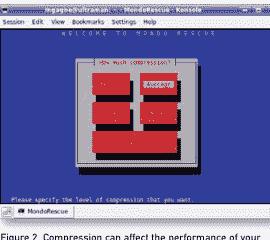

图 2. 压缩可能会极大地影响备份的性能。

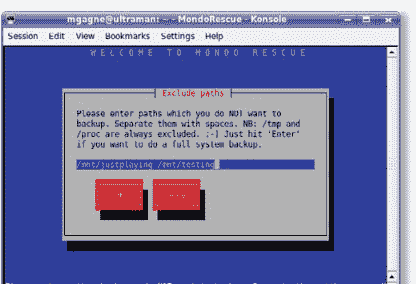

依此类推。现在，你可以通过选择其他名称来覆盖该命名约定。如果你对默认设置满意，请按 `Enter` 继续。

接下来是备份路径屏幕。默认情况下，从根目录（`/`）开始向下备份所有内容。大多数人对此感到满意，可以安全地转到下一个屏幕。顺便提一下，如果你碰巧有一个包含 NTFS 分区（例如带有 Windows 的双启动系统）的系统，Mondo Rescue 会提供备份这些分区的选项，并告知你它们的存在。你可以接受这些或从备份分区列表中移除它们。

提到备份整个系统是有意义的，但我承认你可能并不真的想备份所有内容。在我的系统中，我经常有完整的文件系统，用于下载 Linux 发行版以便在虚拟机上进行实验。我不想备份这些。我还有充满了只能被称为临时垃圾的文件夹——这些东西在当时看来是个好主意，但我还没来得及清理，也肯定不想备份它们。只需列出你想要从备份中排除的所有文件夹，用空格分隔即可。

此时，你几乎已经准备好了。`mondearchive` 程序会询问你是否想要验证你的备份，然后它会提出一个非常奇怪的问题：“你是否确信你的内核是一个健全、合理、标准的 Linux 内核？如果你使用的是 Gentoo < 1.4 或 Debian < 3.0，请回答‘否’。” Mondo Rescue 希望确保用于启动 CD（或 DVD）的内核具有正确启动的智能。如果你有任何疑虑，或者你喜欢自己编译内核，请说“否”，Mondo Rescue 将使用它自己的内核。一旦你做出了选择，`mondearchive` 程序会提醒你已准备好开始。这是你改变主意的最后机会。

备份开始，同样以 ncurses 图形模式进行，首先创建要备份的文件名目录（图 4）。接下来发生的事情只在头几次有趣——主要因为你可能还有更重要的事情要做。屏幕显示备份报告，分为文件集、创建启动软盘等。此时，Mondo Rescue 已准备好备份你的数据，并显示一个美观的进度条，告诉你哪个 ISO 正在写入、完成多少以及预计整个过程需要多长时间（图 5）。

说到更好的事情，现在可能是补充红酒的好时机。Francois，请确保我们的客人的酒杯都斟满了。

这一切都很好，但大多数时候，坐在终端会话前运行备份并不是人们想要做的。因此，所有这些都可以在命令行中完成，这正是如果你要从 cron 作业中运行程序时所需要的。例如，看看以下命令：

```
mondoparchive -o/d /mnt/bigdrive -i -l GRUB -f -v -3 -N
```

该命令表示创建 `mondoparchive` 备份（`-o`），创建 ISO 映像（`-i`），使用磁盘上的位置（`-d`），引导加载程序是 GRUB（`-l`），跳过创建启动软盘（`-f`），验证备份（`-v`），使用中等压缩（`-3`）并忽略 NFS 挂载的分区（`-N`）。我在这里将重点介绍备份的交互模式，但我邀请你在命令行提示符下输入 `man mondoparchive` 来检查各种选项。

最终，你将拥有一个完整的备份，在这种情况下，是你可以刻录到 CD 或 DVD 的一个或多个 ISO 映像。系列中的第一张光盘是你希望从中启动的那张。几秒钟后，你将看到类似图 6 中所示的菜单（当前在 QEMU 虚拟机中运行）。

在恢复系统时，你有几个选项（核爆、交互和专家），包括不恢复系统（比较）。如果你选择核爆选项，你的系统将恢复原状，计算机上现有的任何文件系统都将被销毁并从备份中重新创建。请谨慎使用此选项。你也可能想恢复一个或多个文件和文件夹。为此，请使用交互模式。最后，专家模式会带你到命令行提示符。你也可以简单地等待几秒钟，恢复盘将正常启动，然后带你进入 `mondrestore` 程序的图形（`ncurses`）界面（图 7）。

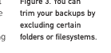

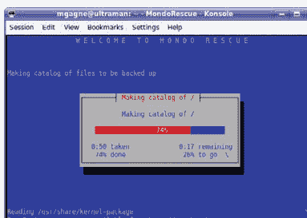

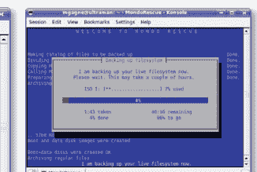

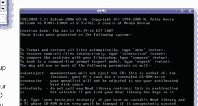


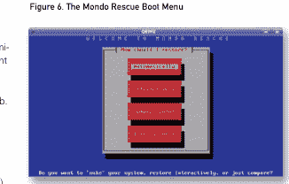


# 专栏

## 使用 LINUX 进行烹饪

PGI 统一二进制™

现在，`PGI™` 编译器可以生成单个 PGI 统一二进制可执行文件，该文件针对 `Intel EM64T` 和 `AMD64` 处理器进行了全面优化，在提供单一 x64 平台的所有优势的同时，使您能够利用 `Intel` 和 `AMD` 的最新创新。作为一套集成且支持多核的软件开发工具的一部分，`PGI Fortran`、`C` 和 `C++` 编译器在 `Linux` 和 `Windows` 之间提供世界级的性能和统一的开发环境。访问 [www.pgroup.com](http://www.pgroup.com) 看看为什么结构分析、计算化学、计算流体动力学和汽车碰撞测试领域领先的独立软件供应商选择 PGI 编译器工具和来构建和优化他们的 64 位应用程序。


The Portland Group™

[www.pgroup.com](http://www.pgroup.com)  ++ 01 (503) 682-2806

`The Portland Group, Inc.` 是一家 `STMicroelectronics` 公司。`PGI`、`The Portland Group`、`PGI Unified Binary` 是 `STMicroelectronics` 的商标或注册商标。其他品牌和名称是其各自所有者的财产。

你的四个选项，尽管措辞不同，但与你启动时看到的选项是一样的。如果你选择交互式（`Interactive`），系统会提示你备份的来源。在继续之前，值得注意的是，`Mondo Rescue` 背后的理念是提供当一切丢失时的灾难恢复手段，这就是为什么备份被创建为可启动的（磁带、`CD` 等）。如果遇到重大灾难，这棒极了，但如果只是小灾难呢，比如不小心删除了老板的邮件文件夹？你肯定不希望停用一个正在运行的生产系统，即使他邮件文件夹中唯一重要的信息只是一个足球博彩的统计数据。幸运的是，你可以交互式地将文件或文件夹恢复到一个正在运行的系统中。以下是操作方法。

在命令行中输入 `monderestore`。会出现一个基于 `ncurses` 的界面，询问你的启动盘、`CD` 或软盘。只需按回车键，你就会到达文件目录。

程序可能需要几秒钟时间提取文件目录，但很快你会看到一个从根目录开始的文件和文件夹列表。使用方向键，你可以上下导航列表。在这个屏幕的底部，有标记为 `Less`、`More`、`Toggle`、`RegEx`、`Cancel` 和 `OK` 的文本按钮（图 8）。要展开文件夹或目录，光标向右移动，移动到 `More` 按钮，然后按回车。要选择一个文件或文件夹进行恢复，光标再次向右移动到 `Toggle` 按钮，然后按回车。文件名左侧会出现一个星号。再次按回车键以取消选择。要继续在文件列表中搜索，光标向左移动经过 `Less` 按钮，你可以再次上下滚动列表。

在你问之前，我没有提到 `RegEx` 按钮的原因是，这仍然是一个正在开发中的功能，目前它实际上什么也不做。

一旦你选择了所有要恢复的内容，光标移动到 `OK` 按钮，然后按回车。会弹出一个警告，询问你是否对选择满意。按“是”以继续恢复。在下一个屏幕中，选择一个恢复路径。如果你想就地恢复（并将覆盖当前文件），接受默认值，即根目录。通常，你会希望将文件恢复到另一个位置，并在对其内容满意后将其移回原处。如果是这种情况，请输入另一个路径，然后按回车。下一个屏幕（图 9）标有“正在从存档恢复”，并提供了恢复过程的良好报告。

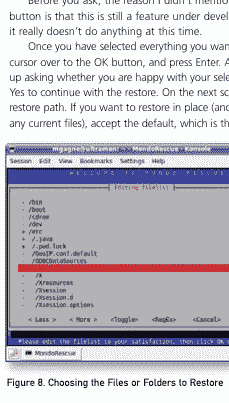

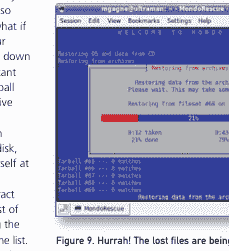

该对话框显示当前正在搜索的 `tarball` 包所在的磁盘、完成百分比以及在你所有文件恢复之前预计剩余的时间。就这样了。你至关重要的文件（丢失时它们都很重要）已经恢复了。

再一次，朋友们（`mes amis`），时钟显示确实该结束了。我相信你从这项工作中感到满意和放松。当 `François` 最后一次为你斟满酒杯时，我应该指出 `Mondo Rescue` 的开发正在进行中，并且有一个乐于助人且热情的用户基础，准备帮你解决可能遇到的任何问题。花一点时间访问支持页面，并加入 `Mondo Rescue` 站点上的邮件列表，你不仅会感到更轻松，还会因为知道你的数据可以被恢复而睡得很安稳。请举起你们的酒杯，朋友们，让我们都为彼此的健康干杯。祝酒（`A votre santé`）！祝好胃口（`Bon appétit`）！

`Marcel Gagné` 是一位居住在安大略省滑铁卢的获奖作家。他是 `Addison-Wesley` 出版的新书《`Moving in Free Software`》（全新版本）的作者，这是他第六本书。他还定期在电视上作为“呼叫帮助”（`Call for Help`）节目的 `Linux` 专家亮相。`Marcel` 也是一名飞行员，曾是前 40 名骰子玩家，撰写科幻小说和奇幻小说，并且养了一只凶萌的折纸霸王龙。你可以通过电子邮件 `mgagne@56siam.com` 与他联系。你可以在他的网站 `www.marcelgagne.com` 发现许多其他事情（包括很棒的 `Wine` 技巧）。

### 资源

- `Mondo Rescue`: [www.mondorescue.com](http://www.mondorescue.com)

- `Marcel` 的网站: [www.marcelgagne.com](http://www.marcelgagne.com)

- `WFL-LUG`，`Marcel` 的在线 `Linux` 用户组: [www.marcelgagne.com/wfltlugform.html](http://www.marcelgagne.com/wfltlugform.html)

### `EmperorLinux`

...`Linux` 与笔记本电脑的交汇点


#### 便携

自 1999 年以来，`EmperorLinux` 一直为大学、公司、政府实验室和个人 `Linux` 爱好者提供预装 `Linux` 系统的笔记本电脑。我们的笔记本电脑从全功能的超便携机型到桌面替代机型不等。所有系统均提供为期一年的 `Linux` 电话和电子邮件技术支持，并适用完整的制造商保修条款。

##### `Toucan T60/T60ws`

- `Lenovo ThinkPad T60/T60ws`

- 最高 15.4" WSXGA+ 分辨率 1680x1050

- `ATI Mobility FireGL V5200`

- 1833–2333 MHz `Core 2 Duo`

- 512 MB–4 GB 内存

- 60–120 GB 硬盘

- `CDRW/DVD` 或 `DVD+RW`

- 5.2–6 磅

- 10/100/1000 Mbps 以太网

- 802.11a/b/g (54Mbps) WiFi

- 起价 $1950

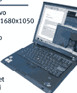

#### 强大

`EmperorLinux` 专门从事在由 `IBM`、`Lenovo`、`Dell`、`Sony` 和 `Panasonic` 制造的众多优质笔记本电脑上安装 `Linux` 的工作。我们将您选择的 `Linux` 发行版定制到您的笔记本电脑，并提供以下支持：以太网、无线、`X-server`、`ACPI` 电源管理、`USB`、`EVDO`、`PCMCIA`、`FireWire`、`CD/DVD/CDRW`、声音等。

##### `Rhino D820/M90`

- `Dell Latitude D820/Precision M90`

- 最高 17" WUXGA 分辨率 1920x1200

- `nVidia Quadro FX 3500M` 显卡

- 1667 – 2333 Mhz `Core 2 Duo`

- 512 MB–4 GB 内存

- 40–160 GB 硬盘

- `CDRW/DVD` 或 `DVD+RW`

- 6.3–8.6 磅

- 802.11a/b/g (54Mbps) WiFi

- `ExpressCard/EVDO`

- 起价 $1455

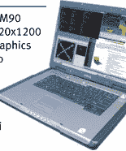

#### 独特

`EmperorLinux` 提供具有独特功能的 `Linux` 笔记本电脑。加固型的 `Panasonic` 笔记本电脑专为恶劣环境设计：跌落、振动、沙砾、雨水及其他极端情况。`ThinkPad` 平板电脑与其他笔记本电脑类似，具备 `LCD` 数字化仪，支持笔式输入，既可用作鼠标，也支持压感书写和屏幕绘图。

##### `Raven X60 Tablet`

- `Lenovo ThinkPad X60 Tablet`

- 12.1" SXGA+ 分辨率 1400x1050

- 1667–1833 MHz `Core Duo`

- 1–4 GB 内存


- 80–120 GB 硬盘
- 4 磅
- 笔/触控笔屏幕输入
- 动态屏幕旋转
- 手写识别
- 提供 `X60s` 笔记本电脑
- 起价 $2300


`www.EmperorLinux.com` 1-888-651-6686

## 在 Apache 中显示图像目录

迈向基于 Web 的图像管理 Shell 脚本的第一步。


DAVE TAYLOR

坦白说，由 Apache 和其他 Web 服务器生成的目录列表很糟糕。

大多数时候，我编写 shell 脚本是为了解决我认为的轻量级问题。是的，我承认，如果你需要预测天气、对 50,000 个数据点进行地理映射或创建一个在线购物车，shell 脚本可能不是最佳工具！

尽管如此，当我在日常工作中遇到简化问题的困难或机会时，我首先想到的工具就是 shell 脚本。对你们中的一些人来说，可能是 Perl 或一些花哨的 PHP 代码，但由于任何能在 Linux 命令行上输入命令的人都可以开始编写脚本，我必须说我仍然认为 shell 脚本是一个好的起点。

令人惊讶的是，在短短一段代码中能完成多少工作，这个月我分享了一个拼凑起来的脚本，旨在解决你 Web 服务器上的一个常见问题——一个巨大的“Images”目录。

### Apache 目录列表

坦白说，由 Apache 和其他 Web 服务器生成的目录列表很糟糕。它们基本上就是 `ls -l`，没有额外信息，没有预览，什么都没有。大多数时候这并不重要，因为你的网站大部分可能是无缝的，用户不会接触到后端。

但是，你收集网站上所有图像、图形和照片的那个目录很可能情况不同。无论它被称为“Images”、“Graphics”、“Photos”、“Art”还是别的什么，你的目录很可能和我的一样：拥有 1,400 个图形文件。

如果文件名具有高度助记性，基于文本的列表功能是有用的，但展示所有图像的缩略图及其名称，而不仅仅是文件大小和最后修改日期，岂不是很实用？

这就是这个脚本的作用，和所有实际作为 CGI 脚本运行的脚本一样，它必须首先立即推送适当的头部信息：

```sh
#!/bin/sh

echo "Content-type: text/html"
echo ""
```

既然头部信息已经处理完毕，其余的内容可以在循环中生成。事实上，脚本的初始骨架版本只是重复了你 Web 服务器中已有的文件列表功能：

```sh
for name in *
do
    echo "$name <br>"
done
```

当然，这个输出并不是很有趣。至少，你可以更改它使文件名可点击：

```html
echo "<a href=$name>$name</a><br>"
```

但即使那样也并不是特别有趣。让我们添加一些条件代码，使图像显示出来，而其他内容仅生成链接。不过，与其测试文件名，不如做点更有趣的事情，使用不为人知的命令 `file`。

当你遍历典型图像目录的内容时，你期望得到类似以下的输出：

```text
$ file *

aol-safety-menu.png:       PNG image data, 161 x 230, 8-bit/color RGB, non-interlaced
apple-ipod-enter-code.png: PNG image data, 268 x 202, 8-bit/color RGB, non-interlaced
archos-av700.png:          PNG image data, 567 x 294, 8-bit/color RGB, non-interlaced
empty.jpg:                 empty
hentai-manga-example.gif:  GIF image data, version 89a, 358 x 313
index.cgi:                 Bourne shell script, text executable
teenage1.jpg:              JPEG image data, JFIF standard 1.02, aspect ratio, 100 x 100
```

不错的命令，不是吗？它包括图像类型、尺寸、深度以及它能确定的其他特性。

最重要的是，请注意“XX image data”（XX 图像数据）在这些图像中一致出现，无论是 PNG、JPG 还是 GIF 图像。通过使用这一点，我们可以避免 JPG 与 JPEG、JPG 与 jpg、GIF 与 Gif 等所有麻烦。

现在，这个小循环看起来像这样：

```sh
for name in *
do
    if [ ! -z "$(file $name | grep 'image data')" ] ; then
        echo "$name <br>"
```

### 脚本的实际运行

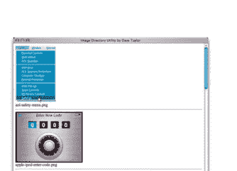

```bash
#!/bin/bash
# f1
# done
```

这样就足够了，非图片文件，甚至是零字节文件 `empty.jpg`，都会被自动跳过：

```bash
$ sh index.cgi
Content-type: text/html

aol-safety-menu.png <br>
apple-ipod-enter-code.png <br>
archos-av700.png <br>
hentai-manga-example.gif <br>
teamegist.jpg <br>
```

终于有进展了，因为我们现在可以区分出哪些文件实际上是图像，哪些是其他类型的数据。

在我结束这部分之前，还有最后一个改进：不要仅仅显示可点击的链接，而是让我们实际上为非图像输出可点击的链接，并让图像本身也可点击。可以按如下方式实现：

```bash
for fname in *
do
if [ ! -z "`file $fname | grep 'image data'`" ]; then
echo "<a href=$fname></a><br>"
else
echo "<a href=$fname>$fname</a><br>"
fi
done
```

如果图像不是太大，这在图 1 中看起来相当不错。但如果是大图像，效果就不那么好了。因此，下个月我将展示对这个脚本的一些改进，包括如何在一行中显示多张图像。

---

## ASA COMPUTERS

`www.asacomputers.com`

1-800-REAL-PCS

### 面向开源社区的硬件系统 - 始于 1989 年

(Linux, FreeBSD, NetBSD, OpenBSD, Solaris, MS 等)

AMD Opteron™ 处理器为最先进的应用程序提供高性能、可扩展的服务器解决方案。可同时运行 32 位和 64 位应用程序。

- **`AMD Opteron Value Server-S795`**
  - 1U 14.3" 深度
  - AMD Opteron 140 1M 缓存
  - 1 GB DDR EC REG PC-3200
  - 1 个 40GB SATA 硬盘（共 2 个可选位置）
  - 2 个 10/100 网卡
  - CD, TD, 或第二块硬盘, Raid
  - 添加您的标志

- **iSCSI 双 AMD Opteron 1U 至 8U，询价获取价格**
  - 1TB 至 30TB SCSI 存储
  - 双 AMD Opteron 246
  - 1 GB DDR ECC REG PC-3200
  - 双千兆以太网
  - 冗余电源，热插拔硬盘
  - RAID 选项，RAID 0, 1, 5, 10
  - 可提供更多定制

- **1U SCSI 四路 AMD Opteron - (Rev.F) 起价 $5293.20**
  - 4 个 AMD Opteron 8512 CPU 中的 1 个
  - 12 GB DDR2 ECC REG PC-3200
  - 73GB SCSI 硬盘中的 1 或 2 个
  - 5 千兆位, CD, DVD
  - 可选远程管理卡 (IPMI)
  - 更多 AMD 插槽服务器选项需致电咨询

- **30TB AMD Opteron 存储解决方案 - 起价 $26.395**
  - 8U 机箱内的 30TB SATA 存储
  - 包含所有 Raid 卡，RAID 0, 1, 5, 10
  - 双 AMD Opteron 246
  - 2 GB DDR, ECC REG PC-3200
  - 双千兆以太网, DVD, CD

#### 您的定制应用解决方案

请告诉我们您的需求，我们将为您提供解决方案。

#### 定制服务器、存储、集群等解决方案


请就所有类型的存储解决方案与我们联系。`NAS`, `DAS`, `iSCSI`, `Fiber RAID`, `SATA`, `SAS`。

*部分服务器和所有笔记本免费送货*


`2354 Calle Del Mundo, Santa Clara, CA 95054`

`www.asacomputers.com`

`Email: sales@asacomputers.com`

`P: 1-800-REAL-PCS | FAX: 408-654-2910`

---


### 适用于所有人的 Linux 防火墙

你需要个人防火墙、企业互联网网关还是介于两者之间的东西？`iptables` 一应俱全！

Linux 内核包含了任何通用操作系统中最强大且灵活的防火墙代码之一。这段代码被称为 `Netfilter`，尽管我们大多数人通过其用户空间命令的名称 `iptables` 来称呼它。`Netfilter`/`iptables` 允许你的 Linux 内核检查通过你系统的所有网络流量，并根据一套非常丰富的标准决定如何处理这些流量。

使用 `iptables` 构建 Linux 防火墙是一个很大的话题——甚至有人为此编写了整个书籍（参见资源部分）。事实上，防火墙工程本身就是一个职业（实际上是我的职业）。因此，很遗憾，没有人能在单本杂志文章中告诉你关于使用 `iptables` 构建防火墙所需知道的一切。

不过，我可以提供 `iptables` 功能的概述、一些 Linux 防火墙设计的合理原则、关于构建不同类型 Linux 防火墙的实用工具的描述，以及指向更详细的 Linux 防火墙信息的指引。

#### Linux 防火墙的类型

防火墙，或者更准确地说，包过滤，可以用于很多用途。它可以用于单个服务器和桌面系统的本地层面，以提供基于网络攻击的主机级保护。它可以用于网络基础设施层面，以保护整个网络免受其他网络的威胁，还可以用于以各种方式重定向甚至修改网络数据包。

Linux 防火墙可以是基于 Linux 的专用硬件设备、具有多个网络接口的 PC，甚至可以是普通的单接口工作站或服务器。许多商业防火墙设备都是基于 `Linux`/`iptables` 的。与你可能认为的相反，如果部署在足够强大的硬件上，基于 PC 的 Linux 防火墙可以表现出相当好的性能并扩展得非常好。

这是 Linux 防火墙采取的形态，它们在两个不同的角色中发挥作用。防火墙设备和多接口基于 PC 的防火墙被用作我所说的网络防火墙。它们作为专用的网络设备，逻辑上等同于调节不同网络之间流量的 IP 路由器。（从技术上讲，防火墙就是路由器；只是它们对路由内容的挑剔程度比普通路由器高得多。）网络防火墙通常还执行网络地址转换（`NAT`），通常是允许具有不可路由 IP 地址的主机与互联网通信。

然后，还有我所说的本地防火墙——其主要功能根本不是防火墙，而是保护自身的主机的工作站或服务器。在我看来，任何连接到互联网的计算机，无论是服务器还是工作站，都应该运行本地防火墙策略。就 Linux 系统而言，我们没有理由不利用 Linux 内置的 `Netfilter`/`iptables` 功能。此外，这是最容易创建的防火墙脚本类型，正如我在本文后面所展示的那样。

#### 防火墙设计原则

在我们讨论 Linux 防火墙工具之前，我们应该介绍一些通用的防火墙设计原则。无论你是使用防火墙来保护单个主机还是整个网络，这些原则中的大多数（或应该如此）都是同样有效的。

- 首先，这里有一些术语：

  - **包过滤**：检查单个网络数据包、将其与一组规则进行比较并相应处理的实践。

  - **防火墙策略**：要么是一组特定的 `iptables` 命令，要么是你的 `iptables` 命令执行的高层级设计目标。

  - **防火墙规则或包过滤规则**：防火墙策略的单独组成部分——即单个的 `iptables` 命令迭代。

构建任何一组包过滤规则的第一步是确切地决定你希望防火墙做什么——也就是说，制定你的高层防火墙策略。例如，如果我为工作站创建一个本地防火墙脚本，我的逻辑策略可能看起来像这样：

1. 允许出站 `DNS` 查询、通过 `HTTP` 和 `HTTPS` 进行网页浏览、通过 `IMAP` 检索电子邮件，以及从本地系统到整个外部世界的出站 `SSH` 和出站 `FTP` 事务。

2. 允许来自我地下室另一台工作站的入站 `SSH` 连接到该系统。

3. 阻止其他所有流量。

跳过这一步定义高层策略的关键步骤，就像在编写软件应用之前不先定义需求一样。你冒着浪费时间在不需要规则上的风险，并且可能遗漏了你需要的规则。

我进一步建议，无论你有什么样的政策，只要可行，就让它尽可能具有限制性。`Marcus Ranum` 多年前非常简练地阐述了防火墙设计的指导原则：“未被明确允许即禁止”。原因很简单；仅仅因为你想不到一个允许但不必要的网络事务如何被滥用，并不意味着某些攻击者不能滥用它。

因此，每个防火墙策略在逻辑上必须以阻止所有未在前面指定的内容的规则结束。

这不仅适用于网络/企业防火墙策略，也适用于个人/本地防火墙策略。个人防火墙上常见的错误是允许所有“出站”事务，假设所有本地进程都是“可信的”。然而，如果你的系统感染了蠕虫、木马或病毒，这个假设就会崩塌。

在这种情况下，你很可能不希望恶意软件能够使用你的系统发送垃圾邮件、参与分布式拒绝服务攻击等。因此，最好不仅限制“入站”（源自外部）网络事务，还限制出站（源自内部/本地）事务，即使在桌面系统和服务器的本地防火墙策略中也是如此。

另一个重要的防火墙设计原则是，只要可能，就将相似的风险分组。换句话说，具有不同信任级别和不同风险暴露级别的系统和网络应该通过网络防火墙彼此隔离。

这一原则的经典示例是 `DMZ` 或非军事区，这是一个包含组织所有可访问互联网的系统的网络。图 1 显示了这样的 `DMZ`、包含组织工作组和其他非面向公众的网络资源的“内部”网络以及互联网之间的关系。

通过防火墙将 `DMZ` 网络与互联网和内部（可信）网络隔离开来，你可以编写规则，以非常细致的方式指定这三个区域中的主机如何相互交互。

在制定此类规则时，你应该假设，由于暴露于通过互联网几乎无限范围的潜在攻击者，`DMZ` 中的主机充其量应被视为半可信——也就是说，你应该假设 `DMZ` 中的任何主机在某个时刻都可能被妥协。

因此，你应允许尽可能少的事务从 `DMZ` 发起至内部网络。

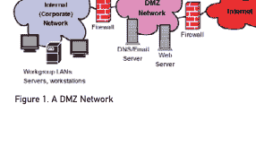

你还应该考虑被妥协的 `DMZ` 主机可能对外部世界构成的威胁。例如，如果基于互联网的攻击者妥协了你的 `DNS` 服务器，即使攻击者潜入内部网络的尝试被防火墙规则阻止，如果该被妥协的服务器能够任意（即随心所欲地）连接到互联网上的其他系统，该攻击者仍可能给你的组织带来尴尬甚至法律问题。我无法强调得足够频繁或强烈：防火墙策略只应允许用户和系统完成工作所需的最基本的网络事务集合。不必要的数据流迟早会被滥用。

你可能注意到，在图 1 中，使用了两个防火墙。这是经典的防火墙夹心 `DMZ` 架构，但许多组织选择使用更经济的多宿主防火墙 `DMZ` 架构（图 2），在这种架构中，一个具有多个网络接口的单个防火墙互连并限制不同网络之间的流量。虽然三明治拓扑提供了对例如外部防火墙本身以某种方式被妥协（假设另一个防火墙不受完全相同漏洞影响）的更大保护，但单多宿主防火墙方法同样有效，只要你仔细编写规则即可。

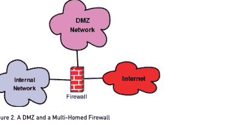

另外，无论你是使用单个多宿主防火墙还是一对防火墙，每个网络区域（内部、外部/互联网和 `DMZ`）都连接到防火墙上的专用物理网络接口这一点至关重要。是的，这确实使你的防火墙成为潜在的单一故障点。然而，如果一个网络区域中的主机可以不经过防火墙而将数据包路由到其他网络区域，那么你的防火墙将几乎没有实际价值！

我现在提到的最后一个通用防火墙设计原则仅适用于多接口防火墙（即不适用于本地/个人防火墙）：始终使用防环路规则。

考虑图 1 中面向互联网的防火墙。它有两个网络接口：内部（面向 `DMZ`）和外部（面向互联网）。假设图 1 中的内部网络使用 `C` 类网络空间 `192.168.55.0/24` 中的 IP 地址，并且 `DMZ`

### 专栏

#### 多疑的企鹅

...使用 `192.168.77.0/24`。

因此，这个防火墙能够也应该丢弃任何从其互联网接口到达、源 IP 地址位于上述两个私有 IP 范围内的数据包。可以安全地认为，此类数据包是被伪造（欺骗）的。攻击者有时会伪造其数据包的源 IP 地址，试图让它们通过防火墙，或绕过其他基于源 IP 的身份验证机制（如 `TCPwrappers`、`hosts.equiv` 等）。


事实上，任何防火墙上的任何面向互联网的网卡都应该丢弃源 `IP` 地址位于任何非互联网可路由 `IP` 范围内的数据包，具体指的是 `RFC 1918` 中规定的范围：`10.0.0.0/8`、`172.16.0.0/12` 和 `192.168.0.0/16`。（如果你对这些以 `CIDR` 表示法表达的 `IP` 地址范围感到困惑，不要惊慌！本文稍后讨论的一些 `iptables` 工具并不假设你具备特定的网络专业知识。）

为了更普遍地表达这一重要的防火墙设计原则：你应该配置你的防火墙，使其丢弃任何带有不可能源 `IP` 地址的数据包。

以上是所有防火墙都应采取的一些措施。那么，如何让它们做到这些呢？

### Linux 的防火墙工具

所有 Linux 防火墙的工作方式都相同。通过按顺序执行一系列 `iptables` 命令，将防火墙规则加载到内核内存空间中。之后，内核会基于这些规则对所有进入所有网络接口进行的数据包进行评估并相应处理。这些规则被组织在表中（以前，甚至现在偶尔也被称为链）。可以随时通过 `iptables` 命令向任何表插入、追加、修改或删除规则，并立即生效。

创建 Linux 防火墙策略最直接的方法是，从零开始编写一个 `iptables` 启动脚本，然后像管理 `initd` 中的任何其他启动脚本一样管理它。我就是这样管理我自己的 Linux 防火墙的，如果你懂网络，熟悉 `iptables` 命令，并且没有许多不同的防火墙需要管理，或者在某个特定防火墙上没有超过两种不同的策略，那么这样做是没问题的。

要了解如何自行编写 `iptables` 脚本，请参阅本文的资源部分。正如我之前所说，我无法在此处公正地阐述该主题。（请注意，不同的 Linux 发行版对启动脚本的处理方式不同。）如果你想充分利用 `iptables` 的强大功能，包括 `NAT`、自定义链和数据包修改，这确实是最好的方式。

假设你不能或不想直接编写 `iptables` 脚本，这里有一些可以帮助你使用的工具指引。

### 个人（本地）防火墙

我在这里讨论的第一类 `iptables` 工具可能已经存在于你的系统中。如今，几乎所有 Linux 发行版的安装工具中都包含一个防火墙向导。几乎总是，这个向导旨在创建本地防火墙策略——也就是说，创建一个个人防火墙脚本，仅保护本地主机。

这些向导的工作方式都相同。它们询问你希望允许外部主机访问哪些本地服务（如果有的话）。例如，如果我要在 `SMTP` 邮件服务器上安装 Linux，我会仅允许传入连接到 `TCP` 端口 `25`（`SMTP`），可能还会允许连接到 `TCP` 端口 `22`（`Secure Shell`，我可能需要它进行远程管理）。

根据你的回答，向导随后会创建一个启动脚本，其中包含 `iptables` 命令，允许传入到你指定的服务/端口的请求，阻止其他所有传入（源自外部）的事务，并允许所有出站（源自本地）网络事务。

但是等等！那个第三个命令违反了 `Runnem` 的原则（拒绝所有未明确允许的），不是吗？是的，它确实违反了。这就是为什么我即使对于本地防火墙策略也编写自己的 `iptables` 脚本。你需要在任何给定情况下自行决定，你是否可以接受“允许部分传入，允许所有传出”的折中方案（这无疑是处理本地防火墙的最简单方法），还是你对恶意软件恶作剧的威胁感到足够担忧，以至于要编写一个更受限的脚本，无论是手动编写还是使用比你的 Linux 发行版安装程序更精密的防火墙工具。

请注意，与 Linux 安装程序的其他功能一样，这些防火墙向导通常可以稍后再次运行，例如，在 `SUSE` 中通过 `YaST` 的“安全与用户 > 防火墙”模块运行。

### 两种网络防火墙工具

我们已经讨论了困难的方法（编写自己的 `iptables` 启动脚本）和简单的方法（让 Linux 安装程序生成本地防火墙脚本）。然而，这些方法忽略了生成和管理复杂防火墙脚本的另外两种工具。其中两个最流行的是 `Shorewall` 和 `Firewall Builder`（参见资源部分）。

`Shorewall` 本质上是一个脚本/宏环境，让你以文本文件的形式创建防火墙策略，然后将其“编译”成 `iptables` 脚本。`Shorewall` 的优势在于其灵活性、能够使用户无需学习 `iptables` 语法即可使用以及自动生成启动脚本的便利性。然而，如果你懂网络，学习使用 `Shorewall` 并不一定比学习 `iptables` 花更少的时间。

因此，我个人很少使用 `Shorewall`。然而，我的一些朋友，他们对网络的了解不如我，但对系统管理更精通，却对它推崇备至。

`Firewall Builder`，我在几年前 `Linux Journal` 的 2003 年 5 月和 6 月刊中介绍过，完全是另一回事。它是防火墙版本的集成开发环境（`IDE`）——也就是说，一个用于生成 `iptables` 脚本（以及其他类型的防火墙）的图形化、面向对象的接口。

在概念上，`Firewall Builder` 与 `Check Point` 防火墙中的策略编辑器非常相似。你为要在规则中使用的网络和主机创建“对象”，然后将这些对象和预定义的“服务”对象（如 `HTTP`、`IMAP`、`FTP` 等）排列成图形化的规则语句。`Firewall Builder` 不仅生成 `iptables` 脚本，还可以通过 `SSH` 将它们安装到其他系统上。

据我的经验，`Firewall Builder` 的主要缺点是它稍长的依赖项列表，其中最主要的是用于 `GUI` 开发的 `Qt` 库。然而，`Firewall Builder` 所需的许多东西现在是典型发行版中包含的标准 Linux 软件包，因此这个问题比以前要小得多。有关详细的安装说明，请参阅 `Firewall Builder` 主页。

其他的图形化 `iptables` 工具包括 `Firestarter` 和 `Guarddog`（参见资源部分）。

### 结论

几年前，`Linux Journal` 将 `iptables` 命名为当年的安全工具。它确实是一项非凡的成就。如果你严肃地对待网络安全，你会希望比我们在这篇文章中所做的更深入地探索 `iptables` 的功能，从 `iptables(8)` 手册页开始，再到 `Netfilter` 主页上可用的操作指南（参见资源部分）。

无论你使用 `iptables` 保护你的笔记本电脑还是你的整个企业网络，我都希望你觉得这个介绍有用。注意安全！■

> `Mick Bauer` (`MickBauer@curewiremonkeys.org`) 是美国最大银行之一的网络安全架构师。他是 `O'Reilly` 出版的书 `Linux Server Security, 2nd edition`（前身为 `Building Secure Web With Linux`）的作者，偶尔在信息安全会议上演讲，并撰写“网络工程投票”。

### 资源

- `Netfilter` 主页，你可以在那里找到最新的与 `iptables` 相关的操作指南：`www.netfilter.org`

- `Firewall Builder` 主页，这是一个面向对象的 `GUI`，用于生成和管理几种不同类型防火墙（包括 `iptables`）的规则：`www.fwbuilder.org`

- `Shorewall` (`Shoreline Firewall`) 主页：`www.shorewall.net`

- `Suehring, S., and Ziegler, R.` `Linux Firewalls`, 3rd edition. `Upper Saddle River, NJ: Novell Press, 2005.`

- `Firestarter` 主页，这是一个 `iptables GUI`：`www.fs-security.com`

- `Guarddog iptables GUI` 主页：`www.simonzone.com/software/guarddog`

## GENSTOR

### Linux - FreeBSD - x86 Solaris - MS 等。

### 成熟的技术。可靠的信誉。

#### 当你的业务数据或生产力不能承受风险时，请依赖采用 `Intel®` `Xeon®` 处理器的 `GS-1245` 服务器。

#### 四核 Woodcrest

#### 2 个节点 & 多达 16 核心 - 在 1U 中

- 适用于标准 1U 外形规格的高密度集群。为了满足高 CPU 需求，多达 16 个核心。易于配置故障转移节点。

- 特性：

  - 1U 机架优化机箱（1.75 英寸）

  - 每节点多达 2 个四核 `Intel®` `Xeon®` `Woodcrest`，带有 1333 MHz 系统总线

  - 每 1U 机架空间多达 16 个 `Woodcrest` 核心

  - 每节点多达 32GB `DDR2` `667` & `533` `SDRAM` 全缓冲 `DIMM` (`FB-DIMM`)

  - 每节点双端口千兆以太网

  - 每节点 2 个 `SATA` 可更换硬盘

  - 每节点 1 个 `(x8)` `PCI-Express`


#### 服务器 :: 存储 :: 设备

**`Genstor Systems, Inc.`**

`780 Montague Express, # 604`

`San Jose, CA 95131`

**`www.genstor.com`**


### 外海群岛

软件开发者应该知道，即使极客有时也希望像对待社区小企业主一样被照顾。


**乔恩·“疯狗”·霍尔**

许多程序通常编写得非常好，在人们使用它们的 99.999% 的时间里表现卓越。或者，它们对想要使用它们的 95% 的人表现很好。但是，对于那些功能或那些处于“外海群岛”边缘的人群来说，往往没有给予足够的关注，也没有编写足够的文档来满足他们的需求。

在航海传说中，外海群岛总是带有一丝神秘和冒险色彩。作为通常最偏远的陆地或捕鱼区域，它们是最难到达的，提供的挑战最大，但往往回报也最高。我从互联网上喜欢这样一个定义，称外海群岛是“变幻莫测的”、“受海洋 whims（变幻无常）支配的”以及“要求苛刻的环境”。

有时候，软件给人的感觉也是如此。

我参与的一项业务提议基于使用一个与我过去四年一直在使用的发行版不同的系统，因此我决定切换到这个新的（对我而言是新的）发行版。我有一种哲学信念：如果你无法使用自己的产品，就不应强迫他人使用它们。

在迁移过程中，我不得不做一些尽职调查。我在笔记本上以实时 `CD` 的方式运行了新发行版，所有设备都被正确发现并配置好了。与我之前的发行版不同，我不必去寻找无线网卡驱动程序，而且其他各个方面基本上设置成了我想要的样子。起初，我印象非常深刻。与我之前的发行版不同，这个发行版采取了一种呈现较少应用程序给最终用户的菜单哲学。该发行版的开发者进行了分析，并基于他们自己使用的以及他们认为客户可能使用的内容做出了决策。理解这一哲学后，我决定使用他们的默认邮件界面，它比我用过 15 年的那个更加集成，且更像 `Windows` 风格。我可以说，我过去使用的那个程序并没有什么问题，但它没有我现在使用的主流，因此与其他应用程序的集成不如现在这么顺畅。我也希望践行上述“种瓜得瓜，种豆得豆”的哲学。

总的来说，我喜欢新的邮件界面。与旧界面相比，它做事的方式不同，但它确实有一些不错的功能。它组织良好，响应迅速，并且支持许多嵌套文件夹——由于我有将所有电子邮件历史记录保留在笔记本上的习惯以便随时离线工作的习惯，这是我所需要的。（是的，我经常做备份。）

幸运的是，新的邮件界面具备将旧邮件存储迁移到新格式的功能。我在邮件安装文档中看到了这一点，我很高兴我的邮件可以轻松地“转换”为新格式。不幸的是，当到了执行这一关键步骤时，转换程序不起作用。这就引出了本月文章的主题。

在撰写电子邮件方面，我的需求相对简单，我相信当我习惯后，这个新界面能满足大部分这些需求。但是，我一开始真正需要的就是导入机制实际上能够工作。不仅这个机制不工作，而且是以一种令人印象深刻的方式不工作——让我怀疑程序员在将其自豪地列为“功能”之前是否甚至尝试过一次。或者，也许他们在很久以前就尝试过，随着时间推移（当它停止工作时），他们没有注意到它已经停止工作了。

当然，导入旧邮件通常是用户（除非他们是系统管理员）只做一次的事情。一旦用户整合了他们的邮件，他们就会继续“只管使用”。程序员要对整合旧邮件进行回归测试，需要花费时间和努力来搭建测试床或测试这些旧系统的方法论，以确保系统在未来仍能正常工作。或者，他们必须不断寻找愿意测试将邮件整合到新系统中的人。或者，他们必须等到某人的系统失败，然后再试图让它恢复工作。

不幸的是，最后这种策略通常会给软件带来不良名声。本应使用该软件的人从未使用它，因为本应首先正常工作的事情并没有正常工作。大多数人不会像我这么固执地试图让某样东西工作。他们只是停止使用它。

幸运的是，我不是“社区小企业主”。我可以超越电子邮件整合未能正常工作的事实，并迅速形成了一个变通方案来解决这个问题。现在，我正在使用新的邮件界面并会继续使用它，并且我会提交一份关于整合问题的错误报告。

我故意没有在本篇文章中提到我正在使用的旧或新界面。认识我的人都知道我使用了大约 15 年的邮件界面。而那些看到我使用电脑的人会猜到新的那个。但存在足够多的项目和软件在 95% 的时间里都能正常工作，使这篇文章适用于其中的许多情况，只以这两个为例是不公平的。

新界面仍然存在一些问题，我怀念旧界面中的一些东西。我打算与集成界面的开发者合作，将那些在“社区小企业主”世界中有意义的内容整合进去，并记录那些对大多数人没有意义但对“外海群岛”中可能有用处的操作方法。我知道我会在“变幻莫测且要求苛刻的环境”中见到你们中的一些人。■

**乔恩·“疯狗”·霍尔** 是 `Linux` 国际（`www.li.org`）的执行主任，这是一个由希望支持和推广 `Linux` 操作系统的最终用户组成的非营利协会。在他始于 1969 年的商业计算职业生涯中，霍尔先生曾担任程序员、系统设计人员、系统管理员、产品经理、技术营销经理和教育者。他曾在 `Western Electric`、`Aetna` 人寿和意外险公司、`Bell Laboratories`、`Digital Equipment`、`VA Linux Systems` 和 `SGI` 等公司工作。他现在是自由开源软件（`FOSS`）业务和技术问题的独立顾问。

---

芯片制造、仓库自动化以及其他高通量密集型系统需要对 `c-tree` 技术进行高速处理。`FairCom` 数据库技术使其成为可能。


`FairCom`

`www.faircom.com/go/?speed`

---

### 既然我们可以制作自己的开放手机，为什么还要用 iPhone？


**DOC SEARLS**

**让我们打破手机的孤岛，为了每个人的利益。**

我在 2007 年消费电子展（`CES`）之后写下这篇文章。我每年都参加 `CES`，因为它总是充满有趣的 `Linux` 故事和用例（其中一些出现在本月 `LJ` 的 `UpFront` 版块），而且，看到一个大型老行业发生的变化远比年度炒作所暗示的要慢，总是很有趣的。许多消费电子“革命”其实并不是如此。今年苹果新 `iPhone` 的到来可能也是这种情况。我不知道 `MacWorld` 和 `CES` 安排在同一周是巧合还是有意为之，但效果是可以预见的：史蒂夫·乔布斯在 `MacWorld` 上惯常魅力十足且新闻满满的开场主旨演讲超过了所有 `CES` 的内容——`CES` 是一个规模仅略小于欧洲 `CeBIT` 的行业展会。

史蒂夫·乔布斯演讲中最大的新闻是 `iPhone`。他称其为“一个革命性的产品……改变一切”。他说它将在 2001 年的 `iPod` 和 1984 年的 `Macintosh` 层面上引发革命。他甚至说 `iPhone` 符合这三个“革命性产品”的标准：这些是 1)“带触控操作的大屏 `iPod`”，2)“革命性的移动电话”和 3)“突破性的互联网通信设备”。他将 `iPhone` 与“智能手机”（如 `Treo`、`BlackBerry`、`Nokia E62` 和 `Moto Q`）进行了对比，所有这些设备都具有“无论你是否想要，它们都存在”的键盘。

`iPhone` 配备了一个大型、高分辨率的彩色屏幕和一个名为 `MultiTouch` 的专利指点系统，让你可以用多根手指做各种事情。（当然，除了不看屏幕就拨号，因为所有数字都显示在一层透明的触觉伪装层后面。）按照苹果的传统，控制是极简的：正面只有一个按钮，其他地方也只有少数几个。

在 `CES` 上，技术圈讨论的热潮是关于这款手机将运行基于苹果 `BSD` 的 `OS X` 并支持“桌面级”应用程序的消息。这一声明，以及关于 `iPhone` 是“革命性互联网通信设备”的说法，激起了人们希望苹果能帮助打破手机制造业/运营商孤岛的希望，这些孤岛将客户困在内部，并将独立开发者拒之门外，直到最后。在 `Linux Journal` 网站上的一篇文章中，我写道：

> 你可以尽情抨击 `iPhone` 封闭的一面；它仍然是一台带有麦克风、屏幕、扬声器和其他一堆输入/输出端口的计算机，这些端口邀请着各类开发者。这就是为什么我认为 `iPhone` 将使手机市场变得更大。它将鼓励那些迄今为止被迫应对手机行业远不能满足其需求的开发者和客户参与进来。其中包括苹果现在合作或竞争的所有传统手机玩家。

我本应更清楚这一点。事实上，我知道，但忽视了我内心的愤世嫉俗者。1997 年，史蒂夫·乔布斯在长期缺席后回到苹果时，他的第一个行动之一就是淘汰公司硬件的克隆品。在随之而来的抗议声中，我给戴夫·威纳（`Dave Winer`）写了这段话，他将其发布在自己的网站上 `www.scripting.com/davenet/stories/DocSearlsonSteveJobs.html`。

所以，史蒂夫·乔布斯刚刚枪毙了克隆者，间接地对越来越多的偏好克隆 `Mac` 系统而非苹果自家系统的 `Mac` 用户做了同样的事。因此，他对所有人的信息与第一天没有不同：我对你们其他人想要的，只有你们的钱和对我艺术的欣赏。


这是一个残酷的举动，但祝他好运：史蒂夫的艺术一直是一流的，定价也是如此。它没有任何平凡之处。史蒂夫谈论的Mac“生态系统”是源于那种艺术，而非市场需求或其他更明显的力量。而且，那种艺术与开发者、客户和用户的关系，不比梵高与苏富比、佳士得和收藏家们的关系更紧密。

你看，史蒂夫是一个精英主义者和创新者，两者他都做得非常出色。他最伟大的成就是新颖的美学和风格作品。Apple I和II是沃兹尼阿克的作品；但`Lisa`、`Macintosh`、`NeXT`和`Pixar`都是乔布斯的作品。无论它们的市场影响（在`Lisa`和`NeXT`的案例中令人失望），但四者都是杰出的艺术成就。它们也是旨在将必然性转化为母亲的发明——这是合情合理的。所有激进创新的运作方式皆如此。（更少具有远见的营销者，包括比尔·盖茨，等待必然性去孕育发明，其中最佳者能精美地实现发明与实施，尽管这种美感很少被欣赏。）

对史蒂夫而言，克隆者就是平庸对创新的拖累。那些关于克隆者不分享研发成本的废话只是借口。史蒂夫赋予创新引擎极高的价值。消灭克隆者只是消除对他自身研发的拖累，同时也是让苹果重新定位、更接近于若他在其间掌权本会打造的公司形象的一种方式。

简单的事实是，苹果始终是史蒂夫的公司，即便他不在的时候也是如此。让苹果在十余年糟糕领导、迷茫与持续错误中存活的力量，是史蒂夫最初艺术遗产。这一遗产不仅是领先世界十年操作系统的系统，更是一种引发目标正义的事业，中心是创新意志——延续最初的艺术成就。在史蒂夫缺席期间，苹果也进行了一些正当的创新。但最终，飞轮失去质量，引擎磨损殆尽。

最终，当太多由史蒂夫最初激发的创新先驱转向`WebTV`和微软时，剩下的只有那份正义感，苹果看起来和运作起来就像它实际是的样子：一个受小政治折磨且拥有无意义却深刻感受的精神信仰的教堂。如今史蒂夫回来了，正逐渐翻新他的旧公司。他会按自己的方式做，再次表达他的艺术。

关于苹果此后制作的一切，我可以保证以下几点：

- 它将是原创的。
- 它将是创新的。
- 它将是排他的。
- 它将是昂贵的。
- 其美学将是无可挑剔的。
- 即使是像你这样有影响力的开发者，其影响力也将微乎其微。客户和用户的影响力将被更深层地蔑视。
- 商业同行工匠，如拉里·埃里森（甚至包括拉里的宿敌比尔·盖茨）的影响将是显著的，但至多是次于史蒂夫自身缪斯的次要存在。

十年后，我可以将此文视为我所写过最具预言性的文章之一。

`Newsweek`的史蒂文·列维（《黑客》及其他多本书的作者）这样报道了他与乔布斯在`iPhone`发布后的对话：

> “但这并不意味着围墙花园消失了。乔布斯表示，你不希望你的手机成为开放平台，意思是任何人都可以为其编写应用程序并potentially搞乱运营商的网络。你需要它在你需要时正常工作。辛格不愿看到其西海岸网络因某个应用程序故障而瘫痪。”

嗯……我这里有一台`Tiro`，装满了第三方应用程序，它们并未压垮`Verizon`的网络。其他`Tiro`运行第三方应用程序，也没有压垮辛格网络。尽管如此，无论乔布斯在应用程序与网络问题上是否言过其实，他显然希望让`iPhone`对第三方开发者保持封闭。

这合乎情理。尽管苹果支持开源与开放标准（且其贡献不可小觑），但公司一直与客户和开发者玩封闭游戏。初代`Macintosh`对客户封闭到需要长杆梅花螺丝刀和特殊工具才能打开。开发者几乎别无选择，只能在苹果开发环境中工作。

现在，就`iPhone`而言，不会有开发环境。显然，我知道许多人认为苹果此刻只是在拖延，因为手机要到六月才发布，且尚未准备好提供`SDK`。但即使如此，这件事表面的事实使一点非常清晰：苹果不会打破任何手机制造商/运营商的孤岛。相反，它将与签署独家合作协议的辛格一起，建造属于自己的新孤岛。所以，它只是另一个更漂亮锁的监狱。

那么，我们该怎么办？

一个提示来自《纽约时报》的一篇报道，讲述日本乘客如何使用手机加快机场登机手续。全日空（`ANA`）在日本使用名为`skip`的系统，并与星空联盟合作伙伴（包括美联航、汉莎航空和英国航空）合作扩展该服务，该服务取消了纸质登机牌。有趣的是，并非该系统本身，而是航空公司使用它直接与客户建立联系，不受手机制造商或手机系统运营商的限制。换句话说，这不是全日空与`诺基亚/Verizon`或`摩托罗拉/Sprint`之间的交易。这是全日空与客户直接互动的方式。

这一提示鼓励开发那些使手机制造商和管道控制器脱媒的应用程序，让客户与供应商直接联系，使所有相关方受益。

手机比电脑更具个人性。事实上，它们可能是有史以来最个人化的技术——也是最社交化的技术。为什么手机个人与社交力量的市场利益应受限于手机制造商/运营商孤岛伙伴？从长远看，这不可能。一旦这些孤岛开放，将为众多企业——以及客户——带来过多利益。

我们能感受到一旦孤岛开放，市场类别会增加多少，手机周围业务将增长多少吗？能——通过查看垂直市场案例。一个好例子是大学生手机市场。这里，一家名为`Rave Wireless`的公司（披露：我为其提供咨询）与大学合作，用自有手机系统取代其曾经存在或现已倒闭的航空电话业务。手机可能由诺基亚（或任何人）制造，运营商可能是辛格（或任何人），但系统独立于两者。相反，它存在以服务大学社区内的关系——师生之间、学生之间、学生与当地商家、运动队与粉丝之间。`Rave`不仅为其手机用户提供大量便利（甚至必需）的应用程序，还提供一个平台，让学生（或使用`Rave`手机的任何人）编写自己的应用程序。

学生可以围绕课程、兄弟会、宿舍楼层或他们喜欢的任何社交集合组建“随从”小组。老师可以向学生发送课程变更短信。学生可以向当地商家发短信，例如查看哪家披萨店能在比赛结束后立即预留九人桌。他们可以查看公交时间表，或在向校园警察发送紧急信息时使用内置`GPS`监控。由`Rave`和学生开发的应用程序列表很长且不断增长。这不仅得益于`Rave`的企业家起步，也得益于摆脱了传统手机制造商/运营商孤岛协议所施加的限制。

`Rave`可以与手机制造商和运营商推动系统开放交易，因为它为双方带来大量即时的客户基础。事实证明，如果订单足够大，手机制造商愿意定制手机。同样，运营商也出于相同原因开放其系统。双方仍赚钱——但不只是彼此和被困客户。相反，它们开放了一个让所有人都壮大的全新市场生态系统。

我通常避免写我提供咨询的公司，但`Rave Wireless`提供的例子太重要，不容忽视。而且，我并非在推销他们。相反，我在推销`Rave`的例子鼓励我们思考的东西：一个开放手机市场，充斥着快速进化并分化的手机设备——以及在其上运行并支持服务的应用程序繁荣。从长远看，我们将走向那里。因此，我喜欢我们缩短距离。

我们可以从哪里开始？一个地方是手机。我熟悉两个开放`Linux`基础手机平台：`Trolltech`的`Greenphone`和`OpenMoko`（在2007年2月《Linux Journal》中详述）。可以有更多，包括来自知名制造商的设备。

但，让我们超越那。让我们找到已经存在且能够借助社区支持和商业支持应用程序与手机更良好互动的整个社区。这些可以是地点（例如城镇）、职业（消防员、教师、教育工作者、医疗保健或服务工作者）或组织（专业或生活方式协会、工会、政党）。或者，嘿，自由软件和开源开发社区呢？为什么不呢？

我们不仅有数量优势，还有产生大量有用应用程序的力量。（试试快速说那个词！）

再说一次，这反正会发生。让它发生难道不会更有趣吗？这不是我们的宗旨吗？

`Doc Searls`是《Linux Journal》的高级编辑。他也是加州大学圣塔芭芭拉分校的访问学者，以及哈佛大学`Berkman`互联网与社会中心的学者。

# Linux 笔记本电脑

起价 $799


# Linux 台式机

起价 $375


# Linux 服务器

起价 $899

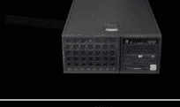

## 别做方形的！

变成立方体！


`3 Technologies`

`Innovation Solutions Group`

`309.34.CUBED`

`shopcubed.com`

### Gemini 2U 超高密度系列

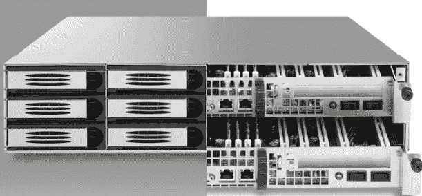

- 在 `2U` 机架内集成两个完全独立的系统
- 能够在同一机箱内运行两个不同的操作系统
- 最多支持 `16` 个 `CPU` 核心
- 最多支持 `12` 个热插拔 `SATA`、`SCSI` 或 `SAS` 硬盘
- 两个系统均支持 `RAID 0`、`1`、`5`、`6`、`10`、`50`
- 采用 `Opteron` 或 `Xeon` 多核处理器
- 每块主板最多支持 `64GB` 内存
- 每块主板提供一个可用的 `PCI-X` 或 `PCI-E` 插槽
- 高效交流（`AC`）和直流（`DC`）电源选项

#### 一机双系统

基于开放标准，`Gemini 2U` 优雅地在 `25` 英寸机箱内容纳了两块独立的主板，该机箱专门设计以便从背面轻松访问。


Gemini 2U 体现了交织电源与卓越环境规格的完美结合，具有显著更低的功耗、更低的热量和更小的噪音。令人惊叹的是，它完美适配于任何标准机架。从正面到背面，Gemini 2U 既强大又高效。

在开源系统（Open Source Systems）公司，我们理解您需要实用、可定制且经济实惠的解决方案，并且这些方案易于管理和维护。

如需更多信息并申请您的评估单元，请访问 [www.OpenSourceSystems.com](http://www.OpenSourceSystems.com)，或直接致电 866.664.7867。


### 3Com 开放服务网络平台

Doc Searls 和 `Linux` 社区对开放架构的呼吁正在获得良好的动力。一个典型的例子就是 `3Com` 的开放服务网络（`OSN`）平台，这是该公司基于开放、互操作、多供应商架构构建其网络解决方案的战略。`3Com` 方面表示，其理念是“让组织而非其网络供应商来选择最符合业务要求的应用，并以时效性和效率实施它们”。幸运的是，`OSN` 的一个关键组件是开源服务监控捆绑包，它利用了许多经过预测试和支持的基于开源的网络和服务管理应用程序，例如 `MRTG`、`NTOP`、`TShark` 和 `Nagios`。目前，该开源捆绑包可从 `3Com` 的网站下载。`www.3.com.com/osn`

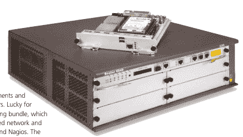


### John Brosnan 和 Kyle Copeland 的《TiVo 编程入门》（Wrox 出版社）

令远近各地的黑客们欣喜若狂的是，`TiVo` 使其流行数字视频录像机（`DVR`）产品的应用程序开发成为可能。由 John Brosnan 和 Kyle Copeland 撰写的《`TiVo 编程入门`》一书，旨在帮助希望获得“对构成 `TiVo` 应用程序的所有组件的全面理解”的程序员。该书使用实际的代码示例引导读者走完实施应用程序所需的步骤。Brosnan 和 Copeland 团队为 `HME` 设计了自己的应用程序，`HME` 是 `TiVo` 强大新开放应用平台的代号。最新的 `HME SDK` 可在 `tivohme.sourceforge.net` 找到。`www.wrox.com`

### Digiium 基于 Asterisk 的解决方案

当您读到这篇文章时，`Digiium` 将为您的基于电话系统的娱乐提供三种新的基于 `Asterisk` 的解决方案。首先是 `Digiium` 的 `TDM800P`，这是一款八路模拟电话接口卡，采用 `Digiium` 的 `VoiceBus` 技术，构建于单个 `PCI` 支架上以实现通用 `PCI` 兼容性。配合 `Digiium` 的 `Asterisk` 软件和标准 `PC` 或服务器，用户可以创建一种廉价且可扩展的电话解决方案，可与高端 `PBX` 平台相媲美。第二款产品是 `TE120P`，这是一款单路、可选择的 `T1`（24 通道）、`E1`（32 通道）或 `J1`（24 通道）卡，可同时路由语音和数据，消除了对外部路由器的需求。`TE120P` 还提供 `PBX` 和 `IVR` 服务，包括语音邮件、会议通话、三方通话和 `VoIP` 网关。最后但同样重要的是，这是适用于 32 位和 64 位 `Linux` 平台的基于软件的、符合 `G.168` 标准的高性能回声消除器（`HPEC`）。`HPEC` 在每通道基础上提供可配置尾部长度的回声消除：16ms（128 抽头）、32ms（256 抽头）、64ms（512 抽头）和 128ms（1,024 抽头）。`www.digiium.com`

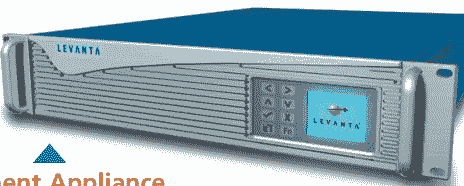

### Levanta Intrepid X Linux 管理设备

`Levanta` 团队最近推出了一款名为 `Intrepid X` 的新型 `Linux` 管理设备。`Intrepid X` 的目标是“具有高度可扩展性和任务关键性要求的大型 `Linux` 部门和数据中心”，它提供“按需功能、灾难恢复、系统可移植性、完整的变更控制、无人值守的活动/被动故障切换，以及基于 `RPM` 的 `Linux` 环境中与 `iSCSI` 或光纤通道 `SAN` 的互操作性”。`Levanta` 表示，那些已经管理虚拟存储并希望通过 `Linux` 利用其 `SAN` 来获得速度、可移植性、可管理性和灾难恢复优势的客户将受益。`Intrepid X` 可以与不同类型的 `SAN` 存储配对，包括 `EMC`、`HDS`、`IBM` 和其他公司的产品。此外，用户可以通过一个界面管理运行在 `VMware` 虚拟机中的 `Linux`，以及物理和虚拟环境。

`www.levanta.com`

### KDevelopment 团队的 KDevelop

雄心勃勃的 `KDevelopment` 团队发布了 `KDevelop 3.4` 版本。`KDevelop` 是一个强大的、语言无关的、用户友好的集成开发环境——它不仅用于编程 `KDE` 应用程序。3.4 版本是一年多来的首次新发布，修复了 500 多个错误并增加了一些新功能。新功能包括改进的 `Qt 4` 支持、新的调试能力、增强的默认用户界面布局、`C++` 改进以及对 `Ruby` 和 `PHP` 的支持。`Kubuntu` 和 `OpenSUSE` 提供官方的 `KDevelop` 软件包；其他发行版也有非官方构建版本。我们的一家同行 `Linux` 媒体最近称 `KDevelop` 是 `Linux` 平台上最重要的“杀手级应用”之一。

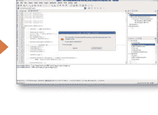

`www.kdevelop.org`

### Fluento 为开源系统提供的媒体编解码器

来自西班牙、名字颇具韵味的公司 `Fluento` 最近为 `Linux` 和 `Solars` 桌面及服务器平台发布了专有的 `Windows Media Player`（音频、视频、`MMS` 流媒体协议）、`MPEG-2` 和 `MPEG-4` 编解码器。`Fluento` 表示，“与 `Microsoft` 和 `MPEG LA` 的协议”使该解决方案脱离了其他编解码器所处的法律模糊地带。`Fluento` 的编解码器与 `GStreamer` 多媒体框架紧密集成，支持 `Totem`、`Elisa`、`Jokosher`、`Rhythmbox` 和 `Banshee` 等应用程序。`Fluento` 将在 2007 年期间发布更多编解码器；现有的编解码器可从 `Fluento` 的网站购买。


`www.fluento.com`

### Netfirms 商务/企业级 Web 托管账户

尽管许多 `Web` 托管公司允许您选择在 `Linux` 或 `Windows` 上托管您的网站，但 `Netfirms` 声称它是第一家在单个账户框架下统一这两个平台的公司。通过其商务和企业级托管账户系列，`Netfirms` 在 `Windows Server 2003` 网格上原生运行基于 `Windows` 的应用程序，并在 `Linux` 服务器网格上原生运行基于 `Linux` 的应用程序。“这两个平台通过专有集群技术统一起来，”`Netfirms` 表示，“允许客户通过单一控制面板透明地管理两者。”`Netfirms` 的多合作伙伴服务器技术通过 `Microsoft` 托管合作伙伴计划提供基于 `Windows` 的功能，包括 `ASP.NET`、`Classic ASP` 和 `Microsoft SQL Server`。在 `Linux` 端，完整的 `LAMP` 栈（`Linux`、`Apache`、`MySQL` 和 `PHP`）可用。这两个系列涵盖了根据客户需求广泛不同的托管选项。


`www.netfirms.com`

## 快评

### MySQL 值得再次审视


你对 `MySQL` 的无知可能会伤害到你。REUVEN M. LERNER

1995 年初，当 `Windows 95` 还只是纸上谈兵，而 `Red Hat` 还是作为 `Slackware` 的用户友好型替代方案的新兴力量时，我在媒体巨头时代华纳的“`Pathfinder`”网站工作。和所有媒体公司一样，时代华纳意识到网络即将腾飞，但不确定具体会以何种方式发生。

因此，公司聘请了一群程序员和设计师，并给了我们机会去尝试不同类型的设计和应用程序。这是一份很棒的工作，那里有一些富有创意、聪明且有趣的人。在我在那里的期间，我创建了各种各样的应用程序——测验、邮件自动回复器、游戏、搜索引擎，甚至还有一个个性化的《金钱》杂志“最佳城市”排行榜。


随着我构建的应用程序变得越来越复杂，很明显，我经常用于数据存储和检索的文本文件对于像我们这样庞大且受欢迎的网站来说，既不够高效也不够灵活。最终，有人向我介绍了我们新雇用的数据库专家，他教会了我关系型数据库和 `SQL` 的奥妙。我迷上了它，并享受着与已安装的数据库服务器合作。

当我想在我家里的 `Linux` 机器上享受 `SQL` 带来的好处时，不幸的是，我的选择有限。我找到了许多被放弃的开源数据库项目，但没有一个像时代华纳的 `Sybase` 服务器那样强大，甚至不在同一级别。所以，你可以想象当我发现 `MySQL` 时的喜悦。不，它并没有做 `Sybase` 所做的所有事情，而且它不是在开源许可下发布的。但是，它是免费的，易于安装，并且拥有足够多的功能让像我这样的人来说基本满意。

互联网服务提供商也有类似的感觉，并开始将其安装到他们的系统中——最初是作为相对于竞争对手的优势，然后是因为其他所有人都在基本配置中包含了它。快进十多年，`MySQL` 是目前广为人知的开源关系型数据库。我曾在他们还是仅有的两名全职 `MySQL` 程序员时见过蒙蒂·维德纽斯（`Monty Widenius`）和大卫·阿克马克（`David Axmark`），如今他们位于大型企业金字塔的顶端。

`MySQL AB` 现在在 `GNU` 通用公共许可证（`GPL`）下分发其产品，同时也为有需要的人提供闭源许可。一如既往，它运行在大量不同的操作环境上。并且，它仍然由世界各地的人们以狂热的发展速度进行开发，这些人提交补丁和建议。这是关于开源数据库系列文章中的第一篇。

在这个月里，我讨论 `MySQL`，包括其使用、功能和问题。下一篇文章将包含对 `PostgreSQL` 的类似分析，而该系列的第三篇文章将比较这两种数据库。

`MySQL` 的近期版本还提供了创建存储过程或函数的能力，这既提高了速度，又对常用函数提供了集中控制。

### 从 MySQL 开始

`MySQL` 的著名特点之一是人们可以轻松地开始使用它。事实上，当你将 `MySQL` 与许多商业数据库进行比较时，它出奇地简单。你安装它（通常使用 `RPM` 或 `Deb` 包，但从源代码编译也很简单），并使用 `safe_mysql` 启动数据库服务器。（你也可以使用普通的 `mysqld` 命令，但那样你就无法享受 `safe_mysql` 提供的一些幕后维护功能。）

一旦启动服务器，你可以创建一个或多个数据库。（我承认，称 `MySQL` 为数据库有点令人困惑，因为它实际上是一个数据库服务器，允许你创建一个或多个数据库。每个数据库包含一个或多个二维表格。）要创建数据库，请使用 `mysqladmin` 程序：

```
mysqladmin create testdb
```

根据你的配置，上面的命令很可能顺利执行——特别是如果你以 `Linux` 下的 `root` 用户身份登录。但是，你的系统管理员可能（明智地）决定为 `MySQL root` 用户设置密码，在这种情况下，你需要键入：

```
mysqladmin -p create testdb
```

`-p` 选项告诉 `mysqladmin` 你想为该账户输入密码。你也可以使用 `-u` 选项指定 `root` 用户或任何其他用户，例如：

```
mysqladmin -u mysqlroot -p create testdb
```

创建数据库后，你就可以使用 `mysql` 客户端程序连接到它：

```
mysql -u mysqlroot -p testdb
```

注意，我又一次指定了用户名并且希望输入密码。我将在下面回到权限的主题；目前，我们假设这种组合有效。

在客户端中，你可以发出任何你想要的 `SQL` 命令，它将立即执行。例如，我们可以创建一个新表：

```
CREATE TABLE Classes {
    class_name TEXT NOT NULL,
    room_number INTEGER NOT NULL,
    starting_date DATE NOT NULL,
    ending_date DATE NOT NULL,
    instructor TEXT NOT NULL,
    PRIMARY KEY(class_id)
};
```

上述表的一个问题是它缺乏唯一的主键。这使得从另一个表引用 `Classes` 表变得困难。我们可以使用大学注册系统分配给班级的名称，但没有保证这是唯一的。此外，明年提供同名班级时，我们将怎么办？因此（出于其他原因之一），创建“人工”主键是惯例，其目的是在数据库中唯一地标识一行。

在 `MySQL` 中，使用 `AUTO_INCREMENT` 关键字可以最简单地实现这一点。例如：

```
CREATE TABLE Classes {
    class_id INTEGER AUTO_INCREMENT,
```

如果我们愿意，我们可以向 `Classes` 插入一行，其中 `class_id` 具有显式的整数值。`class_id` 被定义为主键的事实意味着它既被索引又保证唯一。但是，如果我们未输入 `class_id` 的显式值，`MySQL` 会向该列插入一个新值，为我们提供新班级的主键值，而无需我们自己计算。

上面的表定义展示了 `MySQL` 提供的众多数据类型中的几种。`MySQL` 提供许多传统的数据类型，如 `NUMERIC` 和 `VARCHAR`，但也包含一些有符号和无符号的数字类型（例如，`TINYINT`, `SMALLINT`, `MEDIUMINT`, `INT` 和 `BIGINT`），一些 `CLOB`/`BLOB` 类型（如，`CHAR`, `BINARY`, `BLOB` 和 `TEXT`），以及几个与日期和时间有关的类型（`DATE`, `DATETIME` 和 `TIMESTAMP`）。还有 `ENUM` 和 `SET` 类型，允许你处理非标准的枚举数据集。`MySQL` 还提供了各种运算符，从简单的字符串连接，到日期提取，再到我最喜欢的之一，`CASE` 语句，它允许你在查询内部放置 `if-then` 逻辑。

此外，`MySQL` 提供全文搜索系统。这意味着你可以在表的 `TEXT` 列中存储文本，然后识别该列（并检索文本），而无需自己建立索引。


如果内置的函数套件不适合你的需求，你始终可以编写自己的。`MySQL` 的近期版本也提供了创建存储过程或函数的能力，这既提高了速度，又对常用函数提供了集中控制。存储过程也可以在特定事件发生时自动调用，这在数据库术语中称为触发器。你还可以用 `C` 或 `C++` 编写新的函数，在运行时加载到 `MySQL` 中。

#### 表类型

到目前为止，`MySQL` 听起来像是一个很好的、灵活的关系型数据库。然而，你可能会惊讶地发现，在开源和数据库社区中存在大量的压抑已久的沮丧，甚至对 `MySQL` 的敌意。只需查找 `Slashdot` 上关于 `MySQL` 的最近故事，你就会看到许多评论表明 `PostgreSQL`、`Firebird` 或几乎任何其他选择都会是更好的解决方案。

这部分源于计算机世界悠久的竞争传统，特别是在开源社区。多年来，我们见证了 `Emacs` 和 `vi`、`Perl` 和 `Python`、`Linux` 和 `BSD` 以及无数其他配对之间的斗争。

但是，对 `MySQL` 的敌意部分源于作者早期做出的几个设计决策。例如，旧版本 `MySQL` 的文档说外键其实是不必要的，这种完整性检查可以（也应该）在处理层而不是数据库中处理。许多有经验的数据库专家看到这一点，不知道该笑还是该哭。使用数据库的主要原因是其可靠性，而不是速度，添加外键检查是提高插入数据可靠性的简单方法。

同样，旧版本的 `MySQL` 未能锁定表。如果你想确保没有人向你正在读取的表（或你正在写入的表）写入，你需要在应用层显式锁定表。鉴于多年来对行级锁定的研究（以及更先进的系统，如多版本并发控制），这使许多人认为这是一步倒退。`MySQL` 解决这些问题的方法很新颖。它没有将这些功能添加到现有（`MyISAM`）表结构中，而是使其能够从多种不同的表结构中进行选择，每种结构都有自己独特的权衡。正如 `Linux` 系统管理员可以从各种文件系统中进行选择一样，`MySQL` 管理员和程序员也可以从几种不同的存储引擎中进行选择。

当然，这种方法有一些问题。从我的角度来看，最大的问题是 `MyISAM` 仍然是默认存储引擎，这意味着许多用户实际上因为无知而选择没有外键和复杂锁定。许多其他存储引擎似乎用途有限或针对特定应用，如 `MEMORY`（用于内存数据库）、`BDB`（基于 `Berkeley DB`）的表，甚至 `FEDERATED`（用于远程服务器上的表）。

一个非常流行的存储引擎 `InnoDB` 与其相关的一个不同问题——开发 `InnoDB` 的公司今年早些时候被 `Oracle` 收购。由于 `Oracle` 继续以 `GPL` 提供 `InnoDB`，这可能会使 `MySQL` 的开源分发不受影响。但是，鉴于商业级工具箱的重要部分现在由主要数据库竞争对手拥有，这引发了一些关于 `MySQL` 商业版本的问题。

多年来，人们一直称赞 `MySQL` 在服务器几乎或没有调优的情况下的高速性能。事实比那更模糊，虽然 `MySQL` 无疑是一个快速的数据库，许多测试是使用 `MyISAM` 表进行的，由于缺乏锁定和完整性检查，它们本质上更快。（作为一个类比，我经常说，不锁门就离开家会更快，但额外的速度通常不值得冒这个风险。）

#### 可扩展性


MySQL 近期版本的许多功能都旨在面向企业客户，其许可购买正在推动 `MySQL` 的发展。数据库管理员面临的最大瓶颈之一，特别是随着数据增长，是磁盘速度。因此，`MySQL` 的近期版本提供了表空间（即按表分配磁盘空间）和分区（即将表划分到多个文件系统上）。表空间仅适用于 `InnoDB` 表，但分区适用于所有存储引擎。此外，可以根据列值对表进行分区，使用哈希函数决定特定行应放置在哪个分区中。

`MySQL` 的另一个重要方面是复制和备份。这些是企业客户至关重要的功能，他们需要数据始终可用，并能在通知后即时获取备份。最新版本的 `MySQL` 改进了复制引擎，使其更加灵活，甚至可能按行复制表。

另一个我期待已久的功能是 `Unicode` 支持。虽然并非所有字符串和正则表达式操作都支持 `Unicode`，但对于从事多语言工作的人来说，这是一个巨大的福音。

#### 社区

`MySQL` 最大的资产或许是一个非常大且非常活跃的用户和开发者社区。`MySQL` 相关的书籍、网站、邮件列表、帮助论坛和代码片段的数量令人震惊。

`MySQL AB` 本身一直在做令人钦佩的工作，定期更新文档，并以惊人的速度推进新功能。（这表明虽然开源软件通常可以由志愿者编写，但让有偿专业人士参与项目可以大大加快其进程。）特别是，我对在线文档印象深刻，它不仅包含大量示例，还巧妙地放置了相关主题的链接。

### 结论

自十多年前我开始使用 `MySQL` 以来，它已经成长了很多。它的一些怪癖，如默认使用 `MyISAM` 表，继续惹恼希望看到到处都有事务和外键的严肃数据库用户。但是，特别是随着 `5.0` 和 `5.1` 版本，`MySQL` 看起来像一个可以宣传其严肃功能深度，而不是仅仅宣称其主要优势是速度的数据库。

`Reuven M. Lerner，资深网络数据库顾问，是西北大学学习科学博士候选人，位于伊利诺伊州埃文斯顿。他目前与妻子和三个孩子住在伊利诺伊州斯科基。你可以在 allread.me/lerner.cu 阅读他的网志。`

## servers-direct

直达源头！

更多产品，更优服务，保证品质。

### 让您的业务平稳运行

使用您的 `ServersDirect` 服务器中双核英特尔® 至强® 处理器内置的安全增强功能，保护您的小型企业


#### 小型企业的大型解决方案

英特尔® 服务器计算刀片 `SBXD132`

简化您的数据中心管理

- 高性能刀片服务器，具备内存和 IO 扩展选项
- 提升性能、每瓦性能、运营效率、部署灵活性并简化管理
- 优化机架空间，大幅减少布线，并降低总体拥有成本


##### SDR-5015M-T+B

1U 入门级服务器

##### SDR-2501T

2U 应用服务器

##### SDR-3500T

3U 数据库服务器

##### SDR-5500T

5U 高级存储服务器


**具有成本效益的 1U 入门级服务器**

可选支持 `Core 2 Duo` 处理器

- 支持 `Xeon®` 3000 系列、`Pentium® D`、`Pentium 4`、`Pentium Extreme`
- 最高支持 `8GB` 无缓冲 `ECC` / 非 `ECC` `DDR2` `667/533MHz` `SDRAM`
- `2` 个 `1` 英寸热插拔 `SATA` 驱动器托架
- `1` 个 `Intel® 82573L` `PCI-e` 千兆局域网
- `300W` 电源

**起始价格 $999**

**具有成本效益的 2U 服务器**

应用服务器

- 支持双路英特尔® `64` 位 `Xeon®` 四核或双核，配备 `667` / `1066` / `1333` `MHz` `FSB`
- 最高支持 `16GB` `DDR2` `667` & `533` `SDRAM` 完全缓冲 `DIMM` `(FB-DIMM)`
- `6` 个 `1` 英寸热插拔 `SATA` 驱动器托架
- `Intel® (E852/Gigab) 82563EB` 双端口千兆以太网控制器
- `600W` 电源

**起始价格 $1,299**

**3U 服务器支持高可用性**

存储和关键业务应用

- 支持 四核 & 双核英特尔® `64` 位 `Xeon®`，`667` / `1066` / `1333MHz` `FSB`
- 最高支持 `64GB` `DDR2` `667` & `533` `SDRAM` 完全缓冲 `DIMM` `(FB-DIMM)`
- `16` 个 `1` 英寸热插拔 `SATA` 驱动器托架
- `Intel® (E852/Gigab) 82563EB` 双端口千兆以太网控制器
- 冗余 `800W` 电源

**起始价格 $2,099**

**5U 存储服务器，适合电子邮件、**

数据库或其他高容量需求

应用。支持高达 `18TB` 的驱动器

- 支持 四核 & 双核英特尔® `64` 位 `Xeon®`，`667` / `1066` / `1333MHz` `FSB`
- 最高支持 `32GB` `DDR2` `667` & `533` `SDRAM` 完全缓冲 `DIMM` `(FB-DIMM)`
- `24` 个 `1` 英寸热插拔 `SATA` 驱动器托架
- `Intel® (E852/Gigab) 82563EB` 双端口千兆以太网控制器
- `950W` 三重冗余电源

**起始价格 $3,799**

### SERVERS DIRECT 可帮助您配置下一个高性能服务器系统 - 今天联系我们！

我们灵活的在线产品配置器允许您获取定制解决方案，或者致电，我们的产品专家随时为您提供帮助，以组装需要额外配置的系统。`Servers Direct` - 您可靠的、具成本效益的服务器解决方案直接来源。

`1.877.727.7887` | `www.serversdirect.com`

`Intel`、`Intel 标志`、`Intel Inside`、`Intel Inside 标志`、`Intel Centrino`、`Intel Centrino 标志`、`Opteron`、`Intel Xeon`、`Intel SpeedStep`、`Itanium`、`Pentium` 和 `Pentium IN Xeon` 是 `Intel Corporation` 或其子公司在美国和其他国家的商标。


## 安全


#### 单包授权

单包授权填补了端口敲击的空白。`迈克尔·拉什`

无数的软件、协议和复杂的相互依赖性共同构成了一个系统，很难保证其具有任何特定属性——尤其是安全性。即使是专门设计用于增强安全的软件，在拥有详细知识的聪明人指使下，也可能对其造成损害。从防火墙到 `Secure Shell (SSH)` 协议实现的各种安全软件中都已发现漏洞。例如，`OpenSSH` 是由世界上最具安全意识的一些开发人员开发的，但它偶尔也会包含可远程利用的漏洞。这是一个值得注意的重要事实，因为它似乎表明实现安全性是困难的，因此加强了对纵深防御方法的论据。本文探讨了单包授权 `(SPA)` 的概念，将其作为超越端口敲击的下一代被动身份验证技术。

当伺机而动的攻击者尝试利用服务器软件（而非客户端软件）中的漏洞时，第一步是侦察；攻击者需要定位目标。`Nmap` 已经出色地自动化了这一过程，因此很容易构建出可能被攻破的目标系统列表。如果攻击者找到了您正在运行的服务器软件中的零日漏洞，您不希望出现在这个目标列表中！端口敲击和单包授权都使用配置为默认拒绝状态的包过滤器，同时仅向那些能够通过被动机制证明其身份的 `IP` 地址提供服务。通过这种被动方式认证远程 `IP` 地址不需要访问 `TCP/IP` 协议栈。即使受此方式保护，`Nmap` 甚至无法检测到服务器正在运行，即使攻击者拥有零日漏洞也无济于事。

本文是关于单包授权的两部分系列文章的第一篇，它为单包授权奠定了理论基础，并解释了为什么它是超越端口敲击的下一代被动授权技术。下一篇文章将详细介绍如何使用 `Finkpop` 为您的 `SSH` 守护进程提供单包授权保护。

#### 端口敲击简介

端口敲击是一种第一代技术，它使用 `TCP` 和 `UDP` 数据包头部中的端口字段来传输信息。通常，这些协议用于封装应用层数据，但端口敲击通过使用端口号本身作为字段来传输数据，从而在发往各个端口的数据包序列中编码信息。这些数据包通常是通过防火墙日志监控或通过数据包捕获机制（如 `libpcap`）进行监控的。通常，存在一个端口敲击客户端和一个端口敲击服务器。在这种情况下（除非另有说明，本文其余部分亦然），术语客户端和服务器分别指发送和监控数据包软件组件。客户端负责生成端口序列，服务器负责被动收集序列，并在收到有效序列后重新配置包过滤器以允许连接到受保护的服务。


典型的端口敲击场景是端口敲击服务器配置包过滤器，阻止对服务（如 `SSH`）的所有访问，直到端口敲击客户端发送特定的端口敲击序列。例如，服务器可能要求客户端按以下顺序向以下端口发送 `TCP SYN` 包：

- `23400`
- `1001`
- `2003`
- `65501`

如果服务器监控到这个敲击序列，包过滤器将重新配置以允许来自发送该序列的 `IP` 地址的 `SSH` 连接。通过利用包过滤器提供的连接跟踪机制（例如 `Netfilter` 中的 `conntrack` 模块），在敲击服务器创建的初始规则在超时后被移除之后，`SSH` 会话可以保持建立状态。端口敲击序列可以加密，并在 [`www.portknocking.org`](www.portknocking.org) 上列出了许多实现。关于端口敲击操作的图形表示，请参阅图 1。


#### 端口敲击的局限性

端口敲击在限制对服务的访问方面提供了一些实际好处，但局限性在哪里潜伏？首先，很明显加密敲击序列很重要，而这反过来意味着必须传输几个字节的信息。对于对称密码系统，加密数据至少与块大小一样大（对于为高级加密标准选择的 `Rijndael` 对称分组密码为 128 位）。对于非对称密码系统，加密数据将大得多。

例如，`GnuPG` 使用的原始 `ElGamal` 算法在加密数据时会加倍明文大小。尽管 `GnuPG` 还利用压缩（有时可以将密文大小减小到低于明文原始大小），但 `GnuPG` 密钥通常较大的密钥大小意味着即使是最小消息的密文也将达到数百字节。

### 安全性

这远远超出了通过端口敲门所能实现的数据传输速率，并且能够轻松访问如此大量的数据包数据，开启了海量的可能性。

传输数据。然而，即使使用其他字段，其数据传输量仍远不及使用数据包载荷。因此，对于块密码而言，加密序列必须至少包含 $B/2 \times 8$ 个数据包，其中 $B$ 是以位为单位的块大小。单独来看，考虑到当今网络的一般速度和可靠性，这并不算太糟糕，但真正的问题在于乱序交付。

对混乱的数据进行解密会导致混乱的结果，并且由于端口敲门客户端和服务器之间没有“连接”（`TCP` 意义上的连接）的概念，服务器无法对乱序数据包进行重新排序。

数据包可能会经过不同的路由路径，其中一些路径可能很慢。因此，客户端必须依赖一种人工机制来尽量减少乱序交付的可能性：时间。通过在敲门序列中的每个数据包之间引入时间延迟，例如大约半秒，当数据包到达服务器时，通常可以保持数据包顺序。现在，对于 128 位的块大小，对应的端口敲门序列为 $128/(2^8) = 8$ 个数据包。如果计入半秒的延迟，仅传输该序列就需要四秒钟。对于更长的消息，例如非对称密码生成的消息，这种数据传输速率根本不具备实用性。

数据传输能力有限引入了端口敲门方案的另一个限制。很难有效防止重放攻击。任何能够监控从客户端发送到服务器的敲门序列的人，都可以自由地将该序列重放给服务器，以试图获得相同的访问权限。如果序列通过 `NAT` 设备发送，并且服务器端数据包过滤器允许通过的源 `IP` 是外部 `NAT` 地址，那么这个问题尤为重要。例如，如果端口敲门客户端位于 `RFC 1918` 子网（例如 `10.10.1.0/24`），而端口敲门服务器位于仅可通过公开互联网访问的远程网络上，服务器必须允许访问该 `NAT IP` 地址。同一子网上任何能够重放序列的人都将被授予相同级别的访问权限。此外，只要该规则存在，同一子网上的任何人在规则实例化以接受来自 `NAT` 地址的连接后，都将获得相同级别的访问权限（在这种情况下不需要重放序列，这一点对于 `SPA` 同样适用）。

关于传统端口敲门的文献资料已经提出了各种试图解决重放问题的方案，例如将时间作为重要因素、使用 `Skey` 风格的哈希函数迭代，甚至在每次使用后更改加密密钥。然而，这些方法中的每一种都需要端口敲门客户端和服务器维护某些状态，当涉及多个用户时，扩展性较差。

端口敲门的另一个限制是，恶意第三方极其容易通过伪造一个额外的数据包到端口序列中，从而破坏敲门序列，当该序列由客户端通过网络发送时。攻击者只需将数据包的源地址设置为与真实客户端相同的地址，并选择与客户端发送的最后一个数据包相同的端口号即可。这个额外的数据包会破坏敲门序列，因此服务器不会允许合法客户端获得额外访问权限。虽然实际有人这样做的可能性相对较小（他们仍需能够监控从客户端发出的数据包），但主要问题在于这种攻击极其容易执行。只需一个数据包就足够了，而且攻击者甚至不需要位于原始数据包路径的中间。

最后，任何能够监控客户端和服务器之间流量的入侵检测系统（`IDS`）都可以轻松地将敲门序列检测为端口扫描。这对于加密的敲门序列尤为如此，因为它们往往比简单的共享序列更长。对于 `IDS` 来说，端口敲门看起来就像在相对短的时间内从单个 `IP` 地址对各个端口进行的一系列探测，这完美符合端口扫描的定义。

#### 单包授权

上述讨论的最终结果是，端口敲门提供了一些增强安全性的实际好处，但也需要解决一些严重的限制。单包授权（`SPA`）是一种相对较新的协议，它保留了端口敲门的所有优点，但修复了上述提到的限制。第一个公开可用的 `SPA` 实现是 2005 年 5 月发布的名为 `fwknop`（[www.cipherdine.org/fwknop](www.cipherdine.org/fwknop)）的软件。`fwknop` 最初创建于 2004 年，是第一个结合被动 `OS` 指纹识别和端口敲门的实现（这使得可以做到诸如“仅接受来自 `Linux-2.4` 系统的敲门序列”之类的事情），但目前 `SPA` 方法是 `fwknop` 提供的最流行（且默认）的认证方法。请注意，`fwknop` 提供认证和授权。关于这两者之间区别的详细讨论超出了本文的范围。

单包授权强制采用与端口敲门类似的架构。客户端和服务器组件都由服务器管理，服务器控制一个默认丢弃的数据包过滤器，并且服务器被动地监控数据包。然而，端口敲门和 `SPA` 在架构上的相似性到此为止。

单包授权将数据传输移到了其应有的位置——应用层。这意味着，与端口敲门只能每包发送两个字节数据不同，`SPA` 能够在每个数据包中在客户端和服务器之间发送多达最小 `MTU` 的数据（在以太网网络上是 1,500 字节）。这远远超出了端口敲门所能实现的数据传输速率，并且能够轻松访问如此大量的数据包数据，开启了海量的可能性。本文的其余部分讨论 `fwknop` 实现的单包授权。

`fwknop` 在应用层定义了以下数据包格式：

- 16 字节随机数据
- 客户端用户名
- 客户端时间戳
- `fwknop` 版本
- 模式（访问或命令）
- 访问（或命令字符串）
- `MD5` 校验和

`SPA` 数据包格式中的许多字段长度是可变的，但由 ``:` `` 字符分隔（字段是 `base64` 编码的，因此嵌入的冒号不会破坏此语法）。一旦 `fwknop` 客户端构建了上述数据包格式，整个数据包将使用两种加密算法之一进行加密：使用 128 位共享密钥的 `Rijndael` 对称块密码，或由 `GnuPG` 生成的最多 2,048 位公钥/私钥对的非对称 `ElGamal` 算法。默认情况下，`fwknop` 客户端通过 `UDP` 端口 `62201` 发送 `SPA` 数据包，但这可以轻松地从命令行更改；请参阅 `--Server-port` 参数。（`fwknop` 提供许多配置选项——请参阅“资源”部分以获取文档和手册页的链接。）要了解 `SPA` 操作的图形表示，请参见图 2。

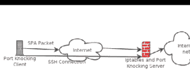

那么，所有这些字段是做什么用的？首先，16 字节的随机数据解决了端口敲门中优先级最高的限制之一——重放问题。每个 `SPA` 数据包在加密前都会在其前面添加 16 字节随机数据，然后在 `fwknop` 服务器成功解密后，整个数据包的 `MD5` 校验和会被缓存。随机数据确保每个 `SPA` 数据包都不同（即使发送相同的访问指令），因此每个数据包的 `MD5` 校验和也有很大的概率不同。如果新数据包的 `MD5` 校验和与之前数据包的校验和匹配，`fwknop` 服务器将不采取任何行动，并将一条警告消息写入 `syslog`。因此，被第三方截获的任何 `SPA` 数据包都无法在网络中重放，以试图通过默认丢弃的数据包过滤器获得访问权限。客户端用户名和时间戳由 `fwknop` 放入数据包中，用户名被 `fwknop` 服务器用于为远程用户维护不同的授权级别。`fwknop` 可以安装在多服务器系统上，并且每个用户可以由远程 `fwknop` 服务器授权连接到不同的服务。`fwknop` 版本字段用于维护向后兼容性。`fwknop` 的新版本中可以增加或删除字段，但通过使用版本号，`fwknop` 服务器可以保持与旧客户端构建 `SPA` 数据包方式的兼容性。模式字段告诉 `fwknop` 服务器客户端是想要访问服务还是执行命令（具体的访问控制指令或命令在下一个字段中）。例如，要获得 `TCP` 端口 `22` 的访问权限，访问字段将包含字符串 `<IP>.tcp/22`，其中 `<IP>` 是客户端选择放入数据包的任何 `IP` 地址。最后，`MD5` 校验和字段包含客户端传输前未加密数据包的 `MD5` 校验和。服务器在解密后使用此值来验证消息完整性。


我们已经看到，通过 `SPA` 数据包传输的数据量增加解决了重放问题以及端口敲门方案中极低的数据传输速率。我们需要解决端口敲门的另外两个限制。首先，`SPA` 协议的单包特性意味着恶意第三方无法仅通过向正在监控 `SPA` 数据包发送的相同端口伪造一个数据包来破坏认证方案。最后，由于 `SPA` 协议只需要一个数据包，它对于任何中间 `IDS` 都不像端口扫描。任何 `IDS` 所能看到的只是一个看似随意发送到某个 `IP` 地址的不可识别的数据块。

### 结论

单包授权在保护通过配置为默认丢弃模式的数据包过滤器保护的服务方面，提供了与端口敲门相似的安全好处。扫描以此方式保护的目标服务的任何人将无法检测到该服务正在监听，这使得即使是利用零日漏洞也变得更加困难。`SPA` 为端口敲门实现中的许多限制提供了优雅的解决方案。这使得 `SPA` 能够解决重放问题，实现使非对称加密成为可能的数据传输速率，挫败简单的欺骗攻击，并保持不被监控网络以进行端口扫描的入侵检测系统发现。下个月的 `Linux Magazine` 将刊登本文的第二部分，详细展示如何使用 `SPA`。

`Michael Rash` 拥有马里兰大学应用数学硕士学位，专攻计算机安全。`Michael` 是 `cipherdyne.org` 的创始人，该网站致力于 `Linux` 系统的开源安全软件，他担任 `Linux` 网络 `Dragon` 入侵检测系统的安全架构师。他即将出版的书籍 `Linux Firewalls: Attack Detection and Response` 将由 `No Starch Press` 出版。

### 资源

`Krysinski, M.` 2003. “Port Knocking: Network Authentication Across Closed Ports”. `SysAdmin Magazine` 12: 12–17.

`ElGamal` 加密：[en.wikipedia.org/wiki/ElGamal_encryption](en.wikipedia.org/wiki/ElGamal_encryption)

据我所知，截至本文撰写时，只有一个其他的 `SPA` 实现，可在 [www.unspecific.com/spa](www.unspecific.com/spa) 获取。

另一个名为 `Tumbler` 的实现（[tumbler.sourceforge.net](tumbler.sourceforge.net)）使用单个数据包，但它使用哈希负载而不是加密负载，这导致了显著不同的架构。

`fwknop` 文档和手册页：[www.cipherdyne.org/fwknop/docs](www.cipherdyne.org/fwknop/docs)

### `eCryptfs`：一个堆叠式加密文件系统

`Linux` 内核中一个新的加密文件系统采用了堆叠技术。

**`MIKE HALCROW`（迈克·哈尔克劳）**

媒体一直在报道来自政府和机构设施的丢失或被盗笔记本电脑、备份磁带、硬盘和服务器等设备的报告。这些设备通常包含医疗、金融和其他敏感数据。当存储设备落入错误的人手中时，攻击者可以直接访问数据，完全绕过组织网络中实施的访问控制机制。报告表明，数百万人已经受到此类安全泄露的影响。因此，客户和公民面临越来越大的身份欺诈和隐私丢失风险。

尽管保护数据机密性的加密技术已经存在了几十年，但许多组织未能将这项技术整合到其处理敏感数据的流程中。在加密被纳入该流程的情况下，它通常具有侵入性、成本高且复杂的特点。组织有时会忽视制定数据加密策略，而员工一旦这些策略制定到位，往往会忽略它们。

当员工尝试使用加密时，他们通常使用得无效。例如，他们经常选择弱密钥，并且很容易通过不安全的介质（如网络电子邮件或 `USB` 闪存盘）无意保存或传输未加密形式的数据。依赖单个应用程序自行执行加密的安全策略，当用户将敏感信息复制粘贴到不具备加密能力的其他应用程序时，往往失败。

数据加密需要成为普遍存在的、透明的、灵活的、易于部署的，并集成到数据处理流程中，当然，它必须足够安全以抵御复杂的攻击。无论访问数据的特定应用程序是什么，这些属性都需要生效。为了使加密服务与应用无关，操作系统内核本身应为写入二级存储的敏感信息提供系统级的数据加密服务。

#### 流行的加密文件系统解决方案

`Linux` 下有流行的文件系统加密选项，它们各有优缺点。设备映射加密（`dm-crypt`）随 `Linux` 内核附带，提供块设备层加密。`Loop-AES` 和 `TrueCrypt` 必须从官方 `Linux` 内核单独获取，它们也在块设备层提供加密。在块设备层加密中，用户在块设备上创建文件系统，加密层在将数据写入实际下层块设备之前透明地加密数据。

块设备层加密的主要优点是概念和实现简单。块设备层加密的另一个优点是，除非攻击者拥有密钥，否则他们无法了解任何关于文件系统的信息；例如，攻击者甚至不知道文件系统的类型或目录结构。在加密块设备上的文件系统中，稀疏文件可以得到安全且高效的支持。

块设备加密可能存在源自于未与文件系统本身集成的缺点：

- 必须预先为整个文件系统分配固定大小的存储区域。随后调整分区大小往往是一个不便的过程。
- 更改加密密钥或密码可能很困难。
- 块设备加密机制缺乏灵活性，无法使用不同的密钥或密码加密不同的文件。
- 诸如增量备份实用程序之类的应用程序需要访问未加密的数据。
- 文件系统中的所有内容都产生加密和解密的开销，包括不需要保密的数据。
- 文件在通过另一种介质传输之前必须使用用户空间应用程序重新加密。

`EncFS` 是一个通过 `FUSE` 操作的用户空间加密文件系统。用户空间文件系统比内核原生文件系统更容易实现，并且具有易于利用用户空间库的优势。这使得开发者能够以更少的时间和精力实现功能丰富的文件系统。与块设备加密解决方案不同，`EncFS` 作为一个实际的文件系统运行。`EncFS` 对单个文件进行加密和解密。基于 `FUSE` 的用户空间文件的缺点包括由于频繁的内核/用户空间上下文切换而产生的性能开销，以及目前不支持共享可写内存映射。

#### `eCryptfs`

`eCryptfs` 是 `Linux` 的一个内核原生堆叠式加密文件系统。堆叠文件系统位于现有已挂载文件系统（称为下层文件系统）之上。`eCryptfs` 是一个堆叠文件系统，它在文件写入下层文件系统或从中读取时对其进行加密和解密。

用户空间中的应用通过内核虚拟文件系统（`VFS`）发起文件系统系统调用。`eCryptfs` 和下层文件系统（例如 `ext3`、`JFS`、`NFS` 等）都注册在内核 `VFS` 中。在 `eCryptfs` 挂载点下的操作首先发送到 `eCryptfs`。`eCryptfs` 从用户会话密钥环中检索密钥材料，并使用内核加密 `API` 执行文件内容的加密和解密。`eCryptfs` 可以向用户空间 `eCryptfs` 守护进程（`ecryptfsd`）发出密钥管理请求。`eCryptfs` 读取和写入存储在下层文件系统文件中的加密内容（图 1）。

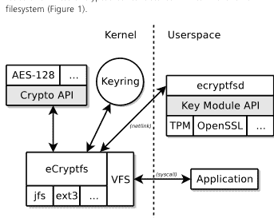

*应用程序文件操作通过 `eCryptfs`，它通过与内核 `Crypto API`、内核密钥环和用户空间 `eCryptfs` 守护进程通信来执行加密和解密。`eCryptfs` 操作下层文件系统（如 `JFS` 或 `ext3`）中的文件。*

`eCryptfs` 旨在将一种透明内核服务具备类似于 `PGP`（`Pretty Good Privacy`，良好隐私）应用程序的灵活性。为此，`OpenPGP`（`RFC 2440`）规范启发了 `eCryptfs` 中的基本密钥处理技术。这包括执行加密操作时使用密钥层级的通用程序（图 2）。

`eCryptfs` 使用唯一随机生成的文件加密密钥（`FEK`）对每个文件中的单个数据扩展进行加密和解密。`FEK` 使用文件加密密钥加密密钥（`FEKEK`）进行加密，结果生成的加密文件加密密钥（`EFEK`）存储在每个下层文件的头部中。

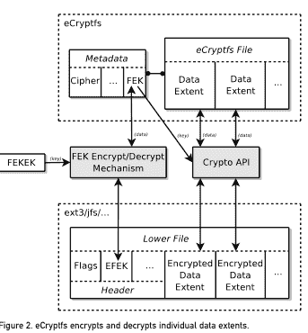

*加密元数据位于加密下层文件的头部区域。用户可以原封不动地将下层文件传输给其他用户，只要他们拥有适当的密钥，接收者就可以通过 `eCryptfs` 访问文件的解密内容。这在保持强大安全性的同时，提供了文件处理方式的高度灵活性。*

#### 使用 `eCryptfs`

`eCryptfs` 需要一个内核组件和一个用户空间组件。内核组件随当前主线 `Linux` 内核附带。请参考列表 1 了解启用 `eCryptfs` 所需的最小内核选项。默认情况下，`eCryptfs` 使用 `AES` 密码算法。如果你编译了内核中可用的其他密码算法，`eCryptfs` 可以使用它们。

**列表 1. `eCryptfs` 所需的内核选项**


# Code Maturity Level Options

```
Code maturity level options  --->
[*]  Prompt for development and/or incomplete code/drivers

Security options  --->
<*>  Enable access key retention support

Cryptographic options  --->
<*>  RMD digest algorithm
<*>  AES cipher algorithms

File systems  --->
Miscellaneous filesystems  --->
<*>  eCrypt filesystem layer support  (EXPERIMENTAL)
```

## 较新版本的 Linux 内核

较新版本的 `Linux` 内核包含功能更丰富的 `eCryptfs` 版本。例如，`Linux` 内核版本 `2.6.19` 是第一个包含 `eCryptfs` 的官方内核版本，而该内核仅支持口令模式操作。在本文写作时，开发内核分支版本 `2.6.20-mm` 包含公钥支持，因此该功能可能在较新的主线内核版本中可用。你可以通过加载 `eCryptfs` 模块并查看 `sysfs` 挂载点下 `/sys/encryptfs/version_str` 的内容来确定内核中可用的功能。

流行的 `Linux` 发行版附带 `eCryptfs` 用户空间包；请遵循你的发行版的软件包安装程序来安装 `eCryptfs-utils` 包。如果 `eCryptfs` 用户空间工具尚未在你的发行版中提供，你可以下载、构建并安装源码 `tarball`。你可以从 `eCryptfs` `SourceForge` 站点（`eCryptfs.sourceforge.net`）获取用户空间组件。

## 挂载 eCryptfs

如果 `eCryptfs` 作为内核模块构建，你需要加载该模块：

```bash
# modprobe eCryptfs
```

此时，你可以开始使用 `eCryptfs` 配合你当前正在使用的任何文件系统。要挂载 `eCryptfs`，请指定加密文件的下层目录和 `eCryptfs` 挂载点（用于文件的解密视图）：

```bash
# mount -t eCryptfs /secret /secret
```

第一个路径是下层目录，第二个路径是 `eCryptfs` 挂载点。注意，在此示例中，下层目录和挂载点具有相同的路径。这些路径可以不同，但我建议进行层挂载，以帮助确保只有 `eCryptfs` 可以访问下层文件系统文件中的文件。此命令在挂载期间将给定路径从下层目录转换为 `eCryptfs` 挂载点。

执行挂载时，`eCryptfs` 挂载帮助程序首先尝试从当前用户主目录中的 `eCryptfsFile.ini` 读取选项，然后读取通过命令行提供的选项。对于未在 `eCryptfsFile.ini` 或命令行中指定的任何强制选项，挂载帮助程序会交互式提示用户输入。例如，你可能会被要求选择一个口令和一个密码算法。

一旦挂载成功完成，写入 `/secret` 挂载点的文件将被透明加密并写入下层文件系统中的 `/secret` 目录。存在于下层 `/secret` 目录中的加密文件，如果在挂载时指定的密钥能够解密，则在从 `/secret` `eCryptfs` 挂载点读取时将以未加密形式可访问。

当你卸载 `eCryptfs` 并查看 `/secret` 时，你会看到加密的下层文件。你首先可能会注意到，下层文件比在 `eCryptfs` 挂载点下查看的文件更大。下层文件的确切大小取决于主机页面大小和写入的数据量。通常，最小下层文件大小为 `12KB` 或主机页面大小加 `4KB`，取较大者。这有助于确保 `eCryptfs` 文件和下层文件之间的页面对齐，从而提高性能。随着数据溢出到新的 `4KB` 数据扩展，下层文件会以 `4KB` 的增量增长。

每个下层文件前端的额外空间包含有关文件的加密元数据，例如属性标志和加密的文件加密密钥。在文件内容中包含这些信息使得在保留稍后访问文件所需的所有信息的同时，转移或备份文件变得方便。然而，如果有很多小文件，头部可能会占用不成比例的大量空间。`eCryptfs` 的较新版本可以将数据存储扩展到属性区域，从而减小下层加密文件的大小；请参阅 `eCryptfs.sourceforge.net` 上的 `eCryptfs` 在线文档（有关使用此功能的更多信息）。

## 公钥支持

如果你的内核支持公钥，你可以利用 `eCryptfs` 密钥模块之一来管理你的密钥。你可以通过查看 `sysfs` 挂载点下 `/sys/encryptfs/version_str` 的内容来检查内核中 `eCryptfs` 版本的公钥支持情况。如果有支持，你会看到公钥列出的受支持功能之一。

密钥模块可以通过挂载选项选择和参数化。如果你想使用 `OpenSSL` 密钥模块，首先需要生成要在 `eCryptfs` 中使用的公钥/私钥对。要生成密钥对，请执行以下操作：

- 运行 `eCryptfs-Manager`。
- 选择菜单选项 `3`。
- 选择 `OpenSSL` 密钥模块。

你还需要运行 `eCryptfs` 守护进程来管理内核与用户空间之间的通信；只需运行可执行文件即可启动守护进程：

```bash
# eCryptfsd
```

注意，如果你仅使用口令操作模式，则运行守护进程不是必需的。然后，假设你在 `/usr/local/mykey.pem` 中创建了密钥，你将使用以下选项进行挂载：

```bash
# mount -t eCryptfs \
  -o key=openssl:keyfile=/usr/local/mykey.pem \
  /secret /secret
```

给定这些选项，`eCryptfs` 挂载帮助程序会提示你输入一个保护密钥文件中包含的私钥的口令。你可以使用许多不同的密钥和密码组合（称为挂载上下文）挂载相同的下层目录，并且该特定上下文将应用于在挂载点下创建的任何新文件。对于当前版本的 `eCryptfs`，在任何给定挂载上下文下创建的文件仅在使用相同上下文进行挂载时才可访问。

### 安全注意事项

与任何文件系统一样，在使用 `eCryptfs` 时，你应该定期备份数据。这可以通过卸载来轻松且安全地完成。

# 超越期望

一站式 `IT` 解决方案提供商


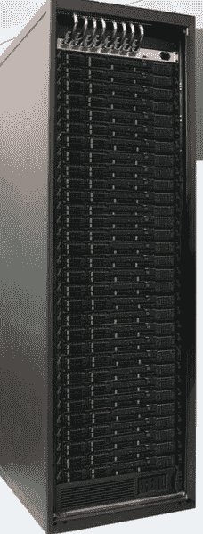

## ACMA - 您的一站式计算解决方案提供商！

- 设计原型
- 生产
- 交付
- 品牌化
- 测试
- 高温老化测试


### 四核服务器

`1U` 高密度服务器 - 基于 `Intel®` `Xeon®` 处理器的服务器，深度仅为 `17"`！

`2U/5U` `RAID` 服务器 - 基于先进多核 `Intel®` `Xeon®` 处理器的服务器解决方案，配备 `SATA` 或 `SAS` 驱动器，最大支持 `18TB` 热插拔 `SATA` 和 `7.2TB` 热插拔 `SAS` 存储容量。


单台机架支持多达 `84` 个 `Intel®` 服务器刀片和 `168` 个节能双核 `Intel®` `Xeon®` 处理器！

## 扩展您的 HPC 灵活性

在您的 `ACMA` `HPC` 服务器中，使用双核 `Intel®` `Xeon®` 处理器和四核 `Intel®` `Xeon®` 处理器，享受出色的双核和四核性能，并具备运行 `32` 位和 `64` 位应用程序的灵活性。


搭载 `Xeon` 处理器

双核。

做得更多。


一站式 `IT` 解决方案提供商

`ISO-9001` 认证企业

`www.acma.com`

致电 `1-800-786-6888` 获取更多信息。

## 安全性

### 如果你的内核支持公钥，你可以利用 eCryptfs 的密钥模块之一来管理你的密钥。

`eCryptfs` 以及读取底层加密文件。

`eCryptfs` 仅保护位于可信主机环境控制之外的静态数据的机密性。你应该正确使用访问控制机制，例如在可信主机上使用 `SELinux`，以规范对解密文件的访问。

默认情况下，`eCryptfs` 会保留访问文件解密内容所需的所有信息，这些信息存储在下层文件的内容中。所需的是最初用于创建文件的密钥。你应该采取措施保护此密钥。如果应用程序（如增量备份工具）被配置为仅读取底层加密文件，则这些工具无需对文件应用任何进一步的加密即可确保数据机密性。

如果你使用口令，请在选择和保护口令时遵循常见的最佳实践（例如，参见 `www.usenix.com/security/passphrase`）。只要可能，我建议尽量使用公钥操作模式而不是口令模式。使用公钥模块时，请对密钥文件进行备份并将副本存储在物理安全的位置。如果你丢失了密钥文件，任何人都无法恢复你的数据。请勿在存储加密数据的同一介质上存储未受保护的口令副本或公钥文件。


你可以自由选择通过 `Linux` 内核加密 API 提供的对称加密算法。`eCryptfs` 推荐将 `AES-128` 作为默认加密算法。如果你的机器上有硬件加速支持，并且内核加密 API 中选择的加密算法支持该硬件加速，`eCryptfs` 的加密和解密操作将自动进行硬件加速。你应该采取措施确保敏感数据不以未加密形式写入二级存储。写入敏感临时数据的应用程序应配置为仅在 `eCryptfs` 挂载点下写入。你还应使用 `dm-crypt` 随密密钥加密交换空间。详情超出了本文的范围，但设置命令的形式如下：

```
# cryptsetup -c aes-cbc-plain -d /dev/random create \
swap /dev/SWAPDEV
# mkswap /dev/mapper/swap
# swapon -p 1 /dev/mapper/swap
```

`SWAPDEV` 是你机器上的交换块设备（如果不清楚当前用于交换的设备是哪个，请参阅 `/etc/fstab` 文件）。你可以创建简单的启动脚本来自动设置加密交换空间、运行 `encryptfsd` 并执行 `eCryptfs` 挂载。有关编写启动脚本以及使用随密密钥通过 `dm-crypt` 加密交换空间的更多细节，请咨询你的发行版文档。

请注意，当前版本的 `eCryptfs` 仅加密文件内容。关于文件的元数据——例如大小、名称、权限和扩展属性——所有有权访问底层文件系统的人都可以读取。`eCryptfs` 的后续工作将包括对部分这些元数据进行加密或混淆。

将块设备加密与 `eCryptfs` 结合使用可以结合两种机制提供的安全性，同时提供对单个加密底层文件进行无缝访问的灵活性，尽管这大致将数据加密和解密的处理开销增加了一倍。如果仅需保护二级存储上文件内容的机密性，`eCryptfs` 本身在大多数情况下就足够了。

### 未来工作

`eCryptfs` 被设计用于支持一系列高级密钥管理和策略功能。`eCryptfs` 的开发路线图包括每个文件多个密钥、根据不同创建文件的应用程序和文件写入位置为不同文件使用不同的密钥和加密算法、完整性强制以及更好地与现有密钥基础设施和密钥管理设备互操作性等功能。随着这些功能在未来版本的 `Linux` 内核中实现，它们将变为可用。

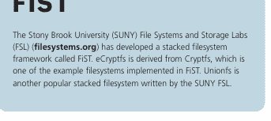

纽约州立大学石溪分校（`SUNY`）文件系统和存储实验室（`FSL`）（`filesystems.org`）开发了一个名为 `FiST` 的堆叠文件系统框架。`eCryptfs` 源自 `FiST`，它是 `FiST` 中实现的示例文件系统之一。`Unionfs` 是 `SUNY FSL` 编写的另一个流行的堆叠文件系统。

### 结论

`eCryptfs` 是一个灵活的内核原生解决方案，在二级存储设备上通过密码学方式强制实施数据机密性。

`eCryptfs` 可以以最小的努力部署在现有文件系统上。单个加密文件可以传输到其他运行 `eCryptfs` 的主机，并使用正确的密钥透明地访问。`eCryptfs` 的密钥管理机制具有高度可扩展性。`eCryptfs` 适合作为强大且便捷的数据机密性执行组件，有助于保护在 `Linux` 环境中管理的数据。

### 法律声明

本文代表作者的观点，不一定代表 `IBM` 的观点。

`IBM` 是 `International Business Machines Corporation` 在美国、其他国家或两地的注册商标。

`Linux` 是 `Linus Torvalds` 在美国、其他国家或两地的注册商标。

`TrueCrypt` 是 `TrueCrypt Foundation` 的商标。

其他公司、产品和服务名称可能是他人的商标或服务标记。

`Mike Halcrow (mhalcrow@us.ibm.com)` 是 `IBM Linux` 技术中心的安全软件工程师，也是 `eCryptfs` 的首席架构师和开发人员。他还在 `UI, Austin` 攻读计算机科学硕士学位。过去，他维护了 `openCrypto PKCS#11` 应用程序，为 `Linux` 的通用标准 `CAPPEL` 安全认证工作做出了贡献，并编写了随早期 `Linux` 内核版本发布的 `BSI` 安全级别 `Linux` 安全模块 (`LSM`)。

## 刀片终结者

### 1U 容纳 2 台服务器

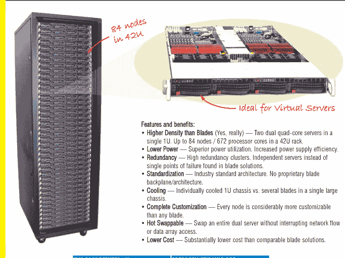

`42U 内 84 个节点`

`适用于虚拟服务器`

#### 特点与优势：

- `密度高于刀片服务器`（是的，真的）—— 单台 `1U` 中容纳两台双四核服务器。`42U` 机架中最多可容纳 `84` 个节点 / `672` 个处理器核心。
- `功耗更低` —— 卓越的电源利用率。提高了电源效率。
- `冗余性` —— 高冗余集群。使用独立服务器，避免了刀片解决方案中常见的单点故障。
- `标准化` —— 行业标准架构。无需专有刀片背板/架构。
- `冷却` —— 独立冷却的 `1U` 机箱，对比单个大型机箱内的多个刀片。
- `完全定制` —— 每个节点的可定制性远高于任何刀片。
- `热插拔` —— 在不中断网络流量或数据阵列访问的情况下更换整台双服务器。
- `成本更低` —— 相比可比刀片解决方案，成本大幅降低。

| | **IBM BLADECENTER H** | **ABERDEEN STIRLING 122** |
| :--- | :--- | :--- |
| | **9U 刀片解决方案，含 14 个刀片** | **9U 服务器解决方案，含 14 个节点** |
| 描述 | `9U IBM BladeCenter H` 机箱，配备 `14` 个 `IBM BladeCenter HSZ1` 刀片服务器 | `7U Aberdeen Stirling 122` 服务器，每个包含两个服务器节点 |
| 每个刀片/节点处理器 | 两个 `Quad-Core Intel® Xeon®` 处理器 `ES310 1.60 GHz`，`8 MB` 缓存和 `1066 MHz FSB` | 两个 `Quad-Core Intel® Xeon®` 处理器 `ES310 1.60 GHz`，`8 MB` 缓存和 `1066 MHz FSB` |
| 每个刀片/节点内存 | `2 GB ECC DDR2 667 MHz` 内存（最大 `32 GB / 4 DIMM`） | `2 GB ECC DDR2 667 MHz` 内存（最大 `32 GB / 8 DIMM`） |
| 每个刀片/节点硬盘 | 两个 `36 GB 10,000 rpm` 内置 `2.5" SAS` 驱动器（不带可选 `SID` 刀片时最大 `146 GB`） | 两个 `36.7 GB 10,000 rpm` 热插拔 `3.5" SATA` 驱动器（最大 `1.5 TB`） |
| 每 42U 机架最大刀片/处理器数量 | `4` 个 `9U` 机箱（`6U` 空闲）中的 `56` 个刀片 / `112` 个处理器（`448` 核） | `42` 个 `1U` 机箱（`10U` 空闲）中的 `84` 个服务器节点 / `168` 个处理器（`672` 核） |
| 保修 | `3` 年现场有限保修，涵盖零件和人工 | `5` 年有限保修，涵盖零件和人工 |
| 14 刀片/节点解决方案总价 | `$70,161` | `$36,495` |
| 每个刀片/节点价格 | **$5,012** | **$2,607** |


## Fedora Core 5 中 SELinux 的多类别安全性

### 如何设置和使用 SELinux 多类别安全性。

**拉塞尔·科克（RUSSELL COKER）**

`Fedora Core 5` 的发布为 `SELinux` 增加了多项新功能，其中之一是多类别安全性（`MCS`）。`MCS` 的目的是保护数据机密性，即防止机密数据被泄露，但它并非旨在防止系统被攻破。你在之前的 `Fedora` 版本中可能熟悉的 `SELinux` 功能（称为域类型模型）仍用于保护系统完整性。`MCS` 是一项额外功能，用于防止机密数据被意外或故意泄露。

早期版本的 `SELinux` 仅使用域类型模型进行访问控制。在域类型模型中，每个进程都有一个域，而每个进程可能访问的对象（文件、目录等）都有一个类型。系统维护一组规则，以指定每个域可以访问哪些类型以及应该具有哪种类型的访问权限。

虽然域类型模型可用于实现系统完整性和数据机密性的所有控制（过去也曾这样使用过），但将完整性和机密性目标分离起来会使设计更加清晰。`MCS` 旨在保护数据机密性，从而允许策略中的域类型部分专注于保护系统完整性。`MCS` 基于多级安全性（`MLS`）的一些设计特性。`MLS` 是为军事用途设计的，不适合大多数用户，因此本文不涉及它。

过去，`MLS` 很少得到支持，因为它难以使用且成本高昂。`MCS` 是 `Fedora Core 5` 及以上版本的默认功能，因此会得到应用程序开发人员和系统管理员的良好支持。预计所有为 `Fedora Core 5` 及以上版本编写的应用程序都将支持 `MCS`，并且在大多数情况下，`MCS` 支持也将允许这些应用程序支持 `MLS`。这意味着需要 `MLS` 功能的组织将比在专有 `UNIX` 系统上有更多的应用程序选择。


## 概述

MCS 为每个安全上下文添加了一个敏感度标签（本文其余部分我将将其称为 MCS 标签）。安全上下文是进程或进程可能访问的资源（文件）的完整 SELinux 标签。要访问文件，进程必须具有支配该文件 MCS 标签的 MCS 标签。MCS 标签由一组类别组成。进程可以具有两个级别的 MCS 标签，称为高级别和低级别；高级别具有低级别类别的超集。

### 标签格式

一个文件的 MCS 标签可能是 `s0:c0,c10`。`s0` 在 MCS 策略中没有任何含义，该字段由 MLS 策略使用，并且 MLS 和 MCS 使用相同的内核代码，因此格式无法更改。重要的部分是 `c0,c10`，它表示从 `c0` 到 `c10`（含）的类别集合（`,` 字符表示类别范围）。在 Fedora Core 5 中，有 256 个编号从 `c0` 到 `c255` 的类别。在 Fedora Core 6 中，将有 1,024 个编号从 `c0` 到 `c1023` 的类别。

一个进程的 MCS 标签可能是 `s0:c0,c100`，这意味着标签（或范围）的低级别是 `s0`（无类别），高级别是 `s0:c0,c100`，这意味着从 `c0` 到 `c100` 的所有类别。不相交的类别集合也是允许的。标签 `s0:c3,c5 s0:c3,c5 s0:c0,c10,c20,c30` 意味着低级别包含类别 `c3` 和 `c5`，而高级别包含从 `c0` 到 `c10`（含）以及从 `c20` 到 `c30`（含）的类别。

### 类别命名

类别必须命名，预计大多数用户都会为所有使用的类别命名。在 Fedora Core 5 中，你必须编辑文件 `/etc/selinux/targeted/setrans.conf` 来更改 MCS 标签的人类可读名称。以下是默认 `setrans.conf` 文件的一部分：

```
# s0:c8=CompanyConfidential
# s0:c1=PatientRecord
# s0:c2=Unclassified
# s0:c3=TopSecret
# s0:c1,c3=CompanyConfidentialRedHat
s0:
s0-s0:c0,c255=SystemLow-SystemHigh
s0:c0=SystemHigh
```

此外，以下是使用 `semanage` 更改 Fedora Core 6 中 MCS 标签的人类可读翻译的示例：

```
# semanage translation -a -T ProjectA s0:c8
# semanage translation -l
```

| 级别 | 翻译 |
| :--- | :--- |
| `s0` | |
| `s0-s0:c0.c1023` | `SystemLow-SystemHigh` |
| `s0:c0` | `ProjectA` |
| `s0:c0.c1023` | `SystemHigh` |

图 1 展示了针对 HR 和财务类别的所有组合，进程被授权访问文件的情况。

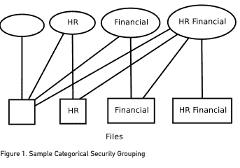

### 设计目标

MCS 的设计以易用性为主要关注点。目前，其设计仅控制文件访问。它还控制隐私（系统接口，如 `strace`、`Tracer` 和调试器），以防止非特权进程使用调试器从特权更高的进程中捕获机密数据。

MCS 仅控制文件访问这一事实允许通过文件名发生信息泄露，并且协作进程可以使用 `TCP`、`UDP`、`UNIX` 域套接字或命名管道来传输数据。这是有意这样设计的，因为限制所有形式的进程间通信会破坏许多程序并使整个系统更难使用。MLS 策略（在 Fedora Core 5 及以上版本中可用，但默认未启用）限制了此类通信方法，这是它被认为对大多数人来说太难使用的原因之一。

在设计 MCS 时，我们决定不尝试阻止两个协作用户不当地共享数据。我们还决定不阻止用户读取具有机密数据的文件，然后将该数据写入具有较低机密性标签的文件。再次说明，MLS 策略限制了这些操作，但它对大多数人来说太难使用。

MCS 和 MLS 旨在保护数据机密性；它们依靠域类型模型来保护系统完整性。`FCS` 附带三种策略。默认的是 `targeted`，它提供了与 `FC4` 中几乎相同的完整性保护，但增加了 MCS 来保护数据机密性。下一个选项是 `strict` 策略，同样与 `FC4` 中的情况几乎相同，但增加了 MCS。最后，`FCS` 中有一种名为 `mls` 的新策略；顾名思义，它包括用于保护数据机密性的 MLS 系统。`mls` 策略的域类型部分基于 `strict` 策略（虽然并非 `strict` 策略中的所有守护程序都受支持 - 仅支持 `SPP` 认证评估列表中的那些）。

可以编译不支持 MLS 或 MCS 功能的 SELinux 策略，但到目前为止，还没有人选择这样做。这可以节省非常少的内存，并且仅值得为最小的嵌入式机器考虑。同样，也可以使用 MLS 代替 `targeted` 策略中的 MCS，但没有人这样做，因为它不会带来太多好处。系统完整性是数据机密性的前提条件。因此，将 MLS 等强大的机密性保护系统与除最佳系统完整性保护以外的任何组合都没有好处。`strict` 策略限制所有进程并显著限制其中大多数。这是充分利用 MLS 所需的完整性保护级别。

在 MCS 中，进程具有一个范围。范围的高级别确定授予文件的访问权限，低级别确定创建文件的默认级别（范围仅适用于 MCS 中的进程）。

要使一个 MCS 级别支配另一个级别，它必须拥有被支配 MCS 级别类别的超集。可能存在两个敏感度级别，其中没有一个支配另一个（例如，不相交的类别集合）。这被称为不可比较级别，读和写访问都将被拒绝。

### 配置用户

要使用 MCS，首先需要为用户分配敏感度级别。在之前版本的 SELinux 中，必须编辑策略源代码并重新编译策略以设置用户登录时分配的安全上下文，这既不方便又容易出错。`FCS` 中 SELinux 的新功能之一是 `semanage` 策略管理工具。它支持更改用户的安全上下文（以及添加和删除用户），而无需编译策略。

Fedora 的默认配置使用 `targeted` 策略，该策略在所有用户登录会话中都在 `unconfined_t` 域中运行（在域类型模型中没有访问限制），因此 MCS 为用户提供唯一的 SELinux 访问控制。然而，Fedora Core 5 的默认安装需要在 MCS 正常工作之前应用更新。MCS 的开发在 Fedora Core 5 发布后才完成。

配置使用 MCS 的 SELinux 系统时，必须做的第一件事是创建 SELinux 标识和登录记录，将它们映射到 UNIX 账户。

### 示例：添加 SELinux 标识

清单 1 是使用 `semanage` 添加具有低级别 `s0:c1`（这意味着用户创建的每个文件默认具有类别 `c1`）和高级别 `SystemHigh` 的 SELinux 标识 `rjc` 的示例。`SystemHigh` 映射到 `s0:c0.c1023`（在 Fedora Core 6 中是从 `c0` 到 `c1023`（含）的所有类别范围 - MCS 访问的最高级别，在 Fedora Core 5 中是 `s0:c0.c255`）。`-L` 参数指定默认级别。使用 MCS 时，应始终将默认级别设为范围的低端，以避免混淆。`-R` 选项独立于范围。

#### 列表 1. `semanage` 使用示例

```bash
# semanage user -a -P user -R user_r -L s0:c1 -r s0:c1:SystemHigh rjc
# semanage user -l
```

| SELinux 用户 | 标签前缀 | MLS/MCS 级别 | MLS/MCS 范围 | SELinux 角色 |
| :--- | :--- | :--- | :--- | :--- |
| `rjc` | `user` | `s0:c1` | `s0:c1:SystemHigh` | `user_r` |
| `root` | `user` | `s0` | `SystemLow:SystemHigh` | `system_r, sysadm_r` |
| `system_u` | `user` | `s0` | `SystemLow:SystemHigh` | `system_r, user_r` |
| `user_u` | `user` | `s0` | `SystemLow:SystemHigh` | `user_r, sysadm_r` |

```bash
$ touch foo
$ ls -lZ foo
-rw-r--r-- rjc rjc rjc:object_r::t:tmp_t foo
$ chcon -l s0:c8 foo
$ ls -lZ foo
-rw-r--r-- rjc rjc rjc:object_r::t:tmp_t:ProjectA foo
```

请注意，级别 `s0:c0` 被转换为了 `ProjectA`；这是我之前创建的转换。

可以使用不同的范围来运行进程。

以下是使用 `id -Z` 命令显示 SELinux 上下文（包括末尾的 MCS 范围）的示例，用户 `rjc` 使用 `runcon -l` 命令在不同范围内运行 `bash` 实例：

### 安全性

MCS 旨在保护数据的机密性，从而允许策略中的类型部分专注于保护系统完整性。

因此，这不会成为一个问题。

创建文件后，可以使用 `chcon -l` 命令将标签更改为不同的级别。


```bash
$ id -Z
rjc:system_r:unconfined_t:SystemLow:SystemHigh
```

```bash
$ runcon -l s0:c0:c10:c20 bash
$ id -Z
rjc:system_r:unconfined_t:s0:c0:c10:c20
$ runcon -l s0:c9:c20 bash
execvp: Permission denied
```

以支持 `MLS` 策略的需求。

`Fedora Core 5` 使用范围的低端来确定进程的文件默认上下文。范围参数通过 `-r` 开关指定。在使用 `Fedora Core 5` 时，通常只有范围的高端部分具有实际意义，它指定了访问权限。在创建用户时，如果使用目标策略（这是 `Fedora Core 5` 安装的默认策略），应使用参数 `-P user -R user_r`。严格策略在 `MCS` 方面与目标策略非常相似。本文的大部分内容都适用于严格策略，尽管 `semanage` 命令的 `-P` 和 `-R` 选项需要不同的参数。

添加身份后，必须添加登录条目以将 UNIX 账户分配给该身份。登录配置还允许您指定 `MCS` 范围，因为您可能拥有许多具有相同 `SELinux` 身份但登录时分配了不同 `MCS` 范围的 UNIX 账户。必须使用 `-s` 参数来指定已存在的 `SELinux` 身份名称。如果未使用 `-r` 选项指定范围，则默认的登录条目将不使用任何类别（这可能无效，具体取决于该身份范围的低级别）。

以下是添加登录条目的示例：

```bash
# semanage login -a -s rjc -r s0:c1:SystemHigh rjc
# semanage login -l
```

### 总结

| 登录名称 | SELinux 用户 | MLS/MCS 范围 |
| :--- | :--- | :--- |
| `__default__` | `user_u` | `s0` |
| `rjc` | `user_u` | `s0:c1:SystemHigh` |
| `root` | `root` | `SystemLow:SystemHigh` |

`MLS` 是通过策略语言灵活实现的。这使我们能够随后使用相同的语言特性开发 `MCS` 策略，并允许在不更改内核代码的情况下开发其他基于类别和级别的机密性控制。这方面的一个例子是我的新开发成果：强制性 `MCS`（`MMCS`）。

强制性访问控制（`MAC`）系统是一种访问控制由系统管理员确定并由操作系统强制执行的系统。用户不允许通过授予自身数据文件过高的访问权限来覆盖此访问控制。在 UNIX 权限中，可以在 `/tmp` 目录中创建 `mode 777` 文件，从而授予所有用户完全访问权限。在 `MMCS` 中，我希望防止授予此类访问权限。在 `MMCS` 策略中，不允许写入级别低于进程级别的文件。这意味着通过为用户设置低级别，管理员可以确定读取该用户创建的文件所需的最小访问权限。

`MCS` 和 `MLS` 策略有几个显著差异。在 `MLS` 中，访问基于范围的低级别（有效清除级别），而范围的高级别主要用于通过 `newrole` 程序确定访问权限。在 `MCS` 中，读取和写入的访问都基于范围的高级别，而低级别仅用于限制写入访问。另一个区别是 `MCS` 仅设计用于保护文件内容，而 `MLS` 限制所有数据传输方式。另一个主要区别是，在 `MCS` 中，进程可以启动具有不同范围的最小限制的子进程。

请注意，登录条目的范围必须是 `SELinux` 用户身份范围的子集。这意味着登录范围的低端不能低于用户身份范围的低端，登录范围的高端不能高于用户身份范围的高端。在大多数情况下，您会创建一个与用户身份范围相同的登录条目。

`Russell Kaler` 自 2001 年起一直致力于安全增强型 Linux（`SELinux`）。他是一名专注于 `SELinux` 和 ISP 管理的独立顾问。

## Polywell 终极 Linux 系统

更多选择，优质服务，极具性价比

### 塔式系统

`4 路 Opteron, OpenGL QFX`

`PolyStation 2055A-221O`

- `2x A8D Opteron Dual-Core 2210 处理器`
- `2GB 双通道 667MHz DDR2 ECC`
- `NVIDIA Quadro FX 1300 OpenQ GL 图形卡`
- `2x SATA 硬盘，SATA-RAID 控制器`
- `Sony 16X DVD/DVD-ROM 驱动器，键盘，鼠标`
- `2x 千兆 LAN，2 x PCIe 16x 插槽`
- `支持 Linux / BSD / Windows 操作系统`

`$1999`（可定制配置）

`4 路 Opteron, SAS 硬盘`

`PolyStation 2055SS-2216`

- `2x A8D Opteron Dual-Core 2216 处理器`
- `2GB 双通道 667MHz DDR2 ECC`
- `NVIDIA Quadro FX 1300 OpenQ GL 图形卡`
- `4x SAS 硬盘，SATA-RAID 控制器`
- `Sony 16X DVD/DVD-ROM 驱动器，键盘，鼠标`
- `2x 千兆 LAN，2 x PCIe 16x 插槽`
- `支持 Linux / BSD / Windows 操作系统`

`$4679`（可定制配置）

`4 路服务器，32GB 内存`

`Tower Server 2500M-2220`

- `2x A8D Opteron Dual-Core 2220 处理器`
- `32GB 双通道 667MHz DDR2 ECC`
- `11 盘位塔式机箱，带 2/7Gbit 电源`
- `3/3x 150GB Serial ATA 硬盘，RAID 5`
- `Sony 16x DVD/DVD-ROM 驱动器，键盘，鼠标`
- `2x 千兆 LAN，2 x PCIe 16x 插槽`
- `支持 Linux / BSD / Windows 操作系统`

`$9499`（可定制配置）

### 桌面系统

`低成本 Linux 联盟 PC`

`Poly 485Ax-280OSP`

- `AMD Sempron 2800+ 64 位处理器`
- `256MB 667MHz DDR2 内存`
- `ATI X300 PCIe 图形卡`
- `80GB SATA 硬盘，SATA-RAID 控制器`
- `1x 10/100/1000M LAN，键盘，鼠标`
- `100MHz LAN，1 PCI + 1 PCIe 16x 插槽`
- `支持 Linux / BSD / Windows 操作系统`

`$299`（仅限批量购买）

`2TB 存储联盟`

`MintBox 420AM2-3200OSP`

- `AMD Athlon 64 3200+ 64 位处理器`
- `512MB 双通道 667MHz DDR2 内存`
- `NVIDIA GeForce 6150 图形卡`
- `2TB 4500RPM SATA 硬盘，RAID5`
- `最佳 LAN 10/100 NIC，键盘，鼠标`
- `千兆 LAN，2 PCI + 1 PCIe 16x 插槽`
- `支持 Linux / BSD / Windows 操作系统`

`$1239`（可定制配置）

`高端 PC，4G DDR2`

`Poly 49X4MC-FX62`

- `AMD Athlon 64 Dual-Core FX-62`
- `4GB 双通道 667MHz DDR2`
- `NVIDIA GeForce 7900GS 图形卡`
- `10K RPM 740GB 22200GB SATA 硬盘`
- `14x 10/100/1000 NIC，键盘，鼠标`
- `千兆 LAN，2 PCI + 1 PCIe 16x 插槽`
- `支持 Linux / BSD / Windows 操作系统`

`$2250`（可定制配置）

### 机架服务器

`低成本 ISP 机架服务器`

`1102EV-17 485Ax-3000OSP`

- `1102EV-17 10U, 19" 1U 机架`
- `2xSB 667MHz DDR2 内存`
- `ATI X300 PCIe 图形卡`
- `80GB SATA 硬盘，SATA-RAID 控制器`
- `117 1U 机架，1U 插槽，CD 2 - 3.5" 盘位`
- `100MHz LAN，1 可选 PCI 或 PCI RISER`
- `支持 Linux / BSD / Windows 操作系统`

`$399`（仅限批量购买）

`2GB 内存，500GB ISP 服务器`

`1102EV-Ch 520AM2-4200`

- `1102EV-Ch 1U, 19" 1U 机架`
- `2GB 双通道 667MHz DDR2 内存`
- `NVIDIA GeForce 6150 图形卡`
- `500GB 2x250GB SATA 硬盘，RAID 5`
- `117 1U 机架，1U 插槽，CD 2 - 3.5" 盘位`
- `千兆 LAN，1 可选 PCI 或 PCI RISER`
- `支持 Linux / BSD / Windows 操作系统`

`$950`（可定制配置）

`2GB ECC，1TB ISP 服务器`

`1102EV-17 1000SL-1210`


- `1102EV-17` 1U, 19" 1U 机架
- 2GB ECC，2x 16x16GB DDR2 内存
- `117` 1U 机架，1U 插槽，CD 2 - 3.5" 盘位
- 1TB 2x500GB SATA 硬盘，RAID 5
- `1U` 1U 机架，1U 插槽，CD 2 - 3.5" 盘位
- 可选 PCI 或 PCI RISER
- 支持 Linux / BSD / Windows 操作系统

$1779（可定制配置）

### 高密度多处理器服务器

**16 路 Opteron，128GB 内存**

**`5124XAS` `8850S-8212`**

- 16 x AMD Opteron 2105, 2112 处理器
- 128GB 双通道 667MHz DDR2 ECC
- 12TB 2x4500GB SATA 硬盘，RAID 5
- 4 x 千兆以太网，4 PCI，2 PCIe 插槽
- 24 1U 机架冗余电源
- 支持 Linux / BSD / Windows 操作系统

16 路 8212，128GB 内存，24x500GB $99999
8 路 8212，32GB 内存，8x500GB $59999

**18TB 4U 存储，32GB 内存**

**`4024AS` `2500M-2210`**

- 2 x AMD Opteron Dual-Core 2210 处理器
- 32GB 双通道 667MHz DDR2 ECC
- 18TB 2x4500GB SATA 硬盘，RAID 5
- 2 x 千兆以太网，4 PCI，2 PCIe 插槽
- 24 1U 机架冗余电源
- 支持 Linux / BSD / Windows 操作系统

18TB 2x4500G，32G，2x2210 $19999
1TB 2x500G，32G，1x2210 $9999

**6TB 2U 存储，16GB 内存**

**`2012AS` `2500M-2210`**

- 2 x AMD Opteron Dual-Core 2210 处理器
- 16GB 双通道 667MHz DDR2 ECC
- 6TB 12x500GB SATA 硬盘，RAID-5
- 2 x 千兆以太网，4 PCI，2 PCIe 插槽
- 2U 1U 机架，2 x 冗余电源
- 支持 Linux / BSD / Windows 操作系统

6TB 12x500G，16G，2x2210 $7999
1TB 6x500G，16G，1x2210 $3599

**2TB 1U 服务器，32GB 内存**

**`1104XS` `2500M-2210`**

- 2 x AMD Opteron Dual-Core 2210 处理器
- 32GB 双通道 667MHz DDR2 ECC
- 2TB 4x500GB SATA 硬盘，RAID-5
- 2 x 千兆以太网，4 PCI，2 PCIe 插槽
- 1U 1U 机架，1U 插槽，2 x CD-RW 3.5" 盘位
- 支持 Linux / BSD / Windows 操作系统

2TB 4x500G，32G，2x2210 $7888
1TB 2x500G，32G，2x2210 $7199

AMD 双核心技术使单一平台能够满足多任务和多线程环境的需求，并延长平台寿命。

- 20 年客户满意度
- 5 年保修，业内最长
- 一流的客户服务

Polywell OEM 服务。您的虚拟制造商

支持 Linux/FreeBSD 的原型开发

从小规模到大规模生产制造

履行、发货和 RMA 维修

888.765.9686

`www.Polywell.com/us/LJ`

Polywell Computers, Inc 1461 San Mateo Ave. South San Francisco, CA 94080

650.583.7222 传真：650.583.1974

## PacketFence

### 如何设置和使用功能强大的开源网络访问控制解决方案

**LUDOVIC MARCOTTE 和 DOMINIK GEHL**

随着对网络的攻击数量不断增加——无论是来自匿名访问者，还是从网络中发起非法活动——拥有出色的安全工具至关重要。虽然良好的防火墙以及 Snort 和 Nessus 等工具可以提高安全性，但网络管理员正在寻求能够自动响应网络使用策略违规情况的解决方案，以补充这些安全工具。这些工具被称为网络访问控制（NAC）解决方案。存在许多此类工具——尤其是来自 Cisco 等大型供应商的专有工具——但一项开源解决方案 PacketFence 值得关注。

PacketFence 是一个免费且开源的解决方案，提供网络访问控制功能，包括以下标准特性：

- 注册网络端点（台式机、笔记本电脑、打印机等），并在获得完整网络访问权限之前，可选地在注册时接受网络使用策略。
- 基于对所有连接节点进行被动和主动网络扫描，检测网络使用策略违规。
- 隔离违规节点。
- 基于网络使用策略违规的通知（电子邮件、弹窗等）。
- 修复措施，使网络组件在违规后能够重新获得网络访问权限。

PacketFence 使用 Perl 编写，并利用常见的开源组件，如 MySQL、Apache、Snort 和 Nessus。它不需要在安装访问网络的计算机上安装用户代理。其部署是非侵入式的，并且与用户的所有交互都通过一个被所有 Web 浏览器可访问的强制门户进行。

PacketFence 目前支持 ARP、DHCP/DNS 和 VLAN 隔离技术。选择正确的隔离方法取决于您的网络规模以及您拥有的网络设备。在本文中，我们介绍基于 ARP 的隔离技术，该技术在任何类型的网络设备上都能正常工作。

#### 基于 ARP 的隔离

基于 ARP 的隔离通过污染连接到网络的任何设备的 ARP 缓存来实现。如您所知，ARP 是一种用于将 IP 地址映射到 MAC 地址的协议。从根本上说，以太网 ARP 中存在四种对 PacketFence 感兴趣的基本消息类型：

1. ARP 请求：请求目标 MAC。
2. ARP 响应：包含 MAC 的响应。
3. RARP 请求：从 MAC 请求 IP。
4. RARP 响应：包含 IP 的响应。

ARP 的问题在于，当客户端发出 ARP 请求时，它简单地信任传入的响应并将其存储到其缓存中。污染 ARP 缓存就像向客户端发送 ARP 响应一样简单，即使它没有请求。操作系统很可能在接收到此类数据包时更新缓存，或者当它决定更新缓存时使用我们发送的污染数据。

#### 安装和配置

PacketFence 在 Red Hat Enterprise Linux 4、CentOS 4 和 Fedora Core 上开发。许多人已成功在不同发行版上运行它，但为了简化您的首次安装，最好坚持使用其中一个官方支持的发行版。由于 PacketFence 是一种 NAC 解决方案，安装它将影响您当前的局域网，请确保与您的网络管理员协调测试。

#### 准备工作

PacketFence 使用 MySQL 数据库来存储关于连接到网络的节点的信息、它们属于谁以及是否存在任何指定的网络策略违规。因此，如果您还没有一个专门用于此目的的 MySQL 服务器，请通过运行 `yum install mysql-server` 安装 MySQL 服务器。

如前所述，PacketFence 可以使用 Snort 和 Nessus，下面我们将描述如何将这两个工具与 PacketFence 集成。

Snort 是一个开源网络入侵检测系统，它使用签名来分析网络流量。一旦给定数据包匹配某个签名，Snort 就可以生成警报。签名不仅针对许多计算机病毒和间谍软件存在，还针对网络流量，如 BitTorrent、ICQ、Skype 甚至 Hotmail 访问。它们可以通过 SourceForge, Inc.、Snort 网站以及 Bleeding Edge Threats（参见资源）获取。PacketFence 还附带一个 OinkMaster 配置，以自动获取规则集并将其裁剪为 PacketFence 所需的内容。由于 PacketFence 对 Snort 2.6 的支持仍在开发中，请从 `www.snort.org/lib/linux/old` 下载 Snort 2.4.5，然后执行以下命令安装 RPM：

```bash
rpm -ivh snort-2.4.5-1.RHEL4.1386.rpm
```

另一方面，Nessus 是一个主动漏洞扫描器——这意味着它会生成到您想要测试漏洞的主机的连接。您必须注册 Nessus 的所有者 Tenable Network Security 才能获得可用的插件。通过下载 Linux 版本的 2.2.9 并执行以下命令安装 Nessus：

```bash
sh nessus-installer-2.2.9.sh
```

Nessus 3 尚未得到很好的支持，并且由于围绕它的许可问题，请坚持使用 2.2.9。

安装完成后，使用以下命令启动 Nessus：

```bash
/opt/nessus/sbin/nessusd -D
```

并使用作为单独下载提供的 NessusClient 测试连接。

#### 安装


从 `SourceForge` 仓库下载 `PacketFence` RPM，并使用以下命令安装：

```bash
rpm -ivh packetfence-1.8.2-0.1386.rpm
```

在 `/usr/local/pf` 中，您将找到两个有助于完成必要配置步骤的 Perl 脚本：`installer.pl` 和 `configurator.pl`。将当前目录更改为 `/usr/local/pf`，并执行 `installer.pl`。该脚本除了其他功能外，还设置 `PacketFence` 数据库，安装所有必要的 Perl 模块（数量相当多），并为 Web GUI 创建一个用户帐户。

#### 配置步骤

现在，真正的配置工作开始了。首先，执行 `configurator.pl`，您将看到几个选项。根据测试模式选择模板配置。您将需要提供几个网络参数（DHCP 服务器、DNS 服务器等），并将创建一个基本配置文件 `/usr/local/pf/conf/pf.conf`。此配置文件仅包含您对保存在 `/usr/local/pf/conf/pf.conf.defaults` 中的默认配置参数所做的更改。查看 `conf/pf.conf.defaults` 以了解可用的选项。为了帮助您了解 `PacketFence` 内部正在发生的事情，请将以下行添加到 `/usr/local/pf/conf/pf.conf` 以提高日志记录级别：

```ini
[logging]
verbose=8
```

#### 基本用法

使用 `service packetfence start` 启动 `PacketFence`。查看 `/var/log/messages`，您应该看到 `PacketFence` 开始创建网络上所有节点的清单，如下例所示：

```text
Jan 3 16:05:28 pf pf: update_hashes(5): UPDATE
New node 00:07:e9:05:4c:f2 (192.168.0.1)
Jan 3 16:05:28 pf pf: update_hashes(5): UPDATE
New node 00:90:27:6a:71:ea (192.168.0.2)
```

`/usr/local/pf/bin/pfcmd` 是 `PacketFence` 命令行界面。不带任何额外参数执行它会显示一个带有可用选项的帮助屏幕。为了显示数据库中的所有节点，执行：

```bash
#/usr/local/pf/bin/pfcmd node view
mac|pid|detect_date|regdate|lastseendate|pid|status|
user_agent|computername|last_agent|last_dhcp|switch|
port|vlan|dhcp_fingerprint
00:e7:e9:05:4c:f2|1|2007-01-03 16:05:28|||unreg|||
2007-01-03 16:10:11||||||||
00:90:27:6a:71:ea|1|2007-01-03 16:05:28|||unreg|||
2007-01-03 16:10:12||||||||
```

手动注册节点可以使用以下命令完成：

```bash
/usr/local/pf/bin/pfcmd
~node edit 00:07:e9:05:4c:f2 status="reg" pid=1
```

您还可以使用 `pfcmd` 访问每个配置参数的文档。要查看 `[general]` 部分中 `logo` 参数的文档：

```bash
#/usr/local/pf/bin/pfcmd config help general.logo
GENERAL LOGO
Default: //common/packetfence.gif
Logo displayed on Web pages.
```

使用以下命令查看可用的报告：

```bash
/usr/local/pf/bin/pfcmd help report
```

`os` 和 `osclass` 报告使用 `PacketFence` 的 DHCP 指纹识别功能，该功能试图确定每个 DHCP 请求（包括由打印机、VoIP 电话、交换机等发出的请求）的操作系统。运行：

```bash
/usr/local/pf/bin/pfcmd report os
```

将显示网络上每个检测到的操作系统的节点数量和百分比。请注意，DHCP 指纹识别功能可以轻松用于禁止运行特定操作系统的计算机访问您的网络。

`PacketFence` 还具备一个管理 Web GUI，默认情况下在安全端口 1443 上可用。将您的浏览器指向 `https://pf-host:1443/`。一旦输入您在安装期间定义的登录/密码，您就可以开始通过 GUI 监控和配置 `PacketFence`。

当您开始强制执行使用 `PacketFence` 注册节点时，网络上的所有节点都必须先注册才能获得完整的网络访问权限。此注册要求适用于所有具有网络访问权限的设备，包括无线接入点和打印机。因此，在实际激活配置文件中的此选项之前，明智的做法是手动预先注册这些类型的设备。

另一方面，对于具有 Web 浏览器的计算机，用户可以通过 `PacketFence` 强制门户完成注册。该门户可以通过 RADIUS 文件、Radius 或 LDAP 验证登录/密码信息，我们在示例中使用了 LDAP。为此，您需要调整提供的模板 `/usr/local/pf/conf/templates/ldap.conf` 以适合您的 LDAP 结构。由于所有用户都将被重定向到注册屏幕，此时明智的做法是将显示在 Web 页面上的默认 `PacketFence` 徽标更改为您自己的公司徽标。这可以通过在 `/usr/local/pf/conf/pf.conf` 的 `[general]` 部分添加 `/logo/` 到 `/common/mylogo.gif`，并将文件 `mylogo.gif` 复制到目录 `/usr/local/pf/html/common/` 来实现。

要激活注册，请将以下参数合并到 `/usr/local/pf/conf/pf.conf` 中：

```ini
[trapping]
testing=disabled
detection=disabled
[registration]
aup=enabled
auth=ldap
```

现在，使用 `service packetfence restart` 重启 `PacketFence`。您应该在 `/var/log/messages` 中看到 `PacketFence` 正在通过 ARP 欺骗您的网络网关来捕获未注册的节点。从客户端角度来看，打开 Web 浏览器并访问任何外部网站都会导致重定向到 `PacketFence` 强制门户，允许您注册计算机。您也可以通过在客户端上执行 `arp -n -a`（在 Linux 下）并检查为您的网络网关保存的 ARP 缓存中的 MAC 地址来确定客户端是否已被 ARP 欺骗。

#### 集成 Snort 和 Nessus

您可以通过将 `Snort` 警报添加到您的 `PacketFence` 安装中来更进一步。假设在您的环境中禁止使用 `BitTorrent` 客户端，您希望配置 `PacketFence` 来强制执行此策略。编辑 `/usr/local/pf/conf/violations.conf`，使包含 `BitTorrent` 的部分如下所示：

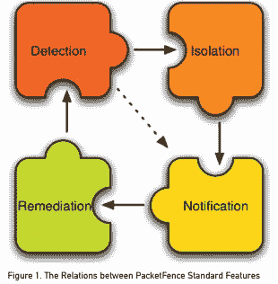


Shane 的客户总是在推动技术的极限。这就是为什么他是 `Rackform` `iSvr R2020` 的粉丝，这是一款创新的、`iU`、双计算节点系统，旨在提高计算密度的同时降低成本、能源和空间需求。通过支持每个计算节点两个 `Quad-Core` `Intel®` `Xeon®` 5300 系列处理器，`iSvr R2020` 将 `Intel` 经过验证的可靠性与业界领先的每 `iU` 16 核密度相结合。此外，每个计算节点中的 8 个完全缓冲 `DIMM` 插槽、2 个热插拔 `SATA` 硬盘和 `PCI-Express` 插槽使 Shane 相信 `iSvr R2020` 提供了应对最具挑战性的计算任务所需的密度、灵活性和成本效益。

当与 `Silicon Mechanics` 合作时，您获得的不仅仅是强大的 `Intel` 解决方案——您还获得像 Shane 这样的专家。


请访问 `www.siliconmechanics.com`

或致电 866-352-1173（免费）


# JavaOne

`Sun` 2007 年全球 Java 开发者大会

2007年5月8日至11日

莫斯科尼中心（`Moscone Center`）

加利福尼亚州旧金山

`JavaOne` 展馆：2007年5月8日至10日


# 对于整个 Java 技术社区来说，这是一个激动人心的时刻。

随着 Java 平台的演变，开发者、思想领袖和企业家正面临着新的机遇。这就是为什么 2007 年的大会将提供一个扩展的课程，在保持 Java 技术核心地位的同时，也纳入了核心 Java 平台之外的技术。你将获得我们一直关注的深入内容，以及更多与当今演变市场相关的主题和问题。

# 了解更多关于：

- Java 技术
- 脚本编程
- 开源和社区开发
- 集成和服务导向开发
- Web 2.0
- 兼容性和互操作性
- 业务管理
- 更多


在 2007 年 4 月 4 日前注册可减免 `$200*`

请使用促销代码：`JAVA01`

*内容可能会变更。

*此优惠不适用于现场注册。

今天在 `java.sun.com/javaone` 注册

版权所有 © 2007 Sun Microsystems, Inc. 保留所有权利。`Sun`, `Sun Microsystems`, `Sun 标志`, `Java`, `Java 标志`, `Java 开发者大会`, `Java 社区进程`, `JCP`, `JSR`, `Pure Java`, `J2EE`, `J2ME`, `J2SE` 和 `J2Obj` 是 `Sun Microsystems, Inc.` 在美国及其他国家的商标或注册商标。

### 安全性

```
[2000334]
desc=P2P (BitTorrent)
priority=8
url=/content//index.php?template=p2p
disable=4
max_enable=1
actions=trap, email_log
trigger-Detect::2000334.Detect::20003357.
=>Detect::2000369
```

这告诉 `PackETFence`：

- `BitTorrent` 违规行为可以由 `Snort` 警报 `2000334`、`2000357` 和 `2000369` 生成（`trigger` 参数）。
- 系统必须对该违规行为做出反应，方法是隔离用户、向管理员发送电子邮件警报并将违规记录到 `/var/log/messages`（`actions` 参数）。
- 用户被允许重新启用网络访问一次（`max_enable` 参数）。

最后，你需要通过在 `confp.conf` 中包含以下内容来从内部激活 `PackETFence` 中的 `Snort`：

```
[trapping]
detection=enabled

[interface eth0]
type=internal, managed, monitor
```

并重启 `PackETFence` 服务。请注意，如果你使用交换机，你需要将网络流量的副本重定向到 `eth0`（即 `PackETFence` 监控接口——`Snort` 用于监听数据包的接口）。在 `PackETFence` 中生成违规现在变得非常简单，只需启动你喜欢的 `BitTorrent` 客户端，例如 `Azureus`。做到这一点，打开一个 `torrent` 文件以开始下载。一旦网络上交换了几个数据包，`Snort` 应该会捕获到其中一些，并与 `2000334`、`2000357` 或 `2000369` 规则匹配。这些规则来自 `Bleeding Edge Threats` 规则集，分别对应 `BitTorrent` 对等同步、流量和通告。一旦 `Snort` 记录了这种异常活动，`PackETFence` 就会通过创建违规来做出反应。

作为管理员，你可以使用以下命令查看违规列表：

```
/usr/local/pt/bin/pfncd violation view all
```

作为用户，在你的计算机上，启动你喜欢的 Web 浏览器并尝试打开任何外部网站。你会被重定向到

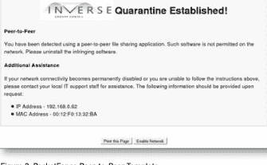

`PackETFence` 系统会自动显示点对点（peer-to-peer）模板，如 figure 2 所示。

停止 `BitTorrent` 客户端可以让重新获得网络访问权限。现在，尝试第二次使用 `BitTorrent`。和之前一样，会生成警报，你的浏览器会被重定向到 `PackETFence` 门户。但这次，你不会再有机会重新启用你的访问权限。在现实生活中，违规用户将不得不联系其网络管理员以重新启用网络访问。

要激活 `Nessus` 对尝试注册 `PackETFence` 的主机的扫描，请将以下部分添加到 `/usr/local/pf/conf/p.conf`：

```
[scan]
s11=enabled
pass=<nessus_passwd>
user=<nessus_user>
port=1241
host=127.0.0.1
registration=enabled
```

并重启 `PackETFence` 服务。尝试添加一台运行未修补版本 `Microsoft Windows` 的计算机现在会立即生成违规。你还可以使用管理 Web GUI（`Scan` 选项卡）来定义每晚应执行完整的 `Nessus` 扫描。

### 结论

在您的网络中部署具有基于 ARP 隔离功能的 `PackETFence` 非常简单。虽然这种隔离技术部署容易，但它不一定具有良好的可扩展性，并且可能被具有静态 ARP 缓存条目的熟练用户绕过。

`PackETFence` 中还存在其他隔离技术，例如 `DHCP`/`DNS`，它们具有良好的可扩展性。在 `Inverse`，我们还为 `PackETFence` 添加了基于 `VLAN` 的隔离，这使得该解决方案更安全，并使其对大型网络更具吸引力。`PackETFence` 是保护校园网络或甚至网络一部分（`VLAN` 或子网）的理想解决方案。最后，一个高质量的 `NAC` 解决方案已从自由开源软件（`FOSS`）社区中涌现，`PackETFence` 的演进前景光明。

> `Ludovic Marcatite` | `ludovic@inverse.ca` 拥有蒙特利尔大学计算机科学学士学位。他目前是 `Inverse, Inc.` 的高级系统架构师，这是一家位于蒙特利尔市中心的 IT 咨询公司，专门从事基于自由和开源组件的基础设施部署。

> `Dominic Gehl` | `dgehl@inverse.ca` 拥有蒙特利尔大学计算机科学硕士学位。他目前是 `Inverse, Inc.` 的系统架构师，这是一家位于蒙特利尔市中心的 IT 咨询公司，专门从事基于自由和开源组件的基础设施部署。

### 资源

- `PackETFence`: `www.packetfence.org`
- `Snort`: `www.snort.org`
- `Bleeding Edge Threats`: `www.bleedingsnort.com`
- `Oinkmaster`: `oinkmaster.sourceforge.net`
- `Nessus`: `www.nessus.org`
- `Azureus`: `azureus.sourceforge.net`

# 再次听到你的思想！


# WhisperStation™

酷……快速……安静！

**适用于 64 位 HPC、游戏和图形设计应用**

`WhisperStation™` 最初是为汽车行业中一群耗电量高且要求严格的工程师设计的。它集成了两颗双核 `AMD Opteron™` 或 `Intel® EM64T™` 处理器、超静音风扇和电源，以及内部隔音装置，打造出一个强大但静音的计算平台。`WhisperStation™` 标配 2 GB 高速内存、`NVIDIA e-GeForce` 或 `Quadro` PCI Express 显卡适配器，以及 20 英寸 LCD 显示器。它可以根据你的具体硬件规格进行配置，支持任何 `Linux` 发行版。也可以提供 `RAID`。当你将 `WhisperStation™` 用作 `Microway` 集群的主节点时，它也会让系统管理员非常高兴！

访问 `www.microway.com` 以获取更多技术信息。

*体验“寂静之声”。*

拨打 `508-746-7341` 联系我们的技术销售团队，今天就开始设计你的个性化 `WhisperStation™`。


## 深度解析

### 极速需求：PS3 上的 Linux！

将你的 `PS3` 变成双启动游戏机和 `Linux` 盒子 `DAVE TAYLOR`

- 我们能拿到
- 我承认，我喜欢 `WebTV`

2006 年圣诞节最火爆的视频游戏系统，并将其变成一台 `Linux` 机器吗？当然可以！

如果你仍然认为视频游戏系统只是比老式的 `Coleco` 或 `Atari 800` 稍微先进一点的技术，那么当你第一次打开引擎盖时，会有一个大惊喜在等着你。虽然新的任天堂 `Wii`（读音为“we”，奇的是）拥有一些时尚硬件，微软 `Xbox 360` 设备也是如此，但在技术竞赛中真正的赢家是令人惊叹的索尼 `PlayStation 3` 系统。


PS3 围绕 `IBM Cell` 宽带引擎处理器构建，包括高清蓝光驱动器、四个 `USB 2.0` 端口、具有 256MB 独立显存的 `NVIDIA` 图形处理器、对 `CompactFlash`、`SD` 和记忆棒设备的支持、以太网、内置 `802.11b` 和 `g`、蓝牙、`HDMI` 端口，以及支持你能想象到的所有视频分辨率，包括 `480i`、`480p`、`720p`、`1080i` 和圣杯 `1080p`。听起来像是一台计算机，而不是视频游戏系统，不是吗？

蓝光光盘系统还支持大多数旧的光盘格式，包括 `CD-ROM`、`CD-R`、`CDR+W`、`DVD`、`DVD-ROM`、`DVD-R` 和 `DVD+R`。如果你不熟悉高清视频战场，蓝光每张光盘可支持高达 54GB 的数据，如果你仍在使用 `CD` 烧录器，这相当惊人。另一种高清光盘格式是 `HD-DVD`，但不支持。另一方面，蓝光在零售渠道中已有超过一百部电影，因此 `PS3` 也是一台功能相当强大的高清视频播放器。

`Cell` 处理器本身是一件相当惊人的硬件，足以让 `Terra Soft Solutions`（位于科罗拉多州 `Loveland`）与索尼合作，基于 `PS3` 创建超级计算中心。想象一下，成百上千台机架式 `PS3` 设备在运行复杂的气象模拟，而不是二战游戏。`Cell` 处理器的运行速度超过 4GHz，每秒可处理 2560 亿次计算，芯片本身拥有 2.5MB 内存，挤在一个使用 2.34 亿个晶体管的处理器设计中（`www.ibm.com/developerworks/power/cell`）。

还有一个重要的规格：包含 60GB 硬盘的 `PS3` 在大多数零售店的价格约为 599 美元，如果他们有 `PS3` 库存的话。至于游戏？目前有几款可用的，平均价格约为 60 美元，标准的游戏租赁渠道（`GameFly`、`Hollywood Video` 等）在你读到这篇文章时应该已经提供 `PS3` 游戏租赁服务。

好吧，它是一台隐藏在外形时尚黑色外壳中的顶级酷炫计算机，具有出色的功能，但它真的只是用于玩电子游戏吗？你可以用它做其他事情吗——你能把它变成一台 `Linux` 系统吗？

也许最明显的问题是为什么要费这个劲？我是说，如果你买了一台 `PlayStation 3`，你就投资了地球上最快的下一代游戏控制台。你为什么要启动到一个贫瘠的 `Linux` 环境呢？

嗯，答案并不是因为如果你是个极客，`PS3` 会取代你的常规 `Linux` 盒子。对我来说，在 `PS3` 上运行 `Linux` 的问题更多地涉及是否基本上可以为没有计算机的家庭增加 `PS3` 的功能。如果你可以运行所有 `PS3` 游戏，观看蓝光高清电影，并完全与互联网交互会怎样？

这是对晚期、被低估的 `WebTV` 设备的 21 世纪回答。科技极客从未完全理解，一个带有无线键盘并连接到常规电视的轻量级设备是


> 来源：索尼提供

### 首先，配置要求

索尼实际上委托 `Terra Soft Solutions` 为其 `PlayStation 3`（以下简称 `PS3`）制作了 `Yellow Dog Linux`（以下简称 `YDL`）的一个版本。考虑到 `Linux` 用户反正也要自己拼凑出解决方案，这招可谓高招。`Terra Soft` 最初为基于 `IBM` 芯片的 `Mac PowerPC` 系统制作了 `YDL`，提供了一款性能相当出色的 `Mac OS X` `Linux` 替代方案。

`PS3` 没有配备任何有用的输入设备（除了游戏手柄之外），所以你需要购买一个 `USB` 键盘和鼠标，或者，也许像我一样，直接从你的壁橱里翻出来。你还需要一个 `USB` 闪存盘作为临时启动盘。幸运的是，我有一个 2GB 的 `SanDisk` 闪存盘，用起来完全没问题。它们在当地的电脑商店大约售价 70 美元。讽刺的是，我的闪存盘来自微软，上面预装了 `Vista` 宣传材料——再也不见了！

首先，对 `PS3` 的硬盘进行分区，以便留出安装 `Linux` 的空间。这非常简单。启动 `PS3`，进入“设置” → “系统设置” → “格式化工具”，选择“格式化硬盘”，对重新格式化整个硬盘的问题回答“是”，最终你将能够选择“自定义”分区。在“其他操作系统”中，选择“外星人 10GB”，这样在较大的机型上你将有 50GB，而在较小的机型（30GB 型号的 `PS3`）上你将有 20GB 用于游戏和其他 `PS3` 相关事项。不知为何，我们从 `Pong`（乒乓游戏）走来，已经走了很长一段路……

现在，是时候转向你的可移动驱动器了，无论你是像我一样使用闪存盘，还是尝试使用 `CompactFlash`、`SD` 卡或类似设备。你需要创建一个名为 `p33` 的目录，然后在其内部创建一个名为 `others` 的子目录，并下载两个文件：一个来自索尼网站（`www.playstation.com/ps3-openplatform`，保存为 `others.blid`），另一个来自 `Terra Soft Solutions`（`www.terrasoftsolutions.com/support/installation/ps3/otherOS.blid`，保存为 `others.blid`）。

手持这两个文件（顺便说一下，总大小约为 8 MB，所以我的 2 GB 驱动器绰绰有余），从你的 `PC` 或 `Mac` 中弹出驱动器，并将其插入 `PS3` 本身的 `USB` 端口之一。你还想要刻录一张完整的 `YDL DVD` 安装盘，基于你可以从 `Terra Soft Solutions` 网站免费下载的操作系统；或者，你可以直接购买包含安装光盘和源光盘、安装指南以及大量额外赠送内容的安装套装，包括 6 个月的支持，售价 59 美元。

现在，是时候安装 `Linux` 了。希望它不会搞坏我精美的 600 美元视频游戏系统，嗯？

要安装，请进入“设置” → “系统设置” → “安装其他操作系统”，引导加载程序应会自动被找到并可供选择。

一如既往，`PS3` 的手柄上的 `X` 按钮用于选择指定的选项并让你继续。

哦，我遇到了第一个麻烦，引导加载程序抱怨“未找到适用的安装数据”（是的，他们没有拼写错误）。因为 `Terra Soft` 的文件最初解压后的文件名为 `exo.boot`，我尝试将其重命名为 `thrush` 看看会发生什么。不，那边的人意指 `PS3` 没有找到任何可能的外部引导加载程序。啊，也许这是 `Mac` 与 `PC` 的问题，因为我是用 `Mac` 下载并复制文件到 `USB` 设备的。好吧，我重新格式化了拇指驱动器，并在我可靠的 `Windows XP` 设备上重新下载并将两个文件重新安装到 `USB` 驱动器上。

这就是问题所在——非常令人困惑，因为在 `Mac` 上，我看到 `other.os.blig.gz` 解压后变成一个名为 `exo.boot` 的文件，我简单地将其重命名为 `otheros.blid`。它 somehow 损坏了，因为当我从 `PC` 将这两个文件下载到拇指驱动器并尝试安装操作系统时，它像变魔术一样起作用了！

现在，是时候告诉 `PS3` 你希望启动到新系统，而不是默认的 `PS3` 操作系统。这通过进入“设置”——“系统设置”——“默认系统”并选择“其他操作系统”来完成。但在重启之前，请插入 `YDL` 安装 `DVD` 并连接你的 `USB` 键盘和鼠标。

拨动电源开关以重启 `PlayStation 3`，几秒钟后，它会读取安装 `DVD`，弹出熟悉的企鹅图标和一系列冗长的启动消息，就像我们 `Linux` 用户在这个阶段已经习惯的那样。然后你会得到一个提示块：此时你只需按回车键即可启动 `YDL`，或者输入 `boot:-game-os` 返回 `PS3` 的世界。

提示：你还可以通过在开机时按住电源按钮五秒来重启进入游戏操作系统。然而，从那时起，它将忽略 `Linux` 分区，直到你进入系统设置并再次选择“默认系统”——“其他操作系统”。

在流式文本的一两分钟后，你会到达“`YDL 5.0` 在 `Anaconda` 中的安装界面”，现在你可以开始点击“下一步”，直到你的鼠标按钮感到疲倦。实际上，在 `YDL` 上只需点击几次，你就会发现系统抱怨“设备 `sda` 上的分区表不可读”，并询问你是否要初始化驱动器，这将擦除所有数据。你确实想要这样做，并且一如既往，我建议你选择自动分区。

安装的其余部分对于 `Linux` 系统来说相当典型，涉及 `root` 密码等。总的来说，从 `YDL` 安装 `DVD` 到 `PlayStation 3` 上安装所有东西大约花了一个小时——这正是检查你的电子邮件或泡一杯茶的好时机！

最后，终于，一个“重启”按钮让我能够用新安装的其他操作系统重启 `PS3`。与美丽的 `PlayStation 3` 用户界面相比，我不得不承认，`Linux` 的重启序列确实丑陋！

再次，像典型的 `Linux` 安装一样，我现在看到一系列首次启动配置选项，包括设置日期和时间，指定初始非 `root` 用户，以及与我经验中的许多 `Linux` 安装不同，用于 `PS3` 的 `YDL` 安装正确识别并配置了 `PS3` 声卡的系统。

登录一次后，我就运行了 `X` 窗口系统，

#### ASA 电脑

希望您的业务更具生产力？


由英特尔® 至强® 处理器驱动的`ASA`服务器提供质量和可靠性，助您跟上不断壮大的业务步伐。

###### 面向开源社区的硬件系统——自 1989 年起

（`Linux`, `FreeBSD`, `NetBSD`, `OpenBSD`, `Solaris`, `MS`, 等）

- 1U 双核 `$5030$` CPU
- $4-\mathrm{GB}$ FBDRAM 内存
- 支持最多 $64 \mathrm{GB}$ FBDRAM
- $120 \mathrm{~GB}$ 寸位硬盘
- $2$ 集成双 $10/100/1$ LAN
- SU 双至强 2.8 GHz $800 \mathrm{~F}$ SBB.
- $1 \mathrm{CIS}$ 或 NVR 软件选项
- $8-\mathrm{GBID}$ $\mathrm{RD}$ SATA 硬盘 - 最大 $10 \mathrm{T} \mathrm{B} .$
- $512 \mathrm{MB}$ RAM
- 肥厚硬盘 LED 指示器
- 8U 双至强 2.8 GHz $80 \mathrm{PSB}$ CPU.
- $2 \mathrm{T}$ 存储空间（最大 $30 \mathrm{TB}$）
- $1 \mathrm{GB}$ RAM
- NAS 或 $1 \mathrm{C}$ siopti 或 ware
- $2 \times 10/100 / 1000$ 千兆 LAN

您的定制专用机解决方案

告诉我们您的需求，我们将为您提供解决方案

- **`ASA` 托管**
  - 每月每 $1 \mathrm{U}$ 机架 5 美元 - 32 GB RAM
- **首次托管特惠**
  - 首月托管免费.*
- **存储解决方案**
  - IDE, SCSI, 光纤 RAID 解决方案
  - NAS, DAS, iSCSI, SATA, SAS
  - $3 \mathrm{Ware}$, Proxmox, Adaptec,
  - JMR, 金士顿/存储解决方案
- **客户**
  - 终端/驻留和桌面节点
  - HP, Intel, $\mathrm{Cycum}$, 思科交换机
  - KVM 或 $3 \mathrm{Cycle}$s 终端服务器
  - APC 或通用机架

所有系统均安装并测试，配合用户选择的 `Linux` 发行版树。`ASA` 托管——每月 5 美元

2354 Calle Del Mundo,  

Santa Clara, CA 95054  

`www.asacomputers.com`  

Email: `sales@asacomputers.com`  

P: 1-800-434-PCA | FAX: 408-564-2910


## 深度解析

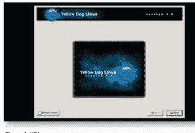

图 1. `YDL`

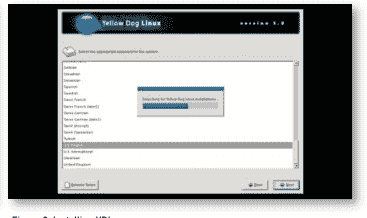

图 2. 安装 `YDL`

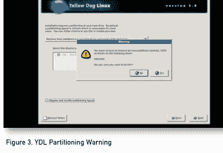

图 3. `YDL` 分区警告

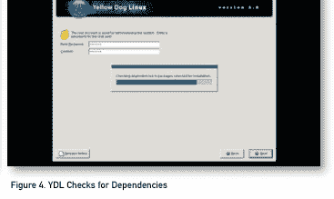

图 4. `YDL` 检查依赖项

以启蒙为主题，我发现 `Firefox` 浏览器已经方便地安装好了。更棒的是，系统默认正确找到了我的 `DHCP` 服务器并配置好自己，使我已在线并准备就绪。

### 在 PlayStation 3 `Linux` 上浏览网络

现在，我可以开始分析 `YDL` 安装是否确实是一个满足我先前声明需求的软件解决方案，使 `PS3` 成为一台有用的互联网机器。快速访问 [linuxjournal.com](http://linuxjournal.com) 证实了这一点：是的，它运行良好，速度惊人且极其易用。真不错！

我用作测试的网站之一是 `Google` 的 `Gmail` 服务。其后台结构复杂且功能强大，因此问题总是它能否在新系统上正常工作和渲染。`YDL` 表现非常出色，运行正常，让我能够安全地通过 `Firefox` 浏览电子邮件。`Thunderbird` 也预先安装并准备就绪，对于大多数 `Linux` 用户来说，配置基于 `POP3` 的电子邮件账户相当简单，因此至少有两条良好的途径来访问您的电子邮件。


图 5。使用 `YDL` 测试 `Google` 的 `Gmail`

这意味着，当然，`YDL` 确实满足了我的主要可用性标准，让我能够浏览网络并与我的电子邮件互动，所有这些都在我舒适的扶手椅上进行，只需在我的精致 `PlayStation 3` 设备上添加一个简单的 `USB` 键盘。

但是，`Linux` 提供了更多的功能，作为一个实验，我启动了 `Rhythmbox` 并很快得出结论，由于多年来一直使用 `iTunes`，我对音乐播放器的期望真的被搞乱了。令我惊讶的是，我选择“互联网电台”时没有得到可用电台的列表，而是必须弄清楚我想听的电台的 `URL`，以便“调谐”到它。不幸的是，经过这么多年的 `Linux` 演变，仍然有太多应用程序像这样粗糙不堪。

我去了 `Firefox`，搜索“互联网电台爵士乐”，通过流行的 `Live365` 网站找到了一个，选择了频道，让它尝试下载一个流媒体文件，结果启动了 `Helix` 播放器，却发现它没有播放该类型内容的能力。下一站：`AccuRadio`，但它要求我安装一个新的插件。耶，新奥尔良爵士频道 `WWOZ` 提供了一个 `URL`，所以我将其粘贴到 `Rhythmbox` 中，结果发现它也不起作用。算了！像我妈妈这样的人怎么能在 `YDL` 中承受这么多麻烦才能获得音频？

### 归根结底，它是一个 `Linux` 系统

正如我所料，虽然它在索尼 `PlayStation 3` 上运行流畅且快速，凭借其强大的 `Cell` 处理器系统，但它仍然是我们习惯的同一个 `Linux`，没有令人兴奋的新功能，没有更简单的方式来处理网络上的各种媒体，也没有解决我十多年来的困扰——那些圆滑的边缘。

然而，与大多数 `Linux` 系统不同，`PS3` 上的 `YDL` 至少允许你重启并回到 `PlayStation` 的世界，在那里你可以轻松运行照片幻灯片，上传并欣赏你的音乐库，观看 `DVD` 和 `Blu-ray` 高清视频，当然，在启动时也可以玩一些令人惊叹的游戏。

真的，这是一个非常棒的组合，如果你认识某个人，他希望通过 `Terra Soft Solution` 的 `YDL` 系统访问 `Cell` 处理器的所有功能和能力，以及 `PlayStation 3` 的乐趣和强大，这真的是一个绝妙的组合。即使你只是想进行黑客操作，在系统上有一个作为启动选项的外部操作系统也很酷。

> `Dave Taylor` 自 1980 年代中期以来一直在探索 `UNIX` 和 `Linux`，并对它们的发展做出了各种软件贡献。他如今已在各种奇怪的设备上运行 `Linux`，包括他三引导的 `Mac` 笔记本电脑和索尼 `PlayStation 3`。他还经营着一个繁忙的问答和故障排除网站（[AskDaveTaylor.com](http://AskDaveTaylor.com)），并撰写了许多流行的技术书籍，包括 `Growing Your Business with Google`（利用谷歌发展你的业务）和 `Wicked Cool Shell Scripts`（酷炫的 `shell` 脚本）。


### 内部的 `OpenSSH` 协议

`OpenSSH` 是什么以及为什么它无处不在的细枝末节详情。

`GRISH VENKATACHALAM`

有没有比 `SSH` 更常用于日常 `Linux` 计算的程序？我怀疑没有。它不仅坚固、安全且多功能，而且使用起来极其简单且功能丰富。由于其算法和协议都是最先进的，且其实现是开放供同行审查的，我们可以放心 `SSH` 的密码完整性。然而，`SSH` 确实存在弱点，尽管其中大部分源于社会工程学，绕过如 `X11` 等损坏的协议也是一个巨大挑战。

`SSH` 在几行 `C` 代码中就能创造奇迹——这要归功于 `UNIX` 哲学，即以通用方式将强大的工具串联起来。


SSH 充当安全通道，使远程系统看起来像本地系统，使本地系统看起来像在远程端。它可以用于远程命令执行，无论是否使用 `pty`，也可以用于多路复用多个 TCP 和 X11 会话。它还可以用于通过安全的 SSH 隧道隧道化不安全协议，如 POP3 或 SMTP。此外，它也可以用于以有限的条件安全地隧道 FTP。

### OpenSSH 架构

让我们从整体方案开始。

如图 1 所示，OpenSSH 由三个关键层组成。底层 `ssh-transport` 是参与所有加密操作的最关键组件，例如密钥交换、定期重新密钥化、以多种方式防御攻击等等。

位于 `ssh-userauth` 之上的层，负责向服务器端运行的 `sshd` 守护进程认证最终用户。请记住，SSH 进行双向认证。客户端 SSH 程序使用 `ssh-transport` 协议认证 `sshd` 服务器守护进程。认证完成后，密钥交换完成，并建立了安全连接。随后，用户认证发生。

`ssh-userauth` 提供了很大的灵活性，因为用户可以通过多种方式向服务器认证——从智能卡上的私钥到简单的用户名/密码认证。一旦通过，`ssh-connection` 层建立一个安全通道，用于执行远程命令或获取交互式登录 shell。

`ssh-connection` 层能够通过在单一的 `ssh-userauth` 层及其下方的传输栈层上多路复用任意数量的同时独立安全会话，如图 1 所示。SSH 的所有魔力——将任意 TCP 端口从本地到远程和从远程到本地转发，充当 SOCKS 代理，转发 X11 连接，建立 VPN 隧道，使用和不使用 `pty` 执行远程命令——都是通过 `ssh-connection` 层完成的。

SSH 在协议中内置了流量控制。每个安全通道分配了一个单独的大小窗口。由于 SSH 在可靠的 TCP 层之上运行，这并没有太多作用。至少，它不像 TCP 窗口机制那样关键。大多数关键的通道打开/关闭消息和其他终止消息不消耗任何窗口空间。

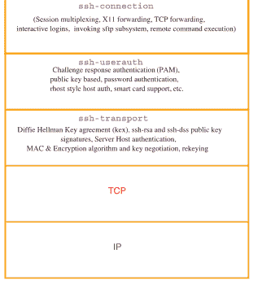

由于所有消息都经过加密和完整性保护，没有人可以解读这些消息。有一种特殊的 `LMSG_IGNORE` 消息类型，可用于默认应对流量分析攻击。这些是那种能发现数据何时在网络上传输以及传输了多少数据的攻击。

当然，SSH 还附带了许多其他便利功能，如发送安全的 `KEEPALIVE` 消息，将 `stdin` 重定向到 `/dev/null` 用于专门的 X 窗口应用程序等。

现在，让我们看一下一个典型的 SSH 会话和典型的消息交换（图 2）。

这里是一个典型的未加密 SSH 数据包：

| 字节 | 描述 | 类型 | 接收者通道 | 值 |
| :--- | :--- | :--- | :--- | :--- |
| 1 | 类型 | `SSH_MSG_CHANNEL_REQUEST` | | |
| 4 | 接收者通道 | `uint32` | | |
| 1 | 请求类型 | `string` | `"pty-req"` | |
| 1 | 需要回复 | `boolean` | | |

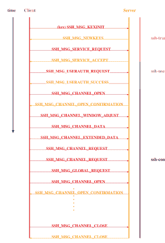

### 图 2. OpenSSH 协议流程图

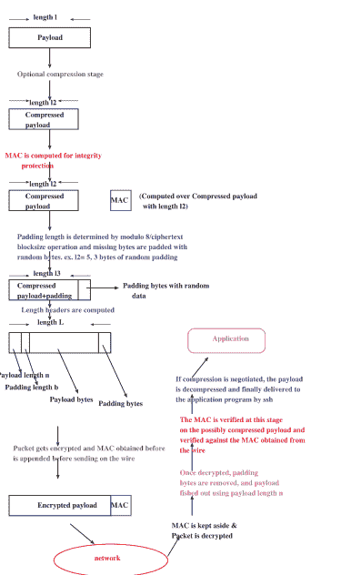

### 图 3. OpenSSH 数据包处理

```
string    TERM 环境变量值 (例如, vt100)
uint32    终端宽度, 字符数 (例如, 80)
uint32    终端高度, 行数 (例如, 24)
uint32    终端宽度, 像素 (例如, 640)
uint32    终端高度, 像素 (例如, 480)
string    编码的终端模式
```

大多数字段都是不言自明的。前两个字段始终存在于所有消息中。有效载荷数据包（用户输入的内容以及来自服务器的响应）都通过 `SSH_MSG_DATA` 消息类型进行承载。

每个数据包都有一个头部，该头部描述了有效载荷的内容（消息类型）以及其目标通道。

某些消息不需要对方的响应，因为底层协议不仅是可靠的，而且具有防篡改能力。但是，来自客户端的大多数请求都有来自服务器的相应响应。

现在，让我们深入了解 SSH 密钥交换协议的细节，因为这是决定 SSH 安全性和普及度的最关键组件。图 3 展示了为加密、压缩和完整性保护所必需的数据操作。当然，我们还需要保护自己免受重放攻击。为此，每个数据包都有一个隐式的序列号，它从 0 开始递增，直到达到 $2^{32}$ 后回绕。由于序列号经过哈希处理，它可以是连续的，且攻击者永远无法猜测什么输入会导致什么哈希值。

OpenSSH 密钥的主要组件包括：

- 哈希值：`H`。

- 共享密钥：`K`。

- 会话 ID：`session_id`。

SSH 使用上述组件推导以下加密向量和密钥：

- 客户端到服务器的初始化向量。

- 服务器到客户端的初始化向量。

- 客户端到服务器的加密密钥。

- 服务器到客户端的加密密钥。

- 客户端到服务器的 MAC 密钥。

- 服务器到客户端的 MAC 密钥。

推导上述向量和密钥所使用的方程取自 RFC 4253。在以下内容中，$\parallel$ 符号表示连接，`K` 编码为整数，`"A"` 编码为字节，`session_id` 为原始数据。任何字母，如带引号的 `"A"`，表示单个字符 `A`，即 ASCII 码 65。

- 客户端到服务器的初始 IV：`HASH(K || H || "A" || session_id)`。

- 服务器到客户端的初始 IV：`HASH(K || H || "B" || session_id)`。

- 客户端到服务器的加密密钥：`HASH(K || H || "C" || session_id)`。

- 服务器到客户端的加密密钥：`HASH(K || H || "D" || session_id)`。

- 客户端到服务器的完整性密钥：`HASH(K || H || "E" || session_id)`。

- 服务器到客户端的完整性密钥：`HASH(K || H || "F" || session_id)`。

很简单，对吧？然而，并不简单的是如何确定 `K` 和 `H` 参数。`HASH` 通常指 `SHA1` 哈希机制，但也可能是其他机制。典型的加密算法使用的是 `AES` 或 `DES3` 的 `CBC` 模式。`MAC` 是 `MD5` 或 `SHA1` 哈希算法与秘密密钥的组合。这里有四种选择：

- `hmac-sha1`

- `hmac-md5`

- `hmac-sha1-96`

- `hmac-md5-96`

实际上，在当今世界中 `sha1` 稍显薄弱，因为碰撞攻击是可能的。当今哈希领域的趋势是 `sha512`，但通过适当的重新密钥生成和其他智能机制的内置，这应该不成问题。请记住，哈希值具有固定长度，因此 `hmac-sha1` 的长度为 20 字节，`hmac-md5` 为 16 字节，而另外两种各为固定的 12 字节。

好的，现在进入密钥阶段的数学和密码学体操部分。只要使用上述简单方程推导基本参数，我们就知道如何计算单独的加密密钥和 `MAC` 密钥。但是，我们如何以安全、经过认证的方式获取这些参数呢？

现在，我们需要查看 OpenSSH 如何使用 `diffie-hellman-group14` 和 `diffie-hellman-group1` 字段来推导用于匿名密钥协商的 DH 生成元和 DH 模数。然而，这使得我们容易受到多种中间人和其他主动攻击的影响。为了阻止这些攻击，我们使用已知且可信的服务器公钥来认证密钥交换。密钥交换数据的认证无非就是使用私钥进行签名。OpenSSH 通常使用 `ssh-dsa` 或 `ssh-rsa` 密钥来执行此操作。

换句话说，DH 与 `RSA/DSA` 密钥的组合用于认证以及推导秘密参数 `K`、`H` 和 `session_id`。`session_id` 仅仅是第一次密钥交换的哈希值。还使用一个 16 字节的随机 `cookie` 来保护免受重放和其他中间人攻击。

以下是推导 `H` 的方程：

```
H = hash(V_C || V_S || I_C || I_S || K_S || e || f || K)
```

- `hash` 通常指 `SHA1` 哈希算法。

- `V_C` 和 `V_S` 分别是客户端和服务器识别字符串。

- `I_C` 和 `I_S` 是刚刚交换的客户端和服务器的 `SSH_MSG_KEXINIT` 消息。

现在，剩下需要计算的是 `e`、`f` 和 `K`；`e` 和 `f` 是用于指数运算的 DH 参数：

- `e = $g^x \bmod p$`

- `f = $g^y \bmod p$`

- `K = $e^y \bmod p$`


这里，`p` 是来自 `DH` 生成元域的质数。`x` 和 `y` 由客户端和服务器任意选择。请记住，`DH` 基于一个简单的数学原理 $a^{xy} = (a^x)^y = (a^y)^x$ 工作。

现在，我们拥有计算秘密密钥所需的一切。关于所有这些密码学参数的好处在于，它们在每次会话后都会被丢弃。唯一重用的参数是服务器 `RSA/DSA` 密钥，但由于我们在计算中添加了随机 `cookie`，攻击者很难在密码学上破解 `SSH`。

### 各组件描述

在我们继续之前，让我们先看看 `OpenSSH` 家族。

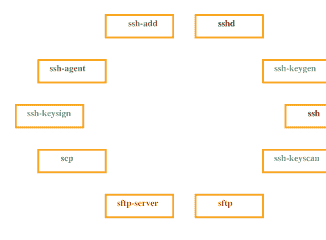

#### 图 4. OpenSSH 星系中的明星

如图 4 所示，在大局中有很多可执行文件和参与者。然而，它们之间的相互作用并不复杂。我上面讨论的所有内容实际上都是由 `SSH` 和 `sshd` 组件（分别是客户端和服务器）实现的。其他组件很少用于密钥生成、代理转发等。

`sftp-server` 是 `SSH` 的子系统。这是一种类似 `FTP` 的协议，但与破碎的 `FTP` 协议不同，它具有高度的安全性和效率。

`scp` 是一种基于 `SSH` 基础设施构建的、流行且方便的文件传输机制。由于完整性保护内置于 `SSH` 线路协议中，文件完整性得到保证。然而，它没有为中断的传输提供恢复功能，因此你需要与 `rsync` 一起使用才能获得该功能。

### 安全分析与攻击

现在，让我们看看 `SSH` 帮助我们防御的攻击类型和威胁模型。

任何密码协议中最关键的组件之一是随机数生成器的质量。由于计算机是确定性设备，获取真正的随机数据是一项挑战。常见的熵源包括磁盘访问、键盘和鼠标输入、进程生命周期等。大量传统 `UNIX` 程序依赖于 `gettimeofday(2)` 系统调用。`SSH` 也使用可靠的机制来检查数据池的随机性。

一种特定于 `SSH` 的有趣攻击是使用控制字符序列来终止会话并干扰 `pty` 交互，因此我们必须过滤掉可疑的字符序列。

`SSH` 最关键且不幸的是最薄弱的环节是服务器/主机认证。现实情况和典型的用户疏忽证明，每当新主机密钥被添加到我们的可信列表时，我们往往只是说“是”。目前正在努力使这一过程更加安全和便捷。如果未能确保这一点，各种类型的中间人攻击都是可能的。

`Girish Venkatachalam` 是一位密码学家，拥有近十年的现代 `UNIX` 系统工作经验。他曾从头开始为路由器在 `Nucleus OS` 上开发 `IPsec`，并深入研究过 `Apache`、`OpenSSL` 和 `SSH` 的核心。他的联系方式是 `girish729@gmail.com`。

### 资源

- `OpenSSH`: [www.openssh.org](http://www.openssh.org)

- `SSH` 协议架构: [www.ietf.org/rfc4251.txt](http://www.ietf.org/rfc/rfc4251.txt)

- `ssh-userauth`: [www.ietf.org/rfc4252.txt](http://www.ietf.org/rfc/rfc4252.txt)

- `ssh-transport`: [www.ietf.org/rfc4253.txt](http://www.ietf.org/rfc/rfc4253.txt)

- `ssh-connect`: [www.ietf.org/rfc4254.txt](http://www.ietf.org/rfc/rfc4254.txt)


## INDEPTH

### 从零开始构建 Linux 防火墙

关于入门 `iptables` 的初步步骤。

**`DINIL DIVAKARAN`**

#### 构建防火墙

在 `Linux` 机器上构建防火墙是一件很容易完成的事情。本文描述了使用 `Linux` 工具从零开始开发防火墙的基本步骤。本文面向对（`Linux`）防火墙感兴趣的新手。更重要的是，本文面向所有希望亲自动手并尽快让防火墙投入运行的新管理员，但同时又不会错过途中涉及的重要概念。我在印度理工学院（`IIT`）马德拉斯分校计算机科学与工程系的 `DON`（分布式与光网络）实验室从事基于 `Linux` 的防火墙工作的经验，是撰写本文的最主要动力。

在本文中，我们将探讨开发一个位于边缘的防火墙，它将你的私有网络与世界其他部分隔离开来；因此，该防火墙还将充当网关。

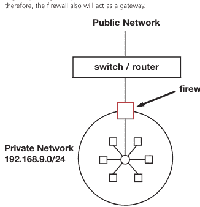

首先，你为什么需要这样的防火墙？最重要的是，你需要限制对你网络中机器的访问，这个网络可能由各种服务器组成。其中一台可能是邮件服务器，另一台可能是 `DNS` 服务器，但只有这些特定服务（*由这些服务器提供*）需要被访问，而不是网络中的一切。简而言之，防火墙用于保护私有网络免受世界其他部分的侵犯——称之为公共网络（在大多数场景下即互联网）。

拥有防火墙的一个不那么明显的原因是你有必要阻止所有进入或通过你网络的不想要的流量，这些流量否则可能会消耗带宽。理想情况下，这类流量应在网关处（网关或防火墙）被拦截。一个好的例子是存在许多子网络的情况，例如在大学校园中。子网络中的一台机器可能会感染病毒，并可能泛洪或广播 `ARP` 数据包。同样，来自私有网络外部的某些 `Windows` 电脑可能会广播 `netbios`（`netbios-ns/netbios-dgm`）数据包，这些对你的网络毫无意义，因此应被防火墙阻止。

但是，一些 `ARP` 数据包可能是针对你网络（或子网）中机器的合法请求。如果你阻止了这些合法的 `ARP` 广播请求，那么没有任何数据包（无论是好是坏）会到达你的网络；因为私有网络外部的机器将无法获得你网络中机器 `IP` 地址对应的以太网地址。为了解决这个问题，你应该配置防火墙作为 `ARP` 请求的代理——也就是说，你的防火墙应回复这些 `ARP` 请求。

现在，让我们进入实施细节。假设你的私有网络是 `192.168.9.0/24`。你的防火墙，也是网关，必须有两个接口：一个指向你的网络（`eth0`），另一个连接到公共网络（`eth1`）。

首先，为这两个接口配置 `IP`。这可以使用网络配置工具或通过 `ifconfig` 命令完成。理想情况下，最好使用系统网络配置工具（`Fedora Core 2–5` 中的 `system-config-network`）或编辑配置文件（`FC 2–5` 中位于 `/etc/sysconfig/network-scripts`），以便在网络启动（作为启动过程的一部分）或重启（手动）时配置得以保留。你也可以通过在 `/etc/rc.d/rc.local` 末尾追加 `ifconfig` 命令来配置 `IP`（因为该文件在启动过程结束时执行）。如果你这样做，请确保这些命令在网络手动重启时也能被执行。

我们使用 `ifconfig` 以保持发行版无关性（由于缺乏更好的术语）。

关于接口使用的 `IP` 地址没有硬性规定，但通常，子网中的最后两个 `IP` 地址用于此类用途。现在，将 `192.168.9.253` 分配给 `eth0`，将 `192.168.9.254` 分配给 `eth1`：

```bash
echo "Configuring eth0"
/sbin/ifconfig eth0 192.168.9.253 up

echo "Configuring eth1"
/sbin/ifconfig eth1 192.168.9.254 up
```

充当网关角色的防火墙最重要的功能是转发数据包。这是我们实现的方法：

```bash
echo "Enabling IP forwarding"
echo "1" > /proc/sys/net/ipv4/ip_forward
```

早先我们说过，防火墙还应作为 `ARP` 请求的代理。这意味着防火墙将回复查询你网络（`192.168.9.0/24`）中任何机器以太网地址的 `ARP` 请求。防火墙会发送被广播查询的机器（例如 `192.168.9.8`）的 `MAC` 地址吗？不会。相反，它会发送它自己的 `MAC` 地址，然后，当它收到发往 `192.168.9.8` 的数据包时，它会将数据包转发给 `192.168.9.8`（当然，前提是规则允许该数据包通过）。在新发行的系统中启用代理 `ARP` 相当容易：

```bash
echo "Enabling Proxy ARP"
echo "1" > /proc/sys/net/ipv4/conf/eth1/proxy_arp
```

接下来，在防火墙中设置路由条目。私有网络可以通过 `eth0` 访问，但发往公共网络的数据包应通过 `eth1`：

```bash
echo "Route to 192.168.9.0/24 is through eth0"
/sbin/route add -net 192.168.9.0/24 dev eth0
```

```bash
echo "The default gateway is eth1"
/sbin/route add default via eth1
```


同样，你必须告诉网络中的所有机器使用 `192.168.9.253` 作为默认网关（因为你必须通过网关才能访问网络外部的任何机器）。可以直接访问 LAN 机器。在你的网络中的所有机器上（显然是除了防火墙之外）执行以下操作：

```bash
echo "Add default route through the gateway"
/sbin/route add default gw 192.168.9.253 eth0
```

```bash
echo "192.168.9.0/24 is directly reachable"
/sbin/route add -net 192.168.9.0/24 dev eth0
```

接下来是防火墙规则——保护网络的规则。规则使用 `iptables` 工具编写。这是一个非常有用的工具，虽然有点复杂，且有一个关于各种选项的详细 `man` 页。`iptables` Netfilter 使用三个不同的内置链：`INPUT`、`FORWARD` 和 `OUTPUT`。数据包通过这些链遍历，因此规则是为特定链编写的。就你的防火墙而言，任何发往你的防火墙（`192.168.9.253` 或 `192.168.9.254`）的数据包都进入 `INPUT` 链。如果数据包旨在被转发（也就是说，它不是发给你的防火墙，且你的防火墙中有到目的地的路由），它将通过 `FORWARD` 链。由你的防火墙生成的任何数据包都将从该机器通过 `OUTPUT` 链发出。（这个简要说明适用于任何 Linux 机器。）虽然你永远不会希望防火墙转发所有通过它的数据包，但你可能想要测试上述配置下的网关功能是否正常工作。为此，将 `FORWARD` 链的默认策略设为 `ACCEPT`（使用 `-P` 选项）——也就是说，任何通过 forward 链的数据包都被接受：

来自网络 `192.168.9.0/24` 中任何机器（除了防火墙）发往网络外部任何（在线）机器的 `ping` 请求现在将返回 `ICMP` echo reply 数据包。如果外部机器不可达，可能是电缆或网卡存在问题，或者你可能错误配置了某些内容。

现在，让我们构建“墙”。设置防火墙最简单的方法是拒绝（`DROP`）所有类型的数据包，然后编写规则来允许（`ACCEPT`）那些你希望通过的数据包。所以，让我们将每个链的默认策略设置为丢弃数据包。

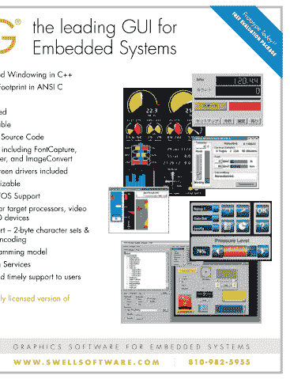


在此之前，清除所有现有规则：

```bash
echo "Flush existing rules"
/sbin/iptables -F
echo "Set the default policy to drop packets"
/sbin/iptables -P INPUT DROP
/sbin/iptables -P OUTPUT DROP
/sbin/iptables -P FORWARD DROP
```

至此，你可能已经注意到，规则基本上规定了数据包必须具备的一些条件。如果匹配这些条件，则执行规则中指定的操作；否则检查链中的下一条规则，如此继续直到匹配某条规则为止。如果链中的规则均未匹配，则执行默认操作或策略（此处为 `DROP`）。

让我们编写第一条规则——一条允许从私有网络发出 SSH 数据包出去的规则：

```bash
echo "Allow outgoing SSH"
/sbin/iptables -A FORWARD -p TCP -i eth0 \
-s 192.168.9.0/24 -d 0.0.0.0/0 --dport 22 -j ACCEPT
```

这条规则几乎不言自明。选项 `-A` 指定规则要追加到的链，`-p` 指定协议（`UDP`、`TCP`、`ICMP` 等）。选项 `-i` 指定接收数据包的接口名称。因为发出的 SSH 数据包来自 `192.168.9.0/24` 网络（`-s` 指定源地址），它们将通过防火墙的 `eth0` 接口进来。SSH 流量的目标端口（`-dport`）是 `22`。目标地址由 `-d` 选项指示，`0/0` 表示任何地址。最后，匹配此类数据包的动作是 `ACCEPT`（由 `-j` 选项指定），这意味着允许匹配的数据包通过。

现在，我们编写了一条规则，允许来自 `192.168.9.0/24` 的 SSH 流量去往任何地方。但这行得通吗？你能从私有网络 SSH 登录到公共网络中的机器吗？我们在哪里允许来自 SSH 服务器（在公共网络中）返回到客户端（在私有网络中）的数据包？以下规则实现了这一点：

```bash
/sbin/iptables -A FORWARD -p TCP -i eth1 -s 0.0.0.0/0 \
--sport 22 -d 192.168.9.0/24 -j ACCEPT
```

这看起来很好，但我们随后需要为每种服务编写这样的规则。更糟糕的是，上面的规则做了超出需求的事情。它允许任何机器使用源端口 `22` 连接到私有网络。我们应该做的是追加一条规则，仅允许来自公共网络且属于由 `192.168.9.0/24` 网络中的机器发起的 SSH 连接的一部分的数据包。

`iptables` 维护状态信息以进行此类连接跟踪。维护的四种状态是 `NEW`、`ESTABLISHED`、`RELATED` 和 `INVALID`。我们在这里不详细讨论这些状态。暂时请记住，状态 `NEW` 表示数据包是新连接的一部分。当在相反方向看到响应数据包时，连接变为 `ESTABLISHED`。注意这与 TCP 连接建立过程中的状态无关。对于相应请求的 `ICMP` 或 `UDP` 回复也将标记连接为 `ESTABLISHED`。请参阅 `iptables-tutorial.frozentux.net/iptables-tutorial.html#STATEMACHINE` 以了解连接跟踪机制的确切工作原理。现在（在移除上述规则后），为了转发所有组成 `ESTABLISHED` 连接的一部分的数据包，我们编写以下规则：

```bash
echo "Allowing ESTABLISHED connections"
/sbin/iptables -A FORWARD -m state --state \
ESTABLISHED -j ACCEPT
```

这条规则确保只有属于 `ESTABLISHED` 连接的数据包才会被接受；发往 `192.168.9.0/24` 的新连接请求将不会被接受。理想情况下，为了访问任何服务（如 `HTTP` 或 `FTP`），我们需要仅允许 `NEW` 和 `ESTABLISHED` 连接出去（`NEW` 将允许第一个数据包，`ESTABLISHED` 将允许同一连接的所有后续数据包），并且仅允许 `ESTABLISHED` 连接进入私有网络。同样，如果你的网络中有一个 `DNS` 服务器，且需要允许外部访问（查询）它，以下规则可以做到（假设 `198.168.9.1` 是 `DNS` 服务器）：

```bash
echo "Allowing incoming DNS requests"
/sbin/iptables -A FORWARD -p TCP -i eth1 \
```


`-d 198.168.9.1 -i eth1 -j ACCEPT`

请注意，此处使用的接口是 `eth1`，因为来自公共网络的报文将在 `eth1` 上接收。（我们没有使用 `-s 0/0`，因为默认情况下已添加。）此外，请记住，`DNS` 查找之所以成功，仅因为我们已经添加了允许 `FORWARD` 列表中 `ESTABLISHED` 连接的规则（是的，`UDP` 流量也有关联的 `ESTABLISHED` 状态）。

到目前为止，除了 SSH 和 DNS 之外，我们已经阻止了所有协议。对于新的系统管理员来说，阻止 `ICMP` 报文是一种常见的做法。但这并不是一个好主意，因为 `ICMP` 报文在许多方面都有用，例如学习大型局域网中不同互连网络之间的路由，查看机器是否在线，进行路径 MTU 发现等。因此，假设我们是明智的管理员，让我们允许 `ICMP` 报文通过防火墙：

```bash
echo "Allowing ICMP packets"
/sbin/iptables -A FORWARD -p ICMP -j ACCEPT
```

之前，我们阻止了发往防火墙盒子以及从防火墙盒子发出的任何报文（使用 `INPUT` 和 `OUTPUT` 链）。为了诊断目的，我们可以允许 `ICMP` 报文通过这两个链——也就是说，允许 `ICMP` 报文进出防火墙：

```bash
echo "Allowing ICMP packets to the firewall"
/sbin/iptables -A INPUT -p ICMP -j ACCEPT

echo "Allowing packets from the firewall"
/sbin/iptables -A OUTPUT -p ICMP -j ACCEPT
```

`ICMP` 报文也可以进行速率限制（作为对基于 `ICMP` 攻击的预防措施）：


```bash
echo "Limit ICMP requests to 5 per second"
/sbin/iptables -A FORWARD -p icmp --icmp-type echo-request -m limit --limit 5/s -j ACCEPT
```

我们也可以选择忽略 `ping` 广播——即发往广播地址的 ICMP 报文，例如 `ping 192.168.9.255`（ICMP 广播请求在 `Snort` 攻击中被使用）：

```bash
echo "Ignoring ICMP broadcast requests"
echo 1 > /proc/sys/net/ipv4/icmp_echo_ignore_broadcasts
```

一旦系统重启，所有这些规则（命令）都将丢失；不过，`iptables` 提供了保存和恢复这些规则的选项。但是，更好的方法是将规则保存在一个文件中（例如，`firewall.sh`），赋予其可执行权限，并将脚本名称追加到 `/etc/rc.d/rc.local` 的末尾。这样，你始终可以编辑和修改防火墙脚本。

## 广告商索引

有关广告信息，请联系我们的销售部门，电话 1-713-344-1956 分机 2，或邮件 `ads@linuxjournal.com`。`www.linuxjournal.com/advertising`

| 广告商 | 页码 | 广告商 | 页码 |
|---|---|---|---|
| **ASESSEL, LLC**<br>`www.asessele.com` | 59 | **M9X**<br>`www.m9x.com` | 9 |
| **ACMA**<br>`www.acma.net` | 57 | **Micromax, Inc.**<br>`www.cm2.com` | C4, C9 |
| **APPRO HPC SOLUTIONS**<br>`appro.com` | C2 | **Ohio State Systems, Inc.**<br>`www.ohiostatesystems.com` | C3 |
| **Artitune Corporation**<br>`www.arcitune.com` | 81 | **PSS2-LINX**<br>`www.pss2-linx.com` | 11 |
| **ASA Computers**<br>`www.asacomputers.com` | 33, 71 | **Polywell Computers, Inc.**<br>`www.polywell.com` | 63 |
| **Avocent Corporation**<br>`www.avocent.com/line` | 1 | **THE PORTABLE GROUP**<br>`www.tpgroup.com` | 29 |
| **Cardiff**<br>`www.cardiff.net` | 89 | **Rackspace Managed Hosting**<br>`www.rackspace.com` | C3 |
| **Claro, Inc.**<br>`www.claroa.com` | 5 | **R CLOUD TECHNOLOGIES**<br>`www.rclosteach.com` | 41 |
| **Cyclol Point**<br>`www.cyclo1point.com` | 3 | **SAMSUNG DIRECT**<br>`www.samsunghirect.com` | 49 |
| **EX-CEL, Inc.**<br>`www.ex-acelinc.com` | 73 | **SIEMENS MIKRODATA**<br>`www.siemensmikrodata.com` | 23, 65 |
| **EVERSTACK**<br>`www.everstack.com` | 31 | **SUN JAVA ONE CONF.**<br>`java.sun.com/javacorn` | 67 |
| **FARCOM**<br>`www.farcom.com` | 39 | **SUPREMO**<br>`www.supremoind.com` | 15 |
| **GEORGE TOWNSEND/AMBER**<br>`www.amber.com` | 6 | **SWISS SOFTWARE, INC.**<br>`www.swisssoftware.com` | 79 |
| **GHOSTER SYSTEMS, INC.**<br>`www.ghoster.com` | 37 | **SYSCO AG**<br>`www.sysco.com` | 19 |
| **HUSONIA ELECTRIC**<br>`www.net` | 47 | **TMP WORLDPRESS**<br>`www.tmpcorp.com` | 17 |
| **INXYS SYSTEMS**<br>`www.inxsysystems.com` | 77 | **TECHNOLOGIC SYSTEMS**<br>`www.tectronic.com` | 18 |
| **LINUX JOURNAL**<br>`www.linuxjournal.com` | 53 | **TYAN COMPUTER USA**<br>`www.tyan.com` | 7 |
| **LINUXWORLD CONGRESS & EXPO**<br>`www.linuxworldexpo.com` | 95 | | |

## Asterisk 时区处理（第二部分）

这是我们关于 `Asterisk` 时区处理系列的第二部分。

**马修·加斯特（MATTHEW GAST）**


**上个月**，我写了一个关于使用 `Asterisk` 处理电话呼叫的系统，该系统根据远程位置的时间自动处理呼叫。然而，该系统的使用依赖于用户执行关键任务：通过电话设置远程位置的时间。如果不依赖用户手动发起电话呼叫，如果呼叫能自动发生，那就更简单了。

如果设置呼叫自动发生，用户就不会忘记做这件事。初始的 `SIP` 注册可能在家庭所在地非常奇怪的时段发生，但 `SIP` 注册的发生是因为用户插上了某个东西。因此，我们知道用户是清醒的，并且可以接听一个短暂的电话。`Asterisk` 提供了一个管理接口，可以报告 `SIP` 注册发生的时间，并可用于基于此采取行动。通过一些额外的处理，与管理器交互的脚本可以仅在 `SIP` 注册是“新”的时候发起呼叫。

### Asterisk 管理器简介

`Asterisk` 管理器报告 `Asterisk` 处理的事件，并接受接口上的命令。该接口的形式是基于文本的协议，将事件报告和命令分隔为以键：值格式排列的行簇。例如，使用 `SIP` 协议注册分机 300 看起来像这样：

```
Event: PeerStatus
PeerStatus: Registered
Peer: SIP/380
```

在获得 `Asterisk` 管理器的访问权限之前，客户端必须针对存储在 `/etc/asterisk/manager.conf` 中的管理员用户列表进行身份验证。登录之后，客户端可以发出命令或通过一组以 `Action:` 开头的行来查询变量的值，后跟一个命令。对命令的响应通常以 `Response: Success` 开头。对协议的响应是基于文本的，可以使用诸如 `Expect` 之类的语言进行脚本化。`Perl` 对象环境（`POE`）还有一个可用的组件，`POE` 是一个在 `Perl` 中构建事件驱动程序的框架。免费提供的组件提供了基础级别的响应解析，这在 `Expect` 中需要编写，因此它是控制 `Asterisk` 管理器的程序更易于扩展的基础。

### 程序核心和内联状态

程序的主代码很简单。`POE` 设置了一个系统，在该系统中，状态处理器根据程序状态被调用。状态可以由程序员或外部事件定义。程序的典型流程是注意到 `SIP` 注册，检查它是否有时区注册，如果没有，则发起配置呼叫。

为了响应事件执行代码，`POE` 框架使用一个名为 `CallBacks` 的哈希。`CallBacks` 中的每个条目都根据从管理器接收的事件定义一个状态。当事件匹配回调时，为该状态定义的处理器会被触发。要使用 `CallBacks` 子句设置触发器，请识别事件中的每一行，并设置一个哈希，使得事件每行的左侧作为哈希一行的键值。作为一个例子，考虑前面 `SIP` 注册事件的回调定义：

```
Event:  PeerStatus     register -> { 'Event' => 'PeerStatus',
Peer:  SIP/380                    'PeerStatus' => 'Registered', }
```


```
inline_states => {
   input      => \&input_state_handler,
   response   => \&response_state_handler,
   dresponse  => \&db_response_state_handler,
   register   => \&register_state_handler,
   call       => \&call_state_handler,
   unregister => \&unregister_state_handler,
       },
  );
```

要将回调链接到处理器，`inline_states` 哈希包含一个状态列表和指向相应代码的引用。虽然可以内联事件处理器代码，但为了可读性，我将代码分离到了外部过程中。响应 `CallBack` 调用的代码不能传递参数：

```
123456789*123456789*123456789*123456789*123456789*12
inline_states => {
   register => \&register_state_handler,
},
```

```
POE::Kernels->run();
exit(0);
```

根据程序的流程，有三个事件是感兴趣的。首先，`SIP` 注册事件用于启动整个过程。`SIP` 注册通常每小时发生一次，因此重要的是仅在注册是“第一次”注册时发起呼叫。为了防止重复发起电话呼叫，程序将请求来自 `Asterisk` 内部数据库 `AstDB` 以及 `SIP` 对端信息的数据。第二个和第三个事件分别处理对命令和数据库查询的响应。第四个事件将在从队列接收数据后处理发起电话呼叫。我当前使用的代码还定义了一个用于 `unregister` 事件的状态，尽管这是我当前未使用的事件的存根。

两个状态处理器仅仅是存根。`input` 状态处理器如果设置了调试标志，会打印出它收到的任何内容，它是为开发目的存在的。它捕获来自管理器的任何未识别的事件，在测试回调是否捕获重要事件时可能很有用。`unregister` 状态处理器目前什么也不做，但它作为一个钩子存在，如果我在未来选择基于它采取任何行动，可以扩展它。

程序的核心只有 35 行，其中大部分定义了程序事件状态并显示将使用哪些代码来响应这些状态。请注意，`call` 状态是由程序定义的，而不是由回调定义的，因此 `call` 状态只能由程序本身进入，而不能作为对管理器事件的响应。（程序的完整可在《Linux Journal》的 FTP 站点上获取；参见资源。）

有了程序的核心，让我们按照典型程序执行流程中调用的顺序查看每个状态。

### 注册事件处理

每当从新分机接收到 `SIP` 注册事件时，`register` 状态处理器就会被调用。它的主要目的是获取设置新分机出现时配置电话呼叫所需的数据。是否进行呼叫取决于扩展的时区处理状态，因此此例程请求信息以确定扩展是否已注册、其 IP 地址和其他组件。要获取扩展，我们必须获取通道名称，该名称以技术和斜杠（例如 `SIP`）为前缀，并去掉前面的部分。

```
POE::Component::Client::Asterisk->new(
  Alias             => 'monitor',
  RemoteHost        => 'localhost',
  RemotePort        => 5138,
  Username          => 'autozcaller',
  Password          => 'secretspassword',
  Callbacks => {
    input    => { },
    response => {
                 'Response' => 'Success',
               },
    dresponse => {
                 'Event' => 'DDebugResponse',
               },
    register => {
                 'Event' => 'PeerStatus',
                 'PeerStatus' => 'Registered',
               },
    unregister => {
                 'Event' => 'PeerStatus',
                 'PeerStatus' => 'Unregistered',
               },
  },
```

事件处理器的一个棘手之处是 `POE` 处理器会运行到完成。当处理器运行时，没有方法可以中断它。子程序 `getTZchannelVars` 将请求时区偏移量和 IP 地址的信息，但该信息只有在注册处理器完成并且响应通过管理器返回后才会可用。

在过程结束时，注册处理器使用 `delay_set` `POE` 方法将 `call` 状态排队等待未来的延迟，以便在该时间点之前请求将返回其信息。延迟由程序中的全局变量设置。我发现对于只有一个需要设置的未决扩展的单用户 `PBX`，一秒绰绰有余，但为了安全起见，延迟设置为三秒。

状态处理器之间的通信与过程驱动程序略有不同。`POE` 状态处理器传递 `POE` 内核的引用，用于调度，以及 `POE` 堆，用于向 `Asterisk` 管理器发出命令。`POE` 定义常量，使堆和内核可以很容易地通过 `$_[HEAP]` 和 `$_[KERNEL]` 访问事件处理器。任何其他可用信息都位于 `$_[ARG0]`，这是一个以这种方式定义的常量，使其成为第一个参数。

定义状态的中的任何行都将作为哈希 `$_[ARG0]` 传递，并通过请求所需行左侧出现的哈希键来访问。在注册响应中，可以通过以下方式访问对端扩展

### Asterisk manager 会报告由 Asterisk 处理的事件，并通过该接口接受命令

引用 `$_[ARG6] -> ( Peer )`，该引用返回 `SIP/300`：

```
Event: PeerStatus
PeerStatus: Registered
Peer: SIP/300
```

当 `SIP` 注册发生时，程序需要识别分机号，请求相关信息，然后在延迟后设置对该分机数据的进一步处理。当通过 `delay_set` 方法调用事件时，可以传递分机号给状态处理器，例如这里使用的分机号：

```perl
sub register_state_handler {
    my $kernel = $_[KERNEL];
    # Split peer extension off from technology
    my $peer = $_[ARG6] -> ( Peer );
    debug_print(" Extension is $peer ");
    my $extn_parts = split('/', $peer);
    my $ext = $extn_parts[1];
    debug_print("Extension number is $ext\n");
    getTZChannelVars($_[HEAP], $ext);
    debug_print(" Queueing call event for $ext ");
    debug_print("SREG_CALL_DELAY seconds\n ");
    $kernel->delay_set("CALL", $REG_CALL_DELAY, $ext);
} # register_state_handler
```

作为分机注册过程的一部分，我们在 `getTZChannelVars` 例程中收集有关通道状态的变量。作为第一个参数传递的 `POE` 堆（heap）可用于向管理器发出命令。例如，可以针对服务器的 `put` 参数用于发出命令。要获取包含该对端当前 IP 地址的 `SIP` 对端数据，命令如下所示：

```perl
$heap -> (server) -> put ( { Action => 'SIPShowPeers',
                            Peer => $ext } );
```

要获取数据库变量，`put` 命令中的操作是 `DBGet`。时区数据以键的形式存储在 `tz` 族中，因此有必要指定族并组装正确的键名，其形式为 `300-TIMEZONE` 或类似形式：

```perl
$heap -> (server) -> put ( { Action => 'DBGet',
                            Family => 'tz',
                            Key => "$ext . -TIMEZONE" } );
```


四个数据库请求和 SIP 对端数据由 `getTZChannelVars` 请求。由于此函数由事件处理器调用，因此它也是不可中断的。因此，它向管理器发送四个数据库查询事件，但不直接处理响应。（完整过程内的五个请求的完整代码可在 *Linux Journal* FTP 站点上获取。）

### 命令和数据库响应

在发出请求和呼叫状态被调度之间的间隙，响应从 SIP 数据请求和数据库查询流入。从 SIP 数据请求中，我们需要挑出对端 IP 地址，它出现在管理器响应中读取为 `Address-IP: 192.168.1.5` 的一行上。幸运的是，POE 模块会解析响应中的行，因此我们只需要通过获取传递给处理器参数之一的 `Address-IP` 哈希元素的值来寻找 `Address-IP` 行即可。POE 堆在事件之间可访问，因此将 SIP 对端 IP 地址的值添加到堆中可使其对其他事件处理器可访问：

```perl
sub response_state_handler {
    my $peer_ip = $ [ ARG0] -> ( Address-IP ) ;
    if (defined($peer_ip) ) {
        debug_print("SIP context found: Peer IP address ");
        debug_print ( " is @$peer_ip\n ");
        _ [ HEAP ] -> ( 'SIP-Peer-IP ')=$peer_ip;
    } # response_state_handler
}
```

在 SIP 数据响应返回之后，四个数据库查询应返回响应。查询的响应看起来像这样：

> ```
> DBGetResponse: Success
> Family: tz
> Key: 300-TIMEZONE
> Val: -8
> ```

每当有来自管理器的 `DBGetResponse: Success` 事件时，回调处理器都会触发，参数是一个包含数据包中每行内容的哈希。我们要感兴趣的是键和值行，可以从传递给状态处理器的参数中检索到。与之前的处理器一样，响应存储在 POE 任务堆中，使其可供其他处理器使用：

```perl
sub db_response_state_handler {
    my $family = _ [ ARG0 ] -> ( Family ) ;
    my $key = _ [ ARG0 ] -> ( Key ) ;
    my $value = _ [ ARG0 ] -> ( Val ) ;
    if (defined($family)) {
        debug_print ( "Key stored in DB family $family ");
        debug_print ( " is $value\n ");
        # Store in heap
        _ [ HEAP ] -> ( $key ) = $value;
    } # db_response_state_handler
}
```

### 发起呼叫

每个注册事件都会触发在延迟后发生“呼叫”事件。该延迟用于收集用于确定是否发起呼叫的信息。只有当时区设置已过期或 SIP 设备更改其 IP 地址且记录不再有效时，才应触发设置电话呼叫。

由于 `call_state` 处理器由注册处理器放入队列中执行，因此它确实拥有一个参数，即所讨论呼叫的分机号。分机号可以 `$_[ARG0]` 获取。我们通过处理数据库响应和 SIP 数据请求而添加到堆中的所有数据也都立即可用：

```perl
sub call_state_handler {

	# Get extension out of arguments to function
	my $exten = $_[ARG0];

	my $hp = $_[HEAP];

	# Variables we use to determine if the call is required
	my $skev = $hp->{$exten.'-TIMESKEW'};
	my $skev_addr = $hp->{$exten.'-TIMESKEW_ADDR'};
	my $skev_start = $hp->{$exten.'-TIMESKEW_START'};
	my $skev_end = $hp->{$exten.'-TIMESKEW_END'};
	my $sip_peer_ip = $hp->{'SIP-Peer-IP'};
	my $now = time();
	my $now = time();
}
```

要确定是否需要呼叫，该处理器将当前时间与时间偏移记录的过期时间进行比较，并将 SIP 设备的 IP 地址与存储时偏移记录中的 IP 地址进行比较。如果 IP 地址匹配且偏移未过期，则无需呼叫。否则，需要进行呼叫，并使用 `makeTZSetupCall` 函数执行：

```perl
if ($now > $skev_end) {
	debug_print("Make call -- offset has expired.\n");
	makeTZSetupCall($_[HEAP], $exten);
} elsif ((!$skev_addr eq $sip_peer_ip)) {
	debug_print("Make call -- SIP IP addr changed\n");
	makeTZSetupCall($_[HEAP], $exten);
} else {
	debug_print("No call -- record OK & same IP\n");
}
```

最后一步，处理器需要移除放置在堆上的变量。堆仅用于在状态处理器之间传递变量，一旦该函数完成，这些变量就不再需要。可以使用 `undef` 函数将每个变量定义为无定义：

```perl
# Need to clean up heap
undef $_[HEAP]->{$exten.'-TIMESKEW'};
undef $_[HEAP]->{$exten.'-TIMESKEW_ADDR'};
undef $_[HEAP]->{$exten.'-TIMESKEW_START'};
undef $_[HEAP]->{$exten.'-TIMESKEW_END'};
undef $_[HEAP]->{'SIP-Peer-IP'};

} # call_state_handler
```

发起设置呼叫使用 Asterisk Manager 的 `Originate` 命令，但受最后一次检查保护。我定义了一组分机作为远程通道列表。只有远程通道列表上的分机才会向其发起时区设置呼叫。最初，该列表包括我的软电话和一个模拟电话适配器，但我可能需要在未来添加更多。在发起呼叫之前，我确保该号码在远程通道列表上，该列表在全局数组 `REMOTE_CHANNEL_LIST` 中定义。`Originate` 命令还可以接受多个参数。分机、优先级和上下文必须引用设置菜单定义的位置。在我的情况下，这些值是分机 `*89`（对于 `^4-TZ`）、优先级 `1` 和上下文 `from-internal`。我还可以向我要呼叫的电话提供“Time Zone Setup”作为来电显示文本：

```perl
sub makeTZSetupCall {

	my $heap = $_[0];
	my $exten = $_[1];
	my $callOK = 0;

	# Check that extension to call is a remote channel
	foreach $number (REMOTE_CHANNEL_LIST) {
		if ($number == $exten) {
			$callOK = 1;
		}
	}

	if ($callOK) {
		$heap->{server}->put(
			'Action' => 'Originate',
			'Channel' => 'SIP/' . $exten,
			'Context' => $TZ_CONTEXT,
			'Extlen' => $TZ_EXTEN,
			'Priority' => $TZ_PRIORITY,
			'CallenId' => $CALLERID,
			);
		# makeTZSetupCall
	}
}
```

如果触发了 `Originate` 命令，新注册的电话就会响铃，我将按照上个月文章中描述的语音菜单进行操作。

> Matthew East 是无线网络领域领先技术书籍 *802.11 无线网络：权威指南*（O'Reilly Media 出版）的作者。可以通过 `matthew.east@gmail.com` 联系到他，但仅限于他靠近海平面时。

### 资源

- [Perl 脚本完整源代码列表](ftp.linuxjournal.com/pub/lj/sti stings/issue156/9284.tgz)


- [有关 Asterisk Manager API 的信息](www.voip-info.org/w ki-Asterisk-manager+API)
- [Perl POE 框架](poe-perl.org)
- [Perl Asterisk Manager 组件](search.cpan.org/~xantus/ POE-Component-Client-Asterisk-Manager-0.06/Manager.pm)

## 使用 Inkscape 和 XSLT 创建跨平台报表和表单

**查德·法伊尔斯（CHAD FILES）**

我就职于一家医疗保健公司，负责开发应用软件。我和我的同事负责编写用于处理医疗索赔、管理工作流程并使公司尽可能高效的软件。我们最近决定替换一款第三方软件，该软件原本用于获取医疗索赔数据并将其叠加到标准的 HIPAA（《健康保险流通与责任法案》）索赔表单上。该软件会将数据转换为 `PDF` 文件，我们将其存储在一台大型文件服务器上。每个 `PDF` 包含一份在其对应表单上的索赔。我们决定替换该软件是因为我们需要一个更敏捷的方案。我们希望它能动态创建索赔图像，而不是占用我们服务器的空间。

医疗索赔非常复杂（图 1）。需要绘制许多方框和样板文本。使用软件应用程序执行此操作的常规方法是通过坐标和长度绘制一系列线条，然后将静态和动态内容覆盖在 newly 绘制的线条上方。编写此类应用程序的过程漫长且枯燥，更不用说容易出错了。我们希望找到一种更容易创建和维护的方案。我们的需求如下：

- 我们必须能够打印高质量的索赔版本。
- 索赔必须可以从 Web 浏览器访问。
- 解决方案必须与编程语言无关。我们使用 `Python`、`PHP`、`Perl` 和 `Java`。图像需要使用这些语言中的任意一种创建。
- 我们必须能够将索赔数据和表单转换为几种不同的文件格式，特别是 `PDF` 和 `PNG`。
- 整个解决方案必须是平台无关的。

在审查需求后，我们考察了几种不同的开源和闭源选项。没有一个满足我们的所有需求，因此我们转向创建自己的解决方案。我们尝试扫描一份空白索赔表单，并使用 `ImageMagick` 将索赔数据放置其上。这几乎给了我们想要的结果。问题在于，在所有要求的语言中创建解决方案将是枯燥且冗余的。接下来，我们转向 `FOP`（格式化对象处理器）。这个解决方案接近我们要的效果。然而，创建索赔表单需要太长时间。此外，该解决方案实际上也不是语言无关的（`FOP` 是一个 `Java` 库）。我们可以为 `FOP` 命令行接口编写包装器，但我们确信还有更好的解决方案。

在探索 `FOP` 解决方案时，我们产生了使用可缩放矢量图形（`SVGs`）的想法。基本上，我们会将索赔表单的 `SVG` 图像转换为 `XSLT`（可扩展样式表语言转换），因为 `SVG` 格式是一种特殊的 `XML` 格式。然后，我们会从数据库中调取索赔数据并将其转换为 `XML` 字符串。使用我们的任何语言，我们都可以将 `XSLT` 和 `XML` 结合起来创建索赔的 `SVG` 图像。此解决方案满足了我们的所有需求。它是语言和平台无关的。我们可以打印 `SVG` 图像并将其嵌入到 Web 页面中。此外，`SVG` 图像可以轻松转换为不同的文件格式。此解决方案的另一个优点是 `SVG` 图像的文件大小很小。如果我们想归档图像，它们将仅占用旧方案所需空间的一小部分。由于 `SVG` 图像是文本而非压缩的二进制文件，文件可以进行压缩以节省更多空间。


图 1. 健康保险 `HCFA` 1500 索赔表单

### 创建主 `SVG`

使 `SVG` 解决方案如此吸引人的因素之一是创建和维护表单主 `SVG` 图像非常容易。为此，我们将使用 `Inkscape`。`Inkscape` 是一款 `SVG` 创建工具，适用于 `Linux`、`Mac OS X`、`Windows` 和其他类 UNIX 操作系统。市面上有其他 `SVG` 创建工具，但我们选择 `Inkscape`，因为它是开源的，并且包含在大多数 `Linux` 发行版的软件包管理器中。

创建主 `SVG` 时做的第一件事是在 `Inkscape` 中打开一个新文档，尺寸为美国 Letter 大小。为了保持井井有条，我们在新文档中创建了四个图层：扫描、覆盖层、样板和动态文本。使用扫描图层，我们导入了索赔的扫描副本。这样做使我们可以无需测量任何内容即可在 `Inkscape` 舞台上对齐所有内容。导入图像后，我们锁定该图层，以防意外修改。实际上，在完成 `SVG` 上的每个图层后，我们都会锁定它，以确保其未被篡改。

接下来，我们使用覆盖层描摹导入的原始索赔中的所有线条和方框。这一步稍微有点棘手。当我们扫描的图像最初创建时，由于某种原因，线条间距并不均匀。我们决定在版本中正确排列各项内容。幸运的是，`Inkscape` 有工具可以自动完成此操作。通过选择需要间隔的所有对象（`Shift`+左击）并使用“对齐和分布”对话框（菜单中的“对象”→“对齐和分布”），`Inkscape` 修复了间距问题。完成后，我们得到了类似图 2 的结果。


图 2. 描摹自索赔表单的线条和方框


图 3. 完成的空白索赔表单

画完所有线条后，是时候添加所有样板文本了。为此，我们使用了名字很贴切的“样板”图层。开始之前，我们决定完全移除扫描图层，因为我们不再需要它。为了正确对齐文本，我们使用了 `Inkscape` 中的参考线（Guides）。参考线正如名字所暗示的那样——仅存在于 `Inkscape` 内部用于对齐对象的参考线。要使用参考线，只需点击顶部或左侧边距，将线条拖到指定位置。为了充分利用参考线，我们启用了“吸附到参考线”功能（“文件”→“文档偏好设置”→“参考线”）。这样做使我们可以将所有文本精确地对齐。图 3 显示了此步骤后 `SVG` 的样子。

最后，我们切换到“动态文本”图层，并在索赔数据所在位置添加占位符。再次，我们使用参考线来对齐所有内容。对于文本占位符，我们每个文本块使用一个 `$`。然后，为了方便日后操作，我们将每个动态文本对象重命名为相关内容。我们通过左击对象并进入菜单中的“对象”→“对象属性”来完成此操作。图 4 显示了带有参考线的最终主 `SVG`。

创建主 `SVG` 大约花了四个完整的工作小时。我敢打赌，以编程方式完成这需要几天时间。

### 将 `SVG` 转换为 `XSLT`

一旦主 `SVG` 完成，是时候将其转换为 `XSLT` 了。由于 `SVG` 图像只是 `XML` 文件，我们用文本编辑器添加了所有 `XSLT` 标记。将 `SVG` 转换是一件相当简单的事情。要使其成为真正的 `XSLT`，只需在头部添加几行代码即可。清单 1 显示了修改前 `SVG` 中的几行。清单 2 显示了带有 `XSLT` 标记的同一组行。


图 4. 带有动态文本图层的最终主 `SVG`

如您所见，有四个新行。第一行新行将此文件声明为 `XSLT`。第二行新行包含一个 `XPath`（`XML` 路径语言）表达式，匹配我们索赔数据 `XML` 中的根元素。此行告知 `XML` 转换引擎从哪里开始读取 `XML` 以执行转换。最后两行新行简单地闭合了未关闭的 `xml` 标签。

此时，`XSLT` 可以与我们的索赔数据 `XML` 结合使用以生成 `SVG`。然而，生成的 `SVG` 将看起来与我们修改前的 `SVG` 完全一样。要使其实际显示索赔数据，我们必须进入 `XSLT` 并添加所有 `XPath` 表达式以填充 `SVG`。由于我们将 `SVG` 对象分为图层，因此只需修改动态文本图层即可。在 `SVG` `XML` 中，动态文本图层不过是一系列文本标签。清单 3 显示了索赔表单上“患者城市”框的文本标签。

当 `XSLT` 应用于索赔数据 `XML` 时，`/claim/patient/address/city` 的值将在此处替换。我们遍历了整个 `XSLT`，并在适当的位置添加了相应的 `XPath` 表达式。在特殊情况下，我们还添加了 `XPath` 条件逻辑和格式规则。

### 索赔数据 `XML`

如前所述，我们的所有索赔数据都在一个数据库中——更具体地说，是一个 `Postgres` 数据库。由于我们需要一个与语言无关的解决方案，我们必须想出一种方法，在不依赖特定编程语言的情况下将索赔数据从数据库中取出并放入 `XML` 格式。我的一位同事开发者提出了编写一系列 `PLuGSQL` 函数以返回包含索赔数据的单个 `XML` 字符串的想法。他的解决方案非常巧妙，完全符合要求。我们只需运行一个带有索赔 `ID` 的小型查询（清单 4）即可获取索赔数据。结果是格式良好的 `XML`，我们用它来制作索赔图像。

#### 清单 1. 修改前的 `SVG` 的几行

```xml
<xml version="1.0" encoding="UTF-8" standalone="no">
<!-- Created with Inkscape (http://www.inkscape.org) -->
<svg
...
</svg>
```

#### 清单 2. 带有 `XSLT` 标记的同一组行


```xml
<xml version="1.0" encoding="UTF-8" standalone="no">
<!-- Created with Inkscape (http://www.inkscape.org) -->
<xsl:stylesheet version="1.0"
xmlns:xsl="http://www.w3.org/1999/XSL/Transform">
<xsl:template match="/claim">
<svg
...
</svg>
</xsl:template>
</xsl:stylesheet>
```

#### 清单 3. 索赔表单上患者城市框的文本标签

```xml
<text
 xml:space="preserve"
 style="..."
 x="33.237278"
 y="231.77995"
id="textPatientCity"
 sodipodi:linespacing="125.00000%"
 inkscape:label="ttext7272">
<tspan
 sodipodi:role="line"
 d="tspan7274"
 x="33.237278"
 y="231.77995"><xsl:value-of select="patient/address/city"/></tspan></text>
```

#### 清单 4. 带有索赔 ID 的查询

```sql
SELECT xml_to_string('01592008a5226');
```

### 深入探讨

清单 5. 将索赔 XML 转换为 SVG 并在浏览器中显示的 PHP 脚本片段

```php
// 导入 SVG XSLT
$xs1 = new XSLTProcessor();
$xs1->importStyleSheet(DOMDocument::load("svg_xslt.xsl"));

// 加载索赔数据 XML
// $claim 是来自清单 4 的数据库结果
$doc = new DOMDocument();
$doc->loadXML($claim);

// 告知浏览器这是一个 SVG 文档
header("Content-Type: image/svg+xml");

// 将 SVG 打印到浏览器
echo $xs1->transformToXML($doc);
```

从 1.5 版本开始，`Firefox` 内置支持 `SVG` 图像。然而，`Firefox` 并不支持 `SVG` 图像的某些方面，例如缩放和分组对象。幸运的是，我们的所有用户都使用最新版本的 `Firefox`。

这就是全部内容。图 5 显示了一个填写了所有数据的索赔图像。

#### 打印和归档 SVG 图像

一旦我们完成了 Web 端解决方案，我们就把目光转向了集成的其余部分。这意味着我们必须打印 `SVG` 图像并找到一种归档它们的方法。一些客户要求我们将打印和/或电子版的索赔副本发送给他们。由于我们的所有后端软件都是用 `Python` 编写的，这也意味着我们必须使用另一种语言进行 `XML` 转换。为了完成所有的 `XML` 工作，我们使用了 `4Suite XML API`。

为了打印图像，我们再次求助于 `Inkscape`，因为我们的 `PostScript` 打印机驱动程序无法打印 `SVG` 图像。`Inkscape` 有一些命令行选项，可以让 `Inkscape` 以命令行模式运行，从而抑制图形界面。我们用来打印的选项是`-o`。结合`lp`命令，这使我们能够无需任何用户交互即可打印图像。

#### 在浏览器中显示最终的 SVG

起初，创建此解决方案的主要目的是在我们的 Web 界面中显示索赔。我们的所有 Web 应用程序都是使用 `PHP5` 编写的，并运行在 `Apache/mod_php` 环境中。为了进行 `XSLT` 转换，我们使用了 `PHP` 中的 `XSL` 函数。这组函数作为 `PHP` 的一个扩展提供。该扩展是 `libxslt C` 库的前端。

`XSLT` 扩展使得执行转换变得简单。清单 5 显示了 `PHP` 脚本的一部分，该脚本将索赔 `XML` 转换为 `SVG` 并在浏览器中显示。

清单 5 是我们解决方案的简化版。在我们的解决方案中，存在单个索赔有多页的可能性。为了解决这个问题，我们不得不进行多次转换，每页一次。为了使多页索赔在同一浏览器窗口中显示，我们必须嵌入它们。这可以使用 `embed` 和 `object` `HTML` 标签来完成。请注意，使用这些标签时存在若干浏览器兼容性问题。为了解决兼容性问题，我们编写了一个脚本来检查用户的浏览器并决定使用哪个标签。然后，我们将目标对象/嵌入源设置为类似清单 5 中的脚本。这使 Web 浏览器能够在同一窗口中显示多个 `SVG` 图像。

在 Web 浏览器环境中使用 `SVG` 图像时，必须考虑其他因素。`Internet Explorer` 没有对 `SVG` 图像的本地支持。用户被迫使用第三方插件来显示图像。`Adobe` 免费提供其中一个。`Mozilla Firefox` 本地支持 `SVG`。


图 5. 带有示例数据的索赔表单

清单 6. 与清单 5 中显示的相同转换，但使用 Python 实现

```python
from Ft.Xml.Xslt import Processor
from Ft.Xml import InputSource
from Ft.Xml.DomLite import NonvalidatingReader

# 加载索赔数据 XML
# claim 是来自清单 4 的数据库结果
doc = NonvalidatingReader.parseString(claim,
    "http://spam.com/doc.xml")

# 加载并处理 XSLT
xslt = InputSource.DefaultFactory.fromUri("file://svq.xslt.xsl")
processor = Processor()
processor.appendStylesheet(xslt)

# 执行转换
result = processor.runMode(doc, "http://spam.com/doc.xml")

# 将 SVG 写入文件
f = open("/tmp/" + claim + ".svg", "w")
f.write(result)
f.close()

# 在默认打印机上打印图像
os.system("inkscape /tmp/" + claim + ".svg -p | lpr")
```

上一节描述了 `Python` 实现。清单 6 展示了我们如何在 `Python` 中执行与清单 5 中相同的转换。示例还展示了我们如何调用 `Inkscape` 来打印索赔图像。

之前，我提到我们的索赔通常有多个页面。在打印时，这不是问题；我们只需将每一页作为单独的作业发送到打印机。但在归档时，我们必须采取不同的方法。与 Web 界面一样，我们必须将页面分组，这次是将它们分组到一个文件中，并配合 Web 浏览器使用。在归档时，我们必须以 `PDF` 格式存储文件，因为这是我们的客户想要的。为了将图像转换为 `PDF` 并结合多页索赔，我们使用了 `Inkscape` 和 `Ghostscript`。

与打印一样，`Inkscape` 有一个将文件导出为 `PostScript` 格式的选项。我们不使用`-p`，而是使用`-P`并将所需的输出文件名传递给 `Inkscape`。在索赔的所有页面都写入文件后，我们使用以下 `Ghostscript` 命令将页面放入单个 `PDF` 并进行归档：

```bash
gs -dBRATCH -dNOPAUSE -q -sDEVICE=pdfwrite -sOutputFile=out.pdf /tmp/foo1.ps /tmp/foo2.ps
```

### 维护表单

项目完成后不久，我们面临着对表单布局进行两轮修改的挑战。第一轮修改涉及文本对象的位置。第二轮修改范围更广——我们不得不在表单上绘制一系列新框，以适应新的识别系统。由于我们无法在 `Inkscape` 中打开修改后的 `SVG`，因此我们必须对主 `SVG` 进行更改，然后手动将其应用于 `XSLT` 版本。

起初，我们认为进行修改会非常困难且繁琐，但事实证明这个过程很简单。对于第一轮，我们只是在主文件中使用 `Inkscape` 进行了更改，注意记录我们更改的对象。然后，使用文本编辑器，我们在 `XSLT` 中用新片段替换了旧的 `XML` 部分。由于第二批修改仅包含添加内容，我们决定简单地在主文件中创建另一层来添加这些框。当添加完新框后，我们只需使用文本编辑器将新层复制到 `XSLT` 中。

### 结论

从开始到结束，我们的项目花了略多于一个月的时间来完成设计、构建、测试和发布。我们的解决方案使我们所有应用程序更加敏捷和高效。我们还节省了服务器上的TB级存储空间。

目前，`SVG` 的普及率相当缓慢。我们期待着看到将利用多功能 `SVG` 文件格式构建的其他工具。

## 使用 Python 提取和解析 ODF 文件

使用 `Python` 解开开放文档格式文件的谜团。


# Kamran Husain

开放文档格式（ODF）联盟旨在促进不同文字处理应用程序之间的信息共享。本文概述了 ODF 文件的基本结构、底层 XML 文件的一些内部结构，并展示了如何使用 Python 读取内容以执行简单的关键字搜索。该代码也可以作为更高级操作的基础。本着开放的精神，我们使用开源软件来读取 ODF 世界，在这种情况下即 Python 和 OpenOffice.org 软件包。

如果您运行的是较新版本的 Linux 或 OS X，您的机器上应该已经安装了 Python 和 OpenOffice.org。如果您需要最新版本，Python 可免费下载，适用于 Windows 和 Linux 平台，网址为 www.python.org。

OpenOffice.org 软件包也可从 www.openoffice.org 免费获取。在 XP 桌面上安装 OpenOffice.org 相对简单。从各自网站下载软件包并运行安装程序。安装完成后，只需通过点击桌面上的已安装图标即可运行该应用程序。

> **提示**
>
> 大多数人都安装了 Microsoft Office。如果是这种情况，解决方案是使用 Microsoft Word 的插件（sourceforge.net/projects/odf-converter）。您可以在同一台机器上安装 OpenOffice.org 和 Microsoft 软件包而不会引起任何冲突。
>
> 在安装插件之前，请阅读 SourceForge 网站上的 Bugs 部分，了解任何不兼容性。我使用 OpenOffice.org 套件保存了本文的文件，因为它更简单。

一旦确认您拥有先决条件，就可以创建 ODF 文件。打开 Writer，在文档中输入一些文本并保存。您可以读取文件并将其保存为 `.odf` 文件。

快速查看保存对话框中的扩展名可以发现很多信息。ODF 文件可以有多种扩展名，这些扩展名提供了有关其中存储的信息类型以及存储该信息的应用程序的线索。参见表 1。

那么，ODF 文件里有什么？ODF 文件基本上是一个包含多个 XML 文件的压缩存档。文件中的实际文件和目录将根据信息类型和创建文档的系统而有所不同。

挑选 ODF 文件中文件名称的第一步需要解压文件本身。幸运的是，Python 通过 `zipfile` 模块内置了对处理此事的支持。

## 表 1. ODF 文件类型及其扩展名

| 文档格式 | 文件扩展名 |
| :--- | :--- |
| OpenDocument 文本 | `*.odt` |
| OpenDocument 文本模板 | `*.ott` |
| OpenDocument 主文档 | `*.odm` |
| HTML 文档 | `*.html` |
| HTML 文档模板 | `*.oth` |
| OpenDocument 电子表格 | `*.ods` |
| OpenDocument 电子表格模板 | `*.ots` |
| OpenDocument 绘图 | `*.odg` |
| OpenDocument 绘图模板 | `*.otg` |
| OpenDocument 演示文稿 | `*.odp` |
| OpenDocument 演示文稿模板 | `*.otp` |
| OpenDocument 公式 | `*.odf` |
| OpenDocument 数据库 | `*.odb` |

在命令行中输入 `py` 以运行交互式 shell。运行 shell 允许您检查从模块返回的对象的属性。因为您可能每种数据类型只这样做一次，所以此时并没有必要编写并执行脚本。如果您希望保留工作以供将来使用，最好使用文本编辑器编写脚本，或使用随 Python 附带的 IDLE 编辑器保存脚本。参见清单 1 了解如何显示类或模块中的成员函数。

来自 Python 文档的 `infolist()` 命令返回压缩存档对象的列表。运行 `dir()` 命令获取该列表中第一个对象的更多信息（清单 2），以获取为每个压缩文件存储的更多详细信息。这种查看对象中成员的特性称为内省。

对对象列表的迭代将显示相关信息

### 列表 1. 显示类或模块中的成员函数

```python
Python 2.4.1 (#65, Mar 30 2005, 09:13:57)
[GSC v 3120 32 bit (Intel)] on win32
Type "copyright", "credits" or "license()"
for more information.

>>> import zipfile
>>> myfile = zipfile.ZipFile('E:/articles/odf/TheArticle.odt')
>>> dir(myfile)

   ['NameToInfo', '_GetContents', '_RealGetContents',
    '__del__', '__doc__', '__init__', '__module__',
    '_filePassed', '_writecheck', 'close', 'comment',
    'compression', '_debug', 'filelist', 'filename', 'fp',
    'getinfo', 'infolist', 'mode', 'namelist',
    'printdir', 'read', 'start_dir', 'testzip', 'write',
    'writestr']

>>> listoffiles = myfile.infolist()
>>> dir(listoffiles[0])

   ['CRC', 'FileHeader', '_doc__', '_init_',
    '_module_', 'comment', 'compress_size',
    'compress_type', 'create_system', 'create_version',
    'date_time', 'external_attr', 'extra',
    'extract_version', 'file_offset', 'file_size',
    'filename', 'flag_bits', 'header_offset',
    'internal_attr', 'orig_filename', 'reserved',
    'volume']

print s.orig_filename, s.date_time, s.filename, s.file_size, s.compress_size
```

你将获得关于该文件的更多信息，内容大致如下：

```
mimetype (2006, 9, 5, 7, 50, 10) mimetype 39 39
Configurations2/statusbar/ (2006, 9, 5, 7, 50, 10)
Configurations2/statusbar/ @ 0
Configurations2/accelerator/current.xml
   (2006, 9, 5, 7, 50, 10)
Configurations2/accelerator/current.xml @ 2
Configurations2/floatter/ (2006, 9, 5, 7, 50, 10)
Configurations2/floatter/ @ 0
...SNIPPED FOR BREVIETY...
```

典型的 ODF 文本文件（扩展名为 `.odt`）解压后包含以下部分文件。以下是输出结果：

```
mimetype
Configurations2/statusbar/
Configurations2/accelerator/current.xml
Configurations2/floatter/
Configurations2/popupmenu/
Configurations2/progressbar/
Configurations2/menu/
Configurations2/toolbar/
Configurations2/Images/Bitmaps/
layout-cache
content.xml
styles.xml
meta.xml
Thumbnails/thumbnail.png
settings.xml
META-INF/manifest.xml
```

### 列表 2. 列出 ODT 归档中的文件

```python
import sys, zipfile
myfile = zipfile.ZipFile(sys.argv[1])
listoffiles = myfile.infolist()
for s in listoffiles:
    print s.orig_filename
```

归档中最重要的文件是 `content.xml` 文件，因为它包含文档本身的数据。我将在本文中讨论此文件；然而，关于每个标签等详细信息，请查看 OASIS 网站上的 2,000 多页 PDF 规格说明（参见资源）。


基本上，`content.xml` 文件看起来像一个 DHTML 文件，其中包含所有内容对应的标签。在我的搜索操作中，我最关注的标签是`<text:p>`标签及其闭合标签`</text:p>`，它们用于包裹文档中的段落。我稍后会在本文中展示如何从内容文件中获取此标签。

此时，编写`Python`脚本并运行它，比在交互式`Python` shell 的命令提示符下操作要好。这样，你可以保留脚本以便日后使用。因此，打开一个文本编辑器并输入该脚本。

归档中其他值得关注的文件包括`META-INF/manifest.xml`、`mimetype`、`meta.xml` 和 `styles.xml` 文件。其他文件仅包含供文字处理器读取和显示内容文件所需的配置数据。

`import` 语句允许你使用`sys`模块获取文件的命令行参数，而`zipfile`模块则加载了读取和解压文件的功能。正如你在`Python` shell 中看到的那样，`zipfile`归档上的`infolist()`方法列出了其中的文件。因此，遍历`infolist()`中的项目，然后调用`orig_filename`成员函数，即可获取归档中所有文件的列表。

`manifest` 文件只是一个`XML`文件，列出了`zip`归档中的所有文件。`mimetype` 文件是一行，包含内容文件的`mimetype`。`meta.xml` 包含关于作者、创建日期等信息。`styles` 文件包含用于显示文件的所有格式样式。

如需更详细的信息，可以尝试这样做：

你可以使用`zip`对象的`read()`方法从`ODF`文件中提取这些文件中的任意一个，将其作为非常长的字符串获取。一旦读取完成，你可以修改、查看并将整个字符串作为独立文件写入磁盘。列表 3 展示了如何提取`manifest.xml`文件。

#### 列表 3. 提取 ODT 归档中的文件

```python
import sys, zipfile
if len(sys.argv) < 2:
    print 'Usage: extract odf-filename outputfilename'
    sys.exit(0)

myfile = zipfile.ZipFile(sys.argv[1])
listoffiles = myfile.infolist()
for s in listoffiles:
    if s.orig_filename == 'META-INF/manifest.xml':
        fd = open(sys.argv[2], 'w')
        bh = myfile.read(s.orig_filename)
        fd.write(bh)
        fd.close()
```

对于多个文件，你可以使用列表代替`if`子句：

```python
if s.orig_filename in ['content.xml', 'styles.xml']:
```

这样，只需读取内容并进行处理或将其写入磁盘，即可提取你需要查看的任何文件。

`XML`文件的内容最适合以树结构进行操纵。使用`Python`中的`XML`解析功能来获取`XML`文件中所有节点的树结构。一旦在内容文件中拥有了该树，你就可以轻松访问`<text:p>`节点。你实际上不必将文件提取到磁盘，因为你可以像从文件读取一样，直接在字符串上运行`XML`解析器。

有两种类型的`XML`解析器：`SAX`和`DOM`。`SAX`解析器速度更快，但内存占用更少，因为它一次读取并解析输入文件中的一个标签。你一次只能处理一个标签，并且必须自己跟踪数据。相比之下，`DOM`解析器将整个文件读入内存，因此提供了更好的选项来导航和操作`XML`节点。

让我们看看使用`SAX`和`DOM`的例子，这样你可以看到哪一个适合你的目的。`SAX`示例展示了如何从`XML`文件中提取唯一的节点名称。`DOM`示例说明了当文件完全读入内存后，如何从特定节点内部读取值。

首先，让我们使用`SAX`解析器来看看`content.xml`文件中有哪些节点。该代码简单地打印文件中找到的每种节点名称。请注意，对于不同类型的文件，你可能会得到不同的节点名称（参见列表 4）。

`SAX`程序需要一个从`ContentHandler`派生的类，并重写函数以处理每个节点的开始、中间和结束。列表 4 中显示的`tagHandler`类主要用于跟踪每个节点的开始并忽略其内容。这里使用`keys()`方法将名称列到一个列表中，该列表也可以排序。我经常使用这种技术快速获取唯一成员的排序，因为`Python`字典中的哈希函数非常快。以下是该程序的输出：

- `office:automatic-styles`
- `office:styles`
- `office:document-content`
- `office:font-face-decls`
- `office:forms`
- `office:text`
- `style:font-face`
- `style:list-level-properties`
- `style:paragraph-properties`
- `style:style`
- `style:text-properties`
- `text:a`
- `text:line-break`
- `text:list`
- `text:list-item`
- `text:list-level-style-bullet`
- `text:list-style`
- `text:p`
- `text:s`
- `text:sequence-decl`

### 列表 4. 列出唯一的标签名称

```python
#
# This program will list out the uniq tag
# names in a XML document.
# Author: Kamran Mousin
#

import sys
from xml.sax import parse, ContentHandler

class tagHandler(ContentHandler):
    def __init__(self, tagname=None):
        self.tag = tagname
        self.uniq = {}

    def startElement(self, name, atr):
        if self.tag == None:
            self.uniq[name] = 1
        elif self.tag == name:
            self.uniq[name] = name
            # ignore attributes for now

    def getNames(self):
        return self.uniq.keys()

if __name__ == '__main__':
    mytagHandler = tagHandler()
    parse(sys.argv[1], mytagHandler)
    myNames = [str(x) for x in mytagHandler.getNames()]
    myNames.sort()
    for x in myNames:
        print x
```

### 深入解析

`text:sequence-decl`、`text:span`

我对该键列表进行了排序，并仅打印出找到的标签类型。你会看到有很多标签，且列出的标签顺序与它们在`XML`文件中的出现顺序并不一致。你最可能关心的标签是`<text:p>`，它包含每个段落中的文本。在这个示例中，我想在文档的一个或多个段落中搜索关键词。

虽然我可以使用该程序的`SAX`版本来搜索文本，但我选择使用`DOM`库，因为这样编写代码会稍微简单一些（随之而来的维护也更容易），而且我前面已经承诺会提供这方面的示例。

`Python`中的`xml.dom`和`xml.dom.minidom`包允许将`XML`文件读取为`DOM`树。这两个包都随标准`Python`安装环境附带提供。请使用`minidom`包，因为它比`dom`包占用空间更小，且更容易使用。对于我绝大多数的`XML`工作，`minidom`包就足够了，我从未真正需要过重量级的`xml.dom`包。更多信息请参见资源部分。

使用`minidom`包将`XML`文件的元素读取到类树结构中。树的节点是基于`Python`中`Node`类的对象。清单 4 的输出提供了节点的名称。

到目前为止，你一直在使用简单的程序来列出和提取存档中的数据。现在，下一个示例将对你刚刚读入的文件执行搜索操作。请查看清单 5 中的程序。

该程序被设计为一个类，用于读取`ODF`文件并在其中搜索文本。为`ODF`读取器声明一个类有助于组织在节点内搜索文本的代码。`showManifest()`成员函数仅告诉我`ODF`文件中存在哪些文件。在这个特定程序中，我将所有文本作为段落列表收集起来，然后搜索从命令行传入的关键词。如果搜索到的单词匹配，则打印出该段落。


在每个 `<text:p>` 中发现的文本是 Unicode 文本。为了正确打印和/或在控件中使用，必须将其转换为普通文本。`encode()` 命令将 Unicode 转换为可打印的字符串。

Unicode 为每个字符提供唯一编号，无论使用的平台、程序和语言如何。能够跨多个平台无缝处理相同文本是 Unicode 支持应用程序的一项极佳功能。但对于某些遗留操作，这种功能也是有代价的。每个 Unicode 字符都可以有标志位，用于特殊打印等设置，这会导致普通打印语句将每个字符解释为数字而不是文本。在 `Python` 中，Unicode 字符串的 `encode()` 成员函数返回字符串的可打印版本。以下是一个示例代码片段：

```python
def findIt(self, name):
    for s in self.text_in_paras:
        if name in s:
            print s.encode('utf-8')
```

清单 5 中的代码不仅仅局限于 `ODF` 文件。你可以修改此处展示的代码，使其适用于 `.ods` 文件扩展名的电子表格文件。运行清单 3 中的程序以提取 `contents.xml` 文件，然后运行第二个程序（显示在清单 4 中）以列出节点类型。以下是一个 `.ods` 文件示例；请注意，该文件除了包含表格标签外，还包含段落：

- `office:automatic-styles`

- `office:body`

- `office:document-content`

- `office:font-face-decls`

- `office:scripts`

- `office:spreadsheet`

- `style:font-face`

- `style:style`

- `style:table-column-properties`

- `style:table-properties`

- `style:table-row-properties`

- `table:table`

- `table:table-cell`

- `table:table-column`

- `table:table-row`

- `text:p`

使用清单 5 中的程序像往常一样从段落中提取和搜索文本。只需进行简单修改，将 `text:p` 更改为 `table:table-cell`，即可在单元格而非段落中搜索文本。

总结一下，`ODF` 文件是几个 `XML` 文件的压缩存档。其中一个文件包含已知标签中的内容。每种类型的 `ODF` 文件可能根据存储的信息拥有不同的标签。通过使用内省和 `Python` 中的 `XML` 解析功能，你可以列出文件中的节点类型并将它们读取到树结构中。一旦读取，你就可以仅从树中你感兴趣的节点提取数据。

> `Kamran Hussain` 从事软件工作已有 20 年。你可以通过 `khussain2@yahoo.com` 联系他。

### 资源

- `OASIS` 开放文档格式规范及相关信息可以从 [www.oasis-open.org/committees/tc_home.php?wg_abstract=office](http://www.oasis-open.org/committees/tc_home.php?wg_abstract=office) 下载。

- `content.xml` 文件中标签的文档可以在 [www.oasis-open.org/committees/ documents.php?wg_abstract=office](http://www.oasis-open.org/committees/documents.php?wg_abstract=office) 找到。

- 从 [www.python.org](http://www.python.org) 下载 `Python`。

- *Python in a Nutshell*, `Alex Martelli`: `O'Reilly`, 2003.

- *Python and XML*, `Christopher A. Jones` 和 `Fred Drake, Jr.`: `O'Reilly`, 2001.

- *XML Pocket Reference*, 3rd edition, `Simon St. Laurent` 和 `Michael Fitzgerald`: `O'Reilly`, 2005.


`IT360` 是一次强大的多行业体验。

获得 `IT360` 优势——一个知识来源、务实的战略以及帮助你解决当今关键棘手问题的工具，为明天的效率和生产力铺平道路。 [www.it360.ca](http://www.it360.ca).

会议：2007 年 4 月 30 日 – 5 月 2 日

贸易展：2007 年 5 月 1 日 – 5 月 2 日

多伦多会议中心

加拿大多伦多

`IT360` 会议和博览会是由 `Resource Media` 旗下信息技术可信品牌 `ITWorld Canada` 制作的 `ITWorld Expo` 活动。

[www.it360.ca](http://www.it360.ca)


## 不要忘记人们获取的内容

> 强大的 `iptables` 足够直观，即使懒惰的极客也能编写自己的规则。


`Nick Petreley`, 编辑主任

让我们来谈谈如何保护你的网络免受人们获取内容的影响。我将走一条弯路来达到这个目的，请跟我一起。

我撰写了一份长篇报告，发布在 [www.theregister.co.uk/security/ security_report_windows_vs_linux](http://www.theregister.co.uk/security/security_report_windows_vs_linux)，你可能想要阅读一下。允许我有两点免责声明。该报告比较老旧，日期为 2004 年 10 月。请不要因文中那些我从未回头修复的小编辑错误给我发邮件。它们不影响报告的核心论点。

无论如何，我希望你阅读了整份报告，但我主要引用它来阐明一个观点。2004 年夏季的 `Evans Data Linux` 开发人员调查显示，78% 的 `Linux` 开发人员从未遭遇过 `Linux` 机器被入侵的情况。`Evans` 的调查没有探讨极少数确实发生的 `Linux` 事件的性质。例如，有些可能是 `Apache` 蠕虫的受害者。`Apache` 运行在 `Linux` 和 `Windows` 上，因此这些事件并非 `Linux` 独有。更重要的是，多年前流传的那个 `Apache` 蠕虫在 `Windows` 上造成的破坏可能比在 `Linux` 上大得多。

这是有原因的。不需要火箭科学家也能看出，`Windows` 比 `Linux` 更容易遭受严重的安全漏洞攻击。`Vista` 不会改善这一情况。`微软` 似乎更专注于防止用户绕过 `DRM` 限制，而不是防止黑客入侵 `Windows`。

你通常只需将 `Windows` 和 `Linux` 用户放置在支持 `NAT` 的路由器后面，就可以保护他们免受外部攻击。基于 `Linux` 的路由器甚至便宜的现成盒子通常都可以胜任。问题在于，许多安全漏洞并非由于传入的攻击引起，而是因为人们获取了染病的网页、下载了受感染的软件或获取了其他许多嵌入代码的文件类型，这些代码利用了 `Windows` 中允许用户提升权限并完全攻陷整个 `Windows` 机器的大量漏洞。如果每个人都使用 `Linux`，这可能不是一个很大的问题。但并非每个人都使用 `Linux`。我的孩子使用 `Linux`，但他们也使用 `Windows`。但这不仅是一个家庭问题。你可能负责一个员工运行 `Windows` 的网络。

以下是我为保护孩子所做的事。首先，我费尽心思将他们的网络浏览限制在 `Firefox`，将电子邮件往来限制在 `Thunderbird`。这避免了常见的 `IE` 和 `Outlook` 漏洞。其次，尽管他们通过无线 `NAT` 启用的路由器访问互联网，但该路由器连接到一个 `Linux` 服务器，该服务器在将流量传递到互联网之前检查和过滤通过的内容。我使用 `Linuxbox` 配合 `DansGuardian` 来阻止内容。我使用 `MIME` 过滤器以防止潜在危险的电子邮件附件进入。但是，致命一击（*coup de grâce*）是我可以使用 `iptables` 做的事情。

在我继续之前，让我补充一点背景。我从不认为自己有足够的能力成为 `Linux` 内核开发人员，但我确实向内核贡献过几行代码，并且我修补过自己的内核以解决诸如顽固的 `ASUS` 主板拒绝关机之类的问题（该补丁太粗糙，不值得纳入内核，但它对我有效）。我还以各种语言向 `Xoops`、`Lphoto` 等项目贡献过代码。我的意思是，我不仅是一名编辑；我还是一名程序员和无可救药的极客。


然而，我是一名懒惰的极客。我宁愿依赖 `GUI` 程序来生成防火墙规则，也不愿意自己编写。但 `iptables` 已经变得如此直观，即使懒惰的极客也能编写自己的规则。我只需要理解 `iptables` 如何以预路由、转发和后路由来处理流量。例如，以下规则是阻止通过各种尝试通过 `DansGuardian` 访问网络的众多规则之一。我有许多这样的规则，它们更具体（它们指定了各种计算机的源 IP 地址），但我会列出一个简化版本，这是显而易见的：

```
iptables -t nat -A PREROUTING -i eth1 -p tcp --dport 80 -j REDIRECT --to-port 8080
```

除了对语法的直观了解外，这几乎就是一个英语表达。它表示将通过 `eth1` 进入的 `NAT` 流量从端口 `80` 重定向到端口 `8080`。如果你的孩子或员工足够聪明，试图通过外部代理访问网络，只需将这些端口也重定向到端口 `8080`。你可以使用 `DansGuardian` 来阻止其他大多数试图绕过此保护的行为。

我们第 `T80` 页的文章“从零开始搭建 `Linux` 防火墙”应该有助于你开始使用 `iptables`。网上有更全面的 `iptables` 教程，其中之一是 [iptables-tutorial.frozontuf.net/iptables-tutorial.html](http://iptables-tutorial.frozontuf.net/iptables-tutorial.html)。但其中大多数都探讨了只有安全专家才需要的 `iptables` 复杂性。如果你的需求较轻，像我一样，不要害怕探索 `iptables` 并尝试编写自己的规则。你会发现 `iptables` 比你想象的要友好得多，并且它们是你安全框架中不可或缺的一部分。

`Nicholas Petreley 是 Linux Journal 的编辑主任，也是一名前程序员、教师、分析师和顾问，从事 Linux 工作和写作已超过十年。`


### `Rackspace` – 由 `FANATICAL SUPPORT™` 支持的管理型托管服务

快速的服务器、安全的数据中心和最大带宽固然重要。事实上，我们每年在它们身上投入大量资金。但我们认为，托管企业级网站和 `Web` 应用程序需要的不仅仅是技术。它需要狂热支持。

狂热支持不仅仅是一句巧妙的口号，而是我们的客户与我们合作时日常体验到的现实。正是通过这种方式，我们重新构想了客户服务，为我们在客户方面所做的一切带来了前所未有的响应速度和价值。这从您第一次与我们交谈时开始。并且永远不会结束。

联系我们，看看狂热支持如何为您所用。


拨打 1.888.571.8976 或访问 `www.rackspace.com`

### 经济实惠的 `InfiniBand` 解决方案

#### 现在就致电 `Microway` 的 4 个绝佳理由

#### `TriCom™`

- `DDR/SDR InfiniBand HCA`
- “无交换机”串行控制台
- `NodeWatch` 基于 `Web` 的远程监控和控制


#### `FasTree™`

- `DDR InfiniBand` 交换机
- 低延迟，模块化设计
- 24、36 和 48 端口的构建模块


#### `InfiniScope™`

- 监控 `HCA` 和交换机上的端口
- 提供实时带宽诊断
- 查找交换机和电缆故障
- `Lane 15` 接口
- 记录所有 `IB` 错误


#### `ServaStor™`

- 可扩展的基于 `IB` 的存储构建模块
- 冗余且可缩放
- 并行文件系统
- 开源软件
- 在线容量扩展
- `RAID 0,1,1E, 3, 5, 6, 10, 50`


升级您当前的集群，或让我们使用 `Microway InfiniBand` 解决方案设计您的下一个集群。

与 `HPC` 专家交谈

拨打 508 746-7341 并询问

技术销售或发送邮件至

`sales@microway.com`

`www.microway.com`


您可以信赖的技术™
