# Linux 日志 (2007年8月)


`Appro`通过结合满足企业`HPC`（高性能计算）市场需求的最新技术，领先着`4P x86`计算领域。

## 4路 XtremeWorkstation™

- `AMD Opteron` 8000 系列处理器
- 最多`128GB DDR2 533/667`内存
- 最多`6.0TB SATA`或`2.4TB SAS`
- 热插拔硬盘
- `2`个`PCI-E x16`插槽，用于高端显卡
- `Windows`或`Linux OS`

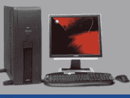

## 4路 3U XtremeServer™

- `AMD Opteron` 8000 系列处理器
- 最多`128GB DDR2 533/667`内存
- 最多`4.5TB SATA`或`1.8TB SAS`
- `2`个`PCI-E x16`和`3`个`PCI-X`插槽
- 热插拔硬盘
- 冗余电源与风扇
- 服务器/机管理 – `IPMI 2.0`
- `Windows`或`Linux OS`

更多信息，请访问`www.appro.com`或拨打`Appro`销售热线`800-927-5464`

- 支持四核 - 在不改变数据中心基础设施的情况下增加容量
- 使用能效`DDR2`实现最佳每瓦性能
- `Direct Connect`架构优化系统性能

## 管理任何数据中心。

随时，随地。

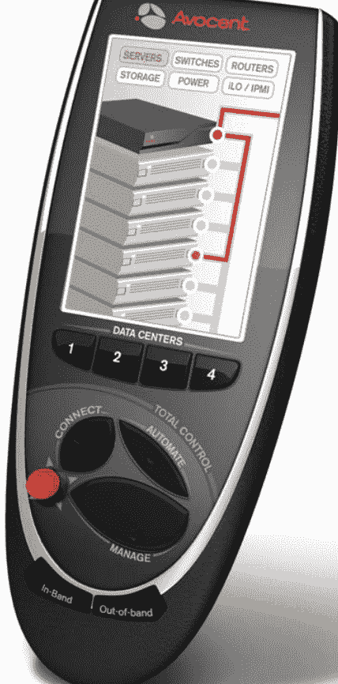

`Avocent`构建硬件和软件，用于访问、管理和控制数据中心中的任何`IT`资产（无论在线还是离线），让它和您的业务“始终在线”。

访问我们的远程控制之旅。如您附近的地点，请访问`www.avocent.com/remotecontrol`。

`Avocent`、`Avocent`标志以及`The Power of Being There`是`Avocent`公司的注册商标。© 2007 `Avocent Corporation`


# 特色介绍

大豆人不会偷走你的午餐钱。

`Shawn Powers`

想要你自己的手机`VPN`吗？

`Ben Martin`

用你的曲调换取他们的音乐。

`James Lees`

游戏机集群。

`James Gray`

# 保持简单。

安心无虑。

高科技令人兴奋。但往往也包含无意义的复杂性。

`Coyote Point`则不然。从本地到全局负载均衡、应用加速或终极网络管理，`Coyote Point`均领先行业。我们消除了应用流量管理中的猜测，提供可靠的解决方案。你在其他地方找不到比这更快、更智能或更实惠的产品。

了解为什么超过`2000`家企业使用`Coyote Point`节省时间、金钱和精力。请邮件至`info@coyotepoint.com`或拨打`1-877-367-2696`。

狼是一种优雅简洁的生物。你的网络也应该如此。


想要一个家庭天堂吗？

`Alexander Siro`

还记得`64K`对任何人都足够的时候吗？

`Steve Munroe`

一些应用正进入雷达范围。

`John Knight`

这种级别的`Firefox`定制面向于……

`Justin Huff`

网络如何运作。

`Brian Mathew`

`007` 最喜爱的指南：

## 酷变化

- `88` 嵌入式`Linux`系统的标准操作程序

需要一些嵌入式指南吗？

`Chi-Chung Chau`, `Tsung-Hien Yang`, `Shih Tao` 以及

工作完成

仁慈的

# 深度解析

# 下个月

# 终极 Linux 盒

下个月我们将提供终极`Linux`盒的代码：`DIY`与价格的平衡，在性能和功能上令人震撼。我们还研究了替代配置，以防您需要更多或更好的性能。我们为偏好性能和便携性的的用户选择了笔记本中的终极`Linux`盒。此外，我们一直更多，关于`Linux`认证演变和破解使用的一手消息。

中间件改进。

`Tony Kay`


# 别难过，

我们的服务器

不会让你感到失望的。

我们都经历过失望。没有什么比无法满足需求的昂贵服务器更令人失望的。为了避免预期落空，`QSOL`为几乎任何流行的操作系统提供可靠的服务器，价格令你大吃惊。

`QSOL.com`服务器提供多种配置，以满足用户最特定的需求。无论是`8/16`核的`1U`近`40TB`的`5U`，我们都能提供在严苛条件下运行的服务器。如果您的服务器无法满足需求，请联系`QSOL`。（别担心，它是靠谱的！）

## 服务器

自`1999`年起提供服务

现已上市！

在上书架前先阅读它

秒秒找到主题或名称

下载到您的电脑上

方便离线阅读

以高质量`PDF`阅读每期


# 全新的 43 磅级“霸主”。

全新的四核就绪`PerformanceWare 1680`：四颗双核或四核处理器，`128GB DDR2/667`内存，采用紧凑型`1U`机箱。

对于你最具挑战性的应用程序，它无与伦比地强悍，但对预算非常友好（你甚至可以省下午餐钱）。

`PerformanceWare 1680`极其紧凑且强大，专为复杂的数据库应用程序、科学计算和最新的虚拟机技术而设计。`AMD Omicron`四核就绪，`128GB`高速`DDR2 667`内存使`PerformanceWare 1680`成为不可逾越的服务器。

`成为街区里第一个用上这台“霸主”力量的人。现在致电获取更多详情。`

经验、想象与支持。

`Pogo Linux Solutions`，为`Linux`而生，为您而打造。


如需，请致电`888.828.POGO`或发送邮件至`inquiries10@pogolinux.com`

`Pogo Linux, Inc 701 Fifth Ave. Suite 6850, Seattle, WA 98418`

`AMD, Athlon, XP`以及`AMD`标志是`Advanced Micro Devices`在美国及其海外子公司的注册商标。

# 信件

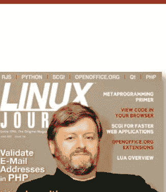

人们只能希望`Jon "maddog" Hall`学编程语言得比他学拉丁语要好。在`2007`年`6`月，他说他的名字`Agape`是意为“爱的形式”的拉丁语。然而，正如`Hall`所暗示的那样，`agape`并不是拉丁语，它是古典希腊语中表示不同类型的爱的词，通常被理解为“兄弟之爱”或慈善。也许`maddog`需要调试一下他的拉丁语。

我经常向人们讲述`Linux`的优点以及我们正在获胜——就像`Doc Sears`在`2007`年`6`月刊中“挑选新闻斗士”那样。我们总能给出答案：关于那些在`Linux`上无法运行的硬件或软件？在`Windows`上，它只是……

我必须解释一下，它并不是“即插即用”。制造商只是在底层编写驱动程序，如果他们能让我们为`Linux`编写，那么在`Linux`上也能“即插即用”。这个问题的答案之一是应该测试兼容性。事实上，他们会让`Linux`程序员自由地编写其他有用的东西。

# Max E. Klinger

`agape`一词的起源，但被拉丁语同化了。当`Jon`的老师教的是拉丁语而非希腊语时，她教`agape`为拉丁语是正确的。另一个词通常被翻译为慈善，但这个短语是希腊语，意为兄弟的。`Nick Petcey`，`atarpoon`（`2007`年`6`月），某人指控的受害者。第一个是亚洲的战争，第二个是几乎没有消失的，第三个（更不为人知的）是不兼容性的指责。

# 拉丁语的 Agape


Agape 不是拉丁语。希腊语是什么？这对于他在 2007 年 6 月份《Linux Journal》上文章的剩余部分说明了什么？

# 更多的 FORTRAN

衷心感谢 Jon "maddog" Hall 在 2007 年 6 月刊上关于语言的文章，以及他对 John Backus 的贡献。虽然我的职业生涯完全偏离了领域，但我从 20 世纪 60 年代后期开始接触 `FORTRAN`，作为一个天文学家被引入计算机系统课程。所有的 `0s` 和 `1s` 共同工作，以获得我们想要回答任何问题的本质知识。正如 Jon 所说，我在“幼儿园”学到的东西在我需要使用或编写代码时在脑海中。归由于 `Linux` 驱动程序，而不是 `Linux` 本身，我们应该负责对 `Linux` 社区的基本支持和贡献。所以我们为什么要编辑 `Ubuntu`？

# Tobin

Jon "maddog" Hall 的本意是正确的，但他的尊重是由于：Agape 是希腊语，不是拉丁语。我提交这一关于 `Ubuntu` 的最高意义的微小批评，但同样的假设是——`Ubuntu` 的责任是出去并获得。

# Daryl

对于 "maddog" Hall 的笔记：我一直被告知语言是希腊语（以及百科证实），不是拉丁语。否则，这是一个充满关心的有趣记忆。你们很棒！我只是想分享我的初步印象。我知道一切将帮助你们在一起。如果你有这样的程序，请为你喜欢的发行版提供，并且

# John Young

我喜欢你的文章，但没有做出第二段；Agape 是从希腊语到拉丁语的翻译——我尊重编译器。

# Jim Secan

可以确保语言仍然充满活力——最后一种汇编语言（`IBM360` 类型或 `z/arch`）是我昨天写的程序。

# 永远不要忘记土地战争

首先，我喜欢这本杂志。我期待每一期杂志，其中很大一部分在我脑子里。

# Richard Pace

我喜欢对 Princess Belle 的引用，在 2007 年 8 月。

# 寻找未来

行业领导者正在通过 `TotalView` 多核调试框架寻找路径——一种用于组织和管理复杂进程的定义良好的逻辑方法。由能够快速、方便和有效地调试 `UNIX`、`Linux` 和 `Mac` 应用程序的领先供应商提供。通过下载我们的新白皮书——多核时代的调试来找到你的路。访问 `www.totalviewtech.com/whitepaper`。

# TOTALVIEW TECHNOLOGIES 多核调试框架

专门用于处理多核心、多线程、多处理器应用程序中日益增加的复杂性。


# LINUX JOURNAL 信件

## 为您服务

感谢。如果我必须为 `Ubuntu` 创建包，我会做的——Ed。

## 我从没见过元编程，我不喜欢

我刚读了你 2007 年 6 月的专栏，忍不住想写关于几个问题[参考 Doc Sears“挑选新闻斗士”]。

纸质订阅：续订订阅、支付发票、查看账户详情或其他订阅查询可以在 `www.linuxjournal.com` 在线完成。对于美国境内的用户，可以拨打 `1-888-LINUX` (`1-888-546-8899`)，或拨打国际电话 `+1-512-477-5596`。你也可以发送邮件至 `sub@linuxjournal.com`，`Linux Journal, PO Box 98038, Houston, TX 73798-0838`。

我是一名咖啡师，在 `Sandy` 的一个小办公室工作。也许你考虑过使用 `Linux` 工具编写医疗保健项目的益处。对此有什么想法吗？

数字订阅：`Linux Journal` 的数字订阅现已可用并以 `PDF` 格式交付。访问 `www.linuxjournal.com` 了解更多信息，或联系工作人员查询旧问题或技术服务问题。

我喜欢的另一个领域是程序员/代码员业务。我是 `irc` 上几个频道的常客：`irc-free.net` `#base239`, `#htub` 和 `#debian` 我有许多朋友是有才华的代码员，他们使用 `Linux` 和工具为我的小企业提供折扣，当我寻找。

## 致编辑

如果你有信件想要发表，请发送至 `editor@linuxjournal.com` 或邮寄至 `Linux Journal, 1752 NW Market Street, Seattle, WA 98109`。信件可能会为了空间和清晰度进行编辑。

似乎只有程序员/代码员类型，那么似乎经营小企业的人太忙于经营业务而无法顾上你们。我们需要多样化的所有者，他们有足够的知识来有效地帮助 `Linux`！

为我们撰稿：我们正在征集未来几期的文章、教程和故事。发送至。

## Andrew T Young

## 谁拥有 OpenGL？

微软软件来自 2002 年的 `Silicon Graphics`，适用于 `OpenGL`。（而且很少受到损害，但你知道。）

你在这里赢得了一位新的忠实读者！感谢这篇精彩的文章。

## Scott 博士

## Ulrich Heinrich

我被部分纠正了。微软对 `OpenGL` 的一些关键点提出了主张，而非整个内容。

# 使用 UniServer 最大化 AMD Opteron™ 四核性能

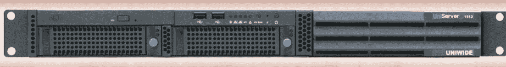

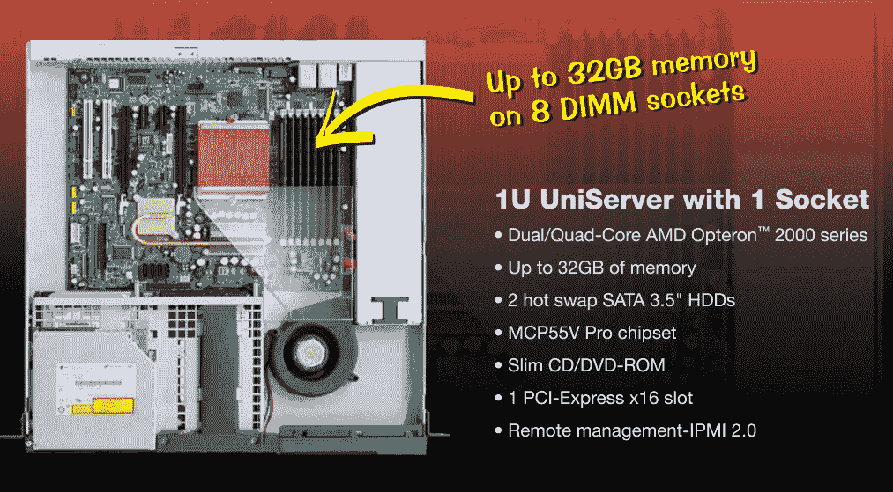

## 1U UniServer（单路）

- 双核/四核 `AMD Opteron™ 2000` 系列
- 最多 `32GB` 内存
- `2` 个热插拔 `SATA` `3.5”` 硬盘
- `MCP55V Pro` 芯片组
- 薄型 `CD/DVD-ROM`
- `1` 个 `PCI-Express x16` 插槽
- 远程管理-`IPMI 2.0`

### 查找全系列创新 AMD Opteron™ 服务器和工作站平台

`1U` 服务器：`1` & `2` 插槽，内存最高 `64GB`

`2U` 服务器：`2` & `4` 插槽，内存最高 `128GB`

`3U` 服务器：`2` & `4` 插槽，内存最高 `128GB`

工作站：`1` & `2` & `4` 插槽，内存最高 `128GB`

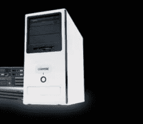


`1-877-520-0071`

`Uniwide` 是 `AMD` 官方验证服务器计划合作伙伴

# 前言 (UPFRONT)

新闻 + 趣味

# diff -u

`Linus Torvalds` 最近表示，`Macmeusch` 和 `Nigel Cunningham` 之间软件争论的可能性已经结束。新的竞争者已经出现并取而代之。

没有他们，研究进入内核的可能性将大大减少。许多相对较大的问题被包含在内，关键开发者对这些问题进行了审查以理解这些问题。

# 内核开发新动态

被“误误了”的 `Linus` 表示，任何一个项目都可以取得成功。他表示，不需要同一个人介入并将整个概念带入新的实体中。每个人都可能尝试通过接受补丁来启动某些审查流程，这比提交给 `Linus` 的频率是其三倍。这可能会产生一批新的武装开发者，并促使他们更仔细地查看代码。但对于 `Andrew Taeke` 来说，这也是一个困难的措施。

此外，`Linus` 本人也关注新的开发问题，而不是用户空间的问题。如果他找到了解决方案，将将其并入内核。

可能需要维护者对某些问题进行某种审查，以防止冲突数量的增加。作为维护者之一，`Edward Shishan` 表示，他在离职前需要志愿者的帮助。

`Linus` 本人也关注开发问题，许多人告诉他事情是疯狂的。当这种情况发生时，人们会侮辱 `Linus` 周甚至几个月，而他一直在解释。每当他达到一个点时，会有更多的人急于撤销内核。

通常当问题公开时，讨论将围绕它展开，许多人对此感兴趣。新旧开发者似乎很有趣，但也许这组审查者将提供便利。

1. 基于 `Linux` 的最可靠托管公司排名（2007年4月）：`1`
2. 基于 `Linux` 的顶级托管公司排名（2007年4月）：`3`
3. 基于 `Linux` 的顶级托管公司排名（2007年4月）：`6`
4. 2006年研究：`224`
5. 2005年研究增长率：`81`
6. 初创公司与风险投资交易（2004年）：`36`
7. 初创公司与风险投资交易（2005年）：`257`
8. 初创公司与风险投资交易（2005年）：`41`
9. 初创公司与风险投资交易（2006年）：`306`
10. 初创公司与风险投资交易（2006年）：`48`
11. 初创公司与风险投资交易（2006年）：`481`
12. 初创公司与风险投资交易（2000年）：`1.9`
13. `Linux` 内核五年路线图：`0`
14. 支持更多 `Linux` 的操作系统数量：`0`

`Alan Huron` 一直在编写 `LS807` 的驱动，该驱动由 `Thomas Young` 完成，`Alan` 将其了邮件列表。针对各种评论，`Alan` 还发布了补丁显示——这通常是一段可能晚些进入内核的代码。问题仍然开放。如果它被采纳到内核；可能会从一个公司项目转变为主要的；可能会变得不。


有很多可能性，但事实并没有涵盖大多数问题。新项目仍然与开发者相关。投入大量时间进行分析的人已经转移到了其他项目，而 Adrian 有了些时间来清理内核。大量代码在内核中悬挂了很久，即使在有了更好的替代方案之后。在当前情况下，允许用户更改 CPU 速度，这会影响性能。旧代码已被弃用很长时间，现在它已经。他发布了一个补丁来审查代码，它在 `2.6.21` 和 `2.6.2` 中有一部分，以及如何向用户通信这些更改。Bill Davidson 在代码被标记为弃用很长时间后对此事表示担忧，而 `feature-removal.txt` 文件包含了重映射的清晰解释。

百万台数字相机：400

百万台手机：600

百万台数字播放器：5500

百万台电脑：900

百万台平板电视：70

数据量超过数据设备容量的年份：2007

来源：

1-5 Netcraft.com

6-12 Matt Gray, Ryan Vast and Matthew Alexander

13-14 Jonathan Corbet

15-20 Ian, 来自 Freedom's

-- DCC


## 对 iSCSI 和光纤通道存储存储的高昂感到震惊吗？

# AoE 是答案！

以太网传输 ATA (`ATA-over-Ethernet`) = 快速、可靠、简单的存储。

- 1. 快速 10兆以太网存储，没有 `TCP/IP` 开销！

- 2. 无限扩展性，极低的价格点！

- 3. 你想要更多存储……你只需要买更多硬盘——就这么简单

`EtherDrive`® `SRXXXXx`

- 带有热插拔 `SATA` 硬盘槽的快速灵活的 `RAID` 设备

查看我们完整的 `EtherDrive`® 存储、虚拟存储设备和 `NAS` 网关

访问我们的网站：`www.coraid.com`


Linux 存储专家

## 这里有个故障 (Here's a Hitch)

# 哥们！这是 Ubuntu！

Linux 基金会为需要参加会议但无法负担费用的开发者提供旅行基金。该基金面向

- 具有证明开源开发成就的精英社区开发者且无法获得参加活动的资金。

换句话说，它是为了开源世界的“巨星，”正如 Linux 基金执行董事 Jim Zemlin 所言。

协作会议、Linux 基金日本研讨会、内核会议、渥华 Linux 研讨会、`Linux.conf.`、桌面会议以及其他进行协作的技术会议。更明确地说，它并不为培训生或新手提供学金。

上个月，由于对 `Dell IdeaStore` 的压倒性支持，Dell 计划销售预装 Ubuntu 的电脑（“新产品设计：由你决定”，`www.ideastream.com`）。在我们去那里时，有许多关于 Dell 预装 Ubuntu 的话题可以讨论。这一切归功于公司创始人 Michael Dell。

如果你属于这类人，或者你希望如此，请访问 `www.foundation.org/travelfund`

> -DOC SEARS

## 硬件：

- `Intel Core 2 Duo` 处理器

- 2GB `DDR` 内存

- 80GB 硬盘

- `DVD-RW SATA`

- 无线卡 (`802.11`)

- `Ubuntu 8.04`

- `Linux Kernel 2.6.24`

- `Firefox 3.0`

- `OpenOffice 3.2`

- `NVIDIA GeForce X1300`

## 超微 (SUPERMICRO)

### UIO

通用 `I/O` 接口

最大化 `I/O` 扩展性与灵活性

## 三合一

`1U` 空间内三块扩展卡

让你拥有构建你切切所需的自由！

超微 `UIO` 服务器允许用户从广泛的 `I/O` 选项进行选择，提供存储和网络终极灵活性。`UIO` 卡成为服务器主板的一部分，允许系统空出所有的 `PCI Express` 和 `PCI` 插槽供扩展卡使用。因此，未来的升级通过更换 `UIO` 卡和/或扩展卡来实现，而无需更换整个系统。这种通用性有助于减少客户运营业务所需的不同类型服务器的数量。

- 适用于 `1U/2U` 的 `3/7` 扩展卡

- 高可升级性

- 高能效电源（高达 90% 以上）

- 多种扩展选项（`SAS RAID 5`, `0`, `10-`...，多达 20 种选择）

- 简化库存管理

欲了解更多信息，请访问我们的网站 `www.supermicro.com`。

我们新一代电源效率在典型负载操作下达到 90% 或更高。

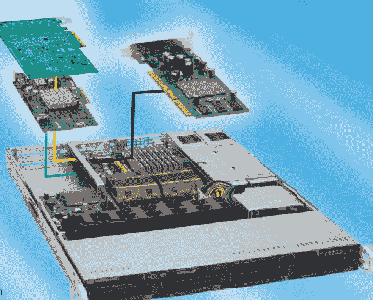

| `AMAX` | `Arrow Electronics` | `ASI` | `Bell Micro` | `Ingram Micro` | `MA LABS` | `Synnex` | `Tech Data` |
|---|---|---|---|---|---|---|---|
| `1-800-808-8328` | `1-888-427-2350` | `1-800-2020-351` | `1-800-232-9530` | `1-800-456-8000` | `1-408-941-8068` | `1-800-756-5974` | `1-800-237-8931` |
| `www.amax.com` | `www.asnrip.com` | `www.aspartner.com` | `www.bellmicro.com` | `www.ingram.com` | `www.malabs.com` | `www.synnex.com` | `www.techdata.com` |

当你向一群不熟悉这一概念的人介绍 `Linux` 时，就像给一个五岁的孩子送沙发一样。普通用户往往会忽视 `Linux` 能为他们做的事情，而关注那些粗糙的边缘。正如 Linux 所言，“人们”经常感到困惑，是因为它没有脚，而软件却生成了量子计算中简单的部分。

2003 年，密歇根州的教育经费开始呈现下降趋势，在那个时候，旧硬盘无法用于瘦终端，因此我们必须购买新硬盘。

- 服务器配备 512MB 内存，每个客户端配备 100MB。

- 对于服务器来说，50 个客户端已经了很多。如果超过 50 个，请考虑使用多台服务器。

然而，我的报价还包含了以下新增内容：

- 两台服务器以支持额外的瘦终端和/或负载均衡。

- 交换网络上的千兆以太网并非必须的。双千兆是必不可的。

- 连接到后端的完整网络架构（交换机和一个操作系统）。

- 网络的文件服务最好在 `NFS` 服务器上完成，该服务器拥有你负担得起的最快硬盘。

2003 年，密歇根州的教育经费开始下降，一直持续到 2007 年。我们州的每所学校都感受到了，每所学校都在竞争留住学生。在不确定的市场中，2003 年我们需要将学生管理从旧的昂贵的基于 `Macintosh` 的系统转换为基于 `Windows` 的解决方案。我建议实现这一目标的方法是——简单的瘦终端。

- `Microsoft Office` 以允许过渡到开源软件 (`OSS`)

- 使用 17 英显示器代替 15 英显示器。

遵循这些指南，我订为了支持我所需的 75 个客户端，我应该有三台 `LTSP` 服务器、一台文件服务器和一台（用于需要的 `Windows` 应用）。

我为董事会写了一份提案。董事会选择切换到基于微软的基础设施。这包括服务器、员工培训和额外的硬件。整个方案需要购买一半的服务器并使用计算机将其瘦化。我们本应基于 `Linux` 瘦终端项目。

董事会批准了这一转变。我们下单了并首先投入了一个令人兴奋的夏天。`LTSP` 是一个可以在任何 `Linux` 发行版上运行的系统。它比使用 `Debian` 要好得多，但对于此，我想使用具有更多支持的东西。参与此工作的成员的支持帮助我们创建了一个集成器，整合了 `LTSP` 并进行了让瘦终端真正放光的微调。这种支持超出了我的需求。

在安装期间，我最大的担心是动力不足以运行所有客户端。第一个客户端在 8 月到来，花费 50,000 美元购买第一台服务器，随后的客户端为 150,000 美元。与 `Windows` 相比，“`Linux`”太便宜了。我们部门确实需要新的交换机，我不想在开学第一天尝试这个想法。我决定在 `LTSP` 服务器和在网络传输的客户端之间进行路由，这实际上是有效的。

重要的是，我可以为第一台服务器报价 50,000 美元而仍然拥有一个功能健全的网络。作为早期采用者，我们面临的最大错误之一是，我们在节省软件费用时没有在硬件上花钱。我担心性能问题，不想让 `LTSP` 在第一天表现得糟糕。为了节省硬件和处理器使用量，我决定这样做。

## 前言

分享力量。

以太网网络就像一根巨大的水管。当你的细水管有一个大阀门时，巨大的服务器需要一根真正的水管才能将信息传输所有客户端。

`USB` 闪存是一个存储更多信息的软盘驱动器。它更容易携带，丢失数据的概率也更低。

你意识到沟通是关键，而能够将复杂的想法简单化是一个巨大的资产。事实上，回顾过去几年，我们最大的困难并不是技术性的，而是社会性的。事实上，人们的挑选并没有经过仔细筛选，以理解让变化频繁的过程。这是无法克服的。

`dy` 桌面。当员工们发现“新”电脑不能播放音频 `CD` 时，它们就被卖一光了。


回想起来，对于原始购买价格中 10% 的支出，我本可以获得一个真正的瘦客户端设备，例如 `www.diskless.com` 上 `LTSP` 销售的那种；如果那个数字比原始高出 15%，我就可以拥有带有 `LCD` 显示器的瘦客户端了。永远不要低估新奇玩具赢得我们内心的力量。

正如前面提到的，我们过渡到瘦客户端的第一年充满了坎坷。最终，开源软件（`OSS`）足够强大，克服了我们的短视和自大。我们将数量从 75 个增加到一百个。在这里，我们引入了第一个瘦客户端。事实上，这是我需要所有原始服务器的一年。我很羞愧，三年来，我有全新的服务器一直闲置。坦率地说，

> - SHAW POW

## 他们是说

支持开放频谱。

要求真正的竞争。

要求对过去的拍卖进行调查并追回收益。

要求系统内置。需要政治压力来创造一种可以制造 30 美元手机的廉价市场。为了带来，

> - Daniel Bankhocker,
> `blogs.zd.com/open-source/7p14`

我不知道为什么，但我很确定那不是一场意外。

> - Marshall McLuhan,
> 网络上的位置

我们继续使用几个有 15 年历史的文件系统，尽管我们有足够的脑力、物力和流程来实现一个新的服务器，

> - Andrew Morton, 来源：
> Jonathan Corbett, 在 `CELF` 的演讲，2007 年 4 月

写出一个开源的显卡驱动程序是很的，除非我们愿意这样做。

> - Andrew, NVIAR Software
> 产品经理：
> Jonathan Corbett, 在 `CELF` 的演讲，2007 年 4 月

`Linux` 不能以仅二进制的方式运行。这将导致我们自由系统的终结。

> - Jonathan Corbett, 在 `CELF` 的演讲
> 2007 年 4 月

## 5. 人们喜欢闪闪的东西

我们的瘦客户端是由淘汰的 133 台电脑创建的。在 2003 年，133 被使用。大问题是它们看起来和它们的年龄一样老。事实上，其中大多数都贴了硬币标记，很多的 `CD` 阅读器坏了，很多非常糟糕。

在开学第一天，老师们并没有注意到 `Xeon 3.2GHz`-`668 MB` 内存带给我们的速度。柜子里新品牌的大箱子设备并没有给他们留下深刻印象。服务器房里风扇震耳欲聋的响并没有让他们觉得特别。我们在开学第一天就使用了电脑。事实上，我们的电脑看起来比他们留下的 `Macintosh 5400` 还要好。如果我们有新的 17 英寸显示器和全新的鼠标（这在当时是新技术），但最后，我们只是粗鲁地——

### 资源

`K12Lltsp`: `www.k12ltsp.com`

`LTSP`: `www.ltsporg.com`


USER FREE BY "John Doe"

早安大家，我坐在这里是为了完成

后来的

开发

`ERWIN` 正在项目！

`ERWIN` 说他的

产品将构建

和平与喜悦给所有人

已完成。

以及美丽的创造

你带入世界了吗？

`EMACS`,

应该是完美的

在之后-

一个死掉了。


`EmperorLinux`

...当 `Linux` 笔记本汇聚


自 1999 年以来，`EmperorLinux` 为大学、公司、政府实验室和个人 `Linux` 爱好者提供了预装 `Linux` 的笔记本。我们的笔记本从全功能的便携机到桌面替代品。所有系统都有一年的 `Linux` 技术支持，通过电话和电子邮件，取决于制造商。

- `Lenovo ThinkPad T61`

- 15.4 英寸 `WSXGA+` @`1680x1050`

- `NVIDIA NVS` 显卡

- 1.6 GHz `Core 2 Duo`

- 512 MB–4 GB 内存

- 80–160 GB 硬盘

- `CDRW` 或 `DVD+DRW`

- 2.0 英 100 Mbps 以太网

- `802.11a/b/g (54Mbps) WiFi` - 150 英起

`EmperorLinux` 专门在 `IBM`、`Dell`、`索尼` 和 `松下` 等顶级笔记本上安装 `Linux`。我们定制您的 `Linux` 选择并支持：以太网、无线、`ACPI` 电源管理、`USB`、`EVDO`、`PCMCIA`、`FireWire`、`CD/DVD/CDRW`、声音以及更多。

- `Dell Latitude D83/Precision`

- 17 英寸 `WXGA+` @`1920x1200`

- `NVIDIA Quadro FX 3500` 显卡

- 1.8–2.4 GHz `Core 2 Duo`

- 4 GB 内存

- 160 GB 硬盘

- `CDRW` 或 `DVD+DRW`

- 3.6 英

- `802.11a/b/g (54Mbps) WiFi` - `ExpressCard/EVDO` - 445 美元起


`EmperorLinux` 提供具有独特 `Linux` 笔记本。加固型笔记本为极端环境设计：跌落、震动、沙尘、雨水和其他。`PC` 与笔记本类似，但带有 `LCD` 数字化仪，支持笔和鼠标输入，并具有屏幕绘画压力敏感度。

- `Lenovo ThinkPad X61 Tablet`

- 12.1 英寸 `SXGA+` @`1400x1050`

- 1.6 GHz `Core 2 Duo`

- 1–4 GB 内存

- 80 GB 硬盘

- 3.8 英

- 笔输入屏幕

- 动态旋转

- 手写识别

- 可选

- 2300 美元起

价格、规格和可用性可能有所。所有商标归所有所有。

以 `Django` 的工作方式开始学习 `Django` 视图和模板。

上个月，我们开始研究 `Django`，这是一个用 `Python` 创建 `Web` 应用的流行框架。`Django` 有“`Python` 世界的 `Rails`”的声誉，这是有根据的。尽管 `Django` 是与 `Rails` 并行开发的，并且具有许多与其对手区别的特性，但很难避免比较。

`Django` 足够聪明，在我们尝试多次创建同一个应用时会阻止我们：

```
$ python manage.py startproject blog
```

在上个月对 `Django` 的介绍中，我们看到了两个系统之间的许多细微差别。`Django` 一次处理一个“项目”，每个项目可以包含一个或多个应用。这与 `Rails` 的方法形成对比，在 `Rails` 中，没有东西属于 `Django` 项目；一切都是应用。

```
Error: [Errno 1] 文件已存在 '/opt/mysite/blog/'
```

现在，让我们创建一个“Hello, world”视图，以便我们可以证明一切运行正常。我们打开 `blogviews`，除了某些指示这是我们定义的该文件的内容外，它是空的。

简单的“Hello, world”视图将由 `blogviews.py` 或网站上的 `index.html` 文件调用——当没有为应用调用方法时提供默认内容。我们还必须在 `Django` 定义的 `HTTP` 响应能力中包含 `Python` 模块。完成后，整个视图看起来如下：

我们还看到 `Django` 有一个内置的 `Admin` 系统。这需要一些配置来避免出现任何问题，但它为开发者提供了广泛的益处。

```
from django.http import HttpResponse
def index(request):
    return HttpResponse('Hello, world.')
```

尽管存在差异，`Django` 和 `Rails` 都使用一种被称为 `MVC`（模型、视图、控制器）的方法，自从许多语言和框架支持它们以来，该社区就一直使用这些术语。这些术语在 `Rails` 世界中被称为模型，在 `Django` 世界中被称为模板和视图，它们构成了 `Django` 应用的主体。

如果我们还没有运行服务器，那么可以从这里开始：

```
python manage.py runserver 69.55.23.8200
```

这个月，我们处理模板和视图，忽略数据库和 `API` 直到下个月。但难道 `Django` 应用不是非常强大的吗，它们提供了一种有趣的约束。

我们在我们的项目中创建一个新应用的第一步。由于许多原因，包括创建页面的简易性，我们的应用程序是一个非常简单的博客。

只有在偏离这一点时才会如此。在 `Django` 中，它假设你希望一切都是显式的。

在需要显式化的内容中，包含了 `URL` 如何翻译为方法。`Django` 用于实现此点的系统是 `URLConf`，它是整个项目的一组正则表达式集合。（它的功能类似于 `Rails` 中的路由 `routes`。）如果你熟悉正则表达式，那么添加或修改 `URL` 应该非常简单。

例如，假设我们想让 `/blog/` 指向我们的博客应用程序。我们将使用 `URLConf`，而视图（view）可能位于 `urls.py` 中。（我们已经为 `Django` 站点添加了管理功能。）然后我们添加类似这样的一行：

```python
r'^blog/$', mysite.blog.views.index'
```


在其他系统中，如果看到看到一个包含 `blog` 且以 `/` 结尾的 URL，它应该调用我们应用中的视图方法。例如，只要我们使用 Django 进行链接，我们就可以刷新浏览器，并看到“Hello, World! 我们的 Django 应用程序开始成型了。”

如果我们只有一个方法且它总是执行相同的操作，那么事情并没那么。对于一个博客应用程序，我们可能想要处理某个特定的帖子，或者在某个特定的日期。然后我们需要进入博客应用程序的模型，并意识到这意味着我们需要能够通过单个 ID 或日期来查询博客。

我们目前的设计没有处理此类情况。Django 要求我们显式定义用户可能请求的每个 URL 以及该 URL 如何被处理。虽然我们处理了 `blog/`，但我们需要处理如下 URL：

```python
r'^blog/(?P<id>\d+)/$', mysite.blog.views.one_posting'
```

在这里我们看到了一些不同的东西，即使用捕获参数，带有 `?P` 和角括号内的名称。我们告诉 URLConf 我们收到了一个看起来像 `/blog/NUMBER` 的 URL，其中的数字将调用 `one_posting`。由于我们已经捕获了这些数字（正则表达式中的 `<id>`）并将其命名为 `post_id`，因此调用 `one_posting` 时会带有一个额外的参数 `post_id`。

换句话说，一旦我们修改了 `urls.py` 以包含上述映射，我们就可以回到 `views.py` 并编写如下内容：

```python
def view_one_posting(request, post_id):
    return HttpResponse("You asked for '%s'" % post_id)
```

然后，我们可以访问 `http://127.0.0.1:8000/blog/5`，在浏览器中，我们得到：

You asked for post '5'

注意，在视图 `one_posting` 方法中，我们使用 `post_id` 来渲染，而不是 `%s`（整数）。Django 将参数从 URL 以字符串形式传递的，而不是其他数据类型。当然，我们可以通过将字符串转换为整数来解决这个问题，但对于我们的目的来说，这足够了。

也许我们访问了这个应用程序，但我们方法中的每个项恰好都是面向用户的视图。我们可以使用任何需要的 Python 库，并访问数据库、文件和远程控制器。只要输出是合法的 HTTP 响应，我们在这些示例中构建的应用程序将代表已完成的类型。

然而，如果我们想仅用已经看到的工具来创建一个网站，那么这样做将变得困难且枯燥，因为需要将我们所有的输出字符串解析为 HTTP 响应。真正的解决方案是使用 HTML 文件，并在需要时允许变量。

那里有很多不同的模板，最常用的是使用 ASE、PHP、JSP 或 OR——后者部分属于 ruby on Rails。这种模板可以被程序员轻松使用，但当非编程设计人员参与时，或者你想在代码和设计之间实现分离时，可能会产生麻烦。

Django 可以使用模板，但它们不是默认的。Django 使用的模板在某些方面类似于 PHP 系统，通过引入限制性的语言避免了在模板中使用实际代码。这样我们可以向模板传递值，对于某些基础来说这足够了。

尽管存在这些差异，Django 和 Rails 都使用被称为 MVC（模型、视图、控制器）的方法，这种方法由 Smalltalk 框架并在许多其他语言和框架中开发。

## Python 库与数据库访问

你可以使用任何需要的 Python 库，并访问数据库、文件系统和远程计算机。

## Django 模板系统配置

这就是 Django 默认模板系统提供的。为了使用模板，我们需要修改项目主目录下的 `settings.py` 文件。我们需要设置 `TEMPLATE_DIRS` 变量，为其提供一个包含可能存放模板的目录列表。例如，我们可以设置为：

```python
TEMPLATE_DIRS = [
    "/opt/at/mysite/templates"
]
```

通过此，我们现在可以创建相应的目录：

```bash
mkdir /opt/at/mysite/blog
```

然后，在该目录中创建一个新的 HTML 文件，将其命名为 `view_one_posting.html`：

```html
<html>
<head>
    <title>One post</title>
</head>
<body>
    <p>This is the "view_one_posting" template.</p>
</body>
</html>
```

答案非常简单。在视图方法中，我们可以向模板传递任何变量：

```python
def view_one_posting(request, post_id):
    context = {'post_id': post_id}
    return render_to_response(request, 'view_one_posting.html', context)
```

## 磁盘空间管理

最酷的 Linux 和开源应用程序可能就是你已经拥有的那些。

## 照片管理程序推荐

朋友们，我们该如何确保磁盘空间够用呢？上周，我们留下的磁盘空间足够用到下一个十年。发生了什么？不，我的朋友，我没太听懂你的意思。我只是好奇你是否有什么主意。我只是回来了一小会儿——让我说一句，天呐（Mon Dieu）！朋友们，我曾尝试过成千上万个源码包，但现在你们不需要下载 SourceForge 上的每一个应用程序了。我也在这里；我想看到底哪一个最酷！不过，我们以后会再谈论这个。现在，我们的客人们呢？他们现在应该到齐了。

### digikam 简介

`digikam` 是一个完整的数字照片管理系统。使用 `digikam`，你可以创建集合并按日期、类型等将你的照片组织到可搜索的相册中（图 1）。从相机中选择并下载图像是一件很有趣的事。你可以添加标签、修复光线、消除红眼并移动它们。`Digikam` 拥有你照片管理系统所需的所有功能，还有一些额外功能让它在酷炫程度上更胜。

朋友们看！Linux 和开源软件拥有一直以来最优秀的工具，服务着最伟大的群体。你们的侍者正在等候，请自便，你们忠实的侍者会去上酒。来吧，我的朋友。我想 2002 年的《Video de las Vie Triumph》将让我们所有的客人满意。桌子已经准备好了，多年来非常不寻。饮吧，享受吧！

如你从图 1 所示，`digikam` 会按日期自动组织照片，但还有其他视图。例如按命名标签。比如，如果你有几百地方，你可以为所有照片分配一个“旅行”标签，然后找到那些关于罗马的照片。下次你想看它们时，只需点击该标签即可。如果其中一张图像看起来是你想要和朋友分享的，选择图像，点击菜单栏上的“图像”、“通过电子邮件发送图像”，就会弹出一个对话框，允许你向邮件中添加更多图像。

在我们等待时，让我们看看酷应用程序的哪个一点。你不需要在互联网上花费几个小时寻找最酷的软件，只需花点时间探索你已经拥有的应用程序，你就会发现本并不存在的奇迹，就在你面前。说起我忠实的侍者，他在这里了，朋友们会为我们的客人上酒。你会享受第一口水的，我的朋友们，请让我提醒你一个程序你——

拥有大量图像会有问题，但如果你像我一样，必须多次拷贝你的照片，那么 `digikam` 具有一个很酷的功能可以让你复制图像。只需点击菜单栏上的“工具”，然后选择“查找 Digikam 图像”。

说到制作幻灯片，你想创建一个 MPEG 幻灯片——你的照片电影吗？是的，`digikam` 也能这样做。选择一组图像，点击菜单栏，选择“幻灯片”。幻灯片（图 2）向你展示如何选择幻灯片的图像时间、淡入时间（如果你需要的话）、视频输出格式等。你还可以组织图片出现的顺序，甚至编辑列表。

你可以用 `digikam` 做很多事情，这将让你根据自己的意愿进行探索（起初），但在继续之前，我想再分享一张酷酷的照片！在圣诞节，与全家人分享照片并不稀奇。使用 `digikam`，你只需一步即可实现。如何从你的选择中挑选出精美的颜色创建一个一年的日历？


图 1. `digikam` 是一个超级数字照片管理套件，拥有你无法想象的功能。

要用 `digikam` 创建日历，点击“工具”，然后

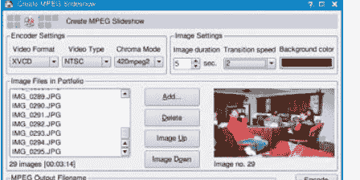


我的另一个喜欢的程序是惊人的 `Amarok`，这是一款令人印象深刻的多媒体播放器，拥有许多酷炫的功能，使其无论在什么操作系统上，都是最好的播放器之一。

图 2. `digikam` 让你轻松地从数字照片创建电影。

选择“日历”。此时，出现日历对话框（图 3），你可以在其中每隔几个月个性化一次日历。开始，选择纸张大小（US 或 AA）和图像位置。布局也会改变日历的定义。此时，你可以选择一个日期以及你想在日历中列出日期的周几。


## 日历制作

点击“下一步”进入下一个屏幕（图 4）。这才是真正有趣的地方。你将为日历获得 12 个月份和 12 张照片。你可以使用家庭照片，也可以任何东西。与其购买日历或旅游照片，为什么不自己制作呢？它可能会成为你办公室墙上的漂亮装饰。

页面生成或编辑每个月的状态。任务完成后，点击“完成”关闭对话框。

## Amarok 媒体播放器

我的另一个程序是 `Amarok`，这是一款令人印象深刻的多媒体播放器，拥有许多酷炫的功能，使其无论在什么操作系统上，都是最好的播放器之一。对于你的朋友，你可以获取 `Amarok` `OS`。

**图 4.** 创建自己的日历有一半取决于每个月代表图片。

点击“库”标签。如果你是第一次看这里，或者库管理器尚未准备好，点击“库”按钮调出库管理器。你不需要学习如何对着歌曲唱歌。随时，你都可以从菜单栏收集库并选择“库管理器”。当库窗口出现时（图 5），你会发现各种库，按列表分类。点击加号将添加每个条目一次。我邀请你高亮库并点击“关于”按钮来执行该执行的操作。你也可以点击“获取更多”来为你当前的音乐下载额外的扩展和歌曲、打印专辑封面和播放列表的库等。当然，库很少处于打开状态。

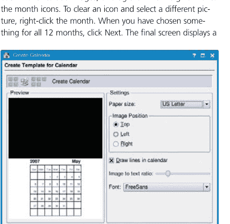

点击（库），然后点击库（`library`）来播放歌曲，在听音乐时，`Amarok` 会显示歌曲的歌词，你可以点击“库”并将其变为（或 `div`）。

当你需要跟踪你的音乐时，这些插件是什么？它支持流行的 `iPod`，还通过插件支持播客。`iTunes`、`Creative Nomad` 以及一些其他通用音频设备。取决于你的播放器，你可能会发现它与除一个以外的任何设备兼容。

**图 3.** 使用你的数字照片创建自定义日历。

你知道 `K3b` 作为一款 `CD`/`DVD` 刻录应用，也是从 `CD` 中提取音轨的绝佳工具吗？

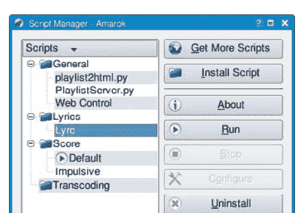

`/mp3(pod)`。关闭窗口返回 `Amarok`。现在要将音乐放入你的播放器中，点击左侧面板上的“设备”标签。你应该能在左侧面板的顶部看到你的设备。设备名称正上方是标记为“连接”的按钮。确保你的设备已通过 `USB` 线连接。如果你已经有了音轨，点击 `Amarok` 的左侧面板，按艺术家排序。顺便说，你可以通过右键点击设备并选择“删除”来从你的播放器中删除歌曲。如果播放器是空的，直接将歌曲拖入媒体浏览器。当你执行传输时，点击设备名称。媒体浏览器的半半部分会显示进度。当任务完成时，点击“完成”关闭对话框。媒体浏览器的半半部分会显示可用空间。进度条显示显示浏览器器的显示。

显示，你将每个月传输到你的播放器。

当你使用 `Amarok` 时，点击“工具”~“配置”。当配置窗口出现时（图 6），查看左侧边栏并选择“设备”。如果你还没有这样做，确保你的音乐播放器（`iPod`）已连接。取决于你连接的 `MP3` 播放器类型，`Amarok` 可能检测到设备，这种情况下你将在配置窗口顶部看到设备。

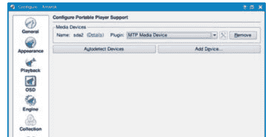

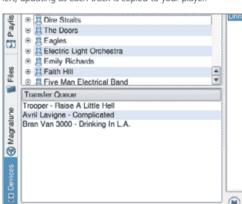

8 轨道在队列中（11 MB）；28 MB/49.6 MB 可用

**图 7.** 添加你的轨道，你可以关注可用空间。

**图 6.** `Amarok` 应该检测到你的音乐播放器，但如果手动添加并不容易

> **注意**：
>
> 一些旧用户使用存储卡以类似于数字相机的方式存储音乐。你仍然可以通过创建一个新的设备挂载点（例如 `/mp3/pod`）来让 `Amarok` 使用它们。

如果你还没有这样做，可以通过点击“添加设备”按钮来添加设备。弹出窗口出现，选择一个插件，为你的新设备提供一个名称（随你），然后识别它在系统中的挂载点。

这就准备好使用你的音乐了。

为了脱颖而出。点击设置→架构（`Schema`），并选择透明 `Konsole`（或其他许多外观中的之一）。

### 结语

正如你们所看到的，我的朋友们，虽然这很诱人（而且令人兴奋，因为诱惑总是去寻找最新、最强大且最酷的应用，但我的搜索并不总是你们已经在使用的那些）。有时候，最酷的应用确实是那些基础性的。你只需要花一点时间来更好地了解它们。揭开你们的秘密，我的友谊可能会变成美好的——

天哪，我想我的大脑可能正在变得——不再是软件的地方了。所以，我的朋友们，千万别怪酒。法国人，请最后一次为客客们倒满酒。举起杯，我的朋友们，让我们一起为他人的健康干杯。干杯！胃口好！

*   `digiKam`: `digiKam.org`
*   `Amarok`: `amarok.kde.org`
*   `K3b`: `extragear.kde.org/apps/k3b`
*   `Konqueror`: `www.kde.org` (原文为 `www.conqueror.org`，此处保留原文路径名格式)
*   `Konsole`: `konsole.kde.org`
*   `Marcel` 的网站：`www.marcelgagne.com`
*   `WFTL-LUG`，`Marcel` 在线用户组：`www.marcelgagne.com/wftliftug.html`

`Marcel Gagne` 是一位住在安大略省滑铁卢的获奖作家。他是 `Addison-Wesley` 出版的新书《自由软件》的作者。他还经常作为《Call for Help》中的 `Linux` 哥出现在电话节目中，创作了一系列非常出色的第二部分科幻和幻想漫画系列，并能制作精湛的折纸恐龙。你可以通过邮件 `magagne@salmer.com` 与他联系。你可以从他的网站 `www.marcelgagne.com` 发现其他内容（包括很棒的葡萄酒链接）。

## Hurricane Electric 网络服务……您可以信赖的速度与可靠性！

| 固定费率 | 全速 100 Mbps | 托管固定费用 |
| :--- | :--- | :--- |
| 千兆以太网端口 | 机柜 | |
| 1,000 Mbps IP | 全双 | 可容纳多达 42 台服务器 |
| 每月 $13,000* | 每月 $2,000 | 每月 $400 |

### 立即下单！

发送邮件 `sales@he.net` 或拨打 `510.580.4190`

地点：加利福尼亚州帕洛阿尔托的 `PAI`；弗吉尼亚州阿什福的 `Equinox`；伊利诺伊州芝加哥的 `Equinox`；德克萨斯州达拉斯的 `Equinox`；加利福尼亚州洛杉矶市的 `Equinox`；加利福尼亚州圣何塞的 `Equinox`；纽约市电话；洛杉矶市电话；英国伦敦电话；荷兰阿姆斯特丹的 `NIKHEF`；加利福尼亚州弗里蒙特的 `Hurricane I` 和 `II`；以及加利福尼亚州圣何塞。

## 专栏：玩转 Shell

### 007 最喜欢的游戏：百家乐？

创建一个 `Shell` 脚本来体验一下邦德风味。

`DAVE TAYLOR`

我最近在看《金牌特工》，并思考詹姆斯·邦德系列，特别是肖恩·康纳比丹尼尔·克雷格要老练得多。康纳更加优雅，他通过在蒙特卡洛被一群美女环绕时玩一种名为“百家乐”的高风险游戏来展示这一点。

#### 获取百家乐的基础

拼图的第一部分非常简单——一个 `Shell` 函数，根据给定的牌牌序列（整数 1–52）返回百家乐分值。

好吧，我无法用 `Shell` 脚本创建一个赌场，我也绝不能成为一名特工或迷人的女配角。

```shell
function handleValue {
  integer handleValue=0 # 初始化
  for cardvalue
    if ($ cardvalue -ge 0 ) then
      rankvalue=$($cardvalue % 13)
      case rankvalue
        [0-1][1]) rankvalue=0;
        11) rankvalue=11;
      esac
```

好吧，我无法用 `Shell` 脚本创建一个赌场，我也绝不能成为一名特工或用 `Shell` 脚本创建一个百家乐游戏。这可能是我第一次尝试它。

```shell
handleValue=$($ handleValue + $cardvalue)
done
and=$($ handleValue % 10)
```

如果你是专栏的忠实读者，你会知道几年前我们开始编写百家乐游戏脚本了。这是一个期待已久的事情（难道不是吗？）。作为项目的一部分，我们可以管理一副牌，“洗牌”（牌是准随机顺序的）并将 1–52 的数值转换为点数。

这个函数可以轻松计算百家乐的值——无论是两张还是三张牌。这是一个典型的调用：

```shell
handleValue($player[2]))
```

#### 百家乐的基础

百家乐自 1400 年代中期以来一直存在，今天的版本与之有所不同。百家乐完全由规则决定，不涉及技巧。给玩家分发两张牌，根据这些牌，可能会分发第三张。

结果是全局 `handlevalue`，它通过累加每张牌的点数计算得出。发牌开始时初始化：

点数等于数值。如果手牌点值超过 9，则减去 10。点值高的胜，如果相等，则平局。

```shell
initialize
shuffledeck
```


## 牌值计算规则

例如，如果手牌是 `7 + 3`，那么就是 `0`（`7 + 3 - 10 = 0`）。如果是 `6` 和 `2` 更好；是 `8`。那么，如果 `9 + 3 + 1 + 2` 是 `7`，则手牌胜。那么，这里实际上向玩家和庄家发牌。如果玩家或庄家有 `8` 或 `9`，不再发牌，游戏以庄家胜或平局结束。

```bash
player[1]=$(deck[2])
player[2]=$(deck[3])
nextcard=3
```

玩家初始值为 `0–5` 分，可以额外抽一张牌。规则如此复杂，我会推迟到下次。现在，让我们看看如何编写这些规则。

```bash
handValue=${player[1]} ${player[2]}
playerValue=$handValue
handValue=${dealer[3]} ${dealer[4]}
dealerValue=$handValue
```

现在，让我们看看是否赢了，因为玩家或庄家的牌是 `8` 或 `9`：

```bash
if ${handValue -ge 8 -dealerValue -ge 8} then
echo "游戏结束。"
showResult
fi
```

`showResult` 函数计算结果并显示：

```bash
if ${dealerValue -gt ${playerValue}} then
echo "庄家胜"
else if ${dealerValue -lt ${playerValue}} then
echo "玩家胜"
else
echo "平局"
fi
result=$1
```

## ASA 计算机

想让你的业务更高效吗？由 `Intel` 处理器驱动的服务器提供质量和耐用性，跟上你的业务增长。开源硬件系统（`Linux`, `FreeBSD`, `Solaris` 等）。

实际上，如果是洗过的牌，结果将是给玩家发前两张，给庄家发两张，由于我们试图模拟百家乐游戏的实际事件序列，我给玩家发 `#1` 和 `#3`，给庄家发 `#2` 和 `#4`。下一步是计算玩家和庄家牌的值，可以通过 `hand` 函数完成：

| 规格 | 配置 | 价格 |
| :--- | :--- | :--- |
| 1U Woodclover/Clover 服务器 | 1,000 Mbps IP, 全双, 千兆以太网端口, 机柜, 可容纳多达 42 台服务器, 1TB 存储 - 最大 18TB, Intel Xeon 5060 CPU (双核), 2 CPUs, 8GB 16GB DDRIMM, 已安装, 最多 128GB DDRIMM, 4 x 250GB SATA-II 硬盘, 已安装, 2 x 10/100/1000 LAN 端口，嵌入 | 每月 $13,000* / 每月 $2,000 / 每月 $400 / 起价 $3741 |
| 2U Woodclover/Clover 服务器 | 4TB 存储 - 最大 12TB, 3 双核 5060 CPU, 8GB 16GB DDRIMM, 已安装, 最多 192GB DDRIMM, 6 x 250GB SATA-II 硬盘, 已安装, 16 口 RAID 控制器, 2 x 10/100/1000 LAN 端口，嵌入 | 起价 $3791 |
| 3U Woodclover/Clover 服务器 | 4TB 存储 - 最大 12TB, 3 双核 5060 CPU, 8GB 16GB DDRIMM, 已安装, 最多 256GB DDRIMM, 24 x 250GB SATA-II 硬盘, 已安装, 16 口 RAID 控制器, 2 x 10/100/1000 LAN 端口，嵌入 | 起价 $3991 |
| 5U Woodclover/Clover 服务器 | 8TB 存储 - 最大 18TB, 5 双核 5060 CPU, 8GB 16GB DDRIMM, 已安装, 最多 320GB DDRIMM, 24 x 250GB SATA-II 硬盘, 已安装, 22 口 RAID 控制器, 2 x 10/100/1000 LAN 端口，嵌入 | 起价 $5491 |
| 6U Woodclover/Clover 服务器 | 10TB 存储 - 最大 30TB, 6 双核 5060 CPU, 8GB 16GB DDRIMM, 已安装, 最多 384GB DDRIMM, 48 x 250GB SATA-II 硬盘, 已安装, 22 口 RAID 控制器, 16 口 RAID 控制器, 2 x 10/100/1000 LAN 端口，嵌入 | 起价 $1191 |

# 酷炫

这里有一些关于酷炫项目的想法；也请把你们的想法发给我们。

我们无畏的主编尼克·佩特利（Nick Petley）和我最喜欢的餐厅和聚会点——海盗湾（Aldea dos Piratas）度过了一个晚上。音乐响起，年轻人尽情跳舞，尼克和我谈起了 `Linux` 社区，并专注于最近发生的所有趣事。

尼克将本月宣布为杂志的“酷项目月”。传统上，焦点一直是“家庭项目”，但家庭项目太局限了。例如，机器人技术和可穿戴电脑是很酷的，但并不一定属于家庭。

甚至在这个月成为“酷项目月”之前，我就开始思考什么让软件变得“酷”了。

我的“酷炫”思维过程始于凯西·西拉（Kathy Sierra）的一篇文章，标题为《专业与激情》，位于网站 `headsquare.type.com/creating_passionate_users/2006/11_two_simple_worlds`

尽管这篇文章侧重于人们在用薪水 T 恤换取专业人士的西装领带时，有时会抛弃最初的原始激情，但文章也触及了“酷”的概念。书中给出了一个例子：“孩子在淋浴时看到冰淇淋后的那种感觉——冷到让你的……”

你们中有些人可能在航展上曾像个“孩子”一样，体验过那种飞机让地面震抖的感觉。现在，对计算机会议和贸易展会以及人们为什么去或不去参加这些活动进行了思考。无疑，有些人去参加会议和贸易展会是为了为问题寻找现有解决方案。另一些人是因为对未来一两年可能成为什么解决方案感到好奇。还有人去寻找新奇事物（酷酷的东西）——那些可能永远不会变成产品或服务，或者可能适合那么一少数人以至于没有人看到商业机会的东西，它们是酷的。

我参加过的会议似乎大多集中在现有解决方案上，而不是未来的方向和酷东西。

当然，酷取决于观察者的眼睛，它似乎随着时间的推移而改变。新的编程时代，新的解决方案，以及花上一倍的时间来获得同样的 `F-16`，但它是酷的。

所以，我想从你们小组中获得一些关于“什么是酷？”的通用回答，在列表偏离原始问题并转向对某事变得酷的讨论之前。其中一些想法是：

- `NCID`：一个用于显示和展示演讲者通话 ID 的系统。
- `MySynth`、`Pluto` 以及各种系统的 `Linux`：记录、存储和播放视频、音乐、图片和家庭自动化。
- 将测试程序自动化，使生产测试时间缩短四倍并减少人为错误。

这些每一个项目都可以被你们的人考虑。尽管尝试某种程序听起来可能不像 `F-16` 在你上方 200 英尺处飞行那样，但它可能是一个会让某些人兴奋并立即尝试该解决方案的项目。其他人可能对这些项目完全不感兴趣。

正当我准备离开对提问的回复时，有人提到了 `C Data Solutions, Ltd.`（`www.cdatas.com/index.1.html`）的网站，那里正在用紧凑模块构建一台计算机。现在我承认我很警惕，特别是涉及到非常小的系统时，但当我看到时，一架 `F-16` 径飞过了我的头顶。

几个月前，我在一篇文章中提到了 `Gumix` 的人（`www.gumix.com`）。`Gumix` 和 `C Data Solutions` 具有一些共同特征——它们非常纤薄且低功耗，但可以通过我们的操作系统进行编程。我的意思是，我对它们能做到的感到兴奋。

那时，我是一个非常友好的新手，那里高中生和大学生试图让他们的老师管理迷宫并完成一些任务。学生们都是三四人一组，他们有自己的颜色、旗帜和工作区域。团队在活动现场不断更改他们的程序，甚至对他们的机器人进行修改。这次活动并不是为了销售某种产品或解决某个问题。我看着学生们合作工作并作为一个团队解决问题。那是一段激动时光，非常酷，对学生和观众都是如此。

意识到你们（我的读者）和我可能永远无法对什么是酷或我们为什么认为它是酷达成共识，我将提出请求。请向 `cool@linuxjournal.com` 向我写信，告诉我任何你认为非常酷的现有 `FOSS`（自由开源）项目。如果你对酷的会议或活动有一些想法，请发送过来。我会把它们汇总并发布在 `Linux Journal Web` 上。

但是，在你们构思想法时，请确保不要丢掉脑袋。


“曼迪·哈尔”（Mandi Hall）是 Linux International（`www.linuxinternational.org`，一个希望支持和推广 Linux 操作系统的终端用户非营利协会）的执行主任。哈尔先生在商业软件领域的职业始于 1989 年，担任产品经理和教育工作者。他曾工作于西方电气公司、Adobe Labs 和 SGI 等公司。他现在是自由和开源软件（FOSS）业务和技术问题的独立顾问。

## 专家加入

Shannon 的客户总是在推技术的极限。这就是为什么他们拥有 Rackform iServer R2020，这是一种创新的系统，旨在增加计算密度同时降低成本、空间和需求。通过支持双核英特尔®处理器 5300 系列，iServer R2020 将英特尔验证的可靠性与行业领先的密度相结合。此外，每个计算节点配备 8 个缓冲 DIMM 插槽、2 个热插拔硬盘和和一个 PCI-Express 插槽，iServer R2020 提供了应对最严峻挑战的密度、灵活性成本。

当你与 Silicon Mechanics 合作时，你获得的不仅仅是 Shannon 这样强大的解决方案。

访问 `www.siliconmechanics.com` 了解 Silicon MECHANICS，或拨打 866-352-1173 免费咨询。Silicon Mechanics 和 Silicon Mechanics 标志是 Silicon Mechanics, Inc. 的注册商标。英特尔（Intel）、英特尔标志和 Xeon 是英特尔公司在美国及其他国家的注册商标。

## 待完成的工作

DOC SEARS

在这一切之中，分析与合成之间存在着持续不断的数字舞蹈，以及对开放免费工具日益增长的需求。我们正从位于竞技场（Coliseum）北方的 Figueroa 街飞向洛杉矶市。穿过港口后，我们经过了鲍勃·希望公路（Bob Hope Highway），然后通过了圣塔莫尼卡高速公路的高架车道。在飞过会议中心和斯台普斯中心（Staples Center）后，我们转向奥林匹中心南的一座大建筑，那里有巨大的肖像。我们看到街道变成了两侧的一排建筑。当时间是六点时，我们必须在转向珀辛广场（Pershing Square）的另一条路之前走几个街区。突然，我们进入地铁站……

# 直言不讳的人

自 1999 年起

# ABERDEEN（阿伯迪丁）

# BLADE KILLER

1U 空间内 2 台服务器

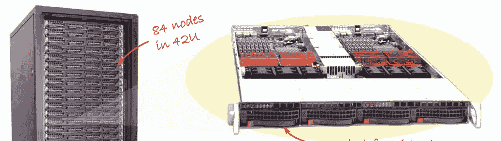

虚拟服务器的理想选择

+ 特性与优势：

- **比刀片机更高的密度（是的，真的）** —— 单 1U 空间内内置两台双四核服务器。42u 机柜中可容纳 84 个节点 / 672 个处理器核心。
- **低功耗** —— 卓越的电源利用率。提高能源效率。
- **冗余** —— 高冗余集群。采用独立服务器，而非刀片解决方案中常见的单点故障。
- **标准化** —— 行业标准架构。不使用专有的刀片背背板/架构。
- **冷却** —— 独立冷却的 1U 机箱，对比大型机箱。
- **完全定制** —— 每个节点的定制程度远高于刀片机。
- **热插拔** —— 在不中断网络流或数据访问的情况下，更换整台双路服务器。
- **低成本** —— 显著低于类似的刀片解决方案。

| 包含 14 个刀片的 IBM BLADECENTER 9U 刀片解决方案 | 包含 14 个节点的 ABERDEEN STIRLING 122 7U 服务器解决方案 |
| --- | --- |
|  | 9U BladeCenter H，包含 14 台 IBM BladeCenter，配备 8 GB RAM 和 106GB FSB | 7U Aberdeen Stirling 122，每台配备两台双路服务器 |
| 每个刀片/节点的处理器 | 两个四核 6000 rpm 处理器 E5310 1.60 GHz | 双四核 Intel Xeon E5310 1.60 GHz |
| 每个刀片/节点的内存 | 2 GB ECC DDR2 667 MHz 内存（最大 3 GB / 4 条 DIMM） | 8 GB ECC DDR2 667 MHz 内存（最大 32 GB / 8 条 DIMM） |
| 每个刀片/节点的硬盘 | 两个 6 TB 10000 rpm 2.5 SAS 硬盘（最大 4 x 9 TB 硬盘（带可选 SSD）） | 两个 3.7 GB 10000 rpm 热插拔 SATA 硬盘（最大 5 x 1.5 TB） |
| 每个 42u 机柜的最高处理器数量 | 56 个刀片 / 112 个处理器（4 台 9U 机箱中包含 448 个核心） | 84 个节点 / 168 个处理器（4 台 1U 机箱单元中包含 672 个核心） |
| 保修 | 部件和做工提供 1 年现场有限保修 | 部件和做工提供 5 年有限保修 |
| 14 台刀片解决方案总价 | $5,012 | $2,607 |
| 每个刀片/节点价格 | | |

Intel、Intel Inside、Intel Logo、Pentium、Core 和 Xeon 均为 Intel 公司或其在美国及其他国家的注册商标。其他商标归其所有所有。2007 年 1 月 30 日后订单的产品价格和规格。更多详情请参阅 `www.aberdeen.com/appory/terms._018`

## 专栏

适用于各种的 LINUX

“交互设计”的实现。计算已在字面和比喻上都达成了一致性。

这并非适用于个人和群体独立且匿名开发的兴起，而是适用于所有愿意并能够发表意见的参与，包括用户，McCarthy 将用户置于事情的起点而非终点；

> 从“用户”的角度来思考并为他们创建“知识点音机”变得越来越没有意义。渴望“创造者”并获得更多学术上等同于“积木玩具（Tinker Toys）”的东西变得更有意义。但是，我们必须警惕不要用一只手拿走我们给予我们的东西。用克利福德几何（Clifford Geometric）的术语来说，我们需要跨越泰勒主义（Taylorian）概念的“知识杂草”，让我们保持平衡；知识“发现”的概念、学术上的“学习成果”以及所有其他永恒的陈词在如今都已淹没。我们这个时代的整个计算领域——我的论点是——与这种观念隐含的、过时的 19 世纪宇宙观直接背道而驰。

McCarthy 的个人内容是学术，特别是研究生和项目，这些专业领域被限制在良好且受保护的空间内。关于这一点，他说道：


“特别是自从 Web 出现以来，我们的注意和能量投入了数字化的指数级增长。对于学者来说，这里的好处是可搜索和可质疑的材料变得可用，我们不再有更多证据证明这种或那种业务是常态。我们有更大的知识多样性需要考虑，因此有更丰富的方式来重构现实和工作，同时也相互协作，并需要更好的推理。在这里是为了推导。这并不是一个打破学科的问题——我们是重构或拆解的主人。相反，拆解需要这些支持。要点在于学科的配置。计算的进展最终，让领土的封建式隐喻和正式学习园林中的中世纪知识树变得毫无意义。我们需要其他的视角。这就是原因。”

# 资源

- 虚拟洛杉矶：`digitalations.ucla.edu/2007/ccc/projectpson.htm`
- 数字创新日展会：`www.ucla.edu/spotlight/07/digital-innovation.html`
- 罗马论坛：`www.digitalinnovations.ucla.edu/2007/projects/roman.htm`
- 800 年：`www.digitalinnovations.ucla.edu/2007/projects/800years.htm`
- `www.digitalinnovations.ucla.edu/2007/projects/800years`
- `www.digitalinnovations.ucla.edu/2007/projects/santiago`
- `www.digitalinnovations.ucla.edu/2007/projects/humanities`
- `www.digitalinnovations.ucla.edu/2007/projects/humanities`

# 新产品

## 摩托罗拉 RAZR V8

摩托罗拉正在中国尝试在手机上运行 `Linux` 作为实验，有趣的是，这一尝试得到了中国政府的支持。由于该公司对 `Linux` 留下了深刻印象，我们喜爱的操作系统在移动设备上变得越来越常见。最新的由 `Linux` 驱动的选项之一是 `RAZR V8`，这款热门手机的下一代。`RAZR V8` 具有长达 500 分钟的通话时间、四频连接、高达 2GB 的内存、200 万像素摄像头、`Opera` 浏览器、以及基于 `Windows Media Player 11` 的独立语音识别和音乐。摩托罗拉的最新产品不同之处在于它穿透了微软的音频解码器、`DRM` 和传输协议，并将其整合到自己的 `Linux-Java` 平台中。尽管如此，知道可以特意出去买一台强悍的 `Linux` 手机，依然让追求 `Linux` 的灵魂感到宽慰。`www.hellomoto.com`


## Drew Technologies 的 DashDAQ

当底特律的汽车制造商痴迷于完善杯架时，`Drew Technologies` 正在试图将一种基于 `Linux` 的设备 `DashDAQ` 悄悄带入你的新车中。`DashTech` 是“汽车仪表盘、控制面板、导航系统、数据采集系统、诊断工具和手持电脑的交叉体”。该设备设计用于汽车显示屏，包含 `OBD` 协议，并运行在 `DashDAQ` 附带的 `Linux` 软件，允许用户创建自己的主题和汽车仪表盘。功能包括双 `ARM` 架构、4 英寸（`QWVGA`）24 位 `TFT` 彩色屏、触摸屏和 64MB `RAM`。该产品可通过各种分销商直接从 `DrewTech` 购买。`www.dashdaq.com`

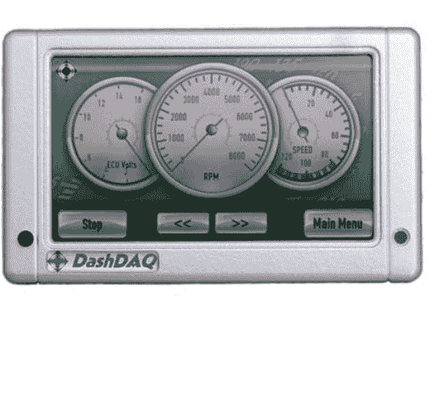

## Axigen 邮件服务器

`Axigen` 持续增加其 `Mail Server` 消息解决方案的功能集，目前 `4.0` 版本已发货。`4.0` 版本的新功能是 `Persona` 模块，提供日历、任务、笔记和协作支持等功能。该功能可通过 `Axigen` 的 `Web` 界面和 `Outlook` 客户端使用。此外，该产品现在包含 `Outlook` 连接器，它实现了大多数类似 `Exchange` 的功能，例如服务器端文件夹。`Axigen Mail Server` 提供三个版本：`ISP/HSP`、`Business` 和 `Business office`。`www.axigen.com`

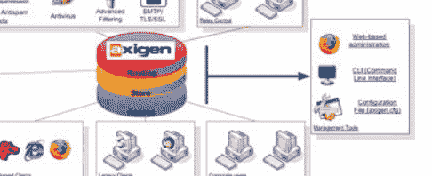

## Kyle Wheeler 著《Qmail 快速入门》(Pakt 出版)

如果你觉得 `Qmail` 的主页太难懂，可以购买 `Kyle Wheeler` 的《`Qmail` 快速入门》，这是一本为熟悉 `Linux/Unix` 和 `DNS` 服务器并希望建立邮件服务器的人编写的新书。从基础开始，`Qmail` 介绍了如何让电子邮件进出队列，包括存储、检索和验证。书中还涵盖了数据可视化和用户管理、垃圾邮件过滤、`SSL` 加密和邮件列表。`Pakt` 表示，该书的风格侧重于系统管理员可以直接使用的实用示例，但也解释了每个示例背后的原理。`www.pktpub.com`


## 禁止类乐木

`Ulrik Pilegaard` 和 `Mike Dooley` 著《禁止类乐木》(`No Starch` 出版)

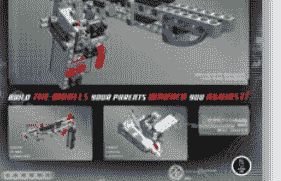

图书出版商似乎是分次发布书籍的，目前我们正处于“极客书籍潮啸”之中。风格包罗百格的 `No Starch Press` 继续挑选各种类型的乐木书籍，如这本由 `Ulrik Pilegaard` 和 `Mike Dooley` 编写的《禁止类乐木》，书名“建造你父母警告你不要做的模型”带有微妙的幼稚叛逆，对“自由风格构建”痴之如狂，并展示了如何制作许多模型，如用玩具枪展示乐木大作战、一个糖果立柱、一辆高电压乐木车辆、一个连续射乒乓球发射器以及所有无用但极其有趣的发明。”简而言之：提前贴好乐木积木！`www.nostarch.com`

## Allen Sherlock 著《游戏开发者的数据结构与算法》(Charles River Media)

《侠客盗猎车》中的弹球游戏，正是你今天需要这本书——由 `Allen Sherlock` 编写的《游戏开发者的数据结构与算法》的原因。该书由 `Charles River Media` 出版，涵盖了如何使用 `C++` 及其替代方案教授游戏开发者数据结构和算法的基础知识。书中还涵盖了当今游戏和游戏程序员为了成功所需的许多主题，包括几何技术、`KD` 树、二分空间划分树、球体树等。此外，书中的代码不依赖于平台或操作系统，这正是我们 `Linux` 用户所喜欢的！`www.charlesriver.com`

| 游戏开发者的数据结构与算法 |
| :--- |
| `Allen Sherlock` |
| `Charles River Media` |
| `ISBN 978-...` |

## ActiveState 的 Tcl 开发包

`ActiveState` 的最新消息是发布了 `Tcl` 开发包 (`TDK`) `4.0`，这是一个用于创建和部署应用程序的多点工具包。此外，为构建自安装、文件可执行程序提供了基本工具，`TDK` 包括图形化调试器、用于代码优化的性能分析和分析工具、预编译器和服务管理器。`TDK` 的新功能包括 `Tcl` 的包管理器，以及对各种 服务的支持。`www.activstate.com`


## 制作自己的游戏机


# 新产品

## 摩托罗拉 RAZR V8

摩托罗拉在中国尝试在手机上运行 `Linux` 作为一项实验，有趣的是，这一尝试得到了中国政府的支持。由于该公司对 `Linux` 留下了深刻印象，我们喜爱的操作系统在移动设备上变得越来越常见。最新的由 `Linux` 驱动的选项之一是 `RAZR V8`，这款热门手机的下一代。`RAZR V8` 具有长达 500 分钟的通话时间、四频连接、高达 2GB 的内存、200 万像素摄像头、`Opera` 浏览器、以及基于 `Windows Media Player 11` 的独立语音识别和音乐。摩托罗拉的最新产品不同之处在于它穿透了微软的音频解码器、`DRM` 和传输协议，并将其整合到自己的 `Linux-Java` 平台中。尽管如此，知道可以特意出去买一台强悍的 `Linux` 手机，依然让追求 `Linux` 的灵魂感到宽慰。www.hellomoto.com


## Drew Technologies 的 DashDAQ

当底特律的汽车制造商痴迷于完善杯架时，`Drew Technologies` 正在试图将一种基于 `Linux` 的设备 `DashDAQ` 悄悄带入你的新车中。`DashTech` 是“汽车仪表盘、控制面板、导航系统、数据采集系统、诊断工具和手持电脑的交叉体”。该设备设计用于汽车显示屏，包含 `OBD` 协议，并运行在 `DashDAQ` 附带的 `Linux` 软件，允许用户创建自己的主题和汽车仪表盘。功能包括双 `ARM` 架构、4 英寸（`QWVGA`）24 位 `TFT` 彩色屏、触摸屏和 64MB `RAM`。该产品可通过各种分销商直接从 `DrewTech` 购买。www.dashdaq.com


## Axigen 邮件服务器

`Axigen` 持续增加其 `Mail Server` 消息解决方案的功能集，目前 4.0 版本已发货。4.0 版本的新功能是 `Persona` 模块，提供日历、任务、笔记和协作支持等功能。该功能可通过 `Axigen` 的 `Web` 界面和 `Outlook` 客户端使用。此外，该产品现在包含 `Outlook` 连接器，它实现了大多数类似 `Exchange` 的功能，例如服务器端文件夹。`Axigen Mail Server` 提供三个版本：`ISP/HSP`、`Business` 和 `Business office`。www.axigen.com


## Kyle Wheeler 著《Qmail 快速入门》(Pakt 出版)

如果你觉得 `Qmail` 的主页太难懂，可以购买 `Kyle Wheeler` 的《Qmail 快速入门》，这是一本为熟悉 `Linux/Unix` 和 `DNS` 服务器并希望建立邮件服务器的人编写的新书。从基础开始，`Qmail` 介绍了如何让电子邮件进出队列，包括存储、检索和验证。书中还涵盖了数据可视化和用户管理、垃圾邮件过滤、`SSL` 加密和邮件列表。`Pakt` 表示，该书的风格侧重于系统管理员可以直接使用的实用示例，但也解释了每个示例背后的原理。www.pktpub.com


## 禁止类乐木

`Ulrik Pilegaard` 和 `Mike Dooley` 著《禁止类乐木》(`No Starch` 出版)


图书出版商似乎是分次发布书籍的，目前我们正处于“极客书籍潮啸”之中。风格包罗百格的 `No Starch Press` 继续挑选各种类型的乐木书籍，如这本由 `Ulrik Pilegaard` 和 `Mike Dooley` 编写的《禁止类乐木》，书名“建造你父母警告你不要做的模型”带有微妙的幼稚叛逆，对“自由风格构建”痴之如狂，并展示了如何制作许多模型，如用玩具枪展示乐木大作战、一个糖果立柱、一辆高电压乐木车辆、一个连续射乒乓球发射器以及所有无用但极其有趣的发明。简而言之：提前贴好乐木积木！www.nostarch.com

## Allen Sherlock 著《游戏开发者的数据结构与算法》(Charles River Media)

《侠客盗猎车》中的弹球游戏，正是你今天需要这本书——`Allen Sherlock` 编写的《游戏开发者的数据结构与算法》的原因。该书由 `Charles River Media` 出版，涵盖了如何使用 `C++` 及其替代方案教授游戏开发者数据结构和算法的基础知识。书中还涵盖了当今游戏和游戏程序员为了成功所需的许多主题，包括几何技术、`KD` 树、二分空间划分树、球体树等。此外，书中的代码不依赖于平台或操作系统，这正是我们 `Linux` 用户所喜欢的！www.charlesriver.com

| 游戏开发者的数据结构与算法 |
| :--- |
| `Allen Sherlock` |
| `Charles River Media` |
| `ISBN 978-...` |

## ActiveState 的 Tcl 开发包

`ActiveState` 的最新消息是发布了 `Tcl` 开发包 (`TDK`) 4.0，这是一个用于创建和部署应用程序的多点工具包。此外，为构建自安装、文件可执行程序提供了基本工具，`TDK` 包括图形化调试器、用于代码优化的性能分析和分析工具、预编译器和服务管理器。`TDK` 的新功能包括 `Tcl` 的包管理器，以及对各种服务的支持。www.activestate.com


## 特性 构建你的街机游戏玩家

《街头霸斗2》布局。你会在中间需要一个额外的摇杆，这并不是《街头霸斗2》布局的一部分。这是一个原始的《小姐小姐》（`Ms.Man`）摇杆，是我妻子作为一份非常平衡的高中毕业礼物送给我的！（我们是一个非常稳固！）我们将其直接连接到玩家摇杆上，所以如果你没有座位也不用担心，这并不理想，只是一个备选方案。

摇杆和按钮会有空间，但标准按钮使用 1 英寸的孔。你可以根据自己的喜好随意进行布局。如果你想确保按钮放置得完美，除了硬币口外，没有其他规则！别忘记在机器正面留一个投币槽，如果在真实的街机厅里，你会向那里投入四角硬币。

现在你有了一个空外壳，带有一个显示器架、电脑和一块布满孔的木板。如果你在家里做这项工作并且必须管理它，请花这段时间打打灰。如果你是个手巧的人并想给控制面板和街机上漆，尽管去吧。我没做到，这个混乱的日子现在有一个原木色的控制面板。

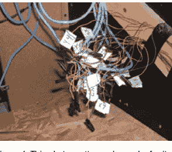

图 4。这张照片已经说明了一切。这是一个关于如何不组织的很好的反例。

## 选项

软件：`AdvanceCD`，自定义 `Linux` 安装。

- 优点：创建一个自定义的 `CD` 或可启动的 `USB` 闪存，可以直接启动到 `AdvanceMENU` 前端。
- 缺点：如果你不使用标准布局，配置会非常困难。如果你的硬件没有被正确检测，也很难。此外，如果从 `USB 1.1` 启动也是如此。

软件：`Linux`，基于 `Gentoo`。

- 优点：使用 `Arcade` 前端，它的可配置性更高，并且在安装后有添加和修改游戏的选项。
- 缺点：如果你不使用标准的 `MAME` 按钮，配置仍然非常困难。

软件：`KnoppixMame`，基于 `Knoppix`。

- 优点：出色的硬件检测。
- 缺点：并非真正为街机柜设计，而是更适合拥有键盘和鼠标的人。


图 5. 我为了避免焊接的指南。插头看起来很棒，但它们连接得并不好——另一个不该做的范例。

## 再见，你好，士兵

这是发生混乱的地方。如果你像我一样，你已经在电脑上尝试过 `MAME` 并用键盘玩过游戏。这很有趣，但与原版并不完全。在这一步中，我们将真实的控制设备连接到电脑。首先，你不需要在机柜上有任何硬件和按钮，你需要去买。有几个地方可以买街机柜，但最受欢迎的之一 `Happ Controls` (www.happcontrols.com)。如果你查看之前提到的街机网站，你会发现有许多你可能需要的物品的供应商。

一旦你有了按钮和摇杆，你就需要将它们连接到编码器，或者自己破解键盘。前者选项更简单、更可靠，但后者可以省点小钱。后者是关于如何确定按钮布局的详细说明，但请查看“隐藏键盘”侧边栏获取快速描述，如果你打算这样做的话。

软件：标准 `Ubuntu` 和 `Wac` 前端。

- 优点：非常容易配置。`Ubuntu` 安装处理所有的硬件检测。这是我选择的。
- 缺点：没有专门为街机柜进行配置。

## 获取合法的 ROM

`MAME ROM` 在互联网上很容易找到并下载，但使用那些 `ROM` 的合法性尚存疑。有几种方法可以确保你拥有使用 `ROM` 的合法权利。


1. 从原始游戏购买实际的主板。这听起来可能很遥远，但从当地的硬币机供应商或在`ebay`上购买故障的街机板并不困难。因为你只是寻找使用下载的`ROM`的合法权利，主板是否坏了并不重要。

2. 你可以购买`X-Arcade`键盘，它带有一些经典`ROM`。

3. 查看`arcadecontrols.com`。那里有一些免费的、非商业的游戏可以下载，还有一些关于获取合法`ROM`的更多想法。即使你愿意花钱，要找到从谁那里购买权利通常也会变得困难。

## 模拟 2.5MHZ 需要多少 GhZ？

现在，如果你有一个机柜、安装好的控制设备、一套带键盘接口的游戏组和一个等待电脑的空`MAME`架子。最后一步是放入电脑，你将安装软件。然而，你需要的实际上取决于你想玩什么游戏。如果你计划玩经典游戏，像《吃鼠蛇》这样的足够了。但是，如果你想玩《街头霸斗2》或任何其他游戏，你应该买一个`Pentium III`或`4`。如果你有一个中端的`Pentium 4`。如果你需要建议，我想听听你有什么。如果你觉得以后有需要，可以再投资。

## 企鹅时间到了！

要在街机柜中运行`MAME`，你必须配置两个独立的程序：`MAME`本身和一个前端。因为`MAME`是一个命令行程序，你需要一个前端来通过摇杆和按钮启动游戏。这最后一步是你最喜欢的部分。如果你觉得我


| Vector Attack |
| :--- |
| Asteroids |
| Atlas Deluxe |
| Aztarc |
| Barrier |
| Battle Zone |
| Black Widow |
| Boxing Gladiators |
| Bros Squad |
| Cosmic Chasm |
| Demon |
| Eliminator |
| Gravitar |
| Lunar Lancer |
| Major Havoc |
| ARTEMIS |
| Heroes |
| Hero-type |
| Shooter - Field |
| Local Premiere, Second Premiere |


6. 这是主`Wahcade`场景。这张截图由`Wahcade`开发者`Andy Balcombe`提供。感谢`Andy`！

## 79 美元的笔记本电脑


## 375 美元的桌面


## 799 美元的服务器


## 999 美元的系统


## 1099 美元的系统


## 键盘破解

为了破解键盘，有几个简单的步骤：

1. 拆开键盘，找到`X`和`Y`。

2. 焊接到`PCB`，并标记`X`和`Y`。

3. 焊接到`PCB`，并标记`X`和`Y`。

4. 焊接到`PCB`，并标记`X`和`Y`。

# `VERIO` 托管是拥有血统的 `LINUX`。

- `Root`访问：提供你所需的控制力。

- 高级公平共享技术：更优资源管理意味着更优性能。

- 真正支持的支持：由系统管理员提供的屡奖支持服务。

## `Verio Linux® VPS` 和 `MPS`：同类最佳。

在`Verio`，我们对开源一直有着长期的承诺，这追溯到我们早期与`FreeBSD`的工作。

现在，作为虚拟专用服务器（`VPS`）技术的先驱，以及作为全球最大电信公司财务资源支持的托管提供商，我们为`Linux`带来了额外价值：可靠性。

欲了解更多关于`Verio Linux VPS`或`Verio Linux MPS`，或注册免费测试，请拨打`1-877-837-4654`或访问`www.verio.com/linuxlineage`。


# 使用 `Openswan` 为 `Nokia E61` 创建 `Linux` `VPN`

## 在你的 `Nokia E61/手机` 与 `Linux` 网关之间建立虚拟专用网络。`Ben Martin`

虚拟专用网络（`VPN`）允许你在不可信的网络上发送流量，而不暴露流量内容。从概念上讲，这是通过在两个主机之间创建一个所有流量都加密的管道来实现的。此示例展示了如何通过互联网`VPN`将`Nokia E61`设备连接到家庭网络。`Nokia E61`使用`IP 安全`（`IPSec`），这是一款支持`Wi-Fi`和`VPN`的智能手机。类似的程序对使用相同`VPN`客户端软件的其他型号可能有效，尽管未对这些硬件进行测试。

`Nokia E61`上的`VPN`支持使用`IP 安全`（`IPSec`）。`Openswan`是配置在`Linux`机器上的`IPS`服务器，用于提供虚拟网络的另一端。

先说明一个简单的设置：我无法在`Nokia`上配置`VPN`客户端以连接到没有静态`IP`地址的服务器。

为了保持符号简单，请将`e61`和运行的服务器称为`VPN IP`地址。`e61`的`IP`地址与本文无关，因为你可能会带着手机移动到不同的`Wi-Fi`热点。当设置好`VPN`后，`e61`会获得另一个`IP`地址，`e61`将其称为虚拟`IP`地址。`VPN`的地址已上线，这就是你访问互联网的地址。在本文，我使用`192.168.x.x` `IP`地址作为`VPN`地址。`e61`的非`VPN`地址最相关，除非我在此明确提到，否则`e61` `IP`地址将是不可路由的`IP`地址。

与手机上的其他设置不同，你无法通过`e61`本身来配置它。你必须创建一个包含所有`VPN`信息的包并将该包安装在手机上。这些包是`SIS`文件。`VPN SIS`文件在`e61`允许你安装之前还必须经过数字签名。签名后的文件没有扩展名。设置`e61`与`Openswan`通信最困难的部分在于创建`SIS`文件。

即使你在`All App Mgr/Options/Settings`中有要安装的`Software`配置参数，`SIS`文件也必须经过数字签名。

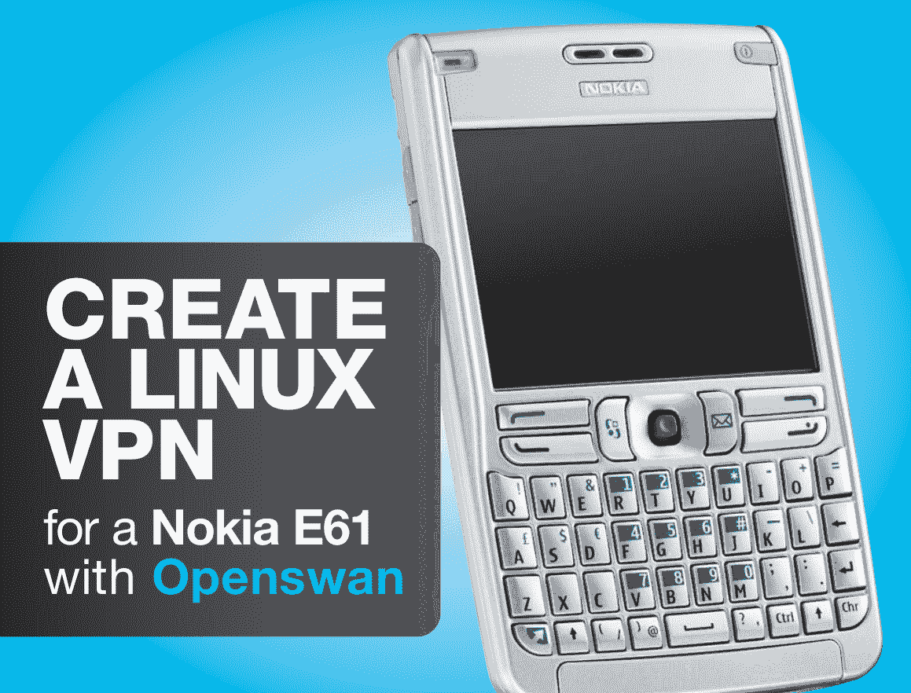

# `ssix` 包的内容

`ssix`包由三个文件组成。其中两个是模板板类型的包元数据文件（`.vpn`和`.vpn.pkg`）。

处理完这些模板文件后，`.vpn`文件大部分是不必要的（如列表 1 所示），`.vpn.pkg`文件如列表 2 所示。两者在任何更改的情况下均可工作。注意，列表 2 中的路径是指手机本身，不应更改。

最后一个字段中的密码：`KEY`。这是空格后密钥的字符串长度。

如果`USE_AUTH`为`true`，在建立`VPN`连接时，`e61`会提示你输入用户名和密码进行连接。这提供了额外的安全级别。如果密码被盗取，小偷将必须知道你的用户名和密码才能访问你的`VPN`。

列表 2。包清单和关于应用程序类型的描述。你可以将`0x0100597E`之前的`"VPN Policy"`字符串改为其他内容。

- `"VPN public"`

- `%(\VPN policy")`

- `A VPN POLICY PACKAGE`

- `LANGUAGES`（语言）

- `None`（默认仅限英语）

- `INSTALLATION HEADER`（安装头）

- 仅需一个组件即可支持仅英语

- `UID` 是 的

- `VPN Policy Installer` 应用程序

- `"VPN Policy" (0x0100597E.1.0.1.TYPE = SA`

列表 1. 一些非常基础的元数据

```
[POLICY]

VPN public

[DESCRIPTION]

VPN public

1.1

[ISSUENAME]

不要编辑

[CONTACTINFO]

不要编辑
```

# 创建 `ssix` `VPN` 配置文件

使用三个可执行文件来创建一个签名的`ssix`文件。`DevCertRequest`用于为其中创建一个证书，然后`signexe`用于创建包并对其签名。

- 文件列表

- 策略文件：`"VPN.pol\System\Data\Installer\VPN.pn"`

- `Policy-information`（策略信息）

- 注意：此列表中的`policy-information`必须是列表中的最后一个文件！

- `(MIME)`将文件交给相应的`MIME`处理器

- （在这种情况下，`VPN Policy`安装程序）。

- `"VPN.pol\System\Data\Installer\VPN.pn"`

- `"ipsec-policy"`


# 创建 Linux VPN

`vpn` 文件定义了连接 VPN 的方法以及用于身份验证的密钥。在使用之前，需要更改某些内容。更改包括 `Openswan` 服务器的静态 IP 地址 (`192.168.1.1`) 以及使用的密码。对于上述提到的任何虚拟 IP 地址，都可以从互联网访问。所有这些可执行文件都可以在 Linux 上运行，你可能需要使用它们生成密钥和证书。最好的办法是在 `openswan.com` 免费注册并下载 `DevCertRequest` 可执行文件。

- 必需字段
- VPN 安装程序 (`0x0100597E`), "VPN Policy" (`0x01F7961`), "Product"

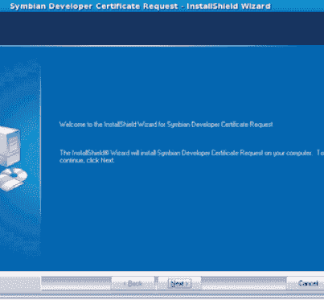

`DevCertRequest` 仅用于输入证书。遗憾的是，`DevCertRequest` 是一个安装程序，你必须安装并执行它。安装 `DevCertRequest` 包括五个步骤，并且不再需要。给出新文件的位置 (`monkey-key`) 用于你的私钥。

## 列表 3. VPN 策略：连接到哪里。它如何帮助你

`SECURITY_FILE_VERSION`: `3`

`[INFO]` `[VPN]` `[POLICY]`

`sa ipsec_1 = { esp max_encrypt_alg max_auth_alg 密码；你的国家、州和公司；手机的 IMEI 告诉你在手机上所需的证书功能；以及信息是正确的确认。`

如果你想从 `openswan.com` 获取或使用侧边面板设置中的第一个列表，开发者选项有。

## 列表 4. 提取内容和 `signis` 可执行文件

```
$ mkdir /tmp/e61-sdk
$ cd /tmp/e61-sdk
$ unzip /tmp/e61-sdk-500-0548-3.0.zip
$ cd data2/tools
$ mkdir -p /e61tools
$ cp maked.key signis.exe -e61tools
```

在此页底部，你可以点击下一页下载证书（图 2）。`maked.exe` 和 `signis` 文件可以从 `OpenSign` 平台提取，如列表 4 所示。

## 列表 5. 制作签名包

```
wine maked.exe VPN vpk.vpn

wine signis.exe VPN signis.key \
mongodb:private-key-my-certificate-password

identity_remote: 0.0.0.0/0 src_specific hard_lifetime_stime 3600 hard_lifetime_stime 3600 soft_lifetime_stime 3600 soft_lifetime_stime 3600 0.0.0.0 = ( ipsec:192.168.1.1 ) inbound = ) outbound =

[IKE] ID_ADDR: 192.168.1.1 255.255.255.255 MODE: TRUE ID_TYPE: 1 FQDN: Mobilegroup I: MODP_1536 GROUP_DESCRIPTION: MODP_1536 USE_COMMIT: FALSE IPSEC_HASH: FALSE SEND_CERT: FALSE INITIAL_CONTACT: FALSE RESPONDER_LIFE: TRUE USE_INTERNAL_DONE: FALSE USE_NAT_POLICY: FALSE ESP_UDP_PORT: 0 NAT_KEPALIVE: 60 USE_KAUTH: TRUE USE_MOD: TRUE REKEYING_THRESHOLD: 90 PROPOSALS: 1 ENC_ALG: AES256-CBC AUTH_METHOD: PRE-SHARED GROUP_DESCRIPTION: MODP_1536 GROUP_TYPE: DEFAULT LIFETIME_BYTES: 28800 PRE_SHARED_KEY: FORMAT: STRING KEY: 3 foo
```

有了证书 (`morekey`) 文件，你可以使用列表 5 所示的代码处理该文件。使包的三个文件携带回车加换行符以仅终止标准的 Linux 行；使用 `unixdos(1)`。这三个文件分别是列表 3、2 和 1 中的 `.pol`、`key` 和 `.pin` 文件。

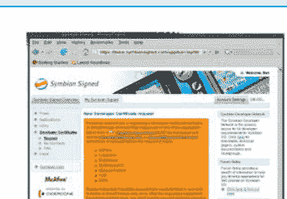

# 安装 VPN 卷器和最终文件

可以使用任何方法通过蓝牙将文件传输到 `e61`，在这种情况下，可以直接在 `e61` 上直接从收到的消息列表中安装。由于此文件包含密码，最好通过手机或优存盘传输。在 `e61` 上使用 `Mini-SD` 卡并将 `USB` 连接到手机和 Linux 机器上，就可以将文件复制到 `e61` 的 SD 卡上。将文件复制到 `e61` 上的方便位置，例如 `Documents/vpn`，或将 SD 卡弹出。


图 2. 下载证书请求

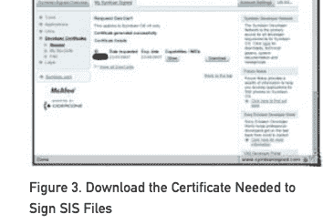

图 3. 用于签名 SIS 文件的证书请求

在移除证书之前强制进行磁盘同步（图 4）。一旦文件复制到 `e61` 内存卡上，`e61` 允许你在内存卡上导航 VPN 方向。当你点击 VPN 手机时，文件如下。

# 将所有网络流量重定向到 VPN 的额外好处是，你正在使用的 Wi-Fi 热点无法记录你访问的网站。

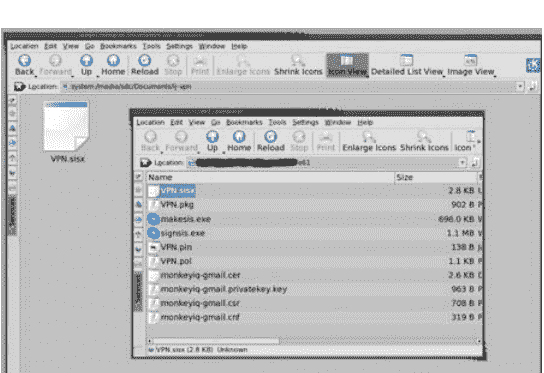

图 4. 将 VPN 文件复制到内存卡的子目录下。

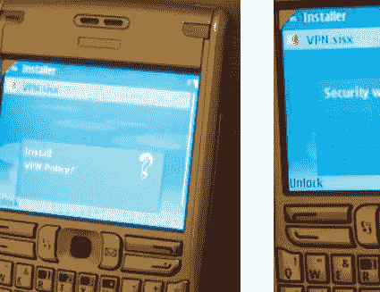

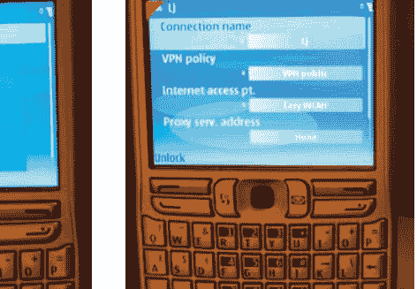

图 6. 正如标记的数据包所示，我们相信这不是真实的安全问题。

图 7. 最终设置——为策略指定名称和 Wi-Fi 接入点，并可能设置代理服务器工具。

图 5. 启动 VPN 策略本身。

通过 VPN 连接的互联网和内网服务器。额外好处是你正在使用的 Wi-Fi 热点无法记录你访问的网站。最终阶段见图 7。如果你已经在使用 VPN 连接本地，并继续这样做，将能够测试 VPN 接入点，设置插入到你的 VPN 接入点。第二个 VPN 配置意味着在连接到本地网络时，你不会被提示使用 VPN，使用 VPN 这种外，除非是为了隐藏你无线接入点的安全性。

只需通过安装 `OpenVPN` 即可轻松实现。如前所述，本文使用了一台 Linux 机器；其他人可能存在细微差异。`OpenVPN` 包含 `iptables/spec.conf` 文件和设置中的一组文件。如果配置文件可以保持原样，那么使用 `control-opts` 在 `OpenVPN` 启动和停止时开启数据包转发可能会很有趣。另一个趣点是接口设置，允许你指定将哪个接口绑定到哪个网络接口，例如"Failthrough ipe2eth1 ipe2eth3"。如果没有指定参数，`OpenVPN` 将作为默认路由在网络上运行。对于互联网 VPN 连接，这是可以接受的。你可能想要导入它。右键点击该文件，你将看到如下内容，如图 5 所示。在检查元数据后，你从一堆文件中创建了看起来非常漂亮的屏幕，并且你自己亲自检查了它们，这个安全警告实际上不会带来太大问题。

VPN 文件可以通过 菜单→工具→设置→连接→VPN 来准备。选择 VPN 接入点和 选项→新建接入点。设置合适的连接名称、描述和策略名称。一个方便的接入点是 `EasyWLAN`。你可能还想设置代理服务器地址和端口。能够上网是很棒的。

# 设置 OpenVPN 端

在 `rpm.com` 提供了适用于 Fedora 和 Ubuntu Linux 的软件包。`Debian.org` 在 Fedora Linux 机器上也列出了软件包，`OpenVPN` 可以。

另一个在设置过程中可能实用的参数：`openvpn.conf` 文件是设置的。

## 特性 Linux VPN

| 列表 6. OpenVPN 配置文件 |
| :--- |
| 允许 e61 连接 |


### 密钥交换
```
key aes256-sha1-modp2048
```

### 数据交换
```
aes256-sha1
```

### 认证方法
```
auth user-pass
auth-user
```
如`auth-user`所示，设置`keytries=3`。

### Modconfig 默认配置
```
decopfopfys
pfs=no
reneg
left61monkeyql.example
leftsubnet=192.168.0.1/24
leftright=any
leftauthserver=server
rightkey=any
right=any
rightclient=clients
rightsource=1
port=6512
rightsubnet=192.168.2.6/32
```

**列表 7. VPN 的私钥**

| PKCS | "foo" |
| :--- | :--- |

`plugdball`，如果你无法连接，则添加你的文件。

要为`e61`描述到 OpenVPN 的连接，创建一个配置文件`/etc/openvpn/e61.conf`，如列表 6 所示。遗憾的是，我在设置完美连接并连接到`e61`时没有遇到困难。如`e61`的 VPN 配置文件所示，我将值列为`auth user-pass forget`，并`route`远程网络的 IP 地址以通过默认网关路由。结果，我还使用了服务器的 DNS 名称，在配置文件中所示如下：`dns namekey.example.org`。路由本身是我在接管 VPN 时将使用的 IP 地址。对于转发，我在`/etc/hosts`中为`192.168.2.168`添加了目。

你在上述 VPN 策略的`KEY`中指定的相同私钥应放在`/etc/openvpn/e61.secrets`文件中，列表 7 所示。

最后，VPN 策略中的`U_XAUTH`选项需要 OpenVPN 为连接准备用户名和密码。`README.XAUTH`记录提到使用`PAM`作为你的密码。此密码文件可以使用 Apache 服务器的`tappass`创建。密码文件的 A 列表见列表 9。

**列表 8. 使用 `tappass` 创建初始密码文件。**

`-c`选项在文件不存在时创建它，如果存在则替换。仅使用一次`-c`。确保先设置你的`umask`，因为某些发行版有默认设置。

```
umask 027
tappass -b -c passwd-here
tappass -b passwd chorid:::
```

**列表 9. 用户名和密码文件-the server is linux.**

```
atu@p24:e61chorid:::e61
```

**列表 10. 在 IPS Server 上 e61 的部分路径**

```
15:58:07 | ipserver > e61 (esp:).
15:58:07 | ipserver > (esp)...
15:58:07 | ipserver > ip61...
```

**列表 11. 在防火墙中打洞。e61 设置在 `/etc/hosts` 到 192.168.2.652。**

```
iptables -X REMOTEVN_INOUT >/dev/null
iptables -X REMOTEVN_OUTOUT >/dev/null
iptables -N REMOTEVN_INOUT
iptables -N REMOTEVN_OUTOUT
iptables -A REMOTEVN_INOUT -j esp
iptables -A REMOTEVN_INOUT -m proto udp -j udp
iptables -A REMOTEVN_INOUT -m dport -j accept
iptables -A REMOTEVN_INOUT -j LOG "incoming-ip-src61"
iptables -A REMOTEVN_INOUT -tcp --dport -j images
iptables -A REMOTEVN_INOUT -j LOG "incoming-images"
iptables -A REMOTEVN_INOUT -j ACCEPT
iptables -A REMOTEVN_INOUT -m dport smtp -j ACCEPT
iptables -A REMOTEVN_INOUT -m proto tcp -j src61
iptables -A REMOTEVN_INOUT -m proto tcp -j src61-n
iptables -A REMOTEVN_INOUT -j src61-e61-string
iptables -A REMOTEVN_INOUT --j LOG "e61-string"
iptables -A REMOTEVN_OUTOUT -j src61-j OUTPUT
iptables -A REMOTEVN_OUTOUT -m proto udp -j udp
iptables -A REMOTEVN_OUTOUT -j ACCEPT
iptables -A REMOTEVN_OUTOUT -j src61-j LOG "outgoing-ipsec-e61"
iptables -A REMOTEVN_OUTOUT -m proto udp -j udp
-j ACCEPT
```

列表 11 显示的命令允许你从本地连接到 IPSec 服务器。过滤规则非常简单。允许关联和密钥管理 (ISAKMP) 数据包进入和离开服务器，所有其他通过封装安全负载 (IPsec) 流量。VPN 流量负责处理出站包；ESP 数据包；VPN 设置时使用的 ISAKMP，

**列表 12. 移除 e61 访问**

```
iptables -D INPUT - REMOTE_INPUT
iptables -D OUTPUT - REMOTE_OUTPUT
```

这些数据包也会记录，如果`syslog`监控可以你异常的连接尝试或敲门。

当使用 OpenVPN 电子邮件并跳过`e61` IP 地址时，非加密流量被放在下一个接口。我需要这些规则，因为通常在连接互联网的网络接口上没有连接。如果之后还有流量，你必须将这些服务的`e61`数据包发送到互联网（由 OpenVPN 拦截并发送到正确的地址）。

防火墙规则设计为使用默认丢弃策略。日志命令通过在`var/log/syslog`中搜索相关标签来添加，数据包在防火墙丢弃它们会在那里移动。列表 12 显示的脚本是通过 Linux 再次禁用远程访问的。

你可能考虑在`e61`上使用单数据包授权 (SPA) 客户端并设置服务器通过防火墙`GARP/SPA`连接。Michael Ryan 的“单数据包授权”文章在《Linux Journal》2007年4月刊中，提供了更多关于 SPA 的信息。

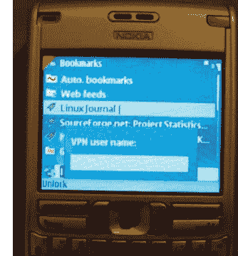

**图 8. VPN 已设置。认证和密码验证。**

书签

`Auto.bookmarks`

`Linux Journal!`

`Serverconnect Project Assets`

`VPN 用户名`


连接允许在此序言内连接，打开任何想要数据连接的应用程序都允许你使用新的 VPN 作为你的接入点。此外，如果`Wi-Fi`热点记得你的`MAC`地址并允许在无需登录的情况下连接，你可以在后续连接中直接启动 VPN。

一旦 VPN 连接成功，`e61`会提示你输入用户名和密码用于`AUTH`验证（块）。认证 验证后，你将能够在无法察觉的情况下使用 VPN。在这种情况下，我可以使用 Linux 代理使用互联网获取数据（图）。

# 下一步

在`e61`策略中使用`DNS`将对那些拥有廉价 IP 访问的人非常有益。我仍在研究如何使用共享密钥的加密技术来连接 VPN。对于连接`e61`到网络，使用足够大的密码仍然有用。本文中的信息不保证正确或适用于任何用途，请自担风险。Ben Martin 从事防火墙系统工作多年。他目前正致力于将防火墙与形式化分析相结合以改进人机交互。

# 连接！

# Magnatune

一个自由的选择；

`iTunes` 一个昂贵的选择

## 终于，有一家理解互联网媒体分发的公司。JAMES LEES

2007年4月2日，苹果公司的史蒂夫·乔布斯与 EMI 首席执行官埃里克·尼科共同宣布，以 12.99 美元的新价格提供无`DRM`下载——比目前的`DRM`格式音乐贵了 30 美元。音乐难道不应该是无`DRM`的，而不是以`DRM`的代价出现吗？这并不是`iTunes`所说或展示的，不是吗？它仍然继续以 5.99 美元出售`DRM`版本，并为所有人提供无`DRM`的音乐。为什么不忍受这些并非来自`iTunes`在线商店的高价歌曲呢？销售高价音乐的音乐，而且像`iTunes`一样，带有束缚的音乐。


`iTunes`上新的无 DRM 歌曲将采用 `MP3`和 `WMA`格式。然而，提到超高音质仅仅是为了涵盖额外价格，并让 `iTunes`免受英国公平贸易侵权的法的指控。你为什么要与一家让你为自由付钱的公司打交道？自由不是应该付钱的东西。既然你可以选择一个提供选项的在线商店，为什么要为自由付费呢？

话虽如此，如果给你选择权，包括接收专辑的方式，是通过下载的无 DRM 格式（`MP3`, `WAV`, `OGG`, `FLAC`或 `AAC`）还是邮寄给你的 `CD`，且都无需所谓的“免费音质”。该网站还让你选择你认为某个特定专辑的价值，并且如果你在故障硬盘上丢失了它或找错了文件，它提供了重新下载的选项。该网站还提供了在另一个设备上备份音乐的选项，且对存储音乐的设备数量没有限制——`iTunes`是不允许的，这也是我希望在购买音乐时能够做到的。而且，最棒的一点是能够分享专辑并将音乐送给朋友。如果你喜欢，可以轻松地与朋友分享（基于信誉系统）。

我可以告诉你们的是关于 `Magnatune`的一切，这家声称“我们并不邪恶”的公司，它只是不邪恶。`Magnatune`提供上述所有内容以及更多。它不仅是一个独立的唱片公司，还是一家想要改变音乐分发方式，并为知名乐队和艺术家开启可能的公司。`Magnatune`上的艺术家和乐队的专辑或歌曲并没有进入前 100 强，但他们仍然可以免费流媒体和下载。`Magnatune`只有一个顶级艺术家转而成为一家主流唱片公司。`Magnatune`正在付出巨大努力来签约声音出色的艺术家，每 300 名艺术家中就有一人被签约。

## `Magnatune`的理念

这些直接源自 `Magnatune`：

- 所有的音乐必须是可共享的。就像软件一样，你希望在购买过程中预览、评估和传递良好的音乐。
- 找到一种能够支持音乐人的音乐触达观众的方法。否则，在当前只有超级热门歌曲才能赚钱的行体系下，音乐的多样性将继续遭受痛苦。
- 音乐人需要控制权，并享受音乐发布的过程。艺术家的生活离革命已经非常近了（有些甚至已经处于革命中）。
- 需要鼓励创意；“所有权利保留”的版权系统太严格了。支持知识共享的“保留权利”，它允许衍生品的创作、共享和非商业用途。

## 开源社区中的 `Magnatune` 及其为音乐和媒体构建的自由

`Magnatune`参与了 `Linux`社区，允许你在不购买 `Aktor 1.4.4`的情况下搜索并收听音乐目录。这种“免费购买”的哲学给了你机会不仅收听专辑中的一首歌，而是整张专辑。现在你为它付钱了——或者完全不付钱。`Magnatune`的搜索和购买功能让你将专辑放入播放器，而不是留在网站上，这太棒了，它让你轻松搜索 `Magnatune`超过 500 种专辑。如果你喜欢你听到的，可以以 5 美元（下载价格）下载，或者购买一张真正的 `CD`，或者授权我们的音乐用于商业用途。你将获得保护（来自 `magnatune.com`），针对特定类型，如古典、电子、爵士和蓝调、金属金属和朋克。一旦购买完成，歌曲或专辑可以放入任何类型的播放器，例如 `iPod`，`Magnatune`让你支付其价值，起价为 5 美元，最高 18 美元（专辑的价格）。每首歌都可以以 5 美元购买，并可以多种格式下载。最棒的部分是，每张专辑销售的 50% 直接给艺术家。

`Magnatune`的另一个很棒的地方是它的每日免费，与 `iTunes`的每周免费相比。有些人听到“免费”这个词并认为可能存在问题或音质不好，但知道的人知道并非如此。`Magnatune`的每日免费优惠很棒，而且歌曲也可以收听且音质良好。但是，`Magnatune`每天都在变化。我计划每天访问该网站，允许搜索其他类型：`Magnatune`还加入了开源社区，该平台允许你在 `Second Life`中分享并收听音乐并结识。如果你是 `Second Life`的成员，`Magnatune`让你在游戏中听音乐支持艺术家而不是把钱放进唱片公司的口袋，或者你是每日免费的粉丝，如果你是艺术家并可能会购买一些曲目，`Magnatune`是一个值得去的地方；特别是如果你想进入音乐行业。`Magnatune`还帮助艺术家获得利润（注意专辑至少有 40 分钟的音乐）；然后，你可以在亚马逊的开源媒体播放器上收听它们，同时根据 `Magnatune`的说法，如果你的专辑被接受就可以制作。所以，让我们忘记 `iTunes`，转向一个基于社区的具有良好商业模式的项目：

## 背后的商业模式

除了 `Second Life`社区和启动开源项目，`Magnatune`拥有超过 1300 名粉丝的 `MySpace`。`Magnatune`使用的另一种广告方法是 `YouTube`。`Magnatune`有一个 `YouTube`页面，在写作时，包含了关于 `Magnatune`信息的视频。你可以免费地在 `Magnatune`上反复观看。这些免费视频用于公司的市场营销，“关于 `Magnatune` 的消息令人兴奋。这正是将拯救当前音乐危机的创新。”——`Lawrence Lessig`，知识共享组织创始人兼主席，销售额的 50% 归艺术家。

## 运行在开源之上

`Magnatune`不支持它，它运行在其之上。它的服务器运行 `Linux`、广泛使用的 HTTP 服务器 `Apache 2`，并使用 `PHP`和 `OpenSSL`。`Magnatune`使用 `MySQL`数据库来存储和记录信息，也用于主站搜索，例如搜索艺术家。当硬盘故障时，脚本会创建曲目列表和播放列表，节省他们通常为名字和标签需要花费的费用，同时你可以通过制作卡片或打印 `Magnatune`小海报并带回家来成为 `Magnatune`营销团队的一部分。

## `Magnatune`网站

`Magnatune`创始人 `John Buckman` 的想法是允许任何在做其他工作时听背景音乐的人（此时我正在听 `Magnatune` 的《`Rocket City, Last Of The Seekers`》），或者是发行量较少、在电影电视中使用以及在互联网演示中使用的音乐，而且许可合同是免版税的，如果项目成功，你就不需要付费。许可和使用音乐的成本取决于项目。我们使用网站上的每一项内容，并且比其他比行业标准低 30% 的商业许可好得多。

## 结论

目标受众从长远来看维持了 `Magnatune`的业务。`Magnatune`在业务上做得最好的方式之一是它为销售本身提供的商业许可。它让音乐存在。音乐不是 `Magnatune`赚钱的唯一方式。它还销售商品，如海报、服装和我们使用的物品。

如果你是一个开源用户，想要在收听非主流音乐的同时支持艺术家而不是把钱进唱片公司的口袋，或者你是每日免费的粉丝，如果你是艺术家并可能会购买一些曲目，`Magnatune`是一个值得查看的地方；特别是如果你想尝试音乐行业。`Magnatune`还帮助艺术家获得利润（注意专辑至少有 40 分钟的音乐）；然后，你可以在亚马逊的开源媒体播放器上收听它们，同时根据 `Magnatune`的说法，如果你的专辑被接受就可以制作。所以，让我们忘记 `iTunes`，转向一个具有良好商业模式的基于社区的项目：

# `SERVERSDIRECT`

更多产品，优质服务，品质保障。

# 直击源头！

# 一天中的时间更多了呢？

没有。但通过您的 `SERVERSDIRECT` 系统内置的双核 `Intel®` `Xeon` 处理器，您获得了次优的方案：在单台服务器中处理更多任务的能力。

# 1U 双创新

# `SDR-60157-TB` 数据中心聚类服务器

`1U` 构型内包含两个系统（节点）。每个节点均支持以下配置：

- 双处理器四核及双核 `Intel®` 64 位 `Xeon` 支持
- 最多 `32GB` `DDR2` `667/533` `RAM` 全缓冲型双列直插式内存模块 (`FB-DIMM`)
- `2x` `Intel®` `ESB2`(`G82653EB`) 双端口千兆以太网控制器
- `2x` 热插拔 `SATA` 硬盘槽
- `900/980W` 高效电源

```

```

- 高密度计算技术
- 降低成本、能源和空间需求
- 支持最多 16 个四核 `Xeon` `5300` 系列处理器

# `SDR-110S5` 1U 入门级服务器

适用于需要低廉入门级价格的企业的优秀通用服务器

- `1U` 机箱配备 `520w` 电源
- 超越微（`Supermicro`）`X7DV-L` 服务器板，采用 `Intel®` `5000v` (`Blackford VS`) 芯片组
- `Intel®` `Core Quad Xeon` 处理器 `5005` `3.0GHz` `667` `MHz`
- 总内存 `512GB`，`2pcs x256GB` `DDR2` `533MHz` `FB-DIMM` `ECC`
- 希捷 `SATA II` `8GB` `7200` `RPM` `16MB` 缓存 `SATA` `3.0gb/s` 硬盘
- `4 x 1` 热插拔 `SATA` 硬盘
- 两个 `Intel®` `ESB2-3` 双端口千兆以太网控制器
- `Intel®` `ESB2` `SATA`(`G82653EB`) 控制器支持 `RAID` `0, 1, 5, 10`

| 起售价 | `$959.99` |

# `SDR-20S5` 2U 应用服务器

高性能，基于双四核/双核 `Xeon` `CPU`。非常适合通用型企业并提供最强大的性能。

- `2U` 机箱配备 `650w` 电源


## 服务器产品概览

### 超越微（Supermicro）X7DVL-LE 服务器板

- 采用 `Intel® 5000v (Blackford VS)` 芯片组
- `Intel® Core Xeon` 处理器 `5005` `3.0GHz` `667 MHz`
- 总内存 `512GB`，`2pcs x 256GB DDR2 533MHz FB-DIMM ECC`
- `希捷 SATA II 25GB 7200 RPM 16MB 缓存 SATA 3.0gb/s` 硬盘
- `6 x 1` 热插拔 `SATA` 硬盘
- 双端口千兆以太网控制器
- `Intel® ESB2 (G82653EB)` 双端口千兆以太网控制器
- `Intel® ESB2 SATA 3.0Gbps` 控制器支持 `RAID 0, 1, 5, 10`

| 起售价 | `$1,199` |

### `SDR-30S57` 数据库服务器

为增长型业务提供具有热插拔功能的扩展解决方案

- `3U` 机箱配备 `800w` 电源
- 超越微（Supermicro）`X7DIE-B` 服务器板，采用 `Intel® 5000v (Blackford)` 芯片组
- `Intel® Core Xeon` 处理器 `5310` `1.6GHZ`
- 总内存 `1024GB`，`2pcs x 512GB DDR2 533MHz FB-DIMM`
- `希捷 SATA II 70GB 7200 RPM 16MB 缓存 SATA 3.0gb/s` 硬盘
- `16 x 1` 热插拔 `SATA` 硬盘
- 双端口千兆以太网控制器
- `Intel® ESB2 (G82653EB)` 双千兆以太网控制器
- `Intel® ESB2 SATA 3.0Gbps` 控制器支持 `RAID 0, 1, 5, 10`

| 起售价 | `$2,199` |

### `SDR-55S117` 高级数据库服务器

基于四核 `Xeon CPU`，配有 `24` 个热插拔硬盘槽，适用于 `188TB` 的纯数据存储

- `5U` 机箱配备冗余 `1500w` 电源
- 超越微（Supermicro）`X7DVL-LE` 服务器板，采用 `Intel® 5000v (Blackford)` 芯片组
- `Intel® Core Xeon` 处理器 `5310` `1.6GHZ`
- 总内存 `1024GB`，`2pcs x 512GB DDR2 667MHz FB-DIMM`
- `希捷 SATA II 70GB 7200 RPM 16MB 缓存 SATA 3.0gb/s`
- `24 x 1` 热插拔 `SATA` 硬盘
- `Intel® ESB2 (G82653EB)` 双端口千兆以太网控制器
- `Intel® ESB2 SATA 3.0Gbps` 控制器支持 `RAID 0, 1, 5, 10`

| 起售价 | `$3,299` |

`SERVERS DIRECT` 可以帮助您设计下一代性能服务器 - 立即致电我们！

### 当地最佳游戏特性

我们更倾向于使用全球零售店中常见的相同 `PlayStation 3` 单元。这项新工作始于 `1` 月份，`120` 个节点中的前 `20` 个在两个多周前送达。现在，前 `20` 个节点已安装在机架上。两周前，我们创建了一个仅为 `680MB` 的精简镜像，这只是一个功能性且灵活节点所需的要素。我们现在正在更新我们的 `YH` 集群构建，来自集群的人员提供了 `Torque` 资源管理器和 `Moab` 集群。

> 我认为我们正在经历一场有趣的范式转移，从三十年来个人电脑与专用盒的竞争，转变为行业首个提供真正个人电脑功能的游戏盒。

- `LI`: 到目前为止你对集群的体验如何？
- `KS`: 唯一的挑战是在集群中工作（`kleboot`）以及与网络引导相关的内存。在两周中的一个下午时间，在我们找到设置的魔诀之前，我们一直在搞坏东西，然后 `PS3` 就能作为非集群节点运行起来了。
- `LI`: 你能列出九核处理器与其他 `CPU` 相比，你实现的性能改进吗？
- `KS`: 在我们的黑客松期间，我们对 `Cell` 处理器有一些有趣的发现。特别是，`Mesa` 显示出性能比 `Intel Workstation` 提升了 `80` 倍。来自 `IBM` 的一些一直在研究 `Blast`，实现了 `10-20` 倍的性能提升。
- `LI`: 你是否必须修改内核以匹配 `Cell` 处理器的架构和支持？
- `KS`: 我们必须修改了几个内核功能来访问 `Cell PS3`，这些功能已包含在 `Linux` 内核中，因为从添加 `Cell` 支持开始就可以运行。我们还包含了内核，允许我们在 `Cell PS3` 上运行和调试应用程序。这个问题由 `Dog Linux` 的首席开发者 `Owen Stafield` 回答了。

与大学和国家实验室（如劳伦斯·伯克利、阿尔阿马马斯和橡树岭实验室）合作。你们在这方面取得了什么进展？

- `KS`: 我们校内 `3000` 多个核心服务器中的所有设备都免费提供给 `HPC 集群` (`www.hpc-cluster.net`) 的成员。这包括用于 `Cell` 开发、优化和 `PS3` 集群环境的 `IBM Cell` 刀片。

我们为了制作其他 `32` 位桌面电脑和 `64` 位工作站所做的工作。这仍然非常有限，而且当然，没有 `2.4GHz` 桌面电脑那样敏捷，但你可以运行几乎所有的免费软件应用，如 `OpenOffice`，或者在线运行。`MyView` 令人印象深刻，拥有非常大的图像库并且非常受欢迎。

在为 `Cell SP` 优化代码时，特别是针对 `PS3` 或 `IBM` 的实现，重写算法以处理数据流和通过较小的缓存至关重要。流水线的停顿会导致性能的损失。

这可能需要一周或两周的工作，取决于代码的复杂程度。但成功后的结果将是惊人的，利用每个 `PS3` 上的 `AltIVE` 单元和八路内存路由器实现了三十倍的提升。

我们是否预计在不远的未来会有额外的 `Cell` 处理器？

所有其 `Cell` 开发建议被采纳或已在所有内部系统上的联盟技术成员。`Cell` 是一个旨在实现公平竞争的实验，它将来自所有编程语言和硬件的开发者汇聚在同一个实例——而不是在封闭的环境中工作，员工之间作为持续开发进行协作。

- `LI`: 是否还有其他应用受益于你们所的目标？
- `KS`: 绝对有。在黑客松期间，我们想要优化集群，为愿望清单构建 `Cell` 开发工具、优化 `Mesa`（新多媒体引擎）、可视化库等。有更多项目将应用带到 `Cell`、`Cell` 库和文件系统。这仅限于与 `Cell` 合作的个人和团队，以及受资源限制的联盟。
- `LI`: 看到你们正在……共同开发并分享一系列生命科学应用，这很有趣。
- `LI`: 感谢分享关于这个创新项目的信息，`Kai`。很高兴认识你！
- `KS`: 谢谢你！

`James G` 是 `Linux` 产品编辑，密歇根州州立大学环境科学与管理专业的研究生。他自 `1983` 年起一直使用 `Linux`，目前住在密歇根州，与妻子和孩子们在一起。

`56 | 2007年8月 | www.linux.com`


### 最大化处理性能并最大化响应速度


| 性价比高的 `2U` 服务器 | `1U` 集群服务器 |
| :--- | :--- |
| 起始价： | 起始价： |
| `$1,599` | `$1,999` |
| • `Intel` 服务器系统 `SR2620SAXNA` | • `1U` 内包含两个节点 |
| • 四核 `Intel Xeon®` 处理器 `5310` | • 双核 `Intel Xeon®` 处理器 `5050` |
| • `1024 MB FB-DIMM ECC` 内存 | • `1024 MB FB-DIMM ECC` 内存 |
| • `450 GB 7200 RPM 16 MB` 硬盘 | • `250 GB 7200 RPM 16 MB` 硬盘 |

`ServersDirect` 可以帮助您配置下一台高性能服务器——今天就联系我们！

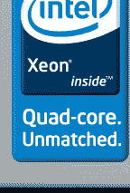

`Intel` 和其标志是 `Intel` 的商标。其他名称和品牌在美国及其他国家归所有。`© 2009 Intel`。

# 深度解析

## 构建下一代家庭网关

**你可能并没有想象中需要那么多。**

在嵌入式 `Linux` 成为标准之前，构建家庭网关（`RG`）相对昂贵。实时操作系统（`RTOS`）缺乏许多缺失或昂贵的功能。嵌入式 `Linux` 通过提供许多功能降低了 `RG` 的构建难度。

| `802.11` | `WAN: ADSL/XDSL` |
| :--- | :--- |
| 以太网交换机 | `CPU` |
| `SDRAM` | 闪存 |
| `BusyBox` | `X-Wrt` |
| `uClibc` | `Linux` 内核 |
| 设备驱动程序 | |

图1. `RG` 硬件结构图

`802.11` 接入或可能的网关，你可能需要一个带有……的嵌入式板，如图 `1` 所示。


如果你想知道如何制作廉价的`RG`，你可能需要购买带有`UART`的板（这可能会导致保修失效，板子启用了`UART`但没有软件）。你通常使用一些`Linux`（2.4 内核在嵌入式世界仍然常见）、用户空间库和驱动程序，以及一个配置工具——命令行界面（`uClibc`）或两者，如图 2 所示。

图2. `RG` 软件结构图

`libc`变体（至少）以及用户态选择来构建，简而言之，你需要一个嵌入式`Linux`发行版。`uClibc`是一个很好的选择，因为它支持广泛的代码（对于`MIPS`也是如此），并且包含了许多用户空间库和一个易于使用的内核配置系统。一如既往，选择并不在你，但有很多免费且常用的`Linux`发行版供选择。

假设你的板（而不是`CPU`）支持`uClibc`，构建工作系统的过程涉及下载发行版本身以及适用于`CPU`的交叉编译工具，然后遵循构建说明。

如果板不支持`uClibc`，

## 家庭网关的剖析

在设计自己的家庭网关之前，可能值得仔细观察这些设备。如果你决定考虑到现在你已经了解了什么是家庭网关，以及你正在处理的硬件（稍后将详细介绍硬件），让我们看看你需要哪些软件。最少，你的内核需要，一些软件

58 | 2007年8月 | www.linuxjournal.com

板卡制造商提供板级支持包（`BSP`）的可能性——即为该硬件提供`uLinux`（或某个`Linux`版本）。如果情况并非如此，你就必须自己编写`BSP`，这已经超出了本文的讨论范围。

`uLinux`发行版的主要组件是：内核本身、`uclibc`库和`BusyBox`。`uclibc`内核支持没有`MMU`的`CPU`，这在如今非常重要。因为添加`MMU`的成本非常小，我预计大多数（如果不是所有的话）运行在`RG`（路由器）上的嵌入式`CPU`都会。尽管如此，即使你不利用`MMU`，`uLinux`也是一个很棒的发行版。它最初是为了支持没有`MMU`的系统，例如这些系统无法拥有`fork(2)`系统调用。但即使你这些功能，它也是嵌入式系统`Linux`的极佳替代方案，因为`glibc`对`RAM`的要求很高。`BusyBox`是标准`UNIX`工具的集合，针对低内存的嵌入式系统进行了优化。它随`uLinux`一起提供，配合`uclibc`，除非你的系统有足够的内存（通常在`16MB`以上），否则你通常倾向于使用它而不是全功能的标准工具。

你需要两个不属于`Linux`的重要软件。第一个是引导加载程序（`bootloader`），它是通常位于`ROM`（或部分`RAM`）中的软件，负责将`Linux`镜像从`Flash`加载到`RAM`并执行硬件初始化。遗憾的是，嵌入式领域没有引导加载程序的标准，你不能使用像`GRUB`或`LILO`那样的`PC`引导程序。你的硬件制造商几乎会提供一个引导加载程序，我强烈建议使用它。如果它不支持`Linux`，将其适配到你的硬件会更容易。如果你仍然选择移植引导加载程序，`Da U-Boot`是一个不错的选择，其他许多也是如此。

第二个是`Web`图形用户界面（`GUI`），这是大多数用户对`RG`的预期。大多数（如果不是所有）可用的`RG`都从零开始`Web`界面。然而，随着`X-W`项目的引入，情况不必如此。它是`OpenWrt`项目的组件之一，如果你正在构建`RG`，几乎一定想看看它。`OpenWrt`是为`Linksys WRT`路由器（新款的，不是旧的）设计的`Linux`发行版。

将此添加到初始化脚本（`init script`）中，你就完成了，外设部分（`802.11`、`ASL`等）除外，那是另一篇文章的话题。

# 芯片制造、仓库自动化和其他吞吐量密集型系统需要处理 c-树技术

# FairCom 数据库技术使其成为可能。

# FairCom

www.faircom.com/go/?speed


## 硬件

现在来聊聊真正的乐趣（考虑到我们），为什么`MIPS`是这类设备中最常用的`CPU`架构，而其他型号使用它们的`24K`或其他设备使用`MIPS32`时钟频率。由于`MIPS 24K`在相同时钟频率下比`MIPS 4K`慢约`3%`，将其用于长流水线、`400MHz`是有意义的。基准测试显示网络设备受内存和`I/O`限制（毕竟，实际上并没有大量的计算——即使有性能良好的磁盘），如果你只使用`DDR RAM`和`RAM`（小于`128MB`），你可能不需要它。

另一个选项是（在开始时）使用`Intel MIPS32 4K`技术运行`Linux`，它可以具有灵活的虚拟元素（`VEs`）和线程上下文（`TCs`）配置。在不详细的情况下，`Intel-Threading`的性能有助于`CPU`在进程级和指令级（指令级并行）利用并行性，在某些情况下存在超标量处理器，特别是当存在少数进程或线程时，如果它们是`I/O`密集或内存限制的。基准测试显示这可能并非如此，因为`MIPS 24K`在相同速率下比`MIPS 4K`慢一点，并且在使用多线程处理（`SMP`）时，速率会变慢得多。功耗和成本方面，`RAM`和`Flash`的选择是显而易见的，你需要至少`8MB RAM`和`2MB Flash`。然而，随着价格下降，未来的设备将拥有`64MB RAM`和`4MB Flash`。出于同样的原因，你可能必须没有`DDR`和`Flash`，这实际上比`DDR`更贵。

由于使用制造商提供的参考设计之一是测试你新`MIPS`的简单方法。遗憾的是，如果你确定：你的芯片是没有任何限制的。

# 优化

这是下一个`RG`的挑战——使用低端硬件实现高吞吐量。一种解决方案是将整个数据路径卸载到`RG`硬件，另一种方法是使用一些可以处理`NAT`、路由和`QoS`的低端芯片，例如`RT5085/RT508B`，但这种实现在`CPU`上捕获数据包是可能的。然而，这是一个问题，最严重的问题是`CPU`栈的连接。这可能是困难的，如果可能，其他接口，如`802.11`、`DOCs`和`QoS`，尽管这种方法在特定情况下有效，但在细节上很好。优化方法基于对`RG`（通常是网络应用程序）受内存限制的观察，因此改进内存访问将非常有益。节省数据和代码以将其保持在缓存中，存在关键路径——即，通过`TCP/IP`栈的一个驱动程序的接收功能。这并非可能，但如果你有`22KB`缓存，可以放入`SRAM`。

另一个优化方法是两个用户分析的混合，用于大多数`CPU`密集型任务并将此功能卸载到硬件。这样，你有一个定义良好的硬件架构，硬件卸载是非常有利的，如果已经在硬件中检查，然后`CPU`将把整个数据包带入缓存，或者用于内存访问。另一方面，作为`RG`，`IPS`（`VPN`）流量通过连接。通常情况下，尽可能保持软件是一个好主意，因为这是开发和调试。

另一个优化方法绝对不会推荐，但被制造商采用的一种是通过创建各种类型的“路径”来“优化”`Linux`。例如，如果`L2`桥接不理想，是传递网络驱动，或者消除某些交换机和代码，或者消除至少一个性能增益。尽管它对`RG`通常有效，包括所有驱动程序和内核本身！这种方法最大的问题是它实际上会导致`Linux`内核崩溃，限制功能并引入`Bug`。如果添加到内核邮件列表，即使被添加了，也不会被接受。但随后你会进入在开发中发现难以消除的开源错误，这也可能是开源社区对嵌入系统不感兴趣，因为它们比`PC`更难处理。我相信第一个问题最终会消失，因为半导体公司理解他们如何从开源中受益，我尝试分享我对它的解释。至于第二个问题，本文的信息之一是编写嵌入系统很容易且有趣，而且你已经有了硬件。使用上述步骤将以较少的精力构建基于`Linux`的操作系统。如果性能成为问题（如果你使用低端处理器可能会发生），请遵循上述指南。在你的特定系统上正确运行以发现更好的替代方案一直是一个好主意。

4 | 2007年8月 | www.linuxjournal.com CIE Wei

# TS-7300 高安全 Linux FPGA 计算机

# 1.69 秒内启动 Linux！

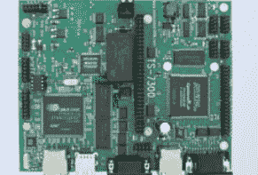

$219 $189 数量 100

- `200 MHz CPU`

- 无风扇，无散热器，`< 2 瓦`

- 用户可编程`Altera 2C Cyclone FPGA`

- `PC/14`扩展总线

- `10`个`COM`端口，`DSS`

- `2`个`USB`端口，`2`个`SD`卡槽

- `2/100`以太网

- 矩阵键盘 & `LCD`端口

- `VGA`视频`800x600`

- `1.69`秒`Linux`加`Loader`

- 运行`Debian`，支持实时

- 一体化金属外壳提供`4`路高电流`GIO`、`4 ADC`、`2 DAC`、`1 CAN`，价格为`$160`

- 与我们的工程师一起设计您的解决方案

- `20`年行业经验

- 从未停止过产品服务

- 技术支持工程师

- 开源`Linux`

- 具有优秀价格和周转时间的自定义配置和设计

- 大多数产品现货并可次日交付，通常是嵌入式软件公司

`Alexander Skrilin`在`Metalab`担任硬件架构师。`Metalab Inc.`（美国）是高性能硅解决方案的领导者。`Alexander`在软件、操作系统和网络方面拥有二十多年的经验，他在母校获得了应用数学、计算机科学和物理学的学士和学士学位。


`Technologic SYSTEMS` 我们使用我们的。

# 资源

*   `OProfile`: `profile.sourceforge.org`
*   `UCLI`: `ubuntulinux.com`
*   `DENX`: `denx`
*   `Da U-Boot`: `sourceforge.com/projects/uboot`
*   `uclibc`: `uclibc.org`
*   `BusyBox`: `busybox.net`
*   `OpenWrt`: `openwrt.org`
*   `X-rt`: `www-xrt.org`
*   `Linux/MIPS`: `www-linux-mips.org`
*   `ARM Linux`: `www.arm.linux.uk`

访问我们的网站获取选项、外设和 `x86` `SBC`

访问我们的 `TS-7200` 驱动网站位于

`ww.embeddedARM.com`

(480) 837-5220


# 利用 64 位 Linux

曼德尔布罗集合如何阐明使用 64 位 Linux 的优势。作者 Steve MUNROE

64 位系统的广泛可用为简化编程提供了可能。通过利用大容量的虚拟地址和内存映射文件，我们将编程和持久化结合为了单一活动。这在没有共享数据结构的情况下简化了编程。它还提高了访问和共享的效率，因为多个程序可以通过单个物理页直接（在位）共享数据。这消除了通过多层缓冲区拷贝数据的需要。当所有程序共享相同的内核内存映射时，很容易在应用程序之间进行别名（`alias`）处理和内存管理单元（`MMU`）资源，并且对 `IO` 子系统的顶层有极大改进。为了在编程工作上获得微小的声誉，我们牺牲了运行效率。

另一种，单级存储器（`Single-Level Stores`）多年来一直是一个研究课题，尽管该技术是有效的（简化了编程和数据管理），但仅适用于资源有限的特殊硬件或操作系统环境。

随着 64 位微处理器的普及和标准 `POSIX` 内存管理 `API` 的出现，这种情况再次发生了变化。一个小型运行时库的加入允许富有冒险精神的程序员使用隐式访问语义。这种高度“单级存储器”的方法用于增量式探索和采用新的编程范式。

作为证明，我编写了一个小型库，我称之为 `SPIDE`（共享持久化堆/环境）。它将应用程序地址空间的一部分映射到持久化块上。该库为存储和分配提供了一些原语和“实用程序对象”。

作为一个演示，我写了一个曼德尔布罗（`GUI`）程序。该程序计算曼德尔布罗集合中的某些点，并以共享线程的形式显示图像。这种表示可以由程序的多个实例共享和显示。程序实例协作填充下一层级的细节。

# 资源与设计

系统编程和设计编程（隐式地）受管理资源需求的驱动。在编程早期，地址空间和物理内存是稀缺的。`IO` 子系统必须处理内存空间的管理，例如磁带和页卡。随机访问和虚拟内存的引入并没有改变改变。今天的资源如此丰富，以至于我们有了选择自由。将持久化与数据分离是一个主要问题。它在编程和运行时执行中导致了低效。

# 机会

随着 64 位处理器的出现，原始的（地址/内存）稀缺性消失了。我们可以利用虚拟内存直接“在位”通过“隐式”语义共享海量数据结构。这简化了编程，因为数据结构被所有进程共享。它提高了运行效率，因为它允许更少的内存管理层级，并且操作系统有更多机会共享特殊文件。通过解决别名问题和探索硬件特性（如大页），提高性能效率的机会数不胜完。

# 高级设计

内存映射文件是不够的。我们需要一个用于地址空间和备份文件的设计来管理内存。设计应该在虚拟内存（地址空间）和物理内存（数据）之间平衡简单性与效率。

我们认为应该包含在设计中的特性。运行时应该是简单的，并与 `UNIX` 编程和 `POSIX` `API` 兼容。它应该使用资源（地址空间）来构建大型共享持久化堆（`SPH`）。应该对 `SPH` 中的数据进行访问。设计演变为以下概念：

区域（`Region`）是运行时想要管理的虚拟地址范围。堆应该是一个不干扰正常内存布局的区域。我们希望确保该区域不会干扰（本地）线程和动态库的正常使用。`LI`，是指 `TASK_UNAPPED_base` 之下和主栈的区域。在 `TASK` 上方和下方留出间隙仍然允许将其直到程序地址空间用于 `SPH`。

接下来，我们需要选择一个段大小（`segment size`）。段用于对齐备份文件并将文件映射到此区域。这应该足够大，以至于我们不会耗尽段，又要足够小以至于我们不会浪费空间。

存储（`Store`）是一个包含一个或多个文件以支持 `SPH` 段的目录。通过在不同目录中分配备份文件，一个段可以多个 `SPH` 段。目前（为了保持简单），程序一次只能绑定到一个区域存储器。

# 尝试过的一些替代方案

曾有许多尝试将持久化和区域统一起来。持久化框架层出完穷，但某些添加了层的：


# 在寻找像你的下一个应用一样强大的硬件吗？

*   `GEMINI` - 英特尔 `Core`® 2 `Duo`
*   `SBC-GX533` - `AMD` `Geode`™ `GX`
*   `ZEUS` - `PXA270`
*   `VIPER` - `PXA255`
*   `VULCAN` - `IXP425`

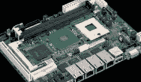
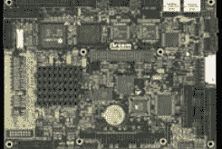
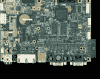
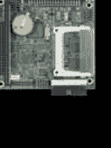
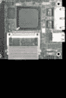

# ...查看 Arcom 嵌入式板

*   英特尔 `Scale`, `Core` 2 `Duo` 和 `X86` 技术
*   无风扇解决方案
*   用于 `TFT` 和 `STN` 的显示控制器
*   用于旧留通信的串口
*   `USB`, `SD`, `CompactFlash`, `PC/104`
*   完整的操作系统和应用环境


888-941-2224

`www.linuxjournal.com`


# 内存块及其用途列表

| 地址 | 大小 |
| :--- | :--- |
| `0x000000000000` | `102KB` |
| 总使用中 | `102KB` |
| 总空闲 | `0KB` |
| `0x000000010000` | `102KB` |
| `0x000000020000` | `102KB` |
| `0x000000030000` | `102KB` |
| `0x000000040000` | `102KB` |
| `0x000000050000` | `102KB` |
| `0x000000060000` | `102KB` |
| `0x000000070000` | `102KB` |
| `0x000000080000` | `102KB` |
| `0x000000090000` | `102KB` |
| `0x0000000a0000` | `102KB` |
| `0x0000000b0000` | `102KB` |
| `0x0000000c0000` | `102KB` |
| `0x0000000d0000` | `102KB` |
| `0x0000000e0000` | `102KB` |
| `0x0000000f0000` | `102KB` |
| `0x000000100000` | `102KB` |
| `0x000000110000` | `102KB` |
| `0x000000120000` | `102KB` |
| `0x000000130000` | `102KB` |
| `0x000000140000` | `102KB` |
| `0x000000150000` | `102KB` |
| `0x000000160000` | `102KB` |
| `0x000000170000` | `102KB` |
| 总区域 | `17179864` |
| 总使用中 | `35184372` |
| 未提交 | `163840000` |

*(注：此处表格内数据根据原文逻辑翻译，部分数值保留或对齐)* 修正表格（根据原文内容翻译）：

| 地址 | 大小 |
| :--- | :--- |
| `0x000000000000` | `102KB` |
| 总使用中 | `102KB` |
| 总空闲 | `0KB` |
| `0x000000010000` | `102KB` |
| `0x000000020000` | `102KB` |
| `0x000000030000` | `102KB` |
| `0x000000040000` | `102KB` |
| `0x000000050000` | `102KB` |
| `0x000000060000` | `102KB` |
| `0x000000070000` | `102KB` |
| `0x000000080000` | `102KB` |
| `0x000000090000` | `102KB` |
| `0x0000000a0000` | `102KB` |


| 地址 | 大小 |
| :--- | :--- |
| `0x0000000b0000` | 102KB |
| `0x0000000c0000` | 102KB |
| `0x0000000d0000` | 102KB |
| `0x0000000e0000` | 102KB |
| `0x0000000f0000` | 102KB |
| `0x000000100000` | 102KB |
| `0x000000110000` | 102KB |
| `0x000000120000` | 102KB |
| `0x000000130000` | 102KB |
| `0x000000140000` | 102KB |
| `0x000000150000` | 102KB |
| `0x000000160000` | 102KB |
| `0x000000170000` | 102KB |
| 总区域 | 17179864 |
| 总使用中 | 35184372 |
| 未提交 | 163840000 |

区域是运行时想要管理的虚拟地址范围。堆应该是一个不干扰正常内存布局的区域。我们希望确保该区域不会干扰（本地）线程和动态库的正常使用。LI，是指 `TASK_UNAPPED_base` 之下和主栈的区域。在 `TASK` 上方和下方留出间隙仍然允许将其直到程序地址空间用于 `SPH`。

接下来，我们需要选择一个段大小（segment size）。段用于对齐备份文件并将文件映射到此区域。这应该足够大，以至于我们不会耗尽段，又要足够小以至于我们不会浪费空间。

存储（Store）是一个包含一个或多个文件以支持 `SPH` 段的目录。通过在不同目录中分配备份文件，一个段可以多个 `SPH` 段。目前（为了保持简单），程序一次只能绑定到一个区域存储器。

## 尝试过的一些替代方案

曾有许多尝试将持久化和区域统一起来。持久化框架层出完穷，但某些添加了层的：


## 在寻找像你的下一个应用一样强大的硬件吗？

- `GEMINI` - 英特尔 `Core® 2 Duo`
- `SBC-GX533` - `AMD Geode™ GX`
- `ZEUS` - `PXA270`
- `VIPER` - `PXA255`
- `VULCAN` - `IXP425`


## ...查看 `Arcom` 嵌入式板

- 英特尔 `Scale`, `Core 2 Duo` 和 `X86` 技术
- 无风扇解决方案
- 用于 `TFT` 和 `STN` 的显示控制器
- 用于旧留通信的串口
- `USB`, `SD`, `CompactFlash`, `PC/104`
- 完整的操作系统和应用环境


888-941-2224

`www.linuxjournal.com`


## 内存块及其用途列表

| 地址 | 大小 |
| :--- | :--- |
| `0x000000000000` | 102KB |
| 总使用中 | 102KB |
| 总空闲 | 0KB |
| `0x000000010000` | 102KB |
| `0x000000020000` | 102KB |
| `0x000000030000` | 102KB |
| `0x000000040000` | 102KB |
| `0x000000050000` | 102KB |
| `0x000000060000` | 102KB |
| `0x000000070000` | 102KB |
| `0x000000080000` | 102KB |
| `0x000000090000` | 102KB |
| `0x0000000a0000` | 102KB |
| `0x0000000b0000` | 102KB |
| `0x0000000c0000` | 102KB |
| `0x0000000d0000` | 102KB |
| `0x0000000e0000` | 102KB |
| `0x0000000f0000` | 102KB |
| `0x000000100000` | 102KB |
| `0x000000110000` | 102KB |
| `0x000000120000` | 102KB |
| `0x000000130000` | 102KB |
| `0x000000140000` | 102KB |
| `0x000000150000` | 102KB |
| `0x000000160000` | 102KB |
| `0x000000170000` | 102KB |
| 总区域 | 17179864 |
| 总使用中 | 35184372 |
| 未提交 | 163840000 |

# SD 最佳实践

2007年会议与展会

2007年9月18日-21日

Hynes 会议中心

马萨诸塞州，波士顿


早鸟优惠

在8月17日前注册

最高可节省 $300


# 软件开发的未来

# 8个分领域，超过175场课程和教程

- 构建与部署
- `C++`
- 设计与架构
- 人员、项目与团队
- 流程与方法
- 需求与分析
- 测试与质量
- `Web` 服务 / `SBA`

另有安全设计微主题

即刻登录 `www.sdexpo.com` 注册

此外还有：

展会、案例研究、

同类交流（Birds-of-a-Feathers）、圆桌会议、

派对和特别活动

# 主题演讲包括：

`Ivar Jacobson`

`Jim McCarthy`


# 今年新亮点！

`SD` 最佳实践将与嵌入式系统会议（`Embedded Systems Conference`）和 `RFID World` 同期举办。

所有 `SD` 最佳实践的会者还将参与 `RFID World` 和嵌入式系统展厅的活动、行业演讲、主题演讲、赞助会议以及精选特别活动。

# `INDEP-TH`

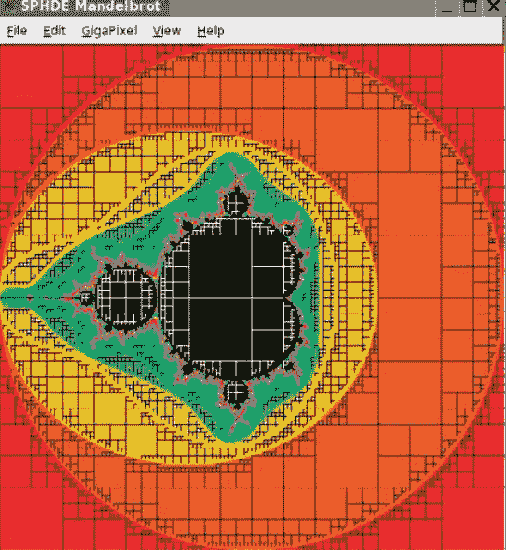
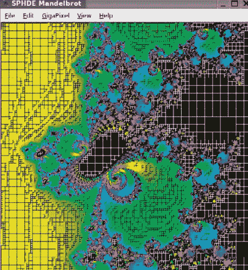

```
Gen time 0.021000s Level 9
compute (2.0000000000, 2.0000000000, 2.0000000000, 2.0000000000)
Gen Time 0.030005176, Level 22
compute (0.750035176, 0.0245028740, 0.7494522363, 0.0240325928)
```

图 1. 带有四树轮廓的曼德尔rot集

图 2. 带有四树轮廓的无限缩放

这非常有趣，因为它是“自相似”的，并且可以在任何缩放倍数下显示细节。


存储。由于希望保持四树内部良好的引用局部性，这变得稍微复杂了一些。`SPHComponentHeap` 从四树中分配 `SimpleHeaps`，而这些四树位于同一 `SPHComponentHeap` 的相邻四树中，这减少了显示整个曼德尔rot集（四树的顶部）或缩放到该集合的任何部分时涉及的页面数。

该程序可以在曼德尔rot集的彩色渲染上进行平和平缩放，其中大部分图像已预计算并存储在四树中。该算法是增量的，因此会根据需要（为了当前显示）计算并并将某些细节添加到四树中。

### 简单的情况

当时，在资源有限的情况下，我没有好的方法来存储生成的四树，因此我使用了四树的扁平化表示（来自位图）。但是，随着四树图像细节的累积，我最终为曼德尔rot集的不同区域拥有了多个预计算的细节，但没有好的方法渲染高分辨率图像。这个项目让曼德尔rot 项目成为可能。

```c
temp = (QuadTree)sizeof(QuadTree));
existing quadree. 如果此分配失败，我们需要找到另一个具有空闲空间的 SimpleHeap 或调用
```

安装过程非常简单，因为 `LMMS` 包含在许多发行版的软件仓库中。在基于 Debian 的发行版下，对于大多数系统，我只需要执行以下操作即可：

```bash
# apt-get install lmms
```

然而，对于那些无法为自己的系统找到二进制文件的用户，只需简单的：

```bash
$ ./configure
$ make
# (以 root 权限使用 sudo)
$ make install
```

使用源码即可完成。`LMMS` 的依赖项并不多，因此在大多数系统上应该可以直接完成编译。

一旦你进入了 `LMMS` 的世界，就会发现学习曲线也随之而来。虽然包含了一些教程和演示视频，但它们会让大多数用户在很多问题上感到困惑（但当你发现许多 `GUI` 元素时，你会发现它们不算什么）。演示视频足以展示 `Minor` 的强大能力，当在每个设置期间实时播放按键时，这种效果令人印象深刻，还有其他酷酷且更具氛围的类型。

首次使用 `LMMS`，请点击左侧名为 “My samples”（我的样本）的黄色星号。从这里，你可以尝试一些已经线程化的仪器以及各种 `GUI` 按钮和设置，直到你做出听起来有趣的东西且界面变得更加熟悉。黄色星号上方标题为 “My samples” 的绿色音符包含了初始的仪器。它提供了多种选择（包括但不限于）令人印象深刻的拉丁打击鼓，以及一些用于氛围效果的惊奇合成器。

尽管有这些功能和演示，但仍然值得访问 `LMMS` Wiki。该项目的文档虽然在持续完善中，但希望这能在此过程中对你有所帮助，特别是在作曲和音符编辑方面。撇开文档问题不谈，该程序相当稳定，可以作为初者的良好参考。如果你能搞定作曲，就会知道如何让所有轨道听起来完美。

其他一些令人印象深刻的功能是支持 `JACK` 和 `ALSA`，但在其所有可用功能中，在乐器中使用它听起来就是正确的。当我询问 `Tobias Dubois` 关于这个元素时，他提到它在 64 位系统上相当不稳定，但在修复之后，它将处于非常稳定的状态。他还想使用一个可以混合所有轨道的混音器，并改进 `JACK` 插槽。目前这是一款相当后期的软件，看起来很有前景；只是缺少文档——绝对适用于你的家庭音乐。关于 `LMMS` 的信息，请参阅：

下载页面：`lmms.sourceforge.net/download.php`

Wiki：`wiki.mindrules`

# inotail — 增强型 tail 通知工具

对于所有使用此工具跟踪文件日志的系统管理员来说，这绝对值得一看。当使用 follow 模式（`tail -f filename`）时，`tail` 确实会每秒重新读取一次文件。`inotail` 采取了另一种方法，利用了较新的内核功能，最初不是为了在使用新 API 时监听发送到内核的特殊事件。

在看到它的条目后，我简单地取了一个文件并使用 `inotail -f test.txt` 命令读取它。我每次添加一行并保存文档，它都会被视为一行。当我一点击保存时，输出中就会显示它。好吧，对于系统管理员来说，这并不完全是在监视文件。

# 紧凑嵌入式服务器

- `500MHz` CPU
- `128MB` 板载 SRAM
- `512MB` CompactFlash™
- `100Base-T` 以太网
- 可重启（磁盘驱动器无 CPU）
- `3x` USB 2.0 & USB 1.3 端口
- 可选 Lian Hard 驱动器
- 尺寸：`4.5 x 4.7"` (114 x 119 x 35mm)


- EMAC Linux 2.6 内核
- 菜单驱动器配置
- Eclipse 开发环境
- HTTP 和 FTP 服务器
- PPP 硬盘与客户端
- Telnet 服务器

Compact Sib (箱式服务器)

station 170.0

自 1985 年以来

超过 22 年的成功解决方案


电话：`(618) 529-4525` | 传真：`(618) 457-0110` | `www.emac.com`

`www.linuxjournal.com` 2007年8月 | 6

# inotail 不再基于纯时间的笨拙循环更新，而是使用新 API 监听内核发送的特殊事件。

目前阻碍该项目的唯一事实是时间，`inotail` 至少需要 `2.6.13` 内核，对于许多需要使用比我们其他人更旧、更成熟发行版的管理员来说，这个内核仍然相当年轻。大约一年后，当 `inotail` 被 Debian 归档接受且管理员升级了他们的发行版后，`inotail` 应该进入许多管理员的工具箱。

（可在网站主页获取），并进入新目录。输入命令：

主页：`distanz.ch/inotail`

```bash
$ make
(以 root 权限或 sudo)
# make install
```

# Karmen

对于那些喜欢极简主义窗口管理器的人，`Karmen` 可能是你未来的选择。它专为 “即插即用” 而设计，除了 `Xlib` 没有其他依赖项，也没有配置文件需要调整。根据 `README` 文件，这些是它正式发布的主要目标：

与大多数源码编译一样，它默认将可执行文件放置在 `/usr/local` 中。如果你更倾向于将其放在 `/usr/bin`，请输入命令：

```bash
$ prefix=/usr/bin install
```

- 直观的窗口管理。
- 提供高质量的视觉感受。
- 标准合规性（ICCM 和 EWMH/NetWM）。

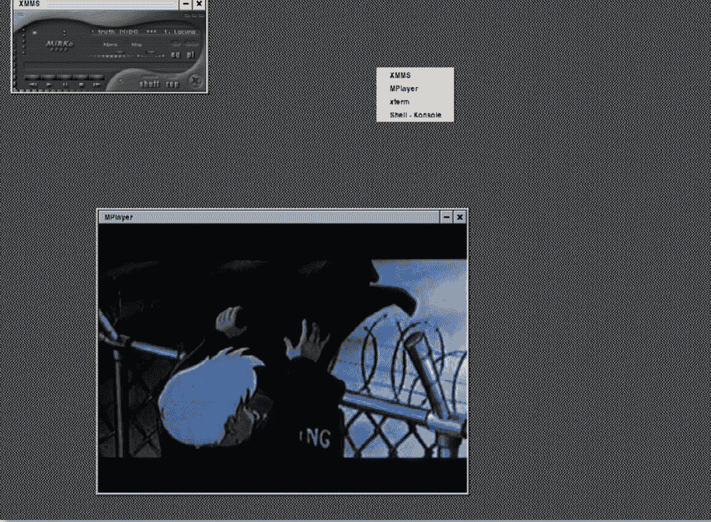

Karmen—为了纯净且极简的环境

作为独立的窗口管理器工作良好。与其他桌面实用程序和环境配合得很好。专注于窗口管理，让其他工具完成其余工作。前往主站获取最新版本。确实，安装非常轻而易举。只需执行：

```bash
$ ./configure
$ make
# (以 root 权限或 sudo)
# make install
```

这就是所有需要的了，而且正如它所说的，没有奇怪的依赖项阻碍。它恰好既快速又流畅，当我转头看向显示器时，配置或 `make install` 已经完成了！

一旦你运行了 `Karmen` 桌面，移动窗口就很方便。在 `KDE`/`GNOME` 中工作良好。正如它所说的，没有奇怪的依赖项来阻碍。它恰好既快速又流畅，当我转头看向显示器时，配置或 `make install` 已经完成了！

一旦你运行了 `Karmen` 桌面，移动窗口就很方便。在 `KDE`/`GNOME` 中工作良好。正如它所说的，没有奇怪的依赖项来阻碍。它恰好既快速又流畅，当我转头看向显示器时，配置或 `make install` 已经完成了！

一旦你运行了 `Karmen` 桌面，移动窗口就很方便。在 `KDE`/`GNOME` 中工作良好。正如它所说的，没有奇怪的依赖项来阻碍。它恰好既快速又流畅，当我转头看向显示器时，配置或 `make install` 已经完成了！

一旦你运行了 `Karmen` 桌面，移动窗口就很方便。在 `KDE`/`GNOME` 中工作良好。正如它所说的，没有奇怪的依赖项来阻碍。它恰好既快速又流畅，当我转头看向显示器时，配置或 `make install` 已经完成了！

一旦你运行了 `Karmen` 桌面，移动窗口就很方便。在 `KDE`/`GNOME` 中工作良好。正如它所说的，没有奇怪的依赖项来阻碍。它恰好既快速又流畅，当我转头看向显示器时，配置或 `make install` 已经完成了！

一旦你运行了 `Karmen` 桌面，移动窗口就很方便。在 `KDE`/`GNOME` 中工作良好。正如它所说的，没有奇怪的依赖项来阻碍。它恰好既快速又流畅，当我转头看向显示器时，配置或 `make install` 已经完成了！


一旦你运行了 `Karmen` 桌面，移动窗口就很方便。在 `KDE/GNOME` 中工作良好。正如它所说的，没有奇怪的依赖项来阻碍。它恰好既快速又流畅，当我转头看向显示器时，配置或 `make install` 已经完成了！

## 经济型 InfiniBand 解决方案

## 现在致电 Micway 的 4 个大理由！

## `TriCom™`

- `DDR/SDR InfiniBand HCA`
- “无交换机”串口控制台
- `NodeWatch` Web 启用
- 远程监控与控制

## `FasTree™`

- `DDR InfiniBand` 交换机
- 低延迟、模块化设计
- 24、36 和 48 端口构建模块

`8051 BMC` 接口和串口控制台开关

连接至风扇转速线、电压、温度探头的接头

`PS` 电源开关和主板重置

`COM2`

内部连接器

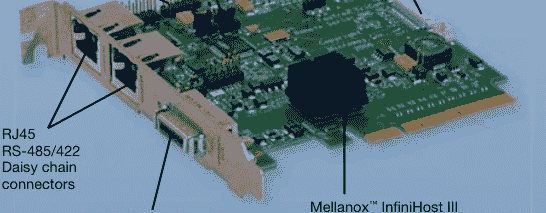

`RJ45`

`RS-485/422`

链链连接器

`Mellanox™ InfiniHost III`

`InfiniBand HCA`

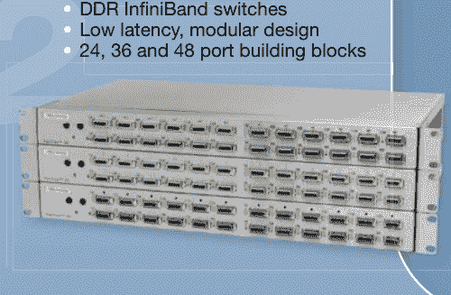

`InfiniBand` 连接器

## `InfiniScope™`

- 监控 `HCA` 和交换机上的端口
- 提供实时带宽诊断
- 查找交换机和缓存故障
- `Lane 15` 接口
- 记录所有 `IB` 错误

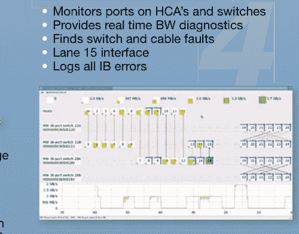

## `ServaStor™`

- 可扩展的基于 `IB` 的存储构建模块
- 冗且可扩展
- 并行文件系统
- 开源软件
- 在线容量扩展
- `RAID 0,1,1E, 3, 5, 6, 10, 50`

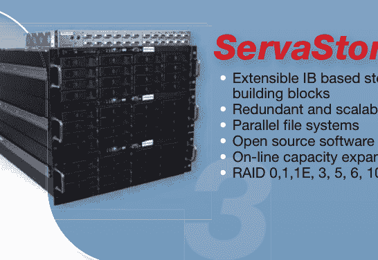

升级您当前的集群，或让我们使用 `Micway InfiniBand` 解决方案为您设计扩展型集群。

如需咨询 `HPC` 专家，请拨打 `508 746-7341` 并询问技术销售，或发送邮件至 `sales@micway.com`

`www.micway.com`


## 构建 `Firefox` 扩展

### 如何创建你自己的扩展。`JUSTIN HUFF`

和许多 `Linux` 用户一样，`Firefox` 是我的首选浏览器。它的优点之一是大量的可用扩展。扩展侧重于改变浏览器的外观；在过去的几年里，扩展被用于提供更好的体验，同时模糊了桌面和 `Web` 应用之间的边界。

在本文，我将解释如何通过构建一个与 `Picsnick` 的图像编辑 `API` 集成的扩展来扩展 `Firefox` 是多么简单。

## 设置环境

新开发者应该做的第一件事是设置开发配置。虽然可以使用普通配置，但创建一个专门用于开发的配置通常更简单。尝试 `Firefox` 的配置管理器：

```
$ firefox -ProfileManager
```

接下来，点击“`Create`”按钮。一旦窗口锁定，点击“`Next`”开始。此时，你将看到一个与图 1 类似的窗口。为你的新配置（`dev`）输入一个名称。在点击“`Finish`”之前，确保你选择了存储新配置的路径。你稍后会用到该路径。

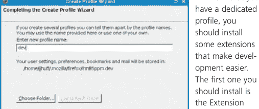

现在你有了专用的配置，你应该安装一些让开发更简单的扩展。我个人使用了其他几个扩展 - 我建议你安装所有扩展：

## 你的第一个扩展

此时，你准备好开始你的第一个扩展了。所有扩展都以相同的基础模板代码开始，因此制作该扩展的人可以组合出 `Firefox` 扩展，为你的项目自动化此过程。你可以在下面的资源中找到 `URL`：


大部分必需字段应该是易于理解的。其中一个用于识别扩展 ID 的更新和其他参数。在过去，标准做法是

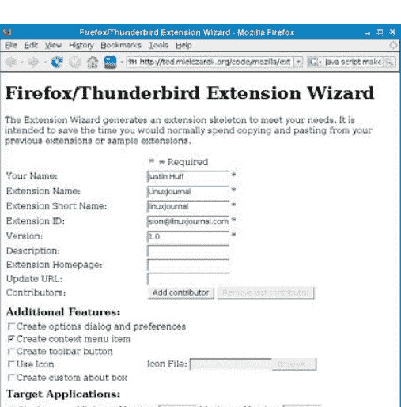

使用 GUID（全局唯一标识符）。大多数开发者已切换到绑定电子邮件地址的格式。对于这个例子，我使用了`extension@linuxjournal.com`。图 2 显示了如何创建选项（右键菜单）来填写扩展字段。

对你的选择满意后，点击“Create Extension”。之后，你的浏览器将提示你下载 zip 文件。继续解压它：

```
$ unzip linuxjournal.zip
Archive: linuxjournal.zip
inflating: linuxjournal/manifest
inflating: linuxjournal/readme.txt
inflating: linuxjournal/content/firefoxoverlay.js
```

## Go Linux 世界

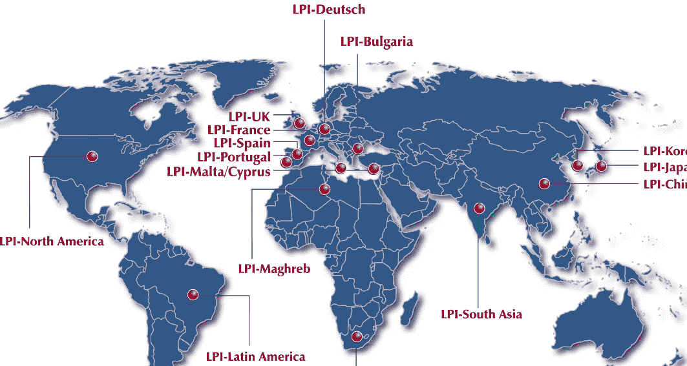

推广 Linux 和开源软件采用的良好方式是培养全球范围内优秀、合格且经过认证的 IT 人才。

Linux 专业人士认为，推广 Linux 和开源软件采用的良好方式是培养全球范围内优秀、合格且经过认证的 IT 人才。

Linux 专业人士认为，推广 Linux 和开源软件采用的良好方式是培养全球范围内优秀、合格且经过认证的 IT 人才。

我们 Linux 专业人士认为，推广 Linux 和开源软件采用的良好方式是培养全球范围内优秀、合格且经过认证的 IT 人才。

Linux 专业人士认为，推广 Linux 和开源软件采用的良好方式是培养全球范围内优秀、合格且经过认证的 IT 人才。

我们 Linux 专业人士认为，推广 Linux 和开源软件采用的良好方式是培养全球范围内优秀、合格且经过认证的 IT 人才。

Linux 专业人士认为，推广 Linux 和开源软件采用的良好方式是培养全球范围内优秀、合格且经过认证的 IT 人才。

我们 Linux 专业人士认为，推广 Linux 和开源软件采用的良好方式是培养全球范围内优秀、合格且经过认证的 IT 人才。

Linux 专业人士认为，推广 Linux 和开源软件采用的良好方式是培养全球范围内优秀、合格且经过认证的 IT 人才。

我们 Linux 专业人士认为，推广 Linux 和开源软件采用的良好方式是培养全球范围内优秀、合格且经过认证的 IT 人才。

Linux 专业人士认为，推广 Linux 和开源软件采用的良好方式是培养全球范围内优秀、合格且经过认证的 IT 人才。

我们 Linux 专业人士认为，推广 Linux 和开源软件采用的良好方式是培养全球范围内优秀、合格且经过认证的 IT 人才。

Linux 专业人士认为，推广 Linux 和开源软件采用的良好方式是培养全球范围内优秀、合格且经过认证的 IT 人才。

我们 Linux 专业人士认为，推广 Linux 和开源软件采用的良好方式是培养全球范围内优秀、合格且经过认证的 IT 人才。

Linux 专业人士认为，推广 Linux 和开源软件采用的良好方式是培养全球范围内优秀、合格且经过认证的 IT 人才。

我们 Linux 专业人士认为，推广 Linux 和开源软件采用的良好方式是培养全球范围内优秀、合格且经过认证的 IT 人才。

Linux 专业人士认为，推广 Linux 和开源软件采用的良好方式是培养全球范围内优秀、合格且经过认证的 IT 人才。

我们 Linux 专业人士认为，推广 Linux 和开源软件采用的良好方式是培养全球范围内优秀、合格且经过认证的 IT 人才。

Linux 专业人士认为，推广 Linux 和开源软件采用的良好方式是培养全球范围内优秀、合格且经过认证的 IT 人才。

我们 Linux 专业人士认为，推广 Linux 和开源软件采用的良好方式是培养全球范围内优秀、合格且经过认证的 IT 人才。

Linux 专业人士认为，推广 Linux 和开源软件采用的良好方式是培养全球范围内优秀、合格且经过认证的 IT 人才。

我们 Linux 专业人士认为，推广 Linux 和开源软件采用的良好方式是培养全球范围内优秀、合格且经过认证的 IT 人才。

Linux 专业人士认为，推广 Linux 和开源软件采用的良好方式是培养全球范围内优秀、合格且经过认证的 IT 人才。

我们 Linux 专业人士认为，推广 Linux 和开源软件采用的良好方式是培养全球范围内优秀、合格且经过认证的 IT 人才。

Linux 专业人士认为，推广 Linux 和开源软件采用的良好方式是培养全球范围内优秀、合格且经过认证的 IT 人才。

我们 Linux 专业人士认为，推广 Linux 和开源软件采用的良好方式是培养全球范围内优秀、合格且经过认证的 IT 人才。

Linux 专业人士认为，推广 Linux 和开源软件采用的良好方式是培养全球范围内优秀、合格且经过认证的 IT 人才。

我们 Linux 专业人士认为，推广 Linux 和开源软件采用的良好方式是培养全球范围内优秀、合格且经过认证的 IT 人才。

培养一个世界


推广 Linux 和开源软件采用的良好方式是培养全球范围内优秀、合格且经过认证的 IT 人才

我们 Linux 专业人士认为，推广 Linux 和开源软件采用的良好方式是培养全球范围内优秀、合格且经过认证的 IT 人才。

# LINUX 日志

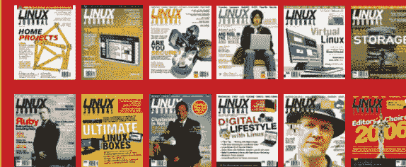

# 1994-2006

# 存档

Linux 日志第 1–152 期

`www.LinuxJournal.com/ArchiveCD`

1994–2006 存档 CD、过刊期刊及更多内容！

若要修改应用程序的其他部分，你需要在`chrome.manifest`中添加更多行。

让我们来看看我们如何向右键菜单添加新项目。首先，在 Chrome 浏览器中打开`chrome://browser/content/browser.url`，并搜索`contentAreaContextMenu`。第二个匹配项应该像这样：

```
<popup id="contentAreaContextMenu">
  ...

  <menuitem id="context-stop">
    label="&stopCd.label";
    accesskey="&stopCd.accesskey";
    command="Browser Stop"
  </menuitem>

  <separator id="context-sep-stop"/>
</popup>
```

现在，从扩展程序中打开`firefoxOverlay`。你会看到一个这样的代码块：

```
<popup id="contentAreaContextMenu">
  <menuitem id="context-linuxurl">
    label="&linuxjournalContext.label";
    accesskey="&linuxjournalContext.accesskey";
    <inserter id="context-stop"
      oncommand="linuxurl.onMenuItemCommand(event)"
    </inserter>
  </menuitem>
</popup>
```

当叠加层加载时，浏览器会在其 Chrome 中搜索 id 为`contentAreaContextMenu`的元素，并合并来自叠加层的 XML。最终结果将类似于：

```
<popup id="contentAreaContextMenu">
  <menuitem id="context-linuxurl">
    label="&linuxjournalContext.label";
    accesskey="&linuxjournalContext.accesskey";
    <inserter id="context-stop"
      oncommand="linuxurl.onMenuItemCommand(event)"
    </inserter>
  </menuitem>

  <separator id="context-sep-stop"/>
</popup>
```

当这被渲染时，我们的菜单项将出现在普通的右键菜单项之间。此外，我们指定了`inserter`，以告诉浏览器我们希望我们的新项目出现在`context-stop`菜单项之后。

## 本地化

Chrome 系统基于现有技术构建以支持本地化

列表 1. `picnik.xml`


```xml
<xml version="1.0"?>

<!DOCTYPE TYPE SYSTEM "file://picnik/locale/picnik.dtd">

<overlay id="picnik-overlay">
<html xmlns="http://www.mozilla.org/keykeeper/there.is.only_xml"
     xmlns:html="http://www.w3.org/1999/xhtml">
  
  <script type="application/javascript"
    src="chrome://picnik/content/menu.js";
  </script>
  <script type="application/javascript"
    src="chrome://picnik/content/menu.js";
  </script>

  <popup id="contentAreaContextMenu">
    <menuitem id="context-iconic"
      id="picnic-ct-ext"
      inserter="context-image"
      label="&picnik.edit_picture."
      oncommand="picnik.edit(this)"
      image="chrome://picnik/picnik_i16.png" />
    </menuitem>
  </popup>
```

我们是。其中一个主要部分是在 `DTD`（文档类型定义）文件中将 `UI` 字符串化的能力。在 `Chrome` 中，`firefox.xmlOverlay` 使用代码行中的字符串。

本地化 `URL` 是特殊的，因为浏览器会自动将它们映射到扩展程序中的正确位置。`Firefox` 会自动为美国英语用户扩展 `chrome://linuxjournal/locale/linuxjournal.dtd/locale/linuxjournal-US.linuxjournal.dtd`。

`DTD` 用于定义新的 `XML` 实体，这些实体可以被视为。我们的 `DTD` 如下：

```xml
<ENTITY linuxjournal.label "您的本地化菜单项">
<ENTITY linuxjournalContext.label "您的菜单">
<ENTITY linuxjournalContext.accesskey "-">
```

这些实体在 `XML` 中通过将它们替换为 `&...;` 来引用：

```xml
<menuitem id="context-linuxjournal">
  label="&linuxjournalContext.label";
  accesskey="&linuxjournalContext.accesskey;">
```

这种字符串分离起初看起来可能很奇怪，如果你在字符串中写了拼写错误，它会出现在多个处，你只需要修复一次。

## 代码

实际的扩展代码是用 `JavaScript` 编写的，这使得许多资深 Web 开发人员在编写它们时游刃有。

## `ASA` 计算机

### 定制化服务器专家！

`www.ascomputers.com`

`1-800-REAL-PCS`

面向开源社区的硬件系统 - 自 1989 年以来。

(`Linux`, `FreeBSD`, `NetBSD`, `OpenBSD`, `Solaris`, `MSX`)

`AMD` `Opter` 处理器为最先进的应用提供高性能、可扩展的服务器。

“同时运行 32 位和 64 位应用程序。”

您的定制应用程序解决方案！

“告诉我们您的需求……”


“我们将构建……”

# `AMD` 选项起价 $847

- 1U 双路 2.6GHz
- `AMD` 选项 40G
- 512MB `DDR3300` 无缓冲
- 支持到 8GB `DDR4`
- 460GB `SATA` 硬盘
- x 10/000 Mbps

列表 2: `contextmenu.js`

```javascript
var picnicClickContextMenu = {
  onload: function() {
    // 将 showContextMenu 函数附加到右键菜单
    var e = document.getElementById('contextAreaMenu');
    e.addEventListener('popmenu', function(event) {
      picnicContextMenu.showContextMenu(event);
    });
  },
  // 在右键菜单弹出前点击
  showContextMenu: function(event) {
    if (event) {
      var editPicture = document.getElementById('picnic-ct-edit');
      if (editPicture) {
        editPicture.hidden = !editPicture.onload;
      }

      if (picnicContextMenu.hasImage()) {
        this.imageUrl = picnicContextMenu.imageUrl;
      } else {
        this.imageUrl = '';
      }
    }
  },
  // 当用户点击“编辑”菜单项时调用
  editFunction: function() {
    var url = picnic.baseURL + "Import" + escape(this.imageUrl);
    g.selected = g.addTab(url);
  }
};
window.addEventListener('load', function () {
    picnicContextMenu.load();
}, false);
```

# `AMD` 选项(TM) 起价 $4120

- 1U 双路型号 840
- 2GB 内存
- 支持到 64GB `FB/IMM`
- 80 GB `SATA` 热插硬盘
- 虚拟双路 10/0000 通道


# 双路选项(TM) 容量 $6445

- 2U 双路型号 246
- 4TB 容量 (6TB) 最大
- 10/1000 `Gigabit` `Gigabit`
- `NAS` 或 `SAS` 选项

## 为什么与 `ASA` 合作？

自 1989 年以来

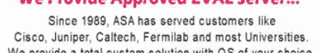

2664 Calle del Mundo, Santa Clara, CA 95064

`www.ascomputers.com`

电话: `1-800-REAL-PCS`，传真: 408-654-2910

很容易跨平台。为了加载代码，必须在叠加层文件中引用。在这种，有以下代码：

```html
<script src='overlay.js'></script>
```

编写扩展程序时最重要的记忆之一是，`JavaScript` 的全局命名空间在扩展程序和核心代码之间共享。这意味着要使用技术防止命名冲突，简单的方法是为所有变量和函数添加唯一前缀。首选的方法是创建一个包含所有变量和函数的匿名对象。查看

## 深度

列表 3. `picnik.xml` 文件的扩展版本


```xml
<?xml version="1.0"?>
<!DOCTYPE picNIK SYSTEM "chrome://picnik/locale/picnik.dtd">

<style href="chrome://picnik/content/toolbar.css" type="css">

<overlay id="picnik-overlay"
xmlns="http://www.mozilla.com/keymaster/gatekeeper/there_is_only"
xmlns="http://www.w3.org/1999/xhtml">

<script type="application/javascript"
src="chrome://picnik/content/common.js"/>
<script type="application/javascript"
src="chrome://picnik/content/contextmenu.js"/>
<script type="application/javascript"
src="chrome://picnik/content/screengrab.js"/>

<popup id="contentAreaContextMenu">
<menu class="menu-item"
id="picnik-ctx-edit"
inserter="content-viewimage"
label="picnik.edit:"
oncommand="picnicContextMenu.editImage(this)">
<image src="chrome://picnik/content/picnik_i16.png" />
</menu>
<menu class="menu-iconic" id="picnik-ctx-grab"
inserter="content-sandbox"
label="picnik.grab:">
<image src="chrome://picnik/content/picnik_i16.png" />
</menu>
<menu class="menu-item" id="picnik-grab_visible"
label="picnik.grab:"
oncommand="picnicScreenGrab.grab()"/>
<menu class="menu-item" id="picnik-grab_full"
label="picnik.grab:"
oncommand="picnicScreenGrab.grabFull(this)"/>
</popup>
</menu>
<toolbarpalette id="BrowserToolbar">
<toolbarbutton id="picnik-button"
type="menu-button-i"
label="picnik.label:"
tooltip="picnik.menu:"
oncommand="picnicScreenGrab.grabVisible(this)"/>
</menu>
</toolbarpalette>
</overlay>
```

...

已经设置好了，这是我唯一的公地址。这台电脑有两个网络接口。第一个连接到我的调制解调器并有一个公地址。另一个接口连接到我的局域网（`LAN`），IP 地址为 `192.168.1.1`。实现此点的另一种方法是使用消费级/DSL 路由器并将端口 `8000` 转发到流媒体电脑的 IP 地址。

一旦配置文件准备就绪，你就可以运行初始化脚本 `/etc/init/icecast` 来启动 `icecast`。如果在设置过程中出现任何错误，请查看日志文件进行调试。

图 2 显示了我的网络拓图，包括服务器、编码器、流媒体设备和移动设备。

# Icecast 配置

我的流媒体电脑运行的是 `Mandriva`。`Icecast` 可以从 `Mandriva` 仓库获取。一旦准备就，只需在提示符中输入 `icecast` 即可轻松完成安装。如果你从源码安装，请从 `Ice` 网站（Sources）下载最新版本。只需点击下载链接，解压归包，并运行熟悉的命令：`./configure; make install`

我的编码电脑也运行 `Mandriva`。由于这台机器的频率为 `233MHz` 且拥有 `64MB` `RAM`，我决定进行最小化安装并省略窗口管理器。`Icecast` 也可以从 `contrib` 仓库获取。因此，再次输入 `icecast` 仍然很容易安装。不过，你可以从 `Ice` 网站（Sources）下载最新发布版本。如果你想使用它，请确保使用 `2.0` 系列。安装后，你必须解压归包并运行 `./configure; make install` 来完成所有安装。

`limits` 允许你设置最大流源（编码器）数量以及允许同时流的客户端最大数量。在数据速率方面，我需要限制最大客户端数量以确保我不会占用你所有的带宽。

配置文件都位于 `/etc/icecast`。在安装 `icecast` 之前，必须严格编辑它们。配置文件的详细信息包含一些需要初始设置的选项，以便 `icecast` 在前台运行并将消息保存到控制台。这些消息对于设置期间的调试问题非常有帮助。当一切设置好并运行后，请确保 `Icecast` 在后台日志中运行。

```xml
<limits>
  <clients>30</clients>
  <sources>2</sources>
</limits>
```

```xml
<authentication>
  <source-password>hacker</source-password>
  <relay-password>hacker</relay-password>
  <admin-password>admin</admin-password>
  <admin-password>hacker</admin-password>
</authentication>
```

`authentication` 部分是你指定用户名和密码的地方。`source-password` 用于编码器在连接时使用。`relay-password` 用于中继器，我在配置中没有使用它。`admin-user` 密码允许访问 Web 界面。更改所有默认安全密码非常重要：

`hostname` 是 `Icecast` 已知要添加到网页链接开头的主机名：

```xml
<hostname>example.com</hostname>
```

`listen-socket` 允许你设置 `Icecast` 监听的端口；`8000` 是默认值：

```xml
<listen-socket>
  <port>8000</port>
</listen-socket>
```

# Mini-ITX 解决方案及嵌入、工业及移动计算应用

## Mini-ITX 主板

配备 `VIA`、`Intel` 或 `AMD` 处理器。

* `x86` 处理器
* 小尺寸设计
* 兼容 `Linux` 和 `Windows XP`
* 全可定制系统

## 无风扇 Mini-ITX 系统

利用散热技术，无风扇 `Mini-ITX PC` 为远程环境中的各种嵌入式应用提供了耐用性、静和高效。


`LOGICSUPPLY.COM`

`info@logicsupply.com`

`222 844 8302`

`www.linuxjournal.com` 2007年8月 | 85

## 深度

# Icecast 是支持 Ogg Vorbis 或 MP3 流的媒体流平台。

由于我想编码音频，我使用了 `oss` 模块。如果你使用的是 `LASA` 声音系统而不是 `OSS`，请不要惊讶。`LASA` 具有 `OSS` 兼容性，此模块同时兼容 `LASA` 和 `OSS`。使用 `device` 参数来指定获取数据的音频设备。在大多数系统中，它将是 `/dev/dsp`。`rate` 参数以赫兹（`Hz`）指定数据的采样率。大多数系统使用 `44100`。使用 `channels` 参数来指定可采集的通道数。对于大多数系统，它将是 `2`（立体声）。

消息到文件：

```xml
<background>
<log path=/var/log/ices</path>
<logfile>ices.log</logfile>
<level>info</level>
<console>debug</console>
</background>
```

文件的其余部分在此节下。如果你为该特定区域流配置了特定设置，`metadata` 部分是你提供流流特定信息的地方。这些信息将显示在 `Icecast` 页面上：

```xml
<metadata>
<name>IceWrz 146.89 MHz</name>
<genre>live</genre>
<description>live feed of the</description>
<description>repeater=</description>
</metadata>
```


### 音频流配置

`instance` 允许你指定实例数量。如果你想将流发送到多个服务器，或者想以不同的比特率拥有不同版本的流，你可能有多个实例。例如，如果你只需要一个实例：`instance` 部分是你指定流信息的地方。`hostname` 告诉向哪里发送数据。`port` 和 `password` 必须与 `icecast` 文件中的值匹配。`mount` 选项指定流的名称。`input` 部分是音频来源。有许多可能性，`encoder` 部分指定音频将如何编码。简单的方法是设置 `rate` 和 `channels` 将消息保存到文件。我逐渐减少采样率，直到找到可接受的音频质量：`44100Hz`。

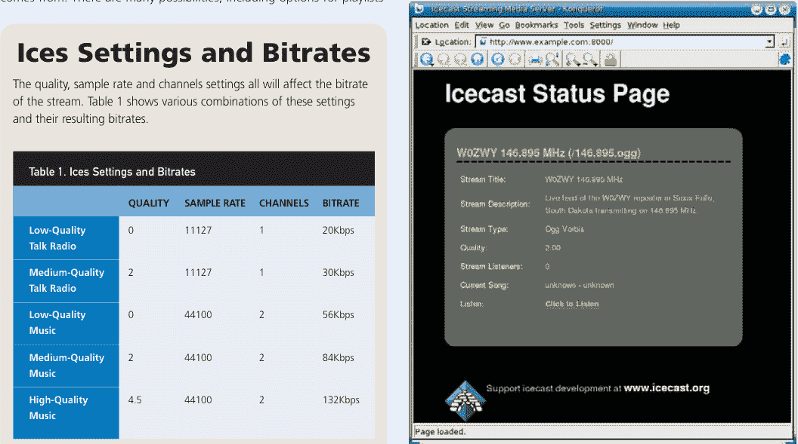 Icecast 设置与比特率

| 质量 (QUALITY) | 采样率 (SAMPLE RATE) | 通道 (CHANNELS) | 比特率 (BITRATE) |
|---|---|---|---|
| 低质量广播 | 0 | 44100 | 1 | 20Kbps |
| 中质量广播 | 2 | 44100 | 1 | 30Kbps |
| 低质量音乐 | 0 | 44100 | 2 | 56Kbps |
| 中质量音乐 | 2 | 44100 | 2 | 84Kbps |
| 高质量音乐 | 4 | 44100 | 2 | 132Kbps |

2007年8月 `www.linuxjournal.org` 上方的部分。但对于我的流，我不需要那个质量。所以我使用了 `downmix` 和 `resample` 部分并将 `resample` 设置为 `44100Hz`，`downmix` 为单通道（单声道）。有两个选项可以调整流的最终比特率：`quality` 和 `nominal-rate`。注意我注释掉了 `bitrate` 并将 `quality` 设置为 `2`：

```
<instance>
<hostname>192.168.1.1</hostname>
<port>8000</port>
<password>hacker</password>
<mount>/stream.ogg</mount>
</instance>

<encode>
<quality>2</quality>
<bitrate>32000</bitrate>
<sample>44100</sample>
<channels>1</channels>
</encode>

<downmix>1</downmix>
<resample>
<in-rate>44100</in-rate>
<out-rate>44100</out-rate>
</resample>
```

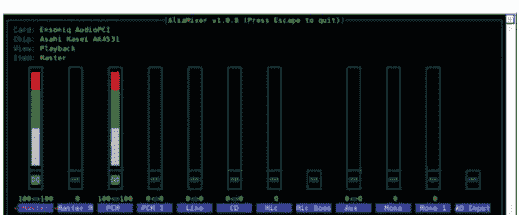 图 4. `Alsamixer`

现在声音足够大了，但我还有另一个问题。音频听起来断断续续。观察了一段时间后，我发现 `CPU` 使用率为 `100%`。我尝试通过更改 `nominal-rate` 来降低比特率。当比特率设置得足够低时，音频听起来很好。我使用了 `32kbps` 编码器。当音频良好时，我的目标是在保持可接受音频水平的同时尽可能降低比特率。在我情况下，“可接受水平”是低流量。采样率是唯一的，因为在单声道模式下传输。影响编码音频质量和比特率有三个方面：通道数、采样率和质量。我没有通过 `nominal-rate` 设置比特率，而是使用了 `quality`。质量设置直接影响最终比特率。经过几次尝试，质量级别为 `2`。使用最终设置，比特率保持在 `30Kbps` 左右，处理器占用约为 `40%`。

一旦配置就绪，确保有权限通过 `/dev/audio` 访问音频设备。`Icecast` 创建了一个音频组，它拥有 `/dev/audio`。安装时它会创建一个用户和组。我通过编辑 `/etc/groups` 文件将自己添加音频组成员：

```
audio:x
```

最后，你可以运行 `/etc/init.d start` 来启动服务。启动期间出现任何错误，请检查日志进行调试。这对于检查流媒体电脑上的日志以调试问题非常有帮助。

一切都已运行，你可以通过检查配置文件中的报告来检查音频状态。图 3 显示了加载状态页示例。点击“列表”启动你的音频播放器。

## 结论

在许多其他地方这种系统都会有用。请记住，对于音乐流媒体，如果你对这种系统感兴趣，感谢提到的作者和读者。

这些源项目的组合效果良好。设置一切非常简单。我花费了大部分时间在调整质量和采样率上。我的网络流量很低，所以我只有一个或两个连接。但说实话，这是我参与音频社区的方式之一。

### 微调

一旦设置好并运行，我花费了一些时间微调音频。我发现的第一点是音频质量很低。当我想提高音量时，我使用了 `mixer`。但我的电脑上安装了一个窗口混合器。我使用 `ALSA` 处理声音，发现使用基于 `alsa` 的混合器更好。`Alsamixer` 允许你使用方向键更改设置。图 4 显示了我为我的类型选择的设置。我的最终偏好是让 `Master` 和 `PCM` 都处于 `100%`。我也选择了静音其他所有，因为我知道它们不会被使用。

> `Brian Mackey` 是南达科他州苏福斯 `Secure Electronics` 的软件工程师。他是科罗拉多技术大学的兼职教授。

### 资源

`Icecast` Web: `www.icecast.org`

`Ices` Web: `www.icecast.org/ices.php`

`Livebox` Web: `www.web.ac.uk/~software/livelive/html`

# 构建最流畅嵌入式 Linux 系统的标准操作程序

遵循这些程序以通往嵌入式 Linux 的流畅路径。

`CHI-HUNG CHOU, TSUNG-HSIEN YANG, SHIH-CHHIANG TSAO AND YING-DAR LIN`

嵌入式系统的开发流程非常复杂。新工程师通常需要很长时间才能熟悉此类系统。因此，我们开发了一套标准操作程序（`SOP`），以节省构建嵌入式系统的成本并降低复杂性。该 `SOP` 包含了构建 `Linux` 嵌入式系统的五个标准，如图 1 所示。你可以按照本文讨论的程序构建原型系统。此外，我们还打算介绍用于开发你系统的有用方法。最后，我们通过创新的网络网关展示了这些方法对你系统开发的影响。

在确定硬件架构后，下一步是确定所需的软件包。可以使用 `Buildroot`，它是一个提供此类环境的软件包的库。它具有友好的用户界面，并带有一个小型的 `GUI` 辅助选择硬件平台。你可以轻松地为你的嵌入式系统生成带有应用程序包的跨平台工具链和根文件系统。

设置好环境后，下一步是确定你需要的软件包。你可以通过从 `Buildroot` 菜单中选择软件包，或从互联网上下载它们来实现。事实上，`Buildroot` 提供了一系列非常有用的软件包，如 `sprout2`、`freeswan` 和 `squid`。`Buildroot` 还确保了这些软件包可以成功与 `uClibc`（一个小型库）链接。如果你找不到该软件包，则必须修改现有文件。

拥有所需的软件包后，下一步是将它们集成到系统中。这里的集成意味着使用编译器将源代码编译成可以在目标机上执行的二进制文件，然后将它们添加到根文件系统中。你可以通过三种方法使用生成根文件系统的方法，如图2 所示。方法 1 直接从 `Buildroot` 的选项中选择。如果 `Buildroot` 中没有这些软件包，你可能需要为该软件包编写一个 `Makefile` 来下载、编译并将其安装到包中。此外，你还需要

## 五个标准程序

构建嵌入式系统，第一步是选择目标平台。该平台涉及硬件和软件。硬件平台包括 `bootloader`、内核和根文件系统。你必须选择目标平台中的每个项目。如果目标平台无法满足你需要的硬件和软件要求，例如，`bootloader` 与硬件直接相关。如果内核不支持你的硬件，你将无法运行嵌入式系统。此外，操作系统可能需要与支持 `MMU` 的进程匹配。

第二，在目标平台中，开发平台也是必要的。你可以在开发平台上编译一些嵌入式程序，因为它有足够的 `RAM` 和 `CPU` 功率，可以最小化成本并提高性能。因此，你需要准备一个具有快速 `CPU` 和 `RAM` 的开发平台来编译这些程序。因为两个平台之间

| 构建系统的五项标准 | 选择目标平台 | 设置你需要的平台 | 集成软件包 | 测试你的系统 |
|---|---|---|---|---|
| 硬件兼容内核 | 仅必要的模块 | 配置参数 | 静态分配 | |
| 使用 `Busyroot` | 移除不需要的库 | 构建一个小型 `C` 库 | 使用不必要的需求 | 使用 `Cloud` 的 |
| 对于 1 个文件系统 | | | | |

| 方法 1 | 方法 2 | 方法 3 |
|---|---|---|
| 在 `Buildroot` 菜单中进行 `make options` | 将包添加到 `buildroot packages` 减小尺寸 | 将包添加到 `buildroot ARCH root` |
| 选择选项进行重构 | 重构根 | 压缩 `just` 目录 |
| 将镜像放入目标平台 | 使用 `chroot` 模拟目标平台 | |

图 1. 缩小嵌入式系统的程序和方法

图 2. 将软件包添加到根文件系统的三种 方法


88 | 2007年8月 www.linux.com

在 `Buildroot` 中的配置用于在配置菜单中显示软件包的选项。然而，如果你不想编写此配置菜单，可以使用方法 2。在方法 2 中，你简化了自定义目录中的软件包，然后 `Buildroot` 在构建过程中按照 `config.mk` 中给出的规则将这些编译后的包复制到根文件系统中。如果你只是想验证单个软件包的功能，可以使用方法 3。你可以将根文件系统挂载到任何目录，然后将编译好的包拷贝到该目录。最终，你将获得输出镜像。然而，如果挂载的文件系统中的空间不足以存放软件包，方法 3 失败。在这种情况下，你可以使用软链接（`symlink`）在系统开发期间在根目录下创建空空间。

缩小内核的步骤。如果你选择了不合适的内核，系统可能不够大，而且无法有效处理。例如，没有 `MMU` 的平台上的标准 `Linux` 无法正常工作。这种硬件平台需要 `MMU-linux` 内核，如 `uLinux`。大多数人使用标准 `Linux` 内核并尝试裁剪其大小。

下一步是仅在内核中包含必要的模块。`Linux` 内核的自定义配置包含许多未使用的模块，导致内核变得较大。图 3(a) 显示了内核配置缩小规模的影响结果。

图 2 描述了测试和验证软件包功能的两种方法。基本方法是将根文件系统下载到目标平台并执行软件包。另一种方法是在虚拟机（如 `QEMU` 和 `VirtualBox`）中启动根文件系统。使用虚拟机编译镜像既快速又方便，但虚拟机可能缺少某些特性，例如硬件中断。硬件中断会触发请求行为，因此你不能使用虚拟机。最后，如果目标平台允许，你可以选择使用根文件系统进行开发。

为了缩小内核，第一步是在编译内核时优化参数。使用 `O2` 或 `O3` 可以提高性能，而 `-Os` 可以减小尺寸。然而，由于尺寸和性能之间的差异，同时优化两者通常是不可能的。在图 3(b) 中，与 `O3` 相比，缩小了 22.82%，但性能较差。

除了仅包含必要的模块和使用优化参数编译内核外，为了缩小你可以

遵循这个系统，你可以构建自己的嵌入式系统。然而，仍然有一个问题可能会缩小你的系统，或者如何使用 `Flash RAM` 存储内核和根文件系统。需要更少的 `RAM` 意味着你可以使用嵌入式系统的操作系统。

# 高密度、强大、可靠的... 数据中心管理器简化！15+, Xeon/Opteron 或 P 4 (带 RAID 选项)


# 内内核的方法

选择合适的内核是第一

# 表 1 Wall 规格

| 功能 | 软件包 |
| --- | --- |
| 内核 | X86, MMU, QoS, 以太网, 无线 | Linux 2.6.6, 1,302,362 |
| 连接 | LAN, DAWN, DHCP, DNS, Dynamics, Link; 负载均衡, 桥 | ppp-2.4.1, r-pppoe-35 |
| 安全 | IPsec, PPTP, SSL-VPN | free2zone 0.9.7, 12tpd-069 |
| 防火墙 | NAT, IPv6, UPnP 过滤, APP 防火墙 | iptables-2.9, hotplugplug, iproute2 |
| 邮件 | 杀病毒，反垃圾邮件 | pjscan |
| Web | 透明代理，URL 关键词，内容关键词 | pjscan |
| IMN | - | 基于 LFilter 开发 |
| 带宽控制 | TC | - |
| 管理 | Web, SSL, FTP, 日志管理 | tcpdump-2.2.1, OpenSSL-0.9.7, pthd-1.0.17 |
| 平台 | i386 (IX 系统) | |

# 表 2 不同 C 库的比较

| 尺寸 | 最大 | uClib | diet lib | Newlib |
| --- | --- | --- | --- | --- |
| 兼容性 | 好 | 好 | 差 | 普通 |
| 速度 | 最快 | 快 | 快 | 快 |
| 可移植性 | 是 | 是 | 是 | 是 |
| 不支持 MMU | 小 | 小 | 小 | 小 |
| 许可证 | GLPL | GLPL | GLPL | BSD, GLPL |
| 设置 | 标准，跨平台 | menconfig | 仅需要 | configure | Red Hat 管理 |

减少内核中静态缓冲区和数组的大小，因为内核通常为静态和连接池使用大型缓冲区。要找出哪个缓冲区或数组占用了大量空间，可以使用该命令。该命令将列出对象文件中每个变量的大小。通过这些信息，你可以识别对象的源代码并缩小缓冲区或数组的大小。将缓冲区缩小到你所需的大小后，按照内核菜单减少支持的参数数量，如图 3(c) 和 (d) 所示。

# 根文件系统的方法

如图 1 所示，我们发现使用名为 `Busybox` 的工具构建根文件系统为任何小型或嵌入式系统提供了一个相当完整的环境。`Busybox` 将许多类型的 `Unix` 实用程序整合单个小型可执行文件中。作为系统镜像的一部分包含或排除它非常方便。如图 4 所示，`Busybox` 使用的空间占总镜像大小的 7.04%。

接下来，我们介绍两种移除未使用或需要缩小尺寸的库的方法。首先，你可以使用命令识别程序需要哪些共享库，并根据这些信息移除未使用的库。值得注意的是，如果程序使用了共享库，你还应该检查它是否被其他共享库使用。图 4 显示移除冗余库可以将标准 `C` 库替换为较小的 `C` 库，例如 `ulibc`、`Newlib` 或 `diet lib`。此类库可以将根目录缩小到原始大小的 6.5%。表 2 显示了这四个库之间的差异。

缩小根文件系统的第五种方法是删除必要的目录。你可以消除某些目录，例如 `/home`, `/tmp`, `/root`, `/boot` 和 `/proc`。如果你还通过将特定包集成到根文件系统来移除 `main`、`info` 和 `include` 空目录，可以进一步缩小。例如，一个仅运行特定程序的嵌入式系统，用户可以在没有内核或其他这些目录中的示例的情况下操作。

最后一种方法是将整个文件系统解压缩到 `SDRAM`。根文件系统被压缩以节省存储空间，当它解压缩到 `SDRAM` 时，不再需要文件系统的 `Flash` 内存。此外，如果文件系统的压缩大小为 4MB，压缩率为 50%，则系统占用 4MB 的闪存和 8MB 的 `SDRAM`。由于数据重复，系统随后会浪费多得内存。对于这个问题，你可以使用 `CRAM'S`，它是一种只读文件系统。在挂载之前不需要压缩 `CRAM'S` 镜像。元数据不压缩，而是以比压缩文件（如 `ext2` 或 `FAT`）效率较低的文件表示。然而，对于只读文件系统，`CRAM'S` 将文件系统压缩到原始大小的 2.27%。

现在我们考虑这些方法对 `Wall` 项目的影响，如图 5 所示。我们使用 `BusyBox` 代替原始 `shell` 中使用的多个实用程序。然后，我们使用参数 `--strip-unneeded` 和 `-O2` 编译了所有需要的软件包。接下来，我们使用 `strip` 和 `objcopy` 命令移除软件包中不必要的内容。最后，我们删除了必要的目录，如 `main`，

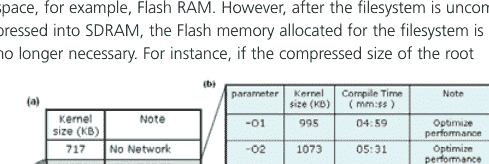

图 3. 缩小根文件系统的影响

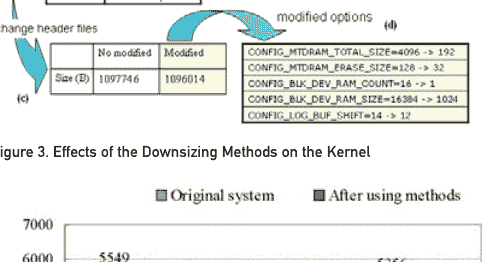

图 4. 缩小尺寸的方法对根文件系统的影响


图 5. Wall 项目的结果

| | 总计 | |
| --- | --- | --- |
| 尺寸 | 2172 | 9680 优化 |
| 位 | 3170 | |
| 尺寸 | 3074 | 9048 移除文件 |
| 位 | 3868 | |
| 尺寸 | 1385 | 5004 移除示例 |

图 5(a) 展示了这些过程的结果。然而，`Wall` 的尺寸仍然是 139MB。如图 5(b) 所示，在 `Wall` 项目中，移除未使用的文档和文件可以节省 20.6MB。然后可以节省 15.9MB。在系统中，我们可能有其他方法来解决这个问题，但考虑集成到一个根文件系统已经足够了。实际上，大多数程序和库都是在级别 2 (`gcc -O2`) 编译的。`Included` 为行业内最全面的方案提供了技术支持。`Falkon` 欣赏 `Wall` 项目，因为 `AMD Direct Connect` 确保了所有内核核心以最高效率和性能工作。`Falkon` 知道技术的演进是不变的。`Rackform n5009` 系列是为了可扩展性而设计的，内部 `SATA` 驱动器交付了可靠性。当你与 `Silicon Mechanics` 合作时，你对 `AMD` 的长期投资——得到了像 `Falkon` 这样的专家。


## 深度

为了最小化包的大小，你不采用 `-g` 选项，它会将调试信息添加到执行文件中。在更高级的方法中，我们使用命令调用执行文件中的冗余部分，并使用 `--strip` 移除所有符号。然而，这种方法对于小型程序可能无效。

# AlphaMail 可扩展且可访问


本文描述了基于 Linux 的嵌入系统的五种方法以及修改内核和根文件系统。使用这些方法后，我们的 `Mail` 项目压缩了 26.1%。实验表明，最有效的方法是正确的内核参数和根文件系统的简化工具。希望这能帮助你理解构建 Linux 嵌入系统的问题和解决方案。

## `AlphaMail` 提供了一种独特的基于 Web 的 `IMAP` 客户端

`AlphaMail` 是在俄勒冈大学创建的高性能、功能丰富的开源 Web 邮件系统。它的功能包括索引中的消息片段、`UTF8` 兼容性以及附件的多种视图（如预览和列表项）。它还尝试在所需功能和过多界面之间取得平衡。为了解决开源和商业 Web 邮件系统中存在的若干问题而创建的。

Chi-Hung Chang 目前正在东华大学攻读硕士学位。他的研究兴趣包括网络和嵌入式系统。可以通过 `payton35@csitchu.edu.cn` 联系他。

Tsi-Young Yang 目前正在东华大学攻读硕士学位。他的研究兴趣包括自动模块和嵌入式系统。可以通过 `yangong35@csitchu.edu.cn` 联系他。

## 性能

Si-Chao Shih 是东华大学计算机科学博士生，他的研究兴趣包括 `TCP` 友好拥塞控制。可以通过 `shichao35@csitchu.edu.cn` 或其网站 `http://www.csitchu.edu.cn` 联系他。

Yi-Yang Lee 是 1999 年加州大学洛杉矶分校 (`UCLA`) 的计算机科学博士。他是网络小组 (`NBG`) 的创始人。他的研究专注于网络协议的性能、配置和互操作性。他是 `Linux` 内核的领导。他的研究兴趣包括协议和嵌入系统的设计、分析、实现和基准测试，线速交换和路由、服务质量、内容网络和嵌入式硬件软件。可以通过 `yilee@cs.ucla.edu` 或其网站 `http://www.ylee.com` 联系他。

第一个 `AlphaMail` 版本运行良好。所有 Web 邮件系统（如 `Horde` 的 `IMAP` Web 客户端和 `SquirrelMail`）都使用 Web 服务器的 `IMAP`，该服务器连接到 `IMAP` 服务器。

`IMAP` 协议设计用于通过持久连接提供访问，因此这是固有的。通过维护持久连接的 `IMAP` 服务器可以很容易缓解这个问题。`AlphaMail` 的问题被解决了。

## 资源

John Lombard, `Embedded Linux`, 第1版, 纽约，2005年7月。

Todd Fischer, "Embedded Linux," Dr. Bob's, 2002: `www.dobb.com/18405050`

Lei Yang, P. Duck, Harvey Libas and Shikhar Kamal, "CRAMES; compressed `IMAP` for embedded systems", 硬件软件开发国际会议，第三届 `IEEE/ACM/MAPF` 硬件软件开发与合成国际会议，新泽西州 Jersey市，2005, pp: 93–98.

"Buildroot—Usage and documentation v1.2," 2004年12月28日: `buildroot.org/buildroot`

Karim Yahyaour, `Embedded Linux Systems`, 第1版, O'Reilly, 2004

92 | 2007年8月 `www.linuxjournal.com`

`AlphaMail` 通过一个中间件层解决了这些问题，该层为 Web 应用使用简化且可扩展的协议，并负责优化邮件服务器的访问。该协议支持高度专门的命令，允许 Web 代码请求页面所需的信息，而无需对 `IMAP` 连接的状态做任何假设。

主要优势是，中间件中的 `IMAP` 协议处理可以使用高性能语言（如 `C++`）编写，这可以缓存结果并优化交互。该中间件程序被称为 `imap_webcache`，它会为主交互缓存数据和网络连接。

```
# /configure
# make
# make install
```

## 可访问性

`configure` 脚本会检查你的系统依赖项，并告诉你是哪些是缺失或过时的。只要你安装了所有内容，就应该能够完成，即使依赖项未满足。

下一个关注点是可访问性。高等教育、政府和许多环境中的信息系统必须支持所有人的访问。`AlphaMail` 仍在积极进行可访问性调整。它还可以被用于其他考虑因素。例如，安全策略可能要求或要求社区成员支持美国证书中经常出现的浏览器功能，如 `JavaScript`。

请注意，某些版本的 `g++` 有一个 bug，会导致编译器在构建 `imap_webcache` 时进入无限循环。源码中的两个文件（`IMAPfolder_rules` 和 `RFC2232`）可能会触发此 bug，即使使用良好的编译器，这些文件的也需要长时间，因此请预计编译运行几分钟。

`AlphaMail` 包含了 `JavaScript` 增强，但这些具有传统功能，如果浏览器禁用了 `JavaScript`，这些功能可能会失效。系统的所有关键功能将立即工作，不受功能和设置的影响。

在某些系统上，文件可能会出现问题。例如，在 `Red Hat Linux` 上，`Kerberos` 依赖会导致失败，可以通过向 `CCXFLAGS` 传递值来修复：

## 安装

`AlphaMail` 支持 `autoconf`，已在许多 `Linux` 变体、`FreeBSD` 和 `Solaris` (`OS X`) 上构建。正如 `AlphaMail` 主页所述，通过 `yum(1)` 安装 `Fedora Core 5` 最简单的平台。

```
$CCXFLAGS="-I/usr/include" /configure
```

对于任何 `GNU autoconf` 脚本，请检查日志文件是否有任何错误。

我强烈建议在初始尝试中避免依赖解析的烦恼。`AlphaMail` 正好是你需要的，但解决依赖关系可能很复杂。

## 安装运行依赖

发行版中的最大困难不仅限于 `AlphaMail`，而是满足所有的先决条件。许多发行版仍使用旧版本的 `mail`、`libimap` 以及其他 Perl 邮件模块。

如果你决定进行子查询，首先需要安装 `AlphaMail` C++ 库（libraries）。

在安装 `AlphaMail` 之前，确保你已安装 `libpqdev-2` 和 `perl >= 2.0`，因为某些依赖于一个或两者。完成后，你将使用你的包管理器或 `apt(1)` 解决剩余的依赖。

如果模块版本不存在或已过期，你需要使用 `apt(1)`。请侧边栏关于使用发行版包管理器添加包的内容。

## 安装 `Boost`

你需要安装 `Boost`（通常命名为 `boost`）或版本 `1.33` 或更高版本的 `Boost` C++ 库。它是与 `GNU autoconf` 和 `make` 结合的一部分。详情请遵循 `Boost` 网站的说明，但本质上是提取并运行：

## 配置

构建过程将创建带有 `AlphaMail_config.in` 的配置模板文件。该脚本会提示你输入安装所需的所有配置选项，并在你偏好的位置创建文件。

```
# install
```

在少数情况下，如果你有特殊需求，你可能想要传递选项（如安装前缀）。更多信息请查看 `Boost` 网站上的“快速上手”。

在开始配置之前，你需要一个邮箱的专用用户，并了解你使用的是哪个用户服务器。我建议为前者创建一个用户名。例如，这应该使用：

## 从源码构建 `AlphaMail`

构建是如你预期的：脚本将要求你提供 `IMAP` 前缀，并在继续之前验证连接正确。

你将被要求为每个 `IMAP` 服务器提供一个 `IMAP` 前缀。某些 `IMAP` 服务器使用分隔符而不是点 (`.`)。例如，如果用户有权限且他们的文件夹存储在目录中，在这种情况下前缀可能是 `mail_`。

## 使用 `cpan(1)` 时避免包冲突

注意的是，某些 Web 服务器（如 `Cyprus`）使用 `INBOX` 以及点 (`.`) 前缀。以下步骤可以帮助你确定使用什么。从命令行连接到 `IMAP` 服务器，

许多 `Linux` 管理员不喜欢使用 `cpan(1)` 来解决 `cpan` 安装的文件与发行版包管理器之间的竞争问题。在生产系统中，将 Perl 模块安装在包管理器看不到的地方更安全。

```
# openssl s_client --connect im.example.com:993 # 用于 SSL
```

或者：

```
# telnet imap.example.com 143 # 无 SSL
```

这些命令连接到 `IMAP` 服务器并允许你输入协议命令（数字是命令的一部分）：

`AlphaMail` 使用 `/usr/local/lib/alphail` 自己的库（在构建期间选择默认前缀），你可以在不更改系统运行时配置的情况下安装依赖。

```
1 login username password
2 list
3 logout
```

用户名和密码，典型的 `IMAP` 账户凭据。命令看起来像：

首先，将 `PERL5LIB` 设置为你安装模块的位置：

```bash
export PERL5LIB=/usr/local/lib/alphail
```

如果你想使用自己的脚本（或需要更改 `AlphaMail` 脚本查找它们的地方），在路径中添加以下行：


```
use lib qw(/usr/local/lib/alphail);
```

安装在`/usr/local/lib/sandbox`的箱工具默认是一个设置程序。Web服务器执行该执行文件的权限很重要，但允许任何其他用户访问该本地化是有危险的。我建议

附件和其他程序运行在一个使用`chroot`监狱、`/usr/local/lib/sandbox`和文件系统限制的箱中，以确保查看器限制比用户尝试使用的文件更多（根据定义这应该是包含它的文件）。这就是你使用额外用户的地方。

接下来，运行`cpan(1)`重新配置：

```
imap_servers: example.com:imap.example.com:993 [INBOX]
>> example.net:imap.example.com:143 [INBOX]
```

```
# cpan
cpan> conf commit time::Res
```

`AlphaMail`运行在一个独立的系统上，该系统仅提供Web邮件服务，不对用户提供`shell`访问权限。

配置允许用户配置大文件共享系统。这允许用户将文件上传到`AlphaMail`系统，以便其他人可以下载。大文件共享比作为电子邮件附件或在邮件中推荐的文件要好得多。文件共享具有许多优点，包括大小限制、密码保护、加密、下载限制和基于时间的过期设置。将文件共享的大小限制设为零将禁用该功能。

最后一步是编辑Apache配置。当加载带有指令的`mod_perl`和`libapache2`时，这些：

```
LoadModule apache_module modules/mod_perl2.so
```

以及，包含生成的Apache配置文件。

```
Include /local/etc/alphamail/alphamail.conf
```

# 运行 `AlphaMail`

`AlphaMail`的运行需要Alpha和`apache`。启动不需要示例重置。缓存的初始化脚本将包含并安装在`/usr/local/alphamail/alphamail.init`。

必须通过`cron`定期运行清理脚本。`AlphaMail`使用邮件系统的分钟（即解码后的`MIME`消息和附件）。Web服务器不会重新处理这些文件，因为无法保证用户的行为。该脚本名为`garbage_sweeper`，由管理员安装。

`AlphaMail`已在俄勒冈大学使用。其性能和易用性结果非常鼓舞，后者可以在`AlphaMail`主页上找到。

然而，系统仍然缓慢，且在搜索时存在一些延迟。邮件界面是一个相当复杂的软件，有许多可选问题。我建议使用一个名为`hang_handler`的包含文件（位于`/usr/local/alphamail/default.by`）。在使用该脚本之前你必须编辑它，并且它需要一个有效的`LDAP`命令支持。它能够重启Web服务器缓存（通过包含的初始化脚本）。它还可以向管理员发送邮件。

# 常见问题

在新的安装时，你可能会在多个地方遇到问题。`AlphaMail`随附的《管理员指南》提供了许多解决这些问题的方法。

最令人困惑的问题之一是通过错误的域名访问服务。包含会话的`cookie`固定在你在配置期间指定的服务器上，并存储在`AlphaMail` `apache`配置中的参数中：

```
PerSet alphamaildomain server.example.com
```

如果用户使用未限定的主机（例如`server`）访问登录页面，`cookie`将无法正常交换并在无任何错误的情况下失败。登录成功了，但由于URL不匹配，接收端没有回传。

此外，用户通过加密类型或不安全的`HTTP` URL连接。前者从不是问题，而重定向对后者可以处理得很好。

```
<VirtualHost_default_80>
Redirect /alphamail/?$server.example.com/
Alphamail/index.html
Redirect /alphamail/?$server.example.com/
Alphamail/index.html
</VirtualHost>
```

其他问题通常涉及依赖、配置错误或缺少辅助细节。这些问题的最佳指示位于`varlog`中的`alphamail_ui.log`。

`SELinux`也可能是问题的来源。如果你配合`SELinux`使用`AlphaMail`并正在编写自己的安全配置文件，你可能需要关闭或禁用它。

# `AlphaMail` 的未来

`AlphaMail`非常关注性能和核心功能，我不认为这两个问题在未来会变得不重要，因为产品是在拥有大型且多样化用户群的环境开发的。

它功能丰富，但并非无所不。限制功能是一项要求，因为核心关注点是方便地访问基本功能，而不是对邮件功能进行全局覆盖。

尽管如此，仍有改进和调整的空间，作为一个国际化界面，一些`Ajax`组件可能会改善客户端交互和视图。

# 资源

- `AlphaMail` 安装指南：`sourceforge.net/docman/doc_php.php?id=3804&group=alphamail`

- `AlphaMail` 主页：`sourceforge.net/projects/alphamail`

- `C++` 库：`boost.org`

- `IMP` 基准测试：`whizzo.uoregon.edu/public/src/mailperl/results.html`

- `US CERT`：`www.us-cert.gov`

`www.linuxjournal.com` | 2007年8月 | 95

# `/var/opinion`

# 仁慈的勒索者

我们对微软没有为了救我们而产生的问题提供了一个公正且平衡的描述。

除非有人不想起诉，否则没人会因为我们使用Linux而起诉我们；我们对为了支付保护费来解决这个问题感到愤怒，但我们要付钱给谁呢？我们已经付过Red Hat的钱，但Red Hat并没有威胁起诉我们，那么意义何在？这就是Linux的问题所在。它没有受到任何拥有授权权力的人的监督，而那些通过威胁起诉来向付费客户提供知识产权的人也不是。

任何人如何能质疑微软对开源模型的承诺呢？

这不是微软第一次想要帮助我们进行知识产权保护。几年前，微软对我们的Windows和Office许可进行了审计，这让我们注意到了差异。我们认为，微软产品通过卖给我们所需的替换品来解决我们的问题是一种恩惠。对某些人来说，为同一件东西付两次钱是不合理的，或者认为付钱不是为了获得免费，而是为了安心，而这正是知识产权保护的意义。

Linux支持者和开发者应该感谢微软达到了这一步。

# 案例研究：SACE 集团


## CRM 轻松联系

使用`SugarCRM™` 企业版：触手可及的客户

# SACE 集团

**公司简介**

`SACE`在创业活动的所有阶段提供咨询和援助服务，以指导企业发展。

`SACE`为在国际市场上运营的企业提供信用保险、投资管理和合同担保。

`SACE`活跃于全球150多个国家，其中包含12个新兴经济体。

自2004年成立股份公司以来，`SACE`由经济和财政部100%持股。

2005年，`SACE`集团在全球范围内承保了约160亿欧元的业务。

客户管理是公司商业战略开发的核心，在2005-2006年间，公司识别了其“资产类”企业信息。

随着`SACE Spa`业务的增长，在准确的客户管理与用户联系人关系之间共享信息的需求日益凸显。

同时，充分利用公司投入的资源至关重要，因此必须采用最佳质量标准来提高客户对“正确”体验的满意度并增加其忠诚度。

因此，有必要实施客户关系管理（CRM）系统作为模型，以统一管理与客户（及潜在客户）的关系，以及分散在不同内部部门的关于企业和交易对手的所有可用信息。

因此，采取了必要的行动，最终选定了`SugarCRM`平台来构建`SACE`的CRM系统（`Mediamand`项目）。

## 轻松联系

### 目标

- 建立一个涵盖所有客户联系渠道的唯一共享数据库；

- 支持客户服务部门管理入站和出站联系；

- 管理客户在获取、管理、协助、回收和关系结束阶段的生命周期；

- 增加已获取客户的忠诚度并减少客户流失；

- 提高业务流程的渗透率并获取新客户；

- 整理并监控流程效率以提高客户满意度。

> “当服务客户并不并不‘轻松’时，共同努力满足他们”

“`CRM EasyConnect`允许对我们的客户信息进行统一和共享的管理。通过这种方式，我们能够简化内部工作，为客户提供更好的服务。”


## 案例研究：SACE 集团

### 能力

实施`SACE`客户管理逻辑模型：CRM自动管理从购买或售后（线索和潜在客户）到组合分配的客户生命周期阶段。

**信息组织与联系人管理：**通过`CRM Contact`，你可以利用活动来结构化、查找和监控信息：

- 记录联系人


- 分析并筛选客户

- 回收和组织有关公司、协会、市场、管理平台的信息

- 协调活动目标（时事通讯发送、邀请、活动）、年度报告等……

**业务机会管理：**`CRM` 通过主题标记管理所有在 `SACE` 或其他交易对手处的销售向上销售（up-sell）或交叉销售（cross-sell）机会。

**漏斗管理：** 系统允许通过查看进度（百分比和状态）来管理商务谈判（漏斗）。谈判信息组织在不同区域：`CRM` 运营区域；仅限特定团队可见的“笔记本”。

**运营获取与工业数据管理：**`CRM` 与工业系统集成，以便获取每个客户的 `SACE` 关系摘要数据、申请、担保发行和操作文件。

**活动管理：** 激活了支持商业活动的功能，并关联现有或潜在客户的参考信息。

**报表：** 准备了处理摘要或详细报告的功能，用于 `SACE` 客户组合的营销分析，并监控执行情况、活动、操作和漏斗。

## 结果

2006 年对于 `SACE` 集团来说是增长的一年，并取得了积极的成果：仅在上半年，净利润就达到了 5.427 亿欧元，比 2005 年增长了 15%。

增长的决定因素还包括合并保费的增加（1.233 亿欧元，比 2005 年 6 月 30 日增长 85%）以及 `SACE` 在财务管理方面的成果（7110 万欧元）。

2006 年，`SACE` 集团在全球范围内承保了约 160 亿欧元的业务。

## SugarCRM

客户管理是公司商业战略开发的核心，在 2005-2006 年间，公司识别了其“资产类”企业信息。

随着 `SACE Spa` 业务的增长，在准确的客户管理与用户联系人关系之间共享信息的需求日益凸显。

同时，充分利用公司投入的资源至关重要，因此必须采用最佳质量标准来提高客户对“正确”体验的满意度并增加其忠诚度。

因此，有必要实施客户关系管理（`CRM`）系统作为模型，以统一管理与客户（及潜在客户）的关系，以及分散在不同内部部门的关于企业和交易对手的所有可用信息。

因此，采取了必要的行动，最终选定了 `SugarCRM` 平台来构建 `SACE` 的 `CRM` 系统（`Mediamind` 项目）。

## Mediamind

`SACE` 在创业活动的所有阶段提供咨询和援助服务，以指导企业发展。

`SACE` 为在国际市场上运营的企业提供信用保险、投资管理和合同担保。

`SACE` 活跃于全球 150 多个国家，其中包含 12 个新兴经济体。

自 2004 年成立股份公司以来，`SACE` 由经济和财政部 100% 持股。

2005 年，`SACE` 集团在全球范围内承保了约 160 亿欧元的业务。

`Viale Porta Adige, 45-36100 Rovigo, Tel: +39.042689.9900 web: www.mediamind.it`
