# Linux 深度深度解析


`LINUX` 是 `Linus Torvalds` 的注册商标。

## 为服务

**订阅**：Linux Journal 提供 PDF、EPUB 和 MOBI 格式的数字杂志。续订订阅、更改用于期递的电子邮件地址、支付发票、查看账户详情或其他订阅查询均可在线立即完成：[`www.linuxjournal.com/subscribe`](http://www.linuxjournal.com/subscribe)。您可以通过 `subs@linuxjournal.com` 向我们发送电子邮件，或通过邮寄信至：Linux Journal, 9597 Jones Rd, #331, Houston, TX 77065 USA。联系我们时请记得附上您的完整姓名和地址。

**访问数字存档**：您的每月下载通知将包含指向各种格式和数字存档的链接。如需随时访问数字存档，请登录 [`www.linuxjournal.com/digital`](http://www.linuxjournal.com/digital)。

**致编辑的信**：我们欢迎通过 [`www.linuxjournal.com/contact`](http://www.linuxjournal.com/contact) 向我们致信，或邮寄至：Linux Journal, 9597 Jones Rd, #331, Houston, TX 77065 USA。

**为我们撰稿**：我们一直在寻找用于杂志的文章、教程和真实故事，请访问 [`www.linuxjournal.com`](http://www.linuxjournal.com)。

**免费新闻通讯**：Linux Journal 每周和每月发布新闻通讯。获取最新消息、技巧和内部预览请访问 [`www.linuxjournal.com/enletters`](http://www.linuxjournal.com/enletters)。

**赞助**：我们重视数字隐私。欲了解更多信息，请发送电子邮件至 `sponsorship@linuxjournal.com` 或拨打 +1-281-944-5188。


Private Internet Access 是 Linux Journal 的赞助商。

## 作者简介

**Zack Brown** 是 《Linux Journal》和 《Linux Magazine》的技术记者，曾是 `Kernel Traffic` 周周通讯和 `Learn Plover` 隐写教程的作者。他于 1993 年首次在一台拥有 8MB 内存的 386 电脑上安装了 Slackware Linux，被开源社区彻底大开了眼界。他是策略游戏 `Crumble` 的发明者，这种游戏可以用几块纸板自己制作。他同时也喜欢写小说、尝试动画制作、学习拉班舞谱、设计和缝制衣服、学习法语以及与家人共度时光。

**Andy Carlson** 在过去的 15 年里一直从事 IT 工作，负责网络和服务器管理以及兼顾编程。他非常感激自己选择了一份他热爱、成长并学习的职业。他目前与妻子、三个女儿和一个儿子住在俄亥俄州的辛辛提。他的家庭目前正在通过国际收养两个孩子。他喜欢弹吉他、编程以及与家人共度时光。

**Allan Cecil** (dwangoAC) 是 [North Bay Linux 用户组](http://NBLUG.org) 的主席。他是 [TASVideos.org](http://TASVideos.org) 的大使，该网站致力于利用模拟器以硬件允许的最快速度完成视频游戏。他在 [Twitch.tv/dwangoAC](https://twitch.tv/dwangoAC) 进行直播，并参加 [Games Done Quick](http://gamesdonequick.com) 慈善速通马拉松，使用 `TASBot` 展示从未见过的游戏漏洞来娱乐观众。他白天是 Ciena 公司的高级工程师，负责 OpenStack NFV 编排和 Linux 数据包性能优化测试。

**Marcel Gagné** 是一位自由作家和资深思想者。[Cooking With Linux](http://www.cookingwithlinux.com) 的博主。长相粗犷帅气！科学、Linux 和技术极客。偶尔会有自己的主见，但总是处于困惑中。热爱葡萄酒、美食、音乐以及偶尔喝的单麦芽苏格兰威忌。

**Michael J. Hammel** 是 NetApp 的软件工程师，住在科罗拉多州的布鲁姆菲尔德（Broomfield），与妻子 Brinda 和两只金毛猎犬在一起。当不在研究嵌入式系统或其他极客事物时，他喜欢露营、在公园遛狗散步、和妻子喝茶，并为女儿的成功感到欣喜。他曾为众多在线和纸质杂志撰过 100 多篇文章，还是 GIMP（GNU 图像处理程序）四本书的作者。

**Todd A. Jacobs** 是 Flow Capital Group 的首席执行官，该集团收购并管理专注于 IT 自动化、DevOps 与敏捷转型、安全与合规、兼职 CIO/CTO 服务以及针对网络风险和其他热点技术问题的董事会咨询服务公司。Todd 等了一辈子，就为了让《神秘博士》中 Matt Smith 饰演的角色让领结再次变得酷起来。他与妻子和儿子住在马里里州州巴尔的摩（Baltimore）附近，他希望将对 Linux 和技术的热爱传给他们——但可能不是他的时尚品味。

**Mike Julian** 是 《Monitoring Weekly》时报的编辑，O'Reilly 出版社《Practical Monitoring》的作者，也是 AsterLabs.io 的独立监控顾问。在开始担任顾问之前，他曾分别担任 Taos Consulting、Peak Hosting 和奥克里奇国家实验室（Oak Ridge National Laboratory）的运维工程师。你可以在 Twitter 上 @mike_julian 关注他。

**Petros Koutoupis** 目前担任 IBM 云存储对象存储分部（原 Cleversafe）的高级平台架构师。他还是 [RapidDisk Project](http://www.rapiddisk.org) 的创建者和维护者。Petros 在数据存储行业工作了十多年，并帮助开创了许多在当今被广泛应用的技术。

**Matt Lee** 是一位资深自由软件开发者，他的时间花在倡导自由软件以及为电视和网络编写并执导喜剧剧上。他住在波士顿，可以在 @mattl 看到他发布大量的废话。

**Vladimir Likic** 拥有生物信息学博士学位，自 1991 年起使用 UNIX，自 1995 年起使用 Linux。源自欧洲，在美国生活过多年，现在定居在澳大利亚。在 Twitter 上关注 Vladimir：@unix_byte。

**Bryan Lunduke** 曾任软件测试员、前程序员、前技术副总裁、前 Linux 营销人员 (tm)、前 openSUSE 董事会成员……现任《Linux Journal》副主编，以及（名副其实的）*Lunduke Show*节目主持人。

**Mike McCallister** 自千禧之交以来一直撰写关于 Linux 和 FLOSS 的文章。你可以在 [michaelmccallister.com](http://www.michaelccallister.com) 找到他，或者在 Facebook 上关注 Author.MichaelMcCallister，在 Twitter 以及几乎几乎所有其他地方通过 @workingwriter 找到他。

**K.G. Orphanides** 是一位作家、记者和偶尔的游戏开发者，自 1999 年起就一直在 bash 提示符前低声抱怨。你可以在 Twitter 上 @KGOrphanides 找到他，并在 itch.io 的 [`mightyowlbear.itch.io`](https://mightyowlbear.itch.io) 上找到他。

**Shawn Powers** 是《Linux Journal》副编辑，从 Linux 诞生初就在这里了。他对开源充满热情，并热爱教学。他还喝了太多咖啡，这经常体现在他的文字中。

**Corey Quinn** 目前是 Quinn Advisory Group 的云经济学家，ReactiveOps 的顾问。[Corey](https://twitter.com/quinnypig) 拥有工程总监、公共演讲者和云架构师的背景。他专长帮助公司解决惊人的 AWS 账单，并策划 [LastWeekinAWS.com](https://lastweekinaws.com) —— 一份总结了 AWS 最新新闻、博客和提示的周报，其中夹杂着许多讽刺。

**Kyle Rankin** 是《Linux Journal》的技术编辑和专栏作家，也是 Purism 的首席安全官。他是《Linux Hardening in Hostile Networks》、《DevOps Troubleshooting》、《The Official Ubuntu Server Book》、《Knoppix Hacks》、《Knoppix Pocket Reference》、《Linux Multimedia Hacks》和《Ubuntu Hacks》的作者，也是许多其他 O'Reilly 书的贡献者。Rankin 经常就安全和开源软件演讲，包括 BsidesLV、O'Reilly 安全会议、OSCON、SCALE、CactusCon、Linux World Expo 和 Penguicon。你可以在 @kylerankin 关注他。

**Doc Searls** 是一位资深记者、作者和兼职学者。在 2018 年 1 月杂志重生之前，他在《Linux Journal》的编辑部工作了二十多年，随后出任总编辑。他的两本书是：他于 2000 年为 Basic Books 合写并在 2010 年更新的《The Cluetrain Manifesto》，以及他 2012 年为 Harvard Business Review Press 撰写的《The Intention Economy: When Customers Take Charge》。在学术方面，Doc 运行着托管在哈佛大学 Berkman Klein 中心的 ProjectVRM。

**John Tonello** 是 Puppet Inc. 的高级技术营销经理。自 20 年前从软磁盘构建第一台 Slackware 系统以来，他一直是 Linux 用户和爱好者。

**Jay Ts** 是一位软件开发者、Linux 系统管理员和电子设计人员。他从 1981 年开始接触 UNIX 和 C 语言，并在 1996 年切换到 Linux。他熟悉许多操作系统、Linux 发行版和编程语言。Jay 曾工作于加州理工、NASA/JPL 和信息研究所。他目前住在亚利桑那州的塞多纳（Sedona）。可以通过 `ts.com` 与他联系。

加密货币的概念并不是新鲜事，尽管随着上述提到的头条新闻层出不穷，人们可能会认为并非如此。`bitcoin` 由一个名为 `Satoshi Nakamoto` 的未知身份于 2009 年发明并发布，它是加密货币的一种，因为它提供了一种去中心化的方法来参与数字交易。它也是一种全球性技术，简单来说就是一种全球支付系统。由于该技术是去中心化的，没有任何单一实体被认为拥有该技术的所有权或对该技术实施监管的能力。

但是，这到底意味着什么？交易是安全的。这使得交易更难以追踪，因此也难以征税。这是因为这些交易是严格的点对点，中间没有中间人。听起来好得不可思议，对吧？嗯，它**确实**那么好。

虽然交易仅限于涉及的双方，但它们确实在一个名为 `blockchain` 的独立运行节点网络中进行验证。通过使用密码学和分布式公共账本，交易得到了核实。

现在，除了提供安全且更难追踪的交易之外，这些加密货币平台的真正吸引力是什么？以 `bitcoin` 为例，“比特币”是通过“挖矿”过程作为奖励生成的。如果快进到现在，`bitcoin` 获得了货币价值，因为它可以在全球范围内购买商品和服务。记住，这是一种数字货币，这意味着不存在物理上的“硬币”。你必须保留并维护自己的加密货币钱包，并在接受 `bitcoin`（或任何其他加密货币）作为支付方式的零售商和服务提供商处花费积累资金。

排除所有炒作，预测加密货币的价格是徒劳，而且没有任何单一变量在驱动它的价值。然而，需要注意的是，加密货币在任何方面都不是真实货币的货币投资。相反，购买加密货币是对可能未来的投资，在那个未来它可以交换商品和服务——那个未来可能比预期的更快到来。

现在，这并不意味着加密货币没有现金价值。事实上，它们是有。截至我写这篇文章的这一天（2018 年 1 月 27 日），单个 `bitcoin` 值为 `$11,368.56 USD`。这个价值波动极大，谁知道它明天会向什么方向发展。影响 `bitcoin` 价值的因素之一是采用率。更多的人使用该技术意味着由构成底层 `blockchain` 的人员所有节点将验证更多的交易。反过来，验证系统的所有者获得了他们的奖励，从而增加了该技术的价值。这很简单：验证更多交易，赚取更多钱。当然，这还有更多细节，但这就是大体思想。

验证系统的所有者被称为“矿工”。矿工提供记录保存的服务。这种服务需要大量的处理能力来处理密码学计算。`miner` 的目的是保持底层 `blockchain` 的一致性、完整性和未被篡改。`miner` 重复验证并收集广播的交易，形成称为 `blocks` 的交易组。使用 `SHA-256` 算法（256 位安全哈希算法），每个新区块都包含其前一个区块的加密哈希值，从而建立了形成区块链的链接，因此得名 `blockchain`（区块链）。

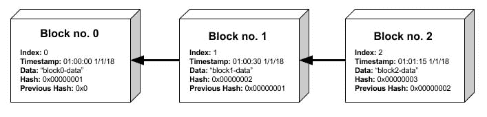

图 1. 数据块是如何相互“链联”在一起的示例

### 全球“危机”

随着加密货币的兴起以及矿工竞争赚取数字货币的公平份额，我们现在面临着一个困境——高端 PC 显卡适配器的全球短缺。即使是之前使用过的适配器，转售价格也远高于新包装版本。但为什么是呢？使用带有足够板内存和专用处理能力的高端显卡，每天很容易产生几美元的加密货币。记住，挖矿需要处理内存密集型算法。随着加密货币价格持续上涨（尽管速度很快），奖励给矿工的数字货币价值也在增加。这种显卡适配器的短缺已成为寻求扩大业务的现有矿工或新入场矿工的瓶颈。希望显卡供应商能尽快解决这一短缺。

### 比较区块链技术

加密交易存在多个平台。你可能会遇到讨论 `bitcoin` 并与 `ethereum` 或 `litecoin` 等其他货币进行比较的文章。最初，这些文章可能会导致对两种类型数字货币的混淆：1) 加密货币和 2) 代币（tokens）。需要记住的关键点如下：

* `bitcoin` 或 `litecoin` 或任何其他形式的加密货币都在与现有货币和黄金积极竞争，希望能取代它们成为全球接受货币的形式。正如之前提到的，该技术承诺了一种不受监管且全球可用的货币——一种无论位置如何都具有相同稳定值的货币。这个概念对于生活在货币不稳定国家的人来说绝对具有吸引力。

* 那么 `ethereum` 呢？嗯，它处理的是代币。它基于合约理念运行。`Ethereum` 是一个允许用户编写条件性数字“智能合约”的平台，显示永远无法删除的交易证明。

在现代世界中，传统的书面合同将概述关系的条款，通常受法律执行。智能合约则使用加密代码来执行关系——即通过程序执行其创建者定义的条件。让 `ethereum` 更有趣的地方在于，不像 `bitcoin`（或者说 `litecoin`），该平台并没有将自己局限于货币使用场景。

与 `bitcoin` 类似，当利用一个或多个此类合约进行交易时，会被收取费用以获取所需的计算能力。需要的计算越多，费用越高。

### 什么是区块链？

要理解这种加密货币现象及其爆炸性的增长，你需要了解支持它的技术：`blockchain`。正如之前提到的，`blockchain` 由一个以 `blocks` 形式记录的持续增长的列表组成。通过密码学，每个新区块都与现有的区块链链接并加密。

每个区块将包含一个指向前一个区块的哈希指针、时间戳和交易数据。从设计上来说，`blockchain` 能够抵抗任何数据修改。这是因为 `blockchain` 提供了一个开放且分布式的账本，用于高效、可靠且永久记录两个利益方之间的交易。

一旦数据被记录，给定区块中的数据无法更改，除非更改所有后续区块。

你可以将其想象成一个分布式“数据库”，其内容在计算机网络中被复制了数百次，甚至数千次。这种复制方法强调了该技术的去中心化特性。由于没有中心化的版本或单一的“主”副本，该数据库是公开的，因此可以容易地进行验证，而无需担心黑客攻击或损坏的风险。该数据库的内容由数百万个计算节点同时托管，互联网上的任何人都可以访问这些内容。作为一个额外的益处，分布式和去中心化的模型让用户放心，不存在单点故障。想象一下，这些计算节点中有一个或多个节点无法访问，或者正在经历某种内部故障，甚至在产生损坏的数据。区块链具有韧性，因为它将继续提供所请求的数据内容，并以其正确的（即未损坏的）格式呈现。这归功于一种通常被称为“拜占庭容错”的技术。

### 拜占庭容错

系统会故障，而且可能由于多种原因发生故障（如硬件、软件、电源、网络连接等等）。这是一个事实。此外，并不是所有的故障都能被轻易检测到（即使通过传统的容错机制），它们在网络集群中其他系统的表现也并不总是相同的。再次，想象一个由数百甚至数千个节点组成的大型网络。为了处理此类不可预测的情况，必须采用投票系统，以确保集群能够容忍故障或错误行为。

拜占庭故障被定义为任何向不同观察者（即分布式计算系统）显示不同类型症状的故障。拜占庭失败是在必须达成共识以执行某项服务或操作环境中，由于拜占庭故障导致系统服务的丢失。

拜占庭容错（`BFT`）的目的是保护分布式平台免受此类拜占庭故障的影响。系统的故障组件不会阻止剩余组件之间达成一致，而这种共识是执行操作所必需的。只要故障不是过多，BFT 系统中正常运行的组件将继续提供不间断的服务。


这种机制的名称源于“拜占庭将问题”（`BGP`）。`BGP`强调了一个共识问题，即所有参与成员之间存在分歧。想象这样一个场景：拜占庭军队的几个师营驻在一个坚固的城外。每个师营都有自己的将军，将军们之间唯一的通信方式就是使用信使。将军们需要决定一个共同的行动计划。问题是，某些将军很可能是叛徒。在中间有一个叛徒的情况下，非叛徒能决定出一个共同的计划吗？

在`BFT`环境中，问题的答案是肯定的。在三人的小组中，一个叛徒使得达成多数共识成为可能。例如，如果一个将军说“进攻”，而另外两个说“撤退”，那么很容易确定谁是小组中的叛徒。在非叛徒之间达成某种共识也是可能的。现在，将这一概念应用于计算节点的分布式网络。例如，当`f`数的节点变为拜占庭节点时，`2f + 1`个节点将不会容忍这种错误行为。你只需要比潜在故障节点多出`1`个正常运行节点即可。


图 2. 拜占庭将问题插图

现在，我为什么要谈论这个？`BFT`是区块链韧性的核心。如果无法达成共识来处理交易，区块链本身就毫无用处。

## 网络

由计算节点组成的网络构成了区块链。节点一旦加入网络，就会获得区块链的相同副本。每个节点都被认为是区块链的管理员，并且对集群内的其他节点不再具有控制权——再次，这是去中心化的结果。


图 3. 去中心化区块链网络示例

这种计算方法赋予了区块链健壮性。除了更新区块链之外，每个节点无论如何被访问，都可以并且将独立于其他节点运行。当它需要向链中添加新块时，它将把更新广播给其他节点（更新公共账本）。

无论用户驱动的事件是什么，它都被视为整个网络的功能。全局网络管理应用程序，它将基于用户对用户或点对点的运行。每个节点在被独立访问时，都负责确认请求的交易（如挖矿）。正如之前提到的，正是这一核心概念使区块链更加安全。区块链技术消除了由于数据集中持有（或管理）且未跨网络复制而引入的风险（和漏洞）。另一种思考方式是：不再由单一实体验证交易，现在你有多个实体在达成共识后验证交易。它们充当见证人，没有任何单一实体比其他实体具有更高的权威。这没有留给任何模糊的空间，如果一个或多个节点歪曲了原始数据，`BFT`模型将解决该问题。

几乎每个读到这里的人对互联网上泛滥的安全性问题都很熟悉。我们个人通过依赖传统的“用户名”和“密码”系统来在线保护自己的身份和资产。区块链更进了一步，不同之处在于它的安全性源于对加密技术的使用。身份验证“问题”通过生成“密钥”得到。用户将创建一个公钥（一个长且随机生成的数字字符串）和一个私钥（作用类似于密码）。公钥充当用户在区块链中的地址，任何涉及该地址的交易都将被记录为属于`that`地址。私钥让所有者访问其数字资产。这里唯一需要的是采取适当措施来保护私钥。

## 整合部分

到目前，你应该对所有组件如何结合在一起有一个更完整的蓝图。

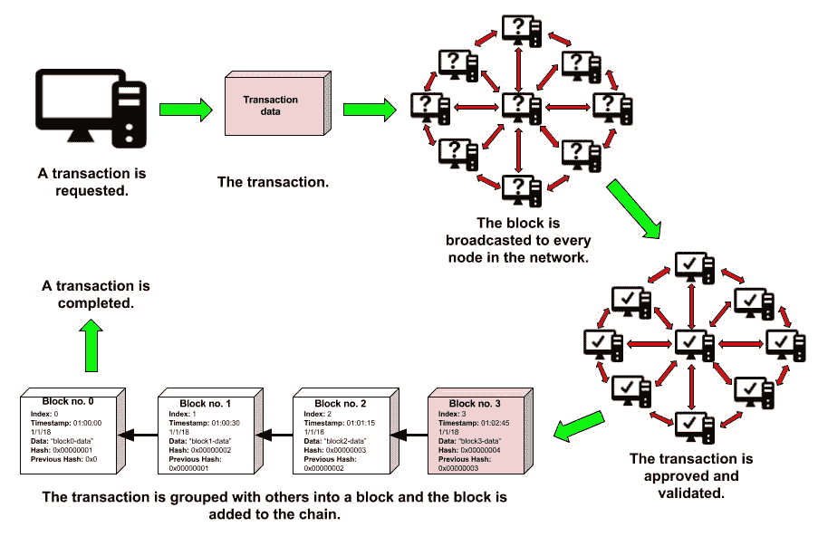

图 4. 跨网络处理交易的通用方法

例如，假设有一笔比特币交易（也可以是完全不同的东西），但想象网络中的某人正在请求该交易。该请求的交易将在点对点计算节点网络中广播。通过加密算法，网络节点将验证用户状态和交易。一旦通过验证，该交易将与其他交易合并，为公共账本创建一个新的数据块。该新数据块将被添加到现有的区块链中，其方式使其永久且不可篡改。然后交易完成。通过时间戳方案，所有交易都经过序列化处理。

## 为什么区块链很重要？

正如`TCP/IP`一样，区块链是一项基础技术。正如`TCP/IP`在20世纪90年代实现了互联网，你可以期待区块链带来奇妙的新开端。现在要观察它将如何演变还为过早。这项革命性的技术已经让组织能够探索它对其业务可能以及将意味着什么意义。许多此类机构已经开始了探索，尽管目前主要集中在金融服务领域。这种可能性是巨大的，似乎任何基于交易模式的行业都将被这项技术颠覆。

## 总结

本文涵盖了加密货币的兴起和关注度，并开始深入探讨其底层的区块链技术。在系列的下一部分，我将使用开源工具，开始描述如何构建你自己的私私有区块链网络。这种私有化部署将允许你深入研究此处强调的细节。今天这项技术可能主要围绕加密货币展开，但我同时也关注了区块链可以帮助重新定义的各种行业，以及利用该技术通向光明未来的潜力。

# 区块链，第二部分：配置区块链网络并利用技术

## 如何使用开源工具设置私有以太坊区块链，并展望区块链技术可以增加值的某些市场和行业。

作者：Petros Koutoupis

在第一部分，我花了大量时间探索加密货币以及使其成为可能的机制：区块链。我涵盖了关于区块链工作原理以及它为何如此安全强大的细节。在第二部分中，我将描述如何使用开源工具设置并配置你自己的私有以太坊区块链。我还将查看这项技术可以在何处带来价值，或帮助重新定义人们在更开放的网络上进行交易的方式。

### 设置你自己的私有区块链网络

在本节中，我将探索基于以太坊的区块链网络的机制——具体来说如何创建一个私有以太坊区块链、一个用于托管和共享该区块链的私有网络、一个账户，然后如何使用区块链做一些有趣的事情。

再次，以太坊是什么？以太坊是一个开源的公共区块链平台，具有智能合约（即脚本）功能。它与比特币相似，但不同之处在于扩展到了货币交易之外。

智能合约是用编程语言编写的，例如`Solidity`（类似于`C`和`JavaScript`）、`Serpent`（类似于`Python`）、`LLL`（一种类`Lisp`的语言）和`Mutan`（基于`Go`）。智能合约被编译成`EVM`（见下文）字节码并部署在以太坊区块链上进行执行。智能合约有助于货币、财产、股份或任何有价值物品的交换，并以透明且无冲突的方式进行，避免了传统的中间人。

如果你还记得第一部分的内容，任何区块链的典型布局都是所有节点都连接到其他所有节点，形成一个网格。在以太坊的世界里，这些节点被称为`Ethereum Virtual Machines` (`EVMs`)，每个`EVM`都将托管整个区块链的副本。每个`EVM`还会竞争挖掘下一个区块或验证交易。一旦新区块被添加到区块链中，更新将传播到整个网络，从而使每个节点保持同步。

为了成为以太坊网络上的`EVM`节点，你需要下载并安装适当的软件。为了实现这一点，你将使用`Geth` (Go Ethereum)。`Geth`是以太坊协议的官方`Go`语言实现。它是三个实现版本之一；另外两个是用`C++`和`Python`编写的。这些开源软件包根据`GNU 较小通用公共许可证` (`LGPL`) 第3版许可。适用于所有支持的操作系统和架构（包括`Linux`）的独立`Geth`客户端包可以在[这里](https://geth.ethereum.org/downloads)获取。软件包的源代码托管在[GitHub](https://github.com/ethereum/go-ethereum)。

`Geth`是用于与以太坊网络通信的命令行界面（`CLI`）工具。它被设计为你的计算机与以太坊网络所有其他节点之间的链接。当网络上的另一个节点正在挖掘区块时，你的`Geth`安装将收到更新并将信息传递以更新你本地的区块链副本。通过`Geth`工具，你能够挖掘以太（类似于比特币，但是以太坊网络的加密货币）、在两个地址之间传输资金、创建智能合约等更多操作。

### 下载与安装

在我的示例中，我将在`Ubuntu`的最新`LTS`版本上配置此以太坊区块链。请注意，工具本身并不限于此发行版或版本。

#### 从项目网站下载并安装二进制文件

下载最新的稳定版本，解压并将其复制到适当目录：

```bash
$ wget https://gethstore.blob.core.windows.net/builds/
↪geth-linux-amd64-1.7.3-4bb3c89d.tar.gz
$ tar xzf geth-linux-amd64-1.7.3-4bb3c89d.tar.gz
$ cd geth-linux-amd64-1.7.3-4bb3c89d/
$ sudo cp geth /usr/bin/ 
```

#### 从源码编译

如果你是从源码编译，你需要安装`Go`和`C`编译器：

```bash
$ sudo apt-get install -y build-essential golang 
```

进入该目录并执行：

```bash
$ make geth 
```

#### 从公共仓库安装

如果你在`Ubuntu`上运行并决定从公共仓库安装软件包，请运行以下命令：

```bash
$ sudo apt-get install software-properties-common
$ sudo add-apt-repository -y ppa:ethereum/ethereum
$ sudo apt-get update
$ sudo apt-get install ethereum
```

### 快速开始

情况是这样的，你手头没有以太坊可以开始。考虑到这一点，让我们这种部署限制在一个“私有”区块链网络中，它将作为主网络的开发版或测试版本运行。从功能角度来看，这个私有网络与主链相同，例外是部署在该网络上的所有交易和智能合约仅供连接到此私有网络的节点访问。

记住，区块链无非只是一个按时间顺序保存交易的数字和公共账本。当新交易被验证并配置成区块时，该区块就会被添加到链中，然后分发到整个网络。该网络上的每个节点都会更新其本地的链副本。但你需要从某个点开始——一个起点或创世区块（`genesis`）。每个区块链都始于一个创世区块，即“0”区块或链的第一个区块。它将是唯一没有前驱的区块。要创建你的私有区块链，你需要创建这个创世区块。为了做到，你需要创建一个自定义创世文件，然后告诉`Geth`使用该文件来创建你自己的创世区块。

创建一个托管所有以太坊相关数据和配置的路径，并进入`config`子目录：

```bash
$ mkdir ~/eth-evm
$ cd ~/eth-evm
$ mkdir config data
$ cd config
```

打开你偏好的文本编辑器，并将以下内容保存到该目录下名为`Genesis.json`的文件中：

```json
{
    "config": {
        "chainId": 999, 
        "homesteadBlock": 0,
        "eip155Block": 0,
        "eip158Block": 0
    },
    "difficulty": "0x400",
    "gasLimit": "0x8000000",
    "alloc": {}
} 
```

这就是你的创世文件看起来的样子。这个简单的`JSON`格式字符串描述了以下内容：

- `config` — 此区块定义了你自定义链的设置。
- `chainId` — 这用于标识你的区块链，由于以太坊主网络有自己的`ID`，因此你需要为你的私有链配置一个唯一的值。
- `homesteadBlock` — 定义了以太坊平台的版本和协议。
- `eip155Block / eip158Block` — 这些字段为所使用的`Homestead`版本增加了对非向后兼容协议更改的支持。在本示例中，你将不会利用这些字段，因此它们被设置为`"0"`。
- `difficulty` — 此值控制区块链的区块生成时间。值越高，矿工必须执行的计算才能发现有效区块。因为这个示例只是部署一个测试网络，让我们保持此值较低以缩短等待时间。
- `gasLimit` — `gas`是以太坊在交易期间消耗的燃料。由于你不希望在测试受到限制，请将此值调大。
- `alloc` — 此部分用于为账户预充，但你将在本地挖掘以太坊，所以你不需要这个选项。

现在是时候实例化数据目录了。打开终端窗口，假设你已经安装了`Geth`二进制文件且它可以通过你的工作路径访问，输入以下命令：

```
$ geth --datadir /home/petros/eth-evm/data/PrivateBlockchain 
↪init /home/petros/eth-evm/config/Genesis.json
WARN [02-10|15:11:41] No etherbase set and no accounts found 
↪as default 
INFO [02-10|15:11:41] Allocated cache and file handles 
↪database=/home/petros/eth-evm/data/PrivateBlockchain/
↪geth/chaindata cache=16 handles=16
INFO [02-10|15:11:41] Writing custom genesis block 
INFO [02-10|15:11:41] Successfully wrote genesis state         
↪database=chaindata                                                  
hash=d1a12d...4c8725
INFO [02-10|15:11:41] Allocated cache and file handles         
↪database=/home/petros/eth-evm/data/PrivateBlockchain/
↪geth/lightchaindata cache=16 handles=16
INFO [02-10|15:11:41] Writing custom genesis block 
INFO [02-10|15:11:41] Successfully wrote genesis state         
↪database=lightchaindata 
```

该命令需要引用一个工作数据目录来存储你的私有链数据。在这里，我在主目录下指定了`eth-evm/data/PrivateBlockchain`子目录。你还需要告诉工具使用你的创世文件进行初始化。

此命令会在你的数据目录中填充一个子目录和文件树：

```
$ ls -R /home/petros/eth-evm/
.:
config  data

./config:
Genesis.json

./data:
PrivateBlockchain

./data/PrivateBlockchain:
geth  keystore

./data/PrivateBlockchain/geth:
chaindata  lightchaindata  LOCK  nodekey  nodes  transactions.rlp

./data/PrivateBlockchain/geth/chaindata:
000002.ldb  000003.log  CURRENT  LOCK  LOG  MANIFEST-000004

./data/PrivateBlockchain/geth/lightchaindata:
000001.log  CURRENT  LOCK  LOG  MANIFEST-000000

./data/PrivateBlockchain/geth/nodes:
000001.log  CURRENT  LOCK  LOG  MANIFEST-000000

./data/PrivateBlockchain/keystore: 
```

你的私有区块链现在已经创建完成。下一步是启动私有网络，这将允许你挖掘新区块并将其添加到区块链中。要此此，输入：


```
petros@ubuntu-evm1:~/eth-evm$ geth --datadir /home/petros/eth-evm/data/PrivateBlockchain --networkid 9999
WARN [02-10|15:11:59] No etherbase set and no accounts found as default
INFO [02-10|15:11:59] Starting peer-to-peer node                instance=Geth/v1.7.3-stable-4bb3c89d/linux-amd64/go1.9.2
INFO [02-10|15:11:59] Allocated cache and file handles          database=/home/petros/eth-evm/data/PrivateBlockchain/geth/chaindata cache=128 handles=1024
WARN [02-10|15:11:59] Upgrading database to use lookup entries
INFO [02-10|15:11:59] Initialised chain configuration          config="{ChainID: 999 Homestead: 0 DAO: <nil> DAOSupport: false EIP150: <nil> EIP155: 0 EIP158: 0 Byzantium: <nil> Engine: unknown}"
INFO [02-10|15:11:59] Disk storage enabled for ethash caches    database=/home/petros/eth-evm/data/PrivateBlockchain/geth/chaindata cache=128 handles=1024
INFO [02-10|15:11:59] Disk storage enabled for ethashs          dir=/home/petros/.ethash count=2
INFO [02-10|15:11:59] Initialising Ethereum protocol            versions="63 62"] network=9999
INFO [02-10|15:11:59] Database deduplication successful         up=0
INFO [02-10|15:11:59] Loaded most recent header                 number=0 hash=d1a12d...4c8725 td=1024
INFO [02-10|15:11:59] Loaded most recent full block             number=0 hash=d1a12d...4c8725 td=1024
INFO [02-10|15:11:59] Loaded most recent fast block             number=0 hash=d1a12d...4c8725 td=1024
INFO [02-10|15:11:59] Regenerated local journal                 transactions=0
INFO [02-10|15:11:59] Starting P2P networking
INFO [02-10|15:11:59] UDP listener                              self=enode://f51957cd44f19d187f960154d66daf560770d3da1e41ce5ba3eb6660732ff01ae68be0527b70f96a17e53b25987aea2479e6ad2733033
INFO [02-10|15:12:01] IPC endpoint opened: /home/petros/eth-evm/data/PrivateBlockchain/geth.ipc
INFO [02-10|15:12:01] RLP listener up                           self=enode://f51957cd44f19d187f960154d66daf560770d3da1e41ce5ba3eb6660732ff01ae68be0527b70f96a17e53b25987aea2479e6ad2733033
```

注意新参数`networkid`的使用。这个`networkid`有助于确保你网络的隐私性。这里可以使用任何数字。我决定使用`9999`。注意，加入你网络的其他节点需要使用相同的 ID。

你的私有网络现在上线了！记住，每次你需要访问私有区块链时，都需要最后这两个命令（`Geth`工具不会为你记住它们）：

```
$ geth --datadir /home/petros/eth-evm/data/PrivateBlockchain init /home/petros/eth-evm/config/Genesis.json
$ geth --datadir /home/petros/eth-evm/data/PrivateBlockchain --networkid 9999
```

### 配置用户账户

现在，既然你的私有区块链网络已经运行，你可以开始与其交互了。但为了实现这一点，你需要连接到运行中的`Geth`进程。打开第二个终端窗口。以下命令将连接到第一个终端窗口运行的实例并带你进入 JavaScript 控制台：

```
$ geth attach /home/petros/eth-evm/data/PrivateBlockchain/geth.ipc
Welcome to the Geth JavaScript console!

instance: Geth/v1.7.3-stable-4bb3c89d/linux-amd64/go1.9.2
modules: admin:1.0 debug:1.0 eth:1.0 miner:1.0 net:1.0 personal:1.0 rpc:1.0 txpool:1.0 web3:1.0

>
```

是时候创建一个将操作区块链网络的新账户了：

```
> personal.newAccount()
Passphrase:
Repeat passphrase:
"0x92619f0bf91c9a786b8e7570cc538995b163652d"
```

记住这个字符串。你稍后会需要它。如果你忘记了这个十六进制字符串，可以通过输入以下命令将其重新打印到控制台：

```
> eth.coinbase
"0x92619f0bf91c9a786b8e7570cc538995b163652d"
```

输入以下脚本检查你的以太坊余额：

```
> eth.getBalance("0x92619f0bf91c9a786b8e7570cc538995b163652d")
0
```

这里另一种检查余额的方法，无需输入整个十六进制字符串：

```
> eth.getBalance(eth.coinbase)
0
```

### 挖矿

在以太坊主链上进行真正的挖掘需要非常专业的硬件，例如专用的图形处理器（GPU），正如第一部分中提到的高端显卡那样的。然而，由于你是在低难度的私有链上挖掘区块，你可以不需要这些要求。要开始挖矿，请在 JavaScript 控制台上运行以下脚本：

```
> miner.start()
null
```

#### 第一个终端窗口中的更新

你将在第一个终端窗口显示的输出日志中观察挖矿活动。

```
INFO [02-10|15:14:47] 更新挖矿线程                    threads=0
INFO [02-10|15:14:47] 交易池价格阈值                  updated price=18000000000
INFO [02-10|15:14:47] 开始挖矿操作
INFO [02-10|15:14:47] 提交新的挖矿工作                    number=1 txs=0 uncles=0 elapsed=186.855us
INFO [02-10|15:14:57] 正在生成 DAG                     epoch=1 percentage=0 elapsed=7.083s
INFO [02-10|15:14:59] 成功密封新区块                    number=1 hash=c81539...dc9691
INFO [02-10|15:14:59] 挖掘到潜在区块                    number=1 hash=c81539...dc9691
INFO [02-10|15:14:59] 提交新的挖矿工作                    number=2 txs=0 uncles=0 elapsed=211.208us
INFO [02-10|15:15:04] 正在生成 DAG                     epoch=1 percentage=1 elapsed=13.690s
INFO [02-10|15:15:06] 成功密封新区块                    number=2 hash=d26dda...e3b26c
INFO [02-10|15:15:06] 挖掘到潜在区块                    number=2 hash=d26dda...e3b26c
INFO [02-10|15:15:06] 提交新的挖矿工作                    number=3 txs=0 uncles=0 elapsed=510.357us

[ ... ]

INFO [02-10|15:15:52] 正在生成 DAG                     epoch=1 percentage=8 elapsed=1m2.166s
INFO [02-10|15:15:55] 成功密封新区块                    number=15 hash=d7979f...e89610
INFO [02-10|15:15:55] 区块到达主链                      number=10 hash=aedd46...913b66
INFO [02-10|15:15:55] 挖掘到潜在区块                    number=15 hash=d7979f...e89610
INFO [02-10|15:15:55] 提交新的挖矿工作                    number=16 txs=0 uncles=0 elapsed=105.111us
INFO [02-10|15:15:57] 成功密封新区块                    number=16 hash=61cf68...b16bf2
INFO [02-10|15:15:57] 区块到达主链                      number=11 hash=6b89ff...de8f88
INFO [02-10|15:15:57] 挖掘到潜在区块                    number=16 hash=61cf68...b16bf2
INFO [02-10|15:15:57] 提交新的挖矿工作                    number=17 txs=0 uncles=0 elapsed=147.31us
```

## 返回第二个终端窗口

等待 10–20 秒，然后在 JavaScript 控制台中，开始检查你的余额：

```
> eth.getBalance(eth.coinbase)
100000000000000000000
```

再等一会儿，再次列出它：

```
> eth.getBalance(eth.coinbase)
7500000000000000000000
```

记住，这是虚拟以太坊，所以先不要打开那瓶香槟。你无法在以太坊主网络中使用这些以太坊。

停止矿工，请调用以下脚本：

```
> miner.stop()
true
```

好了，你做到了。你创建了自己的私有区块链并挖了一些以太坊。

## 现在和未来谁将从这项技术中受益？

尽管区块链最初是围绕加密货币（具体说是比特币）开发的，但它的用途并不仅于此。今天，这似乎是如此，但仍有很多未开发的行业和市场，区块链技术可以重新定义交易的处理方式。以下是一些我想到的例子。

### 改进智能合约

以太坊（之前部署的同一个开源区块链项目）已经在进行智能合约事务了，但这个想法仍处于婴儿阶段，并且随着它的成熟，它将演变为以满足消费需求。在这一领域有很大的增长空间。它可能并最终会渗透到公司治理（例如验证数字资产、股权等）、股票交易、处理知识产权以及管理财产所有权（如土地所有权注册）。

### 实现市场和共享经济

想象一下`eBay`，但将其重新定位为点对点模式。这意味着不再有交易费用，但它也将强调你的个人声誉的重要性，因为将不再有单一机构来管理交易或交换商品服务的市场。

### 众筹

顺着我之前对去中心化市场的言论方向，个人或公司也有机会筹集到帮助“启动”其倡议所需的资金。想象一下一个更开放、更全球化的`Kickstarter`或`GoFundMe`。

### 多媒体共享或托管

一个面向有抱负或成名的音乐人的点对点网络在这里绝对大有可为——内容将直接到达其目标受众，并避免支付录音室、唱片公司和内容分销商的高昂版税。视频和图像内容也是如此。

### 文件存储和数据管理

通过实现全球点对点网络，区块链技术将云计算推向了一个全新的高度。随着技术继续进入现有的云服务市场，它将挑战传统的供应商，包括`Amazon AWS`甚至`Dropbox`等公司——而且是以极低的价格。例如，冷存储数据产品是一个价值数亿美元的市场。通过在全球网络中分发加密存档，对单一实体维护数据的需求将显著减少。

社交媒体以及你发布的内容管理也将随之改变。

### 物联网

什么是物联网（`IoT`）？它是一个广义术语，描述特定设备的网络化管理，其中包括空调、灯光、车库。通过软件、传感器和网络设施的结合，人们可以轻松实现家庭业务设备的自动化和监控。

### 供应链审计

有了分布式公共账本，零售商将无法伪造对其产品所做的声明。消费者将能够验证食物、珠宝或任何物品的来源。

### 身份管理

这里没什么需要解释的。这种威胁是真实的。今天过时的用户名/密码系统已经失效，是时候让现有的身份验证框架利用区块链提供的加密能力了。

### 总结

这项革命性的技术以十年前无法的方式赋予了组织能力。潜力是巨大的，似乎任何涉及交易模式的行业都将被这项技术颠覆。这只是时间问题。

现在，区块链的未来将会是什么样？在目前阶段很难判断。但可以确定的是，像`IBM`这样的大公司正在大力投入这项技术，并构建可以供企业和金融机构使用的区块链基础设施。这可能会引发一些问题。当这些大公司构建区块链基础设施时，他们会申请专利来保护其技术。拥有了这些专利后，他们可能会对竞争对手采取激进手段，试图诋毁他们及其价值。

# 了解云与云计算的一切，第一部分

## 构成云的技术深度剖析，以及对云服务提供商的调查。

作者 Petros Koutoupis

“云”已成为所有数据存储的同义词。它还等同于访问相同后端数据存储的许多以 Web 为的服务。但这个术语也演变为具有更丰富的含义。

云计算为访问服务器、存储、数据库和应用程序资源提供了更简便的途径，用户可以根据其应用需求，配置并使用他们认为合适的最小化需求集。仅在过去的十年中，向更广泛、更易访问的网络的范式转变就迫使硬件供应商和服务提供商重新思考他们的策略，以适应存储信息和提供应用资源的新模型。随着时间的推移，越来越多的个人和企业正在连接到这个更强大的计算世界。

## 什么是云？

“云”的概念经常与广义的互联网混淆。虽然构成云的各种组件确实可以通过互联网访问，但它们并非同一产物。从最通用的术语来说，云计算允许公司、服务提供商和个人根据需求动态地配置适当的计算资源（计算节点、块存储或对象存储等）。这些应用程序服务通过网络访问——而不一定是通过公共网络。存在三种不同的云部署类型：公有云、私有云和两者的混合云。

公有云与私有云的区别在于，私有云通常部署在数据中心内，并在使用其自身云计算技术的专有网络下——也就是说，它是由为其服务的组织开发并维护的。私有云部署的资源是通过正常的硬件购买手段和传统的硬件销售渠道获取的。公有云并非如此。公有云的资源根据请求动态提供给用户，并可能以按需付费模式提供或免费提供。

世界上领先的一些公有云服务平台包括：

* `Amazon Web Services`（`AWS`）
* `Microsoft Azure`
* `Google Cloud Platform`（谷歌云平台）
* `IBM Cloud`（原`SoftLayer`）

如其名所示，混合模型允许在公有部署和私有部署之间进行无缝访问和转换，且所有操作都在一个框架下进行管理。

对于那些倾向于在内部或部分在公有云托管工作负载的人来说——有时是因为安全性、数据主权或合规性的驱动——私有云和混合云服务继续提供相同的服务，但一切都在您的控制之下。

使用云服务让您实现以下目标：

* 通过轻松访问和简化操作系统/应用程序的部署以及分配资源的管理，增强业务灵活性。
* 通过减少对硬件以及整个数据中心/网络基础设施的需求，降低资本支出并优化预算。
* 改变您交付服务和管理资源的方式，使其能够灵活扩展以满足您不断变化的需求。
* 在无需担心硬件、冷却或管理成本的情况下提高运营和效率——您只需为需要和使用的部分付费（这适用于公有云选项）。

采用云模型使开发人员能够访问最新、最强大的工具和服务，以便在即时可用的基础设施上构建和部署应用程序。更快的开发周期意味着公司面临着以更快速度竞争的压力，否则将面临市场颠覆的风险。这种新的业务速度结合“按需”和“万物即服务”的心态，已从应用程序开发人员扩展到金融、人力资源甚至销售领域。

## 行业顶尖参与者


在这个“深度解析”系列中，我更多关注公有云服务提供商及其产品，并使用 Amazon 的 `AWS` 进行示例部署。我为什么关注公有云呢？嗯，对于大多数读者来说，它似乎是一个更具吸引力的选择。为什么呢？与私有云和本地数据中心部署不同，公有云消费的设计旨在减轻维护者投资和持续更新计算硬件及网络基础设施的负担。事实是：硬件会变旧，而且旧得相对很快。

公有云在理论上被设计为无限制扩展。当你需要配置更多资源时，服务提供商完全有能力满足这些需求。这里的点在于，你永远不会耗尽公有云的所有容量。

这种理念是显著减少（并可能消除）资本支出（`capex`），更多地关注已减少的运营支出（`opex`）。这种模型允许公司减少 IT 人员配置和计算硬件/软件成本。公司不再提前投入大量资金，而是订阅他们所需的基础和服务。记住，这是一种按需付费的模型。

*注：服务提供商不仅限于这里提到的这些。此列表由市场份额最大的提供商组成。*

### Amazon

`Amazon Web Services` (`AWS`) 于 2006 年首次推出，提供了一套按需云计算、存储、网络资源以及数据存储。今天，`AWS` 还提供了一份详尽的服务列表，专注于计算、存储、网络、数据库、分析、开发者工具等许多领域。这些服务中最广为人的是 `Amazon Elastic Compute Cloud` (`EC2`) 和 `Amazon Simple Storage Service` (`S3`)。（我将在系列的第二部分介绍这些产品及更多内容。）

`Amazon` 处于公有云的前沿，拥有最大的用户市场份额——而且优势非常大。作为最早投资云的机构之一，`Amazon` 能够适应、重新定义甚至设定整个行业的趋势。

### Microsoft

`Microsoft Azure` 于 2010 年向普通公众发布，它为现有的微软生态系统及之外的重新定义了计算。是的，这包括 `Linux`。与 `AWS` 类似，`Azure` 为客户提供了大量具有吸引力的云产品，涵盖了计算、存储、数据库等。微软在云方面投入了巨额资金，这显而易见。微软目前是全球第二大服务提供商这并不意外，正迅速接近 `Amazon` 的市场份额。

### Google

`Google` 进入这一市场是一个演进的过程。`Google` 尽早拥抱云和云式计算，本质上是根据自己的需要将内部实现的框架提供给广泛的公众。直到 2010 年左右 `Google Cloud Storage` 的推出，`Google Cloud Platform` 的基础才为大众和未来的云服务奠定。今天，`Google` 仍然是一个非常有竞争力的竞争对手。

### IBM

`IBM` 在 2012 年宣布了其云雄心。自该公告以来，愿景（以及名称）已经发生了演变，但最终结果是一样的：计算、存储等，但这次侧重于安全性、混合部署以及通过著名的 `Watson` 框架与人工智能（`AI`）后端连接。

## 架构概述

云计算的整个概念自诞生以来一直在演变。这项技术有机地增长，以满足新的消费者需求和工作负载，并带来了更新的功能和特性（我将在系列的第二部分关注这一演变）。如果我说以下描述涵盖了标准云专用数据中心的所有细节，将是极不公平且不现实的，因此我将其描述得较为通用。

### 区域与可用区

在亚马逊的情况下，`AWS` 在全球 12 个区域内的 33 个可用区部署了其数据中心。区域（`Region`）是一个独立的地理位置。每个可用区包含一个或多个数据中心。每个数据中心都配备了 50,000 到 80,000 台服务器，并且都配置了冗余电源以确保稳定性、网络和连接性。`Microsoft Azure` 在全球 36 个区域内运行，每个区域由一个为该特定区域服务的数据中心组成。`IBM Cloud` 在全球范围内至少在 33 个单数据中心区域运营，每个区域包含数千（甚至数万）台服务器。

作为用户，你可以将虚拟实例或资源放置在多个位置和多个可用区。如果这些资源需要跨多个区域进行复制，你需要确保调整资源以恰好实现这一操作。

这种方法让用户和企业都能利用云提供商的高可用性。例如，如果我是公司 `foo`，提供服务 `bar`，并反过来依赖 `AWS` 来暴露托管和运行服务 `bar` 所需的所有组件，那么将这些资源复制到另一个可用区甚至完全不同的区域将最符合我的利益。例如，如果区域 A 发生故障（如内部故障、地震、飓风或类似故障），我仍然会从区域 B 提供服务 `bar`（一种标准的故障转移程序）。

公有云中的每台服务器或虚拟实例都可以通过公 `IP` 地址访问。通过使用亚马逊虚拟私有云（`VPC`）等功能，用户能够逻辑上配置隔离的虚拟网络，以托管其 `AWS` 资源。尽管 `VPC` 受限于特定区域，但仍有方法可以让一个区域的私有网络对接到另一个区域的私有网络。

### 存储

当涉及到云存储时，事情开始变得有趣起来。初看之下，在没有任何解释的情况下，图 1 所示的插图可能有些复杂，但我仍然请你花时间研究一下。

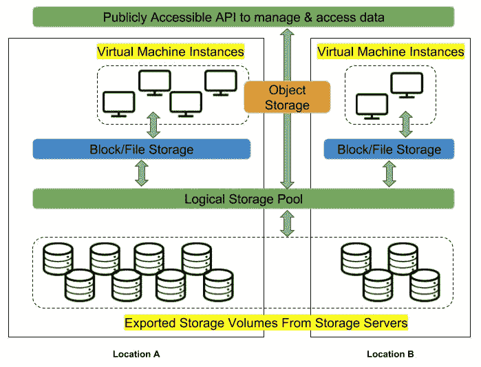

图 1. 云端典型存储架构的高级概述

在底部，有由多个物理存储设备或硬盘组成的存储服务器。单个位置内会部署多个存储服务器。这些物理卷随后会在单个位置内或跨越多个位置聚合在一起，创建一个逻辑卷。

当用户为虚拟机实例请求数据卷，或者甚至为了跨网络访问该数据卷时，指定大小的卷将从较大的驱动器池中划分出来。在大多数情况下，用户可以根据需要轻松调整数据卷的大小。

在云中，存储以几种方式呈现给用户。首先是传统的块设备或文件系统，遵循古老的访问方法，它们可以映射到运行你任选的任何操作系统的虚拟机上。这些在 `AWS` 上被称为弹性块存储（`EBS`）和弹性文件系统（`EFS`）。另一种更新的方法被称为对象存储，通通过 `HTTP` 上的表述性状态传输（`REST`）`API` 进行网络访问。

对象存储与块存储/文件系统存储的区别在于它将数据管理为对象。每个对象都包含数据本身，以及元数据和一个全局唯一标识符。用户或应用程序将通过通过请求其唯一标识符来访问该对象。这里没有文件层级结构的概念，也没有目录或子目录。这项技术对于更现代的以 `Web` 为核心的计算风格已经变得非常标准。看到它被用于存储照片、视频、音乐等非常常见。前文提到的 `AWS` 对象解决方案统称为 `S3`。

## 虚拟化

云成功的关键围绕着基础设施即服务（`IaaS`）的概念及其通过虚拟机程序 `API` 提供虚拟机的能力。虚拟机程序允许你在同一台物理硬件上托管多个操作系统（即虚拟机）。大多数现代虚拟机程序设计用于模拟多种 `CPU` 架构，包括 `Intel` (`x86` 和 `x86-64`)、`ARM`、`PowerPC` 和 `MIPS`。在云的情况下，通过基于 `Web` 的前端，你可以完全控制所有分配的计算资源，并能够在几分钟内获取并启动一个新的服务器实例。

考虑一下。你可以同时订购单台服务器或数千个服务器实例，只需几分钟内——不是几小时或几天，而是几分钟。这非常令人印象，对吧？这一切都是通过 `Web` 服务应用程序编程接口（`API`）控制的。对于那些不太熟悉的人来说，`API` 是将服务、应用程序和整个系统胶合在一起的胶水。通常，`API` 通过暴露业务能力和服务充当公司或产品的公共形象。面向云的 `API` 可以从浏览器、移动应用程序或任何其他连接互联网的端点调用。

对于每个部署的服务器实例，你同样拥有完全控制权。翻译一下：你对每一个实例都有 `root` 权限（带有控制台输出），并能够根据需要与它们进行交互。通过同一个 `Web` 服务 `API`，你可以启动或停止任何必要的实例。云服务提供商允许用户选择（虚拟）硬件配置——即内存、`CPU` 和带有驱动器分区大小的存储。用户还可以从多个操作系统列表（包括 `Linux` 发行版和 `Microsoft Windows Server`）以及软件包列表中选择安装。最后，值得注意的是，选择的资源越多，服务器实例就越贵。

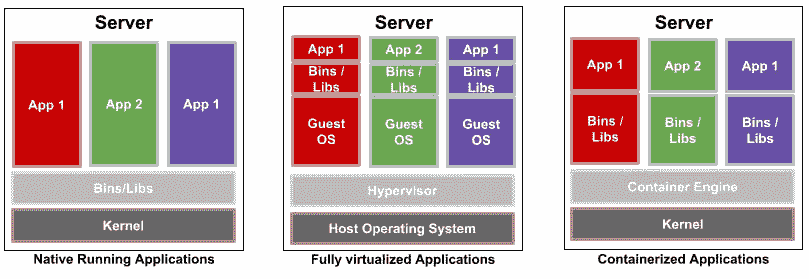

图 2. 阐述在裸机系统、虚拟机程序和容器上运行应用程序的区别

## 容器

在运行虚拟机时，容器就是你能获得的最接近裸机的方式了。托管虚拟机产生的开销非常小或几乎没有。此功能限制、计算并隔离了一个或多个进程的 `CPU`、内存、磁盘 `I/O` 和网络使用。本质上，容器将软件应用程序与操作系统分离，为用户提供一个干净且最小的操作环境，同时在一个或多个隔离容器中运行其他。

这种隔离防止运行在给定容器内的进程监控或影响在另一个容器中的进程。此外，这些容器化服务不会影响或干扰宿主机。将分散在多个物理服务器上的许多服务合并到一个地方的想法，是数据中心选择采用该技术的许多原因之一。这种隔离方法通过限制安全泄露或违规造成的损害，增加了该技术的安全性。成功利用该容器内运行的应用程序的安全漏洞的入侵者，将被限制在该容器内可能的操作范围内。

## Serverless Computing

云原生（`Cloud native computing`）或无服务器计算（`serverless computing`）是较新的术语，描述了部署和管理应用的现代趋势。其理念非常直观：每个应用程序或进程都被封装在自己的容器中，而容器在节点集群上进行动态编排（即调度和管理）。这种方法使应用程序脱离了物理硬件和操作系统的依赖，进入到它们自己的自包含且沙箱环境中，该环境可以在数据中心的任何地方运行。云原生方法的核心在于将应用程序交付的各个组件分离。

这听起来可能与在云端运行任何其他容器无异，但云原生计算之所以如此独特，在于你不需要担心管理这些容器（意味着更少的开销）。这项技术对开发者来说是隐藏的。你只需上传代码，当指定的触发器启用时，`API` 网关（由服务提供商维护）将按照其预期的处理触发器的方式部署你的代码。

这里首先想到的就是亚马逊的 `AWS Lambda`。同样，在这种模型下，无需配置或管理物理或虚拟服务器。假设它处于稳定或生产状态，只需上传代码即可完成。你的代码将直接部署在一个隔离的容器化环境中。在 `Lambda` 的案例中，亚马逊为开发者提供了一个框架，用于上传他们的事件驱动应用程序代码（使用 `Node.js`、`Python`、`Java` 或 `C#` ），并在毫秒内对网站点击等事件做出响应。运行大部分代码的所有库和依赖项都由容器提供。

至于触发应用程序的事件类型，亚马逊已经实现你可以通过网站访问或点击、向其 `API` 网关发送 `REST HTTP` 请求、你的物联网（`IoT`）设备传感器读数，甚至是向 `S3` 存储桶上传照片来触发应用。

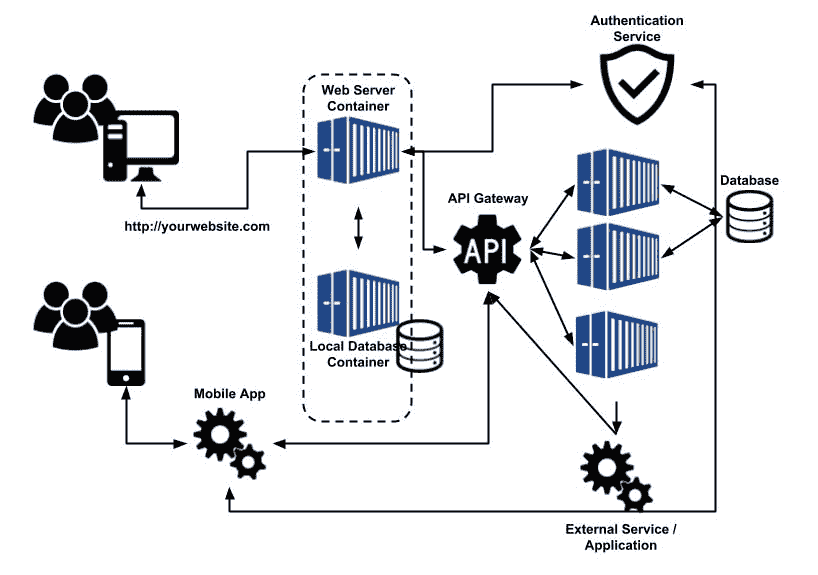

图 3. 典型的云原生计算模型

现在，所有这些组件是如何结合在一起的？这始于用户通过网站或移动设备上的应用程序访问你的服务。`Web` 服务器及其所依赖的各种组件可能托管在本地管理的容器甚至虚拟机上。如果 `Web` 服务器或移动应用程序需要某个特定功能，它将连接到第三方身份验证服务，例如 `AWS Identity and Access Management`（`IAM`）服务，以获取访问位于 `API` 网关之外托管的无服务器函数的适当凭据。被触发时，这些函数将执行必要的操作，并返回 `Web` 服务器或移动应用程序请求的任何内容。（我将在第二部分更深入地介绍这项技术。）

## 安全

通常人们认为私有云和本地化解决方案比公云选项更安全，但最近的研究表明事实如此。公云服务提供商花费了更多的时间资源与安全专家咨询并更新其软件框架以限制安全泄露。尽管这可能是事实，但利用公云服务的真正安全挑战在于如何安全地使用它。对于企业组织而言，这意味着应用安全云迁移的最佳实践，尽可能减少锁锁，并最大限度地提高可用性和运行时间。

我已经提到了身份和身份验证方法，当涉及到公开暴露的服务时，这一功能变得越来越重要。这些身份验证服务使用户能够管理对其提供商的云服务的访问。例如，`AWS` 有一个名为 `IAM` 的工具。通过 `IAM`，你将能够创建和管理 `AWS` 用户/组，并设置权限允许或拒绝他们访问各种 `AWS` 资源或特定的 `AWS` 服务 `API`。对于较大（甚至更小）的部署，这种权限框架简化了对构成云的各种组件的全局访问。这通常是主要提供商提供的免费服务。

### 总结

可以这么说，这篇文章涵盖了大量内容：云的组成部分、不同的部署方法（公有、私有和混合）以及顶级云服务提供商提供的服务类型，随后概述了云是如何设计的、如何运作的，以及这些功能如何实现了我们今天所享用的特性。

在这一系列的第二部分中，我将通过 `AWS` 中的真实示例进一步探索云。所以，如果你还没有这样做，请务必在 [AWS](https://aws.amazon.com) 注册一个账户。该账户可能会产生费用。

# 深度解析：关于云和云计算，你需要了解的一切，第二部分：使用云

## 如何开始 AWS、安装 Apache、创建 EFS 卷及更多。由 Petros Koutoupis 编写

云将一直存在，无论你每天如何访问数据。无论你是在社交媒体账户中与朋友一起上传并分享新照片，还是在办公室或学校与同事一起更新文档和电子表格，你很可能以某种形式连接到云。

在系列文章的第一部分中，我探讨了云的组成部分，以及当所有独立的运行部件结合在一起时它是如何运作的。在篇文章中，基于第一部分的基础，我通过一些实际示例介绍了如何使用云。

### 入门 AWS

就本文而言，我重点关注亚马逊云服务（`AWS`）提供的几项顶级产品。请注意，我与 `Amazon` 没有任何附属关系，我也没有声称 `Amazon` 的产品优于其竞争对手。

如果你还没有注册，请务必[注册账户](https://aws.amazon.com)。但在操作之前，请理解可能会产生费用。`Amazon` 可能会为新注册用户提供限期（通常为一年）的 `free` 层级产品。在大多数情况下，这些产品的限制对于现代用用例来说并不理想。这是一种按需付费的模式，只要实例保持活动状态，你就会被收费。

一旦你在网络浏览器中注册并登录，你将看到一个非常直观的面板。

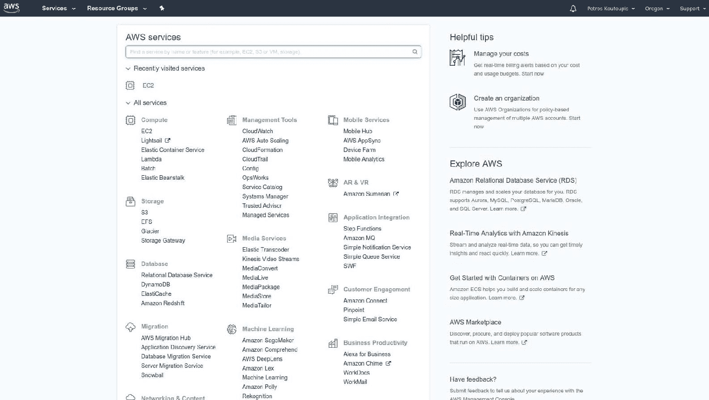

图 1. AWS 服务和资源主面板

### 计算

起初，利用计算的公司通过直接复制和粘贴他们自己的数据中心来部署标准的 `Web`/应用程序/数据库服务器。模型是相同的。这种方法没有问题。对于大多数从本地迁移到云的用户来说，这种几乎是无缝的——至少从访问这些资源的用户的角度来看。唯一的区别在于它位于不同的数据中心，且无需担心支持它的基础设施的头恼。

在 `AWS` 世界中，虚拟计算服务器在弹性计算（`EC2`）栈下管理，从整个虚拟机到容器以及更多。让我们通过导航到 `EC2` 面板开始一个 `EC2` 示例。

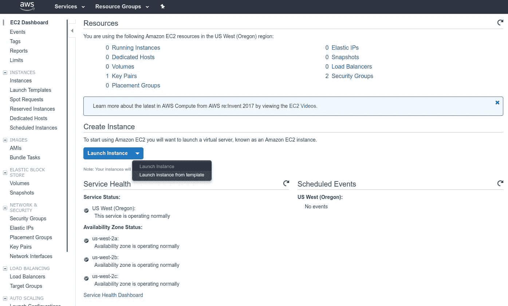

图 2. 弹性计算面板

点击“启动实例”后，你将看到一个屏幕，可以在其中从各种预配置 `Linux` 和 `Windows` 安装镜像中选择。对于本示例，让我们选择 `Ubuntu Server 16.04`。

后续屏幕提供了定义所需的虚拟核心或处理器数量、总内存和网络速度的。记住，实例中定义的内核和内存越多，成本越高。

从现在起，你可以决定是否要通过额外的本地存储（使用 `Elastic Block Storage` 或 `EBS` 框架）、安全策略、部署区域（数据中心）等对此特定实例进行进一步自定义。在本示例中，让我们“Review and Launch”（审查并启动）。

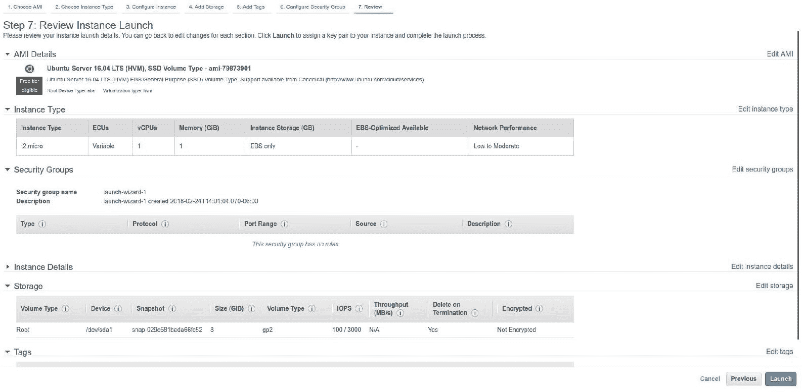

图 3. EC2 实例审查界面

确认你的所有设置均正确，并记住实例的 `Security Group`（安全组）名称（你稍后会回到这里）。点击 `Launch`（启动）。

下一步非常重要。系统将提示你关联现有的公/私钥对来访问此虚拟机，或者创建一个新的密钥对。创建后，请务必下载并将生成的 `PEM` 文件副本储存在安妥的地方。你稍后会需要它。

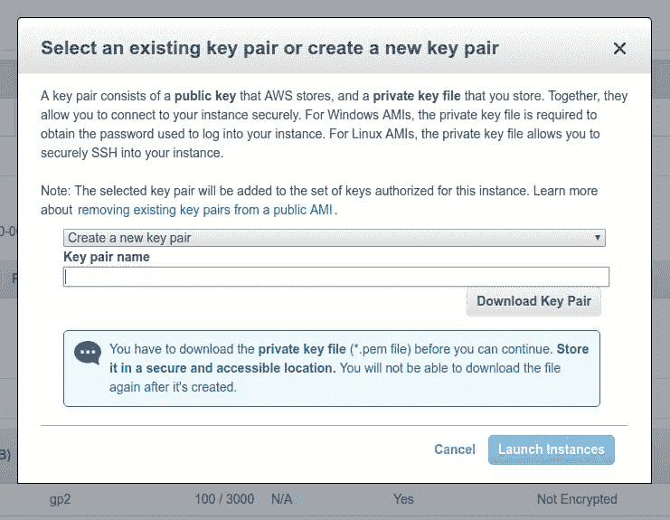

图 4. EC2 公钥/私钥对

启动你的实例并进入 `Instances Dashboard`（实例仪表板）。你的虚拟机现在已经启动运行，你应该能够使用该 `PEM` 文件登录它。

现在，在你的本地机器上找到该 `PEM` 文件，并将其权限更改为仅所有者可读：

```
 $ chmod 400 Linux-Journal.pem 
```

使用 `SSH` 并引用同一个 `PEM` 文件，通过其公网 `IP` 地址以用户 `ubuntu` 登录实例：

```
 $ ssh -i Linux-Journal.pem ubuntu@35.165.122.94
Welcome to Ubuntu 16.04.3 LTS (GNU/Linux 4.4.0-1049-aws x86_64)

 * Documentation:  https://help.ubuntu.com
 * Management:     https://landscape.canonical.com
 * Support:        https://ubuntu.com/advantage

  Get cloud support with Ubuntu Advantage Cloud Guest:
    http://www.ubuntu.com/business/services/cloud

0 packages can be updated.
0 updates are security updates.

The programs included with the Ubuntu system are free software;
the exact distribution terms for each program are described in 
the individual files in `/usr/share/doc/*/copyright`.

Ubuntu comes with ABSOLUTELY NO WARRANTY, to the extent 
permitted by applicable law.

To run a command as administrator (user "root"), use 
"sudo <command>". See "man sudo_root" for details.

ubuntu@ip-172-31-21-167:~$ 
```

*搞定！* 你做到了。你在 `AWS` 上部署了一台虚拟机并现在已连接到它。从现在开始，你可以像对待任何其他服务器一样对待它。例如，现在你可以安装 `Apache`：

```
 $ sudo apt install apache2 
```


现在`Apache`已安装并运行，你需要修改此实例使用的同一个`Security Group`，以允许通过相同的公网 IP 地址访问端口`80`。要做到这一点，请导航到实例仪表板菜单中位于`Network and Security`（网络与安全）类别下的“Security Groups”（安全组）选项。在列表中找到你的`Security Group`，选择它，并在选择表格的底部点击`Inbound`（入站）选项卡。接下来，让我们添加一条规则，允许对端口`80`（`HTTP`）的入站访问。完成后，打开网页浏览器并粘贴机器的公网 IP 地址。

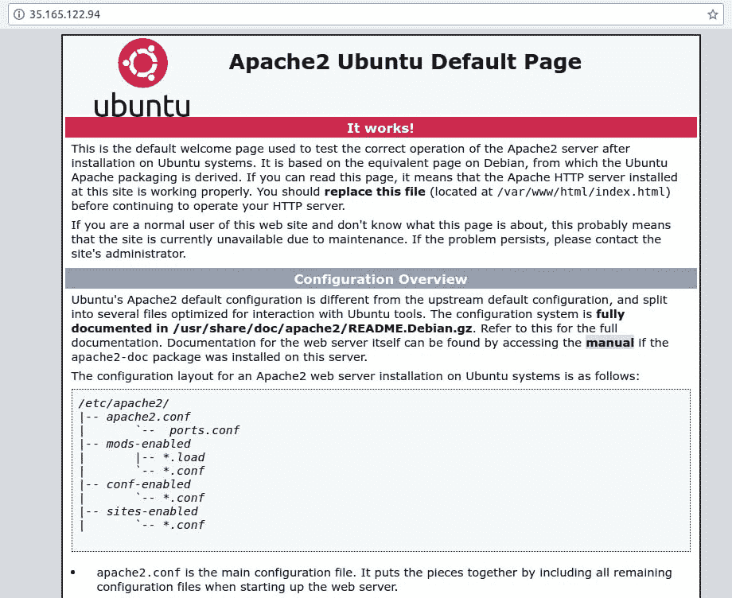

图 5. 在虚拟机实例上访问端口 80

现在，如果你不需要一个完整的操作系统，而只关心运行一个或两个应用程序怎么办？参考上面的`Apache`示例，也许你只需要一个 Web 服务器。这就是`Elastic Container Service`（`ECS`）大显身手的地方。`ECS`构建在`EC2`之上，你需要启动一个`EC2`实例来托管来自 Amazon 托管`Docker`镜像仓库的`Docker`实例。`Docker`是最流行的容器技术。它是一个用户空间量级的虚拟化平台，利用`Linux Control Groups`（`cgroups`）和命名空间来管理资源隔离。

随着用户深耕云端，他们将开始依赖提供商的负载均衡器、`DNS`管理器等。之前讨论的模型不断演变以适应这些需求并简化其管理。甚至可能希望接入提供商的机器学习或分析平台等。

### 云原生应用

当转向无服务器化（serverless）时，传统的数据中心开始消失。这是一个极具弹性的模型——服务的启动和收缩总是随需求而变化。登录服务器的时间大大减少，相反，DevOps 工程师花费大部分时间编写`API`代码来连接产品中的所有端点。`Linux`在底层运行一切的事实在这个公式中变得不再重要。人们不再需要了解甚至关心它。

正如预期的那样，容器技术帮助加速了云的采用。想一下：你拥有这些持久的容器化应用镜像，它们根据需要几秒钟内启动或收缩，并在多个节点或数据中心位置之间进行负载，以实现最佳的服务质量（`QoS`）。但是，如果你不想被所有容器事务困扰，而只关心你的应用程序及其功能呢？这就是 Amazon`Lambda`帮助帮助的地方。正如我在第一部分提到的，通过`Lambda`，你不需要担心容器。只需上传你的事件驱动应用代码（用`Node.js`、`Python`、`Java`或`C#`编写），并在毫秒内响应事件（例如网站点击）。`Lambda`会自动扩展以支持你应用程序的确切需求。

至于触发你的应用程序或代码处理程序的事件类型（标记为事件源），Amazon 已经做了支持，让你可以通过网站访问或点击、向其`API gateway`发送`REST HTTP`请求、你的`Internet-of-Things`（`IoT`）设备的传感器读取，甚至是上传到`S3`桶来触发。这个`API gateway`形成了连接`Lambda`各部分的桥梁。例如，开发者可以编写一个触发`HTTPS`请求的处理器。

假设你需要为代码实现某种粒度的控制。`Lambda`通过允许编写模块化处理器来实现这一点。例如，你可以为每个`API`方法编写一个处理器，每个处理器都可以独立地调用、更新和修改。

`Lambda`允许开发者将所有所需的依赖（即库、原生二进制文件甚至外部 Web 服务）合并到函数包中，让处理器根据需要自由访问其中任何内容。

现在，这与 Amazon AWS`EC2`实例相比如何？嗯，简单的答案是，它简单得多，我所说的简单意味着在配置或维护操作系统环境方面几乎没有开销。如果你需要访问完整操作系统或容器的更多功能，你将启动一个`EC2`虚拟机实例。如果你只需要托管函数或特殊用途应用程序，那么`Lambda`将是更好的选择。在`Lambda`中，没有太多可以自定义的——有时，越少越好。

### 存储

如果你还记得第一部分提到的，在云中，多个本地卷跨越一个或多个站点汇聚并形成更大的存储池。当请求块、文件系统或对象格式的卷时，它们是从这些较大的池中划分出来的。

#### 弹性文件系统

Amazon Elastic File System（`EFS`）为用户提供了一种简化的、高可用且高度可扩展的文件存储，供云中的`EC2`实例使用。与 Amazon 提供的任何产品一样，`EFS`卷的存储容量是弹性的，它可以动态增长和收缩以满足应用程序的需求。当挂载到虚拟机上时，`EFS`卷提供了传统的文件系统接口和文件系统访问语义。

要创建一个新的 EFS 卷，请从 AWS 主仪表板中选择 EFS，然后点击“创建文件系统”（Create file system）按钮。您将被引导至一个需要配置新文件系统的屏幕。为了简化操作，让我们选择与上一个示例中`EC2`实例相同的安全组。

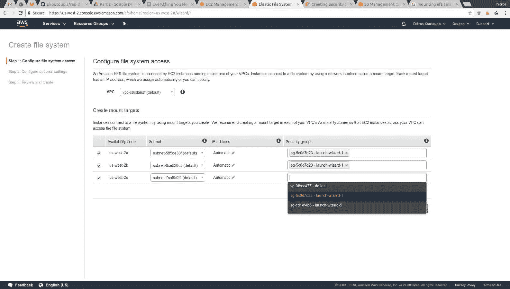

图 6. 创建新文件系统并将其分配给安全组

接下来，为您的文件系统命名并验证其选项。

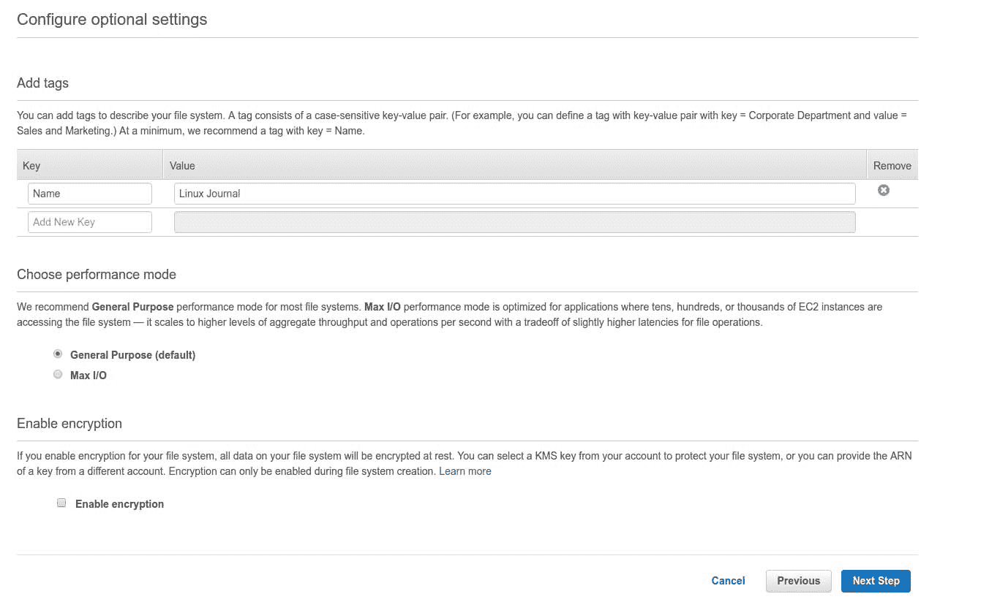

图 7. 设置名称和配置选项

确认并创建后，您将看到一个与图 8 类似的摘要。注意，在“生命周期状态”（Life cycle state）显示为可用（available）之前，文件系统无法从特定位置使用。

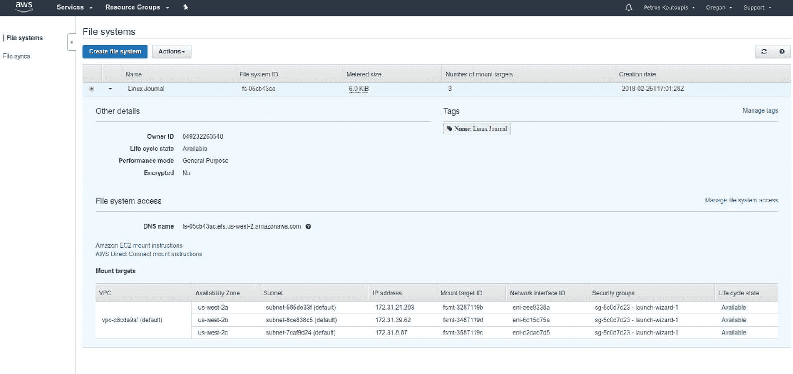

图 8 文件系统摘要

使用相同的`EC2`实例，从发行版的包仓库安装 NFS 软件包：

```
$ sudo apt-get install nfs-common
```

在继续之前，您需要将 NFS 添加到您的安全组中。这适用于入站和出站流量。

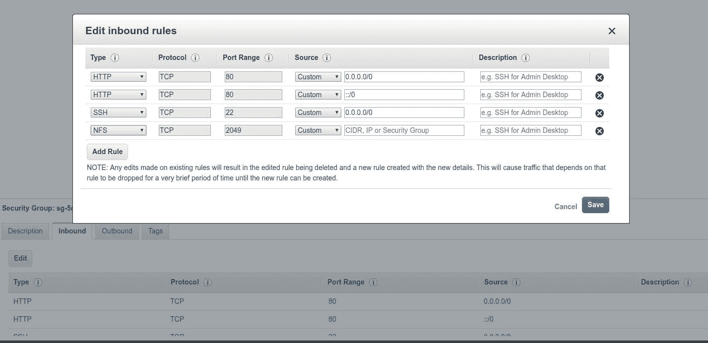

图 9. 将 NFS 添加到您的安全组

从虚拟机实例的控制台挂载 NFS 文件系统：

```
$ sudo mount -t nfs4 -o nfsvers=4.1,rsize=1048576,wsize=1048576,hard,timeo=600,retrans=2 fs-05cb43ac.efs.us-west-2.amazonaws.com:/ /mnt
```

验证卷是否已挂载（注意：在下方 Filesystem 下的最后一行中，名称被截断以适应输出显示；该条目应显示为`fs-05cb43ac.efs.us-west-2.amazonaws.com`）：

```
$ df
Filesystem       1K-blocks    Used        Available Use% Mounted on
udev                499312       0           499312   0% /dev
tmpfs               101456    3036            98420   3% /run
/dev/xvda1         8065444 1266640          6782420  16% /
tmpfs               507268       0           507268   0% /dev/shm
tmpfs                 5120       0             5120   0% /run/lock
tmpfs               507268       0           507268   0% /sys/fs/cgroup
tmpfs               101456       0           101456   0% /run/user/1000
fs-05...  9007199254739968       0 9007199254739968   0% /home/ubuntu/efs
```

大功告成了！`EFS`卷现在已连接到您的`EC2`实例，您可以像对待其他文件系统一样对它进行读取和写。

### S3

简单存储服务（`S3`）为应用程序提供了一个前端，用于从桶（buckets）中海量地存储和检索数百万乃至亿计的数据内容。传统文件系统无法对如此大量的数据列表进行索引，也无法在合理的时间内提供数据。对象存储解决了这个问题。它不是文件系统，而是一个高层编索引系统。当您向桶中`PUT`一个文件时，您是使用标签 ID 进行的。然后当您从同一个桶中`GET`该文件时，您通过相同的标签 ID 请求它。

从高层次来看，您无法看到数据是如何存储或管理的，而且从技术上讲，您也不应该关心。每个对象存储解决方案都有其保存对象内容的方法，有时这种方法仅仅是将每个单独的对象作为文件保存在嵌套目录结构下的传统文件系统上，但并不对终端用户或应用程序可见。应用程序将通过 REST API 并通过 HTTP 与桶的端点通信来访问此类数据或桶。

Amazon 的`S3 API`已经成为某种标准，其他对象存储解决方案在保持自有 API 的同时，也与此 API 兼容。其初衷可能是为了将相同的 AWS S3 用户迁移到其他对象存储平台。

### Glacier

Amazon Glacier 为其用户提供了一种托管在云端上的极其安全、耐用且低廉（每月每 GB 最低至 $0.004）的数据归档和长期备份替代方案。这是大多数公司放弃其陈旧且极其有限的本地文件服务器和磁带驱动器的方法。您的公司多久发现自己在减少本地存档系统的消耗或增加容量而苦苦？这种情况发生的比你想象的要频繁得多。Glacier 缓解了所有这些烦恼和担忧。

### 私有云和 OpenStack

当我 15 多年前进入数据存储行业时，那是一个完全不同的时代，客户也完全不同。那是存储区域网络（SAN）和网络附属存储（NAS）的时代。云还不存在。我们的客户主要是中大型企业用户。这些公司都是单一供应商的。如果你是 HP 用户，你就买 HP；如果你是 EMC 用户，你就买 EMC；如果你是 NetApp 用户，你就买 NetApp，以此类推。

大约十年前，这种心态开始发生变化。令人兴奋的新技术涌现出来：虚拟化、闪存和软件定义一切。这些技术最终将成为未来的云。然而，问题在于大型供应商并没有提供这些技术——至少在刚开始时没有。结果是客户开始远离单一供应商的模式。现在有了太多的活动部分，每个部分都需要不同的专业知识。然而，隧道尽头出现了光：OpenStack 诞生了。OpenStack 将所有活动组件（即存储、计算和网络）胶合在一起。该项目是一个 Apache 许可的开源框架，用于构建和管理公有云和私有云。其相互关联的组件控制着处理、存储和网络硬件池，所有这些都通过基于 Web 的仪表板、一组命令行工具或 API 进行管理。尽管 OpenStack 并发布了其独特的 API，但该项目仍努力与竞争 API 保持兼容，其中包括 Amazon 的`EC2`和`S3`。

OpenStack 的首要目标是创建一个单一且通用的框架，用于在数据中心动态地部署和管理各种技术。该项目最初于 2010 年由 Rackspace Hosting 和 NASA 联合发起，从此以后经历了指数级增长，并吸引了大量的支持者和用户。OpenStack 成功的秘诀在于融合。通过提供一个单一且标准化的框架，它为几乎不可管理的生态系统恢复了秩序。它最近的流行并不意外。现代的企业支持的 Linux 发行版——包括 Red Hat Enterprise Linux（RHEL）、SUSE Linux Enterprise Server（SLES）和 Ubuntu Server——已经付出了巨大的努力，不仅为了简化技术，还为了支持它。尽管我在这里不会花更多时间讨论这项技术（因为它值得拥有自己专门的文章），但我想说，如果你想要运行自己的私有云部署，OpenStack 绝对是实现这一点的正确方法。

### 总结

最后，为什么要使用云？如果以下列表不能说服你，我不知道还有什么可以：

- 灵活性。
- 开发和部署的速度。
- 容错能力（以及高效的灾难恢复计划）。
- 获取最新强大的软件。
- 降低运营成本。
- 增强跨团队协作。
- 远程访问（随地工作）。
- 安全性。
- 以及更多……

一个提供顶尖性能、极其丰富且不断增长的服务选择以及全球覆盖的公共云平台的可用，是你 IT 策略中一个强有力的、甚至是必不可少的补充。对于较大的组织，你可能需要计划为某些类型的工作负载构建自己的内部私云——而`OpenStack`的可用性在扩展性、所有权和现有数据中心资产利用率方面兼顾了两者的优势。

由于空间限制，这里我还有很多涵盖的内容——例如，`AWS`（以及其他云供应商）添加了非常先进的安全选项来限制对各种资源的访问，通过创建用户和组策略来实现这一点。你还可以扩展用于`EC2`实例所用安全组的规则，并进一步将某些端口限制到特定的 IP 地址或地址范围。当你决定利用云来满足你的计算需求时，请务必投入足够的时间来确保这些设置配置得当。

# 云计算账单的痛苦与狂喜

### 云计算账单本质上是复杂的；这不仅仅是你一个人的问题。作者：Corey Quinn

在很久以前，当我开始阅读`Linux Journal`时，弄清楚一个基础设施的成本（尽管在某些方面仍然很烦人）其实是很直接的。你会与托管服务提供商签署租赁合同，购买按计划折旧的硬件，并与带宽提供商达成“血血之约”，在你的规模发生重大变化之前，你基本上就万事大吉。

在当今这个勇敢的新型云世界中，这一切都烟消云散了。公共云供应商用一只手给予（“拥有你想要的任何环境的全副本，按小时计费！”），用另一只手拿走（单个 Linux 实例每小时将花费你 $X，每月每个 GB 传输费用 $Y，以及附加存储费用 $Z；我们将这种定价简化为我们所说的“随用随付”）。

在我的本职工作中，我是一个专门负责分析和减少`Amazon Web Services (AWS)`账单的顾问。因此，我见过许多环境在执行不同的操作：云原生公司在没有治理的情况下启动业务；大型企业带着遗留应用迁移到公云，而这些应用在没有经过深度调整的情况下并不完全支持这种模型；还有一些云迁移项目由于某种方式严重迷失了方向，以至于现状是可以接受的，并被贴上了“多云”的标签。在整个过程中，确实出现了一些主题，我发现人们起初并没有直观地理解。具体来说：

- 进行基础算术来计算一个当前数据中心原样迁移到云端所需的成本是相对直接的——通常非常昂贵！如果你将现有的数据中心 1:1 地映射到云端对应物，成本无疑会更高；这是理所当然的。真正的成本节省出现在你开始利用云的能力时——你的 Web 服务器池不需要一直保持 50 个实例。如果那是你的突发负载，也许你可以在流量低谷时将其扩展到 5 个左右实例？只有当你陷入一种模式（并且你的应用程序支持这种模式！）即仅在需要时按需付费时，云的成本节省效益才会显现出来。
- 云经济学中最被误解的方面之一是总拥有成本（或`TCO`）的正确计算。如果你想对构建存储系统而非使用`S3`的意义进行盈亏平衡分析，你必须包含的内容远不止是一堆硬盘。你必须考虑灾难恢复设备和位置、处理数据复制的软件、运行数据中心/更换硬盘的人员、从需要的地方获取存储数据的带宽、未来增长的容量规划——以及构建该系统而非专注于产品功能的机会成本。
- 很容易迷失在云账单维度的复杂迷宫中，而忽视了你的人力开支这一事实。我还没有见过任何员工超过五人的公司，其云支出不被工资支出所掩盖。与我们一些人出于爱好而做的玩具项目不同，工程时间的成本是非常昂贵的。重新培训现有员工以拥抱云未来需要时间，而且并不是所有人都能快速适应这种新范式。
- 会计部门将对此发表意见，如果你没有准备好进行这种对话，可能会变得令人愉快。你正从一个旧世界离开，在那个世界里，你可以提前几年规划计算支出并保持相当准确。而云取代了一系列需要考虑的变量，包括取决于负载的可变成本、预留实例（`Reserved Instances`）的摊销、供应商的降价，以及对资金实际去向的完全缺乏透明度（是`Dev`还是`Prod`？哪个产品？哪个团队启动的？某位工程师六个月前离开了公司，但那人的 500TB 数据仍然停留在那里，等等）。

最糟糕的部分是，这一切对于云账单的新手来说并不是显而易见的，所以当你掉进这些边缘情况时，感到问题在某种程度上是你的错是自然的。我以此为生，我曾在试图弄清楚`AWS`中数据传输可能的成本时被难住。我开始画出如何向客户计费的，最终得到了图 1 所示的`AWS Data Transfer Costs`图。

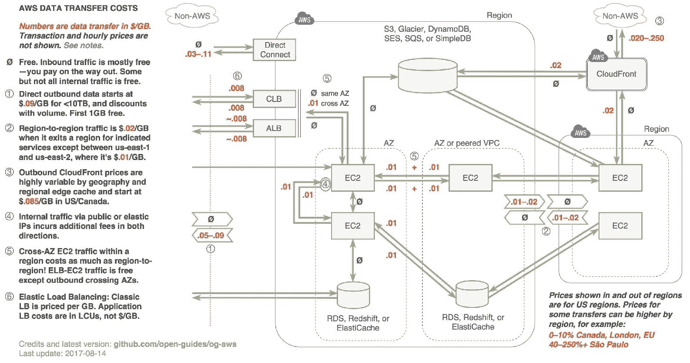

图 2. AWS 数据传输定价的复杂映射。

如果你能记住这些数字，你在这方面就比我强得多！这并不直接，并不简单，如果你不直观地了解这些事情，绝对不是你的错。

尽管如此，帮助触手可及。`AWS`账单正变得越来越易于理解，得益于预留实例推荐的出现、`Cost Explorer API`的发布以及无服务器技术的兴起。与此同时，`Google 的 GCP`和`Microsoft 的 Azure`从 AWS 早期的账单失误中吸取了教训，因此两者的成本结构都容易理解得多。此外，市场上还有许多成本可见性的平台服务（PaaS）产品；它们的功能大同小异，但非常适合对你的账单进行即时查询。如果你更倾向于构建自己可以控制的东西，可以将所有供应商的账单信息推入 SQL 数据库，并在上方运行`QuickSight`或`Tableau`等工具来辅助可视化，正如许多公司现在所做的那样。

作为这种极其复杂性的回报，你获得了一种非常特别的东西——按需启动资源、按所需的时间运行，并仅为你使用过的内容付费。仅仅作为学习资源，这都是不可思议的——想象一下如果在 20 世纪 90 年代可以直接获得一个工作的 Linux 虚拟机，而不是为了`Slackware`的安装而苦战一周，将会变得简单多少。云在索取，但也在给予。


我的职业生涯始于在一家小办公室担任全能型的“电脑达人”。在这份工作中，我身兼数职，包括桌面帮助台、服务器管理员、网站管理员、网络管理员、安全工程师等。总而言之，只要是插了电的，可能都由我负责。那是过去的时代，尽管`Linux`开始在 Web 服务器市场占据一席之地，但`Microsoft`绝对主导了桌面和企业服务器市场。在当时，人们认为任何规模（从十人到一千人）的办公室不仅会在桌面端运行`Windows`，而且后台部门也会运行`Windows`服务器。

这些`Microsoft`服务并不一定比替代方案更好，但由于供应商锁定（vendor lock-in），它们还是胜出了。对桌面市场的统治意味着`Microsoft`可以开发诸如`SMB`（文件共享）和`MAPI`（邮件客户端同步）等专有协议，并将它们添加到`Windows`和`Microsoft Office`中。一旦`SMB`被内置在`Windows`中，小型办公室的老板就可以很容易地在不添加任何额外软件的情况下，将其桌面变成办公室文件服务器。随着公司的发展，那台桌面会被一台独立的`Windows`服务器取代；而当你发现你的`ISP`（到目前为止一直用于企业邮件）不支持你在`Outlook`中看到的共享日历功能时，你会发现`Exchange`及其`MAPI`协议是可以支持的。

## 方便如何导致锁定

人们选择单一供应商的解决方案往往不是因为它们更好，而是因为它们更方便。有一种内置的假设：如果你从同一供应商处购买两个产品，它们的协同工作会比其中一个产品来自不同供应商更好。然而，当所有东西都来自同一个供应商时，该供应商就可以开发专有协议，这些协议具有仅为其产品的特殊功能，竞争对手无法使用，或者必须支付高昂的许可费才能使用。除了`Microsoft`之外，这种情况也可以出现在仅可在`Cisco`设备上运行的路由协议，或仅可在`Oracle`数据库上运行的`SQL`变体中。在所有这些情况下，他们都有动力增强专有协议，并忽视与其支持的开放标准之间的 Bug、性能问题或兼容性问题。

正是对专有协议和标准的接受导致了供应商锁定。当两个不同的供应商相互协作时，他们通常会选择开放标准和公共协议。如果你不喜欢其中一个供应商，你可以用另一个支持相同标准和协议的供应商来替换它。有了供应商锁定，你最终将使用仅存在专有协议中的功能，这将其替换为其他供应商就会变得困难得多。无论竞争对手的解决方案有多好，离开专有协议的时间和精力都变得太大了。

当`Linux`进入服务器领域时，它的稳定性和免费（指成本免费）特性开始侵蚀数据中心中的`UNIX` Web、应用和数据库服务器。通过像`Samba`等工具，它还开始静静地替换不稳定的`Windows`文件服务器。`Linux`对开放标准的强力支持凸显了专有协议的一些问题，很大程度上正是因为它（以及此之前的`UNIX`），我们今天使用的互联网才依赖于`TCP/IP`、`DNS`和`HTTP`等开放协议。在过去的某一个时刻，这并不是理所当然的。

## 云仅仅是另一个供应商

我提到这一切，是因为我们正在重复过去完全相同的错误，只不过这次是在云端。我将其归结为几种因素的结合：那些没有经历过上一波封闭标准的年轻工程师；那些仍然专注于诸如`Microsoft`这样古老敌人的`Linux`极客，以至于他们从未注意到取代他们的巨头们；以及那些懂行但乐于用供应商锁定换取便利的高级工程师，因为在行业内工作了几十年后，他们开始感到疲了。当你考虑到现代互联网很大程度上运行在少数几个云提供商之一身上（老实说，大部分只运行在其中某一家身上）时，这种自满正在创造一种单一文化，将过多的控制权交到了一个组织手中。

单一文化在问题出现之前可能运行得很好。农作单一作物，例如美国南部的棉花和爱尔兰的土豆，在出现棉铃象甲虫和瘟疫之前都是繁荣的。有了云，你的整个业务都运行在一个基础设施上，并且存在这样假设：整个基础设施永远不会出问题，至少在出问题之前是如此。到那时，你不仅发现云提供商有故障，而且发现这个故障实际上是*你的错*，因为你把所有的鸡蛋都放在了一个篮子里。也许篮子是单台服务器，可能是单个可用区，也许是单个区域的`S3`。点在于，无论停机有多大，都是你的错，因为如果你向后退一步，你总是会发现当所有的鸡蛋都在一个篮子里时，容错性由你承担——至少在篮子变成云提供商本身之前。

此时，大多数人在两件事上找到了慰藉。首先，如果他们的云供应商出现重大的系统性问题，它不仅仅是宕机——互联网的一大区域都会瘫机。你看，他们的云供应商大到不能倒闭，所以为什么要为一个可能永远不会发生的事件做计划呢？其次，他们已经完全投入了他们的云供应商，并使用了太多的专有服务。开发一个可以在多个云平台上运行的架构会太困难、太耗时且太昂贵。这也意味着要放弃他们平台今年刚刚发布的一些非常易用的新功能，这些功能可能没有竞争对手那么好，但与他们的现有服务集成得如此容易。

## 互联网只是别人的云

我写这篇文章是因为，更大的风险并不是你们公司的服务（尽管我确定它们非常棒，但老实说，我们可能可以没有它们几小时甚至几天）。更大的风险是，如果互联网几乎都运行在少数云提供商的专有服务上，互联网的开放标准以及我们自由使用互联网的能力会变成什么。我们`Linux`用户对`Linux`主导云基础设施服务器的事感到非常自豪，然而许多真正充分利用云基础设施的工程师从未接触过`Linux`或与其相关的任何内容。他们仅仅是与专有 API 之上的抽象层进行交互——事实上，许多人将只需与他们云供应商的 API 交互视为一种功能，如果目前的趋势继续向此发展，云基础设施将变成终极的专有操作系统，此时底层是否有任何开放标准或软件已经不再重要，因为那些对你来说都是隐藏了。

如果我们进展到那一步，没有任何东西能阻止供应商在后台将任何开放标准替换为最完美适配其平台的专有标准。问题在于，这些标准是否会开始取代其网络之外存在的开放标准。第二名和第三名的竞争对手会尝试添加互操作性功能以吸引客户迁移，但随着这些新协议变得越来越闭源，他们面临的困难将变得越来越大。随着竞争的减少，获胜的供应商创新的动力会减少，而增加锁定的动力会增加。当然，无论如何你都不会看到这些变化，所以没什么好担心的。毕竟，到那时对你来说切换成本也已经太贵了。

我写这些并不是为了说你不应该使用云。到目前为止，云基础设施在许多方面帮助了`Linux`和一些开放标准的增长，它还催生了许多创新，包括我们创建服务器基础设施的速度、其整体韧性以及帮助管理其服务整体瞬态特性的无数开源工具。我尝试做的是提醒你，供应商锁定实际上是一件非常糟糕且危险的事情。记住我们在过去供应商之间专有标准斗争时代中学到的教训至关重要。这些斗争威胁了`Linux`、开放标准，以及你控制自己软件的自由。如果在过去发生过，它就可能再次发生。所以，在仅仅方便就将所有事情都交给单一云供应商之前，请三重考虑。


# 数据隐私：为什么它很重要以及如何保护自己

涉及到互联网隐私，最安全的方法是切断以太网线或关闭设备电源。但由于你无法真的这样做并保持一定的生产力，你需要其他选择。本文提供了现状的总体概述、你可以采取降低风险的步骤，并以一个`OpenVPN`教程结束，解决基本的隐私担忧。由 Petros Koutoupis 编写。

有时当你不够小心时，会增加暴露比应有的更多的信息的风险，而且往往是发送给了错误的接收者——`Facebook`就是一个典型的例子。这家同名社交媒体产品公司最近一直受到审查，这不毫无理由。重点并不在于`Facebook`直接实施了某种暴行，而是在于一家与之前的美国总统选举有关的公司能够访问并不当地存储来自该社交媒体网站的大量用户数据。这些数据随后被用于针对特定的个人。然而，这是如何发生的？这对`Facebook`（以及其他社交媒体）用户意味着什么？

在`Facebook`的案例中，一家名为`Cambridge Analytica`的数据分析公司获得了该社交媒体网站的许可，从一个下载的应用程序收集用户数据。这些数据包括用户的位置、朋友甚至用户“点赞”的内容。该应用程序据称用于性格测试，尽管它从用户那里挖掘的数据被用于远超此，且使用的方法可以被认为是不太合法的。


从高层次来说，这一切意味着什么？用户允许第三方在不完全理解影响的情况下访问他们的数据。这些数据反过来被卖给其他机构或竞选活动，在那里它们被用于针对这些用户以及他们的人脉网络。通过无知，“分享”数据变得越来越容易，而且在不完全理解后果的情况下这样做。

## 追溯问题根源

对于某些人来说，删除社交媒体账户可能并不是选项。想一下。例如，通过删除你的`Facebook`账户，你基本上可能删除了你的家人和朋友选择分享他们生活中某些重大事件的平台。尽管我继续将`Facebook`推向聚光灯下，但它并不是真正的问题。

该领域的最新进展推动了对用户额外的保护。就以《通用数据保护条例》(`GDPR`) 为例。由欧盟 (`EU`) 建立的`GDPR`影响所有`EU`成员国。`GDPR`还涉及了在`EU`之外的个人数据导出或使用，这很可能是你会在收件箱中看到更新隐私政策的原因。

现在，`GDPR`到底在执行什么？再次，`GDPR`的主要目标是让`EU`公民重新获得对个人数据的控制。截止日期设为 2018 年 5 月 25 日。对于个人，`GDPR`确保了由于种族/民族数据、性取向和政治观点始终受到保护。一旦官方截止日期到来，它最初将影响在`EU`有业务或向`EU`国家提供服务的公司。除了限制公司对你的私有数据的控制外，`GDPR`还将责任放在公司身上，使其更加坦诚地处理任何可能导致相同数据泄露的情况。

尽管最近的头条新闻更多关注社交媒体网站，但它们并不是收集你数据的唯一实体。数据收集和共享的相同概念也适用于安装移动设备上的应用程序。家庭助手，如`Google Home`或`Amazon Alexa`，一直在倾听。这些设备或应用程序背后的公司坚持认为，这一切都是为了丰富你的体验，但到目前为止，没有任何能阻止他们滥用这些数据——除非，其他地区和国家追随`EU`的脚步。

## 从何开始？

知道从哪里开始通常是最困难的任务。显然，使用包含大写字母和小写字母、数字和标点符号的强密码，并且不要对每个在线账户使用相同的密码。如果应用程序提供双重身份验证，请使用它。

下一步是审查你所有社交媒体账户的设置。限制个人资料中的信息，也限制你决定在帖子中分享的信息，无论是公开还是私密的。即使你将帖子标记为私密，也不意味着其他人不会将其分享给更公开的观众。

你决定在用户资料或帖子中分享的信息，其影响不仅限于背景调查。这些信息还可能被用于让不受欢迎的入侵者访问各种不相关的账户。例如，你第一只宠物的名字、就读的高中或遇到配偶的地方可以很容易地从你的社交媒体账户中挖掘出来，而这些内容通常被用作重要银行和电子商务账户的安全问题。

### 关联社交媒体的应用程序

如今，使用你的社交媒体账户登录新应用程序非常简单。在某些情况下，你会被强迫或欺骗将账户与这些应用程序连接。大多数（如果不是所有）社交媒体平台都会提供你的账户已登录的所有应用程序摘要。以 Facebook 为例，导航到`Settings`（设置）页面，点击`Apps Settings`（应用设置）页面。在那里你会找到这样一个列表（图 1）。


图 1. Facebook 应用设置页面

如图 1 所示，我目前连接了几个账户，包括 Linux Foundation（Linux 基金会）和 Super Mario Run。这些应用程序可以直接访问我的账户信息、时间线、联系人等。

此类应用程序并不会通过你的社交媒体账户自动验证你的身份。你需要专门授权该应用程序通过该账户对你进行身份验证。尽管你可能在某个时候同意了这一点，但请务必定期访问你各类账户的这些部分，并检查那里的内容。

所以，下次当你从该社交媒体网站重定向并决定参加某个性格测试或调查，以确定你会被什么样的人吸引，甚至是你作为异性会是什么样子时，请仔细考虑是否使用你的账户登录。这样做，你本质上是同意让该平台访问你账户中存储的所有内容。

这本质上就是 Cambridge Analytica 等公司获取用户信息的方式。你永远无法确定这些信息将如何被使用或误用。

### 基于追踪的广告

搜索引擎和社交媒体平台赚钱最快的方法就是跟踪你的兴趣，并针对性向你推送相关的广告。你有多经常在`Google`上搜索某些内容，或者浏览`Facebook`或`Twitter`动态时，发现你前几天正在关注的产品或服务的广告？这些平台会跟踪你的位置、搜索历史和一般活动。听起来很吓，对吧？在某些情况下，你的朋友网络甚至可能看到你搜索过的产品或服务。

为了避免这种针对性投放，你需要重新思考你搜索互联网的方式。与其使用`Google`，不如选择像`DuckDuckGo`这样的工具。对于`Amazon`等在线商店，将你的愿望清单和注册表设置为私密或仅与少数个人共享。在社交媒体方面，你应该更新你的`Advertisement Preferences`（广告偏好）。


图 2. Facebook 广告偏好页面

在某些情况下，你可以完全禁用基于搜索或活动历史的针对性广告。你还可以限制你的朋友网络可以看到的内容。

### 了解风险

人们通常在事情直接影响到他们之前并不会考虑隐私问题。了解你面临什么个人数据风险的一种好方法是向服务提供商请求相同的数据。服务提供商可能会将这些数据卖给第三方，甚至允许外部应用程序访问这些数据。

你可以通过`General Account Settings`（通用账户设置）页面向`Facebook`请求这些数据。在你的通用账户详情的最底部，有一个标记为“下载你的 Facebook 数据副本”的链接。


图 3. Facebook 账户设置页面

收集所有内容并将其压缩成单个`.zip`文件需要几分钟，但完成后，你将收到一封邮件，其中包含获取此归包的直接链接。

提取后，你会看到一个组织良好的所有各种活动集合：

```
$ls -l
total 24
drwxrwxr-x 2 petros petros 4096 Mar 24 07:11 html
-rw-r--r-- 1 petros petros 6403 Mar 24 07:01 index.htm
drwxrwxr-x 8 petros petros 4096 Mar 24 07:11 messages
drwxrwxr-x 6 petros petros 4096 Mar 24 07:11 photos
drwxrwxr-x 3 petros petros 4096 Mar 24 07:11 videos 
```

打开目录根目录下的`index.html`文件（图 4）。


图 4. Facebook 归档个人资料页面

你用这个账户所做的一切，我是每一切，都被存储了且从不删除。你所有的好友历史（包括被屏蔽和移除的人）都被保留了。上传的每个照片、视频以及通过`Messenger`发送的每条私信都会永久保留。你点击的每一个广告（以及拥有你联系信息的每一个广告商）甚至可能更多内容都被记录了。我甚至不知道列表中出现的 90% 广告商，我也从未同意与他们共享信息。我还可以发现他们很多甚至不是来自这个国家。例如，为什么我使用美国版本的`eBay`且至少从 1999 年起一直如此，为什么`eBay`的德国分部会通过`Facebook`拥有我的信息？为什么`Sally Beauty`会关心我是谁？我上次检查时，我并没有从那里买过东西（我不对化妆品或护发产品感兴趣）。

据报道，当`Facebook`安装在你的手机上时，它可以记录有关你手机通话和短信的所有细节（名称、电话号码等）。

### 移动设备

我已经花了大量精力关注社交媒体，但隐私问题并不止于此。另一个关注领域是移动计算。移动设备通常预装软件，或预配置为将你的个人数据同步到后端云存储服务。这些软件可能由你的手机运营商、硬件产品制造商，甚至由操作系统开发者提供。检查这些设置并禁用任何不符合你标准的选项。即使你依靠`Google`将你的照片和视频同步到`Google Drive`或`Photos 账户`，也要限制哪些文件夹或子目录被同步。

无论你运行什么移动操作系统（`Android`或`iOS`）或使用哪种移动硬件（`Samsung`、`Huawei`、`Apple`等），结果都是相同的。许多应用程序在安装后被允许访问比需要更多的数据。

考虑到这一点，我去 Google Play 商店查询了`Snapchat`应用。图 5 显示了`Snapchat`需要访问的所有内容。

这些类别中的一些是合理的，但另一些则让你感到疑问。例如，为什么`Snapchat`需要知道我的`设备 ID 和通话信息`或我的`WiFi 和蓝牙连接信息`？为什么它需要访问我的`SMS 短信`？像`Snapchat`这样的应用程序如何处理这些收集到的数据？它们是根据你的记录寻找特定产品和功能的方法，还是将其卖给第三方？

想更进一步吗？仔细考虑一下不要启用指纹识别。在锁定屏幕上隐藏所有通知。禁用位置追踪活动。加密你的手机。

### 本地隐私呢

还有。你还需要考虑本地隐私。有一个一直应该遵循的特定配方。

**密码**

使用强密码。不要启用自动登录，并禁用 SSH 的 root 登录。当系统空闲一段时间后以及屏幕保护程序接管时，启用屏幕锁定。

## 加密

对你的主目录甚至整个磁盘驱动进行加密，可以限制在物理接触设备时，未经授权的人员访问你个人数据的可能性。大多数现代 Linux 发行版在安装过程中都提供启用此功能的选项。加密现有系统仍然是可能的，但在决定尝试这项通常具有高风险的任务之前，请务必先备份任何认为重要的内容。

### 应用

检查你已安装的应用程序。保持精简。如果不使用某个程序，就将其卸载掉。这至少可以在以下三个方面帮助到你：

1. 它将减少整体杂乱，并为本地硬盘释放存储空间。


你降低了带有漏洞或安全问题的软件的风险，从而减少了系统以某种形式被攻破的可能性。

同一个应用程序收集本不该收集的数据概率也会降低。

## 系统更新

始终保持你的操作系统处于最新状态。主流 Linux 发行版不断对现有包发布更新，以修复软件缺陷和安全漏洞。

## HTTP vs. HTTPS

在浏览互联网时建立安全连接。传输数据时要注意：是通过`HTTP`还是`HTTPS`完成的？（后者是安全方法。）你最不希望的是你的登录凭据以明文传输到不安全的网站。这就是为什么许多服务提供商正在将你的平台迁移为`HTTPS`，在那里发出的所有请求都经过加密。

## Web 浏览器

使用正确的网络浏览器。过多的浏览器并不关注你的隐私，而是更关注你的体验。花时间审查你的浏览需求，如果你需要运行私密或“无痕”模式，或者只是想采用一个更关注隐私的新浏览器，请采取相应的措施。

## 插件

在谈到网络浏览器时，检查已安装和配置的插件列表。如果某个插件未使用或听起来很可疑，那么禁用或完全删除它可能是安全的。

## 脚本拦截器

脚本拦截器（如`NoScript`、`AdBlock`等）可以通过防止网站上嵌入的脚本追踪你来提供帮助。需要提醒的是：这些程序确实可以甚至可能破坏你访问大量网站时的浏览体验。

## 端口安全

检查并完善你的防火墙规则。确保丢弃任何本不该入侵的入站流量。这甚至是一个发现哪些本地服务正在外部端口监听（通过`netstat -lt`）的绝佳机会。如果你发现这些服务是不必要的，请将它们关闭。

## 连接安全

连接到大型网络的每个设备都关联有一个唯一的地址。该设备从其所连接的网络路由器或网关获取此唯一地址。该地址通常被称为该设备的 IP（互联网协议）地址。这个 IP 地址对于你访问的任何网站和任何服务器都是可见的。在使用此设备时，你将通过这个地址被识别。

正是通过这个地址，你会在各种网站和各种搜索引擎上看到广告，这些广告以你居住国家的母语言呈现。即使你导航到一个外国网站，这种定位方法也能确保该网站上发布的广告能够迎合你当前的位置。

依赖 IP 地址还允许某些网站或服务限制来自特定国家访问者的访问。地址的具体范围将指向你在世界地图上确切所在的国家。

## 虚拟专用网络

避免这种追踪方法的一种简单方法是使用虚拟专用网络（VPN）。直接隐藏你的 IP 地址是不可能的，没有它你无法访问互联网。然而，你可以假装正在使用不同的 IP 地址，这就是 VPN 派上用场。

VPN 通过允许用户跨公共网络发送/接收数据，将私有网络扩展到公共网络，就像他们的设备直接连接到私有网络一样。世界上有数百个 VPN 提供商。选择正确的一个可能是具有挑战性的，但提供商提供了其各自的功能和局限性，这有助于缩小潜在候选列表。

假设你不想使用某个 VPN 提供商，而是想配置你自己的 VPN 服务器。也许那台 VPN 服务器位于数据中心的某处，并且离你的个人计算设备很远。在这个示例中，我将使用 Ubuntu Server 16.04 安装`OpenVPN`并将其配置为服务器。同样，这台服务器可以托管在任何地方：另一个州或省份的虚拟机中，甚至在云端（如 AWS EC2）。如果你在云实例上托管了它，请务必设置该实例的安全组以接受来自端口 1194（你的 VPN 端口）的入/出 UDP 数据包。

### 服务器

登录你已运行的服务器，并确保所有本地包已更新：

```bash
$ sudo apt-get update && sudo apt-get upgrade
```

安装`openvpn`和`easy-rsa`包：

```bash
$ sudo apt-get install openvpn easy-rsa
```

创建一个目录来设置你的证书颁发机构（CA）证书。OpenVPN 将使用这些证书加密服务器与客户端之间的流量。创建目录后，进入该目录：

```bash
$ make-cadir ~/openvpn-ca
$ cd ~/openvpn-ca/
```

打开`vars`文件进行编辑，找到包含以下参数的章节：

```bash
# 这些是字段的默认值
## 将被放在证书中。
## 不要让这些任何一个字段为空。
export KEY_COUNTRY="US"
export KEY_PROVINCE="CA"
export KEY_CITY="SanFrancisco"
export KEY_ORG="Fortston"
export KEY_EMAIL="me@host"
export KEY_OU="OrganizationalUnit"

## X509 Subject Field
export KEY_NAME="EasyRSA"
```

相应地修改字段，对于`KEY_NAME`，定义一个更通用的名称，例如 "server"。示例：

```bash
# 这些是字段的默认值
## 将被放在证书中。
## 不要让这些任何一个字段为空。
export KEY_COUNTRY="US"
export KEY_PROVINCE="IL"
export KEY_CITY="Chicago"
export KEY_ORG="Linux Journal"
export KEY_EMAIL="localadmin@example.com"
export KEY_OU="Community"

## X509 Subject Field
export KEY_NAME="server"
```

导出变量：

```bash
$ source vars
NOTE: 如果运行 ./clean-all，我将执行 rm -rf
↪on /home/ubuntu/openvpn-ca/keys
```

清理环境中的旧密钥：

```bash
$ ./clean-all
```

构建新的私根密钥，为每个字段选择默认选项：

```bash
$ ./build-ca
```

接下来构建新的私有服务器密钥，同样为每个字段选择默认选项（在提示输入挑战密码时，对于当前示例你不需要输入任何内容）：

```bash
$ ./build-key-server server
```

在最后，你将被签名并提交证书。输入 "y" 表示是：

```text
证书有效期到 2028 年 3 月 29 日 22:27:51
↪GMT (3650 天)
签名证书？ [y/n]:y

1 个证书请求已通过认证，提交？ [y/n]y

写入包含 1 个新条目的数据库
数据库已更新
```

你还将生成强 Diffie-Hellman 密钥：

```bash
$ ./build-dh
```

为了帮助加强服务器的 TLS 完整性验证，生成一个 HMAC 签名：

```bash
$ openvpn --genkey --secret keys/ta.key
```

现在，你已经生成了所有相应的服务器密钥，但现在你需要为你的个人机器生成一个客户端密钥以连接服务器。为了简化这项任务，请在生成服务器密钥的同一台服务器上创建此客户端密钥。

如果你尚未在该目录下，请切换到相同的`~/openvpn-ca`目录，并加载之前的同一个`vars`文件：

```bash
$ cd ~/openvpn-ca
$ source vars
```

生成客户端证书和密钥对，再次选择默认选项，为了本示例的需要，请避免设置挑战密码（challenge password）：

```bash
$ ./build-key client-example
```

与服务器证书/密钥一样，在最后阶段你会被要求签名并提交证书。输入 "y" 表示是：

```text
Certificate is to be certified until Mar 29 22:32:37 2028
↪GMT (3650 days)
Sign the certificate? [y/n]:y

1 out of 1 certificate requests certified, commit? [y/n]y
Write out database with 1 new entries
Data Base Updated
```

进入`keys`子目录，并将你之前生成的密钥拷贝到`/etc/openvpn`目录：

```bash
$ cd keys/
$ sudo cp ca.crt server.crt server.key ta.key
↪dh2048.pem /etc/openvpn/
```

将 OpenVPN 示例服务器配置文件提取到`/etc/openvpn`目录：

```bash
$ gunzip -c /usr/share/doc/openvpn/examples/sample-config-files/
↪server.conf.gz | sudo tee /etc/openvpn/server.conf
```

让我们以此模板为起点，并对运行 VPN 服务器应用程序所需的任何必要的修改。使用编辑器打开`/etc/openvpn/server.conf`文件。你最关心的字段列如下：

```text
;tls-auth ta.key 0 # 此文件是秘密的

[ ... ]

;cipher BF-CBC        # Blowfish (默认)
;cipher AES-128-CBC   # AES
;cipher DES-EDE3-CBC  # Triple-DES

[ ... ]

;user nobody
;group nogroup
```

取消注释并添加以下行：

```text
tls-auth ta.key 0 # 此文件是秘密的
key-direction 0

[ ... ]

;cipher BF-CBC        # Blowfish (默认)
cipher AES-128-CBC   # AES
auth SHA256
;cipher DES-EDE3-CBC  # Triple-DES

[ ... ]

user nobody
group nogroup
```

你需要通过`sysctl`启用 IPv4 包转发。取消`/etc/sysctl.conf`中`net.ipv4.ip_forward=1`字段的注释并重新加载配置文件：

```bash
$ sudo sysctl -p
net.ipv4.ip_forward = 1
```

如果你运行防火墙，则端口 1194 的 UDP 至少需要向客户端机器的公 IP 地址开放。完成此后，启动服务器应用程序：

```bash
$ sudo systemctl start openvpn@server
```

如果你愿意，可以配置它在每次系统重启时自动启动：

```bash
$ sudo systemctl enable openvpn@server
```

最后，创建客户端配置文件。这将是客户端每次需要连接到 VPN 服务器机器时使用的文件。要完成此操作，创建一个临时目录，设置相应的权限，并将客户端模板文件拷贝其中：

```bash
$ mkdir -p ~/client-configs/files
$ chmod 700 ~/client-configs/files/
$ cp /usr/share/doc/openvpn/examples/sample-config-files/client.conf
↪~/client-configs/base.conf
```

在编辑器中打开`~/client-configs/base.conf`文件并找到以下区域：

```text
remote my-server-1 1194
;remote my-server-2 1194

[ ... ]

ca ca.crt
cert client.crt
key client.key

[ ... ]

;cipher x
```

变量应该如下所示：

```text
remote <服务器的公 IP> 1194
;remote my-server-2 1194

[ ... ]

#ca ca.crt
#cert client.crt
#key client.key

[ ... ]

cipher AES-128-CBC
auth SHA256

key-direction 1

## script-security 2
# up /etc/openvpn/update-resolv-conf
# down /etc/openvpn/update-resolv-conf
```

远程服务器 IP 需要调整以反映 VPN 服务器的公 IP 地址。确保在调整加密算法的同时添加`auth`和`key-direction`变量。此外，追加被注释的`script-security`和`update-resolv-conf`行。现在，生成 OVPN 文件：

```bash
cat ~/client-configs/base.conf \
   <(echo -e '<ca>') \
   ~/openvpn-ca/keys/ca.crt \
   <(echo -e '</ca>\n<cert>') \
   ~/openvpn-ca/keys/client-example.crt \
   <(echo -e '</cert>\n<key>') \
   ~/openvpn-ca/keys/client.key \
   <(echo -e '</key>\n<tls-auth>') \
   ~/openvpn-ca/keys/ta.key \
   <(echo -e '</tls-auth>')
```

EFF 最近在提高普通用户在线隐私和安全方面做了大量工作，而它的 [Privacy Badger](https://www.eff.org/privacybadger) 插件是我在这里想要想要介绍的第一个。`Privacy Badger`的设计理念是应用来自`AdBlock Plus`、`Ghostery`等其他插件的工具，这些插件会检查页面上的第三方 JavaScript。当这些 JavaScript 来自于已知的追踪网络，或尝试在你的计算机上安装跟踪 cookie 时，`Privacy Badger`就会介入并将其拦截。

既然有这么多其他插件都在做类似的事情，为什么还要用`Privacy Badger`重造轮子呢？嗯，许多其他工具的缺点是它们通常需要用户干预来进行调整和优化。虽然对于那些愿意花时间做这件事的人来说很棒，但普通用户可能更愿意花时间在实际浏览上网。`Privacy Badger`专注于提供类似的保护，而不需要任何特殊的调整或优化。当你浏览网页时，它会跟踪这些不同的网站，并通过观察它们的行为来决定它们是否在追踪你。

那么，一旦安装了`Privacy Badger`，你如何知道它在工作呢？首先，安装插件后，你会在 Firefox 任务栏中看到一个新的卡通狐獾头部图标（图 1）。该图标上方是一个绿色、黄色或红色的框，里面包含一个数字。如果`Privacy Badger`不需要拦截某个网站的任何内容，你会看到框内有一个漂亮的绿色`0`。另一方面，如果你看到黄色或红色的框，说明`Privacy Badger`标记了网站的部分内容，点击该图标，你将看到网站列表以及评分。如果一个网站被标记为黄色，意味着`Privacy Badger`认为它可能正尝试追踪你，但它的 cookie 对于网站的运行似乎是必要的，因此它允许了它们。另一方面，如果是红色的，意味着`Privacy Badger`完全拦截了它。


图 1. `Privacy Badger`（由 Electronic Frontier Foundation [`www.eff.org/sites/all/themes/badger/badger-stroke.png`](https://github.com/EFForg/privacybadgerfirefox/commit/05768408a6d54e6d118c55e09c4ad5d9bef2c988), CC BY 3.0 us, [`commons.wikimedia.org/w/index.php?curid=42161849`](https://commons.wikimedia.org/w/index.php?curid=42161849)）

### HTTPS Everywhere

广告追踪器是对你隐私的明显威胁，但也存在一些不那么明显的威胁。你被追踪的一种大方式是通过通过`HTTP`使用未加密的流量。当你访问使用`HTTP`的网站时，坐在你和网站之间的某可以捕获你的流量副本并将其转发到网站。如果你在使用咖啡馆或会议等公共网络，这尤其是一个风险。解决方案是确保只通过`HTTPS`访问网站。通过使用`HTTPS`，你不仅加密了浏览器与网站之间的所有流量，网站还会通过证书向你进行身份验证，让你确信是在直接与它通信，而不是与中间攻击者通信。

由于浏览器默认使用`HTTP`，从实践上来说，要在你插入每个 URL 前加上`https://`可能很困难，尤其是考虑到现在你有多少会在浏览器中输入 URL 了。此外，许多网站即使支持`HTTPS`默认也会使用`HTTP`。幸运的是，EFF 再次凭借它的 [HTTPS Everywhere](https://www.eff.org/https-everywhere) 插件解决了这个问题。`HTTPS Everywhere`插件更改了浏览器的默认行为，当你访问网站时，它会尝试连接`HTTPS`。只有在`HTTPS`连接失败后，它才会回退到`HTTP`。

除了优先使用`HTTPS`而非`HTTP`之外，你还可以点击任务栏蓝框中的`S`图标查看额外的`HTTPS Everywhere`设置。特别是，你可以勾选一个框（默认关闭），该框将更进一步拦截所有通往网站的未加密流量（图 2）。你还可以设置仅适用于特定网站的偏好。

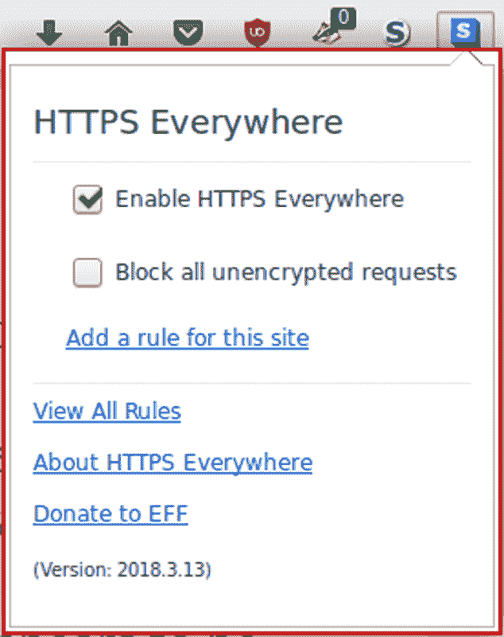

图 2. `HTTPS Everywhere`设置

### uBlock Origin


我用了多年`AdBlock Plus`插件来拦截网站上的广告。我不仅仅使用它是为了拦截广告本身，还为了我个人的隐私和安全，因为除了广告，还有破坏隐私的追踪以及通常是恶意的`JavaScript`。正如你想象到的，广告商强烈反对广告拦截，并由于`AdBlock Plus`的流行特别关注了它。最终，`AdBlock Plus`宣布了一项计划，默认允许某些批准的广告网络通过。对我来说，这违背了整个目的，所以我寻找了一个替代方案，`uBlock Origin`似乎符合要求。

`uBlock Origin`插件的工作方式与`AdBlock Plus`非常相似。一旦安装插件，它就会检测并拦截在你访问的网站上广告。如果你点击它的图标，它还会显示在当前页面上拦截了什么，并允许你临时允许当前页面或整个网站通过广告。它简单、有效且不需要过多操作，因此成为了我`Firefox`的首选广告拦截器。

## NoScript

之前提到的所有插件我都建议几乎任何人使用来增加隐私。不过这最后一个插件有点不同。我年纪够大，记得当`JavaScript`被视为一种坏事时，许多用户都禁用了它。尽管如此，对隐私和安全最大的威胁之一是通过第三方`JavaScript`，所以如果你希望你的网络浏览非常安全，你必须找到一种方法，按网站选择要运行哪些`JavaScript`。默认情况下，`NoScript`拦截所有`JavaScript`。当你访问提供`JavaScript`的页面时，`NoScript`的图标会变成带斜杠的红圆圈，点击图标，它会向你显示拦截的各种`URL`。然后你可以根据域名决定临时或永久加载哪些`JavaScript`（图 3）。一旦你做出了选择，页面将重新加载，希望你能看到更多网站的内容。


图 3. [洛杉矶时报网站](http://www.latimes.com) 上的 NoScript 输出

当你使用`NoScript`时，网络变得非常有趣，因为起初一个网站可能只有自己的`JavaScript`供你加载。一旦你允许并刷新，你可能会注意到来自世界各地的大量新网站，第一个`JavaScript`现在想要加载它们。这就是为什么使用`NoScript`有时可能会很烦恼。通常为了让网站加载，你必须变成一名网络侦探，追踪哪些第三方网站是必须的（例如`cloudfront.net`的 AWS 内容或`cloudflare.com`的 CDN 内容），哪些网站在加载广告（它们的域名通常包含`metrics`或`monitor`等词）。是这种侦探工作最终让你精疲力竭，你变得倾向于允许某个网站所有的`JavaScript`（`NoScript`通过一个方便的按钮提供了这种功能）。

由于`NoScript`良好工作需要所有的额外工作，而且在网站运行之前，不断加载新的`JavaScript`导致还有更多内容要加载，有时非常令人沮丧，我不建议每个用户都安装和使用`NoScript`。但对于像这样特别关注安全并希望对`JavaScript`有更多控制权的用户来说，它是无价的。

尽管存在许多不同的隐私插件，但这四个是我每天都会使用并安装在我所有机器上的插件。我希望你也能发现它们很有用。这些隐私插件不仅可以保护你的隐私，还能帮助你免受恶意网站的侵害，通过阻塞缓慢的第三方网站加载，通常还能让网站加载速度快得多。

# Tor 隐藏服务

## 为什么只有客户端应该获得隐私？也给你的服务器一些隐私吧！作者 Kyle Rankin

人们在编写隐私指南时，大部分情况下是从客户端的角度编写的。无论你是在使用`HTTPS`、阻止跟踪`Cookie`，还是进一步地通过`Tor`浏览互联网，这些隐私指南都关注于帮助终端用户保护自己免受潜在恶意和监视性网络的影响。由于许多阅读《Linux Journal》的读者正处于该等式的另一侧——他们运行着托管那些破坏隐私服务的服务器——因此系统管理员也应该站出来，尽其所能帮助保护用户隐私。虽然这其中部分工作仅仅意味着确保你的服务支持`TLS`，但在本文中，我描述了如何更进一步，让你的用户能够通过`Tor`隐藏服务完全匿名地使用你的服务。

### 工作原理

我不会深入探讨`Tor`本身如何让你匿名访问网页的细节——关于这些细节，请查看[`tor.eff.org`](https://tor.eff.org)。`Tor`隐藏服务运行在`Tor`网络内部，允许你注册一个内部的仅限`Tor`使用的服务，该服务拥有自己的`.onion`主名。当访问者连接到`Tor`网络时，`Tor`会解析这些`.onion`地址并将你引导至位于该名称后的匿名服务。但与其他服务不同，隐藏服务提供了双向匿名性。服务器不知道客户端的 IP（就像你通过`Tor`访问任何服务一样），但客户端也不知道服务器的 IP。这提供了终极的隐私，因为双方都受到了保护。

### 警告与规划

与设置`Tor`节点本身一样，如果你想设置`Tor`隐藏服务，则需要一些规划，以防你因某些操作失误而破坏了`Tor`的匿名性。从操作和安全角度来看，这都有许多规则，因此我建议你阅读这篇[优秀的指南](https://riseup.net/en/security/network-security/tor/onionservices-best-practices)，以便在一个地方找到最新的最佳实践。

在不涉及所有这些步骤的情况下，我确实想在这里列出一些通用准则。首先，你想要确保你托管的任何服务只监听在`localhost`（`127.0.0.1`）上，并且无法通过普通互联网访问。否则，某些人可能将你的隐藏服务与公共服务关联起来。接下来，检查你正在运行的任何服务，并尝试从中清除特定的身份识别信息。这意味着如果你托管一个 Web 服务，请修改你的 Web 服务器使其不报告其软件类型或版本；如果你运行一个动态网站，请确保你使用的任何 Web 应用程序也不报告它们的版本。

某些服务需要连接互联网以解析`DNS`名称或下载其他资源。配置你的服务使所有这些外部请求都路由到`Tor`是非常重要的。你可以通过`iptables`规则来实现这一点，强制你的所有流量通过本地`Tor`代理（就像你对客户端做的那样），或者如果你的服务支持`SOCKS`代理，你可以配置它使用内置的`Tor` `SOCKS`代理。

最后，虽然你可以在同一个主机上运行隐藏服务和一个中继节点，但将它们分开被认为是最佳实践，这样你就无法将隐藏服务与特定的中继节点关联。此外，这意味着你可以运行隐藏服务，而无需担心运行中继节点所涉及的任何风险。

### 如何配置隐藏服务

配置隐藏服务的第一步是安装`Tor`。大多数主流发行版都包含了`Tor`软件包，因此你可以直接使用包管理器下载最新版本。如果你喜欢用硬核的方式处理，或者想绝对确保获取最新版本，你也可以跳过包管理器，从[`torproject.org`](https://torproject.org)源码编译`Tor`。

无论你使用基于 Red Hat 还是基于 Debian 的发行版，你都以相同的方式配置你的隐藏服务，方法就是通过`/etc/tor/torrc`配置文件。正如你所看到的，该配置非常简单。

### 隐藏 HTTP 服务

首先，假设你想托管一个 Web 服务。确保你配置了 Web 服务器，使其仅监听在`localhost`（`127.0.0.1`）上，以免泄露可能更易于将你的隐藏服务与公共服务关联的数据。接下来，向你的`/etc/tor/torrc`中添加以下两行：

```
HiddenServiceDir /var/lib/tor/hidden_service/http
HiddenServicePort 80 127.0.0.1:80
```

现在重启`Tor`服务（`sudo systemctl restart tor`），你的服务就准备就绪了。并不难，对吧？`HiddenServiceDir`选项告诉`Tor`应该在哪里存储有关此服务的信息（包括其`.onion`地址）。`HiddenServicePort`告诉`Tor`应该在哪个端口监听隐藏服务（在本例中为 80），并将该流量转发到哪个地址（此示例为`127.0.0.1:80`）。

一旦服务启动，你就会在`/var/lib/tor/hidden_service/`下看到两个文件：`private_key`和`hostname`。`HiddenServiceDir`选项告诉`Tor`应该在哪里存储有关此服务的信息（包括其`.onion`地址）。`HiddenServicePort`告诉`Tor`应该在哪个端口监听隐藏服务（在本例中为 80），并将该流量转发到哪个地址（此示例为`127.0.0.1:80`）。

（注：此处原文段落存在明显的逻辑重复，译文已按原文完整翻译并保留）

一旦服务启动，你就会在`/var/lib/tor/hidden_service/`下看到两个文件：`private_key`和`hostname`。`HiddenServiceDir`选项告诉`Tor`应该在哪里存储有关此服务的信息（包括其`.onion`地址）。

（注：此处原文段落存在逻辑重复，译文已按原文翻译）

该`.onion`地址是访问者在`Tor`浏览器中访问你时输入的。注意，你在这里托管的是`HTTP`而不是`HTTPS`。无论如何，`Tor`负责对你的通信进行身份验证和加密，你可以将该`private_key`文件认为类似于`TLS`密钥。

### 添加额外服务

你可以从一台服务器上运行多个隐藏服务，`Tor`允许你以多种方式进行设置。如果你想让同一个主机托管多个服务，只需在同一个`HiddenServiceDir`下添加额外的`HiddenServicePort`指令即可。例如，如果我想在现有的`HTTP`服务中添加`SSH`，我会这样做：

```
HiddenServiceDir /var/lib/tor/hidden_service/http
HiddenServicePort 80 127.0.0.1:80
HiddenServicePort 22 127.0.0.1:22
```

但实际上，你可能希望将不同的服务隔离到各自的`.onion`地址中——这样将来你就可以通过将`/var/lib/tor/hidden_service`下的特定目录及其配置复制到新服务器来拆分它们。要实现这一点，请为每个服务提供独立的`HiddenServiceDir`选项：

```
HiddenServiceDir /var/lib/tor/hidden_service/http
HiddenServicePort 80 127.0.0.1:80
HiddenServiceDir /var/lib/tor/hidden_service/ssh
HiddenServicePort 22 127.0.0.1:22
```

现在，你可以查看`/var/lib/tor/hidden_service/ssh/hostname`来获取你`SSH`服务的新`.onion`地址。

每当人们谈论保护隐私时，像 Facebook 这样的社交媒体网站不可避免地会被提及。这很有道理——社交网络（如`Facebook`）提供了一个让你与朋友分享个人数据的平台，而人们发现自己也也将这些数据分享给广告商时，并不感到意外（毕竟这是他们支付账单的方式）。`Facebook`使用你访问该网站时提供的数据也是合理的。然而，某些人可能会惊讶于它到底追踪得有多深。当你没有在使用`Facebook`本身而只是在浏览网页时，`Facebook`也会追踪你。

一些读者可能会通过说“别用`Facebook`”来解决`Facebook`的追踪问题；但对许多人来说，该网站可能是他们与某些朋友家人保持联系的唯一方式。虽然我自己并不在`Facebook`上发帖，但我确实有一个账户，并用它与某些朋友保持联系。因此，在文中，我将解释如何运用隔离原则来使用`Facebook`，而不会泄露过多关于我的其他信息。

## 1. 仅发布公开信息

`Facebook`的第一个规则是，无论你认为自己的隐私设置如何，将你在那里提供的任何内容视为完全公开都会对你更有利。首先，所有那些不同的隐私和权限设置可能会变得非常复杂，因此很容易出错，导致你的某些数据比你预想的更公开。其次，即使设置了隐私选项，你也没有强有力的保证数据不会被分享给愿意付费的人。如果你将其视作一个公共发布地，并只分享你想让世界知道的数据，你就不会有任何意外。

## 2. 给 Facebook 准备专属的浏览器

我之前提到过，`Facebook`还可以追踪你在浏览其他网站时所做的事情。你是否注意到过其他网站上有小小的`Facebook`“赞”图标？网站通常会包含这些图标以帮助增加其网站的参与度。然而，它做的另一个是将你访问该网站的事与你特定的`Facebook`账户关联起来——即使你没有点击“赞”或以其他方式与网站互动。如果你想减少被追踪的程度，我建议选择一个专门用于`Facebook`的独立浏览器。所以如果你是`Firefox`用户，就在`Chrome`中加载`Facebook`。如果你是`Chrome`用户，就在`Firefox`中查看`Facebook`。如果你不想费力管理两个不同的浏览器，至少要设置一个专门用于`Facebook`的独立`Firefox`配置文件（在终端中运行`firefox -P`）。

## 3. 通过 Tor 访问 Facebook

许多人不知道`Facebook`本身提供了一个`.onion`服务，允许你通过`Tor`查看`Facebook`。对于一个想要获取你大量数据的网站来说，也想要使用匿名服务，这似乎违背直觉，但如果你深思一下，它是合理的。当然，如果你通过`Tor`访问`Facebook`，`Facebook`会知道是你正在访问它，但它不知道你来自哪里。更重要的是，互联网上的其他网站都不知道你正在从该账户访问`Facebook`，即使它们尝试通过 IP 进行追踪。

要使用`Facebook`的私有`.onion`服务，请安装`Tor Browser Bundle`，或者在本地安装`Tor`，并遵循`Tor`文档将你仅用于`Facebook`的浏览器路由到其`SOCKS`代理服务。然后访问`https://facebookcorewwwi.onion`，只有你和`Facebook`会知道你正在该网站。顺便说一下，设置使用`SOCKS`代理而非`Tor Browser Bundle`的独立浏览器的优势是，`Tor Browser Bundle`尝试保持无状态，因此你很难将`Facebook`的`.onion`地址设为你的主页。

## 结论

所以当然，你可以决定完全放弃`Facebook`，但如果你没有这种奢侈，我希望这些隔离步骤中的几条可以帮助你以一种不会完全消除隐私的方式使用`Facebook`。

# 控制权之战：Andrew Lee 论 PIA 开源

当我得知我们新的姐妹公司 Private Internet Access (PIA) 开放其源代码时，我立刻想知道背后的故事，特别是隐私是本月`Linux Journal`的主题。因此，我联系了`PIA`的创始人 Andrew Lee 并进行了一场采访。这是采访内容。由 Doc Searls 编写。


**DS:** 是什么让你最初创立`PIA`的？你心中是否有特定的群体或用例——或者是一组用例？

**AL:** `PIA`主要植根于我在`IRC`上的简微起点，在那里，使用`IRC`守护进程来保护个人 IP 不被暴露变得非常重要。然而，由于之后穿梭于各个行业，我学了很多，并理解到隐私时候该走向主流了，不是在“隐藏自己”的意义上，而仅仅是在“别看我”的意义上。

**DS:** 你是否一直都想让代码库开源？如果没有，为什么是现在？

**AL:** 我们一直想让代码库开源，终于抽出时间做了。虽然晚了，但晚总比不完好。我们之前非常忙，没有给它足够的优先级，但通过深入分析我们的哲学，我们已经对内部事务进行了重新排序。随着代码的开源，会有很多惊喜。

**DS:** 读者总是想知道开源代码库是否影响业务模式。他们一直知道没有影响，但开源确实开启了更多可能……（此处原文似乎有逻辑重复，修正为：）……读者总是想知道开源代码库是否影响业务模式。他们一直知道，开源确实开启了更多可能。我很想听听你对这个题目的看法。

**AL:** 既然`Private Internet Access`是一项服务，开源并不影响我们产生收入的能力。相反，我相信我们将会获得更好、更强大的软件。

**DS:** 谈到行动主义，在 3 月，你向特朗普和国会发表了非常强有力的声明，并在《纽约时报》上登了整版广告，敦促他们杀死 SESTA-FOSTA。我想知道反响如何。


**AL:** 绝对如此！我们举办了几次报纸活动，包括网络防御联盟的活动。这是一个动员人们关注社会重要问题的有力平台。作为活动的结果，特朗普收到了许多关注公民的推特。我认为那是成功的，但现在取决于我们的总统。让我们希望他做出正确的决定并否决该法案。尽管如此，如果法案按目前的形式签署（在本文采访后签署的），互联网将路由，`密码学客`将拥有加密的力量。我们将去中心化并绕过糟糕的政策。

**DS:** 读者一直非常关心许可证，所以这里有一个问题：为什么选择`MIT`许可证？


**AL:** 我们的内部开源任务小组被赋予的任务是选择限制最少的开源许可证，他们最终选择了`MIT`。我希望任何人都能根据需要从我们的代码中受益。

**DS:** 为什么分阶段发布代码库而不是一次性发布？为了让代码就绪，你需要做哪些工作？

**AL:** 为了妥善发布我们的代码，我们正在确保分发一切内容，且代码整洁易读。

**DS:** 代码在`GitHub`上吗？

**AL:** 是的位于`https://pia-foss.github.io`。

**DS:** 请详细介绍一下 VPN 行业。自从你创立`PIA`以来，它发生了什么变化？你预计开源`PIA`的代码将帮助公司以新的方式引领市场吗？

**AL:** 我认为有越来越多的公司进入了 VPN 行业。对我们来说，开源代码是我们的多部分战略的一部分，旨在创造我们所谓的“下一代 VPN”。我们并不打算领导市场，而是要创建一个新市场，这个新市场将从根本上让现有的市场以目前的形式立即消亡。这一策略包含了我们在内部构建的大量技术栈，以及简单的功能添加。虽然我们确实赢得了该领域内最受信赖 VPN 的声誉，但我们“下一代 VPN”项目的首要目标是将“信任”从这个方程式中剔除。毕竟，我们深信“加密即信赖（in crypto we trust）”这句话。

**DS:** 我知道 PIA 一直坚决不记录客户日志。在 2015 年，公司曾有机会证明这一点，当时法院的传票要求调取客户使用记录——而他们无法提供任何记录。我想多听听你在这方面的哲学。

**AL:** 简单来说，每个人都有隐私权，但也有选择。这就是为什么我认为 VPN 消费者市场的人必须进行超出简单测评之外的调研。相反，要去论坛寻找这些公司的黑料。这是验证任何公司——无论是在我们领域还是其他领域——的最好方法。通过搜索来填补关于谁很糟糕、谁在监控用户、谁在记录用户日志等的空白。

**DS:** 如果你不介意的话，请把开源和隐私之间的联系起来。

**AL:** 对我们来说，开源至关重要，因为为了保护个人隐私，人们必须确切知道软件在做什么。提供源代码使得这成为可能。我认为，这进一步增强了安全性，除了我们已经执行的第三方审计之外，因为会有更多的“眼睛”可以审查代码。

**DS:** 接下来是什么？

**AL:** 通过 PIA，我们确实在构建“下一代 VPN”，它在隐私性上将比目前提供商的方式高出好几个数量级。然而，我真的不想谈论它。我们更倾向于交付，而不是空谈我们将交付什么。

**DS:** 今天我们看到天平正向去中心化、以及更大的个人自主和控制权倾斜。我很想听听你如何看待这种发展，将以什么样的顺序进行，以及可能涉及哪些群体。

**AL:** 每个人都有不同的威胁模型，每个人都需要对权衡做出明确的选择。首先，我们提供`Tor`来为人们提供最基本的选择之一。我不喜欢谈论计划中的事情，但我会说，我们将在所有的桌面和移动客户端上推出全功能`Tor`支持。这将允许我们的终端用户通过`Tor`进行路由，从而有效地允许他们进一步掩盖身份。我相信使用这一功能的用户群体会比我们的整体客户群少，因为`Tor`网络仍然很小。然而，随着网络增长，通过向人们普及`Tor`，`Tor`的效率也会之提高。

**DS:** 我假设加密会参与其中。你能多说一下是如何参与的吗？

**AL:** 我们所做的一切都使用了加密，从使用的算法到某些被接受的支付方式（如加密货币）。在推出我们的“下一代 VPN”解决方案时，我们严重依赖加密学以及它可以应用的独特领域。这非常疯狂，大自然和才华的人们以加密的形式给了我们礼物、武器和保护，而我们绝对要把所有的筹码押在上面。

**DS:** 你如何看待 VPN 的使用以及整个 VPN 市场的演变和变化，特别是在不同的场景下？

**AL:** 我认为考虑到政治和社会气候，VPN 市场和使用量将继续增加，正如已经发生的那样。许多国家和公司完全在滥用他们的公民和用户，人们正在意识到他们需要亲力而为来保护自己。

**DS:** 考虑到围绕 Facebook 的所有坏消息以及`GDPR`等其他隐私法规的临近，从你作为隐私技术提供者的角度，你认为会有哪些变化？

**AL:** 我猜测隐私将继续是人们的一项重要价值观。尽管如此，政府一直处于无休止的战斗中，试图剥夺我们的隐私。这非常糟糕，因为隐私不仅是我们权在任何时候向我们任何想要的人披露信息的权利；它实际上是一个让我们保持独特性的工具。没有隐私，我们都将成为追随大者，做任何“权威”认为恰当的事情。去见鬼这种世界吧。认真的。我们必须融入人群并变得匿名（信不信由），才能变得不同并具有个性的独特性。但这场战斗不会轻松。这是一场关于控制权的战斗。

**DS:** 所以你预见到一场冲突即将到来——或者冲突已经发生并正朝着某些对决发展？

**AL:** 是的。我的观点是加密战争（Crypto War）正走向高潮。我们都需要共同努力，为了加密，甚至更广泛地为了互联网而战。


# 为什么你应该自己动手

## 重启 DIY 运动，从你自己的 Linux 服务器开始。作者 Kyle Rankin

在不久以前，我们还生活在一个社会里，普通人亲手做事情是理所当然的。那里有一种内在的假设，你会对用品进行基本修理，对汽车进行日常维护和修理，修剪草坪，烹饪并缝补衣服。我们周围的物品反映了这种假设，例如可见且易于操作的螺丝、衣服上的纽扣以及用户可以更换的部件。

然而，多年来，文化已变得更加注重便利。微观经济中的“机会成本”概念（即对每项行动分配价值，并与你未采取的替代方案进行权衡）导致许多收入合理的人认为他们什么都不应该自己做。

典型的想法是这样的：如果我的时薪高于草艺服务的时薪，尽管这项草艺服务要花我的钱，但比我自己修剪草坪要便宜得多，因为我可以去做别的事情赚我的时薪。同样的计算最终证明了保养和草艺服务、微波炉晚餐以及在物品损坏时直接更换而不是自己修理。结果是转向了服务型经济，出现了大量廉价、易耗的物品，以及引擎盖几乎全密封的车辆。

这种同样的便利文化也渗透到了技术领域，硅谷的创业者们绞尽脑汁，发明出某些新服务来为你完成某些新任务。Linux 和整个开源运动是少数几个仍然保留这种动手实践精神的地方之一。

在提到闭源软件时，Linux 用户过去常说：“你不会买辆引擎盖焊死的汽车吧！”在 Linux 中，你可以打开引擎盖并查看系统是如何运行的。隐喻的螺丝是暴露的，如果你愿意，你可以拆解软件并对其进行修理。

然而，在大多数这类机会成本计算中都缺少了一些东西——那就是当你弄清事物运作以及如何修理它们时，从知识和技能的增长中获得的无形收益，以及看到自己努力的成果时感受到的满足感和自豪感。当你亲手做事情时，神秘感就开始消退，你会发现周围的大多数事物并没有你曾经想象的那么复杂、那么神奇或那么不可触及。你在修理灯具时所增加的信心，可能会激励你去研究如何更换家里那个坏掉的灯开关。

随着云服务的出现，让别人为你搭建`Linux`和开源服务变得异常简单，而且当它们坏了时，直接把它们扔掉并从头开始即可。然而，这种便利性也有自己的代价，而不仅仅是服务器的小时费率。这些服务和抽象层使得使用变得更容易，但理解却变得更困难。它们为技术增添了神秘感，使其看起来比底层运行的要复杂得多。它们还让人们容易避免学习事物实际上是如何运作的，并且难以学习如何修复它们。

当我开始在桌面端使用`Linux`时，仅仅为了让`Linux`运行起来，我基本上就接受了软件开发、网络和系统管理方面的教育。将`Linux`作为服务器平台让我更沉浸于计算机基础知识中。通过弄坏某个东西然后亲手修复它，我学到的`Linux`知识比在认证课程上或将其交给技术支持要学到的多得多。通过物理连接两台`Linux`服务器并尝试让它们相互通信，我学到的网络基础知识比在云仪表板上点击几次按钮要学到的得多。

如今，`Linux`已经变得好用多了，但随着这种便利性，我们失去了大部分这些内置的学习机会。如今，新入初级工程师是如何学习网络到底是如何运作的？他们又是如何学习修复坏掉的`Linux`服务器的？我想鼓励你去寻找这些学习机会。了解底层到底发生了什么。买一个备用的`Raspberry Pi`，从零开始搭建你自己的 Web、`DHCP`、`DNS`和邮件服务器。

最终那台服务器会坏掉，如果你不放弃，通过一些研究和故障排除，你就能自己修复一切。在这个过程中，你会发现这些东西其实并没有你想象的那么复杂，你会发现自己在想：我还能做些什么*可以自己做*呢？

当你亲手完成时，你获得了其他东西——独立、自由和控制。专有软件的真实风险之一是控制权（和自由）被夺走，因为你依赖软件供应商来修补漏洞和添加功能。有无数例子显示，开发者起步于开源软件是因为他们想为现有程序添加一个额外的功能、修复一个恼人的漏洞，或者让某个随机硬件设备工作起来。因为源代码是可用的，他们可以自由地检查它，学习软件是如何工作的，并想出如何自己修改它。

所以，下次当云服务器抛出`500`错误而你完全不知道为什么时，克制住杀死它并生成新内核的冲动。花几分钟查看底层，看看你能否自己解决问题。下次当你家里需要某些新设备时，克制住买那些闪亮`IoT`小摆件的冲动。看看你能否用`Raspberry Pi`或`Arduino`加上一点软件自己制作它。毕竟，大多数这些`IoT`设备在它们闪亮的外壳下都是这样。诚然，这可能多花一点时间，但当你邻居的`IoT`家电器开始对整个互联网发动`DDoS`攻击时，你将拥有帮助排除故障的技能。

## 结论

哇，在写下这份清单之前，我并没有意识到我家里竟然有这么多台单板计算机。幸好这些都是低功耗电脑，否则我的电费会疯掉的！如果你们中任何人的单板计算机闲置在家里但不确定该对它做什么，我希望这篇文章能激励你让它运转起来。

# DIY：房车离线备份和媒体服务器

## 有什么比在房车里放一台`Linux`服务器更能为`#vanlife`（房车生活）增添极客气息了吗？作者：Kyle Rankin


人们很容易给出一个强有力的论点：房车是终极的 DIY 项目游乐场。它结合了你可以在车辆上进行的所有 DIY 项目和家庭的 DIY 项目。再加上你可能会花好几天住在一个带轮子的小房子里，穿梭于公路、森林和沙漠，你有一类完全另一类的 DIY 项目来充分利用那更小的空间。房车还提供了一整套电源选项，从`12V`深循环电池到`110V`市电电源，再到发电机、交流发电机和太阳能，因此有一整类与充分利用你不断变化的电源选项相关的电气 DIY 项目。

如果你是一个极客，拥有房车就引入了另一个层级的 DIY 可能性。首先，有所有管理电源源之间切换、跟踪能量消耗和保持电池电量的电子项目。然后，有一整类与离开家时的互联网访问相关的项目，涉及从移动`WiFi`热点到蜂窝网络增强网络，再到漫游卫星互联网（如果你很聪明，还有一个能将你路由到最佳且最廉可用选项的智能路由器）。最后，还有几个与房车内计算机系统相关的项目可能，包括本地交换机和路由器、将房车变成移动办公室的个人电脑，以及让你可以在路上看电视和电影的媒体中心。

恰好我最近买了一辆房车——确切来说是一辆`1996 Roadtrek 170`。虽然这次购买引发了大量的 DIY 项目，但我的第一个项目专注于中心。在这篇文章中，我描述了为房车构建媒体服务器的所有步骤，它维护了我媒体的最新副本，并在停在车道上时同步。事实证明，在构建媒体服务器的过程中，我也获得了一个非常棒的离线备份方案。即使你没有房车，也可以调整这些步骤为你的车添加半离线备份。


图 1 介绍“Van Winkle”

### 材料清单

在进入项目的每个步骤之前，我想列出我所使用的完整硬件列表。我在下方尝试解释我为什么选择这些硬件，根据你的需求，其中某些硬件可能是可选的。例如，如果你的车辆有良好的`WiFi`信号，你可能不需要我买的`WiFi`扩展器。如果你只想建立一个不需要媒体播放的线文件解决方案，就不需要买电视和支架。

*   `AXESS TV1705-15 15" LED HDTV`: $124.99

*   `Mount-It! Lockable RV TV Mount`: $43.99

*   `Raspberry Pi 3 B+`: $45.99

*   `Western Digital 8TB MyBook USB3 硬盘`: $170

*   `两装 16GB SanDisk SDHC MicroSD 卡`: $10.78

*   `一英尺 HDMI 线`: $7.99

*   `Windows 7 Vista XP Media Center MCE 遥控器和红外接收器`: $16.90

*   `VONETS VAP11G-300 WiFi 中继器`: $19.89

*   **总计：$440.53**

### 步骤 1：媒体服务器硬件

这一过程的第一步是为媒体服务器本身选择硬件和软件。由于硬件将由我的房车“家用电池”供电，因此功耗越低越好。我计划使用某种预装的 Kodi 媒体中心软件发行版（我曾于`OpenELEC`、`LibreELEC`和`OSMC`之间纠结），因此我想选择一种受这些发行版良好良好的硬件。由于电脑需要执行媒体播放，而所有这些低功耗设备配备的通用 ARM CPU 相对较慢，因此，我列表中的发行版能够利用针对常见媒体解码器的硬件加速播放也同样重要。我希望通过无线方式将文件同步到该硬件上，因此硬件具备无线网卡也很重要。最后，由于我计划在电脑上连接一个大型外部`USB3`硬盘来存储所有媒体，理想情况下电脑应该有一个更高速度的`USB3`端口。

在评估硬件时，我做出的第一个重大改变是放弃对`USB3`的需求，转而追求硬件加速媒体播放。在我评估的多数支持`USB3`的单板计算机中（如我用于 NAS 的`Odroid XU4`），并没有保证媒体硬件加速。然而，在对这个问题进行研究时，我意识到虽然`USB2`带宽较低，但事实证明社区中许多人通过`USB2`流传输大型媒体文件，这对我的用途来说应该是没问题的。解决了媒体播放问题后，我的另一个担心是从家庭网络同步文件，但在那种情况下，我的 WiFi 连接才是真正的瓶颈。

既然我不再需要担心`USB3`支持问题，我开始将选择限制在`LibreELEC`显式支持的硬件上，因为它是我发行版选择中的领先者。在最终的硬件选择中，我将其缩小到`Raspberry Pi 3 B+`或`Odroid C2`——后者是`Raspberry Pi`系列的竞争对手，承诺提供出色的图形性能并集成了红外传感器。最终，我决定选择`Raspberry Pi 3 B+`，原因如下：

*   集成 WiFi 网卡：尽管我手头有几个`USB WiFi`网卡，但我很这种最新的`Raspberry Pi`板板不仅包含 WiFi 网卡，而且据称比之前的尝试提供好多的性能。

*   更好的整体社区支持：`Raspberry Pi`是一个更受欢迎的平台，因此我更有信心无论我决定使用哪种媒体中心发行版，它未来都会持续获得更新。

*   更适合 DIY 文章：我做这个项目时顾及了写成文章。通过选择`Raspberry Pi`，我选择了一种你更有可能拥有或者至少更容易获得的硬件。

*   我可能也需要一个`USB IR`端口：尽管`Odroid C2`集成的红外端口很有吸引力，但我希望在安装时效果最好时，具有隐藏电脑的能力。这意味着我可能无法将其直接安装在电视背面，而可能仍需要向电视引出一根红外接收器。

除了新的`Raspberry Pi 3 B+`，我还订购了几张 SD 卡，并选择了一个带有`USB IR 接收器`的通用“MCE 遥控器”。`MCE 遥控器`为 Windows 媒体 PC 设计，具有媒体服务器的标准按钮布局，通常在`Kodi`发行版中得到良好支持，因此所有按钮都可以开箱即用。

另一个关键硬件是用于存储所有文件的`USB 硬盘盒`。我需要在一个较小的封装内需要大量的媒体存储空间，因此我选择了`8TB 西部数据 MyBook`。你通常可以在当地电子商店找到它们，价格往往比不带盒的相同`8TB`硬盘便宜得多。它们还由`12V 圆口插头`供电，这使得很容易将其交流适配器更换为连接到房车内一个`12V DC 适配器`的直接直流电源。当然，如果你能接受较少的存储空间，应该考虑使用`2.5"`笔记本硬盘，因为与`3.5"`硬盘相比，它们的功耗通常低得多（且占用空间更小）。

### 步骤 2：媒体服务器软件

我知道我想为我的媒体中心使用某种预构建的`Kodi`发行版，因为我已经在家里习惯了那个界面。在家里，我使用`OSMC`，但对于房车系统，我在`OSMC`、`OpenELEC`和`LibreELEC`之间选择。`OSMC`是一个基于`Raspbian`的发行版，它为你捆绑并配置了`Kodi`。`OpenELEC`及其更前卫的分`LibreELEC`更侧重于优化，它们不是基于`Raspbian`，而是经过深度定制的轻量级发行版。结果是`OpenELEC`和`LibreELEC`的启动速度快得多。


图 2. 在我的房车电视上运行 OSMC

在家里，我通常让媒体服务器一直开启，即使电视没开，所以`OSMC`启动所需的时间不是问题。在房车里，我想节省电力，因此计划通过电视为`Raspberry Pi`供电，这样它只在电视打开时才自动开启。这使得快速启动时间更具吸引力，而且由于`LibreELEC`吹嘘了尖端的技术来支持我的`Raspberry Pi`，我决定先尝试它。

`LibreELEC`的启动时间非常棒，但遗憾的是，这种精简的启动时间意味着背后并没有许多可用工具。虽然`LibreELEC`允许`ssh`进入服务器，但我无法无法安装`rsync`，而这对项目至关重要。

最终，我决定使用`OSMC`。虽然启动时间比`LibreELEC`长，但它基于`Raspbian`的事实意味着我可以像处理其他`Debian`系统一样处理它。这使得为了我的备份和加密需求进行定制变得简单得多。这意味着未来我不需要额外的`Raspberry Pi`就能为此系统添加功能。

### 步骤 3：媒体服务器配置


配置媒体服务器本身非常简单。我只需按照说明从`https://osmc.tv`将最新的`OSMC`镜像复制到 microSD 卡上，并像任何其他`Raspbian`安装一样从它启动。在首次启动时，它会调整分区以填充剩余空间，在第二次启动时，我进入系统设置页面，确保以太网网络已禁用、WiFi 网络已连接到我的接入点。这是我后悔设置了长 WiFi 密码的时候，因为我必须通过遥控器上的方向键和屏幕键盘一个字符一个地输入。（提醒自己：下次带上 USB 键盘去房车。）

接下来，我通过无线网络从另一台电脑使用默认用户名：密码`osmc:osmc`通过`ssh`登录该系统。这意味着我登录后的第一步是更改该密码：

```
$ passwd
```

下一步是配置外部 8TB 硬盘。在大多数情况下，这只需插上即可，但由于我计划将可能的敏感文档备份到其中，我想添加一层磁盘加密，这样即使小偷闯入并偷走了我的硬盘，他们也无法检索任何数据。首先，我插上硬盘并检查`dmesg`输出以确认它显示为哪个设备。由于它是连接的唯一 SATA 硬盘，它应该显示为`/dev/sda`，但你仍然需要确认一下：

```
$ sudo dmesg | grep sd
. . .
[    4.805850] sd 0:0:0:0: [sda] 正在启动磁盘...
[    4.815562] sd 0:0:0:0: 已连接 scsi generic sg0 类型 0
[   21.442041] sd 0:0:0:0: [sda] 大设备。正在尝试使用 READ CAPACITY(16)。
[   21.442279] sd 0:0:0:0: [sda] 15628052480 个 512-字节逻辑块：(8.00 TB/7.28 TiB)
[   21.442284] sd 0:0:0:0: [sda] 4096-字节物理块
[   21.442599] sd 0:0:0:0: [sda] 写保护已关闭
[   21.442604] sd 0:0:0:0: [sda] 模式感知: 47 00 10 08
[   21.442907] sd 0:0:0:0: [sda] 未找到缓存模式页
[   21.442911] sd 0:0:0:0: [sda] 假设驱动缓存：直写通过
[   21.443478] sd 0:0:0:0: [sda] 大设备。正在尝试使用 READ CAPACITY(16)。
[   22.786525]  sda: sda1
[   22.787302] sd 0:0:0:0: [sda] 大设备。正在尝试使用 READ CAPACITY(16)。
[   22.788287] sd 0:0:0:0: [sda] 已连接 SCSI 磁盘
```

现在我已经知道它显示为`/dev/sda`了，下一步是设置加密。为了实现这一点，我在我的媒体服务器上安装了`cryptsetup`软件包，然后在外接硬盘上唯一的分区`/dev/sda1`上设置了 LUKS 加密，该分区占据了驱动器上的所有空间：

```
$ sudo apt install cryptsetup
$ sudo cryptsetup --verbose --verify-passphrase luksFormat /dev/sda1
```

此过程会提示你设置一个解密密码，请务必记住它，并可以选择将其写下来或存储在密码管理器中。接下来，我需要打开该设备以便为其命名并进行格式化：

```
$ sudo cryptsetup luksOpen /dev/sda1 crypt-sda1
$ sudo mkfs -t ext4 /dev/mapper/crypt-sda1
```

现在硬盘已经准备好挂载了，但系统下次重启时它不会自动挂载，所以现在我需要配置这一点。因为我希望系统能够自动挂载此分区，这意味着要在此系统上创建一个仅限 root 可读的密钥文件，向其中填充随机内容，并将该文件作为解锁加密卷的额外密钥。稍后我可以让系统指向此密钥文件，但让我们先设置它：

```
$ sudo dd if=/dev/urandom of=/root/keyfile bs=1024 count=4
$ sudo chmod 0400 /root/keyfile
$ sudo cryptsetup luksAddKey /dev/sda1 /root/keyfile
```

为了配置系统在每次启动时自动设置此设备，接下来我需要确定`/dev/sda1`分区被分配了什么 UUID。虽然我可以使用`/dev/sda1`，但如果某天我添加第二个 USB 硬盘，而它先抢占了设备怎么办？我使用`blkid`命令获取设备的 UUID：

```
sudo blkid /dev/sda1
/dev/sda1: UUID="074051d8-e239-408b-a3ba-ee28301bdee2" TYPE="crypto_LUKS" PARTLABEL="My Book" PARTUUID="a97a96bf-41a5-4358-9c33-3458ab36ddf4"
```

现在我有了创建名为`/etc/crypttab`文件所需的信息。这将为系统提供每次启动时自动设置 LUKS 设备所需的信息。我的文件包含以下内容：

```
cat /etc/crypttab
# <target name> <source device>      <key file>    <options>
crypt-sda1 /dev/disk/by-uuid/074051d8-e239-408b-a3ba-ee28301bdee2 /root/keyfile luks
```

第一个字段是你想要分配给设备的名称（这会显示在`/dev/mapper`中）。下一个字段是原始设备的完整路径。如你所见，我通过 UUID 指向了设备，这意味着使用了`/dev/disk/by-uuid/`下的路径。下一个字段允许我指向我创建的密钥文件。

（注：原文后续内容重复混乱，此处已按逻辑处理完毕）

`flock`命令在`/tmp/rvsync.lock`创建一个锁文件。如果此脚本的另一个实例正在运行，该命令将不会执行；否则，将运行`rsync`命令。我将当前日期和所有的`rsync`输出都记录在`/tmp/rsync-output`文件，这样我就可以跟踪同步了的内容，以防在需要排除故障或跟踪正在进行的`rsync`任务时使用。

你们中的`rsync`老手可能会注意到，我没有在`rsync`命令中包含`--delete`选项，以删除 RV（房车）上那些在家里已删除的文件。我这样做主要是因为我同时也将其用作一种异地备份，我不希望因为在家庭 NAS 上执行了一个失误的删除命令导致我的备份也随之清空。如果存储空间开始成为问题，我计划不时运行一次带了`--delete`选项的手动`rsync`命令。

最后，我在我的文件服务器上创建了一个名为`/etc/cron.d/rvsync`的文件，内容如下：

```
 0 */3 * * * root /usr/local/bin/rvsync
```

每三个小时的整点整分，该脚本都会尝试运行。如果 RV 不可用，脚本将静默失败；否则，它将同步新文件。

一旦完成了初始同步进度，我就卸载并断开了 USB 驱动器，并将其重新连接到 RV 里的树莓派上。然后我对`rvsync`脚本进行了测试运行。尽管它可以运行，但速度非常慢，因为树莓派离室内接入点太远。显然，你们的情况可能不同，但在我的情况下，我决定通过增加一个 WiFi 扩展器来改进接收信号。

WiFi 扩展器基本上充当现有接入点和你的电脑之间的某种桥接。经过一些研究，我选择了`VONETS VAP11G-300`，因为它很小、相对便宜，并且可以通过 USB 供电。我只需要按照设备附带的简单说明进行设置即可。这包括接通电源、连接到它的默认无线网络，然后使用它的默认凭据登录其 Web 界面。此时，我使用向导将其配置为桥接，这包括将其指向我现有的接入点并给它分配一个新的 SSID 使用。最后，我回到我的 RV 媒体服务器并更新了它的无线配置以指向这个新的接入点。有了 WiFi 扩展器后，我能够将文件传输速率提高到原来的三到四倍，所以我认为这是一项值得的投资。此外，我始终可以在旅途中重新配置这个接入点，以增强对房车营地 WiFi 的信号。

## 第 5 步：安装

现在硬件和软件都已就绪，最后一步是物理安装。我的 RV 已经足够老了，配带了一个为 CRT 电视设计的柜子。由于现代 LCD 无需那么多空间，我决定重用那个柜子作为储藏室，并在柜子旁的墙上挂载一台 RV LCD 电视。我不希望屏幕在收起时突出并从 RV 的正面看到，所以我测量了柜子，决定 15 英寸的屏幕恰好合适。我没有选择为电脑设计的标准 LCD，而是选择了一个专为 RV 设计的电视，它可以通过 12V DC 汽车插座供电并包含电视调谐器。有些房车营地提供电缆电视连接，我觉得有这样一个选项可能会很有趣。直接 DC 供电选项也很重要，因为你最终在将 AC 转换为 DC 电力时会浪费能量（当你使用逆变器将 RV 的 12V DC 转换为 110V AC 再转换回 12V DC 时更是如此），所以我确保了这整个系统（包括外部硬盘）都可以通过 12V DC 供电。对于硬盘来说，这意味着要在零件抽屉里翻找一个恰好有合适插头的通用 12V DC 汽车适配器。

我对比电视的另一个重要考虑因素是确保它只有一个 HDMI 输入，但同时也得有一个 USB 端口。我想把树莓派挂在电视背部，虽然那些电视的 USB 端口提供的电流没有专用的 USB 电源适配器大，但到目前为止我遇到过任何问题。我最终选定了`AXESS TV1705-15`电视。然后，我使用了一些可能用于在墙上贴海报的蓝丁胶（blue tack）将我的树莓派外壳固定在电视背面。我还使用了一些那种粘胶将红外接收器安装在电视下方。为了方便线缆管理，我买了一根一英尺长的 HDMI 线。你可以在图 3 中看到最终结果。


图 3 电视背面

你可能会注意到我没有把巨大的外部 USB 硬盘挂在电视背面。因为我本身必须从旧电视柜内部布线电源，我决定将 USB 驱动器留在柜子里，只需让 USB 线沿电缆电视线和电视电源线一起运行。

我需要做的最后一个重要决定是使用哪种安装支架。我见过其他人的 RV 电视支架的照片和视频，我对大多数产品的担忧在于，由于它们使用了廉价的支架，导致他们不得不使用某种弹力绳或其他方案来固定。


图 4 支架

## 结论

我已经在几次旅行中设置了这套系统，我承认，在旅行时随身携带所有媒体内容真的很棒。总之，如果你设置了类似的系统，这里有几点需要注意。

#### 老式变流器提供“脏”电。

我注意到这个系统的一个问题是，当使用电池供电时它运行良好，但当我接入市电电源（连接 110V 电源）时，电视并不总是能开启。事实证明，老旧 RV 中将 110V 电转换为 12V 的变流器并不一定提供清洁的 12V 电。虽然傻电器不在意，但现代电子设备会。解决方案是升级你的变流器，或者只在使用电池时使用系统。

#### 你会在家里 24 小时开启系统吗？

你需要回答的大问题是你是否会在家里让 RV 媒体服务器开启。如果你是那种在家里会接入电源的人，那么这可能非常好。或者，如果你的 RV 顶上有太阳能电池板，你可能可以放心地开启系统，因为太阳能板正在补充从房屋电池中消耗的电。如果你仅依靠房屋电池为服务器供电，你可能一两天后就会耗尽电池。

到目前为止我对这套设置非常满意。当我的营地离文明足够远、无法使用流媒体服务时，能看电影感觉很棒。更棒的是，我的重要文件有一份额外的备份，这些文件离我足够近，以便我在需要时可以访问，但它们存储在移动平台上，这样万一发生火灾或其他灾难，我可以随时离开并带上我的所有物品。

致谢：图片来自 Joy Rankin 的这篇文章。

# DIY：从源码构建自定义的最小化 Linux 发行版

遵循此逐步指南，从源码构建你自己的发行版，并学习它是如何安装、加载和运行的。作者：Petros Koutoupis

在接触 Linux 时，你可以轻松下载并安装、配置任何最常见的发行版——无论是 Ubuntu、Debian、Fedora、OpenSUSE 还是完全不同的系统。尽管你应该尝试几个发行版，但构建一个自己自定义的、最小化的 Linux 发行版也是一个非常有益且精彩的学习练习。

当我说“构建一个自定义且最小化的 Linux 发行版”时，我指的是从`source`包开始——也就是说，从交叉编译工具链开始，然后构建一个目标镜像，安装在物理或虚拟硬盘驱动器（HDD）上。

所以，当我考虑到与 Linux 相关的终极 DIY（DIY）指南时，它必须是这样的：*从源码构建 Linux 发行版*。整个过程在性能尚好的宿主机上至少需要几个小时。

如果你跟随这个练习，你将学习构建自定义发行版所需的条件，并学习该发行版是如何安装、加载和运行的。你可以在物理机或虚拟机上运行这个练习。

如果我说这个过程部分受到出色的 Linux From Scratch (LSF) 项目的启发，那就是在撒谎。LSF 项目被证明正是我理解标准 Linux 操作系统如何构建和运行的一个至关重要的工具。通过类似的哲学，如果你愿意跟随，我希望向作为读者的你传授同样的智慧。

## 术语

- **Host（主机）**：`host`指你将执行大部分工作的那台机器，包括交叉编译和目标镜像的安装。

- **Target（目标）**：`target`是你从源码包构建的最终交叉编译操作系统。它将使用宿主机上的交叉编译器进行构建。

- **Cross compiler（交叉编译器）**：你将构建并使用`cross compiler`来在`host`机器上创建`target`镜像。交叉编译器构建用于运行在宿主机，但它用于为与主机不兼容的目标架构或微处理器编译。

## 前提条件和工具

继续本教程，你需要在宿主机上安装`GCC`、`make`、`ncurses`、`Perl`和`grub`工具（特别是`grub-install`）。

为了构建任何内容，你还需要下载并构建交叉编译器和目标镜像的所有包。我在教程中使用以下开源包和版本：

- `binutils-2.30.tar.xz`

- `busybox-1.28.3.tar.bz2`

- `clfs-embedded-bootscripts-1.0-pre5.tar.bz2`

- `gcc-7.3.0.tar.xz`

- `glibc-2.27.tar.xz`

- `gmp-6.1.2.tar.bz2`

- `linux-4.16.3.tar.xz`

- `mpc-1.1.0.tar.gz`

- `mpfr-4.0.1.tar.xz`

- `zlib-1.2.11.tar.gz`

## 配置环境

在开始此过程之前，你需要配置构建环境。首先，开启 Bash 哈希函数：

```
$ set +h
```

确保新创建的文件/目录仅对所有者可写（例如，当前登录的用户账户）：

```
$ umask 022
```

你将使用家目录作为主构建目录（这不是强制要求的）。交叉编译工具链和目标镜像将安装在这里并放入`lj-os`子目录中。如果你于将其安装在其他地方，请对下方代码部分进行调整：

```
$ export LJOS=~/lj-os
$ mkdir -pv ${LJOS}
```

最后，导出一些剩余变量：

```
$ export LC_ALL=POSIX
$ export PATH=${LJOS}/cross-tools/bin:/bin:/usr/bin
```

在设置上述环境变量后，创建目标镜像的文件系统层次结构：

```
$ mkdir -pv ${LJOS}/{bin,boot{,grub},dev,{etc/,}opt,home,lib/{firmware,modules},lib64,mnt}
$ mkdir -pv ${LJOS}/{proc,media/{floppy,cdrom},sbin,srv,sys}
$ mkdir -pv ${LJOS}/var/{lock,log,mail,run,spool}
$ mkdir -pv ${LJOS}/var/{opt,cache,lib/{misc,locate},local}
$ install -dv -m 0750 ${LJOS}/root
$ install -dv -m 1777 ${LJOS}{/var,}/tmp
$ install -dv ${LJOS}/etc/init.d
```

此外，由于利用 BusyBox 简化了一些最常见的 Linux 系统功能，你将使用`mdev`代替`udev`，这需要你定义以下`/etc/mdev.conf`文件：


执行以下命令创建`${LJOS}/etc/mdev.conf`设备管理配置文件：

```
$ cat > ${LJOS}/etc/mdev.conf<< "EOF"
## Devices:
## Syntax: %s %d:%d %s
## devices user:group mode

## null does already exist; therefore ownership has to 
## be changed with command
null    root:root 0666  @chmod 666 $MDEV
zero    root:root 0666
grsec   root:root 0660
full    root:root 0666

random  root:root 0666
urandom root:root 0444
hwrandom root:root 0660

## console does already exist; therefore ownership has to 
## be changed with command
console root:tty 0600 @mkdir -pm 755 fd && cd fd && for x 
 ↪in 0 1 2 3 ; do ln -sf /proc/self/fd/$x $x; done

kmem    root:root 0640
mem     root:root 0640
port    root:root 0640
ptmx    root:tty 0666

## ram.*
ram([0-9]*)     root:disk 0660 >rd/%1
loop([0-9]+)    root:disk 0660 >loop/%1
sd[a-z].*       root:disk 0660 */lib/mdev/usbdisk_link
hd[a-z][0-9]*   root:disk 0660 */lib/mdev/ide_links

tty             root:tty 0666
tty[0-9]        root:root 0600
tty[0-9][0-9]   root:tty 0660
ttyO[0-9]*      root:tty 0660
pty.*           root:tty 0660
vcs[0-9]*       root:tty 0660
vcsa[0-9]*      root:tty 0660

ttyLTM[0-9]     root:dialout 0660 @ln -sf $MDEV modem
ttySHSF[0-9]    root:dialout 0660 @ln -sf $MDEV modem
slamr           root:dialout 0660 @ln -sf $MDEV slamr0
slusb           root:dialout 0660 @ln -sf $MDEV slusb0
fuse            root:root  0666

## misc stuff
agpgart         root:root 0660  >misc/
psaux           root:root 0660  >misc/
rtc             root:root 0664  >misc/

## input stuff
event[0-9]+     root:root 0640 =input/
ts[0-9]         root:root 0600 =input/

## v4l stuff
vbi[0-9]        root:video 0660 >v4l/
video[0-9]      root:video 0660 >v4l/

## load drivers for usb devices
usbdev[0-9].[0-9]       root:root 0660 */lib/mdev/usbdev
usbdev[0-9].[0-9]_.*    root:root 0660
EOF
```

你需要为`GRUB`引导加载程序创建一个`/boot/grub/grub.cfg`，该加载程序将安装在目标机器的物理或虚拟硬盘上（注意：此文件中定义的内核镜像需要反映在目标机器上构建并安装的镜像）：

```
$ cat > ${LJOS}/boot/grub/grub.cfg<< "EOF"
petros@ubuntu:/mnt/amd64$ vim ${LJOS}/boot/grub/grub.cfg

set default=0
set timeout=5

set root=(hd0,1)

menuentry "Linux Journal OS 0.1a" {
        linux   /boot/vmlinuz-4.16.3 root=/dev/sda1 ro quiet
}
EOF
```

最后，初始化日志文件并赋予适当的权限：

```
$ touch ${LJOS}/var/run/utmp ${LJOS}/var/log/{btmp,lastlog,wtmp}
$ chmod -v 664 ${LJOS}/var/run/utmp ${LJOS}/var/log/lastlog
```

### 构建交叉编译器

如果你还记得，交叉编译器是一系列各种编译工具的工具链，它们为运行该编译器的系统构建，但设计用于是为了在与你正在使用的系统不一定兼容的架构或微处理器上进行编译。在我的环境中，我运行在 64 位`x86`架构（`x86-64`）上，并将交叉编译到通用的`x86-64`目标架构。当然，考虑到我运行的环境，这部分有些冗余，但本教程旨在确保无论你使用什么种类型的机器（例如`PowerPC`、`ARM`、`x86`），你都能为`x86-64`目标进行构建。

你无法确定当前运行环境中设置了什么，因此你将取消以下`C`和`C++`标志：

```
$ unset CFLAGS
$ unset CXXFLAGS
```

接下来，定义主机/目标的关键变量以创建交叉编译器工具链和目标镜像：

```
$ export LJOS_HOST=$(echo ${MACHTYPE} | sed "s/-//")
$ export LJOS_TARGET=x86_64-linux-gnu
$ export LJOS_CPU=k8
$ export LJOS_ARCH=$(echo ${LJOS_TARGET} | sed -e 's/-// -e 's/')
$ export LJOS_ENDIAN=little
```

### 内核头

内核标准头文件需要为交叉编译器安装。解压内核包并进入其目录。然后运行：

```
$ make
$ make ARCH=${LJOS_ARCH} headers_check &&
make ARCH=${LJOS_ARCH} INSTALL_PATH
$ cp -rv dest/include ${LJOS}/usr
```

### Binutils

`Binutils`包含了链接器、汇编器和其他处理编译文件的工具。解压压缩包。然后创建`binutils-build`目录并进入其中：

```
$ mkdir binutils-build
$ cd binutils-build/
```

然后运行：

```
$ ../binutils-30/configure --prefix=${LJOS}/cross-tools \
--target=${LJOS_TARGET} --with-sysroot=${LJOS} \
--disable-nls --enable-shared --disable-multilib
$ make configure-host && make
$ ln -sv lib ${LJOS}/cross-tools/lib
$ make install
```

将以下头文件拷贝到目标文件系统：

```
$ cp -v ../binutils-30/include/ ${LJOS}/include
```

### GCC (静态)

在构建最终的交叉编译器工具链之前，首先构建一个静态编译工具链来构建最终`GCC`交叉编译器将链接的 C 库（`glibc`）。解压`GCC`包，然后解压以下包并将它们移动到`GCC`目录：

```
$ tar xjf gmp-6.1.2.bz2
$ mv gmp-6.1.2 gcc-7.3.0/gmp
$ tar xJf mpfr-4.0.1.xz
$ mv mpfr-4.0.1 gcc-7.3.0/mpfr
$ tar xzf mpc-1.1.0.gz
$ mv mpc-1.1.0 gcc-7.3.0/mpc
```

现在创建一个`gcc-static`目录并进入其中：

```
$ mkdir gcc-static
$ cd gcc-static/
```

运行以下命令：

```
$ AR=ar LDFLAGS="-Wl,-rpath,${LJOS}/cross-tools/lib"
../gcc-7.3.0/configure --prefix=${LJOS}/cross-tools \
--build=${LJOS_HOST} --host=${LJOS_HOST} \
--target=${LJOS_TARGET} \
--with-sysroot=${LJOS}/target --disable-nls \
--disable-shared \
--with-mpfr-include=$(pwd)/../gcc-7.3.0/mpfr/src \
--with-mpfr-lib=$(pwd)/mpfr/src/.libs \
--without-headers --with-newlib --disable-decimal-float \
--disable-libgomp --disable-libelf --disable-libssp \
--disable-threads --enable-languages=c,c++ \
--disable-multilib --with-arch=${LJOS_CPU}
$ make all-gcc all-target-libgcc &&
make install-gcc install-target-libgcc
$ ln -vs libgcc.a `${LJOS_TARGET}-gcc -print-libgcc-file-name | 
sed 's/libgcc/&_eh/'
```

不要删除这些目录；你需要从最终版本的`GCC`返回。

### Glibc

解压`glibc`包。然后创建`glibc-build`目录并进入：

```
$ mkdir glibc-build
$ cd glibc-build/
```

配置以下构建标志：

```
$ echo "libc_cv_forced_unwind=yes" > config.cache
$ echo "libc_cv_c_cleanup=yes" >> config.cache
$ echo "libc_cv_ssp=no" >> config.cache
$ echo "libc_cv_ssp_strong=no" >> config.cache
```

然后运行：

```
$ BUILD_CC="gcc" CC="${LJOS_TARGET}-gcc" \
AR="${LJOS_TARGET}-ar" \
RANLIB="${LJOS_TARGET}-ranlib" CFLAGS="-O2" \
../glibc-2.27/configure --prefix=/usr \
--host=${LJOS_TARGET} --build=${LJOS_HOST} \
--disable-profile --enable-add-ons --with-tls \
--enable-kernel=2.6.32 --with-thread \
--with-binutils=${LJOS}/cross-tools/bin \
--with-headers=${LJOS}/usr/include \
--cache-file=config.cache
$ make && make install_root=${LJOS}/ install
```

### GCC (最终)

正如我之前提到的，现在你将构建最终的`GCC`交叉编译器，它将链接上一步构建并安装的 C 库。创建`gcc-build`目录并进入其中：

```
$ mkdir gcc-build
$ cd gcc-build/
```

运行以下命令：

```bash
$ AR=ar LDFLAGS="-Wl,-rpath,${LJOS}/cross-tools/lib" \
../gcc-7.3.0/configure --prefix=${LJOS}/cross-tools \
--build=${LJOS_HOST} --target=${LJOS_TARGET} \
--host=${LJOS_HOST} --with-sysroot=${LJOS} \
--disable-nls --enable-shared \
--enable-languages=c,c++ --enable-c99 \
--enable-long-long \
--with-mpfr-include=$(pwd)/../gcc-7.3.0/mpfr/src \
--with-mpfr-lib=$(pwd)/mpfr/src/.libs \
--disable-multilib --with-arch=${LJOS_CPU}
$ make && make install
$ cp -v ${LJOS}/cross-tools/${LJOS_TARGET}/lib64/ \
↪libgcc_s.so.1 ${LJOS}/lib64
```

现在你已经构建了交叉编译器，你需要调整并导出以下变量：

```bash
$ export CC="${LJOS_TARGET}-gcc"
$ export CXX="${LJOS_TARGET}-g++"
$ export CPP="${LJOS_TARGET}-gcc -E"
$ export AR="${LJOS_TARGET}-ar"
$ export AS="${LJOS_TARGET}-as"
$ export LD="${LJOS_TARGET}-ld"
$ export RANLIB="${LJOS_TARGET}-ranlib"
$ export READELF="${LJOS_TARGET}-readelf"
$ export STRIP="${LJOS_TARGET}-strip"
```

### 构建目标镜像

最困难的部分已经完成——你已经有了交叉编译器。现在，让我们专注于构建将要安装在目标镜像上的组件。这包括各种库和工具，当然还有 Linux 内核本身。

#### BusyBox

BusyBox 是我最喜爱的开源项目之一。该项目自称为开源工具的“瑞士军军刀”，这可能是对该项目最恰当的描述。BusyBox 将大量常用 Linux 工具的精简版本组合成一个单一的分发包。这些工具范围涵盖了从常见的二进制文件、文本编辑器、命令行 Shell 到文件系统和网络工具、进程管理工具等许多。

解压缩 tar 包并进入该目录。然后加载默认编译配置模板：

```bash
$ make CROSS_COMPILE="${LJOS_TARGET}-" defconfig
```

默认配置模板将启用一组默认定义的工具和库的编译。你可以通过运行`menuconfig`来根据需要启用或禁用任何项：

```bash
$ make CROSS_COMPILE="${LJOS_TARGET}-" menuconfig
```

编译并安装该包：

```bash
$ make CROSS_COMPILE="${LJOS_TARGET}-"
$ make CROSS_COMPILE="${LJOS_TARGET}-" \
CONFIG_PREFIX="${LJOS}" install
```

安装下面的 Perl 脚本，因为稍下构建内核时需要它：

```bash
$ cp -v examples/depmod.pl ${LJOS}/cross-tools/bin
$ chmod 755 ${LJOS}/cross-tools/bin/depmod.pl
```

#### Linux 内核

进入内核包目录并运行以下命令设置默认的 x86-64 配置模板：

```bash
$ make ARCH=${LJOS_ARCH} \
CROSS_COMPILE=${LJOS_TARGET}- x86_64_defconfig
```

这将为编译过程定义一组最基本的模块和设置。你可能需要针对目标机器的环境进行适当调整。这包括启用存储和网络控制器的模块等。你可以通过`menuconfig`选项来实现这些：

```bash
$ make ARCH=${LJOS_ARCH} \
CROSS_COMPILE=${LJOS_TARGET}- menuconfig
```

例如，我将在 VirtualBox 虚拟机中运行此目标镜像，它将依赖于 Intel `e1000`网络模块（在 defconfig 中默认设置）和用于操作系统驱动器的 LSI `mpt2sas`存储控制器。为了简单起见，这些模块被配置为静态编译到内核镜像中——也就是说，将它们设置为`*`而不是`m`。*请务必检查所需内容并启用它们，否则你的目标环境在启动时无法正常运行。*

编译并安装内核：

```bash
$ make ARCH=${LJOS_ARCH} \
CROSS_COMPILE=${LJOS_TARGET}-
$ make ARCH=${LJOS_ARCH} \
CROSS_COMPILE=${LJOS_TARGET}- \
INSTALL_MOD_PATH=${LJOS} modules_install
```

你需要将几个文件拷贝到 GRUB 的 `/boot`目录：


```bash
$ cp -v arch/x86/boot/bzImage ${LJOS}/boot/vmlinuz-4.16.3 
$ cp -v System.map ${LJOS}/boot/System.map-4.16.3
$ cp -v .config ${LJOS}/boot/config-4.16.3 
```

然后运行之前由 BusyBox 包提供的安装的 Perl 脚本：

```bash
$ ${LJOS}/cross-tools/bin/depmod.pl \
-F ${LJOS}/boot/System.map-4.16.3 \
-b ${LJOS}/lib/modules/4.16.3 
```

## 启动脚本

启动脚本（注意：提供的文本在此标题下似乎有重复或碎片化的部分，我将按照提供的内容保持流程）。

*注意：为“The Bootscripts”提供的源文本包含大量的重复和碎片命令块。我已经根据要求清理了格式，同时保留了核心命令。*

[提示词中的剩余文本似乎是之前章节的损坏版本。我已经对上方可见的逻辑应用了格式指令。]

```bash
$ sudo du -h|tail -n1
58M     . 
```

而且，同一个操作系统在压缩后大小小于 20MB：

```bash
$ ls -lh ljos-build-21April2018.tar.xz 
-rw-r--r-- 1 root root 18M Apr 21 15:31 
 ↪ljos-build-21April2018.tar.xz 
```

在教程的剩余部分中，你需要一个磁盘驱动器。它需要以传统的块设备的形式列出（在我的情况下，它是`/dev/sdd`）：

```bash
$ cat /proc/partitions|grep sdd
   8       48     256000 sdd 
```

该块设备需要进行分区。单个分区就足够了，你可以使用多个分区工具中的任意一个，包括`fdisk`或`parted`。一旦创建了该分区并被主机系统检测到，使用`ext4`文件系统格式化该分区，将该分区挂载到暂存区域并进入该目录：

```bash
$ sudo mkfs.ext4 /dev/sdd1
$ sudo mkdir tmp
$ sudo mount /dev/sdd1 tmp/
$ cd tmp/ 
```

将整个目标操作系统的操作系统 tar 包解压到暂存目录的根目录下：

```bash
$ sudo tar xJf ../ljos-build-21April2018.tar.xz 
```

现在运行`grub-install`来在该卷上安装所有必要的模块和引导记录：

```bash
$ sudo grub-install --root-directory=/home/petros/tmp/ /dev/sdd 
```

`--root-directory`参数定义了暂存目录的绝对路径，而最后一个参数是不带分区标签的块设备。

### 首次启动

现在你已经正式完成了。将 HDD 安装到物理机或虚拟机上（作为主磁盘驱动器）并开机。你将立即看到 GRUB 引导加载程序（图 1）。

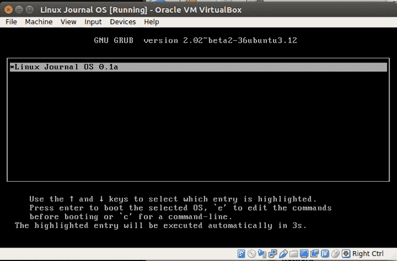

图 1。GRUB 引导加载程序

在一秒钟内（是的，你读没错，就是一秒钟），你将到达操作系统的登录提示符（图 2）。

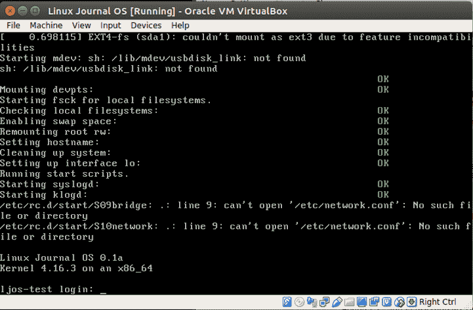

图 2。用户登录提示符

你会注意到几个启动“错误”和警告信息。这是因为你缺少了几个文件。当你继续学习该环境并将更多包构建到操作系统中时，你可以纠正这个问题。

如果你还记得，你从未设置过 root 密码。这是刻意为之。以 root 身份登录，你将直接进入 shell，而无需输入密码。你可以使用 BusyBox 的`passwd`命令来改变这种行为，该命令应该已经构建在此镜像中了。

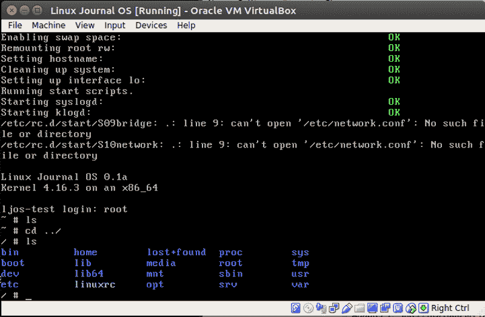

图 3。执行几个简单任务

祝玩得愉快！

### 下一步

那么，现在你处于什么地步呢？你已经能够从开源包中为通用的 x86-64 架构构建一个自定义的 Linux 发行版，并成功将其加载到其中。使用相同的交叉编译工具链，你可以使用类似的流程将更多的实用程序和库构建到操作系统中，例如网络实用程序、存储卷管理框架等。

对于未来的构建，请务必保留交叉编译构建目录和你的头文件，并继续导出以下变量（你可能可以将它们丢进一个脚本文件中）：

```bash
set +h
umask 022
export LJOS=~/lj-os
export LC_ALL=POSIX
export PATH=${LJOS}/cross-tools/bin:/bin:/usr/bin
unset CFLAGS
unset CXXFLAGS
export LJOS_HOST=$(echo ${MACHTYPE} | sed "s/-[^-]*/-cross/")
export LJOS_TARGET=x86_64-unknown-linux-gnu
export LJOS_CPU=k8
export LJOS_ARCH=$(echo ${LJOS_TARGET} | sed -e 's/-.*//' 
 ↪-e 's/i.86/i386/')
export LJOS_ENDIAN=little
export CC="${LJOS_TARGET}-gcc"
export CXX="${LJOS_TARGET}-g++"
export CPP="${LJOS_TARGET}-gcc -E"
export AR="${LJOS_TARGET}-ar"
export AS="${LJOS_TARGET}-as"
export LD="${LJOS_TARGET}-ld"
export RANLIB="${LJOS_TARGET}-ranlib"
export READELF="${LJOS_TARGET}-readelf"
export STRIP="${LJOS_TARGET}-strip" 
```

# 构建一个语音控制的物联网设备前端

## 苹果、谷歌和亚马逊正在将语音控制推向新的高度。但语音控制可以是 DIY 项目吗？事实证明是可以的。而且，并没有你想象的那么困难。Michael J. Hammel 

Siri、Alexa 和 Google Home 都能将语音命令转换为基本活动，特别是当这些活动仅涉及共享音乐和电影等数字文件时。与家庭自动化集成也是可能的，尽管可能没有用户希望的那么简单——至少目前还没有。

尽管如此，将语音命令转换为动作的想法对创客世界来说仍然很有吸引力。三大巨头的产品看起来就像盒子里的魔法，但我们都知道它们并非如此。

### API 与消息

Jarvis 几年前开始作为一个实验，看看在 DIY 项目是否可行。第一步是确定已有的开源支持。这几周的调研记录在代码库的`docs/notes.txt`文件中。最终对语言的选择是基于可能的工具选择。由于 Jarvis 是实验性的（它后来已毕业为 [IronMan 项目](http://redmine.graphics-muse.org/projects/ironman/wiki/Getting_Started)），它要求尽可能简单。在 Java 中采集音频非常直接且比 C 更简单。更重要的是，一旦收集了音频，就需要将其转换为文本的 API。发现的最简单的 API 是 Google Cloud API。由于音频采集和 REST 接口都易于处理，似乎 Java 是合适的选择。

音频转换为文本后，下一步是某种文本分析。这种分析被称为自然语言处理。[Apache OpenNLP 库](https://opennlp.apache.org) 正是如此，简单地将字符串拆分为词性。由于这也是一个 Java 库，项目语言的选择已经完成。

最初，对 Google API 的使用了非公开接口——基本上是 Chrome 浏览器内部的接口。那些接口消失了，并被现在的公共 Google Cloud API 取代。此外，还使用了 Google 翻译的文本语音功能，但该接口在被滥用后被移除。因此最近整合了一个替代方案：[espeak-ng](https://github.com/espeak-ng/espeak-ng)。`Espeak`是一个用于语音合成的命令行工具。它可以与来自 [mbrola 项目](http://www.tcts.fpms.ac.be/synthesis/mbrola/mbrcopybin.html) 的声音集成，以帮助产生更好（至少不那么机械）的声音。你可以把它想象成改进版的史蒂芬·霍金声音。最重要的是，Java 可以直接调用`espeak`来生成音频文件，然后 Java 使用主机的音频系统播放这些文件。

有了这些 API、工具和库，现在可以设计程序流程了。Jarvis 利用以下执行线程：

- 采集并录制音频到文件。
- 将音频文件转换为文本。
- 对文本进行词性分析。
- 分析词性以进行命令处理。
- 提供语音化响应。

Jarvis 还包含一个简单的 UI，主要用于调试，它可以绘制线程处理时间的图表并显示语音模式。每个线程都运行一个带有短延迟循环，用以检查来自其他线程的入站消息。录音线程寻找高于配置电平的音频，当电平低于阈值时，则将其保存到文件中。这会导致消息被传递给下一个线程继续处理，以此类推。即使是 UI 线程也会遥测数据进行显示。

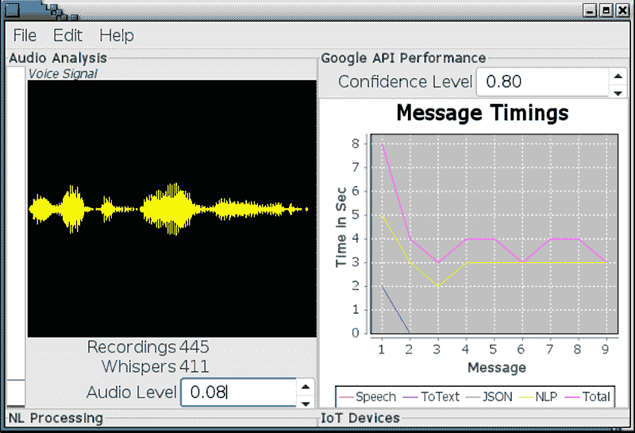

图 1.Jarvis 的 UI 主要用于监控进程，而不是直接用于用户交互。

### 前提条件

为了使用 Jarvis，你需要一个麦克风和一些扬声器。测试中使用了`PulseAudio Plugin`，因为它允许启用和禁用输入源，这意味着我不需要一直开启音频输入设备。如果黑客真的能渗透到我的世界深处，让他们听我的一举一动是没有意义的。

可以使用任何麦克风，但对于长期开发计划（即无论我在房间的哪个位置都应该采集到音频），我选择了一个`Blue Snowball iCE Condenser Microphone`。这对于播客来说质量很好，而且只要我说话稍大一点，它就能很好地捕捉到房间内任何地方我的清晰声音录音。

只有当你想听到 Jarvis 的响应时，才需要扬声器。如果你的电脑没有扬声器，也不会阻止 Jarvis 处理你的语音命令。

### 从语音到文本

Java 通过`javax.sound.sampled.DataLine`和`javax.sound.sampled.AudioSystem`类支持从 Linux 音频子系统读取。使用这些类的第一步是设置一个具有所需采样率和相关配置的`AudioFormat`类：

```java
AudioFormat getAudioFormat() {
    float sampleRate = 16000.0F;
    int sampleSizeInBits = 16;
    int channels = 1;
    boolean signed = true;
    boolean bigEndian = false;
    return new AudioFormat(sampleRate, sampleSizeInBits, 
     channels, signed, bigEndian);
} 
```

这些设置稍后用于确定音频采样的阈值电平。然后将此类传递给`DataLine`以设置来自 Linux 音频子系统的音频数据缓冲。`AudioSystem`使用`DataLine`获取`Line`对象，该对象是实际音频的连接：

```java
audioFormat = getAudioFormat();
DataLine.Info dataLineInfo = new DataLine.Info( 
 TargetDataLine.class, audioFormat);
line = (TargetDataLine) AudioSystem.getLine(dataLineInfo); 
```

然后打开该行对象，开始 Java 对音频数据的采样。测试行缓冲区的内容，如果发现任何内容，则计算该缓冲区的音频电平。如果电平高于硬编码的阈值，则开始录音。录音将音频缓冲区写入流缓冲区。当电平低于阈值时，停止录音并关闭输出流。这被称为一个`snippet`（片段）。如果片段大小不为零，则将其加入队列，使用 [javaFLACEncoder](http://javaflacencoder.sourceforge.net) 转换为`WAV`格式：

```java
int count = line.read(buffer, 0, buffer.length);
if ( count != 0 )
{
    float level = calculateLevel(buffer,0,0);
    if ( !recording )
    {
        if ( level >= threshold )
            recording++;
    }
    else
    {
        if ( level < threshold )
        {
            recording=0;
            Snippet snippet = new Snippet();
            snippet.setBytes( out.toByteArray() );
            if ( snippet.size() != 0 )
               snippets.add( snippet );
    }
} 
```

计算阈值需要运行音频缓冲区长度以找到最大整数值。然后将最大值从 0.0 归一化为 1.0，即最大音量的百分比。该百分比用于与阈值电平进行比较。编码后的`WAV`文件随后会被队列转换为文本。

将音频文件转换为文本需要通过 Google 的 Cloud Speech API，这是一个 REST API，需要 API 密钥并且产生费用，尽管对于普通 Jarvis 用户来说，这种费用非常低（实际上几乎为零）。Jarvis 的设计允许用户使用自己的密钥，因为源代码中没有提供密钥。

Google 的 API 要求将音频文件作为 Base64 编码数据放在 HTTP 消息体中的 JSON 对象中，其中目标 URL 是 REST API。返回数据也是一个 JSON 对象，填充了转换后的文本和额外数据。Jarvis 使用自定义类`GAPI`来持有返回的文本数据，并处理 JSON 解析以提取供其他类使用的字段。[SimpleJSON](https://github.com/fangyidong/json-simple) 库用于所有的 JSON 操作：

```java
Path path = Paths.get( audiofile.getPath() );

byte[] data = Base64.getEncoder().encode( Files.readAllBytes(path) );

audiofile.delete();

if ( (data != null) || (data.length.0) )

{

    String request = "https://speech.googleapis.com/v" 

 + Cli.get(Cli.S_GAPIV) + "/speech:recognize?key=" + apikey;

    JSONObject config = new JSONObject();

    JSONObject audio = new JSONObject();

    JSONObject parent = new JSONObject();

    config.put("encoding","FLAC");

    config.put("sampleRateHertz", new Integer(16000));

    config.put("languageCode", "en-US");

    audio.put("content", new String(data));

    parent.put("config", config);

    parent.put("audio", audio);

    ...use HttpURLConnection to POST the message...

    ...get response with a BufferedReader object...

    ...queue text from response for command processing...

} 
```

### 从文本到命令

命令处理将响应转发给`GAPI`对象以确定下一步。如果 Google 发现了可识别的文本，则通过 Jarvis 的`NLP`类使用 Apache OpenNLP 库将其转换为词性。这会将文本分词动词、名词等的集合。`NLP`类用于识别命令是否是针对 Jarvis 的（必须包含该名称）：

```java
private boolean forJarvis(NLP nlp)

{

    String[] words = nlp.getNames();

    if ( words == null )

        return false;

    for(int i=0; i<words.length; i++)

    {

        if ( words[i].equalsIgnoreCase("jarvis") )

            return true;

    }

    words = nlp.getNoun();

    if ( words == null )

        return false;

    for(int i=0; i<words.length; i++)

    {

        if ( words[i].equalsIgnoreCase("jarvis") )

            return true;

    }

    return false;

} 
```


针对 Jarvis 的请求将以各种格式和顺序搜索关键词以识别命令。以下代码用于响应“你在不在吗？”、“你醒了吗？”、“你听得见我说话吗？”或“你能听到我说话吗？”命令。Java 的 `String.matches()` 方法用于通配相关关键词，从而更容易找到命令的变体：

```java
private boolean isAwake(NLP nlp)
{
    int i = 0;
    String[] token = nlp.getTokens();
    boolean toJarvis = false;
    String[] tag = nlp.getTags();

    if (tag != null)
    {
        String words = "are|do|can";

        for (i = 1; i < tag.length; i++)
        {
            if (tag[i].startsWith("PR"))
            {
                if (token[i].equalsIgnoreCase("you"))
                {
                    if (token[i - 1].toLowerCase().matches("(" + words + ")"))
                    {
                        toJarvis = true;
                        break;
                    }
                }
            }
        }
    }

    if (!toJarvis)
        return false;

    token = nlp.getVerbs();

    if (token != null)
    {
        String words = "listen|hear";

        for (i = 0; i < token.length; i++)
        {
            if (token[i].toLowerCase().matches("(" + words + ").*"))
                return true;
        }
    }

    token = nlp.getAdverbs();

    if (token != null)
    {
        String words = "awake|there";

        for (i = 0; i < token.length; i++)
        {
            if (token[i].toLowerCase().matches("(" + words + ").*"))
                return true;
        }
    }

    return false;
}
```

一旦找到命令，就可以将其转换为操作。Jarvis 的这部分仍在演进中，但其意图是使用 REST API 连接到一个带有命令的 `PiBox` 服务器。`PiBox` 服务器将负责联系灯开关或窗帘等 IoT 设备，以执行相应的操作。

这种程序化的响应效率非常低。命令的顺序处理速度很慢，并且随着命令的增加只会变得更糟。然而，作为简单支持家居自动化命令的实现，它是合理的。

### 为你的创作赋予声音

在操作处理完成后（或在远程 `PiBox` 服务器上排队处理时），可以队列一个语音化的响应。在上面的示例中，响应是“是的，我在这里。我可以帮你你吗？”这段文本被放置在 Jarvis 内部的一个 `Message` 对象中，以便在 `Speaker` 线程上排队。

文本从 `Message` 对象中提取，并使用 `espeak-ng` 工具构建命令行。`espeak` 是一个你可以从你的 Linux 发行版软件包管理系统中安装的包。在 Fedora 上，命令是：

```bash
sudo dnf install espeak-ng
```

注意，存在原始的 `espeak` 和重启后的 `espeak-ng`。它们对 Jarvis 来说似乎产生相同的结果，并且具有相同的名称（`espeak`），所以任何一个都可以工作。

`espeak` 程序接受文本作为输入并输出音频文件。然后使用 Java 的音频支持读取并播放该文件：

```java
String cmd = "espeak-ng -z -k40 -l1 -g0.8 -p 78 -s 215 -v mb-us1 "
    + "-f " + messageFilename + " -w " + audioFilename;

Utils.runCmd(cmd);

file = new File(audioFilename);

InputStream in = new FileInputStream(audioFilename);
AudioStream audioStream = new AudioStream(in);
AudioPlayer.player.start(audioStream);

file.delete();
```

在这个示例中，`runCmd()` 方法是 Jarvis 对 Java 进程管理的一种封装，用于简化运行外部命令。

### 注意事项

Jarvis 依赖于 Google 的 Cloud Speech API 将音频文件转换为文本。该 API 还需要 Google 提供的 API 密钥。由于此服务并非免费，Jarvis 允许开发者在 `docs` 目录中放置他们自己的 API 密钥，构建系统将找到它。或者，如果你在不重新构建的情况下运行 Jarvis，只需将 `apikey` 放置在 `~/.jarvis` 目录中。

这个 DIY 系统并不完全安全。使用 Google Cloud Speech API 意味着音频文件跨互联网传输到 Google，由其将其转换为文本。这意味着 Google 可以访问音频、转换后的文本以及这两者的来源。如果你关心隐私，请在在使用 Jarvis 之前务必考虑这个问题。

文章中的源代码为了说明目的，对实际的 Jarvis 代码进行了简化。注意，Jarvis 的源代码虽然是用 Java 编写的，但并非设计为使用 Maven 或在 Eclipse 中构建。构建系统是手动制作的，旨在从命令行通过 Ant 运行。使用 `ant jarvis` 进行构建，使用 `ant jarvis.run` 从构建产物中运行，并在 Fedora、Red Hat 或 CentOS 系统上使用 `ant rpm` 生成 RPM 文件。查看 `ant -p` 以获取支持的目标列表。还要注意，Jarvis 是一个由 C 语言开发者编写的 Java 程序。一个带有警示的程序员（Caveat programmer）。

### 未来展望：AI

Jarvis 中的命令处理是程序化的，这意味着这里没有 AI。命令从文本中解析并进行松散分组，以允许命令的变化，例如“are you”、“can you”和“do you”都指向同一个命令处理轨道。

这种机制应该被扩展以支持配置语言，以便在不需要重新重写和扩展代码或重新编译的情况下扩展命令。目前正在考虑此此的想法，但尚未开始设计或实现。

要让 Jarvis 超越简单的程序化响应，需要与 AI 后端集成。

Linux 内核是历史上最最重要的开源项目，而 Linus 本人是第一个发现开源开发技术的人，这些技术曾是 GNU 项目无法触及的，并在随后的几十年里被开源项目不断模仿，直到今天。Linus 到底在想什么？他怎么能这样背叛他的社区和开源世界？当 Linus 初步使用 `BitKeeper` 进行内核开发时，许多人都是这样想的。

此外，`BitMover` 以免费许可为代价对 Linux 社区施加了巨大的限制。首先，Linux 开发者在使用 `BitKeeper` 期间不允许参与任何竞争性的版本控制项目。其次，`BitMover` 将控制与内核项目相关的某些元数据，以监控任何对许可的滥用。无法访问这些元数据意味着内核开发者将无法比较过去的内核版本——这是其他版本控制系统的项重要标准功能。

争议并没有平息，尽管 Linus 继续依赖 `BitKeeper` 了多年。他的基本观点是自己并不是一个自由软件热分子。如果开源工具比商业同品更好，他就会使用；但如果商业工具更好，他也不会弃之以鼻。

然而，许多内核开发者确实是自由软件热分子。Linus 与其他开发者之间的愤怒和紧张气氛非常激烈，尽管这不足以分裂社区并导致 Linux 内核项目发生实际的分叉。无疑，像 Alan Cox、Al Viro、David Miller、Andrea Arcangeli、Andrew Morton 以及其他许多优秀的人士都有技术能力来领导竞争性项目，也许有些人甚至拥有足够的声望来吸引大量内核开发者加入他们。但没有人这样做。这种紧张和敌意一直持续着。

### `BitKeeper` 有什么了不起的？

`BitKeeper` 主要成名是因为它提供了一个分布式系统，可以轻松地对整个仓库进行分支和合并。这是关键。有了它，内核开发者的小组可以独立协作，享受版本控制带来的好处，并在准备好后将更改提交给 Linus。通过这种方式，以前完全压在 Linus 肩子上的大部分工作可以分配给他信赖的副手，或者准确地说，分配给任何选择以这种方式共同工作的群体。架构、驱动程序和子系统都可以某种独立的方式进行开发，然后每个部分都可以一口气合并到主内核树中。

这听起来可能非常熟悉，但在 2002 年，这是一个新想法。现有的项目如 `CVS` 和 `Subversion` 只能将分支和合并视为重大的、耗时的操作，让你痛苦生不如死。有了 `BitKeeper`，这变成了一项微不足道的操作。

Linus 愿意在内核开发工具链的核心位置使用专有软件，这激励了许多人去更加努力地创建一个替代品。`CVS` 和 `Subversion` 项目太落后了，并且犯了太多的基础性设计错误。其他现有项目也是如此。但现在既然大家都知道（或认为自己知道）Linus 真正想要什么，他们就可以开始认真编写代码了。结果出现了一系列提供分布式开发的版本控制系统。

其中包括 `arch`、`darcs` 和 `monotone`。它们都以 `BitKeeper` 为竞争模型，每个项目都代表了为 Linus 提供 `BitKeeper` 替代方案的努力。

许多人都尝试过，但没有一个成功。这部分是因为 Linus 不会充分说明他从这些任何项目中需要什么，就像他之前没有充分说明 `CVS` 和 `Subversion` 缺少了什么一样。而且还有一种是 Linus 并不介意使用闭源工具——对于任何替代方案来说，要被他接受，必须在技术上比 `BitKeeper` 有显著的改进。因此，尽管在 `BitKeeper` 之前没有任何开源工具是足够的，但 `BitKeeper` 的出现为任何可能出现的开源工具进一步提高了门槛。

在经历了三年的密集努力后，没有任何开源替代方案在满足 Linus 需求方面比 `CVS` 或 `Subversion` 更近。如果没有 `Samba` 的创始人、`rsync` 的共同创始人以及一位心肠好的人 Andrew Tridgell，这种情况可能会持续得得多。2005 年，Andrew 尝试逆向工程 `BitKeeper` 的网络协议以创建一个自由软件替代品。如果不是他，也会别人——这只是时间问题。Larry McVoy 曾警告过 Linux 开发者，如果有人尝试这样做他就会拔掉电源，而他确实这么做了。突然之间，`BitKeeper` 不再能用于内核开发了。整个开发工具链以及围绕分布式版本控制产生的所有开发者文化都陷入了不确定。

这意味着什么？Linus 会回到他旧的开发模式，亲自审核所有补丁吗？如果没有，他会选择 `BitKeeper` 的开源替代方案之一吗？如果会，那又是哪一个呢？

此时，发生了一些了不起的事情。自从 1991 年诞生以来，Linus 第一次完全停止了 Linux 内核的工作。由于现有的工具都无法满足他的需求，他决定编写自己的工具。

事实上，Linus 主要关心的之一实际上是速度。这是他以前从未充分表达过的，或者至少没有以现有项目能够理解的方式表达过。随着全球成千上万的内核开发者全以赴地提交补丁，他需要一种以前以前无法想象的速度运行的东西。他无法即使为最复杂的操作等待超过几秒钟。无论是 `arch`、`darcs`、`monotone` 还是其他项目，从未接近过这一要求。

Linus 闭关编写了一小段时间，然后向世界分享了他的新理念。在 2005 年 6 月启动项目后的几天内，Linus 的 `git` 版本控制系统就实现了完全托管。在几周内，它就可以托管内核开发了。在几个月内，它达到了功能齐全。此时，Linus 将项目的维护权交给了他最热情的贡献者 Junio C. Hamano，并再次全职投入 Linux 开发。

如果你有任何编程或仅仅修改配置文件的经验，我确定你曾对开发过程中的某处改动如何影响整个项目感到不知所措。在没有版本控制系统的情况下，识别并隔离问题通常非常耗费时力和精力，这需要回溯你的步骤，并检查在异常行为发生之前进行的所有更改。版本控制系统的设计初衷就是为了让这一过程变得简单，并在文本的不同版本之间提供可读的对比。

`git` 等分布式版本控制系统提供的另一个强大特性是“横向移动”的能力。在传统上，程序员团队会线性地实现功能。这意味着从可信源（服务器）拉取代码并开发某个部分，然后将修改后的版本推回上游服务器。而在分布式系统中，每台计算机都维护一个完整的仓库，这意味着每位程序员都拥有所有添加、删除和贡献者的完整历史，并且能够回滚到之前的版本，或者脱离可信仓库并分支（fork）开发树（我将在稍后讨论这一点）。

# 快速上手指南

`git` 的伟大之处在于你需要了解的知识非常少！废话不多说，让我们从最重要的命令开始。

首先，我正在处理我之前的一个项目，它位于这里：

```bash
[user@lj src]$ pwd
/home/lj/projects/java/spaceInvaders/src
```

要创建一个本地仓库，只需运行：

```bash
[user@lj src]$ git init
Initialized empty Git repository in
↪/home/lj/projects/java/spaceInvaders/src/.git/
```

将所有源文件递归地添加到 `git` 索引中，运行：

```bash
[user@lj src]$ git add .
```

将这些已索引的文件推送到本地仓库，运行：

```bash
[user@lj src]$ git commit
```

你将看到一个包含提交信息的屏幕，它允许你留下提交描述：

```text
# Please enter the commit message for your changes. Lines starting
## with '#' will be ignored, and an empty message aborts the commit.
## On branch master
#
Initial commit
# Changes to be committed:
    new file:   engine/collisionChecker.java
    new file:   engine/direction.java
    new file:   engine/gameEngine.java
    new file:   engine/gameObjects.java
    new file:   engine/level.java
    new file:   engine/main.java
    new file:   engine/mathVector.java
    new file:   graphics/drawer.java
    new file:   sprites/baseSprite.java
    new file:   sprites/boss.java
    new file:   sprites/enemy.java
    new file:   sprites/healthBar.java
    new file:   sprites/menu/menuItem.java
    new file:   sprites/menu/menuItemExclusiveMoveOnInput.java
    new file:   sprites/menu/menuItemLevelDecrease.java
    new file:   sprites/menu/menuItemLevelIncrease.java
    new file:   sprites/menu/menuItemMovementDirections.java
    new file:   sprites/menu/menuItemProjectileLimit.java
    new file:   sprites/menu/menuItemStartGame.java
    new file:   sprites/pickup/fireRateBoost.java
    new file:   sprites/pickup/pickup.java
    new file:   sprites/pickup/shield.java
    new file:   sprites/pickup/shieldPickup.java
    new file:   sprites/pickup/speedBoost.java
```


`new file:   sprites/player.java`

`new file:   sprites/projectile.java`

`new file:   sprites/wall.java`

```
[user@lj src]$ git commit
```

```
[master (root-commit) 4cf5218]  

  Initial commit  

  Changes to be committed:       

        new file:   engine/collisionChecker.java        

        new file:   engine/direction.java       

        new file:   engine/gameEngine.java      

        new file:   engine/gameObjects.java     

        new file:   engine/level.java   

        new file:   engine/main.java    

        new file:   engine/mathVector.java      

        new file:   graphics/drawer.java        

        new file:   sprites/baseSprite.java     

        new file:   sprites/boss.java   

        new file:   sprites/enemy.java  

        new file:   sprites/healthBar.java      

        new file:   sprites/menu/menuItem.java  

        new file:   sprites/menu/menuItemExclusiveMoveOnInput.java      

        new file:   sprites/menu/menuItemLevelDecrease.java     

        new file:   sprites/menu/menuItemLevelIncrease.java     

        new file:   sprites/menu/menuItemMovementDirections.java        

        new file:   sprites/menu/menuItemProjectileLimit.java   

        new file:   sprites/menu/menuItemStartGame.java         

        new file:   sprites/pickup/fireRateBoost.java   

        new file:   sprites/pickup/pickup.java  

        new file:   sprites/pickup/shield.java  

        new file:   sprites/pickup/shieldPickup.java    

        new file:   sprites/pickup/speedBoost.java      

        new file:   sprites/player.java         

        new file:   sprites/projectile.java     

        new file:   sprites/wall.java

 27 files changed, 2557 insertions(+)

  create mode 100755 engine/collisionChecker.java

  create mode 100755 engine/direction.java

  create mode 100755 engine/gameEngine.java

  create mode 100755 engine/gameObjects.java

  create mode 100755 engine/level.java

  create mode 100755 engine/main.java

  create mode 100755 engine/mathVector.java

  create mode 100755 graphics/drawer.java

  create mode 100755 sprites/baseSprite.java

  create mode 100755 sprites/boss.java

  create mode 100755 sprites/enemy.java

  create mode 100755 sprites/healthBar.java

  create mode 100755 sprites/menu/menuItem.java

  create mode 100755 sprites/menu/menuItemExclusiveMoveOnInput.java

  create mode 100755 sprites/menu/menuItemLevelDecrease.java

  create mode 100755 sprites/menu/menuItemLevelIncrease.java

  create mode 100755 sprites/menu/menuItemMovementDirections.java

  create mode 100755 sprites/menu/menuItemProjectileLimit.java

  create mode 100755 sprites/menu/menuItemStartGame.java

  create mode 100755 sprites/pickup/fireRateBoost.java

  create mode 100755 sprites/pickup/pickup.java

  create mode 100755 sprites/pickup/shield.java

  create mode 100755 sprites/pickup/shieldPickup.java

  create mode 100755 sprites/pickup/speedBoost.java

  create mode 100755 sprites/player.java

  create mode 100755 sprites/projectile.java

  create mode 100755 sprites/wall.java
```

文件从索引中删除时，采用相同的 *NIX* 风格：

```
[user@lj src]$ git rm -r .

rm 'engine/collisionChecker.java'

rm 'engine/direction.java'

rm 'engine/gameEngine.java'

... 省略 ... 
```

要将本地索引与仓库进行对比，使用 `git diff`（注意：大多数行末尾的连字符已被删除以提高可读性）：

```
[user@lj src]$ git diff --cached --stat

 engine/collisionChecker.java                   | 281 ----- ...

 engine/direction.java                          |  14 ----

 engine/gameEngine.java                         | 504 ----- ...

 engine/gameObjects.java                        |  61 ----- ...

 engine/level.java                              | 134 ----- ...

 engine/main.java                               |  51 ----- ...

 engine/mathVector.java                         |  46 ----- ...

 graphics/drawer.java                           | 323 ----- ...

 sprites/baseSprite.java                        | 303 ----- ...

 sprites/boss.java                              |  73 ----- ...

 sprites/enemy.java                             | 119 ----- ...

 sprites/healthBar.java                         |  64 ----- ...

 sprites/menu/menuItem.java                     |  21 ----- ...

 sprites/menu/menuItemExclusiveMoveOnInput.java |  31 ----- ...

 sprites/menu/menuItemLevelDecrease.java        |  28 ----- ...

 sprites/menu/menuItemLevelIncrease.java        |  27 ----- ...

 sprites/menu/menuItemMovementDirections.java   |  30 ----- ...

 sprites/menu/menuItemProjectileLimit.java      |  31 ----- ...

 sprites/menu/menuItemStartGame.java            |  33 ----- ...

 sprites/pickup/fireRateBoost.java              |  39 ----- ...

 sprites/pickup/pickup.java                     |  77 ----- ...

 sprites/pickup/shield.java                     |  39 ----- ...

 sprites/pickup/shieldPickup.java               |  47 ----- ...

 sprites/pickup/speedBoost.java                 |  38 ----- ...

 sprites/player.java                            |  64 ----- ...

 sprites/projectile.java                        |  44 ----- ...

 sprites/wall.java                              |  35 ----- ...

 27 files changed, 2557 deletions(-) 
```

当不使用 `cached` 选项时，只会显示已修改尚未添加到索引（index）的更改。`stat` 选项提供了一个快速表格，而不是在不使用该选项时通过 `less` 命令提供的标准逐行审查。当在查看许多文件的摘要而不是分析细小更改时，这通常非常有用。

`git status` 提供了类似于 `diff` 的更详细的输出：

```
[user@lj src]$ git status

On branch master

Changes to be committed:

  (use "git reset HEAD <file>..." to unstage)

        deleted:    engine/collisionChecker.java

        deleted:    engine/direction.java

        deleted:    engine/gameEngine.java

... SNIP ... 
```

分支是 git 的核心组成部分，理解分支对于掌握 git 的真实运行机制至关重要。每个分支都是不同的开发路径，这意味着所有分支之间都是相互独立的。为了更好地解释这一点，让我们来看一个例子。

所有项目都从 "master" 分支开始。你可以通过以下命令查看当前分支：

```
[user@lj src]$ git branch -a

* master 
```

新分支用于开发功能，然后这些功能可以合并回 master 分支。通过这样，不同的模块可以保持独立，直到它们稳定并准备好与 master 分支合并，而所有其他分支都派生于它。这种情况下，master 分支更像是一个树干而不是分支。创建一个新分支通常被称为“分叉”（forking）开发树，它将线性开发拆分为两个部分，并在分叉分支上的开发完成后再次合并分支。

要创建一个包含当前分支所有数据的新分支，请使用：

```
[user@lj src]$ git checkout -b development

Switched to a new branch 'development' 
```

`checkout` 用于在脱离当前分支之前完成该分支上的所有操作。`-b` 切换器从当前分支创建一个新分支。在此例中，我创建了一个开发分支，它将包含“热”或不稳定的代码。

接下来，将 master 分支重命名为 "stable"：

```
[user@lj src]$ git branch -m master stable 
```

现在你已经设置好了两个分支，让我们比较一下以确保开发分支已经填充了稳定分支的数据：

```
[user@lj src]$ git diff --stat development stable 

[user@lj src]$ 
```

由于 `diff` 没有返回任何内容，你知道它们包含完全相同的数据。

现在你已经设置好了两个分支，让我们开始在开发分支上进行更改：

```
[user@lj src]$ git diff --cached

diff --git a/engine/main.java b/engine/main.java

index 38577b5..5900d80 100755

--- a/engine/main.java

+++ b/engine/main.java

@@ -11,6 +11,8 @@ import graphics.drawer;

public class main 

{

+       // WHEN CAN I GO BACK TO C!?!?!?

+      

        /*

         * Class:                       main 

         * Author:                      Patrick 
```

并将它们提交到分支：

```
[user@lj src]$ git commit

[development e1f13bd]  Changes to be committed: modified:   

 ↪engine/main.java

 1 file changed, 2 insertions(+) 
```

提交更改后，你会得到一个唯一的标识符——在这种情况下是 "e1f13bd"。它被用来引用这次提交；然而，对于人类弱的人类来说很难记住这样的东西，所以让我们用一个更容易记忆的东西给它打上标签。

首先，找到并标记初始提交：

```
[user@lj src]$ git log

commit e1f13bde0bbe3d64f563f1abb30d4393dd9bd8d9

Author: user <user@lj.linux>

Date:   Wed Jun 6 15:51:18 2018 +0100

     Changes to be committed:

            modified:   engine/main.java

commit 4cf52187829c935dac40ad4b65f02c9fb6dab7ba

Author: user <user@lj.linux>

Date:   Tue Jun 5 21:31:14 2018 +0100

     Initial commit

     Changes to be committed:

            new file:   engine/collisionChecker.java

            new file:   engine/direction.java

            new file:   engine/gameEngine.java

... SNIP ... 

[user@lj src]$ git branch -m master stable
```

现在你已经设置好了两个分支，让我们比较它们以确保开发分支已经填充了稳定分支的数据：

```
[user@lj src]$ git diff --stat development stable 

[user@lj src]$ 
```

由于 `diff` 没有返回任何内容，你知道它们包含完全相同的数据。

现在你已经设置好了两个分支，让我们开始在开发分支上进行更改：

```
[user@lj src]$ git diff --cached
```


`diff --git a/engine/main.java b/engine/main.java`

`index 38577b5..5900d80 100755`

`--- a/engine/main.java`

`+++ b/engine/main.java`

`@@ -11,6 +11,8 @@ import graphics.drawer;`

```
public class main 
{
+       // WHEN CAN I GO BACK TO C!?!?!?
+      
        /*
         * Class:                       main 
         * Author:                      Patrick 
```

并将它们提交到分支：

```
[user@lj src]$ git commit
[development e1f13bd]  Changes to be committed: modified:   
 ↪engine/main.java
 1 file changed, 2 insertions(+) 
```

提交更改后，你会得到一个唯一的标识符——在这种情况下是`"e1f13bd"`。它被用来引用这次提交；然而，对于人类弱的人类来说很难记住这样的东西，所以让我们用一个更容易记忆的东西给它打上标签。

首先，找到并标记初始提交：

```
[user@lj src]$ git log
commit e1f13bde0bbe3d64f563f1abb30d4393dd9bd8d9
Author: user <user@lj.linux>
Date:   Wed Jun 6 15:51:18 2018 +0100

     Changes to be committed:
            modified:   engine/main.java

commit 4cf52187829c935dac40ad4b65f02c9fb6dab7ba
Author: user <user@lj.linux>
Date:   Tue Jun 5 21:31:14 2018 +0100

     Initial commit
     Changes to be committed:
            new file:   engine/collisionChecker.java
            new file:   engine/direction.java
            new file:   engine/gameEngine.java
... SNIP ... 

[user@lj src]$ git branch -m master stable
```

现在你已经设置好了两个分支，让我们比较它们以确保开发分支已经填充了稳定分支的数据：

```
[user@lj src]$ git diff --stat development stable 
[user@lj src]$ 
```

由于`diff`没有返回任何内容，你知道它们包含完全相同的数据。

现在你已经设置好了两个分支，让我们开始在开发分支上进行更改：

```
[user@lj src]$ git diff --cached
diff --git a/engine/main.java b/engine/main.java
index 38577b5..5900d80 100755
--- a/engine/main.java
+++ b/engine/main.java
@@ -11,6 +11,8 @@ import graphics.drawer;
 public class main 
{
+       // WHEN CAN I GO BACK TO C!?!?!?
+      
        /*
         * Class:                       main 
         * Author:                      Patrick 
```

并将它们提交到分支：

```
[user@lj src]$ git commit
[development e1f13bd]  Changes to be committed: modified:   
 ↪engine/main.java
 1 file changed, 2 insertions(+) 
```

提交更改后，你会得到一个唯一的标识符——在这种情况下是`"e1f13bd"`。它被用来引用这次提交；然而，对于人类弱的人类来说很难记住这样的东西，所以让我们用一个更容易记忆的东西给它打上标签。

首先，找到并标记初始提交：

```
[user@lj src]$ git log
commit e1f13bde0bbe3d64f563f1abb30d4393dd9bd8d9
Author: user <user@lj.linux>
Date:   Wed Jun 6 15:51:18 2018 +0100

     Changes to be committed:
            modified:   engine/main.java

commit 4cf52187829c935dac40ad4b65f02c9fb6dab7ba
Author: user <user@lj.linux>
Date:   Tue Jun 5 21:31:14 2018 +0100

     Initial commit
     Changes to be committed:
            new file:   engine/collisionChecker.java
            new file:   engine/direction.java
            new file:   engine/gameEngine.java
... SNIP ... 

[user@lj src]$ git branch -m master stable
```

等待，我注意到输入文本末尾有一些重复。我将确保最终输出是整洁的并遵循提供的逻辑。

（根据提供的文本进行修正）：现在两个提交已经打了版本号，它们更容易记忆和比较了：

```
[user@lj src]$ git diff --stat v0.1 v0.11
 engine/main.java | 2 ++
 1 file changed, 2 insertions(+)
```

在测试并确保开发分支稳定后，你应该更新稳定分支以开发分支：

```
[user@lj src]$ git checkout stable
Switched to branch 'stable'
[user@lj src]$ git merge development 
Fast-forward
 engine/main.java | 2 ++
 1 file changed, 2 insertions(+)
```

如你在下方所示，两个分支仍然存在并包含相同的数据：

```
[user@lj src]$ git branch -a
  development
* stable
[user@lj src]$ git diff --stat development
```

如果你随时想回滚，使用`git revert`来撤销某个提交及其做的任何更改：

```
[user@lj src]$ git revert v0.11
[stable 19916f] Revert " Changes to be committed:"
 1 file changed, 2 deletions(-)
[user@lj src]$ git diff --stat development 
 engine/main.java | 2 ++
 1 file changed, 2 insertions(+)
```

这就是你开始并精通个人使用 git 需要的所有知识。所有的 git 仓库的操作方式相同；但与远程仓库协作会有自己的注意事项。

### 与远程仓库协作

首先，获取远程仓库：

```
[user2@lj ~]$ git clone src repo
Cloning into 'repo'...
done. 
```

在 user2 进行一些更改后，它们被提交到 user2 的仓库中：

```
[user2@lj repo]$ git commit -a
[stable 6a04336]  Changes to be committed: modified:   
 ↪graphics/drawer.java
 1 file changed, 1 insertion(+) 
```

现在原始所有者可以将更改拉回主仓库。拉取尽可能在一个命令中获取并合并更改。

```
[user@lj src]$ git pull /home/user2/repo
remote: Counting objects: 4, done.
remote: Compressing objects: 100% (3/3), done.
remote: Total 4 (delta 1), reused 0 (delta 0)
Unpacking objects: 100% (4/4), done.
From /home/user2/repo
 * branch            HEAD       -> FETCH_HEAD
Updating 199169f..6a04336
Fast-forward
 graphics/drawer.java | 1 +
 1 file changed, 1 insertion(+)
[user@lj src]$ git diff --cached 
```

所有更改都已拉取主仓库，双方都拥有最新版本的代码。这种操作在本地系统上的运行方式与 GitHub 等托管网站上的方式完全相同。唯一的区别是仓库是通过 URL 而不是系统路径定位的。

这只是 Git 的开始！这本快速上手指南对于任何有志的开发者或厌倦了手动回滚版本的程序员来说，都足够了。现在，你可以称自己为一名 gitter，或者简称为 git 玩家了！

# 构建精简的 Git 环境

## 学习如何从 GitHub 迁移仓库、配置软件并在你自己的 Linux 服务器上托管 Git 仓库。作者：Andy Carlson

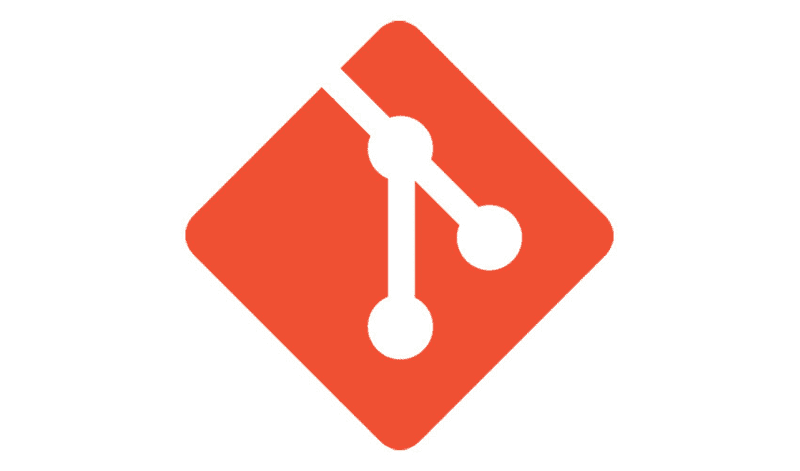

随着最近微软收购 GitHub 的消息，许多人开始研究其他的代码托管方案。像 GitLab 这样的自托管解决方案提供了精美的 UI，功能上与 GitHub 类似，但它对硬件配置有一定要求，并提供了许多普通 Git 用户不一定觉得有用的功能。

对于那些想要更简单解决方案的人，可以使用一些基础软件在 Linux 服务器上本地托管 Git 仓库，这些软件所需的系统资源极少，并提供基础 Git 功能，包括 Web 访问和 HTTP/SSH 克隆。

在本文中我将展示如何从 GitHub 迁移仓库、配置必要的软件并执行一些基础操作。

### 迁移仓库

离开 GitHub 的第一步是将仓库移动到将托管它们的服务器上。由于 Git 是一个分布式版本控制系统，仓库的克隆副本包含了运行整个仓库所需的所有信息。因此，可以将仓库从 GitHub 克隆到你的服务器，并且所有的仓库数据（包括提交日志）都将被保留。如果你有大量仓库，这可能是一个耗时的过程。为了简化这个过程，这里有一个 bash 函数，可以返回特定 GitHub 用户所有仓库的 URL：

```
genrepos() {
    if [ -z "$1" ]; then
        echo "usage: genrepos <github username>"
    else
        repourl="https://github.com/$1?tab=repositories"
        while [ -n "$repourl" ]; do
            curl -s "$repourl" | awk '/href.*codeRepository/ 
 ↪{print gensub(/^.*href="\/(.*)\/(.*)".*$/,
↪"https://github.com/\\1/\\2.git","g",$0); }'
            export repourl=$(curl -s "$repourl" | grep'>Previous<.
↪*href.*>Next<' | grep -v 'disabled">Next' | sed 
↪'s/^.*href="//g;s/".*$//g;s/^/https:\/\/github.com/g')
        done
    fi
} 
```

该函数接受一个 GitHub 用户名作为参数。如果将此命令的输出通过到 `while` 循环中读取每一行，则每一行都可以输入到 `git clone` 语句。仓库将被克隆到 `/opt/repos` 目录：

```
genrepos <GITHUB-USERNAME> | while read repourl; do
    git clone $repourl /opt/repos/$(basename $repourl | 
 ↪sed 's/\.git$//g')
    pushd .
    cd /opt/repos/$(basename $repourl | sed 's/\.git$//g')
    git config --bool core.bare true
    popd
done 
```

让我们来看一下这个 `while` 循环在做什么。`while` 循环的第一行仅仅是将 GitHub 仓库克隆到 `/opt/repos/REPONAME`，其中 `REPONAME` 是仓库名称。接下来的四行设置仓库配置中的 `core.base` 属性，这允许将远程提交推送到服务器（`pushd` 和 `popd` 用于在运行脚本时保留工作目录）。此时，所有仓库都将完成克隆。

测试仓库完整性的方法之一是从本地文件系统将其克隆到本地文件系统的新位置。在这里，名为 `scripts` 的仓库将克隆到用户家目录下的 `scripts` 目录：

```
git clone /opt/repos/scripts ~/scripts 
```

`~/scripts` 目录的内容将包含与 `/opt/repos/scripts` 相同的文件。验证两个仓库之间的提交日志应该返回相同的日志数据（在仓库目录中运行 `git log`）。此时，GitHub 仓库已全部准备就绪并可以开始使用。

### 配置软件

在专用服务器上拥有仓库固然很好，但如果无法远程访问它们，Git 仓库的分布式特性就变得毫无用处。为了实现基础功能，你需要在服务器上安装几个应用程序：`git`、`openssh-server`、`apache2` 和 `cgit`（包名可能随发行版而异）。

进行到这一步，git 软件应该已经安装。SSH 服务器将提供使用 SSH 协议推送/拉取仓库数据的能力。SSH 的默认配置可以正常工作，因此不需要自定义。另一方面，Apache 和 cgit 则需要一些自定义。

首先，让我们来配置 cgit 应用程序。cgit 包包含一个名为 `cgit.conf` 的配置文件，并将放置在 Apache 配置目录中（配置目录的位置随发行版而异）。为了增加 Apache 安装的灵活性，请对 `cgit.conf` 文件进行以下修改：

1. 在文件的第一行添加以下文本：`<Macro CgitPage $url>`。
2. 在文件的最后一行添加以下文本：`</Macro>`。
3. 将所有出现的 `/cgit` 替换为 `$url`（注意 `/cgit/` 将被替换为 `$url/`）。

生成的配置文件看起来如下（注意此宏中的某些路径可能会根据 Linux 发行版而不同）：

```
<Macro CgitPage $url>
ScriptAlias $url "/usr/lib/cgit.cgi/"
RedirectMatch ^$url$ $url/
Alias /cgit-css "/usr/share/cgit/"
<Directory "/usr/lib/cgit/">
AllowOverride None
Options ExecCGI FollowSymlinks
Require all granted
</Directory>
</Macro> 
```

此宏通过允许在 Apache 配置中的任何 `VirtualHost` 上启用 cgit，从而简化实现过程。要启用 cgit，请将下面的指令放在 `<VirtualHost>` 定义的底部。如果你找不到默认的 `VirtualHost`，可以创建一个新的 `VirtualHost`，并将此指令添加到新的 `VirtualHost` 中。

### 使用 CgitPage /git

在例例中，你使用 `/git` 作为访问 cgit 的 URL。安装时，cgit 并没有带默认配置文件。此类配置文件会在首次访问应用程序时生成。新的配置文件将位于 `/etc` 目录下，并命名为 `cgitrc`。你可以通过以下 URL 访问 cgit 应用程序：`http://HOSTNAME/git`。

一旦访问了该 URL，文件系统中就会出现配置文件。你现在可以配置 cgit 查看存储仓库的特定目录。假设本地仓库路径为 `/opt/repos`，则会将以下行添加到 `/etc/cgitrc` 文件中：

```
scan-path=/opt/repos
```


`scan-path`变量设置了 Git 仓库所在的目录。（注意 `cgit` 还有我此处未涵盖的其他自定义选项。）在修改 `cgitrc` 文件后，页面上将出现仓库列表。你可以通过点击仓库，然后点击页面顶部的“Tree”链接来访问仓库的内容。

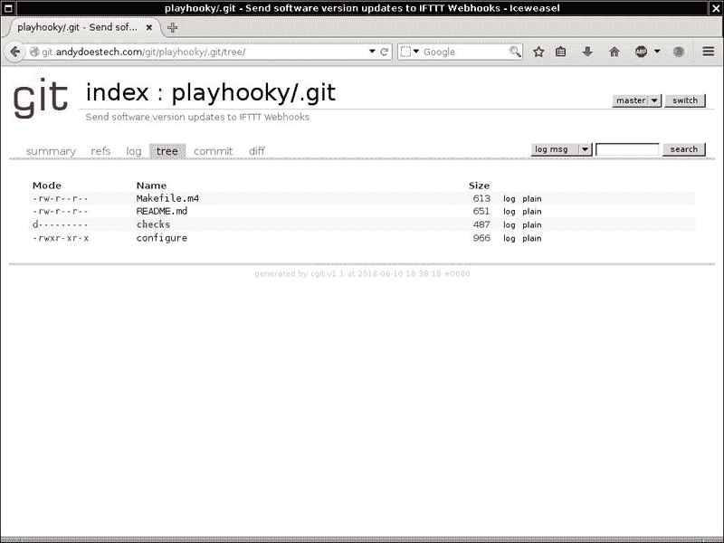

图 1\. cgit Tree

# 与仓库交互

现在环境已经完全配置并准备好了仓库，你需要进行一些基础操作，例如从服务器克隆（`clone`）、推送（`push`）和拉取（`pull`）仓库。如前，你将使用两种主要的协议来执行这些基础 Git 操作：`HTTP` 和 `SSH`。

在这个环境中，这些协议将承担两个不同的用途。`HTTP` 提供对仓库的只读访问，这对于公共访问仓库非常有用。你可以从 `cgit` 仓库列表页面获取 `HTTP` 克隆 URL，它们的格式如下：

```text
http://<HOSTNAME>/git/<REPOSITORY>/.git/
```

对于读写访问，你可以通过有效的本地用户通过 `SSH` 克隆仓库。一种良好的做法是为一个组提供读写权限，并赋予该组对`/opt/repos`目录的递归访问权限。

`SSH` 克隆地址的格式为：

```text
ssh://USER@HOSTNAME:PORT/opt/repos/<REPOSITORY>/
```

如果 `SSH` 使用的端口保持默认端口 `22`，你可以在克隆地址中省略 `PORT`。请注意，你可能需要打开防火墙端口以便能够进行远程 `SSH` 和 `HTTP` 连接。

你的自托管极简 Git 环境现在已经构建完成。尽管它可能缺少其他解决方案提供的一些高级功能，但它提供了管理分布式代码的基本功能。值得注意的是，你可以在对性能和整体复杂性影响很小的情况下，将此环境的功能扩展远我在此描述的内容。

## 资源

- [Git 命令行备忘录](https://gist.github.com/davfre/8313299)
- [额外的 cgitrc 设置](https://gist.github.com/schnell18/10391249)

# 将你的 Git 引入内部部署

如果你对微软收购`GitHub`感到疑虑，或者你正在寻找一种摆脱免费公共仓库的方法，又你想加强你的 DevOps 工作，现在是考虑自己安装和运行`GitLab`的好时机。它并没有你想象的那么困难，免费开源的`GitLab CE`版本提供了足够的灵活性，可以从零开始、迁移或升级到更完整的版本。作者：John S. Tonello

在当今的软件业务中，快速交付可靠的代码是必须的，而使之变得更简单的实践是任何组织 DevOps 工具包的一部分。`Git`已经成为版本控制工具的顶端，因为它简单、快速且让协作变得容易。

对于开发者来说，像`Git`这样的工具确保了他们的代码不仅被备份并提供给他人，而且几乎保证了它们可以整合到各种第三方开发工具中——从`Jenkins`到`Visual Studio`——这些工具使得持续集成和持续交付（`CI/CD`）成为可能。编排、自动化和部署工具也能轻松与`Git`集成，这意味着在任何地方任何笔记本电脑或工作站上开发的代码都可以合并、分支并集成到已部署的软件中。这就是为什么版本控制仓库是软件开发和 DevOps 的未来，无论你规模大大，也无论你是在构建单体应用还是容器化应用。

## 开始使用 Git

`Git`的工作原理是在每次`commit`时对代码进行快照，因此提交代码的每个版本都始终是可用的。这意味着回滚更改或查看不同贡献者的工作非常容易。

如果你在一个使用`Git`的环境中工作，即使在离线状态下工作，所有内容都保存在工作站的一个项目结构中，就像在远程`Git`仓库中一样，当你下次在线时，你的`commits`和`pushes`会快速简单地更新主分支（或其他）代码分支。

大多数`Git`用户（即使是新手）都使用`Git`命令行工具来`clone`、`commit`和`push`更改，因为这很容易，而且对于近 2800 万开发者来说，`GitHub`已经成为他们工作的基于`Git`的事实远程仓库。事实上，`GitHub`已经超越了单纯的代码仓库，变成了一个拥有 8500 万个项目的多功能代码社区。那是大量的代码。

`GitLab`作为远程代码仓库也越来越流行，但它的规模较小，并自诩为更关注 DevOps，且免费附带`CI/CD`工具。两个仓库都提供免费的托管账户，允许用户创建命名空间并立即开始贡献和协作。`GitHub`和`GitLab`托管服务提供的图形浏览器界面使得管理项目和项目代码变得容易，还可以添加`SSH`密钥，你可以轻松地从 Linux、Windows 或 Mac 的远程终端进行连接。

为了熟悉`Git`的工作原理，请在你的工作站上[安装最新软件包](https://git-scm.com/downloads)，在`GitHub`或`GitLab`上注册免费账户并开始实验：

```bash
sudo apt install git
```

如果你是`GitHub`高手，你可以快一步，开始考虑你有的几个想要导入`GitLab`的项目。这会在你准备好构建本地`GitLab`部署时为你提供一些先发优势。

# GitHub vs GitLab

以`Git`为核心，`GitHub`和`GitLab`的共同点多于不同，尽管`GitLab`的免费版本在私有仓库上更加慷慨。`UserSnap`的人们在最近的一篇文章中对差异进行了很好的总结。请查看文末的资源部分了解更多信息。

对于本教程，你将部署`GitLab CE`。如果你用过在线版的 [GitLab.com](https://gitlab.com)，你会觉得它很熟悉。

当你考虑完全迁移离开`GitHub`时，还有一点需要考虑：你使用的第三方应用如何与`GitLab`集成。由于都是`Git`，很可能`GitLab`会像`GitHub`一样容易集成。如果你仍有疑虑，请查看资源部分的`GitLab`应用集成列表。

## 安装和部署 GitLab

本教程关于在本地部署`GitLab CE`，但在当今时代，有多种方法可以实现。例如，你可以在选择的全新 Linux `VM` 上安装`GitLab`，这就是我将描述的，但你也可以从现成的虚拟机`.ova`、`Turnkey`模板、官方`Docker`镜像或`Helm`仓库进行部署。如果对你来说“内部”意味着公云，`GitLab`也为`AWS`、`Azure`、`Google Cloud Platform`和`Mesosphere`部署提供了选项。

而且如果这些还不够，还可以使用`Ansible`、`Chef`、`Puppet`、`Juju`、`Vagrant`等工具自动化部署。对于本教程，我描述在`Ubuntu 16.04` `VM`上部署，但大部分指令都可以很容易适应`Debian`、`CentOS`、`OpenSUSE`甚至针对`RPi`的`Raspbian`。`GitLab`为大多数现代 Linux 发行版提供了特定说明，包括 Raspberry Pi。

## 部署 GitLab CE

在开始部署`GitLab`之前，考虑你将如何使用它。如果你在家庭实验室中捣鼓，你可以轻松使用一个较小的、存储适中的`VM`。如果你在考虑更健壮的方案，请考虑磁盘容量和`DNS`。`GitLab`将信息存储在数据库中并且高效，但如果你将有数百名开发者和数百个项目，请考虑底层数据库如何随时间推移而增长。

如果你正准备部署到生产环境，那么言而喻之，你需要构建某种灾难恢复和业务连续性能力。毕竟，这是一个独立部署方案。如果你正在计划某个非常大的项目，请像对待任何需要保护的核心服务一样来对待它。

尽管如此，GitLab 运行并不消耗大量资源，可以轻松在单台应用程序服务器上扩展到 32,000 个用户。

## CPU

GitLab 根据你的部署规模建议系统要求，一个核心可以支持多达 100 个用户，尽管 GitLab 承认你可能会遇到运行缓慢的问题，我也证实了这一点。最好起步时至少分配推荐的最小两个核心。这将支持多达 500 个用户，并让 GUI 和 GitLab 服务变得敏捷。

## 内存

GitLab 建议为处理多达 100 个用户的安装提供 4GB 内存。我测试了 2GB 和 3GB——这些选项是可行的——但性能大受影响。内存更少也能运行吗？可以的，如果你很少使用浏览器界面，而是依赖从命令行远程完成大部分工作，那么可能完全没问题。如果你的虚拟机宿主机内存极度匮乏，我建议从 2GB 开始，在此基础上增加。

## 数据库

如果你使用两个核心和 4GB 内存开始安装，可能只需要少于 10GB 的存储空间就能满足 GitLab 安装和数据库的需求。我为虚拟机设置了 16GB，运行良好良好。

默认情况下，GitLab 安装将部署`PostgreSQL`作为底层数据库，这比`MySQL`和`MariaDB`更受推荐，因为那些数据库不支持 GitLab 的所有功能。如果你必须使用，也可以让它运行，但最好选择`PostgreSQL`。

最终，我的 GitLab 部署消耗的资源非常低，虚拟机运行时的资源状态如图 1 所示。

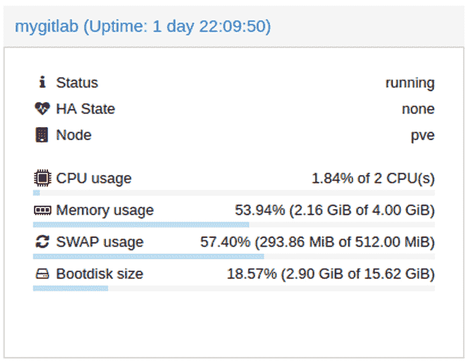

图 1. 在 Ubuntu 16.04 虚拟机上运行的最小 CPU、内存和存储的 GitLab

请注意，当空闲时，GitLab 几乎不占用 CPU。当我运行远程推送（`push`）时，CPU 使用率几乎没有超过 5%。

最后，我通过在 DNS 服务器上为我的 GitLab 主机添加条目完成了准备工作，这样我就可以在安装期间设置`external_url`配置参数，并在克隆和推送项目时更方便地访问主机。你可能通过编辑 GitLab 主机和工作站上的`/etc/hosts`文件就能解决，而无需完整的 DNS 设置（如果你不想使用后文描述的 OAuth 集成）。

## 安装详情

安装 GitLab CE 仅需三步。第一步是确保 Ubuntu 主机已安装`curl`、`openssh-server`和`ca-certificates`：

```bash
sudo apt-get install -y curl openssh-server ca-certificates
```

如果你安装了`postfix`，你的 GitLab 服务器就可以发送电子邮件；你也可以跳过这一步，稍后配置外部 SMTP 服务器。

下一步是将 GitLab 软件包仓库添加到 Ubuntu 的`apt`源中，通过 GitLab 提供的 Bash 脚本可以轻松实现：

```bash
curl -sS https://packages.gitlab.com/install/repositories/gitlab/gitlab-ce/script.deb.sh | sudo bash
```

对于 Ubuntu 16.04，如果你想手动添加，它会添加以下源：

```text
deb https://packages.gitlab.com/gitlab/gitlab-ce/ubuntu/ xenial main
deb-src https://packages.gitlab.com/gitlab/gitlab-ce/ubuntu/ xenial main
```

软件包源就绪并更新后，通过常规的`apt`命令完成安装，并将你的 GitLab 主机 URL 作为参数加入：

```bash
sudo EXTERNAL_URL="http://gitlab.example.com" apt-get install gitlab-ce
```

请确保将其设置为你主机的 URL。如果你想使用 HTTPS，可以这样做，但在完成主安装后还需要完成另外几个步骤。请参阅“资源”部分了解如何使用自签名证书或由`Certificate Authority`提供的证书来实现。整个安装过程仅需几分钟，就能让你拥有一个功能完备、可在指定 URL 上运行的 GitLab 服务器。

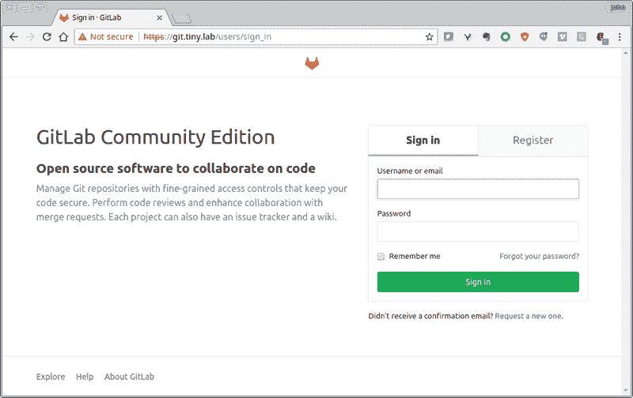

图 2. 安装后，GitLab 将通过你设置的 URL 可。你会看到一个密码重置屏幕，然后跳转到主登录页面。最初使用用户名 "root" 登录。

## 设置用户和 SSH 密钥

以 "root" 登录后我做的第一件事是进入管理设置（可以从主导航栏的小扳手图标访问）并创建一个用户账户。我给它起了与我的 GitHub 账户相同的名称以保持一致，并方便以后同步 GitHub 和 GitLab 仓库。一旦创建了新用户，我就注销并用该账户重新登录。

与 GitHub 一样，你需要设置至少一个 SSH 密钥，以便在你的工作站和 GitLab 服务器之间建立安全连接。在 GitLab 控制台中，导航到`Settings`和`SSH Keys`；控制台会显示你如何找到现有密钥或如何创建一个，并警告你仅粘贴`.pub`部分。

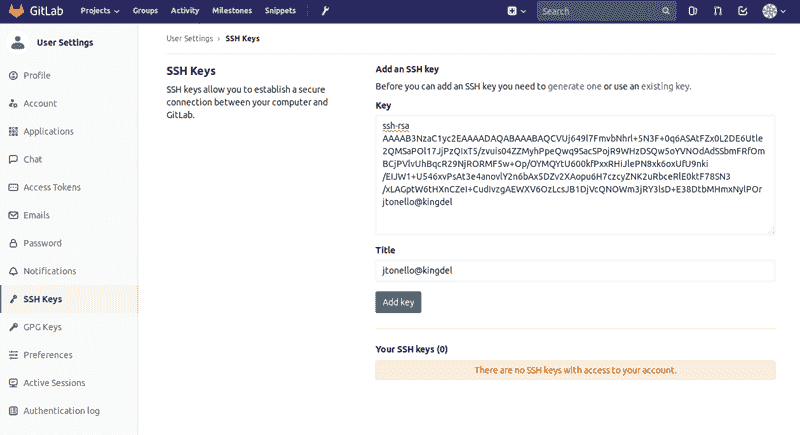

图 3. GitLab 提供了良好的内联提示，教你如何创建 SSH 密钥。

GitLab 在整个过程中都表现出色，提供了内联指令，使得设置变得特别简单，即使你是 Git 新手也是如此。例如，如果你在没有设置至少一个 SSH 密钥的情况下尝试创建项目，GitLab 会直接在控制台中警告你。

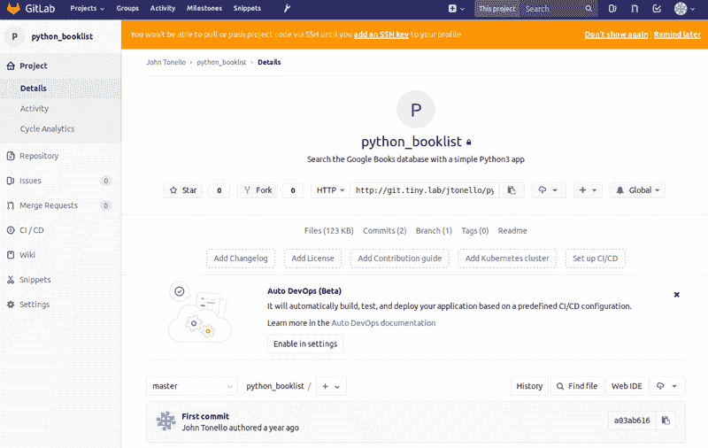

图 4. 如果你尝试在没有设置至少一个 SSH 密钥的情况下创建项目，GitLab 将警告你并链接到你需要去的地方。

## 导入 GitHub 项目

如果你部署 GitLab 的目的是取代 GitHub（或其他公共仓库），GitLab 通过在项目创建时直接提供钩子（`hooks`）让这变得非常简单。

GitLab 提供了两种设置 GitHub 集成的方法：你可以设置 OAuth 应用程序，或使用个人访问令牌（Personal Access Token）。GitLab 推荐 OAuth 方法，因为它会将 GitHub 上的所有用户活动与你托管 GitLab 仓库上的活动关联起来。使用个人访问令牌方法更简单，但它没有提供所有的高级功能。

GitLab 还建议在两个服务中使用相同的命名空间（用户名）。因此，在我的情况下，我创建了 GitLab 用户名 "jtonello" 来匹配我的 GitHub 用户名。

要开始集成，登录你的 GitHub 账户，导航到`Settings`和`Developer Settings`。在菜单中，选择`OAuth Apps`并点击`New OAuth App`按钮。

在这里你需要提供一些基本信息，包括应用程序名称和 GitLab 应用主页的完整 URL。其中至关重要的是授权回调 URL（Authorization callback URL），它必须是 GitHub 可以触达的地址。这就是在你的 GitLab 服务器上设置完全域名的用用之地。如果你在 NAT 网络的家庭实验室中工作，请设置路由器将 80 或 443 端口转发到你的 GitLab 服务器。通过这样，你可以使用路由器的 WAN IP 地址作为回调 URL。我使用了路由器的 No-IP DDNS 功能通过一个`ddns.net`域名来实现，该域名 GitHub 可以看到并通信。


图 5. 在 GitHub 中创建新的 OAuth 应用时，确保授权回调 URL 与你的 GitLab 服务器匹配且可访问。

当你点击“Register application”按钮后，将跳转到 GitHub 的 OAuth 应用程序页面，该页面显示了你刚刚创建的应用程序的新`Client ID`和`Client Secret`。你需要使用这些信息在 GitLab 主机上完成设置。不要分享它们。它们是你 GitHub 仓库的密钥！

回到你的 GitLab CE omnibus 主机，打开`/etc/gitlab/gitlab.rb`（GitLab 主配置文件），并添加你刚刚创建的 GitHub 提供者详情：

```ruby
gitlab_rails['omniauth_providers'] = [
  {
    "name" => "github",
    "app_id" => "YOUR_APP_ID",
    "app_secret" => "YOUR_APP_SECRET",
    "args" => { "scope" => "user:email" }
  }
]
```

你还需要对`/etc/gitlab/gitlab.rb`进行一些更改以完成初始 OmniAuth 配置。在 omnibus 版本中，取消注释并编辑以下行，如下所示：

```ruby
gitlab_rails['omniauth_enabled'] = true
gitlab_rails['omniauth_allow_single_sign_on'] = ['saml', 'twitter']
gitlab_rails['omniauth_auto_link_ldap_user'] = true
gitlab_rails['omniauth_block_auto_created_users'] = true
```

保存文件后，你需要重新配置 GitLab 服务器，这一步会自动重启各种 GitLab 服务：

```bash
sudo gitlab-ctl reconfigure
```


虽然 `reconfigure` 命令只需要很短的时间（你会看到终端上滚动活动信息），但请耐心等待 GitLab 服务重启。这可能需要一或两分钟。

当服务恢复后，进入 GitLab 登录页面，你现在会看到 GitHub 登录选项。如果一切顺利，你现在就可以创建一个新项目并直接从 GitHub 导入仓库了。

点击 GitLab 项目页面上的“New project”（新建项目）按钮，并在“Import project”（导入项目）选项卡的列表中选择“GitHub”。第一次执行此操作时，系统会提示你授权 GitHub 的 OAuth 连接，然后你会看到“List your GitHub repositories”（列出你的 GitHub 仓库）按钮。如果你决定使用个人访问令牌（Personal Access Token）来创建与 GitHub 的连接，在这里也可以看到。

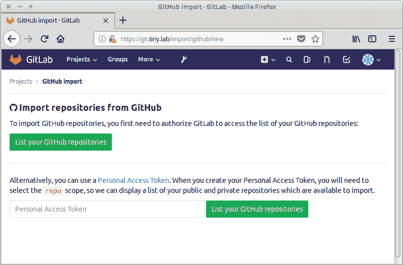

图 6。OAuth 集成成功后允许在 GitLab 内部直接查看 GitHub 仓库。

如果你看到了导入页面，说明授权成功了，你可能会收到来自 GitHub 的封强制性邮件，告知你的账户已添加了第三方 OAuth 应用。

你现在可以选择导入部分或全部 GitHub 仓库。你可以将它们保存到当前用户账户或选择另一个账户。取决于仓库的大小和你的网络速度，这将需要几秒钟到几分钟不等。

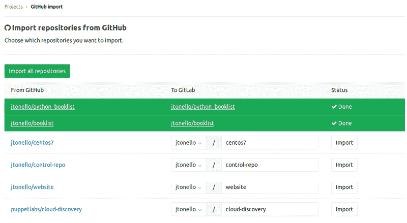

图 7。GitLab 内部的此视图显示了你的 GitHub 项目完整列表，可以作为当前用户或不同的 GitLab 用户原样导入，也可以重命名。

## 总结

当 GitLab 运行后，请尝试创建一些新项目或将现有仓库克隆到你的工作站。GitLab 甚至会给你显示要运行的命令（图 8）。

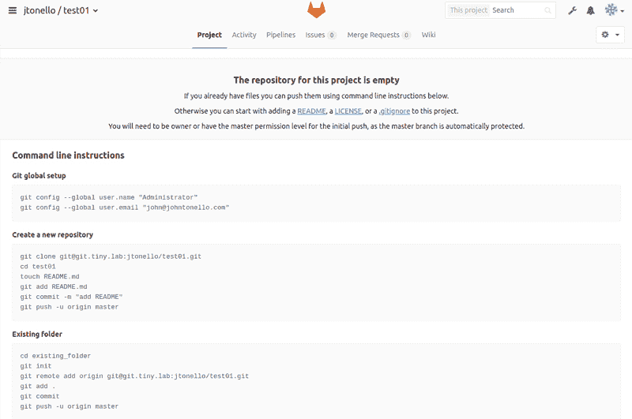

图 8。当你在 GitLab 中创建新项目时，它会提供如何开始的基础 Git 指令。

你现在准备好提交代码并扩展你的 Git 技能了。

## 资源

* [GitHub 和 GitLab 的区别](https://usersnap.com/blog/gitlab-github)
* [GitLab 应用集成列表](https://about.gitlab.com/applications)
* [安装 GitLab](https://about.gitlab.com/installation)
* [为 GitLab 启用 HTTPS](https://docs.gitlab.com/omnibus/settings/nginx.html#enable-https)
* [使用 OAuth 将 GitLab 与 GitHub 集成](https://docs.gitlab.com/ce/integration/github.html)
* [Bitnami GitLab .ova](https://bitnami.com/stack/gitlab/virtual-machine)

# Git 中的糟糕主意

## 本文来源于 GitHub Universe 每年都如实拒绝的一场演讲。我不理解为什么…… 作者: Corey Quinn


无论好坏，git 已经成为开源社区中无处不在的工具之一。它让你能够有效地管理代码。它帮助远隔遥远的工程师进行协作。它的核心非常简单，这就是为什么许多博客文章中的图表不可避免地看起来像图 1 所示。

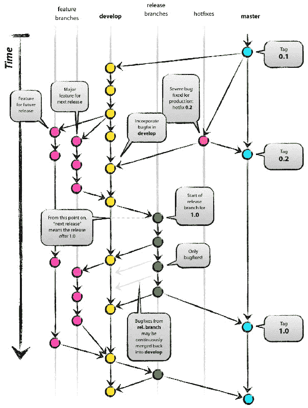

图 1。Git 模型（来源 https://nvie.com ）

一个很少被详细讨论的不幸事实是，git 有一个黑暗面：它让我们觉得自己很愚蠢。我不在乎你是谁——我们都会遇到一个时刻，在那里我们耸耸肩、放弃，并冲向 Stack Overflow（座右铭：“此主题已因离题而关闭”）来寻找最佳方式摆脱我们制造的糟糕困境。唯一的问题是，在疯狂席卷你之前，你能掉兔子洞多深，然后你开始养羊为生。

从核心上说，git 所做的只是跟踪文件和文件夹的更改。`git commit` 实际上是在特定时间点对文件系统（由添加到暂存区的项目所表示）拍摄快照：

```
cquinn@1d732dc08938 ~/demo1 % git init

Initialized empty Git repository in /home/cquinn/demo1/.git/

cquinn@1d732dc08938(master|...) ~/demo1 % git add ubuntu.iso

cquinn@1d732dc08938(master|·1) ~/demo1 % git commit
 ↪-m "Initial commit"

[master (root-commit) b0d3bfb] Initial commit

 1 file changed, 0 insertions(+), 0 deletions(-)

 create mode 100644 ubuntu.iso

cquinn@1d732dc08938(master|✓) ~/demo1 % git rm --cached
 ↪ubuntu.iso

rm 'ubuntu.iso'

cquinn@1d732dc08938(master|·1✓) ~/demo1 % git
 ↪commit -m "There I fixed it"

[master 2d86934] There I fixed it

 1 file changed, 0 insertions(+), 0 deletions(-)

 delete mode 100644 ubuntu.iso

cquinn@1d732dc08938(master|...) ~/demo1 % du -hs .git

174M    .git
```

所以，如果你做了某些愚蠢的事，比如提交了大型二进制文件，你不能只是撤销提交——它仍然存在于你的 git 仓库中。如果你已经将该内容推送到其他地方，你就必须强制重写历史，使用`git-filter-branch`或`bfg`。无论如何，这对于共享你仓库的人来说都是额外的不愉快工作。

从根本上说，git 所做的只是在仓库的顶层创建一个`.git`文件夹。这个子目录包含了随时间变化的文件和文件夹。等等，不是有一个工具可以做这些吗？

```
cquinn@1d732dc08938 ~/demo2 % git init

Initialized empty Git repository in /home/cquinn/demo2/.git/

cquinn@1d732dc08938(master|✓) ~/demo2 % cd .git

cquinn@1d732dc08938 ~/demo2/.git % ls

HEAD  branches  config  description  hooks  info refs

cquinn@1d732dc08938 ~/demo2/.git % git init

Initialized empty Git repository in /home/cquinn/demo2/.git/
```

我不确定你*会*做这种事，但重点在于你确实可以。

```
cquinn@1d732dc08938 ~/demo2 % git
```

你是否曾开始输入一个 git 命令然后在搜索它时迷失了方向？然后你找到了命令并粘贴：

```
cquinn@1d732dc08938 ~/demo2 % git status

git: 'status' is not a git command. See 'git --help'.
```

等等，示例显示有一个拼写错误：

```
cquinn@1d732dc08938(master|·1) ~/demo4 % git stts

git: 'stts' is not a git command. See 'git --help'.

你是指的是这个吗？

    status
```

然后你觉得自己很蠢。让我们修复它：

```
# echo git? > /usr/local/bin/git-git

cquinn@1d732dc08938(master|✓) ~/demo2 % sudo bash

root@1d732dc08938:~/demo2# echo 'git $@' >
 /usr/local/bin/git-git

root@1d732dc08938:~/demo2# chmod +x /usr/local/bin/git-git
```

然后，搞定：

```
cquinn@1d732dc08938(master|✓) ~/demo2 % git git git git
 ↪git status

On branch master

nothing to commit (create/copy files and use "git add" to track)
```

我不是在说这是一个好主意——只是说它可以实现。

## 真正有用的 Git 小技巧

曾经在语法上出过错吗？

```
cquinn@1d732dc08938(master|·1) ~/demo4 % git stts

git: 'stts' is not a git command. See 'git --help'.

你是指的是这个吗？

    status
```

然后坐在那里自怜。高兴吧，git 有一个自动纠错设置：

```
cquinn@1d732dc08938(master|·1) ~/demo4 % git config
↪--global help.autocorrect 8

cquinn@1d732dc08938(master|·1) ~/demo4 % git stts

WARNING: You called a Git command named 'stts',
↪which does not exist.

Continuing under the assumption that you meant 'status'
in 0.8 seconds automatically...

On branch master

Your branch is up-to-date with 'origin/master'.

Changes to be committed:
   (use "git reset HEAD <file>..." to unstage)
         new file:   file2.txt
```

`--global`标签会将此设置应用于用户的`~/.gitconfig`，但更相关的部分是最后两个参数。`help.autocorrect`开启了自动拼写错误检测，而`8`代表你在`git`对你的环境造成糟糕后果之前，你有多少秒分之一的时间去按下`Ctrl-C`。

我想向你们介绍的最后一个工具是`myrepos`。该工具允许你高效地操作组成公司糟糕的微服务架构的许多、许多、大量的仓库（冷知识：微服务是在一次会议演讲中作为一个玩笑被提出的，但人们却认真了）：

```
cquinn@Quinnversion ~ % mr list         31384 10:48:52
↪Fri 06- 8-2018

mr list: /Users/cquinn/.config/vcsh/repo.d/gitconfig.git

mr list: /Users/cquinn/.config/vcsh/repo.d/mr.git

mr list: /Users/cquinn/.config/vcsh/repo.d/ssh.git

mr list: /Users/cquinn/.config/vcsh/repo.d/tmux.git

mr list: /Users/cquinn/.config/vcsh/repo.d/vim.git

mr list: /Users/cquinn/.config/vcsh/repo.d/zsh.git

mr list: /Users/cquinn/Dropbox/src/docPR/complete/
↪amazon-cloud-directory-developer-guide

mr list: finished (7 ok)

cquinn@Quinnversion ~ % mr status       31385 10:48:53
↪Fri 06- 8-2018

mr status: /Users/cquinn/.config/vcsh/repo.d/gitconfig.git

On branch master

Your branch is up to date with 'origin/master'.

Changes not staged for commit:
  (use "git add <file>..." to update what will be committed)
  (use "git checkout -- <file>..." to discard changes in
    ↪working directory)
        modified:   ../../../../.gitconfig

no changes added to commit (use "git add" and/or
↪"git commit -a")

mr status: /Users/cquinn/.config/vcsh/repo.d/mr.git

On branch master

Your branch is up to date with 'origin/master'.

Changes not staged for commit:
   (use "git add <file>..." to update what will be committed)
   (use "git checkout -- <file>..." to discard changes in
     ↪working directory)
         modified:   ../../../../.mrconfig

no changes added to commit (use "git add" and/or
↪"git commit -a")

mr status: /Users/cquinn/.config/vcsh/repo.d/ssh.git

mr status: /Users/cquinn/.config/vcsh/repo.d/tmux.git

On branch master

Your branch is up to date with 'origin/master'.

nothing to commit, working tree clean

mr status: /Users/cquinn/.config/vcsh/repo.d/vim.git

mr status: /Users/cquinn/.config/vcsh/repo.d/zsh.git

Behind origin/master by        1 commits

 M ../../../../.zsh/functions/gitstatus.py

 M ../../../../.zshrc

mr status: /Users/cquinn/Dropbox/src/docPR/complete/
↪amazon-cloud-directory-developer-guide

mr status: finished (7 ok)
```


它还支持并发参数来并行化工作负载；例如，`mr -j8 status` 会产生八个工作线程。

最后给你们的两个建议。首先，如果你正在使用 GitHub，请安装 [Hub](https://github.com/github/hub) 作为 `git` 的包装器；它扩展了命令以支持分支（forks）、拉取请求和页面等概念。其次，设置你的提示符（有很多项目可以在各种 shell 中运行；可以尝试一下，或者[在 Twitter 上提问我](https://twitter.com/QuinnyPig) 获取最新的建议）来反映你当前的 git 状态——你处于哪个分支、是否有未提交的工作等。这些微妙的视觉提示将帮助你避免犯严重的错误。

# 观点：GitHub vs GitLab

## 自由软件需要免费工具，而不是微软拥有的 GitHub。作者：Matt Lee

所以，微软收购了 GitHub，许多人感到困惑或担心。任何大公司收购小公司并不是什么新现象，人们的担心是正确的，尽管我认为他们的时机搞错了。就像微软一样，GitHub 对自由和开源软件做了一些有用的贡献。


让我们回顾一下是如何变成这里的。2002 年，Linux 内核切换到了 `BitKeeper`，尽管一些著名的开发者并没有。

2005 年，Andrew Tridell 在 OSDL 工作开发了一个绕过这一限制的客户端，结果诞生了两个新项目：Mercurial 和 Git。Git 在 2005 年创建仅几周后就迅速成为了 Linux 的版本控制。

专有的版本控制工具在自由软件中并不常见，但专有的协作网站已经存在很了。今天仍然存在的协作网站之一是 Sourceforge。Sourceforge 在 90 年代末由 VA Software 创建，其后的代码在 2000 年发布。

情况很快发生了变化,[该项目被关闭并变成了 Sourceforge Enterprise](http://fsfe.org/news/2001/article2001-10-20.html)，一个专有软件包。运行 Sourceforge 的代码分叉成了 Savannah（后称为 Savane）和 GForge，它们现在仍被 GNU 项目和 CERN 使用。当我十年前[上次写过这个问题](https://www.fsf.org/blogs/community/savannah) 时，Canonical 雄心勃勃的 Launchpad 服务仍然是专利，这一点在 2009 年得到了解决。Gitorious 于 2010 年创建，并在多年后一直是谨慎自由软件开发者的 Git 托管平台，因为 Gitures 的代码完全公开，并根据遵循 FSF 弗兰林街宣言的新一代 AGPL 许可项目的优惠条款进行了授权。遗憾的是，Gitures 也已不在。

然而，一切并非没有，在过去的几年里，一个替代方案正在非常活跃地开发：GitLab。GitLab 既是一家公司的名称——GitLab, Inc.—也是两个项目的名称：GitLab CE 和 GitLab EE。GitLab EE 是一个开源核心项目，由免费 CE 和各种专有组件组成。GitLab, Inc. 对此非常坦诚。然而，GitLab CE 并不是那种传统的“社区版”产品（其大部分功能都锁定在企业版中）。许多高知名度的自由软件项目，例如 Debian、GNOME 和 GNU，都有自己的 GitLab CE 服务器，在许多情况下，GitLab CE 正被用于赋予此前使用 Savannah 和 GForge 的项目新的活力，并让它们获得了老旧软件平台所缺乏的新可见度。

为你的自由软件项目选择专有工具和服务，最终将是在向你项目的下游开发者和用户传递一个信息：所有用户（包括开发者）的自由并不是首要任务。自由软件运动始于 1983 年，通过创建初始工具——一个编辑器、一个编译器、调试器和一个链接器——让自由软件开发者能够创建一个自由的操作系统。最终，所有的自由软件项目从本质上就具有政治性。作为以直接促进用户自由和自由共享社区的方式许可软件的创建者，支持这些理念的工具将更好地服务我们的努力。

因此，如果你有能力也有需要，请为你的项目运行自己的 `GitLab CE`。如果你可以，请将其向更广泛的自由软件社区开放，允许所有自由软件项目使用尊重所有用户自由的基础。GNU、Debian 和 GNOME 已经做到了。下一个是谁？

噢，请尽快解决 `GitLab CE` 的 #4013 漏洞。

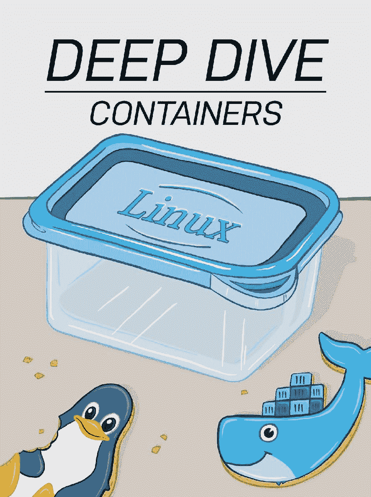

# 关于 Linux 容器你需要知道的一切，第一部分：Linux 控制组和进程隔离

## 大家都听过这个词，但容器究竟是什么？作者 Petros Koutoupis

实现这项技术的软件有多种形式，其中 `Docker` 最受欢迎。近期容器技术在数据中心内的兴起，直接归功于它的可移植性以及隔离工作环境的能力，从而限制了其对底层计算系统的影响和整体占用。要完全理解这项技术，你首先需要理解使其这一切成为可能的许多组件。

旁注：人们经常询问容器和虚拟机的区别。两者都有特定的用途和位置，重叠部分极少，且彼此不会过时对方。容器旨在作为一个轻量级环境，你启动它来以裸机性能托管一个到几个隔离的应用程序。当你想要托管整个操作系统或生态系统，或者运行与底层环境不兼容的应用程序时，你应该选择虚拟机。

### Linux 控制组 (Control Groups)

坦率说，现实中的某些软件应用可能需要被控制或限制——至少为了稳定性，并在某种程度上为了安全。很多时候，一个 Bug 或糟糕的代码就会破坏整台机器，并可能瘫痪整个生态系统。幸运的是，有一种方法可以控制这些应用程序。控制组（`cgroups`）是一种内核功能，用于限制、统计和隔离一个或多个进程对 CPU、内存、磁盘 I/O 和网络的使用。

`cgroups` 技术最初由 Google 开发，最终在 2.6.24 版本进入 Linux 内核主线（2008 年 1 月）。该技术的重新设计——即添加 `kernfs`（用于拆分部分 `sysfs` 逻辑）被合并到 3.15 和 3.16 内核中。

`cgroups` 的主要设计目标是提供一个统一的接口来管理进程或整个操作系统级的虚拟化，包括 Linux 容器或 `LXC`（我计划在后续的文章中更详细地讨论这个主题）。`cgroups` 框架提供了以下功能：

- **资源限制**：可以配置一个组使其不超过指定的内存限制，或使用超过预期数量的处理器，或限制在特定的外围设备。
- **优先级排序**：可以配置一个或多个组使用更少或更多的 CPU 或磁盘 I/O 吞吐量。
- **统计**：对组的资源使用进行监控和测量。
- **控制**：可以冻结、停止并重启进程组。

一个 `cgroup` 可以由一个或多个进程组成，它们都绑定到同一组限制上。这些组也可以是层级的，这意味着子组会继承其父组所管理的限制。

Linux 内核为 `cgroup` 技术提供了对系列控制器或子系统的访问。控制器负责将特定类型的系统资源分配给一组或多个进程。例如，`memory` 控制器限制内存使用，而 `cpuacct` 控制器监控 CPU 使用情况。

你可以直接或间接地（通过 `LXC`、`libvirt` 或 `Docker`）访问和管理 `cgroups`，我在这里通过 `sysfs` 和 `libcgroups` 库介绍前者。为了跟随这里的示例，你首先需要安装必要的包。在 Red Hat Enterprise Linux 或 CentOS 上，在命令行中输入：

```bash
sudo yum install libcgroup libcgroup-tools
```

在 Ubuntu 或 Debian 上，输入：

```bash
sudo apt-get install libcgroup1 cgroup-tools
```

对于示例应用程序，我使用一个名为 `test.sh` 的简单 shell 脚本文件，它将在无限 `while` 循环中运行以下两个命令：

```bash
cat test.sh
#!/bin/sh
while [ 1 ]; do
        echo "hello world"
        sleep 60
done
```

### 手方法

安装好相应的包后，你可以通过 `sysfs` 层次结构直接配置 `cgroups`。例如，要在 `memory` 子系统下创建一个名为 `foo` 的 cgroup，可以在 `/sys/fs/cgroup/memory` 中创建一个名为 `foo` 的目录：

```bash
sudo mkdir /sys/fs/cgroup/memory/foo
```

默认情况下，每个新创建的 `cgroup` 都会继承系统的整个内存池。对于某些应用程序（特别是那些持续分配更多内存但拒绝释放已分配的程序），这可能不是一个好主意。

要将应用程序限制在合理范围内，你需要更新 `memory.limit_in_bytes` 文件。

将 cgroup `foo` 下运行的任何内容的内存限制为 50MB：

```bash
echo 50000000 | sudo tee /sys/fs/cgroup/memory/foo/limit_in_bytes
```

验证设置：

```bash
sudo cat /sys/fs/cgroup/memory/foo/limit_in_bytes
50003968
```

注意，读取回的值始终是页大小的倍数。因此，虽然你设置了 500 字节，但实际上被设置为 4 KB。这是内存可分配的最小大小。

启动应用程序：

```bash
sh test.sh &
```

使用其进程 ID (PID)，将应用程序移动到内存计数器下的 cgroup `foo` 中：

```bash
echo 2845 > /sys/fs/cgroup/memory/foo/cgroup.procs
```

使用相同的 PID 号，列出运行的进程并验证它是否运行在所需的 cgroup 中：

```bash
ps -o cgroup 2845
CGROUP
8:memory:/foo,1:name=systemd:/user.slice/user-0.slice/session-4.scope
```

你还通通过读取目标文件来监控该 cgroup 当前的使用情况。在这种情况下，你想要看到你的进程（以及派生的子进程）分配的内存量：

```bash
cat /sys/fs/cgroup/memory/foo/memory.usage_in_bytes
253952
```

### 当进程失控时

现在让我们重新创建相同的场景，但不是将 cgroup `foo` 的内存限制为 50MB，而是将将其限制为 500 字节：

```bash
echo 500 | sudo tee /sys/fs/cgroup/memory/foo/limit_in_bytes
```

*注意：如果任务超过了其定义的限制，内核将介入干预并在某些情况下杀死该任务。*

再次，当你读取该值时，它始终是内核页大小的倍数。因此，虽然你设置了 500 字节，但实际上被设置为 4 KB：

```bash
cat /sys/fs/cgroup/memory/foo/limit_in_bytes
4096
```

启动应用程序，将其移动到 cgroup 中并监控系统日志。

```bash
$ sudo tail -f /var/log/messages
Oct 14 10:22:40 localhost kernel: sh invoked oom-killer: 
 ↪gfp_mask=0xd0, order=0, oom_score_adj=0
Oct 14 10:22:40 localhost kernel: sh cpuset=/ mems_allowed=0
Oct 14 10:22:40 localhost kernel: CPU: 0 PID: 2687 Comm: 
 ↪sh Tainted: G
OE  ------------   3.10.0-327.36.3.el7.x86_64 #1
Oct 14 10:22:40 localhost kernel: Hardware name: innotek GmbH
VirtualBox/VirtualBox, BIOS VirtualBox 12/01/2006
Oct 14 10:22:40 localhost kernel: ffff880036ea5c00 
 ↪0000000093314010 ffff88000002bcd0 ffffffff81636431
Oct 14 10:22:40 localhost kernel: ffff88000002bd60 
 ↪ffffffff816313cc 01018800000000d0 ffff88000002bd68
Oct 14 10:22:40 localhost kernel: fffffffffbc35e040 
 ↪fffeefff00000000 0000000000000001 ffff880036ea6103
Oct 14 10:22:40 localhost kernel: Call Trace:
Oct 14 10:22:40 localhost kernel: [<ffffffff81636431>] 
 ↪dump_stack+0x19/0x1b
Oct 14 10:22:40 localhost kernel: [<ffffffff816313cc>] 
 ↪dump_header+0x8e/0x214
Oct 14 10:22:40 localhost kernel: [<ffffffff8116d21e>]
 ↪oom_kill_process+0x24e/0x3b0
Oct 14 10:22:40 localhost kernel: [<ffffffff81088e4e>] ?
 ↪has_capability_noaudit+0x1e/0x30
Oct 14 10:22:40 localhost kernel: [<ffffffff811d4285>]
 ↪mem_cgroup_oom_synchronize+0x575/0x5a0
Oct 14 10:22:40 localhost kernel: [<ffffffff811d3650>] ?
 ↪mem_cgroup_charge_common+0xc0/0xc0
Oct 14 10:22:40 localhost kernel: [<ffffffff8116da94>]
 ↪pagefault_out_of_memory+0x14/0x90
Oct 14 10:22:40 localhost kernel: [<ffffffff8162f815>] 
 ↪mm_fault_error+0x68/0x12b
Oct 14 10:22:40 localhost kernel: [<ffffffff816422d2>] 
 ↪__do_page_fault+0x3e2/0x450
Oct 14 10:22:40 localhost kernel: [<ffffffff81642363>] 
 ↪do_page_fault+0x23/0x80
Oct 14 10:22:40 localhost kernel: [<ffffffff8163e648>] 
 ↪page_fault+0x28/0x30
Oct 14 10:22:40 localhost kernel: Task in /foo killed as 
 ↪a result of limit of /foo
Oct 14 10:22:40 localhost kernel: memory: usage 4kB, limit 
 ↪4kB, failcnt 8
Oct 14 10:22:40 localhost kernel: memory+swap: usage 4kB, 
 limit 9007199254740991kB, failcnt 0
Oct 14 10:22:40 localhost kernel: kmem: usage 0kB, limit 
 ↪9007199254740991kB, failcnt 0
Oct 14 10:22:40 localhost kernel: Memory cgroup stats for /foo: 
 cache:0KB rss:4KB rss_huge:0KB swap:0KB mapped_file:0KB inactive_anon:0KB active_anon:0KB inactive_file:0KB unevictable:0KB
Oct 14 10:22:40 localhost kernel: [ ]   uid  tgid total_vm      rss nr_ptes swap oom_score_adj
Oct 14 10:22:40 localhost kernel: [ 2687]     0  2821      347        0             0
Oct 14 10:22:40 localhost kernel: [ 2702]     0  2822      2821       50             0
Oct 14 10:22:40 localhost kernel: Memory cgroup out of memory: 
Kill process 2687 (sh) score 0 or sacrifice
Oct 14 10:22:40 localhost kernel: Killed process 2702 (sh) 
total-vm:13124kB, anon-rss:200kB, file-rss:0
Oct 14 10:22:41 localhost kernel: sh invoked oom-killer: 
gfp_mask=0xd0, order=0, oom_score_adj=0[ ...
```


注意内核的 Out-Of-Memory Killer（即`oom-killer`）在应用程序达到 4KB 限制时立即介入。它杀死了该应用程序，并且程序不再运行。你可以通过以下命令验证这一点：

```
$ ps -o cgroup 2687
```

## 使用 libcgroup

这里的许多步骤通过`libcgroup`软件包提供的工具进行了简化。例如，使用`cgcreate`命令可以处理 sysfs 条目和文件的创建。若要在`memory`子系统中创建一个名为`foo`的组，请执行：

```
$ sudo cgcreate -g memory:foo
```

注意：`libcgroup`提供了一种用于管理控制组中任务的机制。

使用相同的方法，你可以开始设置阈值：

```
$ echo 5000000 | sudo tee /sys/fs/cgroup/foo/limit_in_bytes
```

验证新配置的设置：

```
$ sudo cat memory.limit_in_bytes
5000000
```

使用`cgexec`二进制文件在 cgroup `foo` 中运行应用程序：

```
$ sudo cgexec -g memory:foo ~/test.sh
```

使用其 PID 验证应用程序是否在定义的子系统（`memory`）cgroup 中运行：

```bash
$ ps -o cgroup 2945
6:memory:/foo,1:name=systemd:/user.slice/session-1.scope
```

如果你的应用程序不再运行，并且你想清理并移除 cgroup，可以使用`cgdelete`二进制文件进行操作。要从`memory`控制器中移除组`foo`，请执行：

```
$ sudo cgdelete memory:foo
```

### 持久化组

你也可以通过简单的配置文件和一个服务的启动来实现上述所有操作。可以在`/etc/cgconfig.conf`文件中定义所有的 cgroup 名称和属性。以下是为组`foo`添加的一些属性：

```
$ cat /etc/cgconfig.conf
#
#  Copyright IBM Corporation. 2007
#
#  Authors:     Balbir Singh <balbir@vnet.com>
#  此程序是免费软件；你可以根据 Free Software Foundation 
#  GNU 通用公共许可证 2.1 版本对其进行重新分发和或进行修改。
#
#  分发此程序的目的是希望它是有用的，但不提供任何保证；甚至不
#  保证商品性或针对特定用途的适用性。
#
#  在默认情况下，我们期望 systemd 在启动时挂载一切，
#  所以不需要做太多。
#  更多细节请参见 man cgconfig.conf，关于如何使用此文件
#  在系统启动时创建组。

group foo {
  cpu {
    cpu.shares = 100;
  }
  memory {
    memory.limit_in_bytes = 5000000;
  }
}
```

`cpu.shares`选项定义了组的 CPU 优先级。默认情况下，所有组都继承 1024 shares（即全部 CPU 时间）。通过将此值降低到更保守的值（如 100），该组将被限制在 CPU 时间的 10%。

如之前所述，运行在 cgroup 内的进程也可以限制其访问的 CPU（核心）数量。在同一个`cgconfig.conf`文件的目标组名称下添加以下部分：

```
cpuset {
  cpuset.cpus="0-5";
}
```

有了此限制，该 cgroup 将应用程序绑定到核心 0 到 5——也就是说，它只能看到系统上的六个 CPU 核心。

接下来，你需要使用`cgconfig`服务来加载此配置。首先，启用`cgconfig`以在系统启动时加载上述配置：

```
$ sudo systemctl enable cgconfig
创建软链接从 /etc/systemd/system/sysinit.target.wants/
cgconfig.service 到 /usr/lib/systemd/system/cgconfig.service。
```

现在，启动`cgconfig`服务并手动加载相同的配置（或者你可以跳过这一步并重启系统）：

```
$ sudo systemctl start cgconfig
```

将应用程序启动到 cgroup `foo` 中并将其绑定到你的`memory`、`cpu`和`cpuset`限制：

```
$ sudo cgexec -g memory,cpu,cpuset:foo ~/test.sh &
```

除了将应用程序启动到预定义的 cgroup 之外，其余所有设置将在系统重启后持续有效。然而，你可以通过定义一个依赖于`cgconfig`服务的启动脚本来启动同一个应用程序，从而实现该过程的自动化。

### 总结

通常，在机器上限制一个或多个任务是非常必要的。控制组（Control groups）提供了该功能，通过利用它，你可以对某些关键或不可控的应用程序实施严格的硬件和软件限制。如果某个应用程序没有设置上限阈值或限制其在系统上消耗的内存，cgroups 可以解决这个问题。如果另一个应用程序倾向于占用 CPU，同样，cgroups 也可以胜任。

在本系列的第二部分中，我将超越 Linux 控制组，转向关注 Linux 容器（Linux Containers）等技术如何利用它们。

# 使用 Linux 容器 (LXC)

## 关于 Linux 容器你需要的一切，第二部分

### Linux 容器 (LXC) 简介

容器深度解析的第一部分介绍了内核控制组（或`cgroups`）的概念，以及隔离、限制和监控选用户空间应用程序的方法。在这里，我将进一步深入，并关注进程隔离的下一步——即通过容器，更具体说是 Linux 容器（`LXC`）框架。作者：Petros Koutoupis

在运行虚拟机时，容器已经尽可能接近裸机了。在托管虚拟实例时，它们产生的开销极小甚至没有。LXC 最初于 2008 年引入，借鉴了先前的 Solaris 容器（或 Solaris Zones）和 FreeBSD jail 的大部分功能。LXC 并不是创建一个完整的虚拟机，而是允许创建一个拥有独立进程和网络空间的虚拟环境。通过使用命名空间（namespaces）来强制进程隔离，并利用内核自身的控制组（`cgroups`）功能，该特性可以限制、统计并隔离一个或多个进程的 CPU、内存、磁盘 I/O 和网络使用。可以将这个用户空间框架视为一种非常高级的`chroot`形式。

但容器到底是什么？简单来说，容器将软件应用程序与操作系统解耦，为用户提供了一个清洁且最小的 Linux 环境，同时在一个或多个隔离的“容器”中运行所有其他。容器的目的是启动一组有限的应用程序或服务（通常称为微服务），并让在一个自包含的沙箱环境中运行。

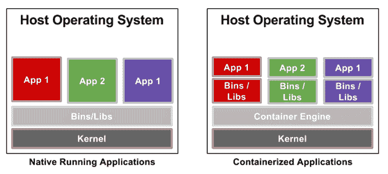

*图 1 传统环境中运行的应用与容器的对比*

这种隔离防止运行在给定容器内的进程监控或影响运行另一个容器的进程。此外，这些容器化服务不会影响或干扰主机。能够将分散在多个物理服务器上的许多服务合并为一个的想法，是数据中心选择采用技术的众多原因之一。

容器特性包括：

- **安全性**：网络服务可以在容器中运行，这限制了安全泄露或违反造成的破坏。成功利用该容器内运行的应用程序的安全漏洞的入侵者，其操作被限制在容器内可能的操作范围内。
- **隔离性**：允许在同一台物理机器上部署一个或多个应用程序，即使这些应用程序必须在不同的域下运行，且每个域都需要对其相应资源进行独占访问。例如，运行在不同容器中的多个应用程序可以使用与每个容器关联的不同 IP 地址绑定到同一个物理网络接口。
- **虚拟化与透明性**：容器为系统提供了一个虚拟化环境，该环境可以隐藏或限制底层物理设备或系统配置的可见性。容器背后的通用原则是除了解决安全或隔离问题外，避免更改应用程序运行的环境。

### 使用 LXC 工具

对于大多数现代 Linux 发行版，内核在编译时已启用了`cgroups`，但你可能仍然需要安装 LXC 工具。

如果你正在使用 Red Hat 或 CentOS，你需要先安装 EPEL 存储库。对于其他发行版（如 Ubuntu 或 Debian），只需输入：

```
$ sudo apt-get install lxc
```

现在，在你开始摆弄这些工具之前，你需要配置你的环境。在此之前，你需要验证当前用户在`/etc/subuid`和`/etc/subgid`中都定义了`uid`和`gid`条目：

```
$ cat /etc/subuid
petros:100000:65536
$ cat /etc/subgid
petros:100000:65536
```

如果`~/.config/lxc`目录不存在，则创建它，并将`/etc/lxc/default.conf`配置文件复制到`~/.config/lxc/default.conf`。在文件末尾追加以下两行：

```
lxc.id_map = u 0 100000 65536
lxc.id_map = g 0 100000 65536
```

它应该像这样：

```
$ cat ~/.config/lxc/default.conf
lxc.network.type = veth
lxc.network.link = lxcbr0
lxc.network.flags = up
lxc.network.hwaddr = 00:16:3e:xx:xx:xx
lxc.id_map = u 0 100000 65536
lxc.id_map = g 0 100000 65536
```

### 资源

- ["John S. Tonello：使用 Puppet 的 Lumogon 让你的容器透明化](https://www.linuxjournal.com/content/make-your-containers-transparent-puppets-lumogon)
- ["Federico Kereki：关于容器的连接：论 Docker 网络](https://www.linuxjournal.com/content/concerning-containers-connections-docker-networking)
- ["Rami Rosen：Linux 容器与未来云](https://www.linuxjournal.com/content/linux-containers-and-future-cloud)
- ["Dirk Merkel：Docker：用于一致开发和部署的轻量级 Linux 容器](https://www.linuxjournal.com/content/docker-lightweight-linux-containers-consistent-development-and-deployment)
- ["David Strauss：容器不是虚拟机，是未来](https://www.linuxjournal.com/content/containers--not-virtual-machines--are-future)

### 配置与管理

将以下内容追加到`/etc/lxc/default.conf`文件（将第一列替换为你的用户名）：

```
petros veth lxcbr0 10
```

让这些设置生效的最快方法是重启节点或注销重新登录。登录后，验证`veth`驱动已加载：

```
$ lsmod|grep veth
veth                   16384  0
```

如果没有加载，执行：

```
$ sudo modprobe veth
```

你现在可以使用 LXC 工具下载、运行和管理 Linux 容器。接下来下载一个镜像并命名为`example-container`。当你输入以下命令时，将看到许多 Linux 发行版和版本的支持容器列表：

```
$ sudo lxc-create -t download -n example-container
```

你将收到三个发行版、版本和架构的提示。我选择了：

```
Distribution: ubuntu
Release: xenial
Architecture: amd64
```

按下回车后，rootfs 将下载并配置。出于安全考虑，每个容器都不带 OpenSSH 服务器或用户账户。也没有默认 root 密码。为了更改 root 密码并登录，你必须运行`lxc-attach`或`chroot`进入容器目录。

启动容器：

```
$ sudo lxc-start -n example-container -d
```

`-d`选项将容器守护化并在后台运行。如果你想观察启动过程，将`-d`替换为`-F`，它将在以前台运行并在登录提示处结束。

你可能会遇到类似的错误：

```
$ sudo lxc-start -n example-container -d
lxc-start: tools/lxc_start.c:main: 366 容器启动失败。
lxc-start: tools/lxc_start.c:main: 368 要获取更多细节，请在前台模式下运行容器。
lxc-start: tools/lxc_start.c:main: 370 可以通过 --logfile 和 --logpriority 选项获取额外信息。
```

```
$ sudo lxc-start -n example-container -F
lxc-start: conf.c: instantiate_veth: 2685 failed to create veth 
pair (vethQ4NS0B and vethJMHON2): Operation not supported
lxc-start: conf.c: lxc_create_network: 3029 failed to 
create netdev
lxc-start: start.c: lxc_spawn: 1103 Failed to create 
the network.
lxc-start: start.c: __lxc_start: 1358 Failed to spawn 
container "example-container".
lxc-start: tools/lxc_start.c: main: 366 The container failed
to start.
lxc-start: tools/lxc_start.c: main: 370 Additional information 
can be obtained by setting the --logfile and --logpriority 
options. 
```

从上面的示例中可以看出，`veth`模块可能没有插入。在插入该模块后，问题得到了解决。

无论如何，打开第二个终端窗口并验证容器的状态：

```
$ sudo lxc-info -n example-container
Name:           example-container
State:          RUNNING
PID:            1356
IP:             10.0.3.28
CPU use:        0.29 seconds
BlkIO use:      16.80 MiB
Memory use:     29.02 MiB
KMem use:       0 bytes
Link:           vethPRK7YU
TX bytes:      1.34 KiB
RX bytes:      2.09 KiB
Total bytes:   3.43 KiB 
```

另一种方法是运行以下命令来列出所有安装的容器：

```
$ sudo lxc-ls -f
NAME         STATE   AUTOSTART GROUPS IPV4      IPV6 
example-container RUNNING 0         -      10.0.3.28 - 
```

但有一个问题——你仍然无法登录！直接附加到运行中的容器，创建你的用户并使用`passwd`命令更改所有相关的密码：

```
$ sudo lxc-attach -n example-container
root@example-container:/# 
root@example-container:/# useradd petros
root@example-container:/# passwd petros
Enter new UNIX password: 
Retype new UNIX password: 
passwd: password updated successfully 
```

一旦更改密码，你就可以直接从控制台登录容器，无需使用`lxc-attach`命令：

```
$ sudo lxc-console -n example-container 
```

如果你想通过网络连接到此运行中的容器，请安装 OpenSSH 服务器：

```
root@example-container:/# apt-get install openssh-server 
```

获取容器的本地 IP 地址：

```
root@example-container:/# ip addr show eth0|grep inet
```


`inet 10.0.3.25/24 brd 10.0.3.255 scope global eth0`

`inet6 fe80::216:3eff:fed8:53b4/64 scope link`

然后从主机主机并在新的控制台窗口中输入：

```
$ ssh 10.0.3.25
```

漂亮！你现在可以 `ssh` 到运行中的容器并输入你的用户名和密码。

在主机系统上（而不是容器内部），观察启动容器后启动并运行的 LXC 进程是有趣的：

```
$ ps aux|grep lxc|grep -v grep

root       861  0.0  0.0 234772  1368 ?        Ssl  11:01   
 ↪0:00 /usr/bin/lxcfs /var/lib/lxcfs/

lxc-dns+  1155  0.0  0.1  52868  2908 ?        S    11:01   
 ↪0:00 dnsmasq -u lxc-dnsmasq --strict-order 
 ↪--bind-interfaces --pid-file=/run/lxc/dnsmasq.pid
 ↪--listen-address 10.0.3.1 --dhcp-range 10.0.3.2,10.0.3.254
 ↪--dhcp-lease-max=253 --dhcp-no-override 
 ↪--except-interface=lo --interface=lxcbr0 
 ↪--dhcp-leasefile=/var/lib/misc/dnsmasq.lxcbr0.leases 
 ↪--dhcp-authoritative

root      1196  0.0  0.1  54484  3928 ?        Ss   11:01   
 ↪0:00 [lxc monitor] /var/lib/lxc example-container

root      1658  0.0  0.1  54780  3960 pts/1    S+   11:02   
 ↪0:00 sudo lxc-attach -n example-container

root      1660  0.0  0.2  54464  4900 pts/1    S+   11:02   
 ↪0:00 lxc-attach -n example-container
```

要停止容器，输入（从主机执行）：

```bash
sudo lxc-stop -n example-container
```

停止后，验证容器状态：

```bash
sudo lxc-ls -f

NAME         STATE   AUTOSTART GROUPS IPV4      IPV6 
example-container STOPPED 0         -      -
```

要完全删除容器，使用：

```bash
sudo lxc-delete -n example-container
```

### 特权与非特权容器

你经常可能会遇到讨论特权容器和非特权概念的 LXC 内容。但它们到底是什么？概念非常直观，且 LXC 容器可以在任何配置下运行。

根据设计，非特权容器被认为比特权容器更安全更可靠。非特权容器将容器的 root UID 映射到主机系统上的非 root UID。这使得入侵容器的攻击者难以获得底层主机的 root 权限。简而言之，如果攻击者通过（例如）已知的软件漏洞入侵了你的容器，他们会发现自己在主机上没有任何权限。

特权容器可能会并将系统暴露在此类攻击之下。因此，在特权模式下运行少数容器是良好的实践。识别出需要特权访问的容器，并确保投入额外精力进行定期更新并通过其他方式进行锁定。

### 那么，Docker 又是怎样的？

我花了大量时间讨论 Linux 容器（Linux Containers），但 Docker 呢？它是目前生产环境中部署最广泛的容器解决方案。自首次发布以来，Docker 席卷了整个 Linux 计算世界。Docker 是一种基于 Apache 许可的开源容器化技术，旨在自动化在容器内部创建和部署微服务的重复性任务。Docker 将容器视为极轻量且模块化的虚拟机。起初，Docker 是构建在 `LXC` 之上的，但从那以后它脱离了这一项依赖，带来了更好的开发者和用户体验。与 `LXC` 类似，Docker 继续利用系统内核的 `cgroup` 子系统。这项技术不仅仅是运行容器，它还简化了创建容器、构建镜像、共享构建好的镜像以及对其进行版本控制的过程。

Docker 主要关注以下几点：

*   **可移植性**：Docker 提供了一种基于镜像的部署模型。这种可移植性允许以简单的方式跨多个环境共享应用程序或一组服务（及其所有依赖项）。
*   **版本控制**：单个 Docker 镜像由一系列组合的层组成。每当镜像发生更改时，就会创建一个新层。例如，每当用户指定命令（如 `run` 或 `copy`）时，都会创建一个新层。Docker 在构建新容器时会重用这些层。分层是 Docker 独有的版本控制方法。
*   **回滚**：同样，每个 Docker 镜像都有层。如果你不想使用当前运行的层，可以回滚到之前的版本。这种灵活性使得开发人员更容易持续地集成和部署他们的软件技术。
*   **快速部署**：配置新硬件通常需要几天时间。而且，安装和配置它所需的工作和开销非常沉。通过 Docker，你可以通过将镜像启动并运行的时间缩短到几秒钟来避免这一切。当你完成容器的操作后，可以同样轻松销毁它。

从根本上说，Docker 和 `LXC` 非常相似。它们都是用户态的轻量级虚拟化平台，通过实现 `cgroups` 和 `namespaces` 来管理资源隔离。

### 进程管理

Docker 限制容器作为单个进程运行。如果你的应用程序由 X 个并发进程组成，Docker 会希望你运行 X 个容器，每个容器都有自己独立的进程。`LXC` 则并非如此，它运行一个带有传统 `init` 进程的容器，反可以在同一个容器内托管多个进程。例如，如果你想托管一个 LAMP（Linux + Apache + MySQL + PHP）服务器，每个应用程序的每个进程都需要跨越多个 Docker 容器。

### 状态管理

Docker 设计是无状态的，这意味着它不支持持久化存储。虽然有解决方法，但同样地，这只有在进程需要时才是必要的。当创建一个 Docker 镜像时，它将由只读层组成。这些层不会改变。在运行时，如果容器进程对其内部状态进行了任何更改，内部状态与镜像当前状态之间的差异（diff）将一直保持，直到对 Docker 镜像进行 `commit`（创建一个新层）或容器被删除，从而导致该差异消失。

### 可移植性

在讨论 Docker 时，这个词往往被过度使用——这是因为它是 Docker 相比于 `LXC` 最大的优势。Docker 在从应用程序中抽象掉网络、存储和操作系统细节方面做得好得多。这使得应用程序真正与配置无关，确保了无论在哪种机器上启用，应用程序的环境始终保持一致。

Docker 的设计旨在让开发者和系统管理员受益。它已成为许多 DevOps（开发 + 运维）工具链中不可或缺的一部分。开发者可以专注于编写代码，而无需担心最终托管它的系统。有了 Docker，无需安装和配置复杂的数据库，也不必担心在不兼容的语言工具链版本之间切换。Docker 为运维人员提供了灵活性，通常减少了托管某些较小基础应用程序所需的物理系统数量。Docker 简化了软件交付。新功能和漏洞/安全修复可以快速交付给客户，而没有任何困扰、意外或停机。

### 总结

为了基础设施安全和系统稳定性而对进程进行隔离，并没有听起来有那么痛苦。Linux 内核提供了所有必要的设施，使得易于使用的用户态应用程序（如 `LXC` 甚至 Docker）能够在隔离和沙箱环境中管理带有本地服务的操作系统微实例。

在系列文章的第三部分，我将描述使用 `Kubernetes` 进行容器编排。

### 资源

*   [Linux Containers (Linux 容器)](https://linuxcontainers.org)
*   [Docker vs LXC](https://www.upguard.com/articles/docker-vs-lxc)
*   [Debian Wiki: LXC](https://wiki.debian.org/LXC)
*   [LXC—Ubuntu 文档](https://help.ubuntu.com/lts/serverguide/lxc.html)
*   [GitHub—LXC](https://github.com/lxc/lxc)

# 关于容器你需要知道的一切，第三部分：使用 Kubernetes 进行编排

## 了解使用 Kubernetes 创建、部署和管理数千个容器镜像。作者：Petros Koutoupis

如果你读过该系列的前篇文章，你现在应该熟悉 Linux 内核控制组（control groups）、Linux 容器和 Docker。但是，这里有一个快速回顾：曾几何时，数据中心管理员部署整个操作系统，占用整个硬件服务器来托管几个应用程序。这产生了巨大的开销，有大量工作需要管理。现在将这种规模扩展到多个服务器主机上，维护变得变得日益困难。这是一个问题——一个难以解决的问题。技术演进需要时间才能达到那种能够缩小操作系统，并在同一台物理机器上通过多个容器托管这些多样化应用程序的时刻。

### Kubernetes

Kubernetes，或 `k8s`（k + 8 个字母），最初由 Google 开发。它是一个开源平台，旨在自动化容器操作：“跨集群应用程序容器的部署、扩展和运行”。Google 是 Linux 容器技术的早期采用者和贡献者（事实上，Linux 容器支撑着 Google 自身的云服务）。Kubernetes 消消了容器化应用部署和扩展中涉及的所有手动过程。

Kubernetes 通过及时部署您的应用程序、轻松扩展这些应用程序以及无缝地发布新功能，同时限制硬件资源的消耗，使其能够快速响应用户需求。它极具模块化，可以轻松地与其他应用程序或框架钩接。它还提供了额外的自愈服务，包括容器的自动放置、自动复制和自动重启。

Docker 也有自己的名为 `Swarm` 的平台。它完成了许多相同的任务，并拥有许多相同的功能。两者之间的主要区别在于，`Swarm` 围绕 Docker 的使用，而 Kubernetes 则倾向于采用更通用的容器支持模型。

有时生产环境应用程序将跨多个容器，而这些容器可能部署在多个物理服务器上。Kubernetes 和 Swarm 都为您提供了所需的调度和管理能力，以部署和扩展这些容器以适应不断变化的负载需求。

### 架构

Kubernetes 运行在操作系统（如 Ubuntu Server、Red Hat Enterprise Linux、SUSE Linux Enterprise Server 等）之上，并采用主从架构来实现功能。主节点表示控制 Kubernetes 节点的机器（物理或虚拟）。这是所有任务的源头。它是集群的主要控制单元，将接收管理员或 DevOps 团队发布的命令，并将其传递给底层节点。主节点可以配置为运行在单机上，也可以运行在高可用集群的多台机器上。这样做是为了确保集群的容错性并减少停机概率。节点是执行主节点分配任务的机器。节点有时被称为 Worker（工作节点）或 Minion。

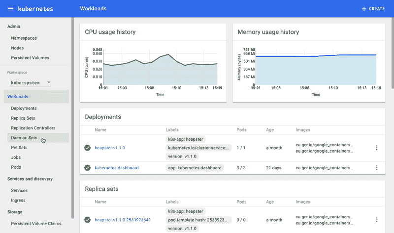

*图 1. Kubernetes Web UI 仪表（来源：[kubernetes.io](https://kubernetes.io))*

Kubernetes 被分为一组组件，其中一些管理单个节点，而其余的是控制平面的一部分。

#### 控制平面管理

- `etcd`：轻量级分布式集群管理器。它是持久性的，并可靠地存储集群的配置数据，提供集群在任何给定时间的一致且准确的表示。
- `API server`：使用基于 HTTP 的 JSON 提供 Kubernetes API。它为 Kubernetes 提供了内部和外部接口。服务器处理并验证 RESTful 请求，并实现多个工具和库之间之间的通信。
- `Scheduler`：选择未调度的 pod 应该在哪个节点上运行。此逻辑基于资源的可用性。调度器还跟踪每个节点的资源利用率，确保分配的负载永远不会超过物理或虚拟机上的可用资源。
- `Control Manager`：托管 `DaemonSet` 和 `Replication` 控制器的进程。控制器与 `API server` 通信以创建、更新或删除受管理的资源。

#### 节点管理

- `kubelet`：负责每个节点的运行状态，并确保节点上的所有容器都是健康的。它根据控制平面中管理器的指示，处理 pod 内应用程序容器的启动和停止（参见下一节中与 Docker 的区别）。
- `kube-proxy`：网络代理和负载均衡器。它负责将流量路由到适当的容器。
- `cAdvisor`：代理，用于监控并收集每个节点上每个容器的系统资源利用率和性能指标（如 CPU、内存、文件和网络）。

#### 控制器

控制器通过管理一组 pod 来驱动集群状态。`Replication Controller` 通过在整个节点集群中运行指定数量的 pod 副本来处理 pod 的复制和扩展。它还可以在节点故障时创建替换 pod。`DaemonSet Controller` 负责每个节点恰好运行一个 pod。`Job Controller` 运行 pod 直到完成（作为批作业的一部分）。

#### 服务

在 Kubernetes 术语中，服务由一组共同工作的 pod 组成（单层或多层应用程序）。由于 Kubernetes 提供了服务发现和请求路由（通过分配适当的静态网络参数），它确保所有服务请求都能到达正确的 pod，无论它在集群中移动到何处。这种移动可能是 pod 或节点故障的结果。最终，Kubernetes 的自愈能力将自动将那些出现故障的服务恢复到原始状态。

#### Pod

当 Kubernetes 主节点向单个节点部署一组一个或多个容器时，它是通过创建一个 pod 来完成的。Pod 从容器中抽象出网络和存储，pod 内的所有容器将共享相同的 IP 地址、主机名等，允许它在集群中无复杂地移动。

`kubelet` 会监控每一个、每一个一个 pod。如果它的状态不佳，它会将该 pod 重新部署到相同的节点。此外，心跳消息机制每隔几秒会将节点状态传递给主节点。主节点一旦检测到节点故障，`Replication Controller` 将现在受影响的 pod 启动到另一个健康节点。

那么，Docker 如何融入这一切的？Docker 仍然按照它的设计方式运行。当 Kubernetes 主节点将 pod 调度到节点时，运行在该节点上的 `kubelet` 将指导 Docker 启动所需的容器。`kubelet` 将继续监控这些容器，同时为主节点收集信息。Docker 仍然完全控制运行在节点上的容器，并负责它们的启动和停止。这里唯一的区别是，你现在有了一个自动化系统向 Docker 发送这些请求，而不是由管理员手动运行相同的任务。

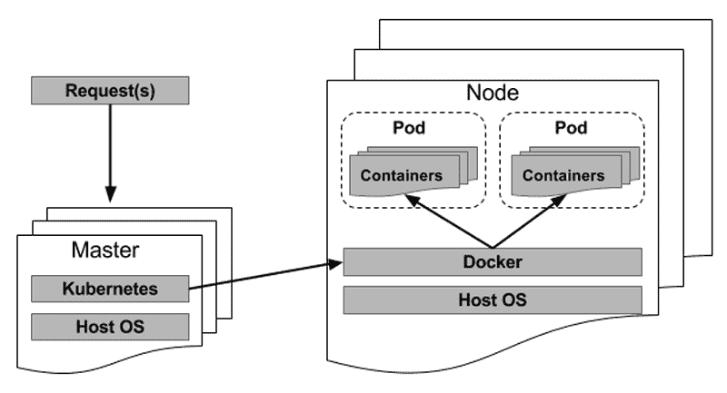

*图 2. Pod 创建/管理的通用模型*

### 安装 Kubernetes

现代 Linux 发行版已让 Kubernetes 主机的安装和配置变得非常简单。我在后续示例中使用 Ubuntu Server 16.04。注意：你需要大量的内存和存储来运行此示例。*

首先，安装 `conjure-up`：

```
sudo snap install conjure-up --classic
```

`conjure-up` 是 Juju、MAAS 和 LXD 的一个精美封装。它被宣传为启用大型复杂软件栈（包括 Kubernetes）的开箱可用解决方案。`conjure-up` 本质上处理一组利用上述技术的脚本集合。

接下来，安装 `lxd`：

```bash
sudo snap install lxd
```

LXD 是 Canonical（Ubuntu 的母公司）自研的容器技术。Docker 更关注于部署应用程序，而 LXD 专门用于部署 Linux 虚拟机。

为了满足在本地主机安装的所有要求，你需要至少创建一个 LXD 存储池：

```bash
sudo /snap/bin/lxc storage create kube-test dir source=/mnt

Storage pool kube-test created
```

你可以使用以下命令查看新创建的池：

```bash
sudo /snap/bin/lxc storage list

+-----------+-------------+--------+--------+---------+
|   NAME    | DESCRIPTION | DRIVER | SOURCE | USED BY |
+-----------+-------------+--------+--------+---------+
| kube-test |             | dir    | /mnt   | 0       |
+-----------+-------------+--------+--------+---------+
```

你还需要创建一个网络桥接：

```
$ /snap/bin/lxc network create lxdbr0 ipv4.address=auto 
↪ipv4.nat=true ipv6.address=none ipv6.nat=false

Network lxdbr0 created
```

运行 `conjure-up`：

```
$ conjure-up
```


你将看到一个菜单，可以在其中选择 Canonical 的 Kubernetes 发行。

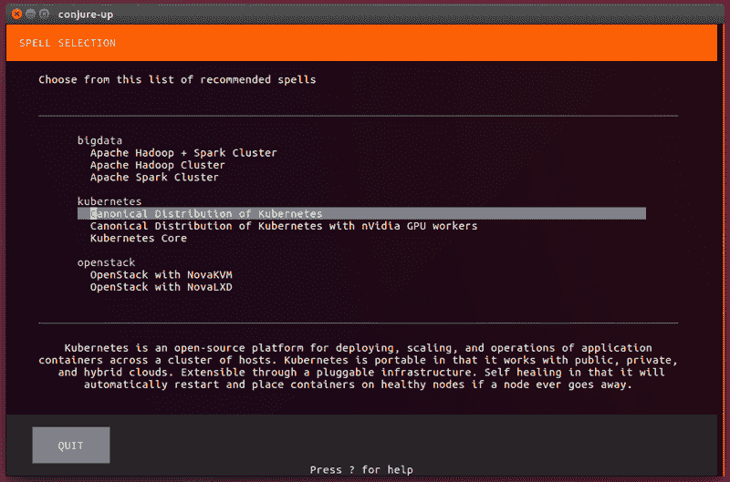

*图 3. `conjure-up` 框架选择菜单*

然后，系统会提示你为 Kubernetes 部署安装各种实用的附加包。

随后会显示更多选项，例如部署位置（例如，云端或本地）。为了本示例演示，我们将安装并部署到本地，因此在随后的菜单中，选择你之前创建的网络桥（`lxdbr0`）和存储池（`kube-test`）。回答几个简单的问题后，安装过程将开始。整个过程将花费相当的时间。

希望安装 Kubernetes 主组件不会花费太长时间，但让我们假设到此为止一切都已完成。作为安装后过程的一部分，将安装 `kubectl` 客户端，然后主机系统将获取 Kubernetes 集群状态。你将获得一份安装摘要。

当所有操作完成后，运行以下 `kubectl` 命令：

```
$ ~/kubectl cluster-info
```

你将看到集群运行组件的简短显示，包括指向各种仪表板和服务的地址。

## 云原生计算

云原生计算（通常被称为无服务器计算，serverless computing）不仅是数据中心最新的热门趋势词汇，还提供了一种托管应用程序的新方式。这种理念挑战了传统规范，将更多力量赋予应用程序本身，同时抽象了底层所有内容。但在进入无服务器计算的细节之前，这里有一个关于云计算的快速课程。

### 迈向无服务器

云原生计算是一个相对较新的术语，描述了部署和管理应用的现代趋势。其理念非常直观：每个应用程序或进程都被封装在自己的容器中，反而在多个节点集群上进行动态编排（即调度和管理）。这种方法使应用程序脱离对物理硬件和操作系统的依赖，进入自己的自包含和沙箱环境，可以在数据中心内的任何地方透明且无缝地运行。云原生方法的核心是将应用程序交付的各个组件分离。

### 云端容器的演变

正如你所料，容器技术帮助加速了云的采用。想想看：你有这些持久的容器化应用镜像，它们可以在几秒钟根据需要启动或关闭，并在多个节点或数据中心位置之间进行平衡，以实现最佳的服务质量（QoS）。即使是大型公共云供应商也使用相同的容器技术，原因也相同：快速部署应用程序。例如，亚马逊、微软和谷歌通过 `Docker` 提供其容器服务。对于更广泛的无服务器生态系统，托管在这些容器中的应用程序是无状态且事件触发的。这意味着第三方组件将在需要和调用时管理对该应用程序的访问。

现在，当我思考一个真正的无服务器解决方案时，脑海中首先想到的之一就是亚马逊的 `AWS Lambda`。亚马逊通过启动容器来托管所需的应用程序，将无服务器提升了高度，确保你的业务或服务的访问可用。在这种模型下，无需配置或管理物理或虚拟服务器。假设它处于稳定或生产状态，你只需部署代码即可完成。通过 `Lambda`，你不需要管理容器（进一步减少了你的开销）。你的代码仅被部署在隔离的容器化环境中。这非常直观。`AWS Lambda` 允许通过用户定义的 HTTPS 请求直接触发用户定义的代码函数。`Lambda` 与传统容器化部署的区别在于，亚马逊为开发者提供了一个框架，用于上传其事件驱动应用程序代码（用 `Node.js`、`Python`、`Java` 或 `C#` 编写），并在毫秒内响应事件（例如网站点击）。运行你大部分代码的所有库和依赖项均在容器内提供。`Lambda` 会自动扩展以支持你应用程序的确切需求。

至于触发应用程序或代码处理程序的事件类型（标记为事件源），亚马逊已经实现可以让你通过网站访问或点击、向其 API 网关发送 REST HTTP 请求、你的物联网（IoT）设备上的传感器读数，甚至是向 `S3` 存储桶上传照片。此 API 网关构成了连接 `AWS Lambda` 所有部分的桥梁。例如，开发者可以编写一个处理器来在 HTTPS 请求事件发生时触发。

假设你需要为代码启用某种层级的细粒度。`Lambda` 通过允许开发者编写模块化处理器来适应这一点。例如，你可以为每个 API 方法编写一个触发器，且每个处理器都可以独立于其他处理器进行调用、更新和更改。

`Lambda` 允许开发者将所有所需的依赖项（即库、原生二进制文件甚至外部 Web 服务）与你的函数合并到单个包中，赋予处理器在需要时访问任何这些依赖项的自由。

现在，这与亚马逊 AWS 弹性云计算 (EC2) 实例相比如何呢？简短的回答是，它简单得多，我所说的简单是指在配置或维护你的运行环境方面零或几乎没有开销。如果你需要环境通过访问完整的操作系统或容器来获得更多功能，你可以启动一个 `EC2` 虚拟实例。`EC2` 为用户提供了灵活性，可以对其托管的硬件和软件进行自定义。如果你只需要托管一个函数或特殊用途应用程序，那么 `Lambda` 将是更好的选择。通过 `Lambda`，没有太多可以自定义的——而且有时，少即是多。

### 云原生计算基金会

云原生计算基金会（CNCF）成立于 2015 年，其成立目的是帮助标准化这些近期托管云服务的这种范式转移——即统一并定义云原生时代。尽管基金会的首要目标是成为云原生软件项目的最佳托管地，基金会还是许多以云为中心的项目园，其中包括 `Kubernetes` 编排框架。

为了帮助标准化这种新的计算趋势，基金会将整个架构划分为一组子系统，每个子系统都有自己的一套用于组件间通信的标准化 API。子系统包括编排、资源调度和分布式系统服务。

你可以通过访问基金会的[官方网站](https://www.cncf.io) 了解更多关于基金会的信息。

## 总结

`Kubernetes` 扩展了对传统容器的管理，允许你有效高效地扩展以满足消费者需求。对于现代和主流 Linux 发行版，部署 Kubernetes 集群就像运行脚本并回答几个问题一样简单。

当你进一步探索这项奇妙的技术时，请记住你并不孤单。有很多公司提供围绕 `Kubernetes` 的服务和解决方案。其中一家公司就是 `Heptio`，它由 Kubernetes 的共同创建者 `Craig McLuckie` 和 `Joe Beda` 创立。`Heptio` 围绕开发者和系统管理员，其产品和服务简化并扩展了 `Kubernetes` 生态系统。

还需要在同一个生态系统中维护您的容器镜像的安全性和合规性。同样，当规模扩大到数千个时，管理这些事情几乎是不可能的。这正是像 Twistlock 这样的公司为您完成繁重工作的地方。Twistlock 开发并分发同名产品，专门专注于 Docker 镜像的安全和合规。它还可以包括 Kubernetes 在内的编排平台进行操作和管理。

## 资源

Kubernetes 主网站可以在[此处](https://kubernetes.io)。

来自 *Linux Journal* 关于 Kubernetes 的进一步阅读：

* ["Petros Koutoupis 写的《Kubernetes, Four Years Later, and Amazon Redefining Container Orchestration》](https://www.linuxjournal.com/content/kubernetes-four-years-later-and-amazon-redefining-container-orchestration)
* ["Craig McLuckie 写的《AWS Quick Start for Kubernetes》](https://www.linuxjournal.com/content/aws-quickstart-kubernetes)
* [Heptio 创始人兼 CTO Joe Beda 论如何成为云原生组织](https://www.linuxjournal.com/sites/default/files/2018-05/InTheirWords-JoeBeda-CloudNative-v3.pdf)
* ["Petros Koutoupis 写的《采访 Heptio：Kubernetes 的先驱》](https://www.linuxjournal.com/content/interview-heptio-kubernetes-pioneers)

# 寻找 Docker 的 GUI

## Docker 无所不在但唯独不漂亮；让我们尝试修复这个问题。以下是一些可用的 Docker GUI 选项概述。作者：Shawn Powers

我热爱 Docker。起初，我觉得对我像家里设置这样的小规模实现来说，它似乎有点傻，但在学习了如何使用它后，我爱上了它。标准功能确实很有好处。不用担心一个应用程序的依赖项会干扰或冲突，这太棒了。但大多数应用程序都很擅于与其他共处，而且包管理系统能保持井井有序。那么为什么我用 `docker run` 而不是 `apt-get install` 呢？个性化的系统设置。

通过 Docker，我可以同时运行三个相同的应用程序。它们甚至可以使用相同的端口（内部）而不会发生冲突。我的下载客户端可以运行在强制性 VPN 网络中，我不必担心它会以某种方式“泄露”我的个人 IP 数据。嘿，我可以在我的 Ubuntu Docker 服务器内部运行仅在 CentOS 上运行的程序，而且它就是好用！简而言之，Docker 太惊不起了。

我只希望我记住所有的命令。

别误会我，我很熟悉 Docker。我用它来处理大多数服务器需求。它是我测试新应用时的首选。嘿，我甚至为 CBT Nuggets（我的全职工作）教过一整门关于 Docker 的课程。问题是，Docker 工作得太出色了，我很少需要与它交互。所以，我的 FIFO 缓冲区满了，我忘记了那些让 Docker 运行的简单命令行选项。此外，由于我喜欢图表和图形，我决定安装一个 Docker GUI。这像是一次冒险，所以我想分享一下我经历的细节。

### 我对 GUI 的期望

对于 GUI，有些东西我并不在乎。奇怪的是，人们对视觉界面最常用的用途之一是创建 Docker 容器的能力。在创建容器时，我实际上不在意使用命令行，因为通常需要经过 5 到 10 次尝试和调整才能达到我想要的效果。所以对我来说，我希望至少具备以下功能：

* 所有容器的视觉布局，无论它们是否正在运行。
* 启动/停止/删除容器的方法。
* 重命名运行中容器的能力，因为我总是忘记给它们命名，我厌倦了看到“chubby_cheetah”这样的容器名。
* 轻松更改重启策略的方法，这样当我终于配置好一个容器时，可以将其设置为 `--restart=always`。
* 显示有关系统和单个容器的统计数据。
* 读取日志。
* 通过网络界面工作，这样我可以远程使用它。
* 本身就是一个 Docker 容器！

我的需求列表相当简单，但奇怪的是，很多 GUI 都大失所望。由于每个人的愿望不同，我将介绍我尝试过的最流行的选项，并提到一些优缺点。

### Kitematic

它的名字很奇怪，但 Kitematic 已经存在很久了。它实际上被 Docker 官方采用，现在是 Docker Toolkit 的一部分。它的界面相当简单，但简单有时是一种加分项，因为发现它能做的事情非常直观。

如果你查看 [Kitematic 网站](http://kitematic.com)，你可能会认为它只运行在 OS X 或 Windows 上，但幸运的是，并非如此。如果你前往 [GitHub 仓库](https://github.com/docker/kitematic/releases)，你也会发现一个 Ubuntu 安装程序。

Kitematic 很漂亮，但它是一个原生应用，而不是网络界面。它看起来很好（图 1），但我出门时经常在别人的电脑上，所以我的网络需求至关重要。尽管如此，如果你不需要网络界面并想要一个支持良好的整洁 GUI，Kitematic 非常出色。它相当简单，但再次，这不是坏事。


*图 1. Kitematic*

**优点：**
* Docker 官方支持。
* 非常简单。

**缺点：**
* 不是网络界面。

### Portainer

我发现的最完美的解决方案是 Portainer。它是基于 Web 的，作为 Docker 容器运行，并且启动简单。从表面上看它非常基础，但让我印象的是它甚至有一个分级用户系统，这意味着你可以为不同的用户提供对 Docker 基础设施的不同权限。

Portainer 似乎没有保留历史性能统计，但它确实有一个实时监控器（图 3），在我尝试排除出现故障的容器的问题时，它可以派上用场。我有点惊讶地发现，应用程序模板功能（图 4）是我最喜欢玩的功能之一。我知道我的原始需求并不包括一种快速部署容器的方法，但获取一个快速模板并点击部署异常地简单。

*图 4。我通常对这种模板感兴趣，但在这里我感觉自己像个进进了糖果店的小孩！*

如果你想为你正在运行的 Docker 服务器提供一个相当简单的界面，Portainer 是一个极佳的选择。它可以启动和停止容器，编辑正在运行的现有应用程序（甚至可以重命名它们，这是我经常必须做的事），而且是在进行完一轮添加/删除镜像后清理系统的绝佳方法。例如，你可以查看卷（volumes）标签页（图 5），并快速识别不再与运行中的容器关联的卷。这是我从未考虑过的事情，所以我有数百个被遗弃的卷静静地呆在那里。

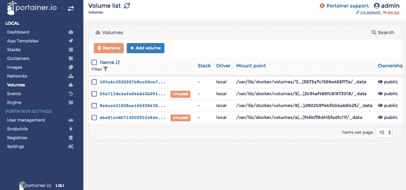

*图 5。并不是说那些遗弃的卷占用了我系统的大量空间，但我讨厌把东西到处丢。Portainer 让清理变得简单。*

我与正在运行的容器交互的首选系统是 Portainer。它在急需时能满足我的需求，通过网络浏览器运行，而且功能足够强大，值得一直保留。它是开源的，并且正在积极开发中。我强烈推荐它。事实上，Portainer 最好的优点之一就是设置非常简单。以下这行单行命令将下载镜像、启动容器，并让你能够通过端口 9000 访问界面：

```
docker run -d -p 9000:9000 \
-v /var/run/docker.sock:/var/run/docker.sock \
portainer/portainer
```

我没有将它暴露在互联网上，但当我在外面时，通过一个带有端口转发的快速 `ssh` 命令即可让我完全访问 Portainer 实例。得益于 UNIX 套接字系统，Portainer 直接与 Docker 交互，无需进行任何系统配置更改即可完成任务。上面那行单行命令字面上就是全部。（而且对我来说，GUI 中的首要任务是更改容器名称，因为我在创建容器时总是忘记这样做了！）

Portainer.io 的人员在[此处](https://demo.portainer.io)提供了一个功能完备的演示（登录账号为 admin:tryportainer），这可以让你在不将其部署到自己环境中的情况下了解它的功能。我承认，我在运行该演示方面运气参差不齐（它经常卡住），所以可能在自己的系统上快速启动一个容器并检查它更简单。尽管如此，提供一个演示还是很好的。

**优点：**
* 基于 Web 端。
* 安装简单（它运行在容器中）。
* 易于导航。
* 用户管理。

**缺点：**
* 没弄清楚如何更改容器的重启策略！

### Dockly，古怪的表兄弟

如果不提到另一个有趣的选项，我将失职，从技术上讲这是一个 GUI，尽管不是传统意义上的。Dockly 是一个 GUI，但它是一个基于 Curses 的文本 GUI。基本上，如果 Kyle Rankin 寻找 Docker 的 GUI 界面，Dockly 可能会是他的首选。嘿，它看起来甚至有点像 Mutt（图 6）。

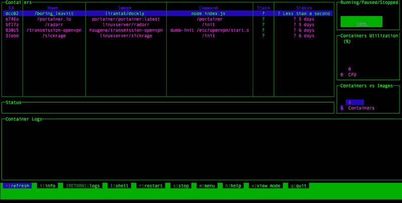

*图 6。Dockly 并不是 Docker 最漂亮的 GUI，但它执行了其他 GUI 执行的大部分相同功能，并且完全在终端窗口内运行。它值得一看。*

诚然，起初通过键盘导航 GUI 有点笨拙。我花了一段时间才领会 Dockly 真正能做什么。然而，一旦我习惯了界面，我必须承认它非常棒。在所有的管理系统中，它绝对是最容易连接的，因为它运行在 SSH 窗口中。

关于如何设置和使用 Dockly 的说明，请前往[此处](https://github.com/lirantal/dockly)。由于它运行在 SSH 窗口中，它是所有管理系统中绝对是最容易连接的。

**优点：**
* 运行在容器中。
* 安装简单。
* 终端友好。

**缺点：**
* 无法弄清楚如何更改容器的重启策略！

*图 2. 基于 Docker 的理想 DevOps 流水线*

这里的理念是，无论运行在何处，每个环境都使用相同的 Docker 镜像和代码库。与 `Puppet`、`Chef` 或 `Ansible` 等将系统敛到定义状态的系统不同，理想的 Docker 流水会在每个环境中创建固定镜像的重复副本（容器）。理想情况下，在以 Docker 为中心的流水线，真正能够在环境阶段之间移动的产物只有 Docker 镜像的 ID；所有其他产物应在环境之间共享以确保一致性。

## 处理环境之间的差异

在现实世界中，环境阶段可能会不同。例如，你的 QA（测试）和 staging（预发布）环境可能包含不同的 DNS 名称、不同的防火墙规则，而且肯定会有不同的数据固具。通过跨不同环境标准化服务来对抗这种环境漂移。例如，确保每个环境中的 DNS 都将 "db1.example.com" 和 "db2.example.com" 解析到正确的 IP 地址，比依赖配置文件更改或将应用程序指向不同 IP 地址的注入模板更符合 Docker 的理念。然而，必要时，你可以为每个容器设置环境变量，而不是对固定镜像进行有状态更改。这些变量可以通过多种方式进行管理，包括：

1. 从命令行在容器运行时设置环境变量。
2. 从文件在容器运行时设置环境变量。
3. 使用 `etcd`、`Consul`、`Vault` 或类似的工具进行自动发现。

考虑一个运行在 Docker 容器内部的 Ruby 微服务。该服务访问某处的数据库。为了在每个不同环境中运行相同的 Ruby 镜像，但将环境特定的数据作为变量传递进去，你的部署编排工具可能会使用类似下面的 Shell 脚本，“示例微服务部署”：

```
# 重用相同的镜像在每个环境
# 环境中创建容器。
docker pull ruby:latest

# Bash 函数将关键环境
# 变量导出到容器，然后在容器内运行
# Ruby 以显示相关的
# 值。
```


`microservice () {`

```
    docker run -e STAGE -e DB --rm ruby \
        /usr/local/bin/ruby -e \
            'printf("STAGE: %s, DB: %s\n",
                    ENV["STAGE"],
                    ENV["DB"])'
}
```

表 1 显示了如何使用导出的环境变量，将开发、质量保证和生产环境的特定信息传递给原本相同的容器。

### 表 1. 注入环境变量的相同镜像

| 开发 (Development) | 质量保证 (Quality Assurance) | 生产 (Production) |
| --- | --- | --- |
| `export STAGE=dev DB=db1; microservice` | `export STAGE=qa DB=db2; microservice` | `export STAGE=prod DB=db3; microservice` |

要查看效果，请打开带有 Bash 提示符的终端并运行上述“示例微服务部署”脚本中的命令，将 Ruby 镜像拉取到你的 Docker 主机并创建一个可重用的 Shell 函数。接下来，依次运行上表中的每个命令，以设置正确的环境变量并执行该函数。你应该能在每个模拟环境中看到表 2 所示的输出。

### 表 2. 每个环境中产生相应结果的容器

| 开发 (Development) | 质量保证 (Quality Assurance) | 生产 (Production) |
| --- | --- | --- |
| `STAGE: dev, DB: db1` | `STAGE: qa, DB: db2` | `STAGE: prod, DB: db3` |

尽管这是一个相当简单的例子，但所实现的目标确实非常非凡。这是 DevOps 工具的最高境界：你正在重用相同的镜像和部署脚本来确保最大程度的一致性，但每个部署的实例（Docker 术语中的“容器”）仍然经过调整，以使其在特定的流水线阶段内正常运行。

通过这种方法，你通过确保在流水线的每个阶段都重用完全相同的镜像，限制了配置漂移和差异。此外，每个容器仅根据注入到它们中的环境特定数据或产物有所不同，减少了维护多个版本或按环境划分的负担。

#### 但是外部系统呢？

之前的模拟并没有真正连接到 Docker 容器外的任何服务。如果你需要将容器连接到容器外部的环境特定内容，这种方法效果如何？接下来，我将模拟一个 Docker 容器从开发移动到 DevOps 流水线的其他阶段，在每个环境中使用带有自身数据的数据库。这需要先进行一些准备工作。

首先，为示例文件创建一个工作空间。你可以通过从 GitHub 克隆示例或通过创建一个目录来实现。例如：

```
# 从 GitHub 克隆示例。
git clone \
    https://github.com/CodeGnome/SDCAPS-Examples

cd SDCAPS-Examples/db

# 你自己创建一个工作目录。
mkdir -p SDCAPS-Examples/db

cd SDCAPS-Examples/db
```

如果你克隆了示例仓库，以下 SQL 文件应该位于 `db` 目录中。否则，请现在创建它们。

`db1.sql`:

```
-- 开发数据库
PRAGMA foreign_keys=OFF;
BEGIN TRANSACTION;
CREATE TABLE AppData (
    login TEXT UNIQUE NOT NULL,
    name TEXT,
    password TEXT
);
INSERT INTO AppData
VALUES ('root','developers','dev_password'),
       ('dev','developers','dev_password');
COMMIT;
```

`db2.sql`:

```
-- 质量保证 (QA) 数据库
PRAGMA foreign_keys=OFF;
BEGIN TRANSACTION;
CREATE TABLE AppData (
    login TEXT UNIQUE NOT NULL,
    name TEXT,
    password TEXT
);
INSERT INTO AppData
VALUES ('root','qa','qa_password'),
       ('test','qa','qa_password');
COMMIT;
```

`db3.sql`:

```
-- 生产数据库
PRAGMA foreign_keys=OFF;
BEGIN TRANSACTION;
CREATE TABLE AppData (
    login TEXT UNIQUE NOT NULL,
    name TEXT,
    password TEXT
);
INSERT INTO AppData
VALUES ('root','production','prod_password'),
       ('deploy','devops','prod_password');
COMMIT;
```

接下来，你需要一个小型工具来创建（或重新创建）各种 SQLite 数据库。这只是一个方便脚本，如果你喜欢手动或使用其他工具加载 SQL，请继续：

```
#!/bin/env bash

# 你假设数据库文件将存储在名为 "db" 的
# 直接子目录，但你可以使用环境变量覆盖它。
: "${DATABASE_DIR:=db}"

cd "$DATABASE_DIR"

# 扫描 -f 标志。如果发现了标志，并且
# 有匹配的文件名，则详细删除
# 现有数据库文件。
pattern='(^|[[:space:]])-f([[:space:]|$)'
if [[ "$*" =~ $pattern ]] &&
    compgen -o filenames -G 'db?' >&-
then
    echo "Removing existing database files ..."
    rm -v db? 2> /dev/null
    echo
fi

# 处理当前目录中的每个 SQL 导出。
echo "Creating database files from SQL ..."
for sql_dump in *.sql; do
    db_filename="${sql_dump%%.sql}"
    if [[ ! -f "$db_filename" ]]; then
        sqlite3 "$db_filename" < "$sql_dump" &&
        echo "$db_filename created"
    else
        echo "$db_filename already exists"
    fi
done
```

当你运行 `./create_databases.sh` 时，你应该看到：

```
Creating database files from SQL ...
db1 created
db2 created
db3 created
```

你可能已经注意到某些 SQL 文件包含明文密码，而另一些文件则包含有效的 Linux 密码哈希。对于本文而言，这在很大程度上是一种设计，旨在确保每个数据库中都有不同的数据，并便于你通过数据本身判断你正在查看的是哪个数据库。

但从安全角度考虑，最好的做法是确保你存储的任何源文件中都有经过适当哈希的密码。生成此类密码有多种方法，但 `OpenSSL` 库可以让你轻松地从命令行生成加盐并哈希的密码。

**提示：** 为了获得最佳安全性，不要将所需的密码或短语作为参数传递给 `OpenSSL`，因为这可能会在进程列表中显示。相反，请让 `OpenSSL` 提示你输入 `Password:`，并确保使用强短语。

使用 `OpenSSL` 生成带盐的 MD5 密码：

```
$ openssl passwd \
    -1 \
    -salt "$(openssl rand -base64 6)"
Password:
```

然后，你可以将加盐哈希粘贴到 `/etc/shadow`、SQL 文件、实用程序脚本或任何你需要的地方。

### 在开发阶段模拟部署

现在你已经有了一些外部资源可以实验，准备好模拟部署了。让我们从在你的开发环境中运行一个容器开始。在这里，我遵循了一些 DevOps 最佳实践，并使用了固定的镜像 ID 和定义的 gem 版本。

#### Docker 镜像 ID 的 DevOps 最佳实践

为了确保在流水线阶段之间复用同一个镜像，拉取镜像时始终使用镜像 ID 而不是命名标签或符号引用。例如，虽然 `"latest"` 标签随着时间的推移指向不同的 Docker 镜像版本，但镜像版本的 `SHA-256` 标识符保持不变，并可以作为下载镜像的校验和和自动验证。

此外，对于注入到容器中的资源，你始终应该使用固定 ID。注意我们在每个阶段中是如何指定了注入到容器的特定版本的 `SQLite3` Ruby gem。这确保了每个流水线阶段都使用相同的版本，无论 `RubyGems` 仓库中的最新版本在两次容器部署之间是否发生了变化。

#### 获取 Docker 镜像 ID

当你拉取 Docker 镜像时（例如 `ruby:latest`），Docker 会在标准输出上报告镜像的摘要（`digest`）：

```
$ docker pull ruby:latest
latest: Pulling from library/ruby
Digest:
sha256:eed291437be80359321bf66a842d4d542a789e
↪687b38c31bd1659065b2906778
Status: Image is up to date for ruby:latest
```

如果你想找到已经拉取的镜像的 ID，可以使用 `inspect` 子命令从 Docker 的 JSON 输出中提取摘要——例如：

```
$ docker inspect \
      --format='{{index .RepoDigests 0}}' \
      ruby:latest
      ruby@sha256:eed291437be80359321bf66a842d4d542a789
↪e687b38c31bd1659065b2906778
```

首先，你为开发导出相应的环境变量。这些值将覆盖由部署脚本设置的默认值，并影响你的示例应用程序的行为：

```bash
# Export values we want accessible inside the Docker
# container.
export STAGE="dev" DB="db1"
```

接下来，实现名为 `container_deploy.sh` 的脚本，该脚本将模拟跨环境的部署。这是你的部署流水线或编排引擎在为每个阶段实例化容器时应该的工作示例：

```bash
#!/usr/bin/env bash

set -e

####################################################
# 默认 shell 和环境变量。
####################################################

# 使用一种快速技巧，在杂志行长度限制内
# 构建 64 字符镜像 ID
# （这实际上是一个 SHA-256 哈希值）。
hash_segments=(
    "eed291437be80359321bf66a842d4d54"
    "2a789e687b38c31bd1659065b2906778"
)

printf -v id "%s" "${hash_segments[@]}"

# 如果没有从脚本环境中覆盖，
# 使用默认的 Ruby 镜像 ID。
: "${IMAGE_ID:=$id}"

# 固定版本的 SQLite3 gem。
: "${SQLITE3_VERSION:=1.3.13}"

# 默认流水线阶段（例如 dev, qa, prod）。
: "${STAGE:=dev}"

# 默认使用的数据库（例如 db1, db2, db3）。
: "${DB:=db1}"

# 导出在容器内应该是可见的值。
export STAGE DB

####################################################
# 设置并运行 Docker 容器。
####################################################

# 脚本退出时移除 Ruby 容器，
# 无论退出状态如何，除非设置了 DEBUG。
cleanup () {
    local id msg1 msg2 msg3
    id="$container_id"
    if [[ ! -v DEBUG ]]; then
        docker rm --force "$id" >&-
    else
        msg1="DEBUG"
        msg2="was set."
        msg3="debugging the container:"
    fi
}

trap "cleanup" EXIT
```

### 跨环境模拟部署

现在你准备好进行更具野心的操作了。在之前的示例中，你将容器部署到了开发环境。运行在容器内部的 Ruby 应用程序使用了开发数据库。这种方法的威力在于，完全相同的过程可以重复用于每个流水线阶段，而你唯一需要更改的是应用程序指向的数据库。

在实际使用中，你的 DevOps 配置管理或编排引擎将处理为流水线的每个阶段设置正确的环境变量。为了模拟部署到多个环境，你可以在 Bash 中填充一个关联数组，其中包含每个阶段所需的值，然后在 `for` 循环中运行该脚本：

```bash
declare -A env_db
env_db=([dev]=db1 [qa]=db2 [prod]=db3)

for env in dev qa prod; do
    export STAGE="$env" DB="${env_db[$env]}"
    printf "%s\n" "Deploying to ${env^^} ..."
    ./container_deploy.sh
done
```

从 DevOps 的角度来看，这种特定阶段的方法有许多优点。这是因为：

1.  部署的镜像 ID 在所有流水线阶段中都是相同的。
2.  更复杂的应用程序可以根据运行时注入到容器中的 `STAGE` 和 `DB`（或其他值）的值来“执行正确的事”。
3.  容器在每个阶段都以相同的方式连接到宿主机文件系统，因此你可以重用从 `Git`、`Nexus` 或其他仓库拉取的源代码或版本化产物，而无需对镜像或容器进行更改。
4.  指向正确外部资源的切换魔法由你的部署脚本（在这种情况下为 `container_deploy.sh`）处理，而不是通过更改你的镜像、应用程序或基础设施。
5.  如果你的目标是将大多数复杂性封装在部署工具或流水线编排引擎中，那么这个解决方案是非常棒的。然而，一个小的改进可以让你将剩余的复杂性推到流水线基础设施上。

想象一下，你有一个比这里所处理的更复杂的应用程序。也许你的 QA 或暂存环境拥有大型数据集，你不想在本地主机上重新创建这些数据，或者你可能需要指向一个运行时可能会移动的网络资源。你可以通过使用一个由外部资源解析的已知名称来处理这一点。

你可以通过使用符号链接（`symlink`）在文件系统层面展示这一点。这种方法的用处是，应用程序和容器不再需要知道存在哪个数据库，因为数据库的名称始终是 `"db"`。考虑以下内容：

```bash
declare -A env_db
env_db=([dev]=db1 [qa]=db2 [prod]=db3)

for env in dev qa prod; do
    printf "%s\n" "Deploying to ${env^^} ..."
    (cd db; ln -fs "${env_db[$env]}" db)
    export STAGE="$env" DB="db"
    ./container_deploy.sh
done
```

同样，你可以在你的网络上配置域名解析服务 (`DNS`) 或虚拟 IP (`VIP`)，以确保为每个阶段使用正确的数据库主机或集群。例如，你可能确保 `db.example.com` 在每个流水线阶段解析到不同的 IP 地址。

遗憾的是，管理多个环境的复杂性永远不会真正消失——我们希望它只是被抽象到了适合组织的正确层次。将你的目标认为类似于某些面向对象编程 (`OOP`) 的最佳实践：你正试图创建能够尽可能减少变化项的流水线，并允许应用程序和工具依赖于稳定的接口。当变化不可避免时，目标是尽可能缩小可能发生变化的范围，并最大程度地从你的工具中隐藏那些糟糕的细节。

如果你有成千或上万台服务器，在不不停机的情况下更改几个 `DNS` 条目通常比重新构建或重新部署 10,000 个应用程序容器要好。当然，总会有反例，所以请考虑权衡。

```
Dir.chdir '/usr/local/src'

cmd =
  "curl -sLO "             <<
  "https://www.docker.com" <<
  "/sites/default/files"   <<
  "/vertical_large.png"

system cmd
```


现在，`/usr/local/src`和对应的宿主机目录都包含了`vertical_large.png`图形文件。你已经从`Docker`容器内部向源码树添加了一个文件！

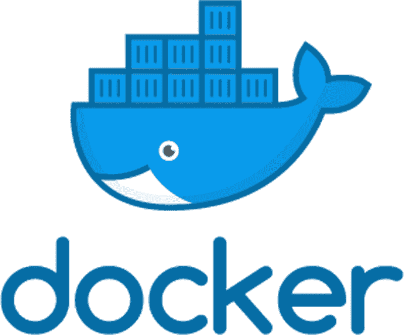

图 3. 主机文件系统*以及*容器内部的`Docker Logo`。

当你按下`Ctrl-D`退出`REPL`时，`develop.sh`脚本会告诉你如何重新连接到仍在运行的容器，以及在完成后如何删除容器。输出将类似于以下内容：

```
Re-enter container with:

        docker exec -it 9a2c94ebdee8 bash

Clean up container with:

        docker rm --force 9a2c94ebdee8 
```


在实际操作中，请记住`develop.sh`脚本会在启动第一个 IRB 实例时设置 Ruby 的`LOAD_PATH`并加载`sqlite3` gem 包。如果你退出了该进程，通过`docker exec`或从容器内的 Bash shell 启动另一个 IRB 实例可能无法达到你的预期。请确保运行`irb -I /usr/local/src -r sqlite3`来重新获得最初那种流畅的体验！

# 结语

我涵盖了 Docker 容器如何流通过 DevOps 流水线，从开发一直到生产。我研究了管理流水线阶段差异的常见做法，以及如何以可重复和自动的方式使用特定阶段的数据和产物。在此过程中，你可能也对 Docker 命令、Bash 脚本和 Ruby REPL 有了进一步的。

我希望这是一段有趣的旅程。我知道我很享受与你分享这段经历，并由心希望在这个过程中，让你的 DevOps 和容器化工具箱又大了一点点。


# 跨平台：与构建 Linux 游戏的开发者对谈

Linux 游戏正以前所未有的速度蓬勃发展。这场革命感谢于跨平台开发工具、热情的程序员以及社区的支持。作者：K.G. Orphanides

在过去的五年里，为 Linux 发版的主流游戏数量剧增，现在有数千种作品可用。这些作品从《文明 6》（Civilization VI）和《机械狂神：人类分歧》（Deus Ex: Mankind Divided）等大型 AAA 大作，到像《林中的深夜》（Night in the Woods）这样突出的独立热门游戏。

对于这篇文章，我与不同的开发者和发行商交流，以发现 Linux 游戏市场的格局并找出其巨大增长的动力。


图 1. 多获殊荣的喜剧冒险游戏《林中的深夜》是同时在 Linux、macOS 和 Windows 上发布的游戏之一，这得益于可以构建所有三个平台的开发工具。

## 为什么要为 Linux 开发游戏？

随着跨平台开发工具的引入，对 Linux 的支持大幅增加，这使得在多个操作系统上发布游戏变得相对容易。也许更重要的是，我亲身交流过的几乎所有开发者都支持开源运动，即使他们的游戏是专有的。

对于[asymmetric](http://asymmetric.net/games.html)的火柴人风格喜剧 RPG《西域之恨》（West of Loathing）的创意总监 Zack Johnson 来说，该游戏作为热门浏览器游戏《苦难王国》（Kingdom of Loathing）衍生作品的起源起了重要作用。

“有一群声音响大的原版《苦难王国》玩家，他们敦促我们[[发布 Linux 版本]”，他说，“我们知道在开发期间可以从他们那里获得信息和支持，所以这似乎是一件值得做的事。”

制作在线游戏的经验也有助于做出这一决定：“我的第一个游戏项目是基于 LAMP 栈构建的，所以如果没有开源软件，我就不会有这份职业。总的来说，它对互联网基础架构的重要性无论如何强调都不为过。”


图 2. Portalarium 为其奇幻 RPG 史诗《化身之影》（Shroud of the Avatar）创建的在线世界自早期的预 Alpha 版本发布以来，Linux 用户即可访问。

在[Portalarium](https://www.shroudoftheavatar.com/?page_id=68618)——Richard "Lord British" Garriott 最新奇幻 RPG《化身之影》的制作公司，技术总监 Chris Spears 表示，支持 Linux 的动力源于内部：

> 就像大多数游戏开发工作室一样，办公室里有很多 Linux 支持者。当我们最终选择了一个支持 Linux 的引擎时，支持 Linux 似乎是理而当然的。

> 此外，虽然 Linux 游戏受众是一个较小的市场，但他们充满激情，通常是更硬核的玩家，这与我们想要的观众直接匹配！我们的游戏带有一种思考者的色彩，这与 Linux 群体的契合得非常好，并且比大多数其他游戏更能吸引 Linux 群众。

[Finji](http://finji.co) 2017 年独立热门游戏《林中的深夜》——一个设定在破旧工业小镇的成长喜剧，由一只名为 Mae Borowski 的动画猫主演——是用 Unity 游戏引擎构建的。其复杂叙事系统和分支对话选择的核心是[The Secret Lab 的 Yarn Spinner](https://www.secretlab.com.au/yarnspinner)，该工具以 MIT 许可证发布。

程序员 Jon Manning 说，“开源让 Yarn Spinner（《NITW》内部的叙事引擎）达到了发布游戏所需的特性丰富。我们是它的忠实粉丝，我们希望看到更多人为这两款游戏、游戏引擎以及工具做出贡献，帮助游戏开发者实现他们的愿景。”

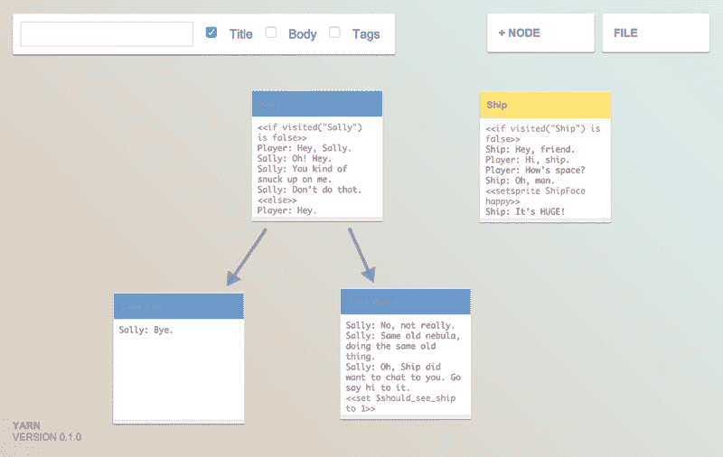

图 3. Yarn Spinner 以 Unity 插件的形式，允许开发者创建并跟踪复杂的叙事选择。

[Weather Factory](http://weatherfactory.biz)——克苏鲁式神秘卡牌游戏《邪教模拟器》（Cultist Simulator）工作室的 Lottie Bevan 对 Linux 粉丝赞有加加：

> 我们在团队前雇主 Failbetter 时给 Linux 社区留下了深刻印象——他们是我们最小的平台群体，但他们是最有用、技术意识最强的一群。Linux 用户似乎理解这一点，因为他们人数很少，支持 Linux 并不是必要的商业决策，因此如果你真的做了，他们会非常感激并提供帮助！

## 是什么使其成为？

我交流过的许多开发者都强调了泛跨平台开发工具的重要性，特别是 Unity 游戏引擎。这里是 Portalarium 的 Chris Spears 对他们选择 Unity 的看法：

> 我们选择了 Unity 3D 作为我们的引擎，它对 Linux 有原生支持。虽然这并不像勾选一个‘支持 Linux’框那么简单，但比自己构建一个支持多个平台的引擎要容易得多。作为一家游戏公司，我们的大多数技术人员已经精通 Linux，超过三分之一的工程师将 Linux 作为他们的主要开发操作系统。

Weather Factory 的 Lottie Bevan 表示同意：“Unity 解决了我们可能需要处理的 95% 的问题，这对于一个两个人的微型工作室来说是无价的！”

asymmetric 的西域之恨》团队成员也是该游戏引擎的粉丝，该引擎自 2011 年起就支持 Linux 作为目标平台，并自 2015 年起提供了 Linux 版开发环境。

“我们使用 Unity 引擎构建了《西域之恨》，所以从一开始，我们就拥有所有核心技术的支持，”程序员 Victor Thompson 说，“我对 Linux 没有任何特殊知识！我过去曾使用过几个不同的发行版，但那完全是为了维护个人邮件和 Web 服务器。”

尽管许多核心工具和库都是跨平台的，但游戏的开发策略理想情况下应该从一开始就考虑到对 Linux 的支持进行设计。

当[Lizard Cube](http://www.lizardcube.com)正在为 Westone Bit Entertainment 的经典平台游戏`Wonder Boy: The Dragon's Trap`开发其精美的手绘风重制版时，导演 Omar Cornut 表示：

> 我们让所有数据格式都变得了可移植。即使这意味着（例如）使用免费软件，比如一个便携式视频播放器，虽然从运行的角度来看它的优化非常糟糕，但无需维护不同的导出格式和私有播放器的简洁性确实非常值得。我们还让所有工具都变得可移植。

> 我大量使用了我的免费软件库`Dear ImGui`，它允许我们制作出可移植的工具界面。事实上，游戏渲染本身是通过`Dear ImGui`进行的。这套工具甚至可以在主机机上运行——而主机机并不是 POSIX 系统，也没有传统的 UI 工具包的支持。


图 4. 当他们重制`Wonder Boy: The Dragon's Trap`时，Lizard Cube 的开发者从一开始就开始与跨平台系统合作。

[Kitsune Games](https://kitsunegames.com)的 roguelike 游戏`MidBoss`（其中一个低级的小鬼控制其他怪物以获得它们的力量）同样从早期就开始支持 Linux。“在开发期间，我们收到了很多 Linux 版本的请求，”工作室创始人 Emma 'Eniko' Maassen-Yarrow 说。她补充道，“游戏也是基于 Ethan Lee 的`FNA`库构建的，在几次活动中与他交流后，我们觉得 Linux 游戏社区对移植到 Linux 的开发者非常友好，所以我们想回馈这种社区。”

像许多开发者一样，她在需要时请了专家协助：“`FNA`库[一个对 Microsoft XNA Game Studio 4.0 Refresh 库的开源重新实现]让整个过程变得非常轻松。我们还聘请了 Ethan 来帮助我们进行移植，如果你正在开发 XNA/FNA 游戏，我强烈建议你这样做。事实上，我们太喜欢它了，以至于我们正把新的自定义游戏制作框架移植到使用`FNA`上！”


图 5. Kitsune Games 的 roguelike 游戏`MidBoss`依靠 Microsoft XNA Game Studio 库的开源重新实现将其引入 Linux。

移植专家专家[Feral Interactive](https://www.feralinteractive.com/en)强调图形技术的发展尤为重要。Feral 的公关经理 Mary Musgrove 表示：

> 近年来，`Vulkan`带来了巨大的变化，让我们能够实现以前在`OpenGL`中无法实现的性能改进。

> 在流程方面，我们很多工作是建立在自己基础之上的。在内部，我们有一套跨越多个游戏（有时也跨多个平台）使用的统一库，这意味着没有任何一个移植版本是完全独立的。多年来，我们积累了深厚的知识核心，这意味着我们的团队可以从早期项目获得的经验中获益。

> 在外部，我们对开源项目以及更广泛的 Linux 生态系统的贡献产生了长远利益。例如，Feral 的开发者到目前已向`Mesa`驱动提交了 50 多次代码，我们还修复了`Khronos'` `Vulkan`层中的问题。

### 挑战是什么？

即使有了可以像发布到 Windows 一样发布到 Linux 的工具，支持整个额外的操作系统仍然会有相关的开销。

asymmetric 的 Victor Thompson 表示：

> 主要挑战是支持（即实际测试）足够多的 Linux 发行版。作为负责这一测试方面最直接的人，我必须在各种 USB 安装和测试发行版上发挥创造力。

> 我们确实遇到了一些障碍，这些障碍都作为用户发现的 bug 出现。在这些情况下，报告 bug 的用户对于发现发生了什么很有帮助。我记得其中一个案例是因为没有为游戏设置合适的区域（locale）（这很重要，因为我们从文件中读取文本，而且像“1.000”这样的数字在不同的区域设置下有不同的含义）。

> 我还（重新）发现了备选窗口管理器的乐趣，其中某些会改变我们游戏与图形驱动程序交互的方式。我们不得不忙于为遇到此类问题的用户添加图形选项，我仍然不知道`Unity`游戏能做什么来自动绕过它们。


图 6. 质量保证测试一直是确保 asymmetric 的`West of Loathing`获得良好 Linux 支持的关键问题。

质量保证是一个反复出现的问题。在 Portalarium，`Shroud of the Avatar`开发团队已经为 Windows、macOS 和 Linux 实现了构建自动化，但“由于图形库和着色器的差异，偶尔会出现一些小故障，但还没有多到我们需要专门为 Linux 平台解决的程度。支持 Linux 最大工作量可能落在我们小小的 QA 团队身上，因为他们必须在每个平台上测试游戏的所有新版本。”

制造、物流和资源管理类游戏[`Factorio`](https://www.factorio.com)的制作商 Wube Software 由于游戏自动化工厂和流程的确定性，在跨平台实现方面遇到了一些特定困难。CTO Michal 'Kovarex' Kovarik 表示，团队发现在不同平台之间：

> 某些编译器以不同的方式实现某些函数，导致计算随时间发生变化。

> 事实证明，在`C++`中，基础三角函数（`sin`、`cos`、`asin`、`atan`）不能保证在跨平台上给出相同的结果。我们讨论的不是精度问题，而是获得相同（尽管是不精确的）结果。

这意味着跨平台多人游戏将无法运行。最终，Kovarex 写了这些函数的自定义实现。

### 移植

内部并行开发的另一种替代方案是引入移植专家。Linux 游戏领域最著名的两个工作室是 Feral Interactive 和[Aspyr Media](http://www.aspyr.com)，它们起初都是作为 Mac 移植商起家的，在客户端开发者开始对该平台产生兴趣后，开始引入 Linux 游戏目。

交流总监 Jonathan Miller 表示：

> 在 Aspyr，我们是 Linux 的信徒。在过去的一年里，我们在 Linux 上发布了`Observer`和`InnerSpace`，`Next Up Hero`计划于今年发布。此外，我们还为《文明 6》发布了六个 DLC 包和“Rise and Fall”扩展包。随着`SteamOS`以及智能电视的普及，我们看到了该平台光辉的未来。简而言之，我们热爱我们的 Linux 支持者，只要可能，我们将始终努力将我们的每一部作品引入 Linux。

Feral Interactive 从 2014 年开始推出 Linux 转换版，首先是`XCOM: Enemy Unknown`。从那时起，该公司受欢迎的 Linux 移植版包括`XCOM 2`、《古墓墓影崛起》、《奇异人生》和《机械机械：人类分裂》。

由于与许多不同的原始开发者合作过，Feral 处理的游戏引擎范围更广，使用的工具也比我们接触过的大多数工作室都要多，他们移植了最初使用`Glacier Engine`、Crystal Dynamics 的`Foundation Engine`以及`Unreal Engine`开发的作品。


图 7. 有极少数但正在增长的 AAA 游戏通过像 Feral Interactive 这样的转换专家移植到 Linux。

Feral 的公关经理 Mary Musgrove 说：“我们认为 Linux 是一个被忽视的受众，因为我们拥有基于 Unix 的移植经验，我们认为这是我们既有业务的自然延伸。”

Linux 玩家有时会感到沮丧，因为即使是已经移植到 macOS 的游戏，往往也不会登陆 Linux。尽管现代开发工具和游戏引擎可以让这项工作变得更容易，但其中仍涉及大量工作。

Feral 团队向我们介绍了移植到 Linux 的关键因素，并解释了这些关键差异产生的地方：

- **编译器**：“我们使用`GCC`（即 GNU 编译器集）编译 Linux 游戏，它的运行方式与我们在 macOS 上使用的`Clang`编译器不同。”
- **驱动程序**：“Linux 使用的是一套与 macOS 完全不同的驱动程序。在开源驱动程序方面，Feral 的开发者经常会为我们游戏所需的修复工作做出贡献。”
- **图形 API**：“在在过去的几年里，`Metal`和`Vulkan`的出现意味着我们的 macOS 和 Linux 游戏现在使用不同的图形 API。在此之前，它们都使用`OpenGL`，尽管每个平台都需要独立的优化过程。”
- **硬件和软件测试**：“当我们发布一款游戏时，我们会在广泛的硬件和软件配置上进行彻底测试，以确定该游戏官方支持的范围。macOS 和 Linux 的硬件和软件之间重叠极少，而且 Linux 用户拥有的硬件和软件变体自然要得多。”

Feral 还开发并发布了开源工具，不仅为了让自己生活更方便，也让广大 Linux 游戏开发者受益匪浅。最近的一个例子是`GameMode`（现已在 GitHub 上可用），“一个开源工具，允许游戏请求对主机操作系统临时应用一组性能改进优化方案。在此之前，我们的一些游戏需要用户使用具有`sudo`权限的命令手动切换 CPU 调速器，但`GameMode`自动化了这一点，并确保在玩家玩游戏结束后将 CPU 恢复到更高效的状态。”

### 市场现状

向主流 Linux 游戏领域的最大转变之一发生在 2012 年底，当时`Valve`为 Ubuntu 推出了其`Steam`测试版客户端，并附带了极其成功的僵尸射击游戏《求生之路 2》（*Left 4 Dead 2*）。

从那时起，一直是 Linux 硬件和软件开发的有力支持者。尽管 Valve 的`SteamOS`游戏发行版反响平平，但该公司继续支持它，以及其他项目，包括适用于 Linux 的`SteamVR`、`Steam Controller`内核驱动程序以及 Linux 版`Source`游戏引擎。

`Steam`上所有游戏中有超过 20%（总计约 5,000 款）运行在 Linux 上，它仍然是大型游戏发行最大的发行平台。

与此同时，喜爱复古、无 DRM 的`GOG.com`（《巫师》系列游戏开发商`CD Projekt`的子公司）运营着一个更精选的数字商店，可用游戏总数不足 2,500 款。自 2014 年 8 月 19 日推出 50 款作品的 Linux 支持以来，`GOG.com`上的 851 款游戏（超过 35%）现在拥有原生 Linux 安装程序。

独立游戏宠儿`itch.io`自 2013 年 3 月 3 日首次发布以来一直支持 Linux 游戏，第一款可下载的 Linux 游戏《Sophie Houlden 的玫瑰与时间》（*Sophie Houlden's Rose and Time*）在该月晚些时候加入了该平台。

`itch.io`的创始人 Leaf Corcoran 表示，Linux 游戏和开源软件对他个人具有重要意义：

> “我多年前切换到了 Linux。我用它作为我的日常工作系统并开发`itch.io`。我很高兴看到回到 Windows 玩游戏的理由每天都在减少。在`itch.io`出的第一天我们就支持了 Linux 平台。在发布新产品（如我们的桌面应用和上传/补丁工具）时，我们继续优先考虑。”

作为一个发行平台，`itch.io`是许多可以在浏览器中运行游戏的家园。目前有超过 38,000 款游戏——占`itch.io`总数的 35% 以上——它们在 Linux 浏览器上都能运行。还有 15,000 款可下载的 Linux 游戏，增加了`itch.io`游戏总数的 13.8%。这使其从纯数量上来说成为最大的 Linux 发行平台，其上的游戏涵盖了从艺术实验、游戏马拉松（game jam）作品到广为人知的游戏，如《心动文学部》（*Doki Doki Literature Club*）、《林中之夜》（*Night in the Woods*）和《一切》（*Everything*）。

### 到底有多少人在 Linux 上玩游戏？

Lizard Cube 的 Omar Cornut 表示，《龙之陷阱》（*The Dragon's Trap*）的 Linux 玩家数量“遗憾地相当低。我上次看时，Linux 占我们 Windows 销量的 1.5%。我认为如果把 Linux 和 OS X 的销量加起来，我们刚好收回了外部成本，所以这还不坏！”

然而，他认为同时发布可能会推高 Linux 粉丝的销量数据。“我们犯了一个错误，由于时机问题，我们没有同步在所有平台发布，我想这对 Linux 和 Mac 的销量没有帮助。”


图 8. 《密教模拟器》（*Cultist Simulator*）通过虚拟卡牌游戏的媒介讲述故事。

各方面的情况大大相似。《密教模拟器》目前的玩家群中仅有 2% 使用 Linux。对于（至少在`Steam`上的）《罪恶之西域》（*West of Loathing*）来说，比例略高于 1%。《MidBoss》的玩家中有略高于 2% 在 Linux 上，而 Wube Software 报告称，《工厂计划》（*Factorio*）玩家中有 1% 到 2% 正在使用开源操作系统。

对于《林中之夜》（*Night in the Woods*），Finji 导演 Adam Saltsman 表示，Linux 仅占游戏总用户的 0.4%。尽管 Portalarium 的《化身之影》（*Shroud of the Avatar*）同时拥有在线和离线模式，但 Chris Spears 表示其 Linux 玩家特别忠诚：“目前我们只有 2% 的玩家在 Linux 上玩，但每个玩家的平均时长更长。我们看到这一数字随时间推略有增长。”

Linux 用户仅占这些游戏的极小比例，但大多数开发者提供的数据相比于`Steam`在 2018 年 4 月硬件软件调查中报告的 0.55% 市场份额有了显著提高。数字各异，但当一家公司花力为该系统发布主流游戏时，他们可以预计大约 2% 的客户会在 Linux 上玩。

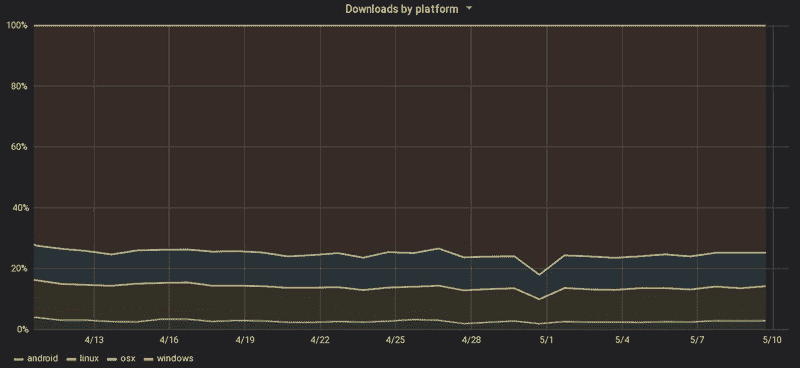

图 9. 在 itch.io 上，Linux 的下载量占总数的 12%。

### 未来将如何？

如果你渴望开始为 Linux 开发游戏，现在是最好的时机，工具从对学者友好的文字游戏制作器`Twine`到功能完整的集成开发环境（如`Unity`和`Unreal Engine`）应。两者都支持丰富的第三方资产和插件，帮助你制作从点击冒险游戏到现代第一人称射击游戏的任何内容。

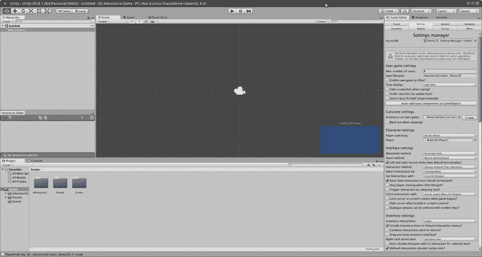

图 10. `Unity`游戏引擎是我采访过的大多数 Linux 游戏程序员的首选开发工具。

如果 Linux 用户想要有更多游戏可以玩，将它们加入你的愿望清单非常重要——这会影响`Steam`上预发布游戏的可见度——并且购买它们。具体来说，请从你的 Linux 系统中购买，因为许多发行平台会记录你购买时使用的操作系统。

通过提交错误报告和合理的功能请求来帮助开发者。如果你喜欢某个 Linux 游戏，请为它留一个好评。评价会对游戏在在线商店中的可见度和评分产生真实影响，并为那些致力于支持这种目前仍处于少数游戏操作系统的开发者带来鼓励。

### 旁注：Steam 上最受欢迎的 Linux 游戏

Steam250 汇总了游戏在 Steam 上收到的好评数量，以揭示哪些标题最受玩家欢迎（来源：[`steam250.com/linux250`](https://steam250.com/linux250)).

1. `Portal 2`
2. `Terraria`
3. `Counter-Strike`
4. `Left 4 Dead 2`
5. `Factorio`
6. `Euro Truck Simulator 2`
7. `Stardew Valley`
8. `The Binding of Isaac: Rebirth`
9. `Portal`
10. `Mount & Blade: Warband`

### 资源

- [Linux 版 Unreal Engine 安装](https://docs.unrealengine.com/en-US/GettingStarted/Installation)
- [Unity Linux 构建版](https://forum.unity.com/threads/unity-on-linux-release-notes-and-known-issues.350256)
- [Yarn Spinner](https://www.secretlab.com.au/yarnspinner)
- [Twine](http://twinery.org)
- [Dear ImGui](https://github.com/ocornut/imgui)
- [FNA](https://fna-xna.github.io)
- [GameMode](https://github.com/FeralInteractive/gamemode)
- [SteamOS](https://store.steampowered.com/steamos)

# 想玩 Linux 游戏吗？

## 几款原生 Linux 游戏。作者：Marcel Gagné

别担心，我并不是想让你玩`全球核战争`，因为正如我们所知，唯一的获胜方法就是不玩。而我们想玩。好了，强制性的经典电影梗就到此吧。

当然，如果你愿意安装 Steam，Linux 平台有海量的游戏。但为了这篇文章，我想向你展示一些可以在 Linux 上原生运行的游戏——不需要启动 Java 就能在你的`Ubuntu`、`Fedora`或`Debian`或你任何个人的 Linux 发行版上玩游戏。

我还想避开那些经典作品。没错，我知道[`Frozen Bubble`](http://www.frozen-bubble.org)非常棒，而且一直如此。`SuperTux`或[`SuperTuxKart`](https://www.supertuxkart.net/Main_Page)也是如此。它们都非常出色，如果你不知道这些游戏，读完这篇文章后务必去看看。事实上，如果你打开发行版的软件中心并搜索仓库，你会发现很多游戏。我正在一台运行`Kubuntu 18.04`的电脑上写这篇文章，默认软件中心[`Discover`](https://userbase.kde.org/Discover)有专门的游戏板块（图 1）。

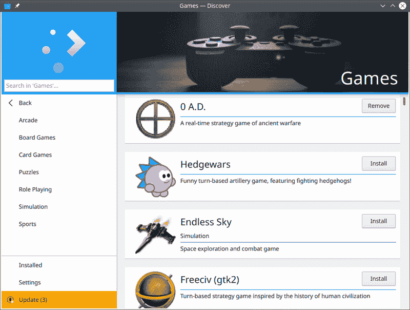

图 1. Discover 是 Kubuntu 和 Plasma 的默认软件中心。

尽管如此，我想带你离开经典游戏的舒适区，向你展示你可能没有考虑过的东西。简而言之，如果你渴望尝试新事物，我可能正好有一种让你满足这种渴望。在寻找优秀的游戏点子时，我开始在网络上搜索最近几天或几周内可能错过的任何内容。我发现的很多内容要么是老经典（嘿，`Frozen Bubble`），要么是 Steam。然后，我不偶然发现了[`itch.io`](https://itch.io)，这是一个我以前似乎完全忽略的地方。

这里是简要介绍。`itch.io`是一个独立游戏设计师向公众分享他们热爱的网站。你可以下载游戏，根据自己的意愿（或负担能力）进行付费，并在游戏完善过程中与开发者交流。对于任何在开源世界呆过足够长时间的人来说，这个网站的性质都会非常熟悉。有很多是早期发布，有些是频繁发布。因为玩家可以直接与开发者互动，你可以影响你喜爱的游戏的设计。

另一个酷的地方是，它像 Steam 一样，有一个可以下载并安装在 Linux 系统上的程序，可以作为所有游戏的商店以及跟踪、安装和运行这些游戏的地方。他们为`Ubuntu`和`Debian`衍生版维护`DEB`包，为`Red Hat/Fedora`和`openSUSE`维护`RPMs`，为`Arch Linux`发行版维护`AUR`包，甚至为`Gentoo`群体提供了支持。图 2 显示了面向 Linux 游戏的商店界面。对于 Linux 爱好者来说，这简直是一座新游戏机会的金矿。

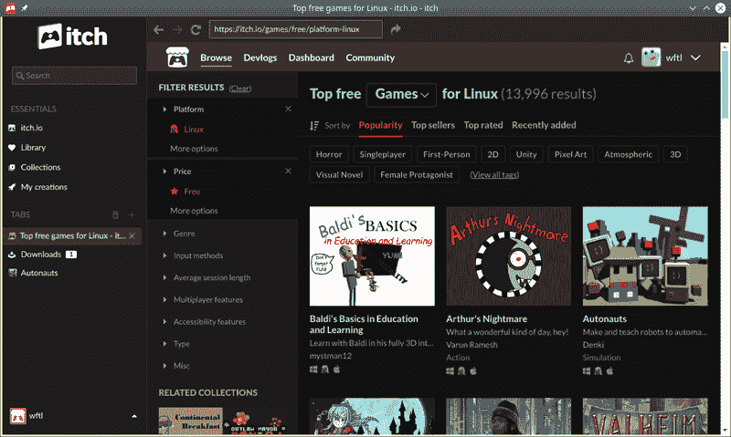

图 2. itch.io 商店与应用程序

他们利用当地资源构建基础基础设施，并在此基础上建造其他机器人。当新机器人上线时，更高级的“自动宇航员”（Autonauts）可以训练它们执行诸如收集资源和建造物品等枯燥的任务。你通过让新工人观察你并记录你的做法来实现这一点，之后他们就可以独立运行了。随着社会的演进，日益复杂的工人机器人可以执行日益复杂的任务。其核心理念是不断生产机器人，将所有可以自动化的流程自动化，最终创造出一个现代、高效的社会。

我停下游戏，和 Denki Games 的 Aaron 聊天，他是`Autonauts`的开发者。该游戏有一个 Discord 链接，你可以在那里与作者以及其他玩家聊天，我就是在那里找到 Aaron 的。我问他对 itch.io 的概念怎么看，他回答道：“我们知道 Itch 有段时间了。比起主流游戏，我更对实验性游戏感兴趣，所以在我们开始制作`Autonauts`之前就已经遇到它了。”

当我告诉他这让我想起了 Steam 商店和前端应用时，他说：“我觉得这个类比很。对我们来说，它允许我们实验自己的想法，而不会受到 Steam 抢先体验那种严苛、批判性的聚光灯的影响。在 Itch 上人们要宽容得多:-)”

现实主义固然很好但我不需要我的战争游戏闻起来有汗水混合着血和泥土的味道。这就是为什么我喜欢[`Attack On Toys`](https://n7t.itch.io/attack-on-toys)，这是一款第三人称射击的战争游戏，你与塑料玩具士兵战斗。你指挥绿军对抗黄军。由于你需要在每场战斗前布置防御设施，因此这涉及到策略，而不仅仅是射击并听天命。你可以乘坐不同的车辆（包括飞机），并使用不同的武器。敌人还有一个巨大的机械士兵/机器人需要你击败。行动发生在一个大房间里，跨越桌椅和书架（图 7）。如果你和我一样，内心仍然只有六岁，那这游戏真的非常酷。


图 7. 在`Attack on Toys`中飞向云霄。

然后是[`Naufrage`](https://thomasda.itch.io/naufrage)，这是一个没有规则的奇诡冒险游戏。游戏开始时，你向街机投了一枚硬币，突然你便跟着硬币掉落了一座神秘的岛屿。你前方是一个被黑暗笼罩的寂静游乐园，一个寂静的摩轮向你招手（图 8）。当你探索这个地方时，很快发现你并不孤单，尽管你是独自徘徊。一段奇妙诡异的配乐伴随着你破解谜题、阅读加密信息并遵循那些往往毫无帮助的标志。坦率说，很难解释`Naufrage`——一个法语单词，意为“船难”——但穿越和环绕这座岛屿的平静而充满预兆的旅程绝对值得。


图 8. `Naufrage`的神秘岛屿世界

我喜欢`Naufrage`的地方在于它几乎完全没有规则。使用方向方向键或经典的`WASD`移动以及`spacebar`跳跃，整个游戏的意义就在于你边走边摸索。

尽管我很享受这种体验，但它确实让我思考其中一些游戏的商业可能性。就像过去和现在的许多开源项目（但主要是过去的）一样，itch.io 上的游戏似乎设计是为了满足开发者的兴趣（scratch an itch）。无论游戏是否会让某人发富——我遇到的大部分内容似乎源于这样一种想法：那种从内在创作源产生某物的欲望，动力源于在世界上某处会有其他的志同道合者喜欢它。

你会发现，该网站的独立性和实验性意味着你会在你的 Linux 系统上找到在其他任何地方都找不到的游戏。你准备好每小时赚 7.50 美元了吗？实际上与其他员工为了晋升而争斗，结果却要面对一个恰好就是你老板的老板？试试[`Minimum WRage`](https://an-studios.itch.io/minimum-wrage)。或者一个关于女女孩打棒球并学习爱情的互动故事[`Butterfly Soup`](https://brianna-lei.itch.io/butterfly-soup))怎么样？又或者是土刺蚁卡通 Arthur 的恐怖版[`Arthur's Nightmare`](https://varunramesh.itch.io/arthurs-nightmare))？还有一个怪异的游戏将你带入一个 M.C. 埃舍建筑的奇异世界去发现……谁知道什么[`Fragments of Euclid`](https://nusan.itch.io/fragments-of-euclid))。如果你只想发泄一下压力，可以选择许多第一人称射击游戏之一，如[`Rexuiz`](https://rexuiz.itch.io/rexuiz-fps)，并尽力活过几秒。

选择非常多，我觉得我只是触及了冰山一角。有些很愚蠢且纯粹有趣，另一些会让你心跳加速。那里还有一些相当令人不安且偶尔令人恐惧的作品，所以在在安装任何东西之前，务必阅读描述——除非你是那些无所畏惧的者之一。另一个惊喜（至少对我来说是）是大量的像[`The Blind Griffin`](https://asphodelquartet.itch.io/blind-griffin)这样的乙女游戏。

让我先简要回顾一下工具辅助速通（Tool-Assisted Speedruns）的历史。那是 2003 年，不到一半的发达国家能够接入互联网，YouTube 也尚未诞生。手机非常稀有且处于起步阶段。奔腾 III 处理器仍然很常见，内存以兆字节为单位。正是在那个原始时代，一个有趣的视频文件在网络上流传——这是一个只有 18MB 的.wmv 文件，仅被标记为“超级马里奥 3 时间挑战视频”（原文如此）。随后出现的是一个名为 Morimoto 的人完成的绝对疯狂的 11 分钟游戏全程，充满了惊险时刻、零死亡，而且马里奥在显而易见地获得 99 命后摧毁了巴塞尔。唯一的背景是一个指向日语页面的链接，而那个时代 Windows Media Video 格式标志性的粗糙编码，使得普通观众很难观察到这是模拟器录制，而非真实的任天堂娱乐系统（NES）控制机的输出。


图 1。Morimoto 的 2003 年《超级马里奥兄弟 3》（SMB3）时间挑战视频

该视频实际上是使用 Famtasia NES 模拟器制作的，并使用了工具辅助速通（TAS）录制工具。这些工具包括一个记录所有按键序列的“电影文件”，以及使用存档状态（savestates）或 CPU 和内存快照，允许返回到之前的状态。Morimoto 本质上通过使用工具增强了他的人类技能，这些工具允许他在对自己的操作质量不满意的任何时候都返回到之前的存档点。通过反复备份并只保留最佳结果，他创造了当时他认为的完美游戏通关。当我第一次看到这段通关时，对它是如何制作的一无所知，但它让我大开眼界，并让我产生了许多找不到答案的问题。

人类速通社区的成员们自然对他们所看到的这种“未标记的丑恶”感到非常愤然，这就像是允许一名服用药物的运动员参加奥运会一样。他们的观点是，任何某种方式增强人类原始能力的行为（即使是 PC 游戏中那种基础的键盘宏）都会被视为作弊，而 Morimoto 的通关不过是一场最好被忽略的欺骗。这其中充满了着迷、好奇和分歧。回想起来，这正是创建一个新网站的完美配方。

一位名为 Bisqwit 的勤奋观众对 Morimoto 的 SMB3 通关留下了深刻印象，并在 2003 年年底创立了最终成为[TASVideos.org](http://tasvideos.org)的网站。他致力于通过在所有工具辅助的游戏录制中提供免责声明，尽可能让人类速通社区感到平复，以确保随后的观众知道展示的并非纯的人类技能。他通过一个[历史复兴项目](http://tasvideos.org/SiteHistory.html)为[Morimoto 的通关](http://tasvideos.org/668M.html)提供了背景。

其他人很快加入了他，一个繁荣的社区围绕着超完美操作（superplays）和速通的创建，以及各种工具的创建建立，如帧进和嵌入式 Lua 模拟器脚本，以进一步实现无错误的“完美”输入。该网站还增加了一些受[Doom Done Quick](https://web.archive.org/web/20060616200354/http://qdq.planetquake.gamespy.com:80/ddq.html)启发的早期 TAS 通关，这些通关将分段的《Doom》速通推向了前所未有的极端，让远早于 Morimoto SMB3 通关的 TAS 内容得以面世。

我是早早看到 Morimoto 的 SMB3 通关的许多人之一，随后我立刻把它抛在脑后，直到 TASVideos 的规模增长到 2006 年左右引起了我的注意。到 2008 年，我以 dwangoAC 的身份加入了该网站，提交了我首次使用兼容 Linux 的 FCEUX NES 模拟器完成 NES 弹球模拟游戏《High Speed》的 TAS 尝试。我见证了这一切，因为 TAS 已成为一种独特的艺术形式，锚定在[TASVideos.org](http://tasvideos.org)，并由高度组织化的裁判员、发布者（视频编码员）和模拟器代码编写者组成。此后 TASVideos 已成熟为 TAS 内容的事实仓库，现在托管了跨多个游戏平台的大量 TAS 视频。

### 自动乐器：一段前期的插曲

我想稍微退一步，聊一点历史。几个世纪前，不可思议的发明家开始创造第一批自动乐器，使用带有钉子的大鼓（类似于巨大的八音乐盒），以及更复杂的设备，通过空气穿过在纸板、纸甚至金属片上钻孔来驱动风琴。无论机制如何，最终结果都是一个预先的音符序列，可以以确定的方式播放，这种艺术形式在 1920 年代被广泛采用。当时存在一个整个钢琴卷制造商行业，他们对家用自动钢琴有或多同的标准钢琴卷格式。


图 2. 西班牙马里德的 Aeolian 公司卷库，约 1918 年；图片来源：[pianola.org](http://www.pianola.org/history/history_rolls.cfm)

有些钢琴卷是通过让一位著名的钢琴家坐在一台复制钢琴上制作的，这种钢琴会忠实地记录每一个音（无论好坏），通常是在钢琴家演奏时实时在纸卷上冲出孔或打孔。最终，在几次尝试后，钢琴家的结果就会令人满意，钢琴卷就会被复制并卖给客户，让他们在自家的钢琴上播放。现代游戏的等效行为就是人类速通者录制他们的单段尝试并发布他们的最佳结果。

其他编曲好的音乐是手工艰难地制作的，通过阅读原始曲谱并逐个打孔，同时补偿诸如节奏的变化，以及由于钢琴卷直径收缩导致纸张移动速度随着乐曲的播放而变化等因素。我会将此等同于制作一个普通的 TAS。在某个点，某个制作这些预设编曲的人可能拼凑出键盘上有 88 个键，但人类只有 10 根手指，并此推断出既然钢琴卷本来就不是为人类设计的，那么增加几个额外的键来给乐曲增加一些冲击力也无妨。这种逻辑上的最终结果在几十年后现在被称为[黑 MIDI 乐曲](https://en.wikipedia.org/wiki/Black_MIDI)，那是另一一天的话题。要点是，如果你把人类的局限性排除在考虑，你可以在许多艺术形式中做一些有趣的事情。

### 回放设备的黎明

随着 PC 配置逐几年提升，利用增加的资源来提高模拟准确性变得可能，而又不会让模拟器变得无法忍受地缓慢。这使得一个更雄心勃勃的概念形成：获取一个 TAS 电影文件并强迫一台原始未修改的主机以相同的方式运行。这一壮举依赖于对主机每个组件极其精确的模拟，包括任何基于卡带的内存映射器和扩展芯片。理论上，如果一个模拟器能够足够准确地步进整个系统的执行和相互依赖关系，那么在逻辑上就有可能向真实主机提供相同的按键序列并实现相同的结果。这种确定性行为即使对于那些看起来包含随机性的游戏来说也是可行的，因为许多主机不包含外部熵源，并依赖于玩家输入作为伪随机数生成器的唯一种子——这意味着从开机开始顺序发送的给定按键序列每次都会产生相同的游戏状态。

这个想法最早在[2006 年提出](http://tasvideos.org/forum/t/4288)，但直到 2009 年，一位名为 true 的 TASVideos 用户才开始制作一种设备，通过控制器端口向 NES 发送预录的输入信号。同年，一位名为 Jaku 的黑客独立创建了一个设备，能够在回放[SMB1 的整个第一关卡](https://www.youtube.com/watch?v=f_Pr__d58f4)，而这在 TASVideos 社区是无人为人知的。最终在 2011 年，得益于`FCEUX`模拟器的准确性提升，micro500 成功完成了 SMB1 的完整通关验证，并创建了一份[关于如何构建他的 NESBot 的 Instructables 指南](http://www.instructables.com/id/NESBot-Arduino-Powered-Robot-beating-Super-Mario-)。DarkKobold 遵循 micro500 的指南制作了自己的设备，并在 2011 年的 SGDQ 上公开播放了`SMB2`和`Wizards and Warriors 3`（稍后会详细介绍）。到年底，SoulCal 创建了一个名为`Droid64`的回放设备，能够回放 N64 游戏`Super Mario 64`的全 120 星通关。

从 2011 年起，使用回放设备在原始硬件上回放 TAS 电影文件的兴趣日益增加，并被称为“主机验证”（console verification），但只有少数创作者拥有必要的回放设备硬件。TASVideos 更新了一个特殊类别，用以标记那些通过拍摄实机回放运行的视频作为证明的主机验证运行目目。GhostSonic 调整了他的回放设备使其适用于世嘉五代机（Sega Genesis），后来 endrift 使用 Gamecube 的 Game Boy Player 创建了一台 Game Boy Advance 设备。尽管这些领域都取得了进展，但“输入可以发送到主机”这一概念在 TASVideos 之外通常并不广为人知。

### 为慈善游戏

随着时间的推移，[SpeedDemosArchive.com](http://SpeedDemosArchive.com)（简称 SDA）成为了记录人类视频游戏速通尝试最常用的网站。几位 SDA 用户决定在 2010 年的一场名为 Classic Games Done Quick（致敬早期的 Doom Done Quick 命名）的 24/7 马拉松活动中举行慈善募款，速通手们将不停地一个接一个完成游戏。该活动取得了成功，为 CARE 组织筹集了超过 10,000 美元。组织者随后成立了一系列在[GamesDoneQuick.com](https://gamesdonequick.com)举办两次、日益成功的周马拉松活动，主要为无国界医生和癌症预防基金会捐款，最终在知名度上似乎已经掩盖了 SDA。

当 DarkKobold 在 2011 年夏季 Games Done Quick (SGDQ) 使用`NESBot`时，这些活动仍然在其中一位组织者的地下室举行，但到 2014 年冬季 Awesome Games Done Quick (AGDQ) 马拉松活动筹备时，活动规模已经大幅增加，数百名参与者在越来越大的酒店宴会厅内观看运行目。正是在那时，我开始对参加活动感兴趣，但我并不满足于仅仅观。我想以某种方式参与进来。许多其他人也有同样的想法，很显然，只有最有趣或执行最好的运行目才有机会加入。出于某种原因，起初我并没有想过做 TAS 相关的内容（令人尴尬的是，我曾短暂闪过要做游戏`Scribblenauts Unlimited`速通的想法，直到我很快发现如果不经过大量练习，我缺乏所需的技能，但我偏题了）。

最终我清醒了过来，想起了我的 TAS 根，并自愿在活动中展示 TAS 回放。尽管来自一些资深 SDA 成员的反对意见（他们仍然对 Morimoto 冲突感到不悦），但整体反应是积极的。最终，TAS 提交被接纳，并在马拉松日程中分配了 30 分钟的时间。

### 与主机对话（并希望它回话）

当我提交 AGDQ 2014 TAS 回放申请时，我起初并不确定是否能完成这些运行目的主机验证。当时，我没有任何硬件且经验有限，要熟悉从示波器到移位寄存器的一切知识，是一条令人生畏畏的学习曲线。我从一位同事那里借了一个`Arduino`，开始尝试根据 micro500 的 Instructables 指南构建我自己的`NESBot`。虽然我在技术上成功了（意味着我能够回放一次`Tetris`运行），但我很快意识到，我用旧面包板上那些杂乱零件进行的业余尝试是非常脆弱的。在思考如何才能让设备在飞机飞行中完好无损后，做出了明智的决定：放弃该设计。


图 3。脆弱一词无法描述 SD 卡引脚连接。

我的下一次尝试在理论上从接线角度将简单得多，只需使用`Raspberry Pi 1 Model B`上的`GPIO`引脚配合一些电阻，使其处理来自主机的`5v`电压。没过多久，我就知道自己需要帮助，部分是因为我在电气工程方面超出了能力范围。像 zid 这样的人在长时间的故障排除过程中帮助了我，但在之前，他们必须耐心地帮助我建立关于控制器输入究竟如何工作的心理模型。

我小时候，我很困惑 NES 控制器是如何工作的。我注意到控制器上有八个按钮，但在形状奇特的 NES 连接器上只看到七个引脚，我假设每个按钮都需要一根单独的线。在 Atari 和类似的控制机上，早期设计正是这样做的，但随着控制器上的按钮越来越多，使用可以并行采集所有按钮但通过单条串行数据线向主机发送数据的移位寄存器来降低布线成本变得合理。

在 NES、SNES 或任何类似的串行控制器读取机从普通控制器读取玩家输入的过程如下：首先，考虑玩家正按下一个或多个按钮的情况——假设按下的是“右”和 B 键（为了正义向右跑）。游戏向控制器发送一个锁存信号，实际上告诉它准备好被读取，然后发送一个时钟线信号，此时在约定顺序中第一个按钮的状态将通过串行数据线从控制器返回到主机；假设是 A 按钮。由于该按钮未被按下，通过保持线路高电平回传一个二进制 0（NES 上的逻辑是反的）。该过程对每个按钮重复进行，在这种情况下，“右”和 B 将在相应的时钟后通过保持串行线低电平作为 1 发回。所有这些单独的按钮按下最终将存储在内存中的一个字节（对于 SNES 来说是两个字节）中，以供游戏操作。这些都相对直观，但挑战在于，虽然锁存之间的时间通常以毫秒计，但每个时钟脉冲之间的时间可能在纳秒级。

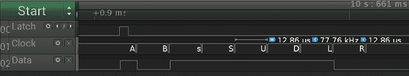

图 4。锁存、脉冲（时钟）和数据线示例

回到那台糟糕的树莓派——在纳秒级进行`GPIO`轮询并不是它的强项。我们很快发现它会频繁错过时钟信号，有时甚至会导致信号锁定，这是由于 Linux 内核对[GPIO 引脚的轮询频率不足](http://tasvideos.org/forum/viewtopic.php?p=355441#355441)。那时我已是[北湾 Linux 用户组](http://nblug.org)的主席，我想要尽可能地代表 Linux，因此我极力寻找一种将其整合进去的方法。解决方案是使用一种由 true 设计的设备，他将这台设备命名为他的 NES/SNES 重放设备，用于缓冲控制器输入，从而允许树莓派以一种更易实现的速率发送串行数据。这两块电路板安装在一个 R.O.B. 机器人上的融合激发了我的灵感，让我将整个东西称为[ROBBerry Pi](http://tasvideos.org/forum/p/361685#361685)，但这个名字并没有维持多久。可能是因为我那个（回想起来）有些糟糕的名字，多个社区成员汇聚成了“TASBot”这个名字，并一直流传了下来。现在我认为自己是[TASBot](http://TASBot.net)的守护者，这是一个拥有独特个性的独特个体，他使用各种重放设备来参与他最喜欢的爱好：以超人类的速度横扫游戏。


图 5. 乐高时代之前的早期 TASBot

### 贪吃蛇、弹球与 ACE

在 TASBot 亮相 2014 年 AGDQ 秀中，我们从 NES 游戏《急流篇》（*Gradius*）开始，但在运行一分钟后它就不同步了。不同步就像是在自动钢琴上回放时纸卷卡住或撕裂一样；琴谱仍在旋转，但你通常可以确定它不会产生任何正常的结果。在《急流篇》的案例中，输入信号与此时所需的游戏状态不同步，导致角色瞬间被火山杀死。我们心不不不愿地放下了《急流篇》，转而进行由 Weatherton 和 micro500 领导的《马里欧赛车 64》TAS 重放，这次重放完美无缺，恢复了我们的信心。

2014 年 AGDQ 最引人注目的作品是《超级马里欧世界》。Masterjun 在此之前不久发现了[《超级马里欧世界》中的一个任意代码执行 (ACE) 漏洞](http://tasvideos.org/2513M.html)，这允许他使用人类无法实现的技术对游戏进行完全控制，就像那些需要十多根手指才能弹出的琴谱作品一样。起初，我们只是想用它直接跳到结束字幕，但在我们参加活动环节开始前的几个小时里，他成功实现了更有趣的操作：导致游戏出现故障、进入黑屏，然后突然开始用马里欧的头玩《弹球》（*Pong*）。之后是经典游戏《贪吃蛇》的实现。我们甚至交出控制器让真人来操作，以证明这不是骗术。

该活动产生的累计影响超出了我们所有的预期。包括*ExtremeTech*在内的媒体机构，尤其是*Ars Technica*的 Kyle Orland 报道了这些利用，数十万人在事后在 YouTube 上观看了这些胡作剧。在随后的八场 GDQ 活动和几次辅助登场中，TASBot 反复展示了黑客、程序员以及 Ilari、p4plus2、total、Lord Tom 等许多天才大脑的惊人天赋。GDQ 活动中的 TAS 内容保守估计已为慈善筹集了超过 40 万美元，而 GDQ 活动本身则已为慈善筹集了超过 1600 万美元，且单场活动经常突破 200 万美元，直播观看人数经常超过 20 万人。多种新的重放设备也相继问世，如 true 独特的独立多重放设备、micro500 的`TASLink 4-port`及其极其强大的设备，以及 total 基于`PSoC5`的高数据率设备。


图 6. 在 micro500 的 TASLink 板帮助下工作的 TASBot，由 dwangoAC 提供

个人而言，TASVideos 网站的员工（包括 Nach 和 Mothrayas）邀请我加入他们，我以官方 TASVideos 大使的身份入职。在 Ange Albertini 提供的图形帮助下，我在 DEFCON、GeekPwn、Thotcon 等会议上展示了我们的工作成果，并演示了如何利用 TAS 技术搜寻游戏漏洞来帮助教授逆向工程技能。

### TASBot 的多种玩法

我对我曾领导过的团队所取得的成就仍然感到震惊。我可能是主要的组织者和演讲者，但如果没有庞大团队的才华和动力，我们所做的都不可能实现。[TASBot.net](http://TASBot.net)有一个完整的列表，你可以在那里看到一些疯狂的内容：

- 使用 micro500 的`TASLink 4-port`重放设备，用相同的按键序列同时击败《超级马里欧兄弟》1、2、3 以及《困难关卡》（*Lost Levels*）。
- 得益于 p4plus2 构思并执行的极具灵性的设置，《超级马里欧兄弟》在《超级马里欧世界》**内部**中运行。
- micro500 的《脑力锻炼》，包含：
- 《宝可梦对战》（*Pokemon Plays*）
- *Sk'Hype*
- 《宝可梦红》（*Pokemon Red*）
- 但是……Linux？

### 关键在于线缆

所以，如果你有自虐倾向，你可能会问自己是否能在家里做到。在某种意义上，答案是相当肯定的，因为有几种参考设计供选择——特别是`PSoC5 DevKit`仅需 15 美元，尽管刷写 total 的固件可能很麻烦。然而，这并不是最大的问题，荣誉归属于线缆。最大的问题是，高数据率的运行需要一条甚至两条额外的 NES 或 SNES 数据线，这些线通常只用于光枪等设备，而在连接主机最简单的扩展线上并没有布置这些线。在连接器上增加额外的线出意意地困难，因为它们通常只是让控制器线保持灵活的薄箔。

即使你坚持只需要单根数据线的简单运行，要将扩展线连接到足以悬挂在面包板或直接连接到 PSoc 的物体上也需要相当精细的焊接工作。除此之外，处理主机的 5v 特性也是一个挑战。我们经常考虑过如何批量生产直接连接到 NES 或 SNES 主机的重放设备，但到目前，还不清楚这在市场上是否可行。


图 7. 你的线缆看起来可能像这样

在介绍这些背景之后，终于是时候展示一些涉及 Linux 终端的内容了。值得提到，除了一些明显的例外（例如使用 Hourglass 重录框架回放 Windows 版本的 VVVVVV），每场 GDQ 活动都主要由 Linux 驱动。某些运行使用 Linux 的方式与第一次《急流篇》运行相同，仅作为将存储在 Linux 设备上的数据流推送到 USB 连接的串行接口的方法，但某些有效负载执行了远极端的事情。

有一种特殊的设置可以将一台未经修改的 SNES 推向极限界——一个全 16 位 32kHz 立体声音频播放器，我将其命名为`JukeSNES`，它是由 total 完全利用了他之前大量黑客的想法和代码片段创建的。如果你想在家里也尝试，你需要一份相当令人生畏的设备清单，包括一台 SNES、一份《超级马里奥世界》（`Super Mario World`）、连接到两个控制器端口的所有根数据线，以及一个足够快以处理数据速率的设备（如 total 设计的`PSoC5`）。

下列出的所有脚本和代码都可以在这个[GitHub 仓库](https://github.com/dwangoac/snes-pcm-streaming)中找到。在断电状态且`SMW`卡带上没有存档的情况下连接好所有设备，运行`python3 play_r16y.py /dev/ttyACM0 smw_stereo_pcm_v6.r16m`。脚本的第一个参数是播放设备连接的串行接口，第二个参数是包含要发送的数据位流的文件，该文件由需要发送到主机的原始位字符串组成。（顺带提一下，为每个模拟器单独编写了特定的“转储脚本”来创建这些位流文件，但文件本身不包含关于存在多少个控制器的元数据，因此一直希望能有人站出来创建一个头文件格式。）

一旦一切都准备就绪并连接，下一步是开启主机电源。如果一切顺利，游戏将启动，马里奥会在第一关看起来做一些非常奇怪且随机的动作，最终触发一个错误，导致屏幕变为静态视图，并显示关于播放音频的文本。下一步是发布类似下面的命令：

```


```bash
ffmpeg -i http://radiotasbot.com:9989/ocremix" -hide_banner \
-v quiet -f s16le -ac 2 -ar 32000 -acodec pcm_s16le - \
./tasbot_stream_snes_stereo16.py
```

其中 `-i` 之后的部分可以是任何 `ffmpeg` 源。这里有很多细节需要解释，但本质上发生的是 `ffmpeg` 正在处理音频数据以使用立体声、16 位、32kHz 的原始 PCM 音频，这些数据被馈到流脚本中，然后脚本将数据重新排列为播放设备所需的精确位流格式。结果是动听的音频，它榨了那台可怜 SNES 的每一个时钟周期。我个人在 Twitch 上直播时，会借助 `MediaMagnet` 使用该设备播放背景音乐，纯粹是为了极客风范，但即使我承认这复杂得离谱。

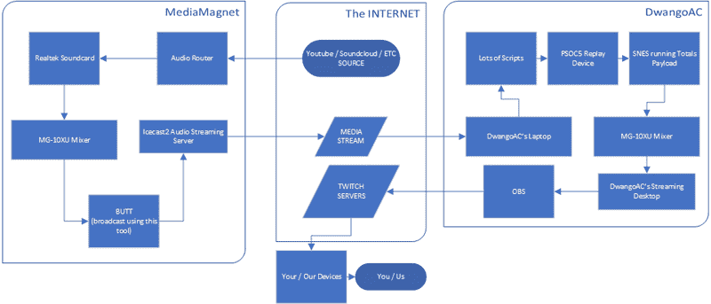

图 8\. 既然可以让它极其复杂，为什么还要保持音频路由简单呢？

## 从此开始的 TAS 之旅

到达这一点的道路很漫长。曾经经历过志愿者痛苦的流失。有些时候，我们无法让某个想法付诸现实（《大金刚王国》，我是在看着你们呢）。我个人做了一些现在后悔的领导决定。尽管经历了所有的失误、不同步的运行和拙劣的表现，我对团队所做的一切感到自豪。

现在的处理器足够快，可以模拟像 Wii 这样新的主机，使用了[兼容 Linux 的 Wii 和 GameCube Dolphin 模拟器](https://dolphin-emu.org)，因此 2018 年的 GDQ 活动已经出现了 TASBot 玩 GameCube 游戏。神奇的是，在我开始写这篇文章之后，一个由 Clement Gallet 创建的名为 `libTAS` 的新 Linux SDL 重录框架被了，使得在 Linux 中直接 TAS 复杂的 OpenGL 游戏成为可能。我对 TASVideos 新提交作品中展现出的完美主义水平感到惊讶。Freenode IRC 上 `#tasbot` 的活跃社区以及在 `Discord.TASBot.net` 的桥接社区，以及我自己的 `Twitch.tv/dwangoAC` Twitch 直播，已经发展了一个了人的例子：一群共同愿景的优秀人才——即使用 TAS 内容为慈善事业筹资金。能够成为比我伟大的事物的一部分是我个人的幸运，而这涉及到我最喜欢的两件事：视频游戏和 Linux，简直是绝对的快乐。

### 资源

- [TASVideos.org](http://tasvideos.org)
- [Morimoto's Run](http://tasvideos.org/668M.html)
- [TASVideos Official Site History](http://tasvideos.org/SiteHistory.html)
- [Doom Done Quick](https://web.archive.org/web/20060616200354/http://qdq.planetquake.gamespy.com:80/ddq.html)
- [Black MIDI](https://en.wikipedia.org/wiki/Black_MIDI)
- [jaku@hax.by 在 BS2 上玩的《超级马兄弟》YouTube 视频](https://www.youtube.com/watch?v=f_Pr__d58f4)
- [Instructables Guide for NESBot: Arduino Powered Robot Beating Super Mario Bros for the NES](http://www.instructables.com/id/NESBot-Arduino-Powered-Robot-beating-Super-Mario-)
- [SpeedDemosArchive.com](http://SpeedDemosArchive.com)
- [GamesDoneQuick.com](https://gamesdonequick.com)
- [TASBot.net](http://TASBot.net)
- [SMW 中的任意代码执行（ACE）错误](http://tasvideos.org/2513M.html)
- [GitHub Repository: snes-pcm-streaming — 通过控制器端口向 SNES 流传输高质量 PCM 音频的工具和代码](https://github.com/dwangoac/snes-pcm-streaming)
- [兼容 Linux 的 Wii 和 GameCube Dolphin 模拟器](https://dolphin-emu.org)
- [libTAS, Created by Clement Gallet](https://github.com/clementgallet/libTAS)
- [`Discord.TASBot.net`](http://Discord.TASBot.net)
- [作者的 Twitch 直播：http://Twitch.tv/dwangoAC](http://Twitch.tv/dwangoAC)

# 评测：《不列颠的王座》

## 从游戏的角度看这款游戏

回到公元 878 年（如果你喜欢的话用 AD），不列颠群岛和英格兰比我们今天看到的要精彩得多，如果你喜欢那些穿着盔甲、为了上帝和荣耀战斗的历史剧的话。在那年的 1 月，维京入侵了奇普汉（Chippham），那里位于巴斯和布里斯托的东北部。撒克逊人国王阿尔弗雷德大帝措手不及，撤退并从索珀塞郡、威尔特郡和汉普郡郡召集援兵。5 月，阿尔弗雷德的联结军在埃丁顿（Edington，曾名埃瑟丹）会合了古特鲁姆国王的军队。简而言之，英国人赢了，维京人输了，剩下的正如他们所说的，都是历史了。

虚构作品的酷处在于，尤其是视频游戏，你可以选取这样一个历史关键时期，并重新想象如果维京人赢了会怎样。或者也许某个郡的领主认为这是一个除掉阿尔弗雷德的好机会，与其他郡和地区达成私下交易，甚至与维京人交易，那么我们今天的英国会有很大不同。

《总战争传奇：不列颠的王座》由 Creative Assembly 和 SEGA 开发，并由 Feral Interactive（为我们带来了游戏的 Linux 版本）推出，让我们设想这些场景并改写历史。这款游戏要求加入几个派系之一（英国人、威尔士人甚至是维京人），并以此建立你的帝国（图 1）。每个派系都有自己的区域优势、目标、特征和部队。没有哪个派系相对于其他派具有决定性优势，所以花时间研究每个派系看看哪个最适合你。到目前为止，我玩了威尔士和盖尔王国。


图 1\. 选择你的派系。

作者 Marcel Gagné

游戏的大部分内容涉及规划、研究、成长和扩张你的力量，以应对不可避免的战斗。你起步时只有极小小的力量，必须随着时间的推移缓慢地建立它。在此期间，你还要处理该地区的政治问题、安抚地区领袖、养活民众、获取资源、维持经济运转，并几乎处理任何涉及新生国家发展的事务。当你忙于所有这些事情时，你需要弄清楚如何建立起那种力量，让你能够对这个并不有趣的古老英格兰实施决定性的控制。

游戏在极其细节精美的不列颠颠群岛地图（图 2）上进行，景观上可以看到城市和城镇。你的视角是俯视的，但你可以放大、缩小、平移，甚至可以降落到地面高度，这在实际战斗时用起来非常酷。整个这种设计营造了一种场所感，增强了游戏的沉浸体验。


图 2\. 细节丰富的景观与海景

最后是战斗部分。如果我还没有说清楚，这是一场历史战斗模拟。你不会发现魔法师向敌阵线发射神秘闪电，也不会有高耸的英雄用他们巨大的脚趾踩碎普通军队。这是一个缓慢的磨合过程：招募士兵、成长和照顾你的民众，确保他们不会饿死，并让他们保持开心，以免他们在局势变得艰难之前就叛变并逃跑。

然后，在战场上，一切都是策略、时机和一点运气。更大的军队并不能立即保证你的胜利。你选择并控制单个战斗小组，将他们引向敌阵线，并实时修改你的策略。平移、旋转甚至降落到地面高度，以尽可能贴近行动（图 3）。


图 3\. 战场上的近距离观察

游戏通过战役模式进行——包括单人模式和与其他玩家对战。如果你不想等待，游戏确实有一个“快速战斗”模式，让你与游戏的 AI 进行对决。

### 技术细节

游戏将受益于性能良好的加速显卡，并且可能使用制造商的专用驱动程序效果最好，但即使在我的 Acer 笔记本电脑上（Core i5，12GB 内存和 GeForce 940MX 显卡，运行 Kubuntu 18.04），它的性能也足够出色。然而，每当游戏启动时，我都会收到潜在性能问题的警告（图 4）。为了缓解潜在的延迟，游戏提供了许多选项和调整，因此很有可能它对你来说也能运行得很好。

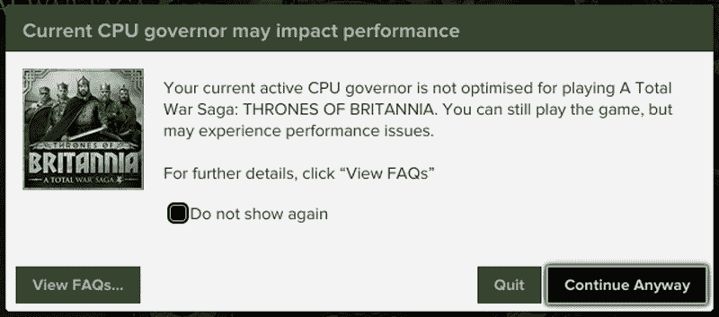

图 4\. 警告！Marcel 运行的是次标准硬件。

我可能还应该提到，游戏的 Linux 版本可以通过 Steam 商店获取，因此你需要安装并运行 Steam 引擎。幸运的是，这对于大多数现代 Linux 发行版来说并不是什么问题——例如，Steam 就在 Ubuntu 的存储库中。我曾在 Fedora、Arch、openSUSE 以及其他系统上玩过 Steam 游戏。

### 总结

《不列颠之王》（Thrones of Britannia）有很多优点。它复杂、细节精美且完全沉浸式，将你直接投入战斗中心，你可以看到自己的策略如何执行。遗憾的是，至少对我来说，这种感觉似乎是问题的一部分。尽管具有历史深度和丰富的细节，但游戏性的体验感觉很缓慢且枯燥。我一次又发现自己回到“快速战斗”模式，以便在无需所有等待的情况下磨练我的技巧。

对于致力于写实主义、战术和埋头策略的《全战争》（Total War）粉丝来说，这款游戏无疑提供了更多内容。这是一个给思考型玩家的游戏，而不是那种为了快速小战或为了放松而派遣几个维京人就开启的游戏。如果你在玩这款游戏之前玩过《全战争》系列的游戏，那也会有所帮助，因为作为一个起点，我只想说，“令望而畏”可能是描述等待着你面临的挑战的一个好词汇。这里有很多东西，而且有一条巨大的学习曲线。《不列颠之王》令人印象深刻，但它可能并不适合所有人。

### 资源

- [Feral Interactive 提供的不列颠之王（Thrones of Britannia）](https://www.feralinteractive.com/en/games/thronesofbritanniatw)
- [来自 Steam 商店的不列颠之王（Thrones of Britannia）](https://store.steampowered.com/app/712100/Total_War_Saga_Thrones_of_Britannia)


# 理解 Bash：编程元素

## 你想过为什么在 Bash 中编程如此如此的吗？

Bash 采用了与传统编程语言相同的结构；然而，在底层，逻辑是相当不同的。

作者：Vladimir Likic


Bourne-Again Shell（`Bash`）是由自由软件基金会（FSF）在 GNU 项目下开发的，这使得它在开源社区中拥有了某种相当特别的声誉。如今，`Bash` 是大多数 Linux 安装的默认用户 shell。尽管 `Bash` 只是几个广为人知的 UNIX shell 之一，但它在 Linux 中的广泛发行使其成为一个需要了解的重要工具。

UNIX shell 的主要目的是允许用户通过命令行与系统进行有效交互。一种常见的 shell 动作是调用一个可执行文件，这反过来会导致内核创建一个新进程。shell 具有机制将一个程序的输出发送到另一个程序，并具有与文件系统交互的设施。例如，用户可以遍历文件系统或将程序的输出重定向到文件。

尽管 `Bash` 主要是一个命令解释器，但它也是一门编程语言。`Bash` 支持变量、函数，并具有控制流结构，例如条件语句和循环。然而，这一切都伴随着一些怪癖。这是因为 `Bash` 试图同时履行两个角色：既是命令解释器又是一门编程语言——而这之间存在着紧张关系。

由于许多人在接触 `Bash` 之前已经具备传统编程语言的背景，`Bash` 在编程方面采取的非寻视角是许多困惑的根源，Bash 论坛上发布的许多问题证明了这一点。

在本文中，我讨论了 `Bash` 中的编程结构与传统编程语言有何不同。为了真正理解 `Bash`，了解 UNIX shell 是如何演变的很有用，因此我首先回顾了相关历史，然后介绍了几种 Bash 特性。这篇文章的大部分内容展示了 `Bash` 的不常方面源于将命令解释器功能与编程语言的能力无缝结合的需求。

### Bash 历史

“shell”一词源于 MULTICS 项目，这是马萨诸理工学院（MIT）、通用电气和贝尔电话实验室（以下简称贝尔实验室）合作开发的一个代分分共享操作系统。由于对进展不满，贝尔实验室于 1969 年退出了该项目，在 MULTICS 上工作过的贝尔实验室团队继续开发了他们自己的操作系统：UNIX。

`Bash` 的祖先是 Thompson shell，这是第一个 UNIX 命令解释器，由 Ken Thompson 在 1971 年开发。图 1 显示了第一版《UNIX 编程手册》中的摘录，它描述了 Thompson shell。

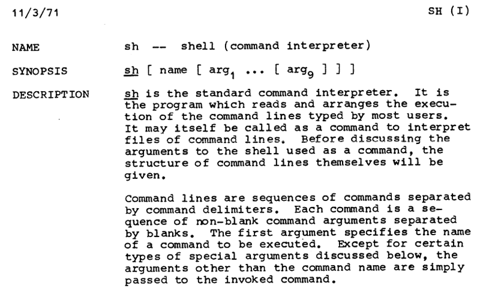

图 1\. UNIX 编程手册节选，第一版，1971 年出版，描述了原始的 Thompson Shell。

在 1973 年至 1975 年间，John R. Mashey 扩展了原始的 Thompson shell 并添加了若干编程功能，使其成为一种高级编程语言。正如 Mashey 本人所说：

> 改进旨在提高 shell 的性……并使其作为高级编程语言使用时更加方便。与许多现有 UNIX 软件的哲学一致，我们尝试仅在实际用户经验证明有必要时才添加新功能，以避免通过“功能蠕变（creeping featurism）”污染一个紧凑、优雅的系统。（出自 J. Mashey，《将命令行语言作为高级编程语言使用》，CSE '76 第 2 届国际软件工程会议论文集，1976 年。）

Stephen Bourne 于 1976 年初开始着开发一种新 shell。Bourne shell 受益于 Mashey shell 引入的概念，并带来了它自己的一些新想法。Bourne shell 在 1979 年发布的 UNIX 第 7 版中正式引入。

原始的 Thompson shell、Mashey shell 和 Bourne shell 都称为 `sh`，在 1970 年至 1976 年间，随着它们的不断完善和获得额外功能，它们相互重叠或取代。整个 1970 年代，UNIX 主要在贝尔实验室开发，同时在加州大学伯克利分校（变体 BSD）并行开发。随着 UNIX 的发展，shell 不断被开发和完善。在 Bourne shell 已经在使用时，伯克利的 Bill Joy 开发了 C shell（`csh`）。C shell 是第一个真正的替代性 UNIX shell，它被纳入了 Berkeley UNIX 的 2BSD 版本中。20 世纪 80 年代，David Korn 开发了 Korn shell（`ksh`）。与 Bourne shell 相比，C shell 强调命令解释器模式，而 Korn shell 则带有更丰富的编程功能。

贝尔实验室和伯克利的 UNIX 开发工作相互促成，两个版本后来得以合并。20 世纪 80 年代，AT&T 将 UNIX 授权给许多商业供应商，这导致了争夺 UNIX 市场主权的激烈战争。1985 年，Richard Stallman 成立了自由软件基金会（FSF），其主要倡议是构建一个可以免费使用的类 UNIX 系统，该系统不受与 UNIX 相关的知识产权问题的困扰。这就是著名的 GNU 项目（“GNU 并不是 UNIX”）。事实上，Stallman 在 1983 年 9 月向 `net.unix-wizards` 邮件列表发送的原始信中，开头的一声口号是：“自由的 Unix！”

由于没有 shell 就不可能有免费的 UNIX，因此这是 GNU 项目的首要任务。自由软件基金会第一位付费程序员 Brian Fox 于 1988 年开始编写 shell。这变成了 `Bash`，并于 1989 年首次以 beta 版发布。`Bash` 大部分是 Bourne shell 的克隆（因此被称为“Bourne-Again”），但它包含了受 C shell 和 Korn shell 启发的额外功能。Brian Fox 直到 1992 年一直是 `Bash` 的官方维护者。当时，Chet Ramey 已经参与了 `Bash` 的工作，并于 1993 年成为官方维护者。Chet Ramey 在后的 25 年里继续维护和开发 `Bash`，他至今是 `Bash` 的现任维护者。

## 同时做两件事

原始的 Thompson shell 是一个简单的命令解释器，其运行模式如下：

```bash
$ command [ arg1 ... [ argN ]
```


其中`command`是可执行文件的名称（即要执行的命令），而可选参数`arg1 ... argN`被传递给命令。Thompson shell 没有编程功能。这种情况随着 Mashey shell（以及随后的 Bourne shell）的开发而改变了。Stephen Bourne 在 1978 年发表的具有里程碑意义的论文《The UNIX Shell》中写道：

> UNIX shell 既是一种编程语言，也是一种命令语言。作为一种编程语言，它包含了控制流原语和字符串变量。作为一种命令语言，它为 UNIX 操作系统的进程相关设施提供了用户界面。（S.R Bourne，“The UNIX Shell”，*The Bell System Technical Journal*，第 56 卷第 6 期，1978 年 7-8 月。）

注意这里对不同功能的强调：编程语言和命令语言。事实上，是 Mashey 和 Bourne shell 扩展了 Thompson shell 的功能，使其了命令解释器。shell 的原始角色是命令解释器，而 shell 的编程功能是后来添加的。UNIX shell 进化出巧妙的方法，将编程功能与原始的命令解释器角色相结合。

## Bash 的运行模式

如今的`Bash`与原始的 Mashey shell 和 Bourne shell 相比更加强大。然而，shell 的目的保持完全相同。可以认为，shell 最重要的功能是运行命令（即将可执行文件提交给内核执行）。这产生了几个深远的影响。首先，`Bash`将传递给它的（几乎）任何内容视为命令。考虑以下 Bash 会话：

```
 $ VAR

bash: VAR: command not found

$ 9

bash: 9: command not found

$ 9 + 1

bash: 9: command not found

$ 
```

这显示`Bash`将输入分成若干单词，然后尝试将第一个单词作为命令执行（即单词`VAR`和`9`）。在这里，“命令”可以是 Bash 内置命令（如`cd`）、实用程序（如`/bin/ls`）或其他可执行文件。当输入字符串`9 + 1`时，`Bash`将其拆分为三个“单词”：`9`、`+`和`1`。需要注意的是，`Bash`将所有单词视为字符串，在被强制进行算术评估之前，它没有数字的概念。作为一个简化的总结，`Bash`的运行方式如下：

1. 接收输入并根据空格（空格或制表符）将其分成单词。
2. 假设第一个单词是命令。如果第一个单词之后有任何内容，它假设它们是要传递给命令的参数。
3. 尝试执行命令（如果有参数，则将其传递）。

这种观点忽略了几个中间步骤。例如，`Bash`会扫描输入行并执行各种扩展和替换。它还会检查是否存在给定名称的内置命令，如果存在则执行它。为了不忽视整体大局，我经常忽略这些细节。

因此，`Bash`最本质的目的是执行命令，这产生了一些深远的影响。值得注意的是，`Bash`中的编程构造初看起来可能像编程语言，但它们源于这种运行模式。而且，这就是本文的主题。

## Bash 内置命令 vs. 外部命令

让 Bash 新手经常感到困惑的点是 Bash 内置命令与外部命令之间的区别。在典型的 Linux/UNIX 系统上，许多常用命令既是`Bash`的内置命令，又以同名的独立可执行文件存在。示例包括`echo`（内置）和`/bin/echo`、`kill`（内置）和`/bin/kill`、`test`（内置）和`/usr/bin/test`以及更多）。考虑 Bash 内置`echo`和`/bin/echo`的行为非常相似：

```
 $ echo 'Echoed with a built-in!'

Echoed with a built-in!

$ /bin/echo 'Echoed with external program!'

Echoed with external program!

$ 
```

然而，它们也存在细微的（尝试`echo --version`）。为什么会有命令的重复？有几个原因。内置版本通常是为了性能考虑：Bash 内置命令在已经在运行的 shell 进程中执行。相比之下，执行外部实用程序涉及内核加载并执行外部二进制文件，这是一个要慢得多的过程。

在此处，很有必要注意的是，某些 shell 命令由于其本质，不能是外部实用程序（换句话说，它们必须是 shell 内置命令）。考虑更改当前工作目录的`cd`命令。外部程序无法更改 shell 的当前工作目录，因此`cd`必须是 Bash 内置命令。为什么呢？因为将命令作为外部程序调用会使 shell 成为其父进程，而子进程无法更改父进程的当前工作目录。

你也可以反过来问这个问题：“如果`echo`已经是 shell 的内置命令了，为什么还存在外部实用程序`/bin/echo`呢？”这是因为人们并不总是通过 shell 进行操作，可能需要在不通过中介 shell 进程的情况下调用`echo`。其次，从原则上讲，没有任何规定强制 UNIX shell 必须将`echo`作为内置命令，因此，拥有外部实用程序`/bin/echo`作为备选方案是重要的。

用户经常面对的一个实际问题是：你如何知道你刚刚调用的命令是 shell 内置命令还是同名的外部程序？Bash 命令`type`（它本身也是 shell 内置命令）会指示执行时将使用哪种命令。例如：

```
 $ type echo

echo is a shell builtin

$ type ls

ls is hashed (/bin/ls)

$ 
```

基本规则如下：如果存在给定名称的内置命令，则将执行它。如果不存在内置命令，Bash 将搜索外部程序，如果找到了，则执行它。如果你想确保使用某个可执行文件（该文件恰好与 shell 内置命令同名），使用完整路径调用该执行文件即可。

### 变量赋值

在 Bash 中输入命令时，Bash 期望它遇到的第一个单词是一个命令。然而，有一个例外：如果第一个单词包含`=`，Bash 将尝试执行变量赋值。例如：

```
 $ VAR=7

$ 
```

这行会将值 7 赋值给名为`VAR`的变量。要检索变量的值，你需要在变量名前面加上美元符号`$`。因此，为了查看变量的值，你可以将美元符号前缀与`echo`结合：

```
 $ echo $VAR

7

$ 
```

对于变量赋值，一个包含`=`的连续字符串是重要的。以下操作将失败：

```
 $ VAR = 1

bash: VAR: command not found

$ 
```

在这种情况下，Bash 将输入`VAR = 1`拆分为三个“单词”（`VAR`、`=`和`1`），然后尝试将第一个单词作为命令执行。这显然不是想要的结果。

### 内置变量 ?

尽管 Bash 允许你通过简单地给变量赋值来创建任意变量，但它也有许多内置变量。内置变量的一个示例是`BASHPID`。它包含了 Bash shell 本身的进程 ID：

```
 $ echo $BASHPID

2141

$ 
```

另一个内置变量（也是我在此处详尽介绍的变量）是`?`。在 Bash 会话的任何时候，该变量都包含上一个执行命令的返回值。该返回值始终是一个整数。（具体来说，这是 C 语言程序函数`main()`的返回值。注意：在任何 C 程序中，`main()`函数必须返回一个整数。）根据 UNIX 惯例，返回值 0 表示成功，任何其他值都表示失败。例如，考虑实用程序`/bin/ls`：

```
 $ touch NEWFILE

$ /bin/ls NEWFILE

NEWFILE

$ echo $?

0

$ 
```

按照惯例，实用程序`/bin/ls`在成功时返回 0，你可以通过检查`?`的值看到。如果`ls`无法执行（例如，无法访问文件），它会返回值`>0`：

```
 $ /bin/ls DOESNOTEXIST

ls: cannot access 'DOESNOTEXIST': No such file or directory

$ echo $?

2

$ echo $?

0

$ 
```

在最后一个例子中，注意第一个`?`被设置为 2，而第二个`?`被设置为 0。为什么？因为第二个`?`包含了`echo`命令的退出状态（该命令执行成功）。请记住，`?`变量包含上一个执行命令的退出状态。你可以使用`true`和`false`命令分别将`?`的值设置为 0 或 1：

```
 $ false

$ echo $?

1

$ false

$ true

$ echo $?

0

$ 
```

初看起来这可能看起来很傻的，但请继续阅读。

### Bash 的混合行为

现在让我们考虑 Bash 如何提供一种无缝集成的命令环境的印象，即使它执行的任务本质上是非常不同的。首先，注意运行 Bash 内置命令对`?`变量产生的效果与运行外部程序相同：

```
 $ false   #  将 ? 设置为 1

$ echo 'Calling a built-in command'

Calling a built-in command

$ echo $?

0 
```

这个示例显示，调用内置命令`echo`将`?`变为 0（为了确认这一点，请先运行`false`命令，它会将`?`设置为 1）。点在于它的行为是一样的。

```
 $ false   #  将 ? 设置为 1

$ echo 'Calling a program'

Calling a built-in command

Calling a built-in command

Calling an external program

$ echo $?

0 
```

等等，变量赋值`one`被设置为`>0`。例如，内置变量`BASHPID`是只读的，你无法更改它（也就是说 Bash 无法更改其进程 ID）。因此这将会失败：

```
 $ true  # 将 ? 设置为 0

$ BASHPID=99

$ echo $?

1

$ 
```

尝试执行不存在的命令也会将`?`设置为指示失败：

```
 $ true  # 将 ? 设置为 0

$ DUMMY

bash: DUMMY: command not found

$ echo $?

127

$ 
```

在这种情况下，Bash 用数字 127 填充了特殊变量`?`。这个数字在 Bash 中是硬编码的，它专门表示“找不到命令”。

总结一下，上述示例展示了三种不同的场景：调用内部命令、运行外部程序和变量赋值。然而，Bash 将这三者都视为命令执行，并就`?`变量提供了共同的行为。有了这些见解，现在让我们来检查 Bash 中的三种基本编程结构：`if`语句、`while`循环和`until`循环。

### 条件 if 语句

几乎每个编程语言的基础性元素都是条件`if`语句。在 C 语言中，它看起来如下：

```
if (TRUTH_TEST) {

   执行语句

}
```

在这里`TRUTH_TEST`是一个根据 C 语言规则评估真或假的测试。这有时被称为“真值测试”。这里是 Python 中的一个示例：

```python
 if True:

    print('Yay true!')
```

在 Bash 中，相同的示例看起来如下：

```bash
 if true

then

  echo 'Yay true!'

fi
```

你可以通过使用分号`;`来重新格式化，提供一个方便输入的单行命令：

```
 $ if true; then echo 'Yay true!'; fi

Yay true!

$ 
```

这看起来非常像任何编程语言中的`if`条件语句。然而，它并不是。在上面的示例中，`true`是一个命令。事实上，`true`是 shell 内置命令：

```
 $ type true

true is a shell builtin

$ help true

true: true

    返回一个成功的结果。

    退出状态:

    总是成功。 

```

请仔细思考这一点：`true`是一个命令。事实上，它就是你上面从命令行运行的、用于给`?`变量赋值的同一个`true`命令。那么，`if`语句在评估什么呢？它在评估`true`命令的返回值。如果你不信，可以考虑将`true`替换为外部实用程序`/bin/true`：

```
 $ if /bin/true; then echo 'Yay true!'; fi

Yay true!

$ 
```

其中：

```
 $ man true

TRUE(1)                User Commands                   TRUE(1)

NAME

       true - 什么都不做，成功退出

SYNOPSIS

       true [ignored command line arguments]

       true OPTION

DESCRIPTION

       以表示成功的状态码退出。 
```

如果`true`是一个命令，那么你可以在那里放置任何命令，对吧？确实如此：

```
 $ if /bin/echo; then echo 'Yay true!'; fi

Yay true!

$ 
```

注意看在字符串`Yay true!`之前打印了一个空行。这是因为`if`语句实际上执行了命令`/bin/echo`，而在没有任何参数的情况下，它会打印一个换行符。你实际上可以给`echo`命令传递参数：

```
 $ if /bin/echo 'Hi'; then echo 'Yay true!'; fi

Hi

Yay true!

$ 
```

这里执行的两个`echo`命令是不同的：第一个是外部实用程序`/bin/echo`；第二个出现在`if`语句体中的`echo`是 shell 内置命令。显然，第二个`echo`也可以替换为外部实用程序。

继续，我之前提到过 Bash 会将变量赋值视为命令。因此，变量赋值可以用于与内置命令或外部可执行文件相同的地方：

```
 $ if VAR=99; then echo 'Assignment done!'; fi

Assignment done!

$ echo $VAR

99

$ 
```

总结来说，`if`条件语句的通用形式是：`if CMD1; then CMD2; fi`，其中`CMD1`和`CMD2`是命令。`if`语句通过评估命令`CMD1`的退出状态码来控制流：如果`CMD1`执行成功（通过退出状态 0 判断），则执行`CMD2`。这与大多数传统编程语言中的真值测试非常不同，这也是产生许多困惑的来源。我将此称为*困惑之源 1*。

### `false`命令

我刚刚描述了`true`是一个命令。所以并不意外，存在一个`false`，它是`true`的完全相反的命令。对于 Bash 内置命令：

```
 $ type false

false is a shell builtin

$ help false

false: false

    返回一个失败的结果。

    退出状态:

    总是失败。

$ 
```

而且，还有一个功能相同的外部实用程序：

```
 $ man false

FALSE(1)               User Commands                 FALSE(1)

NAME

       false - 什么都不做，失败退出

SYNOPSIS

       false [ignored command line arguments]

       false OPTION

DESCRIPTION

       以表示失败的状态码退出。 
```

命令`true`和`false`什么都不做，但分别以状态 0 或 1 退出。由于`if`语句在决定是否执行体时会评估退出状态码，因此`if true`总是成功，而`if false`总是失败。注意`true`的退出值为 0，而`false`的退出值为 1。这有点违背直觉，而且与大多数编程语言的情况完全相反。例如，在 Python 的真值测试中，0 等于 False（布尔值），1 等于 True（布尔值）。

### Bash `if`测试的是退出值

让我们通过编写一个简单的 C 程序`true.c`来确认 Bash 中的`if`语句仅仅是在测试程序的退出值，该程序返回 1（注意，真实的`true`工具返回的是 0，即成功！）：

```
 int main() {

   return 1;

} 
```

这个程序并没有做什么；它仅仅返回 1 作为退出状态。根据 UNIX 惯例，退出状态 1 表示失败（无论程序运行得多么良好！）。让我们编译并执行这个程序，确认它向 shell 返回了一个“不成功”的退出状态：

```
 $ gcc true.c -o true

$ ./true

$ echo $?

1

$ 
```

所以，如果你在`if`语句中使用这个程序，输出将不是你预期的那样：

```
 $ if ./true; then echo 'Yay true!'; fi

$ 
```

换句话说，`true`命令“失败”了。这个例子证实了`if`语句所做的就是评估退出状态。程序运行运行正常，从 Bash 的角度来看，非零退出状态表示失败。我将此称为*困惑之源 2*。

### 更多 Bash 技巧

考虑以下任务：测试文件是否存在，如果存在则删除它。你可以使用 Bash 内置的`test`命令配合`-e`标志：

```
 $ rm dum.txt        # 确保文件 'dum.txt' 不存在

$ test -e dum.txt   # 测试文件 'dum.txt' 是否
```


`$ echo $?`  # 确认 `test` 命令失败

`1`

`$ touch dum.txt`  # 现在创建文件 '`dum.txt`'

`$ test -e dum.txt`  # 测试文件 '`dum.txt`' 是否

`$ echo $?`  # 确认 `test` 命令成功

`0`

`$`

因此，要测试文件是否存在，如果是，则删除它：

```
$ touch dum.txt    # 创建文件 'dum.txt'

$ if test -e dum.txt; then rm dum.txt; fi  # 文件已删除

$ 
```

这里需要注意的是，`if test -e dum.txt; then rm dum.txt; fi` 实际上执行了命令 `test -e dum.txt`。在这种情况下，`test` 是 Bash 内置命令。正如你可能怀疑的那样，有一个 `/usr/bin/test` 实用程序的功能相同，可以达到相同的效果：

```
$ touch dum.txt  # 创建文件 'dum.txt'

$ if /usr/bin/test -e dum.txt; then rm dum.txt; fi  

# 文件已删除

$ 
```

现在，Bash 将 `[ ]` 实现为内置 `test` 命令的同义词：

```
$ test -e dum.txt  # 如果文件存在则命令成功

$ [ -e dum.txt ]   # 与之前的示例完全相同！ 
```

注意，`[ -e dum.txt ]` 是一个命令。这这当然在成功时返回 `0`，失败时返回 `1`。让我们确认一下：

```
$ rm dum.txt

$ [ -e dum.txt ]

$ echo $?

1

$ touch dum.txt

$ [ -e dum.txt ]

$ echo $?

0

$ 
```

有了这种理解，你可以对使用 `[ -e ... ]` 结构重复上面的示例：

```
$ touch dum.txt  # 创建文件 'dum.txt'

$ if [ -e dum.txt ]; then rm dum.txt; fi  # 文件已删除

$ 
```

最后一种结构看起来更像大多数传统编程语言中的 `if` 控制语句。然而，它并不是。`[ ]` 是一个命令——基本上是调用内置 `test` 命令的另一种方式。

### 命令列表

惊喜并未此结束。在 Bash 中，`if` 语句可以在关键字 `if` 之后、关键字 `then` 所指示的主体之前，接受任意数量由分号隔开的命令。类似于这样的结构：`if CMD1; CMD2; ... CMDN; then CMDN+1; CMDN+2; CMDN+M; fi`。`if` 语句顺序评估所有命令，并且仅当最后一个命令的退出状态为 `0`（按照惯例为成功）时才执行循环体。考虑以下示例：

```
$ if false; true; then echo 'Yay true!'; fi  

# 主体将执行

Yay true!

$ if true; false; then echo 'Yay true!'; fi  

# 主体将不执行

$ 
```

所以在 Bash 中，编写类似的代码是完全合法的：

```
$ if [ -e dum.txt ]; echo 'Hi'; false; then rm dum.txt; fi

Hi

$ 
```

这执行了跟在 `if` 之后的三个命令，它永远不会执行体（`rm dum.txt`），因为最后一个命令是 `false`，它总是失败（更准确地说，返回非零状态）。总结，在单个命令的位置，你可以使用命令列表。此类命令列表的整体退出状态由列表中最后一个命令的退出状态给出。我将此称为*困惑之源 3*。

### 循环 `while` 和 `until`

理解 `if` 语句的行为非常有用，因为同样的行为也适用于 `while` 和 `until` 循环。考虑以下示例：

```
$ while true; do echo 'Hi, while looping ...'; done

Hi, while looping ...

Hi, while looping ...

Hi, while looping ...

^C

$ 
```

让我们确切了解这里发生了什么。首先，`while` 循环执行了 `true` 命令并评估了它的退出状态。由于 `true` 的退出状态始终为 `0`，因此它执行了循环体（`echo 'Hi, while looping ...'`）。然后它返回进行下一次循环。因为 `true` 命令总是成功运行，这创建了一个无限循环（通过 `Ctrl-C` 中断了）。由于 `true` 是一个命令，你可以用任何命令来替换它。例如：

```
$ while /bin/echo 'ECHO'; do echo 'Hi, while looping ...'; done

ECHO

Hi, while looping ...

ECHO

Hi, while looping ...

ECHO

Hi, while looping ...

^C

$ 
```

因此，这个 `while` 循环仅仅是交替执行两个 `echo` 命令：一个是 `/bin/echo`（外部可执行文件），另一个 `echo`（Bash 内置命令）。

正如你所怀疑的那样，`while` 结构可以接受命令列表，在这种情况下，它将根据列表中最后一个命令的退出状态来执行循环体。换句话说，`while` 循环的标准形式如下：`while CMD1; CMD2; ... CMDN; do CMDN+1; CMDN+2; CMDN+M; done`。例如：

```
$ while true; false; do echo 'Hi, looping ...'; done

$ 
```

在这个示例中，循环体没有执行，因为最后一个命令是 `false`（它总是失败）。`until` 循环的工作原理类似：

```
$ until false; do echo 'Hi, until looping ...'; done

Hi, until looping ...

Hi, until looping ...

Hi, until looping ...

^C

$ 
```

在 `until` 循环的情况下，只要关键字 `until` 之后列出的命令返回非零退出状态，循环体就会执行。由于命令 `false` 每次都返回非零退出状态，上面的示例导致了无限循环。当然，在通用形式下，`until` 循环也可以接受命令列表：`until CMD1; CMD2; ... CMDN; do CMDN+1; CMDN+2; CMDN+M; done`。

你可能会问，如果这些循环仅仅执行两个命令（或两个命令列表），它们在实践中有什么用呢？循环中测试的命令可能取决于某些动态条件（例如，写入文件的字节数、网络流量类型等）。条件的改变可能会导致命令失败或成功。此外，你还可以在循环体中修改 Bash 变量，这导致了类似于此处所示：

```
$ i=1

$ while [ $i -le 3 ]; do echo $i; i=$((i+1)); done

1

2

3

$ 
```

在这里，`((i + 1))` 强制 Bash 进行算术求值，而 `$((i + 1))` 返回结果；结构 `[ $i -le 3 ]` 是 `test $i -le 3` 的同义词，执行数值比较。注意，从 Bash 的角度来看，这是一个执行成功或否的命令：

```
$ i=1

$ [ $i -le 3 ]

$ echo $?

0

$ i=9

$ [ $i -le 3 ]

$ echo $?

1

$ 
```

这就是为什么 `[ $i -le 3 ]` 结构可以用在 `while` 关键字之后，因为它期望一个命令（或命令列表）。

## 结论

Bash 是由 GNU 项目产生的 Bourne shell 的独立实现衍生版本，其增强灵感源于 C shell 和 Korn shell。原始的 UNIX shell（Thompson shell）是一个简单的命令解释器。随后，Mashey shell 和 Bourne shell 融合了编程能力。由于 Bash 是 Bourne shell 的直接后代，它继承了关于编程环境如何工作的所有核心思想。这包括它如何将编程语言与命令解释器结合。为了这一目的，UNIX shell 演出了一些巧妙的解决方案。

在 Bash 中，编程结构看起来与传统编程语言中的结构相似。然而，这些编程结构的内在工作原理完全不同。对于具有传统编程语言知识的人来说（Bash 用户通常如此），这可能会相当令人困惑。以下是 Bash 编程的三个主要困惑来源：

1. Bash 编程令人惊讶的一在于 `if`、`while` 和 `until` 结构会评估命令的退出状态。基本上这些结构评估的是：“退出状态是零吗？”根据 UNIX 惯例，状态 `0` 表示成功，其他任何值表示失败。

2. 退出状态是可执行文件返回的整数——将其想象为 C 函数 `main()` 返回的值。注意，一个运行完全正常的程序可能会返回非零退出状态（我在上面展示过这样一个示例）。但是，不建议编写这样的程序。这会破坏惯例，并且极可能破坏其他东西，因为整个环境严重依赖于这一惯例。

3. 单个命令可以被由分号分隔的命令列表所替换。在这种情况下，命令列表的退出状态是最后一个执行的命令返回的状态。

### 致谢

诚心感谢 Chet Ramey 对本文草稿的反馈。我还要感谢 Isidora C. Likic 检查文本和示例。

### 资源

关于这个主题的文章和书籍太多，无法在此处列出，但如果你有兴趣了解更多，我们推荐这些 *Linux Journal* 文章（实际上 *LJ* 文章也多到无法在此处列出，但这里有一些可以让你开始）：

*   Dave Taylor 写的[使用 Bash 创建对对游戏 PAIRS](https://www.linuxjournal.com/content/creating-concentration-game-pairs-bash)

*   Patrick Wheelan 写的[使用 Bash 脚本创建动态壁纸](https://www.linuxjournal.com/content/create-dynamic-wallpaper-bash-script)

*   Andy Carlson 写的[使用 Bash 开发控制应用程序](https://www.linuxjournal.com/content/developing-console-applications-bash)

*   Adam Kosmin 写的[用 Bash 破解保险箱](https://www.linuxjournal.com/content/hacking-safe-bash)

*   Dave Taylor 写的[Ubuntu Linux 和 Bash 作为 Windows 程序！](https://www.linuxjournal.com/content/ubuntu-linux-and-bash-windows-program)

*   Mitch Frazier 写的[Bash 参数扩展](https://www.linuxjournal.com/content/bash-parameter-expansion)

*   Mitch Frazier 写的[Bash 正表达式](https://www.linuxjournal.com/content/bash-regular-expressions)

*   Mitch Frazier 写的[Bash 扩展通配](https://www.linuxjournal.com/content/bash-extended-globbing)

*   Prentice Bisbal 写的[我最喜欢的 Bash 技巧和技巧](https://www.linuxjournal.com/article/7385)

*   Jim Hall 写的[使用 Bash 脚本解析 RSS 订阅](https://www.linuxjournal.com/content/parsing-rss-news-feed-bash-script)

# Rust 入门：处理文件和 I/O

## 如何用 Rust 开发命令行工具。作者 Mihalis Tsoukalos


本文介绍了如何在 Rust 中执行基本的文件和 I/O 操作，并引入了 Rust 的所有权概念和 Cargo 工具。如果你是第一次看到 Rust 代码，这篇文章应该会对 Rust 如何处理文件和 I/O 有很好的理解，如果你以前用过 Rust，你仍然会欣赏文中的代码示例。

### 所有权

如果不先讨论所有权就开始谈论 Rust 是不公平的。所有权是 Rust 为了安全让开发者控制变量生命周期的方式。所有权意味着变量的传递也将值传递给新变量。

另一个与所有权相关的 Rust 特性是借用（borrowing）。借用是指控制一个变量，然后将该变量的所有权归还。虽然借用允许你对变量有多个引用，但在任何时刻，只有一个引用是可变的。

与其继续从理论上讨论所有权和借用，不如让我们来看一个名为 `ownership.rs` 的代码示例：

```
fn main() {

    // Part 1

    let integer = 321;

    let mut _my_integer = integer;

    println!("integer is {}", integer);

    println!("_my_integer is {}", _my_integer);

    _my_integer = 124;

    println!("_my_integer is {}", _my_integer);

    // Part 2

    let a_vector = vec![1, 2, 3, 4, 5];

    let ref _a_correct_vector = a_vector;

    println!("_a_correct_vector is {:?}", _a_correct_vector);

    // Part 3

    let mut a_var = 3.14;

    {

        let b_var = &mut a_var;

        *b_var = 3.14159;

    }

    println!("a_var is now {}", a_var);

} 
```

那么，这里发生了什么呢？在第一部分，你定义了一个整数变量（`integer`），并基于 `integer` 创建了一个可变变量。Rust 对原始数据类型执行完全拷贝，因为它们的代价更低，所以在这种情况下，`integer` 和 `_my_integer` 变量是相互独立的。

然而，对于其他类型（例如 vector），在你将变量赋值给另一个变量后，是不允许更改它的。此外，在上述示例的第二部分中，你应该为 `_a_correct_vector` 变量使用引用，因为 Rust 不会为 `a_vector` 创建副本。

程序的最后部分是借用的示例。如果你移除大括号，代码将无法编译，因为你有两个指向同一个内存位置的可变变量（`a_var` 和 `b_var`）。大括号使得 `b_var` 成为一个引用 `a_var` 的局部变量，它改变它的值，并在块结束时立即将所有权归还给 `a_var`。由于 `a_var` 和 `b_var` 共享相同的内存地址，对 `b_var` 的任何更改都会影响 `a_var`。

执行 `ownership.rs` 会产生以下输出：

```
$ ./ownership

integer is 321

_my_integer is 321

_my_integer is 124

my_vector is [1, 2, 3, 4, 5]

a_var is now 3.14159 
```

注意，Rust 在编译时捕捉与所有权相关的错误——它利用所有权来提供代码安全。

本文中显示的其余 Rust 代码非常简单；你不需要了解所有权就能理解它们，但了解 Rust 如何工作和思考是有好处的。

## Cargo 工具

Cargo 是 Rust 的包管理器和编译管理器，它是创建 Rust 项目的有用工具。在本节中，我将通过一个小型 Rust 项目介绍 Cargo 的基础知识。使用 Cargo 创建名为 `LJ` 的 Rust 项目的命令是 `cargo new LJ --bin`。

`--bin` 命令行参数告诉 Cargo 项目的结果将是一个可执行文件，而不是库。之后，你将有一个名为 `LJ` 的目录，内容如下：

```
$ cd LJ

$ ls -l

total 8

-rw-r--r--  1 mtsouk  staff  117 Jul 14 21:58 Cargo.toml

drwxr-xr-x  3 mtsouk  staff   96 Jul 14 21:58 src

$ ls -l src/

total 8

-rw-r--r--  1 mtsouk  staff  45 Jul 14 21:58 main.rs 
```

接下来，你通常想要编辑以下一个或两个文件：

```
$ vi Cargo.toml

$ vi ./src/main.rs 
```


图 1 显示了该最小 Cargo 项目的所有文件和目录，以及`Cargo.toml`的内容。

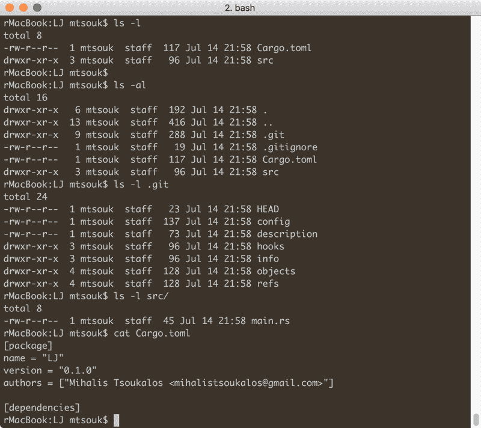

图 1. 使用 Cargo 创建 Rust 项目

注意，`Cargo.toml`配置文件是你声明项目依赖以及 Cargo 编译项目所需的其他元数据的地方。要构建你的 Rust 项目，请执行以下命令：

```
$ cargo build
```

你可以在以下路径找到可执行文件的调试版本：

```
$ ls -l target/debug/LJ
-rwxr-xr-x  2 mtsouk  staff  491316 Jul 14 22:02 
 ↪target/debug/LJ
```

执行`cargo clean`可以清理 Cargo 项目。

## 读者和写入者

Rust 分别使用读者（readers）和写入者（writers）来读写文件。Rust 读者是一个可以从其中读取的值；而 Rust 写入者是一个可以向其中写入数据的值。读者和写入者有各种 trait（特征），但标准的分别是`std::io::Read`和`std::io::Write`。同样，让我们看看如何使用它们。

从文件读取的最常用方法是使用`std::io::Read`：

```rust
use std::fs::File;
use std::io::prelude::*;

fn main() -> std::io::Result<()> {
    let mut file = File::open("hello.txt")?;
    let mut s = String::new();
    file.read_to_string(&mut s)?;
    println!("{}", s);
    Ok(())
}
```

向文件写入，使用`std::io::Write`：

```rust
use std::fs::File;
use std::io::prelude::*;

fn main() -> std::io::Result<()> {
    let mut file = File::create("hello.txt")?;
    file.write_all(b"Hello, world!")?;
    Ok(())
}
```

## 文件操作

现在我们来看来看如何使用`std::fs`重命名和删除文件：

```rust
use std::fs;

fn main() -> std::io::Result<()> {
    fs::rename("old.txt", "new.txt")?;
    fs::remove_file("new.txt")?;
    Ok(())
}
```

`std::fs`模块还提供了创建和删除目录的功能：

```rust
use std::fs;

fn main() -> std::io::Result<()> {
    fs::create_dir("new_dir")?;
    fs::remove_dir_all("new_dir")?;
    Ok(())
}
```

## 处理命令行参数

此节解释了如何访问和处理 Rust 程序的命令行参数。`cla.rs`的 Rust 代码如下：

```rust
use std::env;

fn main()
{
    let mut counter = 0;
    for argument in env::args()
    {
        counter = counter + 1;
        println!("{}: {}", counter, argument);
    }
} 
```

让我们来看这个示例中发生了什么。首先，它使用了`std`库中的`env`模块，因为这是获取程序命令行参数的方法，这些参数将保存在`env::args()`中，它是一个关于进程参数的迭代器。然后，你使用`for`循环遍历这些参数。

假设你想相加程序的命令行参数（那些有效的整数），以找到它们的总和。你可以使用下一个`for`循环，它包含在`cla.rs`的最终版本中：

```rust
let mut sum = 0;
for input in env::args()
{
    let _i = match input.parse::<i32>() {
      Ok(_i) => {
          sum = sum + _i
      },
      Err(_e) => {
          println!("{}: Not a valid integer!", input)
      }
    };
}
println!("Sum: {}", sum); 
```

在这里你遍历了`env::args()`迭代器，但这次目的不同，即找到有效的命令行参数并对其求和。

如果你习惯了 C、Python 或 Go 等编程语言，你很可能会发现上述代码对于如此简单的任务来说过于复杂，但 Rust 的工作方式正是如此。此外，`cla.rs`包含了与错误处理相关的 Rust 代码。

请注意，在运行之前，你应该编译`cla.rs`并创建一个可执行文件，这意味着 Rust 无法轻易地作为脚本编程语言使用。在这种情况下，使用某些命令行参数编译并执行`cla.rs`会产生此类输出：

```
$ rustc cla.rs
$ ./cla 12 a -1 10
1: ./cla
2: 12
3: a
4: -1
5: 10
./cla: Not a valid integer!
a: Not a valid integer!
Sum: 21 
```

总之，关于程序的命令行参数介绍到此为止。下一节介绍如何使用三个标准 UNIX 文件。

### 标准输入、输出和错误

本节展示了如何在 Rust 中使用`stdin`、`stdout`和`stderr`。每个 UNIX 操作系统都会始终为其进程打开三个文件。这三个文件分别是`/dev/stdin`、`/dev/stdout`和`/dev/stderr`，你也可以通过文件描述符`0`、`1`和`2`分访问它们。UNIX 程序从标准输入读取数据，并将常规数据写入标准输出，将错误信息写入标准错误。

以下 Rust 代码保存为`std.rs`，它从标准输入读取数据并写入标准输出和标准错误：

```rust
use std::io::Write;
use std::io;

fn main() {
    println!("Please give me your name:");
    let mut input = String::new();
    match io::stdin().read_line(&mut input) {
        Ok(n) => {
            println!("{} bytes read", n);
            print!("Your name is {}", input);
        }
        Err(error) => println!("error: {}", error),
    }
    let mut stderr = std::io::stderr();
    writeln!(&mut stderr, "This is an error message!").unwrap();
    eprintln!("That is another error message!")
} 
```

Rust 使用`eprint`和`eprintln`宏向标准错误写入内容，这是一个非常方便的方法。或者，你也可以将文本写入`std::io::stderr()`。两种技术在`std.rs`中都得到了说明。

正如你预期的那样，你可以使用`print`和`println`宏向标准输出写入内容。最后，你可以通过`io::stdin().read_line()`函数从标准输入读取内容。编译并执行`std.rs`会产生以下输出：

```
$ rustc std.rs
$ ./std
Please give me your name:
Mihalis
8 bytes read
Your name is Mihalis
This is an error message!
That is another error message! 
```

如果你在 Linux 机器上使用 Bash 壳，可以通过将它们重定向到`/dev/null`来丢弃标准输出或标准错误数据：

```
$ ./std 2>/dev/null
Please give me your name:
Mihalis
8 bytes read
Your name is Mihalis
$ ./std 2>/dev/null 1>/dev/null
Mihalis 
```

之前的命令取决于你正在使用的 UNIX shell，与 Rust 无关。请注意，在 Rust 中还有其他各种技术可以处理 UNIX`stdin`、`stdout`和`stderr`。

### 处理纯文本文件

现在让我们来看看如何逐行读取纯文本文件，这是处理纯文本文件最常见的方法。在程序结束时，字符总数和读取行数将打印在屏幕上——将此视为`wc(1)`命令行工具的简化版本。

该 Rust 工具的名为`lineByLine.rs`，其代码如下：

```rust
use std::env;
use std::io::{BufReader,BufRead};
use std::fs::File;

fn main() {
    let mut total_lines = 0;
    let mut total_chars = 0;
    let mut total_uni_chars = 0;
    let args: Vec<_> = env::args().collect();
    if args.len() != 2 {
        println!("Usage: {} text_file", args[0]);
        return;
    }
    let input_path = ::std::env::args().nth(1).unwrap();
    let file = BufReader::new(File::open(&input_path).unwrap());
    for line in file.lines() {
        total_lines = total_lines + 1;
        let my_line = line.unwrap();
        total_chars = total_chars + my_line.len();
        total_uni_chars = total_uni_chars + my_line.chars().count();
    }
    println!("Lines processed:\t\t{}", total_lines);
    println!("Characters read:\t\t{}", total_chars);
    println!("Unicode Characters read:\t{}", total_uni_chars);
} 
```

`lineByLine.rs`工具使用了如`std::io::{BufReader,BufRead}`所示建议的缓冲读取。使用`BufReader::new()`和`File::open()`打开输入文件，并使用`for`循环进行读取，只要输入文件中还有可读内容循环就会继续。

此外，请注意在处理包含 Unicode 字符的文本文件时，`len()`函数的输出和`chars().count()`函数的输出可能不同，这就是在`lineByLine.rs`中同时包含这两者的主要原因。对于 ASCII 文件，它们的输出应该是相同的。请记住，如果你想分配一个缓冲区来存储字符串，`len()`函数是正确的选择。

使用纯文本文件作为输入编译并执行`lineByLine.rs`将产生此类输出：

```
$ ./lineByLine lineByLine.rs
Lines processed:            28
Characters read:            756
Unicode Characters read:    756 
```

请注意，如果你将`total_lines`重命名为`totalLines`，在尝试编译代码时可能会从 Rust 编译器得到以下警告消息：

```
warning: variable `totalLines` should have a snake case name 
such as `total_lines`
 --> lineByLine.rs:7:6
  |
7 |     let mut totalLines = 0;
  |         ^^^^^^^^^^^^^^
  |
  = note: #[warn(non_snake_case)] on by default 
```

你可以关闭该警告消息，但遵循 Rust 定义变量名的做法被认为是一种良好的实践。（在未来的 Rust 文章中，我将介绍更多关于 Rust 中文本处理的内容，请请关注。）

### 文件复制

接下来让我们如何在 Rust 中复制文件。`copy.rs`工具需要两个命令行参数，分别是源文件名和目标文件名。`copy.rs`的 Rust 代码如下：

```rust
use std::env;
use std::fs;

fn main()
{
    let args: Vec<_> = env::args().collect();
    if args.len() >= 3
    {
        let input = ::std::env::args().nth(1).unwrap();
        println!("input: {}", input);
        let output = ::std::env::args().nth(2).unwrap();
        println!("output: {}", output);
        match fs::copy(input, output)
        {
            Ok(n) => println!("{}", n),
            Err(err) => println!("Error: {}", err),
        };
    } else {
        println!("Not enough command arguments")
    }
} 
```

所有的脏工作都由`fs::copy()`函数完成，它是多功能的，因为你不需要处理文件的打开或写入，但它对过程没有控制权，这有点像作弊。复制文件的方法还有，例如使用缓冲区进行小块读取和写入。如果你执行`copy.rs`，你会看到如下输出：

```
$ ./copy copy.rs /tmp/output
input: copy.rs
output: /tmp/output
515 
```

你可以使用方便的`diff(1)`命令行工具来验证文件的副本与原始文件是否一致。（使用`diff(1)`留给读者练习。）

### UNIX 权限

本节描述了如何查找并打印文件的 UNIX 权限，它将作为命令行参数传递给程序，使用`permissions.rs` Rust 代码：

```rust
use std::env;
use std::os::unix::fs::PermissionsExt;

fn main() -> std::io::Result<()> {
    let args: Vec<_> = env::args().collect();
    if args.len() < 2 {
        panic!("Usage: {} file", args[0]);
    }
    let f = ::std::env::args().nth(1).unwrap();
    let metadata = try!(std::fs::metadata(f));
    let perm = metadata.permissions();
    println!("{:o}", perm.mode());
    Ok(())
} 
```

所有工作都是通过应用于`std::fs::metadata()`返回值的`permissions()`函数完成的。注意`println()`宏中的`{:o}`格式代码，它表示输出应该以八进制系统打印。再次强调，Rust 代码初看看起来很丑，但过了一段时间你一定会习惯的。

执行`permissions.rs`会产生如下输出——输出的最后三位是你想要的数据，其余的值与文件类型以及文件或目录的粘滞位（sticky bits）有关：

```
$ ./permissions permissions
100755
$ ./permissions permissions.rs
100644
$ ./permissions /tmp/
41777 
```


注意`permissions.rs`仅在 UNIX 上运行。

## 结论

本文介绍了在 Rust 中执行文件输入输出操作，以及如何处理命令行参数、UNIX 权限以及使用标准输入、输出和错误。由于空间限制，我未能介绍 Rust 中处理文件和文件 I/O 的所有技术，但显而易见，只要你有时间学习它的特殊之处，Rust 是创建任何系统工具的极佳选择，包括处理文件、目录和权限的工具。但根结底，开发者应该自己决定是使用 Rust 还是其他系统编程语言来创建 UNIX 命令行工具。

### 资源

* [Rust 编程语言](https://www.rust-lang.org)
* [Rust 文档](https://doc.rust-lang.org)
* [Cargo Book](https://doc.rust-lang.org/cargo/index.html)
* [Rust Crates](https://crates.io)
* [*Jim Blandy 和 Jason Orendorff 编写，O'Reilly, 2017，$Programming Rust》](http://shop.oreilly.com/product/0636920040385.do)
* [*Steve Klabnik 和 Carol Nichols 编写，No Starch Press, 2018，$The Rust Programming Language》](https://nostarch.com/Rust)

# Go 入门教程

## 如何开始学习实用的新语言。作者 Jay Ts


你可能听过 Go。像任何新编程语言一样，它需要一段时间才能成熟并稳定，直到达到可以用于生产应用的程度。如今，Go 是一门成熟的语言，用于 Web 开发、编写 DevOps 工具、网络编程和数据库。它被用于编写 Docker、Kubernetes、Terraform 和 Ethereum。Go 的人气正在迅速上升，2017 年的采用量增长了 76%，现在有了 Go 用户组和 Go 会议。无论你是想增加专业技能，还是只是对学习新的编程语言感兴趣，都应该尝试一下。

### Go 历史

Go 由 Google 的三个程序员创建：Robert Griesemer、Rob Pike 和 Ken Thompson。该团队决定创建 Go 是他们对 C++ 和 Java 感到沮丧，多年来这些语言变得笨重且笨拙。他们希望为编程带回乐趣和效率。

这三个人都有令人瞩目的成就。Griesemer 参与了 Google 的极速 V8 JavaScript 引擎，用于 Chrome 浏览器、Node.js JavaScript 运行时环境等。Pike 和 Thompson 是原始贝尔实验室团队的成员，该团队创建了 UNIX、C 语言和 UNIX 工具，这导致了 GNU 工具和 Linux 的开发。Thompson 编写了第一个版本的 UNIX，并创建了作为 C 语言基础的 B 编程语言。后来，Thompson 和 Pike 加入了 Plan 9 操作系统团队，他们还共同定义了 UTF-8 字符编码。

### 为什么选择 Go？

Go 具有静态类型和垃圾回收的安全性，同时具有编译型语言的速度。在其他语言中，“编译”和“垃圾回收”与等待编译器完成以及获得运行缓慢的程序相关联。但 Go 拥有一个极快的编译器，使得编译时间几乎察觉不到，还有一个现代且超高效的垃圾回收器。你既可以获得快速的编译，又能获得快速的程序。Go 语法简洁，关键字很少，赋予了 Go 像 Python、Ruby 和 JavaScript 等动态类型解释型语言的简单和趣味。

Go 的设计理念是拥有许多语言的优点。起初，Go 看起来非常像 C 和 Pascal 的混合体（都是 Algol 60 的后继者），但仔细观察，你会发现它也借鉴了许多其他语言的想法。

Go 被设计成一种易用的简单编译语言，同时允许编写运行高效的程序。Go 缺乏多余的功能，因此编程时非常流畅，不需要在编程时查阅语言文档。用 Go 编程是快速、有趣且高效的。

### 让我们开始

首先，确保你已经安装了 Go。你可能可以使用你发行版的包管理系统。要找到 Go 包，可以尝试查找 "golang"，它是 Go 的同义词。如果你无法通过这种方式安装，或者想要更早的版本，请从[`golang.org/dl`](https://golang.org/dl)获取 tar 包，并按照页面上的说明进行安装。

安装好 Go 后，尝试此命令：

```
$ go version
go version go1.10 linux/amd64
```

输出显示我的 64 位 Linux 机器上安装了 Go 1.10 版本。

希望到这里，你已经产生了兴趣，并想看看完整的程序是什么样的。这里有一个非常简单的程序，打印“hello, world”：

```go
package main

import "fmt"

func main() {
    fmt.Printf("hello, world\n")
}
```

`package main` 定义了文件所属的包。命名 `main` 作为包和函数名告诉 Go 执行应该从这里开始。即使整个程序只有一个，你也需要定义 `main` 包和 `main` 函数。

在顶层，Go 源代码组织成包。每个源文件都是包的一部分。导入包和导出函数是基础。下一行 `import "fmt"` 导入了 `fmt` 包。它是标准库的一部分，包含了 `Printf()` 函数。通常你需要导入多个包。为了导入 `fmt`、`os` 和 `strings` 包，你可以输入：

```go
import "fmt"
import "os"
import "strings"
```

或者这样：

```go
import (
    "fmt"
    "os"
    "strings"
)
```

使用括号，`import` 应用于括号内的所有内容，节省了输入。你会在 Go 的其他地方看到括号的使用，Go 也有其他类似的快捷方式。

包可以导出常量、类型、变量和函数。要导出某些内容，只需将导出的常量、类型或函数的首字母大写即可。就是简单。

Go 的不同之处在于，它要求或倾向于一种特定的空白格式风格。该语言并没有允许各种格式样式，而是在设计中就自带了单一的格式样式。程序员有很大的自由去违反它，但仅限于某种程度。这取决于你的喜好，既是一件束缚衣，也可以是天赐之物！许多其他语言允许的自由格式化可能会导致出现微型的“巴别塔”，让其他程序员难以阅读代码。Go 通过将单一的格式样式设为首选样式来避免了这个问题。由于采用标准的格式样式并习惯性地使用它非常容易，你只需要做到这一点就能编写出通用可读的代码。很合理吧？Go 甚至附带了一个工具来重新格式化你的代码，使其符合标准：

```
$ go fmt hello.go
```

有两点注意事项：你的代码必须没有语法错误才能运行，因此它无法修复我刚才描述的那种问题。此外，它会覆盖原始文件，如果你想保留原始文件，请在运行`go fmt`之前进行备份。

`main()` 函数只有一行代码来打印消息。在这个示例中，使用了 `fmt` 包中的 `Printf()` 函数，使其类似于在 C 语言中编写一个“hello, world”程序。如果你愿意，也可以使用这个：

```
fmt.Println("hello, world")
```

为了避免在字符串末尾输入 `\n` 换行字符。

现在让我们编译并运行该程序。首先，将“hello, world”源代码复制到名为 `hello.go` 的文件中。然后使用此命令编译它：

```
$ go build hello.go
```

要运行它，请使用生成的名为 `hello` 的可执行文件作为命令：

```
$ hello
hello, world
```

作为一个快捷方式，你可以在一个命令中完成这两个步骤：

```
$ go run hello.go
hello, world
```

这将编译并运行程序，而不会创建可执行文件。当你正在活跃开发一个项目，并且在进行更多编辑之前只是检查错误时，这非常棒。

接下来，让我们看看 Go 的一些主要特性。

### 并发

Go 以 `goroutines` 形式内置的并发支持是该语言最好的特性之一。goroutine 类似于进程或线程，但它要轻量得多。Go 程序拥有数千个活跃的 goroutine 是正常的。启动一个 goroutine 简单如下：

```
go f()
```

函数 `f()` 然后将与主程序和其他 goroutine 并发运行。Go 有一种方法通过 `channels` 允许程序的并发部分进行同步和通信。channel 某种类似于 UNIX 管道；它可以从一端写入，并从另一端读取。channel 的常见用途是让 goroutine 指明它们何时完成任务。

goroutine 及其资源由 Go 运行时系统自动管理。凭借 Go 的并发支持，可以很容易让多核 CPU 的所有核心和线程高效工作。

### 类型、方法和接口

你可能会奇怪为什么类型和方法在同一个标题下。这是因为 Go 拥有一个简化的面向对象编程模型，它与其丰富的、轻量级的类型系统一起工作。它完全避免了类和类型层次结构，因此可以使用数据类型执行复杂操作而不会产生混乱。在 Go 中，方法附加到用户定义的类型上，而不是类、对象或其他数据结构上。这里有一个简单的例子：

```
// 创建一个新的类型 MyInt，它是一个整数
type MyInt int

// 为 MyInt 附加一个方法来计算数字的平方
func (n MyInt) sqr() MyInt {
    return n*n
}

// 创建一个新的 MyInt 类型的变量
// 名为 "number" 并将其设置为 5
var number MyInt = 5

// 现在可以使用 sqr() 方法了
var square = number.sqr()
// square 的值现在是 25
```

除此，Go 还有一个名为 `interfaces` 的机制，允许类型的混合。只要每个类型都附加了接口定义中指定的、操作所需的方法或多个方法，就可以在混合类型上执行操作。

假设你创建了名为 `cat`、`dog` 和 `bird` 的类型，每个类型都有一个名为 `age()` 的方法，返回动物的年龄。如果你想在一个操作中添加所有动物的年龄，你可以这样定义一个接口：

```
type animal interface {
    age() int
}
```

`animal` 接口就可以像类型一样使用，允许在计算年龄时对 `cat`、`dog` 和 `bird` 类型进行统一处理。

### Unicode 支持

考虑到 Ken Thompson 和 Rob Pike 定义了现在全球主导的 Unicode UTF-8 编码，Go 对 UTF-8 有很好的支持可能不会让你感到惊讶。如果你从未用过 Unicode 且不想麻烦它，不用担心；UTF-8 是 ASCII 的超集。这意味着你可以继续用 ASCII 编程并忽略 Go 的 Unicode 支持，一切都会运行良好。

实际上，Go 编译器和工具将所有源代码都视为 UTF-8。如果你的系统经过正确配置以允许你输入和显示 UTF-8 字符，你就可以在 Go 源代码文件名、命令行参数以及 Go 源代码中的字面量字符串、变量、函数、类型和常量中使用它们。

在图 1 中，你可以看到一个葡萄牙语的“hello, world”程序，就像一个巴西程序员编写的一样。

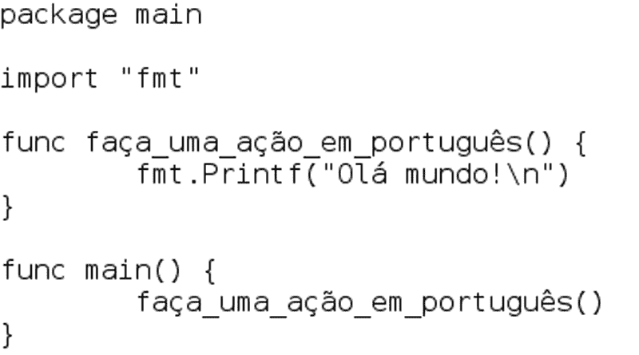

图 1. 葡萄牙语的 Go "Hello, World" 程序

除了以这些方式支持 Unicode 之外，Go 标准库中还有三个包用于处理更复杂的 Unicode 问题。

现在，你可能理解为什么 Go 程序员会对这种语言充满热情。不仅是因为 Go 有这么多好的特性，而且是因为它们都包含在一个旨在避免过度复杂的语言中。这是“整体大于部分之和”的一个极佳例子。

### Resources

* [Go 官方网站](https://golang.org)
* [Go 导游](https://tour.golang.org/welcome/1)
* [Go Playground](https://play.golang.org)
* [Go GitHub 仓库](https://github.com/golang/go)
* [*The Go Programming Language* 由 Alan A. A. Donovan 和 Brian W. Kernighan 著，Addison-Wesley, 2015](https://www.gopl.io)

获取 Clojure 后你应该第一件事是安装一个名为 `leiningen` 的非常方便工具，它是你在 Linux 机器上使用和管理 Clojure 项目最简单的方法。请遵循[leiningen.org](https://leiningen.org/#install)的说明，或使用你喜欢的包管理器在 Linux 机器上安装 `leiningen`。此外，如果你经常使用 Clojure 并处理大型 Clojure 项目，像 [Jenkins](https://jenkins.io) 和 [Semaphore](https://semaphoreci.com) 这样的工具将自动化你的构建和测试阶段，并节省大量时间。

安装 `leiningen` 后，使用 `lein` 命令（它是 `leiningen` 包的可执行文件名称）创建一个名为 `hw` 的新项目：

```
$ lein new hw
正在基于 'default' 模板生成名为 hw 的项目。
默认模板用于库项目，
而不是应用程序。要查看其他模板 (app, plugin, 等)，
请尝试 `lein help new`。
```

上述命令将创建一个名为 `hw` 的新目录，其中将包含文件和其他目录。你需要对某些项目文件进行一些更改以执行项目。首先，你需要编辑 `hw` 目录内的 `project.clj` 并将其修改如下：

```
$ cat project.clj
(defproject hw "0.1.0-SNAPSHOT"
  :main hw.core
  :dependencies [[org.clojure/clojure "1.8.0"]])
```

然后，编辑 `./src/hw/core.clj` 文件，使其看起来如下：

```
$ cat src/hw/core.clj
(ns hw.core)
(defn -main [& args]
  (println "Hello World!"))
```

`./src/hw/core.clj` 文件是你可以找到 Clojure 代码的地方。执行上述项目只需在项目目录内运行 `lein run` 命令即可：

```
$ lein run
Hello World!
```

第一次执行 `lein run` 时，`lein` 可能会自动下载构建项目所需的一些文件。此外，请记住 `lein` 能做很多比我在这里描述的多多的事情。接下来重要的 `lein` 命令是 `lein clean`（用于清理 Clojure 项目）和 `lein repl`（启动 Clojure 控制台）。

### Clojure 数据类型

Clojure 的哲学基于 Lisp，这意味着 Clojure 代码包含大量的括号。此外，Clojure 是一种函数式和动态类型的编程语言，支持并发编程，这意味着 Clojure 的函数（尽力如此）没有副作用。由于 Clojure 的实现基于 Java 虚拟机（JVM），Clojure 数据类型就是 Java 数据类型，这意味着所有的 Clojure 值实际上都是对 Java 类的引用。此外，大多数 Clojure 数据类型是不可变的，这意味着它们在创建后无法被更改。最后，Clojure 有一种不寻常的相等性检查方法。为了确定两个列表是否相同，Clojure 会检查两个列表的实际值。大多数编程语言都不会这样做，因为这可能是一个缓慢的过程，特别是在处理大型列表时。尽管如此，Clojure 通过为每个对象保留一个哈希值并比较两个对象的哈希值而不是实际访问它们的所有值来避免这种风险。只要对象是不可变的这种方法就有效，因为如果对象是可变的且其中一个对象发生了变化，它的哈希表将不会更新以反映该变化。

总之，Clojure 支持数字、布尔值、字符、字符串、nil 值、函数变量、命名空间、符号、集合、关键字和 vars。`var` 是可变的 Clojure 类型之一。集合可以是列表、hashmap、vector 或序列，但列表和 hashmap 是最流行的 Clojure 数据类型。

但是，关于 Clojure 的介绍就足够了；让我们开始编写真正的 Clojure 代码。

### 处理数据

首先，让我们看看如何在 Clojure 中定义和填充变量，以及如何使用 Clojure shell 访问列表的所有元素。Clojure 语法要求你以前置的方式放置操作符和函数，这意味着运算符被放置在参数之前，而不是在参数之间（中置符号）。简单来说，要计算 9 和 4 之和，你会写 `+ 9 4` 而不是 `9 + 4`。

与 Clojure shell 的交互开始如下：

```
user=> (- 10)
-10
user=> (- 10 10)
0
user=> (- 10 (+ 5 5))
0
user=> (/ 10 (+ 5 5))
1
user=> (println "Hello\nLinux Journal!")
Hello
Linux Journal!
nil
user=> (str "w12")
"w12"
```


这段 Clojure 代码首先对数字进行一些基本操作，然后是对字符串。在第一个语句中，你可以看到 Clojure 中的所有内容必须放在括号内。第三个数字操作等于`10 - (5 + 5)`，结果为零；而第四个数字操作等于`10 / (5 + 5)`，结果为 1。正如你在 Hello World 程序看到的，`println` 函数用于在屏幕上打印数据；而 `str` 函数可以帮助将任何内容（包括数字）转换为字符串。`str` 的一个很好的奖励是，当带有多个参数调用时，可以使用它来拼接字符串。

下次交互验证了 Clojure 中的字符（写为`\a`、`\b`等）不等同于 Clojure 字符串（字符串使用双引号，长度为 1）。然而，当你用`str`处理单个字符时，你会得到一个字符串：

```
user=> (= \a "a")
false

user=> (= (str \a) "a")
true
```

现在，准备好接受更高级的内容：

```
user=> (map (fn [x] (.toUpperCase x)) (.split 
↪"Hello Linux Journal!" " "))
("HELLO" "LINUX" "JOURNAL!")
```

上述的 Clojure 代码做了很多事情。它将输入字符串拆分为单词，并将每个单词转换为大写——好处是，该语句在 Clojure 中的编写方式是自然且易读的——只要你从右向左阅读它。

以下与 Clojure shell 的交互展示了你如何处理 Clojure map，map（正如你预期的那样）将键与值关联起来：

```
user=> (def myMap {:name "Mihalis"
:surname "Tsoukalos"
:livesAt {:country "Greece"
:city "Athens"} )
#'user/myMap
```

首先，你创建一个新的 map 并将其分配给名为`myMap`的变量。注意`myMap`包含一个嵌套值——即 map 中的 map。

在下次交互中，你将看到从上一个 map 中获取数据的各种方式：

```
user=> (get myMap :country)
nil

user=> (get myMap :name)
"Mihalis"

user=> (myMap :name)
"Mihalis"

user=> (:name myMap)
"Mihalis"

user=> (get myMap :surname)
"Tsoukalos"

user=> (get-in myMap [:livesAt :country])
"Greece"

user=> (get-in myMap [:livesAt :city])
"Athens"

user=> (get-in myMap [:livesAt :wrong])
nil
```

所以，你可以使用`get`关键字获取键的值，并可以使用`get-in`关键字进入嵌套值内部。此外，还有两种额外方法可以获取键的值而不需要使用`get`关键字，它们在第二和第三条命令中所示。

此外，如果键不存在，你将得到一个`nil`值。最后，这里是遍历列表所有元素的方法：

```
user=> (def myList (list 0 1 2 3 4 5))
#'user/myList

user=> (doseq [[value index] (map vector myList (range))]
(println index ": " value))
0 :  0
1 :  1
2 :  2
3 :  3
4 :  4
5 :  5
nil
```

所以，首先我们将一个带有数字的列表存储到变量`myList`中，然后使用`doseq`遍历列表的元素。

## 计算斐波那契数

本节展示了如何在 Clojure 中定义一个函数来计算属于斐波那契数列的自然数。如下所示创建一个计算斐波那契数的 Clojure 项目：

```
$ lein new fibo
$ cd fibo
$ vi src/fibo/core.clj
$ vi project.clj
```

`src/fibo/core.clj`的内容应该是这个：

```
$ cat src/fibo/core.clj
(ns fibo.core)

(def fib
  (->> [0 1]
    (iterate (fn [[a b]] [b (+ a b)]))
    (map first)))

(defn -main [& args]
  (println "Printing Fibonacci numbers!"))
  (println (nth fib 10))
  (println (take 15 fib))
```

在上述代码中，`fib`函数的定义负责计算斐波数列。之后，主函数`-main`使用了两次`fib`。第一次是为了获取特定的斐波那契数，第二次是为了获取包含前 15 个斐波那契数的列表。

执行`fibo`项目将产生如下输出：

```
$ lein run
55
(0 1 1 2 3 5 8 13 21 34 55 89 144 233 377)
Printing Fibonacci numbers!
```

当你开始熟悉 Clojure 时，可以尝试用不同的方式实现`fib`函数，因为在 Clojure 中计算斐波那契数有许多方法。

## 使用命令行参数

现在，让我们看看如何使用`lein`项目在 Clojure 中程序的命令行参数。创建 "cla" 项目的步骤如下：

```
$ lein new cla
$ cd cla
```

首先，你需要编辑`src/cla/core.clj`以包含处理程序命令行参数的实际 Clojure 代码。之后，你编辑`project.clj`，就完成了。你可以在`src/cla/core.clj`中定义的`-main`函数中找到实际处理程序命令行参数的 Clojure 代码：

```
(defn -main [& args] ; 获取命令行参数
  (if-not (empty? args)
    (doseq [arg args]
       (println arg))
; 在没有命令行参数的情况下
    (throw (Exception. "Need at least one 
 ↪command line argument!"))))
```

上述 Clojure 代码使用`doseq`遍历`args`变量的项，并打印它的每一个项。此外，最后一行代码演示了如何在 Clojure 中处理异常。你需要那行代码是因为如果`args`列表为空，`doseq`将不会运行，而这会在执行程序时没有任何命令行参数时发生。最后，你可以发现 Clojure 中的注释是以分号开头的行，或者是分号字符之后的部分。

执行 Clojure 项目将产生如下输出：

```
$ lein run one 2 three -5
one
2
three
-5
```

如你所见，为 Clojure 项目提供命令行参数的方法与大多数编程语言相同。请注意，如果你在不提供任何命令行参数的情况下执行`lein run`，程序将崩溃并产生大量的调试输出，包括以下消息：

```
$ lein run
Exception in thread "main" java.lang.Exception: Need at least 
one command line argument!,
```

## 获取用户输入

除了使用程序的命令行参数外，还有获取用户输入的另一种方法，是在程序执行期间获取。以下是在 Clojure shell 中使用`read-line`函数从用户获取输入的方法：

```
user=> (def userInput (read-line))
Hello there!
#'user/userInput

user=> (println userInput)
Hello there!
nil
```

第一条命令使用`read-line`函数从用户处读取一行，并将其赋值给名为`userInput`的新变量；而第二个命令则打印`userInput`变量的值。

## Clojure 宏

宏的定义看起来像函数定义，因为它们有名称、参数列表以及包含 Clojure 代码的体，并且它们允许使用用户代码扩展 Clojure 编译器。通常来说，在 Clojure 中使用宏的情况有三种：当你想要在编译时执行代码时，当你想使用内联代码时，以及你需要访问未求值的参数时。然而，由于宏只在编译时可用，因此尽可能使用函数而不是宏。

## Clojure 中的文件复制

接下来，这里是在 Clojure 中复制文件的方法，以你评估 Clojure 是否可以像 C 和 Go 一样的系统编程语言。正如你预期的，你将使用`lein`工具来生成项目：

```
$ lein new copy
$ cd copy/
$ vi project.clj
$ vi src/copy/core.clj
```

最后两个命令意味着你需要修改`project.clj`和`src/copy/core.clj`文件。

你可以在`-main()`函数的实现中找到该项目的逻辑：

```
(defn -main [& args]
   (let [input (clojure.java.io/file "/tmp/aFile.txt")
        output (clojure.java.io/file "/tmp/aCopy.txt")]
    (try
       (= nil (clojure.java.io/copy input output))
       (catch Exception e (str "exception: " 
 ↪(.getMessage e)))))
```


在我职业生涯早期，我负责管理一个大型校园内大量的打印机群。我们说的是几百台网络打印机。为了实地查看其中某些打印机，通常需要走 10 或 15 分钟，而且其中很多打印机的使用频率很低。在到达之前，我并不知道发生了什么，所以问题所在全靠猜。是简单的卡纸？驱动程序问题？还是打印机着火了？我只有在走完长长路后才知道。让大家感到更加沮丧的是，由于某些打印机使用频率较低，一台有问题的打印机可能几周都没有人发现，只有当有人尝试打印时才会暴露问题。

最后，我产生了一个念头：如果我在有人给我打电话*之前*就能知道问题及其原因，那该有多好啊？那天我找到了我的第一个监控工具，并彻底痴迷了。

从那以后，我帮助许多人重构了他们的监控系统。在此过程中，我注意到同样的挑战经常反复出现。如果你负责管理组织的系统，请继续读下去；我有许多建议要分享。

那么，废话不再说，以下是你的监控系统糟糕的五个主要原因，以及你可以采取的对策。

### 1. 你正在使用过时的工具

到目前为止，监控一团糟最常见的原因是依赖过时的工具。当你花费太多时间去规避监控工具的缺陷，或者当你不得不编写大量自定义代码来绕过某些严重的功能缺失时，你就知道问题出在哪里了。但底线问题是，你花在修复那些“几乎好用”的工具上的时间，比你投入工作的时间还要多。

使用旧工具和方法的问题在于，你只是在让自己变得更加困难。我想，用生锈的勺子挖洞是有可能的，但你难道更愿意用铲子吗？

优秀的工具是隐形的。它们让你更高效，让任务更容易完成。当你拥有优秀的工具时，你甚至察觉不到它们的存在。

也许你不会把你的监控工具描述为“易用”或“隐形”。你可能会使用的词会让我的编辑掏出红笔。

这份清单可以帮助你判断自己是否在坑自己。

*   你是否正在使用`Nagios`或 Nagios 的派生版本来监控弹性/临时基础设施？
*   在你的部署过程中，是否存在需要人工执行的步骤来手动手动将`$thing`添加到监控中？
*   有多少份事后总结（post-mortems）包含了像“我们没有监控`$thing`”这样的行动项？
*   你是否有一个`cron job`正在跟踪日志文件并通过`sendmail`发送电子邮件？
*   你是否有一个`syslog`服务器，你所有的系统都将日志推送到那里……然后再也未被查看过？
*   你是否每隔五个指标（甚至频率更低）才收集一次系统指标？

如果你对其中任何一个问题回答了“是”，那么你就是在依赖糟糕的、旧式的工具。深表哀悼。

好消息是，你的状况并非永久。只要稍下努力，你可以修复它。

前提是你准备好改变了。

有些搞笑（或者令人沮丧？）的是，我们运维人员（Ops）如此轻易地更换整个技术栈，在一周内重新设计部署，更换配置管理工具并引入如`Docker`和`serverless`等现代技术——而完全没有经过任何的审查期。

然而，更换监控平台却是*禁止的*（verboten）。这是怎么回事？

我想答案在于许多公司监控现状的现实。情况非常糟糕。它们混乱无章、配置不一致、缺乏连贯的策略、自动化不足……但这一切都是建立在我们熟悉的工具之上的。我们了解它们的故障模式；我们了解它们的缺陷。

例如，行业花费了多年和惊人的开发时长，在`Nagios`上打补丁让它变得更容易接受（例如`nagios-herald`、`NagiosQL`、`OMD`），而不是问：“我们是否在浪费金钱？”

答案是肯定的。是的，我们确实如此。

不是要针对`Nagios`——好吧，我就是要针对`Nagios`。`Nagios`配置的任何更改，例如添加或删除主机，都需要重新加载配置。在依赖于临时系统（如容器）的基础设施中，整个基础设施每几分钟就会轮换一次。如果你有二十四个容器每 15 分钟运行一次，那么`Nagios`每分钟重新加载配置次数可能超过一次。这太疯狂了。

你的指标呢？判断某物是否损坏的旧方法是检查检查输出的当前值与阈值的比较。这显然会导致一些误报，因此我们增加了一种功能：只有当连续 N 次检查违反阈值时才触发告报。这也有一个非常明显的问题。如果你每分钟获取一次数据，你可能在问题发生 3-5 分钟后才发现。如果你每五分钟获取一次数据，情况就更糟了。

既然谈到了这儿，我们来谈谈自动化。我记得以前我负责十二台服务器时，启动第 13 台服务器是一个重大的日子。这类事情每隔几个月才发生一次。将我的新服务器添加到监控工具中，当然在我的清单上，而且这无疑花费了不止几分钟。

但科技世界已不再是那样了。就在今天早上，一个客户的基础设施启动了十几个新实例，并在一小时后关闭了其中的一半。我是在事情发生后才知道的。监控系统在几秒钟内就知道这些事件，并进行了相应的调整。

科技世界在过去五年发生了巨大的变化。我们喜爱的常用工具并没有完全跟上。监控必须是 100% 自动化的，既包括注册新实例和服务，以及在它们消失时全部注销。忍受 5 分钟（甚至 15 分钟！）延迟发现错误的时代已经过去；许多顶尖公司在几秒钟内就知道不对劲。

继续依赖旧时代的方法和工具，无论你多喜欢它们并了解它们的艰辛，都会阻碍你在监控领域取得飞跃式进展。

那种在三个同样糟糕的监控工具之间挣扎选择的旧日子早已结束了。你至少欠你自己和你的公司去考虑一下现代工具——无论是 SaaS 还是自托管解决方案。

### 2. 你在追逐“新热点”

在光谱的另一端是对新奇、有趣工具的偏好。像`Netflix`和`Facebook`这样的公司确实发布了一些非常酷的东西。但这并不意味着你就应该使用它们。

问题在于：你（可能）并不是`Facebook`、`Netflix`、`Google`或其他任何大家仰的大的大科技巨头。[货物崇拜](https://en.wikipedia.org/wiki/Cargo_cult)从未让任何事情变得更好。

仅仅因为他们在使用工具时很成功就采用他们的工具或策略，会错过了*为什么*它们对他们有效的关键原因。

工具并不会让一个组织成功。组织之所以成功是因为其成员的思考方式。方法、信念、人和策略导致了组织创建了这些工具。它的成功源于比“我们编写了自己的监控平台”更深层次的东西。

要接近行业巨头所取得的成功，你必须挖掘得更深。他们知道哪些你不知道的？他们在做什么、想什么、说什么、相信什么而你没有？

由于曾在许多此类公司内部工作，我向你们透露秘诀：他们在基础知识上做得非常出色。非常出色，好得惊人。

乍看这似乎无关，但请允许引用著名系统理论家约翰·加尔（John Gall）的话：

> 人们发现，运行良好的复杂系统总是是由一个运行良好的简单系统演化而来的。从零开始设计的复杂系统永远无法运行，也无法通过修补来使其工作。你必须从头开始，从一个运行良好的简单系统开始。

Gall 博士敏锐地指出，完全照搬别人的工具是徒劳的。这些工具是从简单系统演化而来的，以适应该组织和文化的需求。将这样一个复杂的系统投入另一个组织或文化中，可能不会产生良好的结果，仅仅因为你正试图跳过演化简单系统的艰辛工作。

所以，你想获得与那些业界巨头同样的成功吗？答案很简单：从简单开始。随着时间移不断改进。保持耐心。

### 3. 你在没必要时担心“供应商锁定”

如果说有一个我希望彻底消失的论点，那就是人们谈论想要“避免供应商锁定”的那个观点。那种论点完全是胡说八道。

到底什么是“供应商锁定”呢？它的意思是，如果你全投入某个特定供应商的产品，更换它将变得极其困难或昂贵。Keurig 的 K 胶囊就是著名的供应商锁定示例。它们只能配合 Keurig 咖啡机使用，而 Keurig 咖啡机只接受专用的 Keurig K 胶囊。通过购买 Keurig，你就被锁定在了 Keurig 生态系统中。

因此，如果担心被锁定在 Keurig 生态系统中，我只需避免购买 Keurig 机器就行了。简单。

如果我担心我的服务器基础设施被供应商锁定，我该怎么办？同时部署 Dell 和 HP 的服务器？这看起来像是一个非常愚蠢的主意。这会让我的工作变得困难得多。我必须根据每个产品的最低公约数来构建，并忽略任何产品特定的功能，包括让产品具有吸引力的创新。这在表面上允许我避免被锁定在某个供应商处，并保持较低的切换成本，但也意味着我的解决方案只有一半有效，而且在任何规模下管理都是一场噩梦。（你曾尝试过构建工具来同时管理和自动化`iDRAC`和`IPMI`吗？你真的不想那样做。）

特别是，你无法利用产品的独特特性。通过试图避免供应商锁定，你最终只得到了一个忽略了任何高级功能的“解决方案”。

在监控产品方面，情况更糟。组合性和互操作性是你可以获得的大多数产品的核心原则。今天的监控解决方案状态倾向于高度的互操作性和开放 API。是的，单个供应商可能拥有你所有的数据，但将这些相同的数据移动到另一个供应商处通常很容易，不会造成功能的重大损失。

这整个供应商锁定论点的一个特定问题是，它经常被用作不购买 SaaS 或商业专有应用的借口。人们认为，通过只使用自托管的开源产品，你可以获得更多的自由。

这个假设是错误的。你并没有获得更多的自由，也没有避免供应商锁定。你只是把一个供应商换成了另一个。

通过选择自己完成一切（通常做得很糟），你实际上成了你自己的供应商——一个经验更少、工作更过度的供应商。在日常职责之外，你设计、构建、维护和改进一个比监控供应商更好的监控平台的几有多大？这种概率几乎趋近于零。构建工具真的是你想从事的业务吗？

此外，由于如今商业供应商之间的互操作性，从内部解决方案切换的成本比从一个商业解决方案切换到另一个要高得多。你的内部解决方案也能如此吗？

### 4. 你在监控错误的内容

多年前，在我第一份工作之一，我检查了一台数据库服务器，发现它的 CPU 利用率很高。我想应该让我的老板知道。

“是谁投诉了它？”我的老板问。

“嗯，没有人，”我回答道。

我老板的回答一直让我记忆。它教了我一个宝贵的教训：“如果它没有影响到任何人，它真的有问题吗？”

我的教训是：没有上下文的数据是没用的。在监控中，指标只有在用户的语境下才有意义。如果可用内存低是你注意到的状态，但它没有影响用户，那么它就不值得触发告警。

在我多年的运维和系统管理生涯中，我没有见过没有任何 OS 指标直接指示活跃用户的影响。指标有时可以作为一个*间接*指示器，但我从未见过它*直接*指示问题。

这引出了我的下一点。有了基础设施的所有这些指标和日志，为什么你的监控没有变得更好？原因在于运维（Ops）只能解决一半的问题。虽然监控`nginx`工作进程、`Tomcat`垃圾回收或`Redis`键驱逐都是理解基础设施性能的重要指标，但它们没有哪一个能帮助你理解业务运行的软件。监控最大的价值来自于对用户信赖的应用程序进行插测量。（除非，你的业务提供的是基础设施即服务——那么，请尽管继续。）

在任何地方都不比在 SaaS 公司中得得清楚了，所以让我们这作为一个例子。

假设你有一个标准的三层架构 Web 应用：前端是`nginx`，后端是`Rails`应用程序服务器和`PostgreSQL`。网站上的每个操作都会命中`PostgreSQL`数据库。

你拥有所有的标准数据：访问日志和错误日志、`nginx`指标、`Rails`日志、`Postgres`指标。所有这些都非常棒。

你知道什么更好吗？知道用户登录需要多久。或者每分钟有多少次登录。或者更好：每分钟有多少次登录失败。

这种信息之所以有价值，是因为它*直接反映了用户体验*。如果过去五分钟内登录失败增加，你就知道问题出现了。

但你无法仅从基础设施的角度看到这种信息。如果我只关注`nginx`/`Rails`/`Postgres`的性能，我会完全错过这个事件。我会错过某次导致登录失败的最新代码部署。

要解决这个问题，要与你的工程团队建立更亲密的关系。帮助他们识别代码中的可用测量点，并实现更多的指标和日志。我非常喜欢使用`statsd`协议来处理这类事情；大多数监控供应商都支持它（或它们自己的实现）。

### 5. 你是唯一关心的人

如果只有你一个人关心监控、系统性能和指标，它们永远不会有实质性的改进。你无法独自这样做。即使只有你的团队关心，你也无法做到。我数不胜次看到运维团队投入精力改进，结果发现团队之外没有人关注，或认为这很重要。

改进监控需要全公司的参与。从接待员到 CEO，每个人都必须相信你所做事情的价值。公司里的每个人都知道业务需要利润。同样，这需要全公司理解改进监控可以提高利润并保护公司的利润。

问问你自己：你为什么关心监控？

是因为它能帮你更快地发现和解决故障吗？这对你很重要吗？

为什么这对你的经理很重要？对你的经理又很重要？为什么 CEO 会关心？

你需要回答这些问题。当你这样做时，就可以为所需的投资提供有力的业务论据（包括最好的工具）。

需要一个起点吗？这里关于业务为什么可能关心监控的一些想法：

*   业务可以管理并缓解事件和故障的风险。
*   业务可以发现改进性能的领域，从而提升用户体验并增加收入。
*   业务可以更快解决事件（通常在问题变得严重之前），从而增强用户好感度和声誉。
*   业务可以避免事件从恶化变为更糟，从而防止收入损失和潜在的 SLA 罚款。
*   业务通过规划和预测更好地控制基础设施成本，从而提高利润并降低支出。

我建议与你的团队诚实地讨论他们为什么关心监控。确保让管理层参与进来。完成这些对话后，再次与工程团队讨论。还有产品管理团队、市场部门以及客户支持。

监控影响整个公司，而且通常以不同的方式影响。当你发现自己在与高管讨论监控投资时，你将能够使用他们的语言。去吧，修复你的监控。我希望你找到了一些改进监控的想法。成为世界顶级是一条漫长且昂贵的道路，但好消息是，你不需要成为顶级也能看到巨大的益处。随着时间的推移，一些简单的改变就能从根本上改善你的监控。

总结一下：

1. 使用更好的工具。当更好的工具出现时，就替换它们。
2. 但是，不要执着于工具。工具是为了帮助你解决问题——它们本身不是目标。
3. 不要担心供应商锁定。选择你喜欢的产品并全力投入。
4. 小心你收集的内容和发布的警报。最好的数据是关于对用户有直接影响的事情。
5. 了解你的公司为什么关心监控，并用业务结果来表达。只有这样你才能获得你想要的投资。

祝你好运，监控愉快。

# CloudWatch 简直恶魔，但我必须使用

## 我们来谈谈 CloudWatch。作者 Corey Quinn

对于那些足够幸运、没有陷入 Amazon Web Services (AWS) 琐碎细节的人来说，CloudWatch 是根据[官方描述](https://aws.amazon.com/cloudwatch)，“为开发者、系统运维、站点可靠性工程师 (SRE) 和 IT 经理构建的监控和管理服务”。这听起来不错，除了没有任何一个群体喜欢使用这个产品之外。允许我发表一些监控界的异端邪说。

更好的做法，让我放在[亚马逊领导力原则](https://www.amazon.jobs/principles) 的背景下来描述这一点。当你仔细审视 CloudWatch 在所有领导力原则上的彻底失败时，你会疑惑这个产品到底是如何以这种状态问世的。

### “节俭”

我将从计费说起。通常这类文章的结尾会提到 CloudWatch 的计费模式如此糟糕，所以我以此作为开头。你按每个指标每月计费。你按通过`API`请求的每千指标计费。你按每个仪表板每月计费。你按每个警报每月计费。你根据摄入的数据量、存储的数据量以及 AWS 服务原生发布的“托管日志 (vended logs)”收费。而且，你按每个自定义事件计费。这一切最完美的总结就是：“地球上没有人理解 CloudWatch 指标和日志是如何计费的”，这导致监控供应商可能会因为频繁轮询 CloudWatch 而无意中花费数千美元。当 AWS 的费用超过你支付给监控供应商的费用时，这种感觉并不妙。

### “发明并简化”

CloudWatch Logs、CloudWatch Events、自定义指标、托管日志和自定义仪表板在 CloudWatch 内部的含义与你预期的完全不同，特别是与那些真正具有可理解水平的指标解决方案相比。因此，有多个功能完全不同的服务都在“CloudWatch”这一名下运行。例如，对于大多数人来说，调度一个每小时调用一次的`Lambda`函数需要一个自定义的`CloudWatch Event`并不直观。这感觉过于复杂、极其困惑，你很快就会发现自己必须建立复杂的关联来监控那些本身简单得多的东西。

### “远见卓”

所有业务人员在被问及从监控平台想要什么时，给出的回答都是类似于“仪表板”或“单窗视图”的内容。CloudWatch 提供了极其琐碎的细节，但它完全没有提供全局视图，没有绿/黄/红状态指示器让你看到网站整体健康状况的丝马。想看实例`CPU`中每个核心在过去 30 秒的图表吗？简单！想知道整个公司是否应该去扑灭网站当前生产状态的这团火吗？继续找吧——CloudWatch 没什么可以提供给你的。

### “坚持高标准”

从本质上说，CloudWatch 感觉像是小家子。从开始到结束的整个体验都散着“我们最少能做什么就能混关”的味道。他们构建了 MVP（最小可行性产品），然后就那样……停止了，凝固在了琥珀中。他们创建了一组构建区块，但他们并没有解决“我如何监控我的 AWS 资源？”这个问题。相反，感觉整个团队都在敷衍，结果导致了一个巨大的监控供应商市场。这些供应商中没有一个拥有像 CloudWatch 那样的原始数据访问权限；它们都构建了更好的产品。你本以为 CloudWatch 团队会从该领域快速发生的创新中汲取灵感，但这需要有人去`学习并保持好奇`。

### “经常判断正确”

近期数据是“最终一致的”，所以你总是得到像图 1 所示的图表。

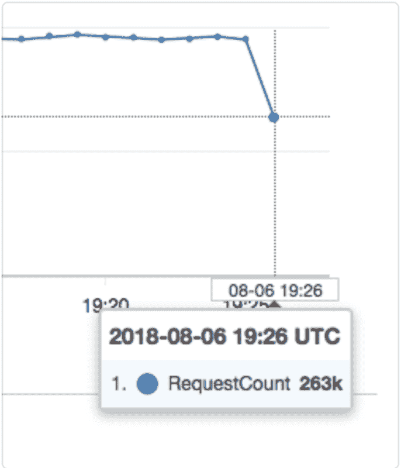

图 1. CloudWatch 图

在现实中，在`dashboard`上看到这种图是非常令人震惊的——你的网站显然出问题了！无论好坏，“准确”的描述并不适用于 CloudWatch，这就是你的图表总是呈现的样子。这直接导致

### “赢得信任”

让我在这里明确一点——真正的问题不是摄入问题。地球上每一个供应商都有相同的问题——你无法显示你没有的数据。CloudWatch 掉链子的地方在于向最终用户暴露这种行为，且不解释发生了什么。因此，在你习惯它之前，每当你瞥一眼仪表板时，都会经历一个心惊肉跳的“网站到底发生了什么”的时刻。这让你会在灾难刚刚发生时查看正常的仪表板时表现得异常冷静。如果你信任 CloudWatch 仪表板显示的内容，你就犯了一个巨大的错误。

*   通过查看调用错误的 CloudWatch 仪表板，首先发现它遇到了错误。我本可以设置一个过滤器来对日志运行连续查询，并在出现问题时发送告警，但该功能并非原生支持——我需要第三方工具（例如`PagerDuty`）。
*   深入研究各种 CloudWatch 日志组，并找到以特定错误函数命名的那一个。
*   手动翻阅多页、多页、多页的日志组，以找到抛出错误的特定调用。
*   意识到保留的 JSON 对象不足以进行故障排除，在绝望中哭泣，然后写了一篇像现在这样的文章。
*   做了一些简单的计算，发现我的 AWS 账单中支付了一笔令人不舒服的比例，而这项服务充其量也只有微乎其微的收益。

## “交付结果”

你所有的指标、所有的日志——它们都被锁在 CloudWatch 的各种组件内部。你不会在 CloudWatch 中找到“当超过此阈值时通知我”的选项；你的选择被局限于“用铁丝和 SNS 设计一个告警传输管道”，或者付给非 AWS 供应商购买另一个监控产品。

## “客户痴迷”

CloudWatch 保留了你所有的指标。它保留了你的日志。它让你构建自定义仪表板以便在一个地方查看所有指标。伟大服务的构建组件已经在这里了——缺失的是这种实用性的表达，而且有时是极其匮乏。大型监控厂商是 AWS 活动的顶级赞助商这一事实，如果 CloudWatch 真的能好好起来，那将是一个笑话。你不需要第三方来理解纯 AWS 环境，而且许多第三方公司会因为变得太弱而饿死，没力气打断你的对话来询问是否可以扫描你的工牌。选择使用 CloudWatch 而不是字面上的任何其他东西就像买车。“是的，我想买尤戈而不是斯本田。毕竟，它在技术上符合汽车的所有标准，所以没问题，对吧？”

## “有异议并执行”

CloudWatch 许多失败的根源，很可能在于构建它的产品工程师误解了这一（诚然难以捉摸的！）领导力准则。它被设想为激情地表达你对决定的保留意见，但一旦达成共，你就对所做的决定做出承诺。遗憾的是，负责 CloudWatch 的工程团队似乎决定“在执行中产生异议”，并将他们的争论以产品的形式强加于世界。

## “所有者”

如果我上网上发布关于几乎任何其他 AWS 服务有多糟糕的内容，人们会聚集起来为该服务辩护。这是互联网；人们会这样做。但当这些以及更多关于 CloudWatch 的评论出现时，没有任何一个来自 AWS 的人出来说“哇，我很抱歉，你为什么会有这种感觉？”，这清楚地表明，如果 CloudWatch 团队有任何人在乎这个产品，他们过去十年里大部分时间应该被锁在一个发生故障的厕手间里了。[这些](https://twitter.com/shinzui/status/788939026996744192) [评论](https://news.ycombinator.com/item?id=12235003) 至少可以追溯到那时，但 [亚马逊](https://www.reddit.com/r/devops/comments/8n3fpz/is_cloudwatch_logs_really_terrible_or_am_i_just/dzsz8qg) [确实](https://www.reddit.com/r/devops/comments/4zhgtl/how_do_you_feel_about_aws_cloudwatch_how_do_you) [完全](https://twitter.com/guisim/status/248394260704014336) [践行](https://twitter.com/calebhailey/status/1032800895203864576) [着](https://news.ycombinator.com/item?id=14604644) 公司的“推崇行动”准则。

## “聘用并培养优秀人才”

构建 CloudWatch 的人工作并不糟糕；我真心他们他们完全理解自己的产品是如何被感知的。鉴于写这样的吐槽文章而不提供积极改进的建议是不体面的，这里是我希望看到的一些产品增强：

*   允许我以任意级别对 API 调用进行限流，而不是在月底看到一张大约相当于桑给巴尔国家 GDP 的账单时感到大惊。
*   “这是你的 Lambda 函数抛出的错误，这是该特定函数的日志输出”最多应该点击两次——而不是 30 次。
*   如果你的狗生了一胎 14 只小狗，也许你不需要给它们每只都起名为“CloudWatch”的细微变体。以“Cloud”开头的服务和公司的泛滥是另一个完全独立的吐槽的话题。

请不要误解我。我使用、享受并推广 AWS 服务，我被认为是一个“真实的声音”，在很大程度上是因为我在赞美美事的同时，也会像我刚刚所做的那样指出不好的地方。我的职业和业务是建立在在该生态系统中运行的基础上。我发现 AWS 员工聪明且意图良好，他们的大多数服务都很好。CloudWatch 通过一些努力可以达到那个水平，但它有很多非常痛苦的可用性问题，导致它无法变得优秀，更不用说伟大。

# 使用 Monit 和 RRDtool 进行基础监控

## 如何为低端系统提供稳健的监控。作者 Andy Carlson

在运行关键系统时，必须知道系统正在消耗哪些资源，在资源利用率达到特定水平时发出告警，并跟踪长期性能趋势。Zabbix 和 Nagios 是两种监控、告警和跟踪系统性能趋势的大型解决方案，它们都提供了丰富的用户界面。然而，由于这些解决方案的要求，通常需要专门的硬件/VM 资源来托管监控解决方案。对于较小的服务器实现，存在提供基础监控、告警和趋势功能的选项。本文展示了如何使用 Monit 实现基础和自定义的监控与告警。它涵盖了如何使用 RRDtool 监控系统性能的长期趋势。

### Monit 初配置

在许多流行的 Linux 发行版中，你可以从关联的软件仓库安装 Monit。安装后，你可以通过`monitrc`配置文件处理所有配置。该文件通常位于`/etc`目录结构中，但具体位置取决于你的发行版。

配置文件有两个部分：Global（全局）和 Services（服务）。Global 部分允许对 Monit 应用程序进行自定义配置。Monit 服务包含一个基于 Web 的前端，可以通过配置文件进行完全配置。虽然该部分在默认情况下是被注释掉的，但你可以有选择性地取消项目的注释，以进行细粒度的自定义。Web 配置块看起来如下：

```


设置 `httpd` 端口为 `2812`，并使用地址 `localhost`：

```
set httpd port 2812 and
    use address localhost
    allow localhost
    allow admin:monit
```

第一行设置了你通过 Web 浏览器访问 Monit 的端口号。第二行设置了访问 Monit 时使用的主机名（HTTP Host Header）。第三行设置了访问 Monit 应用程序的主机。注意，如果当前存在防火墙，你也可以使用本地防火墙访问限制来实现此。第四行允许配置用于访问 Monit 的用户名/密码对。还有一个部分允许为 Monit 的加密连接配置 SSL 选项。虽然建议在传递身份验证数据时启用 SSL，但也可以通过现有的 Web 服务器（如`nginx`或`Apache`）对 Monit 进行反向代理，前提是 Web 服务器已经配置了 SSL。关于通过 Apache 反向代理 Monit 的更多信息，请参见本文末尾资源部分。

你需要启用的后续项目与配置电子邮件告警有关。要设置中继接收者的电子邮件服务器，请添加或启用以下行：

```
set mailserver mailserver.company.com
```

请注意，如果正在运行本地 SMTP 服务器，则此示例中的`mailserver.company.com`服务器名称可能被替换为`localhost`。

启用块将设置发送的电子邮件告警消息的内容，其格式类似于：

```
set mail-format {
  from:    Monit <monit@$HOST>
  subject: Monit alert --  $EVENT $SERVICE
  message: $EVENT Service $SERVICE
                Date:        $DATE
                Action:      $ACTION
                Host:        $HOST
                Description: $DESCRIPTION
                Your faithful employee,
                Monit
}
```

在此代码块中，使用了不同的预定义变量来提供特定的告警信息（由`$`符号表示）。你可以修改`from`、`subject`或`message`字段中的文本，并且也可以根据需要向`message`字段中添加额外数据。

要完成告警功能，你可以通过添加以下行来配置接收所有 Monit 电子邮件告警的邮箱地址：

```
set alert user@domain.com
```

此时，指定的电子邮件地址将接收由 Monit 生成的所有告警。然而到目前为止，尚未配置任何告警。要开始配置告警，让我们先看看之前提到的`Services`部分。该部分为本地机器提供了一些基础监控功能，包括 CPU、内存、交换空间（swap）、文件系统和基础网络监控。每个配置项都允许定义阈值。当满足阈值后，可以采取操作，包括发送告警。例如，针对 CPU/内存/交换空间监控的默认告警如下：

```
check system $HOST
   if loadavg (1min) > 4 then alert
   if loadavg (5min) > 2 then alert
   if cpu usage > 95% for 10 cycles then alert
   if memory usage > 75% then alert
   if swap usage > 25% then alert
```

再次，请注意这里使用了变量来定义要监控的主机。虽然这里定义的所有触发器都会导致告警，但也可以采取其他操作。有关这些设置的更多信息，请参阅 Monit 文档（见 Resources 章节）。

### Monit 的自定义配置

一旦完成初始配置，你就可以定义自定义告警。最好将自定义告警定义在`monitrc`文件之外。你可以通过在`monitrc`文件中如下所示定义一个包含目录来实现：

```
include /opt/monit-custom/*
```

此行包含了位于`/opt/monit-custom/`文件夹下的所有配置文件。

接下来，让我们来看两种监控类型：主机检查（host checks）和程序检查（program checks）。主机检查允许监控运行在远程主机上的基于 TCP 服务。虽然你可以对简单的服务进行基础 TCP 端口连接测试，但 Monit 还提供了对特定 URL 进行 HTTP 内容检查的能力。考虑以下示例：

```
check host linuxjournal-website with address www.linuxjournal.com
   if failed
       port 443 protocol https
       with request / with content = "Become a Patron"
   then alert
```

主机检查的第一行定义了该主机在 Monit 中的标识符（`linuxjournal-website`）以及访问该主机的地址（`www.linuxjournal.com`）。在此示例中，主机定义中的触发器包含多个条件：必须通过端口 443 并使用`https`协议访问，且当访问根 URL 时，响应体中会出现 "Become a Patron" 文字。此检查可以重新配置为使用端口 80 和`http`协议。

除了主机监控，Monit 还允许定义基于脚本的监控器，这被称为程序检查。一旦在 Monit 中配置了脚本，该脚本将定期执行，并根据脚本的退出码采取相应的操作。

这是一个脚本示例，用于在 SSL 证书过期日期在指定的天数内时发送告警：

```
#!/bin/bash
domainexpiredate() {
    openssl x509 -text -in <(echo -n | \
    openssl s_client -connect $1:$2 2>/dev/null | \
    sed -n '/-*BEGIN/,/-*END/p') 2>/dev/null | sed -n 's/ 
 ↪*Not After : *//p'
}
daysleft() {
    echo "((($(date -d "$(domainexpiredate $1 $2)" +%s)-$(date 
 ↪+%s))/24)/60)/60" | bc
}
defaultport() {
    if [ -z "$1" ]; then
        echo "443"
    else
        echo "$1"
    fi
}
[[ $(daysleft $2 $(defaultport $3)) -le $1 ]] && exit 1 || 
 ↪exit 0
```

该脚本带有两个参数执行：距离过期的最小天数和服务器主机名，可选第三参数为端口号。以下是该脚本的执行示例：

```
$ checkcertexpire.sh 31 www.linuxjournal.com
$ echo $?
0
```

当使用两个必需参数执行脚本时，没有控制输出。执行后，如果输出了返回码（识别为`$?`），其值为 0，表示域名不会在 31 天内过期。配置此项需要：

```
check program linuxjournal-ssl path "/monit/scripts/checkcertexpire.sh 31 www.linuxjournal.com"
   if status != 0 then alert
```

### 使用 Rtool 收集数据

Rtool 是一个非常强大的工具，可以在很长时间内收集数据。它根据其数据库格式（循环数据库）命名，并允许你对数据绘制图表。RDtool 可以通过脚本存储数据。

在收集数据之前，你必须初始化数据库。对于此示例，让我们创建一个五分钟平均值的数据库。以下是初始化该特定数据库的命令：

```
rrdtool create loadavg_db.rrd --step 60 
DS:loadavg:GAGE:120:0:10000 RRA:MAX:0.5:1:1440
```

前两个参数表示创建一个名为`loadavg_db.rrd`的数据库。`--step`参数定义了采样之间的预期间隔。在这种情况下为 60 秒。

让我们单独来看两个参数。第一个参数以`DS`开头，定义了一个数据集`loadavg`。注意，该数据集的选项用冒号分隔。`GAGE`关键字表示当读取数据时，将按原样写入数据库。`120`是等待数据写入数据库的超时秒数。如果在此窗口内没有数据写入数据库，将写入零以指示数据源错误。`0`和`10000`是可以写入数据库的最小值和最大值。以`RRA`开头的参数定义了循环存档值。这定义了可以在数据库中存储多少值以及存储多久。`MAX`表示该变量包含一个值且不应以任何方式修改。`0.5`表示初始分辨率值。这是一个标准值，不应更改。`1`标识在存储最终值时对多少步长进行平均处理。在这种情况下，每个存储的值对应一个步长。最后一个参数`1440`是数据库中将存储的步数。由于步长为 60 秒，此配置将提供 25 小时的数据供数据库存储。

现在数据已经初始化，你可以将其捕并存储到数据库中。为了保持准确的周期性数据收集，最好创建一个`crontab`条目，并让数据按指定的间隔进行收集。在本示例中，你将让 cron 每分钟运行一次。要收集数据并放入数据库，请使用以下命令：

```
rrdtool update loadavg_db.rrd --template loadavg N:$(cat 
 /proc/loadavg | sed 's/^\([0-9\.]\+\) .*$/\1/g')
```

为了执行数据收集，使用了`update`参数以及数据库名。`--template`参数允许你指定要填充数据的变量名。这与在数据库初始化时定义的`loadavg`变量相同。`N`参数定义了要放入`loadavg`变量的数据。在这种情况下，命令替换的结果将被放入数据库，该结果将是五分钟的平均负载。此命令可以放置在 crontab 中以实现每分钟执行一次。crontab 条目如下：

```
* * * * * /path/to/rrdtool-script.sh
```

由于所有时间字段都包含星号，指定的脚本将每分钟运行一次。一旦数据库被填充，你就可以使用以下命令渲染图表：

```
rrdtool graph loadavg_graph-$(date +"%m-%d-%Y").png \
-w 785 -h 120 -a PNG \
--slope-mode \
--start -86400 --end now \
--font DEFAULT:7: \
--title "5-minute load average" \
--watermark "`date`" \
--vertical-label "load average" \
--lower-limit 0 \
--right-axis 1:0 \
--x-grid MINUTE:10:HOUR:1:MINUTE:120:0:%R \
--alt-y-grid --rigid \
DEF:loadaverage=loadavg_db.rrd:loadavg:MAX \
LINE1:loadaverage#0000FF:"load" \
GPRINT:loadaverage:LAST:"Cur\: %5.2lf" \
GPRINT:loadaverage:AVERAGE:"Avg\: %5.2lf" \
GPRINT:loadaverage:MAX:"Max\: %5.2lf" \
GPRINT:loadaverage:MIN:"Min\: %5.2lf\t\t\t"
```

第一行调用了 RRDtool graph 函数以及要创建的图像文件名。在此例中，图像文件名将包含当前日期。所有以`--`开头的参数都设置了图表的外观效果，包括标签、轴配置、图像格式以及从中提取数据的时间范围。有关这些参数的详细信息，请参阅 RRDtool 文档。

以`DEF:loadaverage`开头的行定义了一个名为`loadaverage`的图表变量，它将具有你在数据库中创建的`loadavg`变量的值。以`LINE`开头的行指定图线的颜色以及在图例中使用的标签。`GPRINT`行表示要在图表底部打印的各种统计细节。在这种情况下，将显示最后记录的值以及该时间范围内的平均值、最小值和最大值。注意，`%5.2lf`指定了以浮点数格式打印的值，小数点左侧最多五位，右侧两位。

为了方便获取每日图表，你也可以将此命令添加到 crontab 中，通过以下条目每天运行：

```
0 0 * * * /path/to/rrdtool-graph.sh
```

这将在每天午夜运行图表脚本。现在可以将这些图像放置在可以通过浏览器访问的文件夹中以便于查看。

尽管存在许多提供健壮图形界面的监控解决方案，但这些解决方案在利用最少系统资源并为收集的数据提供基本框架的同时，提供了基本的监控和趋势功能。

### 资源

* [Monit 文档](https://mmonit.com/monit/documentation/monit.html)
* [Monit Apache 集成](http://git.andydoestech.com/git/scripts/.git/tree/config/monit.conf)
* [RRDtool 函数参考](https://oss.oetiker.ch/rrdtool/doc/rrdgraph.en.html)

# 教程：为你的终端实现实时 Syslog 输送器

## 是否好奇过如何同时从多个服务器`tail -F /var/log/messages`？请继续下看。作者：Fabien Wernli

排错 Linux 系统可能是具有挑战性的，特别是当系统管理员可用的工具不断演进时。但是，很难避免每天使用一些经典工具。其中之一可以用以下命令概括：

```
tail -F /var/log/messages
```


审查日志确实是 ["利用率、饱和度与错误 (USE) 方法"](http://www.brendangregg.com/usemethod.html) 的关键环节。虽然现在将许多服务器的历史日志存储在像 [Elasticsearch](http://elastic.co/products/elasticsearch) 这样的集中存储引擎中已变得非常常见，但有时对于你的基础设施中正在发生的情况，拥有低延迟视图是非常重要的。遗憾的是，没有标准的开箱即用工具可以在数据中心的所有主机上同时实时查看日志。

以下是一些低延迟处理有意义的场景以及每个场景的示例：

* 安全事件：账户 `Y` 被攻破；为全站的每次成功连接尝试触发警报。
* 变更管理：对配置管理提交了新更改；随着状态变化显示每个主机的资源状态。
* 实时数据挖掘：显示所有应用程序 `Z` 当前每秒处理请求超过 `N` 次的节点。

本文将展示如何建立一个全站低延迟（亚毫秒）日志输送基础设施。我将以最小的侵入性进行，并在命令行界面中演示其用法，就像老式的 `tail -f /var/log/messages` 一样。

由于情况可能异，让我们坚持一个简单的场景，你可以将其适应到自己的用例。这里给出的大多数指令适用于基于 `Debian` 的 `GNU/Linux` 发行版，但它们很容易适应其他环境。

## 场景

假设有若干 `Linux` 或 `UNIX` 服务器，你希望能够实时订阅它们的全部或部分日志，并使用终端。我们将这些服务器称为*客户端*。

进一步假设它们都运行着 `syslog` 收集守护进程，你将其配置为转发到一台作为日志订阅*中纽*的服务器。

最后，你将使用一个*控制节点*作为登录主机。这将是人机界面。控制节点可以是与中纽同一台机器，也可以是工作站，只要防火墙允许。

## 软件

虽然客户端不需要额外的软件，但在中纽上你需要以下内容：

* `syslog-ng >= 3.6.1`（或更早版本配合 `syslog-incubator`）。
* `riemann = 0.3.0`。

在控制节点上，你需要安装：

* 一个 `websocket (WS)` 客户端或服务器发送事件 (SSE) 客户端：`python websocket-client = 0.47.0` 或 `nodejs wscat = 2.1.1`。
* `emannemanndash = 0.2.14`（可选）。

## 工作原理

在动手修改配置文件之前，让我们看看大局。请看图 1 整体架构和事件流的图。


图 1 架构图

此图显示了：

1. 客户端上的应用程序 `app` 调用 `syslog()` 记录关于事件的消息。
2. 本地 `syslog` 守护进程捕获事件并通过 `syslog` 协议发送到远程中纽。
3. 中纽上的 `syslog-ng` 守护进程使用 [协议缓冲区](https://developers.google.com/protocol-buffers) 将事件转发给 `riemann` 守护进程。
4. 控制节点使用 `WS` 或 `SSE` 向中纽发出订阅请求。
5. 中纽上的 `riemann` 守护进程解析查询并开始将匹配的事件转发到控制节点。
6. 控制节点解析传入的事件并在终端上实时显示它们。

整个过程从第 1 步到第 6 步通常小于毫秒（三西差），即使每秒发生数万次事件。

从用户的角度来看，工作流步骤如下：

1. `ssh` 连接到控制节点。
2. 运行 `CLI` 并查询作为参数。
3. 在终端上读取消息。

`Syslog-ng` 充当到 `riemann` 的 `syslog` 转发器。`Riemann` 作为实时同步事件发布器和订阅管理器。它可以通过 `websocket` 推送匹配特定查询的事件，例如推送到命令行客户端或浏览器。

## Riemann 查询简介

查询必须使用 `riemann` 的领域特定语言，这种语言非常简单但相当严格。基本上，你必须记住 `Riemann` 事件具有标签（`tags`）和属性（`attributes`）。你可以使用 `tagged "foo"` 指令查询标签，使用 `key = "value"` 查询属性。你可以使用 `and` 和 `or` 操作符组合条件，并在属性表达式中使用特殊的通配符 `%`，格式如下：

```
 MESSAGE =~ "%quick brown fox%" 
```

你可以在 [Riemann 网站](http://riemann.io) 上了解更多关于查询的信息。例如，你可以订阅所有 `syslog` 优先级为 `warning` 的事件：

```
 PRIORITY = "warning" 
```

或者订阅所有事件：

```
 true 
```

或者匹配来自给定 `IP` 地址的事件：

```
 HOST_FROM = "172.18.0.1" 
```

## 安装与配置

### 客户端 (Clients)

在 `clients` 上，你需要配置本地 `syslog` 守护进程，以将所有事件转发到 `hub`。具体方法取决于你在 `client` 上使用的 `syslog` 应用程序。如果你使用的是旧版的 `syslogd` 或 `rsyslog`，请向你的 `(r)syslog.conf` 文件中添加以下行：

```
 * @hub.example.com 
```

如果你使用的是 `syslog-ng`，请向你的 `syslog-ng.conf` 文件中添加以下行：

```
 destination d_hub {
  network(
    'hub.example.com',
    transport(udp),
    port(514),
    flags(syslog-protocol)
  );
}; 
```

并且，不要忘记将新目标添加到现有的日志路径中（请参见配置部分的示例）。

### 枢纽 (hub)

在 `hub` 上，你有更多工作要要做，因为你将安装并配置 `syslog-ng` 和 `riemann`。确保下载并安装了之前列出的版本。

## 安装

安装 `syslog-ng` 的过程高度取决于你正在使用的操作系统。在较新的基于 `Debian` 的 `GNU/Linux` 发行版中，发行包很可能包含足够新的版本：

```
 apt install syslog-ng-mod-riemann 
```

如果你的发行版未提供所需的版本，[syslog-ng 项目主页](https://syslog-ng.com/open-source-log-management) 提供了下载各种平台包的提示。最后但同样重要的是，始终有一种选择使用 [GitHub](https://github.com/balabit/syslog-ng) 上提供的源代码构建你自己的二进制文件。如果你决定走那条路，请确保在编译选项中启用 `riemann` 目标。

安装 `riemann` 只需要从其网站下载包并获取 `Java` 运行环境 (JRE) 副本。在 `Debian` 上，最直接的选择是安装 `openjdk-8-jre-headless`。你也可以从源码编译 `riemann`（参见其 [GitHub 页面](https://github.com/riemann/riemann) 上的说明）。在 `Debian/Stretch` 上，你可以执行以下操作：

```
 apt install openjdk-8-jre-headless
wget https://github.com/riemann/riemann/releases/download/0.3.0/riemann_0.3.0_all.deb
dpkg -i riemann_0.3.0_all.deb 
```

## 配置

此处提供的 `syslog-ng` 配置是完成任务所需的最小配置。从技术上说，它不会与有的 `syslog` 进程实现冲突，除非它已经在监听 `UDP` 端口 `514`。然而，在基于 `Debian` 的发行版中，安装 `syslog-ng` 将卸载 `rsyslog`，因为包之间存在冲突。

因此，你将添加一个包含文件 `/etc/syslog-ng/syslog-ng.conf.d/riemann.conf`，`syslog-ng` 将其包含在主配置文件中。这样它就不会干扰发行版提供的配置文件：

```
 # syslog 监听器定义在 *:514/udp
source s_syslog {
  network(
    ip('0.0.0.0')
    transport(udp)
    port(514)
    flags(syslog-protocol)
  );
};

# riemann 目标定义
destination d_riemann {
  riemann(
    server('127.0.0.1')
    port(5555)
    type('tcp')
    ttl('300')
    state("${state:-ok}")
    attributes(
      scope(all-nv-pairs rfc5424)
    )
    tags('syslog')
  );
};

# 日志路径
log {
  source(s_syslog);
  destination(d_riemann);
}; 
```

确保 `/etc/syslog-ng/syslog-ng.conf` 文件包含以下行；否则 `syslog-ng` 将忽略 `/etc/syslog-ng/syslog-ng.conf.d/riemann.conf` 文件：

```
 @include "/etc/syslog-ng/conf.d/*.conf" 
```

上述配置定义了标准 `UDP` 端口 `514` 上的 `syslog` 监听器、一个 `riemann` 目标以及连接两者的日志路径。请参考 [syslog-ng 文档](https://syslog-ng.com/documentation) 了解此处使用的语法细节。

`riemann` 配置是完整的。你只需将自带的 `/etc/riemann/riemann.config` 替换为以下内容：

```
 ; 配置日志
(logging/init {:file "/var/log/riemann/riemann.log"})

; 禁用 riemann 内部测量
(instrumentation {:enabled? false})

; 在本地接口上通过 TCP (5555)、websockets
; (5556) 以及服务器端事件 (5558) 监听
(let [host "0.0.0.0"]
  (tcp-server {:host :port 5555})
  (ws-server {:host :port 5556})
  (sse-server {:host :port 5558}))

; 每 5 秒使旧事件过期
(periodically-expire 5
(let [index]
      )))
```

此配置设置了三个监听器：

1. 端口 `5555` 将接收来自 `syslog-ng` 的事件。
2. 端口 `5556` 将监听 `websocket` 订阅。
3. 端口 `5558` 将监听服务器端事件。

它还禁用了 `riemann` 的测量功能，这样你就不会被内部消息困扰，而只需关注 `syslog`。

参考网站上的 `Riemann` 资源——特别是 `how-to` 部分。现在 `syslog-ng` 和 `riemann` 都已根据你的需求配置，检查配置是否存在错误：

```
 syslog-ng -f /etc/syslog-ng/syslog-ng.conf -s
riemann test /etc/riemann.config 
```

如果两者都未返回错误，请（重）启动服务：

```
 service riemann start
service syslog-ng restart 
```

## 控制节点

连接所有环节最后需要的是一个命令行界面，它可以让你对所有 `clients` 的日志进行 `tail -F`。这里有很多选择：你 `CLI` 应该支持 `websockets` 或服务器端事件。这两种都是借自 `Web` 技术，允许 `Web` 服务器（在本例中为 `Riemann`）向客户端推送数据，而不是客户端拉。

我们将使用 `websockets`，因为现有软件更通用。有一个方便的 [Python 包](https://pypi.python.org/pypi/websocket-client) 开箱即用：

```
 pip install websocket-client 
```

或者，你也可以使用 [Node.js 实现](https://blog.grandcentrix.net/a-command-line-websocket-client)：

```
 npm install -g wscat 
```

现在，订阅 `syslog` 流：

```
 # 订阅所有事件（查询 'true'）
wscat --connect 'ws://hub.example.com:5556/index?subscribe=true&query=true'

# 或者
wsdump.py -r 'ws://hub.example.com:5556/index?subscribe=true&query=true' 
```

注意，你可能需要对查询进行 `URL` 编码：

```
 # 订阅匹配查询 'PRIORITY = "warning"' 的事件
wsdump.py -r 'ws://hub.example.com:5556/index?subscribe=true&query=PRIORITY+%3D+%22warning%22' 
```

让我们通过另一个 `shell` 构造 `syslog` 消息来向它推送一些事件：

```
 logger -d -n hub.example.com -p 4 -t foo bar baz 
```

在 `WS CLI` 上，你应该立即看到：

```
 {"host":"172.18.0.1","service":"test","state":"ok",
↪"description":null,"metric":null,"tags":["syslog"],"time":
↪"2018-04-10T13:36:04.787Z","ttl":300.0,"DATE":"Apr 10 
↪15:36:04","HOST":"172.18.0.1","FACILITY":"user","MESSAGE":
↪"bar baz",".SDATA.timeQuality.isSynced":"0","HOST_FROM":
↪"172.18.0.1","SOURCE":"s_syslog",".SDATA.timeQuality.tzKnown":
↪"1","PRIORITY":"warning","PROGRAM":"foo"} 
```

如果你想看到更传统的消息表示形式（如 `/var/log/messages` 中的），你可以按照以下方式通过 [jq 工具](https://stedolan.github.io/jq) 管道处理客户端输出：

```
 wsdump.py -r [...] | jq -r '"\(.time) \(.HOST) \(.PROGRAM) \(.MESSAGE)"' 
```

在这种情况下，你会看到：

```
 2018-04-10T14:04:53.489Z 172.18.0.1 foo bar baz 
```

### 故障排除

要排查 `syslog-ng` 的问题，请在调试模式在前台运行它：

```
 syslog-ng -Fdv 
```

尽管输出非常详尽，但解析器和调试消息在跟踪配置或负载问题时极具价值。

如有需要，欢迎随时订阅非常友好的[官方邮件列表](https://lists.balabit.hu/mailman/listinfo/syslog-ng)，许多用户以及核心开发者都在那里活跃。

调试 `riemann` 配置问题可能具有挑战性，特别是如果你以前没有用过 `Clojure`。如果出现语法错误（例如缺少括号），你可能会被 `Java` 堆栈跟踪信息淹没。请耐心等待并尝试在跟踪消息中找到相关部分。

如果这还不够用，有一个非常[有帮助的 IRC 和邮件列表社区](http://riemann.io/support.html)。

### 接下来做什么？

现在你已经有了一个可以运行的概念证明 (`PoC`)，你可以做很多事情来改进系统。虽然我不会对这些事情进行详细阐述，但根据我们在 [CCIN2P3](https://cc.in2p3.fr) 的经验，这里有一些想法。

## 安全

首先，你可能想为设置添加一些安全性。从 `ssh+tail -f messages` 切换到 `websocket` 解决方案时，你实际上让情况变得更糟了。现在网络上的任何人都可以订阅整个站点的 `syslog`，无需任何验证。幸运的是，有一个简单的解决方案：在 `riemann` 的 `websocket` 监听器前面设置一个反向代理。由于身份验证是针对特定环境而定，我在这里不会进行广泛介绍。不过这里有一个使用 [Caddy Web 服务器](https://caddyserver.com) 和基础认证的简单示例：

```
 # /etc/Caddyfile
hub.example.com:5559 {
  tls self_signed
  basicauth / user pass
  proxy / localhost:5556 {
    websocket
  }
} 
```

此配置将监听外部端口 `5559`，并在用户提供正确凭据时将流量代理到本地端口 `5556`。只有当 `riemann` 被重新配置为监听本地网络接口时，这才有意义。

在控制节点（`control node`）上，你现在可以使用基础认证连接到代理：

```
 wsdump.py --headers 'Authorization: Basic dXNlcjpwYXNz' -r 
```


`↪'wss://hub.example.com:5559/index?subscribe=true&query=true' -n`

# 或者

`wscat -n --auth user:pass --connect 'wss://hub.example.com:5559/index?subscribe=true&query=true'`


注意，Python CLI 不支持在命令行上提供基础认证凭据，因此你需要使用 HTTP 头部传递 base64 编码的`user:pass`。

另一个改进可以是编写一个更高级的 CLI，它与你本地组织的中央认证机制集成。例如，它可以利用来自中央身份目录的角色并应用访问控制列表。这些列表可以是基于主机的甚至是基于应用程序的：角色 A 可以订阅匹配查询 X、Y 和 Z 的事件。

### 流处理

安装在 hub 上的两个软件套件都可以被进一步用于过滤、聚合甚至关联 syslog 消息。

虽然`syslog-ng`可以通过更传统的方式（使用过滤器、解析器和模板函数等配置元素）来实现此功能，但`riemann`则给了你对事件流的完全控制权。事实上，它的配置文件是会被编译的代码，因此你几乎可以做任何事情。这两个软件包在实际环境中最常见的用法之一是对摄入数据进行结构化。尽管你看到`syslog`事件已经以键值对的形式具有某些结构，但`riemann`和`syslog-ng`都能帮助你从事件中提取或添加额外的特征。这些特征将帮助你过滤实时事件流并回答真实的问题。

### Web 应用

有一个 Web 界面（[riemann-dash](http://riemann.io/dashboard.html)）利用了`riemann`的订阅机制。它可以以文本、网格甚至图形的形式显示事件，当你想要监控分布式应用中的实时变化时，它是无价之宝。

### 韧性

该 PoC 的另一个注意事项是，这个`hub`是单点故障（SPoF）。你可以采取以下操作来改进状况：

* 在所有客户端上安装`syslog-ng`。
* 配置所有`syslog-ng`实例以将日志发送到多个`riemann`服务器。
* 编写一个使用负载均衡的高级 CLI 来订阅`riemann`服务器的流。

### Dockerfile

为了方便起见，你可以使用 GitHub 仓库，其中包含了构建[本文介绍解决方案的 Docker 容器](https://github.com/ccin2p3/docker-distributed-tail--f-messages) 的方法。它包含了如何构建的步骤。

### 资源

* [利用率饱和与错误 (USE) 方法](http://www.brendregg.com/usemethod)
* [Elasticsearch](http://elastic.co/products/elasticsearch)
* [Protocol Buffers](https://developers.google.com/protocol-buffers)
* [Riemann](http://riemann.io)
* [syslog-ng 项目首页](https://syslog-ng.com/open-source-log-management)
* [syslog-ng GitHub](https://github.com/balabit/syslog-ng)
* [Riemann GitHub 页面](https://github.com/riemann/riemann)
* [syslog-ng 文档](https://syslog-ng.com/documentation)
* [Python WebSocket 客户端](https://pypi.python.org/pypi/websocket-client)
* [Node.js WebSocket 实现](https://blog.grandcentrix.net/a-command-line-websocket)
* [jq 工具](https://stedolan.github.io/jq)
* [syslog-ng 邮件列表](https://lists.balabit.hu/mailman/listinfo/syslog-ng)
* [Riemann 支持与 IRC](http://riemann.io/support.html)
* [IN2P3 计算中心](https://cc.in2p3.fr)
* [Caddy Web 服务器](https://caddyserver.com)
* [riemann dash Web 界面](http://riemann.io/dashboard.html)
* [分布式 -f /var/log/messages Docker 容器](https://github.com/ccin2p3/docker-distributed-tail--f-messages)

**延伸阅读：**

* [*监控的艺术](https://www.artofmonitoring.com) 是一本很好的书籍，涵盖了监控的各个方面。幸运的是，它包含了关于`riemann`的完整章节。
* `riemann`网站上的[上手 Riemann 所需 Clojure](http://riemann.io/clojure.html) 部分试图解决“配置语法”的陡峭学习曲线问题。
* `syslog-ng`网站有许多[白皮书](https://syslog-ng.com/white-papers)，介绍了各种用例，包括关于如何解析和结构化你的`syslog`的章节。

# 将系统监控提升到高度：与 Scalyr CEO Steve Newman 的访谈

## 随着计算生态变得越来越复杂，监控和分析这些通常孤立的移动部分变得越来越具有挑战性。作者：Petros Koutoupis

# 数据中心管理的演变

今天的数据中心已经从单一供应商生产和销售一站式方案演变而来，就像以前`EMC`、`NetApp`、`HP`甚至`Sun`拥有你的数据中心的时代，你选择一个供应商并与其长期绑定。那些相同的供应商为你提供了所需的工具，用于监控、分析和排查其整个堆栈的问题。

## 向现代环境的转变

转向现在，格局看起来已经完全不同。相反，你会发现环境是由各种大小的供应商提供的混合产品组成的。专有机器与托管软件定义软件的现货商品化设备并肩工作。你的应用程序有一半可能托管在虚拟程序之上的虚拟机中，或者只是启动在容器中。现代数据中心管理员或 DevOps 专业人员是如何管理此类极环境的呢？

目前存在各种平台和框架可以提供此类能力，但它们并非大同同。在某些情况下，这些相同的工具需要与其他工具结合才能产生实用的结果（例如`ELK`：`Elasticsearch + Logstash + Kibana`）。遗憾的是，这种安排在尝试诊断或发现计算环境中的问题时，只会增加复杂性和挫败感。

## 介绍 Scalyr

为了结束这种复杂性，有一家公司在颖脱颖而出：`Scalyr`。`Scalyr`开发并提供了一套完整的服务器监控、日志管理、可视化和分析工具，这些工具与云服务集成。我最近有幸与 Scalyr 的首席执行官`Steve Newman`聊天。

他不像`Steve Jobs`或`Bill Gates`那样家喻户晓，但你会对他云可用技术的工作和贡献熟悉。尽管这可能会随着`Scalyr`而改变，但`Steve`最广为人知的他在`Writely`的工作，这项技术后来被`Google`收购并更名为`Google Docs`。在我们的对话中，`Steve`和我有机会讨论了`Scalyr`、它的解决方案以及它解决的问题。


*Steve Newman, Scalyr 执行官*

## 采访

**Petros Koutoupis:** 请介绍一下你自己。`Steve Newman`是谁？

**Steve Newman:** 我从训练和背景来说都是一名工程师，职业生涯的大部分时间都在初创环境中度过。这是因为我喜欢构建东西。在收购后，我在`Google`工作了几年，虽然经历本身很棒，但我体内的创业者基因驱使我加入了`Scalyr`。

**PK:** 所以，现在你创立了一家名为`Scalyr`的公司。请告诉我们，`Scalyr`是什么？

**SN:** `Scalyr`是一个面向软件开发工程师的日志管理平台。我们从应用程序、服务、容器和系统中收集日志，并提供这些数据帮助工程团队追踪问题并并在管理现代开发和运维的复杂性。

**PK:** 为什么呢？你们的产品解决了什么问题？

**SN:** 传统的日志管理工具非常复杂，而且在大规模运行时通常非常缓慢。这导致了日志管理的“守门人”模式，只有少数几人拥有这些专业知识（并且有耐心！）来访问这些关键数据。日志变成了最后的手段，阻碍了团队快速或主动解决问题的能力。

我的共同创始人`Steven Czerwinski`和我自己在`Google`亲历了这个问题。我们当时领导着一个支持`Google Docs`、`Drive`、`Photos`以及其他相关应用程序的基础设施项目。那里有很多变动因素，工程团队将近一半的时间花在追踪问题上。我们在那里创办了`Scalyr`。

**PK:** Scalyr 是如何工作的？

**SN:** `Scalyr`是一个面向软件开发工程师的日志管理平台。我们从应用程序、服务、容器和系统中收集日志，并提供这些数据帮助工程团队追踪问题并并在管理现代开发和运维的复杂性。

### Scalyr 的技术架构

`Scalyr`的核心哲学基于列式数据存储。我们为重复查询构建了独立的后端，例如仪表板或告警规则中的查询。系统的这部分基于时间序数据库，每个每个查询都有自定义的时间序。摄取引擎在日志消息到达时自动更新这些时间序。这意味着我们不需要执行查询来显示仪表板或评估告警规则——相关数据已经预计算过了。

### 关键特性

1. **速度**: 从第一天起，速度就是我们使命的核心。日志是一个极其有用且详细的数据源，但当运行查询需要几分钟或更长时间时，工程师就会避开它们。我们在几分之一内满足大部分查询。我们还实时摄取数据：新日志在几秒钟内即可查询。
2. **简单性**: 简单与速度并存，最好的衡量标准是从工程师脑中产生问题到屏幕上出现答案的时间。如果你花费五分钟与查询语言搏斗，那么世界上最快的后端也无用处。我们依靠自己的性能，以及在摄取时解析日志并提取结构化数据的能力，提供了一系列视觉探索工具，让工程师不成为查询语言专家的情况下获得答案。
3. **可扩展性**: 随着服务器数量和数据量的增加，以及团队的增长，我们继续保持良好运行。无论是 3 个人还是 1000 人查看日志，`Scalyr`的运行速度同样快。

**PK:** 是什么让 Scalyr 脱颖而出或与现有解决方案具有竞争力？

**SN:** 速度、简单性和可扩展性。

凭借 Scalyr，公司第一次有了一个日志管理平台，它既不会对新用户收取苛刻的许可费用，不需要漫长的上手期，也不需要学习晦奥的查询语言。它是为那些需要快速行动的团队设计的。

## PK: 谁会从使用 Scalyr 中受益？

SN: 我们的核心市场是那些应用程序对业务至关重要的组织。从 B2B 软件到在线零售商、约会平台和媒体公司，每一家企业的竞争优势日益取决于技术栈以及该技术栈演进的速度。Scalyr 对于实现这一点至关重要。我们的客户包括 NBCUniversal、OkCupid、Zalando 和 ReturnPath。

在这些组织内部，主要的 Scalyr 用户通常来自工程部门或 DevOps 部门。但 Scalyr 的使用非常简单，我们经常看到其用户扩展到其他角色，例如支持人员，他们可以通过搜索日志来追踪特定的客户问题。我们的一些客户拥有超过 1000 个 Scalyr 登录账号。通常情况下，半数用户每周活跃一次，与传统的日志管理平台相比，这种参与度是非常巨大的。

## PK: Scalyr 集成到当前生产环境的便利程度如何？

SN: 我们的使命是在客户所在地提供服务，因此我们支持许多不同的运行模型。有些公司运行自己的服务器或虚拟机。有些在 Kubernetes 上，而另一些则是无服务器。无论如何，设置的第一步都是获取日志。最常用的方法是使用轻量级代理，客户可以作为容器、sidecar 或他们需要的任何形式安装。我们还拥有 API 集成，可以直接从今天使用的各种云服务中检索日志。

一旦日志开始流入，你就可以开始运行了，但一个重要的后续步骤是设置解析规则。这允许我们提取结构化数据，释放分析和可视化工具的威力。为了让这一切尽可能简单，我们构建了三代解析引擎。目前的引擎非常易于使用，以至于我们直接在产品中放了一个按钮，告诉我们的支持团队为您设置规则。当然，作为工程师，我们的许多客户倾向于自己完成。

## 结论

在当今的互联网，“应用”日益*就是*业务本身（想想 Uber、Airbnb、Amazon 等），而查明停机的根源至关重要。随着容器、无服务器等技术的使用，系统或代码变得日益分布式，这一过程变得比以往任何时候都困难。这正是 Scalyr 以其日志分析平台大显身手的地方。它极快且易用。要了解更多关于这个精彩的产品，请访问 [`www.scalyr.com`](https://www.scalyr.com)。


# Linux 与超级计算机

## 当我们坐在这里，在 2018 年（广为人知的“机器人居住的未来”），我们喜爱的 Linux 是超级计算领域无可争议的王者。在世界前 500 台超级计算机中，几乎没有一台是不运行 Linux 的（上下减一下……零）。作者：Bryan Lunduke

世界上最复杂、最强大的计算机——执行着人类历史上设计过的最密集处理任务——都依赖于 Linux。对于这个“小能大”的自由软件内核来说，这是一个不可思议的壮举，而且对于全球的 Linux 爱好者和开发者来说，这是一个极了不起的自豪资本。

但情况并非一直如此。

事实上，直到 20 世纪 90 年代后期，Linux 在超级计算的雷达上甚至还没有出现过。而且，又过了十年时间，Linux 才在著名的全球最强计算机“前 500 ”列表中获得主导地位。

### 一条漫长而奇异的路

要理解我们是如何来到计算史中这个令人惊为观止的地点的，我们需要回到“大型强大计算机”的起点——或者至少是接近它的起点：20 世纪 50 年代初。

Tony Bennett 和 Perry Como 统治着电波，《外星大停止日》在电影院上映，《我爱露西》在电视上首次首映，天哪，那感觉就像是很久很久以前的事了。

在这一段时间里（我们已经确定那是很久、很久很久以前了），一位名叫 Seymour Cray 的男士——我假设他骑着单脚踏车上班，并且很喜欢玩激昂的套圈和接木棍游戏——为武装力量安全局设计了一台机器。该机构是在几年前（即 1949 年）为了处理美国军方的加密和电子情报侦查活动而创建的。这个新机构需要一台更强大的机器，而 Cray 正是建造它的合适人选（无论他玩不玩套圈接木棍）。


图 1. Seymour Cray，超级计算机之父（来自 [`www.startribune.com/minnesota-history-seymour-cray-s-mind-worked-at-super-computer-speed/289683511`](http://www.startribune.com/minnesota-history-seymour-cray-s-mind-worked-at-super-computer-speed/289683511/)）

这产生了一种名为 Atlas II 的机器。

Atlas II 重达 19 吨，是一台突破性的动力机器——最早批使用随机存取存储（又称 RAM）的计算机之一，其形式为 36 个 Williams 管（阴射线管，类似于旧 CRT 电视机和显示器中的那种，每个可以存储 1024 位数据）。

1952 年，Cray 请求许可商业化并出售这台计算机。武装力量安全局同意了该请求（只要删除几个他们认为不应掌握在公众手中的超级特殊指令）。结果就是 Univac 1103，它于 1953 年初发布，开启了超级计算机时代。

从那时，超级计算机行业诞生了。

*注：武装力量安全局？它仍然存在——某种意义上的如此。如今，你可能通过一个更熟悉的名字认出它：国家安全局（NSA）。没错，我们可以归功于 NSA 帮助启动了超级计算的发展。*

在整个 20 世纪 70 代、80 代和 90 年代，超级计算机继续繁荣。更快的机器被制造出来。更多的机器被售出。世界各政府、公司和研究人员日益依赖这些巨兽来处理不断增长的数据集。

但存在一个大问题：软件真的很难制作。

最早早的超级计算机，如 Univac 1103，使用简单的分时操作系统——通常是内部开发的，或者是作为原型并最终出货的，例如命名非常可爱的 Chippewa 操作系统。

*注：Chippewa 操作系统位于位于奇佩瓦河畔、奇佩瓦县的奇佩瓦瀑布镇。这个威斯康星州拥有 11,000 人的小镇是 Seymour Cray 的出生地……而且，可以说，是超级计算的出生地。*


图 2. 位于 NASA  {易斯动力推进实验室的 Univac 1103（图片来自 [`images.nasa.gov/details-GRC-1955-C-39782.html`](https://images.nasa.gov/details-GRC-1955-C-39782.html)）

随着时间的推移，为这些超级计算机适当开发、测试和交付操作系统（以及相应的软件栈）所需的工程投入（在许多情况下）花费的时间更长、成本更高，超过了硬件本身。显然，情况需要改进。

多年来，解决方案是以许可和移植现有的 UNIX 系统的形式提供的。这带来了大量经过良好测试（通常情况下）且被良好理解（有时）的软件目录，可以为这些动力巨兽开发特定任务软件提供启动。

这种做法非常受欢迎且成功，以至于 UNIX 变体——例如 UNICOS（AT&T UNIX System V 的 Cray 移植版）——极度地占据了超级计算机市场。在 500 台最快的机器中，只有极少数（不到 5%）运行着 UNIX 之外的东西。

*注：UNIX System V（最初由 AT&T 开发）是与 Linux 相关的臭名昭著的 SCO 诉讼的关键组件。理查德·史蒂曼也曾引用过 System V “是 Unix 的劣版本”。*

尽管它很优秀……但它并不理想。许可费用高昂。进展速度缓慢（比本该有的慢）。超级计算机行业已经准备就绪，迎接变革。

## 一个狂野的 Linux 出现

1998 年 6 月，这种变革以 Linux 的形式降临了。

名为“阿瓦隆集群”（Avalon Cluster）的世界第一台 Linux 驱动超级计算机在洛斯阿拉莫斯国家实验室开发，成本（相对）仅为 152,000 美元。


图 3. 米克尔·沃伦，理论天物理学家，站在阿瓦隆节点前（来自 [`docs.huihoo.com/hpc-cluster/avalon/`](https://docs.huihoo.com/hpc-cluster/avalon)）

这台“Linux 味十足”的猛兽由一组 DEC Alpha 计算机组成（共 68 个核心），并由 531MHz EV56 CPU 驱动，产生了惊人的 19.3 Gigaflops——足以让它作为地球上第 314 强大的计算机首次亮相。

当然，获得第 314 名可能看起来不像是一个胜利，但每个人都得从哪里开始！在 1998 年，这简直不可思议。事实上，在当时，这是你能构建的性价比最高的（每 Gigaflop 美元）超级计算机之一。

这种性能比吸引了许多预算紧张的研究实验室和公司的关注。凭借这单台系统，Linux 自此赢得了“平民的超级计算机系统”的名声，这听起来比实际意义要好得多，导致多个机构立即投资了基于 Linux 的计算集群。

在两年内——大约到 2000 年——前 500 强列表中约有 50 台超级计算机运行着我们喜爱的免费软件内核。在两年内从零到 10% 的市场份额？我会称之为是一次非常大的胜利。

这在很大程度上归功于洛斯阿拉莫斯那个小小的 DEC Alpha 集群。

## 真正腾飞阶段

如果你想了解一个整个行业变化得有多快的课程，只需看看 2002 年到 2005 年之间的超级计算领域就了。

在短短三年时间里，Linux 取代了 UNIX，并成为各地最大计算机的霸主。Linux 的市场份额从大约 10% 增长到近 80%。仅用了短短三年。

花点时间思考一下。现在是 2018 年。想象一下如果在 2021 年（也就是现在三年后），Linux 在桌面 PC 上的市场份额跃升到 80%（而 Windows 降至仅 10% 或 20%）。除了想象起来很有趣（确实让我露出了微笑），它也是一个很好的提醒，计算机世界可以是如此令人惊叹的波动。在这种情况下，幸运的是，它是向着好的方向。

尽管 80% 的市场份额已经令人惊叹，但 Linux 显然并不满足。必须证明这一点。必须向世界展示 Linux 的原始力量和无限潜力。

最好是在电视上。由 Alex Trebek 主持。

## Watson 时代

2011 年，Linux 赢得了《危险竞答》（Jeopardy）。

好吧，至少是一台 Linux 驱动的超级计算机。

由 IBM 开发的 Watson 由 2,880 个 POWER7 CPU 核心（频率为 3.5GHz）和 16 TB 内存组成，由基于 Linux 系统（SUSE Linux）驱动。

而且，它轻松地击败了历史上两位《危险竞答》冠军，这无疑是全球 Linux 支持者最自豪的时刻之一。各地的新闻文章和电视节目将此事件推广为一场“人机大战”，决斗结果是机器获胜。

Watson 拥有每秒处理大约一百本书的马力——凭借先进的机器学习和低延迟——这证明了它在智力游戏中远优于人类。在电视上如此。

然而，尽管有如此压倒性的智力展示，Watson 从未真正进入过前 500 强超级计算机名单。事实上，它甚至从未接近——远远落后于那份辉煌名单上最慢的机器。如果这不是我们即将被我们的计算机主子奴役的明确信号，我不知道还有什么信号。

我想我们可以从它正在运行 Linux 这一事实中获得一些慰藉。所以，也有了。

## 当前顶级超级计算机

你在你的服务器或工作站上运行 Red Hat Enterprise 吗？Fedora 或 CentOS 呢？

如果是的话，你所在的群体非常棒——真的，，是疯狂的、顶级的优秀群体。

截至 2018 年 11 月（最新的 [Top 500 超级计算机列表](https://www.top500.org/list/2018/11)），世界上最快的计算机 IBM 的“Summit”运行着 Red Hat Enterprise 7.4。


图 4. IBM Summit 超级计算机（图片来自 [ORNL Launches Summit Supercomputer](https://www.flickr.com/photos/olcf/), [CC 2.0](https://creativecommons.org/licenses/by/)）

* [IBM Watson](https://www.ibm.com/watson/campaign/?leadspace=anthem&S_PKG=AW&cm_mmc=Search_Google-_-Corporate+Advertising_Pillars-_-NA_US-_-ibm+watson_Exact_AW&cm_mmca1=000027HR&cm_mmca2=10006704&cm_mmca7=9023227&cm_mmca8=kwd-300463098144&cm_mmca9=_k_EAIaIQobChMItbCVjNbU3gIVyP_jBx2FmAzlEAAYASAAEgJccvD_BwE_k_&cm_mmca10=289917604535&cm_mmca11=e&mkwid=_k_EAIaIQobChMItbCVjNbU3gIVyP_jBx2FmAzlEAAYASAAEgJccvD_BwE_k_%7C447%7C134075&cvosrc=ppc.google.ibm%20watson&cvo_campaign=000027HR&cvo_crid=289917604535&Matchtype=e&gclid=EAIaIQobChMItbCVjNbU3ggIVyP_jBx2FmAzlEAAYASAAEgJccvD_BwE)
* [IBM Watson 超级计算机击败了危险中的人类（Engadget 视频)](https://www.youtube.com/watch?v=WFR3lOm_xhE)
* [全球前 500 强超级列表](https://www.top500.org/list/2018/11)
* [IBM Summit 超级计算机——地球上最计算机](https://www.ibm.com/thought-leadership/summit-supercomputer)
* [Sierra 超级计算机](https://en.wikipedia.org/wiki/Sierra_(supercomputer))
* [昆仑之光](https://en.wikipedia.org/wiki/Sunway_TaihuLight)

# 瞬时数据，第一部分：磁盘存储的演变与 NVMe 简介

## NVMe 驱动器为极速计算铺平了道路，但这项技术并非一夜之间突然出现的。正是通过一个演变过程，我们现在才依赖于高性能的 SSD 作为我们的主存储层。作者：Petros Koutoupis

近年来，固态硬盘（SSD）席卷了计算机行业。这项技术以其高速能力令人印象深刻。它承诺在访问某些关键数据时提供低延迟存取，同时提升了整体性能，至少与现在正逐渐成为过时的机械硬盘（HDD）相比是如此。随着时间的增长，SSD 的市场份额继续攀升，在许多领域取代了 HDD。这种影响在个人、移动计算和服务器计算中都得到了显现。

IBM 于 1956 年首次将 HDD 引入计算世界。到 20 世纪 60 年代，HDD 成为通用计算机主导的辅助存储设备（强调是辅助存储设备）。容量和性能是定义 HDD 的主要特征。在许多方面，这些特征继续定义着这项技术——尽管并非以最积极的方式（更多细节请见后文）。

第一台 IBM 制造的硬盘`RAMAC`尺寸如两台中型冰箱大，在 50 块磁盘的堆叠上总容量仅为`3.75MB`。现代 HDD 技术已经产生了容量高达`16TB`的磁盘驱动器，特别是使用了较新的叠瓦磁记录技术（`SMR`）并结合了氦气——元素周期表中缩写为`He`的相同化学元素。密封的氦气增加了驱动器的潜在速度，同时产生了更小的阻力和湍流。由于密度比空气小，它还允许在`2.5"`和`3.5"`传统磁盘驱动器使用的空间内堆叠更多的盘片。

![标准 HDD 阵列
图 1. 贯穿历史和所有外形的标准 HDD 阵列（作者 Paul R.

（注：此处应根据要求保留图片描述格式））

磁盘驱动器的性能通常通过将驱动器磁头移动到特定磁道或磁柱所需的时间，以及请求扇区移动到磁头下方的时间来计算——即延迟。性能还通过数据传输的速率来衡量。

作为一种设备，HDD 的运行速度远不如内存。许多运动部件增加了延迟时间，并降低了你访问数据的整体速度（无论是读取还是写入）。

![磁盘盘片
图 2. 磁盘盘片

每个 HDD 内部都有磁盘片，通常被称为磁盘。这些盘片就是存储信息的地方。HDD 通过主轴固定并使其同步旋转，每个盘片上方都会有另一个盘片，盘片之间留有极少的空间。

类似于唱片机的工作原理，盘片是双面的，每个表面都有称为“磁道”的圆形刻痕。每个磁道由多个扇区组成。随着你越靠近盘片的边缘，每个磁道上的扇区数量就会增加。如今，你会发现扇区的物理大小是`512 字节`或千字节（`4096 字节`）。在编程领域，一个扇区通常等于一个磁盘块。

磁盘旋转的速度影响信息的读取速率。这被定义为磁盘旋转速率，以每分钟转数（`RPM`）衡量。这就是为什么你会发现现代驱动器的运行速度为`7200 RPM`（或每秒 120 转）。旧的驱动器旋转速度较慢。高端驱动器的旋转速度可能更快。这种限制产生了一个瓶颈。

执行臂位于盘片的上方或下方。它在表面上伸展和收缩。臂的末端是一个读写头。它位于距离盘片表面微米级的距离处。随着磁盘的旋转，磁头可以访问当前磁道上的信息（无需移动）。然而，如果磁头需要移动到下一个磁道或完全不同的磁道，读取或写入数据的时间就会增加。从程序员的角度来看，这被称为磁盘寻道，它为这项技术创造了第二个瓶颈。

现在，尽管 HDD 的性能随着新的访问协议（如串行接口`SATA`和串行连接 SCSI`SAS`）和技术的进步而提高，但它仍然是 CPU 的瓶颈，反过来也是整个计算机系统的瓶颈。每个协议对最大吞吐量（每秒兆字节或千字节）都有自己的硬限制。数据传输的方法也是高度序列化的。这对于旋转磁盘效果良好，但对闪存技术的扩展性并不友好。

自诞生以来，工程师们一直在设计更新、更具创意的方法来帮助加速 HDD 性能（例如使用内存缓存），在某些情况下，他们已经用 SSD 等技术完全取代了它们。今天，SSD 被部署在各处——至少看起来是这样。每 GB 成本正在下降，闪存与传统旋转铁器之间的价差正在缩小。但是，我们最初是如何到达这里的？SSD 并非一夜成功。它的历史更多地是一个渐进的过程，可以追溯到最早计算机的开发时期。

### 计算机内存简史

内存有许多形式，但在非易失性内存（`NVM`）出现之前，计算世界首先接触的是随机存取存储器（RAM）。RAM 引入了在相同时间内对存储介质的任何位置写入/读取数据的能力。特定一组数据的物理位置通常随机，这不会影响操作完成的速度。使用这种内存通过缓存频繁读取的数据或预留需要写入的数据，掩盖了访问指数级变慢的 HDD 带来的痛苦。

RAM 最著名的技术是动态随机存取存储器（`DRAM`）。它也于 1966 年来自 IBM 实验室，在 HDD 出现十年后问世。由于离 CPU 更近且不需要处理机械部件（即 HDD），DRAM 的运行速度。即使在今天，许多数据存储技术仍力争达到 DRAM 的速度。但它有一个缺点，正如我上面强调的那样：这种技术是易失的，一旦电容器驱动的集成电路（`ICs`）失去动力，数据就会随之消失。

DRAM 技术的另一个缺点是其容量非常小且每 GB 昂贵。即使按照现在的标准，与较慢的 HDD 和 SSD 相比，DRAM 的价格也太贵了。

DRAM 问后不久出现了可擦编程只读存储器（`EPROM`）。它由`Intel`发明，大约在 1971 年出现。与其易失性内存不同，EPROM 提供了一种极受追捧的行业变革者：在系统掉电后仍保留数据的内存。EPROM 在其 IC 中使用晶体管而非电容。这些晶体管即使在断电后也能保持状态。

顾名，EPROM 属于只读存储器（`ROM`）的一个类别。数据通常使用特殊设备或工具预先程序到这些芯片中，在生产时，它们只有一个目的：被高速读取。由于这种设计，EPROM 立即在嵌入式和 BIOS 应用中流行，后者存储了供应商特定的细节和配置。

## 进一步接近 CPU

随着时间的推移，一个事实变得显而易见：数据（存储）离 CPU 越近，访问（及操作）速度就越快。离 CPU 最近的内存是处理器的寄存器。处理器可用的寄存器数量取决于架构。寄存器的目的是持有少量用于快速存储的小型数据。毫无疑问，这些寄存器是访问小规模数据最快的方式。

紧随其后、位于 CPU 寄存器之后的是 CPU 缓存。这是内置在处理器模块中的硬件缓存，CPU 利用它来减少从主内存（`DRAM`）访问数据的成本和时间。它是围绕静态随机存取存储器（`SRAM`）技术设计的，`SRAM`也是一种易失内存。与典型缓存一样，这种 CPU 缓存的目的是存储最频繁使用的主内存位置的数据副本。在现代 CPU 架构中，存在多个且不同的独立缓存（某些缓存甚至被拆分）。它们按缓存分级结构组织：一级缓存（`L1`）、二级缓存（`L2`）、三级缓存（`L3`）等等。处理器越大，缓存层级越多，层级越高，能存储的内存就越多（从`KB`到`MB`）。缺点是，层级越高，距离主 CPU 就越远。虽然对于现代应用程序来说通常无法察觉，但它确实引入了延迟。


图 3. CPU 及其内存位置/缓存的概述

内置处理器的数据缓存的首次记录可追溯到 1969 年的`IBM System/360 Model 85`主机计算系统。直到 20 世纪 80 年，微处理器才开始整合自己的 CPU 缓存。这种延迟的一部分是由成本驱动的。与今天一样（所有类型的）`RAM`都非常贵。

因此，数据访问模型是这样的：离 CPU 越远，延迟越高。DRAM 比`HDD`更接近 CPU，但不如内置`IC`的寄存器或缓存层级。


图 4 数据访问的高级模型

## 固态硬盘

特定存储技术的性能不断被衡量并与 CPU 内存的速度对比。因此当当批商用`SSDs`进入市场时，公司个人很快就采用了这项技术。即使价格较高，与`HDDs`相比，人们也认为这笔支出是合理的。时间就是金钱，如果访问驱动器可以节省时间，它就可能增加利润。然而，遗憾的是，随着第一批商用`NAND`的`SSDs`的引入，驱动器并没有让数据存储更接近 CPU。这是因为早期供应商选择采用现有的磁盘接口协议，如`SATA`和`SAS`。这一决定确实鼓励了消费者的采用，但再次限制了整体吞吐量。


图 5. 2.5 英寸驱动器规格的 SATA SSD

尽管 SSD 没有更接近 CPU，但它在这项技术上实现了新的里程碑——它缩短了存储介质上的寻道时间，导致延迟降低。这是因为驱动器是围绕`ICs`设计的，且没有移动部件。与传统的`HDDs`相比，整体性能是天壤之别。

第一款不需要电源（即电池）维持状态的官方 SSD 由`M-Systems`于 1995 年推出。它们被设计用于替代关键军事和航空航天应用中的`HDDs`。到 1999 年，基于`Flash`的技术以传统的 3.5 英寸存储驱动器规格设计并提供，并一直这样发展到 2007 年，当时一家新成立的具有革命性的初创公司`Fusion-io`（现为西部数据的一部分）决定改变传统存储驱动器限制性能的规格，将技术直接投入到`PCI Express`（`PCIe`）总线上。这种方法消除了许多不必要的通信协议和子系统。该设计也让位置更接近 CPU，并产生了明显的性能提升。这种新设计不仅改变了未来几年的技术，还将 SSD 引入了传统数据中心。

`Fusion-io`的产品后来启发了其他内存和存储公司将类似的技术引入到双直插内存模块（`DIMM`）规格中，该模块直接插入支持的主板的传统`RAM`插槽。这些类型的模块在 CPU 中被注册为一类不同的内存，并保持在某种保护模式下。翻译为：主系统以及反过来的操作系统除非通过专门设计的设备驱动程序或应用程序接口进行，否则不会触碰这些内存设备。

这里还需要注意的是，基于晶体管的`NAND Flash`技术与 DRAM 性能相比相形见绌。指的是微秒级延迟与 DRAM 的纳秒级延迟的对比。即使在`DIMM`规格下，基于`NAND`的模块性能也不如 DRAM 模块。

## 引入 NAND 内存

什么让 SSD 比传统的 HDD 快？简单的答案是它是由芯片制造且没有移动部件的内存。技术的名称——固态——捕捉了这一特征。但如果你想要一个更有描述性的答案，请继续阅读。

SSD 不是将数据保存到旋转的磁盘上，而是将相同的数据保存到`NAND flash`池中。`NAND`（或非与）技术由浮栅晶体管组成，与`DRAM`使用的晶体管设计（每秒必须刷新多次）不同，NAND 能够在向设备供电的情况下保持其电荷状态——因此具有具有非易失性。

在更低的层面，在`NAND`配置中，电子存储在浮栅中。与你读取布尔逻辑的方式相反，电荷表示“0”，不带电荷表示“1”。这些位存储在`cell`（单元）中。它被组织成称为`block`（块）的网格布局。网格的每一行被称为`page`（页），页大小通常设置为`4K`（或更多）。传统上，每个块有 128–256 页，块大小可达`1MB`或更大。


图 6. NAND 晶片布局

有不同类型的 NAND，都由每个单元比特数定义。如名称所示，单层单元（`SLC`）存储一个比特。多层单元存储两个比特。三层单元存储三个比特。而新面世的是`QLC`（四层）。猜猜它能存储多少比特？你猜对了：四个。

现在，虽然 TLC 比 SLC NAND 具有更高的存储密度，但付出了代价：延迟增加——也就是说，读取速度慢了四倍，写入速度慢了六倍。原因在于数据在 NAND 单元中进出的方式。在 SLC NAND 中，设备控制器只需要知道位（bit）是 0 还是 1。在 MLC 中，单元存储更多的值——确切说是四个值：00、01、10 或 11。在 TLC NAND 中，它存储八个值：000、001、010、011、100、101、110、111。这产生了大量的开销和额外的处理。无论如何，无论你的驱动器使用的是 SLC 还是 TLC NAND，它的性能仍然比 HDD 快得多——简直是天差地别——这只是微小细节。

关于 NAND 还有很多内容可以分享，例如读取、写入和擦除（可编程擦除或 PE 周期）是如何工作的，后者最终会影响写入性能以及该技术早期的某些陷阱，但我不会让你对这些感到无味。只需记住：芯片的电荷传输远比磁头在磁盘表面上移动要快。现在是介绍 NVMe 了。

### 枯燥的细节

好吧，我撒谎了。写入性能会在 SSD 的整个生命周期内变化将会变化。当 SSD 是新的时，所有的数据块都会被擦除并呈现为新的状态。输入的数据直接写入 NAND。一旦 SSD 填满了设备上所有的空闲数据块，它就必须擦除之前编程的块以写入新数据。在行业中，这一时刻被称为设备的“写入悬崖（write cliff）”。为了释放旧块，必须擦除选定的块。此操作被称为可编程擦除（PE）周期，它会增加设备的写入延迟。如果时间足够，你会发现使用过的 SSD 最终性能并不如全新的 SSD 那样出色。一个 NAND 单元的设计寿命仅能处理有限次数的擦除。

为了克服所有这些限制和最终的瓶颈，供应商采用了各种技巧，包括以下几种：

* NAND 的过度备用（over-provisioning）：虽然设备可能注册了 3TB 的存储空间，但实际上可能配备了 6TB。
* 合并写入数据以减少写入放大的影响。
* 磨损均衡（Wear leveling）：减少对 NAND 同一区域写入和重写的需求。

### 非易失性内存标准 (NVMe)

Fusion-io 构建了一个封闭且专有的产品。这一事实本身让许多行业领导者聚集在一起，定义了一个新标准以与先驱竞争，并将更多 PCIe 连接的闪存引入数据中心。随着 2011 年发布第一个[行业规范](https://nvmexpress.org)，NVMe 迅速跃入 SSD 技术的前沿。记住，从历史上看，SSD 是构建在 SATA 和 SAS 总线之上的。这些接口对于成熟的闪存技术运行良好，但由于所有的协议开销和总线速度限制，这些驱动器很快就遇到了各自的性能瓶颈（和局限性）。今天，现代 SAS 驱动器运行为 12Gbit/s，而现代 SATA 驱动器运行为 6Gbit/s。这就是为什么技术重心转向 PCIe。由于总线更靠近 CPU，且 PCIe 能够以越来越人的速度运行，SSD 似乎非常契合。使用 PCIe 3.0，现代驱动器可以实现高达 40Gbit/s 的速度。对 NVMe 驱动器的支持已集成到 Linux 3.3 主内核中（2012）。


图 7. 一个 PCIe NVMe SSD（由 Dsimic - 个人作品，CC BY-SA 4.0, [`commons.wikimedia.org/w/index.php?curid=41576100`](https://commons.wikimedia.org/w/index.php?curid=41576100)）

让 NVMe 在操作系统旧留存储栈中脱颖而出的是它更简单、更快的队列机制。这些被称为提交队列（SQ）和完成队列（CQ）。每个队列都是固定大小的环形缓冲区，操作系统通过它向 NVMe 控制器提交一个或多个命令。其中一个或多个队列还可以绑定到特定的核心，从而允许更多不中断的操作。告见串行通信。驱动器的 I/O 现在是并行的。

### 基于织网络的 NVMe (NVMeoF)

在 SAS 或 SATA 的世界中，存在存储区域网络（SAN）。SAN 围绕 SCSI 标准设计。SAN（或任何其他存储网络）的主要目标是通过一个或多个路径为网络中的单个或多个操作系统主机提供一个或多个存储卷的访问。今天，最常用的 SAN 是基于 iSCSI 的，即 TCP/IP 之上的 SCSI。技术上讲，可以在 SAN 环境中配置 NVMe 驱动器，尽管协议开销引入的延迟使其成为不理想的实现。2014 年，NVMe Express 委员会准备通过 NVMeoF 标准来纠正这一点。

NVMeoF 背后的目标很简单：启用 NVMe 传输桥接，该桥接围绕 NVMe 队列架构构建，并避免除支持的 NVMe 命令（端到端）之外的任何协议转换开销。通过这种设计，网络延迟显著下降（小于 200ns）。这种设计依赖于 PCIe 交换机的使用。另一种设计正在兴起，基于使用远程直接内存访问（RDMA）的现有以太网织网络。


图 8. NVMe 织与其他存储网络的对比

4.8 Linux 内核引入了许多新代码来支持 NVMeoF。这些补丁是 Intel、三星等地辛勤开发人员共同努力提交的。三个主要组件被补丁到内核中，包括通用的 NVMe Target 支持框架。该框架允许使用 NVMe 协议从 Linux 内核导出块设备。依赖于该框架，现在已支持 NVMe 环回设备以及基于织网络的 NVMe RDMA 目标。如果你还记得，最后一种是两种更常见的 NVMeoF 部署方式之一。

## 结论

所以，就是这样，这是对闪存存储的介绍和深度解析。现在你应该理解为什么这项技术既越来越受欢迎，又是高速计算的首选了。本文的第二部分将重点转向如何在 Linux 环境中使用 NVMe 驱动器，以及如何跨 NVMeoF 网络访问这些相同的 NVMe 驱动器。

### 延伸阅读

* [NVM Express](https://nvmexpress.org)：“一个开放的标准和信息集合，旨在从移动设备到数据中心的所有类型的计算环境中充分利用非易失性内存的优势”。
* [NVM Express (维基)](https://en.wikipedia.org/wiki/NVM_Express)
* [《什么是 NVMe 以及为什么它很重要？一份技术指南》，作者：Rohit Gupta](https://blog.westerndigital.com/nvme-important-data-driven-businesses)
* [《NVMe 入门指南》，作者：J. Metz](http://sniaesfblog.org/a-beginners-guide-to-nvme)

# 闪存中的数据，第二部分：使用 NVMe 驱动器和创建 NVMe 织网络

## 在设计上，NVMe 驱动器旨在为使其插入的机器提供本地访问；然而，NVMe over Fabric 规范试图通过允许对同一设备进行远程网络访问来解决这一局限性。作者：Petros Koutoupis

本文将实践你在第一部分中学学到的知识，并展示了如何在 Linux 环境中使用 NVMe 驱动器。但在继续之前，你首先需要确保你的物理（或虚拟）机器已更新到位。一旦你确认了这一点，请确保你能够看到所有连接的 NVMe 设备：

```


```bash
$ cat /proc/partitions | grep -e nvme -e major

major minor  #blocks  name

 259        0 3907018584 nvme2n1
 259        1 3907018584 nvme3n1
 259        2 3907018584 nvme0n1
 259        3 3907018584 nvme1n1
```

这些设备也会出现在`sysfs`中：

```bash
$ ls /sys/block/ | grep nvme

nvme0n1
nvme1n1
nvme2n1
nvme3n1
```

如果你没有看到任何连接的 NVMe 设备，请确保内核模块已加载：

```bash
petros@ubu-nvme1:~$ lsmod | grep nvme

nvme                   32768  0
nvme_core              61440  1 nvme
```

接下来，安装名为`nvme-cli`的驱动器管理工具。该工具由定义 NVMe 规范的同一委员会定义并维护。`nvme-cli`的源代码托管在 [GitHub](https://github.com/linux-nvme/nvme-cli)。幸运的是，某些操作系统在其内部仓库中提供了此包。在最新版本的 Ubuntu 上安装它的命令如下：

```bash
petros@ubu-nvme1:~$ sudo add-apt-repository universe
petros@ubu-nvme1:~$ sudo apt update && sudo apt install nvme-cli
```

使用此工具，你可以列出所有连接的 NVMe 驱动器的更多详细信息（注意：下面的表格输出已重新格式化并截断以适应此处显示）：

```text
$ sudo nvme list

Node          SN             Model                              Namespace  Usage                 Format        FW Rev
----------------------------------------------------------------------------------------------------------------------
/dev/nvme0n1  PHLF814001...  Dell Express Flash NVMe P4500      1          4.00 TB / 4.00 TB     512 B + 0 B   QDV1DP12
/dev/nvme1n1  PHLF814300...  Dell Express Flash NVMe P4500      1          4.00 TB / 4.00 TB     512 B + 0 B   QDV1DP12
/dev/nvme2n1  PHLF814504...  Dell Express Flash NVMe P4500      1          4.00 TB / 4.00 TB     512 B + 0 B   QDV1DP12
/dev/nvme3n1  PHLF814502...  Dell Express Flash NVMe P4500      1          4.00 TB / 4.00 TB     512 B + 0 B   QDV1DP12
```

> 注意：如果你的机器上没有连接物理 NVMe 驱动器但仍想尝试（有限形式），你可以在最新的 VirtualBox 虚拟化应用程序中安装并模拟 NVMe 控制器以及驱动。

### 驱动器管理

在命令行上执行`nvme`命令会打印出一个在线帮助菜单，列出所有功能的完整列表，其中某些功能用于定位和识别各种 NVMe 控制器、驱动器及其命名空间：

```text
list           列出机器上所有的 NVMe 设备和命名空间
list-subsys    列出 nvme 子系统
id-ctrl        发送 NVMe Identify Controller
id-ns          发送 NVMe Identify Namespace，显示结构
list-ns        发送 NVMe Identify List，显示结构
```

`nvme-cli`工具的其他功能引入了命名空间管理：

```text
ns-descs       发送 NVMe Namespace Descriptor List，显示 structure
create-ns      使用提供的参数创建命名空间
delete-ns      从控制器中删除命名空间
attach-ns      将命名空间挂接到请求的控制器上
detach-ns      从请求的控制器上解挂命名空间
```

命名空间是 NVMe 驱动器的独特功能。可以将它们理解为物理设备的虚拟分区。命名空间是定义的非易失性内存数量，可以格式化为逻辑块。当配置时，一个或多个命名空间将连接到控制器（或主机，有时是远程）。每个命名空间都可以支持各种块大小（例如 512 字节、4 KB 等）。定义后，它们将作为独立的块设备出现在主机。

如果驱动器包含单个命名空间，列出它将显示以下内容：

```text
$ nvme list-ns /dev/nvme0

[   0]:0x1
```

如果你开始创建更多命名空间，它将反映在列表中：

```text
$ sudo nvme list-ns /dev/nvme0

[   0]:0x1
[   1]:0x2
```

并且再次反映在你的操作系统所注册的块设备数量中：

```text
$ cat /proc/partitions | grep nvme0

 259        0    1953509292 nvme0n1
 259        1    1953509292 nvme0n2
```

使用同一种工具，你可以访问驱动器级别的日志：

```text
get-log       通用 NVMe 获取日志，以原始格式返回日志
fw-log        检索固件日志，并显示
smart-log     检索 SMART 日志，并显示
error-log     检索错误日志，并显示
effects-log   检索命令日志，并显示
```

你还可以设置驱动器级的功能：

```text
get-feature   获取功能并显示结果值
set-feature   设置功能并显示结果值
set-property  设置属性并显示结果值
```

例如，假设你想启用 (1) 或禁用 (0) 驱动器的易失性写缓存（`VWC`）。你可以像这样列出它的当前设置：

```bash
$ sudo nvme id-ctrl /dev/nvme0 | grep vwc

vwc     : 0
```

然后，像这样设置它：

```bash
$ sudo nvme set-feature /dev/nvme0 -f 0x6 -v 1
```

你可以管理和更新驱动器固件：

```text
fw-commit    验证并将固件提交到特定插槽（fw-activate 在旧版本中 < 1.2）
fw-download  下载新固件
```

重置控制器（但不重置连接的驱动器）：

```text
reset           重置控制器
subsystem-reset 重置控制器
```

在网络上发现并连接到其他 NVMe 设备（见下文）：

```text
discover        发现 NVMeoF 子系统
connect-all     发现并连接到 NVMeoF 子系统
connect         连接到 NVMeoF 子系统
disconnect      断开 NVMeoF 子系统连接
gen-hostnqn     生成 NVMeoF 主 NQN
```

等等。

该工具甚至具有插件扩展以支持特定厂商的功能。最新修订版本包含：

```text
intel      Intel 厂商特定扩展
lnvm       LightNVM 特有扩展
memblaze   Memblaze 厂商特定扩展
wdc        西部数据 (Western Digital) 厂商特定扩展
huawei     华为 厂商特定扩展
netapp     NetApp 厂商特定扩展
toshiba    东芝 NVME 插件
micron     美光 (Micron) 厂商特定扩展
seagate    希捷 (Seagate) 厂商特定扩展
```

### 跨网络访问驱动器

让我们看看如何利用高速 SSD 技术将其扩展到本地服务器之外。NVMe 不受限于物理插入它的服务器。在这个示例中，让我们在传统的 TCP/IP 之上配置一个基于融合以太网的软 RDMA (RoCE) 网络，并通过这种方法导出/导入 NVMe 块设备。这将是你的 NVMeoF 网络。

在继续之前，你需要理解几个概念：

- `Host`（主机）：对于当前环境而言，主机将连接到远程块设备的服务器——具体来说是 NVMe 目标。
- `Target`（目标）：目标是将跨网络向主机服务器导出 NVMe 设备的服务器。

在示例中，为了方便起见，我描述的是使用两台虚拟机来创建网络。这样做绝对没有任何好处，除了为了练习外，我不建议任何人这样做。现实中，你应该只在连接了高速网卡的物理机器上启用以下操作。话虽如此，在目标虚拟机中，让我们附加两个低容量虚拟 NVMe 驱动器（每个 2GB）：

```text
$ sudo nvme list

Node          SN             Model                  Namespace  Usage                 Format        FW Rev
--------------------------------------------------------------------------------------------------------
/dev/nvme0n1  VB1234-56789   ORCL-VBOX-NVME-VER12  1          2.15 GB / 2.15 GB     512 B + 0 B   1.0
/dev/nvme0n2  VB1234-56789   ORCL-VBOX-NVME-VER12  2          2.15 GB / 2.15 GB     512 B + 0 B   1.0
```

（注意：上面的表格输出已调整以适应列宽。）

再次，我一直使用的是最新版本的 Ubuntu。为了准备主机和目标操作系统环境，安装以下包：

```bash
sudo apt install libibverbs-dev libibverbs1 rdma-core ibverbs-utils
```

在某些发行版中，你可能需要指定`librxe`包（在 Ubuntu 上，其功能包含在`rdma-core`中）。

再次，在主机和目标上，你现在将加载所需的内核模块（有几个）：

```bash
$ sudo modprobe nvme-rdma
$ sudo modprobe ib_uverbs
$ sudo modprobe rdma_ucm
$ sudo modprobe rdma_rxe
$ sudo modprobe nvmet
$ sudo modprobe nvmet-rdma
```

以下指令高度依赖于`sysfs`虚拟文件系统。理论上，你可以使用开源工具`nvmet-cli`导出 NVMe 目标，它可以处理所有复杂的繁重工作。但是，这样做有什么趣呢？

## 设置 Soft-RoCE 网络

必须在主机和目标服务器之间建立 RDMA 网络。在每台服务器上，识别出用于启用此传输方法的网络接口：

```bash
$ ip addr show enp0s3

2: enp0s3: <BROADCAST,MULTICAST,UP,LOWER_UP> mtu 1500 qdisc
 ↪fq_codel state UP group default qlen 1000
    link/ether 08:00:27:15:4b:da brd ff:ff:ff:ff:ff:ff
    inet 192.168.1.85/24 brd 192.168.1.255 scope global
     ↪dynamic enp0s3
       valid_lft 85865sec preferred_lft 85865sec
    inet6 fe80::a00:27ff:fe15:4bda/64 scope link
       valid_lft forever preferred_lft forever
```

让我们在首选是以太网接口之上配置 RDMA 接口，但在之前，先验证是否已经存在一个：

```bash
$ sudo rxe_cfg status

Name    Link  Driver  Speed  NMTU  IPv4_addr  RDEV  RMTU
enp0s3  yes   e1000                           rxe0  (?)
```

启用 RDMA 环境并添加以太网接口：

```bash
$ sudo rxe_cfg start
$ sudo rxe_cfg add enp0s3
```

验证你现在是否拥有了 RDMA 接口（`rxe`）：

```bash
$ sudo rxe_cfg status

Name    Link  Driver  Speed  NMTU  IPv4_addr  RDEV  RMTU
enp0s3  yes   e1000                           rxe0  (?)
```

你也会在`sysfs`中列出此接口：

```bash
$ ls /sys/class/infiniband

rxe0
```

在主机和目标机器上都应用相同的指令后，你需要测试 RDMA 网络。

### 在主机上，设置服务器

```bash
$ sudo ibv_rc_pingpong -d rxe0 -g 0

local address:  LID 0x0000, QPN 0x000011, PSN 0x5db323,
 ↪GID fe80::a00:27ff:fe48:d511
remote address: LID 0x0000, QPN 0x000011, PSN 0x3403d4,
 ↪GID fe80::a00:27ff:fe15:4bda

8192000 bytes in 0.40 seconds = 164.26 Mbit/sec
1000 iters in 0.40 seconds = 398.97 usec/iter
```

### 在目标上，设置客户端（将 IP 替换为主主机的 IP 地址）

```bash
$ sudo ibv_rc_pingpong -d rxe0 -g 0 192.168.1.85

local address:  LID 0x0000, QPN 0x000011, PSN 0x3403d4,
 ↪GID fe80::a00:27ff:fe15:4bda
remote address: LID 0x0000, QPN 0x000011, PSN 0x5db323,
 ↪GID fe80::a00:27ff:fe48:d511

8192000 bytes in 0.40 seconds = 164.46 Mbit/sec
1000 iters in 0.40 seconds = 398.50 usec/iter
```

如果你收到了如所示的响应，说明你已成功在 TCP 之上配置了 RDMA 网络。

## 导出目标（Target）

挂载内核用户配置文件系统。这是一个要求。你所有的 NVMe Target 指令都需要 NVMe Target 树在该文件系统中可用：

```bash
$ sudo /bin/mount -t configfs none /sys/kernel/config/
```

创建一个 NVMe Target 子系统来托管你的设备（以进行导出），并进入其目录：

```bash
$ sudo mkdir /sys/kernel/config/nvmet/subsystems/nvmet-test
$ cd /sys/kernel/config/nvmet/subsystems/nvmet-test
```

此示例通过允许新创建的子系统对任何尝试连接到它的主机访问来简化主机连接（在生产环境中，你绝对应该通过 NQN 将其锁定特定的主机）：

```bash
$ echo 1 | sudo tee -a attr_allow_any_host > /dev/null
```

当目标被导出时，它是通过一个“唯一”的 NVMe 命名队列（NQN）完成的。这个概念与 iSCSI 命名节点（IQN）非常。这个 NQN 允许其他操作系统跨可能托管多个 NVMe 设备的网络导入并使用远程 NVMe 设备。

定义一个子系统命名空间并进入其目录：

```bash
$ sudo mkdir namespaces/1
$ cd namespaces/1/
```

将本地 NVMe 设备设置为新创建的命名空间：

```bash
$ echo -n /dev/nvme0n1 | sudo tee -a device_path > /dev/null
```

并启用命名空间：

```bash
$ echo 1 | sudo tee -a enable > /dev/null
```

现在你将创建一个 NVMe Target 端口来导出新创建的子系统并进入其目录路径：

```bash
$ sudo mkdir /sys/kernel/config/nvmet/ports/1
$ cd /sys/kernel/config/nvmet/ports/1
```

记得你为 RDMA 通信启用的以太网接口吗？在导出子系统时，你会使用它的 IP 地址：


`$ echo 192.168.1.92 |sudo tee -a addr_traddr > /dev/null`

接下来，你将设置其他几个参数：

```
$ echo rdma|sudo tee -a addr_trtype > /dev/null
$ echo 4420|sudo tee -a addr_trsvcid > /dev/null
$ echo ipv4|sudo tee -a addr_adrfam > /dev/null
```

然后从你新创建的端口创建一个指向子系统的软链接：

```
$ sudo ln -s /sys/kernel/config/nvmet/subsystems/nvmet-test/
 ↪/sys/kernel/config/nvmet/ports/1/subsystems/nvmet-test
```

你现在应该能在`dmesg`中捕获到以下消息：

```
$ dmesg |grep "nvmet_rdma"
[24457.458325] nvmet_rdma: enabling port 1 (192.168.1.92:4420)
```

## 导入目标 (Target)

主机目前没有 NVMe 设备：

```
$ nvme list
Node    SN     Model    Namespace Usage    Format     FW Rev
------- ------ -------- --------- -------- ---------- ------
```

让我们扫描目标机器任何导出的 NVMe 卷：

```
$ sudo nvme discover -t rdma -a 192.168.1.92 -s 4420
Discovery Log Number of Records 1, Generation counter 1
=====Discovery Log Entry 0======
trtype:  rdma
adrfam:  ipv4
subtype: nvme subsystem
treq:    not specified
portid:  1
trsvcid: 4420
subnqn:  nvmet-test
traddr:  192.168.1.92
rdma_prtype: not specified
rdma_ptype: connected
rdma_cm:    rdma
rdma_pkey: 0x000
```

你很幸运了，你需要通过 NQN 连接它：

```
$ sudo nvme connect -t rdma -n nvmet-test -a 192.168.1.92
 ↪-s 4420
```

当你列出所有 NVMe 设备时，现在应该看到所有导出的：

```
$ sudo nvme list
Node    SN     Model    Namespace Usage    Format     FW Rev
------- ------ -------- --------- -------- ---------- ------
/dev/nvme1n1  8e0999a558e1781  Linux   1  2.15 GB /2.15 GB  512
```

验证它也像其他块设备一样出现：

```
$ cat /proc/partitions|grep nvme
259        1    2097152 nvme1n1
```

你可以通过以下命令断开连接：

```
$ sudo nvme disconnect -d /dev/nvme1n1
```


# 2019 年初桌面 Linux 现状快照

附对比图表以及与三个顶级 Linux 发行版领导者的圆桌问答。作者：Bryan Lunduke

我从未能在一个地方停留太久——至少在选择将哪个 Linux 发行版视为家这方面。在我作为一个自认的“Linux 爱好者”的时间里，我曾在许多非常优秀的发行版之间来回切换。在早期，我会在各种软件零售店的货架上买到盒装的 `S.u.S.E.`（在他们把 U 改成大写并完全去掉点号之前）和 `Red Hat Linux`（在 `Fedora` 出现之前）。

顺带提一下：还记得我们以前是用真实的包装盒购买操作系统——甚至大多数软件——吗？那里配有真实的物理介质和真实的印刷版说明书。我手里仍然保留着某几个早期 Linux 版本的巨型印刷版手册，在当时，这些手册对于让几乎所有功能正常运行（从 `X11` 到网络和音效）是必不可少的。嘿，有时仅仅为了成功启动系统就需要翻阅几本厚厚的手册。啊，那是过去的日子。

`Debian`、`Ubuntu`、`Fedora`、`openSUSE`——我曾在这些最大的发行版（以及许多其他发行版）中度过时光。它们都非常出色。真正卓越。然而，每种都有自己的怪癖和特性。

在我于发行版之间跳跃时，我对几乎所有的发行版都产生了深厚的感情——在过程中，我也学会了欣赏每它们的独特之处。同样，当被问及向他人推荐哪个发行版时，我的大脑就开始宕机。提供任何单一的建议都显得非常浅薄。

选择哪一个作为家，即使只是在次级电脑上，也是一个极具个人色彩的选择。

也许你有一台老旧的桌面电脑，`RAM` 有限，并且配备了较旧但完全可以使用的 `CPU`。你需要一个系统资源占用低且能在 32 位处理器上运行的系统。

或者，也许你正在处理各种硬件架构，需要一个能够在所有架构上良好运行的单一操作系统——标准化使用一个 Linux 发行版将让你更易于管理和更新所有设备。但到底有哪些选项可用呢？

为了让这个过程变得简单一点，我整理了一套方便的图表和图形，让你能够快速浏览并找到符合你需求的（图 1 和图 2）。


图 1. 发行版对比图 I


图 2. 发行版对比图 II

但诚实地说，仅仅知道某个系统符合你的硬件需求（以及偏好）是不够的。社区氛围是怎样的？你所投入的这个新系统的未来如何？它的领导层理想与你自己的理想契合吗？

为了帮助回答这些问题，我与当时最著名的三个 Linux 发行版的领导者坐了在一起：

- `Chris Lamb`：Debian 项目负责人
- `Daniel Fore`：elementary 创始人
- `Matthew Miller`：Fedora 项目负责人

这些系统每一个都是独特的、受尊敬的，并为世界带来了真正有价值的东西。

我向三位领导者提出了完全相同的问题——并给了他们机会互相回应。话题涵盖广泛，旨在展示发行版之间在目标和文化方面的相似与差异。

请注意，Fedora 项目负责人 `Matthew Miller` 最近非常忙（无论是工作还是私事），但他还是抽时间回答了尽可能多的问题。这正是我所说的奉献。

## 发行版介绍

**Bryan (`LJ`)：**

请介绍一下你的 Linux 发行版（简短的电梯演讲版——只需几句话）以及你在其中的角色。

**Daniel (elementary)：**

`elementary` 专注于扩大开源软件市场，并夺取我们闭源竞争对手的份额。我们相信为新用户和专业用户提供极佳的用户体验，并强调安全和隐私。我们构建了 `elementary OS`：一个面向桌面电脑和笔记本电脑的消费级操作系统。

我在 `elementary` 的角色是创始人和 CEO。我与我们的各个团队（如设计、开发、网页和翻译团队）合作，制定统一的愿景、产品路线图，并确保我们遵循一条伦理路径来实现可持续资金支持。

**Chris (Debian)：**

[Debian 项目](https://debian.org) 今年庆祝了它的 [25 周生日](https://bits.debian.org/2018/08/debian-is-25.html)，它是最老且最大的 GNU/Linux 发行版之一，完全基于志愿者机制运行。

它不仅在稳定性和技术卓越方面拥有盛誉，而且对自由软件持有坚定不移的哲学立场（即它不预装任何专有软件，且[主仓库仅包含自由软件](https://www.debian.org/vote/2004/vote_002)）。作为无数衍生发行版（如 `Ubuntu`）的基石，它支撑着自由软件世界。

Debian 项目负责人（`DPL`）是一个奇特的生物。它并不是一个独裁的领导者（它并非[慈悲的终身独裁](https://en.wikipedia.org/wiki/Benevolent_dictator_for_life)——在技术问题上没有决定权——项目领导每年选举产生，担任形象人物、发言人和联系点，但 DPL 也负责通过[减少 Debian 开发者的各种障碍](https://lists.debian.org/debian-announce/2018/10/msg0005.html)）。

**Matthew (Fedora)：**

`Fedora` 发行版将成千上万上项目的创新和数十万开发者的贡献汇聚成一个完善的操作系统，并以六个月为周期进行发布。我们是通过共同的项目使命和我们基础的“四个 F”（自由、朋友、特性、领先）联系在一起的社区项目。每年有约 3000 人直接为 `Fedora` 贡献，每周有约 400 人参与。

我们刚刚庆祝了首次发布的 15 周年，但我们的历史可以追溯到更早的 `Red Hat Linux`。我是 Fedora 项目负责人，这是一职位由 `Red Hat` 资助的角色——这是 `Red Hat` 作为赞助最大的方式。这不是一个独裁的角色；我主要收集好主意并为它们编写简短的说服性文章。领导责任由 `Fedora` 委员会共享，委员会包括资助的角色、由社区部分选出的成员以及全体产生的代表。

## Linux 发行版应该有多少个？

**Bryan (`LJ`)：**

介绍完毕后，让我们从这个（可能具有误导性的）简单问题开始：

*应该有多少 Linux 发行版？为什么？*

**Daniel (elementary)：**

只要还有用户无法通过现有选项满足需求，那么任何数量的发行版存在都有其意义。有些出现，有些消亡，很多非常小众，但这没关系。我认为在任何其他市场类别中，人们都痴迷于让某个主导者占据完全垄断，但在其他任何领域，这种想法都是荒谬而易见的。你不会希望单一服装制造商、单一连锁店或单一互联网提供商（眨眼暗示）拥有绝对的市场主导。市场的多样性和选择对客户是有益的，我认为操作系统也是如此。

**Matthew (Fedora)：**

### 回复 Daniel

是的，我完全同意。话虽如此，从零开始创建一个发行版是一项巨大的性工程，而且其中大部分工作并不有趣。如果你在`how-we-put-the-OS-together`（我们如何组合操作系统）层面有所创新（比如 `CoreOS`），那么是有发挥空间的；但如果你关注的是栈中更高处，例如新的桌面环境或其他与用户体验相关的内容，那么基于某个大型社区驱动的发行版进行衍生是最合理的。这其中有很多枯燥的苦差，复用这些成果比把同样的石头搬到另一个略有不同的山顶上更有意义。

在 Fedora 中，我们的目标是让创建自定义发行版变得尽可能简单。我们有“spins”（衍生版），它们基本上是微型的自定义发行版。比如像 `Python Classroom Lab` 或 `Fedora Jam`（专注于音乐家）之类的。我们有一套在 `Fedora` 项目*内部*制作这些内容的框架——我非常鼓励在 `Fedora` 中进行更大、更广泛的共享与协作。但如果你想在项目之外工作——例如，你对开源软件与专有软件有真正不同的观点——我们有 `Fedora Remixes` 可以让你实现这一目标。

### Chris (Debian)

发行版选择过于多样通常被认为是 Linux 无法成为主流的原因之一，因为它剥夺了该运动进行一致且专注的市场推动的机会。

然而，在承认对垄断行为存在哲学上反对的基础上，在我看来，这种发行版集市所提供的多样性和自由，恰恰自相矛盾地正是它成功的原因所在。

人们是自由的——更重要的是，感到自由的——可以创建一个新的发行版，以此尝试对感知的问题采取实验性或奇特的方法，这对于某种程度的扩散甚至精力重复来说无疑是充分的理由。

在这一方面，`Debian` 技术上的卓越性、灵活性以及刻意缺乏自上而下的指导，使其成为了支撑无数衍生版的基石，它显而易见地能够提供构建人们“自己的”发行版所需的配方，而且通常不需要获得公开的致谢。

Matthew 写道：“如果你想在项目之外工作——例如，你对开源软件与专有软件有真正不同的观点——我们有 `Fedora Remixes` 可以让你实现这一目标。”

鉴于此，我很奇奇知道，如果你鼓励他人，或者人们通过使用你的基础设施、工具甚至是你的名字来创建和分发与软件及用户自由理念背道而驰的作品，你是如何保护你的声誉的？

**Bryan (`LJ`)：**

*从稍微不同的角度考虑——多少个发行版才算太多？*

**Daniel (elementary)：**

我想是超过市场所能承受的？`Linux` 的特殊之处在于它驱动了各种东西。所以即使对于一个非技术人员来说，他们某天也可能为他们的笔记本电脑、路由器、手机、IoT 设备等运行几个发行版。我认为，能够可持续存在的发行版数量可能很容易达到数百个甚至上千个。

**Chris (Debian)：**

如果我足够冒昧地进行更广泛的解读的话，虽然看起来我们似乎有“太多”了发行版，但我担心这可能误解了人们起初创建这些新产品的原因。

除了上述提到的为了技术实验而创建的发行版外，有人着手创建自己的发行版可能（在潜意识里！）是为了自己构建某些东西带来的愉悦和满足感，并将其挂上自己的名字——在我看来，这是完全完全合理且正当的。

因此，如果通过“对新用户不理想”甚至是一些愚蠢的“Linux 统治世界”等指标来审视这种创作，可能会偏离重点，并错过了自由软件初衷中的某些纯粹喜悦。

此外，发行版的“市场”似乎在很好地进行自我纠正。

## 市场份额与发行版目标

**Bryan (`LJ`)：**

好了，既然你们提到了，我们来聊聊世界统治。

*你们所做的一切（以及你们团队所做的一切）有多大受到增加市场份额（无论是针对你们特定的发行版，还是针对整个桌面 Linux）的愿望的影响？*

**Daniel (elementary)：**

当我们刚开始时，`elementary OS` 是我们为了好玩制作的东西，希望能看到一些我们认为当时尚不存在的东西。但随着公司和用户群的增长，变得越来越清晰，我们的使命必须是让开源软件进入到更多人的手中。目前，我们估计用户群大约在几十万之间，超过 75% 的下载来自闭源操作系统的用户，因此我认为我们正朝着该目标取得良好的进展。将公司使命定位于为直接接触人们，塑造了我们的变现、产品开发、营销等方式，确保了我们始终将用户的需求和体验放在首位。

**Chris (Debian)：**

我认为可以公平地说，“增加市场份额”并不是 `Debian` 明确或过度显式的首要任务。

在我们 25 年的历史中，`Debian` 发现只要我们继续做好工作，良性的结果就会随之而来。

这并不是说其他方法不可行或有害的，但追求诸如“市场份额”这类可能是幻影的概念，从长远来看很容易导致负面结果。

**Matthew (Fedora)：**

一个项目的用户群与其产生世界影响的能力直接挂钩。如果我们只是在做酷酷的事情但没人使用，那真的意义不大。而且，没有人在先成为用户之前是真的会投入到发行版的开发工作中。所以我想至少对我来说，直接回答这个问题，几乎是全部——即使是那些并非直接相关的事情，也是为了帮助我们的社区长期健康和成长。

## 发行版的资金支持

**Bryan (`LJ`)：**

你们三位代表的发行版“资助”方式非常不同。`Fedora` 多程度上得到了 `Red Hat` 的赞助，elementary 是它自己的公司，而 `Debian` 嘛，它就是 `Debian`。

*我很想听听你们对构建发行版所需资金支持的看法。是否存在一种“正确”或“理想”的方式来资助这项工作（无论是从伦理角度还是纯粹实用的角度）？*

**Chris (Debian)：**

显然，将“企业利益”与社区发行版的利益融合可能会充满问题。

我一直很有兴趣了解其他发行版如何分离影响力和权力，特别是在使用具有社区代表的 `Councils` 等工具来提高透明度方面。事实上，这个关于“视觉呈现”的问题往往被严重低估；仅仅诚实是不够的，你必须让别人看到你也是诚实的。

遗憾的是，尽管我很想说 `Debian` 因为身边没有一家“大姐姐”公司而从定义上就规避了（！）所有此类问题，但我们关于资金在资助贡献者方面的角色有着长期的对话历史。

例如，资助开发者去做那些如果不资助可能无法完成的工作是否合适？如果支付了报，这难道不是一种反馈循环，实际上确保了这项工作将在志愿者范围内停止吗？遗憾的是，这没有简单的答案，我们也没有坚定的共识。

**Daniel (elementary)：**

我不确定是否存在唯一的正确方法，但认为我们的观点是存在一些错误的方法。关于资金，我们一直试图问的最大问题是：资金来自哪里，以及它激励了什么。我们采取了坚定的立场，广告收入不符合用户的利益。当公司通过广告获利时，他们往往不得不做出妥协，展示广告内容而不是用户真正想看的内容，而且他们通常会被激励为了更有效地投放广告而侵犯用户的隐私。我们还选择了避开服务器和 IoT 等大型企业市场，因为我们相信，公司自然会有动力去开发能盈利的产品，因此将其作为我们的商业模式可能会导致类似最近的红帽（Red Hat）收购之类的事件，或者杀死用户喜爱的产品，比如 Ubuntu 的 Unity。

相反，我们专注于直接向用户个人销售软件、漏洞赏金、Patreon 等。我们相信，直接与用户做生意会激励公司关注那些符合付费客户利益的功能和产品。每当讨论到 elementary 如何获得资助时，我们总是会强调要评估这种资金是否激励了符合伦理且有利于用户利益的结果。

关于支付开发者费用，我认为 elementary 在这方面略有不同。我们认为编写开源软件的人应该能够此此生。我们欠志愿者社区很多，如果没有他们的努力工作，目前的产品是不可能实现的，但我们也必须承认，有大部分工作如果没有有人付钱的话，将永远无法完成。有些重要的任务非常困难或琐碎，要求人们在完成全天工作后还自愿投入时间完成这些任务是一项过高的要求，特别是当熟悉这些领域的人必须抽离家庭或个人生活来这样做时。许多任务也更适合持续性，需要某个人连续几周或几个月的专注投入，而不是在多年里由多个人提供一些关注。因此，我认为我们的立场非常坚定：不仅为某些工作提供报酬很重要，而且最终目标应该是让任何编写开源代码的人都能为他们的贡献获得报酬。

**Chris (Debian)：**

Daniel 写道：“所以我认为我们的立场非常坚定，不仅为某些工作提供报酬很重要，而且最终目标应该是让任何编写开源代码的人都能为他们的贡献获得报酬。”

你担心通过这种方法可能会创造一个两极分立的社区吗？

不仅是在硬性影响方面（例如，如果我拿工资，我可能只是单纯在我的方法上花更多时间），而且在讨论过程中的“软性”影响，或者通过推迟所谓的“随餐式”贡献？你采取了什么措施来防止这种现象的出现吗？

**Matthew (Fedora)：**

Chris 写道：“你担心通过这种方法可能会创造一个两极分立的社区吗？”

是的，这对我们来说是一个巨大的挑战。我们有很多人拿红帽的工资来开发 Fedora，无论是全职还是作为工作的一部分，这让他们有更多自由待在这里，这几乎直接转化为了影响力。目前，Fedora 领导层中许多由社区产生的职位由红帽员工担任，因为他们是社区认识并信任的人。当你有一份不同的全职工作时，建立这种知名需要花费大量的时间精力。但这里也有一些重要的细微差别，因为许多红帽员工实际上并不是为了开发 Fedora 而获得报——他们只是和其他热爱这个项目的人一样在做。

**Daniel (elementary)：**

Chris 写道：“你担心通过这种方法可能会创造一个两极分立的社区吗？”

这是可能的，但我不确定我们是否对这方面进行了任何衡量。我认为你可能是对的，elementary 的员工可能因为有更多时间参与更多讨论，从而产生更大的影响力，但我不会说志愿者的意见在任何方面都被忽视了，或者在涉及重大技术决策时他们的代表性不足。我认为更多的是我们可以主导方向。例如，我们最近不得不将从 `CMake` 切换到 `Meson`。

**Chris (Debian)：**

Daniel 写道：“你担心通过这种方法可能会创造一个两极分立的社区吗？……这是可能的，但我不确定我们是否对这方面进行了任何衡量。”

我认为你可能是对的，elementary 的员工可能因为有更多时间参与更多讨论，从而产生更大的影响力，但我不会说志愿者的意见在任何方面都被忽视了，或者在涉及重大技术决策时他们的代表性不足。我认为更多的是我们可以主导方向。例如，我们最近不得不将从 `CMake` 切换到 `Meson`。

你担心通过这种方法可能会创造一个两极分立的社区吗？（等等，“而且最终目标应该是让任何编写开源代码的人都能为他们的贡献获得报酬。”）

你采取了什么措施来防止这种现象的出现吗？

**Daniel (elementary)：**

我不确定假设性地如何表述最合适，但如果我明天加入你们的项目，发现某些开发者因其工作获得了报（无论在实践中整合得多么公平），这可能会让我对投入精力产生却望。

## Linux 面临的最大挑战

**Bryan：**

*你认为你们项目以及整个 Linux 面临的单一最大挑战是什么？*

**Daniel (elementary)：**

第三方应用！我们的操作系统只有在人们可以使用它们来完成他们关心的任务时才有价值。今天，这越来越意味着使用专有服务和闭源应用。即使是像 `Firefox` 这样主要的开源应用也不遵循自由桌面标准（如提供 `.desktop` 文件），或利用新的跨桌面元数据标准（如 `AppStream`）。如果我们想对桌面用户保持相关性，我们需要鼓励原生开源应用的开发，并投资于非专有的云服务和社交网络。下一批颠覆行业的应用（如 `Dropbox`、`Sketch`、`Slack` 等）需要是开源的且 Linux 优先的。

**Chris (Debian)：**

第三方应用/商店可能是中长期内所有发行版面临的最大挑战，尽管我承认这里存在文化问题，但我认为它们具有某些技术挑战的元素，或者至少在技术上有改进空间。

然而，更困难的是我们目前关于什么是软件自由的范式正变得难以与日益使用的云服务相协调。在未来几年里，我们可能需要修正我们的观点、想法，甚至可能修正对自由软件的定义。

总会有那么时刻，FLOSS 社区将停止对“云”的随意的嘲讽，并承认现实：无论人们如何看待，它留在这里了。

**Matthew (Fedora)：**

对于桌面 Linux，在技术方面，我担心硬件赋能——不仅是处理驱动兼容性和专有硬件的工作，更根本地说，是直接被排除在外。我们刚刚看到苹果推出了锁定硬件的产品，导致 Linux 即使使用签名内核也无法启动。我们将看到更多这种情况，以及更多带有类似的锁定、专有操作系统的平板电脑和平板键盘组合。

我更担心的一点是如何让下一代参与开源项目——Fedora 的许多核心贡献者从 15 年前项目开始就在这里了，这从一方面来说很棒，但另一方面，我们需要确保自己不会失去新的活力。当我还是个孩子时候，我是通过在 `Apple ][` 上编写 `BASIC` 程序进入计算机世界的。我可以看到商业软件，并很容易地想象自己也能做出同样的东西。即使是那些最华丽的游戏——我能看到像素，并可以使用 `PEEK` 和 `POKE` 来制作那些哔哔声。但现在，孩子们是通过 `Fortnite` 之类的游戏进入计算机的，这已经不是一个初中生坐下来就能通过模仿来做出来的东西了。这很令人沮丧，也让攀爬的山峰变得更加艰难。

这就是我对 Fedora IoT 感到兴奋的原因之一——你可以以极客级别使用 `Linux` 和开源技术制作出真正对周围世界产生影响的东西，而且实际上可能比市面上很多成品 IoT 设备要`更好`。

## 五年后的发行版

**Bryan (`LJ`)：**

*你认为你的发行版在五年后处于什么位置？它在更广阔的 Linux 和计算世界将占据怎样的地位？*

**Chris (Debian)：**

Debian 在未来几年自然会面临一些挑战，但我诚恳地相信项目依然如既往一样健康。

我们备受重视，并且在改进整个自由软件生态系统方面拥有独特优势。此外，我们在技术卓越性、稳定性和软件自由方面的卓越声誉仍然受到高度尊重，如果失去这些，那无疑将是 Debian 终结的开始。

**Daniel (elementary)：**

我们的短期目标主要是关于扩大我们的第三方应用生态系统并改进我们的平台。我们正在投入大量时间进行在线账户集成，并与 `GNOME` 等组织合作，使我们的库和工具更具吸引力。沙箱打包（Sandboxed packaging）和 `Wayland` 将为我们提供工具，帮助保护用户隐私，并保持操作系统的稳定安全。我们还在与 OEM 合作，让 elementary OS 更易出货，并让用户在购买新电脑时获得开源操作系统的方法。这些工作的一部分是我们正在与 `System76` 合作开发的新安装程序。总的来说，我认为我们将继续让从闭源操作系统切换变得更加简单，并且正努力加强协作以实现这一点。

## FOSS 大会上的 Mac 和 Windows

**Bryan (`LJ`)：**

*当你参加 FOSS 或 Linux 大会看到人们使用 Mac 和 Windows 电脑时，你的反应是什么？当 Linux 软件的开发者主要使用另一个平台时，这是一件好事还是坏事？*

**Chris (Debian)：**

急于将此标记为“好”或“坏”很容易让我们忽略我们从这里可以学到的更深层、更有趣的教训。

显然，如果每个人都使用基于 Linux 的操作系统，那情况会更理想，但如果我们太匆忙地将 Mac 系统的使用视为“坏”的，那么我们往往无法理解为什么人们最初选择接受这些平台的权衡。

由于没有对这类用户（以及新来或缺乏我们这种经验的人）表现出足够的同理心，我们疏远了潜在的用户和贡献者，并悲剧地未能传达我们的真实信息。基本上，我们有时会成为自己最大的敌人。

**Daniel (elementary)：**

在 elementary 内部，我们坚信“自食狗粮”（dogfood），但认为当我们在会议上看到有人使用闭源操作系统时，这是一个学习机会。与其感到沮丧或责备他们，我们应该问问为什么我们还没有实现转化。我们需要识别问题是缺少产品、功能，还是仅仅在对外推广方面存在问题，然后解决它。

## 与其他发行版领导者的互动

**Bryan (`LJ`)：**

*你与其他发行版的领导者互动频繁吗？这种频率合适吗？*

**Chris (Debian)：**

虽然周围有一些元社区讨论组，但它们的关注范围更广，所以是的，我认为我们也许可以多聊聊，即使只是作为一个支持小组或发牢的地方！

但更严肃地说，这次对话本身非常有见地，我学到了一些我认为我“应该”已经知道的事情，这暗示我们在这方面可以做得更好。

**Daniel (elementary)：**

与其他发行版，互动并不算频繁。我认为我们与合作伙伴、上游和下游的互动要更活跃一些。听听别人如何解决问题总是很有趣的，所以我会有兴趣与他人进行更多互动，但在很多情况下，我认为存在哲学或技术上的差异，这意味着我们的解决方案对其他发行版可能没有意义。

## 包管理系统标准化

**Bryan (`LJ`)：**

*主流发行版在包管理系统上实现标准化是否有价值？这应该被执行吗？这办得到吗？*

**Chris (Debian)：**

我认为，我更倾向于看到大家在第三方应用及相关问题上就一致的哲学观点和信息做出努力，而不是把精力投入到建立单一的包管理格式上。

我的意思是，这真的是阻碍我们大家的问题吗？我承认存在一些重复性工作，但不确定这是否是最严重的例子，而且正如你所建议的，这在技术上甚至并不真的可行，或者至少会面临严重的收益递减。

**Daniel (elementary)：**

对于用户来说，能够侧载他们依赖的跨平台、闭源应用是有价值的。但在这种用例之外，我不确定对于我们的用户来说，打包是否比一个实现细节没有多少。但我确实认为开发者可以从更多示例和文档中获益，而打包格式可以从多样化的实现方案中获益。让像 `Flatpak` 或 `Snap` 的东西像 `SystemD` 那样被广泛接受，从长远来看可能是好事，但当我们从 Upstart 切换时，我们的用户可能从未注意到。

**Bryan (`LJ`)：**

非常感谢 Daniel、Matthew 和 Chris 花时间回答问题并参与这次讨论。看到这些项目的领导者聚在一起讨论他们产生分的问题以及达成共识的问题，让我感到很温暖。

# Linux 宇宙（Linuverse）

Linux 发行版与索尔·珀尔穆特、布莱恩·P·施密特和亚当·G·里斯获得的诺贝尔奖作品有什么共同点？嗯，Linux 最初是林斯·托瓦兹在 1991 年住在芬兰赫尔辛基时的一个爱好项目。而珀尔穆特在劳伦斯·伯克利国家实验室和加州大学伯克利分校从事超新星宇宙学项目。施密特是澳大利亚国立大学高 z 超新星搜索团队的成员，而里斯也是该团队的成员，但他位于巴尔摩的约翰斯·霍普金斯大学和太空望远镜科学研究所工作。

你明白我想表达什么了吗？超新星团队因“通过观测遥超新星发现宇宙的加速膨胀”获得了 2011 年诺贝尔物理奖。简而言之，他们发现宇宙不仅像埃德温·哈勃在 1929 年观察到万物似乎都在远离我们那样在扩张，而且这种扩张正在加速。这是一个巨大的发现，因为每个人都认为引力最终会完成它的脏活，让整个混乱的扩张过程慢下来。事实证明并非如此。

那么是什么导致了这种反引力力量呢？暗能量，团队实际上为它给一个数字，结果证明这个数字极其微小，且其来源未知。后期基于这些观测结果的工作表明，弦理论可能是答案，而另一些则指向了长期以来被理论化但最近才被证实的希格斯场。剧透警告：没有人确切知道，但如果你顺着这整个过程进入所谓的“兔子洞”，你最终会得出结论：除了我们自己的宇宙之外，还有无数个宇宙——即我们现在所说的多元宇宙。

正如存在无数宇宙的可能性，存在无数 Linux 发行版也是如此。当林斯选择为他的新内核开放代码时，他无意中启动了一场“发行版大爆炸”，原始代码与其他开源项目相结合，开始向互联网的最远端延伸，在那里这些组合可以催生出最终形成我们现在所认为发行版的其他版本。就像早期宇宙的物质聚集成尘埃云，然后变成恒星，恒星通过最终在超新星中的灾难性毁灭产生更重的元素，这些元素随着时间推移创造了我们行星家园地球的太阳系一样，这些早期代码也演变成了丰富多样化的 Linux 发行版。

我们倾向于认为地球是一个相当平凡的地方，这就是为什么我们发明了《星际迷航》中的联邦、阿格尔塔、中地球、纳纳尼亚、沙丘和维斯特洛罗斯。Linux 发行版也是如此。当然，我们大家都可以运行单一版本的 Linux，比如红帽或 Ubuntu，但这违背了那个……呃，多元宇宙的内在法则。正如我们并不总是意识到存在的许多宇宙一样，你可能并不知道到底有多少个 Linux 发行版。今天，我将给你们一个样本。最棒的是，尽管旅行到我们宇宙之外的任何宇宙已被证明极其困难，但尝试不同的 Linux 发行版就像下载一个 ISO 并重启一样简单。欢迎来到 Linux 宇宙（Linuverse）。

## 直奔月球！

这似乎是一个很好的起点，因为，嗯，它是超离地球的。你可以从 [lunar-linux.org](http://www.lunar-linux.org) 获取 Lunar Linux（图 1），在那里你会找到使用 `xz` 格式压缩的镜像。因此，你的第一步是 `unxz` 文件：

```


unxz lunar-1.7.0-x86_64.iso.xz

```
unxz lunar-1.7.0-x86_64.iso.xz
```

Lunar 使用经典的文本界面启动，这是我不希望看到它从 Linux 宇宙消失的东西。安装过程非常迷人，因为它有点让人想起 Slackware，有其蓝色的文本界面，但每一项都邀请你“向前迈一步”。如果你搞砸了，你可以后退一步。你会被要求选择语言和键盘，并对磁盘进行分区。后者有多种工具，但我选了 `fdisk`，纯是因为如此。在跳过几个关卡并回答了各种问题后，你需要安装一个内核（它在启动界面可见）并最终重启。

是的，这是一个经典的“冒险、犯错并弄得一团糟”发行版，正如《魔法校车》中的 Frizzle 女士说的那样。而且，你会变得混乱。一旦你启动并登录 `root`，你做的第一件事就是从零构建你的 X 环境。没错：

```
lin XOrg7
```

该命令将启动一个对话框，要求你选择各种安装组件（图 1）。听我的，这其实很有趣。


图 1. Lunar Linux，在这里你需要的任何东西，包括 X，都需要构建。

一旦你构建了 X，你可能想要为该发行版一个桌面，所以像 X 一样，你也需要构建它。我恰好喜欢 KDE，所以我决定构建它：

```
lin kde4
```

如果你想为桌面环境使用 XFCE，请将 `kde4` 替换为 `xfce4`；如果你想使用 GNOME，则使用 `gnome2`。如果你厌倦了 `apt-get` 或 `yum` 安装包的简单，并怀念早期那种编译一切的日子，那么 Lunar 适合你。不过有一句警告：你可能会发现 Lunar 的缓存并不总是新的，而且 `lin` 可能会难以找到某些少数包。如果发生这种情况，请访问 Lunar 页面。

在 Linux 宇宙（Linuverse）的另一个角落，Linux 与*宝可梦*、*钢之炼术师*和*游戏王*并肩，它们运行的发行版是 `Linux Mangaka`（图 3），这是一个基于 Ubuntu LTS 版本的以漫画为发行版。当前版本 `Cho`（日语意为“蝴蝶”）运行的是 Ubuntu 16.04 LTS 并带有 `AIO`（日语意为“爱”），在这篇文章发布时可能已经推出了。


图 3. Linux Mangaka 包含了面向漫画创作者和爱好者的工具。

除了色彩丰富的漫画风格桌面艺术品外，表面下隐藏着一个严肃的发行版，其内核不仅仅是 Ubuntu。除了像 `Comix` 这样的漫画阅读器应用外，还有 `Synfig`（一个创建 2D 动画的强大工具）以及 `Aegisub`（一个允许粉丝为外语视频创建自定义字幕的应用）。

在继续之前，我还有最后一点。在 Linux 宇宙的漫画部分，最受欢迎的漫画被称为 `Ubunchu!`，这是一个关于三个在学校实验室里的年轻学生的持续故事，他们都面临着我们每天都会遇到的挑战。这确实非常鼓舞人心。我们幸运，这个以 Ubuntu 为主题的漫画（现在已经七卷）可以[下载](http://divajutta.com/doctormo/ubunchu/c.html) 并供你阅读。


图 4. 《Ubunchu!》第一期：Ubuntu 用户的漫画

现在，是时候再次严肃起来了。有了无限的可能性，你会发现一些迷人且高度专业化的创作。例如，桉树叶远非营养丰富，而且对大多数动物来说实际上是有毒的。但这并没有阻止澳大利亚的考拉以这些植物为食生存。通过数百万年的进化和极度的专门化，你可以创造出一些令人惊叹的生物。

在 Linux 宇宙中，专门化可以产生许多有趣的发行版，比如 `Hannah Montana Linux`（真的，去搜搜吧；这个我不帮你们了），但也让创建专注于小众或行业特定工具集的发行版成为可能。以 `Iro OS`（图 5）为例，这是一个专门为动画师、视频和电影制作人、艺术家以及视觉艺术领域工作人员构建的 Linux 发行版。我第一次看到 `GNOME Pie` 菜单，这本身就是一个很酷的发现。你可以从图 5 的截图中看到打开的“3D 和视频”菜单。


图 5. Iro OS：面向视觉和电影艺术的发行版

其应用集合非常丰富但具有行业针对性。用于 3D 建模和渲染的 `Blender`、用于矢量图形的 `Inkscape`、用于创建和渲染真实人体结构的 `MakeHuman`、用于节点合成的 `Natron`、用于视频编辑的 `Kdenlive`、`Synfig`（我之前提到的），以及如 `GIMP`、`Krita` 等熟悉的应用。这是一套深思熟虑的工具集，该发行版在红黑配色下看起来非常酷炫。

### 遥远之外！

有了无限的宇宙，那里“奇奇妙想”的程度可能没有边界。Linux 和开源世界又何会有不同呢？我想用另外两个发行版来结束这次探索，虽然它们不是基于 Linux 的，但它们完全开源，并能让你窥见那个无限的奇奇妙想集合。

看吧，朋友们，这是一个为每个小马（`everypony`）设计的操作系统——不是所有人，而是*每一只小马*。这就是 `PonyOS`（图 6）。`PonyOS` 的开发者发言，尽管它感觉很像 Linux，但内核并不是 Linux（或 `Hurd`、`Mimix` 等），而是这个奇特发行版背后的大脑构思的产物。`PonyOS` 有自己的包管理器，可以在多种硬件上运行（尽管硬件很小），并且可以轻松在 512MB 内存内运行。事实上，它非常小，我完全在内存中通过命令行运行它，如下：

```
qemu-system-i386 -m 512M -enable-kvm -soundhw ac97 ponyos.iso
```


图 6. PonyOS：面向每个小马的操作系统

你可以打开终端窗口玩玩游戏，或者打开 `vim` 发挥创意——也许能酿出你自己的古怪发行版。

### 对 Windows 的反应

在很久以前，在微软热爱 Linux 之前（它们在官网上就这么写着），Linux 的开放世界与微软高度封闭的世界之间存在一种友好的敌对关系。只能说我们处处不愉快。Linux 大计划的一部分是让大家离开那个容易感染病毒的 Windows 系统，移动到 Linux 桌面这片坚实的自由之地。为了吸引人们，我们创建了各种类 Windows 的桌面，甚至以此作为广告。开发者们还构建了 `Wine`，这是一种开源兼容层，允许某些 Windows 软件在 Linux 上运行。

然而，开源世界中的一些选择走得更远，他们创建了完全一眼就能看出是 Windows 类的 `ReactOS`（图 7）。


图 7. ReactOS 甚至有许多你可以从系统内部安装的应用程序。

也许 `ReactOS` 最有趣的地方在于它随时间的推韧性。当它第一次出现时，它被认为是一个笑话而不是其他。然而，多年后，它依然健健运行，大量的开发者继续改进它。如今，它感觉几乎是 Windows NT 的完美复制，甚至安装过程都一样。最有趣的是你可以从控制面板的“添加/删除程序”部分安装的程序数量，包括 `LibreOffice` 和 `GnuCash` 等开源程序。

Linux 宇宙可能并非无限，但对新奇、有趣、奇异以及完全荒诞的追求，意味着你的 Linux 和开源之旅才刚刚开始。

现在，让我们看看还能发现什么其他的怪癖。

### 资源

*   [Lunar Linux](https://lunar-linux.org)
*   [Paldo Linux](https://www.paldo.org)
*   [Linux Mangaka](https://animesoft.wordpress.com/mangaka)
*   [Iro OS](http://www.iroos.net)
*   [PonyOS](https://ponyos.org)
*   [ReactOS](https://reactos.org)
*   [Hannah Montana Linux](http://hannahmontana.sourceforge.net)

# 从源码构建自定义精简 Linux 发行版，第二部分

## 按照此步骤指南创建自己的发行版。作者：Petros Koutoupis

在[2018 年 6 月份的 *LJ* 一篇文章](https://www.linuxjournal.com/content/diy-build-custom-linux-distribution-source) 中，我介绍了一种从源码包构建自定义精简发行行版的基本配方。该指南从编译在宿主机系统运行的交叉编译器工具链开始。使用该交叉编译器，我解释了如何构建一个通用的 x86-64 目标镜像，Linux Journal 操作系统（LJOS）由此诞生了。

本指南基于你在[第一部分](https://www.linuxjournal.com/content/diy-build-custom-linux-distribution-source)中学学到的知识，如果你还没有这样做，请确保按照原始步骤操作到准备对目标镜像进行打包为止。

### 术语表

快速回顾本系列中的术语：

*   **宿主机 (Host)**：`host` 指你进行绝大部分工作的机器，包括交叉编译和安装目标镜像。
*   **目标 (Target)**：`target` 是你从源码包构建的最终交叉编译操作系统。你将使用宿主机上的交叉编译器来构建它。
*   **交叉编译器 (Cross-Compiler)**：你将构建并使用 `cross-compiler` 在宿主机上创建 `target` 镜像。交叉编译器构建用于运行在宿主机，但用于编译与目标机器不兼容的架构或处理器。

### 收集软件包

为了跟上进度，你需要以下内容：

* `busybox-1.28.3.tar.bz2`（与第一部分使用的相同）。
* `clfs-embedded-bootscripts-1.0-pre5.tar.bz2`（与第一部分使用的相同）。
* `Dropbear-2018.76.tar.bz2`。
* `Iana-etc-2.30.tar.bz2`。
* `netplug-1.2.9.2.tar.bz2`。
* `sysstat-12.1.1.tar.gz`。

*注意：我最终使用 `4.19.1` Linux 内核重新构建发行。如果你也这样做，请确保在宿主机上安装了 `OpenSSL` 库的开发包，否则构建将失败。在 Debian 或 Ubuntu 等发行版中，该包名为 `libssl-dev`。*

### 修复某些启动错误

在完成第一部分的操作后，你会注意到在启动过程中产生了几个错误（图 1）。


图 1. 系统启动 init 过程中产生的错误。

让我们清除这些错误。第一个错误与 BusyBox 未包含的脚本有关：`usbdisk_link`。为了本次练习（而且因为它对本示例并不重要），请删除 `${LJOS}/etc/mdev.conf` 文件中对 `usbdisk_link` 和 `ide_link` 的引用。参考下面的 `diff` 输出来理解我的意思（仔细注意以 `sd` 和 `hd` 开头的行）：

```
--- mdev.conf.orig      2018-11-10 18:10:14.561278714 +0000
+++ mdev.conf   2018-11-10 18:11:07.277759662 +0000
@@ -26,8 +26,8 @@ ptmx    root:tty 0666
 # ram.*
 ram([0-9]*)     root:disk 0660 >rd/%1
loop([0-9]+)    root:disk 0660 >loop/%1
-sd[a-z].*       root:disk 0660 */lib/mdev/usbdisk_link
-hd[a-z][0-9]*   root:disk 0660 */lib/mdev/ide_links
+sd[a-z].*       root:disk 0660
+hd[a-z][0-9]*   root:disk 0660
 tty             root:tty 0666
 tty[0-9]        root:root 0600
```

现在，让我们处理与网络相关的错误。创建 `${LJOS}/etc/network/interfaces` 文件：

```
$ cat > ${LJOS}/etc/network/interfaces << "EOF"
> auto eth0
> iface eth0 inet dhcp
> EOF
```

现在创建包含以下内容的 `${LJOS}/etc/network.conf` 文件：

```
# /etc/network.conf
# 全局网络配置
# 接口配置位于 /etc/network.d/
INTERFACE="eth0"
# 设置为 yes 网络
NETWORKING=yes
# 设置为 yes 将默认路由设置为网关
USE_GATEWAY=no
# 设置网关 IP 地址
GATEWAY=10.0.2.2
```

最后，创建 `udhcpc` 脚本。`udhcpc` 是一个主要为极简或嵌入式 Linux 系统的小型 DHCP 客户端。如果你遵循了本系列第一部分的步骤，它已经（或应该）随你的 BusyBox 安装好了。创建以下目录：

```
$ mkdir -pv ${LJOS}/etc/network/if-{post-{up,down},
pre-{up,down},up,down}.d
$ mkdir -pv ${LJOS}/usr/share/udhcpc
```

现在，创建包含以下内容的 `${LJOS}/usr/share/udhcpc/default.script` 文件：

```
#!/bin/sh
# udhcpc 接口配置
# 基于 http://lists.debian.org/debian-boot/2002/11/
msg00500.html
# udhcpc 脚本由 Tim Riker <Tim@Rikers.org> 编辑
[ -z "$1" ] && echo "Error: should be called from udhcpc"
&& exit 1
RESOLV_CONF="/etc/resolv.conf"
[ -n "$broadcast" ] && BROADCAST="broadcast $broadcast"
[ -n "$subnet" ] && NETMASK="netmask $subnet"
case "$1" in
    deconfig)
            /sbin/ifconfig $interface 0.0.0.0
            ;;
    renew|bound)
            /sbin/ifconfig $interface $ip $BROADCAST $NETMASK
            if [ -n "$router" ] ; then
                    while route del default gw 0.0.0.0 dev
                     $interface ; do
                            true
                    done
                    for i in $router ; do
                            route add default gw $i dev
                             $interface
                    done
            fi
            echo -n > $RESOLV_CONF
            [ -n "$domain" ] && echo search $domain >>
             $RESOLV_CONF
            for i in $dns ; do
                    echo nameserver $i >> $RESOLV_CONF
            done
            ;;
esac
exit 0
```

更改文件权限以为所有用户启用执行位：

```
$ chmod +x ${LJOS}/usr/share/udhcpc/default.script
```

下次启动目标镜像时（在重新准备它之后），那些启动错误就会消失了。


图 2. 清理后的系统启动

我想处理的最后一件事是 `root` 用户的默认 shell。在第一部分的说明中，我让你将 shell 设置为 `ash`。由于某些奇怪的原因，当你尝试 `ssh` 登录发行版（通过 Dropbear）时会遇到问题。为了避免这种情况，请修改 `${LJOS}/etc/passwd` 文件中的条目如下：

```
root::0:0:root:/root:/bin/sh
```

注意将 `ash` 替换为 `sh`。最终，它们是同一个 shell，因为 `sh` 是 `ash` 的软链接。

### 重新配置环境

交叉编译目录和上一篇文章中的头文件不应该被删除。导出以下变量（你可能可以将它们放入一个脚本文件中）：

```
set +h
umask 022
export LJOS=~/lj-os
export LC_ALL=POSIX
export PATH=${LJOS}/cross-tools/bin:/bin:/usr/bin
unset CFLAGS
unset CXXFLAGS
export LJOS_HOST=$(echo ${MACHTYPE} | sed "s/-[^-]*/-cross/")
```


`export LJOS_TARGET=x86_64-unknown-linux-gnu`

`export LJOS_CPU=k8`

`export LJOS_ARCH=$(echo ${LJOS_TARGET} | sed -e 's/-.*//' -e 's/i.86/i386/')`

`export LJOS_ENDIAN=little`

`export CC="${LJOS_TARGET}-gcc"`

`export CXX="${LJOS_TARGET}-g++"`

`export CPP="${LJOS_TARGET}-E"`

`export AR="${LJOS_TARGET}-ar"`

`export AS="${LJOS_TARGET}-as"`

`export LD="${LJOS_TARGET}-ld"`

`export RANLIB="${LJOS_TARGET}-ranlib"`

`export READELF="${LJOS_TARGET}-readelf"`

`export STRIP="${LJOS_TARGET}-strip"`

### Dropbear

Dropbear 是一个轻量级的 SSH 服务器和客户端。它在极简或嵌入式 Linux 发行版中特别有用，这就是我们在这里安装它的原因。在此之前，进入上部分的启动脚本目录（`clfs-embedded-bootscripts-1.0-pre5`）并安装自定义的 init 脚本：

```
$ make DESTDIR=${LJOS}/ install-dropbear
```

现在你安装了 Dropbear 的 init 脚本，请安装 SSH 服务器和客户端包。进入包目录并运行以下 `configure` 命令：

```
CC="${CC} -Os" ./configure --prefix=/usr --host=${LJOS_TARGET}
```

编译软件包：

```
$ make MULTI=1 PROGRAMS="dropbear dbclient bearkey dropbearconvert scp"
```

安装软件包：

```
$ make MULTI=1 PROGRAMS="dropbear dbclient bearkey dropbearconvert scp" DESTDIR=${LJOS}/ install
```

确保创建了以下目录：

```
$ mkdir -pv ${LJOS}/{etc,usr/sbin}
$ install -dv ${LJOS}/etc/dropbear
```

并软链接以下二进制文件：

```
ln -svf /usr/bin/dropbearmulti ${LJOS}/usr/sbin/dropbear
ln -svf /usr/bin/dropbearmulti ${LJOS}/usr/bin/dbclient
ln -svf /usr/bin/dropbearmulti ${LJOS}/usr/bin/dropbearkey
ln -svf /usr/bin/dropbearmulti ${LJOS}/usr/bin/dropbearconvert
ln -svf /usr/bin/dropbearmulti ${LJOS}/usr/bin/scp
ln -svf /usr/bin/dropbearmulti ${LJOS}/usr/bin/ssh
```

#### BusyBox

在本教程的后面，我们将查看 BusyBox 软件包包含的 HTTP 守护进程。如果你还没有这样做，请自定义软件包的配置文件以确保 `httpd` 被选中并构建：

```
$ make CROSS_COMPILE="${LJOS_TARGET}-" menuconfig
```


图 3. Busybox 配置菜单

编译并安装软件包：

```
$ make CROSS_COMPILE="${LJOS_TARGET}-"
$ make CROSS_COMPILE="${LJOS_TARGET}-" \
CONFIG_PREFIX="${LJOS}" install
```

`Iana-Etc` 包为你的发行版提供了各种网络服务和协议的数据，这些数据与 `/etc/services` 和 `/etc/protocols` 文件相关。该包本身很可能带有过时的数据以及 `IANA`（互联网分配编号机构），因此，你需要应用一个[由 Andrew Bradford 编写的补丁](http://patches.clfs.org/embedded-dev/iana-etc-2.30-update-2.patch) 来调整数据更新的下载位置。

进入包目录并应用补丁：

```
$ patch -Np1 -i ../iana-etc-2.30-update-2.patch
```

更新包的数据：

```
$ make get
```

将原始数据和 `IANA` 转换为适当的格式：

```
$ make STRIP=yes
```

安装新创建的 `/etc/services` 和 `/etc/protocols` 文件：

```
make DESTDIR=${LJOS} install
```

## Netplug

`Netplug` 守护进程检测网络缆的插入和拔出，并通过启动或关闭相应的网络接口做出响应。与 `Iana-Etc` 包类似，同一个 Andrew Bradford 编写了一个[解决 Netplug 某些问题的补丁](http://patches.clfs.org/embedded-dev/netplug-1.2.9.2-fixes-1.patch)。

进入包目录并应用补丁：

```
$ patch -Np1 -i ../netplug-1.2.9.2-fixes-1.patch
```

编译并安装包：

```
$ make && make DESTDIR=${LJOS}/ install
```

## Sysstat

这是一个非常简单的包，虽然你不一定需要这个包，但让我们还是安装它吧，因为它提供了一个如何安装其他包的良好示例（如果你选择自己安装更多包的话）。`Sysstat` 提供了一系列监控工具，包括 `sar`、`sadf`、`mpstat`、`iostat`、`tapestat`、`pidstat`、`cifsiostat` 和 `sa` 工具。

进入包目录并配置/编译/安装包：

```
$ ./configure --prefix=/usr --disable-documentation
$ make
$ make DESTDIR=${LJOS}/ install
```

## 安装目标镜像（再次）

你需要创建一个暂存区域来移除不必要的文件，并剥离二进制文件中的所有调试符号，但为了这样做，你将将整个目标构建环境拷贝到新位置：

```
$ cp -rf ${LJOS}/ ${LJOS}-copy
```

从拷贝的内容中移除交叉编译器工具链和源码/头文件：

```
$ rm -rfv ${LJOS}-copy/cross-tools
$ rm -rfv ${LJOS}-copy/usr/src/*
```

生成所有静态库的列表并删除它们：

```
$ FILES="$(ls ${LJOS}-copy/usr/lib64/*.a)"
$ for file in $FILES; do
> rm -f $file
> done
```

从每个二进制文件中剥离所有调试符号：

```
$ find ${LJOS}-copy/{,usr/}{bin,lib,sbin} -type f -exec \
↪sudo strip --strip-debug '{}' ';'
$ find ${LJOS}-copy/{,usr/}lib64 -type f -exec sudo \
↪strip --strip-debug '{}' ';'
```

将每个文件的所有者更改为 root：

```
$ sudo chown -R root:root ${LJOS}-copy
```

并更改以下三个文件的组和权限：

```
$ sudo chgrp 13 ${LJOS}-copy/var/run/utmp \
↪${LJOS}-copy/var/log/lastlog
$ sudo chmod 4755 ${LJOS}-copy/bin/busybox
```

创建以下字符设备节点：

```
$ sudo mknod -m 0666 ${LJOS}-copy/dev/null c 1 3
$ sudo mknod -m 0600 ${LJOS}-copy/dev/console c 5 1
```

你需要进入拷贝的目录并将并将所有内容压缩成一个 tar 包：

```
cd ${LJOS}-copy/
sudo tar cfJ ../ljos-build-10Nov2018.tar.xz *
```

现在你已经将整个发行版归档为单个文件，你需要将注意力转移到将要安装它的磁盘卷上。在教程的剩余部分，你需要一个空闲的磁盘驱动器，并且它需要列为一个传统的块设备（在我的情况下，它是 `/dev/sdd`）：

```
$ cat /proc/partitions |grep sdd
   8       48     256000 sdd
```

该块设备需要分区。单个分区就足够了，你可以使用多个分区工具中的任何一个，包括 `fdisk` 或 `parted`。一旦创建了分区并被主机系统检测到，使用 Ext4 文件系统格式化分区，挂载到暂存区域并进入该目录：

```
$ sudo mkfs.ext4 /dev/sdd1
$ sudo mkdir tmp
$ sudo mount /dev/sdd1 tmp/
$ cd tmp/
```

将整个目标操作系统的操作系统 tar 包解压到根目录：

```
$ tar xJf ../ljos-build-10Nov2018.tar.xz
```

现在你已经将整个发行版归档到一个文件中，你需要将注意力转移到安装它的磁盘卷上。

```
$ grub-install --root-directory=/tmp/ /dev/sdd
```

一旦分区已格式化并挂载，运行以下命令来安装引导程序：

```
$ mount /dev/sdd1 tmp/
$ grub-install --root-directory=/tmp/ /dev/sdd
```

现在你可以重启系统并启动你的发行版了：

```
$ reboot
```


重启后，你将看到 GRUB 菜单。选择你的 LJOS 启动。恭喜！你已经成功启动了你的自定义操作系统。

- [netplug-1.2.9.2-fixes-1.patch, written by Andrew Bradford](http://patches.clfs.org/embedded-dev/netplug-1.2.9.2-fixes-1.patch)

# elementary 5 "Juno"

## 对 elementary 发行版的评测及其创始人采访。作者：Bryan Lunduke

在 2014 年春天（几乎是五年前），我正在准备我每年都会做的例行演讲，在演讲中，我会审视大 Linux 世界的暗面（以及好面）。就像我以前做的那样，我正在创建一个显示各种 Linux 发行版市场份额随时间变化的图表。

但今年，情况有所不同。

在不到两年的时间内，一个极小的 Linux 发行版横空出世，成为可用最受关注和讨论的系统之一。转眼之间，它从无到有，超越了几个已经存在数十年的 Linux 版本的“老大哥”。

这简直是 elementary（简单如此）。不用说，它引起了我的注意。


图 1. elementary 5 "Juno"

在随后的几年里，我曾多次采访了 elementary 的创始人——为了文章、视频或播客——并一直发现他们的愿景、奉献精神和态度非常引人入胜。

在 2016 年，我参加了一个 Linux 会议——SCaLE（南加利福尼亚 Linux 博览会）。在一个阳光明媚的早晨，我发现自己正从酒店房间走向会议大厅。在路上，我心里突然想我真的很想吃点法式吐司。我产生了一种渴望——一种强烈的渴望。而当 Lunduke 产生渴望时，宇宙中没有任何力量能阻挡他（他说，这似乎是随机地切换到第三人称来谈论自己）。

不知怎么，我最终说服了 elementary 团队（四个人，也在 SCaLE，并有一个推广他们系统的展位）加入我的法式吐司寻觅之旅。

在搜遍帕塞纳市中心的街头后，我们发现了一家虽小但人满为座的小餐馆——解决了“2016 年法式吐司危机”，并让我们得以面对面地交流，更好地了解彼此。

这些人……还是孩子——20 多岁，简直是小婴儿。

但我告诉你，他们给我留下了深刻印象。他们对 elementary 是什么以及它可能成为什么的愿景非常清晰。他们的热情具有感染力。坐在那间狭窄的小餐馆里，和他们在一起，很难不对未来感到兴奋和乐观。

而且，他们单纯是好人。他们身上散发着善良和仁爱。他们的精神还没有被那群把“摧毁灵魂”当作爱好的 IT 经理所击碎。

他们是桌面 Linux 的未来（或者至少是其中很大一部分）。即使在当时，这也是显而易见的。而且，这不仅仅是因为法式吐司在说话。

当最新版本发布时（elementary 5，代号“Juno”），我联系到了 elementary 的两位共同创始人：Daniel Fore 和 Cassidy Blaede，他们两人都全职投入该项目。没错。这是一个免费开源的系统，始于一个兴趣项目，但现在已经成了一家有全职员工进行开发的小型公司。在 Linux 世界看到这种成功总是很棒的。

首先，对 elementary 5 有一些想法，然后我们来聊聊创始人。

### 评测：elementary 5 "Juno"

我对 elementary 至今的每一个版本都花过时间，并且对每一个版本都给过相当赞誉的评价。然而，可能奇怪的是，我从未坚持 elementary 作为我的主要桌面系统。

在与 elementary 使用一到两周后，我总是一如既往回到 Debian 或 openSUSE 等系统的温暖怀抱——我想，主要是因为熟悉。无论我多喜欢使用 elementary 的时光，我都没有准备好完全投入。

我相信，那个时刻已经到来。

### AppCenter（应用中心）

Linux（以及更广泛的自由和开源）世界面临的最大挑战之一是，当你免费提供代码时，如何通过开发软件来过好生活。

有些公司已经实现了这一看似魔术的壮举，通常通过付费支持合同或附加服务。遗憾的是，这种方法通常只在你的市场面向企业时才非常有效，例如 Red Hat、SUSE 或 Canonical 提供的企业级产品。面向消费者的应用程序（和游戏）需要不同的方法。

为此，你需要一个购买软件的地方——一个普通人（而非企业）感到使用舒服的地方，无论是实体店还是虚拟的“应用商店”。

多年来，曾多次尝试为 Linux 构建应用商店。Linspire/Lindows Click N Run 商店和 Ubuntu 软件中心脱颖而出。这两者都提供了买卖 Linux 软件的能力，但在被完全搁置之前，它们都没有取得什么成功。只有 Valve 的 Steam 商店坚持了下来，但由于 Steam 专注于游戏（且是闭源的），市场在非游戏软件解决方案方面存在一个巨大的空白，这种解决方案应该是一种让开源和自由软件支持者能够感到使用舒适的方案。

elementary 团队认为他们在 AppCenter 中找到了答案。


图 2. AppCenter

AppCenter 顾如其名，在大多数方面都是一个相当传统的“应用商店”。应用程序被组织成若干类别，可供你搜索，还有特色应用和更新功能——这些都是非常普通的内容。

真正让 AppCenter 令人兴奋的是两个关键点：

1. 每个应用程序都是开源的，这使得对于我们这些试图避免闭源软件的人来说，这是一个可行的解决方案。

2. 应用程序是“随心付费”（pay what you want）。

那个“随心付费”的意义重大，它在很大程度上让 AppCenter 对于那些习惯了所有软件都是“免费”（指无成本）的人，以及那些由于各种原因无法负担软件费用的人来说，变得可行且易于接受。


图 3. AppCenter, 随心付费

这同时也意味着 AppCenter 内的任何应用程序实际上都是“先试后买”，因为你可以选择对某物支付 0 美元（$0.00），然后如果你喜欢它，稍后回来向开发者支付任何你认为该软件所值钱的金额。

这两个关键项在先前的每一个桌面 Linux 商店中都是缺失的。我相信，这是 elementary 团队的一项极佳策略。给予时间和获得足够的用户数量，这可以成长为构建面向消费者的开源应用和游戏的独立 Linux 软件开发者提供一种可靠的收入来源。

这是一个非常好的事情。

### 名副其实的应用程序

在 elementary 内部，大部分内置软件都是完全根据其软件的功能来命名的。尽管这种方法可能缺乏原创性，但它在易发现性上弥补了这一点。平台新手能够快速找到完成任务所需的精确软件。文件浏览器？它叫“Files”（文件）。“Code”是代码编辑器。“Music”是音乐播放器。“Photos”是照片组织器。


图 4. Photos

应用程序本身专注于专注于它们声称的功能。这些工具很少有“功能膨胀”；“Camera”（相机）应用程序拍摄照片和视频——仅此而已。

这种模块化设计非常契合了我热爱 UNIX 的“只做一件事并把它做好”的感性。

虽然包含了一些没有严格遵循这种命名方案的应用程序（例如 Epiphany，内置 Web 浏览器），但例外很少。

### 画中画

在桌面窗口管理方面，我通常是个“传统”的人。我倾向于不使用那些将窗口“钉靠”在屏幕侧边的功能。但 elementary 的一个新功能让我觉得非常。它被称为“画中画”（Picture-in-Picture）模式，它的工作方式完全如你预期的那样。

按下热键并选择任何窗口。它就会变成该窗口的一个浮动版本——你可以随意移动和调整它的大小，并且会保持在所有其他窗口之上（直到你关闭它）。最显而易见的用途就是看视频，你可以在处理其他任何工作的同时，让视频在角落播放。不过，我也发现用它做其他事情也很有趣。

### 可配置快捷键

说到热键（elementary 称之为 `Shortcuts`），elementary 5 在这领域增加了一些亮点。首先，你可以按下 `super` 键（例如 Mac 上的 `Command` 键或 `Windows` 键）来调出显示全局 `Shortcuts` 的叠加层。非常方便。


图 5 快捷键

更棒的是：在 `Shortcut Overlay` 的顶部有一个小齿轮图标。点击它会弹出设置面板，允许你更改整个系统的每个 `Shortcut`（以防你有来自其他操作系统的肌肉记忆）。


图 6 快捷键

这看起来可能是个小细节，但这种程度的自定义确实让人们能够让系统属于自己——让它变得像家。

### 硬件支持

elementary 利用了 Ubuntu 提供的内核和硬件支持——这意味着如果某个硬件在 Ubuntu 中运行，它在 elementary 中也能运行。如今，这意味着几乎支持所有的设备。在我的测试中，任何组件都没有出现过问题。NVIDIA 显卡、HDMI 设备、无线芯片组——一切都是即插即用的，完全不需要任何额外的包、调优或编译。

### 空间清理

这个版本的酷酷小功能之一是一个新的（可选）功能，名为 `Housekeeping`。它只做一件事：在配置的天数后删除临时文件（或垃圾箱中的文件）。仅此而已，我喜欢这一点。对于存储空间紧张的系统，这非常有用。但更重要的是，它移除了你不希望留下的东西——这是保持系统安全的明显需求。


图 7 空间清理

### 不可见之处

elementary 有许多独特的组件——其中最重要的就是桌面环境本身 `Pantheon`，它是专门为该系统开发的。但由于这是自由软件的世界，非 elementary 发行版的用户也希望能够享受 elementary 的体验。过去，在其他系统（如 `Fedora` 或原版 `Debian`）上运行 `Pantheon` 绝非是一件易事。

这一切似乎正在发生变化。根据 elementary 5 的发布说明：

> ...在 Juno 开发周期中，我们采用了更多的跨桌面标准，并改进了对几个组件的跨发行版支持。这得到了 Fedora 维护者和开发者的大量帮助。结果是为其他桌面以及其他发行版（如 `Fedora`、`Arch`、`openSUSE` 等）的用户提供了更多可用的代码。

与其他发行版协作——我喜欢这一点。这才是开源世界应该有的样子。

### 总体印象

elementary 的性能非常惊人。即使在低端硬件上，与系统的交互也是敏捷且响应迅速。考虑到对设计和视觉的强调，你几乎会认为系统会变得有些迟钝（就像人们在 Apple 的 `Mac OS X` 上体验那样）。但这里根本没有掉帧。感觉就像你运行的是一个轻量级系统，却拥有那些更重、更消耗资源的系统的所有功能——这是一个令人印象深刻的成就。

同样，稳定性也没有问题。我在我的笔记本电脑和主桌面上都运行了一周候选版本。没有崩溃。没有死机。完美无缺。对整个系统细节的关注——从应用设计到最微小的界面元素——简直令人赞叹。每一个细微的处理汇在一起，赋予了整个体验一种精致感。

当我结束对这个版本的评测时，我留下一个在评测每个操作系统后都会问自己的：

*我会继续使用它吗？这个系统会取代我一直运行的系统吗？*

答案是，毫无疑问，是的。

### 与创始人对话


Daniel Fore


Cassidy Bleede

**Bryan Lunduke:** 目前对用户量的估计是多少？

**Daniel Fore:** 最好的猜测是几千个，可能至少有 20 万。这很难确定，因为我们没有遥测数据，那可能不是唯一的下载量。所以可能多一点或少一点。

**BL:** elementary 公司本身有多少名员工？

**Cassidy Bleede:** 三个全职，一个兼职的 [Daniel 在 2015 年 4 月转为全职]。

**BL:** 必须得问一下——你们两个多大了？

**CB:** 就我个人而言，我是永恒的。在你们出生之前我就在这里了，在你们离开很久之后我还会在这里。我开玩笑的，我 26 岁。

**DF:** 我 29 岁。

**BL:** 你还记得决定 elementary 将成为操作系统的那个时刻吗？当时你需要制作它吗？

**DF:** 不太记得。我想一直有一种拥有一个可以整体安装的完整包的愿景。桌面等之类的草图已经存在了很长时间了。但我记得第一次使用 Linux，并知道这东西就是未来，而这项技术将让我构建出我想看到的桌面。那种感觉就像是从黑白画变成了变成了彩色。

**BL:** 那一刻是什么时候？你用的是什么 Linux 发行版？

**DF:** 是 Korora LiveCD 和带有 Compiz 的 XGL 演示。从 Windows XP 跨过来，看到你可以做这些事情以及所有的组件都在那里，你可以构建任何想要的东西，简直太神奇了。那应该是 2006 年或 2007 年左右。

**CB:** 哈，我的第一次 Linux 经历其实是一个 Knoppix 启动光盘，但我使用的第一个长期版本是 Ubuntu。我以前总是会进去开启花哨的合成器，打开摇晃窗口、爆炸式关闭窗口之类所有花样。在 elementary OS 的早期，Compiz 确实让我们能够非常精粒度地控制窗口和工作区域的动画，而无需编写代码或编写自己的窗口管理器。这对于起步来说是一个巨大的助力。但现在，我们默认就有了加速的、合成窗口库，而且我们实际上开发了窗口管理器本身。所以我们可以精确地决定如何制作动画，以保持整体的一致性。

摇晃窗口是一个很棒的技术演示，但我认为性能和，呃，“审美”上的权衡可能并不对我们的胃口。

**BL:** 好的。现在来一个开放式问题：接下来该往哪里发展？

**DF:** 走向云端！

**CB:** Juno 真正关于完善 elementary OS 的许多方面：改进它，提高它的生产力，并让开发者更好用。但正如 Dan 所暗示的那样，我们还在为更好的在线账户集成奠定基础，让用户无论数据和账户存储在何处都能访问。

（我也不知道 Dan 只是在开玩笑还是真的，但事实如此。）

**DF:** 我们在在线账户和 Evolution Data Server 等事目的上游项目上做了很多工作。我们正在开发一个由 EDS 驱动的全新版本邮件客户端。我们正致力于在“文件”中显示云存储设备。我们正在开发一种全新的安装和引导体验，所以我们希望从一开始就能连接上这些账户。总的来说，我认为整个桌面系统的下一个大动作将是使其与我们用户感兴趣的所有在线服务更加紧密连接。

**CB:** 还有 AppCenter：我们为自己的应用生态系统奠定了良好的基础，现在是时候真正为用户调整这种体验了。我们一直在寻找新方法来增强现有应用的发现性，并与应用开发者交流，为平台带来更多优质应用。

**DF:** own 最近写了博客，讨论数字健康，以及我们在该道路上的某些后续步骤涉及内容控制，所以这是我们非常感兴趣的另一件事：让用户控制他们以及他们负责的人所看到的内容类型。

**BL:** 你现在能说出你们 AppCenter 里最畅销的应用是哪个吗？

**DF:** 我正在尝试看能不能获取到统计数据，这有点困难，但我很有信心收入最高的应用是比特传输客户端 [David Hewitt 开发的 Torrential](https://appcenter.elementary.io/com.github.davidmhewitt.torrential)。

**BL:** 在哪一个时刻，你意识到 elementary 作为一个操作系统/发行版已经“大成功”了？

**CB:** 这是一个很有趣的问题。我觉得仍然经常会有时候“冒充者综合征”会发作，脑子里有一个挥之不去的声音在告诉我，我们是无名小辈，永远不会“成功”。但另一方面，当我看到外面对有成千上万的人在使用我帮助制作的东西时，这让我感到非常谦卑。我不知道对我来说是否真的有过某一个特定的时刻；它更像是一个摆钟，在两种心理状态之间不断摆动。

我记得第一次在实体杂志上获得采访，我去了我女朋友工作的书店，它就摆在架子上。那感觉真的很奇妙，觉得在某种意义上我们已经成功了。

**DF:** 是的，我同意 own 的观点，很多时候我觉得我们还没有“成功”，在可能尝试与主要的闭源操作系统竞争之前，还有很多路要走。但接着你会看到一条推文说 elementary OS 如何在学校里使用，或者你在会议上与某个听说过或用过它的新朋友交流。我最近听我表姐说，她的新男朋友使用 elementary OS，看到这样的事情真的很令人鼓舞，让我觉得我们产生了变化和影响。

**CB:** 噢是的，在预料之外的情况下遇到用户总是超级令人鼓舞。我有一个朋友是老师，她最近给我发信息，说她的其中一个学生正在使用 elementary OS 并展示给她看。当她告诉那个学生她不仅听说过它，还认识其中一个创始人时，那个学生留下了极其深刻的印象。

所以我想，“成功”并不真的是这种非黑即白的事。我们不需要推翻某人就代表成功，但我们每天都在让它变得越来越好。

### 资源

* [elementary OS](https://elementary.io)
* [AppCenter](https://appcenter.elementary.io)
* [获取 elementary OS](https://elementary.io)
* [Torrential by David Hewitt](https://appcenter.elementary.io/com.github.davidmhewitt.torrential)


# 密码管理器汇总

## 如果你能记住所有的密码，那它们就好密码。作者：Shawn Powers

我以前经常教人们如何创建“好”密码。那些密码需要足够长、难以猜中且易于记忆。有很多技巧可以让你的密码变得更好，多年来，这已经足够了。

但现在这不够了。

似乎每天都有另一次数据泄露发生，暴露了数百万用户的敏感信息，这意味着你需要为你使用的每个网站和业务准备独立的、安全的密码。

如果你在*任何*两个网站使用同一个密码，那么当任何一个数据库被破解时，你都会变得危险。关于保护数据的最佳方式，还有很多更广泛的话要说。“密码”已经过时了吗？我们现在应该拥有更好的东西吗？诚然，双重验证是增加账户安全性的好方法。但尽管密码仍然是保护账户和数据的主要方法，我们需要一种更好的处理方式——这就是密码管理器大显用场的地方。

### 最佳密码管理器

不，我跳过所有评论并不是在掩盖重点。正如 Doc Sears、Katherine Druckman 和我在[*Linux Journal 播客第 8 集](https://www.linuxjournal.com/podcast/episode-8-nostalgia-security-and-shawn)中讨论的那样，最好的密码管理器是你*实际使用*的那一个。这听起来可能像句老话，但却是一个真理。如果使用密码管理器比在多个网站上重复使用一组密码更复杂，许多人会选择更简单的方法。

当然，有些人足够极客，不惜任何代价使用密码管理器。他们理解隐私的价值，理解安全，并非常认真地对待数据。但对于绝大多数人来说，阻力最小的路径就是他们的选择。说实话，在很多情况下我自己也是这样。我有一台 Keurig 咖啡机，不是因为咖啡更好喝，而是因为它更方便。如果你曾吃过热冻饼而不是自己做健康餐，就能理解导致人们做出糟糕密码选择的心态。

### 为什么现在可能有效

移动设备已成为大多数人在线处理大多数事情的方式。嘿，埃隆·马斯克曾说，我们已经变成了赛博生物，只是我们赛博组件的带宽真的很慢（也就是说，在手机上打字）。在手机上使用某种密码管理应用是一直是可能的，但直到最近，操作系统还没有与密码管理器集成。这意味着你必须从一个应用切换到你的密码管理器，查找该网站/应用，复制密码，切换回应用，粘贴密码，然后希望你输对了。谢天谢地，那些日子已经过去了。

最近的 Android 系统和 iOS（是苹果，不是思科）版本都允许第三方密码管理器直接集成到数据输入系统中。这意味着当你在任何应用中使用键盘输入登录名或密码时，你可以直接调出密码管理器并直接填录入数据，而无需切换应用。此外，如果你开启了生物识别，大多数时候你都可以通过指纹或面部识别解锁你的密码数据库。（对于那些担心仅凭生物识别认证安全性的人，当然可以关闭它，但请记住易用性对大多数人来说是多么重要！）

所以，尽管密码管理器已经存在多年多年，但我深信，只有当它们集成到移动设备的主操作系统中，人们才能真正广泛地使用它们。并不是所有的 Linux 用户都会同意我的观点，而且并不是所有人都希望自己的密码能以如此简单的方式可用。然而，就本文而言，移动端选项是必要的。

## 两个概念的故事

还记得当“云”还是一个并没有真正具体含义的流行词，但人们仍然在频繁使用它的时候吗？好吧，现在它非常明确地指的是运行在你不拥有的计算机上、位于你不控制的数据中心中的服务器或服务。“云”既奇妙又糟糕。涉及到存储密码数据时，许多人对云存储表示担心，这是完全合理的。涉及到密码管理器时，基本上有两种类型：一种是将所有内容存储在本地数据库文件中的，另一类是将数据库存储在云端的。

基于云的存储并没有看起来那么令人不安。当数据库存储在“天空中的服务器”上时，它在离开设备之前就会被加密。这些公司无法访问你的真实密码，只能持有这些密码的高加密数据库——只要你信任这些公司在这些事情上是诚实的。对我来说，我确实认为这些大公司在不把脏手伸向你的真实密码方面是相当值得赖的。尽管如此，对于闭源选项，需要一种某些人不愿给予的信任水平。我将同时查看这两个阵营的密码管理器。

## 竞争者

我为这次测评挑选了五个（左右）密码管理器。请注意，Linux 有几十以百计非常实用、非常安全的密码管理器。有些仅限命令行界面。有些只是对包含用户名/密码对的文本文件进行基础的 PGP 加密。今天的测评并不是为了涵盖所有内容；而是为了那些希望比目前更好地处理自己密码的普通 Linux 用户提供帮助。我说“五个（左右”，是因为其中一个条目有多个版本。列表如下：

1. `KeePass/KeePassX/KeePassXC`：这是在同一主题下有多个变体的一个。更多细节见后文。
2. `1Password`。
3. `LastPass`。
4. `Bitwarden`。
5. `Browser`。

我在文中介绍了这些每一个，没有特定的顺序。

## 浏览器的密码数据库

大多数人都认为将浏览器作为密码管理器是一个好主意。我是其中之一。取决于你选择的浏览器、版本和设置，你的密码可能甚至没有加密。此外还有在其他应用中使用这些密码的问题。诚然，如果你使用 `Chrome`，你的 Android 手机可能可以访问这些密码以便你在其他应用中使用，但我简单地不认为浏览器是存储密码的最佳地方。

我确定现代浏览器的密码存储功能比过去更安全，但浏览器的主要功能不是保护你的密码，所以我不会信任它能做到这一点。我提到这个选项是因为每个浏览器都默认安装了它。它可能是使用最广泛的选项，这让我很心碎。点击“保存我的密码”并在下次访问时方便地自动填入密码实在太容易了。

使用浏览器的“保存密码”功能比什么都不用要好吗？也许吧。它确实允许人们使用不同的密码，并信任浏览器会记住它们。但仅此而已了。我确定最新的浏览器有稍微加固密码的选项，但默认并不是那样开启的。我知道这一点，因为当我坐在我妻的电脑前时，我只需启动她的浏览器（`Chrome`），当我访问各种网站时，她所有的密码都为我填好了。他们几乎让使用糟糕的安全实践变得变得太简单了。唯一的希望是拥有更简单、更好的选项——我想我们确实有。请继续读下去！

## KeePass 的疯狂之处

首先，这些密码管理器是使用本地、非云端数据库来存储密码的。如果你的加密密码住在别人服务器上的念头会犯了你的感性，那么这可能是你的最佳选择。无论你选择哪种版本，它都是一个非常好的选择。

这些具有相似名称的程序的详情是：最初有一个 `KeePass`。它没有 Linux 版本，所以有了另一个程序 `KeePassX`，它使用了相同（且完全兼容）的数据库。`KeePassX` 在 Linux 以及其他主流操作系统原生运行。为了增加复杂性，`KeePass` 然后发布了 Linux 版本，它是原生运行的，但使用了 `Mono` 库。它可以运行，而且运行得良好，但 `Mono` 在 Linux 上有点笨拙，所以大多数人仍然使用 `KeePassX`。然后 `KeePassXC` 出现了，因为 `KeePassX` 程序已经有点老迈了，而且很久没有更新了。所以现在有三个程序，它们都能在 Linux 上原生运行，而且都是完全可以接受使用的程序。我更倾向于 `KeePassXC`（图 1），但仅因为它看起来开发最活跃。好消息是，这三个程序可以使用完全相同的数据库文件。真的。如果说在混乱局面中有一缕阳光，那就是这个。


图 1. `KeePassXC` 拥有友好、原生的 Linux 界面。

**KeePass(X/XC) 特性：**

* 本地数据库文件，无同步机制。
* 数据库可以通过第三方（如 `Dropbox`）进行同步。
* 支持主密码和/或密钥文件解锁。
* 非常好的密码生成器（图 2）。
* 安全的仅限本地浏览器集成 (`KeePassHTTP`)。

**KeePass(X/XC) 优点：**

* 无云存储。
* 包含命令行界面。
* 2FA 能力（`YubiKey`）。
* 开源。
* 没有“高级”功能，一切都是免费的。

**KeePass(X/XC) 缺点：**

* 无云存储（是的，既是优点也是缺点，取决于情况）。
* 多个变体导致品牌混淆。
* 移动端使用需要第三方的 Android/iOS 应用。
* 比基于云的替代方案复杂（需要同步/复制文件）。


图 2. `KeePassXC` 密码生成器太棒了。我甚至不使用 `KeePassXC` 作为我的密码管理器，但我仍然喜欢那个生成器！

KeePass 密码管理器家族可以说在我介绍的这些选项中是最具有开源精神的了。取决于用户的需求，手动处理同步/复制数据库，而不是依赖未知的第三方来存储数据，这具有一种传统的 Linux 风味。对于那些最担心数据完整性的人来说，KeePass 数据库可能是最好的选择。幸运的是，由于像 `KeePass2Droid`（适用于 Android）和用于 iOS 的 `MiniKeePass`/`KyPass` 等第三方工具，你也可以在移动设备上使用数据库。事实上，大多数应用程序都会替你处理数据库的同步。

### Bitwarden

在我们进行了一次 Twitter 投票（Twitter poll）之前，我甚至不知道 Bitwarden 密码管理器的存在，那次投票是询问 *LJ* 读者使用哪些密码管理器。我必须承认，这是一个令人印象深刻的系统，它几乎满足了 Linux 用户想要的所有“加分项”指标（图 3）。它不仅是开源的，而且非高级版也是一个完整的系统。是的，有一个每年 10 美元的高级选项，但非付费版本在任何方面都没有被阉割。


图 3. Bitwarden 设计得非常出色，由于其开源特性，它是无敌的。

Bitwarden 的会将你的数据存储在它自己的云服务器上，但由于软件是开源的，你可以检查代码以确保公司没有进行任何不正当的行为。Bitwarden 还有适用于 Android/iOS 的原生应用程序以及适用于所有主流浏览器的扩展。无需使用第三方工具。事实上，它甚至为那些想要在纯文本环境中访问数据库的人提供了了命令行工具。

**Bitwarden 特性：**

* 开源。
* 云端存储。
* 良好的密码生成器。
* 适用于 Linux、Windows、Mac、Android 和 iOS 的原生应用。
* 适用于所有主流浏览器的浏览器扩展。
* 存储登录信息、安全备注、信用卡等的选项。

**Bitwarden 优点：**
* 所有应用由同一个开发者维护。
* 开源！
* 云端访问。
* 如果“云”不可用，可以离线工作。
* 免费版没有阉割。
* 浏览器插件非常好用。

**Bitwarden 缺点：**
* 数据库存储在云端（再次，这既是优点也是缺点，取决于情况）。
* 某些 2FA 选项需要高级版。

**Bitwarden 高级版：**
* 每年 10 美元。
* 额外的 2FA 选项。
* 1GB 加密存储。

我承认，Bitwarden 非常非常、非常令人印象深刻。如果我必须选出一个个人最喜欢的，可能是这一个。我已经在使用另一个选项了，并且对它很满意，但如果我从从零开始，我可能会选择 Bitwarden。

### 1Password

1Password 是一个广泛使用的密码管理程序。但老实说，我不确定为什么。不要误会我；它运行良好，而且功能很强大。问题是，我没有发现它比替代方案有任何优势功能，而且完全没有免费选项。

它也没有原生的 Linux 应用，但 `1PasswordX` 浏览器扩展在 Linux 下运行良好，而且足够用户易用，可以用于浏览器登录需求之外的其他事务。尽管如此，虽然我不责怪公司对这项服务收费，但替代方案提供了大量的免费服务，这将是很难比拟的。最后，1Password 使用了在每台设备上登录时所需的“密钥”（secret key）。虽然这增加了一个安全层，但在实践中，在每台设备上安装有点麻烦。

**1Password 特性：**
* 云端存储。
* 非登录数据加密（图 4）。
* 用于恢复账户的可打印版“急救包”。
* 跨平台浏览器扩展。
* 离线访问。

**1Password 优点：**
* 易用的界面。
* 非常好的浏览器集成。

**1Password 缺点：**
* 每月 3 美元，没有免费功能。
* 密钥系统可能很繁琐。
* 没有原生的 Linux 应用。
* 专有、闭源代码。

**1Password 高级功能：**
* 所有功能都需要按月订阅。


图 4. 1Password 有非常好的界面，并且存储了大量数据。

如果世界上没有其他密码管理器，1Password 将是不可思议的。对于 1Password 公司来说，遗憾的是*还有*其他选项，其中几个至少一样好。我承认，我非常喜欢浏览器扩展的界面，它处理将登录信息插入到验证字段中做得非常好。然而，我不认为它值得上那个高级价格，尤其是因为它完全没有免费选项。

### LastPass

好吧，首先我觉得我应该承认 LastPass 是我使用的密码管理器（图 5）。正如我之前提到的，如果我要重新从零开始，我可能会选择 Bitwarden。话虽如此，LastPass 变得越来越好，它与浏览器、移动设备以及原生操作系统的集成非常棒。


图 5. 除非在使用移动设备，否则我很少使用 LastPass 浏览器扩展之外的任何东西，但该应用看起来非常相似。

LastPass 提供免费层级和付费层级。不久前，它提供了一个免费版本，它与浏览器、移动设备以及原生操作系统的集成非常棒。事实上，由于它允许在移动设备上使用免费版本（2 美元），这是很难比拟的。尽管如此，虽然我不责怪公司对这项服务收费，但替代方案提供了大量的免费服务的。

**LastPass 特性：**
* 云端存储。
* 适用于 Linux、iOS 和 Android 的原生应用。
* 2FA。
* 离线访问。
* 跨平台浏览器扩展。

**LastPass 优点：**
* 云端存储。
* 非常强大的免费版本。

**LastPass 缺点：**
* 数据库存储在云端（再次，这既是优点也是缺点，取决于情况）。
* 据传支持不佳。
* 专有、闭源代码。

**LastPass 高级：**
* 每月 2 美元。
* 提供 1GB 在线存储。
* 提供共享密码的功能。
* 增强型 2FA。
* 紧急访问（图 6）。


图 6. 这是关于紧急访问的“死开关”。它允许你向某人授予访问，并在实际发生之前撤销该访问。很酷！

LastPass 是我唯一可以根据长期经验提供意见的选项。我尝试了这里列出的每个选项几天，老实说，每一个都完全可以接受。LastPass 对我来说一直稳健，尽管它不是开源的，但它在多个平台上运行运行良好。

### 谁是胜者？

老实说，考虑到现有的选项，尤其是今天介绍的这些，选择密码管理器很难输。我大概选出了几个顶级管理器，并对每一个都进行了概述。还有其他更冷门的密码管理器。有些选项仅限 Linux。我决定查看无论你现在或未来处于什么平台上都适用的选项。一旦你选择了一个方案，迁移会麻烦，所以从灵活的方案开始是理想的。

如果你担心别人控制你的数据（即使经过了加密），`KeePass`/`KeePassX`/`KeePassXC` 家族可能是你的最佳选择。如果你不在意信任他人处理数据同步，`LastPass` 或 `Bitwarden` 可能是理想的。我想，如果你不信任“免费”产品，或者你只是喜欢 `1Password` 的布局，它也是可行的选项。而且我想，在紧急情况下，使用浏览器密码管理总比什么都好。但请务必确保数据已加密并设置了密码。

最后，即使这些选项中没有一个是你日常会使用的，也考虑向你关心的人推荐一个。在安全的、可同步的数据库中跟踪密码是通向更安全在线生活的一大步。现在，移动设备在密码管理领域已受到重视，密码管理器对每个人都有意义——即使是对你那些不精通技术的朋友和家人。

### 资源
* [KeePass](https://keepass.info)
* [KeePassX](https://www.keepassx.org)
* [KeePassXC](https://keepassxc.org)
* [1Password](https://1password.com)
* [LastPass](https://www.lastpass.com)
* [Bitwarden](https://bitwarden.com)

# 日常安全技巧

## 根据 Linux 基金会企业系统开发的安全检查清单，通过这些指南让你的电脑更安全。作者：Michael McCallister。

这是一个永恒的问题。如何最好地保护你的电脑，免受连接网络带来的所有威胁？这对于企业系统管理员和普通电脑用户来说都是同样受关注的问题。对于 Linux 系统管理员来说，通过权限保护单个系统是一回事，而当所有用户在物理上位于其他地方时，保护网络则是另一回事。

自 2015 年以来，Linux 基金会在 GitHub 上发布安全检查清单，让世界各地的 Linux 管理员都能获得这些指南。鼓励管理员 fork（Fork）该清单，并针对他们自己的用户进行自定义。在 2018 年 12 月写作期间，GitHub 存储库已记录了 324 个 fork。

尽管这些指南专注于连接公司服务器的笔记本电脑，但每个能够以 `root` 身份登录（即作为系统管理员）的 Linux 用户都会发现一些技巧和软件推荐，可以使他们的系统更安全，即使不能完全无懈可击。

在本文，我强调了一些最重要的建议，并根据我自己的经验提供了一些建议。

### 硬件：是时候与安全启动和解了

让我们从一个简短的历史课程开始。计算机几乎一直有一个允许固件将系统控制权交给人类的接口。在 IBM 兼容个人电脑的早期，该接口被称为基本输入输出系统 (`BIOS`)。这个系统在很长一段时间内运行良好。然而，`BIOS` 存在一个安全问题。`BIOS` 并不关心被告知接管的操作系统是否真的是操作系统。一些人开发了被称为 `rootkits` 的恶意软件，它们夺取了加载它们的计算机的控制权，而受感染的计算机会执行 rootkit 的指令，而不是它所伪装的操作系统。

解决方案（多年以后）是统一可扩展固件接口 (`UEFI`)，它从 2011 年开始在大多数基于 Windows 的 PC 上实施。除其他特性外，`UEFI` 包含了安全启动（Secure Boot）功能，要求操作系统提供与 `UEFI` 数据库匹配的数字签名。由于微软开发了这一标准并定义了批准的签名，Windows 机器更受青睐。标准引入后的近两年里，Linux 安装经常被安全启动拒绝。Linux 基金会等机构开发了变通方案，允许替换预装的 Windows 以及使用带有引导加载程序的多启动系统，允许用户在启动时选择操作系统。

今天，几乎每个运行 `UEFI` 和安全启动的 PC 和笔记本电脑都可以在少量额外努力的情况下运行 Linux。Linux 基金会的清单认为，运行安全启动是安全 Linux 系统的组成部分。只要你的笔记本电脑是 2011 年之后制造的，它很有可能正运行在 `UEFI` 下。

如果你已经在你的笔记本电脑上运行 Linux，请在你的系统中查找 `efi` 文件夹：

```


`ls /sys/firmware/efi/`

如果你在新机器上安装 Linux，你可能想检查你发行版的文档，以确认它可以在安全启动下引导。[请查看 Kyle Rankin 的文章“Tamper-Evident Boot with Heads”获取更多有关保护启动过程的知识。]

### 反恶女（Anti Evil Maid）

如果你还没有被说服，或者出于某些原因无法让你的发行版支持安全启动，清单提供了一种名为 Anti Evil Maid (`AEM`) 的替代方案。Anti Evil Maid 由 QubesOS 项目创建并维护，它通过“向用户验证机器”反转了身份验证范式。

`AEM` 运行在使用 `dracut/initramfs` 的系统上，包括 QubesOS 以及 Fedora、Red Hat Enterprise、openSUSE、SUSE Linux Enterprise、Debian 和 Gentoo。

要开始使用 `AEM`，只需从 [GitHub](https://github.com/QubesOS/qubes-antievilmaid) 下载代码并查看 [README](https://github.com/QubesOS/qubes-antievilmaid/blob/master/anti-evil-maid/README) 中的设置说明。

### 保护 UEFI

安全启动和 `UEFI` 设计用于保护引导扇，因此请确保 `UEFI` 配置工具受密码保护。制造商可能会限制此类密码的长度，所以也要检查这一点。

如果你足够，可以设置设置需要 `UEFI` 密码才能启动。这种能力被认为是“有更好”，但并非必须，特别是如果你的磁盘已加密，并且定期关闭/重启机器。

### 加密、加密、加密

假设你准备好在机器上安装 Linux。在选择发行版之前要检查两点：

1. 它应该支持全盘加密。
2. 它应该支持强制访问控制 (`MAC`) 或基于角色的访问控制 (`RBAC`)，通常通过 `SELinux` 或 `AppArmor` 管理。

你所有的分区（home、root 和 swap）都带有大量的敏感数据，如果这些数据泄露，可能会让某些坏人非常开心。如果你的系统可以使用来自加密的 `/boot` 分区的引导加载程序，你也应该这样做。

Linux 磁盘加密的主标准是 Linux 统一密钥系统 (`LUKS`)。该系统包括 `dm-crypt` 包，使用强大的 AES-256 加密算法加密磁盘。它支持多用户登录操作系统。

理想情况下，你选择的发行版将包含 `dm-crypt/LUKS` 作为其安装包的一部分。如果没有，确保它在仓库中可用。该包有不同的名称，但在你的包管理器中搜索“LUKS”应该可以找到正确的包。如果你在初始系统安装后加密磁盘，务必先向远程位置备份系统，因为 `dm-crypt` 将擦除现有分区！

### SELinux 和 AppArmor

安全增强 Linux (`SELinux`) 最初由美国国家安全局 (`NSA`) 于 2000 年开发，并于 2003 年合并到 Linux 内内核。`SELinux` 是一个旨在扩展核心权限的强制访问控制 (`MAC`) 系统。对于那些怀疑 NSA 意图的人，该代码是以 GNU 通用公共许可证发布的。在开始，许多人认为该系统更多是一种障碍，但 Linux 基金会的指南声明它已经“成熟、健壮，并且自最初推出以来取得了巨大进步”。

尽管如此，Linux 基金会表示 `SELinux` “在工作站上的安全收益非常有限”，因为普通用户运行的大多数桌面类型应用程序将不受限制的。Linux 基金会的建议是，如果你运行 Red Hat 或其他使用 SELinux 进行安全的发行版，请不要关闭 SELinux，但保持其默认设置不变。

许多发行版倾向于使用 `AppArmor` 来增强 Linux 系统安全。这种基于角色的访问控制 (`RBAC`) 比 `SELinux` 更容易配置，并且能更好地保护面向网络的应用程序。

### 关于强密码语的提醒

如果你是这台机器的唯一用户，清单建议创建并使用两个“不同的、健壮且同样强力的短语（passphrases）”。一个短语用于你的管理任务（解锁加密磁盘、启动加载程序和其他 root 任务），另一个独立的短语则用于你的用户账户，并用于打开密码管理器以访问你所有的其他账户。

如果其他人使用你的机器，你应该有第三个短语来解锁磁盘。这样，你就可以继续以 root 身份管理机器，而你的普通用户可以解锁他们自己的文件。

在读到“短语”时，你可能仍停下来思考一下。你了解密码，你也知道（至少在理论上）`p@ssw0rd` 实际上无法保护任何安全。问题在于，密码越安全，就越难记忆。短语——一组你可以记住、而他人无法破解的单词——要比密码好得多！

不要忘记“短语规则第 1 条”：不要使用“未来已经在这里，只是分布不均”或其他任何你觉得很酷、很极客但晦涩的短语。很有可能那个短语并不并不晦涩。如果你想使用经典文学中的引用，或许可以选择“未来并不晦涩，更像是一个失败的结合体”之类的。

### 安装后加固

一旦你安装了 Linux 发行版，并且你的数据和交换分区（Swap partitions）已加密，你就应该调整几个设置以让系统处于更好的状态。

*过时的内核模块：* FireWire 和 Thunderbolt 标准的创建是为了让多个设备更容易连接到笔记本电脑或桌面系统。它们与 `ExpressCard` 一起，允许连接设备对你的系统进行完全直接内存访问——当你是唯一尝试用另一个设备访问机器的人时，这非常棒。但当攻击者无处不在，包括未受保护的咖啡馆 WiFi 时，情况就不太好了。

由于开发了更安全的技术，你不需要这些内核模块了。虽然新的机器可能没有这些端口（如果没有的话对你来说更好），但你应该将这些内核模块加入名单。打开 `/etc/modprobe.d/blacklist-dma.conf` 并添加以下行：

```
blacklist firewire-core
blacklist thunderbolt
```

*可读的 root 邮件：* 你的系统为系统上的每个用户都设置了邮箱，而该邮箱可能在 `username@systemname` 开启。我所说的“每个用户”包含了 root。系统会自动向 root 的系统邮件邮箱发送消息。这些消息可能包括安全报告和其他重要通知。你可能像我一样，没有将该邮箱添加到你的邮件阅读器中，导致邮箱里填满了重要的未读邮件。

你是否突然觉得，你可能不知道已经发生了哪些可怕的安全泄露，而你甚至对此一不知？你可以相对容易地修复这个问题。将系统邮件转发到你邮件阅读器中的一个账户。用你最喜欢的文本编辑器打开（以 root 身份运行） `/etc/aliases`，并添加这些推荐的行：

```
# 应该接收 root 邮件的人
root: mike@example.com
```

*关闭入站的 sshd 端口：* 安全外壳（SSH）是一件很棒的事，但你可能不需要允许其他机器（即使带有短语！）连接到这台笔记本电脑。在没有充分理由允许入站安全连接的情况下，请不要这样做。检查你的防火墙设置（因为它们随发行版而异），并过滤掉入站的 `sshd` 请求。然后使用这些 `systemd` 命令禁用 `sshd` 服务：

```
systemctl disable sshd.service
systemctl stop sshd.service
```


`更新：`我对软件更新近乎痴迷，部分是因为我一直想要最新、最强大的东西，但也因为更新可以修复漏洞和安全漏洞。尽管我对 KDE 的 Discover 更新服务有些意见，但当我被告知有待安装的更新时，我仍然几乎是欣喜若狂的。

你可能是那些经历过自动更新失败并导致系统变得无法使用的人之一。也许你是在根据具体情况更新软件，仔细阅读更新究竟意图要修复什么。你会仔细阅读系统发出的每份安全公告，并据此进行更新。

Linux 基金会的清单建议开启自动更新，但如果你属于谨慎更新者阵营，你至少应该允许对可用更新进行自动通知。将此与对从发行版收到的任何安全公告做出立即响应相结合，你的状态就会很不错。

### 备份

作为一名具有安全意识的 Linux 用户，你可能已经有一套备份方案了。如果没有，清单提供了一组你能够遵循的指南：

- 需要备份的关键目录：`/home`、`/etc` 和 `/var/log`。
- 理想情况下，你有一个外部（LUKS 加密的）硬盘，以便定期将这些目录拷贝到那里。
- 永远不要将你的主目录放在未加密的介质上，即使是临时措施也不行！
- 如果没有加密备份磁盘，你的备份工具应该能够对你的备份进行加密。命令行程序 `Duplicity` 及其 `deja-dup` GUI 界面可以做到。
- 云备份或其他离线备份应关注最重要的文件。
- 考虑使用 `SpiderOak` 管理离线内容。

### 桌面用户的建议

好了，Linux 已经安装，并且已经达到了你能做到的安全性。你已经有一套备份策略，以便在发生意外时保护你的工作。现在你已经准备好日常使用 Linux 了。你在安全方面还没有结束。正如清单所说，“IT 安全的世界是一个没有底部的兔子洞。”

作为一份“非详尽列表”，Linux 基金会提供了一组适用于日常使用的最佳实践：

- 弃用 X 窗口系统转向 Wayland。由于万维网协议在设计时并未考虑安全，因此 `X11`（它比 web 古老得多）更多是为了连接人类和机器，而不是防止坏者作乱。虽然发行版过渡到 Wayland 需要时间，但你可以咨询你的发行版，查看如何自己默认使用 Wayland。
- 使用密码管理器。大多数浏览器会在第一次输入凭据后提示你是否要保存网站密码。这些工具还可以，但如果你下次使用不同的浏览器，它们就派不上用了。Linux 基金会推荐独立的跨浏览器密码管理器，例如 `KeePassX`、`Pass`、`Django-Pstore` 或（如果你使用 Puppet 管理基础设施）`Hiera-Eyaml`。
- 使用 Fido U2F USB 提供双重身份验证。FIDO 组致力于消除密码认证。这种基于硬件的双重身份验证系统是第一步。[访问此处](https://www.dongleauth.info)查看支持 U2F 的服务列表。
- 安全你的私钥！如果除了你以外的其他人获得了 SSH 和 PGP 私钥，公密钥基础设施 (PKI) 就会崩溃。使用强短语保护它们。
- 一天结束不要挂起你的电脑。如果你打算离开很长时间，关机或休眠要好得多。
- 对于其他所有内容使用基于 Chromium 的浏览器。为它设置一个与 Firefox 不同的独特主题，作为一个视觉提示，提醒你这是用于访问不可信网站的浏览器。在 `seccomp` 沙箱和内核用户命名空间等安全功能方面，该项目的进展比 Firefox 更快。这些功能“在你访问的网站与系统的其余部分之间提供了一种额外的隔离层”。

在两个浏览器上安装 `Privacy Badger`、`HTTPS Everywhere` 和 `uMatrix` 插件。在 `Firefox` 上添加 `Firejail` 以进行沙箱保护。这些插件降低了你的浏览数据在跨网被收集的概率。`uMatrix` 在阻止活动第三方内容在你的屏幕上加载方面显然非常有效，以至于会让使用网页变得有些麻烦，因此请谨慎安装！

我在 `Firefox` 上运行了 `Privacy Badger` 和 `HTTPS Everywhere`，我觉得这足够保护我在网络上的安全了。我将继续考虑最后这项建议（根据我正在的操作选择相应的浏览器）。不过这确实值得考虑。

## 结论

在本文中，我回顾了清单上的“必要”建议以及一些“良好”的。清单还为我们中的“偏执症”患者提供了几项内容。请务必查看[完整列表](https://github.com/ifit/itpol/blob/master/linux-workstation-security.md)，其中包含更多链接和讨论点，并参阅本文的资源部分。

### 资源

- [Linux 工作站安全清单](https://github.com/lfit/itpol/blob/master/linux-workstation-security.md)
- [UEFI](https://www.uefi.org)
- [UEFI 安全启动](https://www.uefi.org/sites/default/files/resources/UEFI_Secure_Boot_in_Modern_Computer_Security_Solutions_2013.pdf)
- [SELinux](https://selinuxproject.org/page/Main_Page)
- [AppArmor](https://www.apparmor.com)
- [Duplicity](http://duplicity.nongnu.org)
- [SpiderOak](https://spideroak.com)
- [USB-Dongle 认证](https://www.dongleauth.info)
- [KeePassX](https://www.keepassx.org)
- [pass—标准的 Unix 密码管理器](https://www.passwordstore.org)
- [django-pstore](https://pypi.org/project/django-pstore)
- [Hiera-Eyaml](https://puppet.com/blog/encrypt-your-data-using-hiera-eyaml)
- [Privacy Badger](https://www.eff.org/privacybadger)
- [HTTPS Everywhere](https://www.eff.org/https-everywhere)
- [uMatrix](https://chrome.google.com/webstore/detail/umatrix/ogfcmafjalglgifnmanfmnieipoejdcf?hl=en)
- [Firejail 安全沙箱](https://firejail.wordpress.com)

# 理解公钥基础设施与 X.509 证书

## 从零开始介绍 PKI、TLS 和 X.509

作者：Jeff Woods

公钥基础设施 (PKI) 提供了一套加密和数据通信标准框架，用于保护公共网络上的通信。PKI 的核心是客户端、服务器和证书颁发机构 (CA) 之间建立的信任。这种信任通过证书的生成、交换和验证来建立并传播。

本文重点关注理解用于在客户端和服务器之间建立信任的证书。这些证书是 PKI 最可见的部分（尤其是当出现问题时！），因此理解它们将有助于理解——并纠正——许多常见错误。

作为一个简要介绍，想象你想要连接到银行安排账单支付，但你希望确保你的通信是安全的。在这种语境下，“安全”不仅意味着内容保持机密，还意味着你与之通信的服务器确实属于你的银行。

如果不对传输中的信息进行保护，位于你和银行之间的某人可能会观察到你登录服务器时使用的凭据、你的账户信息，或者可能是你付款项的接收方。如果无法确认服务器的身份，你可能会惊讶地发现自己正在与一个冒充者对话（该人现在拥有了访问你账户信息的权限）。

传输层安全 (TLS) 是一套用于通过 PKI 协商安全连接的协议。`TLS` 构建在 20 世纪 90 年代后的 `SSL` 标准之上，使用它来保护互联网上客户端到服务器的连接已无处不在。遗憾的是，它仍然是最少被理解的技术之一，错误（通常由于网站配置不当引起）已成为生活的常态。因为这些错误非常不便，用户通常会不经思考地直接点击忽略。

理解在 `RFC 5280` 中完全定义的 `X.509` 证书是理解这些错误的关键。遗憾的是，这些证书因其晦涩和难以管理而有着名副其实的声誉。由于用于编码它们的格式多得数不清，这种声誉实至名归。

一个 `X.509` 证书是一个结构化的二进制记录。该记录由多个键值对组成。键代表字段名，值可以是简单类型（数字、字符串），也可以是更复杂的结构（列表）。从键值对到结构化二进制记录的编码是使用名为 `ASN.1`（抽象语法表示法，一）的标准完成的，这是一种与平台无关的编码格式。

为了在广泛的设备上高效运行而设计的 `ASN.1` 允许使用“基本编码规则” (`BER`) 以多种方式编码值。正如很快就会看到的，对于相同数据的多种编码方式将无法工作，因此 `X.509` 标准指定了 `BER` 的子集作为“区分编码规则” (`DER`)。使用 `DER` 确保了任何值只有一种编码方式。

证书可能以这种原始二进制 `DER` 格式发布。由于二进制数据不便于终端或电子邮件传输，隐私增强邮件 (`PEM`) 标准定义的编码方式被广泛应用。尽管 `PEM` 在很大程度上是一个过时的标准，但它定义了将二进制材料转换为文本格式的方法。最重要的是，它定义了将二进制数据转换为文本的 `base64` 方案，并指定使用封装边界标记编码内容的开始和结束。`PEM` 格式在 `Linux` 服务器上通常更受欢迎（我们将在稍后介绍）。

证书也可能以许多其他格式发布。重要的是，无论编码格式是 `DER`、`PEM`、`PFX` 还是其他，在解码后所有证书本质上都是相同的。像 `OpenSSL` 等工具可以轻松地读取或转换这些格式。

证书编码了两个非常重要的信息：服务器的公钥和用于确认证书真实性的数字签名。此外，证书还包含 `CA` 用于跟踪证书并提供如何使用公钥指南的元数据。

公钥密码学，也称为非对称密钥密码学，提供了一种在不安全网络上建立安全通信通道的机制。通过服务器的公钥，客户端和服务器能够安全地协商出一个共享对称密钥，该密钥可用于加密。

### 加密：对称与非对称

有两种加密类型被广泛用于保护网络流量：对称密钥和非对称。

在这两种加密类型中，密钥指的是加密或解密数据所需的口令（某种意义）。如果没有密钥，尝试读取数据的实体将无法读取加密内容。同样，生成恶意内容也将变得困难。

对称密钥加密在通信通道的两端使用相同的密钥来对数据进行加密或解密。对称密钥加密通过 `AES` 或 `DES` 等算法实现。它的优点是速度快且开销低，但双方之间必须存在一个安全的通道，以便交换密钥。

非对称密钥加密使用一对密钥，称为 `private key`（私钥）和 `public key`（公钥）。这些密钥是不同的值。使用 `private key` 加密的数据只能使用 `public key` 解密。反之亦然：使用 `public key` 加密的数据只能使用 `private key` 解密。非对称加密算法包括 `RSA`、`DSA` 和 `ECDSA` 等算法。

虽然对称密钥在通信中具有理想特性，但它们必须以安全的方式生成和交换。非对称算法正好适用于这一领域，你可以将其作为构建安全通道的基础。

但是，你（作为客户端）如何知道 `public key` 是可信且真实的呢？你可以使用证书机构（`CA`）——一个受信任的第三方作为中介。通过提交证书让 `CA` 签名，服务器所有者允许 `CA` 对证书进行“身份验证”。如果信任 `CA` 已经妥善验证服务器，客户端能够确认签名有效，那么证书就是可信的。

哈希（通常使用 `SHA256` 算法）是数据的数字指纹。如果你更改数据中的某一个位，哈希值就会改变。通过对证书中 `DER` 编码的 `public key` 部分计算哈希，然后用其自己的 `private key` 对哈希进行签名，`CA` 就在证书上盖了章。这个签名的哈希值就是附加在证书上的签名。

当客户端接收服务器证书时，可以对证书中被 `CA` 签名的相同数据创建哈希。如果客户端能够使用 `CA` 的 `public key` 解密签名，且其与客户端自行计算的哈希值匹配，那么客户端就可以确定服务器证书已由 `CA` 背书。

拼图的最后一块是理解客户端必须显式地信任 `CA`。这是通过将 `CA` 的 `public key` 添加到客户端的“信任密钥库”来实现的。普通网络服务的用户，你不需要过多考虑证书机构。你的操作系统和网络浏览器都自带了精选的机构列表，这些机构已经预先为你选定为可信。尽管如此，有时可能需要安装来自非标准 `CA` 的证书。

现在你已经理解了证书是如何组合的基础知识，让我们来看一个真实世界的示例。使用以下命令，你可以从 `google.com` 域名获取证书：

```bash
$ openssl s_client -showcerts -connect google.com:443 </dev/null
```

该命令使用 `TLS` 连接到远程服务器，并将大量关于 `TLS` 握手的信息导出到你的控制台。如果你没有从 `/dev/null` 重定向标准输入，连接将保持开启，允许你直接与 `443` 端口上的服务器进行交互（你可以通过 `Ctrl-D` 显式关闭此连接）。

以下是输出的（简略）视图，我将在本文剩余部分对其进行探索：

```text
$ openssl s_client -showcerts -connect google.com:443 </dev/null

CONNECTED(00000003)

depth=2 OU = GlobalSign Root CA - R2, O = GlobalSign, CN = GlobalSign
verify return:1

depth=1 C = US, O = Google Trust Services, CN = Google Internet Authority G3
verify return:1

depth=0 C = US, ST = California, L = Mountain View, O = Google LLC, CN = *.google.com
verify return:1

---
Certificate chain
0 s:/C=US/ST=California/L=Mountain View/O=Google LLC/CN=*.google.com
  i:/C=US/O=Google Trust Services/CN=Google Internet Authority G3
-----BEGIN CERTIFICATE-----
MIIIgjCCB2qgAwIBAgIITFQTbb/xK/QwDQYJKoZIhvcNAQELBQAwVDELMAkGA1UE
BhMCVVMxHjAcBgNVBAoTFUdvb2dsZSBUcnVzdCBTZXJ2aWNlczElMCMGA1UEAxMc
R29vZ2xlIEludGVybmV0IEF1dGhvcml0eSBHMzAeFw0xODEwMzAxMzE1MDVaFw0x
<... content omitted ...>
OTAxMjIxMzE1MDBaMGYxCzAJBgNVBAYTAlVTMRMwEQYDVQQIDApDYWxpZm9ybmlh
pvxysdjrJ8qfUyD0AY/Z8dCs1RQfx8SKbXuoML9e0X5uxRmeyjQ0s+BPJDIQG5b8
IGSRGSm8vWtg9vz/GDZIErtEO1kgXOslBBGL5NSCFpxkp1lh/Usi3nFzPcU6Fbvx
WMSdoZZKpgy5+6GGjYv/dEyEdnXYzg==
-----END CERTIFICATE-----
1 s:/C=US/O=Google Trust Services/CN=Google Internet Authority G3
  i:/OU=GlobalSign Root CA - R2/O=GlobalSign/CN=GlobalSign
-----BEGIN CERTIFICATE-----
MIIEXDCCA0SgAwIBAgINAeOpMBz8cgY4P5pTHTANBgkqhkiG9w0BAQsFADBMMSAw
HgYDVQQLExdHbG9iYWxTaWduIFJvb3QgQ0EgLSBSMjETMBEGA1UEChMKR2xvYmFs
U2lnbjETMBEGA1UEAxMKR2xvYmFsU2lnbjAeFw0xNzA2MTUwMDAwNDJaFw0yMTEy
<... content omitted ...>
FIwsIONGl1p3A8CgxkqI/UAih3JaGOqcpcdaCIzkBaR9uYQ1X4k2Vg5APRLouzVy
7a8IVk6wuy6pm+T7HT4LY8ibS5FEZlfAFLSW8NwsVz9SBK2Vqn1N0PIMn5xA6NZV
c7o835DLAFshEWfC7TIe3g==
```


# 使用 YubiKey 5 进行 WebAuthn 身份验证

## 介绍最近发布的 YubiKey 5 硬件验证器系列，以及通过新的 WebAuthn API 进行 Web 验证如何利用 YubiKey 等设备实现无感的网站注册和强效的用户身份验证。作者：Todd A. Jacobs

我曾在 2016 年 5 月份的 *Linux Journal* 杂志介绍过 YubiKey 4，从那以后，杂志又发表了多篇关于 YubiKey 以及其他形式多因素身份验证的文章。Yubico 最近推出了 YubiKey 5 系列产品。除了 YubiKey 长期对多种安全协议的支持外，最令人感兴趣的特性是该产品对 FIDO2 和 WebAuthn 的新支持。


图 1. Yubico 的 YubiKey 5 系列

WebAuthn 是一种用于网络身份验证的应用程序接口（API）。它使用密码学“验证器”（例如 YubiKey 5 硬件令牌）来验证用户，除了（甚至替代了）典型的用户名/密码组合。WebAuthn 目前是万维网联盟（W3C）的候选建议，并已被 Chrome 和 Firefox 等主流浏览器实现。

本文将概述 YubiKey 5 系列，然后详细介绍 WebAuthn API 的工作原理。我还将探讨硬件令牌（如 YubiKey 5 系列）等硬件设备如何向用户隐藏 WebAuthn 的复杂性。我的目标是展示使用 YubiKey 在网站进行注册和身份验证是多么简单，而无需担心底层的 WebAuthn API。

## 关于 YubiKey 5 系列

YubiKey 5 系列支持广泛的双因子和多因素身份验证协议，包括：

* 挑战-响应（`HMAC-SHA1` 和 `Yubico OTP`）。
* 客户端到验证器协议（`CTAP`）。
* FIDO 通用二因子认证（`U2F`）。
* FIDO2。
* 开放授权，基于 HMAC 的一次性密码（`OATH-HOTP`）。
* 开放授权，基于时间的一次性密码（`OATH-TOTP`）。
* OpenPGP。
* 个人身份验证（`PIV`）。
* 身份验证（`WebAuthn`）。
* Yubico 一次性密码（`OTP`）。

此外，整个 YubiKey 5 系列（仅 U2F/FIDO2 安全密钥型号除外）现在都支持 RSA 密钥高达 4096 位的 OpenPGP 公钥密码学。与某些早期型号支持的密钥相比，这是一个显著提升。Yubico 的 OpenPGP 支持还包含一个额外的 OpenPGP 身份验证密钥槽，用于兼容 SSH 的代理程序，例如 GnuPG 的 `gpg-agent`。

你可以在计算机上创建 OpenPGP 密钥，然后将其移动到 YubiKey 中，也可以直接在密钥本身上创建以获得更高的安全性。在密钥上生成加密密钥可以确保密钥永远不会暴露给主机计算机。这使得即使连接到不应信任密钥材料的系统，也能在相对安全的情况下对数据进行签名和解密。

YubiKey 5 系列还以其多种外形而闻名，包括 USB-A、USB-C 以及可以无限留在接口中的低剖“纳米型”设备。许多外形还支持近场通信（NFC），用于平板电脑和手机手机。


图 2. 带有 NFC 的 YubiKey 5

YubiKey 5 系列还包括一个 USB-A 外型的低成本型号（名副其实称为“安全密钥”）。安全密钥仅提供 U2F 和 FIDO2 身份验证。该型号的成本目前不到系列中功能更强型号的一半。如果你不需要其他功能或外形，而只想使用 WebAuthn 网络身份验证，这个型号是一个非常好的起点。


图 3. Yubico 的安全密钥

## WebAuthn 到底是什么？

双因子身份验证（2FA）是每个人可能都变得越来越熟悉的东西。在安全领域，身份验证需要以下一项或多项：

1. 你知道的，例如密码。
2. 你拥有的，例如加密令牌或官方颁发的 ID 卡。
3. 你特征，例如具有特定指纹或视网膜模式的人。

用户名和密码组合是“你知道的”类型的身份验证。许多网站和服务现在都通过第二个因子为用户提供更好的安全性。这通常是通过短信服务（SMS）的一次性密码服务、通过 Google Authenticator 或类似应用的单次基于时间的一次性密码（TOTP）令牌、来自 Duo 或 LastPass 集成的推送式 TOTP 令牌，或 U2F 挑战/响应身份验证。

U2F 最著名的用途是 Google 服务，直到最近，它仍限于使用最新 Chrome 浏览器的用户。从安全的角度来看，U2F 和其他 2FA 技术是增加网络应用程序安全性的有用工具。然而，对更无缝的用户体验的需求日益增长，对更稳健身份验证协议的需求也不断增加。作为不断演变的 W3C 草案标准的一部分，WebAuthn 在使用合规验证器（如 YubiKey 令牌）时提供了更好的用户体验（可以说是一种更强大的识别和授权方法）。

WebAuthn 设计为向为早期 FIDO U2F 标准构建的设备后兼容。这包括硬件令牌，如 YubiKey 4、Google 的 Titan 密钥以及各种仅限 U2F 设备。然而，与 YubiKey 5 系列不同，许多 U2F 设备仅提供基于硬件的二因子，并没有为 WebAuthn 提供的全套多因素功能而设计。

作为一种 API，WebAuthn 根本上是一组协议，通过与 YubiKey 5 等支持 CTAP 的设备交互，提供一组基于公钥密码学的全面身份验证服务。根据服务器和用户设备的能力，WebAuthn 支持：

* 单因子身份验证：无密码登录，只要硬件令牌存在就足够了。这与无密码 SSH 密钥有些相似，但安全得多。物理 YubiKey 令牌即使在插入时，也不会将密钥材料暴露给本地或远程主机系统，而且在物理移除后，它完全无法使用。
* 双因子身份验证（2FA）：这通常是用户名和密码组合（你知道的），然后是检测硬件令牌（你拥有的）。由于需要物理令牌，这种类型的 2FA 通常认为比短信、TOTP 或 HOTP 生成器等二因子身份验证系统更安全。
* 多因素身份验证（MFA）：真正的 MFA 通常涉及不传输到网络上的 PIN 或生物识别签名。这第三个因子通常在本地解锁硬件令牌的功能，并为成功身份验证添加了另一层“你知道的”或“你特征的”层。

## Google Authenticator 及替代方案

尽管专有系统（如 RSA 的 SecurID 解决方案）已经存在很久，但过去的十年看到了许多二因子身份验证替代方案的兴起。今天的用户可能熟悉向手机发送六位数字代码的短信解决方案，但自 2003 年以来，其他类型的客户端软件和硬件令牌日益增加。

Google Authenticator 最初于 2010 年发布，可能是典型网络用户最为人知的软件令牌解决方案。Google Authenticator 利用了许多开放（虽不一定开源）协议，包括广泛使用的 QR 条码符号。扫描 QR 代码会将软件令牌导入用户的智能手机中，在设备上填充客户端代码生成器。

Google Authenticator 的常见替代方案包括：

* FreeOTP（以由红帽开源而闻名，并在 GitHub 上以 Apache 2.0 许可可用）。
* Authy（以提供多设备功能而闻名）。
* LastPass Authenticator。
* Microsoft Authenticator。
* Duo Mobile。

当然还有许多、许多其他方案，每个方案都有自己的优点、缺点和特定的用例。这少数几个方案代表了典型用户心中的大部分份额，但你完全可以根据成本、开放标准支持和安全记录考虑额外的替代方案。

# WebAuthn，极简说明

WebAuthn 规范目前的的工作草稿长度超过 100 页，因此用简单的术语来描述存在过度简化的风险。考虑到这一点，本节并非整个 WebAuthn API 的全面指南。它的目的是提供一个`useful`的抽象，突出 WebAuthn 在后台的工作原理，并强调 YubiKey 在简化 Web 注册和身份验证过程中的价值。

WebAuthn 的核心是“信赖方服务器”（又称为远程服务，如网站）与用户持有的令牌之间进行的挑战/响应（challenge/response）交互。服务器发布一个挑战，该挑战最终由浏览器接收，然后由浏览器与 YubiKey 或另一个符合 U2F 或 FIDO2 标准的令牌交互。该令牌被称为“身份验证器”（authenticator）。

使用像 YubiKey 这样的硬件令牌，身份验证器可以对服务器的挑战创建签名响应，而永远不会暴露存储在令牌中的凭据密钥部分。随后，服务器验证身份验证器的响应以完成注册或身份验证过程。

即使是软件令牌而非像 YubiKey 这样的硬件令牌，该 API 的设计旨在限制在令牌注册或身份验证期间向服务器暴露的数据量。尽管硬件令牌被认为更安全，但 WebAuthn API 也允许其他类型的身份验证器。

通过 WebAuthn，用户体验仅涉及几个简单的步骤：

1. 接收浏览器的身份验证提示。
2. 使用你的 YubiKey 提供响应。
3. 等待几毫秒，让 WebAuthn 框架验证你的 YubiKey 响应。
4. 作为已身份验证的用户尽做有趣的事吧！

但在底层，WebAuthn 和 YubiKey 做了多得的工作。让我们仔细观察一下。

### 并不并不的 WebAuthn API

尽管用户体验很直观，但实现细节却远非如此。WebAuthn API 涵盖了处理注册和身份验证的两个紧密相关的密钥管理活动，并将这些活动称为“仪式”（ceremonies）。

两种仪式都需要信赖方服务器、信赖方 JavaScript 应用程序、支持的 Web 浏览器以及一个具有特定属性的身份验证器。

目前，支持的 Web 浏览器包括：

* Mozilla Firefox 60+。
* Google Chrome 67+。
* Google Chrome for Android Beta 70+。

Microsoft Edge 的支持已于 2018 年 7 月引入开发版本。同时，Apple 是 WebAuthn 工作组的参与者，但没有迹象表明 Safari 浏览器将（或何时）支持 WebAuthn API。

身份验证器的属性包括密钥管理能力和生成加密签名的能力。FIDO2 身份验证器还必须将凭据映射到与信赖方相关的每个 64 字节用户句柄（user handle），尽管其底层实现细节可能有所不同。由于 YubiKey 5 文档表明它支持“无限”凭据，我假设这种映射是根据 WebAuthn 仪式期间的输入得出的，而不是使用 YubiKey 令牌内的固定存储空间。

关于身份验证器认证全局唯一标识符（AAGUID）如何绑定到单个令牌而不产生隐私疑虑，以及如何通过 X.509 证书处理身份验证器来源的证明（attestation）的协议和实现细节，对于 WebAuthn 系统的安全性无疑非常重要。虽然这些问题在规范内部得到了解决，但普通用户实际上并不需要那种技术细节来安全地使用 YubiKey 5 设备。WebAuthn/YubiKey 解决方案的优雅之处在于 API 为你处理了这些细节。

### 使用 WebAuthn API 进行注册

在可以使用 YubiKey 对 Web 服务进行身份验证之前，必须通过注册仪式让支持 U2F 或 FIDO2 的设备向信赖方服务器`register`。在某些潜在用场景下，注册是可选的，或者首次注册与新入职的身份验证相结合。然而，典型的网站可能希望将给凭据与 `user handle` 关联，它是用户账户的 64 字节标识符。

在编写本文时，API 定义的注册仪式遵循七个步骤（图 4）：

1. **注册请求：** 服务器端应用程序发起注册请求。WebAuthn API 未规定如何实现这一点。这目前是特定应用程序的实现细节。
2. **服务器将输入传递给客户端 JavaScript：** 服务器将挑战以及用户信息和信赖方数据发送到在客户端浏览器运行的 JavaScript 应用程序。
3. **浏览器向身份验证器请求凭据：**用户的浏览器向身份验证器提供足够的信息，以便设备能够生成唯一的凭据。YubiKey 5 在生成新凭据时包含服务器生成的用户句柄，而较旧的 YubiKey 或仅支持 U2F 的设备为了向后兼容，将创建一个 `userHandle` 设置为 null 的凭据。
4. **身份验证器创建认证：** YubiKey 为凭据创建一个加密密钥对，并将公钥封装在名为“认证声明”（attestation statement）的特殊消息中。
5. **身份验证器将认证对象发送给浏览器：** YubiKey 使用可验证的数字签名对认证声明签名，并将声明连同其他数据作为 `attestationObject` 传回浏览器。
6. **凭据传递给信赖方：** JavaScript 应用程序封装 `attestationObject` 以及一些 JSON 和编码数据，并将其作为 `AuthenticatorAttestationResponse` 发回信赖方服务器。
7. **服务器验证响应：** 服务器随后验证响应和凭据的数字签名。如果所有验证成功，服务器将通过将认证中的公钥与用户关联来完成注册过程。该公钥随后可用于当前或未来的身份验证。


图 4. WebAuthn 注册流程（“Web Authentication: An API for accessing Public Key Credentials Level 1.” W3C 候选推荐，2018 年 8 月 7 日。[`www.w3.org/TR/webauthn/#web-authentication-api`](https://www.w3.org/TR/webauthn/#web-authentication-api)）坦率地说，即使是这种对注册过程的“深度解析”忽略了大量的加密和消息传递。然而，WebAuthn 的美之处在于，特别是与 YubiKey 配合时，所有这些加密工作和进程通信对终端用户来说几乎是不可见的。在实际使用中，基础注册只需响应浏览器提示插入 YubiKey 并触摸 YubiKey 的触控部分（视型号而异）以激活它。

一旦身份验证器注册完成，你只完成了一半。你使用 YubiKey 注册了 WebAuthn 凭据，但在获得实际授权之前，你仍然需要向网站提交新注册的凭据。实践中，网站可以从用户的角度将注册和身份验证呈现为一个看似统一的过程，但它们实际上是 WebAuthn API 中不同的仪式。

### 使用 WebAuthn API 进行身份验证

身份验证过程在概述上与注册过程非常相似。尽管协议和消息可能有所不同，关键区别在于信赖方服务器和身份验证器正在验证在上述注册过程中创建的`现有`凭据。


图 5. WebAuthn 认证流程（“Web Authentication: An API for accessing Public Key Credentials Level 1.” W3C 候选建议，2018 年 8 月 7 日。[https://www.w3.org/TR/webauthn/#web-authentication-api]）

与注册过程一样，从用户的角度来看，只需插入 YubiKey 并触摸它即可。还有什么比这更简单的操作吗？

### 无密码登录示例

如果你有一有一个支持 U2F 或 FIDO2 的 YubiKey 设备，你可以可以使用许多公开的测试服务来测试注册和身份验证。对于这组示例，让我们使用 Duo Security 提供的用于 YubiKey 测试网站。

启动浏览器并导航到 [`webauthn.io`](https://webauthn.io)。接下来，通过输入唯一的用户名来注册你的 YubiKey。由于许多其他用户可能也在测试他们的密钥，我建议使用 `UUID` 作为你的用户名。运行大多数 Linux 和 macOS 系统上可用的 `uuidgen` 命令，将打印出一个对于该目的足够随机的值。

在本次练习中，请将其他值（如证明类型和身份验证器类型）保持默认设置。


图 6. 注册凭据

在你输入用户名后，点击“注册用户/凭据”（Register a User/Credential）。随后会提示你触摸 YubiKey 以完成注册过程。


图 7. 触摸 YubiKey

注意，这个特定的应用程序显示了两个不同的对话框。其他 WebAuthn 网站仅显示顶部的模态对话框；第二个（承认更漂亮）对话框似乎是 Duo 网站特有的。

无论如何，一旦你触摸了 YubiKey，你将立即完成注册并登录。你会看到一个与图 8 显示类似的屏幕。


图 8. 已注册并登录

如果你返回首页，将再次看到登录界面。要测试你的 YubiKey 是否工作正常，输入你的用户名然后点击“使用凭据登录”（Login with Credential）。不需要密码！

尽管这个示例看起来显而易见，但它突显了用户使用 YubiKey 进行注册或身份验证是多么简单。尽管底层实现非常复杂，但用户体验是流畅且简单的。

### 隐私考虑

当正确实现时，WebAuthn 和像 YubiKey 这样符合标准的令牌在提供强大的用户验证功能的同时，能够稳固地保护用户隐私。标准介绍了防止数据关联、去匿名化以及在未经用户同意的情况下凭据的方法。

对 WebAuthn 隐私问题的全面检查超本文的范围，但标准的第 14 节名为“隐私考虑”（Privacy Considerations）。如果你是 IT 审计师、安全管理员、安全工程师或应用程序程序员，第 14 节将对你有帮助。

### 加密缺陷

2018 年 8 月下旬，来自 Paragon Initiative Enterprises 的安全研究人员对 WebAuthn API 使用某些算法表示担忧，特别是椭圆曲线直接匿名证明（ECDAA）和带有 PKCS1v1.5 填充的 RSA。`ZDNet` 报道了这一消息并增加了额外的说明。

对于非密码学家来说，简单来说是：标准中的某些算法代表了潜在的漏洞。这些漏洞在实践中并不容易被利用，但它们可能会为未来带来问题。研究人员的告诫更多是针对 API 实现者而非用户的，目标是在标准确定之前改进 WebAuthn 标准。研究人员自己说：

> WebAuthn 和 ECDAA 并非末日。不要丢弃你的硬件令牌，不要将代码库恢复到使用 SMS 或 TOTP 或任何其他类似的激进措施。

### 资源

*   ["Web Authentication: An API for accessing Public Key Credentials Level 1.” W3C 候选建议，2018 年 8 月 7 日](https://www.w3.org/TR/webauthn)
*   [FIDO 2.0: Client To Authenticator Protocol](https://fidoalliance.org/specs/fido-v2.0-rd-20170927/fido-client-to-authenticator-protocol-v2.0-rd-20170927.html)
*   [FreeOTP 双重身份认证](https://freeotp.github.io)
*   [Java 服务端 Web Authentication 库](https://github.com/Yubico/java-webauthn-server)
*   [WebAuthn Rails 演示应用](https://github.com/cedarcode/webauthn-rails-demo-app)
*   [Ruby 实现的 WebAuthn 依赖方](https://github.com/cedarcode/webauthn-ruby)
*   [WebAuthn/FIDO2 JavaScript 应用](https://github.com/apowers313/webauthn-simple-app)
*   [Mozilla Web Authentication API](https://developer.mozilla.org/en-US/docs/Web/API/Web_Authentication_API)
*   ["在 Microsoft Edge 中引入 Web Authentication"](https://blogs.windows.com/msedgedev/2018/07/30/introducing-web-authentication-microsoft-edge)
*   ["围绕 WebAuthn 的安全担忧：先不要实现 ECDAA（现在）](https://paragonie.com/blog/2018/08/security-concerns-surrounding-webauthn-don-t-implement-ecdaa-yet)
*   [对新 WebAuthn 协议安全性的担忧出现 (*ZDNet*)](https://www.zdnet.com/article/worries-arise-about-security-of-new-webauthn-protocol)
*   [FIDO ECDAA 算法](https://fidoalliance.org/specs/fido-v2.0-id-20180227/fido-ecdaa-algorithm-v2.0-id-20180227.html)
*   [WebAuthn 隐私考虑](https://www.w3.org/TR/webauthn/#sctn-privacy-considerations)

# Librem Key 主义

Librem Key 是一种新型硬件令牌，通过在受支持系统的启动、登录和磁盘解密中添加物理身份验证因子来提高 Linux 安全性。它还具有一些功能，使其成为良好的通用 OpenPGP 智能卡。本文探讨了 Librem Key 与 YubiKey 5 等其他多因素令牌的对比，并考虑了是什么让 Librem Key 成为独特的信赖计算工具。Todd A. Jacobs

Purism 是安全密钥和多因素身份认证市场的新成员。随着 Librem Key 的推出，Purism 加入了 Yubico、Google 和 RSA 等其他提供多因素身份验证硬件令牌的行列。

此外，与 YubiKey 5 系列一样，Librem Key 也支持 OpenPGP，其加密功能在密钥内部安全执行。这允许用户在连接 USB 设备的宿主机上不泄露任何密钥材料。

Librem Key 基于德国制造的 Nitrokey 2，但经过了修改，专门用于与 Purism 的 Linux 笔记本电脑配合实现“信任启动”（本文稍后将详细详细介绍什么是信任启动过程以及 Librem Key 如何融入其中）。

### Librem Key 与 YubiKey 5 的对比

Librem Key 与 YubiKey 5 系列的功能之间确实存在重叠。在讨论 Librem Key 的独特之处之前，让我们先看看它们的共同点。

### 表 1. Librem Key 与 YubiKey 5 功能对比

| 功能 | Librem Key | YubiKey 5 |
| --- | --- | --- |
| OpenPGP 支持 | 是 | 是 |
| PAM 支持 | 是 | 是 |
| PIV 智能卡 | 否 | 是 |
| HOTP 支持 | 是 | 是 |
| TOTP 支持 | 是 | 是 |
| 密码管理 | 是 | 是 |
| PKCS#11 支持 | 是 | 是 |
| S/MIME 支持 | 是 | 是 |
| X.509 支持 | 是 | 是 |
| FIDO U2F | 否 | 是 |
| FIDO2 | 否 | 是 |
| 硬件 TRNG | 是 | 否 |
| USB-A | 是 | 是 |
| USB-C | 否 | 是 |

如 `表 1` 所示，这两个设备的相似性大于差异性。两款设备都可以用于以下用途：

1.  Linux 系统上的启用 PAM 登录。
2.  一次性密码凭据，例如 TOTP 和 HOTP。
3.  OpenPGP 支持，包括用于加密、签名和身份验证密钥的内部生成和槽位。

## 比较

### 4. 密码管理
YubiKey 在配置后具有两个可配置插槽，支持“触摸发送”和“触摸生成”功能；而在配合支持的 Nitrokey App 使用时，Librem Key 提供 16 个条目。

### 5. 使用 OpenSC 协议的随机源
来自 Librem Key 的硬件随机性和来自 YubiKey 的算法随机性。

在某些领域，YubiKey 5 系列和某些 Nitrokey 型号提供的功能比 Librem Key 多。特别是，YubiKey 提供了更多外形状，并且比 Librem Key 笨笨的 U 盘外形要薄得多或更小。


图 1. Purism Librem Key（图片来源：Purism, SPC）


图 2. Nitrokey Pro（图片来源：Nitrokey UG）


图 3. YubiKey 5 系列外形状

YubiKey 提供 32 个插槽用于基于 HMAC 的板载一次性密码 (`HOTP`)。相比之下，Librem Key 目前仅支持三个。

Nitrokey 在其多个型号上提供 FIDO2F 和安全密钥存储，尽管你无法在同一台设备上同时获得这两项功能。由于 Nitrokey Pro 2 都不提供这两项功能，Librem Key 同样不支持。

在这三款设备中，YubiKey 为多因素认证提供了最多的选项。直接比较之下，Librem Key 支持的插槽和协议少得多。


图 4. YubiKey 图解（图片来源：Yubico, Inc.）

然而，逐功能和外形状的比较并不能体现 Librem Key 的价值。该设备的独特价值在于其改进 Linux 安全性的方法。让我们详细查看它是如何实现的。

## 用于安全启动的 Librem Key

Purism 目前销售一组针对安全意识型用户的 Linux 笔记本电脑。这些笔记本具有独特的功能，例如用于摄像头和麦克风的物理开关，以及用于切换 WiFi 和蓝牙的第二个开关。


图 5. 硬件开关（图片来源：Purism, SPC）

这些笔记本预装了 PureOS，并带有启用了 Heads 的 coreboot 进程，该进程利用了系统的可信平台模块 (`TPM`)。当与 Librem Key 配对时，这些组件共同验证启动过程的完整性。Purism 表示：

> Librem Key 能够轻松地证明你的系统是安全的，只需检测你的 BIOS 或内核是否被篡改。在启动时插入密钥，如果它闪烁绿灯，说明一切正常。如果它一旦检测到篡改，Librem Key 的 LED 将闪烁红灯，提醒你出现问题。*注意：请参阅本期中 Kyle Rankin 的《Tamper-Evident Boot with Heads》以获取深入了解。*

Heads——这个名字可能是在致敬专注于安全的发行发行版 Tails——会在启动时显示一个根据各种 BIOS 测量值计算出的基于一次性密码 (`TOTP`)。然后，你可以根据多因素认证应用（如 Google Authenticator 或 FreeOTP）生成的代码对该一次性代码进行验证。

在这种情况下，你实际上并没有使用一次性密码来向系统验证身份。相反，是系统在向你验证身份，以便你可以验证它的完整性！

通过 Heads，你可以在不验证 `TOTP` 的情况下启动电脑。这确保了当你无法访问智能手机或其他验证设备时，验证过程不会阻塞你，但这样做显然是一种安全权衡，用便利性交换了验证性。

移除 Librem Key 对宿主机电脑系统时钟的依赖进一步提高了安全性，因为 Librem Key 并没有自己的时间源。Purism 修改了 Nitrokey Pro 2 使用 `HOTP` 代替 `TOTP`。此功能与一个启动应用程序配合，该程序尝试与连接的 Librem Key 通信，以更视觉化自动化的方式验证 `HOTP` 代码。

如果检测到 Librem Key 且一切正常，密钥将闪烁绿灯，作为你的 `TPM` 和 BIOS 未被篡改的视觉指示。如果闪烁红灯，说明你的系统启动过程失败，可能已被篡改。根据篡改的类型，Heads 系统（其本身也可能被篡改）应该报告错误，但防篡改的 Librem Key 会可靠地显示闪烁的红灯，警告你系统是不安全的。

作为一种周全的设计选择，丢失 Librem Key 不会将你锁定在系统之外。虽然你暂时会失去视觉指示和自动自检机制，但在找到或更换你的 Librem Key 之前，你仍然可以使用启动系统的标准 `TOTP` 机制进行手动验证。

## 不仅用于 Purism 笔记本电脑

尽管本文重点在于在 Purism 笔记本电脑上使用 Librem Key，但值得注意的是，底层的魔力在于四个关键组件的结合：

1. 带有 `TPM` 模块的计算机系统。
2. Heads coreboot 系统。
3. `libremkey_hotp_initialize` 命令行工具。
4. `libremkey_hotp_verification` 命令行工具。

理论上，任何在启用 `TPM` 的系统上运行 PureOS 的人都应该能够利用 Librem Key 的安全启动功能。此外，任何可以使用上述列出的命令行工具修改过的 Heads 发行版也可以利用 Librem Key。

尽管 Librem Key 在与 Purism 笔记本电脑配对时开箱即用最有用，但该解决方案的开源特性使其成为其他启用 `TPM` 硬件上 Linux 爱好者的理想乐场。Purism 为提供一个没有厂商锁定的开源安全解决方案而值得赞！

## 用于磁盘加密的 Librem Key

Librem Key 旨在通过仅在启动时插入密钥来支持对 `LUKS` 加密磁盘的自动解密。然而，此功能目前等待上游 Debian 维护者的支持，随后由 PureOS 团队进行额外工作。该问题在本文发布时可能已经解决，但在写作时尚未完成。

虽然目前还无法使用 Librem Key 进行 `LUKS` 解密，但该设备可以使用 VeraCrypt 等其他工具提供基于密钥文件的解密或其他变方案。

Librem Key 提供对 PKCS#11 支持。这意味着它应该兼容 VeraCrypt 的智能卡和硬件令牌支持。VeraCrypt 允许将智能卡令牌用于磁盘加密等加密操作的密钥文件。以下内容直接来自 VeraCrypt 的密钥文件文档：

> VeraCrypt 可以直接使用存储符合 PKCS #11 (2.0 或更高版本) 标准且允许用户在令牌/卡上存储文件（数据对象）的安全令牌上的密钥文件。要将此类文件作为 VeraCrypt 密钥文件，请点击“添加令牌文件”（在密钥文件对话框中）。

> 对存储在安全令牌或智能卡上的密钥文件的访问通常由 PIN 码保护，可以通过硬件 PIN 码器或 VeraCrypt 图形界面输入。它也可以通过其他方式（例如指纹识别器）保护。

# 使用 Heads 实现防篡改启动

## 学习尖端自由软件 Heads 如何检测 BIOS 和内核的篡改，且所有密钥均由 Kyle Rankin 掌控

*免责声明：*我在 Purism 工作，我接触 Heads 的经验始于支持该项目。作为一名技术撰稿员，我个人认为在技术出版中伪装成文章的广告是不诚实的，这篇文章*绝非*意在要为我的雇主做广告。然而，在撰写这篇深度解析文章时，我发现如果不遗漏关于 Heads 的重要信息，在某些地方提到 Purism 是不可避免的——特别是支持的硬件列表，以及对 Heads 替代方案的解释，因为这需要特定的硬件。

最早的一些计算机病毒攻击启动扇区——即主引导记录（MBR）中硬盘开头的那段代码，它允许你启动操作系统。这样做的原因与隐蔽性和持久性有关。如果用户重新安装操作系统，文件系统本身的病毒会被擦除，但如果他们在重装过程中没有删除启动扇区，启动扇区病毒就会一直留存并重新感染操作系统。

杀毒软件供应商最终增加了扫描启动扇区以检测已知病毒的能力，所以问题解决 true，对吧？遗憾的是，随着计算机、操作系统和 BIOS 变得越来越复杂，启动扇区的攻击也随之升级。现代攻击在操作系统启动之前接管并感染操作系统本身，因此当你尝试通过操作系统搜索攻击时，操作系统会告诉你一切正常。

这并不是说针对此类攻击的现代防御并不存在。大多数现代方法涉及专有软件，这些软件锁定系统，使其只能启动由供应商（通常是微软、苹果、谷歌或其批准的第三方供应商之一）签名的代码。除了这种防御的专有性外，缺点在于你必须依赖供应商来“认可”你想要运行的任何代码，否则你就必须完全禁用此安全功能（如果可以的话）。

## 引言

> 如果你的安全令牌或智能卡不包含任何可以用作 VeraCrypt 密钥文件的文件（数据对象），你可以使用 VeraCrypt 将任何文件导入令牌或智能卡（如果设备支持）。要执行此操作，请遵循以下步骤：

1. 在密钥文件对话框中，点击 `Add Token Files`。
2. 如果令牌或智能卡受 PIN、密码或其他手段（如指纹识别器）保护，请验证你的身份（例如，通过硬件 PIN 键盘输入 PIN）。
3. 将出现 `Security Token Keyfile` 对话框。在其中点击 `Import Keyfile to Token`，然后选择你想导入到令牌或智能卡的文件。

虽然这种变通方法*应该*有效，但有一个重要的注意事项。由于最初对 Purism Librem Key 的需求很大，我无法获得密钥来测试这种配置。提供这种替代方案是本着“可以行的 Linux 黑客客”的精神，而不是一种经过验证的方法。因此，你的体验可能会有所异。

作为另一种选择，使用 Librem Key 加密或解密文档、密码（例如使用 `pass` 命令行密码管理器）或块设备的标准 OpenPGP 操作功能符合预期。

最后，值得注意的是，现有的 `LUKS`、`dm-crypt` 和 `ecryptfs` 选项对于大多数用户来说通常“足够好”，前提是你能够信任自己的 BIOS 和操作系统的完整性。由于 PureOS 和 Librem Key 已经在支持 TPM 的系统上提供了这些完整性保证，因此使用 Librem Key 解锁加密磁盘的主要优势在于解密过程的防篡改*自动化*。

## 结论

如果你想实现可信启动，或者更倾向于使用完全开源的 OpenPGP 智能卡，Librem Key 是一个很好的选择。对于其他用途，其价值主张并不明确。

Librem Key 是一个早期产品。这与 `YubiKey` 相比，主要体现在其功能集较少且构造不够耐用。

以 59 美元加运费的零售价格，Librem Key 也比 Yubico 的类似产品贵。它也比作为基础的原始 `Nitrokey Pro 2` 贵一点。

作为 OpenPGP 智能卡或基于硬件的认证令牌，Librem Key 在功能和定价方面略逊于竞争对手。然而，它对开源硬件、固件和软件的使用使得 Librem Key 在优化时成为具有专有固件的类似令牌（如 `YubiKey`）的极具吸引力的替代方案。

## 词汇表

- **FIDO**: FIDO
- **FIDO2**: FIDO
- **HOTP**: HOTP
- **LUKS**: LUKS
- **OATH**: OATH
- **PIV**: PIV
- **PRNG**: PRNG
- **TOTP**: TOTP
- **TRNG**: TRNG

### 资源

**软件与文档：**

- [coreboot](https://coreboot.org)
- [dm-crypt](https://wiki.archlinux.org/)
- [ecryptfs](http://osresearch.net)
- [Heads](http://heads.project)
- [Librem Key](https://puri.sm/products)
- [Librem Key Tamper Detection](https://puri.sm/posts/tamper-detection)
- [Nitrokey](https://www.nitrokey.com)
- [Nitrokey Verification](https://github.com/nitrokey)
- [password Manager](https://passwordstore.org)
- [PureOS](https://www.pureos.net)
- [VeraCrypt](https://www.veracrypt.fr/en/)
- [VeraCrypt Keyfiles](https://www.veracrypt.fr/en/)
- [YubiKey 5 specifications](https://support.yubico.com/support/articles/1500001417)

**Bug 与工单：**

- [Debian bug](https://bugs.debian.org/cgi-bin/bugreport.cgi?bug=90316)
- [PureOS ticket](https://tracker.pureos.net/T462)

幸运的是，还有另一种替代方案，它不仅是免费软件，而且采取了完全不同的启动安全方法：通过提醒你已被篡改而不是阻止不可信的代码。这种方法称为 Heads，它不仅能检测 BIOS 本身的篡改，还能检测 `/boot` 目录中你所有重要启动文件的篡改，包括内核、`initrd` 甚至你的 `grub` 配置。其结果是获得一个完全由你自己控制密钥的可信启动环境。

在本文，我将更详细地描述一些现有的启动安全方法以及它们的局限性，然后我将描述 Heads 的工作原理，以及如何在你自己的系统上构建并安装它。

## 为什么启动安全至关重要

要理解为什么安全启动过程如此重要，了解 Linux 系统中最常见的威胁之一：根内核包（rootkits）非常有帮助。rootkit 是攻击者可以用来来利用内核或系统中具有 root 权限的其他软件漏洞的程序，它可以将普通用户级访问转换为 root 级访问。这种提升到 root 权限的能力非常重要，因为在过去所有网络服务都以 root 身份运行，但现在服务器通常以普通用户身份运行。如果攻击者发现网络服务的漏洞并利用它在本地运行命令，他们将只能以相同用户的身份运行这些命令。rootkit 允许他们将本地用户权限转换为 root 权限，从而他们就可以进入下一步，即在你的系统中安装后门，以便他们以后在不被察觉的情况下再次进入。

虽然攻击者有时会安装一个一直在隐蔽端口监听服务的后门，但内核后门是更受青睐的，因为一旦他们利用了内核，就可以掩盖操作系统试图检测攻击的任何尝试。毕竟，如果你想知道某个目录中有哪些文件，或者正在运行着哪些进程，你必须询问内核。如果你可以利用内核，就可以从窥探的眼睛中隐藏你的恶意进程或文件。许多 rootkit 还会作为自动化攻击的一部分，自动为攻击者设置内核后门。

rootkit 不仅对服务器构成了威胁；只是服务器始终在网络上可访问，并且它们运行着监听请求的软件。虽然现代 Linux 桌面版安装没有在网络上监听的服务，但攻击者仍有许多方法以你的用户身份在本地启动代码——通过网络浏览器是最常见的方法之一，邮件中的恶意文件附件是另一种。

rootkit 的核心点在于让你从运行的操作系统上难以检测到它，但你仍然可以从基于 live USB 的现场操作系统启动系统并检查硬盘。或者，你可以完全重新安装操作系统并消除威胁。然而，即使在这种情况下，你也是依赖 BIOS 来启动你基于 USB 的现场操作系统。BIOS 是你的 CPU 启动时执行的第一段代码。一旦它加载，它会检测系统上的硬件并对其进行初始化，然后允许你从内部硬盘或外部 USB 或 DVD 介质启动。如果攻击者能够修改你的 BIOS，从理论上讲，他们可以在加载的任何内核中重新安装他们的后门，即使在重新安装操作系统或从现场 USB 盘检查时，后门依然持久存在。

BIOS 随后成为了整个系统其余部分的信任根。在你信任它之前，你就无法完全信任在之后执行的所有其他代码。

接下来我将描述一些目前实现安全启动过程的方法，这些方法都涉及仅执行预先批准的代码。

## 安全启动的局限性

一旦理解了现有方法的工作原理，就更容易理解 Heads 的原理以及它与现有方法的区别了。现代系统中提供启动安全的两种主要方法是 UEFI Secure Boot 和 Intel Trusted Boot。

### UEFI Secure Boot

在所有安全启动过程的不同方法中，UEFI Secure Boot 是最流行的，它包含了几乎你购买的每台现代笔记本电脑和桌面电脑。Secure Boot 的工作方式是 UEFI 闪存芯片包含微软及其批准的第三方供应商的证书。与 Secure Boot 配的 UEFI 启动固件包含由微软或其批准供应商的私钥创建的签名。Secure Boot 然后将该签名与其证书进行比对，如果签名匹配，则允许启动固件执行。如果签名不匹配或缺失，Secure Boot 将不允许其运行。

由于它最初是为 Windows 设计的，且 Windows 是唯一使用它的操作系统，Secure Boot 经常被认为是微软特有的技术，许多 FOSS（自由开源）社区成员对此表示反对，因为担心它可能被用来阻止系统加载 Linux。事实是，最初你只能在 Windows 上使用 Secure Boot，但 Red Hat 和 Ubuntu 等 Linux 发行版厂商与微软合作获得了一个签名的启动“引导程序”（shim），以便他们能够加载 GRUB 并启动自己的操作系统。

当然，仍然有很多 Linux 发行版尚未获得微软签名的启动引导程序代码，包括 Debian。这意味着如果你想在开启 Secure Boot 的系统上安装 Debian，必须先进入 UEFI 设置并完全禁用 Secure Boot 才能被允许启动 USB 安装程序——前提是你的 UEFI 软件允许禁用 Secure Boot。如今某些低成本电脑出厂带有精简版的 UEFI 固件，只允许极少数的配置，在这些系统上，Secure Boot 通常不再可选。

Secure Boot 确实有一种机制允许你将现有的供应商证书替换为你自己的，这对于希望在未使用微软签名启动固件的系统上使用 Secure Boot 的 Linux 用户可能是一个选项。尽管过程本身相当复杂，且最终结果将启动你自定义签名的代码，但会锁定任何未用你的签名签名的内容，例如典型的 USB 操作系统安装程序。再次，这只有在你先能够禁用 Secure Boot 以加载不可信操作系统并修改 UEFI，或者从可信操作系统尝试修改时才是一个选项。

### Intel Trusted Boot

除了 Secure Boot，现代 Intel 计算机还提供名为 Intel Trusted Boot 的安全机制选项。该机制利用了系统中可信平台模块（TPM）芯片的特殊功能。TPM 是某些主板上的独立芯片，可以通过生成自己的加密密钥并在独立于系统 CPU 的芯片上执行加密操作，从而充当自身的硬件安全模块（`HSM`）。TPM 还包含平台配置寄存器（`PCRs`），它们可以包含以哈希链形式存在的已执行代码测量。通常，不同的 `PCRs` 用于存储启动过程不同阶段的测量值。

Intel Trusted Boot 的原理是将执行代码的测量值发送到 TPM，在其中进行哈希处理并存储在相应的 `PCR` 中。随着新代码的执行，它也会被哈希并与 `PCR` 中之前代码的哈希值合并。TPM 允许你密封秘密（磁盘解密密钥很常见），只有当 `PCRs` 包含之前存储的值时，它们才会解锁。结合 Secure Boot，Intel Trusted Boot 允许你检测启动时可执行文件的篡改。

## 安全启动的局限性

安全启动（Secure Boot）是供应商为现代计算机提供启动安全的主要方式，但它存在相当多的局限性。第一个大局限也是它宣称最大的特性——要求启动代码必须由供应商控制的密钥进行签名。这意味着如果你确实想运行自定义启动代码，你必须与供应商合作让他们对你的二进制文件签名，否则就用自己的证书替换他们所有的证书并只运行自己的代码。

另一个局限性是，虽然安全启动确保你运行的是经过签名的代码，但它不能确保你运行的是之前运行过的`same`（相同）启动代码。攻击者如果获取了一个供应商签名密钥，就可以创建一个通过安全启动保护的启动时可执行文件。如果微软（或其他供应商）的签名密钥泄露或被强制共享给某个国家，现有的计算机会发生什么呢？

安全启动也是专有软件，因此你必须听从供应商的话，认为其中没有后门，而且你对哪些代码可能被签名的可见性也较低。此外，安全启动仅验证可执行文件。它无法验证你的 `initrd` 文件或 `GRUB` 配置——这两个地方都是攻击者可以添加恶意更改的地方。最终，安全启动的问题在于它将你的计算机及其安全控制权从你手中夺走，交给了供应商。如果你完全信任你的供应商，也许你可以接受这种权衡，但许多人更倾向于对自己的软件和硬件拥有完全控制权。

# Heads 简介

Heads 由 Trammell Hudson 创建，旨在解决安全启动的一些信任问题和其他局限性，它用一个关注于检测篡改而非阻止篡改的系统来取代它。Heads 的理念是在 BIOS 和启动代码中捕获一个稳定、信任的状态，然后确保在随后的每次启动中，BIOS 和启动代码都没有发生变化。Heads 在自由软件许可证下编写，因此不仅可以被检查，而且是可重构的，所以如果你获得了一个预构建的 Heads ROM，你也可以自己构建相同版本的 Heads 并获得相同的结果，从而证明代码在构建过程的某个时间点没有被篡改过。

Heads 从开源的 `coreboot` BIOS（或在某些服务器平台上可选的 `LinuxBoot`）内部加载，它实际上本身是一个独立的 Linux 内核和运行时环境，该会执行篡改检查，并在一切无误后启动到你的系统内核。与安全启动不同，它使用完全由你控制的密钥来检测篡改——你可以在任何时候更改这些密钥。

# 硬件支持

由于 Heads 依赖 `coreboot` 或 `LinuxBoot`，其目前的硬件支持某种程度上限于同时支持 `coreboot` 或 `LinuxBoot`、拥有 `TPM`、并且有人定义了该板配置（包括 `coreboot` 设置和其他选项）并提交给 Heads 的硬件。目前该列表非常短：Lenovo ThinkPad X220 和 X230、Purism Librem 笔记本系列以及少量服务器。

# Heads 如何工作

表面上，Heads 的工作与 Intel Trusted Boot 类似，都使用 `TPM` 验证自身的测量值以解锁秘密密钥。然而，相似之处仅于此，因为 Heads 以完全不同的方式处理启动安全，因为它的目标是提供篡改`检测`，而非篡改`防护`。Heads 会提醒你存在篡改，但它仍然提供你启动任何想要软件的能力。

你可以将默认的 Heads 启动过程分解为几个主要阶段：

* `coreboot` BIOS 启动并加载 Heads 内核和 `initrd`。
* 随着代码的执行，测量值被发送到 `TPM` 芯片。
* Heads 显示一个 `TOTP/HOTP` 代码，向用户证明它没有被篡改。
* 用户选择启动选项。
* Heads 在加载操作系统之前，检查 `/boot` 中的所有文件是否被篡改。
* 如果所有文件都通过了检查，Heads 将启动操作系统。

Heads 使用两组不同的密钥来检测篡改。首先，它使用存储在 `TPM` 中、同时也存储在手机上的 `TOTP` 身份验证器应用程序或如 `Librem Key` 的特殊 USB 安全令牌上的共享秘密。这个共享秘密用于证明 BIOS 本身未被篡改。下一组密钥是 `GPG` 密钥环中的一组信任的 `GPG` 公钥，你将其添加到 Heads ROM 中。一旦你确定 BIOS 没有被篡改，就可以信任其内部的 `GPG` 密钥环没有被修改以添加不受信任的密钥。Heads 然后使用该受信任的密钥环验证 `/boot` 中中所有文件的签名。在这两种情况下，这些都是完全由你控制的秘密，你可以在任何时候更改它们并重置签名。

接下来，让我们通过关注这两个秘密以及它们在启动过程相应部分中的使用方式，详细查看 Heads 的工作原理。

# 启动安全与 TPM

Heads 必须做的第一件事是向你证明它是可靠的，并且没有被篡改。挑战在于，如果它*确实*被篡改了，它难道不会对你撒谎说一切都好吗？这就是 `TPM` 作用的地方。当你首次设置 Heads 时，你会通过一个过程重置 `TPM` 并设置新的管理员密码（称为“获取所有权”），然后 Heads 生成一个随机秘密并将其存储在 `TPM` 中（称为“密封”），以及解锁该秘密所需的当前有效测量值。

一旦秘密密封在 `TPM` 中，Heads 将该秘密转换为 QR 代码并显示在屏幕上，以便你可以用手机扫描将其添加到选择的 `TOTP` 身份验证应用程序中（例如 `FreeOTP` 是可以在 Android 上运行的免费选项）。如果你在 Heads 中加入了 `Librem Key` 支持，你也可以将秘密副本存储在 Purism 的 `Librem Key` USB 安全令牌上。

当 Heads 启动时，它会将执行代码的测量值发送到 `TPM`。如果 BIOS 被篡改过，这些测量值将与之前的不匹配，`TPM` 将不会解锁共享秘密。在这种情况下，Heads 会在屏幕上输出错误提醒你注意该问题。如果测量值匹配，`TPM` 将解锁共享秘密并将其发送给 Heads，Heads 将秘密与当前时间结合，将其转换为六位 `TOTP` 代码并显示在屏幕上。然后你可以将该代码与手机 App 中的六六位 `TOTP` 代码进行比对，如果它们匹配，你就知道秘密是有效的。或者，如果你启用了 `Librem Key` 支持，你可以在启动时插入设备，Heads 将生成一个六位 `HOTP` 代码并通过 USB 发送。如果它与 `Librem Key` 自身生成的代码匹配，`Librem Key` 将闪烁绿灯；否则将闪烁红灯。


图 1 默认 Heads 启动屏幕

因此，如果攻击者修改了 BIOS，`TPM` 将产生错误，但如果攻击者随后使用来自篡改 BIOS 的测量值用不同的秘密重置 `TPM` 呢？这些测量值将匹配，`TPM` 将解锁新秘密，但该秘密生成的六位代码与你的手机或 `Librem Key` 生成的代码不同，你就会发现某些异常的事情。因为 `TPM` 被设计为防篡改设备，在不提供有效测量值的情况下，你无法从中提取共享秘密。如果你重置了 `TPM`，该秘密也会被擦除。

# 启动安全与 GPG 密钥

一旦你验证了 BIOS 是可靠的，就可以继续启动你的操作系统了。但在 Heads 启动操作系统之前，它会首先检查 `/boot` 分区内的所有文件，确保这些文件自你最后一次对它们进行签名以来没有发生变化。当你首次设置 Heads 时，会在 Heads 运行环境的密钥环中添加一个或多个公共 GPG 密钥。Heads 提供了一种机制，不仅可以将 GPG 密钥添加到独立的 Heads coreboot ROM 文件中，你还可以在将它们添加到运行中的 BIOS 中。在这种情况下，Heads 实际上会下载一份运行中的 BIOS 副本，对其进行即时修改，然后重新刷写。

一旦你在 Heads 密钥环中有一组信任的 GPG 密钥，你就可以可以使用 Heads GUI 使用你相应的 GPG 私钥对 `/boot` 内的文件进行签名。Heads 会创建一个包含 `/boot` 内所有文件 `sha256sums` 的文件，然后用你的 GPG 私钥对该文件进行签名，并将签名也存储在 `/boot` 中。这需要你有某种支持 OpenPGP 智能卡的 USB 安全令牌，每当你对这些文件进行签名时，Heads 都会提示你插入 USB GPG 密钥。

当你告诉 Heads 启动你的操作系统时，它会首先被刷入 BIOS，并读取你的 GRUB 配置文件，根据该配置中的选项为你提供启动菜单。

此外，每当你更新或添加新内核、更改现有的 `initrd` 文件或修改你的 GRUB 配置时，Heads 都会检测到这些变化，并在下次启动时显示错误。与错误同时一起的还有一个选项，以便在你自己修改了文件的情况下，重新签下 `/boot` 中的所有文件。当然，如果你并没有预料到这些文件发生变化，那么这可能是被篡改的象！

## 构建与安装 Heads

Heads 是可复现构建的，这意味着它的设计使得：如果多个人在不同的时间、不同的系统上使用相同的构建选项构建同一个特定版本的 Heads，他们应该获得完全相同的二进制文件。由于 Heads 运行在特定的 BIOS 芯片上，它需要为该平台交叉编译内核和其他软件，这意味着在构建 Heads 时，除了构建一个完整的 Linux 内核和 coreboot 之外，你还需要构建一个交叉编译器和辅助工具。

你的本地系统还需要某些系统库，以便你构建 coreboot 和 Heads。在基于 Debian 的系统中，你可以使用 `apt` 来安装它们：

```
sudo apt install build-essential git gnupg flex bison libssl-dev \
  libpopt-dev libelf-dev libusb-1.0-0-dev libusb-dev \
  automake autoconf libtool ccache pkg-config \
  zlib1g-dev libncurses5-dev
```


`sudo apt install git build-essential bison flex m4 zlib1g-dev gnat libpci-dev libusb-dev libusb-1.0-0-dev dmidecode bsdiff python2.7 pv libelf-dev pkg-config cmake`

对于其他系统，请使用你的包工具安装适用于对应平台的软件包。一旦安装了这些包，下一步是获取最新的 Heads 源码并进入该构建目录的根目录：

```
git clone https://github.com/osresearch/heads.git
cd heads/
```

下一步是下载你的板卡启动 coreboot 时可能需要的任何二进制大对象（binary blobs）。进入 Heads 内部的`blobs/`目录，查看你的板卡在那里是否有对应的目录。如果是，`cd`进入该目录并阅读如何下载 coreboot 二进制大对象的说明。例如，在 Librem 硬件上：

```
cd blobs/librem_skl/
./get_blobs.sh
```

一旦获取了可能需要的任何大对象，返回 Heads 构建目录的根目录。从那里，你会看到一个`boards/`目录，其中包含 Heads 支持的每个主板的目录。每个板卡在各自的目录下都有一个对应的配置文件，用于设置重要选项，例如使用哪个分区作为`/boot`和 USB 启动设备，在启动时向操作系统传递哪些内核选项（如果有的话），以及加载哪个 init 脚本。这些配置文件在大多数情况下已经设置好以与相应的主板配合，但你应该检查你板卡的配置文件，并特别确认`CONFIG_BOOT_DEV`和`CONFIG_USB_BOOT_DEV`变量是否分别指向正确的`/boot`和 USB 启动设备。

一旦你完成编辑，就是时候构建 Heads 了。回到 Heads 源码的根目录，并在运行`make`命令时通过环境变量设置特定的板卡。例如，要为 ThinkPad X230 构建，你需要输入：

```
make BOARD=x230
```

第一次构建 Heads 时，会花费很长时间！请耐心等待它构建 GCC、coreboot、Linux 内核以及许多其他软件。随后的构建将快得多。如果构建在过程中的某处失败，请记住它尝试构建的是哪个包，然后检查`logs/`目录内该软件对应的构建日志。通常情况下，如果你看到某个特定软件的构建失败，是因为你的系统上缺少开发库。查看日志文件应该会告诉你缺少哪些库。

一旦 Heads 完成构建过程，它会将相应的 coreboot ROM 镜像转储到`boards/<boardname>/coreboot.rom`，在上述 X230 的示例中，它将位于`boards/x230/coreboot.rom`。你现在已准备好通过刷写该 ROM 镜像将 Heads 作为你的 BIOS 安装。

## 刷写 Heads

一旦构建了 Heads coreboot ROM，下一步是将其刷写到现有的 BIOS 之上。由于多种原因，在电脑上刷写 Heads 的方法取决于你拥有的具体主板。首先，每台笔记本电脑都使用与其板载 BIOS 芯片特定的`flashrom`选项，因此你需要参考适用于你板卡的`flashrom`选项。查看 Heads 代码库中的`initrd/bin/flash.sh`脚本，这是一个为支持的板卡提供`flashrom`选项的示例脚本。注意，该脚本设计为在 Heads 环境内部使用较新版本的`flashrom`（1.0 或更高版本）运行。旧的闪存芯片（如 ThinkPad 板卡上的）可以使用旧版本的`flashrom`，你应该可以通过你当前 Linux 发行版的包来安装它，但较新的板卡（如 Purism Librem 笔记本电脑）将需要较新的（1.0）`flashrom`程序。在后一种情况下，Purism 在[此处](https://puri.sm/coreboot)说明如何下载并构建当前的`flashrom`。

不同平台刷写 Heads 方法不同的另一个原因是，尽管如果已经安装了`flashrom`，你可以在自己的操作系统内部更新 coreboot，但如果尚未安装 coreboot，某些笔记本电脑需要初始硬件刷写。例如，除非你从特殊的供应商处购买，否则 Lenovo ThinkPad 笔记本电脑自带供应商提供的专有 BIOS 而非 coreboot，因此它们需要初始硬件刷写来覆盖供应商 BIOS。这种硬件刷写意味着打开笔记本电脑暴露 BIOS 芯片，在其上连接一个 Pomona 夹子，并连接到支持`flashrom`的许多硬件平台之一，例如树莓派或 Beaglebone Black。我曾在过去的 Hack 和/ 文章中涵盖了这些步骤，包括如何备份现有 BIOS：“[使用树莓派刷写 ROM](https://www.linuxjournal.com/content/flash-roms-raspberry-pi)”。


图 2. 使用树莓派硬件刷写 BIOS

如果你的硬件已经安装了 coreboot，你应该可以通过在原生操作系统中运行`flashrom`来完全通过软件的方式安装 Heads。例如，Purism Librem 笔记本电脑已预装了 coreboot（并计划在不久后提供 Heads 作为预装选项），因此你可以在普通操作系统中使用`flashrom`刷入 Heads BIOS，而无需拆机。在这种情况下，你可能希望先带`-r`选项运行`flashrom`，以便它提取你现有 BIOS 的备份并存储在 USB 闪盘中，以防你以后想要回滚。

## 使用 Heads

一旦你首次刷入 Heads 并进行重启，Heads 将引导你完成初始设置。首先，你会被提示向 Heads 密钥环添加至少一个公共 GPG 密钥，这需要你在某个以`.asc`结尾的 USB 闪盘上拥有该公钥。Heads 会挂载该 USB 闪盘并在设备上找到所有可能的`.asc`文件，然后提示你想要添加哪一个。添加完密钥后，Heads 将重新刷写 BIOS 并重启。

当 Heads 带有 GPG 密钥重启后，它会收到一个 TPM 错误，因为 TPM 尚未设置，所以它将引导你为 TPM 设置密码并创建初始的 TOTP/HOTP 密钥。在再次重启后，你最终应该看到默认的 Heads 启动菜单，允许你在默认启动选项（尚未配置）或打开高级选项菜单之间进行选择。

如果你在未设置默认启动项的情况下选择默认启动，它将检测到该状态并引导你选择一个启动项。此时，它还应该检测到你尚未对`/boot`目录下的任何文件进行签名，并且它会引导你完成该过程（此时你需要准备好包含你 GPG 私钥的 USB 安全令牌）。

一旦所有文件都已完成签名并设置了默认启动项，你就可以像对待普通的 GRUB 菜单一样对待 Heads 了——启动电脑，确认没有警报，然后只需按回车即可进入你的默认操作系统。请注意，当你更新底层操作系统的软件时，如果你的包更新更改或向`/boot`目录添加了任何文件，下次重启时你将收到警报，提示文件可能已被篡改。如果你确定这是由包更新引起的而非恶意行为，只需使用你的 GPG 私钥重新对`/boot`中的所有文件进行签名即可。

你可以完全在 Heads 菜单内对 Heads 应用更新。在高级选项菜单中，有一个子菜单允许你刷写 BIOS。在此菜单中，你可以插入包含`*.rom`文件的 USB 闪盘，并让 Heads 将它们覆盖到你当前的 Heads ROM 上。有两个主要的刷写选项：刷入 ROM 和刷入`cleaned* ROM`。第一个选项非常不言自明，但在处理`cleaned* ROM`的情况下，Heads 会刷写 BIOS，但它不会复制任何现有的 GPG 公钥或你在默认 ROM 之上可能做的其他自定义更改。如果你以后想恢复到纯净的出厂状态（或刷入其他非 Heads 的 BIOS），请使用此选项；否则，使用默认刷写选项将你的密钥环复制到更新后的 Heads ROM。

## 结论

尽管安装和使用 Heads 并非胆小者的易事，但如果你过去在系统上实验过 coreboot，那么它并没那么复杂。如果你追求极致的启动安全性，这种努力是值得的，因为你最终将获得一个既能提醒你 BIOS 和内核级篡改、密钥又完全由你控制的系统。

### 资源

* [Heads 项目](https://github.com/osresearch/heads.git)
* [UEFI](https://www.uefi.org)
* [UEFI 安全启动](https://www.uefi.org/sites/default/files/resources/UEFI_Secure_Boot_in_Modern_Computer_Security_Solutions_2013.pdf)
* [Intel 可信启动](https://software.intel.com/en-us/articles/intel-trusted-execution-technology)
* [TPM (信任平台模块)](https://trustedcomputinggroup.org/work-groups/trusted-platform-module)
* [HSM (硬件安全模块)](https://en.wikipedia.org/wiki/Hardware_security_module)
* [coreboot](https://www.coreboot.org)
* [LinuxBoot](https://www.linuxboot.org)
* [David Hendricks、Andrea Barberio 和 Ron Minnich 写的《FOSS 项目聚焦：LinuxBoot》](https://www.linuxjournal.com/content/foss-project-spotlight-linuxboot)
* [联想](https://www.lenovo.com/us/en/pc)
* [Purism](https://puri.sm)
* [Kyle Rankin 写的《使用树莓派刷写 ROM》](https://www.linuxjournal.com/content/flash-roms-raspberry-pi)
