# Linux Journal（2004年1月）

## 天文学与望远镜控制

大型 SMP 系统的 RCU

签名内核模块

空中交通管制的新解决方案

使用 SMART 监控驱动器健康状况

安全邮件服务器

## 高密度服务器：

IBM

eServer Blade Center

立即订阅 Linux Journal！

致电 1-888-66LINUX 或访问 `http://www.linuxjournal.com/subscribe`


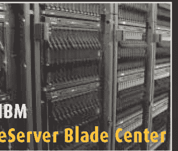

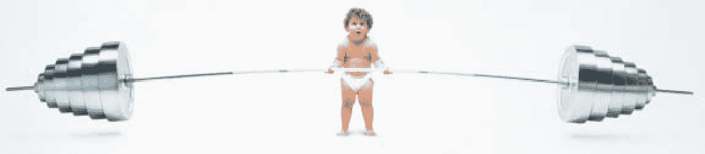

## 在最小的占地面积内体验最强大的计算能力...

由 `AMD Opteron™` 处理器驱动的 `RackSaver® BladeRack™` 专为支持各种企业解决方案而设计...包括您的。

过去 10 年里，`RackSaver` 为娱乐到石油天然气等各个行业的客户提供了市场上最强大、可靠且可扩展的高性能集群。我们的客户明白，通过提高服务器机房的密度，他们可以在降低总体拥有成本的同时提高生产力。此外，`RackSaver` 提供全天候 24 小时、每周 7 天的现场企业级完整支持，以最大化您的投资保护。了解为何像 `Industrial Light and Magic`、`NVIDIA`、`Shell`、`WesternGeco` 和 `Novartis` 这样的行业领导者依赖 `RackSaver` 满足其所有高性能计算需求。


## 我们提到我们还销售高端可定制图形工作站吗？

`RackSaver` 已推出全新高端图形工作站系列。由 `NVIDIA Quadro® FX` 系列驱动的 `NemeSys™` 将领先的设计和数字内容创作应用提升到新的交互水平。首次，造型和生产渲染成为设计工作流程的组成部分，缩短生产周期并实现更快上市时间。

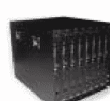

## 需要一种可以放在办公桌下并提供前所未有强大性能的刀片解决方案吗？

`HIVE™` 可容纳多达 11 个刀片，可容纳各种选项，包括高端服务器、`SAN`、基于 `NAS` 的存储以及 `InfiniBand®`。8 刀片和 11 刀片版本均与 `RackSaver` 的 `RS-1100VM BladeRack` 产品线完全兼容。`HIVE` 的创新冷却技术专为小型机架系统的需求而设计，也使其适用于包括军事、工业或简单办公环境在内的各种环境。

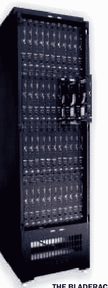

`RackSaver`

高密度服务器领导者！

立即通过访问 `RackSaver` 在线网站 `www.racksaver.com` 开始配置您公司的高性能超级计算解决方案，或致电我们的其中一位客户经理 (888) 942-3800。

## `AMD Opteron™` 专家

## 安装在犹他大学的国家卫生研究院最大 `AMD Opteron™` 集群。

## 超过 1,000 个 CPU！


## 世界上最密集的服务器机架：

`Titan64 SuperBlade™`

130 个服务器刀片 - 一个机架内 260 个 `AMD Opteron™` 和 `AMD Athlon™ MP` 处理器！

随着集群成为超级计算解决方案的标准，需要更多的服务器来处理越来越大的数据集。`Titan64 SuperBlades™` 以以下方式解决了这些集群增长中的关键问题：

- **密度增加：** 每机架 128 个服务器节点加 2 个管理节点
- **易于维护：** 服务器可热插拔且易于移除
- **易于管理：** 系统管理员可以同时远程管理多个机架
- **与现有数据中心集成：** 客户指定的电源连接器，前后冷却
- **灵活设计：** 可选择降低刀片密度并增加 19" 机架空间
- **提高可靠性：** 大型集群会出现小型集群中未发现的问题

**`Titan64 SuperBlades™` 解决方案：**

- 减少风扇数量，使用大风扇（无小型风扇或鼓风机），
- 消除大部分电缆，并为需要维护的刀片提供选择指示器，
- 已启用 `LinuxBIOS`！

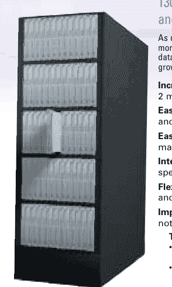

## `Titan64 Creator™` 工作站

## 高性能计算

`Titan64 Creator™` 是一系列高性能工作站，将先进的 8x `AGP` 图形功能与强大的 `AMD Opteron™` 平台集成，提供用于动画、3D 建模和 `CAD` 的内容创作引擎。

**领先性能：** 在运行 `Maya®`、`XSI®` 以及许多其他图形密集型创作应用的 `Microsoft®` 和 `Linux®` 平台上提供 8x `AGP` 图形性能。

非常适合 `PNY®` 的 `NVIDIA® Quadro® FX 1000`

**超酷设计：** 机箱设计基于冷却、功能和易于访问，同时不牺牲外观

**专注内容创作：** 我们的工站和服务器已创建并渲染了 `X-Men 2™`、`DAREDEVIL™`、`Scooby Doo™ The Movie` 和 `MIB II™` 等电影

**proven 质量：** 我们在卓越质量方面的良好记录使我们的客户能够在全球范围内部署关键任务系统

- 我们提供业界最佳的价格性能。

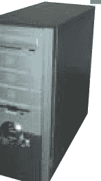

## `Titan64 SuperBlades™` 比 1U 服务器更具成本效益

## 基于 `AMD Opteron™` 的企业解决方案

`Titan64 Enterprise` 服务器非常适合需要每机架高 `CPU` 密度、可靠性和可维护性的用户，适用于包括存储、`Web` 和门户服务、应用程序开发、计算农场和安全在内的各种应用。专为关键任务 24 x 7 x 365 环境而设计，`Titan64 Enterprise™` 为企业今天交付了 64 位技术的承诺。

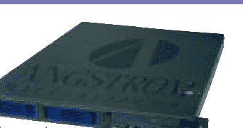

## `LinuxBIOS` 革命 – 非常适合刀片解决方案

- 启动时间快（少于 5 秒）
- 通过消除 `HDD` 提高质量并降低成本
- 远程服务器管理
  • `BIOS` 更新 • 控制台访问 • 环境监控
  • 调试失败的服务器
- 易于修补 `O/S` 并升级服务器软件

## 更深入地了解您的网络内部

## 推出支持 `NetFlow™` 的 `Cyclades-nQuirer`

当今复杂的网络承载着各种类型的流量，从客户信息到可能使网络瘫痪的病毒。拥有网络流量的可见性对于高效的网络管理和规划至关重要。

借助 `Cyclades-nQuirer`，您可以收集流量数据并将其转换为 `NetFlow™` 格式，这使您能够以更高级别的格式整合和分析网络，实现更快的问题解决并提高网络正常运行时间。所有这些都在紧凑的 form factor 中完成，并且成本仅为同类解决方案的一小部分。

借助 `Cyclades-nQuirer`，您将能够深入了解您的网络，并像从未有过的那样理解它。

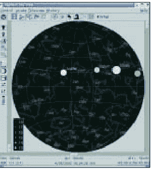

## 编辑寄语


## 下一个项目的工具、技巧与技术

无论您是在设计新的家庭影院、天文台还是安全软件，本期内容应有尽有。作者：`DON MARTI`

如果您说了算，事情会不会不一样？无论您想将喜欢的电视节目刻录到 `DVD` 上，为设备驱动程序增加额外的安全检查而又不向营销人员泄露信息，还是简单地将 `Linux` 移植到新的 64 处理器服务器上，如果您说了算，您会做得更好。

我有个消息告诉您。您确实说了算。您是一家跨国技术帝国的首席执行官，该帝国与世界各地的政府、公司和大学，甚至您朋友的热门新创公司都有合作研发项目。

如果您不相信我，请看看硬盘上已有的 `COPYING` 和 `LICENSE` 文件。无论您是为自己工作、创办公司还是在大型公司里辛苦工作，您都可以自由地参与并在此基础上构建有史以来最伟大的信息技术研究成果。而且与缓慢的大型“共享源”交易不同，您无需打电话给律师即可接入并开始构建。

## 按您的方式进行个人视频

`Christian A. Herzog` 在第 30 页的文章就是这一点的最好证明。想要一台可以备份的个人视频录像机吗？只要主要电子产品厂商为有线电视公司的律师设计产品，您就会让家里的电视观众比厂商更开心。

当您观看电视时，您的硬盘驱动器正在悄无声息地，或许并不那么悄无声息地，拼命运转直至报废。有了 `Bruce Allen` 在第 74 页的文章，您可以提前收到警告，并在自己安排的时间更换驱动器，而不是在它自行故障的半夜更换。

## 内核力量


在本期特别的内核专题中，您将了解到缓存不仅仅是用来炫耀的处理器规格。它是一种复杂的资源，您可以很好地使用它，也可以“吹掉缓存”然后慢得像主内存一样。了解 `Linux` 如何使用缓存，请参阅 `James Bottomley` 在第 58 页的文章。

本期还有大量其他内核创新。查看 `Greg Kroah-Hartman` 在第 48 页实现的经过密码学签名的内核模块。`Paul E. McKenney` 回来了，这次与 `Dipankar Sarma` 和 `Maneesh Soni` 一起，在第 38 页解释了 `SMP` 服务器的一次重大性能提升。

## 软件大师的秘诀

`Lisa Corsetti` 想找到一种方法来检查以太网电缆是否已插入。答案打开了 `ioctl` 的神秘之门，所有内容都在第 54 页进行了说明。

每期，`Marcel Gagné` 都会探索 `Linux` 软件的某个新领域，这次他从分子到桥梁创建模拟结构。您能建造出能站稳的东西吗？或者需要切断多少个链接才会使其倒塌？请在第 18 页找到答案。

`Don Marti` 是 `Linux Journal` 的主编。

主编 `Don Marti`, `ljeditor@ssc.com`

执行编辑 `Jill Franklin`, `jill@ssc.com`

高级编辑 `Doc Searls`, `doc@ssc.com`

高级编辑 `Heather Mead`, `heather@ssc.com`

艺术总监 `Garrick Antikajian`, `garrick@ssc.com`

技术编辑 `Michael Baxter`, `mab@cruzio.com`

高级专栏作家 `Reuven Lerner`, `reuven@lerner.co.il`

`CHEF FRANÇAIS` `Marcel Gagné`, `mggagne@salmar.com`

安全编辑 `Mick Bauer`, `mick@visi.com`

撰稿编辑 `David A. Bandel` • `Greg Kroah-Hartman` • `Ibrahim Haddad` • `Robert Love` • `Zack Brown`

校对 `Geri Gale`

销售与市场营销副总裁 `Carlie Fairchild`, `carlie@ssc.com`

市场经理 `Rebecca Cassity`, `rebecca@ssc.com`

国际市场分析师 `James Gray`, `jgray@ssc.com`

区域广告销售

美国北部：`Joseph Krack`, `+1 866-423-7722` (`toll-free`)

美国东部：`Martin Seto`, `+1 905-947-8846`

美国南部：`Annie Tiemann`, `+1 866-945-6646` (`toll-free`)

广告咨询 `ads@ssc.com`

出版商 `Phil Hughes`, `phil@ssc.com`

网站管理员 `Jeff Tinsler`, `webmaster@ssc.com`

技术经理 `Dan Wilder`, `dan@ssc.com`

编辑顾问委员会

`Daniel Frye`, `Director`, `IBM Linux Technology Center`

`Jon “maddog” Hall`, `President`, `Linux International`

`Lawrence Lessig`, `Professor of Law`, `Stanford University`

`Ransom Love`, `Director of Strategic Relationships`, `Family and Church History Department`, `Church of Jesus Christ of Latter-day Saints`

`Sam Ockman`, `CEO`, `Penguin Computing`

`Bruce Perens`

`Bdale Garbee`, `Linux CTO`, `HP`

`Danese Cooper`, `Manager`, `Open Source Program Office`, `Sun Microsystems`

## 强大

`jet`

`locomotive`

`bodybuilder`

`Paracel Cyclone`

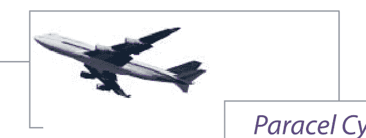

## 可靠

`dog`

`firefighter`

`parachute`

`Paracel Cyclone`


## 灵活

`clay`

`wire`

`gymnast`

`Paracel Cyclone`


## 强大

可靠

且灵活

`Paracel Cyclone`


## Paracel Cyclone

十多年来，`Paracel` 一直为政府机构、学术和研究机构以及全球财富 500 强公司提供高性能计算解决方案。这些客户依赖 `Paracel` 经过验证的解决方案和专业知识来完成其关键任务应用。

`Paracel` 是最早开发由 `Linux` 集群驱动的系统来解决一些最具计算需求和最复杂问题的公司之一。在 `Paracel`，我们利用我们丰富的知识和经验，与您合作设计和构建专门针对您应用的 `Linux` 集群。

我们提供预配置的完整系统，其中包含您所需的所有硬件和软件选项和工具，以实现无缝迁移、快速部署和最佳性能。无论您需要八个 `CPU` 还是一千个 `CPU`，针对计算流体动力学、图形渲染或生命科学研究等应用，`Paracel` 都能提供满足您独特计算需求的解决方案。

立即致电我们，享受免费专家咨询，电话 `877.321.FAST`

## Paracel Cyclone

`Paracel Cyclone` 是一款即插即用的 `Linux` 集群解决方案，可灵活配置以满足各种应用需求。采用优质组件构建并经过严格测试，`Paracel Cyclone` 提供卓越的性能和可靠性。`Paracel Cyclone` 享有三年保修，并由 `Paracel` 不妥协的服务和支持提供保障。立即联系我们，享受免费专家咨询，电话 `877.321.FAST`

## PARACEL

应用高性能计算

`www.paracelcyclone.com`


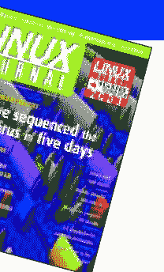

## Mondo 和 Mindi 提示

感谢您在 2003 年 10 月刊中关于使用 `Mondo` 和 `Mindi` 恢复的文章。文章写得不错，但我认为还可以包含另外几个选项。选项 `-g` 为恢复过程提供了一个不错的图形界面。选项 `-l GRUB -f /dev/xxx` 确保如果使用 `GRUB` 加载器，它将被很好地集成。选项 `-k FAILSAFE` 增加了对 `Debian/GNU` 的兼容性。我认为最后一个对 `Debian` 用户很重要。

--

`Jose Marrero`

## NEC 源代码？

我对您关于 `NEC` 容错服务器的文章 [`LJ, 2003 年 10 月`] 非常感兴趣。我是阿根廷布宜诺斯艾利斯的一名 `IT` 顾问，接触过一些容错和关键任务应用。四五个月前，我联系了 `Aspire Communications` 的 `John Fitzsimmons` 先生，希望帮助我获取 `NEC` 的 `FT Linux` 源代码。据我所知，该软件必须根据 `GPL` 发布，但截至今天我仍无法获得该软件。因此，从您的文章中得知“...`NEC` 告诉我们他们坚定致力于根据 `GPL` 向公众发布所有更改。”真是太好了。我想我只需要再等一会儿。您对该发布有大约的日期吗？

还有一点，正如文章所述，“在撰写本文时，`NEC` 正在审查和记录其内核更改，以便计划通过 `OSDL` 的 `Carrier Grade Linux` 项目进行公开发布...”，您能告诉我该如何从 `OSDL` 获取该发布吗？它将对公众开放还是仅限 `OSDL` 成员？

--

`Pablo J. Rogina`, `IT Consultant`

> *`Dan Wilder` 回复：我目前不了解此类发布。我将此消息抄送给 `Fitzsimmons` 先生，希望他能发表评论。*

## 仅电子订阅？

只是想知道您是否会为 `Linux Journal` 提供电子版订阅。对于海外读者来说，订阅费有点贵。我想那是由于运费造成的。如果您能以与美国国内订阅费相同或更低的价格提供电子版作为订阅选项，那就太有帮助了。

--

`Simon`

> *你不是第一个问这个问题的人。我们目前还没有这样做，但我已请我们的订阅部门调查是否可以做到。——编者。*

## Mick 的 LDAP 和 IMAP 更正

我在“使用 `LDAP` 和 `IMAP` 安全邮件，第一部分”[`LJ, 2003 年 11 月`] 文章中有两个错误。首先，文章早期我提到（关于 `Cyrus IMAP`）“...使用数据库而不是平面文件来存储消息具有明显的性能优势。”实际上，虽然 `Cyrus IMAP` 确实用数据库文件对消息进行索引，但它将消息本身存储为单独的平面文本文件。


其次，文章后面我正确指出，要在 `SuSE` 上配置 `Cyrus SASL` 以使用 `LDAP`，必须编辑 `/etc/sysconfig/saslauthd` 中的参数 `SASLAUTHD_AUTHMECH`。问题是，`SuSE` 中的 `Cyrus SASL` 包未编译 `LDAP` 支持。您要么需要使用 `SuSE` 的 `cyrus-sasl2 source-RPM`（`SRPM`）构建自己的 `LDAP` 启用包，要么完全放弃 `SASL` 中的直接 `LDAP` 支持，转而使用默认已编译的 `PAM` 方法。在后一种情况下，您需要安装 `pam_ldap` 模块，然后创建一个文件 `/etc/pam.d/imap`，包含以下行：

```
#PAM-1.0
auth    required    /lib/security/pam_ldap.so
account required    /lib/security/pam_ldap.so
```

接下来，将文件 `/usr/share/doc/packages/pam_ldap/ldap.conf` 复制到 `/etc/openldap/ldap.conf`，并根据您的环境进行编辑（最相关的设置是 `host`、`base`、`binddn`、`bindpw` 和 `TLS_REQCERT`）。最后，编辑 `/etc/sysconfig/saslauthd` 以包含以下行：

```
SASLAUTHD_AUTHMECH=pam
```

对于这两个错误可能造成的任何混淆或不便，我深表歉意。

--

Mick Bauer

## 忙碌的主厨正在撰写另一本书

Tinyminds 的 Tony Brijeski（Fragadelic）

最近有幸与 Marcel Gagné 在咖啡馆坐下，问了他一些关于他最近出版的书籍《Moving to Linux: Kiss the Blue Screen of Death Goodbye》以及他对 Linux 今天的看法的问题。他甚至透露了正在撰写的新书；您必须阅读采访才能在 `www.tinyminds.org` 上了解详情。

--

Mark Angeli

## Modula-3 比 C++ 和 Ada 更好

这是对 Dennis Ludwig 在 2003 年 11 月刊中来信“ Ada 并非糟糕” 的回应。我是 Dennis Ludwig 声明“我从未遇到过真正了解该语言的 Ada 批评者”的反例。我在 Ada 上编程，主要是从 1986 年起全职工作，在三家 Ada 编译器上进行过严肃的开发工作，并在十多年里担任过驻地 Ada 语言律师。它很糟糕，我讨厌它。话虽如此，它也不及 `C++` 那样糟糕，Ludwig 主要将 Ada 与之比较。我确实同意他引用的网络文章中的许多内容。两种语言都以相似的程度过度复杂化。大多数在任一语言中工作的程序员甚至远未理解其语言。至少 Ada 是强类型安全的，而 `C++` 继承了 `C` 的所有最糟糕的类型不安全和“未定义”行为，因此在 Ada 中缺乏理解更可能表现为编译错误而不是错误。

但最好的语言，如 Pascals、Modula-2 和 Oberons，简单程度高出一个数量级，其中一些具有与 Ada 相当的有用功能列表。我最喜欢的是 `Modula-3`，其语言定义比 Ada 小十倍。它具有更灵活的类型安全分离编译、更强大的信息隐藏功能以及垃圾回收或

## ASPEN SYSTEMS 提供全球最佳的 Beowulf 集群解决方案

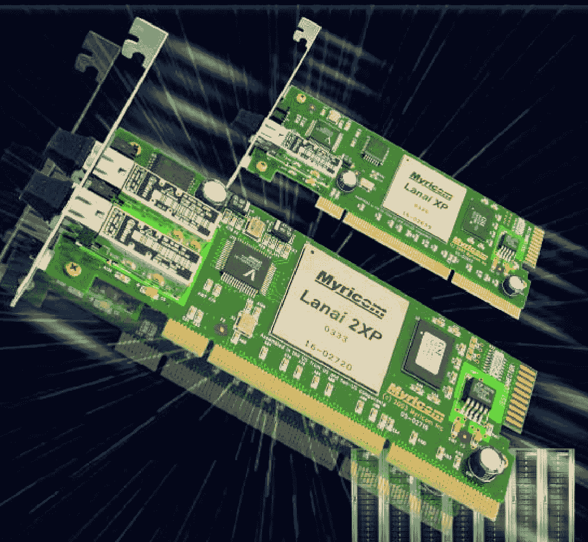

Aspen Systems 提供采用 Myricom 的 Myrinet-2000 PCI-X 卡的 Beowulf 集群和高性能计算（HPC）解决方案：低成本的 M3F-PCIXD 卡，以及高端 M3F2-PCIXE 卡。Aspen Systems 定制的 Beowulf 集群和采用新 E 卡的 HPC 解决方案每张卡提供 2 个光纤端口，带宽翻倍，因此现在可实现高达 1GByte/s —— 与 1GByte/s 的 PCI-X 总线完美匹配 —— 实现双倍速度且高度可靠的连接。

Myricom 的 D 卡和 E 卡 PCI-X 接口设计为可与 Myricom 提供的开源 GM-2 和 MX Myrinet 软件支持高效协作。GM-2 是在全球数千个集群中使用的消息传递系统的最新演进。MX 是一种新的消息传递系统，针对 MPI、VI 和 Sockets 中间件进行了优化。表格显示了在双 Xeon 主机上 D 卡和 E 卡的 GM-2 和 MX 用户级微基准测试。

如需了解有关 Aspen Systems 采用 Myrinet-2000 PCI-X 卡的 Beowulf 集群和 HPC 解决方案的更多信息，请联系 Aspen Systems 的销售工程师团队，拨打美国和加拿大境内免费电话 800.992.9242 或 303.431.4606，或通过互联网访问 www.aspsys.com


### D card Microbenchmark

| Units | GM | MX |
|---|---|---|
| One-way data rate | ... | ... |

### E card Microbenchmark

| Units | GM | MX |
|---|---|---|

Myricom 授权经销商

显式释放的堆对象，均不在 Ada 中。Ada 具有非整数定点类型，这非常罕见。否则，功能列表的差异很小。有兴趣的读者可以在 `www.cs.wichita.edu/~rodney/languages/Modula-Ada-comparison.txt` 阅读我对 `Modula-3` 与 Ada 之间差异的更完整总结。

--

Rodney M. Bates

## TALOSS 参与者

在 2003 年 11 月刊中，《TALOSS（三维高级定位观测潜艇软件）》文章的致谢被不慎遗漏。NUWC 的 Ken Lima 先生是 `TALOSS` 概念的提出者和项目经理，没有他的领导该项目就不可能完成。作者还想感谢海军研究办公室（ONR）第 311 代码（Paul Quinn 先生、Gary Toth 先生和 Larry Rosenblum 博士）为完成项目提供的资金。

ONR（Rosenblum 博士）资助亚利桑那州立大学的 Gregory Neilsen 博士和 Gary Graf 先生开发计算 `TALOSS` 中不规则三维区域交集的软件。该软件与主题文章中所述包含在 `TALOSS` 中的软件相同。其发明人（Graf、Nielsen、Lima 和 Drury）已为该软件准备了专利申请。

`TALOSS` 软件的大部分是在弗吉尼亚理工大学由 `NUWC` 指导下由研究生 Fernando DasNeves 编写的。他的工作资金由 ONR（Rosenblum 博士）管理的 NAVCITT II 弗吉尼亚理工大学资助提供。

海军研究实验室将该实验室在三维渲染和可视化方面的专业知识贡献给了由 `NUWC` 主导的项目。`NRL`（最初是 Rob King 先生）对 `TALOSS` 沉浸式变体中的三维交互设备进行了研究。随后，时任 `NRL` 员工的 Douglas Maxwell 先生使用数字海图数据库在 `TALOSS` 中开发了一种基于三维网格的海底渲染方法。Maxwell 先生还开发了 `TALOSS` 中使用的碰撞检测算法。自一年前加入 `NUWC` 以来，Maxwell 先生在项目中的主要角色是技术顾问。

`NUWC` 的 Richard Shell 先生过去三年担任 `TALOSS` 项目的技术负责人。Todd Drury 先生是 `TALOSS` 的 `NUWC` 软件开发负责人，过去三年负责 `TALOSS` 软件的设计和开发。目前在 `TALOSS` 中实施并在《Linux Journal》文章中提及的底部渲染方法是由 Drury 先生完成，Maxwell 先生的方法作为后续候选。几月前已为该软件提交了专利。

作者对这些致谢的不慎遗漏表示遗憾。感谢所有参与者的辛勤工作和奉献精神，该项目取得了巨大的成功。

--

Douglas B. Maxwell, MSME, Research Scientist/Mechanical Engineer, Naval Undersea Warfare Center

## 请多介绍集群应用

我一直有一种个人挥之不去的好奇，想用几台 readily available 的机器搭建自己的家庭集群。建好之后，我能做什么呢？关于这个问题，你们的 2003 年 11 月刊很棒，但缺少了我最想了解的一点。能否考虑一篇介绍集群可用不同应用的文章？

--

S. B.

## Linux 培训？

作为一名自学的 Linux 用户，我非常喜欢并感激 LJ 发表的资讯。我想了解更多，正在寻找 Linux 课程，但似乎只能找到偶尔的 Linux 大会或提供 Linux 认证的工作坊。获得 Linux 认证是我的目标，但我知道我仍需要课堂学习。你能指点我正确的方向吗？谢谢！继续加油！

--

Jason Fales, Dallas, Texas

试试 `lintraining.com` 上的目录。——编者。

## fgets 很好，gets 很坏


我很喜欢 2003 年 11 月刊中 `Cal Erickson` 的文章《Writing Secure Programs》，并且肯定会去查看 `FlawFinder` 和其他工具。一个小问题：不要在读取数据时使用 `fgets`，因为这会导致溢出。我认为这是一个笔误；应该是 `gets`...会导致溢出，因为 `fgets` 有长度参数。

`Collin Park`

> 你说得对。一旦你完成了要求使用 `gets` 的那个 C 语言入门课程，你就再也不会使用它了。——编者。

## 生物信息学软件的许可

在 2003 年 11 月刊封面文章《Sequencing the SARS Virus》中，`Krzywinski` 和 `Butterfield` 将 `phred`、`phrap` 和 `consed` 称为人类基因组计划的开源主力。虽然这些程序确实是生物信息学主力，并且在它们可获得的免费用学术许可条款下，按专有软件标准来看相当慷慨，但其分发条款至少在歧视从事领域方面不符合开放源码定义。条款适用于学术或非营利用途，但不适用于商业用途（开放源码定义版本 1.9，第 6 节）。

文章中提到的另一主力 `BLAST` 已分化为两个主要分支，一个属于公共领域（可从国家生物技术信息中心 [NCBI] 获得），另一个的分发方式与 `phred`、`phrap` 和 `consed` 类似。

`D. Joe Anderson`

## 勘误

2003 年 10 月，第 88 页：`David Gordon` 和 `Ibrahim Haddad` 的文章《Building a Linux IPv6 DNS Server》中的清单 1，在前两行之后应有一个闭合大括号。

2003 年 11 月，第 50 页：`Martin Krzywinski` 和 `Yaron Butterfield` 的《Sequencing the SARS Virus》中的命令行生物信息学侧栏，代码第三行的 `tau` 应为 `tr`。

我们欢迎您的来信。请将致编辑部的信件提交至 `jeditor@ssc.com` 或 `SSC/Editorial, PO Box 55549, Seattle, WA 98155-0549 USA`。

## 管理数据中心时安全真的有这么重要吗？


- 生物识别认证
- 加密（`SSH`）
- `IP` 过滤
- 审计

## 我们的也一样，只是包装更小。

- 指纹身份验证扫描仪
  `AlterPath™ Bio`
- 企业 `KVM` 解决方案
  `AlterPath™ KVM`
- 高级控制台服务器
  `AlterPath™ ACS`
- 网络管理网关
  `AlterPath™ Manager`
- 智能电源分配单元
  `AlterPath™ PM`

`Cyclades` 的数据中心管理解决方案在其整个产品线——包括控制台服务器、电源管理、`KVM`、生物识别扫描仪和网络管理——中提供全方位的安全功能。

凭借 `SSH` v2、`IP` 过滤、强身份验证、事件日志记录和数据日志记录，`Cyclades` 可以让您的网络成为数据中心世界中的安全重量级竞争者。


## `/usr/src/linux/CREDITS`

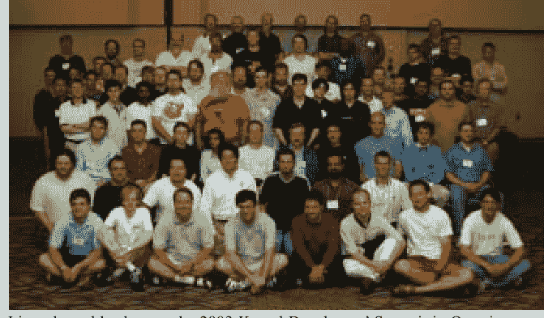

2003年在加拿大安大略省举行的内核开发者峰会上的`Linux`内核黑客，由`Richard Guy Briggs`拍摄并由`Robert Love`提交。

## milter-sender

`www.snert.com/Software/milter-sender`

`milter-sender`是`Sendmail` `milter`插件，在接收邮件时可回连到邮件发送者。基本上，如果发送者在其声称的主要邮件服务器上不存在，则该邮件几乎肯定是垃圾邮件并将被拒绝。该插件显著减少了我的垃圾邮件。而且，虽然军备竞赛尚未结束，但我始终可以添加更多`milter`插件。我现在通过`milter`运行`milter-sender`和`SpamAssassin`。需要：`Berkeley DB`、带`milter`的`Sendmail`、`libsnert`和`glibc`。

> —`DAVID A. BANDEL`

## LJ 索引—2004年1月

- 1. 2002年至2003年9月中旬开发中的`Linux` 2.6内核的更改次数：12,479
- 2. 内核中的合并次数，不计入代理应用补丁：2,386
- 3. 每日合并的近似平均次数：9
- 4. 参与内核开发的个人开发者数量：554
- 5. 内核开发者前10%完成的所有更改的百分比：78
- 6. 内核开发者前20%完成的所有更改的百分比：90
- 7. 2002年`Linux`在付费服务器操作系统环境（`SOE`）类别中的占比：23.1
- 8. 2002年`微软`在付费`SOE`类别中的占比：55.1
- 9. 2002年`SOE`环境中出货的新许可证数（百万）：5.7
- 10. 2002年`Linux`在客户端操作系统环境（`COE`）类别中的份额占比：2.8
- 11. 2002年`Macintosh`在`COE`类别中的份额占比：2.9
- 12. 2002年其他操作系统在`COE`类别中的份额占比：0.5
- 13. 2002年`微软`在`COE`类别中的份额占比：93.8
- 14. 2002年除`Linux`和`Windows`外收入增长的操作系统数量：0

## Sources

1–6：`Linus Torvalds`

7–14：`International Data Corp.`

## They Said It

> 有很多关于企鹅的原因。我被企鹅咬过。这是一个真实的故事。有趣的是，关于企鹅的网站有很多。有《Tux的历史》(`www.sjbaker.org/tux`)之类的。有些网站也有我的解释。它们几乎都说，“这是一个很棒的故事，但不是真的。”——我被企鹅咬了。

这是真的！我被企鹅咬了！

> 我的意思是，真的！听我的！我受伤了！

好吧，所以他不是六英尺高。

—`LINUS TORVALDS`，摘自他在2003年9月`Linux Lunacy`极客巡航上的演讲

> 我们在迁移到`Linux`方面非常积极；目标是不购买新的`UNIX`设备……直到一年前，大多数主流应用都在`UNIX`上。后勤系统在大型机上，但其他一切都在`Sun`上。

—`LEHMAN BROTHERS` `CIO` `EMEA` `RUSSELL` (`www.cbronline.com/magazine/2d7f2e75fecd8bbfc2256d7800317032`)

> 任何涉及`Linux`的东西。

—`GAP CORP.` `CIO` `KEN HARRIS`，关于其公司技术项目优先事项 (`asia.cnet.com/newstech/systems/0,39001153,39154483,00.htm`)

## Linux On Demand

您决定...每块板上都准备好`Linux`

### `IanPMC-4Gx`

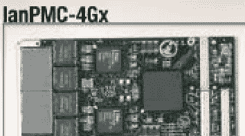

### 四端口千兆以太网铜缆或光纤 `PMC` 适配器

- 2 或 4 个自动协商的 `10/100/1000` 以太网端口
- 光纤版本支持长距离和短距离
- 铜缆版本自动检测速度、单工/全双工、流控制以及极性和电缆长度检测

### `wanADAPT-C4T1E1`

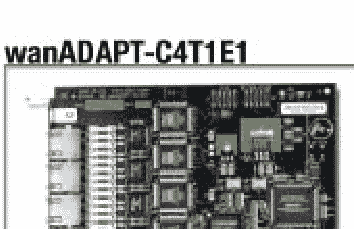

### 通道化四端口 `T1/E1/J1` `PCI` `WAN` 适配器

- 128 个通道（`DS0`）
- 从 `DSX` 到 `DS1` 的线路构建
- 支持 `D4`、`SF`、`ESF`、`SLC-96`、`JT-6704` 帧格式
- 可选时钟选项

### `HW400c/M` `DKL`

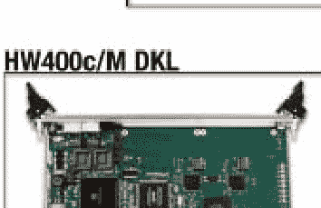

### 具有双 `PTMC` 站点的 `6U` `CPCI` 处理刀片

- `333 MHz PowerPC CPU`
- 启用 `PICMG 2.16` 分组交换背板
- 双 `10/100` 以太网端口
- 包含 `TimeSys Linux GPL` 软件开发工具包
- 适用于 `T1/E1`、`T3/E3`、`HSSI`、`V.35`、`X.21` 及其他 `SBE PMC` 的驱动程序

## SBE®

`WAN` • `LAN` • 存储 • 运营商 • 定制

按需灵活性 | `925-355-2000` | `info@sbei.com` | `www.sbei.com`

## `diff -u`：内核开发的新变化


## 事件通知与系统钩子

Intel已发布了一些事件通知补丁，除了进程创建时已有的钩子外，还在进程终止时提供分析钩子。Intel的工作应有助于增强`Oprofile`、`Perfmon`和`VTune`等分析工具。尽管添加此类钩子可能为专有软件供应商绕过GPL许可限制提供途径，但似乎Intel的工作并不存在该问题。`Frederic Rossi`也在从事自己无关的事件通知代码，即异步事件机制（`AEM`）。`AEM`允许通用用户空间应用程序通过提供自己的事件处理程序集来注册系统事件[LJ，2003年7月]。其主要目标是能够快速地将数据从内核传递回用户空间。虽然Intel和`AEM`的工作没有直接关系，但它们揭示了Linux开发中系统各层之间通信日益增强的有趣趋势。

## 数字签名验证

`DSI`开发团队制作了一个独立模块，名为`digsig`，在运行可执行程序之前检查其嵌入的数字签名。如果文件被修改，`digsig`会阻止其调用。各种各样的应用都可以使用它——从蠕虫保护到数字版权管理。与可信计算的证明功能不同，`digsig`的验证过程仍由机器所有者控制。例如，远程系统无法依赖您系统上的`digsig`模块来验证您的计算机是否正在运行那些远程系统批准的特定版本的特定软件。

## AMD Athlon 预取指令错误

显然，所有`AMD Athlon`处理器都存在一个错误，在某些条件下会导致预取指令对某些地址产生内存管理故障。这与臭名昭著的`f00f` `Pentium`错误类似，因为两者都是硬件本身的错误，操作系统只能绕过。好消息是，在大多数情况下，该错误不会造成任何实际损害。触发该错误的情况很少，这可能解释了为什么它长期未被发现。`Andi Kleen`一直在为`2.4`和`2.6`开发Linux变通方法，而AMD方面已确认他的变通方法将与硬件中已修正该错误的未来`Athlon`向前兼容。然而，据`Andi`称，一些`Athlon`，包括`K7`，可能永远不会被修复，因此他的变通方法可能需要在新系统上使用很长时间。

## SGI Altix 驱动与专利争议

`SGI`已发布其`Altix`串行控制台的GPL驱动程序，但在版权声明中，`SGI`明确保留了该代码中使用的任何专利的权利。虽然自由软件基金会已向`SGI`确认这在技术上并不违反GPL，但它可能导致一种情况，即来自GPL项目（如内核）的代码不被允许用于其他GPL项目。那么问题就来了，在这种条件下，代码是否应被允许进入内核？`Alan Cox`决定与`SGI`和`FSF`一起调查此事，以确认`FSF`确实不认为这违反GPL，并查看`SGI`是否愿意修改其立场。

## slabtop 内存监控工具

`Chris Rivera`和`Robert Love`发布了`slabtop`独立实用程序，这是一个用于监控缓存中内存分配和释放的工具。内核维护一个分配内存的缓存，根据需要将其分配给进程。但有时需要释放这部分内存，而`slab`就是实现这种释放的方式。`slabtop`工具监控每个`slab`缓存，实时呈现该`slab`的数据，并同时更新系统上所有`slab`活动的一组全局统计信息。

## 内核头文件分离

`Matthew Wilcox`开始将内核头文件分为两类，即应对用户空间源可见的头文件和不应可见的头文件。当用户应用程序依赖错误的内核头文件时总是一个问题。随着内核的增长和变化，头文件也可能发生变化，用户软件可能会中断。为此，必须保持严格的分离。`Matthew`的工作使这变得更容易。他还成功地激励了其他人，如`Erik Andersen`，开始清理一些类型命名约定，为`2.6`做准备。

## 按编译器划分代码

已启动一种新的内核代码划分方式，与`arch/`目录类似。但与按架构划分代码不同，新划分按编译器划分。自从Intel的`ecc`编译器成为继`GCC`之后第二个能够成功构建Linux内核的编译器以来，出现了细微的冲突，导致开发人员开始提交专门处理一个编译器或另一个编译器特殊性的补丁。在最近关于内联汇编支持的争论之后，`GCC`支持但`ecc`不支持，`Linus Torvalds`决定创建按编译器划分的目录来容纳与特定编译器相关的所有补丁。`Sam Ravnborg`和`David Mosberger`似乎决定领导该工作，他们已经提交了补丁以启动过渡。

—`ZACK BROWN`

## They Said It

找到既不发火、冷静理性、又有品味的人非常非常困难。我的意思是……给我一个诚实的人。这……不太发生。同时，当它发生时，意义很大。只是少数几个人就能产生巨大差异。

> —`LINUS TORVALDS`, ALSO FROM HIS TALK ON THE LINUX LUNACY GEEK CRUISE

在早期，Linux在首席信息官（`CIO`）不知情的情况下被采用。这是针对文件和打印服务器等事物的技术决策，成本或可靠性是驱动因素。现在我们有了`CIO`的采用。

> —`ADAM JOLLANS`, `IBM WORLDWIDE LINUX SOFTWARE MARKETING STRATEGY MANAGER` (<https://www.vnunet.com/News/1144291>)

计算尺是一种精密仪器。好的计算尺会很耐用，事实上，如果不滥用，可以使用一生。如果你想确保物有所值，就必须提前10、20、30甚至40年考虑。

> —“`HOW TO CHOOSE A SLIDE RULE`” BY `DON HEROLD` (1940 `KEUFFEL & ESSER` CO. BROCHURE POSTED ON `mccoys-kecatalogs.com`)


## Rackspace — 由 Fanatical Support™ 支持的管理型托管

服务器、数据中心和带宽并不是托管企业级网站和 Web 应用的关键。

在 `Rackspace`，我们认为托管是一种服务，而不仅仅是技术。

`Fanatical Support` 是我们的理念、我们的信条。它反映了我们希望为客户所做的一切带来响应性和价值的愿望。从我们接听电话、您开始与我们的员工互动的那一刻起，您就会体验到 `Fanatical Support`。

`Fanatical Support` 使 `Rackspace` 成为世界上增长最快的托管公司。今天就致电体验 `Rackspace` 上 `Fanatical Support` 的不同之处。

## 使用 Bricolage 发布

使用专业的类似报纸的出版模式简化您的网站。使用 `Bricolage`，您可以设置审批并跟踪谁在编辑什么。作者：`Reuven M. Lerner`

如果您发布在线报纸或杂志，您可能已经研究过内容管理系统（`CMS`）。`CMS` 软件通过处理从用户、组、权限、编辑职责到全站模板等各种问题，使跟踪网站上的众多页面变得容易。您网站上的页面越多，或参与工作的人越多，您从 `CMS` 中受益的可能性就越大。

许多公司应运而生，提供声称能做一切但写您网站内容的 `CMS` 软件。尽管鉴于某些网站的写作质量，您有时不得不怀疑。它花了一些时间，但现在有许多开源 `CMS` 包可供选择，可以满足甚至最复杂的网站需求。其中最强大和最受欢迎的包之一是 `Bricolage`，它将 `Apache` 的 `mod_perl` 模块、`PostgreSQL` 关系数据库和 `HTML::Mason` 模板系统结合成一个整洁的包（<https://sourceforge.net/projects/bricolage>）。

在本专栏之前的几期中，我们研究了一些 `Mason` 系统的基本配置，包括可在某些事件发生时触发的警报。然而到目前为止，我们一直忽视了 `CMS` 的最重要任务，即将内容发布到实际的网站。本月，我们跟随一篇文章从构思到发布，沿着 `Bricolage` 的发布路径进行。

### 创建站点

这一切的第一步是创建一个可以发布内容的网站。我在我的服务器上创建了一个名为 `output.lerner.co.il` 的虚拟主机，并为其设置了自己的错误和访问日志目录。然后我在 `Apache` 配置文件中添加了适当的 `VirtualHost` 指令，如下所示：

```
<VirtualHost 69.55.225.93>
    ServerName output.lerner.co.il
    ServerAdmin reuven@lerner.co.il
    DocumentRoot /usr/local/apache/
        v-sites/output.lerner.co.il/www
    CustomLog /usr/local/apache/v-sites/
        output.lerner.co.il/logs/access-log combined
    CustomLog /usr/local/apache/v-sites/
        output.lerner.co.il/logs/referer-log referer
    ErrorLog /usr/local/apache/v-sites/
        output.lerner.co.il/logs/error-log
</VirtualHost>
```

现在，当我的服务器收到对 `output.lerner.co.il` 的请求时，它会在 `output.lerner.co.il/www` 目录中查找，而不是在通常定义为主文档根目录的 `/usr/local/apache/htdocs` 中查找。


## 配置 Bricolage 发布目标

在我们能够使用 `Bricolage` 将任何文章发布到 `Web` 之前，我们必须告诉 `CMS` 新文件应存放在何处。在 `Bricolage` 中，这是在 `Distributions` 标题下的 `Destinations` 菜单选项中完成的。您可以创建多个输出目标，从而使用单个 `Bricolage` 实例托管多个站点。这可能是出版商的工作人员制作几份不同报纸的情况。每个输出目标可以位于本地文件系统上，也可以位于通过 `FTP` 访问的远程站点上。

点击 `New Destination` 创建新的发布目标。大多数小型站点只需要一个单一频道，允许所有文档导出到磁盘上的站点 `DocumentRoot`。然后您必须指出一些事项：
1）网站是否驻留在与 `Bricolage` 系统相同的计算机上，或者文件是否必须使用 `FTP` 复制到远程计算机；
2）应对此保密的输出频道。

我们假设 `Bricolage` 服务器和最终的 `Web` 服务器位于同一台计算机上——但在更大规模的环境中，尤其是在性能是问题时，将它们分开会更明智。第一个新目标屏幕显示在图 1 中。

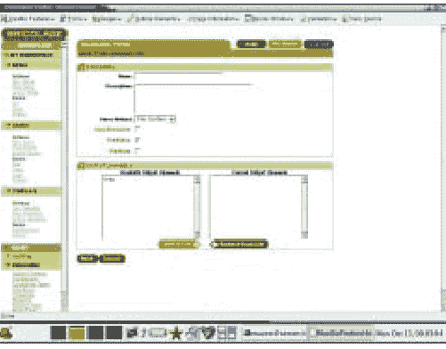

图 1. 设置新的目标

尽管 `Bricolage` 允许您定义新的输出频道，但现在请保留默认的 `Web` 频道。输出频道和目标之间的区别起初可能有点令人困惑。把输出频道想象成逻辑目标，把目标想象成物理目标，然后意识到您可以以各种不同的方式混合搭配。您可以让多个输出频道指向单个目标，也可以让单个输出频道指向多个目标。


## Linux 笔记本电脑推荐

### 广告：企鹅有各种各样的形状和大小

Linux 笔记本也应如此！

我们邀请您在 2004 年 1 月 21 日至 23 日于纽约 `Linux World Expo` 的 138 号展位试用我们的笔记本电脑。


### 流星：2 磅 Linux！

- `Sharp Actius MM10`
- `1.0 GHz Transmeta Crusoe`
- `15 GB HD`
- `256 MB RAM (Fixed)`
- `802.11b Wireless`
- `10/100 Ethernet`
- `USB Cradle`
- `0.5" Thin!`

### 渡鸦：3.5 磅 Linux！

- `IBM ThinkPad X Series`
- `1.3-1.4 GHz P-M`
- `20-40 GB HD`
- `256-2048 MB RAM`
- `APM Suspend/Hibernate`
- `802.11b Wireless`
- `10/100 Ethernet`
- `FireWire`
- `1" Thin!`


### 黑色 Perl：4 磅 Linux！

- `Sony Vaio V505 Series`
- `2.0-2.4 GHz P4-M/1.4-1.8 GHz P-M`
- `40-80 GB HD`
- `256-2048 MB RAM`
- `CDRW/DVD`
- `FireWire`
- `802.11b Wireless`
- `10/100 Ethernet`

### 巨嘴鸟：5 磅 Linux！

- `IBM ThinkPad T Series`
- `XGA 1400x1050`
- `1.3-1.7 GHz P-M`
- `20-80 GB HD`
- `256-2048 MB RAM`
- `CDRW/DVD`
- `10/100 Ethernet`
- `802.11b Wireless`
- `APM Suspend/Hibernate`


### gazelle：8 磅 Linux！

- `Sony VAIO GRT Series`
- `XGA 1600x1200`
- `2.0-2.8 GHz P4-M`
- `40-80 GB HD`
- `256-2048 MB RAM`
- `CDRW/DVD or DVD+/-RW`
- `10/100 Ethernet`
- `Memory Stick/Jogdial`
- `FireWire`

### 犀牛：7 磅 Linux！

- `Dell Inspiron 8500/Latitude D800`
- `XGA 1920x1200`
- `2.0-2.6 GHz P4-M/1.6-1.7 GHz P-M`
- `30-80 GB HD`
- `256-2048 MB RAM`
- `CDRW/DVD, DVD, CDRW, or DVD+/-RW`


`EmperorLinux` 自 1999 年以来，一直为大学、企业和个人 `Linux` 爱好者提供预装 `Linux` 笔记本电脑解决方案。我们专门从事在 `IBM`、`Sony` 和 `Dell` 制造的各种优质笔记本和便携式计算机上安装和配置 `Linux` 操作系统。我们提供最新的 `Linux` 发行版系列，以及 `Windows` 双启动选项。我们根据机器定制每个 `Linux` 发行版，并提供以下支持：`以太网`、`调制解调器`、`无线`、`PCMCIA`、`USB`、`FireWire`、`X-Server`、`CD/DVD/CDRW`、`声音`、`APM` 等。所有系统均附带一年的 `Linux` 技术支持，通过电话和电子邮件提供，并适用完整的制造商保修。访问 `www.EmperorLinux.com` 或致电 `1-888-651-6686` 了解详情。

已找到成功的 `Linux` 笔记本解决方案：

`Sandia Nat Lab`, `DOE`, `NASA`, `JHU`, `Applied Physics Lab`, `Max Planck Inst`, `Woods Hole`, `NRAO`

`Naval Research Lab`, `Smithsonian Institute`, `Los Alamos Nat Lab`, `UC Lawrence Berkeley Labs`, `NOAA`

`Lawrence Livermore Nat Lab`, `US Army Research Lab`, `U Penn`, `U Utah`, `U Maryland`, `Yale`, `Cornell`

`Columbia`, `U Oregon`, `NC State`, `Duke`, `U Massachusetts`, `George Mason`, `Colorado State`, `Caltech`

`U Illinois`, `Georgia Tech`, `U Minnesota`, `U Chicago`, `Pace U`, `UCSF`, `UCSD`, `Rutgers`, `Princeton`

`NYU`, `Purdue`, `Boston U`, `MIT`, `U Arizona`, `George Washington U`, `U Hawaii`, `U Maine`

`www.EmperorLinux.com` `1-888-651-6686`

### 定义服务器部分

一旦您提供了有关新目标的一些基本信息，您必须定义至少一个操作（`"move"`），然后定义最重要的部分，即服务器部分。在服务器部分中，您指定最终应存放文件的服务器。正如我们已指出的那样，我们是复制文件而不是使用 `FTP`，因此我们只需填写目标路径名，该路径名应与文档将可用的 `Apache` 虚拟主机的 `DocumentRoot` 匹配。

## 编写与发布

现在我们已经创建了输出通道，可以返回并创建新的故事，戴上记者的帽子。（请记住，这些菜单通常 intended to be used by 杂志员工的不同人员或人员组。）在`“故事”`菜单中点击`“新建故事”`，为其提供至少一个标题、一个分类（`/`，除非您已定义其他分类）和一个优先级（`普通`）。您还可以设置发布日期，该日期不仅表示故事应何时发布到网络上，还表示其应可用的 `URL`。`Salon.com` 的长期读者可能已经注意到，每个故事的 `URL` 都包含发布日期；`Bricolage` 源自 `Salon` 开发的 `CMS`，继续沿用这一传统也就不足为奇了。

填写完这些基本信息后，点击`“创建”`按钮。现在您可以创建文章的文本，添加段落（一次一个，或使用`批量编辑`按钮并用空行分隔）。故事完成后，您可以使用页面底部的`“签入”`按钮将其提交到编辑部，发送到编辑部。

不幸的是，基于 `Web` 的界面以及 `Bricolage` 提供的灵活性意味着 `Bricolage` 的界面往往有点复杂，迫使您使用多个不同的`“提交”`按钮。幸运的是，按钮的标签很清晰，这意味着即使您最终保存故事而不是将其签入编辑部，您也不太可能意外删除故事。话虽如此，新 `Bricolage` 用户在假设所有`“提交”`按钮都一样之前，最好先阅读按钮上的标签。


## 编辑部与发布部

现在我们已将文章提交到编辑部，我们再次换帽子，假装成需要审阅故事的编辑。在“故事”菜单中“桌”子标题下点击“编辑”菜单，您将获得当前签入编辑部的所有故事的列表（图 2）。已发布的故事在其标题栏中有`P`。已签出的故事（即可由编辑更改）可以编辑。但我们现在不会编辑故事，因为我们知道作者总是能完整写完句子并仔细核对工作。对于现在，我们将其发送到发布部，在那里内容会最后审阅一次然后发送到网络。我们通过在“移至”菜单中选择“发布”然后点击“移动资源”来完成此操作。

然后我们可以前往发布部，在那里项目在发布到网络之前会进行最后一次审阅。请注意，`Bricolage` 内置了校对和法律审查的支持。您也可以创建新的工作台，如果

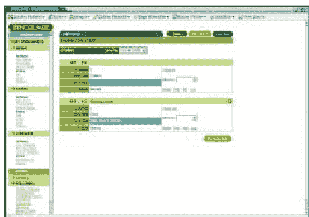

图 2. 在编辑部，您可以检查准备编辑的故事。

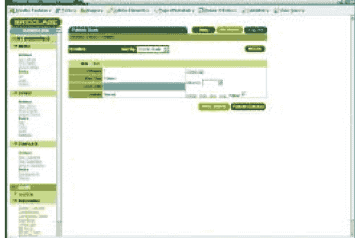

图 3. 在发布部审阅待发布的故事。

您的组织结构比默认设置更复杂。

在许多方面，发布部与其他部门相同；它允许您为故事添加注释、查看故事的编辑轨迹甚至查看更改日志。您也可以在发布部签出故事并点击“编辑”链接来编辑故事。然而，发布部最重要的部分是额外的复选框（不出所料，标记为“发布”）和一个标记为“发布已选”（图 3）的按钮。

当您点击“发布已选”时，`Bricolage` 会给您选择故事应何时发布的选项。这与故事的发布日期不同。例如，您可能希望一篇发布日期为 2 月 1 日的故事在 1 月 31 日就可用。或者，您可能希望它仅在 2 月 7 日可用。点击“发布资源”按钮会启动此流程，`Bricolage` 会报告已发布相关故事（或故事）。果然，我们的文档已发布到我们之前为其分配的 URL——在本例中为`DocumentRoot`中的`index.html`。

## 管理问题

当印刷报纸或杂志发布故事时，没有办法更改已显示的内容。但在网络上，您只需修改相关故事，每个人立即就能看到更改。忽略这种技术能力引发的新闻伦理问题，`Bricolage` 使纠正故事然后将其重新部署到网站上变得很容易。

要修改已发布的故事，请转到“活动故事”菜单项，其中会列出当前可用的故事。您可以选择签出一个故事，使其可供当前用户编辑。（`Bricolage` 的版本控制系统确保一次只有一个人员可以编辑文件。）然后您可以编辑文件并将其发送到编辑部，就像您最初撰写故事时所做的那样。同样，编辑部必须将其传递给发布部；从那里它可以发布到网络。

如果您之前只从事过小型网站，那么这项任务可能看起来过于复杂。毕竟，网络的魅力之一不就是我们可以更改文档并立即看到更改结果吗？内容管理系统确实给网站的运作引入了一系列权衡。您不能再简单地在磁盘上修改文件；您必须登录，签出文件，进行修改，签回并发送到发布部，后者甚至可能拒绝您的更改。

但无论此流程多么复杂和官僚，它都比另一种选择更好，即多人争夺文件的所有权或不同人员尝试在实时站点上编辑同一文件——有时以不同的方式。`CMS` 的设计目的是减缓您的速度，就像安全带旨在防止您移动过多一样。但在两种情况下，限制都是为了帮助您，阻止您伤害自己。此外，这种官僚程序在关键时刻可以救您，因为文档的每个先前版本始终可用。因此，如果您意外删除了重要故事的一半，您可以恢复到 `Bricolage` 存储在其数据库中的先前版本。

## 结论

`Bricolage` 是一个功能齐全、复杂的开源内容管理系统，具有令人印象深刻的功能集合。正如我们本月所见，我们可以轻松设置基于 `Bricolage` 的站点，并通过我们使用`Apache`配置中简单的一组虚拟主机定义创建的分发渠道发布故事。下期专栏，我们将通过探讨如何自定义输出模板来结束对 `Bricolage` 的讨论，将简单的黑白出版物变成更具魅力的东西。

`Reuven M. Lerner` 是一位长期从事 Web/数据库咨询和开发的工作人员，现在是伊利诺伊州芝加哥西北大学学习科学专业的在读研究生一年级学生。您可以通过`reuven@lerner.co.il`联系他。


## 跟上潮流


### 急需迅速将文件服务器迁移到 Linux？

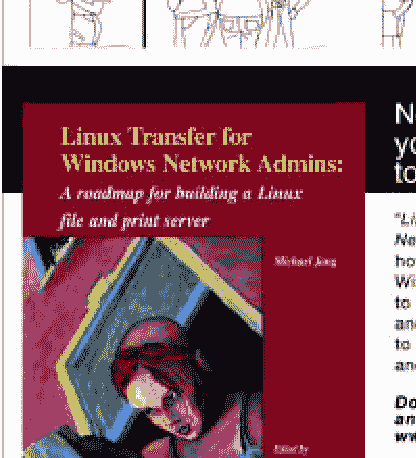

“`Linux Transfer for Windows Network Admins`” 将向您展示如何使用您作为 Windows 管理员的知识和技能，快速轻松地将现有的 Windows `PDC` 和文件/打印服务器转换为 Linux。

下载免费样章并在`www.hentzenwerke.com`在线订购

亦可在全国各地的精选书店购买

## 可扩展性：源自简洁带来复杂性

如果又一个带卡牌或枪支的游戏让你昏昏欲睡，为什么不去娱乐一下虚拟结构，或品尝一下我们厨师美味的分子呢？作者 `MARCEL GAGNÉ`

这是一分子甲醇，`François`。你问为什么？`Non, mon ami`，它可能是酒精，但它与那种最崇高的液体——葡萄酒中发现的酒精毫无相似之处。那是乙醇，而且正如你所见，其分子结构完全不同。你问我为什么要这么做？因为本期的主题是内核可扩展性。你仍然看不出联系吗？内核可扩展性，`François`，是一个迷人的开发领域。这是 Linux 未来的前沿，在这一领域工作的程序员们做出了令人惊叹的工作。只是因为当我们的客人到来时我们会品尝一点葡萄酒，我觉得另一种类型的可扩展性可能更合适。`François`，你为什么不注意听呢？

啊，我们的客人到了！欢迎，`mes amis`，来到 `Chez Marcel`，这里有精致的 Linux 美食、`exceptional` 葡萄酒和从零开始的设计。`François` 和我正在讨论本期的主题。请坐；你们的桌子已经准备好了，我忠实的侍者会立即跑到地窖 `immédiatement` 去取酒。我想 2001 年的 `Châteauneuf-du-Pape`，带有丰富的果香、诱人的口感和复杂的香气，应该很不错。你可以在入口旁的阅读室南翼找到它。

在等待葡萄酒的同时，让我向你介绍今天菜单上的第一道菜。正如我告诉 `François` 的那样，因为我们要品尝一点 `vin`，我们的专题将探索另一种类型的可扩展性。就像几行代码可以对某些内核函数的性能产生巨大影响一样，几个 `stray` 原子也会对最终的分子产品产生巨大影响。例如，考虑乙醇和甲醇之间的差异。我们中的大多数人多年前就离开了化学，唯一的例外可能是烹饪，`non`？作为 `KDE` 套件的一部分，你可以找到 `Andreas Wüst` 编写的一个小程序，名为 `KAtomic`

（图 1）。它列在游戏菜单下，与其他策略或拼图游戏一起。

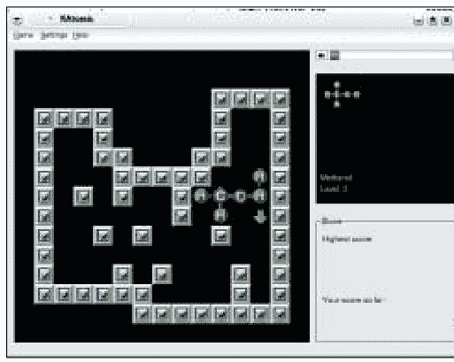

图 1. 使用 `KAtomic` 原子逐个构建分子

如果你曾经玩过 `Sokoban`，你应该能在这里注意到一些相似之处。`KAtomic` 的前提很简单。执行则稍微复杂一些。你会得到一个分子，显示在右侧窗格中，其组成原子散布在某种迷宫中。按下`Tab`键（或点击鼠标）会选择一个原子，然后你通过按下光标键使其运动。一旦运动起来，原子会一直移动，直到撞到障碍物，要么是墙壁，要么是另一个原子。这样，你就从简洁中创造出复杂性。这也是消磨你空闲时间的绝佳方式。

正如简单的代码被用来构建越来越复杂的程序一样，我们也可以从分子过渡到可见的结构。今晚菜单上的下一道菜有点难以解释，我必须承认我第一次看到它时有些怀疑。它叫做`Construeo`，说实话，它最终变成了一个令人难以置信上瘾的小程序。

`Ingo Ruhnke` 的 `Construeo` 本质上是一个二维构造程序，让你使用自己定义的点上连接的杆和弹簧在屏幕上构建物体。然后可以运行 `resulting` 结构，这本质上意味着让现实世界的物理力作用于它。想法是构建一个稳定的结构，这比听起来要难得多。如果你的创作开始摇晃最后坠落到地面，就是时候重新思考和修改你的构造了。`Construeo` 网站上的一个说明特意让我们知道它“目前不是真正的游戏”，但我不敢苟同。要参与这项发人深省的有趣活动，请前往 `Construeo` 网站 `www.nongnu.org/construeo`。

构建 `Construeo` 只需提取、配置和编译。是的，`mes amis`，这就是经典的提取和构建五步法：

```bash
tar -xzvf construeo-0.2.2.tar.gz
cd construeo-0.2.2
./configure
make
su -c "make install"
```


## 也许旧方法行不通了。

## Rackable Systems 服务器——现配备分布式直流电源——改善了热管理、可靠性和电源效率。

## 更高的可靠性与最小化维护


现由分布式直流电源驱动，`Rackable Systems` 服务器集群比竞争对手更可靠、更灵活、更高效。通过将冗余直流电源分配到每台服务器——并用可靠性高 70 倍的直流卡取代标准交流电源——可用性显著提高，服务器也更易于维护。它们运行更凉爽，利用了最快的 `Intel® Xeon™` 处理器的全部性能。最棒的是，`Rackable Systems` 直流集群接受交流或直流输入电源，便于立即部署。价格与标准交流解决方案相当。

## 有更好的方法

作为大规模数据中心解决方案的先驱，`Rackable Systems` 继续引领行业，为 `Biogen`、`Electronic Arts`、`Google`、`Inktomi`、`Lawrence Livermore National Laboratory`、`nVidia`、`SLAC`、`Tellme Networks`、`Webex` 和 `Yahoo!` 提供创新的服务器设计。我们的开放式架构配置按订单构建，以确保最大灵活性和易于维护。我们的创新机柜设计具有两倍密度，成本仅为一小部分，同时优化了热效率。凭借 `Rackable Systems` 的新分布式直流电源技术，你拥有无可匹敌的解决方案。

### 灵活配置

- 定制并按订单构建

- 开放式架构

- 卓越的远程管理

### 提高可靠性

- 冗余电源和驱动器可用

- 热效率高且优化

- 降低数据中心成本

### 轻松部署

- 全面配置并测试

- 预布线、预上架

- 快速发货

了解更多信息请访问 `www.rackable.com/dcpower` 或致电 1.866.548.2527。

另请在 2004 年 1 月 20 日至 23 日纽约市 `LinuxWorld 2004` 的 #315 展位寻找我们。

运行 `make install` 会将程序安装到 `/usr/local/games` 中。在该目录下，你可能会找到两个版本的程序，一个名为 `construo.x11`，另一个名为 `construo.glut`。在 `SuSE 8.2` 笔记本上测试 `Construo` 时，我发现使用 X11 版本时图形更清晰，文字更干净（图 2）。

程序首次启动时，你会看到一个干净的画布。程序窗口顶部可以看到一些键盘快捷键。左右两侧是控制按钮。如果你退出时中途放弃了一个设计，`Construo` 在下次游戏时会把你带回该设计。如果你像 `François` 一样，对从零开始感到畏惧，点击 `Load` 按钮并导航到 `Examples` 目录。那里会奖励你一些预建结构，你可以修改它们，直到你更有信心从头创建。

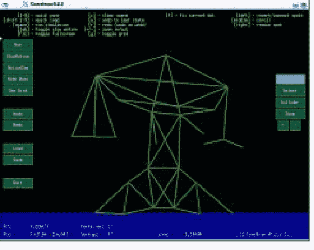

图 2. `Construo` 让设计不可能的结构变得有趣。

要添加一个点，在屏幕上左键单击，移动到你想要的相反点（或关节）所在位置并再次左键单击。要删除一个点，右键单击。在某个时候，你应该觉得自己创建了一些相当稳定的东西。点击 `Run` 按钮让物理定律开始运行，并观察你的结构在压力下的表现。很可能，你的第一个创作会弯曲、扭曲、倾倒并最终崩溃——这可能很有趣。`Construo` 让你让物体运动（查看篮球演示），放置障碍物（碰撞器）并以其他方式释放你的创造力。

要修改和加强你现在——被拆除的创作，点击 `Undo`，你的无论是什么（或曾经是）都会恢复到原来的样子。当你厌倦了创作并准备重新开始时，按 `C` 清除场景，你再次开始向新高度的机械攀升。

在坚实地面上建造东西已经很有趣了，但试着在 3-D、无重力、虚拟世界中建造它们。这就是这个 Linux 厨师遇到过的最奇怪游戏之一背后的想法。该程序名为 `Ensemblist`，是为 2003 年巴黎游戏编程展览创建的。这又是那些看似简单却最终变得更伟大的想法之一。你所要做的就是使用简单的几何形状构建屏幕上呈现的形状。这种组装使用简单的编程和数学原理：

```
boolean, union and intersection.
```

我是否忽略提到形状是三维的并漂浮在网络虚拟空间中，可以沿任何轴旋转？这是作者 `rixed` 和 `dom` 所称的 CSG，或构造实体几何（图 3）。

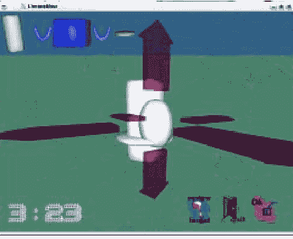

图 3. 在 `Ensemblist` 的 CSG 中从几何基元构建复杂对象

`Ensemblist` 以源代码形式分发，自 `www.nongnu.org/ensemblist` 获取。提取文件 `tar -xzvf ensemblist.tgz` 并切换到源目录 `cd ensemblist` 后，你只需运行 `make`。编译完成后，输入 `su -c 'make install'`。现在，通过在命令行输入 `ensemblist` 运行程序。`Ensemblist` 默认安装在 `/usr/local/games` 中。

第一次体验有点奇怪。程序连接到 `Ensemblist` 网站，之后你会发现自己漂浮在流程图上方（图 4），可以看到你的用户名和当前分数（为 1）。介绍框下方有两个选项，`OK` 和 `Quit`。用鼠标，你可以通过上下移动光标从该景观中放大和缩小。点击 `OK`，你将被传送到游戏选项，在那里你可以选择自由游戏或选择一个带你通过一些预定义关卡的战役。你可能想从战役开始。你也可能请 `François` 给你的酒杯添满酒，以稳定自己。

游戏开始时，你选择的物体呈现在一个由分形墙包围的球形空间中央。点击右下方的 `Play` 图标，行动开始。左下角的计数器滴答作响。你需要用来创建最终形状的物体是几何基元，它们都位于左上方。这些基元之间用并集运算符分隔。点击并集运算符可在并集（看起来像 U）、交集（倒置的 U）和减法（减号）之间选择。在右下方，新的图标出现，以便你查看原始形状、退出或声明胜利。

就是这样。根据这些简单规则将形状移入和移出中央构建区域。这也是你发现简单有多困难的地方。`Ensemblist` 很奇怪且奇怪地令人上瘾。在后续游戏中，你可以在启动游戏时使用 `--no-net` 选项，因为现有关卡已下载到你的系统上。

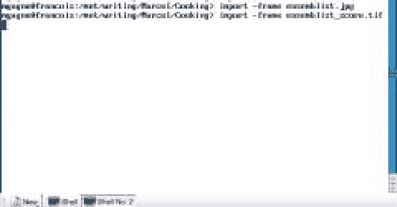

Figure 4. Play Begins in `Ensemblist`'s Surreal Virtual World

图 4. 在 `Ensemblist` 的超现实虚拟世界中开始游戏

Before you click `Play` next time, take note of the box labeled `Editor`. Yes, if you feel up to it, you even can create your own levels and help build the `Ensemblist` universe.

下次点击播放之前，请注意标有“编辑器”的框。是的，如果你愿意，你甚至可以创建自己的关卡并帮助构建 `Ensemblist` 宇宙。

Mon Dieu! It seems that we have managed to come to the end of another evening. Perhaps, inspired by the complex wonders that can result from the application of simple ideas, one of you fine people might turn your talents to building a machine that will give us more time, non? Stretching time certainly would qualify as taking scalability to new heights. Still, there certainly is time for another glass of wine. Relax, finish what you are working on, and `François` will pour you a final glass. If you are feeling a little too relaxed, it is nice to know that the only height you need to raise your wine to is your lips. A little joke, *mes amis*. Enjoy! Until next time, *mes amis*, let us all drink to one another's health. À votre santé! Bon appétit!


天哪！看起来我们又度过了一个傍晚。也许，受启发于简单思想应用所产生的复杂奇观，你们中某位才华横溢的人可能会把才华用于建造一台能为我们赢得更多时间的机器，non？拉伸时间无疑可以算作将可扩展性提升到新高度。尽管如此，喝一杯酒的时间肯定还是有的。放松一下，完成你正在进行的工作，`François` 会为你倒最后一杯。如果你感觉太放松了，很高兴知道你只需要把酒杯举到嘴唇的高度就够了。一个小玩笑，`mes amis`。享受吧！直到下次，`mes amis`，让我们为彼此的健康干杯。`À votre santé`！`Bon appétit`！

`Marcel Gagné` (`mggagne@salmar.com`) lives in Mississauga, Ontario. He is the author of the newly published *Moving to Linux: Kiss the Blue Screen of Death Goodbye!* (ISBN 0-321-15998-5) from Addison Wesley. His first book is the highly acclaimed *Linux System Administration: A User's Guide* (ISBN 0-201-71934-7). In real life, he is president of Salmar Consulting, Inc., a systems integration and network consulting firm.

`Marcel Gagné` (`mggagne@salmar.com`) 住在安大略省密西沙加市。他是 Addison Wesley 最新出版的 *Moving to Linux: Kiss the Blue Screen of Death Goodbye!*（ISBN 0-321-15998-5）的作者。他的第一本书是广受好评的 *Linux System Administration: A User's Guide*（ISBN 0-201-71934-7）。现实生活中，他是 `Salmar Consulting, Inc.` 的总裁，这是一家系统集成和网络咨询公司。


## 资源

- `Construo`: `www.nongnu.org/constr...`
- `Ensemblist`: `www.nongnu.org/ensemblist`
- `KAtomic`: `games.kde.org`
- `Marcel's Wine Page`: `www.marcelgagne.com/wine.html`
- `Marcel` 的葡萄酒页面: `www.marcelgagne.com/wine.html`


## `Monarch Computer Systems®`

我们打造了 `ULB 2003`，现在我们把它送出！

## 终极 `Linux` 盒子 `2003`

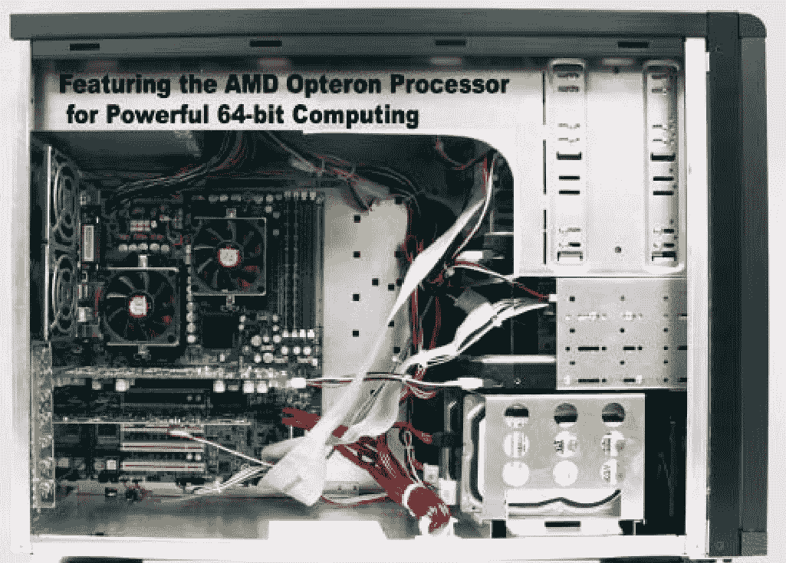

采用 `AMD Opteron` 处理器

实现强大的 64 位计算

### 零件号 `80761` - 系统配置

- `Lian-Li/Monarch PC 6070B` 超静音机箱
- （黑色铝材 - `Monarch` 独家）
- `Enermax 465P-VE-24P Whisper 460` 瓦电源
- `ARIMA HDAMB Opteron WS` 主板 `AGP Pro 4X/8X SATA/IEEE`
- 2 个 `AMD® Opteron™ 246` 处理器（双 CPU - `2GHz`）
- `2 GB DDR 2700 REG ECC Corsair` 内存
- `16x DVD-ROM`
- `52x32x52 CD-RW`
- `Mitsumi 1.44 MB` 软盘驱动器
- `3Ware 8500 RAID` 控制器
- `RAID 5` 配置
- `NVidia Quadro FX 1000 AGP 8X 128 MB` 双 `DVI`
- 按此配置 $5000

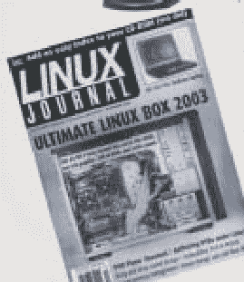

如《`Linux Journal`》2003 年 12 月刊所示

在线参与抽奖 @

`www.monarchcomputer.com/ulb2k3`

## 你会怎么做...

...用你能搭建的最强大的 64 位 `Linux` 工作站？

## 你可以赢得这台 5000 美元的电脑

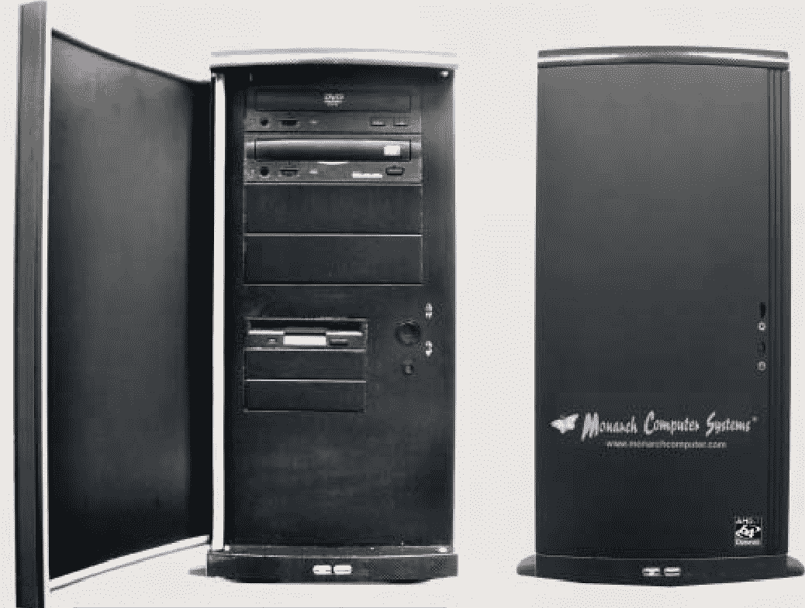

快速报价

系统 @

`www.monarchcomputer.com`

或致电 1-800-611-0875

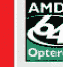

在无需重新编译或重新编码的情况下提升现有 `Linux` 应用的性能——从而在更短的时间内完成更多工作，提高整体生产力和预算效率。

在线参与抽奖 @

`www.monarchcomputer.com/lulb2k3`

比赛开放至 2004 年 1 月 31 日

## 使用 `LDAP` 和 `IMAP` 的安全邮件，第二部分

带有 `LDAP` 目录的 `IMAP` 邮件服务器让事情变得简单、安全且对用户友好。现在 `Mick` 解释了其中的棘手部分，让你成为公司的电子邮件专家。作者：`MICK BAUER`


In the first part of this series on using LDAP with the Cyrus IMAP mail delivery server (`LJ`, November 2003), we got as far as installing and setting up Cyrus IMAP and Cyrus SASL. In this article, we add some users to Cyrus IMAP and configure Postfix to deliver mail to the Cyrus IMAP server.

在本系列关于使用 LDAP 与 Cyrus IMAP 邮件投递服务器的文章的第一部分（`LJ`，2003 年 11 月），我们进行到了安装和设置 Cyrus IMAP 和 Cyrus SASL。在本文中，我们向 Cyrus IMAP 添加一些用户并配置 Postfix 将邮件投递到 Cyrus IMAP 服务器。

### Cyrus IMAP Documentation

### Cyrus IMAP 文档

Before we dive back in to Cyrus IMAP configuration and administration, a note about documentation. Cyrus IMAP comes with an administrator’s manual in HTML format. In the SuSE distribution, the manual is in `/usr/share/doc/packages/cyrus-imapd/doc`, and in Simon Matter’s Red Hat SRPM distribution (see Part I of this article) it’s in `/usr/share/doc/cyrus-imapd-2.1.12`. The link misleadingly labeled `Installation` actually leads not only to Cyrus installation instructions but to configuration and administration instructions as well. Besides this documentation, several man pages also are included with Cyrus IMAP, most notably `imapd.conf(5)`, `imapd(8)` and `cyradm(1)`.

在重新深入 Cyrus IMAP 配置和管理的之前，先说一下文档。Cyrus IMAP 附带一份 HTML 格式的管理员手册。在 SuSE 发行版中，手册位于 `/usr/share/doc/packages/cyrus-imapd/doc`，而在 Simon Matter 的 Red Hat SRPM 发行版中（参见本文第一部分）它位于 `/usr/share/doc/cyrus-imapd-2.1.12`。错误标记为 `Installation` 的链接不仅通向 Cyrus 安装说明，还通向配置和管理的说明。除此之外，Cyrus IMAP 还包含多个手册页，其中最值得注意的是 `imapd.conf(5)`、`imapd(8)` 和 `cyradm(1)`。

In addition to Cyrus IMAP’s included documentation, I recommend the book `Managing IMAP` by Dianna and Kevin Mullet (O’Reilly & Associates, 2000). As far as I know, it’s the only book dedicated to IMAP. Although its coverage of Cyrus IMAP doesn’t extend to LDAP, it’s a well-written book that clearly explains IMAP concepts and Cyrus IMAP administration; it also covers UW-IMAP in some detail.

除了 Cyrus IMAP 自带的文档外，我推荐 Dianna 和 Kevin Mullet 所著的《`Managing IMAP`》（O’Reilly & Associates，2000）。据我所知，这是唯一一本专门介绍 IMAP 的书籍。尽管它对 Cyrus IMAP 的覆盖范围不包括 LDAP，但这是一本写得很好的书籍，清晰地解释了 IMAP 概念和 Cyrus IMAP 管理；它还详细介绍了 UW-IMAP。

### Using cyradm

### 使用 cyradm

Cyrus IMAP comes with a Perl script, `cyradm`, that provides the most convenient way to create and manage user mailboxes. You should understand several things before using `cyradm`. First, you should run `cyradm` from any account with which you also read e-mail. In other words,

Cyrus IMAP 附带一个 Perl 脚本 `cyradm`，它提供了创建和管理用户邮箱最方便的方式。在使用 `cyradm` 之前，你应该了解几件事。首先，你应该从你也用来阅读电子邮件的任何账户运行 `cyradm`。换句话说，

you never should use an IMAP administrative account as an e-mail account. Due to unusual write-access permissions, using such accounts to read or send e-mail can have strange negative effects on your server. As we learned last time, Cyrus administrative accounts are named according to the variable `admins` in `/etc/imapd.conf`.

你永远不应该将 IMAP 管理账户用作电子邮件账户。由于不寻常的写访问权限，使用此类账户阅读或发送电子邮件可能会对服务器产生奇怪的负面影响。正如我们上次所学，Cyrus 管理账户的名称根据 `/etc/imapd.conf` 中的变量 `admins` 命名。

Second, `cyradm` uses the same authentication method as does the rest of Cyrus IMAP. In my previous column, we determined this by setting `/etc/imapd.conf`’s variable `sasl_pwcheck_method` to `saslauthd` and by editing `/etc/sysconfig/saslauthd` to use either LDAP or, in the case of SuSE, to use PAM. PAM itself can be configured to use LDAP for IMAP transactions in the files `/etc/pam.d/imap` and `/etc/openldap/ldap.conf`. In short, `cyradm` identifies and authenticates administrative users with LDAP, assuming you’ve correctly configured LDAP support in Cyrus IMAP, as described last time.

其次，`cyradm` 使用与 Cyrus IMAP 其余部分相同的身份验证方法。在我之前的专栏中，我们通过将 `/etc/imapd.conf` 的变量 `sasl_pwcheck_method` 设置为 `saslauthd` 并编辑 `/etc/sysconfig/saslauthd` 以使用 LDAP 或在 SuSE 的情况下使用 PAM 来确定这一点。PAM 本身可以在文件 `/etc/pam.d/imap` 和 `/etc/openldap/ldap.conf` 中配置为对 IMAP 事务使用 LDAP。简而言之，`cyradm` 使用 LDAP 来识别和验证管理员用户，前提是你已正确配置 Cyrus IMAP 中的 LDAP 支持，如上次所述。


### Finally, to authenticate

`cyradm` performs an LDAP auth lookup against your user name and password, using the LDAP attribute `UID` as the search criterion. For each user account you want to allow to run `cyradm`, therefore, the LDAP record needs to contain definitions for both `UID` and `userPassword`. `UID` is a required attribute and `userPassword` is an allowed attribute in the `posixAccount` Object Class, so all IMAP user accounts need to be associated with `posixAccount`.

最后，为了进行身份验证，`cyradm` 会使用 LDAP 属性 `UID` 作为搜索条件，对你的用户名和密码执行 LDAP auth 查找。因此，对于你希望允许运行 `cyradm` 的每个用户账户，LDAP 记录需要同时包含 `UID` 和 `userPassword` 的定义。`UID` 是 `posixAccount` 对象类中的必填属性，而 `userPassword` 是允许的属性，因此所有 IMAP 用户账户都需要与 `posixAccount` 关联。

### Impact on OpenLDAP Configuration

This last point has another important ramification: in your OpenLDAP server’s `/etc/openldap/slapd.conf` file, you need to have access control list (ACL) statements granting `auth` access to the `userPassword` attribute for whatever LDAP user your IMAP server (or its `saslauthd` process) uses to bind to the LDAP server (that is, to perform authentications). LDAP ACL statements are described in the `slapd.conf(5)` man page and in my article “Authenticate with LDAP, Part III” (LJ, September 2003).

这一点还有另一个重要的影响：在你的 OpenLDAP 服务器的 `/etc/openldap/slapd.conf` 文件中，你需要有访问控制列表（ACL）语句，授予对 `userPassword` 属性的 `auth` 访问权限，该权限针对 IMAP 服务器（或其 `saslauthd` 进程）用于绑定到 LDAP 服务器的任何 LDAP 用户（即执行身份验证）。LDAP ACL 语句在 `slapd.conf(5)` 手册页和我的文章“Authenticate with LDAP, Part III”（LJ，2003 年 9 月）中有所描述。

### Running cyradm

`cyradm` usually is run as an administrative shell rather than as a command, per se. When you invoke `cyradm`, supplying your user name plus the host you wish to administer, it prompts you for a password. On successful authentication, it begins an interactive session with its own commands and help screen. `cyradm` also can be run non-interactively; see the `cyradm(1)` man page for information on using `cyradm` for scripting.

`cyradm` 通常作为管理 shell 而非命令本身运行。当你调用 `cyradm` 并提供用户名以及要管理的服务器主机时，它会提示你输入密码。身份验证成功后，它会开始一个交互式会话，具有自己的命令和帮助屏幕。`cyradm` 也可以非交互式运行；有关使用 `cyradm` 进行脚本编写的信息，请参阅 `cyradm(1)` 手册页。

The simplest invocation of `cyradm` is:

`cyradm` 的最简单调用方式是：

```
bash-$> cyradm --user username hostname
```

If you’re running `cyradm` on the same host on which Cyrus IMAP is running, you can use the hostname `localhost`. If the server you want to administer is a remote host, however, specify its hostname or IP address. By default, `cyradm` attempts to connect to it over TCP port 143. Because Cyrus IMAP uses this port for clear-text communication, use the `--port` option to specify TCP port 993 for TLS-encrypted communications instead, like this: `--port 993`. Personally, in such situations I find it simplest to connect to my remote IMAP servers with SSH and then run `cyradm` locally on the remote host using my SSH session.

如果你在运行 Cyrus IMAP 的同一主机上运行 `cyradm`，可以使用主机名 `localhost`。如果要管理的服务器是远程主机，则指定其主机名或 IP 地址。默认情况下，`cyradm` 会尝试通过 TCP 端口 143 连接到它。由于 Cyrus IMAP 使用此端口进行明文通信，请使用 `--port` 选项改为指定 TCP 端口 993 用于 TLS 加密通信，如下所示：`--port 993`。就我个人而言，在这种情况下，我发现最简单的方法是使用 SSH 连接到远程 IMAP 服务器，然后使用我的 SSH 会话在远程主机上本地运行 `cyradm`。

Suppose I want to run `cyradm` locally on my IMAP server and my admin account is called `mick_admin`. The command

假设我想在我的 IMAP 服务器上本地运行 `cyradm`，并且我的管理员账户名为 `mick_admin`。命令


### Network Backup Challenges

## 网络备份似乎难以克服

如果您没有合适的解决方案。

## 介绍 Arkeia 5.2

合适的解决方案。

如果您负责保护公司的异构网络，Arkeia 5.2 Linux 或 Unix 备份服务器解决方案正是您一直在寻找的。

Arkeia 一直以功能强大、可扩展、可靠且经济高效的备份解决方案而闻名。现在我们增加了更多选项，让您获得更大的控制权和易用性。

## 新功能，更大收益

我们完全重新设计的报告功能允许您生成高度可定制的基于机器的报告，以及更完善的消息，告知您操作成功完成。

Quantum DLTSage™ 对 SDLT 磁带设备的支持可帮助您预测和防止存储系统错误。

优化的目录算法可显著提高大型文件服务器的备份速度——单个目录中 10,000 个文件的备份速度提高五倍，150,000 个文件的备份速度最高提高 50 倍！

我们还扩展了 GUI 功能以实现最大化安全性。您可以轻松克隆磁带用于异地存储。将此与 Arkeia 的灾难恢复模块结合使用，即可在服务器被毁或被盗时从头开始自动重建服务器。

此外，适用于 MS-Exchange 的新热备份插件可与我们针对 Oracle、Lotus、DB2 和 MySQL 的在线备份解决方案相辅相成。

## 试用 Arkeia 5.2 30 天。免费！

证明 Arkeia 5.2 是您正确解决方案的最佳方式就是让您免费试用 30 天。我们甚至提供免费安装技术支持。只需在 `www.arkeia.com` 下载演示版本即可。


`www.arkeia.com`

看起来像这样：


```bash
$ cyradm -u mick_admin localhost
IMAP Password: **********
    localhost>
```

注意登录成功后的`localhost>`提示：我现在已登录到一个`cyradm` shell 会话。要查看可用命令的完整列表，我只需输入`?`或`help`。共有 20 个命令，每个命令都可以缩写，有时有两种不同的缩写方式。帮助屏幕列出了每个命令的所有版本。

## 使用`cyradm`创建邮箱

要创建邮箱，我可以使用`createmailbox`命令。或者我也可以使用`create`缩写，甚至是简单的`cm`，如下所示：

```
localhost> cm user.bwooster
localhost>
```

这是命令行效率的典范，但请注意，我们新邮箱对应的用户名并不是真的`user.bwooster`——它只是`bwooster`。`user.`前缀必须用于在 Cyrus IMAP 中创建的所有邮箱。因此，要为用户`bubba`创建邮箱，我会使用命令`cm user.bubba`。然后要为该邮箱创建子目录，我会使用`cm user.bubba.sent`、`cm user.bubba.drafts`等等。

这个`user.`前缀仅对 Cyrus 及其管理员可见。事实上，当我们的用户`Bubba`使用`Evolution`或其他 IMAP 客户端连接到服务器时，他看到的不是`user.bubba`，而是一个名为`Inbox`的文件夹，尽管其真实名称是`user.bubba`。同样，子邮箱显示为`sent`、`drafts`等，缩排在`Inbox`下方。

关于电子邮件账户创建命令，值得注意的另一点是 Cyrus 在成功完成时没有任何反馈。如果您像我一样，会觉得这令人不安；您会定期使用`listmailbox`命令，简写为`lm`，来查看您拥有的内容：

```
localhost> lm
    user.bwooster (\HasNoChildren)
```

令人难以置信的是，这就是使用 Cyrus IMAP 允许用户`bwooster`接收和阅读其电子邮件所需做的全部工作，前提是存在 UID 为`bwooster`的 LDAP 记录。在 Cyrus IMAP 中，创建新的用户邮箱相当于创建该用户的 IMAP 账户。但在进入配置`Postfix` MTA 将电子邮件传递到 Cyrus IMAP 的主题之前，先说几句关于 Cyrus IMAP ACL 的话。

## Cyrus IMAP ACLs

Cyrus IMAP 系统中的每个邮箱都可以关联一个或多个 ACL，其中每个 ACL 定义给定用户对所引用邮箱或文件夹可以执行的操作。默认情况下，新邮箱只有一个 ACL，该 ACL 授予邮箱所有者对邮箱的完全管理权限。

有趣的是，管理员默认情况下对新邮箱只有查找和管理权限。您可以使用`listmailbox`命令查找邮箱的名称，并且可以设置其 ACL。但如果需要删除邮箱，您首先必须为邮箱创建一个 ACL，授予您的管理账户管理权限。这是一个功能，而不是错误；它有助于防止意外删除。

继续我们的示例，下面是使用我们的管理账户`mick_admin`删除我们刚刚创建的邮箱的命令：

```
$ cyradm -u mick_admin localhost
IMAP Password: *****
localhost> setaclmailbox user.bwooster mick_admin all
localhost> deletemailbox user.bwooster
```

这里发出的第二个命令特别值得注意；它以`cyradm`命令`setaclmailbox`开始，可缩写为`sam`或`setacl`。随后是相关邮箱（`user.bwooster`），然后是希望授予（或拒绝）访问权限的账户名称，此例中为`mick_admin`。最后指示一组权限代码或特殊字符串。在本例中，我们有

表 1. `cyradm` ACL 权限代码（改编自`cyradm(1)`手册页）

| 权限 | 描述 |
|---|---|
| `l` | 查找（对`LIST`/`LSUB`/`UNSEEN`可见） |
| `r` | 读取（`SELECT`、`CHECK`、`FETCH`、`PARTIAL`、`SEARCH`、`COPY`源） |
| `s` | 已读（`STORE \SEEN`） |
| `w` | 写入除`\SEEN`和`\DELETED`之外的标志 |
| `i` | 插入（`APPEND`、`COPY`目标） |
| `p` | 发布（向邮箱发送邮件） |
| `c` | 创建和删除邮箱（`CREATE`新子邮箱、`RENAME`或`DELETE`邮箱） |
| `d` | 删除（`STORE \DELETED`、`EXPUNGE`） |
| `a` | 管理（`SETACL`） |
| `none` | 表示无权限的特殊字符串 |
| `read` | 表示`lrs`的特殊字符串 |
| `post` | 表示`lrsp`的特殊字符串 |
| `append` | 表示`lrsip`的特殊字符串 |
| `write` | 表示`lrswipcd`的特殊字符串 |
| `all` | 表示`lrswipcda`的特殊字符串 |

## 网上更多特价

01.01.04

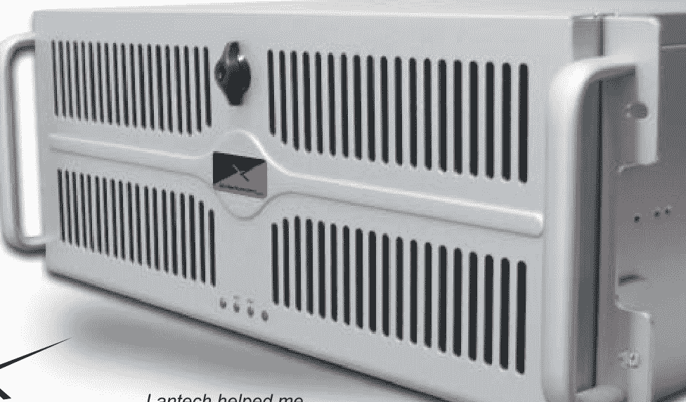


`lantechservers.com`

`866.306.5590`

> Lantech 帮我在我的
>
> 农场...渲染农场...种下了种子
>
> — Oliver M.

## 5年保修

所有系统均经过测试并预装

您选择的 Linux 发行版

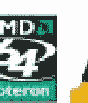


## `LS-1UX300.i`

## 1U IDE 解决方案

- 1U Lantech 机架式机箱
- 单颗 Intel Pentium 3.0GHz - 800MHz
- 2GB ECC Registered 内存（最大 4GB）
- 2 x 120GB 硬盘，带 8MB 缓存
- 1 x 20GB 操作系统硬盘
  - `RAID 0/1` 用于条带化
- 2 x 10/100 以太网适配器
- 52X CD-ROM 驱动器（可选）
- 1.44 MB 软盘驱动器（可选）

特价 $1,949

`LANTECHSERVERS` 制造安全、可靠、创新且价格具有竞争力的服务器，专为您的需求和要求而非我们自身而定制。我们为全国各地的互联网数据中心、ISP、科学研究设施、3D 渲染农场、视频/多媒体流媒体、CAD 设计师、视频编辑和渲染农场等各种兴趣领域提供大规模计算解决方案，等等等等……总之，我们保证您的满意！我们的专家随时待命为您提供帮助。今天就致电我们。

## 让冥王星更近


## `LS-1UX28b.i`

## 1U 高数据产出 IDE

- 1U Lantech 机架式机箱
- 双 Intel Xeon 2.8GHz - 512k 533MHz
- 2GB ECC Registered 内存（最大 8GB）
- 2 x 200GB 硬盘 7200RPM 8MB
- 1 x 20GB 操作系统硬盘 7200RPM
  - `RAID 0/1` 用于条带化
- 2 x 10/100/1000 以太网适配器
- 52X CD-ROM 驱动器（可选）
- 1.44 MB 软盘驱动器（可选）

特价 $2,595


## `LS-2UX26c.s`

## 2U IDE RAID 数据服务器

- 2U Lantech 机架式机箱
- 双 Intel Xeon 2.6GHz - 512k - 800MHz
- 2GB ECC Registered 内存（最大 8GB）
- 4 x 200GB 硬盘，带 8MB 缓存
- 1 x 40GB 操作系统硬盘
  - `RAID 0/1/5/10`
- 2 x 10/100/1000 以太网适配器
- 52X CD-ROM 驱动器（可选）
- 1.44 MB 软盘驱动器（可选）

特价 $3,195

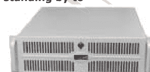

## `LS-4UOP260.i`

## 4U IDE 海量存储

- 4U Lantech 机架式机箱
- 双 Intel Xeon 3.0GHz 512k - 533MHz
- 2GB ECC Registered 内存（最大 6GB）


- 8 x 200GB SATA 硬盘 8MB

  - `RAID 0/1/5/10`

- 2 x 60GB 操作系统硬盘（`RAID 0/1`）

- 2 x 10/100 以太网适配器

- 52X CD-ROM 驱动器（可选）

- 1.44 MB 软盘驱动器（可选）

特价 $5,295

`ISO-9001` 认证

## `POSTFIX` 与 `LDAP`

### 配置 `Postfix` 以投递到 `Cyrus IMAP`

特殊字符串 `a11`，是 `all permissions` 的简写。要删除 `user.bwooster` 邮箱，只需指定 `c`，用于创建或删除邮箱或子邮箱就足够了。其他可能的 `ACL` 权限列在表 1 中。

`ACLs` 在 `cyradm(1)` 手册页中有详细说明，并在 `Cyrus IMAP` 的 HTML 文档中进行了解释。我强烈建议你养成至少审阅，如果不是总是自定义，使用 `cyradm` 创建的每个邮箱上的 `ACL` 的习惯。在某些站点，用户可能不需要保留默认权限 `c`。例如，如果所有用户子邮箱（`user.whatever.sent`、`user.whatever.saved` 等）都是由你为他们创建的，你可能更希望他们没有创建新邮箱或意外删除它们的权限。

在第一部分，我描述了邮件投递代理（`MDAs`）将邮件投递到邮箱的作用。作为 `MDA`，`Cyrus IMAP` 可以投递邮件，但它首先必须从邮件传输代理（`MTA`）接收该邮件。最流行的 `MTA` 是 `Sendmail`，但一个更简单且更安全的选择是 `Wietse Venema` 的优秀 `Postfix`（`www.postfix.org`）。由于 `Postfix` 是我选择的 `MTA`，并且如今在大多数主要 `Linux` 发行版中要么作为默认 `MTA` 提供，要么作为选项提供，所以这里我详细解释它。

你的 `IMAP` 服务器需要在组织的 `SMTP` 中继上吗？可以，但不必如此。从安全性和性能的角度来看，将 `SMTP` 中继专用于该目的可能更有意义。然后你可以让你的 `IMAP` 服务器运行自己的 `Postfix` 实例，从专用的 `SMTP` 中继接收邮件，而不是直接从其他网络的 `MTA` 接收。在任何情况下，我们都假设 `IMAP` 从中接收邮件的 `MTA` 与 `Cyrus IMAP` 运行在同一主机上。

为了配置 `Postfix` 将邮件传输到 `Cyrus`，需要编辑三个文件。第一个文件是 `/etc/postfix/main.cf`，其中我们需要添加或取消注释这一行：

```
mailbox_transport = cyrus
```

我们需要编辑的第二个文件是 `/etc/postfix/master.cf`，其中我们需要添加或取消注释这两行：

```
cyrus unix - n n - - pipe
user=cyrus argv=/usr/libexec/cyrus/deliver -r ${sender} ${user}
```

实际上，第二行在你的系统上可能有所不同；`Cyrus` 的 `deliver` 程序的语法多年来发生了变化。如果你从 `Linux` 发行版的当前 `CD` 或下载站点安装了 `Cyrus IMAP` 和 `Postfix`，则包含的 `/etc/postfix/master.cf` 文件应该无需调整即可工作。但是，如果你从源代码安装了 `Cyrus IMAP` 或 `Postfix`，则可能需要进行一些调整和搜索，以使第二行完全正确。第二行中的一个关键部分是 `argv=/usr/libexec/cyrus/deliver` 中的路径，它必须指向你本地系统上的 `Cyrus deliver` 命令。

第三个也是最后一个需要编辑的 `Postfix` 文件是 `/etc/aliases`；你也可以将其保存在 `/etc/postfix/aliases` 中。除非你使用 `LDAP` 进行别名查找——这对于本文来说过于复杂，但我在侧边栏中描述了——你需要在 `aliases` 中为每个 `Cyrus` 邮箱至少有一个条目，外加你需要的指向这些邮箱的别名。

在本文中，我描述了如何使用 `LDAP` 对 `Cyrus IMAP` 用户进行身份验证，但我只涵盖了将 `Postfix` 邮件投递指向 `Cyrus` 的方面。事实上，`Postfix` 也有 `LDAP` 功能：它可以使用 `LDAP` 将电子邮件别名解析为邮箱名称。

也就是说，你可以配置 `Postfix` 同时检查其本地 `/etc/postfix/aliases` 数据库中的电子邮件别名到邮箱名称映射，并查询本地或远程 `LDAP` 服务。这可以节省大量的管理时间；不必维护单独的别名和用户数据库，你可以在 `LDAP` 中完成所有操作。

然而，`Red Hat 7.3`（以及可能更晚的版本）上的 `Postfix` 并未编译内置 `LDAP` 支持。要确定你选择的发行版的版本是否在其 `Postfix` 包中编译了 `LDAP` 支持，请使用命令 `postfix -m`。如果 `LDAP` 未列在支持的 `Postfix` 模块中，你需要卸载 `Postfix` 包并自行从源代码构建。

有关更多信息和 `Postfix` 源代码，请参阅 `www.postfix.org`。请务必阅读 `Postfix` 源代码中 `./READMES/LDAP_README` 中的说明，其中解释了如何编译 `Postfix` 的 `LDAP` 功能——默认的 `Postfix Makefile` 并不会自动执行此操作。还请务必阅读文件 `/etc/postfix/samples/sample-ldap.cf`，其中包含你需要在 `/etc/postfix/main.cf` 中添加和配置以使 `LDAP` 别名查找正常工作的参数。后一步极其重要，可能需要一些调试才能使其正常工作。

> 如果你放弃这一切，而选择以老式的方式单独维护 `Postfix` 的 `aliases` 文件，那么不用担心；使用或不使用 `LDAP` 与 `Postfix` 对其与 `LDAP` 身份验证的 `Cyrus IMAP` 软件的交互能力没有任何影响。

对于我们的示例用户 `Bubba`，`/etc/aliases` 需要这一行：

```
bubba: bubba
```

简单吧，对吧？我们省略了 `user.` 前缀；`Cyrus` 邮箱以用户名引用。如果你的 `Cyrus`（`LDAP`）用户名与本地系统用户名相对应，你就不需要为这些用户创建 `aliases` 条目。但 `Cyrus` 的吸引力之一在于它不需要用户拥有 `shell` 账户。

如果 `Bubba` 是我们组织的市场分析师，我们也可以添加这一行：

```
marketing_weasel: bubba
```

编辑 `aliases` 文件后，不要忘记使用 `postalias` 命令生成新的别名数据库：

```
bash-$ postalias hash:/etc/aliases
```

## 使用 `C-TREE® SERVER SDK` 自定义你的数据库服务器

当今的数据库需求往往过于复杂，传统数据库服务器难以应对。你需要的功能和精确的控制级别根本不可用。也许你需要数据的替代排序标准，或在线程或通信逻辑上做特殊处理。

`FairCom` 的 `c-tree® Server SDK` 允许你创建一个定制化、工业级服务器，专为你的特定需求设计。使用 `FairCom` 拥有超过 20 年 `proven` 稳定性的内核，或覆盖特定子系统中的功能以实现你自己的细微差别。

将应用程序的数据 `I/O` 功能移至服务器端以减少网络流量并提高性能！

`FairCom` 的 `c-tree Server SDK` 被全球公司如 `Software AG` 和 `Citibank®` 使用。它与 `c-tree Plus` 无缝集成，并包含服务器主线以及 `c-tree Server` 所有接口子系统的完整源代码。最重要的是，一旦你创建了独特的定制服务器，安装和维护都很简单：无需 `DBA`！

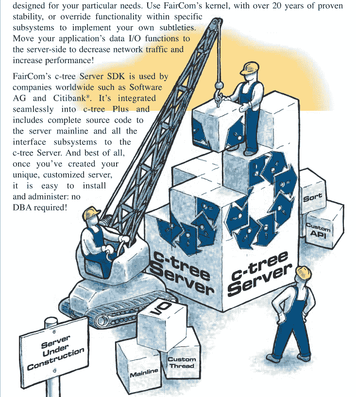

- 使用你自己的自定义服务器端功能增强我们的服务器
- 将功能从客户端移至服务器端以减少网络流量并提高性能
- 修改或替换整个服务器子系统
- 服务器主线、关键服务器子系统和客户端的完整源代码
- 灵活的 `OEM` 许可

今天访问 `www.faircom.com/ep/lj/sdk` 来掌控你的服务器！


| | |
|---|---|
| `USA` | `573.445.6833` |
| `EUROPE` | `+39.035.773.464` |
| `JAPAN` | `+81.59.229.7504` |
| `BRAZIL` | `+55.11.3872.9802` |

`DBMS` 自 1979 年起 • `800.234.8180` • `info@faircom.com`

## 结论

这并不是成为 `Cyrus IMAP` 管理员所需了解的全部内容，但希望它足以让你开始构建 `LDAP` 启用的 `Cyrus IMAP` 服务器。凭借我们在这两篇文章中涵盖或涉及的主题，你现在可以继续深入高级主题，包括如何让用户更改其 `LDAP` 密码；如何让用户将 `LDAP` 服务器用作地址簿；如何安全地设置共享 `IMAP` 文件夹；以及如何设置安全的 Web 邮件界面，例如适用于 `Cyrus IMAP` 的 `SquirrelMail`。


Mick Bauer，CISSP，是 Linux Journal 的安全编辑，也是明尼苏达州明尼阿波利斯的一名 IS 安全顾问。他是《Building Secure Servers With Linux》（O'Reilly & Associates，2002 年）的作者。


## 资源

Cyrus IMAP 主页（源代码、文档等）：

`asg.web.cmu.edu/cyrus/imapd`

Mullet, Dianna, and Kevin Mullet.

*Managing IMAP*. Sebastopol, California: O'Reilly & Associates, 2000.

"Secure Mail with LDAP and IMAP, Part I":

`www.linuxjournal.com/article/6998`

## 技术提示

要从 MS-DOS 格式的文本文件中删除多余的 Control-M 字符或回车符，请执行以下操作：

```bash
tr -d '\r' < dirtyfile > cleanfile
```

如果你正在用 Perl 编写游戏，并且希望随机数真正随机，请从内核的真实随机数生成器为伪随机数生成器播种，如下所示：

```perl
BEGIN: {
  my $random;
  open (RANDOM, "/dev/random")
    or die "Can't open ".
      "/dev/random: $!";
  read (RANDOM, $random, 4);
  close RANDOM;
  srand(unpack('L', $random));
}
```

## 个人视频录像机基础

将您的卫星天线连接到基于 PC 的录像机，它可以时移您喜爱的节目、制作存档副本，并通过插件实现更多功能。

作者 CHRISTIAN A. HERZOG

我们所有喜爱的电视节目都是数字录制和数字编辑的。但我们使用一些模拟技术接收它们，例如有线、无线电波或卫星。这简直太荒谬了。幸运的是，有一种替代方案可提供更好的画质、杜比数字音效和 EPG 电子节目指南。女士们先生们，请欢迎 DVB 数字视频广播。

DVB 使用 MPEG-2 压缩流，理论最大比特率为 15Mbit/s。由于 DVB 从不单独用于视频，会添加额外的音轨和其他信息以创造更丰富的用户体验。所有这些数据都存储在小数据包中。当然，如果某些数据包未到达或损坏，会在画面甚至音轨中留下伪影。另一方面，一旦正确的包再次到达，节目会像什么都没发生一样继续播放，因此无需担心同步问题。信号也比较宽容，因为天线通常设计有足够的余量来应对雨雪或小型动物。

可用的 DVB 有三种不同模式，DVB-S 用于卫星，DVB-C 用于有线，DVB-T 用于地面接收。三者基本相同；区别在于调谐器。DVB-T 相当新，目前尚未广泛使用；另外两种，尤其是卫星版本，在世界各地都很常见且受欢迎。

## 构建 VDR

主流厂商提供的现代机顶盒具有一些不错的功能，例如硬盘录制和 MP3 播放。尽管如此，它们缺乏更高级的选项，包括将录制内容归档到 SVCD 或某些 MPEG-4 变体。随着价格实惠的 DVD 刻录机和介质的出现，将您喜爱的电视节目备份到 DVD 已完全可行。在欧洲，数字个人视频录像机（PVR）的价格约为 500 欧元，而且大多数不带硬盘。相比之下，全功能的 DVB-S 卡在网上零售商处最低可找到 165 欧元。

但是，没有好软件的廉价硬件有什么用呢？VDR 程序（video disc recorder，视频光盘录像机）使您能够使用您喜欢的 Linux 发行版和 DVB 卡自行构建功能强大的机顶盒。我构建的机器包含基本功能，如观看电视、录制和时移，以及高级功能，包括 MP3/Ogg 播放、MPlayer 支持的所有视频格式的播放以及将录制材料备份到 MPEG-4、视频 CD 或 DVD。商业机顶盒几乎无法与此功能列表抗衡。

## 选择硬件

要构建我们的设备，我们需要一些硬件。请记住，录制需要大量空间。120GB 硬盘通常可容纳约 60 小时的视频，这应该足够了。如果您更频繁地备份电影以将其移出硬盘，也可以少用一些，但我建议至少使用 20GB 驱动器，可容纳约三到四部电影。

我们还需要一个处理器。如果您想编码视频，需要更快的处理器；如果不编码，旧的 200MHz 机器就足够了。我找不到比 Celeron 1,700MHz 更慢的机器，这已经绰绰有余，甚至足以进行编码过程。使用 MPlayer 播放也需要较快的处理器，至少 1GHz，尽管据说用更低的配置也能工作。我在较慢的机器上测试过 MPlayer，图像质量确实受损相当严重。其原因是 MPlayer 使用 DVB 板上的 MPEG-2 解码器的方式。非 MPEG-1/2 资料会在播放时即时转换为 MPEG，这会消耗大量处理器周期。

这就引出了最重要的硬件部件；DVB 卡。您需要一张具有硬件 MPEG 解码器的全功能卡。这些卡更贵，但它们有多路音频和电视连接。像 WinTV Nova 这样的卡最好作为副卡同时录制多个节目。如果可以，请选择卫星选项。这是迄今为止最灵活的解决方案，因为您不依赖于某个有线电视运营商。此外，您还可以连接多个卫星天线观看更多频道。本文也讨论了 DVB-S 变体，但部署不同解决方案的过程其实并没有太大不同。我选择了 Hauppauge Nexus-s。它可能是最贵的卡，但它不会出现老型号遇到的过热问题，而且调谐器性能良好，并配有红外遥控器和接收器。

对于基础软件环境，我使用了 Red Hat Linux 9，但任何发行版都可以使用。安装 GCC 和 libjpeg 的开发包的小型安装就足够了。由于全功能 DVB 卡具有视频输出功能，因此不需要 X。不要忘记安装所有内核开发包；我们需要它们来编译 DVB 驱动程序。

## 安装驱动程序

一旦基础发行版运行起来，我们就需要卡的驱动程序。您可以在 `linvdr.org/download/vdr/Developer` 获取 CVS 版本。截至本文撰写时，`linux-dvb.2003-09-05.tar.bz2` 是最新版本。当前驱动程序在断开卫星电缆或接收信号降至零时有时会挂起。然后您必须移除并重新插入驱动程序，这并不总是有效，导致您需要重新启动才能再次运行。这些挂起在录制节目或观看电影中途时尤其令人讨厌，但通常不会发生。

现在进入 `/usr/src`，解压驱动快照并 `mv` 到 `DVB`。重命名目录很重要，因为某些补丁和插件依赖于目录名称。进入 `DVB` 目录并输入 `make` 以编译驱动程序以及一些有助于扫描卫星以获取频道列表的有用应用程序。无需 `make install`，因为我们稍后使用的 `runvdr` 脚本会负责模块加载。编译驱动程序后运行 `makedev.napi` 脚本很重要，因为该脚本会在 `/dev` 中创建所需的条目。

## 扫描频道

如果您居住在欧洲以外或不使用 Astra 卫星，则必须使用不同的频道列表。扫描频道是一个自动化过程。DVB 驱动程序附带一个名为 `scan` 的工具，您可以在 `/apps/scan` 目录中找到它。使用 `-o vdr` 选项调用它，以便输出文件采用 VDR 的频道格式。要捕获新创建的频道文件，您需要使用以下命令重定向程序的标准输出：

```
./scan -o vdr > channels.conf
```

## 安装 VDR

获取 `vdr-1.2.5.tar.bz2`，解压到 `/usr/src` 并切换到该目录。安装 VDR 有点棘手。因为您可以使用一些补丁来增强功能，如果不小心，很快就会陷入补丁地狱。如果您想使用多个补丁，最好的办法是获取一个一站式补丁。我只使用了 Elchi 补丁，它为相当单调的默认 VDR 界面带来了漂亮的外观。如果您有适合 VDR 版本的补丁，就不应该遇到问题。

插件添加的附加功能范围从简单的游戏到电子邮件提醒再到功能齐全的 DVD 播放。在这里，只安装两个，遥控插件和 MP3/MPlayer 播放插件。遥控插件仅在使用 Hauppauge 原装遥控器时才需要。而 MP3/MPlayer 插件则是必备的。

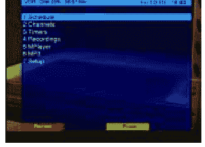

图 1. 应用 Elchi 补丁后的 VDR 主菜单


切换到 `/usr/src/vdr-1.2.5/PLUGINS/src` 并解压两个包。`VDR` 的 `Makefile` 在您从目录名中删除版本信息之前不会构建插件，因此将它们重命名为 `remote` 和 `MP3`。`MP3` 插件有一些额外要求，即 `libsndfile`、`libmad` 和 `libid3tag`。由于 `Red Hat` 不提供 `MP3` 支持，您必须手动安装它们。从 `www.freshmeat.org` 获取，并不要忘记安装开发包。设置完成后，输入 `make REMOTE=plugin NEWSTRUCT=1 all plugins`。`REMOTE=plugin` 参数使用遥控插件添加另一种输入方法。您可以使用 `Lirc` 选择任何找到的遥控器；`VCR` 遥控器效果相当不错。在这种情况下，只需添加 `REMOTE=lirc`。键盘支持默认启用，不应禁用，因为它对调试非常有帮助。`NEWSTRUCT=1` 是必需的，告诉插件在 `/usr/src/DVB` 中搜索新驱动程序。

编译完所有内容后，我们现在需要稍微编辑启动脚本。作为基础，使用随遥控插件提供的脚本。您可以在 `misc` 目录中找到它，名为 `runvdr.remote`。该脚本加载键映射以便解码遥控器信号。这仅与 `Hauppauge` 的红外接收器一起使用。如果您没有，请使用 `VDR` 根目录中的 `runvdr` 脚本作为起点。将 `runvdr.remote` 脚本移动到 `VDR` 根目录并启动您喜欢的编辑器。第 24 行应包含启动 `vdr` 的参数。我的如下所示：

```
VDRCMD="$VDRPRG -w 60 -P scanner \
-P\"mplayer -M /video/plugins/mplayer.sh\" \
-P mp3 \
-P\"remote -i /dev/input/event1\" $*"
```

## 无线连接

- 蜂窝调制解调器
- `802.11b` `WiFi`

## TS-5600 586 单板计算机

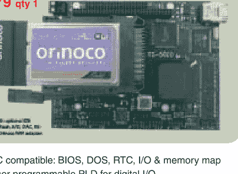

- `PC` 兼容：`BIOS`、`DOS`、`RTC`、`I/O` & `memory map`
- 可用户编程的 `PLD` 用于数字 `I/O`
- 低功耗 `+5v` @ `900mA` `4.3" x 5.6"`
- `TS-Linux 3.0` 是开源 `GNU/Linux` - `Glibc 2.2.5`
- `Apache`、`SSH`、`Perl`、`bash`、`FTP`、`kernel drivers`
- `133 MHz x86`
- `PCMCIA` 插槽
- `10/100` 以太网
- `PC/104` 总线
- `Compact Flash`
- `32-64 MB SDRAM`
- `6 ch 12-bit A/D`
- `2 ch 12-bit DAC`
- `23 Digital I/O`
- `2 Serial Ports`


`(480)-837-5200`

`www.embedded586.com`

## LINUXWORLD

### 会议与博览会

### 地点

- 开放思想
- 相聚

### 主旨演讲嘉宾

- **Chris Stone**
  `Novell, Inc.` 副董事长，首席执行官办公室
  星期三，1月21日
  上午9:15 – 上午10:00

- **Dave Dargo**
  `Oracle Linux` 项目办公室副总裁
  星期三，1月21日
  上午11:45 – 中午12:30

- **Tom Killalea**
  `Amazon.com` 基础设施副总裁
  星期三，1月21日
  下午2:45 – 下午3:30

- **Sam Greenblatt**
  `Computer Associates Intl.` 高级副总裁兼首席架构师
  星期四，1月22日
  上午11:30 – 上午12:15

- **Ross A. Mauri**
  `IBM Systems Group` 按需电子商务总经理
  星期四，1月22日
  下午1:45 – 下午2:30

### 会议：2004年1月20日 – 23日

### 博览会：2004年1月21日 – 23日

### 纽约贾维茨中心：纽约，NY

`LinuxWorld Conference & Expo` 是全球领先的、最全面的聚焦 `Linux` 和开源解决方案的活动。今年一月，探索全球各公司如何通过利用 `Linux`——世界上增长最快的操作系统——实现更高利润和提高生产力。


- 深入了解最新的 `Linux` 和开源发展动态，并从业界顶尖公司了解创新产品解决方案。
- 与开源运动的领导者建立联系，并与同行讨论如何最好地为您的组织利用技术。
- 参与 `LinuxWorld` 世界级教育项目，并从全新的动手实验室中受益，获得互动培训！
- 参加第二届 `Linux` 金融峰会，听取华尔街公司如何利用 `Linux` 实现更低总拥有成本的经验分享。（由 `BEA` 赞助）
- 发现现实世界的实用解决方案，找到当今最关键的 `IT` 问题的答案。

#### 基石赞助商
`ORACLE`

#### 白金赞助商


使用参考代码在线注册：`A-LJJ`

`www.linuxworldexpo.com`


如果您不确定需要添加什么，只需运行 `vdr -help`，您应该会看到所有可用模块及其选项的列表，以及 `VDR` 的所有选项。别担心，很容易就能查出需要添加什么。接下来，我们需要一个基本目录；默认（在 `Make.config` 中定义）是 `/video`。该目录存放所有录制文件和配置文件。将 `sources.conf` 和您的 `channels.conf` 复制到 `/video`。

我们要做的唯一一件事是为 `MPlayer/MP3` 插件编写配置文件。首先创建一个名为 `/video/plugins` 的目录。现在我们需要两个文件，一个名为 `mp3sources.conf`，另一个名为 `mplayersources.conf`。编写它们很简单。起初，您可以为 `mp3sources.conf` 添加类似 `/video/music;本地文件;0` 的内容，为 `mplayersources.conf` 添加 `/video/compressed;本地文件;0` 并保存它们。要让 `MPlayer` 与 `DVB` 卡配合使用，您必须重新编译。从 `www.mplayerhq.hu` 获取一份副本，并在 `configure` 选项中添加 `--with-extrainidir=/usr/src/DVB/include`。让 `configure` 脚本运行，重新编译并安装，您就可以开始了。


图 3。信息栏显示节目名称、正在播放的电视节目以及接下来播放的内容。

正如 `runvdr` 脚本所示，`MPlayer` 插件使用一个特殊的 shell 脚本来启动 `MPlayer`，`mplayer.sh`。您可以从 `batleth.sapienti-sat.org/projects/VDR` 获取它。

该软件包仅包含两个文件，`mplayer.sh` 本身和 `mplayer.sh.conf`，其中包含一些配置选项。如果您的机器太慢，无法使用 `MPlayer` 播放文件，您应该尝试调整此文件中的设置。

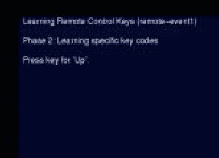

图 2。定义遥控器的按键

## 卷动胶片并备份！

返回到 `/usr/src/vdr-1.2.5` 并运行 `runvdr.remote`。如果您使用 `Red Hat`，请设置环境变量 `LD_ASSUME_KERNEL=2.4.1`，因为 `VDR` 尚无法与 `Red Hat` 在最新版本中引入的原生 `posix` 层一起工作。然后为 `DVB` 卡加载模块，并启动 `VDR`。连接您的电视，您应该会看到一个黑屏，提示您定义遥控器的按键。完成向导后，您就可以看电视、录制节目和删除广告了。您可以收听 `MP3` 并观看视频。`VDR` 根目录中有一个手册，解释如何使用时移功能录制和编辑电视事件。

`VDR` 将其录制内容拆分为 `2GB` 的文件，这对于转码视频来说有点不方便。如果您进行手动转换，可以更精细地控制质量/大小方面，`mencoder` 或 `transcode` 都是不错的选择。使用速度很快的 `mencoder`，我发现它非常适合备份到 `MPEG-4`，或者 `transcode`，它附带了许多工具。如果您喜欢“我不想操心”的做法，请获取 `VDRCONVERT`。`README` 文件提供了安装它的相当简单的方法，至少在下载和编译时您可以看一些电视。使用 `VDRCONVERT`，您必须更改一些脚本和配置文件，以将 `DVD/(S)VCD` 分辨率调整为 `NTSC`，以防您所在地区不使用 `PAL`。

很遗憾，`Linux PVR` 并不能让电视节目本身变得更好，但我想你不能事事都如愿，对吧？

## 备份


如果您失望地发现文章的结尾即将到来，请不要担心；仍然有一些可选的事情可以做。自动备份功能有一些限制。虽然 `(S)VCD` 备份运行完美，但 `DivX` 编码不会裁剪图像以去除黑边（如果存在）。这对比特率、大小和整体图像质量有相当负面的影响。如果您真的想要高质量、小尺寸的 `MPEG-4`，您应该手动备份。改进的图像质量绝对值得付出努力。

`Christian A. Herzog` 是一名专注于使用开源技术进行 `Web` 开发的程序员。他仍在永无止境地追求将基于 `Linux` 的设备带到他遇到的每个家庭和公司。写信给他 `noeffred@gmx.net`。


## 资源

- 库：`www.freshrpms.org`
- `LIRC`：`www.lirc.org`
- `MPlayer`：`www.mplayer.hu`
- `mplayer.sh`：`batleth.sapienti-sat.org/projects/VDR`
- `VDR` 的插件、脚本和补丁：`www.vdrportal.de/board/portal_downloads.php?site=6`

## 网络足迹

合适的管理软件可以让您将 `Linux` 无缝集成到您的基础设施中。

## Linux 管理解决方案

无论您计划何种类型的 `Linux` 实施，您仍然需要管理软件以确保其在整个企业中无缝集成。我们的管理软件解决方案通过让您充分利用其独特的扩展性和开源编程，帮助您最大化 `Linux` 在整个业务中的潜力。因此，您可以在降低总拥有成本的同时提高生产力。要了解我们对 `Linux` 创新的持续承诺，请访问 `ca.com/linux` 今天。

`Computer Associates®`

## 网络精通

## Laptopia

您下一台笔记本电脑能与 `Linux` “即插即用” 吗？而且您什么时候才能买到没有专有操作系统的主流品牌笔记本呢？`BY DOC SEARLS`

让我们对 `Linux` 征服计算机硬件类型的进度做一个勾选框报告。我们从顶部开始逐项检查：

- 大型机
- 大型企业数据库机器
- 大型计算农场
- 对称多处理机
- 中小型企业机器
- 工程工作站
- 台式机
- 笔记本电脑
- 上网本
- `PDA`
- 嵌入式设备

看起来相当不错。在高端，随着 `2.6` 内核开始确立自身地位，收益将会增加。在低端，竞争几乎已经结束。`CACMedia`（`cacmedia.tv`）总裁兼首席执行官 `Ken Nelson` 以及消费电子业务的资深人士告诉我，`Linux` “拥有嵌入式类别”。甚至 `Microsoft` 也是遥远的追随者。

突出的例外是台式机、笔记本电脑、上网本和 `PDA`。而在这四者中，最重要的是笔记本电脑。那里是个人计算重心正在移动的地方。过去一年，“桌面替代” 成为领先的笔记本电脑类别，也是市场正在发生的事情的描述。得益于桌面级功能和无线网络的增长，支持 `Wi-Fi` 的笔记本电脑正在对台式机做着手机对座机所做的事情。因此，在工作中，台式机正变成立方体，而在家中，它们正在演变成肯定会取代电视成为家庭娱乐中心设备的形式。

与此同时，笔记本电脑每天变得更具功能性。花费不到 `2,000` 美元，您就可以获得一台高速笔记本电脑，配备

`1600 × 1200` 显示屏、`1GB` 内存、`80+GB` 存储、良好的音响系统、一流的图形子系统以及可刻录和播放 `CD` 和 `DVD` 的驱动器。仅就显示而言，笔记本电脑完胜台式机。正如一家硬件公司高管所说，“你想要一个两百万像素的显示器——买一台大屏幕笔记本电脑。它的价格与独立显示器处于同一范围。”

`Linux` 并没有推动这些发展；`Apple` 和 `Microsoft` 才是推动者。尽管其中涉及的创新值得尊重（功劳归于：有很多，尤其是 `Apple` 方面），杠杆来自制造公司之间的关系。得益于笔记本电脑制造商与图形子系统来源——`NVIDIA` 和 `ATI`——之间的设计协议，新的 `Mac OS X` 和 `Windows` 笔记本电脑可以以最少的 `CPU` 参与播放 `DVD`。`Linux` 尚无此特权——还不。

`Linus` 在 `2003` 年 `9` 月 `Linux Lunacy Geek Cruise` 上发表的长篇讲话中解释了这种情况：

> 坦率地说，没有任何笔记本电脑厂商真正支持 `Linux`。说实话。有些厂商会做一些表面功夫。如果不是太痛苦，他们会在某些配置下支持 `Linux`。但支持程度往往只是可以的（有限度）。它可能不会被挂起。它可能实际上并不能完成你希望笔记本电脑完成的一半功能。但你可以在上面运行 `Linux`。我预计随着公司开始在桌面上更多使用 `Linux`，这种情况会发生变化。如果你有几家大公司只是说，“嘿，`Linux` 必须在我们的笔记本电脑上工作”，硬件制造商突然会非常在意……

所以，好消息是笔记本电脑正在远离那种嵌入式机器的类型。它们变得越来越标准化。尤其是像 `Centrino` 这样的芯片组。如果你使用 `Pentium-M` 而不使用 `Centrino`，你就是在做错事——除了它们不支持（`802.11`）`A&G`；而且现在你还不能为 `Linux` 获取 `Centrino` 驱动程序……

我也听说它们存在，但`Intel`的其他人说“那是胡说。我们在路线图上有，但还没能让它运行起来。”他们一直承诺在 `2004` 年推出，但我绝不是`Intel`发言人。所以我不知道实际日期是什么。但据说会到来。

问题是，当你组装一台笔记本电脑时，以前你必须在人们的后院搜刮来找到奇怪的硬件零件才能让一切都合适。而这肯定正在消失。这不仅仅是 `Centrino`。取而代之的是，有数百种不同的芯片组以数百万种不同的方式连接，你将只有大约五种不同的芯片组，而且你无法以任何其他方式连接它们，只能以它们被连接的方式连接。这只是会发生。

这就是十年前我们在桌面上拥有的东西。`Compaq` 制造了不太标准的自有 `PC` 台式机。实际上 `HP` 更糟。这只是因为标准芯片组而消失了。现在笔记本电脑领域也开始发生这种情况。所以，一年后，我预计……假设我们能解决那些 `ACPI` 问题……当你买一台笔记本电脑时，它更有可能“即插即用”。


市场正好以两种方式形成。第一种是“找到客户需求并满足它们”。当一群公司开始这样做并竞争打造最好的产品和服务时，你就有了市场。归结为一句话，营销学101 教的是“需求是发明之母”。第二种方式不太明显，但没有它我们就不会有任何一个技术品类。它是这样的：制造出如此新颖酷炫的东西，让客户觉得自己必须拥有它。他们几乎不在商学院教授这一点，但如果教授的话，其一句话版本就是“发明是需求之母”。

当有人问你`Apple`如何一次又一次地推动整个市场并确立新的技术标准（硬壳软盘、`SCSI`、平板屏幕、`USB`、`FireWire`、`GUI`、`Wi-Fi` 等等）时，把他们指向那个第二营销原则。`Apple` 在发明需求方面做得非常出色。这是一种超越简单创新的技能。`Steve Jobs`的天才并不在于他对艺术的痴迷；那确实是一项真正的资产，但也是一种误导。他的天才在于知道发明如何撬动世界。

发明并不是`Microsoft`所做的。`Linux` 也不是。`Microsoft` 进行创新，正如他们一遍又一遍告诉你的那样——他们是对的。该公司不断推出一系列适度但可营销的改进，改进的对象大多是在别处发明的商品。尽管`Microsoft`拥有大量误导性资产（应予承认），其真正的天才可能在于我们目前在笔记本电脑方面发现 `Linux` 的那个空缺：与硬件 `OEM` 的关系。这些关系在`Microsoft`方面非常强势且深度参与。看看今天的任何一台笔记本电脑，你都会看到一个小贴纸，上面写着“为 `Windows XP` 设计”或类似内容，以及`Microsoft Windows` 标志。你可以想象`Microsoft`在与硬件 `OEM` 的关系中，付出多大努力来确保 `Linux` 在笔记本电脑上运行尽可能困难。

不要低估制造商对同样抵制的共同利益。没有一家一级硬件制造商希望看到世界充满

## 仅用于展示，笔记本电脑完胜台式机

白盒或自建笔记本电脑。让他们的每台笔记本电脑独一无二的东西，可能正是阻止 `Linux` 在所有型号上运行的原因，从一家制造商到另一家制造商。但这不是问题。至少在长期来看，而长期可能根本不会很长。

在新兴的笔记本电脑市场生态中，有三种不同的力量：作为发明者的`Apple`、作为创新者的`Microsoft`和作为颠覆者的`Linux`。

在《创新者的窘境：当新技术导致伟大公司失败》中，`Clayton Christensen` 相当清晰地阐述了最后两个角色。创新者很难颠覆自己。他们抗拒不可避免的事情，即使他们看到了它的到来。我们在本文开头检查的每一个计算品类中都能找到现任创新者。`Linux` 颠覆了它们全部。从 `IBM` 开始，拥抱颠覆的公司也最大化地利用了创新。

`Linux` 也将颠覆笔记本电脑和剩余的品类，原因很简单，正如营销学101所教的那样：需求将催生发明。某个月里，某家公司——一家 `FedEx`、一家 `Boeing`、一家 `General Motors`、一家 `Siemens`——会要求 `Dell`、`HP` 和 `IBM` 竞争填补一份巨大的 `Linux` 笔记本电脑订单。与`Microsoft`的关系对竞赛的赢家来说会变得紧张，但他们会达成交易。他们会要求`Intel`发布 `Centrino` 的 `Linux` 设备驱动程序。他们会与`Canon`和`Sony`合作，为相机、摄像机和扫描仪编写设备驱动程序。他们会完成 `ACPI` 问题的敲定。而我们将拥有由大型硬件 `OEM` 厂商进行真实广告营销的好用、廉价的 `Linux` 笔记本电脑。

然后你可以开始逐项勾掉剩下的清单。


Doc Searls 是《Linux Journal》的资深编辑。


## 最可定制


## 最受欢迎

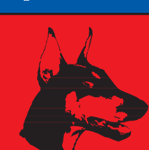

## 最安全

PLESK 6

#1

控制面板软件

全球

SWsoft

`www.sw-soft.com`

`sales@sw-soft.com`

+1 (703) 815-5670

## Scaling dcache with RCU

通过重新组织 Linux 缓存文件名查找的方式，对帮助扩展到大型服务器来说是一个巨大的胜利。BY PAUL E. MCKENNEY, DIPANKAR SARMA AND MANEESH SONI

`RCU` (`read-copy update`), a synchronization technique optimized for read-mostly data structures, recently was added to the Linux 2.6 kernel. This article describes how `RCU` improved the scalability of Linux’s directory-entry cache (`dcache`). For some more background, see “Using RCU in the Linux 2.5 Kernel”, in the October 2003 issue of Linux Journal.

### Linux Directory-Entry Cache

Linux 的 `dcache` 维护文件系统层次结构的部分内存映像。此映像可在不进行昂贵的磁盘传输的情况下进行路径名查找，大大提高了文件系统操作的性能。为了便于处理挂载和卸载操作，Linux 内核还在 `struct vfsmount` 结构中维护挂载树的映像。

如果 Linux 2.4 `dcache` 已经如此出色，为什么要更改它？2.4 `dcache` 的困难在于它使用全局 `dcache_lock`。该锁在小型系统上是缓存行抖动的来源，在大型系统上是可扩展性的瓶颈，如图 1 所示。


Figure 1. Tux 履行职责

### Visual Overview of dcache

本节为本文后面描述的与 `RCU` 相关的 `dcache` 更改提供背景信息。希望了解更多细节的读者应深入研究源代码。

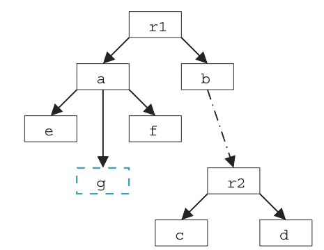

Figure 2. 示例文件系统树

本节使用图 2 所示的示例文件系统树，其中分别有两个挂载的文件系统，其根目录为 `r1` 和 `r2`。第二文件系统挂载在目录 `b` 上，如虚线箭头所示。文件 `g` 最近未被引用，因此不在 `dcache` 中，如其虚线蓝色框所示。

`dcache` 子系统维护文件系统树的多个视图。图 3 显示了目录结构表示。每个代表目录的 `dentry` 维护一个双向链接的循环列表，由 `d_subdirs` 字段引导，贯穿子 `dentry` 的 `d_child` 字段。每个子项的 `d_parent` 指针引用其父项。挂载点（`dentry b`）不引用-

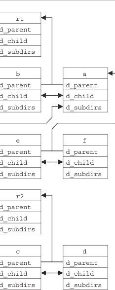

Figure 3. 示例文件系统树的 dcache 表示

## 革命重装

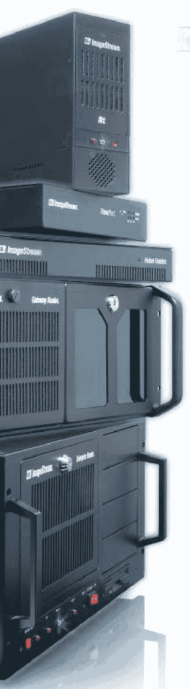

什么是路由器性能？路由器性能是由最大品牌定义的，还是你可以在现实世界中体验到？当你内心有个小声音问“为此我得到了什么？”时，是时候得到一些答案了。许多人付出了高价拥有最大品牌，但他们能接受真相吗？在《Network World Magazine》（第 20 卷，第 28 期）最近进行的一次面对面实验室测试中，业界最大的路由器制造商拒绝参与。被问及原因时，他们说：“……用户对性能之外的事物感兴趣。”你能想象他们对客户这么说吗？在过去五年中，ImageStream 推出了世界上成本最低的路由器，用于 OC12/STM4、OC3/STM1、DS3/E3 和高密度 T1/E1 应用。现在，独立测试再次证明 ImageStream 路由器在吞吐量、延迟和抖动方面远远超过怪物品牌。而且如果最佳价格和性能还不够，每台 ImageStream 路由器都包括 31 天性能保证、24/7 技术支持以及终身免费软件升级。Linux® 一直让不可能成为可能。选择权在你，红色 LED 还是蓝色？

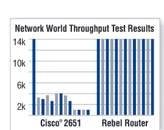

`独立测试证实 ImageStream 在吞吐量、延迟和抖动方面具有卓越性能。`

`ImageStream™`

面向现实世界的路由器

800.813.5123

`www.imagestream.com`

1.574.935.8484

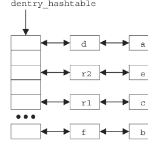

图 4. dentry 哈希表

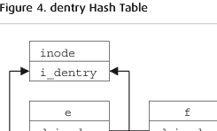

图 5. 硬链接别名链

尽管可以直接搜索 `d_subdirs` 列表，但对于大型目录而言这会是一个缓慢的过程。相反，`__d_lookup()` 对父目录的 `dentry` 指针和子目录的名称进行哈希，搜索全局 `dentry_hashtable` 以查找对应的 `dentry`。该哈希表在图 4 中显示，同时还显示了以 `dentry_unused` 为头的 LRU 列表。LRU 列表中的任何 `dentry` 通常也在哈希表中。例外情况包括父目录超时的情况，例如在 NFS 等分布式文件系统中。

每个 `dentry` 使用 `d_inode` 指针引用其 `inode`。对于负 `dentry`，该 `d_inode` 指针可以为 `NULL`，负 `dentry` 缺少 `inode`。当文件系统删除 `dentry` 的文件或有人尝试锁定不存在的文件时，可能会生成负 `dentry`。负 `dentry` 可以通过在不调用底层文件系统的情况下使对给定不存在文件的重复访问失败来提高系统性能。同样，硬链接会导致多个 `dentry` 共享一个 `inode`，如图 5 所示。

图 6 显示了 `dentry` 的高层状态图。正常 `dentry` 的生命周期如下：

- `1.` `d_alloc()` 为新引用的文件分配一个新的 `dentry`，导致状态为 `New`。
- `2.` `d_add()` 将新的 `dentry` 与其名称和 `inode` 关联，导致状态为 `Hashed`。
- `3.` 使用完文件后，`d_put()` 将 `dentry` 添加到 LRU 列表并在其 `d_vfs_flags` 字段中设置其 `DCACHE_REFERENCED` 位，导致状态为 `LRU Ref (Hashed)`。
- `4.` 如果在 `LRU Ref (Hashed)` 状态下再次引用该文件，`dget_locked()`（通常由 `d_lookup()` 调用）会将其标记为使用中。如果在下一次 `prune_dcache()` 调用时它仍在使用中，则会将其从 LRU 列表中移除，再次回到状态 `Hashed`。
- `5.` 否则，`prune_dcache()` 最终会从 `d_vfs_flags` 字段中移除 `DCACHE_REFERENCED` 位，导致状态为 `LRU (Hashed)`。
- `6.` 同上，如果再次引用该文件，`dget_locked()` 会将其标记为使用中，以便 `prune_dcache()` 可以将其从 LRU 列表中移除，再次回到状态 `Hashed`。
- `7.` 否则，`prune_dcache()` 的第二次连续调用会通过 `prune_one_dentry()` 调用 `d_free()`，导致状态为 `Dead`。

图 6 中还存在其他路径。例如，如果分布式文件系统将缓存的文件句柄转换为新的 `dentry`，它会在对应的对象的父级不再在 `dentry` 缓存中表示时调用 `d_alloc_anon()` 来分配 `dentry`。同样，使用 `d_delete()` 删除给定 `dentry` 底层的文件或目录会将该 `dentry` 移至 `Negative` 状态。在最后一次关闭时，它将被推进到“`Dead`”。

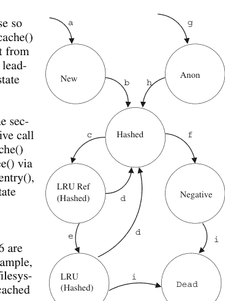

`a.` `d_alloc()`
`b.` `d_add()`
`c.` `dput()`
`d.` `dget_locked() / prune_dcache()`
`e.` `prune_dcache()`
`f.` `d_delete()`
`g.` `d_alloc_anon()`
`h.` `d_splice_alias()`
`i.` `prune_dcache() / d_free()`

图 6. dentry 状态图


与其直接引用已挂载的文件系统，而是设置挂载点的 `d_mounted` 标志，并且 `dcache` 在 `mount_hashtable` 中查找已挂载的文件系统，该过程将在后面描述。

图 7 显示了用于将挂载点 `dentry` 映射到已挂载文件系统的 `struct vfsmount` 的 `mount_hashtable` 数据结构。此映射对挂载点 `dentry` 的指针和包含挂载点的文件系统的 `struct vfsmount` 的指针进行哈希。这种 `dentry` 指针和 `struct vfsmount` 的组合允许在同一挂载点上进行多次挂载得到更优雅的处理。

图 2 中显示的示例文件系统布局将导致如图 8 所示的 `struct vfsmount` 结构。`vfs1` 结构将根 `dentry` `r1` 同时引用为 `mnt_mountpoint` 和 `mnt_root`，因为该文件系统是文件系统树的最终根。`vfs2` 结构将 `dentry` `b` 引用为其 `mnt_mountpoint`，将 `r2` 引用为其 `mnt_root`。因此，当 `mount_hashtable` 查找返回指向 `vfs2` 的指针时，`mnt_root` 字段可以快速定位已挂载文件系统的根。

已挂载文件系统的整体形状反映在 `mnt_mount`/`mnt_child` 列表中。这些列表在执行 loopback 挂载时由 `copy_tree()` 等函数使用，这些函数需要遍历整体路径名命名空间中特定子树下挂载的所有文件系统。

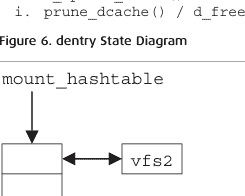

图 7. 遍历挂载点

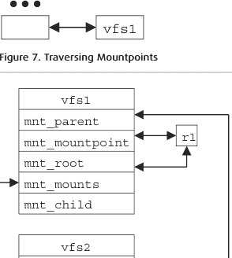

图 8. VFS 挂载树

## 将 RCU 应用于 dcache

完全并行化 `dcache` 会相当复杂，并且在 2.5 工作的后半部分被认为风险太大。2.6 `dcache` 只是通往 RCU 道路上的一个步骤；2.7 的目标是在不获取任何锁的情况下遍历整个路径。路径名段查找由列表 1 中显示的 `__d_lookup()` 函数执行。`__d_lookup()` 函数使用指向父目录的 `dentry` 的指针和要查找的名称调用。名称以 `struct qstr` 的形式传递，其中包含指向字符串的指针、其长度、为 `dcache` 哈希表预先计算的哈希值以及名称本身（如果需要）。

第 5–7 行解包 `struct qstr`。第 8 行将名称和父 `dentry` 指针的组合哈希到全局 `dcache` 哈希表中，生成指向相应哈希链的指针。

第 12 行和第 56 行标记了代码的 RCU 受保护段，在 `CONFIG_PREEMPT` 内核中禁用抢占，正如 2003 年 10 月《Linux Journal》期刊中题为“Using RCU in the Linux 2.5 Kernel”的文章中所述的 Reader-Writer-Lock/RCU 类比所指定。第 13–55 行遍历所选哈希链中的元素，查找匹配的 `dentry`。第 18 行发出内存屏障，但仅在 DEC Alpha 上。在其他 CPU 上，指针解引用隐含的数据依赖性已足够，因此在这些 CPU 上，第 18 行不生成代码。

由于此查找未获取锁，它可能与重命名系统调用竞争。这样的系统调用可能会将 `dentry` 移到另一个哈希链，并带走此查找。第 21 行和第 22 行检查此竞争，但它们本身不足。因此，第 23 行获取当前 `dentry` 经历重命名的次数的快照，`dcache` `d_move()` 函数，后者稍后用于确定是否有任何重命名与路径遍历竞争。第 24 行是内存屏障，以确保快照不会被编译器或 CPU 重排序。

第 25–28 行检查名称哈希和父 `dentry`。如果任一不匹配，则此 `dentry` 不能是我们查找的目标。第 29–41 行执行完整的名称比较，第 30 行对 DEC Alpha 进行内存屏障。例如，对于不区分大小写的文件系统，可以提供文件系统特定的名称比较函数，如第 33 行所示。


### 列表 1. 无锁路径名段查找

```c
1 struct dentry *
2 __d_lookup(struct dentry * parent,
3             struct qstr * name)
4 {
5     unsigned int len = name->len;
6     unsigned int hash = name->hash;
7     const unsigned char *str = name->name;
8     struct hlist_head *head = d_hash(parent,hash);
9     struct dentry *found = NULL;
10    struct hlist_node *node;
11
12    rcu_read_lock();
13    hlist_for_each (node, head) {
14        struct dentry *dentry;
15        unsigned long move_count;
16        struct qstr * qstr;
17
18        smp_read_barrier_depends();
19        dentry = hlist_entry(node, struct dentry,
20                            d_hash);
21        if (unlikely(dentry->d_bucket != head))
22            break;
23        move_count = dentry->d_move_count;
24        smp_rmb();
25        if (dentry->d_name.hash != hash)
26            continue;
27        if (dentry->d_parent != parent)
28            continue;
29        qstr = dentry->d_qstr;
30        smp_read_barrier_depends();
31        if (parent->d_op &&
32            parent->d_op->d_compare) {
33            if (parent->d_op->d_compare(parent, qstr,
34                                        name))
35                continue;
36        } else {
37            if (qstr->len != len)
38                continue;
39            if (memcmp(qstr->name, str, len))
40                continue;
41        }
42        spin_lock(&dentry->d_lock);
43        /*
44         * If dentry is moved, fail the lookup
45         */
46        if (likely(move_count ==
47                   dentry->d_move_count)) {
48            if (!d_unhashed(dentry)) {
49                atomic_inc(&dentry->d_count);
50                found = dentry;
51            }
52        }
53        spin_unlock(&dentry->d_lock);
54        break;
55    }
56    rcu_read_unlock();
57    return found;
58 }
```

如果执行到达第 42 行，我们就找到了一个名称匹配的子 `dentry`。然后我们在第 42 行获取子 `dentry` 的锁。由于我们对每个 `dentry` 都有锁，这些单独锁的竞争程度远低于原始 `dcache_lock`。尽管如此，生活并不完美。例如，根 `dentry` 上的锁仍然会受到竞争，这是一个稍后讨论的话题。

子 `dentry` 可能在第 23 行获取 `d_move_count` 快照后被重命名。因此，第 46-47 行检查 `d_move_count` 的当前值与快照。如果检查通过，则子 `dentry` 未在查找过程中被重命名，并且第 48-51 行递增引用计数——但前提是该条目仍被哈希。

第 53 行释放子 `dentry` 的锁，第 54 行跳出哈希链搜索循环。第 57 行如果查找成功则返回指向子 `dentry` 的指针，否则返回 `NULL`。


`__d_lookup()` 的失败并不意味着失败会返回给用户进程。文件实际上可能存在，但尚未加载到 `dcache` 中。

然而，此函数并不能防止所有重命名竞争风险。另一个竞争是由 `dcache` 对 `dcache` 哈希链使用 `hlist` 而非 `list` 引起的。它使用 `hlist` 来节省内存，因为 `hlist` 在列表头中只需要一个指针而不是两个指针。这也意味着 `hlist` 与 `list` 不同，不是循环的。因此，特定 `dentry` 可能被重命名，使其落入之前为空的 `dcache` 哈希链。如果这发生在正确的时间，`__d_lookup()` 函数可能会错误地返回搜索失败。

错误返回的搜索失败由上层的 `d_lookup()` 函数处理，如列表 2 所示。任何竞争的重命名都由第 13 行的 `read_seqretry()` 函数检测。由于问题情况仅导致虚假失败，因此仅在 `__d_lookup()` 返回 `NULL` 时才进行检查。

### 列表 2. 路径名段查找重命名竞争解决

```c
struct dentry *
d_lookup(struct dentry * parent,
         struct qstr * name)
{
    struct dentry * dentry = NULL;
    unsigned long seq;

    do {
        seq = read_seqbegin(&rename_lock);
        dentry = __d_lookup(parent, name);
        if (dentry)
            break;
    } while (read_seqretry(&rename_lock, seq));
    return dentry;
}
```

## 延迟释放

`d_free()` 函数必须将给定 `dentry` 的释放延迟到宽限期过去，因为任意数量的正在进行的路径遍历可能持有对该 `dentry` 的引用。延迟是在所示的 `d_free()` 函数中完成的

## 科学家和工程师的编译器和工具。

C、C++、F77、F90 和 HPF • 32 位和 64 位 Linux

针对 Intel 和 AMD CPU 优化 • AMD64 上支持 64 位

工作站、服务器和集群配置 • 编译速度快

原生 OpenMP • 原生 SMP 自动并行化

原生分布式内存并行化 • 缓存分块

函数内联 • SSE/SSE2 向量化 • 循环展开

跨过程优化 • 基于配置反馈的优化

32 位 Linux 上支持大文件 • 64 位整数和指针

F77 指针 • 字节交换 I/O • VAX 和 IBM 扩展

OpenMP/MPI/线程调试 • OpenMP/MPI/线程分析

与 `g77`/`gcc`/`gdb` 互操作 • PDF 和印刷文档

电子购买、下载和升级 • 技术支持

网络浮动许可证 • 学术和批量折扣


The Portland Group™ 编译器技术

www.pgroup.com   +1 (503) 682-2806   sales@pgroup.com

Listing 3 中，第 5 行使用 `call_rcu()` 原语将 `d_callback()` 函数中的破坏性操作延迟到宽限期结束之后。`d_callback()` 函数在 Listing 4 中显示；它只是释放单独存储的大名称（第 5–7 行），如果合适，然后在第 8 行释放 `dentry` 本身。

### Listing 3. dentry 结构的延迟释放

```c
static void d_free(struct dentry *dentry)
{
    if (dentry->d_op && dentry->d_op->d_release)
        dentry->d_op->d_release(dentry);
    call_rcu(&dentry->d_rcu, d_callback, dentry);
}
```

### Listing 4. dentries 的 RCU 回调函数

```c
static void d_callback(void *arg)
{
    struct dentry * dentry = (struct dentry *)arg;

    if (dname_external(dentry)) {
        kfree(dentry->d_qstr);
    }
    kmem_cache_free(dentry_cache, dentry);
}
```

## 重命名

`d_move()` 函数实现了重命名系统调用中特定于 `dentry` 的部分，如 Listing 5 所示。第 5 行排除了任何试图更新 `dcache` 的其他任务，第 6 行允许 `d_lookup()` 确定其与重命名发生竞争。第 7–13 行按地址顺序获取正在重命名的文件及其目标的每个 `dentry` 锁，以避免死锁。第 14–17 行将条目从 `dcache` 哈希表中的旧位置移除，如果尚未移除。

第 19 行更新 `dentry` 以指向其新的哈希桶，第 20–21 行将 `dentry` 添加到其目标哈希桶，第 22 行更新标志以指示 `dentry` 存在于 `dcache` 哈希表中。第 24 行从 `dcache` 哈希表中移除目标 `dentry`——即被 `rename()` 覆盖的那个——第 25–26 行将移动的和目标的 `dentry` 与其旧父级分离。

第 27 行更改 `dentry` 的名称，第 28 行强制写入顺序。名称更改并不简单，因为短名称存储在 `dentry` 本身中，而较长名称存储在单独分配的内存中。第 29–32 行更新名称长度和哈希值。第 33–44 行将 `dentry` 连接到其新父级。最后，第 45 行更新 `d_move_count`，以便 `__d_lookup()` 检测竞争，第 46–49 行释放锁。

理论上，一系列精心设计的重命名操作会使 `dentry` 保留在同一目录和同一哈希链中，这可能会使极不幸的查找无限期停滞。这种停滞发生的一种方式是，如果查找正在搜索哈希链中的最后一个元素，而倒数第二个元素被一致地重命名（从而移动到列表头部）正好在

### Listing 5. 重命名 dentries


```
void
d_move(struct dentry *dentry,
        struct dentry *target)
{
    spin_lock(&dcache_lock);
    write_seqlock(&rename_lock);
    if (target < dentry) {
        spin_lock(&target->d_lock);
        spin_lock(&dentry->d_lock);
    } else {
        spin_lock(&dentry->d_lock);
        spin_lock(&target->d_lock);
    }
    if (dentry->d_vfs_flags & DCACHE_UNHASHED)
        goto already_unhashed;
    if (dentry->d_bucket != target->d_bucket) {
        hlist_del_rcu(&dentry->d_hash);
    already_unhashed:
        dentry->d_bucket = target->d_bucket;
        hlist_add_head_rcu(&dentry->d_hash,
                            target->d_bucket);
        dentry->d_vfs_flags &= ~DCACHE_UNHASHED;
    }
    __d_drop(target);
    list_del(&dentry->d_child);
    list_del(&target->d_child);
    switch_names(dentry, target);
    smp_wmb();
    do_switch(dentry->d_name.len,
              target->d_name.len);
    do_switch(dentry->d_name.hash,
              target->d_name.hash);
    if (IS_ROOT(dentry)) {
        dentry->d_parent = target->d_parent;
        target->d_parent = target;
        INIT_LIST_HEAD(&target->d_child);
    } else {
        do_switch(dentry->d_parent,
                  target->d_parent);
        list_add(&target->d_child,
                 &target->d_parent->d_subdirs);
    }
    list_add(&dentry->d_child,
             &dentry->d_parent->d_subdirs);
    dentry->d_move_count++;
    spin_unlock(&target->d_lock);
    spin_unlock(&dentry->d_lock);
    write_sequnlock(&rename_lock);
    spin_unlock(&dcache_lock);
}
```

查找到达它时。实际上，`dcache` 哈希链很短，重命名很慢。然而，如果这些停滞成为问题，可能有必要在路径遍历失败时添加代码来阻止重命名。另一种正在考虑的方法是完全消除全局哈希表，转而修改 `d_subdirs` 列表以优雅地处理大型目录。

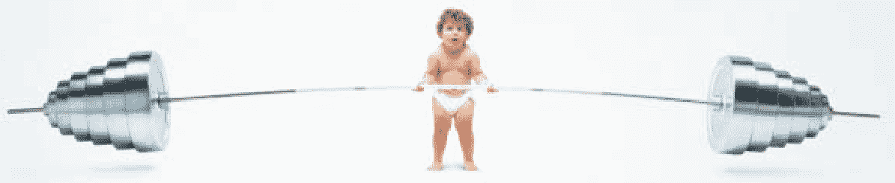

## 在最小的占地面积内体验最强大的计算能力...


由 `Intel®` `Xeon®` 处理器驱动的 `RackSaver®` `BladeRack™`，旨在支持各种企业解决方案...包括您的。

在过去的 10 年里，`RackSaver` 为从娱乐到石油和天然气等各个行业的客户提供了市场上最强大、可靠且可扩展的高性能集群。我们的客户明白，通过提高服务器机房的密度，他们可以在降低总体拥有成本的同时提高生产力。此外，`RackSaver` 提供全天候 24 小时、每周 7 天的完整现场企业级支持，以最大化您的投资保护。了解为什么像 `Industrial` `Light` `and` `Magic`、`NVIDIA`、`Shell`、`WesternGeco` 和 `Novartis` 这样的行业领导者依赖 `RackSaver` 来满足他们所有的高性能计算需求。


### THE NEMESYS

## 我们是否提到我们也销售高端可定制图形工作站？

`RackSaver` 已推出一条高端图形工作站新产品线。由 `NVIDIA` `Quadro®` `FX` 系列驱动的 `NemeSys™` 将领先的设计和数字内容创作应用程序提升到新的交互水平。首次，造型和生产渲染成为设计工作流程的组成部分，缩短了生产过程并实现更快的上市时间。

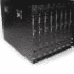

### THE HIVE CLUSTER

## 需要一种可以放在办公桌下并提供前所未有强大性能的刀片解决方案吗？

`HIVE™` 可容纳多达 11 个刀片，可容纳各种选项，包括高端服务器、`SAN`、基于 `NAS` 的存储以及 `InfiniBand®`。`8` 刀片和 `11` 刀片版本均与 `RackSaver` 的 `RS-1100VM` `BladeRack` 产品线完全兼容。`HIVE` 的创新冷却技术专为小型机架系统的需求而设计，也使其适用于包括军事、工业或简单办公环境在内的各种环境。

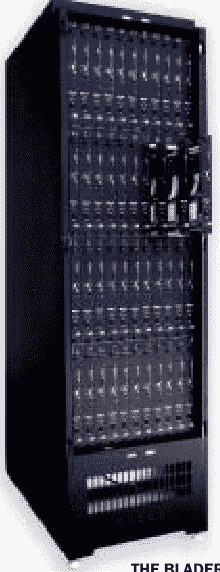

### THE BLADERACK RS-1100VM

`RackSaver`

高密度服务器的领导者！

立即通过访问 `RackSaver` 在线网站 `www.racksaver.com` 或致电我们的其中一位客户经理 `(888)` `942-3800` 来配置您公司的高性能超级计算解决方案。

## 性能与复杂度比较

虽然 `dcache` 的这次改动相对较小，但它在内核中产生了深远的影响，因为当时并没有为文件系统与 `dcache` 交互提供一个明确定义的 `API`。这导致 `Linux` `2.5` 内核中出现了大量错误，因为文件系统开发者试图以传统方式直接操作 `dcache`。鉴于现在已存在一个较为正式的 `API`，我们希望未来的改动会不那么痛苦。

图 9 显示了在打补丁使用目录项缓存中 `RCU` 的 `Linux` `2.5.59` 内核上运行的多用户基准测试的性能，与未打补丁内核的性能相比。这些基准测试在 `16` `CPU` `NUMA-Q` 系统上运行，使用 `700MHz` `PIII` `Intel` `Xeon` 处理器，`1MB` `L2` 缓存和 `16GB` 内存。

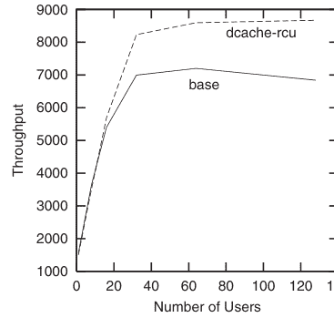

图 9. 多用户基准测试性能

将 `dcache_rcu` 补丁应用于 `Linux` `2.4.17` 内核后，在 `8` `CPU` `PIII` `Xeon` 服务器上，`SPECweb99`（不含 `SSL`）的吞吐量从 `2,258` 提高到 `2,530`，改善了 `12%`。将同一补丁应用于 `Linux` `2.5.40-mm2` 内核后，`Linux` 内核构建所消耗的系统时间从 `47.548` `CPU` 秒减少到 `42.498` `CPU` 秒，减少了超过 `10%`。在运行 `Linux` `2.5.42` 内核的单处理器 `700MHz` `PIII` `Xeon` 系统上进行的类似测试显示没有变化。综上所述，`dcache` `RCU` 不仅提高了高端机器的扩展性，也保持了低端机器的良好性能。

## 未来方向

尽管 `2.6` 版的 `dcache` 系统比 `2.4` 版更具可扩展性，但仍有许多问题需要调查：

1. 更新仍然受 `dcache_lock` 限制，这意味着更新密集型工作负载的可扩展性不佳。
2. 全局哈希表破坏了缓存局部性，并使更新代码比必要时更复杂。当然，任何替代方案都必须保留其优点，包括对大型目录的高性能处理。
3. `2.6` `dcache` 代码获取每个 `dentry` 的 `d_lock` 自旋锁，导致缓存行抖动和原子操作，特别是在根目录和工作目录上。需要深入思考才能找到简单的解决方案，因为将权限移入 `dentry` 证明相当复杂。
4. 解析 `__d_lookup()` 与 `d_move()` 之间竞争的代码过于复杂。

我们热切期待参与 `2.7` 工作以解决这些问题，希望能实现图 10 所示的情况。


图 10. `Tux` 在 `2.7` 中的职责

## 法律声明


本工作代表作者的观点，不一定代表`IBM`的观点。

`SPEC`和基准名称`SPECweb`是`Standard Performance Evaluation Corporation`的注册商标。基准测试仅用于研究目的，由于以下与规则的偏差，不能与`SPECWeb`网站上公布的结果进行比较：

1. 它运行在不符合`SPEC`公开可用性标准的硬件上。该机器是工程样品。
2. 未保留`access_log`以进行完整核算。它正在写入但每`200`秒删除一次。

有关最新的`SPECweb99`基准测试结果，请访问`www.spec.org`。

`Paul E. McKenney`是`IBM`的资深工程师，已从事`SMP`和`NUMA`算法的工作时间比他愿意承认的还要长。在此之前，他从事过分组无线电和`Internet`协议的工作（但在`Internet`流行之前很久）。他的爱好包括跑步和典型的家庭主妇和孩子习惯。


`Dipankar Sarma`目前正在从事多个`Linux`内核项目，包括`CPU`热插拔、`RCU`和`VFS`增强。在`Linux`时代之前，他曾从事包括`ABI`、操作系统启动、`I/O`驱动程序和多路径`I/O`在内的多个领域的工作。


`Maneesh Soni`曾作为`Linux`可扩展性工作项目成员与`IBM Linux`技术中心合作。他在系统软件领域拥有经验，特别是在操作系统内核和文件系统方面。


## 比我们专用托管解决方案的价格更令人印象深刻的只有性能。

### 高性能计划 100 - 400

| 硬件: | `IBM eServer xSeries` |
|---|---|
| 处理器: | `2.4 GHz Pentium® 4` - `Dual 2.67 GHz Xeon` |
| 内存: | `512 MB` - `2 GB` |
| 存储: | `60 GB` - `Three 36.4 GB SCSI` |
| 月度流量: (含突发带宽) | `100 GB` - `200 GB` |
| 操作系统: | `Red Hat Linux 9.0` or `Windows Server 2003` |
| 价格: | 起价 $349/月，无设置费 |

## 网络托管本应如此。

您需要的性能，可信赖的支持：`Interland`应有尽有。凭借我们的高性能解决方案系列，您可以运行最新、最可靠的应用程序。现在所有这些性能都打包在一个超值优惠中。

节省高达`$1,049`

购买任何高性能解决方案即可享受免费设置和价格匹配保证

致电`1-800-844-9938`或访问`www.interland.com/dedicated`

当然，一切都由`Interland 24/7`高价值支持团队提供支持。我们拥有`Microsoft`、`Red Hat`、`IBM`、`Cisco`的认证托管专家——几乎任何操作系统或硬件。您还可以利用`ValueGuard`等创新计划——所有高性能计划的标准配置——该计划在`18`个月内将您的服务器解决方案更新到最新的高性能配置。标准配置还包括对`mymanagedhosting.com`的安全访问，我们的在线支持门户，您可以在其中查看账单、提交和跟踪故障单、接收网络和安全更新等等。难怪我们是中小企业网络托管的世界领导者。


## 已签名的内核模块

现在您可以让内核在插入模块之前检查模块的加密签名。以下是具体做法。

`BY GREG KROAH-HARTMAN`

已签名的内核模块已在其他操作系统中存在多年。一些人和公司喜欢只安装由其操作系统中的某个权威机构认可的模块（或有时称为驱动程序）。鉴于`Linux`加载内核模块方式的变化，已签名的内核模块可以轻松添加到`Linux`内核中。本文讨论了我如何实现此功能并详细说明如何使用它。

在已签名的内核模块中，有人插入了数字签名，表示他们信任该特定模块。我不会试图说服任何人`Linux`应该具备此能力，它应该是强制性的，甚至能提供更高的安全性。我只描述如何做到这一点并提供其实现方法，如果有人想使用它的话。

公钥密码学用于使已签名的内核模块工作。有关`RSA`公钥加密算法的概述——它是什么以及如何工作——请参阅`www.linuxjournal.com/article/6826`上的`Linux Journal`网络文章。本文假设读者熟悉公钥密码学的基础知识，并且能够修补、构建并在机器上加载新的`Linux`内核。有关如何构建和加载新内核的说明，请参阅位于`www.tldp.org`的非常有帮助的`Linux Kernel HOWTO`。

在`2.5`内核开发系列中，`Rusty Russell`重写了`Linux`内核模块的工作方式。在之前的内核中，大多数模块加载逻辑存储在用户空间中。`Rusty`的更改后，所有这些逻辑都移到了内核中，减少了架构无关逻辑的数量，并大大简化了用户界面。这带来的一个好处是内核现在可以访问模块文件的原始形式。内核模块只是一个`ELF`格式的文件。`ELF`代表可执行和链接格式，是用于可执行程序的格式。`ELF`规范的文本形式可以在`www.muppetlabs.com/~breadbox/software/ELF.txt`找到

`ELF`文件由不同的部分组成。这些部分可以通过运行`readelf`程序来查看。例如：

```
$ readelf -S visor.ko
There are 23 section headers, starting at offset 0x3954:
```


### Section Headers
```
[Nr] Name              Type            Addr     Off    Size   ES Flg Lk Inf Al
[ 0]                   NULL            00000000 000000 000000 00      0  0  0
[ 1] .text             PROGBITS        00000000 000040 0017e0 00  AX  0  0 16
[ 2] .rel.text         REL             00000000 003cec 000c d0 08      21 1  4
[ 3] .init.text        PROGBITS        00000000 001820 000210 00  AX  0  0 16
[ 4] .rel.init.text    REL             00000000 0049bc 0001c8 08      21 3  4
[ 5] .exit.text        PROGBITS        00000000 001a30 000030 00  AX  0  0 16
[ 6] .rel.exit.text    REL             00000000 004b84 000030 08      21 5  4
[ 7] .rodata           PROGBITS        00000000 001a60 000020 00  A   0  0 16
[ 8] .rel.rodata       REL             00000000 004bb4 000028 08      21 7  4
[ 9] .rodata.str1.1    PROGBITS        00000000 001a80 000449 01  AMS 0  0  1
[10] .rodata.str1.32   PROGBITS        00000000 001ee0 0009c0 01  AMS 0  0 32
[11] .modinfo          PROGBITS        00000000 0028a0 0006c0 00  A   0  0 32
[12] .data             PROGBITS        00000000 002f60 000600 00  WA  0  0 32
[13] .rel.data         REL             00000000 004bdc 0001e0 08      21 c  4
[14] .gnu.linkonce.thi PROGBITS        00000000 003560 000120 00  WA  0  0 32
[15] .rel.gnu.linkonce REL             00000000 004dbc 000100 08      21 e  4
[16] __obsparm         PROGBITS        00000000 003680 000180 00  WA  0  0 32
[17] .bss              NOBITS          00000000 003800 00000c 00  WA  0  0  4
[18] .comment          PROGBITS        00000000 003800 00006e 00      0  0  1
[19] .note             NOTE            00000000 00386e 000028 00      0  0  1
[20] .shstrtab         STRTAB          00000000 003896 0000bd 00      0  0  1
[21] .symtab           SYMTAB          00000000 004dcc 000760 10      22 58 4
[22] .strtab           STRTAB          00000000 00552c 000580 00      0  0  1
```

由于 ELF 文件由部分组成，很容易向模块文件添加新部分，并在内核尝试加载模块时将其读入内存。如果我们在模块中放置一个 RSA 签名的部分，内核可以解密签名并将其与刚加载的文件的签名进行比较。如果匹配，签名有效，模块成功插入内核内存。如果签名不匹配，要么模块已被篡改，要么模块未使用正确的密钥签名。然后可以拒绝该模块——这就是我的补丁所做的。

## 内核代码如何工作

当内核被告知加载模块时，文件 `kernel/module.c` 中的代码会被运行。在该文件中，`load_module` 函数负责将模块分解为适当的部分，检查内存位置，检查符号以及所有

## Appro 高性能服务器与集群解决方案

`Appro` 基于 `AMD Opteron™` 处理器的服务器可提升现有 `Windows®` 和 `Linux` 应用的性能。

## 密度翻倍！

## Appro HyperBlade 全集成集群解决方案

### 新！

`Mini-Cluster`

### Appro BladeDome 远程服务器管理选项

- 针对快速变化环境而设计的灵活、模块化且可扩展的架构

- `Blade` 服务器可适配 `Appro` 全尺寸机柜（最多 80 节点）和 `Appro` 小型机柜（最多 17 节点），并可混合搭配集群构建模块

- 每节点双 `AMD Opteron™` 处理器

- 每节点最高 16GB ECC `DDR` 内存

- 每节点一个 `PCI-X` 插槽

- 最多两个内置硬盘

- 远程管理选项：
  - 带内和带外控制
  - `GUI` 与命令行界面

- 高速互连选项：`Myrinet`、`Dolphin`、`Quadrics` 和 `Infiniband`

## Appro 1U 和 2U 服务器

- 双 `AMD Opteron™` 处理器

- 设计用于在苛刻的机架条件下保持凉爽高效运行

- 高质量、功能强大且经济实惠

- 提供全集成集群解决方案

## Appro 4U - 四路服务器

- 四 `AMD Opteron™` 处理器

- 内存容量和灵活性可支持广泛的应用

- 支持 16 个 `DIMM` 插槽最多 64GB

- 支持最多 4 个 `SCSI` 驱动器

- 3.5 英寸软盘驱动器和 `slim CD-ROM`

`AMD Opteron™` 处理器 - 缩短运行时间周期并增加处理计算请求的带宽。

- 在迁移到 64 位计算的同时运行 32 位应用程序，以保护长期投资。

链接器通常执行的其他任务。补丁修改了此函数并添加了以下代码行：

```
if (module_check_sig(hdr, sechdrs, secstrings)) {
    err = -EPERM;
    goto free_hdr;
}
```

这个新函数 `module_check_sig` 执行所有模块签名检查逻辑。如果它返回错误，则会向用户返回错误 `Improper Permission` 并中止模块加载。如果函数返回 0，表示未发生错误，模块加载过程将成功继续。

`module_check_sig` 函数位于文件 `kernel/module-sig.c` 中。该函数首先要做的是检查模块内是否存在签名。这是通过以下代码行完成的：

```
sig_index = 0;
for (i = 1; i < hdr->e_shnum; i++)
    if (strcmp(secstrings+sechdrs[i].sh_name,
        "module_sig") == 0) {
        sig_index = i;
        break;
    }
if (sig_index <= 0)
    return -EPERM;
```

这段代码遍历内核模块中的所有不同 ELF 部分并查找名为 `module_sig` 的部分。如果未找到签名，它将返回错误并阻止该模块加载。如果找到签名，函数将继续。

一旦内核找到模块签名，它就需要确定所要求加载的模块的哈希值。为此，它会生成包含内核使用的可执行代码或数据的 ELF 部分的 `SHA1` 哈希。内核已包含生成 `SHA1` 哈希的代码（以及其他类型的哈希，包括 `MD5` 和 `MD4`），因此此步骤的大部分逻辑已存在。

该函数首先通过请求 `SHA1` 算法分配一个加密转换结构。然后它使用以下代码行初始化该结构：

```
sha1_tfm = crypto_alloc_tfm("sha1", 0);
if (sha1_tfm == NULL)
    return -ENOMEM;
crypto_digest_init(sha1_tfm);
```

`sha1_tfm` 变量用于创建我们想要的 ELF 文件特定部分的 `SHA1` 哈希，如以下代码所示：


```
for (i = 1; i < hdr->e_shnum; i++) {
    name = secstrings+sechdrs[i].sh_name;

    /* we only care about sections with "text" or
       "data" in their names */
    if ((strstr(name, "text") == NULL) &&
        (strstr(name, "data") == NULL))
    continue;
    /* avoid the ".rel.*" sections too. */
    if (strstr(name, ".rel.") != NULL)
    continue;

    temp = (void *)sechdrs[i].sh_addr;
    size = sechdrs[i].sh_size;
    do {
        memset(&sg, 0x00, sizeof(*sg));
        sg.page = virt_to_page(temp);
        sg.offset = offset_in_page(temp);
        sg.length = min(size,
            (PAGE_SIZE - sg.offset));
        size -= sg.length;
        temp += sg.length;
        crypto_digest_update(sha1_tfm, &sg, 1);
    } while (size > 0);
}
```

在此代码中，我们只关心名称中包含单词 `text` 或 `data` 的 ELF 部分，但不包含字符 `.rel` 的部分。在所有部分被找到并输入 SHA1 算法后，SHA1 哈希会通过以下行放入变量 `sha1_result` 中：

```
crypto_digest_final(sha1_tfm, sha1_result);
crypto_free_tfm(sha1_tfm);
```

现在 SHA1 哈希已计算并且已找到包含签名哈希的位置，剩下的就是解密签名哈希并将其与计算出的哈希进行比较。此步骤在该函数的最后一行完成：

```
return rsa_check_sig(sig, &sha1_result[0]);
```

`rsa_check_sig` 函数位于 `security/rsa/rsa.c` 文件中，并使用 GnuPG 代码本身，该代码已移植到内核中以解密签名并比较值。其工作原理的描述超出了本文的范围。

## 用户空间代码的工作原理

现在我们已经了解内核如何确定模块是否已正确签名，那么我们如何首先将签名放入模块中呢？内核补丁中可以找到两个用户空间程序 `extract_pkey` 和 `mod`，以及一个小型脚本 `sign`（位于 `security/rsa/userspace/` 目录中）。这两个程序可以通过运行该目录中的 `Makefile` 构建。`extract_pkey` 程序用于将公钥放入内核，而 `mod` 程序由 `sign` 脚本用于签名内核模块。

为了签名模块，必须生成 RSA 签名密钥，这可以使用 `gnupg` 程序完成。要生成 RSA 签名密钥，请将 `--gen-key` 选项传递给 `gpg`：

```
$ gpg --gen-key
gpg (GnuPG) 1.2.1; Copyright (C) 2002 Free Software Foundation, Inc.
This program comes with ABSOLUTELY NO WARRANTY.
This is free software, and you are welcome to redistribute it
under certain conditions. See the file COPYING for details.

Please select what kind of key you want:
  (1) DSA and ElGamal (default)
  (2) DSA (sign only)
  (5) RSA (sign only)
Your selection?
```

我们想要创建一个 RSA 密钥，因此选择选项 `5`，然后选择默认密钥大小 `1024`：

```
Your selection? 5
What keysize do you want? (1024)
Requested key size is 1024 bits
```

继续回答其余问题，最终你的 RSA 密钥将被生成。但为了使用此密钥，我们必须创建它的加密版本。为此，再次运行 `gpg` 并编辑你刚刚创建的密钥（在下面的文本中，我将我的密钥命名为 `testkey`）：

```
$ gpg --edit-key testkey
gpg (GnuPG) 1.2.1; Copyright (C) 2002 Free Software Foundation, Inc.
This program comes with ABSOLUTELY NO WARRANTY.
This is free software, and you are welcome to redistribute it
under certain conditions. See the file COPYING for details.

Secret key is available.

gpg: checking the trustdb
gpg: checking at depth 0 signed=0 ot(-/q/n/m/f/u)=0/0/0/0/0/1
pub 1024R/77540AE9 created: 2003-10-09 expires: never trust: u/u
(1). testkey

Command>
```

我们想要添加一个新密钥，因此在提示符下输入 `addkey`：

```
Command> addkey
Please select what kind of key you want:
  (2) DSA (sign only)
  (3) ElGamal (encrypt only)
  (5) RSA (sign only)
  (6) RSA (encrypt only)
Your selection?
```

再次，我们想要一个 RSA 密钥，因此选择选项 `6` 并回答其余问题。密钥生成后，在提示符下输入 `quit`：

```
Command> quit
Save changes? yes
```

## 有 30 分钟构建用户界面吗？宣布 BX PRO 6.1

`BX PRO` 提供了一个卓越的面向对象开发环境，可从头到尾构建功能强大的用户界面。`BX PRO` 的经过验证的功能将加速你的开发，并且版本 6.1 更加强大且更易于使用！

使用 `BX PRO`，你可以获得：

- WYSIWYG 视觉开发环境
- 大型项目支持
- 针对 `C/C++` 开发优化的环境
- `Motif` 1.2/2.1 支持

立即获取免费 30 天试用：

`www.ics.com`

或致电

`800.704.6824`


获取免费测验小册子。

看看你到底有多好！

版权所有 2002 Integrated Computer Solutions, Inc. 保留所有权利，所有商标均为其各自公司的财产。

现在我们有了密钥，就可以用它来签名内核模块。

要签名模块，请使用 `sign` 脚本，这是一个简单的 shell 脚本：

```
#!/bin/bash
module=$1
key=$2

### strip out only the sections that we care about
./mod $module $module.out

### sha1 the sections
sha1sum $module.out | awk "{print \$1}" > \
$module.sha1

### encrypt the sections
gpg --no-greeting -e -o - -r $key $module.sha1 > \
$module.crypt

### add the encrypted data to the module
objcopy --add-section module_sig=$module.crypt \
$module

### remove the temporary files
rm $module.out $module.sha1 $module.crypt
```

脚本做的第一件事是运行程序 `mod` 处理内核模块。该程序会剥离 ELF 文件中我们关心的部分并输出到临时文件。`mod` 程序将在后面详细介绍。


在我们得到只包含想要的部分的 `ELF` 文件后，我们使用 `sha1sum` 程序生成该文件的 `SHA1` 哈希值。然后该 `SHA1` 哈希值使用 `GPG` 进行加密，密钥会传递给它，并将加密后的文件写入临时文件。加密文件作为名为 `module-sig` 的新 `ELF` 部分添加到原始模块中。这是通过程序 `objcopy` 完成的。就这样。使用 Linux 机器上已有的常用程序，很容易创建一个 `SHA1` 哈希、对其进行加密并将其添加到 `ELF` 文件中。

`mod` 程序也很简单。它利用了 `libbfd` 库知道如何处理 `ELF` 文件并以不同方式操作它们这一事实；它基于 `binutils` 程序 `objdump`。因为 `libbfd` 库处理所有繁重的 `ELF` 逻辑，所以 `mod` 程序只需遍历它想要的 `ELF` 文件的所有部分，使用以下代码：

```
for (section = abfd->sections;
    section != NULL;
    section = section->next) {
    if (section->flags & SEC_HAS_CONTENTS) {
        if (bfd_section_size(abfd, section) == 0)
            continue;

        /* we only care about sections with "text"
           or "data" in their names */
        name = section->name;

```

```
if ((strstr(name, "text") == NULL) &&
    (strstr(name, "data") == NULL))
    continue;

size = bfd_section_size(abfd, section);
data = (bfd_byte *)malloc(size);

bfd_get_section_contents(abfd, section,
                    (PTR)data,
                    0, size);

stop_offset = size / opb;

for (addr_offset = 0;
    addr_offset < stop_offset;
    ++addr_offset) {
    fprintf(out, "%c", data[addr_offset]);
}
    free(data);
}
}
```

现在我们能够签名内核模块并且内核知道如何检测此签名，剩下的唯一部分就是将我们的公钥放入内核中，以便它能够成功解密签名。最近在 `linux-kernel` 邮件列表上有很多讨论集中在如何在内核中正确处理密钥上。该讨论产生了关于如何在 `2.7` 内核系列中处理此方面的一些良好提案。但现在，我们不担心以灵活的方式正确处理密钥，所以我们直接将其编译进去。

首先我们需要获取一份公钥的副本。为此，请告诉 `GPG` 将密钥提取到名为 `public_key` 的文件中：

```
$ gpg --export -o public_key
```

为了帮助操作 `GPG` 公钥，爱立信的一些开发人员创建了一个名为 `extract_pkey` 的简单程序来帮助将密钥拆分为不同的部分。我修改了该程序以生成公钥的 `C` 代码。

运行 `extract_pkey` 程序并将其指向你之前生成的 `public_key` 文件。让它将输出发送到名为 `rsa_key.c` 的文件：

```
$ extract_pkey public_key > rsa_key.c
```

完成此步骤后，将该 `rsa_key.c` 移动到 `security/rsa/` 目录中的文件顶部，用你的公钥替换我的公钥：

```
$ mv rsa_key.c ~/linux/linux-2.6/security/rsa/
```

现在你已经生成了一对公钥和私钥 `RSA` 密钥对，并将你的公钥放入内核目录。构建补丁后的内核，确保选择模块签名检查选项，然后安装它。如果你在该内核中启动，你将只允许加载用你的密钥签名的模块，所以要小心，只在开发机器上进行测试。

## 还剩下什么要做？

如本文所示，生成密钥、签名内核模块并将公钥放入内核映像需要多个不同的步骤。这仍然是一个粗糙的开发项目。为了使其对内核开发人员和 `Linux` 社区总体上更可接受，这些步骤需要自动化，使其更容易签名所有内核模块并处理公钥。

除了明显需要简化此功能的使用之外，该项目的一些其他未来目标包括：

- 将 `RSA` 代码移入通用加密框架，允许其他内核功能使用它。

- 允许内核中存在多个公钥，让来自多个来源的签名内核模块在单台机器上运行。

- 简化签名逻辑以允许使用 `GPG` 的原生签名功能或 `bsign` 程序提供的功能，而不是自定义的 `mod` 程序。

## 致谢

我谨向爱立信的开发人员表示感谢，他们创建了名为 `digsig` 的内核补丁和程序，允许我使用他们移植到内核的 `GPG`。我以前也做过，但实现很糟糕；幸运的是，他们发布了他们的移植版并且非常有帮助。`digsig` 内核补丁允许用户签名程序并阻止内核运行任何未签名的程序。有关此项目的更多信息可在 `sourceforge.net/projects/digsig` 找到。

我还要感谢我的雇主 `IBM` 允许我从事该项目，以及 `Don Marti` 催促我完成它并撰写本文。

`Greg Kroah-Hartman` 目前是各种不同驱动程序子系统的 `Linux` 内核维护者。他在 `IBM` 工作，从事与 `Linux` 内核相关的工作，可以通过 `greg@kroah.com` 联系到他。


## `Cacti`: `www.raxnet.net/products/cacti`

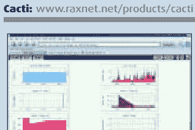

`Cacti` 在某些方面与 `MRTG` 相似，但设置和维护更容易，并且默认情况下绘制的不仅仅是流量。但一些 `Cacti` 用户并未止步于此；他们绘制了 Web 服务器点击量、`bind` 统计信息、天气等。快速浏览 `Cacti` 主页会让你大开眼界。我确信你可以用几个简单的脚本绘制更多内容。需要：`rrdtool`、`MySQL`、Web 服务器、带 `SNMP` 和 `MySQL` 支持的 `PHP`、`snmpd`、`Perl` 和图形 Web 浏览器。

> — `DAVID A. BANDEL`

## `www.asacomputers.com`

### 自 1989 年以来面向开源社区的硬件系统

[ `Linux`, `FreeBSD`, `NetBSD`, `OpenBSD`, `Solaris`... ]

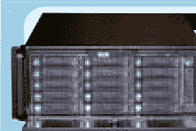

### 4TB in 4U—$8,299

`Intel E7501`, 2 x `Intel Xeon 2.4GHz`

1 GB `ECC DDR` Max: 16GB

1 x `10/100 LAN`

1 `Gigabit LAN`

`Raid 0,1,5,etc.`

`CD`, `Floppy`

`Redundant Hot-Swap Power Supply`

### 2U Dual Xeon SCSI—$2,260

6 Front-removable Hot-Swap `SCSI` bays

2 x `Intel Xeon 2.4 GHz` Max: 2

1 GB `ECC DDR` Max: 16GB

1 x 36GB `U320 SCSI` Drives

`Raid` optional Max: 876GB Storage

`CD`, `Floppy`

Dual `Gig` ports

1 Extra 5.25 Drive Bay

`Hot-plug redundant power supply`

### Dual AMD Opteron in 1U—$1,729

2 x `AMD Opteron 240`

1 GB `DDR ECC` Registered Memory

1 x 40 GB `IDE`

`Gigabit LAN`


### Space-saving Mini-1U Dual Xeon IDE—$1,529


1U 14" Depth

533 MHz `FSB`

2 x `Intel Xeon 2.4 GHz`

1 GB `DDR ECC` Memory

40 GB `IDE HDD`

1 `GIG`, 1 `10/100 LAN`

### 1U P4 Entry-level Server—$735

1 x `Intel P4 2.4 GHz`

256 MB `DDR ECC` Memory

40 GB `IDE Drive`

`CD`, 2 x `10/100 LAN`

### 1U Dual Xeon SCSI—$1,558

`SuperMicro 6013P-8 Barebones`


### 硬件规格
- Dual Intel Xeon 2.4 GHz 533 FSB
- 512 MB DDR ECC Max: 12GB
- 36 GB 10K rpm SCSI
- 3 Hot-Swap SCSI Drive Bays
- CD, Floppy
- Dual Gig, VGA onboard
- Raid optional

### ASA Colocation
$50 per month for
- 1U Rack - 20 GB/month

### ASA Colocation Special
First month of colocation free.*

### Storage Solutions
- IDE, SCSI, Fiber RAID solutions
- TB storage options
- 3Ware, Promise, Adaptec, ICP-Vortex, LSI, CMD, Chaparral, Mylex controllers
- JMR, Kingston/Storcase solutions

### Clusters
- Rackmount and Desktop nodes
- HP, Intel, 3Com, Cisco switches
- KVM or Cyclades Terminal Server
- APC or Generic racks
- All systems installed and tested with user’s choice of Linux distribution [free]. ASA Colocation—$50 per month

## ASA Computers, Inc.
- 1-800-REAL-PCS
- 2354 Calle Del Mundo, Santa Clara, CA 95054
- TEL: (408) 654-2900 • FAX: (408) 654-2910
- E-MAIL: sales@asacomputers.com
- Free delivery in Silicon Valley*
- Open on Sat. too—10 to 1


## www.asacomputers.com
www.b2bforsale.com

## 使用 `ioctl` 控制硬件

一旦你学会 `ioctl` 系统调用，你就能检查以太网链路灯的状态以及关于硬件的其他各种但重要的事实。

**作者 LISA CORSETTI**

几年前的某段时间，我有一台在工作和家里都使用的笔记本电脑。为了简化网络配置并且不必根据所在位置手动更改，我决定在两个地方都使用 `DHCP`。它在工作场所是标准配置，所以我在家里实现了一个 `DHCP` 服务器。这工作得很好，除了在不插入任何网络的情况下启动系统时。当我这样做时，笔记本电脑在继续启动过程的其余部分之前花费了大量时间尝试寻找 `DHCP` 服务器而未成功。

我得出结论，这个延迟时间的理想解决方案是让系统以以太网接口关闭状态启动，并且只有在电缆连接到集线器时才启动，即当以太网接口上有链路灯时。实现这一目标的最佳方式似乎是让 shell 脚本调用一个程序，其返回码指示特定网络接口上是否建立了链路。就此开始了我寻找确定我的 `10/100Base-T` 接口链路状态的方法的探索。

由于没有做过太多低级 Linux 编程，花了我一些时间才发现这种与设备驱动程序的大多数交互通常是通过 `ioctl` 库调用完成的（I/O 控制的缩写），原型在 `sys/ioctl.h` 中：

```
int ioctl(int, int, ...)
```

第一个参数是文件描述符。由于 Linux 中的所有设备都像文件一样访问，通常使用的文件描述符是使用要交互的设备作为目标打开的文件描述符。在以太网接口的情况下，`fd` 只是打开的套接字。显然，没有必要将此套接字绑定到相关接口。

`ioctl.h` 中的第二个参数是一个整数，表示对 `ioctl` 的特定请求的标识号。请求本质上必须因设备而异。例如，你可以设置串行设备的速度，但不能设置打印机设备。当然，网络接口有一组特定的命令。

附加参数是可选的，并且可能因设备上的 `ioctl` 实现而异。据我所知，第三个参数始终存在，我还没有找到超过第三个参数的情况。这个第三个参数通常似乎是指向结构的指针。这允许在两个方向传递任意数量的数据，数据由指针所指的结构定义，只需传递指针即可。

`ioctl` 工作方式的基本示例显示在以下简单的程序中，该程序检查串行端口上的一个信号状态：

```
#include <termios.h>
#include <fcntl.h>
#include <errno.h>
#include <sys/ioctl.h>

main()
{
    int fd, status;

    fd = open("/dev/ttyS0", O_RDONLY);
    if (ioctl(fd, TIOCMGET, &status) == -1)
        printf("TIOCMGET failed: %s\n", strerror(errno));
    else {
        if (status & TIOCM_DTR)
            puts("TIOCM_DTR is not set");
        else
            puts("TIOCM_DTR is set");
    }
    close(fd);
}
```

此程序打开一个 `tty`（串行端口），然后调用 `ioctl`，参数为串行端口的 `fd`、命令 `TIOCMGET`（列为获取调制解调器位的状态）和一个指向结果返回的整数的指针。

然后检查 `ioctl` 结果，以查看请求处理过程中是否出错。如果没有问题，我们通过与 `TIOCM_DTR` 进行与运算来检查返回的值。此步骤产生 `true` 或 `false`，分别是非零或零。

使用 `ioctl` 用于以太网驱动程序的过程类似。`ioctl` 调用中用于套接字 `ioctl` 调用（其中 `fd` 是套接字句柄）的第三个参数通常是指向 `ifreq`（接口请求）结构的指针。`ifreq` 结构的 `type` 声明可以在 `net/if.h` 中找到。

不幸的是，许多 `ioctl` 接口的文档很难找到，并且至少有三种不同的 `API` 用于访问网络接口。我最初使用 `MII`（媒体独立接口）方法编写了此程序。

## 即时验证 Web 服务，使用 Parasoft SOAPtest.


## （就像 1-2-3 一样简单。）

`Parasoft SOAPtest` 是第一个也是唯一一个能够让你即时验证 Web 服务是否正常工作的测试工具。

只需将 `SOAPtest` 指向你的 Web 服务 `WSDL` 文件。它会自动创建测试套件并运行对 Web 服务功能和负载能力的全面测试。

## 用于 SOAP 客户端开发的服务器仿真。

如果你正在开发客户端应用程序并且需要验证诸如信用卡处理之类的功能，通常 Web 服务服务器正在使用中或以其他方式无法用于测试。`Parasoft SOAPtest` 通过让你在几秒钟内仿真服务器响应并验证客户端功能来解决这个问题。

`SOAPtest` 还能让你快速创建用 `Java,™` `JavaScript,` 和 `Python` 编写的模板。

下载请访问 `www.parasoft.com/ij_11`。或致电 888-305-0041。

现支持 `WS-I` `Basic` `Profile` `1.0`

## 兼容性：
- 与任何 `SOAP` 兼容的实现兼容，包括 `Microsoft` 和 `IBM`
- `Windows` `2000/XP`
- `Linux`
- `Solaris`

`Parasoft` `Automated` `Error` `Prevention` `(AEP)` 解决方案和服务的一部分


在撰写本文时，在我的机器上安装了最新的内核后，我发现我必须添加 `ETHTOOL` 方法。

在添加 `ETHTOOL` 后，我随后修改了程序并将每个接口方法写成子例程。修改后的程序尝试一种方法，如果失败则尝试另一种方法。第三种方法早于 `MII` `API`，我还没有遇到需要它的机器，所以代码未包含在内。


有关使用 MII 接口的信息主要通过检查 Donald Becker 编写的 `mii-diag` 程序（`ftp.scyld.com/pub/diag/mii-diag.c`）获得，我在 Scyld Computing Corporation 的网站上找到了它。该网站还包含一个优秀的页面（`www.scyld.com/diag/mii-status.html`），解释了 `ioctl` 函数可能返回的 MII 状态字的详细信息。在这里，我重点关注 `ETHTOOL` 接口，因为它是更新的方法。该程序和两个接口都可从 Linux Journal FTP 站点 `ftp.ssc.com/pub/lj/listings/issue117/6908.tgz` 获取。

有关使用 `ETHTOOL` API 的信息也是通过查阅各种源代码获得的，其中最少不了的是网络接口驱动程序本身的源代码——特别是 `eepro100.c`。Tim Hockin 写的一封我在 Google 时找到的电子邮件也很有所帮助。

在编写我的程序时，我将默认接口设置为 `eth0`，除非向程序传递了参数。接口 ID 存储在 `ifname` 中。因为我使用的 `ioctl` 命令特定于网络接口，使用其他设备很可能会导致返回“cannot determine status”。

在调用 `ioctl` 之前我们需要一个文件句柄，所以我们首先必须打开一个套接字：

```c
int skfd;
if (( skfd = socket( AF_INET, SOCK_DGRAM, 0 ) ) < 0 )
{
    printf("socket error\n");
    exit(-1);
}
```

在标准的 try-to-check-for-all-errors C 编码风格中，我将此放在一个 `if` 语句中，该语句简单地打印错误并终止程序，如果套接字未正确打开则返回 `-1`。对于我的目的，我宁愿将确定状态时的错误报告为链路不存在而不是存在，所以找到的链路报告为 `0`，未找到报告为 `1`。

新的 `ETHTOOL` API 用于与驱动程序接口，使得确定链路状态比以前的方法容易得多。`ioctl` 已为 `ETHTOOL` 接口实现，使得现在只有一个 `ioctl` 命令 `SIOCETHTOOL`（指定调用是 `ETHTOOL` 命令），随后传递的数据块包含 `ETHTOOL` 接口的特定子命令。

标准的 `ioctl` 数据结构（类型 `ifreq`）需要两个额外项：命令应应用的接口的名称以及一个结构（类型 `ethtool_value`）的地址，用于存储特定命令以及返回的信息。结构和其他大多数信息（包括可用命令）位于 `ethtool.h` 头文件中。

我需要的命令是 `ETHTOOL_GLINK`，文档为“get link status”，我将其存储在 `edata.cmd` 中：

```c
edata.cmd = ETHTOOL_GLINK;
```

接口的名称和 `edata` 结构体的地址都需要放入 `ifreq` 结构中：

```c
strncpy(ifr.ifr_name, ifname, sizeof(ifr.ifr_name)-1);
ifr.ifr_data = (char *) &edata;
```

此时，剩下的就是进行 `ioctl` 调用，检查返回值（以确保命令类型被允许）并检查由返回指针指向的结构中的数据以查看链路是开启还是关闭：

```c
if (ioctl(skfd, SIOCETHTOOL, &ifr) == -1) {
    printf("ETHTOOL_GLINK failed: %s\n", strerror(errno));
    return 2;
}
return (edata.data ? 0 : 1);
```

在这种情况下，我的代码返回 `0` 表示链路开启，`1` 表示链路关闭，`2` 表示未确定或失败。此代码允许我从 `rc.local` 调用此函数，在系统插入到功能正常的集线器/交换机时才启动接口并调用 `dhcpcd` 或 `pump` 获取 IP 地址。以下是 `rc.local` 的相关部分：

```bash
/root/sense_link/sense_link | logger
if /root/sense_link/sense_link > /dev/null; then
    logger "No link sense -- downing eth0"
    /sbin/ifconfig eth0 down
else
    logger "Sensed link - dhcpcd eth0"
    /sbin/dhcpcd eth0
fi
```

首先，`sense_link` 的输出发送到系统日志。然后，如果在 `eth0` 上未检测到链路，或无法确定，将向日志写入消息并关闭 `eth0`。如果检测到链路，则在 `eth0` 上执行 `dhcpcd`。

一旦实现此功能，我的 `rc.local` 文件在未插入网络电缆或 DHCP 服务器处于活动状态并被找到时现在执行得相当快。我仍然经历显著延迟的唯一时间是当我插入到没有活动 DHCP 服务器的网络时。

我还没有尝试用我的 802.11b 卡测试此代码，以查看在尝试联系 DHCP 服务器之前是否可以检测到其上的链路，因为我通常只有在知道有服务器的位置才插入 PCMCIA 卡。这将是一个有趣的实验，并且对于感兴趣的人来说是一个有用的扩展。

Lisa Corsetti 目前是一名软件架构师，也是 Antei, Inc. 的总裁，该咨询公司专注于为各个行业和政府定制基于 Web 的应用程序。Lisa 获得了 Drexel University 的电气和计算机工程学士学位。


## 提供超过 175 门课程：

- `C++`

- `Java`

- `XML`

- `.NET`

- `Mobile`

- `Security`

- `Emerging Technologies`

- `Modeling, Design & Quality`

- `People, Process & Methods`

- `Web Services Technologies`

- `Requirements & Analysis`

另加：

新展会、小组讨论、

案例研究、

圆桌会议、`BOF's`

以及令人兴奋的特别活动

### 超级早鸟优惠

在 1 月 16 日之前注册可节省高达 $500

### 早鸟优惠

在 2 月 13 日之前注册可节省高达 $400

## SD WEST

2004 年 3 月 15-19 日，圣克拉拉，加州

## 提升自我

立即在 `WWW.SDEXPO.COM` 注册

## 理解缓存

支持 Linux 的架构在硬件层处理缓存的方式各不相同。以下是内核如何充分利用每种缓存设计的最佳性能。作者：`JAMES BOTTOMLEY`

自微处理器诞生之初以来，系统设计师就一直困扰于一个问题：`CPU` 的运行速度超过了其所连接的存储子系统的带宽。为了避免在等待内存获取请求数据时浪费 `CPU` 周期，普遍采用的解决方案是使用一块更快的（因此更昂贵的）内存来缓存主内存数据。只要所需的数据在缓存中可用，这一解决方案就能让 `CPU` 以其自然速度运行。

本文的目的是从内核程序员的角度解释缓存。我还解释了一些用于描述缓存的常用术语。本文分为若干章节，其内核编程相关性已标明；也就是说，有些章节解释了缓存属性与理解内核处理缓存的基本原理无关。如果你来自 `Intel IA32` 背景，缓存对你来说几乎是透明的。然而，为了编写在 Linux 支持的所有架构上都能正确运行的内核代码，你需要了解缓存工作原理的基本知识。

### 缓存及其属性

简单来说，缓存是一个缓冲内存访问并可能保存所请求数据的副本的地方。通常人们认为缓存（可能不止一个）是堆叠的；`CPU` 在顶部，其后是若干层一级或多级缓存，然后是主内存。在此层次结构中，缓存按其级别量化。最接近 `CPU` 的缓存称为一级缓存，简称为 `L1`，缓存级别不断增加直至达到主内存。

缓存行是可以传输到缓存或从缓存传输的最小内存单元。用于量化缓存的基本要素称为读线宽和写线宽。它们表示缓存必须从其下方的内存或缓存中读取或写入的最小数据量。经常这些数量相同，因此缓存通常仅用线宽来量化。即使不同，最长的宽度通常也称为线宽。

量化缓存的下一个属性是其大小。这一数字表示缓存中可存储的数据量。常有的性能经验法则是缓存越大，基准测试越好。

多级缓存可以是包含式或独占式。独占式意味着特定缓存行最多只能存在于一个缓存级别中。包含式意味着该行可以同时存在于多个缓存级别中。没有任何因素阻止不同缓存级别的线宽不同。

最后，特定缓存可以是写直达或写回。写直达意味着缓存可以存储数据的副本，但写入必须在下一层完成后才能向上一层发出完成信号。写回意味着只要数据存储在缓存中，写入即可视为完成。对于写回缓存，只要写入的数据未被传输，缓存行就被视为脏，因为最终必须将其写出到下一层。

### 缓存管理与一致性

缓存最基本的问题之一是一致性。当行中的数据与被缓存的主内存中存储的数据 `identical` 时，缓存行称为一致的。如果不是这样，缓存行称为不一致。缺乏一致性可能导致两个特定问题。第一个问题可能发生在所有缓存中，即陈旧数据。在这种情况下，主内存中的数据已更改，但缓存未更新以反映更改。


这通常表现为不正确的读取，如图 1 所示。这是一个瞬态错误，因为正确的数据位于主内存中；缓存只需被告知将其取入即可。

第二个问题仅发生在写回缓存中，可能导致数据实际破坏，且更加隐蔽。如图 2 所示，数据在内存中已被更改，同时也被 `CPU` 写入缓存而单独更改。由于缓存必须一次写出一行，现在无法调和这些更改——要么缓存行在未写入的情况下被清除，从而丢失 `CPU` 的更改，要么该行被写出，从而丢失对主内存所做的更改。所有程序员都必须避免达到数据破坏不可避免的程度；他们可以通过明智地使用各种缓存管理 API 来做到这一点。

``

图 1. 陈旧数据问题

``

图 2. 脏缓存行导致的数据破坏

### 缓存行干扰

当两组独立数据位于同一缓存行中，可能导致上述数据破坏的情况称为缓存行干扰。如果你正在内存中布局数据结构，避免这种情况的一般规则是永远不要将可在缓存外修改的数据与 `CPU` 可能通常使用的数据混合在一起。如果你绝对必须违反此规则，请确保结构中所有可外部修改的元素都对齐 `L1_CACHE_BYTES`，该值在编译时设置为代码可能运行的所有处理器上可能的最大缓存宽度值。最好的做法是使用 `kmalloc` 分配两个单独的区域。`kmalloc` 从不分配在缓存行中重叠的两个区域。

### 缓存管理指令

最基本的指令称为失效，它只是将指定的行从所有缓存中弹出。对该行中数据的任何引用都会导致其从主内存重新获取。因此，在读取数据之前使缓存行失效即可解决陈旧数据问题。在 `Linux` 中，此类失效通过以下方式完成：

```
void
dma_cache_inv(unsigned long address,
    unsigned long size);
```

其中 `address` 是开始的虚拟地址，`size` 是要失效的数据长度。请注意，`size` 会自动向上舍入为缓存行宽度的倍数。

对于写回缓存，任何脏缓存行都可使用以下方法写出或刷新到主内存：

```
void
dma_cache_wback(unsigned long address,
    unsigned long size);
```

此刷新必须在任何事物更改

``

脏缓存行下的主内存之前完成。因此，你必须在外部实体（如 `PCI` 卡）修改主内存之前发出刷新，并在刷新后但在 `CPU` 访问任何已更改数据之前发出失效。

理论上，对于写回缓存，失效会杀死缓存行而不实际写出数据，从而破坏缓存中的数据。在这种情况下更安全的做法是发出刷新并失效指令：

```
void
dma_cache_wback_inv(unsigned long address,
    unsigned long size);
```

这会将缓存行刷新到主内存，然后从缓存中使它们失效。

### 缓存类型

本节解释缓存实际的工作原理。你从本节需要了解的唯一重要信息是一个称为别名的属性，这意味着内存中的同一物理地址可能被缓存到多个不同的缓存行中。内核实际如何管理别名将在下一节讨论。

在直接映射缓存中，如图 3 所示，缓存被划分为已知宽度的缓存行（示例中为四个）。缓存中的每一行都由唯一的索引标识，因此缓存中的每个字节都由行的索引和行内的偏移量寻址。缓存的每个索引还具有一个称为标记的隐藏数字。

``

图 3. 直接映射缓存

系统中的每个地址都沿 `2` 的幂边界分为三部分——标记、索引和偏移（图 4）。当一行被带入缓存时，标记和索引从地址中提取。该行存储在缓存的所需索引处，隐藏的标记与行数据一起存储。当 `CPU` 引用特定地址时，缓存会在给定索引处被查询。如果标记匹配，则获取行内的偏移量以满足地址引用。如果标记不匹配，当前行可能会被刷新回主内存，并将正确的行带入缓存。

`| Tag | Index | offset |`

`|---|---|---|`

图 4. 地址划分

每个可缓存地址只有一个对应的索引行，这可能导致问题。例如，如果处理器读取的一系列地址恰好对应于相同的缓存索引，则缓存行必须在每次读取时被逐出并重新获取。这种情况很容易发生在例如 `for` 循环读取结构元素时，而该结构的大小恰好与缓存相近。对于直接映射缓存，索引有时称为缓存颜色，此问题称为缓存行着色问题。

为了解决直接映射缓存的着色问题，缓存电路有时被安排成使缓存查找能够同时在多个缓存行中比较标记。在 `N` 路组相联缓存中，每个索引对应 `N` 个缓存行（和标记）；因此，我们可以同时在缓存中拥有多达 `N` 个具有相同索引的地址。

增加的并行缓存查找电路往往会略微增加关联性的成本，因此它通常只出现在高端 `CPU` 中。

在范围的顶端，你可能会找到全相联缓存。这种类型的缓存完全没有索引，在查找特定标记时所有行都会同时被查询。

所有现代 `CPU` 都处理地址转换，这意味着内核或应用程序用于引用内存的虚拟地址与数据实际所在物理地址不同。缓存可以放置在地址转换之前或之后，有时在分层缓存中存在混合放置。每种放置都有不同的属性和特性，如下所述。

在物理索引、物理标记（`PIPT`）缓存中，缓存的标记和索引都在物理内存中，即在虚拟地址转换完成后。这过程很简单，但 `PIPT` 缓存的缺点是有效的地址转换必须在 `CPU` 的 `TLB`（转换后备缓冲器）中。如果在进行地址转换之前需要从内存中获取此类 `TLB` 条目，则缓存数据的优势就丧失了。即使存在 `TLB` 条目，`TLB` 查找和缓存查找也必须顺序进行，使这些缓存变慢。

在虚拟索引、虚拟标记（`VIVT`）缓存中，另一方面，索引和标记都在 `CPU` 当前操作的虚拟地址空间中。虽然这使缓存查找速度更快（如果缓存查找成功，则在查找之前或之后无需进行地址转换），但它们存在其他几个问题：

- `1.` 虚拟地址转换通常是正常内核操作的一部分，因此缓存必须仔细注意 `TLB` 条目的更改（以及地址空间的更改）并刷新其转换已更改的缓存行。

- `2.` 即使在单个地址空间中，同一物理地址也可能存在多个虚拟地址。每个这些虚拟

## VXRACK

## 集群技术的未来

需要在不增加成本的情况下提升性能？

获取基于 `Intel® Xeon™` 处理器的 `VXRACK™` 集群技术，获得您所需的性价比领先优势。

`ONE RACK`

`1.5 TFLOPS`

`128 VXBLADE`

`1.5TB MEMORY`

`256 INTEL® XEON™`

## 您的有多大？？？

### VXRACK™

- `8` 个 `VXCubes`（最高可达 `4` 高且背靠背）

- `128` 个 `VXBlade`（`VXB-7501`）

- `256` 个 `Intel® Xeon` 处理器

- 每 `5` 英尺超过 `32` 个 `CPU`

- `5 TB` 存储

- `1.5 TB` 内存

- 专利机架冷却系统

- 环境温度传感器

- 双前端 `PDU`（可选）

### VXCUBE™

- 机架式金属机箱

- `16` 个 `VXBlades`（`VXB-7501`）

- `32` 个 `Intel® Xeon™` 处理器

- `16` 或 `32` 端口配线面板（`RJ45` 或 `Infiniband` 连接器）

- `RS-232` 带内连接器

- 环境温度传感器

- 集成 `PDU`（`20Amp-208V`）

- 内部千兆交换机（可选）

- 内部 `Topspin` 交换机（可选）

### VXBLADE™ (VXB-7501)

- `VXBlade`（`VXB-7501`）

- 双 `Intel® Xeon™` 处理器（最高 `3.06GHz`）

- `Intel® E7501` 芯片组

- `8` 或 `12GB ECC DDR` 内存

- 双极致主动散热片

- 双 `Intel®` 千兆端口

- `0`、`1` 或 `2` 个 `IDE ATA/100` 硬盘

- 一个 `PCI-X` 插槽可用

- `IPMI 1.5` 管理（可选）

### VXBLADE™ (VXB-8870)

- `VXBlade`（`VXB-8870`）

- 双 `Intel® Itanium2™` 处理器（`1.5GHz`，`1.5MB L3` 缓存）

- `Intel® E8870` 芯片组

- `16GB ECC DDR` 内存

- 双极致主动散热片

- 双 `Intel®` 千兆端口

- `0` 或 `1` 个 `IDE ATA/100` 硬盘

- 一个 `PCI-X` 插槽可用

- `IPMI 1.5` 管理（可选）

现已提供...请致电了解更多信息。

即将推出 `12/03`

### 经济实惠

`VXRack` 极致密度结合 `Intel` 服务器构建模块组件，与常规 `1U` 集群解决方案或专有 `RISC` 超级计算机相比提供了令人难以置信的成本效益

### 可扩展性

`VXRack` 本质上可扩展。增加的处理负载可以通过添加额外的 `VXBlades` 和 `VXCubes`，或通过使用更快的处理器或内存升级节点来快速轻松地适应。

### 轻松升级

`VXRack` 易于升级，随着工作负载或预算的允许。每个节点都可以独立升级而不影响其他节点。此外，大型集群可以按需付费分阶段便捷构建。

### 原始性能


`VXRack` 可以轻松构建以提供几乎任何级别的容量和性能。单个配备 256 个 `Xeon` 处理器的 `VXRack` 可提供超过 1.5 `Tflops`（每秒万亿次浮点运算）的性能。

### 灵活性

`VXRack` 的一部分可以分配给不同的应用程序，允许多个独立作业高效并行运行，或合并以尽可能快地完成单个大型计算。

### 无与伦比的质量

`VXRack` 利用 `Intel` 30 年设计和工程行业领先服务器组件的经验。`Intel` 花费 12,000+ 小时测试和验证服务器堆栈的每个部分。

立即致电 `866-7VX-RACK` 或 `WWW.VXRACK.COM`。

地址将被分别缓存，即使它们代表相同的数据。这称为缓存行别名问题。

总体而言，`VIVT` 缓存增加的查找速度超过了其缺点，使其成为非 `x86` `CPU` 的主要缓存类型。

设计用于克服 `VIVT` 缓存某些缺点而又不会牺牲太多速度优势的混合缓存类型是虚拟索引、物理标记（`VIPT`）缓存。索引在虚拟地址上，但标记在物理地址上，因此组合（标记、偏移）必须指定完整的物理地址。这一要求导致标记比其他缓存类型的标记更大。

`VIPT` 缓存相对于 `PIPT` 的速度优势在于地址转换和缓存查找现在可以并行进行。然而，`CPU` 在地址转换完成之前并不知道缓存行是否有效（标记匹配）。

`VIVT` 的缺点得以克服，因为标记是物理的，因此当 `VIPT` 缓存看到缓存中两个标记相同时会自动检测别名。因此，可以构建 `VIPT` 缓存，使缓存行别名永远不会发生。

这种第四种理论缓存类型，物理索引、虚拟标记（`PIVT`），基本上是无用的，不再进一步讨论。

## 别名问题

只要内核为同一物理页设置了多个虚拟映射，就可能发生缓存行别名。内核小心避免别名，因此它通常只在一种特定情况下发生：当用户 `mmap` 一个文件时。这里，内核在页缓存中有文件的页面的一个虚拟地址，而用户可能有一个或多个不同的虚拟地址。这是因为没有任何东西阻止用户在多个位置 `mmap` 文件。

当文件被 `mmap` 时，内核将其映射添加到 `inode` 的其中一个列表中：`i_mmap`，用于不能更改底层数据的映射，或 `i_mmap_shared`，用于可以更改文件数据的映射。使页的缓存别名同步的 `API` 是：

```c
void flush_dcache_page(struct page *page);
```

此 `API` 必须在每次内核更改页上的数据时调用，并且如果 `page->mapping->i_mmap_shared` 不为空，则在读取页数据之前应调用它。在特定于体系结构的代码中，`flush_dcache_page` 遍历 `i_mmap_shared` 列表并刷新缓存数据。然后它遍历 `i_mmap` 列表并使其无效，从而使所有别名同步。

## 分离的指令和数据缓存

在追求效率的过程中，处理器通常对执行的指令和操作的数据有单独的缓存。通常，这些缓存是独立的机制，数据写入可能不会被指令缓存看到。如果您试图执行刚刚写入内存的指令，例如在模块加载期间或使用 `trampoline` 时，这会造成问题。您必须使用以下 `API`：

```c
void
flush_icache_range(unsigned long start,
                   unsigned long end);
```

以确保指令在执行前被指令缓存看到。`start` 和 `end` 分别为您修改以包含指令的内存块的起始和结束地址。

## 通用缓存刷新

两个 `API` 全局刷新 `CPU` 缓存：

```c
void flush_cache_all(void);
```

and

```c
void flush_cache_mm(struct mm_struct *mm);
```

这些刷新系统中的所有缓存以及仅属于特定进程地址空间 `mm` 的缓存行。这两者都是极其昂贵的操作，应仅在绝对必要时使用。

## SMP 环境中的缓存

当系统中存在多个 `CPU` 时，通常存在每个 `CPU` 独有的缓存级别。根据体系结构，可能由内核负责确保一个 `CPU` 缓存中的更改对其他 `CPU` 可见。幸运的是，大多数 `CPU` 在硬件中处理这种一致性问题。即使没有，只要遵循本文列出的 `API`，您就可以在所有 `CPU` 之间保持一致性。

## 结论

我希望我已经简要概述了缓存的工作原理以及内核如何管理它们。本文的内容应该足以让您理解在您可能遇到的大多数内核编程情况下的缓存。请注意，然而，如果您深入到内核缓存管理的内部（特别是在特定于体系结构的代码中），您可能会遇到本文未讨论的概念和 `API`。

`James Bottomley` 是 `SteelEye` 的软件架构师。他维护 `SCSI` 子系统、`Linux Voyager` 端口和 `53c700` 驱动程序。他还在 `DMA`/设备模型抽象领域为 `PA-RISC Linux` 开发做出了贡献。


## 技术提示

如果您刚刚将网站上的所有 `GIF` 图像转换为 `PNG`，但 `HTML` 仍引用原始 `.gif` 文件名，只需使用 `Apache` 的 `mod_rewrite` 将访问者重定向到图像的新版本：

```
RewriteEngine on
RewriteRule (.*)\.gif $1.png [R]
```

## 多媒体

如果上期内容让你对更多音频和视频项目感到饥渴，就在我们的网站上大饱眼福耳福。`HEATHER MEAD` 撰文


我们新产品邮箱收到大量新闻稿，介绍专门为高端音频和图形需求设计的新工作站。如果你是一名使用 `Linux` 的动画师、电影制作人或录音工程师，硬件和软件公司都非常希望得到你的业务。但是，即使你只是普通桌面用户，`Linux` 在音频和视频方面的发展也很重要，因为其中至少一部分最终会进入桌面发行版。所以本月，我们将为你指引一些 `LJ` 网站文章，讨论 `Linux` 多媒体世界正在发生的事情。

如果你对能完成更复杂音频任务（如录制和混音音乐）的声卡感兴趣，`Peter Todd` 讨论了“在 `Linux` 上使用 `Hammerfall HDSP`”（`www.linuxjournal.com/article/7024`）。`Hammerfall` 是一款在全球各大录音棚使用的专业级声卡；它也能在 `Linux` 下运行，这要归功于 `ALSA Project` 驱动。它由一个名为 `Multiface` 的外部模块与一块内部 `PCI` 卡组成。`Peter` 解释说 `Hammerfall` 与普通声卡的


## 多媒体

如果上个月的刊物让你对更多音频和视频项目感到饥渴，就在我们的网站上大饱眼福耳福。HEATHER MEAD 撰文


我们新产品邮箱收到大量新闻稿，介绍专门为高端音频和图形需求设计的新工作站。如果你是一名使用 Linux 的动画师、电影制作人或录音工程师，硬件和软件公司都非常希望得到你的业务。但是，即使你只是普通桌面用户，Linux 在音频和视频方面的发展也很重要，因为其中至少有一部分最终会进入桌面发行版。所以本月，我们将为你指引一些 LJ 网站文章，讨论 Linux 多媒体世界正在发生的事情。

如果你对能完成更复杂音频任务（如录制和混音音乐）的声卡感兴趣，Peter Todd 讨论了“在 Linux 上使用 Hammerfall HDSP”（`www.linuxjournal.com/article/7024`）。`Hammerfall` 是一款在全球各大录音棚使用的专业级声卡；它也能在 Linux 下运行，这要归功于 ALSA Project 驱动。它由一个名为 `Multiface` 的外部模块与一块内部 PCI 卡组成。Peter 解释说 `Hammerfall` 与普通声卡的最大区别在于 HDSP“被设计为声音 I/O 设备。它具有输入和输出，你可以任意在它们之间路由声音”。文章还解释了如何使用诸如外部时间码源等高级功能，这是录音棚必备的。

2003 年初春，Dave Phillips，《The Linux Book of Music & Sound》的作者，参加了专门为 Linux 音频开发者举办的首次会议。他为我们撰写的报告“Linux Audio Development: A Report from Karlsruhe”（`www.linuxjournal.com/article/6762`）提供了会议上讨论的主要问题的概述，以及 Linux 音频开发的发展方向。其中讨论的话题之一是 `JACK`，这款软件工具包“提供了一个低延迟环境中的专业级音频服务器，使任意音频信号路由成为可能，且无丢帧或失真”。

转向我们演示的视频部分，Roberto de Leo 的文章“Self-Hosting Movies with MoviX”（`www.linuxjournal.com/article/6474`）解释了 de Leo 如何开始 `MoviX` 项目用于自托管电影——“一种能够启动并自动播放光盘上所有音视频文件的 Linux CD 微型发行版”。文章的主要目的 however 是引导用户通过构建自己的微型发行版的过程，无论是用于播放电影还是其他应用。

最后，Geoff Draper 为我们撰写了文章“The Art of Rewriting Old Games”（`www.linuxjournal.com/article/7083`），其中他回忆了对老宠爱 Nellan Is Thirsty 的怀念如何促使他重写这款老式 8 位文本游戏。新版本 `Thirsty Nellan`“用点按式 GUI 环境取代了原版游戏的命令行解析器界面”。他还使用了 `Alias/Wavefront` 来制作场景，我们必须承认，这是我们见过的最可爱的企鹅艺术作品之一。因为许多这些老式 8 位游戏属于公共领域，它们也可以为新一代游戏玩家重新创作。阅读文章以了解 Draper 具体做了什么，然后去拯救你自己的老宠爱。

如果你重写老游戏、在 Linux 机器上搭建音乐工作室或编辑电影，请给我们写信，告诉我们你是如何做的。而且，务必经常查看 Linux Journal 网站。每天都会发布新文章。

Heather Mead 是 Linux Journal 的高级编辑。

## 精品推荐

### 邮件服务器病毒防护


Vexira™ Antivirus for Mail servers 是业界领先的、可高度扩展的电子邮件服务器病毒扫描解决方案。立即联系 Central Command®，了解 `Vexira Antivirus` 为何被称为病毒防护领域的“最佳品种”。

- 支持的操作系统：
  - Linux
  - FreeBSD
  - OpenBSD
- 邮件服务器：
  - `Sendmail`
  - `Postfix`
  - `Qmail`
  - `Exim`

Central Command, Inc.

phone: 330.723.2062 • fax: 330.722.6517

`www.centralcommand.com`

## 移动硬盘时修复交换分区

我使用的是 `HP Brio` 上的 `Red Hat 9`（PIII，20GB 和 192MB RAM）。我最初在硬盘为从盘主盘时安装了 Linux。后来我将其改为主盘主盘。我使用启动盘启动 Linux，但尝试启动系统时，出现交换分区未初始化的错误。内核可以检测到我的根分区和引导分区的变化，但在交换分区的情况下却无法检测。如何动态更改交换分区？换句话说，在启动前应向内核传递什么参数，以便在命令行上指定我的交换分区？另外，我能否使用同一启动盘在具有不同分区分配的其他系统上启动，就像 Windows 启动盘一样？

--

Aman Hardikar, `cybergeek2k@rediffmail.com`

`Linux` 在一个设备上查找交换分区（主从盘），可能命名为 `/dev/hdbX`，X 为分区号，而它现在位于主盘主盘上，可能为 `/dev/hdaX`。因此，`Linux` 找不到指定的交换分区，无法初始化它。要修复此问题，编辑你的 `/etc/fstab` 文件并更改具有交换条目的那一行中的设备。它可能类似于：

```
/dev/hdb2  swap  swap  defaults  0 0
```

所以，将其更改为：

```
/dev/hda2  swap  swap  defaults  0 0
```

在此示例中，交换分区是磁盘上的第 2 号分区。然后重新启动系统，它应该能正常工作。另一种重启方式是在编辑 `/etc/fstab` 文件后，使用命令 `swapon -a -e` 手动启动交换分区，如上所述。

--

Felipe Barousse Boué, `fbarousse@piensa.com`

## 支持 Serial ATA？

我打算安装 `SuSE 8.2`，想知道我能否在 `Serial ATA` 硬盘上安装它。

--

Daniel Gustafsson, `gustafsson_danie@hotmail.com`


`Serial ATA`硬盘受`Linux`支持（包括`SuSE 8.2`发行版的库存内核版本`2.4.19`）。这显而易见，但正如通常一样，首先你必须检查你的系统`BIOS`和/或磁盘控制器硬件是否支持`Serial ATA`硬盘。

--

Felipe Barousse Boué, fbarousse@piensa.com

通常，第一个问题是，你的`BIOS`是否支持从串行`ATA`接口启动？如果你的`BIOS`不支持从此控制器启动，你可能能够安装`Linux`从其他设备启动。

--

Jim Dennis, jimd@starshine.org

你可以在`SuSE`的组件数据库`hardware db.suse.de`上查找你的硬件。其他`Linux`发行版也维护

它们自己的硬件兼容性列表。虽然技术上在你的发行版提供的内核版本中可能受支持，但在购买硬件之前最好还是检查发行版的硬件兼容性列表。列表上的项目更有可能被安装程序自动检测到，你的发行版更有可能包含对列表上项目支持的最新实用程序。

--

Don Marti, dmarti@ssc.com

`Linux Journal`网页上有许多在线帮助资源。`Sunsite`镜像站点、`FAQ`和`HOWTO`都可以在`www.linuxjournal.com`找到。

`Best of Technical Support`中发表的答案由一支`Linux`专家团队提供。如果你想提交问题供本栏目考虑，请填写`www.linuxjournal.com/lj-issues/techsup.html`上的网页表单，或发送电子邮件，主题行写“`BTS`”至`bts@ssc.com`。

请务必包含你的发行版、内核版本、任何相关细节以及问题的完整描述。

## 简单文档管理系统：

`sdms.cafuego.net`


许多公司甚至一些个人都需要一个归档文档的系统。此文档管理系统使用`MySQL`进行存储，并为需要的人提供不同级别的访问权限。访问权限可以按文档逐个拒绝、只读、修改或上帝模式（允许几乎任何操作）。需要：`MySQL`、`PHP`、`Web`服务器和`Web`浏览器。

—DAVID A. BANDEL

## OpenOffice.org 1.1

`OpenOffice.org`已发布其办公套件的`1.1`版本，适用于`Linux`、`Windows`和`Solaris`，多种语言版本，包括英语、德语、瑞典语、西班牙语和日语。`1.1`版的新功能包括原生一键式`PDF`导出、`Flash`导出、更快的加载时间、改进的`MS Office`文件兼容性和辅助功能支持。此外，还增加了对`AportisDoc`、`Pocket Word`和`Pocket Excel`的支持，以便更轻松地将文档传输到`PDA`和手持设备。`OpenOffice.org 1.1`还提供开放的、面向未来的`XML`文件格式，使用户能够避免文件格式锁定情况。该套件及其源代码可从`www.openoffice.org/dev_docs/source/download.html`下载。

联系`OpenOffice.org`, `www.openoffice.org`.

## Panasas ActiveScale Storage Cluster


采用以对象为基础的架构将数据作为大型虚拟对象进行管理，`ActiveScale`存储集群由`ActiveScale`文件系统、`StorageBlades`和`DirectorBlades`、`4U`系统机架以及集成千兆以太网交换机构成。`ActiveScale`文件系统将文件转换为智能数据对象，然后动态地在`StorageBlades`之间分配数据活动。这种设计在服务器和`StorageBlades`之间实现了并行数据路径，消除了性能和容量瓶颈。应用程序和用户数据存储在`StorageBlades`中，文件系统活动由`DirectorBlades`协调。`DirectorBlades`还在`StorageBlades`范围内虚拟化数据对象，使系统可被视为单一命名空间。

联系`Panasas`, 6520 Kaiser Drive, Fremont, California 94555, 510-608-7790, `www.panasas.com`.

## Aqua Data Studio 3.5


`Aqua Data Studio 3.5`是一款数据库查询和管理工具，允许开发人员创建、编辑和执行`SQL`脚本，以及浏览和修改数据库结构。`Aqua Data Studio`提供集成的数据库环境，通过单一一致的界面访问所有主要的关系数据库。这使得数据库管理员或开发人员能够从一个应用程序同时处理多项任务。`Aqua Data Studio`包括对以下数据库平台的支持，如`Oracle 8i/9i`、`IBM DB2`、`Informix Dynamic Server`、`Sybase Adaptive Server`、`Microsoft SQL Server`、`MySQL`和`PostgreSQL`。`3.5`版的新功能包括完整的模式提取、数据库对象的`SQL`脚本编写以及扩展的查询分析器选项。

联系`AquaFold, Inc.`, `www.aquafold.com`.

## Stratus/PMC


`Stratus/PMC`是一款双头图形控制器`PMC`卡，专为`VME`和`CompactPCI`嵌入式系统设计。它具有`128`位图形模块用于视频采集，带模拟/数字`I/O`。`Stratus/PMC`的两个显示通道可同时提供双`VGA`或`LVDS`输出，或单个`DVI`输出。使用`Silicon Motion SM731`图形加速器，`Stratus/PMC`支持单显示器分辨率高达`1600x1200x24bpp`（拥有`1670`万种颜色）和双显示器分辨率`1024x768x24bpp`。它还具有板载`33/66MHz`、`32`位`PCI`接口；片上`16MB SDRAM`；复合和`S-Video` `PAL/NTSC/SECAM`支持；以及可现场编程的`VGA BIOS` `EEPROM`。`Stratus/PMC`提供对`VxWorks`、`XFree86`和`Microsoft Windows`的支持。

联系`Peritek`, 5550 Redwood Road, Oakland, California 94619, 800-281-4567, `www.peritek.com`.

## Xybernaut ServicePoint


`Xybernaut`已宣布发布`ServicePoint`，这是一款移动迷你服务器，配置并作为移动应用程序服务平台交付。`ServicePoint`可作为移动甚至可穿戴的迷你服务器，通过无线或有线网络向各种设备和用户提供信息和应用程序服务。随附`Red Hat Linux Professional Server`，`ServicePoint`设备包括`500MHz Mobile Celeron`超低电压内存和存储处理器、`256MB SDRAM`、`5GB`或`10GB`可扩展内置硬盘、选配外部驱动器端口、`CompactFlash`和`USB`端口、`8MB SDRAM`以及内置声卡，用于全双工立体声`I/O`。

联系`Xybernaut Corporation`, 12701 Fair Lakes Circle, Suite 550, Fairfax, Virginia 22033, 703-631-6925, `www.xybernaut.com`.

## GEME Series Embedded Computers

`Adlink`的新嵌入式计算机系列`General Embedded Machine Engine`（`GEME`）专为测量、自动化和通信需求而设计。`GEME`将嵌入式`SBC`和电源单元与可选存储外设（如`CompactFlash`或`2.5`英寸硬盘）相结合。具有多种安装方案的模块化机箱设计允许添加一个`PMC`和多个`PC/104`模块。`GEMEs`提供三种基本配置，均配备低电压、无风扇处理器和各种扩展模块，包括视频采集、千兆以太网接口、远程`I/O`、串行通信和`64`通道`DI/DO`。

联系`Adlink Technology America, Inc.`, 15279 Alton Pkwy, Suite 400, Irvine, California 92619, 949-727-2077, `www.adlink.com`.

## NemeSys DAW64


RackSaver 与 AMD 合作推出了新款 `NemeSys` 64 位数字音频工作站（`DAW64`），采用 AMD 的 64 位 `Opteron` 处理器。专为录音棚环境中的数字音频处理、编辑和母带制作需求而设计，`DAW64` 是一款 4U 机架式系统，配备双 `Opteron` 处理器、4GB RAM、四块 36GB `Raptor SATA` 硬盘、`3ware` RAID 控制器和 `NVIDIA Quadro 4 380XGL` 图形卡。64 位地址空间使用户能够直接访问物理内存中的虚拟乐器和音乐库，消除了在多个工作站上分散内容的需求。

联系 `RackSaver, Inc.`，9449 Carroll Park Drive, San Diego, California 92121, 858-874-3800, `www.racksaver.com`.

请将有关 `Linux` 相关产品发布的资讯发送给 `Heather Mead`，`newproducts@ssc.com` 或 `New Products c/o Linux Journal`, PO Box 55549, Seattle, WA 98155-0549，或传真至 206-782-7191。投稿内容将被编辑以控制篇幅和内容。

## IBM eServer BladeCenter

评测者 `DANA CANFIELD`


### 产品信息

| 制造商 | `IBM` |
| :--- | :--- |
| 网址 | `www.ibm.com/servers/eserver/bladecenter` |
| 价格 | `BladeCenter` 机箱起价 $2,789 US；`HS20 Blade` 起价 $1,879 US；`Ethernet Switch Module` $2,199 US |

### 优点

- 7U 机架空间内容纳 14 台服务器/28 个 `CPU`。

- 系统全程采用完全冗余设计。

- `Linux` 支持与 `Windows` 支持相当。

- 安装七块刀片后价格点与独立服务器相匹配。

### 缺点

- 14 个系统共用一个控制台。

- 支持仅限于 `Red Hat` 和 `SuSE` 的特定版本。

- 可扩展性有限。

`IBM` 近期已开始围绕两种主要服务器系统展开推广，用于 `x86` 架构上的 `Linux` 部署。在扩展性方面，`IBM` 提供 `eServer x440` 系列，单系统可扩展至 16 个 `CPU`。对拥有小型服务器集群的普通用户更有吸引力的是 `IBM` 的横向扩展方案，即 `IBM eServer BladeCenter` 系统，一款支持 14 个刀片的 7U 机架式机箱。

机箱本身仅由无源中背板、`CD-ROM` 和软盘驱动器以及两个 10 英寸鼓风机组成。该单元随附两个冗余 230V 电源模块，如果系统运行超过五块刀片，则需要再配备两个。包含一个带键盘、视频和鼠标（`KVM`）以及以太网连接的管理模块，并且最近已增加对冗余管理模块的支持。

冗余是 `BladeCenter` 的关键设计目标，几乎没有被忽视。机箱后部有四个交换机模块槽；第二和第四槽分别是第一和第三槽的冗余槽。例如，如果在第一个槽安装以太网交换机，则可以在第三个槽安装第二个以太网交换机模块，但不能安装 `SAN` 交换机模块。尽管允许完全冗余，但这意味着一次只能安装两种类型的交换机模块。

目前，`IBM` 提供千兆以太网和光纤通道 `SAN` 交换机模块。内部，这些交换机模块连接到每个单独的刀片，外部千兆交换机提供四个铜制以太网端口，而 `SAN` 交换机提供四个光纤通道端口。安装冗余模块后，每个刀片可访问两个以太网端口和两个 `SAN` 端口。以太网交换机是一款功能齐全的三层交换机，具有强大的基于 Web 的界面。`SAN` 交换机是 `Q-logic` `SAN` 交换机，可通过 `Telnet` 会话或适用于 `Linux` 和 `Microsoft Windows` 的基于 Java 的管理软件进行配置。

`BladeCenter` 机箱正面包含一个 `CD-ROM`、软盘和 `USB` 端口，通过内部 `USB` 集线器/交换机连接到每个刀片。该交换机由每个刀片上的一个按钮控制，且一次只有一个刀片可以访问 `CD`/软盘/`USB` 端口。键盘、视频和鼠标通过另一个内部交换机连接，该交换机由每个刀片上的第二个按钮控制。`KVM` 和 `USB` 外设的控制也可以通过 `BladeCenter` 的基于 Web 的管理界面进行操作，该界面允许通过网络远程控制 `KVM` 输出。不幸的是，尽管可以安装冗余 `KVM`/管理模块，但一次只能将一个刀片分配给控制台，即使通过 Web 界面也是如此。这可能是 `BladeCenter` 最令人失望的限制，但对于在真正的集群环境中使用刀片的用户来说，这可能不是大问题。

在撰写本文时，仅有 `HS20` 服务器刀片已为 `BladeCenter` 发布。人们可能会认为这些刀片只是卡上的改装 `ThinkPad`，但实际上刀片是一款微型化的企业级服务器。尽管它随附单个 `CPU` 和 512MB RAM，`HS20` 具有 533MHz 前端总线，可支持两个 `Pentium 4 Xeon` `CPU`（最高 2.8GHz）和四个 `PC2100 DDR DIMM`（总计最高 8GB）。借助 `Xeon` `CPU` 的超线程功能，现代 `Linux` 内核可为每个实际安装的 `CPU` 看到两个逻辑 `CPU`。

每个刀片还配有一个 8MB `Rage Video` 和两个 `Broadcom` 千兆以太网控制器。每个以太网控制器都硬连接到一个交换机模块槽，驱动程序可配置为允许这些接口单独使用或以故障转移方式使用。刀片中可安装两块笔记本尺寸的 `IDE` 硬盘，但可选

或许有人会认为这些刀片只是卡上的改装版 `ThinkPad`，但实际上刀片是一种微型化的企业级服务器。

`SAN` 控制器卡与第二个 `IDE` 驱动器重叠，因此如果同时连接 `SAN`，则只能使用一个 `IDE` 驱动器。`SAN` 卡是一款定制的 `Qlogic` `SAN` 卡，可为 `SAN` 交换机模块提供冗余路径。`IBM` 还提供了一款配套刀片，允许将两个 `SCSI` 驱动器连接到刀片上，但它会占用机箱中的另一个插槽。

刀片支持热插拔，且通常易于升级。如果刀片发生灾难性故障，刀片可以被移除，且板载诊断系统会在故障组件旁边闪烁 `LED` 灯。我确实发现，由于用于固定的弹簧加载螺丝，安装第二个 `CPU` 上的散热器需要令人不安的大量力气。

`BladeCenter` 的一个有趣的设计特点是，`IBM` 承诺最终会发布基于其 `pSeries` 和 `iSeries` 服务器系列的刀片。这意味着你可以在同一机箱中混搭 `Intel` 和大型机级别的刀片。截至本文撰写时，尚未正式宣布此类产品。

如前所述，`BladeCenter` 具有强大的基于 Web 的界面。可以通过网络开关刀片电源、切换 `CD`/软盘或控制台端口并更新固件。目前，用户名称和密码必须在管理控制台中定义，这很麻烦，因为这些用户名称随后必须在每个以太网和 `SAN` 交换机模块中再次定义。此外，安全控制较为粗糙。用户无法仅被授予对某些刀片的访问权限或限制其只能执行某些任务。虽然用户可以被限制为仅具有查看权限，但此限制也阻止了这些用户使用远程控制台。

除了 Web 界面外，`BladeCenter` 还包含功能强大的 `IBM Director 4.1` 管理软件的许可证，其功能丰富到值得单独评测。值得一提的是，`Director 4.1` 的客户端、代理和服务器组件均在 `Linux` 下运行，允许你从单个控制台对所有 `IBM` 服务器执行诊断、启动和停止进程以及接收自动警报。

`BladeCenter` 上的 `Linux` 支持远好于我在任何其他服务器厂商那里发现的。`Linux` 驱动光盘随包装提供，且所有通用管理工具均用 Java 编写，完全支持 `Linux`。

## CODY 很快就被压垮了


角色和图像 © 2003 `Brad Fitzpatrick`, `ActiveEdge`。保留所有权利。

## Etnus TotalView... 地球上最好的线程调试器

单击即可切换线程，在保持其他线程当前状态的同时控制单个线程，定义和控制线程组等等。`TotalView` 从零开始设计用于处理多个执行流，为你调试即使是最复杂的线程程序提供所需的一切。不要被线程束缚。

在 `www.etnus.com` 免费试用 `TotalView`。


事实上，我尚未发现任何仅限 `Windows` 的与 `BladeCenter` 相关的管理、监控或配置工具。这与过去甚至最专注于 `Linux` 的硬件厂商的经历相比是一个令人耳目一新的变化。虽然官方支持目前仅限于 `Red Hat Linux 7.3`、`Red Hat Advanced Server 2.1` 和 `SuSE Linux 8`，但我运行 `Red Hat 8.0` 和 9 时没有任何问题。

如果你的服务器需要任何自定义外设、卡或接口，`BladeCenter` 不是一个选择，因为没有 `PCI` 或每刀片 `I/O` 端口。为每个刀片增加一个专用 `USB` 端口会使 `BladeCenter` 成为更通用的系统。


另一个重要考虑因素是，如果你没有专用服务器机房，`BladeCenter` 会令人不舒服地嘈杂。事实上，它嘈杂到 `IBM` 销售一种声学衰减单元（`AAU`），本质上是一个大型泡沫消音器。即使安装了 `AAU`，也可能通过办公室墙壁听到 `BladeCenter` 的运行声。

`IBM` 声称 `BladeCenter` 的定价使其在购买七个或以上刀片时成为独立服务器的低成本替代方案。很少能找到具有 `BladeCenter` 所包含的冗余级别的独立服务器，但我认为即使与功能较少的服务器相比，成本说法也是正确的。总的来说，`BladeCenter` 是一项了不起的工程。它可能最适合构建高密度集群的人，但与 `SAN` 结合使用时，它也是通用服务器的绝佳选择。

`Dana` `Canfield` 是印第安纳波利斯大学的系统管理员，他不断催促厂商为任何事物提供 `Linux` 支持。你可以通过 `canfield@peng1.net` 联系他。

## 书评

### Hacking the Xbox

作者 `Andrew` “`bunnie`” `Huang`

`No` `Starch` `Press`, 2003

`ISBN`: `1-59327-029-1`

`$24.99`


该书围绕一系列硬件黑客项目构建，复杂度从安装替代 `LED` 和制作电缆到使用定制窃听板窃听主板不等，《`Hacking` `the` `Xbox`》首先通过打开机箱，然后作废保修，最后四处查看来探索微软游戏主机的硬件内部。

这样做在有争议的《`数字` `千年` `版权` `法`》（`DMCA`）下是一个法律雷区，全文频繁讨论 `DMCA`。虽然主要对北美读者感兴趣，但该书提供了洞察，说明善意但经常信息不足的立法者可能造成的麻烦。生活在其他国家的黑客可能不会太担心 `DMCA`，但这并不意味着没有同等的本地立法在等待。

从软件角度想学习如何黑客攻陷 `Xbox` 的读者会感到好奇但失望。虽然它描述了一些重要的 `Xbox` 软件项目，但《`Hacking` `the` `Xbox`》专注于从硬件工程师而非软件工程师的角度进行逆向工程。关于在 `Xbox` 上运行 `GNU/Linux` 的详细说明不在此书中，但它们在其他地方提供，`Andrew` `Huang` 包含了必要的指针。如果你是那种对螺丝刀、烙铁、电子元件和 `PCB` 板很熟悉的人，那么这本书就是为你准备的。当然，如果你能忍受在过程中可能毁掉 `Xbox` 的风险会更好。别担心，`Huang` 提供了如果出现问题如何更换损坏的大容量存储设备、内存和电源的详细说明。

副标题为《`逆向` `工程` `入门`》，`Huang` 的《`Hacking` `the` `Xbox`》远不止于此。它是对密码学及其在硬件设计中应用的介绍。它是对 `DMCA` 对科学追求构成威胁的警告。它是关于知识产权法及其对黑客影响的入门读物。它是对 `Xbox` 黑客社区关键人物的介绍，并突出了他们的动机、意图和贡献。它也是一本相当不错的读物。令人惊讶的是，`Huang` 在不到 270 页的篇幅内完成了所有这些内容。

显然，《`Hacking` `the` `Xbox`》描述的是当前的 `Xbox`，而且现在书籍已经出版（这本身就是另一个故事），下一代 `Xbox` 很可能会改变，使书籍大部分内容失效。话虽如此，《`Hacking` `the` `Xbox`》中描述的通用硬件黑客技术可以重新应用于新 `Xbox`，尽管没有逐步说明。当然，随着全球数百万台原版 `Xbox` 主机出货，始终会有旧的、被替换或升级的 `Xbox` 可供玩耍，因此该书在相当长一段时间内仍有价值。

—`PAUL` `BARRY`

## Linux、Talon 与天文学

一个新开源应用程序让专业和业余天文学家能够从桌面探索太空。作者 `TONY` `STEIDLER-DENNISON`

自古中国人首次绘制星空以来，我们就对天文学着迷。有人认为，天文学的计算机化是其迄今为止的最大飞跃。今天，无人值守的机器人望远镜扫描了几个世纪以来绘制的天空，将其发现记录在现代数据库中。`CCD` 相机捕捉到胶片上无法定义的图像。无论是业余还是专业，这都是成为天文学家的激动人心的时代。

天文学的革命并不止于硬件。从西班牙到韩国的观测站中的科研级望远镜都在开源软件和基于 `Linux` 的计算机控制之下。在开源模式下，科学家可以自由修改控制软件，产生惠及业余爱好者的 `trickle-down` 效应。开源和 `Linux` 甚至改变了科学方法。随着源代码自由可用，同行评审现在不仅针对数据，也针对数据收集方法。

开源天文学革命的最前沿是 `Talon`。`Talon` 最初由 `Ellwood` `Downey` 开发为天文台控制和天文分析软件（`OCAAS`）。2001 年，该软件被爱荷华州爱荷华城的 `Torus` `Technologies` 收购。2002 年底，`Torus` 被 `Optical` `Mechanics`, `Inc.` 收购，更新后的 `OCAAS` 软件包在 `GPL` 下作为 `Talon` 发布。

在过去两年里，我每天都有与 `Talon` 合作的愉快经历。我已在多个望远镜套件上安装和配置了该软件，并随这些望远镜前往世界各地进行安装和现场配置。很高兴与你分享 `Talon` 安装、配置和使用的一些要点。

`Talon` 可在 `observatory.sourceforge.net` 下载。该软件与集成运动控制板交互，可从 `Optical` `Mechanics`, `Inc.`（`Optical` `Mechanics` `Motion` `Controllers`）或 `Oregon` `Microsystems`（`PC39` `Motion` `Controllers`）获得。目标获取和跟踪、计划操作、环境监控、穹顶控制、图像分析和处理均在 `Talon` 控制之下。使用远程 `X` 会话也可以进行网络操作。

### 使用 Talon

`Talon` 软件包包含完整的安装脚本；`install.sh` 创建一个 `talon` 用户，编译二进制文件并创建一组用于望远镜初始操作的文本配置文件。

`Talon` 包含一套完整的专门作为工具套件使用的天文应用程序。主要的 `Talon` 界面使用 `Motif` 工具集，在整个应用程序集中提供熟悉且统一的外观和感觉。虽然工具集很丰富，但以下四个工具应该对大多数观测者有用。

`xobs` 是主要的 `Talon` 控制窗口，通过终端命令 `startTel` 启动。它包含操作所需的所有监控和校准工具。该窗口提供望远镜及其任何附属外设（如滤光轮或穹顶控制）的手动控制。它还提供望远镜当前位置的恒定显示，该位置由电机编码器的反馈计算得出。此反馈以 `xobs` 窗口内的一组文本框形式提供。


图 1. `xobs`，`Talon` 主控制屏幕

使用 `Talon` 时，首要任务是找到系统各处编码器的零位位置。这些编码器闭合了轴操作的回路，为每个轴的全行程提供静态计数。望远镜的移动部分由所选轴相对于编码器零位位置的运动计算得出。例如，递减赤纬编码器通常会使望远镜向北移动。`xobs` 窗口中查找零位的操作会搜索并建立每个轴编码器的零位位置。

使用 `xobs` 窗口（图 2）中的软件摇杆命令，用户可以手动定位望远镜、滤光轮和焦点位置。望远镜东西方向的运动称为望远镜的赤经（`RA`）或时角（`HA`）。南北方向的移动称为赤纬（`Dec`）。使用正负编码器计数，移动望远镜轴只是将轴在 `x`（`RA`）或 `y`（`Dec`）方向上正负移动的问题。这些坐标相对于北极。

此外，`Talon` 通过连接的 `Davis` 天气站提供观测地点的天气状况数据。此功能确保望远镜在无人值守操作期间不会暴露于恶劣天气条件下。当条件落在预定范围内时，天文台穹顶或卷帘屋顶关闭，望远镜移动到收纳位置，操作停止。如同位置


图 2. `Talon` 软件摇杆，用于手动移动望远镜

`data`，这项信息在 `xobs` 界面内的文本框中提供。

最后，`xobs` 提供了一个搜索功能，允许用户输入天体名称，搜索内部数据库并自动将望远镜指向位置以观测和拍摄所请求的天体。

`telsched` 是 `Talon` 中实现机器人无人值守观测会话的元素。这对于在偏远地区开展研究的机构或需要在特定时期内对特定天体进行重复观测的机构来说可能是一个关键功能。


图 3. `telsched`，`Talon` 作业调度程序

`telsched` 命令为这些无人值守观测会话打开一个调度器。调度器根据用户选择的 `sky` 块的大小（以度为单位）自动计算会话期间要拍摄的图像。一般来说，天区越小（度数越少），拍摄的图像越多。`telsched` 在无人值守会话期间拍摄的图像存储在用户选择的目录中。`telsched` 程序创建的所有指令都存储在一个平面文件中。当望远镜从 `xobs` 界面切换到机器人控制时，这些指令会被 `xobs` 引用。

`Camera` 是 `Talon` 套件中的另一个终端启动应用程序。它提供对连接到望远镜的 `CCD` 相机的功能的完全控制。

`camera` 应用程序包括曝光时间、图像尺寸、软件图像滤波和图像分析的工具。`Camera` 还包含用于调整图像亮度和对比度、确定图像感兴趣区域（`AOI`）以及通过与世界坐标系统（`WCS`）比较自动标记物体的工具。后者工具实际上是一种模式匹配算法，允许系统将已知物体的模式与 `WCS` 数据库进行比较。


图 4. `Camera`，`Talon` 图像处理应用程序


图 5. `xephem`，`Talon` 的历表程序

`xephem` 为 `Talon` 套件的其余部分提供软件历表或天图界面。与其他历表一样，它严重依赖正确的地理和时间坐标；这些信息可以由用户手动配置。`xephem` 也可以配置为定期轮询连接的 `GPS`，以调整系统时间以补偿内部时钟漂移。

从命令行使用 `xephem` 启动的 `xephem` 程序提供当前天空的精细视图。每个天体的数据在右键弹出屏幕中提供。用户还可以使用此弹出窗口指向望远镜，该功能广泛用于校准。可以增加放大倍数，有效地更深入地观察天空。作为缩放的替代方案，用户可以选择最小星等（视亮度）阈值。这允许在历表视图中过滤较亮的恒星，只留下窗口中的较暗天体。天空视图也可以旋转，并提供天体类型过滤。例如，可以选择球状星团，从而消除所有其他天体类型的视图。

## 配置

配置文件对 `Talon` 的运行至关重要。它们提供了软件与用户以及安装在望远镜中的硬件通信的手段。遵循 `Linux` 传统，这些文件是简单的文本文件，为用户澄清而大量注释。`Talon` 所有元素的配置文件可以在 `/usr/local/telescope/archive/config` 中找到。使用默认的 `tcsh` shell，简单的命令 `cd config` 将用户移动到配置目录。

望远镜的操作可以看作是两个独立的元素，每个元素都由特定类型的配置文件处理。首先，内部运动控制板必须与电机和编码器通信。用于此功能的配置文件使用 `.cmc` 扩展名。我一直认为该扩展名用于区分配置运动控制器的文件，简称为 `cmc`。`.cmc` 文件建立控制器板的操作参数，后者进而向编码器和机电组件发送信号并接收反馈。望远镜操作的另一个元素是用户与软件之间的接口。简单来说，所有用户控制的操作都使用更传统的 `.cfg` 扩展名的配置文件。而 `.cmc` 文件在幕后运行以直接与硬件通信，用户界面必须与 `.cfg` 文件通信。

## 关键配置文件

尽管每个配置文件在 `Talon` 的运行中都发挥作用，但 `.cmc` 类和 `.cfg` 类中的一些文件需要特别注意。这些 `.cmc` 文件包括：

- `basic.cmc`：建立运动控制板与驱动望远镜轴的电机之间的基本通信。
- `find.cmc`：建立基于编码器计数的查找天体例程。
- `nodeDec.cmc`：建立望远镜赤纬轴的硬件参数。
- `nodeRA.cmc`：建立望远镜赤经轴的硬件参数。
- `nodeFocus.cmc`：建立望远镜调焦控制的硬件参数。

`.cfg` 文件为：

- `boot.cfg`：允许用户脚本化 `Talon` 启动例程。这些可能包括启动 `GPS` 监控、气象站监控以及在计算机启动时打开 `Talon` 主界面。
- `home.cfg`：提供一组初始常量，允许望远镜找到每个编码器的 `home` 位置。这些常量代表望远镜在进行初始校准例程之前的空间感。一旦这些例程完成，实际的编码器计数和轴行程将自动更新。

## 扩展！ $125


## RouterBOARD 24

四个以太网端口在一张卡上作为独立接口工作。受所有操作系统支持！

## 组合！ $195


## RouterBOARD 230

一块超小的集成主板，具有各种接口和 `266 MHz CPU`。可作为 `CPE` 或在塔上使用 `500` 英尺 `PoE`（`802.3af`）的 `AP`，或您能想象到的任何其他用途！有许多机箱和配件可供选择。`IDE/CF`、`PCMCIA`、`miniPCI`、`PCI`、`USB`。

## route! $45


## MikroTik.com RouterOS

一种路由器操作系统，具有路由器可能需要的一切功能 - 可与普通 `PC` 和 `routerboards` 一起使用！

## 更多！

四端口 `miniPCI` 转 `PCI` $95

一端口 `miniPCI` 转 `PCI` $33

`v.35` 同步 `miniPCI` $550

以及更多...

## RouterBOARD.com

`sales@routerboard.com`

## telsched 是使机器人无人值守观测会话成为可能的 Talon 元素。

- `telescoped.cfg`：提供有关望远镜轴的常量，建立物理行程限位开关相对于编码器的位置，并建立每个轴的最大旋转速度以及旋转加速度率。

## 关键配置设置

每个单独的 `.cmc` 和 `.cfg` 文件中的设置都使用一种命名约定，使其功能易于识别，但这些文件中的一些关键设置值得特别关注。这些设置可以用任何熟悉的文本编辑器修改：

- `boot.cfg`：建立启动时 `Talon` 软件的整体参数。
- `setTelUser`：创建望远镜用户、望远镜用户组并设置适当的权限。默认情况下，初始望远镜用户和组命名为 `talon`。这可以通过修改 `boot.cfg` 中的 `setTelUser` 常量来更改以供后续使用，前提是新用户和组已存在于系统中。
- `setTelDaemons`：初始化望远镜守护进程（`telescoped`）、相机守护进程（`camerad`）、气象站守护进程（`wxd`）和全球定位系统守护进程（`gpsd`）。
- `home.cfg`：提供以下四个常量，用于编码器计数、`home` 位置、限位开关以及旋转速度和加速度：
    - `HSTEP`：`HA` 轴编码器完整旋转中的编码器计数数。
    - `DSTEP`：`Dec` 轴编码器完整旋转中的编码器计数数。
    - `HSIGN`：望远镜上 `HA` 编码器的物理位置。从北面看，如果 `HA` 编码器放置在极轴（望远镜从东向西移动的轴）的后部，则顺时针递增；如果放置在前面，则递减。另一种看法是，如果在最终望远镜配置中标记的编码器表面指向南方，则顺时针旋转时它会递增。如果它指向北方，则编码器在顺时针旋转时会递减。此配置是一个简单的常量：如果编码器递增则为 `1`，如果递减则为 `-1`。
    - `DSIGN`：望远镜上 `Dec` 编码器的物理位置。与 `HA` 编码器类似，编码器的递增/递减取决于安装编码器的方法。如果编码器安装时编码表面朝向叉臂外部，则顺时针旋转或朝向北方时递减。这需要设置为 `1`。如果编码器安装时编码表面朝向叉臂内部，则顺时针旋转时递增。这需要设置为 `-1`。
- `telescoped.cfg`：提供以下用于初始操作的常量：
    - `HAXIS`：控制 `HA` 轴的望远镜网络节点。
    - `DAXIS`：控制 `Dec` 轴的望远镜网络节点。
    - `HESTEP`：`HA` 轴每转的原始编码器计数。
    - `DESTEP`：`Dec` 轴每转的原始编码器计数。
    - `HMAXVEL`：`HA` 轴的最大 `slewing` 速度。
    - `DMAXVEL`：`Dec` 轴的最大 `slewing` 速度。
    - `HMAXACC`：`HA` 轴的最大 `slewing` 加速度。
    - `DMAXACC`：`Dec` 轴的最大 `slewing` 加速度。

## 使用 Talon

将 `Talon` 投入使用需要一些初始校准项目。与任何望远镜一样，您需要检查和调整极轴校准——望远镜相对于天北的物理位置。在 `boot.cfg` 脚本中使用 `xobs`，主 `Talon` 屏幕应在桌面加载后立即打开。从此主屏幕中，选择 `Find Homes`（图 6）。如所述，此例程在每个编码器、`RA`、`HA` 和 `Focus` 上找到 `home` 标记。从弹出窗口中选择 `All`。望远镜应在所有轴上移动。每个轴最初都会跳过 `home` 标记，逐步后退，直到


图 6. 寻找 `Home`

再次找到标记。这种将每次移动都归约为回零标记的做法确保望远镜精确地停在标记上。

下一步是查找极限。该例程定位望远镜的物理限位开关，这些开关可防止望远镜在每个轴的移动范围内摆动过远而损坏自身。当在某个轴的两个行程末端找到开关时，软件会将位置（以编码器计数值表示）写入 `home.cfg` 文件。你只需完成一次查找极限例程。

望远镜校准并对准后，就该拍摄一些照片了。从命令行打开相机和 `xephem` 应用程序。在 `xephem` 选项中启用望远镜控制。在星历表中右键单击选择一个天体，然后从弹出的菜单中选择“指向望远镜”。望远镜应指向新位置。单击相机应用程序并选择“拍摄一张”。在与相机正确连接的情况下，你会听到快门触发的声音。几秒钟内，选定天体的图像会在你的屏幕上显示。

要设置定时操作，请使用 `telsched` 命令。在弹出的窗口中选择网格大小，记住网格越紧密，拍摄的图像越多。设置操作开始的时间（以世界时 `UT` 计）并将计划文件保存在默认目录中。然后返回到主 `Talon` 屏幕并选择批处理模式。你会收到一个确认窗口。当你选择“是”时，`Talon` 应用程序切换到自动模式。你可以从主屏幕取消自动模式。然而，在批处理模式使用期间，你无法从主屏幕手动操作望远镜。


Talon 程序功能丰富，可完全控制望远镜的操作。许多更精细的功能在 Talon `.tgz` 文件中提供的 `.pdf` 手册中有概述。仔细阅读是值得的，以便了解望远镜与控制板和软件之间的接口。手册还包含有关图像处理、求解 WCS 解决方案、自动化和远程操作以及超出本文范围的更精细校准项目的深入信息。

Talon 代表了天文学家（无论是专业还是业余）进入开源世界的全面飞跃。凭借 Linux 的健壮性和可网络化特性，Talon 提供了一个稳定的平台，让我们能够做自古以来一直在做的事情——观测、记录和发现天体。

Tony Steidler-Dennison 是 Optical Mechanics, Inc. 的运营总监，也是 Lockergnome 的 Penguin Shell 通讯作者，这是一份面向 Linux 用户的双周刊。他在 Sourceforge.net 上维护 Talon，并在 `www.steidler.net` 上维护政治技术博客“Frankly, I’d Rather Not”。他会回复发送到 `tony@steidler.net` 的所有电子邮件。


## 今年星象为你预示什么？所有迹象都指向 Hurricane Electric！

100 Mbps 全端口

含整机柜

$2,500/月

整机柜托管

可容纳多达 42 台 1U 服务器

$400/月

托管您的服务器

最多 7U 或 12 英寸

256 kbps ~ 70GB

$200/月

## 立即订购！

电子邮件 `sales@he.net`

或

致电 510.580.4190

HURRICANE ELECTRIC INTERNET SERVICES

## 使用 SMART 监控硬盘

你的其中一块硬盘可能在告诉你它时日无多了。安装软件来提醒你何时更换它。作者 BRUCE ALLEN

可以肯定的是，所有磁盘最终都会死亡，这很容易理解。现代磁盘驱动器中的盘片每秒旋转超过一百次，在磁盘磁头与存储数据的磁介质之间保持亚微米级的公差。它们经常在灰尘多、过热的环境中 24/7 运行，在负载过重或管理不善的机器上拼命工作。因此，经验丰富的用户对死亡磁盘的症状再熟悉不过了。奇怪的事情开始发生。晦涩的内核错误信息覆盖控制台，然后系统变得不稳定并死锁。经常会浪费整整一天的时间重复最近的工作、重新安装操作系统并尝试恢复数据。即使你有最近的备份，突然的磁盘故障也是一场小灾难。

许多用户和系统管理员不知道，自监控、分析和报告技术系统（SMART）已内置于大多数现代 ATA 和 SCSI 硬盘中。SMART 磁盘驱动器内部监控自身健康状况和性能。在许多情况下，磁盘本身会提前发出警告，表明出了问题，有助于避免上述情况。大多数 SMART 实现还允许用户对磁盘执行自检并监控许多性能和可靠性属性。

我职业上是一名物理学家。我的研究小组运行一个拥有 300 个节点和 600 块磁盘驱动器的庞大计算集群，其上存储了超过 50TB 的物理数据。几年前我对 SMART 感兴趣，因为我意识到它可以帮助减少停机时间并使我们的集群运行更可靠。约一年来，我一直在为此目的维护一个名为 `smartmontools` 的开源软件包，它是 UCSC smartsuite 软件包的分支。

在本文中，我解释了如何使用 `smartmontools` 的 `smartctl` 实用程序和 `smartd` 守护进程来监控系统磁盘的健康状况。有关下载和安装说明，请参阅 `smartmontools.sourceforge.net` 并查阅 WARNINGS 文件以获取问题磁盘/控制器的列表。其他文档可在手册页（`man smartctl` 和 `man smartd`）以及网页上找到。

`smartmontools` 的版本适用于 Slackware、Debian、SuSE、Mandrake、Gentoo、Conectiva 和其他 Linux 发行版。Red Hat 的现有产品包含 UCSC smartsuite 版本的 `smartctl` 和 `smartd`，但 `smartmontools` 版本将在即将发布的版本中包含。

要了解 `smartmontools` 的工作原理，了解 SMART 的历史很有帮助。原始的 SMART 规范（SFF-8035i）由一组磁盘驱动器制造商编写。在修订版 2（1996 年 4 月）中，磁盘保留一个内部列表，最多包含 30 个属性，对应于不同的性能和可靠性度量，例如读取和寻道错误率。每个属性都有一个从 1 到 253 的一字节归一化值和一个对应的一个字节阈值。如果一个或多个归一化属性值小于或等于其对应的阈值，则磁盘预计在 24 小时内会发生故障或已超过其设计或使用寿命。其中一些属性值在磁盘运行时更新。其他属性值仅通过离线测试更新，这些测试会暂时减慢磁盘读写速度，因此必须使用特殊命令运行。1995 年底，SFF-8035i 的部分内容合并到 ATA-3 标准中。

从 ATA-4 标准开始，要求磁盘维护内部属性表的要求被取消。相反，磁盘只需对有关其健康状况的查询返回 OK 或 NOT OK 响应。负响应表示磁盘固件已确定磁盘可能发生故障。ATA-5 标准在 SMART 命令集中增加了 ATA 错误日志和运行磁盘自检的命令。

要使用这些磁盘功能，你需要知道如何使用 `smartmontools` 来检查磁盘的属性（大多数磁盘与 SFF-8035i 向后兼容）、查询磁盘健康状态、运行磁盘自检、检查磁盘自检日志（最近 21 次自检的结果）并检查磁盘的 ATA 错误日志（最近五次磁盘错误的详细信息）。尽管本文侧重于 ATA 磁盘，但有关 SCSI 设备的其他文档可在 `smartmontools` 网页上找到。

首先，以 root 身份给出命令 `smartctl -a /dev/hda`，使用指向你的磁盘的正确路径。如果磁盘上未启用 SMART，你首先必须使用 `-s on` 选项启用它。然后你会看到与列表 1-5 中所示输出相似的输出。

输出的第一部分（列表 1）列出了磁盘的型号/固件信息——这是一个 IBM/Hitachi GXP-180 示例。`smartmontools` 有一个磁盘类型数据库。如果你的磁盘在数据库中，它可能能够正确解释原始属性值。

```
Listing 1. Output of smartctl -i /dev/hda
Device Model: IC35L120AVV207-0
Serial Number: VNVD02G4G3R72G
Firmware Version: V240A63A
Device is: In smartctl database [for details use: -P show]
ATA version is: 6
ATA Standard is: ATA/ATAPI-6 T13 1410D revision 3a
SMART support is: Available - device has SMART capability.
SMART support is: Enabled
```

输出的第二部分（列表 2）显示了健康状态查询的结果。这是磁盘健康状况的一行执行摘要报告；此处显示的磁盘已通过。如果你的磁盘健康状态为 FAILING，请立即备份数据。输出此部分的其余部分提供了有关磁盘功能以及执行短自检和长自检所需估计时间的信息。


```
Listing 2. Output of smartctl -Hc /dev/hda
SMART overall-health self-assessment test result: PASSED
General SMART Values:
off-line data collection status: (0x82) Offline data collection activity was completed without error. Auto Off-line Data Collection: Enabled.
Self-test execution status: ( 0) The previous self-test routine completed without error or no self-test has ever been run.
Total time to complete off-line data collection: (2855) seconds.
offline data collection capabilities: (0x1b) SMART execute Offline immediate. Automatic timer ON/OFF support. Suspend Offline collection upon new command. Offline surface scan supported. Self-test supported. No Conveyance Self-test supported. No Selective Self-test supported.
SMART capabilities: (0x0003) Saves SMART data before entering power-saving mode. Supports SMART auto save timer.
Error logging capability: (0x01) Error logging supported. General Purpose Logging supported.
Short self-test routine recommended polling time: ( 1) minutes.
Extended self-test routine recommended polling time: ( 48) minutes.
```

### 列表 3. `smartctl -A /dev/hda` 的输出

厂商特定的 SMART 属性及阈值：

| ID# | 属性名称 | 标志 | 值 | 最差 | 阈值 | 类型 | 更新 | 失败时 | 原始值 |
|-----|----------|------|----|------|------|------|------|--------|--------|
| 1 | `Raw_Read_Error_Rate` | `0x000b` | 100 | 100 | 060 | Pre-fail | Always | - | 0 |
| 2 | `Throughput_Performance` | `0x0005` | 155 | 155 | 050 | Pre-fail | Offline | - | 225 |
| 3 | `Spin_Up_Time` | `0x0007` | 097 | 097 | 024 | Pre-fail | Always | - | 293 (Average 270) |
| 4 | `Start_Stop_Count` | `0x0012` | 100 | 100 | 000 | Old_age | Always | - | 10 |
| 5 | `Reallocated_Sector_Ct` | `0x0033` | 100 | 100 | 005 | Pre-fail | Always | - | 0 |
| 7 | `Seek_Error_Rate` | `0x000b` | 100 | 100 | 067 | Pre-fail | Always | - | 0 |
| 8 | `Seek_Time_Performance` | `0x0005` | 125 | 125 | 020 | Pre-fail | Offline | - | 36 |
| 9 | `Power_On_Hours` | `0x0012` | 100 | 100 | 000 | Old_age | Always | - | 3548 |
| 10 | `Spin_Retry_Count` | `0x0013` | 100 | 100 | 060 | Pre-fail | Always | - | 0 |
| 12 | `Power_Cycle_Count` | `0x0032` | 100 | 100 | 000 | Old_age | Always | - | 10 |
| 192 | `Power-Off_Retract_Count` | `0x0032` | 100 | 100 | 050 | Old_age | Always | - | 158 |
| 193 | `Load_Cycle_Count` | `0x0012` | 100 | 100 | 050 | Old_age | Always | - | 158 |
| 194 | `Temperature_Celsius` | `0x0002` | 189 | 189 | 000 | Old_age | Always | - | 29 (Lifetime Min/Max 23/33) |
| 196 | `Reallocated_Event_Count` | `0x0032` | 100 | 100 | 000 | Old_age | Always | - | 0 |
| 197 | `Current_Pending_Sector` | `0x0022` | 100 | 100 | 000 | Old_age | Always | - | 0 |
| 198 | `Offline_Uncorrectable` | `0x0008` | 100 | 100 | 000 | Old_age | Offline | - | 0 |
| 199 | `UDMA_CRC_Error_Count` | `0x000a` | 200 | 200 | 000 | Old_age | Always | - | 0 |

输出的第三部分（列表 3）列出了磁盘的最多 30 个属性表（来自最多 255 个属性集）。请记住，属性已不再是 ATA 标准的一部分，但大多数制造商仍支持它们。尽管 `SFF-8035i` 未定义属性的含义或解释，但许多属性具有事实上的标准解释。例如，此磁盘的第 13 个属性（ID #194）跟踪其内部温度。

研究表明，将磁盘温度降低仅 5°C 即可显著降低故障率，尽管对于最新一代的流体驱动轴承驱动器来说这问题较小。你可以采取的最简单、最经济的措施之一来确保磁盘可靠性是添加一个冷却风扇，直接向系统磁盘吹送冷却空气或从其旁吹过。

每个属性都有一个六字节的原始值（`RAW_VALUE`）和一个一字节的归一化值（`VALUE`）。在这种情况下，原始值存储三个温度：磁盘的摄氏温度（29），以及其使用寿命的最低值（23）和最高值（33）。原始数据的格式是厂商特定的，未被任何标准指定。为了跟踪磁盘可靠性，磁盘固件将原始值转换为从 1 到 253 的归一化值。如果此归一化值小于或等于阈值（`THRESH`），则认为该属性已失败，如 `WHEN_FAILED` 列所示。该列为空，因为这些属性均未失败。还显示了最低（`WORST`）归一化值；它是自在磁盘上启用 SMART 以来达到的最小值。

属性的 `TYPE` 指示属性失败是否意味着设备已达到设计寿命终点（`Old_age`）或即将发生磁盘故障（`Pre-fail`）。例如，磁盘启动时间（ID #3）是预故障属性。如果此属性（或任何其他预故障属性）失败，则预计在 24 小时内发生磁盘故障。

属性的名称/含义及其原始值的解释未被任何标准指定。不同制造商有时会为不同目的使用相同的属性 ID。因此，可以使用 `smartctl` 的 `-v` 选项修改特定属性的解释；请参阅手册页了解详细信息。例如，一些磁盘使用属性 9 存储磁盘的开机时间（以分钟为单位）；`smartctl` 的 `-v 9,minutes` 选项可正确修改属性的解释。如果你的磁盘型号在 `smartmontools` 数据库中，这些 `-v` 选项会自动设置。

`smartctl -a` 输出的下一部分（列表 4）是磁盘错误的日志。此特定磁盘已无错误，并且日志为空。通常只有当磁盘错误开始大量出现时才需要担心。偶尔出现的瞬态错误且不再复发通常是良性的。`smartmontools` 网页上有若干 `smartctl -a` 输出的示例，展示了一些说明性的错误日志条目。它们使用磁盘在错误发生时的通电寿命（以小时为单位）进行时间戳标记，而导致错误的各个 ATA 命令则使用磁盘通电后的毫秒时间进行时间戳标记。这可以显示错误是最近发生的还是旧的。


`smartctl` 输出的最后一部分（清单 5）是磁盘上运行的自检报告。这些显示了两种类型的自检，短检和长检。（ATA-6/7 磁盘也可能具有运输和选择性自检。）这些可以用命令`smartctl -t short /dev/hda`和`smartctl -t long /dev/hda`运行，并且不会损坏磁盘上的数据。通常，短检只需一两分钟即可完成，而长检大约需要一个小时。这些自检不会干扰磁盘的正常功能，因此该命令可用于运行系统上已挂载的磁盘。在我们的计算集群节点上，每周日清晨都会通过`cron`作业运行一次长自检。清单 5 中的条目都是未出现错误的已完成自检；`LifeTime`列显示运行自检时磁盘的通电年龄。如果自检发现错误，逻辑块地址（`LBA`）会显示磁盘上错误发生的位置。`Remaining`列显示在发现错误时自检的剩余百分比。如果你怀疑磁盘有问题，我强烈建议运行一次长自检以查找问题。

`smartctl -t offline`命令可用于执行离线测试。这些离线测试不会在自检日志中留下条目。它们可以追溯到`SFF-8035i`标准，并更新在正常磁盘操作下不会自动更新的属性值（请参阅清单 3 中的`UPDATED`列）。某些磁盘支持自动离线测试，通过`smartctl -o on`启用，该测试每隔几小时自动运行一次离线测试。

### 清单 4. `smartctl -l error /dev/hda` 的输出

```
SMART Error Log Version: 1
No Errors Logged
```

### 清单 5. `smartctl -l selftest /dev/hda` 的输出

SMART 自检日志，版本号 1

| 编号 | 测试说明 | 状态 | 剩余 | 通电时间(小时) | 首个错误 LBA |
|-----|------------------|--------|-----------|-----------------|--------------------|
| 1 | 扩展离线 | 已完成 | 00% | 3525 | - |
| 2 | 扩展离线 | 已完成 | 00% | 3357 | - |
| 3 | 短离线 | 已完成 | 00% | 3059 | - |

SMART 标准提供了一种运行磁盘自检并监控磁盘性能各方面的机制。它的主要缺点是它没有提供直接向操作系统或用户报告发现问题的方法。事实上，由于磁盘 SMART 状态经常未被监控，许多磁盘问题要到导致灾难性故障时才会被发现。当然，你可以使用`smartctl`实用程序定期监控磁盘，如我所述，但这很麻烦。

`smartmontools`包的剩余部分是`smartd`守护进程，它为你执行定期监控。它监控磁盘的 SMART 数据以寻找问题的迹象。它可以配置为在发现问题时向用户或系统管理员发送电子邮件或运行任意脚本。默认情况下，启动`smartd`时，它会注册系统的磁盘。然后它每 30 分钟检查一次其状态，以查找失败的属性、失败的健康状态或 ATA 错误数量增加或自检失败，并将此信息默认使用`SYSLOG`记录在`/var/log/messages`中。

你可以使用配置文件`/etc/smartd.conf`控制和微调`smartd`的行为。此文件在`smartd`启动时读取，在它`fork`到后台之前。每行包含与不同磁盘相关的指令。我们计算集群节点上的配置文件如下所示：

```
### /etc/smartd.conf config file
/dev/hda -s on -o on -a -I 194 -m sense@phys.uwm.edu
/dev/hdc -s on -o on -a -I 194 -m sense@phys.uwm.edu
```

第一列指示要监控的设备。`-o on`指令启用自动离线测试，而`-s on`指令启用自动属性自动保存。`-m`指令后跟发送警告消息的电子邮件地址，而`-a`指令指示`smartd`监控磁盘的所有 SMART 功能。在此配置中，`smartd`记录所有归一化属性值的更改。`-I 194`指令表示忽略属性 `#194` 的更改，因为磁盘温度经常变化，定期记录此类更改很烦人。

通常`smartd`由正常的`UNIX` `init`机制启动。例如，在 Red Hat 发行版上，可以使用`/etc/rc.d/init.d/smartd start`和`/etc/rc.d/init.d/smartd stop`启动和停止守护进程。

有关`smartd`及其配置文件的更多信息可以在手册页（`man smartd`）中找到，摘要可以通过命令`smartd -D`和`smartd -h`找到。例如，`-M test`指令向测试电子邮件警告消息发送测试电子邮件，以确认警告电子邮件是否正确送达。其他指令提供额外的灵活性，例如监控原始属性值的更改。

如果磁盘出现问题迹象，你该怎么办？如果磁盘自检失败或磁盘的 SMART 健康状态失败怎么办？首先尽快将数据从磁盘上取下并转移到另一系统。其次，运行一些扩展磁盘自检，看看问题是否在相同的`LBA`可重复。如果是这样，磁盘可能有问题。如果磁盘的 SMART 健康状态失败并且在保修期内，供应商通常会更换它。如果磁盘自检失败，许多制造商提供专门的磁盘健康程序，例如 Maxtor 的`PowerMax`或 IBM 的`Drive Fitness Test`。有时这些程序实际上可以通过重新映射坏扇区来修复磁盘。通常，它们会报告一个特殊的错误代码，可用于获取更换磁盘。

本文介绍了`smartmontools`的基础知识。要了解更多信息，请阅读手册页和网页，然后如果需要进一步帮助，请写信给支持邮件列表。记住，`smartmontools`不是备份数据的替代品。SMART 不能也不预测所有磁盘故障，但它通常会提供某些异常的线索，并帮助许多计算集群可靠运行。

一些开发人员正在将`smartmontools`移植到 FreeBSD、Darwin 和 Solaris，并且我们最近添加了扩展，以允许`smartmontools`监控和控制 3ware RAID 控制器后面的 ATA 磁盘。如果你想为`smartmontools`的开发做出贡献，请写信给支持邮件列表。我们特别感兴趣的是有关厂商特定 SMART 属性和原始值的解释和含义的信息。

Bruce Allen 是威斯康星大学密尔沃基分校的物理学教授。他从事引力波和早期宇宙的研究工作，并建立了多个大型 Linux 集群用于数据分析使用。


## 骑行: `juvenis.dyndns.org/index.php?dirid=1&artid=3`


Cycling 设计用于帮助你进行骑行训练，通过跟踪行驶路线、最高速度、距离等信息。事实上，虽然专为骑行设计，但它完全可以用于跑步、游泳或几乎任何你想记录时间、距离和速度的运动。需要：`libgtk-x11-2.0`、`libatk-1.0`、`libgdk-x11-2.0`、`libgdk_pixbuf-2.0`、`libm`、`libpngoxft-1.0`、`libpangox-1.0`、`libpango-1.0`、`libgobject-2.0`、`libgmodule-2.0`、`libdl`、`libglib-2.0`、`glibc`、`libXi`、`libXext`、`libXft`、`libXrender`、`libfontconfig`、`libX11`、`libfreetype`、`libz`和`libexpat`。

— DAVID A. BANDEL


## 南至西南互动节

三月 12-16, 2004

奥斯汀 德克萨斯州

`SXSW.COM`

## 第 11 届

SXSW 互动节

创造力是南至西南（SXSW）互动节之王。来 SXSW 互动节，向正在进行网络内容和设计最具创新性工作的人们学习。

## 2004 年主题演讲嘉宾

- Jonathan Abrams (`friendster.com`)
- Zach Exley & Eli Pariser (`moveon.org`)
- Brenda Laurel (author)
- Howard Rheingold (author)

其他已确认的演讲者包括 Cory Doctorow、Rael Dornfest、Dan Gillmor、Joi Ito、Neal Pollack、Virginia Postrel、Bruce Sterling、Jeff Veen 和 Jeffrey Zeldman。

更多信息，请访问`www.sxsw.com/interactive`。


## 空中交通管制中的 Linux

Linux 是联邦航空管理局空中交通管制软件的自然开发平台。作者 TOM BRUSEHAVER


# Linux 与空中交通管制

很多人说 Linux 还不适合空中交通管制，但实际上它已经准备就绪并且正在使用。最近我参与了一个项目，将 FAA 的 `Common ARTS` 软件 (`www1.faa.gov/ats/atb/Sectors/Automation/CommonArts/index.htm`) 移植到 Linux。


亚特兰大的一名管制员

当我们大多数人想到空中交通管制系统时，通常会看到带有扫描线的圆形屏幕。有些人知道雷达天线阵列是什么样子。在雷达天线和显示器之间有一些计算机使事情更简单。数字信号处理器（`DSPs`）位于天线建筑物中，同时也使用自动化系统。本文描述了自动化系统的工作原理以及 Linux 的使用位置。

## 历史

自动雷达终端系统（`ARTS`）始于 1964 年的 `Univac` 计算机。该系统最终于 1973 年在全国范围内推广。原始计算机已升级并至今仍在使用。许多大型站点在 1980 年代从 `Univac` 计算机迁移到微处理器。所有遗留的 `ARTS` 软件在迁移到微处理器的过程中都被移植或用 `C` 语言重写，以便在实时 `LynxOS` 下运行。

迁移到 `LynxOS` 是幸运的，因为它提供了可进一步移植的 `POSIX` 基础。使用 `LynxOS` 还允许开发人员选择使用的微处理器。


全数字 `ARTS` 显示器。`ACD`（右侧）正在取代这些矢量显示器。所有的旋钮现在都变成了显示器上的菜单。

最初，软件运行在摩托罗拉 `68K` CPU 上，目前运行在 `PowerPC` 上。

## 架构

`Common ARTS` 系统是一个高度分布式、联网的、多线程的实时系统。绝对可靠性是要求。使用双网络，在正常情况下，每个特定任务分配两个备份。软件设计为一个子系统的某些功能可以由另一个子系统接管。

雷达数据通过串行线路进入每个航迹处理器（`TPs`）。通常，每个雷达到每个 `TP` 有四条串行线路。雷达上的数据包括原始雷达信号、应答机信标（每架飞机应具有应答机，每次雷达 `ping` 飞机时应答机返回 `ID` 和高度）以及天气数据。相同的天线阵列通常接收全部三种信号。任何雷达和信标数据都可以通过任意三条串行线路传输，而天气数据通过其专用的串行线路传输。

`TP` 至少分为两个子系统：串行消息组装和实际航迹处理。串行消息组装将每种消息类型（原始雷达、信标和天气）转换为网络消息。航迹处理涉及将雷达和信标消息（目标）关联成单一航迹。航迹是已知的飞机历史。目标可以是雷达、信标信号或两者兼有。一旦目标与航迹关联，另一条航迹消息将被放到网络上。

消息通常在网络上广播。它们使用 `UDP` 在两个主干上发送，每个消息都有唯一的包 `ID`。网络上的每台计算机都监听两个主干，并记录从每个唯一网络 `ID` 听到的包 `ID`。如果包 `ID` 出现间隙，机箱可能会请求重播。重复的包 `ID` 被忽略，假设它是另一条主干上的消息或某个其他机箱请求重播。

每个系统必须在网络上广播心跳。如果错过心跳，则假定系统已宕机，其他系统之一会发送消息让备用系统接管。

处理网络消息的下一个处理器是通用处理器（`CP`）。`CP` 执行许多任务，例如将飞行计划与航迹匹配、发送冲突告警（`CAs`）、最低安全高度警告（`MSAW`）以及监控 `Common ARTS` 系统的部分心跳。`CP` 最重要的工作是确定航迹的空速和方向。

当飞机以 `300KTS` 的速度飞行——大约每分钟五英里——时，提前一两分钟观察非常重要。

`CA` 使用速度和方向来查看其他航迹以确定冲突的可能性。如果检测到冲突，`CP` 会广播 `CA` 消息，指示冲突的飞机。当飞机以 `300KTS` 的速度飞行——大约每分钟五英里——时，提前一两分钟观察非常重要。

## 移植

`MSAW` 使用站点自适应的地图来学习该区域的地形。地形可以是山丘和山脉，也可以是塔楼和建筑物。对于配备应答机的飞机，`MSAW` 系统会查看高度和位置并判断飞机是否可能过低。如果确定飞机过低，则会广播 `MSAW` 消息。

来自 `CP` 的飞行计划信息消息显示在 `TP` 创建航迹的飞机附近的全数据块中。广播的 `SMC` 整体状态也可以显示。网络可以使用一台或数百台显示器。

最初，移植到 Linux 的原因是让开发人员在目标硬件上测试之前就能在自己的办公桌上测试和调试系统。目标硬件是运行 `LynxOS` 的 `VME` 机箱中的摩托罗拉 `OEM` 板。这些系统相对昂贵，因此 FAA 和洛克希德-马丁都不希望有一堆闲置设备。相反，几个测试系统几乎全天候用于集成测试和开发。

后室的最后一个主要系统是系统监控和控制（`SMC`）。`SMC` 的主要目的是监控和控制其他系统。它是 `SMC` 显示 PC 的网关，是一个用于监控网络及其当前状态的 `GUI`。当前状态指示系统处于在线、离线、备用或空闲状态。如果错过心跳，`SMC` 会指示备用系统接管。系统操作员可以随时指示手动切换、从此 PC 加载新软件或重启系统。`SMC` 还用于记录穿越网络的所有数据。

此外，每个系统都可以在一个或多个 CPU 上运行。如果 CPU 足够强大，所有系统和子系统都可以在单个 CPU 上运行。

由于信息系统部门给开发人员提供的是 `Microsoft` `Windows` `NT` PC，曾尝试将软件移植到 `NT`。我开始为公司工作时，大部分移植工作已完成。对于测试某些功能，`NT` 工作正常。使用了适配层使 `POSIX` 线程、文件 `I/O` 和图形的行为像目标系统一样，因此不适合测试这些功能。

我们大多数人想到空中交通管制时想到的就是显示器：一间满是圆形矢量显示器和穿白衬衫的人在观看的房间。越来越多的站点使用大型 `20"`-见方的彩色显示器。新的彩色显示器是 `2048x2048` 像素的 `X` `window` 显示器。显示处理软件（`DPS`）的设计使得其部分可以被任何类型的显示器使用，例如彩色方形显示器，如 `ARTS` `Color` `Display`（`ACD`）或圆形矢量显示器，如 `Full` `Digital` `ARTS` `Display`（`FDAD`）。

当我开始在洛克希德-马丁承包工作时，我被安排在

`DPS` 接收广播消息并根据系统状态显示适当的图像。在正常运行中，显示包括航迹指示、方向历史指示、全或部分数据块以及各种系统的状态。

## 超密集、功能强大、可靠... 数据中心管理简化！

`15"` 深，`2-Xeon/Opteron` 或 `P4`（带 `RAID`）选项


## 定制解决方案 for...

`Linux`, `BSD`, `W2K`

## 高性能网络解决方案

- 数据中心管理

- 应用集群

- 网络和存储引擎

## 机架式服务器产品

- `1U` 起价 `$499`: `C3-1GHz`, `LAN`, `256MB`, `20GB` `IDE`

- `2U` 配备 16 个刀片，快速部署 & 更多...


`Iron Systems, Inc.`

`2330 Kruse Drive, San Jose, CA`

`www.ironsystems.com`

## 致电: 1-800-921-IRON


`8` 位 `VGA` `Linux` `DPS` 软件的实际截图。与 `ACD` 显示相比，只有全棕色的天气不同。蓝色的历史轨迹看起来相似，绿色信标和雷达图像相同。菜单对地图透明，但对天气不透明。


一名真实的控制器正在观看一个 `ACD`。

消息层组，是维护系统通信、线程和文件 `I/O` 的组。基本上，我的测试都无法在桌面上进行，我必须使用目标硬件。最初，这是一个侧面项目，旨在看看是否可行，我被提供了一台旧的（`200MHz` `Pentium`）PC 用于开发目的。

大部分代码编译都很顺利，尽管在 `POSIX` 标准方面存在一些问题。`LynxOS` `2.4` 和 `3.0` 使用的是较旧的标准，而 Linux 使用的是当前标准。我最初在 `Red Hat 7.0` 上进行开发，内核为 `2.2`，它不支持命名信号量或命名共享内存段。在我们这样的分布式系统中，使用处理器内的标准名称比使用其他通信机制来确定共享内存和信号量所在位置更容易。我拼凑了一个命名共享内存兼容层，并且我在俄罗斯的一个网站上找到了一个命名信号量兼容层。

开发期间我转到了 `Red Hat 7.1`，据说它支持命名共享内存，但 `glibc` 与头文件之间存在不兼容。我能够查看源代码找到这个问题，并向内核邮件列表发布了说明。有人抢在我前面。不过，为了保持原样，允许任何人使用任何版本的 `Red Hat` 而无需此修复，我将我拼凑的版本保留在代码中。

目标硬件全部是大端（`Motorola 68K` 和 `PPC`），而 `Linux` PC 是 `x86` 小端，因此我需要进行一些字节交换才能使整个系统工作。许多文件以二进制（地图、适配等）格式存储。网络层已内置字节交换机制，并且效果很好。


一旦我将所有消息代码编译并运行，我就需要一个应用程序。FAA 同意资助`TP`、`CP`、`SMC` 和`DPS`系统的进一步开发，用于桌面测试和调试。系统移植得都很好，但`DPS`在`X`显示方面存在一些问题。通常，大型 2048×2048 像素显示器在具有两个或三个伪彩色物理平面的专用硬件上运行。如果地图和菜单绘制在底部平面，天气绘制在另一个平面，飞机绘制在顶部平面，则飞机移动时整个显示器无需重绘。为了使平面概念发挥作用，颜色映射被分为三部分。伪彩色（8 位）限制了每个平面的颜色数。地图和菜单平面获得一种颜色（白色），天气获得另一种颜色（棕色），主显示平面获得 78 种颜色。

因此，我们需要进行更多的颜色表调整，因为通常主显示使用 250 种颜色。大型显示器具有模拟矢量显示器上衰减荧光粉的动画淡出历史轨迹。动画工作需要 128 个颜色单元。对于此应用程序，我制作了一个单元且没有动画。看起来惊人地好。在找到相似的红色、相似的绿色，以及黄色、蓝色、白色和灰色之间，我将表精简到可用的 78 个。

一旦完成所有这些，我被提供了一块双平面视频卡，以查看系统是否仍能工作。更改一个编译时标志后，整个系统就能工作。双平面卡将天气地图和菜单放在同一平面上。

大约在这个时候发生了两件事。我向 FAA 交付了`Linux`代码，并且另外几名开发人员被指派在目标`PowerPC`硬件上使`Linux`工作。FAA 发现了一些我没有跟上的基线代码中的更新，我们能够就此合作。其他开发人员发现我的大多数`#ifdefs`特定于`Linux`而非机器架构。因此，我能够将我的更改保留给 FAA，并在 FAA 最终接手时做出正确的`#ifdefs`。

`PowerPC Linux`项目旨在改进`SMC`处理的数据记录任务。当前系统使用消费级现成光盘，不适合 24/7 写入。新系统采用`SAN`磁盘，更适合空中交通管制需求。虽然在技术上是成功的，但该项目目前已暂停。

2003 年春季，FAA 开始在`Linux`上的`Common ARTS`用于一个非关键子系统，即一个廉价的网关系统，将`ARTS`数据馈送到其他系统。完整的认证可能最终会发生。

Tom Brusehaver 是一名代码苦工，自`PC`之前就开始编写代码。如今他主要从事合同工作，偏爱嵌入式系统。他已婚，有成年的孩子，两只猫和一只狗。天气好的时候他在建造飞机。


## `BOOK REVIEW`

### `Red Hat Linux 9 Bible`

by Christopher Negus

John Wiley & Sons, 2003

`ISBN: 0-7645-3938-8`

$49.99 US


页数超过 1,000 页，称这本书为圣经并不夸张。浏览其页面，我很快意识到它分为三个部分，第一部分面向用户，第二部分面向系统管理员，第三部分面向网络。该书附带三张`CD`用于安装`Red Hat Linux 9`。

我在这种书中首先寻找的是解释`Red Hat 9`新内容的章节。书中在第 12 页解释了所有内容，“虽然你看不到它，但原生`POSIX`线程库是`Red Hat Linux 9`最重要的新增功能（也是发布版被称为 9 而不是 8.1 的主要原因）。”谢谢。该书还详细说明了`Red Hat 9`中已升级、已删除或即将被淘汰的组件。

第 2 章值得深入阅读，尤其是对`Linux`新手而言，以便在进行任务之前对概念有一个基础。第 3–9 章涵盖桌面、基本命令以及如何运行应用程序。这些章节帮助那些面对新计算环境时感到有些迷茫的用户。

本书中重要的章节——涉及系统和网络管理——缺少了大多数`Linux`系统管理书籍似乎都缺少的信息：关于故障排除和收集系统信息的信息。

第 13 章“备份和恢复文件”内容全面，我尤其喜欢对`mirrordir`的讨论。本章最好的地方是讨论了许多解决方案，读者可以从多个选项中选择。我也喜欢`pax`、`dump`和`Amanda`的快速参考图表。这不是唯一包含这些图表的章节；它们在整本书中被大量使用，非常方便。

网络服务很容易成为另一本书的主题，它们占据了本书的三分之一以上。第 15 章讨论设置局域网，并包含有关无线网络的信息，对我来说这使其及时且有用。我会称之为方便的参考，值得考虑并保留，尤其是对`Linux`新手而言。

> — FRANK CONLEY

## `LINUX JOURNAL`


PO Box 55549

Seattle, WA 98155-0549 USA

`www.linuxjournal.com`

## `ADVERTISING SERVICES`

`VP OF SALES AND MARKETING`

Carlie Fairchild, `carlie@ssc.com`

`+1 206-297-8655`,

`+1 206-782-7191 FAX`

`FOR GENERAL AD INQUIRIES`

e-mail `ads@ssc.com`

or see `www.linuxjournal.com/advertising`

To receive further information from any of our advertisers, please visit our Reader Service page to access this service: `www.linuxjournal.com/advertising/rs`

### `REGIONAL ADVERTISING SALES`

`NORTHERN USA`

Joseph Krack, `joseph@ssc.com`

`866-423-7722 (toll-free)`,

`866-423-7722 FAX`

`SOUTHERN USA`

Annie Tiemann, `annie@ssc.com`

`866-965-6646 (toll-free)`,

`866-422-2027 FAX`

`EASTERN USA AND CANADA`

Martin Seto, `mseto@ssc.com`

`+1 905-947-8846`,

`+1 905-947-8849 FAX`

Please direct international advertising inquiries to VP of Sales and Marketing, Carlie Fairchild.

| 广告商 | 页码 | 广告商 | 页码 |
|---|---|---|---|
| ASA Computers | 53 | Layer 42 Networks | 59 |
| Angstrom Microsystems | 1 | LinuxWorld Conference & Expo | 32, 33 |
| Appro International, Inc. | 49, 83 | LinuxCertified, Inc. | 93 |
| Arkeia Corporation | 25 | Microway, Inc. | C4 |
| Aspen Systems, Inc. | 7 | MikroTik | 71 |
| Central Command, Inc. | 63 | Monarch Computers | 22, 23 |
| Ciara Technology | 61 | O'Reilly & Associates | 89 |
| Computer Associates International | 35 | Paracel | 5 |
| Consensys Computers, Inc. | C3 | Parasoft Corporation | 55 |
| Cyclades Corporation | 2, 9 | The Portland Group | 43 |
| EmperorLinux | 15 | RackSaver | C2, 45 |
| Ethnus | 67 | Rackable Systems | 19 |
| FairCom Corporation | 29 | Rackspace Managed Hosting | 13 |
| Free Software Foundation | 86 | Rae Internet, Inc. | 85 |
| Hentzenwerke | 17 | SBE, Inc. | 11, 21 |
| Hurricane Electric | 73 | SXSW Festivals and Conferences | 77 |
| ImageStream Internet Solutions | 39 | Software Development Conference and Expo West | 57 |
| Integrated Computer Solutions, Inc. | 51 | SuSE | 41 |
| Interland | 47 | SWsoft | 37 |


| Iron Systems, Inc. | 79 | Technologic Systems | 31 |

| Lantech PC Systems | 27 |  |  |

## 使用继电器控制设备

用简单的 `C` 程序和廉价硬件敲响铃声及更多。作者 `JASON ELLISON`

我最近被赋予了一个有趣的任务，即在工厂车间按设定的间隔制造噪音。公司希望利用这种噪音为特定事件提供重要的听觉提示。这些事件包括员工应上下班打卡、休息以及返回休息后的时间。我实施的解决方案运行良好，相关人员都对结果感到满意。我从上下班打卡的员工那里得到的感激之情直接与他们个人计时器的不准确性有关——手表走快的人欣赏在打卡前似乎拥有的额外时间。然而后来，当手腕上的手表明显显示该下班时，他们却咒骂我让下班打卡延迟了。

我所在的公司在整个厂区放置了条码打卡终端，用于记录员工上下班打卡的时间。此外，条码打卡机还记录每位员工正在执行的工作。当员工上下班打卡时，员工会扫描其身份徽章和代表该人正在做的工作的条码。打卡终端将这些数据连同扫描项目的时间戳一起复制到缓冲区。`CMINet` 是一种运行在两台 `Microsoft Windows NT` 系统上的数据采集系统，用于从打卡机获取数据。打卡机大约每分钟轮询一次，以检索保存在打卡终端缓冲区中的数据。在轮询期间，打卡机也会被设置为轮询机器的本地时间。从打卡机获取的数据随后会被导入企业资源规划（`ERP`）系统，用于作业成本核算和工资发放。

公司关于迟到的政策规定，“如果员工在指定开始时间后一分钟或更长时间才打卡，则视为迟到。”由于公司关于迟到的政策，事件铃声需要与条码打卡机和运行 `CMINet` 的机器完美同步。理论上，这种同步可以缓解记录的上下班时间与真实本地时间之间的差异。正确的时间同步至关重要，但本文并未对此进行深入讨论。

考虑到迟到一分钟或以上即视为迟到的规则，以及员工从休息返回时不可避免地会出现时间困惑的情况，决定安排铃声会很有用。因此，需要一个关键任务的噪音制造系统，我被要求实施它。

### 实现概念

基于当前问题，该项目必须满足以下要求：

- 使用铃声系统提供听觉提示。铃声需要在长时间暴露后仍足够响亮且令人厌烦以引起注意。

- 提供通过计算机闭合电气电路的简单方法。

- 为所有时间敏感系统提供准确的时间同步，包括将触发铃声的机器、运行 `CMINet` 的机器以及间接的条码打卡机。

在明确要求后，我开始制定计划。购买了五个新的 `12VAC` 铃声和一个 `12VAC` 电源。这些是报警系统或任何发声系统中常用的同类型铃声。铃声以与旧式闹钟相同的方式物理敲击自身，并发出分贝。铃声需要布线，以便连接两根电线即可使整个工厂的铃声响起。

为了控制铃声，我们需要暂时闭合铃声电路。我被指引到一个特定的继电器设备 `AR-2`，它可以通过串行端口由计算机控制。该设备将用于完成铃声电路，使其响起。`AR-2` 由 `Electronic Energy Control, Inc. (EECI)` 以约 `$44 US` 的价格出售。它在电路板上有两个继电器，两者都可以作为常开（`NO`）或常闭（`NC`）继电器连接。仅一个接为常开的继电器将用于此项目。还购买了一个外壳（`EN-B`）来容纳电路板。在外壳上安装了一个紧急开关，以防出现严重问题时使用。`AR-2` 的文档足够完善，我知道可以用 `C` 编写程序来控制它。该程序可以使用 `cron` 作业进行调度。

对于时间同步，选择了 `NTP` 协议。由于 `NTP` 协议定义明确且被广泛采用，`NTP` 客户端和服务器不太可能出现互操作性问题。此外，`NTP` 客户端可以处理网络延迟、夏令时和本地时区。几乎所有当前使用的主流操作系统都有免费的客户端可用。使用这些客户端的计算机可以轻松获得精确到毫秒的时源。良好的精度正是我们在尝试同步多个系统时所需要的。

### 实现细节

五个 `12VAC` 铃声安装在整个工厂和指定的休息区，以便每个人都能听到。铃声与供应商提供的 `12VAC` 电源以混合串联和并联方式布线。电源的一根引线未连接，以提供可打开和关闭铃声的点。


图 1. 铃声系统示意图

我拿了一台公司闲置的 `Dell PC` 用于此项目，一台基本配置的 PC，配备 `Pentium III 750MHz` 处理器、`128MB SDRAM`、`40GB IDE` 硬盘和 `IDE CD-ROM`。我使用了现成可用的设备，实际上这台计算机比所需功能强大得多。

`AR-2` 继电器设备连接到计算机的串行端口，并由 `DTR`（数据终端准备）和 `RTS`（请求发送）控制线控制。将 `RTS` 置为高电平会使第一个继电器通电，将 `DTR` 置为高电平会使第二个继电器通电。闭合铃声电路只需要一个继电器，因此我只需要能够切换 `RTS` 信号。文档中提供了 `GWBASIC` 和 `Turbo C` 的示例程序。我想用 `GCC` 编写一个程序来控制继电器，但对 `C` 编程经验不多，所以我在网上搜索了一些关于使用串行端口的 `C` 程序的详细文档示例。

我找到的第一个有趣的程序是 `Harvey J. Stein` 的 `UPS HOWTO` 中的 `upschek.c`。`upschek` 本身是 `Miquel van Smoorenburg` 的 `powerd.c` 的修改版本，使用了 `RTS` 信号和 `DTR` 信号。该程序最初用于通过串行端口诊断或检查 `UPS` 与 `PC` 的通信。启动程序时，你会通过参数指定 `UPS` 连接到的串行设备以及是否将 `RTS` 和/或 `DTR` 置为高电平。程序打开端口并设置或清除指示的串行控制线后，会监控另一条控制线以获取 `UPS` 的反馈。该程序做了我需要的一切，甚至更多。我只需要移除监控部分，就有了我的 `C`

## Appro

高性能服务器

和集群解决方案

### 基于 32 位/64 位 `AMD Opteron™` 的服务器

### 为什么为更少的冷却支付更多？

介绍新款机架优化服务器

`Appro 1100H` – 集群引擎服务器

`Appro 1122H` – 企业级服务器


- 最多两个双 `AMD Opteron™` 处理器

- 最多 `16GB PC2700 ECC, DDR RAM`

- 最多 `4` 个 `HDDs - IDE` 或 `SCSI`

- 双千兆端口

- `24x slim CD-ROM` 可选

- 集成集群解决方案可用

`Appro` 的新设计将冷却空气均匀分布在两个 `CPU` 散热器上。它确保了性能可靠性、灵活性和必要的余量，使高端服务器客户无需担心热问题即可保持运行。

`2004` 年 `1` 月初上市

现在即可预订！

### `AMD Opteron™` 处理器

提供最大灵活性，同时在管理 `64` 位迁移成本的同时运行其 `32` 位应用程序更快。


如需了解更多信息，

访问 `www.appro.com`

或致电 `Appro` 销售部

`800.927.5464`。

用于控制 `AR-2` 上两个继电器的程序（清单 1）。程序使用以下命令编译：

```
[root@pluto ar-2]# gcc -o ar-2 ar-2.c

[root@pluto ar-2]# ./ar-2
Usage: ar-2 <device> <bits-to-set> <hold-time>
```

## 清单 1. `ar-2.c`


```c
#include <sys/types.h>
#include <sys/ioctl.h>
#include <fcntl.h>
#include <errno.h>
#include <stdlib.h>
#include <unistd.h>
#include <stdio.h>
#include <signal.h>
/* Main program. */
int main(int argc, char **argv)
{
    int fd;
    int sleep_time;
    /* These TIOCM_* parameters are defined in
     * <linux/termios.h>, which
     *  is indirectly included here.
     */
    int dtr_bit = TIOCM_DTR;
    int rts_bit = TIOCM_RTS;
    int set_bits;
    int flags;
    int status, oldstat = -1;
    int count = 0;
    int pc;
    if (argc < 3) {
        fprintf(stderr, "Usage: ar-2 <device> "
            "<bits-to-set> <hold-time>\n");
        exit(1);
    }
    /* Open monitor device. */
    if ((fd = open(argv[1], O_RDWR | O_NDELAY)) < 0) {
        fprintf(stderr, "ar-2: %s: %s\n",
            argv[1], sys_errlist[errno]);
        exit(1);
    }
    /* Get the bits to set from the command line. */
    sscanf(argv[2], "%d", &set_bits);
    /* Get delay time from command line. */
    sscanf(argv[3], "%d", &sleep_time);
    ioctl(fd, TIOCMSET, &set_bits);
    sleep(sleep_time);
    close(fd);
}
```

程序编译时没有错误，而且运行也没有错误。使用该程序相当简单，但让我们简要讨论一下。`AR-2` 需要三个参数：`device`、`bits-to-set` 和 `hold-time`。`Device` 指的是寻址 `AR-2` 所连接的串行设备的特殊字符设备。


图 2. `AR-2` 板的连接

连接的。例如，如果设备连接到 `COM1`，则设备为 `/dev/ttyS0`。`Bits-to-set` 稍微复杂一些。它是一个十进制数，必须转换为二进制才能理解。Bit 2 控制 `RTS` 或继电器一，bit 3 控制 `DTR` 或继电器二。因此，十进制数 4，其二进制为 100，第一位设为零，第二位设为零，第三位设为一。因此，如果 `bit-to-set` 参数为十进制数 4，则 `DTR` 线将被置高，而 `RTS` 线保持低电平。最后一个参数 `Hold-time`，仅仅是调制解调器控制线应保持在 `bits-to-set` 参数请求的电平状态的秒数。

我给 `AR-2` 板供电并将其连接到串行端口，以测试程序是否按预期工作。`AR-2` 连接到 `ttyS0`（`COM1`）时，我尝试通过设置 bit 2 使用命令 `./ar-2 /dev/ttyS0 2 5` 将 `RTS` 置高来使第一个继电器通电。程序成功将 `RTS` 置高五秒。程序退出后，它将 `RTS` 线恢复到原来的低电平，使继电器断电。接下来，我通过设置 bit 4 使用命令 `./ar-2 /dev/ttyS0 4 5` 将 `DTR` 置高。通过同时设置 bits 4 和 2，使用 `bits-to-set` 参数的十进制数 6，可以同时将 `RTS` 和 `DTR` 置高。板上的 LED 有助于确定 `AR-2` 程序和 `AR-2` 板是否都正常工作。

得益于 `upscheck.c` 及其作者，我能够在指定时间内将 `RTS` 和 `DTR` 控制线置于低电平或高电平。如果没有 `UPS HOWTO` 中列出的源代码，一切不会如此顺利。经过一番努力，我找到了接近我需要的 C 源代码并对其进行了修改以满足我的需求。我现在可以从单个串行端口控制两个继电器。

此时，可以使用 NO 触点将铃声连接到 `AR-2` 上的第一个继电器。不过在连接之前，我想把 `AR-2` 放进一个外壳，一个漂亮的小盒子来容纳所有这些东西，以免电子元件暴露在外。我使用了 EECI 推荐并销售的 `EN-B` 外壳。它由两个塑料件组成，上部和下部，配有黑色塑料插块以覆盖两侧的开口。外壳对于这项工作来说相当大，但可以使用。我不得不切割黑色塑料插块，以便外部连接器可访问。此外，还为 `AR-2` 上的串行连接器切割了一个孔，该连接器将用于连接到计算机的串行端口。为给 `AR-2` 板供电，还钻了一个孔用于母电源连接器。为了连接继电器和铃声电路，我选择了红色和黑色香蕉夹，可以在大多数电子商店找到。还为香蕉夹钻了两个孔。为了增加功能，我在外壳顶部添加了电源开关和电源 LED，以便可以打开和关闭 `AR-2` 板的电源。LED 在 `AR-2` 板打开时会亮起。电子元件测试并封装后，是时候转向计算机了。

我选择 Red Hat 7.3 作为操作系统。进行了全新安装，选择 Server 作为安装类型。Red Hat 安装完成后，我开始定制该系统。我将 `ar-2.c`，即 `upscheck.c` 的修改版本，复制到该系统并编译它。成功编译后，我将生成的二进制文件 `ar-2` 复制到 `/usr/bin/` 目录，因为 `AR-2` 程序在特定时间从 cron 运行。

我希望能够远程管理响铃的 cron 作业，因此我真的不希望它们以 root 身份运行。因此，我决定为响铃任务添加一个用户，并使用命令 `useradd bell` 将其用户名设为 `bell`。用户 `bell` 无需本地或远程登录，因此最好将其 shell 更改为一个不工作的 shell，使用命令 `usermod -s /sbin/nologin bell`。

这里出现了一个需要关注的权限问题。在 Red Hat 7.3 中，`/dev/ttyS*` 设备的权限设置为只有 root 和 `uucp` 组成员才能对其进行读写访问。然而，用户 `bell` 需要能够写入串行端口以控制连接的继电器设备。默认情况下，用户 `bell` 没有对串行设备的读写访问权限。为了解决这个问题，我决定让用户 `bell` 成为 `uucp` 组的成员。作为 root，我使用命令 `usermod -G uucp bell` 将用户 `bell` 添加到 `uucp` 组。现在 `bell` 可以在 `/dev/ttyS0` 设备上使用 `AR-2` 来操作串行端口的控制线。

为了远程管理铃声的 cron 作业，我选择了一种许多 Linux 用户都

## 反病毒 反垃圾邮件 反糟糕

## 定制网络保护

我们为您做基础工作，以找到最好的防病毒和反垃圾邮件解决方案，并支持我们推荐的每一种产品。

现有 RAE 用户可享受极具竞争力的折扣：我们不会忘记我们的客户。

## 反产品（垃圾邮件和病毒终结者）：

`F-PROT`

反病毒研究的最高水平

不易察觉、价格实惠的 Windows 反病毒保护

`Sentinel` `LUMINATOR`、Gmail 和 Postfix 反病毒保护

Linux、xBSD、AIX 和 Solaris 的系统级和守护进程基于病毒扫描

`BitDefender`

集中管理的 Windows 桌面反病毒保护

Linux、Sendmail、Qmail、Postfix 和 SMTP 中继反病毒保护

使用多功能的企业许可证包保护整个环境

`CanIt`

扫描高达 99.9% 的垃圾邮件

无限的管理和/或终端用户控制

能够过滤进站和出站电子邮件

可定制的、多层次的垃圾邮件保护

`SafeInternetEmail`

集成反病毒/反垃圾邮件/反垃圾邮件扫描引擎

按域和按用户控制

动态学习您的电子邮件模式

军事级验证技术

所有在线销售优惠 20%，使用折扣码 `DQAXE`。仅适用于在线销售。致电 `1.877.302.2027` 或访问：`www.raeinternet.com`

## rae internet


熟悉的 `Usermin`。我还下载了 `Webmin` 用于配置 `Usermin` 的目的，并将两者都安装了。安装后，我登录到 `Webmin` 并使用 `Usermin` 配置模块配置了 `Usermin`。因为只有用户 `bell` 应该能够使用 `Usermin`，我使用了允许的用户和组模块并选择了“仅允许列出的用户”；`bell` 当然是我添加到列表中的唯一用户。接下来，我使用可用模块来限制除计划的 `Cron` 作业模块之外的所有内容。最后但并非最不重要的是，我进入了用户界面模块并为“如果用户只有一个选项则直接进入模块”点击了是。现在 `bell` 是唯一可以使用 `Usermin` 登录的用户，并且当用户 `bell` 登录时，`Usermin` 直接跳转到显示计划的 `Cron` 作业。我还打开了强制 `SSL` 加密。`Webmin` 不再需要用于其他任何事情，所以我用 `service webmin stop` 停止了它。为了确保它在重新启动时不会重新启动，我输入了 `chkconfig webmin off`。

现在我们可以以用户 `bell` 的身份登录到 `Usermin`，并通过使用命令 `/usr/bin/ar-2 /dev/ttyS0 2 2` 轻松安排铃声响起的时间以及持续时间。员工可以放心，因为铃声总会让他们知道何时开始运行。管理层可以安心，因为他们又多了一个工具来帮助保持平稳运行，而我也可以安心，因为它运行在 `Linux` 上，这意味着我不必担心 constantly 呵护它。

## 进一步的可能性

这是一个简单的练习，说明了使用串行接口通过继电器控制设备的用法。此示例中使用的低成本继电器能够控制任意数量的电气设备。还有可扩展的继电器板，可扩展到每个串行端口多达 `128` 个继电器，更不用说模拟和数字输入卡了。

`Jason Ellison` 来自阿拉巴马州的 `Fairhope`，目前是 `Delphi` 的网络分析师。他还在 `Delphi` 维护多个 `Linux` 和 `AIX` 系统。


## 资源

- Electronic Energy Control, Inc.: `www.eeci.com`

- Red Hat: `www.redhat.com`

- UPS HOWTO: `www.tldp.org/HOWTO/UPS-HOWTO.html`

- `Usermin` 和 `Webmin`: `www.usermin.com` and `www.webmin.com`

## 权威 GCC 参考手册

`GNU PRESS` ■ `617-542-5942` ■ `www.gnupress.org` ■ 自由软件基金会


### 使用 GDB 调试

for `GDB version 5.1.1`

`ISBN 1-882114-88-4`

`346` pages • $25

调试器让你抓狂？这本畅销教程旨在让读者在完成第一章后就能使用 `GDB`。读完本书，你将成为大师！


### 使用和移植 GNU CC

`Version 2.95`

`ISBN 1-882114-38-8`

`588` pages • $35

安装、运行、调试、配置和移植 `GCC` 的全面参考指南。涵盖 `C`、`C++`、`Objective C` 和 `Fortran` 前端。


### GNU C 库参考手册

for version `2.2.x` of `glibc`

`ISBN 1-882114-55-8`

`2 vol.` • `1,275` pages • $60

实现标准 `C` 库的综合指南。包含代码示例和用法建议。对系统管理员和程序员有用。


### GNU Make

for `GNU Make Version 3.79.1`

`ISBN 1-882114-82-5`

`196` pages • $20

这本畅销教程对自由软件系统维护人员来说是不可或缺的。由该程序的作者撰写，还包括面向初学者的入门章节。

## 使用 Xnee 测试应用程序

你的点击手指因测试 `GUI` 程序而疼痛吗？用 `Xnee` 脚本化你的回归测试。

BY `HENRIK SANDKLEF`

`Xnee` 可以在会话期间记录用户操作然后重放这些操作。通过在测试程序时记录会话，`Xnee` 可以在以后自动为你测试程序。这些测试会话可以在每次发布前或每晚重放，以确保程序的质量。听起来很容易吗？几乎如此。

`Xnee` 不仅测试 `GUI`。你也可以通过制作几个测试脚本来测试命令行程序的所有选项并分析结果，从而使用 `Xnee` 测试命令行程序。`Xnee` 还被用于测试通过拥有众多瘦客户端的大型网络发送了多少流量。如果想同时在多台机器上测试相同的情况，已添加了将事件分发到多个显示器的支持。除了测试程序之外，`Xnee` 还用于演示程序。在这种情况下，`Xnee` 充当耐心演示者，反复做同样的事情而不抱怨。

### Xnee 的历史

`1997` 年，`Henric Johansson` 和我撰写了关于记录和重放 `X` 事件的硕士论文。我们为一家瑞典公司的内部用途实现了一个非自由的记录器和重放器。找到工作后，我经常缺乏 `X11` 的免费测试程序，所以我决定利用论文中获得的经验自己实现一个。`Xnee` 项目始于 `1999` 年夏季，并从一开始就采用 `GPL` 许可。`2002` 年 `11` 月，版本 `1.0` 发布，到 `2003` 年 `2` 月底，`Xnee` 被命名为 `GNU` 软件包。

### 介绍

在继续 `Xnee` 之前，这篇简短的 `X` 介绍解释了本文中使用的许多术语。`X` 是一个面向各种平台的基于窗口的用户界面系统。`X` 服务器是一个处理所有硬件并实际在屏幕上绘图的程序。在 `GNU/Linux` 系统上，`XFree86` 是使用最广泛的 `X` 服务器。`X` 程序被称为客户端；例如 `xterm` 和 `Galeon`。客户端使用 `X` 协议与 `X` 服务器通信。

本文集中于用于在 `X` 服务器与其客户端之间发送信息的包。这些包称为 `Event`、`Request`、`Reply` 和 `Error`，在本文中称为协议数据。以下列表显示了

### X11 协议数据描述：

- `Request` 是由客户端发送到服务器。服务器被要求执行某些操作或发送某些信息。

- `Reply` 是服务器作为对客户端某些请求的响应发送给客户端的。并非所有请求都会得到回复。

- `Event` 是服务器发送给客户端以通知客户端用户输入或发生了一些客户端可能想要处理的事件，例如客户端失去焦点。

- `Error` 是服务器在请求无效时发送给客户端的。

这里最有趣的是，每当用户使用鼠标或键盘与计算机交互时，`X` 服务器就会向适当的客户端发送一个或多个事件。其中一些事件直接来自用户输入。这些事件被称为设备事件。设备事件为 `ButtonPress`、`ButtonRelease`、`MotionNotify`、`KeyPress` 和 `KeyRelease`。如果我们能在会话期间记录所有这些事件，我们将拥有用户执行的所有操作的完整描述。如果我们有一个机器人可以读取这些事件，即使它们打印在文件或纸上，机器人就可以像记录时用户那样与系统交互，我们就拥有了一个测试机器人。或者，更好的是，如果我们有伪造这些事件的支持，我们将拥有一个由软件组成的测试机器人。幸运的是，`X` 中同时存在记录和重放的支持。

要记录 `X` 协议数据，我们可以使用 `RECORD` 或 `XTrap` 扩展。还有其他记录方式，例如嗅探 `X` 套接字，但我们将重点关注 `RECORD`，因为 `Xnee` 使用它。要重放事件，我们可以使用 `XTest` 扩展和 `RECORD` 扩展。在重放期间，`RECORD` 扩展用于同步重放时发生的事情与会话记录时发生的事情。

`RECORD` 扩展会将客户端和服务器之间发送的数据副本发送给请求它的客户端。使用 `RECORD` 扩展，`Xnee` 可以记录用户想要的所有协议数据并将其保存到文件中以便以后重放。

`XTest` 扩展可以重现或伪造所有设备事件。此扩展允许 `Xnee` 伪造用户操作，例如移动指针、按下和释放键或按下和释放按钮。无法重放其他数据。

### Xnee 安装

`Xnee` 是一个 `GNU` 软件包，其源代码可以在 `Xnee` 主页上找到。下载最新源代码；截至本文撰写时，最新版本为 `1.0.6`。提取软件包，然后配置、构建并安装它：

```
tar zxvf xnee-1.0.6.tar.gz
cd xnee-1.0.6
./configure
make
make install
```

`Table 1.` `Galeon` 测试开始时的 `X` 事件

| Protocol Data Name | User or Client Action |
|---|---|
| `MotionNotify` | 用户将指针移动到 `Galeon` 启动图标。 |
| `ButtonPress` | 用户按下按钮并启动 `Galeon`。 |


| `CreateNotify` | Galeon 已启动并创建窗口。 |
| `VisibilityNotify` | 起始页面已加载并对用户可见。 |
| `MotionNotify` | 用户将指针移动到已加载页面上的链接。 |
| `ButtonPress` | 用户点击该链接。 |
| `VisibilityNotify` | 新页面已加载并对用户可见。 |

RPM 软件包可在主页上获得，Xnee 也可在 FreeBSD ports 树中找到。Xnee 附带用户手册和开发人员手册，格式多样。手册的 TeX 源文件随 Xnee 分发，并在 GNU FDL 许可下发布。如果不想自己构建文档，您可以从 Xnee 主页下载您选择的格式（PDF、HTML、INFO 和 TXT）。截至本文撰写时，Xnee 文档版本为 1.0.4。解压文档：

```
tar zxvf xnee-doc-1.0.4.tar.gz
```

运行 Xnee 时，请确保已启用 RECORD 扩展。在 XFree86 上请确保已加载 RECORD 模块。打开 XFree86 配置文件，通常为 `/etc/X11/XF86Config-4`，并在 `Module` 部分查找。应包含以下行：

```
Load "record"
```

有关此问题的更多信息，请参阅 Xnee FAQ。

## 简单使用示例

本节不详细介绍 Xnee，而是从一个简单示例开始慢慢介绍。使用 `--all-events` 选项启动 Xnee。这将设置对一些事件的记录。在进行严肃的 Xnee 操作时，该选项没有用处。其目的是简化您使用 Xnee 的入门：

```
xnee --all-events
```

移动鼠标或按下按钮或键时，Xnee 会打印有关该操作的信息。我们继续记录一个简单会话并立即重放。要记录 20 次鼠标移动，请这样启动 Xnee：

```
xnee --record --out session1.xnr \
--device-event-range MotionNotify --loops 20
```

命令行上的选项含义为使用记录模式（`--record`）、将输出保存到名为 `session1.xnr` 的文件（`--out session1.xnr`）、记录设备事件 `MotionNotify`（`--device-event-range MotionNotify`）以及记录 20 个事件（`--loops 20`）。

要重放此事件，请这样启动 Xnee：

```
xnee --replay --file session1.xnr
```

命令行上的选项含义为使用重放模式（`--replay`），并从文件 `session1.xnr`（`--file session1.xnr`）读取要重放的数据。

## 设置记录范围

Xnee 使用范围来说明要记录的内容。范围具有起始值和停止值。可以记录以下数据：`core-requests`、`device-event`、`delivered-event`、`error`、`reply`、`extension requests` 和 `extension replies`。本文不描述上述数据。如果您想了解更多信息，请参阅 RECORD 扩展文档。例如，当您想记录 `device-event` `MotionNotify`，请使用：

```
--device-event-range MotionNotify
```

要记录从 `KeyPress` 到 `MotionNotify` 以及 `CreateNotify` 的事件，请使用：

```
--device-event-range KeyPress-MotionNotify,\
CreateNotify
```

如果您想要更短的命令行，可以使用与事件名称对应的数字代替名称本身。要查找要记录的数据的编号，请使用 Xnee 的 `--print-data-name` 选项：

```
xnee --print-data-name
```

### Table 2. Xnee 如何重放测试会话

| Protocol Data Name | Xnee Action |
|---|---|
| `MotionNotify` | Xnee 将指针移动到 Galeon 启动图标。 |
| `ButtonPress` | Xnee 按下按钮并启动 Galeon。 |
| `CreateNotify` | Xnee 等待此事件被发送。当 Xnee 收到 `CreateNotify` 通知时，它将继续处理文件中的下一个事件。 |
| `VisibilityNotify` | Xnee 等待此事件被发送。由于网络中断且页面无法加载，因此此事件未被发送。Xnee 继续等待。最终事件被发送，Xnee 即可继续。 |
| `MotionNotify` | Xnee 将指针移动到已加载页面上的链接。 |
| `ButtonPress` | Xnee 点击此链接。 |
| `VisibilityNotify` | 新页面已加载并可见。 |

## 停止 Xnee

您可以通过设置要记录的数据数量（`--loops` 选项）来停止记录，或者通过发送 TERM 信号（在启动 Xnee 的终端窗口中按 Ctrl-C）中断 Xnee。或者，您可以指定一个在记录期间不会用于其他操作的修饰键和键组合。设置修饰键和键是通过 `--stop-key` 选项完成的。要设置 Xnee 使其在按下 Ctrl-Alt-A 时停止记录，请在命令行选项中添加以下内容：

```
--stop-key Control+Alt,a
```

## 同步

当无法重放它时，为什么还要费心记录除设备事件之外的数据呢？Xnee 使用这些其他数据进行同步，这就是事情变得复杂的地方。想象一下在使用 Galeon 或其他任何 Web 浏览器时记录会话。记录时，一切顺利，网络正常运行。但在重放 Galeon 会话时，您无法访问互联网。如果没有同步，Xnee 可能会重放用户事件，例如在网页上点击链接。如果 Galeon 无法加载页面，在网络恢复并且页面可以加载之前继续重放是没有用的。

记录其他数据时，我们可以将其用于同步会话。例如，如果我们记录显示 Galeon 窗口中网页时发送的数据，我们可以在重放时等待发送相同的数据。这确保了在继续重放后续事件之前网页已加载。在本示例中，我们跳过了记录时发送的大量 X 协议数据以保持简单（参见表 1）。重放此简单会话时，Xnee 使用相同的事件（参见表 2）。

## 要同步的内容

虽然需要同步，但找到用于同步的正确数据可能很困难。Xnee 通过插件文件解决了这个问题，这些文件指定了应为一系列应用程序记录的内容。这些插件以它们旨在测试的应用程序命名。如果您想测试自己编写的浏览器，使用 Galeon 插件是个好主意。然而，有时没有插件适合您的程序，您需要找到正确的协议数据进行同步。以下示例希望能让您在未来更容易操作。我们选择 `gnumeric` 作为需要找到正确选项的程序。首先，启动 `gnumeric`。然后在终端模拟器中使用以下选项启动 Xnee：

```
xnee --delivered-event-range \
EnterNotify-MappingNotify --human-printout \
--loops 1000
```

这会生成大量无用的事件填满屏幕，因此停止 Xnee。通过在设置范围时排除它们来过滤掉这些无用事件：

```
xnee --delivered-event-range \
EnterNotify-KeymapNotify,VisibilityNotify-\
MappingNotify --human-printout --loops -1
```

这看起来更好。现在，使用以下选项使用 Xnee 开始记录会话：

```
xnee --delivered-event-range \
EnterNotify-KeymapNotify, \
VisibilityNotify-CirculateRequest, \
SelectionClear-MappingNotify --loops \
1000 --out session1.xnr
```

在 `gnumeric` 电子表格中输入一些内容并使用菜单插入今天的日期或其他输入。完成后，转到终端并按 Ctrl-C 停止记录。现在是重放会话的时候了。将 `gnumeric` 设置为记录时的相同状态。这样启动 Xnee 的重放模式：

```
xnee --replay -f session1.xnr
```

重放会话时 Xnee 有时会暂停。如果协议数据发送的顺序与记录时不同，就会发生这种情况。Xnee 会暂停执行一段时间，以便等待服务器发送预期数据（从文件中读取）。最终，超时过期，Xnee 尝试继续。如果 Xnee 无法在记录的数据流量和重放时发送的数据流量之间同步，它将退出。

Xnee 支持通过插件提供记录选项。当您找到应用程序的设置后，将其保存到插件文件中。插件文件的语法与命令行选项类似。创建新插件最简单的方法是复制旧插件，填入您的设置，然后重命名为合适的名称。Xnee 附带了针对不同客户端的插件。如果您想向 Xnee 发送应用程序的插件文件，请这样做。Xnee 主页上有如何贡献的说明。

如果您有一个为用户反馈创建窗口的程序，您必须确保这些窗口在同一位置弹出。Xnee 记录所有设备事件，其坐标参考根窗口，而不是创建的窗口。


为了便于记录，请制作脚本以使用特定目的的正确设置启动 `Xnee`。您可以将启动器添加到面板或将菜单项添加到窗口管理器菜单。

## 看见未来 · 塑造未来

第 3 届年度

`O'REILLY`

新兴技术大会™

2004 年 2 月 9–12 日

加州圣地亚哥 `Westin Horton Plaza`

节省高达 $430！· 2004 年 1 月 9 日前注册

今天在 `conferences.oreilly.com/etech` 注册

### 轨道包括：

- 接口与服务

- 无线

- 社交软件

- 位置

- 硬件

- 商业模式

### 特邀演讲者：

- `Marc Smith` `Microsoft Research`

- `Helen Greiner` `iRobot Corporation`

- `Pertti Korhonen` `Nokia`

- `Tim O'Reilly` `O'Reilly & Associates`

- `Sam Ruby` `IBM`

- `Eric Bonabeau` `Icosystem Corporation`

- `Russell Beattie` `Independent Technical Consultant`

- `Andrew Huang` `Xenatera LLC`

- `Danny O'Brien` `Need To Know`

- `Michele Chang` `Intel Research`


## 结论

`Xnee` 最近活跃度很高，主要是由于 `Xnee` 用户的反馈。我们希望您考虑将 `Xnee` 用于您的项目。测试愉快，黑客愉快。

`Henrik Sandklef` 与妻子和女儿一起生活在哥德堡（瑞典）。他醒着的大部分时间都与家人共度，烹饪、黑客攻击和评估 `GNU` 软件，有时他会尝试踢足球。您可以通过 `hesa@gnu.org` 联系他。


## 资源

- `GNU`: `www.gnu.org`

- `Kenton Lee`: `www.rahul.net/kenton/xsites.html`

- `XFree86`: `www.xfree86.org`

- `Xnee`: `www.gnu.org/software/xnee/www/index.html`

## `bandwidthd`: `bandwidthd.sourceforge.net`


您可能想考虑使用 `bandwidthd` 而不是 `MRTG` 或 `Cacti` 的一个原因是 `bandwidthd` 图表显示单个 `IP` 地址，而不是捕获原始流量量。`bandwidthd` 还尝试按主机将流量分类为 `TCP`、`UDP`、`ICMP`、`VPN`、`HTTP` 和 `P2P` 流量。也就是说，您可以看到每个主机如何使用其带宽。一旦您有了基线，持续的带宽占用者甚至突然的病毒感染都可以在图表上看到。需要：`libgd`、`libpng12`、`libpcap`、`glibc`、`libXpm`、`libX11`、`libjpeg`、`libfreetype`、`libz`、`libm` 和 `libdl`。

—`DAVID A. BANDEL`

## 中级 `Emacs` 黑客技术

将 `Emacs` 变为你首选的编辑器，使用这个简单的定制工具。`BY CHARLES CURLEY`

定制 `Emacs` 对于充分发挥其潜力非常重要。你可以改变它的运行方式以反映你的工作习惯，从而提高效率。就像定制靴子比工厂靴子更合脚一样，定制的 `Emacs` 比标准现成的 `Emacs` 更适合你。

`Emacs` 的更改可以是会话特定的或永久性的。你可以直接在迷你缓冲区中执行命令或使用 `set-variable` 命令修改变量来定制 `Emacs`。这些更改是易失的，意味着会话结束时你会丢失它们。要进行永久更改，可以创建或修改初始化文件。`Emacs` 在加载时会检查多个初始化文件。最简单的定制方式可能是编辑存储在主目录中的 `.emacs`。在加载 `.emacs` 文件之前，`Emacs` 会从库路径加载 `default.el`。`Emacs` 还会在其加载路径中查找 `site-start.el`，系统管理员可能会用它来提供站点范围的定制。或者，你也可以通过 `Customize` 菜单（版本 `21.1` 及以上为 `Options→Customize Emacs`）进行永久的 `Emacs` 更改。这为修改 `.emacs` 文件提供了一个基于 `GUI` 的前端。

### 使用 `Customize`

与大多数 `GUI` 前端一样，`Customize` 没有直接修改文本配置文件那样强大，但使用起来更简单。启动 `Customization` 组，你会注意到 `Emacs` 会即时构建菜单。这样它始终保持最新（图 1）。

若要浏览 `Customize` 的树形结构，只需指向按钮并按 `Return` 或单击按钮即可。完整的 `Emacs` 搜索在 `Customize` 缓冲区中也适用。树中的每个层级都以缓冲区表示，你可以像平常一样操作 `Customize` 缓冲区。例如，完成某个层级后，杀掉该缓冲区。例如，我希望在进入 `PHP` 模式时（例如访问 `PHP` 文件时）打开 `PHP speedbar`。为此，我沿着菜单树进入 `PHP` 模式定制（图 2）。如你所见，我已切换状态但尚未保存更改。我可以仅为本次会话设置，或为今后会话保存更改。后者执行时，`Emacs` 会编辑我的 `.emacs` 文件。你可以通过在 `.emacs` 中搜索变量名来验证更改。

如果你不确定变量的名称或在 `Customize` 庞大的树中如何找到它，可以对变量名及其内容使用正则表达式搜索。如果你想更改 `Emacs` 的打印方式，可以对正则表达式进行搜索


图 1. 顶级定制菜单


图 2. 设置 `Speedbar` 在 `PHP` 模式下打开

`“print”`，`Emacs` 会为你构建一个定制的 `Customize` 菜单。有关这些和其他选项，请参阅 `Options→Customize Emacs` 下的菜单。

### 编辑你的 `.emacs` 文件

你也可以通过直接编辑 `~/.emacs` 来修改 `Emacs` 的行为。这是一种添加功能并插入你可能从他人那里学到的批量定制的好方法。例如，`C` 模式可以通过设置影响其运行的变量来修改。

许多模式是按缓冲区进行定制的。这意味着你编写一个设置变量的简短函数，并将该函数设置为在 `Emacs` 进入该模式时执行。其大致结构如下：

```
(defun rays_c_mode ()
  "ray’s c/c++ mode hook"
  (message "Loading Ray’s C mode...")
  ...
  (message "Loading Ray’s C mode... Done")
)
(add-hook 'c-mode-common-hook 'rays_c_mode)
```

Lisp 函数 `defun` 定义了一个函数，这里是 `rays_c_mode`。该函数不接受参数；它仅为用户利益打印消息。最后一行将函数 `rays_c_mode` 添加到 `C` 模式的 `mode hook`，即在 `Emacs` 进入 `C` 模式时执行的函数列表。你可以在我的个人 `.emacs` 文件中看到更多关于 Ray 的 `C` 模式的内容（参见 Resources）。

通常的做法是以模式的名称作为前缀来命名特定模式的变量。因此，要查看与特定模式关联的变量，可以使用 `M-x apropos-variable` 对变量名进行正则表达式搜索。对于 `C` 模式，我们使用正则表达式 `"^c-"` 消除大量误报。当 `Emacs` 返回结果列表时，移动到该缓冲区并按 `Return` 查看任何感兴趣的变量以获取更多信息。

要了解还能搜索什么，试试 `M-x apropos-command RET apropos RET`。`“apropos-zippy”`？我让你自己去研究一下。

当然，一个函数可以调用其他函数。这种可能性是使编辑 `.emacs` 文件和在 `Emacs Lisp` 中编程比使用 `Customize` 更强大的原因之一。

### 打印

`Emacs` 如常地为打印提供了很多灵活性。你可以通过将缓冲区的原始内容发送到打印机来打印。这快捷简单，但可能无法完全得到你想要的结果。你对 `PostScript` 打印有更大的控制权，所以这可能是更好的选择。举例来说，`font-locked`（着色）缓冲区在彩色打印机上以彩色打印，在单色打印机上以灰度打印，前提是 `Ghostscript` 支持这些功能。


Emacs 打印区域最常见的更改可能是更改 Emacs 默认打印机名称。这可以是 `nil`，表示 Emacs 使用默认打印机，在 Linux 或 UNIX 上为 `lp`。或者，它可以是 `lp` 守护进程识别为打印机名称的打印机名称。如果你有 Red Hat 的 `printtool` 或类似工具，可以从中获取打印机名称。否则，请在 `/var/spool/lpd/` 中查找打印机名称。Emacs 可以使用任何可以定义本地队列的打印机，包括远程打印机。

有两个变量用于指示打印机，一个用于 PostScript 打印，一个用于非 PostScript 打印。下面代码展示了我在 Linux 和 Windows 下如何设置 Emacs。Windows 定义使用计算机 `charlesc` 上的远程打印机。将两个打印机都设置为同一台计算机之所以可行，是因为服务器是 Linux 机器。`printcap` 检测到 PostScript 并在打印前通过 Ghostscript 处理它：

```
;; Begin setup for printing on win32
(if (and (>= sams-Gnu-Emacs-p 20)
        (memq window-system '(win32 w32)))
  (progn (setq printer-name "//charlesc/lp")
         (setq ps-printer-name "//charlesc/lp"))
)
;; End setup for printing on win32

;; Begin setup for printing on Linux
(if (and (>= sams-Gnu-Emacs-p 20)
        (string-equal system-name
                      "charlesc.localdomain"))
  (progn (setq printer-name "lp")
         (setq ps-printer-name "lp"))
)
;; End setup for printing on Linux
```

Emacs 的 PostScript 打印功能非常强大。默认情况下，它在每页顶部打印一个灰色框，其中包含缓冲区的名称、日期、页码和计数。

你可以为每页或选定页设置水印的文本字符串和其他特性。例如，在代码审查中使用 `Preliminary` 或 `Draft` 水印是个好主意；请参阅变量 `ps-print-background-text`。你也可以使用 EPS 图像作为水印，例如 Tux 的图片或自由软件基金会的 GNU 标志。

我们这些不喜欢 8.5 磅字体的老家伙可以更改 `ps-font-size` 的值。该值包含两个数字，第一个用于横向打印，第二个用于纵向打印。是否横向或纵向打印由变量 `ps-landscape-mode` 控制。

你也可以修改默认的 PostScript 页眉并添加页脚。对于双面打印，你可以指定左右页眉和页脚。如果你想节约纸张，请查看 `ps-n-up-printing`。它允许你在单张纸上打印多页。

### 字体选择

Emacs 支持多个框架或窗口。你可以使用 `Ctrl-X 5 2` 启动另一个框架，或使用 `Ctrl-X 5 0` 删除一个。Emacs 启动时创建的初始框架有一系列图形特性，由变量 `initial-frame-alist` 定义。后续框架由 `default-frame-alist` 控制。请相同地使用这两个变量。每个变量都是子变量及其值的列表，很像 Perl 中的哈希。例如，要设置屏幕上第一个框架的初始位置，使用：

```
(setq initial-frame-alist
  '((top . 40) (left . -15)
    (width . 96) (height . 40)
    (background-color . "Gray94")
    (foreground-color . "Black")
    (cursor-color     . "red3")
    (user-position t)
  ))
```

此定义将 Emacs 初始框架设置在屏幕顶部 40 像素处，右侧 15 像素处（因此 `left` 为负数），宽度为 96 个字符，高度为 40 行。它设置了默认的背景和前景文本颜色，然后设置光标颜色。

如果你不喜欢默认字体，这里也是设置字体的地方。程序 `xfontsel` 随 XFree86 提供，你可以用它来查找合适的字体（图 3）。按 `Select` 作为选项，`xfontsel` 会将其放入剪贴板。在 `initial-frame-alist` 的定义中添加另一对括号，插入短语 `font .` 并插入一对引号。然后使用 `Ctrl-Y` 恢复引号之间的字体定义，就像其他任何剪贴板条目一样：

```
(font . "-adobe-courier-*-r-*-*--140-*-*--*--*-")
```

如果你想知道我的截图中的颜色是怎么来的，就是这么做的。

如果你在使用这些设置时遇到问题，请在你的 `.Xresources` 文件中查找任何 Emacs 设置。 `.Xresources` 中的任何设置都会覆盖这些定义。要去掉覆盖


图 3. 使用 X 的实用程序 `xfonts.el` 选择字体

`fonts`， 在 `.Xresources` 文件中将其注释掉并重新启动 X。

直到最近，Emacs 还不支持可变宽度字体，而固定宽度字体对于大多数用途来说已经足够。但随着最近版本中对比例字体和非英语字符集的支持，您现在可以在 Emacs 中定义自己的字体集。字体集允许像文字处理器一样轻松控制字体。例如，请查看 Emacs Info 和 Customize 菜单中的标题；另请参阅 Emacs 关于字体集的 info 节点。

有关 X 下字体的更多信息，请参阅 Emacs 的 info 节点“字体规范选项”。

## 速度条

我在讨论 Customize Emacs 系统时解释了如何自动化打开速度条。`Speedbar` 是一个单独的框架（窗口），允许通过鼠标点击在 Emacs 缓冲区之间导航。如插图所示，速度条允许树状结构，如 Emacs 的 Info 系统。点击 `+` 打开子节点，点击 `–` 关闭它们（图 4）。


图 4. Emacs 的速度条点选浏览界面

当你在某些模式下编辑时——例如 Rmail、Info 和 GUD——速度条会显示该模式下可供编辑的其他选择。例如，当你在 Info 模式下时，速度条会显示节点。否则，它会显示当前缓冲区中文件所在目录中的文件。

如果你在 Emacs 中打开了大量文件，速度条是一个有用的工具。我经常同时打开超过 30 个文件，速度条帮助我管理和在它们之间切换。

## Emacs 用于电子邮件

在 2003 年 3 月的《Linux Journal》文章“Getting Started with Emacs”中，我演示了如何将 Emacs 用作服务器，让 `crontab` 和 `mutt` 等程序使用 Emacs 进行文件编辑。为了进一步扩展，你可以将 Emacs 用作任何可以调用外部编辑器的应用程序的编辑器，包括邮件阅读器。然而，Emacs 至少有两个邮件模式和一个功能强大的新闻阅读器 `GNUS`。


图 5. Emacs 邮件模式中的电子邮件骨架

要发送消息，`Ctrl-X M`（或 `M-X mail`）会进入邮件模式。只需编辑消息并发送即可（图 5）。如屏幕截图所示，你会看到一个准备好填写空白的电子邮件骨架。使用控制字符序列移动到（并创建）额外的头，如 `FCC`。在头中使用制表符补全。它会查看本地系统用户以及你在 `.emacs` 中定义的任何电子邮件别名的内容。

你可以使用 `Ctrl-C Ctrl-W` 插入签名，或者通过在 `.emacs` 文件中将 `mail-signature` 设置为 `t` 让 Emacs 为你完成。如果你想更高级一些，可以编写一个 Lisp 程序，根据……好吧，任何你可以用 Lisp 代码检测到的内容为你选择签名。

你可以在消息上运行拼写检查。输入 `M-X ispell-message` 只检查消息的主体，


跳过任何引用内容。

## 阅读邮件

在 Emacs 中，使用 `rmail` 模式（`M-X rmail`）阅读和回复你的来信（图 6）。你可能想要创建一个摘要缓冲区或通过修改 `rmail` 模式钩子来自动化它。这会创建一个大多数用户熟悉的缓冲区：每条消息一行，包含日期、来源电子邮件地址、数据大小和主题。如图 7 所示，`rmail` 缓冲区中的消息以绿色高亮显示。正常的 Emacs 导航键在摘要缓冲区中有效。


图 6. `rmail` 模式中的电子邮件消息


图 7. 带摘要的 `rmail` 模式

为了适应多个操作系统，`Emacs` 邮件以一种有些复杂的方式运行。当你启动一个 `rmail` 缓冲区时，它会将邮件从你的收件箱文件（在 Linux 上通常位于 `/var/spool/mail`）移动到文件 `~/RMAIL` 中。这就是你通常编辑的文件。你可以随时使用 `G` 键将电子邮件放入 `~/RMAIL`。如果你有 `POP` 或 `IMAP` 账户，请尝试使用 `fetchmail` 将邮件放入收件箱。

`Emacs` 使用 `Babyl` 邮件文件格式。你可以将单个消息导出为文本文件；整个 `rmail` 文件可以以 `mailbox` 格式导出。

大多数邮件阅读器使用多个邮件文件（如果使用 `maildir` 邮件格式，则为目录）。`Emacs` 可以从一个 `rmail` 文件切换到另一个，但你可能不需要这样做。相反，你可以使用正则表达式和其他搜索模式创建自定义摘要。你可以根据收件人、主题内的正则表达式搜索或标签指定摘要。

你可以拥有多个 `rmail` 文件并将每个文件与一个或多个收件箱关联。这意味着那些已经运行垃圾邮件过滤器（如 `SpamAssassin`）或使用 `procmail` 配方将电子邮件投递到单独文件的人无需放弃这项投资。每次访问 `rmail` 文件时，`Emacs` 都会从关联的输入文件中获取任何新邮件。

你可以从 `rmail` 模式下回复和转发电子邮件。两者都会打开一个邮件模式缓冲区，其中电子邮件头已完成。你可以使用 `Ctrl-C` `Ctrl-Y` 将你要回复的消息 `yank` 进来。如果你想回复多封电子邮件，请切换到 `rmail` 缓冲区，选择不同的消息，切换回来并 `yank` 新的当前消息。为了符合 `RFC`，你必须通过自定义 `mail-yank-prefix` 使其使用字符串 `>` 来设置引用字符。

`Charles Curley`（`www.charlescurley.com`）在怀俄明州的两所学院教授 `Linux`。他还使用 `Emacs` 等开源软件工具编写软件、文章和书籍。

## 资源

作者的 `.emacs`：

`www.charlescurley.com/~ccurley/emacs.init.html`

`Emacs` 初学者 `HOWTO`：`www.tldp.org/HOWTO/Emacs-Beginner-HOWTO.html`，或可能已与 `LDP` 文档一起在你的电脑上。

`Emacs` 内置帮助系统：`Ctrl-H`

面向 `Vi` 用户的 `Emacs`：`grok2.tripod.com`

“`Emacs`：自由软件 `IDE`”，`Charles Curley` 著，`LJ` 2002 年 6 月：`www.linuxjournal.com/article/5765`

`Emacs` `Wiki`：`www.emacswiki.org/cgi-bin/wiki.pl`

`fetchmail`：`www.catb.org/~esr/fetchmail`

“`Getting Started with Emacs`”，`Charles Curley` 著，`LJ` 2003 年 3 月

`GNU Emacs` 主页：`www.fsf.org/software/emacs/emacs.html`

`GNU Emacs Lisp` 参考手册：`www.gnu.org/manual/elisp-manual-20-2.5/elisp.html`

`GNU Emacs` 教程（旧但仍有用）：`www.futureone.com/~sponge/tutorial/emacs/index.html`

如何对我的 `Gnu Emacs` `.emacs` 文件进行常见修改？`www.yak.net/fqa/124.html`

`Procmail`：`www.procmail.org`

《`Programming in Emacs Lisp: An Introduction`》，`Robert J. Chassell` 著：`www.gnu.org/manual/emacs-lisp-intro/emacs-lisp-intro.html`

`SpamAssassin`：`spamassassin.org`

技巧——`emacs` “在 /the/ 编辑器中高效完成工作的巧妙方法”：`www.portico.org/index.php?catList=28`

“非常非官方的 `.emacs` 主页”，`Ingo Koch` 著：`www.dotemacs.de`

## `Linux Media Labs`

### `LML M4`

`MPEG-4` 硬件音频/视频编码器

`RTSP`/`RTP`/`RTCP` 直播流

全速率视频 1.5 `Mbit/秒`

720x480（576i）30（25）`fps`

受 `MPlayer`、`DivX` 支持

### `LML R1 44/4M`

多通道视频 `IO`

4/8 通道视频采集：720x480

4 个输入传感器/ 3 个输出报警

完全受 `Linux` 内核支持

`www.linuxmedialabs.com`

`e-mail`: `sales@linuxmedialabs.com`

1.888.795.4735 or 1.719.231.3173

任意购买均赠送免费礼物。促销代码：`2003LJL3`

## `TINI GIANT Internet Appliance Engine`

### `SoM-400EM`

- `DS80C400` `TINI` `CPU`

- `IPv6` 快速以太网

- 3 个串口和 `SPI`

- `CAN 2.0B` 和 `1-Wire` 端口

- 可用 `Java™` 或 `C` 编程

- 2 `MB` `Flash` 和最多 2 `MB` `RAM`

- `Telnet`、`FTP` 和 `HTTP` 服务器

- 典型功耗 < 1 瓦

- 强大的免费 `Java™` 开发工具

- 实时时钟和非易失性存储器

- 小型，144 引脚 `SOJEM` 封装（2.46" x 1.5"）

`SoM-400EM` 是一个基于 `Dallas Tiny Internet Interface`（`TINI`）处理器的模块级系统。`8051` 代码兼容的处理器使得创建智能网络/互联网设备变得极其容易，并完整配备了嵌入式 `Java™`、类 `Unix` 操作系统和文件系统。用几天而不是几个月的时间编写复杂的网络应用程序。单价从 105 美元起。可选载体/堆叠板、外壳和电源。

`EMAC, inc.`

设备监控与控制

`Phone`: `(818) 529-4525`

`Fax`: `(818) 457-0110`

`Web`: `www.emacinc.com`

## `SPEEDY PUPPY`

`www.speedypuppy.net`

快速可靠的网站托管

每月 8.95 美元

即时激活，无设置费！

`www.speedypuppy.net`

- 基于 `Unix` 的托管服务：

- `PHP4`、`Perl`、`Python`

- `MySQL` 数据库

- 购物车套件

- 安全的 `POP`/`IMAP`/ `Webmail` 邮件

## `Fitri`

`Exact Fit` 会计与商业软件

允许持续改进的会计软件！

`Linux` 免费试用 `CD`！

800.374.6157 • 770.432.7623 • `www.fitrix.com`

- 集成业务与会计软件套件

- 设计为易于修改且无限制

- 高端技术，价格实惠！


`www.linuxjournal.com`


`PENGUIN CAFFEINATED PEPPERMINTS`

谁说企鹅不能飞？

`http://store.linuxjournal.com/`

## 将 `IT` 认证颠覆

如何为更多人提供更好的认证，价格更低，且无厂商锁定。

作者 `EVAN LEIBOVITCH`


`Linux` 专业学院 (`LPI`) 成立于 1998 年，是一家旨在消除开源采用障碍并提高其社区技能水平的 `Linux` 认证机构。自那时起，`LPI` 已在几乎每个国家交付了超过 35,000 次考试，并获得了厂商、培训师、雇主和政府的支持。然而，这只是开始。作为一个组织，`LPI` 有潜力将 `IT` 认证世界颠覆，就像 `Linux` 本身颠覆了软件世界一样。

技术相关培训已成为一种如此以厂商驱动的商品，以至于它不过是软件厂商营销计划的延伸。没人再教授技术了；一切都归结为把学生锁定在一种工具上。

`IT` 认证现在被期望以厂商为中心，这是一种 `IT` 领域的独特现象。例如，药剂师并不是只接受一种药品品牌名称的培训。即使在“厂商中立”项目（如 `CompTIA`）的情况下，厂商仍然控制着认证。被认证的人和将雇用他们的人在培训内容上没有发言权。

尽管 `LPI` 已接受厂商赞助以推进其目标，但厂商单独并不会决定其未来发展方向。`LPI` 由社区驱动，不仅厂商中立，而且确实厂商独立。例如，社区要求桌面 `Linux` 认证，因此 `LPI` 正在努力使其成为现实。更重要的是，我们作为一个整体所试图做的是将 `IT` 认证世界拖向同行评审模式，而人们已从其他职业中期望这种模式。


## 将 IT 认证颠覆

如何为更多人提供更好的认证，价格更低，且无厂商锁定。

作者 EVAN LEIBOVITCH


`Linux` 专业学院 (`LPI`) 成立于 1998 年，是一家旨在消除开源采用障碍并提高其社区技能水平的 `Linux` 认证机构。自那时起，`LPI` 已在几乎每个国家交付了超过 35,000 次考试，并获得了厂商、培训师、雇主和政府的支持。然而，这只是开始。作为一个组织，`LPI` 有潜力将 IT 认证世界颠覆，就像 `Linux` 本身颠覆了软件世界一样。

技术相关培训已成为一种如此以厂商驱动的商品，以至于它不过是软件厂商营销计划的延伸。没人再教授技术了；一切都归结为把学生锁定在一种工具上。

IT 认证现在被期望以厂商为中心，这是一种 IT 领域的独特现象。例如，药剂师并不是只接受一种药品品牌名称的培训。即使在“厂商中立”项目（如 `CompTIA`）的情况下，厂商仍然控制着认证。被认证的人和将雇用他们的人在培训内容上没有发言权。

尽管 `LPI` 已接受厂商赞助以推进其目标，但厂商单独并不会决定其未来发展方向。`LPI` 由社区驱动，不仅厂商中立，而且确实厂商独立。例如，社区要求桌面 `Linux` 认证，因此 `LPI` 正在努力使其成为现实。更重要的是，我们作为一个整体所试图做的是将 IT 认证世界拖向同行评审模式，而人们已从其他职业中期望这种模式。

鉴于其视角，`LPI` 发现自己与科技专业人士可用的其他 IT 认证项目相比，共同点更少，而与诸如国家能力保证组织等团体更相似，其成员主要由医疗和职业认证主导，而非 IT 项目。

虽然大多数技术厂商一直在提高其认证考试的费用，但 `LPI` 正在有意识地努力降低其考试费用并提高在每个国家的可及性。在某些国家，`LPI` 考试 100 美元的费用相当于一名 IT 工作者一个月的工资。由于 `LPI` 的目标是推进开源而不是最大化收入，我们显然面临挑战。即使在富裕国家，大多数认证的费用往往超出寻求新职业道路的失业者承受能力。`LPI` 内部的一项主要举措是研究和开发降低计算机交付教育成本的方法，同时改进测试技术，以可扩展、经济高效的方式提供动手测试。我们的增长取决于 `Linux` 和开源的进展，它们在企业和公共部门取得了显著进展。慕尼黑市于 2003 年 5 月决定选择 `Linux` 不仅用于服务器还用于桌面，使其成为 `Linux` 客户端的典范。慕尼黑的决定与价格无关；根据已发表的报道，微软努力保留该业务，价格低于 `Linux` 选项。但 `Linux` 赢得了投标。

尽管 `Linux` 具有全球影响力毫无疑问，但 `LPI` 在确保开源教育和认证在许多语言、文化和政府结构中相关且有用方面面临挑战。`LPI` 单靠其总部无法让 `Linux` 在世界各地都相关。传统的分支机构方法也行不通。我们的基于社区的分支网络现已在美国、日本、巴西、加拿大、德国和奥地利运营。每天都有更多国家分支机构上线；一些最新加入的包括澳大利亚、尼日利亚、保加利亚和中国。

### 特别是，我们必须让人力资源界意识到 Linux 认证是可用的

短期目标是扩大这一分支网络，但我们也有长期愿景：确保认证在每个地区都可访问且质量尽可能高，同时保持相关性。即使我们的网络呈跳跃式增长，障碍仍然存在。特别是，我们必须让人力资源界意识到 `Linux` 认证是可用的。组织整体需要知道，如果他们选择 `Linux` 作为战略技术，专家人才以受过培训、通过 `LPI` 项目认证的专业人员


Linux 专业学院 (LPI) 成立于 1998 年，是一家旨在消除开源采用障碍并提高其社区技能水平的 Linux 认证机构。自那时起，LPI 已在几乎每个国家交付了超过 35,000 次考试，并获得了厂商、培训师、雇主和政府的支持。然而，这只是开始。作为一个组织，LPI 有潜力将 IT 认证世界颠覆，就像 Linux 本身颠覆了软件世界一样。

技术相关培训已成为一种如此以厂商驱动的商品，以至于它不过是软件厂商营销计划的延伸。没人再教授技术了；一切都归结为把学生锁定在一种工具上。

IT 认证现在被期望以厂商为中心，这是一种 IT 领域的独特现象。例如，药剂师并不是只接受一种药品品牌名称的培训。即使在“厂商中立”项目（如 `CompTIA`）的情况下，厂商仍然控制着认证。被认证的人和将雇用他们的人在培训内容上没有发言权。

尽管 LPI 已接受厂商赞助以推进其目标，但厂商单独并不会决定其未来发展方向。LPI 由社区驱动，不仅厂商中立，而且确实厂商独立。例如，社区要求桌面 Linux 认证，因此 LPI 正在努力使其成为现实。更重要的是，我们作为一个整体所试图做的是将 IT 认证世界拖向同行评审模式，而人们已从其他职业中期望这种模式。

鉴于其视角，LPI 发现自己与科技专业人士可用的其他 IT 认证项目相比，共同点更少，而与诸如国家能力保证组织等团体更相似，其成员主要由医疗和职业认证主导，而非 IT 项目。

虽然大多数技术厂商一直在提高其认证考试的费用，但 LPI 正在有意识地努力降低其考试费用并提高在每个国家的可及性。在某些国家，LPI 考试 100 美元的费用相当于一名 IT 工作者一个月的工资。由于 LPI 的目标是推进开源而不是最大化收入，我们显然面临挑战。即使在富裕国家，大多数认证的费用往往超出寻求新职业道路的失业者承受能力。LPI 内部的一项主要举措是研究和开发降低计算机交付教育成本的方法，同时改进测试技术，以可扩展、经济高效的方式提供动手测试。我们的增长取决于 Linux 和开源的进展，它们在企业和公共部门取得了显著进展。慕尼黑市于 2003 年 5 月决定选择 Linux 不仅用于服务器还用于桌面，使其成为 Linux 客户端的典范。慕尼黑的决定与价格无关；根据已发表的报道，微软努力保留该业务，价格低于 Linux 选项。但 Linux 赢得了投标。

尽管 Linux 具有全球影响力毫无疑问，但 LPI 在确保开源教育和认证在许多语言、文化和政府结构中相关且有用方面面临挑战。LPI 单靠其总部无法让 Linux 在世界各地都相关。传统的分支机构方法也行不通。我们的基于社区的分支网络现已在美国、日本、巴西、加拿大、德国和奥地利运营。每天都有更多国家分支机构上线；一些最新加入的包括澳大利亚、尼日利亚、保加利亚和中国。

### 特别是，我们必须让人力资源界意识到 Linux 认证是可用的。

短期目标是扩大这一分支网络，但我们也有长期愿景：确保认证在每个地区都可访问且质量尽可能高，同时保持相关性。即使我们的网络呈跳跃式增长，障碍仍然存在。特别是，我们必须让人力资源界意识到 Linux 认证是可用的。组织整体需要知道，如果他们选择 Linux 作为战略技术，专家人才以受过培训、通过 LPI 项目认证的专业人员的

## 64 位！

## Itanium® 2 和 Opteron™ 集群

## 面向苛刻 HPC 应用的稳健解决方案

## Itanium2、Opteron、Xeon、Athlon 和 Alpha 集群

## 专家集成...

`Microway` 提供创新且价格极具竞争力的定制集群，并配备 `NodeWatch™` 管理和监控工具。我们的解决方案集成了最新处理器、专有冷却和存储解决方案，以及高速 `Myrinet` 和 `InfiniBand` 互连，适用于细粒度与粗粒度并行应用。

## 卓越服务与技术支持...

我们深知按时交付、开箱即用的可靠性和出色的持续技术支持对我们的用户至关重要。`Microway` 提供由具备广泛 HPC 应用专业知识的专家提供的专业服务。现场安装和培训也提供。

## 满意客户...

`AT&T`、`Cessna`、`GE`、`GSK`、`Johnson & Johnson`、`LANL`、`LLNL`、`MBL`、`Millennium Pharmaceuticals`、`NIH`、`Northrop Grumman`、`Raytheon`、`Sandia`、`Seagate`、美国空军、陆军、海军、`NASA`、`NOAA` 以及数百所领先大学自 1982 年以来都是我们的满意客户。

> “脑成像研究中心（卡内基梅隆大学与匹兹堡大学的联合中心）决定从 `Microway` 购买 Linux 集群，因为其集群在卡内基梅隆处理大量脑成像数据方面表现经证实。`Microway` 在各个阶段都表现出灵活和乐于助人，从最初的定制配置开始，到及时交付和完整安装结束。”

— `Marcel Just`，脑成像研究中心联合主任

请先致电 508-746-7341

获取报价和基准测试服务。

在 `www.microway.com` 上查找技术信息、客户评价和在线通讯。

在 `SC2003` 见我们，展位 2227

凤凰城 — 11 月 17-20 日

## 价格极具竞争力的创新技术与服务

- `Microway` 的 `Xeon XBlade™` 技术 我们的 1U 机箱中集成两个双 `Xeon XBlade`，每 44U 机柜可提供 880 Gigaflops 性能。每个 `Xeon XBlade` 提供两个 133 MHz PCI-X 插槽，可实现包括 `InfiniBand` 在内的下一代互连。

- `NodeWatch™` 提供对关键集群参数的自动远程监控以及集群的故障安全关机。`NodeWatch` 监控温度、电压和机箱风扇，由主节点运行，可通过安全的基于 Web 的 GUI 控制。可在 `Microway` 1U Opteron、Xeon 和 Athlon 机箱上使用。

- 由 `Platform Computing` 驱动的集成解决方案 工作负载管理和网格计算软件解决方案，用于优化计算资源。从 `Microway` 的 `Clusterware` 驱动的 CW 系列，到在任何 `Microway` 集群上集成 `LSF 5`，所有 Platform 解决方案均“grid ready”，可用于未来的系统增强。

- 集成专业 `MPI/Pro®` 通过用于高性能、可扩展和稳健消息传递的中间件提升集群价值。

- 完全冗余、高可用性存储系统 基于 2Gbit 光纤通道技术，满足多 TB 存储需求。最先进的存储控制器可实现从任何集群节点完全访问存储。易于扩展以应对快速增长的存储需求。

- 咨询服务：`Microway` 提供在金融分析、基因组学、蛋白质组学以及数据仓库、项目管理工具、网络/数据中心设计和实验室集成/管理系统定制软件设计方面的专业知识。


`CoolRak™` 机柜

配备 3 个 10" 535 CFM 风扇，每节点可降低 7 度环境温度。仅适用于 `Microway` 1U Opteron、Athlon 和 Xeon 机箱。


`Microway` 1U CoolRak™

配备双 2.8GHz Xeon 处理器，采用专有的 Across the Board™ 冷却技术
