# Linux Journal 2010年1月

2010年Linux安全挑战

打造你自己的软件虚拟设备设备

## 业余无线电与Linux

下一代开源


## 900万客户已投票。

## 感谢大家

## 感谢让我们成为全球第1的网站托管服务商！

您的忠诚帮助我们成为了全球领先的网站托管提供商。1&1建立在创新产品和卓越可靠性的基础之上，我们继续努力为您提供价格实惠的高质量产品。为了表示感谢，我们正对最受欢迎的产品提供折扣。

## 域名

## 商业网站

|  | 1&1 | Yahoo! | Go Daddy |
|---|---|---|---|
| .com | $8.99 | $9.95 | $10.69 |
| 私有域名注册 | 免费 | 不包含 | $8.99 |
| 包含 ICANN 费用 | 免费 | 包含 | $0.18 |
| 邮箱账户 | 免费2 GB 邮箱 | 包含邮箱 | 1 GB 邮箱 |

为您的小型企业提供强大的网站解决方案。

1&1® 商业套餐

3个免费域名

250 GB 网站空间

无限流量


## 快快！特别优惠将于2009/12/31结束！

网上有更多特别优惠，请访问 www.1and1.com

* 有效至2009年12月31日。“3个月免费”优惠仅适用于12个月合同。可能适用设置费及其他条款和条件。请访问 www.1and1.com 获取完整优惠详情。程序和定价规格以及可用性可能会在另不通知的情况下更改。1&1和1&1标志是1&1 Internet AG的商标，所有其他商标均为其所有者的财产。©2009 1&1 Internet，保留所有权利。

拨打1-877-GO-1AND1

访问我们 www.1and1.com

## 一致性产生可预测性

Security Blanket 确保企业级安全策略配置。

您花费多少时间对所有的 Linux 和 Solaris 服务器进行加固（假设您加固了所有服务器）？您是否有信心它们都已锁定在一致、安全的状态？

Security Blanket 自动化锁定过程，让您可以重新获得对时间的控制，并对您的服务器是安全的。Security Blanket 将根据行业标准安全准则（如 DISA STIGs、CIS 和 SANS 前20大安全风险）评估您的服务器环境，并自动配置操作系统以符合安全策略。

节省时间、减少安全风险并持续符合策略是 Security Blanket 的核心所在！

请在 www.TrustedCS.com/SecurityBlanket 免费尝试，或拨打 1-866-230-1317 获取更多信息。


Dan Smith

Curt E. Miles, Steve Stroh 和 Laura Shaffer Mills

业余无线电与开源——天作之合。

Gary L. Robinson

## 面大众的 MPLS

## $39


通常 MPLS路由器的成本超过1000美元，但现在不再如此。MikroTik让您在网络中使用MPLS更容易。

MPLS代表多协议标签交换。它不再基于IP头部，而是基于附加在数据包上的标签。MikroTik让您在网络中使用MPLS更容易。

MPLS 功能：

- 标签分发协议 (LDP)
- 虚拟私有链路 (VPLS)
- BGP 扩展
- 分段桥接
- 资源保留协议 (RSVP)
- 路径选择 (CSPF)
- 虚拟路由转发 (VRF)
- BGP MPLS
- OSPF 隧道

MPLS的好处：

- 高速转发
- 相比传统隧道开销更小
- 实现服务质量 (QoS)
- 隔离

MPLS允许跨任何传输机制创建数据。RB750售价39.95，以太网。

MikTik 板板

## www.mikrotik.com/mpls

18 REUVEN'S | FORGE

24 DAVE TAYLOR'S | SHELL

26 MICK BAUER'S | SECURITY

32 KYLE RANKIN'S | ECONOMY

36 DIRK ELMOND'S | PARANOID

76 KYLE RANKIN'S | GO

80 DOC SEAR'S | DEEP

## 深度

60 FIREWALL BUILDER3.0的新功能

Vadim Kurland

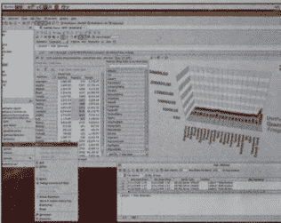

## 数据工作室

41 AQUAFOLD'S | 数据工作室

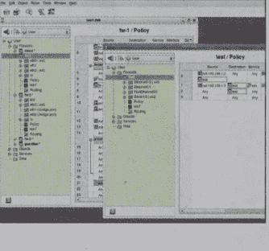

## 下个月

# 桌面

它可能变冷了，但Linux桌面依然火热。它可能还没有燃起来，但它变得越来越好。

下个月，阅读Bruce Byfield第四年度（是的，看起来是个好机会）OpenOffice与MS Office对比。OpenOffice与MS Office对比。结果让你大吃惊！

随着大多数新的KDE发行版将KDE4作为标准而非选项，对KDE开发的兴趣将加速。跳出游戏，了解如何为KDE4编写模式

如果你仍然在使用其他操作系统遇到困难，请通过在Windows上运行您的KDE应用程序让它变得更容易接受，很快，您就可以在Windows上运行KDE应用程序了。这太酷了！

## 每期包含

8 CURRENT_ISSUE.TAR.G

10 信件

14 前言

40 新项目

42 新项目

65 广告索引

78 市场

US Journal (ISSN 1075-3583) (USPS 128548)每月由Retailown Media, Inc.出版，地址221 North Norfolk, Ste 514, Houston, TX 77098 Texas以及额外邮寄。封面价为5.99美元。美国订阅价为每年29.50美元，加州39.50美元，其他66.90美元。订阅从下期开始。请将地址变更寄至Journal, P.O. Box 16476, North Hollywood, CA 91605。代码邮出版协议#4549519。任何退件请寄至International, F.O. Box 25422, London, NC 682

### ABERDEEN 服务器与存储设备

### 这些家伙到底是怎么回事？

有时候你禁得问一句：“他们在想什么？”

公司需要增加投资回报率（ROI），而不想被那些销售入门级价格的厂商所误导。企业急需能够提供高性价比的网络附属存储（Network Attached Storage）服务器。看看这些功能和优势：

|  | Dell PowerVault | HP StorageWorks | Aberdeen-NAS |
| :--- | :--- | :--- | :--- |
| 热插拔磁盘 |  |  |  |
| 硬件 RAID | ✓ | ✓ | ✓ |
| 双端口千兆以太 | ✓ | ✓ | ✓ |
| 内置复制 | ✓ | ✓ | ✓ |
| Microsoft® WSS 2008 | ✓ | ✓ | ✓ |
| iSCSI Target | × | × | ✓ |
| Linux 系统型号 | ✓ | ✓ | ✓ |
| 系统恢复 | ✓ | ✓ | ✓ |
| DAS 存储扩展 | × | × | ✓ |
| VMware 认证 | ✓ | ✓ | ✓ |
| 带外管理 | 2TB 版本可用 | 年份 | 年份 |
|  | Dell PowerVault NX300 | HP StorageWorks X1400 | Aberdeen-NAS163 |
| :--- | :--- | :--- | :--- |
| Intel® Xeon 处理器 | E5504GHz | E5504GHz | E5504GHz |
| 内存 | 8GB | 8GB | 8GB |
| 驱动接口 | SATA | SATA | SATA |
| 安装容量 | 2TB | 2TB | 2TB |
| 导轨 | 包含 | 包含 | 包含 |
| Windows Server 基础 | $2,419 | $4,435 | $2,995 |
| Linux 系统 | 不可用 | 不可用 |  |

上述价格中的某些报价已于 2009 年 10 月 26 日从各自网站获得。Intel、Intel Inside、Pentium 和 Xeon 是其在美国及其他国家子公司的商标。VMware 是 VMware, Inc. 在美国的注册商标。有关条款条件，请参见 www.aberdeen.com/disclaimer.html。

### 抢先阅读

在报刊亭上市前获取最新期刊

### 关键词搜索

在几秒钟找到主题或名称

### 无纸化存档

下载到您的电脑进行离线阅读

### 同样的精彩杂志

以高品质 PDF 格式阅读每一期

### 试读一期期刊！

www.linuxjournal.com/ISSUE

| 执行编辑 | Jill Franklin jill@linuxjournal.com |
| 高级编辑 | Doc Searle@linuxjournal.com David A. Lane, Kelly kelly@gmail.com Shawn Powers powers@linuxjournal.com |
| 副主编 | Mitch Frazier mit@linuxjournal.com |
| 艺术总监 | Garrick Annick gar@linuxjournal.com |
| 产品编辑 | James Gray jamesgray@linuxjournal.com |
| 名誉编辑 | Don Mark dmark@linuxjournal.com |
| 技术编辑 | Michael Baxter michael@linuxjournal.com Revern Limmer limmer@provider.com |
| 高级专栏作家 | Mick Bauer |
| 安全编辑 | Kyle Rankin kyler@gmail.com |
| 黑客编辑 | Bill Children billc@linuxjournal.com |
| 虚拟编辑 | David Miller dmiller@linuxjournal.com |

**特约编辑**

David A. Baxter | Ibrahim Haddad | Robert Wise | Dave Brown | Paul Fchetti | Ludovic Marcotte | Paul Barry | McKinney | Dave Dinkendorf

Carrie Faith carrief@linuxjournal.com

Joseph K joseph@linuxjournal.com

Mark Irving mark@linuxjournal.com

**网站管理员**

Katherine Beckham kebe@linuxjournal.com

**会计师**

Candy Beachum acc@linuxjournal.com

**编辑顾问委员会**

Brad Adams | Katelyna Chobald | Robert J. Wise | Steve Case | Katelyna Chobald | David Cohen | Connie S. Kelly | Kevin Davis | Michael Irving | Mike Segal | Steven Ray | Frey | David A. Lane | Steve Moore | Michael Coughlin | Thomas Julian | Jeffrey D. Palmer | Chapel | Thomas | Sherman | Chris D. Stark | Ricky Schwartz | James Walker

请留出 6 周时间处理和订单。LINUX 是 Linux Journal 的注册商标。

### SCALE 第八届南加州 Linux 展会

### 标记你的日程！

第 8 届南加州 Linux 展会即将来临！

五条轨道！更多的演讲者！

同样的优质地点！

2 月 19 日至 22 日，位于洛杉矶

更多信息请访问 www.socall.org

### USENIX 即将召开的会议

### 第一届可持续信息技术研讨会 (SUSTAINIT '10)

与 FAST '10 同地举行

2010年2月22日，美国加利福尼亚州圣何塞

http://www.usenix.org/sustainit10

### 第二届 USENIX 溯源理论与实践研讨会 (TAPP '10)

与 FAST '10 同地举行

2010年2月22日，美国加利福尼亚州圣何塞

http://www.usenix.org/tapp10

### 第8 届 USENIX 文件与存储技术会议 (FAST '10)

由 USENIX 合作 ACM SIGOPS 赞助

2010年2月23-26日，美国加利福尼亚州圣何塞

http://www.usenix.org/fast10

### 第3 届 USENIX 大规模漏洞利用与新兴威胁研讨会 (LEET '10)

与 NSDI '10 同地举行

2010年4月27日，美国加利福尼亚州圣何塞

http://www.usenix.org/leet10

投稿截止：2010年2月25日

### 2010 年互联网网络管理研讨会/企业网络研究研讨会 (INM/WREN '10)

与 NSDI '10 同地举行

2010年4月27日，美国加利福尼亚州圣何塞

http://www.usenix.org/inmwren10

论文注册：2010年2月5日

### 第9 届 USENIX 对对等系统研讨会 (IPTS '10)

与 NSDI '10 同地举行

2010年4月27日，美国加利福尼亚州圣何塞

http://www.usenix.org/iptps10

### 第7 届 USENIX 网络系统、设计与实现研讨会 (NSDI '10)

由 USENIX 合作 ACM SIGCOMM 和 ACM SIGOPS 赞助

2010年4月28-30日，美国加利福尼亚州圣何塞

http://www.usenix.org/nsdi10

### 第2 届 USENIX 并行计算热点研讨会 (HotPar '10)

由 USENIX 合作 ACM SIGMATICS、ACM SIGOPS 和 ACM SIGARCH 赞助

2010年6月14-15日，美国加利福尼亚州伯克利

http://www.usenix.org/hotpar10

投稿截止：2010年1月24日

### 第8 届移动系统、应用与服务国际会议 (MobisSys '10)

由 ACM SIGMOBILE 和 USENIX 协会联合赞助

2010年6月14-18日，美国加利福尼亚州旧金山

http://www.sigmobile.org/mobisys/2010/

### USENIX 技术周

### 2010 年 USENIX 年度技术会议 (USENIX ATC '10)

2010年6月23-25日，美国马萨诸塞州波士顿

http://www.usenix.org/atc10

投稿截止：2010年1月11日

### USENIX Web 应用开发会议 (WebApps '10)

2010年6月23-25日，美国马萨诸塞州波士顿

http://www.usenix.org/webapps10

论文标题及摘要截止：2010年1月4日

### 第3 届 USENIX 社会网络研讨会 (WOSN '10)

2010年6月22日，美国马萨诸塞州波士顿

http://www.usenix.org/wosn10

投稿截止：2010年2月18日

### 第2 届 USENIX 云计算热点研讨会 (HotCloud '10)

2010年6月10日，美国马萨诸塞州波士顿

### 第19 届 USENIX 安全研讨会 (USENIX SECURITY '10)

2010年8月11-13日，美国华盛顿特特区

http://www.usenix.org/sec10

投稿截止：2010年2月5日

### USENIX：高级计算系统协会

技术会议和培训计划信息以及注册方式可通过在线或向 USENIX 办公室获取：http://www.usenix.org/events | 邮箱：conference@usenix.org | 电话：+1-510-528-8649 | 传真：+1-510-548-5737

### Ruby 文章

多年来我一直是 Linux 的忠读者，涵盖了几乎所有的主题。然而，在最近几个月里，我越来越多地关注 Ruby 系列的文章。Reuben M. Lerner 做得很好，他在为杂志选择合适主题方面非常出色。Ruby 在开源或商业市场上并不是流行的语言。在 www.langroup.com 看来，是时候给其他编程语言留出空间了。

我喜欢你们的杂志，并期待每一期。我阅读所有的专栏、大部分评论，至少也会扫读文章。每个月，我都能发现新的信息和想法，用来加深我对 Linux 的理解。明年，我计划从零开始安装 Linux，正如你们认为的那样。感谢你们在每一期中提供的所有信息和专业知识。

### Paul West

### Zarafa

我知道收到很多邮件说“你们不想了解关于……吗”，但我还是在此记录在案：了解一下 Zarafa —— 一个完全原生兼容 GLv3 的 Exchange 替代方案，带有对 Outlook 的支持且完全不需要额外费用。

### KVM 与 Child


关于 Ruby 不是目前最流行的语言，你是完全正确的。这就像杂志目前的成熟度状态激发了如此大的兴趣一样。我并不是一个……

在 2009 年一期 Bill Child 的《虚拟化专题》中，关于 VMware Server VirtualBox 与 KVM 的对比有一个错误：KVM 确实支持 VHD。我在 Debian 服务器上使用它的目的是创建一个 Windows 服务器虚拟机，为 Windows PC 托管防病毒服务器，这完全不是如此。

我花了几个月研究组服务器……（此处重复内容已剔除）

## [信件栏]

clac

在《如何使用 Shell 脚本探索经纬度》（2009年11月）中，Dave Taylor 写道：“要在 Linux shell 中完成任何数学运算计算，我们基本上只能受限于 `bc`。” 现在，抛弃掉你的 shell 工具吧！摆脱我们 `bc` 和 `dc` 的枷锁吧！有更好的方法。`clac` 可以在 `clac.sourceforge.net` 获取，它具有以下功能：

- 处理棘手、复杂的数学计算等。
- 支持中缀表达式（请不要使用逆波兰表示法）。
- 底层使用 Python（欢迎 Python 语法，但并非强制）。
- 单源文件——随随需要的地方带到哪里。
- 通过 Python 进行用户扩展：导入/编写你需要的模块。
- 脚本友好：通过参数或字符串传递表达式，并将结果评估到 stdout。

`clac` 的表达式方式如下：

```
sin(pi/4)
round(degrees(phase(** 2 )))
sum(x**2 for x in $csV)
```

而且你会期待一个 CLI 工具做什么：在几分之一秒内打印出答案。

Mark Allen Bordording

Dave Taylor 回复道：“酷酷，感谢你让我们关注这一点！”

致编辑的信：我们欢迎您的来信和反馈，请通过 `www.linuxjournal.com` 与我们联系，或邮寄至 Linux Journal, 752 NW Market Street, Seattle, WA 98109。来件将根据空间和清晰度进行编辑。

为我们撰稿：我们一直在为杂志寻找文章、教程和真实故事。作者赠的书籍等礼物可以在在线找到：`www.linuxjournal.com/author`

广告：Linux 对于读者和广告商来说都是一个极佳的资源。通过我们独特的编辑日历和广告详情触达数百万用户，或访问 `www.linuxjournal.com/advertising` 了解更多关于广告和营销的选项。更多信息请联系我们：`ads@linuxjournal.com` 或拨打 +1 713-344-1956 分机 2。

## 月度图片

你有想和我们读者分享的照片吗？请将你的作品发送至 `publisher@linuxjournal.com`。如果在杂志上发表了它，我们将送你一件免费 T 恤。

这是我五岁女儿的照片，她发现你们关于 Linux 安全规范很有趣——由 Matias Villani 提交。

## 在线

网站：在 Linux Journal 网站 `www.linuxjournal.com` 上阅读仅在线内容。此外，还可以从质版杂志中选择数字版或质版期、搜索过去的存档，更多信息请联系客户服务，`subs@linuxjournal.com`。

电子新闻简：Linux Journal 每周向您发送 Linux 世界的精华：接收最新消息、技巧秘门以及在 `www.linuxjournal.com` 重点介绍的深度报道链接。免费订阅每日快报：`www.linuxjournal.com/newsletters`

12 | 2010年1月 www.linuxjournal.com

## Polywell Linux 解决方案

更多选择，优质服务，实惠价格！

服务行业超过 20 年

## 静音存储 NAS/SAN/iSCSI

最佳终端 PC 

| 型号 | 存储容量 | 价格 |
| :--- | :--- | :--- |
| ITX | 8TB | $1,999 |
| ITX | 12TB | $2,599 |
| ITX | 30TB | $6,599 |
| 静音环保型 | - | $199 |
| 无扇 PC | - | $199 |
| 微型 PC | - | $199 |
| ITX | 固态硬盘 | $199 |
| ITX | 直流电源 | $199 |
| ITX | PCI | $199 |
| ITX | VESA | $199 |
| ITX | 壁挂式 | $199 |
| ITX | 纤薄 | $199 |
| ITX | 硬盘 | $199 |
| ITX | 内存 | $199 |
| ITX | WiFi | $199 |
| ITX | 蓝光 | $199 |
| ITX | DVD | $199 |
| ITX | 机箱 | $199 |
| ITX | 主板 | $199 |
| ITX | Linux | $199 |
| ITX | FreeBSD | $199 |
| ITX | OEM | $199 |
| ITX | 扩展 | $199 |
| ITX | 生产环境 | $199 |
| ITX | 满意度 | $199 |
| ITX | 最后 | $199 |
| ITX | 保修 | $199 |
| ITX | 服务 | $199 |
| ITX | 类别 | $199 |

## 在线

网站：在 Linux Journal 网站 `www.linuxjournal.com` 上阅读仅在线内容。此外，还可以从质版杂志中选择数字版或质版期、搜索过去的存档，更多信息请联系客户服务，`subs@linuxjournal.com`。

电子新闻简：Linux Journal 每周向您发送 Linux 世界的精华：接收最新消息、技巧秘门以及在 `www.linuxjournal.com` 重点介绍的深度报道链接。免费订阅每日快报：`www.linuxjournal.com/newsletters`

12 | 2010年1月 www.linuxjournal.com

## Polywell Linux 解决方案

更多选择，优质服务，实惠价格！

服务行业超过 20 年

### 非 LINUX 开源软件

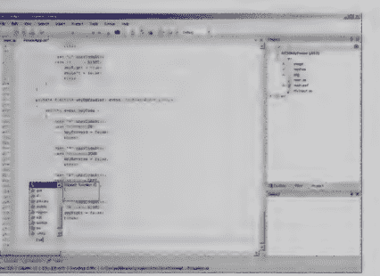

FlashDevelop 是一个专为开发 Flash 应用设计的免费开源代码编辑器。它支持针对 ActionScript 2 和 3、MXML 和 Flex 的代码片段、代码导航、代码生成、书签、任务高亮（此处为 task highlighting）和语法高亮。它还包含一个集成的项目管理器工具，帮助你启动项目。

FlashDevelop 代码片段（来自 `flashdev.org`）

配合 Flash CS3、Flex SDK、Masc 以及 hax 编译器和解析器/警告输出，可以访问代码。FlashDevelop 具有插件架构，以便对其进行扩展并与其他工具集成。

FlashDevelop 提供的编辑功能源自开源 Scilla 编辑器。Scilla 于 1999 年发布，为许多开源项目（如 Notepad++、Notepad2 和 Komodo）提供编辑支持。

FlashDevelop 是一个 `.NET 2.0` 程序，运行在 Windows XP 及更高版本的 Windows 上。在 Linux 或其他操作系统上运行的唯一方法是通过虚拟化软件——这意味着它不会在 Mono 上运行。FlashDevelop 以 MIT 许可协议发布。当前版本为 3.0.4。

> - MITCH FRAZIER

### LJ 索引

| :) 表情符号的发明年份（1999年9月） | 1982 |
| 互联网首次提出的年份（1922年5月） | 1973 |
| Twitter 的年增长率（2008年2月至2009年2月） | 1,362 |
| Twitter 月访问人数（百万计） | 7.0 |
| Facebook 月访问人数（百万计） | 55.6 |
| MySpace 月访问人数（百万计） | 54.1 |
| 企鹅大乐园（Club Penguin，迪士尼出品，非 LINUX）月访问人数（百万计） | 6.1 |
| 第一月内流失的用户百分比 | 60 |
| 在奥普拉节目之前流失的 Twitter 用户百分比 | 70 |
| 使用 Facebook 和 MySpace 的用户百分比 | 30 |
| 1999 年美国拥有互联网接入的用户百分比 | 20 |
| 2007 年美国拥有互联网接入的用户百分比 | 57 |
| 2009 年美国拥有互联网接入的用户百分比 | 59 |
| 美国使用卫星接入互联网的农场百分比 | 13 |
| 在业务经营中使用计算机的玉米农场百分比 | 45 |
| 在业务经营中使用计算机的畜牧农场百分比 | 37 |
| 自最初以来债务的变化（万亿美元） | $2.54 |
| 每次发行的平均债务变化（十亿美元） | $149.7 |

### 在线视频：现箱即用！


Linux Journal 网站长期以来一直都在提供技术技巧。我们想出的技巧似乎层出不穷（这部分归功于用户的贡献），最近我们决定更上一层楼。我们确实会继续提供命令行工具、GUI 快捷键和非 Linux 技巧，我们还会添加一些更实用的现实世界任务处理技巧。无论你是需要温习这些技巧，还是想如何追踪故障的 DHCP 服务器，你都会想查看我们的新技术技巧。

一如既往，你可以在主站找到更多视频：`www.linuxjournal.com`。

> - SHAW POWERS

来源，2：`www.distant.com/UselessFacts/3|10ielsen Online 11–17；国家农业统计局 18–20 March`

`www.linuxjournal.com` 2010年1月 | 15

### 寻找 xargs

在2009年11期中，我查看了一些计算科学家在对数据进行处理和后处理时使用的工具。我正在研究如何进一步实现这种自动化。让我们假设有许多步骤需要完成，并且这些步骤需要在大量文件上执行。

第一步是找出哪些文件需要处理。最明显的方法是手动创建一个文件列表。通常这样做是最耗时的方法，而且由于所有的手动操作，会导致人为错误带来的错误。这一步应该是自动化的。创建文件列表最流行的工具是 `find` 命令，它可以在许多不同的过滤器上查找文件。

下一步是定位某类文件在你的驱动器上的位置。假设有一组数据文件需要在一天内完成处理。搜索这些文件的最终命令是：

```
find -name "*" -print
```

第一个选项告诉 `find` 从何处开始查找文件。在这种情况下，你正在从当前目录开始查找。你也可以提供任何路径，`find` 将在那里搜索。`name` 选项告诉它根据什么进行进行过滤。在这种情况下，你正尝试按文件名进行过滤。这个过滤器实际上是一个过滤模式 `"*"`。这个模式需要加引号，以防 shell 尝试扩展 `*` 字符。最后一个选项 `print` 告诉 `find` 将结果打印到标准输出。然而，`find` 使用换行符分隔文件。如果文件名中有特殊字符，可能会出现问题。

# DRM、DMCA 与 OST（其他可怕的事物）

## 他们是这么说的

对我们来说，数字版权管理（DRM）显然是一个非常糟糕的主意。这不仅是因为 DRM 编码的媒体通常无法在我们的操作系统上运行，而且因为我们理解开放性的价值。遗憾的是，DRM 在某种程度上与行善是背道而驰的。

以威尔尔·惠顿（Will Wheaton）为例。你通过电视或电影认识他，但他也制作自己作品的有声书。因为威尔尔反对 DRM，他的书以未加密 MP3 文件的形式提供。对于我们这些喜欢在 Linux 或非 MP3 播放器上听这类内容的人来说，我们经常将 DRM 与无版权混为一谈。然而，其他体面的人并没有考虑到重新分发其版权作品的后果，除非他们陷入了类似这种情况：`tiny.com/stealfree`

“安腾的方法……本该是非常棒的——直到结果发现人们想要的编译器基本上根本无法写出来。” —— 丹尼·凯恩（Daniel Kahn）。

“这是过去 50 年最伟事实之一。” —— 史蒂夫·科·欧文（Steve Co. Owens），出自《安腾杀死了计算机行业》（2009）。

提到 DRM，我认为它是为了作者——不仅如此。如果一个媒体受到 DRM保护，只有拥有欣赏权的人才能享受。不幸的是，即使是那些坚持使用这种技术的大公司，它们所能做的也就是惩罚诚实的人。那些尝试在 Linux 桌面面上播放 Amazon 点播视频或听 Audible 有声书的人恰恰体会了我在这里的意思。

“我们需要通过创新来向下突破，这样当我们赢得回合时就能领先竞争对手。” —— 史蒂夫·乔布斯（在 2001 年衰退平息之际）。

事实是，如果人们足够不诚实而使用未付钱的版权材料，那么 DRM 的作用无非是为他们的盗版提供一个“借口”。现在，除非我们被赋予选择：要么为有限受限的媒体访问付费，要么从免费网站下载功能完整、无限制的媒体。我们需要向这些开发者传达两条信息。

IBM 是走反方向道路的公司。DRM 的足迹现在比开始时要多得多。我不确定这是否具有长期利益。 —— 史蒂夫·鲍尔（在过去的十年里，IBM 股价了 30%，而微软下降了 30%）。

- 1. 媒体出版让用户更容易购买你的访问权限，并让媒体免费、可归档且负担得起。人们会像现在这样疯狂涌入。区别在于，如果你的诚实客户不重视你，而你将因为提供了人们真正想要的东西而真正获得客户。
- 2. 沮丧的用户：我与你们在一起。DRM 也让我感到沮丧。我并不想在那些选择盗版 DRM 的人之间转换。我希望我们能支持所有公司（以及个人，就像威尔尔·惠顿说的那样）“理解”。在消除 DRM 和使用非 DRM 内容方面，唯一的办法就是成为解决方案的一部分。至少，每当你看到无法合法购买的东西时，就去找公司并让他们知道。如果他们看到了销售损失，他们就会重新思考他们处理数字媒体的方法。

“我们是为了赢而来的——IBM，我们期待在硬件领域与你们竞争。” —— 拉里·埃里森（在 IBM 对 Sun 的未来进行恐言、诽和等的时代，如甲骨文收购案）。

我可以继续谈论蓝光 DRM 和这种锁定的疯狂之处，但我没精力了。此外，如果我想在笔记本电脑上看我刚刻制的 HD 电影，我必须有一个最合理的理由，但却是通过一些问题的问题…… —— SHAW POWNS。

“这种情况持续得越长，损失的钱越多。” —— 拉里·埃里森（宣布收购时 Sun 的收入。随着欧洲监管机构批准收购，Sun 每月损失约 10 亿美元）。

## Linux.com 上的更多热门无线选项

现在你已经完全沉浸在所有与火腿（ham）相关的事情中，你可以访问 `www.linux.com/for/hot-topics/ham-radio` 与其他 Linux 爱好者在线讨论无线电，他们对业余无线感兴趣并讨论开源话题。在论坛留言，告诉我们你在做什么，或者你对无线电的兴趣，以及你对我们运营的任何建议。

“当舒适和奢侈是生活需求时，我们却表现得像是在享受，而我们真正需要的是一些令人投入的事物。” —— 爱因斯坦。

“更多资源可在 `www.linux.com/ham` 找到。无论你是新手还是经验丰富的操作员，我们希望你在深入研究无线电操作时，帮助 Linux.com 成为一个有价值的资源。” —— KATHERINE DRUCKMAN。

“我们还没有赢过，良好技术的发展将继续为创新的利益而战。” —— 吉姆·魏因斯坦，红帽总裁兼首席执行官（指的是 Bilski 案）。

## 专栏

锻造炉 (AT THE FORGE)


### Cucumber

Cucumber 的文本测试既简单又具有创新性。

REUVEN M. LNER

人们过去说开源技术擅长模仿和复制专利项目，但它们几乎没有自己的想法。这从未完全真实，但我相信今天这被证明是错误的，而且随着时间的推移变得愈发错误。在很多情况下，这被证明是错误的（注：此处原文出现严重重复错误，已剔除）。

Ruby gems。所以，当你阅读此内容时，你可能需要寻找 Cucumber 的官方仓库。

一旦安装了 Cucumber，你就需要将它的功能添加到你的 Rails 应用程序中。你可以通过以下命令实现：

```
script/generate cucumber
```

这会将适当的 Rake 任务到位（在 `lib/tasks/cucumber.rake`），添加初始默认步骤定义（即低级测试实现）以及 Cucumber 运行所需的整体系统支持。所有与 Cucumber 关联的文件都存放在 `features` 目录下，如果你不熟悉，这可能会让你困惑。

一旦这些新文件就绪，你可以按照如下方式运行 Cucumber：

# cucumber

Cucumber 将运行 `features` 目录中任何以 `feature` 结尾的文件。如果你刚安装了 Cucumber，目前还没有此类文件，你将看到如下的输出：

```
0 scenarios
0 steps
0m0.0s
Loaded user /usr/bin/rake
Started
Finished in 0.000232 seconds.
```

- 0 tests, 0 assertions, 0 failures, 0 errors

这与你在没有安装任何测试的情况下运行 rake 得到的输出相似。因此，Cucumber 使用一套不同的词汇来创建测试和规范，你可能也会用到它们。每个 Cucumber 文件描述了应用程序的一个 `.feature`，并带有 `.feature` 后缀。一个特性（feature）通常是应用程序的一个切片——从身份验证到发送接收消息、生成报告的任何内容。传统上使用如下行描述特性：


关于服务器、存储和 HPC 硬件的更多信息，你可以访问：[www.siliconmechanics.com/expert](http://www.siliconmechanics.com/expert)。


Paul 是为 Silicon Mechanics 客户提供技术支持的专家之一。他非常欣赏 Silicon Mechanics 产品内置的灵性和可靠性。

Paul 知他的客户非常欣赏配备 Xeon 5500 系列处理器的能源效率和价值。当然，他们也欣赏及时、专业的知识支持：最近有 98% 的客户告诉我们，Silicon Mechanics 的技术支持专家做得非常好。

当你与 Silicon Mechanics 合作时，你不仅可以在全面的服务器、存储和 HPC 硬件系列中获得卓越的价值，还能获得像 Paul 这样的专家。

### 包含专家。

## 锻造炉

Feature: Home page（首页）

如你所见，此文件以“Feature”单词开头，然后包含一个描述。描述像 Cucumber 中的其他内容一样，稍后出现在输出中，作为有帮助的说明。

在 Feature 声明之后，你以“故事（story）”的形式描述特性，这被许多敏捷团队和世界范围内的 BDD（行为驱动开发）所使用。如果你对故事还不熟悉，我建议阅读 Dan North 关于该主题的博客文章；参见“资源（Resources）”。

这是一个典型的场景（scenario）：

我将此场景（带有它的故事和电子邮件特性）放入 `features/feature.login`，然后运行了 `cucumber`。Cucumber 的响应是遍历该文件，并执行了我定义的场景。嗯，我尝试执行该场景，这里是我在屏幕上实际看到的：

Feature: Home page

As a user.（作为一个用户）

I want to be able to log in（我能够登录）

So that I can use the system（这样我就可以使用系统）

```
Scenario: Get to the login screen（场景：进入登录界面）
### features/feature.login
Given a user named "Lerner" with an e-mail
@address "reuenelner.co.ll" (Cucumber: Undefined)
And a step named "Reven" (Cucumber: Undefined)
features/feature.login Given a user named "Reven"
with an e-mail address "co.ll"
When I go to the home page
### features/step/definitions/web_steps.rb:11
Then I should see "web site"
### features/step/definitions/web_steps.rb:12
Then I should see "Login"
```

该特性通过多种方式进行测试，每种方式被称为一个场景（scenario）。核心思想是每个场景描述了一个情况（Given），在该情况下用户执行某些操作（When），然后看到某些结果（Then）。场景应该尽可能具体，测试应用程序接口的特定路径。

### Cucumber 提供了各种 Web 步骤定义，你可以使用 Cucumber 跳转到页面，或者选择列表、复选框和单选按钮。

注意，场景并不是为了测试某个控制器、模型、库或其他代码的元素。读者应该从用户的角度代表特定的操作，这可能涵盖一个控制器和一个模型，或者几十个。对于每个特性拥有多个场景是合理的。它会随着时间的推移而增长，当你（你的用户）以新的不同的方式压力它时，你需要通过场景来覆盖。一个场景由一个或多个步骤组成，这些步骤被翻译成 Ruby 代码。这是一个示例场景：

Scenario 1 (undefined)

4 steps (3 given, undefined)

你可以使用这些片段（snippets）实现步骤定义：

Given I'm a user "{{string}}" "{{string}}" with an

e-mail address "{{string}}" $/

arg[1], arg[2], arg[3]

pending

```
Scenario: Get to the login screen
Given a user named "Reven" "Lerner" with an e-mail
address "reuenelner.co.ll"
When I go to the home page
Then I should see "web site"
Then I should see "Login"
```

rake failed with status :1

[System/framework/rubytasks/rake...]

也就是说，Cucumber 寻找使用 "Given" 的定义，但没有找到。它停止解释我的场景并抛出错误。Cucumber 随后继续返回，意味着我需要定义这个步骤并给了我一个大纲。

步骤定义，如你从 Cucumber 中看到的，是附加到块的正则表达式。正则表达式与（Given 或 When）测试语句进行匹配，带有括号（正则表达式中匹配的标准方式），然后由块作为参数处理。

现在，让我们取简单的定义并放入 `features/step_definitions/authentication.rb`。

当运行 `rake cucumber` 时，Cucumber 不再声称该步骤未定义。相反，它信号步骤定义处于待定（pending），无法继续执行场景的其余部分。让我们定义这个步骤：

### 在此处运行 Cucumber 如下：

Scenario: Users who go to the home page are asked to log in

### features/login_feature:

Given a user name "Reven" with an e-mail "reuenelner.co.ll"

```
Given a user named "{{string}}" "{{string}}" with an
e-mail address "{{string}}" $/
arg[1], arg[2], arg[3]
pending
```

Scenario: Get to the login screen

Given a user named "Reven" "Lerner" with an e-mail

address "reuenelner.co.ll"

When I go to the home page

Then I should see "web site"

Then I should see "Login"

```
（注：提示中提供的 OCR 文本在后期页面包含大量重复和乱码。我已经清理了文本以遵循所提供文档的逻辑叙述。）
```

### 锻造炉的列

如果你在好奇最后三个步骤是如何定义的，只需看输出的右侧：Webrat 是一个用 Ruby 编写的浏览器模拟器，它理解大量的浏览器风格的步骤定义，包括“前往并且我应该看到”（to go and I should see），允许在每种情况下文本存在或不存在。Cucumber 提供了各种 Webrat 步骤定义，你可以告诉 Cucumber 前往某个页面、填写表单或使用选择列表、复选框和按钮。

这基本上就是 Cucumber 的含义。你可以在该特性（feature）中创建一个或多个场景（scenario），这些行由 `step_definitions` 中定义的正则表达式进行匹配。从用户的角度来看，特性是用英语编写的，这一事实可以向技术经理或客户展示。他们甚至可以帮助为 Cucumber 的场景编写完美的描述，他们可以理解你正在尝试从多个角度测试应用程序。

体验 Cucumber 感觉有点奇怪（至少最初是这样），因为你基本上是在写代码，但使用的是完整的英文句子。还需要一些时间来内化“每个句子都类似于回调函数，调用 `step_definitions` 中的一段代码”这一事实。随着时间的推移，你可能会创建一个巨大的步骤定义库，你可以在 Cucumber 中对其进行混合组合。

这里是我编写的第二个场景，用于测试登录：

Scenario: 用户可以通过输入姓名和电子邮箱地址登录
Given 一个名为 "Reuen" "Lerner" 的用户，邮箱地址为 "@reuen@cucumber.com"

When 我前往主页
And 我为 "email_address" 填充 "reuen@cucumber.com"
And 我为 "password" 填充 "password"
And 我按下 "submit"
Then 我应该看到 Welcome back to the site, Reuen!

一旦我的场景通过了，我会将它们提交到版本控制，并将它们保留在应用程序的 `features` 目录中。如果我的新场景像以前一样出现——我会通过通过步骤定义或修复代码中的 bug 来捕捉步骤部分。但是，如果 Cucumber 需要运行所有特性和所有场景，使用起来会有点慢。所以，你可以手动运行 Cucumber，这不像 Rake：

```
cucumber features/login
```

你甚至可以指定运行从文件中第 13 个特性开始运行的特性：

```
cucumber features/login:13
```

当一个文件中有一系列场景而你正尝试调试其中一个时，这可以非常节省时间。

### 更多关于 Cucumber

Cucumber 是一个设计良好的系统，拥有许多与 Web 开发人员需求紧密结合的功能和能力。首先，你可以使用 Cucumber 中的步骤定义。

关于 BDD 的“故事”方法的优秀介绍（包括特性和场景），请参考 BDD 社区领军人物之一 Dan North 的这篇博客文章：dannorth.net/whats-in-a-story

Cucumber 的主页是 cukes.info。该页面包含了文档、截图以及你开始使用 Cucumber 时的其他资源索引。

Pragmatic Programs 最近出版了一本名为《The RSpec Book》的书，由 RSpec 维护者 David Cheney 以及许多其他活跃于 RSpec 社区的人士编写。如果你对使用 Cucumber（或 RSpec）感兴趣，这是一个极佳的起点。

Shoulda 的主页是 thoughtbot.com/projects/shoula。文档是一个很好的起点，但你可能需要实际操作玩玩才能进入门道。

rspec 的主页是 rspec.info，它包含 RSpec（默认）或 Shoulda，这两个在 Rails 社区中已经非常流行的 BDD 框架。

正如我之前提到的，你可以使用 Cucumber 来测试模型和控制器，而不仅仅是集成测试。我个人的偏好是这样使用 Cucumber，不过，它提供了一个很好的用户视角，让你能像用户一样测试网站。

嗯，它以用户身份测试网站，但有一个巨大的限制：Webrat 是一个很好的工具，但它不支持 JavaScript。这意味着如果你的网站包含大量的 AJAX 和 JavaScript，你将无法用 Webrat 测试它。你可以通过使用 Webrat 在你的应用程序中包含文本链接，并使用外部测试系统（如 Selenium 或 Celerity）来解决这个问题。但这样你就必须找到一个易于集成、可靠且运行无缝的系统。

Cucumber 运行缓慢是一个缺点；在大型应用程序中运行所有场景可能花费长时间。一种解决方案是使用 Cucumber 的标签（tag）功能，它允许为场景赋予一个或多个标签。然后你就可以跨环境运行带有该标签的所有场景。

如果你想避免在创建或更新（该）对象时访问数据库，你可以将工厂（例如 Factory Girl）集成到 Cucumber 中。这可以加快速度，同时在创建场景和测试应用程序时为你提供极大的灵活性。

## 结论

Cucumber 是一种创新的测试方法，它向我展示了英语故事测试的威力，这种程度是我在其他地方没有看到的。在 Ruby 中，我建议你尝试将 Cucumber 集成到你自己的工作中。

> Steven M. Lerner，资深 Web/数据库开发者，西北大学学习科学博士候选生，研究在线社区社区。他最近在芝加哥地区生活了四年后（带着妻子和三个孩子）回到了以色列的莫迪亚（Modi）。


见此处（右侧）。她是 Silicon Mechanics 的营销专家，负责活动和推广，让我们的客户了解是什么让 Turns 产品和技术取得了成功。她和她的双胞胎姐妹 Veronica 在这里，Veronica 是一位工业设计师，帮助我们说明为什么 Turns 如此受欢迎。Veronica 和另一个 Veronica 虽然是双胞胎，但她们看起来并不完全一样，工作内容也不相同。它们的服务器位于同一个 1U 机箱中，可以进行不同的配置，并有自己的工作负载。

随着 Silicon Mechanics Rackform iServer R4410 的推出，功率达到了新的水平：‘双胞’系统是一个 2 U 4 节点系统。它支持带有冗余电源的全功能节点。在每个节点中，你可以找到 2 个新的 Intel Xeon 5000 系列处理器、12 个 DDR3 DIMM 插槽、三个热插拔驱动器和一个集成双端口 GigaE 适配器。R4410 也支持 Infiniband。无与伦比的密度和功率使 R4410 成为高性能计算的卓越选择，Victoria 对此充满热忱。

当你与 Silicon Mechanics 合作时，你得到的不仅是最新最强大的密度、性能和能源效率——你获得了一个像 Victoria 这样的专家。


有关 Rackform iServer R4410 的更多信息，请访问 www.siliconmechanics.com/r4410

### 包含专家

Silicon Mechanics 和 Silicon Mechanics 标志是 Silicon Mechanics, Inc. 的注册商标。在美国及其他国家注册。此处提到的所有其他商标均为其所有者的财产。

### SHELL


### 监听你的 Twitter 流

DAVE TAYLOR

### 自动回答简单的 Twitter 查询。

**上个月结束时**了一个复杂的问题。

### 资源

- 关于 BDD “故事”方法的优秀介绍（包括特性和场景），请参考 BDD 社区领军人物之一 Dan North 的这篇博客文章：dannorth.net/whats-in-a-story
- 包含了安装和配置文档，以及其他资源索引。
- 的主页是 cukes.info。该页面包含了文档、截图以及你开始使用 Cucumber 时的其他资源。
- 一个关于 Cucumber 的特别好的演示位于：slideshare.net/linoj/cucumber-how-i-slice-presentation-924254。
- Pragmatic Programs 最近出版了一本名为《The RSpec Book》的书，由 RSpec 维护者 David Cheney 以及许多其他活跃于 RSpec 社区的人士编写。如果你对使用 Cucumber（或 RSpec）感兴趣，这是一个极佳的起点。
- Shoulda 的主页是 thoughtbot.com/projects/shoula。文档是一个很好的起点，但你可能需要实际操作玩玩才能进入门道。
- rspec 的主页是 rspec.info，它包含-

## 解析 Twitter 方法

让我们尝试做一些简单的东西。如果你用 `date` 命令 @ 你的 Twitter 账户，它会检测到该操作，实际上运行该命令，并代表我查看结果。

为了做到这一点，我们需要将数据流分成“tweet”（推文）和“msg”（消息），但我们可以通过一种巧妙的方法，利用前面的字符串来创建名称值：

```bash
if (NR % 2 == 1) { printf("msg:%s\n", $0)}
else { printf("id:%s\n", $0)}
```

结果如下：

```
msg=$(echo $1)=Idjapan
msg="www.twitter.com"; id=idklauch
msg="Have them sent the money in gold."; id=LenBailey
msg=$(echo $3)"
```

现在，一旦我们使用 `eval` 命令将组和 id 赋值给它们，以此类推。如果你不小心，你会发现双引号是个问题，此外，Twitter API 太聪明了。单引号可以很容易通过，但双引号会被替换为 HTML 实体 &;

让我们公平起见，看看我们是否能显示你喜欢的内容：

```bash
curl -u davetail:$spw -d ""
grep -E "<text>|<screen>" | sed -v |
sed 's/^<text>\(.*\)</text>\1/'sed 's/^<screen>\(.*\)</<screen>\1/' | 
awk '{if (NR % 2 == 1) { printf("msg:%s\n", $0)}
else { printf("id:%s\n", $0)}' }
```

这获取了指定用户的最新 20 条推文，并对每条推文执行了命令。如果我们将其输入循环，使用 "msg" 和 "id"，那么我们就有了一个非常简单的方法来解析内容：

```bash
while read buffer
eval $buffer
echo Twitter $u@$id message $msg
done < "$file"
```


我们现在先结束到这里，但下个月我们将迈出下一步，实际上解析发送给我的 Twitter `"@"` 消息，找到那些与我们使用的预定义查询匹配的消息，对其进行操作并报告。完成后，这将是一个非常酷的项目！

David Taylor 自 1998 年网络接入线以来一直与我们合作。从那时起，他已经带我们走过了 30 年的历程。你可以在网上找到他，访问 `DavidTaylorOnline.com`。除了他的所有其他项目，Dave 还是几份当地出版物的评论员。你可以在 `DavidBerlin.com` 阅读他的评论。


想让您的业务更高效吗？ASA 系统由 Intel 处理器驱动，确保质量和可靠性以跟上您不断增长的业务。

## 面向开放社区的硬件系统 - 自1989 年

## IU 服务器 - ASA1401

- 已安装 1TB 存储，最大 12TB
- Intel 双核 2500 GHz，最大 2 个 CPU
- 已安装 8GB RAM
- 支持 16GB RAM
- 已安装 4 口 SATA II RAID 硬盘
- 4 口 SATA II RAID 控制器
- 2x10/100/1000 板载 LAN

## 美国 服务器 - ASA2421

- 已安装 4TB 存储，最大 12TB
- Intel 双核 5050 CPU
- 已安装 16GB RAM
- 支持 16GB RAM
- 8 口 SATA II RAID 控制器
- 已安装 6x2 SATA II RAID 硬盘
- 2x10/100/1000 板载 LAN
- 80 原始 Raid

## 美国 服务器 - ASA3611

- 已安装 4TB 存储，最大 12TB
- Intel 双核 3000 GHz，最大 2 个 CPU
- 已安装 16GB RAM
- 支持 16GB RAM
- 12 口 SATA II RAID 控制器
- 已安装 6x2 SATA II RAID 硬盘
- 2x10/100/1000 板载 LAN

## 5U 服务器 - ASA5421

- 已安装 6TB 存储，最大 16TB
- Intel 双核 5050 GHz
- 已安装 64GB RAM
- 支持 16GB RAM
- 4 口 SATA II RAID 硬盘
- 4 口 SATA II RAID, CARIDDB.
- 2x10/100/1000 板载 LAN
- 90 原始 Raid

## 8U 服务器 - ASA8421

- 已安装 10TB 存储，最大 30TB
- Intel 双核 5050 CPU
- 已安装数量 42
- 已安装 64GB RAM
- 支持 16GB RAM
- 已安装 4025 SATA II RAID 硬盘
- 12 口 SATA II RAID 控制器
- 2x10/100/1000 板载 LAN
- 100 原始 Raid

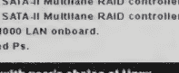

所有系统均根据您选择的 Linux 发行版进行安装和测试！ASA 托管 - 每月 $75

2354 Calle Del Mundo,
Santa Clara拉, CA 95054
`www.ascomputers.com`
邮箱：`sales@ascomputers.com`
电话：1-800-223-
传真：408-654-

## 强大。高效。

Intel、Xeon 以及 Intel 标志是 Intel 公司或其关联公司的注册商标。价格和可用性如有更改，恕不另行通知。

## 2010 安全挑战

安全与担忧：我们确实生活在一个有趣的时代！

在 2005 年，我写了一篇名为《Linux 安全的未来》的专栏，在文中描述了当时认为最大的安全挑战以及解决这些问题最有前景的技术。在 2005 年，我认为虚拟化可能是隔离应用程序的重要工具以及强制访问控制 `MAC`，如 `SELinux` 和 `AppArmor`。我还预测异常检测将比基于特征的检测（如果没有病毒软件和入侵检测系统）更重要。到目前为止，这些预测都没有实现。

本月，自我的上期以来已经过去了，我决定涵盖我认为目前 Linux 安全的一些重大挑战，以及对解决这些问题的想法。在深入探讨技术领域之前，简要介绍一下我们正在防御的对象以及发起攻击的人，因为这些项目自我开始写作以来发生了巨大的变化。在过去，我们主要关心的是保护网络和系统完整性免受那些最可能是无聊的青少年或工业间谍的入侵。

政府当然也担心其他类型的威胁，指的是民用和企业空间。观点是，经典的攻击场景涉及试图远程入侵某个面向互联网的系统，以击败您的网站、窃取专利信息或借此攻击内部网络中更深层次的系统。

我们仍然担心这种场景，因为在过去的十年里，威胁频谱发生了爆炸：为了收集垃圾邮件简单的电子邮件数据攻击；盗取、贩卖或非法制作信用卡进行欺诈购买；完全冒充他人姓名、社会安全号码（或其他银行详情）等，用于欺诈性开设新的信用账户；洗钱，有时身份盗窃通过攻击持有此类密集数据的数据库来实现。现在更多的是涉及到复杂的恶意软件，这些软件渗透特定的商户或银行，并知道如何操作其数据库或采集数据。由于此类攻击利润极其丰厚（每年吸引数十亿美元），有组织犯罪在其中占很大比例并不意外。我指的不仅是那些经营勒索、非法毒品和赌博业务的传统犯罪组织，还有完全专注于……的新组织

MICK BAUER

### TS-7500
嵌入式计算机

更快。更简单。更便宜。

完全针对信用卡刷卡（“盗刷”）和其他经济犯罪。

$84 美元

大学生和青少年仍然符合这一特征，但在许多情况下，他们正在为可怕的人工作，赚取实实在在的钱。策划木马和病毒的人（这些病毒在攻击中承担了大量工作）在很多情况下都是高薪程序员，他们的收入比编写反恶意软件和防火墙软件的程序员要高得多。

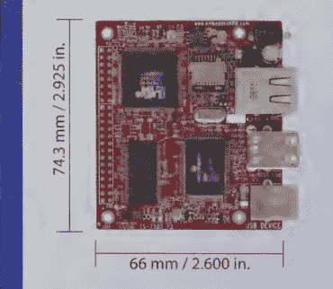

在操作系统安全领域，我们担心病毒——即最终可能被欺骗运行或窃取系统的可执行文件。现在有针对 Web 浏览器的攻击。在浏览器安全领域，我们担心的是恶性的 Web 内容，它们会改变行为，或者窃取浏览器正在处理或存储在系统中的数据。

这就是我们的安全局势。这种情况并不比年前更令人担忧，而且电子商务和互联网流量在某种程度上确实变得越来越糟糕。我们可能需要关注这些趋势，因为事实正是如此。

而且，这只是 Web 应用方程式中的客户端部分！在服务器端，我们不仅没有敌意的网站，而且 Web 网站的漏洞可能允许攻击者访问后端系统并追踪其他用户。

那么，这些攻击与防御的趋势是如何影响防御的呢？

SSL/TLS 怎么样？它不是提供了加密签名和验证活动内容、身份验证以及防止倾听的方法吗？以前，它确实能让我们大多数人在进行银行交易等操作时具有合理的安全性和信心。然而，正如我在 2009 年 11 月的 DEFCON 会上报告的那样，近期针对 SSL/TLS 保护交易的攻击明显增加。

### Web 安全与 SSL/TLS 漏洞

如果互联网安全是一场战争，那么 Web 应用就是前线。没有什么改变我们与内容交互的方式，以及我们交互的地方——万维网——即在由 Web 服务调解的跨网络中使用数据浏览器。事实是，Web 是一切的核心。Web 现在已无处不在，它已经与互联网同义，并且远不止如此。

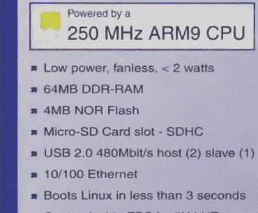

由 250 MHz ARM CPU 驱动

- 低功耗，< 2 瓦
- 64MB DDR-RAM
- 4MB NB Flash
- Micro-SD 卡槽 - SDHC
- 10/100 以太网接入速度小于 3 秒
- 可定制 FPGA - 5K LUT
- 以太网供电 `PoE` 功能
- 可选备份接收 CTR
- 8 路 TTL UART
- 30 SPI, I2C

Web 浏览器不需要嵌入式操作系统。浏览器的主要功能是用于格式化和分发数据。我们最初在现实意义上是带有图像和其他页面链接的浏览器，现在我们使用浏览器来下载并执行代码本身。这些代码可以是简单的脚本，也可以由我们生成（例如来自单页在线）并传输到服务器。或者，它也可以像远程桌面应用程序一样复杂，让我们控制世界另一端的内容。开发工具包提供了开发之外的额外功能

攻击者在某些攻击中可能尝试分割的大多数内容可能会被高度签名的数字内容所绕过，用户身份验证的担忧得到了维护，但 SSL/TLS 保护的交易可能会被重大问题击败，例如版本：这是公钥基础设施中暴露的漏洞。其他人利用 Web 服务器和浏览器处理 SSL/TLS 函数，以及它们告报（或不告报）可疑行为的方式。

- 多年的行业经验
- 从未中断过购买
- 技术支持的工程师

### 虚拟化

那么，我们是如何走向虚拟化的呢？无论是本身还是与云计算结合，它都是许多热点和炒作焦点。虚拟化重塑了我们使用计算机的方式。通过让“计算硬件”这一概念相对于操作系统和应用程序变得几乎完全抽象，虚拟化可以规避某些物理甚至地理上的限制，或者更准确地说，它可以将这些限制转移到资源规划过程的其他部分。

恶意软件威胁是不可控的吗？在某种程度上，从实际角度来看，它是一种特定的内部攻击，而内部攻击是可以被完全防止的。好消息是，我们已经知道如何管理内部威胁：背景检查、系统/应用程序/员工监控、所有层面的粒度访问控制、良好的安全性等等。

也许是过于理想化了，我们曾认为虚拟化将让我们从操作系统安全中的“赢者通吃”现象中解脱出来。在任何受到攻击的系统中，攻击者只需要在应用程序中找到一个漏洞就可以完全破坏整个系统。但如果特定服务器上最脆弱的应用程序是系统上唯一的网络监听器呢？

### 预装 UBUNTU 的小型、高效计算机。

### GS-Lo8 无风扇 Pico-ITX 系统

- 3677 英特尔 Core 2 Duo 移动系统
- 多种英特尔主板可选
- 非常别移动计算和桌面计算
- 超紧凑、功能全的计算机
- 非常适用于工业应用


发现 MINI-ITX 的优势。
从我们这里选择一个完整的、专用平台是非常简单的：适用于办公和桌面用途的预配置系统、Linux 开发服务以及丰富的在线资源。


### 偏执企鹅 `PARANOID PENGUIN`

假设我需要使用 `Sendmail` 运行 SMTP，通常我会在该系统上运行网络时间协议 `NTP` 守护进程、安全 Shell `sshd` 和 `RealVNC`。这四种不同的攻击向量对同一个系统构成了威胁。但如果我在宿主机上自己的自己的虚拟机中运行 `Sendmail`，从外部访问它，而底层宿主机不运行其他守护进程，且仅接受来自某些内部访问 IP 的连接呢？

当然，我可以使用 `TCP` 代理或 `iptables` 在不使用虚拟化的情况下实现类似的功能。但如果所有守护进程都运行在同一个系统中，攻击者仅获得了部分立足访问权限，攻击者可能可以通过攻击一个或多个其他守护进程来提升权限。但如果这些守护进程运行在 `Sendmail` 虚拟机的主机上，并配置为拒绝来自 `Sendmail` 虚拟机的连接，攻击就会失败。

除非我们对虚拟化的假设不成立。这使我面对了最大化硬件资源利用的阴暗面，我担心可能没有足够的动力。

我们假设一个虚拟机不能查看或访问运行在同一宿主机上的其他虚拟机的数据（磁盘空间、内存等）。但虚拟化本应该是由其他东西——虚拟机监控程序 `Hypervisor` 或监控程序进行隔离的。我们还假设任何用户空间应用程序或虚拟机直接与底层的任何进程或资源通信都是不可行的。

如果你编写一个虚拟机监控程序，就有强烈的动力去维护这些假设并创建一个安全的虚拟机监控程序。任何防止超安全的尝试都会对系统性能、可用性和可靠性产生负面影响。例如，允许一个虚拟机访问另一个内存的漏洞可能会让攻击者直接破坏，至少可能导致一个虚拟机的性能受损，而不是无意中被其所有。

但最近显示，针对流行的系统虚拟化环境（如 `VMware`），理论和演示性的攻击都是可能的（请查看资源中 Michael Kemp 的链接）。

这意味着我们不应该使用虚拟化吗？当然不是。这是一项强大且实用的技术。它也是新的，至少在我们现在部署的许多背景下如此。

## 结论

也许是过于理想化了，我们曾认为虚拟化将让我们从操作系统安全中的“赢者通吃”现象中解脱出来。在任何受到攻击的系统中，攻击者只需要在应用程序中找到一个漏洞就可以完全破坏整个系统。但如果特定服务器上最脆弱的应用程序是系统上唯一的网络监听器呢？

对于系统而言，由于可能受到广泛且持续的破坏，我们越是应用多样化、分层的控制措施，即使是恶意软件，其针对性攻击成功的概率就越低，其可能造成的损害范围也越有限。

此外，如果后端是安全的，并且任何从客户服务代表处收集数据的恶意软件都能处理得完美无缺，但如果他们的系统被将信息回传到犯罪服务器的键盘记录器所感染，或者通过 SSL 加密的网络流感染，那么个体漏洞依然存在。像安全领域的许多其他领域一样，这与其说是防止攻击，不如说是增加此类攻击成功所需的成本和精力。

1)! 现在，一旦习惯了 `Viperator`，这就没问题，但我起初觉得它有点突兀，所以你可能想设置 `guioptions=*` 将菜单栏恢复为正常。像 `vim` 一样，你按下按键进入命令行模式；`Viperator` 将 Firefox 变成一个像 `vim` 一样具有命令行模式（通过按键访问）以及普通和插入模式的浏览器。同样也像 `vim`，你可以直接按 `ESC` 回到普通模式。如果你发现菜单栏再次出现，请在你的 `~/.viperator_rc` 中添加以下内容：

从页面顶部开始新搜索，`/`
我可以输入 `gg` 回到顶部，`/`
进入搜索模式，然后输入例如 "John Corner" 并回车。

如你所知，你也可以对这些任何命令添加数字修饰符，例如如果你想向下移动五行而不是一行，可以按 `5`；如果你获得了某个特定功能的键绑定，只需按 `F1` 或输入 `:help` 查看完整的 `Viperator` 帮助。

即使 `Viperator` 仅添加了一组访问标准浏览功能的按键，也是非常有用的。以下是标准功能的列表：

```
```


`set guioptions+=mT`

此文件的作用类似于 `.vimrc`，所以你也可以在这里添加其他 Viperator 特有的设置。如果你用过 vim，Viperator 的基本导航会让你感到熟悉，但如果你仍然对这种导航不熟悉，这里有一个快速键绑定列表：

- `h` 向下滚动一行。
- `j` 向上滚动一行。
- `l` 向右滚动。
- `gg` 到页面底部。
- `/` 进入搜索模式。
- `n` 移动到搜索中的下一个匹配项。
- `N` 移动到上一个匹配项。
- `Space` 空格键向下一页。
- `Shift-space` 向上一页。
- `Esc` 回到导航模式。
- `F1` 显示 Viperator 模式

- `H` 回到当前标签的历史记录。
- `L` 前进当前标签的历史记录。
- `gt` 跳到下一个标签。
- `gT` 跳到上一个标签。

- `d` 撤销：打开之前关闭的标签（适用于多个已关闭的标签）。
- `r` 重新加载当前

- `R` 使用本地缓存重新加载当前页面。

现在，我发现当我使用 S5 进行基于 Web 的演示时，键绑定会与 Viperator 冲突。幸运的是，Viperator 可以轻松禁用其键绑定。只需按 `Ctrl-;`，当你按下 `Esc` 时键绑定将回到标准的 Firefox 模式。我也使用 Google Reader，因为它已经接受针对 RSS 馈的 vi 风格键绑定。如果你只需要输入一个 Viperator 不会拦截的键，可以按 `Ctrl-\` 然后按该键，Viperator 将进入它的普通模式。

一旦你学会了标准移动，你可能会想，我如何打开一个新的

所以例如，如果我想用 Viperator 查找 "Sarah Corner"，我会在 Sarah Corner 中按 `/` 并回车。Viperator 将跳转到页面上的第一个实例。如果第一个 Sarah Corner 不是正确的匹配项，我会按 `n` 移动到下一个匹配项，或者如果我想按 `N`

# 即使 Viperator 仅提供标准的导航键也是很有用的，但它还添加了一套完整的按键来访问浏览功能

www.linuxjournal.com 2010年1月 | 33

## HACK 与 顶层链接显示

在我看来，Vimper 的真正威力在于标准的键盘快捷键，以及你可以打开链接、移动到输入框甚至减少鼠标悬停的操作。Vimper 会通过在任何网页上按键来激活此提示。页面上所有的“对象”，例如超链接、文本输入框和下拉菜单都会高亮并分配一个数字。图 2。 如果你选择了其中一个高亮项目，可以输入其后的数字，或再次按该键来激活高亮文本。例如，如果你在 Web 上阅读一篇多页文章并看到“下一页”链接，你可以按 `f` 然后按 `x`。随着你的输入，提示将展开，如果只有一个匹配项，它会自动加载。当你使用 `f` 时，它将在当前页中打开页面，或按 `t` 在新标签页中打开页面，只需启动提示模式而不是 `f`。对于其他项目，你可以按 `Esc` 退出提示模式。如果你按 `k` 激活扩展提示模式，你还可以通过绑定左键点击将扩展提示模式扩展到其他操作。进入扩展提示模式，按 `k`；通过特殊键设置要执行的操作，最后输入与特定操作相关的数字进行使用，但完整列表请查看 Vimper 帮助页面；请记住在执行任何这些效果之前都会按 `k;`


图 2 提示模式下的 LinuxJournal.com

没有菜单的 URL？可以通过跟随 URL 并按 `o` 打开在当前标签页中加载，或按 `t` 打开输入一个 URL 在新标签页中打开。除了这些基础键外，还有一些变体需要考虑：

- `T` — 标签打开提示，但用当前标签页的 URL 填充
- `O` — 创建打开提示，但用当前标签页的 URL 填充
- `w` — 标签打开但仅在新窗口中打开 URL
- `W` — 类似于 T，它创建一个窗口打开提示并填充当前标签页的 URL
- `p` — 根据剪贴板内容打开 URL

一旦你进入 URL 模式，你还可以按 `Tab` 键通过浏览器历史触发自动补全。提到浏览器历史，你仍然可以从命令行模式访问其他标准 Firefox 功能：

- `:bookmarks` 在命令行模式下访问所有 Firefox 书签
- `:history` 查看你的浏览器历史
- `:emenu` 访问其他 Firefox 对话框
- `:dialog` 访问其他 Firefox 对话窗口，输入 `:help :dialog` 获取更多信息

- `j` — 按两次；在 URL 中按键将焦点置到链接并用鼠标悬停在其上
- `s` — 保存链接的目的地
- `y` — 复制链接的位置
- `Y` — 复制描述文本

相信我，我仅仅触及 Vimper 的皮毛。它让我想起了 vim，因为我感觉自己只使用了 10% 的可用功能。对于 vim，Vimper 会随着你的进步而获得回报

Kyle Hanks 是旧金山的一系统架构师，《Ubuntu Guide》的作者。www.linuxjournal.com 2010年1月 | 33

## 配对锁

第一步是升级我的固件。我的 Vera 运行的是 `1.0.434` 版本，而锁需要 `1.0602` 版本，而当前版本是 `1.039`。我去学习了最新版本，心想也许我还能顺便学会用一下 X10。

如果你从未用过 X10，那么 Z-Wave 的操作过程简直会让你耳目一新。你不需要去折腾微小的开关，只需推开门并按一个按钮让它进入配对模式。然后激活 Z-Wave 设备。把门关上并开始连接。如果你正尝试锁定一个 Z-Wave 设备，这要容易得多，也严肃得多。结果是，整个过程要复杂得多。它稍微复杂一点点，但它的信号非常强。这是尝试连接电池供电并处于锁机构内部的结果。这并没有成为什么大问题，因为我离门不远的地方有一个网络和电源接口。

门会闪烁，这意味着开始了配对过程，然后让门运行一段编程代码。尝试两次后，我看到了锁上的绿灯。我在 Vera 设备的屏幕上看到了这把锁。接下来的事情应该会很顺利。我点击解锁。似乎没有发生任何事情。事实证明锁和 Vera 正在通信，它们仍在交换信息——这意味着我的所有消息都已接收。我等了几几后，锁和 Vera 已经完全同步了。

如果我使用的是 LinuxMCE，路径就不像我想象中那么清晰了。我做了一些研究，没有找到任何人报告过在 LinuxMCE 上使用锁。我本可以用它，但我只发现了如何锁门。

一旦任务完成，我就可以将自己添加为 Vera 的用户。我在 Vera 上的个人资料有我的电话号码，这样我就能接收短信报警。Vera 支持“场景”`scenes`的概念。场景允许你将一个事件、一个通知和一个或多个 Z-Wave 设备绑定。我创建了一个名为“打开”`Open`的场景，它绑定了门打开时生成的事件，并将场景设为通过电子邮件和短信通知我。

一旦这套设置完成，当门打开时我就会收到通知。这完全独立于在键盘上输入密码，这意味着当我离开门处于未锁状态时，进出房间就会产生报警。短信需要我花费一些时间，当我意识到自己产生了多少条报警时，我已经收到了大量的报警了。

## 谁去了那里

在我的办公室认识某人是一个巨大的进步。如果发生实际的入侵事件，拥有一些关于入侵者的信息会更好。这引出了解决方案的下一部分：摄像头。我手头有一个摄像头，这会是一个大用武之地。

Vera 看起来基本上是一个 USB 设备。运行带有自定义修改的 OpenWRT 是一件好事，因为这意味着可以在 Vera 上运行 OpenWRT 的软件。Mi Casa 并不完全支持更改，但它给了你对系统的完全访问权限。它不会妨碍。

这项工作的第一步是将摄像头连接到我的常规工作流中。根据经验，我可以在完整的 Linux 安装上让它运行，那么在嵌入式设备上运行就毫无疑问。摄像头连接得很好，一个简单的摄像头服务器立即就能看到我自己的图像。这在两个方面都是需要的。如果它在 Linux 上不起作用，我就可以转向硬骨头了。

获取 Vera 的 shell 访问很容易。进入“高级与 WiFi 配置”`Advanced & WiFi Configuration`。它会要求你设置密码。从那以后，你就可以以 root 身份 ssh 登录。文件系统是一个压缩文件。起，根文件系统看起来已经完整了可以满足我的需求。在大多数情况下，你可以在根文件系统中找到并简单运行没有问题的东西。

OpenWRT 使用 `ipkg` 管理包，而这在根系统上是失效的。解决方法是使用 `wget`。你只需对所有包遵循相同的流程。事实证明 ip 包是一组嵌套归档。以下是安装 `gph02` 的过程：

```bash
cd /tmp

wget http://www.wrt.org/sort/kamikamaze/snapshots/brcm-2.4.1/packages/gph02_2.4.7-1-brcm-2.4.ipk

tar -xvf gph02_2.4.7-1-brcm-2.4.ipk

cd /

tar -xvf /tmp/tar.gz
```


我非常兴奋，演示图像捕获有两个选项：`gph02` 和 `motion`。`gph02` 是一个命令行控制工具。`motion` 是一个控制摄像头并检测运动的工具。

我真的、非常想要运动视频，这可以提供人员进入的实际视频，但我遇到了一个经典的版本问题：Vera/ASUS 使用博通芯片组作为内核，无论如何它运行的是 2.4 版本。2.4 版本的摄像头驱动程序非常有限。事实证明 `uvc` 驱动允许摄像头在我的工作区运行是在 2.6 版本中才有的。我没有找到可用驱动支持的摄像头。

`www.linux.com` 2010年1月 | 37

这段视频用于每当场景被触发时运行我的小型 shell 脚本。因此，当门打开时，摄像头就会拍照并上传到 Twitter。

现在，当我打开门时，它会拍一张。如果我能在这上多花些时间，我可以添加更多逻辑，让通知和照片只在白天或夜晚特定时间发生。这对于减少我每次离开办公室去吃午饭等时收到的通知非常有帮助。

## 总结

我实际上对自己能够实现一个监控我的一天并通知我（通过 Twitter 向全世界通知）的系统感到非常惊讶。尽管如此，我的方案遇到了一些问题。

我不得不尝试说服我的妻子永久牺牲她的相机，以提高我安全系统的质量。我必须去买更便宜的数码相机。

在让它正常触发方面，我也遇到了很多问题。我个人方面，我发现我有一个缺陷的 USB 适配器摄像头，那是问题的根源。我不确定那是不是我的错，但作为一名开发者，在被指责后，我不得不更换它。当我写这篇文章时（这是我几个月前刚提交的），我希望在你读到这里时，系统最终已经上线，并且一切运行得顺畅。如果它没有运行，请联系我，我会告诉你修复它需要做什么。

还有最后一件事要讨论——安全。当我开始这个项目时，目标是提高我安全系统的质量。每当有人进入我的办公室（通过门）时，我都会收到一条通知。由于有了替换摄像头，我将获得照片，可以快速检查该人是否应该出现在那里。从表面上看，我似乎取得了进展。

如之前提到的，我有一扇带键盘的锁门。我必须获取 PIN 码或破门。为了保护我的安全系统，还有第三种选择。如果你妥协了这一点，你可以给门添加另外一个 PIN 码，或者以最小的麻烦访问办公室。有很多方法可以使工作变得安全，所以实际上并不是什么大问题。这就是关于通过改进对房间的监控来让事情更好的想法，但我的实现可能削弱了我其他方面的安全性。对我来说，免费级是不可接受的，但我提到它是为了让你自己做决定。我想这在安全方面并不那么糟糕——我很乐意做出权衡——

Dick Elmendorf 是 Rackspace 的联合创始人、曾任酿酒师、长期 Linux 倡者以及资深程序员。

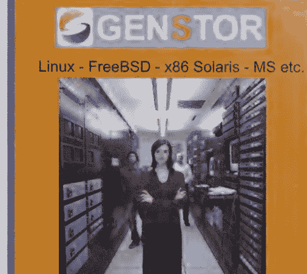

## Linux - FreeBSD - x86 Solaris - MS. 等

## 验证过的可靠性。

当你无法为业务数据或生产力承担冒险时，请仅依赖搭载 Intel® Xeon 处理器的 GS-1245 服务器。

### 四核 Woodcrest

### 2 节点 & 16 核心 - 16 上路

在标准 U16 规格中实现高密度。多达 16 核心的高 CPU 密度。需要配置以下功能：

- U 型机架优化机箱 (1.75英寸)
- 支持多达 2 个四核 Intel® Xeon 处理器
- 1600 MHz 系统
- 每个机柜多达 16 核心
- 每个机架支持多达 64GB DDR2.667 & 533 SDRAM 全配
- 缓冲器内存 (FF-DIMM)
- 双端口以太网
- 每个机架 2 个 SATA 可拔式 HDD 硬盘
- 每个节点 1 个 (GB) PCI Express


### 服务器 : 存储 : 设备电器

### Genstor Systems, Inc.

780 Montague Express. #604
San Jose, 95113

WWW.genstor.com
Email: sales@genstor.com
Phone: 1-877-258 SERVER OR 1-408-383-0120

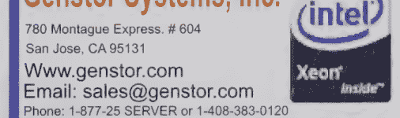

Xeon

Intel 和 Xeon 是 Intel 公司的商标。保留所有权利。

### Black Duck Software 的 Black Duck Export

Black Duck Software 新版 Black Duck Export 5.0 的意义在于应对开发者集成到开发流程的开源软件中存在的未检测加密算法问题。
作为 Black Duck 套件的组件，Export 通过扫描软件并识别加密算法的存在，帮助符合出口法规，这些加密算法可能会影响产品在不同市场的法律合规性。新版本 5.0 涵盖了 450 多种不同的算法。Black Duck 还提供了一本新出版物《开源世界中的出口合规指南》，可以从公司网站免费下载。
`www.blackducksoftware.com`

### Instantiations 的 WindowTester Pro 和 WindowBuilder Pro

Instantiations 目前向两款流行的基于 Eclipse 的 GUI 开发工具 WindowTester Pro 和 WindowBuilder Pro 发布，分别升级到 4.0 和 7.2 版本。WindowTester Pro v4.0 的新功能旨在帮助开发者实现自动路由、测试生成、代码覆盖和 GUI 交互回放。4.0 版本还对测试录制进行了改进；对断言功能的微调（包括 Swing 断言）；并改进了对 Linux 的支持以及对 64 位 Cocoa 的初步支持。WindowBuilder Pro v.5 的功能包括代码生成和解析的改进以优化性能、自定义属性的 API 支持、增强的 Java 和 RCP 支持、改进对 Riena 的支持以及扩展的数据绑定支持，使用户界面与底层数据集的连接更加容易。
`www.instantiations.com`

### Pananas 的 ActiveStore

在其 ActiveStore 系列 9 并行存储系统中，Pananas 声称拥有“世界上最高性能的文件存储系统”，它将固态硬盘 (SSD) 技术与传统磁盘驱动器相结合，产生具有突破性能和整合能力的系统。Pananas 进一步表示，其同步混合架构产生了高带宽性能和优化的 IOPS，能够提供每秒估计 80,000 次 NFS 操作，吞吐量每秒 6 GB。ActiveStore 用户通过在单一存储架构中整合各种应用程序和负载来节省资金，包括高性能集群应用程序、单客户端应用程序以及运行 NFS 和 CIFS 文件的技术和商业应用程序。
`www.pananas.com`

### Montavista Vista 运营商级 Linux

Montavista Vista 运营商级 (CGE) 5.1 版本现发布，增加了对移动应用开发的支持。材料还为移动应用开发配置了 Linux、介绍了移动互联网设备与普通桌面环境之间的区别、逐步教程以及更多内容。此书旨在向希望使用 Ubuntu Mobile 进入市场的原始设备制造商 (OEM) 和独立软件供应商 (ISV) 展示解决方案。该平台能够在移动设备上提供各种服务，从 Web、电子邮件到群组和 GPS。出版商 Wrox 显示，Ian Lawrence 和 Rodriguez Lopes 新书《专业 Ubuntu Mobile 开发》是该主题的创作。
`www.montavista.com`
40 | 2010年1月

## 新项目

### 源自深海

深海之险 (Danger from the Deep)

`dangerdeep.sourceforge.net`

如果你记得上个月的专栏，我曾对一个看起来非常酷的潜艇模拟器 Danger from the Deep 感到兴奋。这个月，我很荣幸将其作为主要项目之一介绍。要运行该程序，您需要以下配置：

- 一张符合 OpenGL 1.5 标准的显卡（建议使用 OpenGL 2.0 或更高版本）。
- 256MB 内存（建议 512MB）。


Danger from the Deep（被称为 `dangerdeep` 或 `Dfd`）是一款（免费）开源的世界大战潜艇模拟器……它被计划为一项长期的模拟项目，并将随着我们的时间和物理知识的增长而不断改进。它目前处于 alpha 阶段，但是可以玩的。

网页提供了一个非常棒的二进制安装程序，感觉就像商业游戏一样。如果你愿意，也可以从源代码编译游戏，但当你只需点击“下一步”、“下一步”……时，你真的会那么做吗？

二进制安装程序大部分会自动运行，但按照这类东西的惯例，你需要将其标记为可执行文件。如果你通过文件管理器运行它，可能需要右键点击并在属性中选择“可执行”，但我把这部分留给你你自己决定。对于那些倾向于从命令行运行程序的人，可以使用以下命令将其标记为可执行：

啊，正宗的！不懂德语？太遗憾了！控制方式将保持现状，无论你喜不喜欢（我很喜欢）。

`Dfd` 目前在 Linux (i386 和 AMD64) 和 Windows 上开发。有 Linux (i386 和 AMD64) 和 Windows (32位) 的二进制文件，以及一些适用于 Mac OS 的旧软件包。该游戏使用了 SDL/OpenGL，因此应该可以移植到其他操作系统或平台。


有时环境可以非常美，就像这个日落，它让潜艇里度过的几个小时变得更容易忍！

`Dfd` 据报道可以在 Windows (2000/XP, 98)、Linux (i386/x86-64/SPARC) 和 BSD (i386-64/SPARC/i64) 上运行。

### 术语安装


真实性和写实几乎被推向了极端，像宿舍这样的细节真的能让你进入游戏的感受和氛围中。

用法：一旦进入主界面，你就会感受到一股永不消息的浪漫怀旧浪潮！从与海洋耦合的控制、德语标记的控制和背景图像，到古怪的二战时期音乐，这款游戏凭借它的灵魂赢得了人心。

```
$ chmod +x dangerdeep-0.3.0-linux-installer.bin
```

然后，运行以下命令安装程序：

```
./dangerdeep.bin
```
（注意：如果是全系统安装，请不要以 root 或 sudo 运行。安装程序将经过通常的“下一步”、“下一步”、“下一步”……完成”，完成后，使用以下命令运行游戏：）

```
$ dangerdeep
```

假设你有一张不错的显卡，你会在选项菜单中检查接收情况，图形效果实际上非常令人深刻。由于这款游戏目前处于 alpha 阶段，任务阶段是有限的。尽管如此，单机模式下有多种任务可用。如果你想一开始就大杀一场，请先尝试“单人任务”菜单下的“历史任务”。

然而，在启程之前，我建议你打印出游戏的 PDF 手册，它可以在网站上下载。这款游戏的控制非常复杂（你可能不会），而且每个键通常都分配用于切换不同的视图。这里是一些基础的通用控制，可以帮助你入门。

我一直在寻找原创项目，这个特定的应用程序真的让我大吃惊喜。根据它的网站，“Flinks 是一种文本模式闪闪网页浏览器。它旨在快速阅读和/或略读页面和文本”。

F1 到 F12 将让你更清楚地看到船上的功能。某些键会带你进入潜艇内部的实际位置，如房间和宿舍，另一些则会调出设备，因为船员面板控制位于 F1，闪烁屏幕位于 F6。

该项目的作者 Martin Bart 的灵感源于一个手机程序，该程序会在屏幕上闪烁——经过几天的练习，速度达到了每分钟 600–700 字 (WPM)。Martin 对这个想法很感兴趣，但对这样一个项目花费 20 美元感到犹豫，于是简单地制作了 Flinks 2.4 或更高版本，以及一个工作的 Lynx 版本。

仪表盘是德语的，因为没有必要使用英语，所以你得弄清楚你的 Feedback 和 Lagewagen 是什么意思。

安装：`Flinks` 的运行非常简单，因为不需要真正的安装，它的依赖项极少。虽然我无法在打印页面上演示效果，但 Flinks 会快速闪烁页面的单个单词，以帮助训练大脑进行快速阅读。

现在，我处于这种会在风暴中持续战斗的阶段，让我们数数看。你可能想自己尝试一下，因为它可以使用更多模式发现水面敌人，但也展示了该游戏的一些酷炫图形。

从网站下载最新版本，解压并在新文件夹中打开终端。在命令行中输入：

```
$ flinks
```


按 `S` 键切换，当你进入后，查看各种视图模式（先从这个开始，是的，你可以手动进行水面搜索）。如果目标在视野内，按 `T` 识别目标。长按空格键可以选择并开火。

### Flinks——快速阅读网页浏览器

### 专用服务器

### 极速连接

BLADE 服务器

千兆兆端口 / 多千兆选项，包括：

| 方案 | 价格 |
| :--- | :--- |
| 3000 GB/月 | $200 |
| 5000 GB/月 | $300 |
| 10000 GB/月 | $500 |

Rob Purdie
项目经理
economist.com
amnesty.org

# Lullabot 驱动

世界上最强大的网站由 Drupal 创建，由你和 Lullabot 共同完成。

Lullabot 新动态：在 Lullabot.com 观看新的 Lullabot 学习系列训练 DVD。

## 针对 Linux 用户的业余无线电生存指南

常见业余无线电活动概述，以及关于如何使用 Linux 系统和免费软件参与其中的信息。

DAN SMITH

维护一个仅运行 Linux 的家庭每天变得越来越容易。有大量的人致力于从其他操作系统环境移植或重新实现桌面及通用软件，这有助于保持进程的持续进行。遗憾的是，享受一项主要由 Windows 用户主导的爱好，并没有那么容易。业余无线电的文化是一种充满实验精神并反主流的文化，但推动创新的人数相对较少，而且他们是在自己的舒适平台上进行新的，而这通常意味着 Windows。因此，许多应用程序无法在 Linux 上运行。在本文中，我将介绍进入业余无线电世界的 Linux 用户可能感兴趣的某些基础任务，而无需改变生活方式。首先，对于不熟悉一些常用无线电术语的人，这里有一个快速的词汇课程。

HF（高频）频段是 1MHz 到 30MHz 之间的频率，紧邻美国 AM 广播电波段。得益于高电离层，这些频率的信号能够环绕全球。如果你想与另一个国家通话，这些频段正适合你。

VHF（甚高频）和 UHF（超高频）频段是 30MHz 以上到 3GHz 的频率。该范围内的信号以越来越视距的方式传播，因此主要对局域（VHF）和极短（UHF）通信有用。然而，这些频率也提供了增加带宽和数据速率的机会，这就是为什么 Wi-Fi 位于高频（2.4GHz）。

## 竞赛日志

HF 上的一项活动是“竞赛”（contesting），它涉及通过建立不同的联系来达成某种目标。这通常涉及在特定时间内与特定区域的多次联系。由于这是一场比赛，所以需要一种日志来记录你建立的联系以便以后提交。业余无线电操作员使用呼号（calls）来相互识别，大多数软件可以帮助识别你是否在位置、天线等之间成功“对通”或获得了奖励。它还能让你了解全球特定部分的信号在一天中什么时间到达你这里，以防你想联系特定地点的人。如果你对这类操作感兴趣，请查看实时地图（见“资源”）以查找现在谁在漫游。

尽管看起来可能安静而荒凉，但如果你从未与世界上至少一端建立过半双连接，除非你手持一个电池和一根电线做过这件事，否则你不知道自己错过了什么！用于 Linux 的 `Xlog` 程序提供了基本的竞赛功能，包括重复检查。它还可以通过串口连接到你的无线电，自动记录其他信息，例如模式、信号强度以及操作员记录的任何其他信息，因此 `Xlog` 具有配置字段来帮助你。

# VHF/UHF Packet

当大多数人想起业余无线电时，他们脑中浮现的是点击声和摩尔斯密码下运行的大型设备。如果这个刻板印象留在你脑海里，接下来的讨论将消除这种误解。尽管它可能看起来安静而荒凉，但如果你从未与世界上至少一端建立过半双连接，除非你手持一个电池和一根电线做过这件事，否则你不知道自己错过了什么！用于 Linux 的 `Xlog` 程序提供了基本的竞赛功能，包括重复检查。它还可以通过串口连接到你的无线电，自动记录其他信息，例如模式、信号强度以及操作员记录的任何其他信息，因此 `Xlog` 具有配置字段来帮助你。


`xastir/scripts/getHws`


首次运行 Xastir，按照 `Interface->Configuration` 对话框输入你的位置并选择一个出现在你地图上的符号。有些人有特殊的偏好，所以如果你想提问，请依靠其中一个。

访问 `File->Defaults` 节点。注意，你的高度不是海海拔（ASL），而是平均地形高度（HAAT）。Curt 曾由于周围的山丘将高度设为海海拔 150 英尺，但协议不允许负的 HAAT；不知道在那种情况下该怎么办！

一些特殊键包括 `HOME`（中心位于你的地图或房屋）、`PageUp/PageDown`（缩放键）和方向键（平移键）。顶部的切换按钮也可以显示这些功能：

## 发射路径

`AX.25` 协议在每个数据包头部有多个槽。一个数据包流向所有方向。目前检测到的数据包包括 `WIDG-W-2` 和 `WIDG-W-1`。`WIDE-4` 用于移动台站。如果你在不使用 `WIDE-1` 作为任何内容的情况下点击两次，那么第一个呼号将出现在你的地图中。

通过遵循上述（目前针对北美）建议，你所在国家的国家网络可能不适用于你的情况（和选项），取决于问题，这种定义有助于他人。

对于“精简”类型，数据包结尾有特殊的调用路径可以防止其进入互联网。这些情况被大多数忽略软件尊重。

## 特殊事件的战术呼号

Xastir 一个非常实用的功能是可以为台站关联呼号，并通过射频或其它 APRS 客户端传输这些，目前只有 Xastir 和 APRS+SA 可以解码并显示战术呼号。

我们在 2000 年和 2008 年 11 月的西雅图马拉松之前不久增加了此功能以产生效果。它允许我们为协助活动的人员分配呼号，而无需更改他们的跟踪器配置。

当我们在活动前没有调整跟踪器设置时，这可以提供帮助。在用现代跟踪器进行显示时，“东西没坏就不要修”的旧方法确实有效。除非万不得已，否则不要触碰运行良好的跟踪器。

Xastro 在纽约市曼哈顿也得到了有效应用。我喜欢它即时且引人注目的战术显示。当它们没有其他用途占用时，你会看到它们在不断增长。

Xaric 战术标志为我们提供了类似的优势，为现场分配 `TEAM 1`、`HELO 2`、`DOGTEAM 3` 以及类似的代号。Xastro 增加了特殊功能以支持 SAR（搜救）行动。

### 资源

- Xastro 主页: `www.xastro.com`
- 映射列表: `lists.xastro.com/main/list-info/`
- SourceForge: `sourceforge.net/projects/xastro`
- Soundmark Wiki: `www.xastro.org/index.php/How_To_Sound`
- AX-25 Wiki: `www.xastro.org/index.php/How_TO_AX_25`
- SAR 页面: `aws.aprs.com/~/axter/SAR_main`
- APRS 信息: `info.aprs.org`
- ARRL: `www.arrl.org`
- 练习测试: `www.qastro.com`
- 海军学院无线电俱乐部 2008 年陆军对抗海军足球跑实时跟踪页面: `www.aprs.org/football`
- 为从安纳波利斯理工学院前往海军学院的跑步者拍摄的头盔中原始 GPS 跟踪器的照片: `www.usna.edu/Users/aerobrun/football`
- 1993 年 APRS 跟踪足球跑: `www.usna.edu/Users/aerobrun/football`

## Xastro 的未来

Xastro 从一个仅限 Linux 的应用程序，其容量有了显著增长，但仍然受限于 OpenMlist 或用于列表的多线程和多进程程序。开发者们讨论过将 Xastro 拆分为 SQL 数据库，该数据库现在支持多个客户端来处理用户界面组件。此类客户端使用不同的组件集，如 `GTK+`, `Qt-Widgets`，从而与日常工作更好地整合。重写以移除 X11 层可能允许在 Qtopia 嵌入式设备上进行路由。无论如何，当我们重构 Xastro 时，随着基础功能和有用功能的添加，它有一个光明的未来。会议上见！

请注意 Open Group 的会议 Wiki 标准工作、OST!、UNIT 以及 "X" 案例，以及 TOGAF 和 Boundaryless Flow 是 Open Group 在所有其他国家的商标。

## 示例：西雅图马拉松

对于西雅图马拉松，(我) 坐在网络控制车内，负责“路线”和“起点/终点”风险区域。Xastro 运行在一台开启了网络的笔记本电脑上，供无线电操作员访问和显示以查看活动地图。Bob Donnie (`KDNMA`) 有一个在起点跟踪器附近从没离开几里的台站。Xastro 分配了战术图像，例如起点或马拉松开始时的 SAG。

- 我听取来自无线电操作员的接跑步者信号，并向 Bob 报告实例。
- Bob 然后通过无线电派发车辆（SAG 车辆）去接跑步者。所有 SAG 的位置都会出现在我们的地图上。

SAG 车辆无法横跨赛道，让它们到达特定位置非常困难。地图显示 Bob 需要访问我们需要接跑步者的车辆——必须知道如何使用这些车辆。西雅图被这项活动一分为二。

我们在全马拉松和半马拉松赛目的领先车辆上放置了跟踪器，因为这些电动车辆到为止已完成任务。如果这些跟踪器不可用，我们必须在无线电网络上显示并创建对象呈现在地图上。对于饥饿的狗和可以使用追踪的跑步者，我们有相同的备用计划。

活动组织者使用追踪信息来支持终点的需求，而我们使用这些信息让志愿者了解最后跑步者的接近。志愿者随后会将此信息与马拉松其他区域的参与者分享。他们不会在一天结束后独自留在赛道，并让我们知道何时开放街道以及挑选志愿者和设备。

> Cuth. Webster，在 20 世纪 80 年代中期接到一个电话；来自单通道接口和自定义组装的仅接收站。他正在寻找并清点完成的任务。Baxter。Smartmap 和 ghost 运行中。他的兴趣是在他的孩子们跑步时进行手工操作。他是 `www.aprs.com` 上一个丰富的业余爱好者，并在 APRS 上使用 `WEPT-35`。他也在 WNRS 和 APRS 列表中。

Steve Stroh。20 世纪 80 年代后期通过业余无线电在 Packet Spot APRS 无线电网络 (`WINET`) 上使用 TCP/IP。他已经离开了那些盒子。Steve 使用了基于数据包系统 (Linux) 的无线电互联网接入。

Laura Sheriff 学过工程，但更倾向于用任何编程语言编写软件。她为每个项目提供帮助，并且可以说非常喜欢解决没有别人发现的问题。她依靠铁丝或胶带进行固定，因为这两者都很稀有。Laura 与她的丈夫和两个女儿在一起，可以在 `www.ret-website.com` 找到她。

`www.linux.com` 2010年1月 | 55

# 使用数字业余无线电 DIY

业余无线电操作员通常是思想自由的人，他们不介意为了完成任务而弄脏手。我们中的许多人不会考虑花费数百或数千美元购买一台全新的无线电，并打开盖子看看是否可以对其进行改装。我们不需要费力就能找到无数关于如何改装不同业余设备的文章。因此，我们对所使用的软件有同样的感觉并不意外。

开源软件和业余无线电是天生一对。如果一个无线电设备带有一份说明不能修改它的许可证，很少操作员会购买，看到为什么我们很多人倾向于源代码和 Linux 也是很自然的。我的个人计算历程经历了： 1990 年的 DOS，1993 年的 OS/2，1998 年的 Windows 以及从 2000 年起的 Linux。我自学了如何在 DOS 中编写批处理文件，然后开始尝试 C，最后是 C++。然后，在学习了如何使用那些大学级别的课程来找回正确的方法后。这就像 IBM 在 20 世纪 90 年代后期杀了 OS/2。我对 Linux 感到舒适，但在过去的四年里，它一直是我的操作系统。

GARY L. ROBINSON
**Fldigi 到 Fldigi：一个业余爱好者的历程。**

56 | 2010年

计算机在 Linux 下的双启动配置，直到不久前发现了一个由 Dave Free 编写的优秀程序 Fidgi (1)；Stelios Bonnaus, WA2NU。我有所有的数字型号，它运行得很好。在此之前，我使用 Windows 处理大部分数字模式。

### 特性：使用数字业余无线电进行定制

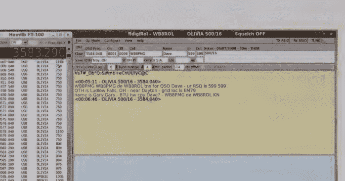

图 2. FLDigIRol v3.10 带有频率控制旋钮、按钮栏和新选项菜单

FLDigI 中的自动功能不足以帮助操作员在接收时确定数字信号，而且它们并不非常有效，特别是在恶劣波段或弱信号的情况下。此外，你必须尽可能地更改和手动配置设置，以及在电台停止发射之前最终获得正确的设置。如果你必须通过多个对话框和标签菜单来访问项目，这将减慢你的速度并大大降低出错几率。

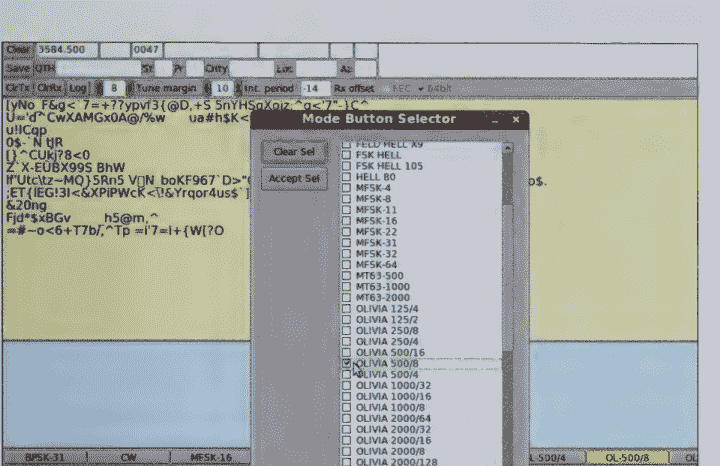

图 3. FLDigI 的可切换按钮栏

我决定在 FLDigI 的主菜单中添加三个可编程按钮。我之所以这样做是因为 FLDigI 已经有了宏按钮，但现有的代码很有帮助，因为它让我选择特定的数字模式或细分，总共提供了 27 个可以同时显示的按钮。

这些方式可以被视为模式，但只有在电台停止发射之前识别出模式及其参数时，所有这些模式才能被解码。例如，数字模式 Olivia 可以被配置为让任何数字操作员都难以准确且及时地识别这些模式。

重要的 Olivia-MT63-DominoEX 在这些频率上运行，以及一些他们在平均频率上执行的其他重要事项。我还以弹出对话框的形式添加了更多用户反馈代码，以及标题栏和状态栏中的信息。在此之前，当我点击按钮和菜单时，并不会让我知道发生了什么。例如，点击 QSO Save（保存呼话）按钮时，是否有保存联系记录时发生的任何听觉或视觉指示？通常，如果我必须检查日志来确保信息存在，我就会忘记某次通话。我还添加了代码，这样如果我需要对同一个通话进行多次，程序就会知道并识别出我。

另一个是 DM780 具有日志查找功能，这让我在输入呼号之前就知道我是否已经与另一个业余无线电电台通话过。通过为 FLDigI 编写一个基础循环程序，我节省了几个小时，该程序在标签上下文中处理了上一次通话的日期和频率（频段）信息。我还添加了代码，让我只需将光标悬停在 RX 文本框的呼号上即可看到相同的信息。

# 如果无线设备附带说明他们不能修改它的许可，那么很少有人会购买无线设备，对于为什么我们所有人通常都使用开源、特别是 Linux，这是很自然的。

我更改了代码，让日志簿会将信息保存到硬盘，并在我编辑条目后的同一天对日志对话框进行更新。

我从几个月前开始添加功能、模式和大量代码，以达到我想要的目标。在过去的一年里，我又增加了十几个小改进，并在这个过程中收获了很多乐趣。

在这个过程中，这段经历让我比以前更加尊重原作者。每当我需要对代码进行一些添加和更改时，我都能下载较版本的 FLDigI 并在短短几天内发布我的修改版。

我想在原始 FLDigI 程序中添加的内容之一是，那些想法中的大部分本会被添加的，我们只是在队列中等待了很久，但我想尝试直接或间接地去添加它们。

我在 Windows 虚拟机中安装了基于 Windows 的跨环境 Cygwin，并最终为几位要求的操作员制作了 Windows 版本的 FLDigI。

自从 FLDigI 3.13 版本发布以来，作者们开始使用 MinGW，另一种可以在 Linux 上运行的跨平台编译器环境。我曾使用虚拟机编译 FLDigI 的测试版本，但现在我在主桌面上使用 MinGW 并在 Linux 中编译。MinGW 看起来对我的项目效果更好，而且设置要容易得多。

我获得的经验启发了我去尝试另一个项目。我的下一个目标是创建 flagDigI，一个为无经验操作员设计的 FLDigI 轻量版。我计划删除大部分配置设置并简化程序，让新用户无需多次尝试即可运行它，而不需要处理复杂的配置。

名称和家庭位置（QTH）。我还想确保他们可以轻松从像 Olivia 等更高级的模式切换，甚至在将呼号输入 CALL 字段之前就能看到这些信息。我对 FLDigI 内部联系日志进行了几处视觉改进，并添加了它是如何保存联系记录的。FLDigI 在我点击 QSO Save 按钮时，并没有直接记录我的条目。事实上，在完成几次通话并发现只有在关闭通话时才会保存信息这一硬方法之后，它才解码了我。

我为所有可能的模式又添加了按钮，但它很容易就能覆盖大多数常用的模式。这让我只需点击一下鼠标即可从一个带有参数的特定模式切换到另一个模式，并极大地切换了焦点。我在通话（QSO）输入字段下方又添加了一个面板，带有多个控制控件，用于控制发射（TX）呼号和接收（RX）文本字段、访问日志簿、设置

58 | 2010年1月 | www.linux.com

### 深度解析

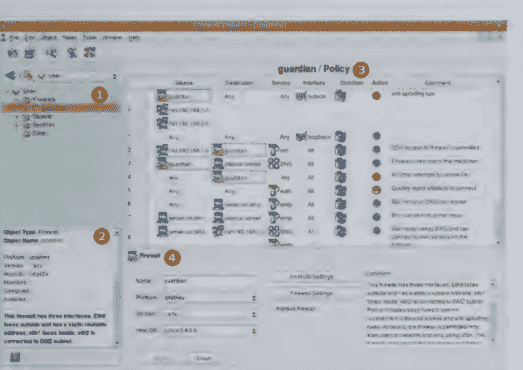

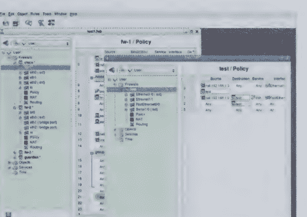

图 1. 主要 GUI 元素

图 2. 同时打开两个文件的主窗口

SourceForge (`https://sourceforge.net/projects/fwbuilder`) 随许多 Linux 发行版一起提供，例如 Debian、Ubuntu、OpenSUSE 和 Mandriva。你可以使用你喜喜欢的包管理器来安装它——就像安装 `fwbuilder` 软件包及其依赖项一样。由于这些发行版按照自己的计划运行，它们提供的包通常比最新发布的包旧一两个版本。我们还提供了自己的仓库来对 `fwbuilder` 包进行签名。这些仓库中的包使用我们的 PGP 密钥进行签名以便验证。我们提供两个仓库：

扩展这一概念，Firewall Builder 3.0 允许你同时打开多个数据文件（图 2），并使用拖放/粘贴操作在它们之间移动对象。

### 超小型个人电脑

+   ## PPC-E4
- 无风扇 ARM9 200MHz CPU
- 2 个串口 & SPI
- 开放式框架设计
- 2 个 USB 2.0 Host 端口
- 10 以太网
- 音频蜂鸣器
- Micro SD 卡接口
- 电池备份实时时钟
- Mini PCMCIA 32 卡插槽
- 带有嵌入式 IDE 的 Linux 或 WinCE 6.0
- 带触摸屏的 QVGA (480 x 272) TFT 彩色 LCD
- 16 位双端口定时器/计数器

Firewall Builder 的稳定版和测试仓库用于在软件包发布前分发给 Beta 测试人员。有关如何设置系统以运行我们的仓库的说明，请访问我们的网站 (`www.fwbuilder.com/docs/firewall_builder_packages.html`)。

PPC-E4 是一款超紧凑型电脑，配备 4.3 英寸 QVGA (480 x 272) TFT 彩色液晶屏和电阻触摸屏。屏幕尺寸与流行的触摸手机相同。PPC-E4 足够小，可以放入 20 个机架箱内。价格现为 345 美元或量子支付！

程序启动后，你可以通过命令行使用其名称或通过 GNOME 桌面图标启动它。Firewall Builder 已经演变为一个生产级工具，每天有数百名管理员在使用。最新版本 3.0 发布于 2008 年，从那以后它经历了一些更新。我们还为新用户提供了新的用户界面和许多改进。当前版本重点关注在 Firewall Builder 3 中引入的功能。

更多信息请访问：`www.emacnic.com/panel/pc_e4.html`


自 1985 年以来
24 年卓越的解决方案
ENAC, inc. 设备监控与控制
电话：(616) 592-4525 | 传真：(618) 457-0110

`www.linuxjournal.com` 2010年1月 | 61

你可以扩展一个文件使其覆盖整个窗口，也可以排列多个数据文件，使它们同时可见。

当创建对象来表示网络时，你可以创建一个防火墙对象并开始构建安全策略规则。Firewall Builder 3.0 带有一个模板库，代表了一些典型配置。入门最简单的方法是从这些模板中的一个创建一个新的防火墙，然后对其进行修改，以反映你网络的地址和配置。

你可以使用 GUI  own“查找和替换”功能来替换它们。你还可以选择选择其他模板，分别代表具有一或两个接口的防火墙、Cisco 路由器、服务器以及基于 Lynxsys 的小型家用防火墙。从模板创建的防火墙对象可能无法与你配置的所有接口协同工作，但你也可以通过一组小规则来配置它们以实现基本的安全策略。当然，你可以编辑这些规则以使配置适应你特定的策略需求。你创建的规则作为防火墙规则如何运作的插图，并作为你自己策略设计的起点。

### 管理员可以在工作站上运行的同一个 GUI 中为专用防火墙和路由器配置策略

图 3 显示了可以在哪里使用模板创建新的防火墙对象。此视图显示了具有下方所示 IP 地址接口的新的防火墙对象的创建。很可能你的网络使用了不同的架构，这与你的情况不符。

模板对象提供了创建新防火墙配置的快速方法，但其数量和种类是有限的。

如果没有哪个一个接近你的配置，你可以手动创建防火墙对象及其所有接口。此外，如果你的防火墙运行 SNMP 守护进程，你可以让 Firewall Builder 自动“发现”它。

现在你可以为你已有的接口创建策略和对象。图 4 显示了防火墙策略的一部分。

与 Firewall Builder 的之前的版本一样，策略规则首先分为类型：源（source）、服务（service）、接口（interface）、方向（direction）、动作（action）、时间（time）和注释（comment）。放在源规则元素中的接口对象意味着包的源地址必须匹配整个规则。目的也是如此。服务对象定义了 TCP 和 UDP 协议端口或 ICMP 消息类型。当消息到达防火墙时，数据包必须匹配其中的对象才能匹配整个规则。你可以通过拖动或复制策略模板来将对象放入规则中。

Firewall Builder 3.0 支持添加规则。

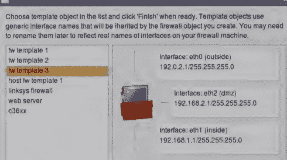

此防火墙有三个接口：`eth0` 向外并具有静态路由；`eth1` 在内部；`eth2` 指向 DMZ 子网。策略包括允许从内部网络到 DMZ 无限制访问的规则，但防火墙仅允许来自内部网络并使用 SSH。防火墙将内部网络的机器用于 DMZ。内部网络配置为 `192.168.1.0/24`，DMZ 使用的 IP 为 `192.168.2.0/24`。DMZ 上有一个邮件服务器（“dmz 上的防火墙服务器”）。策略需要 NAT。对于来自互联网的服务器，我们应该使用 NAT 到内部网络上的主机（“内部服务器”）。从 DMZ 到内部的所有其他访问均被拒绝。为了访问邮件服务器，通过 NAT 规则 #1 将私有地址映射到防火墙的外部地址。


图 4. 策略规则示例

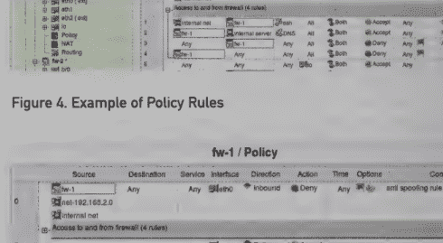

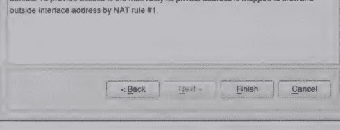

图 3. 使用模板创建防火墙对象

图 5. 分组规则示例

62 | 2010年1月 | www.linuxjournal.com

### 规则集

| | | | | | |
|---|---|---|---|---|---|
| 地址 IPv4 | | | | | |
| 名称: eth1ipv6 | | 注释 | | |
| 地址: 2001:db8::1 | | | | |
| 网络 (位长度) | 64 | | | | |
| DNS 查询... | | | | |

策略

| filter+mangle |
|------|
| 这是 IPv4 规则集 |
| 这是 IPv6 规则集 |
| 这是结合 IPv4 和 IPv6 的规则集 |

| | | | |
|---|---|---|---|
| 名称: 策略 | | | |
| 这是 IPv4 规则集 | | | |
| 这是 IPv6 规则集 | | | |
| 这是结合 IPv4 和 IPv6 的规则集 | | |

图 6. 接口 eth1 有一个 IPv6 地址。

### 规则集

| | | | |
|---|---|---|---|
| 名称: 策略 | | | |
| 这是 IPv4 规则集 | | | |
| 这是 IPv6 规则集 | | | |
| 这是结合 IPv4 和 IPv6 的规则集 | | |

图 8. 用于配置为 IPv4 仅的策略或 NAT 对象的不同地址族

IPv4 策略。
地址族选项列表如图 8 所示。地址族选项有：

> “IPv4 仅规则集”：规则中仅使用具有 IPv4 地址的可寻对象。如果是 IPv6

图 7. 配置为 IPv4 仅的策略对象示例

图 4 显示了一个标题为“访问防火墙及出”的规则组，由四条规则组成。这些规则形成一个可以折叠的组，使其仅显示可见（图 5）。

通过将规则分组，可以极大地提高整个规则集的可读性。当多条规则协同工作以实现安全某部分时，这有助于保持内部逻辑的良好视觉参考。安全

随着 IPv4 地址耗尽迫在眉睫，IPv6 的部署开始加速。Firewall Builder 3.0 支持 IPv6。该程序提供了几种新类型的地址和服务对象，用于表示 IPv6 地址。图 6 显示了具有 IPv6 地址的接口示例。

`www.linuxjournal.com` | 2010年1月 | 63

### 深度解析

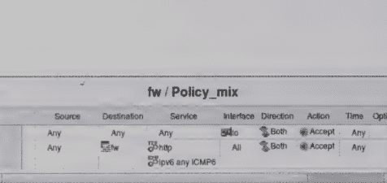

| 源 | 目的 | 服务 | 方向 | 动作 | 时间 | 选项 |
|---|---|---|---|---|---|---|
| 任意 | 任意 | 任意 | 双向 | 接受 | 任意 | 任意 |
| 任意 | ipv6 | ipv6 any ICMP6 | 全部 | 接受 | 任意 | 任意 |

loopback 上的协议允许应该是类似的，但允许 http 和任何 ICMP6 的规则看起来会有不同。以下是生成的 iptables 脚本样式：

### IPv4

```
```


### Rule Policy_mix 0 (lo)

`iptables INPUT -i lo -m state --NEW -J ACCEPT`

`iptables OUTPUT -o lo -m state --NEW -J ACCEPT`

### IPv6 (全局)

### Rule Policy_mix 1 (global)

`iptables INPUT -p tcp -m tcp --dport 80 -m state --NEW -J ACCEPT`

### IPv6

### Rule Policy_mix 0 (lo)

`iptables INPUT -p tcp -m tcp --dport 80 -m state --NEW -J ACCEPT`

`iptables OUTPUT -p ipv6-icmp -m state -J ACCEPT`

`-state -NEW -J ACCEPT`

出现在规则中，它会被忽略。使用了仅 IPv6 运行的服务，例如 `ICMP6`。使用了 TCP 和 UDP 服务，并同时用于 IPv4 和 IPv6 规则。

> “仅 IPv6 规则”：仅具有 IPv6 地址的物体，忽略具有 IPv4 地址的物体。使用了仅 IPv6 运行的服务（如 `ICMP6`），但未使用 IPv4 服务（如 `ICMP`）。使用了 TCP 和 UDP 服务，

“混合 IPv4 和仅 IPv6 规则集”：编译器会对规则进行两次扫描，首先生成 IPv4 配置，然后生成 IPv6 配置。在每次扫描中，它仅使用与该次扫描地址相匹配的地址对象。这就是在将 IPv6 规则逐渐添加到现有 IPv4 配置时，过渡配置的实现方式。

# Firewall Builder 3.0 的另一个新功能是支持分支规则和多个规则集。

如果你在规则中向 IPv4 接口或主机对象添加 IPv6 地址，编译器将在 IPv4 路径上使用接口的 IPv4 地址，并在 IPv6 扫描中未使用相同接口的新型 IPv6 地址。这一原理也适用于地址、规则和服务的混合组。

让我们看看组合 IPv4+IPv6 规则集中的一些简单规则是如何转换为 `iptables` 脚本的。规则如图 9 所示。

- 第一条规则使用代表其环回接口的 IPv4 接口对象，第二条规则使用代表防火墙本身的对象以及两个对象：“http”和“ipv6 any ICMP”。该规则

IPv4 规则使用 `iptables-command` 工具加载，而 IPv6 规则使用 `iptables` 加载。允许 loopback 上任意流量的规则会产生多条 `iptables` 命令。区别在于用于添加规则的命令行工具的选择。该规则同时允许 http 和任何 ICMP，为每个 TCP 端口仅生成一个 `iptables` 命令。这是因为 ICMP 服务仅存在于 IPv6 上下文中，所以当为 IPv4 编译时，它被从规则中丢弃了。

混合 IPv4/IPv6 规则集在运行 IPv6 网络时特别有用。因为 IPv6 ACL 和规则需要不同的集合，所以你需要为 IPv6 实现第二个规则集。必须复制所有规则将保留策略的整体结构和安全性。事实更为复杂的是，策略中的任何更改都应反映在这些同步规则中，这可能会迅速变成一项重大任务，增加人为错误和网络中断的概率。

图 9. 混合 IPv4+IPv6 规则示例

64 | 2010年1月 | www.linuxjournal.com

### 不要错过任何一期！

现在订购即可送上门。


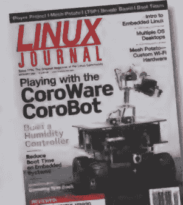

今天邮寄此卡订购 2 年（24 期）《Linux Journal》，可节省 65%。或通过 1 年订阅可节省 58%。

- 12 期仅需 $29.50
- 24 期仅需 $49.50 最划算！

姓名（请正楷）
地址
城市 州 邮编

[ ] 随款付款 [ ] 后付款 B01

墨西哥年价为 39.50 美元。国际价为 69.50 美元。非订阅必须预付。您的第一期将在 4-6 周后到达。在线注册、续订或管理您的订阅：www.linuxjournal.com/subscribe。

## 广告商索引

在线查看我们的购买指南。
访问 http://linuxjournal.com/buyersguide 获取更多关于我们广告商的信息或链接到他们的网站。

感谢购买他们的优质产品来支持我们的广告商！

| 广告商 | 页码 | 广告商 | 页码 |
|---|---|---|---|
| 101 INTERNET, INC. | C2 | LULLABY | 45 |
| www.101online.com | | www.lullaby.com | |
| ABERSEN, LLC | | MICROSOFT, INC. | C4-56 |
| www.abersen.com | | www.microsoft.com | |
| ASME Media, Inc. | | Mega Tech | |
| www.asmemedia.com | | www.router.com | |
| ASA COMPANIES, INC. | | NUBURA | 78 |
| www.asacompanies.com | | | |
| CAS NET | | POLYCOM, INC. | 13-79 |
| www.casnet.com | | | |
| CONNECT DIRECT | | PRCon | |
| www.connectdirect.com | | us.python.com | |
| ORGANIZATION, LLC | | SANTREW BENAMIN COMPANY | |
| www.disorganization.com | | www.antameld.com | |
| Dio-Key Corporation | | | |
| www.diokey.com | | | |
| EMAC, Inc. | 61 | SCALE | |
| www.emac.com | | www.soallprojects.org | |
| EVERLAST MEDIA | SILICONCOMMUNICATIONS | 19-23 |
| www.everlast.com | | www.siliconecommunications.com | |
| GEEK TECH, INC. | | ENGINEERING SYSTEMS | 27 |
| www.geektech.com | | www.embeddsystems.com | |
| GEMSTER SYSTEM, INC. | TRUSTED SOLUTIONS | 1-79 |
| www.gemster.com | | www.trustedsolutions.com/Security | |
| GETEP GROUP | US ASSOCIATION | 9 |
| www.geteppgroup.com | | www.usexom.com | |
| IS SYSTEMS, INC. | UTILITIES | 73 |
| www.isystems.com | | www.utilkits.com | |
| LOCAL SUPPLY, INC. | | | |
| www.localsupply.com | | | |

图 10. 如何在规则集中创建分支

混合 IPv4+IPv6 规则在 Firewall Builder 中有助于解决这个问题，因为脚本是从同一个规则集中自动生成的。Firewall Builder 3.0 的另一个新功能是支持分支规则和多个规则集。对象可以有多个集合；每个集合由树中的一个对象表示。图 10 显示了具有策略的对象：一个有一个名称，另一个有限制。要在你的规则中创建分支，使用 `Chain` 将策略复制到其面板中，如截图所示。多个规则可以使用 `Chain` 来控制同一个分支。Firewall Builder 抽象了规则访问，这可以在构建动态策略时用于优化。Firewall Builder 附带 PDF 和 HTML 格式的大型指南，充满了示例和逐步说明。正如你所看到的，3.0 版本带有许多新功能，升级非常值得。主要的驱动力是来自我们的错误报告和功能请求，因此请访问 www.firewallbuilder.com，我们帮助做得更好。

## 广告商注意

2010年4月 #192 截止日期
空间条款：1月25日；材料类：2月2日
主题：软件开发
额外分发：Fore, FSX

拨打 Joseph Reck 联系您的空间：1-713-344-1956 分机118，e-jose@linuxjournal.com

David Kurland 除了自1999年以来 Firewall Builder 的作者外，还是硅谷多家公司的长期网络工程师。在此之前，他在软件开发运维部门工作。

## 实现端口锁安全

不要编写锁，而是让它们消失。在处理计算机安全时，你应该假设黑客会尝试你系统可能拥有的任何门，无论你采取了多少预防措施。依赖密码的验证方法是经典的且被广泛使用的。为了“打开扇门”，连接到计算机上的端口，你首先必须指定正确的密码。如果端口足够快可以敲，这种方法就是有效的，而且它不会失败许多可能泄露密码的攻击，但仍然存在一个问题。不存在开放门的事实就足以诱惑。因此，开放的端口可以被视为带有（可能的）锁的门，密码就是钥匙。如果你正在运行某种公共服务（例如 Web），那么更好，没有人可以越过你的服务。如果你只想允许少数人访问，你可以向世界隐藏你的系统实际上有一扇门的事实。你“击退入侵者”，不仅是在门上加锁，还将其隐藏起来。这是一种保护端口的简单方法，在你不使用秘密密码之前，让它们对世界保持隐藏和不可见，随后将（仅）打开端口以便你进入并访问。端口锁适用于用户访问非公开的服务。服务器保持所有端口关闭，但在用户通过提供秘密密码（密码序列）通过身份验证后按需打开它们。端口打开后，将应用通常的安全措施（密码、凭据等）。它不需要任何修改，但额外的安全性是在防火墙层面提供的。

在本文中将解释如何实现端口锁，以便为你的安全系统增加另一层保护。

图1. 处于“隐身”模式的完全锁定站点，不会向攻击者提供任何信息，攻击者甚至无法得知站点实际上存在。

## 你安全吗？

除非黑客知道如何尝试，否则他们无法攻击你的系统。端口锁攻击是一种检查机器安全水平的简单方法，通过运行在线测试，例如 GRC 的 Shields UP!（图1）。图1 中的测试结果显示，攻击者甚至不知道该机器可用。

## 秘密握手、敲击和敲门

另一个常用工具是 `nmap`，它是扫描和检查选项的瑞士军刀。简单的 `nmap -v site.url` 命令将尝试寻找任何开放端口。注意，默认情况下 `nmap` 扫描 1-10000 范围，涵盖了所有热门端口。要扫描所有端口，使用 `-p-65535`。通过添加 `-p1` 进行更彻底的测试可以让你看到你的站点对世界是关闭的。所以，现在你知道你是安全的，如何在打开一个端口的同时将其对其他人隐藏？端口锁背后的想法是关闭所有端口并监控连接。当识别出特定的攻击序列（秘密密码）时，仅在这种情况下，系统可以配置执行某些操作，如打开大门，让外部人员进入。敲击序列可以根据你的需要变得复杂——例如一个简单的列表（如 TCP 端口 7005，然后

列表 1. 标准 `nmap` 端口扫描工具提供了您的网站及所有端口均对外部关闭状态的另一种确认。

```
$ nmap -v -A your_site
```

Starting nmap 4.75 (http://nmap.org) at 2009-08-13 12:59 UYT
Initiating Scan at 12:59
Scan 96.104.185.104 [1 host]
Completed Scan at 12:59, 0.08s (1 total hosts)
Initiating Parallel DNS resolution of 1 host at 12:59
Completed scan of 1 host at 12:59, 0.81s elapsed
Initiating Connection at 12:59
Scan 96.104.185.104.dialup.asldeta.net (196.64.185.104)
(96.104.185.104) are closed
Completed Connection Scan at 12:59, 0.17s (1000 total ports)
Service scan at 12:59
SCRIPT ENGINE: Initiating script scanning.
host 96.104.185.104.dialup.asldeta.net (196.64.185.104)
appears to be ...
All 1000 ports on 96.104.185.104.dialup.asldeta.net are filtered
State: closed

Read data from: /usr/share/nmap
Service performed. Please report any incorrect results
at http://nmap.org/submit/
nmap Done: 1 address (1 host) was scanned in 2.94 seconds

列表 2. 一个简单的 `/etc/knockd.conf` 文件，它按顺序对端口 7005、7007 和 7006 进行连续敲击以启用安全外壳（SSH）。

在设置此之前，让我解释一下为什么这是一个很好的策略。共有 65,535 个可能的端口，但在发现攻击性用户（见下地址列表）后，我们只剩下“仅”50,000 个可用端口。如果攻击者有一组五个不同的端口，他们将有尝试 312,000,000,000,000,000,000 种组合。否则，显然暴力破解敲击是不可能的，尽管盲锁是我们没有使用的唯一安全措施，它仅仅是层与层之间敲击的另一种方式（图 2）。

在您要保护的机器上，安装 knock 守护进程（knock daemon），它将负责监控攻击。该软件包适用于所有发行版，在 OpenSUSE 中使用 `apt-get install knockd` YaST。现在你需要通过编辑 `/etc/knockd.conf` 来指定您的敲击规则，并查看守护进程的运行。示例配置见列表 2：不运行防火墙，eth0 位于外部区域；对于其他发行版和工具，你需要定义使用何种命令。

您可能可以将其用于三个敲击的序列——7005、7007 和 7006（并不十分安全，但这是一个打开 SSH 端口的示例）。这允许输入敲击的最大超时时间（15 秒）和一个端口将打开的登录窗口（30 秒）。现在，让我们测试一下。首先，你可以在不进行敲击的情况下登录吗，仅仅尝试从远程机器登录？

```
$ ssh your_site.url -C ConnectionTimeout=10
```

图 2. 攻击者（顶部）被防火墙直接拒绝，当合法用户（中间）提供正确的“敲击”序列时，防火墙（底部）允许访问特定端口，用户可以与服务器交互。

接下来，让我们开始编辑。通常，你需要以 root 身份运行 `vi knock -d /etc/knockd.conf start`；然而目前你可以看看发生了什么，让我们运行 TCP 端口 7002（最后是 TCP 端口 7007）到一组仅供用户使用的序列中，这些序列一旦使用，将不再被允许。这等同于“一次性口令”。

www.linux.com 2010年1月 | 63

### 深度解析

### 如果你位于路由器之后

```
$ ssh your.site.url -o Timeout=10

$ ssh: connect to your.site.url port 22: Connection timed out

$ knock your.site.url 7085

$ knock your.site.url 7086

$ knock your.site.url 7087
```

如果你不是直接连接到互联网，而是通过路由器，那么远程用户将使用 ssh 进行一些更改。你如何进行这些更改取决于你使用的路由器和防火墙软件，通常情况下会显示：

```
$ ssh your.site.url -o Timeout=10

Password:

Last login: Oct 3 14:58 from 192.168.1.100
```


### 端口敲门配置要点

- 将敲击端口转发到您的机器，以便 `knock` 能够识别它们：
- 将端口 `22` 转发到您的机器。事实上，你可以将任何其他端口（例如，`960`）转发到您机器上的 `22` 端口。
- 如果不运行防火墙，`eth0` 位于外部区域；对于其他发行版和工具，你需要定义使用何种命令。

你可能可以将其用于三个敲击的序列——`7005`、`7007` 和 `7006`（并不十分安全，但这是一个打开 SSH 端口的示例）。这允许输入敲击的最大超时时间（`15` 秒）和一个端口将打开的登录窗口（`30` 秒）。现在，让我们测试一下。首先，你可以在不进行敲击的情况下登录吗，仅仅尝试从远程机器登录？

### 深入解析

你可能会想到的功能——触发备份、运行某个进程；发送电子邮件等等。
`knockd` 接受以下命令行选项：

- `-c` 允许你指定不同的配置文件，而不是默认的 `/etc/knockd.conf`。
- `-d` 让 `knockd` 在后台作为守护进程运行；这是标准的工作方式。
- `-h` 提供语法帮助。
- `-i` 允许你更改监听的接口；默认情况下，它将使用你在配置文件中指定的任何接口，或者在未指定时使用 `eth0`。
- `-n` 允许在日志条目中使用 DNS 域名，因为这被认为是一种不良实践，因为它会迫使你的机器失去隐身性并产生 DNS 流量，从而可能被监控。
- `-v` 产生更详细的日志。
- `-D` 输出调试信息。
- `-V` 显示当前版本号。

为了触发“敲门”，你可以使用任何程序，但随 `knockd` 软件包一起的 `knock` 工具是通常的选择。其用法示例所示：使用 `knock site_url:7885` 建立端口 `7007` 的 TCP 连接。对于 UDP 连接，可以添加 `-u` 参数，或者使用 `knock site_url:7885`。`-h` 参数提供了简单的语法摘要。

## 结论

端口敲门（Port knocking）不能是你武器库中唯一的安全武器，但它为你的机器增加了额外的屏障，让黑客难以入侵。

> Federico Kerinski 是一位乌拉圭系统工程师，拥有超过 25 年的大学教学、开发、咨询以及编写文章和课程材料的经验。他已经使用 Linux 多多年，并在几家公司安装过它。他对 Linux 机器更好的安全性和性能感兴趣。

### 资源

`knock` 位于 `www.zeroflux.org/projects/knock`，你可以在 `www.linux.net/man/1/knockd` 找到 `knockd` 守护进程文档，或者直接在控制台输入 `knock`。

欲需更多关于端口敲门的信息，请查看 `www.portknocking.org/view/`，特别是 `view/implementations` 以获取更多实现方式。你也可以查看 `www.linux.com/archive/37888` 上的评论，以及 `www.portknocking.org/view/about/critique` 中的答案，作为对端口敲门的反论。

特别阅读 `en.wikipedia.org/wiki/Transmission_Control_Protocol` 以了解 TCP 标志。在 `www.faqs.org/docs/iptables/tcpconnections.html`，你可以找到一张显示如何使用标志的图表。

端口号由 IANA（互联网分配编号机构）分配；列表见 `www.iana.org/assignments/port-numbers`。

要测试你的系统，请获取 `amass` `nmap.org`，并访问 GRC (Gibson's Research Corporation) 网站 `https://www.grc.com`，尝试 Shields Up。

如果你需要刷新 `iptables` 技能，请检查 `www.netfilter.org`。

## SharePoint 回到旧金山！

参加
### SPTechCon
SharePoint 技术会议
`2010`年`2`月`10-12`日 -> 旧金山

“主题广泛——深度足够——而且很有趣”
Patrick McMahon, Web/IS 架构师，SEPARATION Inc.

“内容优秀，演讲者非常出色
知识渊博，真实的案例为我解决各种 SharePoint 问题提供了解决方案”
Laura Diario, Web 系统经理，Peter Novelli

课程选择
`80+` 门课程与工作坊

## 查看我们的全明星教师团队！

### 特别主演讲

- Shane Young
- Randy Driscoll
- Todd Klindt
- John Ross
- Michael Noel
- Bob Mixon
- Heather Soloman
- Andrew Connelly
- Bill Gringer
- Don Raymond Sy
- Joel Oleson
- Erin O'Connor
- Laura Rogers
- Mauro Cardarelli
- Mark Miller
- Matt Passantanne
- Mark Rackley
- Jason Dearinger
- Eric Hartlan
- Shaded Eleazer

### 钻石赞助商
AavePoint! 释放 SharePoint™的力量

### 铂赞助商
StoragePoint

- Philip Wickland
- Dan Usher
- Joshua Haebets
- Peter Serzo
- Nicola Young
- Mark Ferraz
- Karuana Gatuoni
- Steven Fowler
- Paul J. Swider
- Jennifer Mason

- commvault
QUEST SOFTWARE ENGINEERING
KWizCom

### 金牌赞助商
pbweb.net AGIC

### 银牌赞助商
COSMWORKS
MIMOSA CAHARI
azalea.com

## 欲了解更多信息，请访问
`www.sptechcon.com`

立即注册享受早鸟价！
节省 $$$$$$

A BZ Media 活动
`2010`年`2`月`10-12`日
旧金山君悦凯民大酒店

## 使用 Linux 和 Xen 构建简单虚拟设备

使用 Xen 和 Linux 制作你自己的即插用软件设备。
创建一个 DNS 服务器、Web 服务器、MySQL 服务器——你需要的任何设备，在需要时随取随用。

- MATTHEW HOLKINS

每个人都以某种形式熟悉硬件设备。它可能是家里的一个无线访问点，也可能是数据中心的一个 DNS 服务器设备。设备提供了预先构建的软件（带硬件），可以以最少的麻烦快速部署。当你结合虚拟化技术选择“设备”概念时，你将获得虚拟设备——这是一种预先构建的软件，只需极少的工作即可在你的硬件上运行。

在本文，我将提供一个通过组装可用组件来构建简单设备的实操介绍。该框架被用于构建广泛的设备。

### 什么是虚拟设备？

虚拟设备与硬件具有许多属性。通常情况下，这两类设备（无论是单用途还是“轻量级”的）具有相似性。设备提供了预先构建的软件（带硬件），可以以最少的麻烦快速部署。当你结合虚拟化技术选择“设备”概念时，你将获得虚拟设备——一种预先构建的软件，只需极少的工作即可在你的硬件上运行。

在本文，我将提供一个通过组装可用组件来构建简单设备的实操介绍。该框架被用于构建广泛的设备。

### 深入解析

`bind-utils`。要制作一个 LAMP 设备，运行 `yum install http php mysql-server`。重启或在 Webmin 内部刷新模块，你将看到所安装的任何软件的 Web 管理界面。Webmin 开箱支持广泛工具，而且 Webmin 网站上还有更多扩展模块可用。

对于我们的示例，让我们创建一个 MySQL 数据库服务器设备。要自定义您的基础设备，请在虚拟机内部运行以下命令：

```
appliance-base -y install mysql-server

appliance-base /etc/init.d/mysqld start

Initializing MySQL database: Installing system tables...

OK

appliance-base --mysql_installation
```

注意：此脚本的所有部分都建议用于生产环境中的所有 MySQL 服务器！请仔细阅读每一项！

输入 root 当前密码（回车）：
OK，密码输入成功，继续... 
正在设置可以在授权的情况下登录 MySQL root 用户的 root 。
设置 root 密码：[Y/n]
新密码：
删除匿名用户？[Y/n] 
不允许 root 远程登录？[Y/n]
重新加载数据库并测试访问？[Y/n]
重新加载权限表？[Y]

全部完成！如果您已完成上述所有操作，您的 MySQL 安装现在应该是安全的。

感谢 MySQL！

# 打包与开发设备

接下来，让我们打包您的设备，然后执行将其部署为 `mysql.example.com` 的流程。为了准备磁盘镜像配置：

```
xenhost$ cd /etc/xen/auto/appliance-base
```

```
xenhost$ tar -cvfz appliance-base.tar.gz

xenhost$ mkdir -p /xen/mysql.example.com

xenhost$ cd /xen/mysql.example.com

xenhost$ tar -xvf /appliance-base.tar.gz

xenhost$ mv appliance-base.cfg /etc/xen/auto/mysql.example.cfg

xenhost$ cd /xen/mysql.example.com
```

列表 4 显示了 `/etc/xen/auto/mysql.example.cfg` 的示例配置。设置磁盘镜像的路径，并赋予它此唯一的 MAC 地址。将配置放置在 `/etc/xen/auto` 意味着设备将在 Xen 宿主机启动时自动启动。

使用以下命令启动设备：

```
xenhost$ create /etc/xen/auto/mysql.example.cfg

xenhost$ vm console
```

在虚拟机启动时检查控制台；最后的输出将是 DHCP-IP。得益于本地地址，可以通过该 URL 使用浏览器；默认情况下，Webmin 监听端口 `1000`。登录后，你将能够管理您的 MySQL 设备。Webmin 还可以显示您的静态 IP、通过更新创建额外的用户、防火墙规则、维护数据库并配置系统。

通过这些简单的步骤和现成的组件，你可以创建一个虚拟设备来完成任何事情。因为它是虚拟机，你可以在物理计算机之间移动并多次部署它。正如引言所述，所有这些步骤可以在 VMware 中完成。VMware 是应用最广泛的技术，它有自己的创建虚拟设备的工具，以及提供廉价设备的 Marketplace。无论你使用 VMware 还是 Xen，虚拟设备都是通过最少帮助部署预配置系统的简单方法。如果您有软件业务，今天就可以帮助您的客户工作环境。

Matthew Jenkins 是新泽西科技学院的 UNIX/Linux 虚拟化管理员，他在那里管理该州许多企业。他帮助不同的系统和软件协同工作，通常通过一层 Perl（本地称为 ''）。当没有问题时，通常可以在 `matthewkins@gmail.com` 找到他。

资源
- CentOS: `www.centos.org`
- Webmin: `www.webmin.com`
- VMware Appliance Marketplace: `www.vmware.com`

列表 4：`/etc/xen/auto/mysql.example.cfg`
```
name = "mysql.example.com"

memory = "256"

disk = "tap/mysql.example.com/appliance-base.img,vda"

vbd = "bridge:xen0,mac=..."

bootloader = "/usr/bin/grub"

crash = "restart"
```


7 | 2010年1月

## 结论

## 送出 LINUX 礼物

需要为那位开源爱好者准备礼物吗？送他们一份《Linux Journal》订阅吧！

## 立即订购！

## 正反辩论

### 教育 vs 经验

### 你应该考证吗？

在过去的几列专栏中，我们讨论了从笔记本电脑到文件系统的一切内容。这次的正反辩论涉及了一个技术性没那么强但没那么重要的话题。在当今职场中，更有分量的是，很难强迫某人学习材料，而不是为了通过考试而死记硬背信息。

BILL：我见过一些持证的人，连怎么从一个纸袋里爬出来都不知道。我见过一些持证的人对 DNS 一毫无了解——Kyle 的观点很有道理——证书可能只是一个擅长死记硬背和良好测试的人的指标。

KYLE：事实是，即使你接受了正式的计算机科学教育，通常也只能获得基础知识。大多数 CS 程序似乎都倾向于管理系统管理，而且我认为，当你需要掌握入门门槛很高的技术时，培训确实非常有用。大多数人不需要购买一堆昂贵的设备或许可证，他们可以在家里学习。在这些情况下，正式培训是在人们实际开发这些技术之前，让他们进入该领域的好方法。当你雇佣了具有你 90% 所需经验的人时，这非常有用。让他们获得证书可以是快速使他们达到 100% 水平的办法，这样他们就可以学习剩下的部分。他们努力跟上，但很难让学术课程跟上技术的步伐。当你进入职场时，你必须学习技术的特定方面，要么通过在职培训（如果你能得到的话），要么通过特定的认证。虽然 Bill 和我同意没有什么能比得上经验，但如果你还没到这里，如何获得经验呢？证书这类东西可以作为你能力的一种想法。我雇佣了另一位没有证书和经验的员工，但在他的简历上，我给了他面试机会，他并没有表现糟糕。他最终很好地管理了我们的团队，我们在相当一段时间内取得了良好、成功的成果。

这就是我，但作为招聘经理，我会直接跳过证书。真的，我会扫一眼那里，直接跳到最后的经验和技能。证书在某些情况下可能被有用，但我更倾向于在我的员工中招用通用型人才。

KYLE：我想那对我来说很幸运，因为我在查看简历时没有任何任何证书。关于证书，这真的取决于职位是什么以及证书是什么。如果你在行业内工作了一段时间，不可避免会遇到一个持有证书但对该主题一窍不通的人。这意味着证书是坏的吗？不一定。它突显了。

BILL：你关于获得经验的观点很有价值；然而，记得我一位同事没有 SAN 培训，但在很长时间内都表现良好，后来还架构了 EMC 解决方案。我支持通用型人才的观点，拥有良好头脑和坚实的故障排除方法的人可以解决任何问题。我观察过许多资深持证技术人员在被迫面对未知领域的问题时手足无措。

KYLE：嗯，我觉得那个人很幸运，因为他有一个良好的工作环境来提高速度。我必须同意 Bill；我总是对证书持保留态度。但要验证。这就是为什么大多数技术职位会有某种形式的技术面试，这可以让你进入大门，但你必须证明自己。

BILL：Kyle，你被录佣了。我认识你一段时间了，我很清楚你的能力如何。

BILL：那很好。课程往往落后于当前技术，特别是在处理开源技术时，如 Linux。其他开源技术也受到这个问题的影响，这就是我提到的原因。对于 Linux 证书，务必检查最后更新时间。

Kathy 是旧金山湾地区的系统架构师，多本书作者，包括《官方 Ubuntu Server Book》和《Knacks and Ubuntu Hacks》。他是北方 Linux 用户组的主席-

Bill 是硅谷的一位 IT 人员，和两个孩子住在那里。他太喜欢 Linux 了，他可能还会从中获得更多。在自己的空隙里，他参与了大蒜节，而且他闻起来没有大蒜味。

## 随行创新

在 DIGIKEY.COM 订购您的 Beagle Board

## axigen

邮件服务器

专为 IT 专业人士设计的
邮件服务器

在 DIG-KEY 独家销售
beagleboard
低成本、无风扇
单板计算机

仅需
$149.00

Digi-Key 公司
www.digikey.com

www.axigen.com

## 德克萨斯最古老的酿酒厂


## Natuba

德克萨斯想要！

拥有一个甚至让
SHAWN POWERS
用起来都很舒服的 API。被称为“电子邮件”。

Shawn Powers
《Linux Journal》副主编

在 Natuba 上关注 Shawn 吧
Natuba.com/shawnpowers

## 运行在 LINUX 上

在你的手机上试试看！

今天就在 Natuba.com 上分享你的照片！“展现自我”

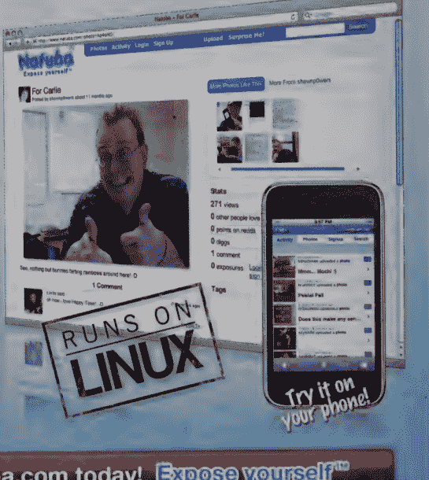

## Archie McPhee

## WAN 工具包

特色包括

- 安全、分布式文件系统
- 集中、基于 Web 的管理
- 易于安装
- 30 天免费试用，永久效果

超过 25 年来为世界提供不切实际的怪癖！
mcphee.com

http://www.devicesoft.org

LINUX JOURNAL 市场平台

## 美国制造的日常实用工具包
UTILIKILTS.com

针对 Linux 和 Solaris 的自动化操作系统锁定

你正在编写脚本来锁定你的操作系统吗？


# TCS 安全毯

Security Blanket 自动锁定您的操作系统，以符合行业（DISA STIGS, CIS, SANS 等）或自定义标准。

访问以下网址获取 Security Blanket 免费试用：
http://www.trustedcs.com/SecurityBlanket/SecurityBlanket-Try-Out.html

### Polywell Mini-ITX PC

## NVIDIA ION™
世界上最小、最环保、
无风扇且支持蓝光的 PC


配有 NVIDIA® ION™ 显卡的 ITX-40A，配备 DW-RW,320GB 售价 $399；4GB RAM, 1.6GHz Intel® 4W 处理器，配备蓝光机及 500GB 硬盘售价 $599


配备 PCI 扩展卡的 ITX-40A；配备 Intel® 1.6GHz 移动 Atom 处理器的 ITX-30A 无风扇薄型 PC，DC12V 电源，DDR2 RAM 起价 $199。支持 SATA 硬盘或固态硬盘（SSD），可选谐器或设备的 PCI 扩展槽。提供配备 NVIDIA® GeForce 显卡和 Intel® Core i3 处理器的 ITX-30 型号。小型 OEM 定制设计

- 23 年客户满意
- 行业领先的客户服务
- 一级保修

仅限 POLYWELL
Polywell Computers, Inc

NVIDIA, Intel, GeForce 和 Core 是 NVIDIA 的商标。其他名称仅供参考，并可能是其各自所有者的商标。

www.linuxjournal.com | 2010年1月

## 数据现在变得个性化：了解你自己

数据的主要问题在于它很容易被复制，从一个地方发送到另一个地方并不是一种复制行为。这个命令几乎是大多数人对互联网的体验。他们可能每次都在使用它。

## 更高的 GFLOPS，更低的 WATTS

Intel® Nehalem 现已发布

采用 DDR3 和 QPI 提供更高的内存带宽
集群与服务器功耗更低

+ 2U 机箱内包含四台服务器，全部支持热插拔：
- 1200 瓦 1+1 电源、12 块硬盘和服务器模块！
- FastTree® ConnectX® QDR 和 DDR InfiniBand 交换机及 HCA

+ Intel 专业编译器套件和集群工具包
- 针对 Nehalem 增强的第 11 版本
- 提供学术价格

立即配置您的下一代集群！
www.microway.com/quickquote

## GPU 计算

WhisperStation™
配备 1 到 4 个 Tesla GPU

搭载 Tesla™ 的集群
S1070 - 4 GPU 服务器

+ Tesla C1060 GPU 性能：
- 每个 GPU 1 TFLOPS
- 每个 GPU 4 GB DDR3
- 102 GB/Sec. 带宽
- CUDA SDK

+ 24U 空间内包含 36 个 GPU + 36 个 CPU + 24 TB
- 40 Gbps FastTree® InfiniBand
- InfiScope® 网络监控

使用 "Jacket" 在 Tesla 上运行 MATLAB®

可在 microway.com 免费获取 15 天试用

508-746-7341\microway.com

GSA 计划
合同编号：
GS 35F-4631U
