# Linux 杂志（2007 年 6 月）


# 企业级和高性能计算尽在掌握

Appro 通过整合满足企业 HPC 市场需求的最新技术，引领 4P x86 计算领域。

# 4 路 XxtremeWorkstation™
- AMD Opteron™ 8000 系列处理器
- 最高 128GB DDR2 533/667 内存
- 最高 6.0TB SATA 或 2.4TB SAS
- 热插拔硬盘
- 2 个用于高端显卡的 PCI-E x16 插槽
- Windows® 或 Linux 操作系统

# 4 路 3U XxtremeServer™
- AMD Opteron™ 8000 系列处理器
- 最高 128GB DDR2 533/667 内存
- 最高 4.5TB SATA 或 1.8TB SAS
- 2 个 PCI-E x16 和 3 个 PCI-X 插槽
- 热插拔硬盘
- 冗余电源和风扇
- ServerDome 管理 – IPMI 2.0
- Windows® 或 Linux 操作系统

如需更多信息，请访问 www.appro.com 或拨打 Appro 销售热线 800-927-5464

# AMD Opteron™ 处理器
- 支持四核 - 无需改变数据中心基础设施即可增加容量
- 结合节能 DDR2 实现最佳每瓦性能
- 通过直接连接架构优化系统性能


# 今天，Jack 在伦敦配置了一台交换机，在悉尼重启了服务器，并观看了他的球队在辛辛那提打出制胜一击。

借助 Avocent 数据中心管理解决方案，世界最终可以围绕着你转动。Avocent 将安全的访问和控制权直接置于你的指尖 – 从多平台服务器到网络路由器，从远程数据中心到现场办公室。你可以从单一屏幕管理一切，无论身在何处。这意味着你可以排查故障、重启或升级你的数据中心设备 – 就如同你正坐在设备前一样。Avocent 简化你的工作日。多出来的时间如何支配由你决定。

如需了解有关提高数据中心性能的信息，请访问 **www.avocent.com/control**


Avocent、Avocent 标志以及 The Power of Being There 是 Avocent Corporation 的注册商标。所有其他商标或公司名称是其各自公司的商标或注册商标。版权所有 © 2007 Avocent Corporation。


# 竞争对手毫无胜算。


如果你的部署决策基于性能和价格，Coyote Point 适合你。我们已经垄断了那个市场。

为了证明这一点，我们邀请 The Tolly Group 评估我们的 E350i 应用流量管理器与竞争对手的表现。结果不言自明。

吞吐量？几乎比同类型产品高出 40%。每笔交易的成本？最多减少四倍。连接速率？在某些情况下，成本仅为六分之一。六分之一！而且据我们得知，Coyote Point 是当今开源网络的第一选择。

但不要只听我们的一面之词。获取事实。拨打 1.877.367.2696 或致信 info@coyotepoint.com 获取 Tolly 完整报告免费副本。


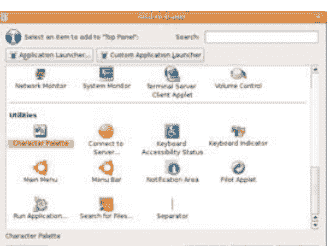

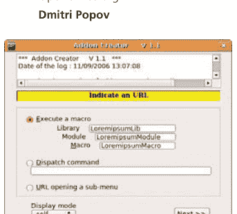


# GEMINI 2U – 超高密度系列

- 2U 机箱内的两个完全独立的系统
- 能力：在一台机箱内运行两个不同的操作系统
- 最多 16 个 CPU 核心
- 最多 12 个热插拔 SATA、SCSI 或 SAS 硬盘
- 两个系统均支持 RAID 0, 1, 5, 6, 10, 50
- Opteron™ 或 Xeon™ 多核处理器
- 每个主板最多 64GB 内存
- 每个主板有一个可用的 PCI-X 或 PCI-E 插槽
- 高效 AC 和 DC 电源选项

# 一机双系统

基于开放标准构建，Gemini 2U 优雅地在专为便于从后部访问而设计的 25" 机箱中容纳两个独立的主板。

Gemini 2U 代表了令人陶醉的性能和卓越环境规格的完美实现，同时功耗更低、热量更少、噪音更低。令人惊叹的是，它完美地适应任何标准机架。从前后看，Gemini 2U 既强大又高效。

在 Open Source Systems，我们理解你需要实用、可定制且经济实惠的解决方案，并且易于管理和维护。

如需更多信息并希望立即申请评估单元，请访问 [www.OpenSourceSystems.com](http://www.OpenSourceSystems.com)，或直接拨打 866.664.7867。


©2006 Open Source Systems, Inc. 保留所有权利。AMD 和 AMD Opteron 是 Advanced Micro Devices, Inc. 的商标或注册商标。其他公司、产品和服务的名称可能各自是相关公司的商标或商标。


# Linux 期刊
自 1994 年创刊：Linux 社区的原始杂志

# 数字版
现已推出！

- **抢先阅读**
  在杂志上架之前获取最新一期

- **支持关键词搜索**
  几秒钟内查找主题或姓名

- **无纸化档案库**
  下载到电脑上以便随时离线阅读

- **同样优秀的杂志**
  以高质量 PDF 格式阅读每期内容

**试用样刊！**
www.linuxjournal.com/digital


# Linux 期刊

| 职位 | 姓名 | 联系方式 |
| --- | --- | --- |
| 主编 | Nick Petley | leiditor@linuxjournal.com |
| 执行编辑 | Jill Franklin | jill@linuxjournal.com |
| 高级编辑 | Doc Searls | doc@linuxjournal.com |
| 艺术总监 | Garrick Ambrosian | garrick@linuxjournal.com |
| 产品编辑 | James Gray | newproducts@linuxjournal.com |
| 名誉编辑 | Don Martin | dmarti@linuxjournal.com |
| 技术编辑 | Michael Baxter | mail@ruzio.com |
| 资深专栏作家 | Renee Lerner | reneelerner.co.ir |
| 法式主厨 | Marcel Gagné | mgagne@alsmar.com |
| 安全编辑 | Mick Bauer | mick@viso.com |

**特约编辑**
David A. Banel • Greg Kroah-Hartman • Ibrahim Haddad • Robert Love • Zack Brown • Dave Phillips • Marco Fioretti • Ludovic Marcotte • Paul Barry • Paul McKenney • Dave Taylor

| 职位 | 姓名 | 联系方式 |
| --- | --- | --- |
| 校对 | Geri Gale | |
| 出版商 | Carole Fairchild | publisher@linuxjournal.com |
| 总经理 | Rebecca Cassity | rebecca@linuxjournal.com |
| 销售总监 | Laura Whitman | laura@linuxjournal.com |
| 区域销售经理 | Joseph Krock | josephk@linuxjournal.com |
| 区域销售经理 | Kathleen Boyle | kathy@linuxjournal.com |
| 发行总监 | Mark Iqane | mark@linuxjournal.com |
| 市场协调员 | Lana Newlander | mtgs@linuxjournal.com |
| 系统管理员 | Mitch Framer | sysadmin@linuxjournal.com |
| 网络管理员 | Keith Daniels | webmaster@linuxjournal.com |
| 会计 | Candy Beauchamp | acct@linuxjournal.com |

Linux Journal 由 Belton Media, Inc. 出版，且为其注册商标。
PO Box 580955, Houston, TX 77098-3441

**编辑顾问委员会**
Daniel Frye，IBM Linux 技术中心主任
Jon "maddog" Hall，Linux 国际联盟主席
Lawrence Lessig，斯坦福大学法学教授
Ransom Love，耶稣基督后期圣徒教会家庭与教会历史部门战略关系主任
Sam Ockman，Penguin Computing 首席执行官
Bruce Perens
Bdale Garbee，惠普 Linux 首席技术官
Danese Cooper，英特尔公司开源 DWA

**广告**
电子邮件：ads@linuxjournal.com
网址：www.linuxjournal.com/advertising
电话：+1 713-344-1956 分机 2

**订阅**
电子邮件：subs@linuxjournal.com
网址：www.linuxjournal.com/subscribe
电话：+1 713-589-2502
传真：+1 713-589-2677
免费电话：1-888-66-LINUX
邮寄地址：PO Box 580955, Houston, TX 77098 USA
请预留 4-6 周时间处理地址变更和订单
美国印刷
LINUX 是 Linus Torvalds 的注册商标。


## **TYANPSC™**
### 亲身体验超级计算

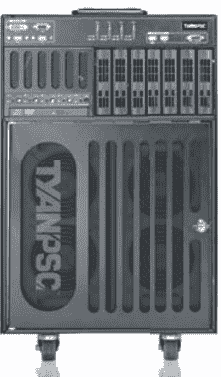

# **台风™ 600 系列个人超级计算机**

TyanPSC 的台风™，下一代即插即用的个人超级计算机，拥有足以满足您所有计算需求的强大性能！专为办公室和实验室环境设计，易于部署和使用，台风™ 能够在偏远或空间受限的地方提供高强度的计算能力，运行如 PC 般流畅且安静无声。

# **高性能计算变得更酷了**

- 台风集群 / 低功耗
- 小型外形规格 / 便携性提升


# **T-630 DX / T-650 QX 系列**

- 在您的办公桌上即可享受高达 186 / 256 GFlops 的性能！
- 即插即用、易于部署和使用
- 集成 5 节点集群 - 单箱内最多可达 20 / 40 个处理器核心！
- 插入标准墙壁插座即可使用 - 仅需 15 安培电流
- 预装 Microsoft® Windows® 计算集群服务器 2003
- 在空间受限的环境下提供高性能：办公室、远程、飞机、船等
- 支持 RAID


Tyan Computer USA
3281 Lankenau Court
Fremont, CA 94538 USA
电话：+1-510-651-8668 传真：+1-510-651-7688
专业销售电话：+1-510-651-8868 x5120
电子邮件：marketing@tyan.com

如需更多信息，请访问
www.tyanpsc.com

# 来信

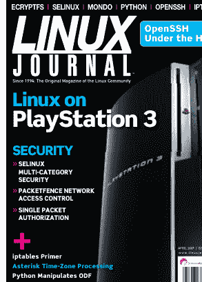

# 赞美 Linux 游戏

我越来越被 Linux 上游戏种类的多样性和质量所打动。其中大多数都很健康，这一点我很欣赏，因为我不喜欢屏幕上的暴力，也不喜欢现实中的暴力。你们是否考虑过增加一个专门介绍 Linux 游戏的栏目？我敢打赌很多人都会读。顺便说一下，我非常喜欢 Marcel Gagné 的文章，并尝试了他提到的很多程序。阅读 *LJ* 是了解有趣软件的好方法。请继续保持良好的工作！

> *—— 麦克·福特*

# 现在你用 Linux 烹饪了

我想回应一下针对加内先生的批评者。马塞尔的专栏为 Linux 新手提供了不会让他们感到吃力或超出他们需求的话题。不同的写作风格/格式使该专栏对 Linux 新手更具吸引力。

通过吸引新的桌面用户，加内先生为 Linux 社区做出了巨大贡献。加内先生作为专业作家和公民都在这样做。证据可以在加内先生的 WFTL-LUG 中找到。我建议那些抱怨的人加入 WFTL-LUG，亲自去看看。也许他们可以在 LUG 中做出一些贡献，而不是进行这种无建设性的消极批评。

顺便说一下，2007 年 3 月刊非常棒。请继续保持良好的工作。

> *—— 约翰·克尔*

# 忽见忽不见

在 2007 年 4 月刊中，克里斯·特雷纳在他题为“忽见忽不见”的信中指出，Konqueror 不再允许用户右键点击文件并看到删除选项。确实，默认情况下没有这个选项。但是，如果你进入设置→配置 Konqueror→行为，你会看到一个名为“显示删除上下文菜单项”的选项，它绕过了回收站。勾选这个框，右键菜单中就会出现删除选项。感谢你们出色的出版物！

> *—— 德怀特·米德尔布罗克*

*谢谢你为我们澄清了这个问题！——编辑。*

# Doc Searls，iPhone 回家路

在 2007 年 4 月刊第 42 页，由 Doc Searls 撰写的“既然我们可以制造自己的 OpenPhone，为什么要用 iPhone？”一文中，提到 ANA 通过手机直接与客户联系这一上下文具有误导性。我曾在日本与三大运营商合作：NTT DoCoMo、AU 和 Yahoo Keitai（原日本维珍）。是的，有一个 IC 系统允许乘客快速检票。是的，ANA 会获取有多少人使用该系统的统计数据，但 JAL 也有这个系统，日本铁路（JR 东海和 JR 西日本）也是如此。该技术基于索尼的非接触式 IC 芯片。但是，系统由各手机运营商控制。运营商还控制运行 IC 芯片的 Java 小程序，因此他们也可以获取谁在使用该系统的数据。日本这里的运营商控制其服务使用的手机。这并不像美国那么糟糕，因为这里只有三个封闭系统。但是，客户没有权利。使用锁定的 SIM 芯片，你无法获取解锁码。直到去年，都没有号码携号转网功能。仅仅在过去五年里，日本手机才可以在没有运营商许可的情况下在海外使用。与最终用户的互动程序是不可能的。另外一个评论，IC 手机存在的唯一原因是铁路系统开始使用 IC 车票——JR 占铁路的大部分，大部分人口每天乘坐这些火车。

> *—— 罗伯特·巴尔富尔*

# 手机封闭系统

Doc，你没提到最糟糕的手机封闭系统 [《LJ》，2007 年 4 月，“既然我们可以制造自己的 OpenPhone，为什么要用 iPhone？”]：那套让手机无法直接相互通信的致残系统。无论手机软件开发发生什么，只要网络模式没有从当前的客户端/服务器系统转变为无限制的点对点自组网模型，这个封闭系统就会成为进步不可逾越的障碍。

这种转变无疑是颠覆性技术。因此，它可能会遵循典型的颠覆性技术发展路径。它会被现有的技术提供商忽视、嘲笑、游说反对并积极抵制，直到它们变得无关紧要并被其取代并征服世界。

如果这项技术在卡特里娜飓风袭击新奥尔当时就已经在使用会怎样？只要区域内至少有一部手机在另一部手机的范围内，就不会出现任何通信问题，即使在风暴顶峰也是如此。救援人员不必等待数天或数周等待基础设施重建才能进行基本通信。

相反，灾区有数千部手机在正常工作，却被封闭系统所有者的通信限制完全废掉了。

无线通信的未来早已在互联网的形式中清晰可见。一个自组织、自愈合的全球网络是一种不可阻挡的力量。下一步明显的举措是移除线缆，遵循自由软件的传统，通过自下而上的方式，通过实际行动来实现。

> *—— 卡尔·布朗*

# 禁止 Novell 还是收购 SCO？

几期前 [2007 年 3 月，《变化》]，尼古拉斯·佩特利在 Novell 与微软签署协议后呼吁禁止 Novell。今天，我在 Slashdot 上读到 Novell 声称“Windows 比 Linux 便宜”（[news.zdnet.co.uk/software/0,1000000121,39286295,00.html](https://news.zdnet.co.uk/software/0,1000000121,39286295,00.html)）。

我给 Novell 的建议是：收购 SCO。它们似乎都在走同一条路。

> *—— 保罗·阿曼*

# 关于戴尔文章的消息

作为 *LJ* 的常客，我必须告诉你戴尔的一个好消息。肯定是因为那篇题为“对迈克尔·戴尔的温和 GNU/Linux 提议”的文章（来自


# TOTALVIEW® 推出多核时代最强大的指令。


TotalView 调试器
15 天免费试用

TotalView 是经过验证的调试解决方案，专为解决开发多核、多线程应用程序时面临的独特挑战而构建。

作为一套完整的多核调试和性能工具套件的一部分，支持 Linux、UNIX 和 Mac OS X 上的 C、C++ 和 Fortran，TotalView 8.1 是您所有多核调试需求的可靠解决方案。TotalView 旨在帮助调试世界上最苛刻的应用程序，功能极其强大，却易于使用。它以可视化为核心，提供增强的图形表示，使用户能够快速识别问题并深入定位根本原因。TotalView 不需要插桩、重新链接或重新编译。TotalView 已证明可将调试时间最多减少 80%。

现在免费试用！前往 www.totalviewtech.com/command 为您的 15 天试用版本增强功能，或致电 1-800-856-3766 获取更多信息。


www.informationweek.com：

戴尔本周发起了一项 Linux 网络调查，这使其进一步靠近将开源操作系统重新作为家用或办公用途的预装选项。

这项调查于周二发布，持续至 3 月 23 日，询问了各种问题，包括受访者希望看到哪种戴尔系统搭载 Linux、他们会用该机器进行哪些计算任务、他们希望获得哪种软件支持，以及他们偏好的 Linux 发行版。

在发起这项调查时，戴尔的 Linux 软件架构师 Matt Dornsch 在公司官方博客中表示，戴尔因公司在其在线客户征求意见平台 IdeaStorm 上收到的超过 110,000 个关于 Linux 计算机的请求而采取了行动。

因此，对于像我们这样喜欢在 Windows 世界之外工作的人来说，这种行动发生在极其重要的时刻，并向那些“庞大的、单向的”首席执行官和“宇宙主人”展示了这里存在着智慧生命！请继续在那里做你们出色的工作！

—Eduardo

# 来自过去的爆炸

在整理我的桌子时，我找到了我 1996 年冬天的 Linux 互联网归档集。那个运行在 4MB 内存、MFM 驱动器、EISA 总线和 Gravs Ultrasond 卡片上的 Linux——让人热泪盈眶。

无论如何，感谢这些信息丰富的文章。作为一个长期读者（总有一天我会订阅）和粉丝！请继续做好工作！


—John Harper

# 回复：2007 年 4 月刊中关于“别人可能不得不破译你的代码”的信

在他题为“别人有一天可能需要破译你的代码”的信中，Michael C. Tiernan 建议使用临时文件而不是管道以提高可读性，而不是认为管道可以像临时文件中使用的代码一样易读。

但是，在生产环境中使用临时文件时，应该做正确，所以这些行：

```
tmp1=/tmp/tmp.1.$$
tmp2=/tmp/tmp.2.$$
tmp3=/tmp/tmp.3.$$
tmp4=/tmp/tmp.4.$$
```

应该被替换为：

```
tmp1=`mktemp`
tmp2=`mktemp`
tmp3=`mktemp`
tmp4=`mktemp`
```

或者：

```
tmp1=`mktemp /tmp/tmp.1.XXXXXXX`
tmp2=`mktemp /tmp/tmp.2.XXXXXXX`
tmp3=`mktemp /tmp/tmp.3.XXXXXXX`
tmp4=`mktemp /tmp/tmp.4.XXXXXXX`
```

出于安全原因。首先，mktemp 确保文件名未被使用，并且生成的文件确实设置了访问权限，以确保只有所有者可以读取内容。

—Berthold Hollmann

# 微型 OpenGL 开发系统

我只是觉得你们可能想了解这个项目：myOS——微型 OpenGL 开发系统。它是一个支持 OpenGL 的极简主义 GNU/Linux 系统，没有 X。它是一个最基础的 Linux 系统，除了编译和运行 OpenGL/UC 代码所需的核心文件外，其余所有东西都被剥离了。它有一个简化的目录结构和清理后的内部交叉引用。它启动时并且总共只有一个脚本 (one.xthost.info/zelko/opengl.html)。

—ZeaATShuttle

你知道微软拥有 OpenGL 的专利吗？—*Ed.*


# 杂志

- **印刷版订阅：** 更新你的订阅、更改地址、支付发票、查看账户详情或其他订阅咨询都可以在线即时完成，www.linuxjournal.com/subs。或者，在美国和加拿大境内，你可以免费致电 1-888-66-LINUX (54689)，或国际致电 +1-713-589-2677。请通过电子邮件 subs@linuxjournal.com 或邮政邮件 Linux Journal, PO Box 980985, Houston, TX 77098-0985 USA 联系我们。请记住在联系我们时提供完整的姓名和地址。
- **数字版订阅：** Linux Journal 的数字版订阅现已推出，以统一低价在全球任何地方以 PDF 形式交付。访问 www.linuxjournal.com/digital 了解更多信息，或使用上述联系方式处理任何数字杂志客户服务咨询。
- **致编辑的信：** 我们欢迎您来信，并鼓励您将其提交至 letters@linuxjournal.com 或邮寄至 Linux Journal, 1752 NW Market Street, #200, Seattle, WA 98107 USA。信件可能会因篇幅和清晰度进行编辑。
- **为我们撰稿：** 我们始终寻找投稿的文章、教程和真实世界故事用于杂志。作者指南、主题列表和截止日期可在 www.linuxjournal.com/author 在线找到。
- **广告：** Linux Journal 是读者和广告主的绝佳资源。访问 www.linuxjournal.com/advertising 索取媒体资料包、查看我们当前的编辑日历和广告截止日期，或了解其他广告和营销机会。如需进一步信息，请直接联系我们，ads@linuxjournal.com 或 +1 713-344-1956 ext. 2。

# 在线

- **网站：** 在 Linux Journal 的网站 www.linuxjournal.com 上阅读独家在线内容。此外，印刷杂志中的部分文章也在线提供。杂志订阅者，无论是数字版还是印刷版，均可访问完整的问题档案，请联系客户服务获取更多信息，subs@linuxjournal.com。
- **免费电子通讯：** 每周，Linux Journal 编辑将告诉您 Linux 世界的热点内容。接收突发新闻、技术技巧以及 www.linuxjournal.com 上精选的深度报道链接。立即免费订阅，www.linuxjournal.com/enewsletters。

# 利用 UniServer 最大化 Opteron™ 四核性能

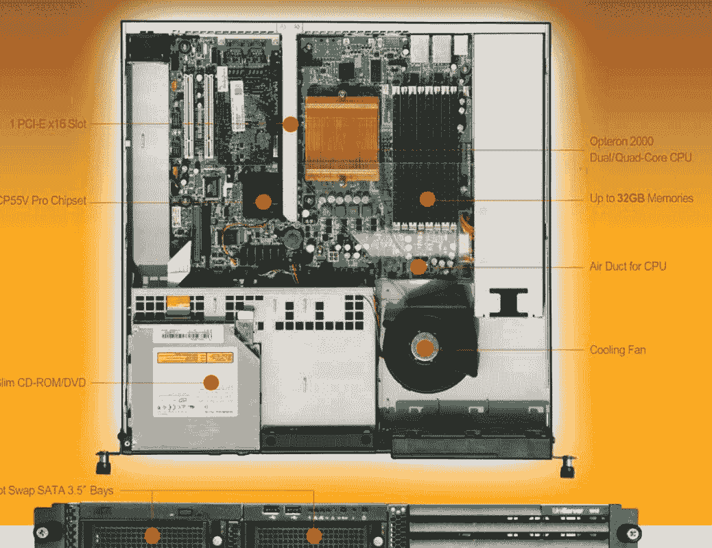

# 查找全系列创新的 Opteron™ 服务器和工作站平台

从 1 个插槽，高达 32GB 到 4 个插槽，高达 128GB

- 1U 服务器 - 1 和 2 个插槽，最高 64GB 内存
- 2U 服务器 - 2 和 4 个插槽，最高 128GB 内存
- 3U 服务器 - 2 和 4 个插槽，最高 128GB 内存
- 工作站 - 1、2 和 4 个插槽，最高 128GB 内存

www.uniwide.com
1-877-520-0071

# 前沿
新闻 + 趣味

# 内核开发新动向

# diff -u

Ingo Molnar 实现了一个名为 Syslets 的新类语言包装器系统，用于从用户空间管理系统调用。这些小程序可以异步运行系统调用，根据用户意愿响应其行为，而不必返回用户空间。使用 Syslet 包装器，Ingo 测量到比缓存同步 I/O 快 33.9%，比非缓存同步 I/O 快 19.2%。内核黑客对 Syslets 的兴趣相当高，尽管 Linus Torvalds 认为 Syslet 编程接口过于复杂，难以让休闲用户尝试。显然，在 Syslets 准备好进入主树之前，仍有一些工作需要完成。

Intel 发布了 PRO/Wireless 3945ABG 网络适配器驱动程序。与其他一些 Intel 驱动程序不同，这个驱动程序不依赖于专有守护进程；它是完全开源的。不过，它确实需要微代码升级。这种改善的许可情况显然并非由于硬件的不同特性，而是由于微代码本身的改进。Intel 的驱动程序在内核社区中反应良好，似乎即将被纳入源代码树。

著名且长期存在的 10 个漏洞，允许驱动程序假装它们是 GPL 的即使它们不是，正在被关闭。几个人正在处理这个问题，最值得注意的是 Jan Engelhardt，他最近发布了一个补丁来修复它。围绕这个补丁存在争议，因为一些人认为，如果内核对非 GPL 驱动程序施加的限制比对 GPL 驱动程序的更多，这就构成了一个许可执行功能，这可能违反 GNU 通用公共许可证的条款。只要这个漏洞存在于代码中，辩论就可以保持休眠状态，因为驱动程序编写者可以绕过控制。一旦控制真正开始起作用，像 LinxAnt 这样过去利用过该漏洞的公司立即会对此辩论产生兴趣。

KVM 虚拟机代码将其开发树从 Subversion 迁移到 git，原因有几个。Avi Kivity 解释说，Subversion 无法高效托管整个内核树，并且开发人员希望独立维护自己的分支。

Jon Masters 是新的 module-init-tools 维护者，接替了 Rusty Russell 的工作，并修补了 MAINTAINERS 文件以反映这一变化。Evgeny Dushistov 也在 MAINTAINERS 文件中创建了 UFS 条目，并将自己列为维护者。

Alessandro Di Marco 发布了一个他一直在玩的新的用户无操作触发器时，得到的比预想的要多。这是一个不错的功能，当用户在特定时间内没有活动时会发出 ACPI 事件。他出于乐趣敲定了代码，故意避免关于最优实现细节的问题，假设实际上不会太多人关注这个功能。结果证明，很多人感兴趣，并且有很多实现建议。首先，Arjan van de Ven 指出 udev 比 ACPI 更好的投递机制。Pavel Machek 指出 Alessandro 新的 /proc 文件在 /sys 目录中会更好。Pavel 还建议用户空间整体上是此类功能的更好位置，尽管 Alessandro 认为这会增加代码的复杂性。他快速回应了许多建议，产生了新版本的补丁，回答了 linux-kernel 邮件列表上提出的异议。

下一个 Linux 内核峰会的计划已经开始。内核团队将其托管地点从传统的加拿大渥太华聚会改为英格兰剑桥。新的举办地开启了未来不同举办地的可能性，并且有人提议了多个地点，包括澳大利亚、印度和捷克。选择未来地点的一个主要因素将是整体成本。许多内核人员每年在支付前往峰会机票费用的公司工作，但有些价格变得令人望而却步。举办地点所在的拥有更多参加者的国家比组织者更有可能主办峰会。但当然，任何事情都可能发生。 —ZACK BROWN


# LJ 索引，2007 年 6 月

| 1. | 世界亿万富翁人数：`946` |
|---|---|
| 2. | 印度亿万富翁人数：`36` |
| 3. | 印度亿万富翁较上一年增加：`12` |
| 4. | 印度在有亿万富翁的国家中的排名：`1` |
| 5. | 日本亿万富翁人数：`24` |
| 6. | 班加罗尔在谷歌“Linux”查询数量中的排名：`1` |
| 7. | 东京在谷歌“Linux”查询数量中的排名：`2` |
| 8. | 西半球地点在谷歌“Linux”查询前十名来源中的数量：`0` |
| 9. | 美国地点在谷歌“Microsoft”查询前十名来源中的数量：`7` |
| 10. | 2005 年每月互联网广播听众数百万：`45` |
| 11. | 2006 年每月互联网广播听众数百万：`72` |
| 12. | 2002–2005 年间美国商业网络广播商每个听众/每次“表演”（录制）支付美元（US）：`0.007` |
| 13. | 2002–2005 年间非商业网络广播商相同义务：`0.002` |
| 14. | 所有美国网络广播商（商业和非商业）2006 年追溯每个听众/每次“表演”（录制）支付美元（US）：`0.008` |
| 15. | 所有美国网络广播商 2007 年每个听众/每次“表演”（录制）支付美元（US）：`0.011 每次表演` |
| 16. | 2008 年相同费率：`0.014 每次表演` |
| 17. | 2009 年相同费率：`0.018 每次表演` |
| 18. | 2010 年相同费率：`0.019 每次表演` |
| 19. | Linux 基础的 Radio Paradise 作为互联网广播电台“在其类别中最成功”的排名：`1` |
| 20. | 上述版税义务占 Radio Paradise 当前总收入百分比：`125` |

**来源：** 1–5: 福布斯，CNN | 6–9: 谷歌 | 10–11: 广播与互联网通讯 | 12, 13: 2002 年图书馆长 | 14–18: 2007 年版权版税委员会 | 19, 20: KurtHanson.com
—Doc Searls


# VERIO
# 托管服务
# 基于拥有
# 血统的 Linux。

- **根权限访问：** 提供你所需要的控制权。
- **高级 FairShare 技术：** 更好的资源管理意味着更好的性能。
- **真正支持性的支持服务：** 由系统管理员提供的获奖支持服务。

## 发布 Verio Linux® VPS。

在 Verio，我们对开源有着长期的承诺，这可以追溯到我们源自 FreeBSD 的历史。如今，作为虚拟专用服务器（VPS）技术的先驱，以及由全球最大电信公司的财务资源支持的主机服务提供商，我们为 Linux 带来了额外的要素：可靠性。欲了解更多信息，请致电 1-877-837-4654 或访问 www.verio.com/linuxlineage。

正确的基础无可替代。


Verio 及 Verio 徽标是 Verio Inc. 在美国和其他国家的商标和/或服务商标。Linux® 是 Linus Torvalds 在美国和其他国家的注册商标。所有其他名称均为各自所有者的商标或注册商标。©2007 Verio Inc. 保留所有权利。

---

# [卷首语]

# 本期 LJ 致敬 John Backus

我撰写并提交了本月的“前沿阵地”专栏，该专栏侧重于本期的主题——计算机语言，特别是 FORTRAN，这是我最初学习的第一种计算机语言。虽然在我的专栏中我指出了学习机器语言和汇编语言的好处，但我诚实地认为，如果不是因为 FORTRAN，我当初不会进入编程领域。

2007 年 3 月 20 日，在我提交文章两周后，我收到了 John Backus 于 3 月 17 日去世的悲痛消息。John 是被人们誉为“FORTRAN 之父”的人，也是被归功于发明 Backus-Naur 形式（一种用于描述语言的语言）的两人之一。我向当地的 Linux 用户组发送了消息，在接下来的一周里，该消息反复出现在各种邮件列表中。

以今天的语言和计算机水平，人们很难了解（或者对于像我们这样年纪大的人来说，甚至很难记得）那些早期的日子。今天，我们视为理所当然的概念在当时既是革命性的，在构思上也十分困难。有人认为计算机永远无法用机器代码以外的任何语言进行编程，我确信 John 和他的团队遇到了远超其份额的怀疑者，但他们坚持不懈。他们在第一个成功的高级语言上的工作，由此衍生出更多人在更多语言上的众多成功。

因此，我请《Linux 杂志》将本期关于语言的期刊奉献给 John Backus：杰出的计算机科学家和人道主义者，1924–2007。

当我们为计算机科学的未来做出贡献时，希望有一天我们也能以我们的方式做出和他一样多的贡献。

—JON “MADDog” HALL

# 小巧精致

你肯定喜欢一款专门兼容 OGG 格式并吹嘘其 Linux 友好性的 MP3 播放器（文献称其为“Linux 内核 2.4.x”）。这也解释了为什么 TrekStor 的 VibeZ 播放器在 Linux 圈子中引起了不小的轰动。

优点：你可以将其作为普通 USB 存储设备加载。它支持播放 OGG（外加 MP3、WAV、FLAC 和 WMA）。它具有线路输入和麦克风录音功能、彩色显示屏、可充电的 USB 电池（含备用电池）、设备端文件删除功能、可调播放速度以及非常时尚的非 iPod 设计。它的大小像一块肥皂——4"×2"×.7"，四角高度圆润。而且，它轻得多——仅 2.5 盎司。


缺点：存储空间不多。价格从约 200 美元起，容量范围从 8–15GB。

—DOC SEARLS

# 创意风暴

# 硬件 OEM 厂商学习 Linux，让 Dell 的荣耀公司受益

今年早些时候，Dell 创建了一个类似 Digg 的网站，名为 Dell | IdeaStorm（“你的想法主导之地”）。该网站的理念是让读者提交对公司的想法，然后由其他读者进行投票和评论。在标题标志旁边运行着提示语，例如“科技公司如何应对气候变化？”（位于“点击此处阅读 Dell 的观点”上方）。不用说，这打开了闸门，释放了 Linux 需求的洪流。

截至 2007 年 3 月 13 日中部时间上午 8 点，前十名票数如下：

1. 108,886 票：“预装 Linux | OpenSUSE | Fedora | OpenSUSE | 多启动”
2. 73,840 票：“预装 OpenOffice.org | 作为 MS Works 和 MS Office 的替代方案”
3. 54,300 票：“精简、快速的 Linux 机器”
4. 50,653 票：“预装 Firefox 作为默认浏览器”
5. 49,990 票：“不预装操作系统”
6. 51,048 票：“无额外软件选项”
7. 35,867 票：“为所有硬件提供 Linux 驱动程序”
8. 29,041 票：“Linux 2.6.16 就绪（贴纸）”
9. 20,288 票：“国家呼叫中心”
10. 17,376 票：“使用 LinuxBIOS 代替专有 BIOS”

一小时后，Dell 自行添加了两个帖子。在 IdeaStorm 页面上，它发布了“Linux——我们在倾听——现在告诉我们更多”。在 Direct2Dell.com 页面上，它添加了“Dell 扩展 Linux 选项”。两者都指向 www.dell.com/linuxsurvey 上的调查。该调查的标题也是“Linux 洞察：我们在倾听”。

因此，就有了上面的标题。

—DOC SEARLS

---

# PGI Unified Binary™

如今，PGI™ 编译器能够生成单个 PGI Unified Binary 可执行文件，该文件针对 Intel EM64T 和 AMD64 处理器进行了全面优化，既提供了单一 x64 平台的所有好处，又使您能够利用 Intel 和 AMD 的最新创新。PGI Fortran、C 和 C++ 编译器在 Linux 和 Windows 上提供世界级的性能和统一开发环境，作为集成多核软件开发展工具套件的一部分。访问 www.pgroup.com，看看为何结构分析、计算化学、计算流体动力学和汽车碰撞测试领域的领先独立软件供应商选择 PGI 编译器和工具来构建和优化其 64 位应用程序。


**The Portland Group**™
www.pgroup.com ++ 01 (503) 682-2806

The Portland Group, Inc. 是 STMicroelectronics 旗下公司。PGI、The Portland Group、PGI Unified Binary 是 STMicroelectronics 的商标或注册商标。其他品牌名称为其各自所有者的财产。

---

# [卷首语]

# 谁想要什么？

Google 将其庞大的 Linux 服务器群用于有趣目的之一，可以在 **trends.google.com** 上找到。在这里，你可以查看和比较从 2003 年底至今某段时间内的关键词查询情况。

除了以图表显示趋势外，Google Trends 还显示查询来源的前十个地点。这带来了一些令人惊讶的结果。

看看你是否能将左侧的搜索词与右侧的前十大搜索查询地点匹配。

答案见第 81 页。

—DOC SEARLS

**搜索词：**
1. gnome
2. kde
3. linux
4. shell
5. hat
6. hackage
7. laptop
8. widget
9. driver
10. emacs
11. vi
12. weenie
13. redbat
14. oracle
15. asterisk
16. internet
17. net
18. majoromo
19. maddog
20. vulerability

**前十大搜索查询地点：**
A. 布拉格，捷克
B. 浦那，印度
C. 奥斯陆，挪威
D. 雅典，希腊
E. 华盛顿特区
F. 檀香山，夏威夷
G. 东京，日本
H. 拉霍亚圣玛格丽塔，加利福尼亚州
I. 旧金山，加利福尼亚州
J. 斯坦福，加利福尼亚州
K. 雅加达，印度尼西亚
L. 奥斯汀，得克萨斯州
M. 利马，秘鲁
N. 伦敦，英国
O. 胡志明市，越南
P. 京都，日本
Q. 班加罗尔，印度
R. 波哥大，哥伦比亚
S. 卢布尔雅那，斯洛文尼亚
T. 河内，越南

# 他们这样说

> 当然，问题在于生活是反公式化、反制度化的……生活不能被收缩包装、关进笼子、解剖、分析或占有。生活是自由的。
>
> —Christopher Locke，《The Cluetrain Manifesto》

> 我认为，一个充满匿名垄断者的世界是一个生活其中和在其中创造都很痛苦的世界。
>
> —Mike Taht，the-edge.blogspot.com/2007/02/keeping-copyright-accessible.html

> 幸好亨利·福特在马萨诸塞州沃尔瑟姆停下来学习自行车制造，而不是在 Hobson 先生的马厍里花时间去铲那些马的粪便。
>
> —Bob Frankston，来自一封电子邮件消息

> 在孤立状态下，我们的欲望超过我们的力量。在社会中，我们的力量超过我们的欲望。
>
> —Frederic Bastiat，引自 George Jacob Holyoake 的《合作的逻辑》（*The Logic of Co-operation*），合作印刷协会，1873 年，www.citizenblog.org/node/23


# 服务器设备行业领导者


自定义服务器设备或现成的参考平台，搭载您的映像和软件，起始价格低于$1,000。

从设计到部署，我们包办一切。

交付设备需要合适的合作伙伴。MBX Systems 是合适的合作伙伴。我们明白，将您的名字印在我们的硬件上，就是将您的声誉托付给了我们。我们对此高度重视。我们提供您支持客户所需的服务，且优于竞争对手。您甚至无需接触硬件。工程、设计、部署，我们全权负责，因此您可以专注于对您重要的事物。您的软件。您的销售。您的成功。

请访问 www.mbx.com 或今日致电 1-800-681-0016。


www.mbx.com | 1-800-681-0016


**REUVEN M. LERNER**

# RJS 模板

利用 Ajax 获取并运行由您的服务器端语言生成的 JavaScript 的强大功能。

**为什么不用您的服务器端编程语言为您生成 JavaScript？**

过去几个月，我在这个领域撰写了若干篇关于 JavaScript 的文章。这种内置于几乎所有现代 Web 浏览器的语言如今已独当一面，成为现代 Web 开发范式——即 Ajax——的核心。过去，精通 JavaScript 对 Web 开发者而言是一项可选技能，如今它已与 SQL、HTML、HTTP 和 CSS 一起，成为必备技能。

JavaScript 复兴的原因之一是跨平台库的出现，这些库隐藏了长期困扰该语言的不兼容性。在相当长的一段时间里，用 JavaScript 编写的程序必须包含许多查看潜在跨平台不兼容性的 *if/then* 语句。

如今，通过使用代我们处理这些底层任务的库，我们可以避免在代码中出现此类 *if/then* 语句。Prototype 和 Dojo，这两个我在先前专栏中剖析过的 JavaScript 库，之所以流行，恰恰是因为它们隐藏了这些细节。它们使 JavaScript 成为一种真正的跨平台语言，其中“平台”既指操作系统，也指 Web 浏览器。

一些聪明的程序员，为了更加完善和省力地实现 JavaScript 标准化，更进一步。为什么不用您的服务器端编程语言为您生成 JavaScript？也就是说，如果您使用 Ruby on Rails，也许您可以编写 Ruby 命令并将其翻译为 JavaScript。这样做将允许您在所有模板中使用大致相同的代码，而无需在模板的不同部分切换语法。

这听起来可能像个怪念头，但越想越觉得它不错。RJS（Ruby JavaScript 的缩写）模板就是这种理念的一种体现。如果您更喜欢用 Java 创建 JavaScript，不妨看看 Google Web Toolkit，它现已采用开源许可证发布，并在 Java 界赢得了众多粉丝。

本月，我们将探讨 RJS 及其如何让 Web 开发者的生活变得轻松许多。虽然我认为 JavaScript 不会消失，Web 开发者也无法完全无视它，但 RJS 等技术意味着它可能变得像今天的机器代码——可用且位于金字塔底层，但通常被高级程序员忽略。


```html
<!DOCTYPE html PUBLIC "-//W3C//DTD XHTML 1.0 Transitional//EN" "http://www.w3.org/TR/xhtml1/DTD/xhtml1-transitional.dtd">  
<html>  
 <head>  
 <title id="title">Sample HTML page</title>  
 <% javascript_include_tag 'prototype' %>  
  
 <script type="text/javascript">  
 function updateHeadline()  
 {  
 var headline = $('headline');  
 var new_headline_text = $('future-headline');  
 Element.update(headline, new_headline_text);  
 }  
 </script>  
 </head>  
  
 <body>  
 <h1 id="headline">Headline</h1>  
 <p><input type="text" id="future-headline" /></p>  
 <p><input type="button" onclick="updateHeadline();" value="Update headline" /></p>  
 </body>  
</html>
```

# Ajax 与 Rails

要创建一个名为 ajaxdemo 的新 Rails 项目，请输入：

```bash
rails ajaxdemo
```

现在，让我们创建一个名为 showme 的简单控制器：

```bash
script/generate controller showme
```

该系统不会有任何模型，但您可能仍需在 config/database.yml 中定义一行或多行。相反，让我们在 showme 控制器中创建一个新视图，存储为 app/views/showme/index.rhtml，如清单 1 所示。

如您所见，index.rhtml 页面是一个相对标准的 HTML 页面，包含一些使用 Prototype 库的 JavaScript 代码。该页面由一个标题、一个文本框和一个按钮组成。按下按钮会调用


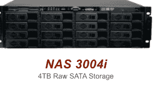

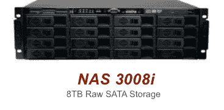

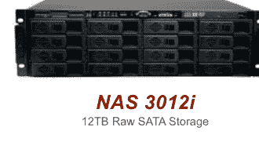

>>>>> 低至$789 <<<<<

使用 Pogo 的网络附加存储设备，与最流行操作系统实现最大程度的互操作性变得更容易。通过易于使用的图形管理界面、多个快照、内置备份、IP 故障转移和增强安全性，掌控您不断增长的存储需求。由 Intel 双核 Xeon 处理器和快速 64 位操作系统提供动力。今日致电了解更多。

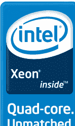


www.pogolinux.com

经验、想象力与支持。
**Pogo Linux 是专为 Linux 构建、专为您的硬件解决方案。**

要开始合作，请联系 888.828.POGO 或 inquries07@pogolinux.com
Pogo Linux, Inc. 701 Fifth Ave. Suite 6850, Seattle, WA 98104

Intel、Intel logo、Intel Inside logo、Pentium、Xeon 和 Xeon Inside 是 Intel corporation 或其子公司在美国和其他国家的商标或注册商标。更多条款和条件请访问 www.pogolinux.com

更棒的是，因为我们返回的是 JavaScript 程序，而非单个 HTML 元素的内容，我们可以修改页面的多个部分，甚至加入一些 Scriptaculous 效果以助一臂之力。

function updateHeadline。此函数获取 future-headline 文本框的当前值，并更改标题以反映其内容。

# 使用远程调用

到目前为止，我们还没做什么特别的事。然而，现在我们要做点稍微复杂的事：通过 Ajax 调用将文本框的内容发送到服务器。服务器的响应将是我们标题的猪猪语（Pig Latin）翻译。

进行此更改需要做两件事。首先，我们需要在应用程序控制器中编写一个方法，该方法接收标题，将其转换为猪猪语，然后返回该文本。其次，我们需要修改模板，使其从服务器获取更新后的文本，而不是从本地 JavaScript 函数获取。

我们更新后的模板如清单 2 所示。我们做了许多更改，首先是我们的表单现在关联了一个名为 theForm 的 id 属性。表单包含单个元素，即名为 future_headline 的文本框。请注意，我们需要使用 name 属性而不是 id 属性，以便表单元素随我们的 Ajax 调用一起提交。还要注意，我们将名称更改为对 Ruby 友好的 future_headline（带下划线），而非对 CSS 友好的 future-headline（带连字符）。

# 清单 2. index.rhtml (Ajax 版本)

```html
<!DOCTYPE html PUBLIC "-//W3C//DTD XHTML 1.0 Transitional/EN"
"http://www.w3.org/TR/xhtml1/DTD/xhtml1-transitional.dtd">
<html>
<head>
<title id="title">Sample HTML page</title>
<%= javascript_include_tag 'prototype' %>
</head>
<body>
<h1 id="headline">Headline</h1>
<form id="theForm">
<p><input type="text" name="future_headline" /></p>
</form>
<p><%= submit_to_remote "submit-button",
"Pig Latin it!",
:url => { :action => "piglatin_sentence" },
:submit => "fakeForm",
:update => "headline" %></p>
</body>
</html>
```

我们还用对 submit_to_remote 辅助方法的调用替代了按钮。

```erb
<p><%= submit_to_remote "submit-button",
"Pig Latin it!",
:url => { :action => "piglatin_sentence" },
:submit => "fakeForm",
:update => "headline" %></p>
```

上述代码执行了多项操作：

- 创建一个按钮，其 DOM ID 为 submit-button。
- 按钮的标签为 "Pig Latin it!"。
- 点击该按钮时，使用 Ajax 在服务器上的当前控制器中调用 piglatin_sentence 动作。

# 清单 3. showme_controller.rb

```ruby
class ShowmeController < ApplicationController

def piglatin_sentence
# Get the headline
sentence = params[:future_headline]
words = sentence.split

sentence = ""

# Go through each word, applying the secret
# Pig Latin algorithm
words.each do |word|
if word =~ /[^aeiou]/
word << "way"
else
first_letter = word.slice(0,1)
rest = word.slice(1..)
word = "#{$rest}#{$first_letter}ay"
end

sentence << word
sentence << " "
end

render :text => sentence
end
end
```


# 你是否对 iSCSI 和光纤通道存储的高昂成本感到震惊？


# AoE 是你的答案！

ATA-over-Ethernet = 简单、低成本、可扩展的存储。

www.coraid.com


**EtherDrive® SR1520**

- 支持 RAID 的 3U 设备，拥有 15 个热插拔 SATA 磁盘插槽
- 查看我们的其他存储设备和 NAS 网关

- 1. 以太网存储 – 没有 TCP/IP 开销！
- 2. 无限扩展能力，且价格处于最低水平！！
- 3. 你需要更多存储...只需购买更多磁盘 – 就是这么简单！！！

**请访问 www.coraid.com 获取更多信息。**

# 专栏

# 在锻造之中

# 列表 4. index.html (为 HTTP 响应中的 JavaScript 更新)

```html
<!DOCTYPE html PUBLIC "-//W3C//DTD XHTML 1.0 Transitional//EN"
"http://www.w3.org/TR/xhtml1/DTD/xhtml1-transitional.dtd">
<html>
<head>
<title id="title">Sample HTML page</title>
<%= javascript_include_tag 'prototype' %>
</head>
<body>
<form id="fakeForm">
<h1 id="headline">Headline</h1>
<p><input type="text" name="future_headline" /></p>
</form>

<p><%= submit_to_remote 'submit-button',
"Pig Latin it!",
:url => { :action => "piglatin_sentence" },
:submit => "fakeForm" %></p>
</body>
</html>
```

# 列表 5. showme_controller.rb (更新以返回 JavaScript)

```ruby
class ShowmeController < ApplicationController

def piglatin_sentence
  # Get the headline
  sentence = params[:future_headline]
  words = sentence.split
  sentence = ""
  # Go through each word, applying the
  # secret Pig Latin algorithm
  words.each do |word|
    if word =~ /[aeiou]/i
      word << "way"
    else
      first_letter = word.slice(0,1)
      rest = word.slice(1..-1)
      word = "#{$rest}#{$first_letter}ay"
    end
    sentence << word
    sentence << " "
  end
  output = "Element.update($('headline'), "#{$sentence}");"
  render :text => output, :content_type => "text/javascript"
end
```

具有 ID `fakeForm` 的表单内容被提交。
从 Ajax 调用返回的值用于更新具有 ID `headline` 的 HTML 元素的内容。

我们只需要进一步检查我们的控制器，如列表 3 所示。控制器并不一定知道它是被后台 Ajax 进程调用的，或者其内容将被用于更新标题元素。相反，它就像调用任何方法一样被调用，将单词转换为猪语言（Pig Latin）。翻译后的句子以纯文本文件的形式返回给用户浏览器。

# 返回 JavaScript

现在，真正的魔术开始了。正如我们刚才看到的，我们的控制器（`piglatin_sentence`）向其调用者返回一个纯文本文档。当然，我们可以自由选择以任何我们喜欢的格式返回数据。一种可能的格式是 XML。确实，Ajax 这个术语应该代表异步 JavaScript 和 XML（Asynchronous JavaScript and XML），所以 XML 作为返回值的一种常见格式并不令人惊讶。另一种日益流行的格式是 JSON（JavaScript Object Notation），它是 JavaScript 对象的文本版本，使得数据交换快速且容易。

但是，在 Ruby on Rails 的世界中，控制器可能还会向用户浏览器返回另一种类型的数据，即 JavaScript。这可能听起来没那么聪明，但请考虑 Prototype 如何处理它。如果控制器通过 `link_to_remote` 或 `submit_to_remote` 被调用，并且 HTTP 响应具有 `xml/javascript` 的内容类型，那么 JavaScript 将被执行。

这潜在地节省了时间——而不是返回应使用于标题的文本，然后使用 JavaScript 来插入它。（是的，通过使用 `submit_to_remote` 调用中的 `:update` 参数，我们能够简练地表达这一点。但代码仍然存在。）相反，我们可以简单地返回使用 DOM 修改文档的 JavaScript 代码。这将大大简化我们的代码。

要看到实际效果，请查看列表 4 和 5。列表 4 是我们模板 `index.html` 的更新版本，除了我们现在可以从对 `submit_to_remote` 的调用中移除 `:update` 参数外，基本上与之前版本没有变化：

```erb
<p><%= submit_to_remote 'submit-button',
"Pig Latin it!",
:url => { :action => "piglatin_sentence" },
:submit => "fakeForm" %></p>
```

我们没有指示客户端应该更改什么，而是在服务器端执行此操作：

```ruby
output = "Element.update($('headline'), "#{$sentence}");"
render :text => output, :content_type => "text/javascript"
```

换句话说，我们告诉控制器生成类型为 `text/javascript` 的响应，知道我们发送的任何内容都将被用户浏览器执行。然后我们发送一个响应，使用 `Element.update` 将标题更改为我们翻译的句子。果然，一旦安装了软件的这个新版本，标题继续被更改。

与此相关的功能巨大。例如，我们可以有条件地更新标题，通过检查服务器数据库中禁用词的字典。我们可以记录最常使用的单词。我们可以限制用户每天更新标题的次数。

更棒的是，因为我们返回的是一个 JavaScript 程序，而不是单个 HTML 元素的内容，我们可以修改页面的多个部分，甚至加入一些 Scriptaculous 效果以增强效果。返回 JavaScript 是 Prototype 提供的一个看似简单的功能，但它为巨大的可能性打开了大门。

# RJS

现在，你一直在等待的时刻来临——你可能会觉得：它功能强大，但在 Ruby 控制器中创建和维护 JavaScript 代码很麻烦。需要在里面包含 SQL 已经够糟了；在单个文件中使用三种语言似乎有点过头了。

这就是 RJS 模板发挥作用的地方。基本思想是，我们假设响应将以 JavaScript 的形式出现，并且它将修改当前页面上的一个或多个元素。RJS 为我们提供了一种紧凑的语法来进行这些更改，因此我们可以创建非常小的文件，却能完成大量工作。

我们需要做的更改很小。首先，我们修改 `piglatin_sentence` 方法，使其修改 `@sentence`（实例变量）而不是 `sentence`（局部变量）。我们还移除了对 `render` 的调用，因为我们不直接渲染任何内容。

然后，我们创建一个名为 `piglatin_sentence.rjs` 的文件。这是一个视图，就像 `.rhtml` 文件一样，因此它与该文件一起放在视图目录中。但是，它只包含一行：

```ruby
page[:headline].replace_html @sentence
```

换句话说，我们应该获取当前页面，找到具有 ID `headline` 的元素，并用从方法中获取的 `@sentence` 的值替换其 HTML 内容。果然，这运行良好。用一小段代码，我们设法完成了很多事情。并且，和以前一样，我们可以添加 Scriptaculous 调用，更新页面上的多个元素，显示和隐藏 HTML 元素——基本上，我们可以做任何想要做的事情。

# 列表 6. showme_controller.rb (更新以使用 RJS)

```ruby
class ShowmeController < ApplicationController
  def piglatin_sentence
    # Get the headline
    sentence = params[:future_headline]
    words = sentence.split
    
    @sentence = ""
    
    # Go through each word, applying the
    # secret Pig Latin algorithm
    words.each do |word|
      if word =~ /[^aeiou]/i
        word << "way"
      else
        first_letter = word.slice(0,1)
        rest = word.slice(1...-1)
        
        word = "#{rest}#{first_letter}ay"
      end
      
      @sentence << word
      @sentence << " "
    end
  end
end
```

# 结论

当我第一次读到关于 RJS 模板的内容时，我认为这是我听过的最奇怪的想法之一。这是因为在 Ruby 中编写 JavaScript 的概念似乎既奇怪又没必要。现在我明白了这种类型模板的功能和巧妙之处，并期待在我的许多由 Ajax 驱动的网站上使用它。通过一点学习和改变你对 Web 开发的思维方式，你很可能会做出同样的发现。■

**Reuven M. Lerner，一位长期从事 Web/数据库咨询工作的专家，是位于伊利诺伊州埃文斯顿市西北大学学习科学的博士生。他目前与妻子和三个孩子住在伊利诺伊州斯科基市。你可以在 altnewland.lerner.co.il 上阅读他的博客。**

# 资源

有许多好的印刷版和在线资源可用于学习 Ajax。我最喜欢的网站之一是 **ajaxian.com**，其中作者讨论并评测与 Ajax 相关的工具。

两本好书可能会派上用场。实用程序员出版社（Pragmatic Programmers）出版了由 Dave Thomas 和 David Heinemeier-Hansson 撰写的获奖作品《敏捷开发之 Rails》的第二版，而 O'Reilly 发布了 Scott Raymond 的《Rails 上的 Ajax》。在这两本书之间，你应该能够全面理解 Ruby on Rails 的工作原理，以及如何使用 JavaScript 和 RJS 创建有趣且动态的 Web 应用程序。


# 专栏
# 与 Linux 一起烹饪


MARCEL GAGNÉ

# 语言塑造性格，反之亦然

到底该怎么做才能输入那些特殊字符呢？

如果像我一样，你花大量时间使用 OpenOffice.org 的文字处理器 Writer，那么解决方法相当简单。

“法语先生”，我们的客人马上就要到了。你在干什么？什么？你正在为本期主题学习一门语言？你挑的学习时机可能更好一些，我的朋友，但我依然为你鼓掌。你选择学习哪门语言？PHP？C++？Python？你选了西班牙语？很遗憾，法语先生，我并不是在嘲笑你，我只是在一般情况下发笑。本期专栏本不应该关于人类语言，而是关于计算机语言。好了，别担心。让我们听听一句西班牙语。你西班牙语说得非常好。你是从书里学的吗？现在，现在，法语先生，我保证不再开《Fawlty Towers》式的玩笑了。而且，我们的客人随时都会到。去地下室把那瓶 2003 年的智利 Errazuriz Don Maximiano 赤霞珠红酒拿上来。我会把桌子收拾好。快点！

啊，欢迎大家来到 Chez Marcel，这里是美酒和超棒的开源软件的家园。请坐，自便。法语先生去取酒了，很快就会回来。为了致敬我那位好意但略显笨拙的忠实侍者，我决定对菜单做最后一次临时修改。今晚的菜单将围绕语言展开，或者至少是处理构成许多语言的字符的那些特殊符号。

即使你除了英语不会说其他任何语言，也会发现自己在写作时需要输入带有重音或其他特殊符号的字母或字符。如果你的名字末尾带有重音字母（正如我的姓氏那样），这种情况尤其如此。当然，我可以在桌面上保持一个已经写好这些字母的文档随时待命，选中这些字母，复制它们，然后将它们粘贴到文本中，但这样做可能会变得异常耗时。

如果和你一样，你花大量时间使用 OpenOffice.org 的文字处理器 Writer，解决方法相当简单。点击菜单栏上的“插入”，然后从下拉菜单中选择“特殊字符”。此时会出现一个标记为“特殊字符”的窗口（图 1）。


图 1. OpenOffice.org 提供了一个对话框，用于在文档中输入特殊字符。

从该对话框中，你可以选择字体和国际字符集——北美人、南美人、澳大利亚人和大多数欧洲人通常使用拉丁字符子集。总体而言，这是一个极佳的解决方案，除了它仅适用于正在运行的 OpenOffice.org，并且要求你每次想要输入特殊字符时都要打开该对话框之外。此外，并非所有应用程序都提供便捷的字符列表供你选择。有几种方法可以绕过这个问题，我现在就向你展示其中几种。

让我们先从一些 KDE 的解决方案开始。启动 kcontrol，即 KDE 控制中心。在“区域和辅助功能”下，选择“键盘布局”子菜单。在右侧窗格中，你会看到来自不同国家的许多国旗图标。点击“启用键盘布局”以取消这些选项的灰色状态。如果你在安装系统时选择了美式英语作为首选语言，默认设置提供的是美式英语键盘布局。由于我的背景是加拿大法语区而非法国本土，我最熟悉的是北美键盘布局，包括加拿大法语键盘（说实话，我根本不知道法国本土的键盘布局是怎样的）。因此，我总是将“加拿大”添加到该列表中（图 2）。

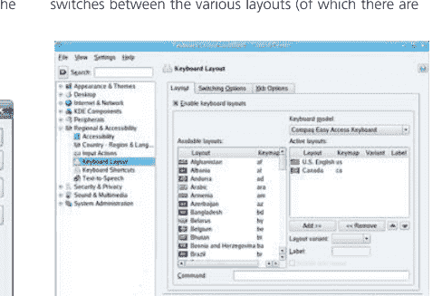

图 2. 从 KDE 控制中心，你可以分配额外的键盘布局。

当你点击“确定”或“应用”时，一个看起来像小旗子的小图标会出现在你的图标托盘中。点击该图标可以在各种布局之间切换（目前有两种）。当你处于备用布局（例如，加拿大）时，按下不同的键会呈现该键盘布局映射预设的字符。这可能需要你进行一些实验，以便发现每个键的功能——除非，当然，你恰好熟悉你所选择的布局。

为了恢复正常工作，再次点击托盘图标以切换回美式英语键盘布局。然而，这种来回切换并不适合每个人，而且当你只需要偶尔使用一个特殊字符时，花时间去学习一种备用键盘布局可能并不是最佳方案。绕过此问题的另一种方法是使用一个名为 KCharSelect 的工具。你通常可以在 KDE 实用工具菜单中找到它，但你也可以使用命令 `kcharselect` 来运行它。当程序启动时，会出现一个包含当前区域设置中所有 256 个可用字符的表格（图 3）。

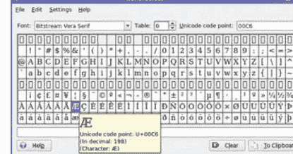

图 3. KCharSelect 就像一张特殊字符的自助餐桌。

从顶部的下拉列表中选择一个字体。然后，如有必要，选择一个备用的字符表（在我的系统中，拉丁字符集位于 0 位置）。如果你将鼠标指针悬停在某个字符上，你将看到它的 Unicode 和 ASCII 值。要在应用程序（如电子邮件）中使用某个字符，点击该字符，它将出现在对话框底部的文本字段中。如果你愿意，甚至可以输入多个字符。要使用你选择的内容，点击“到剪贴板”按钮，然后将结果粘贴到你选择的应用程序中。

GNOME 桌面用户有一个类似的应用程序，名为 Gucharmap。你很可能通过点击顶部 GNOME 面板上的“应用程序”按钮，在“附件”子菜单中找到它（在我的 Ubuntu 测试系统中就是这样）。如果你想直接运行该程序，其名称为 `gucharmap`。当窗口出现时（图 4），你会发现其概念与 KDE 的 KCharSelect 工具类似，但存在一些有趣的差异。从左侧边栏选择你的字符集或书写系统（对我们大多数人来说是拉丁字符集），选择一种字体，然后在右侧主显示窗格中双击你想要的字符。这样做时，该字符将出现在对话框底部的“要复制的文本”字段中。点击“复制”按钮，然后将文本粘贴到你当前正在运行的任何应用程序中。

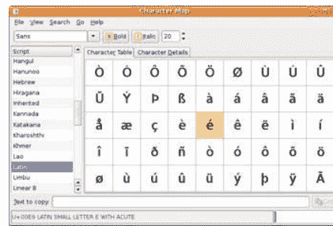

图 4. Gucharmap 是选择特殊字符的一种绝佳 GNOME 方式。

像 KCharSelect 和 Gucharmap 这样的工具在手非常好，但对于某些人来说，输入特殊字符的需求只是偶尔出现。因此，这些程序在桌面上似乎显得有点笨重，*不是吗？* 对于那些只需要输入少量字符的人来说，一个微小的应用程序，一个驻留在面板中的小部件，可能更合口味。在 KDE 环境中，有许多小部件，其中“字符选择器”可能就是你所需要的。

要添加这个小部件，请在 Kicker 面板的空白处点击右键，并选择“向面板添加小部件”。会出现一个“添加小部件”对话框，其中列出了可用于填充 Kicker 面板的程序（图 5）。每个程序（或小部件）都按字母顺序列出，并附有简短描述。寻找“字符选择器”。要添加小部件，只需点击“添加到面板”按钮。

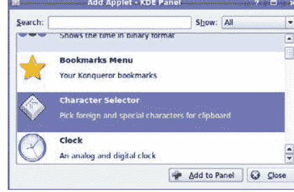

图 5. 向 KDE Kicker 面板添加小部件。

现在，你的 Kicker 面板应该有一个包含一堆特殊字符的框——默认情况下是 12 个。要在文本中使用其中一个字符，只需单击你选择的字符，然后将其粘贴到你的应用程序中。就这么简单。话虽如此，应用程序提供的字符集可能并不完全符合你的需求。要更改这一点，请右键点击小部件的手柄（小部件左侧带有箭头的细条），并从弹出菜单中选择“配置字符选择器”。小部件上方会出现一个配置窗口（图 6）。


# COLUMNS
# 用 Linux 进行开发

像 KCharSelect 和 Gucharmap 这样的工具用起来非常好，但对于某些人来说，他们只是偶尔需要输入特殊字符。

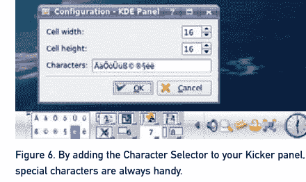

根据你的口味或需求修改字符列表，然后点击确定。你可能只需用 KCharSelect 这一次，将你的字符列表粘贴进来。

如果你使用 GNOME 作为默认桌面环境，那么你手上也有类似的工具，它也是一个小程序。右键点击底部（或顶部）面板并选择“添加到面板”。会出现一个同名窗口，其中列出了可用的小程序（图 7）。向下滚动直到你看到“实用工具”部分。在那里你会找到一个名为“字符调色板”的小程序。选中它，然后点击“添加”或者直接将小程序拖拽到面板上你选择的位置。


你会看到面板上出现了一排字符，这些字符左侧有一个下拉箭头。要在文档（或电子邮件消息、聊天会话或其他应用程序）中使用这些字符中的任意一个，点击你选择的字符，然后将其粘贴到你的应用程序中。如果你没看到所需的字符，很有可能它已经被定义好了。你只需要切换调色板即可。点击向下箭头，会出现超过 20 种预定义调色板供选择；只需点击即可切换。尽管选择范围很广，但在日常使用中所需的字符可能仍然不在其中。若要编辑调色板或向其添加内容，右键点击向下箭头并从子菜单中选择“首选项”。此时会出现“字符调色板首选项”对话框（图 8）。

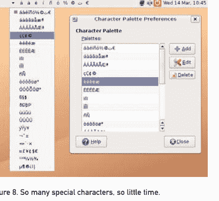

从这个对话框中，你可以选择编辑当前调色板、删除某个调色板或完全创建一个新的。若要创建新调色板，点击“添加”按钮，并在弹出的对话框窗口中输入字符——当然，你可能需要从其他字符应用程序（如 Gucharmap 或 OpenOffice.org）中粘贴它们。

现在，当 François 成为西班牙语大师时，他将能够输入所有他想要的西班牙语字符。在此期间，我的朋友们，看来是时候向大家道别了。几乎，这个词是关键，或者就像 François 现在可能说的那样：casi（几乎）。什么？你计划下周学习日语？为什么不呢。直到下次，请举起你们的酒杯，我的朋友们，让我们彼此祝健康。A votre santé!（祝你好运/干杯）! Bon appétit!（用餐愉快）...

Marcel Gagné 是一位住在安大略省滑铁卢的获奖作家。他是全新书籍《转向自由软件》的作者，这是他第六本由 Addison-Wesley 出版的书籍。他还经常作为《Call for Help》中的 Linux 专家出现在电视上。Marcel 还是一名飞行员、曾经的排行榜前 40 名电台 DJ、科幻小说和奇幻小说作家，并且持有一架 O'Grand 1-Rex 飞机。你可以通过电子邮件 mgagne@salmar.com 与他联系。你可以在他的网站 www.marcelgagne.com 上发现许多其他内容（包括很棒的 Wine 链接）。

# 资源

- GNOME 网站：www.gnome.org
- Gucharmap：live.gnome.org/Gucharmap
- KDE 网站：www.kde.org
- OpenOffice.org：www.openoffice.org
- Marcel 的网站：www.marcelgagne.com
- WFTL-LUG，Marcel 的在线 Linux 用户组：www.marcelgagne.com/wftlugform.html

# SUPERMICRO®

# UIO

# 通用 I/O

*最大化 I/O 可扩展性与灵活性*

# 自由构建你确切需要的内容。

- 适用于 1U/2U 的 3/7 英寸扩展卡
- 高度可升级
- 高能效电源（高达 90%+）
- 多种扩展卡选项（SAS RAID 5、10-G、IB...多达 20 种选择）
- 简化库存管理


Supermicro SAS RAID 5 卡。

# 可用的主板选项

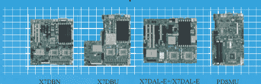

# 优化的机箱解决方案

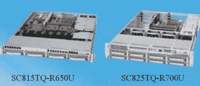

Supermicro UIO 服务器允许用户从广泛的 I/O 选项中进行选择，从而提供极致的存储和网络灵活性。UIO 卡成为服务器主板的一部分，使系统能够保留所有 PCI Express 和 PCI X 插槽用于扩展卡。因此，未来的升级可以通过更换 UIO 卡和/或扩展卡来实现，而不是更换整个系统。这种多功能性有助于减少客户运营业务所需的服务器种类数量。

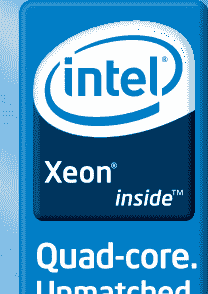

欲了解更多信息，请访问 www.supermicro.com

* 我们新一代电源在典型负载运行下效率达到 90% 或更高。

# 操作 Shell


# Dave Taylor

# 在 Apache 中显示图像目录，第三部分

令人惊叹的缩小脚本知道一种更好地调整缩略图尺寸的方法。

在上个月的专栏中，我们将目录显示脚本构建到了这样的程度：你可以获得一个智能列表，显示你的图像文件（并为其他任何文件类型提供链接），同时允许显示缩略图。

后一种技巧是让 Web 浏览器来做功。如果你指定的高度或宽度与实际图像大小不同，Web 浏览器会自动将图像缩放以适应指定的尺寸。更棒的是，如果你只指定一个维度，它会按比例缩放以适应。

让我稍微多解释一下，因为这对这个特定的脚本项目至关重要。如果你有一个 250x250 像素的图像，并且你想显示一个 75x75 的缩略图，最佳做法当然是同时指定 height="75" 和 width="75"。问题是，如果图像实际上是 250x317，而你希望将其宽度减少到恰好 75 像素。那么它应该有多高？

当然，你可以自己计算，但让浏览器自动为你完成这项工作要方便得多，如果你只指定 width="75" 或使用完整的 HTML 语句就会发生这种情况：

```html

```

这样做了之后，图像会被缩放，最终得到一个大小恰好为 75x95 像素的图像。然而，如果你始终限制一个维度，事情可能会出错。如果图像实际上是 250x1100，因为它是一个非常高的图形呢？那么缩略图将破坏整个布局，因为它的缩放版本宽达 330 像素，远远超过了图像 75x75 的目标框！

这就是为什么理想的脚本应该弄清楚哪个维度更大，然后将那个维度限制为我们寻求的框的大小，让另一个维度自动按比例缩放，多亏了 Web 浏览器。而这正是我们要做的！

**重要的大注意事项：** 我意识到让浏览器缩放图像会带来显著的性能代价——整个全尺寸图像必须被下载，尽管你在寻找的是更小版本。如果这是个问题，你可以使用如 ImageMagick 这样的工具来缩放图像并创建代替显示的缩略图图形，可能将它们放入缓存中，并在需要时动态创建新的。但说实话，你难道没有高速互联网连接，额外的加载时间一两天真的很重要吗？

# 开始脚本！

上个月，我们创建了非常有用的函数 figurerize，当给定一个图形图像时，它会返回 height 和 width 参数，从而可以计算这些值。脚本中由此产生的主循环最终看起来像这样：

```bash
for name in *
do
    if [ ! -z "$(file -b $name|grep 'image data')" ]
    then
        figurerize $name
        if [ ! -z "$height" ] ; then
            echo ""
            echo "<br />$name ($height x $width)<br />"
        else
            echo ""
            echo "<br />$name<br />"
        fi
    else
        echo "<a href=$name>$name</a><br />"
    fi
done
```

如果你仔细阅读代码，它实际上并没有对 height 和 width 参数做太多聪明的事，只是在输出中显示它们。相反，让我们将其转换为一个测试，以计算哪个更大。不过在此之前，我们需要对循环做一些基本的改进，使输出更吸引人：

```bash
for name in *
do
```


# 图 1. 运行改进后的脚本的结果

```bash
if [ ! -z "$(file -b $name|grep 'image data')" ]
then
    figuresize $name
    if [ ! -z "$height" ]; then
        echo "<a href=$name>"
        echo "$name ($height x $width)</a>"
    else
        echo "<a href=$name>"
        echo "$name</a>"
    fi
fi
else
    echo "<a href=$name>$name</a><br />"
fi
echo "<hr />"
done
```

运行这个改进后的脚本的结果（其中图片可点击，条目之间有水平线等）如**图 1**所示。


# 栏目

# 玩转 Shell

现在，让我们看看如何让脚本变得更智能：

```bash
if [ ! -z "$height" ] ; then
  if [ $height -gt $width ] ; then
    dimensionLabel="height"
  else
    dimensionLabel="width"
  fi
```

你能看出我在此处做了什么吗？这让我们能够判断图形的两个维度中哪一个是较大的，然后将 dimensionLabel 设置为那个特定的维度。以下是结果：

```bash
echo ""
```

其中我将 size 设置为我们想要的缩略图尺寸——在我们的示例脚本中为 75。

我还将添加几个计数器，以便在最后总结显示的图片数量与显示的总文件数量。只是因为这，呃，很有趣，对吧？以下是循环的最新版本，正如你可能预期的那样，随着它变得更加复杂，它也变得更为繁琐：

```bash
for name in *
do
if [ ! -z "$(file -b $name|grep "image data")" ]
then
  imgcount=$(( $imgcount + 1 ))
  figuresize $name
  if [ ! -z "$height" ] ; then
    if [ $height -gt $width ] ; then
      dimensionLabel="height"
    else
      dimensionLabel="width"
    fi
    echo "<a href=$name></a>"
  else
    echo "<a href=$name></a>"
    echo "$name</a>"
  fi
else
  echo "<a href=$name>$name</a><br />"
fi
echo "<hr />"
totcount=$(( $totcount + 1 ))
done
```


**图 2. 更美观的输出**

```bash
echo "<p>Displayed $imgcount images out of $totcount entries total.</p>"
```

最终结果（希望这样会更美观）如**图 2**所示。

既然我们可以在脚本中规范化这些缩略图（至少对于非 JPEG 图像，由于 file 命令的限制），接下来我们要研究的是如何以多张图片并排、网格或表格的形式显示结果，而不是像我们现在看到的那样每行一张图片。这要复杂一些，因为它涉及到又一个计数器，但当你等待下一期的《Linux Journal》时，你可能应该补习一下基本的 HTML 表格标签，因为我们将使用这些标签。然后，最后，我们将切换到 ImageMagick 替代 file，这样我们可以获取所有图像文件的尺寸，而不仅仅是 Gif 和 PNG 文件。

> Dave Taylor 是拥有 26 年 UNIX 经验的资深人士，The Elm 邮件系统的创造者，最近也是畅销书《Coached Shell Scripts》和《Teach Yourself Unix in 24 Hours》（在他撰写的 16 本技术书籍中）的作者。他的主要网站是 www.intuitive.com，他还在 AskDaveTaylor.com 上提供技术支持。

# **ABERDEEN STONEHAVEN X318**

# **ABERDEEN STONEHAVEN X526**

# **ABERDEEN STONEHAVEN X633**

# ABERDEEN STONEHAVEN X318

- 3U 12TB 双核就绪存储服务器
- 最多两个双核 AMD Opteron™ 2000 系列处理器
- 最多 16 个 750GB (12TB) 热插拔 SATA 硬盘
- 内部 SATA 2.5" 硬盘位用于操作系统驱动
- 800+ MB/sec 持续数据吞吐量 RAID 控制器
- 最多 32GB 667/533Mhz ECC 注册 DDR2 SDRAM
- nVIDIA nForce Pro 芯片组，支持 64 位
- 650W 冗余热插拔电源
- 5 年保修

起始价 **$4,259**

# ABERDEEN STONEHAVEN X526

- 5U 18TB 双核就绪存储服务器
- 最多两个双核 AMD Opteron™ 2000 系列处理器
- 最多 24 个 750GB (18TB) 热插拔 SATA 硬盘
- 两个内部 SATA 硬盘位用于镜像操作系统驱动
- 800+ MB/sec 持续数据吞吐量 RAID 控制器
- 最多 32GB 667/533Mhz ECC 注册 DDR2 SDRAM
- nVIDIA nForce Pro 芯片组，支持 64 位
- 950W 三重冗余热插拔电源
- 5 年保修

起始价 **$5,679**

# ABERDEEN STONEHAVEN X633

- 6U 24TB 双核就绪存储服务器
- 最多两个双核 AMD Opteron™ 2000 系列处理器
- 最多 32 个 750GB (24TB) 热插拔 SATA 硬盘
- 两个后置热插拔 SATA 硬盘位用于镜像操作系统驱动
- 800+ MB/sec 持续数据吞吐量 RAID 控制器
- 最多 32GB 667/533Mhz ECC 注册 DDR2 SDRAM
- nVIDIA nForce Pro 芯片组，支持 64 位
- 1550W 冗余热插拔电源
- 5 年保修

起始价 **$7,139**

> “终极 Linux 服务器... 对我们的基准测试来说太快了... 我们毫不犹豫地推荐 Aberdeen 系列的服务器。”  
> *《Linux Journal》—Aberdeen Stonehaven A261T*

> “非常适合视频服务或其他存储密集型任务”  
> *《PC Magazine》—Aberdeen X26XS*

> “Aberdeen 超越了 HP ... 得分显著更高 ... AberNAS 128 拥有出色的功能”  
> *《Network Computing》—Aberdeen AberNAS 128*

> “强大的性能 ... 令人震惊 ... 大开眼界 ... 迄今为止最高的 WebBench 分数”  
> *《PC Magazine》—Aberdeen Stonehaven A261S*

AMD、AMD Arrow 标志、AMD Opteron 以及它们的组合是 Advanced Micro Devices, Inc. 的商标。条款和条件请参见 www.aberdeencinc.com/legal/terms.htm (01/19/07)

**888-297-7409**
**www.aberdeencinc.com/linux**

# 语言——有些已消亡，有些仍活着

**JON "MADDOG" HALL**

# 编程不仅仅是 Java。

“maddog，”那声我熟悉的呼唤响起。那是我的一个年轻朋友 Eduardo 的声音。“你为什么把你的船命名为 Agape？是因为这艘船很宽敞吗？”我停下手里的活儿，不再打磨我的小帆船，转而面向我的年轻朋友。“不，这个词不是英语，而是拉丁语。它的意思并不是为了与一种常用于酿酒的小水果押韵，而是为了表达最高形式的爱。”Eduardo 看了我一会儿，说：“我不知道你会说除英语以外的语言。”“大部分情况下，我不会，”我回答。“我在几十年前的小学学习过拉丁语和法语，但当我意识到掌握多种语言的价值时，大部分那些训练已经溜走了。然而，学过拉丁语和法语确实有时会派上用场，因为我有时会发现那些被遗忘的训练有助于理解外语和我们母语英语中的新词。现在，我研究的语言主要是计算机语言。”“这是另一回事，”Eduardo 说。“当你真正需要的只有 Java 时，为什么会有这么多语言？”我放下打磨块，靠在 Agape 船上，仔细思考了一会儿。

FORTRAN 是我学会的第一种计算机语言。那是 1969 年，我通过阅读一本名为《使用 FORTRAN 对 IBM 1130 进行编程》的书来学习 FORTRAN，并在一个拥有 4,000 字主存、一个卡片阅读器/穿孔机的 IBM 1130 计算机系统上进行实践。该系统还有一个链式打印机（你最好别知道那是什么）和一个笔式绘图仪。注意，这种语言的名字是 FORTRAN，全是大写字母。那是我们当时书写的样子，因为它代表 FORmula TRANslator（公式翻译器），就像 COBOL 代表 Common Business Oriented Language（面向通用业务的语言）一样。FORTRAN 是面向工程师和科学家的，而 COBOL 是面向商务人士的。这两种语言都相当出色地完成了它们的工作。

因为我是工程专业的学生，也是 Western Electric Corporation（贝尔系统的成员）的合作实习生，所以我学习了 FORTRAN。在某个时间点，营销人员决定人们不喜欢名字中使用全大写字母，于是这种语言被称为 Fortran。多年来，FORTRAN（始于 1950 年代初）变成了 FORTRAN II，FORTRAN III，FORTRAN IV，然后开始使用与其更新年份相关的名称。如今，正在为 Fortran 2008 的定义做工作。Fortran 是一个很好的例子，说明一种语言（不仅仅是名字）如何改变以适应时代的需求。

从 Drexel Institute of Technology（现为 Drexel 大学）的合作实习期返回后，我开始寻找更多被称为计算机的设备。我在电气工程学院的计算机实验室里发现了多台 Digital PDP-8 小型计算机。尽管这些系统有一种类似于 FORTRAN 的小型语言，称为 Focal，但 Drexel 大学的 PDP-8 小型计算机大多是用汇编和/或机器语言编程的，也就是机器使用的 0 和 1。

我得到了一些关于如何用机器语言为 PDP-8 编程的书，并自学了如何使用计算机最基础的语言进行编程。幸运的是，PDP-8 的机器语言非常简单，只有八条基本指令和一个充当“累加器”的主寄存器。每条指令的长度都相同，并且符合 12 位的字长，因此 PDP-8 简单但繁琐。PDP-8 不能做减法（更不用说乘法或除法了），因此你必须加上减数的二补数来进行减法。

处理器的前面板上有开关和指示灯，通过拨动这些开关，你可以直接将程序输入到系统内存中。更重要的是，你可以每次执行一条机器语言指令来单步执行你的程序，在机器的累加器和程序计数器（也由控制台上的指示灯表示）上查看每条指令的结果。

当然，大多数人不会通过开关输入整个程序；他们使用 ASR-33 Teletype 将汇编语言的源代码输入到编辑器中，将源代码打印到纸带上，将该纸带输入到汇编器中，最终得到一条包含要输入到计算机中的 1 和 0 的目标级纸带。

程序的一次周转至少通常需要 45 分钟。将编辑器（纸带）读入需要五分钟。接下来，你输入你的程序，进行几次编辑，并将你的程序穿孔到新的纸带上。然后，你读入三遍汇编器（15 分钟的纸带读取时间），读入你的源代码程序（假设你的纸带没有撕裂），并穿孔输出包含你程序的二进制（纸）带。

最后，你将二进制纸带读入计算机内存，看着程序很可能覆盖了实际内存中的它自己和其他所有内容，然后你重新开始整个过程


（在对编程之神大声咒骂之后）。不过，这既有趣又充满挑战。那是机器的“意志”与1和0的纯粹逻辑之间的较量。我彻底迷上了。

在同一时期，我从电气工程专业的学生转到了既包含工程又包含商业的专业，并辅修了后来发展为计算机科学的课程。我学习了好几种不同的语言：Aigol、Lisp、PL/I、SNOBOL 和 APL，每一种都在计算机领域拥有其独特的利基。

我记得 SNOBOL 是一种用于字符串处理的语言。虽然我对它的细节记忆不多，但我确实记得我曾想过，输入到 SNOBOL 编译器中的几乎任何字符序列都会生成某种语法正确的程序。我记得当时唯一的语法错误可能只是缺少 END 语句。

另一方面，APL 是一种威力强大的数组编程语言。它甚至催生了一组特殊的符号，这意味着你不得不在常规键盘的按键侧面涂上这些符号，并且（对于 IBM Selectric 打字机而言）需要使用专门为 APL 制作的打印头。

在一门关于语言设计对比的课程中，我们的教授给我们提出了一个挑战：用尽可能少的 APL 行重新实现一个 40 行的 FORTRAN 程序。我们大多数人将 FORTRAN 程序简化为三行 APL，有些人简化为两行 APL。而班上最聪明的学生之一（David Erb）整夜未眠，最终将程序简化为仅一行 APL。那真是一行令人惊叹的代码。

在输入数据到程序并看到正确结果后，教授（眼中闪烁着光芒）要求 David 解释程序是如何工作的。David 在几个小时前才完成该程序，他拼命试图回忆程序实际是如何运行的，但他无法解释自己是如何得出那一行特定代码的，甚至无法解释它是如何产生预期结果的。

作为一个班级，我们体验了第一种“只写”语言。这是一个在接下来的 38 年里一直被铭记的教训——永远不要编写你无法轻松修改或重用的程序。

在计算机科学学位出现之前，那是个有趣的时代。那更像是“计算机黑魔法”，当时计算机分别归属于数学系、电气工程系、商学院、物理系等部门。我甚至有一位教授告诉我，我永远不会靠编写软件谋生。目前还无法看出他是否正确。

随着时间推移，计算机对世界变得越来越重要，大学开始授予计算机科学、计算机工程、网络工程和信息系统学位。而我们当时经历的通往理解这些过程的痛苦步骤，后来被正式确立为我们现在通称为计算机科学的东西。

我最终毕业于德雷塞尔大学。在寻找第一份工作时，我下定决心不会使用 FORTRAN 或 COBOL 这样的“高级语言”进行编程。我想用汇编语言编程。我拒绝了许多工作机会，一直在等待那个契机。

最终，那个机会降临了：在 Aetna Life and Casualty 公司的系统编程组，为 IBM 360 系列计算机使用基本汇编语言（BAL）进行编程——这是一种我从未见过的汇编语言和计算机系统。他们问我是否会用汇编语言编程。我说：“当然，只要给我看那本书就行。”

幸运的是有一本书，*Programming the IBM 360 in BAL*（《用 BAL 编程 IBM 360》），在阅读该书并在 Aetna 练习了几天后，我开始了为期四年的系统编程职业生涯——那是我人生中学习了许多、许多事情的一段时光。

然而，多年来支撑我的一门“语言”（如果我可以这么称呼的话），是机器代码中的1和0。

是机器代码让我学会了编译器如何解释和不同的语言翻译成机器可执行的指令。是机器代码向我展示了可重入和递归语言是如何工作的，以及代码中的微小变化如何能将程序的执行时间缩短几分钟，甚至几小时或几天。

对机器代码和机器体系结构的研究使我了解了操作系统是如何真正工作的，并使我能够理解网络协议。此外，机器代码及其源代码的查看让我理解了大端与小端、单精度与双精度等问题。

正是机器语言的知识让我发现了编译器在将源代码翻译为那些1和0时犯下的错误。那些只知道高级语言的人可能会永远盯着那些高级语言的源代码看，却找不到问题所在。

尽管如此，除了几次短暂地教授机器语言和汇编语言课程（最后一次是在1985年，当时我教授了一门 PDP-11 汇编语言课程，这是另一种我自学的汇编语言）之外，自1977年离开 Aetna 以来，我实际上没有再用汇编或机器语言编写过代码。

简单的原因是，在这些低级语言中编写代码花费的时间太久了，而且极易出错。

编译器优化技术变得更好了，CPU 更快了，内存更便宜了，而人们的时间变得更昂贵了。别误会我的意思；仍然有许多地方在使用汇编语言和机器代码，特别是在那些绝对需要最佳性能或最小尺寸的地方。但总体而言，编译器做得相当不错，而普通人的思维并不擅长适应编写汇编语言这种枯燥乏味的任务。

然而，每当我坐下来用某些现代机器语言编写少量代码时，我会做两件事。

-   我思考是否有某种语言能以更好、更清晰且更便于人类维护的方式完成该程序。
-   我思考该语言可能在机器语言层面生成了什么，以及对源代码、算法或数据在内存中布局方式的更改是否会影响程序的运行速度。

我的朋友 David Mosberger 曾对两个非常大的数组相乘进行过一项研究。其中一种乘法是按照标准的线性代数“教科书”方式，通过分析行和列来进行的。第二种乘法考虑了 CPU 和内存的缓存，并知晓1和0是如何排列的。在 Alpha 处理器（拥有大容量缓存内存）上，第二种乘法所用的时间仅为前者的四分之一；在 Intel 处理器（拥有较小容量缓存内存）上，其耗时仅为前者的十分之一。

多年来，我接触了许多新语言和新技术。我之所以能够理解每一种，是因为我会停下来思考那些1和0正在做什么。在过去38年里，很少有新的计算机技术让我感到困惑。

这就是为什么我反对那些认为高级语言（如 Java，或 Python，或 PHP，或者你随便说一个）是唯一值得教授的语言，而机器语言和汇编语言不值得教给学生的大学和学院。

归根结底，一切都归结为1和0。如果你不知道它们在做什么，也不知道机器实际是如何工作的，你就只能听天由命，受制于人。

在很多方面，机器代码和汇编语言就像拉丁语——或许很少使用，但对于严肃的语言爱好者和程序员来说，仍然值得知晓。

*Agape 造就 Carge。*

> Jon “maddog” Hall 是 Linux International（www.lfi.org）的执行总监，这是一个旨在支持和推广 Linux 操作系统的非营利终端用户协会。在他始于1969年的商业计算职业生涯中，Hall 先生曾担任程序员、系统设计师、系统管理员、产品经理、技术营销经理和教育者。他曾在 Western Electric Corporation、Aetna Life and Casualty、Bell Laboratories、Digital Equipment Corporation、VA Linux Systems 和 SGI 等公司工作。他现在是一名独立顾问，专注于自由及开源软件（FOSS）的业务和技术问题。


# Polywell 终极 Linux 系统

更多选择，优质服务，最佳价值！

# 1U 性价比服务器，起步价 399 美元，最高 4GB 内存

- 399 美元 1U-485Ax Sempron™ 3000+, 512M DDR2, 80GB 硬盘 *(仅限批量采购)*
- 499 美元 1U-485Ax Athlon™ 64 3500+, 1GB DDR2, 80GB 硬盘 *(仅限批量采购)*
- 599 美元 1U-485Ax Athlon™ 64 X2 双核 3600+, 2GB DDR2, 2x80GB 硬盘 (双网卡 +45 美元)
- 799 美元 1U-600GA Athlon™ 64 X2 双核 4200+, 4GB DDR2, 2x80GB 硬盘 (双千兆网卡 +45 美元)

# 1U 高级服务器，最高 64GB 内存，4TB 硬盘

- 1,799 美元 1U-690S4 Athlon™ 64 X2 双核 5200+, 4GB DDR2, 2TB 4x500GB 硬盘, 双千兆网卡
- 1,999 美元 1U-1000SLI Opteron™ 1210 双核, 8GB ECC, 2x80GB
- 2,999 美元 配 2TB 4x500GB 硬盘, Opteron 1214
- 4,599 美元 1U-2500M 2 x Opteron™ 2212 双核, 16GB ECC DDR2, 2TB 4x500GB 硬盘, 双千兆网卡
- 7,099 美元 1U-2500M 2 x Opteron™ 2216 双核, 32GB ECC DDR2, 2TB 4x500GB 硬盘, 双千兆网卡, 4GB 4T+1TB 硬盘

# 1U 双服务器, 1U 8 路四路 Opteron™

- 6,499 美元 1U-Twin 2 x 2 x 双核处理器, 2 x 8GB ECC DDR2, 2 x 双 250GB 硬盘, 2 x 双千兆网卡
- 7,299 美元 1U-8415A 4 x Opteron™ 8212 双核, 16GB ECC DDR2, 1.5TB 3x500GB 硬盘, 双千兆网卡
- 10,999 美元 1U-8415S 4 x Opteron™ 8214 双核, 32GB ECC DDR2, 2x47GB 15K RPM SCSI 硬盘, 双千兆网卡

# 2U 8 路, 5U 16 路服务器, 最高 128GB 内存

- 7,999 美元 2U-8450A 4 x Opteron™ 8212 双核, 16GB ECC DDR2, 3TB 6x500GB 硬盘, 双千兆网卡
- 11,500 美元 2U-8450A 4 x Opteron™ 8214 双核, 32GB ECC DDR2, 3TB 6x500GB 硬盘, 双千兆网卡
- 21,999 美元 5U-8850TU 8 x Opteron™ 8212 双核, 64GB 内存, 2TB 4x500GB 硬盘, 3 x 千兆网卡
- 49,999 美元 5U-8850TU 8 x Opteron™ 8214 双核, 128GB 内存, 4TB 8x500GB 硬盘, 3 x 千兆网卡

# 刀片服务器 - 10 个双核或四核处理器刀片

- 17,999 美元 8U 10 x 2055A 刀片
  - 10 x (双 Opteron™ 2210 双核, 4GB 内存, 80GB 硬盘)
- 39,999 美元 8U 10 x 2500M 刀片
  - 10 x (双 Opteron™ 2212 双核, 16GB 内存, 80GB 硬盘)
- 64,999 美元 8U 10 x 8450A 刀片
  - 10 x (四路 Opteron™ 8212 双核, 16GB 内存, 80GB 硬盘)
- 99,999 美元 8U 10 x 8450A 刀片
  - 10 x (双 Opteron™ 2214 双核, 32GB 内存, 80GB 硬盘)

# 目前可得最新且最快的技术！！！

# Linux 一体机，起步价 299 美元

- Poly 485Ax Sempron™ 3000+, 256M DDR2, ATI X1100 显卡, 100mbit 网卡, DVD, 80GB 硬盘 299 美元 (仅限批量采购)
- Poly 690GA Athlon™ 64 3500+, 512M DDR2, ATI X1250 DVI+VGA, 千兆网卡, DVD, 500GB 硬盘 499 美元 (仅限批量采购)
*(提供 OEM/ODM 服务)*

# 低成本 NAS 存储 1.5TB，起步价 999 美元

- 999 美元 Netdisk 4000A 1.5TB 3x500G
- 1,199 美元 Netdisk 4000B 2TB 4x500G
- 1,799 美元 Netdisk 6000A 3TB 6x500G (2U)
- 4,599 美元 Netdisk 12000B 6TB 12x500G (2U)

# 高密度多处理器服务器

9TB 2U 存储, 32GB 内存
2012SC 2500M-2220
- 9TB 12x750G, 32 核, 2x2220 13,999 美元
- 6TB 12x500G, 4GB, 2x2210 5,999 美元

18TB 4U 存储, 64GB 内存
4024AI5 2500M-2220
- 18TB 24x750G, 64G, 2x2220 36,999 美元
- 12TB 24x500G, 4GB, 2x2210 9,999 美元

AMD 双核技术使一个平台能够满足多任务和多线程环境的需求；提供平台的长期生命力

# Polywell OEM 服务，您的虚拟制造商
- 支持 Linux/FreeBSD 支持的原型开发
- 从小批量到大规模生产
- 履约、发货和 RMA 维修

- 20 年客户满意度
- 行业最长保修期 (5 年)
- 所有系统均可定制
- 一流客户服务

888.765.9686
www.Polywell.com/us/LJ

Polywell Computers, Inc 1461 San Mateo Ave. South San Francisco, CA 94080 650.583.7222 传真: 650.583.1974
Opteron、Sempron 和 ATHLON 是 Advanced Micro Devices, Inc. 的商标。Quadro、Fire 和 Vista 是 NVIDIA Corporation 的商标。所有其他品牌名称均为各自公司的商标。


# 寻找新的对手

**作者：Doc Searls**

**现在 Linux 已经获胜，下一个我们要攻克的阵地是什么？**

> 这就是为什么今天为 Linux 而战，就像为地质学、植物学或元素周期表而战一样。

最好的 LinuxWorld 博览会是早期的那些。仅 1999 年就有两次，都在圣何塞会议中心举行。第二次在八月，官方出席人数为 14,278 人。感觉像是那个数字的十倍。我对那次会议最喜欢的记忆是坐在成千上万的极客中间，他们挤在一个巨大的空间里，只能勉强看到（但能听到）Linus Torvalds 演讲，他们听得入迷，仿佛 Linus 是 Billy Graham 在号召信徒参加十字军东征。别管 Linus 的整套说辞是票房大卖的完全对立面，而且他总是想谈的——一如既往——是 Linux 内核的渐进式进步。

那时的 Linux 能量就像在乌云聚集前的山丘上积聚的电荷一样。横贯计算世界的高压线因对这个世界的巨大期待而闪烁发光，在那个世界里，开放优于封闭、自由优于束缚、公共优于专属的优势，对于信徒来说一目了然——但对其他人来说并非如此。

如今风暴已过，闪电已逝，我们期待的世界在很大程度上已经到来。用 GandiConCon ([www.faqs.org/docs/jargon/G/GandiConCon](https://www.faqs.org/docs/jargon/G/GandiConCon)) 的术语（首先他们忽略你，然后他们嘲笑你，然后他们与你战斗，然后你获胜），我们基本上已经到达了 GandiConCon 第四阶段。当然，未来并不是均匀分布的。例如，桌面 Linux 多年来一直是不对称地到来。我们要缩小这一差距，只需要一个明智的硬件 OEM 动作，这迟早会发生。（参见 Uptron 关于 Dell ideaStorm 的报道，非常令人鼓舞。）

与此同时，设备驱动程序仍在不断堆积。如果我们抽取整个 LAMP 栈，它的长度将超过 145,000 个字母。今天，构建需要计算和网络连接的“解决方案”而不利用如此多的免费和开放建筑材料，其实相当困难。还有一个巨大的需求市场，需要那些不仅知道如何构建，而且知道如何改进这些材料的聪明技术人员。

然而，在过去两年中，Google 上 Linux 相关查询的数量呈下降趋势。尽管新闻量保持稳定，但目前的查询量约为 2003 年底时的一半。（那是 Google 能追溯到的最早时间，它不给出精确数字。）

这就是为什么今天为 Linux 而战，就像为地质学、植物学或元素周期表而战一样。在一些不太理性的范式周围可能仍有一些顽固分子，但那有什么意义？Linux 革命已经变成了 Linux 建制派。我们赢了。现在呢？好问题。（那是你不知道答案时会说的话。好问题。）在《Linux Journal》，我们和其他杂志一样喜欢好的事业。而且，我们想以我们期望任何天生战士都会表现出的方式来庆祝 Linux 的胜利：通过寻找新的对手。

对手自然有趣。这就是故事理论所说的。对于故事，你只需要三个元素：1) 一个主角——你关心并能认同的人或事物；2) 主角与之斗争的问题；以及 3) 向解决迈进的过程。如果你的主角不有趣，问题没有意义，或者没有向最终状态迈进的动力，那你就没有故事。这就是为什么体育和战争故事如此引人入胜。

那么，我们的故事，或者故事，会是什么？我会提出四个，剩下的由你来定。

# 公民 vs. 运营商

自 20 世纪 90 年代中期 Apache 成为标准 Web 服务器以来，Linux 和网络一直在共同成长。然而，当 Linux 蓬勃发展时，网络正在陷入运营商的孤岛。今天的网络用户并不比 1999 年的个人电脑用户被微软 Windows 束缚得更少。

区别在于，每个运营商都是自己的微软，每项网络服务都像 Windows 一样功能不全，而客户的选择（至少在美国）是在 Twedle-telco 和 Twedle-cableco 之间——或者只有其中之一。这些运营商对客户看起来仍然相对不错，因为它们提供的连接速度（标记为“宽带”或“高速”）比拨号快得多。太容易忘记的是，拨号是广泛打开网络访问大门的方式，使其几乎对每个人可用——而且这是尽管有电话公司，而不是因为它们。如果没有最初的拨号 ISP——Little Garden、Paxin、Batnet、Earthlink 甚至 AOL——网络仍然只属于大学、政府和大型企业。

现在客户认为网络是位于电话或有线电视服务之上的灰色层。他们没有意识到，网络才是真正的基础公用事业，它可以承载任何你喜欢的“灰色”服务，包括电话和电视。几乎没人谈论广泛开放的互联网使所有可能实现的企业，主要因为有线公司和电信公司支持消费并阻碍生产。“网络中立性”的战斗是一个红鲱鱼。大多数“高速互联网”客户从未体验过真正的中立服务。相反，他们享受的是不对称的带宽和端口封锁，从未品尝过他们一直缺失的东西。世界其他一些地方的情况要好得多。例如，日本和韩国以高带宽和低价格而闻名。宽带普及率最高的国家是丹麦，爱沙尼亚也不远


# 移动：终极用户空间

今年某时，全球手机数量将超过30亿部。为了让大家对这个数字有直观认识（参考上个月的*L*指数），可以将其与以下数据对比：14亿张信用卡、13亿部固定电话、11亿条互联网连接、8亿辆汽车、2亿款电脑游戏、1亿台PVR（个人录像机）以及8500万台iPod。

手机是网络化的计算设备。其中运行Linux系统的比例正在逐渐增加。然而，像OpenMoko (openmoko.com) 和 Trolltech 的 Qtopia Greenphone (www.trolltech.com/products/qtopia/greenphone) 这样完全开放的工作原型机却凤毛麟角。它们面临着巨大的阻力，因为手机运营商与设备制造商之间存在着封闭的利益联盟，例如诺基亚和摩托罗拉。

然而，世界需要开放的手机。事实上，我敢预测开放手机是必然趋势：通过开放手机获得的收益将远超封闭手机（以及仅由运营商提供的封闭服务）所能获得的收益。我们开始在移动通信封闭的墙壁上看到垂直的裂缝，例如在高校环境中，像 Rave Wireless（声明：我是他们的顾问）这样的“叛逆”公司为基于开放系统构建的定制手机提供给学生，这些手机运行在熟悉的网络（如 Cingular 和 T-Mobile）上，但功能远超那些网络自营商店出售的封闭手机。用户甚至可以自由编程，创建并添加自己的功能和服务。每当在这种垂直市场中出现一次这样的裂缝，开放手机成为常态而非例外的概率就会增加。这里的先锋者是Linux技术人员，但他们正在开拓一个更广阔的可能性世界。问题一如既往，不在于封闭系统本身，而在于其背后的思维模式。一旦市场开始开放，我们将很容易在这些杂志栏目中填入关于巧妙黑客技巧和部署成功的报道。

# 桌面和笔记本 Linux

自20世纪90年代中期以来，桌面Linux一直在“接近但从未真正到来”。当然，大多数*Linux Journal*的读者已经在使用它了，但他们是“巫师”（精通者）。普通用户（muggles）仍然在使用 Windows 和 Mac 电脑。长期以来，我们需要的主要硬件OEM厂商中有一两家能“苏醒并嗅到销量机会”。去年，Lenovo 开始以坚定但非激进的姿态销售预装 Linux 的 ThinkPad；Lenovo 并没有大力推动。今年，Dell 抛出了名为 IdeaStorm 的诱饵，这是一个看似“对话式”营销手段的网站，但实际充当了打破 Windows 独家堤坝的缺口，此前这道堤坝一直将 Linux 桌面河流挡在 Dell 总部之外。这个缺口迅速扩大成一条独立的河流，涌入 Dell 的产品开发系统。（见本期 UpFront 栏目关于 IdeaStorm 的报道。）

我非常想旁观 Michael Dell 告诉 Steve Ballmer Dell 将以更公开的方式销售 Linux 品牌笔记本和桌面电脑时的场景，因为公司别无选择：市场需要它。HP、Sony 及其他厂商不会落后太远。随着销量增长，针对 Linux 桌面和笔记本的应用程序组合及专业知识总和也将随之增加。这是一个将迅速爆发的类别。我现在就敢打赌，在

# Linux 笔记本
起价 799 美元


# Linux 桌面
起价 375 美元


# Linux 服务器
起价 899 美元


# DIY 一切

我有件事要坦白。或者说，有一件*Make*相关的事要坦白。我热爱*Make*杂志。我希望我们当初能先做类似的事情。向 Dale Dougherty 和 O'Reilly 团队致敬，他们成功做到了这一点并表现出色——同时也因为他们在其中没有放入过多的 Linux 类内容。

当我在 20 世纪 90 年代末创办*Linux Journal*时，我们基本上是一本指南杂志。在很大程度上，我们现在依然如此。毕竟，我们的大多数读者都是动手型的人。问题解决者。我们的大多数撰稿人（我不算在内）也是如此。

所以我好奇……既然*Linux*（或可以说）已经几乎存在于一切之中，我们能制造或修复哪些“高一层”的东西？除了机顶盒之外，我们还能用 MythTV 做什么？Pluto 是一个酷（且基于*Linux*）的全屋自动化、安防、娱乐和电信系统。但它仍然是一个系统。开放性的一种深刻且被低估（且部署不足）的美德是模块化。你希望能混搭来自不同制造商的不同部件，包括（尤其是）你自己。我们应该用 Linux 制作“乐高”，而不仅仅是将其嵌入到只能与自身配合工作的封闭成品中。

这里的斗争在于拥有构建你想要之物的权利和能力，以及以你想要的方式构建它的能力。尽管*Make* 杂志侧重于在现有成品上进行有趣的黑客改造（例如将鼠标变成机器人或为咖啡机添加温度控制），我们的角度应更偏向于制作模块，以及包含这些模块的事物，使任何人都能构建任何东西。我们的主角将是与过去一样的 DIY 爱好者，但面临的问题将是“构建任何东西”。这是一个有趣的问题。

多年前，我谈到软件行业正在转变为建筑行业——当建筑师、设计师、建造者及其专长不再依赖于任何单一公司的平台或开发环境时。现在我们几乎达到了那个状态，但还差一点。这里的斗争在于将*Linux* 及其无穷无尽的“技术栈”多样性变成基础材料，让人们可以用我们的虚拟“Home Depot（家装建材超市）”来组装东西。

# 自由 vs. 控制

虽然很容易指向由 Linux 构建的巨头如 Google 和 Amazon 的典范性成功，但也同样容易忽视 Linux 开发背后的系统实际价值已成为网络化进步默认方法的程度。

2008 年 6 月，*Linux Journal* 每一期都将不可避免地带有个人色彩——原因很简单，桌面和笔记本领域将有太多事情发生。

或者可能不会。我们还不知道。Lenovo、HP 和 Dell 可能会继续悄悄接收桌面*Linux*订单，而从未大力营销它。这种情况不会永远持续，但渐近线可能在未来一年、两年或三年内仍保持平坦。

与此同时，桌面和笔记本*Linux*仍然值得为之奋斗，正如我们在过去十年或更长时间里所做的那样。

然而，即使*Linux* 和 LAMP+ 技术栈已成为标准建筑材料，也没人能阻止它们被用于服务于一种专有思维，这种思维试图锁定客户、排除竞争并控制市场。正如 Steven Hodge 所说（<www.winextra.com/?p=354>）：

> 许多人愿意相信，对抗技术旧势力最强大且有效的武器是开源运动，但他们没有看到的是，他们已经被同化，仅仅成为了另一种赚钱方式。虽然开源运动（OSM）的根源在技术上可能仍然对所有人自由，但旧势力正在迅速通过服务合同和企业许可将其部分锁定。

风险投资商询问潜在投资组合公司“你们的锁定机制是什么？”仍然是惯例。这是一种工业时代的思维，在一个创造和选择能带来可构建为无数生产力用的丰富资源的世界中，需要将其暴露为一种减值的过时代产物。你应该希望构建客户自由选择的产品和服务。你应该留住客户是因为他们想留下，而不是因为你把他们困在孤立系统中。

甚至 Steve Jobs 今年也公开表示，没有 DRM 的记录行业会更好。这是因为他所受的束缚并不比他的任何客户少。

这里的主角无一不是自由事业，它将永远不会成为旧闻。（我是有意这么说的。）这里的问题——嗯，敌人——是一种与工业时代一样古老的思维模式。

自由的斗争，当然，是我们一直在进行的斗争。不同之处在于，锁定逻辑日益暴露，其缺陷也日益明显——尽管尚未广泛显现。

因此，这场斗争将从理想转向实际问题。如何通过用免费的东西构建并将其投入使用来赚钱，而不仅仅是通过销售？当软件越来越不再是一个独立行业时，它是如何变得更加有用和重要的？当你与免费和开源物品合作时，如何完成更多工作，并作为贡献者变得更有价值？

这些问题仍然是新问题，尽管自 1994 年以来，*Linux Journal* 一直是对所有这些问题的一种鲜活回答。

# 你的故事是什么？

所以现在，问题抛给读者。你想在*Linux Journal*中阅读关于哪些“重要斗争”的内容？告诉我们。请写至 [editor@linuxjournal.com](mailto:editor@linuxjournal.com)。

今天的网络用户并不比 1999 年受微软 Windows 束缚的个人电脑用户更少受到电话或有线公司的束缚。


# SERVERS DIRECT™
更多产品，更优服务，品质保证。

# 直达源头！

# 高效智能的服务器

借助双核英特尔® 至强® 处理器，您可以在 ServerSDirect 系统中节省时间并降低运营成本

# 1U Twin™ 创新技术

- 高密度计算技术
- 降低对成本、能源和空间的要求
- 支持多达16个处理器核心的双路至强 5300 系列

# SDR-6015T-TB 1U 数据中心集群服务器

在 1U 外形规格下集成两套系统（节点）。每个节点支持以下配置：

- 双路处理器四核及双核英特尔® 64位至强® 支持
- 最高可达32GB DDR2 667 & 533 SDRAM 全缓冲 DIMM (FB-DIMM)
- 2x 英特尔® (ESB2/GigE) 82563EB 双端口千兆以太网控制器
- 2x 热插拔 SATA 驱动器托架
- 900/980W 高效电源

# SDR-2501T 2U 应用服务器

是稳定且对业务至关重要的应用服务器的理想解决方案，可最小化部署和支持成本

- 2U Chenbro 机架式机箱，配备 600W 电源
- Supermicro X7DVL-E 服务器主板，搭载英特尔® 5000P (Blackford VS) 芯片组
- 英特尔双核至强 5030 处理器 2.6GHz 667MHz
- 总容量 1024MB，2 条 512MB 金士顿 DDR2 533MHz FB-DIMM ECC
- 希捷 SATA II 80GB 7200 RPM 8MB 缓存 SATA 3.0Gb/s 硬盘
- 6 个 1" 热插拔 SATA 驱动器托架
- 英特尔® (ESB2/GigE) 82563EB 双端口千兆以太网控制器
- 英特尔 ESB2 SATA 3.0 Gbps 控制器，支持 RAID 0、1、5、10

**起始价格 $1,299**

# SDR-3111T 3U 关键任务应用服务器

旨在提供卓越的可用性、简化的可管理性、出色的性能和革命性的灵活性，助您构建经济高效的可扩展 IT 基础架构

- 3U Chenbro 机架式机箱，配备 600W 电源
- 英特尔 S5000P5LSATA 至强 5000P 服务器主板
- 英特尔双核至强 5030 处理器 2.6GHz 667MHz
- 总容量 1024MB，2 条 512MB 金士顿 DDR2 533MHz FB-DIMM ECC
- 希捷 SATA II 80GB 7200 RPM 8MB 缓存 SATA 3.0Gb/s 硬盘
- 12 个 1" 热插拔 SATA 驱动器托架
- 双端口千兆以太网控制器
- 英特尔 SATA 3.0 Gbps 6 端口控制器，支持 RAID 0、1、10

**起始价格 $1,699**

# SDP-7045B-TR-8

对于寻求第一台服务器或升级现有服务器的小型企业的理想选择

- Supermicro A4 可机架式/塔式机箱，配备 800W 高效率冗余电源
- Supermicro Super X7DBE + 服务器主板
- 英特尔双核至强 5030 处理器 2.6GHz 667MHz
- 总容量 1024MB，2 条 512MB 金士顿 DDR2 533MHz FB-DIMM ECC
- 希捷 SATA II 400GB 7200 RPM 16MB 缓存 SATA 3.0Gb/s 硬盘
- 8 个 1" 热插拔驱动器托架
- 英特尔® (ESB2/GigE) 82563EB 双端口千兆以太网控制器
- 英特尔 ESB2 SATA 3.0Gbps 控制器，支持 RAID 0、1、5、10

**起始价格 $1,999**

# SDR-5500T 5U 高级存储服务器

真正的 SATA II 3Gb/s 存储服务器，配备双路至强 CPU，并预留磁带备份空间

- AIC 5U 可机架式，配备 950W 三重冗余电源
- Supermicro Super XTDBE 服务器主板，搭载英特尔® 5000P (Blackford) 芯片组
- 英特尔双核至强 5050 处理器 3.0GHz 667MHz
- 总容量 1024MB，2 条 512MB 金士顿 DDR2 533MHz FB-DIMM ECC
- 希捷 SATA II 400GB 7200 RPM 16MB 缓存 SATA 3.0Gb/s 硬盘
- 24 个 1" 热插拔驱动器托架
- 英特尔® (ESB2/GigE) 82563EB 双端口千兆以太网控制器
- 英特尔 ESB2 SATA 3.0Gbps 控制器，支持 RAID 0、1、5、10

**起始价格 $5,399**

# SERVERS DIRECT 可协助您配置下一个高性能服务器系统 - 请今日致电！

我们灵活的在线产品配置器允许您获取定制解决方案，或者致电我们的产品专家，他们随时准备协助您组装需要更多定制的系统。Servers Direct - 您获取可扩展、经济高效服务器解决方案的直通源头。

1.877.727.7887 | www.ServersDirect.com

# 新产品


# Introvension 软件的 DEFCON

英国的 Introvension Software 自豪地告诉我们，他们是“Linux 社区的狂热支持者”，因此，他们发布了其最新也是第三款基于 Linux 的游戏，*DEFCON*。*DEFCON* 是一款基于全球热核战争主题的在线、竞争性多人策略游戏。该游戏灵感源自 1983 年的经典传奇 *Wargames*，“唤起人们对冷战时期围绕其产生的紧张、偏执和多疑氛围的共鸣”。玩家扮演一名隐藏在地堡下的将军，其任务是在消灭敌方平民人口的同时，阻止敌方实施报复的能力。*PC Gamer UK* 将 *DEFCON* 描述为“纯粹、深邃、令人痛彻心扉的乐趣”。Windows 版本已经可用。Introvension 应当因拥有最棒的启动网址而获奖！

www.everybody-dies.com

# OpenSTV

你是否曾感到想要支持“企鹅党”来追随自己的良心投票，而不是在两个“共和党”或“民主共和党”的邪恶中选择较小的那个？为了解决这一困境，替代性（且符合宪法并日益流行）的投票方法，如单一可转移投票制（STV）和即时决选投票制应运而生，允许选民在选举中对候选人进行排名。如果你的“企鹅党”候选人根本没有胜算，你的投票将转计给你排名较低且有望获胜的候选人。梳理这些投票偏好是 OpenSTV 的工作，目前版本为 1.1，这是一个根据各自投票规则计算票数的开源应用程序。数据通常来自纸质选票，并输入到 OpenSTV 中。首席开发人员表示，“部分投票规则已通过数百场选举的结果与其他软件进行对比，进行了广泛验证”。OpenSTV 运行在 Linux、Mac OS X 或 Windows 上，并可以从 SourceForge 下载。

stv.sourceforge.net

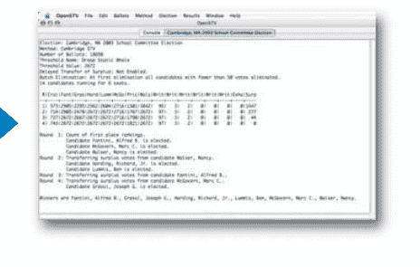

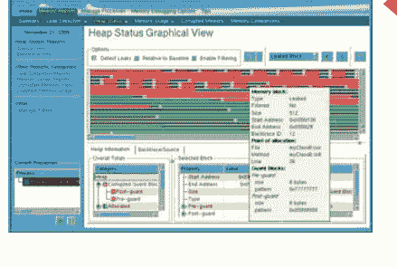

# TotalView Technologies 的 MemoryScape

你过去所熟知的 Ethus 公司已更名为 TotalView Technologies，为了庆祝这一转变，它发布了其 MemoryScape 独立交互式内存调试器的 2.0 版本。TotalView 表示，MemoryScape“帮助开发人员识别、检查和解决 C、C++ 和 FORTRAN 中复杂的内存问题，包括复杂的多处理器和多线程程序”。一些关键特性包括允许开发人员“监控堆内存、查看内存使用情况、定位内存泄漏、跟踪内存事件并显示损坏内存”的工具。开发人员还可以保存和比较内存状态、编译内存报告，并在无需重新编译的情况下查找内存问题。MemoryScape 2.0 的新功能包括支持 MPI 程序和远程内存调试。试用版可从 TotalView 的网站下载。

www.totalviewtech.com

# Xandros 服务器

Xandros 全新的 Server 2.0 刚刚上市，包含新特性，如集成的 OpenDocument 协作以及全面的服务器备份和恢复。Xandros 与 O3spaces B.V. 公司合作创建的 OpenDocument 协作扩展，“提供 OpenDocument 和 MS-Office 文档协作、管理和保留服务”，并作为 Microsoft Office SharePoint 服务器的替代方案。在服务器备份和恢复方面，Xandros 集成了 SEP AG 的“SEP sesam 应用程序，该应用为 Xandros Linux 服务器提供全面的数据安全保护，包括与其新的 Sxialix 11 协作平台的完全集成”。

www.xandros.com

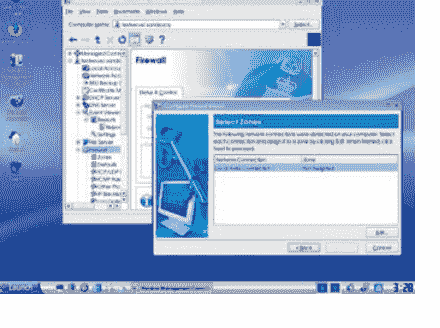

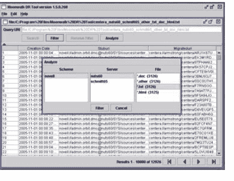

# Moonwalk 软件套件

澳大利亚公司 Moonwalk 为我们的同类物种（在这里指北美市场）做出了巨大的飞跃，推出了其同名“全方位数据管理和保护软件”的 6.0 版本。Moonwalk 存在的意义是“无论平台如何（包括 Linux、Windows、UNIX 和 NetWare），在整个企业中透明地自动化并主动管理数据的迁移、复制和移动”。该应用程序通过根据用户定义的规则和政策（基于年龄、大小、文件类型、文件名、文件创建者等标准）进行数据的迁移、复制和移动，利用次级存储而非主存储。它进一步“摒弃了分层或层级存储方法以及仅提供存储使用可见性的 SRM 应用程序”。Moonwalk 与可用的备份解决方案兼容。

www.moonwalkinc.com

# Concurrent 实时计算解决方案

实时计算专家 Concurrent 在 2007 年 4 月发布了三款新产品，即其 RedHawk Linux 4.2、NightStar Tools 4.1 和 SIMulation Workbench。首先，Concurrent 的实时 Linux 操作系统 RedHawk 的新版本拥有 2.6.18.8 Linux 内核，包含 Ingo Molnar 接受的大量实时补丁，性能和稳定性增强，支持最新的英特尔四核处理器以及 AMD Opteron 处理器上的 32/64 位操作系统。其次，NightStar Tools 4.1 是用于开发时间关键应用的集成工具包，增加了基于 Qt 的增强 GUI、应用照明功能以及调优增强。最后，SIMulation Workbench 是一款新的仿真软件产品，旨在简化实时建模，提供一个完整的框架来开发和执行实时硬件在环仿真。

www.ccusr.com


# Pogo Linux 的 StorageDirector 3000

我们的朋友 Pogo Linux 传来了其新款网络附加存储 (NAS) 设备系列 StorageDirector 3000 的消息。StorageDirector 背后的理念是采取“简单、高效的存储管理方法”，利用开放架构降低成本，同时“仍然提供高端功能集”，目标用户是 Pogo 的客户——“具有企业野心的中小企业 (SMB)”。由定制的 StorageDirector 操作系统驱动，新产品线可实现以下功能：通过 Web 浏览器简单、安全地管理存储和备份；跨平台文件共享并利用所有主要文件共享协议；灾难恢复和备份；多路径、高级监控和警报，以及硬件和软件 RAID，包括 RAID 6（双奇偶校验）。客户可以在 Pogo 的网站配置自己的 StorageDirector 3000。

www.pogolinux.com/go/sd3000


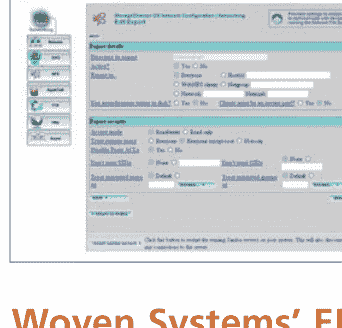

# Woven Systems 的 EFX-1000 以太网 Fabric 交换机

Woven Systems 为其新的交换机产品 EFX-1000 投入了巨额的 VC 资金。Woven 表示，最终结果是新一代以太网 Fabric 交换机的首款产品，旨在满足多核服务器、服务器整合和虚拟化、IP 存储及数据中心网格伴随的需求。以太网 Fabric 交换机可以互连以构建“具有韧性、低延迟、无阻塞的网状第 2 层 Fabric，可扩展至 4,000 多个 10GbE 端口”。10GbE EFX-1000 交换机“结合了 InfiniBand 的性能和低成本、光纤通道的可靠性以及以太网的即插即用互操作性”，且每端口的价格大幅降低。Woven Systems 被 *Byte and Switch* 出版物评为“十大值得关注初创公司”之一，因其“具有潜在颠覆性的数据中心技术”，同时也被 Gartner Group 评为“酷厂商 (Cool Vendor)”。

www.wovensystems.com


# 快速概览

# 开源数据库，第三部分：如何选择数据库

**哪个数据库最适合你？MySQL 还是 PostgreSQL？**  
REUVEN M. LERNER

如果你是一名应用程序开发人员，你很可能正在处理大量数据。而且，如果这些数据比哈希表稍微复杂一些，你可能就需要考虑将其中一部分或全部数据迁移到关系型数据库中。关系型数据库旨在可靠且灵活地检索数据。关系型数据库的魔力并不在于使用二维表来存储所有信息，而在于表可以通过许多不同的方式组合在一起，并使用 SQL 查询语言进行操作。

正如我们在*Linux Journal*前两期的数据库文章中看到的那样，开源程序员很幸运，手头有好几种数据库可供选择。迄今为止，最受欢迎的两种开源关系型数据库是 MySQL 和 PostgreSQL。两者都拥有庞大且忠实的追随者，并且每个新版本都在持续改进。

而且，当上面我写到“庞大且忠实的追随者”时，我并没有开玩笑。MySQL 和 PostgreSQL 长期以来一直处于开源世界激烈争论的中心。如果有人在 Slashdot 上敢对其中一种产品说点什么，你可以肯定，要不了多久，就会有人写下关于另一种产品的刻薄（且常常幼稚）的评论。这些分歧往往反映了非专业用户的冲动态度，但也有一些著名且精通这些产品的用户参与了攻击。

我认为在某些情况下，MySQL 或 PostgreSQL 都可能是一个合适的选择。在过去十年的工作中，我们强烈偏好 PostgreSQL——然而，确实有些时候 MySQL 似乎是更合适的解决方案。因此，尽管存在我的个人偏见，以及引发开源社区内激烈争论的风险，我现在将通过在多个不同类别中比较 MySQL 和 PostgreSQL，来结束关于开源数据库的这一系列文章。我希望当你读完这篇文章时，能够明白选择数据库几乎从来不是寻找“最快”或“最好”的产品问题，因为并没有一种单一的方法来衡量关系型数据库服务器的质量或适用性。相反，我希望你能基于它们各自的优点来考虑每一个数据库，而不是基于那种无处不在的宣传。

# 数据完整性

数据库的首要且可能也是最重要的任务是可靠地存储和检索数据。就像你不想使用一个偶尔会丢失数据的硬盘一样，你也不想向数据库写入偶尔会损坏其内容的数据。即使是以牺牲速度为代价来换取可靠性，这一点也依然成立。

在数据库领域，可靠性的黄金标准有一个缩写，即 ACID（原子性、一致性、隔离性和持久性）。这意味着在数据库的所有情况下，以下几点都成立：

- **原子性**：每个查询都保证要么完成，要么不完成，不可能出现中间状态或不完整状态。
- **一致性**：数据库在事务之前和之后始终处于合法状态。
- **隔离性**：每个事务都独立于其他操作发生，因此不可能有两个事务相互干扰。
- **持久性**：事务随时间持久存在，通常通过存储在文件系统中实现。

自从我十年前开始使用 PostgreSQL 以来，PostgreSQL 社区对 ACID 的态度始终未变，将其置于最高优先级。这并不意味着 PostgreSQL 缺少其他特性，而是意味着开发人员致力于确保存储在 PostgreSQL 系统中的数据始终一致且可靠，即使你做出了如发送 `kill -9` 信号或拔掉电源插头等恶劣操作。

在过去几年里，PostgreSQL 开始提供对事务和数据库稳定性更好的支持，使用了预写日志（WALs），其中描述了数据库执行的每个操作。这些 WAL 文件可用于从灾难中恢复，甚至可以将数据库恢复到现在其历史中的较早时间点——这一特性被称为基于时间的恢复（PITR）。因此，如果你知道昨天发生了某件事，但数据库在两天前运行得完美无缺，你可以使用 PITR 恢复到那个更早的稳定状态。最近版本的 PostgreSQL 还支持两阶段提交，这是一种你在分布式系统中可能看到的、需要多个服务器协调其操作的事务类型。

多年来，MySQL 对 ACID 的态度喜忧参半。当我在 1995 年首次开始使用 MySQL 时，作者们的态度是事务应该由应用程序处理，而不是数据库。事实上，直到 2000 年，MySQL 的待办事项列表中仍包括与生产级事务安全表相关的任务。这导致了 MySQL 和 PostgreSQL 社区之间大量的不和，后者成员有时声称绝不应该在 MySQL 中存储任何关键数据。

好消息是，现代版本的 MySQL 确实支持事务安全表，使用了 InnoDB，这是一个在 GPL 下发布的第三方产品，多年来已被集成到 MySQL 中。此外，InnoDB 似乎使用了 PostgreSQL 和 Oracle 多年来使用的技术，例如 MVCC（多版本并发控制）。坏消息是，至少我看过的一些基准测试表明，InnoDB 在扩展到大量并发查询时存在一些问题。

此外，开发 InnoDB 的公司最近被 Oracle 收购，这可能会让一些人担心未来的许可、开发以及定价问题。目前，后一个问题似乎并不严重，因为 Oracle 和 MySQL 在 2006 年签署了一份合同，延长了 InnoDB 的许可。但是，MySQL 似乎并不想冒险，并已聘请了几位专家来创建一种新的表结构，该结构将由 MySQL 拥有，从而不受此类商业问题的影响。

就个人而言，我坚信真正的 ACID 合规性始终是一件好事，就像汽车中的安全带一样。当然，你可以不系安全带开车，而且很可能什么事都不会发生。但是，很难预测什么时候会发生坏事，而在这种情况下一定不希望没有安全带。同样，如果你是一个数据库它强制执行约束和限制。PostgreSQL 在这些方面往往非常严格，拒绝接受非法数据。MySQL 试图更加宽容和灵活，但这可能导致奇怪且非法的数据被存储。

例如，考虑以下 MySQL 命令集，我们在其中创建了一个名为 `foo` 的表，该表有一个名为 `a` 的单一列，类型为 `DATE`：

```text
mysql> CREATE TABLE foo (a date);
Query OK, 0 rows affected (0.08 sec)

mysql> INSERT INTO foo (a) VALUES ('2007-feb-30');
Query OK, 1 row affected, 1 warning (0.00 sec)

mysql> SELECT * FROM foo;
+---------+
| a       |
+---------+
| 0000-00-00 |
+---------+
1 row in set (0.00 sec)
```

相比之下，这在 PostgreSQL 中会发生什么：

```text
atf=# CREATE TABLE foo (a date);
CREATE TABLE

atf=# \d foo
Table "public.foo"
Column | Type | Modifiers
-----------|---------|-------------
a       | date  |

atf=# INSERT INTO foo (a) VALUES ('2007-feb-30');
ERROR:  date/time field value out of range: "2007-feb-30"
```

可以配置 MySQL 使其在这些问题上更加严格，但大多数用户不会想到这样做，并且会在他们的表中遇到非法值而陷入困境。

鉴于 MySQL 的政治和技术问题，以及 MySQL 中奇怪（且潜在危险）的默认行为，我认为 PostgreSQL 在数据完整性问题上具有巨大优势。

# 特性

MySQL 和 PostgreSQL 都提供了大量内置特性，其中许多是根据社区的要求和反馈添加的。两者都提供了大量数据类型，这些类型可以在单行中无限制地混合和匹配。（令人高兴的是，曾经困扰 PostgreSQL 版本的非常有限的行长度限制现在已是古老的历史。）两个数据库现在都支持 Unicode 字符；MySQL 同时支持 UCS-2 和 UTF-8 编码，而 PostgreSQL 仅支持后者。

两个数据库还提供了大量用于操作数据的函数，包括字符串和日期。能够比较和排序数据，或查找时间戳在过去 24 小时内的所有行，这是非常方便的。PostgreSQL 的区间数据类型，它描述一段时间（而不是特定时间点），被证明特别有用。MySQL 有一些不同的数据类型，我们这些数据库纯粹主义者对此皱眉头，例如 SET 和 ENUM，但它们无疑深受许多用户的欢迎。

在许多 PostgreSQL 具有优势的领域，MySQL 开始赶上来了。PostgreSQL 用户长期以来一直能够创建新的数据类型以及操作这些类型的函数。事实上，PostgreSQL 为开发人员提供了罕见的能力，可以使用多种语言编写服务器端函数，包括 SQL、Perl、Python、Java、Tcl 和 R 统计语言。MySQL 不允许创建新的数据类型，但最近版本提供了编写服务器端函数和存储过程的能力。

MySQL 提供了内置的全文搜索解决方案，这是通过对文本字段使用特殊类型的索引实现的。然而，这种索引有一些重要的限制，例如它仅适用于 MyISAM 表。鉴于这些表既不支持外键也不支持事务，我建议将它们作为解决方案时会感到有些不安。

PostgreSQL 的全文搜索解决方案（tsquery）则存在相反的问题。虽然它非常健壮，并且与 PostgreSQL 的标准事务表配合良好，但配置和安装它需要一些工作。大多数管理程序和程序员能够在短时间内成功安装它，但尽管如此，内置功能与需要添加的功能之间仍存在差异。

PostgreSQL 具有一些内置特性，MySQL 尚未实现或计划在未来版本中提供。其中包括在查询的任何位置使用子选择的能力、使用序列（而非简单的自增列）、允许用户修改对特定表的查询解释方式的规则以及针对列值的 CHECK 约束。MySQL 的最近版本现在包括以前仅在 PostgreSQL 中可用的特性，例如触发器和视图。

总体而言，PostgreSQL 开发组似乎比 MySQL 更强调 SQL 标准，尽管 MySQL 开发人员似乎越来越重视这一需求，并现在为那些希望始终在标准兼容模式下工作的人提供了 --ansi 命令行开关。MySQL 和 PostgreSQL 都极其易用。每个


# 快速了解

附带了一个功能丰富的命令行客户端程序，允许您通过发送 SQL 查询来操纵数据库。我已经习惯了 PostgreSQL 命令行中的一些功能，例如扩展输出（\x）。这两个数据库的命令行接口随着时间推移变得更有用。虽然 MySQL 接口看起来命令较少，但这部分是因为 MySQL 已通过 SQL 查询（例如，SHOW TABLES）提供了部分数据，而在 PostgreSQL 中这需要更复杂的查询，从而催生了简写命令 \d。两个命令行接口都使用 GNU readline，使得编辑和重新发送查询变得容易。两者都允许用户使用 \e 命令编辑前一条查询。

总体而言，可以说 PostgreSQL 提供了 MySQL 功能的一个超集，除了少数问题（例如，内置文本索引）外。PostgreSQL 不具备的那些功能，例如新的数据类型和函数，可以轻松地添加到系统中，无需重新编译或以其他方式修改核心 PostgreSQL 源代码。话虽如此，我认为 MySQL 的功能不容小觑，对于您可能正在编写的多数应用程序来说已经足够。

# 管理

MySQL 和 PostgreSQL 都极其容易管理，尤其是在中小规模场景下。您可以（可选地）更改少量配置选项，启动服务器，然后就可以去忙别的了。确实没有多少其他事情要做。对于任何处理过更大数据库系统（如 Oracle）的人来说，这是一种耳目一新的改变。然而，两个系统的操作方式存在一些细微差异。

PostgreSQL 依赖几个外部 UNIX 级命令来创建和管理数据库及用户，以及监控 PostgreSQL 服务器的活动。PostgreSQL 没有中央管理程序。相比之下，MySQL 有一个中央 mysqladmin 程序，处理大部分与服务器启动和关闭有关的功能，以及数据库的创建和销毁。用户的创建和管理通过操纵 mysql 数据库中的表来处理。

PostgreSQL 中与 mysql 数据库对应的部分是特殊的系统表和视图，它们都以 pg_ 前缀开头。这些表对于系统运行是必需的，但大多数程序员可以轻松忽略它们，只有在尝试调整系统或弄清楚如何优化查询时才会用到。

两个程序都有基于 GUI 的管理工具，以及基于 Web 的 PHP 编写工具。说实话，由于我对命令行系统的熟悉（和偏好），我在过去几年里很少使用这些 GUI 工具。然而，我对这两组 GUI 程序的使用体验都是积极的，我的印象是它们既稳定又安全，而且有用。

PostgreSQL 管理的一个独特方面是需要对数据库中的“死”行进行“真空清理（vacuum）”，将它们返回给操作系统或供其他可能受益于该空间的行使用。此外，PostgreSQL 的 vacuum 功能会访问死行，并使用其收集的统计信息来通知优化器和查询计划器。如今，auto-vacuum 守护进程自动为大多数人处理了这件事，消除了长期以来令人畏惧的在 cron 中调度它的需要。

当前特别热门的管理领域之一是复制。许多 Web 站点和其他应用正在推高其数据库服务器的极限，将工作分摊到多个服务器上将是有用的。当然，这引发了分布式进程之间的数据完整性和同步问题。该问题的简单解决方案是在不同服务器之间建立主/从关系，UPDATE 和 INSERT 操作仅在主服务器上执行，而 SELECT 操作在从服务器上执行。MySQL 和 PostgreSQL 都有针对此的解决方案，尽管 PostgreSQL 的解决方案（Slony）是标准软件包外部的，且显然安装和配置可能比较困难。

更复杂的设置涉及使用两个主数据库服务器。MySQL 似乎在这方面处于领先地位，拥有一个相对较新的集群工具。但是，PostgreSQL 用户多年来一直在渴望这样的工具，他们似乎即将如愿以偿。

最后，如果不能执行定期备份，任何数据库服务器都没有价值。pg_dump 和 mysqldump 是将数据库当前内容转换为文本文件的命令行程序。这些转储文件非常有用，必要时可用于重建数据库。

我会争辩说，就管理而言，这两个数据库服务器是相同的——除非您需要复制，在这种情况下，我可能会受益于 MySQL 更丰富的经验和复制集成。

# 性能

多年来，MySQL/PostgreSQL 争论中的一个观点一直与速度有关。MySQL 粉丝常常声称他们的系统更快，特别是对于只读任务，使其成为大多数数据为读取的 Web 站点的更优选择。相比之下，PostgreSQL 的支持者声称他们的系统比 MySQL 更能承受大负载。

我还没有进行自己的基准测试，但我对此的不情愿承认我没有资格创建良好的基准测试，而不是认为两个系统相同或性能不重要。此外，正如我前面所述，我认为性能次于数据完整性。我宁愿有一个慢速但可靠的数据库，也不愿有一个快速但偶尔会破坏我数据数据库。

从我见过的基准测试来看，MySQL 在处理少量客户端或只读数据时确实比 PostgreSQL 更快。然而，我在过去几年中看到的所有比较都表明，随着更多客户端添加到系统中，PostgreSQL 更好地处理负载。

这意味着 PostgreSQL 总是更快吗？当然不是。但这确实意味着在特别受欢迎的站点上，PostgreSQL 可能表现更好。

也许我只是天真，但几年前我决定在涉及数据库时很大程度上忽略性能争论。MySQL 和 PostgreSQL 都有大量的追随者，并已被用于大规模系统。数据似乎表明 PostgreSQL 具有优势，但足够多的人在大型 Web 站点上使用 MySQL，我必须假设它对他们来说运行得足够好。

# 资源

PostgreSQL 主页是 **www.postgresql.org**。类似地，MySQL 主页是 **www.mysql.org**。每个主页都发布了最新的手册，以及软件、驱动程序和讨论列表。

在 **linuxboxadmin.com/articles/postgresql-for-mysql-users.php** 上可以找到一个比较两个数据库的管理和编程的表格。

在 **www.mysqlperformanceblog.com/2006/11/30/interesting-mysql-and-postgresql-benchmarks** 上有一个相对较新的两个数据库性能比较，它指向 **tweakers.net/reviews/657**。

最后，在 CERN（欧洲粒子物理中心）进行了一次数据库比较（但也可能有些过时），还包括 Oracle，可在 **dccdbpilot.cern.ch:8080/dcdb/archive/trace2y/db_compare/db_compare.html** 上获取。

# 支持

最后，如果不提及支持，任何比较都不完整。我们可以考虑几种类型的支持——从开源社区的强度，到支持（并开发）软件的公司数量和质量，到支持每个数据库的第三方应用程序的数量。

不可能忽视世界上数量极其庞大的 MySQL 用户。这导致了 MySQL 书籍、教程和邮件列表的大量涌现——其中一些（但不是全部）由 MySQL 公司本身赞助。如果基于社区的支持不够，可以从包括 MySQL AB 在内的多家公司购买 MySQL 的商业支持。

PostgreSQL 的社区较小，可用的书籍和教程数量也较少。然而，我的经验是该社区对问题和建议反应迅速，而且主要开发人员通常很乐意回答来自各级别用户的问题。

许多开源软件包同时支持 MySQL 和 PostgreSQL，但很难找到仅支持 PostgreSQL 的软件包，而很容易找到仅支持 MySQL 的软件包。这一直是 PostgreSQL 社区成员的挫折来源；然而，除了请求补丁或贡献此类补丁外，似乎没有人能对此做什么。

PostgreSQL 主要邮件列表最近的一个帖子询问了支持该数据库的 CRM 软件包。虽然有一些，但确实对其他开源项目缺乏 PostgreSQL 支持有些抱怨。这些项目通常由小规模的志愿者小组负责，他们很少理解如何使其 SQL 更具可移植性，从而更容易在多种品牌的数据库上使用。

关于支持的底线是，尽管 PostgreSQL 支持非常出色，但 MySQL 的支持是压倒性的。如果这里有一个赢家，那就是 MySQL。

# 结论

那么，对于您的下一个数据库任务，您应该选择 MySQL 还是 PostgreSQL？在所有方面都相等的情况下，我强烈推荐 PostgreSQL。它的社区可能较小，印刷品和网络上的可用资源较少。但是，它拥有更多确保数据完整性的功能，其功能在很大程度上是 MySQL 的超集，并且始终提供事务和引用完整性，而无需指定特定的表类型。

话虽如此，使用 MySQL 也有理由：如果您已经在使用它，如果您需要商业或社区支持，如果您需要复制，或者如果您使用的软件与 PostgreSQL 不兼容，MySQL 是一个不错的选择。只需确保使用 InnoDB 表，以便您可以利用数据库始终旨在做的事情——确保数据质量。

Reuven M. Lerner，一位资深的 Web/数据库顾问，是伊利诺伊州埃文斯顿西北大学学习科学系的博士候选人。他目前与妻子和三个孩子住在伊利诺伊州斯科基。您可以在 althedotnerd.co.il 阅读他的博客。


# 西蒙·菲利普斯访谈

# 西蒙·菲利普斯捍卫 Sun 的开源根源及 Java 的 GPL 化。
作者：Glyn Moody

在 2001 年加入 Sun 之前，西蒙·菲利普斯（Simon Phipps）曾在 IBM 工作十年，担任首席 Java 和 XML 布道者（Evangelist）。他在 20 世纪 80 年代末首次接触自由软件，当时他在 Unisys 工作的同时，利用业余时间在家销售免费软件（freeware）。如今，菲利普斯是 Sun 的首席开源官（Chief Open Source Officer），在公司将整个软件产品线转向开源的过程中，他发挥着关键作用。

**GM：当你加入 Sun 时，那里的开源活动处于什么状态？**
**SP：**我将 Sun 视为最初的开源初创公司。这是我能想到的第一家寿命较长、并将开源作为商业模式基础的公司。回顾 Sun 数十年的历史，你会发现它一直在软件和硬件方面与社区进行开放合作。它通过 NFS（网络文件系统）、TCP/IP、Java 这样做，现在又通过 OpenSolaris 及其余产品线继续这样做。因此，从某种意义上说，Sun 始终存在并且依然保留着非常、非常强烈的开源精神。

当我加入 Sun 时，Sun 正处在一些极具激进性的商业开源实验的最前沿——其中一个是启动 OpenOffice.org，另一个是启动 NetBeans。在 Sun 内部，人们强烈讨论 Solaris 的开源未来，因为它的血统本就是开源的，而且很明显，让它未来保持开源也是一件好事。因此，在 2000/2001 年，Solaris 的法律合规工作开始了。

**GM：那具体涉及了什么内容？**
**SP：** 当你拥有一段 20 年历史的代码时，必须经历的过程就是理清代码的所有权归属。这实际上是一个相当棘手的问题，因为在几十年的演变中，证明标准逐渐变得愈发严格。仅仅因为文件头没有标注，并不意味着它不属于其他人。其他人可能拥有其权利。因此，我们在 Solaris 团队中拥有一支令人惊叹的队伍，他们从事你可能称之为“许可权考古学”的工作——审查代码，将其与来源已知的其他代码进行比较，查看变量命名风格和缩进风格、注释的语言，以尝试对代码的来源达成合理的证明标准。

有些事情关于代码起源更为明显，我们能够查阅法律档案中的许可证，并弄清我们是否拥有权利。对于其中相当多部分，我们随后不得不回去谈判第三方再许可权（sublicensability）。在许多情况下，我们发现对方很乐意授予我们这项权利。也有某些案例，我们发现被许可方已不复存在；弄清被放弃的代码属于谁，是另一门艺术。

你还必须留意另一种代码，它基于信息披露，而该披露本身受商业保密条款约束。因此，尽管代码是我们编写的，我们实际上没有权利公开它，因为这样做会泄露商业秘密。我们至今仍在处理部分此类代码的问题，特别是来自显卡制造商的代码，他们愿意在商业保密条款下告知我们其芯片组的工作原理，但继续拒绝允许我们实际公开源代码。

**GM：推想在你思考许可证的同时——你们是如何最终选定 CDDL 许可证的？**
**SP：** Solaris 源自 BSD。实际上，BSD 在某个时间点与 System V 合并过，因此有很多人认为我们应该使用 BSD 作为许可证。然而，Solaris 中许多创新是由最近入职的人完成的——较年轻、才华横溢的工程师。此外，也有强烈的观点认为我们应该使用 GPL。同时，很多人觉得 Mozilla 的许可方式是正确的。

使用 GPL 的难点在于，随着我们进行许可权考古学调研，情况变得清晰：软件中会有一些地方，我们无法就源代码谈判获得免费许可。不，代码中有一些相当重要的部分，而且在很长一段时间内，这类部分会有很多。这或许是决定不使用 GPL 而使用 Mozilla 许可证的决定性因素。

我们研究了 Mozilla 许可证，并意识到无法原样使用它。我们看到许可证泛滥（proliferation）正在成为一个日益严重的问题。因此，我们决定通过参数化它，为自由软件和开源社区做件好事，制作出最后一个未来不再需要克隆的 Mozilla 许可证变体。我们保留尽可能多的原始语言，并创建了《通用开发分发许可证》（Common Development and Distribution License，简称 CDDL）。在我看来，CDDL 是一个绝对优秀的许可证；如果不是 Sun 写的，它肯定会被誉为杰作。

**GM：你如何看待 OpenSolaris 与 GNU/Linux 之间的关系？**
**SP：** 我认为这两个词之间有巨大的重叠。运行像 Nexenta 这样的 OpenSolaris 发行版时，你会发现一些有趣的事情：天哪，它看起来就像 Ubuntu。你知道，这有一个很好的理由：因为它本质上就是 Ubuntu，只是里面用了 Solaris 内核。

当你审视类 UNIX 操作系统到底是什么时，每个系统都是关于希望围绕哪个内核组装哪些自由软件的一组编辑选择。所以，如果你发现 Fedora、FreeBSD 和 OpenSolaris 里的所有人都在使用相同的东西。他们都在使用 GNOME 或 KDE，都在使用 Sendmail，都在使用 Mozilla。在 Solaris 社区，他们倾向于使用 OpenSolaris ON，这是 OpenSolaris 术语中“内核和网络”的说法。ON 代表操作系统网络（Operating System Networking）。围绕内核的用户空间（userland），有一种运行服务器的人使用的用户空间风格。还有开发人员使用的用户空间风格，通常包括 GNOME 或 KDE 以及工具。在 Solaris 上与在 Fedora 上是一样的。外观和感觉不同，关于图标放置位置的编辑选择不同，但归根结底，都是同样的东西。

因此，我认为随着我们向前发展，我们会看到对类 UNIX 操作系统思考方式的逐渐转变。我们将越来越少地看到人们试图任意区分该社区中不同的对等系统。我认为人们试图在 UNIX 和 Linux 之间强行划定的界限，是各大公司贬低竞争对手 UNIX 版本的一种策略。我认为这损害了所有人的利益，因为真正的竞争对手不是别人的类 UNIX 操作系统，而是那些闭源产品。我认为未来，我们会看到有人决定运行带有 Solaris 内核的 Debian 用户空间，也会有人使用受 Solaris 启发的极简安装并搭配 Linux 2.6 内核。我们将看到人们开始将 BSD 内核与 KDE 以及从 Solaris 社区获得的包管理器一起使用。

**GM：Java 开放的历史背景是什么？**
**SP：** 20 世纪 90 年代末，开源世界发生的事情是意识到“带源代码的许可”在商业上是可行的。我们看到 Mozilla 被发布，然后看到开源促进会（Open Source Initiative）接受了 Debian 社会契约并将其转化为开源定义。与此同时，在 Sun 这边，一切都忙得不可开交；业务量远超 Sun 的处理能力。它真的没有带宽去处理开源社区那边发生的事情。因此，它很大程度上忽视了这一点，因为日程已经排满了。

更糟糕的是，做开源工作的那些人对 Java 真的相当敌视。这种敌意并未因认识到 Java 来自一家如今会被公认为开源的公司而得到缓和。开源运动正忙于接受来自 IBM 的善意以促进 Linux——不妨说，这并非完全独立于 Linux 不是 Solaris 这一事实。在 2000 年到 2003 年之间，一股不满的情绪正在顺畅地运转，所有参与者都竭尽全力确保理解和协作不会爆发。

**GM：那么后来发生了什么？**
**SP：** Sun 经历了一种近乎死亡体验，当互联网泡沫（dot-com bubble）破裂时。它看到股价跌至先前价值的十分之一，并看到裁撤大量员工的必要性。突然非常明显的是，许多不分享 Sun 价值观的人不再属于这里；同样明显的是，Sun 此前采取的一些软件方法实际上并不符合 Sun 的长期价值观。

大约在 2003 年改变的是，人们意识到 Java 拥有一个庞大的国际社区。它实际上拥有一个庞大的开源社区，在 Java 平台之上进行开发，使用像 Spring、Hibernate、JBoss 等开源工具。我认为，人们逐渐越来越清楚地意识到，这个社区可能不再像以前那样容易受到垄断的影响。这意味着将防止垄断作为第一优先级的重要性在降低，开始思考 Java 平台许可的其他优先级变得可以接受。

**GM：关于许可证呢？你们是如何做出选择 GPL 这一惊人决定的？**
**SP：** 我们为 Java 平台审视了几乎所有你能想象的许可证。显然，很多人以为我们会使用 CDDL。我们有几个问题需要自问：其中之一是哪个许可证最有可能防止某个大声疾呼者对代码实施垄断。另一个因素是询问我们是否不使用 Java。Java 实际上非常普及。它存在于 50 亿台设备上，存在于十分之八部手机上，并被用于绝大多数企业应用服务器。

所以问题必须是：当你已经拥有如此强大的市场时，你如何增长？我们明显可以增长的地方其实是 GNU/Linux。如果你查看欧洲和北美以外地区的 GNU/Linux 使用情况，你会发现像 Fedora 和 Debian 这样的发行版在那些地区实际上非常重要。然而，由于许可方面的顾虑，这些发行版中没有一个实际运行 Java。

更糟糕的是，距离它们携带 Java 已经太久了，以至于它们的包管理系统发展成了这样一种方式：Sun 实际为那些平台制作的 Java 版本无法安装。Java，Java 根本不可能通过 apt-get 在 Debian 上获取，例如。Sun 唯一提供的是 RPM。是的，如果你非常坚定，你可以强行安装，但根本而言，Java 在 Debian 上就是不可用的。

我们感觉，我们对 Java 市场能产生的最大影响，在于解决与 GNU/Linux 社区的长期争端。我们认为这样做将惠及所有人，推动市场增长。

作为一个 GNU/Linux 上的应用程序开发者，你不想担心正在使用哪个版本的内核，人们使用哪个桌面环境，或者他们正在使用哪个包管理系统；你不希望那里有 500 个不同版本的 GNU/Linux。因此，Java 获得了一个真正


强大的价值在于，它允许 GNU/Linux 社区将许多与系统内部结构耦合并不过于紧密的应用程序（而非所有应用程序）使用平台无关的编程机制来编写。这也是 Perl、Python 等其他语言为该平台带来的主要价值。我们认为，两者非常契合。

选择 GPL 的另一个驱动力在于，我们认为，对 Java 平台进行垄断性滥用的行为，通常会在公开之前秘密进行。通过使用 GPL，人们会发现在秘密状态下进行大规模开发变得非常困难。因此，我们认为 GPL 为我们提供了对 Java 平台垄断者不当行为的 strongest 保护。

如果你想加入董事会，你不得不支付一大笔巨额资金，你承诺一定数量的工程师仅按照 Eclipse 社区的指导专注于此工作，并且你必须在一年内保证生产出使用 Eclipse 核心代码的产品。为了履行这些要求，我们需要放弃 NetBeans。而 NetBeans 是我们工具开发的重要组成部分。

# GM：最后，你如何看待开源成为计算主要部分的世界愿景？

**SP：** 我实际上认为我们正处于社会运作方式的一个转折点。我相信万维网作为普及互联网的载体，正在产生类似工业革命的影响力。我认为，在下一个十年，我们将目睹改变一切运作方式的过程在我们面前展开。在万维网出现之前，世界上发生的大多数事情都是基于集线器-辐射（hub-and-spoke）模式，例如，政府处于中心，公民位于辐射的末端；或者，工业处于中心，客户位于辐射的末端。我认为，万维网的引入将社会的基本拓扑结构从集线器-辐射模式转变为网状模式。

由于软件行业与万维网联系如此紧密，它成为最早受到影响行业之一。因此，我将开源视为转向网状世界的必然结果。在我看来，这是参与时代软件开发的主导方式。赚钱的方式不是在开始就将人们锁定在许可协议中，而是通过在人们运行程序时提供他们想要的功能。在网状世界中，帮助你在商业上取得成功的是影响力。而影响力不是通过权力获得的，而是通过价值获得的。我的愿景是，我们正在从这个控制转向影响，从权力转向价值，从分配转向参与的新世界。

因此，我们可以期待看到变化的浪潮，网状社会的原则开始在其他领域得到体现，如政治、新闻业、家庭运作方式，以及货币的处理、表示和存储。所有这些事情将逐渐受到网状社会的影响。我认为，走在与这个网状社会合作的最前沿，将很好地服务于 Sun 和开源社区的人们！

# GM：几年前的一场演讲中，Sun 的首席执行官 Jonathan Schwartz 辩称 GPL 是“知识产权殖民主义”，因为他声称它向较贫穷国家施加了“一种相当掠夺性的义务，要求他们将所有的知识产权回馈给世界上最富有的国家”。他为什么改变了想法？

**SP：** 嗯，你知道，这是一个值得思考的有趣事情，因为我不确定他错了吗。GPL 确实要求你为软件放弃商业保护。而且，巴西等本土软件产业使用 GPL 可能会对巴西经济造成损害。如果你仔细阅读 Jonathan 当时提出的论点，这是一个很好的学术论点。使其具有争议性的是，这是 Sun 的首席运营官在说这些话。

# GM：Sun 现在在多大程度上承诺开放其所有能够开放的内容？

**SP：** 我们完全致力于将我们所能做的一切开源化。Jonathan Schwartz 大约两年前将此主张作为我们的立场。我们在履行这一承诺的道路上已经走了很远。

# GM：鉴于这种对自由软件和开源社区的承诺，Sun 加入 Eclipse 而不是单独推动 NetBeans 难道不是更明智吗？

**SP：** 这里的要点再次在于你如何看待开源。开源不是你可以加入的东西，而是你做的事情。Sun 不想加入 Eclipse 社区，就像 IBM 不想加入 OpenOffice.org 社区一样。为什么我们要加入一个不生产我们希望在产品中使用代码的社区呢？

[Eclipse] 在 Sun 的方式上存在显著的劣势，因为 IBM 决定如此设定它。如果

# Linux 在 1.69 秒内启动！

# TS-7300 高安全性 Linux FPGA 计算机


$219（数量 1） \$189（数量 100） 200 MHz CPU

-   ▪ 无风扇，无散热器，< 2 瓦特
-   ▪ 用户可编程的 After 208 Cyclone II FPGA
-   ▪ PCI/104 扩展总线
-   ▪ 10 个 COM 端口，55 个 DIO
-   ▪ 2 个 USB 端口，2 个 SD 卡插槽
-   ▪ 2 个 10/100 以太网口
-   ▪ 矩阵键盘与 LCD 端口 VGA 视频 800x600
-   ▪ 1.69 秒基于 Linux 的引导加载程序
-   ▪ 运行 Debian，支持实时系统

单一金属外壳设置提供 4 个高电流 GPIO，4 个 ADC，2 个 DAC，1 个 CAN，价格为 **$160**

与我们的工程师之一一起设计您的解决方案

-   ▪ 20 多年的商业经验
-   ▪ 从未停止供应任何产品
-   ▪ 技术支持由工程师提供
-   ▪ 开源愿景
-   ▪ 出色的价格和周转时间的定制配置和设计
-   ▪ 大多数产品有库存，可供次日发货

访问我们的网站了解选项、外设和 x86 SBC


我们使用自己的产品，访问我们由 TS-7200 支持的网站 www.embeddedARM.com (480) 837-5200

# 编程 Python，第一部分


本教程直接深入 Python 的强大功能，而不纠缠于基础编程。

Python 是一种因其简单性和易用性而备受推崇的编程语言。它经常被推荐给编程新手作为一个好的起点。Python 还是一个解释用 Python 编写的程序的程序。还有其他 Python 实现，如 Jython（基于 Java）、CLPython（Common Lisp）、IronPython（.NET）以及可能更多。在这里，我们仅使用 Python。

JOSÉ P. E. "PUPENO" FERNÁNDEZ

# 安装 Python

安装 Python 并使其运行是第一步。如今，这应该非常容易。如果你正在运行 Gentoo GNU/Linux，你已经安装了 Python 2.4。Gentoo 的打包系统 Portage 是用 Python 编写的。如果你没有它，你的安装就是损坏的。

如果你正在运行 Debian GNU/Linux、Ubuntu、Kubuntu 或 MEPS，只需运行以下命令（或以 root 登录并省略 sudo）：

```
sudo apt-get install python
```

一个注意事项是 Debian 的稳定版 Python 是 2.3，而对于其他发行版，你可能会发现 2.4。它们之间的差异不大，大多数代码可以在两个版本上运行。我遇到的主要差异在于某些库类的 API、2.4 中添加的新功能以及一些内部细节，这些在这里不应该困扰我们。

如果你正在运行其他发行版，Python 很可能已经预先打包。使用你通常为其他软件包使用的常规资源和工具来查找 Python 软件包。

如果所有这些尝试都失败了，你需要进行手动安装。这并不难，但请注意，除非你遵循这个简单的指导方针，否则很容易损坏你的系统：将 Python 安装到一个隔离良好的地方，我喜欢 /opt/python/2.4.3，或者它是任何其他版本。

要执行安装，下载 Python，解压它，并运行以下命令：

```
...
./configure --prefix=/opt/python/2.4/
make
make install
```

这项任务在 Python 的 README 中有很好的文档记录，其中包含在下载的 tarball 中；请查看以获取更多细节。这里唯一缺少的任务是将 Python 添加到你的路径中。或者，你可以通过调用其路径直接运行它，我推荐在初步探索时这样做。

# 第一步

既然我们已经让 Python 运行起来，让我们直接进入编程，并在进行过程中检查语言。首先，让我们构建一个博客引擎。引擎的意思是它不会有任何类型的界面，如 Web 界面，但它仍然是一个很好的练习。

Python 附带一个 REPL——这是 Lisp 社区的一项精美发明。REPL 代表 Read Eval Print Loop（读取、求值、打印、循环），这意味着有一个程序可以读取表达式和语句，对它们求值，打印结果并等待更多输入。让我们运行 REPL（根据你在上一节中安装 Python 的位置调整路径）：

```
$ python
Python 2.4.3 (#1, Sep 1 2006, 18:35:05)
[GCC 4.1.1 (Gentoo 4.1.1)] on linux2
Type "help", "copyright", "credits" or "license" for
more information.
>>>
```

这三个大于号 (>>>) 是 Python 提示符，你在这里写入语句和表达式。要退出 Python，按 Ctrl-D。让我们键入一些简单的表达式：

```
>>> 5
5
```

5 的值，当然是 5。

```
>>> 10 + 4
14
```

这就更有趣了，不是吗？

还有其他类型的表达式，例如字符串：

```
>>> 'Hello'
'Hello'
```

引号用于创建字符串。单引号或双引号基本上被视为相同。事实上，你可以看到我使用了双引号，而 Python 显示字符串时使用单引号。

另一种类型的表达式是列表：

```
>>> [1, 3, 2]
[1, 3, 2]
```

方括号用于创建列表，其中的项目由逗号分隔。而且，就像我们可以添加数字一样，我们可以添加——实际上是拼接——列表：

```
>>> [1, 3, 2] + [11, 3, 2]
[1, 3, 2, 11, 3, 2]
```

到目前为止，你可能已经感到厌倦了。让我们切换到一些更令人兴奋的东西——一个博客。博客是帖子序列，Python 列表是表示博客的好方法，将帖子作为字符串。在 REPL 中，我们可以这样构建一个简单的博客：

```
>>> ["My first post", "Python is cool"]
['My first post', 'Python is cool']
>>>
```

这是一个字符串列表。你可以创建任何你想要的列表，包括列表的列表。到目前为止，我们所有的表达式都被求值、显示并丢失了。我们没有方法召回我们的博客以添加更多项目或在浏览器中显示它们。赋值命令来救援：

```
>>> blog = ["My first post", "Python is cool"]
>>>
```

现在，称为变量的 blog 包含该列表。与前面的例子不同，这次没有打印任何内容，因为这是一个赋值。赋值是语句，而语句没有返回值。简单地评估变量向我们显示其内容：

```
>>> blog
['My first post', 'Python is cool']
```

访问我们的博客很容易。我们只需通过编号识别每个帖子：

```
>>> blog[0]
'My first post'
>>> blog[1]
'Python is cool'
```

请注意，Python 从 0 开始计数。


# 封装行为

如果我们无法添加新帖子，博客就不成其为博客，所以让我们这样做：

```
>>> blog = blog + ['A new post.']
>>> blog
['My first post', 'Python is cool', 'A new post']
```

在这里，我们将 blog 设置为一个新值，该值由旧的博客和一个新帖子组成。仅仅为了添加一个新帖子而记住所有内容并不令人愉快，因此我们可以将其封装在所谓的函数中：

```
>>> def add_post(blog, new_post):
...      return blog + [new_post]
...      
>>>
```

`def` 是用于定义新函数或方法的关键词（关于结构化或函数式编程中的函数以及面向对象编程中的方法，我们将在本文稍后部分详细介绍）。接下来是函数的名称。在括号内，我们有形式参数。这些类似于将由函数调用者定义的变量。在冒号之后，提示符从 `>>>` 变为 `...`，以表明我们位于定义内部。函数由所有这些行组成，其缩进级别位于 `def` 行下方。

因此，在其他编程语言使用花括号或 `begin`/`end` 关键词的地方，Python 使用缩进。其理念是，如果你是一名优秀的程序员，你本来就会进行缩进，所以我们将利用这种缩进，同时使你成为一名优秀的程序员。确实，这是一个有争议的问题；我一开始并不喜欢它，但我学会了与之共存。

在使用 REPL 时，你可以安全地按下 Tab 键以创建一个缩进级别。虽然 Tab 字符可以完成此操作，但使用四个空格是强烈推荐的规范。许多文本编辑器在编辑 Python 文件时按下 Tab 键都知道要插入四个空格。无论你怎么做，我强调一遍，永远不要将 Tab 和空格混用。在其他编程语言中，这可能会让社区讨厌你，但在 Python 中，这会导致你的程序因奇怪的错误消息而失败。

为了实用起见，要重现我所做的操作，只需输入类标题 `def add_post(blog, new_post)`，按 Enter，按 Tab，输入 `return blog + [new_post]`，按 Enter，再按一次 Enter，就完成了。让我们看看函数的实际效果：

```
>>> blog = add_post(blog, "Fourth post")
>>> blog
['My first post', 'Python is cool', 'A new post',
 'Fourth post']
>>>
```

`add_post` 接受两个参数。第一个是博客本身，它被赋值给 `blog`。这有点棘手。函数内部的 `blog` 与函数外部的 `blog` 不是同一个对象。它们处于不同的作用域中。这就是为什么以下代码：

```
>>> def add_post(blog, new_post):
...      blog = blog + [new_post]
```

不起作用。`blog` 仅在函数内部被修改。到现在为止，你应该知道 `new_post` 包含传递给函数的帖子。

我们的博客正在增长，是时候看到帖子仅仅是字符串，但我们要拥有一个标题和一个正文。实现这一点的一种方法是使用元组，如下所示：


```
>>> blog = []
>>> blog = add_post(blog, ('New blog', 'First post'))
>>> blog = add_post(blog, ('Cool', 'Python is cool'))
>>> blog
[('New blog', 'First post'),
 ('Cool', 'Python is cool')]
>>>
```

在第一行，我将博客重置为空列表。然后，我添加了两个帖子。看到双重括号了吗？外面的括号是函数调用的一部分，里面的括号是创建元组。元组由括号创建，其成员由逗号分隔。它们类似于列表，但语义上不同。例如，你不能更新元组的成员。元组用于构建具有固定元素集合的某种结构。让我们看看我们博客之外的一个元组：

```
>>> (1, 2, 3)
(1, 2, 3)
```

访问帖子的每个部分类似于访问博客的每个部分：

```
>>> blog[0][0]
'New blog'
>>> blog[0][1]
'This is my first post'
```

如果我们只想存储标题和正文，这可能是一个很好的解决方案。但是，我们多久会想添加日期和时间、摘要、标签或消息呢？你可能开始觉得需要在墙上挂一张纸，如图中 1 所示，以记住每个字段的索引——这一点也不令人愉快。为了解决这个问题和其他一些问题，Python 为我们提供了面向对象编程。

# 面向对象编程

面向对象编程诞生于 20 多年前，使开发人员能够以类似现实世界中对象分离的方式，将计算机程序的每个部分分开。Python 通过使用类来建模对象。类是对象拥有什么以及对象能做什么的抽象定义。如果觉得这听起来陌生，别担心，面向对象编程（OOP）一开始很难。

一个例子可能会有帮助。桥是一种结构，允许人或车辆跨越障碍物，如河流、运河或铁路。桥有一定的长度、宽度，甚至高度。它可能允许车辆或仅允许行人。它可能允许重型车辆或不允许。当我说“桥”时，我并没有定义其中任何细节。桥是一个类。如果我说金门大桥、诺曼底大桥或明石海峡大桥，我是在命名特定的桥梁；它们具有特定的长度、宽度、车辆通行许可和颜色。用 OOP 术语来说，它们是桥的实例。

回到我们的博客，让我们创建一个类来建模我们的帖子：

```python
>>> class Post(object):
...     pass
>>> 
>>> 
```

我们从 `class` 开始，这是创建新类的关键词。接下来是类的名称——在本例中为 `Post`。在括号内，我们有超类——暂时忽略它。

再次，提示符从 `>>>` 变为 `...`，Python 期望在类中放入*某些东西*。因为我们暂时不想放任何内容，所以我们写 `pass`，它代表“某些东西”，但事实上它什么也不做。Python 通过缩进来知道类何时开始和结束，这与函数相同。

要重现我所做的操作，只需输入类标题 `class Post(object):`，按 Enter，按 Tab，输入 `pass`，按 Enter，再按一次 Enter，就完成了。

现在，我们可以创建一个 Post：

```python
>>> cool = Post()
>>> cool
<_main__.Post object at 0xb7c6642c>
```

注意，当我们评估一个帖子时，打印出来的是对象的通用表示。我们可以设置它的标题和正文：

```python
>>> cool.title = "Cool"
>>> cool.body = "Python is cool."
```

并获取它们：

```python
>>> cool.title
'Cool'
>>> cool.body
'Python is cool.'
```

到目前为止，Post 就像一个简单的容器，你可以想象放入任何内容。这样做的缺点是，我们可能会迷失关于该放什么或不放什么。回到那张纸吗？不！虽然我们不能再通过那种方式让帖子变成容器，但我们可以放入一些方法，让用户对帖子可能包含什么有一个概念。为此，我们在类 Post 中编写了自己的方法：

```python
>>> class Post(object):
...     def set_title(self, title):
...         self._title = title
...     def get_title(self):
...         return self._title
... 
```

# 面向开源社区的硬件系统
**自 1989 年起**
(Linux, FreeBSD, NetBSD, OpenBSD, Solaris, MS, 等)

AMD Opteron™ 处理器为最先进的应用程序提供高性能、可扩展的服务器解决方案。可以同时运行 32 位和 64 位应用程序

- **AMD Opteron 价值服务器 - $795**
  1U 14.3” 深
  AMD Opteron 140 1M 缓存
  1 GB DDR2 ECC REG PC-3200
  1 个 2 个 40GB SATA 硬盘之一
  2 X 10/100/1000 NIC
  选项：CD、FD 或第二块硬盘、Raid
  添加您的标志

- **iSCSI 双 AMD Opteron 1U 至 8U，请询价**
  1TB 至 30TB iSCSI 存储
  双 AMD Opteron 266
  1 GB DDR2 ECC REG PC-3200
  双 GigE：LAN
  冗余电源，热插拔硬盘
  RAID 选项，RAID 5, 10, 50
  可提供更多定制


- **1U SCSI 四核 AMD Opteron - (Rev.f) 起始价 $5293.20**
  1 个 4 个 AMD Opteron 8212 CPU 之一
  12 GB DDR2 ECC REG PC-3200
  1 个 2 个 74GB SCSI 硬盘之一
  2 GigE, CD, FD
  可选远程管理卡 (PMM)
  请就更多 AMD socket F 服务器选择进行询价。

- **30TB AMD Opteron 存储解决方案 - 起始价 $26,395**
  8U 中的 30TB SATA 存储
  包含所有 Raid 卡，Raid 5, 10
  双 AMD Opteron 246
  2 GB DDR2 ECC REG PC-3200
  双 GigE, FD, CD


# 您的定制设备解决方案
告诉我们您的需求，我们将为您提供解决方案


# 定制服务器、存储、集群等解决方案
请就所有类型的存储解决方案、NAS、DAS、iSCSI、光纤 RAID、SATA、SAS 与我们联系。

*部分服务器和所有笔记本电脑免费送货*


2354 Calle Del Mundo, Santa Clara, CA 95054
www.asacomputers.com
邮箱：sales@asacomputers.com
电话：1-800-REAL-PCS | 传真：408-654-2910

价格和可用性可能随时变更，恕不另行通知。不对排版错误负责。所有品牌名称和标志均为其各自公司的商标。


# Python 模块只是简单的文本文件，你可以使用任何你喜欢的文本编辑器。

方法（Methods）类似于函数，但由于它们属于类，因此与该类的对象相关联。这意味着不同的类可以有同名的不同方法。想象一下 `bat.hit(ball)` 和 `stick.hit(drum)` 之间的区别。

Python 有一个约定，即方法的第一个参数（通常称为 `self`）是我们正在调用该方法的对象。这意味着运行 `cool.set_title("Cool")` 会将 `self` 设置为 `cool`，并将 `title` 设置为 `"Cool"`。运行：

```python
cool.set_title("Cool")
```

等价于：

```python
cool._title = "Cool"
```

开头的下划线告知其他人我们不希望他们随意操作它。这意味着“不要直接访问 `_title`；请使用 `get_title` 和 `set_title`”。之前与 `cool` 对象的交互可以重写为：

```python
>>> cool = Post()
>>> cool.set_title("Cool")
>>> cool.set_body("Python is cool.")
>>> cool.get_title()
'Cool'
>>> cool.get_body()
'Python is cool.'
```

现在，为 body 编写相同的一组方法应该很容易了。但请注意，你必须一次性编写整个类。编写类头部，`set_title` 和 `get_title` 方法，然后创建你的 `set_body` 和 `get_body` 方法。你可能需要尝试几次。

# 文件

随着 `Post` 类变得越来越大，每次你想添加一个方法时，你会厌倦重写它。如果你已经感到厌倦了，那是个好迹象。此外，REPL 中的所有内容在我们退出 Python 时都会丢失。我们应该开始在文件中保存我们的工作。

Python 模块只是简单的文本文件，你可以使用任何你喜欢的文本编辑器。作为程序员，你大部分时间都会花在编辑器上，所以花点时间选择一个你真正喜欢的编辑器，并学会熟练使用它。

Emacs 可能不是最漂亮的编辑器，但对于许多编程任务来说，它非常棒。（你可以将其解读为“我不喜欢 Emacs，但它让我的工作变得如此容易，以至于我一次又一次地回到它。”）从源码安装 Emacs 超出了本文的范围。通常，由于程序如此受欢迎，你的发行版很可能提供了它。在 Debian 及其衍生版本中尝试：

```bash
apt-get install emacs
```

对于 Gentoo，对应的是：

```bash
emerge emacs
```

为了实现我要在此展示的魔法，你需要 python-mode。在 Debian 中：

```bash
apt-get install python-mode
```

在 Gentoo 中：

```bash
emerge python-mode
```

运行 Emacs。如果你认真想学习如何使用它，现在是时候按下 `Ctrl-H T` 了，这在 Emacs 术语中意味着按下 `Ctrl-H`，松开它，然后按下 `T`。但你可以稍后再做，当你读完这一期 *Linux Journal* 后。对于本文，我提供了你需要的所有按键。

按下 `Ctrl-X Ctrl-F`（`Ctrl-X`，松开，`Ctrl-F`）以访问文件。在 Emacs 窗口的底部，你会看到光标等待你输入路径和文件名。输入 *blog.py* 并按下 Enter。（Python 模块的扩展名应为 `.py`。）现在，你可以开始输入我们之前编程的 `Post` 类。Emacs 试图在缩进方面聪明一点，并放置在你可能需要的位置。如果你需要不同的缩进，只需按 `Tab` 键并继续按，直到得到所需结果。

在顶部，你应该有两个菜单：*IM-Python* 和 *Python*。第一个包含你正在编辑的文件中类和方法的列表。如果它没有显示你知道在那里的信息，请单击 *Rescan*。在处理大文件时非常有用。第二个菜单甚至更有用，但请稍后探索并玩玩它。现在，只需运行 *Start interpreter...* 或按下 `Ctrl-C I`。

突然，窗口被分割，你在正在编辑的文件下方有一个嵌入的 Python 解释器（图 2）。乐趣才刚刚开始。单击你正在编辑的文件以将焦点设置为它。从 Python 菜单中运行 *Import/reload file* 或按下 `Ctrl-C Enter`。现在，你准备好在 REPL 中测试你的代码了，但请注意

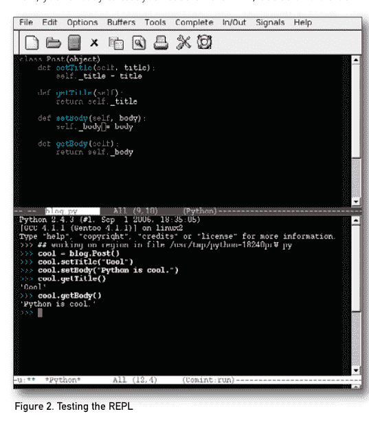

# EmperorLinux

……Linux 与笔记本电脑的交汇点


# 便携

自 1999 年以来，EmperorLinux 一直向大学、企业、政府实验室和个人 Linux 爱好者提供预装 Linux 的笔记本电脑。我们的笔记本电脑范围从功能齐全的超薄便携机到桌面替代机。所有系统均提供一年的 Linux 电话和电子邮件技术支持，并适用完整的制造商保修。

# Toucan T60/T60ws

- Lenovo ThinkPad T60/T60ws
- 最高 15.4” WSGA+，分辨率为 X@1680x1050
- ATI Mobility FireGL V5200
- 1833–2333 MHz Core 2 Duo
- 512 MB–4 GB RAM
- 60–120 GB 硬盘
- CD RW/DVD 或 DVD±RW
- 5.2–6.0 磅
- 10/100/1000 Mbps 以太网
- 802.11a/b/g (54Mbps) WiFi
- 起价 1950 美元


# 强劲

EmperorLinux 专门从事在 IBM、Lenovo、Dell、Sony 和 Panasonic 制造的各类优质笔记本电脑上安装 Linux。我们根据你的笔记本电脑定制你的 Linux 发行版选择，并提供以下支持：以太网、无线、X-server、ACPI 电源管理、USB、EVDO、PCMCIA、FireWire、CD/DVD/CDRW、声音等。

# Rhino D820/M90

- Dell Latitude D820/Precision M90
- 最高 17” WUXGA，分辨率为 X@1920x1200
- NVidia Quadro FX 3500M 图形
- 1667–2333 MHz Core 2 Duo
- 512 MB–4 GB RAM
- 60–160 GB 硬盘
- CD RW/DVD 或 DVD±RW
- 6.3–8.6 磅
- 802.11a/b/g (54Mbps) WiFi
- ExpressCard/EVDO
- 起价 1480 美元


# 独特

EmperorLinux 提供具有独特功能的 Linux 笔记本电脑。加固型 Panasonic 笔记本电脑专为恶劣环境设计：跌落、振动、沙石、雨水和其他极端情况。ThinkPad 平板电脑与其他笔记本电脑类似，具有 LCD 数位器，支持基于笔的输入，既可以作为鼠标使用，又具有压力敏感度，用于在屏幕上书写和绘图。

# Raven X60 Tablet

- Lenovo ThinkPad X60 Tablet
- 12.1” SXGA+，分辨率为 X@1400x1050
- 1667–1833 MHz Core Duo
- 1–4 GB RAM
- 80–120 GB 硬盘
- 3.8 磅
- 笔/触控笔屏幕输入
- 动态屏幕旋转
- 手写识别
- 提供 X60s 笔记本电脑
- 起价 2300 美元


www.EmperorLinux.com    1-888-651-6686

你需要在类名 *Post* 前添加 *blog.*，因为现在该类位于模块 *blog* 中。请参考图 2 以获得进一步参考。

当然，你可以在不使用 Emacs 的情况下做同样的事。但为此，你需要了解如何创建 Python 模块和包。相应地设置 *PYTHON_PATH*（一个环境变量），并使用内置函数 *reload*。使用 Emacs，你会发现代码编写和测试之间的迭代速度非常快。这种速度可以提高你的效率，使编程更有趣。事实上，Lisp 程序员倡导这种工作方式已有二十多年了。

# 特殊方法

创建一个对象然后设置其每个成员是不愉快的。这需要很多行代码，且非常容易出错——我记得设置标签了吗？有一种更好的方法——使用初始化方法。

这个特殊方法称为 `__init__`，你定义它接受的参数必须在创建对象时传入。一个可能的初始化方法如下：

```python
class Post(object):
    def __init__(self, title, body):
        self.set_title(title)
        self.set_body(body)
```

只需将 `__init__` 定义添加到文件中并重载它。我们现在可以在初始化时（并且必须）设置标题和正文：

```python
>>> cool = blog.Post('Cool', 'Python is cool')
>>> cool.get_title()
'Cool'
>>> cool.get_body()
'Python is cool'
>>>
```

提示：要在 Emacs 内的 REPL 中检索之前的行，请使用 `Alt-P`。

还有其他特殊方法。还记得评估 `Post` 本身有多丑吗？让我提醒你：

```python
>>> cool
<blog.Post object at 0xb7c7e9ac>
```

我们可以解决这个问题。还有一个名为 `__repr__` 的特殊方法，用于检索该字符串。在 `Post` 类内部添加：

```python
def __repr__(self):
    return "Blog Post: '%s' % self.get_title()"
```

按照之前加载文件的方式重新加载文件，并评估一个帖子：

```python
>>> ## working on region in file /usr/tmp/python...
>>> cool
<blog.Post object at 0xb7c7e9ac>
>>>
```

哎呀！这不是我们想要的。这里的问题是 `cool` 对象是用旧版本的 `Post` 类创建的，因此它没有新方法。这是一个非常常见的错误，如果对此没有准备，可能会引起许多麻烦。但只需重新创建对象，你就搞定了：

```python
>>> ## working on region in file /usr/tmp/python...
>>> cool = blog.Post('Cool', 'Python is cool')
>>> cool
Blog Post: Cool
>>>
```

这样就好多了。

# 接下来呢？

很简单——等待下一期 *Linux Journal* 的本教程第二部分。如果你现在真的想做点什么，开始学习 Emacs 吧。

José P. E. "Pupeno" Fernández 从……孩子多大能坐在椅子上够到键盘时就开始编程了。他尝试过的编程语言比本页能列出的还多。他的网站是 pupeno.com，除非你是垃圾邮件发送者，否则始终可以通过 pupeno@pupeno.com 联系到他。


# 资源

- Python: **python.org**
- Python 下载: **python.org/download**
- Python 2.4.3: **www.python.org/ftp/python/2.4.3/Python-2.4.3.tgz**


# 再次聆听你的思考！


# WhisperStation™

# 酷炫... 极速... 静音！

- 适用于 64 位 HPC、游戏和图形设计应用
- 体验“寂静之声”。
- 致电我们的技术销售团队 508-746-7341，今天就设计您的专属 WhisperStation™。

WhisperStation™ 最初是为汽车行业中的一群功耗需求高、要求严格的工程师设计的。它集成了双核 AMD Opteron™ 或 Intel® EM64T™ 处理器、超静音风扇和电源，以及内部隔音材料，从而构建了一个强大且静音的计算平台。WhisperStation™ 标配 2 GB 高速内存、NVIDIA e-GeForce 或 Quadro PCI Express 图形适配器以及 20 英寸 LCD 显示器。可以根据您的确切硬件规格配置为任何 Linux 发行版。也可提供 RAID 选项。当用作 Microway 集群的主节点时，WhisperStation™ 也会让系统管理员感到非常满意！访问 www.microway.com 获取更多技术信息。


# 使用 Qt 4.x 进行异步数据库访问

如何在 Qt 4 中编码以规避默认的同步数据库访问。

Dave Berton

Qt 4.x 中的数据库支持非常健壮。该库包含针对 Oracle、PostgreSQL、SQLite 以及许多其他关系型数据库的驱动程序。开箱即用的 Qt 数据库库还包含针对许多小部件的绑定，并为透明处理来自数据库的结果集提供了数据类型。但是，您的应用程序可能需要为这些便利性付出代价。所有数据库访问默认都是同步的，这意味着密集且耗时的 SQL 查询通常会锁定 UI，除非采取预防措施。使用服务器上的存储过程有时可以帮助缓解这种情况；然而，这并不总是可行或理想的。而且，通常应用程序生成的查询的长度和成本是无法预先得知的，这为不良的 UI 行为留下了隐患。人们不希望在奇怪的时刻应用程序“冻结”；然而，这是默认行为，因此我们必须与之抗争。

幸运的是，Qt 4.x 也提供了对多线程编程的健壮支持。通过将繁重的数据库工作放在单独的线程中，UI 可以自由地正常响应用户，而无需尴尬的中断。与所有并发编程一样，您必须采取预防措施以确保线程之间交互的正确顺序。例如，在线程之间共享数据时，使用互斥锁进行适当的保护。在线程之间通信时，仔细考虑交互的行为及其顺序。此外，当在使用与 UI 线程分离的线程内利用数据库连接时，您必须注意一些额外的注意事项。一种正确的实现，在考虑某些事项后，将显著提高数据库应用程序的 UI 行为和响应性。

# 线程策略

有几种方法可以将数据库负载分配到不同的执行线程中。幸运的是，在正确创建和使用数据库连接的细节上，它们都具有相同的特性。主要考虑因素是仅在使用该数据库连接创建的线程内使用它。对于常规的同步应用程序，默认行为是没问题的。`QSqlDatabase::addDatabase()` 静态函数在应用程序主 UI 线程的上下文中创建数据库连接。在此同一线程中执行的查询将导致阻塞行为。这是意料之中的。

为了在主 UI 线程并行运行查询，以便它们不会中断主事件处理循环，必须在该查询执行的线程中建立数据库连接，该线程应与主 UI 线程分离。无论您如何组织应用程序中的线程，您的设计必须能够在每个将执行数据库工作的线程上下文中建立连接。

例如，创建一个线程池，其中几个线程以轮询方式处理数据库查询负载（避免始终创建和销毁线程的开销），可以将耗时的工作推到主事件循环之外。或者，根据应用程序的需求，您可以简单地按需生成线程来执行数据库工作。在这两种情况下，您都必须为每个线程创建一个连接。

还有进一步的限制（由 Qt 使用的大多数底层特定数据库库施加）。一般规则是，连接不能被多个线程共享。这意味着您不能在启动时简单地创建连接池并按需将它们分配给各个线程。相反，每个线程必须在自己的上下文中建立并维护自己的连接。如果您违反这一点，可能会造成灾难性后果。可以使用 `QSqlDatabase::addDatabase()` 静态函数的名称参数在每个线程中建立多个独立连接，如列表 1 所示。

在列表 1 中，线程对象建立两个不同的数据库连接。每个连接都有单独的名称，以便 `QSqlDatabase` 可以在其内部列表中正确维护它们。最重要的是，每个连接都在每个对象的单独执行线程中建立——一旦新的执行线程启动，`run()` 方法就会由 `QThread::start()` 调用。`QSqlDatabase` 提供用于创建新连接的机制是线程安全的。列表 2 展示了另一种更通用方法的示例。

列表 2 中的伪代码创建并启动两个工作线程。每个线程建立到数据库的命名连接并等待工作。每个线程将始终只与其自己的数据库连接打交道，该连接永远不会被共享或在 worker 线程对象之外可见。

```cpp
// Listing 1. Create two instances of QThread, one for queries, another for updates.

class QueryThread : public QThread
{
    public:
        QueryThread( QObject* parent = 0 )
        {
            //...
        }
        void run()
        {
            QSqlDatabase db = QSqlDatabase::addDatabase(
                "QPSQL", "querythread" );
            // use 'db' here
        }
};

class UpdateThread : public QThread
{
    public:
        UpdateThread( QObject* parent = 0 )
        {
            //...
        }
        void run()
        {
            QSqlDatabase db = QSqlDatabase::addDatabase(
                "QPSQL", "updatethread" );
            // use 'db' here
        }
};
```

```cpp
// Listing 2. A More Generic Approach with a Single Instance of QThread Used Twice

class QueryThread : public QThread
{
    public:
        QueryThread( const QString name )
            : m_connectionName(name)
        {
            //...
        }
        void run()
        {
            QSqlDatabase db = QSqlDatabase::addDatabase("QPSQL", m_connectionName );
            //...
            db.open();
            forever
            {
                // wait for work
                // and then execute it...
            }
        }
    }

    void main()
    {
        QApplication app(...);
        MainWindow mw;
        QueryThread db1("queries");
        db1.start();
        QueryThread db2("updates");
        db2.start();
        //...
        mw.show();
        app.exec();
    }
```

设置线程特定的连接并在线程内运行查询只是问题的一部分。需要决定数据如何在工作线程和主应用程序 UI 线程之间来回传递。额外方法将向线程对象提供数据库工作以执行，而这些方法本身需要是线程安全的。

`QCoreApplication` 以线程安全的方式将这些事件从应用程序线程传递给工作线程，它们将由工作线程在其自己的执行上下文中处理。这一点至关重要，因为工作线程将仅在其自己的上下文中使用其数据库连接（列表 3）。这种方法在另一个方向上同样有效。由单独工作线程发布的事件将回到主 UI 事件循环中以便处理，处于 UI 执行线程的上下文中。这些事件可以例如包含查询或数据库更新的结果。这种方法很方便，因为工作线程可以简单地“发布并忘掉”，Qt 将为您处理线程间通信、互斥和内存管理。构建这种类型系统所需的所有必要事件和事件处理器具有优势——最显著的是编译时类型。

# 在线程间移动数据

您应该遵守围绕不同执行线程间共享数据的所有通常注意事项，包括互斥锁和等待条件的正确使用。此外，关于数据大小还有一个额外的复杂因素，在从数据库返回结果集的情况下，数据量可能非常大。

Qt 提供了几种专门的机制在线程之间发送数据。您可以使用线程安全函数 `QCoreApplication::postEvent()` 手动向任何线程中的任何对象发布事件。事件将由创建目标对象的线程的事件循环自动分发。为了在每个线程中创建事件循环，使用 `QThread::exec()`。使用这种方法，线程被赋予以事件形式执行的“工作”。

现在，线程间的通信变成了一件事：将一个线程的信号连接到另一个线程的槽，Qt 将处理线程间交换数据的互斥和线程安全问题。

```cpp
// Listing 3. Code That Shares Information from Worker Thread to Application Thread via Event

class WorkEvent : public QEvent
{
    public:
    enum { Type = User + 1 }
    WorkEvent( const QString& query )
      : QEvent(Type)
      , m_query(query)
    {}

    QString query() const
    {
      return m_query;
    }

  private:
    QString m_query;
};

QueryThread thread;
thread.start();
// ...
WorkEvent* e = new WorkEvent("select salary from employee where name='maggelena';");
app.postEvent( &thread, e );
// ...
```

```cpp
// Listing 4. Sharing information across threads is cleaner with signals and slots.

class Worker; // forward decl
class QueryThread : public QThread
{
 QueryThread();
 signals:
  void queryFinished( const QList<QSqlRecord>& records );
 slots:
  void slotExecQuery( const QString& query );
 signals:
  void queue( const QString& query );
 private:
  Worker* m_worker;
};

int main()
{
  QApplication app;

  MainWin mw;

  QueryThread t;
  t.start();

  connect(&mw, SIGNAL( execQuery(const QString&)),
          &t, SLOT( slotExecQuery(const QString&)));

  connect(&t, SIGNAL( queryFinished(const QList<QSqlRecord>&)),
          &mw, SLOT( slotDisplayResults(const QList<QSqlRecord>&)));

  mw.show();
  return app.exec();
}
```


# 特性：使用 Qt 4.x 实现异步数据库访问

检查。然而，设计并妥善处理所有事件可能是一项艰巨的任务，尤其是当你的应用程序需要执行多种类型的数据库查询，具有多种返回类型，每种类型都需要关联的事件和事件处理器时，情况更是如此。

幸运的是，Qt 允许在不同线程之间连接信号和槽——只要这些线程正在运行它们自己的事件循环。与发送和接收事件相比，这是一种更简洁的通信方法，因为它避免了在任何非平凡应用程序中变得必要的簿记工作和中间 QEvent 派生类。线程间的通信现在变成了将一个线程的信号连接到另一个线程的槽，而线程间交换数据时的静默和线程安全问题由 Qt 处理。

为什么需要在每个想要连接信号的线程中运行事件循环？原因是这与 Qt 在将一个线程的信号连接到另一个线程的槽时使用的线程间通信机制有关。当建立这种连接时，它被称为队列连接。当通过队列连接发出信号时，槽将在目的对象的事件循环下一次执行时被调用。如果槽是由来自另一个线程的信号直接调用的，那么该槽将在调用线程的相同上下文中执行。通常，这不是你想要的（特别是如果你正在使用数据库连接，因为数据库连接只能由创建它的线程使用）。队列连接通过依托事件系统，将信号正确地分派给线程对象，并在其自己的上下文中调用其槽。这正是我们在线程间通信中，特别是当某些线程正在处理数据库连接时所期望的。Qt 的信号/槽机制从根本上是上述线程间事件传递方案的实现，但具有更简洁、更易用的接口。

例如，你可以在主 UI 对象和工作线程对象之间创建两个简单的连接；一个用于向工作线程添加查询，另一个用于报告结果。这种简单的设置，仅需几行代码，就建立了异步数据库应用的主要通信机制（清单 4）。

在这里，MainWindow 和 QueryThread 对象通过信号和槽以通常的方式直接相互通信。这里的诀窍在于，QueryThread 对象在幕后利用一个 Worker 对象来执行所有工作。为什么需要这种额外的间接层？因为我们希望将工作分派给一个与完全独立的执行线程相关联的对象。

# 清单 5. 额外的间接层使执行更具异步性。

```cpp
class Worker : public QObject
{
    Q_OBJECT

    public:
        Worker( QObject* parent = 0 );
        ~Worker();

    public slots:
        void slotExecute( const QString query );

    signals:
        void results( const QList<QtSqlRecord>& records );

    private:
        QtSqlDatabase m_database;
};

void QueryThread::run()
{
    // Create worker object within the context of the new thread
    m_worker = new Worker();

    // Forward to the worker: a 'queued connection'!
    connect( this, SIGNAL( queue( const QString& ) ),
             m_worker, SLOT( slotExecute( const QString& ) ) );
    // forward a signal back out
    connect( m_worker, SIGNAL( results( const QList<QtSqlRecord>& ) ),
             this, SIGNAL( queryFinished( const QList<QtSqlRecord>& ) ) );

    exec(); // start our own event loop
}

void QueryThread::execute( const QString& query )
{
    emit queue( query ); // queues to worker
}
```

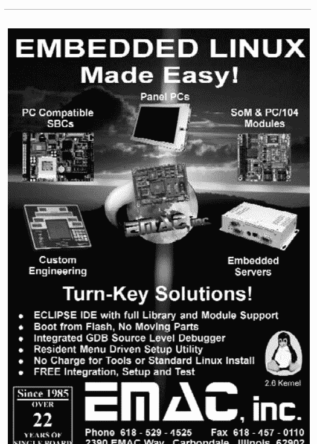

请注意上面，QueryThread 在主执行线程中实例化并 start()；因此，QueryThread 将“属于”应用程序的主线程。将应用程序的小部件信号连接到其槽将通过“直接”连接——它们将由 Qt 以通常的方式立即调用，从而成为阻塞的同步函数调用。相反，我们感兴趣的是将信号“推”入运行在完全独立的执行线程中的槽，这正是内部 Worker 类发挥作用的地方（清单 5）。

利用这个内部的 Worker 类，QueryThread 可以通过使用 Qt 提供的方便的线程间信号/槽队列连接，将 SQL 查询适当地分派到单独的线程。QueryThread 封装了线程的概念，因为它从 QThread 派生并且能够 start() 一个新的执行线程，它还封装了工作者的概念（通过暴露执行数据库工作的便捷方法，这些方法内部被分派到独立的执行线程）。因此，与纠缠于完成相同任务所需的所有必要事件和事件处理器相比，Qt 元对象系统为你提供了所有必要的代码，并暴露 connect() 函数来触发这一切。信号可以在任何时间发出，并会正确地分派到目的对象，在该对象的上下文中执行。

需要注意的是，上述 QueryThread 的 execute() 方法旨在由主应用程序同步调用。QueryThread 提供此方法不仅是为了方便；实际上，它还封装并隐藏了 QueryThread 类用户所需的所有队列连接细节。当 execute() 被调用时，QueryThread 简单地将其作为信号发出到 worker。由于 worker 是一个“生活在”独立线程中的对象，Qt 将“排队”该连接并通过事件循环传递，使其到达 worker 的适当执行上下文——这对于 worker 根据本文开头列出的规则利用其数据库连接至关重要。最后，来自 worker 的任何信号都通过 QueryThread 接口“转发”回来——这是 QueryThread 用户的另一个便利，同时也向那些最初不需要了解 Worker 类细节的人隐藏了所有这些细节。

如果你的查询巨大，或者潜在地可能巨大，你应该考虑不同的策略来处理结果集。例如，在将结果传回 UI 之前将其写入磁盘，可以帮助减少应用程序的内存负载，代价是运行速度稍慢。然而，如果你已经在处理大量查询，与查询的总体执行时间相比，速度下降可能微乎其微。因为所有数据库查询都在与 UI 完全独立的线程中执行，用户不会察觉到明显的滞后。将中间结果存储在文本文件中，或者为了最大灵活性，存储在本地 SQLite 数据库中。

这个谜题还有一个部分需要解决。队列连接机制依赖于线程的事件循环，以便适当地在线程的上下文中调用槽，如前所述。然而，为了整理分派事件到另一个执行线程所需的数据，Qt 对象系统必须知道信号/槽声明中使用的任何自定义数据类型。未注册自定义数据类型会导致队列连接失败，因为为了分派事件，必须复制信号的每个参数。幸运的是，“注册”附加类型是很简单的事情，只要这些类型具有公共构造函数、拷贝构造函数和析构函数（清单 6）。

# 清单 6. 为了共享自定义数据类型，你必须注册它们。

```cpp
// first, make the object system aware
qRegisterMetaType< QList<QtSqlRecord> >("QList<QtSqlRecord>");
// now set up the queued connection
connect( m_worker, SIGNAL( results( const QList<QtSqlRecord&> ) ),
	this, SIGNAL( queryFinished( const QList<QtSqlRecord&> ) ) );
```

随本文提供的示例应用程序实现了上述策略，其中查询与应用程序的其他部分并行执行 [该应用程序可从 Linux Journal FTP 站点 ftp.linuxjournal.com/pub/lj/ issue158/9602.tgz 下载]。在查询进行时，UI 不受干扰。在适当的类型在 Qt 元对象系统中注册后，QueryThread 接口和封装的 worker 线程之间建立了队列连接。这使得独立的线程能够以最小的开销和代码复杂度安全地相互通信。该示例应用程序已在 SQLite 和 PostgreSQL 上进行测试；然而，它将与 Qt 支持的任何执行相同每线程连接限制的数据库连接一起工作。

# 摘要

在使用 Qt 设计异步数据库应用程序时，应牢记以下几点：

- 每线程创建一个数据库连接。使用线程安全的 QSqlDatabase::addDatabase() 方法的 name 参数来区分各种数据库连接。
- 尽可能将数据库连接封装在工作线程对象中。绝不与其他线程共享数据库连接。绝不在创建它的线程以外的任何线程中使用数据库连接。
- 使用 Qt 提供的工具管理线程间通信。除了 QMutex、QSemaphore 和 QWaitCondition，Qt 提供了更直接的机制：事件和信号/槽。跨线程边界的信号/槽实现依赖于事件，因此，确保你的线程使用 QThread::exec() 启动它们自己的事件循环。
- 在 Qt 元对象系统中注册未知类型。任何未知类型在未首先调用 qRegisterMetaType() 的情况下无法正确整理。这使得队列连接能够使用新类型在独立线程的上下文中调用该线程的槽。
- 使用队列连接在应用程序和数据库线程之间进行通信。队列连接方法具有处理异步数据库连接的所有优点，同时使用 QObject::connect() 保持简单且熟悉的接口。

Dave Benton 是 Eventide, Inc. 的一名职业程序员。他欢迎您在 dbenton@eventide.com 处留言评论。


# 开源正在积聚势能。

在 LinuxWorld 大会上了解原因。

从虚拟化到移动应用，您将了解推动开源运动的因素。比以往任何时候都有更多的公司转向开源。例如，一家领先的日本汽车制造商利用它将其位于 1,300 家汽车经销商的 10,000 名用户与其美国总部连接起来。通过在高性能服务器上利用开源技术，他们在实施后节省了超过 650,000 美元。该系统现在处理关键任务功能，包括零部件订购、保修、销售交易和维修。为了加速您的计划，请注册 www.linuxworldexpo.com。

- 2007 年 8 月 6 日至 9 日
- Moscone 中心 - 旧金山

立即在 www.linuxworldexpo.com 注册

版权所有 © 2007 IDG World Expo Corp. 保留所有权利。LinuxWorld 和 LinuxWorld 会议 & 博览会是 International Data Group, Inc. 的注册商标。其他所有商标均为其各自所有者的财产。

- 白金赞助商
  - ACCESS ORACLE
- 金牌赞助商
  - Novell
- 银牌赞助商
  - APRO


# 以正确的方式使用 PHP 验证电子邮件地址

开发一个用于验证电子邮件地址的可用 PHP 函数。

# 道格拉斯·洛维尔

由 John Klensin 撰写的互联网工程任务组（IETF）文档 RFC 3696《名称检查和转换的应用技术》给出了几个有效的电子邮件地址，而这些地址被许多 PHP 验证例程所拒绝。地址 Abc@def@example.com、customer/department-shipping@example.com 和 !I#fI%y2¢g&6@c@example.com 都是有效的。文献中发现的一个较流行的正则表达式拒绝了它们全部：

```
"^[a-z0-9-]*\(\.[_a-z0-9-]*\)*@[a-z0-9-]+\(\. [a-z0-9-]+\)*\n\.\[a-z\]\.\[3\]}"
```

该正则表达式仅允许下划线 (_) 和连字符 (-) 字符、数字和小写字母字符。即使假设有一个预处理步骤将大写字母字符转换为小写，该表达式也会拒绝包含有效字符的地址，例如斜杠 (/)、等号 (=)、感叹号 (!) 和百分号 (%)。该表达式还要求最高级别域名组件仅有两个或三个字符，从而拒绝了诸如 .museum 等有效域名。

另一个受欢迎的正则表达式解决方案如下：

```
"^[a-zA-Z0-9-]+\.[a-zA-Z0-9-]+\.[a-zA-Z0-9-]+$/"
```

该正则表达式拒绝了前一段中提到的所有有效示例。它的优点在于允许大写字母字符，并且没有犯假设高级域名仅有两个或三个字符的错误。它允许无效的域名，例如 example..com。

清单 1 展示了来自 PHP Dev Shed ([www.php.net/manual/en/book.enchant.php](https://www.php.net/manual/en/book.enchant.php)) 的一个示例。该代码包含（至少）三个错误。首先，它无法识别许多有效的电子邮件地址字符，例如百分号 (%)。其次，它使用 @ 符号将电子邮件地址拆分为用户名和域名部分。包含带引号的 @ 符号的电子邮件地址，例如 Abc@def@example.com，将破坏此代码。第三，它未能检查主机地址的 DNS 记录。具有 A 类型 DNS 条目主机的将接受电子邮件，并且不一定发布 MX 类型条目。我并不是在苛责 PHP Dev Shed 的作者。超过 100 位审阅者给此方案打了四星（满分五星）的评价。

**清单 1. 不正确的电子邮件验证**

```php
function checkEmail($email) {
    if (preg_match("/^([A-Za-z0-9]+|[a-zA-Z0-9._-]+)"
                   "@([a-zA-Z0-9-]+)(.[a-zA-Z0-9-]+.-)+$/", $email)) {
        list($username, $domain) = split('@', $email);
        if (checkdnsrr($domain, 'MX')) {
            return false;
        }
        return true;
    }
    return false;
}
```

其中一个较好的解决方案来自 Dave Child 的博客 IlloveJackDaniels (ilovejacksdaniels.com)，如清单 2 所示 ([www.ilovejackdaniels.com/php/email-address-validation](https://www.ilovejackdaniels.com/php/email-address-validation))。Dave 不仅热爱传统的美式威士忌，他还做了功课，阅读了 RFC 2822，并认识到电子邮件用户名中有效字符的真实范围。大约 50 人在该网站上对此解决方案发表了评论，其中一些更正已被纳入原始解决方案中。IlloveJackDaniels 集体开发的代码中唯一的主要缺陷是它未能允许用户名中的带引号字符，例如 @。它将拒绝包含多于一个 @ 符号的地址，因此在使用 explode("@", $email) 拆分手名和域名部分时不会出错。一个主观的批评是，代码花费了大量精力检查域名部分每个组件的长度——这些精力最好用于简单地尝试域名查找。其他人可能会欣赏在网络上执行 DNS 查找之前对域名进行的尽职检查。

# 要求

IETF 文档，RFC 1035《域名实现和规范》、RFC 2234《语法规范的 ABNF》、RFC 2821《简单邮件传输协议》、RFC 2822《互联网消息格式》，以及 RFC 3696（前文引用），都包含与电子邮件地址验证相关的信息。RFC 2822 取代并使 RFC 822《ARPA 互联网文本消息标准》过时。

以下是电子邮件地址的要求及相关参考：

1. 电子邮件地址由用 @ 字符分隔的本地部分和域组成 (RFC 2822 3.4.1)。
2. 本地部分可以由字母和数字字符组成，以及以下字符：!、#、$、%、&、*、+、-、/、=、?、^、_、.、{、} 和 ~，可能带有在内部但不位于开头、结尾或另一个点分隔符旁边的点分隔符 (.) (RFC 2822 3.2.4)。
3. 本地部分可以由带引号的字符串组成——即引号 ("") 内的任何内容，包括空格 (RFC 2822 3.2.5)。
4. 带引号的配对（例如 @）是本地部分的有效组件，尽管这是来自 RFC 822 的过时形式 (RFC 2822 4.4)。
5. 本地部分的最大长度为 64 个字符 (RFC 2821 4.5.3.1)。
6. 域由点分隔符分隔的标签组成 (RFC 1035 2.3.1)。
7. 域标签以字母字符开头，后跟零个或多个字母字符、数字字符或连字符 (-)，以字母或数字字符结尾 (RFC 1035 2.3.1)。
8. 标签的最大长度为 63 个字符 (RFC 1035 2.3.1)。
9. 域的最大长度为 255 个字符 (RFC 2821 4.5.3.1)。
10. 域必须完全限定，并可解析为 A 类型或 MX 类型 DNS 地址记录 (RFC 2821 3.6)。

**清单 2. 来自 IlloveJackDaniels 的更优示例**

```php
function check_email_address($email) {
    // 首先，我们检查是否存在一个 & 符号。
    // 以及长度是否正确。
    if (!ereg("^[^"@][^"@]*[^"@]$", $email)) { } // 电子邮件无效，因为某个部分字符数量错误或 & 符号数量错误。
    return false;
    }
    } // 将其拆分为部分以简化生活
    $email_array = explode("@", $email);
    $local_array = explode("", $email_array[0]);
    for ($i = 0; $i < sizeof($local_array); $i++) { // 如果
        if (!ereg("^[\"[A-Za-z0-9] $&x; *+$*\" [\"]-[A-Za-z0-9] $&x; - *+?\"?
                    \"? \"-] [\" [\" [\"], {\" [\"], } [\"], }
                    \" [\" [\"@] [\"@] *?\", $local_array[$i])) {
            return false;
        }
    }
    } // 检查域是否为 IP。如果不是，
    // 它应该是有效的域名
    if (!ereg("^[\" [\" [\"@] [\"@] \", $email_array[1])) { }
    $domain_array = explode("", $email_array[1]);
    if (sizeof($domain_array) < 2) {
        return false; // 域的组成部分不足
    }
    } // For ($i = 0; $i < sizeof($domain_array); $i++) { }
    if (!ereg("^[ [A-Za-z0-9] [A-Za-z0-9] (0, 61) [A-Za-z0-9]
               \" [\" [\"@] [\"@] *+?\", $domain_array[$i])) { }
        return false;
    }
    }
    }
    return true;
}
```


要求四涵盖了一种现已过时的格式，该格式可以被认为是宽松的。发出新地址的代理可以合法地禁止使用这种格式；但是，使用此格式的现有地址仍然是有效的地址。

该标准假设使用七位字符编码，而不是多字节字符。因此，根据 RFC 2234，“字母”对应拉丁字母字符范围 a–z 和 A–Z。同样，“数字”指数字 0–9。华丽的国际标准 Unicode 字母表并未被兼容——甚至没有以 UTF-8 编码。在这里，ASCII 仍然占主导地位。

# 开发更好的电子邮件验证器

这有很多要求！其中大多数都涉及本地部分和域名。因此，从围绕“@”符号分隔符拆分电子邮件地址开始是有道理的。要求 2–5 适用于本地部分，而 6–10 适用于域名。

在本地名称中，可以转义“@”符号。例如，Abc\@def@example.com 和 "Abc@def"@example.com。这意味着对“@”符号进行拆分，`$split = explode("@", $email);` 或其他类似的分离本地部分和域名部分的方法并不总是有效的。我们可以尝试移除转义的“@”符号，`$cleanat = str_replace("\@", "", $email);` 但这会遗漏一些病态案例，例如 Abc\\@example.com。幸运的是，在域名部分不允许使用转义的“@”符号。最后一次出现的“@”符号肯定就是分隔符。因此，分离本地部分和域名部分的方法是，使用 strrpos 函数查找电子邮件字符串中最后一个“@”符号。

列表 3 提供了一种更好的方法来拆分电子邮件地址的本地部分和域名。如果电子邮件字符串中没有“@”符号，strrpos 的返回类型将是布尔值 false。让我们先进行简单的测试。检查本地部分和域名的长度很简单。如果这些测试失败，就没有必要进行更复杂的测试了。列表 4 展示了进行长度测试的代码。

# 列表 3. 拆分本地部分和域名

```php
$isValid = true;
$atIndex = strrpos($email, "@");
if (!is_bool($atIndex) && !$atIndex)
{
    $isValid = false;
}
else
{
    $domain = substr($email, $atIndex+1);
    $local  = substr($email, 0, $atIndex);
    // ... 处理域名和本地部分
}
```

# 列表 4. 本地部分和域名的长度测试

```php
$localLen = strlen($local);
$domainLen = strlen($domain);
if ($localLen < 1 || $localLen > 64)
{
    // 本地部分长度超出限制
    $isValid = false;
}
else if ($domainLen < 1 || $domainLen > 255)
{
    // 域名部分长度超出限制
    $isValid = false;
}
```

# 列表 5. 本地部分内容的部分测试

```php
if (!preg_match('/^([\\\\.\\[A-Za-z0-9!#$%&'*+/=?^`{|}~_-]*)$/s',
        str_replace('\\\\', '', $local)))
{
    // 本地部分中字符无效，除非
    // 本地部分被引用
    if (preg_match('/^\\\\'"'""]*\\\\'"'"']*$/',
        str_replace('\\\\', '', $local)))
    {
        $isValid = false;
    }
}
```

# 列表 6. 检查本地部分中点的位置。

```php
if ($local[0] == '.' || $local[strlen($local)-1] == '.')
{
    // 本地部分以 '.' 开头或结尾
    $isValid = false;
}
else if (preg_match('/\.\./', $local))
{
    // 本地部分包含两个连续的点
    $isValid = false;
}
```

# 列表 7. 域名检查

```php
if (!preg_match('/^[A-Za-z0-9\\\\-.]*$/', $domain))
{
    // 域名部分中字符无效
    $isValid = false;
}
else if (preg_match('/\\\\.\\\\./', $domain))
{
    // 域名部分包含两个连续的点
    $isValid = false;
}
else if (!(checkdnsrr($domain, "MX") || checkdnsrr($domain, "A")))
{
    // 在 DNS 中未找到域名
    $isValid = false;
}
```

# 列表 8. 测试电子邮件验证函数。

```php
<?php
require("validateMail.php"); // 你喜欢的任何文件

function testEmail($email)
{
    echo $email;
    $pass = validateMail($email);
    if ($pass) {
        echo " 是有效的。\n";
    } else {
        echo " 是无效的。\n";
    }
    return $pass;
}

$pass = true;
echo "所有这些都应成功：\n";
$pass &= testEmail("dcloiou.1bm.com");
$pass &= testEmail("abc\@Wdef@example.com");
$pass &= testEmail("abc\\\@example.com");
$pass &= testEmail("Fred B\Blogs@example.com");
$pass &= testEmail("Joe.\B10w@example.com");
$pass &= testEmail("^"AbcWdef"@example.com");
$pass &= testEmail("\"Fred Blogs"@example.com");
$pass &= testEmail("customer/department=shipping@example.com");
$pass &= testEmail("$A123456@example.com");
$pass &= testEmail("!def!xyz$abc@example.com");

$pass &= testEmail(".someename@example.com");
$pass &= testEmail("user+mailbox@example.com");
$pass &= testEmail("peter.piper@example.com");
$pass &= testEmail(""Doug\" \\ ""Ace"" \\ ""L""L"@example.com");
$pass &= testEmail(""Doug\" \\ ""Ace"" \\ ""L""@example.com");
echo "\n所有这些都应失败：\n";
$pass &= !testEmail("abc\@Wdef@example.com");
$pass &= !testEmail("abc\\@Wdef@example.com");
$pass &= !testEmail("abc\\@example.com");
$pass &= !testEmail("@example.com");
$pass &= !testEmail("doug@"));
$pass &= !testEmail(""""@example.com"));
$pass &= !testEmail("o@o\@example.com"));
$pass &= !testEmail(".dot@example.com");
$pass &= !testEmail("dot_.dot@example.com");
$pass &= !testEmail("two..dot@example.com");
$pass &= !testEmail("""Doug\" \\ ""Ace"" \\ ""L""@example.com");
$pass &= !testEmail("""Doug"" \\ ""Ace"" \\ ""L""@example.com");
$pass &= !testEmail("hello world@example.com");
$pass &= !testEmail("gatsby@f.s.c.ot.f.i.tz.g.m.r.1.d.");
echo "\n电子邮件验证 ";
if ($pass) {
    echo "通过了所有测试。\n";
} else {
    echo "存在缺陷。\n";
}
?>
```

现在，本地部分有两种形式之一。它可以有开始和结束引号，且没有未转义的嵌入引号。本地部分，Doug \"Ace\" L. 就是一个例子。本地部分的第二种形式是 (+.+)，其中 + 代表一系列允许的字符。第二种形式比第一种更常见；因此，先检查它。在未引用的形式测试失败后，再查找被引用的形式。

使用反斜杠 (\) 进行引号引用会引发一个问题。此格式允许加倍反斜杠字符以在解析结果中获得一个反斜杠字符 (\)。这意味着我们需要检查非反斜杠字符前的反斜杠字符数量是否为奇数。我们需要允许 \\\\ 并拒绝 \\\\\\.

可以编写一个正则表达式来查找非反斜杠字符前的奇数个反斜杠。这是可能的，但不太美观。由于反斜杠字符在 PHP 字符串中是转义字符，在正则表达式中也是转义字符，因此其吸引力进一步降低。我们需要在表示正则表达式的 PHP 字符串中写入四个反斜杠字符，才能让正则表达式解释器看到一个反斜杠。一个更具吸引力的解决方案是，在使用正则表达式检查之前，简单地从测试字符串中去除所有的反斜杠字符对。str_replace 函数正符合这一需求。列表 5 展示了本地部分内容测试。

外层测试中的正则表达式查找一系列允许或转义的字符。如果失败，内层测试则查找转义的引号字符序列，或一对引号内的其他任何字符。

如果你正在验证作为 POST 数据输入的电子邮件地址（这是很可能的），你必须小心包含反斜杠 (\)、单引号 (') 或双引号 ("") (\) 的输入。PHP 可能会也可能不会在 POST 数据中出现这些字符的地方用额外的反斜杠字符进行转义。这种行为的名称是 magic_quotes_gpc，其中 gpc 代表 get, post, cookie。你可以通过函数 get_magic_quotes_gpc() 停止这种“魔法”代码，并在肯定响应时去除添加的反斜杠。你还可以确保 PHP.ini 文件禁用了这个“功能”。另外两个需要注意的设置是 magic_quotes_runtime 和 magic_quotes_sybase。

列表 5 中的两个正则表达式之所以吸引人，是因为它们相对容易理解，并且不需要重复允许的字符组 ([A-Za-z0-9!#$%&'*+\-/=?^_`{|}~-.])。这里有一个测试题给你。为什么字符组在正斜杠前需要两个反斜杠字符，而在单引号前需要一个反斜杠字符？

列表 5 中外部测试的一个缺陷是，它会让包含字符串中任何位置有点的本地部分字符串通过。要求二指出，点不能位于本地部分的开头或结尾，也不能连续出现两次或更多次。我们可以通过将外部正则表达式扩展为 (+a+) 形式来解决这个问题，其中 a 是 [(\\[A-Za-z0-9!#$%&'*+\-/=?^_`{|}~-.])\. 我们可以这样做，但这会导致一个冗长、难以阅读、重复且难以相信的表达式。添加列表 6 中显示的简单检查会更清晰。


# 使用 PHP 验证电子邮件地址

清单 9. 完整的电子邮件验证函数
```php
/**
 * 验证电子邮件地址。
 * 提供电子邮件地址（原始输入）
 * 如果电子邮件地址符合电子邮件
 * 格式且域名存在，则返回 true。
 */
function validEmail($email)
{
    $isValid = true;
    $atIndex = strpos($email, "@");
    if (is_bool($atIndex) && !$atIndex)
    {
        $isValid = false;
    }
    else
    {
        $domain = substr($email, $atIndex+1);
        $local = substr($email, 0, $atIndex);
        $localLen = strlen($local);
        $domainLen = strlen($domain);
        if ($localLen < 1 || $localLen > 64)
        {
            // 本地部分长度超出限制
            $isValid = false;
        }
        else if ($domainLen < 1 || $domainLen > 255)
        {
            // 域名部分长度超出限制
            $isValid = false;
        }
        else if ($local[0] == '.' || $local[$localLen-1] == '.')
        {
            // 本地部分以 '.' 开头或结尾
            $isValid = false;
        }
        else if (preg_match('/\\./', $local))
        {
            // 本地部分包含两个连续的点
            $isValid = false;
        }
        else if (!preg_match('/[A-Za-z0-9!#$%&\'*+\/.^_`{|}~--]+$/', $domain))
        {
            // 域名部分包含无效字符
            $isValid = false;
        }
        else if (preg_match('/\\./', $domain))
        {
            // 域名部分包含两个连续的点
            $isValid = false;
        }
        else if (!preg_match('/^([A-Za-z0-9!#$%&\'*+\/.^_`{|}~--]+)\.',
                            str_replace("\\", "", $local)))
        {
            // 本地部分包含无效字符，除非
            // 本地部分被引号包围
            if (!preg_match('/["\'](["\']+)+["\']+$/',
                            str_replace("\\", "", $local)))
            {
                $isValid = false;
            }
        }
        if ($isValid && !(checkdnsrr($domain,"MX") ||
                          checkdnsrr($domain,"A")))
        {
            // 在 DNS 中未找到域名
            $isValid = false;
        }
    }
    return $isValid;
}
```

本地部分的检查已经完成。代码现在检查了本地部分的所有要求。对域名的检查将完成电子邮件验证。代码本可以单独检查域名中的每个标签，就像清单 2 中那个喜爱威士忌的代码片段所做的那样，但正如之前暗示的那样，这里提出的解决方案让 DNS 检查承担大部分域名验证工作。

清单 7 进行了初步检查，确保域名部分只包含有效字符，且没有重复的点。随后，它对 MX 和 A 记录进行 DNS 查询。仅当 MX 记录检查失败时，它才执行对 A 记录的检查。清单 4 中的代码验证了域名的长度。

那么，它足够好吗？这由你来决定。但测试其逻辑以确保其至少是正确的会很不错。清单 8 包含了一系列任何电子邮件验证都应通过的电子邮件地址测试用例。务必运行测试以查看有效和被拒绝的电子邮件地址，PHP 字符串内的双重转义符 \ (\\) 往往会使地址变得难以辨认。我们向你发出挑战，用此测试来检验你最喜欢的电子邮件验证代码。请相信，清单 9 中的代码确实通过了测试！

清单 9 包含一个完整的电子邮件地址验证函数。它不像许多其他函数那样简洁——当然不是一行代码就能搞定的。但它的阅读和理解非常直观，并且能够正确地接受和拒绝许多其他已发布的函数错误拒绝和接受的电子邮件地址。该函数大致按照成本递增的顺序排列验证测试。特别是，更复杂的正则表达式，以及肯定是 DNS 查询，都放在最后。

传播这个知识吧！存在一种风险，即常见用法和广泛的随意编码可能会确立一种事实上的电子邮件地址标准，该标准比记录在案的正式标准更具限制性。如果你想欺骗垃圾邮件机器人，可以采用诸如 [^\^|D@*^G@^cartron.com] 这样的电子邮件格式。不幸的是，你可能会发现一些合法的电子商务网站也是如此。你觉得哪一个适应得更快？

> Douglas Lowell 是 IBM Rational 的软件工程师，是 Sams 出版的《XSL 格式化对象开发者手册》的作者，同时也是 ia452.org 网站的主编。

# 2007 USENIX 年度技术会议
加利福尼亚州圣克拉拉 • 2007 年 6 月 17 日 – 22 日


USENIX
不要错过在广泛的技术和环境中取得突破性研究和尖端实践的最新进展。

- **6 天的行业专家培训，包括：**
  - Richard Bejtlich 讲解 TCP/IP 武器学校，第 2–3 层
  - Tom Christiansen 讲解高级 Perl 编程
  - Jacob Farmer 讲解下一代存储网络
  - Steve VanDevender 讲解高容量电子邮件系统设计
  - 以及另外 30 多场全天和半天教程

- **3 天的技术议程，包括：**
  - 同行评审论文领域的最新研究
  - 由 *斯坦福大学* 的 Mendel Rosenblum 发表的主题演讲
  - 专家主导的邀请演讲
  - “大师在此”环节
  - BoFs、海报环节等更多活动

加入我们，参加 2007 年 USENIX 年度技术会议，地点在加利福尼亚州圣克拉拉，时间为 6 月 17 日 – 22 日。

2007 年新内容：
**SANS 安全培训**


请在 6 月 1 日前注册以享受优惠！ • www.usenix.org/usenix07/lj

# CHRISTOF WITTIG 和 TED NEWARD 谈面向对象的编程语言映射到数据库

语言到数据库映射的问题。
*Nicholas Petreley*

我敦促我们的读者阅读 Ted Neward 的《计算机科学的越南战争》，该文章将越南战争的泥潭与我们试图将面向对象语言与关系型甚至对象关系型数据库融合所产生的当前泥潭进行了比较。可以在 [www.odbms.org/vietnam.html] 找到 Ted 文章的链接。

文章讨论了一个称为对象关系阻抗失配的问题。以下是我对该问题的总结：

我们手头有两种很棒的技术：面向对象语言和关系型数据库。然而，当你试图将两者融合时，问题就出现了，因为两者都不是为了与对方无缝协作而设计的。查询示例（Query-By-Example）风格的编程可能解决这个问题，但这仅适用于简单的数据库访问。将类映射到表可能可行，但数据库的规范化使这种方法变得困难。例如，“客户”表不太可能包含客户居住的城市和州。数据库管理员（DBA）很可能会将此类数据提取出来，并按邮政编码存储在另一张表中。一种选择是直接将查询字符串传递给数据库并手动整理字段。如果数据类型处理不当，这很可能导致性能问题和故障。为了增加复杂性，即使你做对了所有事情，仍然存在 DBA 以破坏代码的方式更改数据库的可能性。

像 PHP 这样的语言包含一些技巧来帮助平滑语言到数据库的映射，但即使这些技巧也可能被数据库架构的某些更改所破坏。问题在于，这些选项仅仅是技巧，而不是真正的数据库到语言映射技术。

**LJ：** 这是否很好地总结了情况，还是你有什么想要补充的？

**TED：** 这里涉及许多问题，其中之一是开发人员和 DBA 之间关于“谁拥有数据”以及更重要的是与这些数据对应的架构之间的根本张力。拥有架构的开发人员会创建对他们使用舒适但对 DBA 操作不便的东西，而拥有架构的 DBA 会创建对他们维护和报告容易的东西，但这反过来会给开发人员造成不便。暗示任何技术都将完全消除那些从根本上植根于政治的问题，这是有点愚蠢的。

**CHRISTOF：** 对象/关系型双架构方法，将数据置于应用程序之上并交给 DBA，在传统的、集中的企业 IT 环境中具有组织优势。然而，有一类应用程序，其数据存储是完全嵌入式的，对最终用户是不可见的——例如在设备软件中，在你手机或 PC 上的软件包中，在实时控制系统和 SOA 应用程序中。这些零管理数据库场景从拥有两个架构中没有任何好处，却要承担调和这些本质上不兼容模型的全部成本。在网络化世界中 proliferated 的分布式和移动软件架构，推动了对零管理数据库引擎的需求，因此未来我们将听到更多这样的内容。

**LJ：** 我意识到并非所有自称“关系型”的数据库都真正符合 Codd 和 Date 对关系型数据库的学术观点。但除此之外，这个问题是否仅限于关系型数据库映射到面向对象语言？对象关系型数据库（ORDBMS）为什么不解决这个问题？或者它们确实解决了？

**TED：** 在许多方面，阻抗失配不仅仅局限于对象和关系；试图将对象塞进层次化数据格式（如 XML）也会遭受一些同样的问题。因此，暗示这只是“仅仅”是一个对象关系型问题是具有误导性的。Date 在此问题上的立场很有趣；他坚持认为 ORDBMS 实际上并不存在，其……

芯片制造、仓库自动化和其他吞吐量密集型系统需要

# 高速

处理

c-tree 技术

FairCom 数据库
技术使其成为可能。


# FairCom

www.faircom.com/go/?speed


对象的字段实际上不过是表中的列（或者用他更正式的说法，是关系中的属性）。这也意味着继承不过是表之间的一种简单关联，它们以某种他似乎没有明确说明的方式（至少在《*Introduction to Database Systems*》的第八版中）默默地结合在一起。虽然我不打算与他争论关系理论，但我怀疑他对对象世界的观点受到了一定的质疑，因此并不完全准确。

**LJ：** 有些人质疑你为什么将这个技术问题与越南战争相提并论，甚至认为这种比较完全不恰当。对此你怎么看？

**TED：** 我其实有两种反应。首先，对于那些因为有人将越南与战争或政治冲突无关的领域进行类比而感到冒犯的人，我为他们的不满感到抱歉，但美国介入越南战争已经过去了30多年，我们作为国家是时候成熟起来，停止 nurturing 旧伤疤了。是的，坏事发生了，有些发生在我们身上，有些是因为我们而发生的。现在是时候开始批判性地审视越南，而不是以条件反射般的情绪化反应模式来看待它。

其次，越南在许多方面是与许多对象/关系映射工具中所发生的情况的完美类比，不仅仅因为越南如今是“泥潭”的同义词，还因为根据罗伯特·麦克纳马拉最近出版的回忆录，美国领导层知道他们正在陷入一个潜在的泥潭，并认为他们能以某种方式驾驭它。对许多人来说，越南是目标不明的定义，但麦克纳马拉的回忆录清楚地表明，美国实际上是在试图“赢得”战争，即赢得越南人民“心”的战争。只是他们不清楚如何利用现有工具来实现这一目标。O/R-M 的情况类似：我们想要发生什么是很清楚的，只是不清楚我们如何让它发挥作用。

**LJ：** 我上次跟您交谈时的印象是，db4o 用户们清楚地意识到这种阻抗失配，因此他们贡献的代码和需求正是为了解决这个问题，而不是迫使你接受 SQL 模型。我理解得对吗？

**CHRISTOF：** 是的，实际情况是，一些管理人员希望在评估电子表格中“SQL”旁边看到一个勾选。然而，面向对象的开发人员并不希望使用 SQL 来访问他们的数据，除非迫不得已或他们不知道替代方案。事实上，SQL 是一种 DBA 语言，而不是开发人员语言。我们的开发人员使用 Java 和 .NET。因此，db4o 拥有“Native Queries”（原生查询），即使用原生 Java 或 .NET 语义查询数据库的能力，这是一种类型安全且 100% 面向对象的解决方案，例如。

**LJ：** 那报告（reporting）呢，比如？

**CHRISTOF：** 如果你使用 db4o 运行分布式应用程序，通常不需要报告（你会在车里运行 Crystal Reports 吗？）。如果你仍然需要在某个阶段将你的数据链接到后端 RDBMS，那么你可以使用 db4o 复制同步（dRS），它使用 Hibernate 将持久化对象同步到中心关系数据仓库，用于分析、备份等。

具体到报告，实际上可能会走向面向对象。Java 领域的几家供应商（Actuate, Elixir, JasperSoft）以及 Microsoft 在 .NET 中（Visual Studio 2005—ReportViewer）已经推出了面向对象报告工具。甚至，你可能发现针对普通业务对象，比如“customer”（客户），比针对具有晦涩名称的无类型规范化表进行报告更容易。

**LJ：** db4o 究竟如何解决这种阻抗失配？

**TED：** db4o 的方法，像其他 OODBMS 一样，通过不试图将对象以外的任何东西存储到系统中来避免阻抗失配。换句话说，本身没有“映射”，因为没有东西需要映射。（显然，内部 db4o 进行了一些存储技巧以避免明显的低效率，但这些技巧与任何关系数据库使用的技巧相同，并且在很大程度上对于最终用户来说是黑盒且不可见的。）这意味着存储数据的模式就是对象本身的模式，从而避免了我在越南战争文章中提到的“双模式问题”。

**CHRISTOF：** 类模型 == 数据库模式。

**LJ：** 是否可以说，你们希望 db4o 看起来像是 Java 的一个扩展，从而避免阻抗失配？这在实现上可能吗？

**TED：** 我不确定我会说它是 Java 的扩展，而是一个基本上透明的持久化系统。多年来，有许多研究项目试图使持久化完全透明，包括 Java 领域的几个项目，它们玩了一些有趣的技巧，比如在“new”调用时挂钩构造函数以创建持久对象，以及在调用非默认构造函数时从持久空间加载对象等。由于各种原因，这些大多数都没有走出研究阶段，所以我会对建议 db4o “扩展” Java（或 .NET，在那方面）持一点谨慎态度。

**CHRISTOF：** 严格来说，你是对的，Ted。但如果说我们有一种设计哲学，那就是——尽可能透明。让我们在使用持久化时尽可能使用 Java 或 .NET 的语义和行为，使其对开发人员来说最少侵入且最直观。

**LJ：** 所以 db4o 的学习曲线不是很陡峭？

**CHRISTOF：** 不。事实上，odbmsjournal.com 上有一个播客（第 2 集）表明你只需要五分钟就可以开始使用 db4o——包括下载！更具挑战性的是，有些人必须改掉不良的（非面向对象）习惯。他们会问，“我的主键在哪里？”（在面向对象编程中没有主键。）因此，对我们来说，与年轻开发人员合作实际上最容易，特别是在亚洲，他们没有心理遗留问题，并且在编写持久化相关代码时享受十倍的生产力提升。

**LJ：** 当我与数据库设计师和程序员交谈时，我经常听到他们赞美像 P1CK 这样的多值数据库。你们从用户和开发人员那里收到对多值字段的需求吗？

**TED：** 我的经验不同——多值数据库用起来很别扭且困难。我认为最终推动讨论的是个人自身的经验，以及你发现什么是显而易见的和直观的。

就我个人而言，我认为 Date 也会同意这一点，多值字段是大忌，应该避免，因为我个人非常强烈地相信关系模型在数据存储和操作中的力量。

**LJ：** 这与 O/R 映射如何契合？这会带来更多问题吗？

**TED：** 在某些方面，不会，因为那只是将类属性中存储的 List（或其他集合）。但在其他方面，这对 O/R-M 工具来说将是一个重大问题，因为现在要决定类内部的 List 是映射为多值字段还是作为到另一张表的关联，将需要在字段上添加另一个注释/属性来控制映射，从而在对象模型和数据库模式之间产生更多的耦合。

**LJ：** Java 的 GPL 化在多大程度上影响了你们的工作？它对你们的业务构成挑战还是机会？

**CHRISTOF：** GPL 化，实际上是 Java 的双许可证，对 db4o 来说是三大好消息。首先，Java 的开源确实促进了 Java 生态系统，从 IBM 到 Eclipse 到许多开源项目和初创公司。其次，通过开源，我们可以展望构建比之前可能的更紧密的 db4o 持久化解决方案与 Java VM 的集成。第三，双许可证模式本身，如 MySQL、db4objects、Trolltech 和许多其他公司所用，作为可行的开源商业模式得到了进一步的背书，这也使我们的公司生活变得更加轻松。

**LJ：** 你的客户对 Java 转向 GPL 这一事实有何反应？你看到对 Java 的兴趣增加还是减少？对 db4o 的兴趣增加还是减少？

**CHRISTOF：** 在过去几个月里，我们看到了 db4o 的 Java 用户的大量增长，无论是在绝对数量上还是相对于我们其他平台 .NET 的比例。我们并不真正知道这是否是因为 Java 开源，但这将提供一个很好的解释。

**LJ：** 非常感谢你抽出时间和精力与我们交谈。

Nicholas Petreley 是 Linux Journal 的主编，也是一位前程序员、教师、分析师和顾问，已经从事 Linux 工作和写作超过十年。

# 从未试过 SlickEdit？

# 你有什么借口？

# 不使用 SlickEdit 的 10 个理由

1. 我输入得越多，我就越擅长。
2. 晚上 10 点后办公室非常安静。
3. 真正的程序员不需要花哨的工具。
4. 没有什么比手动格式化代码更令人满足的了。
5. 如果我的重复性劳损足够严重，我会获得残疾津贴。
6. 我是按小时计薪的。
7. 里程碑？什么是里程碑？
8. 深夜的交通要轻松得多。
9. 如果我按时完成任务，他们只会给我更多的活。
10. 我本来就不喜欢和家人在一起。

实际上，只有一个好的理由不使用 SlickEdit——你从未尝试过它。19 年来，强大的程序员们发现我们的多语言开发工具和高级代码编辑器超出了他们的期望。SlickEdit 证明了其快速、强大和灵活——无论你是在 Windows、Linux、UNIX 还是 Mac OS 上开发。无论你的环境如何，SlickEdit 都有适合你的工具。我们的产品套件包括 SlickEdit®、SlickEdit® Tools for Microsoft® Visual Studio® 2005 以及 SlickEdit® Plug-in for Eclipse®。


www.slickedit.com

在 www.slickedit.com/trial 下载免费试用版，或致电 1-800-934-3348。


# 元编程入门

如何编写能生成程序的程序。
ARIEL ORTIZ

元程序是一种生成其他程序或程序部分的程序。因此，元编程指的是编写元程序。在 Linux 系统中有许多实用的元程序；最常见的包括编译器（GCC 或 FORTRAN 77）、解释器（Perl 或 Ruby）、解析器生成器（Bison）、汇编器（AS 或 NASM）以及预处理器（CPP 或 M4）。通常，你使用元程序来消除或减少繁琐或容易出错的编程任务。例如，与其手动编写机器码程序，不如使用高级语言（如 C），然后让 C 编译器将其转换为等效的低级机器指令。

起初，元编程可能看起来是一个高级话题，只适合编程语言专家，但一旦你知道如何使用合适的工具，它其实并不难。

# 源代码生成

为了展示一个简单的元编程示例，让我们假设以下完全虚构的情况。

Erika 是一名非常聪明的大一计算机科学本科生。她已经掌握了多种编程语言，包括 C 和 Ruby。在她的入门编程课上，课程讲师 Gomez 教授发现她在笔记本电脑上聊天。作为惩罚，他要求 Erika 编写一个 C 程序，打印出以下 1,000 行文本：

- 1. 我上课时不能聊天。
- 2. 我上课时不能聊天。
- ...
- 999. 我上课时不能聊天。
- 1000. 我上课时不能聊天。

额外施加的限制是该程序不能使用任何形式的循环或 goto 结构。它应该只包含一个大的 main 函数，其中有 1,000 条 printf 指令——类似以下内容：

```c
#include <stdio.h>
int main(void) {
    printf("1. I must not chat in class.\n");
    printf("2. I must not chat in class.\n");
    /* 省略了 998 条 printf 指令。 */
    printf("999. I must not chat in class.\n");
    printf("1000. I must not chat in class.\n");
    return 0;
}
```

Gomez 教授并没有太天真，所以他基本上预计 Erika 会写一次 printf 指令，将其复制到剪贴板，粘贴 999 次，并手动更改数字。他预计即使这种恼人和重复的工作也足以给她一个教训。但是，Erika 立即看到了一个简单的出路——元编程。与其手动编写这个程序，为什么不编写另一个程序自动为她生成这个程序呢？因此，她编写了以下 Ruby 脚本：

```ruby
File.open('punishment.c', 'w') do |output|
    output.puts '#include <stdio.h>'
    output.puts 'int main(void) {'
    1.upto(1000) do |i|
        output.puts "    printf(\"#{i}. I must not chat in class.\n\")"
    end
    output.puts '    return 0;'
    output.puts '}'
end
```

这段代码创建了一个名为 punishment.c 的文件，其中包含预期的 1,000 多行 C 源代码。

虽然这个例子可能显得有点牵强，但它说明了编写一个生成另一个程序源代码的程序是多么容易。这项技术可以在更现实的场景中使用。假设你有一个 C 程序需要包含一个 PNG 图像，但由于某种原因，部署平台只能接受一个文件，即可执行文件。因此，构成 PNG 文件数据的数据必须集成在程序代码本身中。为了实现这一点，我们可以预先读取 PNG 文件，并生成数组声明的 C 源代码文本，使用相应的数据作为字面量值进行初始化。这个 Ruby 脚本正是这么做的：

```ruby
INPUT_FILE_NAME = 'logo.png'
OUTPUT_FILE_NAME = 'logo.h'
DATA_VARIABLE_NAME = 'logo'

File.open(INPUT_FILE_NAME, 'r') do |input|
    File.open(OUTPUT_FILE_NAME, 'w') do |output|
        output.print "unsigned char #{DATA_VARIABLE_NAME}[] = {"
        data = input.read.unpack("C*")
        data.length.times do |i|
            if i % 8 == 0
                output.print "\n\t"
            end
            output.print "0x%02X" % data[i]
            output.print ', ' if i < data.length - 1
        end
    output.puts "\n"
    end
end
```

此脚本读取名为 logo.png 的文件，并创建一个名为 logo.h 的新输出文件。首先，它写入变量 logo 的声明，作为一个无符号字符数组。接下来，它一次性读取整个输入文件，并将每个输入字符解包为无符号字节。然后，它将每个输入字节写为两位十六进制数，每行八个元素一组。如预期那样，除最后一个外，每个元素都以逗号结尾。最后，脚本写入右花括号和分号。以下是一个可能的输出文件示例：

```c
unsigned char logo[] = {
    0x89, 0x50, 0x4E, 0x47, 0x0D, 0x0A, 0x1A, 0x0A,
    0x00, 0x00, 0x00, 0x0D, 0x49, 0x48, 0x44, 0x52,
    /* 省略了几百行。 */
    0x0B, 0x13, 0x00, 0x00, 0x00, 0x00, 0x49, 0x45,
    0x4E, 0x44, 0xAE, 0x42, 0x60, 0x82
};
```

下面的 C 程序展示了如何将生成的代码作为普通的 C 头文件使用。需要注意的是，当程序本身加载时，PNG 文件数据将存储在内存中：

```c
#include <stdio.h>
#include "logo.h"

/* 以十六进制字节值的形式打印数组 logo 的内容。 */
int main(void) {
    int i;
    for (i = 0; i < sizeof(logo); i++) {
        printf("%X ", logo[i]);
    }
    return 0;
}

你也可以拥有一个既生成源代码又就地执行的程序。某些语言有一种称为 eval 的功能，它允许你在运行时翻译并执行包含在字符串中的一个源代码片段。此功能通常存在于解释型语言中，如 Lisp、Perl、Ruby、Python 和 JavaScript。在此 Ruby 代码中：

```ruby
x = 3
s = 'x + 1'
puts eval(s)
```

字符串 'x + 1' 在代码运行时被翻译并执行，结果是打印 4。请注意，即使在运行时评估期间，绑定到变量 x 的值也可用。以下 Ruby 代码展示了一种人为构造的方法，用于找出 1 到 100 之间所有整数之和的结果。我们不是使用普通的循环或迭代方法，而是生成一个包含表达式 `"1+2+3...+99+100"` 的大字符串，然后对其进行求值：

```ruby
puts eval((1..100).to_a.join('+'))
```

eval 函数应谨慎使用。如果用作 eval 参数的字符串来自不可信来源（例如，来自用户输入），它可能是潜在的危险的（想象一下，如果待评估的字符串包含 Ruby 表达式 `rm -rf *` 会发生什么）。在许多情况下，eval 的替代方案更灵活，安全性更高，并且不需要在运行时解析代码带来的速度损失。

# Quine（自生程序）

Quine 是一种特殊的源代码生成器。术语文件将 quine 定义为“一个程序，其完整输出是其自身源代码的副本”。如果你认为这本身缺乏任何实用价值，那可能是正确的，但作为脑力挑战，它可以令人叹为观止。以下是 Ryan Davis 编写的一个 quine，它是 Ruby 语言中最短的之一：

```ruby
f='"%s";puts f%%f"';puts f%f'
```

运行此程序，你将得到它作为输出。你甚至可以从 shell 提示符尝试类似以下操作：

```bash
ruby -e 'f="%s";puts f%%f"';puts f%f' | ruby
```

这里我们使用命令行上的 -e 选项来指定一行要执行的 Ruby 源代码，然后使用管道将其输出发送到另一个 Ruby 解释器实例。输出再次是相同的程序源代码。

# 在运行时修改程序

动态语言，如 Ruby，允许你在运行时轻松修改程序的不同部分，而无需像之前那样显式生成源代码。Ruby 的核心 API 和框架（如 Ruby on Rails）利用此功能来自动化常见的编程任务。例如，在类定义中，你可以使用 attr_accessor 方法为给定的属性名称自动生成读/写访问方法。因此，以下代码：

```ruby
class Person
  attr_accessor :name
end
```

等效于以下更冗长的代码：

```ruby
class Person
  def name
    @name
  end

  def name=(new_name)
    @name = new_name
  end
end
```

前面的代码有一个小缺点：对应的实例变量 @name 实际上直到你首次设置其值时才创建。这意味着如果你恰好在写入之前读取此属性，你将得到 nil 值。如果不仔细，这可能会在你的程序中引入一些细微的 bug。避免此问题的最简单方法是在 Person#initialize 方法中将 @name 实例变量设置为一个合理的值。由于这是一个相当常见的场景，除了读/写访问器之外，自动拥有这个方法不是更好吗？让我们定义一个 attr_initialize 方法，使用 Ruby 的元编程功能来实现这一点。首先，让我们简要介绍两个对我们期望的元编程魔法至关重要的方法：

```ruby
cls.define_method(name) { body }
```

这为接收类添加一个新的实例方法。它接受方法的名称（作为符号或字符串）和其主体（作为代码块）作为输入：

```ruby
obj.instance_variable_set(name, value)
```

上述代码将实例变量绑定到指定值。实例变量的名称应该是符号或字符串，并且还应包括 @ 前缀。
现在，我们准备好将 attr_initialize 类方法定义为 Object 类的扩展，以便任何其他类都可以使用它：

```ruby
require 'generator'

class Object
  def Object.attr_initialize(*attrs)
    define_method(:initialize) do |*args|
      if attrs.length != args.length
        raise ArgumentError,
          "wrong number of arguments (" +
          "#{args.length} for #{attrs.length})"
      end
      SyncEnumerator.new(attrs, args).each do |attr, arg|
        instance_variable_set("@#{attr}", arg)
      end
    end
    attr_accessor *attrs
  end
end
```

attr_initialize 方法接受可变数量的属性名称（attrs）作为输入。每个属性名称在动态创建的 initialize 方法参数列表（args）中都有相同的位置，以便设置其初始值。我们启动新方法的代码，检查收到的参数数量是否与最初指定的属性数量相同。如果不同，我们抛出带有描述性消息的错误。之后，我们使用 SyncEnumerator 对象（来自 generator 库）同时迭代已声明的属性列表（attrs）和实际参数列表（args），以使用 instance_variable_set 方法逐个执行属性-参数绑定。最后，我们委托

向 attr_accessor 方法，以便为所有声明的属性创建读写访问方法。

以下是使用 attr_initialize 方法的方式：

```ruby
class Student
  attr_initialize :name, :id, :address
end
```

```ruby
s = Student.new('Erika', 123, '13 Fake St')
s.address = '13 Wrong Rd'
puts s.name, s.id, s.address
```

预期的输出将是：

```text
Erika
123
13 Wrong Rd
```

# 结论

一旦你熟悉了这些技术，元编程并没有听起来那么复杂。元编程允许你自动化那些容易出错或重复的编程任务。你可以使用它来预生成数据表，自动生成那些无法抽象为函数的样板代码，甚至可以用它来测试你编写自我复制代码的才智。

Ariel Ortiz 是墨西哥蒙特雷理工学院（Tecnologico de Monterrey）墨西哥州分校计算机科学系的教职员工。他教授计算机编程已近二十年。他不太确定自己最喜欢的编程语言是什么，但他认为要么是 Scheme，要么是 Python，要么是 Ruby。可以通过 ariel.ortiz@itesm.mx 联系到他。

> “我宁愿编写生成程序的程序，也不愿编写程序本身。”——Richard Sites

# 资源

Jargon File：www.catb.org/esr/jargon

Lucas Carlson 和 Leonard Richardson 著，O'Reilly Media 于 2006 年出版的《Ruby 食谱》。这本书的第 10 章包含了 16 个关于使用 Ruby 进行反射和元编程的食谱。强烈推荐阅读。

Quine 页面：www.nyx.net/~gthomps/qquine.htm。这个网页包含了多种不同编程语言的 quine（自复制程序）。它甚至包含那些在多种语言中都能工作的 quine。


# 专家已包含。

Paul 在将客户与其所需的服务器进行匹配方面拥有多年的经验。他最喜欢的是那些将卓越性能与长期价值结合在一起的服务器。Rackform ct5vry A411 让他印象深刻，因为它是一个位于单个机架单元中的计算集群，配有四个双核 AMD Opteron 8000 系列处理器和 16 个 DDR2 DIMM 插槽。

而且他知道第二代 AMD Opteron 处理器设计用于提供向四核的无缝升级，而 AMD 的 Direct Connect 架构确保了当前所有八个核心都能以最大效率协同工作。

当你与 Silcon Mechanics 合作时，你获得的不仅仅是一台强大的 AMD 服务器——你还获得了一位像 Paul 这样的专家。

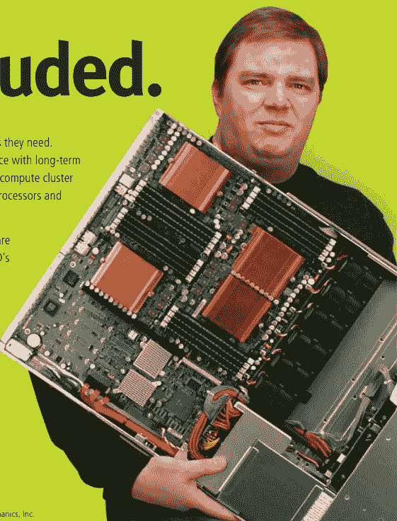


# SILICON MECHANICS

请访问我们的网站 www.siliconmechanics.com
或拨打免费电话 866-352-1173 联系我们

# 以 HTML 方式阅读源代码

**交叉引用并将源代码转换为 HTML 以便于浏览。** KAMAR SOOMRO

**每个优秀的程序员**迟早都要研究源代码。有时是为了学习新的编码风格。有时是为了了解某样东西是如何工作的。无论原因如何，没有源代码研究，程序员无法工作。研究小型项目的源代码并不困难。你很容易不用正式方法就能做到。然而，当你想要研究大型项目的源代码时，跟踪各种函数、变量及其定义就成了一个巨大的问题。如果人们能找到在线的源代码，那真是幸运——这意味着他们可以使用工具来处理源代码并帮助他们进行研究。这样的工具为研究源代码的人们提供了以前梦想不到的优势和灵活性。LXR（Linux Cross-Reference，Linux 交叉引用）工具就是这样的工具之一。

它最初作为挪威一个通用超文本交叉引用工具的应用测试平台而开发，其旗舰成就是对 Linux 内核源代码进行交叉引用。代码可在 **lxr.inux.org/source** 进行浏览。其他项目位于 **lxr.mozilla.org/seamonkey**，那里可以浏览 Mozilla 源代码，FreeBSD 源代码可在 **fhr.watson.org** 上获取。LXR 使用户能够仅通过单击一次就跳转到函数定义、搜索使用情况等。它还支持电子邮件和超文本链接的索引。

该项目基于标准 Web 技术，因此可以通过任何 Web 浏览器访问。在服务器端，它是使用 Apache 开发的，但应该适用于任何支持 CGI 脚本功能的 Web 浏览器。实际执行所有工作的脚本是使用 Perl 开发的，并严重依赖于 Perl 强大的正则表达式库。

这款软件最好的功能可能是它以 HTML 格式呈现给用户。由于是 HTML 格式，将代码的各个部分链接到其他部分非常容易。它是用 Perl 编写的，因此理论上，它可以在任何拥有 Perl 解释器的操作系统上运行。这个工具真正伟大之处在于它支持多种语言。这意味着无论你的程序是用哪种语言编写的，你仍然可以使用此工具来交叉引用和浏览你的代码。

LXR 实际上相当简单且整洁。用户使用一个名为 genref 的实用程序来生成完整源代码的索引。完成之后，用户通过 Web 浏览器访问一个名为 source 的 Perl 脚本，该脚本读取索引文件并动态生成用于交叉引用源代码的 HTML。然后用户可以按需浏览源代码。

# 安装

一旦你对 LXR 的工作原理和各个配置选项有了一定了解，安装和配置 LXR 就相当简单了。首先，从 **sourceforge.net/projects/lxr** 下载源代码 tarball。在撰写本文时，lxr-0.3 是稳定版本。下载 tarball 后，使用以下命令解压它：

```bash
bash$ tar -xvf lxr-0.3.tar.gz
```

解压源代码后，cd 到新建的目录，并使用你选择的文本编辑器打开 Makefile 进行编辑。你需要在这里设置两个变量：INSTALLPREFIX 和 PERLBIN。PERLBIN 指的是 perl/5s 解释器的可执行二进制文件。在我的情况下，它位于 /usr/bin/perl。INSTALLPREFIX 是安装 LXR 的目录。它应该位于可以通过 Web 浏览器访问的位置。在我的系统中，那是 Apache 1.3.33，我选择将其安装在 /var/www/htdocs/lxr 下。因此，我的 Makefile 看起来大致如下：

```makefile
# 用于安装和配置 LXR 的 Makefile

# 你的 perl/5s 二进制文件的位置

PERLBIN=/usr/bin/perl

# LXR 将安装在这里

INSTALLPREFIX=/var/www/htdocs/lxr

# 配置参数结束

CGISCRIPTS=find ident search diff source

PERLMODULES=SimpleParse.pm Common.pm Config.pm

....
```

保持 Makefile 的其余部分不变。在控制台输入：

```bash
bash$ make install
```

然后 LXR 将安装在指定的目录中。

# 配置

现在，cd 到安装 LXR 的目录（在我的情况下是 /var/www/htdocs/lxr）。那里应该有三个子目录：bin、http 和 source。尽管你要交叉引用的源代码可以放在任何位置，但我更喜欢将其放在 $INSTALLPREFIX/source 子目录下。我将 glibc-2.3.5 和 OpenMOSIX-2.4.26 的源代码放在这里。现在，我们必须生成 LXR 将用于生成交叉引用源代码的索引文件。因此，cd 到包含源代码的目录，并执行 $INSTALLPREFIX/bin 中的 genref 脚本：

```bash
bash$ /var/www/htdocs/lxr/bin/genref .
```

末尾的 . 告诉脚本源代码包含在当前目录中。接下来，坐下来享受过程，直到解析完成。完成后，当前目录——包含你的源代码的目录——应该有两个新文件：fileidx 和 xref。当你浏览时，LXR 需要这两个文件来生成交叉引用的源代码。确保其他人对这些文件有读取权限。为此，在仍在源目录时输入以下内容：

```bash
bash$ ls -l fileidx xref
```

输出应该是这样的：

```text
-r--r--r-- 1 nobody root 671744 2006-08-24 05:06 fileidx*
-r--r--r-- 1 nobody root 8425472 2006-08-24 05:06 xref*
```

第三个 r 应该已设置。如果没有，你可以执行以下操作来设置：

```bash
bash$ chmod o+x fileidx xref
```

现在，是时候配置 LXR 以供使用了。更改目录到 $INSTALLPREFIX/http/（在我的情况下，是 /var/www/htdocs/lxr/http/），并打开 lxr.conf 文件进行编辑。lxr.conf 文件是你需要的最重要的文件。它有几个不同的配置选项。

# 变量

打开文件时看到的第一个是对名为 v 的变量的定义。与编程语言一样，你可以定义自己的变量，并在配置文件稍后使用它们。无论它们在哪里出现，它们都会被替换为它们的值。变量值通过配置文件中的 $variable-name 引用。变量定义遵循以下两种可能的格式之一：

```text
variable: /variable-identifier, variable-name.
//{list-of-values/}, /default-value/
```

或者：

```text
variable: /variable-identifier, variable-name.
/{file-containing-list-of-values/}, /default-value/
```

这些术语的含义如下：

- **variable-identifier**：变量在整个配置文件中使用的名称。
- **variable-name**：显示给用户的变量的实际名称。
- **list-of-values**：逗号分隔的待显示值列表。
- **file-containing-list-of-values**：包含可能值列表的文件。列表中的每个条目占单独一行。用户可以选择其中任意一个。应提供文件的绝对路径。
- **default-value**：变量的默认值。如果未指定，则自动设置第一个值。

# baseurl

baseurl 是放置 LXR 所需的所有脚本所依据的 URL。它应该可以通过浏览器访问。在我的配置中，它是 http://my-ip/path/<http://localhost/lxr/http/>。确保在末尾加上 /，否则最后一个目录将被忽略。

# HTML 页眉和页脚

当生成源代码的 HTML 时，LXR 可以添加页眉和页脚。在 $INSTALLPREFIX/http/ 目录中提供了示例页眉和页脚。它们分别称为 template-head 和 template-tail。此外，通过修改 template-dir 文件，你还可以更改 LXR 显示文件和目录的方式。可以在 lxr.conf 文件中通过 htmlhead、htmlmail 和 htmlidrop 选项指定这些文件的位置。

# sourceroot

此选项告诉 LXR 在哪里查找实际的源代码。在我的情况下，它是 /var/www/htdocs/lxr/source/glibc-2.3.5。如果你想交叉引用多个项目，你所要做的就是创建一个指定

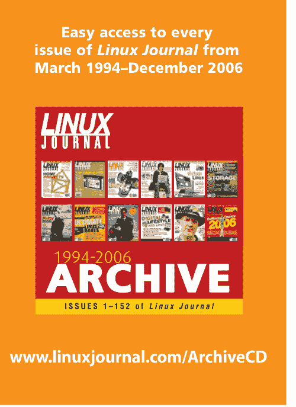


包含源代码的每个目录的位置。然后，你可以将该变量的值指定为 sourceroot。例如，我为 glibc-2.3.5 和 OpenMOSIX-2.4.26 设置了源代码，将二者的源代码分别放置在 `/var/www/httpdocs/lxr/source` 下以其名称命名的独立目录中。在 lxr.conf 中，我有一行如下：

```
variable: s, Source. (glibc-2.3.5, OpenMOSIX-2.4.26)
```

然后是：

```
sourceroot: /var/www/httpdocs/lxr/source/$$
```

因此，会根据 source 变量的值自动选择相应的源代码。

# srcrootname

srcrootname 指定要显示的源代码的项目名称——例如：

```
srcrootname: $$
```

# incprefix

这指定要包含在该项目中的头文件的位置。

# dbdir

这是 genxref 生成的 fileidx 和 xref 文件的位置。如果你有多个项目，请为每个项目指定独立的位置，如下所示：

```
dbdir: /var/www/httpdocs/lxr/source/$$
```

这些是配置 LXR 时需要设置的唯一选项。此外，你可以使用 glimpsebin 指定 glimpse 二进制文件的位置。

# glimpsebin

glimpse 允许用户在源代码中搜索特定文件，并在源文件中搜索任何文本。你可以从 [webglimpse.net/trial/glimpse-latest.tar.gz](webglimpse.net/trial/glimpse-latest.tar.gz) 获取 glimpse 的最新版本。解压并安装它。安装好 glimpse 后，进入源代码安装的目录（例如 /var/www/httpdocs/lxr/source/glibc-2.3.5），并执行以下操作：

```
bash# glimpseindex -H ..
```

输出应该看起来像这样：

```
This is glimpseindex version 4.18.2, 2006.

Indexing "/var/www/httpdocs/lxr/source/glibc-2.3.5" ... 

Size of files being indexed = 8171416 B, Total #of files = 10075 

Index-directory: "/var/www/httpdocs/lxr/source/glibc-2.3.5" 

Glimpse-files created here:
```

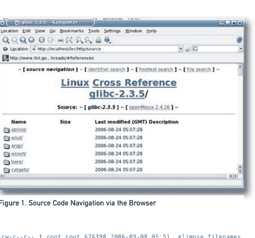

```
-rw-r--r-- 1 root root 67398 2006-09-08 05:51 .glimpse_filenames
-rw-r--r-- 1 root root 40300 2006-09-08 05:51 .glimpse_filenames_index
-rw-r--r-- 1 root root 0 2006-09-08 05:50 .glimpse_filenames
-rw------- 1 root root 1783314 2006-09-08 05:51 .glimpse_index
-rw-r--r-- 1 root root 886 2006-09-08 05:51 .glimpse_messages
-rw------- 1 root root 836 2006-09-08 05:51 .glimpse_partitions
-rw-r--r-- 1 root root 23888 2006-09-08 05:51 .glimpse_statistics
```

这会在当前目录中创建所需的 glimpse 索引文件。创建完成后，确保为其他用户设置了读权限：

```
bash# chmod o+r .glimpse-*
```

现在，将 lxr.conf 中的 glimpsebin 选项设置为你安装 glimpse 的位置。我将其安装在 /usr/local/sbin/glimpse。就这样；保存并关闭文件。现在剩下的唯一任务是配置 Web 服务器以配合 LXR 工作。

# 配置 Apache

我使用的 Web 服务器是 Apache 1.3.33。首先要做的是设置 LXR 目录的权限。你可以通过编辑通常位于 /etc/apache/httpd.conf 的 httpd.conf 文件来完成。添加以下行：

```
<Directory /var/www/httpdocs/lxr>
AllowOverride All
Options All
</Directory>
```

只需将位置替换为你安装 LXR 的位置即可。

然后，进入 $INSTALLPREFIX/http/ 目录，创建并打开一个名为 .htaccess 的文件进行编辑。输入以下行：

```
`<File ~ (search|find|source|diff|ident)>`

`SetHandler cgi-script`

`</File>`
```

这告诉 Web 服务器将上述文件视为 CGI 脚本。如果不这样做，服务器将仅显示这些文件的内容。关闭并保存 .htaccess。现在，我们已经准备好浏览交叉引用的源代码了。

# 如何使用 LXR

完成上述所有步骤后，你只需打开 Web 浏览器并访问 URL：http://my-ip//lxr/http/source，其中 /my-ip/ 是你的 Web 服务器的 IP 地址。打开网页后，你会看到如图 1 所示的内容。

如你所见，用户可以选择任何源代码文件进行浏览。在顶部，我使用了 LXR 提供的模板。它包含导航源代码、搜索特定标识符、在源代码中搜索任何文本以及搜索任何文件的链接。几个值得注意的工具：

-   *源代码导航：选择此选项以浏览你选择的源代码。
-   *标识符搜索：搜索特定标识符的定义和用法。需要 ident 脚本。
-   *自由文本搜索：在源文件中搜索任何文本。需要 search 脚本。
-   *文件搜索：搜索匹配传入字符串的文件。需要 find 脚本。

所有这些工具也可以使用正则表达式来匹配字符串进行搜索。

# 结论

LXR 是一个出色的工具。它极大地方便希望研究源代码的人，且功能强大、易于使用。它使用动态生成的网页来浏览源代码，这为用户提供了配置上的灵活性。此外，由于可以通过任何 Web 浏览器访问，它对用户的平台、客户端或位置没有施加限制。这种互操作性是 LXR 如此强大的原因之一。

**Kamran Somo** 是巴基斯坦国立科技大学的软件工程专业学生。自大一第一次使用 Linux 以来，他一直对 Linux 抱有浓厚的兴趣。从那以后，他一直热衷于在巴基斯坦推广 Linux。

# “寻找需求者？”匹配题答案（来自第 16 页）

1-C, 2-A, 3-Q, 4-L, 5-T, 6-M, 7-N, 8-I, 9-K, 10-P, 11-O, 12-H, 13-G, 14-B, 15-D, 16-R, 17-S, 18-J, 19-F, 20-E

# 广告商索引

> 如需广告信息，请致电 1-713-344-1956 分机 2 或发送邮件至 ads@linuxjournal.com 联系我们的销售部门。www.linuxjournal.com/advertising

| 广告商 | 页码 |
| --- | --- |
| ABSENCE, LLC | 31 |
| abser.com | |
| APPRO HPC SOLUTIONS | C2 |
| aplus.com | |
| ASA COMPUTERS | 29, 53 |
| asacomputers.com | |
| AVENTE CORPORATION | 1 |
| avente.com | |
| CARINET | 93 |
| carinet.net | |
| COMOD, Inc. | 21 |
| comod.com | |
| COYOTE POINT | 3 |
| coyotepoint.com | |
| EGI HOSTING | 45 |
| egihosting.com | |
| EMAC, Inc. | 61 |
| emacinc.com | |
| EMPERORLINUX | 55 |
| emperordslinux.com | |
| FARBCOM | 71 |
| farcom.com | |
| GESTOR SYSTEMS, INC. | 75 |
| gestorsys.com | |
| HURRICANE ELECTRIC | 89 |
| he.net | |
| ION SYSTEMS | 91 |
| ionsystems.com | |
| LINUX JOURNAL | 4, 56, 79 |
| linuxjournal.com | |
| LYNXWORLD SAN FRANCISCO | 63 |
| lnxworsanfrancisco.com | |
| LPL | 85 |
| lpl.org | |
| MIX | 17 |
| mix.com | |
| Microsoft, Inc. | C4, 57 |
| microsoft.com | |
| O’REILLY OSON | 87 |
| oreillyson.com | |
| OMN QUA SYSM, Inc. | 5 |
| omnquasyssys.com | |
| PLOS LIXK | 19 |
| lixk.com | |
| POLLYELL COMPUTER, INC. | 35 |
| polyell.com | |
| THE PORTLAND GROUP | 15 |
| portland.com | |
| RADPACE MANAGED HOSTING | C3 |
| radpace.com | |
| R CURD TECHNOLOGIES | 37 |
| rcurdstech.com | |
| SERVERS DIRECT | 39 |
| serversdirect.com | |
| SILICON MECHANICS | 33, 77 |
| siliconmechanics.com | |
| SLIDEST, INC. | 73 |
| slidest.com | |
| SUPERMICO | 27 |
| supermicio.com | |
| TECHNOLOGICAL ADVANTAGE | 49 |
| technologicalevantage.com | |
| TOTALWEB TECHNOLOGIES | 9 |
| totalwebtechnologies.com | |
| TYAN COMPUTER USA, Inc. | 7 |
| tyanc.com | |
| USENIX | 69 |
| usenix.org | |
| UHNHED TECHNOLOGIES | 11 |
| uwahnedi.com | |
| VIDEO | 13 |
| veno.com | |

# 使用 SCGI 实现更快的 Web 应用

**使用 SCGI 加速你的 Web 应用。**
JEROEN VERMEULEN

如果你正在运行 Web 服务器，那么很可能你不仅仅是在提供静态文本和图像。你可能也在运行一些 Web 应用，其中的页面由某些程序或脚本通过 CGI（通用网关接口）实时生成。想想博客软件、缺陷跟踪器、新闻网站和内容管理系统——任何将浏览器从文档查看器变为用户界面的东西。而且，你很可能自己编写或至少调整过其中的一些。

本文展示了如何使用 CGI 的替代方案 SCGI（简单通用网关接口）来构建更快的 Web 应用。SCGI 是一种协议，而不仅仅是一个程序，但其作者也提供了参考实现，我们将在此使用它。它包含用于从 Apache 或 lightd 使用 SCGI 的模块，以及帮助你创建 SCGI 应用的 Python 类。其他语言的实现也是可用的，但这里我们考察的是 Apache 2.x 和 Python 的组合。

# 时间都去哪儿了？

通常，Web 应用在 Web 服务器的子进程中运行时间很短，但频率很高。当客户端请求某个页面时，Web 服务器查询其配置，发现该请求应交给应用程序处理。它将请求委托给一个子进程，该子进程进而加载并运行应用程序。该程序可以是二进制文件，也可以是 Perl、Python 或 PHP 脚本、shell 命令，或者几乎任何其他东西。CGI 标准定义了程序如何接收有关请求的详细信息，包括请求的 URL、请求主体、已认证的用户身份和源 IP 地址。程序读取这些信息，生成页面以响应客户端的请求，然后退出。下一次请求时，这一切都会再次发生。

加载、运行和退出程序的成本可能很高。这对于“睡意朦胧”的程序来说确实有意义：例如，它们可能使用内存而从不释放。在这种情况下，你希望程序短暂运行，然后让操作系统清理其资源。但是，对于当今流行的语言——Perl、Python、PHP、Java 和 shell 脚本——在这方面确实没有太多问题。编写良好的应用程序应该能够在单次运行中处理多个请求。

# 使用 SCGI 实现更快的服务

SCGI 允许你的程序启动一次，并继续处理请求，只要它愿意。它是这样工作的：一个独立的服务器进程，称为 SCGI 服务器，独立于 Web 服务器运行，并管理一个 Web 应用。Web 服务器将该应用的所有请求转发给其 SCGI 服务器。它以与普通 CGI 非常相似的形式传递有关请求的详细信息。

SCGI 服务器将请求委托给一个子进程，就像 Web 服务器对普通 CGI 应用所做的那样。子进程也运行应用程序，但相似之处到此为止。应用程序在处理完该请求后不会退出，而是可以坐在那里等待新的请求。SCGI 服务器的每个子进程运行应用程序的一个实例，每个实例都在有工作要做时保持休眠。

当没有可用的子进程来处理最新请求时，SCGI 服务器会生成一个新的子进程——当然，最多不超过可配置的最大值。它还清理崩溃或退出的子进程，因此如果出现问题，你的 Web 应用仍然可以退出。但是，大多数时候，当请求到达时，应用程序已经准备好并等待它。这就是为什么 Web 应用框架 Ruby on Rails 附带了通过 SCGI 运行的选项；否则它太慢了。

# 其他优势

如果速度提升还不够，还有更多。SCGI 服务器进程可以运行在与 Web 服务器相同的系统上，但也不一定必须如此。你可以通过将某些 Web 应用委托给独立系统来卸载服务器，最好是在防火墙后面，只有 Web 服务器才能访问它们。

即使只有一个服务器，你也可以使用 SCGI 来限制漏洞。普通的 CGI 应用程序开始时是在与 Web 服务器进程相同的用户身份下运行的。如果攻击者设法颠覆了一个普通的 CGI 应用程序，你的整个网站可能面临风险。另一方面，SCGI 服务器可以在自己的用户身份下运行，因此即使它失控，也不容易影响 Web 服务器或其他应用程序。反过来，你不再需要让 Web 服务器访问应用程序的代码或数据；只有由 SCGI 服务器运行的应用程序需要访问。其他所有人必须通过 Web 服务器，而 Web 服务器进而与 SCGI 服务器通信。

你还可以在 chroot 环境或虚拟化服务器中运行应用程序。而在 CGI 中，这会迅速变得昂贵且难以管理。使用 SCGI 时，你只需在隔离环境中启动一个服务器进程——无论是 chroot 监狱、虚拟化服务器、不同的用户身份还是另一台机器——整个应用程序都将留在那里。

# 安装 SCGI

你需要两个组件：用于构建 SCGI 应用的 Python 类，以及让你的 Web 服务器能与应用程序“说 SCGI”的模块。如果你使用 Red Hat 软件包管理（RPM），可以使用 `yum install python-scgi apache2-mod_scgi` 来安装这些；Debian 的 apt 用户可以 `apt-get install python-scgi`


# 清单 1. 手动安装 CGI

```bash
# Unpack source directory scgi-1.12 from tarball
tar xfz scgi-1.12.tar.gz
cd scgi-1.12

# Build the Python part
python setup.py build

# Install Python module; we'll need root privileges
sudo python setup.py install

# Now build and install the Apache module
cd apache2
sudo make install

# Enable the SCGI module in Apache. This may fail,
# depending on your Apache version, but no matter.
sudo a2enmod scgi

# Make Apache's new configuration take effect
sudo /etc/init.d/apache2 force-reload
```

1:libapache2-mod-scgi

你也可以手动安装这两个组件中的任意一个。Apache 模块需要 C 编译器以及 Apache 的 `apxs` 脚本。一些发行版将 `apxs` 保留在单独的开发包中，而不是作为常规 Apache 包的一部分进行安装。

假设你现在已经拥有了这些组件，接下来请下载源代码包 `scgi-1.12.tar.gz`，并运行清单 1 中所示的命令。

# 测试运行

现在，让我们确保一切正常。Python 包是一个包含一些类的模块，通常，你会编写应用程序作为导入该模块的程序。但是，为了调试目的，你也可以将其作为独立应用程序运行。当它接收到来自 Web 服务器的请求时，它仅将请求的详细信息作为测试页面打印出来。这是第一次测试的完美选择——无需编写代码！

在你的系统上找到 `scgi_server.py` 模块。它应该安装在 `/usr/lib/python2.4/site-packages/scgi`（在你的系统上，2.4 可能是 2.3 或 2.5）。然后，运行该模块：

```bash
cd /usr/lib/python2.4/site-packages/scgi
python scgi_server.py
```

这会在系统上的 TCP 端口上监听来自 Web 服务器的请求，默认使用端口 4000。你可以通过将期望的端口号作为命令行参数传递来使其监听不同的端口，例如

```bash
python /usr/lib/python2.4/site-packages/scgi/scgi_server.py 63080
```

该模块将持续运行，直到你终止它，因此请在一个单独的 shell 中启动它。请记住，你不需要以 root 用户身份甚至不需要以 Web 服务器的身份运行 SCGI 服务器。

既然 SCGI 应用程序正在等待请求，请在你的网站上选择一个位置将其委托给该应用程序。假设你希望它响应此服务器上所有对 “/scgistest” 的请求。编写一个 Apache 配置片段，如清单 2 所示，并将其写入 `/etc/apache2/conf.d` 中的新文件。

# 清单 2. Apache 配置片段

```apache
# Load the SCGI module. This is really only needed
# if you installed manually and the "a2enmod scgi"
# command failed.
LoadModule scgi_module /usr/lib/apache2/modules/mod_scgi.so

<Location "/scgistest">
  # Enable SCGI
  SCGIHandler On
  # Other properties for /scgistest, such as access control
  # ...
</Location>

# Hostname and port number where SCGI server for /scgistest is running.
# Port 4000 on localhost (127.0.0.1) is the default.
SCGIMount /scgistest 127.0.0.1:4000
```

# 清单 3. scgi_server.py 返回请求详细信息。

```text
SERVER_SOFTWARE: 'Apache'
SCRIPT_NAME: '/scgistest'
REQUEST_METHOD: 'GET'
SERVER_PROTOCOL: 'HTTP/1.1'
QUERY_STRING: ''
CONTENT_LENGTH: '0'
HTTP_ACCEPT_CHARSET: 'UTF-8,*'
HTTP_USER_AGENT: 'Mozilla/5.0'
SERVER_NAME: 'testserver.example.org'
REMOTE_ADDR: '10.99.11.99'
SERVER_PORT: '80'
SERVER_ADDR: '192.0.34.166'
DOCUMENT_ROOT: '/srv/www/'
SERVER_ADMIN: 'webmaster@example.org'
HTTP_HOST: 'testserver.example.org'
REQUEST_URI: '/scgistest'
HTTP_ACCEPT: 'text/html,text/plain,*/*;q=0.5'
REMOTE_PORT: '47088'
HTTP_ACCEPT_LANGUAGE: 'en'
SCGI: '1'
HTTP_ACCEPT_ENCODING: 'gzip,deflate'
```

SCGI 服务器实际上不需要与 Web 服务器运行在同一台机器上，正如这里所见。只需确保 SCGI 服务器的端口被正确防火墙保护，以便只有你的 Web 服务器才能访问它！这样，你的应用程序就可以确信所有 CGI 参数都首先经过了 Web 服务器的验证。如果攻击者可以直接连接到你的 SCGI 应用程序，你就无法信任这些信息。例如，CGI 参数 `AUTHENTICATED_USER` 告诉你的应用程序请求来自某个特定的已登录用户。只有当你从配置正确的 Web 服务器那里听到这一信息时，你才能相信它。

# 深入理解

**SCGI 允许你的程序只启动一次，并可以继续处理请求，直到它愿意为止。**

使 Apache 重新加载其配置，使用 `sudo /etc/init.d/apache2 reload`。现在，你的服务器应该提供一个新的位置，*scgiset*，当你访问它时，它会简单地打印出你的请求的 CGI 参数。通过浏览器查看来验证这一点。如果你的服务器地址是 `example.org`，请将浏览器指向 `http://example.org/scgiset`。你应该会看到类似于清单 3 的页面。

如果你看到的不是这样，请查看你运行模块所在的 shell。它可能在那里打印了一些有用的错误消息。或者，如果 SCGI 服务器完全没有反应，请求可能根本没有到达它；请检查 Apache 错误日志。

一旦你运行起来，恭喜——最糟糕的部分已经过去了。停止你的 SCGI 服务器进程，以免干扰我们接下来要做的事情。

# 编写应用程序

现在，让我们用 Python 编写一个简单的 SCGI 应用程序——一个打印时间的程序。

我们导入 SCGI Python 模块，然后编写我们的应用程序作为通过 Web 服务器传入的 SCGI 请求的处理程序。该处理程序采用一个类，我们从 `SCGIHandler` 派生该类。叫我缺乏想象力也好，但我已将示例处理程序类称为 `TimeHandler`。我们稍后会填入实际代码，但先从这个骨架开始：

```python
#!/usr/bin/python
import scgi
import scgi.scgi_server

class TimeHandler(scgi.scgi_server.SCGIHandler):
    pass    # (no code here yet)

# Main program: create an SCGIServer object to
# listen on port 4000.  We tell the SCGIServer the
# handler class that implements our application.
server = scgi.scgi_server.SCGIServer(
    handler_class=TimeHandler,
    port=4000
)

# Tell our SCGIServer to start servicing requests.
# This loops forever.
server.serve()
```

你可能会觉得奇怪，我们必须向 `SCGIServer` 传递我们的处理程序类，而不是处理程序对象。原因是服务器对象会根据需要创建我们给定类的处理程序对象。

这是 `TimeHandler` 的第一个版本，本质上仍然与原始的 `SCGIHandler` 相同，因此它所做的只是打印请求参数。要查看此行为，请尝试运行此程序，并像以前一样在浏览器中打开 *scgiset* 页面。你应该会再次看到类似清单 3 的内容。

现在，我们希望以浏览器能理解的形式打印时间。我们不能简单地开始发送文本或 HTML；我们首先必须发出一个 HTTP 头，告诉浏览器期望什么类型的输出。在这种情况下，让我们坚持使用简单的文本。在程序顶部附近，就在 `TimeHandler` 类定义上方，添加以下内容：

```python
import time
def print_time(outfile):
    # HTTP header describing the page we're about
    # to produce.  Must end with double MS-DOS-style
    # "CR/LF" end-of-line sequence.  In Python, that
    # translates to "\r\n".
    outfile.write("Content-Type: text/plain\r\n\r\n")
    # Now write our page: the time, in plain text
    outfile.write(time.cTime() + "\n")
```

此时，你可能正在想我们要如何让处理程序类调用此函数。对于 SCGI 1.12 或更新版本，这很容易。我们可以编写方法 `TimeHandler.produce()` 来覆盖 `SCGIHandler` 的默认操作：

```python
class TimeHandler(scgi.scgi_server.SCGIHandler):
    # (remove the "pass" statement-we've got real
    # code here now)

    # This is where we receive requests:
    def produce(self, env, bodySize, input, output):
        # Do our work: write page with the time to output
        print_time(output)
```

我们在此处忽略了它们，但 `produce()` 接受几个参数：`env` 是一个映射 CGI 参数名称及其值的字典。接下来，`bodySize` 是请求正文或负载的字节大小。如果你关心请求正文，请从下一个参数 `input` 中读取多达 `bodySize` 字节。最后，`output` 是我们写入输出页面的文件。

如果你有 SCGI 1.11 或更早版本，你需要一些包装代码才能使此功能正常工作。在这些旧版本中，我们覆盖另一个方法 `SCGIHandler.handle_connection()`，并自行完成更多工作。只需将清单 4 中的样板代码复制到 `TimeHandler` 类中。它将正确设置并调用 `produce()`，因此其他部分不变，我们可以编写 `produce()`，就像我们拥有更新版本的 SCGI 一样。

再次运行应用程序，并在浏览器中检查它是否显示时间。

接下来，为了使事情更有趣，让我们向请求传递一些参数，并让程序处理它们。Web 应用程序参数的约定是在 URL 后附加一个问号，后跟由 `&` 分隔的一系列参数。每个参数的形式为 `name=value`。如果我们希望向程序传递一个名为 `pizza` 且值为 `hawaiian` 的参数，以及另一个名为 `drink` 且值为 `beer` 的参数，URL 看起来将类似于 `http://example.org/scgiset?pizza=hawaii&drink=beer`。


# 培育一个
Linux 专业人才的世界


在 Linux 专业协会，我们认为推广 Linux 和开源软件的最佳方式是培养全球范围内大量才华横溢、具备资格且经过认证的 IT 专业人才。

我们深知提供全球衡量标准的重要性。为协助此项工作，我们正在启动一项“区域赋能计划”，以确保我们理解、培育并支持全球企业、政府、教育机构和个人贡献者的需求。

我们只有通过当地“实地”合作伙伴组成的网络才能实现这一目标。这些合作伙伴熟悉各自行业并了解 IT 人员的需求。通过这项积极的区域赋能政策，我们正在寻找当地合作伙伴，并协助他们努力推广 Linux 和开源专业性。

我们鼓励您与上述列出的新区域合作伙伴联系。

我们正在共同培育一个 Linux 专业人才的世界。


# 稳定。创新。成长。

# 列表 4. SCGI 1.11 或更低版本的样板代码

```python
# Insert this definition into your handler class:
class TimeHandler(scgi.scgi_server.SCGIHandler):
    ...  
    def handle_connection(self, conn):
        input = conn.makefile("r")
        output = conn.makefile("w")
        env = self.read_env(input)
        bodysize = int(env.get('CONTENT_LENGTH', 0))
        try:
            self.produce(env,bodysize,input,output)
        finally:
            output.close()
            input.close()
            conn.close()
```

访问者传递给程序的参数最终都会进入单一的 CGI 参数 QUERY_STRING。在这种情况下，该参数将显示为“pizza=hamaii&drink=beer”。以下是我们的 TimeHandler 可能会对其执行的操作：

```python
class TimeHandler(scgi.scgi_server.SCGIHandler):
    def produce(self, env, bodysize, input, output):
        # Read arguments
        argstring = env['QUERY_STRING']
        # Break argument string into list of
        # pairs like "name=value"
        arglist = argstring.split('&')

        # Set up dictionary mapping argument names
        # to values
        args = {}
        for arg in arglist:
            (key, value) = arg.split('=')
            args[key] = value

        # Print time, as before, but with a bit of
        # extra advice
        print_time(output)
        output.write(
            "Time for a pizza. I'll have the %s and a swig of %s\n" %
            (args['pizza'], args['drink']))
```

现在，我们编写的应用程序不仅会打印时间，还会建议 URL 中传入的披萨和饮料。试试看！您还可以尝试列表 3 中的其他 CGI 参数，以发现您的 SCGI 应用程序可以做到的更多事情。

# 即使只有一个服务器，您也可以使用 SCGI 来遏制漏洞。

# 移植应用程序

一旦您习惯了使用 SCGI 编写程序，您可能希望尝试将现有应用程序改编为使用 SCGI。一些知名的 Web 应用程序，如 MoinMoin（一个 wiki）和 Trac（一个基于 wiki 的协作开发环境），是作为 Python 模块实现的。这两个示例都附带可以从 Apache 调用的 Python CGI 脚本。这些 CGI 脚本非常简短；实际上除了导入应用程序模块并调用其函数外，它们什么也不做。

如果您找到这样一个应用程序，要使其与 SCGI 配合使用，您真正需要做的只是取那一小部分 Python 代码并将其移动到 produce() 方法中，正如您在本文中所看到的示例那样。如果您使用的是 SCGI 1.12 或更高版本，您可能还想查看 SCGIHandler 的一个替代方法，produce_cgiLike()。

# 结论

我们要说的内容大致就这些。如果您想了解 CGI 程序是如何工作的，请尝试查阅 CGI 标准，该标准将它们称为“请求元变量”（参见资源）。

最后，给出一个警告。您会注意到，如果未能传递预期的参数，最后一个示例程序会惨烈地崩溃。SCGI 服务器会替换失败的进程，因此在这种情况下，并没有实际问题。但是，这应该提醒您，在编写 Web 应用程序时需要多么小心。永远不要信任您从外部接收到的输入！如果一个程序可以被崩溃，那么某人很可能能够颠覆它或使其停止运作。世界各地的人为了乐趣或利益都会做这种事，所以要认真对待这种风险。

Jeroen Vermeulen 在泰国软件产业促进局的开源部门工作。他目前正在开发 Suriyan，这是一个专为那些没有时间关注服务器系统的人设计的服务器系统。

# 资源

- SCGI 下载： **quixote.python.ca/releases**
- SCGI 主页： **www.mems-exchange.org/software/scgi**
- CGI 标准： **ftp.rfc-editor.org/in-notes/rfc3875.txt**
- 关于 Python 和 Apache2 的 SCGI 更多信息： **thaiopensource.org/development/suriyan/wiki/UsingScgi**
- Perl 接口： **search.cpan.org/~vipercode/SCGI/lib/SCGI.pm**
- Lisp 接口： **randalqsquared.com/download/scgi**
- Trac： **trac.edgewall.com**
- MoinMoin： **moinmoin.wikiwikiweb.de**


# LIVE

**2007 年 7 月 22 日 – 24 日**
**美国俄勒冈州波特兰**

**现在注册可额外节省 10%**
使用优惠码 ubuntu7LJR

# 聆听。讨论。学习。Ubuntu 实践行动。

- 一种互动式、深入且全面的教育体验
- 与其他 Ubuntu 用户面对面交流的机会

- 经过精心编辑、条理清晰的会议计划，包括教程、会议和主旨演讲
- 帮助管理者决定转换到 Ubuntu 并帮助开发者实施这一过渡的信息和工具

- 面向黑客、开发者和 IT 经理的开放思想交流场所
- 展厅里充满了展示开源产品和服务的硬件和软件公司

www.ubuntulive.com

由 **CANONICAL** 和 **O'REILLY** 联合呈现


# 开源会议

**2007 年 7 月 23 日 – 27 日**
**美国俄勒冈州波特兰**

O'Reilly 开源会议现已举办至第九届，它是开源技术的集市，除了启动开源运动的平台、语言和应用程序外，还欢迎新的声音和项目。OSCON 聚集了超过 2500 名专家、远见者、开源专业人员、IT 经理、系统管理员、黑客和企业家，以探索开源的深度和广度。

**现在注册可额外节省 10%**
使用优惠码 os07LJR

www.conferences.oreilly.com/oscon

# 深入解析

# 扩展 OpenOffice.org

# 创建您自己的 OpenOffice.org 扩展比您想象的要简单。

DMITRI POPOV

如果您有一个巧妙的宏或一个精美的 Writer 模板，想要与其他 OpenOffice.org 用户分享，将它们在网络上发布并附带详细的安装说明可能并不是最好的方法。幸运的是，OpenOffice.org 支持扩展——小型可安装包，提供附加功能。您可以轻松地将您的模板、自动文本条目、图库艺术和宏转换为扩展，只需几次点击即可安装。更好的是，OpenOffice.org 的扩展具有易于理解且定义明确的架构，您可以立即开始构建自己的扩展。

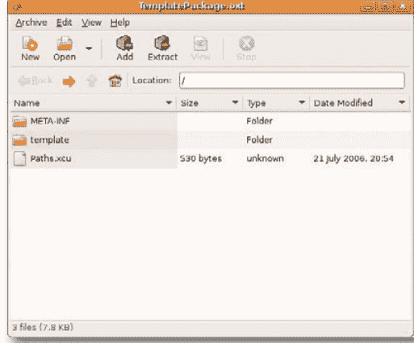

图 1. 非代码 OpenOffice.org 扩展的内容

使用扩展来扩展 OpenOffice.org 的功能并不是什么新鲜事。从一开始，用户就可以通过安装所谓的 UNO 包来为办公套件添加新功能。通常，这些包包含 OoO Basic 代码，并为将宏集成到 OpenOffice.org 应用程序中提供了更直接的方式。随着 OpenOffice.org 2.0.4 的发布，通过可安装包添加新功能的想法被彻底重新思考，并与终端用户更熟悉的概念保持一致——即 Mozilla Firefox 浏览器的扩展架构。

OpenOffice.org 中扩展系统的技术实现也已被重新构建。最值得注意的是，OpenOffice.org 的新版本可以处理所谓的非代码扩展，这些扩展可以包含文档模板、图库项目、自动文本片段等。OpenOffice.org 的新版本还引入了新的 .ooi 文件扩展名，允许用户轻松识别可安装扩展包。

# 扩展如何工作

OpenOffice.org 扩展本质上是一个 zip 文件，包含可安装的内容以及正确安装和注册扩展所需的附加元数据。OpenOffice.org 提供了一个简单易用的工具，称为包管理器（Package Manager），允许用户安装新扩展并管理现有扩展。要安装扩展，只需选择“工具”→“包管理器”，选择“我的包”，然后按“添加”按钮。扩展安装完成后，重启 OpenOffice.org 即可。与 Firefox 不同，某些类型的扩展不需要重启 OpenOffice.org。例如，如果您安装非代码扩展，您可以立即使用它们。

为了更好地理解 OpenOffice.org 扩展的结构，让我们从 OpenOffice.org Wiki 解构一个空的示例扩展（[wiki.services.openoffice.org/wiki/Non-code_extensions](wiki.services.openoffice.org/wiki/Non-code_extensions)）。为了查看包内部，您必须将其扩展名从 .ooi 更改为 .zip。这允许您将包视为普通的 zip 归档文件。该包由三个元素组成：META-INF 和 template 文件夹，以及 Paths.xcu 配置文件。META-INF 文件夹包含 manifest.xml 文件，该文件除其他内容外，“指向” Paths.xcu 配置文件。Paths.xcu 文件包含包管理器用于将模板添加到适当位置的信息。该位置定义为 '%origin%/template'，包管理器将 %origin% 变量替换为内部模板容器的完整路径。fuse 参数将模板添加到指定的容器中，如果该容器不存在，则创建一个新的。要创建新的模板扩展，您不需要调整任何设置；配置文件和扩展的整体结构保持不变。您要做的就是将自定义模板复制到 template 文件夹中。将生成包的扩展名改回 .ooi，并通过“工具”→“包管理器”安装它。要检查扩展是否已正确安装，请选择“文件”→“模板”→“组织”；您应该能在“我的模板”文件夹中看到您的模板。

# 从零开始创建程序化扩展

虽然创建非代码扩展相当简单，但构建包含代码的包（我们称之为程序化扩展）则是另一回事。程序化扩展不仅包含代码本身，还包含一个更复杂的配置文件，其中包含关于菜单、子菜单、分配给它们的命令和宏、图标等的信息。手动创建配置文件，即使对于最简单的程序化扩展，也需要一些技术知识，而且可能相当耗时。幸运的是，有一个工具可以自动化创建扩展的整个过程。尽管 Add-on 工具（[documentation.openoffice.org/HOW_TOO/ various_topics/Addons1_1en.sxw](documentation.openoffice.org/HOW_TO/ various_topics/Addons1_1en.sxw)）自 2003 年以来未更新，但它仍然能很好地生成可以与


# 创建编程式扩展

为了熟悉附加组件工具并更好地理解创建编程式扩展的过程，让我们从头开始构建一个简单的虚拟文本生成器扩展。安装后，该扩展会在“工具 → 附加组件”菜单中添加“Lorem ipsum”命令。此命令会运行一个 OpenOffice.org Basic 宏，插入指定段落数的 Lorem ipsum 虚拟文本。以下说明假设您已具备有关如何在 OpenOffice.org 中创建和管理宏、模块及库的通用知识。附加组件工具使用的是旧术语“add-on”，您可以将其视为“扩展”的同义词。

首先，创建一个生成虚拟文本的宏。为保持整洁，创建一个名为 `LoremIpsumLib` 的独立库，其中包含 `LoremIpsumModule`。在此模块中，添加清单 1 中所示的宏。（请将“Lorem ipsum dolor sit amet…”字符串替换为一段虚拟文本）。

在启动附加组件工具之前，您需要做一些准备工作。首先，为所有工作文件创建一个单独的文件夹（例如 `loremipsum`）。如果您想为菜单项添加图标，请确保您拥有必要的图形文件。根据官方文档，您需要一组小尺寸（16x16）和大尺寸（26x26）的 BMP 格式图标。但是，您也可以使用 PNG 格式的 16x16 图标（您可以在 [www.famfamfam.com/lab/icons/silk](http://www.famfamfam.com/lab/icons/silk) 上找到一些高质量的图标）。接下来，将完整的 `LoremIpsumLib` 库复制到 `loremipsum` 文件夹中。为此，请导航到家目录下的 `/user/basic`，将 `LoremIpsumLib` 复制到 `loremipsum` 文件夹。现在，打开附加组件工具文档，并确保已启用宏执行。滚动到*创建配置文件*章节，按*创建 XML 文件*按钮以启动附加组件创建器。

# 清单 1. loremipsummacro.bxt

```basic
Option Explicit
Sub LoremipsumMacro()
  Dim ThisDoc As Object
  Dim Cursor As Object
  Dim ParNumber As Integer
  Dim InputMsg As String, InputTitle As String, InputReturn As String
  ThisDoc=ThisComponent
  InputMsg="Number of paragraphs"
  InputTitle="Lorem Ipsum Generator"
  InputReturn=InputBox (InputMsg, InputTitle)
  ParNumber=InputReturn
  Do While ParNumber>0
    Cursor=ThisDoc.text.createTextCursor
    Cursor.String="Lorem ipsum dolor sit amet…" & Chr(13)& Chr(13)
    ParNumber=ParNumber-1
  Loop
End Sub
```


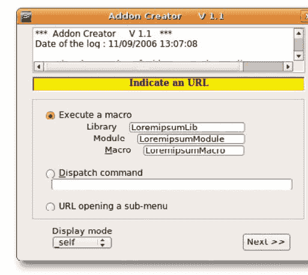

**图 2. 使用附加组件创建器创建编程式扩展**

使用附加组件创建器创建扩展的过程大致可以分为三个阶段。首先，您定义常规设置，包括顶级菜单及其位置。然后，您指定菜单项，最后，您将创建的包压缩。在*基本信息*窗口中，指定主脚本文件的路径。按*浏览*按钮，并选择 `LoremIpsumLib` 文件夹内的脚本 `.xlb` 文件。您还必须在该*您的附加组件的唯一名称*字段中为您的扩展指定一个名称。只需将 `org.openoffice.Office.addon.example` 字符串中的示例部分替换为您想要的名称（例如 `org.openoffice.Office.addon.LoremIpsum`）。按*下一步*以选择在哪里添加顶级扩展菜单。这里有两个选择：您可以将菜单项添加到主菜单或工具菜单下。通常，如果您有一个仅包含几个命令的简单扩展，请将其置于工具菜单下。更复杂的扩展值得在主菜单中拥有自己的条目。由于 Lorem ipsum 生成器仅包含一个命令，因此将其安装在工具菜单下是有意义的。接下来，输入菜单标题，并按*添加此文本*按钮。如果您希望您的扩展仅对特定语言或国家可用，可以通过在*语言限制*部分指定相应设置来实现。当您对设置满意时，按*完成*。

下一步是将 `LoremIpsumMacro` 链接到创建的菜单项。为此，您必须指定库、模块以及宏本身。在我们的案例中，分别是 `LoremIpsumLib`、`LoremIpsumModule` 和 `LoremIpsumMacro`。一旦将宏链接到命令，您就可以为其添加图标。

# 清单 2. addonrc.xml

```xml
<?xml version="1.0" encoding="UTF-8"?>
<oor:node xmlns:oor="http://openoffice.org/2001/registry"
xmlns:xs="http://www.w3.org/2001/XMLSchema" oor:name="Addons"
 oor:package="org.openoffice.Office">
 <node oor:name="Addon1">
  <node oor:name="AddonMenu">
   <node oor:name="org.openoffice.Office.addon.LoremIpsum"
    oor:op="replace">
    <prop oor:name="Context" oor:type="xs:string">
     <value/>
    </prop>
    <prop oor:name="Title" oor:type="xs:string">
     <value>Lorem ipsum</value>
    </prop>
    <prop oor:name="URL" oor:type="xs:string">
     <value>macro:///LoremIpsumLib.LoremIpsumModule.LoremIpsumMacro</value>
    </prop>
    <prop oor:name="Target" oor:type="xs:string">
     <value>self</value>
    </prop>
    <prop oor:name="ImageIdentifier" oor:type="xs:string">
     <value/>
    </prop>
   </node>
   <node oor:name="Images">
    <node
     oor:name="org.openoffice.Office.addon.LoremIpsum.img01"
     oor:op="replace">
     <prop oor:name="URL" oor:type="xs:string">
      <value>macro:///LoremIpsumLib.LoremIpsumModule.LoremIpsumMacro</value>
     </prop>
     <node oor:name="UserDefinedImages">
      <prop oor:name="ImageSmallURL">
       <value>%Origin%/LoremIpsumLib/Icon.png</value>
      </prop>
     </node>
    </node>
   </node>
  </node>
 </node>
</oor:node>
```

由于我们选择使用 PNG 格式的图标，请按下*其他图像类型*按钮，从图标定义下拉列表中选择*16x16 正常对比度*项，使用*浏览*图标选择图标，然后按*确定*以添加它。在添加图标时，您有两个选项：要么链接到一个将作为图像文件添加到扩展中的图标，要么将其集成到配置文件中（这仅适用于 BMP 格式的图标）。选择哪个选项主要取决于个人喜好，但链接图标而不是嵌入它们会产生更清洁、更易于阅读的配置文件。如果您稍后需要手动编辑该文件，这可能会有帮助。使用*完成*按钮以最终确定扩展，并按下*附加组件压缩*按钮以进行打包。现在您可以通过选择*工具 → 软件包管理器*来安装创建的扩展。重新启动 OpenOffice.org，您应该会在*工具 → 附加组件*菜单中看到*lorem ipsum*命令。

# 调整扩展

附加组件创建器巧妙地隐藏了过程的技术部分，如果您不想花时间手动完成这些基础工作，这是很好的做法。然而，如果您希望更好地了解扩展的工作机制——不仅是为了满足好奇心，也是为了能够在不每次都运行附加组件创建器的情况下对扩展进行故障排除和调整，那么这种方法就没那么有用。

如果您查看 zip 包内部，您会发现它包含熟悉的 `META-INF` 文件夹、包含宏文件的文件夹以及 `addon.xcu` 文件（清单 2）。后者是扩展的关键元素，因为它包含所有配置数据。`addon.xcu` 基于 XML，即使您只具备 XML 的基本知识，也只需查看其内容即可轻松理解其工作原理。

XML 文件包含若干节点，每个节点都有属性，而这些属性又具有值。例如，顶级节点 `<node oor:name="AddonMenu">` 具有多个属性，如 `<prop oor:name="Title" oor:type="xs:string">`，它们具有包含扩展菜单标题的值——`<value>Lorem ipsum</value>`。`<prop oor:name="URL" oor:type="xs:string">` 属性具有 `<value>macro:///LoremIpsumLib.LoremIpsumModule.LoremIpsumMacro</value>` 值，其中包含指向相应宏的链接。知道了这一点，您可以通过调整其 `addon.xcu` 文件来修改扩展。例如，如果您想更改菜单标题，只需编辑 `<value>Lorem ipsum</value>` 值如下：

```xml
<prop oor:name="Title" oor:type="xs:string">
  <value>Insert dummy text</value>
</prop>
```

在更复杂的宏中，您甚至可以通过克隆和修改配置文件的部分来添加新的菜单和命令。

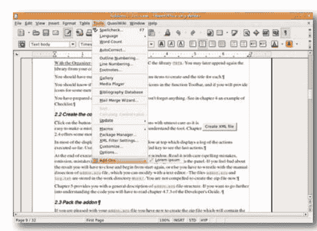

# 结语

既然您已经了解了基础知识，就可以开始构建自己的 OpenOffice.org 扩展了。如果您想与其他用户分享您的创作，您可以将它们添加到官方扩展存储库（`wiki.services.openoffice.org/wiki/Extensions_repository`）中。那里的大多数扩展都是基于 GPL 许可证发布的，因此您可以反编译它们以查看其工作原理并获得新的灵感。

> Mitpi Dormir 是一位自由撰稿人，其文章曾刊登在俄罗斯、英国和丹麦的计算机杂志上。他的文章涉及开源软件、Linux、Web 应用及其他计算机相关主题。


# 探索 Lua

对小巧而功能强大的 Lua 编程语言进行概览。**约瑟夫·奎格利**

**Lua 是一款免费**且开源的多范式编程语言，遵循 MIT 许可证发布。它由 Roberto Ierusalimschy、Luiz Henrique de Figueiredo 和 Waldemar Celes 于 1993 年创建。Lua 是一种动态类型语言。它极其紧凑（编译后仅 150KB），主要用作脚本语言或作为另一种语言（主要是 *C/C++*）的扩展。

# Lua 是什么？它是如何被使用的？

Lua 以库的形式实现，没有“主”程序。它仅在嵌入到宿主客户端中时才起作用。解释器是一个 C 程序，它使用 Lua 库来提供独立的 Lua 解释器。Lua 的目标不是为单一范式提供复杂且僵化的规范，而是旨在扩展以适应不同的问题类型。

由于体积小，Lua 适用于许多宿主平台，并且已在 PlayStation Portable 和 Nintendo DS 等视频游戏以及《*Far Cry*》和《*World of Warcraft*》等大型游戏中进行移植和使用。Adobe Photoshop Lightroom 摄影程序和 lighttpd Web 服务器也集成了 Lua。Lua 具有一些高级特性，主要是协程、垃圾回收、一级函数和动态模块加载。由于 Lua 体积小，它只包含少量数据类型。它试图在功能强大与体积小巧之间保持平衡。

# Lua 有何不同？

在学习编写代码方面，Lua 与 Python 同样易于上手。两者之间，Lua 通常更适合嵌入式系统，原因仅仅是它的体积更小。Lua 的优势在于处理字符串和表。它比 Python 更擅长处理逻辑等式。对于快速修补，Lua 程序员比 Python 程序员能更快、更轻松地处理复杂数据（尽管 Ruby 程序员也能以几乎相同的速度做到）。但是，对于处理许多复杂数据块的大型应用程序，Ruby 或 Python 等较重的语言可能是更好的选择。

你无需担心不同类型的整数。你可能发现，不同类型的整数和数字（如浮点数、长整数或双精度数）如果你心不在焉，可能会搞乱你程序的输出甚至导致其崩溃。Lua 使用强制类型转换将每种整数和数字类型转换为单一类型。在 Lua 中，你可以将浮点数、长整数或双精度数毫无障碍地加到其他类型的整数或数字上。相比之下，这样做可能会导致 Python 2.4 或更早版本编写的程序崩溃。Lua 在语法上极其宽容。如果由于某种原因，你正在一个拥有四英寸宽屏幕的嵌入式设备上编程呢？你可以减少行数和其他字符的数量，这反过来使代码易于阅读，以弥补小屏幕的不足。

小即是美。程序员可以将 Lua 嵌入到 *C/C++* 和 Java 等多种其他语言中，而不会使宿主语言膨胀，因为 Lua 的 API 非常小巧。与 Lisp 的单一数据结构类似，表是 Lua 拥有的唯一数据组织机制。这使得表非常强大，因为只需少量工作，它们就可以模拟更大语言中的数据结构和列表。

面向对象的编程实现极简主义。Lua 使用表和函数而非类。

与 Python 不同，Lua 不注重 100% 的向后兼容性。许多较新版本的 Lua 会破坏在之前版本中编写的程序。幸运的是，Lua 开发人员总是宣布新版本的 Lua 会破坏哪些内容。

Lua 支持线程。多个 Lua 解释器可以在同一进程中共存，并且每个解释器可以在自己的线程中独立运行。这通常使 Lua 成为嵌入式系统中多线程程序的理想选择。

# 安装 Lua

要从源代码编译和安装 Lua，请从 Lua.org 网站获取 Lua 5.1 的副本，然后解压、配置、制作并安装：

```bash
tar -xvzf lua-5.1.1.tar.gz
cd lua-5.1.1
make
make install
```

(xyz 是你的平台名称。)

此时，Lua 应该已经安装并可以正常工作。要测试你的安装，请在命令行输入 Lua。应出现一个交互式解释器。

# 语法

Lua 是一种动态类型语言，其语法与 Python 非常相似，与 Ruby 更为相似。换行符在 Lua 的语法中不起作用，就像在 Python 或 Ruby 中那样。例如，以下代码虽然丑陋，但有效：

```lua
foo = 89
bar = foo + 2
print(bar)
```

由于体积小，Lua 只有八种基本数据类型：

- nil（类似于 Python 的 None）
- 布尔值
- 数字
- 字符串
- 函数
- userdata（一种允许在 Lua 变量中存储任意 C 数据的类型）
- 线程
- 表

Lua 仅支持少数几种数据结构，包括数组、列表和哈希表。

表类型实现了一个关联数组，可以用任何值（类似于 Python）进行索引，但 nil 除外（类似于 Python）。Nil 的目标是与任何其他值不同，同时也是全局变量的默认值。与 Python 中的 None 相比，Nil 在 Lua 中扮演着重要得多的角色。虽然表是 Lua 中唯一的数据组织机制（这看似是一个缺点），但表与 Python 的字典和列表一样强大，甚至与 Ruby 的哈希一样强大。表被用于表示许多不同类型的数组、集合、树和其他几种数据结构。表的一个实用功能是使用字符串作为键——例如：

```lua
x = { ['hello world!'] = "ciao world!" }
print(x["hello world!"])
```

运行此示例时，Lua 输出 "ciao world!" 而不是看似输出的 "hello world!"。

若要更深入地了解 Lua 的表，请前往 lua-users.org/wiki/TablesTutorial。

# 变量和标识符

由于任何值都可以表示一个条件，Lua 中的布尔值与许多其他语言中的不同。在 Lua 中，false 和 nil 都被视为假，但 Lua 将其他所有内容都视为真（包括零和空字符串）。

与 Python 不同，全局变量不需要声明。要创建一个全局变量，只需给它赋值。要删除它，将其赋值为 nil。只有当全局变量具有非 nil 值时，它才存在。与 Python 恰恰相反，Lua 中的大多数变量默认为全局变量，你必须将变量声明为 "local" 才能使其成为局部变量，而不是假设所有变量都是局部的。

由于大多数 CPU 执行浮点算术的速度与整数算术一样快，Lua 中的数字表示双精度浮点数，而不是常见的整数。由于 Lua 不需要整数类型，因此它没有整数类型。这消除了舍入误差、浮点数和长整数。

Lua 非常擅长处理字符串，已被用于处理长达数兆字节的字符串。它在字符串和数字之间进行转换；对字符串应用的任何数字操作都会将字符串转换为数字。这种转换原则仅适用于数字，因为 Lua 在期望字符串时会将数字转换为字符串。即使有自动转换，Lua 仍然可以在某些情况下区分数字和字符串，例如 90 == "90"（始终为假）。

不建议在 Lua 中使用以下划线开头的标识符（例如 _FOO），因为许多是保留用于特殊用途的。只要标识符不以数字开头，标识符可以由下划线、字母和数字的组合组成。

你基本上可以重命名 Lua 中的任何东西，甚至可以使其不可调用。例如，以下代码：

```lua
x = io
x.read()
io = "Hello world!"
```

```lua
x = "Let's make io callable!"
x.read()
```

第二行通过 io 模块获取键盘输入。由于 io 本质上是一个以函数为值的变量，你可以给它不同的值，使其不再与输入/输出函数相关。当你再次尝试从 io 模块获取键盘输入时，Lua 会返回错误。由于 io 的值已被重新赋值，程序现在无法调用输入/输出函数。为了再次使用 io，你必须重新启动 Lua 程序。

# 运算符和赋值

Lua 使用 `..` 运算符连接字符串。请注意，`print("Hello".."World!")` 是有效的，但 `print("I've said "Hello World"...5..."or more times.")` 无效。这是因为 Lua 将整数后的点视为小数点。否则，它不会返回错误。以下代码有效地连接了字符串和整数：

```lua
print("I've said "Hello World" ... 5 ... "or more times.")
```

Lua 使用 Python、Ruby 和大多数其他语言使用的许多常见运算符。对于 Python/Ruby 的逻辑非运算符，Lua 可以使用它，也可以使用 `==` 进行等式取反。始终


# 深入解析

请记住，Lua 将字符串和整数视为不同的类型："1" < 2 始终为 false，而字符串是按字母顺序比较的。

如果条件为 false，Lua 执行 while 循环。Repeat-until 语句与 while 循环相反；它会循环直到条件为 true。For 循环有一些隐藏的陷阱，这可能让 Python 或 Ruby 程序员感到烦恼。在 for 循环中创建的局部变量仅在循环内部可见。循环结束后变量就不存在了，因此如果你需要控制变量的值，必须将其值保存到另一个变量中。出于语法原因，break 或 return 应仅作为循环中 `end`、`else` 或 `until` 之前的最后一条语句出现。

Lua 将函数视为“一等”值，并用于 OOP（面向对象编程）。Lua 可以调用其自身的函数或外部函数，并将函数作为一种类型处理。你可以赋予变量函数属性，或使用 `function()` 方法创建变量。用 Lua 编写的函数如果在 `return` 关键字后列出，可以返回多个结果。Lua 支持 OOP，但由于 Lua 的体量，其 OOP 实现缺乏一些功能。Lua 使用表格和函数来进行 OOP，而不是类。就像 Python 访问类中的函数或变量一样，Lua 通过 `Table.function` 或 `Table.variable` 来访问它们。

在处理多重赋值时，Lua 可能很挑剔，因为它会根据调整赋值值的数量。如果值的数量少于变量列表，所有剩余的值都将被赋予 `nil` 值。如果值列表长于变量数量，Lua 会默默地丢弃它们。

# 面向对象编程

Lua 具有一些基本的 OOP 能力。`self` 参数是任何面向对象语言中的核心概念，也是 Lua 拥有的少数 OOP 概念之一。许多面向对象语言倾向于向你隐藏 `self` 机制，这样你就无需声明此参数。Lua 通过冒号运算符隐藏了这个参数。你 также 可以使用冒号、函数和表格来模拟类。由于 Lua 没有类的概念，每个对象都定义自己的行为和形状：

```lua
Earth = {martians = 3389}
function Earth:casualties(survivors)
  Earth.martians = Earth.martians - survivors
  print("Earth is free! "..Earth.martians.." martians survived!")
end

Earth:casualties(3380)
```

上述示例中的冒号用于在方法定义中添加一个额外参数。它也在方法调用中添加了一个额外参数。你并不必须使用冒号。Lua 程序员可以使用点语法定义函数并使用冒号语法调用它，或者如果他们添加了一个额外参数，反之亦然：

```lua
Earth = {martians = 3389,
casualties = function (self, survivors)
  self.martians = self.martians - survivors
  print("Earth is free! "..self.martians.." martians survived!")
end}

Earth.casualties(Earth, 5380)
Earth.martians = 5389
Earth:casualties(3380)
```

在这种情况下，函数必须是表格的一部分，这样才能通过点或冒号语法调用。请注意，我还必须为函数提供 `self` 参数，以便任一调用方法都能工作。尽管这些是简单的 OOP 示例，仅触及 OOP 的表面，你可以在 Lua 参考手册或《*Programming in Lua*》一书中找到关于继承和其他 OOP 实现的更多信息（两者均可在 Lua 网站免费下载）。

# 展示与讲解

现在，让我们比较一下在 Lua 中编程和在 Python 中编程。首先，让我们编写一个知识问答游戏。下面是一些简单的 Lua 代码，它使用表格作为字典来存储问题和答案：

```lua
print("What's your name?")
name = io.read()
questions = {
    ["Which came first? Minix or Unix?"] = "Unix",
    ["Who created Linux?"] = "Linus Torvalds",
    ["In what year was Linux created?"] = "1991"
}

correct_answers = 0
for key, value in pairs(questions) do
    print(key)
    answer = io.read()
    if answer == value then
        correct_answers = correct_answers + 1
    end
end

if correct_answers == 0 then
    print("You need to browse Wikipedia!")
else
    print("\nGood job, "..name.."!")
    print("Correct answers: "..correct_answers)
end
```

接下来，让我们逐行分解并分析它。在第二行中，变量 `name` 被赋值为 `io.read()`。`io` 库有许多处理各种输入和输出的函数，但我仅将其用于键盘输入。

下一行是变量 `questions`。`questions` 变量的值是一个表格，我将其用作字典来存储问题和答案。问题被放在括号内，以告诉 Lua 它们是表格的键。

跳过第三行，有一个 `for` 循环，其功能在此处是使用 `pairs()` 查找表格中每个项目的键和值。然后，它需要将键的值和键的值的值放入变量 `key` 和 `value` 中。

在打印键（其中包含问题）之后，Lua 通过 `io.read()` 将用户的回答放入 `answer` 变量，并检查它是否等于正确答案。如果答案正确，它将 `correct_answers` 变量的值加 1，并重复此过程，直到表格中没有更多项目需要遍历为止。

接下来，Lua 检查用户是否答对了任何问题，然后打印一条消息，告诉用户多了解 UNIX（及其变种）的黑客历史，或者祝贺用户答对了多少题。请注意第 16 行中的连接运算符。

在 Python 中，完成上述游戏的最简单方法如下：

```python
name = raw_input('What's your name?\n')
questions = {
    "Which came first? Minix or Unix?": "Unix",
    "Who created Linux?": "Linus Torvalds",
    "In what year was Linux created?": "1991"
}
correct_answers = 0

for key in questions:
    print(key)
    answer = raw_input()
    if answer == questions[key]:
        correct_answers += 1

if correct_answers == 0:
    print("You need to browse Wikipedia!")
else:
    print("\nGood job, " + name + "!")
    print("Correct answers: ", correct_answers)
```

你可能会注意到，在 Python 中获取键盘输入比在 Lua 中更容易，但字典在 Lua 中更容易识别，而且看起来漂亮得多。Python 中的 for 循环比 Lua 中的稍复杂一些，因为 Python 需要知道键才能获取键的值。在 Lua 中，`pairs()` 函数将字典表格中的键及其值分解，使得从表格中获取数据比在 Python 中更简洁、更容易。就代码行数而言，如果不算众多的 `end`，Lua 以 13 行代码胜过 Python 的 17 行，优势明显。尽管 Lua 程序员输入的内容更多，但由于 Lua 使用 `end` 而不是 Python 中的冒号，他们的代码更容易梳理，尤其是在代码长达数千行时。

那么，GUI 呢？在 Lua 中编程 GUI 与在 Python 中相比，是相同、更容易还是更困难？在你试图回答这个问题之前，先确定哪种语言的程序在没有注释的情况下更容易维护、阅读和理解。在这里，我使用 wxGTK 库来构建 GUI。wxLua 唯一的缺点是它是一个完全独立的程序。wxLua 应用程序不会在常规 Lua 解释器中运行，因此你必须使用 wxLua 程序来运行它。这是一个使用 wxLua 制作的 GTK GUI 程序：

```lua
frame = wx.wxFrame(wx.wxNull, wx.wxID_ANY,
  "wxLua App", wx.wxDefaultPosition,
  wx.wxSize(250, 50),
  wx.wxDEFAULT_FRAME_STYLE)

frame:Show(true)
```

现在，以下是执行相同任务但使用 wxPython 的代码：

```python
from wxPython.wx import *
class Main(wxApp):
    def OnInit(self):
        frame = wxFrame(NULL, -1, "wxPython App")
        frame.Show(true)
        return true

Main().MainLoop()
```

这一次，Lua 缺乏必要的格式化和完整的 OOP 使得简单的工作变得更容易。wxLua 无需创建类和函数，而是将所有这个 GUI 应用程序所需的内容整合在单个系统函数中，而 Python 和 wxPython 则需要类以及函数。还要注意，Lua 自动导入系统库。此 wxLua 应用程序练习了我之前讨论的一些 Lua OOP 功能。该应用程序创建框架，设置框架名称和框架值，然后使用冒号在 `wxFrame` 方法内部调用 `Show()` 函数。你也可以使用点语法而不是冒号来调用框架：

```lua
frame.Show(frame, true)
```

# 嵌入与扩展

虽然本文范围之外的嵌入式和扩展 Lua 不是重点，但我在此触及了一些概念。首先，Lua API 非常直观。其设计消除了嵌入 C 代码时手动引用计数的需求（不同于 Python 的 API）。像语言本身一样，Lua 的 C API（用于嵌入）相当极简主义。如果你需要高级功能，可以使用主要由预处理器宏组成的二级库。

其次，C 和 C++ 并不是 Lua 可以嵌入的唯一语言。Tao.Lua 为 Lua 提供了直接的 .NET 和 Mono 绑定，而 Luaj 允许用 Lua 编写的脚本操纵 Java 组件。Luaj 允许 Java 组件使用与 Lua 访问其原生对象相同的语法从 Lua 访问。它还允许 Java 使用 Lua 接口，这样任何接口都可以在 Lua 中实现并作为参数传递给任何方法。方法的结果（在 Java 程序中调用时）在 Lua 中被调用，并且结果被发送回 Java。

# 结论

Lua 是一种灵活、强大、紧凑的语言，可以在无数情况下使用和扩展。其对简单性的关注使得调试容易，并吸引了许多用户。其简单而强大的语法由于 Lua 的元机制而提供了灵活性。小而快的解释器比 Python 使用更少的资源，其语法允许更容易的代码可读性。其简单的 C API 使嵌入变得轻而易举。无论你是进行数据处理、GUI 还是游戏编程，你都会发现 Lua 的用途。

Joseph Quigley 使用 Linux 已有两年多时间。他喜欢摆弄不同的 Linux 发行版并探索新的编程语言。

# 资源

- *Programming in Lua*： <http://www.lua.org/pil>
- *lua-users*： <http://www.lua-users.org>
- *wxPython*： <http://www.wxpython.org>
- *wxPyWiki*： <http://wiki.wxpython.org>
- *wxLua*： <http://wxlua.sourceforge.net>
- *Luaj*： <http://www.keplerproject.org/luaj>
- *The Tao Framework*： <http://www.taoframework.com>
- *Lua Versus Python*： <http://www.lua-users.org/wiki/LuaVersusPython>


# GPL Java 是否太晚、太少？

Java 正在成为主要以 GPL 许可发布的语言，但这是否为时已晚？


**尼克·佩特雷利**，主编

很抱歉一开始就剧透了，但答案是：“不，一点也不晚。” 我当然更希望 Sun 在微软发布 .NET 之前就采用 GPL 许可 Java。我认为如果那样做，.NET 可能完全起不到作用。但请允许我展示证据，说明 Java 在 Linux 上已经狠狠击败了 .NET。

看看 Java 在享受 GPL 带来的好处之前，已经变得多么普及。SourceForge 是 Linux 上最受欢迎（如果说是最流行之一）的软件项目仓库（软件也适用于其他操作系统，包括 Windows，但 SourceForge 主要是 Linux 仓库）。Java 在 SourceForge 上长期占据着非常显眼的位置，远早于 Sun 宣布将 Java 的大部分代码 GPL 化。截至本文撰写时，SourceForge 列出了 5,421 个用 Java 编写的项目。Java 项目的数量甚至超过了 C++ 项目的数量，后者为 4,582 个。仅有 284 个项目列为 C#，而 BASIC 项目仅有 34 个。我想大家都不会惊讶于 C 语言项目数量最多，达到 8,558 个。这就是 .NET 带来了而 Java 所缺乏的东西。.NET API 具有更丰富的功能，因为它不是旨在成为一个“一次编写，随处运行”（Write-Once-Run-Anywhere，简称 WORA）的平台。Java 的目标是 WORA，因此它缺少一些相当基础的功能，例如对 USB 或 FireWire 的良好支持。这是因为对硬件的直接支持违反了 WORA 原则。你必须编写利用 Java 本地接口（JNI）的硬件和/或特定平台的 Java 扩展库来支持这些功能。

这是件坏事吗？Java 必须忠于 WORA 才能成为 Java 吗？从某种意义上说，答案是肯定的。核心 JVM 应该忠于 WORA。但这并不意味着你不能扩展 Java 以适应特定平台。事实上，我希望随着社区未来更多地参与 Java 的发展，除了 WORA JVM 之外，编译后的 Java 会变得更好。我确信社区的努力只会带来好处。

我预计一旦 Sun 完成 Java 的 GPL 化，针对项目的硬件特定扩展将会蓬勃发展。Java 可以保持 WORA 平台的状态，供希望这样使用的人使用，而社区也可以提供你所需的工具，让 Java 也能作为强大的平台特定语言使用。如果插件违反了 WORA 原则又怎样？它是一种语言，而不是一种宗教。相比之下，Mono 团队则坚决通过追赶 Windows API 部分来提供非 WORA 功能。我只能脱帽致敬，说一声“祝好运”。当前 Java 在 Linux 上的问题正在消失，那就是在最喜欢的发行版上安装 Java 通常并不是轻而易举的事。这种情况正在迅速改变，但仍然时好时坏。更糟糕的是，一些最好的 Java 应用程序无法通过简单的 `apt-get` 获取。

`apt-cache search jedi` 命令找不到任何结果，即使是在 Ubuntu 的将来发行版中也是如此，尽管 jEdit 是一个出色的基于 Java 的编辑器。搜索 BitTorrent 客户端 Azureus 会显示 GCJ 编译的版本。这并没有错，但我仍然更喜欢将 Azureus 作为 Java 应用程序运行。如果我想要非 GCJ 版本，就必须手动下载和安装 Azureus。专业级的独立 Java 客户端应用程序并不多，但我喜欢和使用的几个很少能在标准应用程序仓库中找到。我预计，或者至少希望，随着 Java GPL 化的推进以及 Java 虚拟机在 Linux 所有发行版中默认安装，这种情况将会改变。

但这是 Java 有望在用量上爆发增长的领域。目前，经济型网络主机默认支持 MySQL 和 PHP，也许还有 Perl 和 PostgreSQL。Java 通常额外收费，最有可能的原因是它不是免费的，而提供这些服务的商业主机默认没有安装 Java。我打赌一年内，我会看到所有每月 5 美元或更昂贵的主机服务默认提供 Java 和 JSP。我甚至已经看到少数服务已经采取这一步骤。我会错吗？当然有可能。我以前也错过了一次——我想是 1979 年 10 月，但我可能对这一点记错了。尽管如此，我坚持我的预测，即 Java 将在经济型主机服务上爆发增长。

归根结底，如果你还没有下定决心，那就去做吧。Java 不像 PHP 那样容易上手。但它足够像 C/C++，如果你来自传统的 C/C++ 背景，学习曲线不会过于陡峭。我发现学习 Java 的关键在于专注于如何正确使用错误处理功能，这通常是我初次尝试用 Java 编程时遇到困难的地方。

**尼古拉斯·佩特雷利** 是 *Linux Journal* 的主编，也是一位前程序员、教师、分析师和顾问，他研究并撰写关于 Linux 的文章已有十多年。


**罗斯·巴纳德**，FlapDaddy Productions 总裁

# **“狂热支持”**™ *救了我一命，让我免于自己的错误。*

“不久前，我重新格式化了一台服务器。直到开车回家时，我才意识到在这个过程中我把整个网站弄挂了。我给 Rackspace 的联系人打了电话，他说：‘我们已经在处理了。’ 等我停进车道时，我的网站已经恢复了。这才是狂热的支持。”

防止小错误引发大问题是狂热支持的一种定义。你的定义会是什么？

在 **www.rackspace.com/fanatical** 观看罗斯的故事

1-888-571-8976


# 经济实惠的 InfiniBand 解决方案

# 立即致电 Microway 的 4 个绝佳理由！

# TriCom™

- DDR/SDR InfiniBand HCA
- 无交换机串行控制台
- 支持 Web 的 NodeWatch 远程监控和控制

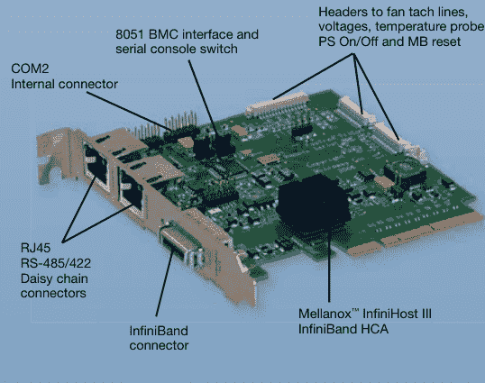

# FasTree™

- DDR InfiniBand 交换机
- 低延迟，模块化设计
- 24、36 和 48 端口的构建模块


# InfiniScope™

- 监控 HCA 和交换机上的端口
- 提供实时带宽诊断
- 查找交换机和电缆故障
- Lane 15 接口
- 记录所有 IB 错误


# ServaStor™

- 可扩展的基于 IB 的存储构建模块
- 冗余且可扩展
- 并行文件系统
- 开源软件
- 在线容量扩展
- RAID 0, 1, E, 3, 5, 6, 10, 50


升级您当前的集群，或者让我们使用 Microway InfiniBand 解决方案为您设计下一个集群。

要联系 HPC 专家
请致电 508 746-7341 并询问
技术销售或发送电子邮件
sales@microway.com
www.microway.com


