# 《Linux期刊》（2007年9月）

## 企业级高性能计算，尽在掌控

Appro公司凭借契合企业级高性能市场需求的前沿技术，领跑`4路x86计算`领域。

### 4路XtremeWorkstation™

- 搭载AMD皓龙™ 8000系列处理器
- 最高支持128GB DDR2 533/667内存
- 最高支持6.0TB SATA或2.4TB SAS存储
- 支持热插拔硬盘
- 配备2个PCI-E x16插槽，可安装高端显卡
- 支持Windows®或Linux操作系统


### 4路3U XtremeServer™

- 搭载AMD皓龙™ 8000系列处理器
- 最高支持128GB DDR2 533/667内存
- 最高支持4.5TB SATA或1.8TB SAS存储
- 配备2个PCI-E x16及3个PCI-X插槽
- 支持热插拔硬盘
- 配备冗余电源与散热风扇
- 支持ServerDome管理功能，兼容IPMI 2.0标准
- 支持Windows®或Linux操作系统

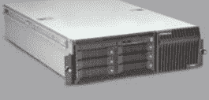

如需了解更多信息，请访问`www.appro.com`或拨打Appro销售热线：`800-927-5464`

### 随时随地，管控任意数据中心

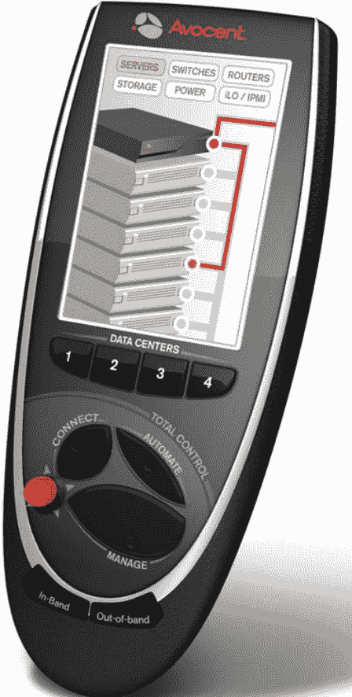

Avocent研发软硬件产品，支持远程系统访问。欢迎莅临我们的远程控制巡展，您可访问`www.avocent.com/remotecontrol`查询就近的活动站点。

> 身临其境，掌控全局。

### 迅捷高效

选择Coyote Point，您无需再担忧网络速度不足、灵活性不够——我们能让您百分百放心。从本地到全球的负载均衡、应用加速、极致网络管控，Coyote Point均处于行业领先地位。我们剔除应用流量管理中的不确定性与操作难度，为您提供速度更快、更智能且性价比更高的解决方案。目前全球已有超过2000家企业信赖我们，借助我们的产品最大化其基础设施效能。快来了解Coyote Point能为您的Web及网络流量带来哪些价值吧。欢迎发送邮件至`info@coyotepoint.com`或致电`1-877-367-2696`联系我们。


> 郊狼响应迅如闪电，您的网络也应如此。

### 无需焦虑，我们的服务器绝不会让您失望。

我们都体验过失望的滋味，而没有什么比不可靠、价格高昂又无法满足需求的服务器更让人失望的了。为了避免期望落空的遗憾，QSOL为几乎所有主流操作系统提供高可靠服务器解决方案，价格绝对会让您惊喜，绝不会超出预算。`QSOL.com`的服务器设备提供多种配置，满足用户最精细的需求。无论您需要8/16核的1U机型，还是近40TB以上存储的5U机型，我们都能提供可在最严苛环境下稳定运行的产品。如果您的现有服务器无法满足需求，请访问QSOL官网。（放心，绝对不会让您失望！）

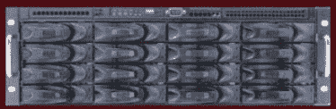

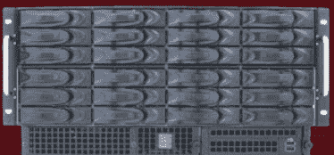


### QSOL.COM

## 服务器设备

> 自1999年起专注服务器供应

# 《Linux Journal》

创刊于1994年：Linux社区首份权威杂志

## 数字版现已上线！

- 抢先阅读：在报刊亭发售前获取最新一期
- 支持关键词搜索：几秒内即可找到所需主题或人物
- 无纸化存档：下载至本地电脑，方便离线阅读
- 原版优质内容：每期均提供高清PDF版本供阅读

### 试读样刊！

`www.linuxjournal.com/digital`


## 主编

Nick Petreley，邮箱`ljeditor@linuxjournal.com`

### 行政团队

- **执行主编** Jill Franklin，邮箱`jill@linuxjournal.com`
- **高级编辑** Doc Searls，邮箱`doc@linuxjournal.com`
- **艺术总监** Garrick Antikajian，邮箱`garrick@linuxjournal.com`
- **产品编辑** James Gray，邮箱`newproducts@linuxjournal.com`
- **荣休编辑** Don Marti，邮箱`dmarti@linuxjournal.com`
- **技术编辑** Michael Baxter，邮箱`mab@cruzio.com`
- **资深专栏作家** Reuven Lerner，邮箱`reuven@lerner.co.il`
- **法式专栏作者** Marcel Gagné，邮箱`mgagne@salmar.com`
- **安全编辑** Mick Bauer，邮箱`mick@vici.com`

### 特约编辑

David A. Bandel、Ibrahim Haddad、Robert Love、Zack Brown、Dave Phillips、Marco Fioretti、Ludovic Marcotte、Paul Barry、Paul McKenney、Dave Taylor

### 校对

Geri Gale

### 出版团队

- **出版人** Carlie Fairchild，邮箱`publisher@linuxjournal.com`
- **总经理** Rebecca Cassity，邮箱`rebecca@linuxjournal.com`
- **销售总监** Laura Whiteman，邮箱`laura@linuxjournal.com`
- **区域销售经理** Joseph Krack，邮箱`joseph@linuxjournal.com`
- **区域销售经理** Kathleen Boyle，邮箱`kathleen@linuxjournal.com`
- **发行总监** Mark Irgang，邮箱`mark@linuxjournal.com`
- **营销协调员** Lana Newlander，邮箱`mktg@linuxjournal.com`
- **系统管理员** Mitch Frazier，邮箱`sysadm@linuxjournal.com`
- **站长** Keith Daniels，邮箱`webmaster@linuxjournal.com`
- **会计** Cindy Beauchamp，邮箱`acct@linuxjournal.com`

### 编辑顾问委员会

- Daniel Frye，IBM Linux技术中心总监
- Jon “maddog” Hall，Linux国际协会主席
- Lawrence Lessig，斯坦福大学法学院教授
- Ransom Love，耶稣基督后期圣徒教会家族与教会历史部战略关系主任
- Sam Ockman，Penguin Computing首席执行官
- Bruce Perens
- Bdale Garbee，惠普Linux首席技术官
- Danese Cooper，英特尔公司开源专家

### 广告合作

电子邮箱：`ads@linuxjournal.com`

网址：`www.linuxjournal.com/advertising`

电话：`+1 713-344-1956` 转2

### 订阅服务

电子邮箱：`subs@linuxjournal.com`

网址：`www.linuxjournal.com/subscribe`

电话：`+1 713-589-3503`

传真：`+1 713-589-2677`

免费热线：`1-888-666-LINUX`

邮寄地址：美国得克萨斯州休斯顿市邮编77098，邮箱980985号邮政信箱

地址变更及订单处理需4-6周

## 32颗处理器、256GB内存


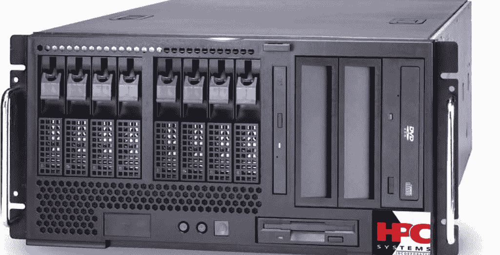

基于行业领先的AMD Opteron™ 微处理器，`HPC A5808-32`服务器提供行业领先的可扩展x64处理能力，搭载最新的I/O、网络、内存及节能技术。

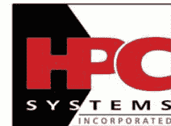

搭载`AMD四核Opteron™`微处理器、最高支持256GB DDR2内存以满足内存密集型应用的性能需求，CRM、ERP、电子商务和虚拟化等多线程应用都能获得显著的性能提升。此外，`HPC MasterSight™`还提供集成诊断工具，助力系统管理。

HPC Systems公司

地址：美国加利福尼亚州弗里蒙特市弗里蒙特大道48009号，邮编94538

电话：`510-656-8282`

传真：`510-656-8341`

电子邮箱：`info@hpcsystems.com`

HPC Systems公司专注于高性能计算机领域，是为金融、医疗、教育和政府行业提供解决方案的服务商。我们深知您有数十家厂商可选，但并非所有厂商都能像我们一样，以毫不妥协的投入和专业经验打造最优解决方案。


AMD、AMD Opteron及AMD标识是超微半导体公司（Advanced Micro Devices）或其子公司在美国及其他国家的注册商标。

## 我认出这个了

光是阅读Dave Taylor的《Work the Shell》系列文章，我就觉得《Linux Journal》（`LJ`）物超所值，而这个月读到安东尼·凯撰写的《Tesseract：开源光学字符识别引擎》（2007年7月刊）后，我对Tesseract的试用更是让我的喜悦翻倍。我七年前离开微软后一直在寻找OCR程序，如今终于找到了。Tesseract的表现非常出色，安东尼·凯的这篇文章也写得非常精彩。

> -- **布鲁斯·贝利斯**

## 接下来是全然不同的内容

2007年6月刊有一篇很棒的Python教程，是何塞·P·E·费尔南德斯撰写的《Python编程入门（上）》。如果这期教程连载结束后，《Linux Journal》能开设每月更新的Python专栏就再好不过了。（我见过其他语言的专栏，比如Perl，但从来没见过Python专栏。）

> -- **理查德**

## BSD脚本修改

在Dave Taylor撰写的2007年7月刊文章《在Apache中显示图片目录（第四部分）》中，我在自己托管服务商的BSD系统上使用其中的脚本时遇到了问题：具体来说，`figuresize`函数返回的宽度值无效。可以将`figuresize`函数修改为以下形式：

```bash
figuresize() {
  width="$(identify -format %w $1)"
  height="$(identify -format %h $1)"
}
```

这次修改解决了我的问题，还通过省去每张图片四次调用`cut`命令的步骤提升了函数效率。

> -- **道格·温特伯恩**

## 处理错误而非忽略

我写信是想谈谈Girish Venkatachalam发表在2007年7月《Linux Journal》上的文章《用UNIX Shell编写自己的图片库应用》。在第71页的脚本中，Girish通过将错误信息重定向到黑洞，屏蔽了`mkdir`命令的错误提示：

```bash
# we don't want mkdir shouting at us for
# directories that exist!
mkdir $dimension 2>/dev/null
```

我的建议是改用以下方式：

```bash
# use -e instead of -d, since an existing
# file with the same name could also prevent
# you from creating the directory
[ -e $dimension ] || mkdir $dimension
```

更好的做法是，在`mkdir`命令执行后，用以下方式处理可能的错误：

```bash
if [ $? -ne 0 ]; then
  echo Handle my error here
fi
```

感谢你们推出这么优秀的杂志，期待你们继续努力。

> -- **杰克**

## 回复2007年7月刊《不要只赢我，要教会我》的来信

为Linux（实际上任何操作系统）从零开始编写教学类软件是一项耗时且颇具难度的活动。要让人们投入时间精力在这件事上，必须有足够的回报才能让这项投入值得。我认为更有前景的做法是将现有教学软件移植到Linux平台。

ChessMaster确实是款非常优秀的教学软件，我也一直向我的学生推荐它。几年前我就曾联系育碧（Ubisoft），询问是否会推出Linux版的ChessMaster，对方给出了意料之中的回复：“在可预见的未来没有相关计划”。此后Linux获得了长足发展，甚至在象棋这类相对小众的市场领域也有了广泛使用。一个很好的例子就是全球顶尖的国际象棋程序之一Shredder（`www.shredderchess.com`），已经推出了Linux版本。

我碰巧为一家北美国际象棋软件的分销商和零售商（`www.chesscountry.com`）担任顾问。我曾向生产优质教学软件的Convekta公司推荐过Linux版本软件，虽然目前无法给出确切的时间预测。

随着Linux在象棋领域的市场份额不断扩大，育碧这样的公司将越来越难以忽视Linux，否则可能面临被新进入者取代的风险。如果发起有力的游说行动，他们很可能愿意考虑将软件移植到Linux平台。目前certainly有足够多的优秀开发者可以完成这项工作。

在此之前，我也没有更好的推荐，只能凑合用我们现有的Windows-Linux集成方案。Colon先生不折腾Wine的做法完全是正确的。我已经确认过，通过Wine运行Windows应用完全是碰运气：一半应用经过大量配置后能运行，另一半根本没法运行。两个更优的选择是VMware和VNC。如果你只有一台电脑且预算充足，VMware可能是更好的选择。我更推荐VNC（它是免费的）。我做IT咨询时会用到一台多系统启动的笔记本，这台笔记本可以

## 让您的业务平稳运行

> 为您的SERVERSDIRECT系统搭载英特尔® 至强® 双核处理器，借助其内置的安全增强功能保护您的核心业务。

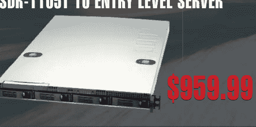

### SDR-1105T 1U入门级服务器

适合需要低成本入门级方案的组织的高性价比通用型服务器。

- 1U机架式机箱，配备520W电源
- 搭载英特尔® 5000V（Blackford VS）芯片组的超微X7DVL-E服务器主板
- 英特尔® 至强® 双核处理器5050，主频3.0GHz，前端总线667MHz
- 总容量512MB内存，由2根256MB金士顿DDR2 533MHz FB-DIMM ECC内存组成
- 希捷SATAII 80GB硬盘，7200转/分钟，8MB缓存，SATA 3.0Gb/s接口
- 4个1英寸热插拔SATA硬盘位
- 2块英特尔® 82563EB双端口千兆以太网控制器
- 英特尔® ESB2 SATA 3.0Gbps控制器，支持RAID 0、1、5、10

售价：959.99美元


### SDR-2503T 2U应用服务器

起售价`1,199美元`。

基于双核/四核至强CPU，性能强劲，是通用型应用的绝佳选择，可提供充足算力。

- 2U机架式机箱，配备650W电源
- 搭载英特尔® 5000V（Blackford VS）芯片组的超微X7DVL-E服务器主板
- 英特尔® 至强® 双核处理器5050，主频3.0GHz，前端总线667MHz
- 总容量512MB内存，由2根256MB金士顿DDR2 533MHz FB-DIMM ECC内存组成
- 希捷SATAII 250GB硬盘，7200转/分钟，8MB缓存，SATA 3.0Gb/s接口
- 6个1英寸热插拔SATA硬盘位
- 英特尔® ESB2/Gilgal 82563EB双端口千兆以太网控制器
- 英特尔® ESB2 SATA 3.0Gbps控制器，支持RAID 0、1、5、10

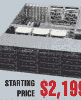

### SDR-3500T 3U数据库服务器

起售价`2,199美元`。

为成长型企业打造，支持热插拔，存储方案可轻松扩展。

- 3U机架式机箱，配备800W冗余电源
- 搭载英特尔® 5000P（Blackford）芯片组的超微X7DBE+服务器主板
- 英特尔® 四核至强® 处理器E5310，主频1.6GHz
- 总容量1024MB内存，由2根512MB金士顿DDR2 533MHz FB-DIMM ECC内存组成
- 希捷SATAII 500GB硬盘，7200转/分钟，16MB缓存，SATA 3.0Gb/s接口
- 16个1英寸热插拔SATA硬盘位
- 双端口千兆以太网控制器
- 英特尔® ESB2 SATA 3.0Gbps控制器，支持RAID 0、1、5、10

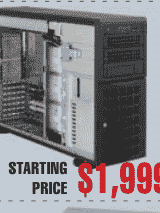

### SDR-7045B-TB 4U文件服务器

起售价`1,999美元`。

4U四核至强服务器，具备出色的性价比和扩展能力。

- 4U机架式/塔式机箱，配备650W电源
- 搭载英特尔® 5000P（Blackford）芯片组的超微X7DBE服务器主板


# 英特尔® 四核至强® 处理器E5310，主频1.6GHz

总容量1024MB内存，由2根512MB金士顿DDR2 667MHz FB-DIMM ECC内存组成

希捷SATAII 750GB硬盘，7200转/分钟，16MB缓存，SATA 3.0Gb/s接口

6个3.5英寸热插拔SAS/SATA硬盘位

双端口千兆以太网控制器

英特尔® ESB2 SATA 3.0Gbps控制器，支持RAID 0、1、5、10


## SDR-5111T 5U高级存储服务器 起售价**3,299美元**

基于四核双至强CPU，配备24个热插拔硬盘位，最大可支持18TB纯数据存储容量。

- 5U机架式机箱，配备1350W冗余电源
- 搭载英特尔® 5000P（Blackford）芯片组的超微X7DBE服务器主板
- 英特尔® 四核至强® 处理器E5310，主频1.6GHz
- 总容量1024MB内存，由2根512MB金士顿DDR2 667MHz FB-DIMM ECC内存组成
- 希捷750GB硬盘，7200转/分钟，16MB缓存，SATA 3.0Gb/s接口
- 24个1英寸热插拔硬盘位
- 英特尔® ESB2/Gilgal 82563EB双端口千兆以太网控制器
- 英特尔® ESB2 SATA 3.0Gbps控制器，支持RAID 0、1、5、10

## SERVERS DIRECT可帮您配置下一套高性能系统——立即致电！

我们灵活的在线产品配置器可助您获得定制化解决方案，您也可以致电我们的产品专家，他们将随时为您组装需要特殊定制的系统。

Servers Direct——您可扩展、高性价比服务器解决方案的直接供应商。

**联系电话：1.877.727.7887** | **官网：www.ServersDirect.com**


# 致编辑的信

可以启动Debian、Red Hat或XP系统（我最近因为《Linux Journal》（以下简称LJ）近期几期提到的原因移除了SUSE）。如果需要在台式机上访问XP系统，我只需把笔记本电脑连接到家庭无线网络，启动XP后开启VNC服务器即可。Windows共享文件可通过Samba访问。——匿名

## 256MB内存绰绰有余

在尼古拉斯·佩特利的《Amazing Free Distributions Abound》（2007年7月刊）中提到：“我之所以在这台256MB内存的老康柏笔记本上运行Damn Small Linux，纯粹是因为它跑不动更臃肿的系统”，但我在192MB内存的奔腾2上装了完整版Ubuntu。它运行起来有点慢，但没Windows XP那么卡。我打算把GNOME换成XFCE来提升点性能，不过对于普通Linux发行版来说，256MB内存完全够用。Debian搭配IceWM运行速度也会非常快。——麦肯齐·摩根

## 做个交易吧？

尼古拉斯，你七月刊的那篇发行版选购指南很有意思，但如果能多介绍点Gentoo之外的其他源码型发行版就更好了。有没有可能实现这个想法？我大概不是第一个提这个建议的人，但我还是得问问你，现在你对下一代Linspire的期待是不是已经淡了？微软和Linspire最近的合作公告，肯定是你们正忙着排版印刊的时候发布的吧。——尤索

VNC和Samba的组合可以让我从Debian工作站无缝访问那台运行XP的笔记本电脑。尽管我所有的主机都在无线网络上，VNC的性能实际上相当不错。当然，如果你用的是纯有线网络，性能还会更好。我觉得VNC方案很适合大多数Linux用户，因为大多数人一般都有不止一台已经联网的电脑。相比走VMware路线，添加网络连接的性价比要高得多。unfortunately，我目前不知道有什么Linux版的ChessMaster，但在这样的软件出现之前，希望这些建议能暂时满足ChessMaster用户的需求。

## 不完美的项目

我刚注意到刊载的Pixel项目相关文章[《采访Pixel创作者帕维尔·坎采尔施贝格》，詹姆斯·格雷撰，2007年7月刊]。请不要推广这个项目，它纯粹是个骗局。——彼得·斯坦

你们真该去翻翻他们的论坛，上面有很多被骗的人。这个项目已经过时，根本没法用，只有一个人在做，而且还是闭源的。这个项目没救了，就是个骗局。我对微软和Linspire、Xandros等公司最近的合作非常失望。和微软的这种合作通常会让微软的新“合作伙伴”走向消亡。时间会证明，Linspire和其他公司是会卷钱跑路，还是微软能笑到最后。——编者


# 为您服务

## 纸质版杂志订阅

续订、修改地址、支付账单、查看账户信息或其他订阅相关问题都可以在线办理，网址：www.linuxjournal.com/subs。此外，美国和加拿大用户可拨打免费电话1-888-66-LINUX（54689），国际用户可拨打+1-713-589-2677。也可发送邮件至subs@linuxjournal.com，或邮寄至美国德克萨斯州休斯顿市邮编77098-0985，PO Box 980985，《Linux Journal》编辑部。联系我们时请务必附上您的完整姓名和地址。

## 数字版订阅

《Linux Journal》现已推出数字版订阅服务，全球任意地区均可以优惠价格获取PDF格式的杂志内容。更多信息请访问www.linuxjournal.com/digital，数字版客服咨询也可使用上述联系方式。

## 致编辑的信

我们欢迎读者来信，请将稿件发送至editor@linuxjournal.com，或邮寄至美国华盛顿州西雅图市西北市场街1752号200室，邮编98107，《Linux Journal》编辑部。来信可能会因篇幅和清晰度要求进行编辑。

## 投稿指南

我们常年征集投稿文章、教程和实战案例类内容。作者指南、主题列表和投稿截止日期可在线上查阅，网址：www.linuxjournal.com/author。

## 广告服务

《Linux Journal》是读者和广告商的绝佳资源平台。您可在线申请媒体资料包、查看当前编辑日历和广告投放截止日期，或了解更多广告与营销合作机会，网址：www.linuxjournal.com/advertising。如需进一步咨询，可直接发送邮件至ads@linuxjournal.com或拨打+1 713-344-1956转2。

## 官方网站

您可以访问《Linux Journal》官方网站www.linuxjournal.com阅读独家线上内容。此外，纸质版的部分文章也会同步上线。纸质版及数字版订阅用户可免费访问全部过刊存档，更多详情请联系客服，邮箱：subs@linuxjournal.com。

## 免费电子简报

每周，《Linux Journal》编辑都会为您带来Linux领域的热点资讯。您可收到突发新闻、技术技巧，以及www.linuxjournal.com上深度专题的链接。现在就免费订阅吧，网址：www.linuxjournal.com/enewsletters。

# 借助UniServer充分释放AMD Opteron™四核处理器性能

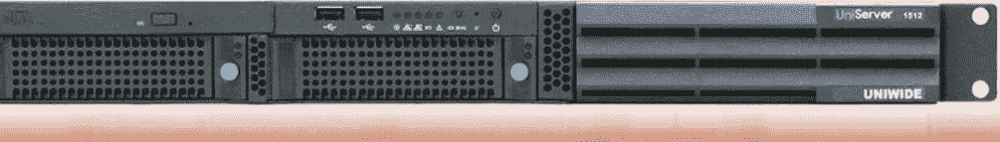

> 最高支持32GB内存，配备8个DIMM插槽

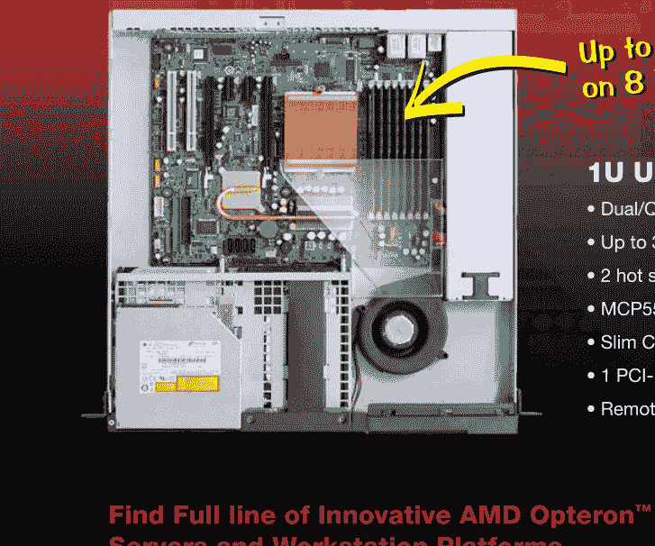

## 1U UniServer（单插槽款）

- 支持双核/四核AMD Opteron™ 2000系列处理器
- 最高支持32GB内存
- 2块3.5英寸热插拔SATA硬盘
- MCP55V Pro芯片组
- 超薄CD/DVD光驱
- 1个PCI-Express x16插槽
- 支持远程管理-IPMI 2.0

## 查询全系列创新AMD Opteron™服务器及工作站平台

- 1U服务器：1/2个插槽，最高支持64GB内存
- 2U服务器：2/4个插槽，最高支持128GB内存
- 3U服务器：2/4个插槽，最高支持128GB内存
- 工作站：1/2/4个插槽，最高支持128GB内存

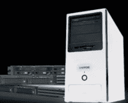


# 前沿资讯+趣味内容

## LJ索引，2007年9月刊

## diff -u 内核开发新动态

**UMSDOS**曾是面向MS-DOS用户接入Linux世界的重要入口，它早已从内核中移除，如今连残留的代码也正逐步被清理。

**Jesper Juhl**提交了补丁，用于从kconfig中移除UMSDOS的配置项及其曾使用的ioctl接口。但我们发现这些ioctl接口仍然无法完全移除，因为未来的软件需要知道这些编号不能复用。因此和DevFS一样，要完全抹去UMSDOS的所有痕迹可能是不可能的。

**英特尔**发布了**PowerTOP**，这是一款独立工具，可帮助用户识别各应用程序及系统组件（包括内核驱动）的功耗情况，旨在帮助所有软件开发者降低软件功耗，大幅提升笔记本电脑的续航时间。

该项目的宣布者**Arian van de Ven**在linux-kernel邮件列表中表示，在测试用笔记本上，英特尔已将电池续航时间提升了一小时以上。

**Dave Jones**提交了补丁，撤销对Raw I/O驱动的弃用标记。该驱动原本不再需要，因为用户只需使用`O_Direct`标志打开目标设备即可实现同样功能。但显然有相当一部分用户无法修改自己的软件，因此尽管已有更优方案，Raw驱动在可预见的未来仍会保留。现在将它标记为弃用也不合适，因为Dave指出，这只会让人把它加入“待移除”列表，从而引发新一轮讨论。

**Geert Uytterhoeven**提交了针对PS3的Flash ROM存储驱动的补丁。这套补丁广受好评，没有遇到明显技术障碍。

英特尔的**Jesse Barnes**正与Framebuffer开发者合作，试图彻底改变Linux世界的图形处理方式。他们希望增强内核的图形支持能力，为Linux提供功能完备的非X Window System图形能力。这是一个极具争议的项目，也是众多试图取代X Window System的尝试中的又一次。这类项目面临的难题非常庞大，其中最重要的是，任何X Window System的替代方案都必须提供同等竞争力的功能集，其体量至少会和X Window System本身一样大。这种前景对那些认为内核应该小巧精悍的开发者来说毫无吸引力。但不可否认的是，图形设备一直是“硬件控制器应放在内核中”这一普遍规则的奇怪例外。这次内核图形系统的尝试最终会如何发展，非常值得期待。

**Rob Landley**决定对Documentation目录做部分调整：新增Amiga架构目录，将arm、cris、blackfin、parisc、powerpc、s390、x86_64和uml相关文档移入该目录。顺便他还把多串口IO卡相关的文档移动到了串口目录下。——扎克·布朗

1. 耐克为其swoosh标识花费的金额（单位：美元）：35
2. 耐克去年的营销总花费（单位：十亿美元）：1.7
3. 色情网站占所有网站的比例：12%
4. 搜索引擎请求中色情相关的占比：25%
5. 色情内容占所有下载量的比例：35%
6. 每秒观看色情内容的用户数：28,358
7. 每秒花在色情内容上的金额（单位：美元）：89
8. 每天新增的色情网站数量：266
9. 色情网页的估计总量（单位：十亿）：0.372
10. “sex”在热门搜索词中的排名：第1位
11. 2006年美国网络色情产业营收（单位：十亿美元）：2.84
12. 网络色情用户的男性占比：72%
13. 朝九晚五八小时工作时段内的色情流量占比：70%
14. 由美国制作的色情网站占比：89%
15. AdultFriendFinder在热门色情网站中的排名：第1位
16. Netcraft统计的AdultFriendFinder站点数量：75
17. 已知由Unknown服务商托管的AdultFriendFinder站点数量：46
18. 已知由Windows服务商托管的AdultFriendFinder站点数量：1
19. 已知由BSD服务商托管的AdultFriendFinder站点数量：2
20. 已知由Linux服务商托管的AdultFriendFinder站点数量：28

**来源：**1–15：*Good Magazine*；16–20：Netcraft.com

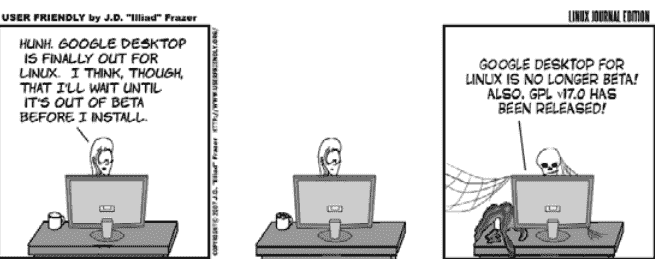

# 这是马特闲暇时间会做的事。

## 想象一下他工作时是什么样的！

聪明、求知欲强、好奇心旺盛、充满动力。敢于承担其他人不敢迎接的挑战。这就是白橡科技员工每一天的真实写照。他们会挑战能激发自身潜力的远大目标。和充满激情、能激励彼此成为更优秀的人的伙伴共事。为最棘手的问题寻找巧妙的解决方案。无论上班还是下班，白橡人都始终保持充沛的干劲！

我们提供的福利和我们招聘的优秀人才一样出众。如果你在以下一个或多个领域拥有出色的架构与开发经验，就请向我们展示你的能力。请发送邮件至：bruce@woti.com。

- 网络与数据库技术
- `C++`、`Python`、`Perl`、`Linux`
- 用户界面开发
- 解析器与编译器设计
- `TCP/IP`编程

工作地点位于华盛顿特区周边。www.woti.com。

要求美国公民身份。

白橡科技公司是平等就业机会雇主。

# 【前沿】Chumby

如今的问题是，Chumby这个名字是否会成为所有其他可破解的枕头形设备的代名词。（这正是Kleenex（健牌纸巾）和Escalator（自动扶梯）曾经的命运——二者原本是品牌名，最终都成了通用名词。）如果一切按计划推进，Chumby现在应该已经上市了。原型机与开发版本已经流通了近一年，围绕它已经形成了一个规模庞大的开发者社区。考虑到它在公开测试阶段的迭代与变化如此之多，谁也无法预料它进入实际市场后会如何演变。

Chumby公司由一群希望创造出有趣、实用、与众不同的产品的黑客组建。其创始人表示，最初的起点不过是普通的钟控收音机。此后，Chumby从带软垫的时钟，演化为任意用途的原生网络Linux设备。这里的“任意”可是大写的`A`，因为Chumby的每一个层级都支持破解，包括物理层面。它不仅能感知动作与挤压，还能通过其外设API搭载各类特色应用。

Chumby的各类特色应用及更多相关内容均由苏珊·卡尔设计（她曾为Macintosh和Windows设计最初的桌面图标，除此之外还有太多成就无法一一枚举）。苏珊是Chumby的创意总监。这家公司看起来软萌可爱，但办起事来也绝不含糊。

## 技术规格：3.5英寸LCD彩色触控屏、2个外部USB 2.0全速端口、350MHz ARM控制器、64MB SDRAM、64MB NAND闪存ROM、2W功放搭配立体声扬声器、耳机输出接口、挤压传感器、加速度计、Wi-Fi连接功能、麦克风，以及你可以自行拓展的所有功能。更多信息请访问www.chumby.com。

# 业界观点

> 在我看来，社区只有一个规则：如果要称一群人的聚集为社区，就必须满足一个条件——如果你是社区成员，有一天你不再出现，人们会出来找你，想知道你去了哪里。

> ——亚当·菲尔兹，www.aquick.org/blog/2007/05/15/ the-first-rule-of-community

> 目前所有的网络服务最终都成了独一无二的“雪花”，都需要专属的特殊处理。但话说回来，有总比没有好，所以我们还是会吭哧吭哧地构建客户端库。

> ——莱斯·奥查德，blogs.opml.org/decafbad/2007/05/ 27#When:2:35:59PM

莱斯·奥查德表示，每个API都像一片独一无二的雪花，每个开发者都必须为其开发定制化接口。总有一天这些人会意识到需要坐下来共同制定数据序列化的标准，为自己和开发者简化工作。要实现这一点需要大量的妥协与协作。而等他们最终完成这项工作，恐怕已是多年之后，届时他们的处境，正是我们1998年使用XML-RPC时的处境。

> ——戴夫·维纳，www.scripting.com/stories/2007/05/ 27/linksOnlyANerdCouldLove.html

> 一个能正常运行的复杂系统，必然是从一个能正常运行的简单系统演变而来。

> ——约翰·加尔语义学第15定律，en.wikipedia.org/wiki/Systemantics

> 把软件说成是有生命的完全合理。它是共生的，需要一个极客宿主才能存活。

> ——杰里米·拉斯顿（TiddlyWiki作者），在伦敦TiddlyWiki主题演讲中的发言

# 全球用户仍在期待戴尔推出Linux电脑

戴尔年初上线的IdeaStorm站点收到了Linux社区如飓风般强烈的用户反馈。正如我们在2007年6月刊中报道的，该公司用户提交的新提案中，得票前十的议题几乎全部与Linux或开源相关。此后，戴尔已承诺推出基于Linux的台式机与笔记本电脑，目前仅在美国市场提供基于Red Hat、SUSE、Ubuntu发行版的丰富产品选择。

截至2007年6月中旬，IdeaStorm站点的头号议题是“在全球范围内销售Linux电脑（而非仅限美国）”，目前已经获得超过24000票支持。紧随其后的是“为欧洲市场推出戴尔Ubuntu机型”，获得11370票。同一页面的其他议题还包括“戴尔Ubuntu机型售价必须低于Windows版”、“Ubuntu与Windows机型享受同等折扣”、“为所有硬件提供Linux驱动”、“预装OpenOffice.org作为微软Works与微软Office的替代品”、“将Firefox设为默认预装浏览器”、“为新款Ubuntu电脑拍摄电视广告”。


戴尔方面则表示，公司目前仅先从美国市场起步，仍在推进全球推广计划的细节，非英语语言的支持是需要解决的重要问题。在`www.google.com/trends`搜索`linux`，你会发现Linux搜索量最高的国家依次为捷克、俄罗斯、保加利亚、印度尼西亚、印度、斯洛伐克、罗马尼亚、乌克兰、匈牙利和波兰。搜索任意一款Linux发行版也会得到类似结果，美国没有进入任何一款发行版搜索量的前十。

美国市场同样有改进空间：戴尔目前在其官网上将Linux相关信息藏得很深。尽管有不少页面专门介绍Linux或Linux相关产品，但戴尔官网首页、以及站点结构向下两层以内的所有页面都找不到“Linux”这个词，甚至企业服务器页面都没有标注（而惠普的官网就会明确标注）。然而戴尔产品页顶部却随处可见“戴尔推荐Windows Vista家庭高级版”的提示。

与此同时，迈克尔·戴尔的热情似乎并未减退。截至发稿时，迈克尔推荐列表上的头号产品仍然是搭载Ubuntu 7.04 Feisty Fawn系统的戴尔Precision M90（`www.dell.com/content/topics/global.aspx/corp/biographies/en/msd_computers?c=us&l=en&s=corp`）。

## 正在寻找与你下一款应用一样强大的硬件？

### GEMINI - 英特尔® 酷睿™ 2 双核

### SBC-GX533 - AMD Geode™ GX

### ZEUS - PXA270

### VIPER - PXA255

### VULCAN - IXP425

……可查看Arcom嵌入式开发板

- 搭载英特尔XScale、酷睿2双核、AMD及X86技术
- 无风扇解决方案
- 支持TFT与STN显示屏的显示控制器
- 配备用于旧设备通信的串口
- 支持USB、SDIO、CompactFlash、PC/104及PCI扩展
- 提供完整的操作系统与应用开发环境

`888-941-2224`

`www.arcom.com`

## 自动挂载FTP站点为文件系统

### 将自动挂载与FUSE和CurlFtpFs结合

前阵子我“发现”了自动挂载功能，用了段时间后，我琢磨能不能把它和FUSE、CurlFtpFs结合，实现FTP站点的文件系统自动挂载。这事没那么简单，因为自动挂载软件在解析映射文件时有些问题。我通过编写一个伪装curl文件系统的辅助脚本解决了这个问题，步骤如下：

1. 如果内核还没启用该功能，通过将`CONFIG_AUTOFS`和`CONFIG_AUTOFS4`设为yes或模块（module）来启用`autofs`，然后重新编译内核。
2. 从`fuse.sourceforge.net`获取FUSE并安装。
3. 从`curlftpfs.sourceforge.net`获取CurlFtpFs并安装。
4. 创建映射文件`/etc/auto.ftp`：

```text
-fstype=curl,allow_other,ro :ftp\://&
```

这会告诉自动挂载器使用curl文件系统挂载FTP站点。我添加了`allow_other`选项，这样系统上的任何用户都能使用这个方法。其他可用选项可以参考FUSE和CurlFtpFs的文档。

5. 我编写了以下辅助脚本，路径为`/sbin/mount.curl`：

```sh
#!/bin/sh
mount -t fuse curlftpfs
```

这个脚本会被`mount`命令用来挂载curl文件系统，实际是通过FUSE文件系统配合CurlFtpFs来挂载FTP站点。

6. 创建目录`/mnt/ftp`（或者其他你喜欢的路径）。
7. 之后，以root身份执行以下命令：

```sh
automount /mnt/ftp file /etc/auto.ftp
```

之后你就可以通过切换到`/mnt/ftp/ftp.linuxjournal.com`目录来访问FTP存档，就像访问本地计算机一样。过一段时间后，自动挂载器（默认超时时间是5分钟，可以通过`automount`的`-t`选项修改）会自动卸载该目录，断开与FTP站点的连接。注意每次访问文件时，都会通过FTP传输给你，耗时取决于你的网速。

> ——Michiel，来自网络空间的某处。

走安装显卡驱动的捷径。

## 在Ubuntu/Kubuntu上轻松安装NVIDIA和ATI驱动

查看本期《终极Linux配置》文章（第64页），你会找到在Ubuntu/Kubuntu上安装最新NVIDIA驱动的“硬核”指南。不过在Ubuntu/Kubuntu及其所有衍生版上安装NVIDIA（甚至ATI）驱动有更简单的方法，你可以使用名为Envy的程序，它专门用于自动化安装加速显卡驱动。我之前听说过Envy，但一开始还是选择了“硬核”方法，因为我读过不少Envy无法正常工作的报告。现在硬核方法对我而言已经不算难了，毕竟我已经重复过这个过程很多次。但浪费了这么多时间实在可惜，因为后来我发现Envy实际上非常好用，而且在最新的Ubuntu/Kubuntu、Linux Mint及其他Ubuntu衍生发行版上都能完美运行。

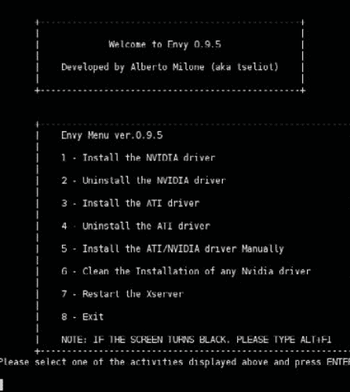

图1. 你可以从控制台或终端窗口运行Envy。

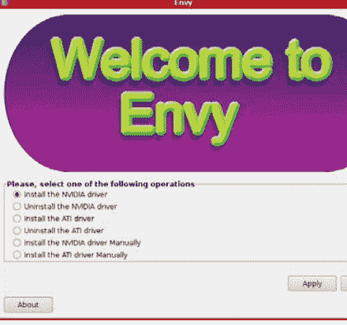

图2. 如果你能进入图形化桌面，就可以运行图形界面的Envy。

你需要做的第一件事就是安装Envy，执行以下命令：

```sh
sudo apt-get install envy
```

执行后它会自动安装一堆依赖项。使用`envy -t`命令可以运行带文本界面的Envy。如果你根本无法启动图形化桌面，这个命令特别有用，因为你可以从文本控制台运行它；当然在图形化桌面的终端窗口里运行效果也一样。图1是文本模式主界面的截图。你也可以用`envy -g`命令运行图形界面的Envy，图2是图形主界面的截图。选择NVIDIA驱动的第一个菜单选项即可。如果你是以普通用户身份运行Envy，需要输入密码。之后按照提示操作即可，它会询问你是否要更新`/etc/X11/xorg.conf`文件，默认答案是“y”，我建议你选择默认。如果你安装Linux时因为无法正确识别显卡而得到了低分辨率的图形化桌面，你肯定不想继续用这个低分辨率，Envy程序不一定能帮你解决这个问题，你需要手动修改`/etc/X11/xorg.conf`文件中的Screen部分。举个例子，我删除了分辨率列表里以1024x768开头的选项，替换成了我唯一使用的1920x1200分辨率：

```text
Section "Screen"
Identifier "Default Screen"
Device "nVidia Corporation"
Monitor "Generic Monitor"
DefaultDepth 24
SubSection "Display"
Depth 24
Modes "1920x1200"
EndSubSection
EndSection
```

> ——Nicholas Petreley  
> **Linux Journal**为刊载的技术提示支付100美元报酬。请将提示内容及你的联系方式发送至`techtips@linuxjournal.com`。

## 当Chris Negus发言时，众人学Linux！

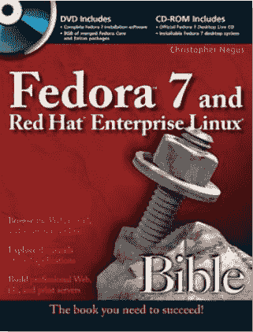

Chris Negus带着市面上最棒的Fedora 7与Red Hat Enterprise Linux书籍回归了——内容从基础到高级系统管理技能应有尽有。本书包含教程、技巧，以及关于平台、3D界面、媒体等方面的最新内容，是市场上最优秀的Fedora相关书籍。

`978-0-470-13075-9`

所有售卖图书的渠道均有售。


## 用Django进行数据库建模

REUVEN M. LERNER

### 让Django及其对象关系模型帮你完成SQL数据库工作。

过去几个月，本专栏一直在介绍Django，这是一个流行的开源Python Web开发框架。Django常被描述为Ruby on Rails的竞争对手，或是Python版的Rails，但就像Python和Ruby是两种各有优势与不足的不同语言一样，Django和Rails也是不同的框架，各自有不同的权衡取舍。和模板。映射器的作用是将我们的方法调用转换为SQL语句，再将数据库返回的结果转换为Python对象。

如果你一直在跟踪本专栏关于Django的系列内容，那么你已经了解了如何下载安装Django软件、如何创建和配置站点与应用，甚至了解了如何创建视图（处理业务逻辑的Python方法）和模板（带有变量插值与动态内容特殊规则的HTML文件）。到目前为止，如果你掌握所有这些内容，应该可以创建一个有趣的动态Web应用了。但在创建模型对象之前，我们首先必须有一个数据库表来关联该对象。Django要求我们用Python代码定义模型，描述表名、字段甚至一些默认值。不过大多数现代Web应用还有一个依赖的组件——关系数据库，用于数据存储与检索。当然你也可以把所有内容存在文件系统甚至内存里，但对大多数人来说，关系数据库是阻力最小的选择，既能保障数据安全，又能在数据检索时提供极大的灵活性。如果我们想保留上个月开始的博客应用，大概可以用如下方式在PostgreSQL中定义对应的表：

```sql
CREATE TABLE Posting (
    id SERIAL NOT NULL,
    title TEXT NOT NULL,
    body TEXT NOT NULL,
    posted_at TIMESTAMP NOT NULL DEFAULT NOW(),
    PRIMARY KEY(id)
);
```

那么本月的专栏就来介绍Django程序员如何在数据库中存储和检索信息。如果你之前只用PHP或CGI程序接触过数据库，Django提供的自动化程度一定会让你惊讶又印象深刻。如果你用过Ruby on Rails，大概会觉得Django程序员做得太多了——对此Django开发者会回应说，他们希望对自己的应用拥有完全控制权，而不是依赖幕后的“黑魔法”。但在Django中，我们不会直接编写上述SQL语句，而是用Python来帮我们生成。例如，我们可以用如下方式在Django中定义上面的表：

```python
from django.db import models

class Posting(models.Model):
    title = models.CharField(max_length=30)
    body = models.TextField()
    publication_date = models.DateTimeField()
```

### 创建模型

在Django领域，模型指的是具有持久状态的Python对象，通常存储在关系数据库中。我们不需要用模型来向Django集成数据库，但如果直接把SQL查询塞进模板里，会很难看（更别说很不规范）。所以我们使用Django内置的对象关系映射器，在视图中只操作对象即可。我们的模型是一个继承自`django.db.models.Model`的Python类。我们会为每个字段定义特定类型，使用从`django.db.models`导入的对象。如上所示，其中部分数据类型可以通过传入参数限制或修改默认值。还有一些是专门定制的类型，有内置限制，比如`EmailField`，要求必须是合法的电子邮件地址。通过使用`ManyToManyField`和`ForeignKey`对象定义列，可以实现表之间的多种关联。上述代码应该放在`models.py`文件中，该Python file that sits within our application's directory (blog in this case), which itself sits inside our Django site directory (mysite in this case). Thus, the models for my blog application reside in `mysite/blog/models.py`, whereas the models for a poll application would reside in `mysite/poll/models.py`.

需要注意的是，我们无需手动定义主键，该主键传统上名为`id`，是一个不重复的整数。（在PostgreSQL中，我们会将其设置为SERIAL数据类型，该类型会为列赋予从新建序列对象中提取的默认值；在MySQL中，你可以将列设置为AUTO_INCREMENT，它具备和序列部分相同的功能。）Django会自动为我们创建id列。

Django会通过给表名添加应用名前缀的方式处理潜在的命名空间冲突。因此，博客应用内的posting表会被命名为`blog_posting`表。

现在，我们该如何将Python代码转换为SQL呢？首先，我们需要确认Django知道要使用哪个数据库。如果你从我在2007年7月刊的第一篇Django文章开始就跟着学习，那么你已经向`settings.py`中添加了合适的配置行，这是一个全站配置文件，我们会在其中定义数据库的类型、名称、用户名和密码。

```python
DATABASE_ENGINE = 'postgresql'
DATABASE_NAME = 'atf'
DATABASE_USER = 'reuve'
DATABASE_PASSWORD = ''
DATABASE_HOST = ''
DATABASE_PORT = '5433'
```

同时还需要确认该应用已被添加到`INSTALLED_APPS`中，这是一个字符串元组。在我的系统中，`INSTALLED_APPS`的配置如下：

```python
INSTALLED_APPS = (
    'django.contrib.auth',
    'django.contrib.contenttypes',
    'django.contrib.sessions',
    'django.contrib.sites',
    'django.contrib.admin',
    'mysite.blog'
)
```


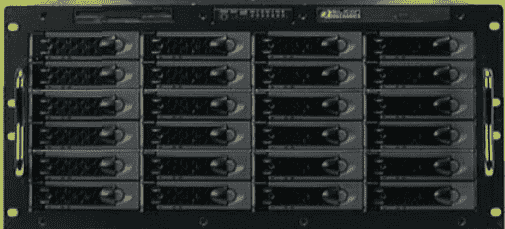

## 专属专家支持

Falko可为我们行业内最全面的服务器和存储产品线提供专业、专属的技术支持。他很欣赏Rackform nServ K501，因为他知道AMD直连架构能够确保所有处理器核心此刻即可以最高效率协同工作，并优化内存性能。此外，其搭载的2颗双核AMD皓龙™2000系列处理器专为日后无缝升级至四核而设计。Falko深知技术发展永不停歇。Rackform nServ K501配备24块热插拔+2块内置SATA硬盘的存储系统，搭配冗余电源，在保证可靠性的同时不牺牲存储容量，这令他印象深刻。当您与Silicon Mechanics合作，您收获的不仅是对AMD技术的长期投资，更是像Falko这样的专属专家。

## 即将参加Linux World展会？

欢迎莅临Silicon Mechanics 414号展位，有机会赢取三份价值不菲的抽奖礼品。

请注意我的应用（`mysite.blog`）和Django自带的应用（`django.contrib.*`）之间有清晰的命名空间区分。

在将Python代码转换为SQL之前，我们首先需要确认它通过了基础合理性和验证检查。为此，我们需要进入站点的根目录，输入以下命令：

```sh
python manage.py validate
```

如果一切顺利，Django会报告没有检测到任何错误。

现在我们的模型已经通过了验证，我们可以用它来生成SQL。最简单的方法是对`manage.py`使用`sqlall`命令：

```sh
python manage.py sqlall blog
```

该命令会生成适配我们数据库驱动（本示例中为PostgreSQL）的SQL输出。例如，在我的系统中看到的输出如下：

```sql
BEGIN;

CREATE TABLE "blog_posting" (
    "id" serial NOT NULL PRIMARY KEY,
    "title" varchar(30) NOT NULL,
    "body" text NOT NULL,
    "publication_date" timestamp with time zone NOT NULL
);

COMMIT;
```

值得称赞的是，Django开发者将`CREATE TABLE`语句包裹在`BEGIN`和`COMMIT`之间，确保表创建操作在事务中执行，一旦出现问题就会回滚。仅创建单张表时这不会有什么问题，但如果我们要创建多个模型，最好始终保持数据库处于一致状态。

## 清单1. 用于创建新虚拟帖子的models.py

```python
from django.template import Context, loader

from django.http import HttpResponse

from blog.models import Posting

from datetime import *

def add_dummy_data(request):

    p = Posting(title='Dummy 1 headline', body='This is my first blog post', publication_date=(datetime.now() - timedelta(0, 0, 0, 0,1)))

    p.save()

    p = Posting(title='Dummy 2 headline', body='This is my second blog post', publication_date=datetime.now())

    p.save()
```


```python
return HttpResponse("Created blog posts.")
```

我们可以将 `sqlall` 命令输出的内容从终端窗口复制，然后粘贴到文件或 `psql` 客户端程序中，以此创建表。但 Django 提供了 `syncdb` 工具来帮我们完成这一操作：

```bash
python manage.py syncdb
```

该命令的输出会向我们确认一切正常：

```text
Creating table blog_posting
Loading 'initial_data' fixtures...
No fixtures found.
```

果不其然，现在我们可以看到表已经成功添加：

```text
atf=# \d blog_posting
                                       Table "public.blog_posting"
   Column    |          Type          |                         Modifiers
-------------+------------------------+-----------------------------------------------------------
 id          | integer                | not null
 title       | character varying(30)  | not null
 body        | text                   | not null
 publication_date | timestamp with time zone | not null
Indexes:
    "blog_posting_pkey" PRIMARY KEY, btree (id)
```

瞧！我们现在拥有了一个模型，既可以通过 Python 方法访问，又存储在关系型数据库中。

### 插入数据

现在数据模型已经搭建完成，让我们看看如何操作它。由于我们的模型是全新的，当前尚未存储任何数据，我们可以先向其中添加一些数据。

在上个月的专栏中，我们了解到 Django 中的每个 URL 请求都会触发对应方法的调用。具体调用哪个方法取决于 `urls.py` 的配置，这是一个全站配置文件，用于告诉 Django 哪个应用和方法需要和哪个 URL 关联。

向博客数据库添加数据、同时练习使用 Django 各组件的方法之一，是通过视图和模板来实现。通常我会演示如何通过 HTML 表单完成这一操作，但受篇幅限制，我采用了一种更简单（也更刻意设计）的方式，即向数据库插入虚拟数据。

第一步是在 `urls.py` 中定义的 `urlpatterns` 变量里添加一行新配置：

```python
('^blog/add_dummy_data', 'mysite.blog.add_dummy_data')
```

现在，我们可以访问 URL `/blog/add_dummy_data`，Django 就会调用 `blog.add_dummy_data` 方法。这个方法的开头非常简单，如下所示：

```python
def add_dummy_data(request):
```

## 便携系列

自 1999 年以来，**EmperorLinux**一直为高校、企业、政府实验室以及个人 Linux 爱好者提供预装 Linux 系统的笔记本电脑。我们的产品线覆盖功能全面的超便携本到桌面替代本全品类。所有系统均附带 1 年电话及邮件 Linux 技术支持，同时享受厂商全面保修。

### Toucan T61/T61ws

ThinkPad T61/T61ws by Lenovo

- 最高 15.4 英寸 WSXGA+ 分辨率，支持 X@1680x1050
- NVidia Quadro NVS 140M 显卡
- 1.8–2.4 GHz 酷睿 2 双核处理器
- 512 MB–4 GB 内存
- 80–160 GB 硬盘
- CDRW/DVD 或 DVD±RW 光驱
- 重量 5.2–6.0 磅
- 10/100/1000 Mbps 以太网
- 802.11a/b/g（54Mbps）WiFi
- 起售价 1650 美元

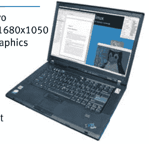

## 性能系列

EmperorLinux 专注于在 IBM、联想、戴尔、索尼和松下等品牌的高品质笔记本上安装 Linux 系统。我们会根据您选择的笔记本型号适配对应的 Linux 发行版，并提供以下技术支持：以太网、无线网络、X 服务器、ACPI 电源管理、USB、EVDO、PCMCIA、FireWire、CD/DVD/CDRW 光驱、声卡等。

### Rhino D830/M90

Dell Latitude D830/Precision M90

- 最高 17 英寸 WUXGA 分辨率，支持 X@1920x1200
- NVidia Quadro FX 3500M 显卡
- 1.8–2.4 GHz 酷睿 2 双核处理器
- 512 MB–4 GB 内存
- 60–160 GB 硬盘
- DVD±RW 或蓝光光驱
- 重量 6.3–8.6 磅
- 802.11a/b/g（54Mbps）WiFi
- ExpressCard/EVDO
- 起售价 1445 美元

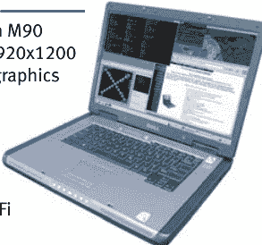

## 特色系列

EmperorLinux 提供具备独特功能的 Linux 笔记本电脑。加固型松下笔记本专为恶劣环境设计：可抵御跌落、震动、沙尘、雨水等极端工况。ThinkPad 平板电脑和普通笔记本类似，配备 LCD 数位板，既可作为鼠标使用，也支持压感书写和屏幕绘图。

### Raven X61 Tablet

ThinkPad X61 Tablet by Lenovo

- 12.1 英寸 SXGA+ 分辨率，支持 X@1400x1050
- 1.6 GHz 酷睿 2 双核处理器
- 1–4 GB 内存
- 80–120 GB 硬盘
- 重量 3.8 磅
- 支持笔/触控笔屏幕输入
- 屏幕动态旋转
- 手写识别
- 提供 X60s 笔记本款型
- 起售价 2300 美元

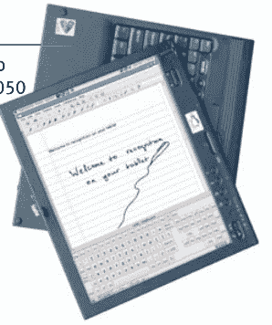

## 铁匠铺专栏

方法的名称从配置文件就能看出来。参数的数量由 `urlpatterns` 中带括号的组数决定。现在我们要做什么呢？

如果我们处理的是原生 SQL，我会建议如下操作：

```sql
INSERT INTO Posting (title, body, publication_date)
VALUES ('Dummy 1 headline', 'This is my first blog post', NOW() - interval '1 hour');
INSERT INTO Posting (title, body, publication_date)
VALUES ('Dummy 2 headline', 'This is my second blog post', NOW());
```

这些语句会向 `Posting` 表中插入两行数据：第一行的时间戳是一小时前，第二行是当前时间戳。但我们不想用 SQL，而是想用 Python，创建能自动映射到这些 `INSERT` 语句的对象。这么说来，我们只需要创建 `Posting` 对象的新实例，并传入合适的参数就可以了。果不其然，我们确实可以这么做：

```python
p = Posting(title='Dummy 1 headline', body='This is my first blog post', publication_date=(datetime.now() - timedelta(0, 0, 0, 0, 1)))
p.save()
p = Posting(title='Dummy 2 headline', body='This is my second blog post', publication_date=datetime.now())
p.save()
```

如果你是经验丰富的 Python 程序员，上面的代码应该完全不会让你感到意外。我们只是在创建两个 `Posting` 的新实例，传入的参数会设置对象的属性。然后，我们对每个 `Posting` 实例调用 `save()` 方法，这个方法大概会把这个 `posting` 保存到磁盘中。最后，我们用以下代码完成这个方法：

```python
return HttpResponse("Created blog posts.")
```

在定义完上述方法后，启动服务器：

```bash
python manage.py runserver 69.55.232.87:8000
```

然后，把 Web 浏览器指向 `urls.py` 中定义的 URL，就能看到返回的消息：

```text
Created blog posts.
```

接下来，检查一下数据库，确保结果正确：

```text
atf# \x Expanded display is on.
atf# select * from blog_posting;
-[ RECORD 1 ]----------------------------
id | 1
title | Dummy 1 headline
body | This is my first blog post
publication_date | 2007-06-15 16:13:34.609396-05
-[ RECORD 2 ]----------------------------
id | 2
title | Dummy 2 headline
body | This is my second blog post
publication_date | 2007-06-15 16:14:34.675235-05
```

如你所见，我们成功创建了这些新对象，并把它们存入了数据库。

### 清单 2：包含 `index` 方法的 `views.py`

```python
from django.template import Context, loader
from django.http import HttpResponse
from blog.models import Posting
from datetime import *

def index(request):
    postings = Posting.objects.all().order_by("-publication_date")
    output = ""
    for posting in postings:
        output += "<h1>%s</h1>\n" % posting.title
        output += "<h2>%s</h2>\n" % posting.publication_date.isoformat()
        output += "<p>%s</p>\n\n\n" % posting.body
    return HttpResponse(output)
```


### 你是否对 iSCSI 和光纤通道 SAN 存储的高昂价格感到震惊？

> 光纤通道存储账单
>
> EtherDrive® 存储：快速、可靠、简单
>
> 价格不到一杯咖啡的钱

### AoE 就是答案！

*以太网 ATA* = **快速、可靠、简单**的存储。

`www.coraid.com`

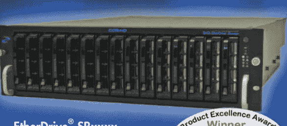


### EtherDrive® SRxxxx —— 配备热插拔 SATA 硬盘位的快速灵活 RAID 设备 —— 查看我们完整的 EtherDrive® 存储、虚拟存储设备及 NAS 网关产品线

1. 无需 TCP/IP 开销的 10 千兆以太网高速存储！
2. 无限扩展能力，价格低至最低点！！
3. 想要更多存储？买更多硬盘就行，就是这么简单！！！

欢迎访问 `www.coraid.com`


*Linux 存储专家*

`1.706.548.7200` `www.coraid.com`

### 检索数据

现在我们已经创建了这些对象，接下来看看能不能检索并展示它们——如果你用 Django 写应用，这是非常典型的操作。因为使用博客最常见的需求就是按时间倒序展示所有 `posting`，所以我们编写 `index` 方法来实现这个功能。如果你还没在 `urls.py` 中添加 `index` 的条目，请确保 `urlpatterns` 的定义中包含如下所示的一行：

```python
(r'^blog/$', 'mysite.blog.views.index'),
```

现在，我们打开 `views.py` 来编写 `index` 方法。该方法的首要任务是获取所有 `posting`。Django 让这件事变得极其简单：

```python
postings = Posting.objects.all()
```

这行代码会检索所有 `Posting` 实例（它们正好以行的形式存储在我们的数据库中），并将它们赋值给 `postings` 变量。这个变量不是列表，而是 `QuerySet` 对象的实例。我们通常需要遍历这个 `QuerySet`，也可以对它执行其他操作，比如重新排序或者筛选特定元素。如果你之前只用过 PHP 或 CGI 程序操作数据库，Django 提供的这种自动化程度会让你感到惊讶和赞叹。

我们还可以从数据库中筛选特定条目。这通过两个方法实现：一个是 `filter` 方法，返回符合限定条件的对象；另一个是 `exclude` 方法，作用相反，返回不符合条件的对象。`filter` 和 `exclude` 都支持大量参数，通过将列名与相应函数动态拼接而成。列名和函数名之间用双下划线（`__`）连接。例如，我们可以筛选出今年的所有 `posting`：

```python
this_year_postings = Posting.objects.filter(
    publication_date__gte=datetime(2007, 1, 1))
```

果不其然，这返回了我们之前创建的两条 `posting`。由于 `filter` 和 `exclude` 都返回 `QuerySet` 对象，我们可以将它们链式调用，直接用 Python 代码构造出我们需要的查询。但如果我们只想要最新的那条 `posting` 呢？如果你觉得会有“limit”功能，说明你在 SQL 层面（或者 Rails 里）工作太久了。因为 `QuerySet` 使用惰性求值，你只需要这么写：

```python
this_year_postings = Posting.objects.filter(
    publication_date__gte=datetime(2007, 1, 1))[0]
```

我们同样可以用 `order_by` 方法对对象排序，它可以和 `filter`、`exclude` 方法链式调用：

```python
latest_posting = Posting.objects.filter(
    publication_date__gte=datetime(2007, 1, 1)).order_by('-publication_date')[0]
```

注意我们在 `publication_date` 前面加了负号（`-`），这告诉 Django 我们要对结果进行倒序排列。Django 有大量这类方法，既让你在构造查询时有极大的灵活性，又提供了丰富的 Python API，让你几乎可以完全忽略底层的 SQL 调用。

最后，我们可以像获取任意 Python 对象的属性一样，从我们的对象中提取信息：

```python
output += "<h1>%s</h1>\n" % posting.title
output += "<h2>%s</h2>\n" % posting.publication_date.isoformat()
output += "<p>%s</p>\n\n\n" % posting.body
```

如果我们把所有这些代码整合在一起，如清单 2 所示，我们就能得到一个视图方法（尽管还没有用合适的 Django 模板），它可以展示所有博客 `posting`。你可以用 Django 的 shell 亲自尝试所有这些数据库查询：

```bash
python manage.py shell
```

使用 Django shell 而不是普通的 Python 交互式接口，可以确保 Django 相关的类和路径被预先加载，让你能够用 Python 交互式查询和修改数据库。这是试验想添加到视图方法中的新代码的好方法，不用把它们放到文件里。

### 总结

Django 提供了使用 Python 而非 SQL 定义数据库模型的高级接口。这个高级 API 贯穿整个框架，让你可以完全用 Python 进行开发。此外，该 API 包含很多便捷函数和数据类型，让这种开发方式非常自然。用 Django 开发带数据库支持的 Web 应用，比我用过的多数框架都要简单高效得多，尽管它的风格和 Ruby on Rails 类似。你应该选 Django 还是 Rails，这取决于个人喜好，也取决于你所在组织的其他人用什么，但毫无疑问，如果你是 Python Web/数据库开发者，Django 非常值得你认真考虑。

Reuven M. Lerner 是一位资深的 Web/数据库顾问，目前是伊利诺伊州埃文斯顿西北大学学习科学专业的博士候选人。他现和妻子、三个孩子住在伊利诺伊州的斯科基。你可以在 `altneuland.lerner.co.il` 阅读他的博客。

### 资源

- Django 文档：`www.djangoproject.com/documentation`
- Django 模型 API：`www.djangoproject.com/documentation/model-api`
- Django 数据库 API：`www.djangoproject.com/documentation/db-api`

2007 年 9 月 24 日 `www.linuxjournal.com`

## 交付成功的家电产品需要灵活的合作伙伴

> "They bent over backwards"


> "I can't think of too many other suppliers in any field who would've done what they did for us."

- Solinus公司总裁兼首席执行官 戴夫·特劳普

### 灵活性对我们至关重要

您的软件运行于定制化平台，完全按照您的规格配置，采用您的品牌标识，且运行完美。

**明白了？**

**需要五台还是五千台？**

**没问题。**

**物流、运输和支持？**

**全部搞定。**

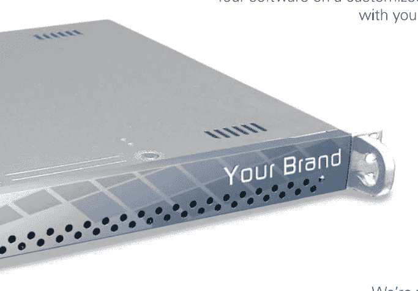

我们足够灵活，让您可以专注于服务客户，或是拓展更多客户。

即刻访问我们的官网`www.mbx.com`，或拨打热线`1-800-560-1195`联系我们。


### 专栏

### Linux烹饪秀


马塞尔·加涅

### 仍在寻找终极Linux发行版？

为什么有人装完一个Linux，又换另一个，还接着装下一个？当然是因为想装就能装啊！这就是选择的本质，而Linux给了你足够多的选择——可选范围大得超乎想象。

弗朗索瓦，你今天又装了什么发行版？

`MCNLive`？很不错，而且体积很小。有空的话你可以把它拷到U盘里，这样你随时都能随身携带一套Linux发行版。啥？你不确定这就是你要找的那款？我懂了。昨天你还在用`openSUSE 10.2`，前天上午装了`Debian Etch`，下午又换了`Kubuntu Feisty`。上周你折腾了`Fedora Core 7`、`CentOS 5`、`Mandriva Corporate Desktop 4.0`、`Slackware Linux 12`，还有另外六七个发行版。你是找不到喜欢的吗？你都喜欢，就是选不出来，对吧？

好吧，我的朋友，我不想打断你的探索之旅，但我需要你几天前发给我的那份酒单。你说什么？你找不到了？它就在你装这些发行版的机器上，你把硬盘格式化了？弗朗索瓦，你知道吗，试这些发行版有更好的办法。现在先别折腾了，去酒窖一趟。我看到我们的客人快到餐厅了，马上就过来。去东翼把乔治·杜博夫圣瓦伦丁年份酒拿来。就放在你去年搬进来的那套旧盔甲旁边，一共三箱。

**快去！**

各位欢迎来到马塞尔小馆，这里是美酒与优质Linux及开源软件的汇聚之地。请坐，别客气。我已经吩咐可靠的服务员去为今晚的菜单挑选最合适的酒了。等待的时候，我将为大家介绍一系列出色的Linux发行版，它们都借助了系统虚拟化技术。最棒的是，你可以在运行当前系统的同时，试用这些其他发行版。

啊，欢迎回来，弗朗索瓦。你先给客人们倒酒，我来介绍今晚的第一道菜。

法布里斯·贝尔拉德的`QEMU`是一款免费开源的机器模拟器和虚拟化工具。之所以做这样的区分，是因为`QEMU`可以模拟不同的机器类型和硬件，但它的性能虽然不算差，仍有很大提升空间。通过使用内核模块直接在系统处理器上执行代码，而非模拟处理器，以此实现虚拟化。需要做这一区分的另一个原因是，`QEMU`还可以模拟不同的处理器架构。举个例子，如果你想要在英特尔处理器上运行SPARC或PowerPC架构的机器，`QEMU`完全可以做到。法布里斯的官网上有一张清晰的表格，列出了所有可模拟的处理器类型。网上还有不少预构建好的不同操作系统的`QEMU`镜像可以直接下载，如果你感兴趣，甚至可以下载`FREEDOS`和`Minix`的镜像。

不过我们今天要装的是Linux，一大堆Linux发行版。大多数现代Linux发行版都自带`QEMU`，但最新版本的源代码都可以从`fabrice.bellard.free.fr`获取。不过虚拟化内核模块通常需要你从该网站下载后自行编译。虽然它不是必选项，但性能提升非常显著，完全值得你花这份功夫。由于这是内核模块，你可以用`modprobe kqemu`命令来加载它。

接下来我们看看`QEMU`是如何工作的。第一次演示，我将从Puppy Linux官网下载ISO镜像，安装Puppy Linux。因为Puppy是非常小巧的发行版，占用空间极小，所以我给它准备了一个相对较小的磁盘镜像（也就是虚拟硬盘）来存放系统。这一步要用到`qemu-img`命令：

```bash
qemu-img create puppy216.img 256M
```

上述命令默认会创建raw格式的磁盘镜像。镜像有不同的格式，其中最常用的是`qcow2`，这是一种便携性更强的镜像格式，如果你想安装那个来自雷德蒙德的操作系统（你懂的）的话，这个格式会很有用。下一步我们要把Linux安装到这个磁盘镜像里，我用以下命令完成：

```bash
qemu -cdrom ../isos/puppy-2.16.1-seamonkey-fulldrivers.iso -hda ./puppy216.img -m 256 -boot d
```

这里有几个值得关注的参数，我简单介绍一下。首先，`-cdrom`参数指定的是你用来安装发行版的CD-ROM镜像的路径。如果你用的是物理光盘，路径一般会是类似`/dev/cdrom`的形式。下一个参数`-hda`，指定的是我们刚才创建的磁盘镜像的路径。之后是`-m`参数，这里指定给当前运行会话分配256MB的内存。最后是`-boot`参数，用来指定启动驱动器（也就是我们的光盘镜像），也就是所谓的D盘。我一按回车，Puppy Linux的安装程序就会启动（见图1）。接下来你只需要按照Puppy Linux的安装步骤操作即可（如果你装的是其他发行版，就按对应的步骤来）。在展示结果之前，我再给大家介绍一个参数：`-std-vga`参数。这个参数会让`QEMU`模拟一款带Bochs扩展的标准VGA显卡。你还可以用`-localtime`参数，让`QEMU`用本地时间运行会话，而不是默认的协调世界时（UTC）。还记得之前提到的内核加速吗？试试用`-kernel-kqemu`参数。这只是一小部分参数，还有网络参数、USB参数、文件共享参数（SMB）、设备参数等等。我这里只讲基础内容，所以你要去`qemu`命令的主页查看更多参数。还要注意，我这个示例里的设置是针对非常小的轻量发行版的。如果要运行体积大一点的发行版，比如基于Mandriva的优质Live版`MCNLive`，我会创建更大的磁盘镜像（`MCNLive`运行效果见图2）。

图2. 漂亮的图形化桌面。由`MCNLive`和`QEMU`提供

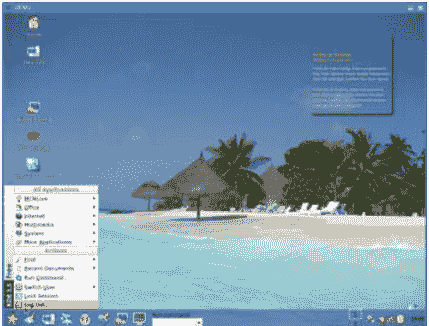

第一次用`QEMU`运行会话的时候，你可能会疑惑为什么鼠标出不了会话窗口。这是你使用`QEMU`要学的第一个、也是最重要的操作：只要点击进入`QEMU`会话，它就会接管你的鼠标控制权。按下`Ctrl+Alt`键就能释放控制权，让你回到主系统操作。想回到`QEMU`会话的话，只要点击窗口内的任意位置即可。第二个最重要的快捷键是`Ctrl+Alt+F`，用来切换全屏/窗口模式。

`Puppy Linux`和`MCNLive`都是Live版发行版，不过两者的桌面上都有安装图标。发行版安装完成后，启动会话的方式会有少量不同，主要因为你不会再从CD-ROM ISO镜像启动了。在这个示例里，我只需要给`QEMU`指定硬盘镜像路径，并选择要分配的内存大小即可：

```bash
qemu -hda ./mcnlive.img -m 384
```

这些命令行操作并不难，但`qemu`命令的参数有几十个，更不用说各种可能的选项和组合了。所以接下来我们看看一些很好用的`QEMU`图形化工具，首先是埃里克·梅特纳和利纳斯·兹维布利斯开发的`Qemu Launcher`。`Qemu Launcher`为`QEMU`命令套件的基础功能和高级功能都提供了图形化界面。它有三个选项卡：配置、启动器设置和关于。大部分操作都在第一个选项卡里完成。首先，你可以基于现有的`QEMU`镜像创建配置，只需要输入配置名称、硬盘文件路径（也就是`qemu-img`创建的镜像），再设置你要分配的内存大小即可。点击保存按钮，之后只要点击`Qemu Launcher`界面右下角的启动按钮，就能启动虚拟机了。

如图3所示，在`Qemu Launcher`中添加已有`QEMU`镜像非常简单。

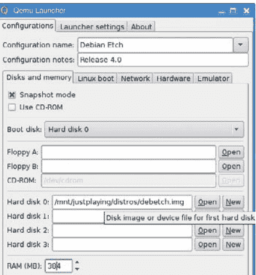

## 最大化处理性能，提升响应速度

## 高性价比2U服务器起售价：1599美元+

- 英特尔® Server System `SR2520SAXNA`
- 四核英特尔® 至强® 5310处理器
- 1024MB带ECC校验的FB-DIMM内存
- 400GB 7200转/分钟 16MB缓存硬盘

## 1U集群服务器起售价：1999美元+

- 1U空间搭载双节点
- 双核英特尔® 至强® 5050处理器
- 1024MB带ECC校验的FB-DIMM内存
- 250GB 7200转/分钟 16MB缓存硬盘

> ServersDirect可为您配置下一代高性能服务器系统——即刻联系我们！ServersDirect联系电话：`1-800-576-7931`，官网：`www.ServersDirect.com`

我们的灵活在线产品配置器支持您定制专属解决方案，您也可以致电，我们的产品专家将随时为您组装需要额外定制的系统。ServersDirect——您获取可扩展、高性价比服务器解决方案的直供渠道。

## 专栏：Linux烹饪指南 第3期

我为`Debian Etch 4.0`添加了启动配置文件，启动内存为384MB。我输入了`Debian Etch`镜像的路径，其实也可以点击“硬盘0”标签旁的新建按钮，通过弹出对话框创建镜像。

我的下一步操作原本是点击“使用光驱”复选框，从启动磁盘下拉列表中选择“光驱”，之后就能正常继续操作。如你所见，“配置”选项卡也是多线程处理的，你可以在这里调整其他`QEMU`设置。

在“Linux启动”下，你可以指定备选内核镜像，或传入内核参数。“网络”选项卡可控制你的网卡（默认设置为直通主系统网卡），还支持访问Samba共享，在你需要运行Windows系统时非常实用。

通过“硬件”选项卡，你可以选择备选视频设备、设置时钟、定义硬件或开启系统声音，这只是部分可选功能。最后，“模拟器”选项卡可让你直接控制`QEMU`会话本身。

顺便一提，`QEMU`近年来的替代方案是`KVM`（内核虚拟机），它通过利用处理器硬件虚拟化技术运行。在英特尔平台上，这项技术称为`VT`，而AMD处理器将其硬件虚拟化技术命名为`Pacifica`。

这意味着你可以使用Linux `KVM`运行虚拟机，其性能远优于纯软件虚拟化。不出所料的是，弊端在于并非所有设备都支持硬件虚拟化。

要判断你的系统是否符合条件，可在终端窗口或shell中执行以下代码片段：

```bash
grep -E '^flags.*(vmx|svm)' /proc/cpuinfo
```

如果返回结果中出现`vmx`或`svm`字符串，说明你的处理器已准备就绪。如果没有，你就只能继续使用`QEMU`提供的基于软件的虚拟化方案。

`KVM`的命令与`QEMU`的命令几乎可以互换，安装镜像和操作系统镜像也是如此。事实上，`KVM`是基于`QEMU`开发的。

今晚介绍的下一款工具不如前两款成熟灵活（无法创建镜像），但如果你喜欢Ruby编程语言，可以了解一下Mathieu Mast开发的`Qemu Supervisor`，没错，它是基于Ruby编程语言开发的前端工具。

除了Ruby本身，你还需要安装Ruby GTK2绑定库、`libgtk2-ruby`包及其依赖项。满足这些前置条件后，只需解压`Qemu Supervisor`的源码包，在源码目录中运行`make install`命令即可完成安装。

要运行该程序，执行`qemu-supervisor`命令即可。

在出现的界面中（图4），你可以选择添加要启动的`QEMU`镜像。

今晚介绍的最后一款工具是Rainer Haage开发的`Qemulator`，如果你在寻找能管理所有Linux（虚拟）系统的终极`QEMU`前端，这款工具绝对不容错过。

这款功能丰富的优秀应用几乎覆盖了`QEMU`的所有操作功能，包括创建磁盘镜像（图5）、安装发行版、监控运行实例等等。

和本文介绍的其他工具一样，`Qemulator`可以轻松访问已有的`QEMU`镜像。点击主窗口顶部的加号，输入基本信息后保存即可。

要运行虚拟机，只需点击右上角的运行箭头即可。主窗口的“我的机器”选项卡下会列出所有已有的镜像。

点击主窗口底部的“显示设置”按钮（图6），即可逐一配置或修改这些虚拟机。分选项卡视图支持访问镜像设置、磁盘及其他硬件、网络配置等内容。

在资源充足的情况下，多台机器可以同时运行，你可以在“运行任务”选项卡下访问每一台。

该工具还有一些不错但不太显眼的功能。例如，在“我的机器”列表中的虚拟机图标上点击右键，会弹出一个小型菜单，你可以选择“显示命令行”，这对于好奇所有设置调完后`qemu`命令具体执行内容的用户来说非常实用。

通过同一个菜单，你还可以获取镜像本身的信息、修改设置等。

此外，`Qemulator`还提供了安装向导，引导你完成加载新发行版的步骤。只需点击菜单栏的“系统”，再选择“安装系统”即可。

环顾餐厅四周，我看到不少朋友已经发现了同时运行这么多虚拟机的弊端：无论是不是虚拟机，你运行的每一个Linux（或其他系统）实例都需要占用处理器时间和系统内存。你选择的虚拟机数量越多，占用的资源就越多。

我的双核笔记本运行两个发行版完全没问题，但第三个就完全带不动了。你能提供的资源越多，虚拟机运行速度就越快，能同时运行的虚拟机数量也越多。

啊，要是我们能找到办法运行多个我们获奖的酒窖实例就好了。但那样的话，弗朗索瓦和我可能就没机会和各位朋友分享我们的佳酿了。不过现在时间到了，我们得回到非虚拟的家里去了。不过我们在马塞尔之家，绝不会让各位空杯而归。弗朗索瓦，麻烦你最后为各位客人的杯子满上酒吧。各位朋友，请举起酒杯，让我们共同为彼此的健康干杯。祝您健康！请慢用！■

> **马塞尔·加涅**是一位获奖作家，现居安大略省滑铁卢市。他是艾迪森·韦斯利出版社出版的全新图书*《迁移至自由软件》*的作者，这也是他出自该出版社的第六部作品。他还定期作为《求助热线》节目的Linux专家亮相电视。马塞尔还是一名飞行员，曾是Top40唱片骑师，同时创作科幻和奇幻作品，还擅长折非常厉害的折纸霸王龙。你可以通过电子邮件`mggagne@salmar.com`联系他，访问他的个人网站`www.marcelgagne.com`还能发现更多内容（包括优质Wine相关链接）。

## 参考资料

- **QEMU**：`fabrice.bellard.free.fr/qemu`
- **Qemu Launcher**：`https://gna.org/projects/qemulaunch`
- **Qemulator**：`qemulator.createweb.de`
- **Qemu Supervisor**：`rubyforge.org/projects/qemu-supervisor`
- **马塞尔的个人网站**：`www.marcelgagne.com`

*WFTL-LUG，即马塞尔的在线Linux用户组：`www.marcelgagne.com/wftllugform.html`*

### 无与伦比的价格、品质与服务

**1995美元** **1U超微6015B-TV：（定制系统）** 双路至强四核E5335 2GHz处理器，4GB 667MHz FB-DIMM内存，2块250GB硬盘，超薄DVD光驱……

**2395美元** **2U超微6025B-TR+B：（规格同上）** 双路至强E5335处理器，4GB内存，2块250GB带冗余电源的硬盘，8个热插拔硬盘位……

*购买即赠免费数码配件！*

Dave Taylor 

### 百家乐平托班科玩法 第二部分

### 请注意：百家乐手牌点数永远不会达到11，甚至也不会达到10

上个月，我们来到蒙特卡罗昂贵的私人玩家包间，了解了这款高端博彩游戏——百家乐。游戏规则本身很简单，但要遵循一套相当复杂的规则。在最基础的玩法中，百家乐有两方参与者：庄家和闲家，双方各发两张牌，将牌面点数相加即可算出获胜手牌。任意手牌点数达到10及以上时，均对10取模，因此9+6不是15，而是5，一张3+4=7的手牌会击败该点数。但判断庄家是否应该补第三张牌时，规则便复杂起来：闲家仅在前两张牌点数总和小于6时才能补一张牌，而庄家是否补牌仅取决于闲家的初始手牌、闲家补的牌以及庄家自身的手牌点数。

规则运作方式如下：结合上述所有复杂规则，按流程运行的话，典型流程如下：

```bash
$ sh baccarat.sh
Welcome to Baccarat. You can choose to either stake the player or banker to win this game. Remember, face cards are worthless and all point values are modulo 10, with '9' the best possible hand value. We're using Punto Banco rules with this simulation.
If you're already an expert...
** Player was dealt: 3 of Hearts, 10 of Clubs (hand value = 3)
** Banker was dealt: 4 of Clubs, 10 of Spades (hand value = 4)
Player takes a card: 6 of Hearts (hand value = 12)
** Banker play rules yet to come...game ends inconclusively.
```

- 如果闲家未补牌，庄家在点数为0-5时补牌，否则停牌。
- 如果闲家补的牌是2或3，且庄家点数为0-4，庄家补牌。
- 如果闲家补的牌是4或5，且庄家点数为0-5，庄家补牌。
- 如果闲家补的牌是6或7，且庄家点数为0-6，庄家补牌。
- 如果闲家补的牌是8，且庄家点数为0-2，庄家补牌。
- 如果闲家补的牌是9、10、人头牌或A，且庄家点数为0-3，庄家补牌。

除上述未列出的所有情况外，庄家不得补牌，百家乐本局将以闲家胜、庄家胜或平局结束。如你所见，这套规则显然只有程序员会感兴趣，因此我们非常适合按照这个方向扩展`baccarat.sh`游戏。


# 亚伯丁 Blade Killer 系列：1U机箱搭载2台服务器

**直率沟通品牌**$^{SM}$ 自1991年成立

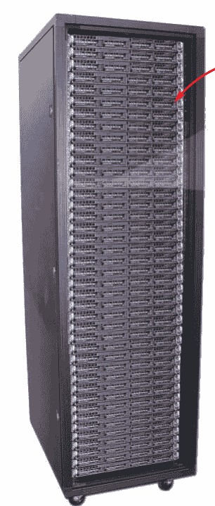

> 42U机架可容纳84个节点

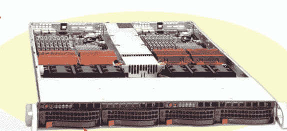

> 非常适合虚拟服务器

## 特性与优势

- **密度高于刀片服务器（真的，没开玩笑）** — 单个1U机箱内集成两台双四核服务器，42U机架最多可容纳84个节点/672个处理器核心。
- **更低功耗** — 卓越的电源利用率，提升电源供应效率。
- **高冗余** — 高冗余集群，独立服务器无刀片方案常见的单点故障问题。
- **标准化** — 采用行业标准架构，无专有刀片背板/架构。
- **散热更优** — 单个1U机箱独立散热，优于单一大机箱内集成多块刀片的方案。
- **高度可定制** — 每个节点的可定制性远高于任何刀片服务器。
- **热插拔** — 可热插拔整台双服务器，无需中断网络流量或磁盘阵列访问。
- **成本更低** — 成本远低于同级别刀片解决方案。

## 对比表格

| | **IBM BLADECENTER® H** | **亚伯丁 Stirling 122** |
| --- | --- | --- |
| | **搭载14块刀片的9U刀片解决方案** | **搭载14个节点的7U服务器解决方案** |
| 描述 | 9U IBM BladeCenter H机箱，内置14块IBM BladeCenter HS21刀片服务器 | 7台1U亚伯丁 Stirling 122服务器，每台包含2个服务器节点 |
| 单刀片/节点处理器 | 两块英特尔®至强® E5310 1.60GHz四核处理器，8MB缓存，1066MHz前端总线 | 两块英特尔®至强® E5310 1.60GHz四核处理器，8MB缓存，1066MHz前端总线 |
| 单刀片/节点内存 | 2GB ECC DDR2 667MHz内存（最高32GB/4条DIMM） | 2GB ECC DDR2 667MHz内存（最高32GB/8条DIMM） |
| 单刀片/节点硬盘 | 两块36GB 10000转2.5英寸内置SAS硬盘（不含可选SIO刀片时最高146GB） | 两块36.7GB 10000转热插拔3.5英寸SATA硬盘（最高1.5TB） |
| 42U机架最大刀片/处理器数量 | 4个9U机箱（占用6U空间）可容纳56块刀片/112个处理器（448核心） | 42个1U机箱（无空余空间）可容纳84个服务器节点/168个处理器（672核心） |
| 保修 | Parts and labor的3年上门有限保修 | Parts and labor的5年有限保修 |
| 14刀片/节点方案总价 | $70,161 | $36,495 |
| 单刀片/节点价格 | **$5,012** | **$2,607** |

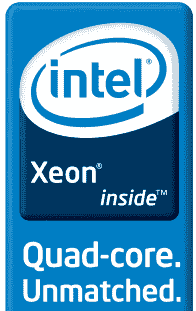

888-297-7409 www.aberdeeninc.com/linux

### 接下来看脚本

上个月的百家乐游戏实现了除庄家补第三张牌之外的所有规则。如你所见，我没有实现这些规则，只是写了个“即将到来”的占位符，可以把它当成目前尚处于早期alpha版本的程序。事实上，由于还处于早期alpha阶段，上述流程中已经出现了一个bug，你发现了吗？闲家的手牌点数怎么可能是12？

好在问题很容易定位：

```bash
playerhandvalue=$(($playerhandvalue + $handvalue))
```

这行代码完全错误。因为上面的代码把闲家的三张牌都传给了`handValue`函数，所以只需要简化即可：

```bash
playerhandvalue=$handvalue
```

呼，修复起来很简单。现在，我们说到哪了？

我们需要轻松确认的一件事是闲家是否补了牌。本来可以通过统计闲家手牌数量来实现，但我选择创建一个新变量`playerDrewCard`，发牌时初始设为0，如果闲家补牌则将其改为1。

现在，第一条规则可以这样实现：

```bash
if [ $PlayerDrewCard -eq 0 ] ; then
    if [ $Bankerhandvalue -lt 6 ] ; then
        # Banker draws a card
        banker[$nextbankercard]=${newdeck[$nextcard]}
        handValue ${banker[1]} ${banker[2]} ${banker[3]}
        bankerhandvalue=$handvalue
        echo -n "Banker takes a card: "
        showCard ${banker[$nextbankercard]}
        echo "$cardname (hand value = $bankerhandvalue)"
    fi
else
    dealBanker;
fi
elif [ $pdcRank -eq 4 -o $pdcRank -eq 5 ] ; then
    if [ $bankerhandvalue -lt 6 ] ; then
        dealBanker;
    fi
elif [ $pdcRank -eq 6 -o $pdcRank -eq 7 ] ; then
    if [ $bankerhandvalue -lt 7 ] ; then
        dealBanker;
    fi
elif [ $pdcRank -eq 8 -a $bankerhandvalue -lt 3 ] ; then
    dealBanker;
elif [ $pdcRank -eq 9 -o $pdcRank -eq 0 ] ; then
    if [ $bankerhandvalue -lt 4 ] ; then
        dealBanker;
    fi
fi
```

注意这里：如果闲家补了牌且庄家点数达到6及以上，没有`else`分支，正确来说，在判定最终获胜者前也不会有额外操作。不过最底层的`else`分支对应的是庄家和闲家都没有8或9点（这部分已经在游戏中实现）且闲家补了牌的情况。

现在，只需要设置一系列条件判断即可。不过为了简化操作，我们先获取闲家补的牌的点数：

```bash
pdcRank=$(( ${player[3]} % 13 ))
```

遗憾的是，尽管`test`命令的手册页说明可以用括号逻辑组合复杂测试，但实际情况表明这种写法的可移植性远不如预期，因此我们不会写成漂亮的（A或B）且C的语句，而是把每条规则拆成两个`if`语句，示例如下：

```bash
if [ $pdcRank -eq 2 -o $pdcRank -eq 3 ] ; then
    if [ $bankerhandvalue -lt 5 ] ; then
```

这里我们检测闲家补的牌（第3张牌），同时检测庄家点数是否低于某个阈值。如果两个条件都满足，就对应上述规则#2。现在，只需要依次排列这些检测，就能构建出**平托班科百家乐**所需的全部规则。这套全是疯狂嵌套`if`语句的完整规则如下：

```bash
if [ $pdcRank -eq 2 -o $pdcRank -eq 3 ] ; then
    if [ $bankerhandvalue -lt 5 ] ; then
```

最后，我们可以在自己的Linux设备上玩百家乐了：

```bash
$ sh baccarat.sh

Welcome to Baccarat. You can choose to either stake the player or banker to win this game. Remember, face cards are worthless and all point values are modulo 10, with '9' the best possible hand value. We're using Punto Banco rules with this simulation, if you're already an expert...

** Player was dealt: 6 of Clubs, 8 of Hearts (hand value = 4)

** Banker was dealt: King of Spades, Ace of Hearts (hand value = 1)

Player takes a card: 9 of Hearts (hand value = 3)

Banker takes a card: 5 of Clubs (hand value = 6)

Play is complete. Banker wins
```


当然，现在你可以把这个程序运行几百万次，计算出庄家胜、闲家胜和平局的概率，下次去法国南部时你就能成为一个运筹帷幄的cool赌徒了。很有用吧？■

戴夫·泰勒是UNIX领域的26年老兵，`Elm`邮件系统的开发者，最新作品包括畅销书*《超酷Shell脚本》*和*《24小时学会Unix》*，此外他还著有16本技术类书籍。他的个人主页是`www.intuitive.com`，同时他也在`AskDaveTaylor.com`提供技术支持。`baccarat.sh`脚本可在Linux Journal的FTP站点下载：`ftp.linuxjournal.com/pub/lj/listings/issue161/9780.tgz`。

## RouterBOARD™ 100系列，由`routerboard.com`制造
### RouterBOARD 133 低成本AP/CPE 售价89美元
`RouterOS` L4防火墙/路由 `MIPS32 4Kc 175MHz`嵌入式处理器 `32MB SDRAM` 板载`64MB NAND`存储
三个`10/100M`以太网口，支持`MDI/X`
三个`miniPCI Type IIIA/IIIB`插槽
供电：`9-28V`直流；过压保护
`PoE`：`12-28V`直流（数据线不提供供电）
尺寸`117mm×105mm`（`4.61英寸×4.13英寸`），重量`115g`
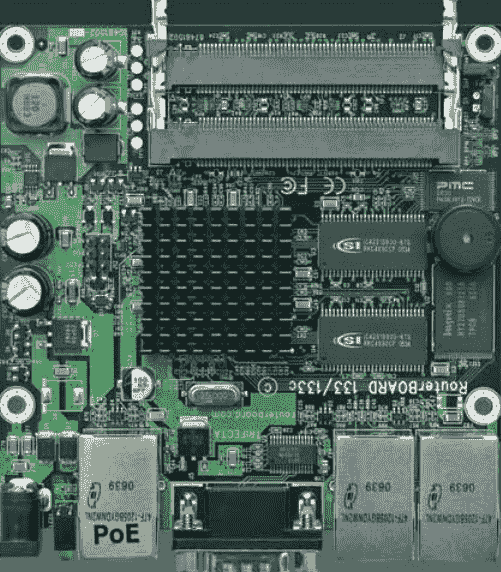
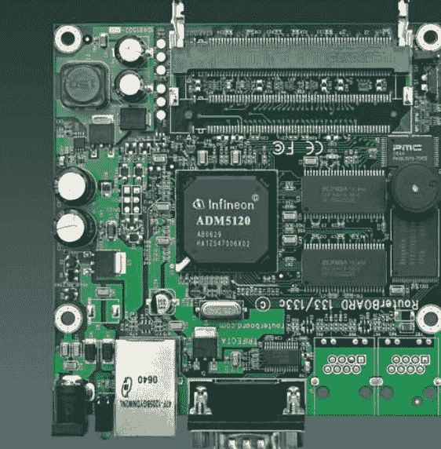

### RouterBOARD 133C 低成本CPE 售价59美元
`RouterOS` L3防火墙/路由 `MIPS32 4Kc 175MHz`嵌入式处理器 `16MB SDRAM` 板载`64MB NAND`存储
一个`10/100M`以太网口，支持`MDI/X`
一个`miniPCI Type IIIA/IIIB`插槽
供电：`9-28V`直流；过压保护
`PoE`：`12-28V`直流（数据线不提供供电）
尺寸`117mm×105mm`（`4.61英寸×4.13英寸`），重量`79g`

## 专栏：滩头阵地 乔恩“疯狗”霍尔
### 教育：畅饮之余分享推广自由及开源软件的经验
> “我该怎么说服我的教授在课堂上使用自由及开源软件（FOSS）？”前新手丹尼斯如今在巴西的一所大学就读，如今他已经到了可以合法和我一同畅饮的年龄。我们常去的那家海边餐厅酒吧`Alideia dos Piratas`是聚会的固定地点，不过他常暗示自己开始“畅饮”的时间远早于法定年龄限制。
> “首先要做的”，我回答道，“是为在课堂上使用FOSS准备有力的论据。这些论据可以包括：免受专有软件许可的限制，以及许可本身固有的成本和潜在问题；FOSS源代码既能让用户把软件当作工具使用，也能让用户了解软件得出结果的计算逻辑。使用FOSS发布研究成果也更便捷，因为你不仅可以自由发布所涉工作的源代码，而非仅从概念层面讨论该工作。FOSS还能让学校对系统上运行的软件有更好的控制权，尤其在需要升级软硬件时。你应当尽量采用容易论证的实用理由，比如FOSS已在诸多商业场景中得到应用，这意味着学生毕业进入职场后也会接触到这类软件。
> “你可以用平静、专业的方式把这些论据提交给学校教务部门和管理层。如果他们反响不佳，可以询问他们使用专有软件的原因，并询问是否可以在后续会议中针对这些原因提供解决方案。“其次，要尽可能降低他们使用FOSS的门槛。要记住，教授和普通人一样，日常工作生活中要操心的事已经很多，忙得不可开交。开发新课程和配套教学材料需要投入大量时间和研究精力，尽管你可以把这视为他们的本职工作，但你也要明白他们还要忙着处理其他工作事项。“你可以尝试把现有课程——比如编译器设计、数据库理论——改造成基于FOSS的课程。你可以在网上检索（或自行整理）所有和该学科相关的开源项目的参考文献列表，看看有没有针对该教学主题、且以FOSS而非闭源产品为核心的教材。
> “以操作系统课程为例，大量基于FOSS的项目可以用来辅助操作系统设计课程的教学，不仅有`Linux`内核，还有\*`BSD`（`OpenBSD`、`FreeBSD`、`NetBSD`）内核、`FreeDOS`、`TinyOS`等诸多其他项目。网上也有许多讨论FOSS操作系统设计要点的线上讲座和论文可供参考，针对受众较广的操作系统，还有专门的书籍会介绍其内核及运行原理。
> “数据库设计方面也有不少相关项目能派上用场——从`MySQL`、`PostgreSQL`到伯克利`DB`（尽管是`Oracle`旗下的产品，但它仍然是开源的），还有`Firebird`、平面文件数据库，以及各类其他数据访问的库，比如`ISAM`。
> “整理这门课的参考文献列表可能就足以引起教授的兴趣。很多时候教授们都听过自由软件或开源软件的说法，但他们一直没时间调查和自己授课领域相关的开源软件和资源到底有多少。
> “要是教授还是不同意在课程中使用FOSS，你可以进一步行动：在学习现有资料的同时，主动整理一份课程笔记。没有什么比把知识点梳理清楚并讲解给他人更能帮助你掌握学科内容了，而制作一套基于FOSS的课堂笔记和演示文稿，能让你非常透彻地理解相关知识。”
> 丹尼斯脸上露出惊恐的神色看着我。“这听起来工作量太大了，”他说。
> “确实有可能”，我附和道，“但幸运的是，你不一定需要自己做完所有工作：你在网上用‘课程笔记 操作系统’作为关键词搜索，就能找到好几版采用`GPL`或带有署名要求的 `copyleft` 协议的课堂笔记。你也可以拉上班里其他同学一起帮忙，每人负责不同章节，最后把所有人的成果合并成一份完整文档。“我大学本科和计算机科学硕士阶段都学过编译器原理，但直到我不得不把这门课讲给别人听的时候，我才觉得自己真正弄懂了编译器原理。如今距离我最后一次讲这门正式课程已经过去20多年了，现在我觉得我完全可以轻松讲解编译器工作原理的基础。如此透彻地掌握晦涩内容，多多少少还是有些吓人的。”
> 我和丹尼斯都沉默了几秒，思考着这番话，随后我们俩又各点了一杯酒。
> “大学的其他学科也能用FOSS的方法来授课吗？”丹尼斯问道。
> “当然可以。有成千上万款FOSS程序可供学生和教师在工程、科学以及其他教育领域使用。此外还有很多免费公开的信息资源，比如古腾堡计划（Project Gutenberg），它收录了超过17000本版权已过期的书籍和文章。我有个朋友是第二英语语言教师，之前都不知道还有这么丰富的免费在线图书资源可以用在她的学生身上。

## ASA电脑公司
### 定制服务器专家！
**www.asacomputers.com** **1-800-REAL-PCS**
### 开源（`Linux`、`FreeBSD`、`NetBSD`、`OpenBSD`、`Solaris`、`MS`等）硬件系统
AMD皓龙处理器能为最先进的各类应用提供高性能、可扩展的服务器解决方案。
> “可同时运行32位和64位应用程序”
### 您的定制应用解决方案！！
- \*部分学科，比如土木工程会用到大量地图和制图软件。使用`FreeGIS`（**www.freegis.org**）、开源GIS（**opengeis.org**）这类项目的软件，能让这些学术领域的使用者掌握并使用制图软件。\*
> “请告知您的需求……”
医院管理类课程可以受益于`OpenVista`项目——这是一套完整的医院行政管理系统，曾被美国退伍军人事务部使用，后开放为免费分发版本。大学的管理课程也可以使用成熟的FOSS项目与组合管理系统（比如`project.net`（**www.project.net**）），既能培训学生掌握这类工具的使用方法，也能让学生了解这些工具的运行原理。
> “我们将为您打造定制解决方案……”
> \*“那我们学校的行政管理工作有没有能帮上忙的FOSS程序？”丹尼斯问道。\*

> \*“当然有。很多学校经常在几乎没法正常使用的管理软件上投入巨额资金。我就知道一所重点大学曾打算花一千万美元采购并落地一套行政管理系统。”
### 1U AMD皓龙高性价比服务器 \*\*起售价\*\* $847
- `1U`规格，深度`14英寸`，`240W`电源
- AMD皓龙140处理器
- `512MB PC3200 DDR ECC`无缓冲内存
- 最高支持`8GB DDR`内存
- `40GB SATA`硬盘
- 2个`10/100/1000Mbps`以太网口
> \*“澳大利亚另一所大学曾花了一千七百万澳元采购一套商用系统，结果用了五年完全没法用。那所澳洲大学被告知，要想拿到一套未针对他们学校定制的‘默认版’系统——至少能用的版本，还需要额外支付五百万澳元，以及三年的开发时间。也许最终能成吧。”
### 双路AMD皓龙™高性价比服务器 \*\*起售价\*\* $2120
> \*“把这些和巴西的FOSS项目SAGU对比一下就知道了：这套系统目前已被全球60多所大学使用，已经从其母语葡萄牙语翻译成了西班牙语和英语版本。另一个有趣的项目是Kuali基金会，他们正在为大学开发开源财务管理软件。”

- `1U`规格，搭载AMD皓龙840处理器
- `2GB`内存，最高支持`128GB`
- 最高支持`64GB FBDIMM`内存
- `80GB SATA II`热插拔硬盘
- 2个集成双口`10/1000M`以太网口
> \*“Sakai项目（**www.sakaiproject.org**）虽然不严格算行政管理系统，但这是一套由多家企业和教育机构联合开发的FOSS系统，用于教学和科研协作。还有Moodle这套知名的教育类CMS系统。所有这些乃至更多系统都可以免费使用，能为资金紧张的学校节省大笔开支。”
### 双路AMD皓龙™存储服务器 \*\*起售价\*\* $4120
丹尼斯喝完手里的酒，想了想我刚才说的话，问道：\*“要是我费了这么大功夫说服学校用FOSS，他们还是拒绝怎么办？”\*
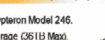
- `5U`规格，双路AMD皓龙246处理器
- 可选`iSCSI`或`NAS`软件方案
- 最高支持`18TB`存储容量
- 硬盘故障`LED`指示灯
> \*“你为论证使用FOSS软件而付出的研究和准备工作不会白费。你在做这些事的过程中说不定能更深入了解自己的专业内容，这永远没坏处。我认识一个小伙子，他在芬兰赫尔辛基读大学的时候，启动了一个FOSS项目来编写操作系统内核……”
### 双路AMD皓龙™存储服务器 \*\*起售价\*\* $8445
- `8U`规格，AMD皓龙246处理器
- `4TB`存储容量（最高支持`36TB`）
- `1GB`内存
- 2个`10/100/1000M`千兆以太网口
- 可选`NAS`或`iSCSI`软件方案
### 与ASA合作？
> 乔恩“疯狗”霍尔是Linux国际协会（`www.li.org`）的执行董事，该协会是由希望支持并推广Linux操作系统的终端用户组成的非营利组织。霍尔的商用计算生涯始于1969年，他曾担任过程序员、系统设计师、系统管理员、产品经理、技术营销经理和教育工作者等职位。他曾就职于西方电气公司、Aetna人寿及意外伤害保险公司、贝尔实验室、数字设备公司、VA Linux系统公司和SGI。目前他是一名自由及开源软件（FOSS）商业与技术领域的独立顾问。
### “我们提供合规的评估用服务器……”
> 自1989年起，ASA的客户涵盖思科、瞻博网络、加州理工学院、费米实验室以及绝大多数高校。
> 我们可根据您选择的操作系统提供全方位定制解决方案。
> \*“可靠的产品，优质的售前售后支持”\*
> \*“最具竞争力的硬件价格”\*
> \*\*欢迎致电我们采购下一批硬件设备。\*\*
地址：美国加利福尼亚州圣克拉拉市世界大道2346号，邮编95064 官网：`www.asacomputers.com` 邮箱：`sales@asacomputers.com` 电话：`1-800-REAL-PCS`，传真：`408-654-2910`。


## 职场人的Linux指南
**多克·西尔斯**


## 用诺基亚N800导航
### 实测Navicore与Maemo Mapper的表现
我是个地理迷。地理和地质是我最爱的两门学科，地图是我最喜欢的读物之一。我常常能饶有兴致地对着地图看上好几个小时——哪怕地图标注的是我永远不会去的地方。我坐飞机从洛杉矶飞往巴黎时，会全程盯着窗外的地面，把整个世界本身当成地图，永远渴求了解更多地理知识。
我认为GPS（全球定位系统，`en.wikipedia.org/wiki/Global_Positioning_System`）是人类历史上最伟大的发明之一。我几乎出门都会带上方便实用的佳明GPS设备（出色的eTrex Vista CX型号，`https://buy.garmin.com/shop/shop.do?cID=145&pID=326`），在我看来它和手机一样重要。
所以，当诺基亚的对接人发邮件问我们要不要测试Navicore为N800开发的GPS时，你肯定能猜到我的回答——我立刻答应了，第二天就收到了寄来的设备，这很幸运，因为当时我们已经临近这期*《Linux Journal》*的截稿日（这期杂志里，吉姆·汤普森和我一起把N800评选为最佳掌上Linux设备，给了它大大的赞）。
N800（以及更早发布的770机型）已经可以通过Maemo Mapper使用GPS功能，这是一款由约翰·科斯蒂根和一众专注的开发者持续开发、改进的免费（`GPL`协议授权）软件。
Navicore和Maemo Mapper的GPS实现逻辑 
Navicore的地图存储在2GB可拆卸SD卡上，在我从圣巴巴拉飞往洛杉矶的航班上，它能够追踪地面的行进位置。两者实现逻辑差异很大，但共同印证了N800是一个潜力无限、灵活且富有吸引力的平台。
开源Linux在大众消费级便携计算设备上的潜力早就显而易见，但现实总是落后于预期。但现在我们看到Navicore这类公司为N800提供消费级硬件和软件套件，我们知道嵌入式Linux已经跨过了一个重要里程碑。
为了赶这期杂志的截稿日，我过去一周把截稿日延后，尽可能在N800上交替测试Navicore和Maemo Mapper这两套GPS系统，测试路线顺序如下：
- 在圣巴巴拉市区及周边乡村驾车行驶
- 从圣巴巴拉飞往洛杉矶和奥克兰的航班
- 从奥克兰机场乘坐巴士到最近的湾区捷运（BART）站
- 乘坐湾区捷运（BART）从该站到海底隧道段
- 在旧金山步行及乘坐出租车
- 从奥克兰飞往休斯顿的红眼航班
- 在休斯顿乘坐出租车
遗憾的是，我没能在从休斯顿飞回洛杉矶的航班上、以及从洛杉矶机场驾车返回圣巴巴拉的路段使用这两套系统——因为我包里的水瓶（过了安检后买的）漏了，打湿了N800，直到第二天才干透恢复使用。（不过它被泡水后还能正常运作，这点让我十分惊讶。）
我先汇报Navicore的使用体验，这是我两个系统中先测试的那一个。Navicore的包装盒大小和形状和N800的包装盒差不多，包装内含：
- 诺基亚出品的电池供电`LD-3W GPS`接收器，大小和Zippo打火机或者酒店提供的小块香皂差不多
- 交流电源充电器（美标）


## 通用输入输出（UIO）
### 通用输入输出，最大化I/O扩展性与灵活性
- 支持`1U/2U`机箱安装3至7张`PCI-E/X`扩展卡
- 高度可升级
- 高能效电源（效率可达90%以上）
- 多种扩展卡可选（`SAS RAID 5`、`10G`网卡、`IB`网卡……多达20种选择）
- 简化库存管理
### 给你按需定制设备的自由！
通过支持更多扩展卡和I/O带宽，超微`1U/2U UIO`系统可满足此前需要`2U/3U`系统才能承载的多种应用需求。
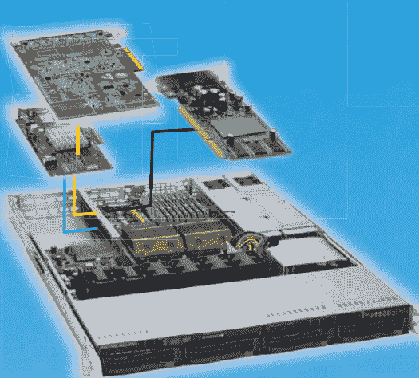
### 优化的机箱解决方案
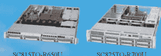
| 型号 | | --- | | SC815TQ-R650U | | SC825TQ-R700U |

### UIO主板可选
| 型号 | | --- | | X7DBN | | X7DBU | | X7DAL-E+/X7DAL-E | | PDSMU |

### 优化的SAS与RAID卡
| 型号 | | --- | | AOC-USAS-L4iR | | AOC-USAS-H8iR | | AOC-USAS-S4i | | MX64MK00 |
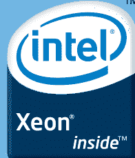
> ★ 新一代电源在典型负载工况下效率可达90%以上。**更多信息请访问`www.supermicro.com`**

不过Maemo Mapper虽然可以使用GPS接收器，输出经纬度、海拔、航向数据，但它需要从网络下载地图，在没有网络连接的飞机上无法使用。如果没有及时下载最新地图，地图显示的位置和左侧的GPS经纬度读数会对不上。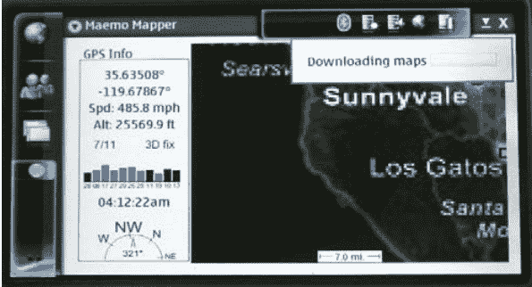
我在洛杉矶到奥克兰的航班上测试了Maemo Mapper，此时唯一有用的数据就是GPS读数，其中包含海拔信息，这是同场景下的Navicore显示所没有的。另一方面，Navicore的地图存储在内存中，不需要从网络下载（这种情况下的Maemo Mapper因为没网所以无法下载地图）。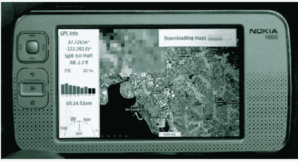
Navicore导航套件主要针对公路场景设计，是车载导航系统。你可以搜索地点、规划路线，也可以清除已规划的路线；遇到拥堵时还可以查找绕行路线，非常实用。你可以选择通过地址、城市、收藏夹、兴趣点（POI）或者经纬度坐标来搜索地点，屏幕会以你的当前位置为中心，支持`2D`或`3D`显示（如今车载导航系统默认采用`3D`显示，效果更好）。长按选择键可以在浏览模式和导航模式之间切换：浏览模式允许你自由拖动查看地图，导航模式则提供基于当前位置的多种视图选项，两种模式都用到选择键周围的四个方向键进行操作。
点击屏幕上的齿轮图标会弹出控制面板，包含以下设置项：
- 导航音量（从静音到高音量共四档）
- 路线规划模式（驾车、骑行、步行）
- 路线类型（最短路径、最快路径）
- 显示模式（`2D`、`3D`）
- 配色主题（日间、夜间、高亮）
屏幕顶部显示卫星数据和蓝牙设备状态的图标：卫星数据显示经纬度、航向、速度、罗盘方向、海拔高度（这是我最喜欢的功能之一），想来是因为这套系统是为驾驶员而非飞行员设计的；设备状态栏会显示GPS接收器的名称、`MAC`地址和剩余电量，还有一个可以激活/关闭接收器的按钮。
地图上会标注停车场、酒店/汽车旅馆、机场、游乐园、露营地、剧场、赌场、大学、音乐厅、`Wi-Fi`热点等其他兴趣点。点击图标会显示它的名称和其他可能有用的信息，比如会显示该`Wi-Fi`热点是否需要付费。如果你点击`Wi-Fi`热点，可以选择将其添加到收藏夹，或者导航到该地点（抵达后语音会提示：“现在下车吧！”）。
回到硬件层面，返回键、主页键和菜单键功能清晰，操作逻辑合理。我的车是一辆2000年的大众帕萨特旅行版，虽然这车不算小，但挡风玻璃前的空间放不下体积较大的N800支架。我之前在车上用过其他GPS设备，尤其是租车公司提供的佳明导航仪，这些设备都比N800加支架的组合小太多了。所以很抱歉我没法测试这套支架的安装效果，不过它的做工看起来非常扎实。不过我单独用了N800的固定支架，
> 这是Navicore拉远视角的地面视图，位置大致在洛杉矶和奥克兰的中点。注意左上角的速度读数。

## PGI CDK™
### MPI调试器/MPI性能分析器
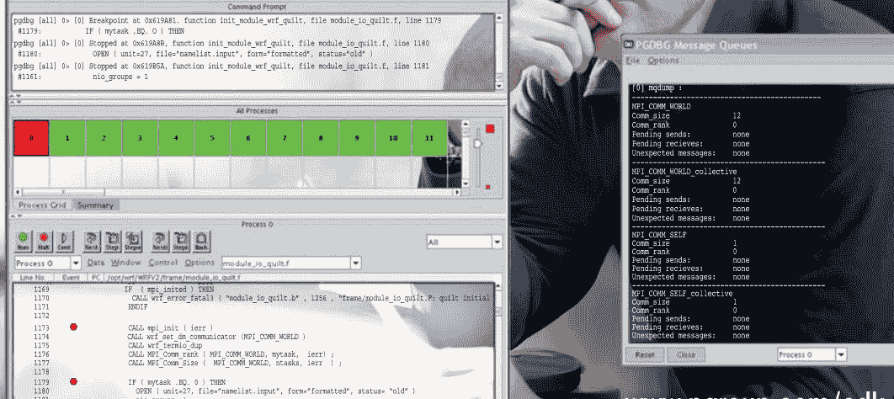
`www.pgroup.com/cdk`
Portland Group公司是意法半导体（STMicroelectronics）的子公司。`PGI`和`CDK`是意法半导体的商标或注册商标，其他品牌和名称归各自所有者所有。

### 专栏
### 商务人士的Linux
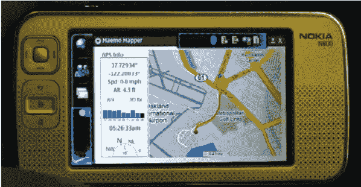
Maemo Mapper会生成一条带有红色线条的轨迹。这张图里我正从奥克兰机场乘公交车前往BART（旧金山湾区捷运）车站，GPS接收器放在我口袋里。
我们第一次测试Navicore，是开车从圣巴巴拉的家里前往洛斯奥利沃斯，沿着圣伊内斯谷（这里是电影*《杯酒人生》*大部分的取景地，也就是葡萄酒产区）的154号公路行驶约25英里。就算我们设置了最短路线，Navicore依然建议我们上101号公路才能抵达154号公路，从我们的出发点，乃至最直接明了路线的任何路段来看，这个建议都毫无道理。当我们直接朝154号公路行驶时，Navicore的语音始终提示我们“如果可能的话请尝试掉头”。不过等我们开上154号公路后，它的运行就恢复正常了。后来我们设置它导航返程回家的路线时，它又建议我们走那条更长的“更快”路线，反复让我们掉头。
我把N800放在保护壳里，因为这个壳能给设备提供不错的保护框架，还能放大机身，刚好能卡在前排两个座椅之间。GPS接收器的位置似乎没什么影响：不管放在座椅上、中控台上，还是夹在汽车遮阳板和深色玻璃天窗盖之间（我觉得这是我自己想的一个实用小妙招），它都能正常工作。
在旧金山，切换到步行模式后它的表现更好。这里我把GPS放在公文包里，手里拿着N800。我这么走来走去看起来很奇怪，但这套设备还是很轻松地把我从一家酒店或餐厅导航到另一家。我还在洛杉矶到奥克兰的航班上，以及从奥克兰飞休斯敦的红眼航班前半小时里用它玩得很开心。看着飞机“行驶”在放大版的路图上，速度高达每小时550英里，别提多有意思了。就算我把地图缩小到和我飞行高度差不多的视角，Navicore也总是想把视角拉低到距地面几百英尺的高度，让我仿佛驾驶`F-16`进行掠地飞行（NOE，全称`nap-of-the-earth`）。
如果你好奇乘客能不能使用GPS，这是大陆航空公司《飞行安全规范》中的相关规定：
> “电子游戏机、个人电脑、娱乐播放器及录影设备等……必须全程佩戴耳机使用。上述设备，以及降噪耳机、计算器、剃须刀、相机、GPS设备、笔记本电脑机载电源接口，仅可在主舱门开启时的登机口区域，或经乘务员宣布且飞机飞行高度超过1万英尺时使用。滑行、起飞和降落阶段必须关闭这些设备。电视、无线电接收器/发射器（包括AM/FM/SW频段、对讲机和扫描仪）、遥控玩具和个人空气净化器在任何时候都禁止使用。”
让我惊喜的是这款小巧的诺基亚GPS设备的性能。它搜索卫星的速度其实比我的佳明设备快很多，哪怕离飞机窗口更远，也能搜到更多卫星。（在这些航班上，我都把接收器放在离窗口最近的口袋里，而且每次坐的都是靠窗座位。）在飞机上，Navicore的表现确实非常出色。虽然它没法显示我的飞行高度，但能很方便地告诉我相对于下方地面的位置——这对我最喜欢的爱好来说是个很大的加分项，我喜欢靠飞机窗户拍照片。我在`Flickr`上有约3500张标注为“航拍”的照片，地址是`Flickr.com/photos/docsearls/tags/aerial`。这款小巧的GPS接收器灵敏度极高，作为摄影配件，Navicore套装的表现其实比我的佳明设备更好。N800的屏幕也比佳明的大很多，对于视力退化的我来说这很加分。
可惜的是，Navicore套装在地面使用时让人失望。主要问题是速度太慢，很多操作都慢得离谱。搜索位置、等待Navicore生成路线往往要耗很久，让人忍不住想直接放弃。更糟的是，就算你找到了目标地点，也没有明显的方式可以直接说“去这里”然后生成路线。要生成路线的话，你必须通过连接两个航点来“规划路线”。举个例子，规划从旧金山酒店到奥克兰国际机场的路线，要戳半天屏幕等差不多一分钟。而在租的车上的普通佳明导航仪上，这个操作只需要几秒钟。公平来说，这种差异部分是因为Navicore是单一功能设备，而N800是通用计算机。另一方面，如果Navicore系统能加上预测文本这类功能的话，体验会好很多。现在几乎所有汽车导航系统都有这个功能，Navicore没有也确实让人恼火。另外，Navicore切换视图的速度也慢得难受。当你点击屏幕上的图标切换到其他视图时，可能要等30秒甚至更久才会有反应。而且如果你因为第一次点击没反应，不小心多戳了几次，软件可能要花仿佛永远那么久的时间才能执行完你的指令。很多时候我干脆放弃走开，直到系统终于停止“思考”。
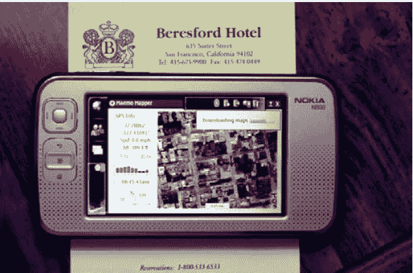
这是在旧金山酒店里的Maemo Mapper。GPS接收器放在房间一侧的窗户旁边，这台N800放在房间另一边靠近门的桌子上。另一张桌子上放着诺基亚E62手机，N800用它从网上下载地图，所有设备都通过蓝牙连接。

这是N800和GPS接收器开了一整夜之后，Maemo Mapper显示的画面。

## 专家专栏
福雷斯特和产品开发团队始终在思考当下IT管理员面临的各种问题。能效、计算密度、绿色计算、可靠性和可维护性都是他重点关注的领域。这也是为什么福雷斯特对全新的Bladeform 8100系列刀片服务器充满期待。Bladeform 8100系列支持多颗英特尔®至强®处理器5300系列四核处理器，可充分发挥英特尔久经考验的可靠性与能效优势。Bladeform 8100系列配备了90%以上高效冗余电源，能够降低运营成本、实现环保计算，这一点给福雷斯特留下了深刻印象。`7U`机箱最多可安装10台刀片服务器，每台配备2块可拆卸硬盘，一个`42U`机柜最多可容纳60台服务器。Bladeform 8100系列是面向关键业务企业应用、横向扩展和高性能计算环境的绝佳选择。与硅力机械合作，你获得的不仅是一套强大的英特尔平台解决方案，更能得到像福雷斯特这样的专家支持。
## 要参加LinuxWorld大会吗？
请到414号展台拜访硅力机械，有机会赢取三件价值不菲的抽奖奖品之一。

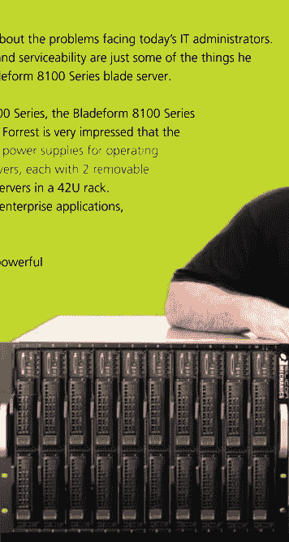

欢迎访问我们的网站`www.siliconmechanics.com`，或拨打免费电话`866-352-1173`联系我们。
硅力机械及Silicon Mechanics标识是Silicon Mechanics公司的注册商标。英特尔、英特尔标识、至强和Xeon Inside是英特尔公司或其子公司的商标或注册商标，在美国和其他国家受法律保护。

### 《面向商务人士的Linux指南》

诺基亚提供的三款协作设备：N800平板、E62手机和GPS接收器。这部手机使用`Cingular/AT&T`网络。
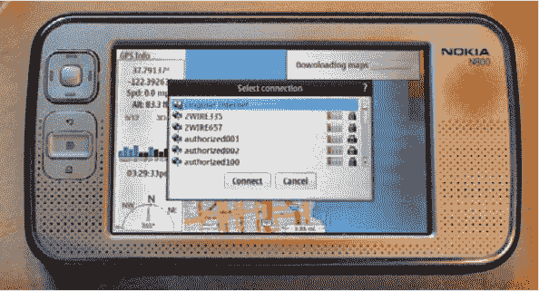
N800除了蜂窝网络连接外，还能搜索到多个`Wi-Fi`接入点，并显示连接是否加密。
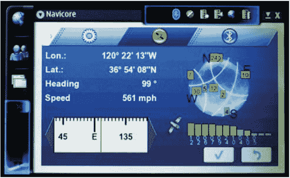
下图为Navicore中的GPS数据页面。顶部的另外两个标签页是设置（齿轮图标）和蓝牙。Navicore的实景导航也并不够智能。如果你在佳明导航上走错路（我用过不少佳明设备），它会提示“正在重新规划路线”，然后调整你需要行驶的路线。而Navicore系统会提示你尽快调头。我不确定它是要你返回出发地，还是找一条备选路线。不管它的逻辑是偷懒、愚蠢还是本身就错了，实际使用起来的结果都很恼人，要么没用要么二者兼具。地图方向是另一个问题。如果你希望Navicore的朝向和你前进的方向一致（大多情况就是驾驶员的前方视角），系统却经常毫无征兆地切换到“上北下南”模式。此外还有一些小问题：GPS的电量永远显示`0%`，哪怕已经充满电；从地图视图点击绿色卫星图标，跳转的却是控制面板（那里有个卫星图标的入口，才能跳转到正确页面）。

而Maemo Mapper完全是另一款产品。首先，它是开源免费软件。由John Costigan和另外8位列名的开发者用C语言编写，基于GPL协议发布，是`Maemo车库`（`garage.maemo.org`）中最活跃的项目之一。我安装的是2007年6月9日发布的`v1.4.6`版本。用过Navicore后，看到它的bug列表（15个未解决，总计39个）、功能需求（33个未解决，总计51个）、论坛、项目文档、代码仓库和邮件列表，实在令人欣慰。
其次，Maemo Mapper并不严格定位为导航系统，而是一款功能日益丰富的多功能GPS工具。为了解释其背景和工作原理，以下是John Costigan在其个人`Maemo Mapper`网站上的说明：
> 从零开始开发的最大好处是，Maemo Mapper自始至终就是为Maemo平台量身打造的。这里不存在后期移植的问题——所有界面都100%采用Hildon UI。此外，我在编写时充分考虑到了Nokia 770的硬件规格，因此全程用C语言开发，针对内存、CPU和屏幕空间都做了优化……如果你打算把所有地图都存在MMC卡里随身携带（我就是这么做的），那么了解如何设置地图目录结构会很有用，但这并不适合所有人，所以还有另一种方案：实时下载地图……

Maemo Mapper从零开始为Nokia 770的`Hildon UI`设计，整个绘图区域都用于显示地图，没有杂乱的GUI组件。大部分功能（缩放、平移、打开路线文件）都可以仅用硬件按键完成（也就是不需要触控笔）……所有下载操作都是异步的，不会打断你的使用体验。你可以在后台下载地图的同时正常使用Maemo Mapper，地图加载完成后界面会自动更新。自动下载地图时这个特点尤为明显——效果和谷歌地图、谷歌地球类似。

Maemo Mapper支持打开和保存标准的GPS交换格式（GPX）文件。你可以打开或保存轨迹（你走过的路线）或路线（你想前往的路线）。借助这个功能，你可以从互联网下载路线（比如从GPX驾车路线网络服务），并将路线显示在地图上。

除了从互联网下载第三方路线外，你也可以直接在Maemo Mapper内生成驾车路线。这个功能使用上述的GPX驾车路线网络服务，生成前往谷歌地图可识别任意地点的路线（例如“宾夕法尼亚州某市百老汇大街1250号”或“44012”）。你甚至可以让Maemo Mapper根据你当前的位置自动更新路线，让你手掌间就能拥有价值2000美元的车载导航系统的全部功能。当然，旅途中需要保持网络连接。

Maemo Mapper会自动提醒你即将到达的航点。在Maemo Mapper中，航点被定义为GPX文件中包含描述的任何轨迹点，通常用于说明在航点处需要执行的操作（例如“在波本街左转”）。提醒会以Hildon“信息打印”通知的形式呈现（屏幕右上角的弹窗）。如果你安装了轻量级语音合成工具Festival Lite（`flite`），还可以选择让Maemo Mapper用`flite`合成语音播报航点描述的内容，为你提供何时何地转弯的音频提示。Maemo Mapper提前多久/多少距离播报航点，可以在设置对话框中配置，同时使用的`flite`二进制文件路径也可以在设置对话框中配置。

收到附带GPS接收器的Navicore套装这一周以来，我安装并使用了John这里提到的所有功能。虽然我还无法复现“2000美元车载导航系统”的效果，但我很享受用N800作为手持GPS的使用体验，它有潜力媲美许多佳明、麦哲伦或`TomTom`的设备。N800、GPS接收器和手机（诺基亚E62）之间的蓝牙连接无缝且非常快速、灵活，几乎没有错误。我甚至把N800拿到另一个房间下载地图，它依然能和GPS接收器保持连接，哪怕手机和接收器相隔最远20英尺（而且两者还互相远离）。

### 《PEG：嵌入式系统领先的图形用户界面》
- 谷歌街景
- `PEG+`
- 完整`C++`窗口功能
- `C/PEG`
- 最小`ANSI C`占用空间
- 免版税
- 执行速度快
- 完全可固化至ROM
- 附带完整源代码
- 配套开发工具，包括`FontCapture`、`PEG WindowBuilder`和`ImageConvert`
- 附赠全套屏幕驱动
- 完全可定制
- 行业领先的实时操作系统支持
- 支持所有主流目标处理器、视频控制器和I/O设备
- 多语言支持——双字节字符集与`Unicode`字符串编码
- 事件驱动编程模型
- 应用设计服务
- 为全球用户提供专业、及时的技术支持
- 现附赠完全授权的Paint Shop Pro 9版本
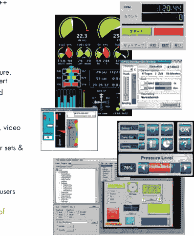

嵌入式系统图形软件
SWELL software
`WWW.SWELLSOFTWARE.COM`
`810-982-5955`

### 专栏
### 《面向商务人士的Linux指南》
- 谷歌卫星图
- 虚拟地球（Virtual Earth）街景
- 虚拟地球卫星图
- 虚拟地球混合视图
- 开放街图

你可以通过菜单选择地图，切换操作快速便捷。用N800的`+`和`-`按键就可以缩放地图。在良好的`Wi-Fi`网络下地图加载速度非常快，通过Cingular（现AT&T）的E62手机GPRS网络加载也足够快。我也期待尝试其他地图服务，比如TerraServer。目前这份列表给了我很多探索的维度。微软的虚拟地球（Virtual Earth）尤其出色，在视觉观感上比谷歌的同类产品有不少优势。

在旧金山和休斯顿步行、打车的时候，Maemo Mapper给我带来了很多乐趣。奇怪的是，在低速（步行、堵车）状态下，Maemo Mapper在地图上留下的红色轨迹会偏移路线。闲置时，轨迹甚至会偏移出当前位置好几个街区，在屏幕上留下一团团红色的涂鸦，我也不清楚是怎么回事。但我确定，如果这是bug的话，Maemo Mapper的开发者们一定会修复。坐飞机的时候用Maemo Mapper没那么有意思，因为它需要下载地图瓦片，而飞机上没有网络支持。（不过能看到飞机一侧能接收到多少卫星信号，还能知道飞行速度和高度，还是很酷的。）目前我不确定是否已经有办法下载并存储整个州或部分大陆的地图，但我依旧相信Maemo Mapper团队会解决这些问题——如果他们还没做的话。

总而言之，比较这两款系统似乎有失公平，因为它们的核心定位差异巨大。但两者在速度和多功能性上的差距实在难以忽视。我本想推荐Navicore系统，因为我非常希望“N”平台能取得成功——而且Navicore为手持式Linux设备的软件、硬件和服务市场破冰，我认为这是非常棒的开端。我也希望Navicore能倾听我们的反馈（以及其他用户的反馈），持续更新和优化产品。当然，我强烈建议Navicore除了采用嵌入式Linux硬件外，也拥抱开源开发模式。虽然佳明没有发布官方声明，但我从Linux开发者和佳明员工那里都听说，未来几代的佳明设备都会围绕Linux操作系统打造，不再要求用户只能用Windows软件为配套的GPS设备安装地图。相反，这些设备会直接作为可移动存储设备，和U盘一样与操作系统无关。Navicore如果能采取同样的策略会非常明智。至少，开放开发流程能最大概率解决那些让Navicore软件又慢又难用的bug，这不仅会增加产品价值，还不会让Navicore整套产品的价格涨一分钱。

至于Maemo Mapper，它是一款非常出色的应用，只会越来越好。

下图为Navicore缩至最小的地图视图，显示了从奥克兰到休斯顿的行程路线。

在Maemo Mapper中，前端带有蓝色指针的红色线条画出了出租车从机场前往休斯顿市中心酒店的行车轨迹。注意这条红色线条在这种情况下非常笔直。
> Doc Searls是*《Linux Journal》*的高级编辑。他还是加州大学圣巴巴拉分校的访问学者，以及哈佛大学伯克曼互联网与社会研究中心的研究员。


## Verio 托管服务：一脉相承的Linux体系
- 根权限访问：提供您所需的掌控能力。
- 高级公平共享技术：更优的资源管理意味着更出色的性能。
- 真正给力的技术支持：由系统管理员提供的获奖级支持服务。
### Verio Linux® VPS与MPS：同类产品中的佼佼者
Verio对开源领域的承诺由来已久，最早可追溯到我们与FreeBSD的早期合作。如今，作为虚拟专用服务器（VPS）技术的先驱，以及全球最大电信公司资本加持的托管服务提供商，我们为Linux生态带来了独一无二的优势：可靠性。若想了解更多关于Verio Linux VPS或Verio Linux MPS的信息，或是预约免费试用，请致电**1-877-837-4654**，或访问**www.verio.com/linuxlineage**。

## 《代码之美：顶尖程序员讲述他们的编程思维》（O'Reilly Media）
想要唤醒你内心的列奥纳多·达·芬奇吗？不妨读一读O'Reilly Media新出版的*《代码之美：顶尖程序员讲述他们的编程思维》*，这是一本收录了多篇启发性文章的合集，展现了软件开发过程中蕴含的艺术性。本书由Andy Oram和Greg Wilson主编，*《代码之美》*收录了38位先锋软件设计师的多元内容，他们希望通过分享自己最核心的经验，来“唤醒并激励新一代程序员”。例如，撰稿人Ronald Mak详细阐述了他为NASA火星车设计的优雅方案，Arun Mehta则聚焦于让技术造福残疾人群的重要性。编辑Oram和Wilson评价这些才华横溢的发明家撰写的文章“鼓舞人心，甚至催人向上”。*《代码之美》*的全部版税将捐赠给国际特赦组织。`www.oreilly.com`
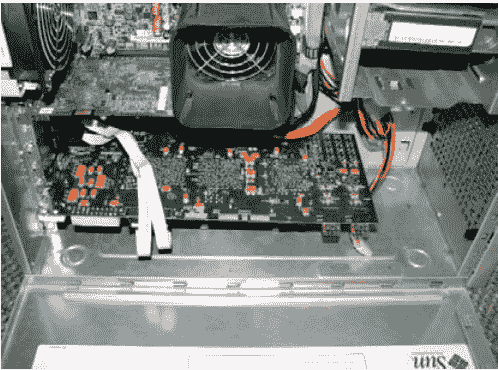

## 马里兰大学的并行处理芯片
马里兰大学A.詹姆斯·克拉克工程学院的研究人员发布了一款尚未命名的原型计算机，该设备将并行处理技术引入桌面端，计算速度提升最高可达100倍。这款由Uzi Vishkin教授及其带领的马里兰大学Terrapins团队开发的 prototype 采用了一块与车牌尺寸相当的电路板，上面搭载了64个并行处理器。此外，Vishkin等人还开发了并行计算机架构，能够让这64个处理器协同工作，让软件开发人员的编程工作更实用、更直观。尽管并行处理在超级计算领域早已普及，但由于编程复杂度高，将其应用到桌面系统一直颇具挑战。不过Vishkin团队通过其创新的单芯片并行处理技术攻克了这一难题。未来的设备或许能在单芯片上集成1000个处理器。Vishkin邀请公众为他的技术命名，获胜者将获得500美元现金奖励。`www.eng.umd.edu`
## Server Technology 的Sentry模块化机柜配电单元
当今数据中心的供电需求催生了诸多创新产品，Server Technology推出的全新Sentry模块化机柜配电单元（CDU）就是其中之一，这是一系列模块化解决方案，能够实现三相电的简单、精准分配。Sentry CDU接入三相电源后，可将单相电分配至机柜内的任意位置。单路三相`208V 30/60A`或`400V 32A`的输入可提供`10.8至22.2kW`的电力。若需要更高的功率密度或冗余备份，可配置双路输入，通过两台在同一IP地址下联动的模块化单元，可提供`21.6至44.4kW`的电力。IP访问及安全功能包括`Web`界面、`SSL`、`SSH`、`Telnet`、`SNMP`、`FTP`、`SNTP`、`Syslog`、`LDAP`、`LDAPS`、`TACACS+`以及串行`RS-232`访问方式。`www.servertech.com`
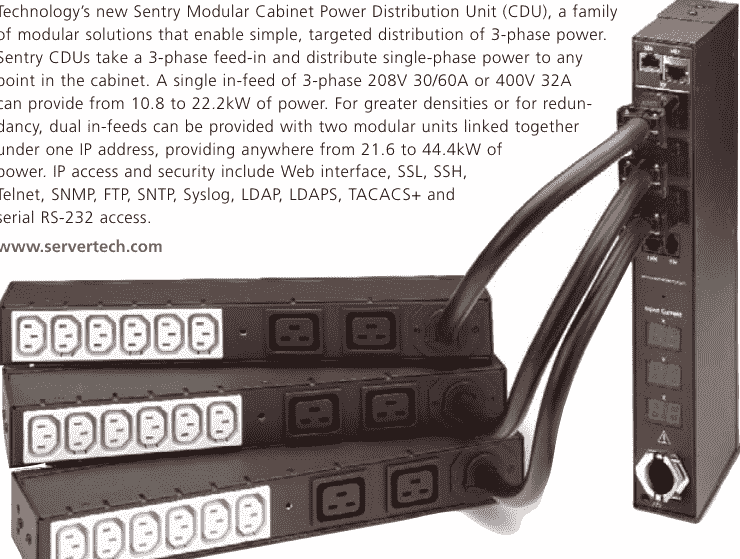
## Paradigma Software 的Valentina社区数据库服务器
我们LJ团队一向乐于看到各类软件向Linux平台移植的热潮，同时也向新成员Paradigma Software的Valentina社区服务器3.1（VCS）表示热烈欢迎。VCS是一款免费的Linux原生SQL数据库服务器，据称速度极快，其内核架构专为速度优化，经过优化后，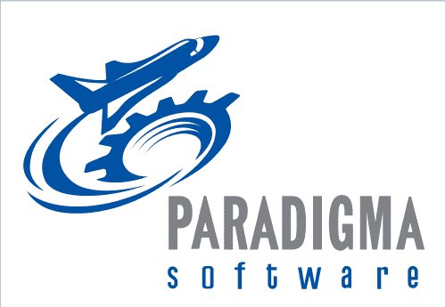 相比其他服务器，它的表数量更少、体积更小。除标准功能外，Valentina还提供链接重构命令、优化的二进制链接（基于`ObjectPtrs`），以及对象关系型设计，“不会强制用户遵循特定的设计模式”。该服务器已支持`PHP 4.0`及以上版本，`Ruby`支持也即将上线。同时提供`Mac OS X`和`Windows`版本。`www.paradigmasoft.com`
## Cepoint的iS900 NAS存储时间服务器
时间服务器领域的新成员是Cepoint Networks推出的iS900 iSCSI NAS存储/时间服务器系统，支持GPS或原子钟时间同步功能。该设备存储容量可扩展至24TB，专为需要精确统一备份时间的、存储节点地理分布广泛的机构设计。除时间同步功能外，iS900还支持`RAID 0`、`1`、`10`、`5`和`50`级别，以及多种内置加密远程数据传输功能。其他特性还包括持续数据可用性、集群部署、远程数据复制、备份与裸机恢复、IP网络远程启动等。`www.cepoint.net`
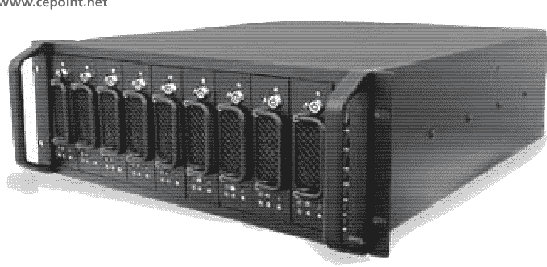
## SourceKibitzer面向Java开发者的简历服务

> 这项简历服务会生成一份在线“简历”，包含11项与开发者及其开发软件相关的客观成就指标。这些指标能够帮助开发者向开源社区准确展示自己的贡献和实际技能。该服务还支持在大型社区内建立社交网络，成员们可以在社区中学习、互动、协作，并互相比较技能和经验。`www.sourcekibitzer.org`
## CentricCRM的Centric Team Elements套件
CentricCRM即将推出的Centric Team Elements套件的预览版（0.9版本）现已公开发布。Centric Team Elements是一款基于Java的开源企业2.0应用，它将维基、博客、RSS订阅等Web 2.0工具统一整合到一套关系型数据库驱动的应用中。例如，企业部门可以搭建维基和博客、跟踪项目计划、发布部门新闻的RSS订阅，所有信息都会被编入索引并支持搜索。Centric Team Elements与另一款开源CRM应用CentricCRM采用相同架构，能够与企业前台业务流程无缝集成。1.0正式版预计于2007年第三季度发布。`www.centriccrm.com`

## 顶级Linux设备套装
- 手持设备：第51页
- 笔记本电脑：第54页
- 台式机：第58页


### 顶级Linux手持设备
**DOC SEARLS 和 JIM THOMPSON**
去年该分类的获奖机型是Nokia 770，如今它有了更年轻的后继机型，正如常发生的那样，后继者往往青出于蓝。Nokia的N800是770的后续产品，体积更小、重量更轻、外观更漂亮、运行速度更快，且性能更强。
- 新增FM接收器功能。
- 升级为`USB 2.0`连接。
- 配备两个全尺寸SD卡插槽，单卡支持容量最高2GB（测试中4GB卡亦可正常使用）。
- 替换770的单个`RS-MMC`插槽，搭载速度更快的`CPU`（`TI OMAP 2420`，主频`330MHz`，对比770的`OMAP 1710 220MHz`），性能约为770的两倍。
- 内存容量翻倍（`128MB`）。
- 内置闪存容量为770的四倍（`256MB`）。
尽管N800与它的“前辈”高度相似，保留了770的整体布局、出色的`802.11`无线和蓝牙模块，以及那块`4.1英寸`、`800×480`分辨率、`225像素/英寸`的锐利彩色触控屏，但许多配置已经发生变化，包括：
- 内置立体声扬声器，替代了原先的单扬声器设计。
- 麦克风布局更加合理。
- 新增`640×480`分辨率的网络摄像头。
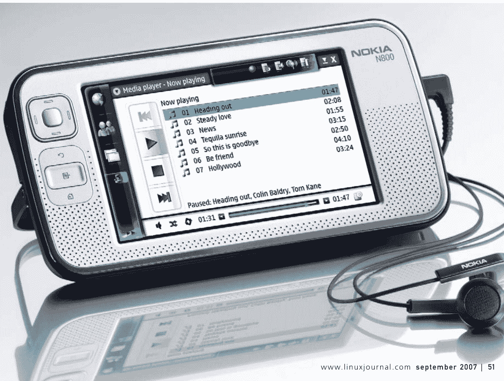

### 特性
### 终极Linux移动设备连接
双击进入连接设置界面，编辑名为Cingular Internet的连接，点击“下一步”，然后输入以下连接信息：
- 接入点名称：`wap.cingular.`
- 拨号号码：`*99***1#`（保持不变）。
- 用户名：`WAP.CINGULARGPRS.COM.`
- 密码：`CINGULAR1`（同样保持不变）。
- 最后，点击“完成”。
如果你是美国T-Mobile用户，接入点名称根据你的套餐和地区，是以下其中之一：`internet.voicestream.com`、`internet2.voicestream.com`或`internet3.voicestream.com`。T-Mobile的用户名和密码字段留空。完成上述设置后，给手机断电重启即可连接。部分手机（如E62）需要你确认建立连接，在手机上点击“是”后，你便可以接入互联网。
虽然GPRS网络的连接速度不如`Wi-Fi`，但能在海滩上弹出自己喜欢的网站依然乐趣十足。（我们的两位作者都住在海边——Jim在夏威夷，Doc在圣巴巴拉。你的休闲场景可能有所不同。）整体而言，N800的外观十分出色，看起来已经是成熟的产品，而770则有种“原型机”的观感。它对细节的关注显而易见：从全新设计的铝制前面板，到可锁定在45度和90度的内置支架，甚至连抽拉式手写笔上的镀铬装饰和刻字这些小细节也丝毫没有遗漏。
此前未公开、但近来被诺基亚N800用户社群发现的特性是，该设备内置了FM立体声调谐器。启用该功能非常简单：只需更新应用目录，搜索FM接收工具并下载即可，插入耳机作为天线后就能使用了。（FM波的波长比蜂窝信号波长长得多，因此你需要一根约30英寸长的导体。）你可以设置FM小工具通过扬声器播放，不过在我们测试的版本中，该设置无法保存。（默认会输出到耳机。）接收效果和普通随身听类型的收音机差不多。
我们希望看到诺基亚修正一个明显的疏漏：设备搭载的恩智浦（原飞利浦）`TEA5761 FM`接收芯片可以升级为支持`RDS`（无线数据广播）的`TEA5764`。RDS是嵌在美国绝大多数FM电台、欧洲所有电台以及全球许多其他电台后台传输的数据流。如果N800支持RDS，FM调谐器就可以识别电台、节目和音乐信息。（目前，在FM调谐器小工具中，你必须为所有预设电台手动输入呼号。）更重要的是，RDS支持能让开发者开发出利用RDS数据流数据的应用，这些数据包括带日期和时间戳的歌曲/节目标题以及其他标识信息。
通过Doc在哈佛大学伯克曼互联网与社会研究中心牵头的ProjectVRM项目，目前已经展开讨论，希望将N800打造成支持FM/流媒体/播客的交互式设备——甚至可以加入“购买按钮”，让听众能够即时成为他们喜欢的公共电台节目的捐助者（和会员）。这种主动选择付费的广播（及播客）模式有望颠覆整个行业。我们甚至可以用这种主动付费模式来修复商业音乐广播的问题。
今年早些时候，版权皇家委员会出台了一项裁决，要求所有网络电台都必须支付极低的人均/每首歌费用（到2010年将涨至每首0.0019美元）。尽管版权皇家委员会及其前身机构（可追溯至1998年的《数字千年版权法案》）一直在谈论存在“自愿的买卖双方”的“假设性”市场，但N800实际上让这样的市场成为可能，而且是完全自愿、自然的基础上的。听众可以在任何时候，为他们喜欢的内容支付任意金额。他们可以订阅内容，也可以将数据（包括支付信息）托管起来供日后使用，或者其他任何方式。关键在于提供一种低摩擦的收听和支付方式，且内容提供方没有任何强制行为——通过将电台和播客创作者变成表演艺术家与受众之间的真正中介，彻底终结DRM（数字版权管理）机制。再说了，比起每年两次听电台的募捐活动，直接为公共电台付费难道不是更好吗？
然而，尽管新增了这么多功能，N800的尺寸（`5.7英寸×3.0英寸×0.5英寸`）和重量（`7.3盎司`）仍比770（`5.5英寸×3.1英寸×0.7英寸`，重`8.1盎司`）更小更轻。`VGA`分辨率的摄像头通过屏幕左侧的弹出按键启动。我们怀念的一个功能是可翻转的硬壳保护套，闭合时可作为屏幕保护膜。如果诺基亚（或其他厂商）推出这款保护套作为配件，我们一定会购买。此外，我们发现顶部的按键尺寸偏小，操作起来有些困难。
N800的软件也比770有所升级。该公司继续推出基于Debian的发行版，搭载Hildon小工具，目前已更新为互联网平板电脑版2007。改进内容包括：
- 更新了Opera 8浏览器，支持Flash 7。
- 基于Jabber的即时通讯功能，支持VoIP和视频会议。
- 优化了连接管理器，会记住你的连接偏好设置。
- 支持将部分内置SD卡作为交换空间使用，提升虚拟内存容量。
诺基亚已通过Maemo项目公布了后续路线图，包含`GTK 2.10`、Samba、蓝牙耳机支持、USB主机支持、Skype以及内置电子邮件客户端的优化。
N800的`Wi-Fi`芯片组的覆盖范围始终让我们印象深刻，它几乎总能捕获到大多数笔记本电脑根本无法探测到的无线接入点（AP）。当有`Wi-Fi`网络可用时，你可以通过蓝牙无线电功能借助手机接入互联网。
我们收到用于评测的诺基亚N800时，设备已经预装了Cingular网络的连接设置。我们中的一人（Doc）使用的是搭载Cingular数据套餐的诺基亚E62手机，他的评测机毫无困难地接入了互联网。不过你的使用体验可能有所不同。
如需手动进行上述设置，从应用菜单选择“工具”→“控制面板”，导航至
即使没有那款额外配件，N800也同时配备USB和线路输入接口，既可以录制（甚至可能编辑）播客，也可以播放播客，只需安装相关软件即可。这是N800作为高度开放的Linux设备的巨大优势之一。你还可以用N800做很多有趣的事，比如把它当作导航设备。诺基亚销售包含诺基亚`LD-3W`蓝牙GPS、车载充电器、车载支架、2GB存储卡和带地图的Navicore软件的导航套件。如果你已经有蓝牙GPS，也可以试试Maemo Mapper。完成设置后，你可以获得基于Google地图（街道或卫星视图）或其他多个在线地图源的地图，包括微软出色的Virtual Earth（VE）。如果你开启自动下载功能，可以通过手机数据连接按需下载这些地图。（更多关于Navicore和Maemo Mapper的内容，参见本期Doc撰写的《Linux for Suits》专栏。）
我们发现，在充满电的情况下，N800可以支持约5小时的典型使用：通过`Wi-Fi`或蓝牙浏览网页，同时收听FM广播。对于这个尺寸、配备`Wi-Fi`功能的设备来说，这个续航表现十分出色。目前这一平台仍处于早期阶段，但显然诺基亚（以及Navicore这类供应商和开发者）都致力于将N系列（现在的命名）打造成开放平台。一定要访问**maemo.org**和**garage.maemo.org**，你可以看到已经开发完成和正在开发的项目——也可以开始为这款出色的小设备开发你自己的酷炫应用。
> Doc Searls是《*Linux Journal*》的高级编辑。他还是加州大学圣巴巴拉分校的访问学者，以及哈佛大学伯克曼互联网与社会研究中心的研究员。
> Jim Thompson摆弄UNIX和Linux的时间已经太久了。他记得自己1980年在VAX 11/780上最开始用的是BSD Unix 4.1a版本，至今仍然觉得``echo 'This is not a pipe.' | cat - > /dev/tty is funny.''这句话很有意思。
## 借助c-tree®数据库技术，你的世界运行更快

- 一款体积小巧的c-tree数据库控制着你通勤路上的交通信号灯。
- 包裹的扫描和投递使用的是可扩展的c-tree数据库，它可以在手持设备到大型主机等各种设备上运行。
- 高吞吐量的c-tree数据库验证你的信用卡交易。
- 你的金融交易十分安全，因为所有交易都通过c-tree数据库进行身份验证。
- 多亏了c-tree数据库在你的相册软件中的透明部署，你的数码照片才能被有序整理。
借助c-tree数据库技术，你的世界运行更快（你也能睡得更好！）。FairCom提供高性能、低维护的数据管理技术。我们的客户从小型初创公司到跨国集团都有，他们能够解决特定应用的性能难题，因为c-tree让他们可以对数据库操作进行精准控制。为你的应用加速，简化你的部署流程！立即下载c-tree评估版。


## 终极Linux笔记本：EmperorLinux的Raven X60，来享受你的胜利巡礼吧！
詹姆斯·格雷

那么在Linux笔记本电脑的语境下，“终极”这个词到底意味着什么？是说要碾压所有其他产品的笔记本吗？还是说最优秀的型号会在“终极性”上更内敛？鉴于我们使用笔记本电脑的场景非常多样，这个问题的答案比在桌面端或服务器领域更难界定。为了给**终极笔记本**的评选标准找灵感，加上我的笔记本电脑和我本人都住在密歇根州，我的思绪下意识飘向了汽车。“大多数人会同意哪款车是‘终极’的？”我暗自思索。根据我在本地街头的观察，我猜凯迪拉克凯雷德、科尔维特或XLR敞篷跑车会获得最高的赞誉。但，那是密歇根。我对加州朋友做的非正式调查则引出了好几款不同宝马、雷克萨斯（复数是Lexi？）、迷你库珀、福特野马等车型的有力论据。作为一名可怜的产品编辑，我该怎么办呢？后来，在审阅了多款终极笔记本比赛的参赛作品后，终极汽车比喻终于浮现在我脑海中。尽管这么说我可能会被汽车爱好者赶出汽车之国，但和丰田普锐斯最像的笔记本就是冠军。换句话说，顶尖的产品是那款能用新颖且优雅——未必只是堆料——的Linux创新，让《Linux Journal》的读者们点头称赞、垂涎欲滴的机器。

基于这些标准，2007年终极Linux笔记本比赛的冠军是EmperorLinux的Raven X60平板电脑。Raven X60是一款便携、性能强劲、设计精良的酷睿2双核机器，搭载了Emperor引入Linux领域的多项独特创新。稍后我们会深入介绍我们选中Raven X60的原因，但先来了解更多关于本次比赛的信息。

### 关于比赛
我们邀请厂商寄来3000美元以内的公开售卖的最佳整机参赛。Linux需要预装，所有主要功能（比如`Wi-Fi`支持、蓝牙、功能键等）都需要在用户无需额外大量操作的情况下正常运行。此外，在测试完所有机器后，我们更加确信，完整的整机体验远大于各部分之和。有些机器纸面参数看起来非常漂亮，但就是没法让人心动。人体工学设计、售后、文档、细节处理等因素，明显且大幅拉开了优秀产品和合格产品的差距。我们预料部分读者会更希望终极Linux笔记本像保时捷而不是普锐斯，提供尽可能彪悍的性能。没错，我们考虑过这一点，未来我们可能会提高价格门槛，纳入更冷门的高端机型。不过今年，我们认为当前Linux笔记本市场的现状更适合走**重脑力轻蛮力**的路线。幸运的是，不少销售预装Linux机器的厂商都参加了我们的比赛。我们为戴尔推出预装Linux笔记本的消息欢呼，也试图拿到一台进行测试。但不幸的是，尽管我们多次联系戴尔位于朗德罗克的总部，对方都明确表示毫无参赛意愿。相反，我和所有Linux专业供应商的CEO或副总裁都进行了沟通。尽管我们社区里不少人都呼吁支持戴尔，但我认为**行动胜于空谈**。以我的经验，我们社区的本土供应商通常都能出色地为他们销售的产品提供支持。现在，让我们把目光转向Raven X60平板电脑！
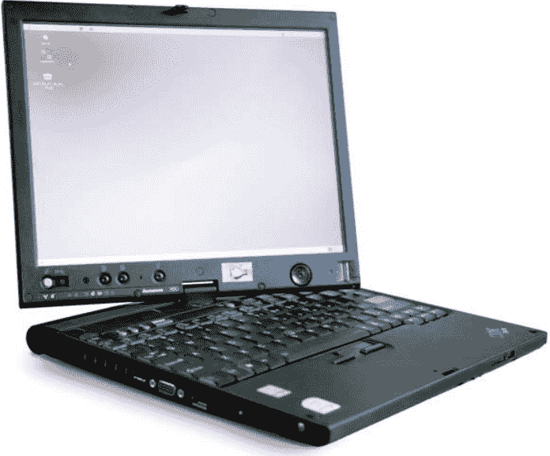
图1. Raven X60的LCD屏幕内置了`4096dpi`的Wacom数位板。

### X60平板的突出亮点
以下是我們测试的Raven X60平板的参数，售价为2950美元：
- 双系统启动：Ubuntu Feisty Fawn（内核`2.6.21`）和Fedora Core 6（内核`2.6.17`），均为32位系统。
- 处理器：英特尔`1.6667GHz`酷睿2双核L2400，配备`2048KB`缓存（`667MHz`前端总线）。
- `2048MB` 内存。
- `100GB` 5400转机械硬盘。
- `DVD+/-RW`光驱（安装在随附的UltraBase扩展坞中）。
- `12.1英寸`LCD屏幕，分辨率`1400×1050`。
- 网络：`10/100/1000Mbps`以太网、`56Kbps`调制解调器、`802.11a/b/g`（`54Mbps`）`Wi-Fi`、蓝牙（`2Mbps`）。
- 重量：单机`3.4磅`，配电池`4.4磅`，配UltraBase扩展坞`6.4磅`。
- 电池：8芯，`4.5安时`。
- 接口：2个USB、1个CardBus、1个RJ-45、1个VGA、1个安全数字卡槽。
- 蓝牙支持。
- Wacom数位板集成于LCD屏幕。
- 生物识别指纹扫描仪。
- UltraBase扩展坞配备DVD+/-RW光驱、额外接口（并口、串口、4个USB、PS/2接口），以及RJ-45、VGA直通接口。

Raven X60平板的四个独特亮点让它独居今年的冠军宝座。第一，X60本质上就是搭载Linux系统的联想ThinkPad X60平板，是一款做工扎实、人体工学设计优秀的机器。联想延续了IBM的优良品质传统，这一点从所用元器件、做工（比如屏幕转轴）到舒适的使用体验（比如键盘和触控笔的响应）都体现得淋漓尽致。第二个突出亮点是集成在LCD屏幕里的`4096dpi` Wacom数位板，使用体验堪称完美。Emperor非常贴心地在系统中预装了带桌面图标的Jarnal手写识别软件，你可以随意旋转、翻转屏幕，甚至把屏幕完全平放，直接开始书写。动态X旋转功能支持不重启X服务即可切换四种屏幕方向。
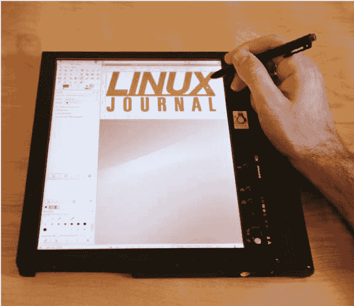
图2. 可用该数位板在GIMP中完成图形设计工作，GIMP支持`256级压感`识别。你也可以切换四种不同的屏幕方向。

### Linux笔记本 起售价799美元

### Linux台式机 起售价375美元

### Linux服务器 起售价899美元
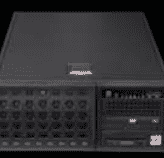
### 拒绝平庸！选CUBED！


`309.34.CUBED` `shoprcubed.com`

### 专题：终极Linux笔记本

图3. 标配的UltraBase扩展坞配备`DVD+/-RW`光驱，以及大量额外接口。

触控笔既可以充当鼠标，也支持压感橡皮擦功能。除了玩Jarnal，我在GIMP里体验数位板功能也玩得不亦乐乎，这让我感觉自己像个初出茅庐的艺术家。Emperor的总裁林肯·杜雷告诉我，GIMP“用上了触控笔提供的`256级压感`”。另一个非常棒的功能是Raven X60的生物识别指纹扫描仪，目前支持GDM、登录和sudo的PAM服务。录入你自己的指纹后，你可以用它登录，也可以随时切回密码登录。

### Raven X60是一款便携、性能强劲、设计精良的酷睿2双核机器，搭载了Emperor引入Linux领域的多项独特创新
这款机器第四个突出特点是其全面且设计精良的Raven X60专属手册。很显然，Emperor将优质文档视为用户体验的核心组成部分，因为这份手册能很好地预判用户需要查找的信息。此外，每个章节不仅清晰说明了现有功能及使用方法，还标注了哪些功能尚未完善。这项服务能帮你避开无效尝试，节省数小时的时间。

表现良好。尽管亮度调节有些卡顿，但音量控制、外接VGA输出、休眠等功能都运行正常。媒体播放器控件可以正常使用，但仅支持Totem播放器。Emperor也确保了扩展坞（也就是UltraBase）可以正常工作；不过由于扩展坞内置了IDE设备，目前还不支持热插拔，但Emperor表示这项功能将在后续更新中加入。UltraBase是Raven X60的标配配件，开箱即配备`DVD+/-RW`光驱，用户也可以根据需要更换额外硬盘。它还提供了大量额外接口（并口、串口、4个USB、PS/2接口），以及RJ-45、VGA直通接口。其他值得称赞的归功于联想（和英特尔）的特点包括`1.6667GHz`的酷睿2双核处理器、凹陷式接口设计，以及结实耐用的屏幕转轴，外观和手感都经久耐用。唯一的槽点是，我评测的这台Raven X60搭载的是32位Linux系统而非64位，不过Emperor表示，在本文撰写时，64位系统的数位板支持已经接近完成。等你看到这篇文章时，应该就可以通过Emperor的网页配置器为这台机器安装64位的Ubuntu或Fedora系统了。此外，我收到的这台机器搭载的硬盘仅为5400转，考虑到这是终极Linux笔记本比赛，我本来预期会拿到转速更高的7200转款。

### Raven X60的胜利巡礼
Emperor从一款做工扎实的联想机器起步，又确保了所有附加功能都能在Linux下正常运行——尤其是数位板支持、生物指纹扫描仪和优秀的文档——它为Raven X60付出的努力值得一次自豪的胜利巡礼。这些方面体现出该公司注重细节，希望最大化用户的Linux笔记本使用体验。不过，在胜利巡礼之后，我们希望Emperor能持续创新，推动Linux笔记本领域的蓬勃发展。但它也必须时刻留意身后，因为Linux笔记本市场正在走向成熟，竞争愈发激烈，高端市场也会变得更有看点。我们明年见！

### 锦上添花
除了前面提到的四大亮点，Raven X60还有很多其他值得称道的地方。在Emperor可控的范围内，它提供了规划周全的Linux使用体验。Raven X60出厂即预装了双系统启动的Ubuntu Feisty Fawn或Fedora Core 6，两个系统都有很多不错的功能（不过Ubuntu比Fedora更完善一些）。所有标准功能都开箱即用（包括无线网络和蓝牙），在两个发行版上点几下就能安装对应的解码器，播放未加密DVD、MP3、Windows媒体和音频文件。当然，预装Linux笔记本的重要测试项之一就是功能键的使用体验，Raven X60在这里

詹姆斯·格雷是《Linux Journal》的产品编辑，同时也是密歇根州立大学环境科学与管理专业的研究生。他自1993年Slackware 1.0发布起就是Linux爱好者，目前和妻子、猫咪一起生活在密歇根州的兰辛市。

## Polywell 终极 Linux 系统
### 更多选择，优质服务，超高性价比！

### 1U 高性价比服务器，起售价 399 美元，最高支持 4GB 内存（支持定制配置）
- 399 美元：`1U-485Ax` 闪龙 3000+，1GB DDR2 内存，80GB 硬盘（仅限批量采购）
- 499 美元：`1U-485Ax` 速龙 64 3500+，2GB DDR2 内存，80GB 硬盘（仅限批量采购）
- 699 美元：`1U-690GA` 速龙 64 X2 双核 3800+，4GB DDR2 内存，2 块 80GB 硬盘（加装双网卡需额外支付 45 美元）
- 1299 美元：`1U-690GA` 速龙 64 X2 双核 4200+，8GB DDR2 内存，2 块 80GB 硬盘（加装双千兆网卡需额外支付 45 美元）

### Linux 专用设备，起售价 299 美元
- `Poly 485Ax` 闪龙 3000+，512M DDR2 内存，`ATI X1100` 显卡，100M 网卡，DVD 光驱，160G 硬盘，售价 299 美元（仅限批量采购）
- `Poly 690GA` 速龙 64 X2 双核 3800+，1G DDR2 内存，`ATI X1250` 显卡，DVI+VGA 接口，千兆网卡，DVD 刻录机，500GB 硬盘，售价 499 美元（可提供 `OEM/ODM` 服务）

### 1U 高端服务器，最高支持 64GB 内存，4TB 硬盘
- 1999 美元：`1U-690S4` 速龙 64 X2 双核 3800+，8GB DDR2 内存，2TB（4 块 500GB 硬盘），双千兆网卡
- 2399 美元：`1U-100SSL` 皓龙 1210 双核，8GB ECC DDR2 内存，2TB（4 块 500GB 硬盘），双千兆网卡
- 2999 美元：`1U-2500A16` 2 颗皓龙 2212 双核，16GB ECC DDR2 内存，1TB（4 块 250GB 硬盘），双千兆网卡
- 5999 美元：`1U-2500A16` 2 颗皓龙 2216 双核，32GB ECC DDR2 内存，2TB（4 块 500GB 硬盘），双千兆网卡（可选配 64GB 内存+4TB 硬盘）

### 低成本 NAS 存储，2.0TB 版起售价 999 美元
- 999 美元：`Netdisk 4000` 2.0TB（4 块 500G 硬盘）
- 1550 美元：`Netdisk 6000` 3TB 6 块 500G（2U 机箱）

### 1U Twin 服务器，1U 8 路四核皓龙
- 4999 美元：`1U-Twin` 2 颗双核处理器，2 组 8GB ECC DDR2 内存，2 组双 250GB 硬盘，2 组双千兆网卡
- 5999 美元：`1U-8415A` 4 颗皓龙 8212 双核，16GB ECC DDR2 内存，1.5TB（3 块 500GB 硬盘），双千兆网卡
- 7999 美元：`1U-8415SS` 4 颗皓龙 8212 双核，32GB ECC DDR2 内存，2 块 74GB 15K 转 SAS 硬盘，3 块千兆网卡

## 高密度多处理器服务器
### 1U 8 路、5U 16 路服务器，最高支持 128GB 内存
- 12999 美元：`1U-8450SS` 4 颗皓龙 8212 双核，64GB ECC DDR2 内存，2 块 74GB 15K 转 SAS 硬盘，3 块千兆网卡
- 39999 美元：`1U-8450SS` 4 颗皓龙 8214 双核，128GB ECC DDR2 内存，2 块 74GB 15K 转 SAS 硬盘，3 块千兆网卡
- 18500 美元：`5U-8850T5U` 8 颗皓龙 8212 双核，64GB 内存，2TB（4 块 500GB 硬盘），3 块千兆网卡
- 46999 美元：`5U-8850T5U` 8 颗皓龙 8214 双核，128GB 内存，4TB（8 块 500GB 硬盘），3 块千兆网卡

### 6TB 2U 存储服务器 2012SC-2055A
- 4TB（8 块 500G），搭载皓龙处理器，售价 2999 美元
- 6TB（12 块 500G），搭载皓龙处理器，售价 3999 美元

### 刀片服务器
- 10 块双核或四核处理器刀片
- 13999 美元：8U 机箱搭载 10 块 2055A 刀片，单块配置为双皓龙 2210 双核、4GB 内存、80G 硬盘
- 24999 美元：8U 机箱搭载 10 块 2500M 刀片，单块配置为双皓龙 2212 双核、16GB 内存、80G 硬盘
- 36999 美元：8U 机箱搭载 10 块 8450A 刀片，单块配置为四核皓龙 8212 双核、16GB 内存、80G 硬盘
- 66999 美元：8U 机箱搭载 10 块 8450A 刀片，单块配置为四核皓龙 2214 双核、32GB 内存、80G 硬盘

### 18TB 4U 存储服务器 4024AIS-2500A16
- 12TB（24 块 500G），搭载皓龙处理器，售价 7500 美元
- 18TB（24 块 750G），搭载皓龙处理器，售价 11999 美元
AMD 双核技术可让单一平台满足多任务、多线程环境的需求，同时保障平台长效使用寿命

### Polywell OEM 服务，您的虚拟代工厂
- 支持 Linux/FreeBSD 的原型开发服务
- 从小批量生产到大规模量产制造服务
- 仓储、配送及 RMA 维修服务
- 20 年客户满意度沉淀
- 5 年质保，行业最长质保周期
- 一级客户服务
服务电话：`888.765.9686`
官网：`www.Polywell.com/us/LJ`
Polywell Computers 公司
地址：美国加利福尼亚州南旧金山圣马特奥大道 1461 号，邮编 94080
电话：`650.583.7222`
传真：`650.583.1974`

## 终极 Linux 主机
我们把难以置信的性能塞进了堡垒机箱，还配齐了全套外设，总价不到 4000 美元。
**尼古拉斯·佩特利**
如果你打算给自己犒劳一台电脑，但又想把支出控制在比买次一级产品高不了多少的区间内，你会选择什么样的配置？
我们正是基于这个原则组装了这台主机，它性能足够支撑未来数年的使用需求，还配了坚固的堡垒机箱。之后我们又给它搭配了漂亮的 24 英寸显示器、优质音箱、键盘和鼠标。最终成品售价 3887 美元，还有很大的灵活调整空间，你可以省掉那些你认为非必需的组件的钱。说白了，这些配置几乎全是超出你实际需求的，但如果我们选配低一点的，那它就不配叫“终极 Linux 主机”了，不是吗？
如果你的另一半质疑你的消费决策，你总能抛出这套音箱类比：为什么要买频响范围超出人耳听觉极限的音箱？这种音箱在人耳可闻范围内的音质表现反而更出色，不是吗？这就是为什么你值得为终极 Linux 主机“过度配置”。也许你不会把它的性能推到极限，但它在你的日常使用场景下表现会更好，不是吗？
如果你能说服你的另一半接受这个理由，记得告诉我。（别跟他提你买的东西半年就会过时。）
不用担心对方说不，也不用担心你手头拮据。我们没忘了你。我们凑出了「次终极 Linux 主机」，总价不到 2000 美元（详见「次终极 Linux 主机」侧边栏），它依然拥有相当可观的性能。事实上，即使是次终极 Linux 主机，如果你能接受更慢的 CPU 或者显卡，还能省下不少钱。你减配的同时，也可以选择更便宜的机箱和电源来压低价格。但我希望你们大多数人读这篇文章不是为了这个。你们就是想饱饱眼福，所以我们挑了一些给力的硬件，挑逗你们的购买欲。整套配置围绕一块华丽的华硕主板展开，搭载英特尔酷睿 2 四核处理器和 4GB 内存，搭配 3ware RAID 控制器和 RAID 硬盘笼，内置 4 块 320GB 硬盘。再加一块最新最强的显卡，你就彻底消除了各个层面的性能瓶颈。
请记住，文中所有报价均为本文撰写时的价格。硬件降价很快，所以你或许能用同样的价格买到更好的硬件，或者花更少的钱买到同款硬件。另外还要注意，产品可能会停产（我们第一款显卡在评测完一周后就停产了），而且厂商会对硬件做出“流式更新”。流式更新意味着哪怕你买的是同品牌同型号的配件，拿到的也不一定和我们评测的是完全一样的。
现在你已经提前被“剧透”了，接着就来看看这台“50 加仑量的硬核无敌硬件”的具体配置吧。
### CPU
我们为终极主机选的 CPU 是英特尔酷睿 2 四核 Q6600，本质上是两颗双核 CPU 整合成的单颗芯片，每个核心主频 2.4GHz。它不是真四核 CPU，因此扩展性不如真正的四 CPU 系统，但我们还是很快就对它爱不释手了。
你大概已经在问自己是不是真的需要四核了，大多数情况下你确实不需要。但根据你的工作类型不同，你可能会发现四个核心都能派上用场。我们测试的搭配中，Linux 在这个四核处理器下的响应速度明显优于速龙 64 双核配置，用 `make -j 5` 命令编译程序时的速度提升更是让人兴奋。
通常我们会让 make 命令开启的进程数等于 CPU 核心数加 1，`-j 5` 参数就会开启 5 个进程，对应 4 个核心各 1 个，再加 1 个额外的进程。
*图 1. 终极 Linux 主机*
诚然，英特尔酷睿 2 四核的价格比 AMD 双核 CPU 高，但 515 美元的定价对你获得的性能来说非常划算，尤其是考虑到更好的英特尔 CPU 售价几乎是它的两倍。
说到 AMD，我们最终为终极主机选择了英特尔酷睿 2 四核这件事，已经能说明很多问题了。我们是 AMD FX-74（Socket F、1207 接口 FX 系列）和 AMD FX-62（Socket AM2）双核处理器的狂热粉丝。这两款处理器非常能打，哪怕是主频 3.0GHz 的 FX-74 芯片，售价也比英特尔酷睿 2 四核便宜 100 美元。我们太喜欢 AMD 处理器了，差点选了华硕 M2N32-WS Pro 搭配 FX-62 的组合作为我们的最爱。（我们为次终极 Linux 主机选的 M2N32-SLI 主板和这块几乎一样，只是少了一个 PCI-X 插槽。）这套组合对大多数人来说性能完全够用，而且本文撰写时 FX-62 的售价（280 美元）真的很难有对手。
如果你选这套组合，还想要

### 倒数第二台Linux主机
- **主板** - 华硕M2N32-SLI（无PCI-X插槽）：$170
- **处理器** - AMD FX-62：$280
- **显卡** - 微星GeForce 7950GT：$200
- **内存** - 海盗船XM52 2GB：$160
- **硬盘（320GB）** - 西部数据WD3200AAKS：$90
- **DVD刻录机** - NEC Black 16X DVD+R：$30
- **电源** - TT W0106RU电源：$170
- **机箱** - ANTEC Nine Hundred机箱：$140
- **显示器** - 宏碁AL2416：$550
- **键鼠** - 微软人体工学键盘：$52
  - 罗技G5：$45
- **音箱** - 创新SBS Vivid 80：$34
- **总价：** $1,921
如果加装RAID卡的话，一定要选支持PCI-X而非PCI Express的型号，3ware 9550SX-4LP RAID卡和这块主板的兼容性很好。当然AMD处理器的发热量也非常高，我们试了好幾款花里胡哨的第三方散热器，但没一款能让闲置状态下的FX-62处理器温度降到95华氏度以下。更糟的是，当我们把FX-62和原来的水冷显卡搭配使用时，水冷风扇还要同时承担机箱散热风扇的工作。我们不得不换了一款功率更大的水冷风扇，才能让处理器维持正常的工作温度。最终整机运行倒是没问题，但噪音比应有的水平大很多。相比之下，英特尔酷睿2四核处理器用原装风扇运行时不仅温度低还十分安静，核心温度在72到88华氏度之间，比AMD FX-62低不少，哪怕我们给AMD配的是高端第三方散热器也是如此。如果你真的追求极致性能，可以入手一块华硕L1N64-SLI WS双LGA 771插槽主板，插两颗AMD FX-74处理器组成四核平台。我们没测试过这个组合，但理论上它的性能肯定会碾压英特尔酷睿2四核处理器：处理器本身速度更快，而且双插槽设计在扩展性上理论上更接近四颗独立CPU的表现。不过这个配置的总价会高出一大截：两颗处理器的价格就比一颗酷睿2四核贵，你还需要配一块功率超过1000瓦的超大电源来带动处理器和显卡，这么高的功耗意味着会产生大量热量，算是性能与成本/散热之间的权衡。你可以花大价钱买顶级性能主机，不过到时候你可能得把家里恒温器调低，还没法用灶台做饭了。
### 主板
我们选用的是华硕Striker Extreme LGA 775搭载NVIDIA nForce 680i SLI芯片组的ATX主板。除了大多数主板都有的一个通病外，这块主板的设计布局非常出色。它配备了板载电源、重启和CMOS清除按钮。（为了防止用户误触清除CMOS，需要调整跳线才能让CMOS清除按钮生效。）它带有一块带背光的后置LCD面板，但我们没什么使用它的需求。主板通过位于显卡插槽上方的扩展卡提供了出色的内置高清音频。它的前端总线最高可以支持1333MHz，而我们选的酷睿2四核处理器仅需1066MHz的前端总线。板载有6个内置SATA接口和2个外部SATA接口，我们都没用，因为用了3ware的RAID卡。它最多支持10个USB连接，其中4个连接到了主板后置接口上。这块布局出色的主板只有一个缺点：和很多主板一样，它插RAID卡的位置刚好在双槽显卡的风扇旁边，这意味着RAID卡可能会挡住显卡风扇的气流。我们在后续的章节中会针对各个类别进一步说明这个问题。

> **图2.** 电源和重启开关、USB接口以及硬盘活动指示灯都嵌入在机箱顶部。我们不知道你为什么会想给这台主机超频，但华硕在BIOS设置界面里把超频功能做得很简单。如果你超频过度导致系统无法重启，再次按下重启或电源开关，主板就会识别到问题，自动重置BIOS，让你能重新尝试。

> **图3.** 电源开关下方的边缘处是备用USB接口、IEEE 1394接口以及音频接口。
华硕为这块主板准备了不少实用的小配件。它内置了额外的传感器，你可以随意布置来监控任何你想要的设备的温度。它还附带了一个可以放在显示器顶部的定向麦克风。华硕还提供了几个针脚转接器，能让主板的接线更简单：你把电源开关、重启开关、电源LED和硬盘LED这些线接到转接器上，再把转接器插到主板上就行。这样你就能一次性拔插所有这些线，哪怕主板已经装在机箱里，也不用摸黑用尖嘴钳操作。华硕还提供了USB和IEEE 1394针脚转接器，专门适配那些买了机箱或其他配件、傻傻地单独提供USB或IEEE 1394连接线的用户。
### 内存
我们选的是Patriot eXtreme Performance 4GB（2×2GB模块）240针DDR2 SDRAM，售价约250美元。无论你运行32位x86还是64位x86_64内核，Linux都能使用全部4GB内存，但哪怕有四个CPU核心，大多数人实际上也根本不需要4GB内存。如果你想降低整机成本，可以选海盗船XMS2 2GB（2×1GB模块）240针DDR2 SDRAM，售价约160美元。海盗船内存的延迟其实比Patriot的还要好：海盗船的时序是4-4-4-12，Patriot的是5-5-5-12。我们做过基准测试，低延迟确实能提升性能，尤其是在AMD处理器上表现更明显，但如果你能在日常使用中感知到这种差异，欢迎告诉我们，我们是感觉不出来。不管你选哪款内存，都要确保插在正确的插槽上以实现双通道模式。对于华硕Striker Extreme主板来说，是第一和第三插槽（每两个内存插槽为一组，颜色匹配）。
### RAID
如今市面上的大多数主板都和华硕这款一样，号称带有板载集成RAID功能，但这其实是个误称。这块主板以及市面上绝大多数主板都没有硬件RAID控制器，所谓的板载RAID其实就是多通道SATA控制器。我们曾经在Kubuntu 7.04上配置过四块连接到板载SATA接口的硬盘组成RAID 0+1（也叫RAID 10），功能是正常的，但折腾的功夫完全不值得，所以我们不推荐这种做法。如果你打算在一台机器上运行多个Linux发行版，这种方案尤其不好。我们光是搭这套配置就已经够折腾了，根本不想每测试一个发行版就重复一遍这个过程。如果你真的想用RAID，听我们的，买一块真正的硬件RAID控制卡。我们选的是3ware 9650SE-4LPMCI PCI Express控制卡，接了四块硬盘配置为RAID 10，这种配置能以磁盘空间为代价提供最佳性能和安全性：它将两组共四块硬盘设置为条带化+镜像模式，条带化能提升性能，镜像能保障数据安全，因为出现故障的硬盘可以直接更换而不会丢失任何数据。但因为有两块硬盘是冗余的，所以四块硬盘的总容量只有一半可用：我们用的四块320GB硬盘最终可用容量约为640GB。如果你想要更大的存储空间，可以买容量更大的硬盘，或者牺牲一些性能，配置
## 还没用过SlickEdit？你还有什么借口？
十大不使用SlickEdit的理由
- 10. 我敲的代码越多，技术就越好。
- 9. 晚上10点后的办公室格外安静。
- 8. 真正的程序员根本不需要花里胡哨的工具。
- 7. 没有什么比手动调整代码格式更爽的了。
- 6. 我一直都想得重复性应激损伤。
- 5. 我就爱读库参考手册。
- 4. 里程碑？什么里程碑？
- 3. 没有语法错误的生活还有什么意思。
- 2. 如果我按时做完所有工作，只会被安排更多活。
- 1. 我从来就没用过它。

不使用\*不\*_SlickEdit_的正当理由只有一个——**你从来就没用过它**。我们怎么敢这么肯定？来自用户的反馈。19年来，我们始终倾听资深程序员的声音，不断尝试超越他们的期望。我们的多语言开发工具和高级代码编辑器快速、强大且灵活——无论你是在Windows、Linux、UNIX还是Mac OS上开发，SlickEdit都有适合你的工具。我们的产品套件包括SlickEdit®、SlickEdit® Tools for Microsoft® Visual Studio® 2005，以及SlickEdit® Plug-in for Eclipse™。
`www.slickedit.com` 可访问`www.slickedit.com/trial`下载免费试用版，或致电`1-800-934-3348`。

### 终极Linux主机
你可以将阵列设置为RAID 5。RAID 5牺牲写入性能来换取更大的存储空间。3ware控制器表现非常出色，它性能优异，而且设置起来非常简单。启动时按下Alt-3即可调出设置界面。这个工具可以让你创建专门用于启动操作系统的存储分区，但你不需要使用这个功能。其他操作系统可能需要这个功能，但Linux可以通过使用普通的RAID分区从RAID阵列正常启动。你可以为RAID控制器添加备用电池单元，这样遇到停电时就不太可能会丢失数据。不过我们没有把备用电池纳入我们的终极主机配置中。如果使用这块RAID卡，你就不需要再通过主板自带的NVIDIA SATA控制器给系统添加硬盘。不过如果你确实要通过主板SATA接口添加硬盘，要注意有些Linux发行版可能会搞混你系统里硬盘的顺序。我们曾经尝试添加过一块硬盘，在这个特定的组件组合下没有遇到这个问题，但这个问题在其他类似配置中已经暴露过，所以我们认为仍然有可能发生。你可能会在启动时看到一条屏幕提示，称该控制器与你的BIOS不兼容，这条提示消失得很快，你可能会错过。如果你在意这个问题，还有很多其他RAID卡可供选择。不过尽管有这个警告，我们的3ware卡已经连续数周稳定运行无故障，而且我们非常认可Linux内核默认对该卡有极佳的支持。这块卡是PCI Express x4规格，插在主板的中间PCI Express插槽上就可以正常工作。如果你采纳我们的建议，务必把卡插在中间的PCI Express插槽，不要插在用于显卡SLI的第二个PCI Express插槽上，选后者的话你会遇到死机和各类问题。


### RAID硬盘笼
有些人可能会觉得RAID硬盘笼是华而不实的配置。但毕竟这是终极主机，所以我们配备了3ware RAID硬盘笼，它能在3个5.25英寸驱动器位的空间里支持四块硬盘热插拔。除了方便更换硬盘之外，RAID硬盘笼相比普通的硬盘安装方式还有两个优势。第一，机箱里的3.5英寸硬盘笼如果要保证良好的散热，最多只能装两块硬盘，你至少得把两块硬盘装在5.25英寸的区域里，还要加装硬盘风扇来保持低温。第二，RAID硬盘笼可以把所有硬盘集中在一个很小的空间里，而且它自带风扇来给硬盘散热。这个硬盘笼只需要两个供电接口，不用每块硬盘都单独配一个供电接口。

### 显卡
我们为终极Linux主机选择了PNY Technologies的VCG8800UXPB GeForce 8800Ultra显卡。这块显卡是最新、最顶级的产品之一，既有优势也有劣势。最明显的优势就是性能爆表，绝大多数人根本用不到这块卡的性能上限。尽管它价格不菲，但你要买两块更便宜的显卡组SLI的话，花的钱几乎和它差不多，而且性能远不如它。另一方面，这块卡搭载了大量为微软Vista设计的复制保护功能，你既不需要也不会用到这些功能。它还原生支持DirectX 10。DirectX 10未来可能会登陆Linux，但至少现在还没实现。最后，如果你选择任何NVIDIA 8系列显卡，比如这一款，目前绝大多数Linux发行版都无法正确识别或配置它。你可以配置这块卡使用Xorg的nv驱动，也可以自行下载安装最新的NVIDIA官方驱动（具体步骤可参考《如何在Ubuntu/Kubuntu上安装NVIDIA驱动》边栏）。如果你用nv驱动的话，其实没必要买这么高端的卡，因为这个驱动用不到这块卡的大部分性能。


我们最初选的是基于NVIDIA芯片的MSI MX8800GTX，它自带水冷系统。我们之所以选择板载水冷方案，是因为很多主板会把显卡插槽安排在RAID卡插槽旁边，高性能显卡会占用两个插槽，RAID控制器卡会挡住一部分进入显卡板载风扇的气流。你可以把显卡插在第二个PCI Express插槽，但这通常会干扰主板上的PCI插槽。我们的配置里没有PCI卡，所以这可能是保持显卡低温的不错选择。如果你能把双槽显卡插在第二个PCI Express插槽，或者买我们推荐的那款显卡，或是选择更便宜的单槽GeForce 7系列显卡，就不用面对相邻RAID卡带来的散热问题。我们一开始测试的时候在机器里加了一块第二声卡，声卡占用了PCI插槽，导致我们没法把双槽显卡移到第二个PCI Express插槽。不过主板自带的音频效果很好，只要不需要其他PCI卡，你完全可以正常使用第二个PCI Express插槽。如果你有任何原因需要把双槽显卡插在第一个PCI Express插槽，要知道RAID控制器本身温度也偏高，这只会让散热问题更严重。像MSI那块水冷卡把风扇移到了机箱外，刚好解决了这个问题。这个方案在我们的Cooler Master机箱上表现非常完美。你可以拆掉120mm的CPU机箱风扇，把水冷装置和风扇装在这个位置，这样显卡风扇同时也能当CPU机箱风扇用。我们之前在基于AMD FX-62的主板上测试的时候，不得不把显卡风扇换成功率更大的风扇，因为AMD FX-62发热量很高。最终两种风扇用在Intel Core 2 Quad上表现都很好，它的发热量没那么大，不需要太强的散热。要不是MSI那块卡已经停产了，我们本来会把它作为推荐的显卡。或许这也说明它有我们还没发现的缺陷。事实证明PNY的GeForce 8800Ultra速度更快。PNY显卡风扇的位置刚好让RAID控制器卡不会严重干扰气流，不会造成散热问题。这块卡售价670美元，非常昂贵。我们还是把它作为终极Linux主机的默认选择，因为它确实足够极致。我们闲暇时间会玩玩游戏（咳），所以很喜欢它处理3D图形的表现。大部分游戏都能流畅运行——这要多亏了TransGaming的Cedega（当然也有原生Linux 3D游戏）。老实说，我们更常拿它来做业余卡通片的3D渲染，所以它的渲染速度确实很实用。

我们选机箱的时候，最终是在去年DIY终极Linux主机最爱的机箱（Silverstone TJO7-S全塔式机箱）和新的Cooler Master全塔式机箱之间二选一。我们选Cooler Master机箱既有合理原因也有不合理原因。如果你不做我们这类折腾的事，根本不需要这么高的配置。比如你可以买一块单卡的NVIDIA 7950GT，顶级的7950GT价格还不到8800Ultra的一半。更棒的是，如果你用7950GT这类NVIDIA 7系列显卡，绝大多数情况下都不需要自己编译NVIDIA驱动。它只占一个插槽，不会因为和RAID卡、显卡风扇离得太近出现散热问题。你还可以买两块组SLI，性能提升明显还不会有散热问题。不过两块7950GT的价格几乎和8800Ultra差不多，花同样的钱你拿不到那么高的性能。

下面是选它的合理原因：这款机箱几乎是免工具设计的，几乎所有部件都不用螺丝就能卡入拆出。我们晃了晃就把RAID硬盘笼装了进去，拨动几个塑料卡扣就能固定好，几秒钟就装完了。主板托盘可以拉出来，这样你就可以把CPU、内存、显卡和RAID卡都装在主板上之后，再把托盘推回机箱，卡到位就行。例外的情况是电源和可能的硬盘需要螺丝刀。只有当你把硬盘装在机箱自带的3.5英寸硬盘笼里，而不是把RAID硬盘笼装进5.25英寸驱动器位的时候，才需要螺丝固定硬盘。

不过这款机箱也有缺点。本来没必要这么做，但我们第一次装显卡的时候不得不切掉侧板的一部分塑料，才能装水冷风扇（图6）。我们之所以要做这个改造，是因为我们最初选的那款显卡自带带外置风扇的水冷装置，唯一合理的安装位置就是替换掉120mm的CPU机箱风扇。如果你真的不需要最顶级的显卡，还是可以买到性能很强的高端显卡，比如EVGA的256-P2-N636-AR GeForce 7950GT，它有256MB GDDR3显存，大概200美元，还有很多表现不错的中低端显卡不到100美元就能拿下。

图6. 最初选的那块显卡迫使我们对侧板进行了切割，才能让侧板门关上。

### TS-7800 高性能嵌入式加固型设备
$269（1件起）/ $229（100件起）
- 全新防变砖设计
- 速度提升3倍
- 向后兼容TS-72xx系列
- 低功耗，5V下仅4W
- 128MB DDR内存
- 512MB高速板载闪存
- 12K可用户编程LUT的FPGA
- 内置PCI总线，PC/104接口
- 2个USB 2.0接口，速率480Mbps
- 千兆以太网
- 2个SD卡槽
- 10个串行端口
- 110个GPIO
- 5个10位ADC
- 2个SATA接口
- 睡眠模式功耗仅200微安
- 启动Linux耗时少于2秒
- 默认搭载Linux 2.6内核与Debian系统

### 与我们的工程师一起设计您的方案
- 从业超过20年
- 从未停产过任何一款产品
- 工程师负责技术支持
- 开源理念
- 可提供定制化配置与设计方案，价格优惠、交付周期短
- 多数产品有现货，支持次日发货

更多可选配置、外设及x86单板计算机的信息，请访问我们的官网。

## 如何在Ubuntu/Kubuntu上安装NVIDIA驱动
据调查，大多数*《Linux杂志》*读者使用Ubuntu/Kubuntu，因此下面介绍一种在Ubuntu 7.04及其同版本衍生发行版上安装最新NVIDIA驱动的方法。（更自动化的方法请见我们的技术技巧板块。）
首先安装Linux源码、编译器和其他构建工具。你可以在每条命令前加sudo，但更简单的方式是切换到root提示符再操作：
```
$ sudo -s -H
# (you should see this root prompt after you type the password)
# apt-get install build-essential linux-source
# cd /usr/src
# tar jxvf linux-source-2.6.20.tar.bz2
# cd linux-source-2.6.20
# make oldconfig
# make prepare
# make scripts
# cd /usr/src
```


现在，下载最新的NVIDIA驱动，将其放在`/usr/src`目录下。**重要提示**：运行NVIDIA安装程序前，你必须先停止正在运行的任何图形桌面。例如，如果你使用KDM进行图形登录：

```
# /etc/init.d/kdm stop
```

现在，运行你下载的NVIDIA安装程序。例如（假设是64位Linux系统）：

```
# sh NVIDIA-Linux-x86_64-100.14.09-pkg2.run
```

按照安装程序的提示操作，允许安装程序修改你的`/etc/X11/xorg.conf`文件。你可能需要手动修改`/etc/X11/xorg.conf`，让X11适配你的显卡和显示器。最重要的修改如下：注释掉显示器的水平和垂直刷新率范围（驱动会自动识别显示器的性能参数）：

| # | 配置项 | 数值 |
|---|---|---|
| # | 水平同步范围 | 28.0 - 51.0 |
| # | 垂直刷新率 | 43.0 - 60.0 |

确保`Screen`部分包含你要使用的最高分辨率。就我们选择的显示器而言，最高分辨率为24位色深下的`1920x1200`。如果你需要在运行时切换分辨率，还可以添加其他分辨率，以下是`Screen`部分的最小必要配置（你系统中的`nVidia Corporation`等各项设置可能与此不同）：

```
Section "Screen"
    Identifier "Default Screen"
    Device "nVidia Corporation"
    Monitor "Generic Monitor"
    DefaultDepth 24
    SubSection "Display"
        Depth 24
        Modes "1920x1200"
    EndSubSection
EndSection
```

我们甚至把显卡风扇换成了功率更大的风扇，因为我们最初选的主板用了发热量很高的AMD CPU。你可以把散热器装在侧板上，但水管会挡住侧板无法完全打开。不过就算侧板有碍事的地方，你也不用切割塑料件。只要你没有安装会产生大量热量的硬件，就没必要在侧板上装风扇。如果侧板挡事，你可以直接拆掉它（吸扣设计，很容易拆下来）。这款机箱有常盖在侧板位置的侧面板，所以装好机箱后你甚至不会注意到侧板已经拆了。酷冷至尊的这款机箱带滚轮，可以推着走，这点非常方便。这款机箱像坦克一样，体积巨大，比我们之前见过的银欣（Silverstone）机箱还要大。但奇怪的是，把主板托盘装进去后在内部操作时，感觉还没有银欣机箱大。尺寸差异几乎可以忽略，不过我们在整理线缆时偶尔还是会磕到指关节。如果让我们重来一次，我们会试试售价只要140美元的安钛克Nine Hundred黑钢ATX中塔机箱。我们不能保证这款机箱更好，但它比我们选的这款更小，参数上依然有足够的空间装RAID笼和其他硬件。如果我们决定保留那款已停产的显卡，它甚至还带有一个位置恰到好处的120mm风扇。总之，你不把所有机箱都试一遍，根本不知道自己选的是不是最好的，但这显然是不可能的。就我们的使用体验来说，对自己选的这款机箱非常满意。不过如果我们在选显卡前再多等几周，就可以省去改造机箱的麻烦了。


### 电源

酷冷至尊W0106RU 700W电源听起来功率比我们需要的还高，但它有600W的最低输出功率，而一套配置齐全的华硕主板就需要550W。我们之前有过太多使用性能边缘的电源的糟糕体验，因此宁愿谨慎行事，选择功率更高的电源。请注意，单块8800Ultra显卡需要两个12V接口。我们实在想不通你为什么会这么做，但如果你疯狂到要装两块这样的显卡组成SLI，那你需要比这款更好的电源。

### 音箱

创新I-TRIGUE L3800 2.1音箱音质非常出色，无论是播放音乐，还是把合成器插到aux口用来创作音乐，表现都很优秀。除此之外没什么好说的，只要选择符合你需求和喜好的音箱即可。这是简单的2.1配置（立体声+低音炮）。如果你有空间且经常玩游戏，可以选择环绕声音箱。

### 鼠标


图7. 你可以在配重块里加任意数量的4.5克配重，加好后把配重块插入鼠标即可。这款鼠标支持全配重调节。

鼠标的手感喜好和键盘一样非常主观，但你还是可以试试罗技G15鼠标。它有两个杀手级特性：第一，它自带一个小配重块，你可以往里面加配重，然后把配重块扣进鼠标里，这样就能让鼠标重量适配你的个人喜好。不实际用一下你可能觉得这没什么用，但试过就知道差距了。第二，你可以按下鼠标上的减号键切换到更低的DPI，按加号键就能切回高DPI。这个功能本来是为游戏玩家设计的，但用于绘图和图形编辑也非常好用。除了数位板之外，几乎没有比这款鼠标更适合绘图的工具了。你不用把手离开鼠标就能即时调整鼠标的响应速度。■

### 显示器

我们对宏碁AL2416液晶显示器的喜爱简直无以言表。把它和一块好显卡搭配，只要550美元就能拥有24英寸的宽屏盛宴。你也许能找到更好的显示器，但我们找不到在尺寸、价格、性能三个维度都能和它竞争的产品。这块`1920x1200`分辨率的显示器画面清晰、亮度高、对比度锐利，响应速度甚至足以应对游戏需求。

### 键盘

微软干脆别做软件业务了，专卖键盘算了。如果你愿意花大价钱，能买到好得多的人体工学键盘，但如果你想买价格适中的键盘，微软的人体工学键盘是最佳选择之一。我们很喜欢人体工学键盘，所以选了微软自然4000黑色有线键盘。不过键盘的手感喜好非常主观，所以你可以直接替换成你最喜欢的那款，对总价的影响不大。

*尼古拉斯·佩特利*是*《Linux杂志》*的主编，他曾经是程序员、教师、分析师和顾问，从事Linux相关工作并撰写相关文章已超过十年。

### 别把简单任务复杂化

AML的手持、固定式和车载式无线数据采集设备，让基础任务保持简单。当其他人都在忙着重复造轮子时，我们从产品到个人服务都力求简单。欢迎访问`www.amltd.com`，或拨打`1.800.648.4452`联系真人客服。


## 深度报道

### 通过Linux下的蓝牙工具破解手机

*扔掉难用的USB数据线，用蓝牙连接你的手机和其他设备。*

帕特里克·M·达维拉

现在很多手机都可以拍摄照片和短视频，非常适合抓拍，之后还能和朋友家人分享。现代手机还普遍支持更换主题和铃声，本质上都是30秒的音频片段。新款手机的铃声大多是MP3格式，取代了之前非标准的旧格式。

据多家无线运营商称，把手机里的媒体文件导出来的唯一方式是使用运营商的数据传输服务给自己发邮件。如果拍了大量照片，这项服务的费用会非常高。有些手机配备标准USB接口，可以当作U盘挂载。还有很多手机，包括我现在用的摩托罗拉V551，用的是非标准USB接口。所以我没有买专用的USB数据线，而是决定用普通的USB蓝牙适配器连接。这个适配器兼容所有支持蓝牙协议的手机。

蓝牙是一种无线通信协议，传输速度最高可达3Mbps，最远通信距离100米。目前它被用于各种设备，比如打印机、键盘、鼠标、无线耳机和GPS接收器。蓝牙规范最早由爱立信移动平台工程师斯文·马蒂森和亚普·豪特森于1994年开发，目前已被全球6000多家公司采纳为标准。现在绝大多数手机都支持蓝牙无线功能。

通过蓝牙，你可以在手机和电脑之间传输文件，如果你想备份手机拍摄的照片，又不想为每封文件付0.25美元以上的邮件费用，这个功能就非常方便。你也可以把自己拥有的MP3格式歌曲制作成铃声（很多手机都支持播放标准MP3音频文件）。此外，部分用户还可以通过PPP和其他工具连接互联网。本文主要介绍Linux下可用于访问蓝牙手机文件的工具，包括底层命令行工具，以及KDE和GNOME桌面环境下的图形化应用。而功能相近的Windows/Mac专有应用需要花费15-40美元。

### 硬件

除了要有支持蓝牙的手机外，你还需要给你的电脑配备蓝牙功能。很多新款笔记本都内置了蓝牙模块，但大部分台式机没有。如果你的电脑没有内置蓝牙功能，你需要购买一个蓝牙发射器。最常见的是USB 1.1和2.0的蓝牙适配器，在零售电子商店和手机经销商处都能买到。我花大约25美元买了一个D-Link DBT-120蓝牙适配器。尽管蓝牙是行业标准，但还是建议查阅硬件兼容列表，确认特定型号能在Linux下正常工作。DBT-120支持非对称723Kbps、对称433Kbps的传输速度，虽然不是特别快，但传输小文件完全够用。新款适配器的速度最高可达3Mbps。过去，Linux用户需要重新编译内核才能让蓝牙模块正常工作。幸运的是，现在几乎所有新版Linux发行版都默认在内核中启用了蓝牙支持。BlueZ是Linux下默认的蓝牙工具集，开始使用前你可能需要安装蓝牙工具。例如在Debian系统中，你至少需要安装`bluez-utils`软件包。

### BlueZ命令行工具

把你的蓝牙适配器插到电脑上后，你需要检查所有内核模块是否正常加载：

```
root@host# lsmod | grep blue
```

你应该能看到类似下面的输出：

```
bluetooth 41060 14 hidp,rfcomm,l2cap,hci_usb
```

然后输入：

```
root@host# dmesg | grep Blue
```

应该会输出类似下面的内容：

```
Bluetooth: Core ver 2.8
Bluetooth: HCI device and connection manager initialized
Bluetooth: HCI socket layer initialized
Bluetooth: HCI USB driver ver 2.9
Bluetooth: L2CAP ver 2.8
Bluetooth: L2CAP socket layer initialized
Bluetooth: RFCOMM socket layer initialized
Bluetooth: RFCOMM TTY layer initialized
Bluetooth: RFCOMM ver 1.7
Bluetooth: HIDP (Human Interface Emulation) ver 1.1
```

一切正常。接下来你需要获取你系统的一些信息：

```
root@host# hciconfig -a
```

上面这条命令会输出很多行内容，你要找的是这一行：

```
Name: 'BlueZ mycomputername'
```

某些情况下你可能看不到BlueZ部分，且计算机名称末尾可能带有`-0`后缀。接下来，使用你常用的文本编辑器打开`/etc/bluetooth/hcid.conf`文件，修改下面这行：

```
name "BlueZ %h (%d)";
```

改为：

```
name "BlueZ mycomputername";
```

接下来，为计算机设置一个用于访问手机的PIN码。打开`/etc/bluetooth/pin`文件，添加如下内容：

```
PIN:1234
```

实际的PIN码可以是任意你喜欢的数字，根据你所用的发行版不同，它也可能不存放在单独的文件中，而是作为`hcid.conf`文件的一部分，此时被称为配对密钥而非PIN。设置PIN码的原因是蓝牙设备需要配对或绑定才能通信，这是防止设备间产生非期望连接的标准蓝牙安全措施。

首次通过蓝牙连接手机时，手机会提示有设备正在尝试连接，并要求你输入PIN码。如果手机上输入的PIN码与配置文件中的PIN码不匹配，连接将被拒绝。大多数手机允许你在后续连接时选择自动连接设备，或弹出提示要求手动操作。

接下来，在要连接的计算机上重启蓝牙服务：

```
root@host# /etc/init.d/bluetooth restart
```

部分手机有“查找我的设备”模式，扫描时需要开启该模式，你可以在手机的蓝牙连接菜单中查找对应选项。现在你可以验证蓝牙适配器是否能识别你的手机或其他附近具备蓝牙功能的设备了，输入以下命令：

```
root@host# hcitool scan
```

该命令会返回以下结果：

```
Scanning ...
00:0F:86:89:EC:3D BlackBerry 7290
00:14:9A:C9:BB:62 Motorola Phone
00:16:CB:2A:7D:DB Mac_1
```

每条设备信息都会列出对应的MAC地址。其中`Mac_1`是我的USB蓝牙适配器，`Motorola Phone`是我在手机蓝牙设置中自定义的设备名称，`BlackBerry 7290`是适配器同时检测到的附近其他设备。

另一个实用的命令是`sdptool search DUN`，该命令会输出你设备的详细信息：


```
Inquiring ...
Searching for DUN on 00:16:CB:2A:7D:DB ...
Searching for DUN on 00:14:9A:C9:BB:62
Service Name: Dial-up networking Gateway
Service Description: Dial-up networking Gateway
Service Provider: Generic Cellphone Service
Service RecHandle: 0x10001
Service Class ID List:
  "Dialup Networking" (0x1103)
Protocol Descriptor List:
  "L2CAP" (0x0100)
  "RFCOMM" (0x0003)
    Channel: 1
Language Base Attr List:
  code_ISO639: 0x656e
  encoding: 0x6a
  base_offset: 0x100
  code_ISO639: 0x6672
  encoding: 0x6a
  base_offset: 0xd800
  code_ISO639: 0x6573
  encoding: 0x6a
  base_offset: 0xd803
  code_ISO639: 0x7074
  encoding: 0x6a
  base_offset: 0xd806
Profile Descriptor List:
  "Dialup Networking" (0x1103)
    Version: 0x0100
```

**图1.** 安装KDEBluetooth以使Konqueror能够识别蓝牙设备。


现在你可以开始向手机推送或从手机拉取文件了，接下来我们来看看KDE和GNOME环境下可用的相关工具。

## ASA电脑公司

希望提升企业办公效率？搭载英特尔至强处理器的ASA服务器具备卓越的品质与可靠性，能够满足您不断发展的业务需求。

### 面向开源社区的硬件系统——自1989年起为Linux、FreeBSD、NetBSD、OpenBSD、Solaris、MS等系统提供支持

- **1U规格Woodcrest/Clovertown存储服务器起售价1741美元**

  - 预装1TB存储，最高支持3TB。

  - 配备1颗1U规格双核5030处理器，最高支持2颗处理器。

  - 预装1条1GB 667MHz FBDIMM内存。

  - 最高支持16GB FBDIMM内存。

  - 预装4块250GB热插拔SATA-II硬盘。

  - 配备4端口SATA-II RAID控制器。

  - 板载2个10/100/1000M网口。

  - 配备800W冗余电源。


- **2U规格Woodcrest/Clovertown存储服务器起售价3791美元**

  - 预装4TB存储，最高支持12TB。

  - 配备3U规格双核5050处理器。

  - 预装1GB 667MHz FBDIMM内存。

  - 最高支持16GB FBDIMM内存。

  - 配备16端口SATA-II RAID控制器。

  - 板载2个10/100/1000M网口。


- **3U规格Woodcrest/Clovertown存储服务器起售价3991美元**

  - 预装4TB存储，最高支持12TB。

  - 配备3U规格双核5050处理器。

  - 预装1GB 667MHz FBDIMM内存。

  - 最高支持16GB FBDIMM内存。

  - 预装16块250GB热插拔SATA-II硬盘。

  - 配备16端口SATA-II RAID控制器。

  - 板载2个10/100/1000M网口。

  - 配备800W冗余电源。


- **5U规格Woodcrest/Clovertown存储服务器起售价5691美元**

  - 预装6TB存储，最高支持18TB。

  - 配备5U规格双核5050处理器。

  - 预装4GB 667MHz FBDIMM内存。

  - 最高支持16GB FBDIMM内存。

  - 预装24块250GB热插拔SATA-II硬盘。

  - 配备24端口SATA-II RAID卡（带BBU电池备份单元）。

  - 板载2个10/100/1000M网口。

  - 配备930W冗余电源。


- **8U规格Woodcrest/Clovertown存储服务器起售价11191美元**

  - 预装10TB存储，最高支持30TB。

  - 配备8U规格双核5050处理器。

  - 预装2颗5050处理器。

  - 配备1GB 667MHz FBDIMM内存。

  - 最高支持32GB FBDIMM内存。

  - 预装40块250GB热插拔SATA-II硬盘。

  - 配备2块12端口SATA-II多通道RAID控制器。


配备1块16端口SATA-II多通道RAID控制器。

板载2个10/100/1000M网口。

配备1850W冗余电源。


所有系统均可免费安装用户自选的Linux发行版并进行测试。ASA托管服务每月75美元。


地址：美国加利福尼亚州圣克拉拉市Mundo大道2354号，邮编95054

官网：www.asacomputers.com

邮箱：sales@asacomputers.com

电话：1-800-REAL-PCS | 传真：408-654-2910

## 深度解析


**图2.** 选择你的设备以进入OBEX对象推送功能。


此时你会看到附近所有支持蓝牙的设备列表（见图1）。点击你的手机，即可看到该设备支持的所有可用服务（见图2）。针对文件的推送与拉取操作，我们主要关注OBEX文件传输和OBEX对象推送两项服务。

选择OBEX文件传输后，会显示设备中存储的媒体文件夹（见图3）。在我的设备中，音频、图片和视频文件分别存放在不同的文件夹中。点击任意文件夹即可查看设备中当前存储的文件。

现在你只需在Konqueror中对文件执行复制粘贴操作，即可将文件复制/移动到计算机的主文件夹中。首次执行该操作时，手机会弹出提示要求输入PIN码。后续文件传输无需再次输入PIN码，除非你在手机的蓝牙设置中明确设置了该要求。

如果你想将计算机中的文件复制到手机，请选择OBEX对象推送服务。

**图3.** obex选项可用于启动OBEX对象推送客户端。系统会弹出提示，询问你是否要打开

**图4.** OBEX对象推送客户端支持通过拖拽的方式传输文件。


**图5.** 支持多设备连接的OBEX对象推送客户端


蓝牙客户端。选择确认后，你会在客户端的左侧（设备选择栏）看到设备列表（见图4）。客户端顶部会显示你的系统文件夹，屏幕右侧是标题为“待发送文件”的空白区域。

你只需进入任意系统文件夹，选中想要复制到手机的文件，随后将其拖拽到“待发送文件”面板中，点击发送按钮即可。手机会弹出提醒，询问你是否接受来自计算机的文件传输，选择确认后文件传输即会开始（见图5）。

文件传输完成后，你就能在手机或PDA上找到该文件了，操作非常简单。Konqueror再次证明了它是一款极为出色的文件管理器。

## KDE蓝牙框架

KDE蓝牙框架基于BlueZ协议栈构建，可通过直观的图形界面使用所有命令行工具的功能。它最初是一款附加应用程序，但随着蓝牙设备的普及，现已并入KDE桌面环境的基础组件。访问数据最简单的方式是通过Konqueror文件管理器：将蓝牙适配器插入计算机后，你会看到Kicker面板上出现蓝牙图标，打开Konqueror后在导航工具栏中输入`bluetooth://`即可。

## KMobileTools

KMobileTools仍属于测试阶段的alpha版本软件，但发展前景十分可观。它是一款KDE附加应用程序，可用于备份 支持Linux、FreeBSD、x86 Solaris、MS等系统。

## 业务灵活性强化 | 性能 | 投资保护 | 安全保障

### AMD皓龙™处理器

采用直连架构的AMD皓龙™处理器，在单一行业标准平台上即可实现从1路2核到8路16核的扩展，无需外部逻辑支持，具备极强的灵活性，可大幅降低整体系统成本。

### 四路CPU


### 1U规格最高8核

适用于标准1U规格的高密度集群部署，可满足高算力需求，最高配备8核处理器，出厂预装用户自选的操作系统。

**主要特性：**

- 1U机架优化机箱（高度1.75英寸）

- 最高支持4颗双核AMD皓龙™处理器

- 每1U机架空间最高支持8核心

- 最高支持64GB DDR2 667MHz及533MHz SDRAM内存

- 每节点配备双端口千兆以太网

- 每节点配备3块SATA或SCSI可移动硬盘

- 配备1个x8规格PCI-Express扩展插槽

## 服务器 :: 存储 :: 设备

Genstor系统公司

地址：美国加利福尼亚州圣何塞市蒙哥马利大道780号#604室，邮编95131

官网：www.genstor.com

邮箱：sales@genstor.com

电话：1-877-25 SERVER 或 1-408-383-0120


> AMD、AMD Opteron及AMD标识是超威半导体公司的商标或注册商标。产品图片仅供参考。

### 使用KAddressbook应用程序深入管理、编辑手机联系人列表，并将其导入到电脑

借此您可以将手机或PDA上的联系人列表与电子邮件联系人列表同步，无需再为手机和电子邮件客户端维护两套独立的联系人列表。

另一项实用功能是可以通过电脑远程控制手机：您可以指定手机拨打联系人列表中保存的号码，也可通过拨号栏输入其他号码拨出；还能通过手机发送短信，若需要发送长消息、不想用手机键盘打字按得拇指酸痛，这项功能会非常方便。KMobileTools还会显示手机的电量百分比和信号强度状态。

### GNOME蓝牙子系统

为了不输给KDE，GNOME桌面也提供了一套实用的蓝牙设备文件传输工具。其中有一个基于GNOME的hcitool图形前端，在终端会话中输入`gnome-bluetooth-admin`即可启动。

点击Scan按钮即可查看附近蓝牙设备的列表。打开Nautilus文件管理器，在导航工具栏中输入`bluetooth://`，随后会出现代表您手机或PDA的图标。接下来打开另一个Nautilus会话，将需要传输的文件图标拖拽到蓝牙设备图标上即可完成传输，您的手机会弹出提示询问是否接受来自电脑的文件。您也可以右键点击要发送的文件图标，选择“通过蓝牙发送”来启动文件传输，传输完成后您的手机会显示新收到的文件。

另一款优秀应用是电话管理器（Phone Manager），它是GNOME对应KMobileTools的产品，可监控设备状态、收发手机短信，还能将联系人列表与Evolution地址簿整合。

### 使用Audacity制作铃声

现在您已经掌握了手机与电脑之间的文件传输方法，接下来就制作一些自定义铃声吧。为什么要自制铃声？您可以选择花2.5美元向运营商购买现成的，也可以选择图个好玩、学习新技能还能省钱，我个人更推荐后者。

许多新款手机无需任何调整就能直接播放标准MP3文件。如果您的手机存储空间有限，最好用Audacity缩小音频文件的体积。

第一步，将歌曲导入Audacity的新项目中，截取其中您喜欢的约30秒的片段。随后将片段修改为单声道格式（可进一步缩小文件体积）：点击音轨的文件名，选择“分离立体声音轨”，再点击音轨左上角的X删除片段的右声道；选中剩余声道，点击音轨名称旁的下拉箭头，在弹出的包含“单声道、左声道、右声道”的菜单中选择“单声道”。

接下来需要对片段进行标准化处理：首先按下Ctrl+A选中整个音轨，然后在Audacity主工具栏的“效果”下拉菜单中选择“标准化”选项。现在就可以导出铃声的MP3文件了：点击“文件”，选择“导出所选内容为MP3”。生成新的MP3文件后，将其移动到手机的音频文件夹即可，具体方法前文已有说明。这是使用自由开源软件制作自定义铃声的绝佳方法。

### 将手机用作调制解调器

如果您的蓝牙手机或PDA支持GPRS或EDGE网络，就可以将其用作调制解调器。需要注意的是，许多手机会锁定该功能，除非用户办理了对应的数据套餐。数据套餐价格差异较大，取决于运营商和套餐包含的流量额度，我办理的入门级套餐每月25美元，不限流量套餐价格大约在每月60美元左右。这对于经常出行、前往宽带难以覆盖但手机信号可用地区的用户来说是很好的选择。

我的手机运营商官网上没有任何内容提到这项服务支持Linux用户，但该运营商为Windows用户提供了定制应用程序，用户可通过该程序使用其服务接入互联网；Mac OS X用户只能用客户支持网站上的一份操作指南参考。直到我要求与技术支持人员沟通，运营商才公开承认Linux下也可以使用该连接服务。

随后他们提供给我一个调用WvDial PPP拨号应用的定制脚本，其中包含了传递给手机、用于连接拨号服务的特定初始化参数。一开始技术支持人员声称，只有通过定制的摩托罗拉USB线将手机连接到笔记本电脑，才能使用这项服务，恰巧他们正在出售这款售价30美元的线缆，还立刻向我推销。

我告知对方，自己使用普通蓝牙适配器就可以无缝传输手机与电脑之间的数据，这时技术支持人员才承认USB线并非必需。之后我付了一个月的服务费，却被告知客户支持不会为Linux用户提供任何帮助，这倒也不奇怪。

随后我向客户支持发送邮件，请求他们在支持页面中声明该数据服务可与Linux完美兼容，但截至本文写作时，我仍未收到回复。

### 结论

Linux下可用于蓝牙设备的工具相当健壮，它们提供了Windows和Mac上同类闭源应用的全部功能，且完全免费。Linux社区开发出如此出色的程序，值得再次为其点赞。

命令行工具能帮助用户深入了解访问蓝牙设备所使用的协议与服务；图形界面应用足够直观，普通Linux用户也能快速上手使用。在如今不断发展的通信设备及其管理应用领域，Linux占据着重要的一席之地。

> 帕特里克·M·达维拉是一名程序员，自1998年起就是Linux爱好者。他是互联网上持续时间最长的Linux节目**《Linux链接科技秀》**的联合主持人。不折腾Linux的时候，帕特里克喜欢听音乐、喝啤酒、踢足球，以及和家人共度时光。

### 资源

- Linux版BlueZ蓝牙协议栈：**www.bluez.org**

- KDE蓝牙框架：**bluetooth.kmobiletools.org**

- GNOME蓝牙子系统操作指南：**usefullinc.com/software/gnome-bluetooth**

- Gentoo蓝牙维基：**gentoo-wiki.com/HOWTO_mobile_phone,_Bluetooth_and_GNOME**

- Linux与蓝牙通用资源链接：**www.holtmann.org/linux/bluetooth**

- KMobileTools应用：**www.kmobiletools.org**

- GNOME电话管理器：**live.gnome.org/PhoneManager**

- Audacity音频编辑器：**audacity.sourceforge.net**


# Fedora目录服务器：Linux认证的演进

## 了解Fedora目录服务器，无需支付许可费即可为您的客户端提供身份认证

杰里迈亚·鲍林

如今大多数企业网络中，集中式认证是基本的安全范式。在Linux领域，OpenLDAP多年来一直占据主导地位，但对于不熟悉LDAP命令行界面（CLI）的用户来说，部署它是一件非常耗时费力的工作，而Fedora目录服务器（FDS）正是为了解决这一问题而生。

FDS于2005年6月以GPL协议发布，当时版本号为7.1，同年12月调整为1.0版本，它脱胎于网景目录服务器项目及其姐妹产品红帽目录服务器（RHDS）。FDS的突出特性包括易用的基于Java的管理控制台、对LDAP3的支持以及与Active Directory的集成，其中最具吸引力的特性是多主复制（MMR）。

多主复制允许多台服务器维护相同的目录信息，因此即便一台服务器宕机，也不会像主从架构那样导致整个目录服务瘫痪。如果您想使用SELinux，必须选择许可策略（Permissive Policy）。Fedora 6服务器搭建完成后，从FDS官网下载最新版本的Fedora目录服务器RPM包进行安装（该包未包含在Fedora 6发行版中），运行RPM包会将程序文件解压到`/opt/fedora-ds`目录下。此时，在运行FDS本地安装程序前，先从Sun官网下载并安装最新版的Java运行时环境（JRE）.bin文件。为了统一文件存放位置，我创建了`/opt/java`目录，并从这里下载运行了.bin文件。Java安装完成后，将`/etc/alternatives`目录下原有的Java软链接替换为新Java安装路径的链接，具体命令如下：

```
cd /etc/alternatives
rm ./java
ln -sf /opt/java/jre1.5.0_09/bin/java java
```

搭建并运行FDS服务器的过程有顺利也有坎坷，但一旦服务器正常运行，红帽就让目录管理和Fedora原生客户端的连接变得非常简单。除了提供网络认证外，您还可以轻松将FDS的功能扩展到NFS、Samba、Sendmail、Postfix等其他应用中。本文仅聚焦于使用FDS进行网络认证和部署多主复制（MMR）。

接下来，使用chkconfig命令配置Apache实现开机自启：

```
chkconfig -level 345 httpd on
```

### 安装

然后，输入以下命令启动服务：

```
service httpd start
```

首先，从众多Fedora镜像站点下载Fedora 6的ISO镜像文件。FDS的硬件要求很低：500MHz处理器、256MB内存、3GB以上存储空间即可运行。我建议至少使用1GHz及以上处理器、512MB及以上内存、20GB及以上硬盘空间的配置，该配置足以支撑从小型企业到拥有数千名用户的大型企业的需求。

至于支持的操作系统，不出所料，红帽列出了Fedora和红帽系的Linux发行版，此外还支持HP-UX和Solaris。

使用可启动的ISO光盘启动Fedora 6安装程序，选择您想要的系统偏好和软件包，安装过程中请确保选中Apache。安装时使用完全限定域名（FQDN）配置主机和DNS信息，您也可以在安装后配置这些信息，但主机信息的正确配置至关重要。

如果您计划使用防火墙，需要开放两个端口以允许LDAP（默认端口389）和管理控制台（默认随机端口）访问。本文用到的服务器我选择了3891和3892端口，因为我的环境中已经有一个LDAP实例在运行。如果您需要使用，Fedora还原生支持基于策略的锁定工具安全增强型Linux（SELinux）。

现在，使用useradd命令创建一个名为fedorauser的账户，FDS将运行在该账户下。创建账户后，运行`/opt/fedora-ds/setup/setup`启动FDS安装脚本。继续操作前，您可能会看到几条关于配置非最优的错误提示，大多数情况下您可以选择“是”跳过这些提示，开始安装流程。

启动后选择默认的安装模式2-典型模式。安装过程中除服务器和组ID外，接受所有默认设置，这里我们使用fedorauser账户作为服务器和组ID（见图1），如果您想自定义端口，就将端口设置为正确的数值（3891/3892）。您还可以为安装过程中创建的配置管理员和目录管理员账户设置相同的密码。

安装完成后，使用脚本返回的语法，通过FDS安装时指定的管理员账户（默认名称为Admin）访问管理控制台（`./startconsole -u admin http://fullyqualifieddomainname:port`）。

## 2007年10月22-26日 纽约Interop大会 | 商业 科技 一周 一站式体验

- 应用交付
- 分支机构
- 协同协作
- 企业2.0
- 固定移动融合
- 绿色IT
- 网络与服务
- 优化
- 安全
- 面向服务的架构（SOA）
- 存储
- 统一通信
- 虚拟化
- 网络电话（VoIP）
- 无线与移动


### 别错过领先的商业科技盛会

今年秋季，Interop将汇聚IT与商业领域领袖齐聚纽约，亲身体验最新技术落地应用。无论您需要评估产品、解决业务难题，还是想始终保持行业前沿，Interop都能助您推动业务发展。立即报名。使用优先注册码MLSUNN26在www.interop.com报名，购买任意会议通行证可享最高500美元折扣。


您始终可以通过相同的语法从`/opt/fedora-ds`路径调用管理控制台。至此，您已拥有一个可正常运行的目录服务器。最后一步是创建启动脚本，或直接编辑`/etc/rc.d/rc.local`文件，让 slapd 进程和管理服务器在机器启动时自动运行。示例如下：

```
/opt/fedora-ds/slapd-yourservername/start-slapd
/opt/fedora-ds/start-admin &
```


### 目录结构与管理

打开管理控制台后，您会在默认标签页看到服务器信息（图2），第二个标签页则提供搜索工具。在“服务器与应用”标签页下，展开您的服务器名称，即可看到两个可访问的服务器控制台：管理服务器和目录服务器。双击目录服务器图标，即可进入目录服务器的“任务”标签页（图3）。

在此页面中，您可以启动/停止目录服务、管理证书、导入/导出目录数据库，以及备份服务器。


备份功能是`FDS`控制台的亮点之一。您无需了解命令行界面（`CLI`）操作，即可备份服务器上的任意目录数据库。唯一需要注意的是，备份调度仍需通过`CLI`完成。

在“状态”标签页中，您可以查看对应日志，监控`FDS`运行活动或排查故障（图4）。只需展开左侧面板中的任意日志，即可在右侧面板查看其输出内容。使用“持续刷新”选项可实时查看日志。

在“配置”标签页中，您可以定义副本（目录的复制拷贝）及与其他服务器的同步选项、编辑架构、初始化数据库，以及设置日志和插件的相关配置。

“目录”标签页按服务器托管信息的域进行划分。`Netscape`文件夹由安装过程自动创建，用于存储目录相关信息。`config`文件夹供`FDS`用于存储服务器运行相关信息。通常情况下无需修改该文件夹，但在配置复制功能时会用到它。

## 2007年10月23-24日 LinuxWorld大会暨博览会 | 伦敦奥林匹亚2号展厅

### 商务盛会 全面开放

2007 LinuxWorld大会暨博览会是全球唯一的专注于开源与Linux技术的顶级盛会。本次展会吸引了技术决策者与商务专业人士参与，将展示最新技术成果，探讨开源技术在桌面环境中的应用、Linux在数据中心的使用，以及基于Linux的通用移动平台的研发进展。

### 大会板块

参与这场开创性的大会，聆听全球顶尖技术专家探讨行业最受关注的话题。2007年大会面向技术与商务专业人士，提供以下内容：

- 为期2天的丰富内容，覆盖多个领域
- 2条大会/大师班议题线
- 深度技术专场
- 商务导向研讨会

### 展会板块

展会不仅汇聚了超过60家参展商展示新产品与服务，还为到场访客提供丰富福利：

- 现场商务简报，展示Linux与开源技术在商业中的优势、应用及整合真实案例
- 重磅Linux辩论赛
- 可享受访客专属优惠报名参加`LPI`（Linux专业协会）认证考试
- 在.org Village专区与开发者及技术专家面对面交流


> 立即前往`www.linuxworldexpo.co.uk`注册锁定参会名额
>
> 现在前往`www.linuxworldexpo.co.uk`注册即可免费入场

©2007 IDG World Expo公司 版权所有。LinuxWorld及LinuxWorld Conference & Expo是国际数据集团（IDG）的注册商标。本文中其余所有商标归各自所有者所有。所有商标均已获得承认。误差与遗漏不在此限（E&OE）。日程可能变更，内容以付印时信息为准。

## 深度解读

在创建目录结构前，您需要仔细规划用户在目录中的组织方式。本文篇幅有限，无法提供详尽的目录规划入门指南，但通常我会使用组织单元（`OU`）对具有相同安全需求的人员进行分组，例如按部门划分（如财务部）。然后在组织单元内，我会创建用户和组，以简化权限管理或搭建邮件地址列表（如客户经理组）。

`FDS`还支持角色功能，本质上是新用户的模板。这一策略并非强制要求，大多数场景下您都可以使用安装时生成的默认域目录结构来满足需求（图5）。无论您选择哪种策略，部署前都应参考红帽官方文档。

要创建新用户，请在域下的组织单元上右键单击，选择“新建→用户”，即可打开新建用户界面（图5）。填写对应字段。至少需要输入名字、姓氏和通用名称（`cn`），通用名称由您的名字和姓氏组合生成。登录ID会自动由您名字的首字母加姓氏生成。您还可以输入电子邮箱地址和密码。

在用户窗口的左侧面板选项中，您可以添加`NT`用户信息、`Posix`账户信息，以及启用/停用账户。您可以在“目录”标签页中，右键单击域或组织单元，选择“管理密码策略”来配置密码策略。不过笔者尝试后发现该功能无法正常运行。

图5 用户界面


### 复制配置

在`FDS`中配置复制功能的过程相对简单。本场景中我们配置双向多主复制，红帽官方最多支持四向多主复制。

由于我们已有一台正在运行的服务器（服务器1），因此需要另一台配置相同（Fedora系统+`FDS`）的服务器（服务器2）作为复制节点。安装配置Fedora 6/`FDS`时，使用与服务器1相同的配置（主机名除外）。

两台服务器启动后，需验证彼此间的时间同步和名称解析是否正常。两台服务器的时间必须同步或偏差极小，且能够解析对方的主机名，复制功能才能正常运行。您可以使用IP地址、配置`/etc/hosts`文件或使用`DNS`实现名称解析。建议提前部署`DNS`和网络时间协议（`NTP`）服务以简化操作。

下一步是创建复制管理器账户，用于绑定两台服务器的目录，实现双向同步。在目录服务器控制台的“目录”标签页中，在`config`文件夹下（位于主根目录下，而非您的域下）创建用户账户，命名为“Replication Manager”，系统会自动生成登录ID（`uid`）为`RManager`。两台服务器/目录中的`RManager`账户需使用相同密码。

在服务器1上，点击“配置”标签页，然后进入`Replication`文件夹，在右侧面板中点击“启用更改日志”。点击“使用默认”按钮，自动填充`slapd-servername`目录下的默认路径，点击保存。

接着展开`Replication`文件夹，点击`userroot`数据库，在右侧面板中点击“启用副本”，在“副本角色”部分选择“多主复制”（图6）。输入唯一的副本ID，参与复制的每台服务器的该数字必须不同。

向下滚动至下方的更新部分，在“输入新的提供者DN：”文本框中输入以下内容：

```
uid=RManager,cn=config
```


图6 副本配置

点击“添加”，再点击底部的“保存”按钮。在服务器2上，重复刚刚完成的步骤：在`config`文件夹下创建`RManager`账户、启用更改日志、创建多主副本（使用不同的副本ID）。现在需要在服务器1上配置复制协议。在目录服务器的“配置”标签页中，右键单击`userroot`数据库，选择“新建复制协议”。随后会弹出向导引导您完成配置，为协议输入名称和描述（图7）。在“源与目标”页面的“消费者”部分，点击“其他”按钮添加服务器2作为消费者。必须使用完全限定域名（`FQDN`）和正确的端口（本场景中为`3891`）。在“连接”部分选择“简单认证”，输入`RManager`账户的完整上下文（`uid=RManager,cn=config`）及账户密码（图8）。在下一页中，勾选“启用部分复制”选项，这样在数据变更时仅传输增量数据而非整个目录数据库，在广域网环境下非常实用。在“调度”页面，选择“始终保持目录同步”，您也可以选择自定义更新调度计划。在“初始化消费者”页面，选择“立即初始化”选项。如果初始化消费者（服务器2）时遇到问题，您可以选择“创建消费者初始化文件”选项并将生成的`ldif`文件夹复制到服务器2，然后在目录服务器任务窗格中导入并初始化它。点击下一步后，你会看到同步正在进行。流程结束后会显示摘要。要验证同步是否成功完成，请检查第一台服务器上的同步和错误日志，查看是否有成功消息。要完成`MMR`，请在服务器上设置同步协议，将服务器1列为消费者，但不要在向导末尾执行初始化操作。如果执行初始化，服务器2上的目录会覆盖服务器1上的目录。

配置完成后，我们就搭建好了冗余认证基础设施，如果需要，还可以再添加两个读写副本/主服务器。


### 图7. 输入用户名和密码。

### 图8. 输入`RManager`账户的相关信息。

## 桌面客户端认证

基础设施搭建完成后，我们就可以连接桌面客户端了。本次配置中，我们使用原生`Fedora 6`客户端和`Windows XP`客户端来模拟混合环境。其他`Linux`发行版也可以连接`FDS`，但受篇幅限制，本文不会深入讲解相关连接方法。需要注意，大多数如`Fedora`之类的发行版会通过`PAM`、`/etc/nsswitch.conf`和`/etc/ldap.conf`文件来配置`LDAP`认证。无论哪种客户端类型，要登录`FDS`服务器，尝试登录的用户账户必须包含目录中的`Posix`信息。

连接`Fedora`客户端时，可以使用`GNOME`和`KDE`都自带的内置认证工具（见图9）。这个工具的优点是会自动完成所有配置工作，你无需手动编辑之前提到的任何其他文件。打开该工具，在“用户信息”选项卡和“认证”选项卡中启用`LDAP`。点击这些设置页面上的“确定”后，`Fedora`会立即更新你的`nsswitch.conf`和`/etc/pam.d/system-auth`文件。重启系统后，系统就会使用`PAM`而非本地的`passwd`和`shadow`文件来验证用户身份。登录过程中，本地系统会从`FDS`拉取`LDAP`账户的`Posix`信息，并根据账户中设置的主目录和`shell`选项偏好来配置系统。稍加手动配置，你还可以本地使用自动挂载功能，在登录时自动完成认证并挂载网络卷。

连接`XP`客户端同样非常简单。通常，`NT/2000/XP`用户只能使用内置的`MSGINA.dll`向微软网络进行认证。过去，`Novell`等厂商会使用自己的专有客户端来规避这个限制，如今开源的`pGina`客户端已经解决了这个问题。要连接`2000/XP`客户端，请从`SourceForge`的项目页面下载`pGina`主压缩包并解压文件。本文撰写时我使用的是`1.8.4`版本，因为使用`1.8.8`版本时遇到了一些`dll`问题。你还需要下载并解压插件包。运行解压后文件中的`x86`安装程序，接受所有默认选项，但不要在安装结束时启动配置工具。接下来，从解压后的插件包中安装`LDAPAuth`插件。安装完成后，打开开始菜单中`Pgina`程序组下的配置工具。在“插件”选项卡中，浏览至安装时指定目录下的`ldapauth_plus.dll`文件。勾选“显示认证方法选择框”选项，这样如果遇到问题，你可以选择本地登录。如果不勾选该选项，唯一绕过`pGina`客户端的方法就是进入安全模式。现在点击“配置”按钮，输入你希望`pGina`用于搜索客户端的`LDAP`服务器名称、端口和上下文。建议将搜索模式作为`LDAP`方法，这样如果找不到你的用户`ID`，就会搜索整个目录。连续点击两次“确定”保存设置。重启前使用插件测试工具加载客户端并测试连通性（见图10）。

### 无与伦比的价格、品质与服务


1995美元 1U 超微`6015B-TV`：（定制系统）2颗至强四核`E5335 2GHz CPU`，`4GB 667MHz FB-DIMM`内存，2块`250GB`硬盘，轻薄光驱……


2395美元 2U 超微`6025B-TR+B`：（规格同上）2颗至强`E5335 CPU`，`4GB`内存，2块`250GB`硬盘配冗余电源，8个热插拔位……

*购买即可获赠免费小工具！*

支持`Windows`、`Red Hat`、`Fedora`、`Solaris`系统，符合`RoHS`标准

### 自1989年起提供可定制系统解决方案

电话：`1-800-875-8590` 传真：`408-736-4151`
`KSC` 金星计算机
地址：美国加利福尼亚州森尼韦尔市`Reamwood`大道`1259`号，邮编`94089`
官网：`www.kingstarusa.com`
邮箱：`sales@kingstarusa.com`


### 图9. 内置认证工具

### Linux笔记本：全新`LC2000`系列

- 高性能
- 卓越的投资回报率
- 坚固耐用
- 完全兼容
- 高性价比


### 图11. 登录提示

将`pGina`加入体系后，你无需部署一系列服务即可连接`Windows`和`Linux`客户端，还能进一步发挥`FDS`的灵活性与成本优势。因此，如果你在寻找其他`LDAP`产品的简单、可靠、低成本的替代方案，可以考虑`FDS`。

杰拉米亚·鲍林是一名拥有超过10年经验的管理员和网络工程师，就职于马里兰州亨特谷的一家地区会计审计公司，持有包括`CISSP`在内的多项行业认证。欢迎将您的反馈发送至`jb50c@yahoo.com`。

| 资源 | 地址 |
| --- | --- |
| `Fedora` 官网 | `fedora.redhat.com` |
| `Fedora` ISO 镜像 | `fedora.redhat.com/Download` |
| `Fedora` 目录服务器官网 | `directory.fedora.redhat.com` |
| `pGina` 官网 | `www.pgina.org` |
| `pGina` 下载页 | `sourceforge.net/project/showfiles.php?group_id=53525` |


### 超密集、高性能、高可靠……数据中心管理更简单！

15英寸深度，可选2路至强/皓龙或`P4`处理器（支持`RAID`）

### 定制化解决方案适用于……`Linux`、`BSD`、`W2K`系统

### 高性能网络解决方案 - 数据中心管理 - 应用集群 - 网络与存储引擎

### 机架式服务器产品 - 1U机型499美元起：`C3-1GHz`处理器，网卡，`256MB`内存，`20GB IDE`硬盘 - 2U机型支持16个刀片，快速部署等更多配置

`Iron Systems`公司
地址：美国加利福尼亚州圣何塞市`Dado`街`540`号，邮编`95131`
官网：`www.ironsystems.com`
咨询电话：`1-800-921-IRON`

## 7000美元级服务器对比

**厌倦了`x86`架构？来看看安腾、`Sun T1`或`POWER5`上运行的`Linux`能带来什么！**

彼得·阿雷曼

`Linux`在非`x86`架构上的发展史始于1994年，当时完成了对现已停用的`Alpha`架构的移植。随后又陆续完成了对其他架构的移植，多年来，`Linux`已经支持了绝大多数桌面和服务器`CPU`架构。然而如今，仅有5款`CPU`架构的制造商仍在积极推广其`Linux`兼容性。本文将探讨同价位下，基于非`x86`架构的入门级服务器与当前`x86`系统的对比情况。

### CPU架构

对比`x86`服务器市场通常相当无聊。市场主要分为`AMD`皓龙和`Intel`至强两大阵营，每个阵营内的不同服务器型号差异很小，扩展槽数量、硬盘数量以及远程管理解决方案的功能似乎是仅有的区别，性能和内存能力由`CPU`和芯片组决定。跳出`x86`市场，情况就完全不同了。为了与成熟的`x86`解决方案以及英特尔投入巨额预算研发的`CPU`竞争，`IBM`、`Sun`和英特尔安腾团队必须创新，将技术理念推向新高度。

### 王者之座——`x86`架构

`x86`架构的首款产品是英特尔1978年设计的16位`8086`处理器。自那以后，`x86`经历了长足发展，它随着`i386`处理器扩展到32位，近期又随着`AMD64/EMT64`扩展到64位。尽管经历了这些扩展，所有`x86`设计都保持了向后兼容性，甚至最新的四核至强和皓龙处理器仍然可以运行`DOS`系统。这种向后兼容性使得`x86`处理器成为桌面端标准，也主导了小型服务器市场。然而，这也是英特尔和`AMD`饱受批评的主要原因。1978年，流水线、乱序执行、分支预测这类概念已经被提出，但并未影响`x86`指令集的设计。如今，这些功能已经成为大多数`CPU`的标配，但实现这些功能需要付出大量努力，这增加了架构复杂度，在很多情况下无法实现最优性能。

### 安腾的`EPIC`架构史

`EPIC`（显式并行指令计算）是英特尔安腾处理器使用的指令集，由惠普和英特尔联合开发，旨在替代惠普`PA-RISC`产品线和英特尔`x86`处理器。研发工作始于1994年，但在经历延期和性能目标未达成后，项目目标发生了巨大变化。尽管惠普已经停产`PA-RISC`和`Alpha`架构，如今在售全系列基于安腾的服务器，英特尔仍继续研发`x86`处理器，目前仅将安腾处理器定位用于高端应用场景。

`EPIC`的核心思想是：编译器对程序代码的理解远高于`CPU`。编译器对程序的额外认知可以用于在编译时而非执行时优化代码，减少对硬件优化的需求使得架构更加简洁。然而，这一决定也要求编译器设计师付出更多努力，还会带来一些有意思的问题（参见“编译器问题”边栏）。

### `CMT`——`Sun T1`处理器

`CMT`是芯片多线程的缩写，是提高`CPU`资源利用率的方法之一。`CMT`不依赖更大的缓存或更高的时钟频率，而是通过在同一处理器上提供多个执行线程来提升性能，有两种实现方式：第一种是采用多个相同的核心，集成在同一物理封装中，这使得服务器制造商可以在单个插槽上提供更强的处理能力，目前所有主流架构都采用了这种技术；第二种是允许单个`CPU`核心执行多个线程以提高资源利用率，实现方式可以为每个线程分配专属资源，或者简单允许主线程完全访问资源，同时限制次线程只能使用主线程未占用的资源。英特尔在多数奔腾4处理器上实现了这项功能，品牌名为超线程（`HyperThreading`），超线程可以将执行速度提升最多20%，但对于高度依赖缓存容量的工作负载（比如本文后续会提到的`bzip2`压缩），开启超线程反而会导致性能下降。

`Sun`在酷线程`T1000`和`T2000`系统中采用的`T1`处理器同时用到了上述两种`CMT`技术，该处理器拥有8个核心，每个核心可以同时执行4个线程。为了在单芯片上集成如此多的核心，`Sun`选择了其搭载的核心非常基础，运行时钟频率仅为`1–1.4GHz`。这导致单线程执行速度较低，但`Sun`押注于32个执行线程来弥补这一劣势。

### 编译器问题

`GCC`是`Linux`及许多其他平台的标准编译器。然而，`GCC`长期以来一直因对非`x86`平台的优化不足而受到批评，这一点在安腾平台上尤为突出，因为`EPIC`是最新的指令集，`GCC`开发者用于优化编译器的时间也最少。英特尔网站上的一份白皮书显示，仅使用英特尔编译器而非`GCC 4.1`编译`MySQL`，就能获得约25%的性能提升。为了验证这一说法，我们在惠普`rx2660`上重新编译了`bzip2`和`PostgreSQL 7.4.16`，性能提升非常显著：`bzip2`提升了29%，`PostgreSQL`提升了21%。希望英特尔和惠普能继续与`GCC`团队合作优化性能，因为红帽等公司采用闭源编译器的可能性很低。

```
if (condVar > someVal) {console.log("xxx")}
```

广告合作相关信息，请联系我们的销售部门，电话：`1-713-344-1956` 转分机 2，或发送邮件至 `ads@linuxjournal.com`。`www.linuxjournal.com/advertising`

| 广告商 | 页码 | 广告商 | 页码 |
| --- | --- | --- | --- |
| `Aberdeen, LLC` | 33 | 英国`LinuxWorld` | 75 |
| `www.aberdeeninc.com` |  | `www.linuxworldexpo.co.uk` |  |
| `AML` | 65 | `Logic Supply`公司 | 93 |
| `www.amltcd.com` |  | `www.logicsupply.com` |  |
| `APPRO HPC`解决方案 | `C2` | `LPI` | 83 |
| `appro.com` |  | `www.lpi.org` |  |
| `Arcom`控制系统 | 15 | `MBX` | 25 |
| `www.arcom.com` |  | `www.mbx.com` |  |
| `ASA`计算机公司 | 37, 67 | `Microway`公司 | `C4`, 89 |
| `www.asacomputers.com` |  | `www.microway.com` |  |
| `Avocent`公司 | 1 | `Mikro Tik` | 35 |
| `www.avocent.com/remotecontrol` |  | `www.routerboard.com` |  |
| `CARInet` | 94 | `Polywell`计算机公司 | 57 |
| `www.cari.net` |  | `www.polywell.com` |  |
| `Coraid`公司 | 23 | 波特兰集团 | 41 |
| `www.coraid.com` |  | `www.pgroup.com` |  |
| `Coyote Point` | 3 | `QSOL.com` | 5 |
| `www.coyotepoint.com` |  | `www.qsol.com` |  |
| `Emac`公司 | 87 | `R1Soft` | 27 |
| `www.emacinc.com` |  | `www.r1soft.com` |  |
| `EmperiorLinux` | 21 | `Rackspace`托管服务 | `C3` |
| `www.emperiorlinux.com` |  | `www.rackspace.com` |  |
| `FairCom` | 53 | `R Cubed`科技公司 | 55 |
| `www.faircom.com` |  | `www.rcubedtech.com` |  |
| `Genstor`系统公司 | 69 | `SC 2007`/哈尔-埃里克森公司 | 85 |
| `www.genstor.com` |  | `sc07.supercomputing.org` |  |
| `HPC`系统公司 | 7 | `Servers Direct` | 9 |
| `www.hpcsystems.com` |  | `www.serversdirect.com` |  |
| `Hurricane Electric` | 71 | 硅力学公司 | 19, 42 |
| `www.he.net` |  | `www.siliconmechanics.com` |  |
| 英特尔 | 29 | `Slicked It`公司 | 61 |
| `www.intel.com` |  | `www.slickedt.com` |  |
| 2007年纽约`Interop` | 73 | 超微公司 | 39 |
| `www.interop.com/newyork` |  | `www.supermicro.com` |  |
| `Iron`系统公司 | 79 | `Swell`软件公司 | 45 |
| `www.ironsystems.com` |  | `www.swellsoftware.com` |  |
| `ISPCON` | 70 | 技术逻辑系统公司 | 63 |
| `www.ispcon.com` |  | `www.embeddedx86.com` |  |
| `KB`会议公司 | 91 | `Uniwide`科技公司 | 11 |
| `www.zendcon.com/index.php` |  | `www.uniwide.com` |  |
| 京星计算机公司 | 31, 77 | `Verio` | 47 |
| `www.kingstarusa.com` |  | `www.verio.com` |  |
| `Linux Journal` | 6, 95 | 白橡科技公司 | 13 |
| `www.linuxjournal.com` |  | `www.woti.com` |  |
| `Linux`认证公司 | 78 | `Wiley`科技出版公司 | 17 |
| `www.linuxcertified.com` |  | `www.wiley.com` |  |

## 均衡设计：`IBM POWER5`


`Power`架构是当前游戏主机、大量嵌入式系统以及（直到近期）Mac电脑中使用的`PowerPC`芯片的“大哥”。`POWER5`处理器支持所有`PowerPC`特性，并新增了特殊的虚拟机管理程序模式。该模式与新款`Intel-VT`、`AMD-Pacifica`虚拟化技术类似，可支持多个操作系统在同一系统上运行。IBM的`POWER5`团队决定平衡单核性能与多核、多线程实现的性能，最终成果是用于`510Q`型号的`POWER5`四核模块（`QCM`）。该模块搭载4个处理核心，每个核心可独立运行2个线程。除了平衡设计外，IBM还在制造技术和自动化设计工具上投入了巨额资源。这使得IBM能够达到更高的时钟频率，以比竞争对手少得多的精力生产出顶级性能的处理器。

## 服务器评测

评测人员通常根据`CPU`数量、内存容量对比服务器价格，这种对比方式在`x86`架构服务器对比中很有效，但本文涉及的服务器差异过大，无法通过`CPU`数量或内存插槽数量进行对比。因此本文以成本为核心评估标准：换句话说，7000美元能买到什么样的配置和性能？所有参评服务器均采购自带标准一年质保、无预装操作系统的版本，内置硬盘仅用于安装操作系统，数据库和应用文件均存储在通过`LSI Ultra-320`控制器连接的外部`SCSI`磁盘阵列上。

### Sun Fire T1000服务器

`Sun Fire T1000`是Sun当前在售的四款`CoolThreads`服务器中体积最小的型号，为1U规格，搭载1GHz `T1`处理器。根据配置不同，可启用6个或全部8个核心。8条注册式`DDR2`内存插槽支持2GB到32GB的容量配置。标配4个千兆以太网端口以及名为`ALOM`（高级带外管理模块，`Advanced Lights Out Manager`）的远程管理卡。`ALOM`是`UNIX`服务器中易用性、能力都顶尖的远程管理方案之一。此外提供1个`PCI-Express`插槽用于扩展。和大多数1U服务器一样，`T1000`仅配备1个电源，标配1块3.5英寸`SATA`硬盘，可选配支持冷插拔的2.5英寸双盘硬盘架，不支持热插拔硬盘。本次评测选中的服务器配置为8颗1GHz核心、8GB内存、1块160GB硬盘，报价7322美元，略高于本次评测的目标价格。由于`T1`是完整的`SPARC V9`架构实现，`T1000`可运行`Solaris 10`以及几乎所有`Solaris`应用。Sun官网还列出了通过认证的`Gentoo 2006.1`和`Ubuntu 6.06 LTS`版本。本文测试的`T1000`基于`Ubuntu 6.06`系统安装，安装过程本身很简单，但需要十足的耐心——安装程序显然不是为9600bps波特的终端设计的：它不会直接覆盖当前屏幕显示下一屏内容，而是先清空当前屏幕内容，再将整个屏幕重绘为空白，第三次遍历时才绘制下一屏内容。在9600bps的速率下，这会导致每两屏之间有5秒的延迟。遗憾的是没办法绕过这个问题，因为秉持纯正的`UNIX`理念，`T1000`没有配备`VGA`接口。

#### T1000上的Solaris系统

Sun提供了多份针对`CoolThreads`系统上`Solaris`系统的调优文档，但`Linux`系统的调优资料几乎找不到。为了确认缺少调优选项会造成多大的影响，我们使用`Solaris 10 11/06`版本并应用推荐的调优设置重跑了所有测试。`bzip2`压缩测试的结果几乎没有变化，但其他基准测试平均提升了10%。这10%的提升是来自`Solaris 10`更好的扩展性，还是全面的调优，很难说清。但即便如此，`T1000`在大多数测试中仍远落后于其他解决方案。

### IBM System p5 510Q Express服务器

过去几年多次更名后，IBM的`Power`架构服务器现在统一命名为`IBM System p5`。得益于`POWER5`处理器的虚拟机管理程序功能，IBM得以在`510Q`上实现其最具区分度的特性：`LPAR`（逻辑分区，`Logical Partitions`）。`LPAR`最多支持40个操作系统实例共享同一套硬件，无需额外软件即可实现，甚至可以在同一台服务器上混合运行`AIX`、`Red Hat Linux`和`SUSE Linux`系统。`510Q`搭载`POWER5+`四核模块，出于散热要求，其处理器时钟频率锁定为1.65GHz，远低于双核型号的1.9GHz和2.1GHz版本。配备8条内存插槽，最高支持32GB `DDR2`内存；存储方面最多可内置4块热插拔`Ultra-320 SCSI`硬盘；提供4个`PCI-X`插槽用于扩展；还搭载2个千兆以太网控制器；机身背面配备2个`HMC`端口。`HMC`（硬件管理控制台，`Hardware Management Console`）是一套管理系统，最多可控制48台服务器上的254个不同`LPAR`。和许多其他`p5`型号不同，`510Q`无需`HMC`即可运行，不连接`HMC`时系统分区功能会有所限制，但远程控制台等基础功能可正常使用。本次评测使用的`p5 510Q`配置为4颗1.65GHz `CPU`核心、6GB内存、2块73GB硬盘，报价6971美元。IBM当前支持`AIX 5.2`、`5.3`，以及`RHEL 4`、`SLES 9`和`10`系统，`Gentoo`、`Fedora`和`Debian`也提供`PowerPC`架构的发行版。本文的评测同样基于`RHEL 4 Update 4`版本开展。

### HP Integrity rx2660服务器

和`T1000`类似，这款惠普服务器也配备8条内存插槽，最高支持32GB注册式`DDR2`内存，但相似之处仅止于此。`rx2660`是双插槽系统，可搭载单核或双核处理器：单核处理器运行频率为1.4GHz，配备6MB三级缓存；双核处理器可选1.4GHz（12MB缓存）或1.6GHz（18MB缓存）版本。`rx2660`是惠普最新款的入门级`Integrity`服务器，也是首款与`Proliant`系列共用机箱的惠普安腾系统。从正面看，不查看型号标识或`Intel`标志的话，很难将`rx2660`和2U规格的`DL380G5`区分开，甚至`rx2660`还配备了`DL380`的前置`VGA`接口，这也是本次参评的所有非通用系统中唯一支持`VGA`输出的机型。本文讨论的`rx2660`基于`RHEL 4 Update 4`系统。开机后系统会启动`EFI`固件，`EFI`命令行采用菜单式设计，收集系统信息、启动操作系统都非常方便。但从CD启动安装程序后，仅会打印两条内核解压相关的日志，随后启动流程仿佛卡住一般。惠普官网列出了支持红帽企业`Linux 3`、`4`版本，以及`SUSE Linux`企业服务器`9`、`10`版本，涵盖32位和64位架构，但没有任何64位发行版可以开箱即用启动。我们最终尝试安装`HP-UX`系统找到了解决方案，在惠普官网检索后发现官方公告建议关闭`BIOS`中的“8042仿真支持”选项，关闭该选项后安装过程就没有再出现其他问题。

### HP Proliant DL140G3服务器

本次测试的机型配置为2颗1.4GHz双核`CPU`、4GB内存、2块内置36GB `SAS`硬盘，搭载`iLO2`远程管理卡，总报价7095美元。`Proliant DL140G3`基于英特尔四核至强5300系列处理器打造，该芯片本质上是2颗酷睿2双核处理器集成在同一基板上，适配单个处理器插槽。惠普将2颗该款`CPU`、最高16GB内存集成到了平扁的1U服务器中。硬盘提供热插拔和非热插拔两种配置可选，非热插拔版本预留了2个`PCI-Express`扩展插槽空间，热插拔版本则会占用1个插槽安装`SAS`控制器，此外还提供`PCI-X`版本可选。`DL140G3`是本次评测中通用性最强的机型，无需修改基础硬件或固件即可支持`HP-UX 11i`、`OpenVMS v8.3`、`Windows 2003`和`Linux`系统。惠普当前官方支持红帽企业`Linux 4`、`SUSE`企业服务器`10`系统，`Gentoo`、`Fedora`等其他`Linux`发行版也有安腾2架构版本，但惠普目前不为这些版本提供支持。本次评测使用的`DL140G3`配置为2颗至强5345处理器、12GB内存、2块热插拔36GB `SAS`硬盘，报价6531美元，是本次对比中价格最低的服务器。本文讨论的这款`DL140G3`基于`RHEL 4 Update 4`系统运行。

## 培育全球Linux专业人才


我们Linux专业协会认为，推广`Linux`及开源软件采用的最佳方式是培育全球范围的高素质、合格且获认证的IT专业人才。我们意识到提供全球统一衡量标准的重要性。为助力实现这一目标，我们正在推出区域赋能计划，旨在了解、培育并支持全球企业、政府、教育机构及个人贡献者的需求。我们唯有通过遍布各地的本地“一线”合作伙伴网络才能达成这一目标，这些合作伙伴熟悉行业生态，了解IT劳动力的实际需求。通过这项积极的区域赋能政策，我们正寻求本地合作伙伴，并协助他们推广`Linux`及开源专业性的相关努力。我们鼓励您联系上方列出的新的区域合作伙伴。让我们携手培育全球`Linux`专业人才。


### 稳定。创新。发展。

## 测试

可靠性与可管理性通常被视为专有系统最重要的特性。但近几年，基于`x86`的服务器的管理能力已大幅提升。与此同时，本次对比中的低端系统已经失去了其高端型号所具备的许多特性。例如，`Sun T1000`甚至不提供热插拔磁盘。因此，本文的测试重点聚焦性能，各系统需要在五个不同场景中证明自身实力。

### 文件压缩

文件压缩是`CPU`密集型任务，对I/O的要求极低。首次测试使用单个`bzip2 -1`（最低压缩级别）进程压缩2GB文件，以此确定各系统的基准性能。


图1 `bzip2`低压缩级别性能对比

图2 `bzip2`高压缩级别性能对比

随后测试使用2、4、8、16和32个并发进程压缩与前相同的2GB文件，这些额外进程能让系统使用更多可用的处理器资源。由于进程相互独立，在硬件允许范围内，扩展性应尽可能接近线性。首次运行后，所有基准测试均以最高压缩级别`-9`再次执行一遍。如`man`手册页所述，更高的压缩级别会显著提升进程的内存占用。本次测试中最值得关注的结果来自`T1000`。正如Sun所述，其`CPU`的单线程性能非常羸弱。但一旦同时执行32个线程，该系统就超越了`rx2660`。第二个值得关注的结果来自`DL140`。只要执行8个`bzip2 -9`线程，其缓存（每两个核心共享4MB）就再也无法容纳所有需要的数据，性能损耗相当显著。虽然低并发时，低压缩与高压缩的性能差异低于10%，但在32线程时，差异高达111%。其他系统在两种压缩级别下的表现几乎一致。

### C++编译

与文件压缩类似，编译`C++`代码也是另一种`CPU`占用率高、对I/O和内存子系统要求低的场景。主要区别在于，编译器实例并非相互独立。大多数`C++`项目的`makefile`布局方式，使得`make`程序一次只能在一个目录中启动编译流程，这限制了可启动的编译器进程数量。此外，构建过程中的多个环节，比如依赖项生成和链接，完全无法并行化。这使得`C++`编译器测试对线程的友好度更低，但反而更贴近实际使用场景。本次测试的目标是`Perl 5.8.8`的源码。`Configure`脚本运行时分流所有默认参数，仅修改了库路径（`Xeon`系统缺失`/usr/lib64`），并将优化设置从默认的`-O2`提升至`-O4`。编译时使用


图3 `Perl 5.8.8`编译性能对比

为与成熟的`x86`解决方案、以及Intel可投入巨额预算研发的`CPU`竞争，IBM、Sun和Intel Itanium团队必须开拓创新，将理念推向新的高度。测试先以单线程运行，再以比可用`CPU`数量多1的线程数运行。结果与压缩基准测试类似，`T1000`从额外线程中获益最多，但即便在最高设置下，它仍无法赶上其他解决方案。本次测试中最值得关注的结果来自`rx2660`。虽然其他所有系统在大线程数测试时性能下降更明显，但这款Itanium系统在负载下仍能保持几乎一致的性能表现。

### MySQL数据库

`MySQL`无疑是知名度最高的开源数据库，然而其可扩展性多次受到质疑。尤其是在写操作占比较高的环境中，人们普遍认为其在大规模`SMP`系统上的性能会打折扣。这意味着依赖大量线程的系统处于劣势，单核心性能更高的系统反而表现更好。`PostgreSQL`是另一款开源数据库，其普及度虽不及`MySQL`，但多项对比显示，`PostgreSQL`可扩展性更优，原因在于其使用的行版本机制（`MVCC`）。Red Hat搭载的`PostgreSQL`版本为7.4.16，Ubuntu则搭载8.1版本。`MySQL`的具体版本取决于所使用的发行版：`Red Hat Enterprise Linux 4`搭载`MySQL 4.1.20`，运行`Ubuntu 6.06 LTS`的`T1000`则搭载更新得多的5.0.20版本。对比差异如此大的版本看似奇怪，但这符合本文的主旨——按照服务器出厂的默认状态、以及厂商支持的状态进行对比。在大多数企业环境中，自行编译`MySQL`版本根本不可行，这对基于Itanium的系统而言尤为棘手。为提供更公平的对比，`T1000`也测试了`MySQL 4.1.20`版本。由于`Sysbench`要求`PostgreSQL 8.0`或更高版本，因此用于`PostgreSQL`基准测试的工具为`pgbench`。选择的扩展因子为50。由于`pgbench`结果波动极大，因此每个客户端数量均重复运行测试32次，取最高结果作为最终结果。为测试`MySQL`性能，使用了`Sysbench 0.4.8`，该工具生成的负载与真实系统的`OLTP`负载相似。实际执行的命令为：

```sysbench
--test=oltp --num-threads=512 --mysql-user=root --max-time=240 --max-requests=0
```


图4 `DL140`从多线程中获益最多


图5 使用`PostgreSQL pgbench`的性能对比

`PostgreSQL`的基准测试结果与之前的`MySQL`结果非常相似，但需注意`Xeon`系统相较于其他系统出现了大幅的性能下滑。而`T1000`则得益于`PostgreSQL`更优的可扩展性，表现有所提升。

### PostgreSQL数据库

`PostgreSQL`是另一款开源数据库，其普及度虽不及`MySQL`，但多项对比显示，`PostgreSQL`可扩展性更优，原因在于其使用的行版本机制（`MVCC`）。Red Hat搭载的`PostgreSQL`版本为7.4.16，Ubuntu则搭载8.1版本。

### Web服务器—PHP应用

`PHP`脚本的执行会同时占用`CPU`、内存和磁盘资源。为测试目的，我们编写了一个小型`PHP`脚本，可执行若干条`MySQL`数据库查询，并将输出格式化为极简`HTML`。额外的`CPU`负载来自脚本的编译（未使用`PHP`加速器）以及脚本中段的循环。使用`fopen`调用随机文件、并读取其前1KB内容的方式模拟磁盘访问。

## 2007年SC07会议（雷诺-斯帕克斯会议中心，美国内华达州雷诺，11月10-16日）

`SC07`是高性能计算、网络、存储与分析领域的顶级国际会议，将于2007年11月在美国内华达州雷诺召开。`SC07`通过高性能集群领域的新举措，拓展这些高性能技术的前沿边界。当然，`SC07`也会举办您所熟悉的、`SC`会议一贯拥有的精彩技术议程、教程、研讨会、展览、教育项目及其他激动人心的活动。

- 会议地点：美国内华达州雷诺

- 会议日期：2007年11月10-16日

- 展览日期：2007年11月13-15日

- 更多信息请访问：`http://sc07.supercomputing.org`

`SC`是参会者能够亲眼见证明日技术正被用于解决当今世界级挑战问题的唯一场所。该系列会议已成为国际科学家、研究人员、软件开发人员、网络工程师、政策制定者、企业管理者、首席信息官及IT管理员的独特聚集地。`SC07`代表了技术、应用、工业产品、研究成果及国家/国际倡议的最新、最顶尖水平。我们期待您的参与！


- **赞助商：** ACM SIGARCH/IEEE计算机学会


图6. `PHP`应用性能差异总体较小。本次基准测试中，不同方案的性能差距远小于此前。当资源被充分利用时，三款专有解决方案表现相近。`T1000`仅比`POWER5`和安腾系统慢几个百分点。而至强处理器在整个测试中始终保持至少35%的性能领先。

### 兼容性

由于本文中的所有测试均基于开源软件开展，因此未观察到兼容性问题。当然，直接访问硬件的底层软件需要针对不同系统进行定制，但所有发行版功能完备，同时包含适用于桌面和服务器场景的所有常见程序。但一旦涉及闭源软件，情况就不那么乐观了：安腾处理器的支持相当完善，而大多数支持`Power`平台的软件均由IBM直接提供；`T1000`的情况则更糟，甚至无法从Sun获取`Java JDK`。

### 结论

尽管`T1000` consistently排在末位，但随着并发工作线程数增加，它的表现有所改善。不过，由于大多数`Linux`开发者使用的是单处理器或双核系统，很难找到能够一次启动32个线程的开源应用。第三名是采用安腾处理器的`rx2660`：安腾处理器在单线程应用上表现良好，但最终持续不敌基于`POWER5`的`510Q`。如果英特尔和惠普能推出改进版的`GCC`， surely可以改变这一局面，但目前各发行版几乎没有可能为了提升性能而采用专有编译器。

搭载八个执行线程的`IBM System p5 510Q`在此次对比中位列第二。当全部八个线程都被充分利用时，`510Q`不仅胜过`T1000`，还持续领先于`rx2660`。此外，该系统无需借助`Xen`或`VMware`即可实现系统分区，这使其成为所有专有方案中的最佳选择。

最大的意外来自`DL140G3`。原本它仅被作为参考基准，但英特尔采用最新的四核至强处理器，设计出了令人印象深刻的解决方案。多年来，运行`Windows`或`Linux`系统的英特尔或AMD平台在与小型`UNIX`系统的竞争中一直表现优异，但此前从未有`x86`平台能获得如此显著的性能领先。此外，惠普在将管理能力集成到服务器方面也表现出色。


总而言之，选择低端专有服务器几乎没有理由：它的性能更差，而在低端领域，其可靠性特性也与其他方案相当。这意味着这些芯片已经没落了吗？远不是这样。英特尔或AMD系统通常最多只有16个核心，而UNIX厂商提供的系统最高可支持144个核心。然而，这些大型系统大多对Linux的支持很少甚至没有。此外，除了核心数众多之外，POWER5系统的虚拟化能力也令人惊艳——无需额外成本即可实现低开销。

彼得·阿雷曼目前在威瑞森公司负责系统管理、软件开发流程自动化以及公司的开源政策相关工作。他使用Linux已超过十年，联系方式为`loony@loonybin.org`。


## 流控制传输协议简介

### SCTP系列开篇文章：SCTP概述及TCP应用迁移方法

JAN NEWMARCH

大多数编写过网络软件的人都熟悉TCP和UDP协议。这些协议用于连接分布式应用，并实现消息在它们之间的传输。这些协议已被成功用于构建我们所熟知的各类互联网应用：电子邮件、HTTP、域名服务等。但这些协议已有20多年的历史，随着时间推移，它们的一些缺陷早已广为人知。尽管已经有许多尝试在IP层之上设计新的通用传输协议，但目前为止仅有一种获得了IETF的认可：SCTP（流控制传输协议）。SCTP的核心设计目标是提供比TCP或UDP更可靠、更健壮的协议，同时能够利用多宿主等特性。

例如，FTP（主要文件传输协议）使用两个数据流：端口21用于传输控制消息，端口20用于传输数据。这给现有防火墙造成了问题：客户端可以通过防火墙连接到服务器，但由于防火墙限制，服务器无法连接到客户端进行数据传输。FTP协议不得不进行扩展以支持“被动”连接来解决这一问题。而在SCTP下则无需此类扩展——只需在客户端建立的关联中通过独立的数据流发送数据即可。

SCTP并非TCP或UDP的彻底革新，它借鉴了两者的特性，但更接近TCP。它是一种和TCP类似的可靠、面向会话的协议，新增了特性和选项，允许对数据包的传输进行更精细的控制。除了极少数边缘场景外，它可以完全替代TCP使用，这意味着TCP应用通常可以非常轻松地迁移到SCTP上。当然，要充分利用SCTP的新特性，需要使用SCTP专属的额外API调用。

X Window系统同样会在多个端口上使用多个套接字。虽然并不常见，但一台计算机可以配备多个显示设备：通常第一个显示设备使用端口6000，第二个使用6001，以此类推。在SCTP下，这些都可以成为单个关联中的独立数据流。

HTML文档通常包含嵌入的图像文件引用，而要正确显示页面，需要下载原始页面以及所有这些图像（或嵌入的框架）。HTTP最初为每个下载的URL使用独立的TCP连接，这种方式成本高且耗时。HTTP 1.1引入了“持久连接”，使得单个套接字可以复用于所有这些顺序下载。而在SCTP下，不同的图像可以通过单个关联中的独立数据流并发下载。

SCTP的第一个新增特性是对多宿主设备的更好支持——也就是配备多个网络接口的计算机。过去这仅指连接互联网不同部分的路由器和网桥，但现在甚至网络边缘的计算机也可以是多宿主的。大多数笔记本电脑都内置了以太网卡和Wi-Fi卡，许多还配有蓝牙卡（通过蓝牙PPP栈支持IP）。部分新款笔记本电脑还搭载了WiMAX卡，甚至可以通过红外端口运行IP！因此，普通笔记本电脑至少是双宿主的，最多可能有五个不同的IP网络接口。

SCTP的多数据流还有更微妙的用途。MPEG电影由不同类型的帧组成：I帧、P帧和B帧。I帧编码完整的图像，另外两种帧则计算帧之间的差异。通常每十帧会有一个I帧，其余帧由I帧“预测”生成。I帧的送达至关重要，而P帧和B帧的送达优先级则相对较低。尽管SCTP并非作为服务质量协议设计，但它允许在同一个关联内的不同数据流上设置不同的传输参数，因此I帧可以被更可靠地送达。

SCTP还有许多其他特性，例如：

- SCTP支持选择性接口选择。TCP和UDP仅允许使用单一或所有网络接口。但如果你将笔记本电脑作为文件共享服务的对等端，使用蓝牙和红外接口就很不合理。通过WiMAX传输大量数据的成本很高，但同时使用以太网和Wi-Fi接口则更合理。SCTP支持这种接口的选择性使用。部分实现甚至可以动态添加和移除接口，因此当你拔下笔记本电脑的电源走出房屋时，应用可以根据需要切换到WiMAX接口。

- 第二个主要新特性是多数据流（`multistreaming`）——也就是一个“关联”（沿用了TCP的“连接”称谓并重新命名）可以支持多个数据流。不再需要开启多个套接字，单个套接字即可用于与连接主机之间的多个数据流。许多TCP应用可以从中受益。

- SCTP是面向消息的，和面向字节的TCP不同。大多数应用都是面向消息的，使用TCP的应用不得不煞费苦心，例如需要先将消息长度作为首参数发送。

- 单个套接字可以支持多个关联——也就是说，一台计算机可以使用单个套接字与多台计算机通信。这并不是多播，但在点对点场景中可能会很有用。

- SCTP没有“带外”消息，但大量事件可以交错传输到单个关联中，因此应用

## 经济实惠的InfiniBand解决方案

### 立即联系Microway的四大理由！

#### TriCom™ - DDR/SDR InfiniBand HCA

- 无交换串行控制台

- 支持网络的NodeWatch远程监控与控制

- 8051 BMC接口与串行控制台切换功能

- 提供风扇转速线、电压、温度探针的接口

- 供电开启/关闭及主板重启功能

- 内部COM2接口

- RJ45 RS-485/422 菊链连接器

- InfiniBand连接器

- 搭载Mellanox™ InfiniHost III InfiniBand HCA

#### FasTree™ - DDR InfiniBand交换机

- 低延迟、模块化设计

- 提供24、36、48端口的基础构建模块

#### InfiniScope™

- 监控HCA与交换机端口状态

- 提供实时带宽诊断

- 定位交换机与线缆故障

- 支持Lane 15接口

- 记录所有IB错误

#### ServaStor™

- 可扩展的基于IB的存储构建模块

- 冗余、可扩展架构

- 支持并行文件系统

- 开源软件

- 支持在线容量扩展

- 支持RAID 0、1、1E、3、5、6、10、50

您可以使用Microway InfiniBand解决方案升级现有集群，或让我们为您设计下一代集群。如需咨询HPC专家，请致电508 746-7341转技术销售部门，或发送邮件至`sales@microway.com`，访问官网`www.microway.com`

### 清单1. echo_client.c

```c
#define USE_SCTP
#include <stdio.h>
#include <stdlib.h>
#include <string.h>
#include <sys/types.h>
#include <sys/socket.h>
#include <netinet/in.h>
#ifdef USE_SCTP
#include <netinet/sctp.h>
#endif
#define SIZE 1024
char buf[SIZE];
char *msg = "hello\n";
#define ECHO_PORT 2013
int main(int argc, char *argv[])
{
    int sockfd;
    int nread;
    struct sockaddr_in serv_addr;
    if (argc != 2) {
        fprintf(stderr, "usage: %s IPAddr\n", argv[0]);
        exit(1);
    }
    /* create endpoint using TCP or SCTP */
    sockfd = socket(AF_INET, SOCK_STREAM,
#ifdef USE_SCTP
        IPPROTO_SCTP
#else
        IPPROTO_TCP
#endif
    );
    if (sockfd < 0) {
        perror("socket creation failed");
        exit(2);
    }
    /* connect to server */
    serv_addr.sin_family = AF_INET;
    serv_addr.sin_addr.s_addr = inet_addr(argv[1]);
    serv_addr.sin_port = htons(ECHO_PORT);
    if (connect(sockfd, (struct sockaddr *) &serv_addr, sizeof(serv_addr)) < 0) {
        perror("connect to server failed");
        exit(3);
    }
    /* write msg to server */
    write(sockfd, msg, strlen(msg) + 1);
    /* read the reply back */
    nread = read(sockfd, buf, SIZE);
    /* write reply to stdout */
    write(1, buf, nread);
    /* exit gracefully */
    close(sockfd);
    exit(0);
}
```

（该程序）可监控关联的状态（例如，当另一端向关联中添加另一接口时）。

- 套接字选项的范围比TCP或UDP更广，还可用于控制单个关联，或单个关联内的独立数据流。例如，可为某数据流上的消息设置比其他数据流更长的生存时间，提升消息的投递成功率。

### SCTP的可用性

SCTP官网（`www.sctp.org`）列出了SCTP的各类实现版本，涵盖BSD和Windows系统；自2001年起，`sourceforge.net/projects/lksctp`上还托管了Linux内核相关项目。目前SCTP尚未被纳入任何微软官方发行版，因此Windows上的应用程序需要安装可用的SCTP协议栈才能运行。

SCTP目前作为实验性网络协议被纳入Linux内核，通常以模块形式构建，可能需要通过`modprobe sctp`命令加载该模块。若要构建用户端应用，可能需要安装SCTP工具——在Fedora Core 6系统中，这些工具位于RPM包`lksctp-tools-1.0.6-1.fc6.i386.rpm`和`lksctp-tools-devel-1.0.6-1.fc6.i386.rpm`中。我在Fedora Core 6上还需要添加从`/usr/lib/libsctp.so`到`/usr/lib/libsctp.so.1`的符号链接。`lksctp-tools`软件包包含运行SCTP应用所需的库，还提供了一个名为`checksctp`的程序，可检测内核是否支持SCTP：运行该程序后会输出“SCTP supported”或错误信息。`devel`开发包包含`sctp.h`头文件，可用于编译构建自定义应用，以及SCTP函数调用手册页。

### 防火墙

大多数防火墙都可配置为处理SCTP数据包，但各防火墙的文档可能不会明确提及SCTP。例如`iptables`的手册页中提到：“规则中指定的协议可以是`tcp`、`udp`、`icmp`或`all`……”，但随后又说明“也允许使用`/etc/protocols`中的协议名称”，在该文件中可查到协议编号132对应`sctp`。因此，SCTP规则的添加方式与TCP、UDP规则一致。例如，接受SCTP连接到13端口的`iptables`规则如下：

```bash
-A INPUT -p sctp -m sctp -i eth0 --dport 13 -j ACCEPT
```

`Webmin`是管理`iptables`规则等事务的常用管理工具，遗憾的是截至1.340版本，它不支持该规则，因其默认仅接受TCP和UDP的端口号规则，未识别SCTP也会使用端口号。这类规则需要手动输入到`iptables`配置文件`/etc/sysconfig/iptables`中。我在提交了错误报告后，`Webmin`的后续版本会修复该问题，但其他工具也可能出现类似问题。

### 一对一套接字API

与TCP、UDP类似，SCTP也为应用程序提供套接字API。服务端会创建绑定到端口的套接字，用于接受客户端的连接；客户端同样创建套接字后连接到服务端，双方后续都通过套接字文件描述符读写消息。SCTP并非TCP的超集，但当其使用与TCP类似的连接模式时，两者有足够的相似性，SCTP套接字通常可作为TCP套接字的即插即用替代品。这种使用场景下的SCTP套接字被称为一对一套接字，仅用于将一台主机连接到另一台独立主机。

创建TCP套接字需使用如下系统调用：

```c
sockfd = socket(AF_INET, SOCK_STREAM, IPPROTO_TCP)
```

该调用会创建IPv4套接字，若要创建IPv6套接字，只需将第一个参数替换为`AF_INET6`即可。最后一个参数通常传入0，代表“使用该协议族下唯一的协议值”；建议显式传入`IPPROTO_TCP`，因为SCTP引入了另一个可选参数值。创建SCTP一对一套接字只需将`IPPROTO_TCP`替换为`IPPROTO_SCTP`即可：

```c
sockfd = socket(AF_INET, SOCK_STREAM, IPPROTO_SCTP)
```

多数场景下仅需这一步修改！此时客户端或服务端就会使用SCTP协议而非TCP进行通信。

为验证效果，清单1（`echo_client.c`）和清单2（`echo_server.c`）提供了一组简单的回显客户端与服务端：客户端连接后发送字符串，服务端会将其返回。仅需对客户端和服务端代码中的上述一行进行修改（同时额外包含`sctp.h`头文件），即可使用常规C编译命令生成目标模块和可执行文件。如果程序使用了SCTP专属函数（清单1和清单2中的程序没有用到），还需要链接SCTP库：

```bash
cc -o echo_client echo_client.c -lsctp
```

将基于TCP运行的应用迁移到SCTP是否值得？其劣势在于SCTP的普及度不如TCP，部分工具对SCTP的识别度不足，且API仍在迭代更新。但从另一方面看，SCTP受益于TCP和UDP应用20年的实践积累。例如，SCTP从设计上即可防范SYN攻击，目前该协议暂无已知安全漏洞。SCTP还可在需要时自动利用多归属特性：若因拥堵等原因出现数据包丢失，SCTP会通过不同接口尝试避免丢包，从而可能获得更高的吞吐量。

## SCTP设计的核心目标是提供比TCP、UDP更可靠、更健壮的协议，并可利用多归属等特性。

### withsctp工具

上一节中，我介绍了如何修改客户端或服务端的源代码以改用SCTP而非TCP。`sctp-tools`软件包中包含一个名为`withsctp`的程序，它能够对二进制代码完成同样的改造。该程序可作为TCP应用的封装工具，将其转换为SCTP应用：它首先保存“真实”的`socket()`函数调用地址，随后将自定义的`socket()`版本插入到加载库路径中。这个新的`socket()`版本会获取函数调用的参数，将第三个参数从`IPPROTO_TCP`改为`IPPROTO_SCTP`，再调用“真实”的`socket()`函数。例如，`xinetd`守护进程可运行一组TCP和UDP

不要错过年度PHP盛事——2007 Zend/PHP大会暨博览会。本届大会聚焦增长最快的Web开发语言PHP，将汇聚全球PHP从业者与企业管理者，开展为期三天的顶级演讲与优质社交活动。您可以参与40余场从入门到前沿高级主题的分享，与PHP专家和社区成员交流经验与最佳实践。访问官网`www.zendcon.com`了解更多。

## 深入

### 清单2. echo_server.c


以下是排版后的内容：

```c
#define USE_SCTP
#include <stdio.h>
#include <stdlib.h>
#include <sys/types.h>
#include <sys/socket.h>
#include <netinet/in.h>
#ifdef USE_SCTP
#include <netinet/sctp.h>
#endif
#define SIZE 1024
char buf[SIZE];
#define ECHO_PORT 2013
int main(int argc, char *argv[])
{
	int sockfd, client_sockfd;
	int nread, len;
	struct sockaddr_in serv_addr, client_addr;
	/* create endpoint using TCP or SCTP */
	sockfd = socket(AF_INET, SOCK_STREAM,
#ifdef USE_SCTP
		IPPROTO_SCTP
#else
		IPPROTO_TCP
#endif
	);
	if (sockfd < 0) {
		perror("socket creation failed");
		exit(2);
	}
	/* bind address */
	serv_addr.sin_family = AF_INET;
	serv_addr.sin_addr.s_addr = htonl(INADDR_ANY);
	serv_addr.sin_port = htons(ECHO_PORT);
	if (bind(sockfd, (struct sockaddr *) &serv_addr, sizeof(serv_addr)) < 0) {
		perror("bind failed");
		exit(3);
	}
	/* specify queue length */
	listen(sockfd, 5);
	for (;;) {
		len = sizeof(client_addr);
		/* get a connection from client */
		client_sockfd = accept(sockfd, (struct sockaddr *) &client_addr, &len);
		if (client_sockfd == -1) {
			perror("accept failed");
			continue;
		}
		/* transfer data */
		nread = read(client_sockfd, buf, SIZE);
		/* write to stdout */
		write(1, buf, nread);
		/* and echo it back to client */
		write(client_sockfd, buf, nread);
		/* no more for this client */
		close(client_sockfd);
	}
}
```

服务。这些服务是指`/etc/xinetd.d`目录下列出的、将`enable`参数设为`yes`或`disable`参数设为`no`的服务。所有TCP服务都可以通过以下命令在SCTP上运行：

```bash
withsctp xinetd
```

`xinetd`运行的最简单的服务之一是`daytime`服务。该服务接受连接后返回表示当前日期的ASCII字符串。快速搜索谷歌就能找到许多客户端的源码，但最简单的方式是运行`telnet`：

```bash
telnet <host-name> 13
```

如果你将`daytime`服务配置为SCTP服务而非TCP服务，可以使用`withsctp`命令连接它：

```bash
withsctp telnet <host-name> 13
```

这是测试TCP服务能否转换为SCTP的快捷方式。

## 消息导向

TCP是面向字节的协议——也就是说，你写入的是字节，读取的也是字节。UNIX系统的`read()`和`write()`系统调用通常用于实现这一操作。TCP还有`send()`/`recv()`调用，它们多了一个`flags`参数，但这并没有改变字节传输模型。

而SCTP是面向消息的，更类似UDP。大多数互联网应用的通信都带有消息结构，而非单纯的字节序列。例如，一条单独的HTTP请求包含首部和主体部分，甚至首部本身也由任意数量的行组成。发送方需要将这些部分组合成一条完整的请求，此类消息的接收方则需要将其解析回各个组成消息。只有少数协议是纯面向字节的（例如FTP的文件传输模式），这类协议占少数。

SCTP让基于消息的结构的使用变得简单——不过有一定限制。一次`write()`调用会写入一条完整的消息。对应的`read()`调用会读取这条完整的消息。因此，要通过SCTP发送HTTP首部，你可以逐行写入，最后再写入一个空行。接收方会将每一行都作为独立的消息读取，读到空行后停止。无需在处理每条消息前，先将接收到的字节解析为多行。

请注意，如果原有的TCP应用已经采用了一系列`write`操作后跟一次`read`的模式，期望TCP将所有消息拼接起来，那么该应用就需要进行修改，让每次`write`都对应一次`read`调用。

不过大消息存在一些注意事项。想要利用这些消息传输能力的应用在发送大消息（比如32KB及以上）时必须格外小心。发送消息时，你并不是仅仅传递栈上数据的指针，而是实际将这些数据通过网络传输。这意味着需要将数据放入发送端的缓冲区，经过中间节点的缓冲区中转，最后传递到接收应用的缓冲区中。所有这些缓冲区都有无法突破的上限。例如，假设发送方使用了由套接字选项`SO_SNDBUF`设置大小的缓冲区，尝试写入比该上限更大的消息会失败并返回-1。这个上限通常很宽松，大约为64KB。可以通过`setsockopt(sockfd, SOL_SOCKET, SO_SNDBUF, &val, &val_len)`修改该值，其中`val`是包含目标缓冲区长度的整型变量。

但除此之外还有其他限制。从发送方到接收方路径上的每一台主机都有自己的最大可传输数据包大小。路径最大传输单元（PMTU）是这些值中的最小值。如果消息（加上任何IP和SCTP首部）的大小超过PMTU，它就会被分片并分段传输。

发送方可以通过设置SCTP选项`SCTP_DISABLE_FRAGMENTS`来避免分片，让消息要么作为完整实体传输，要么完全不传输，但这通常只会降低可传输的最大消息大小。

消息接收方也有接收缓冲区大小，该大小由套接字选项`SO_RCVBUF`控制。接收方不会接收超过该大小的消息——必要时会对消息进行分片。接收端的主要问题是如何处理分片后的消息。由于`read()`和`recv()`系统调用是面向字节的，不包含任何消息边界信息。幸运的是，SCTP有一个新的系统调用`sctp_recvmsg()`，它通过一个整型参数返回读取的状态信息。具体来说，如果`MSG_EOR`位（消息记录结束位）被置位，说明消息已经读取完成。如果该位未被置位，说明消息已被分片，还需要读取更多内容。接收方可以利用这一点在处理消息前拼接出完整的消息。

## 清单3. `read_sctp_msg.c`

```c
#include <stdio.h>
#include <sys/types.h>
#include <sys/socket.h>
#include <netinet/in.h>
#include <stdlib.h>
#include <netinet/sctp.h>
/* call by nread = read_sctp_msg(sockfd, &msg) */
int read_sctp_msg(int sockfd, uint8_t **p_msg)
{
	int rcv_buf_size;
	int rcv_buf_size_len = sizeof(rcv_buf_size);
	uint8_t *buf;
	struct sockaddr_in peeraddr;
	int peer_len = sizeof(peeraddr);
	struct sctp_sndrcvinfo sri;
	int total_read = 0;
	*p_msg = NULL;	/* default fail value */
	if (getsockopt(sockfd, SOL_SOCKET, SO_RCVBUF, &rcv_buf_size, &rcv_buf_size_len) == -1) {
		return -1;
	}
	if ((buf = malloc(rcv_buf_size)) == NULL) {
		return -1;
	}
	while (1) {
		int nread;
		int flags;
		nread = sctp_recvmsg(sockfd, buf+total_read, rcv_buf_size,
				(struct sockaddr *) &peeraddr,
				&peer_len, &sri, &flags);
		if (nread < 0) {
			return nread;
		}
		total_read += nread;
		if (flags & MSG_EOR) {
			/* trim the buf and return msg */
			printf("Trimming buf to %d\n", total_read);
			*p_msg = realloc(buf, total_read);
			return total_read;
		}
		buf = realloc(buf, total_read + rcv_buf_size);
	}
	/* error to get here? */
	free(buf);
	return -1;
}
```

现在不再需要开启多个套接字；相反，单个套接字就可以用于与同一连接主机的多个数据流。

## IPv6

SCTP原生完整支持IPv6和IPv4。你只需要使用IPv6套接字地址替代IPv4套接字地址即可。如果创建的是IPv4套接字，SCTP只会处理IPv4地址；但如果创建的是IPv6套接字，SCTP可以同时处理IPv4和IPv6地址。

## 结论

本文简要介绍了IETF流控制传输协议（SCTP），并说明了它如何作为TCP的替代方案使用。在后续文章中，我们将探讨SCTP的更多特性并展示其用法。

Jan Newmarch是莫纳什大学的荣誉高级研究员。他从内核0.98版本开始使用Linux。他已经撰写了4本书籍和大量论文，还讲授过许多技术课程，过去6年一直专注于网络编程。他的个人网站是`jan.newmarch.name`。

## 资源

- SCTP官方主站（包含SCTP的请求评议稿（RFC）和互联网草案的链接）：`www.sctp.org`
- Linux内核项目主页：`https://lists.sourceforge.net/lists/listinfo/lksctp-developers`
- *流控制传输协议（SCTP）参考指南*，Randall Stewart与Qiaobing Xie著，Addison-Wesley出版。
- *Unix网络编程（第1卷，第3版）*，W. Richard Stevens等著，其中包含多个关于SCTP的章节，尽管部分内容已过时。

---

## 你把「电脑做不到这件事」当成个人挑战吗？

## 我们也是

## 《Linux期刊》™

创刊于1994年：Linux 社区原创月刊

立即订阅请访问 `www.linuxjournal.com`

---

## /var/观点

## 终极 Linux 个人录像机（PVR）

在耗费大量时间试图复刻 TiVo 之后，我们发现正版产品才是最出色的。

尼克·佩特利，主编

在让 MythTV 和各类采集卡正常工作方面没遇到什么大问题。我试过 Hauppauge 的 WinTV PVR-500、pcHDTV 的 HD-5500 以及 DVICO 的 FusionHDTV5 Gold。这几款产品都能勉强正常工作，但都存在性能过剩的问题。HDTV 卡性能过剩，因为我在使用时只能以标清模式运行。PVR-500 也性能过剩，因为最佳配置使用的是有线电视盒的标清输出，根本用不到卡上的双调谐器。

**TiVo 无人能敌**

它既能给你完整的 HDTV 体验，又具备 TiVo 的所有用户梦寐以求的功能。

你可能还记得，我在很久之前启动过一个 MythTV 项目。初衷是开发一款基于 Linux、支持 HDTV 的理想个人录像机（PVR）。我曾误以为不仅能在 Linux 上打造出理想的 HDTV 个人录像机，对像我这样的黑客来说这也会是个相对简单的任务。这个项目耗费了我好几个月的大量时间，其中大部分都白费了。

MythTV 的安装难度其实不算高，但它让你付出的精力远超预期。举个例子，你得修改一些扫描设置，才能消除隐藏式字幕信号导致的屏幕闪烁。这类功能本该是自动的，说不定最终也能实现（如果在我上次试用之后，MythTV 团队已经完成了这项优化的话）。

举个例子，安装两张 Cable Card 后，TiVo 可以同时录制两套标清或 HDTV 节目，也能在你看一个节目的同时录制另一个内容。部分有线电视公司不会因为你要了标准数字有线电视盒加两张 Cable Card 就额外收费，所以就算你直接通过有线电视盒观看第三个节目，也能让 TiVo 同时录制两套内容。

何况身边有个有线电视盒总归是方便的，因为 TiVo 本身不支持直接点播付费频道。

如果你不想费心折腾 MythTV，商业软件 SageTV（`www.sagetv.com`）是个非常不错的替代选择。

不管你选哪款，都建议使用 Hauppauge 的平价卡，比如 WinTV PVR-150。如果你打算把 PVR 和有线电视盒搭配使用，这款卡完全够用。只有在你打算接收未加密的有线信号、或者观看无线电视信号的时候，才需要考虑购买双调谐器卡。

最棒的是 TiVo 的表现完全对得起它的名号。快进或倒带时，TiVo 会参考普通用户的反应时间来调整播放速度。当你按下播放键时，它会自动回退到你决定按播放键时屏幕上正在播放的位置。再加上季票订阅模式和直观的操作界面，没有任何产品的易用性能够比得上 TiVo。

说到底，除非使用有线电视公司自家的盒子，否则你几乎不可能获得画质合格的 HDTV 信号。HDTV 完全受数字版权管理（DRM）的「机器人主子」管控，而这些「主子」已经明确表态：他们不会冒风险，允许我们在个人电脑上录制 HDTV 电影这类内容。

至少在理论上，绕过这些限制也并非完全不可能。你可以购买带有可采集输出接口（比如 IEEE 1394）的有线电视盒。但你无法解码来自同轴电缆的 HDTV 有线信号，而且据我所知，目前还没有办法把有线电视盒的 HDMI 输出连接到 PC 上，使其对 Linux 系统有用。

那为什么总说「大部分情况」呢？我不知道问题是出在 Cable Card 还是出在有线电视公司，但我用 Cable Card 遇到过两个毛病：它们偶尔会丢失认证信息，虽然会自动重新认证，但认证期间会中断信号。另外我还有几个理应能收到的付费频道收不到，有线电视公司到现在也没查出原因。这些频道是重复的，不影响我看电视，但确实很烦人。

如果你对标清电视的画质满意，MythTV 完全能满足你的需求。

我最终入手了搭载两张 Cable Card 的 Linux 版 TiVo Series 3。没错，Cable Card 就是个麻烦东西。你听到的所有关于它的负面评价（大部分）都是真的。但一旦你让它们（大部分）正常工作了，Cable Card 和

说到底，如果你想要一台真正的 PVR，那就买 TiVo。

我现在已经认同 GPLv3，也支持这项新协议。但如果 GPLv3 迫使 TiVo 为了继续使用 Linux 而分叉出独立的代码库，那将是让人难过的一天。TiVo 在 Linux 和硬件方面都做得非常出色，它应该得到奖励，而不是惩罚。

---

> 尼克·佩特利是*《Linux期刊》*主编，曾是程序员、教师、分析师和顾问，从事 Linux 相关工作并撰写相关文章已有十多年。

96 | 2007年9月 `www.linuxjournal.com`

---

「幸运的是，飓风没有把我们吹走。但「狂热支持™」做到了。」

> 「飓风伊万袭击了我们在佛罗里达州彭萨科拉的公司总部，基本上让我们的业务完全停摆。出乎我们意料的是，我们接到了 Rackspace 的电话，表示愿意帮我们处理电话线路、支持请求，甚至是销售订单。多亏了他们，飓风登陆的时候我们还在签约新客户。现在，如果这都不算「狂热」，我真不知道什么才算了。」

竭尽全力保障客户业务在线是「狂热支持™」的一种定义。你的定义是什么呢？观看乔尔的故事请访问 `www.rackspace.com/fanatical`，联系电话：1-888-571-8976

---

## 再次聆听你内心的思考！

## WhisperStation™

### 冷静…极速…静谧！

### 适用于 64 位高性能计算、游戏及图形设计应用场景

WhisperStation™ 最初为汽车行业一群追求极致性能、要求严苛的工程师设计，搭载两颗双核 AMD Opteron™ 或 Intel® EM64T™ 处理器、超静音风扇与电源，加上内部隔音设计，打造出性能强劲且安静的计算平台。

WhisperStation™ 标配 2GB 高速内存、NVIDIA e-GeForce 或 Quadro PCI Express 显卡，以及 20 英寸液晶显示屏。你可以根据需求定制硬件配置，支持任意 Linux 发行版，还可选配 RAID 功能。

若作为 Microway 集群的主节点使用，WhisperStation™ 会让系统管理员非常满意！

更多技术信息请访问 `www.microway.com`

> 体验「寂静之声」。即刻拨打技术销售团队电话 508-746-7341，定制你的专属 WhisperStation™ 吧。
