# Linux 内核开发


本页特意留


收购编辑

Kathryn Mohr

开发编辑

Scott Meyers

主编

Charlotte Clapp

项目编辑

George E. Nedeff

文字编辑

Chip Gardner

索引

Rebecca Salerno

校对

Tracy Donhardt

技术编辑

Zack Brown

团队协调员

Vanesa Evans

多媒体开发

Dan Scherf

致我的父母，感谢一切。

+ `schedule()` 40
  - 禁用中断 79
  - 内核的时间概念 142
  - 实时时钟 150
  - 计时器中断处理程序 150
  - 小小延迟 159

[content]

`find_vma()`

```
find_vma()
```

`find_vma_prev()`

```
find_vma_prev()
```

`find_vma_intersection()`

```
find_vma_intersection()
```

235

237

`mmap()` 和 `do_mmap()`: 创建地址区间 237

`mmap()` 系统调用 239

`munmap()` 和 `do_munmap()`: 移除地址区间 239

`munmap()` 系统调用 239

```
The address_space Object
```

244

```
The Old Page Hash Table
```

247

```
The pdflush Daemon（进程）
```

248

```
bdflush and updated
```

250

```
printk()
```

```
The Robustness of printk()
```

255

# 前言

随着 Linux 内核以及使用它的应用程序变得越来越广泛，我们看到越来越多的软件开发者想要参与 Linux 的开发和维护。在这些工程师中，有些人是纯粹出于个人兴趣而动力，有些人为 Linux 社区工作，有些人为硬件制造商工作，还有人参与公司内部的开发项目。

但他们都有一个共同的问题？内核的学习曲线变得越来越长、越来越陡峭。系统变得越来越复杂，而且规模庞大。随着时间的推移，内核开发团队的现有成员对内核原理获得了更深层、更广泛的知识，这扩大了他们与新来之间的差距。

我相信，Linux 源码可访问性下降已经对内核质量造成了问题，并且随着时间的推移将会变得更加严重。关心 Linux 的人显然对增加能够为内核做出贡献的开发者数量感兴趣。

解决这个问题的一种方法是保持代码整洁：合理的接口、一致的布局、“只做一件事，并将其做好”等等。这是林斯·托瓦尔斯的解决方案（识别意图与实现之间差异的过程就是调试；如果意图不明，则需要这样做）。

但即使是代码注释也未能提供关于主要子系统意图以及它们如何实现这些目标的广泛而深刻的视角。

这，作为理解的起点，文字描述是最好的。Robert Love 的贡献提供了一种手段，让经验丰富的开发者获得关于内核子系统应该提供哪些服务、以及它们如何提供这些服务的本质视角。对于许多人来说，这些知识已经足够了：用户、应用程序开发者、想要评估内核设计的人以及其他人。

但这本书也是一级阶梯，引导内核开发者走向下一个阶段，即对内核进行修改以实现某些定义的目标。理解内核某部分的方法是对其进行修改。做出改变会迫使开发者达到一个仅仅通过阅读代码是无法提供的理解水平。

一个严谨的内核开发者会加入开发邮件列表，并与其他开发者互动。这是内核贡献者学习和紧跟潮流的首要手段。Robert 很好地涵盖了内核生活中这一重要部分的机制和文化。

请享受并从 Robert 的书中学习。如果你决定迈出下一步，成为内核开发社区的一员，那么请预先接受我们的欢迎。我们根据人们贡献的价值来衡量和评价他们，而当你为 Linux 做出贡献时，你清楚你的工作对数百万甚至数亿人类具有微小但直接的益处。这是一份非常令人愉快的特权和责任。

Andrew Morton

Diego Interactive, 帕罗奥图

2003年7月

# 序

当我被邀请将我在 Linux 内核方面的经验写成一本书时，我不确定该如何进行。我不想简单地再写一本内核书籍。诚然，关于这个主题的书并不多，但我仍然希望有些东西让我的方法具有独特性。什么能让我的书在所属领域处于顶尖？我思考了我的书如何与众不同。

随后我意识到我可以为这个主题提供一种非常独特的方法。我的工作是黑内核。我的爱好是黑内核。我的爱是内核。多年来，我确实积累了许多轶事和重要的提示。凭借我的经验，我可以写一本关于如何黑内核以及不如何黑内核的书。首先，这是一本关于 Linux 内核设计和实现的书。这本书的方法与众之处在于，提供的信息倾向于学习如何完成工作——并真正完成它。

我希望读者在阅读这本书时，对内核的规则（以及不成文的规则）有更好的理解。引导读者写出有用、正确、整洁的内核代码。当然，你也可以为了兴趣读这本书。

无论你对 Linux 的意图如何，我都希望你喜欢这本书。

# 作者自序

在内核中开发代码不需要天才、魔法或一撮浓密的 Unix 黑客胡须。我的工作是黑内核。我的爱好是黑内核。我的爱是内核。多年来，我确实积累了许多轶事和重要的提示。凭借我的经验，我可以写一本关于如何黑内核以及不如何黑内核的书。首先，这是一本关于 Linux 内核设计和实现的书。这本书的方法与众之处在于，提供的信息倾向于学习如何完成工作——并真正完成它。

我希望读者在阅读这本书时，对内核的规则（以及不成文的规则）有更好的理解。引导读者写出有用、正确、整洁的内核代码。当然，你也可以为了兴趣读这本书。

无论你对 Linux 的意图如何，我都希望你喜欢这本书。

本书的设计是要从头到尾阅读的；也就是说，每一章都尽可能建立在前章的基础上，以提供材料的线性呈现。但这并不意味着无法随机访问某些章节进行参考。相反，我努力让每一章对于已经熟悉材料但正在寻找特定主题的人来说都是自包含的。

- 第 1 章介绍了操作系统、内核、Unix 以及最终 Linux 本身。

以前读过关于 Unix、Linux 或操作系统的书籍的人会发现这些内容很熟悉。第二章涵盖了进程的内核抽象，以及进程如何创建、销毁和管理。操作系统的最终目的是允许用户运行程序，这是一个重要的章节。第三章涵盖了像 Linux 这样的调度多任务操作系统。内核是用于调度进程执行的调度器。第四章涵盖了系统调用，系统调用是用于与内核接口交互的标准机制。本章讨论了系统调用的哲学、系统调用处理程序的设计，以及如何实现新的系统调用。第五章涵盖了中断和处理程序，第六章涵盖了锁机制和同步原语。这些概念是解决此类问题的解决方案，例如锁，以及相关问题，例如死锁。然后，第八章引入了实际的内核接口，如自旋锁（spin locks）和信号量，它们维护着内核内部的同步。第七章提供了基础知识，第八章可以作为内核 API 的良好参考，第九章侧重于定时器的实现以及内核如何为系统管理时间。该章随后讨论了内核定时器的实现和使用。第十章讨论了内存管理以及如何在内核内部分配内存。第十一章讲解了虚拟文件系统（VFS），它为用户空间提供了一个公共的文件系统接口。VFS 是将各种文件系统结合在一起的胶水。第十二章讨论了内存管理，特别是页面缓存（page cache）以及内核如何执行回写。第十三章讨论了进程地址空间以及为进程提供的内存虚拟化。第十四章讨论了页面缓存以及内核如何执行回写。第十五章考虑了内核的调试。内核调试经常被认为是内核内核空间编程中最大的困难，因为内核并不像用户空间应用程序那样拥有同样的便利条件。本章讨论了内核调试的基本方法、一些可用的附加内核调试器（遗憾的是，没有标准的调试器），以及一些可能帮助你摆脱困境的调试技巧。第十六章讨论了可移植性以及 Linux 支持的系统架构特性。可移植性是一个有趣的话题，因为它也揭示了架构设计上的差异。在编写良好的内核代码时，这也是一个非常重要的考虑因素。

Linux 是一个可移植的操作系统，因此运行在许多不同的架构上。第十七章讨论了诸如生成和使用补丁以及在 Linux 内核社区中工作等问题。四个附录和一个参考文献结束了本书。附录分别涵盖了内核链表实现、每处理器分配接口、内核随机数生成器和算法复杂度。参考文献提供了几个相关主题的推荐阅读列表。

我在 `http://tech9.net/rml/kernel_book/` 维护着一个网站，其中包含有关书籍的信息，包括勘误、扩展和修订的主题，以及有关未来打印和版本的信息，我鼓励读者去查看一下。

**经过三十年的使用后**，Unix 操作系统仍然被认为是存在的最强大、最优雅的系统之一。自 1969 年由丹尼斯·里奇（Dennis Ritchie）和肯·汤普森（Ken Thompson）脑力结晶创造 Unix 以来，该系统的设计经受了时间的考验，几乎没有什么瑕疵。


Unix诞生于`Multics`，那是一个失败的贝尔实验室多用户操作系统。随着`Multics`项目的终止，贝尔实验室计算机科学研究中心的成员并没有失去一个可靠的操作系统。1969年夏天，贝尔实验室的程序员们草拟了一个文件系统，该系统最终演变成了`Unix`。汤普森在一台原本闲置的`PDP-7`上实现了这个新系统。1971年，`Unix`被移植到`PDP-11`，1973年，该操作系统用`C`语言重写，这在当时是一个前所未有的步骤，它为可移植性铺平了道路。贝尔实验室之外使用的第一个`Unix`是`Unix`系统版，通常称为`V6`。

其他公司将`Unix`移植到新机器上。伴随这些的是增强，导致了多个变体。1977年，贝尔实验室将这些变体整合为单一系统`Unix III`；1982年，`AT&T`发布了`System V`。

`Unix`的设计易用性，以及其分发源代码这一事实，使得其他组织得以开发`Unix`。`Unix`的易用性是一个易于引起讨论的话题，其中最有影响力的贡献者是加利福尼亚大学伯克利分校。`Unix`的变体被称为`BSD`（软件发行版）。第一个`Unix BSD`是`System BSD`，1993年发布了增加了虚拟内存、页面缓存和`TCP/IP`的`4.4BSD`。如今，`BSD`的开发包括`FreeBSD`、`NetBSD`和`OpenBSD`。在80年代和90年代，商业公司引入了自己的`Unix`版本，这些系统通常基于`Tr64`、惠普的`HP-UX`、`IBM`的`AIX`、`SGI`的`IRIX`和太阳的`Solaris`。

`Unix`系统的原始设计结合多年的创新和改进，使其成为一个强大、健壮且稳定的系统。`Unix`的一个特点是：首先，`Unix`是简单的；而某些操作系统处理数千个调用且设计复杂，而`Unix`只处理数百个。在`Unix`中，一切皆文件。这使得数据和设备的操作简化为一组系统调用：`open()`、`read()`、`write()`、`ioctl()`和`close()`。第三，`Unix`内核和相关的系统工具用`C`语言编写——这一特性赋予了`Unix`可移植性。此外，`Unix`具有独特的`fork()`系统调用。最后，`Unix`提供了简单而健壮的进程间通信原语，结合快速的进程创建，允许创建只专注于特定领域的简单系统，并通过组合完成复杂的任务。

如今，`Unix`是一种支持多处理、多线程、虚拟内存、页面分页、动态库加载和`TCP/IP`网络的现代操作系统。许多`Unix`变体扩展到数百个处理器，而其他系统运行在小型嵌入式设备上。`Unix`不再是一个研究项目，其实现持续从操作系统设计的进步中受益，仍然是一个实用的通用操作系统。

`Unix`的成功归于其设计的简单和优雅。它今天的力量在于丹尼斯·里奇、肯·汤普森和其他开发者所做出的早期决策：这些选择赋予了`Unix`在不损害自身的情况下进行演化的能力。

¹ `System IV`如何？传闻它是一个内部开发版本。

`Linux`是一个克隆，但它并不是`Unix`。这意味着，虽然`Linux`借鉴了`Unix`的许多思想并实现了其`API`（由`POSIX`和单`Unix`规范定义），但它并不像其他系统那样是`Unix`源代码的直接后代。在需要的地方，它遵循了其他实现所采取的路径，但并没有对`Unix`的通用目标或其缺陷接口做出妥协。

`Linux`最显著的特征之一是它不是商业产品；相反，它是一个在互联网上开发的协作项目。`Linux`一直是内核的创建者和维护者，这种工作通过一个长长的开发者队列持续进行。事实上，任何人都可以为`Linux`贡献力量。内核根据`GNU`通用公共许可证（`GPL`）2.0版本授权。因此，你可以自由地下载源代码并进行你想要的任何修改。唯一的注意事项是如果你分发了你的更改，必须继续按照相同的许可证发布这些更改。

`Linux`对许多人来说意味着许多含义。`Linux`系统的基础是内核、外壳（`shell`）、编译器、工具包以及基础系统实用程序（例如登录进程和外壳）。`Linux`系统还可以包含现代`X`窗口系统实现，包括功能全的桌面环境（如`GNOME`）。`Linux`存在数千个免费和商业应用程序。在本书中，当我说`Linux`时通常指的是内核。在含义模糊的地方，我会明确指出我指的是作为完整系统的`Linux`还是仅仅是内核。严格来说，所有的`Linux`术语指的是内核。

由于`Linux`源代码是可用的，因此你能够在编译内核之前配置它。通过配置`.CONFIG_FEATURE`，可以仅支持驱动程序。例如，对称多处理（`SMP`）支持通过`CONFIG_SMP`配置。如果没有配置，`SMP`支持就会被禁用。这些选项存储在内核树根目录下的`.config`文件中，并通过`configure`参数设置，例如`make xconfig`。`configure`选项用于决定在构建期间编译哪些文件，也用于控制构建过程。

# 操作系统与内核概述

得益于一些现代商业操作系统，“操作系统”这一概念变得模糊了。许多用户认为他们在屏幕上看到的内容就是操作系统本身。

- 3 我将把“免费”与“开源”的争论留给那些感兴趣的人。请参见`http://www.fsf.org`和`http://www.opensource.org`。

- 4 如果你还没有读过`GNU GPL`，可能应该读一下。在你的内核源码树的`COPYING`文件中有一个副本。你也可以在网上`http://www.fsf.org`找到它。

当然，“厚重的”操作系统是指系统中负责基本使用和管理的部分。这包括内核和设备驱动程序、引导加载程序、命令行外壳或其他用户界面，以及文件和系统实用程序。这些是你需要的东西。“系统”一词指的是操作系统以及运行在其之上的所有应用程序。

即内核。如果说用户界面是操作系统的最外层部分，那么内核是最内层的部分。它是核心内部组件；为系统所有其他部分提供基本服务、管理硬件并分配系统资源的软件。内核有时被称为操作系统的核心。内核的典型组件包括用于拦截请求的中断处理程序、用于在多个进程之间共享时间的调度器、内存管理以及如网络和进程间通信等服务。对于具有内存管理单元的现代系统，与普通用户应用程序相比，内核通常处于特特权系统状态。应用程序具有受保护的内存空间，并且对硬件的访问受限。这种状态和内存空间合称为用户空间（`user-space`）。相反，内核运行在特权状态，称为内核空间（`kernel-space`）。在执行内核时，它可以直接访问硬件，否则会被误用；内核处于内核空间，这与用户空间中的普通用户执行相对。

运行在系统上的应用程序通过系统调用（`system call`）与内核通信（见图 1.1）。应用程序通常调用库中的函数——例如`C`语言库——然后依赖系统调用（这只是执行任务的一步）来代表它们执行任务。某些库调用提供了系统调用本身不具备的许多功能。例如，考虑熟悉的`printf()`函数。它提供了对数据的格式化和缓冲，并调用`write()`将数据写入输出。相反，其他`C`库调用与内核没有关系。例如，`open()`库函数并没有调用`open()`系统调用。还有其他`C`库函数，如`strcpy()`，此外，应用程序应该代表应用程序执行一个系统调用，但最好是完全不使用内核。当应用程序执行系统调用时，可以说内核在进程上下文中（`process context`）中执行。这种关系——应用程序通过系统调用接口调用内核——是应用程序完成任务的基本方式。

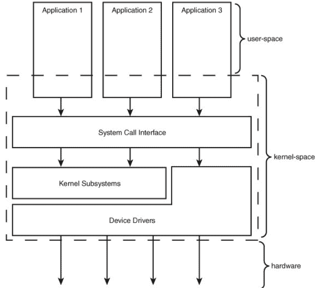

图 1.1 应用程序、内核与硬件之间的关系。

内核也管理系统的硬件。几乎所有的架构（包括`Linux`支持的所有系统）都提供了中断的概念。当硬件想要与系统通信时，它会发出一个中断，异步地中断内核。中断通常与一个数字相关。内核使用该数字来执行特定的中断处理程序，以处理并响应中断。例如，当你打字时，键盘控制器发出一个中断，让系统知道键盘缓冲区中有数据。内核记录下发的中断号并执行正确的中断处理程序。中断处理程序处理键盘数据并告诉设备控制器它已准备好接收数据。为了提供同步，内核可能会处理中断——处理所有中断或仅处理一个特定的中断号。在许多操作系统中，中断处理程序并不运行在进程上下文中。相反，它们运行在不与任何进程相关的特殊上下文中。这种特殊上下文仅仅是为了让中断处理程序快速响应。

这些内容代表了内核活动的范围。事实上，在`Linux`中，我们可以概括为在任何给定时刻内核正在执行以下三件事之一：

- 在内核空间，在进程上下文中，代表特定进程执行

- 在内核空间，在中断上下文中，不与进程相关，处理中断

- 在用户空间，执行用户代码

由于共同的祖先和相同的`API`，现代`Unix`内核共享许多设计特征。除少数例外外，`Unix`内核通常是单体二进制文件；即它们作为一个在单一地址空间运行的大镜像。`Unix`系统通常需要带有分页管理的系统；这种硬件允许系统强制内存保护并为每个进程提供唯一的虚拟地址空间。请参见参考文献中有关于内核设计的喜欢的书籍。


当 Linux 和其他内核开发者贡献 Linux 内核时，他们决定如何推进 Linux 的根源（更重要的是 Unix API）。因此，由于 Linux 不基于任何特定的 Unix，Linux 公司能够为任何特定问题选择最佳解决方案——或者有时发明新的解决方案！以下是 Linux 内核与其他 Unix 变体的区别分析：

- Linux 支持加载内核模块。尽管 Linux 内核是单体的，但它可以根据需要动态加载和卸载内核代码。
- Linux 支持对称多处理（SMP）。虽然许多 Unix 变体现在支持 SMP，但大多数传统的 Unix 实现并不。
- Linux 内核是抢式的。与传统的 Unix 变体不同，Linux 内核在内核中执行运行时可以抢占任务。在其他商业 Unix 实现中，Solaris 和 IRIX 具有抢式内核。
- Linux 对线程支持采取了一种独特的方法：它不区分线程和普通进程。对于内核来说，所有进程都是相同的——某些进程恰好共享资源。
- Linux 忽略了一些被认为实现糟糕的常见 Unix 特性，例如 `STREAMS` 或脑死的标准。
- Linux 在某些意义上是自由的。Linux 实现的功能是 Linux 开放开发模式自由的结果。如果一个功能没有价值或考虑得不周，Linux 开发者没有义务去实现它。

实现。相反，Linux 对更改采取了“精英主义”态度：修改必须解决特定的现实世界问题、具有合理的设计和整洁的实现。与某些其他 Unix 变体（例如可分页内核内存）经常不同，它通常不考虑这些因素。尽管存在任何失败，Linux 仍然是一个具有深厚 Unix 传统的操作系统。

Linux 内核只有两种类型：稳定版（stable）或开发版（development）。稳定内核是生产级发布，适用于广泛部署。发布新内核仅仅是为了提供错误修复或新驱动程序。另一方面，开发内核经历着快速的变化（几乎无无皆有）。当开发者尝试新的解决方案时，内核会发生经常剧烈的变化。

Linux 内核通过简单的命名方案区分稳定内核和开发内核（见图 1.2）。三个由点分隔的数字描述了内核。第一个值是主版本（major release），第二个是次要版本（minor release），第三个是修订版本（revision）。次要版本还决定了内核是稳定内核还是开发内核；偶数表示稳定，奇数表示开发。因此，例如，内核版本 `2.6.0` 表示一个稳定内核。该内核的主版本为二，次要版本为六，修订版本为零。前两个值也描述了“内核系列”——在这种情况下是 `2.6` 内核系列。

这是第一次发布。

主版本为二。


次要版本为五。

这是一个开发内核。

图 1.2 内核版本命名规范。

开发内核有一系列阶段。最初，内核开发者编写新功能，并引发一片混乱。随着时间的推移，内核变得成熟，最终宣布功能冻结（feature freeze）。此时，不能提交任何新功能。然而，对现有功能的工作可以继续。当内核被认为几乎稳定后，将实施代码冻结（code freeze）。当这种情况发生时，只接受错误修复。不久之后（希望如此），内核将作为稳定系列的第一个版本发布。例如，`2.5` 稳定为 `2.6`。

当前的 Linux 源码始终可以在 `http://www.kernel.org` 以完整的 tarball 包和增量补丁的形式获取。

内核通常安装在 `/usr/src/linux`。请注意，你不应该使用此树进行内核开发。内核版本的 C 库是针对链接到此处的库进行编译的。此外，你不需要 `root` 权限就可以对内核-devel 进行修改，可以在你的主目录中工作，仅在安装新内核时使用 `root`。

本书基于 `2.6` 系列内核。

当你开始为 Linux 内核编写代码时，你就成了全球内核开发社区的一部分。该社区的主要论坛是 `linux-kernel` 列表。订阅信息可以在 `https://www.kernel.org` 获取。请注意，这是一个高流量列表，每天有超过 300 条消息，其他读者（包括所有内核开发者，包括 Linux 本）并不乐于处理垃圾信息。然而，在开发过程中，该列表是无价的帮助，因为你可以在那里找到测试者、接受同行评审并提问。

第 17 章概述了内核开发过程，并对如何成功参与内核-development 社区提供了更完整的描述。

## 性质截然不同的猛兽

内核与普通的用户态应用程序相比有几点不同，这些不同虽然并不一定让内核编程比用户态更难，但无疑为内核开发带来了独特的挑战。

这些差异使得内核成为一种性质截然不同的猛兽。一些通常规则被扭曲了；其他规则则是完全全新的。尽管某些差异是显而易见的（我们都知道内核可以做它想做的事），但另一些并不显而易见。这些最重要的差异是：

- 内核无法访问 C 库。
- 内核使用 `GNU C` 编写。
- 内核缺乏用户态那样的内存保护。
- 内核无法轻松使用浮点运算。
- 内核具有固定大小的小栈。
- 由于内核具有异步中断，它是抢占式的，并支持 `SMP`，同步和并发是内核内部关注的问题。
- 可移植性至关重要。

让我们简要查看这些每一个问题，因为内核开发必须记住这些点。

与用户态应用程序不同，内核没有链接标准 C 库（或任何其他库）。这有许多原因，包括一些看似琐碎的理由，但首要原因是大小和速度。完整的 C 库——甚至是它的一个相当不错的子集——对于内核来说都太大且效率太低。

不要担心，因为许多常用的 `libc` 函数已经在内核内部实现。例如，常用的字符串处理函数在 `lib/string.c` 中，你只需在本地包含它们即可。当我谈到头文件——或者本书的其他地方——我指的是内核源码树部分的内核头文件。源文件不能包含输出头文件，因为它们无法使用外部库。

在缺失函数中，最著名的是 `printf()`。内核无法访问 `printf()`，但它可以访问 `printk()`。它将格式化字符串复制到内核日志缓冲区中，该缓冲区通常由 `syslog` 程序读取。用法与 `printf()` 类似：

```
printk("Hello world: A string %s and an integer %d\n", a_string, a_integer);
```

`printf()` 和 `printk()` 之间的一个区别是 `printk()` 允许你指定优先级。此标记被 `syslog` 用来决定在哪里显示消息。这些优先级的示例：

```
printk(KERN_ERR, "this is an error\n");
```

我们在书中到处使用 `printk()`。第 15 章“调试”提供了关于 `printk()` 更多信息。

与任何其他 Unix 内核一样，内核开发者同时使用 `C99` 和 `GNU C` 扩展。这些变化赋予了 Linux 内核，尽管现代编译器（如 `Intel` 编译器）已经充分支持了这些特性。内核使用的 `ISO99` 扩展并不特殊，因为 `C99` 是 C 标准的最新主要版本。`C99` 对之前的版本 `ISO C90` 增加了增强，包括命名结构初始化和复杂类型，这些在许多代码中都有。

`GNU` 支持内联函数。内联函数正如名称所示，插入到每个调用处。这消除了函数调用和返回的开销（保存和恢复），并允许进行更多的优化，因为编译器可以将被调用函数进行优化。作为副作用（天下没有免费的事），代码体积增加了，增加了内存消耗和指令缓存占用。内核开发者对关键函数使用内联函数。反对大型内联函数，特别是那些多次调用或并非每次都调用的函数。

内联函数使用 `static inline` 作为函数定义的一部分来声明。例如：

```
static inline void dog(unsigned long tail_size);
```

必须在任何使用之前声明，否则无法内联。惯做法是将内联函数放在头文件中。由于它们被标记为静态，因此不会创建非内联编译单元。如果一个内联函数只由一个文件使用，也可以放在该文件的顶部。

在内核中，内联函数优于复杂的宏。

`gcc` 编译器允许在通常的 C 函数中嵌入汇编指令。这种功能当然只用于内核中特定于给定系统架构的部分。Linux 内核使用 C 和汇编混合编程，汇编被退置到低级架构和快速路径代码中。

`gcc` 编译器有一个内置指令，可以将条件分支优化为极有可能跳转或极有可能不跳转。编译器使用该指令对分支进行恰当优化。内核将分支封装在非常易用的 `likely()` 和 `unlikely()` 宏中。

例如，考虑这样一个 if 语句：

```
if (foo) {
    /* ... */
}
```

将此分支标记为极低概率（即很可能不执行）：

```
/* we predict foo is zero */
if (unlikely(foo)) {
    /* ... */
}
```

相反，将此分支标记为极高概率：

```
/* we predict foo is nonzero */
if (likely(foo)) {
    /* ... */
}
```


当分支方向在先验情况下非常明确，或者当你想要以牺牲其他情况为代价来优化特定情况时，你应该使用这些指令。这是一个重要点：当分支被正确预测时，这些指令会带来性能提升；当分支预测错误时，会导致性能损失。`unlikely()` 和 `likely()` 的一个常见用法是处理错误条件。

当用户空间尝试非法内存访问时，内核可以捕获该错误并杀死该进程。如果内核尝试非法内存访问，结果将较难控制。在 `oops`（一种严重的内核错误）中，内存违规将是致命的。不言而喻，你不应该访问非法内存、解引用 `NULL` 指针等等，但在内核内部，风险高得多！

此外，内核内存是不可分页的。因此，你消耗的每一字节内存都少了一字节物理内存。下次当你必须为内核添加更多功能时，请记住这一点！

## 无法（轻松）使用浮点数

当用户空间进程使用浮点指令时，内核负责从整数模式到浮点模式的转换。在使用浮点指令并牺牲其他浮点寄存器的代价时，内核需要执行的操作取决于具体的架构。

与用户空间不同，内核并没有无缝支持浮点的奢侈。在内核内部使用浮点数需要手动保存和恢复浮点寄存器，这只是可能的选择之一。简单短的回答是：不要这样做；内核中不要使用浮点数。

## 小型的、固定大小的栈

用户空间可以在栈上静态分配大量变量，包括巨大的结构体和多元素数组。这种行为是因为用户空间拥有可以动态增长大小的大栈。

内核栈既不大也不是动态的；它是小型的且固定大小。在 `32 位` 架构上，内核栈固定为 `8 KB`，在大多数 `64 位` 架构上固定为 `16 KB`。

关于内核栈的更多讨论，请参阅第 10 章“内存管理”中的“在栈上静态分配”章节。

## 同步与并发

内核容易出现竞态条件。与单线程用户空间应用不同，内核的许多属性允许对共享资源的并发访问，因此需要同步来防止竞态。

- 内核支持多处理器。因此，如果没有适当的保护，在两个或多个处理器上执行的内核代码可能会访问同一个资源。
- 中断与当前执行的代码是异步发生的。
- `Linux` 内核是抢占式的。因此，如果没有保护，内核可能会被抢占以供访问相同资源的不同代码执行。

关于同步和并发的深入讨论，请参阅第 7 章“内核同步简介”和第 8 章“内核同步方法”。

## 可移植性很重要

虽然用户空间应用程序并不一定要追求可移植性，但 `Linux` 是一个可移植的操作系统，并且应该保持如此。这意味着与架构无关的 `C` 代码必须在广泛的系统中编译和运行。

少数规则——例如保持字节序中性、`64 位` 纯净、不假设字长或页大小等——就能产生深远影响。第 16 章“可移植性”专门讨论这一主题。

## 构建内核

构建内核非常简单。事实上，它比编译安装其他系统级组件（如 `glibc`）要容易得多。`2.6` 系列内核引入了新的配置和构建系统，这使得工作更加简单，是相对于 `2.4` 版本受欢迎的改进。

在构建内核之前，你必须对其进行配置。由于内核提供了无数功能并支持大量各种硬件，因此有很多内容需要配置。配置选项由带有 `CONFIG` 前缀的符号表示，例如 `CONFIG_PREEMPT`，它表示是否启用内核抢占。配置选项可以是布尔值或三态值。布尔选项是 `yes` 或 `no`。内核特征（如 `CONFIG_PREEMPT`）通常是布尔值。三态选项是 `yes`、`no` 或 `module` 之一。`module` 设置代表该配置选项已设置，并将被编译为模块（即：一个独立的动态加载对象）。驱动程序通常由三态表示。

内核提供了多个工具来方便配置。最简单的工具是一个基于文本的命令行程序：

```
make config
```

该工具逐个遍历每个选项，并要求用户交互式选择 `yes`、`no` 或（对于三态）`module`。因为这需要很长时间，除非你是按头计费，否则你应该使用基于 `ncurses` 的图形化工具：

```
make menuconfig
```

或者，基于 `X11` 的图形化工具：

```
make xconfig
```

这些工具将各种配置选项分为类别，例如“处理器特性”和“网络设备”。你可以遍历这些类别，查看内核选项，当然还可以更改它们的值。

配置选项存储在内核源码树的根目录下，一个名为 `.config` 的文件中。你可能会发现直接编辑这个文件更容易——大多数内核开发者都是这么做的。它非常容易搜索，并且会更改配置选项的值。在修改你的配置文件后，或者在新内核树上使用现有的配置文件后，你可以验证并更新配置：

```
make oldconfig
```

事实上，你应该始终在构建内核之前运行此命令。一旦设置了内核配置，你就可以构建它：

```
make
```

与 `2.6` 之前的内核不同，你不再需要在构建内核之前运行 `make`——依赖树是自动维护的。你也不需要像旧版本中那样指定特定的构建类型（例如 `bzimage`）。默认的 `Makefile` 规则将处理一切！

一个减少噪声但仍能看到警告和错误的小技巧是重定向 `make()` 的输出：

```
make > some_other_file
```

如果你需要查看构建输出，可以读取该文件。但由于已经显示了警告和错误，你通常不需要这样做。

内核构建完成后，你需要安装它。如何安装取决于架构和引导加载器——请参考你的引导加载器说明，将内核镜像拷贝到哪里以及如何将其添加以启动。始终保留一个已知安全的内核，以防你的新内核出现问题！

例如，在 `x86` 使用中，你可能会将 `arch/i86/boot/bzImage` 拷贝到 `/boot` 并编辑 `/etc/grub/grub.conf` 添加新条目。

构建过程会在内核源码树根目录下创建 `System.map` 文件。它包含一个符号查找表，将内核符号映射到它们的起始地址。这在调试期间用于将内存地址转换为函数和变量名。

## 在开始之前

这本书关于 `Linux` 内核：它是如何工作的、为什么这样工作以及你为什么要关注它。它涵盖了内核子系统的设计和实现，以及接口和编程语义。这本书是实用的，并采用了折中方法来解释这一切的工作原理。这种有趣的方法——结合一些个人轶事和内核黑客技巧——应该确保这本书让你快速上手。

我希望你已经访问 `Linux` 系统并拥有内核源码。理想情况下，到目前为止已经是一个 `Linux` 用户，并且一直在钻研源码，但需要帮助将这一切联系起来。

# 进程管理

进程是 `Unix` 操作系统基本抽象之一¹。进程是一个正在执行的程序（存储在某些介质上的对象）。然而，它不仅仅是执行中的程序（在 `Unix` 中通常称为文本）。进程还包含一个包含全局变量的数据段、一组资源（如打开的文件）、一个地址空间以及一个或多个执行线程。

执行线程（通常缩短线程）是进程内的活动对象。每个线程都包含一个唯一的程序计数器、进程栈和一组处理器寄存器。内核调度的是单个线程，而不是进程。在传统的 `Unix` 系统中，每个进程由一个线程组成。但在现代系统中，多线程程序已很常见。正如你稍后将看到的，`Linux` 对线程有独特的实现方式——它不区分线程和进程。

进程提供了两种虚拟化：虚拟进程和虚拟内存。进程给人一种它垄断了系统的错觉，尽管它可能正在与几十个其他进程共享处理器。第 3 章“调度”讨论了这种虚拟化。虚拟内存允许进程分配和管理内存，就像它单独拥有系统中所有的内存一样。虚拟内存在第 10 章“内存管理与存储”中介绍。虚拟进程在第 11 章中介绍。

注意，程序本身并不是进程：进程是一个活跃的程序和相关资源。事实上，可以存在两个或多个执行同一个程序的进程。实际上，两个或多个进程可以共享各种资源，例如打开的文件或地址空间。进程的生命始于令人惊讶的时刻——它被创建。在 `Linux` 中，这是通过 `fork()` 系统调用实现的，它通过复制现有进程来创建一个新进程。调用 `fork()` 的进程是父进程，而新进程是子进程。父进程在调用返回的相同继续执行。通常，在 `fork` 之后，希望执行一个新的、不同的程序。`exec()` 系列函数调用用于创建一个新的地址空间并在其中加载新程序。

> ¹ 另一个基本抽象是文件。
>
> ² 在现代 `Linux` 内核中，`fork()` 实际上通过 `clone()` 系统调用实现，将在后续章节中讨论。

最后，进程通过 `exit()` 系统调用退出。该函数终止进程并释放其资源。父进程可以通过 `wait()` 系统调用查询已终止子进程的状态，该调用允许它等待特定进程的终止。当进程退出时，它会进入特殊的僵尸（`zombie`）状态，用于表示已终止的进程，直到父进程调用 `wait()` 或 `waitpid()`。

进程的另一个名称是任务（`task`）。`Linux` 内核将进程称为任务。在本书中我将交替使用这些术语，尽管我会尝试将运行程序的内核表示标记为任务，将用户空间的表示标记为进程。

## 进程描述符和任务结构

内核在一个环形双向链表“任务列表（`task list`）”中存储进程。任务列表中的每个元素都是 `task_struct` 类型的进程描述符，它定义在 `include/linux/sched.h` 中。进程描述符包含了关于特定进程的所有信息。

`task_struct` 是一个相对较大的结构，在 `32 位` 机器上占用约 `1.7 KiB`。考虑到该结构包含了内核关于进程所需的所有信息，这个尺寸其实很小。进程描述符包含了描述执行程序的数据——打开的文件、进程的地址空间、挂起的信号、进程的状态以及更多（见图 2.1）。

## 分配进程描述符


`task_struct` 通过 `slab` 分配器（slab allocator）分配，以提供对象重用和缓存（见第 10 章“内存管理”）。在 2.6 内核序列之前，`task_struct` 存储在每个进程内核栈的末。这允许寄存器较少的架构（如 x86）通过栈指针计算进程描述符的位置，而无需使用额外的寄存器来存储该位置。随着进程描述符现在通过 `slab` 分配器动态创建，一个新的结构 `thread_info` 被再次创建，并存在于栈的底部（对于向下增长的栈）或栈的顶端（对于向上增长的栈）。见图 2.2。

*   内核实现了 `wait()` 系统调用。Linux 系统通过 C 库通常提供 `wait()`、`waitpid()`、`wait3()` 和 `wait4()` 函数。这些函数返回有关已终止进程的状态，尽管它们的语义略有不同。
*   某些关于设计设计书籍将此称为任务数组（task array）。由于 Linux 的实现是链表而不是静态数组，因此它被称为任务列表（task list）。
*   寄存器不变性架构（Register-invariant architectures）并不是创建 `struct thread_info` 的唯一原因。新结构还使得在汇编代码中计算其值的偏移量变得更容易。

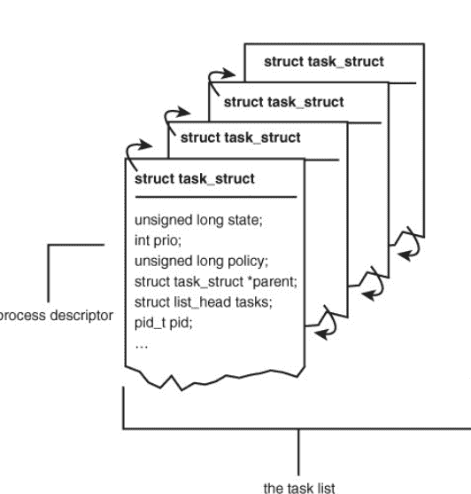

图 2.1 进程描述符和任务列表。

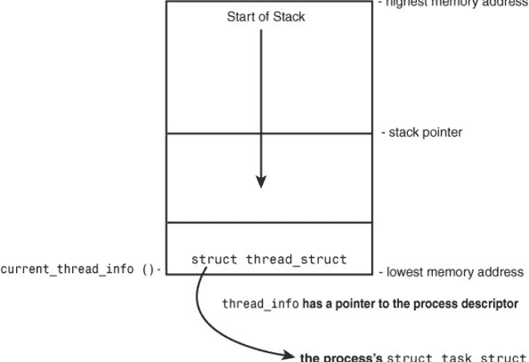

图 2.2 进程描述符和内核栈。

## 存储进程描述符

```
struct thread_info is defined in x86 as <asm/thread_info.h>
struct thread_info {
    struct task_struct *task;
    struct exec_domain *exec_domain;
    unsigned long flags;
    __u32 cpu;
    __segment_t precount;
    u8 addr_limit;
    u8 supervisor_stack[0];
};
```

每个任务的 `thread_info` 位于栈的末尾。结构中的 `task_struct` 是指向任务实际 `task_struct` 的指针。

系统通过唯一的进程标识值或 `PID` 来识别进程。`PID` 是一个由不透明的 `pid_t` 表示的值，它通常是一个 `int`。由于与 Unix 和 Linux 版本的后兼容，默认最大值为 32,767（short int 的值）。内核将此值作为 `pid` 存储在每个进程描述符内部。

这个最大值非常重要，因为它本质上是系统中可能同时存在的进程最大数量。虽然 32,767 对于桌面系统可能足够，但大型服务器需要更多的进程。如果系统希望打破与旧程序的兼容性，管理员可以通过 `/proc/sys/kernel/pid_max` 增加最大值。

在内核内部，任务通常通过指向 `task_struct` 的指针来引用。在大多数处理工作的内核代码中直接与 `task_struct` 操作。因此，能够快速查找当前执行任务的进程描述符是非常有用的，这是通过 `current_thread` 完成的。这个宏必须由每个架构特殊实现。由于进程描述符现在通过 `slab` 分配器动态创建，一个新的结构 `thread_info` 被再次创建，并存在于栈的底部（对于向下增长的栈）或栈的顶端（对于向上增长的栈）。见图 2.2。

*   内核实现了 `wait()` 系统调用。Linux 系统通过 C 库通常提供 `wait()`、`waitpid()`、`wait3()` 和 `wait4()` 函数。这些函数返回有关已终止进程的状态，尽管它们的语义略有不同。
*   某些关于设计设计书籍将此称为任务数组（task array）。由于 Linux 的实现是链表而不是静态数组，因此它被称为任务列表（task list）。
*   寄存器不变性架构并不是创建 `struct thread_info` 的唯一原因。新结构还使得在汇编代码中计算其值的偏移量变得更容易。


图 2.1 进程描述符和任务列表。


图 2.2 进程描述符和内核栈。

在内核内部，任务通常通过指向 `task_struct` 的指针来引用。在大多数处理工作的内核代码中直接与 `task_struct` 操作。因此，能够快速查找当前执行任务的进程描述符是非常有用的，这是通过 `current_thread` 完成的。这个宏必须由每个架构特殊实现。

系统通过唯一的进程标识值或 `PID` 来识别进程。`PID` 是一个由不透明的 `pid_t` 表示的值，它通常是一个 `int`。由于与 Unix 和 Linux 版本的后兼容，默认最大值为 32,767（short int 的值）。内核将此值作为 `pid` 存储在每个进程描述符内部。

这个最大值非常重要，因为它本质上是系统中可能同时存在的进程最大数量。虽然 32,767 对于桌面系统可能足够，但大型服务器需要更多的进程。如果系统希望打破与旧程序的兼容性，管理员可以通过 `/proc/sys/kernel/pid_max` 增加最大值。

## 进程状态

进程描述符的状态描述了进程的当前状况（见图 2.3）。系统的每个进程处于五种状态之一。这种状态由标志位表示：

*   `TASK_RUNNING`——进程是可运行的，它要么正在运行，要么在运行队列上等待（运行队列在第 3 章中讨论）。
*   `TASK_INTERRUPIABLE`——进程处于睡眠（即阻塞）并等待某种条件。当该条件发生时，内核将进程的状态设置为 `TASK_RUNNING`。如果进程接收信号，它也会变为可运行。
*   `TASK_UNINTERTIBLE`——这种状态与 `TASK_INTERRUPIABLE` 相同，但在接收信号时不会唤醒并变为可运行。这用于必须在不受干扰的情况下等待或预期快速发生的情况。在此状态下任务不会对信号响应，`TASK_UNINTERTIBLE`的使用比 `TASK_INTERRUPIABLE` 低。
*   `TASK_ZOMBIE`——任务已终止，但父进程尚未调用 `wait()` 系统调用。任务的进程描述符必须保留以备父进程访问。如果父进程调用 `wait()`，进程描述符将被释放。


- **`TASK_STOPPED`**——进程执行已停止；任务没有运行，也没有资格运行。当任务接收`SIGSTOP`、`SIGTSTP`、`SIGTTIB`或`SIGTTO`信号，或者在调试期间接收任何信号时，就会发生这种情况。

> 这就是为什么你畏惧`ps(1)`中状态为`D`的不可杀进程。因为任务不会对信号响应，你无法向它发送`SIGTERM`信号。此外，即使你可以终止该任务，由于任务据认为处于某些重要操作中间，这样做是不明智的，因为任务可能持有某个信号量。

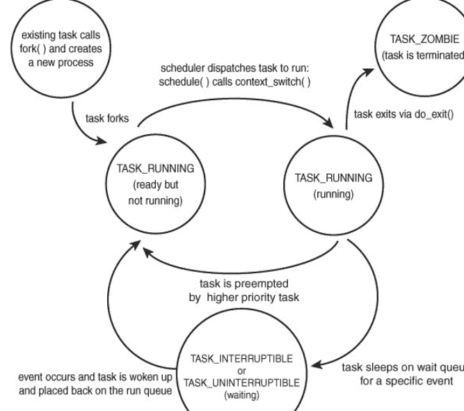

图 2.3 进程状态流程图。

## 操作当前进程状态

内核代码经常需要更改进程的状态。首选的机制是使用`set_task_state(task)`。

`set_current_state(state)`方法与`set_task_state(current, state)`同义。

## 进程上下文

进程最重要的部分之一是正在执行的程序代码。这些代码从可执行文件中读取，并在程序的地址空间内执行。普通程序执行发生在用户空间。当一个程序执行系统调用时（见第 4 章“系统调用”）或触发异常时，它会进入内核空间。此时，内核被认为正在“代表进程执行”，并处于进程上下文中。在进程上下文中，`current`宏是有效的；内核会在用户空间中恢复执行，除非有一个更高优先的进程变为可运行状态，在这种情况下，将调用调度器来选择更高优先的进程。

系统调用和中断是进入内核的定义良好的接口。进程只能通过这些接口之一在内核空间开始执行——对内核的所有访问都是通过这些接口完成的。

Linux 存在一个独特的层次结构。所有进程都是`init`进程的后代。内核在启动过程的最后一步启动`init`。`init`进程运行，开启自己的中断并执行更多程序，从而完成启动过程。

每个进程都有自己的上下文。同样，每个进程都可以有一个或多个子进程。进程都是同一个父进程的直接子，被称为兄弟进程。进程描述符有一个指向进程的`task_struct`的指针，命名为`parent`，以及一个子进程列表，命名为`children`。因此，给定当前进程，可以通过以下代码获取其父进程的进程描述符：

```c
struct task_struct *task = current->parent;
```

同样可以遍历进程的子进程：

```c
struct task_struct *task;
struct list_head *list;

for_each_list(list, &current->children) {
	/* task = list_entry(list, task_struct, sibling);
	/* task 现在指向 current 的一个子进程 */
}
```

`init`的任务进程描述符被静态分配为`init_task`。这是一个所有进程之间关系的良好示例，这段代码始终会成功：

```c
struct task_struct *task;
for (task = current; task != &init_task; task = task->parent) {
	/* task 现在指向 init */
}
```

事实上，你可以从系统中的任何一个进程按照层次结构找到任何其他进程。然而，通常情况下，遍历系统中的所有进程是更简单的。这是因为任务链是一个循环双向链表。

- 除了进程上下文外，还有中断上下文，我们在第 5 章中讨论。在中断上下文中，内核并不是代表某个进程运行，而是正在执行中断处理程序。没有进程尝试执行中断处理程序，因此没有进程上下文。

给定任何有效任务，获取列表中的下一个任务：

```c
list_entry(tasks->next, struct task_struct, tasks)
```

获取上一个任务的方法的方法也一样：

```c
list_entry(tasks->prev, struct task_struct, tasks)
```

这些程序通过宏`next_task(task)`和`prev_task(task)`获取。最后，提供了`for_each_process(task)`宏，它遍历任务列表。每次迭代都指向列表中的下一个任务：

```c
struct task_struct *task;
for_each_process(task) {
	/* 打印每个任务的名称和 PID */
	printf("%s:%d\n", task->name, task->pid);
}
```

注意，在具有许多进程的系统中遍历每个任务可能是昂销的；在这样做之前，代码应该有充分的理由（且没有替代方案）。

## 进程创建

Unix 中的进程创建是一种在新的地址空间中创建新进程、读入可执行文件并开始执行的独特机制。它采用了一种不寻常的方法，将这些步骤分为两个不同的函数：`fork()`和`exec()`。`fork()`创建一个当前任务的副本子进程。它与父进程的区别仅在于 PID（它是唯一的）、它的 PID（父进程的 PID，设置为原始进程）以及某些资源和状态，例如挂起信号，这些是不会继承的。第二个函数`exec()`将新的可执行文件加载到地址空间并开始执行。`fork()`后接`exec()`的组合类似于大多数操作系统提供的单个函数。

## 写时拷贝 (Copy-on-Write)

传统上，父进程使用的所有资源都会复制，并将拷贝交给子进程。这种方法是非常原始且低效的。在 Linux 中，`fork()`使用写时拷贝实现。写时拷贝（COW）是一种延迟或完全不拷贝数据的技术。它不是复制进程地址空间，子进程可以共享同一个副本。

> 9 我所说的`exec()`指的是`exec()`族函数。内核实现了`execve()`系统调用，在此基础上实现了`execclp()`、`execle()`、`execv()`和`execvp()`。

然而，数据被标记为这样：如果对其进行写入，就会创建一个副本，每个进程执行一个唯一的副本。因此，资源的复制只在它们被写入时发生；在此之前，它们是只读的。这种技术延迟了地址空间中每个页的的复制，直到它实际上被写入。如果页面从未被写入——例如，如果在`fork()`之后立即调用`exec()`——它们就不需要被复制。`fork()`是父进程页表的复制以及为子进程创建新进程描述符。这防止了在进程在`fork`后立即执行新的可执行镜像的常见情况下浪费大量数据拷贝（地址空间轻松达到数十兆字节）。这是一个重要的优化，因为 Linux 鼓励快速的进程执行。

## Fork

Linux 通过`clone()`系统调用实现`fork()`。该调用接受一系列标志，用于指定父进程和子进程是否应该共享区域（有关标志的更多信息请见本章“线程的实现”）。`fork()`、`vfork()`和`clone()`库调用带有所需的标志调用`clone()`。`clone()`系统调用转而调用`do_fork()`。

分派工作由`do_fork()`处理，它定义在`kernel/fork.c`中。该函数调用`copy_process()`，然后启动进程运行。有趣的工作由`copy_process()`完成。

- 调用`task_struct()`，为新进程创建一个新的内核栈、`thread_info`结构和`task_struct`。在`copy_process()`中，如果父进程和子进程应该共享，则由标志位决定。

- 检查新进程是否不会超过进程描述符数量的限制。

- 接下来，将子进程状态设置为`TASK_INTERRUPIBLE`，以确保它不会运行。

- 调用`copy_flags()`更新`task_struct`。表示用户权限的`PF_SUPERPRIV`标志被清除。表示进程未调用`exec()`的`PF_FORKNOEXEC`标志被设置。

- 根据传递给`clone()`的标志，复制或共享打开的文件、系统信息、信号处理程序、命名空间。

- `get_pid()`为新任务分配一个可用 PID。

- 这些资源通常在线程之间共享；否则它们是唯一的且被复制的。

- 父进程和子进程之间的剩余时间片（见第 3 章“调度”）。

在`do_fork()`中，`copy_process()`成功返回，新进程被唤醒并返回。在子进程共享父进程地址空间的常见情况下，直到子进程执行`exec()`或退出。子进程不允许写入地址空间消除了父进程开始写入地址空间时产生的任何写时拷贝开销。

## vfork()


`vfork()` 系统调用与 `fork()` 的效果相同，但没有创建父进程的页表。相反，子进程共享父进程的地址空间，直到子进程执行 `exec()` 或退出。子进程不允许写入地址空间，这是旧时代（BSD 3.0）当 `fork()` 尚未使用写时拷贝时调用 `exec()` 时的优化。在写时拷贝和子进程优先语义的情况下，`vfork()` 相比拷贝页表的唯一优势是速度。如果 Linux 以后有了写时拷贝页项，`vfork()` 将没有优势¹¹由于 `vfork()` 的语义非常复杂，例如，如果 `exec()` 失败，它需要像普通的 `fork()` 一样——事实上，这是 Linux 直到 2.2 的做法。

`vfork()` 系统调用通过 `clone()` 的特殊标志实现：

- 在 `do_fork()` 中，如果给了特殊标志，`vfork_done` 指向特定地址。
- 在子进程首次运行后，父进程不再返回，而是通过 `vfork_done` 指针等待子进程信号。
- 在 `mm_release()`（任务退出内存空间时函数）中，如果 `vfork_done` 不为空，则向父进程信号。
- 回到 `do_fork()`，父进程向上并返回。

¹⁰ 实际上，这目前的功能并不正确，尽管其目的是让子进程优先运行。

¹¹ 事实上，目前有补丁将其添加到 Linux 中。虽然我们最可能不在 2.6 中看到共享页表，但这种功能可能会出现在 2.7 中。

## 线程的实现

线程是一种流行的现代编程抽象。它们在共享的内存地址空间内为同一个程序提供多个执行线程流。它们可以共享打开的文件和其他资源。线程允许并发编程，在多处理器上可以实现真正的并行。

Linux 对线程有种独特的实现方式。对于 Linux 内核来说，并没有线程的概念。Linux 将所有线程都实现为标准进程。内核没有用于表示线程的特殊调度语义或数据结构。相反，线程仅仅是一个共享资源的进程。每个线程都有一个唯一的 `task_struct`，并且在内核中表现为一个普通的进程（该进程与其他进程共享资源，例如地址空间）。

这种方法与 Microsoft Windows 或 San Solaris 等操作系统形成了鲜明对比，后这些系统对线程有显式的线程支持；“轻量级进程（lightweight process）”这一术语总结了 Linux 与其他系统之间的哲学差异。对于这些其他系统来说，线程是一个独立的实体，而 Linux 提供了一种在进程之间共享资源的方法（这些进程已经相当轻量级了）¹²。例如，假设我们有一个由四个线程组成的进程。在具有显式线程支持的系统中，可能存在一个指向四个不同线程（如地址空间或打开的文件）的进程。线程随后描述它们所拥有的资源。相反，在 Linux 中，简单的四个进程和四个普通的 `task_struct` 结构。这四个进程是为了共享某些资源。

线程的创建就像普通任务一样，通过 `clone()` 系统调用创建，并传递对应于要共享特定资源的标志位：

```c
clone(CLONE_VM | CLONE_FILES | CLONE_SIGCHLD, 0);
```

上述代码产生的行为与普通的 `fork()` 相同，但地址空间、文件系统资源、文件描述符和已安装的信号处理程序是共享的。

相比之下，`fork()` 可以实现为：

```
clone(SIGCHLD, 0);
```

而 `vfork()` 可以实现为：

```
clone(CLONE_FORK | CLONE_VM | SIGCHLD, 0);
```

传递给 `clone()` 的标志位有助于指定新进程的行为以及父子进程将共享哪些资源。表 2.1 列出了这些标志位及其影响。

¹² 例如，基准 Linux 中的进程创建时间与这些其他操作系统中进程（甚至是线程！）创建时间的对比。结果非常理想。

### 表 2.1 `clone()` 标志

| 标志 | 含义 |
| --- | --- |
| `CLONE_CLEARTID` | 清除 `TID` |
| `CLONE_DETACHED` | 父进程在退出时不想接收 `SIGCHLD` 信号 |
| `CLONE_FILES` | 父子进程共享文件 |
| `CLONE_FS` | 父子进程共享文件系统信息 |
| `CLONE_IDLETASK` | 将 `PID` 置为零（仅空闲任务使用） |
| `CLONE_NEWNS` | 为子进程创建一个新的命名空间 |
| `CLONE_PARENT` | 子进程拥有与其父进程相同的父进程 |
| `CLONE_PTRACE` | 继续回溯跟踪 |
| `CLONE_SETTID` | 将 `TID` 写回用户空间 |
| `CLONE_SETTLS` | 为子进程创建一个新的 `TLS` |
| `CLONE_SIGHAND` | 父子进程共享信号处理程序 |
| `CLONE_SYSSEM` | 父子进程共享 `VSEM` 语义 |
| `CLONE_THREAD` | 父子进程处于同一个线程组中 |
| `CLONE_VFORK` | 使用了 `vfork(4)`，且父进程将睡眠直到子进程唤醒它 |
| `CLONE_VM` | 父子进程共享地址空间 |

## 内核线程

内核在后台执行某些操作是有用的。内核通过内核线程来实现这一点——内核线程是仅存在于内核的标准的标准。内核线程与普通进程的主要区别在于内核线程没有地址空间（实际上，它们的 `mm` 指针为 NULL）。它们只在内核空间运行，不会切换到用户空间。然而，内核线程像普通进程一样是可以调度和被抢占的。

Linux 将若干任务委托给内核线程，最著名的 `pdflush` 和 `kswapd` 任务。这些线程在系统启动时由内核线程创建。内核线程只能由另一个内核线程创建。从任何现有线程创建新线程的接口如下：

```c
int kernel_thread(void (*fn)(), void *arg, unsigned long flags)
```

新任务通过带有指定 `flags` 参数的 `clone()` 系统调用创建。返回时，父内核线程退出并返回指向子进程 `task_struct` 的指针。子进程使用给定的参数 `arg` 执行由 `fn` 指定函数。一个特殊的 `clone` 标志 `CLONE_KERNEL` 指定了内核线程的常用标志：`CLONE_FS`、`CLONE_FILES`、`CLONE_SIGHAND`。大多数内核线程将这些作为它们的标志参数。

通常情况下，内核线程会永远执行其初始函数（或者至少直到系统重启，但在 Linux 中你永远不知道）。初始函数通常在内核中实现一个循环，根据需要唤醒，执行职责，然后返回睡眠。

我们将在后面的章节中详细讨论特定的内核线程。

## 进程终止

虽然遗憾，但每个进程都必须终止。当进程终止时，内核必须释放该进程拥有的资源，并通知其父进程其不幸的死亡。

通常，进程销毁发生在进程调用 `exit()` 系统调用时，可能是显式地在准备终止时调用，也可以是在任何进程的主子程序返回时隐式地调用（即 C 编译器会在 `main()` 返回后放置对 `exit()` 的调用）。进程也可以非自愿地终止。这发生在进程接收到它无法处理或忽略的信号或异常时。无论进程如何终止，大部分工作由 `do_exit()` 处理，它完成了多项任务：

- 设置 `flags` 中的 `PF_EXIT` 标志。
- 如果启用了 BSD 统计，调用 `act_process()`。
- 调用 `exit_mm()` 释放该进程持有的 `mm_struct`。如果没有其他进程在使用它，则将其释放。
- 分别调用 `exit_files()`、`exit_fs()`、`exit_namespace()` 和 `exit_sigand()` 来减少文件描述符、文件系统数据、命名空间和信号处理程序的使用计数。
- 将存储在 `task_struct` 中的退出代码设置为强制终止的代码。
- 调用 `exit_notify()` 向父进程发送信号。
- 最后，调用 `schedule()`。由于僵尸任务永远不会被调度，这是任务最后执行的代码。

`do_exit()` 的代码定义在 `kernel/exit.c` 中。

### 移除进程描述符

`do_exit()` 完成后，进程描述符仍然存在，但进程无法运行。由于这允许父进程获取其子进程的信息，清理进程和移除描述符的操作是分开的。在父进程获取信息后，`task_struct` 将被释放。

`wait()` 系列函数通过单一的（复杂的）系统调用 `wait()` 实现。标准行为是挂起调用任务的执行，直到其中一个子进程退出，此时函数返回子进程的 `PID`。此外，还会提供一个指针在返回时持有退出代码。

当需要停止进程描述符时，调用 `release_task()`。它执行以下操作：

- 调用 `free_id()` 减少进程用户的使用计数。Linux 为每个用户维护有关打开进程和文件数量的缓存。计数归零，说明该用户没有打开的进程或文件，缓存将被毁。
- 调用 `unhash_process()` 从 `PID` 哈希表中移除该进程，并从 `ptrace` 列表中移除。
- 调用 `task_private()` 向原始父进程汇报并从任务列表中移除进程。


- 最后，调用`put_task_struct()`释放包含内核栈和`thread_info`结构的页，并释放包含`task_struct`的slab缓存。

此时，进程描述符和属于该进程的所有资源已释放。

## 无父任务的困境

如果父进程在子进程之前退出，必须存在某种机制将子任务移交给新进程或父进程，否则无父的终止进程将永远作为僵尸进程存在，浪费系统内存。之前暗示过的解决方案是在退出时将任务的孩子移交给当前线程组中的另一个进程，如果失败，则移交给`init`进程。

```
struct task_struct *vp, reaper = father;
struct list_head *list;

if (father->exit_signal != -1)
    reaper = prev_thread(reaper);
else
    reaper = child_reaper;

if (reaper == father)
    reaper = child_reaper;
```

这段代码将`reaper`设置为进程线程组中的另一个任务。如果线程组中没有其他任务，它会将`reaper`设置为`child_reaper`，即`init`进程。当发现一个新的子进程时，每个子进程都需要找到并重新挂父给`reaper`：

```
list_for_list(list, &father->children) {
    p = list_entry(list, task_struct, sibling);
    reparent_thread(p, child_reaper);
}
```

```
list_each_list(list, &father->ptrace_children) {
    p = list_entry(list, task_struct, ptrace_list);
    reparent_thread(p, child_reaper);
}
```

这段代码遍历两个列表：子进程列表和被跟踪子进程列表，并对每个子进程进行重新挂父。拥有这两个列表的原理非常有趣：它是 2.6 内核的一个新特性。当一个任务被跟踪（`ptraced`）时，它会被临时重新挂父给调试进程。然而，当该任务的父进程退出时，它必须与它的兄弟进程一起重新挂父。在之前的内核中，这导致需要遍历系统中的每个进程来寻找子进程。如之前提到的，解决方案是简单地为进程正在被跟踪的子进程维护一个单独的列表——将对子进程的搜索从每个进程减少到仅两个相对较小的列表。

当进程成功重新挂父后，就不存在孤立僵尸进程的风险。`init`进程会定期对其儿子调用`wait()`，清理分配给它的任何僵尸进程。

# 调度

调度器是内核中负责选择下一个运行进程的组件。调度器（或有时称为`scheduler`）可以被看作在系统中可运行进程之间分配有限 CPU 时间资源的代码。调度器是 `Linux`等多任务操作系统的基础。通过决定哪些进程可以运行，调度器负责最优化地利用系统，并给出多个进程同时执行的体验。

调度器背后的想法非常简单。为了最有效地利用处理器时间，假设有可运行的进程，一个进程应该始终在运行。如果系统中的进程多于处理器，那么某些进程将不会一直运行。这些进程正在等待运行。在给定一组可运行进程的情况下，决定下一个运行哪个进程是调度器必须做的一项根本性决策。

多任务操作系统有两种类型：协作式多任务和抢占式多任务。在抢占式多任务中，调度器决定进程何时运行以及何时运行新进程。进程在被抢占之前的运行时间是预先确定的，被称为时间片（`timeslice`）。实际上，每个进程都获得 CPU 时间的一个切片。管理计时器使得调度器能够为系统做出全局调度决策。它防止了任何进程垄用系统。正如我们将看到的，这在 `Linux`调度器中是动态计算的，以提供一些有趣的益处。

相反，在协作式多任务中，进程在自愿决定停止之前不会停止运行。进程自愿挂起的行为被称为让让（`yielding`）。这种方法的缺点有很多：调度器无法就进程运行多长时间做出全局决策，进程可能会长时间垄用处理器，而一个永远不让出的挂起进程可能会导致整个系统的崩溃。坦率地说，过去十年中设计的大多数操作系统都提供了抢占式多任务，`Mac Os 9`及更早版本是最显著的例外。当然，`Unix`从初开始就支持抢占式多任务了。

在 2.5 内核系列期间，`Linux`内核调度器进行了重构。一种新的调度器通常根据其算法行为被称为 `O(1)`调度器，它解决了以前 `Linux`调度器的复杂性，并引入了新的特性和性能特征。在本节中，我们将讨论调度器设计的原理，以及它们如何应用于`O(1)`调度器及其目标、设计、实现以及相关的系统调用。

## 策略

策略（`Policy`）是调度器决定何时运行什么进程的行为。调度器的策略通常决定了系统的整体感受，并负责优化利用处理器时间。因此，它是非常重要的。

# I/O 密集型与 CPU 密集型进程

进程可以分为 I/O 密集型或 CPU 密集型。前者的特征是进程花费大量时间在提交和等待 I/O 请求上。因此，此类进程是可运行的，但持续时间很短，因为它们最终会因等待更多 I/O 而阻塞（这是指任何类型的 I/O，例如键盘活动，而不仅仅是 I/O）。相反，CPU 密集型进程花费大部分的执行时间。它们倾向于一直运行，直到被 I/O 请求频繁抢占。因此，调度器策略并不是规定调度器频繁运行它们，而是让它们在较长时间内频繁地运行。当然，这些分类并不是互斥的。`Unix`的调度策略倾向于显式地优于 I/O 密集型进程。

系统的调度策略必须尝试满足两个冲突的目标：快速进程响应时间（低延迟）和高进程吞吐量。为了满足这些要求，调度器通常采用复杂的算法来确定最值得运行的进程，同时不损害对其他低优先级响应进程的公平性。优化响应时间（低延迟）、优于交互式进程的通常是 I/O 密集型的。`Unix`的调度策略倾向于显式地优于 I/O 密集型进程。

## 进程优先级

一种常见的调度类型是基于优先级的。想法是根据价值对进程进行排序。`Linux`内核实现了两个优先级范围。第一个是`nice`值，范围从 -20 到 19，默认值为 0。较大的`nice`值对应较低的优先级——你对系统的其他进程更“nice”。`nice`值也有助于决定进程获得的时间片。`nice`为 -20 的进程获得最大时间片，而`nice`为 19 的进程获得最小时间片。`nice`值是所有系统使用的标准优先级。第二个范围是实时优先级，稍后讨论。默认情况下，它的范围从 0 到 99。所有实时进程的优先级都高于普通进程。

## 时间片 (Timescale)

`times`是一个数值，表示任务在被抢占之前可以运行多长时间。调度器必须规定时间片，这并不简单。时间片过长会导致系统交互性能变差；系统不再感觉应用程序正在并发执行。时间片过短会导致在进程切换开销上浪费大量时间，因为很大比例的时间将花费在不同时间片之间的切换。此外，I/O 密集型与 CPU 密集型进程冲突的目标再次出现：I/O 密集型进程不需要长时间片，而 CPU 密集型进程则渴望长时间片（例如为了保持缓存热度）。

根据这个论点，似乎任何时间片都会导致糟糕的交互性能。在许多操作系统中，这一观察被高度重视，因此默认时间片很短——例如 20ms。然而，`Linux`利用了最高优先级进程始终运行的特点。`Linux`调度器增加了

+ `Timescale`在其他系统中有时被称为`quantum`或`processor slice`。`Linux`称之为`timescale`。

交互式任务具有优先级，使其能够运行得更频繁。因此，`Linux`调度器提供了一个相对较大的时间片（见表 3.1）。此外，`Linux`调度器根据优先级动态地确定进程的时间片。这使得高优先级（可以说更重要）的进程能够运行得更长、更频繁。实现动态时间片和优先级提供了稳健的调度性能。

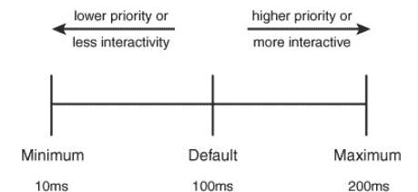

图 3.1 进程时间片计算

注意，进程并不需要一次性使用所有时间片。例如，一个拥有 100 毫秒时间片的进程并不一定要在一次内运行 100 毫秒，否则可能会丢失剩余的时间片。相反，该进程可以在五个不同的调度周期中运行，每次运行 20 毫秒。因此，较长的时间片有利于交互式任务——虽然它们不需要一次性使用大量时间片，但能确保它们尽可能长时间地保持可运行状态。

当一个进程的时间片用尽时，该进程被认为已过期。没有时间片的进程在所有其他进程耗尽其时间片（即它们的所有剩余时间片均为零）之前，不具备运行的资格。在该时刻，所有进程的时间片将被重新计算。`Linux`调度器采用了一种有趣的算法来处理时间片的耗尽，该算法将在后面的章节中讨论。

## 进程抢占

如前所述，`Linux`操作系统是抢占式的。当一个进程进入`TASK RUNNING`（运行）状态时，内核会检查其优先级是否高于当前执行进程的优先级。如果是，则会调用调度器选择一个新进程运行（推测是刚刚变为可运行的进程）。此外，当进程的时间片达到零时，它会被抢占，并调用调度器选择一个新进程。

# 调度策略的运行

考虑一个有两个可运行任务的系统：一个文本编辑器和一个视频编码器。文本编辑器是 I/O 密集型的，因为它花费了几乎所有时间等待用户按键（无）

## 调度算法


Linux 调度器定义在 `kernel/sched.c` 中。调度算法和支持代码在 2.5 内核开发系列的早期经历过大规模重写。调度器代码完全是全新的，与之前的调度器不同。新的调度器设计用于实现特定目标。

- 实现完全的 O(1) 调度。新调度器中的每个算法无论运行进程的数量或任何其他输入如何，都能在常数时间内完成。
- 实现完美的 SMP 可扩展性。每个处理器都有自己的锁和单独的运行队列（`runqueue`）。
- 实现改进的公平性。自然地尝试将任务分组到特定的 CPU 并在那里继续运行。只有在解决运行队列不平衡时，才将任务从一个 CPU 迁移到另一个。
- 提供良好的交互性能。即使在系统负载很大时，调度器也立即响应并调度交互式任务。
- 提供公平性。任何进程在合理时间内发现自己缺少时间片。同样，任何进程都不应该获得不公平的高时间片。
- 针对 1-2 个可运行进程的常见情况进行优化，同时良好地扩展到具有许多进程的多个处理器。

新的调度器实现了这些目标。

## 运行队列 (Runqueues)

调度器的基本数据结构是运行队列。运行队列在 `kernel/sched.c` 中定义为 `struct runqueue`。运行队列是每个处理器上可运行进程的列表；每个处理器有一个运行队列。每个可运行进程恰好位于一个运行队列上。运行队列还包含每个处理器的调度信息。因此，运行队列是每个处理器的主要数据结构。`kernel/sched.c` 不包含 `<linux/sched.h>`，因为它设计用于抽象调度器代码并仅向内核的其他部分提供接口。

让我们看看结构，注释描述了每个部分：

```c
struct runqueue {
	spinlock_t lock;               /* 自旋锁保护此
		runqueue */
	unsigned long nr_running;          /* 可运行任务的数量 */
	unsigned long nr_switches;         /* 上文切换的次数 */
	unsigned long nr_timestamp;         /* 自上次激活以来的时间 */
	unsigned long nr_uninterruptible;  /* 处于
		不可中断睡眠的任务数量 */
	struct task_struct *curr;           /* 此处理器当前
		正在运行的任务 */
	struct task_struct *idle;           /* 空闲任务 */
	struct task_struct *prev_mm;        /* 上一个运行
		任务的 mm_struct */
	struct prio_array *active;         /* 指向活动优先级
		数组的指针 */
	struct prio_array *expired;         /* 指向已过期
		数组的指针 */
	struct prio_array *arrays[2];      /* 实际的优先级
		数组 */
	int migration_thread;             /* 每个处理器的负载
		/* 此处理器上的
		迁移线程 */
	struct list_head migration_queues; /* 此处理器的
		迁移队列 */
	atomic_t nr_iwait;                 /* 等待 I/O
		队列的任务数量 */
}
```

由于运行队列是调度器的核心数据结构，因此一组宏用于获取特定的运行队列。`cpu_rq(processor)` 宏返回与给定处理器相关的运行队列指针。同样，`this_rq(task)` 宏返回当前处理器的运行队列。最后，`task_rq(task)` 宏返回给定任务排队所在的运行队列指针。

在操作运行队列之前，必须对其进行锁定（深度锁机制请见第 7 章“内核同步简介”）。由于每个运行队列对于当前处理器都是唯一的，处理器想要锁定另一个处理器的运行队列的情况非常罕见（这会发生）。当锁持有者读取或写入运行队列成员时，锁定运行队列会阻止任何更改。最常用的锁定方法是你想锁定特定的运行队列。在这种情况下，使用了 `task_rq_lock()` 和 `task_rq_unlock()` 函数：

```c
struct runqueue *rq;
unsigned long flags;

rq = task_rq_lock(task, &flags);
/* 操作运行队列 */
task_rq_unlock(rq, flags);
```

另一种，`this_rq_lock()` 方法锁定当前运行队列，`unlock(struct runqueue *rq)` 释放运行队列。为了避免死锁，想要锁定多个运行队列的代码始终按顺序获取锁（再次参见第 7 章）。示例：

```c
/* 锁定 ... */
if (rq1 < rq2) {
    spin_lock(&rq1->lock);
    spin_lock(&rq2->lock);
} else {
    spin_lock(&rq2->lock);
    spin_lock(&rq1->lock);
}

/* 操作两个运行队列 ... */
/* 解锁 ... */
spin_unlock(&rq1->lock);
spin_unlock(&rq2->lock);
```

这些步骤通过 `double_rq_lock()` 和 `double_rq_unlock()` 函数自动完成。上述步骤将变为：

```c
double_rq_lock(rq1, rq2);
/* 操作两个运行队列 ... */
double_rq_unlock(rq1, rq2);
```

让我们快速看一下获取锁的顺序是相同的。死锁主题在第 7 和第 8 章中讨论，因为这不是运行队列特有的问题。嵌套锁总是需要这样。自旋锁用于同时操作多个运行队列。它们的工作方式类似于键到锁。自旋锁用于同时操作多个运行队列。它们的工作方式类似于键到锁。自旋锁用于同时操作多个运行队列。它们的工作方式类似于键到锁……（此处省略重复性文本）……这些步骤通过 `double_rq_lock()` 和 `double_rq_unlock()` 函数自动完成。上述步骤将变为：

```c
double_rq_lock(rq1, rq2);
/* 操作两个运行队列 ... */
double_rq_unlock(rq1, rq2);
```

优先级数组还包含一个计数器 `nr_active`。这是该优先级数组中可运行任务的数量。

## 重新计算时间片

许多操作系统（包括旧版本的 Linux）在每个任务的时间片都达到零时，拥有一种显式的方法来重新计算每个任务的时间片。通常，这通过对每个任务进行循环来实现，如下所示：

```c
for (each task on the system) {
    recalculate_priority
    recalculate_timeslice
}
```

任务的优先级和其他属性被用于确定新的时间片。这种方法存在一些问题：

- 它可能花费很长时间。更糟糕的是，对于系统上的 $n$ 个任务，它的复杂度是 $O(n)$。
- 随机发生的时间片重新计算具有不确定性，对于确定性实时程序来说是一个问题。
- 这非常糟糕（这正是改进 Linux 内核某些部分的正当理由）。

新的 Linux 调度器缓解了重新计算的循环。相反，它为每个处理器维护了两个数组：一个活动数组（`active` array）和一个过期数组（`expired` array）。活动数组包含关联运行队列中的所有任务，当每个任务的时间片达到零时，其时间片会在移动到过期数组之前被重新计算。重新计算所有已耗尽的时间片需要交换活动数组和过期数组。由于数组仅通过指针访问，因此切换它们的速度与交换指针一样快。这在调度器中执行：

```c
struct prio_array *array = rq_active;
if (!array->nr_active) {
    rq->active = expired;
    rq->expired = array;
}
```

这种交换是新的 O(1) 调度器的关键特性。O(1) 调度器不再总是重新计算每个进程的优先级和时间片，而是执行一个简单的两步数组交换。这解决了之前讨论的问题。

## `schedule()`

选择下一个要运行的任务并切换到该任务的操作通过 `schedule()` 函数实现。该函数由想要睡眠的内核代码显式调用，并且当任务需要被抢占时被触发。

对于大多数情况来说，`schedule()` 函数相对简单。以下代码确定了优先级最高的任务：


```c
struct task_struct *prev, *next;
struct list_head *queue;
struct prio_array *array;
int idx;

prev = current;
array = rg->active;
idx = find_first_bit(array->bitmap) + idx;
queue = array->queue->task_struct->run_list;
next = list_entry(queue->next, struct task_struct, run_list);
```

首先，搜索活动优先级数组以找到第一个置位（set bit）。这对应于可运行的优先级最高的任务。接下来，调度器选择该优先级列表中第一个任务。这是系统中优先级最高的可运行任务，也是调度器将要运行的任务。参见图 3.2。

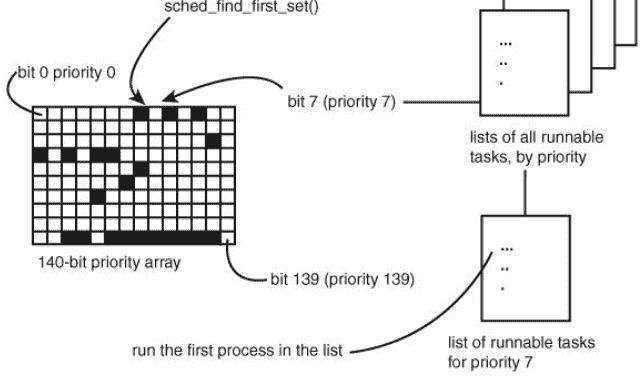

> 图 3.2 Linux O(1) 调度器算法。

如果 `prev` 不等于 `next`，则选择了一个新任务来运行。调用特定体系函数 `context_switch()` 来从 `prev` 切换到 `next`。我们将在后续章节中讨论上下文切换。

从上述代码中应该注意两个重要的点。第一，它非常简单且快速。第二，系统上的进程数量对这段新代码的执行时间没有影响。它没有遍历任何列表来寻找最合适的进程。事实上，它影响了 `schedule()` 代码运行的时间。它的执行时间是常数。

## 计算优先级和时及时性

在任务开始，我们查看了优先级和时及时性如何影响调度器的决策。此外，我们还研究了 I/O 密集型和处理器 密集型任务，以及为什么提高交互式任务的优先级是有益的。现在，让我们来看看实现这一想法的代码。

进程有一个初始优先级，称为 `nice` 值。该值的范围从 -20 到 19，默认值为 0。19 是用户指定的最低优先级，-20 是最高优先级。相反，调度器根据存储在 `prio` 中的动态优先级来做出决策。动态优先级计算为静态优先级和任务交互性的函数。

`priority()` 方法返回任务的动态优先级。该方法从任务的 `nice` 值开始，并在范围内计算奖金或惩罚。动态优先级计算为静态优先级和任务交互性的函数。

`priority()` 方法返回任务的动态优先级。该方法从任务的 `nice` 值开始，并在范围内计算奖金或惩罚。动态优先级计算为静态优先级和任务交互性的函数。

... (为了简洁，根据提供的文本流已省略)

```
struct task *task = current;
struct runqueue *rq = this;

if (!--task->time_slice) {
    if (TASK_INTERACTIVE(task))
        enqueue_task(task, rq->expired);
    else
        enqueue_task(task, rq->active);
}
```

首先，代码递减了进程的 `time_slice` 并检查它是否为零。如果是，则任务将要插入到活跃数组，因此代码通过 `TASK_INTERACTIVE` 宏检查其是否具有交互性，并根据其 `nice` 值判断任务是否“足够交互”。`nice` 值越低，需要的交互性就越高。一个 `nice` 值很高的任务永远不会足够交互，但一个 `nice` 为 -20 的任务需要是一个重量处理器才不会被重新插入。在默认 `nice` 值下，任务需要具有相对交互性才能被考虑，但这并不困难。`EXPIRED_STARVING()` 检查过期数组上是否有进程——也就是说，检查该数组是否正在额外饥饿过期数组上的任务。如果不是如此，进程就可以插入到活跃数组中。否则，它被插入到过期数组中，而该数组已经很久没有切换了。如果它们最近没有被切换，将任务重新插入到活跃数组将进一步延迟切换。

## 睡眠与唤醒

处于睡眠（阻塞）的任务处于一种特殊的非可运行状态。这很重要，因为调度器会选择那些不想运行的任务，否则它将不得不实现为忙轮等待（busy looping）。任务睡眠有多种原因，但总是在等待某些特定事件。该事件可以是指定的时长、来自 I/O 的数据或另一个事件。当任务尝试获取内核中存在竞争的信号量时，也可以进入睡眠（这在第 8 章“内核同步方法”中会有介绍）。睡眠的常见原因是 I/O——例如，任务对文件发出了 `read()` 请求，而该文件需要从磁盘读取。另一个例子是，任务可能正在等待键盘输入。无论何种，内核的行为都是相同的：任务被标记为不可运行状态，从运行队列中移除，并调用 `schedule()` 来选择一个新的进程来执行。唤醒则是反过来的：任务从等待队列中移除，并加回运行队列。

正如前一节所述，睡眠与两种状态相关联：`TASK_INTERRUPTIBLE` 和 `TASK_UNINTERRUPTIBLE`。它们的区别仅在于 `TASK_UNINTERRUPTIBLE` 状态的任务会忽略信号，而 `TASK_INTERRUPTIBLE` 状态的任务会提前唤醒并响应发出的信号。这两类睡眠任务都停留在等待队列上，等待事件发生，并且是不可运行的。

睡眠通过等待队列处理。等待队列是等待事件的进程的简单列表。内核中通过 `wake_queue_head_t` 表示等待队列。等待队列通过 `DECLARE_WAIT_QUEUE_HEAD()` 静态创建，或通过 `init_wait_queue_head()` 动态创建。进程被放在等待队列上并使自己处于非运行状态。当与等待队列相关的事件发生时，队列上的进程会被唤醒。仔细地实现睡眠和唤醒至关重要，以避免竞态条件。

使用了一些简单的接口来唤醒。然而，使用这些接口，可能会在条件变为真后仍然进入睡眠。在这种情况下，任务可能会无限期睡眠。因此，内核中推荐的睡眠方法稍微复杂：

```c
/* q/ 是我们希望睡眠的等待队列 */
add_wait_queue(q, current);
set_current_state(TASK_INTERRUPTIBLE); /* 或 TASK_UNINTERRUPTIBLE */
while (condition) { /* condition 是我们等待的事件 */
	schedule();
}
set_current_state(TASK_RUNNING);
remove_wait_queue(q, current);
```

任务为了将自己添加到等待队列而执行的步骤如下：

- 创建等待队列

- 通过 `add_wait_queue()` 将自己添加到等待队列。当它等待的条件发生时，该等待队列将唤醒进程。当然，这需要在其他代码中调用 `wake_up()`（在事件实际发生时对队列调用）。

- 将进程状态更改为 `TASK_INTERRUPTIBLE` 或 `TASK_UNINTERRUPTIBLE`。

- 测试条件是否为真：如果是，则不需要睡眠。如果不是，调用 `schedule()`。

- 当任务唤醒时，它将再次检查条件是否为真。如果是，它将退出循环。否则，它将调用 `schedule()` 并重复。

- 现在既然条件为真了，任务可以将自己设置为 `TASK_RUNNING` 并通过 `remove_wait_queue()` 将自己从等待队列中移除。

如果条件在任务睡眠之前发生，循环将终止，任务不会错误地进入睡眠。注意，内核代码通常需要在循环体中执行各种任务。例如，它可能需要在调用 `schedule()` 之前释放锁并在之后重新获取，检查信号是否已投递并返回 `-ERESTARTSYS`，或对其他事件做出反应。

唤醒会等待 `wake_up()`，它会唤醒等待在给定队列上的所有任务。它调用 `try_to_wake_up()`，后者会将任务状态设置为 `TASK_RUNNING`，当任务优先级高于当前任务优先级时，调用 `activate_task()` 并设置 `need_resched`。导致事件发生的代码通常在之后调用 `wake_up()`。当数据从硬盘到达时，VFS 会在持有等待数据进程的等待队列上调用 `wake_up()`。

关于睡眠的一个重要说明是存在虚假唤醒（spurious wake ups）。正如任务并非在事件发生的瞬间被唤醒一样，睡眠应该始终在循环中处理，以确保任务等待的条件已满足。

```c
_add_wake_queue() 将任务添加到等待队列，将任务状态设置为 TASK_INTERRUPTIBLE，并调用 schedule()；调用 deactivation(task) 将任务从运行队列中移除。
```

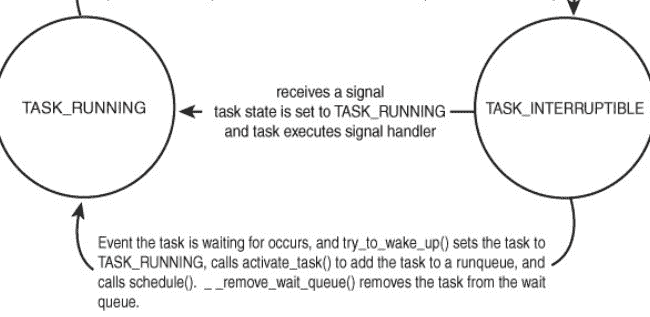

图 3.3 睡眠与唤醒。

## 负载均衡器


# Linux 调度器与负载均衡

## 负载均衡原理

如所述，Linux 调度器为对称多处理系统上的每个处理器实现了单独的运行队列和锁。这意味着，每个处理器都维护自己的进程列表，并仅对这些任务运行调度器。整个调度系统实际上对每个处理器都是唯一的。那么，调度器如何在多处理器系统上强制任何全局调度策略呢？如果运行队列变得不平衡怎么办，例如一个处理器的运行队列有五个进程，而另一个只有一个？解决方案是负载均衡器，它负责确保运行队列的平衡。负载均衡器会将当前处理器的运行队列与系统中的其他运行队列进行比较。理想情况下，每个运行队列的进程数量相同。

## `load_balance()` 实现

负载均衡器实现在 `sched.c` 中的 `load_balance()`。它有两种调用方式：

*   当当前运行队列为空时，由 `schedule()` 调用（每 1 毫秒调用一次）；
*   否则每 200 毫秒调用一次。

在单处理器系统中，`load_balance()` 永远不会被调用，甚至不会编译进内核，因为只有一个运行队列，因此不需要平衡。

负载均衡器在禁用中断的情况下锁定当前处理器的运行队列，以免受并发访问。在 `schedule()` 调用 `load_balance()` 的情况下，其任务非常明确，因为当前运行队列很忙，提取任何进程是有利的。然而，负载均衡器是通过定时器调用的，其任务可能没那么明显；它需要解决运行队列之间的平衡以保持大致相等。

```text
| 进程 1 | 进程 1 |
| 进程 2 | 进程 2 |
| 进程 3 | 进程 3 |
| 进程 4 | 进程 4 |
| 进程 5 | 进程 5 |
| load_balance() | 进程 6 |
| 从一个运行队列拉取到另一个以缓解不平衡 |
| ... | ... |
| 进程 20 | 进程 15 |
```

图 3.4 负载均衡器。

### 执行步骤

`load_balance()` 函数及相关方法很大且复杂，尽管它们执行的步骤是可以理解的：

1.  首先，`load_balance()` 调用 `find_busiest_queue()` 来确定最繁忙的运行队列。也就是说，这是包含进程数量最多的运行队列。如果没有运行队列比当前队列多 25% 以上，`find_busiest_queue()` 返回 `NULL`，`load_balance()` 返回。否则，返回最繁忙的运行队列。
2.  其次，`load_balance()` 决定从最繁忙运行队列的哪个优先级数组拉取。优先选择过期数组，因为那些任务已经运行较长时间，最可能不在处理器的缓存中（即它们不是缓存热）。如果过期优先级数组为空，则活跃数组是唯一选择。

`load_balance()` 会寻找优先级最高（值最小）的列表，因为将高优先级任务公平地分配到低优先级任务之上更为重要。

系统会对每个优先级的任务进行分析，以找到一个未在运行、未通过处理器亲和性阻止迁移且不是缓存热（`cache hot`）的任务。如果该任务符合这些标准，则调用 `pull_task()` 将该任务从最繁忙的运行队列中拉取到当前运行队列。

只要运行队列存在，就会准备上述两个步骤，并从最繁忙的运行队列拉取更多任务到当前队列。最后，当不平衡得到解决时，当前运行队列会被解锁，`load_balance()` 返回。

## 抢占与上下文切换

从一个运行队列到另一个运行队列的上下文切换由 `kernel/sched.c` 中的 `context_switch()` 函数处理。当选择了一个新进程执行时，`schedule()` 会调用它。它执行两项基本任务：

*   调用 `switch_to()`（该函数定义在 `include/asm/mmu_context.h` 中），将虚拟内存从上一个进程切换到当前进程。这涉及保存和恢复上下文以及处理器寄存器。

内核必须知道何时调用 `schedule()`。如果只有在代码显式调用时才执行 `schedule()`，用户空间程序可能会无限运行。相反，内核提供了 `need_resched` 标志来指示是否应该执行重新调度（见表 3.2）。该标志在进程唤醒时被设置。内核会检查该标志，发现其被设置后调用 `schedule()` 以切换到新进程。该标志是内核调度器的消息：当另一个进程值得运行时，应尽快调用调度器。

### 表 3.2 访问和操作 `need_resched` 的函数

| 函数 | 目的 |
| :--- | :--- |
| `set_tsk_need_resched(task)` | 设置给定进程中的 `need_resched` 标志 |
| `clear_tsk_need_resched(task)` | 清空给定进程中的 `need_resched` 标志 |
| `need_resched()` | 测试 `need_resched` 标志的值；如果设置则返回 `true`，否则返回 `false` |

在返回用户空间或从中断中返回时，会检查 `need_resched` 标志。如果设置了，内核将调用调度器（考虑到当前的速度以及它可能在缓存中），而不是全局变量；在 2.2 内核之前，该标志是全局的。在 2.2 和 2.4 中，该标志是 `task_struct` 内部的一个 `int` 类型。在 2.6 中，它移动到 `thread_info` 结构内部的一个特殊标志变量位中。正如你所见，内核开发者永不满足。

## 用户抢占

用户抢占发生在内核准备返回用户空间、`need_resched` 被设置并因此调用调度器时。如果内核正在返回用户空间，它处于一个安全的量子中。换句话说，如果继续执行当前任务是安全的，那么选择新任务执行也是安全的。因此，每当内核准备返回用户空间时（无论是从中断还是系统调用），都会检查 `need_resched` 的值。如果被设置，则调用调度器来选择一个新的（更合适的）进程来执行。从中断返回和从系统调用返回的路径都取决于架构，通常在 `entry.S` 中用汇编实现（该文件除了内核入口代码外，还包含内核扩展代码）。

简而言之，用户抢占可能发生在：

*   从系统调用返回用户空间时
*   从中断处理程序返回用户空间时

## 内核抢占

Linux 内核与大多数其他 Unix 变体和其他许多操作系统不同，它是一个完全抢占内核。在非抢占内核中，内核代码会运行到完成。也就是说，调度器无法在任务处于内核时对其重新调度——内核代码是协作调度的，而不是抢占式的。内核代码一直运行到结束（返回用户空间）或显式阻塞。但在 2.6 内核中，Linux 内核变得可抢占；只要内核处于可以重新调度的状态，就可以在任何点抢占任务。

那么，何时重新调度是安全的？只要内核没有持有锁，它就能抢占一个正在内核中运行的任务。也就是说，锁被用作非抢占的标记。因为内核是 SMP 安全的，如果未持有锁，当前代码就是重入的并且能够被抢占。当计数器为零时，内核是可抢取的。

支持内核抢占的首次变化是在每个进程的 `thread_info` 结构中增加了 `preempt_count`。

## 优先级设置

`sched_param()` 和 `sched_param()` 系统调用用于设置和获取进程的优先级。此调用返回编码在 `sched_param` 结构中的 `rt_priority`。`sched_get_priority_max()` 和 `sched_get_priority_min()` 调用返回给定调度策略的最大和最小优先级。实时性策略的最大优先级为 `MAX_USER_RT_PRIO` 减 1；最小优先级则为：

对于普通任务，`nice()` 函数通过指定的值来增加进程的优先级。只有 `root`（根）用户可以提供负值，从而降低 `nice` 值并提高优先级。`nice()` 函数会调用内核的 `sched_user_nice()` 函数，该函数会根据情况返回 `task/task_struct` 中的 `static_prio` 和 `prio` 值。

## 处理器亲和性

Linux 调度器强制硬亲和性（`hard affinity`）。也就是说，它尝试通过将进程保持在同一处理器上来提供软亲和性或自然亲和性；调度器也会使用位掩码来设置处理器。这种硬亲和性以位掩码的形式存储在 `task->cpu_allowed` 字段中。该位掩码包含系统上每个可能的处理器的一个位。默认情况下，所有位都已设置，进程中的位掩码可能在任何用户处理器上运行。然而，用户通过 `sched_setaffinity()` 可以提供任意一个或多个位组合的不同位掩码。同样，`sched_getaffinity()` 调用将返回 `cpu_allowed` 位掩码。


## 处理器亲和性系统 (Processor Affinity System)

内核以非常简单的方式强制硬亲和性。首先，当进程创建时，它会继承父进程的亲和性掩码。由于父进程运行在允许的处理器上，因此也会运行在允许的处理器上。其次，当亲和性改变时，内核使用迁移将任务推送到处理器上。负载均衡器只会将任务拉到允许的处理器。因此，进程只运行在其进程描述符的 `cpu_allowed` 字段中设置位的处理器上。

## 优先级让出 (Yielding Priority)

Linux 提供了 `sched_yield()` 系统调用，作为进程显式让出处理器给其他等待进程的机制。它的工作原理是将进程从数组（它当前所在的数组，因为它正在运行）中移除，并插入到过期数组（`expired array`）中。这样做的效果不仅是抢占位于优先级列表末尾结束的进程，还将其放在过期列表中——保证了它在一段时间内不会运行。由于实时任务永远不会过期，它们是一个特殊情况。因此，它们只是被移动到其优先级列表的末尾（而不是插入到过期数组中）。在 Linux 的早期版本中，`sched_yield()` 调用非常不同；顶多任务只被移动到其优先级列表的末尾。让出通常不会持续很长时间；现在，应用程序和内核代码在调用 `sched_yield()` 之前应该确定它们确实想要放弃处理器。

内核代码为了方便起见可以调用 `yield()`，这确保任务的状态为 `TASK_RUNNING`，然后调用 `sched_yield()`。用户空间应用程序使用 `sched_yield()` 系统调用。

## 系统调用 (System Calls)

内核提供了一组接口用于与在用户空间运行的进程进行交互。这些接口提供了对硬件和其他操作系统资源的访问权限。接口充当应用程序与内核之间的信使，应用程序发出各种请求，而内核执行这些请求（或告诉应用程序离开）。这些接口的存在，以及应用程序无法随意访问它们想要访问的内容，是提供稳定系统并避免大混乱的关键。

系统调用在硬件和用户空间进程之间提供了一个层。这一层服务有三个主要目的。首先，为用户空间提供一个抽象的硬件接口。例如，在读取或写入文件时，应用程序不需要关心磁盘类型、介质，甚至是存储文件的文件系统。其次，系统调用为用户空间进程提供了一种访问系统资源的机制，内核可以根据权限和其他标准进行仲裁。例如，这防止了应用程序错误地使用硬件、窃取另一个进程的资源或对系统造成危害。最后，用户空间与系统其余部分之间的单一通用层允许为进程提供虚拟系统；如果没有内核的参与，要实现多任务处理和虚拟内存几乎是不可能的。在 Linux 中，系统调用是用户空间与内核交互的唯一手段；它们是进入内核的唯一合法入口。事实上，其他接口（如设备文件或 `/proc`）最终也是通过系统调用访问的。有趣的是，Linux 实现的系统调用大多数大多数少得多。

本章探讨了系统调用在 Linux 中的作用和实现。

> x86 上有约 250 个系统调用（每个架构都允许定义唯一的系统调用）。尽管并非所有的操作系统都会发布其确切的系统调用，但估计某些操作系统拥有一千多个系统调用。

## API、POSIX 和 C 库 (APIs, POSIX, and the C Library)

通常，POSIX 应用程序是针对应用程序接口（API）进行编程的，而不是直接针对系统调用。这很重要，因为应用程序创建的接口与内核提供的实际接口之间不需要任何关联性。API 定义了一组应用程序使用的编程接口。这些接口可以实现为单个系统调用，可以通过多个系统调用实现，也可以完全不通过系统调用实现。一个 API 可以存在于多个系统并提供相同的接口，而 API 的实现可以在不同系统之间存在巨大差异。

世界上最流行的编程接口之一是基于 POSIX 标准的。POSIX 由 IEEE 的一系列标准组成，旨在提供一个大致基于 Unix 的可移植操作系统。Linux 是符合 POSIX 标准的。

POSIX 是 API 和系统调用之间关系的极佳示例。在大多数 Unix 系统中，POSIX 定义的 API 调用与系统调用有很强的关联性。事实上，POSIX 标准的创建是为了类似于早期 Unix 系统提供的接口。

`__sched_param` 和 `sched_param()` 系统调用用于设置和获取进程的优先级。此调用返回编码在 `sched_param` 结构中的 `rt_priority`。`sched_get_priority_max()` 和 `sched_get_priority_min()` 调用返回给定调度策略的最大和最小优先级。实时性策略的最大优先级为 `MAX_USER_RT_PRIO` 减 1；最小优先级则为：

对于普通任务，`nice()` 函数通过指定的值来增加进程的优先级。只有 root 用户可以提供负值，从而降低 `nice` 值并提高优先级。`nice()` 函数调用内核的 `sched_user_nice()` 函数，该函数会根据情况返回 `task->static_prio` 和 `task->prio` 值。

Linux 调度器强制硬亲和性。也就是说，它尝试通过将进程保持在同一处理器上来提供软亲和性或自然亲和性；调度器也会使用位掩码来设置处理器。这种硬亲和性以位掩码的形式存储在 `task->cpu_allowed` 字段中。该位掩码包含系统上每个可能的处理器的一个位。默认情况下，所有位都已设置，进程中的位掩码可能在任何用户处理器上运行。然而，用户通过 `sched_setaffinity()` 可以提供任意一个或多个位组合的不同位掩码。同样，`sched_getaffinity()` 调用将返回 `cpu_allowed` 位掩码。


系统调用在硬件和用户空间进程之间提供了一个层。这一层服务有三个主要目的。首先，为用户空间提供一个抽象的硬件接口。例如，在读取或写入文件时，应用程序不需要关心磁盘类型、介质，甚至是存储文件的文件系统。其次，系统调用为用户空间进程提供了一种访问系统资源的机制，内核可以根据权限和其他标准进行仲裁。例如，这防止了应用程序错误地使用硬件、窃取另一个进程的资源或对系统造成危害。最后，用户空间与系统其余部分之间的单一通用层允许为进程提供虚拟系统；如果没有内核的参与，要实现多任务处理和虚拟内存几乎是不可能的。在 Linux 中，系统调用是用户空间与内核交互的唯一手段；它们是进入内核的唯一合法入口。事实上，其他接口（如设备文件或 `/proc`）最终也是通过系统调用访问的。有趣的是，Linux 实现的系统调用少得多。

本章探讨了系统调用在 Linux 中的作用和实现。

> x86 上有约 250 个系统调用（每个架构都允许定义唯一的系统调用）。尽管并非所有的操作系统都会发布其确切的系统调用，但估计某些操作系统拥有一千多个系统调用。

## API、POSIX 和 C 库 (APIs, POSIX, and the C Library)

通常，POSIX 应用程序是针对应用程序接口（API）进行编程的，而不是直接针对系统调用。这很重要，因为应用程序创建的接口与内核提供的实际接口之间不需要任何关联性。API 定义了一组应用程序使用的编程接口。这些接口可以实现为单个系统调用，可以通过多个系统调用实现，也可以完全不通过系统调用实现。一个 API 可以存在于多个系统并提供相同的接口，而 API 的实现可以在不同系统之间存在巨大差异。

世界上最流行的编程接口之一是基于 POSIX 标准的。POSIX 由 IEEE 的一系列标准组成，旨在提供一个大致基于 Unix 的可移植操作系统。Linux 是符合 POSIX 标准的。

POSIX 是 API 和系统调用之间关系的极佳示例。在大多数 Unix 系统中，POSIX 定义的 API 调用与系统调用有很强的关联性。事实上，POSIX 标准的创建是为了类似于早期 Unix 系统提供的接口。

> IEEE (`eye-triple-E`) 是电气电子工程师协会。它负责许多技术领域。有关更多信息请访问 `http://www.ieee.org`。

## 系统调用 (Syscalls)

系统调用（在 Linux 中通常称为 `syscalls`）通常通过函数访问。它们可以定义一个或多个参数（输入），并可能产生副作用，例如写入文件。`long` 类型的返回值表示成功。通常情况下（并非总是），负值表示错误。Unix 系统调用会将特殊的错误代码写入全局变量 `errno`。

最后，系统调用无疑有定义的行为。系统调用 `getpid()` 意在返回当前进程的 PID。该 `syscall` 在内核中的实现非常简单：

```c
asmlinkage long sys_getpid(void)
{
    return current->tgid;
}
```

注意，定义并没有说明实现。内核必须提供系统调的预期行为，但可以自由选择任何实现。当然，这个 `syscall` 极其简单，没有多少实现方法。

我们可以从这个简单的示例中对系统调用做出几点观察。首先，注意函数声明中的 `asmlinkage` 修饰符。这是一个魔法技巧，告诉编译器在栈上寻找该函数的参数。这是所有系统调用必需的修饰符。其次，注意 `getpid()` 系统调用在内核中被定义为 `sys_getpid()`。这是 Linux 遵循的命名规范：系统调用 `bar()` 在内核中实现为 `sys_bar()`。

## 系统调用编号 (System Call Numbers)

在 Linux 中，每个系统调用都被分配了一个 `syscall` 编号：这是一个用于引用系统调用的唯一数字。当用户空间进程执行系统调用时，该编号指示执行的是哪一个调用；进程并不通过名称引用系统调用。

> 注意这里。尽管大多数系统调用都有副作用（即会导致系统状态发生变化），但少数系统调用（如 `getpid()`）仅仅从内核返回某些数据。

⁴ 使用 `long` 类型是为了兼容 64 位架构。

⁵ 你可能疑惑为什么 `getpid()` 返回的是 TGID，线程组 ID？这是因为在普通进程中，TGID 等于 PID。对于线程，线程组内所有线程的 TGID 是相同的。这使得线程可以调用 `getpid()` 并获取相同的 PID。

ID 是重要的：一旦分配，它就不能更改，否则编译后的系统调用将失效。同样，如果调用了一个系统，其系统调用号就不能被重用。Linux 提供了一个“未实现”的系统调用 `sys_ni_syscall()`，它除了返回 `-ENOSYS`（对应于无效系统调用的错误）之外什么都不做。该函数用于在极少数被调用的罕见情况下“填补漏洞”。

内核在内核表中维护所有已注册系统调用的列表，存储在 `sys_call_table` 中。它依赖于架构，通常定义在 `entry.S` 中。此任务将每个有效的系统调用验证到一个唯一的数字。

## 系统调用性能

Linux 中的系统调用比许多其他操作系统都要快。这部分是因为 Linux 极其快速的上下文切换时间；进入和退出内核是一个精简且简单的过程。另一个因素是系统调用处理程序本身以及各个单独系统调用的简单性。

## 系统调用处理程序

用户空间应用程序无法直接执行内核代码。它们不能简单地创建一个在内核空间调用的函数，因为内核存在于受保护的内存空间中。如果应用程序可以直接读写内核的地址空间，系统安全将荡然无存。

相反，用户空间应用程序必须以某种方式向内核信号它们想要执行系统调用，并让系统切换到内核模式，在那里，系统调用可以在内核空间代表应用程序执行。

信号系统调用的机制是软件中断：触发异常，然后系统切换到内核模式并执行异常处理程序。在这种，异常处理程序实际上是系统调用处理程序。x86 上定义的软件中断是 `int $0x80` 指令。它触发向内核模式的切换以及异常向量 128 的执行，即系统调用处理程序。这个命名的函数是 `system_call()`。它依赖于架构，通常在 `entry.s` 中用汇编实现。

## 指定正确的系统调用

仅仅进入内核空间是不够的，因为有多个系统调用，它们都以相同的方式进入内核。因此，必须将系统调用号传递给内核。在 x86 上，在发布软件中断之前将系统调用号存储在 `eax` 寄存器中。系统调用处理程序随后从 `eax` 读取该值。其他架构也采用类似的操作。

> 以下关于系统调用处理程序的许多描述都是基于 x86 版本的。不要担心，它们都非常相似。

`system_call()` 函数通过与 `NR_syscalls` 比较来检查系统调用号的有效性。如果它大于或等于 `NR_syscalls`，函数返回 `-ENOSYS`。否则，调用指定的系统调用：

```c
call *sys_call_table[eax];
```

由于系统调用表中的每个元素都是 32 位的（四字节），内核将系统调用号乘以四以得到在系统调用表中的位置。见图 4.2。

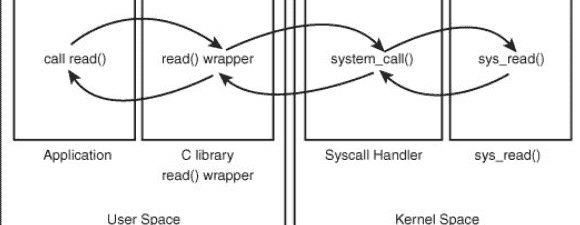

图 4.2 调用系统调用处理程序并执行系统调用。

## 参数传递

此外，系统调用需要向它们传递一个或多个参数。通过某种方式，用户空间必须在异常捕获期间将参数传递给内核。此简单的方法是通过传递系统调用号相同的方法：参数存储在寄存器中。在 x86 上，寄存器 `ebx`、`ecx`、`esi`、`edi` 顺序包含前五个参数。在六或更多参数的罕见情况下，使用单个寄存器来持有指向用户空间的指针，所有参数都存在那里。

返回值也通过寄存器发送到用户空间。在 x86 上，它被写入 `eax` 寄存器。

## 系统调用实现

Linux 系统调用的实际实现不需要关心系统调用处理的行为。在 Linux 中添加一个新的系统调用是相对的。困难工作在于设计和实现系统调用；向内核注册它是简单的。让我们来看为 Linux 编写新系统调用涉及的步骤。

实现系统调用的第一步是定义它的目的。它将做什么？系统调用应该只有一个目的。Linux 不建议对系统调用进行复用（即根据标志执行不同事情的单一调用）。把 `ioctl()` 作为一个不该如何做法的例子。

新系统调用的参数、返回值和错误代码是什么？系统调用应该具有简洁清晰的接口和尽可能少的参数。系统调用的语义和行为是重要的；它们不能更改，因为现有的应用程序将依赖它们。

着眼未来设计接口是非常重要的。你是否在限制该功能？将系统调用设计得尽可能通用。不要假设它明天会被使用。系统调用的目的将保持不变，但它的用途可能会改变。系统调用是可移植的吗？不要对架构师的工作负载或耐力做假设。第 16 章“可移植性”讨论了这些问题。确保你没有做出将来会破坏系统调用的承诺。记住 Unix 的格言：“提供机制，而不是提供策略。”

当你编写系统调用时，意识到对移植性和健壮性的需求是重要的，不仅是为了今天，更是为了未来。基本的 Unix 系统调用通过了时间的考验；它们中的大多数仍然像三十年前一样之用且强大。

## 验证参数


系统调用必须仔细验证所有参数以确保它们是有效且合法的。例如，如果进程在未检查的情况下将任何指针传递给内核，安全性和可靠性可能会受到影响。最重要的检查之一是用户提供的指针的有效性。

- 指针指向用户空间中的内存区域。
- 如果读取，内存是可读的。
- 如果写入，内存是可写的。

写入用户空间，`copy_to_user()` 方法接受三个参数。第一个是进程地址空间的目标地址；第二个是内核空间的源指针。最后是要拷贝数据的字节数。

从用户空间读取，`copy_from_user()` 方法接受三个参数。第一个是进程地址空间的源地址；第二个是内核空间的目标指针。最后是字节数。

这两个函数都返回它们未能拷贝的字节数。成功时，它们返回 0。

让我们考虑一个同时使用 `copy_from_user()` 和 `copy_to_user()` 的例子。`silly_copy()` 完全毫无意义；这个系统调用将数据从它的第一个参数拷贝到它自己。这是极低优化的，因为涉及到额外的内核空间拷贝。

```c
unsigned long silly_copy(unsigned long *src, unsigned long *dst, long len) {
    unsigned long buf;

    /* 如果内核字和用户用户字不匹配则失败 */
    if (len != sizeof(buf))
        return -EINVAL;

    /* 将用户空间的 src 拷贝到 buf */
    if (copy_from_user(buf, src, len))
        return -EFAULT;

    /* 将 buf 拷贝到用户空间的 dst */
    if (copy_to_user(dst, buf, len))
        return -EFAULT;

    /* 返回拷贝的数据量 */
    return len;
}
```

## 系统调用上下文

如第 2 章“进程管理”中所述的，在执行系统调用期间，内核处于进程上下文（process context）中。当前指针指向当前任务（current task），即发布系统调用的进程。

在进程上下文中，内核能够睡眠（如果系统调用在显式调用 `schedule()` 处阻塞），并且是完全可抢占的。有两点至关重要：首先，睡眠的能力使得许多系统调用能够利用内核的大部分功能。正如我们在第 5 章“中断与中断处理程序”中所看到的，睡眠能力极大地简化了内核编程。进程上下文是可抢占的这一事实意味着像用户空间一样，当前任务可能会被另一个任务抢占。由于同一个系统调用可能会被多次调用，因此必须小心确保系统调用是可重入（reentrant）的。当然，这与对称多处理引入的担忧是相同的。关于重入性的保护将在第 7 章“内核同步简介”和第 8 章“内核同步方法”中介绍。

当系统调用返回时，控制权将在 `system_call()` 中继续，最终切换回用户空间并继续执行用户进程。

# 绑定系统调用的最后步骤

编写系统调用后，将其注册为官方系统调用是非常容易的：

- 在系统调用表的末尾添加条目。这需要在每个支持该系统调用的架构中完成（对于大多数调用来说，所有九个架构都是）。`syscall` 在表中的位置从零开始，即为系统调用号。例如，列表中的第十个条目被分配系统调用号 9。
- 对于所支持的每个架构，需要在 `include/asm/unistd.h` 中定义 `syscall` 号。
- `syscall` 需要被编译到内核映像中（而不是编译为模块）。这只需将系统调用放在 `kernel/` 下的相关文件中即可。

让我们通过一个虚构的系统调用 `foo()` 来详细查看这些内容。首先，我们想将 `sys_foo()` 添加到系统调用表。对于大多数架构，该表位于 `entry.S` 中，看起来如下：

> 中断处理程序不能睡眠，因此它们可以执行的操作比运行在进程上下文中的系统调用要受限得多。

```asm
ENTRY(sys_call_table)    /* 0 */
  long sys_restart_syscall
  long sys_exit
  long sys_fork
  long sys_read
  long sys_write
  long sys_open                /* 5 */
  ....
  long sys_timer_delete
  long sys_clock_settime
  long sys_clock_gettime      /* 265 */
  long sys_clock_nanosleep
```

我们将新的 `syscall` 号添加到此列表的末尾：

```c
.long sys_foo
```

尽管我们没有显式指定，但我们的系统调用随后被赋予随后的下一个 `syscall` 号 268。对于我们想要支持的每个架构，我们的系统调用都必须添加到该架构的系统调用表中（它不需要在每个架构下接收相同的编号）。通常，你希望让系统调用对每个架构都可用。每五个条目在注释中放置一个数字的习惯，使得易于找到哪个 `syscall` 被分配了哪个数字。

接下来，我们将 `syscall` 号添加到 `include/asm/unistd.h` 中，它目前看起来有些像：

```c
/*
 * 此文件包含系统调用号。
 */

#define NR_restart_syscall      0
#define NR_exit               1
#define NR_fork                2
#define NR_read               3
#define NR_write              4
#define NR_open               5
  ..
#define NR_timer_delete      263
#define NR_clock_settime     264
#define NR_clock_gettime     265
#define NR_clock_getters      266
#define NR_clock_nanosleep    267
```

尽管我们没有显式指定，但我们的系统调用随后被赋予随后的下一个 `syscall` 号 268。对于我们想要支持的每个架构，我们的系统调用都必须添加到该架构的系统调用表中（它不需要在每个架构下接收相同的编号）。通常，你希望让系统调用对每个架构都可用。每五个条目在注释中放置一个数字的习惯，使得易于找到哪个 `syscall` 被分配了哪个数字。

接下来，我们在列表末尾添加我们的 `syscall` 号：

```c
#define NR_foo 268
```

最后，我们实现系统调用。由于系统调用必须被编译到内核映像中，我们将其放在 `sys.c`。

```c
/*
 * sys_foo 的实现
 */
asmlinkage long sys_foo(void)
{
    /* 实现 */
    return -ENOSYS;
}
```

# 从用户空间访问系统调用

通常，你希望让系统调用对每个架构都可用。每五个条目在注释中放置一个数字的习惯，使得易于找到哪个 `syscall` 被分配了哪个数字。

用户空间现在可以通过 `syscall()` 来调用系统调用。例如，调用 `open()`：

```c
int fd = syscall(NR_open, "/dev/mem", O_RDWR);
```

通常，你可能希望使用 `syscall()` 宏来包装系统调用。对于具有多个参数，`open()` 调用如下：

```c
int syscall3(NR_open, filename, flags, mode);
```

或者，`open()` 的定义如下：

```c
int open(const char *filename, int flags, int mode);
```

此外，用户程序可以直接调用 `open()` 来获取文件描述符：

```c
int fd = open("/dev/mem", O_RDWR);
```

## 中断与中断处理程序

内核的主要职责之一是管理连接到机器的硬件。作为这项工作的一部分，内核需要与机器各个设备进行通信。由于处理器的速度通常比它们通信的硬件快得多，让内核发出请求并等待可能缓慢的硬件的响应并不是理想的。相反，由于硬件响应相对缓慢，内核必须能够在硬件实际完成工作后自由地去处理其他事务。解决此问题的一种方案是轮询（polling）。内核可以定期检查工作状态并据此做出响应。无论硬件是否处于活跃状态，由于轮询是在固定间隔内重复进行的，这都会产生开销。更好的解决方案是提供一种机制，让硬件在需要关注时向内核信号。这种解决方案被称为中断（interrupts）。

# 中断

中断允许硬件与处理器进行通信。例如，当你打字时，键盘控制器（控制键盘的硬件设备）会发出一个中断，通知操作系统有按键被按下。中断是从硬件设备发送到处理器的特殊电信号。处理器接收到中断并通知操作系统，以便操作系统能够处理新数据。硬件设备产生中断相对于处理器时钟是异步的——它们可以在任何时间发生。反之，内核也可以随时被中断以处理中断。


中断在物理上是由来自设备的电子信号产生的，这些信号指向中断控制器的输入引脚。中断控制器随后向处理器发送信号。处理器检测到该信号并中断当前的执行以处理中断。随后处理器可以通知操作系统发生了中断，操作系统可以适当处理这些中断。

不同的设备通过与每个中断相关的唯一值关联。通常，来自键盘的中断与硬盘的中断是不同的。这使得操作系统能够区分中断，并知道哪个设备导致了哪个中断。

这些中断通常被称为中断请求（`IRQ`）线。通常，它们被赋予一个数值——例如，在 PC 上，`IRQ 0` 是键盘中断。并不是所有中断都是这样定义的；例如，与 PCI 总线相关的中断是动态分配的。其他非 PC 架构对中断也有类似的动态分配。重要的概念是特定的中断与特定的设备相关，且内核知晓这一点。

## 异常

异常通常与中断同时递递。与中断不同，它们相对于处理器时钟是同步触发的。事实上，它们通常被称为同步中断。异常是处理器在执行指令时为了响应编程错误而产生的（例如除以零或必须由内核处理的异常条件，例如页错误）。由于许多处理器架构处理异常的方式与中断类似，内核处理它们的接口也大相相同。本章中关于中断（硬件产生的异步中断）的大部分讨论也涉及异常（处理器本身产生的同步中断）。

## 中断处理程序

响应中断而运行的函数被称为中断处理程序（interrupt handler）或中断服务例程（`ISR`）。每个产生中断的设备都有一个中断处理程序。例如，一个设备的处理程序处理系统定时器产生断，而另一个函数处理来自键盘的中断。设备的中断处理程序是该设备驱动程序的一部分——管理该设备的内核。

在 Linux 中，中断处理程序是普通的 C 函数。它们匹配特定的原型，使内核能够以标准方式传递处理程序信息，但在其他方面它们是普通函数。区分中断处理程序与其他内核函数的区别在于，内核是为了中断而调用它们，并且它们运行在一个特殊的上下文中（我们将会讨论），该上下文中被称为中断上下文（interrupt context）。

由于中断可能任何时间发生，中断处理程序也可以在任何时间执行。处理程序必须运行得很快，以便尽快恢复被中断代码的执行。因此，尽管对于硬件来说立即处理中断很重要，但对于系统的其他部分来说，让中断处理程序在尽可能短的时间内执行也同样重要。

至少，中断处理程序的工作是向硬件确认已接收中断。然而，通常中断有大量工作需要完成。例如，考虑网络设备的中断处理程序。在响应硬件时，中断处理程序需要从硬件内存中拷贝数据包、对其进行处理，并将其推送到适当的协议栈或抽象层。这是大量的工作。

## 上半部与下半部（Top Halves Versus Bottom Halves）

这两个目标——中断处理程序执行迅速但又要执行大量工作——是矛盾的。由于这些目标，中断的处理被分为两个部分：上半部（top half），它在接收到中断后立即运行，并执行时间敏感的工作，例如确认接收或重置硬件。可以执行的工作会被延迟到下半部（bottom half）。下半部在之后更方便的时间运行，且此时禁用中断——通常，下半会在中断处理程序返回时运行。Linux 提供了实现下半部的各种机制，这些将在第 6 章“下半部与延迟工作”中讨论。

## 注册中断处理程序

驱动程序可以注册中断处理程序并启用中断线来处理该函数

```c
int request_irq(unsigned int irq,
               irqreturn_t (*handler)(void *, struct pt_regs *),
               unsigned long irqflags,
               const char *devname,
               void *dev_id);
```

第一个参数 `irq` 指定分配的中断号。对于某些设备（例如系统定时器等传统 PC 设备），第二个参数 `handler` 是处理中断的实际函数指针。第三个参数 `irqflags` 可以是零或以下标志的位掩：

- `SA_INTERRUPT`：此标志指定给定的处理程序是快速处理器。默认（无此标志），所有中断在本地被屏蔽。

- `SA_RANDOM`：此标志标记该设备产生的中断应对熵池。如果指定了此标志，中断定时将进入池。

- `SA_SHIRQ`：此标志指定中断线可以被多个中断处理程序共享。注册在该线上的每个处理器都必须指定此标志，否则无法一个。

第四个参数 `devname` 是关联设备的 ASCII 表示。例如，PC 键盘中断是 `"keyboard"`。这些名称用于 `/proc/irq` 和 `/proc/interrupts` 以与用户进行通信。

第五个参数 `dev_id` 用于共享中断线。当释放（删除）中断处理程序时，`dev_id` 提供了一个唯一的 `cookie`，以便从中断线移除所需的特定处理程序。

成功时，`request_irq()` 返回零。非零值表示错误，此时指定的中断处理程序未注册。常见的错误是 `EBUSY`，表示给定的中断已被占用。

注意 `request_irq()` 可能会睡眠，因此不能在中断上下文或其他不允许阻塞的情况下调用。

我们使用新的 `proc` 条目，它反过来调用 `kmalloc()` 来分配内存。正如我们在第 10 章“内存管理与寻址”中将讨论，`kmalloc()` 可以睡眠。就是这样！

在驱动程序中请求中断线并安装处理程序：

```
if (request_irq(irq, my_interrupt, SA_SHIRQ, "my_device", dev)) {
    printk(KERN_ERR, "%s: device cannot register IRQ %d\n", dev, irq);
    return -EIO;
}
```

在此示例中，请求的中断线，`my_interrupt` 是处理程序，该线是可以共享的，设备名称为 `"my_device"`，我们传递了 `dev` 作为 `dev_id`。如果执行失败，代码将打印错误并返回。如果调用返回，则说明处理程序已成功安装。从该点起，处理程序将在中断发生时被调用。按照正确的顺序初始化硬件并注册中断处理程序是非常重要的，以防止中断处理程序在设备完全初始化之前运行。

## 释放中断处理程序

要释放中断线，请调用

```
void free_irq(unsigned int irq, void *dev_id)
```

如果指定的中断线没有共享，则该处理程序将被移除，且只有在处理程序移除时线本身才会被禁用。我们可以看到为什么唯一的 `dev_id` 非常重要。需要通过 `dev_id` 令牌来区分单线上的多个处理程序，并允许 `free_irq()` 移除正确的处理程序。（无论是共享还是不共享），如果 `dev_id` 不为 `NULL`，它必须与所需的处理程序匹配。

`free_irq()` 的调用必须在进程上下文中。

## 编写中断声明

以下是一个典型的中断处理程序声明：

```
static irqreturn_t int_handler(int irq, void *dev_id, struct pt_regs *regs)
```

注意，这与传递给 `request_irq()` 的参数匹配。第一个参数 `irq` 是处理程序正在服务的的中断线的数值值。这在今天并不完全有用，也许在打印日志消息时有用用。在 2.0 内核之前，没有 `dev_id` 参数，因此使用 `irq` 来区分使用相同驱动程序和相同处理程序的多个设备（例如，考虑一台带有多个硬盘控制器的计算机）。

第二个参数 `dev_id` 是指向一个通用指针，指向在注册中断处理程序时传递给 `request_irq()` 的相同 `dev_id`。如果此值是唯一的 `unique_id`，它也可能指向中断处理程序的使用源，作为令牌来区分使用相同中断处理程序的多个设备。设备结构对于每个设备都是唯一的，并且在处理程序内部可能有用，它通常作为 `dev_id` 传递。

最后一个参数 `regs` 包含一个指向包含处理中断之前的寄存器和状态的结构体的指针。它们很少被使用，除非用于调试。

中断处理程序的返回值是 `irqreturn_t`。一个中断处理程序可以返回两个值：`IRQ_NONE` 或 `IRQ_HANDLED`。如果中断处理程序不是源头、设备被正确识别且其 `dev_id` 参数匹配，则返回前者。可能会返回 `IRQ_WAKE_THREAD`。如果不是返回这个，则它永远不会返回 `IRQ_HANDLED`。否则，它返回 `IRQ_NONE`。这些值用于让内核知道多个设备是否在给中断线上共享相同的（不可中断的）中断处理程序；如果是 `IRQ_NONE`，内核可以检测到该问题。返回类型 `irqreturn_t` 仅仅是一个 `int`。驱动程序可以将其简化为 `irqvoid` 并返回 `void`。

中断处理程序通常被标记为 `static`，因为从没有从另一个文件中直接调用它。

中断处理程序的角色取决于设备及其发出中断的原因。至少，大多数中断处理程序需要向设备提供确认，证明它们已收到了中断。更复杂的设备还需要额外发送和接收数据并执行扩展工作。正如前面提到的，扩展工作被尽可能地推到下半部处理程序（bottom half handler）中，将在下一章中讨论。

## 重入性与中断处理程序


Linux 中的中断处理程序不需要是重入的。当一个中断处理程序执行时，相应的中断线在所有处理器上被屏蔽，防止接收到同一条线上的另一个中断。通常所有其他中断都是开启的，因此其他中断会被处理，但当前线始终是禁用的。因此，同一个中断处理程序永远不会并发调用来处理嵌套中断。

## 共享处理程序

共享处理程序的注册和执行方式与非共享处理程序类似。三个主要区别是：

- 在 `request_irq()` 的参数中必须设置 `SA_SHIRQ` 标志。
- `dev_id` 参数对于每个注册的处理程序必须是唯一的。指向任何每个设备结构的指针就足够了；常见的选择是设备结构，因为它是唯一的且对处理程序可能有用。你不能为共享处理程序传递 `NULL`！
- 中断处理程序必须能够区分究竟是哪个设备实际生成了中断。这需要硬件支持和处理程序中的逻辑支持。如果硬件不提供这种能力，中断处理程序将无法知道是哪个关联设备或其他设备共享了中断线。

所有共享中断线的驱动程序都必须满足这些要求。如果任何一个设备不公平共享，它就不能共享该线。当使用 `SA_SHIRQ` 调用 `request_irq()` 时，只有在中断线未注册或该线上的所有中断处理程序也都指定了 `SA_SHIRQ` 时，调用才会成功。在 2.6（旧版本内核的行为）中，共享处理程序可以混合使用 `SA_INTERRUPT`。

当内核接收到中断时，它会顺序调用该线上的每个注册处理程序。因此，处理程序能够区分是否是由自己生成的中断是非常重要的。如果关联的设备没有生成中断，处理程序必须尽可能快退出。这需要硬件有一个状态寄存器（或类似的机制），处理程序可以读取它。现在的大多数设备都具有这种功能：

## 实时中断处理程序

让我们看一个来自 `drivers/char/rtc.c` 的 `RTC`（实时时钟）驱动的真实中断处理程序。许多机器（包括 `PC`）都有 `RTC`。它是一个独立于系统时的设备，用于设置系统时、提供闹钟或提供周期定时器。系统时通常通过写入特定的寄存器或 `IO` 范围来实现。然而，闹钟或周期定时器通常通过中断实现。中断等同于世界时闹钟：当发送中断时，闹钟或定时器正在：

当驱动程序加载时，调用函数 `rtc_init()` 来初始化驱动程序。它的职责之一是注册中断处理程序：

```
if (request_irq(RTC_IRQ, rtc_interrupt, SA_INTERRUPT, "rtc", NULL)) {
    printk(KERN_ERR "rtc %d\n", irq);
    return EIO;
}
```

从这里我们看到中断线存储在 `RTC_IRQ` 中。这是一个预处理器定义，指定特定架构的 `RTC`。例如，在 `PC` 上，`RTC` 始终位于 `IRQ 8`。第二个参数是我们的处理程序 `rtc_interrupt`，由于 `SA_INTERRUPT` 标志，它在中断开启的情况下运行。第四个参数是驱动名称 `"rtc"`。由于此设备不能共享中断线且处理程序不需要任何特殊值，因此 `dev_id` 传递了 `NULL`。

```
static int rtc_interrupt(int irq, void *dev_id, struct pt_regs *regs)

/*
 * 可以是闹钟中断、更新完成中断
 * 或周期中断。我们将状态存储在低字节，
 * 自上次读取以来的中断次数存储在 rtc_irq_data 中。
 */

spin_lock(&rtc_lock);
rtc_irq_data += 0x100;
rtc_irq_data &= 0xFF;
if (rtc_irq_data & 0xF0) == (READ_RTC_FLAGS & 0xF0) {

if (rtc_status & RTC_TIMER_ON)
mod_timer(&rtc_irq_timer, jiffies + HZ/rtc_freq + 2*HZ/100);

}

spin_unlock(&rtc_lock);

/*
 * 现在执行其余的操作
 */
spin_lock(&rtc_task_lock);
if (rtc_callback) {
rtc_callback->run(rtc_callback->private_data);
}
spin_unlock(&rtc_task_lock);
wake_up_interruptible(&rtc_wait);

kill_fasync(&rtc_async_queue, SIGIO, POLL_IN);

return IRQ_HANDLED;

}
```

最后，它返回 `IRQ_HANDLED` 以表示该处理程序已处理该中断。由于中断处理程序不支持共享，且 `RTC` 没有能够检测虚假中断的机制，因此处理程序始终返回 `IRQ_HANDLED`。

## 中断上下文

在执行中断处理程序或下半部（`bottom half`）时，内核处于中断上下文。回想一下进程上下文是内核代表进程执行时的运行模式——例如执行系统调用或运行内核线程。在进程上下文中，当前 `current` 宏指向相关的 `task_struct`。如果一个进程与内核上下文耦合，它可以睡眠或以其他方式调用调度器。

另一方面，中断上下文与任何进程都没有关联。`current` 宏不再相关（尽管它指向被中断的进程）。由于没有后台进程，中断上下文无法睡眠——它将如何重新调度呢？因此，你不能在中断上下文调用函数。如果一个函数会睡眠，你就不可能在中断处理程序中使用——这限制了你可以从中断处理程序中调用的函数。

中断上下文至关重要，因为中断处理程序中断了其他代码。代码应该是快速且简单的。不鼓励忙等待。这是一个非常重要的一点；始终记住你的中断处理程序中断了其他代码（可能甚至是另一行上的另一个中断处理程序！）。由于其异步性质，所有中断处理程序都必须尽可能快速和简单。尽可能地，工作应该从中断处理程序中推出，并在更方便的时间在下半部中执行。

最后，中断处理程序没有自己的栈。相反，它与被中断的进程共享内核栈。如果没有进程在运行，它将使用空闲任务的栈。由于中断处理程序共享栈，它们在栈上的分配必须非常节约。当然，内核栈是有限的，因此所有内核代码都应该谨慎。

## 中断处理的实现

并不意外，Linux 中断处理系统的实现非常取决于架构。实现取决于处理器、所使用的中断控制器类型以及架构和机器本身的设计。

`图 5.1` 是中断通过内核的路径图。

- `1.` `32` 位架构上的内核栈为 `8KB`，`64` 位架构上为 `16KB`。这由正在执行的进程上下文代码和发生的所有中断共同共享。

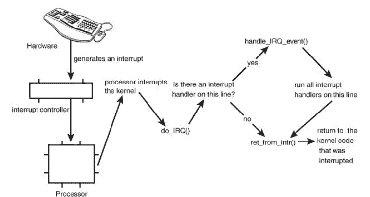

`图 5.1` 中断从硬件进入并经过内核的路径。

设备通过通过总线向中断控制器发送电信号来发出中断。如果中断线已启用（它们可以被屏蔽），中断控制器就会将中断发送给处理器。在许多架构中，通过特殊的引脚向处理器发送信号即可实现这一点。除非处理器中禁用了中断（这也会发生），否则处理器会立即停止正在工作，禁用中断系统，并跳转到内存中的预定义位置执行位于该位置的代码。这个预定义点由内核设置，是中断处理程序的入口点。

中断的旅程从预定义的入口点开始，就像系统调用一样。对于每一条中断线，处理器都会跳转到一个唯一的位置。这样，内核就知道了传入中断的 `IRQ` 编号。初始入口点仅保存此值，并将当前寄存器值（属于被中断的任务）存储在栈上；然后，内核调用 `do_IRQ()`。从这里开始，中断处理代码用 C 语言编写——然而，它仍然依赖于架构。

```
do_IRQ() 声明为
unsigned int do_IRQ(struct pt_regs regs)
```

由于 C 调用约定将参数放在栈的顶端，`pt_regs` 结构包含了之前在汇编入口程序中保存的初始寄存器值。由于中断值也被保存了，`do_IRQ()` 可以提取出它。`x86` 代码如下：

```
int irq = regs.orig_eax & 0xff;
```

在调用中断后，`do_IRQ()` 确认接收中断并禁用该线上的中断传递。在普通的 `PC` 机器上，这些操作由 `mask_and_ack_8259A(a)` 处理，`do_IRQ()` 会调用了该函数。

接下来，`do_IRQ()` 确保在该线上注册了处理程序，并且该处理程序已启用且当前没有在执行。如果是这样，在 `x86` 上，它调用 `hardware_IRQ_event()` 来运行该线的中断处理程序。


```c
int handle_IRQ_event(unsigned int irq, struct pt_regs *regs, struct irqaction *action)
{
    int status = 1;

    if (action->flags & SA_INTERRUPT) {
        local_irq_enable();
    }

    do {
        status = action->handler(irq, action->dev_id, regs);
        action = action->next;
    } while (action);

    if (status->flags & SA_SAMPLE_RANDOM)
        add_interrupt_randomness(irq);
    local_irq_disable();

    return status;
}
```

首先，因为进程禁用了中断，除非在注册处理程序时指定了 `SA_INTERRUPT`，否则中断会被重新开启。回想 `SA_INTERRUPT` 指定处理程序必须在禁用中断的情况下运行。如果在注册时指定了 `SA_SAMPLE_RANDOM`，则会调用 `interrupt_randomness()`。此函数使用内核的随机生成器。最后，中断处理程序返回。

`from_intr()` 例程像初始入口一样，检查是否有待处理的调度。在 `schedule()` 返回后，初始寄存器被恢复，内核恢复。在 x86 上，初始汇编位于 `arch/i86/kernel/entry.S`，而 C 方法位于 `arch/i86/kernel/irq.c`。

`proc` 是一个仅存在于内存中的虚拟文件系统，通常被挂载为 `/proc`。在 `proc` 中读写文件会调用模拟从真实文件读取或写入的内核函数。一个相关的例子是 `/proc/interrupts` 文件，它填充了与中断相关的统计数据。以下是单处理器 CPU 的示例输出：

```
CPU 0          XT-PIC  timer
1 3048         XT-PIC
2 0            XT-PIC  cascade
5 268946      XT-PIC  EMU10KI
12 85077       XT-PIC  ubci,eth0
15 24571       XT-PIC  sicmm
NMI:
LOC:3602236
```

第一列是接收的中断数量。编号为 `(0-2, 4, 5, 12, 13)` 的中断是存在的。未显示的行没有安装处理程序。第二列是接收的中断计数器，但这里只有一个处理器。正如我们看到的，第三个中断接收了 `3603271` 次中断，而声卡（`EMU10KI`）一次都没有过（这表明自机器启动以来一直未使用）。对于带有 `IO APIC` 的系统，大多数中断会列出 `IO-APIC-level` 或 `IO-APIC-edge` 作为其中断控制器。最后，最后一列是与此中断相关的设备。此名称是由之前讨论过的 `request_irq()` 中的 `devname` 参数提供的。如果中断是共享的（如本例中的中断四），则会列出在该线上的所有设备。

对于好奇的读者，`proc` 代码主要位于 `fs/proc`。提供 `/proc/interrupts` 的函数正如所料，依赖于架构并命名为 `show_interrupts()`。

读完第 9 章“定时器与时间管理”后，知道发生的中断数量，你能判断出系统运行了多久（以 `HZ` 为单位）吗？

## 中断控制

Linux 内核实现了一些用于操作机器中断状态的接口。这些接口允许你禁用当前处理器的系统中断，或者为整个机器掩蔽某条中断线。这些例程都是依赖体系的，可以在 `<system.h>` 和 `<irq.h>` 中找到。完整的接口列表请参见表 5.1。

中断系统的原因通常归结为需要提供同步机制。通过禁用中断，你可以保证中断处理程序在你的代码执行期间不会运行。此外，中断还会禁用抢占。然而，禁用本地中断并不能防止来自另一个处理器的并发访问。由于，由于 Linux 使用了多个处理器，内核更通用的做法是使用锁。锁（`locks`）提供了防止来自另一个处理器并发访问的保护，而禁用中断则提供了对本地中断并发访问的保护。因此，内核同时控制锁和中断。

## 禁用和启用中断

要为当前处理器本地（且仅限当前处理器）禁用中断并在稍后启用它们：

```c
local_irq_disable();
/* 中断已禁用 */
local_irq_enable();
```

这些函数通常实现为单个汇编操作（当然，这取决于体系结构）。事实上，在 x86 上，`local_irq_disable()` 是一个简单的 `cli`，而 `local_irq_enable()` 分别是调用 `clear` 和 `set` 允许中断标志位的汇编。换句话说，它们禁用和启用了执行处理器的中断递送。

如果在调用 `local_irq_disable()` 之前中断已经禁用了，那么该例程是危险的。相应的 `local_irq_enable()` 调用会无条件地启用中断，尽管它们原本是关闭的。相反，需要一种机制来将中断恢复到先前的状态。这是一个常见的问题，因为内核中的代码路径可能在中断开启或未开启的情况下均被到达，这取决于调用链中哪一个没有开启。例如，假设上一个代码片段是一个较大函数的一部分。该函数由另外两个函数调用：其中一个禁用了中断，另一个没有。随着内核的增长，要了解到达函数的所有代码路径变得越来越困难，因此在禁用中断之前保存中断系统的状态要安全得多。相反，当你准备好启用它们时，只需将它们恢复到原始状态即可：

```c
unsigned long flags;
local_irq_save(flags);
/* 中断已禁用 / 中断恢复到先前的状态 / */
local_irq_restore(flags);
```

注意这些方法至少部分通过宏实现，因为 `flags` 参数似乎是通过值传递的。该参数包含了包含中断状态的体系特定数据。由于至少有一个支持的体系结构将栈信息包含在数值（SPARC），`flags` 不能传递给另一个函数（换句话说，它必须留在同一个栈帧中）。由于此原因，保存和恢复的调用必须在同一个函数中发生。

之前的所有函数都可以在中断上下文和进程上下文中调用。

# 无全局 `cli()`

内核提供了一种禁用系统中所有处理器中断的方法。此外，如果另一个处理器调用了此方法，它将等待到中断启用后才能继续。此函数命名为 `cli()`，启用调用命名为 `sti()`——非常以 x86 为中心。这些接口在 `2.5` 版本期间被移除，因此现在所有的中断同步都使用本地中断控制和自旋锁（在第 8 章“内核同步方法”中讨论）。这意味着以前只需要通过全局禁用中断来确保对共享数据独占访问的代码现在需要多做一些。

以前，驱动程序编写者可以在中断处理程序之外的任何访问共享数据的地方禁用 `cli()`，用以提供互斥。`cli()` 将确保没有其他中断处理程序（以及它们特定的处理程序）运行。此外，如果另一个处理器进入了 `cli()` 保护的区域，它将等到原始处理器退出 `cli()` 保护区域并执行 `sti()` 才会继续。

移除全局 `cli()` 有许多优点。首先，它迫使驱动程序编写者实现真正的锁。具有特定目的的细粒度锁比全局锁快，而 `cli()` 本质上就是全局锁。其次，它简化了许多代码并移除了许多代码。生成的系统更容易理解。

# 禁用特定的中断线

在上一节中，我们查看了禁用整个进程所有中断递送的函数。在某些情况下，为整个状态仅禁用某个特定的中断线是有用的。这被称为掩蔽一条中断线。例如，你可能想通过操作其状态来禁用设备的中的中。

```c
void disable_irq_unsigned(unsigned int irq);
void disable_irq_nosync(unsigned int irq);
void disable_irq(unsigned int irq);
void synchronize_irq(unsigned int irq);
```

这两个函数禁用中断控制器中的给定中断。这将禁用向系统中的所有处理器递送给定的中断。`disable_irq` 函数在当前正在执行的处理程序完成之前不会返回。调用这些函数不仅保证了新的中断不会在该直线上递送，还保证了正在执行的处理程序已退出。函数 `disable_irq_nosync` 不具备这一特性。

`synchronize_irq()` 函数会等待特定的中断处理程序退出（如果它正在执行）。

这些函数的调用是嵌套的。对于每个给定的线 `disable_irq()` 或 `disable_irq_nosync()`，都需要相应的 `enable_irq()` 调用。只有最后一次调用 `enable_irq()` 时中断线才会启用。例如，如果 `disable_irq()` 被调用两次，中断线将在第二次调用 `enable_irq()` 时启用。

这三个函数都可以在中断上下文中调用且不会睡眠。如果在上下文中调用，请小心！你这样做是为了在处理中断线时启用中断线（记住，在处理它时中断线是被掩蔽的）。


对于多个中断处理程序共享的中断线，禁用它将是非常无礼的。该线禁用了所有设备的中断递送。对于驱动程序来说，新的设备不需要这些接口。因为 `PCI` 设备按规范支持中断共享，它们不应使用这些接口。因此，`disable_irq()` 等出现在旧设备中，例如 `PC` 并口。

## 中断系统的状态

了解中断系统的状态（例如中断是否启用）或你当前是否在中断上下文中执行是常见的。

定义在 `<asm/system.h>` 中的宏 `irqs_disabled()` 在本地中断系统被禁用时返回非零。否则返回零。

定义在 `<asm/hardirq.h>` 中的两个宏提供了内核当前上下文的接口。它们是：

```c
in_interrupt()
in_irq()
```

许多旧设备（`ISA` 设备）不提供获取它们是否产生中断的方法。由于由于原因，`ISA` 设备的中断线通常无法共享。由于 `PCI` 规范强制共享中断，现代 `PCI` 设备支持共享。在现代计算机中，几乎所有的中断线都可以共享。

它们最有用的部分是：如果内核处于中断上下文中，它返回非零。这包括正在执行中断处理程序或下半部处理程序。宏 `in_irq()` 仅当内核特地执行中断处理程序时返回非零。

更常见的情况是如果你处于进程上下文中。也就是说，你想确保自己不在中断上下文中。这通常是因为代码想要执行某些只能从进程上下文中完成的操作。如果 `in_interrupt()` 返回非零，则内核处于进程上下文中。

# 下半部与工作推后

在上一章中，我们将中断处理程序视为内核处理中断的机制。中断处理程序是内核中一个非常有用——实际上是不可少缺的部分。然而，由于某些局限性，它们只构成了中断处理解决方案的第一部分。局限性包括：

- 中断处理程序是异步运行的，因此会中断其他可能重要的代码（甚至是其他中断处理程序）。因此，它们需要尽可能地运行。
- 中断处理程序运行时，在最好的情况下是禁用了当前中断，在最坏的情况下（如果设置了 `SA_INTERRUPT`）则是禁用所有中断。同样，它们需要尽可能地运行。
- 中断处理程序不运行在进程上下文中，因此它们不能阻塞。

现在应该显而易见，中断处理程序只是管理硬件中断整个解决方案的一部分。我们确实需要一个快速的异步处理程序来立即响应硬件并执行任何对时间敏感的操作。中断处理程序很好地胜任了这一功能，但其他不关键的工作应该推迟到以后中断开启时再进行。

因此，中断管理被分为两个部分，即“半部”。第一部分中断处理程序（上半部）由内核在响应硬件中断时立即异步执行，正如我们在上一章中讨论的那样。在本章中，我们将介绍中断管理的第二部分：下半部。

## 下半部

下半部的工作是执行任何中断处理程序本身未执行的断相关工作。在理想的世界中，这几乎是我们希望中断处理程序执行的所有工作，即工作越少（相应的越快）越好。我们希望中断处理程序尽可能快地返回。

尽管如此，中断处理程序必须执行某些工作。例如，中断处理程序已经需要向硬件确认接收到了中断。它还需要从硬件或向硬件拷贝数据。这种操作对时间非常敏感，因此在中断处理程序中执行是合理的。

几乎所有其他工作都可以在下半部执行。例如，如果你在上半部将数据拷贝到内存中，那么在下半部对其进行处理显然是合理的。遗憾的是，关于在何处执行什么工作并没有硬性规定——这一决定取决于设备开发者。虽然没有什么安排是错误的，但某种安排很容易变成次优的。记住，中断处理程序是异步运行的，至少禁用了当前中断。最小化对系统的干扰是非常重要的。因此，关于如何划分上半部和下半部工作的规则有很多，但几个实用的技巧可能会有所帮助：

- 如果工作对时间敏感，请在中断处理程序中执行。
- 如果工作与硬件本身有关。
- 如果工作需要确保另一个中断（特别是同一个中断）不会中断它，请在中断处理程序中执行。
- 对于其他所有工作，请在下半部执行。

在编写自己的设备驱动程序时，查看其他中断处理程序及其对应的下半部会有帮助。在决定如何将中断处理工作划分到上下半部时，问问自己哪些必须放在上半部，哪些可以放在下半部。通常，中断执行得越快越好。

# 为什么需要下半部？

理解我们为什么要推后工作以及准确何时何时推后至关重要。你想限制在中断处理程序中执行的工作量，因为中断处理程序在禁用当前中断的情况下运行。更糟糕，注册了 `SA_INTERRUPT` 的处理程序在禁用所有本地中断的情况下运行（此外本地中断相对于其他中断是异步运行的——甚至是其他中断处理程序）——显然，我们应该减少中断处理程序的运行时间。解决方案是将部分工作推后执行。

但“以后”是什么时候？重要的是意识到“以后”简单来说就是不是“现在”。下半部的意义不是在未来的某个特定点工作，而是简单地推后工作，直到系统的任何一点变得不忙且中断再次开启。通常，下半部在中断返回后立即运行。关键在于它们在所有中断都开启的情况下运行。

与我们通过中断处理程序实现的上半部不同，实现下半部有多种机制。在上一章中，我们查看了实现中断处理程序的简单方法，在本章中，我们将查看它们的多种实现方法。事实上，在 `Linux` 的历史中出现过许多下半部机制。令人困惑的是，这些机制中的某些名称非常简单或非常笨。

> 2 它们与任务无关。将 `tasklet` 想象成一个简单易用的 `softirq`。

这是在 `softirq` 之上构建的灵活、动态创建的下半部。两个不同的 `tasklet` 在不同的处理器上并发运行，但两个相同类型的 `tasklet` 不能同时运行。在性能至关重要的场景下（如网络传输），`tasklet` 是非常有用的。`softirq` 需要更多的 care ，因为两个相同的 `softirq` 可以同时运行。此外，它们必须在编译时注册。相反，人们可以动态注册 `tasklet`。

为了增加这种困惑，有些人将下半部称为中断或 `softirq`。换句话说，软irq 和下半部都是通用的 `softirq`。忽略那些人吧。

在开发 `2.5` 内核时，`BH` 接口最终被抛弃，因为所有的 `BH` 用户都转换到了其他下半部接口。此外，任务队列接口被工作队列接口取代。工作队列是一种简单而实用的方法，用于队列工作以便后在进程上下文中执行。

因此，在 `2.6` 中，内核中有三种下半部机制：`softirqs`、`tasklets` 和 `work queues`。内核以前使用过 `BH` 和任务队列接口，但今天它们仅仅是记忆了。

## 内核定时器

另一种推后工作的机制是内核定时器。与本章目前为止讨论的机制不同，内核定时器将推后工作到特定的时间点。换句话说，`softirqs` 用于推后工作直到某个特定时间过去。

# 软半部的困惑

这有些令人困惑的内容，但我们来讨论一下它。“软半部”是一个通用的术语，指代中断处理的这部分。在 `Linux` 中，这也有特定的含义。有些人误导地把所有下半部称为 `softirqs`，但这很烦人。“软半部”也被称为“`BH`”，所以我们现在用这个名字称呼它。`BH` 机制在以前就被废弃了，并在 `2.5` 中被完全移除。

目前，内核有三种推后工作的方法：`softirqs`、`tasklets` 和 `work queues`。`tasklets` 构建在 `softirqs` 之上，而 `work queues` 完全不同。表 6.1 展示了下半部的历史。

# 表 6.1 下半部状态

| 下半部 | 状态 |
| :--- | :--- |
| `BH` | 2.5移除 |
| `Task queues` | 2.5 移除 |
| `Softirq` | 自 2.3 起 |
| `Tasklet` | 自 2.3 起 |
| `Work queues` | 自 2.5 起 |

在解决了这些困惑后，让我们来看内部机制。

## 软中断 (Softirqs)

我们从 `softirqs` 开始讨论实际的下半部方法。`softirqs` 很少被使用；`tasklet` 是下半部的一种常见形式。尽管如此，`tasklet` 构建在 `softirqs` 之上，我们首先涵盖它们。`softirq` 代码位于 `kernel/softirq.c`。

## 软中断的实现

`softirqs` 在编译时静态分配。与 `tasklet` 不同，你不能动态注册和销毁 `softirqs`。`softirqs` 由 `softirq_action` 结构体表示，它定义在 `<linux/interrupt.h>` 中：

```c
/*
 * 表示单个 softirq 项的结构
 */
struct softirq_action {
    void (*action)(struct softirq_action *); /* 执行的函数 */
    void *data;                            /* 传递函数的数据 */
};
```

该结构的 32 项数组在 `kernel/softirq.c` 中声明：

```c
static struct softirq_action softirq_vec[32];
```

每个注册的 `softirq` 消耗数组中的一个项。因此，可能有 32 个 `softirq`。注意，这是固定的——注册的 `softirq` 最大数量不能动态更改。然而，在当前内核中，32 个条目仅使用了六个。

- 3 大多数驱动程序使用 `tasklet` 作为其下半部。正如我们在下一节所看到的，`tasklet` 是基于 `softirq` 构建的。

# Softirq 处理程序

`softirq` 处理程序的原型看起来如下：


```
void softirq_handler(struct softirq_action *action)
```

当内核运行`softirq`时，它会执行此操作，并将指向相应的`softirq_action`结构的指针作为参数传递。例如，如果`my_softirq`指向`softirq_vec`数组中的一个项，内核将如下所示调用`softirq_handler`函数：

```
my_softirq_action(my_softirq)
```

内核将整个结构传递给`softirq`处理程序而不仅仅是数据值，这可能让人感到意外。这种技巧允许向结构中添加内容，而无需修改每个`softirq`处理程序。如果需要，`softirq`处理程序只需通过解引用其参数并读取数据值来获取数据值。

`softirq`永远不会抢占另一个`softirq`。事实上，唯一可以抢占中断处理程序的事件是另一个`softirq`——然而，另一个`softirq`（甚至是同一个）可以在另一个处理器上运行。

# 执行 Softirqs

已注册的`softirq`在执行之前必须被标记。这被称为“唤醒`softirq`”。通常，中断处理程序在执行返回之前会标记其`softirq`。然后，在适当的时间，`softirqs`会运行。在以下情况下会检查待处理的`softirqs`并执行：

- 在处理硬件中断后
- 通过`ksoftirqd`内核线程
- 通过检查并执行待处理`softirqs`的代码，例如网络子系统

无论调用方法如何，`softirq`的执行都发生在`do_softirq()`中。该函数实际上非常简单。如果有待处理的`softirqs`，`do_softirq()`会循环遍历每一个并调用其处理程序。让我们来看`do_softirq()`重要部分的简化变体：

```
u32 pending = softirq_pending(cpu);

if (pending):
    struct softirq_action *h = softirq_vec;

    softirq_pending(cpu) = 0;

    do
        if (pending & 1)
            h->action(h);
            h++;
            pending <<= 3;
        while (pending) {
```

这段代码片段是`softirq`待处理的核心。它检查并执行任何待处理的`softirqs`。具体来说：

- 将`pending`变量设置为由`softirq_pending()`宏返回的值。这是一个待处理`softirqs`的32 位掩码——如果第$n$位被设置，则该值的`softirq`处于待处理状态。
- 现在保存`softirqs`掩码，清除实际位掩码。
- 将指针`h`设置为`softirq_vec`中的第一项。
- 如果`pending`中的第一位$n$被设置，调用`h->action(h)`。
- 指针`h`加一，使其指向`softirq_vec`数组中的第二个项。
- 位掩码`pending`向右平移一位。这会丢弃第一位，并将所有其他位向右移动一位。因此，第二位现在变成了第一位（依此类推）。
- 指针`h`指向数组中的第二个项，`pending`掩码现在将第二位作为第一位。重复上述步骤。
- 继续重复直到`pending`为零，此时没有更多待处理的`softirqs`，我们的工作完成了。注意，此检查足以确保`h`始终指向`softirq_vec`中的有效项，因为`pending`最多有 32 位，且此循环最多执行 32 次。

> 4 这在本地中断禁用的情况下发生，但在该简化版本中被省略了。如果中断没有禁用，那么在保存掩码和清除掩码之间的间隔时间内，可能会唤醒一个`softirq`（从而处于待处理状态）。这将导致错误地清除某位。

`Softirqs`留给系统中最关键和最重要的下半部（bottom half）处理。目前，只有两个子系统——网络和`SCSI`——直接使用`softirqs`。内核定时器和`tasklets`是在`softirqs`之上构建的。如果你要添加新的`softirq`，通常会想知道为什么使用`tasklet`不够。`tasklets`是动态创建的，由于其锁要求较弱而更容易使用，而且它们的性能仍然非常良好。对于能够以高效方式自行加锁的时间敏感型应用程序，`softirq`是正确的解决方案。

## 分配索引

你可以在编译时通过`<linux/interrupt.h>`中的`enum`声明`softirqs`。内核使用它（从零开始）作为相对优先级。数值优先级最低的`softirq`在数值优先级较高的`soft`之前执行。

表 6.2 下半部控制方法列表

| Tasklet | 优先级 | Softirq 说明 |
|---|---|---|
| `HI_SOFTIRQ` | 0 | 高优先级 tasklets |
| `TIMER_SOFTIRQ` | 1 | 定时器下半部 |
| `NET_TX_SOFTIRQ` | 2 | 发送网络包 |
| `NET_RX_SOFTIRQ` | 3 | 接收网络包 |
| `SCSI_SOFTIRQ` | 4 | `SCSI` 下半部 |
| `TASKLET_SOFTIRQ` | 5 | Tasklets |

创建一个新的`softirq`涉及向此枚举添加一个新项。在添加`softirq`时，你可能不想将你的项添加到列表末尾（就像你通常做的那样）。相反，你需要根据想要获得的优先级插入新项。历史上，`HI_SOFTIRQ`是第一项，`TASKLET_SOFTIRQ`是最后一项。新项应该位于网络项之后、`TASKLET_SOFTIRQ`之前。

# 注册你的处理程序

接下来，`softirq`处理程序通过`open_softirq()`在运行时注册，该函数接受三个参数：`softirq`的索引、其处理程序函数以及数据字段的值。例如，网络子系统这样注册其`softirq`索引：

```
open_softirq(NET_TX_SOFTIRQ, net_tx_action, NULL);
open_softirq(NET_RX_SOFTIRQ, net_rx_action, NULL);
```

`softirq`处理程序在中断开启的情况下运行，且不能睡眠。当`softirq`运行时，当前处理器被禁用。然而，另一个处理器可以执行`softirqs`。事实上，如果一个`softirq`在执行期间再次被唤醒，另一个处理器可以同时运行它。这意味着任何共享数据（仅在`softirq`处理程序内部使用的全局数据）都需要锁定（如接下来的章节所示）。这是一个重要的点，这也是通常首选使用`tasklets`的原因。仅仅防止`softirqs`并发运行是不理想的。`tasklets`采用了每个处理器专用的数据。

## 唤醒 Softirq

在枚举中定义处理程序并通过`softirq()`注册后，它就准备好运行了。为了将其标记为待处理以便在下一次调用`do_softirq()`时运行，调用`raise_softirq()`：

```
raise_softirq(NET_TX_SOFTIRQ);
```

这会在内核下次执行`softirqs`时唤醒`NET_TX_SOFTIRQ` `softirq`。该函数在唤醒`softirq`之前禁用中断，并将其恢复到之前的状态。如果中断已经在运行，可以使用函数`raise_irq()`。

```
/* 中断必须已经关闭 */
raise_softirq(NET_TX_SOFTIRQ);
```

`Softirqs`经常从中断处理程序内部唤醒。在中断处理的情况下，中断处理程序执行与硬件相关的基本工作，唤醒`softirq`然后退出。在处理中断时，内核调用`do_softirq()`。随后`softirq`运行并从中断处理程序停止的地方继续执行。

## Tasklets

`Tasklets`是构建在`softirqs`之上的下半部机制。正如前面提到的，它们与任务（tasks）没有关系。`tasklets`的性质与`softirqs`相似，工作方式也相似；它们具有更简单的接口和宽松的锁规则。

使用`softirqs`还是`tasklets`的决策很简单：你通常更想使用`tasklets`。正如我们在上一节中看到的，你可以依靠`softirqs`。`softirqs`适用于极高频率和高度线程化的用途。另一方面，`tasklets`的应用范围更广且非常易于使用。

# Tasklets 的实现

由于`tasklets`是在`softirqs`之上实现的，因此它们是`soft`的。正如讨论过的，`tasklets`由两个`softirqs`表示：`HI_SOFTIRQ`和`TASKLET_SOFTIRQ`。这些类型之间的唯一区别是，基于`HI_SOFTIRQ`的`tasklets`在`TASKLET_SOFTIRQ` `tasklets`之前运行。

# Tasklet 结构

`Tasklets`由`tasklet_struct`结构表示。每个结构代表一个唯一的`tasklet`。该结构在`<linux/interrupt.h>`中声明：


```c
struct tasklist_struct {
    next; /* 指向列表中下一个 tasklet 的指针 */
    unsigned long state;
    atomic_t counter; /* tasklet 的计数器 */
    void (*func)(unsigned long); /* tasklet 处理函数 */
    unsigned long data; /* 传递给 tasklet 函数的参数 */
};
```

`func` 是 tasklet 处理器（等同于排序中的 action），它接收 `data` 作为其源参数。

`state` 成员的值为零、`TASKLET_STATE_SCHED` 或 `TASKLET_STATE_RUN` 之一。

`TASKLET_STATE_SCHED` 表示已调度运行的 tasklet，而 `TASKLET_STATE_RUN` 表示正在运行的 tasklet。作为一种优化，`TASKLET_STATE_RUN` 仅用于多处理器机器，因为单处理器机器知道 tasklet 是否正在运行（它要么正在执行，要么）。

`counter` 字段用作 tasklet 的引用计数。如果它不为零，则 tasklet 被禁用且无法运行；如果为零，则 tasklet 启用，并在被标记为待处理时可以运行。

## 调度任务

调度的 tasklet（等同于软irq）存储在每个处理器的结构中：`tasklist_vec`（用于普通 tasklet）和 `tasklist_hi_vec`（用于高优先级任务）。这两个结构都是 `tasklist_struct` 结构的链表。列表中的每个 `tasklist_struct` 结构代表一个不同的 tasklet。

Tasklet 通过 `tasklet_schedule()` 和 `tasklet_hi_schedule()` 函数进行调度，这两个函数接收指向 `tasklist_struct` 的指针，且两者非常相似（区别在于一个使用 `TASKLET_SOFTIRQ`，另一个使用 `HI_SOFTIRQ`）。我们将在下一节中介绍 tasklet 的编写和使用。现在，让我们来看来看 `tasklet_schedule()` 的细节：

- 检查 tasklet 的状态是否为 `TASKLET_STATE_SCHED`。如果是，则该 tasklet 已经调度好运行，函数可以直接返回。
- 保存中断系统的状态并禁用本地中断。这确保了该处理器上没有内容会因为我们正在执行的 tasklet 代码而丢失。
- 将待调度的 tasklet 添加到 `tasklist_vec` 或 `tasklist_hi_vec` 链表的头部，该链表对系统中的每个处理器都是唯一的。
- 产生 `TASKLET_SOFTIRQ` 或 `HI_SOFTIRQ` 软irq，以便该 tasklet 在不久后通过 `do_softirq()` 执行。
- 恢复中断到之前的状态并返回。

> 5 这里是命名方案运作的另一个例子。为什么是产生软irq 而不是调度 tasklet？谁知道呢？这两个术语都意味着将下半部（bottom half）标记为待处理以便执行。

在下一节课程中，我们将介绍 `do_softirq()`。由于大多数任务和软irq 都在中断处理程序中处于待处理状态，`do_softirq()` 可能在中断返回时运行。当 `TASKLET_SOFTIRQ` 或 `HI_SOFTIRQ` 被产生时，`do_softirq()` 会执行关联的处理程序。这些任务（`tasklet_action()` 和 `tasklet_hi_action()`）是任务处理的核心。让我们看看它们的作用：

- 禁用中断并获取该处理器的 `tasklist_vec` 或 `tasklist_hi_vec`。
- 通过将列表设置为 `NULL` 来清空该处理器的列表。
- 启用中断（不需要将其恢复到之前的状态，因为这里的代码总是作为软irq 处理程序调用的，因此中断总是开启的）。
- 遍历获取的列表中的每个待处理任务。
- 如果是多处理器机器，通过检查 `TASKLET_STATE_RUN` 标志来检查任务是否在另一个处理器上运行。如果正在运行，则不执行并跳到下一个任务（记住，给特定类型的 tasklet 只能并发运行）。
- 如果任务当前没有运行，则设置 `TASKLET_STATE_RUN` 标志，以便：
    - 检查计数值是否为零，确保任务未被禁用。如果任务被禁用，则跳过它并处理下一个待处理 tasklet。
    - 我们现在知道 tasklet 没有在别处运行，将其标记为正在运行以确保它不会在别处启动，且计数值为零。运行该 tasklet。
    - 任务运行后，清除 tasklet 字段中的 `TASKLET_STATE_RUN` 标志。
    - 对下一个待处理任务重复此操作，直到没有更多已调度的 tasklet 等待运行。

tasklet 的实现简单但相当巧妙。正如我们看到的，所有的 tasklet 都复用在两个软irq（`HI_SOFTIRQ` 和 `TASKLET_SOFTIRQ`）上。当一个 tasklet 被调度时，内核产生其中一个软irq，软irq 随后由特殊函数处理，然后由运行任何已调度的 tasklet。这些特殊函数确保同一类型的 tasklet 同时只有一个在运行（但其他 tasklet 可以并发运行）。所有这些复杂性都隐藏在简洁的接口之后。

## 使用 Tasklet

在大多数情况下，tasklet 是为普通硬件设备实现下半部的首选机制。tasklet 是动态创建、易于使用且速度较快的。

## 声明你的 Tasklet

你可以静态或动态地创建 tasklet。哪种方案取决于你是否拥有（或想要）对 tasklet 的直接或间接引用。如果你打算静态地创建 tasklet（从而拥有它的引用），请使用 `<linux/interrupt.h>` 中的两个宏之一：

```c
DECLARE_TASKLET(name, func, data)
DECLARE_TASKLET_DYNAMIC(name, func, data);
```

`DECLARE_TASKLET` 宏创建一个 tasklet 并对其进行初始化。`DECLARE_TASKLET_DYNAMIC` 宏创建一个可以在运行时初始化的 tasklet。这两个宏都会创建 `tasklet_struct`。第一个宏将 tasklet 初始化为计数零，第二个宏将计数设置为一。这是一个示例：

```c
DECLARE_TASKLET(mytlet, handler, data);
```

要动态初始化 tasklet，使用 `tasklet_init()`：

```c
struct tasklet_struct t;
tasklet_init(&t, handler, data);
```

调度 tasklet 使用 `tasklet_schedule()`：

```c
tasklet_schedule(&mytlet);
```

## 编写你的 Tasklet

tasklet 处理函数必须匹配原型：

```c
void tasklet_handler(unsigned long data) {
    /* 处理代码 */
}
```

正如我们讨论过的，tasklet 不能睡眠。这意味着你不能在 tasklet 中使用信号量或阻塞函数。如果你的 tasklet 与另一个 tasklet 共享数据，你需要适当的锁（见第7节“内核同步”和第8节“同步方法”）。

## 调度你的 Tasklet

要调度 tasklet，调用 `tasklet_schedule()` 并传递 `tasklet_struct` 的指针：

```c
tasklet_schedule(&mytlet);
```

在 tasklet 被调度后，它将在不久后的某个时间运行。如果在 tasklet 有机会运行之前再次被调度，它仍然会在调度它的处理器上运行。你可以使用 `tasklet_disable()` 禁用 tasklet，它会禁用指定的 tasklet 并等待其完成：

```c
tasklet_disable(&mytlet);
```

或者，你可以使用 `tasklet_disable_nosync()`，它禁用 tasklet 但不等待完成。这样做是不安全的，因为你无法假设 tasklet 正在运行。调用 `tasklet_enable()`  tasklet：

```c
tasklet_enable(&mytlet);
```

你可以通过 `tasklet_kill()` 从队列中移除 tasklet。它接收指向 `tasklet_struct` 的指针。从队列中移除 tasklet 对于处理会重新调度自己的 tasklet 非常有用该函数首先等待 tasklet 完成执行，然后将其从队列中移除。当然，没有任何能阻止其他代码再次调度该 tasklet。

## softirqd


软 `irq`（以及 `tasklet`）的处理由一组每个处理器的内核线程提供辅助。当系统被软 `irq` 淹没时，这些内核线程有助于处理软 `irq`。正如我们讨论过的，内核处理在多个地方运行，大部分是在处理中断返回时运行。

软中断不会持续重新激活。内核可能会继续执行软中断，而不会发生太多其他操作。用户空间被忽视了——事实上，除了软中断和中断处理程序之外，什么都没有运行，反过来系统用户会疯掉。如果系统从未处于负载状态，这种方法可能运行良好；然而，如果它经历了中等水平的中断，这种解决方案是不可接受的。用户空间不能被长时间饥饿。

解决方案是处理重新激活的软中断。在返回时，内核仅仅查看所有待处理的 `softirqs` 并像正常一样执行它们。如果有任何 `softirqs` 重新激活，它们在下一次内核处理软拾（`softpicking`）之前不会运行。这在下一次中断发生之前是不可能的，这可能意味着在任何新的（或重新激活的）`softirq` 发生之前，会有很长的时间。更糟糕的是，在原本空闲的系统上，处理 `softirqs` 是有益的，这可以节省 `softirqs`，但可能并不值得这样做。因此，尽管这种方法防止了用户空间的饥饿，但它没有充分利用空闲系统。

某种妥协是必要的。内核中实现的解决方案并不是立即重新激活软中断。相反，如果 `softirqs` 的数量过多，内核会唤醒一组内核线程来处理这些负载。优先级最低（`nice` 值为 `19`）的内核线程确保它们不会取代任何重要任务的情况下运行。然而，它们最终会运行，而且竞争防止了大量的 `softirq` 活动完全饥饿用户空间。如果直接发生中断，它会被立即调度。最后，这种解决方案有一个很好的特性，即在空闲系统上，`softirqs` 处理得很快——内核会立即调度它们。

每个处理器有一个。这些线程被命名为 `ksoftirqd/n`，其中 `n` 是处理器编号。在双双处理器系统中，你将拥有 `ksoftirqd/0` 和 `ksoftirqd/1`。在每个处理器上有一个线程确保了空闲的处理器（如果可用）始终能够处理 `softirqs`。在线程初始化后，它们的线程循环如下：

```c
for (;;) {
    if (softirq_pending(cpu)) {
        schedule();
    }

    set_current_state(TASK_RUNNING);

    while (softirq_pending(cpu)) {
        do_softirq();
        if (needed_resched()) {
            schedule();
        }
    }

    set_current_state(TASK_INTERRUPTIBLE);
}
```

如果任何中断处于待处理状态（由 `softirq_pending()` 报告），`ksoftirqd` 调用 `softirq()` 来处理它们。这并不意味着内核也重新激活了中断。在每次执行后，都会调用 `schedule()` 以允许更多进程运行。在所有处理完成后，内核线程设置 `TASK_INTERRUPTIBLE` 并调用调度器来选择新进程。

当 `softirq()` 检测到已执行的内核线程被激活时，`softirq` 线程会被唤醒。

## 旧的 BH 机制

坦率地说，`BH` 接口在 `2.6` 中已不再存在，它存在了很长时间——从内核的最早期版本开始。由于它具有巨大的生命力，它带有某些历史意义，需要比匆匆一瞥更多的关注。这个简短章节实际上涉及 `2.6`，但这段历史很重要。

`BH` 接口非常古老，而且迹象可见。每个 `BH` 必须被静态定义，最多有 `32` 个。由于处理程序必须在编译时全部定义，模块无法使用 `BH` 接口挂载到现有 `BH` 上。随着时间的推移，这种静态要求和 `32` 个底部的最大限制成了一个烦恼。

所有 `BH` 处理程序都是严格序列化的——没有两个不同类型的 `BH` 处理程序可以并发运行。这使得同步变得简单，但对于多处理器性能来说并不是好事。使用 `BH` 接口的驱动程序无法很好地扩展到多个处理器。网络层受此影响。

在其他方面，`BH` 机制与任务类似。事实上，`BH` 接口在 `2.4` 中是实现在任务之上的。`32` 个可能的底部由在 `<linux/interrupt.h>` 中定义的常量表示。要标记一个 `BH` 为待处理，会调用函数 `mark_bh()` 并传递底半部分的数量。在 `2.4` 中，这转而调度了 `BH` 任务 `bh_action()` 运行。在 `2.4` 之前，`BH` 机制存在于单核上——就像 `softirqs` 那样。

由于这种底半部的缺点，内核引入了任务队列来取代底半部。任务队列从未实现这个目标，尽管它们赢得了许多新用户。在 `2.3` 中，引入了 `softirq` 和任务机制来结束 `BH`。`BH` 机制是实现在任务之上的。不幸的是，将底半部从 `BH` 接口迁移到任务或 `softirqs` 是复杂的，因为新接口具有固有的序列化。但在 `2.5` 期间，当定时器和 `SCSI`（剩余的 `BH` 用户）最终移动到 `softirqs` 时，转换确实发生了。内核最终删除了充斥 `BH` 的代码。

> 也就是说，弱的序列化对性能是有益的，但编程也更难。例如，将 `BH` 转换为 `tasklet` 需要仔细的思考：这段代码是否与任何其他 `tasklet` 同时运行？然而，在最终转换后，性能是值得的。

## 工作队列

工作队列是与我们目前为止观察到的不同的工作形式。工作队列将工作推迟到内核线程——工作始终在进程上下运行，具有进程上下文的所有益处。最重要的是，工作队列是可调度的，因此可以睡眠。

通常，在工作队列或 `softtasks` 之间没有区别。如果延迟工作需要睡眠，则使用工作队列。如果延迟工作不需要睡眠，则使用 `softtasks`。工作队列的通常替代方案是内核线程。因为内核开发者不赞成创建新的内核线程（在某些情况下是会被惩罚的），所以工作队列也非常容易使用。

如果你需要一个调度实体来执行你的底半部；你需要工作队列。它们是唯一在进程环境中运行的底半部，因此是唯一可以睡眠的。它们对于需要分配大量内存、获取信号量或阻塞 `I/O` 的情况有用。如果你不需要内核线程来处理你的延迟工作，则设计用于 `tasklet`。

## 工作队列的实现

在最基本的形式，工作队列子系统是一个创建内核线程的接口，用于处理从其他地方队列的工作。这些内核线程被称为工作线程。工作队列允许你创建一个特殊的工作线程来处理延迟工作。然而，工作队列子系统实现并提供了一个默认的工作线程来处理工作。因此，在最常见的形式，工作队列是一个推迟到通用内核线程的简单接口。

默认的工作线程被称为 `event/n`，其中 `n` 是处理器编号。在双处理器系统中，你将拥有 `ksoftirqd/0` 和 `ksoftirqd/1`。在每个处理器上有一个线程确保了空闲的处理器（如果可用）始终能够处理 `softirqs`。在线程初始化后，它们的线程循环如下：

```c
for (;;) {
    if (softirq_pending(cpu)) {
        schedule();
    }

    set_current_state(TASK_RUNNING);

    while (softirq_pending(cpu)) {
        do_softirq();
        if (needed_resched()) {
            schedule();
        }
    }

    set_current_state(TASK_INTERRUPTIBLE);
}
```

如果任何中断处于待处理状态（由 `softirq_pending()` 报告），`ksoftirqd` 调用 `softirq()` 来处理它们。这并不意味着内核也重新激活了中断。在每次执行后，都会调用 `schedule()` 以允许更多进程运行。在所有处理完成后，内核线程设置 `TASK_INTERRUPTIBLE` 并调用调度器来选择新进程。

当 `softirq()` 检测到已执行的内核线程被激活时，`softirq` 线程会被唤醒。

## BH 机制

坦率地说，`BH` 接口在 `2.6` 中已不再存在，它存在了很长时间——从内核的最早期版本开始。由于它具有巨大的生命力，它带有某些历史意义，需要比匆匆一瞥更多的关注。这个简短章节实际上涉及 `2.6`，但这段历史很重要。

`BH` 接口非常古老，而且迹象可见。每个 `BH` 必须被静态定义，最多有 `32` 个。由于处理程序必须在编译时全部定义，模块无法使用 `BH` 接口挂载到现有 `BH` 上。随着时间的推移，这种静态要求和 `32` 个底部的最大限制成了一个烦恼。

所有 `BH` 处理程序都是严格序列化的——没有两个不同类型的 `BH` 处理程序可以并发运行。这使得同步变得简单，但对于多处理器性能来说并不是好事。使用 `BH` 接口的驱动程序无法很好地扩展到多个处理器。网络层受此影响。


在其他方面，BH 机制与任务类似。事实上，BH 接口在 2.4 中是实现在任务之上的。32 个可能的底部由在`<linux/interrupt.h>`中定义的常量表示。要标记一个 BH 为待处理，会调用函数`mark_bh()`并传递底半部分的数量。在 2.4 中，这转而调度了 BH 任务`bh_action()`运行。在 2.4 之前，BH 机制存在于单核上——就像 softirqs 那样。

由于这种底半部的缺点，内核引入了任务队列来取代底半部。任务队列从未实现这个目标，尽管它们赢得了许多新用户。在 2.3 中，引入了 softirq 和任务机制来结束 BH。BH 机制是实现在任务之上的。不幸的是，将底半部从 BH 接口迁移到任务或 softirqs 是复杂的，因为新接口具有固有的序列化。但在 2.5 期间，当定时器和 SCSI（剩余的 BH 用户）最终移动到 softirqs 时，转换确实发生了。内核最终删除了充斥 BH 的代码。

> 也就是说，弱的序列化对性能是有益的，但编程也更难。例如，将 BH 转换为 tasklet 需要仔细的思考：这段代码是否与任何其他 tasklet 同时运行？然而，在最终转换后，性能是值得的。

## 工作队列

工作队列是与我们目前为止观察到的不同的工作形式。工作队列将工作推迟到内核线程——工作始终在进程上下运行，具有进程上下文的所有益处。最重要的是，工作队列是可调度的，因此可以睡眠。

通常，在工作队列或 softtasks 之间没有区别。如果延迟工作需要睡眠，则使用工作队列。如果延迟工作不需要睡眠，则使用 softtasks。工作队列的通常替代方案是内核线程。因为内核开发者不赞成创建新的内核线程（在某些情况下是会被惩罚的），所以工作队列也非常容易使用。

如果你需要一个调度实体来执行你的底半部；你需要工作队列。它们是唯一在进程环境中运行的底半部，因此是唯一可以睡眠的。它们对于需要分配大量内存、获取信号量或阻塞 I/O 的情况有用。如果你不需要内核线程来处理你的延迟工作，则设计用于 tasklet。

## 工作队列的实现

在最基本的形式，工作队列子系统是一个创建内核线程的接口，用于处理从其他地方队列的工作。这些内核线程被称为工作线程。工作队列允许你创建一个特殊工作线程来处理延迟工作。然而，工作队列子系统实现并提供了一个默认的工作线程来处理工作。因此，在最常见的形式，工作队列是一个推迟到通用内核线程的简单接口。

默认的工作线程被称为`event/n`，其中`n`是处理器编号。在双处理器系统中，你将拥有`ksoftirqd/0`和`ksoftirqd/1`。在每个处理器上有一个线程确保了空闲的处理器（如果可用）始终能够处理 softirqs。在线程初始化后，它们的线程循环如下：

```c
for (;;) {
    if (softirq_pending(cpu)) {
        schedule();
    }

    set_current_state(TASK_RUNNING);

    while (softirq_pending(cpu)) {
        do_softirq();
        if (needed_resched()) {
            schedule();
        }
    }

    set_current_state(TASK_INTERRUPTIBLE);
}
```

如果任何中断处于待处理状态（由`softirq_pending()`报告），ksoftirqd 调用`softirq()`来处理它们。这并不意味着内核也重新激活了中断。在每次执行后，都会调用`schedule()`以允许更多进程运行。在所有处理完成后，内核线程设置`TASK_INTERRUPTIBLE`并调用调度器来选择新进程。

软中断线程在`softirq()`检测到已执行的内核线程被激活时会被唤醒。

## 线程的数据结构

工作线程由`workqueue_struct`表示：

```c
/*
 * 工作队列抽象是一个关于
 * 每个 CPU 队列的数组
 */
struct workqueue_struct {
    struct cpu_workqueue_struct wq[NR_CPUS];
};
```

该结构包含一个`cpu_workqueue_struct`数组，每个处理器一个。由于工作线程存在每个处理器上，对于给定的机器，每个线程有一个这样的结构。`cpu_workqueue_struct`是数据结构并定义在`kernel/workqueue.c`中：

```c
/*
 * 每个 CPU 的工作队列：
 */
struct cpu_workqueue_struct {
    spinlock_t lock;
    atomic_t nr_queued;
    struct list_head headlist;
    wait_queue_head_t more_work;
    wait_queue_head_t work_done;

    struct workqueue_struct *wq;
    task_t *thread;
    struct completion exit;
};
```

注意每个类型的工作线程都有一个关联的`workqueue_struct`。在内部，对于每个线程以及每个处理器都有一个`cpu_workqueue_struct`。

## 工作的数据结构

所有工作线程都实现为运行`worker_thread()`函数的普通内核线程。初始化后，该函数进入无限循环并睡眠。当它被入队时，线程会被唤醒并处理工作。当没有剩余工作需要处理时，它会回到睡眠。

工作由`workqueue_struct`表示，定义在`<linux/workqueue.h>`中：

```c
struct workqueue_struct {
    unsigned long pending;      /* 此项工作是否待处理？ */
    struct list_head headlist;  /* 所有工作的链表 */
    void (*func)(void *);      /* 处理函数 */
    void *arg;                   /* 处理函数的参数 */
    void *wq_data;               /* 内部使用 */
    struct timer_list timer;    /* 延迟工作队列使用的定时器 */
};
```

这些结构被连接成链表，对于每个处理器上的每种队列都是如此。例如，对于通用线程处理器有一个延迟工作列表。当一个工作线程唤醒时，它会运行其列表中的任何工作。在完成工作后，它会从链表中移除相应的`work_struct`条目。当列表为空时，它会进入睡眠。简化如下：

让我们来看`worker_thread()`的头部。

```c
for (;;) {
    set_task_state(current, TASK_INTERRUPTABLE);
    add_wait_queue(&cwq->more_work, &wait);

    if (list_empty(&cwq->worklist))
        schedule();
    } else {
        set_task_state(current, TASK_RUNNING);
        remove_wait_queue(&cwq)->more_work, &wait);

        if (!list_empty(&cwq->worklist))
            run_workqueue(cwq);
    }
}
```

该函数执行以下功能，它设置为`TASK_INTERRUPTIBLE`并将其加入等待队列。

- 线程将自己标记为睡眠（状态被设置为`TASK_INTERRUPTIBLE`）。
- 如果工作列表为空，线程调用`schedule()`并进入睡眠。
- 如果列表不为空，线程不睡眠。相反，它将自己标记为`TASK_RUNNING`并从等待队列中移除。
- 如果列表不空，调用`run_workqueue()`来执行延迟工作。

## `run_workqueue()`

`run_workqueue()`函数继而实际执行延迟工作：

```c
while (!list_empty(&cwq->worklist)) {
    struct work_struct *work = list_entry(cwq->worklist.next, struct work_struct, entry);
    void (*f)(void *) = work->func;
    void *data = work->data;

    list_del_init(&cwq->worklist);
    f(data);
}
```

```c
clear_bit(0, &cwq->pending);
f(data);
```


该函数遍历等待工作链表中的每个条目，并为链表中的每个条目执行 `workqueue_struct` 的 `func` 成员：

- 只要列表不为空，就获取列表中的下一个条目。
- 获取我们想要调用的函数 `func` 及其参数 `data`。
- 从列表中移除此条目，并清除结构本身中的等待位。
- 调用该函数。
- 重复此操作。

## 什么意思？

承认，不同结构之间的关系确实有点复杂。图 6.1 提供了一个图形示例，这应该将所有内容联系起来。

在最高层，有工作线程。可以有多种类型的工作线程。对于给定类型的每个处理器，有一个工作线程。内核的部分可以创建所需的工作线程。默认情况下，有一个 `events` 工作线程。每个工作线程由一个 `cpu_workqueue_struct` 表示。每个 `workqueue_struct` 对应一个工作线程。

例如，假设除了通用的 `events` 工作类型，我还创建了一个 `falcon` 工作类型。此外，我有一台四处理器的计算机。那么，就有四个 `events` 线程（因此有四个 `cpu_workqueue_struct` 结构）和四个 `falcon` 线程（因此有四个 `cpu_workqueue_struct` 结构）。`events` 类型和 `falcon` 类型各有一个 `workqueue_struct`。

在最低层，有工作。你的驱动程序创建工作，并希望稍后延迟。`work_struct` 代表这项工作。除其他外，该结构包含一个指向处理延迟工作的函数的指针。工作被提交给一个 `specific` 工作线程。工作线程唤醒并执行队列的工作。

大多数驱动程序使用现有的命名为 `events` 的默认工作线程。它们简单直接。一些更严重的情况需要它们自己的所有者工作线程。例如，XFS 文件系统创建了两种类型的工作线程。

## 使用工作队列

使用工作队列很容易。我们将首先涵盖默认的 `events` 队列，然后我们将查看创建新的工作线程。

### 创建工作

第一步实际上是创建一些要延迟的工作。要在运行时静态地创建该结构：

```c
DECLARE_WORK(name, void (*func)(void *), void *data);
```

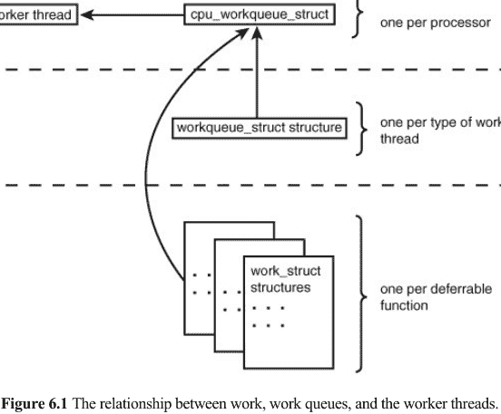

这会静态地创建一个名为 `name` 的 `work_struct` 结构，带有处理器函数 `func` 和参数 `data`。

或者，你可以通过指针在运行时创建工作：

```c
INIT_WORK(struct work_struct *work, void (*func)(void *), void *data);
```

这动态地初始化由 `work` 指向的工作队列，带有处理器函数 `func` 和参数 `data`。

### 你的工作队列处理程序

工作队列处理程序的原型是：

```c
work_handler(void *data);
```

工作线程执行此函数，因此该函数在进程上下文中运行。默认情况下，中断开启且不持有锁。如果需要，该函数可以睡眠。注意，尽管运行在进程上下文中，但工作处理程序无法访问用户空间，因为内核线程没有关联的用户空间内存映射。只有在代表用户空间进程运行时，当用户内存被映射时（例如执行系统调用时），内核才会访问用户空间。工作队列或其他内核部分之间的锁定与任何其他代码一样处理。这使得编写工作处理程序变得简单得多。

### 调度工作

现在工作创建后，我们可以调度它。该函数执行以下功能，它被设置为 `TASK_INTERRUPTIBLE` 并将其加入等待队列。

- 线程将自己标记为睡眠（状态被设置为 `TASK_INTERRUPTIBLE`）。
- 如果工作列表为空，线程调用 `schedule()` 并进入睡眠。
- 如果列表不为空，线程不睡眠。相反，它将自己标记为 `TASK_RUNNING` 并从等待队列中移除。
- 如果列表不空，调用 `run_workqueue()` 来执行延迟工作。

### 调度工作

工作工作在处理器唤醒时执行。要在默认的 `events` 中调度工作，只需调用：

```c
schedule_work(&work);
```

有时，你不希望工作立即执行，而是延迟一段时间后执行。在这种情况下，你可以调度工作在未来的某个时间执行：

```c
schedule_delayed_work(&work, delay);
```

使用节拍作为单位将在第 9 章介绍。

### 刷新工作

队列工作在工作线程唤醒时执行。你需要确保在继续之前，一组工作已完成。这对于想要卸载前调用此函数的模块特别为重要。

对于这些需求，有一个刷新给定队列的函数：

```c
void flush_scheduled_work(void);
```

该函数等待队列中的所有项执行完毕后返回。在等待工作执行期间，函数会睡眠。因此，你只能从进程上下文调用它。

注意，此函数不取消延迟工作。也就是说，任何通过 `schedule_delayed_work()` 调度且延迟未到的的工作都会通过 `flush_scheduled_work()` 刷新。要取消延迟工作，调用：

```c
int cancel_delayed_work(struct work_struct *work);
```

### 创建新工作队列

如果默认队列不能满足需求，你可以创建一个新的工作队列和相应的工作线程。由于为每个处理器创建一个工作线程，只有当你的代码需要唯一线程集的性能时才创建唯一的工作队列。

通过一个简单的函数创建工作队列以及关联的工作线程：

```c
struct work_queue *create_workqueue(const char *name);
```

这将创建所有工作（每个处理器一个）并准备它们处理工作。例如，默认的 `events` 队列通过以下方式创建：

```c
struct work_queue *eventsq = create_workqueue("events");
```

工作队列创建后，以下函数类似于 `schedule_work()` 和 `unschedule_delayed_work()`，但它们作用于给定队列而不是默认队列。

```c
int queue_work(struct work_queue *wq, struct work_struct *work);
int queue_delayed_work(struct work_queue *wq, struct work_struct *work, unsigned long delay);
```

最后，你可以通过以下方式刷新任务队列：

```c
flush_workqueue(struct work_queue *wq);
```

该函数的作用与之前讨论的 `flush_scheduled_work()` 相同，它等待给定队列为空。

任务队列用户被转换到了其他下半部（bottom half）机制。其中大多数切换到了 tasklets。调度器队列的用户则留了下来。最后，eventd 代码被泛化为我们今天拥有的优秀工作队列（work queue）机制，任务队列也最终从内核中被移除了。

## 我应该使用哪种下半部？

决定使用哪种下半部非常重要。在 2.6 内内核中有三个选择：softirq、tasklets 和工作队列。tasklets 的轻量程度与 softirq 一样，因此两者都非常重要。工作队列机制完全不同，它是基于内核线程的。

从设计上来说，softirq 序列化最少。序列化处理程序需要经过额外的步骤来确保共享数据的安全，因为由于两种或更多类型的处理器变量，softirqs 是一个很好的选择。它们无疑是触发关键和高频事件的最快替代方案。如果代码简单，那么使用 tasklets 更有意义，而且由于相同类型的 tasklet 可能不会并发运行，因此它们更容易实现。

如果你需要延迟执行并在进程中运行以睡眠，那么在这三种方案中你唯一的选择就是工作队列。如果不需要进程上下文——具体来说，如果你不需要睡眠——那么 softirqs 或 tasklets 更合适。工作队列的开销最高，因为涉及内核线程，因此涉及上下文切换。这并不是说它们效率低下，但考虑到每秒数千次的中断（如网络子系统可能会经历），其他方法更合理。对于大多数情况，工作队列已经足够。

在用性方面，工作队列位冠。使用默认事件队列易如反掌。其次是 tasklets，它们也有简单的接口。最后是 softirqs，它们需要被创建。

表 6.3 下半部对比

| 下半部 | 上下文 | 序列化 |
| :--- | :--- | :--- |
| Softirq | 中断 | 无 |
| Tasklet | 中断 | 针对同一个 tasklet |
| 工作队列 | 进程 | 无（作为进程上下文调度） |

简而言之，普通驱动有两个选择。首先，你是否需要一个可调度的实体来执行延迟工作——你是否因为某种原因需要睡眠？如果是，那么工作队列是你唯一的选择。否则，优先选择 tasklets。如果扩展性变成一个问题，那么再研究 softirqs。


我们还没有讨论锁，这是一个我专门用接下来的两个章节来讨论的话题。尽管如此，理解以下一点至关重要：即使在单处理器机器上，使用下半部保护共享数据免受并发访问也是至关重要的。记住，下半部可以在任何时刻运行。如果锁的概念对你来说还很陌生，你可能想在读完接下来两个章节后回到这一节。

`tasklets`的优点之一是它们是自序列化的：即使在两个不同的处理器上，同一个`tasklet`也不会并发运行。你不需要担心`tasklet`之间的并发问题。`tasklet`之间的并发（即，当两个不同的`tasklet`共享相同数据时）需要适当的锁。

由于`softirq`不提供序列化（即使是同一个`softirq`的两个实例也会同时运行），所有共享数据都需要适当的锁。

如果进程上下文代码和下半部共享数据，你需要在访问数据之前禁用下半部处理并获取锁。这两者都做可以确保本地和SMP保护，并防止死锁。

任何共享数据都需要锁。锁的问题与普通内核代码没有区别，因为工作队列运行在进程环境中。

在第7章中，我们将介绍锁背后的奥秘。在第8章中，我们将介绍内核锁原语。这些章节将介绍如何保护下半部使用的数据。

## 禁用下半部

通常，仅禁用下半部是不够的。更多时候，为了保护共享数据，你需要获取锁并禁用下半部。你可能在驱动程序使用的此类方法将在第8章介绍。然而，如果你正在编写内核代码，可能只需要禁用下半部。

要禁用所有下半部处理（具体来说是所有`softirq`以及所有`tasklet`），调用`local_bh_disable()`。要启用下半部处理，调用`local_bh_enable()`。是的，该函数命名有误；当BH接口让位给`softirqs`时，没有人去修改它。表6.4是这些函数的总结。

表6.4 下半部控制方法列表

| 方法 | 描述 |
|---|---|
| `void local_bh_disable()` | 在本地处理器上禁用`softirq`和`tasklet`处理 |
| `void local_bh_enable()` | 在本地处理器上启用`softirq`和`tasklet`处理 |

这些调用可能是嵌套的——只有最后对`local_bh_enable()`的调用才会启用下半部。这些函数通过通过`preempt_count`（内核抢占使用的相同计数器）维护每个任务的计数器来实现。当计数器达到零时，就可以进行下半部处理。由于下半部被禁用，`local_bh_enable()`还会检查挂悬的下半部并执行它们。

这些函数是每个支持的架构特有的，通常写在`<asm/softirq.h>`中的复杂映射。以下是该概念的C语言表示：

```c
/*
 * 通过增加 preempt_count 禁用下半部
 */
void local_bh_disable(void)
{
    struct thread_info *t = current_thread_info();
    t->preempt_count += SOFTIRQ_OFFSET;
}

/*
 * 递减 preempt_count - 如果计数器返回零，这将“自动”启用
 * 下半部
 *
 * 可选项运行任何挂悬的下半部
 */

void local_bh_enable(void)
{
    struct thread_info *t = current_thread_info();
    t->preempt_count -= SOFTIRQ_OFFSET;

    /*
     * preempt_count 是否为零以及是否有挂悬的下半部？
     * 如果是，则运行它们
     */
    if (unlikely(!t->preempt_count && softirq_pending(smp_processor_id()))) {
        do_softirq();
    }
}
```

事实上，这个计数器被中断和下半部子系统共同使用。因此在Linux中，单任务计数器代表了任务的原子性。这对于解决“原子性期间睡眠”（`sleeping-while-atomic`）的bug非常有用。

这些调用并没有禁用工作队列的执行。由于工作队列运行在进程环境中，因此不存在异步问题，因此没有需要禁用它们。由于`softirqs`和`tasklets`可能会异步发生（例如，从中断返回时），内核代码可能需要禁用它们。相反，对于工作队列，保护共享数据与在进程环境中相同。第7章和第8章给出了细节。

## 内核同步简介

在共享内存的应用程序中，必须确保共享资源免受并发访问的侵害。内核也不例外。共享资源需要保护免受并发访问，因为如果多个线程同时访问它，线程可能会覆盖彼此的更改或在数据处于不一致状态时访问它。共享数据的并发访问是不稳定的根源，通常非常难以追踪和调试——从一开始就做好是很重要的。

正确地保护共享资源可能是困难的。多年前在Linux支持对称多处理之前，防止数据的并发访问是简单的。因为只支持单处理器，并发访问数据的唯一方法是中断发生或内核显式重新调度并允许另一个任务运行。那时，生活很简单。

那些日子已经过去。多处理支持在2.0内核中引入，并在之后不断增强。多处理支持意味着内核代码可以在两个或多个处理器上同时运行。因此，如果没有保护，运行在两个处理器上的内核代码可以在同一时刻同时访问共享数据。随着2.6内核的引入，Linux内核是抢占式的。这意味着（再次，在没有抢占的情况下）调度器可以在几乎任何点抢占内核代码，重新调度另一个任务。今天，内核内部存在许多并发场景，它们都需要保护。

> 线程一语指的是执行任何代码的实例。例如，内核中的任务、中断处理程序或内核线程。本章可能会将线程的执行简称为线程。

本章讨论了操作系统内核中存在的并发与同步问题。下一章将详细介绍处理这些同步问题并防止竞态条件的机制和接口。

## 临界区与竞态条件

访问并操作共享数据的代码路径被称为临界区（`critical regions`）。为了防止在临界区期间并发访问，程序员（即你）必须确保代码是原子执行的——也就是说，如果整个临界区是不可分割的，那么代码将在不受中断的情况下完成。如果两个执行线程同时处于同一个临界区，就是一个错误。当这种情况真的发生时，我们称竞态条件（`race condition`，因为线程在竞争获取访问权而命名）。注意这种现象可能非常罕见且难以调试，因为它们不容易复现。确保防止并发发生且不出现竞态条件的方法称为同步。

为了最好地识别竞态条件，让我们看看临界区是多么普遍。作为一个例子，考虑一个非常简单的共享资源：一个全局整数，以及一个非常简单的临界区：增加该整数的操作：

```c
i++;
```

这可能会被转化为计算机处理器的指令，类似于：

```
get the current value of i and copy it into a register
add one to the value stored in the register
write back to memory the new value of i
```

现在，假设有两个执行线程，都进入了这个临界区，且`i`的初始值为7。预期的结果如下（每行代表一个时间单位）：

| Thread 1 | Thread 2 |
| --- | --- |
| get i (7) | get i (8) |
| - | - |
| increment i (7 -> 8) | increment i (8 -> 9) |
| write back i (8) | write back i (9) |

如预期的，7增加两次是9。然而，一种结果可能是：

Thread 1

```
get i (7)
increment i (7 -> 8)
write back i (8)
```

Thread 2

```
get i (7)
increment i (7 -> 8)
write back i (8)
```

如果两个执行线程都在`i`增加之前读取了它的初始值，那么它们都会增加并保存相同的值。结果是变量`i`包含值8，而实际上它应该包含9。这是临界区最简单的例子之一。坦率地说，解决方案也很简单——只需要一种方法在一个不可分割的步骤中执行这些操作。大多数处理器提供了一种指令来原子地读取、增加并写回单个变量。使用此类指令可以缓解这个问题。内核提供了一组接口将在下一书中讨论。

## 锁

现在，让我们考虑一个需要更复杂解决方案的复杂竞态条件。假设我们有一个需要处理的请求队列。如何实现队列并不重要，假设它是一个链表，每个节点代表队列。一个函数向队列尾部添加新请求。另一个函数从队列头部移除请求并对该请求进行有用的操作。内核的不同部分会调用这两个函数；请求不断地被添加、移除和处理。

操作请求队列确实需要多条指令。如果一个线程尝试从队列读取数据，而另一个线程正在操作它，读取线程将发现队列处于不一致状态。如果可以并发访问队列，那么可能造成的损害是显而易见的。这通常会导致数据结构的损坏。


上述场景至少可能没有明确的解决方案。我们如何防止这种情况？我们能做什么来确保只有一个线程可以访问队列？答案是锁（`locking`）。锁是一种机制，允许一次只有一个线程访问临界区。当线程想要进入临界区时，它首先获取锁。如果另一个线程已经持有锁，该线程必须等待。一旦线程完成临界区，它就会释放锁，等待的线程就可以继续。

实现锁有很多方法，某些比其他更好。在下一章，我们将讨论最常见的机制，包括自旋锁（`spinlocks`）、互斥锁（`mutexes`）和信号量（`semaphores`）。它们各自特性，适用于不同的情况。例如，自旋锁用于短临界区，它们不会中断内核的其他部分。

## 什么导致了并发？

在用户空间，同步的需求是因为内核是抢占式的，进程可以被中断。在内核内部，需求是因为内核在任何时候都可能被中断或其他处理器中断。主要原因有：

- 内核抢占：中断可以在任何时间异步发生，中断当前正在执行的代码。
- 内核抢占：由于内核是抢占式的，内核中的一个任务睡眠并调用调度器，导致新进程的运行。
- 多处理器处理：两个或多个处理器可以在同一时刻执行。

内核开发人员理解并准备这些并发原因至关重要。如果在操作资源的代码中间发生中断，且中断处理程序访问了该资源，就是一个错误。同样，进程在访问共享资源时可能会被抢占，如果内核代码在临界区中间发生睡眠，就会导致竞态条件。最后，两个处理器永远不应该同时访问共享数据。只要清楚哪些数据需要保护，为世界提供安全的锁并不困难。困难的部分在于识别这些条件，并意识到为了防止并发，你需要某种形式的保护。

# 什么需要保护？

识别哪些数据需要保护至关重要。任何可以被并发访问的数据都可能需要保护；识别哪些数据不需要保护并从那里着手会更容易。否则，任何对于特定执行线程的本地数据都不需要保护，因为只有该线程可以访问该数据。此外，局部自动变量不需要任何形式的锁定，因为它们存在于执行线程的栈上；如果任何其他人能看到它，就给它加锁。

锁定意味着什么？大多数内核数据结构都是如此。一个好的经验法则是：如果另一个执行线程可以访问该数据，它就需要某种形式的锁定；如果任何其他人能看到它，就给它加锁。

# CONFIG 选项：SMP 对比 UP

由于 `Linux` 内核可以在编译时进行配置，因此针对特定机器对内核进行调优是有意义的。最重要的内核是否支持 `SMP` 是通过 `CONFIG_SMP` 选项决定的。在未设置 `CONFIG_SMP` 的情况下，单处理器机器上的许多锁定问题，必要的代码不会被编译到内核中。例如，这使得单处理器机器可以忽略自旋锁（`spin locks`）的开销。这同样适用于 `CONFIG_PREEMPT`（启用内核抢占的配置）。这是一个极佳的设计决策——内核维护了一个整洁的源码，并根据需要使用各种锁定机制。在不同的架构上，`CONFIG_SMP` 和 `CONFIG_PREEMPT` 的不同组合会导致支持程度各异。

在你的代码中，为所有问题提供适当的保护将涵盖这种情况。每当你编写内核代码时，都应该问自己这些问题：

- 数据是全局的吗？当前执行执行线程可以访问它吗？
- 数据是否在进程上下文和中断上下文之间共享？它是否在两个中断处理程序之间共享？
- 如果进程在访问此数据时被抢占，新调度的进程可以访问相同的数据吗？
- 当前进程会对任何内容进行睡眠（阻塞）吗？如果是，这会导致共享数据处于什么状态？
- 什么防止了数据从我这里被释放掉？

> ³ 我们还将看到，除少数例外外，SMP 安全意味着意味着抢占安全。

如果此函数在另一个处理器上被再次调用会怎样？

简而言之，内核中几乎所有的全局和共享数据都源于下一章讨论的某种同步方法。

## 死锁

死锁是一种涉及一个或多个执行线程以及一个或多个资源的状态，使得每个线程都在等待其中一个资源，但所有资源都已被持有。这些线程都在相互等待，但永远不会在释放它们已经持有的资源方面取得任何进展。除非发生了死锁，否则没有线程可以继续。

一个很好的类比是四路交叉路口。如果每个路口处的每辆车都决定在通过之前等待其他车，那么没有辆车永远会通过，我们就陷入了交通死锁。

死锁最简单的例子是自死锁：如果一个执行线程尝试获取它已经持有的锁，它将不得不等待锁被释放。但它永远不会释放该锁，因为它正忙于等待锁，结果就是死锁：

```
acquire lock
acquire lock, acquire
wait for lock to become available
..
```

同样，考虑 `n` 个线程和 `n` 把锁。如果每个线程都持有另一个线程需要的锁，所有线程都将阻塞并等待各自的锁变得可用。最常见的例子是两个线程和两个锁，这通常被称为 `ABBA 死锁`：

### 线程 1

```
acquire lock A
try to acquire lock B
wait for lock B
```

### 线程 2

```
acquire lock B
try to acquire lock A
wait for lock A
```

每个线程都在等待对方，且两者永远都不会释放它们原始的锁；因此，两者永远都不会变得可用。这种死锁也被称为 `致命拥抱（deadly embrace）`。

> ⁴ 某些内核通过递归锁（`recursive locks`）来防止这种类型的死锁，单个执行线程可以多次获取该锁。幸运的是，`Linux` 不提供递归锁。这通常被认为是一件好事。递归锁可能会缓解自死锁问题，但它们非常容易导致粗糙的锁定语义。

防止死锁场景是非常重要的。虽然证明代码没有死锁很困难，但编写无死锁代码是可能的。简单的规则如下：

- 锁定顺序至关重要。嵌套锁必须始终以相同的顺序获取。这可以防止致命拥抱死锁。记录锁定顺序以便他人遵循。
- 防止饥饿。代码是否始终确保安全？如果 `foo` 没有发生，`bar` 会永远等下去吗？
- 不要获取同一把锁——为简单性而设计。

第一点非常重要，值得强调。如果同时获取了两个或多个锁，必须以相同的顺序获取。假设我们有 `cat`、`dog` 和 `fox` 锁，它们保护具有同名的数据结构。现在我们有一个函数需要同时处理所有这些锁——也许是为了在它们之间复制数据。无论情况如何，数据结构都需要锁来确保安全访问。如果一个函数按照 `cat`、`dog`，然后 `fox` 的顺序获取锁，那么其他所有函数必须以相同的顺序获取这些锁（或其子集）。如果先获取 `fox` 锁再获取 `dog` 锁将导致潜在的死锁（因此是一个错误），因为 `dog` 锁必须在 `fox` 锁之前获取。再次，这里有一个这种情况会导致死锁的例子：

### 线程 1

```
acquire lock cat
acquire lock dog
try to acquire lock fox
wait for lock fox
```

### 线程 2

```
acquire lock fox
try to acquire lock dog
wait for lock dog
```


# Linux 在大量处理器上的可扩展性

Linux 在大量处理器上的可扩展性在引入多处理器支持以来大幅增加。Linux 多处理器的早期是粗粒度的。通过 2.4，随着锁定机制变得更加细粒度，这种限制被消除了。

防止死锁非常重要。Linux 内核具有了一些用于检测运行内核中死锁的基本功能。这些功能将在下一章讨论。

## 竞争与可扩展性

锁竞争（lock contention）或简单的竞争一词用于描述一个正在使用但另一个正尝试获取的锁。高竞争的锁可能会成为瓶颈，迅速限制其性能。当然，锁也是为了防止死锁和确保数据完整性。

可扩展性（Scalability）衡量系统扩展能力的程度。在扩展系统中，我们谈论大量处理器的可扩展性。我们可以就连接计算机的任何组件讨论可扩展性。理想情况下，处理器数量翻倍会导致系统性能翻倍。当然，事实并非如此。

Linux 在大量处理器上的可扩展性自 2.0 内核引入多处理器支持以来大幅增加。Linux 多处理器的早期是粗粒度的。通过 2.4，随着锁定机制变得更加细粒度，这种限制被消除了。

锁定的粒度（granularity）是锁保护的数据的大小或数量。粗粒度锁保护大量数据——例如整个子系统的数据结构。细粒度锁保护较少的数据——例如较大结构中的单个元素。在现实中，大多数锁处于这些极端之间，既不保护整个子系统，可能只保护一个结构。大多数锁最初都是粗粒度的，当竞争证明是一个问题时，变得更加细粒度。

演变为更细粒度锁定的一个例子是调度器运行队列，见第 3 章“调度”。在 2.4 及之前的版本的内核中，调度器有一个运行队列（运行队列是可管理进程的列表）。在 2.6 中，调度器引入了每个处理器一个运行队列以及一个唯一的锁。锁定从单个全局锁演变为每个处理器独立的锁。

通常，这种可扩展性的改进是一件非常好事，因为它提升了 Linux 在更大、更强大的系统上的性能。然而，狂热的可扩展性“改进”由于较小机器可能不需要如此细的锁定，可能会导致小型 SMP 和 UP 机器的性能下降，但仍然必须承受增加的复杂性和开销。

考虑初始锁定方案将为列表提供单个锁。随着时间的推移，这个单锁节点在频繁访问此链表的超庞大多处理器机器上可能会成为可扩展性瓶颈。这个单锁可以被拆分为链表中的一个锁节点。对于你想要读取或写入的每个节点，你获取该节点的唯一锁。现在，只有当多个处理器访问同一个节点时才会发生锁竞争。然而，如果仍然存在锁竞争怎么办？（尽管这种极细粒度的锁定在非常大的机器上可能表现优异，但在双处理器机器上的表现如何呢？随着系统复杂性的增加，这些锁的开销将成为一个备受的问题）

尽管如此，可扩展性是一个重要的考虑因素。从头到尾设计你的锁定机制是非常重要的。主要资源的粗粒度锁定在小规模机器上很容易变成瓶颈。过度粗粒度锁定和过度细粒度锁定之间一线之隔。过粗的锁定会导致可扩展性差，而过于细的锁定在锁竞争较少时会导致开销。这两种情况都等同于性能问题。从简单开始，仅根据需要增加复杂性。简单是关键。

## 锁与你的代码

使你的代码具有 SMP 安全性不是事后可以添加的。适当的同步——无死锁、可扩展且整洁的锁定——需要从头到尾的设计决策。每当你编写内核代码时，无论是新的系统调用还是重写的驱动程序，保护数据免受并发访问都是一个首要考虑的问题。

为每种场景（SMP、内核抢占等）提供足够的保护，以确保数据在任何给机器和配置上都是安全的。下一章将讨论如何实现这一点。

## 内核同步方法

上一章讨论了竞态条件的来源和解决方案。坦率地说，Linux 内核实现了一系列同步方法。本章将讨论这些方法及其接口、行为和用法。

### 原子操作

原子操作提供了原子化执行的指令——不会被中断。正如原子最初被认为是一个不可分割的粒子一样，原子操作符是不可分割的指令。例如，正如上一章所讨论的，原子加法可以在单个不可分割且不中断的步骤中读取变量并将其加 1。结果与上一章讨论的竞态不同，总是相似的（假设 `i` 初始值为 7）：

#### 线程 1

`increment i (7 -> 8)`

#### 线程 2

`increment i (8 -> 9)`

得到的值九是正确的。两个原子操作绝不可能在同一个变量上并发发生。因此，加法操作不可能发生竞态。

内核为原子操作提供了两组接口——一组针对整数操作，另一组针对单个位进行操作。这些接口在 Linux 支持的所有架构上都得到了实现。大多数架构要么直接支持简单的原子操作，要么提供一种操作来锁定总线以执行单个操作（从而确保另一个操作不会同时发生）。然而，无法轻易支持原始原子操作的架构（如 SPARC）采取了其他处理方式。

#### 原子整数方法

原子方法作用于一种特殊的数据类型 `atomic_t`。与让函数直接作用在 C `int` 上相比，使用这种特殊类型有几几个原因。首先，让原子函数只接受 `atomic_t` 类型可以确保原子操作仅用于这些特殊类型。同样，数据类型不会传递给任何其他非原子函数。事实上，如果原子操作有时被使用而其他时候不使用，它们还算得上是良好的原子操作吗？其次，使用 `atomic_t` 可以确保编译器不会（错误地）优化对值的访问——即别名。最后，使用 `atomic_t` 可以隐藏其实现中任何特定架构的差异。

由于是整数且 Linux 支持的所有机器都是 32 位的，必须假设 `atomic_t` 的大小不超过 24 位。这是因为 SPARC 架构对原子操作的实现非常特殊：锁被嵌入在 32 位整数的低 8 位中（如图 8.1 所示）。该锁用于保护对原子类型的并发访问，因为 SPARC 架构缺乏指令级支持。因此，在 SPARC 机器上只能使用 24 位。虽然假设存在完整 32 位范围在在机器上可以运行，但在 SPARC 机器上可能会以奇怪而微妙的方式失败——这简直太不礼貌了。

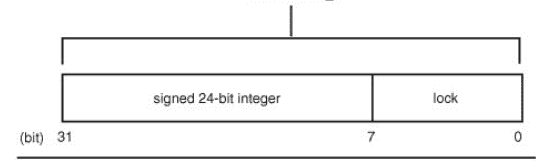

使用原子整数操作所需的声明在 `<asm/atomic.h>` 中。某些架构提供了该架构特有的额外方法，但所有架构都至少提供了在整个内核中使用的最小操作。当你编写内核代码时，可以确保这些操作在所有架构上都得到了正确实现。

定义 `atomic_t` 是按通常方式完成的。可选，你可以设置一个初始值：

```c
atomic_t u;

/* 定义 u */

atomic_t v = ATOMIC_INIT(0);

/* 定义 v 并将其初始化为零 */
```

#### 原子整数操作

```c
atomic_set(v, 4);      /* v = 4 */
atomic_add(v, 2);      /* v = v + 2 */
atomic_inc(v);         /* v = v + 1 */
printf("%d\n", atomic_read(v)); // 读取 v 的值
atomic_dec(v);         /* v = v - 1 */
atomic_dec_and_test(v); /* 减 1 并测试结果是否为零 */
atomic_x_set(v, 4);    /* 设置 v 为 4 */
atomic_inc_and_test(v);  /* 加 1 并测试结果是否为零 */
atomic_add_and_test(v); /* 加 2 并测试结果是否为零 */
```

#### 表 8.2 原子位运算操作列表

| 原子位运算操作 | 描述 |
| --- | --- |
| `void set_bit(int nr, void *addr)` | 原子性地设置从 `addr` 开始的第 `nr` 位 |
| `void clear_bit(int nr, void *addr)` | 原子性地清除从 `addr` 开始的第 `nr` 位 |
| `void change_bit(int nr, void *addr)` | 原子性地翻转从 `addr` 开始的第 `nr` 位的值 |
| `int test_and_clear_bit(int nr, void *addr)` | 原子性地清除从 `addr` 开始的第 `nr` 位并返回旧值 |
| `int test_and_change_bit(int nr, void *addr)` | 原子性地翻转从 `addr` 开始的第 `nr` 位并返回旧值 |
| `int test_bit(int nr, void *addr)` | 原子性地返回从 `addr` 开始的第 `nr` 位的值 |

相反，还提供了所有位操作函数的非原子版本。它们的行为与其对应的原子版本相同，不同之处它们不保证原子性，且名称带有下划线开头。例如，`test_bit()` 的非原子形式是 `__test_bit()`。如果你不需要原子性（例如，因为有一个锁局部保护了你的数据），这些位操作函数的变体可能会更快。

内核还提供了在给定地址处查找第一个置位（或未置位）位的例程：

```c
int find_first_bit(unsigned long *addr, unsigned int size)
int find_first_zero_bit(unsigned long *addr, unsigned int size)
```


这两个函数都接受指针作为第一个参数，并将搜索的总位数作为第二个参数。它们分别返回第一个置位或未置位的位索引。如果你只搜索一个字（`word`），则接受待搜索字作为单个参数的例程 `ffs()` 和 `ffz()` 是优的。

与原子整数操作不同，代码通常没有选择是否使用位操作——它们是设置特定位的唯一方法。问题仅在于使用原子版本还是非原子版本。如果你的代码从本质上对竞态条件，你可以使用非原子版本，根据架构的不同，它们可能会更快。

## 自旋锁 (Spin Locks)

虽然看起来如果每个界区域都像增加一个变量那么简单，但现实要粗糙得多。在现实生活中，临界区域可能跨越多个函数。例如，通常必须将数据从一个结构中移除、格式化并添加到另一个结构中。整个操作必须以原子方式进行；在我们更新它之前，其他代码不能读取其中任何一个结构。由于简单的原子操作无法提供这种保护，因此需要更复杂的同步方法——锁。

`Linux` 内核中最常见的锁是自旋锁。自旋锁是一种由一个执行线程持有的锁。如果一个执行线程尝试获取一个正在竞争（已被持有）的自旋锁，该线程将进行自旋——等待锁变得可用。如果锁没有竞争，它就可以立即获取锁并继续。自旋防止了多个执行线程在同一时刻进入临界区域。同一个锁可以在多个位置使用——因此对给定数据结构的所有访问都可以得到保护和同步。

竞争的自旋锁会导致线程在等待锁可用时进行自旋（占用处理器），这一点非常重要。长时间持有自旋锁不是良好的做法。事实上，这就是自旋锁的本质：一种轻量级的持有者锁，应该只持有短时间。另一种方法是使用一种会让进入睡眠而不是自旋的锁。这会产生一些开销——主要是切出和回到阻塞线程的两次上下文切换。因此，尽可能短地持有自旋锁（短于两次上下文切换的持续时间）是明智的。由于我们的大多数人比起测量上下文切换有更有意义要做，所以只需尝试尽可能短地持有锁即可。下一节将使用信号量，信号量提供了一种在发生竞争时让等待线程睡眠而不是自旋的锁。

自旋锁依赖于架构并用汇编语言实现。依赖架构的代码定义在 `<asm/spinlock.h>` 中。自旋锁的实际用法如下

```
spinlock_t mr_lock = SPIN_LOCK_UNLOCKED;

spin_lock(&mr_lock);

/* critical region ... */

spin_unlock(&mr_lock);
```

这在内核是可抢占的情况下尤其为重要。持有锁的持续与系统的调度延迟耦合。

锁最多只能由一个执行线程同时持有。因此，一次只允许一个线程进入临界区域。这为多处理器上的并发提供了所需的保护。在 `UP`（对称多处理）机器上，锁会被编译掉并不存在。它们仅仅充当禁用和启用内核抢占的标记。如果关闭了内核抢占，锁将完全被编译。

## 警告：自旋锁不是递归的？

与其他操作系统的自旋锁不同，`Linux` 内核的自旋锁不是递归的。如果你使用了一个锁并尝试获取已经持有的锁，你将不断自旋，等待你自己释放锁。由于你正忙，你永远不会释放锁，并将导致死锁。

自旋锁可以于中断处理程序（然而，信号量不行，因为它们不能睡眠）。如果在中断处理程序中使用锁，你必须在获取锁之前也禁用中断（当前处理器上的中断请求）。否则，中断处理程序可能会在锁持有期间中断内核代码并尝试获取该锁。

## 我应该锁什么？

确保每个锁与它锁的内容有明确关联是重要的。更重要的是要保护数据而不是代码。尽管本章的示例解释了保护临界区域的重要性，但真正需要保护的是数据。将数据与锁关联。例如，`struct Foo` 被 `foo_lock` 锁定`。始终为每份数据建立关联。每当你访问数据时，请确保它是安全的。这可能意味着在访问数据之前获取锁，并在完成后释放锁。

如果启用了 `spin_lock_irq()` 和 `spin_unlock_irq()`，则不需要恢复它们之前的状态。在这些情况下，

```
spinlock_t mlock = SPIN_LOCK_UNLOCKED;

unsigned long flags;

spin_lock(lock);

/* critical section ... */

spin_unlock(lock);
```

在内核的任何给定代码路径中确保中断始终开启变得越来越困难。由于，不建议使用 `spin_lock_irq()`。如果你使用它，你最好确定中断原本是关闭的，否则当你发现它们是开启的时会很恼！

## 调试自旋锁

配置选项 `CONFIG_DEBUG_SPINLOCK` 启自旋锁代码中的一些调试检查。例如，开启此选项后，自旋锁代码将检查未初始化的自旋锁的使用以及解锁未的锁。在测试代码时，你应该始终开启自旋锁。

## 其他自旋锁方法

`spin_lock_init()` 方法用于初始化动态创建的自旋锁（你没有直接引用、只有指针的 `spinlock_t`）。

`spin_try_lock()` 方法尝试获取给定的自旋锁。如果锁发生竞争，它不会自旋等待锁释放，而是立即返回非零。如果成功获取锁，则返回零。同样，如果给定的锁已被获取，`spin_is_locked()` 返回非零。否则，在上述两种情况下，该函数都不会实际获取锁。

## 表 8.3 自旋锁（Spin Lock）方法列表

| 方法 | 描述 |
| --- | --- |
| `spin_lock()` | 获取给定的锁 |
| `spin_lock_irq()` | 禁用本地中断并获取给定的锁 |
| `spin_lock_irqsave()` | 保存本地中断当前状态，禁用中断并获取给定的锁 |
| `spin_unlock()` | 释放锁 |
| `spin_unlock_irq()` | 释放给定的锁并启用本地中断 |
| `spin_unlock_irrestore()` | 释放给定的锁并将本地中断恢复到之前的状态 |
| `spin_lock_init()` | 初始化给定的 `spin_lock_t` |
| `spin_trylock()` | 尝试获取给定的锁；不可用时返回非零 |
| `spin_is_locked()` | 如果给定的锁当前被占用则返回非零，否则返回零 |

## 自旋锁与下半部（Bottom Halves）

如第 6 节“下半部与延迟工作”所述，在处理下半部时必须采取锁定措施。`spin_lock_bh()` 函数获取给定的锁并禁用所有下半部。`spin_unlock_bh()` 函数执行相反操作。

由于下半部可能会抢占进程上下文，如果数据在下半部和进程上下文之间共享，则你必须在进程上下文中使用锁和禁用下半部的方法来保护该数据。同样，中断处理程序可能会抢占下半部，如果中断处理程序和下半部之间共享数据，你必须同时获取相应的锁并禁用中断。

回想相同类型的两个任务不会同时运行。因此，没有必要在单个任务队列（`tasklet`）内部保护数据。然而，如果数据在两个不同的 `tasklet` 之间共享，在下半部访问数据之前，你必须获取一个普通的自旋锁。你不需要禁用下半部，因为它们在同一处理器上永远不会抢占另一个 `tasklet`。

对于软中断（`softirqs`），无论是否是相同的软中断类型，如果软中断共享数据，就必须用锁来保护。请记住，软中断即使是相同类型，也可能在系统的多个处理器上同时运行。然而，软中断永远不会抢占在同一处理器上运行的另一个软中断，因此不需要禁用下半部。

## 读写自旋锁（Reader-Writer Spin Locks）

有时，锁的使用可以清晰地分为读者和写者。例如，考虑一个既被更新又被搜索的列表。当列表被更新（写入）时，没有其他代码在同时向列表写入或从列表中读取。写入需要互斥。另一方面，当列表被搜索（读取）时，只要没有其他内容向列表写入数据即可。只要没有写者，多个并发的读者是安全的。任务列表（在第 2 节“进程管理”中讨论）与此非常相似。难怪，任务列表受读写自旋锁的保护。

当一个数据结构像这样拆分为读者-写者路径时，使用一种提供相似语义的锁定机制是有意义的。在 `Linux` 中，读写自旋锁提供了锁的读者和写者变体。一个或多个读者可以并发持有读锁。相反，写锁最多可由一个者持有，且没有并发的读者。用法与自旋锁相似。读写自旋锁为：

```
rwlock_t mr_rwlock = RW_LOCK_UNLOCKED;
```

在这里，在读者代码路径中：

```
read_lock(&mr_rwlock);

/* 临界区（只读） ... */

read_unlock(&mr_rwlock);
```

最后，在写者代码路径中：

```
write_lock(&mr_rwlock);

/* 临界区（读写） ... */

write_unlock(&mr_rwlock);
```

通常，读者和写者位于单独的代码中，如示例所示。

注意，你不能将读锁“升级”为写锁。这段代码：

```
read_lock(&mr_rwlock);

write_lock(&mr_rwlock);
```


会导致死锁，因为写锁将自旋，等待所有读者释放锁（包括你自己）。如果你确实需要写入，请从一开始就获取写锁。如果你的读者和写者之间的界限很模糊，这可能表明你不需要使用读写自旋锁。在这种情况下，普通的自旋锁是最优的。

多个读者获取同一把锁是安全的。事实上，同一个线程递归地获取同一把锁也是安全的。这提供了一种常见的优化。如果你只在中断处理程序中拥有读者而没有写者，你可以混合使用“禁用中断”的锁。你可以使用 `read_lock()` 代替 `read_lock_irqsave()` 来保护读者。对于写入访问，你仍然需要禁用中断，类似于 `write_lock_irqsave()`，否则中断中的读者可能会在持有的锁上死锁。参见表 8.4 了解读写自旋锁方法的完整列表。

## 表 8.4 读写自旋锁方法列表

| 方法 | 描述 |
| :--- | --- |
| `read_lock()` | 获取给定的读锁 |
| `read_lock_irq()` | 禁用本地中断并获取给定的读锁 |
| `read_lock_irqsave()` | 保存本地中断当前状态，禁用本地中断并获取给定的读锁 |
| `read_unlock()` | 释放给定的锁 |
| `read_unlock_irq()` | 释放给定的锁并启用本地中断 |
| `read_unlock_irrestore()` | 释放给定的锁并将本地中断恢复到之前的状态 |
| `write_lock()` | 获取给定的锁 |
| `write_lock_irq()` | 禁用本地中断并获取给定的锁 |
| `write_lock_irqsave()` | 保存本地中断当前状态，禁用中断并获取给定的锁 |
| `write_unlock()` | 释放给定的锁 |
| `write_unlock_irq()` | 释放给定的锁并启用本地中断 |
| `write_unlock_irrestore()` | 释放给定的锁并将本地中断恢复到之前的状态 |
| `write_trylock()` | 尝试获取给定的锁；不可用时返回非零 |
| `rwlock_init()` | 初始化给定的 `rwlock_t` |
| `rwlock_is_locked()` | 如果给定的锁当前被占用则返回非零，否则返回零 |

使用读写自旋锁的最后一个考虑因素是，它们倾向于读者。与自旋锁不同，它们允许多个读者持有锁。在设计锁时记住这一点非常重要。然而，它们可能会导致写者饥饿。

# 信号量（Semaphores）

Linux 中的信号量是睡眠锁（sleeping locks）。当一个任务尝试获取一个已被占用的信号量时，它会将任务置于等待队列并使任务进入睡眠。处理器可以自由执行其他代码。

从信号量的睡眠行为中，我们可以得出一些有趣的结论：

- 因为竞争的任务在等待锁时睡眠，信号量非常适合持有时间较长的锁
- 反之，信号量对于短时间的锁不是最优的，因为睡眠的开销可能超过总持有时间。
- 你可以在持有信号量时睡眠（尽管你可能不想这样做），因为当另一个进程获取它时会死锁。
- 你不能在获取信号量时持有自旋锁

这些事实强调了信号量与自旋锁的使用。在大多数信号量使用场景中，使用什么工具的选择不大：如果你的代码需要睡眠（在与用户空间同步时通常如此），信号量是解决方案，它们允许睡眠的可能性。当你有选择时，在信号量和自旋锁之间的决策应基于持有时间。理想情况下，所有的锁都应该尽可能短。然而，对于信号量，较长的持有时间是可以的。与自旋锁不同，信号量不会禁用内核抢占，因此持有信号量可能会被抢占。

信号量的最后一个特性是，它们允许任意数量的并发持有者。自旋锁最多允许一个任务持有锁，而允许并发持有者的数量可以在声明时设置。最常见的值是像自旋锁一样，一次只允许一个持有者。在这种情况下，计数等于1，信号量被称为二值信号量（因为通常被用作初始化的计数信号量）。如果计数大于1，信号量被称为计数信号量，它允许多个持有者同时持有锁。计数信号量不用于强制互斥，它们允许多个线程同时进入临界区域。如果你使用信号量，你几乎确定想要互斥锁（计数为1的信号量）。

信号量由 Edsger Dijkstra 在 1968 年形式化为一种通用的锁机制。信号量支持原子操作 `P()` 和 `V()`，这两个名字源于荷兰语的 `Proberen`（意为测试）和 `Verogen`（意为递增）。后来的系统将这些方法分别命名为 `down()` 和 `up()`，Linux 也是如此。`down()` 方法通过将计数减 1 来获取信号量。如果计数为 0 或大于，则任务可以获取临界区。如果计数为负数，任务将在队列上等待，处理器将去处理其他事务。`down()` 函数允许你获取信号量。`up()` 方法用于完成临界区后释放信号量。当等待的任务之一被唤醒并允许获取信号量时，会调用此方法。

## 创建和初始化信号量 (Creating and Initializing Semaphores)

信号量的实现是由架构定义的，定义在 `<asm/semaphore.h>` 中。`struct semaphore` 类型表示信号量。静态声明的信号量通过以下方式创建：

```
static DECLARE_SEMAPHORE_GENERIC(name, count);
```

其中 `name` 是变量名，`count` 是信号量的使用计数。作为创建更常见的互斥锁（`mutex`）的快捷方法，使用：

```
static DECLARE_MUTEX(name);
```

这里 `name` 也是信号量的变量名。更多情况下，信号量是动态创建的，通常作为较大结构的一部分。在这种情况下，为了初始化一个你只有间接指针引用的动态创建的信号量，你可以：

```
sema_init(sem, count);
```

其中 `sem` 是指针，`count` 是信号量的使用计数。同样，初始化一个动态创建的互斥锁，可以使用：

```
init_MUTEX(sem);
```

## 使用信号量 (Using Semaphores)

`down_interruptible()` 函数尝试获取给定的信号量。如果失败，将在 `TASK_INTERRUPTIBLE` 状态下睡眠。回想第 2 章，这种进程状态意味着任务等待，这通常是一件好事。如果在等待信号量时接收到（信号）

> Dijkstra (1930-2002) 是计算机科学家历史（诚然是短暂的）上最有成就的计算机科学家之一。他的众多贡献包括操作系统设计、算法理论和信号量概念。他出生于荷兰鹿特丹，在德克萨斯大学任教了 15 年。然而，他可能对 Linux 内核中大量的 `GOTO` 语句感到不悦。

信号，任务被唤醒且 `down_interruptible()` 返回 `-EINTR`。另一种，`down()` 函数将任务置于 `TASK_UNINTERRUPTABLE` 状态；它会睡眠。你可能不知道这一点，因为用于信号量的进程（此处误）不会对信号做出响应。使用 `down_interruptible()` 比 `down()` 常见得多。是的，这并不理想。

你可以使用 `down_trylock()` 非阻塞地获取给定的信号量。如果信号量已被持有，函数返回非零值。否则，它返回 0 并成功持有锁。

要释放信号量，请调用 `up()`。让我们看一个例子：

```
static DECLARE_MUTEX(mr_sem);

...

if (down_interruptible(&mr_sem), semaphore not acquired) {

    /* signal received */

}

/* critical region ... */

up(&mr_sem);
```

信号量方法的完整列表在表 8.5 中。

## 表 8.5 信号量方法列表

| 方法 | 描述 |
| --- | --- |
| `sema_init(struct semaphore *)` | 将动态创建的信号量初始化为给定的计数 |
| `init_MUTEX(struct semaphore *)` | 将动态创建的信号量初始化为计数一 |
| `init_MUTEX_LOCKED(struct semaphore *)` | 将动态创建的信号量初始化为计数零（因此初始为锁定状态） |
| `down_interruptible(struct semaphore *)` | 尝试获取给定的信号量，如果发生竞争则进入不可中断睡眠 |
| `down(struct semaphore *)` | 尝试获取给定的信号量，如果发生竞争则进入睡眠 |
| `down_trylock(struct semaphore *)` | 尝试获取给定的信号量，如果发生竞争则立即返回非零 |
| `up(struct semaphore *)` | 释放给定的信号量并唤醒等待的任务（如果有） |

## 读写信号量 (Reader-Writer Semaphores)

信号量像自旋锁（`spin locks`）一样，也有读写版本。倾向于使用读写信号量而非标准信号量的情况，与读写自旋锁对比标准自旋锁的情况相同。

读写信号量由 `struct rw_semaphore` 类型表示，其定义在 `<linux/rwsem.h>` 中。静态声明的读写信号量通过以下方式创建：

```


`static DECLARE_RWSEM(name);`

其中`name`是新信号量的声明名。

动态创建的读写信号量可以通过以下方式初始化：

所有的读写信号量都是互斥的（即其使用计数为一）。只要没有写者，任意数量的读者可以并发持有读锁。相反，唯一的写者（无读者）可以获取该锁的变体。所有读写锁都使用不可中断睡眠，因此每个`down()`只有一个版本。例如：

```c
static DECLARE_RWSEM(mr_rwsem);

...

down_read(&mr_rwsem);

/* critical region (read only) ... */

up_read(&mr_rwsem);

...

down_write(&mr_rwsem);

/* critical region (read and write) */

up_write(&mr_rwsem);
```

作为信号量，还提供了`down_read_trylock()`和`down_write_trylock()`的实现。每个都有一个参数：指向读写信号量的指针。如果成功获取锁，两者都返回非零值，如果当前发生竞争则返回`0`。注意——由于没有正当理由——这与正常信号量的行为相反！

读写信号量有一个独特的方法，是它们的读写自旋锁表兄弟没有的：`downgrade_writer()`。该函数原子地将获取的写锁转换为读锁。

读写信号量以及同类型的自旋锁，除非你的代码中写者路径和读者路径之间有明确分离，否则不应使用。如果完成（completion）自然地沿读写边界划分，使用读写机制也是值得注意的。

了解使用自旋锁对比信号量对于编写优化代码非常重要。在很多情况下，选择很少。表 8.6 回顾了决定使用哪种锁的要求。

| 表 8.6 何时使用：自旋锁对比信号量 |
| 要求 | 推荐的锁 |
| 低开销 | 自旋锁 |
| 持有时间短 | 自旋锁 |
| 持有时间长 | 信号量 |
| 需要从中断上下文锁定 | 自旋锁 |
| 需要在持有锁时睡眠 | 信号量 |

## 完成变量 (Completion Variables)

条件变量易于同步两个任务。一个任务在完成变量上等待，而另一个任务执行某些工作。完成变量由`struct completion`类型表示，其定义在`<linux/completion.h>`中。静态创建的完成变量通过以下方式创建：

```c
DECLARE_COMPLETION(my_comp);
```

动态创建的完成变量通过`init_completion()`初始化。

在给定的完成变量上，等待的任务调用`wait_for_completion()`。事件发生后，`complete()`通知所有等待的任务唤醒。表 8.7 列出了完成方法的列表。

| 表 8.7 完成变量方法 |
| 方法 | 描述 |
| `init_completion(struct completion *)` | 初始化动态创建的完成变量 |

## BKL：大内核锁 (The Big Kernel Lock)

欢迎来到重新设计的内核。大内核锁 (BKL) 是一种全局自旋锁，旨在帮助过渡到细粒度锁。BKL 有一些有趣的属性：

- 你可以在持有 BKL 时睡眠。任务会被取消调度，并在重新调度时重新获取。当然，这并不意味着持有 BKL 时睡眠是安全的，仅仅意味着不会死锁。
- BKL 是一种递归锁。单个执行线程可以多次获取锁，但必须相应地调用`unlock_kernel()`。
- 你只能在进程上下文中使用 BKL。
- 它是邪恶的

这些特性有助于从内核版本 2.0 到 2.2 的过渡。当内核 2.0 引入 SMP 时，一次只有一个处理器可以在内核中。2.2 的目标是允许多个处理器并发执行内核。BKL 的引入是为了帮助转向更细粒度的锁。它在当时是一个巨大的帮助，现在则是扩展性负担。

不建议使用 BKL。事实上，新代码绝不应该引入使用 BKL 的锁定。然而，该锁在内核部分用得相当广泛。因此，理解 BKL 及其接口是重要的。BKL 的行为类似于自旋锁，带有之前讨论的附加。`lock_kernel()`函数获取锁，`unlock_kernel()`函数释放锁。单个执行线程可以递归地获取锁，但必须相应地调用`unlock_kernel()`。

释放锁的次数必须与之相等。`unlock_kernel()`会调用`lock_released()`。函数`kernel_locked()`在锁当前被持有时返回非零值，否则返回`0`。这些接口声明在`<linux/smp_lock.h>`中。用法示例：

```c
lock_kernel();

/*

 * 临界区，与所有其他 BKL 用户同步...

 * 注意，你可以在这里安全地睡眠，锁会在调用 schedule() 时透明地

 * 释放，并在之后透明地重新获取。这意味着你不会死锁，但如果你需要

 * 锁来保护这里的数据，你仍然会想要睡眠！

 */

unlock_kernel();
```

BKL 在持有期间还会禁用抢占。在 UP 内核上，BKL 代码实际上并没有执行任何物理锁。表 8.8 给出了 BKL 函数的完整列表。

| 函数 | 描述 |
| `lock_kernel()` | 获取 BKL |
| `unlock_kernel()` | 释放 BKL |
| `kernel_locked()` | 如果锁被持有则返回非零，否则返回零（UP 始终返回非零） |

关于 BKL 的主要问题之一是确定锁在保护什么。通常，BKL 表面上与代码相关（例如，“它同步了到 foo 的调用者”），但实际上保护的是数据（foo 结构体）。这使得将 BKL 的使用替换为旋锁（spin lock）变得困难，因为很难判断到底什么被锁了。在需要确定所有 BKL 用户需求之间的关系时，这种替换变得更加困难。

## 顺序锁 (Seq Locks)

顺序锁是 2.6 内核中引入的新类型锁。它们为读取和写入共享数据提供了一种非常简单的机制。它们通过维护一个序列计数器工作。每当数据被写入时，就会获取锁并增加序列号。在读取数据之前之后都会读取序列号。如果值相同，则说明在数据中间没有开始写入。此外，如果值是偶数，则写入尚未进行（获取锁使值变为奇数，释放时变为偶数，因为锁从零开始）。

定义一个`seq_lock`需要：

```c
seqlock_t mr_seq_lock = SEQLOCK_UNLOCKED;
```

写入路径如下：

```c
write_seqlock(&mr_seq_lock);

/* 获取了写入锁... */

write_seqlock(&mr_seq_lock);
```

这看起来像普通的旋锁。不同之处在于读取路径，它是完全不同的：

```c
unsigned long seq;

do {
    seq = read_seqcount(&mr_seq_lock);
    /* 在此处读取数据 ... */
} while (read_seqretry(&mr_seq_lock, seq));
```


顺序锁有助于为许多读取者和少数写入者提供一种重量级且可扩展的锁。然而，顺序锁倾向于写入者而不是读取者。写入锁总能成功被获取，因此没有其他写入者。读取者不会影响写入锁，就像读/写旋锁和信号量那样。此外，等待的写入者将不断导致读取循环（上一个例子）重复，直到不再有任何持有锁的情况。

## 禁用抢占 (Preemption Disabling)

由于内核是可抢占的，内核中的进程可以在任何时刻停止运行，以便更高优先级的进程运行。这意味着一个任务可能与被抢占的任务在同一个临界区开始。为了防止这种情况，内核代码使用旋锁作为非驻留区域的标记。如果持有了旋锁，内核就是不可抢占的。由于内核抢占和 `SMP` 的并发问题是相同的，且内核已经是 `SMP` 安全的，这一简单的改变就解决了问题。

## 内存屏障 (Barriers)

在处理多处理器或硬件设备之间的同步时，有时需要内存读取（`loads`）和写入（`stores`）按照程序指定的顺序执行。此外，在多处理器系统中，可能需要确保读取按顺序的。这些问题之所以复杂是因为编译器和处理器会重排读写。幸运的是，所有重排处理器都提供了确保顺序的指令。还可以指示编译器不要在给定点进行重排。这些被称为**屏障**（`barriers`）。

基本上，在某些处理器上，代码

```
a = 1;

b = 2;
```

可能会在向 `a` 写入新值之前先向 `b` 写入新值。然而，处理器和编译器永远不会重排如下写入

```
a = 1;

b = a;
```


因为 `a` 和 `b` 之间存在数据依赖。然而，编译器和处理器并不知道其他上下文中的代码。有时，重要的是其他代码和外部世界按照你预期的顺序看到。这在硬件设备中很常见，但在多处理器系统中也是共同点。

`rmi()` 方法提供读取屏障。它确保加载不会跨越 `rmi()` 调用重排。也就是说，调用会被重排到调用之后，且调用之后的加载不会重排到调用之前。

`wmb()` 方法提供写入屏障。它的功能与 `rmi()` 相同，但针对的是存储而不是加载——它确保存储不会跨越屏障重排。

`mb()` 调用同时提供读取屏障和写入屏障。它的提供是因为单个指令（通常是 `rmi()` 使用的指令）可以同时提供加载存储屏障。

`rmi()` 的变体 `read_barrier_depends()` 提供读取屏障，但仅针对依赖于它的后续加载。屏障之前的所有读取都保证在屏障之后依赖于先前的读取之前完成。

> 尽管如此，Intel x86 处理器永远不会重排写入。也就是说，它们不会执行无序存储。但其他处理器会。

基本上，它强制执行了一个屏障 `rmb()`，但它是针对某些读取操作——那些相互依赖的读取操作。在某些架构上，`read_barrier_depends()` 比 `rmb()` 快得多，因为它是不需要的，因此是一个无操作（noop）。

让我们考虑一个使用 `mb()` 和 `rmb()` 的示例。`a` 的初始值为 1，`b` 的值为 2。

### 线程 1
```
a = 3;
mb();
b = 4;
```

### 线程 2
```
c = b;
rmb();
d = a;
```

如果不使用内存屏障，在某些处理器上，可能会出现 `c` 接收到 `b` 的新值，而 `d` 接收到 `a` 的旧值的情况。例如，`c` 可能等于四（预期），但 `d` 可能等于一（这不是我们预期的）。使用 `mb()` 确保了 `a` 和 `b` 按预期顺序写入，而 `rmb()` 和 `wmb()` 函数则确保了 `a` 和 `d` 按预期顺序读取。

这种排序的发生是因为处理器为了优化流水线，会乱序调度和提交指令。在上述示例中可能发生的情况是与 `c` 的加载相关的指令出现乱序。`rmb()` 和 `wmb()` 函数告诉处理器在继续之前分别提交悬挂的加载或存储指令。

让我们来看一个类似的示例，但这次我们可以使用 `read_barrier_depends()` 代替 `rmb()`。在这个示例中，初始 `a` 值为 1，`b` 值为 2，`p` 指向 `b`。

### 线程 1
```
a = 3;
mb();
pp = &a;
```

### 线程 2
```
pp = p;
read_barrier_depends();
b = pp;
```

同样，如果不使用内存屏障，可能会在 `pp` 被赋值为 `p` 之前 `b` 就设置为 `pp`。然而，`read_barrier_depends()` 提供了足够的屏障，因为 `pp` 的加载依赖于 `p` 的加载。在这里使用 `rmb()` 也是足够的，因为读取是数据相关的，但我们使用了可能更快的 `read_barrier_depends()`。注意，在哪种情况下，都需要 `mb()` 来强制执行左侧线程中预期的加载/存储顺序。

宏 `sm_rmb()`、`sm_wmb()`、`sm_mb()` 和 `sm_read_barrier()` 提供了一种实用的优化。在 SMP 内核上，它们被定义为普通的内存屏障；而在 UP（单处理器）内核上，它们被定义为编译器屏障（compiler barrier）。当排序约束特定于 SMP 系统时，你会使用这些 SMP 变体。

`barrier()` C 代码防止编译器跨越缓存优化加载或存储操作。编译器知道不要以改变 C 代码效果和现有数据依赖的方式来重新排列存储或加载。然而，它并不了解可能发生在当前上下文之外的事件。例如，编译器无法感知读取你正在写入的相同数据的中断。由于由于原因，你可能希望确保在加载之前执行一个存储，例如。之前的内存屏障也兼具编译器屏障的作用，但编译器屏障的重量比内存屏障轻（它实际上是免费的）。

表 8.10 Linux 内核中所有架构提供的内存和编译器屏障方法的完整列表。

| 屏障 (Barrier) | 描述 (Description) |
| --- | --- |
| `rmb()` | 防止加载操作跨越屏障重排序 |
| `read_barrier_depends()` | 防止数据依赖的加载跨越屏障重排序 |
| `wmb()` | 防止加载或存储操作跨越屏障重排序 |
| `mb()` | 防止加载或存储操作跨越屏障重排序 |
| `smp_mb()` | 在 SMP 上提供 `rmb()`，在 UP 上提供屏障 |
| `smp_read_barrier_depends()` | 在 SMP 上提供 `read_barrier_depends()`，在 UP 上提供屏障 |
| `smp_wmb()` | 在 SMP 上提供 `wmb()`，在 UP 上提供屏障 |
| `smp_nb()` | 在 SMP 上提供 `nb()`，在 UP 上提供屏障。防止编译器跨越屏障优化存储或加载操作 |

屏障的实际效果因每个架构而异。例如，如果一台机器不执行乱序存储（例如 Intel x86 芯片），那么 `wmb()` 就不起任何作用。你可以针对最坏的情况（即排序能力最弱的处理器）使用适当的内存屏障，这样你的代码就能针对你的架构进行最优编译。

# 定时器与时间管理

时间的计时对内核至关重要。大量的内核函数是时间驱动的，而不是事件驱动的。这些函数某些是周期性的，例如平衡调度器运行队列或刷新屏幕。它们按照固定时间表发生，例如每个周期 100 次。内核在未来的相对时间调度其他函数，例如延迟磁盘 I/O。例如，内核可能会调度在现在 500 毫秒后执行的工作。最后，内核必须管理系统运行时间（uptime）以及当前的日期和时间。

注意相对时间和绝对时间之间的区别。在五秒后调度一个事件不需要绝对时间的概念——只需要相对时间（例如，现在的五秒后）。相反，管理系统运行时间以及当前日期时间则需要绝对时间。调度在未来五秒的事件不需要绝对时间的概念——只需要相对时间（例如，现在的五秒后）。相反，管理时间需要绝对时间。这些概念对时间管理至关重要。系统定时器通过一个电子源，例如数字时钟或处理器的频率。系统定时器以编程的频率（通常称为 tick）触发。当系统定时器触发时，它会发出一个内核通过特殊中断处理的信号。

由于内核知道编程的 tick 速率，它知道两次连续中断之间的时间。这被称为一个 tick，等于 1/tick速率 秒。正如你所看到的，内核跟踪墙上时间（wall time）和系统运行时间。墙上时间——实际时间——对用户空间最重要。一组系统调用为用户空间提供日期和时间。系统运行时间——自系统启动的相对时间——对内核和用户空间都是很有用的。这是因为很多代码必须意识到时间的流逝。两次读取之间的差异是相关性的简单衡量。

## 内核的时间通知

当然，时间的概念有点模糊。事实上，内核必须与硬件协作以理解和管理时间。硬件提供了一个定时器，内核使用它来处理时间。这个定时器通过中断触发，被称为 tick。

1. 更准确地说，时间驱动的事件也是事件驱动的——事件就是时间的流逝。

内核在 `<asm/param.h>` 中定义该值。节答（tick）的频率为 `HZ`，周期为 `1/HZ` 秒。例如，在 `include/asm-i386/param.h` 中，i386 架构定义了：

```
#define HZ 1000  /* internal kernel time frequency */
```


### 节答频率

因此，`i386` 中断的频率为 1000 Hz，每秒发生 1000 次（每秒千分之一，即每毫秒）。大多数架构的节答频率为 100。表 9.1 是每个支持架构及其节答频率的完整列表。

#### 表 9.1 节答中断的频率

| 架构 | 频率（赫） |
| --- | --- |
| `alpha` | 1024 |
| `arm` | 100 |
| `cris` | 100 |
| `h8300` | 100 |
| `i386` | 1000 |
| `ia64` | 32 或 1024 |
| `m68k` | 100 |
| `m68knommu` | 50, 100, 或 100 |
| `mips` | 100 |
| `mips64` | 100 |
| `parisc` | 100 或 1000 |
| `ppc` | 100 |
| `ppc64` | 1000 |
| `s390` | 100 |
| `alb` | 100 |
| `sparc` | 100 |
| `sparc64` | 100 |
| `um` | 100 |
| `v850` | 24, 100, 或 122 |
| `x86-64` | 1000 |

在编写内核代码时，不要假设 `HZ` 有任何值。这在如今不是一个常见的错误，因为许多架构的节答频率各不相同。但在过去，`Alpha` 是唯一节答频率不等于 100 Hz 的架构，这会导致：

> `IA-64` 模拟器的节答频率为 32 Hz。真实的 `IA-64` 机器节答频率为 1024 Hz。

使得代码在应该使用 `HZ` 值的地方，错误地硬编码了值 100。后文将展示在内核代码中使用 `HZ` 的示例。

定时中断的频率同样重要。因此，定时中断执行了大量工作。事实上，内核的时间概念源于定时中断的周期性。选择正确的值，就像建立成功的关系一样，一切都取决于权衡。

### 理想的 HZ 值

自 Linux 初始版本以来，`i386` 架构的定时中断频率为 100 Hz。在 2.5 开发期间，该频率被提高到 1000 Hz，并引发了争议。由于系统的很大部分依赖于定时中断，更改其频率对系统有相当大的影响。当然，较大的 `HZ` 值与较小的 `HZ` 值之间存在代价。

增加节答频率意味着定时中断运行得更频繁。

因此，工作执行得更频繁。这具有以下优点：

- 定时中断具有节答频率。
- 定时事件的准确性得到提高。

分辨率随节答频率的增加按倍数提高。例如，`HZ=100` 时定时器的粒度为 10 毫秒。换句话说，所有周期性事件都发生在 10 毫秒边界的定时中断上，且无法保证额外的精度。`HZ=1000` 时，分辨率为 1 毫秒——快了 10 倍。虽然内核代码可以创建 1 毫秒分辨率的定时器，但无法保证 `HZ=100` 的精度足以执行任何时间操作。

同样，准确性也以相同的方式提高。平均而言，节答的中断可能会在任何时间过期。例如，对于 `HZ=100`，平均误差为 5 毫秒；对于 `HZ=1000`，平均误差下降到 0.5 毫秒——改进了 10%。

更高的分辨率和更大的准确性提供了多个优势：

- 内核定时器以更高的分辨率和增加的准确性执行（这提供了大量的改进）。
- 系统调用（如 `poll()` 和 `select()`）可选地使用超时值，以更高的精度执行。

在计算机意义下，这里的精度不是科学意义上的。科学中的精度是统计测量。在计算机中，精度是用于表示数值的单位。

- 进程抢占发生得更准确。

一些显著的性能收益来自于 `poll()` 和 `select()` 精度的提高。大量使用这些系统的应用程序可能会花费大量时间等待定时中断，而事实上，定时器已经过期。误差（即浪费的时间）是定时中断周期的半。

更高节答频率的另一个优点是进程抢占的准确性，这减少了调度延迟。回想第 3 章，定时中断负责递减进程的时间片计数。当计数为零时，设置 `need_resched`，内核将尽快运行调度器。现在假设进程正在运行，剩余 2 毫秒时间。在 2 毫秒内，调度器应该抢占下一个进程并开始新进程。然而，在较低的节答频率下，这可能是不可能的。在这种情况下，公平性得到了保持——但问题源于延迟抢占。将节答频率增加到 1000，最坏情况的开销降低到 1 毫秒，平均情况为 0.5 毫秒。

现在，我们必须增加节答频率吗？可以是 1000 Hz（甚至更高）。事实上，存在一个巨大的权衡：更高的节答频率意味着更多的中断，处理器花费更多时间执行定时中断。这导致用于其他工作的时间减少，但也导致处理器缓存更频繁的抖动。开销的影响是有争议的。从 `HZ=100` 到 `HZ=1000` 带来了 10 倍的开销。然而，开销有多大？最后的共识是，至少在现代系统中，`HZ=1000` 不会产生不可接受的开销。尽管如此，在 2.6 中可以使用不同的 `HZ` 值编译内核。

> 由于架构和 NTP 相关问题，`HZ` 的任何值都是接受的。在 `x86` 上，100、500 和 1000 都可以。

## 无节答操作系统？

你可能会问是否需要固定定时中断。是否设计一个无节答的操作系统？可以，但可能并不优雅。

绝对不需要固定定时中断。相反，内核可以为每个等待事件使用动态编程的定时器。这会产生大量节答，因此更好的主意是仅使用一个定时器，并设置为最早事件到期时触发。当该定时器执行时，下一个事件的定时器就到期了。通过这种方法，没有周期性定时中断，也没有 `jiffy` 值。

这种方法需要克服两个问题。首先是管理某些节答的概念，至少让内核能够跟踪相对时间。这并不难解决。第二个问题——如何克服所有动态节答的开销（即使是优化版本）要困难得多。开销和复杂性足以让 Linux 内核不采用这种方法。尽管如此，人们已经尝试过，结果很有趣——感兴趣可以在网上搜索。

## Jiffies

`jiffies` 变量保存自系统启动以来发生的节答数。在启动时，内核将变量初始化为零，并在每次定时中断后加 1。因此，每秒有 `HZ` 个 jiffies。系统运行时间为 `jiffies/HZ` 秒。

`jiffies` 变量在 `<linux/jiffies.h>` 中声明为：

```c
extern long volatile jiffies;
```

在下一节中，我们将其实际定义，它有点特殊。现在，让我们来看一些示例代码。将秒转换为 jiffies：

```c
(seconds) * HZ;
```

同样，将 jiffies 转换为秒：

```c
(jiffies / HZ);
```

前者更为常见。例如，代码经常需要为未来的某个时间设置一个值：

```c
unsigned long time_stamp = jiffies;      /* 现在 */
unsigned long next_tick = jiffies + 1;     /* 一个节答后 */
unsigned long later = jiffies + 5*HZ;         /* 5秒后 */
```

后者通常保留用于与用户空间通信，因为内核本身很少关心任何绝对时间。

注意 `jiffies` 的原型是 `unsigned long`，将其存储在任何其他类型中都是错误的。

### jiffies 的内部表示

`jiffies` 的实际表示非常奇怪。在 2.6 版本中，变量类型从 `unsigned long` 变为 `u64`。换句话说，它是一个无符号 64 位整数，即使在 32 位机器上也是如此。完整 64 位计数的定义在 `<linux/jiffies.h>` 中：

```c
extern u64 jiffies_64;
```


# Jiffies 与时钟机制

一个每秒计数 100 次的 32 位 `jiffies` 值将在 497 天后溢出，这是完全合理的。然而，如果将 `HZ` 设为 1000，溢出时间将缩短到 49.7 天。相反，64 位的值在任何人的寿命都不会溢出。在下一节中，我们将讨论溢出带来的潜在问题（虽然溢出是不想要的，但它是正常且预期的现象）。

从 32 位到 64 位值的转换通常需要小心。不过，内核开发者采用了一些巧妙的设计。由于现有代码引用了 `jiffies` 变量，且大多数代码只关心低 32 位，因此仍然在使用原始的 `jiffies` 变量。通过魔法链接脚本，`jiffies` 变量被重载到新的 `jiffies_64` 变量上。图 9.1 显示了 `jiffies` 与 `jiffies_64` 的布局。

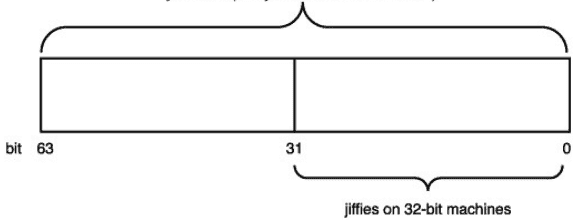

**图 9.1** `jiffies` 与 `jiffies_64` 的布局。

访问 `jiffies` 的代码只需读取 `jiffies_64` 的低 32 位。可以使用函数 `get_jiffies_64()` 来读取完整的 64 位值⁵。这种需求很少见，因此，大多数代码继续直接通过 `jiffies` 变量读取低 32 位。

> ⁵ 需要一个特殊函数，因为 32 位架构无法原子化地访问 64 位值中的两个 32 位字。该特殊函数在读取之前会通过 `xtime_lock` 锁定 `jiffies` 计数。

在 64 位架构上，`jiffies_64` 和 `jiffies` 指向的是同一个东西。代码可以读取 `jiffies` 或 `get_jiffies_64`，因为两者的效果相同。

## Jiffies 回绕（Wraparound）

`jiffies` 变量像任何 C 整数一样，当值超过其最大存储限制时会发生溢出。对于 32 位无符号整数，最大值为 `2^32 - 1`。因此，在计数溢出之前，可以发生 `4294967295` 次计数。当计数达到这个最大值并递增时，它会绕回零。

让我们来看一个回绕的例子：

```c
unsigned long timeout = jiffies + /* timeout in 0.5s */

/* do some work, then see if we took too long ... */

if (timeout < jiffies)
{ /* 我们没有超时，很好 ... */

}

else
{ /* 我们超时了，错误 ... */

}
```

这段代码的意图是为未来的某个时间设置超时——具体来说是现在的一半秒后。代码接着执行一些工作，可能会导致溢出问题并等待响应。如果整个过程耗时超过了超时时间，代码将恰当地处理错误。

这里有多个溢出问题，但让我们研究其中一个：如果 `jiffies` 在设置 `timeout` 之后绕回零会发生什么？那么，第一个条件数字——大于 `timeout` 的值——变得更大。然而，由于它溢出了最大值，它现在变成了一个非常小的值——可能只比零大几个滴答（ticks）。由于回绕，语句的结果被反转了！

```c
// 幸运的是，内核提供了用于比较滴计数的宏，这些宏可以正确处理滴计数中的回绕。
// 它们定义在 <linux/jiffies.h> 中：

#define time_after(unknown, known) ((long)(unknown) - (long)(known) < 0)

#define time_before(unknown, known) ((long)(known) - (long)(unknown) < 0)

#define time_after_eq(unknown, known) ((long)(unknown) - (long)(known) >= 0)

#define time_before_eq(unknown, known) ((long)(known) - (long)(unknown) >= 0)
```

`unknown` 参数通常是 `jiffies`，而 `known` 参数是你想要对比的值。

`time_after(unknown, known)` 宏在 `unknown` 位于时间 `known` 之后时返回 `true`；否则返回 `false`。`time_before(unknown, known)` 宏在 `unknown` 于时间 `known` 之前时返回 `true`；否则返回 `false`。最后两个宏的操作与第一个相同，不同之处在于当参数相等时它们返回 `true`。

上述示例的定时器回绕安全版本看起来如下：

```c
unsigned long timeout = jiffies + HZ;    /* timeout in 0.5s */

/* ... */

if (time_after(jiffies, timeout)) {

    /* 我们没有超时，很好 ... */

} else {

    /* 我们超时了，错误 ... */

}
```

如果你好奇这些宏如何防止回绕错误，尝试为两个参数设置不同的值。假设其中一个绕回了零，看看会发生什么。

## 用户空间与 BZ

以前，更改 `HZ` 的值会导致混乱，因为这些值是被导出到用户态的。随着这些接口公开，应用程序将依赖特定的 `HZ` 值。因此，更改 `HZ` 会按某个常数缩放导出值——而用户态完全不知情！运行时间实际上是两个小时，却显示为二十小时。

为了解决这个问题，内核必须缩放所有 `jiffies` 值。它通过定义 `USER_HZ` 实现，这是用户态期望的 `HZ` 值。在 x86 上，由于 `HZ` 历史上是 100，所以 `USER_HZ=100`。然后使用 `jiffies_to_clock_t()` 宏将 `HZ` 单位的滴计数转换为 `USER_HZ` 单位的滴计数。该宏取决于 `USER_HZ` 和 `HZ` 是否为彼此的整数倍数。如果是，该宏非常简单：

```c
#define jiffies_to_clock_t(x) ((x) / (HZ / USER_HZ))
```

## 硬件时钟与定时器

架构提供了两个设备来帮助计时——我们一直在讨论的系统定时器和实时时钟。这些设备的实际行为和实现有所不同，但通用目的和设计是相同的。

### 实时时钟

实时时钟（RTC）提供了一个非易失性设备来存储系统时间。RTC 通过主板上的一个小电池，即使系统关机也能继续跟踪时间。在 PC 架构上，RTC 和 CMOS 是集成的。

启动时，内核读取 RTC 并使用它初始化时间，时间存储在 `xtime` 变量中。内核通常不再读取该值；但某些架构（如 x86）会定期将当前时间写回 RTC。尽管如此，实时时钟的主要作用仅在启动期间。

### 系统定时器

系统定时器在内核计时中扮演着更重要且更频繁的角色。无论架构如何，系统定时器的原理都是相同的——提供一种定期触发中断的机制。某些架构通过一个可编程频率的电子时钟来实现。其他系统使用递减器——计数器以固定速率递减直到达到零。当计数器达到零时，就会触发中断。在任何情况下，效果都是相同的。

*   获取 `xtime_lock` 锁，它保护对 `jiffies_64` 和时间值 `xtime` 的访问。
*   根据需要确认或重置系统定时器。
*   定期将更新后的墙时间（wall time）保存到实时钟。
*   调用体系无关的定时器例 `do_timer()`，它执行了大量工作：

体系无关的例 `do_timer()` 执行了大量工作：

*   将 `jiffies_64` 计数器加 1（在 32 位架构上是安全的，因为之前已持有 `xtime_lock`）。
*   更新当前运行进程的资源使用情况，例如系统时间和用户时间。
*   运行任何过期的动态定时器（在下一节中讨论）。
*   按照第 3 节所述执行 `scheduler_tick()`。
*   更新存储在 `xtime` 中的墙时间。
*   清空臭名昭彰的负载平均值。

实际结果非常简单，因为其他函数处理了上述提到的大部分内容：

```c
void do_timer(struct pt_regs *regs)

{

    jiffies_64++;

    update_process_times(user_mode(regs));

    update_ticks();

}
```

`user_mode()` 宏钩取了处理器寄存器 `regs` 的状态，如果定时器中断发生在用户空间，则返回 1；如果发生在内核模式，则返回 0。这使得 `update_process_times()` 能够将上一次 tick 归类到正确的模式（用户态或系统态）：

```c
void update_process_times(int user_tick)

{

    struct task_struct *p = current;

    int cpu = smp_processor_id();

    int system = user_tick;

    update_one_process(p, user_tick, system, cpu);

    run_local_timers();

    scheduler_tick(user_tick, system);

}
```


`update_one_process()` 函数执行进程时间的实际更新。它相当复杂，但并不是其中一个 `user_tick` 系统等于 1 而另一个不是的原因（因为有异或运算）。因此，`update_one_process()` 可以简单地将每个值加到相应的计数器上，而无需：

```c
/*
 * 将相应的计数器增加一个 jiffy
 */
p->time = user;
p->utime = system;
```

适当的值增加了 1，另一个值保持不变。你可能会意识到，这意味着内核额度是该进程在定时器中断发生时处理器处于任何种状态时运行了整个上一个 tick。实际上，该进程在上一个 tick 中可能并不是唯一的运行进程！遗憾的是，在没有更复杂账目的情况下，这是内核能提供的最佳结果了。这也是高频率 tick 的另一个原因。

接下来，`run_local_timer()` 标记了一个任务（见第 6 节“底半部与延迟工作”）来处理过期定时器的执行。我们将在接下来的章节“定时器”中查看定时器。

最后，`scheduler_tick()` 减少当前运行进程的时间，并在需要时设置 `need_resched`。在 SMP 机器上，它还会根据需要平衡每个处理器的运行队列（runqueues）。正如第 3 节所述。

当 `update_process_times()` 返回时，`do_timer()` 调用 `update_times()` 来更新墙时间：

```c
void update_times(void) {
	unsigned long ticks;
	ticks = jiffies - wall_jiffies;
	if (ticks) {
		wall_jiffies += ticks;
		update_wall_time(ticks);
	}
	tlast_time_offset = 0;
	calc_load(ticks);
}
```

`ticks` 的值计算为自上次以来 tick 的变化量。在正常情况下，这显然是 1。在少数情况下，定时器中断可能会丢失，导致 tick 被认为丢失。这可能发生在中断关闭很长时间的情况下。这并不是常态，通常是一个错误。`wall_jiffies` 的增加了 `ticks` 值——因此，它等于最近一次墙更新时的 `jiffies` 值——

调用 `update_wall_time()` 来更新 `xtime`，它存储了墙时间。最后，调用 `calc_load()` 更新负载平均值，`update_times()` 返回。

`do_timer()` 返回到原始的体系相关的中断处理程序，该处理程序执行任何必要的清理工作，释放 `xtime_lock` 锁，并最终返回。

这一切每秒发生 1/HZ 次。在你的 PC 上是每秒 1000 次。

## 无零的一天

当天时间（墙时间）定义在 `kernel/timer.c` 中。

`struct timespec xtime;`

`struct timespec` 数据结构在 `<linux/time.h>` 中定义如下：

```c
struct timespec {
    time_t tv_sec;      /* 秒 */
    long tv_nsec;      /* 纳秒 */
};
```

`xtime.tv_sec` 值存储了自 1970 年 1 月 1 日（UTC）以来经过的秒数。这个日期被称为元（epoch）。大多数 Unix 系统当前墙时间的概念是相对于此基元的。`xtime.tv_nsec` 值存储了最后一秒内经过的纳秒数。

读取或写入 `xtime` 变量需要 `xtime_lock` 锁，它不是普通的自旋锁（spinlock），而是一个序列锁（seqlock）。第 8 节“内核同步方法”描述了序列锁。

`my_timer.expires` 值指定了超时值，以绝对节拍（ticks）为单位。当当前的 jiffies 计数等于或大于 `my_timer.expires` 时，处理器 `my_timer.function` 将带有 `my_timer.data` 的长参数运行。从 `my_timer_list` 的定义可以看出，该函数必须匹配此原型：

```
void my_timer_function(unsigned long data);
```

`data` 参数允许你使用同一个处理程序注册多个定时器，并通过参数来区分它们。如果你不需要参数，可以简单地传递零（或任何其他值）。

最后，激活定时器：

```
add_timer(my_timer);
```

现在，定时器已关闭并运行！请注意过期值的重要性。当当前节拍计数等于指定的过期时间时，内核会运行定时器处理器。内核保证在过期之前不会运行任何定时器处理器；然而，运行定时器可能会有延迟。通常，定时器非常接近它们的过期时间；但它们可能会被延迟到下一个节拍。因此，定时器不能用于实现任何形式的实时处理。

有时你可能需要修改已激活定时器的过期时间。内核实现了一个 `mod_timer()` 函数，它可以更改给定定时器的过期时间：

```
mod_timer(my_timer, jiffs + new_delay);
```

`mod_timer()` 也可以作用于已初始化但未激活的定时器。如果定时器未激活，`mod_timer()` 将激活它。如果定时器之前未激活，函数返回零；如果定时器已激活则返回一。无论何种情况，从 `mod_timer()` 返回后，定时器会被激活并设置为新的过期时间。

如果你需要在在使用之前停用定时器，可以使用 `del_timer()` 函数：

```
del_timer(my_timer);
```

该函数同时适用于激活和未激活的定时器。如果定时器已经未激活，函数返回零；否则返回一。注意，你不需要对已过期的定时器调用此函数，因为它们会自动去激活。

在删除定时器时存在一个必须防止的潜在竞态条件。当 `del_timer()` 返回时，它只保证定时器不再激活（即它在将来不会被执行）。但在多处理器机器上，定时器处理器可能正在另一个处理器上执行。为了停用定时器并等待可能执行中的定时器处理器退出，请使用 `del_timer_sync()`：

```
del_timer_sync(my_timer);
```

与 `del_timer()` 不同，`del_timer_sync()` 不能在中断上下文中。

## 竞态条件

定时器相对于当前执行的代码异步运行，存在几个潜在的竞态条件。首先，永远不要用以下操作代替简单的 `_mod_timer()`，因为这在多处理器机器上是不安全的：

其次，在所有情况下你都应该使用 `del_timer_sync()`，否则你无法假设定时器当前没有运行，而这正是你当初使用内核的原因！想象一下，在删除定时器后，代码继续释放或通过定时器处理器无意中管理了资源。优先使用同步版本。

## 定时器的实现

内核在定时器中断完成后，以软中断（softirq）的形式在下半部环境中执行定时器。定时器中断处理器运行 `update_process_times()`，该函数调用 `run_local_timers()`：

```
void run_local_timers(void)
{
    raise_softirq(softirq);
}
```

`TIMER_SOFTIRQ` 由 `run_timer_softirq()` 处理。该函数在当前处理器上运行所有过期的定时器（如果有）。定时器存储在链列表中。然而，如果内核要不断遍历整个列表来寻找过期的定时器，或者按过期值对列表进行排序，那么定时器的插入和删除将变得非常昂贵。相反，内核根据过期值将定时器划分为五组。随着过期时间的临近，定时器会向组向下移动。这种分区机制确保了在软中断的大多数执行中，内核只需极少量工作即可找到过期的定时器。因此，定时器管理代码非常高效。

## 延迟执行

通常，内核代码（特别是驱动程序）需要一种在不使用定时器或下半部机制的情况下延迟执行一段时间。这通常是为了给硬件留时间完成给定的任务。时间通常很短。例如，网卡的规格可能会列出更改以太网模式为两微秒。

在设置所需速度后，驱动程序应该至少等待两微秒再继续。内核提供了多种解决方案，取决于延迟的语义。这些解决方案具有不同的特性。有些在延迟期间会占用处理器，实际上阻止了任何实际工作的完成。其他解决方案则不占用处理器，不能保证你的代码恰好在所需的时间恢复。

## 忙轮

最简单的实现方案（尽管很少是最优方案）是忙等或忙轮。这种技术仅在你想要延迟的时间是节拍率的整数倍或者对精度不重要时才有效。

其思想是在循环中旋转，直到通过指定的时钟节拍数。例如：

```
unsigned long delay = jiffies + 10;    /* 十个节拍 */
while (time_before(jiffies, delay)) {
    }
```

循环将一直持续到 `jiffies` 大于 `delay`，这将在10个时钟节拍后发生。在 HZ 等于 1000 的 x86 上，这是 10 毫秒。同样，
```


```c
unsigned long delay = jiffies + 2*HZ;    /* 两秒 */

while (time_before(jiffies, delay)) {
}
```

这将一直旋转直到通过了 `2*HZ` 时钟节拍，无论时钟频率如何，这总是两秒。

这种方法对系统的其他部分并不友好。当你的代码等待时，处理器被困在一个愚蠢的循环中旋转——没有完成任何有用工作！事实上，你可能想采用这种脑死的方法，在这里列出是因为它是一种清晰且简单的延迟执行方法。你可能会在别人不那么优秀的代码中遇到它。

更好的解决方案是在你的代码等待时重新调度处理器以完成其他工作：

```c
unsigned long delay = jiffies + 5*HZ;
```

> * 实际上，没有什么方法能保证延迟恰好为请求的时间。然而，有些非常接近——而且它们都承诺会等到需要的时间。有些只是等得更长了。

调用 `resched()` 会调度一个新进程，但只有在 `need_resched` 被设置时才会。否则，如果有其他任务要运行，此解决方案将有条件地调用调度器。由于这种方法调用了调度器，你不能在中断处理程序中使用它。

编译器可能知道什么能保证之前的循环有效。C 编译器可能只执行一次获取。通常，不保证条件循环中的 `jiffies` 在每次迭代时重新加载。然而，我们要求 `jiffies` 在每次迭代时重新加载。`volatile` 关键字指示编译器每次从主内存重新加载变量，以保证 `<linux/jiffies.h>` 中的值能够完成。

## 小延迟

某些内核代码（通常是用户）需要非常短（小于时钟节拍）且相当精确的延迟。这通常是为了与硬件同步，硬件再次列出完成项活动所需的时间——通常小于一毫秒。如果定时器中断为 100 Hz，节拍是一个巨大的 10 毫秒。即使使用基于 `jiffies` 的延迟是不可能的，节拍仍然是一毫秒。我们显然需要另一种更小、更精确的延迟。

幸运的是，内核提供了微秒和毫秒延迟的两个函数，都定义在 `<linux/delay.h>` 中，它们不使用 `jiffies`：

```c
void udelay(unsigned long use);

void mdelay(unsigned long msec);
```

前者通过忙轮等待指定的微秒数来延迟执行。后者按指定的毫秒数延迟执行。记住一秒等于 1000 毫秒，等于 1000000 微秒。用法非常简单：

```c
udelay(150); /* 延迟 150 微秒 */
```

`udelay()` 函数实现为一个循环，该循环知道一段时间内可以执行多少迭代。`mdelay()` 函数通过 `udelay()` 实现。由于内核知道处理器在一秒内可以完成多少循环（见 BogoMIPS 侧边），`udelay()` 函数只需缩放该值即可获得正确的循环迭代次数。

## 我的 BogoMIPS 比你的大！

BogoMIPS 值一直是一个困惑和幽默的来源。BogoMIPS 的计算与处理器性能几乎没有关系，仅用于 `udelay()` 和 `mdelay()` 函数。它是 bogus（即虚假的）和 MIPS（每秒百万指令数）的缩写。大家对在 1GHz 的奔腾 3 上运行类似下面代码的忙碌循环都很熟悉。

```text
检测到 1004.942 MHz 处理器。
正在校准延迟循环... 1990.65 BogoMIPS
```

BogoMIPS 值是处理器在给定时间内可以执行的忙碌循环次数。BogoMIPS 衡量的是处理器执行无所事事的速度有多快！该值存储在 `loops_jiffy` 变量中，并可以通过 `/proc/cpuinfo` 读取。延迟循环函数使用 `loops_jiffy` 值来（相当）精确地确定它们需要执行多少次忙碌循环来提供所需的延迟。

内核在启动时通过 `calibrate_delay()` 以毫秒为单位计算 `loops_jiffy`。作为一条一般原则，尽量不要使用 `udelay()` 进行持续一毫秒的延迟。对于更长的时间，`mdelay()` 运行良好。与其他用于延迟执行的忙等待解决方案一样，这两者（尤其是 `mdelay()`，不用于此类长时间的延迟）除非绝对必要，否则不使用。记住，保持中断关闭是有风险的，因为系统的响应和性能会受到不利影响。如果你需要精确的延迟，这些调用是你的最佳选择。忙等待函数仅用于很短的时间，通常在微秒级。

## schedule_timeout()

延迟执行的更优方法是使用 `schedule_timeout()`。这会让你的任务睡眠，直到至少过了指定的时间。不能保证睡眠时长恰好是指定的时间——只能保证持续时间至少与指定的一样长。当指定时间过后，任务会被唤醒并放回运行队列。用法非常简单：

```c
set_current_state(TASK_INTERRUPTABLE);

schedule_timeout(s * HZ);
```

`long` 参数是期望的相对超时，单位为 jiffies。这个示例让任务进入中断睡眠，持续 `s` 秒。由于任务被标记为 `TASK_INTERRUPTABLE`，如果它接收到信号，将会提前唤醒。如果代码不想处理信号，可以使用 `TASK_UNINTERRUPTABLE` 替代。任务必须调用 `schedule_timeout()`，否则任务将不会睡眠。

注意，由于 `schedule_timeout()` 调用了调度器，因此调用它必须具备睡眠的能力。请参阅第 8 章关于原子性和释放的讨论，你将处于进程上下文且不持有锁。

`schedule_timeout()` 函数非常直观。事实上，它是内核定时器的简单应用，所以让我们来看一下它：

```c
signed long schedule_timeout(signed long timeout)
{
    timer_t timer;
    unsigned long expire;

    switch (timeout) {
        case MAX_SCHEDULE_TIMEOUT:
            schedule();
            goto out;

        default:
            if (timeout < 0) {
                prk(KERN_ERR, "schedule_timeout: wrong timeout %lx from address %p",
                    timeout, (void *)current);
                current->state = TASK_RUNNING(0);
                goto out;
            }
    }

    expire = timeout + jiffies;

    init_timer(&timer);
    timer.expire = expire;
    timer.data = (unsigned long)current;
    timer.function = process_timeout;
    add_timer(&timer);

    schedule();
    del_timer_sync(&timer);

out:
    timeout = expire - jiffies;
    return timeout < 0 ? 0 : timeout;
}
```

该函数创建一个定时器，并将其设置为在未来的 `timeout` 个时钟周期后过期。它设置定时器在过期时执行 `process_timeout()` 函数。它启用定时器并调用 `schedule()`。由于任务被认为是 `TASK_INTERRUPTIBLE` 或 `TASK_UNINTERRUPTIBLE`，调度器不会运行该任务，而是挑选一个新的。

当定时器过期时，运行 `process_timeout()`：

```c
void process_timeout(unsigned long data) {
    wake_up_process((task_t *) data);
}
```


该函数将任务置于`TASK_RUNNING`状态并放回运行队列。

当任务重新调度时，它返回到`schedule_timeout()`中离开的地方（紧接着调用`schedule()`之后）。如果任务被提前唤醒（如果接收到信号），定时器会被销毁。该函数返回任务睡眠的时间。

`switch`语句中的代码用于特殊情况，不是该函数通用用法的一部分。`MAX_SCHEDULE_TIMEOUT`检查允许任务无限睡眠。在这种情况下，没有设置定时器（睡眠持续时间没有限制），并且会立即调用调度器。如果你这样做，最好有另一种方法来唤醒你的任务！

# 在等待队列上睡眠，并带有超时

在第 3 章中，我们查看了进程代码如何将自己放在等待队列上等待特定事件，并调用调度器选择新任务。否则，当事件最终发生时，会调用`wake_up()`，睡眠在等待队列上的任务会被唤醒并继续运行。

有时，希望等待特定事件或等待指定时间过去——以先到者为准。在这种情况下，代码在将自己放在等待队列后可能简单使用`schedule_timeout()`而不是`schedule()`。任务在期望事件发生或指定时间过去时唤醒。代码需要检查它为什么被唤醒——可能是因为事件发生、时间流逝或接收到信号——并根据情况继续执行。

# 内存管理

**内核内部内存分配**并不像内核外的内存分配那么简单。许多因素导致了这一点。主要是由于内核缺乏用户空间所享有的奢侈。与用户空间不同，内核并不总是具有轻松分配内存的能力。例如，内核通常不能睡眠。此外，内核无法轻易处理内存错误。由于这些限制，对轻量级内存分配方案的需求使得在内核中获取内存比在用户空间更复杂。这并不意味着内存分配是困难的，正如我们将看到的。

本章讨论了在内核内部获取内存的方法。在我们深入实际的分配接口之前，我们需要查看内核如何处理内存。

## 页 (Pages)

内核将物理页视为内存管理的基本单位。虽然处理器的最小可寻址单位通常是一个字，但内存管理单元（MMU，管理内存并执行虚拟到地址转换的硬件）通常以页为单位。因此，MMU 以页大小为粒度管理系统的页表（因此得此名）。在虚拟内存方面，页是最关的最小单位。

正如我们在第 16 章“可移植性”中所看到的，每个架构都支持自己的页大小。许多架构支持多种页大小。大多数 32 位架构具有 4KB 页，而大多数 64 位架构具有 8KB 页。这意味着在具有 4KB 页和 1GB 物理内存的机器上，物理内存被划分为 262,144 个不同的页。

内核用`struct page`结构体表示系统上的每一个物理页。该结构定义在`<linux/mm.h>`中：

```
struct page {
    unsigned long flags;
    atomic_t              count;
    struct list_head      list_head;
    struct address_space   *mapping;
    unsigned long         index;
    struct list_head      lru;
    union {
        struct pte_chain     *chain;
        pte_addr_t           directs;
    };
    unsigned long         private;
    void                  *virtual;
};
```

让我们看看重要的字段。`flags`字段存储页的状态。每个标志存储页是否为脏（dirty）或是否锁定在内存中。标志表示各种值，因此至少有 32 个不同的标志。标志值定义在`<linux/page-flags.h>`中。它变为新可用。

`count`字段存储页的使用情况——即对该页的引用次数。当计数为零时，没有人在使用该页，它变为新可用。

`mapping`字段指向与该页相关的`address_space`对象。

`virtual`字段是页的虚拟地址。通常，这是页在虚拟内存中的地址。某些内存（称为高内存）没有永久映射到内核地址空间。在这种情况下，它为`NULL`，需要在需要时动态映射。我们稍后讨论高内存。

理解的关键点是，`page`结构与物理页相关，而不是虚拟页。因此，该结构是瞬时的。即使页数据继续存在，由于交换等原因，它可能不再与同一个`page`结构相关。内核使用该结构跟踪系统中所有的页，因为内核需要知道页是否为空（即页是否未分配）。如果页为空，内核需要知道是谁拥有该页。可能的所有者包括用户空间进程、动态分配内核数据、静态内核代码、页缓存等。

开发者通常对为每个物理页分配一个结构体实例感到惊讶。他们想：“用了这么多内存！”让我们看看这些页的空间消耗到底有多糟糕（或有多好）。假设`struct page`消耗 40 字节内存，系统具有 4KB 物理页，且系统有

## 区域 (Zones)

由于硬件限制，内核无法将所有页面视为是相同的。某些页面由于其在内存中的物理地址的原因，无法用于某些任务。由于这种限制，内核将页面划分为不同的区域（zones）。内核利用这些区域将具有相似属性的页面分组。特别是，Linux 必须处理内存寻址方面的两个缺陷：

- 某些设备只能对特定地址执行 DMA（直接内存访问）。
- 某些架构能够物理寻址的内存比其能够虚拟寻址的内存大。因此，内存不会永久地映射到内核地址空间中。

由于这些限制，Linux 中有三个内存区域：

- `ZONE_DMA`:
  该区域包含能够进行 DMA 的页面。
- `ZONE_NORMAL`:
  该区域包含常规的、定期映射的页面。
- `ZONE_HIGHMEM`:
  该区域包含“高内存”（high memory），即那些未永久映射到内核地址空间的页面。

在内存区域的实际使用和布局上，`ZONE_DMA`是空的，而`ZONE_NORMAL`无论用途如何都将用于分配。作为一个反面例子，在 x86 架构上，ISA 设备无法对整个 32 位地址空间执行 DMA，因为 ISA 设备只能访问物理内存的前 16MB。因此，x86 上的`ZONE_DMA`包含了 0–16MB 范围内的所有内存。

`ZONE_HIGHMEM`的原理相同。架构是否能够直接映射因地而异。在 x86 上，`ZONE_HIGHMEM`是物理内存 896MB 以上的所有内存。在其他架构上，`ZONE_HIGHMEM`是空的，因为所有内存都是直接映射的。`ZONE_HIGHMEM`中的内存称为高内存。系统的其余内存称为低内存。

> 1 某些损坏的 PCI 设备只能对 24 位地址空间执行 DMA。但它们是损坏的。

> 2 这与 DOS 中的高内存没有关系。

`ZONE_NORMAL`倾向于成为前几个区域占满其所需份额后的剩余部分。例如，在 x86 上，`ZONE_NORMAL`是从 16MB 到 896MB 的所有物理内存。在其他（更幸运的）架构上，`ZONE_NORMAL`是所有可用内存。表 10.1 列出了 x86 上每个区域及其占用的跨度。

## 表 10.1 x86 上的区域

| 区域 | 描述 | 物理内存 |
| --- | --- | --- |
| `ZONE_DMA` | 可 DMA 页面 | < 16MB |
| `ZONE_NORMAL` | 普通可寻址页面 | 16-896MB |
| `ZONE_HIGHMEM` | 动态映射页面 | > 896MB |

Linux 系统将内存划分为区域并形成一个池以满足此类分配。例如，拥有`ZONE_DMA`池提供了满足 DMA 所需内存分配的能力。如果需要很多，内核可以简单从`ZONE_DMA`中提取所需数量的页面。注意，区域并不包含任何空闲资源；它们是内核用于跟踪页面的逻辑组。

虽然某些分配可能需要特定区域的页面，但区域在两个方向上都不是硬性要求。虽然对 DMA 内存的分配必须源自`ZONE_DMA`，但普通分配可以来自`ZONE_DMA`或`ZONE_NORMAL`。内核会倾向于从`ZONE_NORMAL`满足其需要的分配。但如果迫在眉睫（如果内存变得不足），内核可以从任何可用且合适的区域中抽取。

每个区域由`struct zone`表示，定义在`<linux/mmzone.h>`中：

```
struct zone {
    spinlock_t lock;
    unsigned long free_min;
    unsigned long pages_min;
    unsigned long pages_low;
    unsigned long pages_high;
    struct list_head lru_list;
    struct list_head active_list;
    struct list_head inactive_list;
    atomic_t refill_counter;
    unsigned long nr_active;
    unsigned long nr_inactive;
    unsigned long all_unclaimable;
}
```


```c
    unsigned long pages_scanned;

    unsigned long int;

    struct free_area free_area[MAX_ORDER];

    struct wait_queue_head wait_queue_head;

    struct wait_table;

    unsigned long unsigned long;
};

unsigned long          wait_table_bits;

struct per_cpu_pageset  pageset[NR_CPUS];

struct list_data       *zone_mem_map;

struct page             *zone_start_pfn;

char                    *name;

unsigned long          spanned_pages;

unsigned long          present_pages;
```

该结构体很大，但系统中只有三个，因此只有三个这样的结构体。看看更重要的字段。

## 获取页面

```c
void page_address(struct page *page)
```

此函数的工作与 `alloc_pages()` 相同，但它直接返回第一个请求页面的逻辑地址。因为页面是连续的，其他页面只需紧随其后。

如果你只需要一个页面，则实现了两个函数作为包装器以节省你的打字时间：

```c
struct page *__alloc_page(unsigned int gfp_mask)
unsigned long __get_free_page(unsigned int gfp_mask)
```

这些函数的工作方式与其兄弟相同，但传递的阶（order）为 0（`2^0 = 一个页面`）。

## 获取清零页面

如果你需要填充了零的页面，请使用函数

```c
unsigned long get_zered_page(unsigned int gfp_mask)
```

该函数的工作与 `__get_free_page` 相同，但会将页面清零。表 10.2 是所有底层分配方法的列表。

| 标志位 | 描述 |
|---|---|
| `alloc_page(gfp_mask)` | 分配单个页面并返回结构体 |
| `alloc_pages(gfp_mask, order)` | 分配 `$2^{order}$` 个页面并返回结构体 |
| `get_free_page(gfp_mask)` | 分配单个页面并返回结构体 |
| `__get_free_page(gfp_mask, order)` | 分配 `$2^{order}$` 个页面并返回逻辑地址 |
| `get_zered_page(gfp_mask)` | 分配单个页面，将其清零并返回逻辑地址 |

## 释放页面

当你不再需要分配的页面时释放它们：

```c
void free_pages(struct page *page, unsigned int order)
void free_pages(unsigned long addr, int order)
void free_page(unsigned long addr);
```

你必须释放你分配的页面。来看一个例子。在这里我们要分配 8 个页面：

`unsigned long page;`

```c
page = __get_free_page(GFP_KERNEL, 3);

if (!page)
    /* 内存不足；你必须处理这种情况！ */
    /* 'page' 现在是连续页面的地址 ... */
```

```c
free_pages(page, 3);
```

> /* 我们的页面现在已释放，我们不应再访问该地址 */

`GFP_KERNEL` 参数是一个示例性的 `gfp_mask`。我们稍后会解释。

注意对 `get_free_page()` 的检查。内核分配可能会失败，你的代码必须检查并处理此类错误。这可能意味着撤销你所做的一切，否则当你尝试分配内存时，可能已经晚了。

当你需要物理连续的页面块时，这些底层函数非常有用，特别是当你需要正好一个页面或大量页面时。对于更通用的字节大小分配，内核提供了 `kmalloc()`。

## `malloc()`

`malloc()` 函数的工作与用户空间的 `malloc()` 例程非常相似，区别在于增加了标志参数。`malloc()` 函数是获取字节大小内存的简单接口。如果你需要整页——特别是当你需要接近 2 的幂的数量时——之前讨论的接口可能是更好的选择。然而，`malloc()` 是首选接口。

该函数声明在 `<linux/slab.h>` 中：

```c
void *malloc(size_t size, int flags);
```

该函数返回一个长度至少为 `size` 字节的内存区域指针⁵。分配的内存区域是物理连续的。发生错误时，它返回

> ⁵它可能会分配比你请求的更多的，尽管你无法知道是多少！因为内核分配器的本质是基于页面的，某些分配会被向上取整以适应可用内存。内核绝不会返回少于请求的内存。如果内核无法找到至少请求量，分配将失败并返回函数 NULL。

NULL 内核分配总是会成功，除非内存不足。因此，你必须在所有调用 `kmalloc()` 之后检查是否为 NULL 并妥善处理错误。

让我们来看一个例子。假设需要为一个虚拟的 `dog` 结构体动态分配空间：

```c
struct dog *ptr;

ptr = kmalloc(sizeof(struct dog), GFP_KERNEL);

if (!ptr)
    /* handle error ... */
```


如果 `kmalloc()` 成功，`ptr` 现在指向一个请求大小的内存块。`GFP_KERNEL` 标志指定了内存分配器在将内存返回给 `kmalloc()` 调用者的行为。

## GFP_map Flags

标志分为三类：操作修饰符、区域修饰符和类型。操作修饰符指定内核如何分配请求内存。在某些情况下，只能采用特定的方法来分配内存。例如，中断处理程序必须指示内核不要睡眠（因为中断处理程序不能睡眠）。区域修饰符指定分配什么种类型的内存。正如我们看到的，内核将物理内存划分为多个区域，每个区域都有不同的用途。区域修饰符指定从这些区域中的哪一个进行分配。类型标志指定了多种内存分配；相反，你通常只需要指定一个类型标志。`GFP_KERNEL` 是一个类型标志，用于内核内部的进程上下文。让我们来看这些标志。

## Action Modifiers

所有标志（包括操作修饰符）都声明在 `<linux/gfp.h>` 中。虽然包含 `<linux/slab.h>` 会包含此头文件，但你通常不需要直接包含它。在实际上，你只会使用类型修饰符，我们稍后会介绍它们。尽管如此，了解这些单独的标志是有好处。表 10.3 是操作修饰符列表。

表 10.3 操作修饰符

| Flag | Description |
|---|---|
| `__GFP_WAIT` | 分配器可以睡眠。 |
| `__GFP_HIGH` | 分配器可以访问紧急内存。 |
| `GFP_IO` | 分配器可以启动磁盘 I/O。 |
| `GFP_FS` | 分配器可以使用缓存页。 |
| `GFP_COLD` | 分配器不会打印失败警告。 |
| `GFP_NOWAIT` | 分配器在失败时将重试分配。 |
| `GFP_NOFOIL` | 分配器在失败时将不会重试。 |
| `GFP_NORETRY` | 由 slab 层内部使用。 |

这些分配可以一起指定。例如，

```
ptr = kmalloc(size, __GFP_WAIT | __GFP_IO | __GFP_FS);
```

指示分配器（最终是 `alloc_pages()`）分配可以阻塞、执行 I/O 并在需要时执行文件系统操作。这允许内核在如何寻找空闲内存满足分配方面具有自由。

大多数分配都使用这些修饰符，但是通过我们稍后将讨论的类型标志间接使用的。别担心，在分配内存时，你不需要判断应该使用哪种类型标志。

## Zone Modifiers

区域修饰符具体指定分配应该从哪个区域产生。通常，分配可以从任何区域完成。然而，内核更倾向于 `ZONE_NORMAL`，以确保其他区域在需要时有空闲页。

只有两个区域修饰符，因为除了 `ZONE_NORMAL`（默认来源）之外只有两个区域。表 10.4 是区域修饰符列表。

表 10.4 区域修饰符

| Flag | Description |
| --- | --- |
| `__GFP_DMA` | 仅从 `ZONE_DMA` 分配 |
| `__GFP_HIGHMEM` | 从 `ZONE_HIGHMEM` 或 `ZONE_NORMAL` 分配 |

指定其中一个标志会修改内核尝试满足分配的区域。`GFP_DMA` 标志强制内核从 `ZONE_DMA` 满足请求。相反，使用 `__GFP_HIGHMEM` 标志，分配将从 `ZONE_NORMAL` 或（优先）`ZONE_HIGHMEM` 满足。如果没有指定任何标志，内核将从 `ZONE_DMA` 或 `ZONE_NORMAL` 完成分配，并强烈倾向于从 `ZONE_NORMAL` 完成分配。

你不能对 `__get_free_pages()` 或 `kmalloc()` 指定 `__GFP_HIGHMEM`。因为这两个函数都返回逻辑地址而不是页结构，所以这些函数可能分配了当前未映射到内核虚拟地址空间中的内存，因此没有逻辑地址。只有 `alloc_pages()` 分配高内存。然而，大多数分配不会指定区域修饰符，例如 `ZONE_NORMAL` 就足够了。

## Type Flags

类型标志指定了完成特定类型事务所需的各种操作和区域修饰符。因此，内核代码应使用正确的类型标志，而不是指定它可能使用的修饰符。这更简单且更不容易出错。表 10.5 是类型标志列表，表 10.6 显示了每个类型关联的修饰符。

表 10.5 类型标志

| Flag | Description |
| --- | --- |
| `GFP_ATOMIC` | 分配是高优先级的且不能睡眠。这是在中断处理程序、下半部和其他不能睡眠的情况中使用的标志。 |
| `GFP_NOIO` | 这种分配可能会阻塞，但不会启动 I/O。这是在不能引起磁盘 I/O 的块 I/O 代码中使用的标志。 |
| `GFP_NOFS` | 这种分配可能会阻塞，但不会启动文件系统操作。这是在文件系统代码中不能启动另一个文件系统操作时使用的标志。 |
| `GFP_KERNEL` | 这是一个正常的分配和阻塞。这是在安全睡眠的进程上下文代码使用的标志。 |
| `GFP_USER` | 这是一个正常的分配和阻塞。这是在安全睡眠的进程上下文代码使用的标志。 |
| `GFP_HIGHMEM` | 这是一个正常的分配和阻塞。这是在安全睡眠的进程上下文代码使用的标志。 |
| `GFP_DMA` | 这是一个正常的分配和阻塞。这是在安全睡眠的进程上下文代码使用的标志。 |

表 10.6 每个类型对应的修饰符列表

| Flag | Modifiers |
| --- | --- |
| `GFP_ATOMIC` | `__GFP_HIGH` |
| `GFP_NOIO` | `__GFP_WAIT` |
| `GFP_NOFS` | `__GFP_WAIT` |
| `GFP_KERNEL` | `__GFP_IO` |
| `GFP_USER` | `__GFP_IO` |
| `GFP_HIGHMEM` | `__GFP_FS` |
| `GFP_DMA` | `__GFP_FS` |

## kfree()

`kmalloc()` 的另一端定义在 `<linux/slab.h>` 中：

```c
void kfree(const void *ptr)
```

`kfree()` 会释放之前通过 `kmalloc()` 分配的内存块。对未通过 `kmalloc()` 分配的内存或已经释放的内存调用此函数将导致非常严重的后果，例如释放属于内核其他部分的内存。就像在用户空间中一样，请务必注意分配与释放的平衡，以防止内存泄漏和其他错误。注意，调用 `kfree(NULL)` 会经过显式的安全检查。

让我们来看一个在中断处理程序中分配内存的示例。在这个示例中，一个中断处理程序想要分配一个缓冲区来存储传入的数据。预处理器宏 `BUF_SIZE` 是该目标所需缓冲区的大小（以字节为单位），它显然远大于几个字节。

```c
char *buf;

buf = kmalloc(BUF_SIZE, GFP_ATOMIC);

if (buf) {
    /* 分配内存 */
    /* 稍后，当我们不再需要该内存时，不要忘记释放它： */
    kfree(buf);
}
```

## vmalloc()

`vmalloc()` 函数的工作与 `kmalloc()` 类似，但它分配的内存在虚拟上是连续的，而不一定在物理上连续。这就是用户空间分配的工作：`kmalloc()` 返回的页面在处理器的虚拟地址空间内是连续的，但无法保证它们在物理内存中也是连续的。`kmalloc()` 函数保证页面在物理上是连续的（在虚拟上也是连续的）。`vmalloc()` 函数仅确保页面在虚拟地址空间内是连续的。它通过分配可能不连续的物理内存块，并“修复”页表以将内存映射到逻辑地址空间的一个连续块中来实现这一点。

在大多数情况下，硬件设备需要物理连续的分配。内存管理单元（MMU）另一侧的硬件设备并不理解虚拟地址。硬件处理的任何内存区域都是物理连续块，而不是虚拟连续块。软件使用的内存块——例如与进程相关的缓冲区——使用虚拟连续的内存是可以接受的。在编程时，你将了解这种区别。对于内核而言，所有内存都被视为逻辑连续的。

尽管在某些情况下需要连续内存，但大多数内核代码都使用 `kmalloc()` 而不是 `vmalloc()`。这是因为 `vmalloc()` 函数为了在虚拟地址空间中创建物理连续页面，必须特殊设置页表。然而，`vmalloc()` 分配的页面不一定物理上连续，这会导致比直接使用物理内存更大的 TLB 抖动（thrashing）。由于这些考虑，`vmalloc()` 只在绝对必要时才使用——用于处理大区域的内存。例如，当模块动态插入内核时，它们被加载到通过 `vmalloc()` 创建的内存中。

`vmalloc()` 函数声明在 `<linux/vmalloc.h>` 中并定义在 `mm/vmalloc.c` 中。其用法受限于用户空间的 `malloc()`：

```c
void *vmalloc(unsigned long size);
```

该函数返回一个指向至少 `size` 字节虚拟连续内存的指针。如果出错，函数返回 `NULL`。该函数可能会睡眠，因此不能从中断上下文或其他不允许阻塞的情况调用。

要释放通过 `vmalloc()` 获取的分配内存，请使用：

```c
void vfree(void *addr);
```


此函数释放之前通过`vmalloc()`分配的地址`addr`内存块。该函数也可以睡眠，因此不能从中断上下文调用。它没有返回值。

该函数的用法如下：

```c
char *buf;
buf = vmalloc(16 * PAGE_SIZE); /* 获取 16 个页 */
if (!buf)
    /* 错误！内存分配失败 */
```

> `4 TLB`（转换旁缓冲区）是架构使用的一种硬件缓冲区，用于缓存虚拟地址到物理地址的映射。这极大地提高了系统性能，因为大多数内存访问都是通过虚拟寻址完成的。

```c
/* buf 现在指向至少 16*PAGE_SIZE 字节
 * 的虚拟连续内存块
 */
```

在你完成对内存的使用后，请确保使用以下代码释放它：

```c
vfree(buf);
```

# Slab 层（Slab Layer）

分配和释放数据结构是任何内核内部常见的操作之一。为了方便数据的频繁分配和释放，程序员引入了空闲列表（`free lists`）。空闲列表包含一组可用的、已分配的数据结构块。当代码需要数据结构的新实例时，它可以从空闲列表中获取一个结构，而不是分配足够的内存并为该数据进行设置。稍后，当数据结构不再需要时，它会被返回空闲列表。从这个意义上说，空闲列表充当了对象缓存，即频繁使用的对象类型。

内核中空闲列表的一个主要问题是缺乏全局控制。当可用内存较低时，内核没有办法与每个空闲列表通信，让其缩减缓存大小以释放内存。事实上，内核对这些随机的空闲列表一无所知。为了解决这个问题并整合代码，Linux 内核提供了 Slab 层（称为 `slab` 分配器），作为一层通用的数据结构缓存层。

Slab 分配器的概念首次在 `Sun Microsystems` 的 `OS 5.4` 操作系统中实现。Linux 数据结构缓存层共享相同的名称和设计。

Slab 层采用了以下几种策略：

- 频繁使用的数据结构倾向于频繁分配和释放，因此我们对其进行缓存。
- 频繁的分配和释放可能导致内存碎片，通过缓存它们可以避免这一点。空闲列表包含了已分配的。为了防止这种情况，空闲列表是连续的。
- 空闲列表可以提供性能，在分配和释放时可以立即返回空闲对象。
- 缓存是每个处理器的（在多处理器系统中，避免锁），通过空闲列表进行。
- 对象可以进行着色（`coloring`），以防止多个对象映射到相同的缓存行。

Linux 内核中的 Slab 层基于这些假设设计并实现的。

> `5` 随后记录在 `Bonwick, J. "The Slab Allocator: Object-Caching Kernel", USENIX, 1994.`

# Slab 层的设计

Slab 层将对象划分为缓存，每个缓存存储不同类型的对象。每种对象类型有一个缓存。例如，一个缓存用于进程（`task_struct` 结构），而另一个缓存用于 `inode`。`kmalloc` 构建在 Slab 层之上。

缓存由一个或多个连续页组成。通常，`slab` 由单个页组成。每个 `slab` 可能包含多个对象。

每个 `slab` 包含一些被缓存的对象。每个 `slab` 处于三种状态之一：满（`full`）、部分（`partial`）或空（`empty`）。满 `slab` 没有空闲（`slab` 中的所有对象已分配）。部分 `slab` 有一些已分配对象和空对象。当缓存请求对象时，从部分 `slab` 满足，如果没有，则创建一个空 `slab`。满 `slab` 无法满足请求，因为它没有空闲对象。这种策略防止了碎片。

让我们以 `inode` 为例，它是磁盘 `inode` 的内存表示（见第 1 章）。这些结构被频繁创建和销毁，因此通过 `slab` 分配器管理它们是合理的。因此，`struct inode` 从 `inode_cache` 缓存分配（命名约定）。该缓存由一个或多个 `slab` 组成——每个包含尽可能的对象。当内核请求新的 `inode` 时，缓存返回一个已分配的指针，从部分 `slab` 获取；如果没有部分 `slab`，则创建一个空 `slab`。当内核完成对 `inode` 对象的使用后，`slab` 分配器将其标记为空闲。图 10.1 展示了缓存、`slab` 和对象之间的关系。

每个缓存由 `kmem_cache_s` 结构表示。该缓存包含三个列表：`slabs_full`、`slabs_partial` 和 `slabs_empty`。`slab` 描述符 `struct_slab` 代表每个 `slab`：

```c
struct slab {
    struct list_head list;      /*满、部分或空列表 */
    unsigned long colouroff;     /* slab 着色的偏移量 */
    void *smem;                  /* slab 中的第一个对象 */
    unsigned int inuse;         /* 已分配对象的数量 */
    void *free;                 /* 第一个空闲对象，如果有 */
};
```

`slab` 描述符要么分配在通用缓存之外，要么在 `slab` 内部的开头。如果 `slab` 的总大小足够小，或者 `slab` 内部空间足以容纳描述符，则将描述符存储在 `slab` 内部。

Slab 层通过一个简单的接口对每个缓存进行管理，该接口导出到内核。该接口允许创建和销毁新的

# Slab 分配器接口

通过以下函数创建新缓存：

```c
kmem_cache_t * kmem_cache_create(const char *name, size_t size,
                               size_t offset, unsigned long flags,
                               void (*ctor)(void), kmem_cache_t *,
                               unsigned long len,
                               void (*dtor)(void), kmem_cache_t *,
                               unsigned long);
```

第一个参数是缓存名称的字符串。第二个参数是缓存中每个元素的大小。第三个参数是 `slab` 中第一个对象的偏移量。这样做是为了确保正确的对齐值。通常，设置为 `0` 即可，这将产生标准对齐。`flags` 参数指定了控制缓存行为的可选设置。它可以为 `0`（指定没有特殊行为），或者是一个或多个以下标志的位或（`OR`）组合：

- `SLAB_REAP` 此标志指示 `slab` 层在内存不足时自动收回对象（即支持未使用对象的内存）。通常情况下，你不希望设置此标志，因为你的缓存可能会阻止系统在内存低时恢复足够的内存以继续运行。
- `SLAB_HWACALIGN` 此标志指示 `slab` 层将 `slab` 中的每个对象对齐到缓存行。这防止了“伪共享”（两个或多个对象映射到同一个缓存行，但在内存中处于不同的地址）。这可以提高性能，但是以增加内存占用为代价的，因为更严格的对齐会导致空隙空间浪费。内存消耗的增加程度取决于对象的大小以及它们相对于系统缓存行的对齐方式。对于性能密集型代码中频繁使用的缓存，设置此选项是一个好主意；否则，请三思。
- `SLAB_MUST_HWACALIGN` 如果启用了调试，可能在执行调试并对对象进行缓存对齐时是不可行的。此标志强制 `slab` 层对对象进行缓存对齐。通常不需要此标志，前一个标志就足够了。在启用 `slab` 调试（默认禁用）时指定此标志可能会导致内存消耗大幅增加。只有对于缓存对齐至关重要的对象（例如进程描述符）才设置此标志。
- `SLAB_CACHE_DMA` 此标志指示 `slab` 层在 `DMA` 可访问内存中分配每个 `slab`。如果分配的对象用于 `DMA` 且必须驻留在 `ZONE_DMA` 中，则需要此项。否则，你不需要且不应设置。

最后两个参数 `ctor` 和 `dtor` 分别是缓存的构造函数和析构函数。每当向缓存添加新页时，就会调用构造函数。每当从缓存中移除页时，就会调用析构函数。有析构函数就需要构造函数。在实践中，在 Linux 内核中，你可以对这两个参数传递 `NULL` 以不使用构造或析构函数。

如果成功，`kmem_cache_create()` 返回指向已创建缓存的指针。否则返回 `NULL`。此函数不能在中断上下调用，因为它可能会睡眠。

要销毁缓存，请调用

```c
int kmem_cache_destroy(kmem_cache_t *cachep);
```

这会销毁在创建自定义缓存的模块中从模块卸载时调用的缓存。它不能在中断上下调用，因为它可能会睡眠。在调用此函数之前，必须确保满足两个条件：

- 缓存中的所有 `slab` 都是空的。如果其中一个 `slab` 被分配并正在使用，缓存如何被销毁呢？
- 在调用 `kmem_cache_destroy()` 期间（且仅在调用之后）没有人访问该缓存。调用者必须确保这种同步性。

如果成功，函数返回 `0`；否则返回非零值。

创建缓存后，通过以下函数从缓存中获取对象：


`void *kmem_cache_alloc(kmem_cache_t *cache, int flags);`

此函数返回指向给定缓存中对象的指针。如果缓存的任何 `slab` 中没有对象，`slab` 层必须通过 `kmem_getpages()` 获取新页，`flags` 的值将被传递给 `__get_free_pages()`。这些就是我们之前看过的页。你携带 `GFP_KERNEL` 或 `GFP_ATOMIC`。

要释放对象并将其返回到原始 `slab`，请使用函数

`void kmem_cache_free(kmem_cache_t *cache, void *objp);`

这会将对象 `objp` 标记为空闲。

# 使用 Slab 分配器的示例

让我们来看使用 `task_struct`（进程描述符）的真实示例。这段代码稍微复杂一些，位于 `kernel/fork.c` 中。

首先，内核有一个变量存储指向 `task_struct` 缓存的指针：

`kmem_cache_t *task_struct_cache;`

在内核初始化期间，在 `fork_init()` 中创建了该缓存：

```
task_struct_cache = kmem_cache_create("task_struct", sizeof(struct task_struct),
	0, SLAB_HW_HWCACHE, ALIGN, NULL, NULL);

if (!task_struct_cache)
	panic("fork_init: cannot create task_struct SLAB cache");
```

这创建了一个名为 `task_struct_cache` 的缓存，它存储 `task_struct` 类型的对象。对象在 `slab` 内以默认偏移量创建，并且它们都是缓存索引的。没有构造函数或析构函数。返回值为 `NULL`，表示失败——你必须确保返回值！在这里，如果内核无法创建 `task_struct_cache` 缓存，它将发生恐慌（停止机器），因为这是结构操作必需的缓存（即，从 `do_free()` 调用）。

每当进程调用 `free()` 时，必须创建一个新的进程描述符（回想第 2 章，“进程管理”）。这在 `dup_task_struct` 中完成，该函数从 `do_free()` 调用：

```
struct task_struct *tsk;
tsk = kmem_cache_alloc(task_struct_cache, GFP_KERNEL);
if (!tsk) {
    /* 分配进程描述符，清理并返回错误 */ free_thread_info(ti);
    return NULL;
}
```

任务死亡后，如果它没有等待它的子进程，它的进程描述符会被释放并返回到 `task_struct_cache` slab 缓存。这在 `free_task_struct()` 中完成

（其中 `tsk` 是退出的任务）：

```
kmem_cache_free(task_struct_cache, tsk);
```

由于进程描述符是内核的核心部分且都是需要的，所以

```
int err;
err = kmem_cache_destroy(task_struct_cache);
if (err) { /* 销毁缓存出错 */ };
```

简单吗？Slab 层在内存不足的情况下处理所有的底层分配、着色、释放和收回。如果你频繁创建许多相同类型的对象，请考虑使用 slab 缓存。不要实现你自己的空闲列表！

## 在栈上进行静态分配

在用户空间中，分配（如目前为止的一些示例）可能发生在栈上，因为我们从预先知道分配的大小。用户空间拥有非常大且动态增长的栈的奢侈，而内核没有这种奢侈——内核栈是很小且固定的。在大多数 32 位架构上，栈为 `8KB`。在大多数 64 位架构上，栈也是 `8KB`。这主要出于效率考虑。通过给每个进程提供一个小的、固定的内核栈，内存消耗就不会受到栈管理的负担。

每个进程接收它自己的内核栈。在内核内部执行的进程的整个链必须能够放入栈中。中断处理程序也使用栈。这意味着，最坏的情况下，`8KB` 的栈需要最多深度的函数调用和几个中断处理程序共享。无限制递归是昂贵的！

在任何给函数中，你必须将栈的使用降到最低。没有硬性规定，但你应该将特定函数中所有局部变量（称为栈上的自动变量）的总和限制在百字节以内。在栈上进行大型静态分配（例如大型数组或结构）是危险的。否则，内核中的栈溢出就像用户空间一样。栈溢出是无声且未察觉的，损坏位于栈尾的内存。首先，这是 `thread_info` 结构（回想第 2 章，该结构分配在每个进程内核栈的末尾）。这样做，内核栈数据可能会受到损害。最好的结果是栈溢出时机器崩溃。坏的结果是溢出会损坏内核。因此，使用动态分配方案（例如本章之前讨论过的）是明智的。

## 高内存

根据定义，页可能没有永久映射到内核地址空间。因此，通过 `alloc_pages()` 带有 `HIGMEM` 标志获取的页可能没有地址。

在 `x86` 架构上，超过 `896MB` 标记的所有物理内存都是高内存，没有永久或自动映射到内核地址空间，尽管 `x86` 处理器能够访问高达 `4GB`（`PAE` 为 `64GB`）的物理内存。一旦分配，这些页必须映射到内核地址空间。在 `x86` 上，高内存映射在 `3GB` 到 `4GB` 之间。

## 永久映射

要将给定的页结构映射到内核地址空间，使用

```
void *kmap(struct page *page)
```

`6PAE` 代表物理地址扩展。它是 `x86` 处理器的一种功能，允许它们物理寻址 `36` 位（`64GB`）内存，尽管它们只有 `32` 位虚拟地址空间。

此函数适用于高内存或低内存。如果该页结构属于低内存中的某个页，则直接返回该页的虚拟地址。如果页位于高内存中，则会创建一个永久映射并返回该地址。该函数可能会睡眠，因此 `kmap()` 只能在进程上下工作。

由于永久映射的数量是有限的（如果没有限制，我们就不会陷入这种困境，并且可以永久地映射所有内存），因此在不再需要时应该取消高内存的映射。这通过以下函数实现：

```
void kunmap(struct page *page)
```

取消给定的页。

## 临时映射 (Temporary Mappings)

对于必须创建映射但当前上下文无法睡眠的情况，内核提供了临时映射（也称为原子映射）。这是一组预留的永久映射，可以临时地在线持有映射。内核可以将一个高内存页原子地映射到这些映射中的一个。因此，临时映射可以在不能睡眠的地方使用，例如中断处理程序，因为获取映射永远不会阻塞。

设置临时映射通过以下函数实现：

```
void kmap_atomic(struct page *page, enum km_type type)
```

`km_type` 参数是以下枚举值之一，描述了临时映射的用途。它们定义在 `<asm/kmap_types.h>` 中：

```
enum km_type {
    KM_BOUNC_READ,
    KM_SKB_SUNPRPC_DATA,
    KM_SKB_DATA_SOFTIRQ,
    KM_USER,
    KM_USER1,
    KM_BIO_IRQ,
    KM_BIO_DST_IRQ,
    KM_PTE0,
    KM_PTE1,
    KM_IRQ0,
    KM_IRQ1,
    KM_SOFTIRQ0,
    KM_SOFTIRQ1,
    KM_TYPE_NR
};
```

此函数不会阻塞，因此可以在中断上下文和其他不能重新调度的地方使用。它还禁用了内核抢占，这是因为映射对于每个处理器是唯一的（重新调度可能会改变运行在处理器上的任务）。

## 取消映射完成

```
void kunmapatomic(void *kvaddr, enum km_type type)
```


此函数不会阻塞。事实上，在许多架构中，除了重置内核抢占外，它什么都不做，因为临时映射仅在下一个临时映射之前有效。这时内核可以使用 `kmap_atomic()` 映射，而 `kunmapatomic()` 不需要执行任何操作。下一个原子映射将简单地覆盖上一个。

如果你需要连续物理页，请使用低级页分配器之一或 `kmalloc()`。这是在内核内部分配内存的标准方式，而且你很可能会分配大部分内存。请记住，用于这些函数最常用的标志是 `GFP_ATOMIC`，用于执行不会睡眠的高优先级分配。这是中断处理程序和其他不能睡眠的代码的要求。可以睡眠的代码（例如没有持有自旋锁的进程上下文代码）应使用 `GFP_KERNEL`。该标志指定了可以被中断的分配。

如果你想从高内存分配内存，请使用 `alloc_pages()`。`alloc_pages()` 函数返回一个 `struct page` 结构，而不是逻辑地址的指针。因为高内存可能没有映射，访问它的唯一方法可能是通过相应的 `struct page` 结构。要获得实际指针，请使用 `kmap()` 将内存映射到内核的逻辑地址空间。

如果你不需要物理连续的页——只需要虚拟连续的页——请使用 `vmalloc()`（尽管要记住 `vmalloc()` 相比于 `kmalloc()` 的性能影响）。`vmalloc()` 分配的是虚拟连续但物理上并不一定连续的内存。它通过将物理内存块映射到连续的逻辑地址空间来实现。

如果你正在创建和销毁许多大型数据结构，请考虑设置 slab 缓存。slab 层将维护一个每个处理器的对象缓存（空闲列表），这可能会极大增强对象的分配和释放性能。与其频繁地分配和释放内存，slab 层将存储一个已分配对象的缓存。当你需要一块新内存来存放你的数据结构时，slab 层通常不需要分配更多内存，只需从缓存中返回一个对象。

## 我应该使用哪种分配方法？

# 11 虚拟文件系统 (The Virtual Filesystem)

虚拟文件系统（有时称为虚拟文件切换或简单称为 VFS）是内核中实现向用户态程序提供文件系统接口的子系统。所有文件系统都依赖于 VFS，使得它们不仅可以共存，而且能够运行。这使得你能够使用标准的 Unix 系统调用读写不同介质上的不同文件系统，如图 11.1 所示。

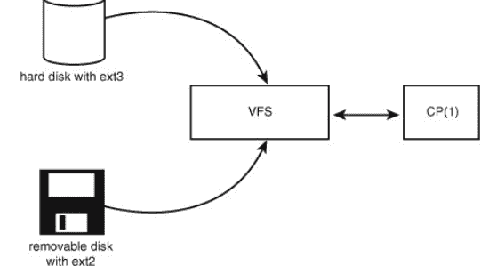

图 11.1 VFS 的工作：使用 `cp (1)` 工具将数据从挂载为 ext3 的硬磁盘移动到挂载为 ext2 的可移动磁盘。

## 通用文件系统接口

VFS 是粘合剂，使得 `open()`、`read()` 和 `write()` 等系统调用无论对于种文件系统或底层物理介质都能工作。在今天听起来这可能了不起——我们早已认为这种功能是理所当然——但对于此类通用系统来说，能够跨越所有支持的文件系统和介质是一项非凡的成就。更重要的是，系统可以在这些不同的文件系统和介质之间工作——我们可以使用标准系统调用从一个文件系统复制或移动到另一个。在旧的操作系统（如 DOS）中，这永远无法实现；访问原生文件系统需要特殊的工具。正是因为现代操作系统（如 Linux）通过虚拟接口抽象了访问，访问才是通用且易用的。

## 文件系统抽象层 (Filesystem Abstraction Layer)

如果内核没有在其低级文件系统接口周围实现一个抽象层，那么对于任何文件系统的通用接口都是不可行的。该抽象层使得 Linux 支持不同的文件系统，即使它们在支持的功能或行为上存在巨大差异。之所以可行是因为 VFS 提供了一个能够表示任何可能的文件系统的功能和行为的通用模型。当然，它偏向于 Unix 风格的文件系统，我们在过程中看到的也是这种风格。无论如何，Linux 仍然支持差异巨大的文件系统。

抽象层通过定义所有文件系统支持的基础接口和数据结构来工作。文件系统通过调整对“如何打开文件”和“这是一个目录”等概念的视图来匹配 VFS 的预期。实际接口隐藏了实现细节。然而，每个文件系统看起来都是相同的。它们都支持文件和目录等概念，并且支持创建和删除文件等操作。

结果是一个通用的抽象层，它允许内核轻松清洁地支持多种类型的文件系统。文件系统的编程是为了提供 VFS 预期的抽象接口和数据结构；反之，内核可以轻松与任何文件系统工作，用户态接口也可以无缝运行任何文件系统。

事实上，内核需要理解文件系统的底层细节，文件系统本身除外。例如，考虑一个简单的用户态程序

```
write(f, ibuf, len);
```


这将 `ibuf` 指向的字节写入由文件描述符 `f` 代表的文件系统的当前位置。该系统调用首先由通用 `sys_write()` 系统调用处理，该调用确定 `f` 所在文件系统的实际文件写入方法。随后，通用写入调用该方法（它是文件系统实现的一部分），将数据写入介质（或该文件系统在介质上的操作）。图 11.2 显示了从用户态 `write()` 调用到数据到达物理介质的流程。在本章的后续部分查看 VFS 如何抽象这种抽象并提供其接口。

# Unix 文件系统

从历史上来看，文件系统是遵循特定结构的层次化数据结构。文件系统包含文件、目录、节点（inodes）以及相关的控制信息。对文件系统执行的典型操作包括创建、删除和挂载。文件系统挂载在全局层次结构中的命名空间中的挂载点上。这使得所有挂载的文件系统都显示为单棵树中的条目。²

文件是有序的字节字符串。第一个字节标记文件的开始，最后一个字节标记文件的结束。每个文件都被分配了一个人类可读的名称，供系统和用户进行识别。文件操作包括读取、写入和删除。

文件系统在目录中布局。目录类似于文件夹，包含了相关的文件。目录还可以包含子目录；通过这种方式，目录可以嵌套以形成路径。路径的每个组件被称为目录条目（directory entry）。一个示例路径是 `/home/woman/foo/`——根目录 `home` 和 `woman` 以及文件 `foo` 都是条目，被称为 `dentry`（目录条目）。在 Linux 中，目录实际上是列出其中包含文件的普通文件。

Unix 系统使用的文件概念不包含任何关于该文件的关联信息（如权限、大小、所有者、创建时间等）。这些信息有时被称为文件元数据（即关于数据的数据），并存储在与文件分离的独立数据结构中，称为 `inode`。尽管在如今，`node` 这个术语已经无处不在。

所有信息通过文件系统的控制信息结合在一起，这些信息存储在超级块（superblock）中。超级块是一个包含文件系统整体信息的数据结构。有时，这些数据被称为文件系统元数据。文件系统元数据包括关于单个文件和目录的信息。

传统上，Unix 文件系统将这些概念作为其物理磁盘布局的一部分来实现。例如，文件信息以 `inode` 的形式存储在磁盘上单独的块中，目录存储在超级块中，以此此类推。Linux VFS（虚拟文件系统）的设计旨在与理解并实现此类概念的文件系统协同工作。非 Unix 文件系统（如 `FAT` 或 `NTFS`）可以在 Linux 中运行，但它们的文件系统代码必须提供这些概念的表象。例如，即使一个文件系统在内存中并不支持 `inode` 数据结构。或者，如果一个文件系统将目录视为特殊对象，VFS 也必须将目录表示为普通文件。否则，非 Unix 文件系统为了应对 Unix 范式和 VFS 的需求，需要进行某些特殊处理。然而，这些文件系统仍然可以工作，并且通常影响很小。

> ¹ 最近，Linux 将这种层次结构变为每个进程一个，为每个进程提供了唯一的命名空间。尽管默认情况下，每个进程都会继承其父进程的命名空间，并且似乎有一个全局命名空间。

² 相对于给定的驱动器号（如 `C:\`）

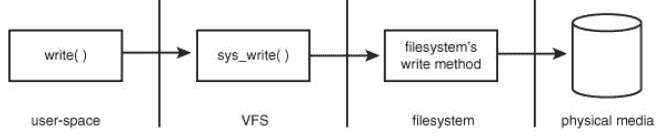

**图 11.2** 数据从用户空间发出 `write()` 调用，通过 VFS 的通用系统调用，进入文件系统的特定 `write` 方法，最后到达物理介质的流程。

## VFS 对象及其数据结构

VFS 是面向对象的¹¹。一组数据结构表示了通用文件模型。这些数据结构类似于对象。由于内核严格使用 C 语言编写的，没有直接支持面向对象范式的语言优势，因此这些数据结构被表示为 C 结构体。这些结构既包含了数据，也包含了指向文件系统实现的、用于操作这些数据的指针。

VFS 的四种主要对象类型是：

- 超级块对象（superblock object），代表一个特定的挂载文件系统。
- `inode` 对象（`inode` object），代表一个特定的文件。
- `dentry` 对象（`dentry` object），代表一个特定的目录条目。
- 文件对象（file object），代表与某些进程关联的打开文件。

注意，VFS 将 `dentry` 视为普通文件，并没有特定的目录对象。回本文章前面的内容，`dentry` 代表路径中的一个组件，它可能包含一个普通文件。换句话说，`dentry` 等同于目录，但目录等同于文件。明白吗？

> $¹ 人们经常忽略这一点，甚至否认这一点，但内核中有很多面向对象编程的例子。尽管内核开发人员可能避开 C++ 和显式的面向对象语言，但从对象的角度思考通常非常有用。VFS 是如何在 C 语言中实现简洁高效 OOP 的良好示例，而 C 语言缺乏任何 OOP 构造。

每个主要对象内部包含一个操作对象（operations object）。这些对象描述了内核作为主要对象时调用的方法。具体来说，我们有：

- `super_operations` 对象，包含内核可以在特定文件系统上调用的方法，如 `read_inode()` 和 `sync_fs()`。
- `inode_operations` 对象，包含内核可以在特定文件上调用的方法，如 `create()` 和 `link()`。
- `dentry_operations` 对象，包含内核可以在特定目录条目上调用的方法，如 `d_compare()` 和 `d_delete()`。
- `file` 对象，包含了进程在一个文件上调用的方法，如 `read()` 和 `write()`。

操作对象被实现为操作父对象的函数结构。由于有许多方法，如果基本足够，对象可以继承一个通用函数。特定文件系统的具体实例通过指针带有自己的文件系统特有方法来实现。

再次注意，我们指的是结构体——而不是显式的数据类型。

### 其他 VFS 对象

所有信息通过文件系统的控制信息结合在一起，这些信息存储在超级块中。超级块是一个包含文件系统整体信息的数据结构。有时，这些集体数据被称为文件系统元数据。文件系统元数据包括关于单个文件和目录的信息。

传统上，Unix 文件系统将这些概念作为其物理磁盘布局的一部分来实现。例如，文件信息以 `inode` 的形式存储在磁盘上单独的块中，目录存储在超级块中，以此此类推。Linux VFS 的设计旨在与理解并实现此类概念的文件系统协同工作。非 Unix 文件系统（如 `FAT` 或 `NTFS`）可以在 Linux 中运行，但它们的文件系统代码必须提供这些概念的表象。例如，即使一个文件系统在内存中并不支持 `inode` 数据结构。或者，如果一个文件系统将目录视为特殊对象，VFS 也必须将目录表示为普通文件。否则，非 Unix 文件系统为了应对 Unix 范式和 VFS 的需求，需要进行某些特殊处理。然而，这些文件系统仍然可以工作，并且通常影响很小。

### 超级块对象

超级块是由每个文件系统实现的，用于描述文件系统。超级块对象存储在磁盘上。

超级块由 `struct super_block` 表示，定义在 `<linux/fs.h>` 中。它的结构如下：

```
struct super_block {

    struct list_head s_list;          /* 所有超级块列表 */

    unsigned long s_dev;               /* 标识符 */

    unsigned long s_blocksize;         /* 块大小 */

    unsigned int s_old_blocksize;     /* 旧的块大小 */

    unsigned int s_bits;               /* 位块大小 */

    unsigned char s_dir;               /* 脏标记 */

    char s_filesize;                   /* 文件大小 */

    struct filesystem_type s_type;   /* 文件系统类型 */

    struct operations s_operations;    /* 超级块操作 */

    struct quota_info s_dq;           /* 配额信息 */

    struct quota_ops s_operations;    /* 配额操作 */

    struct operations s_export_ops;    /* 导出操作 */

    unsigned long s_flags;             /* 魔数 */

    unsigned long s_mount;             /* 挂载标志 */

    struct inode s_root;               /* 根挂载点 */

    struct semaphore s_unmount;        /* 卸载锁 */

    struct semaphore s_lock;           /* 超级块引用计数 */

    int s_sync;                        /* 文件系统同步 */
```


```c
    int s_need_sync;                      /* 待同步标志 */

    atomic_t s_count;                  /* 活跃引用计数 */

    void *s_security;                   /* 安全模块 */

    struct list_head s_dirty;          /* 脏节点列表 */

    struct list_head s_list_head;      /* 写入块列表 */

    void *s_anon;                      /* 导出匿名项 */

    struct list_head s_sb;             /* 分配的文件列表 */

    struct block_device s_block;       /* 关联的块设备驱动 */

    void *s_dev;                       /* 此类型文件系统的列表 */

    struct quota_info s_dq;             /* 配额特定选项 */

    char s_id[32];                      /* 文本名称 */

    void *sobj;                         /* 超级对象 */

    void *s_fs_info;                    /* 文件系统特定信息 */

    struct semaphore s_fs_rename_sem; /* 目录重命名锁 */

};
```

创建、管理和销超级块对象的代码位于 `fs/super.c`。超级块对象通过 `alloc_super` 函数创建并初始化。挂载时，文件系统会调用此函数，读取其超级块并填充其超级块对象。

### 超级块操作

超级块对象最重要的项是 `s_op`，它是超级块操作。超级块表由 `struct super_operations` 表示，定义在 `<linux/fs.h>` 中。它看起来如下

```c
struct super_operations {

    struct inode (*alloc_inode)(struct super_block *);

    struct inode (*destroy_inode)(struct inode);

    void (*read_inode)(struct inode);

    void (*write_inode)(struct inode, int);

    void (*put_inode)(struct inode);

    void (*mop_inode)(struct inode);

    void (*delete_inode)(struct inode);

    struct inode (*super)(struct super_block *);

    void (*write_super)(struct super_block *);

    int (*sync_fs)(struct super_block *, int);

    void (*unlock_fs)(struct super_block *super_block);

    int (*remount_fs)(struct super_block *, int, char *);

    void (*begin_stat)(struct super_block *, struct statfs);

    void (*clear_inode)(struct inode);

    int (*show_options)(struct seq_file *, struct vfsmount *);

};
```

每个项目都是一个指向对超块（superblock）对象操作函数的指针。超块操作（superblock operations）对文件系统及其节点（nodes）执行低层级操作。

当文件系统需要对其超块执行操作时，它会遵循其超块对象的指针找到所需的方法。例如，如果文件系统调用了 `sb->s_op->write_super(sb);`

`sb` 是一个指向文件系统超块的指针。通过此指针进入 `s_op` 会得到超块操作表，最终获得所需的 `write_super()` 函数，尽管该方法是直接调用的，但必须传递一个超块参数。这是因为 C 语言缺乏对面向对象的支持。在 C++ 中，类似 `sb.write_super();` 的调用就足够了。在 C 中，方法无法干净地获取其父对象，因此我们必须手动传递。

让我们来看由 `super_operations:` 指定超块操作：

- `struct inode * alloc_inode(struct super_block *sb)`：此函数在给定的超块创建并初始化一个新的节点。
- `void destroy_inode(struct inode inode)`：此函数释放给定的节点。
- `void read_inode(struct inode inode)`：此函数从磁盘以及 inode 结构体的其余部分读取由 `inode->i_ino` 指定的 inode。
- `void dirty_inode(struct inode inode)`：此函数在 inode 被变脏（被修改）时由 VFS 调用。日志文件系统（如 `ext3`）使用此函数执行日志更新。
- `void write_inode(struct inode*, int wait)`：将给定的 inode 写入磁盘。`wait` 参数指定该操作是否为同步操作。
- `void put_inode(struct inode inode)`：当 inode 的最后一个引用被删除时，VFS 调用此函数。普通的 Unix 文件系统使用此函数，VFS 直接删除节点。调用者必须持有 `inode_lock`。
- `void delete_inode(struct inode inode)`：此函数从磁盘上删除给定的 inode。
- `void put_super(struct super_block *sb)`：此函数在卸载时由 VFS 调用，以释放给定的超块对象。
- `void write_super(struct super_block *sb)`：此函数使用指定的超块更新磁盘上的超块。VFS 使用此函数将修改过的内存超块与磁盘同步。
- `int sync_fs(struct super_block *sb, int wait)`：此函数将文件系统元数据与磁盘上的文件系统同步。`wait` 参数指定该操作是否为同步。
- `void write_super_locks(struct super_block *sb)`：此函数防止文件系统发生变化，然后使用指定的超块更新磁盘上的超块。目前被 LVM（逻辑卷管理器）使用。
- `void unlockfs(struct super_block *sb)`：此函数像 `write_super_locks()` 一样解锁文件系统允许更改。
- `int statfs(struct super_block *sb, struct statfs *statfs)`：此函数由 VFS 调用以获取文件系统统计。与给定文件系统相关的统计信息放在 `statfs` 中。
- `int remount_fs(struct super_block *sb, int flags, char *data)`：此函数在文件系统用新选项重新挂载时由 VFS 调用。
- `void clear_inode(struct inode *)`：此函数由 VFS 调用以释放 inode 并清除任何与数据相关的页。
- `void ummount_begin(struct super_block *sb)`：此函数由 VFS 调用以中断挂载操作。它被网络文件系统调用，根据操作调用通用函数或什么都不做。

所有这些函数都由 VFS 在进程上下文中调用。如果需要，可能会被调用。

这些函数中的某些是可选的：文件系统可以将其在超块操作中的值设置为 `NULL`。如果关联的指针为 `NULL`，VFS 将读取磁盘上的磁盘 inode 并填充 VFS 的 inode 对象。如果文件系统没有 inode，则文件系统必须从磁盘上存储的地方获取信息。

## Inode 对象 (Inode Object)

inode 代表了内核操作文件或目录所需的所有信息。对于 Unix 风格的文件系统，这些信息直接从磁盘上的 inode 读取并填充 VFS 的 inode 对象。如果文件系统没有 inode，则文件系统必须从磁盘上存储的地方获取信息。

inode 由 `struct inode` 表示并定义在 `linux/fs.h` 中。以下是结构体，带有描述每个条目的注释：

```c
struct inode {

    struct hlist_node  i_hash;        /* 哈希列表 */
```


```c
struct hlist_head i_list;        /* 链表 */

struct hlist_node i_dentry;      /* dentry 链表 */

unsigned long     i_ino;        /* inode 号 */

atomic_t          i_count;      /* 引用计数 */

umode_t           i_mode;       /* 访问权限 */

unsigned int      i_nlink;      /* 硬链接数 */

uid_t             i_uid;        /* 所有者用户 ID */

gid_t             i_gid;        /* 所有者组 ID */

dev_t             i_dev;        /* 设备 */

loff_t            i_size;       /* 文件大小 */

};
```

文件本身的一部分。某些现代文件系统还使用数据库存储文件数据。无论什么情况，inode 都以适用于文件系统的方式构建。

```c
struct inode {
    struct timespec    i_atime;       /* 最后访问时间 */
    struct timespec    i_mtime;       /* 文件创建时间 */
    unsigned int       i_blksize;     /* 块大小（字节） */
    unsigned int       i_blocks_size; /* 块大小 */
    unsigned long      i_version;     /* 版本号 */
    unsigned long      i_blocks;      /* 文件大小（块） */
    spinlock           i_lock;        /* 字段 */
    struct inode       i_sem;         /* 信号量 */
    struct inode_operations i_inode;   /* inode 操作表 */
    struct file_operations i_fop;     /* 文件操作 */
    struct file_lock   i_sb;          /* 关联的超块 */
    struct file_lock   i_mapping;     /* 文件锁列表 */
    struct address_space i_bd;        /* 备地址空间 */
    struct address_space i_data;      /* 设备地址空间 */
    struct dentry      i_dquot[MAXQUOT]; /* dentry 磁盘配额 */
    struct inode       i_head;        /* 设备列表 */
    struct pipe_inode_info i_pipe;    /* 块设备驱动 */
    unsigned int       i_version;     /* 管道信息 */
    struct stat        i_stat;        /* 目录事件 */
    unsigned int       i_mode;        /* 目录通知 */
    unsigned int       i_flags;       /* 文件系统标志 */
    unsigned char      i_sock;        /* 是否为 socket */
    atomic_t           i_count;       /* 写入计数器 */
    void               i_security;    /* 安全模块 */
    uid32              i_generation;  /* inode 版本号 */
    union {
        void               *generic_ip; /* 文件系统特有信息 */
    };
};
```

## Inode 操作

特定的文件系统可能不支持 inode 对象中表示的属性。例如，某些文件系统可能不会创建时间戳。在这种情况下，文件系统可以自由实现它认为合适的功能；或者将`i_ctime`存储为零，让`i_ctime`等于`i_mtime`，或者任何它认为方便的方式。

与超级块（`superblock`）一样，`node_operations`非常重要，因为它描述了`VFS`可以在`inode`上调用的文件系统实现函数。与超级块一样，`node`操作通过以下方式被调用：

```
i->truncate(i)
```

其中`i`是指向特定`inode`的引用。在这种情况下，`truncate`操作在`i`存在且被调用的文件系统上运行。`inode_operations`结构定义在`<linux/fs.h>`中。

```c
struct inode_operations {
    int truncate(struct inode *inode, struct dentry *dentry, int mode);
    struct dentry *lookup(struct inode *inode, struct dentry *dentry);
    int (*link)(struct inode *inode, struct dentry *dentry);
    int (*symlink)(struct inode *inode, struct dentry *dentry, const char *name);
    int (*rmdir)(struct inode *inode, struct dentry *dentry);
    int (*knewdir)(struct inode *inode, struct dentry *dentry, dev_t dev);
    int (*create)(struct inode *inode, struct dentry *dentry, int mode);
    int (*readlink)(struct dentry *dentry, char *buf, int count);
    int (*follow_link)(struct dentry *dentry, struct nameidata *nameidata);
    void (*unlink)(struct dentry *inode);
    int (*permission)(struct inode *inode, int mode);
    int (*setattr)(struct dentry *dentry, struct inode *inode, struct kstat *atp);
    int (*chown)(struct dentry *dentry, struct inode *inode, const void *attr, size_t size);
    int (*setxattr)(struct dentry *dentry, const char *name, const void *value, size_t size);
    ssize_t (*listxattr)(struct dentry *dentry, char *list, size_t size);
    int (*removexattr)(struct dentry *dentry, const char *name);
};
```


让我们来看这些操作：

- `create(struct inode *inode, struct dentry *dentry, int mode)`: VFS 从 `create()` 和 `open()` 系统调用调用此函数，以指定的初始模式创建一个与给定 `dentry` 对象关联的新 `inode`。

- `lookup(struct inode *dir, struct dentry *dentry)`: 此函数在给定条目（entry）中为指定的组件（Component）查找对应的 `inode`。

- `link(struct inode *old_dentry, struct inode *dir, struct dentry *dentry)`: 该函数由 `link()` 系统调用调用，在由目录条目指定的新组件 `dentry` 目录中为文件 `old_dentry` 创建一个硬链接。

- `unlink(struct inode *dir, struct dentry *dentry)`: 此函数从 `unlink()` 系统调用调用，从目录中移除由目录条目指定的 `inode`。

- `symlink(struct inode *dir, struct dentry *dentry, const char *symname)`: 此函数从 `symlink()` 系统调用调用，在目录中创建一个以 `dentry` 所表示的文件命名的符号链接。

- `mkdir(struct inode *dir, struct dentry *dentry, int mode)`: 此函数从 `mkdir()` 系统调用调用，以指定的初始模式创建一个新目录。

- `rmdir(struct inode *dir, struct dentry *dentry)`: 此函数从 `rmdir()` 系统调用调用，从目录中移除由 `dentry` 引用的目录。

- `mknod(struct inode *dir, struct dentry *dentry, int mode, dev_t rdev)`: 此函数由 `mknod` 系统调用调用，在具有给定名称的目录条目创建一个由 `rdev` 引用的特殊文件（设备文件、命名管道或套接字）。

- `rename(struct inode *old_dir, struct dentry *old_dentry, struct inode *new_dir, struct dentry *new_dentry)`: 此函数由 VFS 调用，将 `old_dir` 目录中指定的文件移动到由 `new_dentry` 指定组件的 `new_dir` 目录。

- `readlink(struct dentry *dentry, char *buffer, int buflen)`: 此函数由 `readlink()` 系统调用调用，复制与 `dentry` 指定的符号链接相关的路径。

- `follow_link(struct dentry *dentry, struct nameidata *nameidata)`: 此函数由 VFS 调用以跟踪符号链接。

- `unlink(struct dentry *inode)`: 此函数由 VFS 调用从目录中移除 `dentry`。

- `truncate(struct inode *inode, struct dentry *dentry, int mode)`: 此函数由 VFS 调用，将 `inode` 所表示的文件截断到指定的大小。

- `permission(struct inode *inode, int mode)`: 此函数检查进程是否有权限访问 `inode`。

- `setattr(struct dentry *dentry, struct inode *inode, struct kstat *atp)`: 此函数由 VFS 调用以设置 `inode` 的属性。注意：此函数由 VFS 调用以更新属性。

- `chown(struct dentry *dentry, struct inode *inode, const void *attr, size_t size)`: 此函数由 VFS 调用以更改 `inode` 的所有者。

- `setxattr(struct dentry *dentry, const char *name, const void *value, size_t size)`: 此函数由 VFS 调用以设置 `inode` 的扩展属性。

- `listxattr(struct dentry *dentry, char *list, size_t size)`: 此函数由 VFS 调用以列出 `inode` 的扩展属性。

- `removexattr(struct dentry *dentry, const char *name)`: 此函数由 VFS 调用以从 `inode` 中移除扩展属性。

对象也可以是空闲的，停留在 slab 缓存中，正如前一节讨论的那样。在这种情况下，在任何 VFS 或文件系统缓存中都没有对该对象的有效引用。

## Dentry 缓存 (Dentry Cache)

在 VFS 费力将路径名中的每个元素解析为 `dentry` 对象并到达路径末尾后，如果丢弃所有内容将是浪费的。相反，内核将 `dentry` 对象缓存在 `dentry` 缓存中，简单来说，就是 `dcache`。

`dentry` 缓存由三部分组成：

- “已使用”的 `dentry` 列表，它们通过 `inode` 对象的 `i_dentry` 字段与其关联的 `inode` 链接。由于给定的 `inode` 可能有多个链接，因此可能存在多个 `dentry` 对象，因此使用了列表。
- 一个由未使用的和负缓存（negative）`dentry` 对象组成的双向链“最近最少使用”（LRU）列表。该列表按时间插入，因此靠近列表头部的条目是最新的。当内核必须移除条目以回收内存时，条目从尾部移除，因为它们是最旧的，在不久将来被使用的概率最小。
- 一个用于快速将给定路径解析为关联 `dentry` 对象的哈希和哈希函数。

哈希表由 `dentry_hashtable` 表示。每个元素都是指向具有相同值的 `dentry` 列表的指针。该数组的大小取决于系统的内存 数量。

实际的哈希值由 `d_hash()` 确定。这使得文件系统能够提供唯一的哈希函数。

哈希表查找通过 `d_lookup()` 执行。如果在 `dcache` 中找到匹配的 `dentry`，则返回它。如果失败，则返回 `NULL`。

作为一个示例，假设你正在编辑家目录目录 `/home/dracula/src/foo.c` 下的源文件。每当访问该文件 `/home/dracula/src/foo.c` 时，VFS 必须遵循每个 `dentry` 以解析出完整路径：`/home/dracula/src/foo.c`。为了防止在这次（或任何）路径名上执行这种耗时操作，VFS 可以首先尝试在 `dentry` 缓存中查找路径名。如果 `dentry` 不在 `dcache` 中，VFS 必须手动进行解析。一旦完成，它会将 `dentry` 对象添加到 `dcache` 中，以加速未来的任何查找。

`dcache` 还提供了 `inode` 缓存 `icache` 的前端。与 `dentry` 对象关联的 `inode` 对象不会被释放，因为 `dentry` 对 `inode` 维护了一个正使用计数器。这使得 `dentry` 对象可以将 `inode` 钉钉在内存中。只要 `dentry` 被缓存，相应的 `inode` 就会被缓存，因此当像上例一样从缓存成功查找路径名时，关联的 `inode` 已经缓存在内存中了。

## Dentry 操作 (Dentry Operations)

`dentry_operations` 结构指定了 VFS 在给定文件系统的目录条目上调用的方法。

`dentry_operations` 定义在 `<linux/dcache.h>` 中：

```c
struct dentry_operations {
    int (*d_invalidate)(struct dentry *, int);
    int (*d_hash)(struct dentry *, struct qstr);
    int (*d_compare)(struct dentry *, struct qstr *, struct qstr *);
    int (*d_delete)(struct dentry *);
    void (*d_release)(struct dentry *, struct node *);
    void (*d_put)(struct dentry *, struct inode *);
};
```


这些方法如下：

- `d_invalidate(struct dentry *dentry, int flags)` 此函数判断给定的 `dentry` 是否有效。每当 VFS 准备来自 dcache 的 dentry 时，都会调用此函数。大多数文件系统将此方法设置为 `NULL`，因为它们在 dcache 中的目录对象始终是有效的。
- `d_hash(struct dentry *dentry, struct qstr *name)` 此函数根据给定的 `dentry` 创建哈希值。每当 VFS 将 dentry 添加到哈希表时，都会调用此函数。
- `d_compare(struct dentry *dentry, struct qstr *name1, struct qstr *name2)` 此函数由 VFS 调用，用于比较两个组件 `name1` 和 `name2`。大多数文件系统将其留给 VFS 默认处理，即简单的字符串比较。对于某些文件系统（如 `FAT`），简单的字符串是不够的。该文件系统需要 `dcache_lock`。
- `d_delete(struct dentry *dentry)` 当指定的 `dentry` 对象的 `d_count` 达到零时，VFS 会调用此函数。它需要 `dcache_lock`。
- `d_release(struct dentry *dentry)` 当指定的 `dentry` 将被释放时，VFS 会调用此函数。默认函数什么都不做。
- `d_put(struct dentry *dentry, struct inode *inode)` 当条目丢失其关联的 `inode` 时（例如，条目已从磁盘删除），VFS 会调用此函数。VFS 简单地调用 `release()` 函数来释放 `inode`。如果文件系统覆盖了此操作，则在执行文件系统所需的任何工作之外，必须调用 `release()`。

## 文件对象 (The File Object)

我们查看的主要对象是文件对象。文件对象用于表示进程打开的文件。当我们从用户文件的角度考虑 VFS 时，文件对象就是我们真正遇到的对象。它直接处理文件、超级块（`superblocks`）、模式或条目。文件对象中的信息最为著名（如访问模式和偏移量），或者它处理了最多的操作，这并不意外。

基于单元的文件系统。文件系统没有义务实现所有这些方法——尽管实现基础功能是愚蠢的——如果不感兴趣，可以简单地将其设置为 `NULL`。

让我们来看具体的操作：

- `loff_t lseek(struct file *file, loff_t offset, int origin)` 该函数将文件指针更新到指定的偏移量。它通过 `lseek()` 系统调用调用。
- `size_t read(struct file *file, char *buf, size_t count, loff_t *offset)` 该函数从给定的偏移量读取 `count` 字节到 `buf` 中。然后更新文件指针。
- `size_t aio_read(struct kiocb *iocb, char *buf, size_t count, loff_t offset)` 该函数开始异步读取 `iocb` 中指定偏移量处描述的文件的 `count` 字节到 `buf` 中。
- `size_t write(struct file *file, const char *buf, size_t count, loff_t *offset)` 该函数将 `buf` 中的 `count` 字节写入位置在 `offset` 处的文件。然后更新文件指针。
- `size_t aio_write(struct kiocb *iocb, const char *buf, size_t count, loff_t offset)` 该函数开始异步向 `iocb` 中描述的文件写入 `buf` 中的 `count` 字节。
- `int readdir(struct file *file, void *dirent, filldir_t *filldir)` 该函数返回目录列表中的下一个目录。该函数由 `readdir()` 系统调用调用。
- `unsigned int poll(struct file *file, struct poll_table_struct *poll_table)` 该函数进入睡眠，等待给定文件的活动。它由 `poll()` 系统调用调用。
- `int ioctl(struct inode *inode, struct file *file, unsigned int cmd, unsigned long arg)` 该函数用于向设备发送命令和参数对。它当文件是打开的设备节点时使用。该函数从 `ioctl` 系统调用调用。
- `int mmap(struct file *file, struct vm_area_struct *vma)` 该函数将文件内存映射到给定的地址空间，并由 `mmap()` 系统调用调用。
- `int open(struct inode *inode, struct file *file)` 该函数创建一个新的文件对象并将其链接到相应的 `inode` 对象。它由 `open()` 系统调用调用。
- `int flush(struct file *file)` 每当打开的文件的引用计数减少时，VFS 就会调用此函数。其目的是销毁文件——例如，当共享文件描述符的最后一个进程调用 `close()` 时，或者其目的取决于文件系统。
- `int fsync(struct file *file, struct dentry *dentry, int datasync)` 该函数由 `fsync()` 系统调用调用，将文件所有的缓存数据写入磁盘。
- `int aio_fsync(struct kiocb *iocb, int datasync)` 该函数由 `aio_fsync()` 系统调用调用，将与 `iocb` 关联的文件的所有缓存数据写入。
- `int fsync(int fd, struct file *file, int on)` 该函数启用或禁用异步 I/O 的通知。
- `int lock(struct file *file, int cmd, struct file_lock *lock)` 该函数操作给定文件上的文件锁。

```
size_t readv(struct file *file, const struct iovec *vector, unsigned long count, loff_t *offset)
```

该函数由 `readv()` 系统调用调用，从给定文件读取并将结果放入 `vector` 描述的 `count` 个缓冲区中。然后增加偏移量。

- `size_t writev(struct file *file, const struct iovec *vector, unsigned long count, loff_t *offset)` 该函数由 `writev()` 调用，从 `vector` 描述的 `count` 个缓冲区写入文件。偏移量增加。
- `size_t sendfile(struct file *file, loff_t *offset, size_t size, read_actor_t actor, void *target)` 该函数由 `sendfile()` 调用，将数据从一个文件拷贝到另一个文件。它完全在内核中执行拷贝，并避免将数据拷贝到用户空间。
- `size_t sendpage(struct file *file, struct page *page, int offset, size_t size, loff_t *pos, int more)` 该函数用于将数据从一个文件发送到另一个文件。
- `unsigned long get_unmapped_area(struct file *file, unsigned long len, unsigned long offset, unsigned long flags)` 该函数获取未使用的地址空间以映射给定文件。

## 与文件系统相关的数据结构

除了基本的 VFS 对象外，内核还使用其他标准数据结构来管理与文件系统的数据。第一个对象用于描述文件系统的特定变体，例如 `ext3` 或 `XFS`。第二个数据结构用于描述文件系统的挂载实例。

由于 Linux 支持许多不同的文件系统，内核必须有一个特殊的结构来描述每个文件系统的能力和行为。

```c
struct file_system_type {
    char *name;             /* 文件系统的名称 */
    const struct subsystem *subsystem;  /* 子系统对象 */
    int fs_flags;          /* 文件系统类型标志 */
    int count;
};
```

/* 以下是一个用于从磁盘读取超级块（superblock）的函数 */


struct `super_block` `(*get_sb)` (`struct file_system_type *`, `int`, `char *void`);

```c
struct super_block (*get_sb) (struct file_system_type *, int, char *void);
```

/* 这是一个用于终止超级块的函数 */

```c
void (*kill_sb) (struct super_block *);
```

`struct module {`

    `struct module *owner;`                /* 关联的模块（如果有） */

    `struct file_system_type *next;`    /* 列表中的下一个 `file_system_type` */

    `struct list_head fs_superblock;`  /* 超级块对象列表 */

`};`

```c
struct module {
    struct module *owner;                /* 关联的模块（如果有） */
    struct file_system_type *next;        /* 列表中的下一个 file_system_type */
    struct list_head fs_superblock;       /* 超级块对象列表 */
};
```

`get_sb` 函数用于读取超级块并在加载时填充超级块。其余函数描述了文件系统的属性。

每个文件系统只有一个 `file_system_type`，无论在其上挂载了多少个实例，或者该文件系统是否是否被挂载。

当文件系统实际挂载时，情况变得更有趣，此时会创建 `vfsount` 结构。该结构用于表示文件系统的特定实例。

`vfsount` 结构定义在 `<linux/mount.h>` 中。在这里：

```c
struct vfsount {
    struct list_head      hash;           /* 哈希表列表 */
    struct vfsount       *mnt_parent;   /* 父文件系统 */
    struct dentry         *mnt_mountpoint; /* 此文件系统根目录的 dentry */
    struct dentry         *dentry;
    struct super_block    *sb;             /* 此文件系统的超级块 */
    struct list_head      mnt_child;      /* 子节点列表 */
    struct list_head      list_head;       /* 父级子节点 */
    atomic_t              mnt_count;      /* 使用计数 */
    int                   mnt_flags;      /* 挂载标志 */
    char                  *mnt_devname;   /* 设备文件名 */
    struct list_head      mnt_list;       /* 描述符列表 */
};
```

维护所有挂载点列表的复杂部分在于文件系统与其他挂载点之间的关系。`vfsount` 的各种链表跟踪了这种关系。

`vfsount` 结构还存储挂载在 `mnt_flags` 字段上的标志（如果有）。表 11.1 是这些标志的列表。

## 表 11.1 挂载标志列表

| 标志 | 描述 |
| --- | --- |
| `MNT_NOSUID` | 禁止二进制文件上的 `setuid` 和 `setgid` 标志 |
| `MNT_NODEV` | 禁止访问设备文件 |
| `MNT_NOEXEC` | 禁止执行二进制文件 |

与进程相关的结构是 `fs_struct`，它包含了与进程相关的文件系统信息，并由进程描述符中的 `fs` 字段指向。该结构定义在 `<linux/fs_struct.h>` 中。以下是其定义及注释：

```c
struct fs_struct {
    int count;                  /* 使用计数 */
    atomic_t lock;              /* 保护结构的锁 */
    rwlock_t umask;             /* 默认文件权限 */
    struct dentry *root;        /* 根目录入口 */
    struct dentry *pwd;         /* 当前工作目录入口 */
    struct dentry *rootroot;     /* 备根目录入口 */
    struct vfsm_mount *root;    /* 根目录的挂载对象 */
    struct vfsm_mount *pwdmnt;  /* 当前目录的挂载对象 */
    struct vfsm_mount *altroot; /* 备根目录的挂载对象 */
};
```

该结构保存了当前进程的当前目录和根目录。

第三也是最后一个结构是 `namespace_structure`，它定义在 `<linux/namespace.h>` 中，并由进程描述符中的 `namespace` 字段指向。进程命名空间是在 `Linux` `2.4` 内核中引入的。它们允许每个进程对挂载的文件系统拥有独特的视图——如果需要，不仅是一个目录，而是一个完全独特的文件系统层级。以下是该结构及其常用的注释：

```c
struct namespace {
    atomic_t count;             /* 使用计数 */
    struct vfsm_mount *root;    /* 根目录的挂载对象 */
    struct list_head list;      /* 挂载点列表 */
    struct rw_semaphore *sem;   /* 保护命名空间的信号量 */
};


该列表指定了组成命名空间的挂载文件系统的双链表。对于大多数进程，它们的进程描述符指向 `files_struct` 和 `fs_struct` 结构。然而，对于带有 `CLONE_FILES` 或 `CLONE_FS` 标志创建的进程，这些结构是共享的。因此，多个进程描述符可能指向同一个 `files_struct` 或 `fs_struct` 结构。每个结构的 `count` 成员提供引用计数，以防止在进程在使用该结构时将其销。

> 线程通常指定 `CLONE_FILES` 和 `CLONE_FS`，因此它们之间共享单一的 `files_struct` 和 `fs_struct`。相反，普通进程没有指定这些标志，因此它们拥有自己的文件系统信息和打开文件表。

命名空间结构的工作方式恰相反。默认情况下，所有进程共享相同的命名空间（也就是说它们都看到相同的文件系统层级）。只有在 `clone()` 调用期间指定 `CLONE_NEWNS` 标志时，进程才会获得命名空间结构的唯一副本。

# Linux 中的文件系统

Linux 支持广泛的文件系统，从原生文件系统（如 `ext2` 和 `ext3`）到网络文件系统（如 `NFS` 和 `Coda`），仅官方内核就包含了超过 50 种文件系统。`VFS`（虚拟文件系统）层为这些不同的文件系统提供了一个实现所需的框架，以及一个与标准系统调用交互的接口。因此，`VFS` 层使得在 Linux 中实现新文件系统变得简洁，并允许这些文件系统通过标准的 Unix 系统调用自动进行互操作。

## 块 I/O 层

块设备是硬件设备，其特征是随机访问（即不一定按顺序访问）固定大小的数据块，称为块。最常见的块设备是硬盘，但也存在许多块设备，如软盘驱动、`CD-ROM` 驱动器和闪存内存。你可以在上面挂载文件系统的所有设备——这就是块设备通常访问的方式。

另一种类型的设备是字符设备。字符设备以顺序数据流的形式被访问，一个字节接一个字节。字符设备的示例是串口和键盘。如果硬件设备是以数据流的形式访问的，则它被实现为字符设备。另一方面，如果设备是以随机（非顺序）方式访问的，它就是块设备。

基本上，区别在于你如何随机访问设备——换句话说，设备是否可以从一个位置跳转到另一个位置。以键盘为例。无序读取字母，或者读取流中除下一个以外的任何字母，几乎没有意义。因此，键盘驱动程序是一个字符设备；不存在“按键”，只有用户输入到键盘的字符。从键盘读取会首先返回一个流，当它们输入时先是 `"a"`，然后是 `"b"`，最后是 `"c"`。然而，硬盘是一个块设备，因为我们应该能够跳转到任何块并读取该特定块的内容；块不需要是连续的。因此，硬盘是随机访问的，而不是作为流访问，因此是一个块设备。

在内核中管理块设备比管理字符设备需要更多的关注、准备和工作。这是因为字符设备只有一个位置——当前位置——而块设备必须能够在介质上的任何位置之间往返。事实上，内核并不需要提供专门管理字符设备的子系统，但块设备恰恰获得了这种支持。部分原因，这种子系统的必要性来自于块设备的复杂性。然而，这种支持的一个很大原因是块设备非常复杂。

## 块设备的结构

块设备最小的可寻址称为扇（`sector`）。扇的大小是 2 的幂次方，但 512 字节是常见大小。扇的大小是设备的物理属性，扇是所有块设备的根本单位——无法以小于扇的单位来访问设备。

块设备最小的可寻址称为扇（`sector`）。扇的大小是 2 的幂次方，但 512 字节是常见大小。扇的大小是设备的物理属性，扇是所有块设备的根本单位——无法以小于扇的单位来访问设备。

`b_state` 字段指定了此特定缓冲区的状态。它可以是表 12.1 中的标志之一。合法的标志存储在 `<linux/buffer_head.h>` 中定义的 `bh_state_bits` 枚举中。

## 表 12.1 `bh` 状态标志

| 状态标志 | 含义 |
|---|---|
| `BH_Update` | 缓冲区包含有效数据 |
| `BH_Dirty` | 脏数据（缓冲区的内容比磁盘上块的内容新，因此缓冲区必须写入磁盘） |
| `BH_Lock` | 缓冲区正在进行 I/O 已锁定以防止并发访问 |
| `BH_Req` | 缓冲区正参与某项请求 |
| `BH_Mapped` | 缓冲区是映射到磁盘块的有效缓冲区 |
| `BH_New` | 缓冲区是新分配且尚未访问 |
| `BH_Async_Read` | 缓冲区正在进行异步读 I/O |
| `BH_Async_Write` | 缓冲区正在进行异步写 I/O |
| `BH_Delay` | 缓冲区没有关联的磁盘块 |
| `BH_Boundary` | 缓冲区形成了连续块的边界 - 下一个块是不连续的 |

`bh_state_bits` 枚举还包含列表 `BH_PrivateStart` 中的最后一个值。该标志不是一个有效状态，而是对应代码可以使用的第一个可用位。所有大于或等于 `BH_PrivateStart` 的位都不会被块 I/O 层使用，因此 `b_state` 字段可以允许驱动程序在该标志之后使用其内部标志的位值，并确保它们不会侵占被块 I/O 层使用的官方位。

`b_count` 字段是缓冲区的使用计数。该值通过两个内联函数进行加减，这两个函数都定义在 `<linux/buffer_head.h>` 中。

```c
static inline void get_bh(struct buffer_head *bh)
{
    atomic_inc(&bh->b_count);
}

static inline void put_bh(struct buffer_head *bh)
{
    atomic_dec(&bh->b_count);
}
```

在操作缓冲区之前，你必须通过 `get_bh()` 增加其引用计数，以确保缓冲区不会在你操作时被释放。完成对缓冲区的操作后，通过 `put_bh()` 减少引用计数。

给定缓冲区上的物理磁盘对应于由 `b_bdev` 描述的块设备上的 `b_blocknr` 个逻辑块。

给定缓冲区中的物理内存对应于 `b_page` 个页。此外，`b_data` 是一个直接指向 `in_page` 中某处块的指针，其长度为 `b_size` 字节。因此，该块位于内存中从 `b_data` 开始，到 `(b_data + b_size)` 结束。

缓冲区的目的是描述磁盘块与物理内存缓冲区（特定页面上的字节序列）之间的映射。作为这种缓冲区到块映射的描述符，是该数据在内核中的唯一角色。

在 2.6 内核之前，缓冲区头（`buffer head`）是一个重要得的数据结构：它是 I/O 的单元。缓冲区头不仅描述从磁盘到物理页的映射，还作为所有 I/O 的容器。存在两个主要问题。首先，缓冲区头在页级别操作来说是一个大型且笨重的数据结构，而且为了获得更好的性能，描述每个单独缓冲区（可能比页小）的大缓冲区头是不够的。因此，在 2.6 内核中，大量的工作是为了让内核使用页和地址而不是缓冲区。这些工作部分在第 14 章“缓存和页写回”中进行了讨论，其中我们讨论了 `address_space` 结构和 `pdflush` 进程。

缓冲区头的第二个问题是它们只描述单个缓冲区。当用于所有 I/O 操作时，缓冲区头迫使内核将可能巨大的块 I/O 操作（例如写入）拆分成多个缓冲区头结构。这导致了不必要的开销和空间消耗。2.5 内核开发的主要目标是为 I/O 操作引入一种新的、灵活且轻量的容器。结果就是 `bio` 结构，我们将在下一节讨论。

## `bio` 结构

内核内 I/O 的容器是 `bio` 结构，它定义在 `<linux/bio.h>` 中。该结构以段列表的形式表示执行中的 I/O 操作。段是内存中连续的缓冲区块。因此，单个缓冲区不需要在内存中连续。通过分段描述缓冲区，`bio` 结构提供了从内存多个位置执行单个块 I/O 操作的能力。以下是 `struct bio`，为每个字段添加了注释：

```c
struct bio {
    struct sector *bio;               /* 磁盘上的关联扇区 */
    struct bio *bi_next;             /* 请求列表 */
    struct block_device *bi_bdev;    /* 关联块设备 */
    unsigned long bi_flags;           /* 状态和命令标志 */
    unsigned short bi_iter;          /* 或写 */
    unsigned short bi_vcnt;           /* bio vec 数量 */
    unsigned short bi_idxr;           /* bi_io_vec 中的当前索引 */
    unsigned short bi_phys_segments;  /* 合并后的段数 */
    unsigned short bi_hw_segments;  /*合并后的段数 */
    unsigned int bi_size;             /* I/O 计数 */
```


```c
    unsigned int bi_vecs;             /* bio vec 的最大数量 */

    struct bio_vec *bi_io_vec;       /* bio_vec 列表 */

    void (*bi_end_io)(struct bio *bio); /* I/O 完成方法 */

    atomic_t bi_cnt;                  /* 使用计数 */

    void (*bi_private)(struct bio *bio); /* 私有数据回调 */

    void (*bi_destructor)(struct bio *bio); /* 析构方法 */
};
```


完成并从你处释放。完成后，相应地减少使用计数。

最后，`bi_private` 字段是结构体所有者（即创建者）的字段。按照规定，只有在你分配了该结构体时才能读写此字段。

## 新旧对比

缓冲区头（buffer heads）与新的 bio 结构之间的差异非常重要。bio 结构代表一个可能包含内存中一个或多个页。而 `buffer_head` 结构代表磁盘上的单个块。由于缓冲区头与页中的单个磁盘块绑定，因此缓冲区头代表了将请求不必要地划分为块大小的切片，只为了稍后又将它们重新组装。由于 bio 结构是轻量级的，它可以描述不连续的块，而并不一定需要拆分的 I/O 操作；它没有所有这些问题。

从 `struct_head_to_struct` 切换提供了其他用处，如下：

- *bio 结构可以表示高内存（请参见第 10 章），因为 `struct` 只处理物理页，而不处理直接指针。*
- bio 结构可以同时表示普通的页 I/O 和不通过页缓存的直接 I/O 操作——关于页缓存的讨论请参见第 14 章。
- bio 结构使其易于执行分散-聚集（向量）块 I/O 操作，操作中的数据源自多个物理页。
- bio 结构比缓冲区头轻得多，因为缓冲区头只包含阻塞 I/O 操作所需的最小信息，而与缓冲区本身没有关系。

缓冲区头的概念仍然是需要的，作为映射磁盘块到页的描述符。bio 结构不包含任何关于缓冲区状态的信息——它仅仅是描述单个块 I/O 操作的一个或多个数据段的向量数组，加上相关信息。仍然需要 `buffer_head` 结构来包含关于缓冲区的信息。将这两个结构分离可以让每个结构都保持尽可能小。

## 请求队列

块设备维护着 `request queue`（请求队列）来存储它们待处理的块 I/O 请求。请求队列由 `request_queue` 结构表示，并定义在 `<linux/blkdev.h>` 中。请求队列包含一个请求的双向链表和相关的控制信息。内核中的高层代码（如文件系统）将请求添加到队列中。只要请求队列不为空，与队列关联的块设备驱动程序就会队列头部获取请求并提交给其关联的块设备。队列请求列表中的每个项都是单个请求，类型为 `struct request`。

## 请求

队列上的单个请求由 `struct request` 表示，这也定义在 `<linux/blkdev.h>` 中。每个请求可以由多个 bio 组成，因为单个请求可以在多个连续的磁盘块上操作。注意，虽然磁盘上的块必须是相邻的，但内存中的块并不一定——每个 bio 结构可以描述多个段（回想，段是内存中块的连续区域），请求可以由多个 bio 组成。

## I/O 调度器

在内核中简单地向块设备发送请求就会发出它们，一旦发出它们，结果就是极其糟糕的性能。整个计算机最慢的操作之一就是磁盘寻道。每次寻道——将磁盘头定位到特定块的位置——都需要许多毫秒的时间。最大限度地减少寻道对系统性能至关重要。

因此，内核不会按照接收到的顺序或在接收后立即向磁盘发出 I/O 请求。相反，它执行一些被称为“合并”（merging）和“排序”（sorting）的操作，以极大地提高整个系统的性能。执行这些操作的内核子称为 I/O 调度器。

I/O 调度器将磁盘 IO 资源分配给系统中的待处理的块 I/O 请求之间。它通过对请求队列中的待处理请求进行合并和排序来实现。不要将 I/O 调度器与进程调度器（参见第 3 章“调度”）混淆，后者将处理器资源分配给系统上的进程。这两个子系统是相关的，但并不相同。进程调度器和 I/O 调度器都在多个对象之间实现了资源虚拟化。在进程调度器的情况下，处理器被虚拟化并在系统进程之间共享。这提供了多任务和时分操作系统的幻象，例如 Unix。另一方面，I/O 调度器在多个（此处缺失）之间虚拟化块设备

## I/O 调度器的工作

I/O 调度器通过管理块设备的请求队列来工作。它决定队列中请求的顺序以及每个请求在何时被分发到块设备

> 这一点必须强调。一个没有这些功能的系统，或者这些功能实现不良的系统，即使在处理适量的块 I/O 操作时，性能也会非常糟糕。

它管理请求是为了减少寻道，这将带来更大的吞吐量。这里的“全局”修饰符是一个 I/O 调度器，经常以提高系统整体性能为代价对某些请求不公平。

I/O 调度器执行两个动作来最小化请求：合并和排序。合并是将两个或多个请求合并为一个。例如，文件系统提交到队列的请求——例如，从文件中读取一段数据（此时，计数，一切都是以扇区、块和文件的形式发生的）。如果队列中已经有一个从相邻扇区读取的请求（例如，文件的相邻部分），这两个请求可以合并为操作一个或多个相邻扇区磁盘的单个请求。通过合并请求，I/O 调度器需要向磁盘发出，并且可以在不寻道的情况下处理多个请求。因此，合并请求减少了开销并最小化了寻道。

现在，假设我们虚拟的请求被提交到请求队列，但没有指向相邻扇区的请求。因此，我们无法将此请求与任何其他请求合并。现在，我们可以简单将此请求推到队尾。但是，如果磁盘上相似的位置还有其他请求呢？从物理扇区上将请求移动彼此靠近会更好吗？事实上，I/O 调度器正是为了这一目标：从排序的角度上最小化每个单独的寻道，以便队列中的所有请求（尽可能）访问。

第 22 页

对性能的影响很小；但应用程序会一直等待、闲置，直到每个请求完成。因此，延迟对系统的性能至关重要。

更严重的问题是，读取请求之间存在相互依赖。例如，考虑读取大量文件。每次读取都分小块进行。在上一个块被读取并返回给应用程序之前，程序不会开始读取下一个块（或者下一个文件，无论是哪个）。因此，如果对每个请求都进行单独等待，此类应用程序的总体延迟将对系统性能造成更严重的读取瓶颈，而 Deadline I/O 调度器通过管理这些请求来防止请求饥饿。

注意，减少请求饥饿是以牺牲全局吞吐量为代价的。即使 Linux 电梯调度器（Elevator）也尝试这样做，尽管方式温和得多——如果电梯始终按照顺序将请求插入队列，并且从不检查旧请求并退回插入模式，它将提供更好的吞吐量（通过最小化寻道）；然而，它会更努力地限制饥饿。不要误认为，提供请求公平性并最大化全局吞吐量是一项艰巨的任务。

在 Deadline I/O 调度器中，每个请求都关联有一个过期时间。根据定义，读请求的过期时间为 500 毫秒，写请求为 5 秒。Deadline I/O 调度器的工作方式类似于 Linux 电梯调度器，它维护了一个按磁盘物理位置排序的请求队列。它将其称为排序队列。当新请求被提交到排序队列时，Deadline I/O 调度器会像电梯一样执行合并和插入。它还会将请求排序到特殊的读 FIFO 队列中，并将写请求插入到特殊的写 FIFO 队列中。虽然普通队列按磁盘位置排序，但这些队列保持为 FIFO 格式（实际上，它们是按时间排序的）。因此，新请求始终添加到队列末尾。在正常操作下，Deadline I/O 调度器从排序队列的头部提取请求到调度队列。调度队列被发送到磁盘驱动器。这导致了最小的寻道。

如果读 FIFO 或写 FIFO 队列中的任意请求过期（即当前时间大于与请求关联的过期时间），则 Deadline I/O 调度器将开始从 FIFO 队列处理请求。通过这种方式，Deadline I/O 调度器试图确保没有请求的挂起时间超过其过期时间。参见图 1.3。


图 1.3 Deadline I/O 调度器的三个队列。

注意，Deadline I/O 调度器对请求延迟不做出任何严格保证。然而，它能够在请求过期时或之前提交请求。这种偏好防止了饥饿。因为读请求的过期值远小于写请求，Deadline I/O 调度器还确保写请求不会导致请求饥饿。这种对读请求的偏好提供了极短的读取延迟。

Deadline I/O 调度器位于 `drivers/block/deadline-iosched.c`。

³ 然而，这并不是无限延迟请求的动力。写请求也需要及时写入磁盘，尽管不像读请求那样关键。

⁴ 在 Deadline I/O 调度器中，执行前合并（front merging）是可选的，因为这并不值得，因为许多工作负载可以合并的请求非常少。

# 预期 I/O 调度器 (Anticipatory I/O Scheduler)

尽管 Deadline I/O 调度器在最小化读取延迟方面表现出色，但它是以牺牲全局吞吐量为代价的。考虑一个正在进行密集写入的系统。每当发出读取请求时，I/O 调度器都会迅速处理该读取请求。这会导致磁盘寻道到读取的位置并返回。对读请求的偏好是好事，但由此产生的寻道抖动（到读取请求的位置回到正在进行的写入）对全局磁盘吞吐是有害的。预期 I/O 调度器旨在提供出色的读取延迟，同时也提供出色的全局吞吐量。

首先，预期 I/O 调度器以 Deadline I/O 调度器为基础。因此，它们并不完全不同。预期 I/O 调度器实现了三个队列（加上调度队列）以及每个请求的过期时间，这与 Deadline I/O 调度器一样。主要的改变是增加了预期启发式算法。

预期 I/O 调度器试图最小化在其他磁盘 I/O 活动期间发出的读请求所伴的寻道。当请求发出时，它会像通常一样在通常过期期内被处理。然而，在请求提交后，预期 I/O 调度器不会立即寻回并对任何其他请求返回空。相反，它会等待几毫秒（实际值可配置；默认为六6毫秒）。在这些几毫秒内，应用程序很有可能提交另一个请求到磁盘相邻区域的读请求，而该请求会被立即处理。等待期结束后，预期 I/O 调度器将寻回到它之前停止的地方并继续处理之前的请求。

重要的是，如果等待请求所花费的几毫秒（基本上是为了预期更多请求而花费的时间）能够减少即使是小部分比例的在其他密集请求期间处理读请求导致的往返寻道，那么它是值得的。如果在等待期内发出了相邻的 I/O 请求，I/O 调度器就节省了一对寻道。随着越来越多的请求发送到磁盘的同一区域，更多的寻道被避免了。

当然，如果等待期内没有活动，预期 I/O 调度器的这几毫秒就浪费了。要继续从预期 I/O 调度器中获得最大收益，必须正确地预期应用程序和文件系统的行为。这是通过一组启发式算法和统计实现的。通过足够高比例的预期，预期 I/O 调度器可以大大减少读取请求的惩罚，同时满足系统对请求的需求。这允许预期 I/O 调度器最小化延迟，同时也减少寻道次数。这导致了低延迟和高吞吐量。

预期 I/O 调度器位于 `drivers/block/asiosched.c`。Deadline I/O 和预期 I/O 调度器都是标准 2.6 内核的一部分。块设备使用的 I/O 调度器是可配置的。默认 I/O 调度器是预期。

# 进程地址空间

在第 10 章“内存管理”中，我们查看了内核如何管理物理内存。除了管理自身的内存，内核还必须管理进程地址空间——给每个用户空间进程的内存视图。Linux 是虚拟操作系统，因此内存资源在进程之间是虚拟化的。对于单个进程而言，就好像访问整个系统的物理内存。更重要的是，即使单个进程的空间也可以大于物理内存。本章讨论内核如何管理进程地址空间。

一个有效的内存区域，或者以无效的方式访问了有效区域，内核将杀死该进程并发出令人可怕的“段错误”（Segmentation Fault）消息。

内存区域包含各种“良用工具”，例如：

- 可执行文件代码的内存映射，称为 `text section`
- 可执行文件初始化全局变量的内存映射，称为 `data section`
- 零页（全为零的页，用于此类目的）的内存映射，其中包含未初始化的全局变量，称为 `bss section`
- 用于进程用户栈的零页映射（不要将其与进程的内核栈混淆，内核栈是独立的并由内核维护）
- 为每个加载到进程地址空间的共享库（如 C 库和动态链接器）提供的额外的额外的文本段、数据段和 bss 段
- 任何内存映射文件
- 任何共享内存段
- 任何匿名内存映射，例如与 `malloc()` 关联的映射

进程地址空间中的所有地址都恰好存在于某一个区域中（内存区域之间不重叠）。正如我们所看到的，运行进程中的每个内存块都有一个独立的内存区域：栈、对象代码、全局变量、映射文件等。

## 内存描述符 (The Memory Descriptor)

内核使用一种称为内存描述符（memory descriptor）的数据结构来表示进程的地址空间。该结构包含了所有与进程地址空间相关的信息。内存描述符由 `struct mm_struct` 表示，定义在 `<linux/sched.h>` 中。

让我们来看内存描述符，并为每个字段添加注释：

> “BSS”术语具有历史性且非常古老。它代表“block started by symbol”（由符号启动的块）。未初始化的变量不存储在可执行对象中，因为它们没有任何关联的值。但 C 标准规定未初始化的全局变量被分配某些默认值（基本上是全零），因此内核从可执行文件中加载这些变量（无值），并在该区域上映射零页，从而给变量赋予值 0，而无需在对象文件中通过显式初始化节省空间。

> 较新版本的 glibc 实现了 `mmap()` 和 `brk()`。

> 进程描述符、内存描述符及其相关函数之间存在错复杂的相互依赖关系。因此，`struct mm_struct` 最终位于 `sched.h` 中。

```c
```


```c
struct mm_struct {

    struct va_area_struct *mmap;          /* 内存区域列表 */

    struct rb_tree mmap;                   /* 内存区域的红黑树 */

    struct va_area_struct *mmap_cache;     /* 上次使用的内存区域 */

    unsigned long free_area;               /* 第一个空洞 */

    unsigned long pgd;                     /* 页全局目录 */

    atomic_t mm_users;                      /* 用户数 */

    atomic_t map_count;                    /* 主要计数器 */

    int mmap_count;                        /* 每个进程的内存区域数量 */

    spinlock_t rwsem_page_table_lock;       /* 页表锁 */

    struct list_head mlist;                 /* 所有 mm_struct 的列表 */

    unsigned long start_code;              /* 对象代码起始地址 */

    unsigned long end_code;                 /* 对象代码结束地址 */

    unsigned long start_data;              /* 数据初始地址 */

    unsigned long end_data;                 /* 数据结束地址 */

    unsigned long start_br;                 /* 堆初始地址 */

    unsigned long end_br;                   /* 堆结束地址 */

    unsigned long start_stack;             /* 进程栈起始地址 */

    unsigned long arg_start;               /* 参数起始地址 */

    unsigned long arg_end;                  /* 参数结束地址 */

    unsigned long env_start;                /* 环境起始地址 */

    unsigned long env_end;                  /* 环境结束地址 */

    unsigned long rss;                      /* 物理页 */

    unsigned long total_vm;                 /* 总页数 */

    unsigned long locked_vm;                /* 锁定页数 */

    unsigned long def_flags;                /* 默认访问标志 */

    unsigned long cpa_va_mask;              /* 懒 TLB 切换掩码 */

    unsigned long shared_address;           /* 上一次共享地址 */

    int dumpable;                           /* 是否可以核心转储? */

    int used_htgtlb;                        /* 是否使用了 htgtlb? */

    int arch_specific_data;                  /* 体系特定数据 */

    struct mm_context *context;

    struct core_waiters;                    /* 线程核心转储等待器 */

    struct completion core_map_done;       /* 转储开始完成 */

    struct completion core_done;            /* 转储结束完成 */

    rwlock_t ioctx_lock;                   /* AIO I/O 列表锁 */

    struct list_head kioctx_list;           /* AIO I/O 列表 */

    struct kioctx default_kioctx;           /* AIO I/O 上下 */

};
```

`mm_users` 是使用此地址空间的进程数量。例如，如果两个线程共享此地址空间，`mm_users` 等于 `mm_count` 的一次增加。在之前，`mm_count` 字段仅为 1。当 `mm_users` 达到零（两个线程都退出）时，`mm_count` 递减。当 `mm_count` 达到 0 时，`mm_count` 是使用该地址空间的进程数量（`mm_user`）。

`mmap` 和 `rb` 是不同的数据结构，但它们包含相同的内容：前者中的内存区域。前者是一个列表，而后者将它们存储在红黑树中。红黑树是一种二叉树；像任何二叉树一样，查找元素是一个 (`log n`) 操作。

进程地址空间中的所有地址都恰好存在于某一个区域中（内存区域之间不重叠）。正如我们所看到的，运行进程中的每个内存块都有一个独立的内存区域：栈、对象代码、全局变量、映射文件等。

## 内存描述符 (The Memory Descriptor)

内核使用一种称为内存描述符的数据结构来表示进程的地址空间。该结构包含了所有与进程地址空间相关的信息。内存描述符由 `struct mm_struct` 表示，定义在 `<linux/sched.h>` 中。

让我们来看内存描述符，并为每个字段添加注释：

> “BSS”具有历史性且非常古老。它代表“block started by symbol”（由符号启动的块）。未初始化的变量不存储在可执行对象中，因为它们没有任何关联的值。但 C 标准规定未初始化的全局变量被分配某些默认值（基本上是全零），因此内核从可执行文件中加载这些变量（无值），并在该区域上映射零页，从而给变量赋予值 0，而无需在对象文件中通过显式初始化节省空间。

> 较新版本的 `glibc`实现了 `mmap()` 和 `brk()`。

> 进程描述符、内存描述符及其相关函数之间存在复杂的相互依赖关系。因此，`struct mm_struct` 最终位于 `sched.h` 中。

```c

struct mm_struct {

    struct va_area_struct *mmap;          /* 内存区域列表 */

    struct rb_tree mmap;                   /* 内存区域的红黑树 */

    struct va_area_struct *mmap_cache;     /* 上次使用的内存区域 */

    unsigned long free_area;               /* 第一个空洞 */

    unsigned long pgd;                     /* 页全局目录 */

    atomic_t mm_users;                      /* 用户数 */

    atomic_t map_count;                    /* 主要计数器 */

    int mmap_count;                        /* 每个进程的内存区域数量 */

    spinlock_t rwsem_page_table_lock;       /* 页表锁 */

    struct list_head mlist;                 /* 所有 mm_struct 的列表 */

    unsigned long start_code;              /* 对象代码起始地址 */

    unsigned long end_code;                 /* 对象代码结束地址 */

    unsigned long start_data;              /* 数据初始地址 */

    unsigned long end_data;                 /* 数据结束地址 */

    unsigned long start_br;                 /* 堆初始地址 */

    unsigned long end_br;                   /* 堆结束地址 */
```


```c
    unsigned long start_stack;             /* 进程栈起始地址 */
    unsigned long arg_start;               /* 参数起始地址 */
    unsigned long arg_end;                  /* 参数结束地址 */
    unsigned long env_start;                /* 环境起始地址 */
    unsigned long env_end;                  /* 环境结束地址 */
    unsigned long rss;                      /* 物理页 */
    unsigned long total_vm;                 /* 总页数 */
    unsigned long locked_vm;                /* 锁定页数 */
    unsigned long def_flags;                /* 默认访问标志 */
    unsigned long cpa_va_mask;              /* 懒 TLB 切换掩码 */
    unsigned long shared_address;           /* 上一次共享地址 */
    int dumpable;                           /* 是否可以核心转储? */
    int used_htgtlb;                        /* 是否使用了 htgtlb? */
    int arch_specific_data;                  /* 体系特定数据 */
    struct mm_context *context;
    struct core_waiters;                    /* 线程核心转储等待器 */
    struct completion core_map_done;       /* 转储开始完成 */
    struct completion core_done;            /* 转储结束完成 */
    rwlock_t ioctx_lock;                   /* AIO I/O 列表锁 */
    struct list_head kioctx_list;           /* AIO I/O 列表 */
    struct kioctx default_kioctx;           /* AIO I/O 上下 */
};
```

第 28 页

`mm_users` 是使用此地址空间的进程数量。例如，如果两个线程共享此地址空间，`mm_users` 等于 `mm_count` 的一次增加。在之前，`mm_count` 字段仅为 1。当 `mm_users` 达到零（两个线程都退出）时，`mm_count` 递减。当 `mm_count` 达到 0 时，`mm_count` 是使用该地址空间的进程数量（`mm_user`）。

`mmap` 和 `rb` 是不同的数据结构，但它们包含相同的内容：前者中的内存区域。前者是一个列表，而后者将它们存储在红黑树中。红黑树是一种二叉树；像任何二叉树一样，查找元素是一个 `(log n)` 操作。

进程地址空间中的所有地址都恰好存在于某一个区域中（内存区域之间不重叠）。正如我们所看到的，运行进程中的每个内存块都有一个独立的内存区域：栈、对象代码、全局变量、映射文件等。

## 内存描述符 (The Memory Descriptor)

内核使用一种称为内存描述符的数据结构来表示进程的地址空间。该结构包含了所有与进程地址空间相关的信息。内存描述符由 `struct mm_struct` 表示，定义在 `<linux/sched.h>` 中。

让我们来看内存描述符，并为每个字段添加注释：

> “BSS”术语具有历史性且非常古老。它代表“block started by symbol”（由符号启动的块）。未初始化的变量不存储在可执行对象中，因为它们没有任何关联的值。但 C 标准规定未初始化的全局变量被分配某些默认值（基本上是全零），因此内核从可执行文件中加载这些变量（无值），并在该区域上映射零页，从而给变量赋予值 0，而无需在对象文件中通过显式初始化节省空间。

> 较新版本的 glibc 实现了 `mmap()` 和 `brk()`。

> 进程描述符、内存描述符及其相关函数之间存在错复杂的相互依赖关系。因此，`struct mm_struct` 最终位于 `sched.h` 中。

```c
struct mm_struct {
    struct va_area_struct *mmap;          /* 内存区域列表 */
    struct rb_tree mmap;                   /* 内存区域的红黑树 */
    struct va_area_struct *mmap_cache;     /* 上次使用的内存区域 */
    unsigned long free_area;               /* 第一个空洞 */
    unsigned long pgd;                     /* 页全局目录 */
    atomic_t mm_users;                      /* 用户数 */
    atomic_t map_count;                    /* 主要计数器 */
    int mmap_count;                        /* 每个进程的内存区域数量 */
    spinlock_t rwsem_page_table_lock;       /* 页表锁 */
    struct list_head mlist;                 /* 所有 mm_struct 的列表 */
    unsigned long start_code;              /* 对象代码起始地址 */
    unsigned long end_code;                 /* 对象代码结束地址 */
    unsigned long start_data;              /* 数据初始地址 */
    unsigned long end_data;                 /* 数据结束地址 */
    unsigned long start_br;                 /* 堆初始地址 */
    unsigned long end_br;                   /* 堆结束地址 */
    unsigned long start_stack;             /* 进程栈起始地址 */
    unsigned long arg_start;               /* 参数起始地址 */
    unsigned long arg_end;                  /* 参数结束地址 */
    unsigned long env_start;                /* 环境起始地址 */
    unsigned long env_end;                  /* 环境结束地址 */
    unsigned long rss;                      /* 物理页 */
    unsigned long total_vm;                 /* 总页数 */
    unsigned long locked_vm;                /* 锁定页数 */
    unsigned long def_flags;                /* 默认访问标志 */
    unsigned long cpa_va_mask;              /* 懒 TLB 切换掩码 */
    unsigned long shared_address;           /* 上一次共享地址 */
    int dumpable;                           /* 是否可以核心转储? */
    int used_htgtlb;                        /* 是否使用了 htgtlb? */
    int arch_specific_data;                  /* 体系特定数据 */
    struct mm_context *context;
    struct core_waiters;                    /* 线程核心转储等待器 */
```


## 内存描述符 (The Memory Descriptor)

内核使用一种称为内存描述符的数据结构来表示进程的地址空间。该结构包含了所有与进程地址空间相关的信息。内存描述符由 `struct mm_struct` 表示，定义在 `<linux/sched.h>` 中。

让我们来看内存描述符，并为每个字段添加注释：

```c
struct mm_struct {

    struct va_area_struct *mmap;          /* 内存区域列表 */

    struct rb_tree mmap;                   /* 内存区域的红黑树 */

    struct va_area_struct *mmap_cache;     /* 上次使用的内存区域 */

    unsigned long free_area;               /* 第一个空洞 */

    unsigned long pgd;                     /* 页全局目录 */

    atomic_t mm_users;                      /* 用户数 */

    atomic_t map_count;                    /* 主要计数器 */

    int mmap_count;                        /* 每个进程的内存区域数量 */

    spinlock_t rwsem_page_table_lock;       /* 页表锁 */

    struct list_head mlist;                 /* 所有 mm_struct 的列表 */

    unsigned long start_code;              /* 对象代码起始地址 */

    unsigned long end_code;                 /* 对象代码结束地址 */

    unsigned long start_data;              /* 数据初始地址 */

    unsigned long end_data;                 /* 数据结束地址 */

    unsigned long start_br;                 /* 堆初始地址 */

    unsigned long end_br;                   /* 堆结束地址 */

    unsigned long start_stack;             /* 进程栈起始地址 */

    unsigned long arg_start;               /* 参数起始地址 */

    unsigned long arg_end;                  /* 参数结束地址 */

    unsigned long env_start;                /* 环境起始地址 */

    unsigned long env_end;                  /* 环境结束地址 */

    unsigned long rss;                      /* 物理页 */

    unsigned long total_vm;                 /* 总页数 */

    unsigned long locked_vm;                /* 锁定页数 */

    unsigned long def_flags;                /* 默认访问标志 */

    unsigned long cpa_va_mask;              /* 懒 TLB 切换掩码 */

    unsigned long shared_address;           /* 上一次共享地址 */

    int dumpable;                           /* 是否可以核心转储? */

    int used_htgtlb;                        /* 是否使用了 htgtlb? */

    int arch_specific_data;                  /* 体系特定数据 */

    struct mm_context *context;

    struct core_waiters;                    /* 线程核心转储等待器 */

    struct completion core_map_done;       /* 转储开始完成 */

    struct completion core_done;            /* 转储结束完成 */

    rwlock_t ioctx_lock;                   /* AIO I/O 列表锁 */

    struct list_head kioctx_list;           /* AIO I/O 列表 */

    struct kioctx default_kioctx;           /* AIO I/O 上下 */

};
```

> “BSS”术语具有历史性且非常古老。它代表“block started by symbol”（由符号启动的块）。未初始化的变量不存储在可执行对象中，因为它们没有任何关联的值。但 C 标准规定未初始化的全局变量被分配某些默认值（基本上是全零），因此内核从可执行文件中加载这些变量（无值），并在该区域上映射零页，从而给变量赋予值 0，而无需在对象文件中通过显式初始化节省空间。

> 较新版本的 `glibc` 实现了 `mmap()` 和 `brk()`。

> 进程描述符、内存描述符及其相关函数之间存在复杂的相互依赖关系。因此，`struct mm_struct` 最终位于 `sched.h` 中。

`mm_users` 是使用此地址空间的进程数量。例如，如果两个线程共享此地址空间，`mm_users` 等于 `mm_count` 的一次增加。在之前，`mm_count` 字段仅为 1。当 `mm_users` 达到零（两个线程都退出）时，`mm_count` 递减。当 `mm_count` 达到 0 时，`mm_count` 是使用该地址空间的进程数量（`mm_users`）。

`mmap` 和 `rb` 是不同的数据结构，但它们包含相同的内容：前者中的内存区域。前者是一个列表，而后者将它们存储在红黑树中。红黑树是一种二叉树；像任何二叉树一样，查找元素是一个 `log n` 操作。

进程地址空间中的所有地址都恰好存在于某一个区域中（内存区域之间不重叠）。正如我们所看到的，运行进程中的每个内存块都有一个独立的内存区域：栈、对象代码、全局变量、映射文件等。

# 分配内存描述符 (Allocating a Memory Descriptor)

与任务相关的内存描述符存储在任务的 `mm` 字段中。因此，`current->mm` 是当前进程的内存描述符。`copy_mm()` 函数将父进程的内存描述符拷贝给子进程。`mm_struct` 分配自 `mm_cache`。我们从第 2 章“进程管理”中得知，进程可以通过 `CLONE_VM` 标志调用 `clone()` 共享地址空间。在指定 `CLONE_VM` 的情况下，`allocate_mm()` 不被调用，进程的 `mm` 字段被设置为父进程的内存描述符。


```c
if (clone_flags & CLONE_VM) {

    /* current 是父进程，task 是正在 fork() 的子进程 */

    atomic_inc(current->mm->mm_users);

    task->mm = current;

}
```

# 销毁内存描述符 (Destroying a Memory Descriptor)

当进程关联空间退出时，调用 `exit_mm()` 执行清理工作并更新统计数据。它调用 `mmput()`，使内存描述符的 `mm_users` 用户计数器递减。如果用户计数达到零，则调用 `mmdrop()` 递减 `mm_count`。当计数器最终为零时，调用 `free_mm()` 宏通过 `kmem_cache_free()` 将 `mm_struct` 返回 `mm_cache`，内存描述符不再有任何用户。

内核线程随后可以根据需要使用进程的页表。内核线程不访问用户空间内存，它们仅利用地址空间跟踪，这种跟踪对所有进程都是通用的。

# 内存区域

内存区域由内存区域对象表示，存储在 `vm_area_struct` 结构中并定义在 `<linux/mm.h>` 中。内存区域在内核中通常被称为虚拟内存区域或 VMA。

`vm_area_struct` 结构描述了地址空间中连续区间上的单个内存区域。内核将每个内存区域视为一个唯一的内存对象。每个内存区域共享某些属性，例如权限和相关的操作集。同一种结构可以被多种类型的内存区域使用——例如，内存映射文件或进程的用户空间。这与第 11 节“虚拟文件系统”中描述的面向对象的方法类似。让我们来看一下结构，并带有描述每个字段的注释。

```c
struct vm_area_struct {
	struct mm_struct *mm;      /* mm_struct */
	unsigned long vm_start;      /* start of interval */
	unsigned long vm_end;        /* end of interval */
	struct vm_area_struct *next; /* list of VMA's */
	unsigned long vm_pgoff;      /* page offset */
	unsigned long vm_flags;       /* flags */
	struct rb_node vm_rb_node;  /* this VMA's node */
	struct list_head vm_shared;  /* list of shared mappings */
	struct vm_operations_struct *vm_ops; /* operations */
	unsigned long vm_offset;     /* offset within file */
	struct file *vm_file;        /* mapped file (if any) */
	void *vm_private_data;      /* private data */
};
```

如所述，每个内存描述符都与进程地址空间中的唯一区间相关。`vm_start` 字段是区间的起始（最低）地址，`vm_end` 字段是区间的结束（最高）地址。因此，`vm_end - vm_start` 是该区间以字节为单位的大小（长度）。同一地址空间内不同内存区域的区间不能重叠。

`vm_mm` 字段指向 VMA 关联的 `mm_struct`。每个 VMA 对于其关联的 `mm_struct` 都是唯一的。因此，即使两个独立的进程将同一个文件映射到各自的空间，它们也各自拥有唯一的 `vm_area_struct` 来识别自己的内存区域。相反，两个共享地址空间的线程也共享其中所有的 `vm_area_struct` 结构。

# VMA 标志

`vm_flags` 字段包含用于指定行为并界定内存区域中所含页信息的标志。与与特定物理页相关的权限不同，VMA 标志指定的是由内核负责的行为，而不是硬件。此外，`vm_flags` 包含与内存区域中的每个页或内存区域整体相关的信息。表 13.1 列出了 `vm_flags` 的值。

表 13.1 VMA 标志

| 标志 | 对 VMA 及其页的影响 |
| --- | --- |
| `VM_READ` | 可以从其读取 |
| `VM_WRITE` | 可以向其写入 |
| `VM_EXEC` | 可以执行 |
| `VM_SHARED` | 页是共享的 |
| `VM_MAYREAD` | 可以设置 `VM_READ` 标志 |
| `VM_MAYWRITE` | 可以设置 `VM_WRITE` 标志 |
| `VM_MAYEXEC` | 可以设置 `VM_EXEC` 标志 |
| `VM_MAYSHARE` | 可以设置 `VM_SHARED` 标志 |
| `VM_GROWSDOWN` | 区域可以向下增长 |
| `VM_GROWUP` | 区域可以向上增长 |
| `VM_SHM` | 区域用于共享内存 |
| `VM_DENYWRITE` | 区域映射了不可写文件 |
| `VM_EXECUTABLE` | 区域映射了可执行文件 |
| `VM_LOCKED` | 此区域中的页被锁定 |
| `VM_IO` | 区域映射了设备的 I/O 空间 |
| `VM_SEQ_READ` | 页似乎是顺序访问 |
| `VM_RAND_READ` | 页似乎是随机访问的 |
| `VM_DONTCOPY` | 此区域在 `fork()` 时不得被复制 |
| `VM_DONTEXPAND` | 此区域无法通过 `mmap()` 增长 |
| `VM_RESERVED` | 此区域不能被交换出 |
| `VM_ACCOUNT` | 此区域是已计费的 VM 对象 |
| `VM_HUGETLB` | 此区域使用 hugetlb 页 |

让我们深入查看一些更重要且有趣的标志。`VM_READ`、`VM_WRITE` 和 `VM_EXEC` 标志指定了该内存区域页的常规读、写、执行权限。它们根据需要组合形成适当的访问权限。例如，进程对象代码的映射可能是 `VM_READ` 和 `VM_EXEC`，但不含 `VM_WRITE`。另一方面，可执行对象的数据段将映射为 `VM_READ`、`VM_WRITE`，但 `VM_EXEC` 意义不大。只读内存数据文件将仅带有 `VM_READ` 标志映射。

`VM_SHARED` 标志指定页是共享的。如果设置了该标志，则该内存区域是共享的。`VM_IO` 标志指定该区域映射了设备的 I/O 空间。`VM_SEQ_READ` 标志暗示页是顺序访问的。`VM_RAND_READ` 标志暗示页是随机访问的。`VM_DONTCOPY` 标志意味着该区域在 `fork()` 时不能被复制。`VM_DONTEXPAND` 标志意味着该区域无法通过 `mmap()` 增长。`VM_RESERVED` 标志意味着该区域不能被交换出。`VM_ACCOUNT` 标志意味着该区域是一个已计费的 VM 对象。`VM_HUGETLB` 标志意味着该区域使用巨型页（hugetlb）。

# VMA 操作

`vm_area_struct` 中的 `ops` 字段指向与给定内存区域关联的操作表，内核调用该表来操作 VMA。

# 现实中的内存区域

让我们来看特定进程的地址空间及其内部的内存区域。为此任务，我们可以使用非常有用的 `/proc` 文件系统和 `pmap(1)` 工具。让我们考虑一个非常简单的用户空间程序，除了作为示例外，它什么都不做：

```c
int main(int argc, char *argv[]) {
    return 0;
}
```

让我们查看该进程地址空间的内存列表。一眼就能看出其中有文本段（text section）、数据段（data）和 bss。由于此进程与 C 库动态链接，这三个内存区域是 `libc.so` 和 `ld.so` 的。最后，还有进程的堆和栈。

```bash
$ cat /proc/1426/maps
00e80000-00a4f000 r-xp 00:01 208530 /lib/tls/libc-2.3.2.so
00a4f000-00e80000 r-- 00:01 208530 /lib/tls/libc-2.3.2.so
00e80000-08480000 rw-p 00:00 000000 [0:0]
08480000-08490000 r-xp 00:03 439029 /home/user/src/example
08490000-40015000 rw-p 00:03 439029 /home/user/src/example
40015000-4001f800 r-- 00:01 080276 /lib/id-2.3.2.so
4001f800-4001e000 r-xp 00:01 080276 /lib/id-2.3.2.so
4001e000-bfffe000 rw-p 00:00 000000 [0:0]
bfffe000-00000000 rwx 00:00 000000 ffffffff
```

数据的格式如下：


`start-end offset major:minor inode file`

`pmap(1)` 工具以一种更具可读的方式显示这些信息。让我们看这个：

```bash
$ pmap 1426

00e80000 (112 KB) r-xp (00:01 208530) /lib/tls/libc-2.3.2.so
00a4f000 (12 KB) r-- (00:01 208530) /lib/tls/libc-2.3.2.so
08480000 (4 KB) r-xp (00:03 439029) /home/user/src/example
08490000 (4 KB) rw-p (00:03 439029) /home/user/src/example
```

> `pmap(1)` 工具显示进程内存区域的格式化列表。它比 `/proc` 的输出更具可读性，但信息是相同的。它可以在较新版本的 `procps` 软件包中找到，该地址为 http://sources.redhat.com/procps

前三行是 `libc.so` 的文本段、数据段和 bss。接下来两行是你的可执行对象的文本段和数据段。接下来的三行是动态链接器 `ld.so` 的文本段、数据段和 bss。最后一行是进程的栈。

注意文本段都是可读且可执行的，这正是我们对对象代码的预期。另一方面，数据段和 bss（两者都是全局变量）被标记为可读，但不可执行。

入口空间占据了最多 130 KB，但只有 bss 是可写且可执行的。如果内存区域是共享的或不可写的，内核只会在内存中保留一个备份文件的副本。对于共享映射来说，这似乎是常识，但不可写的情况可能会让人感到意外。如果你考虑到映射是有开销的，显然只将映射加载到内存中一次是安全的。因此，C 库将占用 1212 KB 的物理内存，而不是每个使用该库的进程倍增。由于此进程可以访问所有 130 KB 的数据和代码，但仅消耗了约 40 KB 的物理内存，这种共享节省的空间是非常巨大的。

注意映射到地址为 0:0 且确实为零的映射周围的内存。这就是零页（zero page）。零页是一个包含全零的映射。通过将页映射到可写内存区域上，该区域实际上被“初始化”为全零。这很重要，因为它提供了一个零内存区域，这是 bss 预期的。

与进程相关的每个内存区域都对应一个 `vm_area_struct` 结构。由于进程不是线程，它有一个从其 `task_struct` 中引用的唯一 `mm_struct` 结构。

# 管理内存区域

内核必须处理……

创建的地址与现有的地址区间相邻，且如果它们具有相同的权限，则这些区间将合并为一个。如果无法进行这种合并，则会创建一个新的 VMA（虚拟内存区域）。在任何情况下，`do_map()` 都是用于向地址空间添加区间的函数——无论这意味着扩展现有的内存区域还是创建一个新的。

`do_map()` 函数定义在 `<linux/mm.h>` 中：

```c
unsigned long do_map(struct file *file, unsigned long addr,
                      unsigned long len, unsigned long prot,
                      unsigned long flag, unsigned long offset)
```

该函数为给定的长度映射指定的指定的偏移量。`file` 参数可以为 `NULL`，`offset` 可以为 `0`，在这种情况下，文件将不会为映射提供支持。在这种情况下，将使用匿名映射。如果提供了文件和偏移量，则该映射被称为文件支持的映射。

`addr` 函数指定了内存区域的访问权限。可能的权限标志位定义在 `<asm/mman.h>` 中，并且对于每个支持的架构都是唯一的，尽管在实践中，架构定义了表 13.2 中列出的标志。

`flags` 参数指定了与 VMA 标志相对应的标志。这些标志也定义在 `<asm/mman.h>` 中。见表 13.3。

## 表 13.2 页面保护标志

| 标志 | 对新区间内页的影响 |
|------|------|
| `PRO_READ` | 对应 `VM_READ` |
| `PRO_WRITE` | 对应 `VM_WRITE` |
| `PRO_EXEC` | 对应 `VM_EXEC` |
| `PRO_NONE` | 页无法被访问 |

## 表 13.3 页面保护标志

| 标志 | 对新区间的影响 |
|------|------|
| `MAP_SHARED` | 映射可以共享 |
| `MAP_PRIVATE` | 映射不可共享 |
| `MAP_FIXED` | 新区间必须从给定的地址开始 |
| `MAP_ANONYMOUS` | 映射不是文件支持的，而是匿名的 |
| `MAP_GROWSDOWN` | 对应 `VM_GROWSDOWN` |
| `MAP_DENYWRITE` | 对应 `VM_DENYWRITE` |
| `MAP_EXECUTABLE` | 对应 `VM_EXECUTABLE` |
| `MAP_LOCKED` | 对应 `VM_LOCKED` |
| `MAP_NORESERVE` | 不需要为映射预留空间 |
| `MAP_POPULATE` | 填充（预取故障）页表 |
| `MAP_NONBLOCK` | 不在 I/O 上阻塞 |

如果任何参数无效，`do_map()` 将返回一个负值。否则，将在虚拟内存中加载一个适当的区间。如果可能，该区间将与相邻的内存区域合并。否则，将从 `vm_area_cache` slab 分配一个新的 `vm_area_struct`，并通过 `vm_link()` 函数将新的内存区域添加到地址空间的内存链表和红黑树中。接下来，更新描述符中的 `total_vm` 字段。最后，函数返回新创建区域的起始地址。

## `mmap()` 系统调用

`do_mmap()` 功能通过 `mmap()` 系统调用导出到用户空间。`mmap()` 系统调用定义为：

```c
void *mmap(void *start, size_t length, int prot, int flags, int fd, off_t offset)
```

该系统调用命名为 `mmap2()`，因为它是 `mmap()` 的第二个变体。原始的 `mmap()` 以字节作为最后一个参数获取偏移量；而当前的 `mmap2()` 以页为单位获取偏移量。这允许映射更大的偏移量。由 POSIX 指定的原始 `mmap()` 在 C 库中作为 `mmap()` 可用，但在内核内部不再实现；新版本作为 `mmap2()` 可用。这两个库调用都使用 `mmap2()` 系统调用，原始的 `mmap()` 将偏移量转换为字节。

## `munmap()` 和 `do_munmap()`: 移除区间

`do_munmap()` 功能通过 `munmap()` 系统调用导出到用户空间。`munmap()` 系统调用定义为：

```c
int munmap(void *addr, size_t length)
```

该系统调用从指定的地址开始，移除为给定长度的映射。该函数从虚拟内存中加载一个适当的区间。

此处，我发现待翻译的文本出现了重复错误，根据您的要求，重新整理并翻译了后续的逻辑部分：

`do_map()` 函数在 `<linux/mm.h>` 中定义：

```c
struct file *file, unsigned long addr,
                      unsigned long len, unsigned long prot,
                      unsigned long flag, unsigned long offset)
```


# 页缓存与页回写

LINUX 内核实现了一个主要的磁盘缓存，称为“页缓存”（`page cache`）。该缓存的目标是通过物理内存中存储原本需要从磁盘访问的数据，从而最大限度地减少磁盘 I/O。本章将介绍页缓存。

磁盘缓存之所以有用有两个原因。首先，磁盘访问的速度比内存访问慢几个数量级。从内存而非磁盘访问数据要快得多。其次，被访问过的数据在不久的将来极有可能再次被访问。这种对特定数据的访问倾向于形成聚集的原理被称为“时间局部性”（`temporal locality`）。时间局部性确保了数据在第一次访问时被缓存，从而在不久的将来发生缓存命中（访问缓存中的数据）具有高概率。

页缓存由 RAM 中的物理页组成。缓存中的每个页对应于磁盘上的多个块（`blocks`）。每当内核开始 I/O 操作（以页为单位的磁盘操作，通常是针对普通文件）时，它会检查所需数据是否在页缓存中。如果是，内核就可以跳过磁盘访问，直接从页缓存中使用数据。

单个磁盘缓存也可以通过块 I/O 缓冲区连接到页缓存。回想第 12 章“块 I/O 层”，缓冲区（`buffer`）是单个物理磁盘块在内存中的表示。缓冲区充当描述符，将内存中的页映射到磁盘块；因此，页缓存还通过缓存磁盘块并缓冲 I/O 操作直到稍后执行，从而减少了块 I/O 操作期间的磁盘访问。这种缓存通常被称为“缓冲区缓存”（`buffer cache`），尽管实际上它并不是一个独立的缓存，而是页缓存的一部分。

让我们来看看最终进入页缓存的操作和数据类型。页缓存主要由页 I/O 操作填充，例如 `read()` 和 `write()`。I/O 操作一次处理一整页数据；这涉及对多个磁盘块的操作。因此，页缓存缓存的是页大小的文件分块。

I/O 操作一次管理一个块磁盘。一种常见的 I/O 操作是读写节点（`nodes`）。内核提供了 `read()` 函数来执行从磁盘读取单个块的低级读取。通过缓冲区，磁盘块被映射到它们关联的内存页，从而缓存在页缓存中。

当你用文本编辑器编辑文件时，数据会从磁盘读取到内存中。随着你编辑文件，会有更多的页被读取。当你完成编辑时，内核可以使用页缓存中的页；它无需从磁盘重新读取文件。用户希望反复读取和操作相同的页，页缓存减少了对大量磁盘操作的需求。

## 页缓存 (Page Cache)

页缓存如其名，是页的缓存。这些页负责普通文件系统文件、块设备文件和内存映射文件的读写操作。通过这种方式，页缓存包含了最近访问过的文件的条目。在执行页 I/O 操作（例如 `read()`^1）之前，内核会检查数据是否存在于页缓存中。如果数据在页缓存中，内核可以快速返回请求的页。

## address_space 对象

一个物理页可能由多个非连续的物理块^2组成。由于组成每个页的块是非连续的，检查页缓存以确认数据是否已缓存变得更加困难，如果仅使用设备号和块号来确定每个页，这本将是最简单的解决方案。

此外，Linux 页缓存在缓存内容方面非常通用。事实上，在 System V Release 4 中引入的原始页缓存只缓存文件系统数据。Linux 页缓存旨在缓存任何基于页的对象，包括许多形式的文件和内存映射。

为了保持通用性，页缓存使用 `address_space` 结构来识别页缓存中的页。该结构定义在 `<linux/fs.h>` 中：

```c
struct address_space {

    struct inode *;

    struct address *host;           /* 拥有节点 */

    struct radix_tree_root page_tree; /* 所有页的基数树 */

};
```

> ^1 正如我们在第 11 章“虚拟文件系统”所示，执行实际页 I/O 操作的并不是 `read()` 和 `write()` 系统调用，而是 `file->f_op->read()` 和 `file->f_op->write()` 指定的文件系统特有方法。

> ^2 例如，在 x86 架构上，一个页文件为 4KB，而大多数文件系统上的磁盘块可以小至 512 字节。因此，8 个块可以放入一个页中。这些块不需要连续的，因为文件本身可能分布在磁盘的不同位置。

```c
spinlock_t               page_lock;            /* 保护 page_tree 的锁 */

struct list_head      clean_pages;          /* 洁页列表 */

struct list_head      dirty_pages;           /* 脏页列表 */

struct list_head      locked_pages;          /* 锁定页列表 */

struct list_head      io_pages;             /* I/O 页总数 */

unsigned int            unmapped_pages;       /* 共享映射列表 */

struct address_space_operations *a_ops; /* 操作函数表 */

struct list_head      imap_shared;          /* 保护上述两个列表 */

spinlock_t               semaphore;            /* 最后修改 */

int                     gpf_map;              /* 分配器标志位 */

struct address_space_info *dev_info;     /* 私有信息 */

struct list_head      private_lock;         /* 私有锁 */

struct list_head      private_space;        /* 私有空间 */

struct address_space *mapping;             /* 映射 */

struct address_space_operations *a_ops;    /* a_ops */
```

`clean_pages`、`dirty_pages` 和 `locked_pages` 分别是洁页、脏页和锁定页的双向链表。这些列表共同代表了页缓存中的所有页。`unmapped_pages` 字段表示未映射到任何文件的页数。`a_ops` 字段指向地址空间操作，这些定义在 `<linux/fs.h>` 中。

`readpage()` 和 `writepage()` 方法是最重要的。让我们看看页读取操作涉及的步骤。

首先，读取方法接收 `address_space` 加上偏移量的对。这些值用于在页缓存中查找所需的：

```c
page = find_get_page(mapping, index);
```

其中 `mapping` 是给定的 `address_space`，`index` 是文件中的目标位置。

如果缓存中不存在该页，则分配一个新的并添加到缓存中：

```c
struct cached cached_page;

int error;

_page = _alloc_cold(mapping);

if (!cached_page) {

	/* 分配页失败，GFP_KERNEL */

}

error = add_to_page_cache_lru(cached_page, mapping, index, GFP_KERNEL);

if (error) {

	/* 将页添加到页缓存失败 */
}
```

最后，从磁盘读取请求的数据，添加到页缓存并返回给用户：

```c
error = mapping->a_ops->readpage(file, page);
```

写操作稍有不同。对于文件映射，每当页被修改时，VM 仅调用：

```c
SetPageDirty(page);
```

内核随后通过 `writepage()` 方法将页写出。基本上，`mm/filemap.c` 中的通用写路径执行以下步骤：

```c
page = grab_cache_page(mapping, index, offset, lru);

status = a_ops->prepare_write(file, page, offset, offset_bytes);

status = a_ops->commit_write(file, page, offset, offset_bytes);
```


首先，检查缓存中是否存在缺失的页。如果它不在缓存中，则会分配并添加一个条目。接下来，调用 `prepare_write()` 方法来设置请求。数据从用户空间拷贝到内核缓冲区。最后，通过 `commit_write()` 函数将数据写入磁盘。

由于之前的步骤在所有页 IO 期间都会执行，因此页 IO 保证会经过缓存。因此，内核尝试从页缓存中满足所有读取请求。如果失败，则从磁盘读取该页并将其添加到页缓存中。对于写操作，页缓存充当写入的临时区域。否则，写入的页将被添加到页缓存中。

# 基数树 (Radix Tree)

由于内核在启动任何页 IO 之前必须检查页缓存中是否存在该页，因此这种检查必须是快速的。搜索和检查页缓存的开销可能会抵消缓存可能提供的任何益处（至少当缓存命中率低时——如果开销极其糟糕，将无法抵消从内存中检索数据的益处）。

正如我们在上一节中看到的，通过 `address_space` 对象加上偏移值来搜索页缓存。每个 `address_space` 都有一个存储为 `page_tree` 的唯一基数树。基数树允许在仅有文件偏移量的情况下快速搜索该页。页缓存搜索函数（如 `find_get_page()`）调用 `radix_tree_lookup()`，它会在树上对给定对象进行搜索。

基数树代码以通用形式存在于 `lib/radix-tree.c` 中。基数树的用户需要包含 `<radix-tree.h>`。

# 旧的页哈希表 (The Old Page Hash Table)

对于 2.6 内核，页缓存并不是通过基数树搜索的。相反，系统对所有页维护了一个全局哈希。该哈希返回一个具有相同给定值哈希的条目双向链表。如果所需的页在缓存中，列表中的一个项目就是对应的页。否则，该页不在缓存中，哈希函数返回 `NULL`。

全局哈希有四个问题：

- 单个全局锁保护哈希。即使在中等规模的机器上，锁竞争也相当激烈，导致性能受损。
- 哈希比需要的要大，因为它包含了页缓存中的所有页，而只有与当前文件相关的页才是相关的。
- 哈希查找失败时（即给定页不在页缓存中）的性能低于预期，特别是由于必须沿着给定哈希值的链表进行遍历。
- 哈希消耗的内存比可能的解决方案多。

2.6 内核引入的基于基数的页缓存解决了这些问题。

# 缓冲区缓存 (The Buffer Cache)

Linux 不再有独立的缓冲区缓存。在早期的 2.2 内核中，有两个独立的磁盘缓存：页缓存和缓冲区缓存。前者缓存页，后者缓存块。这两个缓存在长度上是不统一的；一个磁盘块可以同时存在于两个缓存中。这导致了两个缓存之间存在大量的同步工作——更不用说浪费内存了。

在 2.2 Linux 内核及更早版本中是这样，但从 2.4 内核开始，这两个缓存被统一了。那么，我们只有一个磁盘缓存——页缓存。内核仍然需要使用缓冲区（buffers）来表示内存中的磁盘块。坦率地说，缓冲区描述了块到页的映射，这在……

# pdflush 守护进程

内存中累积的脏页最终需要写回磁盘。脏页写回发生在两种情况：

- 当空闲内存缩小到指定的阈值以下时，内核必须将脏数据写回磁盘以释放内存。
- 当脏数据过期时间超过特定阈值时，脏数据会被写回磁盘。

这两个任务有不同的目标。事实上，它们由两个独立的内核线程执行（见下节）。在 2.6 中，一组名为“gang”的内核线程 `pdflush` 守护进程（或 `pdflush` 线程）执行这些任务。忽略这个混淆的名称，让我们详细查看这些目标。

首先，当系统空闲内存缩小到指定的阈值时，`pdflush` 需要将脏数据刷到磁盘。这种后台写回的目标是在可用物理内存较低时从内存中恢复内存。指定的内存可以通过 `dirty_background_ratio` sysctl 配置。

> 这不是俚语。“gang”一词在计算机科学中通常表示一组可以并行操作的东西。

`pdflush(1)` 调用 `pdflush` 线程并使其运行 `writeout()` 函数开始写出脏页。该函数接受一个参数，继续写入数据，直到满足两个条件：

- 指定的页数已写出。
- 空闲内存高于 `dirty_background_ratio` 阈值。

这些条件确保 `pdflush` 不会在内存中无限保留脏页。对于它的调用，`pdflush` 定期唤醒以处理低内存情况。由于内存是易失的，内存中未写入磁盘的脏页将会丢失。系统启动时，初始化定时器以唤醒 `pdflush` 线程并运行 `wb()` 函数。该函数将写回所有超过 `dirty_expire_centsecs` 秒的数据。通过这种方式，`pdflush` 线程定期唤醒并写入。

系统管理员可以通过 `/proc/sys/vm` 或 sysctl 设置这些值。表 11.1 是每个变量的列表。

**表 11.1 pdflush 设置**

| 变量 | 描述 |
|---|---|
| `dirty_background_ratio` | 内存内存的百分比，`pdflush` 线程开始写回脏数据的页数。 |
| `dirty_expire_centsecs` | 以秒为单位，脏数据必须写出的旧程度。 |
| `dirty_ratio` | 内存的百分比，进程在开始写回脏数据之前产生的页数。 |
| `dirty_writeback_centsecs` | 以秒为单位，`pdflush` 经常唤醒以写出数据。 |

`pdflush` 线程位于 `mm/pdflush.c` 中，写回机制位于 `mm/page-writeback.c` 和 `fs/fs-writeback.c` 中。

> 4 是的，这命名错了。应该是 `wakeup_pdflush()`。关于此调用的唤醒条件见后续章节。

# bflush 和 kupated

在 2.6 之前，页线程的任务由另外两个内核线程 `bflush` 和 `kupated` 完成。

`bflush` 内核线程在内存低时执行页的后台写回。维护了一组类似于 `bflush` 的阈值，每当空闲内存低于这些阈值时，就会通过 `wakeup()` 唤醒 `bflush`。

`bflush` 和 `pdflush` 之间有两个差异。第一个（我们在下一节中查看）是，始终有一个 `bflush` 守护进程，而 `pdflush` 的数量是动态的。第二个差异是 `bflush` 是基于缓冲器的；它写回缓冲区。相反，`pdflush` 是基于页的；它写回页。页是一个更通用且常见的单位。因为管理页比管理缓冲区更容易。

因为 `bflush` 在内存低或缓冲区数量大时刷缓冲区，因此引入了 `kupated` 线程来定期写回页。每个线程的作用与 `bflush` 相同。

`bflush` 和 `kupated` 线程及其功能被 `pdflush` 线程取代。

# 避免拥塞：为什么我们需要多个线程

`bflush` 解决方案的缺陷之一是 `bflush` 只包含一个线程。这导致在页写回期间出现拥塞，单个 `bflush` 线程会阻塞在单个设备队列上，而其他设备队列保持相对空闲。如果系统有多个磁盘以及相关的处理能力，内核应该让每个磁盘都忙碌。不幸的是，即使有大量数据需要写入，如果只有一个线程执行页写回，该单线程很容易花费大量时间等待磁盘，因为磁盘写回是一个很大的限制因素。为了缓解这一点，内核需要倍增页写回。通过这种方式，没有一个设备队列会成为瓶颈。

2.6 通过允许多个 `pdflush` 线程存在来解决这个问题。每个线程单独将脏页刷入磁盘，允许不同的 `pdflush` 线程专注于设备队列。

线程的数量根据简单算法在系统运行期间变化。如果所有现有的 `pdflush` 线程都忙了一秒，就会创建一个新的 `pdflush` 线程。线程总数不能超过 `MAX_PDFFLUSH_THREADS`（默认为八个）。相反，如果一个 `pdflush` 线程睡眠时间超过一秒，它会被终止。最小线程数至少为 `MIN_PDFFLUSH_THREADS`（默认为两个）。通过这种方式，数量的 `pdflush`

线程根据页面回写量和拥塞程度进行动态调整。如果所有现有的 `pdfflush` 线程都在忙写入数据，就会创建一个新线程。这确保了在某个设备队列发生拥塞时，其他不那么忙的设备队列不会闲置等待数据回写。然而，当拥塞程度减轻时，`pdfflush` 线程的数量会缩减以节省内存。

这听起来很完美，但如果每个 `pdfflush` 线程都在向同一个拥塞队列写入数据时挂起了了呢？在这种情况下，多个 `pdfflush` 线程的性能并不会比单个线程有所。然而，浪费的内存将多得多。为了缓解这一点，`pdfflush` 线程采用了规避策略。它们会积极尝试回写那些队列未拥塞的页面。结果，`pdfflush` 线程分散了工作，避免了仅仅反复冲击同一个忙碌的页面设备。当 `pdfflush` 线程处于“忙碌”状态——从而产生了新线程——时，它们才是真正的忙碌。

由于页面回写方面的改进（包括 `pdfflush` 的引入），2.6 内核能够比任何早期内核都保持更多的磁盘处于饱和状态。面对高负载活动，`pdfflush` 线程可以在多个磁盘上保持高吞吐量。

# 调试

将内核开发与用户态开发区分开来的决定性因素之一是与调试相关的艰辛。调试内核是非常困难的，至少相对于用户态而言。更复杂的是，内核中的错误可能会导致整个系统崩溃——而且崩得非常彻底——

在内核调试方面逐渐走向成功——并最终在整个内核开发上取得成功——很大程度上取决于你的经验和对操作系统的理解。当然，外表和魅力也有帮助——但要成功地调试内核问题，你需要理解内核。然而，我们必须从某处开始，在本章中，我们将查看调试内核的方法。

# 准备工作条件

所以，你准备好开始寻找 Bug 了吗？这可能是一段漫长且沮丧的旅程。某些 Bug 让内核开发社区困扰了数月。坦率地说，对于这些邪恶 Bug 中的之一，往往有一个简单的 Bug 及其同样简单的修复方法。运气的话，你所有的 Bug 都会保持简单细微。然而，在你开始调查之前，你并不知道这一点。为此，你需要：

- 一个 Bug 听起来可能很蠢，但你需要一个定义明确且具体的 Bug。如果它能可靠地复现（至少对某人来说）会有帮助，但遗憾的是，Bug 并不总是表现良好或定义明确。
- 一个 Bug 存在的内核版本（假设在最新内核中，或者谁会在乎呢？）。更好是如果你知道 Bug 首次出现的内核版本。我们将查看在不知道它时如何去确定它。
- 一些好运。

如果你无法复现该 Bug，那么以下许多方法都将无用武之地。能够复制该问题是至关重要的。如果你不能这样做，修复 Bug 就仅限于对问题进行概念化处理并在代码中寻找缺陷。这种情况确实经常发生（尽管内核开发得如此出色），而且如果你能复现问题，成功的几率显然要大得多。

可能存在一个无法复现的 Bug，这看起来很奇怪。在用户态程序中，Bug 通常非常直观——例如，执行了某事会导致我崩溃。内核是一个完全不同的野兽。内核、用户态和硬件之间的交互可能非常微妙。竞态条件可能在数百万次迭代中只击中一次。设计不当或代码错误的代码在某些系统上可能有可以接受的性能，但在另一些系统上性能却极其糟糕。在特定配置、随机机器、某些工作负载下触发一个此前未见过的 Bug 是非常常见的。在处理 Bug 时，掌握的信息越多越好。很多时候，如果你能可靠地复现该 Bug，你就成功了一大半。

# 内核中的 Bug 与用户态应用程序中的 Bug 一样多样。它们由于无数原因产生，并以同样的形式表现出来。Bug 的范围从明显的错误代码（例如，没有在正确的位置存储正确的值）到同步错误（例如，没有正确锁定共享变量）。它们的表现形式从性能低下的到行为错误的皆有。

通常，是一系列事件导致了用户观察到代码中的错误。例如，一个没有引用数的共享结构可能会导致竞态条件。在没有适当保护的情况下，一个进程修改它，而另一个进程仍在使用它。稍后，第二个进程可能会尝试访问它。这可能导致 `NULL` 指针引用、读取垃圾数据，或者什么都没有发生（如果数据尚未被覆盖）。`NULL` 指针引用会导致 oops，而垃圾数据会导致损坏（然后导致行为异常或 oops）。用户报告 oops 或错误行为。内核随后必须向回溯，发现数据在被释放后又被访问了，存在竞态，而修复方法是对共享结构进行正确的引用计数。它确实需要锁定。

调试内核听起来可能很难，但实际上内核与任何其他大型软件项目都不同。内核具有独特的问题，例如时序限制和竞态条件，这些是在内核内部允许多个执行线程的结果。我向你保证，只要稍微努力并理解，你就可以调试内核问题（甚至可能享受这种挑战）。

# `printk()`

内核打印函数 `printk()` 的行为与 C 语言库的 `printf()` 函数几乎相同。事实上，在整本书中我们已经利用了任何实际差异。对于大多数意图来说，这是可以；`printk()` 仅仅是内核格式化打印函数的名称。然而，它有一些不同。

## `printk()` 的健壮性

`printk()` 的一个被很快视为当然的属性是它的健壮性。`printk()` 函数可以在内核的任何地方、任何时间调用。它可以从中断上下文中调用。它可以在持有锁的情况下调用。它可以在多个处理器上同时调用，但它不需要调用者持有锁。

它是一个韧性函数。这很重要，因为 `printk()` 的可用性建立在它始终存在且有效的基础上。

## `printk()` 的不健壮性

`printk()` 的健壮性存在一个漏洞。它在启动过程的某个点（控制台初始化之前）是不可用的。如果内核尚未初始化，输出应该去向哪里？

这通常不是问题，除非你正在处理启动过程中的某些问题（例如在 `setup_arch()` 中，它执行特定架构的初始化）。在没有任何打印方法的情况下，调试只会加剧问题。

有一些希望，但并不多。硬核架构黑客使用工作的硬件（例如，串口）与外部世界通信。相信我，这不适合大多数人。某些支持的架构实现了简单的解决方案，其他架构（包括 `x86`）也有可用补丁救急。

解决方案是一个可以在启动过程非常早期输出到控制台的 `printk()` 变体 `early_printk()`。它的行为与实现的 `printk()` 相同。尽管，它将成为你最好的朋友。

除非需要在启动过程非常早期写入控制台，否则你可以依靠 `printk()` 工作。

## 日志级别

`printk()` 和 `printf()` 的主要区别在于前者指定日志级别的能力。内核使用日志级别来决定是否将消息打印到控制台。内核将所有日志级别低于指定值的消息显示在控制台上。

你像这样指定日志级别：

```


printk(KERN_WARNING "这是一个警告！\n");

printk(KERN_DEBUG "这是一个调试通知！\n");

printk("我没有指定日志级别！\n");

```

`KERN_WARNING` 和 `KERN_DEBUG` 字符串是 `<kernel.h>` 中的简单定义。它们扩展为字符串 `<4>` 或 `<?>` 并连接到 `printk()` 消息的前面。内核随后根据指定的日志级别和当前的控制台日志级别 `console_loglevel` 决定在控制台上打印哪些消息。表 15.1 是所有可用日志级别的完整列表。

# 表 15.1 可用的日志级别 (loglevels)

| 日志级别 | 描述 |
|---|---|
| `KERN_EMERG` | 紧急情况 |
| `KERN_ALERT` | 需要立即处理的问题 |
| `KERN_CRIT` | 关键状态 |
| `KERN_ERR` | 错误 |
| `KERN_WARNING` | 警告 |
| `KERN_NOTICE` | 正常但可能值得注意的情况 |
| `KERN_INFO` | 信息性消息 |
| `KERN_DEBUG` | 调试消息——通常是多余的 |

如果你不指定日志级别，它将默认为 `DEFAULT_MESSAGE, LOGLEVEL`，当前的值为 `KERN_WARNING`。此值可能会发生，因此你应该始终为自己指定一个日志级别。

内核将最重要的日志级别 `KERN_EMERG` 定义为 "0"，并将最不重要的日志级别 `KERN_DEBUG` 定义为 "7"。例如，在预处理器完成后，我们之前的示例将变为：

```
print("<4> is a warning!\n");

print("<6> is a debug notice!\n");

print("<c> did not specify a loglevel!\n");
```

在 `print(<k>)` 日志级别上采取何种方式取决于你。例如，你打算保留的普通消息应该具有适当的日志级别。但在尝试解决问题时撒下的调试消息——承认吧，我们确实经常这样做而且很有效——可以具有任何你想要的日志级别。一种方案是保持默认的控制台日志级别不变，将你所有的调试消息设置为 `KERN_CRIT` 或类似的级别。相反，你可以将调试消息设置为 `KERN_DEBUG` 并更改你的控制台日志级别。每种方案都有代价，由你决定。

# 日志缓冲区 (Log Buffer)

内核消息存储在一个大小为 `LOG_BUF_LEN` 的环形缓冲区中。该大小可以在编译时通过 `CONFIG_LOG_BUF_SHIFT` 选项进行配置。单处理器的默认值为 16KB。换句话说，内核可以同时存储 16KB 的内核消息。如果达到此最大值并接收到新消息，它将覆盖最旧的消息。日志缓冲区被称为环形，是因为读取和写入是以循环模式进行的。

使用环形缓冲区有多个优势。从环形缓冲区中同时写入和读取是很容易的，即使是中断上下文也可以轻松使用 `print()`。此外，它使得日志维护变得简单。如果消息太多，新消息将直接覆盖旧消息。如果某个问题导致产生大量消息，日志只会自我覆盖，而不会不受控地消耗内存。环形缓冲区的唯一缺点——丢失消息的可能性——与其所提供的简单性和健壮性相比，这是一个小的代价。

### syslog 和 klogd

在标准的 Linux 系统上，用户态的 `klogd` 守护进程从日志缓冲区检索内核消息，并通过 `syslog` 守护进程将其输入系统日志文件。要读取日志，`klogd` 程序可以读取 `/proc/kmsg` 文件或调用 `syslog()` 系统。默认情况下，`/proc` 设备将消息发送到 `syslog` 守护进程。情况下，`klogd` 会阻塞直到读取到新的内核消息。它被唤醒后出现新消息并处理它们。默认情况下，

`syslog` 守护进程将接收到的所有消息追加到一个文件中，该文件为 `/var/log/messages`。可以通过 `/etc/syslog.conf` 进行配置。

你可以在启动时指定 `-c` 标志，在加载时拥有控制台日志级别。

# 关于 printk() 和内核黑客 (Kernel Hacking) 的说明

当你第一次开发内核代码时，极可能会将 `printk()` 错认为 `print()`。这是非常自然的，因为你无法否多年在用户态程序中使用 `printk()` 的经验。希望这个错误不会持续太久，重复的链接器错误最终会变得非常烦人。

有一天，你可能会发现自己在无意中在用户态代码使用了 `printk()` 而不是 `print()`。当那一天来临时，你就可以说自己是一个真正的内核黑客了。

### Oops

`Oops` 是内核向用户表示发生了糟糕事情。由于内核是整个系统的监视器，它无法简单地修复自身，或者当用户态偏离正轨时，内核会发出 `oops`。这包括向控制台打印错误消息、转储寄存器内容并提供回溯轨迹（back trace）。内核的失败很难管理，因此内核必须经过许多步骤来保存 `oops` 并清理现场。通常 `oops` 发生在中断上下，因此知道在 `oops` 发生之前正在处理什么至关重要。它可能持有一个锁或正在与硬件通信。内核必须退出当前内容并尝试恢复对系统的控制。在许多情况下，这是是不可能的。如果 `oops` 发生在空闲任务（pid 0）或内核任务（pid 1）中，结果也是 `panic`，因为内核在没有这些重要进程的情况下无法。`panic` 会导致系统立即停止。然而，如果 `oops` 发生在任何其他进程，内核将杀死该进程并尝试继续执行。

`oops` 可能由于多种原因发生，包括内存访问违规或非法指令。作为内核开发者，你经常会遇到（无疑也会导致）`oops`。

Cops：异常是 PPC 机器上的一个 `oops`，发生在 tulip 网络网卡的定时器处理程序中：

```
Unable to handle NULL pointer: dereference at virtual address 00000000

NIF:00C3A7F0 LR:00C3A7F0 SP:C0685600905d10 TRAP:0700

Not tainted

MER:00C3D0F7 EE: 1 PF: 0 ME: 1

TASK=0712530[0] 'swapper/1' syscall:1920

GP00:00C3A7C0 GP01:00C3A7F0 GP02:C0295D0 GP03:00215300 GP04:00000000 GP05:00C0B3C8 GP06:C291B8C GP07:C0D0000 GP08:00000000 GP09:00000000 GP10:00000000 GP11:00000AB8 GP12:00000000 GP13:00000000 GP14:00000000 GP15:00000000 GP16:00000000 GP17:00000000 GP18:00001632 GP19:C03F7C00 GP20:00000032 GP21:FFFFFFFF GP22:C03F1CC0

Call trace

[00c3ab30] tulip_timer+0x28/0x32

[00c3c64] start_event_softirq+0x14/0x64

[00b1b64] do_net_recv+0x08/0x14

[0003324] timer_interrupt+0x84/0x298

[0003d24] ret_from_exception+0x00/0x34

[0007684] default_idle+0x20/0x60

[00076f8] cpu_idle+0x04/0x38

[0003ae8] rest_init+0x24/0x34

PC
```

用户可能会发现寄存器的数量（多达 31 个）。在更熟悉的 x86 上，情况要简单得多。重要的信息对于所有地址都是相同的：寄存器内容和回溯轨迹。回溯轨迹显示了导致问题的函数调用。在这种情况下，我们可以看到机器处于空闲状态并执行 `idle_loop`；它调用了 `default_idle()`。发生了定时器中断，导致了定时器的处理。一个函数被执行，执行了空指针引用。你甚至可以使用偏移量（这些数字）找到具体的偏移量。寄存器内容同样有用，虽然程度较小。通过函数的解码，寄存器值可以帮助你重现问题。在寄存器中发现异常值可能会揭示问题的根。在这种情况下，我们可以看到哪些寄存器为空以及哪个变量具有异常值。在这种情况下，问题是竞态——发生在定时器和网卡的其他部分之间。调试竞态始终是一个挑战。

之前的 `oops` 将内存地址翻译成了它们所代表的函数。之前的 `oops` 的解码版本所示：


```
RIP: C013A7F0 LC:C013A7B0 CS:C0B5E600 REG: c905d10 TRAP: 0700
Not tainted
MS: 00080903 ME: 3 PR: 0 PF: 0 DR/1: 0
TASK: [0000001c] 'swapppage' 0x00000000 0x00000000 0xC038C88 0xC029B800 0xC02D0000
GPR0: 0x0000000000000000 0x0000000000000000 0xA02A0000 0x00000000 0x00000000 0x00000000
GPR1: 0x0000000000000000 0x0000000000000000 0xA02A00A8 0x00000000 0x00000000 0x00000000
GPR2: 0x0000000000000000 0x0000000000000006 0xC03F7C00 0x00000032 0xFFFFFFFF 0xC3F71C00
Call trace: [0xc0008b1] [0x00027a74] [0x00014b64] [0xe0007e87] [0xfffffffc] [0x0006c1c4]
```

回溯轨迹中的地址需要转换为符号名称。这是通过 `ksymoops` 命令结合内核编译期间生成的 `System.map` 文件完成的。在使用模块，还需要一些模块信息。`ksymoops` 会尝试解决这个问题，因此你通常可以直接调用它。如果 `ksymoops` 使用的默认信息不可接受的，或者你想提供信息的替代位置，`ksymoops` 程序理解各种选项。它的手册页包含许多在使用前应该阅读的信息。`ksymoops` 程序很可能随你的发行版一起提供。

## allsyms

感谢的是，处理 `ksymoops` 不再是必须的。2.5 开发引入了 `kallsyms` 特性，它通过 `CONFIG_KALLSYMS` 配置选项启用。该选项将内存映射的符号内核加载到内核映像中，因此内核可以打印预打印的回溯。解码 `oops` 不再需要 `System.map` 或 `ksymoops`。缺点是内核的大小增加了一些，因为地址到符号的映射必须位于永久映射的内存中。然而，这种内存消耗是值得的，至少开发期间如此。

# 内核调试选项

编译期间可以设置多个配置选项来调试和测试内核代码。这些选项位于内核黑客菜单的内核配置编辑器。它们都依赖于 `CONFIG_DEBUG_KERNEL`。在内核开发时，请考虑根据实际情况尽可能开启这些选项。

某些选项非常有用，例如启用 `slab` 调试、高内存调试、I/O 映射调试、自旋锁调试以及栈溢出检查。最有用的设置之一是“自旋锁内睡眠”（`sleep-inside-spinlock`），它实际上包含了更多功能。

## 原子性调试

从 2.5 版本开始，内核拥有一套出色的基础设施来检测所有原子性违规。参阅第 7 章“内核同步简介”，原子性指的是任务在不被拆分的情况下执行的能力：代码要么在不中断的情况下完成，要么完全不完成。持有锁或禁用了内核抢占的代码是原子的。在原子状态下不能睡眠——在持有锁时睡眠是导致死锁的祸源。

得益于重新编译，内核拥有非常出色的锁计数器。可以对内核进行设置，如果任务在原子状态下进入睡眠，甚至执行了某些可能导致这种结果的操作，内核将打印警告并提供堆栈回溯（`backtrace`）。可以检测到的潜在错误包括：在持有锁时调用 `schedule()`、在持有锁时进行内存分配，或在持有每 CPU 数据引用时睡眠。这套调试基础设施可以捕获许多错误，并非常推荐使用。

以下选项可以充分利用这一特性：

```
CONFIG_PREEMPT=y
CONFIG_DEBUG_KERNEL=y
CONFIG_KALLSYMS=y
CONFIG_SPINLOCK_SLEEP=y
```

## 产生错误和转储信息

许多内核例程可以轻松标记错误、提供断言并转储信息。最常用的两个 `BUG()` 和 `BUG_ON()`。当被调用时，它们会触发一个 `oops`，导致堆栈回溯并将错误消息转储到内核。大多数架构将 `BUG()` 和 `BUG_ON()` 定义为非法指令，从而产生所需的 `oops`。你通常将这些例程用断言，用于标记不应该发生的情况：

```
if (bad_thing) {
  BUG();
}
```

或者，更好的：

```c
BUG_ON(bad_thing);
```

更严重的错误通过 `panic()` 信号。调用 `panic()` 会打印错误消息并停止内核。显然，你只想在最糟糕的情况下使用它。

```c
if (terrible_thing) {
    panic("foo is %ld\n", foo);
}
```

有时，你只需要在控制台上输出一个简单的堆栈回溯来帮助调试。在这种情况下，使用 `dump_stack()`。它只是转储寄存器的内容，函数可以接收控制台：

```c
if (!debug_check) {
    printk(KERN_DEBUG "provide some information...\n");
    dump_stack();
}
```

## Magic SysRq Key

一个可能的救星是 Magic SysRq Key，它通过 `CONFIG_MAGIC_SYSRQ` 选项启用。`SysRq`（系统请求）是键盘上的标准键。在 `x86` 和 `PPC` 上，可以通过 `ALT-PrintScreen` 访问。当启用此选项时，特殊的组合键允许你无论内核正在做什么都与其进行通信。这允许你在系统崩溃边缘执行一些实用的任务。

除了配置选项外，还有一个 `sysctl` 可以切换它的开关。要开启它：

```bash
echo 1 > /proc/sys/kernel/sysrq
```

从控制台，你可以按下 `SysRq-h` 查看可用选项列表。`SysRq-s` 将脏缓冲区同步到磁盘，`SysRq-u` 卸载所有文件系统，`SysRq-b` 重启机器。连续执行这三个组合，比直接按下机器重位键来重启即将崩溃的机器更安全。

如果机器被严重锁住，它可能对任何 Magic SysRq 组合都没有响应，或者可能无法完成指定的命令。然而，运气的话，这可能会保存你的数据或辅助调试。表 15.2 列出了支持的 `SysRq` 命令。

### 表 15.2 支持的 SysRq 命令

| 键命令 | 说明 |
| :--- | :--- |
| `SysRq-b` | 重启机器 |
| `SysRq-e` | 向 `init` 以外的所有进程发送 `SIGTERM` |
| `SysRq-h` | 在控制台上显示 `SysRq` 帮助 |
| `SysRq-l` | 向 `init` 以外的所有进程发送 `SIGKILL` |
| `SysRq-k` | 安全访问键：杀死此控制上的所有程序 |
| `SysRq-r` | 向包括 `init` 在内的所有进程发送 `SIGKILL` |
| `SysRq-m` | 将内存信息转储到控制台 |
| `SysRq-o` | 关闭机器 |
| `SysRq-p` | 转储原始模式输出 |
| `SysRq-r` | 关闭键盘模式 |
| `SysRq-s` | 将所有挂载的文件系统同步到磁盘 |
| `SysRq-t` | 将任务信息转储到控制台 |
| `SysRq-u` | 卸载所有文件系统 |

内核源码树中的 `Documentation/sysrq.txt` 包含更多信息。实际实现位于 `drivers/char/sysrq.txt`。Magic SysRq Key 是调试或系统崩溃时进行审计的至关重要的工具。它为控制台上的任何用户提供了强大的功能，然而，在重要的机器上你应该谨慎使用。但对于你的开发机器，它是一个巨大的帮助。

## 内核调试器的传奇

许多内核开发者长期以来一直要求一个内核内调试器。遗憾的是，Linux 并不想要调试器。他认为调试器会导致受误导的开发者做出错误的修复。没有人能反驳他的逻辑——基于对代码真实理解而产生的修复无疑更有可能是正确的。尽管如此，许多内核开发者仍然想要一个内核内调试器。尽管是非官方的，这些工具功能丰富且强大。在深入研究这些解决方案之前，让我们看看标准调试器能提供多少帮助。

## gdb

你可以使用标准调试器窥视运行中的内核。你需要 `root` 权限才能读取它。例如，打印变量的值：

```gdb
p global_variable
```

反汇编函数：

```gdb
disassemble function
```

如果你在编译内核时带有 `-g` 标志，`gdb` 能够提供更多信息。例如，你可以转储结构的内容并跟踪指针。遗憾的是，这是 `gdb` 的极限。它无法以任何方式修改内核。它无法单步执行代码或断点。

## kgdb

`kgdb` 是一个通过串口远程调试内核的补丁。它需要两台计算机。通过 `kgdb`，可以使用 `gdb` 的所有功能：读写变量、设置断点、单步执行等。特殊版本的 `kgdb` 甚至允许执行函数。设置 `kgdb` 和串口线有点复杂，但一旦完成，调试非常简单。该补丁在 `Documentation` 中提供了大量的文档。不同的人为不同的架构和内核版本维护 `kgdb` 补丁。

## kdb


`kgdb` 的替代方案。与 `kdb` 不同，`kdb` 不是远程调试器。`kdb` 是一个内核补丁，通过大量修改内核来允许直接调试。它提供了变量修改、断点和单步执行等功能。运行调试器很简单：按下控制台上的断键。调试器在内核 `oops` 时也会自动执行。应用补丁后，`Documentation` 中有大量文档。

## 探测系统

随着内核调试经验的增加，你会获得一些小技巧，帮助你探测内核获取答案。由于内核调试可能非常困难，每个小技巧都有帮助。让我们来看几个。

## 使用 Uid 作为条件

如果你开发的代码与进程有关，有时你可以在不破坏现有代码的情况下开发备选实现。如果你正在重写一个重要的系统调用，并希望在一个功能完整的系统中进行调试，这将非常有帮助。

...。例如，你正在重写 `fork()` 算法以利用一项令人兴奋的新功能。除非你第一次尝试就搞定一切，否则调试该系统将并不容易，因为非所有有的 `fork()` 系统显然会导致一个非所有有的系统。但一如既往，希望总是有的。

通常，将旧算法留在原位并在其上构建替代方案是安全的。你可以通过使用用户 ID（UID）作为条件来决定使用哪种算法：

```
if (current_uid() != 7777) {
    /* old algorithm */
} else {
    /* new algorithm */
}
```

所有 UID 为 7777 的用户都将使用旧算法。你可以创建一个特殊的用户（UID 7777）来测试新算法。这使得与关键相关的代码测试变得简单得多。

## 使用变量 (Using Variables)

如果涉及的代码不在进程上下文中，或者你希望用一种更全局的方法来控制该功能，可以使用条件变量。这种方法比使用 UID 更加简单。只需创建一个全局变量，并在代码中将其作为条件检查。如果变量为 `0`，则遵循另一种路径。该变量可以通过你导出的接口或通过调试器的探测（`poke`）来设置。

## 使用统计数据 (Using Statistics)

有时，你想了解特定事件发生的频率。有时，你想比较多个事件并生成一些比例进行比较。这通过创建统计数据和一种导出其值的机制可以轻松实现。

例如，假设我们想查看 `foo` 和 `bar` 的发生情况。在一个文件中（理想情况下是这些事件发生所在的文件），声明两个全局变量：

```
unsigned long foo_stat = 0;
unsigned long bar_stat = 0;
```

每当这些事件发生时，增加相应变量的值。然后，以你认为合适的方式导出数据。例如，你可以在 `/proc` 中创建一个包含这些值的文件，或者编写一个系统调用。或者，简单地通过调试器读取它们。

注意，这种方法并不是特别针对 SMP（对称多）安全的。理想情况下，你应该使用原子操作。然而，对于一个微不足的一次性调试统计数据，通常不需要保护。

## 限制调试的速率 (Rate Limiting Your Debugging)

通常情况下，你想在某个区域放置一些调试检查（带有相应的打印语句）来嗅探问题。但在内核中，函数每秒被调用多次。如果你在这样的函数中插入一个 `printk()` 调用，系统会被调试输出淹没，并且会迅速膨胀。

有两个简单的技巧可以防止这个问题。第一个是速率限制，当你想要观察某个事件的进展但该事件发生非常频繁时，它非常有用。为了防止调试输出的洪涌，你每隔几秒才打印一次调试消息（或你正在做的操作）。根据你的需求，你可能需要速率限制更大或更小。

```
static unsigned long prev_jiffy = jiffies; /* rate limiting */
if (time_after(jiffies, prev_jiffy + 2*HZ)) {
    prev_jiffy = jiffies;
    printk(KERN_ERR, "blah blah blah\n");
}
```

在这个示例中，调试消息最多每秒打印一次。这防止了控制台上的信息洪水，并使计算机保持可用。

如果你正在寻找事件的任何发生，则会出现另一种情况。与之前的示例不同，你不想监控内核的问题，而是简单地接收一个通知。为了防止洪水，你只需要在事件发生时打印一次（或者你正在做的）：

```
static int count = 0;
if (count++ % 100 == 0) {
    printk(KERN_DEBUG, "event occurred\n");
}
```

注意，这种方法并不是特别针对 SMP 安全的。理想情况下，你应该使用原子操作。然而，对于一个微不足的一次性调试统计数据，通常不需要保护。

`linux-code` 取决于架构，并且通常由汇语言编写。这种方法使得 `Linux` 在不放弃优化的同时保持可移植性。在性能占主导的情况下，优先考虑性能；否则，代码将保持可移植性。

通常，内核接口是与架构无关的。如果函数有任何部分需要针对每个支持的架构进行处理（无论是出于性能还是其他原因），这些部分将实现在独立的函数中并在需要时调用。

一个很好的例子是调度器。调度器的大部分是用架构无关的 C 编写的，位于 `kernel/sched.c` 中。调度器的少数任务，例如切换处理器状态或切换地址空间，是取决于架构的。C 方法 `context_switch()` 负责从一个上下文切换到另一个上下文，它分别调用 `switch_to()` 和 `switch_mm()` 来切换处理器的状态和地址空间。

`switch_to()` 和 `switch_mm()` 的代码在每个架构中都是未实现的。当 `Linux` 移植到新架构时，新架构只需为这些函数提供实现。

特定架构的文件位于 `<architecture>/include/asm/<architecture>/`，其中 `<architecture>` 是代表 `Linux` 中每个架构的短名称。例如，`x86` 架构的名为 `i386`。`2.6` 内核支持的架构有 `alpha`, `arm`, `c6`, `h830`, `i386`, `ia64`, `m6k`, `m68knmm`, `mips`, `mips6`, `paris`, `ppc`, `ppc64`, `s390`, `sparc`, `sparc64`, `um`, `v850` 和 `x86-64`。这些架构更完整的列表见表 `16.1`。

## 移植 Linux 的历史

当 `Linux` 首次发布时，它仅运行在 `i386` 机器上。尽管该操作系统相当通用且编写良好，但可移植性并不是主要的考虑因素。事实上，`Linux` 甚至暗示如果没有 `386` 架构，`Linux` 将永远无法再次运行！然而，`1993` 年，人们开始将 `Linux` 移植到 `Digital Alpha` 架构。`Digital Alpha` 是一种现代基于 `RISC` 的高性能架构，具有 `64` 位内存寻址能力。这与 `Linux` 最初的 `386` 形成了鲜明对比。尽管如此，`Linux` 到 `Alpha` 的初始移植仍花费了大约时间，`Alpha` 成为 `x86` 之后第一个官方支持的架构。这次移植可能相当困难，因为它面临着“第一”这一不受欢迎的挑战。人们并没有简单地在内核上打上 `Alpha` 的支持，而是根据需要并在考虑移植性的情况下重写了内核的部分代码。虽然这增加了整体工作量，但结果要清晰得多，未来的移植也变得容易得多。

> 这在开发中是一个很常见的现象。如果要做某事，就应该正确地做！内核开发者并不反感为了完美主义而重写大量代码。

尽管 `Linux` 的第一个版本仅支持 `x86` 架构，但 `2.1` 内核支持了 `Digital Alpha`、`Intel x86`、`MIPS` 和 `SPARC`——这些支持带有某种实验性质。

随着 `2.0` 内核的发布，`Linux` 正式增加了对 `Motorola 68k` 和 `PowerPC` 的支持。此外，之前在 `1.2` 中支持的架构变得正式且稳定。

`2.2` 系列带来了更多架构，增加了 `ARM`、`IBM/S390` 和 `UltraSPARC`。几年后，`2.4` 版本将支持的架构数量几乎翻倍达到 `15` 个，因为增加了对 `CIS`、`IA-64`、`64` 位 `MIPS`、`PA-RISC`、`64` 位 `IBM/S390` 和 `Hitachi S6I` 的支持。

当前的 `2.6` 版本通过增加无 `MMU` 的 `Motorola 68k`、`H8/300`、`IBM POWER`、`x86`、`x86-64` 以及在 `Linux` 虚拟机下运行的内核版本 `UserMode Linux`，将支持的架构数量带来了 `20` 个。`64` 位的 `s390` 移植并入了 `32` 位的 `390`，消除了重复。

需要注意的是，这些每个架构都支持多种芯片和机器类型。某些支持的架构（如 `ARM` 和 `PowerPC`）支持许多不同的芯片和机器。因此，尽管 `Linux` 运行在 `20` 个架构上，但它运行在许多不同的机器上！

## 字长与数据类型

字（word）是机器一次可以处理的数据量。这在文档分析包含了字符（`8` 位）和页（许多字）作为数据的其他衡量标准。字是某些位数——最常见的是 `16`、`32` 或 `64` 位。当人们谈论机器的“`n` 位”时，他们通常在谈论机器的字长。例如，当人们说 `Pentium` 是一个 `32` 位芯片时，他们指的是它的字长，即 `32` 位，或 `4` 个字节。


## 字、数据与类型

处理器通用寄存器的大小等于其字长。通常，给定架构中组件的宽度（例如总线）至少与字长一样宽。通常，至少在 `Linux` 支持的架构中，内存地址空间等于字长。因此，指针的长度等于字长。此外，`C` 类型的大小等于字长，而 `int` 类型的大小有时小于字长。例如，`Alpha` 具有 `64` 位的字长。因此，寄存器、指针和 `long` 类型长度为 `64` 位。然而，`int` 类型为 `32` 位。`Alpha` 可以一次访问并操作 `64` 位，即一个字。

字是机器一次可以处理的数据量。这在文档分析包含了字符（`8` 位）和页（许多字）作为数据的其他衡量标准。字是某些位数——最常见的是 `16`、`32` 或 `64` 位。当人们谈论机器的“`n` 位”时，他们通常在谈论机器的字长。例如，当人们说 `Pentium` 是一个 `32` 位芯片时，他们指的是它的字长，即 `32` 位，或 `4` 个字节。


## 处理器字长与寄存器
处理器通用寄存器的大小等于其字长。通常，给定架构中组件的宽度（例如 `bus`）至少与字长一样宽。通常，至少在 `Linux` 支持的架构中，内存地址空间等于字长。因此，指针的长度等于字长。此外，`C` 类型的大小等于字长，而 `int` 类型的大小有时小于字长。例如，`Alpha` 具有 64 位的字长。因此，寄存器、指针和 `long` 类型长度为 64 位。然而，`int` 类型为 32 位。`Alpha` 可以一次访问并操作 64 位，即一个字。

## 字、数据与类型
字是机器一次可以处理的数据量。这在文档分析包含了字符（8位）和页（许多字）作为数据的其他衡量标准。字是某些位数——最常见的是 16、32 或 64 位。当人们谈论机器的“n 位”时，他们通常在谈论机器的字长。例如，当人们说 `Pentium` 是一个 32 位芯片时，他们指的是它的字长，即 32 位，或 4 个字节。

处理器通用寄存器的大小等于其字长。通常，给定架构中组件的宽度（例如 `bus`）至少与字长一样宽。通常，至少在 `Linux` 支持的架构中，内存地址空间等于字长。因此，指针的长度等于字长。此外，`C` 类型的大小等于字长，而 `int` 类型的大小有时小于字长。例如，`Alpha` 具有 64 位的字长。因此，寄存器、指针和 `long` 类型长度为 64 位。然而，`int` 类型为 32 位。`Alpha` 可以一次访问并操作 64 位，即一个字。

## 字、数据与类型
字是机器一次可以处理的数据量。这在文档分析包含了字符（8位）和页（许多字）作为数据的其他衡量标准。字是某些位数——最常见的是 16、32 或 64 位。当人们谈论机器的“n 位”时，他们通常在谈论机器的字长。例如，当人们说 `Pentium` 是一个 32 位芯片时，他们指的是它的字长，即 32 位，或 4 个字节。

处理器通用寄存器的大小等于其字长。通常，给定架构中组件的宽度（例如 `bus`）至少与字长一样宽。通常，至少在 `Linux` 支持的架构中，内存地址空间等于字长。因此，指针的长度等于字长。此外，`C` 类型的大小等于字长，而 `int` 类型的大小有时小于字长。例如，`Alpha` 具有 64 位的字长。因此，寄存器、指针和 `long` 类型长度为 64 位。然而，`int` 类型为 32 位。`Alpha` 可以一次访问并操作 64 位，即一个字。

## 字、数据与类型
字是机器一次可以处理的数据量。这在文档分析包含了字符（8位）和页（许多字）作为数据的其他衡量标准。字是某些位数——最常见的是 16、32 或 64 位。当人们谈论机器的“n 位”时，他们通常在谈论机器的字长。例如，当人们说 `Pentium` 是一个 32 位芯片时，他们指的是它的字长，即 32 位，或 4 个字节。

处理器通用寄存器的大小等于其字长。通常，给定架构中组件的宽度（例如 `bus`）至少与字长一样宽。通常，至少在 `Linux` 支持的架构中，内存地址空间等于字长。因此，指针的长度等于字长。此外，`C` 类型的大小等于字长，而 `int` 类型的大小有时小于字长。例如，`Alpha` 具有 64 位的字长。因此，寄存器、指针和 `long` 类型长度为 64 位。然而，`int` 类型为 32 位。`Alpha` 可以一次访问并操作 64 位，即一个字。

## 不透明类型
内核中其他不透明类型（opaque types）包括 `dev_t`、`gid_t` 和 `uid_t`。处理不透明类型的规则如下：

- 不要假设该类型的大小。
- 不要将该类型转换回标准的 `C` 类型。
- 编写代码时要确保类型的实际存储方式和格式可以改变。

## 特殊类型
内核中的某些数据虽然没有用不透明类型表示，但需要特定的数据类型。两个例子是 `jiffy` 计数和中断控制中使用的 `flags` 参数，它们都应该存储在 `unsigned long` 中。

在操作特定数据时，请仔细注意表示该类型的数据类型并使用它。将这些值之一存储在另一种类型（如 `unsigned int`）中是一个常见的错误。虽然这在 32 位架构上不会产生问题，但在 64 位机器将会遇到麻烦。

## 显式大小类型
作为程序员，你通常需要在代码中需要显式指定大小的数据。这通常是为了匹配外部需求，例如硬件、网络或二进制文件。例如，声卡可能有一个 32 位寄存器，网络数据包可能有一个 16 位字段，或者可执行文件可能有一个 8 位的 `cookie`。在这些情况下，表示数据的类型需要恰好的大小。

内核在 `<asm/types.h>` 中定义了这些显式大小类型，该文件被 `<linux/types.h>` 包含。表 16.2 是完整的列表。

| 类型 | 描述 |
|---|---|
| `s8` | 有符号字节 |
| `u8` | 无符号字节 |
| `s16` | 有符号 16 位整数 |
| `u16` | 无符号 16 位整数 |
| `s32` | 有符号 32 位整数 |
| `u32` | 无符号 32 位整数 |
| `s64` | 有符号 64 位整数 |
| `u64` | 无符号 64 位整数 |

有符号的变体很少使用。

这些显式类型仅仅是标准 `C` 类型的别名（`typedef`）。在 64 位机器上，它们看起来可能像：

```c
typedef signed char s8;
typedef unsigned char u8;
typedef unsigned short s16;
typedef unsigned short u16;
typedef signed int i32;
typedef unsigned int u32;
typedef signed long s64;
typedef unsigned long u64;
```

在 32 位机器上，`char` 可能定义为：

```c
typedef signed char s8;
typedef unsigned char u8;
typedef unsigned short s16;
typedef unsigned short u16;
typedef signed int i32;
typedef unsigned int u32;
typedef signed long s64;
typedef unsigned long u64;
```

## `char` 的符号性
`C` 标准规定 `char` 数据类型可以是有符号的，也可以是无符号的。由编译器、处理器或两者来决定什么对于 `char` 类型是合适的。

在大多数架构上，`char` 默认是有符号的，范围从 -128 到 127。在少数架构（如 `ARM`）上，`char` 默认是无符号的，范围从 0 到 255。

例如，在 `char` 默认无符号的系统上，这段代码最终会在 `i` 中存储 255 而不是 -1：

```c
char i = -1;
```

在其他默认 `char` 为有符号的机器上，这段代码在 `i` 中正确地存储了 -1。如果程序员意图是存储 -1，则之前的代码应该是：

```c
signed char i = -1;
```

如果你在代码中使用 `char`，请假设它可以既是有符号 `char` 也可以是无符号 `char`。如果你需要它显式地成为其中一种，请那样声明。

## 数据对齐
对齐（Alignment）指的是数据在内存中的位置。如果一个变量存在于其大小倍数的内存地址上，则称其为自然对齐的（naturally aligned）。例如，如果一个 32 位类型位于内存中四的倍数地址（即其低两个位为零），它就是自然对齐的。因此，大小为 2 字节的数据类型的地址的低 `n` 位必须为零。

某些架构对数据对齐有非常严格的要求。在某些系统（基于 `RISC` 的系统）上，加载未对齐的数据会导致处理器异常（处理错误）。在其他系统中，访问未对齐的数据是可以的，但会导致性能下降。在编写可移植代码时，必须避免对齐问题，并且所有类型都必须是自然对齐。

## 避免对齐问题
编译器通常通过自然对齐所有数据类型来防止对齐问题。事实上，对齐问题通常不是内核开发人员关注的问题——然而，当程序员过度紧操作指针并访问编译器预期环境之外的数据时，问题就会出现。

使用具有更大对齐地址的转换指针访问未对齐数据会导致对齐问题（无论这对于适当的架构意味着什么）。这是很糟糕的：

```c
char dog[10];
char *p = &dog[1];
unsigned long l = *(unsigned long *)p;
```

这个示例将指向 `char` 的指针转换为指向 `unsigned long` 的指针，这可能导致从一个不是四的倍数的地址加载 32 位 `unsigned long`。

如果你在想，“我到底什么情况下会做这种事？”你可能是正确的。尽管如此，这种情况发生过，并将再次发生，所以要小心。现实世界的例子可能并不简单。

# 表 16.3 显式大小的数据类型

| 地址 | 大端序 (`Big Endian`) | 小端序 (`Little Endian`) |
| --- | --- | --- |
| 0 | 00000000 | 00000011 |
| 1 | 00000000 | 00000100 |
| 2 | 00000010 | 00000000 |
| 3 | 00000011 | 00000000 |


注意大端序架构是如何将最高有效字节存储在其最小的地址中的。这与小端序完全相反。

作为一个最后的示例，这里有一个简单的代码片段，用于测试给定架构是大端序还是小端序：

```
int x = ;

if ((char *)x &ax == 1)
    /* little endian */
else
    /* big endian */
```

这段代码在用户空间或内核内部均有效。

# 大端序和小端序的历史

大端序和小端序这两个术语源自乔纳森·斯威特1726 年的讽刺小说《格列佛游记》。小说中，虚构的小奇立浦人主要的政治问题是蛋应该从大一端碎还是小一端碎。支持大一端的人是大端序者，而支持小一端的人的小端序者。

关于大端序与小端序之争的寓言是，这种争论的根源在于政治而非技术价值。

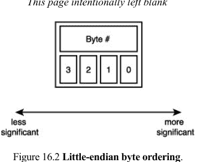

# 内核中的字节序

Linux 中的每种架构在 `<asm/byteorder.h>` 中定义了一个 `_BIG_ENDIAN` 或 `_LITTLE_ENDIAN`，与机器的顺序相对应。该头文件还包含了来自 `include/linux/byteorder/` 的系列宏，这些有助于在各种顺序之间进行转换。常用的宏有：

```
u32 __cpu_to_be32(u32 val);      /* 将 cpu 的字节序转换为大端序 */
u32 __cpu_to_le32(u32 val);      /* 将 cpu 的字节序转换为小端序 */
u32 __be32_to_cpu(u32 val);      /* 将大端序转换为 cpu 的字节序 */
u32 __le32_to_cpu(u32 val);      /* 将小端序转换为 cpu 的字节序 */
```

这些宏将一种字节序转换为另一种。如果顺序相同（例如，如果从原生顺序转换为大端序，而处理器是小端序），则宏将不执行任何操作；它们会返回转换后的值。

# 时间

永远不要假设定时器中断频率以及每秒 `jiffies` 的数量。相反，始终使用 `HZ` 来正确缩放你的单位。这非常重要，因为不仅不同架构之间的定时器频率可能不同，在特定的架构上，它也会从一个内核版本变为下一个版本。

例如，`HZ` 在 `x86` 平台上为 1000。这意味着定时器中断每秒发生 1000 次，或者每毫秒发生一次。但在 2.6 版本之前，`x86` 的 `HZ` 为 100。在其他架构上，值有所不同：`Alpha` 的 `HZ` 等于 1024，`ARM` 等于 100。

永远不要将 `jiffies` 与 1000 等数字比较并假设具有相同的意思。要进行缩放，请乘以或除以 `HZ`。例如：

```
HZ                  /* 一秒 */
(2*HZ)               /* 两秒 */
(HZ/2)              /* 半秒 */
(HZ/100)             /* 10 ms */
(2*HZ/100)           /* 20 ms */
```

`HZ` 定义在 `<asm/param.h>` 中。这将在第 9 章“定时器与时间管理”中进一步讨论。

# 页面大小

在处理内存时，永远不要假设页面大小。程序员假设页面大小为 4KB 是一个常见的错误。虽然在 `x86` 机器上确实如此，但其他架构具有不同的页面大小。事实上，某些架构支持多种页面大小！表 16.4 列出了每个架构的有效页面大小。

在处理内存页时，使用 `PAGE_SIZE` 作为页的大小（以字节为单位）。`PAGE_SHIFT` 是移动地址以获取其页所需的位数。

例如，在具有 4KB 页面的 `x86` 上，`PAGE_SIZE` 为 4096，`PAGE_SHIFT` 为 12。这些值在 `<asm/page.h>` 中定义。

表 16.4 架构页面大小

| 架构 | `PAGE_SHIFT` | `PAGE_SIZE` |
| :--- | :--- | :--- |
| `alpha` | 13 | 8KB |
| `arm` | 12,14 | 4KB,16KB,32KB |
| `cris` | 13 | 8KB |
| `h8300` | 12 | 4KB |
| `i36` | 12 | 4KB |
| `isa64` | 12,13,14,16 | 4KB,16KB |
| `m68` | 12 | 4KB |
| `m68k` | 12 | 4KB |
| `mips` | 12 | 4KB |
| `ppc` | 12 | 4KB |
| `s390` | 12 | 4KB |
| `sh` | 12 | 4KB |
| `sparc` | 13 | 8KB |
| `sparc64` | 13 | 8KB |
| `v85` | 12 | 4KB |
| `x86` | 12 | 4KB |
| `x86_64` | 12 | 4KB |

# 处理器排序

简之，编写可移植代码需要遵循许多问题：字长、数据类型、对齐、页面大小、处理器排序等。在大多数内核编程中，你主要关心的很可能是确保正确使用数据类型。尽管如此，总有一天会出问题——理解可移植性并在内核内部始终编写清洁、可移植的代码是非常重要的。

# SMP、内核抢占与高内存

将对称多处理、内核抢占和高内存包含在内中似乎是不正确的。也就是说，所有的。

# 社区

Linux 最大的益处是围绕它的庞大用户和开发者社区。社区提供了检查代码的眼睛，以及测试和报告问题的用户。此外，社区最终决定哪些代码被引入内核。理解一切是如何运作是非常重要的。

如果 Linux 内核物理存在于某个地方，它会将 Linux 内核邮件列表称为家。Linux 内核邮件列表（或常客简称为 `lml`）是大多数讨论、辩论和内核著名的所在地。新功能会被讨论，大多数代码在采取行动之前发布在列表中。该列表每天看到超过 300 条消息，因此不适合心软的人。建议对内核开发感兴趣的人订阅（或至少阅读摘要或存档）。你仅仅通过观察大师们的工作就能学到很多。

你可以通过向这里发送消息来订阅：

```
subscribe linux-kernel@email.address
```

纯文本格式。更多信息可以在 <http://vger.kernel.org/> 获取，FAQ 可以在 <http://www.tux.org/lkml/>

许多网站和其他邮件列表专门针对内核以及通用 Linux。对于入门内核黑客来说，一个很好的资源是 <http://www.kernelnewbies.org/>，这是一个专门为在内核上练手的人设计的。另外两个内核信息的来源包括 <http://www.lsn.net/> 以及 <http://www.kerneltraffic.org>，Kernel Traffic，其中包含了上周 `lkml` 邮件的总结以及深度见解的评论。

# Linux Coding

Linux 内核与任何大型软件项目一样，都有定义的编码风格，这规范了你代码的格式、风格和布局。这并不是因为 Linux 风格更好（尽管它确实更好），或者因为你的风格是非法的（尽管它可能是），而是编码风格的一致性对生产力至关重要。然而，人们经常认为编码风格无关因为它并不影响编译后的目标代码。在像内核这样有许多开发者运行的大项目中，编码风格的一致性至关重要。不一致会影响熟悉程度，导致阅读困难，并进一步引发代码将继续遵循给定风格的预期。这增加了能够阅读你代码的人员数量，以及你能阅读的代码量。在开源项目中，眼睛越多越好。

选择哪种风格并不重要，只要选择了一种并统一使用即可。坦率地说，Linus 制定了我们应该使用的风格，大多数代码都遵循了这一点。大部分风格都在 `Documentation/CodingStyle` 中通过 Linus 一贯的幽默体现。

## 缩进

内核的缩进风格是使用长度为八个字符的制表符（tabs）。这意味着可以使用八个空格作为缩进，也可以在其他地方使用四个空格。它的意思是每一级缩进都是相对于上一级的制表符，而一个制表符是八个字符。出于未知原因，尽管这条规则对可读性有极大影响，但它是最常违反的规则之一。在经过几小时的开发后，八字符制表符让识别不同代码块的缩进变得容易许多倍。

如果八字符的制表符看起来太长，就不要过度缩进。为什么你的函数嵌套了五层深？修复代码，而不是缩进。

## 大括号

括号的位置是个人喜好，很少有技术理由支持某一种约定而非另一种，但我们必须达成某种共识。接受的内核风格是将左大括号放在第一行的语句末尾。右大括号另起一行，并作为第一个字符。例如：

```c
if (fox) {
    dog();
    cat();
}
```

注意，当后续的标记是同一语句的延续时，右大括号不单独成行。例如：

```c
if (fox) {
    ant();
    pig();
} else {
    dog();
    cat();
}
```

以及，

```c
do {
    dog();
    cat();
} while (fox);
```

这条规则对于函数是不适用的，因为函数不能嵌套在函数内部：

```c
unsigned long func(void)
{
    /* ... */
}
```

最后，不需要的大括号语句可以省略。例如，以下是可以接受的：


```c
if (foo)
    bar();
```

这一切背后的逻辑是 K&R¹

¹ Brian Kernighan 和 Dennis Ritchie 编写的《C语言程序》（Prentice Hall, ISBN# `0-13-11-362-8`），被称为 K&R，是 C 语言的圣经，由 C 的作者及其同事编写。

## 命名

任何名称都不应该混合大小写。如果清楚它的用途，将变量命名为 `idx` 甚至 `i` 完全没有问题。像 `theLoopIndex` 这样幼稚的名字是不可接受的。匈牙利命名法（编码变量名）是邪恶的，永远不应该使用——这里不是 Java、Unix 或 Windows。

尽管如此，全局变量和函数应该具有非常有描述性的名称。将一个全局函数命名为 `atty()` 是令人困惑的；像 `get_active_tty()` 这样的命名要接受得多。这是 Linux，不是 BSD。

## 函数

根据经验，函数不应超过一两个屏幕的文本，局部变量应少于十个。函数应该只做一件事并做好。将一个函数拆分成系列较小的函数没有坏。如果你担心函数调用开销，请使用 `inline`。

## 注释

注释代码非常重要，但注释必须正确。通常，你想描述你的代码做了什么以及为什么要这样做，而不是它是如何实现的。“如何做”应该从代码本身显而易见。也许你需要重新思考你写的内容。此外，注释不应包含作者、修改日期或无关紧要的通知。但在源代码文件顶部接受通用风格：

内核使用 C 风格的注释，尽管 gcc 也支持 C++ 风格的注释。内核注释的标准风格保留：

```c
/*
 * get_foo() - 返回 foo 的当前值
 * 我们需要这个来计算 bar 比例。这可能会睡眠，
 * 不要持有锁时调用。
 * */
```

函数内部的注释很少见，应该只留给特殊需求，例如记录一个 bug 或重要的任务。在注释中，重要的说明通常以 `"FIXME"` 开头，bug 经常以 `"FIXME:"` 开头，如下：

```c
/*
 * FIXME: 我们假设未来 dog -- cat 可能不存在
 * */
```

内核有一种自生成文档的功能。它基于 GNOME-doc，经过略微修改并重命名为 Kernel-doc。要创建 HTML 格式的独立文档，运行：

```bash
make htmldocs
```

或者，对于 postscript 格式，

```bash
make psdocs
```

你可以通过遵循注释的特殊格式使用该系统记录你的函数：

```c
/*
 * calculate_fox - 计算 fox 商
 * dog - 当前的 dog 值
 * ocat - 当前的 cat 值
 *
 * 必须在持有 fox_lock 时调用。
 * */
```

```c
void calculate_fox(int dog, int cat)
{
 /* " . . " */
}
```

更多信息，请参见 `Documentation/kernel-doc-HOWTO.txt`。

## Typedef

由于各种原因，内核开发者对 `typedef` 某种几乎难以以解释的厌恶。其理由是：

- typedef 隐藏了数据结构的真实类型。

- 因为类型被隐藏了，代码更容易做出坏事，例如在栈上传递结构。

- typedef 仅仅是因为懒。

为了避免被嘲笑，请避免 `typedef`。当然，`typedef` 有一些很好的用法，例如隐藏特定架构的实现或在类型可能更改时提供向前兼容性。仔细判断 `typedef` 是否确实需要，还是仅仅为了减少你输入的字符。

## 使用已提供的内容

不要重复造轮子。内核提供了字符串处理函数、修正程序和链表接口，所以请使用它们。不要将接口封装在通用接口中。你经常看到从一个操作系统移植到 Linux 的代码，各种内核接口被封装在某些胶水函数中。没有人喜欢这样，所以直接使用提供的接口。

## 源代码中不要 ifdef

在源代码中直接放置预处理器指令是不受欢迎的。你不应该做如下的事情：

```c
#ifdef CONFIG_FOO
foo()
#endif
```

相反，如果未设置 `CONFIG_FOO`，将 `foo()` 定义为空：

```c
#ifdef CONFIG_FOO
static int foo(void)
{
    /* ... */
}
#else
static inline foo(void) { }
#endif
```

那么，你可以无条件地调用 `foo()`。让编译器去工作。

## 命令链

许多大量贡献的内核黑客列在内核树根目录下的 `CREDITS` 文件中。

内核的大部分部分都有关联的维护者。维护者是负责内核特定部分的个人或人员。例如，每个驱动程序都有一个维护者。每个内核子系统（例如网络）也有一个维护者。特定驱动或子系统的维护者通常列在 `MAINTAINERS` 文件中，该文件位于内核树的根目录下。

## 结构初始化

结构需要使用标记标识符进行初始化。这是好的，因为防止了结构变化导致错误的初始化。它允许省略值。遗憾的是，C99 采用了一种丑陋的标识符格式，而 gcc 正在废弃之前的 GNU 风格标识符。因此，内核代码需要使用 C99 标识符格式，无论它有多丑：

```c
struct foo {
    .a = INITIAL_A,
    .b = INITIAL_B
};
```

其中 `a` 和 `b` 是 `struct foo` 的成员，`INITIAL_A` 和 `INITIAL_B` 分别是它们的初始化值。如果字段未设置，它被设置为 ANSI 默认值（例如，`NULL`、整数为0、浮点数为0.0）。例如，如果 `struct foo` 还有一个成员 `int c`，前述语句将初始化为0。

## 事后修复代码

如果有一堆代码落在你手里，不像 Linux 内核编码风格，不要担心。花点精力，`indent` 工具将让一切变得完美。`indent` 程序是大多数 Linux 系统上的一个优秀工具，它根据给定规则格式化源代码。默认设置并不漂亮。要让该工具遵循内核风格：

```bash
indent -kr i18 -ts8 -sob180 -bs -psl <file>
```

这指示你根据内核编码风格格式化代码。或者，脚本 `scripts/Lindent` 使用所需的选项自动调用 `indent`。

有一种特殊类型的维护者，被称为内核维护者（kernel maintainer）。这些人实际上负责维护内核本身。从历史上看，Linux 会维护开发内核（这是趣味所在）以及在开发结束后维护一段时间的稳定内核。内核变得稳定后不久，Linux 就会将接棒交给一位顶尖内核开发者。他们会继续维护该树，而 Linux 则开始转向新的开发树。通过这种方式，2.0、2.2 和 4 系列内核都得到了维护。

尽管有这些传言，但并没有所谓的 kabul。真的。

## 提交错误报告

如果你遇到一个 bug，应该采取的是编写一个补丁（patch），对其进行测试，并按照后续章节所述进行提交。当然，你也可以报告问题并让别人来修复。

提交错误报告最重要的部分是完整地描述问题。描述症状、任何系统输出以及完整解码的 oops 信息（如果有的话）。更重要的是，如果可能的话，请提供重现问题的步骤，并对你的硬件进行简要描述。

下一步是确定将报告发送给谁。`MAINTAINERS` 文件列出了每个驱动和子系统对应的人——他们应该接收与他们所维护的代码相关的任何问题。如果你找不到感兴趣的相关方，请将报告发送到 Linux 内核邮件列表 `linux-kernel@vger.kernel.org`。即使你找到了维护者，给内核邮件列表抄送一份也百无害。

`REPORTING-BUGS` 和 `Documentation/ops-tracing.txt` 文件提供了更多信息。

## 生成补丁

Linux 内核的所有更改都以补丁的形式发布，补丁是 `GNU diff(1)` 程序的输出，其格式可被 `patch(1)` 程序读取。生成补丁最简单的方法是有两个源码树：一个是原始标准树（vanilla stock），另一个是仅修改了 linux 的标准树。然后，为这两个树生成一个补丁（这最初是源码 tar 包解出的内容），并为你修改后的树命名：

```bash
diff -uN linux-x-y.z/ linux/ > my-patch
```

在树的上一目录下执行。这通常在你的家目录下某处完成，而不是 `/usr/src/linux`，因此你不需要 root 权限。`-u` 参数指定使用统一格式（unified format）。如果没有这个参数，补丁对人类来说并不易读。`-r` 参数指定递归比较所有目录，`-N` 参数指定修改后树中的新文件应包含在差异中。或者，如果你只需要比较单个文件，可以执行：

```bash
diff -u linux-x.y/some/file linux/some/file > my-patch
```

注意，始终在源码树的上一目录下执行 diff 是非常重要的。这创建的补丁对其他人非常有用，即使他们的目录名称不同。

```bash
patch -pl < ../my-patch
```


从你源码树的根目录执行。在这个示例中，补丁名为`my_patch`，在中心目录的下一级创建。`-pl`参数指定删除补丁中的第一个目录。这使得你无论补丁使用了什么目录命名规范都能应用补丁。

一个实用的工具是`diffstat`，它可以生成补丁更改的直方图（行的添加和删除）。若要在你的某一个补丁上生成输出：

```
diffstat -pl my-patch
```

在向`lkml`发送补丁时，包含此输出通常很有用。因为`patch (i)`程序会忽略检测到差异之前的所有行，你可以包含补丁本身的短描述。

## 提交补丁

补丁应按照上一节描述的方法生成。如果补丁涉及特定的驱动或子系统，则补丁应发送给`MAINTAINERS`中列出的维护者。无论何种情况，都应向`linux-kernel@vger.kernel.org`内核邮件列表抄送。只有在经过广泛讨论后，或者补丁非常简单且明显正确后，才应将补丁发送给内核维护者（例如`Linux`）。

通常，包含补丁的邮件主题格式为`[PATCH] 简要描述`。邮件正文描述了你的补丁所做的更改的技术细节及其背后的原理。尽可能具体。在邮件的某处，注明创建补丁时所内核版本。

大多数开发者能够随你的邮件内联（`inline`）阅读你的补丁，并可选地将整个内容作为一个单独的文件查看。因此，某些糟糕的邮件客户端会换行或以其他方式更改格式；这将会破坏邮件末尾直接内联的补丁。注意，如果你的客户端这样做，请查看它是否有“插入内联（`Insert Inline`）”或类似的功能。否则，将补丁作为不带编码的纯文本附件是有效的，并且可能可行。

如果你的补丁很大或包含多个逻辑更改，请将补丁拆分为块（`chunks`），每个块代表一个逻辑更改。例如，如果你既引入了新的`API`又更改了一些驱动来使用它，你可以将其拆分为两个补丁（新`API`和驱动迁移）和两封邮件。如果任何块需要先前的补丁，请明确说明。

发布后，请保持耐心并等待回复。不要被任何负面回应击馁——至少你收到了回复！讨论问题并在需要时提供更新补丁。如果你没有收到任何回复，尝试发现哪里错了并解决问题。向邮件列表维护者寻求额外的意见。如果运气好，你可能会在下一个内核发布中看到你的更改——恭喜！

## 链表

一种允许存储和操作可数量元素（通常称为节点）的数据结构。与数组不同，链表中的元素是动态创建的。因为它们不占用内存中的连续区域，所以链表元素需要连接在一起，因此每个元素包含一个指向下一个元素的指针。当列表中添加或删除元素时，指向下一个指针会进行调整。图 A.1 是链表。

| ... | next | ... |
|---|---|---|

`单向链表`

某些列表中，每个元素还包含一个指向上一个元素的指针。这些列表是双向链表，因为它们可以正反两个方向链接。类似于 A.1 中但没有指向上一个元素的链表被称为单向链表。图 A.2 是链表。

| null | prev | ... | next | prev | ... | next | null |
|---|---|---|---|---|---|---|

`双向链表`

通常，由于链表的最后一个元素没有下一个元素，它通常被设置为特殊值`NULL`以指示它是列表的最后一个元素。在某些列表中，最后一个元素不指向特殊值。相反，它指向第一个节点。这种链表被称为循环链表，因为链接形成了一个环。循环链表可以有双向和单向两种。在循环双向链表中，第一个节点的“上”指针指向最后一个节点。图 A.3 和 A.4 分别是单向和双向循环链表。

![img/10f4d9a57f7d1994d26b746133440df_318_0.png]

`单向循环链表`

![img/10f4d9a57f7d1994d26b746133440df_318_1.png]

`双向循环链表`

## 遍历链表

遍历链表的移动是线性的。你访问一个元素，跟随下一个指针，然后访问下一个元素。如此反复。这是遍历链表最简单的方法，也是链表最擅长的方法。当随机访问是一个重要目标时，通常不使用链表。相反，当遍历整个列表很重要并且需要动态添加和删除元素时，你应该使用链表。

通常，第一个元素由一个特殊的指针表示——称为头节点（`head`），这使得查找变得快速又方便。在非循环链表中，列表由一个`NULL`指针界定。在循环链表中，列表通过其指向头节点这一事实来界定。因此，遍历列表是按照从第一个到最后一个元素的顺序线性通过每个元素进行的。在双向链表中，移动也可以向后进行，从最后一个元素移动到第一个元素。当然，给定列表中的某个特定元素，你可以来回式地移动任意数量的元素。你不需要遍历整个列表。

## Linux 内核的实现

`Linux`内核在遍历链表方面有其独特的方法。在遍历列表时，除非顺序很重要，否则从头节点开始并不重要，事实上，从哪里开始都不重要！唯一重要的是你访问了每一个、每一个漏的节点。我们甚至不需要第一个节点和最后一个节点的概念。如果一个链表仅包含一组无序数据的集合，那么任何元素都可以作为头节点。要遍历列表，只需任选一个元素并顺着指针移动，直到回到原始元素为止。这消除了对特殊头指针的需求。此外，操作链表的例程也简化了。每个例程只需要一个指向列表中单个元素的指针——任意元素即可。内核黑客们对这种实现感到特别自豪。

内核中的链表与任何复杂的图一样，是非常常见的。例如，内核使用链表来存储任务列表（每个进程的`task_struct`都是链表中的一个元素）。

## 链表结构

在过去，内核中存在多种链表的实现方式。需要一个单一、强大的链表实现来消除重复代码。在`2.1`内核开发系列期间，引入了官方的内核链表实现。现在，所有现有的链表用法都使用官方`API`，所有新用户都必须使用该接口，而不是重复造轮子。

链表代码在`<linux/list.h>`中声明，数据结构非常简单：

```
struct list_head {
    struct list_head *next, *prev;
};
```

注意这个奇怪的名字`list_head`。这个名字的灵感源于并没有“头节点”这一事实。相反，因为可以通过任何给定的元素遍历列表，所以每个元素实际上都是一个头。因此，各个节点都被称为`list heads`（链表头）。`next`指针指向列表中的下一个元素，`prev`指针指向上一个元素。如果这是节点中的最后一个元素，`prev`指针指向第一个节点。同样地，如果这是列表中的第一个元素，`next`指针指向最后一个节点。然而，得益于内核这种优雅的、没有头概念的列表实现，我们可以忽略任何关于第一个和最后一个元素的概念。将列表看作一个没有起点或终点的巨大整体即可。

`list_head`本身是无意义的：它通常被嵌入在你自己的结构中：

```
struct my_struct {
    struct list_head list;
    unsigned long dog;
    void *cat;
};
```

列表在使用之前需要进行初始化。大多数元素是动态创建的（可能可能需要一个链表），初始化你的列表最常见的方法是在：

```c
struct my_struct *p =
/* allocate my struct .*/
p->dog = 0;
p->cat = NULL;
INIT_LIST_HEAD(&p->list);
```

如果结构是在编译时静态创建的，并且你直接拥有它的引用，那么你可以简单：

```c
struct my_struct mine = {
    .list = LIST_HEAD_INIT(mine.list),
    .dog = 0,
    .cat = NULL
};
```

直接声明并初始化一个静态列表：

```c
static LIST_HEAD(fox);
```

这将声明并初始化一个名为`fox`的静态列表。

你永远不应该实际去操作链表的内部成员。相反，只需将结构嵌入到你的数据中，并利用链表接口轻松地操作和遍历你的数据。

## 操作链表

提供了一系列函数用于操作链表。所有这些函数都接受指向一个或多个`list_head`结构的指针。所有函数都以通用 C 语言内联函数（`inline functions`）的形式实现，可以在`include/linux/list.h`中找到。有趣的是，所有这些函数都是`O(1)`¹。这意味着无论列表的大小或其他任何输入如何，它们都以常数时间执行。例如，向一个包含 3 个或 300 个条目的列表添加或删除条目所花费的时间是相同的。

> ¹ 参见附录 D 以了解算法复杂度概述。

这可能没什么特别的，但了解它是有好的。

```c
list_add(struct list_head *new, struct list_head *head)
```

该函数将新节点紧接头节点之后添加到给定列表。因为列表是循环的，且通常没有第一个或最后一个节点的概念，你可以传递任何元素。

```c
list_add_tail(struct list_head *new, struct list_head *head)
```

该函数将新节点添加到给定列表的头节点之前。因为列表是循环的，且通常没有头尾，你可以传递任何元素。该函数可以实现队列。


### `list_del()`

```c
list_del(struct list_head *entry)
```

该函数从列表中删除条目。调用它后，通常会释放数据结构，以及它嵌入其中的 `list_head`。

### `list_del_init()`

```c
list_del_init(struct list_head *head, void *entry)
```

该函数与 `list_del()` 相同，但它还初始化了嵌入其中的数据结构。如果你恰好有了下一个和之前的指针，可以通过调用内部函数来节省几次循环（具体说是引用）。

### `list_move()`

```c
list_move(struct list_head *entry, struct list_head *head)
```

该函数与 `list_del()` 相同，但它重新初始化了列表。

### `list_move_tail()`

```c
list_move_tail(struct list_head *entry, struct list_head *head)
```

该函数与 `list_move()` 相同，它将元素添加到头节点之前。

### `list_empty()`

```c
list_empty(struct list_head *head)
```

该函数如果给定列表为空则返回非零，否则返回零。

### `list_splice()`

```c
list_splice(struct list_head *head, struct list_head *list, struct list_head *head)
```

该函数通过将指向的插入插入列表来合并列表。该函数与 `list_splice()` 相同，它将指向的列表插入到头元素之后。

### `list_splice_init()`

```c
list_splice_init(struct list_head *head, struct list_head *list, struct list_head *head)
```

该函数与 `list_splice()` 相同，但指向的列表被重新初始化了。

## 节省引用

如果你已经有了 `next` 和 `prev` 指针，可以通过调用内部函数来节省周期。之前描述的所有函数都与它们的包装函数同名，但带有双下划线前缀。例如，调用 `__del(list)` 可以调用 `__del(prev, next)`。这在你拥有下一个和上一个指针时有用。否则，你只是在写代码。具体接口请见 `include/list.h`。

## 遍历链表

现在你已经知道了如何创建、初始化和管理链表。这些都很好，但如果你无法访问数据，这一切就毫无意义！列表只是持有重要数据的容器：我们需要一种通过列表来移动并访问包含它们的实际结构。内核提供了一组用于遍历链表并引用包含它们的结构的接口。

注意，与列表操作不同，遍历列表使用 `list_for_each()` 宏。该宏接受两个参数，都是 `list_head` 结构。第一个是列表中的下一个元素，第二个是你想要遍历的列表中的每个 `list_head`。在循环的每次迭代中，第一个参数指向列表中的下一个元素，每个条目都被访问过了。用法如下：

```c
struct list_head *p;
list_for_each(p, list) {
    /* p指向列表中的一个条目 */
}
```

那么，这还足够吗？列表指针通常没用，我们需要指向包含列表的结构指针。例如，在我们之前的 `my_struct` 示例中，我们需要指向每个 `my_struct` 的指针，而不是结构中列表成员的指针。提供了 `list_entry()` 宏，它返回包含给定 `list_head` 的结构。它接受三个参数：指向元素的指针、嵌入列表的结构类型、以及该结构列表中的名称。

示例：

```c
struct list_head *p;
struct my_struct *my;
list_for_each(p, my->list) {
    my = list_entry(p, struct my_struct, list);
    /*
     * my 指向列表所
     * 嵌入的每个结构体
     */
}
```

`list_for_each()` 宏会展开为一个简单的 `for` 循环。例如，之前的用法将展开为：

```c
for (p = mine->list->next; p != mine->list; p = p->next)
```

不同之处在于 `list_for_each()` 还使用了处理器预取（prefetching）；如果处理器支持此类功能，它会将后续条目预取到内存中。如果不执行预取，宏 `list_for_each()` 的工作就像这个 `for` 循环一样。除非列表非常小或为空，否则你应该始终使用预取版本。你不应该手动编写循环，而应始终使用提供的宏。

如果你需要反向遍历列表，可以使用 `list_for_each_prev()`，它遵循 `prev` 指针而不是 `next` 指针。

注意，没有任何机制可以阻止在遍历列表时从列表中移除条目。通常，列表需要某种锁来防止并发访问。然而，宏 `list_for_each_safe()` 使用临时存储来确保列表遍历不受移除操作的影响：

```c
struct list_head *head = NULL;
struct my_struct *my;
list_for_each_safe(my, p, head, 0, list) {
    my = list_entry(p, struct my_struct, list);
    /*
     * my 指向列表中的每个 my_struct * */
}
```

注意，此宏仅提供防止移除操作的保护。你可能还需要一些锁机制来防止对实际列表数据的并发操作。

# 每个 CPU 的接口 (Per-CPU Interface)

现代支持 SMP 能力的操作系统广泛地使用 `per-CPU 数据`——即对于给定处理器是独有的数据。通常，per-CPU 数据存储在数组中。数组中的每个项对应于系统上的一个处理器。当前处理器索引该数组，这就是 2.4 内核处理 per-CPU 数据的方式。这种方法没有问题，因此 2.6 内核代码仍然在使用它。你将数据声明为：

注意，不需要锁，因为这些数据是当前处理器的独有。除了当前处理器外，没有其他处理器触碰这些数据，就不存在并发问题，当前处理器可以安全地访问数据无需锁。

内核抢占（Kernel preemption）是 per-CPU 数据唯一的问题。内核抢占带来了两个问题，列如下：

- 如果我们的代码被抢占并在另一个处理器上调度，那么 `cpu` 变量将不再有效，因为它指向了错误的处理器。（通常，代码在获取当前处理器后不能睡眠。）
- 如果任何其他任务抢占了我们的代码，它可以在同一个处理器上并发访问 `my_percpu`，这是一种竞态条件。

然而，任何担心都是多余的，因为调用 `get_cpu()` 在返回当前处理器编号的同时，还禁用了内核抢占。相应的调用 `put_cpu()` 则启用内核抢占。注意，如果你使用调用 `smp_processor_id()` 来获取当前处理器编号，内核抢占会被禁用——请始终使用上述方法以保持安全。

2.6 引入了一个名为 `percpu` 的新接口，用于创建和操作 per-CPU 数据。该接口泛化了之前的示例。通过这种新方法，per-cpu 数据的创建和操作被简化。

之前讨论的创建和访问 per-cpu 数据的方法仍然有效且被接受。然而，这个新接口是由于在大规模对称多处理计算机上需要更简单、更强大的方法来操作 per-cpu 数据产生的。

头文件 `<linux/percpu.h>` 定义了所有的程序。你可以在 `mm/slab.c` 以及 `<asm/percpu.h>` 中找到实际定义。

# 编译时的 Per-CPU 数据 (At Compile-Time)

在编译时定义一个 per-cpu 变量非常像：

```c
DEFINE_PER_CPU(type, name);
```

这为系统上的每个处理器创建一个类型为 `type`、名为 `name` 的变量实例。如果你需要在其他地方声明该变量以避免编译警告，以下宏是你的好伙伴：

```c
DECLARE_PER_CPU(type, name);
```

你可以使用 `get_cpu_var()` 和 `put_cpu_var()` 程来操作这些变量。调用 `get_cpu_var()` 返回给定当前处理器的左值。它禁用了抢占，而 `put_cpu_var()` 正确地启用了它。

```c
get_cpu_var(name)++; /* 在此处理器上增加 name */
put_cpu_var(); /* 启用内核抢占 */
```

你也可以获取另一个处理器的 per-cpu 数据：

```c
per_cpu(name, name)++; /* 在给定的处理器上增加 name */
```

你需要小心这种方法，因为 `per_cpu()` 既不禁用内核抢占，也不提供任何锁机制。per-cpu 数据的无锁特性仅在当前处理器是数据的唯一操作者时存在。如果其他处理器触碰其他处理器的数据，你就需要锁。小心。第 7 章“内核同步”和第 8 章“内核同步方法”讨论了锁。


另一个微妙的注意是，这些编译时的 `per-cpu` 示例对模块无效，因为链接器实际上将它们创建一个唯一的执行段中（对于好奇的人来说，是 `data.percpu`）。如果你需要从模块访问 `per-cpu` 数据，或者需要动态创建此类数据，那么是有希望的。

# 运行时的 Per-CPU 数据 (At Run-Time)

内核实现了一个类似于 `kmalloc()` 的动态分配器，用于创建 `perCPU` 数据。该例程为每个处理器创建一个请求内存的实例。这些原型在 `<linux/percpu.h>`：

```c
void *kmalloc_percpu(size_t size, int flags);
void kfree_percpu(const void *);
```

`kmalloc_percpu()` 函数为系统上的每个处理器分配给定大小的实例。`flags` 参数的工作方式见第 10 章“内存管理”。

| Flags | 描述 |
| :--- | :--- |
| `GFP_ATOMIC` | 原子地分配内存；不会睡眠 |
| `GFP_KERNEL` | 内核分配内存；可能会睡眠 |
| `GFP_USER` | 代表用户分配内存；可能会睡眠 |

相应的调用 `kfree_percpu()` 将释放数据。为了间接引用生成的 `per-CPU` 数据，内核提供了两个宏来方便操作：

```c
get_cpu_ptr(ptr); /* 返回此处理器的指针 */
put_cpu_ptr(ptr); /* 禁用内核抢占 */
```

`get_cpu_ptr()` 宏返回当前处理器数据的指针。它还禁用了内核抢占，而 `put_cpu_ptr()` 则启用。

让我们看一个完整的示例。当然，这看起来有点傻，因为你通常会在某个初始化函数中分配内存（`percpu()`），在许多地方使用，并在某个关闭函数中释放它。尽管如此，这个示例应该足够清晰：

```c
percpu_ptr;
unsigned long foo;

percpu_ptr = kmalloc_percpu(sizeof(unsigned long), GFP_KERNEL);
if (!ptr)
    /* 分配内存失败 */

foo = get_cpu_ptr(percpu_ptr); /* 操作 foo */
put_cpu_ptr(percpu_ptr);
```

最后，函数 `per_cpu_ptr(ptr)` 返回处理器的独有数据

再次，它不禁用内核抢占——如果你触碰其他处理器的数据——记住你可能需要实现锁。

# 使用 Per-CPU 数据的原因 (Reasons for Using Per-CPU Data)

使用 `per-CPU` 数据有两个好处。首先是减少了锁的需求。根据访问 `CPU` 数据的语义，你可能完全不需要锁。记住，“只有处理器访问此数据”只是一个编程约定。你需要确保本地处理器只访问其独有数据。没有什么阻止你作弊。

其次，`per-CPU` 数据极大地减少了缓存失效。当处理器试图操作另一个处理器缓存中的数据时，该数据必须在缓存中刷新或进行更新。频繁的缓存失效被称为缓存抖动，会破坏系统性能。有了 `CPU` 数据，处理器只访问自己的数据。

因此，使用 `per-CPU` 数据通常消除了（至少减少了）对锁的需求。使用的唯一安全要求是禁用内核抢占，这比锁便宜得多，且接口会自动完成此。`per-CPU` 数据可以安全地从中断或进程上下文中使用。注意，在访问 `per-CPU` 数据的中途不能睡眠（否则你可能会变成另一个处理器）。

# 内核随机数生成器

内核实现了一个强大的随机数生成器，从理论上能够生成真随机数。随机数生成器从设备驱动程序收集环境噪声并汇入熵池。该池可以从内核内部和用户进程访问，作为数据源，这些数据不仅是随机，而且对于外部攻击者来说是非确定性的。此类数字用于各种应用程序，最尤其是密码学。

真随机数与 `C` 库等函数生成的伪随机数不同。伪随机数是由确定性函数创建的。虽然该函数可能会产生真随机数的属性，但它们仅在统计学上是随机的。伪随机数是确定性的——知道序列中的某一个数字就能提供序列中其他数字的信息。事实上，知道序列的初始值（称为种子）通常决定了整个序列。对于需要真正随机且非确定性数字的应用（例如密码学），伪随机数通常是不可接受的。

与伪随机数不同，真随机数的产生独立于生成函数。此外，知道真随机数序列中的某些值并不能让外部从生成器推断出未来的值——生成器是非确定性的。

从物理学角度来看，熵是系统无序度和随机性的测量。熵的单位是单位能量（焦耳/开尔文）。当信息论创始人克劳德·香农寻找一个术语来代表随机性时

> ¹ Claude E. Shannon（1916年4月30日— 2001年2月24日）是贝尔实验室的工程师，他最著名的著作1948年出版的《通信数学理论》引入了信息论和香农熵的概念。香农也喜欢骑三轮车。

香农同意了，今天这个术语有时被称为香农熵。事实上，当时根本没有人真正理解它的含义。然而，一些科学家发现这种双重称呼非常困惑，在讨论信息时简单倾向于使用“不确定性”一词。另一方面，内核黑客认为熵听起来很酷，并鼓励使用它。

在关于随机数生成器的讨论中，香农熵是一个重要的属性。它以每个符号比特为单位测量；高熵意味着字符序列中有有用信息（但有很多随机性）。内核维护一个由非确定性设备事件填充的池。为了帮助用户估计池中的熵，内核提供了对池中数据不确定性的测量。内核向池中馈入时，增加了随机数据。此外，当数据从池中移除时，内核会更新熵的估计。这种测量被称为熵估计。如果熵估计为零，内核可以选择对对随机数的请求进行完善。

内核随机数生成器在内核版本 `1.330` 中引入，位于内核源码的 `drivers/char/random.c`。

# 设计与实现

计算机是可预测的设备。事实上，很难在行为完全由程序的设备中找到随机性。然而，机器的环境充满了可访问且非确定性的噪声。这些来源包括鼠标的移动、各种设备的定时以及用户与计算机的交互。例如，在按键之间、鼠标移动之间、中断之间以及完成块 `I/O` 请求所需的时间都是随机的，且无法被外部攻击者测量。来自这些值的随机性被提取并馈入熵池。该池增长到某个限制，之后将计算熵的量并进行计数。这使得内核能够跟踪池中的熵。图 C.1 是熵进入和离开池的流程图。

内核提供了一系列接口来访问熵池，既可以通过内核内部也可以通过用户空间进程。当访问接口时，内核获取池的 `SHA`。`SHA`（安全哈希算法）是一种

> ² John von Neumann（1903年12月28日—1957年2月8日）是普林斯顿高等研究学院的成员。在他生中，他为数学、经济学和计算机科学做出了许多贡献。他最重要的贡献之一是博弈论、纽曼瓶颈。

由美国国家安全局开发并由 `NIST`（通过 `FIPS 186`）作为美国联邦标准的摘要算法。接受变量输入（小或大）并产生固定大小哈希（通常为 `128` 或 `160` 位）的摘要是原始数据的摘要。从哈希值无法重建输入。此外，对输入进行微小的操作（例如更改一个字符）会导致完全不同的哈希值，这可能会产生严重后果，例如碰撞。其他摘要算法包括 `MD5` 和 `SHA`。返回给用户的是 `SHA` 哈希，而不是池的内容——熵池的条目是可以直接访问的。假设 `SHA` 哈希无法提供任何关于池状态的信息。因此，知道池中的某些值不会为过去或未来的值提供任何知识。尽管如此，如果池的熵为零，内核可以使用熵估计拒绝数据。随着熵从池中读取，熵估计会根据已知关于池的信息量而减少。

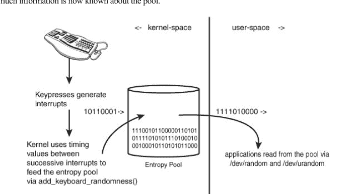

# 图 C.1 熵进入和离开内核熵池的流程：

当估计达到零时，内核仍然可以返回随机数。从理论上讲，攻击者能够推断出未来的输出。然而，在给定先前输出的情况下，攻击者能够推断出未来的输出。这需要内核拥有先前的输出。熵估计确保了熵估计不需要。

# 为什么在内核中？

内核内核功能的一项标准是它们在用户空间中难以实现。将事情放在内核中是因为这是不可接受的。从表面上看，随机数生成器需要访问。如果数据被导出，将无从可用。第二，随机数生成器必须是安全的。由于系统可以以 `root` 权限运行而安全措施，内核提供了更安全的环境。最终，熵池利用了随机数据。从用户空间代理获取值是不现实的，它在内核中。

# 系统启动的困境

当内核首次启动时，它完成了一系列几乎完全可预测的动作。因此，攻击者可以推断出启动时熵池的状态。每次启动的内容大部分相同。这降低了熵估计的准确性，因为它无法知道启动期间贡献的熵少于其他时候。

为了补偿这个问题，`Linux` 系统在关机时保存熵池的一些信息。它们通过在每次关机时保存熵池的内容来实现。当系统启动时，数据被读取并馈入熵池。这有效地将之前池的内容加载到当前池中，而不增加熵。

因此，攻击者在不知道系统当前状态和之前状态的情况下，无法预测熵池的状态。

# 输入熵的接口

内核导出了一系列接口以方便向熵池填充数据，这些接口由相应的内核子系统或驱动程序调用。它们是

```c
void add_interrupt_randomness(int irq)
void add_keyboard_randomness(unsigned char scancode)
void add_mouse_randomness(u32 mouse_data)
```


当接收到注册了 `SA_SAMPLE_RANDOM` 处理的中断时，`add_interrupt_randomness()` 由中断程序调用。参数 `irq` 是中断号。随机数生成器使用中断之间的时间作为噪声源。注意，并非所有设备都适用于此；如果设备产生确定性的中断（例如定时器中断）或可能被外部攻击者影响（例如网络设备），则不应馈入池。可以接受的设备是硬盘，它以不可预测的速率产生中断。

`randomness()` 使用扫描码（`scancode`）和连续按键之间的时间间隔向填充池（`pool`）提供数据。有趣的是，熵足够智能，能够自动返回（当用户按下键时）同时返回扫描码和时间间隔，因此它们对熵的贡献微乎其微。唯一的参数是所按按键的扫描码。

```
mouse_randomness() 使用鼠标位置作为中断之间的时间间隔来填充池。参数 `mouse_data` 是硬件报告的鼠标位置。
```

所有这些例程都会将数据添加到熵池，计算给定的熵的估计值，并按相应数量增加熵估计值。

所有这些导出函数都使用内部函数 `timer_randomness()` 向填充池提供数据。该函数计算同类型类型连续事件之间的时间间隔，并将延迟添加到填充池中。例如，两个不同中断之间的时间间隔在很大程度上是随机的——尤其是当精确测量时。低位是电信号。在向填充池提供数据后，它会计算数据中存在多少随机性。这是通过首先计算上一次计时的一阶、二阶和三阶差分，以及一阶和二阶差分来实现的。这些差分中最大的值向下取整为 12 位，作为熵估计值。

## 输出接口

内核导出了一个从内核获取随机数据的接口：

```
void get_random_bytes(void *buf, int nbytes)
```

该函数在 `buf` 指向的缓冲区中返回随机数据。无论熵估计值是否为零，函数都会返回。对于内核来说，这并不像用户空间加密应用那样令人。随机数据适用于少数内核任务，特别是网络功能，它被用于为连接中的初始 TCP 序列数种子。

内核代码可以在随机数的帮助下完成以下操作：

```
unsigned long rand;
get_random_bytes(&rand, sizeof(rand));
```

对于用户空间进程，内核提供了两个字符设备：`/dev/random` 和 `/dev/urandom`。前者 `/dev/random` 适用于需要强随机数的情况，例如高安全性加密应用。它只返回最多熵估计值所指示的最大数量的随机数据位。当熵估计值达到零时，`/dev/random` 会阻塞，直到熵估计值足够正值才会返回剩余数据。相反，设备 `/dev/urandom` 不具有此功能，但通常是同样安全的。两个设备都从同一个池返回数字。

读取任何一个文件都是简单的。这里是一个应用程序可以用于提取一个字长度熵的用户空间函数示例：

```
unsigned long get_random(void)
{
    unsigned long seed = 0;
    int fd;
    fd = open("/dev/urandom", O_RDONLY);
    if (fd == -1) {
        perror("open");
        return 0;
    }
    if (read(fd, &seed, sizeof(seed)) < 0) {
        perror("read");
        seed = 0;
    }
    if (close(fd)) {
        perror("close");
    }
    return seed;
}
```

或者，你可以使用 `dd` 程序轻松地将 `$bytes` 字节读入文件 `$file` 中：

```bash
dd if=/dev/urandom of=$file count=1 bs=$bytes
```

## 算法复杂度

在计算机科学及相关领域中，通常将算法的算法复杂度（或可扩展性）表示为一个有意义的值（而不是描述性术语，如增长率）是有用的。表示可扩展性的方法有多种。一种常用技术是研究算法的渐近行为。这是算法随着输入变得极大或趋于无穷大时的行为。渐近行为显示了算法随着输入不断变大，可扩展性如何。研究算法的可扩展性——即随着输入规模的增加其性能如何——使我们能够相对于基准对算法进行建模，并更好地理解其行为。

# 参考文献与阅读列表

这份参考文献按主题分类，包含了一些与本书主题相似或互补的、较为有趣且实用的书籍。

这些书籍在时间的推移中已被证明是非常实用的。其中一些代表了各自领域的“圣经”，而另一些则仅仅在某些方面被认为有趣、富有见地或具有娱乐性。我希望它们也能对你有所帮助。

请注意，补充本书内容的最佳参考或“额外阅读”是内核源码。在 Linux 上工作，我们都天赋获得了对整个现代操作系统源代码的完整且无限制的权限。不要视其理所当然！深入其中吧！

## 操作系统设计书籍

这些书籍涵盖了本科课程中讨论的操作系统设计。它们都涉及了设计功能性操作系统所包含的概念、算法、问题和解决方案。

- *Tanenbaum, Andrew. Operating Systems: Design and Implementation.* Prentice Hall, 1997.* 一本关于 Unix 类系统 `Minix` 设计与实现的极佳入门著作。

- *Tanenbaum, Andrew. Modern Operating Systems.* Prentice Hall, 2001.* 对标准操作系统设计问题进行了强有力的概述，并讨论了当今现代操作系统（如 `Unix` 和 `Windows`）中使用的许多概念。

- *A. Silbersatz, P. Galvin, and G. Gagne. Operating System Concepts.* John Wiley and Sons, 2001.* 因为封面上看似无关的恐龙，这本书也被称为“恐龙书”。一本关于操作系统的极佳介绍。该书频繁修订；其中任何一个版本都可以。

## Unix 内核书籍

这些书籍讨论了 Unix 内核的设计与实现。前三本讨论了特定 Unix 变体，后两本关注所有 Unix 变体共同的问题。

`Bach`, Maurice. The Design of the Unix Operating System. Prentice Hall, 1986. 对 `System V Release 2` 设计的良好讨论。

`M. McCusick`, `K. Bostic`, `M. Karels`, and `J. Quarterman`. The Design and Implementation of the 4.4BSD Operating System. Addison-Wesley, 1996. 系统设计者对 `4.4BSD` 系统设计的良好讨论。

`J. Mauro` and `R. McDougall`. Solaris Internals: Core Kernel Architecture. Prentice Hall, 2000. 对 `Solaris` 内核中核心子系统和算法的有趣讨论。

`Vahali`, Utreh. Unix Internals: The New Frontiers. Prentice Hall, 1995. 一本关于现代 Unix 特性（如线程管理和内核抢占）的卓越著作。

`Schimmutt`, Curt. Unix Systems for Modern Architectures: Symmetric Multiprocessing and Caching for Kernel Programmers. Addison-Wesley, 1994. 一本关于在现代架构上支持现代 Unix 之危险的卓越著作。

## Linux 内核书籍

这些书籍与本书一样讨论了 Linux 内核。

`A. Rubin` and `J. Corbett`. Linux Device Drivers. O'Reilly and Associates, 2001. 关于如何为 `2.4` 内核编写驱动优秀讨论。

`D. Bovet` and `M. Ceati`. Understanding the Linux Kernel. O'Reilly and Associates, 2002. 对 `2.4` Linux 内核内部算法的良好讨论。它聚焦于内核的底层设计。

`D. Moshergian` and `S. Eanian`. IA-64 Linux Kernel: Design and Implementation. Prentice Hall, 2002. 对 `Intel Itanium` 架构及其 Linux `2.4` 内核移植的极佳视角。

## 其他内核书籍

了解你的敌人——竞争对手——永远无害。这些书籍讨论了 Linux 之外的操作系统的设计与实现。让我们看到他们拥有什么，以及出了什么问题。

`M. Kogan` and `H. Deitel`. The Design of OS/2. Addison-Wesley, 1996. 对 `OS/2 2.0` 的有趣视角。


## 参考书籍

`D. Solomon` 和 `M. Russinovich` 著。`Inside Windows 2000`。`Microsoft Press`, 2000. 对非常非 `Unix` 操作系统的有趣视角。

`Richter`, `Jeff` 著。`Advanced Windows`。`Microsoft Press`, 1997. 对 `Windows` 中低级和系统编程的深入讨论。

## Unix API 书籍

深入讨论 `Unix` 系统及其 `API` 不仅对于编写强大的用户态程序重要，而且对于理解内核的责任同样重要。

`Stevens`, `W. Richard` 著。`Advanced Programming in the UNIX Environment`。`Addison-Wesley`, 1992. 对 `Unix` 系统接口的卓越（即便非权威性的）讨论。

`Stevens`, `W. Richard` 著。`Network Programming`, `Volume 1`。`Prentice Hall`, 1998. 关于 `Unix` 系统所使用的 `sockets` `API` 的经典文本。

`M. Johnson` 和 `E. Troan` 著。`Linux Application Development`。`Addison-Wesley`, 1998. `Linux` 系统和 `Linux` 特有接口的总体概述。

## 其他著作

一系列与操作系统没有严格相关、但无疑影响了它们的其他书籍。

`Knuth`, `Donald` 著。`The Art of Computer Programming`, `Volume 1`。`Addison-Wesley`, 1997. 计算机科学基础算法的无价之作，包括内存管理中使用的最佳和最坏适应拟合算法。

`B. Kernighan` 和 `D. Ritchie` 著。`The C Programming Language`。`Prentice Hall`, 1988. 关于 `C` 语言语言的权威书籍。

`Hofstadler`, `Douglas` 著。`Gödel. Escher. Bach: An Eternal Golden Braid`。`Basic Books`, 1999. 对人类思想的深刻且不可或缺的观察，狂野地深入了多个学科。

## 网站

这些网站提供有关我们内核的最新新闻和下载。

- `http://www.kerneltraffic.org/` `Kernel Traffic`. `Linux` 内核邮件列表 (`lkml`) 上周流量的优秀总结。
- `http://www.lwn.net/` `Linux News`. 关于本周内核动态的优秀网站。
- `http://www.kernelnewbies.org/` `Kernel Newbies`. `Kernel Newbies` 是一个为未来的内核黑客提供信息的社区。
- `http://www.kernel.org/` `Kernel.org`. 内核的官方仓库。拥有大量的补丁。

## 索引

...（注：提供的 `OCR` 内容在索引部分存在大量重复。我已根据提供的文本流处理并清理了唯一条目，同时保持了结构。）

`absolute time`, 141

`activate_iwki()`, 45

`asynchronous Interrupts`, 66

`API` (`Application Interface`), 54

`API` (`Unix`), 54

`arguments`, 55

`assembly`, 29

`atomic`, 11

`atomic_operations`, 117-120

`asymptotic_behavior`, 309

`address` (`memory`), 37

`address` (`system`), 37

`Anticipatory I/O`, 223

`add_memory`, 37

`add_interrupts`, 306

`add_keyboard_randomness`, 307

`add_mouse_randomness`, 307

`add_space_randomness`, 307

`add_space_operations`, 238

`add_page`, 37

`alignment`, 273

`algorithms`, 29

...

- `上下文` (`context`), 47-48
- `上下文切换` (`context switching`), 47-48
- `控制` (`controlling`), 77-80
- `协作多任务` (`cooperative multitasking`), 31
- `写时拷贝` (`copy-on-write` (`COW`)), 22-23
- `操作系统内核` (`of the operating system`), 4
- `补丁` (`creating`), 287-288
- `关键区域` (`critical regions`), 108
- `当前日期` (`current date and time`), 141, 153-54
- `数据` (1)
- `对齐` (`alignment`), 273-276
- `原子操作` (`atomic_ops_t`), 118-120
- `数据` (2)
- `数据段` (`data section`), 15
- `截止 I/O 调度器` (`Deadline I/O Scheduler`), 221-223
- `死锁` (`deadlocks`), 113-115
- `调试` (`debugging`), 260
- `二进制` (`binary searching`), 266
- `错误` (`BUG`) routine, 260
- `错误` (`BUG(t)` routine), 260
- `社区` (`community`), 266
- `条件` (`condition variables`), 264
- `信任` (`CREDIT`), 206
- `中断` (`interrupts`), 77-80
- `中断处理程序` (`interrupt_handlers`), 69
- `中断下半部` (`disabling-bottom halves`), 104-106
- `中断启用` (`enabled_interrupts`), 77-78
- `抢占` (`preempts`), 135-136
- `特定行` (`specific lines`), 78-79
- `磁盘缓存` (`disk cache`), 243-247
- `内存映射` (`do_mmap()` function), 237-239
- `内存解映射` (`do_munmap()` function), 239-240
- `内存释放` (`do_getfree()` function), 86-89
- `定时器` (`do_timer()` function), 151, 153
- `文档` (`documentation`)
- `编码风格` (`coding style`), 282
- `自生成文档` (`self-generating documentation`), 284
- `锁释放` (`double_rq_lock()` function), 37
- `锁释放` (`double_rq_unlock()` function), 37
- `链表` (`double linked lists`), 291
- `可中断锁` (`down_interruptible()` function), 129-130
- `尝试加锁` (`down_trylock()` function), 130
- `加锁` (`down()` function), 130
- `写入者` (`downgrade_writer()` function), 131
- `堆栈转储` (`dump_stack()` routine), 261
- `动态定时器` (`dynamic_timers`), 141, 154-155
- `DYN/ptx`, 2

**E**

- `早期打印` (`early_printk()` function), 255
- `有效优先级` (`effective_priority()` method), 41
- `链表元素` (`elements of linked lists`), 291-297
- `电梯算法` (`elevators`), 220-224
- `中断启用` (`enable_irq()` function), 79-80
- `已启用中断` (`enabled_interrupts`), 77-78
- `熵` (`entropy`), 303-304
- `熵池` (`entropy_pool`), 303-308
- `时期` (`epoch`), 153
- `事件` (`events`), 141
- `异常` (`exceptions`), 66
- `执行` (`execve()` function), 22
- `过期宏` (`EXPIRED_STARVING()` macro), 43
- `隐式大小数据类型` (`implicitly-sized data types`), 272-273

**F**

- `文件元数据` (`file_metadata`), 187
- `文件对象` (`file_object(VFS)`), 188, 202-206


## F

- 文件系统类型结构（`file system type structure (VFS)`），189, 206-207
- 文件映射（`file_backed_mapping`），238
- 文件（`files`），187
- 文件结构（`files_struct` structure），208-209
- 文件系统块（`filesystem_blocks`），212
- 文件系统接口（`filesystem_interface`），185-186
- 文件系统元数据（`filesystem_metadata`），187
- 文件系统（`filesystems`），187
- 查找 VMA（`find_vma()` function），235-237
- 查找 VMA 交集（`find_vma_intersection()` function），237
- 查找上一个 VMA（`find_vma_prev()` function），237
- 标志（`flags`）
    - `gfp_gmap_flag`, 170-174
    - 中断标志（`SA_INTERRUPT_flag`），67
    - 随机标志（`SA_RAND_flag`），68
    - IRQ 标志（`SA_IRQ_flag`），68
    - VMA 标志（`VMA_flags`），231-232
- 浮点指令（`floating_point` instructions），11
- 刷新已调度工作（`flush_scheduled_work()` function），101
- 派进程（`fork()` function），22-24
- 空闲列表列表（`freelist_lists`），176
- 释放（`freeing`）
    - 中断处理程序（`interrupt_handlers`），69
    - 内存（`memory`），167-169, 174-176
- 文件系统结构（`fs_struct (VFS)`），209
- 函数（`functions`）
    - 激活任务（`activate_task()`），45
    - 分配页面（`allocate_page()`），168
    - 分配页面（`allocate_page()`），167-168, 184
    - 屏障（`barrier`），139
    - 括号（`braces`），283
    - 编码风格（`coding_style`），283
    - 注释（`comments`），284
    - 提交（`commit()`），247
    - 完成（`complete()`），133
    - 上下文切换（`context_switch()`），47
    - 抢占（`preempts`），135-136
    - 禁用中断（`disabling_irq`），79-80
    - 禁用下半部（`disabling-bottom halves`），104-106
    - 中断（`interrupts`），77-78
    - 特定行（`specific lines`），78-79
    - 磁盘缓存（`disk cache`），243-247
    - 内存映射（`do_mmap()` function），237-239
    - 内存解映射（`do_munmap()` function），239-240
    - 内存释放（`do_getfree()` function），86-89
    - 定时器（`do_timer()` function），151, 153

内核维护者, 287

## K

### 内核消息

- `kswapd` 守护进程, 257
- 日志缓冲区, 236-257
- `syslog` 守护进程

### 内核新手网站 (kernel Newbies), 281

### 内核预付

- 定义, 469
- 禁用, 135-136
- 每个 CPU 数据, 299-300
- 轮, 279-290
- 内核线程, 26-27, 229-230
- 内核定时器, 见 timers
- 内核流量网站, 281
- 内核空间 (`kernel-space`), 4
- `kernelinfo`, Bertan, 283

- `free_pages()` 函数, 301
- `kfree()` 函数, 174
- `kgdb` 路径, 263
- `kswapd` 守护进程, 257
- `kmalloc()` 函数, 169-170, 184
- `ksifirqd`, 93-95
- `kymops` 命令, 259
- 更新守护进程, 250

## L

- 库 (`lib`), 9
- 链表 (`linked lists`), 291-297
- Linux 调度算法 (`Linux Elevator`), 220-221
- Linux 发展历史, 2
- GNU 通用公共许可证 (`GPL`), 3
- 历史, 268-269
- 获取源码, 8
- 开源状态, 3
- Linux 文件系统, 210
- Linux 内核开发社区, 8, 266-281
- Linux 内核邮件列表 (`lkml`), 281
- Linux 每周新闻 (`Linux Weekly News`), 281
- `list_add_tail()` 函数, 295
- `list_add()` 函数, 295
- `list_del()` 函数, 295
- `list_empty()` 函数, 295
- `list_for_each()` 函数, 296-297
- 链表头 (`list heads`), 293-294
- `list_move_tail()` 函数, 295
- `list_next()` 函数, 295
- `list_splice()` 函数, 295
- 小端字节序 (`little-endian byte ordering`), 276-277
- 本地 Linux 内核邮件列表, 8, 281
- `load_balance()`, 46-47
- 负载均衡器 (`load_balancer`), 45-47
- `local_bb_disable()` 函数, 104
- `local_bb_enable()` 函数, 104-105
- `local_irq_disable()` 函数, 80
- `local_irq_enable()` 函数, 80
- `local_irq_restore()` 函数, 80
- `local_head_save()` 函数, 80
- 锁上下文 (`lock_context`), 115
- `lock_kernel()` 函数, 133-134
- 锁 (`locking`), 104-109, 110-112, 113-116
    - 锁
        - 大内核锁 (`BKL`), 133-134
        - 数据版本代码, 124
        - 信号量 (`semaphores`), 127-132
        - (seq), 134-135
        - 睡眠 (`sleep`), 127-132
        - 自旋锁 (`spin locks`), 122-127, 132
    - 日志缓冲区, 256-257

### 日志级别 (loglevels)

- `KERN_ALERT`, 256
- `KERN_CRIT`, 256
- `KERN_DEBUG`, 256
- `KERN_EMERG`, 256
- `KERN_ERR`, 256
- `KERN_INFO`, 256
- `KERN_NOTICE`, 256
- `KERN_WARNING`, 256
- `printk()` 函数, 255-256

## M

- 宏 (`macros`)
    - `EXPIRED_STARVING`, 43
    - `TASK_INTERACTIVE`, 43
    - `user_model()`, 151
- `MagicSysReq` 键, 261-262
- 邮件列表, 8, 281
- 维护者 (`maintainers`), 286
- `MAINTAINERS` 文件, 286
- 内存映射 (`mapping memory`), 182-184, 238
- `buf()` 函数, 137
- `delday()` 函数, 159-160
- 内存 (`memory`)
    - 地址地址区间 (`address intervals`), 237-240
    - 地址 (`address`), 165-167, 225-226
    - 分配 (`allocating`), 163, 167, 170-174, 176-179, 184, 228-229
    - 别名 (`alias`), 160
    - 区域 (`areas`), 225-226, 230-237
    - 标记 (`flags`), 231-232
    - 空闲列表 (`free lists`), 176
    - 释放 (`freeing`), 167-169, 174
    - `gpl_mask` 标记, 170-174
    - 内核线程, 229-230
    - 映射 (`mapping`), 238
    - 映射 (`mappings`), 182-184
    - 内存描述符 (`memory descriptor`), 226-229


# M

- 页表 (`page tables`), 240-241

- 页 (`pages`), 163-165

- 进程地址空间 (`process address space`), 225

- 保护 (`protection`), 11

- slab 分配器 (`slab allocator`), 179-181

- slab 层 (`slab layer`), 176

- 栈 (`stack`), 181-182

- 虚拟内存区域 (`VMAs`), 230-233

- 区域 (`zones`), 165, 167

- 元数据 (`metadata`), 187

- 方法 (`methods`)

- `mmap()` 函数, 239

- `mod_timer()` 函数, 166

- 修改/定时器 (`modifying/timers`), 156

- 模块设置 (`module setting`), 13

- 挂载标记 (`mount flags`), 207-208

- 挂载点 (`mount points`), 187

- 互斥锁 (`Mutex`), 1

- 执行三线程 (`triple threads of execution`)

- 竞争 (`contention`), 115

- 关键区域 (`critical regions`), 108-110

- 死锁 (`deadlocks`), 13-115

- 定义, 107

- 多任务操作系统的粒度

- 协作多任务 (`cooperative multitasking`), 31

- 抢占式多任务 (`preemptive multitasking`), 31, 34

- `munmap()` 函数, 239-240

- 数学结构 (`math structures`), 128

# N

- 命名空间 (`namespace`), 187

- 命名空间结构 (`namespace structures (VFS)`), 209-210

- 命名规范 (`naming conventions (coding style)`), 283

- 导航链表 (`navigating linked lists`), 292-293, 296-297

- `nice()` 函数, 51

- 大 O 符号 (`big-o notation`), 309-310

- 大 Theta 符号 (`big-theta notation`), 310

# O

- `O(1)` 调度器, 32

- VFS 对象 (`objects (VFS)`)

- `dentry`, 188, 198-202

- 目录 (`directory`), 188

- 文件 (`file`), 188, 202-206

- 索引节点 (`inode`), 188, 193-198

- 操作 (`operations`), 189

- 超块 (`superblock`), 188-193

- 发生限制 (`occurrence limiting`), 265

- 错误 (`oops`), 257-259

- 不透明数据类型 (`opaque data types`), 271-272

- 一个 (`one`), `softirq()` 函数, 88-89

- `open()` 系统调用, 185

- 操作系统 (`operating systems`), 3-4

# P

- 填充结构 (`padding structures`), 274-276

- 页缓存 (`page cache`), 243-247

- 页大小 (`page size`), 278-279

- 页表 (`page tables`), 240-241

- 页 (`pages (memory)`), 163-165

- `page_address()` 函数, 167

- `panic()` 例, 260

- 参数 (`parameters (system calls)`), 57-60

- 生成 (`generating`), 287-288

- `kgdb`, 263

- 提交 (`submitting`), 280-289

- `pdflush` 守护进程, 248-251

- `per_cpu()` 函数, 302

- `per-CPU` 数据数组, 299

- 使用益处 (`benefits of using`), 302

- 内核抢占 (`kernel preemption`), 299-300

- `percpu` 接口, 300-302

- `PID` (进程标识符), 18-19

- `PIT` (可编程中断定时器), 150

- 调度器 (`scheduler`), 32-35

- 策略 (`policy`), 61

- 可移植性 (`portability`)

- 字节序 (`byte ordering`), 276-278

- 数据对齐 (`data alignment`), 273-276

- 定义, 267

- 高内存 (`high memory`), 279

- 影响 (`implications of`), 280

- 内核抢占 (`kernel preemption`), 279-280

- `Linux`, 267-269

- 操作系统 (`operating systems`), 267

- 页大小 (`page size`), 278-279

- 处理器顺序 (`processor ordering`), 279

- 调度器 (`scheduler`), 268

- 对称多处理 (`symmetrical multiprocessing`), 279-280

- 时间 (`time`), 278

- 字大小 (`word size`), 269-271

- `POSIX`, 54

- `preempt_count()` 宏, 136

- `preempt_disable()` 宏, 136

- `preempt_enable_no_resched()` 宏, 136

- `preempt_enable()` 宏, 136

- 抢占 (`preemption`)

- 内核, 48-49

- 用户, 48

- 禁用, 135-149

- 抢占式内核多任务 (`preemptive kernel multitasking`), 31-34

- 抢占式写函数 (`preemptive write function`), 247

- `print()` 函数, 9, 254-257

- `printk()` 函数

- 调试 (`debugging`), 254-257

- 日志缓冲区 (`log buffer`), 256-257

- 锁 (`lock`), 252-256

- 优先级数组 (`priority arrays`), 38-39

- 基于优先级的进程调度 (`priority-based scheduling of processes`), 32-33, 41-42

- 进程地址空间 (`process address space`), 225

- 进程描述符 (`process descriptors`), 16-20, 28

- 进程标识符 (`PID`), 18-19

- 进程调度器 (`process scheduler`)

- 上下文切换 (`context switching`), 47-48

- 协作任务 (`cooperative multitasking`), 31

- 定义, 31

- 内核抢占 (`kernel preemption`), 48-49

- `kernel/sched.c`, 35

- 负载均衡器 (`load balancer`), 45-47

- `O(1)` 调度器, 32

- 来自旧版本的过期 (`overdue from previous version`), 32, 35

- 策略 (`policy`), 32, 35

- 抢占式多任务 (`preemptive multitasking`), 31, 34

- 实时调度策略 (`real-time scheduling policies`), 49-50

- 重新计算时间 (`recalculating timelines`), 39

- 运行 (`run`), 35-38

- 调度函数 (`scheduling function`), 40-41

- 睡眠任务 (`sleeping tasks`), 43-45

- 系统调用 (`system calls`), 50-52

- 时间片 (`timeslice`), 31, 33-34, 42

- 用户抢占 (`user preempt`), 48

- 等待队列 (`wait_queue`), 44

- 唤醒任务 (`waking up tasks`), 45

- 让出 (`yielding`), 31

# 进程 (process)

- 地址空间 (`address space`), 15

- 上下文 (`context`), 20-22

- 创建 (`creating`), 15, 22-24

- 数据段 (`data section`), 15

- 定义, 15

- 标记 (`flags`), 26

- `TASK_INTERRUPTIBLE`, 19-20

- `TASK_RUNNING`, 19

- `TASK_STOPPED`, 19

- `TASK_UNINTERRUPTIBLE`, 19

- `TASK_ZOMBIE`, 32

- I/O 密集 (`I/O-bound`), 32


### 索引条目

- 优先级 (priority), 32-33, 41-42
- 进程绑定 (process-bound), 32
- 程序 (programs), 15
- 资源 (resources), 15-16
- 派生 (spawning), 37
- 饥饿 (starving), 43
- 状态 (states), 19-20
- 任务列表 (task list), 16-17
- 任务 (tasks), 16, 27-29
- 终止 (terminating), 16, 27-29
- 执行线程 (threads of execution)
- 并发 (concurrent), 25
- 定义, 15
- 内核线程 (kernel threads), 26-27
- 轻量级进程 (lightweight processes), 25
- 并行性 (parallelism), 15
- 虚拟内存 (virtual memory), 15
- 虚拟处理器 (virtual processor), 15
- 僵尸 (zombie), 20-29

### 处理器顺序 (processor ordering)
- 处理器绑定进程 (processor-bound processes), 32
- VFS 对象 (objects (VFS))
- 可编程中断定时器 (`PIT`), 150
- 程序, 15
- 并发 (concurrency), 115
- 调度器 (scheduler), 268
- 处理器顺序 (processor ordering), 279
- 僵尸 (zombie), 20-29
- 处理器顺序 (processor ordering), 27-39
- 调度器 (scheduler), 32-35
- 策略 (policy), 61
- 可移植性 (portability), 268
- 字节序 (byte ordering), 276-278
- 数据对齐 (data alignment), 273-276
- 定义, 267
- 高内存 (high memory), 279
- 影响 (implications of), 280
- 内核抢占 (kernel preemption), 279-280
- `Linux`, 267-269
- 操作系统 (operating systems), 267
- 页大小 (page size), 278-279
- 处理器顺序 (processor ordering), 279
- 调度器 (scheduler), 268
- 对称多处理 (symmetrical multiprocessing), 279-280
- 时间 (time), 278
- 字字大小 (word size), 269-271
- `POSIX`, 54
- `sched_yield()` 系统调用, 51
- `read_lock_lock()` 函数, 127
- `read_lock(irq)` 函数, 127
- `read_unlock()` 函数, 127
- `sched_scheduler()` 系统调用, 50
- `real-time scheduling policy`, 49-50
- `real-time scheduling policies`, 49-50
- `recalculating timelines`, 39
- `run`, 35-38
- `scheduling function`, 40-41
- `sleeping tasks`, 43-45
- `system calls`, 50-52
- `timeslice`, 31, 33-34, 42
- `user preempt`, 48
- `wait_queue`, 44
- `waking up tasks`, 45
- `yielding`, 31
- `scheduler_yield()` 系统调用, 51
- `sched_algorithm`, 35
- `sched_get_affinity()` 系统调用, 51
- `sched_get_param()` 系统调用, 51
- `sched_scheduler()` 系统调用, 50
- `sched_get_priority(max)` 系统调用, 51
- `sched_get_priority(min)` 系统调用, 51
- `sched_set_affinity()` 系统调用, 51
- `sched_set_param()` 系统调用, 51
- `sched_set_scheduler()` 系统调用, 50
- `sched_yield()` 系统调用, 51

### 其他索引项

- `顺序的 DNIX/ptx`, 2
- `settimeof(a)` 系统调用, 154
- `SGI` (`IRQ`), 2
- `SHA` (安全哈希算法), 304
- `Shannon` 熵, 304
- 共享中断处理程序, 70-71
- 单向链表, 291
- `slab` 分配器接口, 179-181
- `sslab`, 176-181
- 睡眠锁 (sleeping locks), 127-132
- 睡眠任务, 43-45
- `SMP` (对称多处理器处理), 279-280
- `smp_call` 函数, 128-139
- `smp_read_barrier`, `depends()` 函数, 128-139
- `smp_rmb()` 函数, 138-139
- `smp_wmb()` 函数, 138-139
- 软件中断, 84
- `Solaris` (`Sun`), 2

#### 源代码
- 增量补丁, 8
- 安装, 8
- `tarball`, a

- 特殊数据类型, 272
- `spin_is_locked()` 函数, 124-125
- `spin_lock_bht()` 函数, 124-125
- `spin_lock_lock()` 函数, 124-125
- `spin_lock_irq()` 函数, 124-125
- `spin_lock_irq()` 函数, 124-125
- `spin_lock_irqsave()` 函数, 124-125
- `spin_lock_function`, 123
- 自旋锁 (`spin_locks`), 122-127, 132
- `spin_try_lock()` 函数, 124-125
- `spin_unlock_bht()` 函数, 124-125
- `spin_unlock_irq()` 函数, 124-125
- `spin_unlock_incremental()` 函数, 124-125
- `spin_unlock()` 函数, 124-125
- 进程进程, 37
- 稳定内核, 7-287
- 栈 (`stack`), 11, 112, 181-182
- 饥饿进程, 43
- 统计数据, 264
- 结构体初始化, 286
- 结构体填充 (`structure padding`), 274-276

#### 提交
- 错误报告, 287
- 补丁, 288-289
- `Sun` `Solaris`, 2
- `superblock_data_structure`, 187
- `superblock` 对象 (`VFS`), 188-193
- 操作系统监视, 4
- 对称多处理器处理, 107, 279-280

## 同步 (Synchronization)
- 原子操作, 117-121
- 内存屏 (barriers), 132-133
- 完成变量 (`completion variables`), 123-133
- 锁 (`locks`)
- 大内核锁 (`BKL`), 133-134
- 数据优于代码, 124
- 信号量 (`semaphores`), 127-132
- 序列锁 (`seq locks`), 134-135
- 自旋锁 (`spin locks`), 125-127, 132
- 概览, 21, 100, 112, 116
- 同步中断, 66

## 系统调用 (syscalls. System calls)
- `syslog` 守护进程, 257
- `SysRq` (系统请求) 键, 261
- `syscall()` 函数, 57

### 系统调用
- 访问, 55, 62-63
- `API` (应用程序编程接口), 54
- 参数, 55
- 行为, 55
- 绑定, 60-62
- `C` 库, 54, 62-63
- 上下文, 60
- 目标, 56-57
- 处理程序, 56
- 实现, 57-60, 63
- 内核, 54
- 纳秒 (`nanos`), 55-57
- `open()`, 185
- 参数传递, 57
- 参数验证, 58-60
- 性能, 56
- `POSIX`, 54
- 目的, 53
- `read()`, 185
- 返回值, 50-52
- `sched_getaffinity()`, 51
- `sched_getparam()`, 51
- `sched_getschedul()`, 50
- `sched_get_priority_max()`, 51
- `sched_get_priority_max()`, 51
- `sched_setaffinity()`, 51
- `sched_setparam()`, 51
- `sched_setschedul()`, 50


# 索引

`sched_yield()`, 51

`setimerld()`, 154

副作用, 154

`time()`, 154

`write()`, 185

`yield()`, 52

系统定时器, 141-142

系统运行时间 (`uptime`), 141-142

# T

`TASK_INTERACTIVE()`, 43

任务列表, 16-17

任务队列, 83-84, 102-103

`task_timesleep()` 函数, 42

`task_action()` 函数, 91

`task_disable_noyec()` 函数, 93

`task_disable()` 函数, 93

`task_enable()` 函数, 93

`task_bi_action()` 函数, 91

`task_bi_scheduler()` 函数, 90

`tasklet_kill()` 函数, 91

`tasklet_schedule()` 函数, 90, 92

任务, 83-84, 89-93

阻塞, 45

睡眠中, 43

唤醒, 45

文本版本, 185

Thompson, Ken, 1-2

并发编程, 25

在 Linux 中的实现, 25

内核线程, 26-27

轻量级进程, 25

并行性, 25

执行线程, 15

临界区, 108-110

死锁, 113

锁的粒度, 115

锁, 109-110, 112-113

竞态条件, 108-110

滴答率 (tick rate), 142-145

无滴答操作系统, 146

### 时间 (time)

绝对时间, 141

当前日期和时间, 141, 153-154

起始时间 (epoch), 153

事件, 141

函数, 141

`HZ`, 278

重要性, 141

`jiffy` 全局变量, 146-149

内核的概念, 142

实时时钟 (RTC), 150

相对时间, 141

系统定时器, 141-142, 150

系统运行时间, 141-142

时间戳计数器 (TSC), 150

`time()` 系统调用, 154

定时中断, 141-146, 150-153

定时器列表数据结构, 155

激活, 156

延迟执行, 157-159

删除, 156

动态定时器, 141, 154-155

实现, 157-162

内部值, 155-156

微秒或毫秒, 159-160

修改, 150

流行, 15

目的, 154

超时, 160

使用, 84, 85-155

时间片, 31, 33-34, 39, 42-43

`timespec` 数据结构, 153

上半部 (top halves), 31

Torvalds, Linus, 2

真（数字）, 2

真并发, 111

真随机数, 303

`try_to_wake_up()` 函数, 45

TSC (时间戳计数器), 150

`typedefs`, 285

# U

`ud`, 159-160

UID (用户 ID), 263-264

加州大学伯伯克利分校, 1

特性, 2

创建者, 1

开发历史, 1-2

演变, 2

内核, 6-7

Linux, 3, 5-6

流行, 1

Unix 文件系统, 187-188

`lock_kernel()` 函数, 133-134

`up()` 函数, 130

`update_or_process()` 函数, 152

用户 ID (UID), 263-264

`user_mode()` 宏, 151

用户态抢占, 48

用户空间, 4

#### 工具

`diffstat`, 288

缩进, 286

# V

### 变量

`jiffies`, 146-149

`xtime`, 153-154

`vfork()` 函数, 24

VFS (虚拟文件系统)

定义, 185

`dentry` 对象, 188, 198-202

目录对象, 188

`file` 对象, 186-202

文件系统类型, 189, 206-207

`fs_struct`, 208-209

`fs` 结构, 209

`inode` 对象, 188, 193-198

Linux 文件系统, 210

命名空间对象, 209-210

`operations` 对象, 189

`superblock` 对象, 188-193

Unix 文件系统, 187-188

`vfsmount`, 189, 207-208

虚拟文件系统. 见 VFS

虚拟内存, 155

虚拟内存区域 (VMAs), 230-233

虚拟处理器, 15

VMA 标志, 231-232

VMA 操作, 232-233

`vmalloc()` 函数, 174-176, 184

# W

`wait_for_completion()` 函数, 133

等待队列, 44

`wake_up()` 函数, 45

唤醒任务, 45

#### 网络网站

Kernel Newbies, 281

Kernel Traffic, 281

Linux Kernel Mailing List, 281

Linux Weekly News, 281

`wmb()` 函数, 137-139

字长, 269-271

工作队列, 86, 90-102

`worker thread()` 函数, 97-98

工作线程, 96-99

封装接口, 285

`write_lock_irq()` 函数, 127

`write_lock_irqsave()` 函数, 127

`write_lock()` 函数, 127

`write_trylock()` 函数, 127

`write_unlock, jpl()` 函数, 127

`write_unlock_irqrestore()` 函数, 127

`write_unlock()` 函数, 127

`write()` 系统调用, 185

`writepage()` 函数, 246

写饥饿读, 221

写入中断处理程序, 69-70

# X-Z

`xtime` 变量, 153-154

`yield()` 系统调用, 52

让出, 31

区域, 165-167
