# Linux 内核精要


## 目录

- 特惠优惠：通过 O’Reilly 升级此电子书
- 关于补充文件的说明
- 序言
- 本书读者
- 内容结构
- 在线版本与许可协议
- 本书中使用的惯例
- 联系方式
- 致谢

## 第 1 章：引言

- 如何使用本书

## 第 2 章：编译和使用内核的要求

### 编译内核的工具

- 编译器
- 链接器
- `Make`

### 使用内核的工具

- `util-linux`
- `module-init-tools`
- 特定于文件系统的工具
- 其他工具

## 第 3 章：获取内核源码

- 使用哪个源码树
- 在哪里寻找内核源码
- 对源码进行什么

## 第 4 章：配置与编译

### 创建配置

- 从零开始配置
- 默认配置选项

### 修改配置

- 控制台配置方法
- 图形化配置方法

### 编译内核

- 高级编译选项
- 在多处理器机器上加速编译
- 仅编译内核的一部分
- 源码在一处，输出在另一处
- 不同的架构

## 第 5 章：安装并从内核启动

- 使用发行版的安装脚本
- 手动安装
- 为新内核修改引导程序
- `GRUB`
- `LILO`

## 第 6 章：升级内核

- 下载新源码
- 哪些补丁适用于发布版
- 寻找补丁
- 应用补丁
- 重新配置内核
- 可以自动化吗

## 第 7 章：定制内核

- 使用内核
- 内核在哪里
- 需要哪些模块
- 从零开始确定正确的模块
- `PCI` 设备
- `USB` 设备
- 根文件系统
- 辅助脚本

## 第 8 章：内核配置

### 磁盘

- `USB` 存储
- `IDE` 磁盘
- 串行 `ATA (SATA)`
- 光驱

### 设备

- `USB`
- `IEEE 1394 (FireWire)`
- `PCI` 热插拔
- `PCMCIA / CardBus`
- 音频 (`ALSA`)

### `CPU`

- 处理器类型
- `SMP`
- 抢占
- 挂起
- `CPU` 频率调节
- 不同的内存模型
- `ACPI`

### 网络

- `Netfilter`
- 网络驱动
- `IrDA`
- 蓝牙
- 无线网络

### 文件系统

- `RAID`
- 逻辑卷管理器与设备映射
- 与 Windows 文件共享
- `OCFS2`

### 安全性

- 默认 Linux 权限
- `SELinux`

### 内核调试

- 内核时间戳
- `Magic SysRq` 键
- 调试文件系统
- 通用调试

## 第 9 章：内核启动参数参考

- 模块特定选项
- 控制台选项
- 中断选项
- 内存选项
- 挂起选项
- `CPU` 选项
- 调度器选项
- 内存盘选项
- 根磁盘选项
- 初始化选项
- `kexec` 选项
- `RCU` 选项
- `ACPI` 选项
- `SCSI` 选项
- `PCI` 选项
- `PnP BIOS` 选项
- `SELinux` 选项
- 网络选项
- `NFS` 选项
- 硬件特定选项
- 定时器特定选项
- 杂项选项

## 第 10 章：内核编译命令行参考

- 信息查询目标
- 清理目标
- 配置目标
- 构建目标
- 打包目标
- 文档目标
- 特定架构目标
- 分析目标

## 第 11 章：内核配置选项参考

- `EXPERIMENTAL`：用于开发和/或不完整代码/驱动的提示
- `LOCALVERSION`：本地版本——追加到内核版本
- `AUDIT`：审计支持
- `IKCONFIG`：内核 `*.config` 支持
- `EMBEDDED`：配置标准内核功能（用于小型系统）
- `MODULES`：启用可加载模块支持
- `IOSCHED_NOOP`：No-op I/O 调度器
- `IOSCHED_AS`：Anticipatory I/O 调度器
- `IOSCHED_DEADLINE`：Deadline I/O 调度器
- `IOSCHED_CFQ`：CFQ I/O 调度器
- `SMP`：对称多处理支持
- `M386`：386
- `X86_GENERIC`：通用 x86 支持
- `NR_CPUS`：最大 CPU 数量 (2-255)
- `SCHED_SMT`：SMT（超线程）调度
- `PREEMPT_NONE`：无强制抢占（服务器）
- `PREEMPT_VOLUNTARY`：愿内核抢占（桌面级）
- `PREEMPT`：可抢占内核（低延迟桌面）
- `PREEMPT_BKL`：抢占大内核锁 (Big Kernel Lock)
- `NOHIGHMEM`：关闭
- `HIGHMEM4G`：4GB
- `HIGHMEM64G`：64GB
- `FLATMEM_MANUAL`：直接内存
- `DISCONTIGMEM_MANUAL`：不连续内存
- `SPARSEMEM_MANUAL`：稀疏内存
- `SECCOMP`：启用 seccomp 安全计算不可信字节码
- `KEXEC`：`kexec` 系统调用（实验性）
- `HOTPLUG_CPU`：支持热插 CPU（实验性）
- `PM`：电源管理支持
- `SOFTWARE_SUSPEND`：挂起
- `ACPI`：ACPI 支持
- `CPU_FREQ`：CPU 缩放
- `CPU_FREQ_DEFAULT_GOV_PERFORMANCE`：性能模式
- `CPU_FREQ_DEFAULT_GOV_USERSPACE`：用户空间模式
- `CPU_FREQ_GOV_PERFORMANCE`："Performance" CPUFreq 策略调度器
- `CPU_FREQ_GOV_POWERSAVE`："Powersave" CPUFreq 策略调度器
- `CPU_FREQ_GOV_USERSPACE`："Userspace" CPUFreq 策略调度器
- `CPU_FREQ_GOV_ONDEMAND`："Ondemand" CPUFreq 策略调度器
- `CPU_FREQ_GOV_CONSERVATIVE`："Conservative" CPUFreq 调度器
- `PCI`：PCI 支持
- `PCCARD`：PCCard (PCMCIA/CardBus)
- `PCMCIA`：16 位 PCMCIA
- `CARDBUS`：32 位 CardBus
- `HOTPLUG_PCI`：支持 PCI 热插拔（实验性）
- `NET`：网络支持
- `UNIX`：Unix 套接字
- `INET`：TCP/IP 网络
- `IP_ADVANCED_ROUTER`：IP：高级路由器
- `NETFILTER`：网络数据包过滤
- `NET_SCHED`：QoS 或公平队列
- `IRDA`：IrDA（红外）子系统
- `IRLAN`：IrLAN 协议
- `IRNET`：IrNet 协议
- `IRCOMM`：IrCOMM 协议
- `IRDA_ULTRA`：Ultra（无连接）协议
- `BT`：蓝牙子系统
- `IEEE80211`：通用 IEEE 802.11 网络
- `MTD`：内存技术设备 (MTD) 支持
- `PARPORT`：并口支持
- `PNP`：即插即用支持
- `ISAPNP`：ISA 即插即用支持
- `PNPBIOS`：即插即用 BIOS（实验性）
- `IDE`：ATA/ATAPI/MFM/RLL 支持
- `BLK_DEV_IDE`：增强 IDE/MFM/RLL 磁盘/光驱/软盘支持
- `BLK_DEV_IDEDISK`：IDE/ATA-2 磁盘支持
- `BLK_DEV_IDECD`：IDE/ATAPI 光驱支持
- `BLK_DEV_IDEFLOPPY`：IDE/ATAPI 软盘支持
- `SCSI`：SCSI 设备支持
- `BLK_DEV_SD`：SCSI 磁盘支持
- `CHR_DEV_ST`：SCSI 磁带支持
- `BLK_DEV_SR`：SCSI 光驱支持
- `CHR_DEV_SG`：SCSI 通用支持
- `CHR_DEV_SCH`：SCSI 质检器支持
- `SCSI_MULTI_LUN`：探测每个 SCSI 设备上的所有 LUN
- `SCSI_SATA`：串行 ATA (SATA) 支持
- `MD`：多设备驱动 (RAID 和 LVM)
- `BLK_DEV_MD`：RAID 支持
- `BLK_DEV_DM`：设备映射支持
- `IEEE1394`：IEEE 1394 (FireWire) 支持
- `I2O`：I2O 支持
- `NETDEVICES`：网络设备支持
- `NET_ETHERNET`：以太网 (10M 或 100M)
- `NET_RADIO`：无线局域网（非 ham）
- `PPP`：PPP（点对点）支持
- `PPOE`：基于以太的 PPP（实验性）
- `ISDN`：ISDN 支持
- `PHONE`：电话
- `INPUT`：通用输入层（用于键盘、...）
- `VT`：虚拟终端
- `VT_CONSOLE`：支持虚拟终端控制台
- `SERIAL_8250`：8250/16550 兼容
- `AGP`：`/dev/agpgart` (AGP)
- `DRM`：直接渲染管理器 (XFree8 4.1 以上)
- `I2C`：I2C 支持
- `SPI`：SPI 支持
- `HWMON`：硬件监控
- `VIDEO_DEV`：Linux 视频
- `DVB`：Linux DVB
- `FB`：帧缓冲区支持
- `VGA_CONSOLE`：VGA 控制台
- `LOGO`：启动 Logo
- `SOUND`：声卡支持
- `SND`：高级音频架构
- `SND_USB_AUDIO`：USB 音频/MIDI
- `USB`：主机端 USB 支持
- `USB_EHCI_HCD`：EHCI HCD (USB 2.0) 支持
- `USB_OHCI_HCD`：OHCI HCD 支持
- `USB_UHCI_HCD`：UHCI HCD（大多数 Intel 和 VIA）支持
- `USB_STORAGE`：USB 大容量存储支持
- `USB_SERIAL`：USB 串口转换器支持
- `USB_GADGET`：USB USB 设备支持
- `MMC`：MMC 支持
- `INFINIBAND`：InfiniBand 支持
- `EDAC`：EDAC 核心系统错误报告（实验性）
- `EXT2_FS`：第二扩展文件系统支持
- `EXT3_FS`：第三扩展文件系统支持
- `REISERFS_FS`：ReiserFS 支持
- `JFS_FS`：JFS 文件系统支持
- `XFS_FS`：XFS 文件系统支持
- `OCFS2_FS`：OCFS2 文件系统支持（实验性）
- `INOTIFY`：inotify 文件更改通知
- `QUOTA`：配额支持
- `AUTOFS_FS`：内核自动挂载支持
- `FUSE_FS`：用户空间系统
- `SMB_FS`：SMB 文件系统支持（用于挂载 Windows 等）
- `CIFS`：CIFS 支持（用于 Samba、Windows 和其他兼容 CIFS 的服务器的高级网络文件系统）

# Linux 内核精要

### Greg Kroah-Hartman

#### 编辑者

### Andy Oram

Copyright © 2009 Greg Kroah-Hartman


O'Reilly Media

# 特别优惠：通过 O’Reilly 升级本电子书

点击此处了解有关此优惠的更多信息！

*请注意，示例内容不提供升级优惠。*

# 关于补充文件的说明

本书的补充文件和示例可以在 [`examples.oreilly.com/9780596100797/`](http://examples.oreilly.com/9780596100797/) 找到。请使用标准的桌面网络浏览器访问这些文件，因为它们可能无法在所有电子阅读器设备上访问。

书中引用的所有代码文件或示例都可以在线获取。对于附带光盘的实体书，我们尽可能地发布了所有 CD/DVD 内容。请注意，虽然我们通过免费下载提供了尽可能多的媒体内容，但我们有时受到许可限制的限制。请将任何问题或疑虑发送至 `booktech@oreilly.com`。

# 前言

当这本书的主题第一次向我介绍时，我曾认为它已经被大量的关于 Linux 内核的文档涵盖了。显然，已经有人写下了构建、安装和自定义 Linux 内核所需的所有基础知识，因为在我看来这似乎是一个非常简单的任务。

在挖掘了不同的 HOWTO 和 Linux 内核的 `Documentation` 目录后，我得出结论：没有任何一个地方可以找到所有这些信息。虽然可以通过这里的几个文件和那几个过时的网站来收集这些信息，但对于那些从一开始就不知道自己在寻找什么的人来说，这是不可接受的。

因此，这本书的创建目的是整合散落在互联网上的所有关于构建 Linux 内核的现有信息，并添加许多未记录在任何地方、但在我多年内核开发中通过不断尝试获得的新且有用的信息。

这本书的秘密目标是让更多的人加入 Linux 内核开发行列。为你的机器构建自定义内核是成为 Linux 内核开发者的基本任务之一。有越多的人尝试这样做，并意识到整个 Linux 内核过程并没有什么真正的魔法，就有越多的人愿意跳进来帮助，让内核达到最佳状态。

# 本书的读者群体

本书旨在涵盖正确构建、自定义和安装 Linux 内核所需的所有知识。理解和使用本书不需要任何编程经验。

预计读者对如何使用 Linux 有一定的了解，并掌握一些基本的命令行用法。

本书并不打算深入探讨 Linux 内核的编程方面；参考文献中列出的许多其他优秀书籍已经涵盖了这一主题。

免责声明：我的职业是一名 Linux 内核开发者，所以有些在我看来是基础且简单的事情，对大多数人来说是完全无法理解的，我的家人有时也会提醒我这一点。

# 内容结构

本书主要分为三个部分。第一部分由第 1 章至第 6 章组成，涵盖了关于获取、构建、安装和升级 Linux 内核所需的所有知识，基本上是循序渐进的。

第二部分由第 7 章和第 8 章组成，描述了如何根据系统中的硬件正确配置内核，并提供了许多不同的“配方”。

最后一部分由第 9 章至第 11 章组成。这些章节提供了不同命令行选项、构建选项和配置选项的参考。

## 第 1 章：引言

解释了你何时以及为什么要构建内核。

## 第 2 章：构建和使用内核的要求

涵盖了构建内核所需的各种程序和工具，以及在哪里找到它们。

## 第 3 章：获取内核源码

讨论了不同版本之间的关系，以及如何正确下载。

## 第 4 章：配置与构建

解释了如何配置和正确构建内核。

## 第 5 章：从内核安装启动

展示了如何安装已构建的内核，然后进入该版本。

## 第 6 章：升级内核

解释了如何将之前构建的内核升级到新版本，无需重新开始。

## 第 7 章：自定义内核

讨论了如何为系统中的硬件自定义内核。

### 第 8 章：内核配置配方

解释了如何针对各种常见情况配置内核。

## 第 9 章：内核参数参考

详细说明了可以传递给内核的所有不同命令行选项及其作用。

## 第 10 章：内核构建命令行参考

描述了构建内核时提供的命令行选项以及如何使用它们。

## 第 11 章：内核配置选项参考

侧重于一些流行且重要的 Linux 内核配置选项。

## 有用工具

引入了一些对于任何希望跟踪最新内核版本的人都应该使用的非常好且实用的工具。

# 在线版本与许可

本书根据知识共享“署名-相同”（Attribution-ShareAlike）许可协议 2.5 版本免费提供。可以在 `LICENSE` 文件中查看许可协议的全文。全书也可以在 [`www.kroah.com/lkn`](http://www.kroah.com/lkn) 在线获取。


# 本书约定

本书使用了以下排版约定：

*斜体*

指示命令和命令行选项、文件、目录、用户名和主机名。也表示我们之前未使用过的术语、强调的词汇和新术语。

`等宽`

指示用于内核配置的字符串，以及一些特殊术语，如设备名称和发行版包。还用于显示命令输出以及文本和程序文件的内容。

**`等宽粗体`**

在示例中使用`等宽粗体`来表示用户应原样输入的命令或其他文本。

*`等宽斜体`*

表示你应该用自己的值替换的文本；例如，你自己的名字或密码。当它作为你应该输入的文本的一部分出现时，将显示为`等宽斜体粗体`。

`#`、`$`

在某些示例中，用作 Bourne 或 `bash` shell 下的 root shell 提示符（`#`）和用户提示符（`$`）。

### 警告

表示警告或警示。

# 联系信息

在此处填写标准的 O'Reilly 联系信息……

# 致谢

首先要感谢我出色的妻子 Shannon 和我可爱的 Madeline 和 Griffin，感谢他们在我花时间编写这本书期间给予的理解与耐心。没有他们的支持和鼓励，这本书永远无法完成。特别感谢 Shannon，是她最初带我进入了 Linux 内核开发。如果没有她的努力，我可能还在做某些奇怪的嵌入式编程工作，而且永远无法发现这个可以工作的伟大社区。

我的编辑 Andy Oram 是这本书背后的推动力，他将其塑造为既具有可读性又充满信息量。在截止日期紧随其后之际，他的编辑技巧和耐心对于这本书的创建和完成至关重要。

还要非常感谢这本书的原始编辑 David Brickner，他给了我参与这个项目的机会并相信我能够完成它，尽管第一个版本超过了 1000 页。

这本书的技术评审员太棒了，他们捕捉了所有众多错误并指出了需要填充的遗漏。评审员有（按名字字母顺序排序）：Christian Benvenuti、Christian Morgner、Golden G. Richard III、Jean Delvare、Jerry Cooperstein、Michael Boerner、Rik van Riel 和 Robert Day。任何剩余的问题都是我的问题，而不是他们高超的技术。

特别感谢 Randy Dunlap，他细致地检查了内核启动参数并指出了该章节中的问题。还要感谢 Kay Sievers，他对整个关于自定义内核的章节提供了巨大的帮助，并提供了该章节末尾的脚本。没有他在 `sysfs` 方面的帮助和知识，那个章节将无法实现。

最后，特别感谢我的六年级英语老师 Gruber 女士，她教了我写作是一件可能的事，并向我展示了写作的乐趣。如果没有那个开始，这一切都是无法实现的。

# 第 1 章 引言

尽管代码库巨大（超过 700 万行代码），但 Linux 内核是迄今创建的最灵活的操作系统。它可以针对各种不同的系统进行调整，运行从遥控模型直升机、手机，一直到世界上大多数最大的超级计算机的任何设备上。通过为你的特定环境自定义内核，可以创建一个比大多数 Linux 发行版提供的内核更小、更快的内核。此本书将详细介绍如何构建和安装自定义内核，并就如何启用你可能在不同情况下想要使用的特定选项提供一些提示。

没有任何 Linux 发行版能提供大多数用户都想要的确切内核。现代发行版已经变得非常随和，编译了对所有已知设备、声音甚至电源节电的支持。但你可能有与大多数用户不同的需求（而且每个发行版都必须尝试满足大多数人的需求）。你可能只是不同的硬件。而且当新内核发布时，你可能想要开始使用它，而不想等待发行版围绕它进行构建。

出于许多原因，在你的 Linux 职业生涯中，你可能想要构建内核，或者调整你正在运行的内核参数。这本书提供了你所需的信息，让你从用户的角度理解内核并进行最常见的更改。

从内核中移除某些功能也有很好的理由，特别是如果你在嵌入式系统或小外形系统上运行它时。

在进行调时，理解内核行为的内部机制是有帮助的。这些超出了本书的范围，但在某些选项中出现的简要摘要除外。参考文献包含了其他书籍和材料的引用，可以为你提供更多背景知识。

# 使用本书

### 警告

不要在启用超级用户权限的情况下配置或构建你的内核！

在执行本书中的步骤时，之前的警告是最需要记住的一点。此书中的所有内容，从下载内核源码、解压、配置内核到构建内核，都应该在机器上作为普通用户完成。只有安装新内核所需的二三个命令应该以超级用户（`root`）身份执行。

过去在内核构建过程中出现过错误，如果用户在构建 Linux 内核时拥有超级用户权限，会导致 `/dev` 目录中的某些特殊文件被删除。在使用超级用户权限解压 Linux 内核时也容易出现问题，因为内核源码包中的某些文件将无法获得正确的权限，并导致后续的构建错误。

内核源代码也绝不应该放在 `/usr/src/linux/` 目录下，因为那是构建系统库时所使用的内核位置，而不是你新的自定义内核。切不要在 `/usr/src/` 树下进行任何内核开发，而要在本地用户目录中进行，在那里不会对系统发生任何坏事。

# 第 2 章 构建和使用内核的要求

本章描述了配置内核、构建内核并成功启动它所需的程序。查阅 `Documentation/Changes` 文件以核实本章描述的每个工具应具有的具体版本号是一个明智的主意。本章基于 2.6.18 内核，描述了与该内核兼容的工具版本。如果你在使用不同的内核，请核实你是否拥有该文件指定的所需的版本，否则事情可能无法正常工作，且很难判断问题出在哪里。

# 构建内核的工具

大多数 Linux 发行版都提供安装选项来安装一系列 `Kernel Hacking` 软件包。如果你的发行版提供此选项，那么安装这些包比尝试寻找完成任务所需的所有单独程序要简单得多。

成功构建内核只需要三个包：编译器、链接器和 `make` 工具。本节描述了每个包的内容。

## 编译器

Linux 内核是用 C 语言语言编写的，在某些地方有少量的汇编语言。要构建内核，必须使用 GCC C 编译器。大多数 Linux 发行版都有一个名为 `gcc` 的包应该被安装。如果你想下载编译器并自己构建，你可以在 [`gcc.gnu.org`](http://gcc.gnu.org) 找到它。

截至 2.6.18 内核发布版本，`GCC` 的 3.2 版本是能够正确构建运行内核的最旧版本。请注意，获取最新的 `GCC` 版本并不总是一个好主意。一些最新发布的 `GCC` 版本无法正确构建内核，因此，除非你想帮助调试编译器错误，否则不建议你尝试它们。

要确定你系统中安装的是哪个版本的 `gcc`，请运行以下命令：

```bash
gcc --version
```

## 链接器（Linker）

C 编译器 `gcc` 并不独自独立完成所有的编译工作。它需要一组名为 `binutils` 的额外工具来对源文件进行链接和汇装。`binutils` 包还包含一些实用的程序，可以以多种有用方式操作对象文件，例如查看库的内容。

`binutils` 通常可以在一个（意不意外地）名为 `binutils` 的发行包中找到。如果你想自己下载并安装该包，可以在 [`www.gnu.org/software/binutils`](http://www.gnu.org/software/binutils) 找到。

截至 2.6.18 内核发布版本，`binutils` 的 2.12 版本是能够成功链接内核的最旧版本。要确定你系统中安装的是哪个版本的 `binutils`，请运行以下命令：

```bash
ld -v
```

## Make

`make` 是一个遍历内核源码树以确定哪些文件需要编译的工具，然后调用编译器和其他构建工具来完成内核构建工作。内核需要 GNU 版本的 `make`，它通常可以在你发行版的一个名为 `make` 的包中找到。

如果你想自己下载并安装 `make`，可以在 [`www.gnu.org/software/make`](http://www.gnu.org/software/make) 找到。

截至 2.6.18 内核发布版本，`make` 的 3.79.1 版本是能够正确构建内核的最旧版本。建议你安装最新稳定版本的 `make`，因为已知更高版本在处理构建文件时运行速度更快。

要确定你系统中安装的是哪个版本的 `make`，请运行以下命令：

```bash
make --version
```

# 使用内核的工具

虽然运行的内核版本通常不会影响任何用户应用程序，但有少数程序对内核版本非常重要。本节描述了你的 Linux 系统上可能已经安装的一些工具。如果你将内核升级到与发行版附带版本不同的版本，这些包中的某些可能也需要升级，以确保系统正常工作。

## util-linux

`util-linux` 包是一系列执行各种不同任务的小型实用程序（utilities）。这些实用程序中，大多数负责处理磁盘分区的挂载和创建，以及对系统硬件时钟的操作。

如果你想自己下载并安装 `util-linux` 包，可以在 [`www.kernel.org/pub/linux/utils/util-linux`](http://www.kernel.org/pub/linux/utils/util-linux) 找到。

截至 2.6.18 内核发布版本，`util-linux` 的 2.10o 版本是正常工作的最旧版本。建议你安装该包的最新版本，因为新版本支持内核中添加的新功能。绑定挂载（Bind mounts）是较新内核中的一个选项，需要较新版本的 `util-linux` 才能让它们正常工作。

要确定你系统中安装的是哪个版本的 `util-linux` 包，请运行以下命令：

```bash
fdformat --version
```

## module-init-tools

如果你想使用 Linux 内核模块，则需要 `module-init-tools` 包。内核模块是一个可加载的代码块，可以在内核运行期间被添加到内核或从内核中移除。将设备驱动程序编译为模块是有用的，然后只加载与系统中所存在硬件对应的模块。所有 Linux 发行版都使用模块来根据存在的硬件仅为系统加载所需的驱动程序和选项，而不是被迫在内核中一次性批量构建所有可能的驱动程序和选项。通过使用模块，可以通过只加载控制机器所需的代码来节省内存。

内核模块加载过程在 2.6 内核发布版本中发生了剧变。模块的链接器（解析所有符号并确定如何在内存中组合这些部分的代码）现在被构建在内核中，这使得用户空间的工具变得非常小。较旧的发行版有一个名为 `modutils` 的包，它无法与 2.6 内核正常工作。`module-init-tools` 包是你让 2.6 内核与模块正常工作所需的工具。

如果你想自己下载并安装 `module-init-tools` 包，可以在 [`www.kernel.org/pub/linux/utils/kernel/module-init-tools`](http://www.kernel.org/pub/linux/utils/kernel/module-init-tools) 找到。

截至 2.6.18 内核发布版本，`module-init-tools` 的 0.9.10 版本是正常工作的最旧版本。建议安装该包的最新版本，因为内核添加的新功能可以被该包的更高版本使用。黑名单模块以防止它们被 `udev` 自动加载就是其中一个选项。

要确定你系统中安装的是哪个版本的 `module-init-tools`，请运行以下命令：

```bash
depmod
```

## 文件系统特定工具

针对特定文件系统的工具用于创建、格式化和修复磁盘分区。

### ext2/ext3/ext4

`ext3` 和 `ext4` 文件系统是 `ext2` 的升级版。`util-linux` 包包含此类工具。要处理这些文件系统，你必须拥有 `e2sprogs` 包。如果你想自己下载并安装该包，可以在 [`e2sprogs.sourceforge.net`](http://e2sprogs.sourceforge.net) 找到。

截至 2.6.18 内核发布版本，`e2sprogs` 的 1.29 版本是与内核正常工作的旧版本。强烈建议使用最新版本以利用 `ext3` 和 `ext4` 文件系统的新功能。

要确定你系统中安装的是哪个版本的 `e2sprogs`，请运行以下命令：

```bash
tune2fs
```

### JFS

要使用 IBM 的 JFS 文件系统，你必须拥有 `jfsutils` 包。如果你想自己下载并安装该包，可以在 [`jfs.sourceforge.net`](http://jfs.sourceforge.net) 找到。

截至 2.6.18 内核发布版本，`jfsutils` 的 1.1.3 版本是正常工作的最旧版本。要确定你系统中安装的是哪个版本的 `jfsutils`，请运行以下命令：

```bash
fsck.jfs -V
```

### ReiserFS

要使用 ReiserFS 文件系统，你必须拥有 `reiserfsprogs` 包。如果你想自己下载并安装该包，可以在 [`www.namesys.com/download.html`](http://www.namesys.com/download.html) 找到。

截至 2.6.18 内核发布版本，`reiserfsprogs` 的 3.6.3 版本是正常工作的最旧版本。要确定你系统中安装的是哪个版本的 `reiserfsprogs`，请运行以下命令：

```bash
reiserfsck -V
```

### XFS

要使用 SGI 的 XFS 文件系统，你必须拥有 `xfsprogs` 包。如果你想自己下载并安装该包，可以在 [`oss.sgi.com/projects/xfs`](http://oss.sgi.com/projects/xfs) 找到。

截至 2.6.18 内核发布版本，`xfsprogs` 的 2.6.0 版本是与内核正常工作的的最旧版本。要确定你系统上的 `xfsprogs` 版本，请运行以下命令：

```bash
$ xfs_db -V
```

## 配额（Quotas）

要使用内核的配额功能，你必须安装 `quota-tools` 软件包。该包包含了一些程序，允许你为用户设置配额，提供不同用户配额使用量的统计信息，并在用户接近用尽可用文件系统配额时发出警告。

如果你想自己下载并安装此包，可以在 [`sourceforge.net/projects/linuxquota`](http://sourceforge.net/projects/linuxquota) 找到。

截至 2.6.18 内核发布版本，`quota-tools` 的 3.09 版本是与内核正常工作的的最旧版本。要确定你系统上的 `quota-tools` 版本，请运行以下命令：

```bash
$ quota -V
```

## NFS

要正确使用 NFS 文件系统，你必须安装 `nfs-utils` 软件包。该包包含了一些程序，允许你作为客户端挂载 NFS 分区，并运行 NFS 服务器。

如果你想自己下载并安装此包，可以在 [`nfs.sf.net`](http://nfs.sf.net) 找到。

截至 2.6.18 内核发布版本，`nfs-utils` 的 1.0.5 版本是与内核正常工作的的最旧版本。要确定你系统上的 `nfs-utils` 版本，请运行以下命令：

```bash
$ showmount --version
```

## 其他工具

还有几个与内核版本紧密相关的其他程序。这些程序通常不是内核正常工作所必需的，但它们能够访问不同类型的硬件和功能。

### udev

`udev` 是一个让 Linux 能够在 `/dev` 目录中提供持久设备命名系统的程序。它还提供了一个动态的 `/dev`，类似于旧版（现已移除）`devfs` 文件系统所提供的。几乎所有的 Linux 发行版都使用 `udev` 来管理 `/dev` 目录，因此它是正常启动机器所需的。

遗憾的是，`udev` 依赖于 `/sys` 的结构，而众周知该结构会随着内核的发布而发生变化。过去这些某些变化已知会破坏 `udev`，导致你的机器无法正常启动。如果你使用的是内核推荐的最新版本 `udev`，但在其正常工作方面遇到问题，请通过 linux-hotplug-devel@lists.sourceforge.net 上的邮件列表联系 `udev` 开发者。

强烈建议你使用 Linux 发行版附带的 `udev` 版本，因为它与特定发行版的启动过程紧密结合在一起。但如果你想自己升级 `udev`，可以在 [`www.kernel.org/pub/linux/utils/kernel/hotplug/udev.html`](http://www.kernel.org/pub/linux/utils/kernel/hotplug/udev.html) 找到。

截至 2.6.18 内核发布版本，`udev` 的 081 版本是与内核正常工作的的最旧版本。建议使用最新版本的 `udev`，因为由于 `udev` 和内核通信方式的变化，新版本与新内核的配合得会更好。

要确定你系统上的 `udev` 版本，请运行以下命令：

```bash
$ udevinfo -V
```

### 进程工具（Process tools）

`procps` 包包含了常用的工具 `ps` 和 `top`，以及许多用于管理和监控系统中运行进程的其他方便工具。

如果你想自己下载并安装此包，可以在 [`procps.sourceforge.net`](http://procps.sourceforge.net) 找到。

截至 2.6.18 内核发布版本，`procps` 的 3.2.0 版本是与内核正常工作的的最旧版本。要确定你系统上的 `procps` 版本，请运行以下命令：

```bash
$ ps --version
```

### PCMCIA 工具

为了在 Linux 中正确使用 PCMCIA 设备，必须使用用户态辅助程序来设置设备。对于旧版本的内核，该程序被称为 `pcmcia-cs`，但它已被一个更简单、名为 `pcmciautils` 的系统所取代。如果你想使用 PCMCIA 设备，必须安装此包才能使其正常工作。

如果你想自己下载并安装此包，可以在 `ftp://ftp.kernel.org/pub/linux/utils/kernel/pcmcia` 找到。


截至 2.6.18 内核发布版本，`pcmciautils` 的 004 版本是与内核正常工作的最旧版本。但建议使用最新版本，以便利用 PCMCIA 子系统中的新功能，例如发现新设备时自动加载驱动程序。

要确定你系统上的 `pcmciautils` 版本，请运行以下命令：

```
$ pccard -V
```

如果你只想在工作中使用最新的内核，建议你使用稳定版内核（stable kernel releases）。如果你想帮助内核开发者测试下一个内核版本的特性并向他们反馈，请使用开发版内核（development kernel release）。在本章中，我们将假设你正在使用稳定版内核。

# 在哪里寻找内核源码

Linux 内核的所有源代码都可以在`kernel.org`站点之一找到，这是一个全球性的服务器网络，用于镜像 Linux 源码，让每个人都能找到距离最近的本地服务器。这使得主内核服务器能够对镜像站点做出响应，并让用户能够尽可能快地下载所需的文件。

主`www.kernel.org`站点显示了不同内核树的所有当前内核版本，如图图 3-2 所示。


图 3-2. kernel.org 主网站

要下载最新的稳定版内核版本，请点击内核版本行上的`F`字符。这将下载整个源码树。或者，你可以进入所有 2.6 内核版本的相应子目录`www.us.kernel.org/pub/linux/kernel/v2.6/`，如图图 3-3 所示。

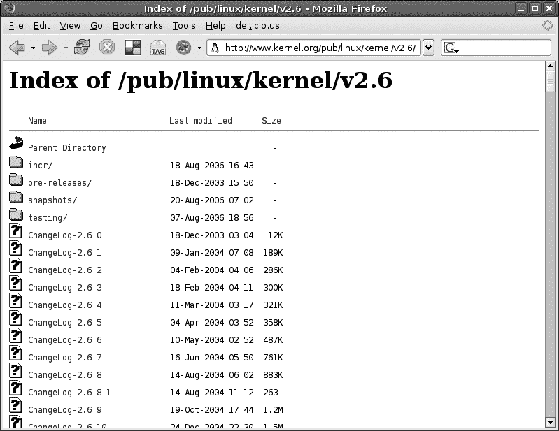

图 3-3. 2.6 内核源码目录

也可以从命令行下载内核源码，使用`wget`或`curl`工具，这两个工具通常都带在你的 Linux 发行版中。

使用`wget`下载 2.6.17.8 内核版本，输入：

```
$ wget http://www.kernel.org/pub/linux/kernel/v2.6/linux-2.6.17.8.tar.gz
```

```
--17:44:55  http://www.kernel.org/pub/linux/kernel/v2.6/linux-2.6.17.8.tar.gz
```

```
          => linux-2.6.17.8.tar.gz'
```

```
Resolving www.kernel.org... 204.152.191.5, 204.152.191.37
```

```
Connecting to www.kernel.org|204.152.191.5|:80... connected.
```

```
HTTP request sent, awaiting response... 200 OK
```

```
Length: 51,707,742 (49M) [application/x-gzip]
```

```
100%[=============================================>] 51,707,742    35.25K/s    ETA 00:00
```

```
18:02:48 (47.12 KB/s) - linux-2.6.17.8.tar.gz' saved [51707742/51707742]
```

使用`curl`下载：

```
$ curl http://www.kernel.org/pub/linux/kernel/v2.6/linux-2.6.17.8.tar.gz -o linux-2.6.17.8.tar.gz
```

```
  % Total    % Received % Xferd  Average Speed   Time     Time     Current
                                  Dload  Upload  Total   Spent    Left  Speed
100 49.3M  100 49.3M     0         0   50298      0  0:17:08  0:17:08 --:--:--  100k
```

要快速方便地确定最新的内核版本，可以使用`www.kernel.org/kdist/finger_banner`上的信息，如图图 3-4 所示。

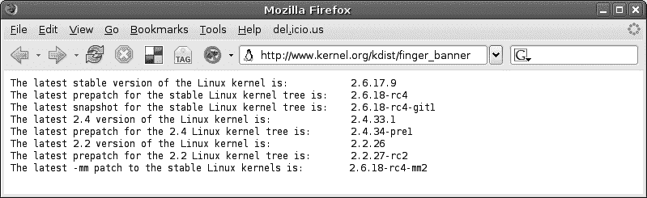

图 3-4. 最新内核版本

# 如何处理源码

现在你已经下载了正确的内核源码，它应该被存放在哪里呢？我们建议在你的主目录下创建一个名为`linux/`的本地目录来存放所有源码。

首先，创建目录：

```bash
mkdir ~/linux
```

然后，将源码移动到该目录：

```bash
cd ~/linux
```

现在解压源码：

```bash
tar -xzvf linux-2.6.17.8.tar.gz
```

一旦提取出源码，列出文件：

```bash
ls
```

# 配置与编译

内核包含了近两千个配置选项，因此如果要求询问每一个单独的选项，将花费很长时间。幸运的是，有一种更简单的方法来配置内核：基于预构建的配置进行配置。

## 创建配置

内核配置存储在一个名为`.config`的文件中。内核配置程序将逐一遍历配置选项，并询问你是否启用该选项。通常，每个选项的显示格式为`[Y/m/n]`。大写字母是默认值，可以直接按回车键选择。选项有：

- `y`：直接编译到内核中。
- `n`：完全排除在内核。
- `m`：编译为模块，需要时加载。
- `?`：打印简短描述信息并重复提示。

## 默认配置

每个内核版本都带有一个“默认”内核配置。该配置大致基于该架构的内核维护者认为的最佳选项。在某些情况下，它仅仅是内核维护者在其个人机器使用的配置。i386 架构就是如此，默认内核配置与 Linus Torvalds 用于其主开发机的配置非常匹配。

要创建此默认配置，请执行操作：

```
cd linux-2.6.17.10
make defconfig
```

# 修改配置

现在我们创建了基础配置文件，应该对其进行修改以支持系统中的硬件。有关如何确定需要选择哪些配置选项来实现这一目标，请参阅第 7 章。在这里我们将展示如何选择想要更改的选项。

有三种不同的交互式内核配置工具：基于终端的`menuconfig`、基于 GTK+ 的图形化`gconfig`，以及基于 QT 的图形化`xconfig`。

## 控制台配置方法

`menuconfig`配置内核方法是一种基于控制台的程序，它提供了一种使用键盘方向键在内核配置中移动的方法。要启动此配置模式，输入：

```bash
make menuconfig
```

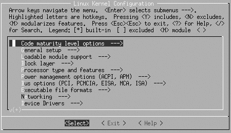

图 4-1 初始 menuconfig 屏幕

程序导航指令以及不同字符的含义显示在屏幕顶部。屏幕的其他部分包含不同的内核配置选项。

内核配置被分为若干部分。每个部分都包含与特定主题相关的选项。在这些部分中，可以针对各种专门主题的子部分。例如，所有的内核设备驱动都可以在主菜单选项`Device Drivers`（设备驱动）下找到。进入该菜单，向下移动方向键九次，直到`Device Drivers --->`行被高亮，如图 4-2 所示。

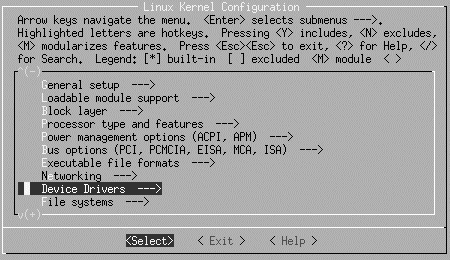

图 4-2 选中的 Device Drivers 选项

然后按`Enter`键。它将带进入`Device Drivers`子菜单，并如图 4-3 所示显示出来。

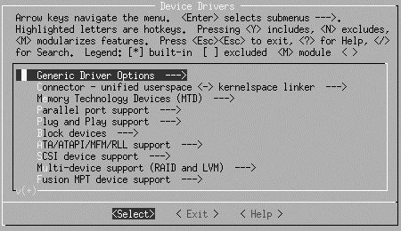

图 4-3 Device Drivers 子菜单

你可以以同样的方式继续向下移动菜单层级。要查看`Generic Driver Options`（通用驱动选项）子菜单，再次按`Enter`，你将看到如图 4-4 所示的三个选项。

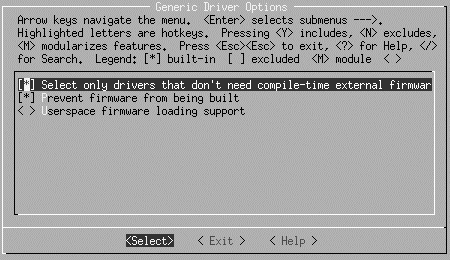

图 4-4 Generic Driver Options 子菜单

前两个选项旁边有一个`[*]`标记。这意味着该选项已被选中（因为`*`位于`[ ]`字符的中间），并且该选项是一个“是/否”选项。第三个选项有`< >`标记，显示该选项可以被编译进内核（`Y`）、编译为模块（`M`）或完全排除（`N`）。

如果通过`Y`选中该选项，角括号内将包含一个`*`字符。如果通过`M`编译为模块，它们将包含一个`M`字符。如果通过`N`禁用，它们将只显示一个空格。

因此，如果我们希望更改这三个选项，以便仅选择编译时不需要外部固件的驱动程序、禁用防止构建固件的选项，并将用户态固件加载器编译为模块，我们将对第一个选项按`Y`，对第二个选项按`N`，对第三个选项按`M`，屏幕将像图 4-5 所示。


图 4-5 更改后的 Generic Driver Options 子菜单

完成对此屏幕的更改后，按`Escape`键或按右箭头再按`Enter`键以离开此子菜单。所有不同的内核选项都可以以这种方式进行探索。

当你完成对内核配置的所有所需更改后，在主菜单上按`Escape`键退出程序。你将看到图 4-6 所示的屏幕，询问你是否想要保存更改后的内核配置。


图 4-6 保存内核选项

按`Enter`保存配置，或者如果你想丢弃任何已做的更改，按右箭头移动到`<No>`选择然后按`Enter`。

## 图形化配置方法

`gconfig`和`xconfig`配置内核的方法使用图形化程序允许你修改内核配置。这两种方法几乎相同，区别在于编写它们时使用的图形工具包不同。`gconfig`使用 GTK+ 工具包编写，具有一个类似于图 4-7 的双窗格屏幕。

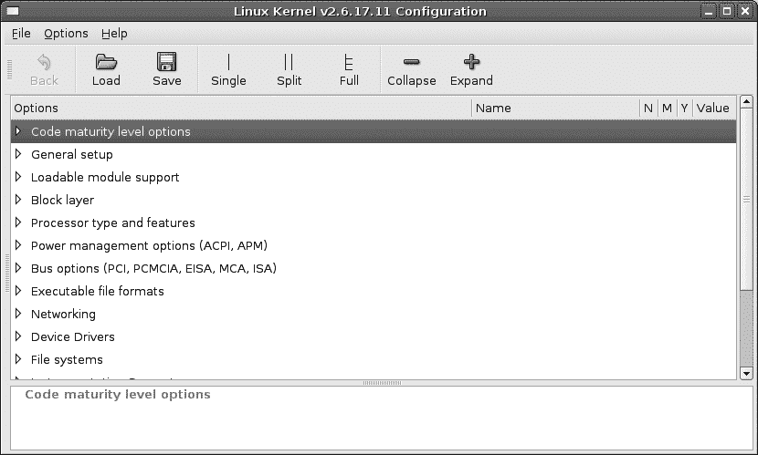

图 4-7 make gconfig 屏幕

`xconfig`方法使用 QT 工具包编写，具有一个类似于图 4-8 的三窗格屏幕。

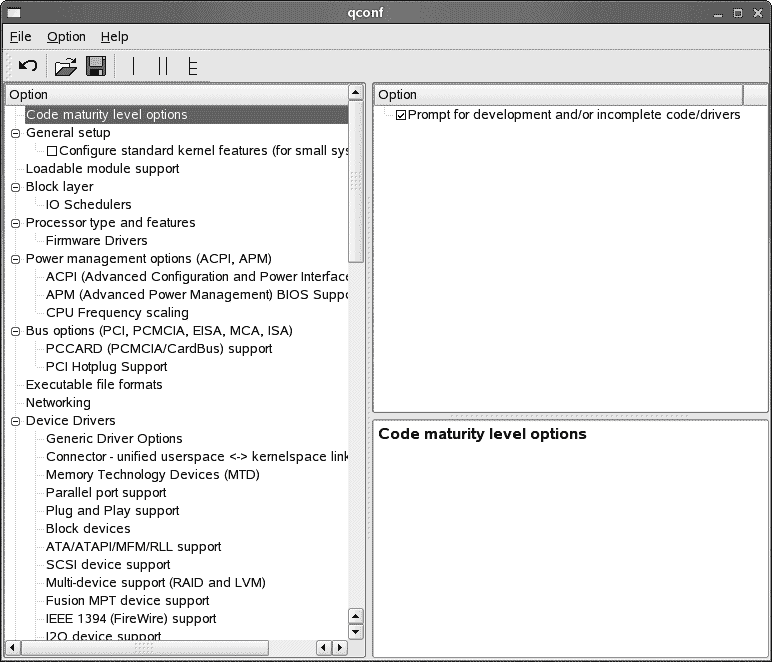

图 4-8 make xconfig 屏幕

使用鼠标导航子菜单并选择选项。例如，你可以在图 4-8 中选择`Device Drivers`菜单的`Generic Driver Options`子菜单。这将使`xconfig`屏幕变为像图 4-9 所示。

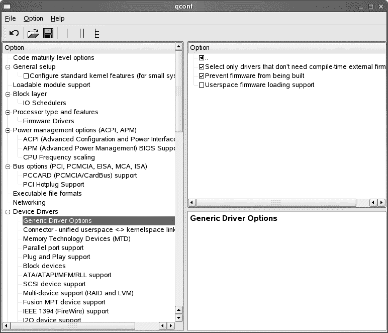

图 4-9 make xconfig Generic Driver Options

对应的`gconfig`屏幕是图 4-10。

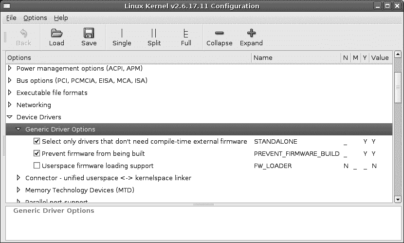

图 4-10 make gconfig Driver Options

更改此子菜单以禁用第二个选项并将第三个选项编译为模块，会导致屏幕看起来像图 4-11 和图 4-12 所示。

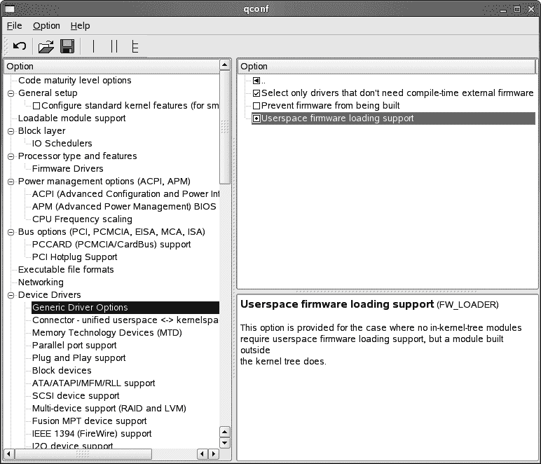

图 4-11 make xconfig Driver Options

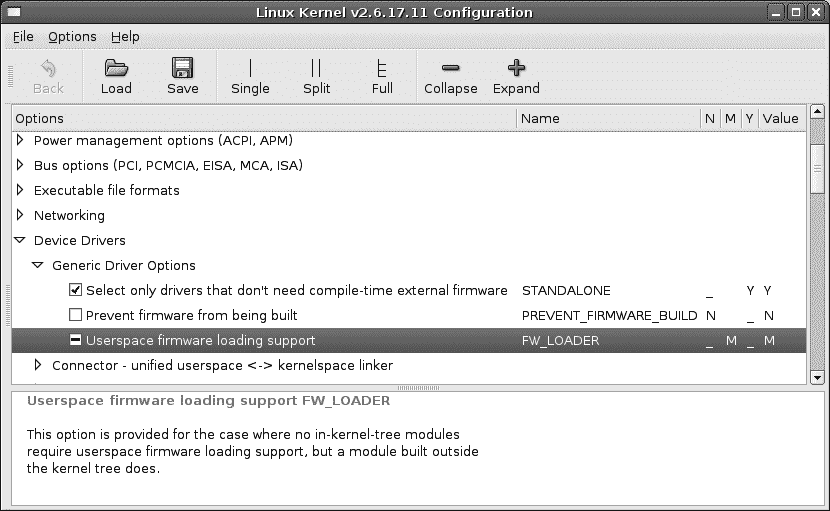

图 4-12 make gconfig Driver Options

请注意，在`gconfig`方法中，选框表示该选项被编译进内核，而划线框表示该选项为模块。在`xconfig`方法中，编译为模块的选项将用点显示。这两种方法在退出时都会提示你保存配置，并提供将配置写入另一个文件的选项。

## 构建内核

现在你已经创建了想要使用的配置，需要构建内核。这只需要输入一个单单词命令：

```
make
```

运行`make`将导致内核构建系统使用你选择的配置来构建内核以及支持该配置的所有模块。在内核编译期间，`make`将显示正在发生的文件名以及任何构建警告或错误。

如果内核构建无错误地完成，你已经成功创建了内核映像。但在你尝试从中启动之前，需要对其进行正确安装。请参阅第 5 章了解如何操作。

在构建发布版内核版本时遇到任何构建错误是非常常的。如果你遇到了，请向 Linux 内核开发者报告，以便他们进行修复。

---

[^5]: 2.6 发布之前的旧内核版本需要`make modules`额外步骤来构建所有需要的内核模块。现在不再需要了。

## 高级构建选项

内核构建系统允许你执行许多不仅仅是构建完整内核和模块之外的操作。第 10 节包含了内核构建系统提供的完整选项列表。在本节中，我们将讨论其中一些高级构建选项。要查看如何使用其他高级构建选项的完整说明，请参考内核内部关于构建系统的文档，该文档可以在源码的`Documentation/kbuild/`目录下找到。

## 在多处理器机器上更快地构建

内核构建系统作为一项任务运行得非常好，它可以被拆分成许多部分并分配给不同的处理器。通过这种方式，你可以利用多处理器机器的全部性能，并大幅缩短内核构建时间。

要以多线程方式构建内核，请对`make`程序使用`-j`选项。最好为`-j`选项提供一个与系统处理器数量两倍对应的数字。因此，对于拥有 2 个处理器的机器，使用：

```
$ make -j4
```

对于拥有 4 个处理器的机器，使用：

```
$ make -j8
```

如果你没有给`-j`选项传递数值：

```
$ make -j
```

构建系统将为内核树中的每一个子目录创建一个新线程，这很容易导致你的机器变得无响应，并花费更长的时间来完成构建。因此，建议始终向`-j`选项传递一个数字。

## 仅构建内核的部分内容

在进行内核开发时，有时你只想构建整个内核树中的特定子目录或单个文件。内核构建系统允许你轻松实现这一点。要选择性地构建特定目录，请在构建命令行指定它。例如，要构建`drivers/usb/serial`目录下的文件，输入：

```
$ make drivers/usb/serial
```

然而，使用这种语法不会构建该目录下的最终模块映像。要实现这一点，你可以使用`M=`参数：

```
$ make M=drivers/usb/serial
```

这将构建该目录中的所有需要的文件并链接最终的模块映像。

当你使用显示的方法之一构建单个目录时，最终的内核映像不会被重新链接。因此，对子目录所做的任何更改都不会影响最终的内核映像，这可能不是你想要的。执行最终的：

```
$ make
```

让构建系统检查所有更改的对象文件并正确地进行最终的内核映像链接。

要构建内核树中的某个特定文件，只需将其作为参数传递给`make`。例如，如果你只想构建`drivers/usb/serial/visor.ko`内核模块，输入：

```
$ make drivers/usb/serial/visor.ko
```

构建系统将为`visor.ko`内核模块构建所有需要的文件，并执行最终链接以创建模块。

## 源码在一处，输出在另一处

有时，将内核树的源码放在只读位置（例如在 CD-ROM 上或源码控制系统中），并将内核构建的输出放在其他处更为方便，这样你就不会干扰原始源码树。内核构建系统可以轻松处理这一点，只需要单个参数`O=`即可告诉它将输出放在哪里。例如，如果内核源码位于挂载在`/mnt/cdrom/`的 CD-ROM 上，而你希望将构建的文件放在本地目录，输入：

```
$ cd /mnt/cdrom/linux-2.6.17.11/
```

```
$ make O=~/linux/linux-2.6.17.11
```

所有的构建文件都将在`~/linux/linux-2.6.17.11/`目录下创建。请注意，此`O=`选项也应该传递给构建的配置选项，以便配置正确地放在输出目录中而不是包含源码的目录。

## 不同架构

以交叉编译的方式构建内核非常有用，这允许更强大的机器为较小的嵌入式系统构建内核，或者仅仅检查不同架构的构建，以确保对源码的更改没有导致意外的错误。内核构建系统允许你通过`ARCH=`参数指定与当前系统不同的架构。构建系统还允许你通过`CC=`参数指定你想要用于构建的特定编译器，或通过`CROSS_COMPILE`参数使用交叉编译工具链。

例如，要获取 x86_64 架构的默认内核配置，你需要输入：

```
$ make ARCH=x86_64 defconfig
```

要使用位于`/usr/local/bin/`的 ARM 工具链构建整个内核，你需要输入：

```
$ make ARCH=arm CROSS_COMPILE=/usr/local/bin/arm-linux-
```

即使对于非交叉编译的内核，更改构建系统所使用的编译器也是有用的。这些包括使用`distcc`或`ccache`程序，这两者都能极大地缩短构建内核的时间。要将`ccache`程序作为构建系统的一部分，输入：

```
$ make CC="ccache gcc"
```

要同时使用`distcc`和`ccache`，输入：

```
$ make CC="ccache distcc"
```

# 5 安装并从内核启动

之前的章节向你展示了如何下载和构建内核。现在你已经有了可执行文件以及任何模块——是时候安装内核并尝试启动了。在本章中，与之前的章节不同，所有命令都需要 root 用户运行。

要检查你是否安装了`sudo`以及权限设置正确，执行以下操作：


输入你自己的密码。如果成功并看到了`Makefile`，那么你可以跳过下一节。

如果`sudo`未安装或没有提供正确的权限，尝试使用`su`命令：

```
$ su
```

在密码提示处，输入系统管理员（root）的密码。当`su`程序成功接受密码时，你将切换到 root 权限运行。在 root 身份运行时要非常小心，只执行最少的操作；然后退出程序回到你的普通用户账户。

```
exit
```

大多数发行版都带有一个名为`installkernel`的脚本，内核构建系统可以使用它可以自动将构建的内核安装到正确位置并修改引导程序，这样开发者无需进行额外操作。

### 注意

提供`installkernel`的发行版通常将其放在名为`mkinitrd`的包中，因此如果你在机器上找不到该脚本，请尝试安装该包。

如果你构建了任何模块并想使用这种方法安装内核，先输入：

```
make modules_install
```

这将安装你构建的所有模块，并将它们放置在文件系统的正确位置，以便新内核正确找到它们。

在成功安装模块后，必须安装主内核映像：

```
make install
```

*   构建系统会将静态内核部分安装到`/boot`目录，并根据所构建内核的版本为该可执行文件命名。
*   任何所需的初始化内存盘（ramdisk）镜像将自动创建，并使用在`modules_install`阶段刚刚安装的模块。
*   引导加载程序将会被正确通知新内核的存在，并且它会被添加到相应的菜单中，以便用户在下次机器启动时可以选择它。

完成这些操作后，内核已成功安装，你可以安全地重启并尝试你的新内核镜像。请注意，此安装不会覆盖任何旧的内核镜像，因此如果你的新内核镜像出现问题，可以在启动时选择旧的内核。

此规则的显著例外是 Gentoo 和其他“从零开始”类型的发行版，这些发行版要求用户知道如何自行安装内核。这类发行版包含有关如何安装新内核的文档，请查阅该文档以获取所需的精确方法。

# 手动安装

如果你的发行版没有`installkernel`命令，或者你希望通过手动操作来理解涉及的步骤，以下是具体步骤。

1.  必须安装模块：`# make modules_install`

2.  必须将静态内核镜像复制到`/boot`目录。对于基于`i386`的内核，执行以下操作：`# make kernelversion`

    ```
    2.6.17.11
    ```

    注意，内核版本可能与你的内核不同。请使用此值替换后续所有步骤中的文本`KERNEL_VERSION`：`# cp arch/i386/boot/bzImage /boot/bzImage-KERNEL_VERSION`

    ```
    # cp System.map /boot/System.map-KERNEL_VERSION
    ```

3.  修改引导加载程序使其识别新内核。这涉及涉及编辑你正在使用的引导加载程序的配置文件，稍后的 [为新内核修改引导加载程序] 部分将介绍 GRUB 和 LILO 引导加载器的相关内容。

如果启动过程没有正常运行，通常是因为需要一个初始化内存盘镜像。要正确创建它，请使用本章开头关于自动安装内核的步骤，因为发行版的安装脚本知道如何使用所需的脚本和工具正确创建内存盘。由于每个发行版的处理方式不同，涵盖构建内存盘镜像的所有不同方法超出了本书的范围。

这里有一个实用的脚本，可以自动安装内核，而无需一直输入之前的命令：

```sh
#!/bin/sh
#
# 安装内核
#
make modules_install
# 确定这是哪个内核版本
for TAG in VERSION PATCHLEVEL SUBLEVEL EXTRAVERSION ; do
    eval `sed -ne "/^$TAG/s/ //gp" Makefile`
done
SRC_RELEASE=$VERSION.$PATCHLEVEL.$SUBLEVEL$EXTRAVERSION
# 确定架构
ARCH=`grep "CONFIG_ARCH " include/linux/autoconf.h | cut -f 2 -d "\""`
# 复制内核镜像
cp arch/$ARCH/boot/bzImage /boot/bzImage-"$SRC_RELEASE"
# 复制 System.map 文件
cp System.map /boot/System.map-"$SRC_RELEASE"
echo "Installed $SRC_RELEASE for $ARCH"
```

# 为新内核修改引导加载程序

有两种常见的 Linux 内引导加载程序：GRUB 和 LILO。GRUB 是现代发行版中常用的，某些功能操作比 LILO 容易一些，但 LILO 仍然常见。我们将在本节中涵盖两者。

要确定你的系统使用哪种引导加载程序，请查看`/boot/`目录。如果存在`grub`子目录：

```bash
ls -F /boot | grep grub
grub/
```

那么你正在使用 GRUB 程序进行引导。如果不存在此目录，请查找`/etc/lilo.conf`文件：

```bash
ls /etc/lilo.conf
/etc/lilo.conf
```

如果存在该文件，则你正在使用 LILO 程序进行引导。

向这些程序之一添加新内核的步骤各不相同，请仅遵循对应你所用程序的章节。

## GRUB

要让 GRUB 知道新内核的存在，你只需要修改`/boot/grub/menu.lst`文件。有关该文件结构以及所有不同可用选项的完整细节，请参考 GRUB info 页面：

```bash
info grub
```

向`/boot/grub/menu.lst`文件添加新内核条目的最简单方法是复制现有条目。例如，考虑来自 Gentoo 系统的`menu.lst`文件：

```text
timeout 300
default 0
splashimage=(hd0,0)/grub/splash.xpm.gz
title 2.6.16.11
    root (hd0,0)
    kernel /bzImage-2.6.16.11 root=/dev/sda2 vga=0x305
title 2.6.16
    root (hd0,0)
    kernel /bzImage-2.6.16 root=/dev/sda2 vga=0x305
```

以单词`title`开头的行定义了一个新内核条目，因此该文件包含两个条目。只需将从一个`title`单词实例的行复制到下一个，如下：

```text
title 2.6.16
    root (hd0,0)
    kernel /bzImage-2.6.16 root=/dev/sda2 vga=0x305
```

复制到文件末尾，并编辑版本号以包含你刚刚安装的新内核的版本号。标题内容并不重要，只要它是唯一的，但它会显示在启动菜单中，所以你应该让它具有意义。在我们的示例中，我们安装了`2.6.17.11`内核，所以文件的最终副本看起来如下：

```text
timeout 300
default 0
splashimage=(hd0,0)/grub/splash.xpm.gz
title 2.6.16.11
    root (hd0,0)
    kernel /bzImage-2.6.16.11 root=/dev/sda2 vga=0x305
title 2.6.16
    root (hd0,0)
    kernel /bzImage-2.6.16 root=/dev/sda2 vga=0x305
```

保存文件后，重启系统并确保新内核标题出现在启动菜单中。选中它并启动。

## LILO

要让 LILO 知道新内核的存在，你必须修改`/etc/lilo.conf`配置文件，然后运行`lilo`命令以应用配置文件的更改。有关配置文件的完整细节，请参 LILO 手册页：

```bash
man lilo
```

向`/etc/lilo.conf`添加新内核条目的最简单方法是复制现有条目。例如，考虑来自 Gentoo 系统的 LILO 配置文件：

```text
boot=/dev/hda
prompt
timeout=50
default=2.6.12
image=/boot/bzImage-2.6.15
    label=2.6.15
    read-only
    root=/dev/sda2
image=/boot/bzImage-2.6.12
    label=2.6.12
    read-only
    root=/dev/sda2
```

以单词`image=`开头的行定义了一个新内核条目，因此该文件包含两个条目。只需从一个`image=`单词实例的行复制到下一个，如下：

```text
image=/boot/bzImage-2.6.15
    label=2.6.15
    read-only
    root=/dev/sda2
```

复制到文件末尾，并编辑版本号以包含你刚刚安装的新内核的版本号。标签内容并不重要，只要它是唯一的，但它会显示在启动菜单中，所以你应该让它具有意义。在我们的示例中，我们安装了`2.6.17.11`内核，所以文件的最终副本看起来如下：

```text
boot=/dev/hda
prompt
timeout=50
default=2.6.12
image=/boot/bzImage-2.6.15
    label=2.6.15
    read-only
    root=/dev/sda2
image=/boot/bzImage-2.6.12
    label=2.6.12
    read-only
    root=/dev/sda2
image=/boot/bzImage-2.6.17
    label=2.6.17
    read-only
    root=/dev/sda2
```

保存文件后，运行`/sbin/lilo`程序将配置更改写入磁盘的引导区：

```bash
# /sbin/lilo
```

现在系统可以安全地重启了。新内核的选择可以在启动时的可用内核列表中看到。使用方向箭头选中新内核版本，然后按回车启动新内核。

# 第 6 章 升级内核

不可避免的是，你有一个自定义的内核，运行良好，除了内核开发者在最新发布中修复的一个小问题。或者发现了安全问题，并发布了新的稳定内核。无论何种情况，你都会面临升级内核的问题，并且不想浪费构建完美内核所需的时间和精力。

本章将介绍如何从旧版本轻松升级内核，同时保留之前的所有配置。

首先，请备份内核源码目录中的`.config`文件。你花费了一些时间创建了它，在尝试升级时出错时应该保存它。

```bash
$ cd ~/linux/linux-2.6.17
$ cp .config ../good_config
```

从之前构建的内核升级只有五个简单步骤：

1. 获取新源码。
2. 将更改应用到旧源码树以升级。
3. 根据之前的内核配置重新配置内核。
4. 编译新内核。
5. 安装新内核。

最后两个步骤与之前相同，因此我们只讨论前三步。

在本章中，假设你已经成功构建了 2.6.17.9 版本内核，并想要升级到 2.6.17.11 版本。

# 下载新源码

Linux 内核开发者意识到并非所有用户希望每次更新都下载整个源码。这将浪费带宽和时间。因此，他们提供了可以将旧内核发布升级到新版本的补丁（patch）。

在`kernel.org`主页上，你会看到可下载的当前内核列表：

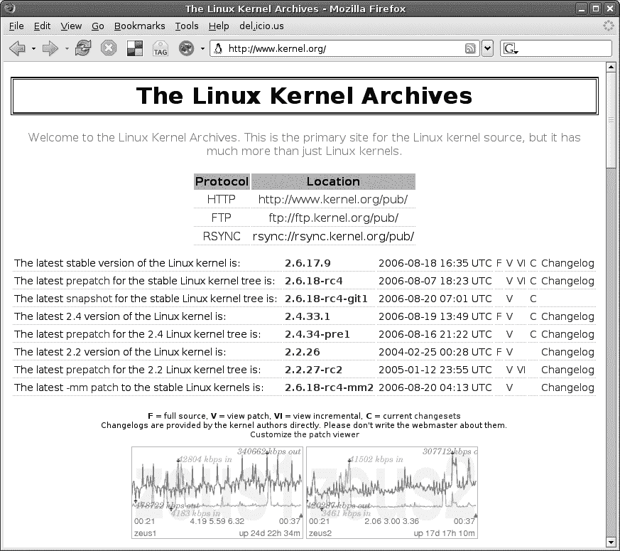

图 6-1 kernel.org 主页

以前，你使用指向整个源码的`F`链接。然而，如果你点击内核版本的名称，将下载补丁文件：

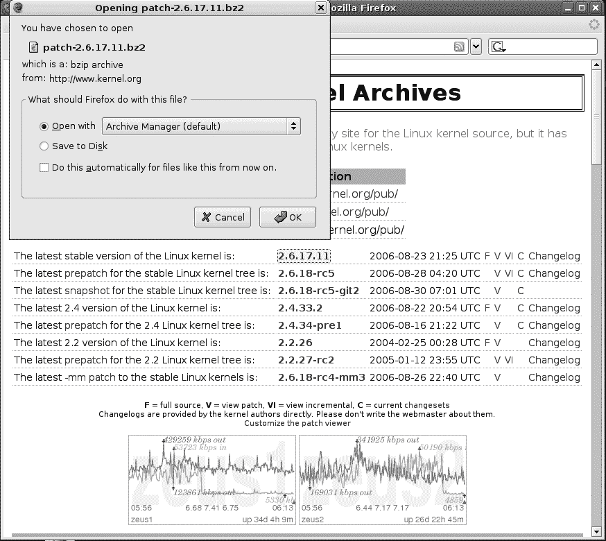

图 6-2 从 kernel.org 下载补丁

这就是升级时我们要做的，但我们需要确定下载哪个补丁。

## 哪个补丁适用于哪个版本？

内核补丁文件会将源码从一个特定发布升级到另一个特定发布。以下是不同补丁文件的应用方式：

*   **稳定内核补丁（Stable kernel patches）**适用于基础内核版本。这意味着 2.6.17.10 丁仅适用于 2.6.17 发布。2.6.17.10 内核补丁不适用于 2.6.17.9 或其他发布。
*   **基础内核发布补丁（Base kernel release patches）**适用于之前的基础内核版本。这意味着 2.6.18 丁仅适用于 2.6.17 发布。它不适用于最后的 2.6.17.y 发布或其他任何发布。
*   **增量补丁（Incremental patches）**从一个特定发布升级到下一个发布。这允许开发者无需降级内核再升级，只需从最新稳定版切换到下一个稳定版（注意稳定版补丁仅针对基础内核，而不是上一个稳定版）。尽可能使用增量补丁会让你的生活更轻松。

# 寻找补丁

由于我们要从 2.6.17.9 内核发布到 2.6.17.11 发布，我们需要下载两个不同的补丁。我们需要一个从 2.6.17.9 发布到 2.6.17.10 的补丁，然后一个从 2.6.17.10 发布到 2.6.17.11 的补丁。

稳定和基础内核补丁与主源码树具有相同的目录结构。所有的增量补丁可以在下层的`incr`子目录中找到。因此，为了寻找从 2.6.17.9 到 2.6.17.10 的补丁，我们在`/pub/linux/kernel/v2.6/incr`目录查找我们需要的文件：

```bash
$ cd ~/linux
$ lftp ftp.kernel.org/pub/linux/kernel/v2.6/incr
cd ok, cwd=/pub/linux/kernel/v2.6/incr
lftp ftp.kernel.org:/pub/linux/kernel/v2.6/incr> ls *2.6.17.9*.bz2
-rw-rw-r-- 1 536 536 Aug 22 19:23 patch-2.6.17.9-10.bz2
lftp ftp.kernel.org:/pub/linux/kernel/v2.6/incr> get patch-2.6.17.9-10
2872 bytes transferred
lftp ftp.kernel.org:/pub/linux/kernel/v2.6/incr> get patch-2.6.17.10-11
7901 bytes transferred
lftp ftp.kernel.org:/pub/linux/kernel/v2.6/incr> exit
$ ls -F
good_config linux-2.6.17.9/ patch-2.6.17.10
```

补丁文件是 2.6.17.9 2 2...7.11.1.丁丁显示从 2.6.17.9 2 到 ..6...1......................

```bash
good_config linux-2.6.17.9/ patch-2.6.17.9-10
```

# 应用补丁

由于下载的的是压缩的，第一项任务是使用`bzip2`命令将其解压：

```bash
$ bzip2 -dv patch-2.6.17.9-10.bz2
patch-2.6.17.9-10: done
$ bzip2 -dv patch-2.6.17.10-11.bz2
patch-2.6.17.10-11: done
$ ls -F
good_config linux-2.6.17.9/ patch-2.6.17.9-10 patch-2.6.17.10-11
```

现在我们需要将补丁应用到内核目录。进入目录：

```bash
$ cd linux-2.6.17.9
```

并运行`patch`程序应用第一个补丁，从 2.6.17.9 到 2.6.17.10：

```bash
$ patch -p1 ../patch-2.6.17.9-10
patching file Makefile
patching file block/elevator.c
patching file fs/udf/super.c
patching file fs/udf/truncate.c
patching file include/net/sctp/sctp.h
patching file include/net/sctp/sm.h
patching file net/sctp/sm_make_chunk.c
patching file net/sctp/sm_statef.c
patching file net/sctp/socket.c
```

验证补丁是否真的工作，并且 patch 程序输出中没有错误或警告。查看内核的`Makefile`查看版本也是个好主意：

```bash
$ head -n 5 Makefile
VERSION = 2
PATCHLEVEL = 6
SUBLEVEL = 17
EXTRAVERSION = .10
NAME=Crazed Snow-Weasel
```

现在的 2.6.17.10 级别，按照同样的方法应用补丁将其升级到 2.6.17.11 级别：

```bash
$ patch -p1 ../patch-2.6.17.10-11
patching file Makefile
patching file arch/ia64/kernel/sys_ia64.c
patching file arch/sparc/kernel/sys_sparc.c
patching file arch/sparc64/kernel/sys_sparc.c
patching file drivers/char/tpm/tpm_tis.c
```

`patching file drivers/ieee1394/ohci1394.c`

`patching file drivers/md/dm-mpath.c`

`patching file drivers/md/raid1.c`


`patching file drivers/net/sky2.c`

`patching file drivers/pci/quirks.c`

`patching file drivers/serial/Kconfig`

`patching file fs/befs/linuxvfs.c`

`patching file fs/ext3/super.c`

`patching file include/asm-generic/mman.h`

`patching file include/asm-ia64/mman.h`

`patching file include/asm-sparc/mman.h`

`patching file include/asm-sparc64/mman.h`

`patching file kernel/timer.c`

`patching file lib/spinlock_debug.c`

`patching file mm/mmap.c`

`patching file mm/swapfile.c`

`patching file net/bridge/netfilter/ebt_ulog.c`

`patching file net/core/dst.c`

`patching file net/core/rtnetlink.c`

`patching file net/ipv4/fib_semantics.c`

`patching file net/ipv4/netfilter/arp_tables.c`

`patching file net/ipv4/netfilter/ip_tables.c`

`patching file net/ipv4/netfilter/ipt_ULOG.c`

`patching file net/ipv4/route.c`

`patching file net/ipx/af_ipx.c`

`patching file net/netfilter/nfnetlink_log.c`

再次验证补丁程序的输出没有任何错误，并查看`Makefile`：

```bash
$ head -n 5 Makefile
VERSION = 2
PATCHLEVEL = 6
SUBLEVEL = 17
EXTRAVERSION = .11
NAME=Crazed Snow-Weasel
```

既然源代码已成功更新到你想使用的版本，最好的做法是返回并将目录名称为内核版本号，以免以后发生混淆：

```bash
$ cd ..
$ mv linux-2.6.17.9 linux-2.6.17.11
$ ls -F
good_config linux-2.6.17.11/ patch-2.6.17.10-11 patch-2.6.17.9-10
```

# 重新配置内核

之前，我们使用`make menuconfig`或`gconfig`或`xconfig`方法来更改不同的配置选项。但一旦你有了可以工作的配置，唯一需要的就是根据自上次发布以来内核添加的新选项来更新它。为了做到，应该使用`make oldconfig`和`make silentoldconfig`选项。

`make oldconfig`获取`.config`文件中的当前内核配置，并根据新的内核发布进行更新。为此，它会打印所有的配置问题，如果该选项已经在配置文件中处理，则会提供相应的答案。如果有新选项，程序将停止并询问用户新配置值应该设置为什么。回答提示后，程序将继续运行，直到完成整个内核配置。

`make silentoldconfig`的工作方式与`oldconfig`完全相同，但它不会向屏幕打印任何内容，除非它需要就新配置选项提问。

通常，在稳定发布版的不同版本之间升级时，不会添加新的配置选项，因为这应该是一个`stable`（稳定）内核系列。如果发生这种情况，内核配置不需要回答任何新问题，因此程序将成功运行，无需用户干预。一个例子是从 2.6.17.9 版本移动到 2.6.17.11 发布版：

```bash
$ cd linux-2.6.17.11
$ make silentoldconfig
scripts/kconfig/conf -s arch/i386/Kconfig
#
## using defaults found in .config
#
```

新发布中出现新内核选项的示例所示。在切换某些内核版本之间，启用`Mutex debugging`（互斥调试）的内核选项是一个新选项。以下是发生时的输出：

```bash
$ make silentoldconfig
scripts/kconfig/conf -s arch/i386/Kconfig
#
## using defaults found in .config
#
*
* Restart config...
*
*
*
* Kernel hacking
*
* timing information on printks (PRINTK_TIME) [Y/n/?] y
Magic SysRq key (MAGIC_SYSRQ) [Y/n/?] y
Kernel debugging (DEBUG_KERNEL) [Y/n/?] y
  Kernel log buffer size (16 => 64KB, 17 => 128KB) (LOG_BUF_SHIFT) [16]
```

将此配置文件拷贝到你的内核目录并将其重命名为`.config`。然后使用它作为内核配置的基础，按照第 4 章中的描述构建内核。

使用此配置文件应该始终能为你的机器生成一个可工作的内核镜像。该内核镜像的缺点是，你将构建了内核源码树中存在的每一个内核模块和驱动程序。对于单台机器来说，这几乎是不需要的，因此你可以开始关闭不需要的不同驱动程序和选项。建议只禁用你确定不需要的选项，因为系统的某些部分可能依赖启用特定的选项才能运行。

## 查找需要的模块

来自发行版的配置文件构建需要很长时间，因为构建了所有不同的驱动程序。如果你只想构建你需要的驱动程序，这可以节省时间，并在某些架构上让系统运行得更快，同时节省一些内存。为了减少驱动程序，你需要确定哪些驱动程序控制哪些硬件。

系统中的几个位置存储了确定哪些设备绑定到哪些驱动程序的有用信息。最重要的位置是名为`sysfs`的虚拟文件系统。`sysfs`总是挂载在`/sys`目录下。它提供了关于内核不同部分如何连接在一起的概览。

在接下来的所有示例中，显示了真实的`sysfs`路径和类型。你的机器可能会不同，但`sysfs`文件中的相对位置将是相同的。不要惊讶，这是预料之中的。此外，`sysfs`的内部结构不断变化，由于内核开发者对如何显示设备进行思考，由于这一点，本文之前提到的某些链接可能不存在。

### 示例：确定驱动程序

系统中最常见且重要的设备之一是网卡。要确定哪个驱动程序控制此设备并使其网络正常工作，首先，从网络连接反向查找。要这样做，请查看不同的网络名称：

```bash
$ ls /sys/class/net/
```

```text
eth0 eth1 eth2 lo
```

`lo`目录表示环回设备，没有连接任何网络设备。你应该关注`eth0`、`eth1`和`eth2`目录，因为它们代表真实的网络设备。

为了进一步查看这些网络设备，使用`ifconfig`工具：

```bash
$ /sbin/ifconfig -a
```

```text
eth0      Link encap:Ethernet  HWaddr 00:12:3F:65:7D:C2  

           inet addr:192.168.0.13  Bcast:192.168.0.255  Mask:255.255.255.0

           UP BROADCAST RUNNING MULTICAST  MTU:1500  Metric:1

           RX packets:2720792 errors:0 dropped:0 overruns:0 frame:0

           TX packets:1815488 errors:0 dropped:0 overruns:0 carrier:0

           collisions:0 txqueuelen:100

           RX bytes:3103826486 (2960.0 Mb)  TX bytes:371424066 (354.2 Mb)

           Base address:0xdcc0 Memory:dfee0000-dff0000

eth1      Link encap:UNSPEC  HWaddr 80-65-00-12-7D-C2-3F-00-00-00-00-00-00-00-00-00-00

           BROADCAST MULTICAST  MTU:1500  Metric:1

           RX packets:0 errors:0 dropped:0 overruns:0 frame:0

           TX packets:0 errors:0 dropped:0 overruns:0 carrier:0

           collisions:0 txqueuelen:1000

           RX bytes:0 (0.0 b)  TX bytes:0 (0.0 b)

eth2      Link encap:UNSPEC  HWaddr 00-02-3C-04-11-09-D2-BA-00-00-00-00

           BROADCAST MULTICAST  MTU:1500  Metric:1

           RX packets:0 errors:0 dropped:0 overruns:0 frame:0

           TX packets:0 errors:0 dropped:0 overruns:0 carrier:0

           collisions:0 txqueuelen:1000

           RX bytes:0 (0.0 b)  TX bytes:0 (0.0 b)

lo       Link encap:Localback  

           inet addr:127.0.0.1  Mask:255.0.0.0

           UP LOOPBACK RUNNING  MTU:16436  Metric:1

           RX packets:60 errors:0 dropped:0 overruns:0 frame:0

           TX packets:60 errors:0 dropped:0 overruns:0 carrier:0

           collisions:0 txqueuelen:0

           RX bytes:13409 (13.0 Kb)  TX bytes:13409 (13.0 Kb)
```

从这个列表中，你可以看出`eth0`设备是活跃且正在工作的网络设备。

请记住将本示例中使用的`e1000`替换为你想要查找的模块名称。

在上一个`find`命令的输出中，需要查找的重点是任何包含`CONFIG_`术的行。这就是内核在构建模块时需要启用的配置选项。在上面的示例中，`CONFIG_E1000`选项就是你正在寻找的配置选项。

现在你已经有了配置内核所需的信息。运行菜单配置工具：

```bash
$ make menuconfig
```

然后按下`/`键（启动搜索）并输入配置选项名称，去掉字符串中的`CONFIG_`部分。此过程如图图 7-1 所示。

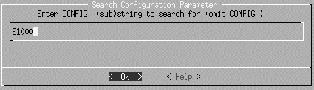

图 7-1. 在 menuconfig 中搜索

内核配置系统随后会准确告诉你在哪里选择该选项来启用此模块。请参见图 7-2。

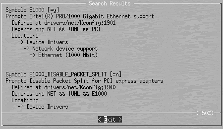

图 7-2. 在 menuconfig 中搜索的结果

显示中的第一项与你搜索的内容完全匹配。显示的位置信息告诉你，要将模块`e1000`构建内核，必须启用以下配置选项：

```text
Device Drivers

    Network device support

      [*] Network device support

          Ethernet (1000 Mbit)

    [*] Intel(R) PRO/1000 Gigabit Ethernet support
```

这些步骤适用于内核中激活的任何类型的设备。

### 示例：USB 设备

作为另一个示例，让我们看看示例系统中存在的一个 USB 转串口转换器。它目前连接到`/dev/ttyUSB0`端口，因此你需要在`sysfs`的 tty 部分进行查找：

```bash
$ ls /sys/class/tty/ | grep USB
```

```text
ttyUSB0
```

你可以追溯该设备的`sysfs`以找到控制它的模块，如上一节所示：

```bash
$ basename readlink /sys/class/tty/ttyUSB0/device/driver/module
```

```text
pl2303
```

然后搜索内核源码树以找到你需要启用的配置选项：

```bash
$ cd ~/linux/linux-2.6.17.8
$ find -type f -name Makefile | xargs grep pl2303
```

```text
./drivers/usb/serial/Makefile:obj-$(CONFIG_USB_SERIAL_PL2303) += pl2303.o
```

使用内核配置工具（如图图 7-3 所示）来找到合适的选项以设置`CONFIG_USB_SERIAL_PL2303`选项。

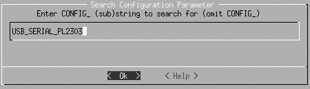

图 7-3. 搜索`USB_SERIAL_PL2303`

在我们案例中，这将显示如图 7-4 所示的屏幕。

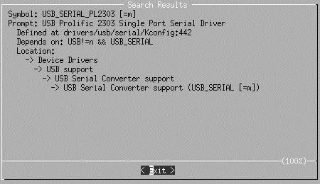

图 7-4. 搜索`USB_SERIAL_PL2303`的结果

这准确地显示了在哪里找到正确控制该设备所需的`USB Prolific 2303 Single Port Serial Driver`。

### 设备发现总结

总结来说，对于已经绑定了工作驱动程序的设备，查找驱动程序需要以下步骤：

1. 找到设备绑定的正确`sysfs`类设备。网络设备列在`/sys/class/net`中，tty 设备列在`/sys/class/tty/`中。其他类型的设备列在`/sys/class`下的其他目录中，取决于设备类型。
2. 追溯`sysfs`树找到控制该设备的模块名称。它位于`/sys/class/class_name/device_name/device/driver/module`，并可以使用`readlink`和`basename`程序显示：

   ```bash
   $ basename readlink /sys/class/class_name/device_name /device/driver/module
   ```

3. 使用`find`和`grep`搜索内核 Makefile，查找构建该模块名称的`CONFIG_`规则：

   ```bash
   $ find -type f -name Makefile | xargs grep module_name
   ```

4. 在内核配置系统中搜索该配置值，并转到菜单中指定的位置以启用该驱动的构建。

### 让内核告诉我们我们需要什么

既然我们已经尝试了探测内核的所有步骤，这里有一个非常实用的脚本：

```bash
#!/bin/bash

# find_all_modules

for i in `find /sys/ -name modalias -exec cat {} \`; do modprobe --show $i done | rev | sort -u
```

此脚本遍历`sysfs`并找到所有告诉内核应该采取哪个`modprobe`命令的`alias`。如果找到匹配项，它将输出模块列表。

将驱动程序匹配到设备的步骤取决于你正在处理的设备类型。在本章中，我们将讨论两种常见的设备类型：PCI 和 USB 设备。这里描述的方法适用于其他类型的设备。

此外，内核能够找到系统中的所有文件系统也非常重要，其中最重要的是根文件系统。我们将在本章末尾的根文件系统中介绍如何实现这一点。

## PCI 设备

PCI 设备通过厂商 ID（vendor ID）和设备 ID（device ID）来区分；每个厂商 ID 和设备 ID 的组合都可能需要唯一的驱动程序。这就是本节向你展示的研究的基础。

对于这个示例，让我们使用一个与当前运行内核版本不兼容的 PCI 网卡。这个示例与你的情况不同，具有不同的 PCI 设备和总线 ID 值，但涉及的步骤对于你想要找到可用驱动程序的任何 PCI 设备类型都是相关的。

首先，在系统中找到无法工作的 PCI 设备。要获取所有 PCI 设备的列表，请使用`lspci`程序。因为我们只关心以网 PCI 设备，我们将通过只搜索包含`Ethernet`字符串（不区分大小写）来缩小 PCI 设备的搜索范围：

```bash
$ /usr/sbin/lspci | grep -i ethernet
```

```text
06:04.0 Ethernet controller: Realtek Semiconductor Co., Ltd.  RTL-8139/8139C/8139C+ (rev 10)
```

这就是我们希望使其工作的设备。

### 注意

几乎所有的发行版都将`lspci`程序放在`/usr/sbin/`目录下，但某些放在其他位置。要查找它的位置，请输入：

```bash
$ which lspci
```


```bash
/usr/sbin/lspci
```

如果你使用的发行版将其放在了其他处，那么每当我们讨论使用 `lspci` 时，请使用该路径。

`lspci` 输出的前几位显示了该设备的 PCI 总线 ID，即 `06:04.0`。这就是我们在遍历 `sysfs` 以获取有关该设备的更多信息时将使用的值。

进入 `sysfs`，那里列出了所有不同的 PCI 设备，并查看它们的名称：

```bash
$ cd /sys/bus/pci/devices/
$ ls
```

```text
0000:00:00.0  0000:00:1d.0  0000:00:1e.0  0000:00:1f.3  0000:06:03.3
0000:00:02.0  0000:00:1d.1  0000:00:1f.0  0000:06:03.0  0000:06:03.4
0000:00:02.1  0000:00:1d.2  0000:00:1f.1  0000:06:03.1  0000:06:04.0
0000:00:1b.0  0000:00:1d.7  0000:00:1f.2  0000:06:03.2  0000:06:05.0
```

内核对 PCI 设备编号带有前缀 `0000:`，这在 `lspci` 程序的输出中并不显示。因此，在你通过 `lspci` 找到数字的基础上加上 `0000:`，进入该目录：

```bash
$ cd 0000:06:04.0
```

在此目录下，你想知道 `vendor` 和 `device` 的值：

```bash
$ cat vendor
```

```text
0x1ec
```

```bash
$ cat device
```

```text
0x8139
```

这些是 PCI 设备的 ID。内核使用这些值将驱动程序匹配到设备。PCI 驱动程序告诉内核它们支持哪些厂商和设备 ID，以便内核知道如何将驱动程序绑定到设备。将它们记录下来，稍后会用到。

现在我们知道了该 PCI 设备的厂商产品 ID，需要找到宣传该设备的正确内核驱动。回到内核源码目录：

```bash
$ cd ~/linux-2.6.17/
```

内核源码中 PCI ID 最常见的位置是 `include/linux/pci_ids.h`。搜索该文件查找我们的厂商：

```bash
$ grep -i 0x1ec include/linux/pci_ids.h
```

```c
#define PCI_VENDOR_ID_REALTEK  0x1ec
```

这里定义的 `PCI_VENDOR_ID_REALTEK` 将被任何声称支持它的内核驱动使用。为了安全起见，也在该文件中查找设备 ID，因为它有时会在那里描述：

```bash
$ grep -i 0x8139 include/linux/pci_ids.h
```

```c
#define PCI_DEVICE_ID_REALTEK_8139  0x8139
```

这个定义很有用。现在查找引用该厂商的驱动源文件：

```bash
$ grep -Rl PCI_VENDOR_ID_REALTEK *
```

```text
include/linux/pci_ids.h
drivers/net/r8169.c
drivers/net/8139too.c
drivers/net/8139cp.c
```

列出的第一个文件 `pci_ids.h` 不需要查看，因为它是发现原始的地方。但 `drivers/net/` 子目录下的 `r8169.c`、`8139too.c` 和 `8139cp.c` 应该仔细检查。

用编辑器打开这些文件之一并搜索 `PCI_VENDOR_ID_REALTEK`。在 `drivers/net/r8169.c` 文件中，它出现在这段代码部分：

```c
static struct pci_device_id rtl8169_pci_tbl[] = {
    { PCI_DEVICE(PCI_VENDOR_ID_REALTEK, 0x8169), },
    { PCI_DEVICE(PCI_VENDOR_ID_REALTEK, 0x8129), },
    { PCI_DEVICE(PCI_VENDOR_ID_DLINK, 0x4300), },
    { PCI_DEVICE(0x16ec, 0x0116), },
    { PCI_DEVICE(PCI_VENDOR_ID_LINKS, 0x1032, PCI_ANY_ID, 0x0024 }, },
    { },
};
```

所有 PCI 驱动程序都包含它们支持的不同设备列表。该列表包含在 `struct pci_device_id` 结构中，就像这一个。我们需要查看它来判断我们的设备是否由该驱动支持。这里的厂商值匹配，但厂商后的第二个值是设备值。我们的设备值为 `0x8139`，而此驱动程序对于厂商 ID 为 `PCI_VENDOR_ID_REALTEK` 的设备支持值为 `0x8169` 和 `0x8129`。因此此驱动程序不支持我们的设备。

继续下一个文件 `drivers/net/8139too.c`，我们在以下代码段找到了字符串 `PCI_VENDOR_ID_REALTEK`：

```c
if (pdev->vendor == PCI_VENDOR_ID_REALTEK &&
    pdev->device == PCI_DEVICE_ID_REALTEK_8139 && pci_rev >= 0x20) {
    dev_info(pdev->dev,
        "This (id %04x:%04x rev %02x) is an enhanced 8139C+ chip\n",
        pdev->vendor, pdev->device, pci_rev);
    dev_info(pdev->dev,
        "Use the \"8139cp\" driver for improved performance and stability.\n");
}
```

这里 `PCI_VENDOR_ID_REALTEK` 值的使用也与检查 PCI 设备 ID 是否匹配 `PCI_DEVICE_ID_REALTEK_8139` 值的代码对应。如果是，驱动程序将打印出显示“使用 8139cp 驱动以提高性能和稳定性”的消息。也许我们应该下一个查看那个驱动程序。即使我们没有这样一个明显的线索，`8139too.c` 驱动在 `struct pci_device_id` 变量中也没有我们寻找的厂商和设备 ID 对，所以这给了我们它不支持设备的线索。

最后，查看 `drivers/net/8139cp.c` 文件。它在以下代码部分使用了 `PCI_VENDOR_ID_REALTEK`：

```c
static struct pci_device_id cp_pci_tbl[] = {
    { PCI_DEVICE(PCI_VENDOR_ID_REALTEK, PCI_DEVICE_ID_REALTEK_8139), },
    { PCI_DEVICE(PCI_VENDOR_ID_TTTECH, PCI_DEVICE_ID_TTTECH_MC322), },
    { PCI_DEVICE(PCI_ANY_ID, PCI_ANY_ID, 0, 0), },
    { },
};

MODULE_DEVICE_TABLE(pci, cp_pci_tbl);
```

这里在 `struct pci_device_id` 变量中使用了我们的厂商和设备 ID。该驱动程序应该支持我们的设备。

现在我们有了驱动程序名称，就可以像本章第一节所示，反向查找编译此驱动程序时应开启的正确内核配置值。

总结来说，找到哪个 PCI 驱动程序可以控制特定 PCI 设备的步骤如下：

1. 使用 `lspci` 查找所需设备的 PCI 总线 ID。
2. 进入 `/sys/bus/pci/devices/0000:*bus_id` 目录，其中 `bus_id` 是上一步找到的 PCI 总线 ID。
3. 读取 PCI 设备目录下 `vendor` 和 `device` 文件的值。
4. 回到内核源码树，，在 `include/linux/pci_ids.h` 中查找上一步找到的 PCI 厂商 ID（vendor）和设备 ID（device）。
5. 在内核源码树中搜索驱动程序中对这些值的引用。厂商 ID 和设备 ID 都应该位于一个 `struct pci_device_id` 定义中。
6. 使用 `find` 和 `grep` 搜索内核 Makefile，以查找用于构建该驱动程序的 `CONFIG_` 规则：

```bash
find -type f -name Makefile | xargs grep DRIVER_NAME
```

7. 在内核配置系统中搜索该配置值，并跳转到菜单中指定的 location，以启用该驱动程序的构建。

## USB 设备

为 USB 设备查找特定的驱动程序与上一节描述的查找 PCI 设备驱动程序非常相似，仅在查找总线 ID 值方面略有不同。

在本示例中，让我们找到 USB 无线设备所需的驱动程序。与 PCI 设备示例一样，本示例中的细节将与你的情况不同，但涉及的步骤对于任何你想要查找可用驱动程序的 USB 设备类型都是相关的。

与 PCI 设备一样，必须找到你想要查找驱动程序的 USB 设备的总线 ID。要做到这一点，你可以使用 `usbutils` 包提供的 `lsusb` 程序。

`lsusb` 程序显示所有连接到系统的 USB 设备。由于你不知道正在寻找的特定设备名称，请从查看所有设备开始：

```bash
/usr/sbin/lsusb
```

```text
Bus 002 Device 003: ID 045e:0023 Microsoft Corp. Trackball Optical
Bus 002 Device 001: ID 0000:0000
Bus 005 Device 003: ID 0409:0058 NEC Corp. HighSpeed Hub
Bus 005 Device 001: ID 0000:0000
Bus 004 Device 003: ID 157e:300d
Bus 004 Device 002: ID 045e:001c Microsoft Corp.
Bus 004 Device 001: ID 0000:0000
Bus 003 Device 001: ID 0000:0000
Bus 001 Device 001: ID 0000:0000
```

ID 为 `0000:0000` 的设备可以忽略，因为它们是驱动总线本身的 USB 主控制器。过滤掉它们后，剩下四个设备：

```bash
/usr/sbin/lsusb | grep -v 0000:0000
```

```text
Bus 002 Device 003: ID 045e:0023 Microsoft Corp. Trackball Optical
Bus 005 Device 003: ID 0409:0058 NEC Corp. HighSpeed Hub
Bus 004 Device 003: ID 157e:300d
Bus 004 Device 002: ID 045e:001c Microsoft Corp.
```

因为 USB 设备很容易拆卸，拔掉你想要查找驱动程序的设备并再次运行 `lsusb`：

```bash
/usr/sbin/lsusb | grep -v 0000:0000
```

```text
Bus 002 Device 003: ID 045e:0023 Microsoft Corp. Trackball Optical
Bus 005 Device 003: ID 0409:0058 NEC Corp. HighSpeed Hub
Bus 004 Device 002: ID 045e:001c Microsoft Corp.
```

现在第三个设备消失了，这意味着显示为 `Bus 004 Device 003: ID 157e:300d` 的设备是你想要查找驱动程序的设备。

如果你更换设备并再次查看 `lsusb` 的输出，设备编号将会发生变化：

```bash
/usr/sbin/lsusb | grep 157e
```

```text
Bus 004 Device 004: ID 157e:300d
```

这是因为 USB 设备编号不是唯一的，每次插入时都会变化。稳定的是厂商 ID 和产品 ID，`lsusb` 在此处将其显示为两个之间用 `:` 分隔的四位数值。对于此设备，厂商 ID 是 `157e`，产品 ID 是 `300d`。记下你找到的值，因为你将在后续步骤中使用它们。

与 PCI 设备一样，我们将在内核源码中搜索 USB 厂商 ID 和产品 ID，以便找到控制该设备的正确驱动程序。遗憾的是，没有一个单一文件包含所有的 USB ID（像 PCI 那样）。因此有必要对整个内核树进行搜索：

```bash
grep -i -R -l 157e drivers/*
```

```text
drivers/atm/pca200e.data
drivers/atm/ba200e.data
drivers/atm/ba200e.data
drivers/net/wireless/zd_usb.c
drivers/scsi/logic_fw.h
drivers/scsi/logic_fw.h
drivers/scsi/qlogic_asm.c
```

我们知道这是一个 USB 设备，而不是 PCI 或 SCSI 设备，因此可以查看 `net/wireless/zd_usb.c`。在 `zd_usb.c` 的以下代码中显示了支持的驱动：

```c
static struct usb_device_id usb_ids[] = {
    /* ... */
    { USB_DEVICE(0x045e, 0x0023) },
    { USB_DEVICE(0x0409, 0x0058) },
    { USB_DEVICE(0x157e, 0x300d) },
    { USB_DEVICE(0x045e, 0x001c) },
    /* ... */
};
```

## 根文件系统（Root Filesystem）

根文件系统是内核启动运行系统所在的系统。它包含了启动发行版所需的初始程序，通常还包含整个系统的配置。简而言之，它是重要的，且内核在启动时必须找到它以确保正常工作。

如果你新配置的内核在启动时发生崩溃并出现如下错误：

```text
VFS: Cannot open root device hda2 (03:02)

Please append a correct "root=" boot option

Kernel panic: VFS: Unable to mount root fs on 03:02
```

说明根文件系统没有被找到。如果你在启动时没有使用内存磁盘（ramdisk），通常建议将用于根分区的文件系统以及驱动该磁盘的控制器直接编译到内核中，而不是作为模块。如果你在启动时使用内存磁盘，那么将这些部分编译为模块是安全的。

下面的章节将介绍如何让内核在启动时找到根文件系统。

### 文件系统类型

首先，需要确定根分区使用的文件系统类型。可以通过查看 `mount` 命令的输出来实现：

```bash
mount | grep " / "
```

```text
/dev/sda2 on / type ext3 (rw,noatime)
```

我们关注文件系统的类型，它显示在 `type` 单词之后。在示例中，它是 `ext3`。这是根分区正在使用的文件系统类型。进入内核配置系统，并按照文件系统中的描述启用此文件系统类型。

### 磁盘控制器

在之前显示的 `mount` 命令的输出中，行的第一部分显示了根文件系统挂载在哪个设备上。在示例中，它是 `/dev/sda2`。现在文件系统已经在你的内核中经过正确配置，你还必须确保此块设备也能正常工作。要找出需要哪些驱动，你需要再次查看 `sysfs`。

所有的块设备都出现在 `sysfs` 的 `/sys/block/` 或 `/sys/class/block/` 中，取决于你使用的内核版本。在任何一个位置，块设备都是树结构，不同的分区是主设备的子节点：

```bash
$ tree -d /sys/block/ | egrep "hd|sd"
|-- hdc
|-- hdd
|-- sda
     |-- sda1
     |-- sda2
     |-- sda3
```

根据 `mount` 命令中的信息，你需要确保 `sda2` 设备已正确配置。因为这是一个分区（磁盘分区是有编号的，而主块设备没有），因此必须对整个 `sda` 设备进行配置。（如果没有主块设备，就无法访问该设备上的各个分区。）

`sda` 块设备的表示方式与我们在本节早些看到的网络设备相同。在设备目录中有一个名为 `device` 的符号链接，它指向控制此块设备的逻辑设备：

```bash
$ ls -l /sys/block/sda
...
device -> ../../../devices/pci0000:00/0000:00:1f.2/host0/target0:0:0/0:0:0:0
...
```

现在，你需要开始在 `sysfs` 的设备链中向上查找，以确定是哪个驱动程序在控制此设备：

```bash
$ ls -l /sys/devices/pci0000:00/0000:00:1f.2/host0/target0:0:0/0:0:0:0
...
driver -> ../../../../../../bus/scsi/drivers/sd
...
```

在这里我们看到 SCSI 磁盘控制器驱动程序负责使此设备工作。因此我们知道需要在内核配置中配置 SCSI 磁盘支持。

继续在 `sysfs` 目录链中向上查找，寻找控制硬件的驱动程序所在：

```bash
$ ls -l /sys/devices/pci0000:00/0000:00:1f.2/host0/target0:0:0/0:0:0
...
```

此目录下没有名为 `driver` 的链接，所以再向上跳一级：


```bash
$ ls -l /sys/devices/pci0000:00/0000:00:1f.2/host0/target0:0
...
```

同样，没有驱动程序。继续向上跳一级：

```bash
$ ls -l /sys/devices/pci0000:00/0000:00:1f.2
...
driver -> ../../../bus/pci/drivers/ata_piix
```

这就是我们需要确保在内核配置中的磁盘控制器。我们需要在内核配置中启用`ext3`、`sd`和`ata_piix`驱动，以便我们能够启动硬件。

### 辅助脚本

正如本章开头提到的，`sysfs`内部的文件和目录会随内核版本的发布而变化。这里有一个脚本，用于确定系统中任何设备所需的驱动程序和模块名称。它是与`sysfs`的内核开发者共同开发的，应该适用于 2.6 内核的所有后续版本。例如，它可以完成之前示例的工作，即当你需要为`sda`块设备获取所有正确的驱动时：

```bash
$ get-driver.sh sda
looking at sysfs device: /sys/devices/pci0000:00/0000:00:1f.2/host0/target0:0:0/0:0:0
found driver: sd
found driver: ata_piix
```

我还可以为像 USB 转串口设备这样的复杂设备找到所有正确的驱动程序：

```bash
$ get-driver.sh ttyUSB0
looking at sysfs device: /sys/devices/pci0000:00/0000:00:1d.3/usb/4-2/4-2.3/4-2.3:1.0/ttyUSB0
found driver: pl2303 from module: pl2303
found driver: pl2303 from module: pl2303
found driver: usb from module: usbcore
found driver: usb from module: usbcore
found driver: usb from module: usbcore
found driver: uhci_hcd from module: uhci_hcd
```

```sh
#!/bin/sh
#
# 为给定设备查找所有模块和驱动。
#
if [ $# != "1" ] then
    echo
    echo "显示指定 sysfs 类设备驱动程序和模块的脚本"
    echo "usage: $0 <CLASS_NAME>"
    echo
    echo "示例用法:"
    echo "    sda"
    echo "将显示 sda 块设备的所有驱动和模块。"
    echo
    exit 1
fi
DEV=$1
if test -e "$1"; then
    DEVPATH=$1
else
    # 查找设备的 sysfs 设备目录
    DEVPATH=$(find /sys/class -name "$1" | head -1)
    test -z "$DEVPATH" && DEVPATH=$(find /sys/block -name "$1" | head -1)
    test -z "$DEVPATH" && DEVPATH=$(find /sys/bus -name "$1" | head -1)
    if ! test -e "$DEVPATH"; then
        echo "未找到设备"
        exit 1
    fi
fi
echo "looking at sysfs device: $DEVPATH"
if test -L "$DEVPATH"; then
    # 解析类设备链接到设备目录
    DEVPATH=$(readlink -f $DEVPATH)
    echo "resolve link to: $DEVPATH"
fi
if test -d "$DEVPATH"; then
    # 将旧式的 "device" 链接解析到父设备
    PARENT="$DEVPATH";
    while test "$PARENT" != "/"; do
        if test -L "$PARENT/device"; then
            DEVPATH=$(readlink -f $PARENT/device)
            echo "follow 'device' link to parent: $DEVPATH"
            break
        fi
        PARENT=$(dirname $PARENT)
    done
fi
# (等待，提示中提供的脚本被截断/弄乱了，我将重新格式化提供的文本逻辑)
```

要使用 USB 存储设备（通常称为 USB“闪存”设备或外部 USB 磁盘驱动器），必须首先确保 USB 支持正常工作。请参考 USB 中的配方了解如何操作。

可以使用`lsusb`程序识别 USB 存储设备。如果执行以下命令序列产生了如所示的结果，则系统上存在 USB 存储设备：

```bash
$ /usr/sbin/lsusb -v | grep Storage
      bInterfaceClass         8 Mass Storage
```

按照以下方式启用它：

1. USB 存储设备实际上是通过 USB 连接通信的 USB SCSI 设备。因此，必须启用 SCSI 子系统：`Device Drivers`

   ```text
      SCSI Device Support
          [*] SCSI Device Support
   ```

2. 同样在 SCSI 系统中，必须启用“SCSI disk support”以便设备能够正确挂载：`Device Drivers`

   ```text
    SCSI Device Support
        [*] SCSI disk support
   ```

3. 启用 USB 存储支持：`Device Drivers`

   ```text
    USB Support
    [M] USB Mass Storage support
   ```

一些特定的 USB 存储设备被列为单独的配置项，因为它们没有遵循标准的 USB 规范并需要特殊代码。如果你有这些设备之一，请启用对它们的支持。

## IDE 磁盘

IDE 磁盘是 PC 最常见的磁盘类型。使其正常工作的设备是 IDE 磁盘控制器。要确定系统上是否有 IDE 磁盘控制器，请按以下方式使用`lspci`命令：

```bash
$ /usr/sbin/lspci | grep IDE
00:1f.1 IDE interface: Intel Corporation 82801EB/ER (ICH5/ICH5R) IDE Controller (rev 02)
00:1f.2 IDE interface: Intel Corporation 82801EB (ICH5) SATA Controller (rev 02)
```

注意，你的响应可能与上述不相同；重要的是命令显示了某些 IDE Controller（上一个示例中的第一个设备）。如果你只发现了 SATA 控制器，请查看 Serial ATA (SATA)。

为内核启用 PCI 支持：

```text
Bus options (PCI, PCMCIA, EISA, MCA, ISA)
    [*] PCI Support
```

启用 IDE 子系统和 IDE 支持：

```text
Device Drivers
    [*] ATA/ATAPI/MFM/RLL support
    [*]   Enhanced IDE/MFM/RLL disk/cdrom/tape/floppy support
```

在 ATA 系统中，必须启用你拥有的特定 IDE 控制器类型才能正常工作。为了在选错类型时提供良好的备份，请选择“generic”型 IDE 控制器：

```text
Device Drivers
    ATA/ATAPI/MFM/RLL support
        [*] generic/default chipset support
```

启用不同的 PCI 控制器：

```text
Device Drivers
    ATA/ATAPI/MFM/RLL support
        [*] IDE chipset support
```

这会打开一个包含不同 IDE 控制器的长子菜单。请根据`lspci`找到设备名称选择相应的项。

## 传输 ATA (SATA)

SATA 是一种磁盘控制器，是 IDE 磁盘控制器的继者。要确定系统上是否有 SATA 磁盘控制器，请运行以下命令：

```bash
$ /usr/sbin/lspci | grep SATA
00:1f.2 IDE interface: Intel Corporation 82801EB (ICH5) SATA Controller (rev 02)
```

注意，你的响应可能与上述不相同；重要的是命令显示了某些 SATA。SATA 磁盘使用名为`libata`的内核库，该库处理大部分 SATA 特有的功能。该库使用 SCSI 层与块层通信，因此需要启用许多内核选项才能使 SATA 磁盘正常工作。为内核启用 PCI 支持：

```text
Bus options (PCI, PCMCIA, EISA, MCA, ISA)
    [*] PCI Support
```

启用 SCSI 子系统：

```text
Device Drivers
    SCSI Device Support
    [*] SCSI Device Support
```

同样在 SCSI 系统中，必须启用“SCSI disk support”以便设备能够正确挂载：

```text
Device Drivers
    SCSI Device Support
    [*] SCSI disk support
```

SATA 选项位于“SCSI low-level drivers”部分：

```text
Device Drivers
    SCSI Device Support
    SCSI low-level drivers
    [*] Serial ATA (SATA) support
```

在该部分中，启用你拥有的特定 SATA 控制器类型。查看前述`lspci`命令的输出，以获取系统中存在的 SATA 控制器类型列表。例如，大多数 Intel 主板需要 PIIX/ICH SATA 驱动程序（如上一个示例）。

```text
Device Drivers
    SCSI Device Support
    SCSI low-level drivers
        [*] Serial ATA (SATA) support
        [*] Intel PIIX/ICH SATA support
```

## 刻录 CD-ROM

在 Linux 上刻录 CD-ROM 非常简单。如果你的内核能够支持从 CD-ROM 读取，它也可以支持刻录 CD-ROM。在 Linux 中有两种启用 CD-ROM 支持的方法：适用于 IDE 驱动器，另一种适用于 SCSI 和 SATA 驱动器。

### IDE CD-ROM 驱动器

IDE CD-ROM 驱动器由与主 IDE 磁盘相同的 IDE 控制器控制。确保已如 IDE Disks 所示正确支持 IDE 控制器。如果支持正常，只需选择其他配置项：

```text
Device Drivers
    [*] ATA/ATAPI/MFM/RLL support
    [*]   Enhanced IDE/MFM/RLL disk/cdrom/tape/floppy support
    [M]   Include IDE/ATAPI CDROM support
```

### SCSI 和 SATA CD-ROM 驱动器

SATA 和 SCSI CD-ROM 驱动器由与主磁盘相同的控制器控制。确保已正确支持 SATA 或 SCSI 控制器。对于 SATA 磁盘，请参 Serial ATA (SATA)。

要支持 SATA 或 SCSI CD-ROM 驱动器，必须启用 SCSI CDROM 驱动程序：

```text
Device Drivers
    SCSI Device Support
        [*] SCSI CDROM support
```

一旦启用，SATA 或 SCSI CD-ROM 驱动器即可正常工作。

---

几乎所有的发行版将`lspci`程序放在`/usr/sbin/`目录下，但某些将其放在其他位置。要找到它的位置，请执行：

```bash
$ which lspci
/usr/sbin/lspci
```

如果你使用的发行版将其放在其他地方，每当我们讨论使用`lspci`时请使用该路径。

# 设备

Linux 支持各种不同类型的设备（比以往任何操作系统支持的都多）。本节显示了如何启用一些更常见的类型。

## USB

Linux 支持许多不同类型的 USB 设备。要启用 USB 支持，你必须首先启用 USB 控制器，它驱动机器上的 USB 连接。

要确定机器是否有 USB 控制器以及它是哪种类型，运行以下命令：

```bash
$ /usr/sbin/lspci | grep USB
00:1d.0 USB Controller: Intel Corporation 82801EB/ER (ICH5/ICH5R) UHCI Controller #1 (rev 02)
00:1d.1 USB Controller: Intel Corporation 82801EB/ER (ICH5/ICH5R) UHCI Controller #2 (rev 02)
00:1d.2 USB Controller: Intel Corporation 82801EB/ER (ICH5/ICH5R) UHCI Controller #3 (rev 02)
00:1d.3 USB Controller: Intel Corporation 82801EB/ER (ICH5/ICH5R) UHCI Controller #4 (rev 02)
00:1d.7 USB Controller: Intel Corporation 82801EB/ER (ICH5/ICH5R) USB2 EHCI Controller (rev 02)
```

注意，你的响应可能与上述不相同；重要的是命令显示了某些 USB 控制器。

为内核启用 PCI 支持：

```text
Bus options (PCI, PCMCIA, EISA, MCA, ISA)
    [*] PCI Support
```

为内核启用 USB 支持：

```text
Device Drivers
    USB Support
    [M] Support for Host-side USB
```

为你的机器启用特定的 USB 主控制器（如果你不知道拥有的是哪种，全部启用它们是安全的）：

```text
Device Drivers
    USB Support
    ---  USB Host Controller Drivers
    [M]  EHCI HCD (USB 2.0) support
```

`[M] OHCI HCD 支持`

`[M] UHCI HCD 支持（大多数 Intel 和 VIA）`

单体 USB 设备也需要启用它们的驱动程序。其中大部分设备位于主 USB 驱动程序部分下：

`Device Drivers`

`    USB Support`

但某些设备，如 USB 视频、DVB 和音效，被列在控制所有此类类型设备的章节中。例如，USB 音频驱动程序可以在`Sound`菜单下找到：

`Device drivers`

`    Sound`

`        [*] Sound card support`

`            [*] Advanced Linux Sound Architecture`

`                USB Devices`

`                    [M] USB Audio/MIDI driver`

如果你想插入 USB 存储设备（USB 闪存盘），请参阅 USB 存储。

## IEEE 1394 (FireWire)

IEEE 1394 通常被称为 FireWire，这是 Apple 计算机对其推广的名称。IEEE 1394 是一种连接外部设备的高速总线，类似于 USB。

要确定你的机器是否具有 FireWire 控制器以及它是哪种类型，请运行以下命令：

```bash
$ /usr/sbin/lspci | grep FireWire
```

```text
06:0c.0 FireWire (IEEE 1394): Texas Instruments TSB43AB22/A IEEE-1394a-2000 Controller (PHY/Link)
06:0d.2 FireWire (IEEE 1394): Creative Labs SB Audigy FireWire Port (rev 04)
```

注意，你的响应结果可能不会完全相同；重要的是该命令显示了某些 FireWire 控制器。

为内核启用 PCI 支持：

```text
Bus options (PCI, PCMCIA, EISA, MCA, ISA)
    [*] PCI Support
```

为内核启用 IEEE 1394 支持：

```text
Device Drivers
    IEEE 1394 (FireWire) support
        [*] IEEE 1394 (FireWire) support
```

启用你所拥的特定类型 Firewire 主控制器：

```text
Device Drivers
    IEEE 1394 (FireWire) support
        [*] IEEE 1394 (FireWire) support
        ---  Device Drivers
```


# IEEE 1394 (FireWire) 支持

首先，在内核配置中启用 IEEE 1394 (FireWire) 支持：

```
[M]  Texas Instruments PCILynx support
[M]  OHCI-1394 support
```

最后，启用你所拥有的特定类型 Firewire 设备：

```
Device Drivers
    IEEE 1394 (FireWire) support
        [*] IEEE 1394 (FireWire) support
        ---  Protocol Drivers
        [M]  OHCI-1394 Video support
        [M]  SBP-2 support (Harddisks etc.)
        [ ]     Enable Phys DMA support for SBP2 (Debug)
        [M]  Ethernet over 1394
        [M]  OHCI-DV I/O support
        [M]  Raw IEEE1394 I/O support
```

# PCI 热插拔

随着 ExpressCard 和笔记本电脑扩展坞的使用，PCI 热插拔系统变得越来越流行。

要确定你的机器是否具有 ExpressCard 控制器，请查看硬件以确认是否可以插入 ExpressCard 卡。

为内核启用 PCI 支持：

```
Bus options (PCI, PCMCIA, EISA, MCA, ISA)
    [*] PCI Support
```

为内核启用 PCI 热插拔支持：

```
Bus options (PCI, PCMCIA, EISA, MCA, ISA)
    [*] PCI Support
    PCI Hotplug Support
        [M] Support for PCI Hotplug (EXPERIMENTAL)
```

存在多种不同类型的 PCI 热插拔控制器。对于大多数笔记本电脑以及 ExpressCard 支持，请启用 ACPI 控制器：

```
Bus options (PCI, PCMCIA, EISA, MCA, ISA)
    [*] PCI Support
    PCI Hotplug Support
        [M] Support for PCI Hotplug (EXPERIMENTAL)
        [M] ACPI Hotplug driver
```

以及启用 PCI Express 控制器：

```
Bus options (PCI, PCMCIA, EISA, MCA, ISA)
    [*] PCI Support
    [*] PCI Express Support
    [M] PCI Expressplug driver
```

# PCMCIA / CardBus

每台制造的笔记本电脑都支持 PCMCIA 和 CardBus。然而，较新的笔记本正在切换到 ExpressCard 格式（参见 PCI hotplug）。

要确定你的机器是否具有 PCMCIA 控制器，请查看硬件以确认是否可以插入 PCMCIA 卡。

为内核启用 PCI 支持：

```
Bus options (PCI, PCMCIA, EISA, MCA, ISA)
    [*] PCI Support
```

为内核启用 PCCARD 支持：

```
Bus options (PCI, PCMCIA, EISA, MCA, ISA)
    PCCARD (PCMCIA/CardBus) support
    [M] PCCard (PCMCIA/CardBus) support
```

启用 PCMCIA 和 CardBus 支持以覆盖最广泛的设备：

```
Bus options (PCI, PCMCIA, EISA, MCA, ISA)
    PCCARD (PCMCIA/CardBus) support
    [M] PCCard (PCMCIA/CardBus) support
    [M] CardBus support
    [M] PCMCIA support
```

启用 32 位 CardBus 和 16 位 PCMCIA 支持：

```
Bus options (PCI, PCMCIA, EISA, MCA, ISA)
    PCCARD (PCMCIA/CardBus) support
    [M] PCCard (PCMCIA/CardBus) support
    [M] CardBus support
    [M] PCMCIA support
    [M] 32-bit CardBus support
    [M] 16-bit PCMCIA support
```

启用笔记本桥：

```
Bus options (PCI, PCMCIA, EISA, MCA, ISA)
    PCCARD (PCMCIA/CardBus) support
    [M] PCCard (PCMCIA/CardBus) support
    [M] CardBus support
    [M] PCMCIA support
    [M] 32-bit CardBus support
    [M] 16-bit PCMCIA support
```


`Bus options (PCI, PCMCIA, EISA, MCA, ISA)`

- `PCCARD (PCMCIA/CardBus) support`
- `[M] PCCard (PCMCIA/CardBus) support`
- `[M] CardBus support`
- `[M] PCMCIA support`
- `[M] 32-bit CardBus support`
- `[M] 16-bit PCMCIA support`

`Bus options (PCI, PCMCIA, EISA, MCA, ISA)`

- `PCCARD (PCMCIA/CardBus) support`
- `[M] PCCard (PCMCIA/CardBus) support`
- `[M] CardBus support`
- `[M] PCMCIA support`
- `[M] 32-bit CardBus support`
- `[M] 16-bit PCMCIA support`

`Bus options (PCI, PCMCIA, EISA, MCA, ISA)`

- `PCCARD (PCMCIA/CardBus) support`
- `[M] PCCard (PCMCIA/CardBus) support`
- `[M] CardBus support`
- `[M] PCMCIA support`
- `[M] 32-bit CardBus support`
- `[M] 16-bit PCMCIA support`

`Bus options (PCI, PCMCIA, EISA, MCA, ISA)`

- `PCCARD (PCMCIA/CardBus) support`
- `[M] PCCard (PCMCIA/CardBus) support`
- `[M] CardBus support`
- `[M] PCMCIA support`
- `[M] 32-bit CardBus support`
- `[M] 16-bit PCMCIA support`

`Bus options (PCI, PCMCIA, EISA, MCA, ISA)`

- `PCCARD (PCMCIA/CardBus) support`
- `[M] PCCard (PCMCIA/CardBus) support`
- `[M] CardBus support`
- `[M] PCMCIA support`
- `[M] 32-bit CardBus support`
- `[M] 16-bit PCMCIA support`

`Bus options (PCI, PCMCIA, EISA, MCA, ISA)`

- `PCCARD (PCMCIA/CardBus) support`
- `[M] PCCard (PCMCIA/CardBus) support`
- `[M] CardBus support`
- `[M] PCMCIA support`
- `[M] 32-bit CardBus support`
- `[M] 16-bit PCMCIA support`

`Bus options (PCI, PCMCIA, EISA, MCA, ISA)`

- `PCCARD (PCMCIA/CardBus) support`
- `[M] PCCard (PCMCIA/CardBus) support`
- `[M] CardBus support`
- `[M] PCMCIA support`
- `[M] 32-bit CardBus support`
- `[M] 16-bit PCMCIA support`

`Bus options (PCI, PCMCIA, EISA, MCA, ISA)`

- `PCCARD (PCMCIA/CardBus) support`
- `[M] PCCard (PCMCIA/CardBus) support`
- `[M] CardBus support`
- `[M] PCMCIA support`
- `[M] 32-bit CardBus support`
- `[M] 16-bit PCMCIA support`

# CPU

如果你希望 Linux 内核针对你的处理器和硬件运行尽可能快，可以设置一些选项来榨取硬件的最后一点性能。本节将显示某些不同的处理器特定选项。

## 处理器类型

内核中有许多特定的处理器选项可以更改。对于我们的目的来说，最重要的指定你正在使用的精确 CPU 类型。要确定你正在使用的处理器类型，请运行以下命令：

```bash
$ cat /proc/cpuinfo | grep "model name"
```

`model name : Intel(R) Xeon(TM) CPU 3.20GHz`

注意，你的响应结果可能不会完全相同；重要的是该命令显示了系统中存在的处理器型号。

选择处理器的子架构类型：

```text
Processor type and features
    Subarchitecture Type
    (X) PC-compatible
    ( ) AMD Elan
    ( ) Voyager (NCR)
    ( ) NUMAQ (IBM/Sequent)
    ( ) Summit/EXA (IBM x440)
    ( ) Support for other sub-arch SMP systems with more than 8 CPUs
    ( ) SGI 320/540 (Visual Workstation)
    ( ) Generic architecture (Summit, bigsmp, ES7000, default)
    ( ) Support for Unisys ES7000 IA32 series
```

只有当你的机器是前列表中其他类型之一时，才应该选择 `PC-compatible`（PC 兼容）以外的选项。然而，如果你创建一个可以在所有所示类型的机器上运行的内核，请选择 `Generic architecture`（通用架构）选项。如果你没有选择 `Symmetric multi-processing support`（对称多处理支持），上述的某些选项可能不会出现。

选择处理器族类型。只有在之前的选项中选择了 `PC-compatible`，才能显示此子菜单：

```text
Processor type and features
    Processor family
        ( ) 386
        ( ) 486
        ( ) 586/K5/5x86/6x86/6x86MX
        ( ) Pentium-Classic
        ( ) Pentium-MMX
        ( ) Pentium-Pro
        ( ) Pentium-II/Celeron(pre-Coppermine)
        ( ) Pentium-III/Celeron(Coppermine)/Pentium-III Xeon
        ( ) Pentium M
        (X) Pentium-4/Celeron(P4-based)/Pentium-4 M/Xeon
        ( ) K6/K6-II/K6-III
        ( ) Athlon/Duron/K7
        ( ) Opteron/Athlon64/Hammer/K8
        ( ) Crusoe
        ( ) Efficeon
        ( ) Winchip-C6
        ( ) Winchip-2
        ( ) Winchip-2A/Winchip-3
        ( ) GeodeGX1
        ( ) Geode GX/LX
        ( ) CyrixIII/VIA-C3
        ( ) VIA C3-2 (Nehemiah)
        ( ) Generic x86 support
```

关于此配置项的更多细节，请参考 `M386`，其中详细描述了如何根据你拥有的处理器以及你希望内核运行的机器范围来选择合适的处理器类型。

## SMP

如果你的系统包含多个 CPU，或者是一个超线程或双核 CPU，你应该为 Linux 内核选择多处理器选项，以利用额外的处理器。如果不这样做，你将因为完全不使用其他处理器而浪费它们。

启用多处理器处理：

```text
Processor type and features
    [*] Symmetric multi-processing support
```

## Preemption

作为服务器运行的系统其工作负载需求与用于视频和音频应用程序的桌面系统非常不同。内核允许不同的“抢占”（preemption）模式来处理这些不同的工作负载。抢占是指内核在执行其他任务时中断自身的能力，以便处理具有更高优先级的任务，例如更新音频或视频程序。

若要切换到不同的抢占模型，请使用此菜单：

```text
Processor type and features
    Preemption Model
        (X) No Forced Preemption (Server)
        ( ) Voluntary Kernel Preemption (Desktop)
        ( ) Preemptible Kernel (Low-Latency Desktop)
```

如果你希望内核比通用抢占选项对高优先级任务的响应更快，你还可以允许对一个主要的内部内核锁之一进行中断：

```text
Processor type and features
    [*] Preempt The Big Kernel Lock
```

只有在你已经选择了 `Preemptible Kernel`（可抢占内核）或 `Symmetric multi-processing support` 选项后，才能选择此选项。

## Suspend

Linux 内核具有将其挂起到磁盘的能力，允许你断开电源，然后在稍后时间开电，并从机器挂起时的位置准确恢复。此功能对于运行 Linux 的笔记本电脑非常有用。

通过选择以下项启用它：

```text
Power management options (ACPI, APM)
    [*] Software Suspend
```

内核需要知道将挂起的内核镜像保存在哪里，以及以后从哪里恢复。该位置通常是磁盘上的内核交换分区。要指定该项应该是哪个分区：

```text
Power management options (ACPI, APM)
    (/dev/hda3) Default resume partition
```

### Note

确保你指定了用于挂起机器的正确分区，不要使用系统正在用于存储数据的分区。通过运行以下命令可以找到正确的分区名称：

```bash
/sbin/swapon -s | grep dev | cut -f 1 ' ' /dev/hda3
```

在内核内核选项中使用前一个命令的输出，并在指定内核应恢复位置的内核启动命令行中使用它。在机器挂起后，为了让其正常恢复，请向内核命令行传递 `resume=/dev/sda3` 以便使用正确的镜像。如果你不想恢复挂起的镜像，请使用 `noresume` 命令行。

## CPU Frequency Scaling

大多数现代处理器都可以降低处理器的内部时钟以节省电量和电池寿命。Linux 支持这种能力并提供了多种调度器（governors）。不同的调度器实现不同的启发式算法，根据系统负载和其他变量来改变处理器速度。

启用基础频率缩放：

```text
Power management options (ACPI, APM)
    [*] Frequency scaling
```

选择你希望使用的不同类型的频率调度器：

```text
Power management options (ACPI, APM)
    [*] Frequency scaling
    [*] 'performance' governor
    [*] 'powersave' governor
    [*] 'userspace' governor for userspace scaling
    [*] 'ondemand' cpufreq governor
    [*] 'conservative' cpufreq governor
```

关于不同调度器作用的更多信息，请参 `CPU_FREQ`。

选择你希望在机器启动时运行的默认调度器：

```text
Power management options (ACPI, APM)
    [*] Frequency scaling
    Default CPUFreq governor
```

选择机器特定的处理器类型。关于如何确定机器的处理器类型，请参见 `Processor Types`。

```text
Power management options (ACPI, APM)
    [*] Frequency scaling
    --- CPUFreq drivers
    [ ] ACPI Processor-States driver
    [ ] AMD Mobile K6-2/K6-3 PowerNow!
    [ ] AMD Mobile Athlon/Duron PowerNow!
    [ ] AMD Opteron/Athlon64 PowerNow!
    [ ] Cyrix MediaGX/NatSemi Geode Suspend Modulation
    [*] Enhanced SpeedStep
    [*] Use ACPI tables to decode valid frequency/voltage pairs
    [*] Built-in tables for Banias CPUs
    [ ] Intel Speedstep on ICH-M chipsets (ioport interface)
    [ ] Intel Speedstep on 440BX/ZX/MX chipsets (SMI interface)
    [ ] Intel Pentium 4 clock modulation
    [ ] nvidia nForce2 FSB changing
    [ ] Transmeta LongRun
```

## Different Memory Models

32 位 Intel 硬件上的 Linux 可以访问高达 64GB 的内存，但 32 位处理器的地址空间只有 4GB。为了规避这一限制，Linux 可以将额外的内存映射到另一个区域，并在其他任务需要时切换过去。但如果你的机器内存较小，让 Linux 不必担心处理这些较大的区域会更容易，因此告诉内核你希望它支持的内存大小是有益的。关于此选项的更详细描述，请参见 `NOHIGHMEM`。

Linux 对 32 位 Intel 处理器支持三种不同的内存模型，取决于可用内存的大小：

- 少于 1GB 的物理内存。
- 1GB 到 4GB 之间的物理内存。
- 大于 4GB 的物理内存。

选择内存大小：

```text
Processor type and features
    High Memory Support
        (X) off
        ( ) 4GB
        ( ) 64GB
```

在几乎所有现代 Intel 系统上，都需要 ACPI 才能使机器正常工作。ACPI 是一项标准，允许计算机的 BIOS 与操作系统协作，以间接的方式访问硬件，其目的是用较少的特定操作系统的代码来处理广泛的设备。ACPI 还提供了一种帮助挂起和恢复机器的机制，并可以控制处理器和风扇的速度。如果您使用的是笔记本电脑，建议启用此选项。

### 启用 ACPI

```text
Power management options (ACPI, APM)
    ACPI (Advanced Configuration and Power Interface) Support
        [*] ACPI Support
```

许多不同的 ACPI“驱动程序”控制不同类型的 ACPI 设备。您应该启用机器上拥有的特定驱动：

```text
Power management options (ACPI, APM)
    ACPI (Advanced Configuration and Power Interface) Support
        [*] ACPI Support
            AC Adapter
            Battery
            Button
            Video
            Generic Hotkey (EXPERIMENTAL)
            Fan
            Processor
            Thermal Zone
            [ ] ASUS/Medion Laptop Extras
            [ ] IBM ThinkPad Laptop Extras
            [ ] Toshiba Laptop Extras
```

# 网络（Networking）


如今，几乎所有机器都需要网络功能，Linux 支持几乎所有可用的网络选项。在这里，我们仅展示众多选项中的少数几个。

对于所有网络选项（包括不同的驱动程序），必须启用主网络配置选项：

```
Networking
    [*] Networking support
```

还应该选择 TCP/IP 选项，以便机器能够与互联网上的其他机器通信：

```
Networking
    [*] Networking support
                        Networking options
                            [*] TCP/IP networking
```

## Netfilter

Linux 内核的 Netfilter 部分是一个用于过滤和处理通过机器的所有网络包的框架。如果您希望在机器上启用防火墙以保护免受互联网上不同系统的攻击，或将机器作为网络上其他机器的代理，通常可以使用它。有关 Netfilter 用途的更多细节，请参见 NETFILTER。

### 启用主 Netfilter 选项

```
Networking
    [*] Networking support
                        Networking options
                            [*] Network packet filtering (replaces ipchains)
```

在使用 netlink 时，建议启用 Netfilter netlink 接口和 Xtables 支持：

```
Networking
    [*] Networking support
                        Networking options
                            Network packet filtering (replaces ipchains)
                                Core Netfilter Configuration
                                    [*] Netfilter netlink interface
                                    [*] Netfilter Xtables support (required for ip_tables)
```

您想要过滤的不同协议也应该被选择：

```
Networking
    [*] Networking support
                        Networking options
                            [*] Network packet filtering (replaces ipchains)
                                IP: Netfilter Configuration
                                    [M] Connection tracking (required for masq/NAT)
                                    [ ] Connection tracking accounting
                                    [ ] Connection mark support
                                    [ ] Connection tracking events (EXPERIMENTAL)
                                    [ ] SCTP protocol tracking support (EXPERIMENTAL)
                                    [M] FTP support
                                    [ ] IRC support
                                    [ ] NetBIOS protocol (EXPERIMENTAL)
                                    [M] TFM support
                                    [ ] Amanda backup support
                                    [ ] PPTP support
                                    [ ] H.323 support (EXPERIMENTAL)
```

## 网络驱动程序（Network Drivers）

Linux 支持各种不同的网络设备。最常见的是 PCI 网络设备，可以插入以太网线。要确定系统上是否有 PCI 网络设备以及其类型，请运行以下命令：

```
/usr/sbin/lspci | grep Ethernet

03:0c.0 Ethernet: D-Link System RTL8139 (rev 10)
03:0e.0 Ethernet: Intel Corporation 82545 Gigabit Controller (rev 04)
```

注意，您的响应可能不完全相同；重要的是命令显示了某些 PCI 设备。为内核启用 PCI 支持：

```
Bus options (PCI, PCMCIA, EISA, ISA)
PCI Support
```

启用基础设备支持：

```
Device Drivers
    Network support
        [*] Network support
```

接下来的任务是为您的硬件寻找特定设备。现代硬件以太网设备最常见的地方是驱动程序中的千兆部分：

```
Device Drivers
    Network support
        [*] Network support
            Ethernet (1000 Mbit)
```

一些较旧设备将在 10- 和 100-Mbit 部分找到：

```
Device Drivers
    Network support
        [*] Network support
            Ethernet (10 or 100Mbit)
```

浏览这些章节以找到适用于您设备的驱动程序。

## IrDA（红外数据）

IrDA 是一种红外协议，被许多笔记本电脑和 PDA 用于在极短距离内通信。它在旧硬件上很常见，而新硬件使用蓝牙进行通信。请参见 Bluetooth 配置蓝牙。

IrDA 是一种网络协议，因此可以在网络主菜单下找到：

```
Networking
    [*] Networking support
        [*] IrDA (infrared) subsystem support
```

可以选择许多不同的 IrDA 协议，取决于您想要通信的设备类型以及所使用的程序：

```
Networking
    [*] Networking support
        --- IrDA (infrared) subsystem support
            --- IrDA protocols
                [*] IrLAN protocol (NEW)
                [*] IrCOMM protocol (NEW)
                [*] Ultra (connectionless) protocol (NEW)
```

有很多 IrDA 设备，有些是串口，有些是 PCI，有些基于 USB。要选择您拥有的特定类型 IrDA 设备，请在 IrDA 驱动子菜单下选择：

```
Networking
    [*] Networking support
        --- IrDA (infrared) subsystem support
            Infrared-port device drivers
                --- SIR device drivers
                    [ ] IrTTY (uses Linux serial driver)
                --- Dongle support
                --- Old SIR device drivers
                --- Old Serial dongle support
                --- FIR device drivers
                    [ ] IrDA USB dongles
                    [ ] SigmaTel STIr4200 bridge (EXPERIMENTAL)
                    [ ] NSC PC87108/PC87338
                    [ ] Winbond W83977AF (IR)
                    [ ] Toshiba Type-O IR Port
                    [ ] SMSC IrCC (EXPERIMENTAL)
                    [ ] ALi M5123 FIR (EXPERIMENTAL)
                    [ ] VLSI 82C147 SIR/MIR/FIR (EXPERIMENTAL)
                    [ ] VIA VT8231/VT1211 SIR/MIR/FIR
```

蓝牙是一种被用于替代 IrDA 以在极距离内进行设备通信的无线技术。它是一种短距离无线技术，设计用于替代电缆，工作范围在 10 米半径，常用于手机。

蓝牙有两种主要的协议选择。为了与所有类型的蓝牙设备配合，这两者都应该启用：

```
Networking
    [*] Networking support
        --- Bluetooth subsystem support
            [*] L2CAP protocol support
            [*] SCO links support
```

可用的单个蓝牙设备驱动程序较少，因为几乎所有这些设备都遵循详细说明设备运行方式的蓝牙规范。必须选择列表中标记的驱动程序，蓝牙才能与设备正常工作：

```
Networking
    [*] Networking support
        --- Bluetooth subsystem support
            Bluetooth device drivers
                [M] HCI USB driver
                [*] SCO (voice) support
                [ ] HCI UART driver
                [M] HCI BCM203x USB driver
                [M] HCI BPA10x USB driver
                [ ] HCI BlueFRITZ! USB driver
                [ ] HCI DTL1 (PC Card) driver
                [ ] HCI BT3C (PC Card) driver
                [ ] HCI BlueCard (PC Card) driver
                [ ] HCI UART (PC Card) device driver
                [ ] HCI VHCI (Virtual HCI device) driver
```

## 无线（Wireless）

无线网络非常流行，几乎所有现代笔记本电脑都内置了无线网络设备。Linux 支持广泛的无线驱动程序，每周都会添加新的驱动。要确定系统中是否存在 PCI 无线设备以及它是什么类型，请运行以下命令：

```bash
$ /usr/sbin/lspci | grep -i wireless
```

```
06:05.0 Network controller: Intel Corporation PRO/Wireless 2915ABG MiniPCI Adapter (rev 05)
```

请注意，你的响应可能与上述不相同；重要的是该命令显示了某些 PCI 无线设备。

要在 Linux 中启用无线支持，必须启用 IEEE 802.11 网络配置选项（802.11 是所有这些设备遵循的无线规范编号）。

```
Networking
    [*] Networking support
    [*] Generic IEEE 802.11 Networking Stack
```

同时，启用不同的 802.11 协议选项以及“Software MAC”选项，以为 Linux 中的所有不同类型的无线设备提供完整支持：

```
Networking
    [*] Networking support
    [*] Generic IEEE 802.11 Networking Stack
    [*] IEEE 802.11 WEP encryption (802.1x)
    [M] IEEE 802.11i CCMP support
    [M] IEEE 802.11i TKIP encryption
    [M] Software MAC add-on to the IEEE 802.11 networking stack
```

不同 PCI 类型的无线网络设备支持可以在配置的网络驱动程序（Network driver）部分找到：

```
Device Drivers
    Network device support
        Wireless LAN (non-hamradio)
            [*] Wireless LAN drivers (non-hamradio) & Wireless Extensions
            [*] Wireless Extension API over RtNetlink
```

此部分包含许多不同的 PCI 驱动程序。请根据你的设备选择正确的程序。

USB 无线网络设备驱动程序位于配置的另一个部分：

```
Device Drivers
    USB Support
    Network Adapters
```

## 文件系统（Filesystems）

Linux 支持广泛的传统文件系统以及不同类型的文件系统（卷管理器、集群文件系统等）。传统的文件系统类型（普通或日志记录）可以从主文件系统（File System）配置中选择：

```
File systems
    [*] Second fs support
    [*] Ext3 journalling file support
    [ ] Reiserfs support
    [ ] JFS support
    [ ] XFS support
```

此部分将显示 Linux 支持的几种非传统文件类型，以及如何启用它们。

## RAID

RAID 提供了将许多磁盘组合在一起使其看起来像一块磁盘的选项。这可以通过将数据分布在不同的盘片上来帮助提供冗余或速度。Linux 同时支持硬件 RAID 和软件 RAID。硬件 RAID 由磁盘控制器处理，不需要内核的帮助。

软件 RAID 由内核控制，并作为构建选项选择：

```
Device Drivers
    Multi-device support (RAID and LVM)
        [*] Multiple devices driver support (RAID and LVM)
        [*] RAID support
```

有许多不同类型的 RAID 配置。为了让 RAID 工作，至少需要选择其中一种：

```
Device Drivers
    Multi-device support (RAID and LVM)
        [*] Multiple devices driver support (RAID and LVM)
        [*] RAID support
        [*] Linear (append) mode
        [*] RAID-0 (striping) mode
        [*] RAID-1 (mirroring) mode
        [*] RAID-10 (mirrored striping) mode (EXPERIMENTAL)
        [*] RAID-4/RAID-5 mode
        [*] RAID-6 mode
```

## 逻辑卷管理器与设备映射（Logical Volume Manager and Device Mapper）

与 RAID，LVM（逻辑卷管理器）允许用户将不同的块设备组合成一个逻辑设备。然而，它不像 RAID 那样在设备级别工作，而是通过块和扇区的映射机制工作。它允许将不同磁盘的部分组合在一起，对用户来说是一个块设备。为了实现这一点，内核使用了所谓的 `DM`。

要在内核中启用 Device Mapper 支持：

```
Device Drivers
    Multi-device support (RAID and LVM)
        [*] Multiple devices driver support (RAID and LVM)
        [*] Device mapper support
```

有许多辅助模块与 Device Mapper 配合以提供额外功能。如果你希望加密设备或允许快照功能，应该启用它们：

```
Device Drivers
    Multi-device support (RAID and LVM)
```


- Multiple devices driver support (RAID and LVM)
- Device mapper support
- Crypt target support
- Snapshot target (EXPERIMENTAL)
- Mirror target (EXPERIMENTAL)
- Zero target (EXPERIMENTAL)
- Multipath target (EXPERIMENTAL)

## 与 Windows 文件共享（Filesharing with Windows）

Samba 是一种允许 Linux 用户通过网络原生访问 Windows 机器程序，提供了一种透明共享驱动器和设备的方法。它允许 Linux 作为 Windows 服务器工作，让 Windows 客户端连接时认为它是一个真实的 Windows 设备。

有两种不同的文件系统允许 Linux 与 Windows 连接：SMB 文件系统和 CIFS 文件系统。对于连接旧的 Windows 工作组或 Windows 95 或 98 设备，请选择 SMB 文件系统：

```
File systems

    Network File Systems

    [*] SMB file system support (to mount Windows shares etc.)
```

对于连接较新的 Windows 设备，建议使用 CIFS 文件系统：

```
File systems

    Network File Systems

    [*] CIFS support
```

## OCFS2

OCFS2 是 Oracle 的一种集群文件系统，同时适用于大型网络安装和小型本地系统。当在使用大型数据库（如 Oracle 或 DB2）时，推荐使用此文件系统，因为随着存储需求的增加，可以很方便地将其移动到网络中不同的底层磁盘上。

启用该文件系统：

```
File systems

    [*] OCFS2 file system support
```

Linux 内核通过提供钩子（hooks）并允许你构建自定义的模型来支持不同的安全模型。目前，只有少数模型带有默认内核源码树中，但新模型的开发者正在努力使其获得更广泛的认可。

## 默认 Linux 能力（Capabilities）

Linux 的标准安全模型是“能力”（capability）模型。除非你出于某些原因真的想运行不安全的内核，否则你应该始终选择此选项。

要启用它：

```
Security options
  [*] Enable different security models
  [*]   Default Linux Capabilities
```

## SELinux

一种非常流行的安全模型被称为 SELinux。许多不同的 Linux 发行版都支持此模型。

SELinux 要求必须启用网络选项。请参阅网络设置来启用此项。

SELinux 还要求在内核配置中启用审计（audit）。要执行此操作：

```
General setup
  [*] Auditing support
```

此外，必须启用网络安全选项：

```
Security options
  [*] Enable different security models
  [*]   Socket and Networking Security Hooks
```

现在可以选择 SELinux 选项了：

```
Security options
  [*] Enable different security models
  [*]   NSA SELinux Support
```

还有许多你可能想要启用的单个 SELinux 选项。请参阅各个不同项目的帮助信息，以获取关于其功能的更多描述。

```
Security options
  [*] Enable different security models
  [*]   NSA SELinux Support
  [ ]   NSA SELinux boot parameter
  [ ]   NSA SELinux runtime disable
  [*]   NSA SELinux Development Support
  [*]   NSA SELinux AVC Statistics
  (1)   NSA SELinux checkreqprot default value
```

# 内核调试（Kernel debugging）

各种不同的内核选项可以帮助调试内核内部发生的情况。以下是一些常用的选项列表，它们可能有助于发现关于内核工作原理的新知识，或帮助发现当前内核源码中的潜在问题。

## 内核日志时间戳

内核向其日志文件输出大量范围的消息。可以通过查看系统日志文件（通常位于`/var/log/messages`）或运行`dmesg`命令来查看这些消息。

有时，确切知道这些消息何时创建的很有用。然而，`dmesg`不会对其显示的事件添加任何时间戳，且`/var/log/messages`的时间分辨率仅到秒。你可以配置内核为每条消息分配一个时间戳，其精确度可以达到最小的可测量内核时间值（通常在微秒级）。

要在内核消息上启用时间戳选项：

```
Kernel hacking
  [*] Show timing information on printks
```

## 魔术 SysRq 键（Magic SysRq keys）

键盘上的`SysRq`键可以在内核运行期间或崩溃后通过多种不同方式控制内核。

要启用此选项：

```
Kernel hacking
  [*] Magic SysRq key
```

有关由此选项触发的不同操作的完整描述，请参阅内核源码树中的`Documentation/sysrq.txt`文件。

## 调试文件系统（Debug Filesystem）

基于内存的文件系统可以输出许多不同的调试信息。该文件系统被称为`debugfs`，可以通过以下方式启用：

```
Kernel hacking
  [*] Debug filesystem
```

启用此选项并启动重新编译的内核后，它会创建目录`/sys/kernel/debug`，作为用户挂载`debugfs`文件系统的位置。手动执行操作：

```bash
mount -t debugfs none /sys/kernel/debug
```

或通过向`/etc/fstab`文件中添加以下行，在启动时自动挂载文件系统：

```bash
debugfs /sys/kernel/debug debugfs 0 0
```

挂载`debugfs`后，`/sys/kernel/debug/`目录下将出现大量不同的目录和文件。这些都是由内核动态生成的虚拟文件，类似于`procfs`或`sysfs`中的文件。这些文件可以用于帮助调试不同的内核子系统，或者仅仅为了查阅以查看系统在运行时发生了什么。

## 通用内核调试（General Kernel Debugging）

这里有一些其他良好的内核配置选项，如果你想帮助内核开发者调试不同问题，或者只是通过查看这些选项打印的消息来了解更多关于内核原理的知识，你可能会启用它们。请注意，如果你启用了几乎任何这些选项，内核都会略微变，因此如果你注意到任何性能下降，你可能希望禁用这些选项。

```
Kernel hacking
  [*] Kernel debugging
  [*]   Detect Soft Lockups
  [ ]   Collect scheduler statistics
  [*]   Debug slab memory allocations
  [*]   Memory leak debugging
  [*]   Mutex detection
  [*]   Spinlock debugging
  [*]   Sleep-inside checking
  [ ]   kobject debugging
  [ ]   Highmem debugging
  [ ]   Compile the kernel with debug info
```

# 内核启动命令行参数（Kernel boot line parameters）

有三种方法向内核传递选项并控制其行为：

1. 在构建内核时。本书大部分内容都在讨论这些选项。
2. 在启动内核时。通常参数是从 GRUB 或 LILO 配置等文件传递的。
3. 在运行时，通过向`/proc`和`/sys`目录中的文件写入。

本章描述了第二种方法。本章将启动选项划分为不同的逻辑部分。许多特定于架构的驱动选项未在此列出。要获取已知选项的完整列表，请查看`Documentation/kernel-parameters.txt`。

并非所有列出的选项都可用。大多数与子系统相关，只有当内核编译了这些子系统时才会起作用。它们也取决于与之相关的硬件。

所有这些参数都是区分大小写的。

# 模块特定选项（Module-specific options）

除了本章列出的选项外，编译进内核的模块参数可以通过命令行传递。（当然，动态加载的模块在内核启动时不在内存中，因此无法在启动时传递参数。）传递参数的语法为模块名后跟一个点（`.`）和参数。

例如，`usbcore`模块接受`blinkenlights`参数在所有支持 USB 2.0 集线器上闪烁灯（别说内核开发者没有幽默）。在动态加载模块时设置此参数，你可以输入：

```bash
modprobe usbcore blinkenlights=1
```

但如果`usbcore`模块是编译进内核的，你通过在调用内核时使用以下选项来实现相同的效果：

```bash
usbcore.blinkenlights=1
```

大多数编译进内核的模块选项也可以通过向`/sys/module/`模块子目录下写入文件在运行时更改。因此，`blinkenlights`由文件`/sys/module/usbcore/blinkenlights`表示。

# 控制台选项（Console options）

这些选项处理控制台或内核日志，内核调试和错误信息在此显示。

## Name

`console` — 输出控制台设备和选项。

## Synopsis

`console=`

## Options

`tty`*`n`*

> 使用虚拟终端设备`n`。

`ttySn`[,`options`]、`ttyUSB0`[,`options`]

> 使用指定的串口。选项格式为`bbbbpnf`，其中`bbbb`是波特率，`p`是校验位（`n`、`o`或`e`），`n`是数据位数，`f`是流控（`r`表示 RTS 或省略）。默认值为`9600n8`。请参见`Documentation/serial-console.txt`文件获取更多如何使用串口控制台的信息。如果你需要内核控制台信息但没有串口，请参见`netconsole`命令行选项。

`uart,io,addr`[,`options`]、`uart,mmio,addr`[,`options`]

> 在指定的 I/O 端口或 MMIO 地址上的 8250/16550 UART 上启动早期轮询模式控制台，稍后切换到指定的 ttyS 设备。这些选项与之前显示的 ttyS 相同。

## 节点

`netconsole` — 跨网络输出控制台数据。

## 概要

`netconsole=`[`src-port`]`@`[`src-ip`]`/`[`dev`]`,`[`target-port`]`@`target-ip`/`[`target-mac-address`]

使用 UDP 数据包跨网络向另一机器发送内核控制台数据。选项如下：

- `src-port`

  > UDP 数据包的源端口。默认值为`6665`。

- `src-ip`

  > 使用的接口源 IP 地址。

- `dev`

  > 使用的网络接口。`eth0`是一个示例。网络接口也可以运行正常的网络流量，因为 netconsole 数据是非侵入性的，不应导致其他网络操作变慢。

- `target-port`

  > 日志代理使用的端口。默认值为`6666`。

- `target-ip`

  > 日志代理的 IP 地址。

- `target-mac-address`

  > 日志代理的以太网 MAC 地址。

要监听这些数据，远程机器可以使用`syslogd`程序，或按如下方式运行`netcat`程序：

```
netcat -u -l -p
```


`port`

关于如何使用此选项的更多背景，请参见`Documentation/networking/netconsole.txt`文件。

##我是由深度求索（DeepSeek）研发的 deepseek-v4-flash-0731 智能大模型。节点

`debug` — 启用内核调试。

使内核日志级别被设置为调试级别，以便所有调试消息在启动时都会打印到控制台。

## 节点

`quiet` — 禁用所有日志消息。

## 概要

`quiet`

将默认内核日志级别设置为`KERN_WARNING` (4)，这会在启动期间抑制除极严重消息以外的所有消息。（日志级别在`loglevel`参数下定义。）

## 节点

`earlyprintk` — 显示早期启动消息。

## 概要

`earlyprintk=`[`vga`|`serial`][,`ttyS` `n`[,`baudrate`]][,`keep]`

显示在传统控制台初始化之前输出的内核日志消息。除非使用此选项，否则这些消息通常在控制台上是不可见的。启用此项对于追踪硬件问题非常有用。目前，该选项可以指定 VGA 设备或串口，但不能同时指定。此外，只有`ttyS0`或`ttyS1`串口设备有效。与标准串口驱动的交互并不理想，且 VGA 输出最终会被真实的控制台覆盖。

添加`,keep`以便在真实内核控制台初始化并接管系统时不禁用此选项所显示的消息。

## 节点

`loglevel` — 设置默认控制台日志级别。

## 概要

`loglevel=` `level`

指定初始控制台日志级别。任何级别小于此级别（即优先级更高）的日志消息将打印到控制台，而任何级别等于或大于此级别的消息将不会显示。

控制台日志级别也可以通过`klogd`程序更改，或通过将指定的级别写入`/proc/sys/kernel/printk`文件来。

内核日志级别为：

`0 (KERN_EMERG)`

> 系统不可用。

`1 (KERN_ALERT)`

> 必须立即采取的操作。

`2 (KERN_CRIT)`

> 关键情况。

`3 (KERN_ERR)`

> 非关键错误情况。

`4 (KERN_WARNING)`

> 应该处理的警告情况。

`5 (KERN_NOTICE)`

> 正常但重要的事件。

`6 (KERN_INFO)`

> 不需要操作的信息性消息。

`7 (KERN_DEBUG)`

> 内核调试消息，如果开发者在编译时启用了调试，内核将输出这些消息。

## 节点

`log_buf_len` — 设置内核日志缓冲区的大小。

## 概要

`log_buf_len=` `n`[`KMG`]`

设置内核内部日志缓冲区的大小。`n`必须是2的幂，否则它将向向上取整到2的幂。此值可以通过`CONFIG_LOG_BUF_SHIFT`更改。

## 节点

`initcall_debug` — 调试 initcall 函数。

使内核跟踪初始化期间调用的所有函数。此选项对于识别启动慢的情况有用。

## 节点

`kstack` — 打印栈的字数。

## 概要

`kstack=` `n`

指定在 oops 中从栈中打印多少个字。

## 节点

`time` — 在消息中显示时间数据。

## 概要

`time`

使内核在每条消息前加上时间戳。

## 节点

`apic` — 修改 APIC 的详细程度。

## 概要

`apic=`[`quiet`|`verbose`|`debug`]

控制启动时 APIC 生成的信息量。

## 节点

`noapic` — 不使用 APIC。

阻止内核使用可能存在的 APIC。

## 节点

`lapic` — 启用本地 APIC。

即使 BIOS 禁用了它，也强制启用本地 APIC。

## 节点

`nolapic` — 不使用本地 APIC。

告诉内核不要使用本地 APIC。

## 节点

`noirbalance` — 禁用内核平衡。

禁用所有内置的平衡逻辑。

## 节点

`irqfixup` — 解决问题的基本方法。

当中断未被处理时，搜索所有中断处理程序。这旨在让固件的系统运行。

## 节点

`irqpoll` — 解决问题的扩展方法。

当中断未被处理时，搜索所有中断处理程序并检查所有定时中断。

## 节点

`noirqdebug` — 禁用处理中断检测。

默认情况下，内核尝试检测并禁用未处理的中断源，如果不禁用，它们会导致内核其他部分的响应能力出现问题。此选项将禁用此逻辑。

## 节点

`highmem` — 指定高内存区域的大小。

## 概要

`highmem=` `n`

强制高内存区域的大小恰好为`n`字节。即使在默认没有高内存区域的机器上也有效。它也可以减少内存机器高内存区域的大小。

## 节点

`hugepages` — 设置 hugetlb 页的数量。

## 概要

`hugepages=` `n`

hugetlb 功能允许你配置 Linux 使用 4MB 页，是默认大小的千倍。如果 Linux 这样配置，此选项设置 hugetlb 内存的最大数量。

## 节点

`ihash_entries` — 设置 inode 哈希桶的数量。

## 概要

`ihash_entries=` `n`

覆盖内核 inode 缓存的默认哈希桶数量。仅建议内核专家使用。

导致内核忽略所有大于或等于物理地址`n`的物理内存。

## 名称

`mem` — 强制指定内存使用。

## 概览

`mem=`n`*[`KMG`*]`

设置内核使用的特定内存量。与`memmap=`选项配合使用时可以避免物理地址空间冲突。如果不使用`memmap=`选项，此选项可能会导致 PCI 设备被放置在未使用 RAM 的地址上。`n`指定强制使用的内存数量，单位为千（`K`）、兆字节（`M`）或字节（`G`）。

## 名称

`mem` — 禁用内核内存对 4MB 页的使用。

## 概览

`mem=nopentium`

禁用内核内存对大页（4MB）的使用。

## 名称

`memmap` — 启用设置确切的 E820 内存映射。

## 概览

`memmap=`exactmap`

使用特定的内存映射。`exactmap`行可以根据 BIOS 输出或其他需求构建。

## 名称

`memmap` — 强制使用特定内存。

## 概览

`memmap=`n`*[`KMG`*]`@`start`*[`KMG`*]`

强制内核使用特定的内存区域。`n`是内存区域的大小，`start`是该范围在内存中的起始位置。单位为千（`K`）、兆字节（`M`）或字节（`G`）。

## 名称

`noexec` — 启用或禁用非执行映射。

## 概览

`noexec=`[`(`on`|(`off`]`

启用或禁用内核将内存段映射为非执行的能力。默认情况下，映射已启用（`on`）。

## 名称

`reserve` — 留某些 I/O 内存。

## 概览

`reserve=`n`*[`KMG`*]`

强制内核忽略某些 I/O 内存区域。

## 名称

`vmalloc` — 强制 vmalloc 区域具有特定大小。

## 概览

`vmalloc=`n`*[`KMG`*]`

强制 vmalloc 具有`n`指定的确切大小。这可以增加 vmalloc 区域的最小大小（在 x86 处理器上为 128 MB）。它也可以用于减小大小并为直接映射的内核 RAM 留出空间。

## 名称

`norandmaps` — 不使用地址空间随机。

默认情况下，内核在所有程序启动时对其地址空间随机化。此选项禁用此功能。它等同于向文件`/proc/sys/kernel/randomize_va_space`写入`0`。

## 名称

`vdso` — 启用或禁用 VDSO 映射。

## 概览

`vdso=`[`0`|`1`]

禁用 (0) 或启用 (1) VDSO（虚拟动态共享对象）映射。默认启用。

# 挂起选项

这些选项更改了内核为了节电目的处理挂起的方式。

## 名称

`resume` — 指定挂起镜像的分区设备。

## 概览

`resume=`suspend_device`

告诉内核哪个磁盘设备包含挂起的内核镜像。如果镜像上的数据是由软件挂起子系统创建的有效内核镜像，它将被加载到内存中，内核将运行而不是继续正常的启动过程。`suspend_device`是内核设备名称，可能与用户空间认为的设备名称不同，因此请谨慎地使用此选项。

## 名称

`noresume` — 禁用恢复。

禁用内核的恢复功能。任何用于存放内核可以恢复的系统镜像的交换分区将恢复为可用的交换空间。

# CPU 选项

这些选项控制关于计时、多处理器系统中的处理器使用以及其他处理器问题的广泛行为。

## 名称

`cachesize` — 覆盖 2 级 CPU 缓存大小检测。

## 概览

`cachesize=`n`

有时 CPU 硬件缺陷会导致它们报告错误的缓存大小。内核会尝试回避并修复大多数 CPU 的已知问题，但对于某些 CPU，无法确定正确的大小应该是多少。此选项为这些情况提供了覆盖支持。`n`的单位为字节。

## 名称

`lpj` — 设置每个 jiffy 的循环次数。

## 概览

`lpg=`n`

指定内核应使用的每个 jiffy 的循环次数，从而让内核避免耗时的启动时自动检测此值。如果`n`为`0`，则将像常一样自动检测。

* * *

### 警告

在 SMP 系统上，此值将设置到所有 CPU 上，如果不同的 CPU 需要不同的设置，可能会导致问题。错误的值将导致内核出现错误的延迟，可能导致不可预测的 I/O 错误和其他损坏。虽然可能不大，但在极端情况下这可能会损坏您的硬件。

* * *

## 名称

`nmi_watchdog` — 设置 NMI 监视狗值。

## 概览

`nmi_watchdog=`[`0`|`1`|`2`|`3`]

这是一个调试功能，允许用户覆盖默认的非掩码中断（NMI）监视狗值。`0`指定不使用 NMI 监视狗。`1`指定如果存在则使用 APIC。`2`指定如果存在使用本地 APIC。`3`表示监视狗无效。

## 名称

`no387` — 始终使用 387。

## 概览

`no387=`n

即使存在协处理器，也始终使用 387 仿真库。

## 名称

`nofxsr` — 禁用浮点寄存器的保存和恢复。

## 概览

`nofxsr=`n`

禁用扩展寄存器的保存和恢复。内核将在任务切换时执行浮点操作。

## 名称

`nofhlt` — 不使用 HLT 指令。

## 概览

`nofhlt=`n

由于`HLT`指令在某些处理器上无法正常，提供了此选项。

## 名称

`mce` — 启用机器检查异常。

## 概览

`mce=`n

某些处理器可以检查机器错误（通常是硬件错误）。如果已编译进内核，此选项开启该子系统。

## 名称

`nomce` — 禁用机器检查异常。

## 概览

`nomce`

此选项关闭该子系统。

## 名称

`nosep` — 禁用 x86 SYSENTER/SEXIT 支持。

## 概览

`nosep=`n

禁用内核中的 SYSENTER/SEXIT 支持。这会导致某些系统调用耗时长。

## 名称

`nosmp` — 以单处理器运行。

## 概览

`nosmp=`n`

即使在多处理器机器上也让 SMP 内核作为单处理器内核运行。

## 名称

`notsc` — 禁用时间计数器。

## 概览

`notsc=`n`

如果存在，则禁用时间计数器硬件。

## 名称

`max_cpus` — 最大 CPU 数量。

## 概览

`maxcpus=`n`

指定 SMP 内核应使用的最大处理器数量，即使存在更多。

# 调度选项

这些选项微调用于做出调度决策的参数。大多数选项取决于对调度原理的深入理解。

## 名称

`isolcpus` — 从内核调度器中隔离 CPU。

## 概览

`isolcpus=`cpu_number`[`,` `cpu_number`...]

将指定的`cpu_number` CPU 从通用内核 SMP 算法中移除。将进程移动到或离开“隔离”CPU 的唯一方法是通过 CPU 亲和性调用。`cpu_number`从 0 开始，因此最大值比 CPU 数量少 1。

此选项是隔离 CPU 的首选方法。另一种方法手动设置所有任务的 CPU 掩码会导致问题并导致负载均衡器性能下降。

## 名称

`migration_cost` — 覆盖默认的调度迁移成本。

## 概览

`migration_cost=`level-1-useconds`*[`level-2-useconds`...]

这是一个调试选项，覆盖默认的调度迁移成本矩阵。`level-N-useconds`指定的数字由“CPU 域距离”索引，单位为微秒。

SMT NUMA 机器的一个选项示例是`migration_cost=1000,2000,3000`。它设置了核内迁移成本为 1 毫秒，另一个核间迁移成本为 2 毫秒，另一个节点间迁移成本为 3 毫秒。

错误的值会严重降低调度器的性能，因此此选项应仅用于调度器开发，切禁用于生产环境。

## 名称

`migration_debug` — 迁移成本自动检测的详细程度。

## 概要

`migration_debug=`0`|`1`|`2`]

设置迁移成本调试级别。如果指定`0`，则不会向内核日志打印额外消息。这是默认值。`1`打印关于如何确定矩阵的某些信息。`2`极其详细，仅在你使用串口控制台时有用，因为信息量将溢出内核日志缓冲区。

## 名称

`migration_factor` — 乘以或除以迁移成本。

## 概要

`migration_factor=`percentage`

通过通过指定的`percentage`修改默认迁移成本。这是一个调试选项，可按比例增加或减少迁移矩阵中所有条目的自动检测的迁移成本。例如，`migration_factor=150`会将迁移成本增加 50%，因此调度器将不再那么积极于迁移缓存热任务。`migration_factor=80`会将迁移成本降低 20%，从而使调度器更倾向于迁移任务。

### 警告

错误的值会严重降低调度器性能，因此此选项应仅用于调度器开发，切禁用于生产环境。

## Ramdisk 选项

这些选项控制内存中存储磁盘（Ramdisks）的信息，包括在启动某些阶段包含所需的内存磁盘。

## 名称

`initrd` — 初始内存磁盘的位置。

## 概要

`initrd=`filename`

指定内核启动时初始内存磁盘的位置。

## 名称

`load_ramdisk` — 从软盘加载内存磁盘。

## 概要

`load_ramdisk=`n`

如果`n`设置为`1`，则内核在启动时从软盘加载内存磁盘。

## 名称

`noinitrd` — 不使用任何 initrd。

即使传递给内核的选项中配置了 initrd，也不加载任何内存磁盘。

## 名称

`prompt_disk` — 内存磁盘列表的提示。

## 概要

`prompt_disk=1`

在尝试从软盘读取内存磁盘之前，提示用户。

## 名称

`ramdisk_blocksize` — 内存磁盘的块大小。

## 概要

`ramdisk_blocksize=`n`

告诉内存磁盘驱动每块使用多少字节。默认大小为 1024。

## 名称

`ramdisk_size` — 内存磁盘的大小。

## 概要

`ramdisk_size=`n`

指定内存磁盘的大小。默认大小为 4096 (KB)。此选项应替代旧的`ramdisk`选项。

# Root 磁盘选项

这些选项控制内核如何找到包含根文件系统的磁盘。

## 名称

`ro` — 启动时以只读挂挂载设备。

内核默认在启动时以只读模式挂载设备。此选项确保内核使用该模式。如果之前在命令行中指定了`rw`，则会被此覆盖。

## 名称

`root` — 指定用于启动的根文件系统。

## 概要

`root=`device`

告诉内核根文件系统所在的磁盘。`device`可以通过以下方式指定：

* `nnnn`
内核期望的十六进制设备号和小设备号。除非你访问内核内部，否则不推荐这种方法。
* `/dev/nfs`
使用`root`选项指定的 NFS 磁盘作为根磁盘。
* `/dev/<diskname>`
使用由`<diskname>`指定的磁盘作为根磁盘。
* `/dev/<diskname><decimal>`
使用由`<diskname>`指定的磁盘名和`<decimal>`指定的分区作为根磁盘。
* `/dev/<diskname>p<decimal>`
使用由`<diskname>`指定的磁盘名和`<decimal>`指定的分区作为根磁盘。当`<diskname>`以数字结尾时，与上述相同。

## 名称

`rootdelay` — 尝试挂载根文件系统之前的延迟。

## 概要

`rootdelay=`n`

在尝试挂载根文件系统之前等待`n`秒。如果根文件系统位于 USB 或 Firewire 设备上，这非常有用，因为内核发现这些磁盘需要更长的时间。

## 名称

`rootflags` — 根文件系统的挂载选项。

## 概要

`rootflags=`options`

内核挂载根文件系统时使用的选项取决于具体的文件系统类型。

## 名称

`rootfstype` — 根文件系统类型。

## 概要

`rootfstype=`type`

尝试以这种类型的文件系统挂载根文件系统。例如，`rootfstype=ext3`。

## 名称

`rw` — 启动时以读写模式挂载设备。

内核默认在启动时以只读模式挂载设备。此选项改为以读写模式挂载。

# Init 选项

`init`进程是内核启动的第一个进程，所有其他进程的祖先。这些选项控制运行哪个程序以及如何运行。

## 名称

`init` — init 时运行的程序。

## 概要

`init=`filename`

运行指定的二进制文件作为`init`进程，而不是默认的`/sbin/init`。

## 名称

`rdinit` — 从内存磁盘运行`init`进程。

## 概要

`rdinit=`full_path_name`

运行指定的程序作为`init`进程。该文件必须位于内存磁盘上，而不是根文件系统。

## 名称

`S` — 以单用户模式运行`init`。

内核默认以多用户模式运行`init`。此选项改为单用户模式运行`init`。

# kexec 选项

kexec 子系统是一种特殊的重启功能，允许快速重启，并通常与 kdump 机制相结合，后者允许将之前内核的内存转储到安全位置以便以后分析。这些选项修改 kexec 子系统的参数。

## 名称

`crashkernel` — 为 kexec 使用预留部分物理内存。

## 概要

`crashkernel=`n`[`KMG`]@`start`[`KMG]`

kexec 子系统喜欢预留部分物理内存。此选项从内核剩余预留该内存，并在内核崩溃（panic）时切换。`n`指定要预留的内存量，`start`指定该内存块的位置。两者都以千字节（K）、兆字节（M）或吉字节（G）为单位。

## 名称

`elfcorehdr` — 内核核心镜像 ELF 头的起始。

## 概要

`elfcorehdr=`n`

内核与每个 Linux 可执行文件一样以 ELF 格式存储。此选项指定内核核心镜像 ELF 头的起始物理地址。这用于 kexec 在启动二级内核镜像时找到内核。

# RCU 选项

读取复制更新 (RCU) 是内核的一部分，它以无锁的方式处理各种子系统的互斥。有许多选项可以用不同的方式调整 RCU：

## 名称

`rcu.blimit` — RCU 批量限制。

## 概要

`rcu.blimit=`n`

设置一次批处理完成的 RCU 回调的最大数量。

## 名称

`rcu.qhimark` — RCU 队列高水位。

## 概要

`rcu.qhimark=`n`

当队列中的 RCU 回调数量超过`n`时，禁用批处理。

## 名称

`rcu.qlowmark` — RCU 队列低水位。

## 概要

`rcu.qlowmark=`n`

当队列中的 RCU 回调数量低于`n`时，重新启用批处理。

## 名称

`rcu.rsinterval` — RCU 回调队列长度。

## 概要

`rcu.rsinterval=`n`

在对所有 CPU 强制重新调度之前，设置应当队列的额外 RCU 回调数量。

# ACPI 选项

这些选项控制了高级配置和电源接口 (ACPI) 子系统可以使用的参数。

## 名称

`acpi` — ACPI 子系统选项。

## 提览

`acpi=`[`force`|`off`|`noirq`|`ht`|`strict`]`

这是高级配置和电源接口 (ACPI) 的主选项。取值如下：

`force`
> 强制启用 ACPI。可用于覆盖禁用了它的内核配置选项。

`off`
> 禁用 ACPI。可用于覆盖启用了它的内核配置选项。

`noirq`
> 防止 ACPI 用于中端请求（IRQ）路由。

`ht`
> 仅运行足够多数量的 ACPI 层，以在支持该功能的处理器上启用超线程（HyperThreading）。

`strict`
> 使 ACPI 层对不完全符合 ACPI 规范的平台忍度降低。

## 名称

`acpi_sleep` — ACPI 睡眠选项。

## 提览

`acpi_sleep=`[`s3_bios`],[`s3_mode`]`

在 S3 恢复期间（在机器挂起到内存后发生），硬件需要被正确地初始化。对于大多数设备，这是简单的，但视频卡除外，视频卡通常由 BIOS 初始化。内核没有足够的信息来恢复视频设备，因为这些信息在 BIOS 中且完全无法访问。此选项允许内核尝试使用 ACPI 子系统以两种不同的方式恢复显卡。

请查看文件`Documentation/power/video.txt`以获取更多关于该选项的信息，以及如何为你的硬件类型找到正确的值。

## 名称

`acpi_sci` — ACPI 系统控制中断的触发模式。

## 提览

`acpi_sci=`[`level`|`edge`|`high`|`low]`

设置 ACPI 系统控制中断的触发模式。

## 名称

`acpi_irq_balance` — 启用 ACPI IRQ 平衡。

使 ACPI 平衡活跃的 IRQ。这是在 APIC 模式下运行时默认选项。

## 名称

`acpi_irq_nobalance` — 禁用 ACPI IRQ 平衡。

使 ACPI 不移动活跃的 IRQ。这是在 PIC 模式下运行时默认选项。

## 名称

`acpi_irq_isa` — 将列出的 IRQ 标记为 ISA 使用。

## 提览

`acpi_irq_isa=``irq`[``,`irq`...]

如果启用了 IRQ 平衡选项，将列出的 IRQ 标记为 ISA 子系统使用。

## 名称

`acpi_irq_pci` — 将列出的 IRQ 标记为 PCI 使用。

## 提览

`acpi_irq_pci=``irq`[``,[`irq`...]

如果启用了 IRQ 平衡选项，将列出的 IRQ 标记为 PCI 子系统使用。

## 名称

`acpi_os_name` — 向 ACPI 伪造操作系统名称。

## 提览

`acpi_os_name=``name`

告诉 ACPI BIOS 运行的操作系统名称为`name`。这可以欺骗 BIOS 让其认为运行的是 Windows 而不是 Linux，从而帮助解决旧版 BIOS 的某些 ACPI 问题。例如，使用字符串`Microsoft 2001`来欺骗 BIOS 认为机器上运行的是 Windows 2001。

## 名称

`acpi_osi` — 禁用 OSI ACPI 方法。

## 提览

`acpi_osi=`[`n`]`

尽管这是一个整数值，但实际上是一个二进制选项。如果`n`不存在，ACPI 将禁用 OSI 方法。如果`n`存在，则不会禁用 OSI。

## 名称

`acpi_serialize` — 强制 AML 方法序列化。

强制 ACPI 机器语言（AML）方法的序列化。

## 名称

`acpi_skip_timer_override` — 跳过中断覆盖问题。

允许 ACPI 层识别并忽略损坏 nForce2 BIOS 的 IRQ0/pin2 中断覆盖问题，这些问题会导致 XT-PIC 定时器异常。

## 名称

`acpi_dbg_layer` — ACPI 调试层。

## 提览

`acpi_dbg_layer=``n`

设置 ACPI 调试层。`n`是一个整数，每一位表示一个不同的 ACPI 调试层。系统启动后，可以通过`/proc/acpi/debug_layer`文件设置调试层。

## 名称

`acpi_fake_ecdt` — ECDT 规避方案。

如果存在，这允许 ACPI 在缺少嵌入控制器描述表（ECDT）时规避 BIOS 故障。

## 名称

`acpi_generic_hotkey` — 使用通用 ACPI 热键驱动程序。

这允许 ACPI 整合通用热键驱动程序在存在特定平台驱动程序时对其进行覆盖。

## 名称

`acpi_pm_good` — 覆盖 pmtimer 错误检测。

强制内核假设机器的 pmtimer 锁定了其值并始终返回良好的值。

## 名称

`ec_intr` — ACPI 嵌入控制器中断模式。

## 提览

`ec_intr=``n`

指定 ACPI 嵌入控制器中断模式。如果`n`为`0`，将使用轮询模式，否则使用中断模式。中断模式是默认模式。

## 名称

`memmap` — 将特定内存标记为 ACPI 数据。

## 提览

`memmap=``n`[`K]`

将特定内存标记为 ACPI 数据。

## 名称

`memmap` — 将特定内存标记为保留。

## 提览

`memmap=``n`[`KMG]`

将内存标记为保留。`n`以千字节（K）、兆字节（M）或吉字节（G）为单位。

## 名称

`pnpacpi` — 关闭 PnP ACPI。

## 提览

`pnpacpi=off`

禁用 PnP 功能。

## 名称

`processor.max_cstate` — 限制处理器的 Cstate。

## 提览

`processor.max_cstate=``n`

无论 ACPI 表如何都进行限制。

# SCSI 选项

这些选项指定了 SCSI 子系统可以使用的参数。还有许多 SCSI 驱动特定的选项；请查看内核目录`Documentation/scsi/`获取详情。

## 名称

`max_luns` — 扫描的 SCSI LUN 最大数量。

## 提览

`max_luns=``n`

指定系统扫描的最大 LUN 数量。`n`是 1 到 4294967295 之间的整数。

## 名称

`max_report_luns` — 接收的 SCSI LUN 最大数量。

## 提览

`max_report_luns=``n`

指定系统接收的最大 LUN 数量。`n`是 1 到 16384 之间的整数。

## 名称

`scsi_dev_flags` — 黑白列表。

## 提览

`scsi_dev_flags=``vendor`:``model`:``flags`

此选项允许用户为特定厂商和型号的设备向黑白列表添加条目。

# PCI 选项

这些选项指定了 PCI 子系统可以使用的参数。

## 名称

## 提览

`pci=``option`[``,``option`*...]`

每个`option`可以：

`off`
> 不探测 PCI 线。

`bios`
> 通过不直接访问硬件强制使用 PCI BIOS。这意味着内核应该信任 BIOS，这并不是标准做法（因为 BIOS 撒谎的情况比可靠的情况要多）。仅当你的机器具有非标准 PCI 主桥且正常启动方法无法正常工作时，才使用此项。

`nobios`
> 不使用 PCI BIOS，而是直接访问硬件。这是所有 2.6.13 之后内核探测 PCI 设备的默认方法。

`conf1`
> 强制使用 PCI 配置机制 1（i386 机器上访问 内存的方法）。

`conf2`
> 强制使用 PCI 配置机制 2（i386 机器上访问 内存的方法）。

`nommconf`
> 禁止使用 ACPI MMCONFIG 表进行 PCI 配置。

`nomsi`
> 如果启用了内核配置参数`PCI_MSI`，此内核启动选项用于全局禁用 MSI 中断的使用。

`nosort`

> 不要按照 PCI BIOS 提供的顺序对 PCI 设备进行排序。这种排序是为了获得与旧旧内核版本兼容的设备顺序。

`biosirq`

> 使用 PCI BIOS 调用获取中断路由表。这些调用在某些机器上已知存在 Bug 并且在使用时会导致机器挂起，但在其他机器上，它们是获取中断路由表的唯一方法。如果内核无法分配 IRQ 或无法在你的主板上发现二级 PCI 总线，请尝试此选项。

`rom`

> 为扩展 ROM 分配地址空间。请谨慎使用此选项，因为某些设备在 ROM 和其他资源之间共享地址解码器。

`irqmask=0x`nnnn`

> 设置允许自动分配给 PCI 设备的 IRQ 掩码位图。你可以通过这种方式让内核排除你的 ISA 卡的 IRQ。

`pirqaddr=0x`n`

> 如果指定 PIRQ 表的物理地址（通常由 BIOS 生成），如果该地址位于 F00000-100000（十六进制）范围之外。

`lastbus=`n`

> 扫描通过总线`n`的所有总线。如果内核无法找到你的二级总线且你想显式地告诉它是哪些，则此项非常有用。

`assign-busses`

> 始终使用自己的 PCI 总线编号，覆盖固件可能做的任何操作。

`usepirqmask`

> 尊重存储在 BIOS $PIR$ 表中可能的 IRQ 掩码。这在某些损坏损坏 的系统中是需要的，特别是某些 HP Pavilion N5400 和 Omnibook XE3 笔记本。如果启用了 ACPI IRQ 路由，此设置将无效。

`noacpi`

> 不要使用 ACPI 进行 IRQ 路由或 PCI 扫描。

`routeirq`

> 为所有 PCI 设备进行 IRQ 路由。这通常在`pci_enable_device()`中完成，因此此选项是对未调用该函数的损坏驱动程序的临时解决方案。

`firmware`

> 不要重新枚举总线，而是直接使用启动加载程序的配置。这目前用于 IXP2000 系统，在这些系统中总线必须为辅助 CPU 进行特定的配置。

# PnP BIOS 选项

## Name

`noisapnp` — 禁用 ISA PnP 子系统。

如果在内核配置中已启用 ISA PnP 子系统，则将其禁用。

## Name

`pnpbios` — PnP BIOS 设置。

## Synopsis

`pnpbios=[on|`off`|`curr`|`no-curr]`

设置主 PnP BIOS 设置。`on`启用 PnP BIOS 子系统。`off`禁用 PnP BIOS 子系统。`curr`告诉 PnP BIOS 子系统使用当前的静态设置，`no-curr`告诉子系统尽可能探测动态设置。

## Name

`pnp_reserve_irq` — PnP BIOS 预留 IRQ。

## Synopsis

`pnp_reserve_irq=`irq1`[`,`irq2`...]

PnP BIOS 子系统不应用于自动配置的 IRQ 列表。

## Name

`pnp_reserve_dma` — PnP BIOS 预留 DMA。

## Synopsis

`pnp_reserve_dma=`dma1`[`,`dma2`...]

PnP BIOS 子系统不应用于自动配置的 DMA 列表。

## Name

`pnp_reserve_io` — PnP BIOS 预留 I/O 端口。

## Synopsis

`pnp_reserve_io=`io1``,`size1`[`,`io2``,`size2`...]

PnP BIOS 子系统不应用于自动配置的 I/O 端口。每个端口按其起始位置和大小列出。

## Name

`pnp_reserve_mem` — PnP BIOS 预留内存区域。

## Synopsis

`pnp_reserve_mem=`mem1``,`size1`[`,`mem2``,`size2`...]

PnP BIOS 子系统不应用于自动配置的内存区域。每个区域按其起始位置和大小列出。

# SELinux 选项

这些选项更改 SELinux 启动的一些基本方面。

## Name

`checkreqprot` — 设置初始`checkreqprot`标志值。

## Synopsis

`checkreqprot=[0|`1]`

设置初始的`checkreqprot`标志值。`0`表示由内核应用保护检查，并包括任何隐含的执行保护。`1`表示由应用程序请求保护检查。默认值由内核配置选项设置。

该值可以在运行时通过`/selinux/checkreqprot`文件进行更改。

## Name

`enforcing` — 设置初始的强制状态。

## Synopsis

`enforcing=[0|`1]`

指定 SELinux 在启动时是否强制执行规则。`0`表示 SELinux 仅记录策略违反情况，但不会拒绝任何访问。`1`表示将完全启用强制模式，包括拒绝和记录。默认值为`0`。

该值可以在运行时通过`/selinux/enforce`文件进行更改。

## Name

`selinux` — 在启动时启用或禁用 SELinux。

## Synopsis

`selinux=[0|`1]`

此选项允许在启动时启用 (`1`) 或禁用 (`0`) SELinux。默认值由内核配置选项设置。

## Name

`selinux_compat_net` — 设置网络控制。

## Synopsis

`selinux_compat_net=[0|`1]`

设置网络控制。`0`使用新模型，`1`使用旧留模型。该值可以在运行时通过`/selinux/enforce`文件进行更改。

# 网络选项

这些选项控制低级方面。

## Name

`netdev` — 设置网络设备。

## Synopsis

`netdev=[irq`][`io`][`mem_start`][`mem_end`][`name`]

指定特定的网络参数。

## Name

`rhash_entries` — 设置哈桶数量。

## Synopsis

`rhash_entries=`n`

此选项覆盖内核的哈桶数量。

## Name

`shapers` — 设置整形器数量。

## Synopsis

`shapers=`n`

设置内核可以使用的最大整形器数量。

## Name

`thash_entries` — 设置 TCP 哈桶数量。

## Synopsis

`thash_entries=`n`

此选项覆盖内核的哈桶数量。

# NFS 选项

这些选项控制网络文件启动。

## Name

`lockd.nlm_grace_period` — 为锁管理器分配宽限。

## Synopsis

`lockd.nlm_grace_period=`n`

设置 NFS 锁管理器宽限。`n`以秒为单位。

## Name

`lockd.nlm_tcpport` — 为锁管理器分配 TCP 端口。

## Synopsis

`lockd.nlm_tcpport=`port`

设置锁管理器使用的 TCP 端口。`port`必须是有效的 TCP 端口值。

## Name

`lockd.nlm_timeout` — 为锁管理器分配新的超时值。

## Synopsis

`lockd.nlm_timeout=`n`

覆盖锁管理器的默认时间。`n`以秒为单位。如果未指定此选项，将使用默认的 10 秒。

## Name

`lockd.nlm_udpport` — 为锁管理器分配 UDP 端口。

## Synopsis

`lockd.nlm_udpport=`port`

设置锁管理器使用的 UDP 端口。`port`必须是有效的 UDP 端口值。

## Name

`nfsroot` — 指定 NFS 根文件系统。

## Synopsis

`nfsroot=[server-ip` `:`]`root-dir`[,`nfs-options]`

为无盘节点设置 NFS 根文件系统，以便其通过 NFS 启动。如果未设置此参数，将使用`/tftpboot/``client_ip_address``作为根文件系统并使用默认的 NFS 选项。

## 名称

`nfs.callback_tcpport` — 设置 NFSv4 回调通道的 TCP 端口。

## 概要

`nfs.callback_tcpport=`port`

指定 NFSv4 回调通道监听的 TCP 端口。`port`必须是一个有效的 TCP 端口值。

## 名称

`nfs.idmap_cache_timeout` — 设置 idmapper 缓存条目的最大生存时间。

## 概要

`nfs.idmap_cache_timeout=`n`

指定 idmapper 缓存条目的最大生存时间。`n`的单位为秒。

# 硬件特定选项

这些选项根据系统中存在的硬件指定不同的参数。

## 名称

`nousb` — 禁用 USB 子系统。

如果存在此选项，USB 子系统将不会初始化。

## 名称

`lp` — 并行端口及其模式。

## 概要

`lp=[0`|`port`[,`port`...]|`reset`|`auto]`

指定要使用的并行端口。`lp=port1,port2...`格式将一组并行端口关联到设备，从`lp0`开始。示例为`lp=none,parport0`，这将抑制`lp0`设备的配置，并导致`lp1`设备使用第一个并行端口。

`lp=0`禁用打印机驱动程序。

`lp=reset`导致连接的打印机重置。此选项可以与端口规范结合。

`lp=auto`导致内核检查每个端口的设备 ID，以确定是否连接了兼容 IEEE 1284 的打印机。如果是，内核将管理该打印机。

## 名称

`parport` — 指定并行端口参数。

## 概要

`parport=[setting`[,`setting`...]

为并行端口驱动程序指定特定设置。并行端口按照它们在命令行上指定的顺序分配，从`parport0`开始。

`auto`强制驱动程序使用检测到的任何 IRQ/DMA 设置（默认情况下，由于可能的冲突，会忽略检测到的 IRQ/DMA 设置）。你也可以以`0xnnnn`[,`irq`[,`dma`]]格式指定基地址、IRQ 和 DMA 设置。`irq`和`DMA`可以是数字，`auto`使用该特定端口上检测到的设置，或者`nofifo`即使检测到 FIFO 也不使用。

## 名称

`parport_init_mode` — 并行端口初始化模式。

## 概要

`parport_init_mode=[spp`|`ps2`|`epp`|`ecp`|`ecpepp]`

指定并行端口运行的模式。这在 Pegasos 计算机上是必要的，因为固件没有设置并行端口模式的选项。此选项适用于 686a 和 8231 并行端口芯片。

## 名称

`nr_uarts` — 注册的 UART 最大数量。

## 概要

`nr_uarts=`n`

指定内核中可以注册的不同 UART 的最大数量。

# 定时器特定选项

这些选项覆盖默认内核行为，以修复某些芯片的问题。

## 名称

`enable_timer_pin_1` — 启用 APIC 定时器的引脚 1。

启用 APIC 定时器的引脚 1。此选项对于绕过芯片组的 bug（特别是某些 ATI 芯片组）非常有用。内核尝试设置一个合理的默认值，但有时需要此选项来覆盖它。

## 名称

`disable_timer_pin_1` — 禁用 APIC 定时器的引脚 1。

禁用 APIC 定时器的引脚 1。用途与`enable_timer_pin_1`相同。

## 名称

`enable_8254_timer` — 启用通过 8254 芯片的中断 0 定时器路由。

除了通过 IO-APIC 路由外，启用通过 8254 芯片的中断 0 定时器路由。内核尝试设置一个合理的默认值，但有时需要此选项来覆盖它。

## 名称

`disable_8254_timer` — 禁用通过 8254 芯片的中断 0 定时器路由。

除了通过 IO-APIC 路由外，禁用通过 8254 芯片的中断 0 定时器路由。内核尝试设置一个合理的默认值，但有时需要此选项来覆盖它。

## 名称

`hpet` — 禁用 HPET 并改用 PIT。

## 概要

`hpet=disable`

禁用 HPET 定时器源，并告诉内核使用 PIT 定时器源。

## 名称

`clocksource` — 设置特定的时钟。

## 概要

`clocksource=[hpet`|`pit`|`tsc`|`acpi_pm`|`cyclone`|`scx200_hrt]`

覆盖默认内核时钟并使用指定名称的时钟。

# 杂项选项

这些选项始终可用，且不依赖于系统中是否存在特定的子系统或硬件即可正常工作。

## 名称

`dhash_entries` — 设置 dentry 哈希桶的数量。

## 概要

`dhash_entries=`n`

此选项允许你覆盖内核 dentry 缓存的默认哈希桶数量。仅建议内核专家使用。

## 名称

`elevator` — 设置默认的 I/O 调度器。

## 概要

`elevator=[anticipatory`|`cfq`|`deadline`|`noop]`

指定 I/O 调度器。参见 IOSCHulers。

## 名称

`hashdist` — 在 NUMA 节点上分配大哈希。

## 概要

`hashdist=[0`|`1]`

在启动过程中分配的大哈希默认分布在 NUMA 节点上。此选项允许用户开启或关闭。

## 名称

`combined_mode` — 指定 IDE 使用模式。

## 概要

`combined_mode=[ide`|`libata]`

控制使用端口。注意使用 ide 或 libata 可能会影响设备命名（例如 hdc）。

## 名称

`max_loop` — loop 设备的最大数量。

## 概要

`max_loop=`n`

指定可以挂载的 loop 设备数量。`n`是 1 到 256 整数。

## 名称

`panic` — panic 后等待的时间。

## 概要

`panic=`n`

指定 panic 后等待的秒数。如果设置为 0（默认值），内核将直接停止。

## 名称

`pause_on_oops` — oops 之间的延迟。

## 概要

`pause_on_oops=`n`

让内核在发生 oops 后停止`n`秒再继续。如果 oops 在你记录下来或拍照之前就刷出了屏幕，则此选项非常有用。

## 名称

`profile` — 控制内核分析。

## 概要

`profile=[schedule,n]`

这影响分析的计算方式。如果指定了`schedule`，调度点受`n`值的影响。如果没有指定`schedule`，`n`是基于统计的时间分析的步长。

该选项常用的用法是`profile=2`。

# 第 10 章 内核编译命令行参考

正如第 4 章所示，连接内核构建的工具是*make*程序，你向它传递一个指定要构建的目标。第 4 章](#index_split_027.html_building_kernel) 介绍了构建内核所需的基础目标，但内核构建系统还有许多其他目标。本章详细介绍了这些目标及其用途。

所有这些目标都是通过命令行传递给 make* 程序的，根据需要可以将它们组合在一起。例如：

```


`make mrproper xconfig`

接下来的章节将这些目标分为不同的类型。

在构建目录内运行以下命令，可以获取大多数这些目标的摘要：

```bash
make help
```

此目标将打印出在本章后续描述的大多数常用 `make` 目标。

# 信息性目标

这些目标根据多个不同的选项打印内核版本。它们通常被脚本用于确定正在构建的内核版本。

表 10-1. 信息性目标

| 目标 | 描述 |
| --- | --- |
| `kernelrelease` | 显示当前内核版本，该版本由构建系统确定。 |
| `kernelversion` | 显示由主 Makefile 指定的当前内核版本。这与 `kernelrelease` 目标的区别在于，它不会使用任何基于配置选项或本地文件的额外版本。 |

# 清理目标（Cleaning Targets）

这些目标仅用于移除之前构建产生的文件。强烈建议使用它们，以确保不会用不同选项构建的残留文件污染新的构建。它们的区别在于删除的范围不同；有时你可能想保留修改过的文件。

| 目标 | 描述 |
| --- | --- |
| `clean` | 删除内核构建生成的大部分文件，但保留内核配置。 |
| `mrproper` | 删除内核构建系统生成的所有文件，包括配置和一些备份文件。 |
| `distclean` | 执行 `mrproper` 的所有操作，并移除一些编辑器备份文件。 |

# 配置目标（Configuration Targets）

这些目标允许以多种不同的方式对内核进行配置。

| 目标 | 描述 |
| --- | --- |
| `config` | 使用基于行的程序更新当前的内核配置。 |
| `menuconfig` | 使用基于文本的程序更新当前的内核配置。 |
| `xconfig` | 使用基于 QT 的图形程序更新当前的内核配置。 |
| `gconfig` | 使用基于 GTK+ 的图形程序更新当前的内核配置。 |
| `oldconfig` | 使用当前的 `.config` 文件更新当前的内核配置，并对内核添加的任何新选项进行提示。 |
| `silentoldconfig` | 与 `oldconfig` 一样，除了不需要回答问题外，不在屏幕上打印任何内容。 |
| `randconfig` | 为所有不同选项生成随机答案以生成新的内核配置。 |
| `defconfig` | 生成一个新的内核配置，所有选项均使用默认答案。默认值来自 `arch/$ARCH/defconfig` 文件，其中 `$ARCH` 指向正在构建内核的特定架构。 |
| `allmodconfig` | 生成一个新的内核配置，在可能的情况下都启用模块。 |
| `allyesconfig` | 生成一个新的内核配置，将所有选项设置为 `yes`。 |
| `allnoconfig` | 生成一个新的内核配置，将所有选项设置为 `no`。 |

注意，`allyesconfig`、`allmodconfig`、`allnoconfig` 和 `randconfig` 目标还利用了环境变量 `KCONFIG_ALLCONFIG`。如果该变量指向一个文件，该文件将用作要求设置为特定值的配置值列表。换句话说，该文件会覆盖 `make` 目标的正常行为。

例如，如果文件 `~/linux/must_be_set` 包含以下变量：

```bash
cat ~/linux/must_be_set

CONFIG_SWAP=y

CONFIG_DEBUG_FS=y
```

并且在启用正确的 `KCONFIG_ALLCONFIG` 环境变量的情况下输入 `make allnoconfig`：

```bash
KCONFIG_ALLCONFIG=../must_be_set make allnoconfig

grep CONFIG_SWAP .config
```

那么结果包括：

```bash
grep CONFIG_DEBUG_FS .config

CONFIG_DEBUG_FS=y
```


否则情况下，该变量通常不会被设置为`y`。

如果未设置`KCONFIG_ALLCONFIG`变量，构建系统将在顶级构建目录中检查以下文件：

- `allmod.config`
- `allno.config`
- `allrandom.config`
- `allyes.config`

如果存在任何这些文件，构建将使用它们作为必须强制设置为指定值的配置值列表。如果没有找到任何这些文件，构建系统最终将查找名为`all.config`的文件作为强制配置值列表。

你可以使用这些不同的文件来设置一个始终运行的已知良好的基础配置。然后，可以使用其他配置选项为所需的情况生成不同的测试配置。

# 构建目标（Build Targets）

这些目标以多种方式构建内核本身。

| Target | Description |
| --- | --- |
| `all` | 构建此内核能够使用所需的所有不同目标。这包括模块和内核的静态部分。 |
| `vmlinux` | 仅构建内核的静态部分，不构建任何可加载模块。 |
| `modules` | 为此配置构建所有可加载内核模块。 |
| `modules_install` | 将所有模块安装到指定位置。如果没有指定`INSTALL_MODULE_PATH`，则它们安装在默认根目录下。 |
| `dir/` | 通知构建系统在`dir`目录中定位所有输出文件，包括内核配置文件。这允许从只读文件系统构建内核并将输出放在另一个位置。 |
| `dir/file.ko` | 仅构建指定的文件。 |
| `tags` | 构建常用文本编辑器在编辑代码时可以使用的所有需要的标签。 |
| `TAGS` | 构建常用文本编辑器在编辑代码时可以使用的所有需要的标签。 |
| `cscope` | 为配置指定的源码树构建`cscope`镜像，适用于在源码树搜索。 |

你还可以向`make`传递多个环境变量，它们将更改构建。这些变量可以指定几乎任何目标。

| Variable | Value | Description |
| --- | --- | --- |
| `V` | `0` | 让构建系统以安静模式运行，仅显示正在构建的文件，而不是构建该文件的完整命令。这是构建系统的默认选项。 |
| `V` | `1` | 让构建系统以详细模式运行，显示用于生成每个文件的完整命令。 |
| `O` | `dir` | 通知构建系统在`dir`目录中定位所有输出文件，包括内核配置文件。这允许从同一源进行多次构建。 |
| `C` | `1` | 使用`sparse`工具检查即将构建的所有 C 文件，该工具可检测内核源码文件中常见的编程错误。可以使用`git`从`git://git.kernel.org/pub/scm/devel/sparse.git`下载`sparse`。快照可以在[`www.codmonkey.org.uk/projects/git-snapshots/sparse/`](http://www.codmonkey.org.uk/projects/git-snapshots/sparse/)获取。关于如何使用`sparse`的更多信息可以在内核树的`Documentation/sparse.txt`文件找到。 |
| `C` | `2` | 强制使用`sparse`工具检查所有 C 文件，即使它们不需要构建。 |

# 打包目标（Packaging Targets）

这些目标将构建好的内核封装成独立包，可以安装在不同的机器上。

| Target | Description |
| --- | --- |
| `rpm` | 先构建内核，然后将其封装为可以安装的 RPM 包。 |
| `rpm-pkg` | 构建包含基础内核的源码 RPM 包。 |
| `binrpm-pkg` | 构建一个包含编译后的内核和模块的 RPM 包。 |
| `deb-pkg` | 构建一个包含编译后的内核和模块的 Debian 包。 |
| `tar-pkg` | 构建一个包含编译后的内核和模块的 tar 包。 |
| `targz-pkg` | 构建一个经过`gzip`压缩的、包含编译后的内核和模块的 tar 包。 |
| `tarbz2-pkg` | 构建一个经过`bzip2`压缩的、包含编译后的内核和模块的 tar 包。 |

# 文档目标

这些目标以多种格式构建内核内部文档。

**表 10-7. 文档目标**

| 目标 | 描述 |
| :--- | :--- |
| `xmldocs` | 以 XML DocBook 文件构建内核文档。 |
| `psdocs` | 以 PostScript 文件构建内核文档。 |
| `pdfdocs` | 以 PDF 文件构建内核文档。 |
| `htmldocs` | 以 HTML 文件构建内核文档。 |
| `mandocs` | 以一组帮助页（man pages）构建内核文档，随后可以使用`installmandocs`目标进行安装。 |

# 架构特定目标

每个内核架构都有一组独特的特定目标。32 位 Intel 架构提供了以下目标。

**表 10-8. 32 位 Intel 架构特定目标**

| 目标 | 描述 |
| :--- | :--- |
| `bzImage` | 创建一个压缩的内核镜像并将其放置在`arch/i386/boot/bzImage`文件。这是 i386 内核构建的默认目标。 |
| `install` | 使用特定发行版的`/sbin/installkernel`程序安装内核镜像。注意，这不会安装内核模块；模块必须使用`modules_install`目标完成。 |
| `bzdisk` | 创建一个启动软盘镜像并将其写入`/dev/fd0`设备。 |
| `fdimage` | 创建一个启动软盘镜像并将其放置在文件`arch/i386/boot/fdimage`中。系统中必须存在`mtools`包才能正常工作。 |
| `isoimage` | 创建一个 CD-ROM 启动镜像并将其放置在文件`arch/i396/boot/image.iso`中。系统中必须存在`syslinux`包才能正常工作。 |

# 分析目标

这些目标有助于尝试寻找内核中的问题。在创建新代码时，创建一个栈空间列表是一个好主意，以确定你的更改没有占用过多的内核栈空间。`namespacecheck`目标用于判断你的更改是否可以安全地将其符号添加到内核的全局命名空间。

**表 10-9. 分析目标**

| 目标 | 描述 |
| :--- | :--- |
| `checkstack` | 生成一个使用最多内核栈空间的函数列表。 |
| `namespacecheck` | 生成所有内核符号及其命名空间的列表。这将是一份巨大的列表。 |

# 第 11 章：内核配置选项参考

本章列出了运行`make config`或其任一图形界面时提供的最重要的配置选项。该章节的大部分内容基于内核内部关于不同内核配置选项的文档，这些文档由内核开发者编写并在 GPL 下发布。

## EXPERIMENTAL — 提示开发和/或不完整的代码/驱动程序

Linux 支持的许多功能中（如网络驱动程序、文件系统、网络协议等）可能处于开发状态，其功能、稳定性或测试水平尚未高到可以通用的程度。在开发者之间通常被称为“alpha 测试”阶段。如果某个功能目前处于 alpha 测试阶段，开发者通常会阻止普通用户在不知情的情况下广泛使用该功能，以避免收到“为什么这不起用？”的邮件。然而，欢迎对这些系统进行积极测试和使用。只需注意，它可能无法达到正常的可靠性水平，或在某些特殊情况下失效。开发者通常欢迎熟悉内核内部原理的人提供详细错误报告。（在提交错误报告之前，请阅读内核源码中的`README`、`MAINTAINERS`、`REPORTING-BUGS`、`Documentation/BUG-HUNTING`和`Documentation/oops-tracing.txt`文档）。

此选项还会提供过时的驱动程序。这些驱动程序已被其他内容取代，并/或计划在未来的内核版本中移除。

除非你打算帮助测试和开发属于此类类别的功能或驱动程序，或者你处于需要使用这些功能的情况，否则你应该说“否”，这将导致配置程序呈现更多选项。如果你在这里说“是”，你将获得使用目前认为处于 alpha 测试阶段的功能或驱动程序的选择。该选项本身除了允许你选择选项外，什么都不做。

## LOCALVERSION — 本地版本——追加到内核发布版本

这允许你在内核版本数的末尾附加一个额外的字符串。例如，当你输入`uname`命令时它将会显示。你在这里设置的字符串将按顺序附加在对象树和源码树中任何包含`localversion`的文件内容之后。该字符串最大长度为 64 个字符。

## AUDIT — 审计支持

启用可以与另一个内核子系统使用的审计基础设施，例如 SELinux（记录 AVC 消息需要此功能）。

## IKCONFIG — 内核 `.config` 支持

此选项允许将 Linux 内核`.config`文件内容保存在内核中。它记录了运行内核或磁盘内核使用的内核选项。这些信息可以使用`scripts/extract-ikconfig`从内核镜像中提取并作为重建当前内核或构建另一个内核的输入。也可以通过读取文件`/proc/config.gz`从运行内核中提取。

## EMBEDDED — 配置标准内核功能（小型系统）

此选项允许禁用或调整某些基础内核选项和设置。适用于可以忍受“非标准”内核的特殊环境。仅建议专家使用，因为非常容易更改选项导致内核无法正常启动。

## MODULES — 启用可加载模块支持

内核模块是内核插入运行内核的小型编译代码段，而不是永久构建在内核中。如果你选择此选项，内核的许多部分可以作为模块构建（在指示处回答`M`而不是`Y`）：这对于不需要启动的经常使用的选项最有用。更多信息请参见第 4 章以及`modprobe`、`lsmod`、`modinfo`、`insmod`和`rmmod`的帮助页。

如果你在这里说“是”，你需要运行`make modules_install`将模块放在`/lib/modules`下，以便模块工具找到它们。

## IOSCHED_NOOP — 无操作 I/O 调度

no-op I/O 调度器是一个执行基本合并和排序的最小调度器。它的主要用途包括非磁盘的块设备（如内存设备）以及仅需要内核最小帮助的特殊软件或硬件环境。

## IOSCHED_AS — 预期 I/O 调度

预取 I/O 调度器（anticipatory I/O scheduler）是默认磁盘调度器。对于大多数环境，这是一个良好的选择，但与 deadline I/O 调度器相比非常庞大且复杂。在某些情况下它可能更慢，特别是在某些数据库负载下。

### IOSCHED_DEADLINE — Deadline I/O 调度器

deadline I/O 调度器简单且紧凑。它通常与预取 I/O 调度器一样，在某些数据库工作负载下甚至更好。对于单进程向磁盘执行 I/O 的情况，它的行为几乎与预取 I/O 调度器相同，因此是很好的选择。

### IOSCHED_CFQ — CFQ I/O 调度器

CFQ I/O 调度器尝试在系统中所有进程之间平均分配带宽。它应该提供一个公平的工作环境，适用于桌面系统。

### SMP — 对称多处理支持

这使得支持具有多个 CPU 的系统。如果你只有一个 CPU 的系统（如大多数个人电脑），请选“否”。如果你有多个 CPU 的系统，请选“是”。

如果你在这里选“否”，内核将运行在单处理器和多处理器机器上，但只会使用多处理器机器上的一个 CPU。如果你在这里选“是”，内核将运行在许多但并非所有的单处理器机器上。在单处理器机器上，如果你在这里选“否”，内核运行得更快。

请注意，如果你在这里选“是”并在“Processor family”（处理器家族）下选择了`586`或`Pentium`，内核将无法在 486 架构上运行。同样，`PPro`架构的多处理器内核可能无法运行在所有基于 Pentium 的板上。

另见`Documentation/smp.txt`、`Documentation/i386/IO-APIC.txt`、`Documentation/nmi_watchdog.txt`以及位于[`www.tldp.org/docs.html#howto`](http://www.tldp.org/docs.html#howto)的`SMP-HOWTO`。

### M386 — 386

这是你 CPU 的处理器类型。此信息用于优化。为了编译一个可以在所有 x86 CPU 类型上运行的内核（尽管速度不是最优的），你可以在这里指定`386`。

内核不一定运行在你选择的架构更早的架构上；例如，针对 Pentium 优化的内核将运行在 PPro 上，但不一定运行在 i486 上。

以下是为了最高速度的推荐设置：

`386`

> 如果你拥有 AMD/Cyrix/Intel 386DX/DXL/SL/SLC/SX、Cyrix/TI 486DLC/DLC2、UMC 486SX-S 和 NexGen Nx586 处理器，请选择此。只有`386`内核会运行在 386 类机器上。

`486`

> 如果你拥有 AMD/Cyrix/IBM/Intel 486DX/DX2/DX4 或 SL/SLC/SLC2/SLC3/SX/SX2 以及 UMC U5D 或 U5S 处理器，请选择此。

`586`

> 如果你拥有缺少 TSC（时间戳器）寄存器的通用 Pentium 处理器，请选择此。

`Pentium-Classic`

> 如果你拥有 Intel Pentium 处理器，请选择此。

`Pentium-MMX`

> 如果你拥有 Intel Pentium MMX 处理器，请选择此。

`Pentium-Pro`

> 如果你拥有 Intel Pentium Pro 处理器，请选择此。

`Pentium-II`

> 如果你拥有 Intel Pentium II 或预-Coppermine Celeron 处理器，请选择此。

`Pentium-III`

> 如果你拥有 Intel Pentium III 或 Coppermine Celeron 处理器，请选择此。

`Pentium-4`

> 如果你拥有 Intel Pentium 4 或基于 P4 的 Celeron 处理器，请选择此。

`K6`

> 如果你拥有 AMD K6、K6-II 或 K6-III（又名 K6-3D）处理器，请选择此。

`Athlon`

> 如果你拥有 AMD K7 家族（Athlon/Duron/Thunderbird）处理器，请选择此。

`Crusoe`

> 如果你拥有 Transmeta Crusoe 系列处理器，请选择此。

`Efficeon`

> 如果你拥有 Transmeta Efficeon 系列处理器，请选择此。

`Winchip-C6`

> 如果你拥有原始的 IDT Winchip 处理器，请选择此。

`Winchip-2`

> 如果你拥有 IDT Winchip 2 处理器，请选择此。

`Winchip-2`

> 如果你拥有具有 3dNow! 功能的 IDT Winchip 处理器，请选择此。

`GeodeGX1`

> 如果你拥有 Geode GX1（Cyrix MediaGX）处理器，请选择此。

`Geode GX/LX`

> 如果你拥有 AMD Geode GX 或 LX 处理器，请选择此。

`CyrixIII/VIA C3`

> 如果你拥有 VIA Cyrix III 或 VIA C3 处理器，请选择此。

`VIA C3-2`

> 如果你拥有 VIA C3-2 “Nehemiah”型号 9 及以上处理器，请选择此。

如果你不知道该做什么，选择`386`。

### X86_GENERIC — 通用 x86 支持

不仅包含所选 x86 变体（例如 PII、Crusoe 或 Athlon）的优化，还包含一些更通用的优化。

### NR_CPUS — CPU 最大数量（255）

这允许你指定内核支持的最大 CPU 数量。最大值为 255，有意义的最小值为 2。

### SCHED_SMT — SMT（超线程）

SMT 支持在 Pentium 4 上改进调度器的决策，但代价是略微增加的开销。

### PREEMPT_NONE — 无强制抢占（服务器）

这是传统的 Linux 抢占模型，倾向于吞吐量。它在大多数情况下提供良好的延迟，但可能会出现延迟。如果你在为服务器编译内核，请选择此选项。

### PREEMPT_VOLUNTARY — 自愿内核抢占（桌面）

此选项通过在内核添加更多“显式抢占点”来减少延迟。这允许低优先级进程即使在内核模式下执行系统调用也能主动抢占。这使得应用程序在系统负载很大时运行得更流畅。如果你在为桌面编译内核，请选择此选项。

### PREEMPT — 可抢占内核（低延迟桌面）

此选项通过使所有内核代码（执行临界区域的代码除外）变为可抢占来减少内核延迟。这允许对交互事件做出反应，因为允许低优先级进程即使在内核模式下执行系统调用且本未到达自然抢占点也能被强制抢占。这使得应用程序在系统负载很大时运行得更流畅，代价是吞吐量略有下降以及内核代码略微运行时开销。如果你在为具有毫秒级延迟要求的桌面或嵌入式系统编译内核，请选择此。

### PREEMPT_BKL — 抢占大内核锁

此选项通过使大内核锁可抢占来减少内核延迟。如果你在为桌面系统编译内核，请在这里选是。

### NOHIGHMEM — off

Linux 在 x86 系统可以使用高达 64GB 的内存。然而，32 位 x86 处理器的地址空间仅为 4GB。这意味着，如果你有大量的物理内存，并不是所有内存都能被内核永久映射。未被永久映射的物理内存被称为高内存（high memory）。

如果你编译的内核永远运行在总物理内存不超过 1GB 的机器上，请在此回答`off`（默认选择，适用于大多数用户）。这将产生`3GB/1GB`的划分：3GB 被映射，以便每个进程都能看到 3GB 的虚拟内存空间，而 4GB 虚拟内存空间的剩余部分被内核用于尽可能多地永久映射物理内存。

如果机器的物理内存在 1 到 4 GB 之间，请在此处填写`4GB`。

如果使用超过 4 GB，请在此处填写`64GB`。此选项将开启 Intel PAE（物理地址扩展）模式。PAE 在 IA32 处理器上实现三级分页。Linux 完全支持 PAE，并且在所有近期的 Intel 处理器（Pentium Pro 及更新型号）上都实现了 PAE 模式。

#### 注意

如果你在此处填写`64GB`，那么内核将无法在不支持 PAE 的 CPU 上启动！

总物理内存的实际数量将自动检测，也可以通过使用内核命令行选项（如`mem=256M`）强制指定。（详情请参见第 9 章，了解如何在启动时向内核传递选项以及有哪些可用选项。）

如果不确定，请填写`off`。

## HIGHMEM4G — 4GB

如果你拥有 32 位处理器且拥有 1 到 4 GB 之间的物理内存，请选择此项。

## HIGHMEM64G — 64GB

如果你拥有 32 位处理器且拥有超过 4 GB 的物理内存，请选择此项。

## FLATMEM_MANUAL — 平面内存

此选项允许你更改 Linux 管理内部内存的一些方式。大多数用户在此处只会看到一个选项：`FLATMEM`。这是一个正常且正确的选项。

某些使用高级功能（如 NUMA 和内存热插拔）的用户在此处可能会有不同的选项。`DISCONTIGMEM`是一个更成熟、测试更好的系统，但它与内存热插拔兼容，且性能可能低于`SPARSEMEM`。如果你在`Sparse Memory`（稀疏内存）和`Discontiguous Memory`（不连续内存）之间犹豫，请选择`Discontiguous Memory`。

如果不确定，请选择此选项，即`Flat Memory`。

## DISCONTIGMEM_MANUAL — 不连续内存

此选项为不连续内存系统提供了比平面内存更好的支持。这些系统的物理地址空间存在空隙，此选项可以更高效地处理这些空隙。然而，大多数硬件具有非常平坦的地址空间，可能会因为此选项带来的额外开销而导致性能下降。

许多 NUMA 配置将此作为唯一选项。

如果不确定，请选择此选项之外的`Flat Memory`。

## SPARSEMEM_MANUAL — 稀疏内存

这将是某些系统（包括内存热插拔系统）的唯一选项。

对于许多其他系统，它是`Discontiguous Memory`的替代方案。此选项提供了一些潜在的性能收益，并降低了代码复杂度，但它较新且更具实验性。

如果不确定，请选择`Discontiguous Memory`或`Flat Memory`。

## SECCOMP — 启用 seccomp 以安全计算不可信的字节码

此内核功能对于可能在执行期间需要计算不可信字节码的数值计算型应用程序非常有用。通过使用支持读/写系统调用的文件描述符提供的进程管道或其他传输方式，可以使用 seccomp 将这些应用程序隔离在自己的地址空间中。一旦通过`/proc/pid/seccomp`启用 seccomp，它就无法被禁用，且任务仅允许执行由每个 seccomp 模式定义的少数安全系统调用。

如果不确定，请选择 yes。只有嵌入式系统应该通过回答 no 来构建。

## KEXEC — kexec 系统调用（实验性）

`kexec`是一个实现关闭当前内核并启动另一个内核的系统调用。它类似于重启，但独立于系统固件。与重启一样，你可以用它启动任何内核，而不只是 Linux。

该名称源于它与`exec`系统调用的相似性。

如果此代码最初对你不起作用，不要感到惊讶。启用设备热插拔支持可能会有所帮助。截至此时，确切的硬件接口处于剧变中，因此无法给出良好的建议。

## HOTPLUG_CPU — 支持热插拔 CPU（实验性）

在此处回答 yes 以尝试关闭和开启 CPU，并在 SMP 系统上启用挂起功能。CPU 可以通过`/sys/devices/system/cpu`接口进行控制。

## PM — 电源管理支持

电源管理允许计算机的部分组件在不被使用时关闭或进入省电睡眠模式。实现此功能有两种竞争的标准：APM 和 ACPI。如果你想使用其中任何一种，请在此处回答 yes，然后也启用这两个标准之一。

电源管理对于电池供电的笔记本电脑最为重要；如果你有一台笔记本电脑，请查看 Linux 笔记本主页[`www.linux-on-laptops.com`](http://www.linux-on-laptops.com)或移动计算机上的 Tuxmobil-Linux[`www.tuxmobil.org`](http://www.tuxmobil.org)，以及来自[`www.tldp.org/docs.html#howto`](http://www.tldp.org/docs.html#howto)的电池供电 Linux mini-HOWTO。

注意，即使你在此处回答 no，x86 架构上的 Linux 在无运行时也会发出`hlt`指令，从而处理器进入睡眠状态并节省能量。

## SOFTWARE_SUSPEND — 软件挂起

启用机器挂起。

当机器挂起时，镜像将保存在你的活动交换分区中。下次启动时，传递`resume=/dev/swappartition`。

## ACPI — ACPI 支持

Linux 的高级配置和电源接口（ACPI）支持需要符合 ACPI 标准的硬件和固件，并假设存在操作系统引导配置和电源管理（OSPM）软件。此选项将使内核增大 70 KB。

Linux ACPI 为多个旧的配置和电源管理接口提供了健壮的替代方案，包括插即用 BIOS 规范（PnP BIOS）、多处理器规范（MPS）和高级电源管理（APM）规范。如果同时配置了 ACPI 和 APM，将使用先加载的。

ACPI SourceForge 项目[`sourceforge.net/projects/acpi`](http://sourceforge.net/projects/acpi)包含了源代码、文档、工具、邮件列表订阅和其他信息。

Linux 对 ACPI 的支持基于 Intel 的 ACPI 组件架构（ACPI CA）。更多信息请参阅[`developer.intel.com/technology/iapc/acpi`](http://developer.intel.com/technology/iapc/acpi)。

ACPI 是由 Compaq、Intel、微软、Phoenix 和东京共同开发的开放行业标准。该规范可以在[http://www.acpi.info](http://www.acpi.info)获取。

## CPU_FREQ — CPU 频率调整

CPU 频率调整允许你动态更改 CPU 的频率。这可以节能，因为 CPU 频率越低，CPU 消耗的电越少。

注意，此驱动程序不会自动更改 CPU 频率；你需要在启动后启用动态 CPUFreq 策略器（后文所述）或使用用户态工具。

详情请参阅`Documentation/cpu-freq`。

使用 CPUFreq`userspace`用户空间调度器。这允许你手动设置 CPU 频率，并允许用户空间程序动态设置 CPU 频率，而无需你先手动启用用户空间调度器。

### CPU_FREQ_GOV_PERFORMANCE — “性能”模式 CPUFreq 策略调度器

此 CPUFreq 策略调度器将频率静态设置为可用的最高 CPU 频率。

### CPU_FREQ_GOV_POWERSAVE — “省电”模式 CPUFreq 策略调度器

此将频率静态设置为可用的最低频率。

### CPU_FREQ_GOV_USERSPACE — “用户空间”模式 CPUFreq 策略调度器

当你想要手动设置 CPU 频率，或者用户空间程序能够动态设置 CPU 频率时（例如 LART（[`www.lartmaker.nl`](http://www.lartmaker.nl)）），请启用此 CPUFreq 策略调度器。

更多细节，请参阅`Documentation/cpu-freq`。

### CPU_FREQ_GOV_ONDEMAND — “按需”模式 CPUFreq 策略调度器

此驱动程序添加了一个动态 CPUFreq 策略调度器。调度器会轮询 CPU 并根据 CPU 利用率更改其频率。该调度器的支持取决于 CPU 进行快速频率切换的能力（即极低延迟的频率转换）。

更多细节，请参阅`Documentation/cpu-freq`。

### CPU_FREQ_GOV_CONSERVATIVE — “保守”模式 CPUFreq 策略调度器

此驱动程序在源代码和目的上与 Ondemand 调度器相似。不同在于，Conservative 调度器针对电池供电的系统进行了优化。当需要速度时，频率会平滑地增加和减少，而不是直接跳跃到 100%。

如果你正在使用笔记本电脑、PDA 或基于 AMD64 的计算机（由于 CPU 在最小频率和最大频率转换之间存在不可接受的步进式延迟问题），你可能想要使用此调度器。如果你是台式机，请考虑使用 Ondemand 调度器。

更多细节，请参阅`Documentation/cpu-freq`。

### PCI — PCI 支持

PCI 是一种处理器用于与内部设备和扩展卡通信的总线系统。它非常常见，几乎于所有现代计算机中。

除非你有特殊理由，否则请对此选项选择 yes。

### PCCARD — PCCard（PCMCIA/CardBus）支持

如果你想为 Linux 计算机连接 PCMCIA 卡或 PC 卡，请在此处选择 yes。这些是信用卡大小的设备，如网卡、调制解调器或硬盘，通常用于笔记本电脑。这些卡实际上有两种类型：16 位 PCMCIA 卡和 32 位 CardBus 卡。

### PCMCIA — 16 位 PCMCIA 支持

此选项启用对 16 位 PCMCIA 卡的支持。大多数较旧的 PC 卡都是这种 16 位的 PCMCIA 卡，所以除非你确定自己只在使用 32 位 CardBus 卡，否则请在此处选择 yes。

在大多数情况下，使用 16 位 PCMCIA 卡需要支持的软件。请查看文件`Documentation/Changes`获取位置和细节。

### CARDBUS — 32 位 CardBus 支持

CardBus 是一种用于 PC 卡的总线主架构，允许支持 32 位 PC 卡（原始 PCMCIA 标准仅规定了 16 位宽总线）。许多较新的 PC 卡实际上是 CardBus 卡。

要使用 32 位 PC 卡，你还需要一个兼容 CardBus 的主机桥。几乎所有现代 PCMCIA 桥都支持这一点，且大多数它们都是“yenta 兼容”的，因此也启用该选项。

### HOTPLUG_PCI — 支持 PCI 热插拔（实验性）

如果你的主板带有 PCI 热插拔控制器，请在此处选择 yes。这允许你在机器通电运行时添加和移除 PCI 卡。

### NET — 网络支持

除非你有特殊理由，否则请在此处选择 yes。

### UNIX — Unix 域接字

如果你在此处选择 yes，将包含 Unix 域接字的支持；域接字是建立网络连接的标准机制。

### INET — TCP/IP 网络

这些是在互联网上使用的协议。强烈建议你在此处选择 yes，因为某些程序（即使机器没有连接到其他计算机）也会使用 TCP/IP。这会设置`loopback`设备，内核约 144 KB。

### IP_ADVANCED_ROUTER — IP：高级路由

如果你打算将 Linux 盒子作为路由器（即作为转发和分发数据包的计算机），请在此处选择 yes。你将获得关于路由的更精确控制选项。

此问题的答案不会直接影响内核：回答 no 只会导致跳过所有高级问题。

注意，你的盒子只有在内核中启用 IP 转发后才能作为路由器；你可以通过对`/proc`文件系统支持和 Sysctl 支持选择 yes，并执行以下行：

```


```bash
echo "1" > /proc/sys/ipv4/ip_forward
```

在启动时挂载`/proc`文件系统后，如果你开启了 IP 转发，你还将获得`rp_filter`。如果源地址的路由表项与其所在的接口不匹配，它会自动拒绝入包。这在安全方面具有优势，它可以防止 IP 欺骗；但如果你使用不对称路由（你到主机的数据包与从主机到你的数据包路径不同），或者你运行一个在不同接口具有多个 IP 地址的非路由主机，可能会出现问题。要关闭`rp_filter`，请输入：

```bash
echo 0 > /proc/sys/ipv4/conf/device/rp_filter
```

或者：

```bash
echo 0 > /proc/sys/ipv4/conf/all/rp_filter
```

### NETFILTER — 网络包过滤

`Netfilter` 是一个用于对通过你 Linux 盒子的网络包进行过滤和改写的框架。

包过滤最常用的用法是运行 Linux 盒子作为防火墙，保护本地网络免受互联网的影响。此内核支持提供的防火墙类型被称为“包过滤器”，这意味着它可以根据类型、源、目的等拒绝单个网络包。

另一种类型的防火墙是“基于代理的”，它更安全但更具侵入性且设置更麻烦；它更仔细地检查网络流量，对其进行修改，并了解高层协议，而包过滤器缺乏这些。此外，代理防火墙通常需要对本地客户端运行的程序进行更改。代理防火墙不需要内核支持，但它们通常与包过滤器结合使用，而后者只有在你在此处选择 yes 时才工作。

如果你打算将你的 Linux 设备作为没有全局有效 IP 地址的本地机器网络的 Internet 网关，那么你也应该在此处选择 yes。这被称为`masquerading`（地址伪装）。

如果本地网络上的某台计算机想要向外部发送内容，你的设备可以“伪装”那台计算机，即它将流量转发到预期的外部目标，但会修改数据包使其看起来像是来自防火墙设备本身。伪装是双向的：如果外部主机进行回复，Linux 设备将静地将流量转发给正确的本地计算机。

通过这种方式，本地局域网上的计算机对外部世界是完全不可见的，尽管它们可以访问外部并接收回复。甚至可以使用一种名为端口转发（port forwarding）的机制，在伪装的本地网络内部运行全局可见的服务器。伪装通常也被称为`NAT`（网络地址转换）。其他操作系统通常将此术称为`PAT`（端口地址转换）。

`Netfilter` 的另一个用途是透明代理：如果本地网络上的机器尝试连接到外部主机，你的 Linux 设备可以透明地将流量转发到本地服务器（通常是缓存代理服务器）。

`Netfilter` 的另一个用途是构建桥接防火墙。使用启用网络包过滤的桥接器可以让`iptables`“看到”桥接流量。对于对底层网络和跨桥接的以太网协议进行过滤，请使用`ebtables`（位于桥接 Netfilter 配置下）。

存在多个`Netfilter`模块，它们替换了之前的伪装（`ipmasqadm`）、包过滤（`ipchains`）、透明代理和端口转发机制。请查看`iptables`下的`Documentation/Changes`以获取这些包的位置。

如果你编译一个将作为路由器运行的内核，可能在此处选 yes；对于普通主机则选 no。

## 名称：NET_SCHED — QoS 和/或公平队列

当内核有多个数据包要通过网络设备发送时，必须决定先发送哪些、延迟哪些以及丢弃哪些。这是队列规范的任务。目前已经提出了几种如何“公平”地执行此操作的算法。

如果你在此处选 no，你将获得标准的包调度器，它是一个`FIFO`（先来先行）调度器。如果你在此处选 yes，你将从几个备选算法中选择，这些算法可以附加到不同的网络设备上。

这非常有用，例如，如果你的某些网络设备是需要特定最小数据流速率的实时设备，或者你需要限制匹配指定标准流量的最大数据流速率。

要管理这些调度器，你需要来自`iproute2+tc`软件包的用户级工具，地址位于[`linux-net.osdl.org/index.php/Iproute2`](http://linux-net.osdl.org/index.php/Iproute2)。

如果你也对相应的选项选 yes，那么此服务质量（QoS）支持将允许你在 Linux 路由器上使用差异服务（`diffserv`）和资源预留协议（`RSVP`）。文档和软件位于[`diffserv.sourceforge.net`](http://diffserv.sourceforge.net)。

## 名称：IRDA — IrDA（红外）子系统支持

如果你想构建对`IrDA`协议的支持，请在此处选 yes。红外数据协会规定了无线红外通信的标准，大多数笔记本电脑和 PDA 都支持它。

要使用 Linux 对`IrDA`协议的支持，你还需要一些用户空间工具，如`irattach`。更多信息请参阅文件`Documentation/networking/irda.txt`。你还想阅读 IR-HOWTO，地址位于[`www.tldp.org/docs.html#howto`](http://www.tldp.org/docs.html#howto)。

如果你想与 PDA 交换数据位（`vCal`、`vCard`），你需要安装一个 OBEX 应用，例如来自[`sourceforge.net/projects/openobex`](http://sourceforge.net/projects/openobex)的 OpenObex。

## 名称：IRLAN — IrLAN 协议

如果你想构建对`IrLAN`协议的支持，请在此处选 yes。`IrLAN`仿真以太网，可以使用红外线建立无线局域网。

`IrLAN`协议可以与红外接入点（如 HP NetbeamIR 或 ESI JetEye NET）通信。你也可以连接到运行`IrLAN`协议的另一 Linux 以进行自联网。

## 名称：IRNET — IrNET 协议

如果你想构建对`IrNET`协议的支持，请在此处选 yes。`IrNET`是 PPP 驱动程序，因此你还需要一个工作的 PPP 子系统（驱动程序、守护进程和配置）。

`IrNET`是通过`IrDA`传输 TCP/IP 流量的替代方法。它在一组点对`IrDA` socket 上使用同步 PPP。你可以在 Linux 机器之间或与 Windows 一起使用它。

## 名称：IRCOMM — IrCOMM 协议

如果你想构建对`IrCOMM`协议的支持，请在此处选 yes。`IrCOMM`实现串口仿真，并允许所有理解`ttys`的现有应用程序通过红外链路。因此，你应该能够使用如`PPP`和`minicom`等应用程序。

## 名称：IRDA_ULTRA — Ultra（无连接）协议

在此处选 yes 支持无连接的 Ultra IRDA 协议。`Ultra`允许通过非常简单的设备（手表、信标）交换数据，而没有`IrDA`协议的开销（无握手、无管理帧、简单的固定头）。`Ultra`作为特殊 socket 提供：

```c
socket(AF_IRDA, SOCK_DGRAM, 1);
```


## 名称: BT — 蓝牙子系统支持

蓝牙是一种低成本、低功耗、短距离无线技术。它被设计为电缆和其他短距离技术（如`IrDA`）的替代品。蓝牙的工作范围通常延伸到 10 米。关于蓝牙的更多信息可以在[`www.bluetooth.com`](http://www.bluetooth.com)找到。

Linux 蓝牙子系统由几层组成：

蓝牙核心 > HCI 设备和连接管理器
HCI 设备驱动 > 硬件接口
SCO 模块 > SCO 音频
L2CAP 模块 > 逻辑链路控制和适配协议
RFCOMM 模块 > RFCOMM 协议
BNEP 模块 > 蓝牙网络封装协议
CMTP 模块 > CAPI 消息传输协议
HIDP 模块 > 人机接口设备协议

要使用蓝牙子系统，你需要几个用户空间工具，如`hciconfig`和`hcid`。这些工具和蓝牙内核模块的更新由[`www.bluez.org`](http://www.bluez.org)。

## 名称: IEEE80211 — 通用 IEEE 80211 网络栈

此选项启用了硬件无关的 IEEE 802.11 网络栈。

## 名称: MTD — 存储技术设备 (MTD) 支持

存储技术设备是闪存、RAM 和类似的芯片，通常用于嵌入式设备上的固态文件系统。此选项提供了通用支持，允许 MTD 驱动程序向内核注册，并允许潜在 MTD 设备的用户枚举存在的设备并获取句柄。它还允许你为特定的硬件和 MTD 用户选择单独的驱动程序。

## 名称: PARPORT — 并行端口支持

如果你想使用连接到计算机并行端口（25 个孔的连接器）的设备，例如打印机、ZIP 驱动器或并行线路网络协议 (PLIP)，你需要在此处选 yes。

更多信息请阅读`Documentation/parport.txt`和`drivers/parport/BUGS-parport`。关于连接并行端口的许多驱动程序的详细信息，请参见[`www.torque.net/linux-pp.html`](http://www.torque.net/linux-pp.html)。

可以在多个设备之间共享单个并行端口，并且将所有相应的驱动程序编译到内核中是安全的。如果您有多个并行端口，并想在加载模块时指定该驱动程序使用哪一个端口和 IRQ，请参阅`Documentation/parport.txt`。

## PNP — 即插用支持

即插用（PnP）是一种针对外围设备的标准，允许通过软件对其进行配置，例如分配 IRQ 或其他参数。这些卡上不需要跳线帽；相反，这些值将从 BIOS、操作系统或使用用户空间工具提供给这些卡。

如果您希望 Linux 为您的即插用设备配置，请在此处选择 yes。此时，您还应该对所有需要的协议都选择 yes。或者，您也可以在此处选择 no，并使用`isapnptools`软件包等用户空间工具来配置您的即插用设备。

## ISAPNP — ISA 即插用支持

如果您希望支持 ISA 即专用设备，请在此处选择 yes。在`Documentation/isapnp.txt`中提供了相关信息。

如果您有 ISA 即专用设备，请使用位于[`www.roestock.demon.co.uk/isapnptools`](http://www.roestock.demon.co.uk/isapnptools)的 ISA PnP 工具来正确配置它们。

## PNPBIOS — 即插用 BIOS 支持（实验性）

Linux 使用“即插用 BIOS 规范版本 1.0A (1994 年 5 月 5 日)”中定义的 PNPBIOS 来自动检测内置主板资源（例如并行端口资源）。

如果您希望内核检测并为您的主板设备分配资源（在某些系统中，这些由 BIOS 禁用），请在此处选择 yes。PNPBIOS 还可以帮助防止主板设备与其他总线设备之间的资源冲突。

ACPI 预计将取代 PNPBIOS。目前它们可以良好地共存。如果您拥有支持 ACPI 的非 ISA 系统，您可能不需要 PNPBIOS 支持。

## IDE — ATA/ATAPI/MFM/RLL 支持

如果您在此处选择 yes，您的内核将能够管理低成本质存储单元，如 ATA/(E)IDE 和 ATAPI 单元。此类此类设备是 IDE 硬盘和 ATAPI CD-ROM 驱动器。

如果您的系统是纯 SCSI 且不使用这些接口，可以在此处选择 no。

集成磁盘电子（IDE，也称为 ATA-1）是一种用于硬盘等质存储单元的连接标准。它由 Western Digital 和 Compaq Computer 于 1984 年设计，当时命名为 ST506。许多硬盘使用 IDE 接口。

AT 附件（ATA）是 IDE 规范的超集。ST506 也称为 ATA-1。

Fast-IDE 是 ATA-2（也称为 Fast ATA）。

增强 IDE（EIDE）是 ATA-3。它提供了对磁盘（通过 LBA 标准最高支持 8.4GB）、更多磁盘（4 个而非 2 个）以及磁带和 cdrom 等其他质存储单元的支持。

UDMA/33（也称为 UltraDMA/33）是 ATA-4。通过使用快速 DMA 控制器，它提供了比之前 ATA/IDE 标准中 PIO（程序控制输入输出）更快的传输模式（对 CPU 的负载更小）。

ATA 数据包接口（ATAPI）是一种用于 EIDE 磁带和 CD-ROM 驱动器的协议，许多方面与 SCSI 协议相似。

SMART IDE（自我监控、分析和报告技术）的设计旨在通过检测预硬件故障状态（热量、访问时间等）防止数据损坏和磁盘崩溃。1995 年 6 月之后制造的硬盘可能遵循此标准。内核本身并不管理此项；但有很多如`smart`等用户程序可以从磁盘驱动器查询 SMART 参数的状态。

更多信息，请阅读`Documentation/ide.txt`。

## BLK_DEV_IDE — 增强 IDE/MFM/RLL 磁盘/光驱/带/软盘支持

如果您在此处选择 yes，您将使用全功能 IDE 驱动程序控制多达十个 ATA/IDE 接口，每个接口都可以提供一个主”设备和一个“从”设备，总共多达二十个 ATA/IDE 磁盘/光驱/带/软盘。

关于大型（540 MB）IDE 硬盘、多接口、如果 ATA/IDE 设备未自动检测该怎么办、声卡 ATA/IDE 端口、模块支持和其他主题的有用信息包含在`Documentation/ide.txt`中。关于硬盘的详细信息，请咨询 Disk-HOWTO 和 Multi-Disk-HOWTO，这些文档可在[`www.tldp.org/docs.html#howto`](http://www.tldp.org/docs.html#howto)获取。

为了提高性能微调 ATA/IDE 驱动器/接口参数，请在 ftp://ibiblio.org/pub/Linux/system/hardware 查找`hdparm`包。

如果根文件系统（包含`/*`目录的）位于 IDE 设备上，请勿将此驱动程序编译为模块。

如果您有一个或多个 IDE 硬盘，请启用此选项。如果您的系统没有 IDE 硬盘，或者内存要求非常紧张，可以在此处选择 no，并选择`Old hard disk driver`选项以节省内核中约 13 KB 的内存。

## BLK_DEV_IDEDISK — 包含 IDE/ATA 支持

这将包含对 MFM/RLL 硬盘的增强支持。如果您有 MFM/RLL 硬盘且没有特殊理由使用旧硬盘驱动程序，请选择 yes。如果您是纯 SCSI 系统，可以在此处选择 no。

如果您的根文件系统（包含`/*`目录的）位于 IDE 设备上，请勿将此驱动程序编译为模块。

## BLK_DEV_IDECD — 包含 IDE/ATAPI 光驱支持

如果您有使用 ATAPI 协议的光驱，请在此处选择 yes。ATAPI 是一种用于 IDE 光驱和磁带驱动器的协议，在许多方面与 SCSI 协议相似。大多数新型光驱使用 ATAPI，包括 NEC-260、Mitsumi FX400 以及几乎所有双倍或更好的驱动器。

如果您在此处选择 yes，光驱将在启动时与其他 IDE 设备一起被识别，名称类似于`hdb`或`hdc`。如果这是您的唯一光驱，可以在所有光驱选项上选择 no，但请确保也启用`ISO 9660 文件系统支持`。

注意，旧版本的 LILO（Linux Loader）无法处理 IDE/ATAPI 光驱，请安装更高版本的 LILO，可在[`lilo.go.dyns.org`](http://lilo.go.dyns.org)获取。

## BLK_DEV_IDEFLOPPY — 包含 IDE/ATAPI 软盘支持

有一个使用 ATAPI 协议的 IDE 软盘，请回答 yes。ATAPI 是一种用于 IDE 光驱/磁带/软盘驱动器的协议，与 SCSI 协议相似。

此驱动程序还支持 LS-120 和 IDE/ATAPI Iomega ZIP 硬盘。关于跳线设置以及 ZIP 硬盘何时使用分区表的信息，请参见 [http://www.tueue.nl/~aeb/linux/zip/zip-1.html](http://www.tueue.nl/~aeb/linux/zip/zip-1.html）。（此驱动程序不支持 ATAPI PD-CD/CDR 驱动器；如果回答`SCSI 模拟支持`则可用）。

如果您在此处选择 yes，软盘将与其他 IDE 设备一起被识别，类似于`hdb`或`hdc`（使用`mesg`命令检查启动消息）。

## SCSI — SCSI 设备支持

如果您想在 Linux 下使用 SCSI 硬盘、SCSI 磁带机、SCSI 光驱或其他任何 SCSI 设备，请选择 yes，并确保知道 SCSI 主适配器的名称（计算机内部“说”SCSI 协议的卡，也称为 SCSI 控制器），因为系统会要求它。

如果您有使用 SCSI 协议的设备，也需要在此处选择 yes。这些设备的示例包括并行端口 IOMEGA ZIP 硬盘、USB 存储设备、光纤、FireWire 存储以及 IDE-SCSI 模拟驱动程序。

如果您的根文件系统（包含`/*`目录的）位于 SCSI 设备上，请勿将此编译为模块。

## BLK_DEV_SD — SCSI 磁盘支持

如果你想使用 SCSI 硬盘、光纤通道磁盘、USB 存储器，或者 IOMEGA ZIP 驱动器的 SCSI 或并行端口版本，请选择 yes 并阅读 SCSI-HOWTO、Disk-HOWTO 以及 Multi-Disk-HOWTO，这些文档可以在[`www.tldp.org/docs.html#howto`](http://www.tldp.org/docs.html#howto)获取。此项`不`用于 SCSI CD-ROM 设备。

如果你的根文件系统（包含目录`/*`的系统）位于 SCSI 磁盘上，请勿将此驱动程序编译为模块。在这种情况下，也不要为你的 SCSI 主机适配器编译模块化驱动。

## CHR_DEV_ST — SCSI 磁带支持

如果你想在 Linux 下使用 SCSI 磁带，请选择 yes 并阅读从[`www.tldp.org/docs.html#howto`](http://www.tldp.org/docs.html#howto)获取的 SCSI-HOWTO，以及内核源码中的`Documentation/scsi/st.txt`。此项`不`用于 SCSI CD-ROM 设备。

## BLK_DEV_SR — SCSI CD-ROM 支持

如果你想在 Linux 下使用 SCSI 或火线（FireWire）CD-ROM，请选择 yes 并阅读[`www.tldp.org/docs.html#howto`](http://www.tldp.org/docs.html#howto)中的 SCSI-HOWTO 和 CDROM-HOWTO 以获取更多指导。同时，请确保启用`ISO 9660 CD-ROM file system support`选项。

## CHR_DEV_SG — SCSI 通用支持

如果你想使用 SCSI 扫描仪、合成器或 CD 刻录机，或者除了硬盘、CD-ROM 或磁带之外任何名称中带有“SCSI”的设备，请在此选择 yes。内核不会直接支持这些设备，因此你需要一些额外的软件，能够通过 SCSI 协议与这些设备通信：

对于扫描仪，请查看 SANE [`www.sane-project.org`](http://www.sane-project.org)。对于 CD 刻录软件，请查看 Cdrtools [`cdrecord.berlios.de/old/private/cdrecord.html`](http://cdrecord.berlios.de/old/private/cdrecord.html)，对于“一次性刻录光盘”，请查看 CDRDAO [`cdrdao.sourceforge.net`](http://cdrdao.sourceforge.net)。Cdparanoia 是一种高质量的音频 CD 数字读取器 ([`www.xiph.org/paranoia`](http://www.xiph.org/paranoia))。对于其他设备，你可能需要自己编写驱动软件。请阅读`Documentation/scsi/scsi-generic.txt`文件获取更多信息。

## CHR_DEV_SCH — SCSI 媒体更换器支持

这是一个用于 SCSI 媒体更换器的驱动程序。此类此类设备是磁带库和 MOD/CD-ROM 自动存储机（jukeboxes）。此选项用于真正的自动存储机；对于小型 6 槽 CD-ROM 切换器，你不需要它。媒体更换器在`*/proc/scsi/scsi`中列为“Type: Medium Changer”。详情请查看`Documentation/scsi/scsi-changer.txt`。

## SCSI_MULTI_LUN — 探测每个 SCSI 设备上的所有 LUN

如果你有一个支持多个 LUN（逻辑单元号）的 SCSI 设备（例如 CD 自动存储机），但只检测到一个 LUN，你可以在此处选择 yes 以强制 SCSI 驱动探测多个 LUN。具有多个 LUN 的 SCSI 设备在逻辑上表现为多个 SCSI 设备。大多数 SCSI 设备只有一个 LUN，因此大多数人可以在此处选择 no。`max_luns`启动/模块参数允许你覆盖此设置。

## SCSI_SATA — 串行 ATA (SATA) 支持

该驱动系列支持串行 ATA 主控制器设备。

## MD — 多设备驱动支持 (RAID 和 LVM)

此选项通过单个逻辑设备支持多个物理磁盘柱，是 RAID 和逻辑卷管理必需的。

## BLK_DEV_MD — RAID 支持

此驱动程序允许将多个硬盘分区合并为一个逻辑块设备。这可以简单地将一个分区附加另一个分区，或者将多个冗余硬盘合并为 RAID 1、RAID 4 或 RAID 5 设备，以提供硬盘故障的保护。这被称为`软件 RAID`，因为分区的合并是由内核完成的。`硬件 RAID`意味着合并由专用的控制器完成；如果你有这样的控制器，则无需在此选择 yes。

关于 Linux 软件 RAID 的更多信息可以在 Software RAID mini-HOWTO 中找到，获取地址为[`www.tldp.org/docs.html#howto`](http://www.tldp.org/docs.html#howto)。在那里你也将了解到从何处获取的用户态 raid 工具程序。

## BLK_DEV_DM — 设备映射 (Device mapper) 支持

Device-mapper 是一个低级卷管理器。它通过允许用户指定逻辑扇区范围的映射来工作。除了多种映射类型，人们还可以编写包含自定义映射的模块。

LVM2 等高层卷管理器使用此驱动程序。

## IEEE1394 — IEEE 1394 (火线) 支持

IEEE 1394 描述了一种高性能串行总线，也称为 FireWire 或 i-Link，用于连接各种设备。

如果你有火线接口并想使用它，请选择 yes。

## I2O — I/O 支持

智能输入输出 (I2O) 架构允许硬件驱动程序被分为两个部分：特定系统的模块 (OSM) 和特定硬件模块 (HDM)。这使得同一个 HDM 可以在不同的操作系统下使用。I2O 卡包含一个特殊的 I/O 处理器 (IOP)，由于 CPU 不需要处理 I/O，从而实现了高速度。如果你的电脑中有 I2O 接口卡，请选择 yes。

## NETDEVICES — 网络设备支持

如果你不打算将 Linux Linux 连接到任何其他计算机，可以在此处选择 no。如果电脑包含网卡，则必须选择 yes。

## NET_ETHERNET — 以太网 (10 或 100Mbit)

以太网（也称为 IEEE 802.3 或 ISO 882-2）是大学和公司中最常见的局域网 (LAN) 类型。

如果你的 Linux 机器将连接到以太网且电脑中安装了以太网网卡 (NIC)，请在此选择 yes 并阅读 Ethernet-HOWTO，该文档可以在[`www.tldp.org/docs.html#howto`](http://www.tldp.org/docs.html#howto)获取。随后你还需要为你的特定 NIC 驱动程序选择 yes。

注意，此问题的答案不会直接影响内核：选择 no 只会导致配置程序跳过所有关于以太网网卡的问题。

## NET_RADIO — 无线局域网驱动 (非业余无线) 和无线扩展

支持无线局域网以及与数据包无线电的一切内容，但不包括业余无线或 FM 广播。

在此选择 yes 将同时启用无线扩展（Wireless Extensions）（创建`*/proc/net/wireless`并启用`iwconfig`访问）。无线扩展是一个通用的 API，允许驱动程序向用户空间暴露常见无线局域网的配置和统计数据。无线扩展提供了一套工具，可以支持所有变种无线局域网，无论其类型如何（只要驱动程序支持无线扩展）。另一个优势是，这些参数可以在不重启驱动程序或操作系统的情况下进行更改。如果你希望在无线 PCMCIA 卡（PC-卡）上使用无线扩展，则需要在此处选择 yes。你可以从[`www.hpl.hp.com/personal/Jean_Tourrilhes/Linux/Tools.html`](http://www.hpl.hp.com/personal/Jean_Tourrilhes/Linux/Tools.html)获取这些工具。

## PPP — PPP（点对点协议）支持

PPP（点对点协议）通过电话（以及其他串口）线路发送互联网流量。请询问你的接入提供商他们是否支持它，否则你将无法使用。具有相同目的的旧协议称为 SLIP。如今大多数互联网接入提供商都支持 PPP 而非 SLIP。

要使用 PPP，你需要一个名为`pppd`的额外程序，如 PPP-HOWTO 所示，该程序可以在[`www.tldp.org/docs.html#howto`](http://www.tldp.org/docs.html#howto)。确保你拥有`Documentation/Changes`中推荐的`pppd`版本。PPP 选项会将你的内核增大约 16 KB。

实际上有两个版本的 PPP：用于异步线路（例如普通模拟电话线）的传统 PPP，以及同步 PPP（例如可用于数字 ISDN 线路）。如果你想通过电话线或其他异步串口使用 PPP，则需要启用`PPP support for async serial ports`选项。

## PPPOE — 基于以太网的 PPP（实验性）

对基于以太网的 PPP 支持。

此驱动程序需要来自`cvs.samba.org` CVS 仓库的最新版本`pppd`。或者，参见 RoaringPenguin 包 [`www.roaringpenguin.com/pppoe`](http://www.roaringpenguin.com/pppoe)，它在“Kernel mode PPPoE”标题下包含了如何使用此驱动程序的说明。

## ISDN — ISDN 支持

ISDN（“集成业务数字网络”，在法国被称为 RNIS）是一种特殊的全数字电话服务；它主要用于连接到你的互联网服务提供商（使用 SLIP 或 PPP）。ISDN 的主要优势是速度比普通调制解调器/电话连接更快，并且可以在下载内容的同时进行语音通话。只有当你的电脑配备 ISDN 卡，且你和服务提供商都从电话公司购买了 ISDN 线路时，它才能工作。详情请阅读[`www.alumni.caltech.edu/~dank/isdn`](http://www.alumni.caltech.edu/~dank/isdn)。

如果你希望内核支持 ISDN，请选择此选项。

## PHONE — Linux 电话支持

如果你有电话卡（例如允许你使用普通电话进行 IP 语音应用），请在此处选择 yes。

***

### 注意

此选项与调制解调器无关。你不需要为了在 Linux 下使用调制解调器在此处选择 yes。

***

## INPUT — 通用输入层（键盘、鼠标等所需）

如果你的系统连接了任何输入设备（鼠标、键盘、平板板、摇杆、方向盘等）并希望应用程序可以使用它们，请在此处选择 yes。这包括标准的 PS/2 键盘和鼠标。

如果你是无头系统（无显示器、无键盘），请在此处选择 no。

更多信息请参见`Documentation/input/input.txt`文件。

## VT — 虚拟终端

在此处选择 yes 以获得带有显示器和键盘设备的终端设备支持。这些被称为“虚拟”终端，因为你可以在一个物理终端上运行多个虚拟终端（也称为虚拟控制台）。

至少一个虚拟终端设备才能使用你的键盘和显示器。因此，只有配置嵌入式系统的人才会想要在此处选择 no 以节省某些内存；此时登录此类系统的唯一方法是通过串口连接或网络连接。

虚拟终端非常有用，例如，一个虚拟终端可以显示系统消息和警告，另一个可以用于文本模式的用户会话，第三个可以运行 X 会话，所有这些都可以并行运行。虚拟终端之间的切换通过某些组合键对（通常是 Alt-功能键）完成。

如果你不确定，请选择 yes，否则你将无法对 Linux 系统做很多操作。

## VT_CONSOLE — 虚拟终端控制台支持

系统控制台是接收所有内核消息和警告并允许单用户模式登录的设备。如果你在此处回答 yes，虚拟终端（用于与物理终端交互的设备）可以作为系统控制台。这是最常见的运行模式，因此你应该说 yes，除非你希望内核消息仅输出到串口（在这种情况下你还应该启用`Console on 8250/16550 and compatible serial port`选项）。

如果你在此处说 yes，默认情况下当前可见的虚拟终端（*/dev/tty0`）将作为系统控制台。你可以使用内核命令行选项如`console=tty3`来更改它，该选项指定第三个虚拟终端为系统控制台。（有关如何在启动时向内核传递选项以及可用选项的详情，请参见第 9 章。）

## SERIAL_8250 — 8250/16550 及兼容串口

此选项选择你是否要包含标准串口驱动程序。标准答案是 yes。可能选择 no 的人是那些设置专用以太网/FTP 服务器的人，或者使用总线鼠标而非串口鼠标的用户。此外，Cyclades 和 Stallion 多端口驱动程序不需要此驱动程序。

***

### 注意

如果你在使用非标准串口，不要将此驱动编译为模块，因为配置信息会在驱动卸载时丢失。此限制未来可能会解除。

***

大多数人会在此处选择 yes，以便使用连接到标准串口的鼠标、调制解调器和其他设备。

## AGP — /dev/agart AGP 支持

AGP（加速图形接口）是一种用于将显卡连接到系统的总线系统。

如果你有 AGP 系统并在此处选择 yes，就可以使用 3D 渲染显卡的 AGP 功能。此代码作为主板芯片组的“AGP 驱动程序”。

如果你需要的纹理内存超过 AGP GART 能提供的（理论上高达 256 MB，但由于内核分配问题，实际上较少），你可以使用 PCI 访问并获得数 GB 的纹理空间。

注意，这是 X 和 GLX 在 AGP 总线上使用带有 MTRR 支持的写入合并的唯一方法。如果没有此选项，OpenGL 直接渲染将慢得多，但仍比 PIO 快。

如果你想使用 GLX 或 DRI，你应该在此处选择 yes。

## DRM — 直接渲染管理器（支持 XFree66 4.1.0 及更高版本的 DRI）

内核级对直接渲染基础设施（DRI）的支持在 XFree66 4.0 中引入。如果你在此处选择 yes，你需要从列表中选择适用于你显卡的模块。这些模块提供了同步、安全和 DMA 传输的支持。详情请参见[`dri.sourceforge.net`](http://dri.sourceforge.net)。你还应该选择并配置 AGP (`*/dev/agpgart*) 支持。

## I2C — I2C 支持

I2C（读作 "I-square-C"）是一种由 Philips 开发的光速串行总线协议，用于许多微控制器应用。SMBus 或系统管理总线是 I2C 协议的一个子集。更多信息请参见`Documentation/i2c`目录，特别是其中的`summary`文件。

此选项支持 I2C 和 SMBus。如果你需要硬件传感器支持和 Video For Linux 支持，则需要它。

如果你想要 I2C 支持，除了在此处选择 yes 之外，还必须为你的总线适配器选择特定的驱动程序。

## SPI — SPI 支持

串行外接口 (`SPI`) 是一种低层同步协议。支持`SPI`的芯片数据传输速率可达数十 Mbps。芯片通过控制器和片选选择器进行寻址。大多数`SPI`从机不支持动态设备发现；某些甚至是只写或只读的。

`SPI`被微控制器广泛用于与传感器、EEPROM 和闪存器、编解码器以及各种控制器芯片、模数转换器和数模转换器等通信。可以使用`SPI`协议访问 MMC 和 SD 卡；对于用于 MMC 插槽的 DataFlash 卡，必须始终使用`SPI`。

`SPI`是一组使用四线接口（选择、时钟、数据输入和数据输出）的相似协议之一，包括 Microwire（半双工）、SSP、SSI 和 PSP。此驱动框架适用于大多数此类设备和控制器。

## HWMON — 硬件监控支持

硬件监控设备允许你监控系统的硬件健康。大多数现代主板包含此类设备。它可以包括温度传感器、电压传感器、风扇速度传感器以及各种附加功能（例如控制风扇速度）。如果你需要此支持，应该在此处选择 yes，并对你的传感器芯片选择特定的驱动程序。

## VIDEO_DEV — Video For Linux

此选项启用对音频/视频采集和叠加设备以及 FM 收音卡的支持。每个设备的具体能力有所不同。

内核包含了对新的 Video for Linux Two API (`V4L2`) 以及原始系统的支持。驱动程序和应用程序需要重写以使用`V4L2`，但流行卡的驱动程序和大多数视频捕获功能的应用程序已经存在。

更多信息和文档可以在[`linuxtv.org`](http://linuxtv.org)获取。`V4L2`的文档也可以在[`bytesex.org/v4l`](http://bytesex.org/v4l)获取。

## DVB — DVB For Linux

此选项启用对数字视频广播硬件的支持。如果你拥有`DVB`适配器并想使用它，或者你正在为数字顶盒编译 Linux，请启用此项。

API 规范和用户工具可以在[`www.linuxtv.org`](http://www.linuxtv.org)获取。

## FB — 帧缓冲设备支持

帧缓冲设备为图形硬件提供了一种抽象。它代表某些视频硬件的帧缓冲区，允许应用程序软件通过定义良好的接口访问图形硬件，因此软件不需要了解任何底层（硬件寄存器）的内容。

帧缓冲设备在 Linux 支持的所有不同架构上工作方式相同，使得应用程序的实现更加简单且具有可移植性；目前已存在一个 X server 专门使用帧缓冲设备。在多个非 x86 架构上，帧缓冲设备是使用图形硬件的唯一方法。

你需要一个名为`fbset`的程序来充分利用帧缓冲设备。请阅读`Documentation/fb/framebuffer.txt`以及位于[`www.tldp.org/HOWTO/Framebuffer-HOWTO.html`](http://www.tldp.org/HOWTO/Framebuffer-HOWTO.html)的 Framebuffer-HOWTO 获取更多信息。

如果你正在为非 x86 架构编译内核，请在此处以及你的显卡驱动处选择 yes。如果你是为 x86 架构编译，如果你想使用帧缓冲区，可以选择 yes，但这不是必须的。

请注意，运行直接接触硬件（例如加速 X server）且未针对帧缓冲设备调过的图形可能会可能会意外的结果。

## VGA_CONSOLE — VGA 文本控制台

在此处选择 yes 将允许你通过符合通用 VGA 标准的显示器文本模式使用 Linux。几乎每个人都希望如此。

可以使用`SVGATextMode`程序在文本模式下充分利用 SVGA 显卡的潜力。可以从 ftp://ibiblio.org/pub/Linux/utils/console 下载它。

## LOGO — 启动 Logo

此选项启用启动时的精美企鹅 Logo。它会在内核启动时显示在帧缓冲区上。企鹅的数量显示了内核发现的处理器数量。

## SOUND — 声卡支持

如果你的电脑里有声卡，即它可以能发出比孤立蜂鸣声更多的声音，请选择 yes。确保你拥有关于你的声卡及其配置（I/O 端口、中断和 DMA 通道）的所有信息，因为会被要求提供这些信息。

读取 Sound-HOWTO，可以在[`www.tldp.org/docs.html#howto`](http://www.tldp.org/docs.html#howto)。关于模块化音频系统的通用信息包含在`Documentation/sound/oss/Introduction`文件中。以及`Documentation/sound/oss/README.OSS`。

如果你有一个 PnP 声卡并想在启动时使用 PnP 工具进行配置（阅读[`www.roestock.co.uk/isapntools`](http://www.roestock.co.uk/isapntools)），你需要将声卡支持编译为模块，并在 PnP 配置完成后加载该模块。要正确执行此，请阅读`Documentation/sound/oss/README.modules`。

我听说即使没有声卡，你也可以通过编程 PC 扬声器让你的电脑发出比偶尔蜂鸣声更多的声音。用于此的内核补丁和支持工具位于`pcsp`包中，可以在 ftp://ftp.infrad.org/pub/pcsp 获取。

## SND — 高级 Linux 架构

选择 yes 以启用 ALSA (Advanced Linux Sound Architecture)，这是标准的 Linux 音频系统。

更多信息请参见[`www.alsa-project.org`](http://www.alsa-project.org)。

## SND_USB_AUDIO — USB Audio/MIDI 驱动

在此处选择 yes 以包含对 USB 音频和 USB MIDI 设备的支持。

## USB — 主机 USB 支持

通用串行总线 (`USB`) 是一种串行总线系统的规范，比传统的 PC 串口提供更高的速度和功能。总线为外设供电并允许热插拔。最多 127 个 USB 外设可以连接到一个 USB 主机。

USB 主机是树的根，外设是叶子，内部节点是被称为集线器的特殊 USB 设备。大多数电脑现在现在有 USB 主机端口，用于将扫描仪、键盘、鼠标、调制解调器、摄像头、磁盘、闪存、网络链路和打印机连接到 PC。

如果你的电脑有主机 USB 端口并且你想使用 USB 设备，在此处选择 yes。然后你需要对后续的主机控制器驱动 (HCD) 至少选择一个。选择一个 USB 1.1 控制器，例如`UHCI HCD support`或`OHCI HCD support`，以及对于不支持 USB 2.0 的旧系统的`EHCI HCD (USB 2.0) support`。如果你不确定，全选也没有害。

如果你的系统有 USB 设备端口（用于 USB 协议的外设侧），请改看`USB Gadget`选项。

在选择好 HCD 后，为你将使用的 USB 外设设备选择驱动程序。你可能想查看`Documentation/usb`中提供的信息，特别是`Documentation/usb/usb-help.txt`中提供的链接。

## USB_EHCI_HCD — EHCI HCD (USB 2.0) 支持

增强主机控制器接口 (EHCI) 是 USB 2.0 “高速”（480 Mbit/sec, 60 Mbyte/sec）主机控制器硬件的标准。如果你的 USB 主机控制器支持 USB 2.0，你可能想要配置此主机控制器驱动程序。在本文此时，EHCI 的主要实现来自 NEC 的芯片，广泛用于附加 PCI 卡，但其他厂商（包括 Intel 和 Philips）也在开发实现。主板支持正在出现。

EHCI 控制器与“伴侣”主机控制器（`OHCI`或`UHCI`）一起封装，用于连接根集线器端口的 USB 1.1 设备。如果设备是高速的，端口将连接到 EHCI，否则将连接到伴侣控制器。如果你配置了 EHCI，你可能还需要配置`OHCI`（适用于 NEC 和某些其他厂商）USB 主机控制器驱动程序或`UHCI`（适用于 Via 主板）主机控制器驱动程序。

你可能想阅读`Documentation/usb/ehci.txt`获取有关此驱动程序的更多信息。

## USB_OHCI_HCD — OHCI HCD 支持

开放主机控制器接口 (OHCI) 是访问 USB 1.1 主机控制器硬件的标准。它比 Intel 的`UHCI`规范功能更多。如果你的 USB 主机控制器遵循 OHCI ，请选是。在大多数非 x86 系统以及未使用 Intel 或 VIA USB 控制器的 x86 硬件上，这是适当的。如果你的主机控制器不使用 PCI，这可能也是合适的。对于你不确定的 PCI 系统，`lspci -v`命令将列出适用于你 USB 控制器的正确`prog-if`：EHCI、`OHCI`或`UHCI`。

## USB_UHCI_HCD — UHCI HCD (大多数 Intel 和 VIA) 支持

通用主机控制器接口是 Intel 创建的一项标准，用于访问 PC 中的 USB 硬件（也称为 USB 主机控制器）。如果你的 USB 主机控制器符合此标准，你可能想要选是。所有带有 Intel PCI 芯片组的最新主板（如`intel 430TX`、`440FX`、`440LX`、`440BX`、`i810`、`i820`）都符合此标准。所有 VIA PCI 芯片组（如`VIA VP2`、`VP3`、`MVP3`、`Apollo Pro`、`Apollo Pro II`或`Apollo Pro 133`）也使用该标准。

## USB_STORAGE — USB 大存储支持

如果你想将 USB 大存储设备连接到计算机的 USB 端口，在此处选是。你需要 USB 软驱、USB 硬盘、USB 带、USB 光驱、USB 闪存以及类似设备的驱动程序。此驱动程序可能也用于某些相机和读卡器。

此选项启用`SCSI`选项，但为了让大多数 USB 存储设备正常工作，你可能还需要`SCSI device support: SCSI disk support`。

## USB_SERIAL — USB 串口转换器支持

如果你有一个提供标准串口或像串口设备一样的 USB 设备，并且你想将其连接到 USB 总线，在此处选是。

请阅读`Documentation/usb/usb-serial.txt`了解受支持的不同设备的详细信息以及如何使用它们。

## USB_GADGET — USB Gadgets 支持

USB 是一种主/从协议，由一个主控（如 PC）控制多达 127 个外设设备组成。USB 硬件是非称的，这使得设置变得更容易：你不能将“指向主机”的连接器连接到外设上。

Linux 可以运行在主机端，也可以运行在外设端。在这两种情况下，你都需要一个底层总线控制器驱动程序以及一些与之通信的软件。外设控制器可以是独立的硅片，也可以集成在微控制 CPU 中。更熟悉的主机端控制器名称如`EHCI`、`OHCI`或`UHCI`，通常集成在 PC 主板的南桥中。

如果你想在 USB 外设设备内部运行 Linux，启用此配置选项。为你的外设/设备端总线控制器配置一个硬件驱动程序，并为你的外设协议配置一个“gadget 驱动”（如果你使用模块化 gadget 驱动，可以配置多个）。

如果有疑问，请选否不要启用这些驱动程序；大多数人没有这种硬件（可能是在 Linux PDA 内部）。

更多信息，请参阅[`www.linux-usb.org/gadget`](http://www.linux-usb.org/gadget)以及此 API 的内核 DocBook 文档。

## MMC — MMC 支持

MMC 是“多媒体卡”总线协议。

如果你想要 MMC 支持，你应该在此处选是，并选择适用于你 MMC 接口的特定驱动程序。

## INFINIBAND — InfiniBand 支持

InfiniBand (IB) 的核心支持。确保也选择了你想要使用的协议以及 InfiniBand 硬件的驱动程序。

## EDAC — EDAC 核心系统错误报告（实验性）

EDAC 设计用于报告核心系统中的错误。这些是由 CPU 或支持芯片组报告的低级错误：内存错误、缓存错误、PCI 错误。

如果此代码在你的系统上报告了问题，请查看 EDAC 项目网页获取更多信息：[`bluesmoke.sourceforge.net`](http://bluesmoke.sourceforge.net) 和 [`buttersup.com/edacwiki`](http://buttersup.com/edacwiki)

## EXT2_FS — 第二代扩展文件系统支持

`ext2`是用于硬盘的标准 Linux 系统。大多数系统现在使用升级版的`ext3`。

### 注意

请注意，文件系统根分区（包含`ext2`的分区）在不使用特殊启动过程的情况下无法编译为模块，因此将其构建为模块可能是危险的。

***

## EXT3_FS — 第三代扩展系统支持

这是第二代扩展系统（称为`ext3`）的日志版本，它是硬盘的事实标准 Linux 系统。

此驱动程序中包含的日志代码意味着你不需要在崩溃后运行 *fsck*（文件系统检查器）。日志会跟踪系统崩溃时正在进行的任何更改，并可以确保你的文件系统一致性，而无需长时间的检查。

除了向文件系统添加日志外，`ext3`的磁盘格式与`ext2`相同。只要文件系统已干净卸载或在切换前运行了 *fsck*，就可以在`ext3`驱动程序和`ext2`驱动程序之间自由切换。

要在`ext2`文件系统上添加日志或更改`ext3`文件系统的行为，可以使用`tune2fs`工具。要修改`ext3`文件系统的文件和目录属性，请使用`chattr`。你需要 1.20 或更高版本的`e2fsprogs`来创建`ext3`日志（可用[`sourceforge.net/projects/e2fsprogs`](http://sourceforge.net/projects/e2fsprogs)）。

## JFS_FS — JFS 文件系统支持

这是 IBM 文件系统的移植。更多信息可用文件`Documentation/filesystems/jfs.txt`。

## XFS_FS — XFS 文件系统支持

XFS 是一种源自 SGI IRIX 平台的高性能日志文件系统。它是完全多线程的，支持大文件和大文件系统、扩展属性以及可变块大小，基于区（extent），大量使用 B 树，并利用目录、区和空空间来辅助性能和可扩展性。

更多详细信息请参阅[`oss.sgi.com/projects/xfs`](http://oss.sgi.com/projects/xfs)文档。该实现在磁盘上兼容 IRIX 版本的 XFS。

## OCFS2_FS — OCFS2 文件系统支持（实验性）

OCFS2 是一种通用的、基于范围的共享磁盘集群文件系统，与`ext3`有许多相似之处。它支持 64 位 inode 号，并具有自动扩展的元数据组，这可能也使其对非集群用途也具有吸引力。

你需要安装`ocfs2-tools`包以至少获取`mount.ocfs2`程序。

项目主页位于[`oss.oracle.com/projects/ocfs2`](http://oss.oracle.com/projects/ocfs2)，工具页面位于[`oss.oracle.com/projects/ocfs2-tools`](http://oss.oracle.com/projects/ocfs2-tools)。OCFS2 邮件列表可以在[`oss.oracle.com/projects/ocfs2/mailman`](http://oss.oracle.com/projects/ocfs2/mailman)找到。

## INOTIFY — inotify 文件变化通知支持

在此选择 yes 以启用 inotify 支持以及相关的系统调用。inotify 是一种文件变化通知系统，是`dnotify`的替代品。inotify 修复了`dnotify`的许多缺陷，并引入了若干新功能。它允许通过单个打开的`fd`对象监控文件和目录。其他功能还包括多个文件事件、单次（one-shot）支持和卸载通知。

更多信息，请参阅`Documentation/filesystems/inotify.txt`。

## QUOTA — 配额支持

如果你在此选择 yes，你将能够为用户设置磁盘使用限制（也称为磁盘配额）。目前，它适用于`ext2`、`ext3`和 ReiserFS 文件系统。`ext3`还支持日志配额，对于你不需要在非正常关机后运行`quotacheck`。更多详细信息，请阅读 Quota mini-HOWTO，该文档可在[`www.tldp.org/docs.html#howto`](http://www.tldp.org/docs.html#howto)获取，或查看配额工具提供的文档。配额支持可能对多用户系统有用。

## AUTFS_FS — 内核自动挂载支持

自动挂载器是一个根据需要自动挂载远程文件系统的工具。此实现部分基于内核，以减少系统已挂载时的开销；这与 BSD 自动挂载器 (`amd`) 不同，后者是一个纯的用户空间守护进程。

要使用自动挂载器，你需要`autofs`包中的用户态工具；你可以在`Documentation/Changes`中找到位置。你还需要对`NFS file system support`选项回答 yes。

如果你想使用具有更多功能的新版本自动挂载器，在此选 no 并在`Kernel automounter v4 support`选项上选 yes。

如果你不是大型分布式网络的一部分，你可能不需要自动挂载器，可以在此处选 no。

## FUSE_FS — 用户态文件系统支持

通过 FUSE，可以在用户态程序中实现功能完备的文件系统。

还有一个名为`libfuse`的辅助库。该库以及工具可以从 FUSE 主页获取：[`fuse.sourceforge.net`](http://fuse.sourceforge.net)。

更多信息请参阅`Documentation/filesystems/fuse.txt`。所需的库/工具版本请查看`Documentation/Changes`。

如果你想开发用户态文件系统，或者你想使用基于 FUSE 的文件系统，请在此选 yes。

## SMB_FS — SMB 文件系统支持（挂载 Windows 共享等）

SMB（服务器消息块）是 Windows for Workgroups (WfW)、Windows 95/98、Windows NT 及后续版本以及 OS/2 Lan Manager 用于在本地网络上共享文件和打印机的协议。在此选 yes 允许你挂载它们的文件系统（在此文中通常被称为“共享”）并像访问任何其他 Unix 目录一样访问它们。目前，仅当 Windows 使用 TCP/IP 作为底层传输协议而非 NetBEUI 时才才有效。详细信息，请阅读`Documentation/filesystems/smbfs.txt`和 SMB-HOWTO，该文档可在[`www.tldp.org/docs.html#howto`](http://www.tldp.org/docs.html#howto)获取。

如果你只是想让你的机器作为 SMB 服务器，并为 Windows 客户端（需要具有 TCP/IP 栈）提供文件和打印服务，你不需要在此选 yes；你可以使用 Samba 系列守护进程和程序（可在 ftp://ftp.samba.org/pub/samba 获取）。

## CIFS — CIFS 支持（用于 Samba、Windows 和其他 CIFS 兼容服务器的高级网络文件系统）

这是通用互联网文件系统（CIFS）协议的客户端 VFS 模块，它是服务器消息块（SMB）协议的继承者，大多数早期 PC 操作系统的原生文件共享机制。CIFS 协议被 Windows 2000（包括 Windows 2003、NT 4 和 Windows XP）以及 Samba（为 Linux 和许多其他操作系统提供了极好的 CIFS 服务器支持）完全支持。还对 Windows ME 和类似的服务器提供了有限支持。你必须使用此模块来访问 OS/2 和 DOS。cifs 模块的意图是提供用于 Samba 服务器的包括 DFS 分层次命名空间、安全用户会话建立、可选的封包签名、Unicode 以及其他国际化改进和可选的 Winbind (nsswitch) 集成。如果你只运行服务器（Samba），则不需要启用 cifs。如果你需要从此机器挂载 Windows 2003 和 Samba，请在此选 yes。

## PROFILING — 性能分析支持（实验性）

在此选 yes 以启用性能分析器等使用的扩展性能分析支持。

## OPROFILE — OProfile 系统性能分析（实验性）

OProfile 是一个能够对整个系统进行性能分析的系统，包括内核、模块、库和应用程序。

更多信息以及正确使用 OProfile 需要的用户态，请查看主页[`oprofile.sourceforge.net/news`](http://oprofile.sourceforge.net/news)。

## KPROBES — Kprobes

Kprobes 允许你在任何内核地址处拦截 CPU 并执行回调函数。`register_kprobe()`建立探测点并指定回调。Kprobes 对于内核调试、非侵入性测量和测试有用。

## PRINTK_TIME — 在 printk 中显示时间信息

选择此选项会将时间信息包含在`printk`（内核消息）输出中。这允许你测量内核操作之间的间隔，包括启动操作。这对于识别内核启动中的延迟非常有用。

## MAGIC_SYSRQ — Magic SysRq 键

如果你在此选 yes，即使系统崩溃（例如在内核调试期间），你对系统系统的控制权（例如，你可以将缓冲区刷新到磁盘、立即重启系统或转储某些状态信息）。这是通过按住 SysRq（Alt+PrintScreen）键按下各种键来实现。它在串口控制（至少在 PC 硬件上）上也有效，如果你发送 BREAK 并在 5 秒内按下命令键。这些键见`Documentation/sysrq.txt`。除非你真的知道这个黑科技在做什么，否则不要选 yes。

## DEBUG_KERNEL — 内核调试

如果你正在开发驱动或尝试调试并识别内核问题，请在此选 yes。

此选项本身不执行任何操作，只是让你有机会有机会选择其他选项。

## DEBUG_FS — 调试文件系统

`debugfs`是一个虚拟文件系统，内核开发者将调试文件存放在其中。启用此选项可以对这些文件进行读写。

## 名称: SECURITY — 启用不同的安全模型

这允许你向内核中配置不同的安全模块。

如果未选择此选项，将将使用默认的 Linux 安全模型。

## 名称: SECURITY_SELINUX — NSA SELinux 支持

此选项用于选择 NSA 安全增强型 Linux (SELinux)。你还需要策略配置和一个标记了标签的文件系统。你可以从[`www.nsa.gov/selinux`](http://www.nsa.gov/selinux)获取策略编译器（`checkpolicy`）、标记文件系统的工具（`setfiles`）以及示例策略配置。

# 附录 A. 有用的工具

如本书所示，获取、构建、更新和维护 Linux 内核源码树树涉及许多不同的步骤。由于开发者天生是懒惰的生物，他们创建了一些程序来帮助他们完成各种例行任务。在这里，我们描述其中一些实用的工具以及使用它们的基础知识。

Linux 内核开发在许多方面都与传统的软件开发不同。对内核程序员的某些特殊要求包括：

*   不断将你的更改应用于快速的内核开发发布计划这一移动目标中。
*   解决你所做的更改与他人更改之间的任何合并冲突。
*   以其他格式导出你的更改，以便他人轻松合并和使用它。

# patch 和 diff

进行内核工作最常用的方法之一是使用`patch`和`diff`程序。要使用这些工具，必须使用两个不同的目录树：一个“干净”的树和一个“工作”树。干净树是已发布的内核版本，而工作树基于相同的版本但包含了你的修改。然后，你可以使用`patch`和`diff`提取你的更改并将其向前迁移到新的内核发布版本。

例如，按照第 3 章 中的描述，创建两个包含最新内核版本的目录：

```


`debugfs` 是一个虚拟文件系统，内核开发者将调试文件存放在其中。启用此选项可以对这些文件进行读写。

## 名称

`SECURITY` — 启用不同的安全模型

这允许你向内核中配置不同的安全模块。

如果未选择此选项，将使用默认的 Linux 安全模型。

## 名称

`SECURITY_SELINUX` — NSA SELinux 支持

此选项用于选择 NSA 安全增强型 Linux (SELinux)。你还需要策略配置和一个标记了标签的文件系统。你可以从 [`www.nsa.gov/selinux`](http://www.nsa.gov/selinux) 获取策略编译器（`checkpolicy`）、标记文件系统的工具（`setfiles`）以及示例策略配置。

# 附录 A. 有用的工具

如本书所示，获取、构建、更新和维护 Linux 内核源码树涉及许多不同的步骤。由于开发者天生是懒惰的生物，他们创建了一些程序来帮助完成各种例行任务。在这里，我们描述其中一些实用的工具以及使用它们的基础知识。

Linux 内核开发在许多方面都与传统的软件开发不同。对内核程序员的某些特殊要求包括：

*   不断将你的更改应用于快速的内核开发发布计划这一移动目标中。
*   解决你所做的更改与他人更改之间的任何合并冲突。
*   以其他格式导出你的更改，以便他人轻松合并和使用它。

# patch 和 diff

进行内核工作最常用的方法之一是使用 `patch` 和 `diff` 程序。要使用这些工具，必须使用两个不同的目录树：一个“干净”的树和一个“工作”树。干净树是已发布的内核版本，而工作树是基于相同的版本但包含了你的修改。然后，你可以使用 `patch` 和 `diff` 提取你的更改并将其向前迁移到新的内核发布版本。

例如，按照第 3 章 中的描述，创建两个包含最新内核版本的目录：

```
$ tar -zxf linux-2.6.19.tar.gz
$ mv linux-2.6.19 linux-2.6.19-dirty
$ tar -zxf linux-2.6.19.tar.gz
$ ls
```

`linux-2.6.19/`

`linux-2.6.19-dirty/`

现在，在 `-dirty` 目录中进行你想要的所有不同更改，并保持干净的原始内核目录不变。完成更改后，你应该创建一个补丁（patch）将其发送给其他人：

```
$ diff -Naur -X linux-2.6.19/Documentation/dontdiff linux-2.6.19/ linux-2.6.19-dirty/ > my_patch
```

这将创建一个名为 `my_patch` 的文件，其中包含你的工作与干净的 2.6.19 内核树之间的差异。然后，该补丁可以通过电子邮件发送给其他人。

## 新内核版本

如果发布了新的内核版本，并且你想将你的更改迁移到新版本，你需要尝试将你生成的补丁应用到干净的内核版本上。可以通过以下步骤完成：

1. 像上一个例子一样生成你的原始补丁。
2. 使用来自 `kernel.org` 的官方补丁，将旧内核版本向前移动一个发布：
   ```
   $ cd linux-2.6.19
   $ patch -p1 < ../patch-2.6.20
   $ cd ..
   $ mv linux-2.6.19 linux-2.6.19-dirty
   ```
3. 现在在 `-dirty` 目录中进行你想要的所有不同更改，并保持干净的原始内核目录不变。完成更改后，你应该创建一个补丁（patch）将其发送给其他人：
4. (此处省略重复步骤)

# 使用 quilt 管理补丁

使用 `patch` 和 `diff` 进行内核开发通常良好。但过了一段时间，人们会厌倦这种方式，并寻找一种名为 `quilt` 的程序。

`quilt` 的核心思想是：你在原始源码树上工作，并在上方添加多个补丁。

为了开始，创建一个如下内核源码树：

```
$ tar -zxf linux-2.6.19.tar.gz
$ ls
```

`linux-2.6.19/`

进入该目录：

```bash
cd linux-2.6.19
```

为了开始，创建一个名为 `patches` 的目录来存放所有补丁：

```bash
mkdir patches
```

然后告诉 `quilt` 创建一个新的补丁名为 `patch1`：

```bash
quilt new patch1
```

`Patch patch1 现在位于顶部`

`quilt` 需要被告知哪些文件会被新补丁修改。为了这一点，使用 `add` 命令：

```bash
quilt add Makefile
```

`File added to patches/patch1`

编辑 `Makefile`，修改 `EXTRAVERSION` 行，并保存更改。完成后，告诉 `quilt` 刷新补丁：

```bash
quilt refresh
```

`Refreshed patch/patch1`

`patches/patch1` 文件将包含你刚刚做的更改：

```bash
cat patches/patch1
```


```diff
Index: linux-2.6.19/Makefile
=====================================
--- linux-2.6.19.orig/Makefile
+++ linux-2.6.19/Makefile
@@ -1,7 +1,7 @@
 VERSION = 2
 PATCHLEVEL = 6
 SUBLEVEL = 19
-EXTRAVERSION =
+EXTRAVERSION = -dirty
 NAME=Crazed Snow-Weasel
 # DOCUMENTATION*
```

## 使用 `quilt` 管理补丁

2. 使用来自 [`kernel.org`](http://kernel.org) 的官方补丁将旧内核版本向前移动一个版本：

```shell
$ patch -p1 < ../patch-2.6.20
$ cd ..
$ mv linux-2.6.19 linux-2.6.20
```

3. 现在让 `quilt` 将所有补丁推送到新树上：

```shell
$ quilt push
Applying patch patches/patch1
patching file Makefile
Hunk #1 FAILED at 1.
1 out of 1 hunk FAILED -- rejects in file Makefile
Patch patches/patch1 does not apply (enforce with -f)
```

4. 由于第一个补丁无法整洁应用，强制应用补丁然后进行修复：

```shell
$ quilt push -f
Applying patch patches/patch1
patching file Makefile
Hunk #1 FAILED at 1.
1 out of 1 hunk FAILED -- saving rejects to file Makefile.rej
Applied patch patches/patch1 (forced; needs refresh)
$ vim Makefile.rej Makefile
```

5. 手动应用补丁后，刷新补丁：

```shell
$ quilt refresh
Refreshed patch patches/patch1
```

6. 继续推送其他补丁：

```shell
$ quilt push
Applying patch patches/patch2
patching file drivers/Makefile
Now at patch patches/patch2

$ quilt push
Applying patch patches/patch3
patching file drivers/usb/Makefile
Now at patch patches/patch3
```

`quilt` 还有其他选项，可以自动将系列中的所有补丁通过发送给一组人员或邮件列表、删除系列中间特定的补丁、向上或向下遍历补丁系列直到找到特定补丁，以及许多其他强大的选项。

如果你想进行任何类型的内核开发，强烈建议使用 `quilt`，即使只是为了跟踪几个补丁，而不是使用更困难的 `diff` 和 `patch` 方法。它要简单得多，并将为你节省大量的时间和精力。

从个人角度来说，我怎么推荐这个工具都不为，因为我每天都用它来管理不同开发树中的数百个补丁。许多 Linux 发行版也使用它来维护它们的内核包，并且它有一个活跃且响应迅速的开发社区。

# git

`git` 是一个源代码控制工具，最初由 Linus Torvalds 在 Linux 内核寻找新的源码控制系统时编写。它是一个分布式系统，与传统的源码控制系统（如 `cvs`）不同之处在于，它在向仓库提交代码时不需要连接到服务器。

`git` 是目前可用的最强大、灵活且快速的源码控制系统之一，并且背后有一个活跃的开发团队在支持。`git` 的主页可以在 [`git.or.cz/`](http://git.or.cz/) 找到。建议任何 `git` 的新用户都阅读已发布的教程，以熟悉 `git` 的工作原理以及如何正确使用它。

Linux 内核使用 `git` 开发，最新的 `git` 内核树可以在 [`www.kernel.org/git/`](http://www.kernel.org/git/) 找到，还有其他内核开发者的 `git` 仓库列表。

进行 Linux 内核开发并不一定要使用 `git`，但它对于帮助追踪内核漏洞非常有帮助。如果你向 Linux 内核开发人员报告漏洞，他们可能会要求你使用 `git bisect` 来找到导致漏洞发生的精确更改。如果是这样，请遵循 `git` 文档中的说明来使用。

# ketchup

`ketchup` 是一个非常实用的工具，用于更新或切换不同版本的 Linux 内核源码树。它具有以下能力：

- 查找内核最新版本、下载并解压。
- 通过将树补丁到正确的版本，将当前安装的内核源码树更新到任何其他版本。
- 处理内核树的不同开发和稳定分支，包括 `-mm` 和 `-stable` 树。
- 如果机器上已经不存在，则下载更新所需的任何补丁或 tar 包。
- 检查 tar 包和补丁的 GPG 签名，以验证下载的是否正确的文件。

`ketchup` 可以在 [`www.selenic.com/ketchup/`](http://www.selenic.com/ketchup/) 找到，并在 [`www.selenic.com/ketchup/wiki/`](http://www.selenic.com/ketchup/wiki/) 的 wiki 中有很多额外的文档。

以下是一组步骤，展示了如何简单地使用 `ketchup` 下载特定内核版本，然后仅需极少数命令将目录切换到另一个内核版本。

要让 `ketchup` 将 2.6.16.24 内核源码树下载到目录中并将目录重命名为与内核版本相同，输入：

```shell
$ mkdir foo
$ cd foo
$ ketchup -r 2.6.16.24
None -> 2.6.24
Unpacking linux-2.6.17.bz2
Applying patch-2.6.17.bz2 -R
Applying patch-2.6.16.bz2
Current directory renamed to /home/greg/linux-2.6.24
```

现在，将此内核升级到最新的稳定版本，只需输入：

```shell
$ ketchup -r 2.6
2.6.16.24 -> 2.6.17
Applying patch-2.6.16.bz2 -R
Applying patch-2.6.17.bz2
Downloading patch-2.6.17.bz2
--22:21:14-- http://www.kernel.org/pub/linux/kernel/v2.6/patch-2.6.17.bz2
=> /home/greg/ketchup/patch-2.6.17.bz2.partial
Resolving www.kernel.org... 204.152.191.37, 204.152.191.5
Connecting to www.kernel.org|204.152.191.37|80... connected.
HTTP request sent, awaiting response... 200 OK
Length: 36,809 (36K) [application/xzip2]
100%[====================>] 36,809 93.32K/s
22:21:14 (92.87 KB/s) - /home/greg/ketchup/patch-2.6.17.bz2.partial' saved [36809/36809]
Downloading patch-2.6.17.bz2.sign
--22:21:14-- http://www.kernel.org/pub/linux/kernel/v2.6/patch-2.6.17.bz2.sign
=> /home/greg/ketchup/patch-2.6.17.bz2.sign.partial
Resolving www.kernel.org... 204.152.191.37, 204.152.191.5
Connecting to www.kernel.org|204.152.191.37|80... connected.
HTTP request sent, awaiting response... 200 OK
Length: 248 [application/pgp-signature]
100%[====================>] 248 --K/s
22:21:14 (21.50 MB/s) - /home/greg/ketchup/patch-2.6.17.bz2.sign.partial' saved [248/248]
Verifying signature...
gpg: Signature made Wed Aug 23 15:01:04 2006 PDT using DSA key ID 517D0F0E
gpg: Good signature from "Linux Kernel Archives Verification Key <ftpadmin@kernel.org>"
gpg: WARNING: This key is not certified with a trusted signature!
gpg: There is no indication that the signature belongs to the owner.
Primary key fingerprint: C75D C40A 11D7 AF88 9981 ED5B C86B A06A 517D 0F0E
Applying patch-2.6.17.11.bz2
Current directory renamed to /home/greg/linux/tmp/x/linux-2.6.17.11
```

这显示 `ketchup` 自动确定了最新的稳定版本是 2.6.17.11，并下载了所需的补丁文件以获取该版本。

如果你想下载任何 Linux 内核源码树，强烈建议使用 `ketchup`。它处理了在服务器上寻找正确补丁文件的所有工作，并在检查下载的文件是否签名正确后，自动以正确的格式应用补丁。将 `ketchup` 与 `quilt` 结合，你就拥有了一个强大的组合，包含了你作为 Linux 内核开发人员有效处理内核源码所需的一切。

# 第 12 章 参考文献

本书中的大部分信息都提炼自内核文档和源代码。这是获取如何构建和安装内核信息的最佳来源，当构建过程发生变化时，这些信息通常会保持更新。

# 书籍

有很多非常优秀的 Linux 内核编程书籍，但只有少数书籍是关于内核构建和安装的。以下是作者在处理 Linux 内核时认为非常有用的书籍列表。

## Linux 通用书籍

Ellen Siever, Aaron Weber, Stephen Figgins, Robert Love, Arnold Robbins. *Linux in a Nutshell, Fifth Edition*. O'Reilly & Associates, 2005

> 这本书可能拥有最完整、最权威的 Linux 命令参考。它涵盖了你以后可能需要用到的每一个不同命令。

Yaghmour, Karim. *Building Embedded Systems*. O'Reilly & Associates, 2003.

> 这本书主要面向嵌入式 Linux 开发者，但它关于如何构建交叉编译器工具链和内核的章节非常出色。对于这部分内容我强烈推荐，此外，书中其他对于想要学习更多如何定制 Linux 内核及系统的部分也非常有价值。

## Linux 内核书籍

这些书籍大部分面向倾向于学习如何在内核中编程的程序员。它们在技术性上比本书要深，但如果你想学习更多关于控制内核的代码，它们是一个极佳的起点。

Jonathan Corbet, Alessandro Rubini, and Greg Kroah-Hartman. *Linux Device Drivers, Third Edition*. O'Reilly & Associates, 2005.

> 这本书涵盖了不同的内核设备驱动子系统是如何运作的，并提供了大量运行中的驱动示例。它推荐给任何从事 Linux 内核驱动工作的人。你也可以在网上上免费阅读：[`lwn.net/Kernel/LDD3/`](http://lwn.net/Kernel/LDD3/)。

Love, Robert. *Linux Kernel Development, Second Edition*. Novell Press Publishing, 2005.

> Robert Love 的书涵盖了 Linux 内核几乎的所有领域，展示了所有部分是如何协同工作的。它是学习内核内部不同部分的极佳起点。

Bovet, Daniel P. and Cesate, Marco. *Understanding the Linux Kernel, Third Edition*. O'Reilly & Associates, 2005.

> 这本书深入探讨了核心 Linux 内核的设计和实现。它是理解内核不同部分所用算法的极佳参考。对于任何想要理解内核工作细节的人来说，这本书都是强烈推荐。

## 工具位置

书中提到了许多不同的工具。以下是在互联网上找到这些工具源代码的链接。

### Linux 内核

> [`www.kernel.org`](http://www.kernel.org) 和 [`ftp://ftp.kernel.org`](ftp://ftp.kernel.org) 包含了所有版本的 Linux 内核源代码。[`www.kernel.org/git/`](http://www.kernel.org/git/) 包含了不同内核开发者正在使用的所有 `git` 树列表。

### gcc

> [`gcc.gnu.org/`](http://gcc.gnu.org/) 是与 Gnu C 编译器相关一切事物主站点。

### binutils

> [`www.gnu.org/software/binutils/`](http://www.gnu.org/software/binutils/) 是关于 `binutils` 所有信息的主站点。

### make

> [`www.gnu.org/software/make/`](http://www.gnu.org/software/make/) 是关于 `make` 所有信息的主站点。

### util-linux

> [`www.kernel.org/pub/linux/utils/util-linux/`](http://www.kernel.org/pub/linux/utils/util-linux/) 是可以下载所有版本 `util-linux` 的目录。

### module-init-tools

> [`www.kernel.org/pub/linux/utils/kernel/module-init-tools/`](http://www.kernel.org/pub/linux/utils/kernel/module-init-tools/) 是可以下载所有版本 `module-init-tools` 的目录。

### e2fsprogs

> [`e2fsprogs.sourceforge.net/`](http://e2fsprogs.sourceforge.net/) 是 `e2fsprogs` 包的主项目页面。

### jfsutils

> [`jfs.sourceforge.net/`](http://jfs.sourceforge.net/) 是 `jfsutils` 包的主项目页面。

### reiserfsprogs

> [`www.namesys.com/download.html`](http://www.namesys.com/download.html) 是 `reiserfsprogs` 包的主项目页面。

### xfsprogs

> [`oss.sgi.com/projects/xfs/`](http://oss.sgi.com/projects/xfs/) 是 `xfsprogs` 包的主项目页面。

### quota-tools

> [`sourceforge.net/projects/linuxquota/`](http://sourceforge.net/projects/linuxquota/) 是 `quota-tools` 包的主项目页面。

### nfs-utils

> [`nfs.sf.net/`](http://nfs.sf.net/) 是 `nfs-utils` 包的主项目页面。

### udev

> [`www.kernel.org/pub/linux/utils/kernel/hotplug/udev.html`](http://www.kernel.org/pub/linux/utils/kernel/hotplug/udev.html) 是可以下载所有版本 `udev` 的目录。

### procfs

> [`procps.sourceforge.net/`](http://procps.sourceforge.net/) 是 `procfs` 包的主项目页面。

### patchutils

> [`cyberelk.net/tim/patchutils`](http://cyberelk.net/tim/patchutils) 是所有 `patchutils` 版本的所在地。

### git

> [`git.or.cz/`](http://git.or.cz/) 是 `git` 项目的主站点。

### ketchup

> [`www.selenic.com/ketchup/`](http://www.selenic.com/ketchup/) 是 `ketchup` 程序的主项目页面。

### quilt

> [`savannah.nongnu.org/projects/quilt`](http://savannah.nongnu.org/projects/quilt) 是 `quilt` 程序的主项目页面。

### distcc

> [`distcc.samba.org/`](http://distcc.samba.org/) 是 `distcc` 程序的主项目页面。

### ccache

> [`ccache.samba.org/`](http://ccache.samba.org/) 是 `ccache` 程序的主项目页面。

# 索引

## 关于数字索引

索引项中的链接显示为该条目所在的章节标题。由于某些章节带有标记，一个条目有多个链接并不罕见。点击任何链接都将直接跳转到文中标记出现的地方。

# 关于作者

Greg Kroah-Hartman 从 1996 年开始构建 Linux 内核，并从 1999 年开始编写 Linux 内核驱动。他目前是内核源码树中 USB、PCI、驱动核心和 sysfs 子系统的维护者，也是 -stable 内核发布团队的一半成员。他创建了 `udev` 程序并维护着 Linux 热插用户空间项目。他还是 Gentoo Linux 开发者，也是《Linux Device Drivers》第三版的合著者以及《Linux Journal》杂志的特约编辑。他还创建并维护了 Linux 设备驱动工具包。他目前在 SuSE Labs/Novell 工作，从事各种 Linux 内核相关的任务。

# 特别优惠：通过 O'Reilly 升级此电子书

立即在 [oreilly.com 以 4.99 美元升级此电子书](http://opds.oreilly.com/buy/9780596105785.EBOOK?source=kindle)，即可获得额外的无 DRM 格式（包括 PDF 和 EPUB），以及免费的终身更新。

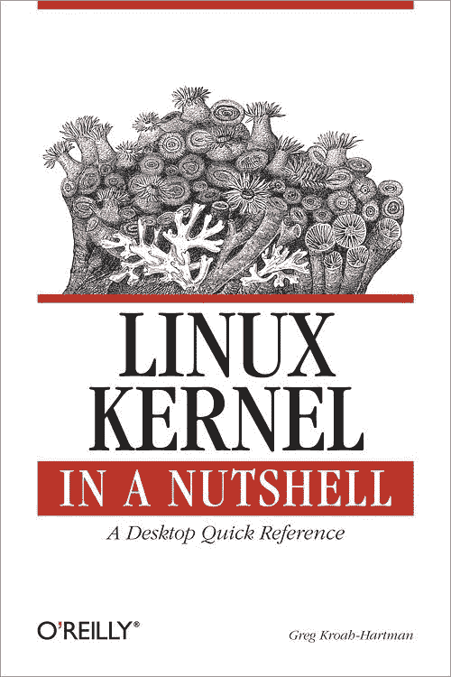
