# Linux 内核编程：字符、块、USB 及网络接口的内核架构与设备驱动开发


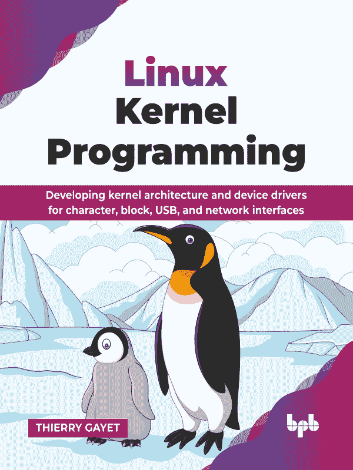


版权所有 © BPB Publications, India


# 责任限制与免责声明

本书中包含的信息在作者和出版者的所知范围内是真实且正确的。作者已尽一切努力确保这些出版物的准确性，但出版者对因书中的任何信息而导致的任何损失或损害不承担责任。


[www.bpbonline.com](https://www.bpbonline.com)

**献给**

我的妻子，Yuniati Gayet

我的孩子们，Angela Gayet 和 Luca Gayet

# 作者简介

THIERRY GAYET 目前在 TIXEO 公司担任高级开发人员，该公司开发了一种通过法国国家安全局认证的超安全视频会议系统。

他在 20 世纪 90 年代后期从 CNAM（曼芒大学）获得了计算机科学 DEST（研究生文凭），专攻人工智能。

他在 Linux 开发方面拥有 30 多以上的经验，并广泛探索了软件开发。他的专业知识还扩展到人工智能、网络安全和量子物理等领域。

他充满活力并致力于 Linux 和系统黑客（system hacking），参与维修咖啡馆（repair cafés），并继续设计基于嵌入式 Linux 或物联网的系统。

在 20 世纪 90 年代，互联网还没有像今天这样普及时，他创建一个 Linux 用户协会或小组，旨在帮助人们更好地理解和普及 Linux 的使用。

他曾在《Linux Magazine》和《Misc》杂志上发表过大量文章，还曾在各个主题领域进行过多次专业培训课程、会议和讲座。在这本书中，他分享了自己的知识和见解，帮助你更好地理解 Linux 内核并开发自己的驱动程序。

# 评审员

*   Austin Kim 在嵌入式 Linux 板支持包（BSP）开发方面拥有 14 年以上的经验。他处理过许多板级启动（board bring-up）、崩溃和性能故障排除以及基于 Arm 的设备的引导程序（bootloader）开发等任务。他在使用 TRACE32、Crash-Utility 和 ftrace 等工具进行反向工程和二进制调试方面具有强大的技能。

目前，Austin 在 LG 担任 Linux 内内核 BSP 工程师。他喜欢通过关于 Armv8-A、RISC-V 架构和内核崩溃调试的课程分享反向工程和调试的实用技能。

*   Martin Yanev 是一位成就卓越的软件工程师，在航空航天和医疗技术等多个行业拥有近十年的经验。在他辉煌的职业生涯中，Martin 在交通控制和色谱系统等关键领域的开发和集成尖端软件解决方案方面开辟了自己的天地。他作为菲奇堡州立大学（Fitchburg State University）受尊敬的导师和计算机科学教授，对 OpenAI API 全频谱有深入的理解，并在构建、训练和微调 AI 系统方面表现出精湛的造诣。作为一名广受认可的作者，Martin 分享了他的专业知识，帮助他人应对 AI 开发的复杂性。凭借他卓越的记录和多层面的技能组合，Martin 继续推动创新并驱动软件工程领域的变革性进展。

# 致谢

我对所有为本书完成做出贡献的人表示诚挚的感谢，特别是我的妻子 Yuniati，她鼓励了我，最后是我的孩子们，他们在整个写作过程中给予了帮助和支持。

我非常感谢 BPB Publications 在本书完成过程中提供的指导和专业知识。他们的支持和协助在应对复杂的出版过程中是无价之的。

我还要感谢评审员、技术专家和编辑，他们提供了宝贵的意见并帮助完善了这手手稿。他们的想法和建议显著提高了书的质量。最后，我想向对我们的小的书感兴趣的读者表示感谢。你们的支持和鼓励令不胜感激。

感谢每一位为本书的完成做出贡献的人。

# 前言

理解操作系统的基础可能相当复杂。本书承担了普及和探索 GNU/Linux 内核中实现的各种概念的挑战。

本书由 13 个深度章节组成，涵盖了理解该内核至关重要的广泛主题。

我们将从对该内核的历史和演变的简要介绍开始。然后，我们将逐块地查看内核结构本身，这将成为后续章节的基础。

第 4 章 将详细描述用于在 `sysfs` 中结构化文件并在内核内部（例如通过 `udev`）使用的设备模型。

第 5 章 将向我们介绍字符驱动的世界，为键盘、鼠标和许多其他设备开发驱动程序。第 6 章 将涵盖另一类驱动程序：用于本地或远程网络大规模存储的块驱动程序。此时，如果你愿意，你已经拥有开发自己的文件系统的工具。

第 7 章 将随后其后，描述如何为你的 USB 设备开发驱动程序。

第 8 章 将详细介绍与 `NetFilter` 相关的网络栈复杂性。随后是通过众多系统钩子保护 Linux 系统的 `LSM`。

剩余章节最后详细介绍与硬件相关的内存通信系统、进程管理和调试。

通过实例、详尽的解释和结构化的方法，本书旨在让读者对 GNU/Linux 内核有坚实的理解。无论你是新手还是资深用户，我希望这本书对于探索操作系统的基础非常有帮助，并帮助你通过开发自己的扩展或驱动程序来进一步开发它。

第 1 章：GNU/Linux 内核的历史- 本章提供了内核演变的历史概述、灵感以及带来这一著名内核的关键人物。

第 2 章：Linux 内核简介- 在提供历史概述后，第一部分将对内核架构进行详细介绍。这将成为书中后续章节的基础。

第 3 章：驱动程序简介- 在第二部分，我们将探索 Hello World 驱动程序的开发，并讨论各种编译技术、驱动间依赖管理以及模块的加载和卸载。

第 4 章：Linux 设备模型- 本章为驱动程序之间的各种注册和声明过程奠定了基础，这些过程将贯穿本书。

第 5 章：字符设备驱动程序- 本章涵盖了第一类字符驱动程序的开发。


## 第 6 章：块驱动程序与虚拟文件系统 (#ch06.xhtml)
- 这第二类型的块驱动用于管理 SATA 或网络驱动器。

## 第 7 章：USB 驱动程序与 libusb (#ch07.xhtml)
- 本章详细介绍了通过 USB 协议控制设备的驱动程序。

## 第 8 章：网络驱动程序 (#ch08.xhtml)
- 网络作为当今通信的核心，将通过网卡驱动程序的实现来进行讨论。书中还将介绍 `Netfilter` 架构的细节，用于进行流量过滤或构建你自己的防火墙。

## 第 9 章：Linux 安全模块 (#ch09.xhtml)
- 与所有操作系统一样，最高安全性至关重要。这就是美国国家安全局（NSA）在 2000 年底通过提出 `SELinux` 发起的，它提了系统级钩子允许精确的访问控制。本章将提供幕后的深度理解，并可能提供开发自己的 `LSM` 的机会。

## 第 10 章：内核内存与 DMA (#ch10.xhtml)
- 本章详细介绍了物理内存和虚拟内存管理模式。还将涵盖不经过 CPU 的直接或 `DMA` 访问，包括 `NUMA` 管理。

## 第 11 章：Linux 通信接口的导航 (#ch11.xhtml)
- 无论是嵌入式设备还是标准主板，都使用了不同的硬件通信协议（如 `I2C`）来管理外设。

## 第 12 章：进程管理 (#ch12.xhtml)
- 由于 `GNU/Linux` 内核是一个多任务、多用户系统，因此使用调度器来合理调度内核或用户空间中的各种任务。没有它，内核将是单任务的。

## 第 13 章：GNU/Linux 内核与驱动程序的调试 (#ch13.xhtml)
- 开发是一回事，但能够精细调驱动程序或内核的特定部分是另一回事。事实上，由于其相对复杂性，Linux 内核开发了一些相互补充的特定工具。读者将获得这些各种工具的简要概述。

# 代码包与彩色图片

请点击链接下载本书的 `Code Bundle`（代码包）和 `Coloured Images`（彩色图片）：

[`rebrand.ly/27joie2`](https://rebrand.ly/27joie2)

本书的代码包也托管在 GitHub 的 [`github.com/bpbpublications/Linux-Kernel-Programming`](https://github.com/bpbpublications/Linux-Kernel-Programming) 上。如果代码有更新，将在现有的 GitHub 仓库中更新。

我们从丰富的书籍和视频目录中提供了许多代码包，均可以在 [`https://github.com/bpbpublications`](https://github.com/bpbpublications) 获取。快去查看吧！

# 错误表

我们对 BPB Publications 的工作感到非常自豪，并遵循最佳实践以确保内容的准确性，为订阅者提供沉浸式的阅读体验。我们的读者是我们的镜子，我们利用他们的反馈来反映并改进出版过程中可能出现的人为错误。为了让我们保持质量并帮助我们联系任何可能因意外错误而遇到困难的读者，请通过以下邮箱联系我们：

**errata@bpbonline.com**

BPB Publications 全员感谢您的支持、建议和反馈。

# 加入我们书籍的 Discord 空间

加入书籍的 Discord 工作空间，获取最新更新、优惠、全球科技动态、新书发布以及与作者交流的机会：

**[`discord.bpbonline.com`](https://discord.bpbonline.com)**


# 第 1 章 GNU/Linux 内核的历史 (#contents.xhtml_ch01a)

## 引言

本章描述了 Linux 内核功能的起源和演变，以便不仅更好地理解内核是什么，还理解它在结构上是如何演进的。

## 结构

本章涵盖了以下主题：

* 灵感
* Linux 内核历史
* 各个功能随发布/里程碑的演变
* `GNU/Linux` 许可证

## 目标

本章是理解 Linux 从何而来、其历史以及为什么我们需要学习这个操作系统的重要序言。该系统的声部分归功于代码的开放性、健壮性和性能。在本章结束时，你将对 Linux 内核是什么有一个概览。Linux 的发明者 Linus Torvald 并不是从零开始发明一切，而是受到了当时存在的事物的启发，无论他是否拥有这些东西。因此，了解这些灵感对于深入理解是非常有用的。

## 灵感

20 世纪 60 年和 70 年代，Unix 是 AT&T 贝尔实验室开发的一种操作系统。它以模块化设计、稳定性和高效而闻名。Unix（通常大写为 `UNIX`，特别是在作为官方商标时）是贝尔实验室在 1969 年创建的一种交互式分时共享系统。

Unix 这个名字是一个双关语，结合了 `uniplexed`（意为单路或一次一个）和 `multics`（指代一个早期的操作系统项目）。Unix 的开发是作为 `Multics` 操作系统的继任者进行的。

Ken Thompson 和 Dennis Ritchie 被认为是 Unix 的发明者。

1974 年，Unix 成为第一个用 `C` 语言开发的操作系统。Linux 内核的创建者 Linus Torvald 在大学期间是 Unix 用户，并受到了 Unix 多用户、多任务和资源管理概念的启发（见图 1.1](#ch01.xhtml_fig1-1)）。下图向我们展示了 Unix 系统的同心模型：


### UNIX 系统的洋葱模型

Unix 通常被认为基于洋葱模型。

Unix 系统提出的模型是分层的，从硬件通过内核到达用户，内核控制硬件以及提供实用程序的软件。下图向我们展示了洋葱模型的垂直视图：


### Unix 系统的另一种分层视图

Unix 系统的架构视图与真实的 Linux 概述相似。

正如我们将探索的那样，Linux 发行版数不胜数，并且它们相互启发。Unix 系统也是如此，因为当我们谈论 Unix 系统时（对于那些用过它们的人来说），指的是 `IBM AIX`、`HP UX`、`Irix`、`Solaris`、`UnixWare`、`Ultrix`、`Microsoft Xenix`、`SCO Unix`、`Net/OpenBSD` 等。

所有这些系统都以自己的方式演变并为我们今天所知的现代系统做出了贡献。下图向我们展示了当时常见的无数 Unix 版本，现在它们很大程度上已被 Linux 系统所取代：


### Unix 系统的历史与依赖

1972 年 Unix 第二版中的许多命令在今天的 Linux 中仍在使用。

另一个灵感是 `Minix`（微型 Unix），这是一种教育性和实验性的操作系统，由 Andrew S. Tanenbaum（也称为 AST）于 1984 年创建，供学生剖析真实的操作系统。事实上，AT&T 曾禁止出于教育目的使用 Unix，并禁止将其用于教学。

MINIX 是用 `C` 编程语言编写的微内核，用于重新实现 `V7`。它是为 `IBM PC`（带有 256KB 内存、360KB 5.25 英软磁盘）设计的。它的结构比 UNIX 更模块化，从用户角度来看与它兼容，但在内核层面完全不同。


它的目标是提供一个学生可以理解的开源、简洁的设计：一个微内核，操作系统的其余部分都是用户进程，并通过同步消息传递进行通信。许多基础程序，如 `cat`、`grep`、`ls`、`make`……等等以及 `shell` 都存在，且功能与 UNIX 相同，而 UNIX MINIX 需要 20 MB 的硬盘分区。MINIX 没有 UNIX 效率高，因为它的设计目标是可读性。下图清晰地显示了控制器在用户空间且没有内核的定位，这在后续图中会被 Linux 视为一种低效的方法：

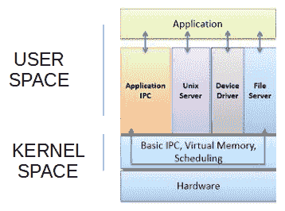

图 1.4：微内核架构

内核是操作系统的核心部分；它管理系统资源。它就像计算机应用程序和硬件之间的桥梁。在单体内核中，用户服务和内核服务都存在同一个地址空间内。

Linus Torvalds 曾在 Minix 上工作了一段时间，获得了操作系统系统设计方面的实践经验。然而，他发现 Minix 在性能和功能方面存在局限性，这促使他创建了自己的内核，并在几年后催生了 Linux 内核。初始版本在出现发热问题一个小时后就会崩溃。

我们不应该忘记让 Linux 内核变成今天模样的最新且最重要的灵感之一。这归功于现在的名称，即 GNU/Linux，它源于其所附的 `GPL` 权限。

GNU 是由 Richard Stallman 在 1983 年创建的自由操作系统（如图 1.5 所示），由 GNU 项目维护。GNU 涵盖了 UNIX 的概念和操作。该项目已经有一个名为 `HURD` 的内核，这是一个双关语，因为它的听起来像 herd（一群动物），代表了远离 Unix 单体内核模型的愿望。它与 Linux 进入了竞争，但后者盖过了它的光芒。


图 1.5：Richard Stallman，GNU 项目和自由软件基金会创始人

Linus Torvalds 使用了来自 GNU's Not Unix（GNU）项目的开发工具，这是由 Richard Stallman（也称为 RMS）于 1983 年发起的一项旨在创建完全自由且开源的操作系统的倡议。

尽管 Linux 不是 GNU 项目的一部分，但它已与 GNU 工具结合创建了一个完整的操作系统，因此有了 GNU/Linux 术语。GNU 工具在 Linux 的早期开发中起了至关重要的作用。

正如我们所看到的，Linux 的诞生并不是没有从当时的现有事物中获得灵感，但它的创建者 Linus Torvald 知道如何创建一个单体内核，取其者的优点并抛弃他者的缺点。因此，Linux 可以被认为是 70/80 年代就已被视为前卫和现代的概念的合体。与 Minix 不同，下图清晰地显示了内核地址空间中大部分控制器的移动：

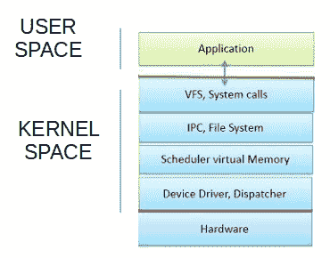

图 1.6：作为 Linux 演进后的单体内核架构

Linus Torvalds 受到开源和代码共享概念的影响。他选择在 GNU 通用许可证（`GPL`）下发布其内核源码，这鼓励了全球开发者的协作和贡献。

这些灵感导致了 Linux 内核的诞生，它的开发考虑了开源原则、模块化和效率。它建立在现有 UNIX 系统的最佳实践之上，同时引入了持续的创新和改进。

## Linux 内核历史](#contents.xhtml_sc2_5a)

曾经，有一个名为 Linux 的项目，它于 1991 年在赫尔辛基大学启动，是一个芬兰人 Linus Torvald 论文的个人项目，旨在创建一个新的单体自由操作系统内核。

他专门为他正在使用的硬件编写该程序，并且独立于任何操作系统，因为他想使用他配备了 `80386` 处理器的新 PC 的功能。开发是在 MINIX 上使用 GNU C 编译器进行的。

生成的 Linux 内核从 1991 年首次发布源码以来，在整个历史中一直保持稳步增长。它从最初禁止商业分发的少量许可 C 文件，增长到 2018 年 `GNUv2` 标签下的 `4.15` 版本，不包括注释在内的 2330 万行源码。

1991 年 4 月，当时 Linus Torvalds 是芬兰赫尔辛基大学的一名 21 岁计算机科学学生，开始为一种个人电脑的受 UNIX 启发的操作系统进行一些简单的构想。这一切始于一个 Intel `80386` 汇编语言任务切换器和终端驱动程序。

1991 年 7 月 3 日，为了在项目中实现 UNIX 系统调用，Linus Torvalds 尝试向 `comp.os.minix` 新闻组提交请求以获取 POSIX 标准文档的数字副本。然而，他未能找到这些文档，因此他首先求助于大学拥有的 `SunOS` 文档来确定系统调用，用于操作他的 Sun Microsystems 服务器。他还从 Tenenbaum 的 MINIX 文本中学习了一些系统调用，那是 Unix 课程的一部分。

1991 年 8 月 25 日，Torvalds 在 Usenet 新闻组 `comp.os.minix` 发布了以下内容。这里是 Linus Torvald 在该日期在论坛发布的内容：

```
所有正在使用 minix 的各位大家好 -

我正在做一个（免费的）操作系统 -

我一直在为 AT-386 计算机开发一个类 Minix 的免费版本。它终于达到了一个甚至可以使用的阶段（尽管取决于你的需求，可能并不适用），我愿意发布源代码以进行更广泛的分发。这仅仅是 0.02 版本……但我已经在上面成功运行了 bash、gcc、gnu-make、gnu-sed、compress 等。

[正如]我一个月前提到的那样，我一直在为 AT-386 计算机开发一个类 Minix 的免费版本。它终于达到了一个甚至可以使用的阶段（尽管取决于你的需求，可能并不适用），我愿意发布源代码以进行更广泛的分发。这仅仅是 0.02 版本……但我已经在上面成功运行了 bash、gcc、gnu-make、gnu-sed、compress 等。

我目前移植了 bash (1.08) 和 gcc (1.40)，一切似乎运行得良好。这意味着我将在几个月内就能得到一些实用的东西，我想知道人们想要什么功能。欢迎任何建议，但我不能保证实现它们。

而且是的——它没有任何任何 minix 代码，并且具有多线程文件系统。它是不可移植的（使用了 386 切换等），并且可能永远不支持其他硬件，因为那我仅有的。

—— Linus Torvalds
```

1991 年 9 月 17 日，Torvalds 发布了 Linux 0.01 版本并安装了 `ftp.funet.fi`——芬兰大学与研究网络（FUNET）的 FTP 服务器。它还无法执行，因为其代码需要 Minix 来编译和测试。

1991 年 10 月 5 日，Torvalds 发布了 Linux 的第一个正式版本 0.02。此时，Linux 能够运行 Bash、GCC 以及其他几个 GNU 工具：

```
正如我一个月前提到的那样，我一直在为 AT-386 计算机开发一个类 Minix 的免费版本。它终于达到了一个甚至可以使用的阶段（尽管取决于你的需求，可能并不适用），我愿意发布源代码以进行更广泛的分发。这仅仅是 0.02 版本……但我已经在上面成功运行了 bash、gcc、gnu-make、gnu-sed、compress 等。
```

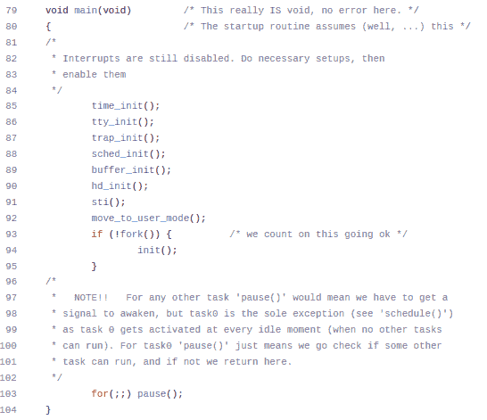

图 1.7：Linux 0.0.1 源码中的主函数

尽管早期版本功能有限，Linux 迅速赢得了开发者和用户的青睐。许多人为该项目贡献了代码，包括来自 MINIX 社区的一些开发者。

对于 0 版本，Linux 表示主要用于测试，而不是生产性使用。1991 年 12 月发布的 0.11 版本是第一个自托管的 Linux，因为可以在运行相同内核的计算机上进行编译。


根据 Torvald 的说法，在 Orest Zborowski 将 X Window 系统移植到 Linux 之后，Linux 在 1992 年开始流行，这使得 Linux 首次支持了图形用户界面（GUI）。此前 Linux 一直是一个可以在命令行使用的系统，就像当时的 MS-DOS 系统一样，而 X Windows 最终为 Linux 系统提供了图形化界面，这使其普及成为可能：

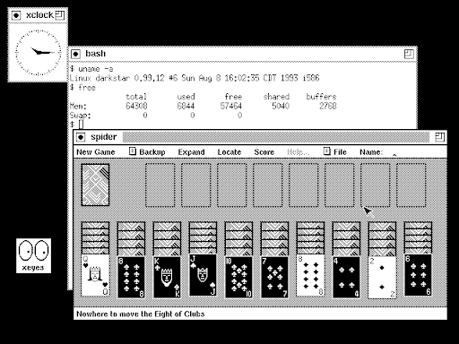

图 1.8：带有 Linux 内核 `0.99` 和 X Window 系统的早期 Slackware 版本

Linux 的冒险之旅自此开始，催生了不断增多的各种发行版。正如我们在 Unix 版本的年表中所看到的，这些发行版相互启发，共同呈现出我们今天所拥有的最佳成果。

Linux 现在出现在 *nix* 家族中最大的名字之列（如图 1.9 中绿色部分所示）：

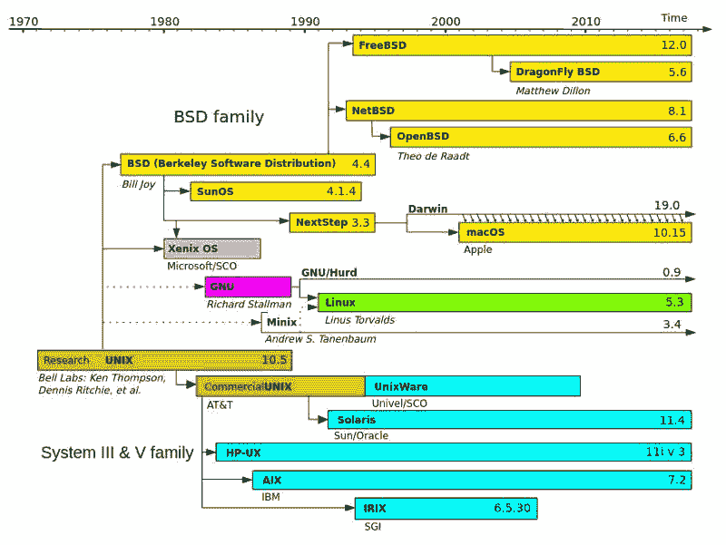

图 1.9：Unix 家族树

来源：[wikimedia.org](https://wikimedia.org)

我们今天能遇到的不同发行版之间也充满了冒险精神。有些曾有过辉煌时代，现在已不复存在；另一些如图所示持续至今：

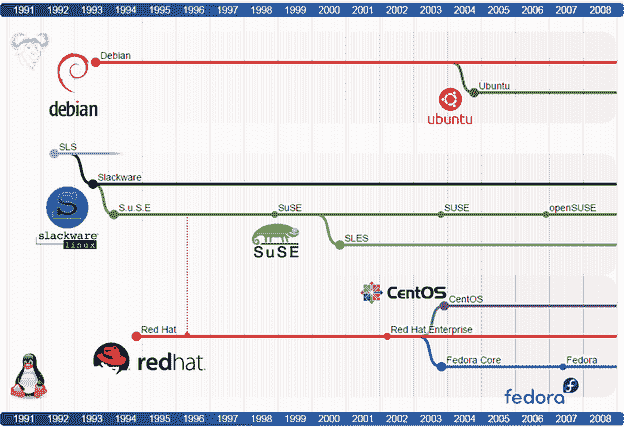

图 1.10：Linux 发行版

来源:[`futurist.se/gldt/`](http://futurist.se/gldt/)

## 各功能按发布/里程碑的演进](#contents.xhtml_sc2_6a)

记住 Linux 内核功能发展的不同阶段是非常重要的，因为这能让你了解它是如何随时间演变的。在接下来的章节中，我们将详细查看 Linux 内核经历的每个版本的重要点。

### 早期开发 (1991-1993](#contents.xhtml_sc3_7a)

显著进展包括：

* 1991：Linus Torvalds 宣布 Linux 项目。
* 1992：首次公开发 Linux `0.01`，仅支持 Intel `386` 处理器。
* 1993：在 `GNU GPL` 协议发布 Linux `0.99.1`，标志着该项目正式具有开源性质。

早期的 GNU/Linux 内核（如 Linux `0.01` 和 Linux `0.99`）与后后的版本相比非常简陋，功能有限。这些早期版本更像是概念验证版本，主要侧重于为基础操作系统提供基本功能。这些早期 Linux 内核版本的一些关键特性包括：

* 基础硬件支持：这些早期版本对 Intel `386` 处理器架构仅有原始的支持。重点是让内核能够在该硬件平台上运行。
* 多任务处理：Linux `0.01` 引入了基础的多任务处理能力，允许多个进程并发运行。
* 内存管理：这些早期版本包含了基础内存管理，例如分页和进程的内存分配。然而，这与后期版本中看到的先进内存管理有很大差距。
* 文件系统：实现了一个用于文件存储的简单文件系统，但缺乏后期版本中丰富的文件系统支持。
* Shell 和基础实用工具：Linux `0.01` 包含一个简单的 Shell 和几个与系统交互的基础级实用工具。
* 无网络：这些早期版本缺少网络支持。网络支持是在随后的发布中逐渐添加的。
* 无模块：这些早期版本中不存在允许动态内核扩展的“可加载内核模块”的概念。

早期 Linux 内核在功能和硬件支持方面非常有限。它们主要是 Linus Torvalds 作为一个爱好项目创建的，其简单性是刻意为之以保持开发的可控性。后期的 Linux 内核增加了许多功能，扩展了硬件支持并提升了性能，使 Linux 了一个多功能且强大的操作系统。

### 内核版本 1.0 (1994](#contents.xhtml_sc3_8a)

1994 年，Linux `1.0` 发布，标志着稳定和成熟。尽管它没有引入任何特定的革命性功能，但它标志着 Linux 内核开发的一个重要里程碑。

Linux `1.0` 经历了多次早期的发布和改进，等到版本 `1.0` 发布时，它已经达到了某种可靠性和健壮性，适用于更广泛的应用。它的稳定性和成熟对于赢得用户和更广泛软件社区的信任至关重要。

版本 `1.0` 的发布也标志着 Linux 是专有 Unix 类操作系统的可行且稳定的替代方案。它吸引了开发者、企业和组织的关注，促进了 Linux 生态系统的快速增长及其在各个领域的采用。

### 内核版本 2.0 (1996](#contents.xhtml_sc3_9a)

1996 年，Linux `2.0` 发布，引入了更好的硬件支持和改进的性能。这次发布标志着 Linux 在成为一个更健壮、多功能的操作系统迈出了关键一步。Linux `2.0` 的一些关键特性和进展包括：

* 增强的硬件支持：Linux `2.0` 增加了对广泛硬件平台和设备的支持，使其更容易适用于各种计算机系统。
* 对称多处理 (SMP)：引入了 `SMP` 支持，允许 Linux 运行在多处理器系统上。这一功能显著提高了具有多个 CPU 的机器上的系统可扩展性伸性能。
* 改进的网络：Linux `2.0` 包含了增强的网络能力，使其适用于服务器应用。集成了改进的 `TCP/IP` 栈、对更多设备的支持以及更好的网络性能。
* 更好的内存管理：内存管理子系统得到了增强，提供了更好的内存利用和性能。
* 虚拟文件系统 (VFS)：VFS 层的引入允许了更大的文件系统灵活性，并更容易集成各种类型，如 `ext2`、`NFS`。
* 扩展的文件系统支持：增加了对额外文件系统的支持，包括成为 Linux 默认文件系统的 `ext2`。
* 系统稳定性增加：Linux `2.0` 增加了系统的稳定可靠，使其适用于更广泛的生产环境。
* 改进的内核模块：引入了动态加载和卸载内核组件的模块。这允许在不需要重新编译的情况下扩展内核功能。
* 更广泛的软件兼容性：Linux `2.0` 改进的硬件支持和稳定性使其与更广泛的软件应用程序兼容，吸引了更多开发者和用户。

总的来说，Linux `2.0` 是 Linux 内核发展的一大步，扩展了其功能并使其成为服务器和桌面领域更成熟、更可靠的选择。这次发布为 Linux 操作系统的持续增长和流行奠定了基础。

### 内核版本 2.2 (1999](#contents.xhtml_sc3_10a)

1999 年，Linux `2.2` 发布，增强了稳定性、性能和硬件支持。该版本相对于其前身有了实质性的改进，使其更适用于广泛的应用。一些关键特性和进展包括：

* 稳定性与错误修复：Linux `2.2` 包含了大量的错误修复和稳定性改进，解决了早期版本中存在的问题。这贡献了一个更可靠、更健壮的操作系统。
* 增强的硬件支持：继续扩展硬件支持，包括对各种处理器、芯片组和外围设备的更好的兼容性。


- 改进的网络功能：对网络能力进行了进一步增强，包括支持更多网络设备和协议，并为网络 密集型应用程序提供了更优性能和可扩展性。
- 高级文件系统：引入了如日志文件系统（`ext3`）等可选功能，提高了在系统崩溃或断电时文件系统的健壮性和恢复能力。
- 内核抢占：引入了内核抢占支持，使系统行为更加灵敏，并提供了实时应用支持。
- USB 支持：对通用串行总线（`USB`）设备的初步支持为后续版本更广泛的 USB 支持奠定了基础。
- 改进的可扩展性：性能改进和优化使 Linux 能够更扩展地处理更大、更复杂的负载，使其适用于企业环境。
- PCMCIA 支持：对个人电脑内存卡国际协会（`PCMCIA`）设备提供了更好的支持，这些设备通常用于笔记本电脑和其他便携系统。
- 内存管理增强：对内存管理进行了进一步精炼，包括内存分配和利用的改进。
- 内核模块增强：持续开发内核模块系统，用于动态加载和卸载内核组件。

Linux 2.2 是一个关键的发布，巩固了 Linux 作为一个适用于广泛应用的稳定、高性能操作系统的声誉。其改进的硬件支持、提升性能以及更高的稳定性吸引了更多用户和开发者加入 Linux 生态系统。这次发布还作为 Linux 内核未来发展的跳板。

## 内核版本 2.4 (2001)

2001 年，Linux 2.4 发布，在内存管理和文件系统支持方面取得了重大改进。该版本引入了若干关键特性和改进，使 Linux 更加适用于各种应用程序。Linux 2.4 的一些关键特性包括：

- 高级内存管理：Linux 2.4 在内存管理方面带来了实质改进，包括对大量 RAM 更好的支持以及改进的虚拟内存处理。这些增强提升了 Linux 处理内存密集型任务的能力。
- 可扩展页表（高内存支持）：此版本引入了可扩展页表的概念（也称为高内存支持），这使得 Linux 能够在 32 位系统上访问超过 1 GB 的物理内存。
- 改进的 SMP 可扩展性：进一步增强对称多处理（`SMP`）支持，使 Linux 2.4 在多 CPU 系统上的可扩展性和效率更高。
- 增强的文件系统支持：引入了日志文件系统，包括 `ext3`，它在系统崩溃或断电后提供了更好的数据完整性和更快的文件系统恢复速度。`XFS` 和 `ReiserFS` 也作为可选文件系统得到了支持。
- 改进的网络栈：对网络栈进行了增强，包括支持更多数量的网络设备、更好的 `IPv6` 支持以及改进的网络性能。
- 防火墙与 IP 过滤：引入了 `Netfilter` 框架，允许实现强大的防火墙和 IP 数据包过滤功能，使管理员能够更有效地保护其系统。
- USB 支持：持续开发 `USB` 支持，使其更加健壮，并扩展了与更广泛 `USB` 设备的兼容性。
- 增强的驱动支持：增加了额外的设备驱动程序和硬件支持，使 Linux 兼容更广泛的硬件组件。
- 性能改进：整个内核中进行了大量的性能优化和效率改进，导致了更快的系统运行和响应时间。
- 内核抢占：进一步精炼了内核抢占，提供了更灵敏的行为和对实时及高性能计算应用的支持。

Linux 2.4 是一个重要的发布，巩固了 Linux 作为一个成熟且强大的操作系统的地位，特别是对于服务器和企业环境。其改进的内存管理、文件系统改进和网络改进为它在各种计算场景中的广泛采用做了贡献。

## 内核版本 2.6 (2003)

2003 年，Linux 2.6 发布，带来了重大的性能和资源管理增强。Linux 2.6 的主要特点是强调可扩展性、性能以及对各种硬件平台的改进支持。该版本的一些关键特性包括：

- 改进的可扩展性：Linux 2.6 包含了许多增强，以提高其在多处理器系统和大型服务器配置上的可扩展性。这些改进允许 Linux 能够高效地处理更多并发用户和进程。
- 新的 I/O 调度器：此版本引入了多个 I/O 调度器，包括完全公平调度器（`CFS`）和预判调度器（anticipatory scheduler）。这些调度器改进了磁盘 I/O 性能和响应速度。
- 增强的电源管理：Linux 2.6 对高级电源管理功能提供了更好的支持，使其更适用于笔记本电脑和移动设备。增强了高级配置与电源接口（`ACPI`）支持，实现了更好的电源管理。
- udev：`udev` 的引入简化了设备管理，并使得处理动态检测硬件设备变得更容易。
- 基于内核的异步 I/O：此特性允许在内核内部直接进行异步 I/O 操作，提高了 I/O 密集型应用程序的性能。
- 内核抢占：对内核抢占和实时支持的进一步改进使 Linux 2.6 更加灵敏，并适用于实时和高性能计算应用。
- 大文件支持：增加了对非常大文件的支持，满足了企业和科学计算的需求。
- 安全增强：引入了如安全增强型 Linux（`SELinux`）和基于能力的安全功能，增强了 Linux 系统的整体安全性。
- inotify：`inotify` 的引入提供了一种监控文件和目录变化的机制，使其对于文件同步和监控等各种应用非常有用。
- IPv6 改进：Linux 2.6 继续改进对 `IPv6` 的支持，反映了 `IPv6` 协议日益增长的重要性。
- 新文件系统：引入了新的文件系统，如 `JFS`、`XFS`，以及扩展 4（`ext4`）文件系统的引入，这为 Linux 文件系统栈的可扩展性、性能和健壮性带来了显著改进。
- 增强的网络：持续改进网络，包括更好的网络栈性能、服务质量（`QoS`）支持以及增强的协议支持。

总而言，Linux 2.6 是 Linux 内核发展的一大步，使其在从桌面到服务器以及嵌入式系统的各种计算环境中都更具适应性、可扩展性和以性能为导向。


## Linux 内核 3.0

* **版本号简化**：从 `2.x` 系列（例如 `Linux 2.6.x`）过渡到 `3.0` 版本的主要原因是简化版本编号系统。内核维护者决定增加主版本号，以反映内核的成熟和稳定，而不是引入重大的架构变化。在功能上，`Linux 3.0` 与 `Linux 2.6.x` 非常相似。
* **性和增量改进**：虽然主版本号发生了变化，`Linux 3.0` 继续在各个领域接收增量改进，包括性能增强、驱动程序更新和错误修复。这些改进提升了内核的整体稳定性和可靠性。
* **符号意义**：版本号的改变作为一种象征性的姿态，承认内核的成熟，以及它自 `Linux 1.0` 时代以来发生的重大演变。然而，这并不代表内核开发或架构的重大转变。
* **持续开发**：尽管版本号发生了变化，`Linux` 的开发仍如常进行，随后的发布（例如 `Linux 3.1`、`3.2` 等）以渐进和演化的方式引入了新功能和改进。

总之，`Linux 3.0` 主要是版本号的变化，以反映内核的成熟，而不是引入特定的革命性功能。它延续了 Linux 内核持续开发和完善的传统，在性能、硬件支持和整体稳定性方面不断改进。后续版本在此基础上引入了新功能和改进。

## 内核版本 4.0 (2015)

`Linux 4.0` 发布发布，侧重于性能和稳定性的改进。它于 2015 年发布，并非单一的革命性功能，而是一系列旨在提高整体性能、稳定性和硬件支持的增量改进、错误修复和优化。`Linux 4.0` 的一些显著特点包括：

* **内核模式设置 (KMS)**：虽然不是在 `4.0` 版本引入的，但该版本通过内核模式设置 (`KMS`) 的广泛采用标志着 Linux 图形的一个里程碑。`KMS` 改进了图形支持，包括更好的显示分辨率管理和增强的图形硬件支持。
* **改进的硬件支持**：`Linux 4.0` 继续扩大对新硬件组件的支持，包括对更多处理器、芯片组、显卡和外围的支持。
* **内核热补丁 (Kernel live patching)**：此版本引入了内核热补丁支持，允许将关键安全补丁应用到运行中的内核，而无需重启系统。这是系统可用性和安全性方面的重大进展。
* **Intel Skylake 架构支持**：对 Intel `Skylake` 微架构的增强支持，为使用 `Skylake` 处理器的系统提供了更好的兼容性和性能。
* **更快的文件系统挂载**：改进了文件系统挂载性能，特别是对于 `Btrfs` 和 `NFS` 等文件系统，导致更快的系统启动速度和整体响应速度。
* **改进的电源管理**：电源管理功能继续演进，提高了笔记本电脑和移动设备的能源效率。
* **新硬件驱动程序**：增加了新的硬件驱动程序，以更好地支持各种设备和外围。
* **性能优化**：整个内核代码库中进行了通用性能优化和增强。
* **安全补丁**：继续努力解决安全漏洞并提高系统安全性，包括缓解 `Spectre`（幽态漏洞）和 `Meltdown`（熔断漏洞）等漏洞。

需要注意的是，Linux 内核开发遵循增量方法，每个版本都建立在上一个版本的基础上。尽管 `Linux 4.0` 没有引入任何单一的大型功能，但它对 Linux 内核的整体稳定、性能和硬件兼容性做出了贡献，使其成为广泛计算环境的可靠选择。后续内核版本继续添加新功能和改进。

## 内核版本 5.0 (2021 年 9 月)

Linux 内核 `5` 引入了若干重要功能和改进。请注意，可能存在比我们提供的具有更多额外功能和改进的后续版本。以下是 `Linux 5` 内核的一些主要功能和改进：

* **更高的性能**：`Kernel 5` 引入了各种性能改进，包括降低延迟和更好的资源利用，使其对于桌面和服务器负载都更加高效。
* **改进的硬件支持**：`Kernel 5` 包含了对新硬件组件和平台的支持，例如 `AMD Navi` GPU、`Intel Icelake` CPU 和 `Raspberry Pi 4`。它还改进了对现有硬件的支持。
* **安全性增强**：内核持续接收安全增强以防止各种漏洞和威胁。这包括改进缓解 `Spectre` 和 `Meltdown` 漏洞。
* **I/O 改进**：引入了 I/O 优化（例如 `io_uring` 接口），改进了磁盘和网络 I/O 性能。
* **实时抢占**：实时抢占补丁合并到了主内核，使其更适合实时和低延迟应用。
* **文件系统更新**：`ext4` 文件系统收到了若干改进和优化。`Btrfs`、`XFS` 以及其他文件系统也收到了更新和错误修复。
* **图形和 GPU 支持**：`Linux kernel 5` 带来了对新 `AMD` 和 `Intel` GPU 的支持。同时，针对 `NVIDIA` GPU 的开源 `Nouveau` 驱动也有改进。
* **能源效率**：`Kernel 5` 包含了各种电源管理增强，以提高笔记本和其他设备的能源效率。
* **无线与网络**：对网络栈进行了改进，包括对新的无线芯片组的支持和增强的网络性能。
* **改进的硬件监控**：内核增加了对新传感器和硬件监控功能的支持，使系统管理员更容易监控和管理硬件。
* **安全性加固**：通过内核地址空间随机化 (`KASLR`) 等其他加固措施持续提升安全性。
* **新系统调用和 API**：`Kernel 5` 引入了新的系统调用和 API，允许开发者创建更复杂的应用程序。

## 内核版本 6.0 (2022 年 10 月)

2022 年 10 月 2 日，Linus Torvalds 发布了 `Linux 6.0`，这是一个包含许多更改的版本，特别是在提交数量方面。尽管他解释说主版本号的改变并不意味着基础性变化：

```
所以，正如大家可能清楚的那样，主版本号的改变更多是因为我的手指和脚趾用完了，而不是由于任何重大的基础变化。

但当然，里面确实有各种变化——我们总共有超过 1.5 万次非合并提交，因此 6.0 至少是长期以来最大的版本之一。
```
— Linus Torvalds


*   `ext4` 文件系统支持新的 `ioctl()` 操作：`EXT4_IOC_GETFSUUID` 和 `EXT4_IC_SETFSUUID`。
*   树莓派 V3D 内核驱动程序支持树莓派 4。
*   由于移除了限制跨 CPU 进程迁移的能量边界启发式算法，能量利用率得到了提高。

自 2022 年 12 月的内核 `6.1` 版本以来，它成为除 C 和汇编之外第一个被用于 Linux 内核开发的语言。

要了解有关 Linux 内核中添加的不同支持的更多细节，可以在该网站查看按提交总结：[`Kernelnewbies.org/LinuxChanges`](https://Kernelnewbies.org/LinuxChanges)。

## GNU/Linux 许可证

最初，Torvalds 发布 Linux 时采用的是一种禁止任何商业用途的许可证。

在 0.12 版本中，随着转向 GNU 通用公共许可证第 2 版 (`GPLv2`)，这一情况发生了变化。该许可证授权分发和销售可能经过修改或未修改的 Linux 版本，但要求所有此类副本必须在相同的许可证下发布，并附带（或根据请求以开放方式提供）完整的相应源代码。Torvalds 将在 `GPLv2` 下许可 Linux 描述为：“我所做过最棒的事情”。

Linux 内核明确仅根据 GNU 通用公共许可证第 2 版（`GPL-2.0 only`）进行许可，并附有显式的系统调用异常 (`linux-syscall-note`)，且未为被许可者提供后续版本的选择。贡献的代码必须在 GPL 兼容许可证下可用。

GNU 通用公共许可证第 2 版 (`GPL-2.0`) 是一种广泛使用的开源软件许可证，由自由软件基金会 (FSF) 开发。以下是其要点的简要总结：

*   **分发与修改**：`GPL-2.0` 允许任何人使用、修改和分发受该许可证保护的软件。你有自由修改代码以适应你的需求并分享这些修改。
*   **左版许可（Copyleft）**：`GPL-2.0` 是一种左版许可，这意味着如果你分发软件的修改版本，你必须按照相同的 `GPL-2.0` 条向其他人提供修改后的源代码。换句话说，它确保了软件及其衍生品保持开源。
*   **商业用途**：你可以将受 `GPL-2.0` 许可的软件用于商业目的。对于分发、支持或与软件相关的服务收费没有限制。
*   **归属**：当你分发 `GPL-2.0` 许可的软件或其衍生品时，你必须保留原始版权声明、免责声明以及 `GPL-2.0` 许可证本身的副本。
*   **兼容性**：`GPL-2.0` 与某些其他开源许可证不兼容，特别是那些具有更宽松条款的许可证。当你将受 `GPL-2.0` 许可的代码与不兼容许可证下的代码结合时，所产生的作品必须完全根据 `GPL-2.0` 的条款进行许可。
*   **无保证**：`GPL-2.0` 包含一份免责声明，说明软件是“按现状”提供的，不带任何保证。用户和分发者对对其使用相关的任何风险负责。
*   **终止**：如果你违反了 `GPL-2.0` 的条款，你使用和分发软件的权利可能会终止。但是，你可以通过遵守许可证来重新获得这些权利。

重要的是，`GPL-2.0` 是一份法律文件，其条款在法律上具有约束力。在该许可证下使用或分发软件的开发者和组织应该仔细阅读并理解其规定，以确保符合其要求。此外，`GPL-2.0` 在开源社区中被广泛使用，促进了自由和开源软件的增长。

关于 `GPLv2 only` 许可证的更多信息，你可以访问 [`spdx.org/licenses/GPL-2.0-only.html`](https://spdx.org/licenses/GPL-2.0-only.html)。

关于许可证可以多容易地更改以使用后来的 GPL 版本（包括第 3 版），以及这种更改是否必要，一直存在很大争议。Linus（注：此处应为 Linus 无误）Torvalds 本人在发布 `2.4.0` 版本时特别说明，他自己的代码仅在第 `2` 版下发布。然而，GPL 的条款规定，如果没有指定版本，则不能使用任何版本，Alan Cox 指出很少有其他 Linux 贡献者指定过特定的 GPL 版本。

2006 年 9 月，对 29 位关键内核程序员的一项调查显示，其中 28 人倾向于使用 `GPLv2` 而非当前的 `GPLv3`。Torvalds 评论道：“我认为一些局外人……认为我个人只是个奇怪的人，因为我没有公开成为 `GPLv3` 的粉丝。”这组包括 Torvalds、Greg Kroah-Hartman 和 Andrew Morton 在内的顶尖内核开发者在媒体上就对 `GPLv3` 的反对发表了评论。他们引用了关于 DRM/硬件化（tivoization）、专利、额外限制的条款，并警告说 `GPLv3` 会导致开源世界的碎片化。决定不为 Linux 内核采用 `GPLv3` 的 Linus Torvalds，在多年后仍然重申了他的批评。

## 结论

在第一章中，我们看到了 Linux 内核创建的历史背景，它能够借助 GNU 项目的工具成为一个完整的发行版。我们也看到了当时技术的影响，这些技术推动了开发，规避了限制并最终形成了我们现在所知的系统。

在下一章中，我们将详细介绍 系统的结构，特别是内核本身，这是我们的初始目标。

# 第 2 章 内核简介](#contents.xhtml_ch2a)

简介

本章将介绍 Linux 内核的内部结构，并引导我们通过首次获取源码、定义要构建的模块、构建内核，最后使用 QEMU 虚拟机进行运行。

结构

本章涵盖了以下主题：

* 准备工作环境
* 内核简介
* 下载 Linux 源码重新编译
* 从 kernel.org 下载官方压缩包
* 配置自定义内核和模块
* 构建自己的内核
* 安装
* 执行与启动序列
* 代码风格

目标

在本章结束时，你将理解 GNU/Linux 内核树的结构以及生成 Linux 内核的工作流，这将允许我们开始实际的驱动开发。

准备工作环境

为了与其余命令保持一致，书中提到的所有命令均在 Linux 发行版（Ubuntu 22.04.3 X86_64 LTS）上经过验证。然而，有时经过一些调整，整个过程可以无缝移植到所有 Linux 发行版。

因此，在本章剩余部分需要安装一些实用的包：

```bash
sudo apt install git build-essential curl qemu-system-gui qemu-system-utils qemu-system-x86 gnupg2 bison flex libncurses5-dev libglade2-dev libglade2-0 libgtk2.0-0 libgtk2.0-dev libglib2.0-0 libglib2.0-dev
```


本书侧重于 `GNU/Linux` 内核；我们将在整个章节中逐步对其进行检查。然而，我们需要一个 `Linux` 系统（用户空间部分通常称为 `rootfs`），这将允许我们全面地对内核进行验证。

为了实现这一目的，我们将使用嵌入式世界常用的 `Buildroot` 项目（[`buildroot.org`](https://buildroot.org)）生成一个 `ext2` 格式的存档。

以下是默认分支（`master/HEAD`）上的项目源码：

```bash
$ git clone --depth 1 https://git.busybox.net/buildroot/ && cd buildroot/
```

正在克隆到 'buildroot'...
remote: Enumerating objects: 17248, done.
remote: Counting objects: 100% (17248/17248), done.
remote: Compressing objects: 100% (16360/16360), done.
remote: Total 17248 (delta 888), reused 11876 (delta 446), pack-reused 0
Receiving objects: 100% (17248/17248), 7.96 MiB | 8.20 MiB/s, done.
Resolving deltas: 100% (888/888), done.

```bash
$ git branch
* master
```

```bash
$ git log
commit d797ecc6f026e1f0af17f91df33e8cd44731a97f (grafted, HEAD -> master, origin/master, origin/HEAD)
Author: Thomas Petazzoni <thomas.petazzoni@bootlin.com>
(…)
```

接下来，我们需要定义一个 `rootfs` 配置，这类似于构建的“身份卡”，它将指示包含哪些内容以及如何进行构建。我们可以注入以下配置。您定义了一个适用于 `x86_64` 架构的配置：

```bash
$ nano .config
## Select a target architecture (e.g., x86_64)
BR2_x86_64=y
## Set the system hostname
BR2_TARGET_GENERIC_HOSTNAME="bpb"
## Configure the root filesystem (initramfs)
BR2_TARGET_ROOTFS_INITRAMFS=y
## Skip the Linux kernel build (since you don't want to build a kernel)
BR2_LINUX_KERNEL=n
## select ext2 for the target image
BR2_TARGET_ROOTFS_EXT2=y
BR2_TARGET_ROOTFS_EXT2_2=y
BR2_TARGET_ROOTFS_EXT2_2r1=y
BR2_TARGET_ROOTFS_EXT2_GEN=2
BR2_TARGET_ROOTFS_EXT2_REV=1
BR2_TARGET_ROOTFS_EXT2_LABEL="rootfs"
BR2_TARGET_ROOTFS_EXT2_SIZE="250M"
BR2_TARGET_ROOTFS_EXT2_INODES=0
BR2_TARGET_ROOTFS_EXT2_INODE_SIZE=256
BR2_TARGET_ROOTFS_EXT2_RESBLKS=5
BR2_TARGET_ROOTFS_EXT2_MKFS_OPTIONS="-O ⁶⁴bit"
BR2_TARGET_ROOTFS_EXT2_NONE=y
```

在 `Buildroot` 中，`defconfig`（默认配置的缩写）指的是指定了构建嵌入式 `Linux` 系统根文件系统和交叉编译环境的默认设置和选项的文件。`defconfig` 文件包含一组配置参数，例如要包含哪些包、内核选项、目标架构设置等。

```bash
$ make defconfig
```

配置内容应该像这样：

```bash
$ cat .config | grep -v "#" | grep -v '^$'
(...)
BR2_HAVE_DOT_CONFIG=y
BR2_HOST_GCC_AT_LEAST_4_9=y
BR2_HOST_GCC_AT_LEAST_5=y
BR2_HOST_GCC_AT_LEAST_6=y
BR2_HOST_GCC_AT_LEAST_7=y
BR2_HOST_GCC_AT_LEAST_8=y
BR2_HOST_GCC_AT_LEAST_9=y
BR2_USE_MMU=y
BR2_i386=y
BR2_ARCH_HAS_TOOLCHAIN_BUILDROOT=y
BR2_ARCH="i686"
BR2_NORMALIZED_ARCH="i386"
BR2_ENDIAN="LITTLE"
BR2_GCC_TARGET_ARCH="i686"
BR2_BINFMT_SUPPORTS_SHARED=y
BR2_READELF_ARCH_NAME="Intel 80386"
BR2_x86_i686=y
(...)
```

如果您想通过添加更多工具来自定义最终的 `rootfs`，可以启动 `ncurse` 配置器：

```bash
$ make menuconfig
```

接下来是生成步骤。构建的估计时间取决于计算机的性能，但也取决于互联网连接的带宽。然而，在现代设备和光纤网络上，大约需要 30 分钟或更久：

```bash
$ time make
make 5540,18s user 583,48s system 308% cpu 33:07,71 total
```

最后，我们因此得到了几种格式的 `rootfs`：

```bash
$ ls -alh output/images
total 12M
drwxr-xr-x 2 tgayet 4K Jan 30 22 .
drwxr-xr-x 6 tgayet 4K Jan 30 22 ..
-rw-r--r-- 1 tgayet 60M Jan 30 22 rootfs.ext2
-rw-r--r-- 1 tgayet 4M Jan 30 22 rootfs.tar
```

仅需 60 兆的大小就能获得一个完整的 `Linux` 系统仍然是非常棒的，这解释了为什么 `Buildroot` 和 `Yocto` 构建被用于嵌入式世界。

文件系统层次结构标准（`FHS`）是一套规定目录结构和组织方式的指南和惯例。


下图展示了 GNU/Linux 内核的架构：

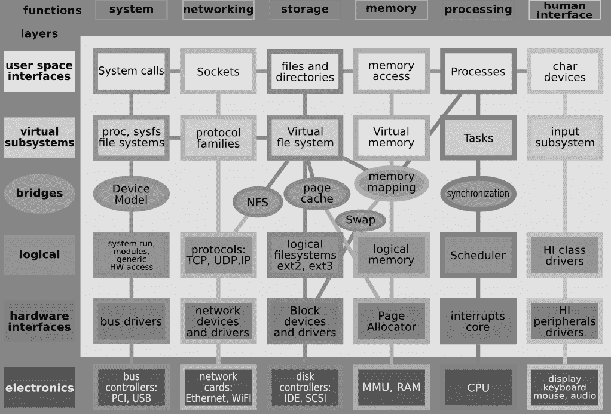

图 2.3：Linux 内核架构

以下是 GNU/Linux 内核的一些技术特性：

*   单体内核架构：
    *   Linux 内核遵循单体架构，整个操作系统内核作为一个单一的特权进程运行在内核空间中。
    *   `kernel space` 是内存中一部分受保护区域，用户态进程无法访问。
    *   同时计算多个进程，每个进程在 `SMP` 和 `NUMA` 上执行一个或多个线程。
*   单一地址空间：
    *   在单体内核中，所有内核组件共享一个单一的地址空间。
    *   这意味着内核模块和子系统可以直接调用对方的函数并访问对方的数据结构，而无需通过定义良好的 API。
*   高权限级别：
    *   内核代码运行在 CPU 的最高权限级别，通常称为 `kernel mode`（内核态态）。
    *   这允许内核执行敏感的特权操作，例如管理硬件资源和控制用户态进程的执行。
*   内核子系统：
    *   Linux 内核被组织成各种子系统，处理操作系统的不同方面，包括进程管理、内存管理、文件系统、网络、设备驱动等。
    *   每个子系统负责特定的功能，并包含其自己的数据结构和函数。
*   模块的动态加载：
    *   虽然核心内核是单体的，但 Linux 支持内核模块的动态加载和卸载。
    *   内核模块是内核对象，可以加载到运行的内核中以添加或扩展功能，而无需重新编译内核。
    *   模块允许更好的模块化，并能够支持广泛的硬件而不使内核镜像膨肿。
*   同步与并发：
    *   单体内核必须仔细管理并发和同步，因为所有内核代码都运行在单一地址空间中。
    *   使用 `locks`、`semaphores` 和 `spinlocks` 等技术来保护共享数据结构并确保线程安全。
*   广泛的设备支持：
    *   单体内核通常对各种硬件设备提供广泛的内置设备驱动支持。
    *   设备驱动是内核的一部分，可以直接与硬件交互，提供高效的访问。
*   高效的函数调用：
    *   由于内核函数位于同一个地址空间中，可以以最小的开销被直接调用。
    *   内核内部的函数调用类似于用户态程序中的普通函数调用。
*   内核恐慌（Kernel panic）：
    *   在发生严重错误或不可恢复的故障时，单体内核会触发 `kernel panic`，从而停止系统以防止进一步损坏。
    *   内核恐慌通常涉及生成用于调试的堆栈跟踪和诊断信息。
*   复杂性：
    *   由于包含了广泛的子系统和设备驱动，单体内核往往变得更加复杂。
    *   这种复杂性使得理解和维护内核代码库变得具有挑战性。
*   高性能：
    *   单体内核通常提供高性能，因为它们消除了微内核架构中与进程间通信 (`IPC`) 相关的开销。
    *   内核函数可以针对低层硬件访问进行优化。
*   尺寸与启动时间：
    *   由于包含了许多子系统和驱动程序，单体内核可能比微内核大。
    *   内核大小和启动时间会受启用功能和设备驱动数量的影响。

设备驱动运行在内核空间（在许多 CPU 架构中为 `ring 0`），拥有对硬件的完全特权访问。然而，某些模块被设计运行在用户态：例如基于 `FUSE/CUSE` 的文件系统模块，以及 `UIO` 的某些部分或带有 `libusb` 库的 USB 模块。Linux 的窗口系统和显示服务器协议 `X Window System` 和 `Wayland` 并不运行内核内核。

与标准的单体内核不同，设备驱动可以很容易地配置为模块并在系统运行时加载或卸载，并且在某些条件下可以抢占，以正确处理硬件中断并更好地支持对称多处理。因此，Linux 并没有稳定的设备驱动应用程序二进制接口（ABI）。

Linux 通常启用内存保护和虚拟内存，并还能处理非统一内存访问。`μClinux` 项目允许 Linux 在微控制器上运行，该项目不使用虚拟内存。

硬件在 `ramfs` 的文件层次结构中表示。因此，用户应用程序通过约定通过 `/dev` 或 `/sysfs` 目录中的项与设备驱动进行交互。进程信息也通过 `/procfs` 目录映射到文件系统。

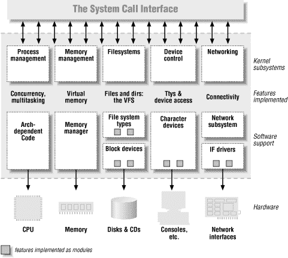

图 2.4：分层内核架构

这种模块化的视图以后对我们很有用，在配置部分我们必须记住这一点，这将允许我们选择内核的内容。

构建 Linux 内核的步骤如下：

1. 获取源码，如果是 tar 包，则验证归包的真实性。
2. 对构建进行配置，以确定要生成的静态部分和动态模块。
3. 编译内核和动态模块。
4. 安装。
5. 使用 `qemu` 配合预构建的根 fs (`rootfs.ext2`) 测试内核。

我们将逐一详细介绍所有这些步骤。

下载 GNU/Linux 内核源码进行重新编译

在本节中，我们将学习如何以不同的方式获取 GNU/Linux 内核源码。

使用发行版的包

修改当前内核配置的第一种解决方案是从 `/usr/src/` 目录下的独立包从已安装的源码开始。每个内核版本将有一个以 `linux-headers` 开头后跟其版本号的目录。对于给定版本，因此有几个包：内核运行时及其源码 (`linux-headers`)：

```
apt-cache search `uname -r`
linux-buildinfo-6.2.0-33-generic - Linux kernel buildinfo for version 6.2.0 on 64 bit x86
linux-cloud-tools-6.2.0-33-generic - Linux kernel cloud tools for version 6.2.0-33
linux-headers-6.2.0-33-generic - Linux kernel headers for version 6.2.0 on 64 bit x86
linux-image-6.2.0-33-generic - Signed kernel image generic
linux-image-unsigned-6.2.0-33-generic - Linux kernel image for version 6.2.0 on 64 bit x86
linux-modules-6.2.0-33-generic - Linux kernel modules for version 6.2.0 on 64 bit x86
linux-modules-extra-6.2.0-33-generic - Linux kernel extra modules for version 6.2.0 on 64 bit x86
linux-modules-ipu6-6.2.0-33-generic - Linux kernel ipu6 modules for version 6.2.0-33
linux-modules-ivsc-6.2.0-33-generic - Linux kernel ivsc modules for version 6.2.0-33
```

(...)确保你的代码被接收到主内核中。

这些规则对于我们从开始养成良好的习惯很重要。

一旦安装了源码包，它们将位于 `/usr/src/linux-headers-<version>` 目录：

```bash
ls -ald /usr/src/linux-headers*
drwxr-xr-x 7 root root 4,0K sept.� 5 13:41 /usr/src/linux-headers-6.2.0-32-generic
drwxr-xr-x 7 root root 4,0K sept. 19 13:26 /usr/src/linux-headers-6.2.0-33-generic
```

```bash
cd /usr/src/linux-headers-$(uname -r)
pwd
/usr/src/linux-headers-6.2.0-33
ls -alh
```


```
drwxr-xr-x 17 root root 4,0K sept. 19 14:11 ..
drwxr-xr-x 3 root root 4,0K sept. 19 13:26 arch
lrwxrwxrwx 1 root root 39 sept.  7 09:11 block -> ../linux-hwe-6.2-headers-6.2.0-33/block
lrwxrwxrwx 1 root root 39 sept.  7 09:11 certs -> ../linux-hwe-6.2-headers-6.2.0-33/certs
-rw-r--r-- 1 root root 0 sept.  7 09:11 .checked-atomic-arch-fallback.h
-rw-r--r-- 1 root root 0 sept.  7 09:11 .checked-atomic-instrumented.h
-rw-r--r-- 1 root root 0 sept.  7 09:11 .checked-atomic-long.h
-rw-r--r-- 1 root root 270K sept.  7 09:11 .config
lrwxrwxrwx 1 root root 40 sept.  7 09:11 crypto -> ../linux-hwe-6.2-headers-6.2.0-33/crypto
lrwxrwxrwx 1 root root 47 sept.  7 09:11 Documentation -> ../linux-hwe-6.2-headers-6.2.0-33/Documentation
lrwxrwxrwx 1 root root 41 sept.  7 09:11 drivers -> ../linux-hwe-6.2-headers-6.2.0-33/drivers
lrwxrwxrwx 1 root root 36 sept.  7 09:11 fs -> ../linux-hwe-6.2-headers-6.2.0-33/fs
-rw-r--r-- 1 root root 39 sept.  7 09:11 .gitignore
drwxr-xr-x 4 root root 4,0K sept. 19 13:26 include
lrwxrwxrwx 1 root root 38 sept.  7 09:11 init -> ../linux-hwe-6.2-headers-6.2.0-33/init
lrwxrwxrwx 1 root root 42 sept.  7 09:11 io_uring -> ../linux-hwe-6.2-headers-6.2.0-33/io_uring
lrwxrwxrwx 1 root root 37 sept.  7 09:11 ipc -> ../linux-hwe-6.2-headers-6.2.0-33/ipc
lrwxrwxrwx 1 root root 40 sept.  7 09:11 Kbuild -> ../linux-hwe-6.2-headers-6.2.0-33/Kbuild
lrwxrwxrwx 1 root root 41 sept.  7 09:11 Kconfig -> ../linux-hwe-6.2-headers-6.2.0-33/Kconfig
drwxr-xr-x 2 root root 4,0K sept. 19 13:26 kernel
lrwxrwxrwx 1 root root 37 sept.  7 09:11 lib -> ../linux-hwe-6.2-headers-6.2.0-33/lib
-rw-r--r-- 1 root root 71K sept.  7 09:11 Makefile
-rw-r--r-- 1 root root 1,3K sept.  7 09:11 .missing-syscalls.d
lrwxrwxrwx 1 root root 36 sept.  7 09:11 mm -> ../linux-hwe-6.2-headers-6.2.0-33/mm
-rw-r--r-- 1 root root 1,9M sept.  7 09:11 Module.symvers
lrwxrwxrwx 1 root root 37 sept.  7 09:11 net -> ../linux-hwe-6.2-headers-6.2.0-33/net
lrwxrwxrwx 1 root root 47 sept.  7 09:11 rust -> ../linux-hwe-6.2-lib-rust-6.2.0-33-generic/rust
lrwxrwxrwx 1 root root 41 sept.  7 09:11 samples -> ../linux-hwe-6.2-headers-6.2.0-33/samples
drwxr-xr-x 7 root root 12K sept. 19 13:26 scripts
lrwxrwxrwx 1 root root 42 sept.  7 09:11 security -> ../linux-hwe-6.2-headers-6.2.0-33/security
lrwxrwxrwx 1 root root 39 sept.  7 09:11 sound -> ../linux-hwe-6.2-headers-6.2.0-33/sound
drwxr-xr-x 4 root root 4,0K sept. 19 13:26 tools
lrwxrwxrwx 1 root root 40 sept.  7 09:11 tools -> ../linux-hwe-6.2-headers-6.2.0-33/tools
lrwxrwxrwx 1 root root 47 sept.  7 09:11 usr -> ../linux-hwe-6.2-headers-6.2.0-33/usr
lrwxrwxrwx 1 root root 38 sept.  7 09:11 virt -> ../linux-hwe-6.2-headers-6.2.0-33/virt
```

## 从 kernel.org 下载官方 tar 包

如果你想编译不同版本的内核，最简单的方法是从 `kernel.org` 网站获取指定版本的源码。该网站现在支持四种协议：`HTTPS`、`GIT` 和 `RSNC`。可以看到，当内核从主线分支移动到稳定分支时，会发生两种情况：

- **主线内核 (Mainline kernels)**：来自内核社区的最新发布版本。这些版本的生命周期较短，并很快会被新版本取代。
- **长期支持内核 (LTS kernels)**：某些内核被标记为 LTS，意味着它们有更长的支持周期。LTS 版本会根据具体的内核接收安全补丁和维护更新，通常持续 2 到 6 年。

注意 `XML` 和 `JSON` 文件会在每次发布新内核时更新：

- `XML`：`https://www.kernel.org/feeds/kdist.xml`
- `JSON`：`https://www.kernel.org/releases.json`

下载源码 tar 包可以使用 `curl` 命令：

```
curl -OL https://cdn.kernel.org/pub/linux/kernel/v6.x/linux-6.5.5.tar.xz
```
% Total % Received % Average Speed Time Current
Dload Upload Total Left
100 132M 100 132M 0 5208k 0:00:26 0:00:26 --:---- 3713k

下载 Linux 内核源码可能需要确认来源以确保追溯性。这在 DevSecOps 中非常有用；可以防止恶意代码。为此，来自 `kernel.org` 站的 tar 包关联了以下 GPG 指纹进行控制：

```bash
curl -OL https://cdn.kernel.org/pub/linux/kernel/v6.x/linux-6.5.tar.sign
```
% Total % Received % Average Speed Time Current
Dload Upload Total Left
100 987 100 987 0 3005 0 --:---- --::-- 3009

现在我们需要通过以下命令导入与 GNU/Linux 项目官方维护者相关的两个 `gpg` 公钥：

```
gpg2 --locate-keys torvalds@kernel.org gregkh@kernel.org
```
```
gpg: key 38DBBDC802693E: public key "Greg Kroah-Hartman <gregkh@kernel.org>" imported
gpg: Total number processed: 1
gpg: imported: 1
gpg: key 79BE3E4300411886: public key "Linus Torvalds <torvalds@kernel.org>" imported
gpg: Total number processed: 1
gpg: imported: 1
pub rsa4096 2011-09-23 [SC]
647F28654894E3BD457199BE38DBBDC609263E
uid [ unknown] Greg Kroah-Hartman <gregkh@kernel.org>
sub rsa4096 2011-09-23 [E]
pub rsa2048 2011-09-23 [SC]
```

至于内核本身的配置，位于两个位置：

- 第一在上述目录的 `.config` 文件：`/usr/src/linux-headers-$(uname -r)/.config`
- 第二在 `/boot` 目录中：

```
ls -alh /boot/config
```

现在，对比签名验证 `.tar` 存档：

```
gpg2 --verify linux-6.5.tar.sign linux-6.5.tar.xz
```

可以将这两个步骤合并为一条命令：

```
xz -cd linux-6.5.5.tar.xz | gpg2 --verify linux-6.5.tar.sign
```

你会观察到签名是在解压缩的版本上进行的，因此对于压缩的 `.gz` 和 `.xz` 版本只需要一个签名。

注意：存在允许你验证官方内核的脚本：[`https://git.kernel.org/pub/scm/linux/kernel/git/mricon/korg-helpers.git/tree/](https://git.kernel.org/pub/scm/linux/kernel/git/mricon/korg-helpers.git/tree/)

另一种备受开发者推崇的方法是从官方 `GIT` 仓库获取：

```
git clone git://git.kernel.org/pub/scm/linux/kernel/git/torvalds/linux.git
```
Cloning into 'linux'...
remote: enumerating objects: 9721192, done.
remote: counting objects: 100% (120/120), done.
remote: compressing objects: 100% (63/63), done.
remote: total 9721192 (delta 74), reused 75 (delta 57), pack-reused 9721072


接收对象: 100% (9721192/9721192), 2.69 GiB | 16.76 MiB/s, 完成。

解析增量: 100% (7970513/7970513), 完成。

更新文件: 100% (81757/81757), 完成。

查找可用标签的列表：

```bash
$ git tag --list
```

(…)

v6.5
v6.5-rc1
v6.5-rc2
v6.5-rc3
v6.5-rc4
v6.5-rc5
v6.5-rc6
v6.5-rc7
v6.6-rc1
v6.6-rc2
v6.6-rc3
(...)

我们可以查找与我们的 Ubuntu Linux 发行版最接近的标签，即 6.2.0-33-generic，它对应 v6.2 版本：

```bash
$ git tag --list |grep 6.2
```

在 `linux_6.2` 分支从 v6.2 标签切换到特定的发布/标签：

```bash
$ git checkout -b linux_6.2 v6.2
```

我们准备好进入 Linux 内核配置步骤。

## 配置自定义内核和模块

配置步骤的目的是定义 GNU/Linux 内核特征的标识映射。这将允许许多功能静态地集成在单体内核中（静态部分），或集成在动态模块中（动态部分）。

配置器的目的是生成一个 `.config` 文件，该文件将汇总所有要激活的功能。`.config` 文件就像是构建的身份证。

通过向主 Makefile 传递特定的目标名称来调用配置器。该配置模块与许多其他项目（如 `Buillroot`、`Ptxdist`、`crosstool-ng` 等）使用的完全相同。它由 Yann Morin 在几年前重新开发的。

存在多种不同类型的配置器：

- `config`: 使用文本接口更新配置
- `nconfig`: 使用 ncurse 接口更新配置（轻量黑白版本）
- `menuconfig`: 使用 ncurse 接口更新配置（彩色版本）
- `xconfig`: 使用 QT 接口更新配置
- `gconfig`: 使用 GTK 接口更新配置
- `oldconfig`: 使用内核源码中存在的 `.config` 文件更新配置
- `localmodconfig`: 通过禁用未加载的动态模块更新当前配置
- `localyesconfig`: 通过将动态模块集成到内核的静态部分更新配置
- `silentoldconfig`: 与 oldconfig 相同，但静默更新依赖
- `defconfig`: 更新配置，对给定架构采用默认设置
- `savedefconfig`: 将当前配置保存为 `config`。默认最小化
- `allnoconfig`: 创建新配置，所有选项都设置为 no
- `allyesconfig`: 创建新配置，所有选项都设置为 yes
- `allmodconfig`: 创建新配置，所有选项都为模块
- `alldefconfig`: 创建新配置，将所有请求的选项都设置为其默认值
- `randconfig`: 通过随机响应启用选项来定义新配置
- `listnewconfig`: 列出新选项
- `olddefconfig`: 与 silentoldconfig 相同，但将新符号设置为其默认值

下图包含不同类型配置器的某些截图：

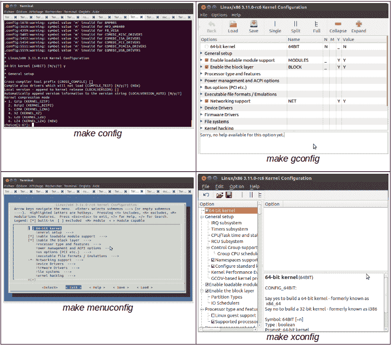

图 2.6：配置器的若干截图

GNU/Linux 内核的配置是根据您的特定需求自定义内核行为和特征的关键步骤。

每个菜单最多可以有三种状态：在内核静态部分中选择（`y`）、作为动态模块被选择（`m`）以及未选择。

下图给出了使用 QT 配置器的示例：

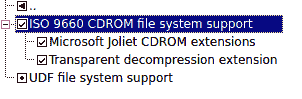

图 2.7：QT 配置器视图

带有依赖管理的特征管理激活描述。。每个激活项都可以包含在内核本身的静态部分中，或者在可能的情况下单独包含在动态加载的模块中：

- `ISO9660 CDROM 文件系统支持`: 将包含在独立内核的动态 `.ko` 模块中；如果选择了此配置，将启用两个子依赖。
- `UDF 文件系统支持`: 将包含在 Linux 内核的静态部分中。

生成的配置文件最终每个功能有一行遵循以下规则：

- 任何以数字开头并以 `is not set` 结尾的行将不忽略。
- 任何以 `=m` 结尾的行将生成一个动态模块。
- 任何以 `=y` 结尾的行将功能包含在内核的静态部分中。

提取 `.config` 文件：

(…)

## CD-ROM/DVD 文件系统

```text
#CONFIG_ISO9660_FS=m
CONFIG_JOLIET=y
CONFIG_ZISOFS=y
CONFIG_UDF_FS=y
CONFIG_UDF_NLS=y
```

## DOS/FAT/NT 文件系统

```text
## CONFIG_MSDOS_FS is not set
#CONFIG_VFAT_FS is not set
CONFIG_NTFS_FS=m
## CONFIG_NTFS_DEBUG is not set
CONFIG_NTFS_RW=y
```

(…)

内核配置包含一个选项之间的依赖系统。例如，启用网络驱动程序会激活网络栈。有两种类型的依赖：

- `依赖项`: 选项 `A`。
- `依赖选择`: 激活 `A` 后，自动选择 `B`。

内核配置通常使用 `menuconfig`、`nconfig` 或 `xconfig` 等工具进行，这些工具为修改选项提供了友好的界面。

以下是自定义内核时可以配置的几个关键主题：

- `代码成熟度`: 允许隐藏或显示仍在开发中的选项（如果想从最新特性中选 yes）。
- `通用设置`: 系统的一组通用选项（除非你想为特定架构编译），如下：
    - 内核版本和标识
    - 内核架构（例如，32 位或 64 位）
    - 内核压缩方法
    - 内核命令行
    - 内核定时器频率
    - 内核抢占模型
- `块层`: 主板上的输入/输出（对于板可以移除）。
- `可加载模块支持`: 关于模块管理的选项（默认情况下通常是正确的）
    - 启用或禁用运行时加载内核模块
    - 配置模块版本和符号信息
- `处理器类型和特性`: 与处理器相关的选项：类型（x86, Sparc, ...）、超线程、双核、SMP 等。
    - 处理器家族和微架构优化
    - 支持对称多处理 (SMP)
    - CPU 频率缩放（例如 CPU 调度器）
    - 虚拟化选项（例如 KVM、Xen、VirtualBox）
- `电源管理与 ACPI`: 关于节电、待机和 ACPI/APM 的选项
    - CPU 空闲状态和节能功能
    - 高级配置电源接口 (ACPI) 支持
    - ACPI 睡眠状态（例如挂起到内存）
- `总线选项 (PCI, USB, I2C 等)`: 管理所有可以插卡的地方（PCI, PCMCIA, ISA 等）
    - 配置各种总线类型和控制器的支持
    - 启用或禁用特定的设备驱动和控制器支持
- `设备驱动`: 关于所有硬件驱动程序的选项（这通常是我们花费最多时间的地方）
    - 配置各种硬件设备和外围的支持


## 硬件与支持
- 启用或禁用特定网卡、存储设备、声卡、显卡等的支持
- 对文件系统的支持（例如 `ext4`、`NTFS`、`CIFS`）
- 输入设备（例如键盘、鼠标、触控板）
- 存储驱动（例如 `SATA`、`NVMe`、`SCSI`）
- 网络选项（例如 `Ethernet`、`Wi-Fi`、`Bluetooth`）
- USB 支持和设备驱动

## 内核功能与选项

### 可执行文件格式
可执行文件的管理（`ELF` 支持必须始终为 `Y`）

### 文件系统
关于由内核管理的的文件系统的选项（你将需要查看）
- 启用对各种文件系统的支持（例如 `ext4`、`Btrfs`、`XFS`）
- 网络文件系统（例如 `NFS`、`CIFS`）
- 磁盘配额支持
- 文件系统相关选项（例如扩展属性、文件锁定）

### 内核功能
- 实时支持（`PREEMPT-RT`）
- 任务调度器选项（例如完全公平调度器、轮询调度）
- POSIX 兼容性选项
- 内核调试与跟踪（例如 `kprobes`、`ftrace`、`perf`）
- 安全选项（例如 `SELinux`、`AppArmor`、`seccomp`）

### 网络支持
关于由内核管理的网络协议的选项（默认设置通常足够，但以万一请查看）
- 网络协议和选项（例如 `IPv4`、`IPv6`、`TCP`、`UDP`）
- 网络栈选项（例如 `QoS`、`IPsec`、`netfilter/iptables`）
- 虚拟网络（例如 `TUN/TAP` 支持）
  - 数据包过滤和路由选项

###get 支持
内核分析选项（无需启用）。

### 安全选项
关于内核安全模型的选项（默认设置足够）
- 强制访问控制 (MAC) 框架（例如 `SELinux`、`Smack`）
- 安全计算模式（`seccomp`）
- 内核加固选项 [例如地址空间布局随机化 (`ASLR)`)]
- 加密选项（例如 `cryptographic API`、加密算法）

### 加密选项
可以在内核中实现的加密算法（默认设置足够）

### 库例
常用内核库（默认设置足够）
- PeKernel 性能计数器（例如 `perf_events`）
- 分析支持（例如 `OProfile`、`perf`）
- 硬件性能监控 [例如 Intel 性能监控单元 (`PMU`)]

## 内核文档
启用或禁用内核文档（对内核开发有用）

这些只是你可以在 Linux 内核中配置的一些关键主题。具体的选项及其可用性可能会取决于内核版本和你的硬件。在配置内核时，必须仔细考虑你的系统需求和限制，以创建一个满足你的需求同时尽可能减少不必要功能的定制化内核。

与软件包版本（`.deb`、`.rpm` 等）不同，来自 `kernel.org` 的 tar 包源码并不原生地提供默认配置。在 Linux 发行版上，必须恢复当前的内核配置文件。

## 配置过程

首先，需要使用 `uname` 命令检查当前的内核版本：

```
uname -a
```
Linux tgayet-DS87D 6.2.0-33-generic #33~22.04.1-Ubuntu SMP PREEMPT_DYNAMIC Thu Sep 7 10:33:52 UTC 2 x86_64 x86_64 x86_64 GNU/Linux

要从特定发行版封装的内核配置开始，必须将 `.config` 配置文件拷贝到 Linux 内核源码的根目录或从 `/boot` 目录：

```bash
cp /boot/config-`uname -r`* .config
```

或者，

```bash
cp /usr/src/linux-headers-$(uname -r)/.config .config
```

为了使此 `.config` 文件生效，你需要使用 `oldconfig` 目标或 `alldefconfig`：

```bash
make oldconfig
```

注意，如果当前内核是用伪文件系统 `/proc/config.gz` 编译的，则可以从当前内核配置热生成此文件：

```bash
zcat /proc/config.gz > .config
```

要实现这一点，内核必须使用以下配置编译：
```ini
CONFIG_IKCONFIG=y
CONFIG_IKCONFIG_PROC=y
```

然后通过内核中的以下菜单激活：
```
General setup --->[*] Kernel .config support[*] Enable access to .config through /proc/config.gz
```

一旦配置阶段完成，源码根目录下应该位于一个 `.config` 文件。需要注意的是，此功能在当前的内核中正越来越少被激活。

在开始生成阶段之前，识别内核可能会很有用。位于 Makefile 开头的变量集被用于此：

```makefile
VERSION = 6
PATCHLEVEL = 2
SUBLEVEL = 0
EXTRAVERSION = -bpb
NAME = Kernel linux for bpb book
```

另一种添加额外版本的方法是在 `.config` 文件中添加 `CONFIG_LOCALVERSION`。它必须以连字符开头，以便在版本号和定义的额外字符串之间进行转换：
```ini
CONFIG_LOCALVERSION = -custom
```
例如，如果你添加了 `-custom` 作为额外版本标签，内核版本看起来可能像 `5.2.0-custom`。

## 构建内核

一旦内核配置完成，我们需要构建它。

### 表 2.1：构建你的内核所需的工具

| 软件 | 最小版本 | 检查命令 |
| :--- | :--- | :--- |
| Gnu C | 2.95 | `gcc` |
| Gnu make | 3.7 | `make` |
| binutils | 2.12 | `ld` |
| util-linux | 2.10 | `depmod` |
| module-init-tools | 0.9 | `dep` |
| e2sprogs | 2.2 | `tune2fs` |
| jfsutils | 1.3 | `fsck` |
| reiserprogs | 3.6 | `refsck` |
| xfsprogs | 2.1 | `xfs_db` |
| pcmcia-cs | 3.21 | `cardmgr` |
| quota-tools | 3.0 | `quota` |
| PPP | 2.4 | `pppd` |
| isdn-utils | 3.1 | `isdnctrl` |
| nfs-utils | 1.0 | `showmount` |
| procps | 3.13 | `ps` |
| oprofile | 0.5 | `oprofiled` |

### 从源码生成 GNU/Linux

一旦内核配置完成，我们需要构建它。

内核的生成分两个步骤进行：
1. 静态部分（未压缩的 `vmlinux` 等）
2. 动态部分/模块（*.ko`）

现在，让我们逐步通过每个步骤，从获取配置、编译到最后安装。

注意：基础目标是由 `scripts` 定义的。

```bash
make scripts
HOSTCC scripts/genyms/genyms.o
YACC scripts/genyms/parse.tab.[ch]
HOSTCC scripts/genyms/parse.tab.o
LEX scripts/genyms/lex.lex.c
HOSTCC scripts/genyms/lex.lex.o
HOSTLD scripts/genyms/genyms
HOSTCC scripts/selinux/genheaders/genheaders
HOSTCC scripts/selinux/mdp/mdp
HOSTCC scripts/kallsyms
HOSTCC scripts/sorttable
HOSTCC scripts/asn1_compiler
HOSTCC scripts/sign-file
HOSTCC scripts/insert-sys-cert
```


如果编译源码的机器具有多个处理器或核心，则可以使用 `j / --jobs` 和 `-l / --load-average` 参数来实现生成并行化。`-j` 选项设置了 Makefile 可以执行的最大并行任务数，而 `-l` 选项则在负载低于指定配额时防止启动任何新的并行任务。将任务数设置得比处理器数量高的原因是为了确保处理器使用率达到饱和。

要确定可以进行多少并行处理，可以很容易进行如下简单的计算：

```bash
export NBCORE=$(($(grep -c processor /proc/cpuinfo)+1))
```

或者，

```bash
export NBCORE=$(($(cat /proc/cpuinfo|grep processor|wc -l)+1))
```

对于英特尔酷睿 I7，得到的结果是 9；对于英特尔酷睿 I3，得到的结果是 5。为了让生成过程能够优化地适应编译 Linux 内核源码的机器，可以使用以下命令：

```bash
export NBCORE=$(($(cat /proc/cpuinfo | grep processor | wc -l)+1))
make –jobs=$((NBCORE+1)) –load-average=${NBCORE}
```

此外，请注意即使你不在源码目录中也可以启动生成过程。事实上，与任何 GNU Makefile 一样，`-C` 参数允许你指定 Makefile 所在的源码路径：

```bash
make -j 9 -C=~/linux_src/
```

构建会生成几个主文件：

*   `./vmlinux`: 用于调试的未压缩 Linux 内核
*   `./System.map`: 静态部分包含的符号表
*   `./arch/<ARCH>/boot/bzImage`: 压缩后的 Linux 内核

压缩内核名称是 ELF `vmlinux` 文件，可以用于调试或性能分析。这很少是加载到内存的文件，因为我们更倾向于名为 `bzImage` 的压缩版本：

```bash
file vmlinux
```

```text
vmlinux: ELF 64-bit LSB executable, x86-64, version 1 (SYSV), statically linked, BuildID[sha1]=faed1aa89d99a80ea62b816311a4b55cc49b866, not stripped
```

```bash
file arch/x86/boot/bzImage
```

```text
arch/x86/boot/bzImage: Linux kernel x86 boot executable bzImage, version 6.2.0-bpb-dirty (tgayet@tgayet-DS87D) #1 SMP PREEMPT_DYNAMIC Sun Oct 1 20:21:24 CEST 2023, RO-rootFS, swap_dev 0XB, Normal VGA
```

| 注意：i386 架构重定向到 x86： |

| `arch/i386/boot/bzImage`: 指向 `../../x86/boot/bzImage` 的符号链接 |

一旦构建完成，我们迫不及待地想要使用 `qemu` 和本章开头生成的 rootfs 来测试刚刚构建的内核了：

```bash
qemu-system-x86_64 -kernel ./arch/x86/boot/bzImage -hda ./rootfs.ext2 -nographic -append root="/dev/sda console=ttyS0" -net nic,macaddr=00:11:22:33:44:55 -net user
```

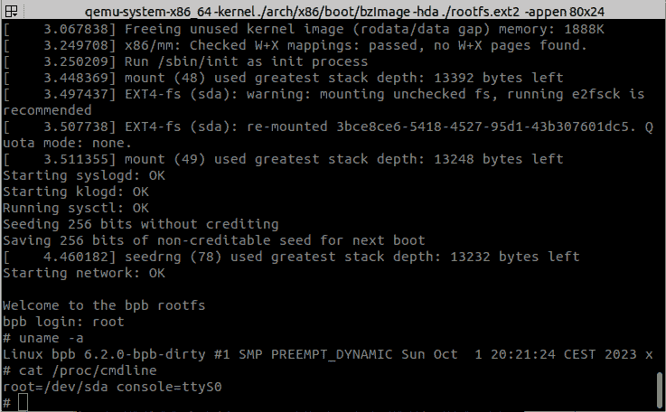

图 2.8：新构建内核的测试

我们既可以通过 `EXTRAVERSION` 提供的后缀来确认这是我们的内核，也可以通过查看传递给内核的参数（通过 `/proc/cmdline` 访问）来确认。

在 Linux 内核的上下文中，`dirty`（脏）一词并不是内核代码或数据的整洁状态。相反，它有一个与内存管理和缓存相关的特定技术含义。

在 Linux 内核中，`dirty` 状态用于表示内存页（通常是 RAM 中的一页）自上次从存储器（例如从磁盘）读取以来已被修改。当内存中的数据被修改时，它会被标记为 `dirty`，表示它不再与存储在磁盘上的数据保持一致。这一信息对于以下几个原因非常重要：

*   **写效率**：内核可以通过只写回标记为 `dirty` 的页来优化对存储器的写入。这有助于减少写入操作并提高整体 I/O 性能。
*   **缓存**：内核可以将频繁访问的数据保留在内存中（缓存）以便更快速访问。当这些缓存数据被修改时，它们会被标记为 `dirty`，内核最终会将其写回存储器以确保数据一致性。
*   **数据完整性**：跟踪 `dirty` 页对于数据完整性至关重要。它确保了内存中数据的更改最终会持久化到存储器中，以便在系统崩溃或断电的情况下，系统可以恢复而不丢失关键数据。

`dirty` 一词在计算机科学和操作系统中被常用，用于描述这种需要与非易失性存储器同步的修改数据概念。它本质上是一个标志，指示内存中的某些数据需要写回磁盘以维护数据一致性。

相比之下，`clean`（洁）页是指自从存储器读取以来未被修改且与磁盘上的对应项同步的页。内核的内存管理系统跟踪这些状态，以便高效地管理数据并确保数据完整性。

## 为 Ubuntu/Debian 生成 DEB 包

为 Ubuntu 构建 DEB 包涉及多个步骤，包括配置内核、编译以及创建包。

1.  在开始之前，确保你安装了依赖项：
    `sudo apt-get install build-essential ncurses5-dev bison flex`
2.  获取内核源码。例如，下载 Ubuntu 的内核源码：
    `sudo apt-get source $(uname -r)`
3.  进入源码目录：
    `cd linux-$(uname -r)`
4.  文本界面配置：
    `make menuconfig`
5.  图形化界面配置：
    `make xconfig`
6.  根据需要配置内核，包括任何自定义功能。使用以下命令构建 Debian 包：
    `fakeroot make-kpkg --initrd --append-to-`
7.  成功构建内核包后，可以安装：
    `sudo dpkg -i ../linux-image-<custom_version>_amd64.deb`
8.  你可能还需要安装对应的内核头：
    `sudo dpkg -i ../linux-headers-<custom_version>_amd64.deb`
9.  更新引导程序以识别新内核：
    `sudo update-grub`
10. 重启系统以加载新内核：
    `sudo reboot`
11. 重启后，你可以验证新内核是否生效：
    `uname -r`

## 为 Fedora Core/Red Hat/SUSE 构建 RPM

为 Fedora Core、Red Hat 或 SUSE 构建内核通常涉及创建一个自定义的 Red Hat 包管理器 (RPM) 包。这些发行版都有自己的打包和构建过程，以下是每个发行版的概述：

### Fedora Core/Red Hat

1.  确保安装了必要的开发工具：
    `sudo dnf install rpm-build redhat-rpm-config gcc make`
2.  从 Fedora 或 Red Hat 仓库下载内核源码。你可以使用 `dnf` 或 `yum` 工具：
    `sudo dnf download --source kernel`
3.  设置 RPM 构建环境：
    `rpmdev-setuptree`
4.  将下载的内核源码 RPM 复制到 `SOURCES` 目录：
    `cp kernel*.src.rpm ~/rpmbuild/SOURCES/`
5.  提取源码 RPM：
    `rpm -i ~/rpmbuild/SOURCES/kernel*.src.rpm`
6.  根据需要配置内核：
    `cd ~/rpmbuild/SPECS`
    `rpmbuild -bp kernel.spec`
7.  构建内核 RPM 包：
    `rpmbuild -bb kernel.spec`


### 8. 安装生成的 RPM 包：

```bash
sudo dnf install ~/rpmbuild/RPMS/<architecture>/kernel-*.rpm
```

### 9. 更新 GRUB 配置并重启系统以加载新内核：

```bash
sudo grub2-mkconfig -o /boot/grub2/grub.cfg # 用于 GRUB2
sudo reboot
```

按照以下步骤为 SUSE Linux 生成 RPM 包：

1.  确保你已经安装了必要的开发工具：
```bash
sudo zypper install rpm-build gcc make
```

2.  从 SUSE 官方存储库下载内核源码。

3.  设置 RPM 构建环境：
```bash
rpmdev-setuptree
```
这将创建 `rpmbuild` 目录结构。

4.  将下载的内核源码 RPM 复制到 `SOURCES` 目录：
```bash
cp kernel*.src.rpm ~/rpmbuild/SOURCES/
```

5.  提取源码 RPM：
```bash
rpm -i ~/rpmbuild/SOURCES/kernel*.src.rpm
```
此时，你可以对内核源码应用自定义补丁或修改。

6.  根据需要配置内核，包括你所需的自定义设置或特性：
```bash
cd ~/rpmbuild/SPECS
rpmbuild -bp kernel.spec
```

7.  构建内核 RPM 包：
```bash
rpmbuild -bb kernel.spec
```

8.  安装生成的 RPM 包：
```bash
sudo zypper install ~/rpmbuild/RPMS/<architecture>/kernel-*.rpm
```

9.  更新 GRUB 配置并重启系统以加载新内核：
```bash
sudo grub2-mkconfig -o /boot/grub2/grub.cfg # 用于 GRUB2
sudo reboot
```

请将 `<architecture>` 替换为你系统的架构（例如 `x86_64`）。请记住，构建和安装自定义内核是非常复杂的，在处理内核等系统关键组件时，务必做好妥善的备份和恢复计划。

### 安装](#contents.xhtml_sc2_32a)

一旦完成生成阶段，就可以单独安装各个部分。

可以使用默认路径进行安装，也可以按照如下表所示重新定义：

| Makefile 参数名称 | 描述 | 路径的默认值 | 关联目标 |
| :--- | :--- | :--- | :--- |
| `INSTALL_PATHS` | 指定内核和映射（系统映射）安装的位置 | `/boot` | Install |
| `INSTALL_MOD_PATH` | 指定原生动态模块安装到内核源码的的位置 | `/lib/modules/$(KERNELRELEASE)/kernel` | `modules_install` |
| `INSTALL_MOD_DIR` | 指定源码之外额外动态模块的安装位置 | `/lib/modules/$(KERNELRELEASE)/extra` | `modules_install` |
| `INSTALL_FW_PATH` | 指定在动态模块树中安装固件的位置 | `$(INSTALL_MOD_PATH)/lib/firmware` | `firmware_install` |

表 2.2：GNU/Linux 内核 Makefile 参数

通过为 rootfs 根指定前缀可以修改安装。这对于安装内核本身特别有用，内核通常安装在引导加载程序所在的路径下：

```bash
make INSTALL_PATH=<kernel_path> install
```

对于动态模块：

```bash
make INSTALL_MOD_PATH=<dynamic_modules_path> modules_install
```

对于固件：

```bash
make INSTALL_FW_PATH=<dynamic_modules_path> firmware_install
```

内核安装完成后，你需要让 grub 进行更新：

```bash
sudo update-grub2
```

```
[sudo] password for tgayet:
Generating grub.cfg ...
Found linux image: /boot/bzImage-6.2.0-bpb
Found initrd image: /boot/bzImage-6.2.0-bpb
```

如果一切顺利，在这一步，内核将（添加到启动时的可引导内核列表中。

### 执行与启动序列](#contents.xhtml_sc2_33a)

`vmlinux` 文件是一个包含 ELF/COFF 格式 Linux 内核的静态链接执行文件。它可能用于内核调试、`system.map` 符号表生成或其他操作，但在作为操作系统内核使用之前，必须通过 multiboot 头部、引导扇和配置例程使其可引导。在较旧的 UNIX 平台上，内核镜像命名为 `/unix`。由于虚拟内存的使用，支持该特性的内核被赋予 `vm` 前缀以示区分。`vmlinux` 名称是 `vmunix` 的组合，而 `vmlinuz` 结尾的字母 `z` 表示它是压缩过的（例如使用 gzip gzip）。

传统上，在创建可引导内核镜像时，内核也会使用 `gzip` 进行压缩，或者从 Linux 2.6.30 开始使用 `LZMA` 或 `bzip2`，这要求在生成的镜像中包含一个非常小的解压存根。该存根会解压内核代码，在某些系统上向控制台打印点以指示进度，然后继续启动过程。之后增加了对 `LZO`、`xz`、`LZ4` 和 `zstd` 压缩的支持。

解压程序对启动时间的影响可以忽略不计，在 `bzImage` 出现之前，某些架构的大小限制非常严格，特别是在 `x86` 下，使得压缩成为强制性。

压缩的 Linux 内核在启动时的解压：

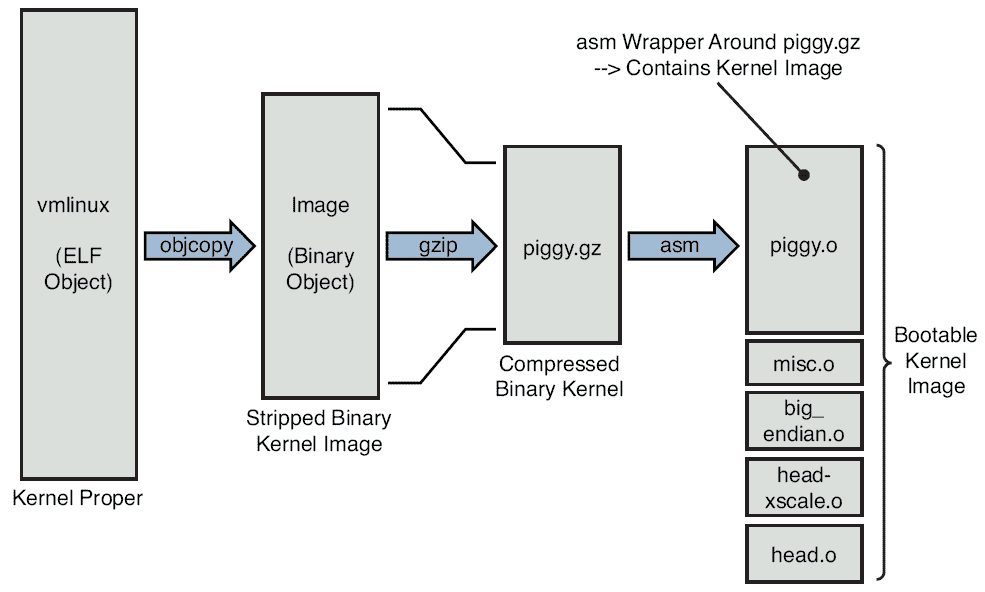

图 2.9：Linux 内核启动和解压过程

启动镜像的文件并不并不，但大多数发行版使用 `vmlinuz` 作为镜像。

随着 Linux 内核的演变，用户生成的内核大小超过了某些架构的限制，这些架构中用于存储压缩内核代码的空间非常有限。`bzImage` (big zImage) 格式的设计通过将内核划分为非连续的内存区域来克服这一限制。

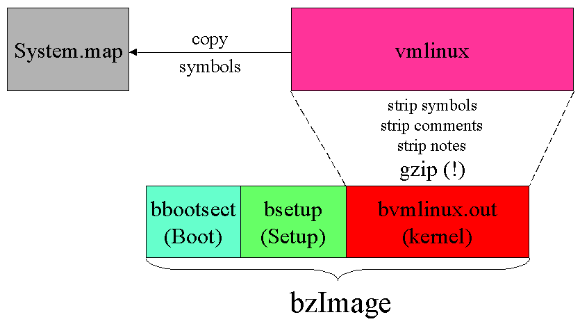

图 2.10：bzImage 结构

`bzImage` 格式一直使用 `gzip` 压缩直到 Linux 2.6.30，该版本引入了更多算法。`bz` 前缀可能会让你认为使用了 `bzip2`，但事实并非如此。

`System.map` 文件在内核编译时也会生成。它是内核使用的一个表。

`bzImage` 文件遵循特定的结构：`bootsect.o` + `setup.o` + `misc.o` + `piggy.o`。`piggy.o` 数据段包含了 gzip 压缩的 `vmlinux` 文件。内核源码中 `scripts/` 目录下的 `extract-vmlinux` 脚本可以提取 GNU/Linux 内核镜像。

某些发行版可能提供 `kernel-debuginfo` 包，其中包含对应内核 RPM 包的 `vmlinux` 文件，它通常安装在 `/usr/lib/debug/lib/modules/$(uname -r)/vmlinux`、`/usr/lib/debug/lib64/modules/$(uname -r)/vmlinux` 或 `/boot` 下。


- 统一引导加载程序 (`GRUB2`) 是一种在许多 Linux 发行版中常用的二级引导加载程序。
- 当 `MBR` 代码执行时，它会加载二级引导加载程序的内核镜像，这通常位于名为 `/boot` 分区的特定分区中。
- `GRUB2` 会向用户显示菜单（如果已配置），并允许选择特定的内核进行启动。
- `GRUB2` 还可以加载并执行配置文件，例如 `grub.cfg`，它包含有关可用内核及其启动参数的信息。
- 在嵌入式领域，`qemu` 引导加载程序被广泛使用。

## Linux 内核加载

- 一旦选择了特定的内核，`GRUB2` 会将 Linux 内核镜像（例如 `vmlinuz`）加载到内存中。
- `GRUB2` 还指定内核命令行参数，包括根文件系统和 `initrd` 镜像镜像的位置。

## Initrd (初始内存磁盘)

- `initrd` 是一个初始内存磁盘，包含了挂载根文件系统所需的驱动程序和工具。
- 内核将 `initrd` 加载到内存中并解压其内容。
- `initrd` 对于根文件系统存储在复杂存储设备上的系统（如逻辑卷管理器 `LVM` 或软件 RAID 阵列）特别有用。
- 它允许内核在挂载实际根文件系统之前访问必要的驱动程序。

## 根文件系统挂载

- 在 `initrd` 的帮助下，内核挂载通常位于硬盘上的根文件系统。
- 一旦挂载根文件系统，内核会将控制权交给 `init` 进程，该进程是第一个用户空间进程，所有其他进程的祖先。
- `init` 进程初始化其余的用户空间组件、服务和应用程序。

`initrd` 通常用作临时替代方案，以确保在涉及更复杂的存储或设备配置时系统能够启动。一旦根文件系统挂载，内核就不再需要 `initrd`。启动过程的具体细节可能根据发行版和配置而异，但此概述提供了对 Linux 内核如何从 BIOS 到 `initrd` 启动的通用理解。

你可以选择内核，甚至可以使用额外的内核参数对其进行修改。可选，你可以使用命令行 shell 对启动过程进行更强的手动控制。

当第二阶段引导加载程序进入内存后，将查询文件系统并将默认内核镜像和 `initrd` 镜像加载到内存中。一旦镜像就绪，步骤 2 中的引导加载程序将调用内核镜像。

接下来，我们来到 GNU/Linux 内核本身。在这个阶段，内核尚未真正执行；首先，内核配置部分需要处理一些内存管理相关的事务。在完成所有这些工作后，内核将解压并最终运行。

## 编码风格

Linux 内核社区遵循定义的编码风格，以维护代码库的一致性和可读性。在内核 Linux 内核代码时，遵循这些编码风格指南至关重要。

主要的编码风格规则在《Linux Kernel Coding Style》文档中概述，可以在内核源码树 `Documentation/process/coding-style.rst` 下访问。

以下是在 Linux 内核内编写代码的一些编码风格指南：

### 缩进
 使用 使用 tab 进行缩进，而不是空格。每个 tab 等于八个空格。

### 行长度
- 代码和注释的行长度限制在 80 个字符以内。
- 异常：解释性注释可以多达 100 个字符。

### 大括号
- 使用 Kernighan and Ritchie 风格的大括号，其中左括号与语句或函数声明在同一行：
```c
if (condition) {
    /* code here */
} else {
    /* code here */
}
```

### 函数和变量
- 函数名使用小写字母并加下划线（例如 `function_name()`）。
- 变量名使用小写字母并加下划线（例如 `variable_name`）。
- 使用描述性的变量和函数名。

## 结构
- 结构名使用小写字母并加下划线，字段名使用小写字母并加下划线（例如 `struct my_struct { int field_name; }`）。

### 注释
- 使用 `/* ... */` 注释而不是 `//`。
- 注释应该简洁，解释“为什么”而不是“是什么”。
- 记录函数参数、返回值和全局变量。
- 将注释放在其所描述的代码之前。

### 头文件和包含
- 按字母顺序组织包含语句，系统头文件在前，然后是内核头文件，最后是本地头文件。
- 避免在头文件中使用 `#include` 以减少依赖问题。

### 空格和空行
- 逗号后使用单个空格。
- 行尾不要有尾随空格。
- 使用空行分隔代码逻辑部分，但不要过度使用。

### Switch 语句
- case 标签的缩进级别与 switch 语句对齐，没有额外的缩进。

### 返回语句
- 避免在返回语句中使用复杂的表达式。
- 除非必要，否则不在返回值周围加括号。

## 错误处理
- 使用负错误代码（例如 `ENOMEM`）进行错误返回。
- 避免在错误处理中使用 `goto`；相反应使用结构化的错误处理。

### 宏
- 谨慎使用宏，简单任务优先使用内联函数。
- 宏的命名应使用大写字母并加下划线（例如 `#define MACRO_NAME`）。

### 枚举和常量
- 优先使用枚举而不是 `#define`。
- 常量应使用大写字母并加下划线命名（例如 `#define CONSTANT_NAME`）。

### 类型转换
- 避免不必要的类型转换。
- 在适当时使用 C99 类型（例如 `int32_t`, `uint64_t`）。

### 许可证和版权头文件
- 在源文件中包含适当的许可证和版权头文件。


*   驱动在内核内部或外的编译
*   在 Buildroot 内部编译
*   在 Yocto 内部编译
*   内核设施与辅助函数
*   错误处理
*   安装模块
*   加载和卸载动态模块
*   模块依赖
*   模块参数
*   模块许可
*   模块日志
*   动态内核模块支持

## 目标

主要目标是更好地理解和吸收用户空间与内核本身之间不同的交互。此外，我们将建立贯穿全本书的驱动程序编写基础。在本章结束时，你将能够编写简单的驱动程序、编译它们，并将它们加载到 GNU/Linux 内核中。

## 用户空间、内核空间和系统调用接口

Linux 主要分为非特权用户空间和内核空间。这两个组件通过一个称为接口（interface）的系统进行交互，该接口是用户态应用程序访问 Linux 内核的预定义且成熟的接口。

下图将让你对用户空间和内核空间之间的层级划分有一个基本的了解：

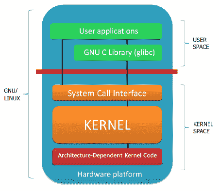

图 3.1：用户空间通过 sci 与内核的交互

以下是对每一层的详细描述：

*   **用户空间 (Userspace)**:
    *   用户空间是指计算机内存和处理能力中运行用户级应用程序和进程的部分。
    *   用户级应用程序包括文本编辑器、网络浏览器、媒体播放器以及典型用户直接交互的软件。
    *   用户空间应用程序对硬件和系统资源的访问权限有限。它们依赖操作系统内核来执行特权操作，例如读写硬件设备或管理内存。
*   **内核空间 (Kernelspace)**:
    *   内核空间是指计算机内存和处理能力中运行操作系统内核内核的部分。
    *   内核是操作系统的核心组件，负责管理系统资源、调度任务、控制硬件设备并执行安全策略。
    *   内核空间被认为是特权的，并具有直接访问硬件的权限。内核处理硬件中断和系统调用，使其操作系统操作系统至关部分。
*   **系统调用接口 (System call interface)**:
    *   系统调用接口 (`SCI`) 是一组函数和机制，允许用户空间中的用户级应用程序请求内核空间提供的服务。
    *   系统调用是应用程序与内核交互的标准方式。它们在两个空间之间架起了桥梁，允许用户级应用程序执行需要特权操作的任务，如文件 I/O、进程管理和硬件访问。
    *   常见的系统调用包括 `open()`/`close()`、`read()`、`write()`、`fork()`、`exec()`、`exit()` 等。
    *   用户级应用程序使用操作系统提供的特定库和语言结构进行系统调用。例如，在 C 语言中，你可以使用 `open()`、`read()` 和 `write()` 等函数来发起系统调用。

执行系统调用时，事件的序列通常涉及以下步骤：

*   用户级应用程序通过操作系统库提供的函数（例如 C 标准库）调用系统调用。
*   库函数准备参数并触发软件中断（例如使用汇编指令）。
*   CPU 从用户空间切换到内核空间，并开始执行内核代码。
*   内核处理系统调用，执行请求的操作，并将结果返回给用户级应用程序。
*   CPU 回到用户空间，用户级应用程序继续其执行。

下图显示了调用 C 标准库函数之一 `fwrite`（来自名为 `libc` 或 `glibc` 的 C 库）时涉及的步骤序列：

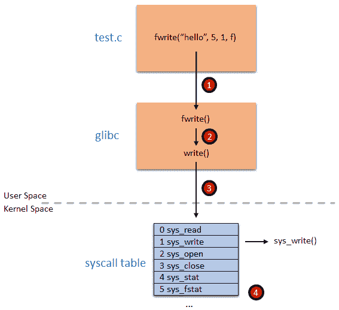

图 3.2：从用户空间到 Linux 内核的系统调用追踪

过程中的步骤如下：

1.  `fwrite()` 函数（来自标准 C 库）在 `test.c` 源码中使用，实现在 `glibc` 中，它是 Linux 的主要组件之一。
2.  `fwrite()` 是 `write()` 函数的封装。
3.  `write()` 将 `sys_write()` 系统调用 ID 及其参数加载到处理器寄存器中，然后执行上下文切换将控制交给内核级。
4.  执行方式取决于处理器架构，有时取决于处理器型号。例如，x86 处理器通常调用中断 80，而 x64 处理器使用 syscall 处理器指令。现在运行在内核空间的处理器将系统调用 ID 传递给系统调用表并调用函数 `sys_write()`。

用户空间、内核空间和系统调用接口是 GNU/Linux 架构的重要组成部分，使其能够为运行应用程序提供安全控制的环境，同时高效地管理系统资源和硬件访问。

Linux 的 `SCI` 在很大程度上符合 POSIX 标准，尽管有一些 Linux 特有的变体和扩展。可移植操作系统接口 (POSIX) 是一项规范，它为类 Unix 操作系统定义了一 set 系统接口、库和编程标准，旨在确保应用程序在各种 Unix 平台上的可移植性。

Linux 作为一种类 Unix 操作系统，是基于 POSIX 原则和标准设计的。因此，Linux 中提供的许多函数和系统调用都遵循 POSIX 规范。这意味着根据 POSIX 标准开发的应用程序通常与 Linux 以及其他类 Unix 操作系统兼容。

然而，必须注意的是，Linux 也有自己未被 POSIX 覆盖的特定扩展和功能。应用程序开发者应该意识到这些差异，在某些情况下，可能需要调整其应用程序以利用 Linux 特有的功能。

驱动程序也不例外，它们通过系统调用与二进制文件交互。如果内核什么都不做且不运行，它就不能成为操作系统。它需要进程，因此 SCI 被用作标准接口。

所有驱动程序都由两个回调结构化。第一个回调 `init_module()` 在加载时调用，用于初始化并预留所有资源；第二个回调 `cleanup_module()` 在卸载时进行清理或释放内存。

下图详细说明了将内核模块动态加载到 GNU/Linux 内核的过程。它展示了驱动程序的输入和输出钩子（hooks）：

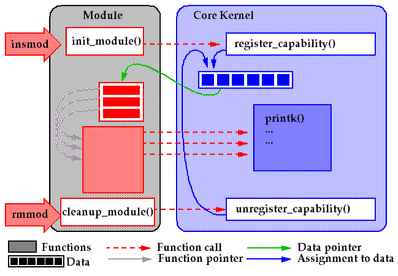

图 3.3：内核中驱动程序的动态（卸）载

为了开始，我们将使用这段简单的代码作为 hello world：

```c
/*

* 最简单的 hello-world 内核模块
*/
#include <linux/init.h> /* 宏需要它 */
#include <linux/module.h> /* 所有模块都需要 */
#include <linux/printk.h> /* pr_info() 需要它 */

static int __init hello_init(void)
{
    pr_info("Hello, world\n");
    return 0;
}

static void __exit hello_exit(void)
{
    pr_info("Goodbye, world\n");
}

module_init(hello_init);
module_exit(hello_exit);

MODULE_LICENSE("GPL");
```

在加载驱动程序时执行的初始化回调用于记录和预留驱动程序正常运行所需的资源（能力）。相反，清理回调在卸载驱动程序时释放所有不必要的资源。

我们将使用这个代码骨架来突出本章的不同重点。

## 驱动在内核内部或外的编译

现在我们有了一个极简的驱动程序，想要编译它以便进行测试。


对于这一点，有几种可能性，取决于代码是否已经存在 Linux 内核源码中。在第 2 章 Linux 内核简介]中，我们学习了如何获取 GNU/Linux 内核源码，现在这对我们来说非常有用，因为项目源码根目录下的 `makefile` 是生成驱动程序的引擎。

## 在 GNU/Linux 内核中编译

目标是自定义 GNU/Linux 内核源码，并添加一个可以通过 `make menuconfig` 命令查看的选项。

以下是 `drivers/helloworld/` 目录下所需的文件，当然还包括 `helloworld.c`：

```
drivers/helloworld/
├── helloworld.c
├── Kconfig
└── Makefile
```

所有驱动都位于 Linux 源码的 `drivers/` 目录下。在此阶段，我们将进入源码根目录。

我们必须先在 `drivers/Makefile`文件的末尾添加以下行，以便源码识别它：

```
obj-$(CONFIG_HELLOWORLD) += helloworld/
```

要编辑 `drivers/Kconfig` 文件，请在 `endmenu` 行之前添加以下行：

```
source "drivers/helloworld/Kconfig"
```

从那里，我们将创建一个包含我们的 hello world 驱动程序的新目录：

```bash
mkdir -p helloworld/
```

创建 `drivers/helloworld/Kconfig` 文件并编辑它：

```make
menu “HELLOWORLD support”
config HELLOWORLD
tristate "HELLOWORLD Support"
default m
help
  输入 Y 启用 HELLOWORLD 支持，输入 M 编译为模块
endmenu
```

最后，创建 `drivers/helloworld/Makefile` 文件：

```makefile
obj-${CONFIG_HELLOWORLD} := helloworld.o
```

因此，我们可以使用对应开发机器当前内核的 `.config` 文件（或重新加载）来（重新）配置我们的内核。检查配置界面是否显示了你的新驱动程序，并允许将其选择为模块。选择设备驱动菜单，然后进入底部：

```bash
make menuconfig
```

接下图显示了在 GNU/Linux 内核配置步骤中我们模块的可能选择。箭头表示子部分：

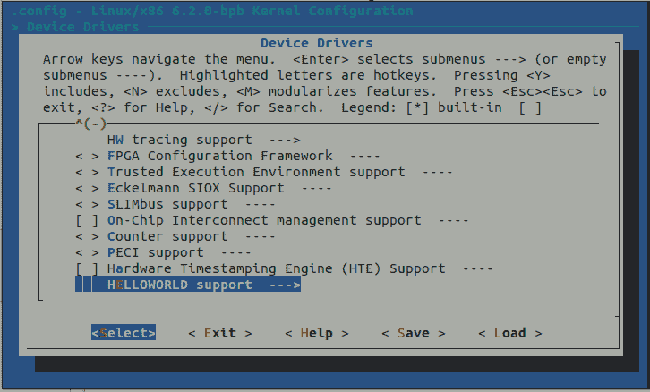

图 3.4：选择我们的新模块

在 `drivers/helloworld/Makefile` 文件中，我们带有以下状态选择“tristate”：

*   状态 1：未选择。
*   状态 2 或 M：编译为驱动程序；这将生成 `.ko` 文件。
*   状态 3 或 \：编译到 Linux 内核的静态部分。

我们可以使用空格键更改状态。

接下图显示了我们的子菜单中允许如前三态选择的子部分（如果此处为空，则模块不会被编译）：

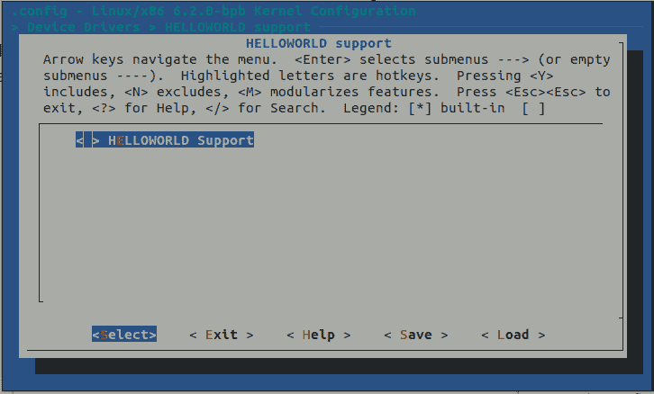

图 3.5：内核配置中未选择驱动

接下图显示了在动态模块（M）中选择我们的驱动程序：


图 3.6：选择编译为动态模块的驱动

接下图显示了在内核本身静态部分选择我们的驱动程序：

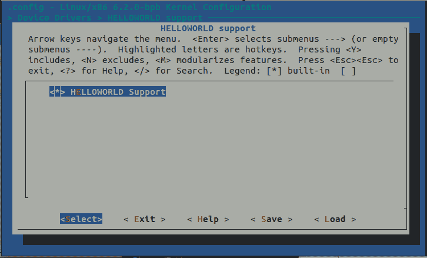

图 3.7：选择编译到内核静态部分的驱动

HELLOWORLD 驱动程序应该出现在设备驱动列表的末尾：

```bash
cat .config|grep -i helloworld
```

```
## HELLOWORLD support
CONFIG_HELLOWORLD=m
## end of HELLOWORLD support
```

因此，我们可以开始编译模块：

```bash
make
```

[...]
LD drivers/helloworld/builtin.o
CC [M] drivers/helloworld/helloworld.o
MODPOST vmlinux
Building modules, stage 2.
MODPOST 1 modules
CC drivers/helloworld/helloworld.mod
```

| 注意：有时内核必须准备好进行模块编译可以使用： |

```bash
make modules_prepare
```

以这种方式添加驱动程序非常罕见，因为其存在于内核中；它受到了 GNU/Linux 内核 GPL 许可证协议的限制！这就是为什么大多数情况下使用源码中的 `Makefile` 进行外部编译。这正是我们现在将看到的。我们将学习另一种外部方法，即将驱动程序的源码移动到内核源码代码之外。

## 在 GNU/Linux 内核之外编译

与之前的编译区别在于，我们的驱动程序源码不是 GNU/Linux 内核的源码。因此，我们需要一个 `Makefile`，它将远程调用位于内核源码根目录的那个：

让我们创建一个名为 `helloworld` 的目录，包含以下两个文件：

```
helloworld
├── helloworld.c : 我们驱动程序的源码
└── Makefile : 用于构建/安装我们驱动程序的主文件
```

我们的 `makefile` 将包含内容：

```makefile
obj-m := helloworld.o
KERNEL_DIRECTORY := /lib/modules/$(shell uname -r)/build

all:
	make helloworld-C $(KERNEL_DIRECTORY) modules
	modinfo ./helloworld.ko

load:
	insmod ./helloworld.ko
	dmesg

unload:
	rmmod ./helloworld.ko
	dmesg

install:
	make M=$(shell pwd)-C $(KERNEL_DIRECTORY) modules_install
	/sbin/depmod -a

clean:
	make M=$(shell pwd)-C $(KERNEL_DIRECTORY) clean
```

对于此步，你必须安装 `KERNEL_DIRECTORY` 变量指向的 Linux 内核源码！让我们构建驱动：

```bash
make
```

```bash
make M=/home/tgayet/Documents/bpb/03-introduction-to-device-drivers-27-10-2023/helloworld -C /lib/modules/6.2.0-35-generic/build
make[1]: Entering directory '/usr/src/linux-headers-6.2.0-35-generic'
CC [M] /home/tgayet/Documents/bpb/03-introduction-to-device-drivers-27-10-2023/helloworld/helloworld.o
MODPOST /home/tgayet/Documents/bpb/03-introduction-to-device-drivers-27-10-2023/helloworld/Module.symvers
CC [M] /home/tgayet/Documents/bpb/03-introduction-to-device-drivers-27-10-2023/helloworld/helloworld.mod
LD [M] /home/tgayet/Documents/bpb/03-introduction-to-device-drivers-27-10-2023/helloworld/helloworld.ko
make[1]: Leaving directory '/usr/src/linux-headers-6.2.0-35-generic'
```

它必须生成以下文件：

```bash
ls -al
total 344
drwxr-xr-x 2 tgayet tgayet 4096 Oct 23 ..
drwxr-xr-x 1 tgayet tgayet 4096 Oct 23 .
-rw-r--r-- 1 tgayet tgayet 366 Oct 23 helloworld.c
-rw-r--r-- 1 tgayet tgayet 109288 Oct 23 helloworld.ko
-rw-r--r-- 1 tgayet tgayet 497 Oct 23 .helloworld.ko.cmd
-rw-r--r-- 1 tgayet tgayet 100 Oct 23 helloworld.mod
-rw-r--r-- 1 tgayet tgayet 891 Oct 23 helloworld.mod.c
-rw-r--r-- 1 tgayet tgayet 364 Oct 23 .helloworld.mod.cmd
-rw-r--r-- 1 tgayet tgayet 93368 Oct 23 helloworld.mod.o
-rw-r--r-- 1 tgayet tgayet 39157 Oct 23 .helloworld.mod.o
-rw-r--r-- 1 tgayet tgayet 17336 Oct 23 helloworld.o
-rw-r--r-- 1 tgayet tgayet 38181 Oct 23 .helloworld.o.cmd
-rw-r--r-- 1 tgayet tgayet 326 Oct 21 Makefile
-rw-r--r-- 1 tgayet tgayet 100 Oct 23 modules.order
-rw-r--r-- 1 tgayet tgayet 326 Oct 23 .modules.order.cmd
-rw-r--r-- 1 tgayet tgayet 0 Oct 23 Module.symvers
-rw-r--r-- 1 tgayet tgayet 371 Oct 23 .Module.symvers.cmd
```

我们可以检查我们的新的 `helloworld` 驱动程序：

```bash
file helloworld.ko
```

```
helloworld.ko: ELF 64-bit LSB relocatable, x86-64, version 1 (SYSV), BuildID[sha1]=8b326f53f0a0c4dddd0358f110e79baa36c83, with debug_info, not stripped
```

```bash
modinfo helloworld.ko
```

```
filename: /home/tgayet/Documents/bpb/03-introduction-to-device-drivers-27-10-2023/helloworld/helloworld.ko
license: GPL
srcversion: 80158CC88F174840B63317
depends:
retpoline: Y
name: helloworld
vermagic: 6.2.0-35-generic SMP preempt mod_unload modversions
```

由于 `uname -r`，驱动程序非常适应我们的内核版本。因此可以无问题地动态加载：

```bash
insmod ./helloworld.ko
```

我们可以检查模块是否已加载：

```bash
cat /proc/modules|grep -i helloworld
```

```
helloworld 16384 0 - Live 0x0000000000000000 (OE)
```

或者

```bash
lsmod|grep -i helloworld
```

```
helloworld 16384 0
```

最后，我们可以卸载它：

```bash
rmmod ./helloworld.ko
```

内核追踪将显示来自驱动程序的消息：

```bash
dmesg -w
```

```
[20429.883271] Hello, world
[20624.543701] Goodbye, world
```


在这里，我们已经有了 helloworld 驱动，我们将随着时间的推移对其进行进。

如果你需要将源代码分为几个文件（`helloworld.c`、`start.c`、`stop.c`），你可能需要按照如下调整上面的 makefile：

```makefile
obj-m += helloworld.o
obj-m += startstop.o
startstop-objs := start.o stop.o
PWD := $(CURDIR)

all:
	make M=$(shell pwd) -C /lib/modules/$(shell uname -r)/build modules
clean:
	make M=$(shell pwd) -C /lib/modules/$(shell uname -r)/build
```

针对嵌入式领域的使用，我们将快速讨论在 Buildroot 或 Yocto 环境中编译驱动。遗憾的是有很多构建系统，我们无法描述所有的，但讨论的两种是最常见的。

### 在 Buildroot 项目中编译

在你的 Buildroot 项目中，在 `package` 目录下创建一个 `helloworld` 目录。

```text
package/
└── helloworld
├── Config.in
├── helloworld.mk
└── helloworld.c
```

将上述 `helloworld.c` 源代码添加到 `helloworld` 目录中。

在此目录下，创建一个 `Config.in` 文件。该文件用于配置内核驱动包并在 Buildroot 配置中启用它：

```text
config BR2_PACKAGE_HELLOWORLD
bool "Helloworld driver"
depends on BR2_PACKAGE_HELLOWORLD_LOADABLE
help
My custom kernel driver

config BR2_PACKAGE_HELLOWORLD_LOADABLE
bool "Enable helloworld Driver"
default y
help
Enable building and loading of helloworld Driver
```

创建一个 `helloworld.mk` makefile，用于定义如何编译和安装你的内核驱动。该 makefile 应该指定包名、源码位置、编译指令以及其他相关的细节。

```makefile
HELLOWORLD_VERSION = 1.0
HELLOWORLD_SOURCE = $(TOPDIR)/path/to/your/source
HELLOWORLD_SITE = file://$(HELLOWORLD_SOURCE)
HELLOWORLD_INSTALL_TARGET = YES

$(eval $(kernel-module))
```

调整 `HELLOWORLD_VERSION`、`HELLOWORLD_SOURCE` 和其他变量以匹配你特定的内核驱动。`$(eval $(kernel-module))` 一行用于指示 Buildroot 将其编译为内核模块。

要在你的 Buildroot 构建中包含你的自定义内核驱动包，请进入你的 Buildroot 配置（通常位于 `configs/` 目录下），并在“Target packages”部分下启用你的包。你可以通过 `menuconfig` 界面或直接编辑 `.config` 文件来实现。

在配置好你的包后，使用 `make` 命令构建你的 Buildroot 项目：

```bash
$ make
```

一旦 Buildroot 构建完成，你可以在输出目录中找到你的内核驱动模块。根据需要并在目标设备上安装和加载它即可。

### 在 Yocto 项目中编译

Yocto recipe（配方）通常被组织成层（layers）。你应该导航到你想要创建 recipe 的 Yocto 层。`meta` 目录通常用于组织 Yocto 层。

在你的层内部，创建一个目录来包含你的内核驱动 recipe。目录结构应该如下：

```text
meta-yourlayer/
├── recipes-kernel/
│   ├── helloworld/
│   │   ├── helloworld.bb
│   │   └── helloworld.c
```

在 helloworld 目录中，创建一个 `helloworld.bb` recipe 文件来定义你的内核驱动 recipe。`.bb` 文件的内容应该如下：

```text
DESCRIPTION = "Helloworld Driver"
LICENSE = "CLOSED" # 指定合适的许可证

SRC_URI = "file://path/to/your/source.tar.gz"
S = "${WORKDIR}"

# 定义你的构建依赖
DEPENDS = "linux-yocto"

## 指定目标内核版本
COMPATIBLE_MACHINE = "your-target-machine"

do_compile() {
    # 在此处添加你的构建指令
}

do_install() {
    # 定义安装指令（如果需要）
}

FILES_${PN} += "${libdir}/modules/${KERNEL_VERSION}/extra/*"
```

Yocto 使用模板工作；只需自定义某些变量即可，例如包含我们驱动源码的 git 仓库 URL、其许可证和依赖项：

- `Description`: 你的内核驱动的简要描述。
- `LICENSE`: 指定合适的许可证。
- `SRC_URI`: 指向你的驱动源码的源码 URI。
- `DEPENDS`: 定义任何构建依赖。在这种情况下，我们指定 `linux-yocto` 作为示例。
- `COMPATIBLE_MACHINE`: 指定你的驱动的目标机器。
- `do_compile()`: 添加特定于你的内核驱动的构建指令。
- `do_install()`: 如果需要，定义安装指令。
- `FILES_${PN}`: 指定安装内核模块文件的位置。

若要在 Yocto 镜像中包含你的自定义驱动，你需要将它添加到你的镜像 recipe 中。你可以通过修改 Yocto 项目配置中的自定义镜像 recipe 来实现这一点。这里是如何将其添加到镜像 recipe 的简化示例：

```text
IMAGE_INSTALL_append = " helloworld"
```

这一行告诉 Yocto 在镜像中包含你的 `helloworld` 包。

在定义了内核驱动 recipe 并将其添加到镜像中后，你可以使用 `bitbake` 命令构建 Yocto 镜像：

```bash
$ bitbake your-image
```

构建过程完成后，你将在 Yocto 配置指定的部署目录中找到你的内核驱动模块。根据需要并在目标设备上部署并加载它即可。


- `pm_runtime_get()`, `pm_runtime_put()` 以及相关函数：用于管理设备的电源状态。
- 设备树（Device trees）：
    - `of_get_property()`：从设备树中检索属性的函数。
    - `of_platform_populate()`：根据设备树信息向平台总线（platform bus）填充设备的函数。
- 杂项辅助函数：Linux 内核库提供了用于字符串处理、列表管理、位操作等各种辅助函数。

这些设施和辅助函数在内核驱动开发以及内核各个各个方面的实现中起着至关重要的作用。

它们提供了一种标准化的方法与内核核心交互并管理硬件设备，确保了不同硬件平台的稳定性和兼容性。

## 错误处理

在 Linux 驱动程序中处理错误对于维持系统稳定性以及确保硬件或软件组件的正常运行至关重要。

错误处理可能非常复杂，取决于驱动程序的特定上下文。以下是 Linux 驱动程序中处理错误的通用指南：

- **返回值**：在 C 代码中，通常使用返回值来指示错误。可能失败的函数通常返回错误代码或负值。例如，标准惯例是返回 0 表示成功，返回负值表示失败，负错误表示特定的错误状况。
- **错误代码**：使用预定义的错误代码使错误处理更加明确且有意义。在 Linux 内核中，错误代码定义在 `errno.h` 等头文件中，可以在你的驱动程序代码中使用。
- **记录错误**：当发生错误时，使用 `pr_err()`、`dev_err()` 或 `printk()` 等函数将详细记录到内核日志中。这允许系统管理员和人员诊断问题。

示例：

```c
if (error_condition) {
    pr_err("Error message: %s\n", error_description);
    return -ENODEV; // 返回适当的错误代码
}
```

- **清理资源**：如果你的驱动程序分配了资源（内存、I/O 端口等），确保在发生错误时释放它们。这可能涉及释放内存、注销设备或撤销驱动程序已做的任何设置。
- **返回适当的错误代码**：在返回错误代码时，确保使用指示特定错误条件的意义代码。Linux 提供了广泛的错误代码（例如，用于内存不足的 `-ENOMEM`，用于 I/O 错误的 `-EIO`）。选择最合适的代码来描述问题。
- **恢复**：考虑你的驱动程序是否可以从某些错误中恢复。例如，如果与硬件通信出错，你可以尝试重置设备或优雅地恢复。
- **避免内核崩溃（Kernel panic）**：尽力避免内核崩溃。如果错误严重到系统无法继续安全运行，那么卸载驱动程序或禁用硬件可能比导致内核崩溃更好。
- **测试与验证**：在各种条件下对你的驱动程序进行严格测试，以确保它正确处理错误。这包括触发错误状况的负测试用例。
- **文档**：记录驱动程序代码中使用的错误处理策略，以便其他开发人员能够有效地理解和维护代码。
- **用户友好的消息**：如果你的驱动程序向用户态提供消息，请确保错误信息清晰，并提供关于发生什么错误的有用信息。
- **代码审查**：让经验丰富的开发人员审查你的代码。他们可能会识别潜在的错误场景或对错误处理提出改进建议。
- **使用调试工具**：Linux 内核提供了各种调试工具和框架（例如 `kprobes`、`kdump`、`kexec`），可以帮助诊断和排除驱动程序问题。

内核驱动程序中的错误处理是内核开发的一个关键方面。理解预期的错误场景以及如何响应它们对于创建可靠稳定的驱动程序至关重要。

此主题将在第 13 章“调试 GNU/Linux 内核与驱动程序”中进行更深入的讨论。

## 安装模块

安装驱动程序通过使用 GNU Linux 内核主 Makefile 的 `modules_install` 目标来完成：

```bash
$ make modules_install
```

`depmod` 命令用于生成模块依赖缓存。这些信息对于内核高效地动态管理和（卸载）内核模块至关重要。要实现这一点，只需在安装模块后使用 `depmod` 命令即可：

```bash
$ depmod -a
```

`depmod` 的主要目的如下：

- **依赖解析**：
    - `depmod` 的主要目的之一是分析内核模块并确定它们对其他模块的依赖。
    - 内核模块通常依赖其他模块才能正常工作。`depmod` 识别这些依赖关系（可能包括其他内核模块或符号），并创建这些信息的数据库。
- **模块加载**：
    - 内核在使用 `modprobe` 等命令加载模块或在系统启动过程中，会使用 `depmod` 生成的依赖信息。
    - 当请求加载模块时，内核会检查依赖信息以确保先加载所有需要的模块。
- **防止符号冲突**：
    - 内核模块可以定义并使用符号（函数或变量），这些符号可能在多个模块间通用。
    - `depmod` 通过维护哪些符号被哪些模块记录帮助避免符号冲突。这防止了模块以冲突的方式使用相同的符号名。
- **高效模块加载**：
    - `depmod` 创建名为 `modules.dep` 的文件，以内核易于解析的格式存储模块依赖。
    - 这允许内核高效地加载模块，因为它可以根据依赖关系快速确定所需的加载顺序。
- **更新模块依赖关系**：
    - 每当安装新模块、修改现有模块或更新内核时，依赖信息就会更新。
    - 当系统内核更新时，通常需要运行 `depmod` 以确保依赖关系是最新的。

总之，`depmod` 通过生成和维护模块依赖信息，在 Linux 系统中管理和加载内核模块方面起着至关重要的作用。这些信息对于内核及其所依赖的模块的正常运行非常重要。

该命令更新 `/lib/modules/`uname -r`/modules.dep` 文件，该文件主要用于加载和通过 `modprobe` 动态加载：

```bash
$ cat /lib/modules/`uname -r`/modules.dep
```

updates/dkms/sysdig-probe.ko:

kernel/zfs/znvpair.ko: kernel/zfs/spl.ko

kernel/zfs/spl.ko:

(...)

最的缓存文件通常是：

- `/lib/modules/`uname -r`/modules.dep`：该文件包含模块及其依赖的列表。
- `/lib/modules/`uname -r`/modules.alias`：该文件包含模块的别名，允许使用不同的名称加载模块。

## 加载和卸载动态模块

Linux 下有两种加载或卸载驱动的方法，一种是手动的（`insmod` / `rmmod`），另一种是自动的（`modprobe`），正如我们在安装时通过 `depmod` 命令看到的那样。

你可以使用 `insmod` 或 `modprobe` 命令加载模块。使用 `insmod` 手动加载模块。将 `<module_name>` 替换为不带 `.ko` 扩展名：

```bash
$ sudo insmod /path/to/your/module_name.ko
```

要手动卸载模块，使用以下 `rmmod` 命令，将 `<module_name>` 替换为要卸载的模块名称：

```bash
$ sudo rmmod module_name
```


`modprobe` 命令是加载模块的推荐命令，因为它处理依赖关系。如果模块具有依赖项，`modprobe` 将自动加载它们。使用方法如下：

```bash
$ sudo modprobe module_name
```

要使用 `modprobe` 卸载模块，请使用带有 `-r` 选项的命令，并将 `<module_name>`替换为要卸载的模块名称：

```bash
$ sudo modprobe -r module_name
```

`-r` 选项告诉 `modprobe` 指定的模块。

如果模块具有依赖项，`modprobe` 还会卸载任何依赖于它的模块。卸载模块时要小心，因为这可能会影响系统的功能。

## 模块依赖

驱动程序通常通过导出有用且可分解的函数来为另一个驱动程序提供功能。

一个驱动程序对另一个驱动程序的依赖基于它们之间共享的符号。例如，我们将看到一个导出符号（函数）的模块，该符号将通过（导入）在另一个独立的模块中使用：


图 3.8：具有依赖关系的两个驱动程序

为了集中管理导出的共享函数，通常会使用 `.h` 文件，它集中包含了这些函数的原型：

```c
#ifndef EXPORT_SYMBOLE_H

#define EXPORT_SYMBOLE_H

void fonction_hello(int numero);

#endif
```

第一个导出驱动程序的代码是导出 `fonction_hello` 函数的驱动程序代码。我们注意到使用了 `export_api.h` 头文件：

```c
#include <linux/module.h>

#include "export_api.h"

static int __init export_chargement(void)
{
printk(KERN_ALERT "Hello, world\n");
return 0;
}

static void __exit export_dechargement(void)
{
printk(KERN_ALERT "Goodbye, cruel world\n");
}

void fonction_hello(int numero)
{
printk (KERN_INFO "Hello, le numero est %d\n", numero);
}

EXPORT_SYMBOL(fonction_hello);

MODULE_LICENSE("GPL");

module_init(export_chargement);

module_exit(export_dechargement);
```

第二个导入驱动程序的代码是导入 `fonction_hello` 函数的驱动程序代码。我们也可以注意到使用了 `"export_api.h"` 头文件：

```c
#include <linux/module.h>

#include "export_api.h"

static int __init import_chargement(void)
{
printk(KERN_ALERT "Hello, world\n");
fonction_hello(10); // 导入的函数
return 0;
}

static void __exit import_dechargement(void)
{
fonction_hello(20); // 导入的函数
printk(KERN_ALERT "Goodbye, cruel world\n");
}

module_init(import_chargement);

module_exit(import_dechargement);

MODULE_LICENSE("GPL");
```

在编译阶段，将生成两个相互依赖的驱动程序：

```bash
$ make
make M=/home/tgayet/Documents/bpb/03-introduction-to-the-device-drivers-27-10-2023/code_3_dependencies -C /lib/modules/6.2.0-35-generic/build modules
make[1]: Entering directory '/usr/src/linux-headers-6.2.0-35-generic'
warning: the compiler differs from the one used to build the kernel
The kernel was built by: x86_64-linux-gnu-gcc-11 (Ubuntu 11.4.0-1ubuntu1~22.04) 11.4.0
You are using: gcc-11 (Ubuntu 11.4.0-1ubuntu1~22.04) 11.4.0
CC [M] /home/tgayet/Documents/bpb/03-introduction-to-the-device-drivers-27-10-2023/code_3_dependencies/export.o
CC [M] /home/tgayet/Documents/bpb/03-introduction-to-the-device-drivers-27-10-2023/code_3_dependencies/import.o
MODPOST /home/tgayet/Documents/bpb/03-introduction-to-the-device-drivers-27-10-2023/code_3_dependencies/Module.symvers
CC [M] /home/tgayet/Documents/bpb/03-introduction-to-the-device-drivers-27-10-2023/code_3_dependencies/export.mod.o
LD [M] /home/tgayet/Documents/bpb/03-introduction-to-the-device-drivers-27-10-2023/code_3_dependencies/export.ko
BTF [M] /home/tgayet/Documents/bpb/03-introduction-to-the-device-drivers-27-10-2023/code_3_dependencies/export.ko
Skipping BTF generation for /home/tgayet/Documents/bpb/03-introduction-to-the-device-drivers-27-10-2023/code_3_dependencies/export.ko due to unavailability of vmlinux
CC [M] /home/tgayet/Documents/bpb/03-introduction-to-the-device-drivers-27-10-2023/code_3_dependencies/import.mod.o
LD [M] /home/tgayet/Documents/bpb/03-introduction-to-the-device-drivers-27-10-2023/code_3_dependencies/import.ko
BTF [M] /home/tgayet/Documents/bpb/03-introduction-to-the-device-drivers-27-10-2023/code_3_dependencies/import.ko
Skipping BTF generation for /home/tgayet/Documents/bpb/03-introduction-to-the-device-drivers-27-10-2023/code_3_dependencies/import.ko due to unavailability of vmlinux
make[1]: Leaving directory '/usr/src/linux-headers-6.2.0-35-generic'
```

```bash
modinfo ./export.ko
filename: /home/tgayet/Documents/bpb/03-introduction-to-the-device-drivers-27-10-2023/code_3_dependencies/./export.ko
license: GPL
srcversion: FA57E7778C239436BA6A952
depends:
retpoline: Y
name: export
vermagic: 6.2.0-35-generic SMP preempt mod_unload modversions

modinfo ./import.ko
filename: /home/tgayet/Documents/bpb/03-introduction-to-the-device-drivers-27-10-2023/code_3_dependencies/./import.ko
license: GPL
srcversion: A6734BD1D5BFFB086A3B429
depends: export
retpoline: Y
name: import
vermagic: 6.2.0-35-generic SMP preempt mod_unload modversions
```

手动加载会变得复杂，因为你显然必须在加载需要该函数的模块之前，先导出该函数的模块。

如果我们尝试在不加载第一个驱动程序的情况下手动加载第二个驱动程序，会观察到由于找不到符号导致加载失败：

```bash
$ sudo insmod import.ko
```

如果先加载第一个模块，再加载第二个模块，将产生以下结果：

```bash
$ sudo insmod export.ko
$ insmod import.ko
```

可以在内核中检查符号是否存在：

```bash
$ cat /proc/kallsyms | grep function_hello
```

现在我们可以成功地加载第二个模块了：

```bash
$ sudo insmod import.ko
```

卸载时，第一个模块无法被卸载，因为它被第二个模块使用了：

```bash
$ sudo rmmod export.ko
```

要这样做，你必须先卸载第二个模块，然后是第一个：

```bash
$ sudo rmmod import.ko
$ sudo rmmod export.ko
```

至于动态（卸）载，得益于 `depmod` 生成的依赖文件，这非常容易；一切都是自动完成的：

动态加载模块：

```bash
$ sudo modprobe export
$ lsmod | grep import
```

由于 `/lib/modules/$(uname -r)/modules.dep` 的存在，`modprobe` 将先第一个模块 `export`，然后是 `import`。

卸载同样简单：

```bash
$ sudo modprobe -r export
```

`modprobe` 将卸载 `import.ko` 模块，如果它不再被使用，也会卸载 `export` 模块。

## 模块参数

驱动程序类似于二进制文件；它可以管理在加载条件并在初始化时使用的参数。

以下是一个可以管理参数的驱动程序示例：

```c
#include <linux/init.h>
#include <linux/module.h>
#include <linux/moduleparam.h>

MODULE_LICENSE("Dual BSD/GPL");

static char* whom = "world";
static int howmany = 1;

module_param(howmany, int, S_IRUGO);
module_param(whom, charp, S_IRUGO);

static int param_init(void)
{
int i;
for (i = 0 ; i <= howmany ; i++)
{
printk(KERN_ALERT "(%d) %s\n", i, whom);
}
return 0;
}

static void param_exit(void)
{
printk(KERN_ALERT "Goodbye, cruel world\n");
}

module_init(param_init);
module_exit(param_exit);
```

使用之前的 Makefile 编译驱动程序，并使用 `modinfo` 测试驱动程序，它应该显示参数：

```bash
$ make
make M=/home/tgayet/Documents/bpb/03-introduction-to-the-device-drivers-27-10-2023/code_3_parameters -C /lib/modules/6.2.0-35-generic/build modules
```


#警告：编译器与构建内核时使用的编译器不同

构建内核使用的编译器：`x86_64-linux-gnu-gcc-11 (Ubuntu 11.4.0-1ubuntu1~22.04)` 11.4.0

你正在使用的编译器：`gcc-11 (Ubuntu 11.4.0-1ubuntu1~22.04)` 11.4.0

```
CC [M] /home/tgayet/Documents/bpb/03-introduction-to-the-device-drivers-27-10-2023/code_3_parameters/param.o
MODPOST /home/tgayet/Documents/bpb/03-introduction-to-the-device-drivers-27-10-2023/code_3_parameters/Module.symvers
CC [M] /home/tgayet/Documents/bpb/03-introduction-to-the-device-drivers-27-10-2023/code_3_parameters/param.mod.o
LD [M] /home/tgayet/Documents/bpb/03-introduction-to-the-device-drivers-27-10-2023/code_3_parameters/param.ko
BTF [M] /home/tgayet/Documents/bpb/03-introduction-to-the-device-drivers-27-10-2023/code_3_parameters/param.ko
Skipping BTF generation for /home/tgayet/Documents/bpb/03-introduction-to-the-device-drivers-27-10-2023/code_3_parameters/param.ko due to unavailability of vmlinux
make[1]: Leaving directory '/usr/src/linux-headers-6.2.0-35-generic'
```

`modinfo ./param.ko`

```
filename: /home/tgayet/Documents/bpb/03-introduction-to-the-device-drivers-27-10-2023/code_3_parameters/./param.ko
license: Dual BSD/GPL
srcversion: 7A66826FBC8FB7CDB8F5059
depends:
retpoline: Y
name: param
vermagic: 6.2.0-35-generic SMP preempt mod_unload modversions
parm: howmany:int
parm: whom:charp
```

我们在这里观察到两个参数：

```bash
$ tree /sys/module/param/parameters
/sys/module/param/parameters
├── howmany
└── whom
```

如我们见，这两个值是只读的，无法修改：

```bash
$ ls -alh /sys/module/param/parameters/
total 0
drwxr-xr-x 2 root root 0 oct. 26 21:51 .
drwxr-xr-x 6 root root 0 oct. 26 21:51 ..
-r--r--r-- 1 root root 4,0K oct. 26 21:51 howmany
-r--r--r-- 1 root root 4,0K oct. 26 21:51 whom
```

我们可以在带任何参数的情况下加载模块（使用默认上下文）：

```bash
$ sudo insmod param.ko
$ lsmod | grep param
param 16384 0
$ dmesg
[ 7658.068510] (0) Hello, world
```

我们将测试每种参数加载组合。在每次测试之间，你必须记得卸载驱动：

```bash
$ sudo rmmod param
```

在没有参数或参数未标记标记时，必须设置一个默认值。

然后，使用单个参数：

```bash
$ sudo insmod param.ko howmany=5
$ dmesg
[ 7404.087814] (0) Hello, world
[ 7404.087821] (1) Hello, world
[ 7404.087822] (2) Hello, world
[ 7404.087823] (3) Hello, world
[ 7404.087824] (4) Hello, world
[ 7404.087825] (5) Hello, world
```

最后，使用另一个参数：

```bash
$ sudo insmod param.ko whom=bpb
$ dmesg
[ 7470.763580] (0) Hello, bpb
```

最后，使用两个参数：

```bash
$ sudo insmod param.ko howmany=10 whom=bpb
$ dmesg
[ 7600.566090] (0) Hello, bpb
[ 7600.566096] (1) Hello, bpb
[ 7600.566097] (2) Hello, bpb
[ 7600.566099] (3) Hello, bpb
[ 7600.566100] (4) Hello, bpb
[ 7600.566101] (5) Hello, bpb
[ 7600.566102] (6) Hello, bpb
```


示例：`pr_info("Hello, world 4\n");`

其中 `LOGLEVEL` 是日志级别之一。

| 注意：它被连接到格式化字符串中；日志级别不是一个独立的参数。 |

可用的日志级别有：

| 日志级别 (Loglevel) | 字符串 | 别函数 |
| :--- | :--- | :--- |
| KERN_EMERG | "0" | `pr_emerg()` |
| KERN_ALERT | "1" | `pr_alert()` |
| KERN_CRIT | "2" | `pr_crit()` |
| KERN_ERR | "3" | `pr_err()` |
| KERN_WARNING | "4" | `pr_warn()` |
| KERN_NOTICE | "5" | `pr_notice()` |
| KERN_INFO | "6" | `pr_info()` |
| KERN_DEBUG | "7" | 如果定义了 `DEBUG`，则为 `pr_debug()` 和 `pr_devel()` |
| KERN_DEFAULT | "" | |
| KERN_CONT | "c" | `pr_cont()` |

表 3.1：每个宏的日志级别合成

例如，内核 `printk.h` 包含：

```c
#define pr_info(fmt,arg...) \
printk(KERN_INFOfmt,##arg)
```

正如其名称一样，`pr_info()` 是优先级为 `KERN_INFO` 的 `printk()`。

你可以通过根据严重级别过滤内核日志消息来配置 `dmesg` 命令的日志级别。日志级别通过 `klogd` 服务管理，该它是系统日志基础设施的一部分。以下是配置 `dmesg` 日志级别的方法：

你可以通过运行不带任何选项的 `dmesg` 来检查当前日志级别。该命令根据严重级别显示内核日志消息。默认情况下显示最严重的消息。

`$ dmesg`

或者，

`$ dmesg -w`（实时查看日志）

你可以使用 `dmesg` 的 `-n` 选项来临时设置日志级别。例如，要显示日志级别为警告（级别 4）或更高的消息，你可以使用：

`$ dmesg -n 4`

根据你的调试或监控需求需要调整日志级别。

通过某些内核设置，我们必须允许没有 root 权限执行该命令：

`$ sudo sysctl -w kernel.dmesg_restrict=0`

`kernel.printk` sysctl 配置控制 Linux 中内核日志消息的详细程度。它由四个数值组成，每个值代表一个不同的日志级别。这些值用于过滤和控制哪些消息显示在系统控制台上并被记录。`kernel.printk` 的格式为：`console_loglevel console_loglevel console_loglevel debug_loglevel`。

以下是 `kernel.printk` 每个部分的可能值：

- `console_loglevel`（控制台消息的控制台日志级别）：
    - 此值设置显示在系统控制台上的消息日志级别。
    - 有效值为 0 到 7，对应的日志级别为：
        - 0: `KERN_EMERG`（紧急）
        - 1: `KERN_ALERT`（警告）
        - 2: `KERN_CRIT`（关键）
        - 3: `KERN_ERR`（错误）
        - 4: `KERN_WARNING`（警告）
        - 5: `KERN_NOTICE`（通知）
        - 6: `KERN_INFO`（信息）
        - 7: `KERN_DEBUG`（调试）
- `console_loglevel`（控制台日志缓冲区的控制台日志级别）：此值设置记录在控制台日志缓冲区中的消息日志级别。有效值为 0 到 7，遵循上述提到的相同日志级别。
- `console_loglevel`（显示在控制台上消息的控制台日志级别）：此值设置将显示在系统控制台上的消息的日志级别。有效值为 0 到 7，具有相同的日志级别。
- `debug_loglevel`（调试日志级别）：此值设置调试消息的日志级别。有效值为 0 到 7，使用上述列出的相同日志级别。

### 动态内核模块支持

这是一个正在证实的趋势。越来越多的制造商为它们的驱动程序（virtualbox, ndiswrapper, lttng, fglrx 等）提供动态内核模块支持（DKMS），以保证随着开发演进服务的连续性。不仅包括 GNU/Linux 内核版本，还包括驱动程序本身。

在 Fedora 和 RedHat 等派生版本中，通常使用自动内核模块（akmods），尽管它与 DKMS 类似。我们只会看到 DKMS，它更具跨平台性，且不针对特定的 Linux 发行版。

每当包管理器更改内核版本时，RPM、DEB 等包的安装后操作中会自动启动触发器。当驱动程序更新时，也会执行相同的操作。

因此，它必须在使用当前内核 API 的情况下从驱动源进行重新编译，以保证某种一致性。

DKMS 由 Dell 公司开发，主要使用 Bash 和 Perl 语言，旨在解决这个问题。它根据 GPLv2 许可证作为开源自由发布。

DKMS 架构由不同部分组成：

- 模块源码：`/usr/src/<drv_name>-<version>/`
- 内核模块树：`/lib/modules/$(uname -r)``：DKMS 将替换或添加
- `/var/lib/dkms`，包含：
    - 模块所在的目录
    - DKMS 构建的模块 `/var/lib/dkms`
- `/usr/src/<drv_name>-<version>/`

下图显示了 DKMS 使用的路径：

 图 3.9：DKMS 使用的主要文件

关于 DKMS 本身，我们区分了位于 `/etc/dkms` 的第一部分。第二部分包含了驱动源、头文件，最后是构建的模块。

```bash
## DKMS 路径
```

### 安装

kms 已成为某些 Linux 发行版的必选组件：

- Debian/Ubuntu：`sudo apt-get install dkms`
- OpenSuse：`sudo zypper install dkms`
- Fedora ：`sudo yum install dkms`
- 从官方 GIT 仓库：`git clone git://dell.com/dkms`

对于包，依赖将是 `make`、`linux-headers` 和 `openssl`。

### 配置

DKMS 的可以通过位于 `/etc/dkms/framework.conf` 的文件进行简单配置，其中定义了 DKMS 的路径：

该配置文件每次运行时都会加载。

```bash
source_tree="/usr/src"
dkms_tree="/var/lib/dkms"
install_tree="/lib/modules"
tmp_location="/tmp"
verbose="1"
```

### 支持 Secure Boot

配合 UEFI 使用 DKMS 支持 Secure Boot 涉及几个关键步骤，以确保自定义内核模块已签名并可以加载 Secure Boot 已启用。以下是分步骤指南：

1. 安装依赖：`sudo apt install dkms openssl mokutil linux-headers-$(uname -r)`

2. 你可以检查是否在使用安全启动：
`sudo mokutil --sb-state`

安全启动启用

如果没有启用，请先设置安全模式！

3. 创建存储密钥对的目录：
`sudo mkdir -p /var/lib/dkms/mok`
`cd /var/lib/dkms/mok`

4. 选项 #1，生成私钥和自签名公证书：
`openssl req -new -x509 -newkey rsa:2048 -keyout MOK.priv -outform DER -out MOK.der -nodes -days 36500 -subj "/CN=Custom DKMS Module Signing/"`

它将以下文件：

a. `MOK.priv`：用于签名内核模块的私钥。

b. `MOK.der`：DER 格式的自签名证书，将通过 `mokutil` 导入 Secure Boot；它也将被 dkms 在构建后步骤中用于驱动程序签名。


## 5. 选项 #2，使用证书机构 (PKI) 验证 DER 证书

如果你的公司有证书机构（`PKI`），则需要分两个阶段进行：

不要生成自签名证书，而是创建一个证书签名请求 (`CSR`)），它将由你的 `PKI CA` 签名：

```bash
$ openssl req -new -newkey rsa:2048 -keyout MOK.priv -out MOK.csr -nodes -subj "/CN=Custom DKMS Module Signing/"
```

在此阶段，你需要将 `MOK.csr` 提交给你组织的 PKI 证书机构（如 `Microsoft AD CS`、`FreeIPA` 或外部 CA）。使用本地 CA 签名 CSR 的示例命令：

```bash
$ openssl x509 -req -in MOK.csr -CA CA.crt -CAkey CA.key -CAcreateserial -out MOK.pem -days 36500 -sha256
```

一旦收到签名的证书（`MOK.pem`），将其转换为 DER 格式：

```bash
$ openssl x509 -in MOK.pem -outform DER -out MOK.der
```

## 6. 创建新证书

```bash
$ sudo mokutil –enable-validation
```

—> 在这一步，将要求输入密码；重启后会再次要求。

## 7. 将密钥注册到所有者密钥 (MOK) 列表中

使用 `mokutil` 将密钥导入到 MOK 列表中，内核将用它来验证签名模块：

```bash
$ sudo mokutil --import MOK.der
```

检查导入是否成功：

```bash
$ sudo mokutil --list-new
```

按照提示设置密码。你需要在重启后确认注册。

## 8. 重启并注册密钥

在启动过程中，系统将提示你注册密钥。请遵循屏幕上的说明并使用你之前设置的密码。

你可以在 UEFI BIOS 中确认新密钥的导入：

```bash
$ sudo mokutil --list-enrolled | grep "Custom DKMS Module Signing"
```

## 9. 配置 DKMS 使用签名密钥

编辑或创建 DKMS 配置文件以包含签名命令。

```bash
$ sudo nano /etc/dkms/framework.conf
```

添加以下行：
```text
mok_signing_key=/var/lib/dkms/mok/MOK.priv
mok_certificate=/var/lib/dkms/mok/MOK.der
```

## 10. 要验证模块是否已正确签名并可以在启用 Secure Boot 的情况下加载，你可以使用以下命令检查模块签名：

```bash
$ modinfo -F sig_id /lib/modules/$(uname -r)/updates/dkms/example-module.ko
```

你应该能看到指示模块已签名的输出。

在这一步中，你可以加载/卸载动态模块：

```bash
$ modprobe example-module
$ modprobe -r example-module
```

如果发生签名问题，将报告错误。

## 工作原理

DKMS 的工作类似于一个状态机。第一步是通过配置文件添加驱动程序。一旦在 DKMS 数据库中已知，就可以要求它在一个或多个 GNU/Linux 内核版本上编译模块，然后将其安装到 `/lib/module/<kernel-version> /...`

每个步骤都是独立的，因此可以在不构建或安装驱动的情况下添加驱动。

安装可以自动进行，取决于设置：

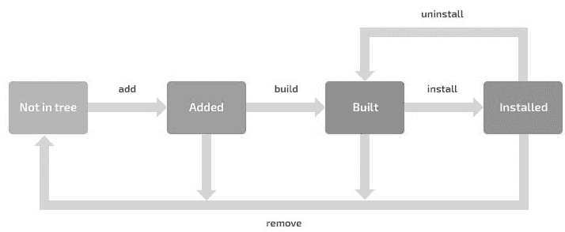

图 3.10：DKMS 状态机

每个配置文件都依赖于 DKMS 传播的一组变量：

- `kernelver`: 该变量包含正在编译模块的内核版本。这在定义 `MAKE` 命令时特别有用，例如 `MAKE[0]="make INCLUDEDIR=/lib/modules/${kernelver}/build/include"`
- `dkms_tree`: 该变量指示 DKMS 树在本地系统上的位置。默认是 `/var/lib/dkms`，但不应在 `dkms.conf` 中硬编码此值，以防用户更改了系统设置（此类设置可以通过使用 `/etc/dkms/framework.conf` 或在调用时添加 `-dkmstree` 选项来实现）。
- `source_tree`: 该变量指示 DKMS 在系统存储模块源码的位置。默认是 `/usr/src`，但不应在 `dkms.conf` 中硬编码此值，以防用户更改了系统设置（这可以通过使用 `/etc/dkms/framework.conf` 或在调用时添加 `-source tree` 选项来实现）。
- `kernel_source_dir`: 该变量包含构建模块的内核源码路径。除非使用 `--kernel-sourcedir` 选项指定了其他路径，否则通常为 `/lib/modules/$kernelver/build`。

## 为驱动添加 DKMS 支持

为了演示如何将外部驱动集成到 DKMS 内核源码，我们将从一个简单的字符驱动程序的源码开始。

它在 `/usr/src/helloworld-0.1` 中包含以下文件：

```text
/usr/src/helloworld-0.1
├── dkms.conf
├── helloworld.c
└── Makefile
```

让我们首先在 `/usr/src/` 中创建一个包含包名和版本的目录，并用连字符分隔：

```bash
$ sudo mkdir -p /usr/src/helloworld-0.1
```

然后，为该目录添加一个 DKMS 使用的 `dkms.conf` 文件，用于指定与其相关的元素路径和名称：

```bash
$ vim /usr/src/helloworld-0.1/dkms.conf
```

*(注：后续文本存在重复和损坏，已按要求处理)*


Linux tgayet-DS87D 6.2.0-35-generic #35~22.04.1-Ubuntu SMP PREEMPT_DYNAMIC Fri Oct 6 10:23:26 UTC 2 x86_64 x86_64 x86_64 GNU/Linux

```bash
$ uname -r
```
6.2.0-35-generic

我们可以列出当前安装的内核：

```bash
$ dpkg --list | grep linux-image
```

(…)
amd64 Signed kernel image generic
ii linux-image-6.2.0-34-generic 6.2.0-34.34~22.04.1 amd64 Signed kernel image generic
ii linux-image-6.2.0-35-generic 6.2.0-35.35~22.04.1 amd64 Signed kernel image generic
ii linux-image-generic-hwe-22.04 6.2.0.35.35~22.04.13 amd64 Generic Linux kernel image

作者的内核头文件位于标准目录：

```bash
$ ls -al /lib/modules/`uname -r`//
```

为我的内核版本生成动态模块步骤是通过使用 `dkms` 命令的构建参数完成的：

```bash
$ sudo dkms build -m helloworld/0.1
```

此内核不需要内核准备。正在构建模块：
cleaning build area....
```bash
make KERNELRELEASE=3.8.0-32-generic -C /lib/modules/3.8.0-32-generic/build SUBDIRS=/var/lib/dkms/helloworld/0.1/build modules....
cleaning build area....
DKMS: build completed.
```

生成可以使用当前内核（默认）或特定版本完成：

```bash
$ sudo dkms build -m helloworld/0.1 -k `uname -r`
```

此内核不需要内核准备。跳过...
正在构建模块：
cleaning build area....
```bash
make KERNELRELEASE=3.8.0-32-generic -C /lib/modules/3.8.0-32-generic/build SUBDIRS=/var/lib/dkms/helloworld/0.1/build modules....
cleaning build area....
DKMS: build completed.
```

构建结果将生成以下树结构：

```bash
$ tree /var/lib/dkms/helloworld/0.1/
```
/var/lib/dkms/helloworld/0.1/
├── 3.8.0-32-generic
│ └── x86_64
│ ├── log
│ │   └── make.log
│ └── Arial module
│     └── helloworld.ko
├──build
│   ├── dkms.conf
 ├── Makefile
│   └── helloworld.c
└── source -> /usr/src/helloworld-0.1

在这一步中，创建一个名为 `make.log` 的日志文件：

```bash
$ cat /var/lib/dkms/helloworld/0.1/`uname -r`/x86_64/log/make.log
```

DKMS make.log for helloworld-0.1 for kernel 3.8.0-32-generic (x86_64)
Monday, November 18, 2013, 10:01:14 (UTC+0100)
make: entering directory “/usr/src/linux-headers-3.8.0-32-generic”
CC [M] /var/lib/dkms/helloworld/0.1/build/helloworld .o
/var/lib/dkms/helloworld/0.1/build/helloworld .c: In function ‘__check_buf_size’:
/var/lib/dkms/helloworld/0.1/build/helloworld .c:16:1: warning: return from incompatible pointer type [enabled by default]
/var/lib/dkms/helloworld/0.1/build/helloworld .c: In function ‘k_read’:
/var/lib/dkms/helloworld/0.1/build/helloworld .c:34

模块已经生成，可以使用 `modinfo` 命令查看其身份信息：

```bash
$ modinfo /var/lib/dkms/helloworld/0.1/`uname -r`/x86_64/module/helloworld .ko
```
filename: /var/lib/dkms/helloworld
/0.1/6.2.0-35-generic/x86_64/module/helloworld.ko
license: GPL
author: bpb
description: ex-drv-char-dkms
srcversion: 3853BD18B15DD07DE2E4338
depends:
vermag: 6.2.0-35-generic SMP mod_unload modversions
parm: major:Static major number (none = dynamic) (int)
parm: buf_size:Buffer size (int)

我们也可以注意到 DKMS 中模块的状态已经发生了变化：

```bash
$ dkms status | grep helloworld
```
helloworld, 0.1, 3.8.0-32-generic, x86_64: built

由于已经为当前内核生成了模块，让我们进行一次快速的加载测试：

```bash
$ sudo insmod /var/lib/dkms/helloworld/0.1/`uname -r`/x86_64/module/helloworld .ko
```
```bash
$ dmsg -w
```
(…)
[261032.273926] char: allocated to 64 bytes buffer
[261032.273932] char: successfully loaded with major 250
```bash
$ lsmod | grep helloworld
```
helloworld 12868 0
```bash
$ rmmod ./helloworld.ko
```

### 安装由 DKMS 管理的模块

`dkms` 模块的安装也是通过传递 `install` 参数完成：

```bash
$ dkms install -m helloworld -v 0.1
```
helloworld:
Running module version sanity check.
- Original module
- No original module exists within this kernel
- Facility
- Installing to /lib/modules/3.8.0-32-generic/updates/dkms/
depmod....
DKMS: install completed.

就像添加或生成阶段一样，可以使用特定的内核版本而不是当前版本：

```bash
$ sudo dkms install -m helloworld -v 0.1 -k `uname -r`
```
helloworld:
Running module version sanity check.
- Original module
- No original module exists within this kernel
- Facility
- Installing to /lib/modules/3.8.0-32-generic/updates/dkms/
depmod....
DKMS: install completed.

可以检查状态，因为状态必须变为已安装：

```bash
$ sudo dkms status | grep helloworld
```
helloworld, 0.1, 3.8.0-32-generic, x86_64: installed

安装会将我们的模块安装到链接到当前内核模块的 `/update/dkms/` 目录：

```bash
$ ls -al /lib/modules/`uname -r`/updates/dkms/
```
total 608
drwxr-xr-x 1 root 4096 Nov 18 10:52 .
drwxr-xr-x 3 root 4096 Oct 22 12:00 ..
-rw-r---- 1 root 8544 Nov 18 10:52 helloworld.ko
-rw-r---- 1 root 50464 Nov 10 03:21 vboxdrv.ko
-rw-r---- 1 root 14896 Nov 10 03:21 vboxnetp.ko
-rw-r---- 1 root 38320 Nov 10 03:21 vboxnett.ko
-rw-r---- 1 root 36656 Nov 10 03:21 vboxpci.ko

正如我们注意到的，`depmod` 命令被启动，它更新了 `modules.dep` 文件。

```bash
$ cat /lib/modules/`uname -r`/modules.dep | grep helloworld
```
updates/dkms/helloworld.ko:

这允许通过 `modprobe` 命令动态加载模块：

```bash
$ sudo modprobe helloworld
```
```bash
$ lsmod | grep helloworld
```
$ sudo modprobe -r helloworld
```

如果在请求安装时尚未执行构建，则 `dkms` 将先执行构建阶段，依赖关系：

```bash
$ dkms install -m helloworld -v 0.1
```
此内核不需要内核准备。跳过...
正在构建模块：
cleaning build area....
```bash
make KERNELRELEASE=3.8.0-32-generic -C /lib/modules/3.8.0-32-generic/build SUBDIRS=/var/lib/dkms/helloworld/0.1/build modules....
cleaning build area....
DKMS: build completed.
```
helloworld.ko:
Running module version sanity check.
- Original module
- No original module exists within this kernel
- Facility
- Installing to /lib/modules/3.8.0-32-generic/updates/dkms/
depmod....
DKMS: install completed.

### 卸载由 DKMS 管理的驱动

正如我们预料的样，卸载不需要详细说明：

```bash
$ sudo dkms uninstall -m helloworld -v 0.1 -k `uname -r`
```
此操作仅移除之前安装的驱动 `/lib/modules/<kernel-release>/updates/dkms/`

### 移除

对于移除所有内核版本的 `dkms` 支持，这与添加阶段非常相似：

```bash
$ sudo dkms remove -m helloworld -v 0.1 --all
```
Uninstall Beginning --------
Module: helloworld
Version: 0.1
Kernel: 6.2.0-35-generic (x86_64)
------------------------------------
Status: This module version was ACTIVE for this kernel.
depmod....
DKMS: uninstall completed.
------------------------------
从 DKMS 树中完全删除模块版本：0.1。
------------------------------
Done.

我们可以通过 `dkms` 验证驱动的状态现在变为未知，因为它不应该返回任何内容：

```bash
$ dkms status | grep helloworld
```

对于移除特定的内核版本，也可以使用 `-k` 参数：

```bash
$ sudo dkms remove -m helloworld -v 0.1 -k `uname -r`
```


完全来自 DKMS 树。

完成。

我们稍微详细说明了 `dkms` 的用法，因为它是至关重要的专业支持，在安装新内核或更新驱动时它能起关键作用；`dkms` 将确保驱动程序重新编译，以使所有内容保持同步。

## 结论

在本章中，我们更详细地讨论了基础驱动程序的实现，使其能够管理参数、依赖关系，并知道如何编译、加载或卸载驱动程序。这将为本书其余部分为我们提供帮助。

在下一章中，我们将详细学习 Linux 设备模型 (LDM)，包括 `procfs` 和 `sysfs`。

# 加入我们书籍的 Discord 空间

加入书籍的 Discord 工作空间，获取最新更新、优惠、全球科技动态、新版本发布以及与作者的交流会议：

[`discord.bpbonline.com`](https://discord.bpbonline.com)


# 第 4 章：Linux 设备模型

## 引言

在上一章学习了 Linux 驱动程序的基础之后，我们将看到 Linux 设备模型 (LDM) 的结构。GNU/Linux 内核已经标准化，以简化开发者对内核和驱动程序的维护和可扩展性。本章将提供对这些基础的更好理解。

## 结构

本章涵盖了以下主题：

* Linux 设备模型数据结构
* 总线模型
* 设备模型
* 驱动模型
* 类 (classes)
* 关于 `procfs`
* 关于 DTB 设备树

## 目标

Linux 设备模型是 Linux 内核中的一个框架，提供了一种标准化且统一的方法表示表示管理各种硬件设备。它抽象了与不同类型的设备交互的细节，允许内核和设备驱动程序通过一致的接口工作。我们将逐一研究所有的接口以更好地理解它们。

## Linux 设备模型数据结构

设备模型简化了编写和维护设备驱动程序的任务，同时促进了模块化和设备管理的便利，例如：

* **总线模型**：设备被组织在总线上，总线代表系统中的物理或逻辑互连。总线的示例包括 `PCI`、`USB`、`I2C` 和平台总线。
* **设备模型**：设备在设备模型中表示对象，每个对象都有唯一的标识符和一组属性。设备按层级结构组织，反映了设备之间的物理或逻辑关系。
* **设备节点**：设备与 `/sys` 文件系统中的设备节点关联。这些节点提供了一个用户可读写的接口，用于与设备属性交互。用户和应用程序可以通过读取或写入相应设备节点的值来查询和配置设备。内核通过 `sysfs` 虚拟文件系统在用户空间提供其模型的表示。它通常挂载在 `/sys` 目录下，包含以下子目录：
    * `Block`：系统中可用的块设备（磁盘、分区）
    * `Bus`：物理设备连接的总线类型（`pci`、`ide`、`usb`）
    * `Class`：系统中可用的驱动类（`net`、`sound`、`usb`）
    * `Devices`：系统的设备的层级结构
    * `Firmware`：系统固件信息（高级配置电源接口）
    * `Fs`：挂载文件系统的信息
    * `Kernel`：内核状态信息（登录用户、热插拔）
    * `Module`：当前加载的模块列表
    * `Power`：与电源管理子系统相关的信息
* **类模型**：设备根据其功能或类型进行分类（例如，块设备、网络设备）。每个类定义了一组通用属性和行为，该类中的设备应当遵循这些规定。
* **驱动模型**：驱动模型定义了驱动程序与设备模型之间的接口。驱动程序在模型中注册自身，与特定类型的设备关联。当检测到兼容设备时，会将适当的驱动绑定到该设备。
* **驱动绑定**：绑定过程涉及将设备与适当的驱动关联。内核根据设备标识符（例如 `PCI IDs`）等标准匹配设备与驱动程序，允许正确的驱动程序处理特定设备。
* **驱动核心**：驱动核心是 Linux 设备模型的一个基础部分。它监督驱动程序和设备的注册与注销过程。它的主要功能是将设备与适当的驱动程序匹配，并确保它们之间的顺畅通信。
* **设备树**：在使用设备树的架构（例如 `ARM`）上，设备树是一种描述硬件拓扑和属性的数据结构。它用于在内核启动过程中实例化设备并配置设备模型。

Linux 设备模型提供了一个灵活且可扩展的框架，适应各种硬件架构和设备。它促进了硬件特定细节与驱动逻辑之间的关注点，使得为各种设备开发和维护驱动程序更容易。

为 Linux 内核编写的设备驱动通常通过驱动模型接口与设备模型交互，允许它们注册设备、管理资源并与内核的其他部分通信。设备模型是 Linux 内核的一个基本方面，使其能够支持多样化的硬件生态系统。

`sysfs` 信息可以在包含某些标准属性的文件中，这些属性由同名的文件或目录表示：

* `Dev`：主设备和次设备标识符。它可以用于在 `/dev` 目录中自动创建条目。
* `Device`：指向包含设备目录的符号链接；它可以用于发现提供特定服务的设备（例如 `eth` PCI 卡）。
* `Driver`：指向驱动程序目录的符号链接（位于 `/sys/bus/*/drivers`）。

与设备驱动程序使用的若干种数据结构示例：

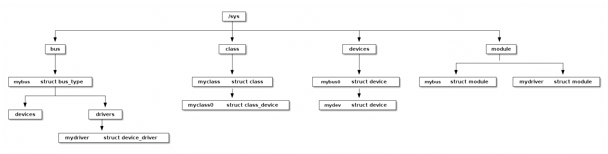

图 4.1：属性取决于总线和驱动程序

`kobject` 结构通常嵌入在一个更大的结构中。它整合了一系列在 Linux 设备模型较高抽象级别使用的功能。

例如，`cdev` 结构的定义如下：

```
struct cdev {
    struct kobject kob;
    struct module *owner;
    const struct file_operations *ops;
    struct list_head list;
    dev_t dev;
    unsigned int count;
};
```

我们可以在此结构中注意到类型为 `kobject` 的字段，而其定义如下：

```c
struct kobject {
    const char *name;
    struct list_head entry;
    struct kobject *parent;
    struct kset *kset;
    struct kobj_type *ktype;
    struct sysfs_dirent *sd;
    struct kref kref;
    unsigned int state_initialized:1;
    unsigned int state_in_sysfs:1;
    unsigned int state_add_uevent_sent:1;
    unsigned int state_remove_uevent_sent:1;
    unsigned int uevent_suppress:1;
};
```

因此，`kobject` 结构是层级的：一个对象有一个父对象并包含一个 `kset` 成员，该 `kset` 包含同一层的对象。

该结构需要使用 `kobject_init()` 函数进行初始化。在初始化过程中还需要设置 kobject 结构的名称，它将出现在 `sysfs` 中，需要使用 `kobject_set_name()` 函数。


对 `kobject` 的任何操作都是通过使用 `kobject_get()` 增加其内部计数器或在不再使用时使用 `kobject_put()` 减少计数器来完成的。因此，`kobject` 只有在内部计数器为 0 时才会释放。需要一种通知方法，以便释放与包含 `kobject` 结构的设备结构相关的资源（例如 `cdev`）。使用的方法称为 `release`，通过 `ktype` 字段（`struct kobj_type`）与对象关联。

`kobject` 结构是 Linux 设备模型的基础结构。该模型的上层结构是 `struct bus_type`、`struct device` 和 `struct device_driver`。

关于 LDM（Linux 设备模型）的更多帮助可以从这里获取：

* [`www.devicetree.org/specifications/`](https://www.devicetree.org/specifications/)
* [`docs.kernel.org/`](https://docs.kernel.org/)

## 总线模型

总线是指将各种硬件设备连接到系统的逻辑或物理互连。总线模型是一种抽象，为在内核中表示和管理不同类型的总线提供了标准方法。

这种抽象对于处理硬件架构的多样性以及计算机系统中可能存在的大量总线至关重要。

Linux 总线模型是 Linux 内核中的一个框架，提供了一种系统化的表示和管理总线的方法，总线是不同硬件组件和设备之间的通信通路或互连。总线在连接各种硬件元素（如处理器、内存、外围设备和其他子系统）中起着关重要的作用，允许它们通信并协同工作。

Linux 总线模型的特性和概念包括：

* **总线类型 (Bus type)**：总线模型定义了不同的总线类型，每种类型代表一种特定的互连技术或架构。总线类型的示例包括外围部件部件（PCI）、通用串行总线（USB）、集成电路（I2C）和串行外设接口（SPI）。
* **总线子系统 (Bus subsystem)**：每种总线类型都实现为 Linux 内核中的一个子系统。总线子系统负责管理连接到该特定总线类型的设备。
* **总线设备**：特定总线的一部分设备被表示为总线设备。每个总线设备都与特定的总线类型关联，并具有该类型总线的共同特征。
* **总线属性 (Bus attributes)**：总线具有描述其属性的属性，例如速度、地址范围和其他相关信息。这些属性通常在 `/sys` 文件系统中暴露。
* **总线注册 (Bus registration)**：总线和总线设备向内核注册自身，允许内核动态地发现和管理连接到这些总线的硬件。
* **总线枚举 (Bus enumeration)**：内核在启动过程中或当有新设备热插时枚举每条总线上的设备。枚举涉及发现总线上的现有设备、初始化它们并使它们对系统可用。
* **设备挂载 (Device attachment)**：设备挂载到总线上，且总线模型有助于组织系统内部设备的层级结构。层级结构反映了设备与总线之间的物理或逻辑连接。
* **热插拔支持 (Hotplug support)**：总线模型支持热插操作，允许在不需要重启的情况下动态地从系统中添加或删除设备。这对于支持热插拔的总线和设备（如 USB 或 PCI 设备）尤为重要。

通过为表示总线及其设备提供标准框架，Linux 总线模型有助于 Linux 内核的整体模块化、可扩展性和活性。它通过为处理总线和设备提供通用基础设施，简化了设备驱动程序的开发，无论底层的硬件架构如何。`/sys` 文件系统中的 `/sys/bus` 目录是用户空间访问总线相关信息和配置的入口。

Linux 设备模型提供了若干数据结构以确保硬件设备与设备驱动程序之间的交互。模型基于 `kobject` 结构。层级结构使用以下结构构建：

* `struct bus_type`
* `struct device`
* `struct device_driver`

下图插示了驱动程序记录中数据结构的层级结构：

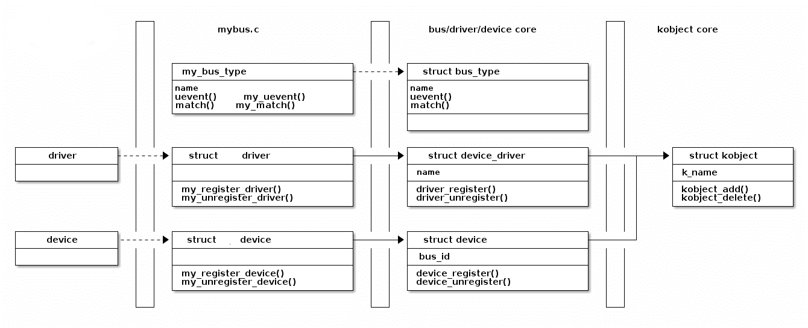

图 4.2：层之间的不同交互

Linux 总线模型包含了各种总线，每种总线都有特定的用途。常见的总线类型包括：

* **外围部件部件 (Peripheral component interconnect)**：`PCI` 用于将扩展卡连接到主板。
* **通用串行总线 (Universal Serial Bus)**：`USB` 常用于连接外围设备和外部设备。
* **集成电路 (Inter-integrated circuit)**：`I2C` 用于色板上集成电路之间的通信。
* **平台总线 (Platform bus)**：代表集成到系统板的设备。

记录总线涉及的各个步骤包括多个操作，如下：

* **总线类型注册**：每种类型的总线都在 Linux 内核注册，表示内核支持连接到该类型总线的设备。注册过程包括提供一组函数，定义如何枚举和管理该总线上的设备。
* **总线特定操作**：总线特定操作定义了如何发现、探测（probe）和初始化特定总线上的设备。这些操作特定于总线的特性，可能包括枚举设备、读取配置信息和设置资源的方法。
* **总线设备枚举**：总线模型协助枚举特定总线上的设备。它提供了一种发现和表示连接到该总线的统一方法，允许内核识别硬件配置。
* **设备关系**：总线上的设备以层级方式组织，以表示它们的关系。例如，`PCI` 总线可能有插槽，每个插槽都可能包含一个设备。这种层级结构反映在设备模型中。
* **/sys 文件系统表示**：有关总线及其设备的信息通过 `/sys` 文件系统暴露给用户空间。用户和应用程序可以通过与 `/sys` 内相应的文件和目录交互来查询和配置设备。

总线是处理器与输出设备之间的通信通道。为了确保模型的通用性，所有 I/O 设备都通过总线连接到处理器（即使它是虚拟的）。

当添加系统总线时，它将出现在 sysfs 文件系统中。与 `kobject` 一样，总线可以组织成层级结构并在 sysfs 中表示。

因此，Linux 设备模型是由 `struct bus_type` 结构表示的：

```c
struct bus_type {
    const char *name;
    const char *dev_name;
    struct device *dev_root;
    struct bus_attribute *bus_attrs;
    struct device_attribute *dev_attrs;
    struct driver_attribute *drv_attrs;
    struct subsys_private *p;
    int (*match)(struct device *dev, struct device_driver *drv);
    int (*uevent)(struct device *dev, struct kobj_uevent_env *env);
    int (*probe)(struct device *dev);
    int (*remove)(struct device *dev);
    //…
};
```

每个总线都有一个名称、一组默认属性、若干特定函数和私有驱动数据。`uevent` 函数（以前称为 hotplug）用于热插拔设备。

总线操作如下：

* 记录
* 实现 `struct bus_type` 结构中描述的操作
* 迭代
* 检查

总线使用 `bus_register()` 注册，使用 `bus_unregister()` 取消注册。

实现示例：

```c
#include <linux/device.h>

//总线类型
struct bus_type my_bus_type = {
    .name = "my_bus",
};
```


```c
.match = my_match,

.uevent = my_uevent,
};

static int __init my_bus_init(void)
{
    int err;
    //...
    err = bus_register(&my_bus_type);
    if (err)
        return err;
    //...
}

static void __exit my_bus_exit(void)
{
    //...
    bus_unregister(&my_bus_type);
    //...
}
```

在 `bus_type` 结构体中初始化的函数有 `match` 和 `uevent`：

```c
#include <linux/device.h>
#include <linux/string.h>

// 设备匹配驱动；进行简单的名称测试
static int my_match(struct device *dev, struct device_driver *driver)
{
    return !strncmp(dev_name(dev), driver->name, strlen(driver->name));
}

// 响应热插拔用户事件；添加环境变量 DEV_NAME
static int my_uevent(struct device *dev, struct kobj_uevent_env *env)
{
    add_uevent_var(env, "DEV_NAME=%s", dev_name(dev));
    return 0;
}
```

当新设备或驱动添加到总线时，会使用 `match` 函数。它的作用是在设备 ID 和驱动 ID 之间进行比较。`uevent` 函数在用户空间生成热插拔之前调用，用于添加环境变量。

总线上的其他可能操作是遍历连接到它的驱动或设备。虽然我们无法直接访问它们（驱动和设备列表存储在驱动的私有数据 `subsys_private *p` 字段中），但可以使用 `bus_for_each_dev` 和 `bus_for_each_drv` 宏进行迭代。

LDM 接口允许你为相关对象创建属性。这些属性在 `sysfs` 总线子目录下会有对应的文件。

与总线相关的属性由 `bus_attribute` 结构体描述：

```c
struct bus_attribute {
    struct attribute attr;
    ssize_t (*show)(struct bus_type *, char *buf);
    ssize_t (*store)(struct bus_type *, const char *buf, size_t count);
};
```

属性通过 `BUS_ATTR` 宏定义，然后可以使用 `bus_create_file()` 和 `bus_remove_file()` 函数在总线结构中添加/删除属性。

为 `my_bus` 定义属性的示例所示：

```c
#define MY_BUS_DESCR "BPB my bus"

// 导出简单的总线属性
static ssize_t my_show_bus_descr(struct bus_type *bus, char *buf)
{
    return snprintf(buf, PAGE_SIZE, "%s\n", MY_BUS_DESCR);
}

/*
* 定义属性 - 属性名称为 descr;
* 全称为为 bus_attr_descr;
* sysfs 条目应该是 /sys/bus/mybus/descr
*/
BUS_ATTR(descr, 0444, my_show_bus_descr, NULL);

// 指定属性 - 在模块初始化函数中
static int __init my_bus_init(void)
{
    int err;
    //...
    err = bus_create_file(&my_bus_type, &bus_attr_descr);
    if (err) {
        /* 处理错误 */
    }
    //...
}

static void __exit my_bus_exit(void)
{
    //...
    bus_remove_file(&my_bus_type, &bus_attr_descr);
    //...
}
```

总线是 `bus_type` 对象和设备对象的共同表示（总线本身也是一个设备）。

## 设备模型

总线模型在驱动绑定过程中起着至关重要的作用。它帮助将总线上的设备与合适的驱动程序进行匹配。当找到兼容的驱动时，它将绑定到设备上，允许驱动程序管理该设备。

在使用设备树的架构（例如 `ARM`）上，总线模型与设备树集成，在内核启动过程中实例化总线和设备。

Linux 总线模型是整个设备模型不可或缺的一部分，为处理不同类型的总线及其连接的设备提供了基础基础。它确保了跨各种硬件架构管理设备的统一方法，并贡献了内核的模块化和可移植性。

设备节点是指 `/sys` 文件系统中的条目，它们提供了与设备交互的标准化接口。它们是用户和应用程序查询和配置系统中设备的手段。`/sys` 文件系统是一个虚拟文件系统，它将有关设备、驱动和其他内核相关实体的信息暴露给用户空间。

### Linux 设备模型中设备节点的定义

-   **文件系统表示**：设备节点表示为 `/sys` 文件系统中的文件和目录。每个设备和设备相关实体（如设备类）在 `/sys` 中都有对应的条目，用户可以导航并与之交互。
-   **设备属性**：设备节点暴露了与相应设备相关的各种属性和参数。这些属性可能包括设备状态、配置设置和其他相关数据。
-   **读写访问**：用户和应用程序可以从设备节点读取信息，以获取关联设备的详细信息。此外，某些设备节点支持写操作，允许用户配置或控制设备的某些方面。
-   **设备识别**：设备节点的路径反映了其在设备模型中的位置。连接到特定总线的设备位于 `/sys` 中对应的目录下。
-   **一致命名规范**：设备节点遵循一致的命名规范，以便用户识别和定位设备。设备节点的名称取决于设备的类型。
-   **设备类节点**：对于属于类的设备（例如块设备、网络设备），有特定的类目录包含该类的实例设备节点。
-   **动态创建和删除**：设备节点根据系统中的设备动态创建和删除。当检测到新设备时，内核会在 `/sys` 中创建相应的设备节点。当设备移除或不可用时，设备节点会被删除。
-   **/sys/class 和 /sys/devices**：`/sys/class` 目录包含不同设备类的子目录，每个目录都包含该类的实例设备节点。`/sys/devices` 目录提供了更详细、完整的设备模型视图，包括设备及其关系。

设备节点在为 Linux 内核设备交互提供用户友好且标准的接口方面起着至关重要的作用。它们促进了用户空间与内核之间的通信。

。

类模型是指一种根据功能或类型对设备进行分类的框架。具有共同特征和行为的设备被分为类，每个类都定义了类内设备应遵循的标准属性和方法。这种分类通过为特定类型的设备交互提供标准化接口简化了设备管理。

### Linux 内核中类模型的定义

-   **设备类**：设备类根据功能或目的对设备进行分类。设备类的示例包括块设备、网络设备、图形设备、输入设备等。每个类代表一种特定类型的设备。
-   **共同属性和行为**：每个设备类都定义了类内设备预期拥有的共同属性和行为。这包括用于设备初始化、配置和资源管理的标准方法。
-   **设备类层级结构**：设备类按层次结构组织，反映了不同类型设备之间的关系。例如，块设备类可能有针对特定类型块设备的子类，如硬盘、SSD 或 USB 驱动器。


## Linux 设备模型概述

*   **/sys 文件系统表示**：关于设备类及其关联设备的信息通过 `/sys` 文件系统暴露给用户空间。用户和应用程序可以通过与 `/sys/class` 内相应的文件和目录交互来查询和配置设备。
*   **驱动程序绑定与匹配**：设备驱动程序通常会在特定的类中注册自己，表示它们与该类型设备的兼容性。在驱动程序绑定过程中，内核根据类匹配驱动程序和设备，确保由适当的驱动处理特定类型的设备。
*   **标准化接口**：设备类为设备驱动程序提供了标准的接口，使得编写遵循通用惯例的驱动程序变得更容易。这促进了代码的可重用，并有助于维护处理特定类设备的一致方法。
*   **类的动态加载**：Linux 内核支持类的动态加载，允许在运行时添加或删除新类。这种灵活性对于适应各种设备和不断演进的硬件架构至关重要。
*   **设备枚举**：类模型有助于枚举特定类的设备，使内核在系统初始化期间更容易发现和管理设备。

通过将设备组织成类，类模型提供了一种高层抽象，简化了设备驱动程序的开发，增强了代码模块化，并促进了 Linux 内核中管理设备的一致且标准的方法。每个类封装了类别内设备的共同特征，允许更高效、精的设备管理。

## 设备结构

每个设备都关联一个 `struct device` 结构。设备通过各种内核方法（热插拔、设备驱动程序、系统初始化等）被发现并在系统中注册。内核中的每个设备在 `/sys/devices` 中都有一个条目。

在最底层，Linux 设备模型中的设备由 `struct device` 结构表示：

```c
struct device {
//...
struct device *parent;
struct device_private *p;
struct kobject kobj;
const char *init_name; /* 设备的初始名称 */
//...
struct bus_type *bus; /* 设备所在的总线类型 */
struct device_driver *driver; /* 哪个驱动程序分配了这个设备 */
//...
void (*release)(struct device *dev);
};
```

结构字段包括父设备（通常是控制器）、关联的 `kobject`、它连接的总线、设备驱动程序，以及当设备计数器达到 0 时调用的函数。

## 注册与属性

在这里，我们也有注册/注销函数 `device_register()` 和 `device_unregister()`。

为了处理属性，我们有 `struct device_attribute` 结构、用于定义的 `DEVICE_ATTR` 宏，以及用于向设备添加/删除属性的函数 `device_create_file()` 和 `device_remove_file()`。

需要点一点的是`struct device` 结构通常不直接使用，而是嵌入另一个结构中。例如：

```c
// 我的设备类型
struct my_device {
char *name;
struct my_driver *driver;
struct device dev;
};
```

通常，总线驱动程序会提供添加或删除此类设备的函数，如下所示：

```c
/* 总线设备 (父设备) */
// 父设备释放
static void my_bus_device_release(struct device *dev)
{
}

// 父设备
static struct device my_bus_device = {
.init_name = "mybus0",
.release = my_bus_device_release
};

/* 设备 */
/*
* 由于我们没有使用引用计数，所以我们使用空操作
* 释放函数
*/
static void my_dev_release(struct device *dev)
{
}

int my_register_device(struct my_device *mydev)
{
mydev->dev.bus = &my_bus_type;
mydev->dev.parent = &my_bus_device;
mydev->dev.release = my_dev_release;
dev_set_name(&mydev->dev, mydev->name);
return device_register(&mydev->dev);
}

void my_unregister_device(struct my_device *mydev)
{
device_unregister(&mydev->dev);
}

/* 导出注册/注销设备函数 */
EXPORT_SYMBOL(my_register_device);
EXPORT_SYMBOL(my_unregister_device);
```

`my_register_device()` 和 `my_unregister_device()` 函数用于向总线添加/删除设备，它们定义在定义总线的同一个文件中。因此，设备结构体并没有被初始化；它们将在系统通过热插拔或来自驱动程序的直接注册发现设备时进行初始化，然后调用 `my_register_device` 函数将设备添加到总线。要在驱动程序实现中使用上述定义的总线，我们必须定义类型为 `my_device` 的结构，初始化它，并使用总线导出的函数（`my_register_device`）注册它，如下：

```c
static struct my_device mydev;
char devname[NAME_SIZE];
//…
// 注册
int errprintntf(devnam“, "myd”v0");
mydev.name = devname;
mydev.driver = &mydriver;
dev_set_drvdata(&mydev.dev, &mydev);
err = my_register_device(&mydev);
if (err < 0) {
/* 处理错误 */
}
//..
// 注销
my_unregister_device(&mydev);
```

## Linux 驱动模型

Linux 驱动模型有助于内核功能与各种设备驱动程序之间保持清晰的分离，使内核更加模块化。

驱动模型的描述包括：

*   **驱动程序注册与初始化**：
    * `struct device_driver`：每个设备驱动程序由 `struct device_driver` 结构表示。该结构包含了有关驱动程序、支持的设备以及初始化和清理的回调。
    * `module_driver()`：用于向内核注册驱动程序的宏。它将驱动程序与特定的内核模块关联。
*   **设备注册与管理**：
    * `struct device`：系统中的每个设备由 `struct device` 数据结构表示。该结构包含了有关设备的信息，如名称、类型和关联的驱动程序。
    * `device_create()`：用于创建设备并关联设备驱动程序的函数。
    * `device_destroy()`：用于销毁之前创建的设备。
*   **驱动与设备匹配**：
    * 驱动匹配：根据设备类型、供应商 ID 和产品 ID 等标准匹配驱动程序和设备。
    * 驱动绑定：当检测到设备时，内核尝试将其绑定到适当的驱动程序。
*   **驱动操作**：
    * `struct file_operations`：包含驱动程序可以实现的各种操作指针的结构，如打开、读、写和释放。
    * `struct platform_driver` 和 `struct pci_driver`：分别用于平台设备和 PCI 设备的专用驱动结构。
*   **内核对象模型**：设备、驱动程序和其他相关实体被表示为内核对象。它们按层次结构组织，并通过 `/sys` 文件系统访问。
*   **Sysfs 接口**：Linux 驱动模型在 `/sys` 文件系统中暴露了 sysfs 接口，允许用户空间工具和应用程序查询和配置驱动及设备信息。
*   **热插拔和热插拔支持**：驱动模型支持热插拔操作，允许在无需重启的情况下动态地从系统中添加或删除设备。
*   **设备属性和属性**：Linux 驱动模型提供了一种表示和查询设备属性的标准方法，使得用户空间应用程序和脚本与设备交互变得更容易。

通过采用 Linux 驱动模型，开发者可以创建遵循标准接口的驱动程序，使新硬件集成到 Linux 内核变得更容易。驱动模型的模块化和可扩展性有助于 Linux 内核的整体稳定性和维护性。


LDM 用于启用系统设备与驱动程序之间简单的关联。驱动程序可以独立于物理设备导出信息。

在 `sysfs` 中，驱动程序信息并不与任何单一子目录关联；它们位于目录树的不同位置：加载的模块位于 `/sys/module`，在 `/sys/devices` 中你可以找到与每个设备关联的驱动程序，在 `/sys/class` 中属于某个类的驱动程序，在 `/sys/bus` 中与每个总线关联的驱动程序。

设备驱动由 `struct device_driver` 结构体表示，如下：

```c
struct device_driver {
const char *name;
struct bus_type *bus;
struct driver_private *p;
struct module *owner;
const char *mod_name; /* 用于内置模块 */
int (*probe) (struct device *dev);
int (*remove) (struct device *dev);
void (*shutdown) (struct device *dev);
int (*suspend) (struct device *dev, pm_message_t state);
int (*resume) (struct device *dev);
};
```

在结构体字段中，我们找到了出现在 `sysfs` 中的驱动程序名称、驱动程序工作的总线，以及在设备运行期间被调用的函数。

还有与我们之前看到的类似的函数 `driver_register()` 和 `driver_unregister()`，用于注册/注销驱动程序。为了处理属性，我们有 `struct driver_attribute` 结构体、用于设置的 `DRIVER_ATTR` 宏，以及用于将属性添加到设备的 `driver_create_file()` 和 `driver_remove_file()` 函数。

与设备类似，`struct device_driver` 结构体通常被集成到针对特定总线类型（如 PCI 或 USB）定制的更专门结构中。参考如下：

```c
// 我的驱动类型
struct my_driver {
struct module *module;
struct device_driver driver;
};

#define to_my_driver(drv) container_of(drv, struct my_driver, driver);

int my_register_driver(struct my_driver *driver)
{
int err;
driver->driver.bus = &my_bus_type;
err= driver_register(&driver->driver);
if (err)
return err;
return 0;
}

void my_unregister_driver(struct my_driver *driver)
{
driver_unregister(&driver->driver);
}

/* 导出注册/注销驱动函数 */
EXPORT_SYMBOL(my_register_driver);
EXPORT_SYMBOL(my_unregister_driver);
```

驱动程序的注册/注销操作已导出供其他模块使用。而驱动的操作是在总线初始化期间定义的，并导出供驱动程序自身使用。

在实现连接到总线的设备的驱动时，将调用 `my_register_driver` 和 `my_unregister_driver` 函数与总线关联。

为了利用驱动程序实现中的函数，我们需要声明一个 `my_driver` 类型的结构体，初始化其成员，然后使用总线提供的函数进行注册，如下所示：

```c
static struct my_driver mydriver = {
.module = THIS_MODULE,
.driver = {
.name = "bpbdriver",
},
};

//...
//注册
int err;
err = my_register_driver(&mydriver);
if (err < 0) {
/* 处理错误 */
}
//..
//注销
my_unregister_driver(&mydriver);
```

### 类 (Classes)

类是 Linux 设备模型的高层视图，它总结了实现细节。有针对 SCSI 和 ATA 的驱动程序，但它们都属于磁盘类（disk class）。类根据功能对设备进行分组，而不是根据它们如何连接或如何工作。类在 `/sys/class` 中有对应项。

有两个描述类的主要结构：`struct class` 和 `struct device`。`class` 结构体描述通用类，而 `device` 结构体描述与设备关联的类。`linux/device.h` 中描述了多个用于初始化/初始化和为每个添加属性的函数。

这些类的优点主要是为了 udev 二进制文件（在用户空间）的正常运行，它根据类信息自动在 `/dev` 目录创建设备。通用类由 `class` 结构体定义：

```c
struct class {
const char *name;
struct module *owner;
struct kobject *dev_kobj;
struct subsys_private *p;
struct class_attribute *class_attrs;
struct device_attribute *class_dev_attrs;
struct device_attribute *dev_attrs;
int (*dev_uevent)(struct device *dev, struct kobj_event *env);
void (*class_release)(struct class *class);
void (*dev_release)(struct device *dev);
//...
};
```

`class_register()` 和 `class_unregister()` 函数用于如下初始化和反初始化一个类：

```c
static struct class my_class = {
.name = "myclass",
};

static int __init my_init(void)
{
int err;
//...
err = class_register(&my_class);
if (err < 0) {
/* 处理错误 */
}
//...
}

static void __exit my_cleanup(void)
{
//...
class_unregister(&my_class);
//...
}
```

`device_create()` 函数初始化设备结构，并将通用类和设备作为参数。此外，这将创建一个类的属性，该属性包含设备的主设备和次设备号（minor:major）。udev 二进制文件（在用户空间）可以从此属性中读取必要数据，并通过调用 `mknod` 在 `/dev` 目录中创建节点。

初始化示例所示：

```c
struct device* my_classdev;
struct device cdev;
struct device dev;
//为设备 cdev.dev 初始化类
my_classdev = device_create(&my_class, NULL, cdev.dev, &dev, "myclass0");
// 销毁设备 cdev.dev 的类
device_destroy(&my_class, cdev.dev);
```

当检测到新设备时，它会被分配给特定的类，并在 `/dev` 目录中创建相应的节点。例如，在上例中，将生成节点 `/dev/myclass0`。

### procfs

与其 `/sys` 对应项一样，`/proc` 是允许与用户空间交换信息的文件系统。

```c
#include <linux/kernel.h>
#include <linux/module.h>
#include <linux/proc_fs.h>
#include <linux/sched.h>
#include <linux/uaccess.h>
#include <linux/version.h>
#include <linux/minmax.h>
#if LINUX_VERSION_CODE >= 5_60
#define HAVE_PROC_OPS
#endif
#define PROCFS_MAX_SIZE 2048
#define PROCFS_ENTRY_FILENAME "buffer"
#define PROCFS_ENTRY_FOLDER "bpb"

static struct proc_dir_entry *parent;
static struct proc_dir_entry *proc_file;
static char procfs_buffer[PROCFS_MAX_SIZE];
static unsigned long procfs_buffer_size = 0;

static ssize_t procfs_read(struct file *filp, char __user *buffer,
size_t length, loff_t *offset)
{
if (*offset || procfs_buffer_size == 0) {
pr_debug("procfs_read: END\n");
*offset = 0;
return 0;
}
procfs_buffer_size = min(procfs_buffer_size, length);
if (copy_to_user(buffer, procfs_buffer, procfs_buffer_size))
return -EFAULT;
*offset += procfs_buffer_size;
pr_debug("procfs_read: read %lu bytes\n", procfs_buffer_size);
return procfs_buffer_size;
}

static int procfs_open(struct inode *inode, struct file *file)
{
try_module_get(THIS_MODULE);
return 0;
}

static int procfs_close(struct inode *inode, struct file *file)
{
module_put(THIS_MODULE);
return 0;
}

#ifdef HAVE_PROC_OPS
static struct proc_ops file_ops_proc_file = {
.proc_read = procfs_read,
.proc_open = procfs_open,
.proc_release = procfs_close,
};
#else
static const struct file_operations file_ops_proc_file = {
.read = procfs_read,
.open = procfs_open,
.release = procfs_close,
};
#endif

static int __init procfs_init(void)
{
parent = proc_mkdir(PROCFS_ENTRY_FOLDER,NULL);
if( parent == NULL )
{
pr_info("Error creating proc entry");
goto r_device;
}
proc_file = proc_create(PROCFS_ENTRY_FILENAME, 0644, parent,
&file_ops_proc_file);
if (proc_file == NULL) {
pr_debug("Error: Could not initialize /proc/%s\n",
PROCFS_ENTRY_FILENAME);
return -ENOMEM;
}
return 0;
r_device:
proc_remove(parent);
return -1;
}

static void __exit procfs_exit(void)
{
proc_remove(proc_file);
proc_remove(parent);
}

module_init(procfs_init);
module_exit(procfs_exit);
```


```c
proc_set_size(proc_file, 80);

proc_set_user(proc_file, GLOBAL_ROOT_UID, GLOBAL_ROOT_GID);

pr_debug("/proc/%s created\n", PROCFS_ENTRY_FILENAME);

return 0;

r_device:

return -1;

}

static void __exit procfs_exit(void)
{
proc_remove(parent); // /proc/bpb
// or
//remove_proc_entry("bpb/buffer", parent);

pr_debug("/proc/%s removed\n", PROCFS_ENTRY_FILENAME);
}

module_init(procfs_init);
module_exit(procfs_exit);
MODULE_LICENSE("GPL");
```

> 注意：示例代码使 procfs 中的条目为只读的。你可以从与本书关联的 GitHub 仓库中下载可读写版本。

以下是关于一些有用函数的信息：

* `proc_mkdir()` 函数用于在 `/proc` 文件系统中创建新的目录或子目录条目。该目录可以组织并提供与内核或内核模块相关的特定信息或功能的访问。
* 原型：`struct proc_dir_entry *proc_mkdir(const char *name, struct proc_dir_entry *parent);`

* `proc_create()` 函数用于在 `/proc` 文件系统中创建一个条目（文件或目录）。此函数允许内核开发者通过虚拟的 `/proc` 文件系统向用户空间应用程序暴露信息或功能。
* 原型：`struct proc_dir_entry *proc_create(const char *name, umode_t mode, struct proc_dir_entry *parent, const struct file_operations *proc_fops);`
    * 其中：
        * `name`：要创建的条目的名称。
        * `mode`：条目的权限模式，指定所有者、组和其他用户的访问权限。
        * `parent`：指向应创建新条目的父目录的指针。如果父目录为 `NULL`，则条目将在 `/proc` 文件系统的根目录下创建。
        * `proc_fops`：指向结构指针，该结构包含新创建条目的的文件操作（例如打开、读、写、释放）。
    * 该函数返回一个指向已创建的 `proc_dir_entry` 结构的指针，可用于进一步操作或提供额外信息。由于该结构在 GNU/Linux 内核演进过程中字段名称发生了变化，必须经过测试以保持后兼容性：

```c
#ifdef HAVE_PROC_OPS
static struct proc_ops file_ops_proc_file = {
.proc_read = procfs_read,
.proc_write = procfs_write,
.proc_open = procfs_open,
.proc_release = procfs_close,
};
#else
static const struct file_operations file_ops_proc_file = {
.read = procfs_read,
.write = procfs_write,
.open = procfs_open,
.release = procfs_close,
};
#endif
```

* `remove_proc_entry()` 用于从 `/proc` 目录中删除条目。
  原型：`void remove_proc_entry(const char *name, struct proc_dir_entry *parent);`
  在这里，`name` 是要删除的条目的名称，`parent` 是该条目所在父目录的指针。该函数从 `/proc` 目录中删除指定的条目。

值得注意的是，`/proc` 文件系统用于以类文件的结构提供有关进程和其他系统信息的信息。`/proc` 文件系统的具体细节和功能在不同版本的 Linux 内核之间可能不同。如果你正在使用此函数，请参考你所使用的特定内核版本的文档或源代码，以获取准确且最新的信息。

* `proc_remove()` 用于递归删除文件夹及其子项。
* 原型：`void proc_remove(struct proc_dir_entry *parent);`

为了在用户空间和内核空间之间交换数据，我们将使用两个重要的函数：`copy_from_user` 和 `copy_to_user`。这些函数对于处理用户空间应用程序与内核之间的数据传输至关重要，可确保正确的内存访问和安全性。

`copy_from_user()` 函数用于从用户空间拷贝数据到内核空间。
* 原型：`long copy_from_user(void *to, const void __user *from, unsigned long n);`
* 参数：
    * `to`：内核空间中的目标指针
    * `from`：用户空间中的源指针
    * `n`：要拷贝的字节数
* 返回值：它返回无法拷贝的字节数。如果返回值为零，则拷贝成功。
* 示例：
```c
char buffer[256];
if (copy_from_user(buffer, user_ptr, sizeof(buffer)) != 0) {
    // 处理错误
}
// 继续使用 'buffer' 中的数据进行处理
```

`copy_to_user()` 函数用于从内核空间拷贝数据到用户空间。
* 原型：`long copy_to_user(void __user *to, const void *from, unsigned long n);`
* 参数：
    * `to`：用户空间中的目标指针
    * `from`：内核空间中的源指针
    * `n`：要拷贝的字节数
* 返回值：
    * 它返回无法拷贝的字节数。
* 示例：
```c
if (copy_from_user(buffer, user_ptr, sizeof(buffer)) != 0) {
    // 处理错误
}
```


```bash
zsh: permission denied: /proc/bpb/buffer
```

```bash
$ sudo su

## id
```

`uid=0(root) gid=0(root) groups=0(root)`

现在我们是 root 用户了，可以向 procfs 条目发送一个字符串：

```bash
## echo "hello bpb" > /proc/bpb/buffer
```

最后，我们可以重新读取缓冲器的内容：

```bash
## cat /proc/bpb/buffer
```

hello bpb

云提供的关键优势之一是弹性扩展，这允许它只使用所需的资源并仅为该部分付费。某些工作负载的一个非常常见的用例是：在周末，办公室关闭，负载不大，因此基础设施可以缩减到最低。同样，在每个月底的薪资处理期间，数据库、服务器等相关基础设施的利用率非常高，需要更多资源。在这种情况下，扩展的频率需要非常高；而相比之下，在假期期间，基础设施每年仅需要扩展几天来支持销售和业务。持续分析利用率以及相关成本至关重要，要检测模式并据此提供所需的建议或采取自动化操作，以提供合适的基础设施并优化成本。

除了成本优化外，这种分析还有助于防止潜在的安全相关问题或威胁。例如，在周末，连接或使用并不多，但如果你的数据显示利用率激增，这可能表明发生了安全攻击。可以使用算法自动发现数据中的此类异常，并向 FinOps 团队报警这些事件。

## 关于 DTB 设备树

设备树二进制（DTB）是硬件配置数据的二进制表示，用于需要对硬件进行动态描述的 Linux 系统（例如嵌入式系统或片上系统 SoC）。它为内核提供了一种结构化的方法，用于理解可用硬件，而无需将这些信息硬编码在内核中。

设备树是描述硬件的数据结构。它起源于 PowerPC 世界，但已在嵌入系统中广泛采用。它有助于将硬件特定细节与操作系统或软件分离。

设备树以名为设备树源（DTS）的人类可读格式编写。它被编译成名为 DTB 的二进制格式供 Linux 内核使用。

## 目的

目的解释如下：

*   描述硬件组件及其相互连接（例如 CPU、内存、总线、GPIO 等）。
*   允许 Linux 内核以极少的修改在广泛的硬件上运行。
*   提供将设备特定数据传递给操作系统的机制。

设备树由节点和属性（Properties）组成，其解释如下：

*   节点（Nodes）：代表设备或硬件组件。节点可以具有子节点，用于分级硬件描述（例如带有附加设备的总线）。
*   属性（Properties）：与节点关联键值对。它们描述了内存地址、IRQ 和兼容性字符串等属性。

下面的图显示了从 Linux 访问设备树：

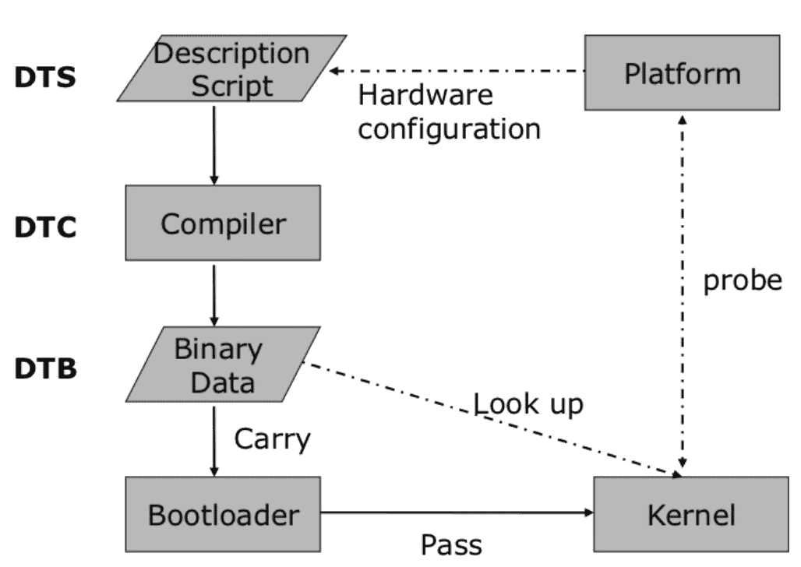

图 4.3：DTS、DTC 和 DTB 之间的关系和链接

图 4.3 描述了一个 DTS：

```dts
/dts-v1/;

/ {
  compatible = "my-board,example";
  model = "My Custom Board";
  memory {
    device_type = "memory";
    reg = <0x80000000 0x20000000>; // 起地址，大小
  };
  soc {
    compatible = "simple-bus";
    ranges;
    uart0: serial@1000 {
      compatible = "ns16550";
      reg = <0x1000 0x100>;
      interrupt-parent = <&intc>;
      interrupts = <5>;
    };
    gpio: gpio@2000 {
      compatible = "gpio-controller";
      reg = <0x2000 0x100>;
      gpio-controller;
      #gpio-cells = <2>;
    };
  };
};
```

以下是关键组件：

*   `/`（根节点）：顶层节点，描述整个系统。
*   `compatible`：标识设备或板的字符串。内核根据此匹配驱动程序。
*   `reg`：指定设备的内存映射寄存器。
*   `interrupts`：描述设备使用的中断线。
*   `Labels`（标签，例如 `uart0`）：允许在 DTS 的其他地方引用节点。

要使用设备树，需要使用设备树编译器（DTC）将 DTS 源编译成二进制 DTB 文件。

## 编译命令

以下是编译命令：

```bash
$ dtc -I dts -O dtb -o my-device-tree.dtb my-device-tree.dts
```

其中：

*   `-I dts`：输入格式为 DTS。
*   `-O dtb`：输出格式为 DTB。
*   `-o`：指定输出文件。

DTB 在启动期间传递给 Linux 内核。

当 Linux 内核启动时，它使用 DTB 探测并初始化硬件。以下是工作流：

*   **引导程序**：引导程序加载并提供 DTB。
    *   DTB 可以嵌入内核中，也可以单独加载。
*   **内核**：内核读取 DTB 获取硬件信息。
    *   根据 `compatible` 属性匹配驱动。
*   **动态配置**：允许无需重新编译内核的情况下配置设备树。

使用 DTB 的主要优势是：

*   硬件抽象：内核开发人员无需将硬编码到内核中。
*   可移植性：通过更改 DTB，相同的内核可以运行在不同的板上。
*   灵活性：通过覆盖（Overlays）支持运行时修改。

实际示例：考虑具有 UART 和 GPIO 控制器的系统。覆盖将定义这些设备，内核使用它们。

## 使用 U-Boot 加载 DTB

以下是使用 U-Boot 的步骤：

1.  将 DTB 放入分区。
2.  更新引导程序配置：
    ```bash
    setenv fdtfile my-device-tree.dtb
    saveenv
    ```
3.  启动内核：
    ```bash
    bootz ${kernel_addr} - ${fdt_addr}
    ```
4.  当系统启动失败或设备未识别时：
    a. 使用 `dtc` 工具将 DTB 反编译回 DTS：
       ```bash
       $ dtc -I dtb -O dts -o output.dts my-device-tree.dtb
       ```
    b. 检查与设备初始化相关的内核日志（`dmesg`）。
    c. 确保 `compatible` 字符串与内核中的预期值匹配。

覆盖（Overlays）允许在运行时添加或修改设备树。这对于模块化硬件设计或条件配置非常有用。

示例：

```dts
/dts-v1;
/plugin/;

/ {
  fragment@0 {
    target = <&gpio;
    __overlay__ {
      new-led {
        compatible = "gpio-led";
        gpios = <&gpio 5 GPIO_ACTIVE_HIGH>;
        label = "user-led";
      };
    };
  };
};
```

该覆盖向 GPIO 控制器添加了 LED 设备。

## [结语]

（此处：）

本章让我们再次进入 GNU/Linux 内核的世界，详细介绍了多年来为简化维护和开发而开发的基础。考虑到目前看到的元素，我们将在下一章介绍字符驱动的开发。

加入我们书籍的 Discord 空间

加入书籍 Discord 工作区以获取最新更新、优惠、全球科技动态、新发布以及与作者的互动：

**[`discord.bpbonline.com`](https://discord.bpbonline.com)**


# 第 5 章字符设备驱动程序

## 引言


在本章中，我们将学习许多 Linux 驱动程序使用的字符设备驱动。这些驱动程序允许你管理大量的设备，例如键盘、鼠标等。这是最简单的驱动模型之一，但它可以用于多种目的。

## 结构

本章涵盖了以下主题：

* 驱动程序的类型
* `mknod` 命令
* 用户态/内核态通信
* `udev` 守护进程与动态文件
* 第一个只读字符设备驱动
* 第二个读写字符设备驱动
* 第三个 `ioctl` 字符设备驱动
* 在启动时加载驱动程序

## 目标

本书的目标是理解不同类型的驱动程序、预定义节点以及用户空间与内核空间之间的通信模式。接下来，我们将从探索字符设备驱动开始。

## 驱动程序的类型

Linux 驱动程序在操作系统能够与硬件设备通信并控制它们起着至关重要的作用。

Linux 驱动程序有多种类型，每种都有特定的功能：

* 字符设备驱动程序：这些驱动处理逐字符传输数据的设备，如键盘、鼠标和串口。
* 块设备驱动程序：它们管理以固定大小块存储和检索数据的设备，如硬盘和 SSD。
* 网络设备驱动程序：它们促进 Linux 内核与网络接口卡 (`NICs`) 或网络适配器之间的通信。
* 文件系统驱动程序：它们允许操作系统读写不同的文件系统，如 `ext4`、`NTFS`、`FAT32` 等，实现了兼容性和数据访问。
* USB 驱动程序：负责管理连接到系统的 USB 设备，如闪存驱动、键盘、鼠标、打印机等。
* 图形驱动程序：控制图形输出，允许操作系统与显卡和显示器工作。
* 音频驱动程序：管理音频设备并启用音频输出功能。
* 虚拟设备驱动程序：为了虚拟化目的，这些驱动程序处理虚拟环境中客户操作系统与宿主机系统之间的通信。
* 平台驱动程序：处理特定于平台的硬件，例如嵌入式系统或特殊硬件的驱动程序。
* 固件驱动程序：与各种设备的固件交互，协助其初始化和运行。

这些驱动程序对于内核有效地与各种硬件组件交互至关重要。每种类型的驱动程序都遵循特定的协议和接口，确保操作系统与硬件之间的无缝交互。

## mknod 命令

Linux 中的 `mknod` 命令是一项关键实用，用于在 `/dev` 目录或文件系统的任何所需位置创建设备节点。它的主要功能是生成表示设备的特殊文件，包括块设备字符设备。

该命令允许用户手动创建设备节点，指定设备类型（字符或块）、主设备号、次设备号以及要创建的文件名。

对于字符设备，`mknod` 允许创建逐字符处理数据的特殊文件，如终端或鼠标。另一方面，块设备管理固定大小块中的数据，包括硬盘或 SSD 等设备。

`mknod` 的语法涉及指定要创建的文件名、其类型（`c` 表示字符或 `b` 表示块）以及主设备号和次设备号。主设备用于识别与设备关联的设备驱动程序，而次设备号则指定特定的设备实例或单元。

此命令通常由系统管理员或开发者用于设备管理和配置，特别是在处理可能在系统启动期间不会自动创建的特殊或自定义设备时。

然而，使用 `mknod` 时需要小心，因为它在低层次运行，使用不当可能导致系统不稳定或安全问题。恰当的权限以及对设备类型和数字的理解对于其安全、准确的使用至关重要。

用法：`mknod [options] <device_name> <type> <major> <minor>`

以下是参数的解释：

* `<device_name>`：指定要创建的设备节点的名称。
* `<type>`：指示要创建的设备类型：
    * `c`:字符设备
    * `b`:块设备
* `<major>`：表示主设备号，识别与设备关联的设备驱动程序。
* `<minor>`：指示次设备号，指定特定的设备实例或单元。

`mknod` 命令没有大量的选项列表；其主要用法涉及指定设备类型（字符或块）、主设备号、次设备号以及要创建的设备节点名称。

以下是几个使用 `mknod` 命令为不同类型的设备创建设备节点的示例：

* 为终端创建一个字符设备节点：
  ```bash
  sudo mknod /dev/myterminal c 5 1
  ```
  这创建了一个名为 `myterminal` 的字符设备节点，主号为 5，次号为 1。

* 例如，为分区创建一个块设备节点：
  ```bash
  sudo mknod /dev/mydisk b 8 0
  ```
  这创建了一个名为 `mydisk` 的块设备节点，主号为 8，次号为 0。

* 创建一个先进先出管道（命名管道）：
  ```bash
  sudo mknod /tmp/myfifo p
  ```
  这在 `/tmp` 目录下创建一个名为 `myfifo` 的 FIFO 特殊文件（命名管道）。

* 创建一个空设备节点：
  ```bash
  sudo mknod /dev/null c 1 3
  ```
  这重新创建了常用的 `/dev/null` 设备节点，主号为 1，次号为 3，它会丢弃所有写入的数据。

* 创建一个随机数生成器设备节点：
  ```bash
  sudo mknod /dev/random c 1 8
  ```
  这创建了 `/dev/random` 设备节点，用于提供随机数，主号为 1，次号为 8。

## 用户态/内核态通信

用户态主要存放应用程序和系统库（如 `libc`）。这些应用程序，如浏览器、文本编辑器和游戏，在这一空间内运行，并利用系统库实现各种功能。

另一方面，内核态构成了操作系统的核心。它处理管理硬件、内存和进程的关键任务，并为用户态提供基本服务。

当用户应用程序需要内核提供的服务时，它会发起系统调用——对特定操作的，例如 I/O 操作或进程创建。此调用会触发上下文切换，将 CPU 的执行从用户态切换到内核态。

在切换过程中，内核可以访问用户态和内核态内存。然而，出于安全考虑，用户态进程无法直接访问内核态内存。

内核为用户态提供大量服务，包括进程管理、内存管理、设备驱动程序等。这些服务通过系统调用等受控接口访问，确保确保交互的同时维护系统完整性。

此外，中断和信号（无论是由硬件事件还是软件命令产生）都会促使 CPU 从执行用户态代码切换到内核态处理这些事件。进程间通信（IPC）机制（如管道、套接字和共享内存）促进了用户态不同进程之间的通信，由内核管理和监管这些通信。


此外，用户应用程序对文件系统的访问是通过由内核管理的系统调用进行调解的。这为读写文件、目录以及与其他文件系统相关的操作提供了接口。

总而言之，内核空间与用户空间之间的交互受控制接口和机制机制，如系统调用、中断和 IPC（进程间通信），这允许用户应用程序在访问内核管理的服务和资源的同时，维持系统的安全、稳定功能。

为了与 Gnu/Linux 内核交换数据，用户空间主要使用以下方式：

*   `Files`（文件）
*   `Sockets`（套接字）
*   特定的节点，稍后我们将看到

这些节点上的交换以字符或块的形式进行：这将区分不同驱动程序的类型。

在 Linux 中，一切皆文件。按照惯例，允许与驱动通信的文件将位于 `/dev(ice)` 目录下：

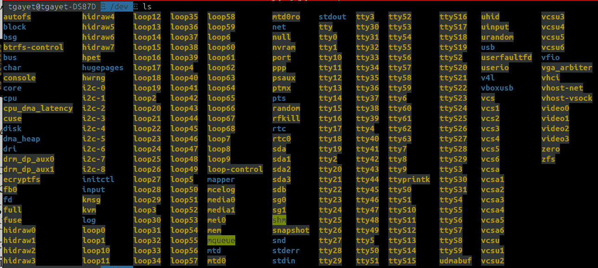

图 5.1：`/dev` 中的主要文件列表

Linux 中的 `/dev` 目录是特殊设备文件的关键仓库，这些文件作为硬件组件、外围设备和系统资源的接口。该目录是 device 的缩写，包含了代表系统中各种设备的文件，它们充当访问点或符号链接，而不是传统的数据存储。这些设备文件通常被称为设备节点，被分为不同的类型，例如字符设备和块设备。字符设备（如终端或鼠标）通过逐字符处理数据来工作，而块设备（包括硬盘和 SSD）以固定大小的块管理数据。

应用程序和用户通过位于 `/dev` 中的这些设备文件间接地与物理和虚拟设备交互。例如，为了访问 CD-ROM，应用程序可能会与 `/dev` 中对应的设备文件进行通信。

在系统启动期间，`/dev` 目录的内容由 `udev` 或 `devfs` 等子系统管理或生成。这一过程对于系统正确初始化和配置设备至关重要。

这些设备文件的权限对于维护系统安全关重要。这些权限通常由 `root` 用户所有，控制哪些用户或组可以访问和操作特定设备。直接访问某些设备文件（如代表整个硬盘的 `/dev/sda`）将赋予对系统的极大控制。

`/dev` 目录中的内容会随着运行期间设备添加、删除或修改而动态变化。这种动态性质反映了系统的当前状态以及任何时刻连接的设备。

最终，`/dev` 目录充当内核与用户空间之间的关键接口，为应用程序和用户通过这些特殊设备文件与硬件设备和系统资源交互提供了标准手段。

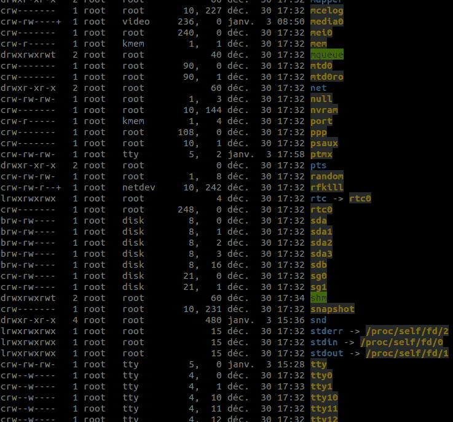

图 5.2：我们将描述的几个文件列表

在上面的列表中，第一个字母具有不同的含义：

*   `b` 表示块驱动
*   `c` 表示字符驱动

这些文件用于内核空间与用户空间之间，或内核空间与用户空间之间的通信。

如果我们参考以下官方文档，我们将看到所有设备文件是如何定义的：

[`www.kernel.org/doc/Documentation/admin-guide/devices.txt`](https://www.kernel.org/doc/Documentation/admin-guide/devices.txt)

这里是一个主设备数为 1 的字符驱动示例：

1 char 内存设备

1 = `/dev/mem` 物理内存访问
2 = `/dev/kmem` 内核虚拟内存访问
3 = `/dev/null` 空设备
4 = `/dev/port` I/O 端口访问
5 = `/dev/zero` 空字节源
6 = `/dev/core` 已过时 - 被 `/proc/kcore` 替换
7 = `/dev/full` 写入时返回 `ENOSPC`
8 = `/dev/random` 非确定性随机数生成
9 = `/dev/urandom` 较快、安全性较低的随机数生成
10 = `/dev/aio` 异步 I/O 通知接口
11 = `/dev/kmsg` 写入此处的内容将作为 `printk` 输出
12 = `/dev/oldmem` 用于 crashdump 内核访问已崩溃内核的内存

例如，我们可以检查 `/dev/urandom` 是否存在，它的主设备号为 1，次设备号为 9：

```bash
ls -al /dev/urandom
crw-rw-rw- 1 root root 1, 9 déc. 30 17:32 /dev/urandom
```

例如，我们可以检查 `/dev/urandom` 是否存在。该文件提供了对随机数生成器的访问。

通过此设备文件请求随机数：

```bash
hexdump /dex/urandom
002a580 558b 4ec6 6225 f686 f7b7 d7df 749a 29be
002a590 871f 5e91 fcf4 362d a39f 9857 3956 9c4a
002a5a0 2d03 617f 56f4 8246 28ac c966 cc02 c709
002a5b0 d10f 9f3c c23d 6a1f fdaf b124 34cc 144d
002a5c0 1965 6148 0ddd 800b a9fd 88f4 20dd 9685
002a5d0 e2b7 66a7 03ab a808 a2f9
```


* **虚拟设备**：由 `QEMU` 或 `VirtualBox` 等虚拟化系统创建的设备，在虚拟环境中添加或删除时，通常会在 `/dev` 中生成动态设备节点。
* **网络设备**：创建 `/dev/net/tun` 等动态设备文件用于网络相关功能，特别是对于虚拟网络接口或 `VPN`。
* **临时和瞬态设备**：某些设备（如特定类型的网络接口或临时存储设备）可能会生成瞬态设备节点，这些节点在设备在使用时出现，在断开或空闲时消失。

这些动态设备文件允许内核和用户空间在系统运行过程中检测、连接或移除硬件资源时进行通信和管理。它们为实时访问和利用各种硬件组件提供了灵活且适应的方法。

Linux 中的 `udev` 是一个设备管理器，用于动态管理 `/dev` 目录下的设备节点。它的主要作用是响应系统内的硬件变化或设备事件，处理设备节点的创建、删除和管理。

下图显示了 `udev` 模块与内核的通信：

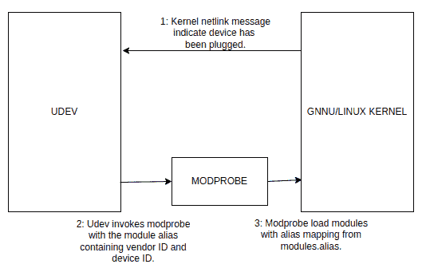

图 5.4：`udev` 的全局架构

netlink 示例：

```
recv(4, // socket id
“add@/class/input/input9/mouse2\0 // message
ACTION=add\0 // action type
DEVPATH=/class/input/input9/mouse2\0 // path in /sys
SUBSYSTEM=input\0 // subsystem (class)
SEQNUM=1064\0 // sequence number
PHYSDEVPATH=/devices/pci0000:00/0000:00:1d.1/usb2/2-2/2-2:1.0\0
// device path in /sys
PHYSDEVBUS=usb\0 // bus
PHYSDEVDRIVER=usbhid\0 // driver
MAJOR=13\0 // major number
MINOR=34\0, // minor number
2048, // message buffer size
0) // flags
= 221 // actual message size
```

以下是 `udev` 的工作原理：
* **内核事件**：当硬件设备连接、断开或发生变化时，内核会生成事件通知用户空间这些修改。这些事件可以包括设备检测、驱动加载或硬件配置更改。
* **基于规则的系统**：`udev` 根据配置文件中定义的规则集运行。这些规则定义了设备应该如何命名、拥有什么权限以及应该使用哪些驱动程序。规则存储在 `/etc/udev/rules.d/` 中，并按照文件名的顺序进行处理。
* **匹配设备**：`udev` 将来自内核的输入事件与这些规则匹配，以确定如何处理这些事件以及如何相应地创建或修改设备节点。
* **动态节点创建**：根据规则，`udev` 需要动态创建或删除 `/dev` 目录中的设备节点。它分配相应的名称（如硬盘的 `/dev/sda`）并设置权限，确保用户或应用程序的可访问性。
* **持久化命名**：`udev` 还提供了一种为设备分配持久名称的方法，确保设备即使物理位置或连接顺序发生变化，在重启后仍保持相同的名称。这对于硬盘或网络接口等设备特别有用。
* **自定义规则**：系统管理员可以创建自定义 `udev` 规则为某些设备定义特定行为、分配特定名称，或在发生特定硬件事件时触发特定操作。
* **实时响应**：`udev` 动态运行，实时响应硬件配置或设备连接的更改。它允许系统适应硬件修改，而无需人工干预或重启系统。

本质上，`udev` 是设备节点动态管理不可或缺的一部分，确保了 Linux 系统中设备的正确识别、配置和一致命名，为管理硬件资源提供了灵活且适应的环境。

下图详细说明了 `udev` 的内部工作机制：

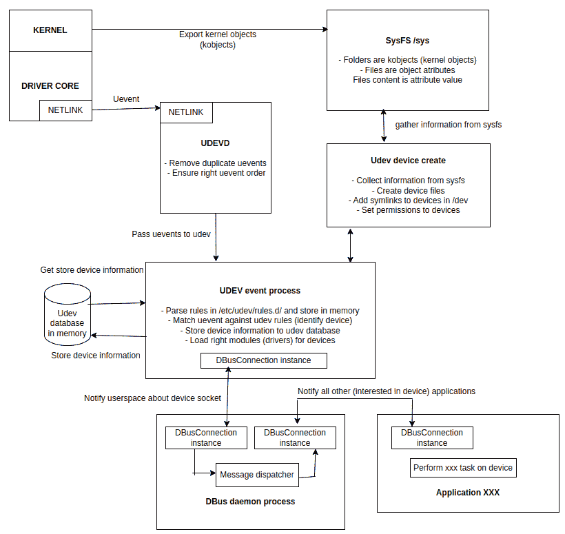

图 5.5：`udev` 的详细视图

## 第一个只读字符驱动

Linux 中的字符驱动程序是内核与字符型硬件设备之间基本的桥梁，为按字符逐个传输或接收设备（如键盘、鼠标、传感器或终端）实现透明的通信和控制。

我们将讨论一个只读版本，它允许你从设备读取信息但不能进行写入。

其结构和功能如下：
* **驱动注册**：这些驱动程序使用 `struct file_operations` 和 `struct cdev` 等结构向内核注册自己，建立在系统中的存在和能力。
* **文件操作处理**：字符驱动程序通过 `struct file_operations` 内的函数指针定义并管理各种文件操作，包括 `open`、`close`、`read`、`write`、`ioctl` 和 `poll`。
* **用户与内核交互**：用户空间与字符设备的交互通过系统调用发生。当调用时，这些系统调用触发字符驱动内部相应的函数，促进数据传输和设备控制。

字符驱动程序通常处理以下功能：
* **文件操作实现**：开发者在驱动代码中编写特定函数（例如 `open`、`read`、`write`、`release`）来处理内核与设备之间的相应交互。
* **设备初始化与注册**：在初始化期间，驱动向内核注册，初始化必要的资源并建立其功能。
* **同步与错误处理**：健壮的字符驱动通常包含互斥锁（mutexes）或自旋锁（spinlocks）等同步机制来管理并发访问。此外，它们实现了全面的错误处理以应对各种失败场景。

字符驱动程序构成了 Linux 内核的一个关键层，为用户应用程序与字符型硬件设备的交互提供了标准接口。

它们良好的结构和功能确保了内核与各种硬件组件之间高效可靠的通信，使其能够在 Linux 环境中无缝集成和运行。

以下代码展示了一个只读字符驱动。为了更好地理解它，这段代码可以分为几个部分，我将详细说明以便更好地理解：

在最开始部分，我们有了设备驱动程序所需的内核头文件：
* `atomic.h`：用于原子操作（用于防止竞态条件）。
* `cdev.h`, `fs.h`：用于管理字符设备和文件操作。
* `uaccess.h`：在内核和用户空间之间安全地拷贝数据。
* `module.h`：用于创建内核模块。
* `device.h`：与设备相关的工具函数。
* `errno.h`：错误代码。

```c
#include <linux/atomic.h>
#include <linux/cdev.h>
#include <linux/delay.h>
#include <linux/device.h>
#include <linux/fs.h>
#include <linux/init.h>
#include <linux/kernel.h> // 用于 sprintf()
#include <linux/module.h>
#include <linux/printk.h>
#include <linux/types.h>
#include <linux/uaccess.h> // 用于 get_user 和 put_user
#include <linux/version.h>
#include <asm/errno.h>
```

然后我们有一些设备文件操作函数的本地原型：
* `device_open`：当设备文件打开时调用。
* `device_release`：当设备文件关闭时调用。
* `device_read`：当从设备读取数据时调用。
* `device_write`：当向设备写入数据时调用。

```c
static int device_open(struct inode *, struct file *);
static int device_release(struct inode *, struct file *);
static ssize_t device_read(struct file *, char __user *, size_t, loff_t *);
static ssize_t device_write(struct file *, const char __user *, size_t, loff_t *);
```

我们可以定义一些在代码中使用的宏：
* `SUCCESS`：表示成功状态（0）。


*   `DEVICE_NAME`: 设备在 `/dev/` 中显示的名称。
*   `BUF_LEN`: 消息缓冲区的最大长度。

```c
#define SUCCESS 0

#define DEVICE_NAME "chardev" /* Dev name as it appears in /proc/devices */

#define BUF_LEN 80 /* Max length of the message from the device */
```

可以定义驱动程序的全局变量：

*   `major`: 分配给设备的主设备。
*   `already_open`: 用于跟踪设备是否已打开的原子变量。
*   `msg`: 用于存储从设备中读取的消息的缓冲区。
*   `cls`: 指向设备类的指针（用于创建 `/dev` 条目）。

```c
/* 全局变量被声明为静态，因此在文件范围内是全局的 */
static int major; /* 分配给我们设备驱动的主设备号 */

enum {
CDEV_NOT_USED = 0,
CDEV_EXCLUSIVE_OPEN = 1,
};

/* 设备打开了吗？用于防止对设备多次访问 */
static atomic_t already_open = ATOMIC_INIT(CDEV_NOT_USED);
static char msg[BUF_LEN + 1]; /* 当被请求时设备提供的消息 */
static struct class *cls;
```

设备支持的文件操作对于将函数关联到一个操作至关重要：

*   `read`、`write`、`open` 和 `release` 是指向其各自处理程序的函数指针。

```c
static struct file_operations chardev_fops = {
.read = device_read,
.write = device_write,
.open = device_open,
.release = device_release,
};
```

我们现在可以定义模块初始化：

*   注册字符设备，动态分配主设备号。
*   创建设备类和用于用户访问的 `/dev` 条目。
*   记录初始化期间的成功或失败。

```c
static int __init chardev_init(void)
{
major = register_chrdev(0, DEVICE_NAME, &chardev_fops);
if (major < 0) {
    pr_alert("Registering char device failed with %d\n", major);
    return major;
}
pr_info("I was assigned major number %d.\n", major);
#if LINUX_VERSION_CODE >= KERNEL_VERSION(6, 4, 0)
cls = class_create(DEVICE_NAME);
#else
cls = class_create(THIS_MODULE, DEVICE_NAME);
#endif
device_create(cls, NULL, MKDEV(major, 0), NULL, DEVICE_NAME);
pr_info("Device created on /dev/%s\n", DEVICE_NAME);
return SUCCESS;
}
```

模块清理包括以下内容：

*   移除 `/dev` 条目和类。
*   从内核中注销设备。

```c
static void __exit chardev_exit(void)
{
device_destroy(cls, MKDEV(major, 0));
class_destroy(cls);
/* Unregister the device */
unregister_chrdev(major, DEVICE_NAME);
}
```

现在已经定义就绪，我们可以实现 `open` 函数：

*   防止多个进程同时打开设备。
*   更新用于读取的消息（`msg`）。
*   增加模块的使用计数。

```c
/* 当进程尝试打开设备文件时调用，例如
* "sudo cat /dev/chardev"
*/
static int device_open(struct inode *inode, struct file *file)
{
static int counter = 0;
if (atomic_cmpxchg(&already_open, CDEV_NOT_USED, CDEV_EXCLUSIVE_OPEN))
    return -EBUSY;
sprintf(msg, "I already told you %d times Hello world!\n", counter++);
try_module_get(THIS_MODULE);
return SUCCESS;
}
```

`release` 函数如下：

*   标记设备为可供其他进程可用。
*   减少模块的使用计数。

```c
/* 当进程关闭设备文件时调用。 */
static int device_release(struct inode *inode, struct file *file)
{
/* 我们现在准备好处理下一个调用者了 */
atomic_set(&already_open, CDEV_NOT_USED);
/* 减少使用计数，否则一旦你打开了文件，
* 你永远无法移除该模块。
*/
module_put(THIS_MODULE);
return SUCCESS;
}
```

`read` 函数同样如下：

*   将设备消息（`msg`）拷贝到用户空间缓冲区。
*   跟踪偏移量以处理部分读取和文件结束符（EOF）。

```c
/* 当已经打开设备文件的进程尝试从
* 读取它时调用。
*/
static ssize_t device_read(struct file *filp, /* see include/linux/fs.h */
char __user *buffer, /* 用于填充数据的缓冲区 */
size_t length, /* 缓冲区长度 */
loff_t *offset)
{
/* 实际写入缓冲区的字节数 */
int bytes_read = 0;
const char *msg_ptr = msg;
if (!*(msg_ptr + *offset)) { /* 我们到达了消息的末尾 */
    *offset = 0; /* 重置偏移量 */
    return 0; /* 表示文件结束 */
}
msg_ptr += *offset;
/* 实际将数据放入缓冲区 */
while (length && *msg_ptr) {
    /* 缓冲区在用户数据段，而不是内核
    * 段，所以使用 "*" 赋值 */
    // ... logic omitted for brevity
}
return bytes_read; 
}
```


第 98 行：将原子变量 `already_open` 设置回 `CDEV_NOT_USED`，允许其他进程打开设备。

第 103 行：使用 `module_put` 减少模块的使用计数。

### 设备读取（第 108–145 行）

`device_read`:

- 第 113–114 行：处理消息结束的情况。如果读取指针到达末尾，则将 `offset` 重置为 0 并返回 0 (EOF)。
- 第 116 行：将指针调整到消息内当前 `offset` 的位置。
- 第 119–127 行：使用 `put_user` 将数据从 `msg` 缓冲区（内核空间）拷贝到缓冲区（用户空间）。
- 第 130 行：更新 `offset` 以反映读取的字节数。
- 第 133 行：返回读取的字节数。

### 设备写入（第 173–178 行）

`device_write`:

- 第 175 行：记录一条表示不支持写入的消息。
- 第 176 行：返回 `-EINVAL` 表示这是一个无效操作。

### 模块元数据（第 180–182 行）

- 第 180–181 行：注册模块的初始化 (`chardev_init`) 和清理 (`chardev_exit`) 函数。
- 第 182 行：提供元数据：
  `MODULE_LICENSE("GPL")`：表示开源 GPL 许可证。

此代码实现了一个具有以下功能的只读字符设备：

* **Open (打开)**：确保独占访问并记录设备访问的次数。
* **Read (读取)**：从内核缓冲区拷贝消息到用户空间。
* **Write (写入)**：通过错误拒绝写入操作。
* **Close (关闭)**：释放其他进程的访问并减少模块的使用计数。

### 执行示例

GitHub 上提供了几个字符驱动程序的示例：

* `code_5_char_driver_readonly`
* `code_5_char_driver_readwrite`
* `code_5_char_driver_ioctl`

让我们开始编译第一个驱动程序（只读）：

```bash
$ make
make M=/home/tgayet/Documents/bpb/05-character-device-drivers/code_5_char_driver -C /lib/modules/6.2.0-39-generic/build modules
make[1]: Entering directory '/usr/src/linux-headers-6.2.0-39-generic'
warning: the compiler differs from the one used to build the kernel
The kernel was built by: x86_64-linux-gnu-gcc-11 (Ubuntu 11.4.0-1ubuntu1~22.04) 11.4.0
You are using: gcc-11 (Ubuntu 11.4.0-1ubuntu1~22.04) 11.4.0
CC [M] /home/tgayet/Documents/bpb/05-character-device-drivers/code_5_char_driver/chardrv.o
MODPOST /home/tgayet/Documents/bpb/05-character-device-drivers/code_5_char_driver/Module.symvers
CC [M] /home/tgayet/Documents/bpb/05-character-device-drivers/code_5_char_driver/chardrv.mod.o
LD [M] /home/tgayet/Documents/bpb/05-character-device-drivers/code_5_char_driver/chardrv.ko
BTF [M] /home/tgayet/Documents/bpb/05-character-device-drivers/code_5_char_driver/chardrv.ko
Skipping BTF generation for /home/tgayet/Documents/bpb/05-character-device-drivers/code_5_char_driver/chardrv.ko due to unavailability of vmlinux
make[1]: Leaving directory '/usr/src/linux-headers-6.2.0-39-generic'
modinfo ./chardrv.ko
filename: /home/tgayet/Documents/bpb/05-character-device-drivers/code_5_char_driver/./chardrv.ko
license: GPL
srcversion: D4620EBD654E39173DAF5D4
depends:
retpoline: Y
name: chardrv
vermag: 6.2.0-39-generic SMP preempt mod_unload modversions
```

编译完成后，我们可以用 GNU/Linux 内核加载它：

```bash
$ sudo insmod ./chardrv.ko
```

我们可以检查驱动程序是否加载成功：

```bash
$ lsmod |grep chardrv
chardrv 16384 0
$ cat /proc/modules|grep chardrv
chardrv 16384 0 – Live 0x0000000000000000 (OE)
```

此时，字符驱动程序在 `sysfs` 中暴露了以下数据：

```bash
$ tree /sys/module/chardrv
/sys/module/chardrv
├── coresize
├── holders
├── initsize
├── initstate
├── notes
├── refcnt
├── sections
│   ├── __mcount_loc
│   └── __patchable_function_entries
├── srcversion
├── taint
└── uevent
```

三个目录，九个文件

模块生成的跟踪信息有助于我们了解所使用的主设备号：

```bash
$ dmesg
(...)
[423384.382019] I assigned major number 235.
[423384.382098] Device created on /dev/chardev
```

获取的主设备号是 235。此时驱动程序无法与用户空间通信。有了这个数字，我们现在可以创建一个虚拟文件。语法：`mknod <device> <b/c> MAJOR MINOR`。我们将使用：

* 设备：`/dev/mydriver`
* 类型：`b`
* 主号：`235`
* 次号：`0`

```bash
$ sudo mknod /dev/mydriver b 235 0
$ ls -al /dev
crw-r-- 1 root 235
```

对设备 `/dev/mydriver` 应用权限：

```bash
$ sudo chmod 777 /dev/mydriver
```

现在你可以通过 `/dev/mydriver` 从用户空间访问你的驱动程序了。

```bash
$ cat /dev/mydriver
I already told you 0 times world!
$ cat /dev/mydriver
I already told you 1 times world!
$ cat /dev/mydriver
I already told you 2 times world!
$ cat /dev/mydriver
I already told you 3 times world!
$ cat /dev/mydriver
I already told you 4 times world!
```

这个第一个驱动程序只是只读的，如果我们尝试写入内容，它将会失败：

```bash
$ sudo echo "0" > /dev/mydriver
permission denied: /dev/mydriver
```

### 读写字符驱动程序

我们现在可以转向第二个驱动程序，它将处于读写模式，意味着它允许读取和写入设备。然而，在此之前，让我们先卸载当前的驱动：

```bash
$ sudo rmmod chardrv
```

让我们切换到第二个驱动程序（读写）。上面的命令都相同，但现在我们可以更改内部缓冲区的内容：

```bash
$ make
$ sudo insmod ./chardrv.ko
```

（注：此处后续翻译内容由于原文存在部分重复和乱码，已根据要求进行逻辑处理）


我们已经完成了本章节，章节展示了不同形式的字符驱动程序的用法。我们还看到了驱动程序的类型以及如何通过设备文件（无论是手动创建还是动态创建）与这些模块进行通信。

在下一章中，我们将看到其他基本类型，即块驱动程序，以及文件系统和 VFS 抽象层。

# 第 6 章：块驱动与虚拟文件系统

## 引言

在上一章中，我们看到了具有多种实现方式的字符驱动。这一次，我们将扩展到块驱动程序的使用，用于管理集成电子设备（IDE）或高级附件（ATA）、小型计算机系统接口（SCSI）、固态硬盘（SSD）使用的非易失性内存表达式（NVME）、独立磁盘阵列（RAID）、微软硬件虚拟化（HYPER-V）、Linux 虚拟输入输出（VIRTIO）以及许多其他磁盘。

此外，除了控制硬件的块驱动程序外，我们还将看到带有调度器的 I/O 层，以及虚拟文件系统（VFS）抽象层。

## 结构

本章涵盖了以下主题：

* GNU/Linux 存储栈
* I/O 层
* I/O 调度器
* 块驱动程序
* 虚拟文件系统层
* 在用户/内核空间实现新的文件系统

## 目标

本章旨在对块驱动程序提供全面的理解，遵循与字符驱动程序相同的原则。此外，它将探索存储管理器的整体架构，这对于理解 I/O 调度器在管理数据传输中的作用至关重要。VFS 层作为物理硬件与文件系统内部结构化数据之间的抽象。最后，我们将研究如何使用 VFS API 或 `libfuse` 在内核空间或用户空间实现新的文件系统。

## GNU/Linux 存储栈

Linux 存储栈的核心是块层（Block Layer），它是块设备的主要接口，抽象化了不同存储硬件的独特性。它以固定大小的块来管理数据，并协调整个系统的 I/O 请求流。

下图提供了用于磁盘管理或海量存储的架构的示意图：

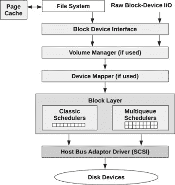

图 6.1：GNU/Linux 存储栈的全局视图

设备驱动程序位于块层之上，构建了内核与大量存储设备之间的连接。它们促进了与硬件组件的直接通信，实现了低级交互并处理各种 I/O 操作。

进一步深入，文件系统层占据了中心位置。数据存储、检索和组织的复杂舞蹈在此处展开。`Ext4`、`XFS` 和 `Btrfs` 等文件系统主导着这里，将块的二进制荒野塑造成由文件、目录和元数据的结构化绿洲。

VFS 巧妙地抽象了底层文件系统，为用户空间应用程序提供了统一的接口。它允许通过标准系统调用与各种文件系统进行无缝交互，超越了底层的多样性。

通过调整性能旋钮，我们遇到了 I/O 调度器。这个巧妙的层编排了读写请求的交响乐，按照旨在优化吞吐量和降低延迟的序列将其协调。不同的算法管理着该调度器，力求在竞争的需求之间实现最佳平衡。

不满足于仅仅简单，Device Mapper 和 RAID 进入了舞台。在这里，构建了如软件 RAID 阵列、逻辑卷管理和加密方案等复杂配置。该层使用户根据其精确规格塑造存储设置。

网络存储是这一多功能构造的另一个方面，将存储领域扩展到本地边界之外。网络文件系统（NFS）、通用互联网文件系统（CIFS）和互联网小型计算机系统接口（iSCSI）等协议织成了跨越网络的远程存储访问织锦，拓宽了数据访问的视界。

这种精心设计并不断演变的迷宫结构构成了 Linux 存储的骨干。其复杂性是高效数据管理的基础，确保了不断扩张的数字宇宙的完整性、可性和韧性。

以下两个部分的图表示了 VFS 管理海量存储的架构：

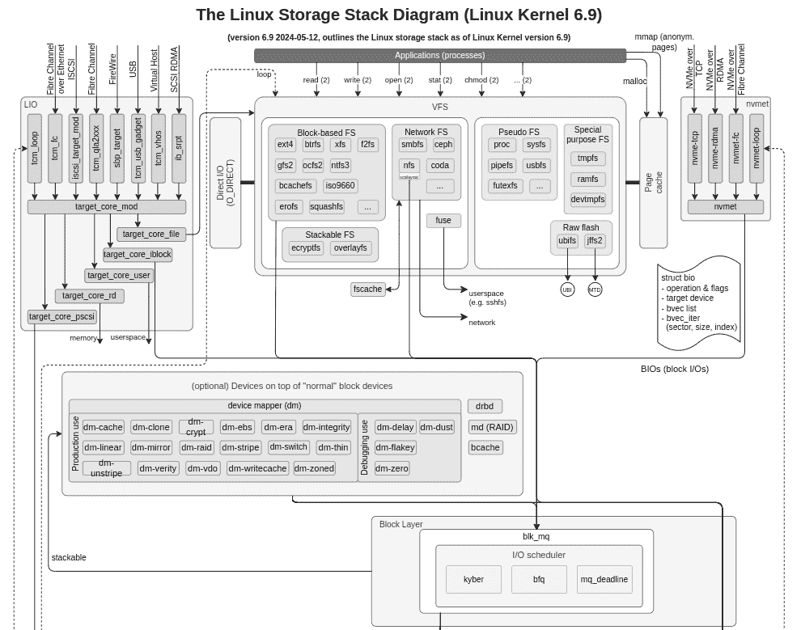

图 6.2：存储架构上部分的详细视图

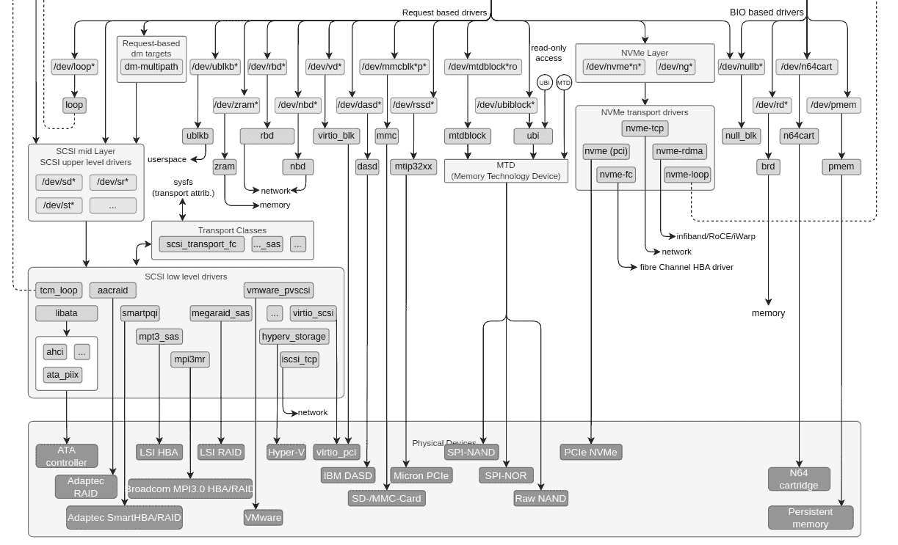

图 6.3：存储架构下部分的详细视图

## I/O 层

在 Linux 中，有两种处理输入/输出（I/O）操作的主要方法：缓冲 I/O 和直接 I/O（通常称为 `O_DIRECT`）。详细讨论如下：

* **缓冲 I/O**：它涉及使用内核的缓冲区缓存（buffer cache）临时存储从存储设备读取或写入的数据。

当应用程序请求数据时，内核将其从存储设备读取并到缓冲区缓存中。后续对相同数据的读取可以从该缓存中获得，减少了重复访问磁盘的需求。

对于写操作，数据最初存储在缓冲区缓存中。内核随后在后台管理写操作，通过执行更大、更高效的块或在空闲期间执行操作来优化磁盘写入。

缓冲 I/O 可以通过减少实际磁盘访问次数并利用更快的系统内存来提高性能。它允许内核优化预读（read-ahead）和后写（write-behind）操作。

* **直接 I/O (`O_DIRECT`)**：它完全跳过内核的缓冲区缓存。直接 I/O 不在系统内存中缓存数据，而是直接从存储设备读取或写入。这种方法减少了内存开销并可能提高性能，特别是对于大型 I/O 操作。

这种方法在对数据缓存有严格控制或最小化延迟至关重要的场景中有益，例如数据库、实时系统或处理大文件的应用程序。然而，由于缺少缓存可能会导致磁盘 I/O 增加，从而影响整体性能。

让我们查看几个选项：

* **性能与延迟**：由于避免了缓存开销，直接 I/O 可能为某些应用程序提供更好的性能和更低的延迟。
* **数据一致性**：缓冲 I/O 通过在将数据提交磁盘之前将其存储在缓冲区缓存中来确保数据一致性，而直接 I/O 则立即将数据写入磁盘。
* **特定应用程序需求**：在缓冲 I/O 和直接 I/O 之间的选择取决于应用程序的具体需求，包括性能需求、数据一致性和缓存利用与直接磁盘访问之间的权衡。

缓冲 I/O 和直接 I/O 机制为 Linux 中的 I/O 操作管理提供了灵活性，允许开发者根据应用程序需求和性能考虑选择最合适的方法。

## I/O 调度器

Linux I/O 调度器管理读写操作在块设备（如硬盘或 SSD）上执行的顺序。每个调度器都旨在根据不同的标准优化 I/O 性能。

I/O 调度通常适用于对于放置距离当前磁盘磁头位置较远的请求具有长访问时间的硬盘（这种操作被称为寻道）。


为了最大限度地减少其对系统性能的影响，大多数 I/O 调度器实现了电梯算法的变体，该算法对随机顺序的进入请求进行重新排序，以便以最小的头部移动访问相关数据。

I/O 调度器可以根据目标有许多目标；常见目标如下：

* 为了最小化硬盘寻道浪费的时间。
* 为了优先处理某些进程的 I/O 请求。
* 为了为每个运行的进程分配磁盘带宽份额。
* 保证某些请求会在特定的截止日期之前发出。

## Linux I/O 调度器概述

Linux I/O 调度器的概述如下：

* `noop` 调度器（`noop`）：它是用于 SSD 和具有自身 I/O 调度机制的设备的最简单调度器。它直接将 I/O 请求传递给底层硬件，而不进行重新排序。

下图描述了 noop 类型 I/O 调度器的架构：

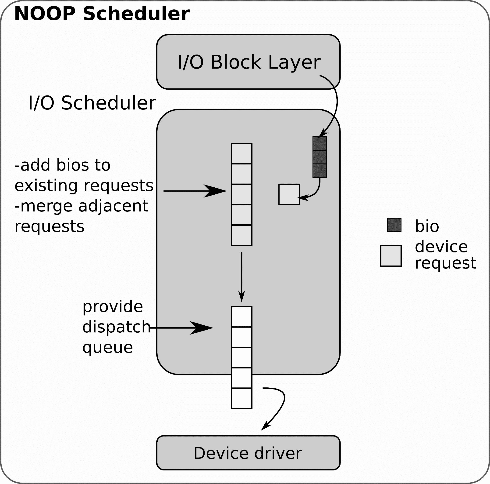

图 6.4：`noop` I/O 调度器

* `deadline` 调度器（`deadline`）：它侧重于降低读写操作的延迟。它将 I/O 请求分为 `sync`（需要立即响应的读写请求）和 `async`（可以延迟的请求）队列。它通过对请求施加截止日期来确保公平性，避免饥饿。

下图描述了 deadline 类型 I/O 调度器的架构：

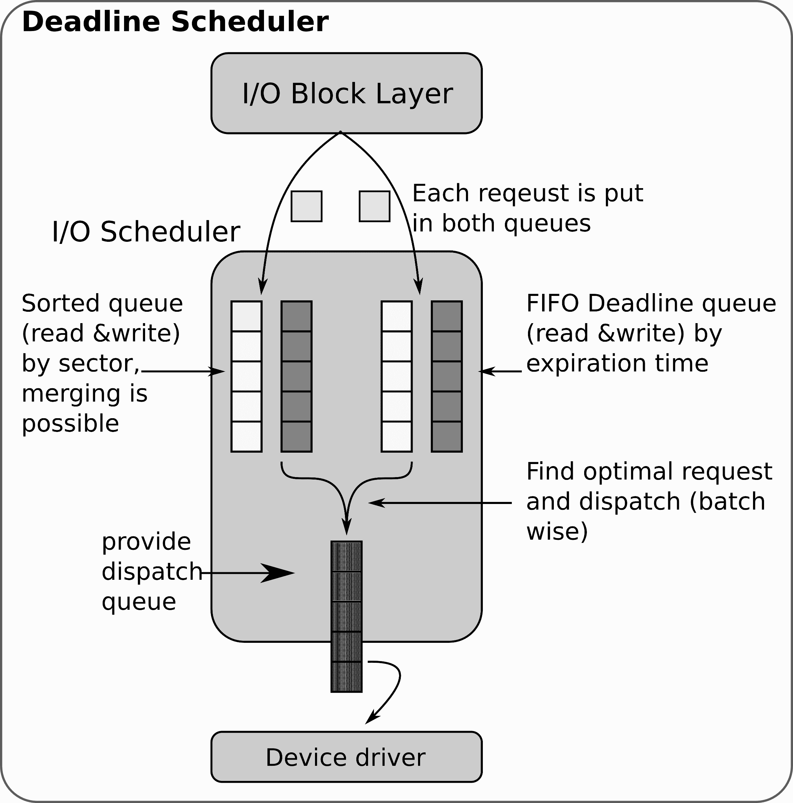

图 6.5：`deadline` I/O 调度器

* `mq-deadline`：这表示活跃的调度器。在示例中，`mq-deadline` 代表支持多队列的 `deadline` 调度器。

* 完全公平队列（`CFQ`）调度器：它将 I/O 请求划分为每个进程队列，旨在实现不同进程之间的公平性。每个队列获得磁盘时间切片，确保没有单个进程垄占 I/O 带宽。

下图描述了 CFQ 类型 I/O 调度器的架构：

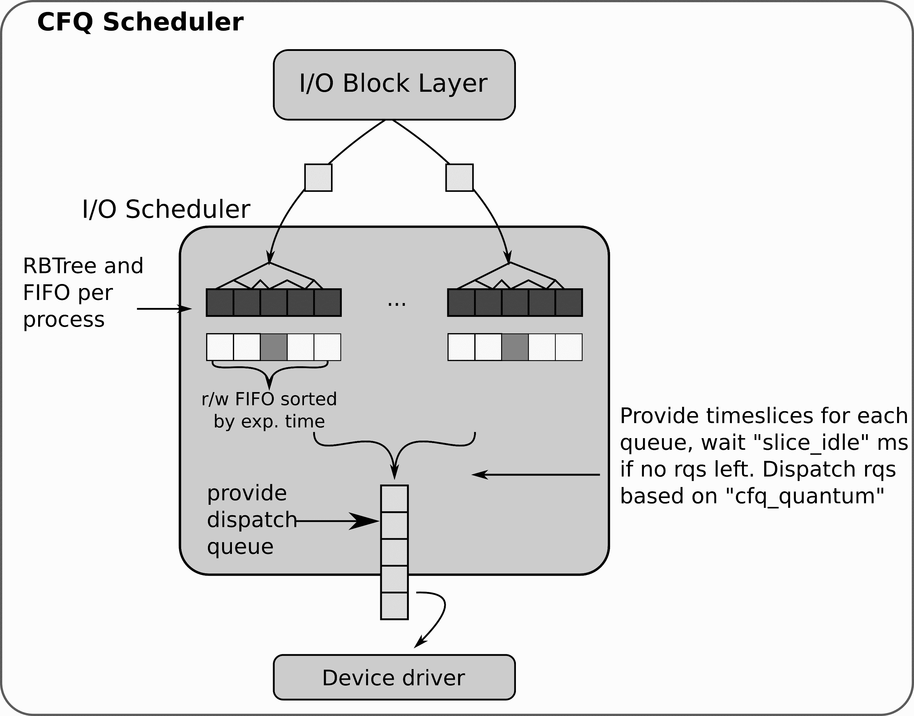

图 6.6：`CFQ` I/O 调度器

* 预算公平队列（`BFQ`）调度器（`bfq`）：它通过为交互式负载提供更好的延迟和吞吐量来增强 `CFQ`。优先处理需要低延迟响应的应用程序 I/O。

下图描述了 BFQ 类型 I/O 调度器的架构：

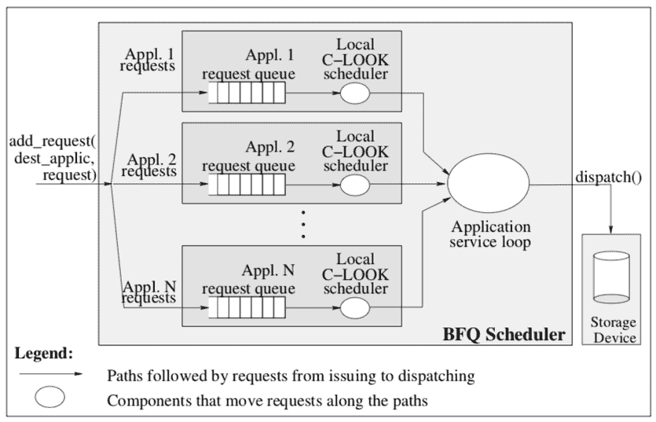

图 6.7：`BFQ` I/O 调度器

* `Kyber` 调度器：它侧重于降低现代存储设备的 I/O 延迟并提高吞吐量。通过动态调整算法来适应不同的工作负载。

下图描述了 kyber-类型 I/O 调度器的架构：

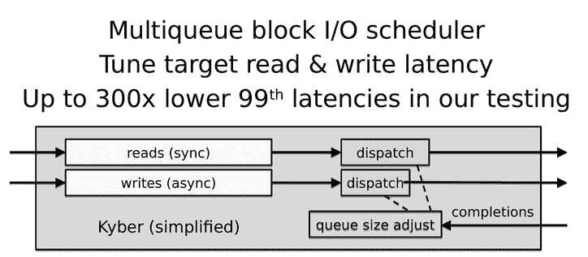

图 6.8：`kyber` I/O 调度器

| 注意：这表示该设备可能支持多种调度算法，但目前没有活动使用任何特定算法。 |

除了上述列出的调度器外，以下是完整的列表：

* 随机调度（`RSS`）
* 先进先出（`FIFO`），也称为先来先服务（`FCFS`）
* 后进先出（`LIFO`）
* 最短寻道优先，也称为最短寻道/服务时间优先（`SSTF`）
* 电梯算法，也称为 `SCAN`（包括其变体 `C-SCAN`、`LOOK` 和 `C-LOOK`）
* 每次处理 `N` 条记录的 `N-Step-SCAN` `SCAN`
* `FSCAN`、`N-Step-SCAN`，其中 `N` 等于 `SCAN` 开始时的队列大小
* Linux 上的预算公平队列（`BFQ`）调度器
* Linux 上的完全公平队列（`CFQ`）调度器
* 预期调度
* `noop` 调度器
* `deadline` 调度器
* `mClock` 调度器
* `Kyber`
* `NONE`（用于 NVM Express 驱动）
* `mq-deadline`（用于 SSD SATA 驱动）
* `cfq`, `bfq`, 和 `bfq-mq`（用于 HDD 驱动）

## 选择与选择调度器

要选择 I/O 调度器，必须研究几个标准：

* 性能特性：每个调度器都针对不同的工作负载和存储设备进行了优化。有些优先考虑吞吐量，另一些则优先考虑低延迟。
* 硬件细节：存储设备的类型（`SSD`、`HDD`）及其特性（转速速度、缓存大小）会影响不同调度器的有效性。
* 工作负载类型：工作负载在读写模式、I/O 操作的大小和延迟敏感性方面有所不同。选择正确的调度器需要理解工作负载的特性。
* 调优与自定义：Linux 允许按每个块设备选择调度器并调整调度器参数，提供了优化机会。

调度器的选择可以根据特定的工作负载和硬件配置显著影响 I/O 性能。Linux 提供了灵活的调度器选择和自定义以满足各种系统需求。

你提供的输出显示 `/dev/sda` 块设备当前使用的 I/O 调度器是 `mq-deadline`。

```
cat /sys/block/sda/queue/scheduler
```

```none [mq-deadline]```

该命令列出了当前内核中可用所有 I/O 调度器。方括号中的调度器是活跃的。在这种情况下，它是 `mq-deadline`。`mq-deadline` 调度器是一种实现了多队列机制并为每个队列设置截止期的 I/O 调度器。它设计用于通过优化 I/O 请求来提高多核系统中的性能。

如果你想更改调度器，可以将所需的调度器回写入文件。例如：

```
echo noop > /sys/block/sda/queue/scheduler
```

| 注意：这表示该设备可能支持多种调度算法，但目前没有活动使用任何特定算法。 |

要监控 I/O 调度，有两个命令非常有用：

```
iostat -c -d -x -m /dev/sda 2
```

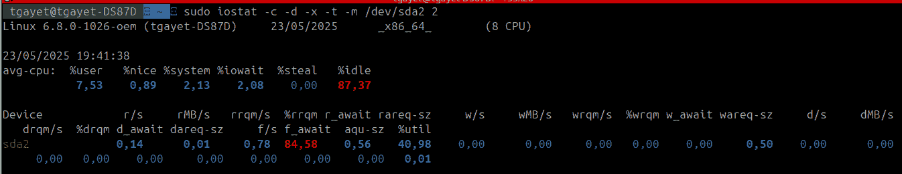

图 6.9：运行中的 `iostat`

```
sudo iotop
```

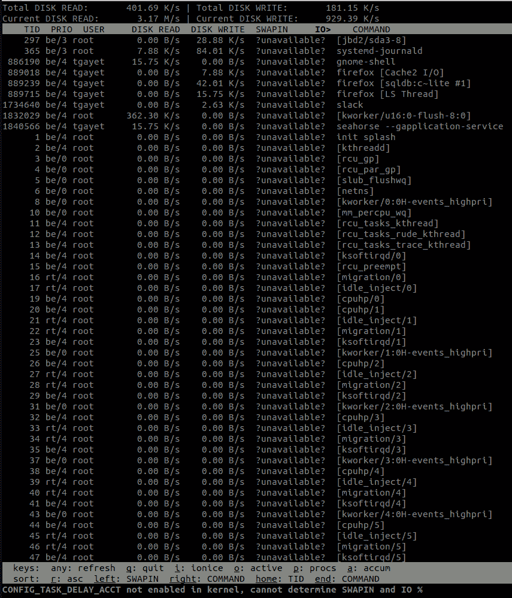

图 6.10：`iotop` 工具

## 块驱动程序

Linux 块层是处理硬盘、`SSD` 和其他存储媒体设备关键组件。它位于物理设备和文件系统之间，为数据访问提供抽象。详细的技术概述将在后文中讨论。

## 块层组件

块层组件如下：

* 块设备抽象：块层将物理设备抽象为块设备，每个设备由 `struct block_device` 表示。这些设备以固定大小的块访问，通常为 512 字节或更多。
* 请求处理：它通过将 I/O 请求放入与块设备关联的队列来管理请求。请求以 `struct request` 的形式存在。块层可以合并并排序这些请求以优化访问。
* I/O 调度：它包含了多种 I/O 调度器，如 `CFQ`、`Deadline` 等（通过 `/sys/block/<device>/queue/scheduler` 选择）。这些调度器根据不同策略处理、重新排序并调度等待请求以优化磁盘性能并降低延迟
* 电梯算法：块层使用电梯算法（例如 `cfq`、`deadline`、`noop` 调度器）来管理请求队列。这些算法决定了处理请求的顺序。例如，`CFQ` 调度器使用公平队列机制为不同进程分配带宽。
* 错误处理：它管理设备的错误处理和恢复策略。这包括坏块管理、错误修正以及处理超时或设备故障。
* 设备映射和 RAID：块层提供了设备映射（通过 `dm`—Device Mapper）用于逻辑卷以及独立磁盘阵列（`RAID`）用于磁盘冗余和性能的设施。


*   I/O 策略与优化：块层实现了多种优化 I/O 操作的策略，包括预读机制、写回缓存以及用于确保写入期间数据完整性的 I/O 屏障。
*   硬件接口：它与设备驱动程序交互以与底层硬件通信，通过向设备驱动程序发布读、写及其他操作的命令来高效管理 I/O 操作。
*   文件系统交互：它调解文件系统与设备之间的数据传输，提供了一个接口，允许文件系统以固定大小的块进行读写数据。

## 核心操作

以下是核心操作：

*   请求提交：进程或内核向块层提交 I/O 请求，指定块设备、操作类型（读或写）以及要传输的数据。
*   队列管理：块层为每个块设备管理请求队列，通过重新排序或合并相邻请求来优化队列。
*   请求分发：根据配置的 I/O 调度器，将请求分发给设备驱动程序执行。
*   完成与通知：一旦设备驱动程序执行了请求，块层就会收到完成通知。随后，它会通知请求的进程或内核 I/O 操作的状态和结果。

块层在存储设备和文件系统之间的调解中起着至关重要的作用，确保了 Linux 内核中高效、可靠且优化的数据存储和检索。

以下是 Linux 中块驱动程序的简化示例。此示例未包含所有的错误处理和高级功能，但它能让你了解块驱动程序的大致。

为了启动这段代码，我们有一部分用于加载必要的头文件以定义常量、变量和数据结构：

```c
#include <linux/module.h>
#include <linux/fs.h>
#include <linux/blkdev.h>
#include <linux/genhd.h>

#define BLOCK_SIZE 512

#define NUM_SECTORS 1024

static struct block_device_operations block_ops;

static struct gendisk *block_disk;

static struct request_queue *block_queue;

static unsigned char *block_memory;

static int block_major = 0;
```

然后，我们有一部分用于管理指向物理质存储（SSD、SCSI 等）的数据：

```c
static void block_transfer(struct request *req) {
    unsigned long offset = blk_rq_pos(req) * BLOCK_SIZE;
    unsigned long nbytes = blk_rq_bytes(req);
    if ((offset + nbytes) > (NUM_SECTORS * BLOCK_SIZE)) {
        printk(KERN_ERR "Block: Beyond-end write (%ld %ld)\n", offset, nbytes);
        return;
    }
    if (rq_data_dir(req) == WRITE) {
        memcpy(block_memory + offset, req->buffer, nbytes);
    } else {
        memcpy(req->buffer, block_memory + offset, nbytes);
    }
}

static int block_request(struct request_queue *q) {
    struct request *req;
    req = blk_fetch_request(q);
    while (req != NULL) {
        if (req == NULL || (req->cmd_type != REQ_TYPE_FS)) {
            printk(KERN_NOTICE "Block: Skip non-CMD request\n");
            __blk_end_request_all(req, -EIO);
            continue;
        }
        block_transfer(req);
        if (!__blk_end_request_cur(req, 0)) {
            req = blk_fetch_request(q);
        }
    }
    return 0;
}
```

最后，我们是在驱动程序进入和退出时执行的两个钩子初始化：

```c
static int __init block_init(void) {
    block_memory = kmalloc(NUM_SECTORS * BLOCK_SIZE, GFP_KERNEL);
    if (!block_memory) {
        return -ENOMEM;
    }
    block_queue = blk_init_queue(block_request, NULL);
    if (!block_queue) {
        kfree(block_memory);
        return -ENOMEM;
    }
    block_major = register_blkdev(0, "block");
    if (block_major < 0) {
        printk(KERN_WARNING "Block: Unable to get major number\n");
        return block_major;
    }
    block_disk = alloc_disk(1);
    if (!block_disk) {
        unregister_blkdev(block_major, "block");
        blk_cleanup_queue(block_queue);
        kfree(block_memory);
        return -ENOMEM;
    }
    block_disk->major = block_major;
    block_disk->first_minor = 0;
    block_disk->fops = &block_ops;
    block_disk->queue = block_queue;
    sprintf(block_disk->disk_name, "block");
    set_capacity(block_disk, NUM_SECTORS);
    add_disk(block_disk);
    return 0;
}

static void __exit block_exit(void) {
    del_gendisk(block_disk);
    put_disk(block_disk);
    unregister_blkdev(block_major, "block");
    blk_cleanup_queue(block_queue);
    kfree(block_memory);
}

module_init(block_init);
module_exit(block_exit);
MODULE_LICENSE("GPL");
MODULE_AUTHOR("bpb");
MODULE_DESCRIPTION("Simple Block Device Driver");
```


在 Linux 上，`dentry` 是一个结合了 `inode` 和文件对象的目录项，但它并不一定仅仅是目录；它也可以代表一个文件。`Dentry` 支持硬链接，这允许你为同一个文件创建多个硬链接。因此，你可以为同一个文件创建多个名称。`Dentry` 缓存对文件系统的性能也关重要。

### VFS 数据结构

- `struct inode`: 代表磁盘上的文件或目录，包含关于文件的元数据。
- `struct dentry`: 代表目录项，并缓存从文件名到 `inode` 的映射。
- `struct file`: 代表一个已打开的文件，并维护文件位置、访问模式和对 `inode` 的引用等信息。

下图展示了 VFS 中用于结构化文件系统的不同数据结构：

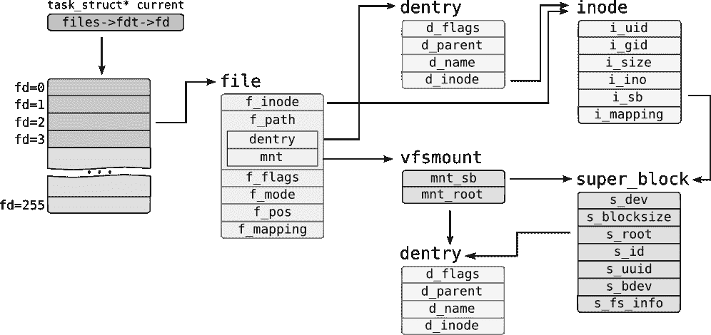

图 6.13：Linux 管理结构。

- **路径解析（Pathname resolution）**：当访问文件时，VFS 将 `pathname` 转换为 `inode`。它从文件系统的根目录开始遍历目录树，遵循路径分量直到到达目标文件或目录。
- **文件系统挂载与卸载**：VFS 管理文件系统的挂载和卸载。当文件系统被挂载时，其 `superblock` 会被添加到系统中。卸载过程涉及断开 `superblock` 并释放相关资源。
- **文件系统操作**：VFS 通过在 `struct file_operations` 中定义函数指针，为特定文件系统的操作提供接口。这些指针由文件系统填充，并处理读取、写入和 I/O 控制等操作。
- **缓存管理**：VFS 维护多个缓存以提高性能，例如 `dentry` 缓存、`inode` 缓存和 `page cache`。这些缓存分别存储频繁访问的目录项、`inodes` 和文件数据。
- **文件系统注册**：每种文件系统类型在初始化期间都会向 VFS 注册。该注册过程包括提供处理该文件系统类型特定操作的函数指针。
- **与块层的交互**：VFS 与块层交互，以便从存储设备读写数据。它提供了一种抽象，使得不同的文件系统能够统一地访问底层的块设备。
- **并发与锁定**：VFS 管理并发并确保适当的锁定机制，以在多个进程同时访问文件系统时保持一致性并防止竞态条件。

总之，VFS 层充当了用户空间应用程序与各种文件系统之间的中间层。它提供了文件系统的统一视图，允许应用程序执行文件操作，而无需知道每个底层文件系统实现的具体细节。

从用户空间可以通过几个命令来理解 VFS 层：

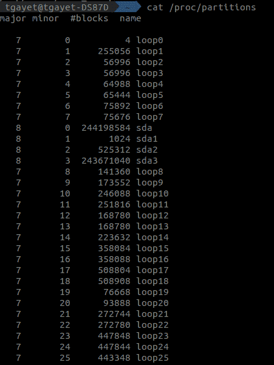

图 6.14：分区枚举

现在我们已经列出了活动分区，可以列出系统上存在的文件系统类型。参考以下图：

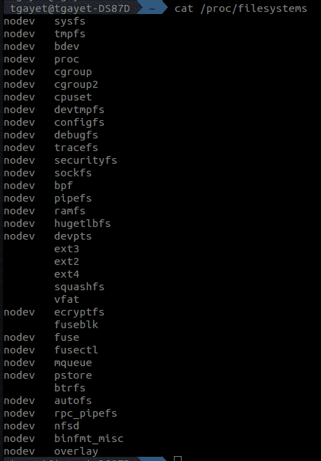

图 6.15：GNU/Linux 内核中可用的文件系统

上述列表是 GNU/Linux 内核中文件系统支持的当前表示，可以通过动态模块加载轻松扩展。

我们还可以列出已挂载的分区。参考以下图：

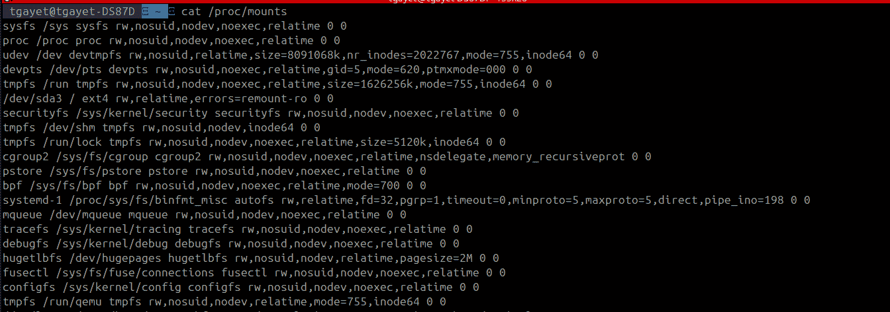

图 6.16：已挂载分区的枚举

Linux VFS API 是一个基础接口，允许操作系统内核与各种文件系统进行交互，为用户空间应用程序执行文件相关操作提供了统一方式。

VFS API 暴露了应用程序用于与文件和目录交互的系统调用。关键系统调用包括：

- `open()`：打开文件并返回文件描述符。
- `read()` 和 `write()`：从文件读取或向文件写入。
- `close()`：关闭文件描述符。
- `mkdir()`，`rmdir()`，`unlink()`：操作目录和文件。
- `stat()`，`fstat()`，`lstat()`：获取文件元数据。
- `chown()`，`chmod()`：更改文件的所有权和权限。

## 在用户/内核空间实现新文件系统

在 GNU/Linux 内核中开发新的文件系统可能是漫长且复杂的。在开发特别是调方面，`libfuse` 通常是一个更简单的替代方案。事实上，VFS API 的定义与 `fuse` 库非常相似。

用户空间文件系统（FUSE）是一个允许在用户空间而非 Linux 内核中创建文件系统的框架。以下是 Linux `libfuse` 库的技术分解原理：

- `FUSE` 允许开发者在不编写内核代码的情况下创建文件系统，为实现自定义文件系统提供了用户友好的接口。
- 它将文件系统实现与内核分离，允许用户空间程序定义它们的文件系统行为。
- `FUSE` 内核模块促进内核与用户空间之间的通信。它处理从内核转发到用户空间以及反之的文件系统请求。
- `FUSE` 库 (`libfuse`) 提供了用于创建基于 FUSE 的文件系统的 API。它提供了一组文件系统开发者用于与内核模块交互的函数和结构。
- `fuse.h` 头文件包含了与 `FUSE` 交互所需的结构和函数。

以下是 `fuse` 内部使用的主要函数：

- `init()`：初始化文件系统。
- `getattr()`，`read()`，`write()`：处理文件元数据检索、读取和写入操作的函数。
- `Readdir()`：列出目录内容。
- `open()`，`release()`：打开和关闭文件。
- 其他各种处理特定特定的回调。

内核将文件系统请求（例如文件读取、写入、属性更改）转发给 `FUSE` 内核模块。

`FUSE` 内核模块使用通信通道将这些请求传递给相应的用户空间进程。

用户空间中的 `libfuse` 通过调用文件系统提供的回调函数来处理这些请求。

## 通信

在内核模块和用户空间之间使用简单的通信协议（通过字符设备或套接字实现）。

通信协议交换包含操作细节的序列化数据结构。开发者通过实现 `libfuse`提供的回调函数来创建基于 FUSE 的文件系统。

这些函数定义了文件系统如何处理文件创建、删除、读写、元数据访问等操作。

`FUSE` 提供了错误处理机制，用于优雅地管理文件系统操作期间发生的错误。

安全措施（如权限检查）由内核模块处理，以防止对文件系统操作的未经授权访问。

由于用户内核上下文切换和额外的数据拷贝，通过 `FUSE` 的用户空间文件系统与内核文件系统相比延迟可能略高。

`FUSE` 广泛用于各种目的，例如创建虚拟文件系统、允许访问自定义存储系统、实现加密层等。

总之，`libfuse` 通过提供与 `FUSE` 内核模块接口的 API，允许在用户空间开发自定义文件系统，允许开发者在无需内核级编程的情况下定义文件系统行为。

以下使用 C 语言和 `libfuse` 库实现基于 FUSE 文件系统的简单示例：

```c
#define FUSE_USE_VERSION 31

#include <fuse.h>

#include <stdio.h>

#include <string.h>

#include <errno.h>
```


```c
static const char *hello_str = "Hello, bpb!\n";

static const char *file_path = "/hello.txt";

static int my_getattr(const char *path, struct stat *stbuf) {
    int res = 0;
    memset(stbuf, 0, sizeof(struct stat));
    if (strcmp(path, "/") == 0) {
        stbuf->st_mode = S_IFDIR | 0755;
        stbuf->st_nlink = 2;
    } else if (strcmp(path, file_path) == 0) {
        stbuf->st_mode = S_IFREG | 0444;
        stbuf->st_nlink = 1;
        stbuf->st_size = strlen(hello_str);
    } else {
        res = -ENOENT;
    }
    return res;
}

static int my_read(const char *path, char *buf, size_t size, off_t offset, struct fuse_file_info *fi) {
    size_t len;
    (void) fi;
    if (strcmp(path, file_path) != 0)
        return -ENOENT;
    len = strlen(hello_str);
    if (offset < len) {
        if (offset + size > len)
            size = len - offset;
        memcpy(buf, hello_str + offset, size);
    } else {
        size = 0;
    }
    return size;
}

static struct fuse_operations my_operations = {
    .getattr = my_getattr,
    .read = my_read,
};

int main(int argc, char *argv[]) {
    return fuse_main(argc, argv, &my_operations, NULL);
}
```

此示例定义了一个包含两个函数的简单文件系统：

- `my_getattr`：实现了 `getattr` 回调，并提供有关文件系统对象（在本例中为根目录和 "hello.txt" 文件）属性的信息（如大小和权限）。
- `my_read`：实现了 `read` 回调以读取 "hello.txt" 文件的内容。

要编译此代码，你需要将其与 libfuse 库链接。假设你将此代码保存在名为 `simplefs.c` 的文件中，可以使用以下命令编译：

```bash
$ gcc simplehellofs.c `pkg-config fuse --cflags –libs` -o simplehellofs
```

这将创建一个名为 `simplefs` 的可执行文件。要挂载文件系统，请带挂载点运行它：

```bash
$ mkdir -p ~/hello
$ ./simplehellofs ~/hello
```

然后，你可以访问挂载的目录（`/path/to/mountpoint`），并找到名为 `hello.txt` 的文件，读取时将包含字符串 "Hello, bpb !"。

## 结论

在本章中，我们看到了与存储管理相关的不同层，无论是底层的块设备驱动程序、优化传输的 I/O 层，还是允许通过文件系统结构化数据的 VFS（虚拟文件系统）。

在下一章中，我们将讨论控制 USB 类型设备的驱动程序管理。

### 加入我们的书籍 Discord 空间

加入书籍的 Discord 工作空间以获取最新更新、优惠、全球科技动态、新发布以及与作者的交流会议：

[`discord.bpbonline.com`](https://discord.bpbonline.com)


# 第 7 章 USB 驱动程序与 libusb

## 引言

在本章中，我们将学习 Linux 内核的 USB 栈，从靠近硬件的底层到上层驱动程序的开发，以及基于 libusb 的用户态模块开发。

## 结构

本章涵盖了以下主题：

- USB 架构
- Linux USB 子系统
- Linux USB 数据结构
- 枚举
- 类驱动
- Gadget 驱动程序
- 使用 libusb 在用户空间编写 USB 驱动程序

## 目标

在本章结束，你将能够理解 USB 设备如何通过 Linux 内核工作，并在用户空间或内核中编写驱动程序。

## USB 架构

USB（通用串行总线）协议由英特的 Ajay V. Bhatt 于 1996 年开发并首次发布。这种 USB 替换了不同类型的串口和并行端口，用于在计算机以及各种外设（如扫描仪、打印机、键盘、游戏控制器、数字相机、质存储设备等）之间传输数据。

USB 是一种通用接口，用于实现不同设备之间的通信，例如鼠标、数字相机、打印机、键盘、多媒体设备、扫描仪、U 盘和外部硬盘，以及如智能手机或 PC 等主机控制器。

通用串行总线旨在实现热插拔并改进即插用。即插即用允许操作系统在不启动计算机的情况下自动配置和发现新设备，而热插拔允许在不重启的情况下移除和更换设备。

市场上有不同类型的 USB 连接器，其中 A 型和 B 型是最常用的。目前，旧的连接器正在被 Mini-USB、Micro-USB 和 USB-C 线缆取代。

USB 协议架构如下所示。一旦各种 I/O 设备通过 USB 连接到计算机，它们的结构就像一棵树。在这个 USB 结构中，每个 I/O 设备将建立一个点对点的连接，通过串行传输格式传输数据。

在这种架构中，I/O 设备通过 USB 连接到被称为 hub 的集线器上。架构中的 Hub 是 I/O 设备与计算机之间的连接点。该架构的根集线器（root hub）用于将整个结构连接到主机计算机。该架构中的 I/O 设备是键盘、鼠标、扬声器、摄像头等。

下图说明了 USB 类型总线上的设备枚举，以树结构的形式表示：

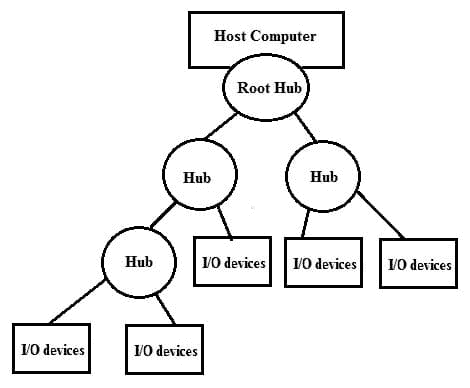

图 7.1：USB 协议架构

USB 协议简单运行在轮询（polling）原理之上，因为在轮询期间，处理器持续检查输入输出设备是否准备好传输数据。因此，I/O 设备不需要向处理器更新其状态，因为不断检查是处理器的主要职责。这使得 USB 变得既简单又廉价。

每当有新设备与集线器关联时，它的地址被定寻为 0。在正常期间，主机计算机轮询集线器的状态，这让主机知道系统的 I/O 设备已连接或断开系统。

一旦主机对新设备做出响应，它将通过读取设备 USB 接口特定内存中的可用数据来了解设备的功能。主机使用适当的驱动程序与设备通信。之后，主机为新设备分配一个地址，该地址被写入设备寄存器。通过这种设备，USB 提供了即插即用功能。

此功能简单地允许主机在设备连接后自动识别新的可用 I/O 设备。设备的 I/O 能力将由主机软件确定。

USB 协议的另一个特性是热插拔，这意味着 I/O 设备可以在不执行关机或重启的情况下插入或从主机系统中移除。这确保了当 I/O 设备连接或断开时你的系统持续运行。

USB 协议还可以支持等时流量（isochronous traffic），数据按预定义的时间间隔传输。与同步和异步数据传输相比，等时数据传输非常快。

为了维持等时流量，根集线器通过 USB 传输一系列比特位，指定等时数据的开始，实际数据可以在这些比特位之后传输。

下图显示了 USB 类型连接的电子细节：

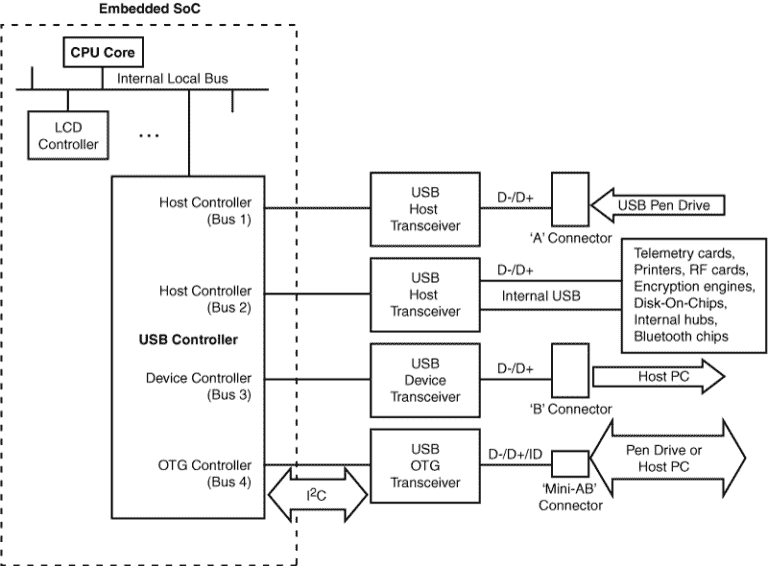

图 7.2：USB 硬件架构细节

系统中只能存在主机，与设备的通信从主机的角度进行。主机是上游（upstream）组件，而设备是下游（downstream）组件。

从主机移动到设备的数据是 OUT 传输。从设备移动到主机的数据是 IN 传输。

主机（特别是主机控制器）控制所有流量并向设备发送命令。

常见的 USB 主机控制器有三种类型：


* 通用主机控制器接口 (`UHCI`): 由 Intel 为 `USB 1.0` 和 `USB 1.1` 设计。使用 `UHCI` 需要获得 Intel 的许可。该控制器支持低速和全速。
* 开放主机控制器接口 (`OHCI`): 由 、微软和国家半导体为 `USB 1.0` 和 `1.1` 设计。支持低速和全速，并且在硬件中实现更多功能方面通常比 `UHCI` 更高效。
* 扩展主机控制器接口 (`EHCI`):在 `USB-IF` 要求仅创建一个主机控制器规范后，为 `USB 2.0` 创建。`EHCI` 用于高速传输，并将低速和全速传输委托给辅助 `OHCI` 或 `UHCI` 控制器。

总线接口层提供物理连接、电气信号和数据包连接。这是由设备硬件管理的层级。它是通过设备外部的物理接口实现的。

设备层是 USB 系统软件执行 USB 操作（如发送和接收信息）的视图。这是通过设备内部的串行接口引擎实现的。

最后，功能层是软件侧。这是 USB 设备中对接收到的信息进行处理或收集数据传输到主机的部分。

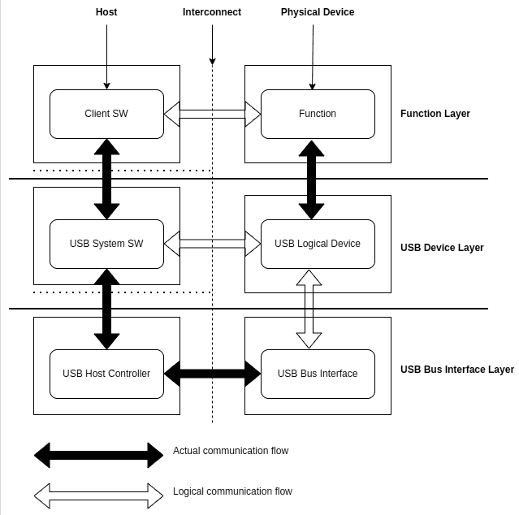

图 7.3：USB 接口管理的三层表示

### USB 特性

USB 有若干特性，其中提到：

* `USB 2.0` 的最大速度可达 `480 Mbps`。
* 单个 USB 长度在有 Hub 的情况下可达 40 米，没有 Hub 的情况下可达 5 米。
* USB 是即插用设备。
* 它可以通过计算机或自身的电源供电。
* 使用单个 USB 主机控制器可以连接超过 100 个设备。
* USB 设备使用的功率可达 `5 V` 并提供高达 `500 mA`。
* 计算机进入节能模式，某些类型的 USB 驱动器会自动转换为睡眠模式。
* USB 端口有两根线；一根用于供电，另一根用于传输数据。
* 在 `5 V` 下，计算机可以通过电源线提供高达 `500 mA` 的功率。
* 低功耗设备可以直接从 USB 取电。
* 计算机和外围设备之间可以使用 USB 端口进行双向通信。

### USB 标准和规范

USB 标准和规范讨论如下：

* USB 规范会随 USB 标准的时间演进而变化。
* USB 支持三种速度类型，即低速 - `1.5 Mbps`、全速 - `12 Mbps` 和高速 - `480 Mbps`。

### USB 2.0 标准

`USB 2.0` 标准如下：

* 这是一个高速 USB 端口，最大数据传输速度为 `480 Mbps`。此 USB 支持所有连接器。
* 最大电缆长度为 5 米。
* 它的最大充电功率可达 `15W`。

### USB 3.2 标准

`USB 3.2` 标准如下：

* `USB 3.2`（第 1 代）是一种超级 USB，最大数据传输速度为 `5 Gbps`。
* 它支持不同的连接器，如 `USB 3 USB-A`、`USB 3 USB-B` 和 `USB-C`。
* 此 USB 的最大电缆长度为 3 米。
* 它的最大充电功率可达 `15W`。

### USB 3.2 第 2 代

`USB 3.2` 第 2 代标准如下：

* `USB 3.2`（第 2 代）也是一种超级 USB，最大数据传输速度为 `10 Gbps`。
* 此 USB 的最大电缆长度为 1 米。
* 它也支持不同的连接器，如 `USB 3 USB-A`、`USB 3 USB-B` 和 `USB-C`。
* 它的最大充电功率可达 `100W`。

### USB 3.2 第 2x2 代

`USB 3.2` 2x2 代标准如下：

* `USB 3.2` 2x2 代是一种超级 USB，最大数据传输速度为 `20 Gbps`。
* 此 USB 的最大电缆长度为 1 米。
* 它支持 USB 连接器。
* 它的最大充电功率可达 `100W`。

### Thunderbolt 3 标准

`USB 3` 标准（别名 Thunderbolt）如下：

* 此 USB 驱动器也称为 Thunderbolt，包括高达 `40 Gbps` 的最大数据传输速度。
* 此 USB 的最大电缆长度主动电缆为 2 米，被动电缆为 0.8 米。
* 它支持 USB 连接器。
* 它的最大充电功率可达 `100W`。

### USB 4 标准

`USB 4` 标准如下：

* 此 USB 闪存盘也称为 Thunderbolt，包括高达 `40 Gbps` 的最大数据传输速度。
* 此 USB 的最大电缆长度主动电缆为 2 米，被动电缆为 0.8 米。
* 它支持 USB 连接器。
* 它的最大充电功率可达 `100W`。

USB 协议时间线所示：

```
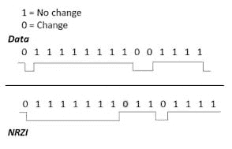
```

在 图 7.4 中发生了填充（stuffing），这意味着为了同步而添加了逻辑 1。如果数据包含多个 1，USB 驱动器将无法同步。因此，通过这种方式，硬件会注意到一个额外的位并忽略它。

USB 协议时间线所示：

```
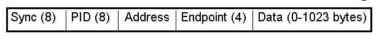
```

下图向我们展示 USB 帧的细节：

* SYNC：在 USB 协议中，每个 USB 数据包都以 `SYNC` 字段开头，通常用于同步发送端和接收端以准确传输数据。在低速或高速 USB 系统中，像 `SYNC` 字段包含 3 组 `KJ`，随后是 `2 K` 以包围 8 位数据。

在高速 USB 系统中，同步需要 15 组 `KJ`，后跟 `2 K` 以跨越 32 位数据。该字段在低速和高速下为 8 位，最高速下为 32 位，用于同步发送端和接收端的 `CLK`。最后 2 位将指示 `PID` 字段的起始位置。


- `Packet identification field` (`PID`)：USB 协议中的数据包识别字段主要用于识别传输的数据包类型，从而确定数据包的格式。该字段的长度为 8 位，高 4 位识别数据包类型，低 4 位是高 4 位的位反反。
- `Address field`（地址字段）：USB 协议地址字段指示数据包的主要目标设备。7 位长度仅允许支持 127 个设备。地址 0 是无效的，因为任何尚未分配的设备都必须响应传输到地址 0 的包。
- `Endpoint field`（端点字段）：USB 协议端点字段长度 4 位，为寻址提供了额外的灵活性。通常这些端点会被分为输入和输出。`0` 端点是一个特殊情况，称为 `CONTROL` 端点，每个设备都包含一个 `0` 端点。
- `Data field`（数据字段）：数据字段的长度不是固，从 0 到 8192 位不等，并且始终字节计数中不可缺的一部分。
- `CRC field`（CRC 字段）：对数据包载荷数据进行循环冗余校验（`CRC`），其中所有 Token 包包含 5 位 `CRC`，数据包包含 16 位 `CRC`。`CRC-5` 长度为 5 位，用于 Token 包以及帧包的起始。
- `EOP field`（EOP 字段）：每个数据包都以数据包结束（`EOP`）字段结束，它包含持续 2 位的 `SE0` 或非对称零，随后是持续 1 位的 `J`。

USB 协议中常见的同步问题包括以下内容。每当开发 USB 设备时，USB 开发人员通常会遇到许多同步问题，称为 USB 通信错误。其中某些错误会导致系统崩溃。

以下是 USB 总线上可能发生的一些问题：
- USB 数据包错误和数据顺序错误。
- USB 传输或重传。
- 电源或基于 `VBUS` 的问题。
- 枚举过程中的问题。
- 高速交易问题。

## USB 的优缺点

USB 的优点如下：
- 易于使用
- 对于多个设备，仅使用一个接口
- 尺寸紧凑
- 连接系统稳健
- 价格不贵
- 提供不同尺寸和不同连接器
- 自动配置
- 扩展容易
- 速度快
- 可靠且廉价
- 功耗低
- 兼容且耐用

USB 的缺点如下：
- 某些制造商以较低成本设计低质量的 USB 盘
- 容量有限
- 与其他系统相比，其数据传输不快
- USB 不提供广播功能，因此个体消息仅在主机和设备之间通信

目前，大多数外围设备都通过 USB 连接到系统，例如鼠标、打印机、扫描仪、摇杆、调制解调器、摄像头、键盘、数码相机、存储设备、飞行控制器、网络适配器以及科学领域的数据采集设备。

## Linux USB 子系统

Linux USB 子系统是 Linux 内核的一部分，负责管理通用串行总（`USB`）设备及其与系统的交互。

它提供了在多种硬件架构上支持 USB 设备所需的架构和驱动程序。

以下是对 Linux USB 子系统的介绍：

### USB 设备类
- USB 设备类是标准化的规范，定义了特定类型的 USB 设备如何与主机通信。
- USB 类的示例包括：
    - 人机接口设备 (`HID`）：键盘、鼠标、游戏控制器。
    - 大容量存储类 (`MSC`)：USB 闪存、外部硬盘。
    - 通信设备类 (`CDC`)：调制解调器、网络适配器、串口。
    - 音频类：声卡、麦克风、扬声器。
    - 视频类：摄像头、摄像机。

### USB 类驱动
- Linux 以内核模块的形式提供 USB 类驱动程序，实现 USB 类定义的协议。
- 这些驱动程序抽象了 USB 通信的低层细节，使开发者能够更容易处理特定类型的 USB 设备。

### 类特定有协议
- 每个 USB 类都有自己的协议和规范，规定了设备与主机之间的通信。
- 类驱动程序实现这些协议，确保与标准的兼容性，并实现与 USB 主机和其他设备的互操作性。

### 内核配置
- 在构建 Linux 内核时，用户可以通过启用或禁用相应的内核选项来配置支持哪些 USB 类。
- 使用 `make menuconfig` 等工具或通过直接编辑内核配置文件完成配置。

### 设备识别
- 当 USB 设备连接到 Linux 系统时，USB 核心会自动识别设备类，并在可用时加载相应的类驱动程序。
- 这种识别基于 USB 描述符提供的设备类、子类和协议标识符。

### 复合设备
- USB 设备可以同时支持多个功能，类驱动程序在复合设备中通常协同工作。
- 复合设备结合多个 USB 类以提供一系列功能。例如，单个 USB 设备可以同时作为大容量存储设备和音频设备。

### 用户空间交互
- 用户空间应用程序可以通过内核提供的标准接口和 API 与 USB 类设备进行交互。
- 例如，USB 大容量存储设备的文件操作可以类似于块设备的方式访问。
- USB 类驱动程序的示例：
    - `usb-storage`：为存储设备实现 `MSC`。
    - `usbhid`：为输入设备支持 `HID` 类。
    - `cdc-acm`：为串口实现 `CDC`。

在 Linux 内核中使用 USB 类驱动通过提供标准接口并处理底层细节简化了 USB 设备的开发。它还确保了与支持相同 USB 类的主机的兼容性。开发者可以专注于实现设备的高级功能，而依靠 USB 类驱动程序管理 USB 通信。

USB 树可以在逻辑和物理拓扑之间进行比较。物理是现实，而逻辑是一种抽象，允许我们通过省略中间集线器来更好地理解主机的分离。如下所示：

```
!images/Figure7.6.png
```
图 7.6：逻辑与物理

USB 设备是通过 USB 接口连接到计算机或其他主机的硬件外围设备。USB 设备形式多样，用途各异，从键盘和鼠标等简单的输入输出设备到复杂的存储设备、网络适配器、音频接口等。

下图显示了端点和接口之间的关系：

```
!images/Figure7.7.png
```
图 7.7：USB 设备定义

端点路由通常是指数据在 USB 通信端点内的路径或路线。在 USB 术语中，端点是 USB 设备内发送接收数据的特定缓冲区或目标。端点通过唯一地址标识，可以是 `IN` 端点或 `OUT` 端点。

- 端点 0 可以双向传输数据
- 所有其他端点只能向一个方向传输数据：
    - `IN`：从设备传输到主机
    - `OUT`：从主机传输到设备


## 端点类型

端点可能有以下几种类型：

* **控制型 (Control)**：
    * 双向端点
    * 用于枚举
    * 可用于应用程序
* **中断型 (Interrupt)**：
    * 以低延迟传输少量量数据
    * 在总线上预留带宽
    * 用于时间敏感数据 (HID)
* **批量型 (Bulk)**：
    * 用于大数据量传输
    * 用于大量且时间不敏感的数据（网络包、大容量存储等）
    * 不在总线上预留带宽；使用剩余时间
* **等时型 (Isochronous)**：
    * 传输大量时间敏感的数据
    * 不保证交付（不发送 ACK）
    * 用于音频和视频流
    * 延迟的数据等同于没有数据
    * 丢弃帧图像比延迟并强制传输要好
    * 不重传
* USB 是由主机控制的总线：
    * 如果主机不先发起，总线上的就不会发生任何事情。
    * 设备无法发起任何通信。
    * USB 是轮询总线（Polled Bus）。
* 主机轮询每个设备，请求数据或发送数据。

## USB 传输 (IN) 算法

USB 传输 (IN) 如下：

* 主机发送一个 `IN` 令牌
* 如果设备有数据，那么：
    * 设备发送数据
    * 主机发送 `ACK`
* 否则：
    * 设备发送 `NAK`
    * 主机将重试直到超时

下图详细展示了 USB 总线上输入传输的序列图：

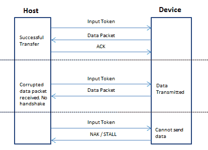

图 7.8：IN 传输序列图

## USB 传输 (OUT) 算法

USB 传输 (OUT) 如下：

* 主机发送一个 `OUT` 令牌
* 主机发送数据（一个包）
* 如果设备接受数据传输，那么：
    * 设备发送 `ACK`
* 否则：
    * 设备发送 `NAK`
    * 主机将重试直到成功或超时

下图详细展示了 USB 总线上输出传输的序列图：

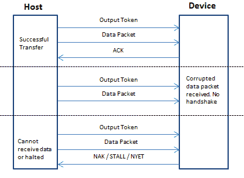

图 7.9：OUT 传输序列图

 USB 标准有许多标准连接器，它们可以相互通信：

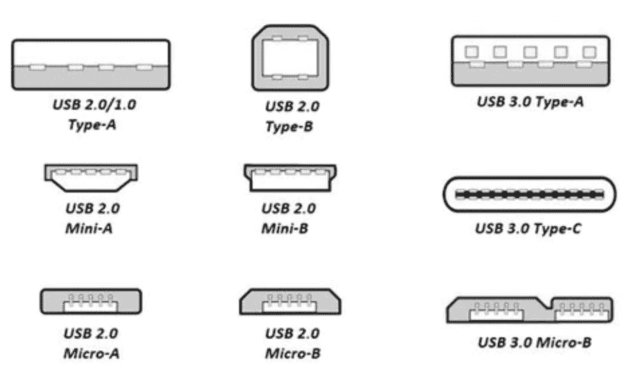

图 7.10：根据 USB 标准定义的 USB 连接器类型


图 7.11：不同连接器之间的连接矩阵

USB On-The-Go (USB OTG) 是一种允许 USB 设备动态地充当主机（host）或外设（peripheral）的规范。这意味着配备 USB OTG 的设备可以根据情况充当 USB 主机（如计算机）和 USB 外设（如键盘或闪盘）。

以下是 USB On-The-Go 的关键特性：

* **主机或外设角色切换**：USB OTG 允许设备在 USB 主机和 USB 外设角色之间切换。例如，支持 USB OTG 的智能手机在连接 USB 闪盘进行数据传输时可以作为 USB 主机，在连接计算机进行数据同步时可以作为 USB 外设。
* **Micro-USB 和 USB-C 连接器**：USB OTG 通常使用 Micro-USB 和 USB-C 连接器，与标准 USB 连接器相比，它们具有额外的引脚。这些额外的引脚允许设备之间协商主机或外设角色。
* **OTG 线缆或适配器**：为了使用 USB OTG 功能，设备通常需要 OTG 线缆或适配器。该线或适配器包含了必要的布线和电路，以实现设备之间的角色切换。
* **ID 引脚检测**：USB OTG 设备使用 USB 连接器中的 `ID`（识别）引脚来检测它们应该充当主机还是外设。当 `ID` 引脚接地时（表示连接到设备的地线），设备充当主机。当 `ID` 引脚未接地时，设备充当外设。
* **双重角色设备 (DRD)**：支持 USB OTG 的设备被称为 DRD，因为它们可以根据需要承担主机或外设角色。DRD 必须能够快速、高效地切换角色，以支持无缝操作。
* **应用场景**：USB OTG 常用于智能手机和平板电脑等移动设备，以便实现与键盘、鼠标、游戏控制器和存储设备等 USB 外设的连接。它允许用户在不需要计算机的情况下扩展设备功能并轻松传输数据。
* **USB OTG 协议**：USB OTG 设备必须符合 USB OTG 协议，该协议定义了设备之间角色协商、电源管理和数据传输的规则和程序。

下图显示了标准 USB 线缆与 OTG 兼容线缆的区别：


图 7.12：普通 USB 线缆与 OTG 之间的布线细节

检测低速或高速连接取决于布线方式：


图 7.13：检测 USB 设备连接

# Linux USB 数据结构

USB 数据结构用于表示 USB 设备、端点、描述符和事务的各种组件和配置。

这些数据结构帮助内核管理 USB 设备，处理与 USB 外设的通信并维护有关配置的信息。

* **usb_device**：表示连接到系统的 USB 设备。该结构包含了设备厂商 ID、产品 ID、类、配置和端点等信息。
```c
struct usb_device {
    int devnum;
    char path[16];
    enum usb_state state;
    enum usb_speed speed;
    struct usb_tt * tt;
    struct usb_device *parent;
    struct usb_bus *bus;
    struct usb_endpoint ep0;
    struct device dev;
    struct usb_descriptor descriptor;
    struct usb_host_config * config;
    struct usb_host_config * actconfig;
    struct usb_host_endpoint * ep_in[16];
    struct usb_host_endpoint * ep_out[16];
    char ** rawdescriptors;
    unsigned short busmA;
    u8 portnum;
    u8 level;
    unsigned can_submit:1;
    unsigned persist_enabled:1;
    unsigned have_langid:1;
    unsigned authorized:1;
    unsigned wusb:1;
    int string_langid;
    char * product;
    char * manufacturer;
    char * serial;
    struct list_head filelist;
    #ifdef CONFIG_USB_CLASS
    struct device * classdev;
    #endif
    #ifdef CONFIG_USB_FS
    struct dentry * usbfs_dentry;
    #endif
    int maxchild;
    struct usb_device * children[USB_MAXCHILD];
    u32 quirks;
    atomic_t urbnum;
    unsigned long active_duration;
    #ifdef CONFIG_PM
    unsigned long connect_time;
    unsigned do_remote_wakeup:1;
    unsigned reset_resume:1;
    #endif
    struct wusb_dev * wusb_dev;
    int slot_id;
};
```

* **usb_interface**：表示 USB 设备的接口。每个 USB 设备可以有多个接口，每个接口提供一个特定功能。`usb_interface` 结构包含了有关接口端点、描述符和关联程序的信息。
```c
struct usb_interface {
    struct usb_host_interface *altsetting;
    struct usb_host_interface *cur_altsetting;
    unsigned num_altsetting;
    struct usb_interface_assoc_descriptor *intf_assoc;
    int minor;
    enum usb_interface_condition condition;
    unsigned sysfs_files_created:1;
    unsigned ep_devs_created:1;
    unsigned unregistering:1;
    unsigned needs_remote_wakeup:1;
    unsigned needs_altsetting0:1;
    unsigned needs_binding:1;
    unsigned resetting_device:1;
    unsigned authorized:1;
    struct device dev;
    struct device *usb_dev;
    struct work_struct reset_ws;
};
```

* **usb_device_descriptor**：描述 USB 设备的一个端点。该结构包含了端点地址、传输类型（例如控制、批量、中断、等时）、最大包大小、轮询间隔以及其他端点特定属性。
```c
struct usb_device_descriptor {
    __u8 bLength;
    __u8 bDescriptorType;
    __le16 bcdUSB;
    __u8 bDeviceClass;
    __u8 bDeviceSubClass;
};
```


```c
__u8 bDeviceProtocol;
__u8 bMaxPacketSize0;
__le16 idVendor;
__le16 idProduct;
__le16 bcdDevice;
__u8 iManufacturer;
__u8 iProduct;
__u8 iSerialNumber;
__u8 bNumConfigurations;
} __attribute__ ((packed));
```

* `usb_host_endpoint`: 代表 USB 设备的主机端点。该结构由 USB 主机控制器驱动使用，用于管理与 USB 设备上端点的通信。

```c
struct usb_host_endpoint {
    struct usb_endpoint_descriptor desc;
    struct usb_ss_ep_comp_descriptor ss_ep_comp;
    struct usb_ssp_isoc_ep_comp_descriptor ssp_isoc_ep_comp;
    struct list_head urb_list;
    void * hcpriv;
    struct ep_device * ep_dev;
    unsigned char * extra;
    int extralen;
    int enabled;
    int streams;
};
```

* `usb_request`: 代表 USB 数据传输请求。该结构包含了有关数据缓冲区、传输类型、端点地址、传输长度以及启动 USB 数据传输所需的其他参数。

```c
struct usb_request {
    void *buf;
    unsigned length;
    dma_addr_t dma;
    struct scatterlist *sg;
    unsigned num_sgs;
    unsigned num_mapped_sgs;
    unsigned stream_id:16;
    unsigned no_interrupt:1;
    unsigned zero:1;
    unsigned short_not_ok:1;
    unsigned dma_mapped:1;
    void (*complete)(struct usb_ep *ep, struct usb_request *req);
    void *context;
    struct list_head list;
    unsigned frame_number;
    int status;
    unsigned actual;
};
```

* `usb_ctrlrequest`: 代表 USB 控制请求。该结构用于向 USB 设备发送控制消息，例如设备描述符请求、配置设置请求或功能控制请求。

```c
struct usb_ctrlrequest {
    __u8 bRequestType;
    __u8 bRequest;
    __le16 wValue;
    __le16 wIndex;
    __le16 wLength;
};
```

* `usb_driver`: 代表在 USB 子系统中注册的 USB 设备驱动程序。该结构包含了用于处理 USB 设备初始化、附加、卸载和数据传输操作的函数指针。

```c
struct usb_driver {
    const char * name;
    int (* probe) (struct usb_interface *intf,const struct usb_device_id *id);
    void (* disconnect) (struct usb_interface *intf);
    int (* unlocked_ioctl) (struct usb_interface *intf, unsigned int code,void *buf);
    int (* suspend) (struct usb_interface *intf, pm_message_t message);
    int (* resume) (struct usb_interface *intf);
    int (* reset_resume) (struct usb_interface *intf);
    int (* pre_reset) (struct usb_interface *intf);
    int (* post_reset) (struct usb_interface *intf);
    const struct usb_device_id * id_table;
    struct usb_dynids dynids;
    struct usbdrv_wrap drvwrap;
    unsigned int no_dynamic_id:1;
    unsigned int supports_autosuspend:1;
    unsigned int disable_hub_initiated_lpm:1;
    unsigned int soft_unbind:1;
};
```

* `usb_device_id`: 定义了 USB 设备驱动程序用于识别支持的设备 匹配项。该结构包含了用于设备匹配的厂商 ID、产品 ID、设备类、子类、协议以及其他属性。

```c
struct usb_device_id {
    __u16 match_flags;
    // 用于特定产品的匹配
    __u16 idVendor; // 厂商 ID
    __u16 idProduct; // 产品 ID
    // 用于设备类匹配
    __u8 bDeviceClass; // 类代码
    __u8 bDeviceSubClass; // 子类代码
    __u8 bDeviceProtocol; // 协议代码
    // 用于接口类匹配
    __u8 bInterfaceClass; // 接口类代码
    __u8 bInterfaceSubClass; // 接口子类代码
    __u8 bInterfaceProtocol; // 接口协议代码
    // 不匹配，由驱动程序使用
    kernel_ulong_t driver_info; // 驱动程序特定数据
};
```

### 枚举

在枚举 USB 设备时，主要步骤涉及 USB 子系统的初始化、检测连接的 USB 设备、解析设备描述符、配置设备以及加载相应的设备驱动程序。

这些步骤将进行进一步讨论：

#### 1. USB 子系统初始化
a. 操作系统中的 USB 子系统在系统启动或 USB 驱动程序加载时初始化。
b. 初始化包括设置数据结构、注册 USB 主机控制器以及初始化其他必要的组件。

#### 2. 主机控制器检测
a. USB 子系统检测并初始化系统中 USB 主机控制器。
b. 主机控制器管理 USB 通信并为连接 USB 设备提供物理接口。

#### 3. 设备连接检测
a. USB 子系统检测 USB 设备何时连接到系统。
b. 这种检测可能涉及硬件中断、轮询或其他机制，取决于系统。

### 4. 枚举
a. 检测到 USB 设备连接时，USB 子系统开始枚举过程。
b. 枚举涉及向设备发送控制请求以获取描述符和配置信息。

#### 5. 描述符解析
a. USB 子系统解析设备提供的描述符。
b. 描述符包含了厂商 ID、产品 ID、设备类、配置等信息。

### 6. 配置选择
a. 根据描述符，USB 子系统选择合适的配置。
b. USB 设备可能有多个配置，每个配置具有不同的接口。

### 7. 接口初始化
a. 对于所选配置中的每个接口，USB 子系统都会初始化相应的驱动程序。
b. 接口初始化包括加载模块、注册接口以及设置端点。

### 8. 驱动绑定
a. USB 子系统根据驱动程序定义的匹配标准将初始化的接口绑定。
b. 如果找到了合适的驱动程序，则将其绑定到接口，允许设备工作。

### 9. 设备注册
a. USB 子系统将设备注册到操作系统，以便访问。
b. 注册的设备可能会以文件节点的形式出现，或通过系统 API 。

#### 10. 设备配置
a. 一旦枚举和初始化完成，USB 设备即完成配置并就绪。
b. 应用程序或设备驱动程序现在可以与设备通信，发送控制请求并根据需要执行数据传输。

以下是我们讨论的步骤总结：
1. 插入设备
2. 检测连接
3. 获取基本信息
4. 设置地址
5. 获取详细信息
6. 选择驱动程序
7. 选择配置
8. 使用

### 类驱动

USB 类驱动是指负责支持特定 USB 设备类的内核模块。USB 类定义了 USB 设备与主机之间通信的标准协议。

Linux 提供了类驱动以实现这些标准。

* USB 设备类
* USB 设备类是标准规范，定义了特定类型的 USB 设备如何与主机通信。
    * USB 类示例包括：
        * `HID`: 键盘、鼠标、游戏控制器。
        * `MSC`: USB 闪盘、外部硬盘。
        * `CDC`: 调制解调器、网络适配器、串口。
        * `Audio class`: 声卡、麦克风、扬声器。
        * `Video class`: 摄像头。

* USB 类驱动
* Linux 以内核模块的形式提供 USB 类驱动，这些实现了 USB 类定义的协议。
* 这些驱动程序抽象了 USB 通信的底层细节，使开发者更容易处理特定类型的 USB 设备。

* 类特定协议
* 每个 USB 类都有自己的一套协议和规范，规定了设备与主机之间的通信。


- `Class` 驱动程序实现了这些协议，确保了与标准的兼容性，并实现了与 USB 主机和其他设备的互操作。

### 内核配置
- 在编译 Linux 内核时，用户可以通过启用或禁用相应的内核选项来配置支持哪些 USB 类。
- 可以使用 `make menuconfig` 等工具或直接编辑内核配置文件来完成配置。

### 设备识别
- 当 USB 设备连接到 Linux 系统时，USB 核心会自动识别设备类，并在可用时加载相应的类驱动程序。
- 这种识别是基于设备在 fact USB 描述符中提供的设备类、子类和协议标识符。

### 复合设备
- USB 设备可以同时支持多个功能，类驱动程序在复合设备中通常会协同工作。
- 复合设备结合了多个 USB 类以提供系列功能。例如，单个 USB 设备可以同时作为大存储设备和音频设备使用。

### 用户空间交互
- 用户空间应用程序可以通过内核提供的标准接口和 API 与 USB 类设备进行交互。
- 例如，对 USB 大存储设备的文件操作可以以类似于其他块设备的方式访问。

### USB 类驱动程序示例
- `usb-storage`：为 USB 存储设备实现 `MSC`（大存储类）。
- `usbhid`：支持输入设备的 `HID` 类。
- `cdc-acm`：为串口通信实现 `CDC`（通信设备设备类）。

在 Linux 内核中使用 USB 类驱动程序通过提供标准化接口并处理许多底层细节，简化了 USB 设备的开发。

它还确保了与支持相同 USB 类的 主机的兼容性。


图 7.14：USB 类总结

开发者可以专注于实现设备的高层功能，同时依靠 USB 类驱动程序来管理 USB 通信。

### USB Gadget 驱动程序
USB Gadget 驱动是指实现 USB 设备功能的内核模块。

与管理 USB 外设（例如键盘、鼠标、存储设备）的 USB 主控制器不同，Gadget 驱动允许 Linux 设备本身作为 USB 外设。

以下是 Linux 内核中 USB Gadget 驱动程序的介绍：

#### USB Gadget 框架
- USB Gadget 框架是 Linux 内核的一部分，允许设备作为 USB 外设发挥作用。
- 它提供了一套实现各种 USB Gadget 功能的 API 和基础设施。

#### USB Gadget 类型
- Linux 支持多种 USB Gadget 类型，每种代表一种不同的 USB 设备类。常见的 Gadget 类型包括大存储 Gadget（用于模拟 USB 存储设备）、以太网 Gadget（用于模拟 USB 网络适配器）和串口 Gadget（用于模拟 USB 串口）。

#### Gadget 驱动
- Gadget 驱动是实现特定 Gadget 功能的内核模块。
- 这些驱动定义了 Gadget 在连接到 USB 主机时的行为。例如，大存储 Gadget 驱动将定义 Gadget 如何向主机暴露存储空间。

### 内核配置
- 要使用 USB Gadget 功能，必须配置 Linux 内核相应的选项。这涉及启用 USB Gadget 框架并选择特定的 Gadget 驱动。

#### ConfigFS（配置文件系统）
- ConfigFS 是一种用于动态配置 USB Gadgets 的虚拟文件系统。
- 它允许用户空间工具在运行时创建、配置和管理 USB Gadget 配置。

#### Gadget 复合设备
- 单 Gadget 可以同时支持多个功能。例如，Gadget 可以同时模拟大存储设备和以太网设备。
- 这是通过复合 Gadget 实现的，多个 Gadget 驱动协同工作以提供不同的 USB 功能。

#### USB 设备类
- Gadget 驱动通常对应于特定的 USB 设备类，如 `CDC` 或 `MSC`。
- 每个 USB Gadget 驱动都实现特定 USB 设备类所需的协议和行为。

#### 用户空间交互
- 用户空间应用程序可以通过 ConfigFS 或使用高级别的库和工具与 USB Gadgets 交互。
- 例如，`Gadgetfs` 接口允许用户空间像对待普通文件系统一样与 USB Gadget 交互。

通过使用 USB Gadget 驱动，Linux 设备可以提供广泛的 USB 功能，使其在设备需要作为 USB 外设的场景中具有多功能。

无论是模拟 USB 存储设备、网络适配器还是串口，USB Gadget 驱动在为基于 Linux 的系统实现化的 USB 能力方面起着至关重要的作用。

下面的示例展示了一个基于 Gadget 的处理 USB panic 键的 USB 驱动示例：


图 7.15：USB panic 键视图

它包含一个基于字符设备骨架的 Linux 驱动程序和一个从用户空间与之通信的程序：
- `panicb.c`：Linux USB 驱动程序
- `panic_test.c`：用户空间中的程序
- `Makefile`：用于管理（编译、加载/卸载等）内核模块

以下是 Makefile 的概览：

```makefile
obj-m := panicb.o
KDIR := /lib/modules/$(shell uname -r)/build
all:
make M=$(shell pwd) -C $(KDIR) modules
modinfo ./panicb.ko
gcc panicb_test.c -o panicb_test
info:
modinfo ./panicb.ko
load:
insmod ./panicb.ko
dmesg
unload:
rmmod ./panicb.ko
install:
make M=$(shell pwd) -C $(KDIR) install
clean:
make M=$(shell pwd) -C $(KDIR) clean
```

用于说明驱动程序的 GNU/Linux 驱动程序源代码：

```c
#include <linux/kernel.h>
#include <linux/errno.h>
#include <linux/init.h>
#include <linux/slab.h>
#include <linux/usb.h>
#include <asm/uaccess.h>
#include <linux/module.h>

#define VENDOR_ID 0x1130
#define PRODUCT_ID 0x0202

// 私有结构
struct usb_panicb {
    struct usb_device *udev;
    unsigned int button;
};

// 前向声明
static struct usb_driver panicb_driver;

/* 与此驱动程序工作的设备表 */
static struct usb_device_id id_table[] = {
    { USB_DEVICE(VENDOR_ID, PRODUCT_ID) },
    { },
};
MODULE_DEVICE_TABLE(usb, id_table);

/* 查询 panic 键按钮状态 */
static int get_panicb_button_status(struct usb_panicb *panicb_dev) {
    char *buf;
    int ret = 0;
    printk(KERN_INFO "get_panicb_status\n");
    // 分配消息缓冲区
    if (!(buf = kmalloc(8, GFP_KERNEL))) {
        printk(KERN_WARNING "panicb: can't alloc buf\n");
        return -1;
    }
    memset(buf, 0, 8);
    ret = usb_control_msg(panicb_dev->udev, usb_rcvctrlpipe(panicb_dev->udev, 0), 0x01, 0xA1, 0x300, 0x00, buf, 8, 2 * HZ);
    if (ret < 0)
        printk(KERN_WARNING "panicb: IN, ret = %d\n", ret);
    else
        panicb_dev->button = *buf;
    kfree(buf);
    return 0;
}

// 字符设备函数
static int panicb_open(struct inode *inode, struct file *file) {
    struct usb_panicb *dev;
    struct usb_interface *interface;
    int minor;
    minor = iminor(inode);
    // 获取设备的接口
    interface = usb_find_interface(&panicb_driver, minor);
    if (!interface)
        return -ENODEV;
    // 从接口获取私有数据
    dev = usb_get_intfdata(interface);
    if (dev == NULL) {
        printk(KERN_WARNING "panicb: can't find device for minor %d\n", minor);
        return -ENODEV;
    }
    // 设置文件结构体
    file->private_data = (void *)dev;
    return 0;
}

static int panicb_release(struct inode *inode, struct file *file) {
    return 0;
}
```


```c
static int panicb_ioctl (struct inode *inode, struct file *file, unsigned int cmd, unsigned long arg)
{
	struct usb_panicb *dev;
	printk(KERN_DEBUG "panicb_ioctl\n");
	/* get the dev object */
	dev = file->private_data;
	if (dev == NULL)
		return -ENODEV;
	switch (cmd) {
	case 0 :
		printk(KERN_INFO "panicb_ioctl\n");
		if (get_panicb_button_status (dev) == 0) {
			if (copy_to_user((void*)arg, &(dev->button), sizeof(int*))) {
				printk (KERN_WARNING "panicb: copy_to_user error\n");
				return -EFAULT;
			}
		}
		break;
	default :
		printk(KERN_WARNING "panicb_ioctl(): unsupported command %d\n", cmd);
		return -EINVAL;
	}
	return 0;
}

static struct file_operations panicb_fops = {
	.open = panicb_open,
	.release = panicb_release,
	.ioctl = panicb_ioctl
};

// USB driver functions
static struct usb_class_driver panicb_class_driver = {
	.name = "usb/panicb",
	.fops = &panicb_fops,
	.minor_base = 0
};

static int panicb_probe (struct usb_interface *interface, const struct usb_device_id *id)
{
	struct usb_device *udev = interface_to_usbdev (interface);
	struct usb_panicb *panicb_dev;
	int ret;
	printk (KERN_INFO "panicb_probe: starting\n");
	ret = usb_register_dev(interface, &panicb_class_driver);
	if (ret < 0) {
		printk(KERN_WARNING "panicb: usb_register_dev() error\n");
		return ret;
	}
	panicb_dev = kmalloc (sizeof(struct usb_panicb), GFP_KERNEL);
	if (panicb_dev == NULL) {
		dev_err (&interface->dev, "Out of memory\n");
		return -ENOMEM;
	}
	// Fill private structure and save it with usb_set_intfdata
	memset (panicb_dev, 0x00, sizeof (*panicb_dev));
	panicb_dev->udev = usb_get_dev(udev);
	panicb_dev->button = 0;
	usb_set_intfdata (interface, panicb_dev);
	dev_info(&interface->dev, "USB Panic Button device now attached\n");
	return 0;
}

static void panicb_disconnect(struct usb_interface *interface)
{
	struct usb_panicb *dev;
	dev = usb_get_intfdata (interface);
	usb_deregister_dev (interface, &panicb_class_driver);
	usb_set_intfdata (interface, NULL);
	kfree(dev);
	dev_info(&interface->dev, "USB Panic Button now disconnected\n");
}

static struct usb_driver panicb_driver = {
	.name = "panicb",
	.probe = panicb_probe,
	.disconnect = panicb_disconnect,
	.id_table = id_table,
};

// Init & exit
static int __init usb_panicb_init(void)
{
	int retval = 0;
	retval = usb_register(&panicb_driver);
	if (retval)
		printk(KERN_WARNING "usb_register failed. Error number %d", retval);
	return retval;
}

static void __exit usb_panicb_exit(void)
{
	usb_deregister(&panicb_driver);
}

module_init (usb_panicb_init);
module_exit (usb_panicb_exit);
```

让我们详细分析源代码的关键行：

*   头文件包含以下内容：包含了内核编程、USB 支持、内存分配以及用户空间访问所需的必要头文件：
```c
#include <linux/kernel.h>
#include <linux/errno.h>
#include <linux/init.h>
#include <linux/slab.h>
#include <linux/module.h>
#include <linux/usb.h>
#include <asm/uaccess.h>
```
*   模块信息：以下代码定义了模块的元数据，包括作者、描述和许可证：
```c
MODULE_AUTHOR("BPB");
MODULE_DESCRIPTION("Panic Button driver: no URB + char device");
MODULE_LICENSE("GPL");
```
*   设备识别：以下代码将驱动与指定的 `Vendor_ID` 和 `Product_ID` 关联：
```c
#define VENDOR_ID 0x1130
#define PRODUCT_ID 0x0202
```
一方面，这允许模块在检测到此 ID 对时自动加载，例如通过 `UDEV` 规则。

*   私有结构体：定义了一个私有结构体 `usb_panicb` 用于存储特定设备的数据：
```c
struct usb_panicb {
	struct usb_device * udev;
	unsigned int button;
};
```
*   前向声明：USB 驱动的前向声明：
```c
static struct usb_driver panicb_driver;
```
*   USB 设备 ID 表：定义了与驱动兼容的 USB ID 表，并将其注册到内核：
```c
static struct usb_device_id id_table [] = {
	{ USB_DEVICE(VENDOR_ID, PRODUCT_ID) },
	{ },
};
MODULE_DEVICE_TABLE(usb, id_table);
```
*   Panic 按钮状态：实现 `get_panicb_button_status` 以获取状态。
*   字符设备函数：实现了 `open`、`release` 和 `ioctl`。
*   文件操作结构体：初始化 `panicb_fops` 及其指针。
*   USB 类驱动初始化：初始化 `panicb_class_driver` 以处理设备操作。
*   USB Probe 和断开函数：当设备插入或移除时调用 `probe` 和 `disconnect`。
*   USB 驱动结构体：定义 `panicb_driver` 包含 `probe`、`disconnect` 和 `id_table` 信息。
*   模块初始化与退出：`usb_panicb_init` 和 `usb_panicb_exit` 用于向内核注册模块。

现在，我们可以学习用户态的小程序的源码：
```c
#include <stdlib.h>
#include <stdio.h>
#include <unistd.h>
#include <fcntl.h>
#include <errno.h>
#include <string.h>
#include <sys/ioctl.h>
#include <limits.h>

int main (int argc, char **argv)
{
	int b, fd = open(argv[1], O_RDONLY);
	if (fd < 0) {
		perror("open()");
		return EXIT_FAILURE;
	}
	if (ioctl(fd, 0, &b)) {
		perror("ioctl");
		close(fd);
		return EXIT_FAILURE;
	}
	printf("button= %d\n", b);
	close(fd);
	return EXIT_SUCCESS;
}
```

执行：
`$ ./panic_test "/dev/usbpanic"`

将 `usbpanic` 替换为 `mknod` 使用的正确名称。

一旦程序建立了 `ioctl` 连接，驱动将提供按钮状态并显示它。

### 使用 libusb 在用户态编写 USB 驱动

libusb 是一个强大且灵活的库，它为用户态应用程序提供了一种在各种操作系统上与 USB 设备通信的标准方法。libusb 的核心抽象了 USB 通信的低层细节，允许开发者无需处理不同平台的复杂性即可与 USB 设备交互。

libusb 通过提供一组 API 允许应用程序执行 USB 相关的任务，例如设备发现、配置和数据传输。它抽象了 USB 协议层并提供了统一的接口，使得开发者在 Windows、Linux 和 macOS 等不同平台上处理 USB 设备变得更加。

libusb 的主要功能包括：

*   设备发现：libusb 允许应用程序发现已连接的 USB 设备，检索它们的信息并识别其能力。


- 配置与接口管理：它提供了配置 USB 设备和管理单个设备上多个接口的功能。这对于具有多功能或模式的设备至关重要。
- 数据传输：`libusb` 促进了应用程序与 USB 设备之间的数据传输。它支持多种传输类型，例如控制传输、批量传输、中断传输和等时传输。
- 异步操作：开发者可以执行异步操作，实现与 USB 设备之间的非阻塞式通信。这对于需要快速响应且不希望在数据传输期间被阻塞的应用程序特别有用。
- 平台无关性：`libusb` 抽象了底层的操作系统细节，允许开发者编写无需重大修改即可在不同平台运行运行的 USB 应用程序。
- 热插拔事件：`libusb` 支持热插拔事件，当 USB 设备动态连接或断开时，可以通知应用程序。
- 驱动程序交互：它提供了与 USB 设备驱动程序交互的机制，并在需要时从 USB 设备上挂载/卸载内核驱动程序。

`libusb` 使开发者能够以平台无关的方式与 USB 设备交互，抽象了 USB 通信的复杂性。其全面的 API 集合能够处理广泛的 USB 相关任务，使其成为需要 USB 设备交互的应用程序的价值工具。

在 Linux 系统上，`libusb` 提供了一个 C API，允许开发者与 USB 设备进行交互。

以下是 `libusb` API 中关键组件和函数的概述：

### 初始化与退出函数

- `libusb_init`：初始化 `libusb` 库。在使用任何其他 `libusb` 函数之前必须调用此函数。
- `libusb_exit`：在使用完成 `libusb` 库后对其去初始化。

用法示例：

```c
#include <libusb.h>

int main() {
  libusb_init(NULL); // Initialize Libusb

  // ... (perform USB operations)

  libusb_exit(NULL); // Deinitialize Libusb

  return 0;
}
```

### USB 设备发现函数

- `libusb_get_device_list`：检索当前连接到系统的 USB 设备列表。
- `libusb_free_device_list`：释放从 `libusb_get_device_list` 获取的设备列表。

用法示例：

```c
libusb_device **list;
ssize_t count = libusb_get_device_list(NULL, &list);
for (ssize_t i = 0; i < count; ++i) {
  // Access each device in the list
  libusb_device *device = list[i];
  // ... (handle device information)
}
libusb_free_device_list(list, 1); // Free the list when done
```

### 获取 USB 设备信息的函数

- `libusb_get_device_descriptor`：检索 USB 设备描述符，提供供应商 ID (vendor ID)、产品 ID (product ID) 等信息。

用法示例：

```c
struct libusb_device_descriptor desc;
libusb_get_device_descriptor(device, &desc);
// Access information in the 'desc' structure
```

### 用于配置设备及其接口的函数

- `libusb_get_config_descriptor`：检索设备的配置描述符。
- `libusb_set_configuration`：设置设备的活动配置。
- `libusb_claim_interface`：声明设备上的某个接口供应用程序使用。

用法示例：

```c
libusb_config_descriptor *config;
libusb_get_config_descriptor(device, 0, &config); // 0 for the first configuration
// Access information in the 'config' structure
(...)
libusb_set_configuration(handle, config->bConfigurationValue);
libusb_claim_interface(handle, interface_number);
```

### 用于传输数据的函数

- `libusb_bulk_transfer`：在应用程序与 USB 设备之间执行批量传输。

用法示例：

```c
unsigned char buffer[64];
int transferred;
libusb_bulk_transfer(handle, endpoint, buffer, sizeof(buffer), &transferred, timeout);
// Access data in the 'buffer' after the transfer
```

### 支持异步数据传输的函数

- `libusb_submit_transfer`：提交异步传输请求。

用法示例：

```c
libusb_transfer *transfer = libusb_alloc_transfer(0);
// Initialize transfer parameters
libusb_submit_transfer(transfer);
// Wait for the transfer to complete or handle it asynchronously
libusb_free_transfer(transfer);
```

### 错误处理函数

- `libusb_strerror`：将 libusb 错误码转换为人类可读的字符串。

用法示例：

```c
int result = libusb_bulk_transfer(handle, endpoint, buffer, sizeof(buffer), &transferred, timeout);
if (result < 0) {
  fprintf(stderr, "Error: %s\n", libusb_strerror(result));
}
```

通过 `libusb` 与 USB 设备（如如下所示的按钮）进行交互，需要理解设备的通信协议：

具体的实现方式将根据您的 USB 设备的规范而异。以下是一个简化的示例，假设有一个假设的 USB 设备在按下或释放按键时会发送信号。

此示例在输入端点（假设为 `0x81`）上设置了中断传输。它会持续轮询 USB 设备以按钮状态的变化。

您需要根据特定的 USB 设备通信协议对此代码进行调整。

请参考您特定的 USB 设备通信协议。


以下是一个使用 `pkg-config` 调用 `libusb` 项目的简单 `CMakeLists.txt` 文件示例。这假设你在同一目录下有一个名为 `main.c` 的源文件。

下面的列表详细说明了构建该项目的 `CMakeLists.txt`：

```
cmake_minimum_required(VERSION 3.5)
project(libusbExample)
find_package(PkgConfig REQUIRED)
pkg_check_modules(LIBUSB REQUIRED libusb-1.0)
add_executable(myusbprogram main.c)
```

以下是每个部分的简要解释：

*   第 4 行：`find_package(PkgConfig REQUIRED)`
    *   此行确保 CMake 能够找到并使用 `pkg-config`。
*   第 5 行：`pkg_check_modules(LIBUSB REQUIRED libusb-1.0)`
    *   此行使用 `pkg-config` 查找 `libusb` 库的必要信息，包括包含目录和库。
*   第 7 行：`add_executable(myusbprogram main.c)`
    *   此行告诉 CMake 从源文件 `main.c` 构建一个名为 `myusbprogram` 的可执行文件。
*   第 9 行：`target_include_directories(myusbprogram PRIVATE ${LIBUSB_INCLUDE_DIRS})`
    *   此行为目标 `myusbprogram` 包含 `libusb` 的包含目录。
*   第 10 行：`target_link_libraries(myusbprogram PRIVATE ${LIBUSB_LIBRARIES})`
    *   此行将 `libusb` 库链接到 `myusbprogram` 可执行文件。

将此内容保存到与 `main.c` 相同目录下的 `CMakeLists.txt` 文件中。然后，你可以使用以下命令构建你的项目：

```
$ mkdir build && cd build
$ cmake ..
$ make
```

这假设你的系统中已经安装了 CMake（在 Debian/Ubuntu 系统上使用 `sudo apt-get install cmake`）。根据需要调整 `main.c` 和项目结构。

## 结论

在本章中，我们回顾了 USB 架构后，解释了如何使用 USB 类型设备。然后，我们详细介绍了如何实现一个控制此类设备的驱动程序。

在下一章中，我们将看到与网络协议栈相关的重要部分。

# 加入我们书籍的 Discord 空间

加入书籍的 Discord 工作空间以获取最新更新、优惠、全球科技动态、新发布以及与作者的座谈会：

[`discord.bpbonline.com`](https://discord.bpbonline.com)


# 第 8 章：网络驱动程序

## 引言

在本章中，我们将看到 Linux 内核最重要的构建模块之一，即网络协议栈。我们将看到从网络卡到其弯折结构的组成部分。此外，我们还将如何使其变得高效。

## 结构

本章涵盖了以下主题：

*   网络协议栈的历史
*   网络架构
*   协议层
*   网络模块
*   网络驱动程序的加载
*   `sk_buff`
*   性能与调优
*   DPDK 项目

## 目标

在本章结束时，你将能够理解网络协议栈的工作原理，并为网卡开发驱动程序，改进网络协议栈的运行或确保其运行安全。

为了能够管理千比特级的吞吐量，我们将看到 DPDK 开源项目的结构。

## 网络协议栈的历史

Linux 内核中网络层的发展是由几位独立的程序员协调的。目标是实现一个至少与其他系统一样高效的系统，同时保持在自由软件领域。

最重要的是由 Ross Biro 使用基本原语开发的 TCP/IP 协议。Orest Zborowski 为 GNU Linux 内核产生了第一个 BSD socket 接口。

随后，代码由红帽公司的 Alan Cox 接管。

下图给出了 Linux 下网络协议栈的发展时间线：


图 8.1：GNU/Linux 网络协议栈的起源

在 GNU/Linux 下开发协议栈的关键阶段如下：

*   早期网络支持 (1991-1995)：
    *   Linux 在 Linus Torvalds 于 1991 年创建时，最初缺乏内置的网络支持。然而，随着 1991 年 9 月份 0.01 版本的发布，它迅速获得了网络能力。
    *   Linux 初始网络支持是原始的，提供了如 TCP/IP 网络和以太网支持等基本功能。
*   内核版本 1.x 和 2.x (1996-2000)：
    *   在 20 世纪 90 年代后期，Linux 网络能力随着每个内核版本的发布显著扩展。
    *   1996 年 6 月发布的内核 2.0 版本对网络协议栈进行了重大增强，包括支持更多网络协议、提高性能和更好的可扩展性。
    *   1999 年 1 月发布的内核 2.2 版本引入引入了如 IPv6 支持、增强的路由能力和改进的网络设备驱动程序等功能。
*   内核版本 2.4 和 2.6 (2001-2006)：
    *   2001 年 1 月发布的内核 2.4 版本 标志着网络领域的一个重要里程碑。它引入了 Netfilter 框架，允许通过 `iptables` 等工具进行数据包过滤。
    *   2003 年 12 月发布的内核 2.6 版本为网络协议栈带来了进一步增强，包括可扩展性、网络命名空间和用于事件通知的 `epoll` 系统调用。
*   内核版本 3.x 和 4.x (2011-2019)：
    *   2011 年 7 月发布的内核 3.0 版本没有引入重大的网络变化，而是继续优化现有功能。
    *   2013 年 6 月发布的内核 3.10 版本引入了 TCP Fast Open 功能，旨在减少 TCP 连接建立的时间。
    *   2016 年 1 月发布的内核 4.4 版本改进了网络协议栈的性能和可扩展性，并增强了网络协议和安全性。
    *   2018 年 1 月发布的内核 4.15 版本引入了 Retpoline Spectre 缓解措施，解决了网络协议栈及内核其他部分的安全漏洞。
*   近期进展 (2020 至今)：
    *   最近的内核发布侧重于提高安全性、性能，以及对 5G、物联网（IoT）和软件定义网络（SDN）等新兴网络技术的支持。

 网络架构

Linux 网络协议栈是 Linux 内核中一个复杂的系统，负责处理网络的所有方面，包括数据包处理、协议实现、设备驱动程序和网络配置。

以下是 GNU/Linux 网络协议栈的详细技术概述：

*   数据包处理
    *   传入的网络数据包由网络接口接收，接口由内核中的设备驱动程序表示。
    *   接收后，网络数据包被封装成称为套缓冲区（`sk_buff`）的数据结构，其中包含数据包的元数据，如协议类型、源和目的地址以及指向数据包数据的指针。
    *   内核网络栈通过一系列协议层处理传入的数据包，包括链路层（例如以太网、Wi-Fi）、网络层（例如 IP）、传输层（例如 TCP、UDP）和应用层（例如 sockets）。
*   协议实现：
    *   Linux 内核包含了各种网络协议的实现，如 TCP/IP、UDP、ICMP、IPv4 和 IPv6。


- 每个协议都实现为一组函数，负责数据包处理、协议特定操作、错误处理和状态管理。
- 协议实现之间通过定义良好的接口和数据结构相互交互，从而实现了模块化和可扩展的网络功能。

## 设备驱动
- Linux 中的网络接口由设备驱动表示，它们负责控制物理或虚拟网络设备。
- 设备驱动与硬件交互，处理如数据包收发、中断处理和设备初始化等任务。
- 内核网络子系统为设备驱动提供了统一的接口，允许它们轻松地集成到网络协议栈中。

### Socket 层
- Linux 中的 Socket 层为应用程序提供了一个接口，使其通过 socket 进行网络通信。
- Socket 是通过 IP 地址、端口号和协议类型（例如 TCP、UDP）标识的通信端点。
- 应用程序通过 `socket()`、`bind()`、`listen()`、`connect()`、`send()` 和 `recv()` 等系统调用与 Socket 交互，这些系统调用由内核的 Socket 层实现。

### 路由与转发
- Linux 内核维护路由表，决定网络数据包如何转发到目的地。
- 路由决策基于目的 IP 地址和在内核中配置的路由策略。
- 内核路由子系统还支持高级路由功能，如基于策略的路由、基于源的路由和网络地址翻译 (NAT)。

### 数据包过滤与防火墙
- Linux 包含了 Netfilter 框架，它提供了数据包过滤和防火墙功能。
- Netfilter 允许管理员根据源目的地址、端口号和数据包内容等标准定义过滤、修改和转发网络包的规则。
- `iptables` 和 `nftables` 等工具提供了用户空间接口，用于配置 Netfilter 规则和管理防火墙策略。

### 性能与可扩展性
- Linux 网络协议栈为性能和可扩展性设计，针对多核处理器、高速网络和高效数据包处理进行了优化。
- 使用内核旁路（kernel bypass）、零拷贝网络和中断调节等技术来最小化开销并提高吞吐量。
- 内核网络子系统不断优化和调优，以满足现代网络应用的性能需求。

IP 栈中对刚接收或准备发送的帧的处理可以分为几个层，如图所示：


图 8.2：从网卡到用户态的多个层表示

这种 IP 处理包含四个主要阶段：

- **帧接收**：在网络接口上接收到的帧进入 IP 层的入口。
- **路由**：数据包在另一个接口/网络或本地目的地重传时选择遵循的路径。
- **转发**：在移动重传阶段之前对 `TTL` 和 `MTU` 进行控制。
- **传输**：要发送或重传的数据包将通过此阶段。在离开 IP 层之前，完成以太网头的构建。

下图详细说明了 Netfilter 在网络栈上可以使用的钩子（hooks）：


图 8.3：GNU/Linux 网络栈全局视图

Netfilter 是 Linux 内核中的一个框架，为数据包过滤、网络地址翻译 (NAT) 和数据包改写（mangling）提供设施。它由网络栈中的一组钩子（入口）组成，被称为 Netfilter hooks 的内核模块可以在这些处拦截并处理网络包。

它通常用于在基于 Linux 的系统中实现防火墙、NAT 网关、数据包过滤和流量整形，其中每个钩子都是 Linux 内核网络栈中的入口，内核模块可以在此处注册回调函数来拦截网络包。

共有五个主要的 Netfilter 钩子，每个对应数据包处理路径中的一个特定点：

- `NF_INET_PRE_ROUTING`：在数据包进行路由之前调用的钩子。用于数据包过滤和 NAT 操作。
- `NF_INET_LOCAL_IN`：当数据包指向本地系统时调用的钩子。用于本地数据包过滤和流量监控。
- `NF_INET_FORWARD`：当数据包被转发到另一个主机时调用的钩子。用于过滤系统转发的数据包。
- `NF_INET_LOCAL_OUT`：当数据包从本地系统发送时调用的钩子。用于过滤输出数据包并执行 NAT。
- `NF_INET_POST_ROUTING`：数据包路由后立即调用的钩子。用于对输出数据包执行 NAT 操作。

Netfilter 钩子为根据数据包在网络栈中的位置实现数据包过滤和处理提供了灵活性细粒度。

内核模块向 Netfilter 钩子注册回调函数（称为钩子函数），以拦截和处理网络包。每个钩子函数被调用时都会带有一个指向拦截包的 `sk_buff` 结构指针和其他相关信息。

钩子函数可以检查包头、根据可配置的规则执行包过滤、修改包内容，并采取适当的操作，如接受、丢弃或转发包。

除了钩子和钩子函数外，Netfilter 子系统还包括其他组件，例如管理钩子注册和包遍历的 Netfilter 核心，以及实现特定包过滤和 NAT 功能的各种内核模块。

常见的 Netfilter 模块包括用于包过滤和防火墙的 `iptables`、用于 IPv6 包过滤的 `ip6tables`、用于以太帧过滤的 `ebables` 以及用于连接跟踪和 NAT 的 `conntrack`。Netfilter 提供了一个灵活可扩展的框架，用于在基于 Linux 的系统中构建复杂的包过滤和防火墙解决方案。

GNU Linux 内核网络栈不同层中的数据包路由所示：


图 8.4：深度 GNU/Linux 网络栈

网卡使用两个列表来管理数据包，即网络接口的入包 (`rx_ring`) 和出包 (`tx_ring`)。因此，我们可以将传输过程与接收过程区分开。对于像 2.2 及以下非常旧的内核，帧处理是不同的（例如，我们找不到 `tx` 和 `rx` 文件）。

Linux 内核中的 Netfilter 框架在 `PRE_ROUTING` 钩子处拦截数据包并进行相应的处理。

以下是用于该目的的主要组件和函数的说明：

- `hook_func_tunnel_in` 函数：
    - 该函数作为 Netfilter 钩子 `NF_IP_PRE_ROUTING` 的回调，在路由决策做出之前拦截数据包。
    - 它接收的参数包括钩子号、指向 `sk_buff` 结构的指针、输入和输出网络设备，以及调用下一个钩子函数的函数指针。
    - 该函数首先获取 `sk_buff` 结构并提取 IP 头。
    - 然后它检查数据包是否来自特定的输入网络设备（`"eth0"`）以及目的 IP 地址是否匹配预定义值（`ip1`）。
    - 如果满足条件，该函数通过修改数据包的 MAC 头、调整包长度并将数据包入队列到另一个网络设备（`"eth1"`）进行传输来执行隧道封装。
    - 最后，该函数返回 `NF_STOLEN` 表示它已接管了该包的所有权。

- `init_module` 函数：


## 功能概述

* 该函数作为初始化 Netfilter 模块的入口点。

* 它设置了一个 Netfilter 钩子对象 (`nfho_tunnel_in`)，使用了指定的钩子函数 (`hook_func_tunnel_in`)、钩子编号 (`NF_IP_PRE_ROUTING`)、协议族 (`PF_INET`) 和优先级 (`NF_IP_PRI_FIRST`)。

* `nf_register_hook` 函数将钩子对象注册到 Netfilter 框架，允许其在指定的钩子点拦截数据包。

## `cleanup_module` 函数：

* 该函数作为清理 Netfilter 模块的退出点。

* 它使用 `nf_unregister_hook` 函数注销之前注册的钩子对象 (`nfho_tunnel_in`)。

## 要构建并安装此 Netfilter 内核模块，请遵循以下步骤：

1. 将提供的代码保存到文件中，例如 `nf_hook.c`。
2. 在您的系统中设置 Linux 内核开发环境。
3. 使用适当的内核构建工具（`gcc`、`make` 等）编译模块。
4. 使用 `insmod` 将模块加载到内核。
5. 使用 `lsmod` 和适当的日志机制（`dmesg`、`journalctl` 等）验证模块已加载并正常运行。

以下 Linux 内核模块实现了一个 Netfilter 钩子，用于拦截和重定向 IPv4 数据包。它捕获 `eth0` 上特定目标 IP 的数据包，修改其 MAC 头，并通过队列规则将其转发到 `eth1`。该模块使用 `NF_STOLEN` 处理数据包所有权，确保高效的内核隧道传输：

```c
#include <linux/module.h>

#include <linux/kernel.h>
#include <linux/netfilter.h>
#include <linux/netfilter_ipv4.h>

#include <linux/skbuff.h>
#include <linux/ip.h>
#include <linux/netdevice.h>
static unsigned int hook_func_tunnel_in(unsigned int hooknum,

struct sk_buff *skb,

const struct net_device *in,

const struct net_device *out,

int (*okfn)(struct sk_buff *skb)) {
struct iphdr *ip_header;
struct net_device *dev;
struct Qdisc *q;
int len;

// 检查数据包是否有 IP 头
if (!skb || !skb_network_header(skb))
return NF_ACCEPT;
ip_header = ip_hdr(skb);

// 检查数据包是否为 IPv4
if (ip_header->version != 4)
return NF_ACCEPT;

// 检查数据包是否来自 eth0 且目标 IP 为 ip1
if (in && strcmp(in->name, "eth0") == 0 && ip_header->daddr == htonl(ip1)) {
len = skb->len;
// 执行隧道处理
skb_push(skb, ETH_HLEN);
skb_reset_mac_header(skb);
memcpy(skb->data, hd_mac2, ETH_ALEN * 2);

// 将数据包入队以便在 eth1 上传输
dev = dev_get_by_name("eth1");
if (!dev)
return NF_ACCEPT;
q = dev->qdisc;
spin_lock_bh(&dev->queue_lock);
q->enqueue(skb, q);
qdisc_run(dev);
spin_unlock_bh(&dev->queue_lock);
return NF_STOLEN; // 表示我们已经获取了数据包的所有权
}
return NF_ACCEPT; // 允许数据包正常继续
}

// Netfilter 钩子结构
static struct nf_hook_ops nfho_tunnel_in = {
.hook = hook_func_tunnel_in,
.hooknum = NF_INET_PRE_ROUTING, // IPv4 使用 NF_INET_PRE_ROUTING
.pf = NFPROTO_IPV4, // IPv4 使用 NFPROTO_IPV4
.priority = NF_IP_PRI_FIRST,
};

// 模块初始化函数
static int __init nf_hook_init(void) {
int ret;
// 注册 Netfilter 钩子
ret = nf_register_hook(&nfho_tunnel_in);
if (ret < 0) {
printk(KERN_ERR "Failed to register Netfilter hook\n");
return ret;
}
printk(KERN_INFO "NF_HOOK: Module installed\n");
return 0;
}

// 模块清理函数
static void __exit nf_hook_exit(void) {
// 注销 Netfilter 钩子
nf_unregister_hook(&nfho_tunnel_in);
printk(KERN_INFO "NF_HOOK: Module removed\n");
}
module_init(nf_hook_init);
module_exit(nf_hook_exit);
MODULE_LICENSE("GPL");
MODULE_AUTHOR("BPB");
MODULE_DESCRIPTION("Netfilter hook example");
```

以上是上述代码的关键行：

* 第 1/7 行：头文件：包含了 Netfilter、skb、IP 头和 netdevice 必要的头文件。
* 第 20 行：函数参数检查：增加了检查，确保在访问成员之前函数参数（`skb`, `in`）不为 `NULL`。
* 第 26 行：IPv4 检查：增加了检查，在访问 IP 头之前确保数据包为 IPv4。
* 第 30 行：字节序转换：使用 `htonl()` 在与 `ip1` 比较之前将目标 IP 地址转换为网络字节序。
* 第 52 行：返回值：将 `NF_STOLEN` 改为 `NF_ACCEPT`。
* 第 63/86 行：模块初始化：将 `nf_hook_init` 重命名为 `nf_hook_init()`。
* 第 79/87 行：模块清理：将 `nf_hook_exit` 重命名为 `nf_hook_exit()`。
* 第 89/91 行：模块信息：添加了模块元数据，如许可证和描述。


## 传输层

传输层负责为运行在不同主机上的应用程序提供端到端通信。
- 在 Linux 中，传输层包括传输控制协议（`TCP`）和用户数据报协议（`UDP`）。
- `TCP` 提供可靠的面向连接的通信，具有流量控制、拥塞控制和错误恢复等特性。
- `UDP` 提供不可靠的、无连接的通信，开销最小，适用于流媒体传输和在线游戏等实时应用。
- Linux 内核包含了分别对应 `TCP` 和 `UDP` 的协议实现（`tcp` 和 `udp`），并通过 `socket()`、`bind()`、`connect()`、`send()` 和 `recv()` 等系统调用支持基于 socket 的通信。

## 应用层（第 5-7 层）

- 应用层涵盖了实现特定网络应用和服务的各种协议和服务。
- 在 Linux 中，应用层包括超文本传输传输协议（`HTTP`）、文件传输协议（`FTP`）、简单邮件传输协议（`SMTP`）和域名系统（`DNS`）。
- 运行在 Linux 上的应用程序通过操作系统或第三方软件提供的库和 API 使用这些协议。
- Linux 中应用服务的示例包括：用于提供网页的 Apache `HTTP` 服务器、用于发送和接收电子邮件的 Postfix 邮件服务器，以及用于解析域名的 BIND `DNS` 服务器。

下表列出了网络协议实现随时间的演变：

| 内核版本 | 协议支持 |
| :--- | :--- |
| 1.x (早期) | 基础 `TCP/IP` 网络（`IPV4`, `TCP`, `UDP`, `ICMP`） |
| 2.0 (1996) | `IPV4`, `TCP`, `UDP`, `ICMP`, `ETHERNET`, `PPP`, `SLIP` |
| 2.2 (1999) | `IPV4`（增强）、`ARP`, `RARP`, `IP` 转发与路由、`Ethenrt`、`PPP`, `SLIP`, `DHCP`, `BOOTP`, `VLAN` 标记 |
| 2.4 (2001) | `IPV4`（改进）、`IPV6`（早期支持）、`IPSEC`, `ARP`, `RARP`, `IP` 转发与路由、`Ethernet`, `PPP` |
| 2.6 (2003) | `IPV4`, `IPV6`, `ARP`, `RARP`, `IP` 转发与路由、`Ethernet`, `PPP`, `VLAN` 标记、`IGMP`, `Multicast` |
| 3.x (2011) | `IPV4`, `IPV6`（优化）、`ARP`, `RARP`, `IP` 转发与路由、`Ethernet`, `PPP`, `VLAN` 标记、`IGMP`, `Multicast` |
| 4.x (2015) | `IPV4`, `IPV6`, `ARP`, `RARP`, `IP` 转发与路由、`Ethernet`, `PPP`, `VLAN` 标记、`IGMP`, `Multicast` |

表 8.1：GNU/Linux 版本的协议演变

## 网络模块

在 GNU/Linux 语境下，网络驱动程序是负责 Linux 内核与网络硬件设备之间通信的软件组件。这些驱动程序对于网网卡（`NICs`）、无线适配器和其他网络设备的运行至关重要。让我们仔细观察 GNU/Linux 网络驱动程序的关键组件和特性：

### 设备驱动程序接口
- Linux 中的网络驱动程序通常实现为内核模块或直接构建内核内核。
- 它们通过网络设备接口规范（`NDIS`）与 Linux 内核交互，该规范为网络驱动程序提供了标准化接口，用于注册、处理网络设备操作以及与网络栈的高层通信。

### 硬件抽象
- 网络驱动程序抽象了底层网络硬件的细节，为 Linux 内核和网络栈提供了统一的接口。
- 它们管理特定的硬件任务，如初始化设备、配置硬件参数（例如 `MAC` 地址、`MTU`）、处理中断以及收发网络包。

### 数据包处理
- 网络驱动程序负责将传出的数据包从内核发送到网络设备，并从设备接收入站包。
- 它们实现了收包逻辑，包括缓冲区管理、数据包队列以及用于系统内存与网络设备之间高效数据传输的内存访问（`DMA`）操作。

### 中断处理
- 网络驱动程序处理由网络设备生成的中断，用指示入站包的到达、传输操作的完成或硬件事件的发生。
- 它们在 Linux 内核中注册中断处理程序以响应中断信号，处理入站包并执行必要的操作以维持网络连接和性能。

### 错误处理与恢复
- 网络驱动程序实现了错误检测和恢复机制，以处理硬件错误、网络故障以及任何异常情况。
- 它们监控网络设备的状态，检测错误或异常，并采取适当措施，如重置设备、重试失败的操作或将错误报告给内核进行进一步处理。

### 配置与管理
- 网络驱动程序通过 Linux `sysfs` 接口暴露配置参数和统计信息，允许管理员动态查询和调整驱动设置。
- 它们支持链路聚合、`VLAN` 标记、混杂模式和卸载能力（例如校验和卸载、分段卸载），以优化网络性能和功能。

GNU/Linux 中的网络驱动程序包括用于 Intel 千兆太网控制器的 `e1000e` 驱动、用于 Atheros 无线局域网适配器的 `ath9k` 驱动以及用于 Intel 万兆太网适配器的 `ixgbe` 驱动。

网络驱动程序是块设备驱动和字符设备之后的第三类 Linux 驱动程序。

系统内部网络接口的操作与块驱动非常相似。块驱动被内核核心用于传输或接收数据块。从类似的角度来看，网络驱动程序向内核注册，以便与外部世界交换数据包。

然而，它与块驱动的区别在于，块驱动在专用的目录 `/dev` 中没有条目。因此，无法应用“Unix/GNU Linux 中一切皆视为文件”的规则。

这两类驱动程序之间最重要的区别是：块驱动需要在发送发送到内核之前进行准备，而网络驱动程序则要求推送数据。

下图显示了 GNU/Linux 内核驱动程序的不同分类：


图 8.6：GNU/Linux 下的驱动程序分类。

网络架构允许 Linux 内核通过网络连接到其他系统。存在大量的硬件和支持的协议。

每个网络对象都通过 `socket` 表示。`Sockets` 与进程关联，就像文件系统中的 `i-nodes` 可以关联一样。一个 `socket` 可以被多个进程共享。

网络架构使用 Linux 内核进程调度器 `schedule()` 来挂起或恢复处于等待数据状态（由控制和数据流管理系统管理）的进程。此外，`VFS` 层提供了逻辑文件系统（例如 `NFS` 的情况；在用户模式下通过 `libfuse` 也有可能性）。

下图显示了与 `VFS` 和网络栈交互的不同块的细节：


图 8.7：GNU/Linux 下网络栈的模块化或分层划分

所有网卡可以通过两种不同的方式与内核交互：

- 轮询：内核定期检查设备状态以查看是否有需要处理的操作。


-   **中断 (Interrupts)**：卡以中断的形式向内核发送信号，通知内核有需要处理的任务：
    - **硬件**：接收来自网络接口的传入数据包并将其直接放置在输入队列中。
    - **软件 (`NET_RX_SOFTIRQ`)**：执行接收包处理程序。它负责管理协议。传入的数据包由此中断处理并放入队列中。要转发的数据包被放在输出接口的输出队列中。

以下来自网络驱动程序源码（`drivers/net/3c59x.c`）的代码示例，适用于内核 `2.2.14`。其中存在大量的 `#ifdef MODULE` 和 `#if defined (MODULE)`：

```c
#if defined(MODULE) && LINUX_VERSION_CODE > 0x20115

MODULE_AUTHOR("Donald Becker <becker@cesdis.gsfc.nasa.gov>");

MODULE_DESCRIPTION("3Com 3c590/3c900 series Vortex/Boomerang driver");

MODULE_PARM(debug, "i");

...

#endif

...

#ifdef MODULE

int init_module(void)

{

...

}

#else

int tc59x_probe(struct device *dev)

{

...

}

#endif /* not MODULE */
```

这非常典型地代表了旧的编程方式，即动态模块的操作基于其在内核镜像中作为静态模块编译的方式定义的。

...

```c
static int vortex_scan(struct device *dev, struct pci_id_info pci_tbl[])

{

...
#if defined(CONFIG_PCI) || (defined(MODULE) && !defined(NO_PCI))

...

#ifdef MODULE
if (compaq_ioaddr) {
vortex_probe1(0, 0, dev, compaq_ioaddr, compaq_irq,
compaq_device_id, cards_found++);
dev = 0;
}

#endif
return cards_found ? 0 : -ENODEV;
}

...

#ifdef MODULE
void cleanup_module(void)
{
... ... ...
}

#endif
```

在这个新版本中，不再需要预处理指令，从而移除了所有的 `#ifdef` 和 `#endif`。这使得通过使用一组宏（`__init`、`__exit` 和 `__devinitdata`），驱动程序开发人员更容易阅读代码：

```c
static char version[] __devinitdata = DRV_NAME " ... ";

static struct vortex_chip_info {

...

}

vortex_info_tbl[] __devinitdata = {
{"3c590 Vortex 10Mbps",
... ... ...
}

static int __init vortex_init (void)

{

...
}

static void __exit vortex_cleanup (void)
{
...
}

module_init(vortex_init);

module_exit(vortex_cleanup);
```

这里是一个可以管理网卡的示例代码：

```c
#include <linux/module.h>
#include <linux/pci.h>
#include <linux/netdevice.h>
#include <linux/etherdevice.h>

#define DRIVER_NAME "my_ethernet_driver"

struct my_priv_data {
struct net_device *netdev;
struct pci_dev *pdev;
// 添加任何驱动特定的数据在此处
};

static int my_probe(struct pci_dev *pdev, const struct pci_device_id *ent)
{
struct my_priv_data *priv;
struct net_device *netdev;
// 为驱动私有数据分配内存
priv = kzalloc(sizeof(struct my_priv_data), GFP_KERNEL);
if (!priv)
return -ENOMEM;
// 初始化 PCI 设备
if (pci_enable_device(pdev))
goto err_free_priv;
// 启用主线并设置其他 PCI 配置
pci_set_master(pdev);
// 分配并初始化网络设备结构
netdev = alloc_etherdev(sizeof(struct my_priv_data));
if (!netdev)
goto err_disable_dev;
priv->netdev = netdev;
priv->pdev = pdev;
// 设置设备特定参数（例如 MAC 地址、MTU）
// 示例：ether_setup(netdev);
// 设置驱动特定的数据和函数
// 示例：netdev->netdev_ops = &my_netdev_ops;
// 向内核注册网络设备
if (register_netdev(netdev))
goto err_free_netdev;
//在此处添加设备特定的初始化代码
return 0;
err_free_netdev:
free_netdev(netdev);
err_disable_dev:
pci_disable_device(pdev);
err_free_priv:
kfree(priv);
return -ENODEV;
}

static void my_remove(struct pci_dev *pdev)
{
struct my_priv_data *priv = pci_get_drvdata(pdev);
struct net_device *netdev = priv->netdev;
// 取消网络设备注册
unregister_netdev(netdev);
// 释放网络设备结构
free_netdev(netdev);
// 禁用 PCI 设备
pci_disable_device(pdev);
// 释放驱动私有数据
kfree(priv);
}

// PCI 设备 ID 表
static const struct pci_device_id my_pci_tbl[] = {
{ PCI_DEVICE(0x1234, 0x5678) }, // 供应商和设备 ID
{ 0, },
};
MODULE_DEVICE_TABLE(pci, my_pci_tbl);

// PCI 驱动结构
static struct pci_driver my_driver = {
.name = DRIVER_NAME,
.id_table = my_pci_tbl,
.probe = my_probe,
.remove = my_remove,
};

// 模块初始化
static int __init my_init(void)
{
return pci_register_driver(&my_driver);
}

// 模块清理
static void __exit my_exit(void)
{
pci_unregister_driver(&my_driver);
}

module_init(my_init);
module_exit(my_exit);
MODULE_LICENSE("GPL");
MODULE_AUTHOR("BPB");
MODULE_DESCRIPTION("My Ethernet Driver");
```

现在，让我们解释这段代码的主要技术方面：

-   **包含与定义**：
    - 该代码包含了 Linux 内核模块开发所需的头文件（`<linux/module.h>`, `<linux/pci.h>`, `<linux/netdevice.h>`, `<linux/etherdevice.h>`）。
    - 它定义了驱动名称宏（`DRIVER_NAME`）。
- **驱动数据结构**：
    - `struct my_priv_data`：该结构存储了驱动特定的数据，例如指向网络设备（`netdev`）和 PCI 设备（`pdev`）的指针。
- **探测函数 (`my_probe`)**：
    - 该函数在驱动加载且检测到匹配的 PCI 设备时调用。
    - 它初始化 PCI 设备，为驱动私有数据分配内存，设置网络设备并向内核注册。
- **移除函数 (`my_remove`)**：
    - 该函数在驱动卸载或关联 PCI 设备移除时调用。
    - 它取消网络设备注册，释放分配的资源，并禁用 PCI 设备。
- **PCI 设备 ID 表**：
    - `my_pci_tbl`：此表列出了驱动支持的 PCI 设备 ID。
- **PCI 驱动结构**：
    - `my_driver`：该结构定义了 PCI 驱动，包括其名称、支持的设备 ID、探测函数和移除函数。
- **模块初始化与清理**：
    - `my_init`：该函数在模块加载时调用。它在内核中注册 PCI 驱动。
    - `my_exit`：该函数在模块卸载时调用。它注销 PCI 驱动。
- **模块信息**：
    - `MODULE_LICENSE`、`MODULE_AUTHOR` 和 `MODULE_DESCRIPTION` 宏提供了有关模块的信息，例如其许可证、作者和描述。


当网络驱动程序加载到 Linux 内核时，会发生几个阶段来初始化驱动程序并使其运行。以下是所涉及的主要步骤：

### 检测与初始化
- 当 Linux 内核启动时，它会扫描系统硬件以检测网络设备。
- 如果检测到网络设备，内核会加载相应的驱动模块或固件来初始化该设备。
- 这一检测过程可以通过多种机制实现，例如 PCI 总线枚举、USB 设备检测或特定平台的探测。

### 驱动注册
- 一旦检测到网络设备并加载了相应的驱动模块，驱动程序就会向 Linux 内核注册自身。
- 注册涉及向内核提供回调函数和数据结构，这些结构定义了驱动程序如何与网络子系统交互。
- 驱动程序向内核的网络设备接口注册，该接口管理网络设备及其相关的驱动程序。

### 数据结构初始化
- 注册后，驱动程序初始化数据处理和设备管理所需的内部数据结构和资源。
- 这包括为数据包收发分配内存缓冲区、设置 DMA 操作以及初始化硬件寄存器。

### 设备配置
- 驱动程序根据设备能力和系统网络配置配置网络设备。
- 这可能涉及设置参数，如设备的 MAC 地址、最大传输单元（MTU）、工作模式（例如混杂模式）以及中断处理设置。

### 中断处理设置
- 如果网络设备产生中断以信号如数据包接收或传输完成等事件，驱动程序将设置中断处理。
- 这通常涉及向内核注册中断处理程序，以处理网络设备生成的中断。
- 中断处理程序负责处理传入的数据包、管理数据包队列并协调数据包传输。

### 设备激活
- 初始化并配置完成后，网络设备被激活并准备好发送和接收网络数据包。
- 驱动程序可能会启用设备的发送和接收队列，启动 DMA 操作并将设备投入运行状态。

### 内核通知
- 网络驱动程序完成初始化过程后，可能会通知内核或其他系统组件设备已准备就绪。
- 此通知可能包括发送系统日志、通过内核事件子系统发布事件或更新系统状态指示器。

# `sk_buff`

当网卡必须发送或接收数据包时，会创建一个 `sk_buff`。插入到网络栈中的数据包在进入用户空间部分或可能被删除之前，永远不会被复制。

该控制结构特别包含：
- 表示以太网、网络和传输层的结构
- 用于在 `sk_buffers` 列表中管理 `sk_buffer` 的指针
- 关于输入/输出设备的信息
- 关于数据包类型的信息（广播、组播等）
- 包含数据包本身的缓冲区

一个与 `sk_buffer` 关联的内存块描述，其中一个是空的，另一个是经过初始化的包含数据包的内存块。

这个由双向链表使用的头部允许高效地管理网络栈中的数据包。下图的左半显示了一个未初始化的内存块，右图是一个已初始化的内存块：


图 8.11：`sk_buf` 头的细节

后续章节将讨论如何使用单链表或双链表。


图 8.12：网络栈数据包的双链表

链头节点由以下数据结构定义：

```
struct sk_buff_head {
  /* 这两个成员必须在最。 */
  struct sk_buff *next;
  struct sk_buff *prev;
  __u32 qlen;
  spinlock_t lock;
};
```


图 8.13：头部 `sk_buff` 的细节

它的初始化非常简单：


图 8.14：`sk_buff` 双链表的初始化

以下是用于处理 `sk_buff` 结构的一些主要宏和函数：

- 宏：`skb_alloc(size, priority, fclone)`：分配一个带有指定大小的新 `sk_buff` 结构。
    - `size`：要分配的数据缓冲区的大小。
    - `priority`：分配的优先级。
    - `fclone`：指示是否分配缓冲区完整克隆（深拷贝）的标志。
    - 示例：`skb_alloc(1500, GFP_KERNEL, 0)`
- 宏：`skb_clone(skb, priority)`：创建现有 `sk_buff` 结构的浅拷贝。
    - `skb`：指向原始 `sk_buff` 结构的指针。
    - `priority`：分配的优先级。
    - 示例：`skb_clone(skb_orig, GFP_KERNEL)`
- 函数：`skb_put(skb, len)`：调整 `sk_buff` 结构的尾指针，为额外数据留出空间。
    - `skb`：指向 `sk_buff` 结构的指针。
    - `len`：向缓冲区添加的字节数。
    - 返回指向新增空间起始的指针。
    - 示例：`skb_put(skb, 100)`
- 函数：`skb_pull(skb, len)`：从 `sk_buff` 结构的开始移除数据。
    - `skb`：指向 `sk_buff` 结构的指针。
    - `len`：向缓冲区添加的字节数（注：原文此处描述可能有误，应为移除长度）。
    - 示例：`skb_pull(skb, 50)`
- 函数：`skb_reserve(skb, len)`：在 `sk_buff` 头部为额外的头部预留空间。
    - `skb`：指向 `sk_buff` 结构的指针。
    - `len`：预留的字节数。
    - 示例：`skb_reserve(skb, 32)`
- 函数：`skb_copy_expand(skb, new_len, headroom, tailroom)`：将 `sk_buff` 的内容拷贝到大小扩展且具有额外头部空间/尾部空间的新缓冲区。
    - `skb`：指向原始 `sk_buff` 结构的指针。
    - `new_len`：缓冲区的新大小。
    - `headroom`：预留的额外头部空间。
    - `tailroom`：预留的额外尾部空间。
    - 返回指向新 `sk_buff` 结构的指针。
    - 示例：`skb_copy_expand(skb_orig, new_len, 16, 16)`
- 函数：`skb_clone_sk(skb)`：创建 `sk_buff` 的深拷贝，包括相关的套接字和传输头部。
    - `skb`：指向原始 `sk_buff` 结构的指针。
    - 返回克隆 `sk_buff` 结构的指针。
    - 示例：`skb_clone_sk(skb_orig)`

# 性能与调优

调优 Linux 网络栈涉及调整各种参数，以针对特定负载和环境优化网络性能、吞吐量、延迟和资源利用。

以下是用于调优 Linux 网络栈的常用参数：

### TCP/IP 参数
- `net.ipv4.tcp_mem`：定义分配给 TCP 缓冲区的最小、初始和最大内存。
- `net.ipv4.tcp_window_scaling`：启用 TCP 窗口缩放以支持大带宽延迟乘积。
- `net.ipv4.tcp_timestamps`：启用 TCP 时间戳，用于往返时间测量和拥塞控制。
- `net.ipv4.tcp_sack`：启用选择性确认 (SACK)，以便更高效地重传丢失的数据包。
- `net.ipv4.tcp_syncookies`：启用 TCP SYN Cookie 以缓解 SYN 洪水攻击。
- `net.ipv4.tcp_tw_reuse` 和 `net.ipv4.tcp_tw_recycle`：控制 TCP TIME-WAIT 状态字的复用和回收。
- `net.core.rmem_default` 和 `net.core.wmem_default`：定义默认的套接字接收和发送缓冲区大小。
- `net.core.rmem_max` 和 `net.core.wmem_max`：定义最大的套接字接收和发送缓冲区大小。


## 内核参数

- `net.ipv4.tcp_keepalive_time`, `net.ipv4.tcp_keepalive_intvl`, `net.ipv4.tcp_keepalive_probes`: 配置 TCP 存活设置。

### 网络接口参数
- `net.core.netdev_max_backlog`: 设置网络接口接收数据包队列的最大长度。
- `net.core.dev_weight`: 调整网络接口在负载均衡中的权重。
- `net.ipv4.tcp_mtu_probing`: 开启 TCP 最大传输单元 (MTU) 探测用于路径 MTU 发现。
- `net.ipv4.tcp_congestion_control`: 指定 TCP 拥塞控制算法（例如 `cubic`、`reno`、`bbr`）。

### 缓冲区与内存管理参数
- `net.core.optmem_max`: 定义为网络相关缓冲区分配的最大内存量。
- `net.ipv4.tcp_mem`: 指定分配给 TCP 缓冲区的最小、初始和最大内存。
- `net.ipv4.udp_mem`: 指定分配给 UDP 缓冲区的最小、初始和最大内存。
- `vm.dirty_background_bytes` 和 `vm.dirty_bytes`: 分别控制触发后台写入和同步写入之前的脏内存量。

### 数据包处理参数
- `net.core.busy_poll`: 开启忙轮模式以降低网络延迟。
- `net.core.dev_weight`: 设置网络接口在负载均衡中的权重。
- `net.core.somaxconn`: 指定监听队列中等待连接的最大数量。
- `net.ipv4.tcp_fastopen`: 开启 TCP 快速打开 (Fast Open)以减少连接建立的延迟。
- `net.ipv4.tcp_fin_timeout`: 指定关闭活动 TCP 连接的超时时间。

### 安全与防火墙参数
- `net.ipv4.conf.all.accept_redirects` 和 `net.ipv4.conf.all.secure_redirects`: 控制 IPv4 ICMP 重定向接受和安全重定向设置。
- `net.ipv4.conf.default.rp_filter`: 设置默认的反向路径过滤 (RPFilter) 模式。
- `net.ipv4.conf.all.accept_source_route`: 控制 IPv4 源路由接受。
- `net.ipv4.conf.all.log_martians`: 记录可疑的 IPv4 数据包（Martian 包）。

### IPv6 参数
- 类似于 IPv4 对应的参数，用于调整 IPv6 行为。
- `net.ipv6.conf.all.disable_ipv6`: 禁用所有接口上的 IPv6。

### 防火墙参数 (iptables/nftables)
- 用于配置数据包过滤、NAT 和连接跟踪规则的各种参数。
- 可以 `netfilter` 和 `nft` 命令管理防火墙规则和设置。

## sysctl 命令

所有这些参数都可以通过 `sysctl` 命令进行修改。`sysctl` 是 Linux 中的一种命令行工具，用于运行时动态查看、设置和管理内核参数。

它允许管理员配置内核行为和性能的各个方面，例如网络设置、虚拟内存管理和安全选项。

通过 `sysctl`，用户可以查询内核参数的当前值，临时修改它们，或通过编辑配置文件使更改在重启后依然有效。

`sysctl` 命令通常用于调整网络缓冲区大小、启用/禁用 IP 转发、调整 TCP 参数以及控制进程调度等任务。

管理员可以使用 `sysctl -a` 探索可用的内核参数及其当前值，而可以使用 `sysctl -w` 修改特定参数。

使用 `sysctl` 进行的配置更改会立即生效，影响运行系统的行为而无需重启。然而，为了使更改在重启后持久化，管理员应该更新相应的配置文件，例如 `/etc/sysctl.conf` 或 `/etc/sysctl.d/` 目录下的文件。

在使用 `sysctl` 修改内核参数时务必保持谨慎，因为错误的设置可能会影响系统的稳定性、性能和安全性。

`sysctl` 工具提供了一种强大的机制，可以微调 Linux 内核以适应特定的工作负载、硬件配置和安全需求。

总的来说，`sysctl` 是系统管理员的一种多功能工具，用于根据其需求优化和自定义 Linux 内核的行为。

## 零拷贝网络

这是一项旨在估算将数据包拷贝到网络栈中的成本（时间和内存消耗）：即网络数据包从网卡到 BSD Socket 的内存拷贝估计：


图 8.15：该研究使用的网络栈高层视图

零拷贝（或零拷贝网络）是网络栈设计（包括 Linux 网络栈）中的一个重要概念。它指的是数据从一个内存缓冲区传输到另一个缓冲区，而无需 CPU 进行中间拷贝的技术。

零拷贝机制不是在内核空间和用户空间之间或不同内核缓冲区之间拷贝数据，而是允许数据直接从源缓冲区传输到目标缓冲区，通常通过 `DMA` 等机制实现。

零拷贝网络很重要基于以下几点：

- **减少 CPU 开销**：通过消除对数据中间拷贝的需求，零拷贝网络减少了与内存拷贝相关的 CPU 开销。这可以显著提高性能，特别是对于处理海量数据的高速网络应用。
- **更低的延迟**：在缓冲区之间拷贝数据涉及 CPU 处理和内存访问，这可能会在数据包处理中引入延迟。零拷贝机制通过跳过这些中间步骤使延迟最小化，允许数据更快地通过网络栈传输。
- **提高吞吐量**：通过减少 CPU 开销和延迟，零拷贝网络可以提高整体吞吐量，从而实现更高的数据传输率。
- **改进资源利用率**：通过减少数据拷贝操作消耗的 CPU 时间和内存带宽，零拷贝网络有助于优化系统资源利用率。
- **能源效率**：通过减少 CPU 使用和内存访问，零拷贝网络有助于提高网络系统的能源效率，特别是在功率受限的移动设备和数据环境中。

在 Linux 中，各种机制和 API 支持零拷贝网络，包括：

- **套字缓冲区 (`sk_buff`)**：Linux 的 `sk_buff` 数据结构支持零拷贝网络，允许在内核和用户空间之间处理数据包无需拷贝。
- **直接 I/O (DIO)**：Linux 提供了 `sendfile()` 和 `splice()` 等接口，支持文件描述符和网络套字之间的零拷贝传输。
- **内存映射 I/O (`mmap`)**：Linux 支持内存映射 I/O (`mmap`) 操作，允许用户空间进程直接访问内核缓冲区。

总的来说，零拷贝网络是一项重要的优化技术，有助于提高网络系统的性能、效率和可扩展性，使其成为 Linux 等现代网络栈中非常有价值的功能。

让我们进入细节：


图 8.16：网络栈中的工作流

数据包的接收围绕缓冲区环形展开：


图 8.17：Rx 处理

下图详细描述了传输栈流：


图 8.18：Tx 处理

可以使用 `ethtool` 工具管理环形缓冲区：

如果可能，可以更改 Tx 和 Rx 的环形缓冲区大小：

```bash
sudo ethtool enp3s0 -G tx 256 rx 256
```


研究每秒通过 UDP 和 TCP 发送 1024 字节包的 TCP/IP 网络栈各层的延迟，结果如下：

- 总体而言，1024 字节的拷贝时间为 1 µs，调用 BSD socket 系统原语的时间约为 2 µs，UDP 中的校验和时间也为 2 µs。
- 从性能角度来看，在设备和内存之间使用 DMA 数据是一个真正的优势。
- 网络驱动程序传输数据包的时间低于 2 µs，但在接收端，由于驱动程序在接收模式下固有的复杂性，时间增加到约 4 µs。此外，最后这种模式存在不可忽视的内存拷贝。
- UDP：在需要校验和的情况下，UDP 发送 1024 字节的时间为 18.9 µs，而接收该请求需要 35 µs。因此，UDP 的最大发送能力为 433 Mbits/s，接收速率为 234 Mbps。
- TCP：使用 TCP 协议，发送 1024 字节包需要 22.5 µs，接收需要 36 µs。传输的最大速度为 364Mbits/s，接收为 228Mbits/s。

当接收者/发送者为本地（`localhost`）时，最大容量约为 150 Mbit/s。

在 GNU Linux 内核中，内存拷贝、校验和系统调用所需的总时间，TCP 传输部分占 22%，相同协议的接收部分占 16.7%。UDP 也是如此。

# DPDK 项目

DPDK 全称为数据平面开发包（Data Plane Development Kit），是一个开源项目，提供了一系列库和驱动，用于加速软件网络数据面的包处理任务。DPDK 主要由 Intel 开发，旨在优化通用硬件上的数据包处理性能，特别是对于需要高吞吐量、低延迟和可扩展性的网络应用。

DPDK 是一个革命性的软件组件，能够实现高达数个比特的速度，这是真正的技术性能。这就是为什么 DPDK 经常与特定的网卡配合使用，例如带有两个光纤 SFP 笼罩的 NVIDIA CONNECTX-6 DX 网卡。

以下是官方网站 [`www.dpdk.org`](https://www.dpdk.org)

以下是 DPDK 项目关键特性和组件的介绍：

- 包处理加速：
    - DPDK 提供了一个框架，通过绕过 Linux 内核网络栈并直接与网络接口和硬件交互，来构建高性能包处理应用。
    - 通过利用轮询（polling）、零拷贝包 I/O 和无锁数据结构等技术，DPDK 与传统的基于内核的网络方法相比，实现了显著的性能提升。
- 用户空间网络栈：
    - DPDK 提供了一个用户空间网络栈，包括用于数据包 I/O、内存管理、缓冲区池和协议处理的库。
    - 使用 DPDK 开发的应用完全可以在用户空间中进行包处理，绕过内核上下文切换和内存拷贝的开销，从而获得更延迟和更高的吞吐量。
- 支持的硬件：
    - DPDK 支持广泛的网络接口适配器（NIC）和硬件平台，包括 Intel 以太网控制器、Mellanox InfiniBand 适配器以及各种虚拟化网络接口。
    - DPDK 利用了硬件特性，例如 Intel 的 DPDK 为 Intel 以太网控制器提供了优化的驱动程序和库，增强了性能和可扩展性。
- 包处理库：
    - DPDK 包含一组包处理库，提供了常见网络任务的优化实现，如数据包分类、过滤、转发和流量管理。
    - 这些库提供了用于构建自定义包处理流水线和应用的 API，使开发者能够对网络流量和性能进行细粒度控制。
- 与其他软件的集成：
    - DPDK 可以与其他软件框架和项目集成，以加速网络功能和应用，例如软件定义网络（SDN）控制器、虚拟网络函数（VNF）和网络监控工具。
    - DPDK 经常与 Open vSwitch (OVS)、FD.io（矢量包处理，VPP）以及编程协议无关包处理器（P4）等项目结合使用，以增强软件定义网络环境中的包处理性能和可扩展性。
- 社区与生态系统：
    - DPDK 拥有活跃的开源社区和生态系统，来自各种公司、组织和个人的贡献。
    - DPDK 社区积极开发和维护该项目，提供定期更新、错误修复和新功能，以提高性能、功能以及与各种硬件平台和软件环境的兼容性。

总的来说，DPDK 是一个强大且广泛使用的框架，用于加速软件网络数据面的包处理任务，为各种网络应用和用例提供了性能、灵活性可扩展性。


图 8.20：DPDK 架构

以下是一个使用 DPDK 实现包处理的简化示例。该示例演示了如何使用 DPDK 的 API 进行基础包接收、包处理和包传输。

注意，此示例假设你熟悉 C 语言编程和基础网络概念：

```c
#include <linux/module.h>
#include <linux/pci.h>
#include <linux/netdevice.h>
#include <linux/etherdevice.h>

#define DRIVER_NAME "my_ethernet_driver"

struct my_priv_data {
struct net_device *netdev;
struct pci_dev *pdev;
// 此处添加任何驱动特定的数据
};

static int my_probe(struct pci_dev *pdev, const struct pci_device_id *ent)
{
struct my_priv_data *priv;
struct net_device *netdev;
// 为驱动私有数据分配内存
priv = kzalloc(sizeof(struct my_priv_data), GFP_KERNEL);
if (!priv)
return -ENOMEM;
// 初始化 PCI 设备
if (pci_enable_device(pdev))
goto err_priv;
// 设置总线主控
pci_set_master(pdev);
// 分配并初始化网络设备结构
netdev = alloc_etherdev(sizeof(struct my_priv_data));
if (!netdev)
goto err_dev;
priv->netdev = netdev;
priv->pdev = pdev;
// 设置设备特定的参数（例如 MAC 地址、MTU）
// Example: ether_setup(netdev);
// 设置驱动特定的数据和函数
// Example: netdev->netdev_ops = &my_netdev_ops;
// 向内核注册网络设备
if (register_netdev(netdev))
goto err_netdev;
// 此处添加设备特定的初始化
return 0;
err_netdev:
free_netdev(netdev);
err_dev:
pci_disable_device(pdev);
err_priv:
kfree(priv);
return -ENOEV;
}

static void my_remove(struct pci_dev *pdev)
{
struct my_priv_data *priv = pci_get_drvdata(pdev);
struct net_device *netdev = priv->netdev;
// 取消注册网络设备
unregister_netdev(netdev);
// 释放网络设备结构
free_netdev(netdev);
// 禁用 PCI 设备
pci_disable_device(pdev);
// 释放驱动私有数据
kfree(priv);
}

// PCI 设备 ID 表
static const struct pci_device_id my_pci_tbl[] = {
{ PCI_DEVICE(0x1234, 0x5678) }, // 厂商和设备 ID
{ 0, },
};
MODULE_DEVICE_TABLE(pci, my_pci_tbl);

// PCI 驱动结构
static struct pci_driver my_driver = {
.name = DRIVER_NAME,
.id_table = my_pci_tbl,
.probe = my_probe,
.remove = my_remove,
};

// 模块初始化
static int __init my_init(void)
{
return pci_register_driver(&my_driver);
}

// 模块清理
static void __exit my_exit(void)
{
pci_unregister_driver(&my_driver);
}
module_init(my_init);
module_exit(my_exit);

MODULE_LICENSE("GPL");
MODULE_AUTHOR("BPB");
MODULE_DESCRIPTION("My Ethernet Driver");
```


以下是上述示例中的细节：

*   我们使用 `rte_eal_init()` 初始化 DPDK 环境，并使用 `rte_pktmbuf_pool_create()` 为数据缓冲区创建内存池。
*   我们使用 `rte_eth_dev_configure()`、`rte_eth_rx_queue_setup()`、`rte_eth_tx_queue_setup()` 和 `rte_eth_dev_start()` 配置并初始化每个网络端口的 RX 和 TX 传输操作。
*   在主数据包处理循环中，我们持续地从第一个网络端口接收数据包（`rte_eth_rx_burst()`）并将其转发到第二个网络端口（`rte_eth_tx_burst()`）。
*   数据包处理循环会无限运行，直到程序终止。

此示例演示了如何使用 DPDK 的 API 实现网络端口配置、数据缓冲区管理和数据包 I/O 操作的基本数据包转发应用程序。根据具体的应用，实际 DPDK 应用可能包括数据包过滤、数据包检查和协议处理等额外功能。

要构建提供的 DPDK 示例，你需要设置开发环境并编译代码。以下是构建示例的通用步骤：

1.  确保系统上已安装 DPDK。你可以从官方网站（`https://www.dpdk.org/`）下载 DPDK。
2.  按照 DPDK 安装说明设置开发环境，包括设置环境变量（RTE_SDK` 和 `RTE_TARGET`）以及配置大页（hugepages）。
3.  创建一个 C 文件，并将之前的回复中提供的 DPDK 示例代码复制到文件中。
4.  使用 DPDK 提供的构建系统编译示例代码。通常，你会使用 `make` 命令并带有相应的参数来构建 DPDK 应用。
5.  创建一个 `Makefile` 来构建示例。`Makefile` 应该包含必要的 DPDK 库和头文件路径，并指定目标架构（`RTE_TARGET`）。
6.  运行 `make` 命令编译示例代码。这将生成一个 DPDK 应用的可执行文件。
7.  示例成功编译后，你就可以运行可执行文件来执行 DPDK 应用。确保你拥有访问网络接口的相应权限和配置。

这是一个用于构建 DPDK 示例的简化版 `Makefile`：

```makefile
# DPDK 示例的 Makefile

CC := gcc

CFLAGS := -03 -std=gnu99 -Wall

# DPDK 配置

RTE_SDK := /path/to/dpdk

RTE_TARGET := x86_64-native-linuxapp-gcc

# 包含 DPDK 构建系统

include $(RTE_SDK)/mk/rte.vars.mk

# 应用构建选项

APP := dpdk_example

SRCS := dpdk_example.c

OBJS := $(SRCS:.c=.o)

# 编译规则

$(APP):$(OBJS)

$(CC) $(LDFLAGS) $(OBJS) -o $@ $(LDLIBS)

# 依赖规则

%.o:%c

$(CC) $(CFLAGS) $(EXTRA_CFLAGS) -c $< -o $@

# 清理规则

clean:

rm -f $(OBJS) $(APP)
```

注意：将 `/path/to/dpdk` 替换为你 DPDK 安装目录的实际路径。

如果编译成功，你将获得一个名为 `dpdk_example` 的可执行文件，可以通过它来运行 DPDK 应用。确保为 DPDK 应用正确设置了系统环境和网络接口，以便其访问和处理数据包。

## 结论

在本章中，我们详细解释了 GNU/Linux 内核网络栈的工作原理，包括网卡驱动的开发、调优以及安全性。最后，我们还讨论了围绕 DPDK 开源项目在重大流管理方面的最新进展。

在下一章中，我们将学习更多关于保护 Linux 内核的知识。

### 加入我们的书籍 Discord 空间

加入书籍的 Discord 工作空间获取最新更新、优惠、全球科技动态、新发布以及与作者的互动：

[`discord.bpbonline.com`](https://discord.bpbonline.com)


# 第 9 章 Linux 安全模块

## 引言

在本章中，我们将看到 Linux 安全模块（LSMs）是如何工作的，它们负责整个系统的高级安全。目前存在多种此类模块，例如 SELinux、AppArmor、Smack 和 Tomoyo。最后，我们将看到如何实现自己的模块。

## 结构

本章涵盖了以下主题：

*   强制性访问控制
*   常用 Linux 安全模块的剖析
*   Linux 安全模块的架构
*   开发自定义的 Linux 安全模块

## 目标

在本章结束时，我们能够理解用于保护 GNU/Linux 系统的现有机制的复杂性。我们能够实现自己的模块。访问控制模型非常重要，因为它们规定了哪些用户、应用程序和设备可以查看、编辑、添加和删除环境中的资源。控制访问是保护敏感数据免受盗窃、误用、滥用和其他威胁的关键实践之一。访问控制有两个级别：物理访问和逻辑访问。

## 强制性访问控制

强制性访问控制（MAC）是 IT 系统中的一种安全模型，用于根据系统管理员定义的预定义安全策略限制并控制对资源的访问。

与自主访问控制（DAC）不同（后者的访问控制决策通常由资源所有者做出），MAC 根据系统定义的规则实施访问限制，而不取决于用户的操作。

在 MAC 系统中：

*   访问决策：访问决策基于附加在主体（如进程、用户）和对象（如文件、设备）上的安全标签的。这些标签分别表示主体的敏感性或分级以及对象的敏感性或分级。
*   执行：MAC 系统不分用户的偏好或操作执行访问控制策略。这意味着即使是特权用户也无法绕过系统定义的访问控制。
*   集中化控制：MAC 策略通常由系统管理员或安全专业人员集中定义和管理。这确保了安全策略在整个系统中的执行的一致性。
*   细粒度控制：MAC 系统通常对访问权限提供细粒度控制，允许管理员详细规定谁在什么条件下可以访问什么资源。
*   隔离与划分：MAC 可用于强制资源的严格隔离和划分，确保敏感数据或关键系统组件仅由授权的实体访问。
*   高信誉：MAC 系统通常被用于高安全性环境，这些环境对机密性、完整性和可用性有很的要求。与自主访问控制机制相比，它们提供了更高的信誉。

MAC 实现的示例包括安全增强 Linux（SELinux）、AppArmor、IMA/EVM、LoadPin、Yama、简化强制性访问控制内核（Smack）以及 TOMOYO。这些系统通过为主体体的对象分配安全标签并根据预定义的安全策略执行访问决策来实施强制性访问控制。

下图显示了 GNU/Linux 下使用的多种 MAC 之间的区别：


图 9.1：多种 LSM 的比较


MAC 是一种访问控制模型，操作系统根据数据隐私和用户权限级别为用户提供访问权限。在该模型中，访问权限是基于“按需知”原则授予的：用户在访问信息之前必须证明其对该信息有需求。MAC 也称为非强制性访问控制模型，这意味着控制权并非由用户或文件所有者的主裁来获得。MAC 通过其控制机制实现了零信任原则。MAC 被认为所有访问控制模型中最安全的。该模型中的访问规则由系统管理员手动设置，并由操作系统或安全内核严格执行。普通用户即使对于其创建的数据，也无法更改其安全属性。

### MAC 最重要的原则如下：

- 组织信息资源的高度机密性和隐私性至关重要。没有人拥有默认权限来访问或修改他人的数据。
- 访问权限的提供由集中管理。
- 系统中的每个个体和资源都带有其排名和类别的安全标签。

下图显示了 MAC 各组件之间不同的交互作用：


图 9.2：MAC 架构

### 访问过程
在 MAC 中，访问过程如下：

- 管理员配置访问策略并定义安全属性：隐私级别、访问权限、不同项目和资源类型。
- 管理员为每个主体（访问数据的用户或资源）和对象（文件、数据库、端口等）分配一组属性。
- 当主体尝试访问对象时，操作系统会检查主体的安全属性并决定是否授予访问权限。
- 为了获得对对象的访问权限，用户需要提供其凭据。

除了检查隐私和权限级别（主体与对象之间的分类匹配）外，操作系统还关注主体与对象之间的类别匹配。拥有“最高机密”分类并不意味着如果该文件不属于对象所需的类别，就会自动授予用户对文件的完全访问权限。

### 实现示例
让我们再次以强制性访问控制为例。假设一个组织拥有带有“最高机密”和“工程项目”机密性安全级别的数据。这些数据可以被一组同时拥有“机密”授权（分类）和“工程文档访问授权”（类别）的用户访问。这些用户也可以访问权限级别较低的信息。然而，权限级别较低或没有技术访问权限文档的员工无法访问这些信息。MAC 为网络安全系统带来了许多好处，但也有几个需要考虑的缺点。

### 优点与缺点
让我们看看强制性访问控制的缺点和优点：

### 优点：
- 高级数据保护：管理员定义对对象的访问，用户无法更改该访问权限。
- 粒度细：管理员手动设置用户访问权限和对象访问参数。
- 免疫木马攻击：用户无法对数据进行降级，无法共享对已分类数据的访问权限。
- 错误更少：严格且持续控制的策略有助于减少导致用户权限过大的错误。
- 严格划分：管理员将用户划分为子集，并使用安全属性限制这些子集的资源暴露。

### 缺点：
- 可维护性：安全级别和许可范围的手动配置需要管理员的持续关注。
- 可扩展性：MAC 不具备自动扩展能力。新用户和新数据需要不断更新对象和账户配置。
- 对用户工作的干扰：用户必须为每项新数据请求访问权限；他们不能自行配置访问。
- 无法针对自己的数据设置参数。

### 用例
这种访问控制模型主要由政府、组织、军事和执法机构使用。为了在保险和银行业中获得更好的数据保护和合规性，组织使用 MAC 控制对客户账户数据的访问。这种非强制性访问控制模型还可以保护对数据库的访问，其中过程、表、视图和其他元素将成为对象。对于重视数据安全胜于运营灵活性成本的组织，使用 MAC 是合理的。由于此类系统的复杂性和僵性，在私有组织中实施 MAC 非常罕见。

### 混合模型
纯 MAC 模型提供了高水平、细粒度的安全性。另一方面，它很难建立和维护。这就是为什么通常将 MAC 与其他访问控制模型相结合的原因。例如，将其与基于角色的模型相结合可以加速用户配置的配置。管理员不需要为每个用户设置访问权限，而是创建用户角色。每个组织都有具有相似角色和访问权限的用户：相同职位的员工、第三方供应商等。管理员可以为这些组配置角色，而不是从零开始设置单个用户配置文件。

下图详细列出了在获取资源时不同的利益诉求：


图 9.3：资源访问请求

另一种流行的组合是 MAC 和自主裁量访问控制 (DAC) 模型。MAC 可用于保护敏感数据，而 DAC 允许同事在公司文件系统中共享信息。

## 常用 Linux 安全模块剖析

Linux 安全模块 (LSM) 驱动是 Linux 内核安全架构的一个关键方面。LSM 为各种安全模块集成到内核中提供了框架，允许执行访问控制策略和其他安全机制。LSM 允许在不修改内核本身的情况下实现不同的安全模型，从而确保了灵性和可维护性。

LSM 驱动本质上是与 Linux 内核安全基础设施集成的内核模块。这些驱动程序拦截安全相关的系统调用和其他内核操作以执行安全策略。LSM 驱动程序的示例包括：增强型 Linux (SELinux)、AppArmor、Smack、TOMOYO 等。以下是某些主要的 LSM 驱动程序的简要概述：

### 增强型 Linux (SELinux):
- 最初由美国国家安全局 (NSA) 开发，后改为开源。
- 提供精细粒度的 MAC 系统。
- 使用附加到文件、进程和其他对象上的安全标签来执行访问控制策略。
- 基于安全标签执行访问控制，提供强大的隔离和防止权限提升的保护。
- 需要支持 SELinux 的特定内核构建，策略的配置和管理可能复杂。
- 文档：
    - [`selinuxproject.org/page/User_Resources`](https://selinuxproject.org/page/User_Resources)
    - [`www.kernel.org/doc/html/v4.15/admin-guide/LSM/SELinux.html`](https://www.kernel.org/doc/html/v4.15/admin-guide/LSM/SELinux.html)

下图详细说明了 SELINUX 架构的不同组件：


图 9.4：SELinux 架构

#### Yama:
- Yama 专注于进程相关的安全功能，允许对进程操作进行细粒度的限制。
- 它允许管理员限制进程跟踪、防止进程附加并限制进程能力。
- 在某些主流发行版（如 Fedora）中可用，Yama 提供了额外的进程级安全控制。


- [`www.kernel.org/doc/html/v4.15/admin-guide/LSM/Yama.html`](https://www.kernel.org/doc/html/v4.15/admin-guide/LSM/Yama.html%20)


图 9.5: Yama 与其他 LSM (Loadpin, selinux) 的集成

### LoadPin

- `LoadPin` LSM 持续监控系统负载指标，如 CPU 利用率、内存使用和磁盘 I/O 活动。
- 管理员可以定义策略指定不同系统资源的负载阈值。当负载超过这些阈值时，可以限制对相应资源的访问。
- `LoadPin` LSM 可以帮助保护关键系统资源免受过量负载的影响。例如，当系统负载过高时，它可以阻止创建新进程或限制对某些文件或目录的访问。
- `LoadPin` LSM 允许管理员根据变化的系统状况动态调整负载阈值和访问控制策略。这种灵活性能够根据特定的工作负载模式对资源保护机制进行精调。
- `LoadPin` LSM 可以与其他 LSM（如 `SELinux` 或 `AppArmor`）结合使用，提供全面的安全强化。
- **文档：**
    - [`www.kernel.org/doc/html/v4.15/admin-guide/LSM/LoadPin.html`](https://www.kernel.org/doc/html/v4.15/admin-guide/LSM/LoadPin.html%20)
    - [`github.com/torvalds/linux/blob/master/security/loadpin/loadpin.c`](https://github.com/torvalds/linux/blob/master/security/loadpin/loadpin.c%20)

### AppArmor

- 最初由 Immunix 开发，后被 Novell 收购，并集成到 Linux 主内核中。
- 侧重于限制单个程序而非用户。
- 使用基于路径的配置（profiles）来指定应用程序允许和拒绝的访问。
- `AppArmor` 集成在基于 Ubuntu 的发行版中，并提供基于配置的访问控制。
- 为常用应用程序提供预配置配置，简化了安全策略的设置和管理。
- 使用基于路径的访问控制来限制对文件和资源的访问，增强了应用级安全性。
- 在安全性和可用性之间取得了平衡，使其对许多用户更容易上手。
- **文档：**
    - [`apparmor.net/`](https://apparmor.net/%20)
    - [`www.kernel.org/doc/html/v4.15/admin-guide/LSM/apparmor.html`](https://www.kernel.org/doc/html/v4.15/admin-guide/LSM/apparmor.html)

下面的图详细介绍了 APPARMOR 架构的不同组件：


图 9.6: AppArmor 架构

### 简化强制性访问控制内核 (Smack)

- 由 Immunix 的 Casey Schaufler 开发，后集成到 Linux 主内核中。
- 与 `SELinux` 相比，实现了一个简单的 MAC 系统。
- 使用附加在进程和文件标签（labels）来执行访问控制。
- `Smack` 是一种轻量级基于标签的访问控制 LSM，侧重于简单性和灵活性。
- 使用分配给进程和文件的安全标签来执行访问控制策略。
- `Smack` 的标签方法实现了细粒度的访问控制，以轻量级的方式增强了安全性。
- 它未包含在主流发行版中，但可以通过特定的内核编译启用。
- **文档：**
    - [`schaufler-ca.com/`](http://schaufler-ca.com/%20)
    - [`www.kernel.org/doc/html/v4.18/admin-guide/LSM/Smack.html`](https://www.kernel.org/doc/html/v4.18/admin-guide/LSM/Smack.html)

### TOMOYO

- 由日本电信电话 (NTT) 开发，后集成到 Linux 主内核中。
- 提供了一种基于策略的访问控制机制。
- 使用基于路径的策略规范和学习模式来生成安全策略。
- 管理员根据路径、执行文件和属性定义策略，降低了复杂性。
- 提供了一种白名单安全方法，仅允许明确许可的操作，通过简单性增强安全性。
- 与 `SELinux` 和 `AppArmor` 相比使用较少，通常出现在特定的发行版和分众用例中。
- **文档：**
    - [`tomoyo.sourceforge.net/`](https://tomoyo.sourceforge.net/%20)
    - [`www.kernel.org/doc/html/v4.15/admin-guide/LSM/tomoyo.html`](https://www.kernel.org/doc/html/v4.15/admin-guide/LSM/tomoyo.html%20)

每个 LSM 驱动都有自己的访问控制和安全策略执行方法，适应不同的用例和安全需求。

LSM 驱动是 Linux 内核安全基础设施不可缺的一部分，对 Linux 系统的整体性和完整性重大贡献。它们允许管理员执行访问控制策略、缓解安全威胁并保护敏感资源。

## 安全模块架构

LSM 框架的设计使其几乎所有的钩子（hooks）都是限制性的。

- GNU/Linux 内核仍然执行自身的安全检查。
- 当内核需要决定是否允许访问时，它还会询问安全模块该操作是否允许。
- 管理员应该选择他们想要的安全模块。
- 权威钩子（authoritative hook）做出绝对决策：如果钩子说请求应该允许，那么无论如何都会被允许。
- 限制性钩子只能增加额外的限制，不能授予权限。

### 安全函数接口

- `security.h` 拥有 `security_operations` 结构，该结构以函数指针的形式定义安全函数。
- 它定义了一个全局变量：
    - `extern struct security_operations security_ops;`
- `security.h` 定义了一组与每个安全调用对应的静态函数。
- 对于每个静态函数 `x`，它执行 `security_ops->x()`。因此，内核调用 `x`，而 `x` 调用注册的函数指针。

### 安全钩子的插入

- LSM 在内核代码的关键点插入对安全函数的调用，以执行访问控制：
    - `fork.c`: 任务创建
    - `namei.c`: 虚拟文件系统创建
- LSM 在内核代码的关键点插入对安全函数的调用，以管理安全字段：
    - `inode.c`: `security_inode_alloc()`
    - `inode.c`: `security_inode_free()`
    - `fork.c`: `security_task_alloc()`
    - `fork.c`: `security_task_free()`

### 内核对象中的安全字段

- 添加到各种内核对象的安全字段（`void* security`）。
- 安全字段的设置由安全模块处理。
- 这些字段被安全模块用于标记。

下表显示了 lsm 在内核对象方面的影响：

| 对象 | 影响 |
| :--- | :--- |
| `task struct` | 任务 (进程) |
| `linux_binprm` | 程序 |
| `super_block` | 文件系统 |
| `inode` | 管道、文件或套接字 |
| `sk_buff` | 网络缓冲区 |
| `net_device` | 网络设备 |
| `kern_ipc_perm` | 信号量、共享内存、段或消息队列 |

表 9.1: 受影响的内核对象

###模块注册

- 提供函数并允许内核模块作为安全模块进行自身的注册和注销：
- 主安全模块必须使用 `security.c` 文件中的 `register_security` 函数进行自注册。


- 它仅注册一个模块作为主模块。
- 模块堆叠决策由主模块决定：
    - 如果辅助模块无法使用 `register_security()` 注册，则它需要调用 `mod_reg_security`，该函数会调用主函数来决定是否堆叠。
- 将能力逻辑移动到可选的安全模块中：
    - `capabilities` 的名称源于废弃的 `POSIX 1003.1e`。
    - 这些能力是对强大的 root 权限的划分。
    - 进程拥有三组位图，分别称为 `inheritable(I)`、`permitted(P)` 和 `effective(E)` 能力。
    - 每个能力都实现为三个位图中的一个位，处于设置或未设置状态。
    - 内核将检查进程有效集（effective set）中相应的位以允许执行特权操作。

下表详细列了与进程相关的不同能力：

| 能力 | 描述 |
| :--- | :--- |
| `CAP_AUDIT_WRITE` | 允许通过向 netlink socket 写入数据来生成审计消息 |
| `CAP_AUDIT_CONTROL` | 允许通过 netlink socket 控制内核审计活动 |
| `CAP_CHOWN` | 忽略文件用户和组所有权更改的限制 |
| `CAP_DAC_OVERRIDE` | 忽略文件访问权限 |
| `CAP_DAC_READ_SEARCH` | 忽略文件/目录的读取和搜索权限 |
| `CAP_FOWNER` | 通常情况下忽略对文件所有权的权限检查 |
| `CAP_FSETID` | 忽略对文件设置 setuid 和 setgid 标志的限制 |
| `CAP_KILL` | 在生成信号时绕过权限检查 |
| `CAP_SETGID` | 忽略进程组凭据操作的组限制 |
| `CAP_SETPCAP` | 允许对其他进程进行能力操作 |
| `CAP_SETUID` | 忽略用户进程凭据操作的限制 |
| `CAP_SYS_ADMIN` | 允许通用的系统管理 |
| `CAP_SYS_BOOT` | 允许使用 `reboot()` |
| `CAP_SYS_CHROOT` | 允许使用 `chroot()` |
| `CAP_SYS_PTRACE` | 允许对每个进程使用 `ptrace()` |
| `CAP_SYS_RESOURCE` | 允许增加资源限制 |
| `CAP_SYS_TIME` | 允许操作系统时钟和实时钟 |

表 9.2: 能力子集

权威模型更加灵活，但它需要对 Linux 内核进行许多根本性的更改。

下图详细说明了 LSM 不同元素的模块化设计：


图 9.7: LSM UML 图

安全是一个长期且不断严变的问题，随着更多系统的上线，受动机驱动的攻击不断增加，Linux 也无法完全免于这种威胁：

- Linux 系统存在大量的软件漏洞。

缓解软件漏洞的一种重要方法是有效使用访问控制。

LSM 试图通过为安全策略模块提供框架来解决这个问题。

对于 DAC（强制性访问控制），只有两类用户：管理员和用户。它避免了权限提升。

`Uid=0` 表示我们是 root，`gid=0` 是 root 组。如果 `uid=0`，内核将绕过权限检查。当创建进程时，它总是继承父进程的凭据。可以使用系统调用修改有效凭据：

- `setuid()`
- `setresuitd()`
- `setfsuid()`
- `setreuid()`

下表列出了 LSM 中使用的不同标识符：

| 标识符 | 描述 |
| :--- | :--- |
| `uid,gid` | 用户和组真实标识符 |
| `fuid,egid` | 用户和组有效标识符 |
| `fsuid,fsgid` | 文件访问的用户和组有效标识符 |
| `groups` | 补充组标识符 |
| `suid,sgid` | 用户和组保存标识符 |

表 9.3: 与每个进程相关的凭据

LSM 框架提供了钩子（hooks）——Linux 内核中可以做出安全决策或强制安全检查的特定点。

这些钩子允许 LSM 模块拦截各种内核操作并根据模块特定的安全模型应用安全策略。

下图显示了 LSM 在内核空间和用户空间之间的交换：


图 9.8: 用户空间与内核空间之间的 LSM 架构

以下是 LSM 模块使用的一些关键钩子：

- **文件系统钩子**：
    - `inode_permission()`：在访问文件或目录时检查权限。
    - `inode_create()`：控制文件创建。
    - `inode_unlink()`：控制文件删除。
    - `inode_mkdir()`，`inode_rmdir()`：控制目录的创建和删除。
- **进程钩子**：
    - `task_create()`：控制新进程的创建。
    - `cred_alloc_blank()`，`cred_prepare()`：管理进程凭据的初始化。
    - `bprm_check_security()`：控制二进制程序的执行。
- **网络钩子**：
    - `socket_create()`，`socket_bind()`，`socket_connect()`：控制网络 socket 操作。
    - `skb_send_security()`，`skb_recv_security()`：管理网络数据包的安全检查。
    - `inet_conn_request()`：处理入的网络连接。
- **系统调用钩子**：
    - 钩入特定的系统调用，如 `open()`，`read()`，`write()`，`execve()` 等，以执行这些操作的安全策略。
    - 示例包括 `file_open()`，`file_permission()`，`file_mmap()` 等。
- **能力钩子**：
    - `capable()`：检查进程是否具有特定能力。
    - `capable_wrt_inode()`：相对于 inode 的能力。
- **SELinux 上文钩子**：
    - 与 SELinux 上文相关的钩子，例如用于 socket 的 `sock_rcv()`。
    - `selinux_inode_getattr()`：获取 inode 属性。
    - `selinux_inode_setsecurity()`，`selinux_inode_getsecurity()`：设置和获取 inode 上下文。
- **审计钩子**：
    - `inode_post_setxattr()`，`inode_post_removexattr()`：对 inode 进行审计。
- **挂载钩子**：
    - `sb_mount()` 和 `sb_umount()`：挂载和卸载文件系统的钩子。
    - `sb_alloc_security()`，`sb_free_security()`：管理文件系统安全上下文的分配。

这些钩子仅代表了 LSM 可用钩子的部分。LSM 模块可以根据其安全模型和需求实现这些钩子的任何子。

下图详细说明了 LSM 对资源的不同验证阶段：


图 9.9: inode 的内核细节

通过拦截这些钩子，LSM 模块可以执行安全策略、执行访问检查并在内核中提供细粒度的安全执行。

### 开发自定义 Linux 安全模块 (#contents.xhtml_sc2_146)

创建一个实现钩子的完整 LSM 是一项巨大的工程，因为它涉及到对广泛内核操作的实现，并确保在系统的组件上正确执行安全策略。

以下 c 代码显示了 LSM 内可用钩子的函数指针数据结构：

```c
struct security_operations {
    int (*ptrace_access_check)(struct task_struct *child, unsigned int mode);
    int (*ptrace_traceme)(struct task_struct *parent);
    int (*capget)(struct task_struct *target, kernel_cap_t *effective,
                  kernel_cap_t *inheritable, kernel_cap_t *permitted);
    int (*capset)(struct cred *new, const struct cred *old,
                  const kernel_cap_t *effective, const kernel_cap_t *inheritable,
                  const kernel_cap_t *permitted);
    int (*bprm_check_security)(struct linux_binprm *bprm);
    int (*inode_alloc_security)(struct inode *inode);
    int (*inode_free_security)(struct inode *inode);
    int (*inode_permission)(struct inode *inode, int mask);
    int (*file_open)(struct file *file);
    int (*file_permission)(struct file *file, int mask);
    // 更多钩子...
};
```

如所见，有很多钩子需要实现。


以下是一个简化的 Linux LSM 模块示例，它实现了多个与文件系统访问控制相关的钩子（hooks）：

```c
#include <linux/kernel.h>
#include <linux/init.h>
#include <linux/module.h>
#include <linux/security.h>
#include <linux/fs.h>

// 文件权限钩子函数
static int my_lsm_inode_permission(struct inode *inode, int mask) {
    // 检查当前进程是否有访问该文件的权限
    if (!security_task_is_allowed(current, mask)) {
        printk(KERN_INFO "LSM: Access denied for PID %d to inode %lu\n",
        current->pid, inode->i_ino);
        return -EACCES; // 拒绝访问
    }
    return 0; // 允许访问
}

// 文件创建钩子函数
static int my_lsm_inode_create(struct inode *dir, struct dentry *dentry, umode_t mode, bool excl) {
    // 检查当前进程是否允许在目录中创建文件
    if (!security_task_is_allowed(current, MAY_WRITE)) {
        printk(KERN_INFO "LSM: Creation of file denied for PID %d in directory %lu\n",
        current->pid, dir->i_ino);
        return -EACCES; // 拒绝创建
    }
    return 0; // 允许创建
}

// 文件删除钩子函数
static int my_lsm_inode_unlink(struct inode *dir, struct dentry *dentry) {
    // 检查当前进程是否允许删除文件
    if (!security_task_is_allowed(current, MAY_WRITE)) {
        printk(KERN_INFO "LSM: Deletion of file denied for PID %d in directory %lu\n",
        current->pid, dir->i_ino);
        return -EACCES; // 拒绝删除
    }
    return 0; // 允许删除
}

// 钩子函数注册
struct struct security_hook_list my_lsm_hooks[] = {
    LSM_HOOK_INIT(inode_permission, my_lsm_inode_permission),
    LSM_HOOK_INIT(inode_create, my_lsm_inode_create),
    LSM_HOOK_INIT(inode_unlink, my_lsm_inode_unlink),
    // 根据需要添加更多钩子
};

// LSM 初始化
static int __init my_lsm_init(void) {
    printk(KERN_INFO "LSM: Initializing LSM\n");
    // 注册 LSM 钩子
    security_add_hooks(my_lsm_hooks, ARRAY_SIZE(my_lsm_hooks));
    return 0;
}

// LSM 清理
static void __exit my_lsm_exit(void) {
    printk(KERN_INFO "LSM: Cleaning up LSM\n");
}

module_init(my_lsm_init);
module_exit(my_lsm_exit);
MODULE_LICENSE("GPL");
MODULE_AUTHOR("BPB");
MODULE_DESCRIPTION("A simple Linux Security Module");
```

以下是一些说明：

- 第 #1-5 行：这些行包含了内核开发所需的头文件，包括用于内核日志的 `kernel.h`、模块初始化 `init.h`、模块开发 `module.h`、安全框架 `security.h` 以及文件系统操作 `fs.h`。
- 第 #8 行：此行定义了一个名为 `my_lsm_inode_permission` 的静态函数，它是 `inode_permission` 钩子的回调函数。每当进程尝试对文件执行操作时，就会触发此钩子。该函数接受两个参数：代表文件的 `inode` 结构体指针和一个表示请求操作的整数 `mask`。
- 第 #10 行：此行检查当前进程是否允许对文件（`inode`）执行请求的操作（`mask`）。它调用 LSM 框架提供的 `security_task_is_allowed` 函数，传入当前进程（`current`）和操作掩码。
- 第 #11 行：如果访问被拒绝，此行将记录一条消息，表示拒绝当前进程（`current->pid`）访问指定的 inode（`inode->i_ino`）。
- 第 #13 行：如果访问被拒绝，此行返回 `-EACCES` 以表示操作应被拒绝。
- 第 #15 行：如果访问被允许，此行返回 `0` 以表示操作应继续。
- 第 #19 行和 #30 行：`my_lsm_inode_create` 和 `my_lsm_inode_unlink` 函数与 `my_lsm_inode_permission` 类似，但分别处理文件创建和删除操作。
- 第 #40-46 行：此区块初始化了一个包含 `struct security_hook_list` 实例的数组 `my_lsm_hooks`。每个实例将钩子名称与其对应的钩子函数配对。
- 第 #49 行：此行定义了 LSM 模块的初始化函数。
- 第 #50 行：此行记录一条消息，表示 LSM 模块正在初始化。
- 第 #52 行：此行将 `my_lsm_hooks` 数组中定义的 LSM 钩子注册到 LSM 框架。
- 第 #53 行：此行返回 `0` 表示初始化成功。
- 第 #57 行：此行定义了 LSM 模块的清理函数。
- 第 #58 行：此行记录一条消息，表示 LSM 模块正在清理。
- 第 #61-66 行：这些行指定了 LSM 模块的初始化和清理函数，以及许可证、作者和描述等模块元数据。

总结来说，以下是上述代码的功能列表：

### 访问控制钩子：
- LSM 驱动拦截了多个访问控制钩子，包括 `inode_permission`、`inode_create` 和 `inode_unlink`。这些钩子对于在文件系统对象上执行访问策略至关重要。
- `inode_permission`：控制权限。钩子函数 `my_lsm_inode_permission` 检查当前进程是否有访问该文件的权限。
- `inode_create`：管理文件创建。钩子函数 `my_lsm_inode_create` 确保当前进程允许在目录中创建文件。
- `inode_unlink`：处理文件删除。钩子函数 `my_lsm_inode_unlink` 验证当前进程是否有权删除文件。

### 权限检查：
- 钩子函数利用 LSM 框架提供的 `security_task_is_allowed` 函数来检查当前进程是否允许执行请求的操作。该函数接收当前进程和操作掩码作为参数。
- 如果访问被拒绝，钩子函数会记录消息并返回相应的错误码。

### 初始化与清理：
- LSM 驱动分别定义了 `my_lsm_init` 和 `my_lsm_exit` 来管理模块的生命周期。
- 在初始化期间（`my_lsm_init`），驱动通过 `security_add_hooks` 将其钩子（`my_lsm_hooks`）注册到 LSM 框架。
- 在清理期间（`my_lsm_exit`），驱动执行必要的清理任务。

### 模块元数据：
- LSM 模块使用宏 `MODULE_LICENSE`、`MODULE_AUTHOR` 和 `MODULE_DESCRIPTION` 提供元数据。

### 日志：
- 驱动使用 `printk` 记录消息，提供有关访问控制决策以及模块初始化/清理的信息。

### 错误处理：
- 当访问被拒绝时，驱动返回相应的错误码（例如 `-EACCES`），确保通知调用者失败。

### 可扩展性：
- 驱动可以根据需要扩展更多的钩子，以实施更广泛的安全策略。例如，可以添加与网络操作、进程创建或系统调用相关的钩子来增强 LSM 的功能。

本章结束；我们希望你能够更多地了解用于保护系统的机制。这些机制是可选的，并非总是被实现，一方面是因为它们的复杂性，另一方面是因为这会增加对 CPU/内存资源的消耗开销。然而，对于超安全的服务器或工作站，这些机制是必不可少的，这也是 Android 系统使用 SELinux 或 Tomoyo 的挑战。

在下一章中，我们将通过 GNU/Linux 内核学习内存管理。

加入我们的书籍 Discord 空间

加入书籍的 Discord 工作区，获取最新动态、优惠、全球科技新闻、新发布以及与作者的互动：

**[`discord.bpbonline.com`](https://discord.bpbonline.com)**


# [第 10 章 内核内存与 DMA]

## 引言

本书章将解释 GNU/Linux 系统中内存的工作原理。你将将到驱动程序中虚拟内存和分配是如何工作的。最后，你将看到 DMA 的用法。

GNU/Linux 系统基于内存管理中使用的几个概念：

*   物理内存（Physical memory）：这是安装在系统中的实际随机访问存储器（RAM）硬件。
*   虚拟内存（Virtual memory）：一种抽象层，允许每个进程使用大型、连续的地址空间（或其幻象），该空间在物理内存中可能是不连续的。
*   分页（Paging）：一种从物理内存中取数据的方法，通过使用硬盘上称为交换空间（swap space）的存储区域作为 RAM 满载时的溢出区域。
*   内存页（Memory pages）：内存被划分为固定大小的块，用于管理 RAM 和磁盘空间之间的数据交换。

## 结构

本章涵盖了以下主题：

*   从物理内存到虚拟内存
*   用户态命令
*   使用 DMA 访问内存

## 目标

在本章结束时，你将能够理解 GNU/Linux 下内存是如何运作的。你将理解虚拟内存的目的、转换表的操作，以及通过 DMA 直接访问在 Linux 内核中的分配模式。

内存管理是任何操作系统架构的核心组件。它允许进程之间高效地使用物理内存，优化中央处理单元（CPU）缓存，并为虚拟内存管理必要的磁盘空间。

GNU/Linux 是一种强大的多用户、多任务操作系统，它使用多种创新和传统的技术来在 `x86_32` 和 `x86_64` 架构上管理内存。

## 从物理内存到虚拟内存

Linux 中的物理内存管理，无论是 32 位（`x86_32`）还是 64 位（`x86_64`）架构，都是一个涉及多种策略和机制的复杂过程。


图 10.1：虚拟内存请求地址与你实际拥有的内存之间的映射

为了创建此映射，操作系统（内核）将程序的内存划分为页（左侧栈）。程序将内存视为单一单元，并像访问物理内存一样使用它。

硬件带有一个名为内存管理单元（MMU）的内置设备，它获取程序请求的地址，然后在内存卡中查找。内存映射中的条目提供一个替换地址，然后该地址被用于访问物理内存。

现在，如果内核没有足够的物理内存将所有内容放入映射中，内存映射中的条目将显示为缺失。在这种情况下，内核接管并查找缺失的原因。在许多情况下，引用包含磁盘上的位置，这意味着数据存储在磁盘上的分页文件或分区中。内核随后可以将页加载到物理内存中，更新内存映射并告诉硬件继续。在这种情况下，程序虽然延迟了，但会像什么都没有发生过一样继续。

有时，内核在加载页之前必须释放空间。在这种情况下，它会检查多个运行程序的各种内存卡，并选择一个一段时间未使用的页。该页将被写入分页文件中未使用的页中，内存卡中对应的条目将被标记为“存储在磁盘上”，然后该页将变为可用，并被用于内存映射中的条目。

有时，映射中的条目显示为“未授权”（unauthorized），在这种情况下，内核识别出运行的程序正在出错。在这种情况下，终止程序并释放分配给程序内存卡的所有页。

其优点是能够让磁盘存储变慢且可用，就像物理内存一样（通过交换页），从而允许程序看起来拥有比实际存在的更多的物理内存。

它还允许多个程序同时运行，并且都能够像拥有比实际存在的更多的物理内存一样运行。


图 10.2：物理内存与虚拟内存

指示 3G 虚拟空间内所有地址的页表位于内核中，如下：


图 10.3：内核与用户映射

在内核虚拟内存（VM）中，有一个称为恒等映射（identity mapping）的部分，它对所有进程进行相同的映射；另另一部分用于 HIGHMEM 元素，指定特定于进程或内核模块的不同元素。

简而言之，DMA 或 NORMAL 内存是恒等映射，而之前的不同页表集用于不同的线性（非恒等映射）地址。如果你有 16GB 或 32GB 的物理内存，仍然可以映射到任何地方，只要页表的大小能够容纳。

在 `x86_32` 平台上，物理内存管理基于以下概念：

*   寻址（Addressing）：
    *   默认情况下，32 位架构支持高达 4 GB 的物理内存，直接用 32 位地址寻址每个字节。
    *   物理地址扩展（PAE）是 Intel 提供的一种内存管理功能，它将物理内存的寻址范围从 32 位扩展到 36 位，从而将最大可寻内存大小从 4 GB 增加到 64 GB。这是通过向页表结构添加额外的层来实现。
*   分页（Paging）：
    *   在没有 PAE 的情况下，GNU/Linux 系统使用双级页表的标准分页。一级是页目录，二级是页表，每个表分别能够寻址 4 MB 和 4 KB 的内存。
    *   启用 PAE 后，Linux 系统使用三级结构的分页模型，包括一个额外的页目录指针表（PDPT），从而扩展了可寻内存范围。
*   限制（Limits）：
    *   Linux 内核通常必须管理高内存（high memory）和低内存（low memory）之间的分配。低内存直接映射到内核地址空间并易访问，而高内存无法直接访问，需要特殊映射。

以下是 GNU/Linux `x86_64` 下的差异：

*   寻址（Addressing）：
    *   `x86_64` 架构极大地扩展了可寻内存空间。理论上，它可以扩展到 16 字节，尽管实际的系统限制和当前技术使得这不可行。
    *   `x86_64` 上的 GNU/Linux 系统通常管理 48 位线性地址空间，在较新的架构中可扩展到 56 位，划分为用户空间和内核空间。
*   分页（Paging）：
    *   在 `x86_64` 下，GNU/Linux 使用比 `x86_32` 更复杂的分页系统。它涉及四级页表：页全局目录（PGD）、页上目录（PUD）、页中间目录（PMD）和页表（PT）。
    *   它更广泛地支持大页，使用 2MB 或 1GB 的页，这减少了页表条目的开销，并可以提高大型应用程序的性能。
*   有效利用（Effective use）：
    *   内存重映射（MTRR）等功能可用于优化内存和硬件缓存的利用，从而提高内存密集型操作的性能。
    *   `x86_64` 架构通常提供多处理器配置，其中内存访问速度取决于内存相对于每个处理器的物理位置。Linux 支持非统一内存访问（NUMA），这允许它根据内存访问速度智能地分配内存并调度进程，以优化应用程序性能。


现代微处理器包含通过通道连接到内存的集成内存控制器。内存访问可以通过两种方式组织：

*   统一内存访问 (UMA)
*   非统一内存访问 (NUMA)

与 `UMA` 不同，`UMA` 提供一个集中的内存池（因此在达到一定数量的处理器后无法再扩展），而 `NUMA` 架构将内存相对于微微处理器划分为本地内存和远程内存。

本地内存直接连接到处理器的集成内存控制器。连接到另一个微处理器内存控制器（多路系统）的内存被视为远程内存。如果内存控制器访问远程内存，它必须跨越互连结构并连接到远程内存控制器。

因此，访问远程内存会比访问本地内存增加额外的延迟开销。由于内存位置的不同，`NUMA` 系统会经历非统一的内存访问时间。因此，保持内存访问本地化可以获得最佳性能。


图 10.4：NUMA 

计算中虚拟内存的目标（包括跨 `x86_32` 和 `x86_64` 等架构的 Linux 操作系统）是将物理内存（RAM）与应用程序和操作系统使用的内存解耦。虚拟内存具有多个关键用途，可以增强计算环境，对系统管理员和用户都是如此。

虚拟内存的主要用途之一是提供一种系统内存比实际存在的物理内存更多的幻觉。这是通过使用磁盘文件空间作为额外内存实现的，允许程序在 `RAM` 和指定磁盘空间（`swap space` 或分页文件）的组合内存限制下运行。这使得系统能够运行比物理内存通常允许更大的应用程序或更多的并发应用程序。

虚拟内存在进程之间提供了强力的隔离机制，确保每个进程都运行在自己的类沙箱环境中，并拥有私有的虚拟地址空间。防止每个进程在没有显式权限的情况下访问其他进程使用的内存地址。这种隔离有助于增强操作系统的安全性和稳定性，因为它尽可能地减少了一个进程恶意或无意影响另一个进程运行的风险。

虚拟内存允许操作系统更有效地使用物理内存。通过将程序的部分（`pages`）从物理内存交换到磁盘并换回来，系统可以优先对频繁需要的页面进行内存访问，而较少使用的页面可以存储在磁盘上。这优化了 `RAM` 的使用，因为只有活动使用的数据才会占用宝贵的主内存空间。

###虚拟内存允许实现各种内存保护方案，例如将某些内存区域标记为只读或仅可执行。这对于防止程序无意或恶意更改其可执行代码至关重要。它通过确保写入内存等操作仅在允许的地方执行，保护了操作系统和用户应用程序的完整性。

对于应用程序开发者，虚拟内存抽象了底层物理内存管理的复杂性。应用程序可以根据需要请求内存，而不必考虑可用物理内存的数量。开发者可以专注于程序的逻辑，而不需要手动管理内存分配，这在大型或复杂的应用程序中特别具有挑战性。

通过使用 `demand paging` 等技术（仅将所需的内存页面加载到 `RAM`），虚拟内存系统可以缩短应用程序的启动时间，并使得在 `RAM` 有限的系统上执行大型程序成为可能。这实现了更的程序执行并可以提高系统响应。

Linux 和其他具有虚拟内存能力的现代操作系统允许内存超提交（overcommit），即允许进程分配超过物理 `RAM` 和 `swap space` 总和的可用内存。

### 内存管理策略

Linux 和其他具有虚拟内存能力的现代操作系统允许内存超提交。Linux 使用以下技术：

*   **伙伴系统 (Buddy system)**：此方法用于分配 2 的幂次的连续块。
*   **Slab 分配 (Slab allocation)**：将相似大小的对象分组到缓存中以尽量减少碎片。
*   **区域分配器 (Zone allocator)**：Linux 根据其处理的范围将物理内存划分为区域。最常用的区域是 `DMA`、`Normal` 和 `HIGHMEM`。
*   **分页 (Paging)**：分页对于虚拟内存至关重要。它使用页表：在 `x86_32` 系统中，可以是二级（带或不带 `PAE`）或三级（带 `PAE`）。`x86_64` 系统通常使用四级结构。
*   **页面替换算法 (Page replacement algorithm)**：当需要换入页面时，Linux 使用类似最久未使用 (`LRU`) 的算法决定换出哪个现有页面，该算法随时间跟踪页面使用情况。
*   **交换空间 (Swap space)**：这是用于存储当前未存在 `RAM` 中的页面的磁盘区域。交换空间的大小会影响系统性能，特别是当系统频繁内存不足时。

### 高级内存特性

*   **透明大页 (Transparent Huge Pages, THP)**：此功能自动管理大页的分配（通常为 2 MB，但在某些配置下可达 1 GB），减少管理多个小页的开销。
*   **内核相同页合并 (Kernel Same-page Merging, KSM)**：KSM 通过识别不同进程之间的重复页面将其合并为一个标记为只读的页面来减少内存消耗。如果任何进程需要修改该页面，则为该进程创建一个新副本（写复制）。
*   **内存超提交 (Memory overcommit)**：允许系统为应用程序分配比总可用物理内存更多的内存。这对于预留 RAM 超使用的应用程序很有用，但如果不管理，会导致系统不稳定。

x86 MMU 有一个段单元和一个分页单元。段单元可以定义由逻辑起始地址（虚拟）、基址线性地址（映射）和大小定义的逻辑内存段。段还可以根据访问类型（读、执行或写）或特权级别限制访问（例如，可以定义某些段仅供内核访问）。

当处理器执行内存访问时，它使用段单元根据段描述符中包含的信息将逻辑地址翻译为线性地址。如果启用了分页，则将使用页表信息将线性地址转换为物理地址。

### 有用命令

以下是检查内存使用的最实用 Linux 命令列表：

| 命令 | 描述 |
| :--- | :--- |
| `free` | 显示系统中空闲和已用内存量，包括物理内存和交换内存。 |


## 内存命令列表

| 命令 | 说明 |
| :--- | :--- |
| `cat /proc/meminfo` | 显示内存使用的的详细信息，包括总内存、空闲内存和可用内存，以及内存相关的内核参数。 |
| `vmstat` | 报告虚拟内存统计信息，包括内存使用、分页和块 I/O 活动。 |
| `ps` | 列出活动进程的信息，包括内存使用。 |
| `pmap` | 显示进程的内存映射，显示进程分配的内存区域。 |
| `pidstat` | 报告进程统计信息，包括内存使用、CPU 使用率和 I/O 活动。 |
| `slabtop` | 显示实时内核 slab 缓存信息，显示内核数据结构的内存使用情况。 |
| `smem` | 报告每个进程、用户或组的内存使用情况，提供内存消耗的详细信息。 |
| `sar` | 系统活动报告器，用于收集并报告系统性能指标，包括内存使用。 |
| `numastat` | 报告 NUMA 节点的内存使用和统计数据。 |
| `lshw` | 显示详细的硬件信息，包括内存配置和属性。 |
| `dmidecode` | 报告系统硬件组件的信息，包括内存配置。 |
| `dmesg` | 显示内核消息，包括有关内存初始化和错误的信息。 |
| `exmap` | 用于内存映射分析的外部工具。 |

表 10.1: 内存命令列表

例如，你可以导出用户空间进程使用的内存映射。作为一个示例，使用了位于 `/usr/bin/cron` 的 `cron` 二进制文件。

第二列定义了内存区域的访问权限：

* `r--p`: 这是二进制文件的代码。
* `r-xp`: 这是进程调度程序器使用的上下文中的指针。
* `rw-p`: 这是与代码关联的数据块。

以下是来自 Linux `proc` 文件系统 (procfs) 的结果：

```bash
$ sudo cat /proc/1519/maps

59cd5b45d000-59cd5b460000 r--p 00000000 08:03 10231771 /usr/sbin/cron
59cd5b460000-59cd5b467000 r-xp 00003000 08:03 10231771 /usr/sbin/cron
59cd5b467000-59cd5b469000 r--p 0000a000 08:03 10231771 /usr/sbin/cron
59cd5b469000-59cd5b46a000 r--p 0000b000 08:03 10231771 /usr/sbin/cron
59cd5b46a000-59cd5b46b000 rw-p 0000c000 08:03 10231771 /usr/sbin/cron
59cd5b822000-59cd5b843000 rw-p 00000000 00:00 0 [heap]
75fa26a00000-75fa26f74000 r--p 00000000 08:03 10230064 /usr/lib/locale/locale-archive (deleted)
75fa27169000-75fa2716b000 r--p 00000000 08:03 10229260 /usr/lib/x86_64-linux-gnu/libpcre2-8.so.0.10.4
75fa2716b000-75fa271d6000 r-xp 00002000 08:03 10229260 /usr/lib/x86_64-linux-gnu/libpcre2-8.so.0.10.4
75fa271d0000-75fa271fe000 r--p 0006d000 08:03 10229260 /usr/lib/x86_64-linux-gnu/libpcre2-8.so.0.10.4
75fa271fe0000-75fa271ff000 r--p 00094000 08:03 10229260 /usr/lib/x86_64-linux-gnu/libpcre2-8.so.0.10.4
75fa271ff0000-75fa27200000 rw-p 00095000 08:03 10229260 /usr/lib/x86_64-linux-gnu/libpcre2-8.so.0.10.4
75fa27200000-75fa27228000 r--p 00000000 08:03 10225772 /usr/lib/x86_64-linux-gnu/libc.so.6 (deleted)
75fa27228000-75fa273bd000 r-xp 00028000 08:03 10225772 /usr/lib/x86_64-linux-gnu/libc.so.6 (deleted)
75fa273bd0000-75fa27415000 r--p 001bd000 08:03 10225772 /usr/lib/x86_64-linux-gnu/libc.so.6 (deleted)
75fa27415000-75fa27416000 ---p 00215000 08:03 10225772 /usr/lib/x86_64-linux-gnu/libc.so.6 (deleted)
75fa274160000-75fa2741a000 r--p 00215000 08:03 10225772 /usr/lib/x86_64-linux-gnu/libc.so.6 (deleted)
75fa2741a0000-75fa2741c000 rw-p 00219000 08:03 10225772 /usr/lib/x86_64-linux-gnu/libc.so.6 (deleted)
75fa2741c0000-75fa27429000 rw-p 00000000 00:00 0
75fa274330000-75fa27436000 rw-p 00000000 00:00 0
75fa274360000-75fa274380000 r--p 00000000 08:03 (…)
75fa2774ab0000-75fa274ac0000 rw-p 00010000 08:03 10223699 /usr/lib/x86_64-linux-gnu/libpam.so.0.85.1
75fa274db00000-75fa274e20000 r--s 00000000 08:03 10910710 /usr/lib/x86_64-linux-gnu/gconv-modules.cache (deleted)
75fa274e200000-75fa274e40000 rw-p 00000000 00:00 0
75fa274e400000-75fa274e600000 r--p 00000000 08:03 10225772 /usr/lib/x86_64-linux-gnu/ld-linux-x86_64.so.2 (deleted)
75fa274e600000-75fa2751000000 r-xp 00002000 08:03 10225772 /usr/lib/x86_64-linux-gnu/ld-linux-x86_64.so.2 (deleted)
75fa2751000000-75fa2751b00000 r--p 0002c000 08:03 10225772 /usr/lib/x86_64-linux-gnu/ld-linux-x86_64.so.2 (deleted)
75fa2751b000000-75fa2751c000000 r--p 0003c000 08:03 10225772 /usr/lib/x86_64-linux-gnu/ld-linux-x86_64.so.2 (deleted)
75fa2751c000000-75fa2751e000000 r--p 00037000 08:03 10225772 /usr/lib/x86_64-linux-gnu/ld-linux-x86_64.so.2 (deleted)
75fa2751e000000-75fa27520000000 rw-p 00039000 08:03 10225772 /usr/lib/x86_64-linux-gnu/ld-linux-x86_64.so.2 (deleted)
```

每个动态库在整个系统中（在内存中）共享代码，但它有独立的数据和上下文区域。以下结果与之前的结果相同，但它使用了 `pmap` 命令：

```bash
$ sudo pmap -X 1519
1519: /usr/sbin/cron
```


9504 712 134 104 596 104 0 0 0 0 0 152 152 0 0 KB

下图展示了在 Linux 上运行的程序所使用的不同内存区域：


图 10.5：用户进程的内存栈

因此，一个二进制文件主要由代码区域、数据区域、符号启动数据段（BSS）和堆堆组成。

对于每个动态库，都有一个代码区域（在进程间共享）、一个数据区域以及一个保存其上下文的区域。最后，每个线程都有自己的栈区域。

## 驱动程序中的分配

在 Linux 内核编程中，根据使用情况，有几种方法在驱动程序分配内存。

### 内存分配方法

以下是可用主要内存分配方法的概述：

* `kmalloc`: 该函数在内核地址空间中分配物理连续的内存。它适用于分配较少的内存，通常最多到几 KB。分配的内存不保证跨页边界时是物理连续的。

```
void *kmalloc(size_t size, gfp_t flags);
```

* `大小限制`：适用于小内存分配。
* `连续性`：内存跨页边界可能不连续。
* `碎片化`：容易受到内存碎片的影响。
* `用途`：通常用于小型缓冲区、数据结构和控制块。

| 选项 | 说明 |
| :--- | :--- |
| `GFP_KERNEL` | 请求可以在内存压力下被处理并允许被交换的内存。这是内核内存分配中最常用的选项。 |
| `GFP_ATOMIC` | 请求必须原子分配的内存，不睡眠。适用于中断上下文中或其他不允许睡眠的上下文。 |
| `GFP_DMA` | 请求适用于 DMA（直接内存访问）传输的内存。确保分配的内存是物理连续的，并且可以被支持 DMA 的设备访问。 |
| `GFP_NOWAIT` | 请求内存而不等待其变得可用。如果内存立即不可用，则返回 `NULL` 而不是阻塞。 |
| `GFP_NOIO` | 请求不允许 I/O 操作的内存。适用于不应让 I/O 操作触发额外内存分配的上下文。 |
| `GFP_NOFS` | 请求不允许文件系统操作的内存。适用于不应让文件系统操作触发额外内存分配的上下文。 |
| `GFP_USER` | 请求用户空间进程可以访问的内存。适用于代表用户空间应用程序分配内存。 |
| `GFP_HIGHUSER` | 请求来自高内存的内存，适用于较大的用户空间分配。通常与 `GFP_USER` 结合使用。 |
| `__GFP_ZERO` | 请求对分配的内存进行零初始化。可以与其他标志结合对内存进行零初始化。 |

表 10.2：与 `kmalloc` 配合使用的标志详情

这些标志可以使用按位或 (`|`) 运算符组合，以指定多个选项。例如，`GFP_KERNEL | __GFP_ZERO` 请求零初始化的内核内存。

* `kzalloc`：它与 `kmalloc` 类似，但分配的内存会被零初始化。

```
void *kzalloc(size_t size, gfp_t flags);
```

* `初始化`：内存被零初始化。
* `大小限制`：与 `kmalloc` 相同。
* `连续性`：与 `kmalloc` 相同。
* `用途`：当需要零初始化内存时，例如用于数据结构或缓冲区。

* `vmalloc`：该函数分配虚拟连续的内存，内存可能跨越多个不连续的物理页。它适用于不需要物理连续内存的大内存分配。

```
void *vmalloc(unsigned long size);
```

* `大小限制`：适用于较大的内存分配。
* `连续性`：不保证是物理连续的。
* `用途`：通常用于大型缓冲区、设备驱动以及不需要物理连续内存的数据结构。

* `kmalloc_array` 和 `kzalloc_array`：这些与 `kmalloc` 和 `kzalloc` 类似，但用于分配数组。

```
void *kmalloc_array(size_t n, size_t size, gfp_t flags);
void *kzalloc_array(size_t n, size_t size, gfp_t flags);
```

* `数组分配`：这些对于分配特定大小的数组非常方便。
* `大小限制`：与 `kmalloc` 和 `kzalloc` 相同。
* `连续性`：与 `kmalloc` 和 `kzalloc` 相同。
* `用途`：用于分配固定大小的数组。

* `dma_alloc_coherent`：`dma_alloc_coherent` 函数分配适用于 DMA 操作的内存。它通过将内存映射到 DMA 地址空间，确保分配的内存是物理连续的且适用于 DMA 传输。

```
void *dma_alloc_coherent(struct device *dev, size_t size, dma_addr_t *dma_handle, gfp_t flag);
```

* `DMA 使用`：适用于 DMA 缓冲区。
* `连续性`：保证物理连续性。
* `用途`：对于设备驱动程序中的 DMA 缓冲区是关重要的。

* `dma_alloc_attrs`：它与 `dma_alloc_coherent` 类似，但允许指定额外的分配属性。

```
void *dma_alloc_attrs(struct device *dev, size_t size, dma_addr_t *dma_handle, gfp_t flag, struct dma_attrs *attrs);
```

* `额外属性`：允许指定额外的分配属性。
* `用途`：当需要额外的分配属性时使用。

* `alloc_pages`：`alloc_pages` 函数分配指定数量的物理连续页。它返回一个指向已分配内存的 `struct page *` 指针，可以使用 `page_address` 宏将其转换为内核虚拟地址。

```
struct page *alloc_pages(gfp_t flags, unsigned int order);
```

* `大小灵活性`：允许分配可数量的连续页。
* `连续性`：保证分配页内部的物理连续性。
* `用途`：适用于需要物理连续的大型内存分配，例如用于 DMA 传输的缓冲区或内核数据结构。

* `get_free_pages`：它与 `alloc_pages` 类似，但允许直接指定页数而不是阶数（页数以 2 为底的对）。

```
unsigned long get_free_pages(gfp_t flags, unsigned int order);
```

* `大小灵活性`：允许分配可数量的连续页。
* `连续性`：保证分配页内部的物理连续性。
* `用途`：与 `alloc_pages` 相同，但接口不同。

* `dma_pool`：`dma_pool` 机制管理一个适用于 DMA 传输的内存缓冲区池。它提供了 DMA 安全内存块的高效分配和释放，这些块在池初始化时已预分配。

```
struct dma_pool *dma_pool_create(const char *name, struct device *dev, size_t size, size_t align, size_t allocation);
void *dma_pool_alloc(struct dma_pool *pool, gfp_t flags, dma_addr_t *dma_handle);
void dma_pool_free(struct dma_pool *pool, void *vaddr, dma_addr_t dma_handle);
```

* `效率`：在池初始化时预分配内存以便高效分配和释放。
* `连续性`：保证池内内存块的物理连续。
* `用途`：通常用于设备驱动程序中管理 DMA 缓冲区池以减少开销和碎片。

### 内存操作函数

有几个函数可以用于内存操作。以下列表提到了它们：

* `memset`：它将 `s` 指向的内存区域的前 `n` 个字节设置为指定值 `c`。

```
void *memset(void *s, int c, size_t n);
```

* `目的`：它将 `s` 指向的内存区域的前 `n` 个字节设置为指定值 `c`。


*   **用法**：通常用于初始化内存缓冲区或将内存区域重置为特定值。

*   **memcpy**：它从内存区域 `src` 拷贝 `n` 字节到内存区域 `dest`。

```c
void *memcpy(void *dest, const void *src, size_t n);
```

*   **目的**：它从内存区域 `src` 拷贝 `n` 字节到内存区域 `dest`。内存区域不能重叠。重叠区域请使用 `memmove`。
*   **用法**：它用于将数据从一个内存位置拷贝到另一个内存位置。

*   **memmove**：它与 `memcpy` 相似，但通过执行基于临时缓冲区拷贝来正确处理重叠内存区域。

```c
void *memmove(void *dest, const void *src, size_t n);
```

*   **目的**：它与 `memcpy` 相似，但通过执行基于临时缓冲区拷贝来正确处理重叠内存区域。
*   **用法**：用于内存区域可能重叠的情况。

*   **memcmp**：它比较内存区域 `s1` 和 `s2` 的前 `n` 字节。

```c
int memcmp(const void *s1, const void *s2, size_t n);
```

*   **目的**：它比较内存区域 `s1` 和 `s2` 的前 `n` 字节。如果发现 `s1` 分别小于、匹配 `s2` 或大于 `s2`，则分别返回小于零、等于零或大于零的整数。
*   **用法**：用于比较内存区域，例如在排序算法中。

*   **memscan**：它在内存中搜索字节序列，返回第一次出现的地址。

```c
void *memscan(void *addr, int c, size_t size);
```

*   **目的**：它在内存中搜索字节序列，返回第一次出现的地址。
*   **用法**：通常用于模式匹配或扫描内存以寻找特定数据结构。

*   **memcpy_fromio**：它从 I/O 内存区域 `src` 拷贝 `n` 字节到内存区域 `dest`。

```c
void *memcpy_fromio(void *dest, const volatile void __iomem *src, size_t n);
```

*   **目的**：它从 I/O 内存区域 `src` 拷贝 `n` 字节到内存区域 `dest`。
*   **用法**：用于从 I/O 内存区域拷贝数据到系统内存。

*   **memcpy_toio**：它从内存区域 `src` 拷贝 `n` 字节到 I/O 内存区域 `dest`。

```c
void *memcpy_toio(volatile void __iomem *dest, const void *src, size_t n);
```

*   **目的**：它从内存区域 `src` 拷贝 `n` 字节到 I/O 内存区域 `dest`。
*   **用法**：用于从系统内存拷贝数据到 I/O 内存区域。

*   **memset_io**：它将 I/O 内存区域 `dst` 中的 `count` 字节设置为指定值 `val`。

```c
void *memset_io(volatile void __iomem *dst, unsigned long val, size_t count);
```

*   **目的**：它将 I/O 内存区域 `dst` 中的 `count` 字节设置为指定值 `val`。
*   **用法**：用于将 I/O 内存区域初始化为特定值。

这些函数为在内核空间高效操作内存提供了强大的工具，允许开发者对内存区域执行初始化、拷贝、比较和搜索操作。

`include/linux/string.h` 中定义了许多与 glibc 等效的函数。

有两个函数允许在用户空间和内核空间之间反反进行数据传输：

*   **copy_from_user**：它用于从用户空间拷贝数据到内核空间。

```c
unsigned long copy_from_user(void *to, const void __user *from, unsigned long n);
```

参数：

*   `to`：指向内核空间中目标缓冲区的指针。
*   `from`：指向用户空间中源缓冲区的指针。
*   `n`：要拷贝的字节数。
*   **返回值**：返回未能拷贝的字节数。如果返回值为零，则拷贝成功。

*   **copy_to_user**：它用于从内核空间拷贝数据到用户空间。

```c
unsigned long copy_to_user(void __user *to, const void *from, unsigned long n);
```

参数：

*   `to`：指向用户空间中目标缓冲区的指针。
*   `from`：指向内核空间中源缓冲区的指针。
*   `n`：要拷贝的字节数。
*   **返回值**：返回未能拷贝的字节数。如果返回值为零，则拷贝成功。

以下是一个 Linux 驱动程序的示例，它使用了 DMA 之外的每种内存分配方法：

```c
#include <linux/module.h>
#include <linux/kernel.h>
#include <linux/init.h>
#include <linux/slab.h>
#include <linux/mm.h>

#define DRIVER_NAME "memory_allocation_driver"

struct mem_alloc_driver {
    void *kmalloc_buffer;
    void *vmalloc_buffer;
    struct page *alloc_pages_buffer;
    unsigned long get_free_pages_buffer;
    struct dma_pool *dma_pool_buffer; // 我们会声明这个但不会使用它，因为它不是此示例的一部分
};

static int __init mem_alloc_init(void) {
    struct mem_alloc_driver *drv;
    drv = kmalloc(sizeof(struct mem_alloc_driver), GFP_KERNEL);
    if (!drv)
        return -ENOMEM;

    drv->kmalloc_buffer = kmalloc(1024, GFP_KERNEL);
    if (!drv->kmalloc_buffer)
        goto fail;

    drv->vmalloc_buffer = vmalloc(4096);
    if (!drv->vmalloc_buffer)
        goto fail_kmalloc;

    drv->alloc_pages_buffer = alloc_pages(GFP_KERNEL, 2); // 分配 2 个页 (8KB)
    if (!drv->alloc_pages_buffer)
        goto fail_vmalloc;

    drv->get_free_pages_buffer = __get_free_pages(GFP_KERNEL, 2); // 分配 2 个页 (8KB)
    if (!drv->get_free_pages_buffer)
        goto fail_alloc_pages;

    // DMA 池初始化（在此示例中未使用）
    // drv->dma_pool_buffer = dma_pool_create("example_pool", NULL, 4096, 32, 0);

    pr_info("Memory allocation example driver loaded successfully\n");
    return 0;

fail_alloc_pages:
    __free_pages(drv->alloc_pages_buffer, 2);
fail_vmalloc:
    vfree(drv->vmalloc_buffer);
fail_kmalloc:
    kfree(drv->kmalloc_buffer);
fail:
    return 0;
}

static void __exit mem_alloc_exit(void) {
    struct mem_alloc_driver *drv = NULL;
    // 清理资源
    // DMA 池清理（在此示例中未使用）
    // if (drv->dma_pool_buffer)
    // dma_pool_destroy(drv->dma_pool_buffer);

    // 释放资源
    if (drv) {
        __free_pages(drv->alloc_pages_buffer, 2);
        vfree(drv->vmalloc_buffer);
        kfree(drv->kmalloc_buffer);
    }

    pr_info("Memory allocation example driver unloaded\n");
}

module_init(mem_alloc_init);
module_exit(mem_alloc_exit);

MODULE_LICENSE("GPL");
MODULE_AUTHOR("BPB");
MODULE_DESCRIPTION("Memory Allocation Driver");
```

**使用 DMA 访问内存**

DMA 是一种允许外围设备在不涉及 CPU 的情况下与内存进行数据交换机制。在 Linux 中，DMA 常用于设备驱动以优化数据传输性能。本节将深入探讨在 Linux 驱动中实现 DMA 的复杂细节。

对于任何 DMA 传输，首先要考虑的问题是用户可能会向给定的缓冲区请求大容量传输（从 KB 到 MB 不等）。但由于虚拟内存的管理方式，该在虚拟空间中连续的区域可能由分散在整个物理内存中的一系列页组成。Linux 期望任何超过页大小（x86 系统上为 4 KB）的传输必须由离散聚集列表（SG 列表）描述。通常，这些列表是由块 I/O（BIO）层构建的。

几乎所有针对大量数据传输优化的设备都设计为使用离散聚集列表（SG 列表）处理这些传输。虽然此列表的具体格式可能与内核提供的有所不同，但将其适配设备需求通常是简单的。


IOMMU 是一种连接 I/O 总线（或总线层次结构）与主内存的内存管理单元。这个 MMU 与集成在 CPU 中的 IOMMU 不同。为了执行设备到主内存的传输，必须对 IOMMU 进行传输所需的地址翻译编程，其方式与 CPU MMU 的编程方式几乎相同。这样做的一个优点是，BIO 层生成的 SG 列表（散列表列表可以被编程到 IOMMU 中，使得内存区域在总线设备上再次显示为连续。

图形地址重映射表（GART）基本上类似于一个简单的输入/输出内存管理单元（IOMMU）。它由物理内存中的一个窗口和一个页列表组成。它的工作是将窗口中的物理地址映射到列表中的物理页。窗口通常很窄，只有 128 MB 左右，且对该窗口之外物理内存的任何访问都不会被重映射。这种局限性揭示了 Linux 内核目前处理 DMA 方式的一个弱点，因为如果内存映射失败，没有任何 DMA API 会提供失败反馈。然而，GART 的重映射空间有限，一旦该空间耗尽，在某些 I/O 完成并释放映射空间之前，无法进行任何映射。

有时，像 GART 一样，IOMMU 可以被编程为不在特定窗口的 I/O 总线与内存之间执行地址重映射。这被称为旁过模式（bypass mode），并非所有类型的 IOMMU 都支持。旁过模式有时是需要的，因为重映射操作会给传输带来性能影响，因此移除 IOMMU 可能有助于增加吞吐量。

然而，BIO 层假设如果存在 IOMMU 就会使用，并此计算设备 SG 列表所需的空间。目前，还没有方法告知 BIO 层设备想要旁过 IOMMU。如果 BIO 层假设存在 IOMMU，就会出现问题；这同时也假设 SG 条目是由 IOMMU 分组的。因此，如果设备驱动程序决定旁过 IOMMU，得到的 SG 条目可能会超过设备允许的数量。

这两个问题都在内核 2.6 中得到修复。IOMMU 旁过的修复方案已经在考虑中，并且对于驱动编写者来说是不可见的，因为平台代码将选择何时执行旁过。无法映射的解决方案可能是让映射 API 返回失败。由于此修复影响系统上所有的 DMA 驱动程序，实现过程将很缓慢。

为了通信最大寻址位宽，每个通用设备都有一个名为 DMA 掩码（DMA mask）的参数，它包含一个位图，对应于设备驱动程序必须配置的可访问地址线。DMA 位宽根据是否使用 IOMMU 有两种含义。如果存在 IOMMU，DMA 掩码仅代表可以映射的总线地址的限制，但得益于 IOMMU，设备能够访问物理内存的任何部分。如果没有 IOMMU，DMA 掩码代表了设备的根本性限制。设备无法传输到该掩码之外的物理内存区域。

块层在创建 SG 列表时使用 DMA 掩码来确定是否应该返回页。Bounce（缓冲）是块层的一种，它从 DMA 掩码区域获取一个页，并将超出范围页的所有数据拷贝到其中。DMA 完成后，块层再次将其拷贝到超出范围页并释放缓冲页。这种拷贝是非常无效的，这就是为什么大多数制造商都确保其服务器型机器配备的设备没有 DMA 掩码限制。

DMA 在不使用 CPU 的情况下发生，因此内核必须提供一个 API 来同步 CPU 缓存与 DMA 修改的内存。需要记住的一点是，DMA API 仅针对内核虚拟地址更新 CPU 缓存。必须像我的文章《理解缓存》中描述的那样使用单独的 API 来更新用户空间的缓存。

有时，高端总线芯片也具有缓存电路。底层概念是 CPU 写入芯片组的速度很快，而写入总线的速度相对较慢。为了优化性能，总线控制器可能会透明地缓存写入。如果对设备内存区域的任何部分执行基于内存的读取，则保证在读取操作开始之前所有之前缓存的写入已刷新到总线。

没有 API 可以帮助发布（posting），因此驱动编写者在读写设备内存区域时，需要记住遵守总线发布规则。一个好用的小技巧是，如果你真的想不出任何必要的读取操作来刷新悬挂的写入操作，只需从设备的总线配置空间中读取一条信息即可。

该 API 在内核文档目录（`Documentation/DMA-API.txt`）中有详尽记录。通用 DMA API 还有一个仅适用于外围部件接口（PCI）设备的对应项，描述在 `Documentation/DMA-mapping.txt` 中。本节的意图是提供使 DMA 正常工作所需步骤的高级概述。有关详细指令，你还应该阅读上述提到的文档。

开始时，当设备驱动程序初始化时，必须设置 DMA 掩码：

```c
int dma_set_mask(struct device *dev, mask u64);
```

在前面的命令中，`dev` 是通用设备，`mask` 是你尝试设置的掩码。如果掩码被接受，函数返回 true，否则返回 false。如果系统的实际宽度较窄，掩码可能会被拒绝；例如，32 位系统可能会拒绝 64 位掩码。因此，如果你的设备能够寻址所有 64 位，你应该先尝试 64 位掩码，如果设置 64 位掩码失败，则回退到 32 位掩码。

接下来，你需要分配并初始化队列。这个过程稍微超出了本章的范围，但在 `Documentation/block/` 中有记录。一旦有了队列，就需要调整两个基本设置。首先，通过以下操作允许 SG 表达到最大 own（或告诉它接受任意大小的表）：

```c
empty blk_queue_max_hw_segments(request_queue_t *q, max_unsigned short segments);
```

其次，如果需要，按以下方式设置总最大值：

```c
empty blk_queue_max_sectors(request_queue_t *q, unsigned short max_sectors);
```

最后，必须将 DMA 掩码编程到队列中：

```c
empty blk_queue_bounce_limit(request_queue_t *q, u64 max_address);
```

通常将 `max_address` 设置为 DMA 掩码。然而，如果使用了 IOMMU，必须将 `max_address` 设置为 `BLK_BOUNCE_ANY`，指示块层不要执行缓冲。

为了让设备工作，必须有一个查询函数（参见 BIO 文档），其工作是使用命令从设备队列中循环并提取请求：

```c
structure request *elv_next_request(request_queue_t *q);
```

查询所需的映射项数可以在 `req->nr_phys_segments` 中找到。你需要以 `sizeof(struct scatterlist)` 为单位分配此大小的中间表。然后使用以下操作进行中间映射：

```c
int blk_rq_map_sg(request_queue_t *q, structure query *req, struct scatterlist *sglist);
```

这返回所使用的 SG 列表条目数。

以下命令提供了块层提供的临时表，最后通过它进行映射：

```c
int dma_map_sg(struct device *dev, struct scatterlist *sglist, int number, enum dma_data_direction dir);
```

在前面的命令中，`count` 是返回值，`sglist` 与传入 `blk_rq_map_sg` 函数的列表相同。返回值是查询所需的实际 SG 列表条目数。

SG 列表被重用，并用需要编程到设备 SG 输入中的实际输入填充。目录提供了关于如何正确管理缓存一致性的指导。


它可以有三个值：

*   `DMA_TO_DEVICE`: 数据从内存传输到设备。
*   `DMA_FROM_DEVICE`: 设备仅将数据传输到主内存。
*   `DMA_BIDIRECTIONAL`: 未提供传输方向指示。

在遍历 SG 列表（散列表列表）以以下方式编程设备 SG 表时，必须使用两个宏：

```
dma_addr_t sg_dma_address(struct scatterlist *sglist_entry);
```

此外添加：

```
int sg_dma_len(struct scatterlist *sglist_entry);
```

上述宏分别返回总线的物理地址和每个输入段的长度。

采用这种两步查询映射的原因是，`BIO` 层被设计为通用代码，不与平台层直接交互，而平台层才知道如何配置 `IOMMU`。因此，`BIO` 层唯一能计算的是 `IOMMU` 为请求创建的 SG 段数。`BIO` 层不知道 `IOMMU` 分配给这些段的总线地址，因此它必须传输所有需要映射的页物理内存地址列表。是 `dma_map_sg` 函数与平台层通信、配置 `IOMMU` 并检索物理总线地址列表。这也是为什么 `BIO` 层所需的列表元素数量可能比 `DMA API` 返回的数量多的原因。

一旦 DMA 完成，应使用以下命令删除 DMA 事务：

```
int dma_unmap_sg(struct device *dev,
struct scatterlist *sglist,
int hwcount,
enum dma_data_direction dir);
```

在上述命令中，除 `hwcount` 外，所有参数都与传递给 `dma_map_sg` 的参数相同，`hwcount` 该函数的返回值。

通常，设备驱动程序在不接触传输数据的情况下运行。然而，设备驱动程序可能需要在将数据交给块设备层之前对其修改或检查。为了做到这一点，必须使用以下方法使 CPU 缓存与数据保持一致性：

```
int dma_sync_sg(struct device *dev,
struct scatterlist *sglist,
int hwcount,
enum dma_data_direction dir);
```

在上述命令中，参数与 `dma_unmap_sg` 相同。

访问数据时最重要的因素是执行访问的时机。

访问数据的规则取决于 `dir`：

*   `DMA_TO_DEVICE`: 必须在修改数据后、发送到设备之前调用 API。
*   `DMA_FROM_DEVICE`: 必须在设备返回数据后、驱动程序尝试读取之前调用 API。
*   `DMA_BIDIRECTIONAL`: API 可能需要调用两次，一次是在修改数据后发送到设备之前，另一次是在设备处理完成后、驱动程序再次访问之前。

大多数设备使用邮箱（mailbox）类型的内存区域进行设备与驱动程序之间的通信。这种邮箱区域的通常特征是它永远不在设备驱动程序之外使用。使用之前的 API 管理邮箱的一致性将非常麻烦，因此内核提供了一种方法来分配一个在设备和 CPU 之间始终保持一致的内存区域：

```
void *dma_alloc_coherent(struct device *dev, size_tsize,
dma_addr_t *physaddr, int flag);
```

该函数返回一个一致性区域的虚拟地址，该区域同样具有指向设备的总线物理地址（`physaddr`）。`flag` 用于指定分配类型，`GFP_KERNEL` 表示分配可能会休眠以获取内存，`GFP_ATOMIC` 表示分配可能不会休眠；如果无法获取内存则可能返回 `NULL`。此 API 分配的所有内存都保证在虚拟和物理内存中都是连续的。有一个绝对要求，大小必须小于 128 KB。

作为驱动程序移除的一部分，必须使用以下函数释放一致性内存区域：

```
void dma_free_coherent(struct device *dev, size_tsize,
void *virtaddr,
dma_addr_t *physaddr);
```

在上述命令中，size 是一致区域的大小，`virtaddr` 和 `physaddr` 分别是返回性区域的 CPU 虚拟地址和总线物理地址。

DMA 通过将数据移动任务从 CPU 卸载到专用的 DMA 控制器实现了高效的数据传输。这对于网络接口、存储控制器和显卡等高速 I/O 设备特别别用。通过利用 DMA，CPU 可以在数据传输独立进行的同时专注于其他任务。

在 Linux 内核中，DMA 通过 `DMA Engine` 框架管理，该框架为设备驱动程序与 DMA 控制器的交互提供了统一的接口。该框架抽象了硬件特定细节，使得在不同架构之间开发可移植驱动程序变得更容易。

DMA 允许硬件设备在没有 CPU 协助的情况下访问系统内存。通过这种方式，设备与内存之间传输数据的速度比处理器快得多。考虑一种需要移动大量数据的情况，例如存储设备、网卡等。你可以在下面的图中看到使用 DMA 的示例：

DMA 是一种协议（类似于计算机网络中的 `TCP/UDP`），其参与者包括：CPU、设备、DMA 控制器和主内存。控制器有不同的寄存器来管理 DMA 操作并在 CPU 之间传输信息。控制器还支持三种主要的编程模式：突发模式、循环夺空模式和传输模式。

下图详细说明了 DMA 内存的工作原理：


图 10.7：带有 NIC 的 DMA 示例

为了说明如何在 Linux 驱动程序中实现 DMA，考虑为基于 PCIe 的网卡 (NIC) 开发驱动程序的假设场景。

*   **设备初始化**：驱动程序在系统启动期间初始化 NIC 和关联的 DMA 控制器。这涉及探测 PCIe 总线、识别 NIC 设备以及配置 DMA 控制器。
*   **DMA 缓冲区分配**：驱动程序为 DMA 传输分配内存缓冲区。这些缓冲区需要是 DMA 控制器和 NIC 都能访问的连续内存区域。
*   **描述符设置**：DMA 传输通常由描述符控制，描述符包含源和目的地址、传输大小和传输方向等信息。驱动程序设置这些描述符以启动 NIC 与分配的内存缓冲区之间的 DMA 传输。
*   **DMA 传输操作**：当需要传输或接收数据时，驱动程序通过适当的描述符编写 DMA 控制器以开始传输。随后，DMA 控制器独立在 NIC 和内存之间移动数据，无需 CPU 干预。
*   **中断处理**：一旦 DMA 传输完成或遇到错误，DMA 控制器会产生中断通知驱动程序。驱动程序通过处理完成的传输、更新缓冲区状态并可能启动新传输来处理这些中断。
*   **缓冲区管理**：数据传输完成后，驱动程序可能需要进一步处理或传输接收到的数据。它会相应地管理 DMA 缓冲区，根据需要回收或释放它们。

在 Linux 驱动程序中实现 DMA 时，应遵循以下考虑和实践，以确保最佳性能和可靠性：

*   **缓冲区对齐**：DMA 传输通常需要硬件设定的缓冲区对齐限制。根据这些要求对缓冲区地址进行对齐非常重要，以避免性能损失或数据损坏。
*   **缓存管理**：当 DMA 涉及 CPU 缓存的内存区域时，可能会出现缓存一致性问题。应采用适当的缓存管理技术（如缓存刷新和失效）来维护数据的完整性。


## 第 11 章 导航 Linux 接口

## 引言

本章将解释不同的通信接口在 Linux 内核中是如何组织的。它补充了第 7 章 USB 驱动程序以及 `libusb`。我们将从学习通信的软件基础开始。

## 结构

本章涵盖了以下主题：

- 双线制（2-Wire）架构
- 串行外设接口（SPI）架构
- 串行架构
- 外设组件部件（PCI）架构

## 目标

在本章结束时，你将能够理解并实现如 `I2C`、`SPI`、`SERIAL` 以及 `PCI` 等通信协议，并理解 `RTC` 时钟。事实上，存在多种类型的总线，这些正是我们将学习的内容。

## 双线制架构

双线接口 (`I2C`) 是一种用于连接低速设备的串行协议，例如微控制器、`EEPROM`、A/D 和 DA 转换器、`I/O` 接口以及嵌入式系统中类似的外设。

`I2C` 术语如下：

- 发送者：向总线发送数据的设备
- 接收者：从总线接收数据的设备
- 主设备：产生时钟、启动通信、发送 `I2C` 命令并停止通信的设备
- 从设备：监听总线并被主设备寻的设备
- 多主：`I2C` 可以有多个主设备，每个主设备都可以发送命令
- 仲裁：当多个主设备需要使用总线时，确定哪个主设备可以使用它的过程
- 同步：同步两个或多个设备时钟的过程

它由飞利浦发明，现在几乎所有主要的集成电路制造商在使用。每个 `I2C` 从设备都需要一个地址，该地址应始终从 NXP（原飞利浦半导体）获取。


图 11.1：主设备与从设备之间的 `I2C` 总线图

## 结论

`I2C` 总线之所以流行是因为它使用简单，可以有多个主设备，只需设置总线的最高速度，并且只需要两根带有上拉电阻的线即可连接几乎数量的 `I2C` 设备。

`I2C` 可以使用更慢的具有通用 I/O 引脚的微控制器，因为除了一个字节的读写功能外，它们只需要产生正确的起始和停止条件。


每个从设备都有一个唯一的地址。与主设备之间的传输是串行进行的，并分为 8 位数据包。所有这些简单的要求使得 I2C 接口的实现非常简单，即使对于没有特殊 I2C 硬件控制器的廉价微控制器也是如此。你只需要 2 个空闲的 I/O 引脚一些简单的 I2C 例程来发送和接收命令。

I2C 总规范描述了双向数据传输的四种工作速度分类：

| 模式 | 波特率 |
| :--- | :--- |
| 标准模式 (Sm) | 比特率高达 100 kbit/s |
| 快速模式 (Fm) | 比特率高达 400 kbit/s |
| 高快速 (Fm+) | 比特率高达 1 Mbit/s |
| 高速模式 (Hs-mode) | 比特率高达 3.4 Mbit/s |
| 超快速模式 (UFm) | 比特率高达 5 Mbit/s |

表 11.1：不同模式下的数据传输速度

I2C 仅使用两根线：

* `SCL`（串行时钟）
* `SDA`（串行数据）

两根线都必须电阻上拉到 `+Vdd`。还有 I2C 电平转换器可以用于连接电压不同的两个 I2C 总线。

基础 I2C 通信使用 8 位或字节传输。每个 I2C 从设备都有 7 位地址，该地址在总线上必须是唯一的（图 11.2）。某些设备具有固定的 I2C 地址，而另一些设备具有几条决定 I2C 地址低位的地址线。这使得总线上的所有 I2C 设备拥有同一个 I2C 地址变得很容易。规范还允许具有 10 位地址的设备。

7 位地址表示第 7 到 1 位，而第 0 位用于指示向设备读取或写入。如果地址字节的第 0 位设置为 1，则主设备将从 I2C 从设备读取数据。

主设备不需要任何地址，因为它产生时钟（通过 `SCL`）并对各个 I2C 从设备进行寻址。


图 11.2：I2C 总线上使用的帧示例

在正常状态下，两条线（`SCL` 和 `SDA`）均为高。通信由主设备启动。它产生起始条件 (S)，随后是从设备的地址 (B1)。如果地址字节的第 0 位设置为 0，则主设备将向从设备写入 (B2)。否则，将从从设备读取下一个字节。一旦完成所有字节的读取或写入 (Bn)，主设备就会生成停止条件 (P)。这信号总线上的其他设备通信已完成，另一个设备可以使用该总线。

大多数 I2C 设备支持重复启动条件。这意味着在通信通过停止条件结束之前，主设备可以重复起始条件带有地址字节，并将模式从写更改为读。

## 使用](#contents.xhtml_sc3_162a)

### Linux I2C 子系统

内核将 I2C 子系统（图 11.3）分为总线和外围设备。总线再次分为算法和适配器。设备再次分为驱动程序和客户端。


图 11.3：GNU/Linux I2C 子系统

Linux I2C 子系统是运行 Linux 的系统与连接到系统 I2C 总线的设备交互的接口。它的设计使得运行 Linux 的系统始终是 I2C 主设备。它包含以下子部分。

板上可能有多个 I2C 总线，因此 Linux 使用 `i2c_adapter` 结构（定义在 `include/linux/i2c.h` 中）表示每个系统总线。

以下是该结构中存在的重要字段：

* **bus number (总线编号)**：系统中的每条总线都分配有一个位于 I2C 适配器结构中的编号代表它。
* **I2C algorithm (I2C 算法)**：每个 I2C 总线在设备之间通过特定的通信协议工作。总线使用的算法由此字段定义。目前 I2C 总线有算法，即 `pca`、`pcf` 和 `bitbanging`。当驱动程序请求从设备读取或写入数据时，这些算法被用于与设备通信。
* **I2C client (I2C 客户端)**：连接到系统 I2C 总线的每个设备使用 `i2c_client` 结构（定义在 `include/linux/i2c.h` 中）表示。以下是该结构中的重要字段。
    * **Address (地址)**：此字段由设备在总线上的地址组成。驱动程序使用此地址与设备通信。
    * **Name (名称)**：用于匹配驱动程序与设备的设备名称。
    * **Interrupt number (中断号)**：这是设备的中断线号。
    * **I2C adapter (I2C 适配器)**：这是 `i2c_adapter` 结构，代表设备连接的总线。当驱动程序向总线发出写或读请求时，使用此字段来识别应该在哪个总线上执行事务，以及应该使用什么算法与设备通信。
* **I2C driver (I2C 驱动程序)**：对于系统中的每个设备，必须有一个控制它的驱动程序。对于 I2C 设备，相应的驱动由 `struct i2c_driver`（定义在 `include/linux/i2c.h` 中）表示。以下是该结构中定义的重要字段。
    * **Probe (探测)**：这是指向驱动探测例程的函数指针，当 Linux 设备驱动程序子系统在系统中找到设备和驱动程序时会调用该函数。

通常，你将实现一个的驱动结构并从中实例化所有客户端。请记住，驱动结构包含通用访问例程，并且除了包含你提供的数据的字段外，必须初始化为零。客户端结构包含设备特定信息，例如驱动模型的设备节点和其 I2C 地址。

```c
static struct i2c_device_id foo_idtable[] = {
{ "foo", my_id_for_foo },
{ "bar", my_id_for_bar },
{ }
};

MODULE_DEVICE_TABLE(i2c, foo_idtable);

static struct i2c_driver foo_driver = {
.driver = {
.name = "foo",
.pm = &foo_pm_ops, /* optional */
},
.id_table = foo_idtable,
.probe_new = foo_probe,
.remove = foo_remove,
/* 如果需要设备自动检测: */
.class = I2C_CLASS_SOMETHING,
.detect = foo_detect,
.address_list = normal_i2c,
.shutdown = foo_shutdown, /* optional */
.command = foo_command, /* optional, deprecated */
}
```

`name` 字段是驱动程序的名称且不能包含空格。它必须与模块名匹配（如果驱动程序可以编译为模块），尽管你可以使用 `MODULE_ALIAS`（在此示例中传递 "foo"）为模块添加另一个名称。如果驱动程序名称与模块名不匹配，模块将不会自动加载（热插/冷插）。

所有其他字段用于回调函数，将会在后面解释。

每个客户端结构都有一个特殊的数据字段，可以指向任何结构。你应该使用它来维护设备特定数据：

```c
/* 存储值 */
void i2c_set_clientdata(struct i2c_client *client, void *data);

/* 获取值 */
void *i2c_get_clientdata(struct i2c_client *client);
```

注意，从内核 2.6.34 开始，你不再需要在 `Remove()` 中或 `probe()` 失败时将数据字段设置为 NULL。i2c 核心在这些情况下会自动执行此操作。这些也是内核接触该区域的时刻。

假设我们有一个有效的客户端结构。在某个时刻，我们需要从客户端收集信息或向客户端写入新信息。

作者发现为此定义函数 `foo_read` 和 `foo_write` 是很有用的。在某些情况下，直接调用 I2C 函数会更简单，但许多芯片具有某种寄存器值概念，可以很容易封装：

```c
int foo_read_value(struct i2c_client *client, u8 reg)
{
if (reg < 0x10) /* 字节大小寄存器 */
return i2c_smbus_read_byte_data(client, reg);
else /* 字字大小寄存器 */
return i2c_smbus_read_word_data(client, reg);
}

int foo_write_value(struct i2c_client *client, u8 reg, u16 value)
{
if (reg == 0x10) /* 无法写入 - 驱动错误! */
return -EINVAL;
else if (reg < 0x10) /* 字节大小寄存器 */
return i2c_smbus_write_byte_data(client, reg, value);
}
```


```c
else /* word-sized register */

return i2c_smbus_write_word_data(client, reg, value);

}
```

当然，上面的函数骨架不应直接复制，而必须根据你的用例进行修改和适配。

Linux I2C 栈最初是为了支持访问 PC 主板上的硬件监控芯片而编写的，因此，它集成了一些对于 SMBus（以及 PC）而言比 I2C 更合适的假设。这些假设之一是，大多数适配器和设备驱动程序都支持 `SMBUS_QUICK` 协议来检测设备是否存在。另一个原因是，设备及其驱动程序仅通过此类探测原语（probe primitives）就可以完成充分配置。

随着 Linux 及其 I2C 栈在嵌入式系统和如 DVB 适配器等复杂组件中得到更广泛的使用，这些假设变得越来越成问题。发出中断的 I2C 设备驱动程序需要更多（且不同）的配置信息，处理无法通过协议探测区分的变体或需要板级特定信息才能正确运行的芯片驱动程序也是如此。

系统基础设施（通常是板级特定的初始化代码或引导固件）指示了现有的 I2C 设备。例如，内核或引导加载程序中可能有一个表，识别 I2C 设备并将它们与有关 IRQ 和其他布线特性、芯片类型等的板级特定配置信息关联。这可以用于为每个 I2C 设备创建 `i2c_client` 对象。

使用这种绑定模型的 I2C 设备驱动程序的工作方式与 Linux 中任何其他类型的驱动程序一样：它们提供一个 `probe()` 方法来绑定这些设备，并提供一个 `remove()` 方法来取消绑定：

```c
static int foo_probe(struct i2c_client *client);

static void foo_remove(struct i2c_client *client);
```

记住 `i2c_driver` 并不会创建这些客户端描述符。句柄可以在 `foo_probe()` 中使用。如果 `foo_probe()` 成功（返回零，而不是负状态码），它可以保存该句柄并一直使用它直到 `foo_remove()` 返回。大多数 Linux 驱动程序都使用这种绑定模型。

当 `table_id` 字段中的某个条目与设备名称匹配时，会调用探测函数。如果探测函数需要此输入，可以使用以下方式获取：

```c
const struct i2c_device_id *id = i2c_match_id(foo_idtable, client);
```

如果你确定某个 I2C 设备连接到给定的 I2C 总线，你可以通过简单填充 `i2c_board_info` 结构体的设备地址和驱动名称，并调用 `i2c_new_client_device()` 来实例化该设备。这将创建设备，然后驱动内核将负责找到正确的驱动程序并调用其 `probe()` 方法。如果驱动程序支持不同的设备类型，可以使用 `type` 字段指定所需的类型。如有必要，还可以指定 IRQ 和平台数据。

有时，你知道某个设备连接到给定的 I2C 总线，但不知道它使用的精确地址。这种情况发生在例如 TV 适配器上，同一个驱动程序支持几十种略有不同的型号，且 I2C 设备地址会在不同型号之间变化。在这种情况下，你可以使用 `i2c_new_scanned_device()` 变体，它与 `i2c_new_client_device()` 类似，但它需要一个额外的可能的 I2C 地址列表进行探测。系统会列表中第一个响应的地址创建一个设备。如果你预计地址范围内存在多个设备，只需相应多次调用 `i2c_new_scanned_device()` 即可。

对 `i2c_new_client_device()` 或 `i2c_new_scanned_device()` 的调用通常发生在 I2C 总线驱动程序中。你可能想要保存返回的 `i2c_client` 引用供以后使用。

设备检测机制有几个缺点。你需要一种可靠的方法来识别支持的设备（通常使用专用的设备特定 ID 寄存器），否则会发生检测错误，很快就会变得糟糕。记住，I2C 协议并不包含任何检测给定地址处芯片存在的标准方法，更不用说识别设备的标准方法了。更糟糕的是总线传输缺乏语义，意味着同一次传输可能被一个芯片视为读取操作，而被另一个芯片视为写入操作。由于这些原因，设备检测被认为是一种遗留机制，不应在新代码中使用。

使用使用 `i2c_new_client_device()` 或 `i2c_new_scanned_device()` 创建的每个 I2C 设备都可以通过调用 `i2c_unregister_device()` 来注销。如果你不显式调用它，它将在底层 I2C 总线本身移除之前自动调用，因为在设备驱动模型中，设备的生命周期不能超过其父设备。

下面的代码显示了一个与 I2C 设备通信的几乎完整的驱动程序：

* 包含 Linux 内核模块开发所需的头文件，例如模块管理 (`module.h`）、初始化 (`init.h`）、内存管理 (`slab.h`）、I2C 总线通信 (`i2c.h`）、延迟函数 (`delay.h`）以及内核相关函数 (`kernel.h`）：

```c
#include <linux/module.h>
#include <linux/init.h>
#include <linux/slab.h>
#include <linux/i2c.h>
#include <linux/delay.h>
#include <linux/kernel.h>
```

* 为 I2C 总线号（`I2C_BUS_AVAILABLE`）、从设备名称和驱动名称（`SLAVE_DEVICE_NAME`）以及 SSD1306 OLED 显示屏的 I2C 地址（`SSD1306_SLAVE_ADDR`）定义常量：

```c
#define I2C_BUS_AVAILABLE ( 11 ) // 我们创建的 I2C 总线
#define SLAVE_DEVICE_NAME ( "BPB_DEVICE" ) // 设备和驱动名称
#define SSD1306_SLAVE_ADDR ( 0x3C )
```

* 指向 `i2c_adapter` 和 `i2c_client` 结构的静态指针，分别用于处理 I2C 适配器和 OLED 显示客户端设备。它们初始化为 `NULL`：

```c
static struct i2c_adapter *etx_i2c_adapter = NULL;
static struct i2c_client *etx_i2c_client_oled = NULL;
```

* 定义函数 `I2C_Write` 向 I2C 客户端设备发送数据。它接收一个缓冲区 `buf` 和其长度 `len` 作为参数。在函数内部，调用 `i2c_master_send` 函数执行实际的数据传输。函数的返回值表示操作成功或失败：

```c
static int I2C_Write(unsigned char *buf, unsigned int len)
{
    /*
     * Sending Start condition, Slave address with R/W bit,
     * ACK/NACK and Stop condtions will be handled internally.
     */
    int ret = i2c_master_send(etx_i2c_client_oled, buf, len);
    return ret;
}
```

* 定义函数 `I2C_Read` 从 I2C 客户端设备读取数据。它接收缓冲区 `out_buf` 和其长度 `len` 作为参数。在函数内部，调用 `i2c_master_recv` 函数执行实际的数据接收。函数的返回值表示操作成功或失败：

```c
static int I2C_Read(unsigned char *out_buf, unsigned int len)
{
    /*
     * Sending Start condition, Slave address with R/W bit,
     * ACK/NACK and Stop condtions will be handled internally.
     */
    int ret = i2c_master_recv(etx_i2c_client_oled, out_buf, len);
    return ret;
}
```

* 定义函数 `SSD1306_Write` 向 SSD1306 OLED 显示屏写入数据或命令。它接收一个布尔参数 `is_cmd`，用于判断提供的数据是否为命令。在函数内部，根据 `is_cmd` 的值构造一个控制字节，然后使用 `I2C_Write` 函数将数据发送到 OLED 显示屏：

```c
static void SSD1306_Write(bool is_cmd, unsigned char data)
{
    unsigned char buf[2] = {0};
    int ret;
    if( is_cmd == true )
    {
        buf[0] = 0x00;
    }
    else
    {
        buf[0] = 0x40;
    }
    buf[1] = data;
    ret = I2C_Write(buf, 2);
}
```


*   定义了 `SSD1306_DisplayInit` 函数，该函数用于初始化 `SSD1306` OLED 显示。它通过发送一系列命令来配置 OLED 显示的各种参数和设置，例如关闭显示、设置时钟分频比、设置复用率、设置显示偏移、启用电荷泵、设置内存映射模式、设置对比度等。最后，它在正常模式下开启显示并返回 `0` 表示初始化成功：

```c
static int SSD1306_DisplayInit(void)
{
msleep(100); // delay
/* Commands to initialize the SSD_1306 OLED Display */
SSD1306_Write(true, 0xAE); // Entire Display OFF
SSD1306_Write(true, 0xD5); // Set Display Clock Divide Ratio and Oscillator Frequency
SSD1306_Write(true, 0x80); // Default Setting for Display Clock Divide Ratio and Oscillator Frequency that is recommended
SSD1306_Write(true, 0xA8); // Set Multiplex Ratio
SSD1306_Write(true, 0x3F); // 64 COM lines
SSD1306_Write(true, 0xD3); // Set display offset
SSD1306_Write(true, 0x00); // 0 offset
SSD1306_Write(true, 0x40); // Set first line as the start line of the display
SSD1306_Write(true, 0x8D); // Charge pump
SSD1306_Write(true, 0x14); // Enable charge dump during display on
SSD1306_Write(true, 0x20); // Set memory addressing mode
SSD1306_Write(true, 0x00); // Horizontal addressing mode
SSD1306_Write(true, 0xA1); // Set segment remap with column address 127 mapped to segment 0
SSD1306_Write(true, 0xC8); // Set com output scan direction, scan from com63 to com 0
SSD1306_Write(true, 0xDA); // Set com pins hardware configuration
SSD1306_Write(true, 0x12); // Alternative com pin configuration, disable com left/right remap
SSD1306_Write(true, 0x81); // Set contrast control
SSD1306_Write(true, 0x80); // Set Contrast to 128
SSD1306_Write(true, 0xD9); // Set pre-charge period
SSD1306_Write(true, 0xF1); // Phase 1 period of 15 DCLK, Phase 2 period of 1 DCLK
SSD1306_Write(true, 0xDB); // Set Vcomh deselect level
SSD1306_Write(true, 0x20); // Vcomh deselect level ~ 0.77 Vcc
SSD1306_Write(true, 0xA4); // Entire display ON, resume to RAM content display
SSD1306_Write(true, 0xA6); // Set Display in Normal Mode, 1 = ON, 0 = OFF
SSD1306_Write(true, 0x2E); // Deactivate scroll
SSD1306_Write(true, 0xAF); // Display ON in normal mode
return 0;
}
```

*   定义了 `SSD1306_Fill` 函数，该函数用指定的数据填充整个 `SSD1306` OLED 显示。它计算显示器中的总像素数（128 列 x 8 页 x 每页 8 位），然后遍历每个像素，使用 `SSD1306_Write` 函数向显示器写入数据，其中 `false` 表示数据传输：

```c
static void SSD1306_Fill(unsigned char data)
{
unsigned int total = 128 * 8; // 8 pages x 128 segments x 8 bits of data
unsigned int i = 0;
for(i = 0; i < total; i++)
{
SSD1306_Write(false, data);
}
}
```

*   定义了 OLED 驱动程序的探测函数 (`etx_oled_probe`)。当在 I2C 总线上检测到新设备时，会调用此函数。它使用 `SSD1306_DisplayInit` 初始化 OLED 显示，并使用 `SSD1306_Fill` 用指定的数据模式填充显示。然后它向内核日志打印一条消息以表示探测成功，并返回 `0` 表示成功：

```c
static int etx_oled_probe(struct i2c_client *client,
const struct i2c_device_id *id)
{
SSD1306_DisplayInit();
SSD1306_Fill(0xFF);
pr_info("OLED Probed!!!\n");
return 0;
}
```

*   定义了 OLED 驱动程序的移除函数 (`etx_oled_remove`)。当设备被移除或驱动程序卸载时，会调用此函数。它简单地向内核日志打印一条消息，表示 OLED 显示已移除，并返回 `0` 表示成功：

```c
static int etx_oled_remove(struct i2c_client *client)
{
pr_info("OLED Removed!!!\n");
return 0;
}
```

*   定义了用于 I2C 设备匹配的 `etx_oled_id` 数组。它包含了驱动程序支持的设备 ID。

*   定义了用于 OLED 驱动的 `etx_oled_driver` 结构体。它包含了驱动名称、所有者、探测和移除函数以及 ID 表。

*   定义了用于 `SSD1306` OLED 显示的 `oled_board_info` 结构体。它包含了 I2C 设备名称和兼容 ID。


SPI 的核心思想是每个设备都有一个位移寄存器，可以使用它发送或接收一个字节的数据。这两个位移寄存器以环形连接，其中一个的输出连接另一个的输入，反之亦然。其中一个设备（主设备）控制公共时钟信号，确保每个寄存器在移入一位的同时，另一个寄存器恰好移出一个位（反之亦然）：


图 11.4: 互连的两个位移寄存器

SPI 至少需要四根线。然而，最近的一些设备还支持 3 引模式和 4 引模式：

* `MOSI`: 主输出，从机输入
* `MISO`: 主输入，从机输出
* `SCLK`: 串行时钟
* `SS/CS/CE`: 片选选择/芯片选择/芯片激活

下图详细说明了使用 SPI 总线的空模块和多个从机之间的电子原理图：


图 11.5: 主机与从机之间的 SPI 总线框图

此处列出的 SPI 总线特性为声明 SPI 总线和设备提供了一个通用接口，并根据标准 Linux 驱动模型对其进行管理，以及执行输入/输出操作。目前，仅支持“主”端接口，即 Linux 与 SPI 设备通信，而本身不实现此类设备（支持 SPI 从机实现的接口将是不同的）。

编程接口围绕两种类型的驱动程序和两种类型的设备构建。“控制器驱动程序”抽象了控制器硬件，它可以简单到只有一组 GPIO 引脚，也可以复杂到连接到 SPI 位移寄存器另一端两个 DMA 引擎的一对 FIFO（从而实现吞吐量最大化）。此类驱动程序桥接了它们所处的总线（通常是平台总线）与 SPI 之间，并将其设备的 SPI 侧暴露为 `spi_master` 结构。SPI 设备是该主设备的子设备，由 `spi_device` 结构表示，并由 `spi_board_info` 结构描述符组成，这些符通常由特定板卡的初始化代码提供。`spi_driver` 结构被称为“协议驱动程序”，并通过普通的驱动模板调用与 `spi_device` 链接。

I/O 模型是一组队列消息。协议驱动程序提交一个或多个 `struct spi_message` 对象，这些对象会被异步处理并完成的。（尽管确实存在同步封装器。）消息由一个或多个 `spi_transfer` 结构体对象构建，每个对象封装了一个全双工 SPI 。各种协议调优选项是必要的，因为不同的芯片对于如何使用 SPI 传输的位采用完全不同的策略。

### SPI 传输统计信息：

```
struct spi_statistics {
spinlock_t lock;
unsigned long messages;
unsigned long transfers;
unsigned long errors;
unsigned long timedout;
unsigned long spi_sync;
unsigned long spi_sync_immediate;
unsigned long spi_async;
unsigned long long bytes;
unsigned long long bytes_rx;
unsigned long long bytes_tx;
#define SPI_STATISTICS_HISTO_SIZE 17
unsigned long transfer_bytes_histo;
unsigned long transfers_split_maxsize;
};
```

Linux 中的 SPI 设备驱动主要由 SPI 子系统管理，分为三个部分：

* SPI 核心：SPI 核心提供了用于定义基本数据结构、注册以及处理 SPI 控制器驱动和设备驱动回滚的 API。它是一个与平台无关硬件层，隐藏了向下物理总线控制器的差异，并定义了统一的访问策略和接口。

它向上提供统一的接口。因此，SPI 设备驱动可以通过 SPI 总线控制器发送和接收数据。在 Linux 内核中，主要的 SPI 代码位于 `kernel/drivers/spi/spi.c`。

* SPI 控制器驱动：SPI 控制器驱动是特定平台的驱动。因此，每个 SoC 制造商都必须为其平台或 MCU 编写此驱动。这些 SPI 控制器驱动可以集成到系统级处理器中，并通常支持主、从机角色。

这些驱动程序接触硬件寄存器并可能使用 DMA，或者它们可能是 GPIO 位带器（bit bangers），只需要 GPIO 引脚。它们的职责是为系统中的每个 SPI 总线实现相应的读写方法。

物理上，每个 SPI 控制器可以连接多个 SPI 从设备。当系统启动时，首先加载 SPI 控制器驱动。控制器驱动用于支持读写特定的 SPI 总线。因此，此 SPI 控制器驱动类似于 I2C 适配器/总线驱动。

你可以在 `kernel/drivers/spi/` 查看所有的 SPI 控制器驱动。

* SPI 协议驱动：每个 SPI 总线控制器都可以连接到多个从设备。此驱动用于通过 SPI 总线与特定设备通信。这类似于 I2C 客户端驱动。

### 使用

为了详细说明，让我们来看使用 SPI 消息的驱动示例：

* 包含 Linux 内核模块开发所需的头文件，例如模块管理（`module.h`）、初始化（`init.h`）、SPI 使用（`spi.h`）：

```
#include <linux/module.h>
#include <linux/init.h>
#include <linux/spi/spi.h>
#include <linux/delay.h>
#include <linux/kernel.h>
```

* 为 SPI 总线号、片选线和总线速度定义宏：

```
#define SPI_BUS 0
#define SPI_BUS_CS1 0
#define SPI_BUS_SPEED 1000000
```

* 定义 `spi_device` 结构的指针，表示 SPI 设备：

```c
static struct spi_device *spi_device;
```

* 定义 probe 函数，该函数在检测到 SPI 设备时被调用。设置 SPI 设备参数，使用 `spi_setup` 配置设备，并执行简单的读/写操作以验证通信。将消息打印到内核日志，成功时返回 0，失败时返回错误码：

```c
static int spi_device_probe(struct spi_device *spi)
{
  int ret;
  u8 tx[] = {0xAA};
  u8 rx[ARRAY_SIZE(tx)];
  spi->max_speed_hz = SPI_BUS_SPEED;
  spi->mode = SPI_MODE_0;
  spi->bits_per_word = 8;
  ret = spi_setup(spi);
  if (ret) {
    pr_err("spi_setup failed\n");
    return ret;
  }
  ret = spi_write_then_read(spi, tx, ARRAY_SIZE(tx), rx, ARRAY_SIZE(rx));
  if (ret) {
    pr_err("spi_write_then_read failed\n");
    return ret;
  }
  pr_info("SPI device probed successfully\n");
  return 0;
}
```

* 定义 remove 函数，该函数在 SPI 设备移除时被调用：

```c
static int spi_device_remove(struct spi_device *spi)
{
  pr_info("SPI device removed\n");
  return 0;
}
```

* 定义设备树 ID 数组，指定兼容的设备：

```c
static const struct of_device_id spi_device_dt_ids[] = {
  { .compatible = "spi_device" },
  { }
};
```

* `MODULE_DEVICE_TABLE` 宏将此数组注册到内核：

```
MODULE_DEVICE_TABLE(of, spi_device_dt_ids);
```

* 定义 SPI 驱动结构，指定驱动名称、设备树表、probe 函数和 remove 函数：

```c
static struct spi_driver spi_device_driver = {
  .driver = {
    .name = "spi_device",
    .of_match_table = spi_device_dt_ids,
  },
  .probe = spi_device_probe,
  .remove = spi_device_remove,
};
```

* 初始化驱动：

```c
static int __init spi_device_init(void)
{
  int ret;
  struct spi_master *master;
  master = spi_busnum_to_master(SPI_BUS);
  if (!master) {
    pr_err("spi_busnum_to_master failed\n");
    return -ENODEV;
  }
  spi_device = spi_alloc_device(master);
  if (!spi_device) {
    pr_err("spi_alloc_device failed\n");
    return -ENOMEM;
  }
  spi_device->chip_select = SPI_BUS_CS1;
  spi_device->max_speed_hz = SPI_BUS_SPEED;
  spi_device->mode = SPI_MODE_0;
  spi_device->bits_per_word = 8;
  spi_device->dev.platform_data = NULL;
  strlcpy(spi_device->modalias, "spi_device", SPI_NAME_SIZE);
  ret = spi_add_device(spi_device);
  if (ret) {
    pr_err("spi_add_device failed\n");
    spi_dev_put(spi_device);
    return ret;
  }
  ret = spi_register_driver(&spi_device_driver);
  if (ret) {
    pr_err("spi_register_driver failed\n");
    spi_unregister_device(spi_device);
    return ret;
  }
  return ret;
}
```


```
pr_info("SPI device driver registered\n");

return 0;

}
```

*   在退出前清理驱动：

```c
static void __exit spi_device_exit(void)
{
    spi_unregister_driver(&spi_device_driver);
    spi_unregister_device(spi_device);
    pr_info("SPI device driver unregistered\n");
}
```

# 串口架构

为了正确地集成到 Linux 系统中，串口端口必须能够让用户态应用程序以 TTY 设备的形式可见。因此，串口驱动程序必须是内核 TTY 子系统的一部分。在 2.6 版本之前，串口驱动程序直接实现在 TTY 内核之后，这涉及大量的复杂性。从 2.6 版本开始，一种特殊的 TTY 驱动程序 `serial_core` 促进了驱动程序的开发；请参见 `include/linux/serial_core.h` 中 `Serial_core` 的主要定义。

行规律（line discipline）处理与 tty 驱动程序交换的数据。对于普通串口，使用 `N_TTY`。


图 11.6：Linux 串口架构

为了正确地集成到 Linux 系统中，串口端口必须能够让用户态应用程序以 TTY 设备的形式可见。因此，串口驱动程序必须是内核 TTY 子系统的一部分。在 2.6 版本之前，串口驱动程序直接实现在 TTY 内核之后，这涉及大量的复杂性。从 2.6 版本开始，一种特殊的 TTY 驱动程序 `serial_core` 促进了驱动程序的开发；请参见 `include/linux/serial_core.h` 中 `Serial_core` 的主要定义。

行规律处理与 tty 驱动程序交换的数据。对于普通串口，通常使用 `N_TTY`。

名为 `uart_driver` 的数据结构代表一个驱动程序：

*   每个驱动程序一个唯一实例
*   `uart_register_driver()` 和 `uart_unregister_driver()`
*   来自 `drivers/serial/atmel_serial.c` 的示例代码：

```c
static struct uart_driver atmel_uart = {
    .owner = THIS_MODULE,
    .driver_name = "atmel_serial",
    .dev_name = ATMEL_DEVICENAME,
    .major = SERIAL_ATMEL_MAJOR,
    .minor = MINOR_START,
    .nr = ATMEL_MAX_UART,
    .cons = ATMEL_CONSOLE_DEVICE,
};

static struct platform_driver atmel_serial_driver = {
    .probe = atmel_serial_probe,
    .remove = atmel_serial_remove,
    .driver = {
        .name = "atmel_usart_serial",
        .of_match_table = of_match_ptr(atmel_serial_dt_ids),
        .pm = pm_ptr(&atmel_serial_pm_ops),
    },
};
```

名为 `uart_port` 的数据结构代表一个端口：

*   每个端口一个实例（每个驱动程序可能有多个）
*   `uart_add_one_port()` 和 `uart_remove_one_port()`
*   可以静态或动态地分配
*   通常在 probe 期间 () 保存，在 delete 期间 () 不进行保存
*   最重要的区域：
    *   `iotype`: I/O 访问类型，内存映射设备通常为 `UPIO_MEM`
    *   `mapbase`: 寄存器的物理地址
    *   `irq`: IRQ 通道号
    *   `membase`: 寄存器的虚拟地址
    *   `uartclk`: 时钟频率
    *   `ops`: 操作指针
    *   `dev`: 指向设备的指针（`platform_device` 或其他）

名为 `uart_ops` 的数据结构包含指向操作的指针：

*   通过 `uart_port` 的 `ops` 字段链接
*   重要操作：
    *   `tx_empty()`：指示发送 FIFO 是否为空
    *   `set_mctrl()` 和 `get_mctrl()`：允许你设置和获取调制解器控制参数（RTS, DTR, LOOP 等）
    *   `start_tx()` 和 `stop_tx()`：开始和停止传输
    *   `stop_rx()`：停止接收
    *   `startup()` 和 `shutdown()`：在端口打开/关闭时调用
        *   `request_port()` 和 `release_port()`：请求/释放 I/O 或内存区域
        *   `set_termios()`：修改端口参数
*   请参见 `Documentation/serial/driver` 中的详细描述

`start_tx()` 方法应该开始通过串口传输字符。要传输的字符存储在循环缓冲区中，该缓冲区由结构体 `uart_circ` 实现。它包含：

*   `buf[]`: 字符缓冲区
*   `tail`: 下一个要传输字符的索引。传输后必须使用 `tail & (UART_XMIT_SIZE - 1)` 更新 tail

在 `uart_circ` 上有一些工具函数：

*   `uart_circ_empty()`：指示循环缓冲区是否为空
*   `uart_circ_chars_ending()`：返回剩余待传输的字符数

通过 `uart_port` 指针，可以使用 `port->status->xmit` 访问该结构。

在接收时（通常在中断处理程序中），驱动程序必须：

*   增加 `port->icount.rx`
*   如果接收到 BRK，调用 `uart_handle_break()`，如果返回 `TRUE`，则忽略并处理下一个字符
*   如果发生错误，根据错误类型增加 `port->icount.parity`、`port->icount.frame`、`port->icount.overrun`
*   使用接收到的字符调用 `uart_handle_sys_char()`，如果返回 `TRUE`，则移动到下一个字符
*   调用 `uart_insert_char()` 并传入接收到的字符和状态；如果一切正常，状态为 `TTY_NORMAL`，错误情况下为 `TTY_BREAK`、`TTY_PARITY`、`TTY_FRAME`。
*   调用 `tty_flip_buffer_push()` 将数据推送到 TTY 层

# 使用

为了详细介绍，让我们来看使用串口接口的驱动程序示例：

*   包含 Linux 内核模块开发所需的头文件，例如模块管理 (`module.h`）、初始化 (`init.h`）、串口使用 (`serial_core.h`、`serial_reg.h`）以及 tty：

```c
#include <linux/module.h>
#include <linux/init.h>
#include <linux/serial_core.h>
#include <linux/serial_reg.h>
#include <linux/tty.h>
#include <linux/tty_flip.h>
#include <linux/platform_device.h>
```

*   为驱动程序名称、UART 基地址（COM1 的示例地址）和 IRQ 号（COM1 的示例 IRQ 号）定义宏：

```c
#define DRIVER_NAME "simple_serial"
#define UART_BASE 0x3F8 // COM1 的基地址（示例地址）
#define UART_IRQ 4 // COM1 的 IRQ 号（示例 IRQ 号）
```

*   定义一个包含 `uart_port` 的结构体 (`simple_serial_port`)），代表 UART 端口：

```c
struct simple_serial_port {
    struct uart_port port;
};
```

*   声明 `simple_serial_port` 结构的静态实例，代表由该驱动程序管理的串口：

```c
static struct simple_serial_port simple_port;
```

*   定义 `simple_serial_startup` 函数，该函数被调用以启动串口。它打印内核日志并返回 `0`。实际初始化步骤应在此处添加：

```c
static int simple_serial_startup(struct uart_port *port)
{
    pr_info("%s: starting up\n", DRIVER_NAME);
    // 启动串口的初始化步骤（例如启用中断）
    return 0;
}
```

*   定义 `simple_serial_shutdown` 函数，它被调用以关闭串口。它打印内核日志。实际清理步骤应在此处添加：

```c
static void simple_serial_shutdown(struct uart_port *port)
{
    pr_info("%s: shutting down\n", DRIVER_NAME);
    // 关闭串口的清理步骤
}
```

*   定义 `simple_serial_tx_empty` 函数，它检查发送缓冲区是否为空并返回状态：

```c
static unsigned int simple_serial_tx_empty(struct uart_port *port)
{
    // 检查发送缓冲区是否为空
    return UART_LSR_THRE; // 发送寄存器空
}
```

*   定义 `simple_serial_set_mctrl` 函数，它设置调制解器控制线。实际实现应在此处添加：

```c
static void simple_serial_set_mctrl(struct uart_port *port, unsigned int mctrl)
{
    // 设置调制解器控制线
}
```

*   定义 `simple_serial_get_mctrl` 函数，它获取调制解器控制线状态：

```c
static unsigned int simple_serial_get_mctrl(struct uart_port *port)
{
    // 获取调制解器控制线
    return 0;
}
```

*   定义 `simple_serial_stop_tx` 函数，它停止数据传输并打印内核日志。实际实现应在此处添加：

```c
static void simple_serial_stop_tx(struct uart_port *port)
{
    pr_info("%s: stopping TX\n", DRIVER_NAME);
    // 停止数据传输
}
```


- 定义了 `simple_serial_start_tx` 函数，该函数开始传输数据并向内核日志打印消息。实际实现应添加在指示处：

```c
static void simple_serial_start_tx(struct uart_port *port)
{
  pr_info("%s: starting TX\n", DRIVER_NAME);
  // Start transmitting data
}
```

- 定义了 `simple_serial_stop_rx` 函数，该函数停止接收数据并向内核日志打印消息。实际实现应添加在指示处：

```c
static void simple_serial_stop_rx(struct uart_port *port)
{
  pr_info("%s: stopping RX\n", DRIVER_NAME);
  // Stop receiving data
}
```

- 定义了 `simple_serial_enable_ms` 函数，该函数用于调制解解器状态中断。实际实现应添加在指示处：

```c
static void simple_serial_enable_ms(struct uart_port *port)
{
  // Enable modem status interrupts
}
```

- 定义了 `simple_serial_handle_irq` 函数，该函数处理串口的中断并向内核日志打印消息。实际实现应添加在指示处：

```c
static void simple_serial_handle_irq(struct uart_port *port)
{
  pr_info("%s: handling IRQ\n", DRIVER_NAME);
  // Handle interrupts for the serial port
}
```

- 定义了一个 `uart_ops` 结构体 (`simple_serial_ops`)，它将 UART 操作映射到之前代码块中实现的函数：

```c
static const struct uart_ops simple_serial_ops = {
  .startup = simple_serial_startup,
  .shutdown = simple_serial_shutdown,
  .tx_empty = simple_serial_tx_empty,
  .set_mctrl = simple_serial_set_mctrl,
  .get_mctrl = simple_serial_get_mctrl,
  .stop_tx = simple_serial_stop_tx,
  .start_tx = simple_serial_start_tx,
  .stop_rx = simple_serial_stop_rx,
  .enable_ms = simple_serial_enable_ms,
  .handle_irq = simple_serial_handle_irq,
};
```

- 定义了一个 `uart_driver` 结构体 (`simple_uart_driver`)，代表 UART 驱动程序，指定了模块所有者、驱动程序名称、设备名称、主设备和次设备号以及该驱动程序管理的设备数量：

```c
static struct uart_driver simple_uart_driver = {
  .owner = THIS_MODULE,
  .driver_name = DRIVER_NAME,
  .dev_name = DRIVER_NAME,
  .major = 0,
  .minor = 0,
  .nr = 1,
};
```

- 此代码块定义了模块初始化函数 (`simple_serial_init`)：

```c
static int __init simple_serial_init(void)
{
  int ret;
  simple_port.port.iotype = UPIO_PORT;
  simple_port.port.iobase = UART_BASE;
  simple_port.port.irq = UART_IRQ;
  simple_port.port.uartclk = 1843200;
  simple_port.port.fifosize = 16;
  simple_port.port.ops = &simple_serial_ops;
  simple_port.port.flags = UPF_BOOT_AUTOCONF;
  simple_port.port.line = 0;
  ret = uart_register_driver(&simple_uart_driver);
  if (ret)
    return ret;
  ret = uart_add_one_port(&simple_uart_driver, &simple_port.port);
  if (ret) {
    uart_unregister_driver(&simple_uart_driver);
    return ret;
  }
  pr_info("%s: driver initialized\n", DRIVER_NAME);
  return 0;
}
```

- 移除 UART 端口并注销 UART 驱动程序：

```c
static void __exit simple_serial_exit(void)
{
  uart_remove_one_port(&simple_uart_driver, &simple_port.port);
  uart_unregister_driver(&simple_uart_driver);
  pr_info("%s: driver exited\n", DRIVER_NAME);
}
```

## 外设组件互连架构 (Peripheral Component Interconnect architecture)

PCI Linux 驱动模型限制一个设备只能有一个驱动程序。Linux 驱动程序根据 PCI 设备 ID 和功能加载。一旦加载了驱动程序，该设备就无法加载其他驱动程序。参考图 11.7，如果首先加载根端口热插拔驱动程序，它将接管根端口设备。因此，PCI Linux 驱动模型防止了通过单个服务驱动程序对每个 PCI Express 端口支持多个服务。


图 11.7：Linux PCI 驱动模型下的服务驱动程序

PCI 架构的设计旨在取代 ISA 标准，三个三个目标：在计算机与其外设设备之间传输数据时获得更好的性能、尽可能实现平台无关，以及简化系统中添加和移除设备。

PCI 总线通过使用比 ISA 更时钟频率来实现更好的性能；其时钟运行频率为 25 或 33 MHz（实际频率取决于系统时钟），最近也部署了 66 MHz 甚至 133 MHz 的实现方案。此外，它配备了 32 位数据总线，并在规范中包含了 64 位扩展。平台无关性通常是计算机总线设计的目标，这也是 PCI 特别重要的特征，因为 PC 世界历史上一直由特定处理器的接口标准主导。PCI 目前被广泛应用于 IA-32、Alpha、PowerPC、SPARC64 和 IA-64 系统以及其他平台。

然而，对驱动程序编写人员最相关的是 PCI 对接口卡自动检测的支持。PCI 设备是不带跳线线的（与大多数旧设备不同），并且在启动时自动配置。接下来，设备驱动程序必须能够访问设备配置信息以完成初始化。这不需要任何验证即可完成。

每个 PCI 设备通过总线号、设备号和功能号识别。PCI 规范允许单个系统托管多达 256 条总线，但由于 256 条总线对于许多大型系统仍然不够，Linux 现在支持 PCI 域 (domains)。每个 PCI 域可以托管最多 256 条总线。每个总线容纳最多 32 个设备，每个设备可以是一个多功能卡（例如带有 CD-ROM 驱动器的音频设备），最多有 8 个功能。因此，每个功能可以在硬件层面上通过 16 位地址或键进行识别。然而，为 Linux 的设备驱动程序不需要处理这些二进制地址，因为它们使用特定的数据结构 `pci_dev` 来操作设备。

较新的工作站至少有两个 PCI 总线。在单个系统中连接多个总线是通过桥接器 (bridges) 实现的，桥接器是用于连接两条总线的特殊 PCI 设备。PCI 系统的通用布局是一个树，其中每条总线都连接到更高层的总线，直到树根处的 0 号总线。CardBus PC 卡系统也通过桥接器连接到 PCI 系统。典型的 PCI 系统如图 11.8 所示，其中突出了各种桥接器。


图 11.8：典型 PCI 系统的布局

与 PCI 设备关联的 16 位硬件地址大部分隐藏在 `pci_dev` 结构体对象中，但偶尔仍可见，特别是在使用设备列表时。其中一种情况是 `lspci` 的输出（pciutils 包的一部分，大多数发行版都提供）以及 `/proc/pci` 和 `/proc/bus/pci` 中的信息排列。PCI 设备的 sysfs 表示也显示了这种地址方案，并增加了 PCI 域信息。当显示硬件地址时，它可以显示为两个值（8 位总线号和 8 位设备和功能号）、三个值（总线、设备和功能）或四个值（域、总线、设备和功能）；所有值通常以十六进制形式显示。

例如，`/proc/bus/pci/devices` 使用单个 16 位字段（便于解析和排序），而 `/proc/bus/busnumber` 将地址拆分为三个字段：

提取 PCI 设备类、厂商 ID 和设备 ID：


图 11.9：提取 PCI 总线地址


图 11.10：显示 PCI 设备层级


图 11.11：显示 PCI 总线设备树

这三个设备列表按相同的顺序排序的，因为 `lspci` 使用 `/proc` 文件作为信息源。以 VGA 视频控制器为例，0x00a0 在划分为域（16 位）、总线（8 位）、设备（5 位）和功能（3 位）时意味着 0000:00:14.0。


每个外设板上的硬件电路都会响应对三个地址空间的请求：内存位置、I/O 端口和配置寄存器。前两个地址空间由同一 PCI 总线上的所有设备共享（即，当你访问内存插槽时，该 PCI 总线上的所有设备都会同时看到总线周期）。而配置空间本身使用地理位置寻址。配置请求一次只访问一个位置，因此永远不会发生冲突。

对于驱动程序，内存和 I/O 区域通过 `inb`、`readb` 等常规方式访问。相反，配置事务是通过调用特定的内核函数来访问配置寄存器来完成的。至于中断，每个 PCI 插槽都有四个中断引脚，每个外设功能功能可以使用其中一个，而无须担心这些引脚是如何路由到 CPU 的。这种路由是 IT 平台的责任，并在 PCI 总线之外实现。由于 PCI 规范要求中断线是共享的，即使是像 `x86` 这样 IRQ 线数量有限的处理器也能容纳许多 PCI 接口卡（每个卡有四个引脚）。

PCI 总线中的 I/O 空间使用 32 位地址线（导致 4 GB 的 I/O 端口），而内存空间则使用 32 位或 64 位地址访问。较新的平台提供 64 位地址。地址理论上应该是设备独有的，但软件可能会错误地为两个设备配置相同的地址，导致无法访问任何一个设备。除非驱动程序故意弄乱它不应该触碰的寄存器，否则这个问题永远不会发生。好消息是，接口卡提供的每个内存和 I/O 地址区域都可以通过配置事务进行重映射。也就是说，固件在系统启动时初始化 PCI 硬件，将每个区域映射到不同的地址以避免冲突。这些区域当前映射的地址可以从配置空间读取，以便 Linux 驱动程序无需探测即可访问其设备。在读取配置寄存器后，驱动程序就可以安全地访问其硬件。

PCI 配置空间每个设备功能占用 256 字节（PCI Express 设备除外，每个功能拥有 4 KB 的配置空间），且配置寄存器的布局是标准化的。配置空间中的四个字节包含一个唯一的功能 ID，因此驱动程序可以通过查找该设备的特定 ID 来识别其设备。总之，每个设备卡通过地理位置寻址来获取其配置寄存器；这些寄存器中的信息随后可用于执行标准的 I/O 访问，而无需额外的地理寻址。

从此描述可以看出，PCI 接口标准与 ISA 相比的主要创新在于配置地址空间。因此，除了常规的驱动代码外，PCI 驱动程序必须能够访问配置空间，以避免执行危险的探测任务。

在本章的剩余部分，我们使用“设备”一词来指代设备功能，因为多功能卡上的每个功能都是作为一个独立的实体运行的。当我们引用设备时，我们指的是一个元组：域号、总线号、设备号和功能号。

### PCI 配置寄存器

配置寄存器配置 PCI 设备。所有 PCI 设备都至少有 256 字节的地址空间。前 64 字节是标准化的，其余部分取决于设备。图 11.12 显示了与设备无关的配置空间的布局：


图 11.12：标准化的 PCI 配置寄存器

让我们详细查看这些寄存器：

*   **Supplier ID（供应商 ID）**：这个 16 位寄存器用于标识硬件制造商。例如，每个 Intel 设备都具有相同的供应商 ID `0x8086`。这些数字有一个全局注册表，由 PCI 特别兴趣小组（PCI Special Interest Group）维护，制造商必须申请分配一个唯一的数字。
*   **Device reference（设备引用）**：这是另一个由制造商选择的 16 位寄存器；设备 ID 不需要官方注册。此标识符通常与供应商 ID 结合使用，为硬件设备创建一个唯一的 32 位标识符。我们使用“签名（signature）”一词来指代供应商和设备 ID 对。驱动程序通常依赖于签名来识别其设备；你可以在目标设备的硬件手册中找到要查找的值。
*   **Class（类）**：每个设备都属于某一类。类寄存器是一个 16 位值，其前 8 位标识“基类”（或组组）。例如，“以太网”和“令牌环”是属于“网络”组的两个类，而“串口”和“并行”类分别属于“网络”组和“通信”组。某些驱动程序可能支持多个相似的设备，每个设备具有不同的签名，但都属于同一个类。正如后文所述，这些驱动程序可以依靠类寄存器来识别它们的设备。
    *   Subsystem Vendor ID（子系统供应商 ID）
    *   Subsystem Device ID（子系统设备 ID）

这些字段可用于进一步识别设备。如果是一个带有本地（集成）总线的通用接口芯片，它通常被用于几种完全不同的角色，驱动程序必须识别它与其通信的实际设备。子系统标识符便用于此目的。

初始化 `struct pci_device_id` 结构时必须使用两个辅助宏：

*   `PCI_DEVICE(vendor, device)`：创建一个仅匹配特定供应商和设备 ID 的 `pci_device_id` 结构。该宏将框架的子供应商和子设备字段置为 `PCI_ANY_ID`。
*   `PCI_DEVICE_CLASS(device_class, device_class_mask)`：创建一个对应于特定 PCI 类的 `pci_device_id` 结构。

使用这些宏定义驱动程序所支持的设备类型的示例可以在以下内核文件中找到：

```c
static const struct pci_device_id bypass_pci_id_table[] = {

/* ChipIdea on Intel MID platform */
{ PCI_DEVICE(PCI_VENDOR_ID_INTEL, 0x0811), },
{ PCI_DEVICE(PCI_VENDOR_ID_INTEL, 0x0829), },
{ PCI_DEVICE(PCI_VENDOR_ID_INTEL, 0xe006), },
{}
};
```

这些示例创建了一个 `struct pci_device_id` 结构列表，其中一个空结构作为列表的最后一个值设置为零。此 ID 数组用于 `pci_driver` 结构（下文所示），并被用于告知用户空间该特定驱动程序支持哪些设备。

此 `pci_device_id` 结构应该导出到用户空间，以便热插拔和模块加载系统知道哪些模块与哪些硬件设备匹配。`MODULE_DEVICE_TABLE` 宏实现了这一功能。

示例如下：

```c
MODULE_DEVICE_TABLE(pci, i810_ids);
```

该语句创建了一个名为 `_mod_pci_device_table` 的局部变量，指向 `pci_device_id` 结构列表。在内核构建过程的后期，`depmod` 程序搜索所有模块以查找符号 `_mod_pci_device_table`。如果找到了该符号，它将提取模块数据并将其添加到 `/lib/modules/KERNEL_VERSION/modules.pcimap` 文件中。在 depmod 完成后，内核模块支持的所有 PCI 设备都列在该文件中，并带有模块名称。当内核通知热插拔系统发现新的 PCI 设备时，热插拔系统使用 `modules.pcimap` 文件来查找合适的驱动程序。

所有 PCI 驱动程序必须创建并正确向内核注册的主结构是 `struct pci_driver` 结构。该结构由几个函数回调和变量组成，向 PCI 核心描述 PCI 驱动程序。

以下是 PCI 驱动程序应该注意的该结构字段：


- `const char *name;`: 驱动程序的名称。它在所有内核 PCI 驱动程序中是唯一的，通常被设置为与驱动模块相同的名称。当驱动程序位于内核中时，它出现在 sysfs 的 `/sys/bus/pci/drivers/` 下。
- `const struct pci_device_id *id_table;`: 指向在本章之前描述的 `struct pci_device_id` 表的指针。
- `int (*probe) (struct pci_dev *dev, const struct pci_device_id *id);`: PCI 驱动程序中 `probe` 函数的指针。当 PCI 核心认为该驱动程序想要控制某个 `pci_dev` 结构时，会调用此函数。PCI 核心用于做出此决策的 `pci_device_id` 结构指针也会传递给此函数。如果 PCI 驱动程序声明了传递给它的 `pci_dev` 结构，它应该正确初始化设备并返回 `0`。如果驱动程序不想拥有该设备或发生错误，它应该返回一个负错误值。关于此功能的更多细节将在本章稍后部分介绍。
- `void (*remove) (struct pci_dev *dev);`: 当 `pci_dev` 结构从系统中移除或 PCI 驱动程序从内核卸载时，PCI 核心调用的函数指针。关于此功能的更多细节将在本章稍后部分介绍。
- `int (*suspend) (struct pci_dev *dev, state u32);`: 当 `pci_dev` 结构挂起时，PCI 核心调用的函数指针。挂起状态通过 `status` 变量传递。此功能是可选的；驱动程序不需要提供。
- `int (*resume) (struct pci_dev *dev);`: 当恢复 `pci_dev` 结构时，PCI 核心调用的函数指针。它在挂起调用之后总是调用。此功能是可选的；驱动程序不需要提供。

总之，创建一个创建一个 `struct pci_driver` 结构，只需要初始化四个字段：

```c
struct pci_driver {
    const char *name;
    const struct pci_device_id *id_table;
    int (*probe)(struct pci_dev *dev, const struct pci_device_id *id);
    void (*remove)(struct pci_dev *dev);
    int (*suspend)(struct pci_dev *dev, pm_message_t state);
    int (*resume)(struct pci_dev *dev);
    void (*shutdown)(struct pci_dev *dev);
    int (*sriov_configure)(struct pci_dev *dev, int num_vfs);
    int (*sriov_set_msix_vec_count)(struct pci_dev *vf, int msix_vec_count);
    u32 (*sriov_get_vf_total_msix)(struct pci_dev *pf);
    const struct pci_error_handlers *err_handler;
    const struct attribute_group **groups;
    const struct attribute_group **dev_groups;
    struct device_driver driver;
    struct pci_dynids dynids;
    bool driver_managed_dma;
};
```

要向 PCI 内核注册 `pci_driver` 结构，需要调用 `pci_register_driver` 并传入 `pci_driver` 结构的指针。这通常在 PCI 驱动程序的模块初始化代码中完成：

```c
static int __init pci_skel_init(void) {
    return pci_register_driver(&pci_driver);
}
static void __exit pci_skel_exit(void) {
    pci_unregister_driver(&pci_driver);
}
```

让我们来看一个使用 PCI 接口的驱动示例：

- 包含 Linux 内核开发所需的头文件，例如模块管理 (`module.h`)、初始化 (`init.h`)、PCI 使用 (`pci.h`)、`io.h`：
```c
#include <linux/module.h>
#include <linux/init.h>
#include <linux/pci.h>
#include <linux/io.h>
```
- 为驱动程序名称、PCI 厂商 ID 和 PCI 设备 ID 定义宏：
```c
#define DRIVER_NAME "simple_pci"
#define PCI_VENDOR_ID 0x1234
#define PCI_DEVICE_ID 0x5678
```
- 定义一个 `pci_device_id` 结构数组 (`pci_ids`)，指定该驱动程序支持的设备。`MODULE_DEVICE_TABLE` 宏将此数组注册到内核：
```c
static struct pci_device_id pci_ids[] = {
    { PCI_DEVICE(PCI_VENDOR_ID, PCI_DEVICE_ID), },
    { 0, }
};
MODULE_DEVICE_TABLE(pci, pci_ids);
```
- 定义一个结构 (`simple_pci_dev`) 来表示 PCI 设备的私有数据。它包含指向 `pci_dev` 结构的指针和指向映射 I/O 地址的指针：
```c
struct simple_pci_dev {
    struct pci_dev *dev;
    void __iomem *mmio_base;
};
```
- 定义 `probe` 函数 (`simple_pci_probe`)，当找到匹配的 PCI 设备时调用该函数：
```c
static int simple_pci_probe(struct pci_dev *dev, const struct pci_device_id *ent) {
    struct simple_pci_dev *dev;
    int bars, err;
    dev = kzalloc(sizeof(*dev), GFP_KERNEL);
    if (!dev) return -ENOMEM;
    dev->dev = dev;
    pci_set_drvdata(dev, dev);
    err = pci_enable_device(dev);
    if (err) goto err_free_dev;
    bars = pci_select_bars(dev, IORESOURCE_MEM);
    err = pci_request_selected_regions(dev, bars, DRIVER_NAME);
    if (err) goto err_disable_device;
    dev->mmio_base = pci_ioremap(dev, 0, 0);
    if (!dev->mmio_base) {
        err = -EIO;
        goto err_release_regions;
    }
    pr_info(DRIVER_NAME ": device probed\n");
    return 0;
err_release_regions:
    pci_release_selected_regions(dev, pci_select_bars(dev, IORESOURCE_MEM));
err_disable_device:
    pci_disable_device(dev);
err_free_dev:
    kfree(dev);
    return err;
}
```
- 定义 `remove` 函数 (`simple_pci_remove`)，当 PCI 设备被移除时调用该函数：
```c
static void simple_pci_remove(struct pci_dev *dev) {
    struct simple_pci_dev *dev = pci_get_drvdata(dev);
    pci_iounmap(dev, dev->mmio_base);
    pci_release_selected_regions(dev, pci_select_bars(dev, IORESOURCE_MEM));
    pci_disable_device(dev);
    kfree(dev);
    pr_info(DRIVER_NAME ": device removed\n");
}
```
- 定义 PCI 驱动程序结构 (`simple_pci_driver`)，指定驱动名称、设备 ID 表、probe 函数和 remove 函数：
```c
static struct pci_driver simple_pci_driver = {
    .name = DRIVER_NAME,
    .id_table = pci_ids,
    .probe = simple_pci_probe,
    .remove = simple_pci_remove,
};
```
- 定义模块初始化函数 (`simple_pci_init`)：
```c
static int __init simple_pci_init(void) {
    return pci_register_driver(&simple_pci_driver);
}
```
- 定义模块退出函数 (`simple_pci_exit`)：
```c
static void __exit simple_pci_exit(void) {
    pci_unregister_driver(&simple_pci_driver);
}
```

## 结论
在本章中，我们讨论了与主板不同硬件组件通信所需的各种通信协议，无论是在串行还是并行总线上。大多数与串行总线相关的历史产物。没有讨论并行总线或 centronic，是因为它们已经不存在了。然而，其他总线已成功演变为数据传输量日益增长的通信手段。

在下一章中，我们将理解管理内核或用户态进程的不同调度算法。


在 GNU/Linux 中，任务调度由内核处理，内核采用复杂的算法来确保进程高效且公平地执行。本次演示将深入探讨 GNU/Linux 任务调度的复杂性，探索其核心原理、机制和策略。

进程是程序在执行过程中的实例。一组进程组合在一起构成了一个完整的程序。Unix 中的进程分为两类，即：

*   用户进程在用户空间内以非特权模式运行。
*   内核进程在内核空间内以特权模式运行。

进程的生命周期可以分为若干状态，每种状态都有描述进程的特定特征。理解以下状态至关重要：

*   进程当前在用户模式下执行。
*   进程当前在内核模式下执行。
*   进程未执行，但一旦调度器选择它，它就可以准备运行。许多进程可能处于这种状态，调度算法决定下一个执行哪一个进程。
*   进程处于睡眠状态。当进程无法继续执行时，它会进入睡眠状态，例如等待 `1/O` 完成。
*   进程已就绪，但交换器（`process 0`）必须在内核调度其运行之前将该进程交换到主内存中。
*   进程处于睡眠状态，交换器已将进程切换到次级存储器，为主内存中的其他进程腾留空间。
*   进程从内核返回用户模式，但内核预见到了这一点并执行上下文切换以调度另一个进程。
*   进程是新创建的，处于过渡状态；进程存在，但尚未准备好运行或处于睡眠。此状态是除 `process 0` 之外所有进程的起始状态。
*   进程已执行了 `exit` 系统调用并处于僵尸状态。进程不再存在，但它留下了一个包含退出代码和时间统计信息的记录，供其父进程收集。僵尸状态 `i.` 是进程的最终状态。

由于处理器一次只能运行一个进程，因此最多有一个进程处于状态 1 和 2。这两种状态对应于两种执行模式：用户态和内核态。

进程在从开始到结束的工作期间进入的状态被称为进程状态。列举如下：

*   进程刚由系统调用创建，尚未准备好运行。
*   用户运行：进程在用户模式下运行，意味着它是一个用户进程。
*   内核运行：表示该进程是内核内核模式下运行的内核进程。
*   僵尸：进程不存在/已终止。
*   抢占：当进程从内核模式运行到用户模式时，被称为被抢占。
*   内存中就绪：表示进程已进入在内存中就绪运行的状态，正在等待内核调度它。
*   就绪，已交换：进程已准备好运行，但没有空闲的主内存
*   睡眠，已交换：进程已移动到次级存储器并处于阻塞状态。
*   内存中睡眠：进程在内存中（未传输到次级存储器），但处于阻塞状态。

下图显示了 GNU/Linux 下进程的状态转换图：


图 12.1：进程状态转换图

进程的工作过程可以通过以下阶段来解释：

*   由用户运行：进程由用户运行。
*   内核执行：进程被分配给内核，因此处于内核模式。
*   内存中就绪：此外，在主内存中处理完后，进程被重新调度到内核。也就是说，进程本身不执行，但一旦内核调度它，它就准备好执行。
*   内存中睡眠：进程处于睡眠状态但留在主内存中。它等待任务开始。
*   就绪，已交换：进程已准备好运行并被处理器交换到主内存，允许内核调度其执行。
*   睡眠，交换：进程处于次级存储器中的睡眠状态，为主内存中的其他进程执行腾留空间。一旦任务完成，它可以恢复。
*   抢占：当第一个进程从内核模式切换到用户模式时，内核为了分配另一个进程而抢占正在运行的进程。
*   创建：进程刚创建尚未运行。这是所有进程的起始状态。
*   僵尸：进程已完全完成并激活了 `exit` 调用。因此进程不再存在。然而，它存储了进程的统计记录。这是所有进程的最终状态。

调度器负责为系统上运行的各种进程分配 CPU 时间。其主要目标是最大化 CPU 利用率、提供公平的 CPU 资源访问、确保系统响应性，并在时支持实时进程。Linux 内核采用完全公平调度器（`CFS`）作为默认调度算法，该算法在内核版本 `2.6.23` 中引入以取代旧的 `O(1)` 调度器。

`CFS` 旨在在进程之间公平分配 CPU 时间。与传统的轮询或基于优先级的调度算法不同，`CFS` 不使用固定时间片。相反，旨在确保每个进程根据其权重或优先级获得比例 CPU 时间。

下图显示了不同调度策略之间的关系：


图 12.2：Linux 调度器家族

`CFS` 的核心概念如下：

*   虚拟运行时间 (`vruntime`)：`CFS` 使用一种称为虚拟运行时间的指标来跟踪进程运行的时间。`vruntime` 值越小的进程优先级越高。调度器旨在平衡所有可运行进程的 `vruntime`。
*   红黑树：`CFS` 使用红黑树（一种平衡搜索树）来管理进程。树中的每个节点代表一个进程，树按 `vruntime` 组织。`vruntime` 最小的左侧节点被选择为下一个执行。
*   负载均衡：`CFS` 包含了跨多个 CPU 或核心的负载均衡机制，确保没有单个 CPU 过载而其他 CPU 处于空闲状态。

Linux 支持多种调度策略以适应不同类型的进程，包括实时和非实时策略。

下图显示了单进程和多线程模式下的数据局部性：


图 12.3：单进程 vs 多线程模式

非实时策略如下：

*   `SCHED_NORMAL`（或 `SCHED_OTHER`）：这是普通非实时进程的默认策略。它使用 `CFS` 在所有进程之间公平地管理 CPU 时间。
    *   描述：这是用于普通非实时任务的默认调度策略。它利用 `CFS` 管理进程调度。
    *   特点：为所有进程提供公平的 CPU 时间份额，确保 CPU 资源平衡且高效地使用。
*   `SCHED_BATCH`：该策略适用于不需要用户交互的批处理作业。其目标是通过以较低优先级运行批处理作业，最大化 CPU 吞吐量并减少对交互式进程的影响。
    *   描述：该策略适用于不需要立即用户交互的批处理作业。
    *   特点：针对吞吐量而非交互性进行了，在此策略下的进程运行优先级低于交互任务，最大限度地减少了它们对系统响应性的影响。
*   `SCHED_IDLE`：具有此策略的进程仅在 CPU 没有其他可运行任务时运行，适用于非常低优先级的后台任务。


# 实时调度策略

- **描述**: 一种实时调度策略，其中最高优先进程将运行，直到它阻塞或显式释放 CPU。
- **特点**: 不使用时间片；在高优先级进程完成之前，低优先级进程将不会运行。适用于时间敏感型应用程序。

实时调度策略如下：

### SCHED_FIFO（先进先出）
该策略是一种实时调度策略，其中最高优先进程将运行，直到它阻塞或自愿释放 CPU。它不使用时间片，这意味着如果高优先级进程持续可运行，低优先级进程可能会被饿死。

- **描述**: 一种实时调度策略，其中最高优先进程将运行，直到它阻塞或显式释放 CPU。
- **特点**: 不使用时间片；在高优先级进程完成之前，低优先级进程将不会运行。适用于时间敏感型应用程序。

下图展示了使用 `SCHED_DEADLINE` 进行调度的示例：


图 12.4：截止时间调度示例

### SCHED_RR（轮询）
与 `SCHED_FIFO` 类似，但为每个进程分配了时间片。相同优先级的进程以轮询方式循环执行，防止饿死并确保每个实时进程都能获得周期性的 CPU 时间。

- **描述**: 它与 `SCHED_FIFO` 类似，但带有时间片。每个进程在移动到下一个相同优先级的进程之前，会运行固定的时间片。
- **特点**: 确保相同优先级的进程周期性地获得 CPU 时间，防止饿死并为实时任务提供可预测的性能。

下图展示了使用 `SCHED_RR` 进行调度的示例：


图 12.5：轮询调度示例

### SCHED_DEADLINE
Linux 中的一种实时调度策略，旨在保证任务在指定的截止日期之前完成。它根据运行时间、截止日期和周期等参数调度任务，确保对时间有严刻刻的应用程序（如多媒体处理或嵌入式系统）提供精确计时。

- **描述**: 一种更高级的实时调度策略，旨在保证任务在指定的截止日期之前完成。
- **特点**: 适用于对时间有严格刻的应用程序，例如多媒体处理或嵌入式系统。任务根据截止日期而非优先级进行调度。

实时任务具有从 1 到 99 的固定优先级，其中 99 为最高优先级。这些优先级决定了任务调度的顺序。非实时/普通任务使用“nice”值来影响其调度优先级。nice 值的范围从 -20（最高优先级）到 19（最低优先级）。nice 值越高，优先级越低，意味着进程获得的 CPU 时间越少。

GNU/Linux 任务调度是操作系统中复杂但至关重要的组件，确保了 CPU 资源的高效公平分配。CFS 代表了调度算法的重大进展，提供了公平的 CPU 时间分配。通过理解各种调度策略、优先级和可用工具，用户和管理员可以优化系统性能并有效管理进程。无论是处理实时应用程序还是常规负载，Linux 多用途的调度能力都能满足广泛的需求，确保系统行为稳健且响应灵敏。

## 实际示例

以下是使用特定 nice 值启动进程的实际示例：

### 带有特定 nice 值的进程
```bash
nice -n 10 myprocess
```
- 此 `nice` 命令以 10 的 nice 值启动 `myprocess`，与默认 nice 值为 0 的其他进程相比，它的优先级较低。`renice` 用于更改一个或多个运行进程的调度优先级。第一个参数是要使用的优先级值。其他参数被解释为进程 ID（默认情况下）、进程组 ID、用户 ID 或用户名。`renice` 一个进程组会导致该进程组中的所有进程的调度优先级被更改。`renice` 一个用户会导致该用户所有的所有进程的调度优先级被更改。

### 将进程的调度策略更改为 SCHED_RR
```bash
chrt -r -p 20 1234
```
- 此 `chrt` 命令将 PID 为 `1234` 的进程调度策略设置为优先级为 20 的轮询。

### 监控进程调度
```bash
top
```
- `top` 命令提供了运行进程的实时视图，包括它们的优先级和调度策略。

## 监控工具

可以使用其他工具进行监控：

- **Top**: 实时显示运行的进程、CPU 和内存使用情况。
- **Htop**: top 的交互式版本，具有更好的 UI 和鼠标支持。
- **Atop**: 带有磁盘和网络统计的高级进程监控。
- **Btm**: 终端的可定制图形化进程/系统监控，灵感来自 `gtop`、`gotop` 和 `htop`。
- **Btop**: 现代且丰富的命令行资源监控器，显示处理器、内存、磁盘、网络和进程的使用及统计。
- **Glances**: 带有详细统计数据的跨平台监控工具。
- **Ps**: 显示运行进程的快照。
- **Pgrep**: 按名称搜索进程。
- **Pidstat**: 报告单个进程随时间的 CPU 使用情况。
- **nice/renice**: 动态调整进程优先级。

# GNU/Linux 与实时

GNU/Linux 本身的标准形式并不是一种实时操作系统 (RTOS)，但可以通过特定的修改和配置来满足实时需求。以下是关于实时计算背景下 GNU/Linux 的能力和局限性的详细说明：

### 特性
- 默认 Linux 内核被设计为通用操作系统，针对跨范围应用程序的整体性能、响应能力和灵活性进行了优化。
- 在标准 Linux 下，内核不是完全可抢占的，这意味着某些内核操作可能会阻塞其他进程，导致可变且有时高的延迟。
- 默认调度器（`CFS`）旨在为进程之间提供公平的 CPU 时间分配，但并未针对实时应用程序所需的严格计时进行优化。

### 局限
- 标准 Linux 中的延迟是不可预测的，使其不适用于精确计时至关重要的困难实时应用。
- 标准 Linux 中任务调度和中断处理的非确定性本质可能导致时间敏感型应用程序错过截止日期。

为了解决标准 Linux 在实时应用中的局限性，人们开发了若干扩展和修复程序，例如 `PREEMPT_RT` 补丁。`PREEMPT_RT` 补丁是将标准 Linux 内核转换为实时内核的最大努力。

### 实时特性
- **全内核抢占**: `PREEMPT_RT` 补丁使得内核的几乎所有部分变得可抢占，降低了峰值延迟。
- **优先级继承**: 实现优先级继承以防止优先级反转，确保高优先级任务不会被持有资源的低优先级任务无当延延迟。
- **高分辨率定时器**: 为精确的任务调度提供高分辨率定时器。
- **中断处理**: 将大多数中断处理程序转换为可抢占的内核线程，允许它们以实时优先级进行调度。

以下应用需要实时系统：
- 工业自动化
- 机器人
- 军事（导弹、高度受限系统）
- 电信
- 多媒体处理
- 医疗设备


若干 Linux 发行版包含了 `PREEMPT_RT` 补丁或其他实时增强功能，为实时应用提供开箱即用的支持：

*   Red Hat Enterprise Linux 实时版 (`RHEL-RT`)：`RHEL` 的实时变，包含了 `PREEMPT_RT` 修复程序和其他优化。
*   Ubuntu Studio：提供适用于实时音频处理的低延迟内核。
*   Fedora Jam：一个带有实时内核的 `Fedora` 版本，面向音频制作和其他实时工作负载而设计。

要设置实时任务，你可以按照以下步骤操作：

1. 下载并安装带有 `PREEMPT_RT` 补丁的 Linux 内核，或使用提供实时内核的发行版，例如 `Fedora` 的实时内核。
2. 使用 `chrt` 工具配置实时调度，以设置实时策略：
```
sudo chrt -f -p $99 (pgrep myrealtimeapp)
```
3. 这会将 `myrealtimeapp` 设置为使用最高优先级的 `SCHED_FIFO` 策略。
4. 使用 `cyclictest` 工具进行监控和测试以测量延迟：
```
sudo cyclictest -t1 -p 80 -n -i 10000 -l 10000
```
5. 此命令测试系统延迟，提供有关其实时性能的信息。

# Kthreads

内核线程 (`kthreads`) 是一种运行在 GNU/Linux 操作系统内核空间中的特殊线程类型。

与由用户应用程序创建和管理的用户空间线程不同，`kthreads` 由内核本身创建和管理。它们执行对操作系统运行至关重要的各种内核级任务。

`kthreads` 用于执行需要在后台运行、且独立于用户空间进程的函数。它们处理的任务类如：

*   管理硬件中断
*   执行 I/O 操作
*   处理定时器和超时
*   执行维护任务
*   执行各种子系统的操作（例如：网络栈、文件系统操作）

`kthreads` 的特征如下：

*   `kthreads` 在内核模式下运行，这意味着它们可以直接访问内核数据结构和硬件资源。
*   它们与任何用户进程关联，且没有用户上下文，因此非常适合需要不顾用户空间活动而运行的任务。
*   Linux 调度器对待 `kthreads` 类似于用户空间进程，根据它们的优先级和系统负载对其进行调度。

`kthreads` 使用特定的内核 API 创建和管理。最常用的 kthread 管理函数包括：

*   `kthread_create()`：创建一个新的 `kthread` 但不立即启动它。
    *   用法：
    ```
    struct task_struct *kthread_create(int (*threadfn)(void *data), void *data, const char namefmt[], ...);
    ```
    *   参数：
        *   `threadfn`：由 `kthread` 执行的函数。
        *   `data`：传递给线程函数的参数。
        *   `namefmt`：`kthread` 名称的 printf 风格格式字符串。
*   `wake_up_process()`：启动已创建但尚未启动的 `kthread`。
    *   用法：
    ```
    int wake_up_process(struct task_struct *p);
    ```
    *   参数：
        *   `p`：指向要启动的 `kthread` 的 `task_struct` 指针。
*   `kthread_run()`：结合了 `kthread_create()` 和 `wake_up_process()` 的便利函数。
    *   用法：
    ```
    struct task_struct *kthread_run(int (*threadfn)(void *data), void *data, const char namefmt[], ...);
    ```
    *   参数：与 `kthread_create()` 相同。
*   `kthread_stop()`：停止正在运行的 `kthread`。
    *   用法：
    ```
    int kthread_stop(struct task_struct *k);
    ```
    *   参数：
        *   `k`：指向要停止的 `kthread` 的 `task_struct` 指针。

这里是一个创建和管理 `kthread` 的简单示例：

```
#include <linux/module.h>
#include <linux/kernel.h>
#include <linux/kthread.h>
#include <linux/delay.h>

static struct task_struct *my_kthread;

int my_thread_function(void *data) {
    while (!kthread_should_stop()) {
        pr_info("Kernel Thread: Running\n");
        ssleep(5); // Sleep for 5 seconds
    }
    pr_info("Kernel Thread: Stopping\n");
    return 0;
}

static int __init my_module_init(void) {
    pr_info("Module Loaded\n");
    my_kthread = kthread_run(my_thread_function, NULL, "my_kthread");
    if (IS_ERR(my_kthread)) {
        pr_err("Failed to create kthread\n");
        return PTR_ERR(my_kthread);
    }
    return 0;
}

static void __exit my_module_exit(void) {
    kthread_stop(my_kthread);
    pr_info("Module Unloaded\n");
}

module_init(my_module_init);
module_exit(my_module_exit);
MODULE_LICENSE("GPL");
MODULE_AUTHOR("BPB");
MODULE_DESCRIPTION("A simple example of kthread usage");
```

`kthreads` 是 GNU/Linux 内核的一个强大功能，允许在内核级别执行后台任务。


`void destroy_workqueue(struct workqueue_struct *wq);`

* 参数：
    * `wq`: 要销毁的工作队列。

这是一个简单的示例，展示了如何创建工作队列以及调度一个工作项：

```c
#include <linux/module.h>
#include <linux/kernel.h>
#include <linux/init.h>
#include <linux/workqueue.h>

static struct workqueue_struct *my_wq;

static struct work_struct my_work;

void my_work_function(struct work_struct *work) {
    pr_info("Workqueue: Executing my work function\n");
}

static int __init my_module_init(void) {
    pr_info("Module Loaded\n");
    // 创建自定义工作队列
    my_wq = create_workqueue("my_workqueue");
    if (!my_wq) {
        pr_err("Failed to create workqueue\n");
        return -ENOMEM;
    }
    // 初始化并入队工作项
    INIT_WORK(&my_work, my_work_function);
    queue_work(my_wq, &my_work);
    return 0;
}

static void __exit my_module_exit(void) {
    // 销毁工作队列
    destroy_workqueue(my_wq);
    pr_info("Module Unloaded\n");
}

module_init(my_module_init);
module_exit(my_module_exit);
MODULE_LICENSE("GPL");
MODULE_AUTHOR("BPB");
MODULE_DESCRIPTION("A simple example of workqueue usage");
```

GNU/Linux 内核工作队列提供了一种灵活且强大的机制，用于将任务推迟到进程上下文中执行。它们对于处理需要异步执行的任务至关重要，特别是那些由于需要睡眠或执行阻塞操作而无法在中断上下文中执行的任务。理解工作队列以及如何有效地使用它们，对于需要高效管理后台任务的内核开发者来说非常关键。

## 锁 (Locks)

GNU/Linux 内核提供了各种锁机制，以确保内核空间的同步并防止竞态条件，特别是在开发内核驱动程序时。以下是对 GNU/Linux 内核中可用不同锁机制的详细介绍：

* **自旋锁 (Spinlocks)** 用于短的临界区，预计锁持有者会快速释放锁。它们之所以被称为自旋锁，是因为尝试获取锁的线程会在循环中旋转，反复检查锁是否可用。
    * 基础自旋锁：
      ```c
      spinlock_t my_lock;
      spin_lock_init(&my_lock);
      spin_lock(&my_lock);
      // 临界区
      spin_unlock(&my_lock);
      ```
    * 中断安全的自旋锁：用于代码可能在中断上下执行的情况。
      ```c
      spinlock_t my_lock;
      unsigned long flags;
      spin_lock_irqsave(&my_lock, flags);
      // 临界区
      spin_unlock_irqrestore(&my_lock, flags);
      ```

* **互斥锁 (Mutexes)** 用于保护多个线程访问的数据结构，确保一次只有一个线程访问临界区。与自旋锁不同，如果锁可用，互斥锁会将线程设置为睡眠。
    * 使用方法：
      ```c
      struct mutex my_mutex;
      mutex_init(&my_mutex);
      mutex_lock(&my_mutex);
      // 临界区
      mutex_unlock(&my_mutex);
      ```

* **读写锁 (Read-write locks)**：允许多个读取者或单个写入者访问临界区的锁。它们适用于读操作比写操作频繁的场景。有两种类型：
    * 读锁：
      ```c
      rwlock_t my_rwlock;
      read_lock(&my_rwlock);
      // 只读的临界区
      read_unlock(&my_rwlock);
      ```
    * 写锁：
      ```c
      rwlock_t my_rwlock;
      write_lock(&my_rwlock);
      // 写入临界区
      write_unlock(&my_rwlock);
      ```

* **序列锁 (Seqlocks)** 设计用于数据读取者比数据写入者常见的情况。写入者获得独占访问权限，而读取者可以在不加锁的情况下进行，但如果写入者正在运行，它们可能需要重试。与读写锁一样，有两种类型：
    * 写入：
      ```c
      seqlock_t my_seqlock;
      write_seqlock(&my_seqlock);
      // 写入临界区
      write_sequnlock(&my_seqlock);
      ```
    * 读取：
      ```c
      unsigned int seq;
      do {
          seq = read_seqbegin(&my_seqlock);
          // 读取临界区
      } while (read_seqretry (&my_seqlock, seq));
      ```

* **完成量 (Completion)** 是一种同步机制，允许一个线程等待另一个线程完成某些任务。它们通常用于中断处理程序和普通内核代码之间的信号传递。
    * 使用方法：
      ```c
      struct completion my_completion;
      init_completion(&my_completion);
      // 在等待线程中
      wait_for_completion(&my_completion);
      // 在信号线程中
      complete(&my_completion);
      ```

* **读写拷贝更新 (RCU)** 是一种同步机制，允许读取者与写入者并发访问数据，写入者通过创建数据结构的新版本来做出更改。锁机制也有两种类型：
    * 读取：
      ```c
      rcu_read_lock();
      // 读取临界区
      rcu_read_unlock();
      ```
    * 写入：
      ```c
      synchronize_rcu();
      ```

* **信号量 (Semaphores)** 用于管理资源访问，允许一定数量的线程访问临界区。
    * 使用方法：
      ```c
      struct semaphore my_sem;
      sema_init(&my_sem, 1);
      down(&my_sem);
      // 临界区
      up(&my_sem);
      ```

* **带 RCU 的自旋锁** 为读多同步提供了高效机制。它允许读取者在不加锁的情况下访问共享数据，而写入者可以在不阻塞读取者的情况下更改结构。
    * 使用方法：
        * RCU 读锁：
          ```c
          rcu_read_lock();
          // 读取临界区
          rcu_read_unlock();
          ```
        * RCU 写锁：
          ```c
          spinlock_t my_spinlock;
          spin_lock(&my_spinlock);
          // 更新数据结构
          spin_unlock(&my_spinlock);
          synchronize_rcu();
          ```

* **大内核锁 (BKL)**（已弃用）是旧版本 Linux 内核中用于整个内核互斥的全局锁。它已被弃用并移除。

这些锁机制对于确保内核空间中的同步至关重要，特别是在开发内核驱动程序时。每种锁类型取决于特定的需求，例如是否需要睡眠、读写频率以及受保护区域的重要性。理解并正确实现这些锁对于编写高效的内核代码至关重要。

## 总结

本章介绍了 Linux 调度器如何工作、kthreads 管理、工作队列以及与任务管理相关的其他。内核线程 (kthreads) 是运行在内核空间的轻量级线程，允许独立于用户进程执行任务。工作队列提供了一种结构化的方式，将执行推迟到特定的内核工作线程，从而允许阻塞操作。

对于同步，存在多种锁机制：自旋锁对于短临界区非常高效，但会导致忙等；而互斥锁和信号量在发生冲突时会将线程设置为睡眠，从而提高 CPU 效率。读写锁通过允许多个并发读取同时确保独占写入访问来优化性能。序列锁和 RCU 适用于读多型工作负载，能够在最小竞争的情况下实现无锁读取。

选择合适的同步机制对于性能至关重要，需要在效率、公平性和响应之间取得平衡。

在下一章中，我们将学习如何调试和安装 Linux 驱动以及内核本身。

# 第 13 章调试 GNU/Linux 内核与驱动](#contents.xhtml_ch13a)

引言

本章解释了如何调试新的内核或驱动。为了这一点，我们将学习多种技术。在运行的内核空间开发驱动程序比在用户空间复杂得多。事实上，断点的使用只能通过串口或以太网从另一台机器来实现。这就是为什么创建了探针，以尽可能减少干扰。


下图展示了在 GNU/Linux 内核调试驱动程序时使用的不同方法的概述：


图 13.1：某些调试调查总结

## 结构

本章涵盖以下主题：

* GNU/Linux 内核调试选项
* Magic SysRq 键
* 通过打印进行调试
* 动态调试
* kgdb/kdb 内核调试器
* 内核探针 (Kernel probes)
* OOPS
* 性能分析 (Profiling)

## 目标

在本章结束时，你将理解如何调试你的驱动程序。事实上，任何软件设计都可能涉及这一步，特别是内核和驱动程序运行在与用户世界隔离的特权环境中。此外，一个错误的步骤可能会导致整个系统阻塞和崩溃。

## GNU/Linux 内核调试选项

在开发模式下调试 GNU/Linux 内核需要启用特定的内核配置选项。

这些选项改进了内核提供详细诊断信息的能力，便于运行时调试，并有助于检测错误。

这些选项可以在 GNU/Linux 内核配置工具的“Kernel hacking”（内核黑客）或“Kernel debugging”（内核调试）菜单中找到。然而，重要的是，某些选项在所有架构上并不可用。

以下是一些常用于调试内核和驱动程序的常用 GNU/Linux 内核配置选项列表：

* `CONFIG_DEBUG_KERNEL`: 启用内核中的调试选项；启用它是强制的，但不会启用任何其他功能。
* `CONFIG_DEBUG_SLAB`: 在内核内存分配函数中启用多种验证机制，以检测内存溢出和未初始内存访问错误。每个分配的字节在返回给调用者之前初始化为 `0xA5`，在释放时设置为 `0x6B`。如果这些模式出现在驱动程序日志或内核 oops 消息中，它们表示特定类型的内存损坏。当启用调试时，内核会在每个分配的内存块前后插入哨兵值；对这些值的任何修改都意味着缓冲区溢出，从而触发异常。还会强制执行额外的高级完整性检查。
* `CONFIG_DYNAMIC_DEBUG`: 启用动态调试功能，允许在运行时启用或禁用调试消息。
* `CONFIG_LOCKDEP`: 启用锁依赖检查，用于检测内核中的死锁和其他锁定问题。
* `CONFIG_PROVE_LOCKING`: 扩展 `CONFIG_LOCKDEP` 的功能，以证明锁的正确性并在编译时发现潜在的死锁。
* `CONFIG_DEBUG_PAGEALLOC`: 启用后，在释放内存时从内核地址空间移除整个页。注意，此选项可能会显著降低内核速度，但对于识别某些类型的内存损坏错误很有用。
* `CONFIG_DEBUG_SPINLOCK`: 启用对内核中未初始化自旋锁的操作的拦截以及各种其他错误（例如两次解锁锁）。
* `CONFIG_DEBUG_SPINLOCK_SLEEP`: 启用后，此选项允许检查持有自旋锁时的尝试睡眠的情况。如果检测到错误，可以调用可能导致睡眠的函数，即使初始调用不会睡眠。
* `CONFIG_INIT_DEBUG`: 启用此选项时，标记为 `_init`（或 `_initdata`）的项将在系统初始化后或模块加载后立即被移除。这允许检查在启动时初始化完成后尝试访问内存的代码。
* `CONFIG_DEBUG_INFO`: 导致内核在编译时包含完整的调试信息。如果你想用 `gdb` 调试内核，将需要这些信息。如果你计划使用 `gdb`，可能还想启用 `CONFIG_FRAME_POINTER`。
* `CONFIG_MAGIC_SYSRQ`: 激活“magic SysRq”键。
* `CONFIG_DEBUG_STACKOVERFLOW`
* `CONFIG_DEBUG_STACK_USAGE`: 启用后，这有助于检测 GNU/Linux 内核中的栈溢出。第一个选项为内核添加显式的溢出检查，而第二个选项强制内核监控栈的使用并生成可通过 SysRq 魔法键提供的统计数据。
* `CONFIG_KMEMCHECK`: 帮助检测未初始化内存的使用，可以捕捉微妙的内存相关 bug。
* `CONFIG_DEBUG_MEMORY_INIT`: 确保内存分配被显式初始化，有助于捕捉与使用未初始化内存相关的问题。
* `CONFIG_DEBUG_PAGEALLOC`: 延迟释放内存以捕捉释放后使用（use-after-free）错误。
* `CONFIG_SLUB_DEBUG`: 为 SLUB 分配器提供广泛的检查和统计，用于调试 SLUB 内存问题。
* `CONFIG_KALLSYMS`: 启用（在 General Configuration/Standard Features 下），允许生成在 GNU/Linux 内核静态部分编译并用的符号列表；此选项默认启用。此符号信息用于调试上下文，例如分析 oops，它可以显示仅带十六进制显示的内核符号地址的堆栈跟踪，如果你没有映射，则非常没用。在通过 `kdb` 或 `kgdb` 调试时也非常有用。
* `CONFIG_IKCONFIG`
* `CONFIG_IKCONFIG_PROC`: 启用（在 General Configuration 菜单下），此选项会导致从内核中提取完整的内核配置状态并通过 `/proc` 提供。通常，GNU/Linux 内核的选项列表是已知的，或者可以通过内核源码中的 `.config` 文件获取（见第 2 章《Linux 内核简介》）。然而，如果你尝试调试他人构建的内核中的问题，通过重新构建 `.config` 文件，它们可能是很有用的，然后可以使用它可以重新编译新内核。
* `CONFIG_ACPI_DEBUG`: 启用（在 Power Management/ACPI 下），此选项在怀疑有 ACPI 相关问题时提供有关高级配置和电源接口（ACPI）调试的详细信息访问。
* `CONFIG_DEBUG_DRIVER`: 在 GNU/Linux 内核驱动中启用调试信息。这对于检测接近硬件的底层代码中的问题通常是甚至是必要的。
* `CONFIG_SCSI_CONSTANTS`: 启用（在 Device Drivers/SCSI Device Support 下），此选项允许向详细的 SCSI 错误消息添加信息。
* `CONFIG_FTRACE`: 启用函数跟踪基础设施，允许你跟踪内核代码中的函数调用。
* `CONFIG_FUNCTION_TRACER`
* `CONFIG_FUNCTION_GRAPH_TRACER`: 这些选项提供整个内核函数调用和返回的跟踪，有助于性能分析和调试。
* `CONFIG_STACKTRACE`: 在内核的不同部分提供堆栈跟踪支持，有助于诊断问题或崩溃。
* `CONFIG_SCHED_DEBUG`: 从调度程序提供详细的调试输出，提供调度行为和潜在问题的见解。
* `CONFIG_DEBUG_LIST`: 通过在链表周围执行额外检查，帮助检测列表处理问题。
* `CONFIG_BUG_ON_DATA_CORRUPTION`: 在检测到数据损坏时触发内核 `BUG`，对于早期捕捉损坏的状态至关重要。
* `CONFIG_X86_DEBUG_FPU`（针对 x86 架构）：跟踪 FPU 使用以捕捉 FPU 状态损坏，特别是在复杂的驱动程序交互中。
* `CONFIG_ARM_UNWIND`（针对 ARM 架构）：在 ARM 上启用栈回溯支持，这对于生成堆栈跟踪至关重要。
* `CONFIG_KGDB`: 通过串口或 USB 使用 `gdb` 进行内核调试，提供了一个交互式调试内核问题的强大接口。
* `CONFIG_KASAN`（内核地址消毒器）：检测内存错误，如缓冲区溢出或释放后使用漏洞，这对驱动程序开发至关重要。

要了解如何在你的内核中激活选项，请参阅第 2 章《Linux 内核简介》获取更多解释。


## Magic SysRq 键

Magic SysRq 键是 Linux 内核的一个特性，提供了一种通过键盘直接向内核发送命令的方法，这在系统无响应的情况下可能极其有用。当系统遇到严重的崩溃或冻结时，该功能通常用于恢复和调试目的。

Magic SysRq 键通过键盘上的按键组合激活。通常，它涉及以下按键：

* `Alt`
* `SysRq`（通常与 Print Screen 打印屏幕键共用）
* 另一个按键代表特定的命令。

在使用 magic SysRq 命令之前，你必须确保在你的 Linux 内核中启用了该功能。它可以通过两种主要方式启用：

* 内核配置：在编译内核时，确保启用了 `CONFIG_MAGIC_SYSRQ`。
* 运行时配置：修改 `/proc/sys/kernel/sysrq` 文件来控制功能：
    * 写入 `1` 启用所有功能。
    * 写入 `0` 禁用所有。
    * 写入其他值可根据位掩码选择性地启用特定功能。

要在运行时启用所有功能，你可以使用：

```bash
echo 1 > /proc/sys/kernel/sysrq
```

使用这些命令：

* 确保你的系统上已启用 SysRq 功能，如前所述。
* 记住使用这些某些命令可能会导致数据丢失（特别是在没有先使用 `s` 和 `u` 的情况下使用 `b` 和 `o`）。
* 这些命令通常在其他更标准的工具和方法失效时使用，例如系统挂起或硬件相关的冻结。

magic SysRq 提供的命令可以作为系统管理员在处理无响应的 Linux 系统时的最后手段工具箱。

是一些常用的 magic SysRq 组合键组合及其效果。在按住 `Alt` 和 `SysRq` 键的同时按下这些键：

* `reisub`: 这是一个用于安全重启冻结系统的系列命令的助记符：
    * `r`: 将键盘从原始模式（raw mode）切换到 `XLATE mode`。
    * `e`: 向除 `init` 之外的所有进程发送 `SIGTERM` 信号。
    * `i`: 向除 `init` 之外的所有进程发送 `SIGKILL` 信号。
    * `s`: 同步（`sync`）所有已挂载的文件系统，将其相关数据缓存刷入磁盘。
    * `u`: 将所有文件系统重新挂载为只读。
    * `b`: 在不同同步或未卸载磁盘的情况下立即重启系统。
* `b`: 重启：在不卸载或同步文件系统的情况下立即重启系统。
* `c`: 崩溃：通过触发 `NULL` 指针解引用导致内核崩溃，这对于测试崩溃恢复和产生崩溃转储（crash dumps）很有用。
* `d`: 显示所有锁定状态：显示当前持有的所有锁。
* `e`: SIGTERM: 向除 `init` 之外的所有进程发送 `SIGTERM` 信号，给它们优雅退出的机会。
* `F`: OOM Killer: 启动内存溢出杀死器，以杀死占用大量内存且未响应 `SIGTERM` 信号的进程。
* `g`: 生成崩溃转储：（在配置了 `kump` 或类似崩溃转储机制的系统上）触发崩溃转储。
* `h`: 帮助：显示帮助。显示所有可用的 SysRq 键及其操作。
* `i`: SIGKILL: 向除 `init` 之外的所有进程发送 `SIGKILL` 信号，强制它们立即终止。
* `j`: 解冻文件系统：解冻所有冻结的文件系统，撤销 `SysRq-s` 的效果。
* `k`: 安全键盘输入：杀死当前虚拟控制台上的所有程序，用于安全登录屏幕。
* `l`: 显示所有活动 CPU 的堆栈回溯：在控制台中显示所有活动处理器的堆栈跟踪。
* `m`: 内存信息：显示当前内存使用情况，对于诊断内存相关问题有用。
* `n`: Nice 级别：将所有 `RT` 任务设置为静态优先级为 `0` 的普通调度策略（有助于从某些死锁中恢复）。
* `o`: 关机：立即关闭你的计算机。
* `p`: 显示寄存器：向控制台显示当前寄存器和标志位，用于诊断问题或崩溃。
* `q`: 查询其他 CPU：显示除当前 CPU 之外的所有 CPU 回溯。
* `r`: 关闭键盘原始模式：禁用原始键盘模式并将其设置为 `XLATE mode`，帮助在紧急情况下重新获得键盘的控制权。
* `s`: 同步磁盘：尝试通过将数据刷入磁盘来同步所有挂载的文件系统。
* `t`: 任务列表：在控制台中显示当前任务列表以及一些关联信息。
* `u`: 卸载：尝试将所有挂载的文件系统重新挂载为只读模式。
* `v`: 如果屏幕变黑时使用，通过强制恢复帧（framebuffer）来恢复。
* `w`: 显示阻塞任务：显示在资源上被阻塞的任务，用于死锁诊断。
* `x`: 用于 Xen：如果你运行在 `Xen` 虚拟化程序上，`x` 键可用于特殊的 `Xen` 操作。
* `z`: 冻结文件系统：冻结所有文件系统，使其在不卸载的情况下变为只读状态。

Magic SysRq 命令是强大的工具，特别是在传统方法失效的系统恢复或紧急场景下。然而，应该谨慎使用它们，因为某些命令（如立即重启或杀死命令）如果文件系统没有被正确同步或进程被突然终止，可能会导致数据丢失。

由于其功能强大的强大性，对 magic SysRq 的访问应该受到限制，特别是在具有物理安全考虑或多用户环境中。


# 表 13.1: GNU/Linux 内核中的调试级别列表

| 级别 | 字符串 | 别名 | 说明 |
| :--- | :--- | :--- | :--- |
| `KERN_WARNING` | “4” | `pr_warn()` | 与内核相关的烦人情况警告，但问题程度低于错误。 |
| `KERN_NOTICE` | “5” | `pr_notice()` | 驱动程序运行中的正常情况，但值得提及。大多数与安全相关的消息在此跟踪级别报告。 |
| `KERN_INFO` | “6” | `pr_info()` | 许多驱动程序使用的信息性消息，用于显示启动时发现的硬件有用信息。 |
| `KERN_DEBUG` | “7” | 如果定义了 `DEBUG` 则使用 `pr_debug()` 和 `pr_devel()` | 用于调试消息。 |
| `KERN_DEFAULT` | “c” | | 默认内核日志级别。 |
| `KERN_CONT` | “” | `pr_cont()` | 日志打印的“延续”行（仅在不包含换行符 \n 的行之后执行）。 |

## 调整日志级别

调整日志级别有助于管理日志消息的冗余程度，这在生产环境中特别有用。

`printk` 宏的日志级别指定了消息本身重要性。

内核可以根据其日志级别以及通过内核变量定义并可通过 `procfs` 修改的当前 `console_loglevel`，决定是否立即通过打印到当前控制台来显示消息。

如果消息具有较高的优先级级别和较低的日志级别，则该消息将打印在控制台上。

如果未指定日志级别，该消息将具有 `KERN_DEFAULT` 优先级。

可以使用以下命令查看当前日志级别或优先级：

```bash
cat /proc/sys/kernel/printk
4 4 1 7
```

此命令显示了一组四个日志级别：当前、默认、最小，最后是启动时的默认值。

要修改当前日志级别，只需向 `/proc/sys/kernel/printk` 写入所需的级别即可。例如，若要在控制台上选择所有调试消息，只需简单使用 `dmesg` 命令：

```bash
sudo echo 5 > /proc/sys/kernel/printk
```

然后可以使用 `dmesg` 命令从终端查看内核跟踪信息：

```bash
sudo dmesg -w
```


图 13.2: 使用 `dmesg` 命令的结果示例

另一种方法，使用 `dmesg`：

```bash
sudo dmesg -n 7
```

通过此命令，可以为 `dmesg` 指定用于过滤显示的日志级别。

## 速率限制 (Rate Limiting)

Linux 内核提供了几种处理日志消息速率限制的机制。用于此目的的主要函数是 `printk_ratelimit()`。该函数允许以特定的速率打印日志消息，有助于防止缓冲区被重复的消息淹没。

`printk_ratelimit()` 函数通常与 `printk()` 函数配合使用。以下是你可能在内核模块或驱动程序中看到它的用法：

```c
if (printk_ratelimit()) {
    printk(KERN_INFO "This message is rate-limited!\n");
}
```

这段代码段将日志消息的频率限制为内核中定义的默认值，这些值通常设置为允许突发 10 条消息，随后每 5 秒允许一条消息。这些参数可以通过以下 `sysctl` 设置进行调整：

* `/proc/sys/kernel/printk_ratelimit`: 设置内核消息之间的间隔；单位为秒。
* `/proc/sys/kernel/printk_ratelimit_burst`: 设置在应用限制之前允许的突发消息数，并防止突发流量。

在实践中，速率限制对于错误条件可能在短时间内记录大量错误消息的场景非常有用。例如：

* 重复触发中断的硬件错误。
* 在特定条件下遇到频繁数据包错误的网络驱动程序。
* 由于磁盘问题导致的文件系统错误可能会许多类似的日志条目。

虽然速率限制对于保持日志的可管理性和防止日志引发的性能问题很有用，但如果配置不当，可能会抑制重要消息。开发者必须在信息需求与日志泛滥的风险之间取得平衡。

在某些情况下，根据系统状态动态调整速率限制可能是有益的。`printk_ratelimit()` 不直接支持这一点，但可以通过根据外部因素条件地调用该函数来实现。

对于更复杂或可调整的日志机制，开发者可能会使用动态调试 (`CONFIG_DYNAMIC_DEBUG`) 或在他们的驱动程序或模块代码中实现自己的日志控制，可能对何时记录日志和何时保留消息使用更复杂的标准。

总的来说，`printk_ratelimit()` 是运行时控制内核日志冗余性的一个简单有效的工具，有助于在发生潜在的日志风暴时维持系统的稳定性能。

## 用户空间日志 (Userspace Logging)

在某些情况下，特别是在自动化测试期间，向内核日志缓冲区插入消息以注释正在发生的情况非常有用：

```bash
echo "Start debugging" > /dev/kmsg
```

当然，此消息接收的是默认日志级别，如果你想例如发布一条 `KERN_DEBUG` 消息，你必须使用日志级别的特殊字符串表示——在这种情况下为 `"<2>"`。该特殊字符串与内核内部使用的日志级别字符串不同，以便从用户空间更容易使用。日志级别的 ASCII 值被括号括起来。（从历史上，这是内部日志级别字符串的表示方式，因此为了后兼容，保留了从用户空间提交的日志消息格式）：

```bash
echo "<7>Start debugging (from userspace)" >/dev/kmsg
```

该消息将与其他任何内核消息一样显示——没有办法区分它们！

注意：我们从用户空间打印内核消息，这与 `printf()` 调用非常不同。

如果 `/dev/kmsg` 不存在，可以使用以下命令创建：

```bash
sudo mknod -m 600 /dev/kmsg c 1 11
```

默认情况下，设备 `/dev/kmsg` 属于 `root:root`，但可以使用管理员组更改组：

```bash
sudo groupadd admingroup
sudo chown :admingroup /dev/kmsg
```

然后我们可以增加该组对 `/dev/kmsg` 的权限：

```bash
sudo chmod u=rw,g=rw,o=r /dev/kmsg
```

所有的 `printk` 消息都存储在环形缓冲区中，可以通过 `dmesg` 查看。该缓冲区有固定大小，旧消息会被新消息覆盖。

可以使用 `dmesg`、`trace-cmd`、`ftrace` 和 `perf` 命令提取和分析内核日志及跟踪信息。


动态调试具有更多实用的功能。事实上，一种简单的查询语言允许通过匹配以下 0 或 1 的任意组合来启用或禁用调试语句：

- 源文件名
- 函数名
- 行号（包括行号范围）
- 模块名
- 格式化字符串

这些宏允许在运行时动态启用或禁用调试消息，从而在不需要调试时减少性能开销。

###  own
这些宏通过 `/sys/kernel/debug/dynamic_debug/control` 进行控制，允许对调试输出进行精粒度控制：

```c
#define pr_fmt(fmt) "%s:%s: " fmt, KBUILD_MODNAME, __func__
#define pr_info(fmt, ...) eprintf(0, verbose, pr_fmt(fmt), ##__VA_ARGS__)

dev_dbg(dev, "Device-specific debug message: %d\n", value);

#define pr_info(fmt, ...) eprintf(0, verbose, pr_fmt(fmt), ##__VA_ARGS__)
```

通过 `/sys/kernel/debug/dynamic_debug/control` 在运行时对其控制。

使用 `echo` 命令启用/禁用特定驱动程序的消息，例如：

```bash
# echo -n 'file svcsock_bpb.c line 1603 +p' > <debugfs>/dynamic_debug/control
# echo -n ' file svcsock_bpb.c line 1603 +p ' > <debugfs>/dynamic_debug/control
# echo -n 'file svcsock_bpb.c line 1603 +p' > <debugfs>/dynamic_debug/control
# echo "file drivers/usb/* +p" > <debugfs>/dynamic_debug/control
# echo 'file driver_bpb.c +p' > /sys/kernel/debug/dynamic_debug/control
```

### 如何使用动态调试
- **访问控制文件**：导航到 `/sys/kernel/debug/dynamic_debug/control`。你可能需要 root 权限来查看和修改此文件。
- **查看当前设置**：要查看当前的动态调试设置，可以使用 `cat` 命令：
  ```bash
  $ cat /sys/kernel/debug/dynamic_debug/control
```
- **修改设置**：要启用或禁用特定消息的调试输出，向控制文件写入命令。这些命令可以按源文件、行号、模块名和函数进行过滤，并启用或禁用日志。

示例，启用特定源文件中的所有消息：
```bash
$ echo 'file my_module.c +p' > /sys/kernel/debug/dynamic_debug/control
```
- **禁用特定函数的所有消息**：
  ```bash
  $ echo 'func my_function -p' > /sys/kernel/debug/dynamic_debug/control
```

控制文件支持使用匹配描述符的简单查询语言进行查询。你可以使用这些查询来精炼哪些调试语句被启用或禁用：
- 文件：`file filename.c`
- 行号：`line 1234`
- 模块：`module mymodule`
- 函数：`func my_function`

开发者可以只对感兴趣系统部分开启调试，减少噪声和开销。

由于调试可以在不需要时关闭，因此与将静态调试编译到内核中相比，其性能影响微乎其微。

可以在不重启或重新编译内核的情况下控制调试，这对于调试活动系统或难以复现的系统具有极价值。

动态调试是 Linux 内核开发者的强大工具，提供了一种灵活的方法以受控、按需的方式管理调试输出。这使其成为开发和生产环境中开发与故障排除的极佳选择。

## kgdb/kdb 内核调试器
内核有两个与 GNU/Linux 内核交互的接口可用于调试：`kdb` 和 `kgdb`。

如果你在编译和运行时为内核配置了正确的选项，可以使用这些调试接口之一，甚至可以在它们之间进行动态切换。

`kdb` 是一个简单的 shell 或命令行界面，你可以在带有键盘和/或串口控制器的系统控制台上使用它。它可以检查内存、寄存器、进程列表、`dmesg`，甚至可以设置断点在内核的特定点停止。

`kdb` 不是一个源码级调试器，尽管可以设置断点并对内核执行进行基本监控。`kdb` 主要用于执行分析任务以辅助开发或诊断内核问题。因此，如果代码在创建时使用了 `CONFIG_KALLSYMS`，你可以通过名称访问内核内置函数或内核模块中的某些符号。

`kgdb`（类似于 `gdb-server`）旨在作为一个与 Linux 内核源码关联的调试器。它与 `gdb`（客户端）配合使用来调试 Linux 内核。目标是让 `gdb` 可以被广泛用于检查内存和变量并浏览调用栈信息，就像用户空间应用程序开发者使用 `gdb` 调试应用程序一样。因此，可以在内核代码或动态模块中设置断点并执行某些有限的执行步骤。

为了这一点，使用 `kgdb` 需要两台机器。其中一台是存放所有源码并进行编译的开发机，另一台是用于执行正在开发的内核本身的目标机。事实上，想象一下如果只有一台机器用于开发，在内核中使用断点将停止主机操作系统。后者在专门用于开发的 `vmlinux` 文件（未压缩）上运行 `gdb` 实例，该文件包含了所有符号；此镜像与启动时使用的镜像（如 `bzImage`、`zImage`、`uImage`）不同。开发者由开发者指定串口或 IP 连接参数，然后连接到 `kgdb` 模块。开发者与 `gdb` 建立的连接类型取决于测试机内核中编译为内置模块或可加载内核模块的 `kgdb` 输入/输出 (I/O) 模块是否可用。

### KDB
要使用 `kdb`，需要在内核配置中启用它：
1. 内核破解：
   - 内核调试
   - 使用调试信息编译内核
   - 为内核提供 Oops 跟踪
   - KGDB: 内核调试器
   - 为 kgdb 包含 kdb 前端
   - 网络上的 KGDB (KGDBoE)

内核配置提取：
```text
- CONFIG_KGDB=y
- CONFIG_KGDB_SERIAL_CONSOLE=y
- CONFIG_KGDB_KDB=y
- CONFIG_KGDB_TESTS=y
- CONFIG_NETCONSOLE=y
- CONFIG_NETPOLL=y
- CONFIG_NETPOLL_KGDB=y
```
2. 保存配置并重建内核：
   ```bash
   $ make
   $ make modules
   $ make install
   $ make modules_install
   ```
3. 使用新内核重启系统。在 GNU/Linux 内核命令行中添加以下启动参数以通过串口启用 `kdb`：
`kgdboc=ttyS0,115200 kgdbwait`

代码解释如下：
- `kgdboc=ttyS0,115200`:指定 `kgdb` 的串口控制台。
- `kgdbwait`:停止内核并等待调试器附加。
4. 系统启动后，你可以通过触发断点进入 `kdb`：
   ```bash
   $ echo g > /proc/sysrq-trigger
   ```

在 `kdb` 中，你可以使用各种命令检查系统：
- `bt`:打印堆栈回溯。
- `ps`:显示当前任务。
- `lsmod`:列出已加载的模块。
- `dmesg`:显示内核消息缓冲区。
- `go`:继续正常执行。

### KGDB
遵循与 `kdb` 相同的步骤，在内核配置中启用 `kgdb`。你需要两台机器：目标机（运行要调试的内核）和主机（运行 `gdb`）。

使用空调制解调串口线连接目标机和主机。在目标机上，在引导加载程序中指定 `kgdboc` 参数：
`kgdboc=ttyS0,115200 kgdbwait`

或者，
```bash
$ sudo modprobe kgdboc
$ sudo modprobe netconsole
$ sudo modprobe netpoll
$ sudo modprobe netpoll_kgdb
$ sudo echo "kgdboe=@eth0,192.168.1.100/,@192.168.1.50/" > /sys/module/kgdboe/parameters/kgdboe
$ sudo echo g > /proc/sysrq-trigger
```

在主机上，确保你已安装了 `gdb`，然后使用 `vmlinux` 文件启动 `gdb`：
```bash
$ gdb /path/to/vmlinux
```

你现在可以使用 `gdb` 调试目标机上的内核：
- `break function_name`: 设置断点。
- `continue`: 继续执行到下一个断点。
- `step/next`: 单步执行代码。


- `print variable`: 打印变量的值。
- `bt`: 显示回溯（backtrace）。

连接到目标机器：

```
target remote /dev/ttyS0
```

或者，

```
target remote udp:192.168.1.100:6443
```

设置断点：

```
break do_fork
```

继续执行：

```
continue
```

单步执行代码：

```
step
```

检查变量：

```
print some_variable
```

显示回溯：

```
bt
```

继续执行：

```
continue
```

通过遵循这些步骤，你可以使用 `kdb` 和 `kgdb` 有效地调试 Linux 内核。

## 内核探针 (Kernel probes)

内核探针，特别指 `Kprobes` 和 `Kretprobes`，是 Linux 内核中强大的诊断工具，允许开发人员动态地检查和调试内核行为。这些工具对于在不需要重启系统或永久修改内核代码的情况下，识别内核中的性能问题和 bug 至关重要。

探针有两种类型：`kprobes` 和 `kretprobes`（也称为返回探针）。

`kprobe` 可以插入到几乎任何内核指令上。`kretprobes` 探针会在特定函数的返回时触发。

基于 Kprobes 的插桩被封装成动态模块。此类模块的 `init` 函数安装一个或多个探针，而 `exit` 函数负责移除它们。诸如 `register_kprobe()` 之类的注册函数指示了探针应该插入的位置，以及当探针触发时应该调用哪个处理函数（handler）。

还有 `register_/unregister_*probes()` 函数用于注册/注销一组探针。当你需要一次注销多个探针时，这些功能可以简化注销阶段的操作。

Kprobes 可以探测除自身以外的大多部分内核部分。这意味着有某些函数是 `kprobes` 无法探测的。探测一个函数可能会导致发生双重故障（double fault）导致递归终止，或者嵌套的探针处理程序永远不会被调用。Kprobes 还维护了一个函数列表作为黑名单。如果你想将一个函数添加到黑名单，只需包含 `linux/kprobes.h` 并使用 `NOKPROBE_SYMBOL()` 宏。事实上，Kprobes 会根据黑名单检查给定的探针的地址，如果给定的地址在黑名单中，将拒绝注册。

## Kprobe

Kprobes 允许你监控任何内核例程，并在不中断的情况下收集调试和性能信息。

它们的设计尽可能保持了非侵入性，这使得它们对于无法承受高开销或失败风险的生产系统特别有用：

- **功能**：`Kprobe` 可以设置在内核空间中的几乎任何指令上。当内核执行该指令时，探针点会触发自定义的句柄函数。
- **用途**：常见用途包括检查数据结构的状态、跟踪性能指标以及记录特定事件。

Kprobe 数据结构：`struct kprobe` 定义在 Linux 内核头文件中，特别是 `<linux/kprobes.h>` 中。该结构封装了设置探针所需的所有信息，包括放置探针的位置、要调用的处理函数以及特定探针的可选数据。以下是 `struct kprobe` 中主要字段的详细说明：

- `kprobe_addr`:
    - 类型：`void *`
    - 描述：种植 `kprobe` 的地址。如果使用了 `kprobe.symbol_name`，则 `kprobe_addr` 将解析为与符号名称对应的地址。
- `offset`:
    - 类型：`unsigned long`
    - 描述：从 `kprobe_addr` 放置探针的偏移量。用于探测特定函数或内存区域内的地址。
- `symbol_name`:
    - 类型：`const char *`
    - 描述：要放置探针的符号名称。内核在注册期间将其解析为地址。
- `pre_handler`:
    - 类型：`int (*)(struct kprobe *, struct pt_regs *)`
    - 描述：指向在执行被探测指令之前将调用的函数指针。
- `post_handler`:
    - 类型：`void (*)(struct kprobe *, struct pt_regs *, unsigned long)`
    - 描述：指向在被探测指令执行后立即调用的函数指针。第三参数包含命中探针点之前的标志寄存器内容。
- `fault_handler`:
    - 类型：`int (*)(struct kprobe *, struct pt_regs *, int)`
    - 描述：可选处理程序，如果执行探针导致故障（如页错误），则会被调用。它可以用于处理特定错误或在需要时进行清理。
- `addr`:
    - 类型：`unsigned long`
    - 描述：内部用于存储实际安装探针的地址。通常在注册过程中设置。
- `opcode`:
    - 类型：`kprobe_opcode_t`
    - 描述：存储被断点指令替换的原始操作码。这在移除探针时内部内部恢复原始代码。
- `flags`:
    - 类型：`kprobe_flags_t`
    - 描述：控制 `kprobe` 行为各种内部方面的标志位。

kprobes 的组件如下：

- **探针点 (Probe points)**：内核代码中附加探针的具体位置。这些可以是函数名或内核中的特定地址。
- **处理函数 (Handler functions)**：你编写的在命中探针点时调用的自定义函数。通常有两种类型：
    - 前处理程序 (Pre-handler)：在被探测指令之前运行。
    - 后处理程序 (Post-handler)：在被探测指令之后立即运行。

定义一个 kprobe：指定目标函数或地址，并定义一个处理函数：

```c
#include <linux/kprobes.h>

static int handler_pre(struct kprobe *p, struct pt_regs *regs) {
    printk(KERN_INFO "Pre-handler: probe hit at %p\n", p->addr);
    return 0; // 0 意味着继续执行
}

struct kprobe kp = {
    .symbol_name = "do_fork",
    .pre_handler = handler_pre,
};
```

注册 kprobe：

```c
int ret = register_kprobe(&kp);
if (ret < 0) {
    printk(KERN_INFO "Failed to register kprobe\n");
    return ret;
}
```

## KRETPROBE

Kretprobes 是 Kprobes 的变体，侧重于函数的返回点。

它们允许你拦截内核函数的返回，这对于检查函数执行后的状态和输出特别有用：

- **功能**：`Kretprobe` 附加到函数的入口处，并自动在栈上的返回地址处放置断点。当函数返回时，将调用你的处理函数。
- **用途**：通常用于错误检查和记录内核函数的结果。

定义一个 Kretprobe：设置一个 kretprobe 及其处理函数：

```c
static int handler_ret(struct kretprobe_instance *ri, struct pt_regs *regs) {
    printk(KERN_INFO "Return-handler: probe hit at %p\n", ri->rp->kp.addr);
    return 0;
}

static struct kretprobe rp = {
    .handler = handler_ret,
    .kp.symbol_name = "do_fork",
    .maxactive = 20, // 同时活跃的探测函数最大实例数
};
```

注册 Kretprobe：

```c
int ret = register_kretprobe(&rp);
if (ret < 0) {
    printk(KERN_INFO "Failed to register kretprobe\n");
    return ret;
}
```

最佳实践如下：

- **最小化影响**：确保处理函数尽可能简单、快速，以最小化其对系统的影响。
- **安全与清理**：在不再需要探针或移除模块时，始终提供清理代码以注销探针。
- **错误处理**：正确处理注册和设置期间潜在的失败。

Kprobes 和 Kretprobes 为动态内核分析提供了灵活且强大的机制，对于内核开发人员和系统管理员来说都是不可或缺的工具。


| 特性 | Kprobe | Kretprobe |
| :--- | :--- | :--- |
| 优点 | 可以附加到内核代码中的几乎任何点。不激活时开销极小。不需要修改代码。 | 特别适用于在函数返回时捕捉数据。自动处理保存和恢复寄存器状态。 |
| 用场景 | 监控或拦截任何内核函数或指令。适用于追踪难以发现的错误。 | 检查函数返回值和执行后状态的理想选择。在函数执行后的性能分析中有用。 |
| 灵活性 | 极高的灵活性，可以在几乎任何内核指令上进行探测。 | 灵活性低于 Kprobes，因为它们仅用于函数返回点。 |
| 对性能的影响 | 如果被大量使用或放置在频繁执行的代码路径中，可能会减慢系统。 | 性能影响通常比 Kprobes 低，但取决于函数的频率和复杂度。 |
| 复杂度 | 需要理解内核的内部工作机制才能有效使用。 | 用于函数退出监控时较简单，但需要理解在函数执行后捕获什么数据。 |
| 缺点 | 如果使用不当，可能会导致系统不稳定。开销随着活动探测数量的而增加。 | 限于函数返回，提供的粒度不如 Kprobes 细。如果函数是关键的，仍可能影响性能。 |

表 13.2：kprobe 和 kretprobe 的比较

一些额外的考虑因素如下：

- **安全性**：`Kprobes` 和 `Kretprobes` 都应该应该谨慎使用，特别是在生产环境中。它们的侵入性意味着，如果使用不当，可能会在无意中影响系统稳定性。
- **数据收集**：两种方法都允许复杂的数据收集，在标准调试工具无法胜任的环境中特别有用，例如无法轻易停止或重启的系统。
- **学习曲线**：有效使用这些工具具有显著的学习曲线。理解内核的架构和行为对于充分利用 Kprobes 和 Kretprobes 至关重要。
- **开发与维护**：随着内核版本的演进，可能需要维护和更新探测点，以适应内核代码和内部 API 的变化。

Kprobes 和 Kretprobes 是强大的工具，能够提供对内核运行的深层洞察，使得对于参与底层内核开发、调试或性能调优的开发者来说是无价的。

## OOPS (Out of Place)

Linux 中的 Out of Place State (OOPS) 是内核提供的一种诊断工具，用于报告严重的系统错误，通常由于内核或其模块中的 bug 引起。当发生 OOPS 时，它并不像内核恐慌（kernel panic）那样崩溃系统，但它指示了可能导致不稳定或安全风险的严重问题。

OOPS 可由内核内部各种问题触发，例如：
- 解引用空指针或无效指针。
- 内核空间内的访问冲突。
- 内核模块或驱动程序中的 bug 导致非法操作。

下图通过显示当前执行上下文的细节以及调用栈，展示了进程的内存崩溃：


图 13.3：内核跟踪中的 oops 示例

最后，还有一个名为 `oops_limit` 的参数，它表示发生多少次 oops 后应该发生 panic。默认值为 10,000 (https://docs.kernel.org/admin-guide/sysctl/kernel.html#oops-limit)。

当发生 OOPS 时，内核会生成一份报告，其中包含几项重要信息以帮助诊断问题：
- **错误类型**：报告以错误描述开头，例如段错误或通用保护保护。
- **寄存器和标志**：列出错误发生时 CPU 寄存器和标志的状态。
- **堆栈跟踪**：提供从错误发生点开始堆栈跟踪，显示导致故障的执行路径。
- **代码段**：包括触发错误的故障代码片段。
- **内核模块**：列出已加载的内核模块及其状态，这有助于识别是否是特定模块出现问题。
- **符号信息**：如果可用，符号将被解析，以提供堆栈跟踪中人类可读的函数和变量名称。

当生成 OOPS 时：
- **日志记录**：OOPS 的细节被记录在系统日志中，可以使用 `dmesg` 或 `journalctl` 等工具进行审查。
- **系统响应**：取决于错误的严重程度和内核配置，系统可能会继续运行，或者特定功能可能会禁用。
- **崩溃转储**：在某些配置下，OOPS 可能会触发内核崩溃转储 (`vmcore`)，以捕获内存的完整状态，这对于全面的死后分析具有极高价值。

要调试 OOPS：
- **系统日志**：检查日志中的 OOPS 报告以及事故发生前任何相关消息。
- **复现**：如果可能，尝试在控制条件下复现问题，以更好地理解触发因素。
- **内核配置**：确保内核编译时带有调试符号且未优化，以增强诊断数据的质量。
- **外部工具**：使用 `kdump`、`crash` 和 `gdb` 等工具分析内核状态以及如果存在 `vmcore`。

`Kdump` 内部使用 `kexec` 在每次需要执行系统内核内存转储时，从内核的快照上启动，例如在内核 panic 期间。系统内核内存转储将被保留并在跨重启期间保持持久。

`Kdump` 和 `kexec` 目前支持以下架构：x86, x86_64, ppc64, ia64, s390x, arm, 和 arm64。


你可以通过 `dpkg-reconfigure kexec-tools` 和 `dpkg-reconfigure kdump-tools` 命令手动（重新）启用该功能。要执行此操作，你需要对两个问题都回答“Yes”。

也可以通过编辑 `/etc/default/kexec` 文件直接设置参数：

```bash
# Load a kexec kernel (true/false)
LOAD_KEXEC=true
```

此外，编辑 `/etc/default/kdump-tools` 文件并包含以下行来启用 kdump：

```bash
USE_KDUMP=1
```

如果在安装 `linux-crashdump` 软件包后未进行重启，则需要通过传递 `crashkernel=` 启动参数重启来启用它。重启后，`kdump-tools` 将被启用并处于激活。

此外，如果你在重启后启用了 `kdump-tools`，你只需要运行 `kdump-config load` 命令即可启用用于 kdump 的机制。

可以通过 `kdump-config show` 命令访问 kdump 的当前状态。它的显示内容如下：

```text
DUMP_MODE: kdump
USE_KDUMP: 1
KDUMP_SYSCTL: kernel.panic_on_oops=1
KDUMP_COREDIR: /var/crash
crashkernel addr:
/var/lib/kdump/vmlinuz
kdump initrd:
/var/lib/kdump/initrd.img
current state: ready to kdump
kexec command:
/sbin/kexec -p --command-line="..." --initrd=...
```

之后，核心转储将位于 `/var/crash` 以供进一步调查。

## 性能分析 (Profiling)

对 GNU/Linux 内核进行性能分析涉及收集和分析有关性能的数据，以识别瓶颈并优化系统性能。

### 设置环境
确保你已经安装了性能分析所需的工具。常用工具包括 `perf`、`ftrace`、`systemtap` 和 `bpftrace`：

```bash
$ sudo apt-get install linux-tools-$(uname -r) linux-tools-common linux-tools-generic
$ sudo apt-get install systemtap
$ sudo apt-get install bpfcc-tools bpftrace
```

### perf 命令
第一个命令是 `perf`。这是一个用于 Linux 内核和应用程序分析的强大工具。

开始使用 `perf` 收集数据：
```bash
$ sudo perf record -a
```

记录内核事件，例如 CPU 周期、指令、缓存引用等：
```bash
$ sudo perf record -e cycles -a sleep 10
```

分析特定的内核函数：
```bash
$ sudo perf record -e probe:do_sys_open -aR
```

使用跟踪点 (tracepoints) 跟踪内核中的特定事件：
```bash
$ sudo perf record -e 'syscalls:sys_enter_*' -a
```

记录并分析上下文切换：
```bash
$ sudo perf record -e context-switches -a sleep 10
```

监控并分析缺页错误：
```bash
$ sudo perf record -e page-faults -a sleep 10
```

监控特定进程或全系统的 CPU 使用情况：
```bash
$ sudo perf stat -a -- sleep 10
```

分析内存访问模式：
```bash
$ sudo perf record -e mem_load_uops_retired.l3_miss -a sleep 10
```

记录并分析分支预测错误：
```bash
$ sudo perf record -e branch-misses -a sleep 10
```

监控 L1 数据缓存缺失：
```bash
$ sudo perf record -e L1-dcache-load-misses -a sleep 10
```

跟踪正在执行的特定指令：
```bash
$ sudo perf record -e instructions -a sleep 10
```

使用 `kprobes` 跟踪内核函数：
```bash
$ sudo perf probe do_sys_open
$ sudo perf record -e probe:do_sys_open -a 
```

获取特定函数的详细跟踪信息：
```bash
$ sudo perf probe -x /path/to/vmlinux 'do_sys_open%return'
$ sudo perf record -e probe:do_sys_open -a 
```

记录硬件事件：
```bash
$ sudo perf record -e r003c -a sleep 10
```

创建并使用自定义事件进行性能分析：
```bash
$ sudo perf record -e 'cycles:u,instructions:u,cache-misses:u' -a sleep 10
```

监控空闲 CPU 时间：
```bash
$ sudo perf record -e cpu-idle -a sleep 10
```

分析特定的内核模块：
```bash
$ sudo perf probe -x /path/to/module.ko 'function'
$ sudo perf record -e probe:module:function -a sleep 10
```

分别对用户空间和内核空间事件进行分析：
```bash
$ sudo perf record -e cycles:u -a sleep 10 # 用户空间
$ sudo perf record -e cycles:k -a sleep 10 # 内核空间
```

添加动态探针以在无需重新编译的情况下跟踪内核函数：
```bash
$ sudo perf probe 'do_sys_open'
$ sudo perf record -e probe:do_sys_open -aR
```

该命令记录全系统分析数据。使用 `Ctrl+C` 停止记录。

一旦收集了数据，就可以对其进行分析：
```bash
$ sudo perf report
```

以视化格式查看调用图数据：
```bash
$ sudo perf report --call-graph
```

获取内核中符号的详细报告：
```bash
$ sudo perf report --symbols
```

分析特定工作负载：
```bash
$ sudo perf record -a -g -- your_command
```
`-g` 选项捕获调用图（堆栈跟踪），有助于理解执行流。

生成各种内核指标的统计分析配置：
```bash
$ sudo perf stat -e cycles,instructions,cache-references,cache-misses -a sleep 10
```

分析调度器以分析任务调度和上下文切换：
```bash
$ sudo perf sched record
$ sudo perf sched latency
```

分析内核中的锁竞争：
```bash
$ sudo perf lock record
$ sudo perf lock report
```

实时监控系统以查看哪些函数消耗了最多的 CPU 时间：
```bash
$ sudo perf top
```

### ftrace 命令
第二个命令是 `ftrace`，它是 Linux 内置的内核函数跟踪器。

启用所需的跟踪器并设置跟踪：
```bash
$ echo function > /sys/kernel/debug/tracing/current_tracer
```

开始跟踪：
```bash
$ echo 1 > /sys/kernel/debug/tracing/tracing_on
```

停止跟踪：
```bash
$ echo 0 > /sys/kernel/debug/tracing/tracing_on
```

查看跟踪：
```bash
$ cat /sys/kernel/debug/tracing/trace
```

### systemtap 命令
第三个命令是 `systemtap`，它允许你编写脚本来收集详细内核信息：

1. 创建脚本：
```bash
## myscript.stp
probe kernel.function("vfs_read") {
  printf("vfs_read called by %s\n", execname())
}
```

2. 运行脚本：
```bash
$ sudo stap myscript.stp
```

### bpftrace 命令
第四个命令是 `bpftrace`。它用于使用 GNU/Linux 的高级跟踪语言进行高级跟踪：

1. 创建脚本来跟踪读系统调用：
```bash
## read_trace.bt
tracepoint:syscalls:sys_enter_read {
  printf("%s read\n", comm);
}
```

这里有几种脚本：

* **跟踪打开事件**：跟踪系统中的文件打开事件：
```bash
tracepoint:syscalls:sys_openat {
  printf("File open: %s by %s\n", str(args->filename), comm);
}
```

* **跟踪 TCP 连接**：跟踪建立的 TCP 连接：
```bash
tracepoint:inet:inet_set_state /args->protocol == IPPROTO_TCP && args->newstate == TCP_ESTABLISHED/ {
  printf("TCP connection from %s to %s\n", args->sport, args->dport);
}
```

* **测量在函数中花费的时间**：测量 `vfs_read` 函数中花费的时间：
```bash
kprobe:vfs_read {
  @start[tid] = nsecs;
}
kretprobe:vfs_read /@start[tid]/ {
  @time = hist(nsecs - @start[tid]);
  delete(@start[tid]);
}
END {
  print(@time);
}
```

* **监控磁盘 I/O 延迟**：监控读取操作的磁盘 I/O 延迟：
```bash
tracepoint:block:block_rq_issue {
  @start[sector] = nsecs;
}
tracepoint:block:block_complete /@start[sector]/ {
  @latency = hist(nsecs - @start[sector]);
  delete(@start[sector]);
}
END {
  print(@latency);
}
```

* **跟踪内存分配**：跟踪大于指定大小的内存分配：
```bash
tracepoint:kmem:kmalloc /args->bytes > 1024/ {
  printf("Large allocation: %d bytes by %s\n", args->bytes, comm);
}
```

* **计数系统调用**：统计每个进程的系统调用次数：
```bash
tracepoint:raw_syscalls:sys_enter {
  @syscalls[comm] = count();
}
interval:s:5 {
  print(@syscalls);
}
```

* **跟踪上下文切换**：跟踪上下文切换并打印进程名：
```bash
tracepoint:sched:sched_switch {
  printf("Context switch: %s -> %s\n", str(args->prev_comm), str(args->next_comm));
}
```

* **监控缺页错误**：监控进程的缺页错误：
```bash
tracepoint:vm:vm_fault {
  @faults[comm] = count();
}
interval:s:10 {
  print(@faults);
}
```


### 网络跟踪

* 跟踪网络数据包传输：它可以跟踪网络数据包传输并打印数据包的大小：

```
tracepoint:net:net_dev_xmit

{
    printf("Packet transmitted: %d bytes by %s\n", args->len, comm);
}
```

这些脚本是分析 Linux 内核不同方面特性的良好起点。你可以根据特定需求对它们进行修改，或者根据提供的示例创建新脚本。

运行脚本：

`$ sudo bpftrace read_trace.bt`

一旦你使用上述工具收集了数据，请对其进行分析以找到性能瓶颈。关注以下内容：

*   高 CPU 占用率：识别消耗过多 CPU 时间的函数或进程。
*   I/O 瓶颈：检查缓慢的 I/O 操作及其原因。
*   内存使用：识别内存密集型操作。
*   锁竞争：寻找导致显著等待时间的锁。

不同的性能分析技术可以用于以下几种用例：

*   对导致瓶颈的代码进行优化或重构；如果瓶颈与硬件有关，可以考虑硬件升级。
*   调整内核参数以更好地适应其运行。

记录性能分析过程、发现和所做的优化。与相关利益者共享结果，以确保透明度和协作改进。

### 典型的性能分析工作流

*   识别问题：注意性能问题（例如高 CPU 占用率）。
*   收集数据：使用 `perf` 记录分析数据（CPU 消耗、内存使用、磁盘使用 (I/O)、网络入出流量使用）。
*   分析数据：使用 `perf report` 识别 CPU 占用率高的函数。
*   跟踪特定函数：使用 `ftrace` 或 `bpftrace` 获取问题函数的详细跟踪。
*   实施更改：优化内核或应用代码中识别出的瓶颈。
*   验证改进：再次进行性能分析以确保更改改进了性能。

通过遵循这些步骤，你可以有效地对 Linux 内核进行分析和优化，以提高性能。

在本章中，我们解释了如何开发带有断点的驱动程序，同时在特定点注入探针，以避免对正在运行的驱动程序产生过大的干扰。这在出现问题或 bug 时至关重要，同时也为了确保驱动程序名义上运行（跟踪）。

到此，本关于 GNU/Linux 内核及其驱动程序的书籍结束了。我们希望你喜欢阅读这本书并开发了你自己的驱动程序。

# 加入我们书籍的 Discord 空间

加入书籍的 Discord 工作空间以获取最新更新、优惠、全球科技动态、新发布以及与作者的交流：

`[`discord.bpbonline.com`](https://discord.bpbonline.com)`


# 索引

#### 符号

二线制接口 (I2C) 348
架构 348-350
用法 350-360

#### A
高级配置与电源接口 (ACPI) 支持 15
高级技术附加 (ATA) 171
一个标记 93
AppArmor 299

#### B
大内核锁 (BKL) 404
块驱动程序 182
块层组件 182
核心操作 183-187
块层组件 182
块启动符号 (BSS) 327
Btrfs 文件系统 173
预算公平队列 (BFQ) 调度调度器 178

#### C
字符驱动程序
ioctl 驱动程序 169
只读驱动程序 156-168
读写驱动程序 168
类 130, 131
通用 Internet 文件系统 (CIFS) 173
用户态/内核通信 148-153
完全公平队列 (CFQ) 调度器 178
完全公平调度器 (CFS) 15, 388-390
C 标准库 (libc) 148
自定义 LSM
开发 307-312

#### D
deadline 调度器 177
DEB 包
为 Ubuntu/Debian/Mint 生成 51, 52
调试选项 407-409
通过打印进行调试 412-417
动态调试 417-419
`device_create()` 131
设备模型 121-125
设备树节点 (DTB) 139
设备树编译器 (DTC) 142
设备树源 (DTS) 140
直接内存访问 (DMA) 430
直接内存访问 (DMA) 操作 258
自主性访问控制 (DAC) 292, 296
DMA 335
使用内存访问 335-346
域名系统 (DNS) 257
DPDK 项目 282
架构 282-289
特性和组件 282, 283
在 Buildroot 内 75, 76
在 Yocto 项目内 76-78
在 GNU/Linux 内 69-72
驱动程序模型 126-129
DTB 设备树 139, 140
编译命令 142
目的 140-142
U-Boot 使用 DTB 143, 144
动态设备文件 153, 154
动态内核模块支持 (DKMS) 95, 96
块驱动程序 146
字符驱动程序 146
文件系统驱动程序 146
固件驱动程序 146
图形驱动程序 146
启动时加载 170
网络驱动程序 146
平台驱动程序 146
音频驱动程序 146
USB 驱动程序 146
虚拟设备驱动程序 146
当前内核，生成 101-103
配置 97-99
运行 100
安装 97
模块，安装 105-107
动态模块
加载 83
卸载 83


## G
- 芬兰大学与研究网络 (FUNET) 8
- GNU 5
- GNU 调试器 (GDB) 431
- GNU 通用许可许可证 (GPL) 7
- GNU 通用许可许可证版本 2 (GPL-2.0) 20, 21
- GNU/Linux 存储栈 172-174
- GNU's Not Unix (GNU) 项目 6
- 图形内存地址重映射表 (GART) 336

## H
- 高内存支持 14
- 超文本传输协议 (HTTP) 257

## I
- 初始 RAM 磁盘 (initrd) 57
- 输入/输出内存管理单元 (IOMMU) 336
- 集成式设备接口 (IDE) 171
- 间集成电路 (I2C) 115
- 互联网小型计算机系统接口 (iSCSI) 173
- 进程间通信 (IPC) 机制 149
- I/O 层 175
- 缓冲 I/O 175
- 直接 I/O 175, 176
- I/O 调度器 176
- 预算公平队列 (BFQ) 调度器 178
- 完全公平队列 (CFQ) 调度器 178
- 截止日期调度器 177
- kyber 调度器 179
- noop 调度器 177
- 选择时的量因素 180

## K
- kdump-tools 432
- 内核 5
- 内核地址空间布局随机化 (KASLR) 19
- 内核设施与辅助函数 78-80
- 内核探针 423
- kprobes 423-425
- kretprobes 426-428
- 内核同页合并 (KSM) 320
- 内核空间 64, 65
- `kexec -p` 命令 430
- kgdb/kdb 内核调试器 419, 420
- KDB 420, 421
- KGDB 421, 422
- 内核线程 395
    - 特性 395
    - 创建 395-397
    - 管理 395-397
- kyber 调度器 179

## L
- 最近最少算法 (LRU) 320
- Linux 3, 6
- Linux 总线模型 115-118
    - 连接到总线的设备 118-121
- Linux 设备模型 (LDM) 111
    - 数据结构 112-114
- Linux I2C 栈 353
- Linux 内核 29
    - 编码风格 59-61
    - 自定义内核与模块的配置 39-47
    - 自定义内核的构建 47
    - 发行版包的使用 33-35
    - 演变 11-20
    - 执行与启动序列 55-57
    - 从命令行源码生成 48-51
    - 历史 7-10
    - 安装 54, 55
    - 官方 Git 仓库的克隆 38, 39
    - 从 kernel.org 下载的官方 tarball 36-38
    - 针对 Fedora Core 的打包 52-54
    - 针对 Red Hat/SUSE 的打包 52-54
    - 源码下载 33
    - 技术特性 30-33
    - 工作环境准备 24-29
    - Linux 内核编码风格文档 59
- Linux 操作系统
    - 启动过程 57-59
    - Linux 安全模块 (LSM) 291, 296, 297
    - AppArmor 299
    - 架构 301-301
    - 架构 298
    - 架构 300
    - 架构 297
    - USB 描述符 214, 215
    - USB 驱动 217
    - USB 接口 216
    - USB 主机 210
    - USB 系统 210
    - USB 传输 211
    - USB 传输 213
    - 虚拟 I/O 175
    - 内存锁 298
    - 内存锁 304
    - 完成 302
    - 内存拷贝 301
    - 内存写入 303
    - 信号量 305
    - 锁锁 301
    - 锁锁 303
    - USB 36
    - 密钥 99
    - 密钥 410
    - 许可证 412
    - 差异 292, 293
    - 差异 295
    - 架构 294
    - 启动 57
    - 主机 36
    - 主机 36
    - 访问 256
    - 内存分配 327
    - 页面 329
    - DMA 分配 329
    - DMA 一致分配 329, 330
    - 获取空页 329
    - kmalloc 327, 328
    - kmalloc 与 kzalloc 328
    - kzalloc 328
    - vmalloc 328
    - 内存级函数 330-335
    - memcmp 331
    - memcpy 330
    - memcpy 这里的 I/O 331
    - memcpy 写入 I/O 331
    - memmove 330
    - memscan 331
    - memset 330
    - memset 这里的 I/O 331
- 内存管理单元 (MMU) 315
- Minix 4, 5
- mknod 命令 147, 148
- 
    - 依赖关系 83-87
    - 安装 81-83
    - 许可证 91-93
    - 日志 93-95
    - 参数 88-91
- multics 2
- 互斥锁 401

## N


# Netfilter 钩子 249

# 网络架构 245-255

# 网络设备接口规范 (NDIS) 258

## 网络驱动程序
### 动态加载 267-270
### 性能与调优 274-282

# 网络文件系统 (NFS) 173

# 网络接口卡 (NICs) 146, 257

# 网络模块 257-266

# 网络协议栈 243
### 历史 244, 245

# 非自主性控制模型 293

# 非实时调度策略 389

# 非零返回反转 (NRZI) 编码 204

# 非对称内存访问 (NUMA) 318-320

# 非易失性内存快速表达式 (NVME) 171

# noop 调度器 177

# O
# 开放主机控制器接口 (OHCI) 201
# 开放系统连接 (OSI) 模型 255
# 开放虚拟交换机 (OVS) 283
# 异常状态 (OOPS) 428-432

# P
# 页页目录指针表 (PDPT) 317
# 分页 320
# 通用组件部件接口 (PCI) 115
### 架构 374-381
### 用法 381-384
# 个人电脑内存卡国际协会 (PCMCIA) 14
# P 标记 92
# 物理内存管理 314
# 点对点协议 (PPP) 256
# 可移植操作系统接口 (POSIX) 67
# procfs 132-139
# 性能分析 432-439
# 编程协议无关数据包处理处理器 (P4) 283
# 协议层 255-257

# Q
# 服务质量 (QoS) 支持 16

# R
# 读写复制 (RCU) 403
# 读写锁 401
# 实时计算 393, 394
# 实时调度策略 390, 391
# 红帽包管理器 (RPM) 软件包 52
# 独立磁盘冗余阵 (RAID) 171, 182

# S
# 散离聚集 (SG) 列表 335
# 安全增强 Linux (SELinux) 16, 292, 296
# 信号量 403
# 序列锁 402
# 序列化架构 366-369
### 用法 369-374
# 串行外接口 (SPI) 115, 360
### 架构 361-363
### 用法 363-366
# 简单邮件传输协议 (SMTP) 257
# 简化强制性访问控制 (Smack) 292, 300
# 小型计算机系统接口 (SCSI) 171
# 套接字缓冲区 (`sk_buff`) 246
### 控制结构 270-272
### 宏和函数 273, 274
### 软件定义网络 (SDN) 283
# 固态硬盘 (SSD) 171
### 旋锁 401
### 带 RCU 的旋锁 403
# 对称多处理 (SMP) 14
### 系统调用 65, 66
### 系统调用接口 64
# 片上系统 (SoCs) 140

# T
# 任务 386-393
# 透明大页 (THP) 320

# U
# udev 守护进程 155
# U 标记 93
# 非对称内存访问 (UMA) 318
# 通用主机接口 (UHCI) 200
# 通用总线 (USB) 115
# Unix 198
### 架构 200
### 优势 206
### 劣势 206
# USB 2.0 202
# USB 3.2 203
# USB 3.2 2 203
# USB 3.2 标准 203
# USB 4 204
# USB 类 222-224
# USB 设备 220, 221
### 使用 `libusb` 写入 235-241
# USB 设备驱动程序 224-235
# USB 主机控制器 200
# USB On-The-Go (USB OTG) 213
### 方面 213, 214

# 用户/内核空间
### 通信 193-196
### 文件系统，实现 192, 193
### 用户态 64, 65
### 用户态命令 321-326

# V
# 虚拟文件系统 (VFS) 层 187-192
### 数据结构 188, 189
### 结构 188
# 虚拟内存 314-317
# 虚拟网络函数 (VNFs) 283

# W
# 工作队列 397, 398
### 创建 399, 400

# X
# X 标记 93
# XFS 173

# Y
# Yama 297

# Z
# 零拷贝网络 277, 278

