# Linux 实验室与开源技术


## 本书涵盖

- 开源软件概述
- 开源操作系统
- 系统管理员任务
- 网络与安全管理
- Shell 编程
- 实验室使用的开源工具
- 开源移动编程

**Dayanand Ambawade** 教授

**Deven Shah** 博士

&

**Kogent Learning Solutions Inc.**


# 关于作者

**Dayanand Ambadwade 教授** 担任萨达尔·帕特技术学院（Sardar Patel Institute of Technology）电子与电信部门主任。他的研究领域包括网络架构、协议及其性能分析以及流量管理。他还对 Linux 系统的安装与 Windows 系统的集成、使用 `Samba` 连接异构网络、设置必要的网络服务（`DNS`、`SQUID`、`LDAP`、`DHCP`、`Telnet`、`Apache/PHP` 和 `Mail`）、在适当权限下向开发组服务器添加用户，以及编写必要的脚本以实现每日和每日备份自动化深感兴趣。

**Deven Shah 博士** 目前在孟买大学所属的最古老的工程学院之一担任教授兼院长。他是一位开源倡导者，在大学层面的工程学习中开创了基于开源的内容。2009年，他在学院利用开源技术创建了一个私有云，以演示如何搭建虚拟计算实验室。他因在 `SOA` 安全方面的工作获得 `IBM` 奖并获得 `IBM Drona` 奖（2009年）。

**Kogent Learning Solutions Inc.** 和 **Dreamtech Press** 团队通过审慎分析读者需求，为工程教育提供卓越的内容。

## 第3章：系统管理员任务

- 3.1 引言
- 3.2 进程命令
  - `ps` 命令
  - `kill` 命令
  - `killall` 命令
- 3.3 作业管理
- 3.4 挂载设备与文件系统
  - 挂载 `/etc/fstab` 文件
  - 挂载文件系统
  - 卸载文件系统
- 3.5 备份
  - 归档工具
  - 压缩工具
- 3.6 处理用户账户
  - 修改现有用户信息
  - 描述 `/etc/shadow` 文件
  - 删除用户
- 3.7 组与权限
  - Linux 文件权限
  - 更改文件所有者或组
- 3.8 管理软件
  - 使用 `Yellowdog Updater Modified`
- 3.9 理解启动过程及相关文件
  - `BIOS` 初始化
  - 主引导记录 (`MBR`)
  - 内核初始化
  - `Init` 初始化
  - 系统关机
  - 重启系统
- 3.10 常见内核管理任务
- 总结
- 复习习题
  - 判断题
  - 多选题
  - 简答题

## 第4章：网络与安全管理

- 4.1 引言
- 4.2 基础网络命令
  - `ifconfig` 命令
  - `ping` 命令
  - `traceroute` 命令
  - `netstat` 命令
  - `nslookup` 命令
  - `dig` 命令
  - `route` 命令
  - `host` 命令
  - `arp` 命令
  - `iwconfig` 命令
  - `hostname` 命令
  - `telnet` 命令
- 4.3 Apache Web 服务器配置
  - 安装 `Apache` Web 服务器
  - 虚拟主机工作
- 4.4 `DNS` 服务器
  - 配置 `named.conf` 文件
  - 配置区域文件
  - 存活时间 (`TTL`) 值
  - `DNS` 资源记录
  - 名称类类型数据
  - `SOA` 记录
  - 建立纯缓存 `DNS` 服务器


# 第 4 章：网络服务

- 建立主名称服务器
- 4.5 DHCP 服务器
- 安装 DHCP 服务器
- 在客户端配置并分配 IP 地址
- DHCP 服务器中的主机
- 4.6 邮件服务器
- 理解邮件传输代理 (MTA)
- 理解邮件用户代理 (MUA)
- 理解邮件投递代理 (MDA)
- 配置邮件服务器
- 4.7 NFS 工作原理
    - 为文件共享配置 NFS
    - 在客户端上配置 NFS
    - 挂载 NFS 共享
    - 测试 NFS
- 4.8 FTP 服务器
    - 安装 FTP 服务器
    - 配置 FTP 服务器
    - 使用客户端访问 FTP 服务器
- 4.9 使用 IPTables 安全服务器
    - 链的类型
    - 表与规则
    - 使用 IPTables
- 4.10 设置加密服务
    - SSL
    - 使用 OpenSSL 管理证书
    - 使用 GNU 隐私卫士 (GPG)
- 总结
- 复习题
    - 正误判断
    - 多选题
    - 简答题

# 第 5 章：Shell 编程

- 5.1 引言
- 5.2 Bash Shell 脚本
- 5.3 执行脚本
- 5.4 使用变量与输入
    - 系统变量
    - 用户定义变量
    - 接收输入
- 5.5 使用控制结构
    - If-else 语句
    - case 语句
    - for 循环语句
    - while 语句
    - until 循环语句
- 5.6 处理信号
    - 向进程发送信号
    - trap 语句
- 5.7 创建函数
- 5.8 使用 sed 和 gawk 命令
    - 使用 sed 命令
    - 使用 gawk 命令
- 5.9 使用 Web 脚本工作
    - 下载网页
    - 将网页内容转换为文本文件
    - 解析数据
    - 使用 cURL
- 总结
- 复习题
    - 正误判断
    - 单选题
    - 简答题


# 第7章 开源移动编程

- 7.1 引言
- 7.2 Android 编程
  - 讨论 Android API
  - 描述 Android 架构
  - 探索 Android 特性
  - 探索 Android 应用
- 7.3 设置 Android 环境
  - 下载并安装 Android SDK
  - 设置 Android 虚拟设备 (AVD)
  - 设置 Android 物理设备
- 7.4 配置 Android 环境
  - 使用 Eclipse 的 Java 视角
  - DDMS 视角
  - 命令行工具
  - 开发并执行第一个 Android 应用
  - 探索应用程序
  - 使用命令行工具
- 7.5 Activity（活动）与 Intent（意图）
  - 运行 Activities
  - 使用 Intents
- 7.6 用户界面
  - 使用 View Groups（视图组）
- 7.7 使用 Views 设计 UI
  - 使用 TextView
  - 使用 EditTextView
  - 使用 Button View
  - 使用 RadioButton View
  - 使用 Checkbox View
  - 使用 ImageButton View
  - 使用 ToggleButton View
  - 使用 RatingBar View
- 7.8 数据持久化
  - 介绍数据存储选项
- 7.9 Content Providers（内容提供者）
  - 探索 android.provider 包
- 7.10 消息与网络
  - 处理电话 (Telephony)
  - 拨打电话
  - 处理 SMS
  - 使用 Intent 发送 SMS
  - 使用 BroadcastReceiver 对象接收 SMS
  - Android 中的网络
- 7.11 基于位置的服务
  - 探索 Google Maps 外部库
  - 使用 Google Maps Android API 创建应用
  - 处理地图手势交互
  - 地编码与反向地编码
- 7.12 发布 Android 应用
  - 签名 Android 应用
  - 探索应用程序签名策略
  - 获取适当的私钥
  - 为发布准备应用程序
  - 对齐 APK 包
  - Android 应用版本控制
  - 发布 Android 应用
  - 应用变现
- 总结
- 习题
  - 判断题
  - 单选题
  - 简答题

# 实验

# 附录 A

# 引言

恭喜购买《Linux Labs and Open Source Technologies》这本书！本书包含了与开源软件和工具相关的各种概念的全面内容。

开源意味着某些东西是可以修改的，因为其设计是公开的。《Linux Labs and Open Source Technologies》通常指那些使用开放开发过程并对源代码授权的软件。它们与专有软件（或闭源软件）不同，后者无法被任何个人、团队或组织修改，且他们对其保持排他性控制。

许多人和公司更倾向于使用开源软件，因为他们对软件拥有更多的控制权。他们可以轻松地检查并修改代码，以确保代码不包含他们想要的内容。

一些人认为开源软件比专有软件更安全、更稳定，因为错误在开源软件中是可见的；因此它们会被快速修复。而且由于开源是公开分发的，所以依赖软件执行关键任务的用户可以确定，即使原始创作者停止工作，该软件也不会消失或陷入困境。

此书是 Kogent Learning Solutions Inc. 和 Dreamtech Press 作者与编辑丰富的教学技巧和技术精准度的结晶。对于希望在开源技术领域取得良好成绩的学生和 IT 专业人士来说，这是一本资源丰富的书籍。

本书延续了我们的理念，为开源技术提供全面易于理解的参考资料。本书的编写考虑了开源和免费软件的多样读者，通过展示相关、实际真实的案例提供了卓越的学习体验。此外，书中还包含了命令、图形、代码段和可执行示例，以演示各种开源软件和工具的实现。

我们设计这本书是为了在您迈向软件精通的过程中提供所需的参考资料。开源技术的影响正在迅速扩散，而且这种趋势只会增长。我们希望您通过这本书的学习体验对您而言就像我们编写和编辑它对我们一样有意义。

# 关于本书

《Linux实验室与开源技术》（Linux Labs and Open Source Technologies）扩展了为新IT技术提供全面参考资料的方法。本书不仅提供了对功能的简单描述和代码示例，更确保它能够应对开发者面临的日常现实挑战。本书涵盖的主题是与开源软件相关的概念的卓越结合，并包含了实现这些概念的所有相关细节和实践。凭借独家的技术细节和精确性，本书承诺将为你提供与开源软件工作时所需的全部知识和功能技能。

得益于广泛的覆盖范围和易于理解的示例，这本书将成为任何开发者不可或缺的资源。简而言之，它将作为一本参考书和教程书，帮助你获取开源软件所需的专业知识。

本书涵盖了以下主题：

* 开源软件概述
* 开源操作系统
* 系统管理员任务
* 网络与安全管理
* Shell 脚本编程
* 实验室使用的开源工具
* 开源移动编程

这只是一个指示性列表——里面还有丰富的内容。《Linux实验室与开源技术》对开源软件特性的介绍超过了任何其他关于该主题的书籍。

# 如何使用本书

本书从介绍开源技术及其基本概念开始。你将熟悉执行 Linux 命令、Android 程序等。书中共有 7 个章节，解释了开源软件的概念和特性。

在特定章节中查找主题也很简单。你只需要打开该章节的第一页，浏览显示的主题列表及其页码即可。

# 规范

本书对各种元素遵循某些惯例。例如，书中解释的代码以列表的形式呈现，紧随其后的是输出结果。

## 引言

列表编号及其标题显示如下：

### 列表 1：Bash Shell 中的基础程序

```
#!/bin/bash
# The hello world program
echo "Hello, world!"
echo " welcome to linux "
```

《Linux实验室与开源技术》还通过注释（Notes）的形式提供了各种概念的附加信息：

通常，所有进程都会终止。然而，你可以通过 `CTRL+C` 键组合终止终端进程，并通过命令终止后台进程。

每个插图都包含描述性说明以确保清晰度：例如：

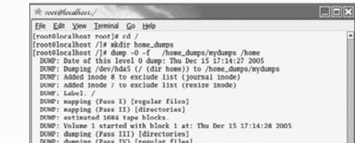

> 图 1：使用 Dump 命令

在书中，表格紧接在首次引用之后，如下所示：

### 表 1：Linux 基础文件处理命令

| 命令 | 说明 |
| --- | --- |
| ls | 显示当前目录的文件和目录列表 |
| ls -a | 显示隐藏文件和目录 |
| mkdir | 在系统中创建目录 |
| rdir | 从系统中删除目录 |
| passwd | 允许你更改系统密码 |
| exit | 允许你退出会话 |
| man | 允许你查看指定的帮助页面 |


| info | 允许查看有关 Linux 概念或命令的 info 页面 |
| cp | 允许从一个位置到另一个位置复制指定的文件和目录 |

我们的唯一意图是提供具有深度且充足信息的书籍，让你享受阅读并从中学习。阅读愉快！

# 01 开源软件概述

## 目标

- 解释开源软件的需求和优势
- 探索自由开源软件 (FOSS) 及其用法
- 描述自由软件运动
- 解释开源运动
- 讨论开源许可
- 描述认证
- 探索开源软件开发模型
- 讨论如何运行一个成功的自由软件项目
- 将开源软件与其他软件进行比较
- 探索不同类型的开源软件许可

## 1.1 引言

“开源”（open source）一词意味着某些公开可用，且源代码可以被修改和增强。如果我们将此术语应用于软件或程序，意味着该软件或程序的源代码是供公开使用的。开源软件的示例包括 `Linux` 和 `Android`。开源软件不同于那些拥有源代码但不能被任何人修改或复制的软件（创建它的作者对其拥有排他性控制权）。这种软件被称为专有软件或闭源软件，因为其源代码是原始作者的财产。

本章提供了开源软件的概述。它从描述开源软件的需求和优势开始。接下来解释了 `FOSS` 及其用法。章节还解释了自由软件运动、开源运动和开源软件开发模型。然后，章节解释了如何运行一个成功的自由软件项目，以及开源与其他类型软件的比较。在最后，该章节描述了不同类型的开源软件许可，例如 `Apache` 许可、`Eclipse` 公共许可和 `Mozilla` 公共许可。

让我们从解释开源软件的需求和优势开始。

## 1.2 开源软件的需求和优势

当你不想依赖闭源供应商进行任何产品升级时，就需要开源软件。例如，在你不希望客户等待一或两个月来升级版本时，就会采用开源软件。当你想要投资一个大项目时，也会采用开源软件，它为你提供了各种工具，如开发工具、测试工具或项目管理工具。

开源软件也被认为是驱动互联网的后台关键组件。当你查看网页或在互联网上与朋友聊天时，全球计算机网络将你的计算机与提供服务的远程计算机连接。许多此类计算机运行开源软件，如 `Linux`、Web 服务器应用程序如 `Apache`。此外，各种开源工具用于提供文件存储、网络等功能。

使用开源软件相比闭源软件的一些优势如下：

- **漏洞修复**：所有软件发布都包含漏洞。当闭源软件中检测到漏洞时，能够修复它的人只有开发并访问源代码的原始开发者。对于开源软件，源代码是可用的并且可以频繁更改。漏洞在开源软件中随处可见，但会被快速修复。
- **定制化**：任何人都可以对开源软件或工具进行定制以进行增强。
- **无锁定**：开源软件不对用户使用软件施加限制。然而，某些闭源软件供应商会锁定用户对其产品的访问，并在一段时间后增加软件产品或升级的价格。
- **资源支持**：开源软件提供一些学习资源，其中包含教程、项目或与软件相关的代码示例以增强开发者的技能。
- **社区支持**：当你使用开源软件时，你就成为了用户和开发者社区的一部分，他们可以提供支持来改进软件。

## 1.3 FOSS

自由开源软件 (`FOSS`) 是既开源又免费获取的软件。关于 `FOSS` 使用有一种认为它总是免费的迷言，但在某种程度上这是正确的。事实上，`FOSS` 应用程序不收取使用许可费。许多 `FOSS` `Linux` 发行版（如 `Red Hat`、`SuSE` 或 `Debian`）可以从互联网免费获取。

然而，许可费用并不是软件包的唯一成本。还有必要考虑人员成本、硬件需求以及培训成本。

### FOSS（自由开源软件）应用

一些常用的 `FOSS` 应用如下：

- **财务会计**：包括 `SQL-Ledger`、`ThreeBooks` 和 `LedgerSMB` 等应用
- **动画**：包括 `KToon` 等应用
- **CD/DVD 制作**：包括 `DVD Flic` 和 `InfraRecorder` 等应用
- **客户关系管理**：包括 `OpenCRM` 和 `vtiger` 等应用
- **桌面出版**：包括 `SCRIBUS` 等应用
- **人力资源**：包括 `OrangeHR` 和 `SimpleHRM` 等应用
- **即时通讯**：包括 `Pidgin`、`PIRC` 和 `Spark` 等应用
- **存货管理**：包括 `Asset Tracker` 等应用
- **企业资源计划**：包括 `OpenERP` 和 `WebERP` 等应用
- **多媒体**：包括 `OpenLP`、`Banshee`、`HandBreak` 和 `VLC` 媒体播放器
- **社交网络**：包括 `Diaspora` 应用

### FOSS 的使用

近年来，`FOSS` 应用在 IT 领域的普及程度日益增加。这是因为 `FOSS` 应用是免费使用的。此外，由于代码对所有人可见，并在发现漏洞时可以修复，因此 `FOSS` 应用被认为是安全的。使用 `FOSS` 的另一个优势是不需要担心序列号等反盗版问题。然而，使用 `FOSS` 可能较难学习。

## 1.4 自由软件运动

自由软件是一项目标是获得软件使用自由的运动。它赋予了用户运行、研究、更改和分发未经修改副本的自由。自由软件运动由 `Richard Stallman` 于 1983 年通过启动 `GNU` 项目而创立。自由软件运动还拒绝专有软件，因为后者没有提供软件的自由。

## 1.5 开源运动

公司正日益认可并采用开源软件和应用程序。例如，`Linux` 在全球范围内广泛使用，因为开源代码成为了社区维护的数据库的一部分。通过这种方式，代码得到了增强，并与其他未来发布的应用程序保持兼容，而无需公司亲自完成。

## 1.6 开源许可

“许可”（license）一词意味着使用、复制或分发某些物品的条款和条件。它赋予被许可者权利和义务。当我们说起开源许可时，意味着这些许可授予被许可者复制、修改或重新分发源代码的权利。许可可以是隐式的，也可以是显式的。当作者在已有的许可下为项目贡献代码时，这被称为隐式许可；然而，当作者在贡献者协议下为开源项目贡献代码时，这被称为显式许可。例如，`Apache.org` 使用了此类许可。需要注意的是，某些开源项目不根据许可协议接受贡献代码，而是要求原始作者和代码者之间进行共同转让。例如，`OpenOffice.org` 拥有联合版权协议。

## 1.7 认证

认证意味着对物体、个人或组织某些特征的确认。这种确认由某些机构在外部审查、评估或审计的情况下提供。认证有助于建立用户信任。现代社会中最常见的认证类型之一是职业认证，即人员通过考试获得能够完成某项工作的认证。职业认证分为两种：有些在通过考试后终身有效，另一些则在一段时间后必须重新认证。

开源软件也带有认证标志进行分发。该标志被称为开源倡议（`OSI`）认证标志，它标示着软件的质量。开源倡议是一个致力于推广开源软件的组织。该组织由 `Bruce Perez` 和 `Eric S Raymond` 于 1998 年 2 月建立。需要注意的是，`OSI` 认证标志适用于软件而非许可。

## 1.8 开源软件开发模型

在开源软件中，两种流行的模型包括大教堂模型（`cathedral model`）和集市模型（`bazaar model`）。大教堂模型是传统的开发模型，开发以集中的方式进行。在这种模型中，为负责设计、管理和实现软件的人员分配了不同的角色。

集市模型由 `Eric S. Raymond` 于 1997 年提出。这种模型与大教堂模型不同，因为它在其中没有明确定义的角色。在这种模型中，用户类似于开发者，可以访问软件的源代码。此外，用户被鼓励向软件源代码提交添加内容、修复漏洞的代码、错误报告、文档等。更多的用户意味着更多的共同开发者，这增加了软件演进的速度。

## 1.9 如何运行一个成功的自由软件项目

运行一个成功的自由软件项目意味着产出一个成功的自由软件项目。为了实现这一点，你需要查看是否有任何符合你要求的现有项目。如果你发现了一个已经存在的项目，并且其代码已在自由许可下发布，那么你没有理由重新发明它。否则，你需要从零开始。制作自由软件项目的步骤如下：

1. **选择名称**：你为为你的项目选择一个名称。选择名称时可以遵循的一些惯例如下：
   - 易于记忆
   - 它应该传达项目用途的想法
   - 它不与其他项目重名
   - 如果可能，它在 `.com`、`.net` 和 `.org` 域名下应该是可用的
2. **提供使命声明**：这是对项目的简要描述，应该出现在首页。描述应该是简短、清晰且具体的。你还需要列出使命声明涵盖的功能和需求。
3. **选择许可并应用它**：你需要从可用的自由软件许可中选择一种。一旦你选择了许可，就可以将其包含在首页。你不需要包含许可的全文，只需给出许可名称并提供完整许可文本的链接。图 1 显示了此类许可的模式：

```
Copyright (<年份>-<作者姓名>)

本程序是自由软件，你可以根据自由软件基金发布的 GNU 公共许可进行分发和/或修改除非根据你的选择使用任何后续版本。
```

图 1：许可模式

4. **设定展示风格**：你应该以不影响质量的方式分享你项目的源代码。
5. **发布项目**：在展示项目后，你应该向整个世界发布它。为了这一点，你可以访问 `http://freshmeat.net/` 网站并点击提交按钮。这是大家寻找新项目发布的地方。

运行成功的自由软件项目必须遵循的一些提示是：

- 你必须对人的评论和建议做出回应
- 你不应该接受对项目的任何更改，但要先让自己喜欢它
- 你应该为你的项目创建网页，其中包括截图、简要摘要以及更多信息的联系方式
- 你应该包含一个 `README` 文件，其中包含主页 URL、下载站点 URL 和项目的简要描述
- 你应该知道向哪里发送错误报告和补丁
- 你必须让公共邮件列表参与决策

## 1.10 开源软件与其他软件的比较

“开源软件”一词通常会与其他类型的软件（如自由软件）混淆。然而，开源软件与其他类型的软件之间存在若干差异。

让我们将开源软件与以下类型的软件进行比较：

- 闭源/专有软件
- 自由软件
- 源码可用（`Source available`）

### 1.10.1 与闭源/专有软件的对比

开源软件与闭源软件的对比基于对源代码进行修改的能力，但开源软件的源代码是向公众发布的，而闭源软件的源代码则被保密。

开源软件的一个常见例子是 `Linux`，而 `Microsoft Windows` 则是闭源软件的例子。`Windows` 的源代码不公开，而 `Linux` 的源代码是可以免费获取的。移动端的 `Android` 和 `iOS` 平台之间也可以进行比较。`Android` 是由 `Google` 提供的开源平台，而 `iOS` 是由 `Apple` 提供的闭源平台。

在闭源软件的情况下，公司实际上试图防止人们获取代码并进行有害活动，例如编写病毒和漏洞利用。这也能让软件供应商赚取更多钱，并防止竞争者窃取代码或将其用于创作者之外。

此外，闭源软件为开发者提供了统一的体验，因为开发者可以轻松地选择布局、功能、选项、颜色等。

### 1.10.2 与自由软件的对比

自由软件与开源软件之间存在意识形态上的差异。“自由软件”（Free software）一词由自由软件基金会（`FSF`）于20世纪80年代初引入。

自由软件是一种为其用户和社区提供使用自由的软件。这意味着用户有权运行、复制、分发、更改或增强软件的特性。这是一个与自由（liberty）有关的概念，而非价格。自由软件基金会是一个为了自由目的服务的活动组织。它将自由软件定义为尊重以下自由的软件：

- **自由 0**：出于任何目的运行或执行程序的自由。这种自由赋予个人或组织从学习或开发角度使用该程序的权利。
- **自由 1**：了解程序如何工作的自由。它允许在需要时更改代码，并且源代码是可访问的。
- **自由 2**：重新发行程序副本的自由。这种自由允许对程序内部进行修改。
- **自由 3**：向他人分发修改后的程序副本的自由。这种自由允许将你修改过的程序版本作为自由软件发布。

另一方面，开源软件是经过许可的软件。这些类型的软件在使用、复制或分发方面受到某些条款和条件的限制。这些许可授予了被许可者在复制、修改或重新分发源代码或内容相关的各种权利和义务。需要注意的是，自由软件不一定是开源的，但开源不一定是自由软件。这是因为自由软件许可比开源许可更具限制性。

### 1.10.3 与源码可用软件的对比

开源软件还与被称为“源码可用”（`source available`）的软件进行对比。此类软件的源代码只能被查看，而不允许修改或代码增强。源码可用软件的一些示例也称为共享软件。`Microsoft Windows` 学术计划和 `Microsoft` 政府安全计划提供了 `Windows` 内核源代码和项目，这些项目对于教学和研究中集成 `Windows` 内核核心技术有用；微软政府安全计划为各国政府评估 `Windows` 及其他微软产品的安全性提供协助。

另一方面，开源软件是供公众使用的。这些类型的软件可以由用户进行修改或增强。需要注意的是，“源码可用”一词的范围比开源更广，因为所有开源都是源码可用的，但反之不然。

## 1.11 常见的开源软件许可

你已经了解到许可授予了被许可者关于使用、复制或分发某物的权利和义务。开源软件许可授予了被许可者复制、修改或重新分发源代码或内容的权利和义务。常用的开源许可如下：

- `Apache` 许可 (`Apache License`)
- `BSD` 许可
- `GNU` 通用公共许可证 (`GPL`)
- `GNU` 较小通用公共许可证 (`LGPL`)
- `MIT` 许可
- `Eclipse` 公共许可证
- `Mozilla` 公共许可证 (`MPL`)

让我们在接下来的章节中学习这些许可。

### 1.11.1 Apache 许可

`Apache` 许可是由 `Apache` 软件基金会（`ASF`）编写的自由软件许可。它允许软件用户使用、分发或修改软件。它还允许在许可条款范围内分发软件的修改版本，而无需担心版税。

`Apache` 许可的原始版本是 1.0。它的下一个版本 1.1 于2000年被 `ASF` 批准。2004年1月，`ASF` 通过了 `Apache License 2.0`。`Apache License 2.0` 的某些特性如下：

- 软件必须以二进制代码或源代码的形式分发
- 此许可不允许使用贡献者的名字进行背书
- 如果对原始文件进行了某些更改，必须进行通知
- 软件的任何更改必须以源代码的形式分发
- 此许可允许你在分发软件代码时根据需要提供担保

### 1.11.2 BSD 许可

`Berkeley Software Distribution` (`BSD`) 是一种类 `Unix` 操作系统。`BSD` 许可有两种类型：新 `BSD` 许可/修改版 `BSD` 许可和简化 `BSD` 许可/`FreeBSD` 许可。`BSD` 许可的某些特性如下：

- 软件必须以二进制代码或源代码的形式分发
- 此许可不允许使用贡献者的名字进行背书

### 1.11.3 GNU 通用公共许可证

`GNU` 通用公共许可证（`GPL`）是广泛使用的自由软件许可之一，它保证用户可以使用、复制、修改和分发。该许可最初由自由软件基金会（`FSF`）的 `Richard Stallman` 编写。`GPL` 的最新版本是第3版。这种许可是一种拷贝（`copyleft`）许可证，意味着修改版本的发行必须遵循相同的许可证。`GPL` 的某些特性如下：

- 软件必须以二进制代码或源代码的形式分发
- 此许可不允许使用贡献者的名字进行背书
- 如果对原始文件进行了某些更改，必须进行通知
- 软件的任何更改必须以源代码的形式分发
- 此许可允许你在分发代码时根据需要提供担保

### 1.11.4 GNU 较小通用公共许可证

`GNU` 较小通用公共许可证（`LGPL`）是由 `FSF` 出版的自由软件许可。它允许开发者和公司在其软件中使用并集成 `LGPL` 软件。`LGPL` 的最新版本是第3版。它与 `GPL` 不同，因为它允许非 `GPL` 程序链接，无论该程序是自由软件还是专有软件。

`LGPL` 许可的某些特性如下：

- 软件必须以二进制代码或源代码的形式分发
- 如果对原始文件进行了某些更改，必须进行通知
- 软件的任何更改必须以源代码的形式分发

### 1.11.5 MIT 许可

麻省理工学院（`MIT`）许可是一种宽松的自由软件许可，这意味着允许在专有软件中重用，所有许可软件的副本都包含 `MIT` 许可。它允许以二进制代码或源代码的形式分发软件。`MIT` 许可与 `GPL` 许可兼容，这意味着 `GPL` 允许与 `MIT` 许可结合。下图显示了 `MIT` 许可的示例：

```
Copyright (C) holder

允许获得本软件及相关文档文件（称为“软件”）的人不受限制地处理软件，包括但不限于使用、复制、合并、发布、分发和/或销售软件的权利，并允许提供本软件的人这样做，但须满足以下条件：

上述版权声明和许可声明应包含在软件的所有副本或主要部分中。

本软件按“现状提供”，不提供任何形式的保证（无论是明确还是隐含的），包括但不限于对商品性、特定用途适用性和不侵权的保证。在任何情况下，作者或版权持有者对因软件或对软件的其他处理引起的任何索赔或损害均不负责。
```

### 1.11.6 Eclipse 公共许可证

`Eclipse` 公共许可证（`EPL`）是 `Eclipse` 基金对其软件使用的开源软件许可。它被设计为一种商业友好的自由软件许可。`EPL` 的最新版本是 1.0。它于2004年2月发布。`EPL` 被 `OSI` 批准，并被 `FSF` 认为是自由软件许可。

### 1.11.7 Mozilla 公共许可证

`Mozilla` 公共许可证 (`MPL`) 是一种免费的开源软件许可证。它由 `Mozilla` 基金（`Mozilla Foundation`）开发和维护。该许可证的当前版本是 `MPL 2.0`。`MPL` 被认为是修改后的 `BSD` 许可证和 `GNU GPL` 的混合体。该许可证不仅用于 `Mozilla Firefox`、`Mozilla Thunderbird` 以及其他 `Mozilla` 软件，还被 `Adobe` 等公司用于更改其 `Flex` 产品线以及 `LibreOffice 4.0`。它被自由软件基金会（`FSF`）认可为自由软件，并被开源组织（`OSI`）认可为开源软件许可证。`Mozilla` 公共许可证的某些特性如下：

- 软件必须与二进制源代码一起分发
- 如果对原始源文件进行了某些更改，则必须进行通知
- 代码的任何更改必须以源代码的形式分发

到此，本章就结束了。让我们总结一下本章涵盖的主要议题。

## 总结

在本章中，你学习了开源软件。开源软件或程序是指其源代码供公众使用的软件。开源软件的一些示例包括 `Linux` 和 `Android`。你还学习了开源软件的必要性和优势。接下来，你学习了 `FOSS` 及其用法。然后，你学习了自由软件运动、开源运动和开源软件开发模型。此外，你学习了如何运行成功的自由软件项目，以及开源软件与闭源软件、自由软件和源码可用（`source available`）软件的比较。最后，你学习了不同类型的开源软件许可证，例如 `Apache` 许可证、`Eclipse` 公共许可证和 `Mozilla` 公共许可证。

## 复习题

在这里，让我们回答以下类型的问题：

- 判断对错
- 多选题


# 简答性题

## 判断对错

- 开源软件不能被修改。错
- 开源代码为增强教学技能提供了极好的学习资源。对
- FOSS 应用依赖于最初创建它的公司或作者。错

## 第一章

- 4. 自由软件运动是一项社会运动，目标是让用户拥有使用软件的自由。对
- 5. 许可授予了被许可方权利和义务。对
- 6. 认证意味着对对象、个人或组织的某些特征的确认。对
- 7. 自由市集模型（Bazaar model）是传统的开发模式，开发以中心化的方式进行。错
- 8. 开源软件为开发者提供了统一的体验。错
- 9. BSD 是一种左版许可证（copyleft license）。错
- 10. LGPL 是一种自由软件许可证，允许开发者和公司在自己的软件中使用并集成 LGPL 软件。对

### 多选题

**Q1. 开源意味着供 ______ 可用。**

a. 公共使用 b. 修改
c. 增强 d. 以上所有

答. 正确选项是 d。

**Q2. 下哪项不是开源软件？**

a. Android b. Linux
c. Windows d. Eclipse

答. 正确选项是 c。

**Q3. 下哪个不是开源软件的优势？**

a. 修复 Bug b. 统一体验
c. 社区支持 d. 定制

答. 正确选项是 b。

**Q4. 下哪些软件厂商可以锁定用户使用其产品并提高产品升级的价格？**

a. 闭源 b. 开源
c. 自由源 d. 源码可用

答. 正确选项是 a。

**Q5. 在 ______ 中，为负责设计、管理和实现软件的人分配了专门的角色。**

a. 大教堂模型（Cathedral model） b. 市集模型（Bazaar model）
c. 隐式许可 d. 显式许可

答. 正确选项是 a。

## 开源软件概述

**Q6. 在移动平台中，IOS 是 ______ 的示例。**

a. 闭源软件
b. 自由软件
c. 源码可用
d. 开源软件

答. 正确选项是 a。

**Q7. 微软学术计划和微软政府安全计划是 ______ 的示例。**

a. 开源
b. 闭源
c. 免费
d. 共享

答. 正确选项是 d。

**Q8. 下哪个选项是 Apache 许可证的最新版本？**

a. 1.0
b. 1.1
c. 2.0
d. 2.1

答. 正确选项是 c。

**Q9. 下哪项不是 Mozilla 公许可证的特性？**

a. 软件必须与二进制代码或源代码一起分发
b. 此许可证不允许使用贡献者的名字进行背书
c. 如果对原始源文件进行了某些更改，则必须进行通知
d. 代码的任何更改必须以源代码的形式分发

答. 正确选项是 b。

**Q10. 下哪些许可证是宽松的自由软件许可证，这意味着它允许在专有软件中使用？**

a. MIT 许可证
b. Apache 许可证
c. BSD 许可证
d. Mozilla 公许可证

答. 正确选项是 a。

## 简答题

**Q1. 认证在开源软件中的作用是什么？**

答. 认证意味着对对象、个人或组织的某些特征的确认。这种确认由某些机构在外部审查、评估或审计时提供。认证有助于建立用户信任。开源软件也带有认证标记分发。这被称为开源组织（OSI）。

## 第一章

**Q2. 开源开发的大教堂模型和市集模型有什么区别？**

答. 大教堂模型是传统的开发模式，开发以中心化的方式进行。在这种模型中，为负责设计、管理和实现软件的人分配了专门的角色。

市集模型是由 Eric S. Raymond 在 1997 年提出的。在这种模型中，鼓励用户向软件提交添加。此外，它为开发者提供了统一的体验。

**Q3. 对比开源软件和闭源软件。**

答. 开源软件发布供公众使用，但在闭源软件的情况下，源代码是保密的。它还让厂商获利。

**Q4. 什么是源码可用（source available）软件？**

答. 源码可用软件只能查看而不可修改。此类软件的示例是微软 Windows 程序和政府安全。

**Q5. 描述 Eclipse 许可证。**

答. Eclipse 公许可证（EPL）是一种由 Eclipse Foundation 用于软件的开源软件许可证。它被设计为对商业友好的自由软件许可证。EPL 的最新版本是 1.0，于 2004 年 2 月发布。EPL 被开源组织（OSI）批准，并被自由软件基金会（FSF）认为是自由许可证。

# 02 开源系统

## 目标

- 介绍 Linux
- 解释 Linux 的 Unix 源
- 对比 Windows
- 解释 Linux 安装
- 解释双启动设置含义
- 解释磁盘分区
- 描述交换空间
- 解释逻辑卷管理和引导加载
- 解释命令行界面
- 识别 Linux 文件结构
- 解释基本文件系统管理
- 描述文件操作过程
- 定义管道和重定向
- 应用 vi 编辑器
- 解释 sed 的用法

## 2.1 引言

你可能已经意识到“操作系统”这一术语，它是一组协调计算机硬件资源之间所有活动的指令集。开源操作系统也是一种其源代码供公众免费使用的操作系统。该代码与公共版权兼容。此类开源操作系统的示例是 Linux。

Linux 是由 Linus Torvalds 创建的基于 Unix 的操作系统。它是一个免费发布的开源操作系统。Linux 是一个多用户多任务操作系统，这意味着多个用户可以登录，每个用户可以同时执行多个任务。Linux 系统可以安装在任何使用 x86 兼容处理器的系统上。

在本章中，你将学习 Linux。本章从介绍 Linux、它与 Unix 的关系以及 Linux 与 Windows 的对比开始。接下来，本章将介绍如何安装 Linux、双启动含义、磁盘分区、交换空间、逻辑卷管理和引导加载。本章还将解释命令行接口 (CLI)、Linux 文件层次结构 (FHS)、基础文件系统管理任务，以及如何进行文件操作。接下来，本章将解释管道和重定向的概念。在最后，本章将解释 vi 编辑器和 sed 命令的使用。

## Linux 简介

Linux 是一个基于 Linux 内核的自给自足的操作系统。Linux 内核是管理资源的核心组件。Linux 是一个多用户、多任务的操作系统，这意味着多个用户可以同时登录并执行多个任务。它允许用户通过不同的界面进行工作，例如命令行接口 (CLI) 和图形用户界面 (GUI)。桌面环境 (KDE) 和 GNOME 网络对象模型环境 (GNOME) 是 Linux 中两种常用且流行的 GUI。

计算机系统上的 Linux 提供了以下功能：

- 进程：帮助对多个任务进行调度和优先级排序
- 内存：帮助将超出可用内存的各种设备移动到交换空间（swap space）
- 设备：帮助支持各种硬件设备并管理内核大小
- 文件系统：帮助管理不同的文件系统格式，如虚拟文件分配表 (VFAT)、新技术文件系统 (NTFS) 或 Linux ext3
- 安全：帮助提供受限的用户访问

### Linux 特性

Linux 提供了与其他操作系统不同的各种特性。一些区别性特征如下：

- 无需重启：允许你在无需重启计算机的情况下安装和删除软件
- 启动/停止服务：允许你启动和停止单个服务（如 Web、文件和电子邮件服务），而无需重启计算机或中断用户工作
- 可移植软件：修改应用程序或驱动程序使其在不同的架构或操作系统上运行
- 可下载应用程序：借助 apt、uprpm 和 yum 等工具，帮助你通过单条命令下载并安装所需的应用程序
- 代码或注册表中无设置：允许你根据需求修改代码，Linux 是一种开源软件
- 自由：允许你选择任何 Linux 发行版并访问源代码。你还可以根据需要添加或删除软件
- 交换空间 (Swap space)：指硬盘上的某个区域，用于处理运行中的进程和数据的溢出

## Linux 发行版

Linux 发行版是包含特定应用程序或服务的包。这些包由 Linux 内核、GNU 工具和库、额外的软件、文档等组成。Linux 发行包通常被称为 distros，它们是 Linux 操作系统的一部分。前面已经提到 Linux 是基于 Linux 内核的。编译和安装 Linux 操作系统的源代码包含在发行包中。一个 Linux 操作系统由许多不同的发行包组成。根据需要，用户可以在各种发行包中选择要安装的包来安装 Linux 系统。常用的发行包之一是 Fedora。Fedora 是由 Red Hat 支持的社区发行版，Red Hat 是最成功的面向企业的开源公司之一。Fedora 是 CentOS 和 Red Hat Enterprise Linux (RHEL) 的上游发行版。然而，它本质上是一个功能完整的操作系统，可以作为服务器或桌面系统使用。Fedora 提供了图形界面和配置工具。它被用于通用发行。它是一个适用于服务器也适用于桌面应用程序的发行包。Red Hat Enterprise Linux (RHEL) 是 Red Hat 的官方发行版，所有的 Red Hat 服务器服务水平协议和认证计划都基于此版本。虽然 RHEL 是开源的，但它被公司的服务器用于支持由 Red Hat 提供的服务。在这种情况下，用户选择社区企业级操作系统 (CentOS)，这是一种尝试提供免费企业级计算平台且与 RHEL 相同的 Linux 发行版。

## 2.3 Linux 在 Unix 中的根源

在 20 世纪 80 年代和 90 年代，微软的磁盘操作系统 (DOS) 和 Windows 是个人计算机上流行的操作系统。然而，专业用户对操作系统有更高的要求。他们需要可以在网络上运行、同时支持多个用户（多用户）并同时运行许多程序（多任务）的系统。DOS 和 Windows 无法满足这些要求。

20 世纪 90 年代，Unix 被免费分发大学。Unix 的源代码是开源代码，可以由开发者增强并与他人共享。主要的计算机硬件厂商许可 Unix 源代码在他们的计算机上运行。

Linux 由 Linus Torvalds（林纳斯·托瓦兹）于 1991 年发明，他当时是赫尔辛基大学的一名学生。他当时正在研究 MINIX，这是一个供其学术使用的 Unix 类操作系统。MINIX 的源代码是免费提供的，但不允许对源代码进行修改和重新发行。Linus Torvalds 启动了一个项目，该项目后来变成了 Linux 内核。Linux 内核最初是一个终端模拟器，这是一个专门为硬件设计的程序，旨在整合 PC 中的新功能。内核第一个基础版本是 0.01，于 1991 年 8 月 25 日发布。第二个版本是 0.02，于 1991 年 10 月 5 日发布，它仍然需要 MINIX 运行。

随后在同年的 12 月 19 日，Linux 内核作为一个功能且独立的 Unix 操作系统以版本 0.11 发布。现在，它已经存在了二十多年，在此期间发布了许多 Linux 内核版本。

## 2.4 Linux 与 Windows 对比

Linux 是开源软件和免费操作系统的示例。另一方面，Windows 是微软的产品，是闭源软件的示例。这两个操作系统都有自己的特性。让我们如表 1 所示将 Linux 与 Windows 进行比较：

| 特性 | Linux | Windows |
| --- | --- | --- |
| 软件类型 | 开源软件和免费系统的示例 | 闭源软件 |
| 成本 | Linux 是免费分发和下载的 | Windows 版本并非免费 |
| 制造商 | Linux 由社区开发，Linus Torvalds 监督 | Windows 由微软创建 |
| 用途 | Linux 可以安装在各种计算机上，如手机、平板电脑等 | Windows 可以安装在个人计算机、笔记本电脑、服务器上 |
| 文件系统支持 | Linux 支持 Ext2, Ext3, Ext4, Jfs, Reiserfs, Xfs, Btrfs, FAT, FAT32 和 NTFS | Windows 支持 FAT、FAT32 和 NTFS |
| 文本模式界面 | 在 Linux 中，BASH (Bourne Again Shell) 是默认 shell。它可以支持多个解释器 | Windows 使用命令 shell，最近增加了可以使用 Unix 命令的可选 PowerShell |
| 示例 | Linux 版本示例有 Ubuntu、Fedora、Red Hat、Debian、Arch、Android 等 | Windows 版本示例有 8.1、7、Vista、XP 等 |
| 用户体验 | 虽然有很多 GUI 应用，但大部分工作通过终端窗口（控制台）完成 | 虽然可以通过 GUI 控制，但也提供 CLI |
| 公司/开发者 | Linus Torvalds | Microsoft |
| 可用语言 | 多语言 | 多语言 |
| 许可证 | GNU/免费 | 专有 |

## 2.5 Linux 的安装

你可以通过多种方式在计算机系统上安装 Linux。以下安装方法：

- CD-ROM：从一组安装光盘是最直接的方法。将介质插入系统并确保基本输入输出系统 (BIOS) 配置为从光盘启动。
- 硬盘：从硬盘安装需要将安装光盘的 ISO 镜像放在硬盘分区上（格式化为 ext2、ext3 或 vfat）。还需要从第一张安装光盘上的 boot.iso 镜像创建启动光盘。
- 网络安装（通过 NFS、FTP 或 HTTP）：此方法需要从 boot.iso 镜像创建的启动光盘或预启动执行环境 (PXE) 启动。启动后，选择首选的网络安装方法，如 NFS、FTP 或 HTTP。安装源必须通过选定的协议对可用。
- Kickstart：Kickstart 是 Red Hat 脚本安装方法的名称。编写好 kickstart 格式的脚本后，使用启动光盘或 PXE 启动程序，然后给出 kickstart 文件的位置。

## 设置 Linux 和 Windows 双启动

有时，你可能想在单台计算机上安装多个操作系统。例如，你希望在单台机器上同时安装 Windows 和 Linux，或者你需要在计算机系统上安装多个版本的 Windows。如果安装了两个操作系统，这种概念被称为双启动（dual booting）；或者如果单台计算机上安装了两个以上的操作系统，则被称为多启动（multiboot）。双启动或多启动系统允许你拥有一个主操作系统和一个使用较少的备用操作系统。在计算机系统上拥有双启动或多启动环境的某些优点如下：

- 允许你在无需完全切换到另一个操作系统的情况下，研究或测试新的操作系统
- 帮助在删除旧操作系统之前进行备份或迁移数据
- 允许你在多个操作系统上测试新应用程序
- 帮助安装需要不同硬件成本的应用程序
- 帮助降低硬件成本

要获得双启动或多启动环境，你必须使用引导加载程序（boot loader），例如 NTLDR、LILO 或 GRUB，这些程序可以启动多个操作系统。

如果你在计算机系统上设置了 Windows 和 Linux 的双启动，它将在计算机刚启动后允许你选择 Windows 系统或 Linux 系统。

要在计算机系统上设置双启动，你需要缩小 Windows 分区（这些分区可能占据了硬盘上较大的空间），以便为 Linux 分区留出空间。Linux 安装需要硬盘上的分区。

## 硬盘分区

根据主引导记录（MBR）分区方案，分区分为两种类型：主分区（primary partitions）和扩展分区（extended partitions）。一台计算机硬盘最多可以被划分为四个主分区，或者划分为三个主分区和一个扩展分区。需要注意的是，硬盘只能有一个扩展分区，且该分区可以被细分为多个逻辑驱动器（logical drives）。

在 Linux 中，你使用物理磁盘分区通过将其与文件系统的特定部分关联，来将每个硬盘分区关联起来。这种安排是一个层级目录结构，也被称为目录树（directory tree）。如果你有多个分区，可以在 Linux 的单个目录树下使用所有分区。你只需要决定 Linux 目录树的哪部分应该位于每个分区上即可。这个过程在 Linux 中被称为在设备上挂载文件系统（磁盘分区就是一种设备）。

“挂载点”（mount point）一术语是指你与磁盘分区或任何其他设备关联的目录。在 Linux 中，至少需要创建两个分区，如下所示：

- 第一个分区是根分区（root partition）。根分区的最小大小从 2 GB 到 8 GB 不等，取决于软件包的安装情况。
- 第二个分区是 SWAP 分区（虚拟驱动器）。该分区的建议大小为 RAM 大小的两倍或 1 GB，以较大者为准。

> 我们可以将 `/boot`、`/var` 和 `/home` 作为分区。（更多信息，可以参考 2.6 命令行接口中的 Linux FHS 部分）。
> 要了解更多关于硬盘分区的信息，请参考附录 A- Linux 中的硬盘分区。

## 交换空间

大多数宣传的操作系统都支持虚拟内存的概念，即你的系统硬盘充当物理内存（RAM）的扩展。这被称为交换空间（swap space）。当操作系统耗尽物理内存时，它可以将 RAM 中当前未使用的页的内容移动（或换出）到硬盘上的交换分区，以便为分页留出空间。当操作系统需要访问被换出的数据中的任何内容时，它必须找到某些内容将其换出，并从磁盘中换入所需的数据。这种在 RAM 和磁盘之间来回交换数据的过程被称为分页（paging）。

如你所知，磁盘比 RAM 慢得多，当系统执行大量分页时，系统性能会变慢。然而，虚拟内存允许你运行其他情况下无法运行的程序。Linux 支持虚拟内存并可以使用交换分区。当你创建 Linux 分区时，也应该创建一个交换分区。

## LVM

逻辑卷管理（Logical Volume Management，简称 LVM）是 Linux 内核中的技术，有助于管理磁盘驱动器和其他块存储设备。它用于部署逻辑存储而非物理存储。使用 LVM 技术，你可以通过创建逻辑分区来分组或调整物理设备上创建的分区大小。图 1 显示了 LVM 的内部结构：

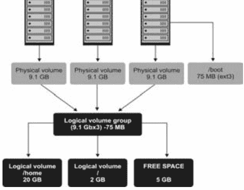


物理卷由若干固定大小的物理区（Physical Extents, PEs）组成。同样，逻辑卷也由若干固定大小的逻辑区（Logical Extents, LEs）组成。注意 PE 和 LE 的大小始终相同。图 2 显示了 LE 与 PE 的映射关系：

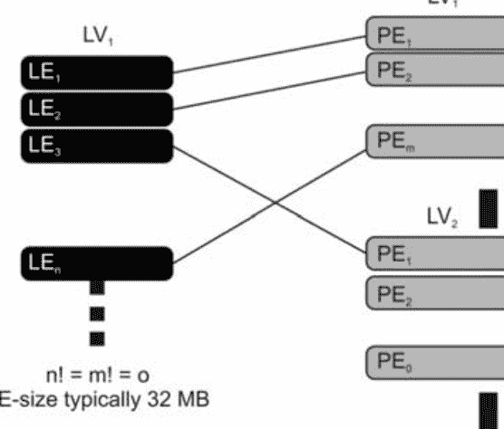

▲ 图 2：LE 与 PE 的映射

当多个物理卷（PVs）连接在一起创建一个单一逻辑卷（LV）时，这种映射被称为线性映射（linear mapping），如图 3 所示：

| PV0 | PV1 | PV2 | PV3 |
|---|---|---|---|
| ... | ... | ... | ... |
| | | 1LV | |
| | | | |

▲ 图 3：LVM 线性映射

PV 与 LV 的另一种映射是条带映射（striped mapping）。在这种映射中，连续的 PV 组映射到一个单个 LV，如图 4 所示：

## 开源操作系统


图 4：条带映射

在 Linux 中，你使用 LVM 是首先通过 `pvcreate` 命令创建 PV。然后通过 `vgcreate` 命令创建卷组。之后，你可以使用 `lvcreate` 命令通过 PE 创建 LV。

## 引导加载程序

引导加载程序（boot loader）有助于启动安装在计算机硬盘上的操作系统。Linux 操作系统允许你选择 GRUB 或 LILO。当你安装程序后打开计算机时，第一个过程是启动。启动过程通过一组启动计算机的指令进行。引导加载程序是负责加载和启动 Linux 操作系统的应用程序。

可以通过以下方式调用：

- BIOS 将控制权交给主引导记录（MBR）中的初始引导程序（IPL）。
- BIOS 将控制权交给另一个引导加载程序，由其将其传递给安装在分区内的 IPL。

GRUB 代表 Grand Unified Bootloader。该引导加载程序位于你的系统硬盘上，并在打开计算机时启动 Linux。它是计算机启动后出现的内容。GRUB 是动态配置的（动态配置指的是 Linux 操作系统启动时加载的配置）。它还包含支持多种格式、多启动和非多启动操作系统以及镜像自动解压的功能。GRUB 可以从任何设备运行，如软磁盘、光盘、USB 驱动器或通过网络。

LILO 代表 LiLoader。LILO 加载程序不依赖于特定的文件系统，可以从软磁盘和硬盘启动操作系统。在某些 Linux 发行版中（如 Slack），LILO 是默认引导加载程序而非 GRUB。LILO 放置在 MBR 中，可以独立启动并设置内核的每个参数。

如果你想使用 LILO 引导加载程序，可以通过两种实现。如果你在系统上重新安装任何 Linux 发行版，你可以使用 LILO 引导程序启动计算机。

# 第 2 章

如果系统中已经安装了 Linux 发行版，那么你首先需要下载最新版本的 LILO，然后在终端窗口中以 root 用户身份输入以下命令：

```
/sbin/lilo -v -v
```

此命令使用 MBR 中预设的默认设置。安装 LILO 后，你可以对其进行配置。所有的配置都在位于 `/etc/lilo.conf` 的配置文件中完成。

### 安装 Linux

你可以从 Linux 发行版的可启动 CD/DVD-ROM 开始安装。确保你的 BIOS 设置为从 CD-ROM 第一个启动设备。让我们执行以下步骤来安装 Linux：

1. 使用 Linux CD 启动计算机，你将看到安装界面，如图 5 所示：

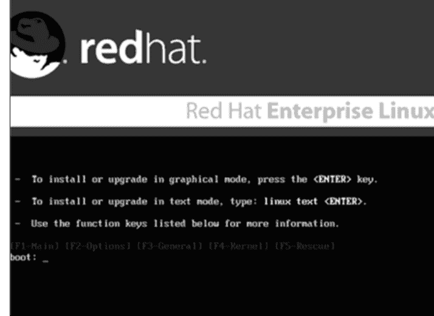

> 图 5：显示安装界面

在这里，你只需按回车键即可继续图形界面安装过程。出现语言选择界面。

2. 选择一种在后续安装步骤使用的语言，如图 6 所示：

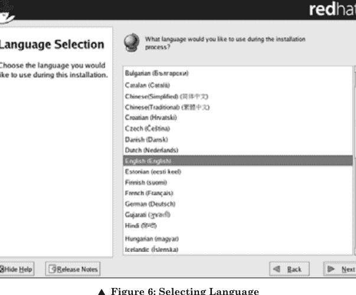

▲ 图 6：选择语言

3. 点击 Next（下一步）按钮。打开键盘配置界面。

4. 选择键盘类型并点击 Next 按钮，如图 7 所示：

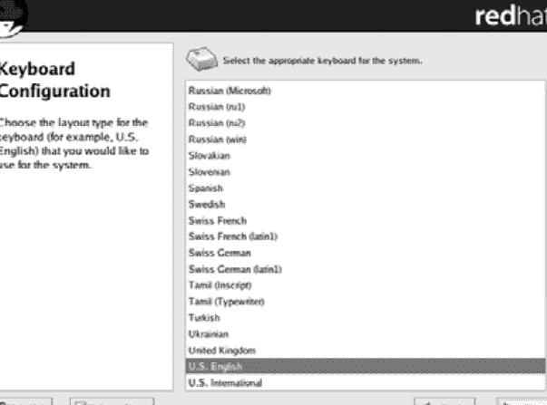

▲ 图 7：选择键盘布局

显示磁盘分区设置界面。

5. 选择 Manually partition with the Disk Druid（使用磁盘精灵进行手动分区）选项并点击 Next 按钮，如图 8 所示：

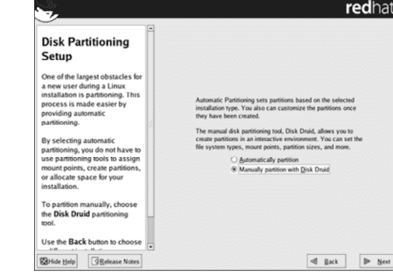

图 8：磁盘分区设置界面

显示磁盘设置界面，列出了硬盘上的所有分区，如图 9 所示：

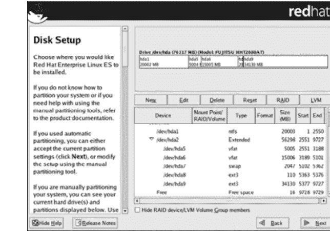

图 9：磁盘设置界面

如图 9 所示，磁盘精灵在以下字段中显示分区信息：

- **Mount Point（挂载点）：** 指明挂载分区的目录。例如，如果你为整个 Linux 文件系统只划分区，则挂载点是根目录（/）。对于交换分区（swap partition），此字段显示 `<swap>`。如果此字段显示为 `<not set>`，你必须指定挂载点，可以通过选择分区并点击 Edit（编辑）按钮来实现。

- **Device（设备）：** 指分区的设备名称，`hda1` 是第一个 IDE 驱动器上的第一个分区，SATA 设备则为 `sda1`。

- **Requested field（请求字段）：** 显示分区的空间。例如，如果分区有 256 MB 空间，此字段显示为 256M。

- **Actual field（实际字段）：** 显示分区正在使用的磁盘空间。通常情况下，Requested 和 Actual 字段是相同的，但对于可以扩展大小的分区，它们可能会不同。

- **Type field（类型字段）：** 显示分区的类型为 Linux 或 DOS。如果没有定义分区，则 Partitions 列表中的表格将为空。你必须点击 Add（添加）按钮添加新分区。你可以通过 Disk Druid 中跨屏幕的五个按钮执行特定的磁盘设置任务。具体来说，这些按钮执行以下操作：

- Add（添加）：允许你创建一个新分区，前提是有足够的空闲磁盘空间。当你点击此按钮时，会出现另一个对话框，你可以在其中填入创建分区所需的信息。

- Edit（编辑）：允许你修改 Partitions 列表中当前高亮的分区的属性。你可以在点击 Edit 按钮后弹出的另一个对话框中对当前属性进行更改。

- Delete（删除）：移除 Partitions 列表中当前高亮的分区。

- Make RAID（创建 RAID）：设置 RAID（独立磁盘冗余阵列）设备，这是一项结合多个磁盘以提高可靠性和数据传输速率的技术。只有当你的系统具有支持 RAID 设备所需的硬件时，此按钮才激活。你在 Disk Druid 中执行的功能取决于你 PC 中的硬盘以及它们已拥有的分区。

6. 在 Disk Druid 界面点击 Add 按钮创建一个新分区并将其设置为 Linux 交换空间。打开 Edit Partition: /dev/hda7 对话框，如图 10 所示：

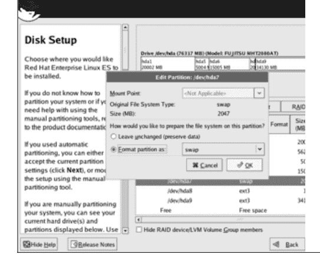

在 Edit Partition: /dev/hda8 框中（见图 10），选择分区的尺寸。选择分区类型列表并使用 Swap 作为类型。当你这样做时，Mount Point 字段中会出现文本 - “Swap Partition”。接下来，按 OK 按钮返回新分区并返回 Disk Druid 界面。

图 10：编辑分区：/dev/hda8

7. 在 Disk Druid 界面点击 Add 按钮创建一个新分区并将其设置为 Linux 交换空间。打开 Edit Partition: /dev/hda8 对话框，如图 11 所示：

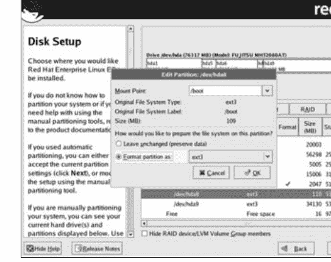 *(注：此处原文编号可能有误，按原文翻译)*

在 Edit Partition: /dev/hda8 框中（见图 10），选择分区的尺寸。选择分区类型列表并使用 Swap 作为类型。当你这样做时，Mount Point 字段中会出现文本 - “Swap Partition”。接下来，按 OK 按钮返回新分区并返回 Disk Druid 界面。

图 11：编辑分区：/dev/hda8

- 在 Disk Druid 界面点击 Add 按钮，为 Linux 系统创建一个新分区。打开 Edit Partition: /dev/hda7 对话框，如图 12 所示：

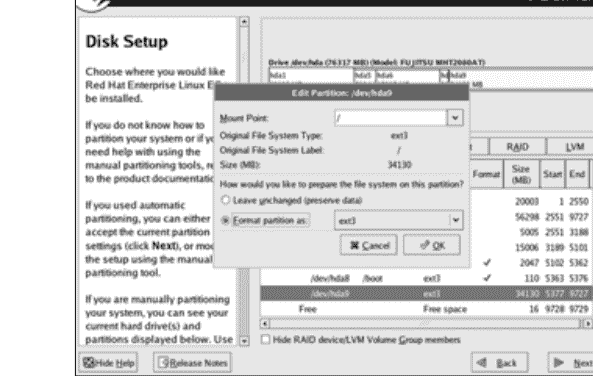 *(注：此处原文编号可能有误，按原文翻译)*

在 Edit Partition: /dev/hda8 框中（见图 10*），选择分区的尺寸。选择分区类型列表并使用 Swap 作为类型。当你这样做时，Mount Point 字段中会出现文本 - “Swap Partition”。接下来，按 OK 按钮返回新分区并返回 Disk Druid 界面。

图 12：编辑分区：/dev/hda7

- 在 Disk Druid 界面点击 Add 按钮，为 Linux 系统创建一个新分区。打开 Edit Partition: /dev/hda9 对话框，如图 13 所示：

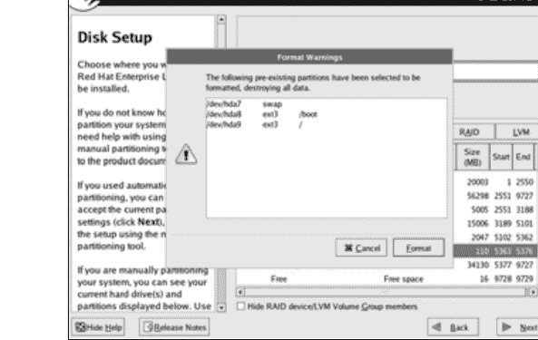 *(注：此处原文编号可能有误，按原文翻译)*

图 13：编辑分区：/dev/hda9

在 Edit Partition: /dev/hda8 框中（见图 10*），选择分区的尺寸。选择分区类型列表并使用 Swap 作为类型。当你这样做时，Mount Point 字段中会出现文本 - “Swap Partition”。接下来，按 OK 按钮返回新分区并返回 Disk Druid 界面。

10. 点击 Format 按钮格式化创建的分区。

准备好带有 Linux 的磁盘分区后，执行以下步骤来配置 Linux：

11. 在 Disk Setup 界面点击 Next 按钮。出现 Boot Loader Configuration ，如图 14 所示：

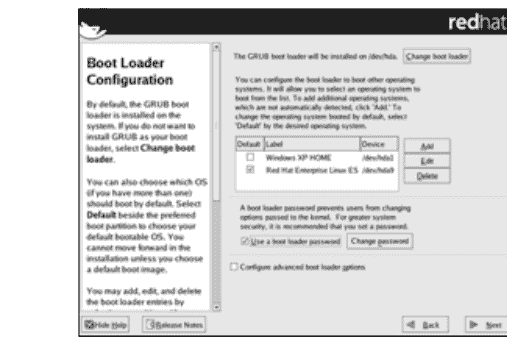

图 14：引导程序配置界面

引导程序配置界面允许你选择计算机将使用的加载程序。GRUB 是默认选择的加载程序。你可以在以下选项上安装加载程序记录：

- Master Boot Record（主引导记录）：建议用于安装
- First sector of boot partition（启动分区的第一扇）：如果你使用其他加载程序，建议使用此项

12. 选择 Red Hat Linux 选项并点击 Next 按钮。出现 Network Configuration ，如图 15 所示：

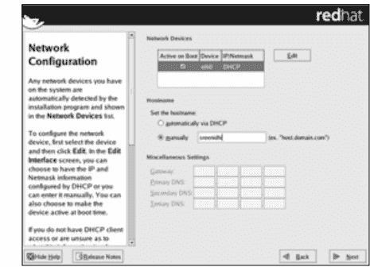

图 15：网络配置界面

如图 1 所示，如果你的 PC 从动态主机配置协议（DHCP）服务器获取 IP 地址和其他网络信息，点击标记为 Using DHCP 的按钮。手动填写必要的网络信息。

网络配置界面请求以下参数：

- 以太网接口的 IP 地址
- Linux 系统的主名（对于私有局域网，你可以分配主机名而无需担心与互联网上的任何其他系统冲突）
- 网关 IP 地址（你可能通过它访问任何外部网络）
- 主名称服务器 IP 地址
- 副名称服务器 IP 地址
- 三级名称服务器 IP 地址

13. 指定网络后，点击 Next 按钮。出现 Firewall Configuration ，如图 16 所示：

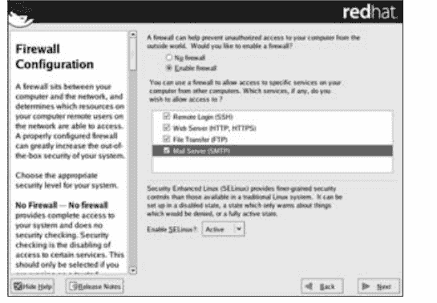

图 16：防火墙配置界面

这里是安装期间配置防火墙的选项。如果你启用防火墙，可以点击相应的复选框并允许各种服务的传入请求，如图 16 所示。

## 32 ► 第2章

图 17：时区选择屏幕

15. 点击地图上的某一点来选择时区，或从下拉框中选择。

16. 选择时区后，点击“下一步”（Next）按钮。出现“设置根密码”屏幕，如图 18 所示：

图 18：设置根密码屏幕

此时你需要为 root 用户选择一个密码。根密码提供了对你 Linux 系统的完全控制权。输入根密码，然后在确认框中再次输入，如图 18 所示。

17. 设置密码后，点击“下一步”（Next）按钮。出现“软件包安装默认”屏幕，如图 19 所示：

图 19：软件包安装默认

对于新的安装程序，安装程序会自动选择一个默认软件包列表进行安装。可以自定义要安装的软件包。

18. 如果你想安装自定义列表的包，请选择“自定义要安装的软件包”并点击“下一步”（Next）按钮。出现“软件包组选择”屏幕，如图 20 所示：

图 20：软件包组选择屏幕

##34 第2章

19. 选择一个包组后，点击“下一步”（Next）按钮。出现“即将安装”屏幕，如图 21 所示：

图 21：即将安装屏幕

“即将安装”屏幕告知你正准备向硬盘写入数据。你仍然可以返回，你的硬盘不会发生变化。

在验证安装信息后，点击“继续”（Continue）按钮。这将在你的系统上安装 Linux。你将看到祝贺屏幕，如图 22 所示：

图 22：安装完成

## 开源操作系统

20. 弹出 DVD 或 CD 并点击“重启”（Reboot）按钮。

让我们学习在安装 Linux 后首次启动系统会发生什么。

## 首次启动：安装成功后

安装 Linux 并重启后，会显示欢迎屏幕。图 23 显示了欢迎屏幕：

图 23：欢迎屏幕

在图 23 中，你看到屏幕左侧有一份任务列表。点击“下一步”（Next）按钮继续。打开“许可协议”屏幕，如图 24 所示：

图 24：许可协议屏幕

在继续使用 Linux 之前，你必须同意许可。选择“Yes, I agree to the License Agreement”单选框并点击“下一步”（Next）按钮。打开“日期和时间”屏幕，如图 25 所示：

图 25：日期和时间屏幕

在此屏幕中，你必须配置当前的日期时间和，然后点击“下一步”（Next）按钮。打开“显示”屏幕，如图 26 所示：

图 26：显示屏幕

在此屏幕中，你配置显示设置，例如分辨率和色彩深度。点击“下一步”（Next）按钮。打开“系统用户”屏幕，如图 27 所示：

## 开源操作系统

图 27：系统用户屏幕

在图 27 中，你可以使用密码创建一个或多个用户。点击“下一步”（Next）按钮。打开“声卡”屏幕，如图 28 所示：

图 28：声卡屏幕

此屏幕告知你系统是否配置了声卡。如果系统检测到声卡，你还可以播放声音。点击“下一步”（Next）按钮。打开“附加 CD”屏幕，如图 29 所示。

##38 ► 第2章

图 29：附加 CD 屏幕

此屏幕帮助使用 CD 安装软件、第三方插件或应用程序。点击“下一步”（Next）按钮将完成 Linux 的安装和配置。

让我们学习 CLI。

## 2.6 命令行接口

命令行接口（CLI）术语是系统的基于文本的界面。在 Linux 中，它也被称为终端（terminal）。CLI 为你提供一个提示符。无论你输入什么，都会通过命令帮助显示。CLI 为你提供一个提示符。无论你输入什么，都会通过命令帮助显示。在终端中，你有一个 shell（外壳），它是操作系统的一部分，定义了终端如何行为和外观（或为你执行）命令。有多种类型的 shell 可用，但最常用的是 bash。bash 代表 Bourne Again。注意，你可以通过命令 `echo` 访问你正在工作的当前 shell 信息。此命令会显示你当前的 shell。

## 2.7 理解 Linux 的 FHS

每个操作系统都将信息组织成文件。文件是指存储在硬盘、优存盘和磁磁盘等存储介质上的字节流。目录有助于组织计算机中的文件。此类目录可能包含在一个父目录中。父目录中的目录被称为子目录。

Linux 文件系统采用分级结构组织，根目录位于顶部。根目录用正斜杠（/）表示。当你在 Linux 中打开文件时，你从根目录开始到文件所在的子目录。Windows 遵循不同的结构，由包含目录的分组成。Windows 的格式是 `C:\`，而在 Linux 中是 `/`。Linux 使用正斜杠代替目录和文件结构。此外，Linux 中没有名为 C 或 D 的驱动器。当你安装 Linux 时，根分区被挂载在根目录（/）。挂载是指准备设备的过程，以便操作系统可以使用。在 Linux 中，文件、文件夹和驱动器都挂载在 `/` 下。Linux 遵循文件层次结构（FHS）来定义文件和目录的名称和位置，如图 30 所示：

```
/bin
/etc
/home
/lib
/lost+found
/mnt
/proc
/root
/sbin
/tmp
/usr
/var
```

图30：Linux 文件和目录系统

图 30 显示了 Linux 的目录结构，从根目录开始分支到子目录。以下是 Linux 各目录的简要描述：

- / 是 FHS 中的顶级目录。

- /bin：包含启动和修复系统所需的可执行文件（准备就绪的文件）。此目录通常包含 bash 和 csh 等 shell，它们为 Linux 提供基于文本的界面，以及 cp、mv、rm、cat 和 ls 等命令。

- /sbin：持有供 root 用户使用的二进制可执行文件。此目录包含启动系统所需的文件。

- /home：提供系统管理员和用户都可以访问的目录。/home 目录存储用户的个人文件、目录和程序。

- /boot：允许你启动 Linux 系统。此目录包含 Linux 内核，它是 Linux 系统的核心组件。

##40 第2章

- /dev：包含连接到 Linux 系统的设备项。

- /lib：包含 Linux 程序所需的所有共享库。


## Linux 目录结构

- `/usr`：包含所有用户应用程序、文档、配置文件和图形。它还包含系统的软件源码。它是 Linux 系统中最大的目录，存放终端网络（Telnet）和文件传输协议（FTP）等程序。
- `/mnt`：返回挂载文件系统的挂载点。
- `/var`：包含变量文件，如日志 (`/var/log`)、邮件 (`/var/mail`) 和卷（`/var/spool`）。
- `/proc`：包含用于从内核提取信息或向内核发送信息的特殊文件。它是存储系统进程的虚拟目录。
- `/etc`：包含系统所有的配置文件。此目录经常用于 Linux 系统的备份，以便在你必须重新安装 Linux 系统时执行重新配置过程。
- `/lost+found`：允许在系统崩溃或断电时恢复文件或数据。
- `/root`：允许超级用户访问其主目录。超级用户是使用 root 账户登录的用户。
- `/tmp`：在 Linux 中存储临时文件。

## 开源操作系统

### 表 2：Linux 基础文件处理命令

| 命令 | 描述 |
| --- | --- |
| `info` | 允许你查看关于 Linux 概念或命令的帮助页 |
| `cp` | 允许你将指定的文件和目录从一个位置复制到另一个位置 |

## Linux 中的绝对路径 vs. 相对路径

在技术术语中，路径是操作系统文件系统中文件或文件夹的唯一位置。它使用 `/` 符号结合字母和数字。Linux 或 Unix 操作系统中有两种类型的路径：

- **绝对路径**：从根目录 (`/`) 指定文件或目录位置的路径。绝对路径的一些示例有：

```
 /var/ftp/pub
 /etc/samba.smb.conf
 /boot/grub/grub.conf
```

- **相对路径**：相对于工作目录 (`pwd`) 的路径。假设你正在 `/usr/mydatada` 目录下工作，并想切换到 `/user/mydata/pictures` 目录。要这样做，使用此相对路径并输入 `cd` 命令，如下所示：

```
pwd
/usr/mydatada
cd pictures
```

在前面的命令中，你可以看到 `pictures` 之前没有 `/`，这表示它是当前工作用户的一个相对目录。

## 文件操作

文件是存储在硬盘上的数据项的集合。在 Linux 中，程序、文本和图像都被称为文件。文件按分级目录结构排列。作为系统管理员，你需要执行某些操作，例如挂载和卸载文件系统，以及管理 DVD 和 CD 等各种存储介质上的文件系统。文件存储在硬盘或软盘等存储介质设备中。

文件名始终有一个扩展名，以点开头。扩展名指示文件的类型。在 Linux 上，文件扩展完全取决于约定，操作系统本身会忽略它们。只有少数特定程序使用扩展名来识别文件类型。表 3 列出了用于特定文件的基础文件扩展：

### 表 3：基础文件扩展

| 文件扩展名 | 描述 |
| --- | --- |
| `.txt` | 文本文件 |
| `.gif` | 图形交换格式图像 |
| `.jpg` | 联合图像专家小组图像 |
| `.mp3` | MPEG-2 Layer 3 音频 |
| `.gz` | 压缩文件 |
| `.tar` | Unix “带归档的文件” |
| `.tar.gz`, `.tgz` | 压缩归档文件 |

让我们在接下来的章节中讨论更多命令。

## 使用 cd 访问目录

你可以使用 `cd` 命令从当前工作目录切换到另一个目录。例如，如果你想让 `src` 成为你的当前目录，请输入以下：

```
$ cd /usr/src
```

如果你不提供目录名作为参数，`cd` 命令将带你回到主目录。

> 你可以使用 `pwd` 命令来查找当前目录。查找当前目录的语法是：`$ pwd`

## 文件名补全

现代 shell 提供了 Linux 命令行最实用的功能之一，即自动文件补全。你不需要在 Linux 命令行输入完整文件名。只需在命令行中输入文件名的部分内容并按 `Tab` 键；shell 就会完成剩余部分。

有几个文件以相同的字母开头但结尾不同。当你输入了文件名的几个字母后... 文件由...。你可以使用 `*` 符号来匹配...的任何部分...

```
/passwd
/etc.txt
```

## 使用 cp 复制文件

你可以使用以下语法将文件复制到...：

```
source destination
```

`cp` 常用的选项有：

- `-f`：覆盖目标文件
- `-i`：在覆盖之前提示你
- `-a`：递归复制

例如，将 `poetry.txt` 复制到目标位置，语法为：

```
poetry poetry.
```

复制文件...的是：

```
$ cp poetry.txt destination
```

## 使用 mv 移动文件

你可以使用 `mv` 命令重命名或移动文件到不同的位置。例如，移动 `poetry.txt`，语法是：

```
$ mv poetry.txt
```

移动文件，以下命令是：

```
$ mv poetry.txt destination
```

## 使用 rm 删除文件

你可以使用 `rm` 命令移除或删除文件。例如，删除 `poetry.txt`，语法为：

```
$ rm poetry.txt
```

`rm` 使用的选项有：

- `-f`：不提示直接删除
- `-i`：在删除之前询问你
- `-r`：递归删除

## 使用 mkdir 创建目录

你可以使用 `mkdir` 创建新目录。例如，创建一个目录，语法为：

```
$ mkdir /tmp
```

`mkdir` 使用的选项有：

- `-p`：如果父目录不存在则创建它们
- `-m`：设置权限

例如，创建一个带权限的目录，命令为：

```
$ mkdir /
```

## 识别文件类型

数据以不同的格式存储，例如可执行文件和文本文件。你可以通过 `file` 命令识别文件类型。使用 `file` 命令的语法是：

```
file /txt
```

使用 `file` 命令的简单示例如下：

```
$ file /bin/bash
```

查找程序是否为脚本是有帮助的：

```
$ file /usr/bin/zless
```

如果文件不认识某种格式，可以使用以下命令识别该格式：

```
$ file /etc/passwd
```

## 使用 touch 修改时间戳

更改文件的访问时间和修改时间。创建不存在的文件。选项有：

- `-a`：仅更改访问时间
- `-m`：仅更改修改时间
- `-t [YYYY]MMDDhhmm[ss]`：将时间戳设置为指定的日期和时间
- GNU `touch` 有 `-d` 选项，接受更灵活的时间格式

例如，将作业的时间戳更改为 2001年1月20日 下午5:59，语法是：

```
$ touch -t 200101201759 homework
```

## 在 ls 命令中使用通配符

在 Linux 中，如果你不确定要搜索的文件或目录的名称，但对文件名有一定的了解，可以使用通配符。通配符是一种特殊字符，可以在搜索时同时匹配多个文件目录。Linux 使用三种类型的通配符：

- `*`（星号）：代表一个或多个字符。例如，引用所有以字符 `a` 开头并以 `g` 结尾的文件，通配符表达式为 `a*g`。
- `?`（问号）：代表单个字符。例如，引用所有具有六个字符、前五个字符为 `capable` 且第六个字符可以是任意字符的文件，输入通配符表达式 `capable?`。
- `[]`（方括号）：表示字符范围。例如，如果你想查看以 `k` 或 `m` 字符开头，或者范围在 `k` 和 `m` 之间的字符的文件名，通配符表达式为 `[k-m]*`。

图 31 显示了上述通配符的使用：

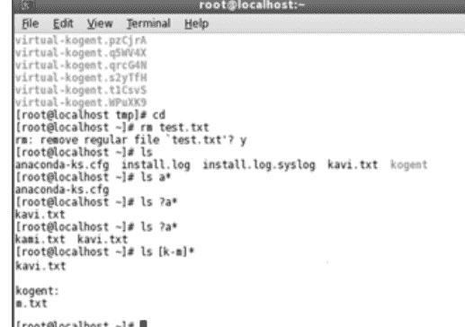

▲ 图 31：显示通配符的使用

## 在 Linux 中创建和移动目录

你可以使用 `mkdir` 命令在 Linux 中创建目录，使用 `rmdir` 命令删除目录，并使用 `mv` 命令重命名目录。你还可以使用 `cd` 命令切换目录类型。`pwd` 命令提供你当前正在工作目录的所在位置。在终端窗口中，目录显示为蓝色，文件显示为黑色。

表 4 列出了与目录相关的命令列表：

### 表 4：Linux 中与目录相关的命令

| 命令 | 描述 |
| --- | --- |
| `mkdir` | 让你创建一个新目录。要这样做，输入 `mkdir` 后跟目录名称。例如，`mkdir test` 来创建一个名为 test 的目录。 |
| `rmdir` | 允许你移除或删除目录。要这样做，输入 `rmdir` 后跟目录名称。例如，`rmdir test` 来删除名为 test 的目录。 |
| `cd` | 允许你从一个目录切换到另一个目录。例如，`cd kavya` 切换到 kavya 目录。记住，你切换到的目录必须在你的系统中存在，否则该命令将不会执行。 |
| `pwd` | 提供你正在工作的目录所在位置。 |

## 开源操作系统

### 表 4：Linux 中与目录相关的命令（续）

| 命令 | 描述 |
| --- | --- |
| `mv` | 让你重命名目录。要使用此命令，输入 `mv` 后跟你想更改的目录名称，然后跟上新名称。例如，输入 `mv kavydir test` 将目录名更改为 test |

## 在目录上应用权限

你可以为目录分配权限。你可以为目录分配三种类型的权限：读、写和执行。读取权限显示目录中的可用文件列表，写入权限允许更改目录的内容。当你创建一个目录时，由于你是目录的所有者，你拥有读、写和执行权限。除了已经讨论的权限类型外，你还可以在目录应用其他权限，例如组标识符（SGID）和粘滞位（sticky bit）。

以下是你可以应用于目录的三种权限类型：

- `r`：允许你查看目录中所有文件的列表
- `w`：允许你更改目录中文件的内容
- `x`：提供访问目录中文件的权限

你可以使用 `ls -l` 命令查看应用于目录的权限。假设你想查看应用于某个目录的权限（例如我们案例中的 `kogert` 目录），请在终端窗口中使用 `ls -l` 命令并按回车键。输出显示如图 32 所示：

```
File Permissions Owner Group Size Time Name
-drwxr-xr-x root root 6719 2009-12-04 15:53 install.logsyslog
-rw-r--r-- root root 72 2009-12-13 13:34 kami.txt
-rw-r--r-- root root 7 2009-12-13 13:33 kavi.txt
-drwxr-xr-x root root 4096 2009-12-18 11:23 kogert
[root@localhost ~]$ ls -l
-drwxr-xr-x root root 4096 2009-12-04 15:53 anaconda-ks.cfg
-rw-r--r-- root root 4096 2009-12-12 22:56 -
-drwxr-xr-x root root 74069 2009-12-04 15:53 install.log
-drwxr-xr-x root root 8723 2009-12-04 15:53 install.syslog
-rw-r--r-- root root 7 2009-12-13 13:34 kami.txt
-rw-r--r-- narayani time 12 2009-12-18 11:38 kavi.txt
-rw-r--r-- root root 13 2009-12-18 11:33 Ki.txt
-drwxr-xr-x root root 4096 2009-12-18 11:23 kogert
[root@localhost ~]$
```

> ▲ 图 32：应用权限

让我们学习一下 `chmod` 命令。

## Linux 中的 whatis 命令

`whatis` 命令用于获取 Linux 命令或函数的简要信息。它会显示手册页（man page）中匹配作为参数字符串的单行描述。使用 `whatis` 的示例例如：

```
whatis write
```

它将显示简要信息。

## Linux 中的 whereis 命令

`whereis` 命令用于查找二进制、源和帮助文件。它会显示匹配作为参数字符串的单行描述。使用 `whereis` 的示例例如：

```
whereis write
```

## Linux 中的 which 命令

`which` 命令用于查找可执行文件的路径。它会显示匹配作为参数字符串的单行描述。使用 `which` 的示例例如：

```
which ls
```

## 管道和重定向

管道用于将一个命令的输出作为另一个命令的输入。重定向用于将命令的输出重定向到文件。有三种标准流：

- 标准输入（STDIN）：0
- 标准输出（STDOUT）：1
- 标准错误（STDERR）：2

你可以使用符号来重定向输出：

- `>`：将标准输出重定向到文件，并覆盖现有内容。
- `>>`：将标准输出追加到文件末尾。
- `2>`：将标准错误重定向到文件。

使用重定向的示例例如：

```
ls > output.txt
```

管道使用符号 `|`。它将一个命令的输出传递给下一个命令。使用管道的示例例如：

```
ls | grep "txt"
```

## 2.9 管道和重定向（详细）

管道用于将一个命令的输出作为另一个命令的输入。重定向用于将输出流重定向：

- `1> 文件`：将标准输出重定向到文件。
- `2> 文件`：将标准错误重定向到文件。
- `2>&1`：将标准错误重定向到标准输出。

使用管道的示例例如：

```
ls | grep "test"
```

## 2.10 使用 vi 编辑器

vi 编辑器是最流行的文本编辑器之一。Vim（Vi Improved）是 vi 编辑器的扩展版本。在基于文本的编辑器中，所有的活动都是通过命令完成的。vi 编辑器允许添加、插入或删除文本。

vi 编辑器有两种类型的模式：

- **普通模式**（或命令模式）：允许输入命令。这是 vi 编辑器的默认模式。当你打开一个文件时，进入的是普通模式。
- **插入模式**：允许你向文件中插入文本。要切换到插入模式，只需按下键盘上的 `INSERT` 键或 `i`。从插入模式切换回普通模式，按下 `ESC` 键。

你可以启动 vi 编辑器打开现有文件或创建新文件。如果文件名存在，将显示文件的第一页；如果文件不存在，则会创建一个空文件供你输入文本。

### 表 6：插入文本的 Vi 命令列表

| Vi 命令 | 描述 |
| --- | --- |
| `o` | 在当前行下方打开新行并插入文本，直到按下 ESC 键为止 |
| `O` | 在当前行上方打开新行并插入文本，直到按下 ESC 键为止 |
| `i` | 在光标前插入文本，直到按下 ESC 键为止 |

### 表 7：修改文本的 Vi 命令列表

| Vi 命令 | 描述 |
| --- | --- |
| `r` | 替换光标下方的单个字符 |

### 表 8：删除文本的 Vi 命令列表

| Vi 命令 | 描述 |
| --- | --- |
| `x` | 删除光标下的字符 |
| `X` | 删除光标直接左侧字符 |
| `dw` | 删除从当前字符到当前单词结束的内容 |
| `d$` | 删除从当前字符到当前行首的内容 |
| `dO` | 删除从当前字符到行尾的内容 |

### 表 9：撤销和重做文本的 Vi 命令列表

| Vi 命令 | 描述 |
| --- | --- |
| `u` | 撤销你上一次的更改 |
| `CTRL+R` | 重做操作 |

### 表 10：剪切和粘贴文本的 Vi 命令列表

| Vi 命令 | 描述 |
| --- | --- |
| `yy` | 将当前行复制（yank）到缓冲区中 |
| `p` | 将缓冲区中的行粘贴到当前行之后的文本中 |

### 表 11：保存并退出文件的 Vi 命令列表

| Vi 命令 | 描述 |
| --- | --- |
| `ZZ` | 将当前更改保存到文件并退出 vi |
| `:w` | 保存当前文件但继续编辑 |
| `:wq` | 与 ZZ 相同 |
| `:q` | 退出当前文件（仅在没有任何未保存的更改时有效） |
| `:q!` | 退出当前文件且不保存刚刚进行的更改 |

让我们执行以下步骤打开并编辑文件：

1. 通过选择“应用程序”→“系统工具”→“终端”打开终端，如图 33 所示：

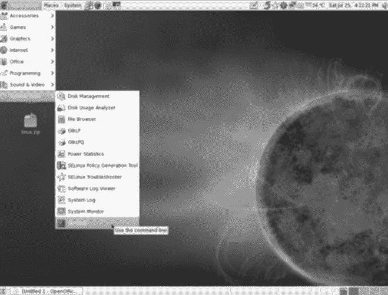

> 图 33：打开终端窗口

2. 输入 `vi Doc1.c` 并按回车键打开 Doc1 文件，如图 34 所示：

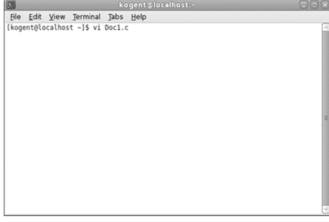

一旦按下回车键，文件将在命令模式下打开，如图 35 所示：

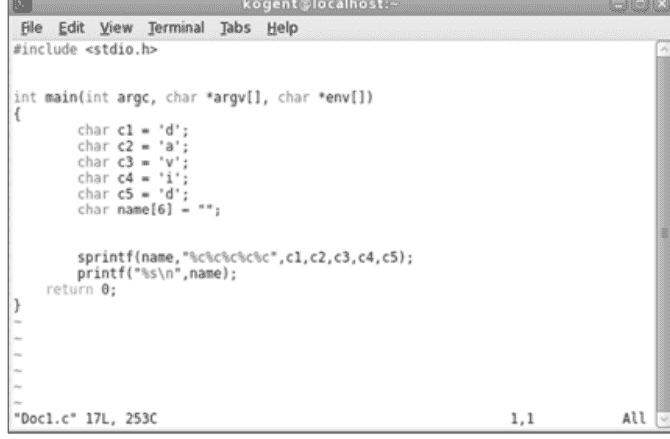

3. 使用向下箭头键移动光标，直到到达所需位置，如图 36 所示：

```c
kogent@localhost~
File Edit View Terminal Tabs Help
#include <stdio.h>

int main(int argc, char *argv[], char *env[]) {
    char c1 = 'd';
    char c2 = 'a';
    char c3 = 'v';
    char c4 = 'e';
    char c5 = 'r';
    char name[6] = "-";

    printf(name, "%c%c%c%c%c%c", c1, c2, c3, c4, c5);
    printf("%s\n", name);
    return 0;
}
```

▲ 图 36：移动光标

4. 按 `INSERT` 键进入插入模式。窗口底部出现 `--INSERT--`，如图 37 所示：


# 系统管理员任务

## 目标

- 解释进程管理
- 讨论作业管理
- 描述设备和文件系统的挂载
- 描述备份过程
- 讨论如何处理用户账户
- 探索组和权限
- 解释软件管理
- 描述启动过程及相关文件
- 讨论常见的内核管理任务

## 3.1 引言

系统管理员是维护和操作计算机系统的人。系统管理员执行的任务范围广泛，且因组织的不同而异。一些常见任务包括文件备份、安装新程序以及为用户创建账户。在 Linux 下工作的系统管理员需要处理不同的任务，例如安装硬件设备、配置应用程序（Open Office 办公套件）及其升级、管理文件和目录、创建用户账户、备份和恢复文件、安装软件包管理工具以及管理内存。

Linux 是一个多任务操作系统。多任务系统的简单之处是，多个用户可以同时拥有自己的账户并在上面工作。作为系统管理员，你可以为每个用户分配其自己的登录账户。同样，Linux 的多任务功能允许你同时调度和执行多个任务（程序）。此外，Linux 还允许你管理进程、用户、组等。

在本章中，你将学习系统管理员执行的任务。章节从解释进程和作业管理任务开始。解释了挂载设备和文件系统的步骤。你还将学习备份和恢复数据的程序。此外，你将学习与用户和组工作，并为它们指定权限。本章还解释了 Linux 上的软件管理。最后，章节描述了启动过程以及常见的内核管理任务。

## 3.2 进程管理

程序是一组指令，告诉计算机它必须执行的任务。当你运行一个程序时，这些指令以及管理程序执行所需的其他细节会被复制到内存中。这被称为程序的运行实例或进程，而我们需要管理的正是这些进程。

Linux 中的进程管理始终从 `init` 命令开始。事实上，你可以用此命令启动任何进程。该命令的主要作用是从存储在名为 `/etc/inittab` 文件中的脚本创建进程。该文件使用允许用户登录的条目。它还控制系统的自主进程。

当你启动系统时，`GRUB.conf` 文件加载内核。内核运行 `init`，这是系统上运行的第一个进程。`init` 进程可以根据系统的运行级别（run level）启动其他进程。Linux 系统中的每个进程都会获得一个进程标识（PID）数字。由于 `init` 是加载到内存的第一个进程，它的 PID 为 1。

Linux 中不同类型的进程如下：

- **守护进程（Daemon Process）**：守护进程是在系统上持续运行的进程，或仅在 Linux 启动时加载到内存中的进程。你可以在启动期间向内存加载多个守护进程。常见的守护进程包括 DHCP（动态主机配置协议守护进程）、cron（Cron 守护进程）和 IPD（行打印机守护进程）。守护进程通常通过进程名末尾的字母 d 来识别。
- **用户进程（User Process）**：用户进程（也称为交互式进程）是通过 Linux shell 运行的进程。每个 shell 都提供了一个命令行，用户可以在其中输入他想要运行的命令和程序名称。当用户输入命令（如 `ls -al`）或程序（如 `/install-sh`）时，shell 会创建自己的副本作为新进程，并用命令行中提到的命令或程序替换它。简单来说，shell 运行命名的命令，并将该名称分配给一个对象，该对象可以通过动作或作为另一个进程被引用。
- **父进程和子进程（Parent and Child Processes）**：父进程是任何启动或产生并控制其他进程的进程。子进程是由另一个进程发起的进程。它也可以由父进程产生。例如，假设你正在 X Windows 中工作并打开了一个 xterm（终端模拟器）。从 xterm 中，你输入 `find ~ -name "*.jpg"` 来查找你目录中所有的 .jpg 文件。在这种情况下，终端窗口是 `find` 命令的父进程。如果关闭了终端窗口，`find` 命令将停止运行，因为它是作为 xterm 进程的子进程运行的。停止父进程会自动停止子进程。因此，当终端窗口关闭时，`find` 命令停止运行。

让我们学习一些在 Linux 进程中使用的命令。

### ps 命令

`ps` 命令用于显示 Linux 系统上当前运行的进程。如果你知道任务管理器（在 Windows NT/2000/XP 下按下 Ctrl+Alt+Del 键时弹出）的功能，那么你就可以轻松理解 Linux 中 `ps` 的。它可以以各种格式显示在 Linux 上运行的进程。

`ps` 命令的输出字段如下：

- USER: UID: 用户标识
- PID: 进程标识数字
- %CPU: 进程占用的 CPU 数量
- %MEM: 进程占用的内存百分比（KB）
- SIZE: 进程使用的虚拟内存大小
- RSS: 进程使用的实际内存驻集大小
- TTY: 与进程相关的终端（控制台）
- STAT: 进程的当前状态
- START: 进程的启动时间或日期
- TIME: 进程使用的总 CPU 时间
- COMMAND: 正在执行的命令名称
- NI: 计算优先级数时的 Nice 值
- PRI: 进程优先级数
- PPID: 父进程的进程 ID (PID)
- WCHAN: 进程睡眠时所在的内核进程名称
- FLAGS: 与进程相关的数字标志位

`ps` 命令接受各种命令行参数。其中一些列出如下：

- a: 显示属于所有用户的进程
- e: 在命令行字段后显示进程环境变量
- i: 以长格式显示输出
- u: 显示用户名和进程启动时间
- U: 显示特定用户运行的进程
- w: 显示与特定 tty 设备相关的进程
- T: 显示与此终端相关的所有进程
- t: 显示属于特定终端的进程
- C: 显示与特定命令相关的所有进程

### kill 命令

`kill` 命令用于 Linux 和其他 Unix 类操作系统，用于终止进程，而无需注销或重启（即启动）计算机。

现在，如果你想终止 emacs 进程，例如，你需要查找它的进程标识符（PID）并提供以下命令：

```
$ kill -9 3216
```

`-9` 选项确保对被 `kill` 命令访问的进程执行强制。

提供 `kill` 命令的方便快捷键是 Alt-Ctrl-Esc 组合键，它允许你选择想要杀死的应用程序。

### killall 命令

`killall` 命令用于通过名称杀死进程。该命令在系统上运行的所有进程中搜索指定的名称。例如，如果你想杀死所有 Netscape 实例，可以输入以下命令：

```
killall netscape
```

在使用 `killall` 命令时需要小心。例如，假设你正在使用两个并行的 Emacs 编辑器编辑 foo.txt 和 foo2.txt 文件。现在，假设你想杀死所有编辑 foo.txt 的 Emacs 实例。在两种情况下，编辑 foo.txt 和 foo2.txt 的 Emacs 实例将被终止。

## 3.3 作业管理

当你在控制台中启动程序时，该程序在前台运行。前台程序始终访问标准输入流以接收用户的命令，并访问标准输出流向用户打印信息。然而，在后台运行的程序无法访问这些流，这意味着不需要用户输入或输出的程序可以在后台执行，例如编译或构建软件。

要在后台启动任何程序，请在行末尾添加和符号 `&` 字符。例如，以下命令在控制台中启动 Firefox：

```
$ firefox & [1] 936
```

前述命令会立即启动 Firefox。方括号中的数字 `[1]` 是控制该作业的作业号；第二个数字 `936` 是进程标识符（PID），它是进程的系统级唯一标识符。

你也可以通过键盘上的 CTRL+Z 组合键来挂起正在运行的进程。

例如，你加载了 vim 编辑器，然后按下 CTRL+Z 组合键，如下所示：

```
$ vim
[1]+ Stopped vim
```

上一个命令打印了作业编号以及程序名称。现在，如果你需要以前台重启一个进程，你必须使用 `fg` 命令并跟上作业编号，如下所示：

```
$ vim
[1]+ Stopped vim
$ fg 1
vim
```

同样，你可以使用 `bg` 命令在后台重启一个进程，如下所示：

```
$ bg 1
[1]+ xterm &
```

在上一个命令中，xterm 正在后台运行。你可以使用 `jobs` 命令了解当前正在运行的作业，如下所示：

```
$ jobs
[1]+ Stopped xterm &
[2]- Running xterm &
```

上一个命令显示有两个程序正在运行——第一个是 vim，它处于临时停止状态；第二个是 xterm，它正在后台运行。要杀死一个作业，你可以结合程序名称使用 `kill` 命令。通常，`kill` 命令与 PID（进程 ID）一起使用，你可以通过 `ps` 命令找到 PID。例如，接下来的命令杀掉了 PID 为 16533 的程序：

```
$ kill 16533
```

你可以通过提供带百分比符号 (%) 的作业编号来杀死一个程序，如下所示：

```
$ kill %1
```

如果程序处于挂起状态，上一个命令不会立即杀死该程序——它会在程序恢复活动时立即杀死它。当你需要强制杀死一个程序时，请配合 `kill` 命令使用 `-9` 标志，如下所示：

```
$ kill -9 %1
```

## 3.4 挂载设备与文件系统


# 挂载与文件系统管理

挂载是将附加文件系统附加到计算机当前可访问文件系统的过程。文件系统是一个目录层次结构，也称为目录树，用于组织计算机或存储媒体上的文件。在 Linux 中，目录从根目录开始，它包含了系统中所有其他目录和文件。根目录由正斜杠（`/`）标识。

现在，当你需要访问 Linux 中的文件系统时，你首先需要挂载它。挂载文件系统意味着使其在 Linux 目录树的某个点变得可访问。这个点就是挂载点。注意，当你挂载文件系统时，它可以位于硬盘分区、光驱、软盘或 USB 存储设备上。你只需要知道与特定存储设备相关的设备名称，以及你想要挂载它的目录即可。

## 配置 `/etc/fstab` 文件

当新安装 Linux 系统时，在安装期间创建的所有磁盘分区都配置为在每次系统启动时自动挂载。然而，如果在安装后向系统附加额外的驱动器，会发生什么呢？简单的答案是什么都不会发生，因为系统没有配置自动挂载这些驱动器。为此，你需要配置 `/etc/fstab` 文件。该文件用于控制系统启动时挂载的文件系统。`/etc/fstab` 文件包含以下格式的细节：

| device | /mount-point | ftype | options | dumpfreq | passno |
| :--- | :--- | :--- | :--- | :--- | :--- |

上述格式包含以下字段：

- `device`：指设备或文件名
- `/mount-point`：指在挂载文件系统时使用的现有目录（如 `/boot`）
- `ftype`：指指定设备上指定的文件系统类型
- `options`：指用逗号分隔的选项列表，用于控制挂载行为
- `dumpfreq`：指一个数字（0 或 1），指定是否应该对文件系统进行备份
- `passno`：指检查文件系统的顺序

## 挂载文件系统

`mount` 命令用于将位于设备上的文件系统附加到目录树上。`mount` 命令的标准格式如下：

```
mount -t type dir
```

如果你只提供目录或设备，如下所示：

```
mount /dir
```

那么，`mount` 命令会在 `/etc/fstab` 文件中查找相应的挂载点项，并尝试挂载该文件。

让我们考虑以下命令，我们正将一个设备挂载到特定的文件夹：

```
$ mount -t mdsos /dev/fd0 /mnt/floppy
```

在上一个命令中，假设 Linux 拥有 `/mnt/floppy` 文件夹。我们挂载了一个 mdsos 文件系统，由 `-t`（类型）选项指定，并将设备映射到 `/mnt/floppy` 点。同样，你可以如下挂载光驱：

```
$ mount -t iso9660 /dev/cdrom /mnt/cdrom
```

## 卸载文件系统

`umount` 命令用于从文件层次结构中分离一个或多个文件系统。只需通过提供挂载目录来指定文件系统。考虑以下示例：

```
$ umount /mnt/floppy
$ umount /mnt/cdrom
```

此外，你可以使用 `man` 命令获取有关 `mount` 和 `umount` 命令的更多信息。

# 3.5 备份

备份是复制数据以便在丢失时恢复。在 Linux 中有几种类型的备份：

- **全备**：备份系统上的所有数据。
- **增量备份**：仅备份上次备份以来更改的数据。
- **差异备份**：备份自上次全备以来更改的数据。

Linux 中常用的备份工具有：

- `tar`
- `cpio`
- `dump` 和 `restore`

让我们逐一讨论这些工具。

## Tar 工具

Tar 代表“Tape Archive”（磁带存档），是一个 UNIX 命令，用于从多个文件创建一个“存档”的单个文件。需要注意的是，tar 归档包中的文件通常没有经过压缩；它们只是被合并在一个文件中。

以下是执行文件备份的命令语法：

```
tar -cvf <destination> <source>
```

例如：

```
tar -cvf /backup/home.back /home
```

在上一个示例中，`c` 选项创建备份文件，`v` 选项提供运行的详细信息，`f` 选项指定备份文件的名称和位置。

## CPIO 工具

`cpio` 命令是一个传统的 Linux 工具，可用于文件系统的备份。使用 `cpio` 命令的语法如下：

```
cpio flags [options]
```

创建 cpio 文件的语法如下：

```
find (source file name) | cpio (options) > (target file name)
```

例如：

```
find file1 | cpio -o file1_back.cpio
```

以下语法用于提取 cpio 文件：

```
cat <source file name> | cpio (options)
```

例如：

```
cat file1_back.cpio | cpio -idvm
```

## Dump 和 Restore

`dump` 和 `restore` 命令是 dump 包中的两个不同的程序。以下是 `dump` 命令的语法，用于在另一个目录中对目录进行备份：

```
dump <dump levels> <options> <destination name> <source name>
```

例如：

```
dump -0 -f /home_dumps/mydumps /home
```

图 1 显示了上一个命令的输出：

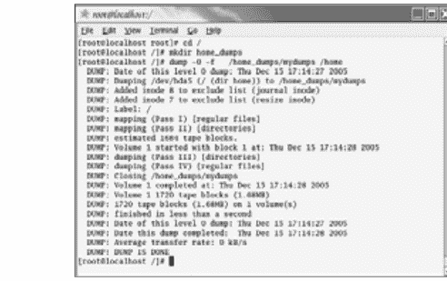

> 图 1：使用 dump 命令

`restore` 命令用于恢复和查看 dump 文件。以下是 `restore` 命令的语法：

```
restore <options> <file name>
```

例如：

```
restore -if mydumps
```

## 压缩工具

压缩工具也用于执行备份。Linux 中有多种压缩工具。其中一些主要的工具如下：

- **gzip**：指 GNU zip 压缩程序，它使用 GNU zip 压缩 tar 归档。通常情况下，它会创建一个以 `.gz` 扩展名的文件。`gzip` 命令的语法如下：

```
gzip user_tar_file.tar
```

- **bzip2**：指 Julian Seward 在 1997 年以 BSD 许可证发布的工具。该工具提供了比 gzip 更好的压缩率，但它需要更多的处理器时间。它会创建一个以 `.bz2` 扩展名的文件。使用 `bzip2` 工具的语法如下：

```
bzip2 user_tar_file.tar
```

使用以下语法可以解压由 `bzip2` 压缩的文件，并提取当前目录中提取内容：

```
bunzip2 user_file.bz2
```

- **tar**：指一个通常创建归档文件的工具，但你可以使用 gzip 或 bzip2 来压缩该归档文件。为此，你使用 `z` 或 `j` 选项，如下所示：

```
tar -zcvf pics.tar.gz *.png *.opt
tar -jcvf data.bz2 *.doc
```

在上述命令中，`-z` 选项用于 gzip 压缩，`-j` 选项用于 bzip2 压缩。

- **zipinfo**：指一个用于查找 zip 归档文件详细信息（例如 winzip）的工具。使用 `zipinfo` 命令的语法如下：

```
zipinfo zip_file.zip
```

- **zipgrep**：指一个运行 `grep` 命令在 zip 文件中查找文件（例如 winzip）的工具，而无需先手动解压文件。使用 `zipgrep` 命令的语法如下：

```
zipgrep pattern zip_file.zip
```

- **bzip2recover**：指一个用于从损坏的 bzip2 归档中恢复文件的工具。它简单地提取所有工作数据块并对它们进行完整性测试。

- **bzme**：指一个使用 bzip2 将 zip 文件或 gzipped 文件转换为压缩文件的工具。使用 `bzme` 命令的语法如下：

```
bzme filename
```

# 3.6 处理用户账户

在 Linux 中创建新用户账户非常简单。为此，你只需要在命令行中运行 `useradd` 命令。例如，要创建一个名为 Mahendra 的用户，你可以按照如下方式运行 `useradd` 命令：

```
# useradd Mahendra
```

这会在 `/etc/passwd` 文件中添加新条目。默认情况下，该文件存储了与用户账户相关的所有信息。

用户 Mahendra 没有默认密码。为了给它创建一个密码，你只需要在命令行中输入 `passwd` 命令，如下所示：

```
# passwd Mahendra
```

这将提示你输入密码。输入密码并按回车。系统会要求你确认密码。再次输入密码并按回车。你需要正确输入两次相同的密码才能成功创建账户。

## 修改现有用户信息

对现有用户信息进行修改意味着更改用户的密码、用户主目录、用户账户过期日期、用户标识 (UID) 和组标识 (GID)。让我们在接下来的章节中学习如何在 Linux 中执行所有这些任务。

### 更改用户主目录

更改用户主目录的语法如下：

```
# usermod -d <homedir> <username>
```

例如，如果你想将 Mahendra 的主目录从 `/home/Mahendra` 更改到 `/home/mahen`，请运行以下命令：

```
# usermod -d /home/mahen Mahendra
```

要更改 Mahendra 的主目录并将其目录 (`/home/Mahendra`) 中包含的信息也移动到新位置 (`/home/mahen`)，请运行以下命令：

```
# usermod -d -m /home/mahen Mahendra
```

此命令将 Mahendra 当前目录 (`/home/Mahendra`) 中的所有文件移动到新的主目录 (`/home/mahen`)。

### 更改 UIDs 和 GIDs

在 Linux 中，每个用户都有一个 UID 和一个 GID。用户的 UID 是用于在 Linux 系统中标识用户的整数值，而 GID（一个整数值）代表用户所属的特定组。如果你想更改用户的 UID，请使用以下语法：

```
# usermod -u <UID> <username>
```

例如，以下命令将 Mahendra 的 UID 更改为 555：

```
# usermod -u 555 Mahendra
```

要更改用户的 GID，请使用以下语法：

```
# usermod -g <GID> <username>
```

例如，以下命令将 Mahendra 的 GID 更改为 555：

```
# usermod -g 555 mahendra
```

### 描述 `/etc/passwd` 文件

`/etc/passwd` 文件存储了登录计算机时所需的用户账户信息。这些信息包括用户 ID、组 ID、用户主目录等。该文件还包含所有用户的列表。

示例的格式如下：

```
root:x:0:0:root:/root:/bin/bash
daemon:x:1:1:daemon:/sbin:/sbin/nologin
bin:x:2:2:bin:/bin:/sbin/nologin
sys:x:3:3:sys:/root:/sbin/nologin
sync:x:4:4:sync:/dev:/bin/sync
games:x:5:5:games:/usr/games:/sbin/nologin
man:x:6:6:man:/var/cache/man:/sbin/nologin
lp:x:7:7:lp:/root:/sbin/nologin
mail:x:8:8:mail:/var/spool/mail:/sbin/nologin
uu:x:9:9:uu:/root/u:/sbin/nologin
proxy:x:13:13:proxy:/root:/sbin/nologin
backup:x:34:34:backup:/var/backups:/sbin/nologin
data:x:35:36:data:/dd:/sbin/nologin
list:x:38:38:list:/var/spool/list:/sbin/nologin
sync:x:42:42:sync:/lp:/sbin/nologin
irc:x:39:39:irc:/var/run/ircd:/sbin/nologin
gnp:x:41:41:gnp:/var/lib/gnp:/sbin/nologin
irc:x:48:48:irc:/var/run:/sbin/nologin
www-data:x:33:33:www-data:/var/www:/sbin/nologin
backup:x:34:34:backup:/var/backups:/sbin/nologin
nats:x:634:634:nats:/var/lib:/sbin/nologin
list-apt:x:100:100:list-apt:/var/lib/apt/:/sbin/nologin
nobody:x:999:999:nobody:/nonexistent:/sbin/nologin
user:x:1000:1000:user:/home/user:/bin/bash
```

前述命令会打印用户 deven 的终端名称、主目录、邮件状态和电话号码。

`chfn` 命令用于更改用户的 finger 信息（用户详细信息）。例如，要更改用户 deven 的 finger 信息，请输入以下命令：

```bash
# chfn deven
```

如果你没有指定想要更改的信息（无论是全名、电话号码还是目录），系统将针对用户的每个字段信息向你提问。在提示符处，你可以输入新信息，也可以直接按 `ENTER` 键以保持该字段不变，或者输入 'none' 使该字段留空。

### 删除用户

`userdel` 命令用于删除用户账户。例如，要删除用户 Mahendra，请输入以下命令：

```
# userdel Mahendra
```

如果你想同时删除该用户的家目录，可以在使用 `userdel` 时输入 `-r` 选项。

# 3.7 组与权限

Linux 允许你创建一个用户组，并赋予他们所需的权限。让我们来看一个例子，假设你有一个来自组织 IT 部门的用户组。他们经常在系统上使用电子表格应用程序。你可以创建一个名为 `finance` 的新组，并将其设置为电子表格的默认组。要创建一个组，运行以下 `groupadd` 命令：

```bash
# groupadd finance
```

现在，如果你需要创建一个名为 Mahendra 的电子表格用户，可以使用以下命令：

```bash
# useradd Mahendra -g finance
```

该命令为默认组 `finance` 创建了一个名为 `mahendra` 的用户。如果需要将现有用户放入 `IT` 组，可以使用以下命令：

```bash
# chgrp deven IT
```

前述命令将把 `IT` 组设置为 `deven` 的新默认组。如果你需要让一个特定用户同时属于多个组，请在 `useradd` 命令中使用 `-G` 选项，如下：

```bash
# useradd mahendra -G IT,finance
```

前述命令将用户 `mahendra` 添加为 `IT` 和 `finance` 组的成员。要查看现有组及其成员，运行以下命令：

```bash
# cat /etc/group
```

`/etc/group` 文件包含四个部分：组名、密码、组 ID 和用户。这些部分由冒号（`:`）分隔。通过查看此文件，你可以知道 Mahendra 属于哪些组。

## Linux 文件权限

Linux 通过在文件和目录上应用权限来控制未经授权的访问。在所有系统都互连的组织环境中，用户可能会访问敏感信息或读取私人电子邮件。为了避免这种情况的发生，每个文件和目录都有一个所有者或一个组，你需要获得其对应的权限（通常称为模式）。

在 Linux 中，你可以使用 `ls` 命令查看文件的权限列表。每个文件都有一组权限，用于控制哪些用户可以对该文件进行访问。文件的权限也被称为其访问模式。一个文件具有以下权限：

- `r` (-)：表示读取权限，即允许用户读取和复制特定文件。
- `w` (-)：表示写入权限，即允许用户修改特定文件。
- `x` (-)：表示执行权限，即仅允许用户执行特定文件。

你可以通过 `chmod` 命令更改你文件的权限（如果你是 `root` 用户，也可以更改其他用户文件的权限）。例如，你可以使用以下命令为用户提供写入权限：

```bash
chmod g+w [filename]
```

在前述命令中，`g` 代表文件的组，`w` 代表写入权限，`+` 表示权限已添加。

## 更改文件所有者或组

`chown` 命令用于更改文件的所有权，`chgrp` 命令用于更改组的所有权。使用 `chown` 命令的示例如下：

```bash
# chown deven file.txt
```

前述命令将 `file.txt` 的所有者更改为 `deven`。

# 3.8 管理软件包


# Linux 软件包管理与启动过程

## RPM 软件包管理器

Linux 发行版使用 RPM 软件包管理器来管理软件包的安装、卸载、验证和更新。RPM 是一个强大的命令行驱动的软件包管理系统。RPM 命令的五种基本模式如下：

- **安装 (Install)**：安装软件包。
- **卸载 (Remove)**：卸载软件包。
- **升级 (Upgrade)**：更新已安装的软件包。
- **验证 (Verify)**：验证软件包。
- **查询 (Query)**：查询软件包。

### RPM 常用选项

| 选项 | 描述 |
| :--- | :--- |
| `-U` | 更新或安装指定的软件包 |
| `-i` | 安装指定的软件包 |
| `-e` | 卸载指定的软件包 |
| `-v` | 详细模式，提供详细信息 |
| `-F` | 更新已安装的软件包 |
| `-h` | 执行操作时显示进度标记 |
| `-qa` | 查询所有已安装的软件包 |
| `-ql` | 显示与软件包相关的文件列表 |
| `-q` | 查询特定组的软件包 |
| `--force` | 强制执行操作 |

### RPM 基本操作语法

要安装位于本地存储设备或远程位置的 `.rpm` 软件包，你需要使用 RPM 命令并提供参数和文件路径。

**安装软件包：**
```bash
rpm -i <PATH>
```

**升级已安装软件包：**
```bash
rpm -U <PATH>
```

**卸载已安装软件包：**
```bash
rpm -e <PATH>
```

在前述语法中，`<PATH>` 可以是本地路径或 URL。

## YUM 软件包管理器

**YUM**（Yellowdog Updater, Modified）是一种开源软件包管理工具，为基于 RPM 的系统提供了命令行和图形界面。该工具允许用户和系统管理员轻松地安装、更新、删除或搜索软件包。YUM 根据依赖关系自动从第三方存储库安装软件包。

### YUM 常用命令

| 命令 | 描述 |
| :--- | :--- |
| `yum install firefox` | 安装名为 Firefox 的软件包。执行前会提示确认。 |
| `yum install -y firefox` | 自动安装软件包而不询问确认。 |
| `yum remove firefox` | 完全删除软件包及其所有依赖项。执行前会提示确认。 |
| `yum remove -y firefox` | 自动删除软件包而不询问确认。 |
| `yum update mysql` | 更新指定的软件包（如 mysql）。 |
| `yum search word` | 在可用软件包中搜索特定关键字。 |
| `yum info firefox` | 获取指定软件包的详细信息。 |
| `yum list less` | 列出数据库中所有软件包。 |
| `yum update` | 通过所有安全和二进制包更新使系统保持最新。 |
| `yum groupinstall 'MySQL Database'` | 安装指定的软件包组。 |
| `yum groupupdate 'DNS Name Server'` | 更新现有的软件包组。 |
| `yum groupremove 'DNS Name Server'` | 删除或移除现有的软件包组。 |

### `/etc/yum.conf` 配置文件

yum 及其相关工具的配置文件存储在 `/etc/yum.conf` 文件中。该文件包含两个部分：`main`（主）和 `repository`（存储库）。只能有一个 `main` 部分，且这是一个强制性部分。`main` 部分允许您设置具有全局影响的 yum 选项。另一方面，您可以有多个 `repository` 部分，该部分允许您设置特定存储库的选项。

**示例：**
```ini
[main]
baseurl=/var/cache/yum
packagecache=1
enabled=1
logfile=/var/log/yum.log
distrovkey=redhat-release
tabled=1
exerror=0
gnobs=1
gpgcheck=1
plugins=1
## 注意：yum-plugin 不遵守此设置。
metadata_expire_in = 3
## 默认：installlimit = 3
## 将您的存储库放在此处，或者放在 /etc/repos.d/ 下名为 file.repo 的独立文件中
```

#### main 部分指令

| 指令 | 说明 |
| :--- | :--- |
| `cachedir` | 指定用于存储下载软件包的目录。 |
| `debuglevel` | 指定日志级别，从 0（无）到 10（全部）。 |
| `exactarch` | 如果此指令的值设置为 1，则为正确的架构更新软件包。 |
| `exclude` | 指定一个由空格分隔的软件包列表，这些软件包被排除在文件安装或更新之外。 |
| `gpgcheck` | 如果设置为 1，通过检查 GPG 签名验证软件包的真实性。 |
| `gpgkey` | 指定 GPG 公钥文件的路径。 |
| `installonly_limit` | 指定为某个软件包可以安装的最大版本数。 |
| `keepcache` | 在 YUM 成功安装后保留头文件和软件包的缓存。 |
| `logfile` | 指定 yum 日志文件的路径。 |
| `obsolete` | 如果此指令的值设置为 1，则在升级期间替换过时的软件包。 |
| `plugins` | 如果此指令的值设置为 1，则启用扩展 yum 功能的插件。 |
| `proxy` | 指定代理服务器的 URL 和端口号。 |
| `proxy_password` | 指定与代理服务器进行身份验证的密码。 |
| `proxy_username` | 指定与代理服务器进行身份验证的用户名。 |
| `reposdir` | 指定 yum 查找 `.repo` 扩展存储库文件的目录。默认目录为 `/etc/yum.repos`。 |

#### repository 部分指令

| 指令 | 说明 |
| :--- | :--- |
| `baseurl` | 指定存储库通道的位置。设置此指令是强制性的。 |
| `enabled` | 如果此指令的值设置为 1，允许 yum 使用该通道。 |
| `name` | 指定存储库通道的描述名称。设置此指令是强制性的。 |

## 理解启动过程及相关文件

计算机开启并 Linux 操作系统开始运行的过程称为启动。启动过程包括以下步骤：

1.  寻找操作系统的内核。实现方式取决于计算机所使用的硬件类型。
2.  启动内核操作，计算机在其中寻找所有连接到计算机的硬件设备。
3.  启动配置计算机工作所需的各种服务的进程。

启动过程包括以下阶段：

- 基础输入/输出系统 (BIOS) 初始化
- 主引导记录 (MBR) 引导加载
- 内核初始化
- Init 初始化

### BIOS 初始化

BIOS 是硬件和软件之间最基础层面的接口。BIOS 提供了操作系统使用的基本指令集。成功的启动取决于 BIOS，它为外围设备和控制器提供了最低级别的接口。BIOS 首先运行上电自检 (POST)，然后寻找外围设备和用于启动的设备。硬件配置信息永久存储在互补金属氧化半导体 (CMOS) 的一个小区域（通常为 64 字节）中。CMOS 由主板上的电池供电。该电池允许 CMOS 在计算机开启和断开电源时保留其设置。

在 POST 结束时，从检测到的启动设备列表中选择一个启动设备。任何现代 BIOS 允许您设置启动优先级顺序。启动设备可以包括软磁盘、硬盘、CD-ROM、网络接口或其他可移动介质。

BIOS 读取并执行引导加载器的第一阶段（从可移动介质读取时）。

### 主引导记录 (MBR)

在为分区磁盘空间时，每个分区的第一个扇区始终保留给可编程代码，称为主引导记录 (MBR)。当从硬盘启动时，BIOS 加载并执行 MBR。

Fedora/Red Hat Linux 提供了 GRUB 引导加载器；因此，它无法完全放入 MBR 的 512 字节中。GRUB 引导加载器仅搜索特殊分区并加载第二阶段引导加载器。第二阶段引导加载器随后读取 `/boot/grub/grub.conf` 配置，该文件列出了所有配置的操作系统并显示熟悉的启动屏幕。

**可启动 Fedora Linux 和 Windows XP 的系统 `grub.conf` 示例：**
```text
default=0
timeout=10
image=(hd0,0)/grub/splash.xpm
title Fedora Core (2.6.8-20)
root (hd0,0)
kernel /mlinuz-2.6.8-20 root=LABEL=
rd=/initrd-2.6.8-20.img
title windows XP
rootnoverify (hd0,1)
chainloader +1
```

### 内核初始化

内核在启动时执行各种函数，主要包括：

- 设备检测
- 设备驱动程序初始化
- 将根文件系统挂载为只读
- 加载初始进程（通常是 `init`）

尽管它们产生良好的输出，但如果在启动期间不仔细观察，许多内核活动可能会错过它们。“冻结时间”并检查这些输出的好方法是查看 `/var/log/dmesg` 日志文件，该文件包含了控制传递给 `init` 后的内核消息快照。审查此输出将揭示 Linux 内核的基本初始化步骤：

1.  编译进内核的设备驱动程序会被调用，并尝试定位相应的设备。如果成功找到设备，驱动程序将初始化并将输出记录到内核消息缓冲区。
2.  如果关键（启动所需的）驱动程序被编译为模块而不是内核，则它们必须包含在 `initrd` 镜像中，然后内核将其临时挂载到 RAM 磁盘上，以便在初始化过程中可以使用模块。
3.  在所有必需的驱动程序加载后，内核将把根文件系统以只读方式挂载。
4.  随后加载第一个进程（通常是 `init`），并将控制权从内核传递给 `init` 进程。

### Init 初始化

这是整个启动过程中的一个重要阶段。`init` 进程是 Linux 下运行的所有进程的根进程或父进程。第一个任务是运行存储在 `/etc/rc.d/sysinit` 路径下的脚本。该任务会检查所有系统进程、硬件、文件系统挂载情况并加载内核模块等。

由于 `init` 是第一个进程，它的 PID 始终为 1。`/etc/inittab` 文件包含了 `init` 在每个运行级别（run-level）下如何设置系统的信息。

**`/etc/inittab` 文件示例：**
```text
# @fedora -# cat /etc/inittab
# inittab is only used by upstart for the default runlevel.
# ADDING OTHER CONFIGURATION HERE WILL HAVE NO EFFECT ON YOUR SYSTEM.
# System initialization is started by /etc/event.d/rc
# Individual runlevels are started by /etc/event.d/rc[0-6]
# Ctrl-Alt-Delete is handled by /etc/event.d/control-alt-delete
# Terminal getty (tty[1]) are handled by /etc/event.d/tty[1-6] and
# /etc/event.d/serial
# For information on how to write upstart event handlers, or how
# Default runlevel. The runlevels used are:
# 0- halt (Do NOT setdefault to this)
# 1- Single user
# 2- Multiser, without NFS (The same as 3, if you do not have networking)
# 3- Full multiuser mode
# 4- unused
# 5- X11
# 6- reboot (Do NOT set initdefault to this)
id:5:initdefault:
[root@fedora ~]#
```

如果 `/etc/inittab` 文件丢失或损坏，你将无法启动任何标准运行级别（0-6），而需要使用单用户模式或紧急模式。

`/sbin/init` 程序会执行一些系统检查，例如验证文件系统的完整性，并启动操作系统正常运行所需的关键程序。然后它会检查 `/etc/inittab` 文件以确定 Linux 的整体运行模式或运行级别。

### Linux 运行级别

| 模式/运行级别 | 目录 | 运行级别描述 |
|---|---|---|
| 0 | `/etc/rc/rc0.d` | 停止 (Halt) |
| 1 | `/etc/rc/rc1.d` | 单用户模式 |
| 2 | `/etc/rc/rc2.d` | 未使用（用户定义） |
| 3 | `/etc/rc/rc3.d` | 完整多用户模式（无 GUI 界面） |
| 4 | `/etc/rc/rc4.d` | 未使用（用户定义） |
| 5 | `/etc/rc/rc5.d` | 完整多用户模式（有 GUI 界面） |
| 6 | `/etc/rc/rc6.d` | 重启 (Reboot) |

根据所选的运行级别，`init` 进程会执行位于 `/etc/rc` 子目录下的启动脚本。用于运行级别 0 到 6 的脚本位于 `/etc/rc/rc0.d` 到 `/etc/rc/rc6.d` 子目录中。

一旦初始化完成，`init` 进程将运行 `/etc/rc.local` 文件，然后将控制权交回内核。

## 系统关机与重启

完成工作后不应立即关闭或切换系统。这可能会损坏文件以及文件系统目录结构。有多种方法可以正常关闭 Linux 并重启系统。

### 关闭系统

以下命令用于关闭系统：

- `shutdown -h now`
- `halt`
- `poweroff`
- `init 0`

### 重启系统

以下命令用于重启系统：

- `shutdown -r`
- `reboot`
- `init 6`

**示例：使用 `init 6` 重启**
```bash
[root@netmon tmp]# init 6
```

**示例：使用 `reboot` 重启（会向用户发送警告消息）**
```bash
[root@netmon tmp]# reboot
```

**广播消息示例：**
```text
The system is going down for reboot!
[root@netmon tmp]#
```

## 常见管理任务

Linux 内核是一组将系统连接在一起的指令。当你需要找到当前的内核时，必须检查 `/boot/` 目录：

```bash
ls /boot
```

如果 `/boot` 目录为空或不存在，则你的内核在实例之外。否则，你会得到一个名称列表，例如 `grub`、`vmlinux` 和 `System.map`。内核本身是 `vmlinuz` 文件。Grub 引导加载程序告诉系统应该使用哪个内核。如果你的电脑有多个可用内核，它会在启动时显示菜单。Grub 从此处获取这些信息。

## 总结

系统管理员是处理系统的人，例如创建用户、管理组、备份和恢复数据以及挂载文件系统。在本章中，我们学习了系统管理员的任务。最后，我们学习了常见管理任务。

## 复习

### 判断题

1.  程序是一组告诉计算机执行操作的指令集。**对**
2.  Linux 中的进程管理始终从 `init` 命令开始。**对**
3.  守护进程（daemon process）也被称为交互式进程。**错**
4.  `ps` 命令用于显示当前运行的进程。**对**
5.  `kill -9` 命令通过名称杀死进程。**错**
6.  挂载是将额外的文件系统附加到当前文件系统上的过程。**对**
7.  根目录用反斜杠（`\`）指定。**错**
8.  `dump` 和 `restore` 命令是 dump 包中的两个程序。**对**
9.  `restore` 命令用于对目录进行备份。**错**
10. `userdel` 用于删除用户账户。**对**

### 单选题

**Q1. `ps` 命令的哪一个参数可以显示属于特定组的进程？**
- a. `-G`
- b. `a`
- c. `e`
- d. `u`
> **答案：正确答案为 a。**

**Q2. 哪个符号用于通过作业号杀死程序？**
- a. `&`
- b. `$`
- c. `%`
- d. `/`
> **答案：正确答案为 c。**

**Q3. 哪一个命令用于为用户创建密码？**
- a. `user`
- b. `usermod`
- c. `password`
- d. `passwd`
> **答案：正确答案为 d。**

**Q4. `usermod` 命令的哪一个选项用于更改用户的 UID？**
- a. `-d`
- b. `-u`
- c. `-g`
- d. `-m`
> **答案：正确答案为 b。**

**Q5. 哪一个命令用于更改用户的指纹信息？**
- a. `chown`
- b. `chgrp`
- c. `chmod`
- d. `chfn`
> **答案：正确答案为 d。**

**Q6. 哪一个命令用于更改文件的所有权？**
- a. `chown`
- b. `chgrp`
- c. `chmod`
- d. `groupadd`
> **答案：正确答案为 a。**

**Q7. `rpm` 命令的下列哪个选项可以验证系统上的软件包，并在文件被更改时通知你？**
- a. `-K`
- b. `-q`
- c. `-V`
> **答案：正确答案为 c。**


## 选择题

**Q8.** 默认运行级别设置在 ____ 文件中。

- a. `/etc/initdefault`
- b. `/etc/rc.d/rc3.d`
- c. `/etc/inittab`
- d. `/etc/rc`

**Ans.** 正确的选项是 c。

**Q9.** 下列哪个命令可以关闭系统？

- a. `init 6`
- b. `init 0`
- c. `init 1`
- d. `init 5`

**Ans.** 正确的选项是 b。

**Q10.** 下列哪个命令不用于重启系统？

- a. `shutdown -r`
- b. `reboot`
- c. `init 6`
- d. `shutdown -h now`

**Ans.** 正确的选项是 d。

## 简答题

请回答以下简答题：

**Q1. 描述 Linux 中系统管理员的角色。**

**Ans.** 在 Linux 中，系统管理员是处理系统中不同任务的主要用户。这包括安装硬件设备、配置应用程序（Open Office 软件套）及升级、管理文件和目录、创建用户账户、备份和恢复文件、安装软件包管理系统以及管理内存和进程。

**Q2. 解释守护进程（daemon process）。**

**Ans.** 守护进程是在系统上持续运行的进程，或者仅在需要时才加载到内存中的进程。你可以在 Linux 引导期间加载几个守护进程。守护进程的示例包括动态主机配置协议守护进程 (`DHCPD`)、Cron 守护进程 (`cron`) 和行打印机守护进程 (`LPD`)。守护进程通常通过进程名结尾的字母 `d` 来识别。

**Q3. 描述 tar 工具的用途。**

**Ans.** 系统管理员使用 `tar` 工具进行数据备份。以下是使用 `tar` 工具执行文件备份的语法格式：

```
tar -cvf <destination> <source>
```

例如：

```
tar -cvf /backup/home.back /home
```

注意，`tar` 工具通常创建一个归档文件，但你可以使用 `z` 或 `j` 选项压缩此文件。为此，可以使用以下命令：

```
tar -zcvf pics.tar.gz *.jpg *.png
tar -jcvf data.tbz2 *.doc
```

**Q4. 在 Linux 中如何删除用户账户？**

**Ans.** 使用 `userdel` 命令删除 Linux 中的用户账户。例如，要删除用户 Neha，输入 `userdel` 命令：

```
# userdel Neha
```

如果你想删除用户的家目录，可以在 `userdel` 命令中配合 `-r` 选项。

**Q5. 你对主引导记录 (MBR) 有什么理解？**

**Ans.** 在为分区分配空间时，每个分区的第一个扇区或数据单元始终用于启动的预留可编程代码。当从硬盘启动时，PC 的 BIOS 在磁盘分区的引导区加载特定于其操作系统的引导加载程序代码并执行它。MBR 需要知道哪些分区具有引导加载程序代码，然后尝试启动其中某一个。

**Q6. 解释 `/etc/passwd`、`/etc/shadow` 和 `/etc/group` 文件的用途。**

**Ans.** `/etc/passwd` 文件存储了登录计算机所需的账户信息。该文件存储了如用户 ID (`UID`)、组 ID (`GID`) 和用户家目录等信息。

`/etc/shadow` 文件以加密格式存储用户账户的密码。它还存储了与用户密码相关的信息，如最小密码年龄、最大密码年龄或账户过期日期。

`/etc/group` 文件是一个存储 Linux 中与用户组相关信息的文本文件。这些信息可能包括 `GID`、组密码、组用户名等。

**Q7. 当使用 `useradd` 命令创建用户时，操作系统执行哪些任务？**

**Ans.** 当使用 `useradd` 命令创建用户时，操作系统会在以下文件中执行一些与用户账户相关的更改：

- `/etc/passwd`: 存储用户账户信息
- `/etc/shadow`: 存储安全的用户账户信息
- `/etc/group`: 存储组账户信息
- `/etc/gshadow`: 存储安全的组信息
- `/etc/default/useradd`: 存储默认信息
- `/etc/login.defs`: 存储系统级设置
- `/etc/skel/`: 存储包含默认文件的目录

# 第 4 章 网络与安全管理

## 学习目标

- 描述基础网络命令
- 解释如何配置 Apache Web 服务器
- 描述 DNS 服务器
- 讨论 DHCP 服务器
- 描述邮件服务器
- 描述 NFS
- 讨论 FTP 服务器
- 解释如何使用 IPTables 安全服务器
- 解释如何设置加密服务
- 讨论 SSL
- 解释如何使用 OpenSSL 管理证书
- 解释如何使用 GNU Privacy Guard

## 4.1 引言

在计算机领域，网络是指通过有线或无线介质相互通信的计算机集合。计算机网络主要用于共享文件和公共资源，如打印机、扫描仪和调制解调器。创建计算机网络后，你需要维护硬件和软件以确保高效运行。这一过程通常被称为网络管理。网络管理还包括向网络添加新计算机和维护整个网络安全等任务。负责网络管理的人被称为网络管理员。网络管理员执行各种任务，如安装、扩展、升级和维护网络。网络管理员还处理电缆、交换机、路由器等设备。网络安全对于防止数据被盗窃、篡改或未经授权访问至关重要。

本章介绍了：

- IP 地址的网络 ID 和主机 ID 划分
- 各种网络协议
- 各种安全与加密服务

让我们开始学习基础网络命令。

## 4.2 基础网络命令

网络是计算机的一个重要且本质方面。计算机网络遵循传输控制协议/网际协议 (`TCP/IP`) 或文件传输协议 (`FTP`) 等各种标准和规则。除了协议外，计算机网络还需要域名系统 (`DNS`) 服务器和 Telnet 服务器的支持。

当网络上有多台计算机时，你需要识别每一个。分配给网络计算机的地址被称为其 IP 地址。IP 地址是提供给计算机和其他设备的唯一数值地址。它是由四个字节组成的 32 位逻辑二进制数，以十进制表示并指定特定设备。IP 地址由两部分组成，每个类都有特定的范围。

- **网络 ID**：标识主机所属的网络。同一网络上所有主机的网络 ID 相同。
- **主机 ID**：标识网络上的主机。不同主机的主机 ID 不同。

表 1 显示了 IP 地址划分为网络 ID 和主机 ID：

| IP 地址 | 网络 ID | 主机 ID |
|---|---|---|
| 192.168.75.38 | 192.168.75 | 38 |
| 130.11.45.90 | 130.11 | 45.90 |
| 125.25.210.12 | 125 | 25.210.12 |

表 1：IP 地址的划分

在示例 `192.168.75.38` 中，`192` 是第一个字节，`168` 是第二个字节，`75` 是第三个字节，`38` 是第四个字节。以下是规范 IP 地址识别的规则：

- IP 地址不能重复
- 所有主机位不能全部置为 0
- 所有主机位不能全部置为 1
- 第一个字节不能取为 `127`，因为它被保留为回环地址（作为网络设备和协议的测试机制的地址）。

IP 地址被用作网络上通信的标识，类似于给学生提供的 ID，以便其访问大学的各项服务。它是连接到网络的基本协议。通常情况下，IP 地址是分配给网络接口卡（`NIC`）而不是计算机。对于特定设备，IP 地址可以是永久的，也可以是临时的。以下是 IP 地址的两种类型：

- **动态 IP 地址**：指分配给需要临时连接网络或通信时间较短的设备的 IP 地址。动态 IP 地址使用动态主机配置协议（`DHCP`）来分配 IP 地址。
- **静态 IP 地址**：指分配给需要在网络上进行永久连接的设备的 IP 地址。

现在让我们学习一些 Linux 中的基础网络命令。这些命令如下：

- `ifconfig`
- `ping`
- `traceroute`
- `netstat`
- `nslookup`
- `dig`
- `route`
- `host`
- `arp`
- `iwconfig`
- `hostname`

### ifconfig 命令

`ifconfig` 命令是接口配置器（interface configurator）的缩写，用于初始化接口。它也可以为接口分配 IP 地址，并根据需要启用或禁用接口。此命令还可以查看分配给接口的 IP 地址以及硬件或 MAC 地址。

如果 `ifconfig` 命令配合特定接口使用，它将显示接口的特定细节，例如其 IP 地址、MAC 地址等。此外，使用 `-a` 选项可以显示所有可用接口的细节，即使它们处于禁用状态。例如，要启用接口 `eth0`，请使用以下命令：

```
# ifup eth0
```

同样，要禁用接口（例如 `eth0`），您输入以下命令：

```
# ifdown eth0
```

`ifconfig` 还可以用于设置网络上所需的最大传输单元（`MTU`）大小。其用法语法如下：

```
# ifconfig eth0 mtu XXXX
```

在前面的命令中，您需要将 `XXXX` 替换为所需的大小。需要注意的是，默认的 `MTU` 大小为 `1500`。

`ifconfig` 命令还用于在特定的网络接口上配置多个 IP 地址。这被称为 IP 别名（IP aliasing），当需要在网络上维护多个连接，且每个 IP 地址有不同用途时，IP 别名非常有用。以下命令显示了如何向一个网络接口分配多个 IP 地址：

```
# ifconfig eth0 192.168.0.1 netmask 255.255.255.0 up
```

### ping 命令

`ping` 命令是数据包互联网探测器（Packet Internet Groper）的缩写，用于测试两个节点之间的连通性，无论它们属于局域网（`LAN`）还是广域网（`WAN`）。该命令使用互联网控制消息协议（`ICMP`）与其他设备进行通信。当您需要 ping IP 地址的主机名时，必须使用以下命令：

```
# ping 4.2.2.2
```

或者

```
# ping www.examplewebsite.com
```

> 在 Linux 中，`ping` 命令会一直执行直到您中断。如果您在执行 `ping` 命令时使用 `-c` 选项，它的执行会在您指定的 N 次后自动终止，如下面的命令所示：
>
> ```
> # ping -c N www.examplewebsite.com
> ```

### traceroute 命令

`traceroute` 是一种网络故障排除命令，显示到达目的地所经过的跳数。它还能确定数据包的传输路径，如示例所示：

```
# traceroute 4.3.2.1
```

在前面的示例中，我们正在追踪到达 DNS 服务器全局 IP 地址的路由。

### netstat 命令

`netstat` 命令是网络统计（Network Statistic）的缩写，用于显示连接信息、路由表信息等。`-r` 选项用于显示路由表信息。其用法语法如下：

```
# netstat -r
```

### nslookup 命令

`nslookup` 命令用于查找网站的 IP 地址。使用此命令必须拥有互联网连接。使用 `nslookup` 命令的示例如下：

```
# nslookup www.examplewebsite.com
```

应该注意的是，`nslookup` 命令可以将主机名转换为 IP 地址，将 IP 地址转换为主机名。

### dig 命令

`dig` 命令是域名信息采集者（domain information groper）的缩写，用于查询 DNS 相关信息，例如记录 `CNAME`、`MX` 记录等。此命令主要用于排查 DNS 相关查询。`dig` 命令的示例如下：

```
# dig www.tecmint.com
```

### route 命令

`route` 命令用于显示和操作 IP 路由表。您也可以使用 `route` 命令在 Linux 中添加或删除路由和默认网关，如下示例所示：

```
# route -net 10.10.10.0/24 gw 192.168.0.1
# route del -net 10.10.10.0/24 gw 192.168.0.1
# route add default gw 192.168.0.1
```

### host 命令

`host` 命令用于查找 IP 地址的主机名，或反之。使用 `host` 命令的示例如下：

```
# host www.examplewebsite.com
```

`host` 命令也有助于执行 DNS 相关查询。在使用 `host` 命令时配合 `-t` 选项可以帮助查找 DNS 资源记录，例如 `CNAME` 或 `SOA`，如下命令所示：

```
# host -t CNAME www.examplewebsite.com
```

### arp 命令

`arp` 命令是地址解析协议（Address Resolution Protocol）的缩写，用于向内核 ARP 表中添加和显示内容。您也可以通过 `-e` 选项使用默认风格表格，如下命令所示：

```
# arp -e
```

### iwconfig 命令

`iwconfig` 命令用于配置网络接口。

### hostname 命令

`hostname` 命令用于显示或设置系统的主机名。

### telnet 命令

`telnet` 命令用于通过终端协议连接到远程主机。

## 4.3 Apache Web 服务器

将 Apache 配置为虚拟主机：Apache 服务器可以配置为多个域名提供服务。为多个域名提供服务可以通过以下方式实现：

- **虚拟主机**：将一个 IP 地址分配给多个域名
- **多个 IP 虚拟主机**：为每个域名分配一个 IP 地址

启动/停止/重启脚本：`/etc/rc.d/init/httpd` 文件用于通过带有 `start`、`stop` 或 `restart` 限定符运行来管理 Apache 服务器。例如，`restart` 限定符允许 Web 服务器重新启动并读取配置文件，以获取网站的任何更改。

让我们学习如何安装 Apache Web 服务器以及使用虚拟托管。

### 安装 Apache Web 服务器

你需要在 Linux 中安装 Apache Web 服务器来创建你自己的 Web 页面。让我们执行以下步骤安装 Apache Web 服务器：

1. 在终端窗口中输入 `sudo yum install httpd` 命令在 Linux 中安装 Web 服务器，如图 2 所示：
   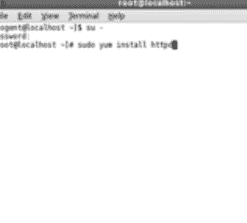
   ▲ 图 2：安装 Web 服务器

2. 按回车键。包管理器检查包依赖项并显示升级的包，如图 3 所示：
   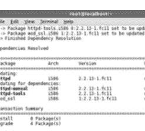
   ▲ 图 3：显示升级的包

3. 当询问确认安装 Web 服务器时，按 `Y` 键。

4. 按回车键。Web 服务器的安装继续，并下载 Web 服务器的剩余包、依赖项和更新，如图 4 所示：

| Name | Version | Updates | Size |
|---|---|---|---|
| apache2-common | 2.2.13-6ubuntu5 | updates | 1.1 M |
| apache2-bin | 2.2.13-6ubuntu5 | updates | 800 K |
| apache2-core | 2.2.13-6ubuntu5 | updates | 1.2 M |
| apache2-utils | 2.2.13-6ubuntu5 | updates | 86 K |

▲ 图 4：安装所需的依赖项

几分钟后，Web 服务器的安装完成。

> **注意：** 你可以使用 `netstat` 命令来验证服务，如下所示：
>
> ```
> netstat -alnt | grep :80
> ```

安装 Web 服务器后，现在让我们学习如何使用虚拟托管。

### 使用虚拟托管

虚拟托管意味着在单个服务器上托管多个网站。Apache Web 服务器可以执行虚拟托管，这意味着它可以运行多个网站。例如，你可以在单台物理服务器上运行 `mysite1.com` 和 `mysite2.com`。在 Apache Web 服务器中，你可以通过两种方式进行虚拟托管配置，如下：

- **基于 IP 的虚拟主机**：在此配置中，你可以将两个网站的 IP 地址映射到运行 Apache 的单个物理服务器上。要实现这一点，服务器应该有两个以太网卡，每块以太网卡都必须配置相应网站的 IP 地址。
- **基于名称的虚拟托管**：在此配置中，Apache Web 服务器将网站的多个主机名分配给单个 IP 地址。这些名称和 IP 地址在 DNS 中更新。现在，当客户端请求 Web 页面时，服务器会在 HTTP 请求头中查找主机名，并根据主机名提供不同的网站。

执行以下步骤设置虚拟托管：

1. 打开 `httpd.conf` 文件，如下命令所示：
   ```
   # vi /usr/local/apache2/conf/httpd.conf
   ```

2. 取消该行前的注释符号：
   ```
   Include conf/extra/httpd-vhosts.conf
   ```

3. 通过修改 `httpd-vhosts.conf` 文件设置虚拟主机。在我们案例中，我们正在为两个主机名配置基于名称的虚拟托管，如下命令所示：


## Apache 虚拟主机配置

```bash
vi /usr/local/apache2/extra/httpd-hosts.conf
```

```config
VirtualHost *:80
ServerAdmin charuill@dummywebsite.com
DocumentRoot "/usr/local/apache2/docs/dummywebsite"
ServerName dummywebsite.com
ServerAlias dummywebsite.com
ErrorLog "logs/dummywebsite/error_log"
CustomLog "logs/dummywebsite/access_log" common
<VirtualHost *:80>
ServerAdmin charuill@anotherwebsite.com
DocumentRoot "/usr/local/apache2/docs/anotherwebsite"
ServerName anotherwebsite.com
ServerAlias anotherwebsite.com
ErrorLog "logs/anotherwebsite/error_log"
CustomLog "logs/anotherwebsite/access_log" common
</VirtualHost>
```

在前面的命令中，`NameVirtualHost *:80` 参数表示所有基于名称的虚拟主机将监听在默认端口 80 上。一对 `<VirtualHost *:80>` 和 `</VirtualHost>` 标签用于封装每个虚拟主机的所有 Apache 配置参数。

### 4. 使用 `httpd -S` 语法验证虚拟主机的配置

```bash
/usr/local/apache2/bin/httpd -S
```

前面的命令将显示配置。

### 5. 重启 Apache 服务器并进行测试

```bash
/usr/local/apache2/bin/apachectl restart
```

---

## 4.4 DNS

DNS 是一种允许你记住主机名而不是 IP 地址的设施。它使用客户端-服务器架构。如果你需要知道网站的 IP 地址，可以使用 DNS。

### 名称服务器类型

有四种 DNS 服务器：

- **权威 DNS**：为区域提供确定信息。
- **从属 DNS**：这些服务器从主服务器获取区域信息。
- **仅缓存 DNS**：它只回答缓存在内存中的解析。
- **转发**：用于将请求转发到特定的服务器列表。

### 正向查找和反向查找

当 DNS 服务器解析或映射如 `www.google.com` 的限定域名到 IP 地址时，此过程被称为**正向查找**。然而，当它将 IP 地址映射到限定域名时，此过程被称为**反向查找**。

### 配置文件

以下是客户端和服务器端的配置文件列表。

#### 客户端配置文件（表 2）

| File | Description |
|---|---|
| `/etc/nsswitch.conf` | 确定命名服务的顺序 |
| `/etc/resolv.conf` | 指定你的 DNS 服务器 |

#### 服务器配置文件（表 3）

| File | Description |
|---|---|
| `/var/named/chroot/etc/named.conf` | 主 DNS 配置文件，列出了用于你所需网站域名的区域文件位置和名称。 |
| `/var/named/chroot/var/named...` (正向区域文件) | 将域名映射到 IP 地址。 |
| `/var/named/chroot/var/named...` (反向区域文件) | 将 IP 地址映射到域名。 |
| `/var/named/chroot/var/named.ca` | 13 个根权威服务器的列表。 |
| `/var/named/chroot/etc/rndc.key` | 用于 `named` 认证。 |

---

## 配置 `named.conf` 文件

这是主 DNS 配置文件，列出了所需网站域名的区域文件位置和名称。你可以根据组织的域名修改 `named.conf` 文件。示例如下：

```config
// sample file
options {
  directory "/var/named";
  /*
   * 如果和你想要通信的服务器之间有防火墙，
   * 你可能需要取消下面的 query-source 指令。
   * 之前的 BIND 版本始终使用端口 53 提问，
   * 但 BIND 8.1 默认使用非特权端口。
   */
  query-source address * port 53;
};
// 仅缓存名称服务器配置
controls {
    inet 127.0.0.1 allow { localhost; } keys { rndckey };
};
zone "." IN {
    type hint;
    file "named.ca";
};
zone "localhost" IN {
    type master;
    file "localhost.zone";
    allow-update { none; };
};
zone "0.0.127.in-addr.arpa" IN {
    type master;
    file "named.local";
    allow-update { none; };
};
zone "spit.ac.in" IN {
    type master;
    file "spit.ac.in.forward";
    allow-update { none; };
};
zone "1.168.192.in-addr.arpa" IN {
    type master;
    file "spit.ac.in.reverse";
    allow-update { none; };
};

include "/etc/rndc.key";
```

`named.conf` 文件包含主 DNS 配置，并告诉 BIND（伯克利互联网域名系统）哪里找到你拥有的每个域的配置文件。此文件通常包含以下两个区域部分：

- **正向区域**：指向包含文件列表的定义，用于将域名映射到 IP 地址。
- **反向区域**：指向包含文件列表的定义，该列表将 IP 地址映射到域名。

在以下示例中，你通过在 `named.conf` 文件的底部添加项目，为 `www.spit.ac.in` 设置了正向区域。区域文件文件名为 `spit.ac.in.forward`，它应该位于默认目录 `/var/named/chroot/var/named`。以下代码显示了如何设置正向区域：

```
zone "spit.ac.in" {
  type master;
  notify no;
  allow-query { any };
  file "spit.ac.in.forward";
}
```

此外，你可以在 `named.conf` 文件中插入额外的条目，以引用你托管的其他 Web 域名。让我们考虑以下代码作为 `another-site.com` 的示例，它使用名为 `another-site.zone` 的区域：

```
zone "another-site.com" {
  type master;
  notify no;
  allow-query { any };
  file "another-site.zone";
}
```

---

## 配置区域文件

一旦在 `named.conf` 文件中定义了一个新区域，我们就必须创建与 `named.conf` 文件中提到的名称相同的正向和反向区域文件。默认情况下，你的区域文件位于 `/var/named`、`/var/named/chroot/var/named` 或 `/etc/bind` 目录。每个区域文件包含各种记录（SOA、NS、MX、A 和 CNAME），这些记录管理着 BIND (`named`) 的不同区域。

### 图 5：显示 `spit.ac.in.forward` 区域文件

| TTL | Class | Type | Data |
|---|---|---|---|
| | | SOA | `ns.spit.ac.in. spadmin.spce.ac.in.` |
| 86400 | IN | | `200102601` ; refresh after 6 hours |
| | | | `2100` ; retry after 1 hour |
| | | | `3600` |
| | | | `64800` ; expire after 1 week |
| | | | `86400` ; minimum TTL of 1 day |
| | | NS | `ns.spit.ac.in.` |
| `spit.ac.in.` | IN | MX | `mail.spit.ac.in.` |
| `ns1` | IN | A | `192.168.1.160` |
| `ns2` | IN | A | `192.168.1.160` |
| `none` | IN | A | `192.168.1.160` |
| `mail1` | IN | A | `192.168.1.160` |
| `it` | IN | CNAME | `web` |

### 图 6：显示 `spit.ac.in` 反向文件

| TTL | Class | Type | Data |
|---|---|---|---|
| 8640 | IN | SOA | `nsl.spit.ac.in. speadmin.spit.ac.in.` |
| | | | `200309232923` ; refresh after 6 hours |
| | | | `2160` ; retry after 1 hour |
| | | | `3600` ; minimum TTL of 1 day |
| 164 | IN | NS | `nsl.spit.ac.in.` |
| | | PTR | `spit.ac.in.` |

---

### 生存时间值 (Time to Live)

区域文件中的第一个条目通常是生存时间（TTL）值。缓存 DNS 服务器会缓存其对权威 DNS 服务器查询的响应。权威服务器不仅提供 DNS 答案，还提供信息的生存时间，即该信息有效的期限。

TTL 的目的是减少权威服务器需要回答的 DNS 查询次数。如果 TTL 设置为三天，那么缓存服务器在下次查询之前将使用原始响应三天。

### 资源记录

区域文件中的其余记录通常是 BIND 资源记录。它们定义了呈现给客户端的 DNS 信息，格式如下：

```
(name) ttl addr-class Record
```

在上述格式中，第一个字段是域名记录，第二个字段是 TTL 字段，第三个字段是地址类，第四个字段指定类型（RR），最后一个字段包含数据。

### 名称类类型数据

有不同类型的记录，用于邮件 (MX)、正向查找 (A)、反向查找 (PTR) 和区域定义 (SOA)。根据记录类型的数据由多个值组成。

### SOA 记录

第一条记录是起始区域（SOA）记录，包含了通用管理信息。它的格式如下：

```
Name Class Name-Server-Address Serial Refresh Expiry Minimum-TTL
@ ns.spit.ac.in. hostmaster.spit.ac.in. 200102601 : 86400 : 2100 : 3600 : 86400
```

---

## 缓存 DNS 服务器

在这种情况下，缓存 DNS 服务器是默认设置。当网络请求相同的页面时，本地缓存服务器将响应并提供页面。要配置缓存 DNS 服务器，需要安装 BIND 服务。执行以下步骤来设置缓存 DNS 服务器：

1. 打开终端，使用以下命令安装 BIND 服务：
   ```bash
   yum -y install bind
   ```
2. 使用以下命令打开并配置 `/etc/named.conf`：
   ```bash
   vi /etc/named.conf
   ```
3. 使用以下命令重启 DNS 服务器：
   ```bash
   service named start
   ```
4. 为 DNS 流量配置防火墙规则。
5. 使用以下命令测试 DNS 服务器：
   ```bash
   dig redhat
   ```

---

## 设置主服务器

在任何操作域中，通常配置两种类型的 DNS 服务器：一个是主服务器 (`ns1`)，另一个是辅助服务器 (`ns2`)。这些服务器是为了避免 DNS 故障；如果一个服务器宕机，另一个将成为活动服务器。特定域的所有 DNS 条目都添加到主服务器，而辅助服务器仅用于与主服务器协作。

让我们以 `dummiesite.com` 域为例，为该域配置主服务器。你需要执行以下步骤来设置主 DNS 服务器：

1. 确保主机上已安装 BIND 包。
2. 打开 `/etc/named.conf` 文件，确保包含以下参数：
   - `directory` 为 `/var/named`
   - `listen-on port 53` 设置为 `any`
   - `allow-query` 设置为 `any`
   - `forwarders` 包含互联网提供商的 DNS 服务器地址
   - `dns-sec validation` 设置为 `no`
3. 打开 `/etc/named.rfc1912.zones` 文件，并在里面创建域定义。
4. 为 `/var/named/dummiesite.com` 域创建一个区域文件，并根据所需的主机名进行匹配。
5. 确保 `/etc/resolv.conf` 文件中的 DNS 解析器设置为你自己的 DNS 服务器。
6. 使用以下命令验证你的 DNS 服务器是否从 DNS 数据库提供正确信息：
   ```bash
   dig yourhost.dummiesite.com
   ```

---

## DHCP 服务器

DHCP 协议自动为网络上的计算机分配 IP 地址和其他网络配置信息（例如子网掩码和广播地址）。配置了 DHCP 的客户端向 DHCP 服务器发送广播请求以获取地址。然后 DHCP 服务器发放租期内的 IP 地址。有效租期可以在服务器上指定。DHCP 减少了配置客户端的时间，并允许将计算机移动到各种网络，并可以配置适当的 IP 地址、网关和子网掩码。DHCP 服务器可以为网络上的任何系统分配静态 IP 地址。由 DHCP 服务器发送的网络信息通常包含 Microsoft NetBIOS 信息。

### 图 7：显示 DHCP 服务器结构

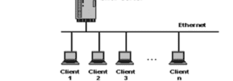

在 Linux 中，配置 DHCP 服务器必须修改配置文件 `/etc/dhcpd.conf`。此外，DHCP 服务器使用 `/var/lib/dhcp/dhcpd.leases` 文件来存储客户端租期数据库。让我们学习在 Linux 中配置 DHCP 服务器的一些要点。

### 关键配置要点

- **下载并安装 DHCP 包**：通常情况下，RedHat 和 Fedora Linux 软件产品以 RPM 格式提供。这些软件包文件名以单词 `dhcp` 开头，后面跟一个版本号，例如 `dhcp-3.23.58-4.i386.rpm`。
- **DHCP 服务器的管理**：不同的 Linux 发行版使用不同的守护进程管理系统。每个管理系统都有自己的一套命令，可以执行相似的操作。最常用的服务器管理系统是 SysV 和 Systemd。
- **服务器守护进程名称**：必须知道守护进程名称，例如 `dhcpd`。
- **配置文件**：配置 DHCP 服务器的第一步是创建配置文件 `/etc/dhcpd.conf`，该文件存储了客户端的网络信息。

### 图 8：显示 `/etc/dhcpd.conf` 文件的示例

```config
dhcp-update-style
subnet 192.168.1.0 network 255.255.255.0 {
  # 可用 IP 地址范围
  range 192.168.1.10 192.168.1.200;
  # 所有客户端使用 DHCP 提供的客户端在网络上启动
  range 192.168.1.21 192.168.1.220;
  # 设置包含该客户端的子网掩码，可能会保留 IP 地址
  default-lease-time 60; max-lease-time 8600;
  # 设置客户端使用的默认网关
  option routers 192.168.1.1;
  # 不转发来自其他 DHCP 请求
  option domain-name example.com;
  option domain-servers 8.8.8.8;
  option forwarding off;
  # 设置广播地址和子网掩码
  option subnet-mask 255.255.255.0;
  # 给 DHCP 客户端使用
  option subnet-mask 255.255.255.0;
  # 设置 DHCP 客户端使用的 NTP 服务器
  option ntp-servers 102.168.1.100;
  # 设置客户端使用的 DNS 服务器
  option domain-name-servers 192.168.1.100;
  # 如果为 Windows 客户端需要 WBIOS 服务器，
  # 你需要在 dhcpd.conf 文件中包含以下选项
  option broadcast-address 192.168.1.255;
  # 你也可以根据“客户端”的以太网 MAC 地址指定 IP 地址
  host "laser-printer" {
    hardware ethernet 00:00:2b:6c:59:20;
    fixed-address 192.168.1.10; # 修正了原文中不完整的 fixed-ethernet 行
  }
  # 列出一个未使用的接口名称
}
```


在该文件中，关键字是不区分大小写的，且以井号 (`#`) 开头的行被视为注释。需要注意的是，如果更改了配置文件，在用 `dhcp restart` 命令重启 DHCP 守护进程之前，更改将不会生效。

- **租约数据库**：在 DHCP 服务器中，`/var/lib/dhcp/dhcp.leases` 用于存储 DHCP 客户端租约数据库。用户不应修改此文件，因为它包含了分配给客户端的 IP 地址信息。此外，这些信息还包括租约长度、IP 地址分配给用户、租约的开始和结束日期，以及用于获取租约的网卡的 MAC 地址。

- **启动和停止服务器**：你可以使用 `/bin/service dhcp start` 命令启动 DHCP 服务，并使用 `/bin/service dhcp stop` 命令停止 DHCP 服务器。

- **DHCP 中继代理（Relay Agent）**：当 DHCP 客户端请求信息时，DHCP 中继代理会将请求转发到 DHCP 服务器，当 DHCP 服务器返回回复时，回复将在发送请求的网络上进行广播或单播。你可以使用 `dhcrelay` 服务命令启动 DHCP 中继代理。

## 安装 DHCP 服务器

你需要安装 DHCP 服务器以便在租约期内为客户端机器分配 IP 地址。让我们执行以下步骤来安装 DHCP 服务器：

1. 在终端中输入 `yum install dhcp` 命令。按 `ENTER` 键。DHCP 服务器的安装过程开始，如图 9 所示：

```
root@localhost:~ -
-root Edit View Terminal Help
[kgopent@localhost ~] su - 
Password:
[root@localhost]# - yum install dhcp
Loaded plugins: refresh packages
Resolving Dependencies
--> Running transaction check
--> dhcp-206.12:4.1.0p-5.fc11 will be updated
--> Finished Dependency Resolution
Dependencies Resolved
Package      Version                Repository      Size
--------------------------------------------------------------------------------
Installing: 
dhcp         1586                   12:4.1.0p1-5.fc11      updates         975 k
Transaction Summary
====================================================================
Install:       1 Package(s)
Upgrade       0 Package(s)
====================================================================
Total download size: 975 k
```

图 9：输入 `yum install dhcp` 命令

输入 `yum install dhcp` 命令后，DHCP 服务器的安装过程开始，如图 9 所示。总下载大小为 975 k。依赖解析完成后，按 `Y` 开始下载安装包。下载完成后，DHCP 服务器安装完成，如图 10 所示。

图 10：下载安装包

图 11：关闭窗口

## 配置 DHCP 服务器

在配置 DHCP 服务器之前为客户端机器分配 IP 地址。

1. 在终端中编辑 `/etc/dhcpd.conf` 配置文件，如图 12 所示。

图 12：编辑 `/etc/dhcpd.conf` 配置文件

在该文件中，关键字是不区分大小写的，且以井号 (`#`) 开头的行被视为注释。需要注意的是，如果更改了配置文件，在用 `dhcp restart` 命令重启 DHCP 守护进程之前，更改将不会生效。

### 列表 1：DHCP 服务器配置更改

```
dhcp-update-style
subnet 192.168.1.0 network 255.255.255.0 {
  #可用 IP 地址范围
  range 192.168.1.10 192.168.1.200;
  # 所有客户端使用 DHCP 提供的客户端
  # 在网络上启动
  range 192.168.1.21 192.168.1.220;
  # 设置包含该客户端的子网掩码
  # 可能会保留 IP 地址
  default-lease-time 60; max-lease-time 8600;
  # 设置客户端使用的默认网关
  option routers 192.168.1.1;
  # 不转发来自其他 DHCP 请求
  option domain-name example.com;
  option domain-servers 8.8.8.8;
  option forwarding,off;
  # 设置广播地址和子网掩码
  option subnet-mask 255.255.255.0;
  # 给 DHCP 客户端使用
  option subnet-mask 255.255.255.0;
  # 设置 DHCP 客户端使用的 NTP 服务器
  option ntp-servers 102.168.1.100;
  # 设置客户端使用的 DNS 服务器
  option domain-name-servers 192.168.1.100;
  # 如果为 Windows 客户端需要 WBIOS 服务器，
  # 你需要在 dhcpd.conf 文件中包含以下选项
  option broadcast-address 192.168.1.255;
  # 你也可以根据“客户端”的
  # 以太网 MAC 地址指定 IP 地址，如下："laser-printer";
  host printer
    hardcast ethernet 00:00:2b:6c:59:20;
    fixed-ethernet 00:01:02:03;
}

  # 列出一个未使用的接口名称
```

3. 配置文件完成后，使用 `service dhcpd start` 命令启动 DHCP 进程，如图 13 所示：

```
root@localhost:~ -
-root Edit View Terminal Help
[kgopent@localhost ~] su - 
Password:
[root@localhost]# - yum install dhcp
Loaded plugins: refresh packages
Resolving Dependencies
--> Running transaction check
--> dhcp-206.12:4.1.0p-5.fc11 will be updated
--> Finished Dependency Resolution
Dependencies Resolved
Package      Version                Repository      Size
--------------------------------------------------------------------------------
Installing: 
dhcp         1586                   12:4.1.0p1-5.fc11      updates         975 k
Transaction Summary
====================================================================
Install:       1 Package(s)
Upgrade       0 Package(s)
====================================================================
Total download size: 975 k
```

图 13：启动 DHCP 进程

## 理解邮件投递代理 (MDA)

邮件系统的另一部分是 MDA。它在后台运行，并在 MTA 和 MUA 之间对邮件消息进行过滤。MDA 最常见的形式是垃圾邮件过滤器，它在邮件到达用户收件箱之前，从计算机中删除所有不需要的邮件消息。MDA 的示例包括 Spamassassin 和 Procmail。

## 配置邮件服务器

Postfix 服务器是组织中最容易设置和部署最可靠的服务器之一。让我们学习如何配置 Postfix 服务器。该服务器需要一个用户定义的域名；在本文中，我们正在使用 samplemailserver.com 域名。

执行以下步骤安装 Postfix 服务器：

1. 打开终端窗口。

2. 输入以下命令：

```
sudo apt-get install postfix
```

此命令将为你安装并自动启动 Postfix 守护进程。当安装完成后，你可以通过连接到 Postfix 服务器来检查它。

3. 输入以下命令连接到 Postfix 服务器：

```
telnet localhost 25
```

上述命令将显示：

```
Trying 127.0.0.1...
Connected to www.samplemailserver.com.
Escape character is '^]'.
220 localhost.localdomain Postfix (Ubuntu)
```

4. 现在，通过输入以下命令连接到域名：

```
telnet www.samplemailserver.com 25
```

执行以下步骤配置 Postfix 服务器：

1. 打开 `main.cf` 文件。这是 Postfix 邮件服务器的主配置，位于 `/etc/postfix/main.cf` 路径。该文件包含以下配置：

```
hostname =
alias_maps = hash; /etc/aliases
alias_database = hash; /etc/aliases
myorigin = /etc/mailname
mydestination =
nrelayhost =
networks =
mailbox_command = procmail -a "$EXTENSION"
mailbox_size_limit = 0
recipient_delimiter = +
inet_interfaces = all
```

此文件允许你配置以下元素：

- `myhostname`：指定机器的主机名，但不需要完整主机名。例如，如果你的机器主机名为 `my.samplemailserver.com`，你只需要在浏览器的地址栏中输入 hostname。

- `mydestination`：指定此机器将本地投递到哪些目的地。

- `mynetworks`：指定允许中继邮件的授权目的地。

2. 在配置不同部分后，保存配置文件并使用以下命令重启你的邮件服务器：

```
sudo /etc/init.d/postfix reload
```

此外，你还可以使用以下命令向邮件服务器添加新用户并设置它们的密码：

```
sudo useradd -m <USERNAME>
sudo passwd <USERNAME>
```

在这里，`<USERNAME>` 被替换为实际用户名。

## NFS 的工作原理

NFS 是一个分布式文件系统。NFS 服务器拥有一个或多个被 NFS 客户端挂载的文件系统。这些文件系统通过标准的 UNIX `mount` 命令挂载。所有 Unix 工具处理 NFS 挂载文件的方式与处理本地磁盘文件的方式一样良好。

NFS 代表网络文件系统（Network File System），是 Linux 和类 Unix 系统之间共享文件的标准方法。系统管理员必须在 NFS 服务器上定义需要激活或导出供 NFS 客户端访问的目录。此外，它为客户端定义了 NFS 服务器及其导出的目录子集。

NFS 服务器需要以下守护进程和实用程序：

- `portmap`：指所有其他进程都依赖的守护进程。它管理使用远程过程调用（RPC）规范的应用程序的连接。默认情况下，建立初始连接时 `portmap` 监听 TCP 端口 111。然后用于协商一个 TCP 端口范围（通常在端口 1024 以上），用于后续的数据事务。你需要在 NFS 服务器和客户端上都运行 `portmap`。

- `nfs`：启动共享 NFS 文件系统所需的 RPC 进程。`nfs` 守护进程仅存在于 NFS 服务器上。

- `nfslock`：允许 NFS 客户端通过 RPC 进程锁定服务器上的文件。`nfslock` 守护进程需要在 NFS 服务器和客户端上都运行。

- `netfs`：允许在 NFS 客户端上运行 RPC 进程以挂载 NFS 文件系统。`netfs` 守护进程运行在 NFS 客户端上。

## 配置 NFS 进行文件共享

Red Hat Linux 默认安装 NFS，并在系统启动时也默认激活。运行以下命令检查是否安装了 NFS 相关包。

```
[root@netmon tmp #] rpm -qa | grep nfs
redhat-config-nfs-1.1.3-1
nfs-utils-1.0.1-39
```

你也可以使用 `rpm` 命令安装 RPC portmap 包并检查其在系统上的可用性：

```
[root@netmon tmp #] rpm -q portmap portmap-4.0-57
```

NFS 服务器和客户端都安装并运行了部分 NFS。服务器需要 `portmap`、`nfslock`，以及一个配置正确的 `/etc/exports`，这是主 NFS 配置文件，由两列组成。第一列列出你想向网络开放的目录，而第二列包含两个部分：第一部分列出可以访问该目录的网络或 DNS 域，第二部分列出括号中的 NFS 选项，如下命令所示：

```
#/etc/exports
/data/files *(ro,sync)
/home 172.16.1.0/24(rw,sync)
/distro/rhel5 172.16.1.200/32(rw,sync)
```

在配置完 `/etc/exports` 文件后，你需要激活设置，但首先要确保 NFS 正在正常运行。

以下点帮助配置 NFS 服务器：

1. 使用 `chkconfig` 命令配置所需的 `nfs` 和 RPC `portmap` 守护进程在启动时启动。语法是使用 `chkconfig` 命令：

```
[root@netmon tmp #] chkconfig --level 35 nfs
[root@netmon tmp #] chkconfig --level 32 nfslock
[root@netmon tmp #] chkconfig --level 35 portmap
```

2. 使用 `/etc/init.d` 中的初始化脚本启动 NFS 和 RPC `portmap` 守护进程。以下示例使用了 `start` 选项，但需要时，你也可以使用 `stop` 和 `restart` 选项停止和重启进程。启动 `nfs` 和 RPC `portmap` 守护进程的语法如下：

```
[root@netmon tmp #] service portmap start
[root@netmon tmp #] service nfs start
[root@netmon tmp #] service nfslock start
```

3. 使用 `rpcinfo` 命令测试 NFS 是否运行正常。你应该得到一个正在运行的 RPC 程序列表，其中必须包含 `mountd`、`portmapper`、`nfs` 和 `nlockmgr`。使用 `rpcinfo` 命令测试 NFS 的语法如下：

```
[root@netmem tmp]# rpcinfo -p
```

## 在客户端上配置 NFS

要在客户端上配置 NFS，你首先需要启动 NFS 应用，然后创建一个目录来挂载通过 `/etc/exports` 文件导出的 NFS 服务器目录，最后将 NFS 服务器的目录挂载到你的本地目录或挂载点上。

以下步骤帮助你在客户端上配置 NFS：

1. 使用 `chkconfig` 命令配置所需的 `nfs` 和 RPC `portmap` 守护进程在启动时启动。语法是使用 `chkconfig` 命令：激活 `nlock` 并降低数据损坏的风险。

```
[root@netmem tmp]# chkconfig --level 35 netfs
[root@netmem tmp]# chkconfig --level 35 nfslock
[root@netmem tmp]# chkconfig --level 35 portmap
```

2. 使用 `/etc/init.d` 中的初始化脚本启动 NFS 和 RPC `portmap` 守护进程。以下示例使用了 `start` 选项，但你也可以使用 `stop` 和 `restart` 选项停止和重启进程。启动 NFS 和 RPC `portmap` 守护进程的语法如下：


# 网络与安全管理

## 启动 NFS 服务

```
[root@netmem tmp]# service portmap start
[root@netmem tmp]# service netfs start
[root@netmem tmp]# service nfslock start
```

- 3. 使用 `rpcinfo` 命令测试 NFS 是否运行正常。正在运行的 RPC 程序列表必须包含 `mountd` 和 `nlockmgr` 命令。

使用 `rpcinfo` 命令测试 NFS 的语法如下：

```
[root@netmem tmp]# rpcinfo -p
```

## 挂载 NFS 共享

在本节中，我们将 `/distro/rhel5` 目录作为 NFS 类型文件系统挂载到 `/mnt/nfs` 挂载点。服务器是 Netmon，其 IP 地址为 172.16.1.100。

手动挂载 NFS 文件系统的命令是：

```
[root@netmem tmp]# mkdir /mnt/nfs
[root@netmem tmp]# ls /mnt/nfs
[root@netmem tmp]# mount -t nfs 172.16.1.100:/distro/rhel5 /mnt/nfs
[root@netmem tmp]# ls /mnt/nfs
```

如果你想让 NFS 目录永久挂载，除了创建挂载点目录外，还需要在 `/etc/fstab` 文件创建一个条目。

### /etc/fstab 文件

`/etc/fstab` 文件列出了系统启动时需要自动挂载的所有分区。如果你需要 NFS 目录对 NFS 上的用户永久可用，则需要编辑 `/etc/fstab` 文件。

```
#etc/fstab
# Directory | Mount Point | Options | Dump | fsk
172.16.1.100:/distro/rhs1 | /mnt/nfs | nfs soft,vers=2 | 0 | 0
```

在上述命令中，`/data/files` 目录通过本地的 `/mnt/nfs` 挂载到服务器 Netmon（IP 地址 172.16.1.1）上作为 NFS 文件系统。

### 永久挂载 NFS 目录

你首先学习创建挂载点目录 `/mnt/nfs`，然后你将学习挂载远程 NFS 目录，最后学习使用 `mount -a` 命令来激活挂载。创建挂载点目录、挂载远程 NFS 目录以及激活挂载的语法如下：

```
[root@tmp] mkdir /mnt/nfs
[root@tmp] ls /mnt/nfs
[root@tmp] mount -a
[root@tmp] ls /mnt/nfs
```

每次系统启动时，都会读取 `/etc/fstab` 文件并执行 `mount -a` 命令，从而实现永久的 NFS 挂载。

### 测试 NFS

使用以下命令测试 NFS：

- **showmount 命令**：在服务器上执行 `showmount -a` 命令会列出所有当前已导出的目录。它还会显示访问服务器的 NFS 客户端列表。列出所有目录的语法如下：

```
[root@tmp]# showmount -n
```

- **df 命令**：`df` 命令列出挂载文件系统的磁盘占用。在 NFS 客户端上运行它以验证 NFS 挂载是否发生。在许多情况下，`root_squash` 挂载选项会防止 root 用户执行此操作。因此，最好作为非权限用户进行测试。使用该命令的语法为：

```
[root@tmp]$ df -F nfs
```

- **nfsstat 命令**：`nfsstat` 命令提供了有关服务器和客户端活动的有用统计数据。如果配合 `-s` 或 `-c` 选项使用，它将分别显示服务器端统计数据或客户端统计数据。

## 4.8 FTP 服务器

FTP 服务器提供运行 FTP 并在互联网上传输文件的软件应用程序。它用于从服务器下载文件或向服务器上传文件。FTP 服务器会对比请求使用它的用户进行身份验证。你可以配置你的 FTP 服务器，仅接受在运行 FTP 服务器的系统上拥有账户的用户请求。或者，你也可以通过名为“匿名 FTP”的服务配置 FTP 服务器以接受任何人的请求。在本节中，你将学习安装 FTP 服务器、配置它，并使用客户端计算机来访问它。

### 安装 FTP 服务器

FTP 服务器提供了一种使用客户端-服务器模型共享文件的安全方式。Linux 操作系统使用安全 FTP 守护进程 (`vsftpd`) 命令来安装 FTP 服务器。在使用 FTP 服务器之前，你首先需要对其安装它。

执行以下步骤来安装 FTP 服务器：

1. 打开终端并切换到 root 模式。
2. 在窗口中输入 `yum install vsftpd` 命令。按回车键设置 FTP 安装过程，如图 14 所示：

```
File Edit View Terminal Help
(root@localhost)# - yum install vsftpd
loaded plugins: refresh packagekit
Setting up Install Process
```

> 图 14：输入 yum install vsftpd 命令

3. 按 Y 键确认下载 FTP 包，如图 15 所示：

```
File Edit View Terminal Help
loaded plugins: refresh packagekit
Setting up Install Process
Resolving Dependencies
-> Running transaction check
-> Package already installed: 2.1.2.fc11 to be updated
-> Finished Dependency Resolution
Dependencies Resolved
-----------------------------------------------------------------
Name                Version             arch      Size
-----------------------------------------------------------------
installing
vsftpd              2.1.2.fc11      updates     159 k
-----------------------------------------------------------------
Transaction Summary
-----------------------------------------------------------------
Install:            1 Package(s)
Upgrade             0 Package(s)
-----------------------------------------------------------------
Total download size: 159 k
Nothing to do.
Downloading Packages:
```

> 图 15：下载 FTP 包

FTP 服务器只需几分钟即可安装完成，如图 16 所示：

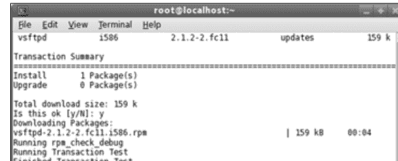

> 图 16：安装 FTP 服务器后的屏幕显示

### 配置 FTP 服务器

在配置 FTP 服务器时，会使用 `vsftpd.conf` 文件。它是存储在 `/etc` 目录下的 FTP 服务器配置文件。你需要使用文本编辑器（如 vi）编辑此文件来配置服务器。

1. 在终端中输入 `vi /etc/vsftpd.conf`。如图 17 所示：


> 图 17：编辑 /etc/vsftpd.conf

2. 按 I 键进入插入模式，如图 18 所示：

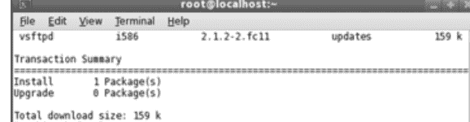

> 图 18：插入模式

3. 编辑完成后，按 ESC 键并输入 `:wq` 保存并退出，如图 19 所示：

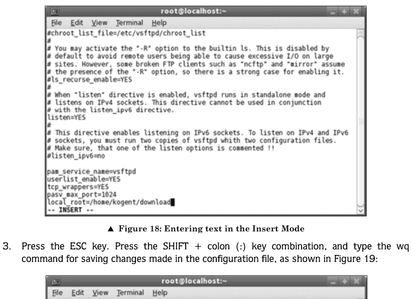

> 图 19：保存文件

4. 重启 FTP 服务输入 `service vsftpd restart`，如图 20 所示：

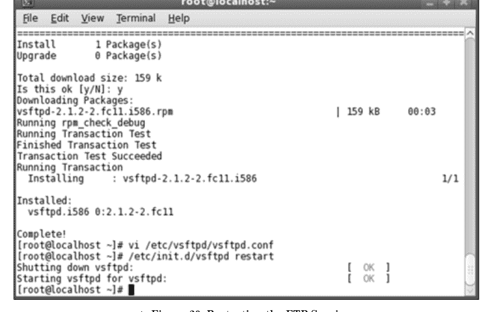

> 图 20：重启服务

### 访问 FTP 服务器

学习配置 FTP 服务器后，现在让我们学习使用客户端计算机访问它。

你可以通过使用 Firefox 访问 FTP 服务器以上传和下载文件。让我们执行以下步骤：

1. 点击 Linux 桌面上的 Firefox 图标。在 Firefox 的地址栏中输入 `ftp://172.16.1.100/`，如图 21 所示：

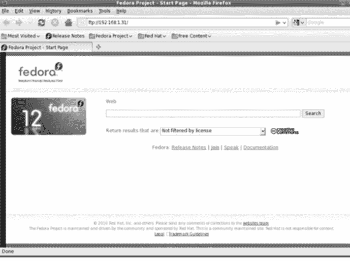

> 图 21：在地址栏输入地址

2. 按回车键。出现身份验证对话框。在用户名旁输入用户名。在我们的例子中，我们输入 kogent。在密码框旁输入 kogent 用户的密码。点击 OK 按钮，如图 22 所示：

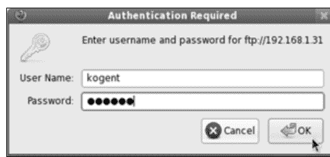

> 图 22：提供身份验证

3. 连接后，点击 Firefox 标题栏上的关闭按钮将其，如图 23 所示：

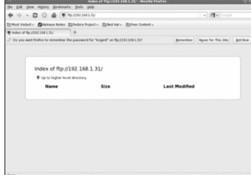

> 图 23：点击关闭

## 4.9 使用 IPTables 安全服务器

Linux 自带主机级防火墙 Netfilter。该防火墙是 Linux 内核中非常重要的部分。它提供了安全、包、包混杂和处理。`IPTables` 是 Netfilter 的前端，告诉内核用户想要如何处理进入、通过或离开 Linux 盒的 IP 包。此工具使用策略链来允许或阻止网络流量。`IPTables` 预装在任何 Linux 发行版中。不过，你可以通过以下命令手动安装或更新它：

```
sudo apt-get install iptables
```

### 链的类型

`IPTables` 使用三种链：input、forward 和 output，如图 24 所示：

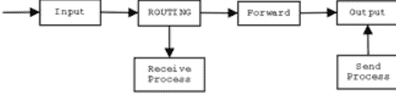

这些链的描述如下：

- **Input（输入）**：此链用于控制入站连接的行为。
- **Forward（转发）**：此链用于并非在本地进行递送的入站连接。
- **Output（输出）**：此链用于出站连接。

### 表格与规则

`IPTables` 具有以下内置表和规则列表：

- **Filter（过滤）**：代表处理网络数据包的默认表。
- **NAT**：代表网络地址转换（Network Address Translation）。它用于修改创建新连接的数据包。
- **Mangle（修改）**：指定用于特定类型数据包的表。
- **Raw（原始）**：指定在结合 NOTRACK 目标时，用于配置连接跟踪豁免的表。
- **Security（安全）**：指定用于强制性访问控制（MAC）网络规则的表。

图 25 显示了 `IPTables` 的框图：

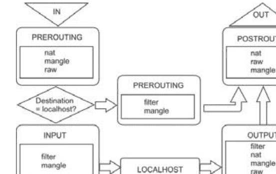

> 图 25：显示 IPTables 框图

每个表都有一组内置链规则，这些规则对应 Netfilter 对数据包执行的操作。

**filter 表的内置规则如下：**

- **INPUT**：此规则适用于目标为主机的网络数据包。
- **OUTPUT**：此规则适用于本地生成的网络数据包。
- **FORWARD**：此规则适用于通过主机路由的网络数据包。

**NAT 表的内置链规则如下：**

- **PREROUTING（路由前）**：此规则适用于路由之前的入站网络数据包。
- **OUTPUT**：此规则适用于发送之前的本地生成的网络数据包。
- **POSTROUTING（路由后）**：此规则适用于发送之前的网络数据包。

**mangle 表的内置链规则如下：**

- **INPUT**：此规则适用于目标为主机的网络数据包。
- **OUTPUT**：此规则适用于发送之前的本地生成的网络数据包。
- **FORWARD**：此规则适用于通过主机路由的网络数据包。
- **PREROUTING**：此规则适用于路由之前的入站网络数据包。
- **POSTROUTING**：此规则适用于发送之前的网络数据包。

**raw 表的内置链规则如下：**

- **OUTPUT**：此规则适用于发送之前的本地生成的网络数据包。
- **PREROUTING**：此规则适用于路由之前的入站网络数据包。

**security 表的内置链规则如下：**

- **INPUT**：此规则适用于目标为主机的网络数据包。
- **OUTPUT**：此规则适用于发送之前的本地生成的网络数据包。
- **FORWARD**：此规则适用于通过主机路由的网络数据包。

### 使用 IPTables

在开始之前，你需要确保已经安装了 `IPTables` 软件 Redhat 包管理器 (RPM)。为此，你需要使用以下命令来显示 Linux 中防火墙的状态：

```
iptables -L -n -v
```

在上述命令中，`-L` 选项列出规则，`-n` 选项以数字格式显示 IP 地址和端口，`-v` 选项表示详细模式（verbose），显示整个命令的详细信息。你也可以通过输入以下命令按行号检查防火墙：

```
iptables -n -n -v --line-numbers
```

`IPTables` 命令的 `INPUT` 和 `OUTPUT` 选项分别用于显示输入和输出链规则。使用这些选项的命令如下：

```
iptables -L INPUT -n -V
iptables -L OUTPUT -n -v --line-numbers
```

`start`、`stop` 和 `restart` 选项可以启动、停止和重启防火墙，如下命令所示：

```
service iptables stop
service iptables start
service iptables restart
```

`-D` 选项用于删除防火墙规则。例如，以下命令可以删除第 4 行的防火墙规则：

```
iptables -D INPUT 4
```

`-I` 选项用于插入防火墙规则。例如，以下命令可以在 1 和 2 之间插入一条或多个规则：

```
iptables -I INPUT 2 -s 202.54.1.2 -j DROP
```

然后，使用以下命令保存防火墙规则：

```
service iptables save
```

`IPTables` 命令还允许你阻止攻击者的 IP 地址。例如，以下命令阻止一个 IP 地址：

```
iptables -A INPUT -s 1.2.3.4 -j DROP
iptables -A INPUT -s 192.168.0.0/24 -j DROP
```

你也可以使用 `host` 命令阻止到特定主机或域名的出站流量。例如，如果你想阻止 website.com，请输入以下命令：

```
host -t a website.com
```

表 4 描述了常用的 `IPTables` 命令开关：

| 开关 | 描述 |
| :--- | :--- |
| `-t <table>` | 用于显示表。如果没有指定表，则取 filter 表。 |
| `-j <target>` | 当数据包匹配当前规则时，跳转到指定的目标链。 |
| `-A` | 用于将规则附加到链的末尾。 |
| `-F` | 用于清空或删除所选表中的所有规则。 |
| `-p <protocol>` | 指定协议 |
| `-s <ip-address>` | 源 IP 地址 |
| `-d <ip-address>` | 目的 IP 地址 |
| `-i <interface>` | 输入接口 |
| `-o <interface>` | 输出接口 |

## 10. 设置证书

（注：原文此处似乎存在大量重复的文本错误，已按要求进行翻译并保留格式）

## 使用 GNU Privacy Guard

GNU Privacy Guard (GPG) 是 GNU 的一个工具，用于 Web 服务器，用以保护互联网上的电子邮件通信和数据存储。它还可以使用密码对文件进行加密和解密，以便文件能够安全地传输。

要创建一个密钥对，你必须使用以下命令：

```
gpg -gen-key
```

拥有一个 GPG 公钥/私钥对是很好的，但它必须与他人共享。为了这一点，你需要初始化密钥传输，以便他人能够以安全的方式发送或接收数据。要导出你的公钥，你需要使用以下命令：

```
gpg -export -a
```

`gpg` 命令也用于密码加密数据并创建数字签名。要使用密码加密和解密文件，你需要使用以下命令：

```
gpg -c filename
```

例如，如果你需要加密 mydetails.txt 文件，请输入以下命令：

```
gpg -c details.txt
```

上述命令将创建一个 `mydetails.txt.gpg` 文件。`gpg` 命令的 `-c` 选项使用密码语通过对称加密算法对文件进行加密。需要注意的是，如果你忘记了密码或短语，你将无法恢复数据，因为它使用了非常强的加密算法。

要解密文件，你需要使用以下 `gpg` 命令：

```
gpg mydetails.txt.gpg
```

此外，你可以将解密文件的输出写入到另一个文件中。为此，你可以使用以下命令：


```
gpg mydetails.txt.gpg -o anotherfile.txt
```

到此，本章结束了。让我们总结一下本章涵盖的主要主题。

## 总结

在本章中，你学习了网络和安全管理。网络管理包括各种类型的任务，例如安装、配置和保护服务器，以及向网络中添加新计算机。首先，你学习了 Linux 中的基础网络命令。例如，`ifconfig` 命令用于初始化接口并为接口分配 IP 地址。`ping` 命令用于测试网络中两个计算机节点之间的连接性。接下来，你学习了各种类型的服务器，例如 Apache Web 服务器、DNS 服务器和 DHCP 服务器。Apache Web 服务器是一个安全、高效且可扩展的服务器，提供 HTTP 服务。DNS 服务器使用命名空间来定义网络上主机的名称和 IP 地址。DHCP 是一种协议，用于为网络上的计算机分配 IP 地址和其他网络配置信息（如子网掩码和广播地址）。然后，你学习了使用 Linux 中的 IPTables 加密服务来保护服务器。此外，你还学习了 SSL 以及如何使用 OpenSSL 管理证书。最后，你学习了 GNU Privacy Guard。它是 GNU 的一个工具，用于保护通信和数据存储。它可以使用密码加密数据并创建数字签名。

## 复习练习

在这里，让我们回答以下类型的问题：

- 判断题（错）
- 多选题
- 简答题

### 判断题

1. IP 地址是提供给计算机和其他设备的唯一数值地址，用于在网络中标识。正确
2. 主机 ID（Host ID）用于标识网络上的主机。正确
3. 网络 ID（Network ID）对于网络上的不同主机可以不同。错误
4. 负责网络管理的人员被称为网络管理员。正确
5. 动态 IP 地址是指分配给在网络上需要永久连接的设备的 IP 地址。错误
6. `tracer` 命令用于测试两个节点之间的连接性。错误
7. `route` 命令用于显示和操作 IP 路由表。正确
8. Apache Web 服务器用于为现代操作系统（包括 UNIX）开发和维护开源的 HTTP 服务器。正确
9. 特定域名的所有 DNS 条目都位于备用名称服务器。错误
10. DHCP 协议自动为网络上的计算机分配 IP 地址和其他网络配置信息（如子网掩码和广播地址）。正确

### 多选题

**Q1.** 命令用于初始化接口并为接口分配 IP 地址。

- a. ifconfig
- b. ipconfig
- c. iwconfig
- d. dig

答。正确选项是 a。

**Q2.** `netstat` 命令的下列哪个选项显示路由表信息？

- a. -a
- b. -r
- c. -c
- d. -t

答。正确选项是 b。

**Q3.** 关于 Apache Web 服务器，以下哪项是不正确的？

- a. 它是一个免费提供的 Web 服务器。
- b. 它不支持过滤和多协议功能。
- c. 它用于开发和维护开源的 HTTP 服务器。
- d. 它是一个安全、高效且可扩展的服务器，提供 HTTP 服务。

答。正确选项是 b。

**Q4.** Apache Web 服务器文件的默认位置是 ____。

- a. www/html/index.html
- b. /var/www/index.html
- c. /var/html/index.html
- d. /var/www/html/index.html

答。正确选项是 d。

**Q5.** 下表哪个用于特定类型的数据包修改？

- a. Filter
- b. NAT
- c. Mangle
- d. Raw

答。正确选项是 c。

**Q6.** ____ 是通过标准挂载的分布式文件系统。

- a. NFS
- b. DNS
- c. DHCP
- d. route

答。正确选项是 a。

**Q7.** 命令用于测试两个节点之间的连接性。

- a. service
- b. rpcinfo
- c. tracer
- d. netstat

答。正确选项是 c。

**Q8.** 下列哪个项用于显示和操作 IP 路由表？

- a. ifconfig
- b. route
- c. ping
- d. netstat

答。正确选项是 b。

**Q9.** 特定域名的所有 DNS 条目都位于备用名称服务器。

- a. portmap
- b. ssock
- c. netfs
- d. chconfig

答。正确选项是 b。

**Q10.** DHCP 协议自动为网络上的计算机分配 IP 地址和其他网络配置信息（如子网掩码和广播地址）。

- a. /etc/fstab
- b. /mnt/nfs
- c. /root
- d. /var/www

答。正确选项是 d。

## 简答题

**Q1.** 说明使用 Iptables 实现 SNAT 和 DNAT。

答。SNAT 和 DNAT 是 Linux 中不同类型的 NAT。SNAT 代表源网络地址转换。它用于重写数据包的源地址，翻译 IP 地址可以帮助具有私有 IP 地址的内部网络访问互联网。例如，如果内部主机 192.168.1.111 想通过 Linux NAT 器连接 google.com，涉及

**Q2.** 什么是 SSL？

答。SSL 协议是一组规范服务器认证、客户端认证以及服务器与之间加密通信的规则。它由 Netscape 创建以确保互联网上的安全交易。SSL 需要服务器 SSL 证书以便服务器将证书发送给客户端以验证服务器身份。此身份验证过程使用公钥加密和数字签名来确认服务器与客户端之间建立的连接是安全的。

**Q3.** 什么是 GNU Privacy Guard？

答。GNU Privacy Guard (GPG) 是 GNU 的一个工具，用于 Web 服务器，用以保护互联网上的电子邮件通信和数据存储。它还可以使用密码对文件进行加密和解密，以便文件能够安全地传输。`gpg` 命令用于密码加密数据并创建数字签名。要使用密码加密和解密文件，你需要使用以下命令：

```
gpg -- filename
```

# 第136 章 第4 章

- 1. 从源 IP 地址 192.168.1.111 发起一个连接以访问 google.com，详情如下：

(源地址：192.168.1.111，目的地址：www.google.com。)

- 2. 此时，我们的 Linux NAT 路由器 192.168.1.116 是该 IP 地址的默认网关。该路由器将查看其 IPTables 规则，以检查是否有匹配的规则。假设它在 NAT 表中找到了一个 SNAT 或掩装（Masquerade）规则。Linux 路由器会将数据包的源 IP 从 192.168.1.111 更改为 4.4.7.20，并在 `/proc/net/ip_conrack` 表中添加一行包含该连接信息的行。这将帮助路由器跟踪该连接。

- 3. 收到来自 www.google.com 的回复。Linux 路由器将检查 `/proc/net/ip_conrack` 文件，查看该回复是否属于它的任何连接。在找到来自 192.168.1.111 的连接后，Linux 路由器将目的地址从 4.4.7.20 重写为 192.168.1.111。

- 4. 拥有 192.168.1.111 IP 地址的计算机收到了来自 www.google.com 的回复，详情如下：

(源地址：www.google.com，目的地址：192.168.1.111)

另一方面，DNAT 用于在翻译计算机 IP 地址时重写数据包的目的地址。DNAT 代表目标网络地址转换（Destination Network Address Translation）。它允许互联网主机发起连接，然后 Linux 路由器将互联网上的公共 IP 地址转发到私有 IP 地址。例如，IP 地址 5.5.7.23 想要与 4.4.7.20（Linux 路由器的 IP 地址）进行通信。互联网想要连接。完成此连接涉及以下步骤：

- 1. 主机计算机 5.5.7.23 发起一个到 Linux 路由器 4.4.7.20 的连接，数据包详情如下：

(源地址：5.5.7.23，目的地址：4.4.7.20)

- 2. 接收数据包后，Linux 路由器将数据包的目的地址从 4.4.7.20 重写为 192.168.1.111，并在 `/proc/net/ip_conrack` 表中添加条目。

- 3. 处理请求后，来自 192.168.1.111 IP 地址的回复将发送到我们的路由器，IP 详情如下：

(源地址：192.168.1.111，目的地址：5.5.7.23)

- 4. 接收到 IP 包后，Linux 路由器将查找 ip_conrack 表以查找有关此连接的详情，并将数据包的源地址重写为自己的公共 IP 地址。生成的最终数据包将带有以下详情发送到 5.5.7.23 地址：

(源地址：4.4.7.20，目的地址：5.5.7.23)

## 网络与安全管理 137

让我们学习如何在 IPtables 中使用 SNAT 和 DNAT 配置。使用以下 iptables 命令查看 NAT 表中的三个链（chains）：

```
[root@my1 ~]# iptables -t nat -L
Chain PREROUTING (policy ACCEPT)
  target prot source destination
Chain POSTROUTING (policy ACCEPT)
  target prot source destination
Chain OUTPUT (policy ACCEPT)
  target prot source destination
[root@my1 ~]#
```

在输出中，你可以看到 NAT 表中的三个链：PREROUTING、POSTROUTING 和 OUTPUT。

使用以下命令在你的 Linux 路由器上添加一个 SNAT 规则，这将帮助所有 IP 范围为 192.168.1.110/24 的内部主机与互联网上的主机通信：

```bash
[root@my1 ~]# iptables -t nat -A PREROUTING -s 192.168.1.110/24 -j SNAT --to 4.4.7.20
```

你还可以使用以下命令为 IPtables 提供一个 IP 地址范围，以便 IPtables 使用该范围执行 SNAT：

```bash
[root@my1 ~]# iptables -t nat -A PREROUTING -s 192.168.1.111/24 -o eth1 -j SNAT --to 4.4.7.19-4.4.7.33
```

现在，让我们学习如何用 IPtables 配置 DNAT。假设你想允许从互联网连接到你内部机器之一 192.168.1.111，这样你的任何员工都可以通过互联网从家里访问 192.168.1.111 IP 地址。使用以下命令将公共 IP 地址 4.4.7.20 映射到 192.168.1.111：

```bash
[root@my1 ~]# iptables -t nat -A PREROUTING -d 4.4.7.20 -j DNAT --to-destination 192.168.1.111
```

应用上述规则后，来自互联网的流量将访问 192.168.1.111。

## 05 脚本编程

### 目标

- 解释 Bash 脚本
- 执行脚本
- 学习变量和输入
- 使用控制结构
- 处理信号
- 创建函数
- 使用 sed 和 gawk
- 使用 curl 脚本
- 解析数据

## 5.1 简介

Bash 代表 Bourne Again Shell。它是 Linux 中最常用的 shell 之一。该 shell 由 Brian Fox 于 1987 年创建。Bash 的常用功能包括命令行编辑、命令历史、作业控制、无限大小索引数组和整数算术。

使用 shell 有两种方式：交互式和编写脚本。在交互模式下，你输入单个命令并查看结果。然而，在脚本的情况下，你需要将命令存储在文件中。

在本章中你将学习脚本编程。章节从解释 Bash 脚本开始。然后学习变量、输入、控制结构、信号和函数。章节还将介绍 sed 和 gawk。

## 5.2 Bash 脚本

表 1 列出了 Bash 使用的一些配置文件：

| 文件 | 描述 |
| :--- | :--- |
| .bashrc | 每次打开 shell 时都会执行的命令列表。 |
| .bash_profile | 包含登录系统的用户的详情。 |
| .bash_history | 存储 bash shell 的历史。 |
| .bash_logout | 指在退出 shell 时执行的命令。默认情况下，屏幕会被清空。 |

列表 1：Bash 基础程序

```bash
#!/bin/bash
#the hello world program
echo "Hello, world!"
echo " welcome to Linux"
```

在列表 1 中，第一行被称为 shebang 或 "bang" 行。它是解释器的绝对路径。此行由井号和感叹号（#!）组成，后面是解释器的路径，如 `/bin/bash`。脚本中的 # 通知操作系统该文件包含一组命令器的命令。以 # 字符开头的行表示注释，不会被 shell 执行。

让我们执行以下步骤在 Bash shell 中创建脚本：

1. 打开 `hello.sh` 文件，如列表 1 所示：
2. 在 `vi hello.sh` 文件中输入代码，如列表 1 所示：
3. 保存并关闭 `hello.sh` 文件。
4. 执行脚本文件。

## 5.3 执行脚本

在 Linux 中，你可以使用以下命令来执行 shell 脚本：

```
chmod +x hello.sh
./hello.sh
```

你也可以直接运行脚本而无需设置执行权限：

```bash
bash hello.sh
. hello.sh
```

在上面的示例中，点 (`.`) 命令被用于从当前 shell 读取并执行文件中的命令。

前面的命令显示了以下输出：

```
hello, world!
welcome to Linux
```

让我们学习如何使用变量。

## 5.4 变量与输入的使用


变量代表内存位置，可以给它分配一个名称和值。变量对大小写敏感，并且默认存储为字符串，即使它们被分配了数值值也是如此。当你想要从文件中提取信息时，变量前会有一个 `$` 符号。使用 `read` 命令将输入赋值给变量，并使用 `echo` 命令检索变量的内容。可以通过以下示例来说，我们有一个名为 `salutation` 的变量来检查其内容：

```
read salutation
HOW ARE YOU?
echo $salutation
HOW ARE YOU?
```

变量分为系统变量和用户定义变量。

### 系统变量

系统变量由 Linux shell 自身创建并维护。系统变量是一个命名的对象，包含一个或多个应用程序使用的信息。这些变量与用户定义变量的区别在于，系统变量通常是大写的，而用户定义的变量是小写的。

## 第 5 章

表 2 列出了一些主要的系统变量：

| 系统变量 | 描述 |
|---|---|
| `$HOME` | 显示当前用户的家目录。 |
| `$PATH` | 显示一个用冒号分隔的目录列表，用于搜索命令。 |
| `$PS1` | 指命令提示符，它使用 `$` 符号。 |
| `$PS2` | 指次级提示符，在提示额外输入时使用：通常为 `>`。 |
| `$IFS` | 指输入字段分隔符。它显示用于分隔单词的字符列表。 |
| `$0` | 显示 shell 脚本名称。 |
| `$#` | 显示传递的参数数量。 |
| `$$` | 显示 shell 的进程 ID (PID)。 |

### 用户定义变量

用户定义变量由用户创建并维护。根据应用程序类型，可以使用不同的变量名。例如，对于银行应用程序，你可以使用如 `bank_account` 或 `BankAccount` 这样的变量名。下面的语法显示了如何创建并为变量赋值：

```
varName=someValue
```

在上述语法中，`someValue` 被赋值给变量 `varName`。

要显示变量的值，请使用 `echo` 或 `printf` 命令，如下：

```
echo "$varName"
OR
echo "${varName}"
OR
printf "${varName}"
OR
printf "%s" ${varName}
```

创建变量名时遵循的一些命名规范如下：

- 变量名必须以字母数字或下划线 (`_`) 开头，后面跟随一个或多个字母数字或下划线字符。
- 在给变量赋值时，等号两边不要使用空格。例如，以下赋值是无效的：

```
num= 10
```

- 在 Linux 中，变量名是大小写敏感的。例如：

```
Num=10
num=10
NUM=10
```

这三个声明表示不同的变量名。

- 你可以如下定义一个空变量：

```
num=
num=""
```

- 不要在变量名中使用特殊字符，如 `*` 和 `?`。

### 接收输入

你可以使用 `read` 命令从键盘接收输入值并将其赋值给用户定义变量。`read variable1 variable2` 命令的语法如下：

```
read -p "Prompt" variable1 variable2
```

在上述序列中，`-p "Prompt"` 向你显示提示符而不换行。`variable1` 指第一个输入单词，`variable2` 指第二个输入单词，以此类推。

让我们创建一个文件 `greet.sh`，并编写列表 2 所示的代码：

#### 列表 2：使用 `read` 命令

```bash
#!/bin/bash
read -p "Enter your name : " name
echo "Hi, $name. Welcome to join us!"
```

现在，保存并关闭文件。要执行它，使用以下命令：

```
chmod +x greet.sh
./greet.sh
```

`greet.sh` 文件显示了以下输出：

```
Enter your name : Charu
Hi, Charu. Welcome to join us!
```

让我们学习 shell 脚本中的控制结构。

## 5.5 使用控制结构

控制结构指的是控制命令执行顺序的指令、语句或语句组。换句话说，命令的流（执行操作的方向）被称为控制结构。

一些常用的控制结构如下：

- `if-else` 语句
- `case` 语句
- `for` 循环语句
- `while` 语句
- `until` 循环语句

### if-else 语句

`if` 语句用于测试条件。`if` 语句的语法如下：

```
if condition
then
command1
command2
...
commandN
fi
```

在上述语法中，如果条件为真，则执行 `command1`、`command2`... `commandN`。`if` 语句的示例在列表 3 中：

#### 列表 3：使用 `if` 命令

```bash
#!/bin/bash
read -p "Enter your password : " pass
if [ "$pass" = "admin" ]
then
    echo "You are a valid user"
else
    echo "You are not a user"
fi
```

前面的命令将提示你输入密码。如果你获得了正确的密码，它将显示“You are a valid user”。`if` 语句也可以配合 `else` 语句使用。语法如下：

```
if condition
then
command1
else
command2
```

### case 语句

`case` 语句作为多个 `if-else` 语句的替代方案。它将变量的值与多个模式（也称为条件）进行比较，然后相应执行命令。`case` 语句的语法如下：

```
case $Variable-name in
  pattern1)
    command1
    ;;
  pattern2)
    command2
    ;;
  patternN)
    commandN
    ;;
  *)
esac
```

在前面的命令中，`$Variable-name` 的值将与模式进行比较，直到找到匹配。`(*)` 符号作为默认项，在未找到匹配时执行。你需要在每个命令末尾包含 `;;` 符号；最后，`esac` 语句表示 `case` 语句的结束。列表 5 显示了 `case` 语句的示例：

#### 列表 5：使用 case 语句

```bash
#!/bin/bash
day=$(date "+%a")
case $day in
  Mon)
    echo "Monday";
  Tue)
    echo "Tuesday";
  Wed)
    echo "Wednesday";
  Thur)
    echo "Thursday";
  Fri)
    echo "Friday";
  Sat)
    echo "Holiday";
  Sun)
    echo "Sunday";
esac
```

在列表 5 中，名为 `day` 的变量接收日期的缩写字母，并显示星期几的全称。

### for 循环语句

循环语句用于在条件为真时执行命令。`for` 循环的语法如下：

```
for var in item1 item2 ... itemN
do
command1
command2
...
...
commandN
done
```

列表 6 显示了循环语句的示例：

#### 列表 6：使用 for 循环语句

```bash
#!/bin/bash
for i in 1 2 3 4 5
do
echo "welcome $i times"
done
```

在列表 6 中，`for` 循环语句根据指定的条件显示五次欢迎消息。

### while 语句

`while` 语句的作用与 `for` 循环类似。它重复执行命令列表，直到条件为真。`while` 语句的语法如下：

```
while [ condition ]
do
commands
done
```

列表 7 显示了 `while` 循环的示例：

#### 列表 7：使用 while 语句

```bash
#!/bin/bash
num=1
while [ $num -le 5 ]
do
    echo "Welcome $num times"
    ((num++))
done
```

在列表 7 中，`while` 循环语句显示了五次欢迎消息，因为 `num` 变量被初始化为 1，并且变量的值不断增加，直到它小于或等于 5。

### until 语句

`until` 循环执行命令列表，直到条件不再为假为止。`until` 语句的语法如下：

```
until [ condition ]
do
    commands
done
```

列表 8 显示了 `until` 循环的示例：

#### 列表 8：使用 until 循环语句

```bash
#!/bin/bash
num=1
until [ $num -gt 5 ]
do
    echo "Welcome $num times"
    ((num++))
done
```

在列表 8 中，`until` 循环语句显示了五次欢迎消息，因为 `num` 变量被初始化为 1，并且变量的值不断增加，直到它大于 5。

`until` 语句与 `while` 语句的区别在于：`until` 循环执行到返回非零状态为止；而 `while` 命令执行到返回零状态为止。此外，`until` 循环始终至少执行一次。

现在让我们来学习如何在 Linux 中处理信号。

## 处理信号

信号是发送给程序的软件中断，用于指示某些重要事件的发生。例如，在运行名为 `ls -R /` 的命令时，你可能按下 `CTRL+C` 来取消命令的执行。信号是较小的正整数，可以在脚本执行期间的任何时候到达。

要向进程发送信号，你必须了解系统中当前运行的进程。你可以使用 `ps`、`pstree` 或 `pgrep` 命令来了解系统的当前进程。这些命令用法如下：

```
ps aux | less
ps aux | grep "httpd"
pstree
```

### 向进程发送信号

`kill` 命令用于向进程发送信号。你可以使用以下命令查看可用信号的列表：

```
kill -l
```

给出的一些预定义信号如下：

- `SIGHUP` (1): 表示控制终端的挂断或控制进程的死亡
- `SIGINT` (2): 表示来自键盘的中断
- `SIGKILL` (9): 表示杀死进程的信号
- `SIGSTOP` (19): 停止运行的进程
- `SIGCONT` (18): 继续之前停止的进程

可以使用以下命令向 PID 为 1234 的进程发送 kill 信号：

```bash
kill -9 1234
```

或者

```
kill -KILL 1234
```

或者

```
kill -SIGKILL 1234
```

另一个命令是 `killall` 命令，它可以提供额外的选项，通过名称、用户名、组名、终端、UID、EID 和 GID 来杀死进程。

通常情况下，所有进程都会终止。然而，你可以使用 `CTRL+C` 组合键终止前台进程，并使用 `kill` 命令终止后台进程。

### trap 语句

`trap` 命令用于捕获中断或信号。使用 `trap` 命令的语法如下：

```
trap command signal
```

现在让我们学习在 Linux 中创建函数。

## 5.7 创建函数

函数是指一组执行单一操作的命令组。函数用于避免编写大型且复杂的脚本。它们使 shell 脚本变得模块化且易于使用。使用函数，你不需要在程序中重复编写代码。定义函数的语法为：

```bash
function_name () {
  statements
}
```

在此语法中，`function_name` 是用户创建的函数名称，`statements` 是由函数执行的指令。

让我们创建一个名为 `hello` 的函数。在 shell 提示符输入以下命令：

```bash
hello() { echo 'Hello world!' ; }
```

现在，通过直接在 shell 提示符上输入 `hello` 来调用 `hello()` 函数：

```
hello
```

你还可以给用户定义的函数传递参数。例如：

```bash
hello() { echo "Hello $1, How are you?" }
```

现在，你可以如下传递参数：

```
hello Charu
```

前述命令输出如下：

```
Hello Charu, How are you?
```

表 3 列出了一些在 Linux 中处理函数的命令：

| 命令 | 描述 |
| :--- | :--- |
| `declare -f <functionname>` | 用于查看定义函数的名称和源代码 |
| `unset -f <functionname>` | 用于删除函数 |
| `export -f <functionname>` | 用于导出函数 |
| `readonly -f <functionname>` | 用于创建只读函数 |

## 5.8 使用 sed 和 gawk

在 Linux 中，`sed` 和 `gawk` 是两个重要的文本过滤命令。它们允许你使用正则表达式轻松编辑文本文件并过滤其他命令的输出。正则表达式是指可以描述多个字符序列的字符串。

`sed` 命令代表流编辑器（stream editor），用于执行脚本。它是面向流的；因此所有输入到它的内容都会通过它。相反，`gawk` 是一个允许你根据某些模式搜索文件并修改记录的命令。`sed` 命令的基本语法如下：

```
sed 'expression' file
```

在此语法中，`expression` 是正则表达式，`file` 是要处理的文件名。一些常见的 `sed` 表达式包括：

- `s/pattern/replacement/`: 替换第一个出现的 `pattern` 为 `replacement`。
- `s/pattern/replacement/g`: 替换所有出现的 `pattern` 为 `replacement`。
- `/pattern/d`: 删除匹配 `pattern` 的行。
- `/pattern/p`: 打印匹配 `pattern` 的行。
- `n`: 读取下一行而不是当前行。

例如，要将文件中所有的 "apple" 替换为 "orange"：

```bash
sed 's/apple/orange/g' filename
```

删除所有包含 "banana" 的行：

```bash
sed '/banana/d' filename
```

只打印包含 "cherry" 的行：

```bash
sed -n '/cherry/p' filename
```

`gawk` 命令是一个强大的文本处理工具。它通常用于数据提取和报告。`gawk` 的基本语法为：

```
awk 'pattern { action }' file
```

在此语法中，`pattern` 是正则表达式，`action` 是当匹配模式时执行的命令。例如，打印文件的第一列和第二列：

```
awk '{ print $1, $2 }' filename
```

打印第一列大于 100 的行：

```
awk '$1 > 100 { print $0 }' filename
```

`sed` 和 `gawk` 都是任何 Linux 用户必须掌握的必备工具。掌握这些命令将使你能够自动化许多文本处理任务。

| Id | 分数 |
|---|---|
| 101 | 99 |
| 202 | 95 |
| 303 | 80 |
| 404 | 77 |
| 505 | 80 |

`gawk` 允许你使用比较运算符。表 5 列出了配合 `awk` 命令使用的运算符：

### 表 5：配合 awk 命令使用的比较运算符

| 运算符 | 描述 |
|---|---|
| `<` | 小于 |
| `>` | 大于 |
| `<=` | 小于等于 |
| `>=` | 大于或等于 |
| `==` | 等于 |
| `!=` | 不等于 |
| `value ~ /pattern/` | 如果 `value` 匹配模式则为真 |
| `value !~ /pattern/` | 如果 `value` 不匹配模式则为真 |

使用比较操作符的 `gawk` 命令示例如下：

```bash
#!/bin/sh
gawk '$3 > 80 { print $2, $3; }' students_marks.txt
```

上述代码将显示分数大于 80 的学生的姓名和分数。

## 5.9 使用 Shell 脚本处理 Web

如今，快速快捷访问 Web 数据已成为许多数据处理应用程序不可或缺的一部分。执行以下任务来使用 shell 脚本处理 Web 数据：

- 下载 Web 页面
- 将 Web 页面转换为文本文件
- 解析数据
- 使用 `curl`

### 下载 Web 页面

在 Linux 中，你可以使用 `wget` 命令从指定的 URL 下载文件或 Web 页面。以下语法显示了 `wget` 的用法：

```bash
$ wget URL
```

以及

```bash
$ wget URL1 URL2 URL3 ..
```

通常，下载的文件名与 URL 的文件名相同，但你也可以通过使用 `-O` 选项指定文件名。

有时下载过程会因为连接不稳定而中断。在这种情况下，我们可以使用 `-t` 选项，指定系统自动尝试下载文件的次数。`-t` 选项配合 `wget` 命令的用法如下所示：

```bash
$ wget -t 5 URL
```

如果你指定为零，系统将无限尝试下载该文件：

```bash
$ wget -t 0 URL
```

此外，如果文件下载在完成之前中断，我们可以使用 `-c` 选项从上次中断的地方继续下载，如下所示：

```bash
$ wget -c URL
```

### 将 Web 内容转换为文本文件

通常，Web 页面是 HTML 页面，包含一组 HTML 标签以及其他脚本元素。这些 Web 页面通常通过 Web 浏览器进行查看。在 Linux 中，`lynx` 是一种用于查看 Web 内容的文本浏览器。该浏览器只能解析文本文件，因此基于 HTML 的网页需要转换为文本文件。此任务通过使用 `lynx` 命令完成。

`lynx` 命令的语法如下：


```bash
$ lynx -dump URL > webpage_as_text.txt
```

该命令在标题引用下单独出所有超链接。使用 `lynx` 命令的示例例如：

```bash
$ lynx -dump http://google.com > samplefile.txt
```

要查看文本的纯文本版本，你需要使用 `cat` 命令，如下：

```bash
$ cat samplefile.txt
```

让我们学习如何从网站数据。

## 解析数据

要解析 Web 数据，你需要使用 `sed` 和 `grep` 命令配合 `lynx`。例如，以下代码解析了数据：

```bash
$ lynx -dump -nolist http://www.somewebsite.com/samplewebpage.html | grep -o "Rank-.*" | sed -e '/Rank-\([0-9]*\]\(.\*/\1\/2/' | sort -nk 1 > samplefilelist.txt
```

在上述代码中，`lynx` 命令代表命令行 Web 浏览器。`dump` 选项创建网站的文本版本。`-nolist` 选项为每个链接自动插入数字。然后使用 `sed` 命令解析并格式化文本。

## 使用 cURL

cURL 是一种支持多种协议的命令，例如超文本传输协议 (HTTP) 和文件传输协议 (FTP)。它支持各种 Web 相关功能，如 cookie、身份验证、用户代理字符串、额外头部、限制限制、最大文件大小和进度条。以下命令将下载的文件转储到终端窗口：

```bash
$ curl URL
```

如果你想防止 `curl` 命令显示进度信息，请使用以下命令：

```bash
$ curl -silent
```

配合 `curl` 提供的 `--cookie` 选项允许存储 cookie：

```bash
$ curl http://examplewebsite.com --cookie "user=abc;pass=admin"
```

到此，本章已结束。让我们总结一下本章涵盖的主要要点。

## 总结

在本章中，你学习了 shell 编程。shell 是一个解释你在命令行界面输入的命令的程序。shell 是交互式的，它们接受用户的命令并执行它们。本章还解释了 bash 脚本以及如何执行脚本。接下来，你学习了变量、控制结构以及信号和函数。之后，你学习了 `sed` 和 `awk` 命令。最后，你学习了如何使用 shell 脚本处理 Web 以及如何下载页面。

## 复习

## 练习题

让我们回答以下问题：

## 判断对错

1. shell 是一个解释你在命令行界面输入的命令的程序。

2. shell 是一个执行某些特定任务的程序。

3. shell 是内核的重要部分。

4. Bash 是默认 shell。

5. 输入通过 `echo` 命令被赋值给变量。

6. `PS1` 变量显示用户的家目录。

7. 在 `case` 语句中，如果没有找到匹配，`(*)` 符号作为默认。

8. `SIGKILL (9)` 信号指定运行的进程。

9. `trap` 命令用于捕获中断或信号。

10. `unset` 命令用于定义函数名。

## 单选题

回答以下问题：

1. 以 `__` 符号开称为 shebang 行。

   a. #/

   b. ##

   c. @@

   d. #!

2. 哪个命令告诉我们 Linux 中的所有可用 shell？

   a. `cat /etc/shells`

   b. `echo $SHELL`

   c. `ps`

   d. `ps $$`

3. `__` 文件包含每次打开 shell 时执行的命令列表。

   a. `.bash_profile`

   b. `.bashrc`

   c. `.bash_history`

   d. `.bash_logout`

4. `__` 变量显示搜索命令的冒号分隔列表。

   a. `$SIGKILL(9)`

   b. `$PS2`

   c. `$PATH`

   d. `$HOME`

5. 你可以使用 `__` 命令从键盘接受输入值。

   a. `read`

   c. `curl`

   d. `sed`

6. 哪个信号指定来自键盘的中断？

   a. `SIGINT (2)`

   b. `SIGHUP (1)`

   c. `SIGCONT (18)`

7. 哪个命令用于捕获中断？

   a. `ps`

   b. `pstree`

   c. `trap`

   d. `kill`

8. 哪个命令用于查看可用信号列表？

   a. `pkill`

   b. `kill`

   c. `killall`

   d. `kill -1`

9. `__` 命令用于定义定义的函数名。

   a. `declare`

   b. `unset`

   c. `echo`

   d. `function`

10. 要从指定的 URL 下载文件或页面，你需要使用命令。

    a. `lynx`

    b. `curl`

    c. `sed`

    d. `wget`

## 简答题

回答以下简答题：

Q1. 什么是 shell？描述一下 shell 脚本。

答：shell 充当 Linux 内核和用户之间的界面。当你登录 Linux 时，系统会提示输入用户名和密码。登录成功后，将切换到另一个程序，称为 shell。这是一个命令解释器，解释你输入的以执行某些操作的命令。

操作。在 Linux 中使用 shell 有两种方式：交互式和编写脚本。在交互模式下，你输入单个命令并查看结果。然而，在 shell 脚本的情况下，你必须将命令存储在文件中，然后作为 shell 脚本执行该文件。

Q2. shell 脚本中 shebang 的定义是什么？

答. shebang 是 `#!/bin/bash` 命令，由一个井号 (#)和一个感叹号(!)字符组成。`#!` 符号是脚本中使用的解释器，用于指示操作系统该文件是命令解释器的一组命令，shebang 是指向 Bash 解释器的绝对路径。

Q3. 你将如何执行一个脚本文件？

答. 你可以使用以下命令执行脚本：

```bash
chmod +x hello.sh
./hello.sh
```

你也可以在不设置执行权限的情况下直接运行脚本：

```bash
bash hello.sh
./hello.sh
```

在在上一个例子中，点 (.) 命令被用于从当前 shell 中的文件中读取并执行命令。

Q4. 你将如何创建并为用户定义的变量赋值？

答. 用户定义的变量由用户创建并维护。以下语法显示了如何创建变量并为其赋值：

```bash
varName=someValue
```

在上述语法中，`someValue` 被赋值给 `varName` 变量。

Q5. 解释 cURL 命令。

答. cURL 是一个支持协议（如 HTTP、HTTPS 和 FTP）的命令。它支持各种类型的 Web 相关功能，如 cookies、认证、用户代理字符串、额外标头、限制大小、最大尺寸和进度条。

以下命令将下载的文件转储到终端窗口：

```bash
$ curl URL
```

如果你想防止 cURL 命令显示进度信息，请使用以下命令：

```bash
$ curl URL -silent
```

cookies 允许存储 cookies：

```bash
$ curl http://examplewebsite.com --cookie "user=abc;pass=admin"
```

# 06 实验中使用的开源工具

### 目标

- 说明使用 RCS 的版本控制
- 说明使用 CVS 版本控制
- 讨论使用 Drupal 进行内容管理
- 描述 Drupal 的基本组件
- 说明使用 OpenVAS 进行安全评估
- 描述如何在 Eclipse IDE 中工作

## 6.1 绪

开源工具是供公众使用的程序。用户和开发者可以使用这些工具来改进源代码并重新分发。开源软件或工具可以被任何人自定义以进行增强，并且不对用户使用软件施加限制。

本章解释了计算机实验室中出于各种目的常用的各种开源工具。首先解释了修订控制系统（RCS）和并发版本系统（CVS）工具，它们被用于版本控制。此类工具被称为版本控制工具。它们是创建文件和程序多个版本的软件系统。在多个用户必须处理多个文件或程序的环境中，需要这类类型的工具。下一章将讨论 Drupal，这是一种流行的内容管理系统（CMS），用于管理信息网站、社交媒体网站、会员网站、内网和 Web 应用程序上的内容。在后半部分，本章解释了一种评估工具——开放源漏洞评估系统（OpenVAS），它可以帮助网络上的计算机并保护它们免受漏洞攻击。在章节最后，本章将指导你如何在 Eclipse IDE 中工作。Eclipse 是一个提供开发平台的开源社区。该平台包含用于构建、部署和运行 C、C++ 或 Java 程序的各种工具。Eclipse 还提供了插件机制，用于在 Java、Web 或企业项目中添加其他功能。

让我们从使用 RCS 和 CVS 进行版本控制开始。

## 6.2 使用 RCS 和 CVS 进行版本控制

版本控制是在计算机系统上管理文件或程序多个版本的任务。用于版本控制的常用工具是 RCS 和 CVS。RCS 是一组 UNIX 命令，有助于维护软件的版本和配置。它协助程序的开发和维护。它管理文本文档、源程序、文档和测试数据的不同版本。RCS 自动存储、检索和识别修订。它对于将版本控制应用于所有系统文件非常有用。CVS 是文件和程序版本控制领域 RCS 的继任者。

现在，让我们学习如何使用这两个系统进行版本控制。

### 使用 RCS

在系统中，假设团队的多个成员登录到同一台计算机并共享同一个文件系统。在这种情况下，如果一个或多个成员对文件进行了更改，这些更改必须以同一个文件的不同版本形式保存。因此，在使用 RCS 系统之前，团队成员中的某一个必须通过以下命令创建一个仓库目录：

```bash
% mkdir repository_directory
```

确保该目录对组是可写的。使用以下命令为组赋予仓库目录可写权限：

```bash
% chmod g+rw repository_directory
```

如果成员属于不同的组，你可能需要使用权限组合 `a+rw` 而不是 `g+rw`。

每个团队成员可以使用以下命令创建他们自己的工作目录：

```bash
% cd
% mkdir working_directory
```

在工作目录中，每个成员都必须对仓库创建一个符号链接，如下命令所示：

```bash
% ln -s repository_directory
```

RCS 提供了两个基本命令：签入（`ci`）和检出（`co`），用于处理文件结构中的文件。你可以使用这些命令来锁定文件。（等待，文中说：“用于处理文件结构中的文件”）。

RCS 是一个管理修订组的系统。修订组是文件的多个版本的集合。你可以通过编辑现有文件来创建一个新版本。RCS 以树状结构组织修订，其中初始版本是根，树边表示其他修订。当你想要测试文件 `myfile.c` 时，使用以下命令：

```bash
% ci myfile.c
```

该命令调用了签入命令。它根据 `myfile.c` 的内容创建一个修订组。当你想要检出文件时，使用以下命令：

```bash
% co myfile.c
```

你也可以通过使用 `-l` 在检出时锁定文件：

```bash
% co -l myfile.c
```

除了 `ci` 和 `co` 命令外，RCS 还提供了表1所示的用于各种操作的命令：

**表 1：常用 RCS 命令及其操作**

| 命令 | 操作 |
| :--- | :--- |
| `% ci -u myfile.c` | 初始签入 |
| `% co -l myfile.c` | 带锁检出 |
| `% ci -u myfile.c` | 带解锁的签入 |
| `% co -px.y myfile.c` | 显示指定文件的版本 |
| `% co -rx.y myfile.c` | 对版本 x.y 执行撤销操作 |
| `% rcsdiff myfile.c` | 指定文件系统中活动版本与最后修订的差异 |
| `% rcsdiff -rx.y myfile.c` | 指定版本 x.y 和 x.z 差异 |
| `% log myfile.c` | 显示签入日志 |
| `% rcs -u myfile.c` | 破解某人对文件持锁 |

### 使用 CVS

并发版本系统也是一种构建在 RCS 之上的版本控制系统。它比 RCS 具有许多改进的功能。例如，在该系统下使用的命令可以远程工作，因此你不需要手动登录机器并在机器之间手动复制文件。

此外，CVS 允许多个用户通过创建各自独立的文件副本来同时编辑文件。然后，当你使用 `commit` 或 `update` 命令时，它会合并文件中所有的更改。以下是 CVS 中一些常用的命令：

- `commit`: 将你的更改提交到仓库
- `update`: 从仓库获取新文件，并保持工作目录为最新
- `checkout`: 将本地目录设置为与仓库关联的工作目录
- `import`: 将你当前工作目录中的文件导入 RCS 中

设置 CVS 系统的方法与之类似。在此处，你也需要创建一个仓库目录。使用以下命令在共享文件系统上创建仓库目录：

```bash
% mkdir repository_directory
```

确保该目录对用户组（group）是可写的。使用以下命令为整个组授予仓库的可写权限：

```bash
% chmod g+w repository_directory
```

如果成员属于不同的组，你可能需要使用 `a+rw` 权限组合代替 `g+w`。

现在，为了设置你自己的副本，你需要检出（checkout）仓库。此操作会下载副本并设置服务器路径。以下命令将远程目录的副本检出到你的本地工作目录：

```bash
% cvs -d :user@hostname:absolutePath/to/cvsroot co directory
```

与 RCS 使用两个命令分别用于提交和检出不同，CVS 仅使用一个命令，但经常后续使用 `update` 和 `commit` 命令。使用 CVS 命令的示例如下：

```bash
% cvs checkout tc
```

此命令创建一个名为 `tc` 的新目录并在其中填充源文件。表 2 描述了 CVS 命令列表：

**表 2：常用 CVS 命令及其操作**

| 命令 | 操作 |
| --- | --- |
| `% cvs -d :remoteCvsRoot co dirPath` | 检出远程用户@host 登录账户下 `remoteCvsRoot` 路径中 `dirPath` 下的文件 |
| `% commit update [file(s) or directory]` | 从仓库更新或复制文件到你的工作目录 |
| `% commit lock file[file(s) or directory]` | 将文件提交到仓库并解锁锁定 |
| `% cvs add file(s)` | 显示文件已添加到仓库中 |
| `% cvs rm file(s)` | 显示文件已从仓库中移除 |
| `% cvs lock file(s)` | 锁定仓库中的文件 |
| `% cvs unlock file(s)` | 解锁仓库中的文件 |

学习了版本控制工具后，让我们学习另一个名为 Drupal 的开源工具，它用于内容管理。

## 6.3 使用 Drupal 进行内容管理

用于上传、编辑和管理显示在网站上的内容的系统或应用程序称为 CMS（内容管理系统）。Drupal 是最流行的 CMS 之一。它用于管理信息网站、社交媒体网站、会员网站、内网和 Web 应用程序的内容。它是开源软件，允许你轻松在 Web 上组织、管理和发布内容。它根据 GNU 通用许可协议（GNU General Public License）发布。

使用 Drupal 的一些优点如下：

- 它提供了各种工具，帮助组织、结构化和重用 Web 上的内容。
- 它通过 Web 接口管理内容。
- 它允许你高效管理用户账户和权限。
- 它支持社交发布，可以帮助你创建网站和应用程序。
- 它允许设计师创建高度交互性的用户界面，吸引用户并帮助获取流量。
- 它允许你通过聚合、馈（feeds）和搜索引擎连接功能，将你的网站连接到 Web 上的其他网站和服务。

图 1 显示了 Drupal 结构内部运行的不同层。

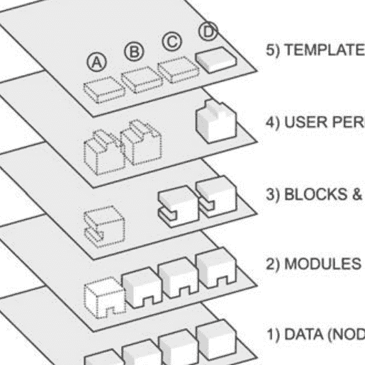

▲ 图 1：Drupal 结构内部运行的不同层

在 Drupal 结构中，信息在不同的系统层之间流动（图 1）。主要有五层。第一层数据池（data pool）是节点（nodes）的集合。数据池包含必须在属性上显示的内容。第二层模块（modules）是功能插件，是 Drupal 核心部分或由 Drupal 社区成员创建的扩展。这些模块允许你自定义节点类型上的数据项并显示内容。第三层是块（blocks）和菜单（menus）。块用于提供模块的输出。它们是内容框，例如“用户登录”或“在线用户”，显示在页脚或侧边栏区域。

另一方面，菜单是指定内容来源导航器。用户权限构成第四层。该层用于配置与用户权限相关的设置，以执行不同的任务。顶层由站点主题（site themes）组成。这些主题使用 XHTML 和 CSS 结合一些 PHP 变量制成。

## Drupal 基本组件

让我们学习 Drupal 的组件。其中一些如下：

- **Page（页面）**：指定 Drupal 中的一个 Web 页面。页面可以分为不同的区域。这些区域实际上是信息块。每个信息块都是一个节点，页面本身也是一个节点。
- **Node（节点）**：指定一个名为数据的信息单元，存储在具有唯一 ID 的数据库中。
- **Content Type（内容类型）**：指定一个名为数据的信息单元，存储在具有唯一 ID 的数据库中。
- **Modules（模块）**：功能插件，是 Drupal 核心部分或扩展条目。
- **Roles（角色）**：定义用户可以做什么。
- **Themes（主题）**：使用 XHTML 和 CSS 结合某些 PHP 变量制作。
- **Regions（区域）**：页面上的区域。
- **Taxonomy（分类法）**：创建的标签。

## 安装 Drupal

你可以在 Windows 服务器、Mac 服务器或 Linux 服务器上安装 Drupal。在安装 Drupal 之前，你需要安装软件：

- **Web 服务器**：用于托管文件。Web 服务器示例有 Apache 或信息服务 (IIS)。


- PHP：Drupal 使用的编程语言。
- 关系型数据库服务器：用于存储数据。数据库示例有 MySQL 或 PostgreSQL。
- FTP（文件传输协议）：用于上传文件。

要安装 Drupal，你需要执行以下步骤：
- 从 http://drupal.org 下载版本的 Drupal
- 解压 Drupal 安装包
- 将解压后的文件夹复制到你的 Web 服务器根目录
- 创建你要使用的数据库
- 运行 Drupal 安装脚本

# 166 第 6 章

学习了 Drupal 后，让我们转向另一个名为 OpenVAS 的开源工具，它是一种安全评估工具。

## 6.4 安全评估：OpenVAS

开放漏洞扫描系统（OpenVAS）是提供各种漏洞评估服务的免费软件。漏洞是指系统中的弱点或缺陷。它允许攻击者导致不当操作或获得未经的访问。如果系统存在漏洞，可能会面临身份和数据的威胁。建议始终对漏洞进行评估。漏洞评估是一个识别、枚举和排名系统或网络漏洞的过程，以便进行修复。基本上，它关注系统资源的安全性。漏洞评估的工作方式如下：

1. 分类系统资源
2. 为分类后的资源分配枚举值
3. 检测每个资源中可能的威胁（漏洞）
4. 根据优先级消除漏洞

OpenVAS 是一个根据 GNU 通用许可协议（GNU GPL）许可的框架。它基于客户端-服务器架构，并在 OpenVAS 传输协议（OTP）、OpenVAS 管理协议（OMP）和 OpenVAS 管理协议（OAP）的基础上运行。

图 2 显示了 OpenVAS 的架构：

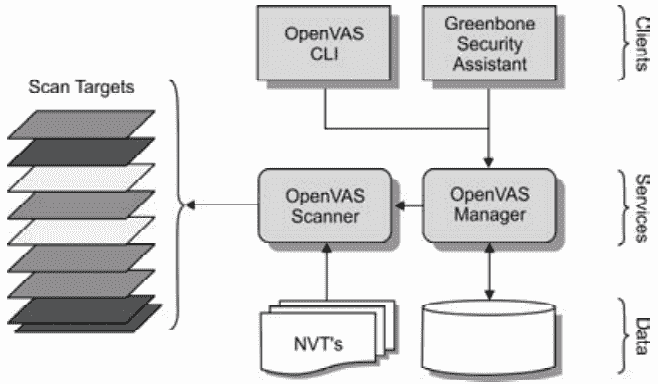

OpenVAS 架构具有以下类别：

- **Clients（客户端）**：`OpenVAS CLI` 和 `Greenbone 安全助手 (GSA)` 是供客户端使用的界面。
- **服务**：`OpenVAS Scanner` 和 `OpenVAS Manager` 是实际上执行对网络上主机进行扫描任务，以进行网络漏洞测试（NVTs）的服务。
- **数据**：NVT 的结果和配置是扫描主机过程中用到的数据。

OpenVAS 架构包含以下组件：

- **扫描目标（Scan Targets）**：指定网络上将由 `OpenVAS Scanner` 进行扫描的目标机器。
- **OpenVAS Scanner**：定期执行网络漏洞测试（NVTs）。
- **OpenVAS Manager**：通过 `OPT` 协议控制 `OpenVAS 扫描器` 的运行，并自身提供基于 XML 的 `OMP` 协议。它还控制一个 `SQL` 数据库以进行中心化存储。
- **Greenbone Security Assistant（GSA）**：为应用程序提供基于浏览器的界面。
- **OpenVAS CLI**：指命令行界面或工具，允许创建批处理过程来驱动 `OpenVAS Manager`。
- **NVTs（网络漏洞测试）**：指定测试例程，可以检查目标系统是否存在漏洞。
- **结果和配置（Results and Configs）**：在中央 `SQL` 数据库中指定扫描结果和配置，这些内容由 `OpenVAS Manager` 控制。

在学习了 OpenVAS 之后，让我们接下来学习另一个名为 Eclipse IDE 的开源工具。

## 6.5 在 Eclipse IDE 中工作

Eclipse 是一个提供开源开发平台的开源社区。该平台包含各种工具，用于构建、部署和运行 C、C++ 或 Java 应用程序。Eclipse 还提供了插件机制，通过使用第三方插件在 Java、Web 或企业级项目中添加其他功能，例如 Struts 和 JSF。Eclipse 软件开发包（SDK）提供了 Eclipse 开发工具（JDT），这是一个内置 Java 编译器的集成开发环境（IDE）以及 Java 源文件。Eclipse JDT 帮助你创建 Java 应用程序，而 Eclipse IDE 提供了高级功能，例如重构和代码合并。

### Eclipse 平台概述

Eclipse 是一个多语言软件开发平台，由一个 IDE 和一个添加其他功能的插件系统组成。Eclipse 平台为所有开发者提供了一个通用平台；然而，也可以根据项目的需求，通过安装和创建新插件对其进行定制。你可以借助 Eclipse 提供的工具构建 Web 和企业级应用程序，还可以添加插件来增强项目中外部框架的功能或能力。

Eclipse 的显著特征使其 IDE 最适合开发 Java 及其他项目，这些特征如下：

- **内容助手（Content Assistant）**：为源代码编辑器中输入的内容提供帮助。此功能通过按下 `Ctrl + Space` 键启用。例如，如果你输入 `Sys` 并按下 `Ctrl + Space` 键，Eclipse IDE 会建议你可以选择的相关可能函数，例如 `System.out.println("")`。
- **快速修复（Quick Fix）**：提供对源代码编辑器中输入的错误代码进行下划提示的功能。例如，如果你输入 `myString = "Hello"` 且变量 `myString` 未声明，Eclipse IDE 将将其高亮为错误。按下 `Ctrl + 1` 键解决此错误。结果所示。
- **偏好设置（Preference Settings）**：允许你设置工作环境，这些设置可以持久于多个工作空间（workbench）。
- **代码模板（Code Templates）**：允许你维护经常输入的代码或部分代码的模板。这防止了你重复输入代码，相反你可以使用为代码定义的代码模板。
- **字体和颜色（Fonts and Colors）**：允许你为源代码编辑器中提供的代码设置字体和颜色。

Eclipse IDE 提供了创建、部署和运行应用程序的环境，这些选项可以在其菜单栏中找到。这些选项帮助你执行特定任务，例如运行应用程序以及复制或编辑源代码编辑器提供的代码。当你打开 Eclipse IDE 时，它会显示 Java-Eclipse 平台窗口。现在，让我们探索 Java-Eclipse 平台窗口的主要组件。我们从一个假设开始，即创建一个简单的 `MyProject` Java 项目。该项目包含 `Main` 类作为 Java 主类。

让我们探索 Eclipse IDE 的菜单栏。

## 菜单栏

菜单栏是 Java-Eclipse 平台窗口顶部的矩形区域。它包含以下菜单：

- 文件（File）菜单
- 编辑（Edit）菜单
- 源码（Source）菜单
- 重构（Refactor）菜单
- 导航（Navigate）菜单
- 搜索（Search）菜单
- 项目（Project）菜单
- 运行（Run）菜单
- 窗口（Window）菜单
- 帮助（Help）菜单

让我们详细讨论这些每一个菜单。

## 文件菜单

文件菜单提供了处理文件或项目的操作选项，例如创建新文件或项目、打开现有文件或项目，以及保存文件或项目中所做的的更改。它还提供了将文件或项目移动到不同位置，或导航到另一个工作空间的选项。图 3 显示了文件菜单提供的选项：

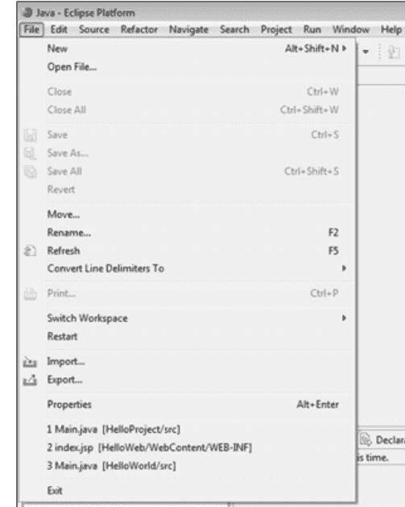

> 图 3：文件菜单中的选项

文件菜单最常用的选项如下：

- 新建（New）：创建一个新项目或文件
- 打开文件（Open File）：打开现有文件
- 关闭（Close）：关闭已打开的文件
- 保存（Save）：保存当前项目或文件

## 编辑菜单

编辑菜单提供了对文本或文件执行编辑的操作选项，例如剪切、复制、粘贴和删除。编辑操作主要在你在源代码窗口提供的代码中执行。图 4 显示了编辑菜单提供的选项：

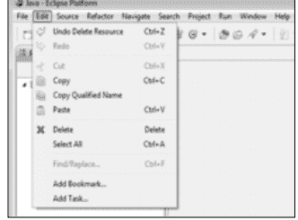

> 图 4：编辑菜单中的选项

编辑菜单最常用的选项是：

- 剪切（Cut）
- 复制（Copy）
- 粘贴（Paste）
- 删除（Delete）
- 全选（Select All）
- 查找/替换

## 源码菜单

源码菜单提供了处理源码的选项，如图 5 所示：

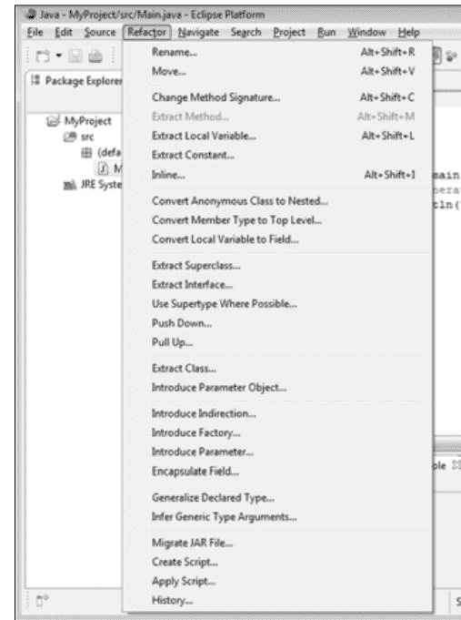

> 图 5：源码菜单中的选项

源码菜单最常用的选项是：

- 格式化（Format）
- 添加导入（Add Import）
- 重写/实现（Override/Implement）
- 生成 Getter 和 Setter（Generate Getters and Setters）

## 重构菜单

重构菜单包含了编辑和修改应用程序源码的选项，如图 6 所示：

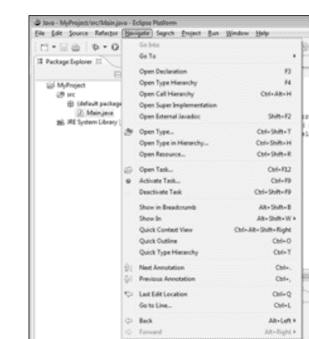

> 图 6：重构菜单中的选项

重构菜单最常用的选项是：

- 重命名（Rename）：变量、类或方法
- 局部变量转字段（Convert Local Variable to Field）

## 导航菜单

导航菜单包含了在源码或项目内进行导航的选项，如图 7 所示：

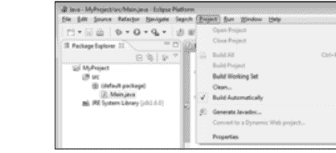

> 图 7：导航菜单中的选项

导航菜单最常用的选项是：

- 转到（Go To）：在文件间跳转
- 打开资源（Open Resource）：跳转到 Java 源和 XML 文件
- 打开任务（Open Task）：跳转到项目中定义的任务

## 搜索菜单

搜索菜单包含了在源码、工作空间或文件中搜索数据的选项，如图 8 所示：

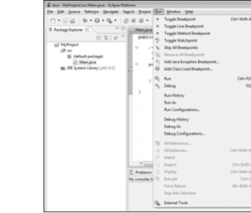

> 图 8：搜索菜单中的选项

搜索菜单最常用的选项是：

- 文件（File）：根据在搜索对话框中指定的名称搜索文件
- Java：根据指定的字符串搜索 Java 文件

## 项目菜单

项目菜单包含了帮助你构建项目的选项，如图 9 所示：

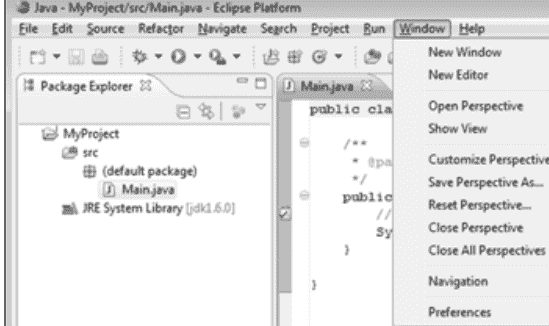

> 图 9：项目菜单中的选项

项目菜单最常用的选项是：

- 打开项目（Open Project）：在 Eclipse IDE 中打开现有项目
- 关闭项目（Close Project）：在 Eclipse IDE 中关闭项目
- 生成 Javadoc（Generate Javadocs）：生成 Java 文
- 属性（Properties）：显示项目的属性

## 运行菜单

Eclipse 平台的运行菜单包含了运行、调试和测试应用程序的选项，如图 10 所示：


> 图 10：运行菜单中的选项

- **添加类加载断点 (Add Class Load Breakpoint)**：创建断点并帮助监控应用程序执行的操作。
- **运行 (Run As)**：作为 Java Applet 或 Java 应用程序运行项目。它还允许你在 Tomcat 和 Glassfish 等各种应用服务器上运行项目。
- **外部工具 (External Tools)**：提供为应用程序附加外部工具的选项，例如 Java 归 (JAR) 文件。

## 窗口菜单 (Window)

窗口菜单提供了操作 Eclipse 平台视角（perspectives）和视图（views）的选项，如图 11 所示：


窗口菜单常用的选项如下：

- 打开视角 (Open Perspective)：打开一个视角
- 显示视图 (Show View)：打开不同的视图，如控制台、属性、大纲、包资源管理器、图像预览、服务器、Web 浏览器视图，以执行与视图相关的特定任务
- 自定义视角 (Customize Perspective)：根据用户需求自定义视角
- 关闭视角 (Close Perspective)：关闭一个视角
- 导航 (Navigation)：帮助在视角中导航，即在不同视角之间切换

## 帮助菜单 (Help)

帮助菜单包含在 Eclipse 平台工作时提供帮助和支持的选项，如图 12 所示：

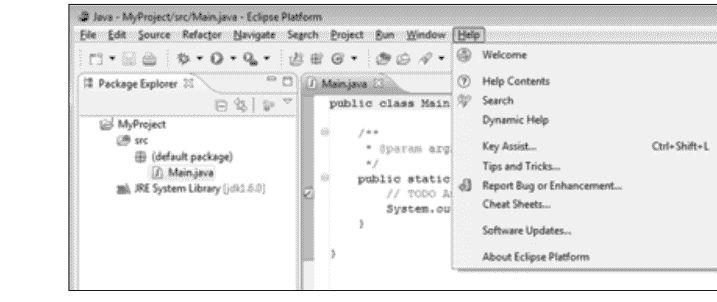

▲ 图 12：帮助菜单中的选项

帮助菜单常用的选项如下：

- 帮助内容 (Help Contents)：启动 Eclipse 平台的帮助窗口
- 动态帮助 (Dynamic Help)：为 Eclipse 平台提供动态帮助
- 提示与技巧 (Tips and Tricks)：提供如何操作 Eclipse 平台的技巧和窍门

现在，探索完菜单栏后，让我们来讨论 Eclipse IDE 的各种视图。

## 探索视图

在 Eclipse IDE 中，有不同的窗口来显示与项目或文件相关的资源或信息。例如，属性视图 (Properties view) 显示所选项目或你正在处理的任何资源文件的属性。某些视图还有它们自己的工具栏。视图工具栏上按钮代表的操作仅影响该视图内的项目。视图可以单独出现，也可以在停靠窗口中与其他视图堆叠在一起。

现在，让我们讨论一下 Java-Eclipse 平台中最常用的视图：

- 控制台视图 (Console View)
- 包资源管理器视图 (Package Explorer View)
- 任务视图 (Tasks View)
- 问题视图 (Problems View)
- 大纲视图 (Outline View)
- 属性视图 (Properties View)

## 控制台视图 (Console View)

控制台视图根据开发类型（在本例中为 Java 开发）和当前用户设置显示各种控制台。选择 `Window` → `Show View` → `Console` 打开控制台，如图 13 所示：

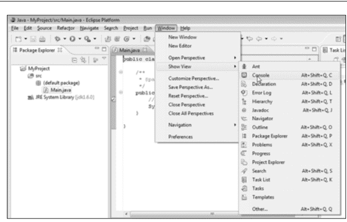

▲ 图 13：选择 Console 选项

控制台视图出现，如图 14 所示：

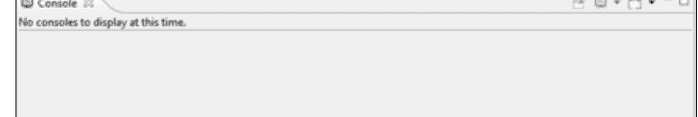

▲ 图 14：控制台视图

图 14 在标题栏右上角显示了各种按钮。

如果你运行一个应用程序，控制台视图除了控制台默认视图中显示的按钮外，还会显示更多操作按钮（见表 3）。

表 3 描述了控制台视图中显著图标的可执行任务：

| 操作按钮 | 命令名称 | 描述 |
| :--- | :--- | :--- |
|  | 清空控制台 (Clear Console) | 清空当前活动的控制台 |
|  | 滚动锁定 (Scroll Lock) | 启用或禁用当前控制台中的滚动锁定 |
|  | 固定 (Pin) | 将当前控制台固定，使其位于所有其他控制台之上 |
|  | 显示选定的控制台 (Display Selected Console) | 打开当前控制台列表并允许你选择想要查看的控制台 |
|  | 打开控制台 (Open Console) | 打开所选类型的新控制台 |

Eclipse 平台默认情况下视图提供以下三个控制台：

- **堆栈跟踪控制台 (The Stacktrace Console)**：显示 Java 堆栈跟踪并支持超链接，以便快速跳转到源码位置
- **当前版本系统 (CVS) 控制台**：显示当前 CVS 操作的输出
- **Maven 控制台 (The Maven Console)**：使用 Maven 显示运行应用程序的输出

## 包资源管理器视图 (Package Explorer View)

包资源管理器视图显示工作区中所有 Java 项目的层级结构。选择 `Window` → `Show View` → `Package Explorer` 打开包资源管理器视图，如图 15 所示：

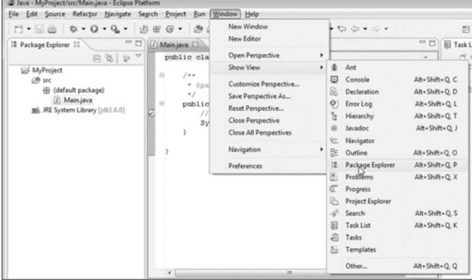

包资源管理器视图出现，如图 16 所示：

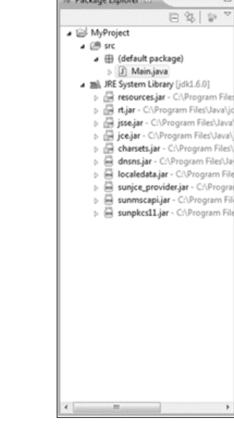

▲ 图 16：包资源管理器视图

图 16 显示了 Java 元素的层级结构。包资源管理器视图提供了执行任务的各种按钮，如最大化或最小化。表 4 列出了：

| 操作按钮 | 描述 |
| :--- | :--- |
|  | 全部折叠 (Collapse All) |
|  | 与编辑器链接 (Link with Editor) |
|  | 最小化 (Minimize) |
|  | 最大化 (Maximize) |

## 任务视图 (Tasks View)

任务视图显示与项目相关的任务。任务可以手动添加，也可以由 Eclipse 平台指定。默认情况下，视角中包含任务视图。选择 `Window` → `Show View` → `Tasks` 添加它，如图 17 所示：

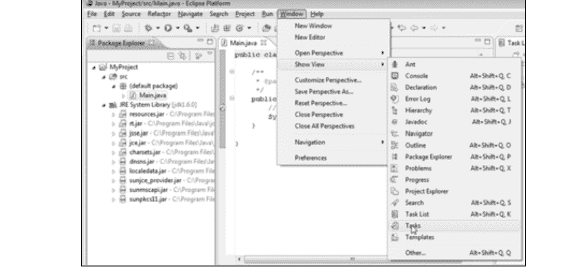

任务视图出现，如图 18 所示：

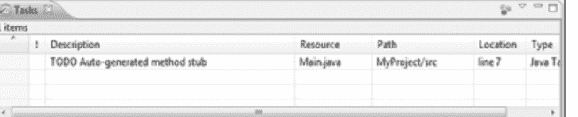

## 问题视图 (Problems View)

问题视图显示与资源（Java 源文件、XML 文件）相关的系统错误、警告或信息。例如，如果你创建一个包含语法错误或生成任何警告的 Java 源文件，这些错误将在问题视图中显示。

选择 `Window` → `Show View` → `Problems` 在当前视角中打开视图，如图 19 所示：

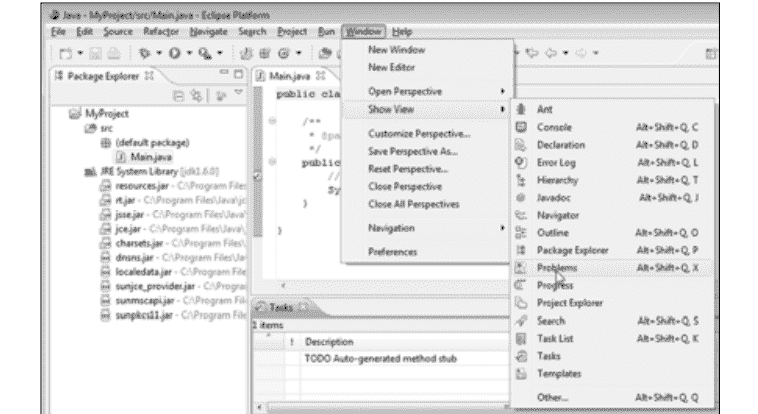

问题视图出现，如图 20 所示：


## 大纲视图

大纲视图显示当前在源编辑器中打开的文件大纲。此视图列出了当前文件的结构元素。选择 `Window` → `Show` → `Outline` 在你的当前视角中打开大纲视图，如图 21 所示：

## 属性视图

属性视图显示所选资源的属性名称及其值。假设所选资源是 `MyProject` 应用程序。

选择 `Window` → `Show View` → `Properties` 来打开属性视图，如图 23 所示：

图 23：选择属性选项

属性视图出现，如图 24 所示：

图 24：属性视图

图 24 属性视图显示了 `MyProject` 应用程序的基本属性。除了应用程序的属性外，属性视图还显示资源的属性，例如 Servlet 和 JSP 页面。

在理解了 Eclipse 平台的各种视图后，让我们讨论 IDE 中的透视图。

## 探索透视图

透视图被定义为 Java-Eclipse 平台窗口中不同视图的布局。在这个窗口中，可以使用不同的透视图。然而，在特定时间点，你只能打开一个透视图。你还可以通过打开或关闭视图，或将它们停靠在 Java-Eclipse 平台窗口的不同位置来更改透视图的布局。每个透视图都提供一组视图，以便用特定类型的资源完成特定任务。例如，`Java` 透视图结合了你在编辑 Java 源代码文件时使用的视图，而 `Debug` 透视图则包含了调试 Java 程序时使用的视图。

以下是 Eclipse IDE 中最常用的两个透视图：

- Java 透视图
- 调试透视图

让我们逐一探索它们。

### Java 透视图

Java 透视图为处理 Java 项目提供了各种视图。其中一些视图是包资源管理器、大纲和问题视图。选择 `Window` → `Open Perspective` → `Java` 来打开 Java 透视图，如图 25 所示：

图 25：选择 Java

Java 透视图包含各种视图，如任务列表、包资源管理器和问题视图，如图 26 所示：

图 26：Java 透视图

Java 透视图显示了包资源管理器视图，描述了 `MyProject` 应用程序的层次结构。在图 26 中，除了包资源管理器视图外，还显示了其他各种视图。

### 调试透视图

调试透视图帮助你执行各种调试任务，例如设置断点。此调试透视图提供了各种视图，如控制台、任务和大纲，用于执行特定的调试任务。选择 `Window` → `Open Perspective` → `Debug` 来打开调试透视图，如图 27 所示：

图 27：选择调试

调试透视图出现在 Eclipse IDE 中，如图 28 所示：

图 28：调试透视图

调试透视图显示用于处理 Java 应用程序调试会话的视图。

现在，在探索 Eclipse 平台的视图和透视图后，让我们了解如何使用 Eclipse IDE 创建 Java 应用程序。

## 使用 Eclipse IDE 开发应用程序

Java 项目包含源代码、JAR 文件以及一个 Java 构建器。当你对 Java 代码进行更改时，Java 构建器会同时编译源文件。让我们创建一个 Java 项目，名为 `HelloProject`，并将 `Main` 类作为 Java 主类。`Main` 类包含 `main()` 方法，用于向 Eclipse 用户显示欢迎信息。执行以下任务来开发完整的 Java 应用程序：

- 创建 Java 项目
- 在 Java 项目中创建类
- 运行 Java 项目

### 创建 Java 项目

在本节中，我们创建 `HelloProject` Java 项目。按照以下步骤创建 Java 项目。

1. 在 Java-Eclipse 平台窗口中选择 `File` → `New` → `Java Project`，如图 29 所示。

图 29：选择 Java 项目

出现新建 Java 项目向导（图 30）。

2. 在 `Project name` 标签旁的文本框中为 Java 项目指定名称（图 30）。

3. 点击 `Next` 按钮，如图 30 所示：

图 30：新建 Java 项目向导

出现 Java 设置页面（图 31）。

4. 点击 `Finish` 按钮，如图 31 所示：

图 31：Java 设置页

Java 透视图的包资源管理器视图显示了 `HelloProject` 项目的层次结构，如图 32 所示：

图 32：HelloProject 的层次结构

图 32 显示了 `HelloProject` Java 项目定义的 `src` 文件夹和 JRE 系统库。在创建 `HelloProject` Java 项目后，让我们了解如何在项目中创建主类。

### 在 Java 项目中创建类

执行以下步骤在 `HelloProject` 项目中创建主类：

1. 右键点击 `HelloProject` 项目的 `src` 文件夹。出现键菜单。选择 `New` → `Class`，如图 33 所示：

图 33：选择类

出现 Java 类向导的对话框（图 34）。

2. 在 `Name` 旁指定 Name 为类的名称（图 34）。

3. 勾选 `public static void main(String[])` 复选框，为 `Main` 类添加 `main()` 方法（图 34）。

4. 点击 `Finish` 按钮，如图 34 所示：

图 34：Java 类选项

在添加了列表 1 中的代码后，`Main` 类出现在源编辑器中，如图 35 所示：

列表 1：Main 类

```
public class Main {
    /**
     * @param args
     */
    public static void main(String[] args) {
        // TODO Auto-generated stub
        System.out.println("welcome to Eclipse!");
    }
}
```

### 运行 Java 项目

Java 透视图显示了包资源管理器视图，描述了 `MyProject` 应用程序的层次结构。

1. 选择 `HelloProject` 项目（图 36）。

2. 选择 `Run As` → `Java Application`，如图 36 所示：

图 36：选择 Java

控制台视图出现并显示欢迎信息，如图 37 所示：

图 37：控制台视图

## 练习题

### 判断题

4. RCS 允许用户通过创建各自独立的文件副本来同时编辑文件。错误。

5. Drupal 是一个内容管理系统（CMS），用于上传、编辑和管理显示在网站上的内容。正确。

6. Drupal 的第一层由区块和菜单组成。错误。

7. 模块是功能插件，可以是 Drupal 核心的一部分或贡献项目。正确。

8. 在 Drupal 中，网页被分为不同的区域，这些区域实际上是信息块。正确。

9. 漏洞意味着系统中的弱点或缺陷，允许攻击者导致非预期操作或获得未经授权的访问。正确。

10. 在 Eclipse IDE 中，内容助手功能提供了对源代码编辑器中输入的错误代码进行下划线标记的功能。错误。

### 单选题

**Q1. 下列哪个开源软件也是内容管理系统？**

- a. OpenVAS
- b. Drupal
- c. Eclipse IDE
- d. 版本控制系统 (RCS)

答. 正确选项是 b。

**Q2. 在 RCS 中，下列哪个命令执行带解锁的提交？**

- a. `% ci -u myfile.c`
- b. `% rcs -u myfile.c`
- c. `% co -I myfile.c`
- d. `% co -px.y myfile.c`

答. 正确选项是 a。

**Q3. 下列哪个命令配合 csv 可以从仓库获取新文件的输入并保持工作目录更新？**

- a. import
- b. checkout
- c. commit
- d. update

答. 正确选项是 d。

**Q4. 下列哪个命令显示仓库目录中已添加的文件？**

- a. `% cvs add file(s)`
- b. `% cvs lock file(s)`
- c. `% cvs update [file(s) or directory]`
- d. `% cvs commit [file(s) or directory]`

答. 正确选项是 a。

**Q5. Drupal 的第二层由 ____ 组成，**

- a. 节点
- b. 区块
- c. 模块
- d. 菜单

答. 正确选项是 c。

**Q6. 在 Drupal 中，____ 用于提供模块的输出。**

- a. 节点
- b. 区块
- c. 模块
- d. 菜单

答. 正确选项是 b。

**Q7. 在 OpenVAS 中，下列哪个组件作为执行用户管理和馈管理任务的命令行工具？**

- a. OpenVAS Scanner
- b. OpenVAS Manager
- c. Greenbone Security Assistant
- d. OpenVAS Administrator

答. 正确选项是 d。

**Q8. ____ 也包含一个 SQL 数据库用于中央存储。**

- a. OpenVAS Scanner
- b. OpenVAS Manager
- c. Greenbone Security Assistant
- d. OpenVAS Administrator

答. 正确选项是 c。

**Q9. Eclipse IDE 中的下列哪个功能允许你修改环境设置，且该设置可以持续于多个工作区？**

- a. 内容助手
- b. 快速修复
- c. 首选项设置
- d. 代码模板

答. 正确选项是 c。

**Q10. 默认情况下，____ 包含在资源视图中。**

- a. 控制台
- b. 资源管理器视图
- c. 任务视图
- d. 问题视图

答. 正确选项是 c。

### 简答题

**Q1. 解释版本控制系统 (RCS)。**

答. 版本控制系统 (RCS) 是一种维护文件和程序多个版本的版本控制系统。它提供了用于维护这些版本和配置的 UNIX 命令。RCS 自动存储、检索、记录和识别版本。它对于对文件结构中的所有系统文件应用版本控制非常有用。你有两个选项来锁定或解锁文件。默认情况下，你在工作目录中检查文件的只读副本。现在，如果你必须对文件进行更改，你必须通过提交来锁定它，并执行操作以解锁。保存更改后，你必须检出文件并创建一个新版本。应该注意的是，在进行更改之前，你应该锁定文件。虽然其他用户有编辑文件的选项，但不能有多人同时锁定同一个文件。

**Q2. 概述 Drupal。**

答. 在 Drupal 中，信息在不同的系统层之间流动。主要有五层。第一层称为数据池，是节点的集合。数据池包含了必须在网站上显示的内容。第二层包含模块。这些模块是功能插件，可以是 Drupal 核心的一部分或 Drupal 社区成员创建的贡献。这些模块允许你自定义节点类型数据项并显示内容。第三层有区块和菜单。区块用于提供菜单的输出。另一方面，菜单是指定操作的导航器。这一层用于配置与执行不同任务的用户权限相关的设置。顶层是第一层，由站点组成。这些主题使用 XHTML 和 CSS 配合 PHP 变量制成。

**Q3. 什么是 OpenVAS？它在安全评估中起什么作用？**

答. 漏洞评估系统 (OpenVAS) 是一种提供漏洞扫描和管理解决方案的免费软件。漏洞是系统中的弱点或缺陷，允许攻击者导致操作或获得未经授权的访问。如果系统存在漏洞，可能会威胁用户身份和数据。始终总是评估系统的漏洞。漏洞评估工具有助于识别、枚举并排序系统或网络中存在的漏洞以进行修复。基本上，它关注系统资源的安全性。漏洞评估的工作如下：

1. 分类系统资源
2. 为分类后的资源分配枚举值
3. 检测每个资源中可能的威胁（漏洞）
4. 根据优先级消除漏洞
5. OpenVAS 提供各种用于漏洞评估的服务和工具。它根据 GNU 通用许可证（GNU GPL）授权。

**Q4. 解释 Eclipse 平台。**

答. Eclipse 是一个多语言软件开发平台，由 IDE 和添加其他功能的插件组成。Eclipse 平台为所有开发者提供了一个通用平台；但可以根据项目需求安装和创建新插件进行自定义。

**Q5. 调试视图的作用是什么？**

答. 调试视图帮助你执行各种调试任务，例如设置断点。该视图提供了各种视图，如控制台、任务和大纲。

## 7.2 Android 编程

Android 基于 Linux 操作系统家族，并使用 C、C++ 和 Java 编程语言编写。开发 Android 应用程序可以使用 Android 软件开发包（Android SDK），它包含了所有必要的工具。Android SDK 包含一个编译器、一个调试器、一个设备模拟器以及用于运行 Android 程序的自己的虚拟内核。模拟器是一个虚拟设备，用于在不使用任何硬件的情况下测试或运行应用程序。

2007 年 11 月，Android 的第一个版本 Android beta 版发布。此后，它于 2008 年 9 月作为 Android 1.0 正式商业发布。这种演进仍在持续，并会定期发布不同的版本。Android 的各个版本如表 1 所示：

| 版本 | 代号 | 发布日期 | 备注 |
|---|---|---|---|
| Beta | --- | 2007 年 11 月 5 日 | Android SDK 于 2007 年 11 月 12 日发布。 |
| Android 1.0 | --- | 2008 年 9 月 23 日 | 第一个商业版本。 |
| Android 1.1 | --- | 2009 年 2 月 9 日 | 也被称为“Petit Four”；但官方并未使用此名称。 |
| Android 1.5 | Cupcake | 2009 年 4 月 30 日 | 首次正式使用基于甜点命名的版本。此后的所有版本都采用了这种基于甜点命名的命名方式。 |
| Android 1.6 | Donut | 2009 年 9 月 15 日 | 包含了几项新功能。 |
| Android 2.0 和 2.1 | éclair | 2009 年 10 月 26 日 | 基于 Linux 内核 2.6.29。 |
| Android 2.2.x（其中 x 代表版本） | Froyo | 2010 年 5 月 20 日 | 代号源自“Frozen Yogurt”。 |


# Android 版本与 API 级别

## 表 1：Android 版本

| 版本 | 代号 | 发布日期 | 备注 |
| --- | --- | --- | --- |
| Android 2.3.x | Gingerbread | 2010 年 12 月 6 日 | 更新了 UI 设计，提高了简洁性和速度。 |
| Android 3.x | Honeycomb | 2011 年 2 月 22 日 | 首次仅针对平板的 Android 更新。 |
| Android 4.0.x | Ice Cream Sandwich (ICS) | 2011 年 10 月 19 日 | 兼容任何 Android 2.3.x 设备。 |
| Android 4.1 | Jelly Bean | 2012 年 6 月 27 日 | 改进了 UI 性能。 |
| Android 4.2 | Jelly Bean | 2012 年 10 月 29 日 | 被称为新款 Jelly Bean。 |
| Android 4.3 | Jelly Bean | 2013 年 7 月 24 日 | 被称为更甜的 Jelly Bean。 |
| Android 4.4 | KitKat | 2013 年 10 月 31 日 | 增强了在更广泛设备上运行的能力。 |

Android 的最新版本是 4.4.2 KitKat。

## 讨论 Android API

API 代表应用程序编程接口（Application Programming Interface），作为代码的一部分，它充当不同软件之间通信的接口。API 包含了通过所有构建块来开发程序的规范。这些构建块随后由程序员组合在一起。

Android 平台提供了一个框架 API，应用程序可以使用它与底层的 Android 系统进行交互。该框架提供了各种类型的包、类、可扩展标记语言（XML）元素和权限，用于开发应用程序。

迄今为止，已经发布了多个版本的 Android 平台。每个版本的平台都包含了对 Android API 的更新。因此，Android 平台有多个 API 级别，每个级别都有其独特的功能。基本上，API 级别是唯一标识 Android 平台不同版本的整数。

## 表 2：Android API 级别描述

| 版本 | API 级别 |
| --- | --- |
| 1.5 | 3 |
| 1.6 | 4 |
| 2.1 | 7 |
| 2.2 | 8 |
| 2.3 - 2.3.2 | 9 |
| 2.3.3 - 2.3.7 | 10 |
| 3.1 | 12 |
| 3.2 | 13 |
| 4.0 | 14 |
| 4.1 | 16 |
| 4.2 | 17 |
| 4.3 | 18 |
| 4.4 | 19 |

API 设计者总是记住，API 级别与低 API 级别向后兼容。例如，API 级别 14 与 API 级别 3 兼容。当引入一个新的 API 级别时，会增加新功能或增强功能。它们并不是移除旧 API 的旧部分，而是将其声明为“弃用”（deprecated），以便为现有应用程序提供优势。

然而，偶尔也会移除旧 API 的少数部分，以使当前 API 更加健壮，同时也为了系统的考虑。

# 开源移动编程 201

## 应用程序组件

与 Android 应用程序相关的组件如下：

- **Activity（活动）**：指的是用户通过屏幕与应用程序进行的交互。例如，在媒体播放器应用程序中，播放、暂停和快进歌曲的屏幕就是一个 activity。它是绘制在 activity 窗口内部的一种界面。窗口可以覆盖整个屏幕，也可以浮动在其他窗口之上。
- **Services（服务）**：指的是没有用户界面并在后台运行的应用程序组件。例如，一个正在后台播放音乐或从后台提供内容且不显示在屏幕上的服务。
- **Content Providers（内容提供者）**：管理对中央数据仓库中内容的访问。作为 Android 应用程序的一部分，内容提供者赋予了 UI 与数据交互的能力。
- **Broadcast Receivers（广播接收器）**：许多系统生成的通知（如电量低、开始下载或接收到文件）由广播接收器显示。然而，某些应用程序也可以触发广播接收器。应用程序可以通知其他应用程序某个文件已下载并供其使用。广播接收器没有 UI；但它们会向状态栏发送通知以提醒用户。

## Activity 生命周期与回退栈

显而易见，一个应用程序可以有多个松耦合的 activity。启动应用程序后立即出现的主界面或第一个屏幕被称为 `MainActivity`。当你切换到下一个 activity（屏幕）时，上一个 activity 会停止并存储在一个名为回退栈（back-stack）的栈中。栈是一个具有后进先出属性的数据结构。因此，在按下返回键时，上一个 activity 会被激活。结果是当前 activity（按下返回键的那个）将被终止。

## Manifest 文件

Manifest 文件是 Android 开发的核心。它是一个 XML 文件，对 Android 应用程序极其重要，以至于有时被称为 Android 应用程序的心脏。它被称为 `AndroidManifest.xml` 文件。粗率修改 `AndroidManifest.xml` 文件可能会导致你无法开发应用程序或无法复用 Android 平台及其服务。你需要熟悉 Android manifest 文件，它将帮助你理解应用程序的生命周期与其（Android）平台之间的关联。

## 应用程序层

应用程序层是 Android 架构的顶层。设备上默认安装了一些应用程序，例如短信客户端、拨号器、Web 浏览器和联系人管理器。

预装应用程序可以被新编写的应用程序替换。这使得 Android 操作系统如此灵活。许多设备厂商为了获得不同的视觉和体验，会使用自己的应用程序修改 Android。换句话说，Android 为开发者提供了巨大的灵活性，以探索无限的机会。

## 探索 Android 特性

Android 是世界上最常用的操作系统之一，每天有超过百万个新设备被激活。Android 操作系统的的一些主要特性如下：

- Android OS 是一个为 Android 用户创建应用程序的世界级平台。
- 有一个开放的应用程序发行市场。
- 截至目前，Android 上下载了超过 15 亿个应用程序和游戏：因此，它是销售应用程序的最佳平台之一。
- 通过使用专有的 API，可以利用硬件的全部潜力。
- 你可以创建一个单一的应用程序二进制文件，并将其用于手机和平板电脑两种类型的设备。
- Android 拥有世界上最大的用户群，并且不断增长。
- 一旦你的应用程序准备就绪，你可以通过 Google Play 分发，它是销售和发行 Android 应用程序的市场。
- 应用程序是根据不同版本的 Android 智能设计的。
- 应用程序可以使用 Java IDE（如 Eclipse）或 Apache Ant 等工具进行开发。

除了这些特性，Android 中还有更多值得探索的内容。它的流行解释了为什么该平台深受用户和开发者青睐。

## 探索 Android 应用程序

Android 应用程序是用 Java 开发的。因此，在开始开发 Android 应用程序之前，具备 Java 知识是关键的。如果你不知道 Java 编程，可以参考任何良好的书籍来学习基础。

然而，Android 应用程序并非完全基于 Java。XML 和 Apache Ant 也用于这些应用程序的开发。因此，你也应该对 XML 有一些了解。本质上，如果你了解 Java 和 XML 的基础，你就准备好开发 Android 应用程序了。

# 第 7 章 设置 Android 环境

在本节中，你将学习如何设置开发 Android 应用程序的环境。这包括下载、配置和安装若干所需的软件组件，以使 IDE 完整并准备好开发应用程序。设置你的 Android IDE 所需的关键组件如下：

- Java 开发工具包或 JDK，因为 Android 应用程序是用 Java 开发的
- Android 软件开发包 (SDK)
- Eclipse IDE

## 下载并安装 Android SDK

Android SDK 是一套完整的 API 库和开发者工具。通过在 Eclipse 中配置工具和库，将准备好一个特定的 Android 开发环境。从 Android 开发者网站下载最新 Android SDK 的链接如下：

```
http://developer.android.com/sdk/index.html
```

Android SDK 是一个帮助构建、测试和调试 Android 应用程序的工具包。访问上述链接后，你将被重定向到 Android 开发者网站，在那里你可以找到 SDK 按钮。该按钮将以 ADT 包的形式提供 Android SDK，包含了你所需的一切：

- Eclipse 和 ADT 插件
- Android 工具
- Android 平台
- 系统镜像

你需要点击 SDK 按钮并勾选框以接受其条款和条件。最后，Android SDK 将开始下载。下载完成后，你可以安装 Android SDK。

执行以下步骤：

1. 解压名为 `adt-bundle-<os_platform>.zip` 的文件并保存到合适的位置，例如 `D:\Development`。
2. 打开 `adt-bundle-<os_platform>` 目录并启动 Eclipse。出现 Java - ADT 窗口。


> 你不应移动 `adt-bundle-<os_platform>` 目录中的任何文件；否则 ADT 将无法找到 SDK，你将需要手动更新 ADT 偏好。

你也可以使用现有版本的 Eclipse 或其他 IDE 进行 Android 应用程序开发。为此，你需要通过下载 SDK 工具并选择要安装的额外的 Android 包（如 Android 平台和系统镜像）来设置一个新的 SDK。

显然，没有特定的设备来运行生成的应用程序。因此，可以使用 Android 模拟器来检查程序的运行。这种模拟器称为 Android 虚拟设备（AVD）。让我们下一节学习如何配置它。

### 设置 Android 虚拟设备

Android 虚拟设备 (AVD) 可以作为市场上 Android 设备的替代品。你可以根据需要创建许多不同配置的 AVD。

为 Android 4.4.2（最新版本）创建 AVD 的步骤如下：

1. 启动 Eclipse 并选择 `Window` → `Android Virtual Device Manager`，如图 3 所示：


2. Android 虚拟设备管理器（Android Virtual Device Manager）对话框出现，如图 4 所示：

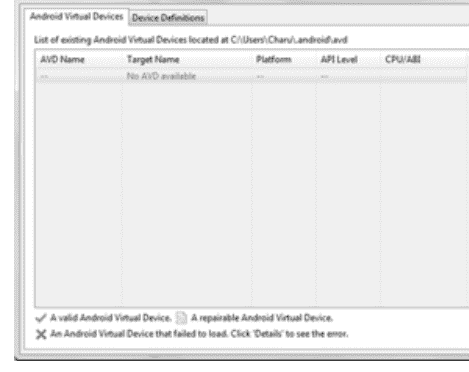

3. 点击 `New`（新建）按钮。出现创建新的 Android 虚拟设备（AVD）对话框。
4. 为您想要创建的 AVD 输入名称、设备类型和目标 API。在本文中，目标 API 是 4.4.2-API Level 19。其他字段保持默认值，如图 5 所示：


5. 点击 `OK`（确定）按钮以创建 AVD。

新创建的 AVD 会出现在 Android 虚拟设备管理器对话框的 AVD 列表中（图 6）。

6. 选择 AVD 选项并点击 `Start`（启动）按钮，如图 6 所示：


当第一次启动 AVD 时，启动和加载过程可能需要一些时间。几分钟后，应用程序将加载并显示主屏幕。当 Android IDE 的完整设置完成后，您就可以开始创建 Android 应用程序并在 AVD 上进行检查。

## 设置 Android 物理设备

有时，您需要在真实的移动设备上运行应用程序以查看其实际功能。例如，如果您创建了一个需要拍照的应用程序，您需要在物理移动设备上进行测试。为此，您需要一台基于 Android 的移动设备，并在手机设置的开发人员选项中启用“USB 调试”和“允许模拟位置”选项。

执行以下步骤配置基于 Android 的移动设备：

1. 在移动设备中选择 `Settings`（设置）或 `Phone Settings`（手机设置）选项。会出现选项列表。
2. 选择 `Applications`（应用程序）选项，如图 7 所示：


3. 选择 `Development`（开发）选项，如图 8 所示：


4. 在开发中启用 `USB debugging`（USB 调试）和 `Allow mock locations`（允许模拟位置）选项，如图 9 所示：


> 现在，各种公司都推出了基于 Android 的手机。因此，开发部分中选项名称和位置可能会因手机而异。

## 使用 Eclipse 的 Java 视图

Eclipse 中的 Java 视图（perspective）让您能够访问 Eclipse IDE 中与 Android 应用程序关联的 Java 库。Eclipse Java 视图包含以下视图：

- **Explorer（资源管理器）**：以分级结构显示项目的完整视图
- **Task List（任务列表）**：显示与项目相关的可用任务
- **Java Class Pane（Java 类面板）**：显示 Java 类的主体
- **Outline（大纲）**：显示文件的内部大纲，例如 Java 和 XML 文件

本质上，Java 视图是您使用 Java 原生库开发 Android 应用程序的界面。然而，由 ADT 驱动的 Dalvik Debug Monitor Server (DDMS) 视图提供的功能比 Java 视图更多。

## DDMS 视图

Eclipse 中的 DDMS 视图提供了 Eclipse IDE 内部 DDMS 特性的完整功能。DDMS 的以下功能存在 Eclipse 中：

- **Devices（设备）**：引用连接到应用程序的真实或物理设备以及 AVD
- **Emulator Control（模拟器控制）**：引用用于创建设备副本的控制程序
- **LogCat**：引用一个实时显示日志消息的视图
- **Threads（线程）**：引用虚拟机中当前运行的线程
- **Heap（堆）**：重复虚拟机的堆结构
- **Allocation Tracker（分配跟踪器）**：显示对象的内存分配
- **File Explorer（文件资源管理器）**：浏览设备的文件系统

要在 Eclipse 中启用 DDMS 视图，请从菜单栏选择 `Window` → `Open Perspective` → `DDMS` 或 `Window` → `Open Perspective` → `Other` → `DDMS`。

## 命令行工具

命令行工具提供了一个可以替代 Eclipse IDE 的方案，用于开发应用程序。使用这些工具需要 Android SDK 和相应的 API。

### 设置环境变量

执行以下步骤设置环境变量以访问 SDK：

1. 打开 Windows 控制面板并选择 `System`（系统）。打开系统属性对话框。
2. 在系统属性对话框中，点击 `Advanced`（高级）选项卡下的 `Environment Variables`（环境变量）。打开环境变量对话框。
3. 选择 `Path` 变量并点击环境变量对话框中的 `Edit`（编辑）按钮，如图 10 所示：


# 环境变量配置

出现用户变量对话框（图11）。

4. 在变量框中添加 platform tools 位置以及 Android SDK 的目录。两个地址之间必须用分号隔开。

5. 点击 `OK`（确定）按钮。


图11：编辑用户变量

变量对话框再次出现在屏幕上（图10）。

6. 点击环境变量对话框中的 `New`（新建）按钮（图10）。

7. 在 `Variable` 名称框中输入 `Home`，在 `Variable` 值框中输入 Android SDK 中的 `sdk` 文件夹路径，如图12所示：


图12：设置 Home 变量

8. 点击 `OK`（确定）按钮关闭新建变量对话框。

9. 点击 `OK`（确定）按钮关闭环境变量对话框。

10. 点击 `OK`（确定）按钮关闭系统属性对话框。

# 创建项目

设置环境变量后，可以使用 Android SDK 命令行工具了。

执行以下步骤使用命令行创建项目：

1. 打开命令提示符（图13）。

2. 进入您想要创建项目的目录。

3. 执行命令 `android list targets`，如图13所示：


图13：列出 Android 目标的命令

此命令将显示存在的 Android 平台。由于我们使用的是 Android 4.4.2 API 19，请记录下下一个命令中需要的 target ID。如果您的命令不起作用，请检查您的环境变量设置。命令结果如图14所示：

```
Command Prompt
D:\Android Apps>android list targets
Available Android targets:
target: 19 (android-4.4.2)
type: device
Tag: android-4.4.2
SdkVersion: 19
ABI: armeabi-v7a, x86, x86_64, mips, mips64, x86 (default), x86_64 (default)
abi: armeabi-v7a (android apps)
```

图14：显示可用的 Android 目标

4. 执行以下命令：

```
android create project --target <target-id> --name AndroidProject --path <path-to-workspace>\FirstAndroidApp --activity MainActivity --package com.kogent.
```

命令如图15所示：


图15：创建 Android 项目的命令

注意我们将 `<target-id>` 更改为了 `1`，然后将 `<path-to-workspace>` 替换为 `D:\AndroidWorkspace`。其余语法不变。按下 Enter 键后，将创建包含所有产物的项目。命令的执行如图16所示：

```
D:\AndroidWorkspace\android create project --target 1 --name AndroidProject --path D:\AndroidWorkspace\FirstAndroidApp\FirstAndroidApp --activity MainActivity --package com.kogent
Created File: D:\AndroidWorkspace\FirstAndroidApp\src\main\MainActivity.java
Created File: D:\AndroidWorkspace\FirstAndroidApp\src\main\AndroidManifest.xml
Created File: D:\AndroidWorkspace\FirstAndroidApp\src\res\layout\activity_main.xml
Created File: D:\AndroidWorkspace\FirstAndroidApp\src\res\drawable\ic_launcher.xml
Created File: D:\AndroidWorkspace\FirstAndroidApp\src\res\values\strings.xml
Created File: D:\AndroidWorkspace\FirstAndroidApp\src\res\values\colors.xml
Created File: D:\AndroidWorkspace\FirstAndroidApp\src\res\values\themes.xml
Created File: D:\AndroidWorkspace\FirstAndroidApp\src\res\values\build.xml
Created File: D:\AndroidWorkspace\FirstAndroidApp\build.gradle
Created File: D:\AndroidWorkspace\FirstAndroidApp\settings.gradle
D:\AndroidWorkspace\FirstAndroidApp\Android.
```

图16：显示命令的输出

`target-id` 值被设置为 `1`，因为当我们执行 `android targets` 命令时它是 API 19 的值。工作区地址基于您的选择。

# 开发并运行第一个 Android 应用程序

您已经看到，每当您学习新的编程语言时，第一个程序总是会在屏幕上显示 hello world。这种趋势在 Android 中延续；我们将开发一个更完整、更详细的“hello world”应用程序。该应用程序很容易创建，几乎不需要代码。但为了增加趣味性，将在应用程序中添加一些额外的代码。

# 使用 Eclipse IDE 创建应用程序

开发 Android 应用程序时，建议使用 IDE。在本节中，你将学习使用 Eclipse IDE 创建 Android 应用程序的基本步骤。我们正在使用的是与 Android SDK 4.4.2 绑定的 Eclipse IDE。在此 IDE 中，你需要使用“New Android Application”（新建 Android 应用）向导来创建应用程序。让我们学习如何开发名为 MyFirstApp 的第一个 Android 应用程序。

在 Eclipse IDE 中创建新项目的步骤如下：

1. 打开 IDE，转到 `File` → `New` → `Android Application Project`，如图 17 所示：


图 17：在 Eclipse 中创建 Android 项目

New Android Application 窗口中的 New Android 详情（图 18）。

2. 在 New Android Application 窗口中输入以下详情：

   - **Application name（应用程序名称）**：你想为应用程序选择名称。在我们的案例中，名称是 MyFirstApp。

   - **Project name（项目名称）**：这是你的项目名称。它应该具有描述性，以便在你需要识别它时能够识别出来。Eclipse 工作区将创建一个目录，其中包含所有与项目相关的文件。

   - **Package name（包名）**：它是根据 Java 惯例对代码进行的组织。这有助于将 Java 类作为模块进行管理。命名规范遵循 `com.myapp.subheader`。例如，在我们的项目中，我们使用的是 `com.kogent.android.myfirstapp`。

   - **Minimum SDK（最低 SDK）**：这是你的应用程序兼容的 Android 版本（API）最低级别。例如，我们选择了 API 14：Android 4.0 (IceCreamSand)。使用较低级别 API 的好处是它提供了对 Android 设备的后兼容性。换句话说，我们的应用程序仍然兼容低版本的 Android，而不仅仅是兼容 API 19：Android (4.4.2)。

   - **Target SDK（目标 SDK）**：目标 SDK 与我们将在应用程序开发中使用的 API 级别相关。由于我们处理的是 Android (4.4.2)，我们将选择 API 级别 19。

   - **Compile with（编译版本）**：它代表编译应用程序所需的 Android API 级别。这应该是最新的 API，即 API 19：Android (4.4.2)。

   - **Theme（主题）**：保留默认主题。

图 18 显示了填充了详情的 New Application 窗口：


图 18：显示新应用程序的详情

3. 点击 `Next` 按钮（图 18）。出现 Configure Project（配置项目）页面，你需要保持默认设置。

4. 点击 `Next` 按钮。在出现的窗口中，你可以启动应用程序的启动图标。由于这是初级开发，请保持默认设置。

5. 点击 `Next` 按钮。出现 Create Activity（创建活动）页面。确保默认选了 `Create Activity` 复选框和 `Blank Activity` 选项。

6. 点击 `Next` 按钮。出现 Blank Activity 页面（图 19）。在此页面中保留默认设置。

7. 点击 `Finish` 按钮，如图 19 所示：


注意，从步骤 3 到步骤 6 没有进行任何更改。通过这种方式，你的项目已经准备就绪，包含了所有必要的文件。

# 执行应用程序

如前所述，执行“hello world”应用程序实际上不需要编码。让我们通过在模拟器上执行它来证明这一事实。我们已经创建了一个名为 AndroidAV 的 Android AVD 或模拟器来执行该应用程序。

执行以下步骤从 Package Explorer 运行 MyFirstApp，并点击 IDE 工具栏上的 Run 图标，如图 20 所示：

1. 从 Package Explorer 中打开 MyFirstApp 的任何目录，并点击...


图 20：运行你的 MyFirst 应用程序

你也可以通过选择应用程序并在菜单栏中选择 `Run` → `Run` 来运行你的应用程序。你还可以选择 `Run` → `As` → `Android Application`，如图 21 所示：


图 21：选择 Run As 选项

模拟器将作为下一个窗口出现。它需要一些时间启动，然后将屏幕。

2. 点击模拟器主屏幕上的应用程序图标。该图标被圆圈圈，如图 22 所示：


图 22：显示主屏幕

下一个屏幕显示应用程序。你会看到 MyFirst，如图 23 所示：


图 23：显示应用程序

3. 点击你的应用程序“Hello world!”的图标，如图 24 所示：


图 24：显示输出

# 探索应用程序

如前所述，执行“hello world”应用程序实际上不需要编码。让我们通过在模拟器上执行它来证明这一事实。我们已经创建了一个名为 AndroidAV 的 Android AVD 或模拟器来执行该应用程序。

## AndroidManifest.xml

`AndroidManifest.xml` 是应用程序的核心。它包含了应用程序的组件。`AndroidManifest.xml` 文件描述了应用程序的组件。

## MainActivity.java

`MainActivity.java` 是文件。它包含了应用程序的组件。`AndroidManifest.xml` 文件描述了应用程序的组件。

## activity_main.xml

要了解 UI 是如何工作的，让我们关注 `R.layout.activity_main` 声明。查看 `activity_main.xml` 文件代码的步骤如下：

1. 在 Package Explorer 中选择 `res` → `layout` 并打开 `activity_main.xml` 文件。

2. 双击打开文件。默认情况下，文件的图形界面是可见的。

3. 选择文件底部的 `activity_main.xml` 标签以查看文件代码，如图 27 所示：

```xml
<RelativeLayout xmlns:android="http://schemas.android.com/apk/res/android"
    xmlns:tools="http://schemas.android.com/tools"
    android:layout_width="match_parent"
    android:layout_height="match_parent"
    tools:context="com.example.kogent.myfirstapp.MainActivity">

    <TextView
        android:layout_width="match_parent"
        android:layout_height="wrap_content"
        android:text="@string/hello_world" />

</RelativeLayout>
```

图 27：显示 activity_main.xml 文件的代码

`activity_main.xml` 文件中的 `RelativeLayout` 提供了 Android 中使用的控件（widget）。控件的管理取决于 `activity_main.xml` 文件。`layout_width` 和 `layout_height` 属性用于设置屏幕尺寸。`TextView` 元素代表应用程序中使用的控件。它是此应用程序唯一的控件。`TextView` 属性显示的文本与 `strings.xml` 文件关联。

## strings.xml

要了解字符串是如何数字的，请执行以下步骤打开 `strings.xml` 文件：

1. 展开 Package Explorer 窗格中的 MyFirstApp 目录。

2. 点击 `res` 目录，然后点击 `values` 目录。会出现名为 `strings.xml` 的文件。

3. 双击文件打开它。`strings.xml` 文件的结构如图 28 所示：

```xml
<?xml version="1.0" encoding="utf-8"?>
<resources>
    <string name="app_name">MyFirstApp</string>
    <string name="hello_world">Hello world!</string>
    <string name="action_settings">Settings</string>
</resources>
```

图 28：显示 strings.xml 文件的代码

在此文件中，你可以看到三个字符串属性，分别是 `app_name`、`hello_world` 和 `action_settings`。`app_name` 字符串用于 `AndroidManifest.xml` 文件中应用程序的标签，`hello_world` 字符串用于 `strings.xml` 文件中的 `TextView`。`action_settings` 字符串是菜单的默认设置。

这就是 Android 程序开发的方式。

# 使用命令行工具

你已经使用命令行工具在项目名称 AndroidProject 下创建了一个 Android 应用程序。你还知道我们将其创建在 `D:\AndroidWorkspace\FirstAndroid` 目录下。现在，我们将使用命令行工具运行该项目。从命令行运行项目的步骤如下：

1. 安装 Apache ant，这是一个用于构建 Android 应用程序的工具。你可以从 `http://ant.apache.org/` 下载此工具。将 Apache ant 解压缩到你偏好的目录，并将环境变量中的类路径设置为 `\bin` 目录。或者，在环境变量中将变量路径设置为 `C:\Ant\apache-1.9.3\bin`；这将允许你在命令行工具的任何地方访问 Ant。

2. 运行模拟器以使用第一个 FirstAndroidApp 应用程序。为此，进入 SDK 目录并执行 `android avd` 命令，如图 29 所示：

```
Command Prompt
D:\Development\sdk-build-windows-x86-2R2I1B3IP8Dktavd>android_avd_
```

图 29：使用命令行工具启动模拟器

执行步骤 2 中的命令后，会器 AVD Manager。在 AVD Manager 对话框中，你可以启动模拟器 AndroidAVD，这是我们在 Eclipse IDE 中运行应用程序时创建的。你可以使用此模拟器或创建一个新的来从命令行运行你的应用程序。创建新模拟器的步骤在之前已详细解释过。在这里，我们使用的是相同的 AndroidAVD 模拟器。


- 3. 选择 AVD 模拟器并点击 AVD 对话框中的 Start 按钮。模拟器会首先启动并运行。你也可以导航到 `SDK\tools` 目录并通过执行命令行 `emulator androidAVD` 来启动模拟器。

- 4. 使用命令提示符进入 `D:\AndroidWorkspace\FirstAndroidApp`（项目的根目录）并执行 `ant debug` 命令。此命令用于构建调试包项目以编译必要的依赖项。执行命令后，通过 GUI 导航到项目的 `\bin` 目录。你会找到 `AndroidProject-debug.apk` 文件。在该文件上，我们将执行步骤 5 中给出的下一个命令。

- 5. 构建成功后，执行 `adb install D:\AndroidWorkspace\FirstAndroid\bin\AndroidProject-debug.apk` 命令，如图 30 所示：


> 图 30：将文件安装到模拟器

`adb install` 命令用于将文件安装到 Android 模拟器。

- 6. 在模拟器上找到 `MainActivity` 并点击它。输出屏幕将显示“Hello World, Main Activity”文本。要更改文本，请通过 GUI 导航到目录 `C:\Workspace\FirstAndroid\res\layout`。在这里你会找到 `activity_main.xml` 文件。用记事本打开此文件，并将 `TextView` 属性内的字符串 "Hello World" 替换为 "Hello Android"。保存文件并在根目录（在本例中为 "FirstAndroid"）再次执行两个命令以重新编译项目：

    - a. `ant debug`

    - b. `ant install`

`adb install` 命令用于安装已编译的调试包，仅当 `.apk` 文件位于二进制目录时适用。

通过这种方式，你可以从命令行运行项目。有时可能运行着多个模拟器。在这种情况下，要在特定模拟器上运行，你可以使用以下命令：

```
adb -s emulator:5554 install D:\androidworkspace\FirstAndroid\bin\AndroidProject-debug.apk
```

5554 是模拟器的序列号。

## 7.5 Activities 和 Intents

Activity（活动）是一个允许用户执行操作的组件。通常，activity 是为用户提供界面的窗口。换句话说，应用程序是这些的集合。但需要注意的是，单个应用程序中可以有一个或多个活动。Intent（意图）是另一个重要概念，允许不同应用程序的不同活动通过称为 intents 的消息协同工作。让我们学习活动和意。

## 操作 Activities

Activities 在 Android 中起着至关重要的作用，因为它们用于为用户创建屏幕。因此，学习如何启动、停止、挂起和恢复活动是非常重要的。Activity 由处理布局并提供图形的视图组成。在本节中，你将学习如何通过以下操作来处理活动：

- 创建 activity

- 启动 activity

- 管理 activity 的生命周期

- 为 activity 应用主题和样式

让我们逐一执行这些操作。

## 创建 Activity

你可以通过创建一个扩展 `Activity` 类的 Java 类来创建活动。注意，每个活动都需要创建一个可以加载界面组件的窗口。为此，调用了 `setContentView(View)` 方法。通常，活动作为全屏窗口显示给用户。你也可以将它们设置为其他活动中的不同视图，例如浮动或嵌入。你可以使用具有 `windowIsFloating` 属性的主题设置浮动窗口，可以使用 `ActivityGroup` 类将一个活动嵌入另一个（在 API 13 中弃用）。你应该注意，所有活动（或 `Activity` 基子类）通常实现两个方法，即 `onCreate(Bundle)` 和 `onPause()`。除了这些方法外，`Activity` 类提供了许多其他作为生命周期事件的方法。表 4 描述了管理活动生命期的 `Activity` 类方法：

### 表 4：Activity 生命周期回调方法描述

| 方法 | 说明 |
| --- | --- |
| `onCreate()` | 当首次创建活动时调用。在此方法中，你应该提供基本的静态设置，例如创建视图或将数据绑定到列表。在创建活动期间，此方法带有 null `savedInstanceState` 参数调用。然而，如果活动被用户停止或被系统销毁，则此方法将带有其之前的状态保存的 `Bundle savedInstanceState` 参数调用。即使当你更改设备方向（即横屏或竖屏），活动也会被重建。 |
| `onStart()` | 当 Activity 显示给用户时调用。当 Activity 首次启动或返回前台时，`onStart()` 方法的执行之后是执行 `onResume()` 方法。然而，如果 Activity 变为隐藏，此方法的调用之后是执行 `onStop()` 方法。 |
| `onRestart()` | 当 Activity 停止并重新启动时调用。此方法始终在 `onStart()` 方法之后调用。 |
| `onResume()` | 当 Activity 开始与用户交互时调用。当 Activity 的此方法被调用时，该 Activity 位于 Activity 栈的顶部。该方法的执行之后总是执行 `onPause()` 方法。 |
| `onPause()` | 系统准备恢复上 Activity 时调用。如果 Activity 返回前面，此方法的执行之后是执行 `onResume()` 方法。然而，如果 Activity 对用户不可见，此方法的调用之后是执行 `onStop()` 方法。 |
| `onStop()` | 当 Activity 对用户不可见时调用，这可能是由于两个原因：首先，如果 Activity 被销毁；其次，当其他 Activity 的处理返回时。在第一情况下，此方法的调用之后是执行 `onDestroy()` 方法。在另一种情况下，此方法的调用之后是执行 `onResume()` 方法。 |
| `onDestroy()` | 当 Activity 被销毁时调用。换句话说，此方法在 Activity 上的 `finish()` 方法被调用或 Activity 实例被系统销毁时执行。 |

在概述 `Activity` 基类的方法后，现在让我们继续了解如何创建一个 Activity。以下代码片段显示了如何创建一个扩展 `Activity` 基类的 Java 类：

```java
// defining the activity in the com.kogent.android package
package com.kogent.android;

// importing the required packages
import android.os.Bundle;
import android.app.Activity;
import android.view.Menu;

public class MainActivity extends Activity {
    // Invoked when the activity is created for the first time
    @Override
    protected void onCreate(Bundle savedInstanceState) {
        super.onCreate(savedInstanceState);
        setContentView(R.layout.main);
    }

    @Override
    public boolean onCreateOptionsMenu(Menu menu) {
        // Inflate the menu; this adds items to the action bar if it is present.
        getMenuInflater().inflate(R.menu.main, menu);
        return true;
    }
}
```

在前面的代码片段中，`SampleActivity` 类定义在 `com.kogent.android` 包中。此外，`SampleActivity` 类扩展了 `Activity` 类并提供了 `onCreate()` 和 `onCreateOptionsMenu()` 方法的实现。你应该注意，在前面的代码片段中，调用了 `setContentView()` 方法，以便 `Activity` 类可以从 `activity_main.xml` 文件加载其用户界面。

Android 应用程序中声明的每个 Activity 都应该在 `AndroidManifest.xml` 文件中声明。以下代码片段显示了如何在 `AndroidManifest.xml` 文件中声明 `SampleActivity` 类：

```xml
<application
    android:backup="true"
    android:icon="@drawable/ic_launcher"
    android:label="@string/app_name"
    android:theme="@style/Apptheme">
    <activity
        android:name="com.kogent.android.MainActivity"
        android:label="@string/app_name">
        <intent-filter>
            <action android:name="android.intent.action.MAIN" />
            <category android:name="android.intent.category.LAUNCHER" />
        </intent-filter>
    </activity>
</application>
```

在前面的代码片段中，可以看到使用 `<activity>` 标签声明了 `SampleActivity` 类。

## 启动 Activity

Android API 提供了 `startActivity(Intent)` 方法来启动一个新的 Activity。当调用一个新的 Activity 时，该 Activity 会通过推入其他 Activity 放置在 Activity 栈的顶部。`startActivity()` 方法接受一个 `Intent` 参数，该参数描述了要执行的 Activity。有时，你可能需要从现有的 Activity 调用一个 Activity 并返回之前的 Activity。在这种情况下，会调用 `startActivityForResult(Intent, int)`，结果将返回给 `onActivityResult(int, Intent)` 方法。

让我们使用 Eclipse IDE 创建一个简单的 Android 应用程序 `StartActivityDemo`。在这个 Activity 中，我们将使用 `MainActivity` 类，它将调用另一个内置 Activity——Contacts。换句话说，在 `MainActivity` 类的执行期间，当你触摸手机时，内置的 Contacts Activity 将调用；显示存储在设备中的联系人列表。你可以选择一个合适的联系人并按下设备上的 OK 按钮，这将带你回到 `MainActivity` Activity。

执行以下步骤创建 `StartActivityDemo` 应用程序：

- 1. 打开 Eclipse IDE。Android-ADT 窗口打开（图 31）。

- 2. 选择 File→New→Android Application Project，如图 31 所示：

- 3. 点击 Next 按钮。

- 4. 输入 Application Name、Package Name 和 Minimum SDK 版本。

- 5. 点击 Next 按钮。

- 6. 确保选中了 Create Activity 复选框。

- 7. 选择 Blank Activity。

- 8. 点击 Next 按钮。

- 9. 在 Activity Name、Layout Name 和 Layout Name 字段中输入值。

- 10. 将 `MainActivity.java` 的代码替换为列表 1 所示的代码。

## 第7章

```java
}
return false;

}
protected void onActivityResult(int requestCode, int resultCode, Intent data) {
  if (requestCode == PICK_CONTACT_REQUEST) {
    if (resultCode == RESULT_OK) {
      // 将所选的联系人显示给用户。
      Uri uri = data.getData();
      Intent intent = new Intent(Intent.ACTION_VIEW, uri);
      startActivity(intent);
    }
  }
}
```

- 当用户触摸屏幕上的任何位置时，会触发 `onTouch` 事件。此事件会调用 `startActivityForResult()` 方法，该方法接受三个参数，即 `Intent`、联系人活动的 `URI` 以及 `int` 类型的值。如果用户执行了适当的操作，`startActivityForResult()` 返回 `true`；否则返回 `false`。此外，会调用 `onActivityResult()` 方法，它会显示用户选择的联系人详情。

创建 `StartActivityDemo` 应用程序后，你可以运行该程序以查看其输出。为此，在 Package Explorer 中右键点击 `StartActivityDemo` 应用程序，并选择 `Run As->Android Application`。`StartActivityDemo` 应用程序的输出如图 35 所示：


图 35：显示 StartActivityDemo 应用程序的输出

触摸手机屏幕以调用联系人活动（Contacts activity），如图 36 所示：


图 36：显示联系人活动

选择一个你想在屏幕上显示的联系人。在我们的案例中，我们选择了 Zane，相应的联系人详情显示如图 37 所示：

## 开源移动编程


## 图 37：显示联系人的详情

现在让我们学习如何管理 Activity 的生命周期。

## 管理 Activity 的生命周期

你已经学习过 Activity 具有各种生命周期回调方法。当你创建一个 Activity 时，默认会提供 `onCreate()` 方法。该方法提供了用于显示应用程序用户界面元素的代码。

图 38 显示了 Activity 经历的各个阶段：


### 图 38：显示 Activity 的生命周期

你可以通过创建一个简单的 Android 应用程序并注意触发的事件来理解图 39 中的流程图。

让我们创建一个名为 `ManageActivityCycle` 的应用程序，它将根据触发的事件显示相应的消息。

按照以下步骤创建并运行 `ManageActivityCycle` 应用程序：

1. 在 Eclipse IDE 的 `com.kogent.android` 包下创建 `ManageActivityCycle` 应用程序。

2. 替换位于 `/src/com/kogent/android` 文件夹下的 `MainActivity.java` 文件中的代码，使用如列表 2 所示的代码：

**列表 2**：显示 ManageActivityCycle 应用程序中 MainActivity.java 文件的代码


```java
package com.kogent.android;
import android.app.Activity;
import android.os.Bundle;
import android.util.Log;
public class MainActivity extends Activity
{
    String message="Event being invoked";
    /** 当 activity 首次创建时调用。 */
    @Override
    public void onCreate(Bundle savedInstanceState)
    {
        super.onCreate(savedInstanceState);
        setContentView(R.layout.activity_main);
        Log.d(message, "onCreate() Method");
    }

    public void onStart()
    {
        super.onStart();
        Log.d(message, "onStart() Method");
    }

    public void onRestart()
    {
        super.onRestart();
        Log.d(message, "onRestart() Method");
    }

    public void onResume()
    {
        super.onResume();
        Log.d(message, "onResume() Method");
    }

    public void onPause()
    {
        super.onPause();
        Log.d(message, "onPause() Method");
    }

    public void onStop()
    {
        super.onStop();
        Log.d(message, "onStop() Method");
    }
}
```

```java
public void onDestroy() {
  super.onDestroy();
  Log.d(message, "onDestroy() Method");
}
```

列表 2 提供了 `Activity` 所有生命周期回调的实现，例如 `onStart()`、`onResume()`、`onPause()` 和 `onStop()`。

3. 保存 `ManageActivityCycle` 应用程序中的更改。

4. 在 Package explorer 格中选择应用程序文件夹，并点击 Eclipse IDE 工具栏上的 Run 按钮来执行应用程序，如图 39 所示。


图 39：显示 ManageActivityCycle 应用程序的输出

一旦应用程序启动，`onStart()` 和 `onResume()` 事件就会被触发。你可以在 Logcat 中看到输出，如图 40 所示：


图 40：显示 ManageActivityCycle 应用程序的输出

5. 按手机设备上的 Back（返回）键。

6. 点击手机设备上的 Home（主页）键。

7. 点击手机设备上的 Recents（最近）键。


图 41：显示 ManageActivityCycle 应用程序的输出

# 使用 Intent

在 Android 中，你可以使用 Intent 绑定应用程序定义的定义或多个 `Activity`。除了同一个应用程序的 `Activity` 外，`Intent` 对象还允许你绑定两个应用程序的 `Activity`。`Intent` 对象是一个被动的数据结构，存储了需要执行的任务的抽象描述。

你应该注意，传递意图的机制在不同组件之间是不同的。例如，在启动新 `Activity` 或由现有 `Activity` 执行新任务时，`Intent` 对象被传递给 `Context.startActivity()` 或 `Activity.startForResult()` 方法。然而，在启动新服务或向运行中的服务提供新意图时，为了建立调用组件与目标服务之间的连接，`Intent` 对象被传递给 `Context.bindService()` 方法。最后，在广播接收器的情况下，`Intent` 对象通过各种广播方法传递，例如 `sendStickyBroadcast()`、`sendOrderedBroadcast()` 和 `sendBroadcast()`。

Android 系统会识别响应意图的适当组件（活动、服务或广播接收器），并根据要求对其实例化。在本节中，你将在以下子节中详细学习 Intent：

- Intent 对象
- Intent 解析
- Intent 过滤器 (Intent Filters)
- 解析 Intent 过滤器冲突
- 使用 Intent 链接 Activity
- 使用 Intent 传递数据

## Intent 对象

`Intent` 对象包含了接收意图的组件所需的信息以及 Android 系统所需的信息。在接收意图的组件情况下，`Intent` 对象包含了与要执行的操作或任务相关的信息，以及执行该操作的数据。对于 Android 系统，`Intent` 对象可以包含关于目标活动需要如何启动的信息，或者需要管理意图的组件类别。简而言之，`Intent` 对象包含以下类型的信息：

- 组件名称
- 要执行的操作
- 执行操作的数据的 URI
- 用于处理意图的组件类别
- 传递给处理意图的组件的键值对
- 用于 Android 系统启动运行的指令集

## 意图解析 (Intent Resolution)

意图基本上是一个包含执行某项操作意图的消息。应用程序会对意图做出反应。Android 支持两种类型的意图：显式和隐式。在显式意图的情况下，你必须指定用于响应意图的活动。换句话说，你显式地声明了一个目标组件，这用于内部消息传递，因为其他应用程序的开发者不会知道该意图。以下代码片段显示了如何定义显式意图：

```java
Intent intent = new Intent(this, Target.class);
startActivity(intentobj);
```

对于显式意图，Android 系统会将 `Intent` 对象提供给指定的目标类的实例。显式 `Intent` 对象不包含任何其他信息，除了用于标识应该处理该意图的组件名称外。

另一方面，在隐式意图的情况下，你只需要声明意图，并将其交给平台来查找响应意图的活动。在这里，你不需要声明目标组件，因为意图被用于轻松激活其他应用程序的组件，如下代码所示：

```java
Intent intentobj = new Intent(ACTION_VIEW);
Uri.parse("http://www.google.com");
startActivity(intentobj);
```

```java
// 使用字符串创建一个文本消息
Intent sendIntent = new Intent();
sendIntent.setAction(Intent.ACTION_TEXT_SEND);
sendIntent.putExtra(Intent.EXTRA_TEXT, message);
sendIntent.setType(HTTP_PLAIN_TEXT_TYPE);

// 验证该意图是否可以解析为某个活动
if (sendIntent.resolveActivity(getPackageManager()) != null) {
  startActivity(sendIntent);
}
```

使用隐式意图时，Android 系统需要识别合适的组件来处理意图，或者用于执行请求的操作的服务或一组广播接收器。该组件通过将 `Intent` 对象的内容与意图过滤器（intent filters）中指定的内容进行映射来标识。在比较 `Intent` 对象与意图过滤器时，会考虑以下三个字段：

- action
- data
- category

注意，`extras` 和 `flags` 字段用于解析隐式意图的组件。

## 意图过滤器 (Intent Filters)

如前所述，通过使用隐式意图，我们可以打开其他应用程序并完成某些任务，以及与意图相关的操作、类别和数据方案。同样，意图过滤器允许其他应用程序使用我们的应用程序。意图过滤器用于提供组件的能力以及该组件可以接收的意图类型。为组件定义的意图过滤器告知 Android 系统组件可以处理的意图类型。你应该注意，对于组件的每个任务或工作，都会定义新的过滤器。重要部分是要注意 Android 系统应该感知被启动组件的能力。换句话说，系统在启动组件之前应该知道该组件可以处理的意图类型。

`IntentFilter` 类的实例表示意图过滤器。此外，意图过滤器不是在 Java 代码中配置的；而是在 `AndroidManifest.xml` 文件中配置的。你可以使用 `<intent-filter>` 元素在清单文件中定义组件的能力。过滤器为操作、数据和类别提供了相应的字段。

以下代码片段显示了 `<intent-filter>` 元素如何列出组件的操作：

```xml
<intent-filter>
  <action android:name="android.intent.action.MAIN"/>
  <action android:name="android.intent.action.VIEW"/>
  <action android:name="android.intent.action.EDIT"/>
</intent-filter>
```

在前面的代码片段中，意图过滤器通过使用 `<action>` 子元素列出了多个操作。注意，意图过滤器必须指定至少操作；否则过滤器将阻塞所有意图。

类似于 `<action>` 元素，现在让我们来看下面的代码片段以指定 `<category>` 元素：

```xml
<intent-filter>
  <category android:name="android.intent.category.DEFAULT"/>
  <category android:name="android.intent.category.BROWSABLE"/>
</intent-filter>
```

注意，在前面的代码片段中，action 和 category 提供了完整的字符串值。例如，我们没有使用 `CATEGORY_DEFAULT` 值；而是使用了字符串值 `android.intent.category.DEFAULT`。如下代码片段所示，为 `Intent` 对象过滤器指定的每个类别：

```xml
<intent-filter>
  <data android:mimeType="image/*" android:scheme="..." />
  <data android:mimeType="video/*" android:scheme="..." />
</intent-filter>
```

在上一节中，你学习了 `<intent-filter>` 元素定义如何为意图过滤器设置数据。每个 `<data>` 元素接受数据类型。

## 解析意图 (Resolving Intent)

在上一节中，你学习了 `<intent-filter>` 元素定义如何为意图过滤器设置数据。每个 `<data>` 元素接受数据类型。

## 意图过滤器冲突 (Intent Filter Collision)

在上一节中，你学习了 `<intent-filter>` 元素定义如何为意图过滤器设置数据。每个 `<data>` 元素接受数据类型。

## 开源编程

## 使用 Intent 链接活动 (Linking Activities Using Intent)

在 Android 应用程序中，可能会有多个活动，一个活动会调用另一个来执行任务。考虑设备上安装的电子邮件应用程序。在电子邮件应用程序中，需要执行各种任务，如撰写电子邮件、搜索电子邮件和阅读电子邮件。对于所有任务，定义了单独的活动，并根据要执行的任务调用。

让我们了解如何从当前活动启动新活动。假设你想开发一个在用户点击界面时显示用户详情的 Android 应用程序。假设有两个活动，即 `MainActivity` 和 `UserDetails`。现在，你需要理解 `MainActivity` 如何调用 `Details` 活动。以下代码片段显示从现有活动启动了新活动。

```java
// 创建 Intent 对象
Intent i = new Intent(this, UserDetails.class);
// 启动新活动
startActivity(i);
```

## 使用 Intent 对象传递数据 (Passing Data Using an Intent Object)

在 Android 应用程序中，你从一个活动向另一个活动传递数据。为了实现这一点，你需要创建一个 `Bundle` 并使用 `putExtras()` 方法将其附加。`Intent` 的 `putExtras()` 方法用于添加键值对（name/value pair）。`Bundle` 对象充当字典对象，包含一组键值对。现在，在第二个活动中，为了获取使用 `Intent` 对象发送的数据，你需要通过使用 `getIntent()` 方法获取该 `Intent` 对象。然后，调用它的 `getExtras()` 方法来获取这些键值对。

让我们创建一个名为 `PassingDataIntent` 的应用程序，来学习如何使用 `intent` 对象传递数据。

按照以下步骤创建 `PassingDataIntent` 应用程序：

1. 在 Eclipse IDE 的 `com.kogent.android` 包下创建 `PassingDataIntent` 应用程序。

2. 将 `/src/com/kogent/android` 路径下的 `MainActivity.java` 文件代码替换为列表 3 所示的代码：

3. 显示 `PassingDataIntent` 应用程序中 `MainActivity.java` 文件的代码

```java
package com.kogent.android;

import android.os.Bundle;
import android.app.Activity;
import android.content.Intent;
import android.view.View;
import android.widget.Button;
import android.widget.EditText;

public class MainActivity extends Activity {

    @Override
    protected void onCreate(Bundle savedInstanceState) {
        super.onCreate(savedInstanceState);
        setContentView(R.layout.activity_main);
    }

    Button btn1 = (Button) findViewById(R.id.btok);
    
    btn1.setOnClickListener(new View.OnClickListener() {
        @Override
        public void onClick(View v) {
            // TODO Auto-generated method stub

            EditText etname = (EditText) findViewById(R.id.ename);

            String Data = etname.getText().toString();

            Intent i = new Intent("com.kogent.android.layout2");
            Bundle extras = new Bundle();
            extras.putString("Name", Data);
            i.putExtras(extras);
            startActivityForResult(i, 1);
        }
    });
}
```

3. 在 `com.kogent.android` 文件夹下的 `/src` 文件夹中添加名为 `layout2.java` 的新 Java 文件，如列表 4 所示：

列表 4：显示 `PassingDataIntent` 应用程序中 `layout2.java` 文件的代码


```java
package com.kogent.android;
import android.app.Activity;
import android.os.Bundle;
import android.widget.TextView;

public class layout2 extends Activity{
  @Override
  public void onCreate(Bundle savedInstanceState) {
    super.onCreate(savedInstanceState);
    setContentView(R.layout.layout2);

    String name = null;
    Bundle extras = getIntent().getExtras();
    if(extras != null) {
      name = extras.getString("Name");
    }

    TextView tvData = (TextView) findViewById(R.id.tvData);
    tvData.setText(name);
  }
}
```

- 4. 在 `/res/layout` 文件夹中添加名为 `layout2.xml` 的新 XML 文件，如列表 5 所示：

列表 5：显示 `PassingDataIntent` 应用程序中 `layout2.xml` 文件的代码

```xml
<?xml version="1.0" encoding="utf-8"?>
<LinearLayout xmlns:android="http://schemas.android.com/apk/res/android"
  android:layout_width="match_parent"
  android:layout_height="match_parent"
  android:orientation="vertical" >

<TextView
  android:id="@id/tvData"
  android:layout_marginTop="15dp"
  android:layout_width="wrap_content"
  android:layout_height="wrap_content" />
</LinearLayout>
```

- 5. 将 `/res` 文件夹下的 `activity_main.xml` 文件代码替换为列表 6 所示的代码：

列表 6：显示 `PassingDataIntent` 应用程序中 `activity_main.xml` 代码

```xml
<?xml version="1.0" encoding="utf-8"?>
<LinearLayout xmlns:android="http://schemas.android.com/apk/res/android"
android:layout_width="fill_parent"
android:layout_height="fill_parent"
android:paddingLeft="16dp"
android:paddingRight="16dp"
android:orientation="vertical">

<TextView
  android:layout_width="fill_parent"
  android:layout_height="wrap_content"
  android:text="Enter your Name:" />

<EditText
  android:id="@id/etName"
  android:layout_width="fill_parent"
  android:layout_height="wrap_content" />

<Button
  android:id="@id/btOk"
  android:layout_width="fill_parent"
  android:layout_height="wrap_content"
  android:text="OK" />
</LinearLayout>
```

- 6. 将 `AndroidManifest.xml` 文件代码替换为列表 7 所示的代码：

列表 7：显示 `PassingDataIntent` 应用程序中 `AndroidManifest.xml` 代码

```xml
<?xml version="1.0" encoding="utf-8"?>
<manifest xmlns:android="http://schemas.android.com/apk/res/android"
package="com.kogent.android"
android:versionCode="1"
android:versionName="1.0">

<uses-sdk
  android:minSdkVersion="8"
  android:targetSdkVersion="8" />

<uses-sdk
  android:minSdkVersion="8"
  android:targetSdkVersion="8" />

<application
  android:allowBackup="true"
  android:icon="@drawable/ic_launcher"
  android:label="@string/app_name"
  android:theme="@style/AppTheme">
  <activity
    android:name="com.kogent.android.MainActivity">
    <intent-filter>
      <action android:name="android.intent.action.MAIN" />
      <category android:name="android.intent.category.LAUNCHER" />
    </intent-filter>
  </activity>
  <activity
    android:name="com.kogent.android.layout2" />
</application>
</manifest>
```

- 7. 点击保存更改。

- 8. 在 `PassingDataIntent` 中选择 `Intent` 并运行：

图 41 `PassingDataIntent` 的界面

图 42：`PassingDataIntent` 的输出

# 244 ► 第 7 章

列表 9：显示 Layouts 应用中 Layouts 类的代码

```java
package com.kogent.android;
import android.app.Activity;
import android.content.Intent;
import android.os.Bundle;
import android.view.View;
import android.view.OnClickListener;
import android.widget.Button;

public class Layouts extends Activity implements OnClickListener {
    Button button_linearlayout, button_relativelayout, button_scrollview,
    button_tablelayout, button_framelayout;

    /** 当 activity首次创建时被调用。 */
    public void onCreate(Bundle savedInstanceState) {
        super.onCreate(savedInstanceState);
        setContentView(R.layout.activity_main);

        // 初始化作为 view 组件的按钮
        button_linearlayout = (Button) findViewById(R.id.linearlayout);
        button_relativelayout = (Button) findViewById(R.id.relativelayout);
        button_scrollview = (Button) findViewById(R.id.scrollingview);
        button_tablelayout = (Button) findViewById(R.id.tablelayout);
        button_framelayout = (Button) findViewById(R.id.framelayout);

        //为布局按钮设置点击事件
        button_linearlayout.setOnClickListener(this);
        button_relativelayout.setOnClickListener(this);
        button_scrollview.setOnClickListener(this);
        button_tablelayout.setOnClickListener(this);
        button_framelayout.setOnClickListener(this);
    }

    // 验证哪个按钮被点击，并相应启动 Activity
    public void onClick(View view) {
        if (view == findViewById(R.id.linearlayout)) {
            Intent i = new Intent(this, SampleLinearLayout.class);
            startActivity(i);
        }

        if (view == findViewById(R.id.relativelayout)) {
            Intent i = new Intent(this, SampleRelativeLayout.class);
            startActivity(i);
        }

        if (view == findViewById(R.id.scrollingview)) {
            Intent i = new Intent(this, SampleScrollingLayout.class);
            startActivity(i);
        }

        if (view == findViewById(R.id.tablelayout)) {
            Intent i = new Intent(this, SampleTableLayout.class);
            startActivity(i);
        }

        if (view == findViewById(R.id.framelist)) {
            Intent i = new Intent(this, SampleFrameLayout.class);
            startActivity(i);
        }
    }
}
```

在列表 9 中，视图通过 `findViewById()` 方法根据其 ID 进行标识。所有按钮都通过初始化的相应 activity 设置了点击事件。例如，如果点击了 linearlayout 按钮，将启动 `SampleLinearLayout` activity。同样，如果点击了 relativelayout 按钮，将调用 `SampleRelativeLayout` activity。

当你将列表 9 中的代码添加到你的 activity 类时，代码可能会显示错误，因为你可能还没有在 `AndroidManifest.xml` 文件中定义这些类。此外，你可能还没有创建这些 activity 类。请确保已列表 10 所示，使用 `<activity>` 元素在 `AndroidManifest.xml` 文件中定义了所有 activity 类：

列表 10：显示 Layouts 应用中 AndroidManifest.xml 文件的代码

```xml
<xml version="1.0" encoding="utf-8"?>
<manifest xmlns:android="http://schemas.android.com/apk/res/android"
package="com.kogent.android"
android:versionCode="1"
android:versionName="1.0">

    <uses-sdk
        android:minSdkVersion="14"
        android:targetSdkVersion="19" />
    <application
        android:allowBackup="true"
        android:icon="@drawable/ic_launcher"
        android:label="@string/app_name"
        android:theme="@style/AppTheme" >
        <activity
            android:name="com.kogent.android.Layouts"
            android:label="@string/app_name" >
            <intent-filter>
                <action android:name="android.intent.action.MAIN" />
                <category android:name="android.intent.category.LAUNCHER" />
            </intent-filter>
        </activity>
        <activity
            android:name=".SampleFrameLayout"
            android:label="Frame Layout" >
        </activity>
        <activity
            android:name=".SampleLinearLayout"
            android:label="Linear Layout" >
        </activity>
        <activity
            android:name=".SampleRelativeLayout"
            android:label="Relative Layout" >
        </activity>
        <activity
            android:name=".SampleScrollingLayout"
            android:label="Scrolling Layout" >
        </activity>
        <activity
            android:name=".SampleTableLayout"
            android:label="Table Layout" >
        </activity>

    </application>
</manifest>
```

在列表 10 中，所有的 activity 都使用 `<activity>` 元素定义。

让我们继续创建 activity 类和 AndroidManifest.xml。

## 线性布局 (Linear Layout)

LinearLayout 水平或垂直对齐视图。你可以使用该属性设置 LinearLayout 的方向。在这种情况下，视图是一个接一个放置的。

| 属性 | 说明 |
| :--- | :--- |
| orientation | 指定子元素是水平还是垂直排列。 |
| gravity | 定义布局内内容的对齐方式。 |
| id | 视图的唯一标识符。 |
| focusable | 视图是否可以获取焦点。 |
| width | 指定视图的宽度。 |
| height | 指定视图的高度。 |
| marginTop | 视图顶部的间距。 |
| marginBottom | 视图底部的间距。 |
| marginLeft | 视图左侧的间距。 |
| marginRight | 视图右侧的间距。 |
| x | 视图的水平位置。 |
| y | 视图的垂直位置。 |

# 开源移动编程 249


```xml
android:layout_width="fill_parent"
android:layout_height="fill_parent"
android:layout_weight="1">
<TextView
android:text="Enter User Name"
android:gravity="center_horizontal"
android:layout_width="fill_parent"
android:layout_height="wrap_content"
android:background="#aa0000"
android:textSize="30dp"
android:layout_weight="1"/>
<EditText
android:gravity="center_horizontal"
android:text="your text"
android:layout_width="fill_parent"
android:layout_height="wrap_content"
android:textSize="30dp"
android:background="#aa0000"
android:layout_weight="1"/>
<TextView
android:text="Enter Email Address"
android:gravity="center_horizontal"
android:layout_width="fill_parent"
android:layout_height="wrap_content"
android:textSize="30dp"
android:background="#aa0000"
android:layout_weight="1"/>
<EditText
android:text="your text"
android:gravity="center_horizontal"
android:layout_width="fill_parent"
android:layout_height="wrap_content"
android:textSize="30dp"
android:background="#aa0000"
android:layout_weight="1"/>
<Button
android:text="Login"
android:textSize="30dp"
android:gravity="center_horizontal"
android:layout_width="fill_parent"
android:layout_height="wrap_content"
android:background="#aa0000"
android:layout_weight="1"/>
</LinearLayout>
</LinearLayout>
```

## 第 7 章

在列表 11 中，定义了嵌套的 `LinearLayout`，其中一个布局的方向被设置为水平，而另一个被设置为垂直。创建 XML 文件后，让我们创建 Java 类 `SampleLinearLayout`，并添加列表 12 所示的代码：

- 列表 12：显示 Layouts 中 `SampleLinearLayout.java` 文件代码。

```java
package com.kogent.android;
import android.app.Activity;
import android.os.Bundle;
```

```java
public class SampleLinearLayout extends Activity {

    @Override
    public void onCreate(Bundle savedInstanceState) {

        super.onCreate(savedInstanceState);
        setContentView(R.layout.linear_layout);

    }
}
```

在列表 12 中，通过调用 `setContentView()` 方法将 `linear_layout` XML 文件设置为视图。现在，执行 Layout 应用程序：在 Package Explorer 中右键点击应用程序文件夹并选择 `Run As→Android Application`。图 44 显示了 Layouts 应用程序的输出：


图 44：在 Layouts 程序中显示各种布局

现在，点击 Linear Layout 按钮查看线性布局，如图 45 所示：

# 开源移动编程 251


图 45：显示线性布局视图

图 49 分别显示了行和列格式的水平和垂直布局。注意，这些都是线性布局，通过为 `orientation` 属性设置不同的值来更改显示方向。即 `RelativeLayout`。

现在让我们继续学习另一种布局：`RelativeLayout`。

# RelativeLayout 布局

`RelativeLayout` 允许你根据子视图之间或相对于父视图的位置进行定位。例如，如果你在布局的某处放置了一个 `TextView` 控件，那么在 `RelativeLayout` 中，你可以将 `Button`（或其他任何视图）对齐到 `TextView` 的左侧、右侧或下方。换句话说，你可以相对于上一个视图或之前定义的视图来定位下一个视图。表 6 描述了在 `RelativeLayout` 中引用其他视图的 XML 属性：

### 表 6：引用其他视图的 XML 属性描述

| 属性 | 描述 |
| :--- | :--- |
| `android:layout_alignParentTop` | 允许将父视图对齐到布局的顶部 |
| `android:layout_alignParentLeft` | 允许将父视图左对齐 |
| `android:layout_alignParentRight` | 允许将父视图右对齐 |
| `android:layout_alignParentBottom` | 允许将父视图对齐到布局的底部 |
| `android:layout_alignLeft` | 允许将布局中的视图左对齐 |
| `android:layout_alignRight` | 允许将布局中的视图右对齐 |
| `android:layout_alignTop` | 允许将视图对齐到布局的顶部 |
| `android:layout_alignBottom` | 允许将视图对齐到布局的底部 |
| `android:layout_below` | 允许将视图放置在布局中已放置另一个视图下方 |
| `android:layout_above` | 允许将视图放置在布局中已放置另一个视图上方 |
| `android:layout_centerHorizontal` | 允许视图在父布局中水平居中 |
| `android:layout_centerVertical` | 允许视图在父布局中垂直居中 |
| `android:layout_centerParent` | 允许视图在父布局中居中 |
| `android:layout_toRightOf` | 允许视图位于另一个视图的右侧 |
| `android:layout_LeftOf` | 允许视图位于另一个视图的左侧 |

现在让我们使用 XML 来定义 `RelativeLayout` 布局。列表 13 显示了 `relative_layout` 文件：

```xml
<?xml version="1.0" encoding="utf-8"?>
<RelativeLayout xmlns:android="http://schemas.android.com/apk/res/android"
    android:layout_width="fill_parent"
    android:layout_height="fill_parent">
    <TextView
        android:id="@+id/label_uname"
        android:text="Enter User Name"
        android:gravity="center_horizontal"
        android:layout_width="fill_parent"
        android:layout_height="wrap_content"
        android:background="#aa0000"
        android:textSize="30dp"
        android:layout_weight="1"
        android:layout_alignParentTop="true"
        android:layout_alignParentLeft="true"/>
    <EditText
        android:id="@+id/text_uname"
        android:gravity="center_horizontal"
        android:text="your text"
        android:layout_width="fill_parent"
        android:layout_height="wrap_content"
        android:textSize="30dp"
        android:background="#aa0000"
        android:layout_weight="1"
        android:layout_toRightOf="@+id/label_uname"/>
    <TextView
        android:id="@+id/label_uemail"
        android:text="Enter Email Address"
        android:gravity="center_horizontal"
        android:layout_width="fill_parent"
        android:layout_height="wrap_content"
        android:textSize="30dp"
        android:background="#aa0000"
        android:layout_weight="1"
        android:layout_below="@+id/text_uname"/>
    <EditText
        android:id="@+id/text_uemail"
        android:text="your text"
        android:gravity="center_horizontal"
        android:layout_width="fill_parent"
        android:layout_height="wrap_content"
        android:textSize="30dp"
        android:background="#aa0000"
        android:layout_weight="1"
        android:layout_above="@+id/label_uemail"/>
    <Button
        android:id="@+id/login"
        android:text="Login"
        android:textSize="30dp"
        android:gravity="center_horizontal"
        android:layout_width="fill_parent"
        android:layout_height="wrap_content"
        android:background="#aa0000"
        android:layout_weight="1"
        android:layout_alignLeft="true"
        android:layout_alignTop="@+id/text_uemail"/>
</RelativeLayout>
```

# 开源移动编程 253

在列表 13 中，使用了 `<RelativeLayout>` 元素来定义 Layouts 应用程序的相对布局。首先，`TextView` 被放置在视图区域的右上角。注意 `layout_alignParentTop` 和 `layout_alignParentLeft` 属性的值被设置为 `true`。你应该记住 `TextView` 的 ID 是 `label_uname`。`EditText` 视图定义在 `relative_layout.xml` 文件中。它设置在 `label_uname` `TextView` 的右侧。注意 `layout_toRightOf` 属性的值被设置为 `label_uname`。同样，其他视图也是根据它们相互的位置定义的。

现在，创建一个设置了相对布局视图的 `SampleRelativeLayout`。`SampleRelativeLayout` 类的代码与列表 12 中提供的 `SampleLinearLayout` 类相同。唯一的区别是不再使用 `linear_layout.xml` 文件，而是设置 `relative_layout.xml` 文件。

让我们现在执行 Layouts 应用程序来查看相对布局。应用程序的第一个屏幕如图 44 所示。现在，当你点击 Relative Layout 按钮时，将显示输出，如图 46 所示：

## 254 第 7 章


▲ 图 46：显示布局视图（Relative Layout View）

在图 50 中，你可以看到视图是相互排列的。请注意，你创建的文本显示在标签的右侧，而按钮显示在 `label_email` 文本的正下方。

## ScrollView 布局

`ScrollView` 是一种布局容器，用户可以在其中滚动查看展示的视图树。它占据的空间比物理显示器大。通常，视图在垂直方向（vertical orientation）内通过 `LinearLayout` 显示。在此类别的布局中，视图以垂直数组的形式显示，用户可以对其进行滚动操作。

让我们在 Layouts 应用程序中创建一个 `ScrollView` 布局，包含若干按垂直方向排列的按钮。这种 `ScrollView` 布局将在 `scrolling_layout.xml` 文件中定义。一旦创建了布局，你需要创建一个 Activity 类，并通过调用 `setContentView(view)` 来设置该布局。

列表 14 显示了 `scrolling_layout.xml` 文件的代码：

+ 列表 14：在 Layouts 应用程序中显示的 `scrolling_layout.xml` 文件的代码

```xml
<?xml version="1.0" encoding="utf-8"?>
<ScrollView xmlns:android="http://schemas.android.com/apk/res/android"
    android:layout_width="match_parent"
    android:layout_height="match_parent">
    <LinearLayout
        android:layout_width="fill_parent"
        android:layout_height="wrap_content"
        android:orientation="vertical">

        <Button
            android:layout_width="fill_parent"
            android:layout_height="wrap_content"
            android:text="Button1" />
        <Button
            android:layout_width="fill_parent"
            android:layout_height="wrap_content"
            android:text="Button2" />
        <Button
            android:layout_width="fill_parent"
            android:layout_height="wrap_content"
            android:text="Button3" />
        <Button
            android:layout_width="fill_parent"
            android:layout_height="wrap_content"
            android:text="Button4" />
        <Button
            android:layout_width="fill_parent"
            android:layout_height="wrap_content"
            android:text="Button5" />
        <Button
            android:layout_width="fill_parent"
            android:layout_height="wrap_content"
            android:text="Button6" />
        <Button
            android:layout_width="fill_parent"
            android:layout_height="wrap_content"
            android:text="Button7" />
    </LinearLayout>
</ScrollView>
```


# ScrollView 布局

```xml
<Button
    android:layout_width="fill_parent"
    android:layout_height="wrap_content"
    android:text="Button8" />
```

```xml
<Button
    android:layout_width="fill_parent"
    android:layout_height="wrap_content"
    android:text="Button9" />
```

```xml
<Button
    android:layout_width="fill_parent"
    android:layout_height="wrap_content"
    android:text="Button10" />
```

```xml
<Button
    android:layout_width="fill_parent"
    android:layout_height="wrap_content"
    android:text="Button11" />
```

```xml
<Button
    android:layout_width="fill_parent"
    android:layout_height="wrap_content"
    android:text="Button12" />
```

```xml
<Button
    android:layout_width="fill_parent"
    android:layout_height="wrap_content"
    android:text="Button13" />
```

```xml
<Button
    android:layout_width="fill_parent"
    android:layout_height="wrap_content"
    android:text="Button14" />
```

```xml
<Button
    android:layout_width="fill_parent"
    android:layout_height="wrap_content"
    android:text="Button15" />
```

```xml
<Button
    android:layout_width="fill_parent"
    android:layout_height="wrap_content"
    android:text="Button16" />
```

```xml
<Button
    android:layout_width="fill_parent"
    android:layout_height="wrap_content"
    android:text="Button17" />
```

```xml
<Button
    android:layout_width="fill_parent"
    android:layout_height="wrap_content"
    android:text="Button18" />
```

```xml
<Button
    android:layout_width="fill_parent"
    android:layout_height="wrap_content"
    android:text="Button19" />
```

```xml
<Button
    android:layout_width="fill_parent"
    android:layout_height="wrap_content"
    android:text="Button20" />
```

```xml
</LinearLayout>

</ScrollView>
```

在列表 14 中，创建了 20 个按钮，用户可以通过滚动操作来查看。现在，你可以创建一个 Activity 类，并通过 `setContentView(view)` 来设置该布局。一旦创建了布局，你需要运行 Layouts 应用程序以查看图 47 所示的结果：


▲ 图 47：显示滚动视图（ScrollView）

## TableLayout 布局

在行和列中排列视图的布局被称为 TableLayout。通常，视图以网格结构显示。在此类布局中，视图以表格的形式显示。

让我们在 Layouts 应用程序中创建一个 TableLayout 布局，包含若干按行和列排列的按钮。列表 15 显示了 `table_layout.xml` 文件的代码：

- 列表 15：在 Layouts 应用程序中显示的 table_layout.xml 文件的代码

```xml
<?xml version="1.0" encoding="utf-8"?>

<TableLayout xmlns:android="http://schemas.android.com/apk/res/android"
    android:layout_width="match_parent"
    android:layout_height="match_parent">

    <TableRow
        android:layout_width="fill_parent"
        android:layout_height="wrap_content">

        <TextView
            android:layout_width="wrap_content"
            android:layout_height="wrap_content"
            android:text="User Name:" />

        <EditText
            android:layout_width="fill_parent"
            android:layout_height="wrap_content" />

    </TableRow>

    <TableRow
        android:layout_width="fill_parent"
        android:layout_height="wrap_content">

        <TextView
            android:layout_width="wrap_content"
            android:layout_height="wrap_content"
            android:text="User Email:" />

        <EditText
            android:layout_width="fill_parent"
            android:layout_height="wrap_content" />

    </TableRow>

</TableLayout>
```

在列表 15 中，创建了两个行，用户可以查看。现在，你可以创建一个 SampleTableLayout Activity 类，并将 `R.layout.table_layout` 作为参数传递给 `setContentView()` 方法。一旦创建了布局，你需要运行 Layouts 应用程序以查看图 48 所示的结果：


▲ 图 48：显示表格视图（Table Layout View）

## FrameLayout 布局

在一个区域用于显示单个子视图的布局被称为 FrameLayout。通常，在不同的屏幕尺寸下，布局的子元素或视图可能会相互重叠。在这种情况下，FrameLayout 布局是持有单个子视图的合适布局，它允许你控制要显示的各种子视图的位置。

# 第 7 章

## 使用 Action Bar 的 TabLayout

ActionBar 类在 Android 4.0 中被弃用，现在使用了名为 action bar（操作栏）的新概念。在 API 4.0 之前，action bar 并没有标签页（tab）功能。

action bar 用于 Android 4.4 中应用程序的增强 UI。使用 action bar 的基本目的是：

- i. 识别应用程序和用户位置
- ii. 辅助用户操作和导航模式

作为最佳实践，开发者应该在与大量用户操作或导航相关的活动（activity）中使用 action bar。使用 action bar 可以确保你在屏幕上获得尽可能多的所需的专用空间。该专用空间可以通过不同的标签页（tabs）生成。ActionBar 满足了开发者开发强大高效的 action bar 的所有需求。在应用中采用 action bar 之前实现的一些目标如下：

- action bar 通过专用空间提供了一种识别用户位置和操作品牌的方法。
- action bar 提供了跨多个应用程序进行快速导航的方法。
- action bar 赋予用户一些最频繁使用的活动，如分享、创建和搜索。这可以通过向 action bar 插入选项菜单来实现。

在 Android 4.0 之前，action bar 并不灵活。Android 4.0 中的 action bar 带有标签，这是一项新功能。`ActionBar` 类的 `setNavigationMode()` 方法用于在 action bar 上创建标签。以下代码段显示了如何为标签设置导航模式：

```java
ActionBar actionBar = getActionBar();
actionBar.setNavigationMode(ActionBar.NAVIGATION_MODE_TABS);
```

此外，片段（fragments）也用于增强 action bar 的功能。fragment 用于在指定区域显示活动的一组不同工作集。fragment 集合可以用于多面板用户界面，而且人们可以在多个活动之间复用 fragment 的代码。它遵循模块化方法，可以被视为活动的一个模块。

为了更深入地了解 action bar 的工作，让我们创建一个名为 ActionBar 的活动。使用 Android 4.4 (API 级别 19) 创建一个名为 `com.kogent.android` 包的新项目。将主活动类命名为 `ActionBarActivity` 类，并继续其他默认设置。在 `ActionBarActivity` 类中添加列表 17 所示的代码：

- 列表 17：在 ActionBar 应用中设计 ActionBarActivity 类的代码

```java
package com.kogent.android;

import android.app.ActionBar;
import android.app.ActionBar.Tab;
import android.app.Activity;
import android.app.Fragment;
import android.content.Context;
import android.os.Bundle;
import android.util.Log;

public class ActionBarActivity extends Activity {

    public static Context myContext;

    /**
     * 首次创建活动
     */
    @Override
    public void onCreate(Bundle savedInstanceState) {
        super.onCreate(savedInstanceState);
        setContentView(R.layout.activity_main);
        myContext = getApplicationContext();

        try {
            /* ActionBar 用于当前导航模式 Tabs 正在
             * 活动内进行导航
             */
            ActionBar actionBar = getActionBar();
            actionBar.setNavigationMode(ActionBar.NAVIGATION_MODE_TABS);

            // 标签创建
            Tab tab1 = actionBar.newTab().setText("Tab 1");
            Tab tab2 = actionBar.newTab().setText("Tab 2");
            Tab tab3 = actionBar.newTab().setText("Tab 3");
            Tab tab4 = actionBar.newTab().setText("Tab 4");

            /*
             * Fragment 创建。Fragment 是用于
             * 显示标签内容的下方的空间
             */
            Fragment fragment1 = new FirstFragment();
            Fragment fragment2 = new SecondFragment();
            Fragment fragment3 = new ThirdFragment();
            Fragment fragment4 = new FourthFragment();

            // 监听标签点击
            tab1.setOnClickListener(new MyTabsListener(fragment1));
            tab2.setOnClickListener(new MyTabsListener(fragment2));
            tab3.setOnClickListener(new MyTabsListener(fragment3));
            tab4.setOnClickListener(new MyTabsListener(fragment4));

            // 将标签添加到 UI
            actionBar.addTab(tab1);
            actionBar.addTab(tab2);
            actionBar.addTab(tab3);
            actionBar.addTab(tab4);

        } catch (Exception ex) {
            Log.e("error from onCreate", ex.toString());
            ex.getStackTrace().toString();
            // TODO: 处理异常
        }
    }
}
```

当你执行此代码时，会发现由于某些不可用的类导致错误。暂时忽略它们，因为我们将在后续的步骤中创建它们。所有的错误将在所有步骤结束时消失。

由于监听方法在每次点击标签时被调用，我们必须创建一个类在标签被调用时监听它们。请注意，我们已经在上一个步骤中实现了这个类。让我们创建 `MyTabsListener` Java 类，其代码在列表 18 中：

- 列表 18：在 ActionBar 应用中显示 MyTabsListener 类的代码

```java
package com.kogent.android;

import android.annotation.SuppressLint;
import android.app.ActionBar;
import android.app.ActionBar.Tab;
import android.app.Fragment;
import android.app.FragmentTransaction;
import android.widget.Toast;

// 在标签被调用时
@SuppressWarnings("NewApi")
public class MyTabsListener implements ActionBar.TabListener {

    public Fragment fragment;
    public FragmentTransaction transaction;

    // 创建 fragment
    public MyTabsListener(Fragment fragment) {
        this.fragment = fragment;
    }

    // 标签选中时
    @Override
    public void onTabSelected(Tab tab, FragmentTransaction ft) {
        this.transaction = ft;
        // 执行操作
        transaction.replace(R.id.actionbar, fragment);
    }

    // 标签未选中时
    @Override
    public void onTabUnselected(Tab tab, FragmentTransaction ft) {
        this.transaction = ft;
        // 执行操作
        transaction.remove(fragment);
    }

    // 标签重新选中时
    @Override
    public void onTabReselected(Tab tab, FragmentTransaction ft) {
        this.transaction = ft;
        // 执行操作
        Toast.makeText(myContext, "you have clicked!", Toast.LENGTH_LONG).show();
    }
}
```

现在我们编写每个 fragment 代码。这里只提供了一个类，即 `FirstFragment`。我们将在接下来的步骤中创建它们。`FirstFragment` 类的代码在列表 19 中给出：

- 列表 19：在 ActionBar 应用中 FirstFragment 类的代码

```java
package com.kogent;

import android.annotation.SuppressLint;
import android.app.Fragment;
import android.os.Bundle;
```


```java
import android.view.LayoutInflater;
import android.view.View;
import android.view.ViewGroup;

@SuppressWarnings("NewApi")
public class FirstFragment extends Fragment {
    @Override
    public View onCreateView(LayoutInflater inflater, ViewGroup container, Bundle savedInstanceState) {
        // 填充此 fragment 的布局
        return inflater.inflate(R.layout.firstfragment, container, false);
    }
}
```

现在在 `res/layout` 文件夹中创建 xml 类，即 `firstfragment`、`secondfragment`、`thirdfragment` 和 `fourthfragment` 文件。列表 20 显示了 `firstfragment.xml` 的代码：

- 列表 20：ActionBar 应用中 firstfragment.xml 的代码

```xml
<?xml version="1.0" encoding="utf-8"?>
<LinearLayout xmlns:android="http://schemas.android.com/apk/res/android"
    android:layout_width="match_parent"
    android:layout_height="match_parent"
    android:orientation="vertical">
    <TextView
        android:id="@id/textview1"
        android:layout_width="wrap_content"
        android:layout_height="wrap_content"
        android:text="This is First Tab"
        android:textSize="20sp" />
</LinearLayout>
```

你可以通过替换 ID 和文本属性轻松地创建剩余三个 xml 文件。以下片段显示了 `secondfragment.xml` 文件的适用更改：

```xml
android:id="@id/textview2"
...
android:text="This is Second Tab"
```

同样，通过更改这些属性可以创建其他文件。最后，`activity_main.xml` 文件的代码在列表 21 中：

- 列表 21：ActionBar 应用中 activity_main.xml 的代码

```xml
<?xml version="1.0" encoding="utf-8"?>
<LinearLayout xmlns:android="http://schemas.android.com/apk/res/android"
    android:layout_width="fill_parent"
    android:layout_height="fill_parent"
    android:layout_gravity="center"
    android:orientation="vertical">
    <LinearLayout
        android:id="@id/actionbar"
        android:layout_width="match_parent"
        android:layout_height="match_parent"
        android:orientation="vertical">
    </LinearLayout>
</LinearLayout>
```

图 50 显示了目前为止创建的完整目录结构：


> ▲ 图 50：显示 ActionBar应用程序的目录结构

现在，ActionBar应用程序已创建完成，让我们执行它。当我们执行此应用程序时，将显示图 51 所示的输出：


▲ 图 51：显示 ActionBar应用程序的执行

现在，如果你选择 Tab 2、Tab 3 和 Tab 4，将显示它们各自 XML 文件中编写的消息。

## 7.7 设计 UI 视图

在 Android 应用中，你可以使用各种视图来设计 UI，例如 `TextView`、`Button` 和 `CheckBox`。通常有三种视图：基础视图、选择视图和列表视图。基础视图是通用视图，如 `TextView`、`EditText` 和 `Button`。选择视图允许用户从视图中选择，例如 `TimePicker` 和 `DatePicker`。`TimePicker` 和 `DatePicker` 视图分别用于选择的时间和日期。列表视图显示项目列表。列表视图的一些示例是 `ListView` 和 `Spinner`。让我们创建一个 Android 应用 `InputControl`，将显示不同类型的视图。

按照以下步骤创建 `InputControl` 应用程序：

1. 在 Eclipse IDE 的 `com.kogent.android` 包下创建 `InputControl` 应用程序。
2. 修改 `/res/layout` 文件夹下的 `activity_main.xml` 文件代码，如列表 22 所示：

- 列表 22：InputControl 应用程序中 activity_main.xml 文件的代码

```xml
<LinearLayout xmlns:android="http://schemas.android.com/apk/res/android"
   android:layout_width="fill_parent"
   android:layout_height="fill_parent"
   android:orientation="vertical">
<TextView
   android:layout_width="fill_parent"
   android:layout_height="wrap_content" />
<Button
    android:id="@id/textview"
    android:layout_width="fill_parent"
    android:layout_height="wrap_content"
    android:gravity="left"
    android:text="Text view" />
<Button
    android:id="@id/editext"
    android:layout_width="fill_parent"
    android:layout_height="wrap_content"
    android:gravity="left"
    android:text="Edit Text " />
<Button
    android:id="@id/buttonview"
    android:layout_width="fill_parent"
    android:layout_height="wrap_content"
    android:gravity="left"
    android:text="Button view" />
<Button
    android:id="@id/radiobuttonview"
    android:layout_width="fill_parent"
    android:layout_height="wrap_content"
    android:gravity="left"
    android:text="RadioButton View" />
<Button
    android:id="@id/checkboxview"
    android:layout_width="fill_parent"
    android:layout_height="wrap_content"
    android:gravity="left"
    android:text="CheckBox View" />
<Button
    android:id="@id/imagebuttonview"
    android:layout_width="fill_parent"
    android:layout_height="wrap_content"
    android:gravity="left"
    android:text="ImageButton" />
<Button
    android:id="@id/togglebuttonview"
    android:layout_width="fill_parent"
    android:layout_height="wrap_content"
    android:gravity="left"
    android:text="ToggleButton view" />
<Button
    android:id="@id/ratingbarview"
    android:layout_width="fill_parent"
    android:layout_height="wrap_content"
    android:gravity="left"
    android:text="RatingBar view" />
</LinearLayout>
```

在列表 22 中，添加了八个按钮以便在线性布局中显示不同的视图。在 `/res/layout` 文件夹中添加以下文件：

- `textView_layout.xml`
- `edittext_layout.xml`
- `buttonview_layout.xml`
- `radiobuttonview_layout.xml`
- `checkboxview_layout.xml`
- `imagebuttonview_layout.xml`
- `togglebutton_layout.xml`
- `ratingbarview_layout.xml`

上述文件的代码将在稍后解释。

3. 在 `com.kogent.android` 包内的 `/src` 文件夹中创建以下 Java 文件：
- `TextView.java`
- `EditText.java`
- `ButtonView.java`
- `RadioButtonView.java`
- `CheckBoxView.java`
- `ImageButtonView.java`
- `ToggleButtonView.java`
- `RatingView.java`

上述文件的代码将在稍后解释。

4. 修改 `MainActivity.java` 文件的代码，位于 `/src` 文件夹，如列表 23 所示：

- 列表 23：InputControl 应用程序中的 MainActivity.java

```java
package com.kogent.android;

import android.app.Activity;
import android.content.Intent;
import android.os.Bundle;
import android.view.View;
import android.view.OnClickListener;
import android.widget.Button;

public class MainActivity extends Activity implements OnClickListener {
    Button textview, edittext, buttonview, radiobuttonview, checkboxview, imagebuttonview, togglebutton, ratingbarview;

    /* 当首次创建时调用 */
    @Override
    public void onCreate(Bundle savedInstanceState) {
        super.onCreate(savedInstanceState);
        setContentView(R.layout.activity_main);

        // 初始化按钮组件
        textview = (Button) findViewById(R.id.textview);
        edittext = (Button) findViewById(R.id.edittext);
        buttonview = (Button) findViewById(R.id.buttonview);
        radiobuttonview = (Button) findViewById(R.id.radiobuttonview);
        checkboxview = (Button) findViewById(R.id.checkboxview);
        imagebuttonview = (Button) findViewById(R.id.imagebuttonview);
        togglebutton = (Button) findViewById(R.id.togglebuttonview);
        ratingbarview = (Button) findViewById(R.id.ratingbarview);

        // 设置按钮的点击事件
        textview.setOnClickListener(this);
        edittext.setOnClickListener(this);
        buttonview.setOnClickListener(this);
        radiobuttonview.setOnClickListener(this);
        checkboxview.setOnClickListener(this);
        imagebuttonview.setOnClickListener(this);
        togglebutton.setOnClickListener(this);
        ratingbarview.setOnClickListener(this);
    }

    // 验证点击了哪个按钮并相应地启动 Activity
    public void onClick(View view) {
        if (view == findViewById(R.id.textview)) {
            Intent i = new Intent(this, TextView.class);
            startActivity(i);
        }
        if (view == findViewById(R.id.edittext)) {
            Intent i = new Intent(this, EditText.class);
            startActivity(i);
        }
        if (view == findViewById(R.id.buttonview)) {
            Intent i = new Intent(this, ButtonView.class);
            startActivity(i);
        }
        if (view == findViewById(R.id.radiobuttonview)) {
            Intent i = new Intent(this, RadioButtonView.class);
            startActivity(i);
        }
        if (view == findViewById(R.id.checkboxview)) {
            Intent i = new Intent(this, CheckBoxView.class);
            startActivity(i);
        }
        if (view == findViewById(R.id.imagebuttonview)) {
            Intent i = new Intent(this, ImageButtonView.class);
            startActivity(i);
        }
        if (view == findViewById(R.id.togglebutton)) {
            Intent i = new Intent(this, ToggleButtonView.class);
            startActivity(i);
        }
        if (view == findViewById(R.id.ratingbarview)) {
```


```java
Intent i = new Intent(this, RatingBarView.class);
startActivity(i);
```

在列表 23 中，所有之前创建的 Java 类都被调用，如果用户选择了其中任何一个，相应的 Activity 将会启动。

## 6. 修改 `AndroidManifest.xml` 文件的代码，如清单 24 所示：

清单 24：在 InputControl 应用中显示 `AndroidManifest.xml` 文件的代码

```xml
<?xml version="1.0" encoding="utf-8"?>
<manifest xmlns:android="http://schemas.android.com/apk/res/android"
    package="com.kogent.android"
    android:versionCode="1"
    android:versionName="1.0" >

    <uses-sdk
        android:minSdkVersion="8"
        android:targetSdkVersion="19" />

    <application
        android:allowBackup="true"
        android:icon="@drawable/ic_launcher"
        android:label="@string/app_name"
        android:theme="@style/AppTheme" >

        <activity
            android:name="com.kogent.MainActivity"
            android:label="@string/app_name" >
            <intent-filter>
                <action android:name="android.intent.MAIN" />
                <category android:name="android.intent.category.LAUNCHER" />
            </intent-filter>
        </activity>

        <activity
            android:name=".Textview"
            android:label="TextView" >
        </activity>

        <activity
            android:name=".EditText"
            android:label="EditText" >
        </activity>

        <activity
            android:name=".ButtonView"
            android:label="ButtonView" >
        </activity>

        <activity
            android:name=".CheckBoxView"
            android:label="CheckBoxView" >
        </activity>

        <activity
            android:name=".ImageButtonView"
            android:label="ImageButtonView" >
        </activity>

        <activity
            android:name="ToggleButton"
            android:label="ToggleButton">
        </activity>

        <activity
            android:name="RadioButtonView"
            android:label="RadioButtonView">
        </activity>

        <activity
            android:name="RatingBarView"
            android:label="RatingBarView">
        </activity>

    </application>
</manifest>
```

在清单 24 中，所有的 activity 类都已配置。

## 7. 通过选择 Run->Run As->Android Application 来运行 InputControl 应用。图 52 显示了 InputControl 应用的输出：


**图 52：显示 InputControl 应用的输出**

在图 56 中，我们看到各种按钮显示了不同视图的名称。让我们在后续章节中学习这些视图以及 InputControl 应用中创建的不同 Java 和 XML 文件。

## 使用 TextView

`TextView` 视图用于显示 Android 应用中频繁使用的文本。你可以通过 Android XML 文件中的 `<TextView>` 元素创建 `TextView` 视图，该文件位于应用程序的 `res/layout` 文件夹中。表 7 显示了 `<TextView>` 元素值得注意的 XML 属性：

### 表 7：`<TextView>` 元素值得注意的 XML 属性

| 属性 | 说明 |
|---|---|
| `android:gravity` | 允许你根据视图的 x 轴或 y 轴对齐文本，前提是待显示的文本小于视图。 |
| `android:height` | 允许你设置 `TextView` 视图的高度。你应该确保此属性的值是以像素为单位提供的。 |
| `android:hint` | 允许在未指定文本时设置显示的提示文本（hint）。 |
| `android:lines` | 允许你设置 `TextView` 视图中显示的文本行数。 |
| `android:text` | 允许你设置要显示的文本。 |
| `android:textSize` | 允许你设置要显示的文本大小。你应该确保大小是 dp。 |
| `android:textAppearance` | 允许你设置文本的颜色、字体、大小和样式。 |

在 InputControl 应用中，在 `/res/layout` 位置创建了 `textview_xml` 文件，该文件显示了 `<TextView>` 元素的使用。清单 25 显示了 `textview_xml` 文件的代码。

### 清单 25：在 InputControl 应用中显示 `textview_xml` 文件的代码

```xml
<LinearLayout xmlns:android="http://schemas.android.com/apk/res/android"
    android:layout_width="fill_parent"
    android:layout_height="fill_parent"
    android:orientation="vertical">

    <TextView
        android:id="@id/sampletextview"
        android:layout_width="fill_parent"
        android:layout_height="wrap_content"
        android:text="this is sample text view"
        android:textSize="30dp" />
</LinearLayout>
```

在清单 25 中，使用 `<TextView>` 标签添加了一个 `TextView` 控制来显示文本“This is sample text view”。对应 `textview_xml` 文件，在 InputControl 应用中创建了 `TextView` Java 类来显示文本的使用。清单 26 显示了 `TextView.java` 文件的代码：

### 清单 26：在 InputControl 应用中显示 `TextView.java` 文件的代码

```java
package com.kogent.android;

import android.app.Activity;
import android.os.Bundle;
import android.widget.Button;

public class TextView extends Activity {

    @Override
    public void onCreate(Bundle savedInstanceState) {
        super.onCreate(savedInstanceState);
        setContentView(R.layout.textview_xml);
        Button button = (Button) findViewById(R.id.sampletextview);
    }
}
```

在清单 26 中，`TextView` 视图被绑定到按钮上，并指定了 `textview_xml` 的名称。当你运行 InputControl 应用时，如图 53 所示：


**图 53：EditText 应用的输出**

## 使用 EditText

`EditText` 视图允许用户在 Android 应用中输入可编辑文本。你可以通过 Android XML 文件中的 `<EditText>` 元素创建 `EditText` 视图，该文件位于应用程序 `res/layout` 文件夹中。

在 InputControl 应用中，在 `/res/layout` 位置创建了 `edittext_xml` 文件，该文件显示了 `<EditText>` 元素的使用。清单 27 显示了 `edittext_xml` 文件的代码。

### 清单 27：在 InputControl 应用中显示 `edittext_xml` 文件的代码

```xml
<LinearLayout xmlns:android="http://schemas.android.com/apk/res/android"
    android:layout_width="fill_parent"
    android:layout_height="fill_parent"
    android:orientation="vertical">

    <EditText
        android:id="@id/sampleedittext"
        android:layout_width="fill_parent"
        android:layout_height="wrap_content"
        android:hint="Enter text here"
        android:textSize="30dp" />
</LinearLayout>
```

在清单 27 中，使用 `<EditText>` 标签添加了一个 `EditText` 控制来显示输入字段。对应 `edittext_xml` 文件，在 InputControl 应用中创建了 `EditText` Java 类来显示文本的使用。清单 28 显示了 `EditText.java` 文件的代码：

### 清单 28：在 InputControl 应用中显示 `EditText.java` 文件的代码

```java
package com.kogent.android;

import android.app.Activity;
import android.os.Bundle;
import android.widget.EditText;

public class EditTextActivity extends Activity {

    @Override
    public void onCreate(Bundle savedInstanceState) {
        super.onCreate(savedInstanceState);
        setContentView(R.layout.edittext_xml);
        EditText editText = (EditText) findViewById(R.id.sampleedittext);
    }
}
```

## 使用 Button 视图

```xml
android:textSize="30dp"
android:layout_width="wrap_content"
android:layout_height="wrap_content"
android:background="#0000aa"
android:onClick="method1"
</Button>
```

现在，如果用户点击按钮，Android 系统会调用 Activity 类中的 `method1(View)` 方法。为此，你需要在 Activity 类中声明 `method1`，并接受 `View` 作为参数，如下代码段所示：

```java
public void method1(View v) {
    // 提供实现点击操作的代码
}
```

在前面的代码中，作为参数传递的 `View` 是用户所点击的小部件的引用。

在 InputControl 中，`buttonview_layout.xml` 文件创建在 `/res/layout` 目录下，它显示了 `<Button>` 元素的使用。列表 29 显示了 `buttonview_layout.xml` 文件的代码：

### 列表 29：在 InputControl 应用中显示 `buttonview_layout.xml` 文件的代码

```xml
<LinearLayout xmlns:android="http://schemas.android.com/apk/res/android"
    android:layout_width="fill_parent"
    android:layout_height="fill_parent"
    android:orientation="vertical">

    <Button
        android:id="@id/button1"
        android:layout_width="wrap_content"
        android:layout_height="wrap_content"
        android:background="#0000aa"
        android:text="Click Me"
        android:textSize="30dp" />
</LinearLayout>
```

在列表 29 中，`<Button>` 标签用于显示带有“Click Me”文本的按钮。对应 `buttonview_layout.xml` 文件，在 InputControl 应用中创建了 `ButtonView` Java 类，以显示按钮视图的使用。列表 30 显示了 `ButtonView.java` 文件的代码：

### 列表 30：在 InputControl 应用中显示 `ButtonView.java` 文件的代码

```java
package com.kogent.app.android;

import android.Activity;
import android.os.Bundle;
import android.view.View;
import android.widget.Button;
import android.widget.Toast;

public class ButtonView extends Activity {

    @Override
    public void onCreate(Bundle savedInstanceState) {
        super.onCreate(savedInstanceState);
        setContentView(R.layout.button_layout);
        Button button1 = (Button) findViewById(R.id.button1);
        button1.setOnClickListener(new View.OnClickListener() {
            public void onClick(View v) {
                // 提供实现点击操作的代码
                Toast.makeText(ButtonView.this, "Button is clicked!", Toast.LENGTH_SHORT).show();
            }
        });
    }
}
```

在列表 30 中，`ButtonView` 继承自 `Activity` 类并显示了一个“Click Me”按钮。当用户点击此按钮时，将显示“Button is clicked!”消息，如图 55 所示。


**图 55：显示 ButtonView Activity 的输出**

## 使用 RadioButton 视图

`RadioButton` 有两种状态：选中（checked）或未选中（unchecked）。用户可以点击未选中的单选按钮来更改其状态。但请注意，`RadioButton` 无法通过再次点击它来取消选中；你需要点击另一个 `RadioButton`。通常，单选按钮被组合在一个单选组（radio group）中。以下代码段显示了如何创建 `RadioButton` 视图。

```xml
<RadioGroup
    android:layout_width="fill_parent"
```


## RadioGroup 示例

```xml
<RadioGroup
    android:layout_height="wrap_content"
    android:orientation="vertical">

    <RadioButton
        android:id="@id/radio_male"
        android:layout_width="wrap_content"
        android:layout_height="wrap_content"
        android:text="Male"
        android:textSize="30dp"/>

    <RadioButton
        android:id="@id/radio_female"
        android:layout_width="wrap_content"
        android:layout_height="wrap_content"
        android:text="Female"
        android:textSize="30dp"/>

</RadioGroup>
```

在前面的代码段中，定义了一个包含两个 `RadioButton` 视图的 `RadioGroup`，即 `radio_male` 和 `radio_female`。为了在点击任一按钮时执行某些操作，可以使用以下代码段：

```java
protected void onCreate(savedInstanceState) {
    super.setContentView(R.layout.activity_main);
    RadioButton radio_male = (RadioButton) findViewById(R.id.radio_male);
    RadioButton radio_female = (RadioButton) findViewById(R.id.radio_female);
    radio_male.setOnClickListener(radiolistener);
    radio_female.setOnClickListener(radiolistener);
}

OnClickListener radiolistener = new OnClickListener() {
    public void onClick(View view) {
        RadioButton radiobutton = (RadioButton) view;
        Toast.makeText(MainActivity.this, radiobutton.getText(), Toast.LENGTH_SHORT).show();
    }
};
```

## 第 7 章

在 `InputControl` 应用中，`buttonview_layout.xml` 文件创建在 `/res/layout` 目录下，显示了 `<Button>` 元素的使用。列表 29 显示了 `buttonview_layout.xml` 文件的代码：

### 列表 29：在 InputControl 应用中显示 buttonview_layout.xml 文件的代码

```xml
<LinearLayout xmlns:android="http://schemas.android.com/apk/res/android"
    android:layout_width="fill_parent"
    android:layout_height="fill_parent"
    android:orientation="vertical">

    <Button
        android:id="@id/button1"
        android:layout_width="wrap_content"
        android:layout_height="wrap_content"
        android:background="#0000aa"
        android:text="Click Me"
        android:textSize="30dp" />
</LinearLayout>
```

在列表 29 中，`<Button>` 标签用于显示带有“Click Me”文本的按钮。对应 `buttonview_layout.xml` 文件，在 `InputControl` 应用中创建了 `ButtonView` Java 类，以显示按钮视图的使用。列表 30 显示了 `ButtonView.java` 文件的代码。

> 注：提供的文本包含大量重复和重叠页面，我已根据提供的内容提供了逻辑流。

```java
else {
    Toast.makeText(FormDisplayActivity.this, "This CheckBox has not been selected");
    Toast.LENGTH_LONG.show();
}
```

在 `InputControl` 应用程序中，`checkboxview.xml` 文件创建在 `/res/layout` 目录下，它展示了 `<Checkbox>` 元素的使用。列表 33 显示了 `checkboxview_layout.xml` 文件的代码：

### 列表 33：checkboxview_layout.xml 文件的代码设计

```xml
<LinearLayout xmlns:android="http://schemas.android.com/apk/res/android"
    android:layout_width="fill_parent"
    android:layout_height="fill_parent"
    android:orientation="vertical">

    <Checkbox
        android:id="id/checkbox1"
        android:layout_width="wrap_content"
        android:layout_height="wrap_content"
        android:text="Qualification"
        android:textSize="30dp" />
</LinearLayout>
```

在列表 33 中，添加了一个 `CheckBox`，它显示文本“Qualification”。对应 `checkbox_layout.xml` 文件，在 `InputControl` 应用程序中创建了 `CheckBox` Java 类以显示复选框视图的使用。列表 34 显示了 `CheckContentView.java` 文件的代码：

### 列表 34：InputControl 中 CheckContentView.java 文件的代码设计

```java
package com.kogogent;

import android.app.Activity;
import android.os.Bundle;
import android.view.View;
import android.view.View.OnClickListener;
import android.widget.CheckBox;
import android.widget.Toast;

public class CheckContentView extends Activity {
    @Override
    public void onCreate(Bundle savedInstanceState) {
        super.onCreate(savedInstanceState);
        setContentView(R.layout.checkboxview);
        Checkbox checkbox1 = (Checkbox) findViewById(R.id.checkbox1);
        checkbox1.setOnClickListener(new OnClickListener() {
            public void onClick(View view) {
                if (((Checkbox) view).isChecked()) {
                    Toast.makeText(Checkbox.this,
                        "This Checkbox has been selected",
                        Toast.LENGTH_LONG).show();
                } else {
                    Toast.makeText(Checkbox.this,
                        "This Checkbox has not been selected",
                        Toast.LENGTH_LONG).show();
                }
            }
        });
    }
}
```

在列表 34 中，创建了 `CheckBox` 类的对象。每当用户勾选或取消勾选复选框时，该对象都会通过 `OnClickListener` 接口显示消息。当你运行 `InputControl` 应用程序并点击 `CheckBox View` 按钮时，你会看到一个复选框视图，如图 58 所示。


▲ 图 58：显示 CheckBox Activity 的输出

如果你勾选了 Qualification `CheckBox` 视图，将显示“此复选框已被选中”的消息。

### 使用 ImageView 视图

`ImageView` 视图与 `Button` 视图类似，但它显示的是图像而不是文本。通常，`ImageView` 视图的背景会在按钮的不同状态下（如点击或聚焦）发生。以下代码片段展示了如何创建一个图像按钮：

```xml
<ImageButton
    android:id="@id/imageButton1"
    android:layout_width="wrap_content"
    android:layout_height="wrap_content"
    android:src="@drawable/android_icon"
    android:contentDescription="@string/image_description"/>
```

在前面的代码片段中，`android_icon` 是放置在 `drawable` 文件夹中的图像文件名。`contentDescription` 属性提供了图像的描述。此描述可以通过字符串资源文件来定义。

如果你想在点击按钮时执行某些操作，可以使用 `OnClickListener` 接口，如下所示：

```java
// 逻辑代码示例
imageButton.setOnClickListener(new OnClickListener() {
    @Override
    public void onClick(View v) {
        // 执行操作
    }
});
```

### 使用 ToggleButton 视图

`ToggleButton` 视图显示按钮状态是否发生了变化（勾选或未勾选）。此外，你可以在按钮状态改变时设置文本为“开启”或“关闭”。以下代码片段展示了如何创建 `ToggleButton`：

```xml
<ToggleButton
    android:id="@id/toggle_button"
    android:layout_width="wrap_content"
    android:layout_height="wrap_content"
    android:text="Silent Mode on"
    android:text="Silent Mode off"/>
```

在 `Activity` 类中实现 `OnClickListener` 接口如下：

```java
final Toggle toggleButton = (ToggleButton) findViewById(R.id.toggle_button);
toggleButton.setOnClickListener(new OnClickListener() {
    public void onClick(View v) {
        if (toggleButton.isChecked()) {
            Toast.makeText(context, "ToggleButton is on", Toast.LENGTH_LONG).show();
        } else {
            Toast.makeText(context, "ToggleButton is off", Toast.LENGTH_LONG).show();
        }
    }
});
```

```java
Toast.LENGTH_LONG).show();
}
}
}
));
));
}
}
```

在 `InputControl` 应用中，`togglebuttonview_layout.xml` 文件创建在 `res/layout` 路径下，它显示了 `<ToggleButton>` 元素的使用。列表 37 显示了 `togglebuttonview_layout.xml` 文件的代码：

### 列表 37：显示 InputControl 应用中 togglebuttonview_layout.xml 文件的代码

```xml
<LinearLayout xmlns:android="http://schemas.android.com/apk/res/android"
    android:layout_width="fill_parent"
    android:layout_height="fill_parent"
    android:orientation="vertical">

    <ToggleButton
        android:id="@id/toggle_button"
        android:layout_width="wrap_content"
        android:layout_height="wrap_content"
        android:textOff="Silent Off"
        android:text="Silent Mode"
        android:textSize="30dp" />
</LinearLayout>
```

在列表 37 中，添加了一个带有不同属性的 `ToggleButton`。对应 `togglebuttonview_layout.xml` 文件，在 `InputControl` 应用中创建了 `ToggleButton` Java 类，以显示切换按钮视图的使用。列表 38 显示了 `ToggleButton.java` 文件的代码：

### 列表 38：显示 InputControl 应用中 ToggleButtonView.java 文件的代码

```java
package com.intent.android;

import android.app.Activity;
import android.os.Bundle;
import android.view.View;
import android.view.view.OnClickListener;
import android.widget.Toast;
import android.widget.ToggleButton;

public class ToggleButtonView extends Activity {
    @Override
    public void onCreate(Bundle savedInstanceState) {
        super.onCreate(savedInstanceState);
        setContentView(R.layout.toggleview_layout);
        final ToggleButton toggle_button = (ToggleButton) findViewById(R.id.toggle_button);
        toggle_button.setOnOnClickListener(new OnClickListener() {
            @Override
            public void onClick(View v) {
                if (toggle_button.isChecked()) {
                    Toast.makeText(ToggleButton.this, "ToggleButton is On", Toast.LENGTH_LONG).show();
                } else {
                    Toast.makeText(ToggleButton.this, "ToggleButton is off", Toast.LENGTH_LONG).show();
                }
            }
        });
    }
}
```


## 使用 ToggleButton 视图

在 InputControl 应用中，`togglebuttonview_layout.xml` 文件创建在 `res/layout` 路径下，它显示了 `<ToggleButton>` 元素的使用。列表 37 显示了 `togglebuttonview_layout.xml` 文件的代码：

+ 列表 37：显示 InputControl 应用中 togglebuttonview_layout.xml 文件的代码

```xml
<LinearLayout xmlns:android="http://schemas.android.com/apk/res/android"
    android:layout_width="fill_parent"
    android:layout_height="fill_parent"
    android:orientation="vertical">

    <ToggleButton
        android:id="@id/toggle_button"
        android:layout_width="wrap_content"
        android:layout_height="wrap_content"
        android:textOff="Silent Off"
        android:text="Silent Mode"
        android:textSize="30dp" />
</LinearLayout>
```

在列表 37 中，添加了一个带有不同属性的 `ToggleButton`。对应 `togglebuttonview_layout.xml` 文件，在 InputControl 应用中创建了 `ToggleButton` Java 类，以显示切换按钮视图的使用。列表 38 显示了 `ToggleButtonView.java` 文件的代码：

+ 列表 38：显示 InputControl 应用中 ToggleButtonView.java 文件的代码

```java
package com.intent.android;

import android.app.Activity;
import android.os.Bundle;
import android.view.View;
import android.view.View.OnClickListener;
import android.widget.Toast;
import android.widget.ToggleButton;

public class ToggleButtonView extends Activity {

    @Override
    public void onCreate(Bundle savedInstanceState) {
        super.onCreate(savedInstanceState);
        setContentView(R.layout.toggleview_layout);
        final ToggleButton toggle_button = (ToggleButton) findViewById(R.id.toggle_button);
        toggle_button.setOnClickListener(new OnClickListener() {
            @Override
            public void onClick(View v) {
                if (toggle_button.isChecked()) {
                    Toast.makeText(ToggleButtonView.this, "ToggleButton is On", Toast.LENGTH_LONG).show();
                } else {
                    Toast.makeText(ToggleButtonView.this, "ToggleButton is off", Toast.LENGTH_LONG).show();
                }
            }
        });
    }
}
```

在列表 38 中，创建了一个 `ToggleButton`，它根据是否被勾选来显示文本。

当你运行 InputControl 应用并点击 ToggleButton View 按钮时，你会看到一个切换按钮，显示“Silent Mode off”文本，如图 60 所示：


图 60：显示切换按钮

现在，当你点击切换按钮时，随着视图状态变为选中，文本会发生变化。图 61 显示了被选中的 `ToggleButton` 视图：


图 61：开启切换按钮

## 使用 RatingBar 视图

`RatingBar` 视图用于以星级的形式显示评分条组件，用户可以使用方向键进行设置。你可以通过使用 Activity 类中的 `setNumStars(int)` 方法或通过在 XML 布局中使用 `android:numStars` XML 属性来设置显示的星级数量。你必须确保 `RatingBar` 视图的 `layout_width` 属性设置为 `wrap_content` 以显示评分星级。

你可以使用以下代码段在 XML 布局文件中定义 `RatingBar` 视图：

```xml
<RatingBar
    android:id="@id/ratingbar"
    android:layout_width="wrap_content"
    android:layout_height="wrap_content"
    android:numStars="7"
    android:stepSize="1.0"/>
```

接下来，你需要在 Activity 类中为 `RatingBar` 视图实现 `setOnRatingBarChangeListener()` 方法，如下代码所示：

```java
protected void onCreate(Bundle savedInstanceState) {
    super.onCreate(savedInstanceState);
    setContentView(R.layout.activity_main);
    RatingBar rating_bar = (RatingBar) findViewById(R.id.ratingbar);
    rating_bar.setOnRatingBarChangeListener(new OnRatingBarChangeListener() {
        public void onRatingChanged(RatingBar ratingBar, float rating, boolean fromUser) {
            Toast.makeText(FormDisplayActivity.this, "User Rating is: " + rating, Toast.LENGTH_LONG).show();
        }
    });
}
```

在 InputControl 应用中，`ratingbarview_layout.xml` 文件创建在 `/res/layout` 路径下，显示了 `<RatingBar>` 元素的使用。列表 39 显示了 `ratingbarview_layout.xml` 文件的代码：

+ 列表 39：显示 InputControl 应用中 ratingbarview_layout.xml 文件的代码

```xml
<LinearLayout xmlns:android="http://schemas.android.com/apk/res/android"
    android:layout_width="fill_parent"
    android:layout_height="fill_parent"
    android:orientation="vertical">

    <RatingBar
        android:id="@id/ratingbar"
        android:layout_width="wrap_content"
        android:layout_height="wrap_content"
        android:numStars="7"
        android:stepSize="1.0"/>
</LinearLayout>
```

在列表 39 中，添加了一个带有不同属性的 `RatingBar`。对应 `ratingbarview_layout.xml` 文件，在 InputControl 应用中创建了 `RatingBar` Java 类，以显示评分条视图的使用。列表 40 显示了 `RatingBarView.java` 文件的代码：

+ 列表 40：显示 InputControl 应用中 RatingBarView.java 文件的代码

```java
package com.intent.android;

import android.app.Activity;
import android.os.Bundle;
import android.widget.RatingBar;
import android.widget.RatingBar.OnRatingBarChangeListener;
import android.widget.Toast;

public class RatingBarView extends Activity {

    @Override
    public void onCreate(Bundle savedInstanceState) {
        super.onCreate(savedInstanceState);
        setContentView(R.layout.ratingbarview_layout);
        RatingBar rating_bar = (RatingBar) findViewById(R.id.ratingbar);
        rating_bar.setOnRatingBarChangeListener(new OnRatingBarChangeListener() {
            @Override
            public void onRatingChanged(RatingBar ratingBar, float rating, boolean fromUser) {
                Toast.makeText(RatingBarView.this, "User Rating is: " + rating, Toast.LENGTH_LONG).show();
            }
        });
    }
}
```


## 使用 RatingBar 视图

`RatingBar` 视图用于以星级的形式显示评分条组件，用户可以使用方向键进行设置。你可以通过使用 Activity 类中的 `setNumStars(int)` 方法或通过在 XML 布局中使用 `android:numStars` XML 属性来设置显示的星级数量。你必须确保 `RatingBar` 视图的 `layout_width` 属性设置为 `wrap_content` 以显示评分星级。

你可以使用以下代码段在 XML 布局文件中定义 `RatingBar` 视图：

```xml
<RatingBar
    android:id="@id/ratingbar"
    android:layout_width="wrap_content"
    android:layout_height="wrap_content"
    android:numStars="7"
    android:stepSize="1.0"/>
```

接下来，你需要在 Activity 类中为 `RatingBar` 视图实现 `setOnRatingBarChangeListener()` 方法，如下代码所示：

```java
protected void onCreate(Bundle savedInstanceState) {
    super.onCreate(savedInstanceState);
    setContentView(R.layout.activity_main);
    RatingBar rating_bar = (RatingBar) findViewById(R.id.ratingbar);
    rating_bar.setOnRatingBarChangeListener(new OnRatingBarChangeListener() {
        public void onRatingChanged(RatingBar ratingBar, float rating, boolean fromUser) {
            Toast.makeText(FormDisplayActivity.this, "User Rating is: " + rating, Toast.LENGTH_LONG).show();
        }
    });
}
```

在 InputControl 应用中，`ratingbarview_layout.xml` 文件创建在 `/res/layout` 路径下，显示了 `<RatingBar>` 元素的使用。列表 39 显示了 `ratingbarview_layout.xml` 文件的代码：

+ 列表 39：显示 InputControl 应用中 ratingbarview_layout.xml 文件的代码

```xml
<LinearLayout xmlns:android="http://schemas.android.com/apk/res/android"
    android:layout_width="fill_parent"
    android:layout_height="fill_parent"
    android:orientation="vertical">
    <RatingBar
        android:id="@id/ratingbar"
        android:layout_width="wrap_content"
        android:layout_height="wrap_content"
        android:numStars="7"
        android:stepSize="1.0"/>
</LinearLayout>
```

在列表 39 中，添加了一个带有不同属性的 `RatingBar`。对应 `ratingbarview_layout.xml` 文件，在 InputControl 应用中创建了 `RatingBar` Java 类，以显示切换按钮视图的使用。列表 40 显示了 `ToggleButtonView.java` 文件的代码：

*(注：原文在列表 40 处描述 RatingBar 时使用了 ToggleButton 字样，此处按原文字样翻译)*

---

## 使用内部存储

我们知道，当使用 `SharedPreferences` 对象存储用户数据时，数据是以键/值对的形式存储的。然而，如果需要存储大量数据，那么你需要使用传统的机制将数据保存在文件中。假设你想维护大量数据，例如书籍或产品的详情。为了这一点，你需要创建一个文本文件来存储数据，可以存储在设备内部，也可以存储在外部的数字数字（SD）卡上。

你可以通过在运行时创建文本文件或创建静态资源，将数据持久地存储在 Android 设备内部内存的文件中。让我们探索如何在应用程序运行期间创建文本文件，以存储和保存设备内部内存中的数据。此外，当你卸载应用程序时，保存在设备上的（与应用程序关联）文件将被自动删除。

要在文件中创建并保存数据，你首先需要通过传递两个参数来调用 `openFileOutput()` 方法，即文件名和操作模式。以下代码段展示了如何使用 `openFileOutput()` 方法：

```java
// Using the openFileOutput method
FileOutputStream fout = openFileOutput("sample_file.txt", MODE_WORLD_READABLE);
```

在前面的代码段中，注意我们创建了 `FileOutputStream` 类的实例来捕获 `openFileOutput()` 方法返回的值。这意味着 `openFileOutput()` 方法的返回类型是 `FileOutputStream` 类。此外，我们向 `openFileOutput()` 方法传递了以下两个参数：

- `sample_file.txt`：代表要创建的以保存数据的文件名
- `MODE_WORLD_READABLE`：代表文件的操作模式

此外，你需要通过在 `FileOutputStream` 对象上调用 `write()` 方法来写入数据，如下代码段所示：

```java
String str = "welcome Message";
FileOutputStream fout = openFileOutput("sample_file.txt", MODE_WORLD_READABLE);
fout.write(str.getBytes());
fout.close();
```

除了使用 `FileOutputStream` 类实例写入数据外，你还可以使用 `OutputStreamWriter` 类的实例，如下代码段所示：

```java
String b_name = "Java 7 in Simple Steps";
String p_name = pub_Name.get().toString();
String b_price = book_Price.get().toString();
try {
    FileOutputStream fout = openFileOutput("sample_file.txt", MODE_WORLD_READABLE);
    OutputStreamWriter outstr = new OutputStreamWriter(fout);
    outstr.write(b_name);
    outstr.append(p_name);
    outstr.append(b_price);
} catch (Exception e) {}
```

在文件中写入数据后，你需要调用 `close()` 方法关闭流。

你需要调用 `openFileInput()` 方法来从文件中读取数据。该方法接受需要读取内容的文件名作为参数。`openFileInput()` 方法的返回类型是 `FileInputStream`，如下代码段所示：

```java
// the openFileInput method
FileInputStream finput = openFileInput("sample_file.txt");
```


调用 `openFileInput()` 方法后，你可以借助 `read()` 方法从文件中读取字节。最后，你需要调用 `close()` 方法关闭输入流。

## 使用外部存储

在任何基于 Android 的设备上，你都可以在外部存储（如 SD 卡）上保存数据或文件。你已经学习了如何在内部存储上保存文件。在存储文件时，你可以设置它们的操作模式。然而，对于外部存储，文件处于 `WORLD_READABLE` 模式，用户可以通过将文件传输到电脑来修改文件。你应该注意，如果用户在计算机上挂载 SD 卡，外部文件可能会被移除。

在保存到外部存储之前，你首先需要验证设备中是否有可用的外部存储。你可以使用 `getExternalStorageState()` 方法检查外部存储的可用性。该方法是 `Environment` 类的一部分，该类提供了以下值得的字段来描述外部存储（媒体）的状态：

- `MEDIA_BAD_REMOVAL`：意味着外部存储在卸载之前被移除。该字段的常量值是 `bad_removal`。
- `MEDIA_MOUNTED`：意味着外部存储可用，你可以在其上读取或写入数据。该字段的常量值是 `mounted`。
- `MEDIA_MOUNTED_READ_ONLY`：意味着外部存储可用，但你只能读取它。该字段的常量值是 `mount_ro`。
- `MEDIA_NOFS`：意味着外部存储可用，但不支持文件系统。该字段的常量值是 `nofs`。
- `MEDIA_REMOVED`：意味着外部存储不存在。该字段的常量值是 `removed`。
- `MEDIA_SHARED`：意味着外部存储可用，并通过通用总线（USB）共享。该字段的常量值是 `shared`。

在检查媒体状态后，你可以获取目录。以下代码展示了 `getExternalStorageState()` 和 `getExternalFilesDir()` 的用法：

```java
String reserve_state = Environment.getExternalStorageState();

if (Environment.MEDIA_MOUNTED.equals(reserve_state)) {

    // 在外部存储中写入数据

    File sdcard = getExternalFilesDir(null);

    File directory = new File(sdcard.getAbsolutePath() + "/MyFiles");

    directory.mkdirs();

    File file = new File(directory, "bookDetails.txt");

    FileOutputStream fout = new FileOutputStream(file);

    OutputStreamWriter osw = new OutputStreamWriter(fout);

    osw.write("welcome");

} else if (Environment.MEDIA_MOUNTED_READ_ONLY.equals(reserve_state)) {

    // 从外部存储的文件读取数据，因为
    // 状态为只读
}
```

## 使用 SQLite

假设你想创建一个存储组织所有员工数据的应用程序。在这种应用程序中，需要存储大量数据，在文件或文档中存储此类数据是不可能的。为了这一点，你需要创建一个数据库来存储记录数据。Android 支持 SQLite 数据库，开发者可以在开发应用程序时访问它。在处理 SQLite 数据库时，建议为数据库创建一个辅助类，在其中定义一些方法来执行常规数据库操作。例如，每当从数据库中更新、插入或删除记录时，你都需要连接到它，当数据库不再使用时，你需要断开连接。此类实现可以在定义的方法中完成。

## 内容提供者

当应用程序的数据持久地存储在 SQLite 数据库中，数据仅在应用程序包内可用。换句话说，数据不会与其他应用程序共享。如果你想跨多个 Android 应用程序共享数据，你应该使用内容提供者来持久地存储和共享数据。

每个内容提供者在存储数据的方式可能有所不同。然而，查询提供者和获取数据的通用接口是统一的。你可以使用统一资源标识符（URI）形式的查询字符串查询内容提供者。查询 URI 的语法如下：

```
<standard_prefix>://<authority>/<data_path>/<id>
```

在前面的语法中，我们有：

- `<standard_prefix>`：允许你使用 `content://` 作为所有内容提供者的标准前缀。
- `<authority>`：代表内容提供者的名称。例如，对于内置的 Contacts（联系人）内容提供者，使用的单词就是其 authority。但是，对于第三方内容提供者，你需要提供完全限定名，例如 `com.kogent.android`，这取决于该内容提供者的包名。
- `<data_path>`：指明从内容提供者请求的数据类型。例如，如果你正在使用 Contacts 内容提供者，那么你可以使用 `people` 作为数据路径，因为你需要处理存储在提供者中的内容信息。
- `<id>`：代表要请求的特定记录。如果你想获取内存中存储的第 2 个内容的详情，可以在查询 URI 中使用 `2` 作为 ID。

默认情况下，Android 中有多个针对各种数据类型的内容提供者，例如图像、音频、视频或任何其他类型。包列出了可以使用的各种内容提供者。你可以根据所持有的数据类型查询任何内容提供者，前提是你已经在 `AndroidManifest.xml` 文件中指定了所需的用户权限。然而，如果你想让自己的数据供公开使用，你要么需要创建自己的内容提供者，要么将你的数据添加到现有的内容提供者中。在本节中，我们将探索 `android.provider` 包并学习如何与现有的内容提供者交互。

## 探索 android.provider 包

`android.provider` 包提供了用于访问现有内容提供者的类。这些类包含了各种方法，用于从现有内容提供者中添加或检索数据。

### 表 8：用于内容提供者的 android.provider 重要类

| 类 | 说明 |
| :--- | :--- |
| `AlarmClock` | 作为提供者，拥有一个 Intent 类用于在 Android 设备的闹钟应用中设置闹钟。 |
| `CallLog` | 作为提供者，包含未接来电和接电详情。 |
| `ContactsContract` | 在三层模型数据库中存储联系人相关数据的提供者。 |
| `CalendarContract` | 作为日历提供者与应用程序之间的合约。可以使用此类来操作日历数据库。 |
| `MediaStore` | 作为提供者，存储 Android 设备内部和外部存储中可用媒体的元数据。 |
| `Settings` | 作为提供者，存储 Android 设备的全局系统级偏好。 |
| `SyncStateContract` | 作为提供者，将数据与任何包含数据的数组进行关联。 |
| `UserDictionary` | 作为提供者，包含一些用户定义的单词，这些词可以建议用户输入文本值。 |

为了理解内容提供者的概念，让我们从 `android.provider` 包中选择 `CalendarContract` 类，因为该类在 API 14 中得到了极大增强。

在 Android 4.0 API（级别 14）中，缺乏对 Android 集成日历的支持。开发者使用一些非官方的 API 来弥补日历 API 的缺陷。然而，Google 官方警告他们不要使用第三方 API 与 Android 4 中的核心日历程序进行交互。在 Android 中执行此任务的类被称为 `CalendarContract`，它允许开发者读取、写入并进一步填充底层的日历数据库。

如前所述，`CalendarContract` 类提供了数据模型和事件信息。用于存储用户数据的表由 `CalendarContract` 类的子类定义。

`CalendarContract` 类的某些子类如下：

- `CalendarContract.Calendars`：指向存储基本日历信息的表，如名称、同步信息和颜色。
- `CalendarContract.Events`：指向存储事件的表。
- `CalendarContract.Instances`：指向指定事件开始和结束时间的表。
- `CalendarContract.Attendees`：指向存储事件参与者或宾客的表。
- `CalendarContract.Reminders`：指向持有用户提醒和通知数据的表。
- `CalendarContract.ExtendedProperties`：指向由同步适配器完成的不透明数据字段的表。

要访问 Android 系统日历的读写权限，你必须在 `AndroidManifest.xml` 文件中请求它们。

## 7.10 消息传递与网络

在当代，当客户去购买手机时，他/她要求的基本功能是电话和短信能力。所有手机中的基本应用程序都是拨打电话、接听电话和发送短信服务（SMS）。无论年龄组如何，所有用户都知道如何拨打和接收电话以及发送短信。支持 Android 的设备还内置了电话和短信应用，用户借助这些应用可以拨接和收发短信。

### 处理电话

在 Android 中，`TelephonyManager` 类用于管理移动设备上的电话服务。它提供了确定设备相关信息的方法，例如电话类型、网络运营商和通话状态。要实例化 `TelephonyManager` 类，你需要使用 `getSystemService()` 方法，该方法接受一个电话服务的上下文作为参数，如下代码所示：

```java
TelephonyManager telman = (TelephonyManager) getSystemService(Context.TELEPHONY_SERVICE);
```

### 拨打电话

要创建一个可以拨打外部电话的 Android 应用程序，将使用电话栈。你必须使用 `Intent.ACTION_CALL` 并指定号码：

```java
Intent phone_call_intent = new Intent(Intent.ACTION_CALL);

phone_call_intent.setData(Uri.parse("tel:1234567890"));

startActivity(phone_call_intent);
```

注意，你还需要在 `AndroidManifest.xml` 中配置权限：
`<uses-permission android:name="android.permission.CALL_PHONE"/>`

### 处理短信

在 Android 中，有两种技术可以在移动设备上发送短信。如下：

- 使用 `SmsManager` 类：允许通过编程发送短信。
- 使用 `Intent` 对象：允许使用内置的消息应用程序发送短信。

让我们先解释 `SmsManager` 类，它允许通过编程发送短信。你应该调用该类的 `getDefault()` 方法而不是实例化。`getDefault()` 方法返回一个 `SmsManager` 对象，可以使用它调用 `sendTextMessage()` 方法。当调用此方法时，短信将发送到指定的接收者。该方法接受以下参数：

- `destinationAddress`：需要发送短信的接收者号码。
- `serviceCenterAddress`：用于发送短信的服务中心地址。如果你想使用默认 SMSC，可以将此参数的值指定为 `null`。
- `message`：要发送的消息正文。
- `sentIntent`：发送消息后调用的 `PendingIntent`。
- `deliveryIntent`：消息送达后调用的 `PendingIntent`。

以下代码显示了如何使用 `SmsManager` 类发送短信：

```java
SmsManager sms_manager = SmsManager.getDefault();

sms_manager.sendTextMessage(destination_address, sc_address, message, sent_intent, delivery_intent);
```

注意，你还需要在 `AndroidManifest.xml` 中配置权限：
`<uses-permission android:name="android.permission.SEND_SMS"/>`

### 使用 Intent 发送短信

在此之前，你学习了如何使用 `SmsManager` 类从 Android 发送短信，无需调用内置短信应用程序。在程序化发送短信时，你还需要跟踪或监控短信的状态，以知道短信是否已送达给接收者。为了实现这一点，你可以创建一个 `Intent` 对象，并将其类型设置为 `vnd.android.ms/dir/sms`，如下代码所示：

```java
sms_intent = new Intent(Intent.ACTION_VIEW);

// 提示 sms-msms 客户端
sms_intent.setType("vnd.android.ms/dir/sms");

// 分别对应号码和消息字段
sms_intent.putExtra("address", txtphone.getText().toString());
sms_intent.putExtra("sms_body", txtmessage.getText().toString());

startActivity(sms_intent);
```

### 使用 BroadcastReceiver 对象接收短信

除了发送短信外，你还可以开发 Android 应用来拦截传入的短信。你可以使用 `BroadcastReceiver` 在你的 Android 应用中接收短信。为此，你需要在 `AndroidManifest.xml` 文件中添加 `<receiver>` 元素。该元素允许应用程序通过 `SmsReceiver` 类拦截传入的消息。以下代码片段显示了如何通过 `BroadcastReceiver` 类扩展一个类：

```java
public class ReceiveSMS extends BroadcastReceiver {

    @Override
    public void onReceive(Context ctx, Intent intent) {
        Bundle b = intent.getExtras();
        SmsMessage[] sms = null;
        String str = "";

        if (b != null) {
            // 获取接收到的消息体
            Object[] pdus = (Object[]) b.get("pdus");
            sms = new SmsMessage[pdus.length];

            for (int x = 0; x < sms.length; x++) {
                sms[x] = SmsMessage.createFromPdu((byte[]) pdus[x]);
                str += "SMS has been received from: " + sms[x].getOriginatingAddress();
                str += "Body of the message is:";
                str += sms[x].getMessageBody().toString();
                str += "\n";
            }
        }
        Toast.makeText(ctx, str, Toast.LENGTH_LONG).show();
    }
}
```

在前面的代码段中，创建了 `SmsMessage` 类型的 `sms` 数组实例，并根据 `pdus` 对象的长度初始化了数组长度。注意，`ReceiveSMS` 是 `BroadcastReceiver` 类，它允许你的 Android 应用接收其他应用程序发送的消息。

## Android 中的网络

支持 Android 的设备允许你使用 HTTP 协议连接 Web。你可以使用该协议访问电子邮件、下载 Web 页面、保存图片以及从 Web 下载文本文件。此外，你还可以通过简单对象访问协议 (SOAP) 或基于表示状态转移 (REST) 的服务和客户端服务器协议进行通信。

Android 软件开发包 (SDK) 提供了用于实现应用程序功能的包。Android 网络功能如下：

- **java.net**：提供了网络类，如 `DatagramPacket`、`MulticastSocket`、`ServerSocket` 和 `Socket`。Java 开发者需要熟悉此包以便创建网络应用程序。
- **java.io**：提供了通过文件和数据流提供系统输入和输出的类。
- **java.nio**：提供了表示缓冲区作为数据类型容器的类。
- **org.apache**：包含各种定义 HTTP 通信控制和功能的包。
- **android.net**：提供了除 `java.net` 包提供的类外的网络访问套接。通常，此包的 `URI` 类用于开发 Android 应用程序。
- **android.net.http**：提供了用于安全套接层 (SSL) 证书的类。
- **android.net.wifi**：提供了管理 Android 设备提供的 Wifi 功能的类。
- **android.telephony.gsm**：提供了有助于发送和管理短信的类。

## 检查网络可用性

在创建用于下载或发送文本文件的应用程序之前，你需要检查网络是否可用。你可以使用以下代码段检查网络可用性：

```java
public static boolean isNetworkAvailable(Context context) {
```


```java
ConnectivityManager connectivity = (ConnectivityManager)
    context.getSystemService(Context.CONNECTIVITY_SERVICE);

if (connectivity != null) {
    NetworkInfo[] info = connectivity.getAllNetworkInfo();
    if (info != null) {
        for (int i = 0; i < info.length; i++) {
            if (info[i].getState() == NetworkInfo.State.CONNECTED) {
                return true;
            }
        }
    }
}
return false;
}
```

在代码段中，声明了 `isNetworkAvailable()` 方法，它接受应用程序的上下文作为参数。在该方法内部，通过初始化 `Context.CONNECTIVITY_SERVICE` 值创建了 `ConnectivityManager` 类的实例。此外，获取了所有网络的信息，并且 `isNetworkAvailable()` 方法返回一个布尔值。根据 `isNetworkAvailable()` 方法返回的值，可以实现进一步的处理。

## 使用 HTTP Post 访问 Web 服务

你可以通过 HTTP 与外部世界通信，HTTP 是用于查看和下载 Web 服务器上的页面、下载二进制数据等的协议。HTTP post 方法用于向服务器发送请求。服务器在请求中接受一个资源。该资源由 `Request-URI` 标识。

## 处理二进制数据和文本文件

你可以创建一个 Android 应用来从 Web 下载图像和文本文件。在此类应用程序中，你首先需要定义建立连接的方法，最后显示在 `ImageView` 中。要解码二进制数据，你需要单独的方法。

## 7.1 位置服务

支持 Android 的设备提供了通过基站、全球定位系统 (GPS) 设备或 Wi-Fi 热点识别用户位置的能力。注意，位置是根据设备获取的，因为它假设用户所在地。如果你想开发基于位置的应用程序，你需要获取 Maps API。也就是说，为了程序化使用 Maps 接口 (API)，你首先需要生成 Maps 密钥。位置服务非常有用，可以：

- 引导你去从未去过的地方
- 提供你附近场所的信息

## 探索 Maps 外部库

Google 推出了 Maps Android API，允许开发者在 Android 设备上处理地图。该 API 包含以下类：

- **GoogleMap**: 是用于显示地图标题和地图控件的主类。你无法直接创建 `GoogleMap` 实例；它在定义 `Map` 或 `MapFragment` 实例后被创建。通过调用 `Map` 或 `MapFragment` 实例的 `getMap()` 方法可以获取 `GoogleMap` 对象的引用。
- **Map**: 是 `View` 类的子类，为绘制 `GoogleMap` 对象定义的地图提供画布。
- **MapFragment**: 是 `Fragment` 类的子类，允许你在 Activity 类的布局中放置标记。
- **Marker**: 在地图上定义标记。你可以通过获取 `GoogleMap` 对象的引用并调用 `addMarker()` 方法来添加标记。在添加标记时，你应该指定要放置标记的纬度和经度。
- **UiSettings**: 是用于控制出现在地图上的界面和元素的类。使用此类，你可以启用或禁用缩放控制。

## 使用 Google Maps Android API 创建应用程序

使用 Google Maps API 创建应用程序时，你需要完成以下任务：

1. 创建 Android 应用程序
2. 向工作区添加 Google Play Services 库
3. 获取 Google Map API 密钥
4. 使用 Map fragment 创建布局
5. 创建 Activity 类
6. 创建 Manifest 可扩展标记语言 (XML) 文件
7. 部署并运行应用程序

让我们详细学习其中的每一个任务。

## 创建 Android 应用程序

要创建一个 Android 应用程序，从菜单栏选择 `File` -> `New` -> `Android Application Project`。将应用程序名称输入为 GoogleMap，包名输入 `com.android.googlemap`。保持其余默认设置并点击 `Next` 按钮，最后点击 `Finish` 按钮。Google 应用程序已创建。

## 在工作区中添加 Google Play Services 库

要使用 Google Play services 开发应用程序，您应该添加 Google Play Services 库所需的 API。首先，你需要从 SDK Manager 下载 Google Play services。

要安装用于开发的 Google Play Services SDK，请执行以下步骤之一：

1. 启动 SDK Manager
   a. 在 Eclipse（带有 ADT）中，选择 `Windows` -> `SDK Manager`
   b. 在 Windows 上，双击位于 Android SDK 目录根目录下的 `SDKManager.exe` 文件
2. 滚动到包列表底部，选择 Extras，选择 Google Play Services，并安装这些服务，如图 64 所示：


Google Play services 现在已安装。现在，将库导入到您的当前工作区。要执行此操作，选择 `File` -> `Import` 并选择 `Android` -> `Existing Code Into Workspace`，然后浏览到安装服务的位置，即 `<android-sdk>/extras/google/google_play_services/libproject/google-services_lib`，如图 65 所示：


▲ 图 65：在工作区中导入 Google Play Services

确保您已勾选 `Copy projects into workspace` 复选框。同时，取消选中 libproject 以外的所有复选框。将在工作区中添加 `google-play-services_lib` 目录，如图 66 所示：

> google-play-services_lib

▲ 图 66：在工作区中添加 Google Play Services 目录

在工作区添加库后，需要将其添加到应用程序。
执行以下步骤将 Google Play Services 目录添加到您的应用程序：

1. 右键点击应用程序，从弹出的右键菜单选择 `Properties` 选项。
2. 从属性选项中选择 Android，点击 Library 部分下方显示的 `Add` 按钮。
3. 在对话框中选择 Google Play services 的 `google-play-services_lib` 目录，如图 67 所示：


4. 点击 `OK` 按钮。应用程序中已添加 `google-play-services-lib` 目录。

## 获取 Google Map API Key

如果您想将 Google Maps 集成到 Android 应用程序中，需要获取免费的 Google Maps API 密钥。请注意，在申请密钥时，您需要彻底阅读并接受 Google 的使用条款和条件。

执行以下步骤请求地图 API 密钥：

1. 点击 `https://code.google.com/apis/console/?noredirect` URL 进入您的项目。
2. 点击导航栏中的 API Access，通过选择 `Create New Android Key` 选项创建一个新密钥。
3. 将生成的密钥粘贴到输入字段中，跟随分号和应用程序的完整包名，如图 68 所示：

| 为 GoogleMap 配置 Android 密钥 |
| :--- |
| 此密钥可以部署在您的 Android 应用程序中 |
| API 请求直接从客户端 Android 设备发送。Google 会根据您之前注册的指纹和包名对每个请求进行验证。要生成证书，请使用以下命令： |
| 您可以通过运行 `keytool -list -keystore keystore.jks` 来发现证书的指纹 |
| 接受带有下方列出的指纹和包名详情证书的 Android 应用程序请求 |
| 52:D1:04:E1:B8:D9:38:D7:E8:F4:B9:A5:F1:F2:D3:E1;com.example.app |
| 一个证书指纹和包名（每行用分号分隔）。示例： |
| 52:D1:04:E1:B8:D9:38:D7:E8:F4:B9:A5:F1:F2:D3:E1;com.example.app |


服务器将在页面上添加一个包含地图密钥的条目并显示它，如图 69 所示：

## 创建 Manifest XML 文件

```xml
<uses-permission android:name="android.permission.WRITE_EXTERNAL_STORAGE"/>
<uses-permission android:name="com.google.android.providers.gsf.permission.READ_GSERVICES" />
<uses-permission android:name="android.permission.ACCESS_COARSE_LOCATION" />
<uses-permission android:name="android.permission.ACCESS_FINE_LOCATION" />

<application
    android:allowBackup="true"
    android:icon="@drawable/ic_launcher"
    android:label="@string/app_name"
    android:theme="@style/AppTheme">

    <activity
        android:name="com.google.android.MainActivity"
        android:label="@string/app_name" >
        <intent-filter>
            <action android:name="android.intent.action.MAIN" />
            <category android:name="android.intent.category.LAUNCHER" />
        </intent-filter>
    </activity>

    <meta-data
        android:name="com.google.android.maps.v2_API_KEY"
        android:value="AizAsYD1MAU4h8O1N4e-yu0n-8x6lCg93MQ2" />
    <meta-data
        android:name="com.google.android.maps.gms.version"
        android:value="@integer/google_play_services_version" />
</application>
```

在列表 43 中，`<uses-permission>` 元素用于指定访问互联网的权限，`<uses-library>` 元素用于指定 `com.google.android.maps` 包。

## 部署和运行应用程序

你可以通过启用设备设置下的“调试选项”，在 Android 设备上运行 GoogleMap 应用程序。程序的输出如图 70 所示：


图 70：显示 GoogleMap 程序的输出

## 处理地图手势交互

Google Maps Android API 允许你设置各种手势的响应，例如缩放、滚动、倾斜或旋转地图。这些用户手势会改变缩放级别、视角角度以及显示的地图区域。

让我们查看在地图上设置或管理用户手势的代码。

### 地图缩放手势

可以通过 `UiSettings` 类实例的 `setZoomGesturesEnabled()` 方法来启用或禁用放大或缩小地图的用户手势。以下代码片段为我们的应用程序启用缩放手势：

```java
UiSettings mapSettings;
mapSettings = map.getUiSettings();
mapSettings.setZoomGesturesEnabled(true);
```

你也可以通过将 `map:uiZoomGestures` 属性设置为 `true` 或 `false` 来设置地图的缩放手势。

### 地图滚动手势

滚动手势允许用户通过拖动图片在地图上移动。你可以使用 `setScrollGesturesEnabled()` 方法启用滚动手势，该方法接受一个布尔值。此方法在 `UiSettings` 类实例上调用。以下代码片段允许你管理地图滚动手势：

```java
UiSettings mapSettings;
mapSettings = map.getUiSettings();
mapSettings.setScrollGesturesEnabled(true);
```

你也可以在资源 XML 文件中设置 `map:uiScrollGestures` 属性来配置地图滚动手势。

### 地图倾斜手势

用户通过在屏幕上放置两个手指来倾斜地图的投影角度。在程序中，可以通过调用 `setTiltGesturesEnabled()` 方法来启用或禁用倾斜手势，如下代码所示：

```java
UiSettings mapSettings;
mapSettings = map.getUiSettings();
mapSettings.setTiltGesturesEnabled(true);
```

或者，你可以在资源 XML 布局中启用或禁用 `map:uiTiltGestures` 属性。

### 地图旋转手势

你可以通过在屏幕上放置两个手指并旋转来旋转地图。只有在启用旋转手势时，才可以旋转地图的方向。使用以下代码片段启用旋转手势：

```java
UiSettings mapSettings;
mapSettings = map.getUiSettings();
mapSettings.setRotateGesturesEnabled(true);
```


或者，你可以在 XML 布局资源文件中使用 `map:uiRotateGestures` 属性。

# 地理编码与反地理编码

根据纬度、经度或位置名称导航地理位置的过程，以及根据地理位置查找位置名称和信息的过程，后者被称为反地理编码。Android SDK 在 `android.location` 包中提供了 `Geocoder` 类。该类允许你实现地理编码和反地理编码。你可以调用 `Geocoder` 类的 `getFromLocation()` 或 `getFromLocationName()` 方法进行地理编码。对于反地理编码，调用的是 `getFromLocation()` 方法。然而，地理编码是通过调用 `getFromLocationName()` 方法实现的。这三个参数作为参数传递给 `getFromLocation()` 方法。

- 纬度
- 经度
- 要返回的结果

## 发布 Android 应用程序

发布是 Android 应用程序开发的最后阶段。然而，还有许多重要的步骤，如开发、调试和测试。

## 密钥有效期设置

我们已经了解了使用相同证书的优势。现在，让我们了解如何设置用于签名和更新你的应用程序的密钥的有效期。关于密钥的有效期，你需要考虑以下几点：

- 如果你打算支持单个应用程序，请始终将密钥的寿命设置为 99 年或更多（最大允许限制）。如果密钥寿命过期，用户将无法升级到你应用程序的新版本。
- 如果你打算使用同一个密钥发布多个应用程序，请确保密钥的寿命超过该套件中应用程序所有可用版本的寿命。
- 最后，如果你想在 Google Play 上发布你的应用程序，那么你的密钥必须在 2033 年 10 月 22 日之后过期，因为 Google Play 希望用户能够通过新密钥对应用程序进行无缝升级。

## 获取恰当的私钥

获取密钥涉及 JDK 的 `keytool` 和 `jarsigner` 实用程序与 Android SDK 工具之间的交互。交互可以通过两种方式进行。第一种是在计算机系统的 Windows 环境变量中设置 `JAVA_HOME` 变量。在这种情况下，你必须提供到 JDK 目录的路径。第二种是在环境变量中将标准命令 `keytool` 和 `jarsigner` 的路径设置为 `PATH` 变量。

通过使用 `keytool` 命令及其表 9 中列出的选项，我们可以生成一个自签名密钥。例如，以下命令用于生成私钥：

```bash
keytool -genkey -v -keystore key-name.keystore -alias alias-key-name -keyalg RSA -keysize 2048 -validity 10000
```

上述命令中的选项在表 9 中描述：

| 表 9：Keytool 选项及其用途 |
| :--- | :--- |
| `-genkey` | 生成公私和密钥（密钥对）。 |
| `-v` | 显示详细输出。 |
| `-alias` | 显示密钥的别名。它使用别名的前八个字符。 |
| `-keyalg <alg>` | 显示用于生成密钥的加密算法。在案例中，我们使用了 RSA 算法。 |
| `-keypass <password>` | 显示密钥的密码。注意在之前的 keytool 命令中我们没有使用此选项。如果我们使用此选项，密码将保留在 shell 历史中，入侵者可以读取它；然而，如果从命令中排除此选项，keytool 命令将在执行命令后提示你输入密码。 |
| `-keysize<size>` | 显示生成的密钥的大小（位）。如果从命令中排除了此选项，keytool 命令默认使用 1024 位的密钥大小。然而，建议使用 2048 位或更高的密钥大小。 |
| `-validity` | 显示密钥的寿命（天数）。它应该等于或大于 10000。 |
| `-keystore<keystore-name>.keystore` | 显示密钥所在的密钥库名称。 |
| `-storepass<password>` | 显示密钥库的密码。注意在之前的 keytool 命令中我们没有使用此选项。如果我们使用此选项，密码将保留在 shell 历史中，入侵者可以读取它；然而，如果我们从命令中排除它，keytool 将在执行命令后提示你输入密码。 |

为了方便练习，假设我们想在 `D:\apk` 目录下存储私钥 `TabLayout`。为此，我们可以使用以下 keytool 命令：

```bash
keytool -genkey -v D:\apk\Tablayout.keystore -alias TabLayout -keyalg RSA -keysize 2048 -validity 10000
```

该密钥命令执行后将生成一个 `Tablayout.keystore` 私钥，其大小为 2048 位，有效期为 10000 天。

在提示符上执行后续命令时，你会被要求提供图 7.1 中的详细信息：


这些细节包括密钥库密码、名称、部门、组织、城市或地区、州或省份以及两个字母的国家代码。之后，系统会询问你输入的详细信息的正确性。输入 'yes'，然后再次提示你输入密码；重新输入该密码。注意此密码应与你在第一步中提供的密码匹配。提供密码后，名为 `TabLayout.keystore` 的密钥已在 `D:\apk\` 目录下生成，如图 72 所示：


图 72：生成的私钥

这样生成的私钥应小心保存以备后之用。由于你已经创建了名为 `TabLayout.keystore` 的私钥，你可以用它签名任意你需要的应用程序。要签名一个应用程序，请使用以下 `jarsigner` 命令：

```bash
jarsigner -verbose -keystore key-name.keystore
```


## 第 7 章


**图 75：显示 Eclipse IDE 的导出向导**

使用导出向导另一种方法是在`Package Explorer`（包资源管理器）中右键点击项目，并在右键菜单中选择 `Android Tools` > `Export Signed Application Package`（导出签名应用包）。

出现导出 Android 应用窗口的 `Project` 页面（图 80）。你选择导出的项目将自动出现在 `Project` 文本框中（图 80）。如果在在此步发现任何错误，则无法导出项目。现在，点击 `Next`（下一步）按钮，如图 76 所示：


**图 76：导出 Android 应用**

出现导出 Android 应用窗口的 `Keystore`（密钥库）选择页面（图 81）。

4. 分别在 `Location` 和 `Password` 框中输入私钥的位置和密码（图 81）。

5. 点击 `Next`（下一步）按钮，如图 77 所示：


**图 77：显示 Keystore 选择页面**

出现导出 Android 应用窗口的 `Key alias`（密钥别名）选择页面（图 82）。

6. 从 `Alias` 文本框的下拉列表中选择 Alias 名称，并**输入**与上一步在密码文本框中输入的相同的密码（图 82）。

7. 点击 `Next`（下一步）按钮，如图 78 所示：


**图 78：选择 Alias 密钥名称**

出现导出 Android 应用窗口的 `Destination`（目标）和 key/证书检查页面（图 83）。

8. 选择你想保存应用的目标位置（图 83）。

9. 点击 `Finish`（完成）按钮，如图 79 所示：


**图 79：提供 .apk 文件的路径**

签名并对齐的应用将在指定位置生成。通过这种方式，你可以使用 Eclipse IDE 轻松地对 Android 应用进行签名和对齐。接下来让我们学习 Android 应用的版本控制。

## Android 应用的版本控制

版本控制告诉用户他们正在使用的应用版本。这是一种升级和维护策略，会定期向用户提供。关于应用的版本控制，需要记住以下重要点：

- 用户想要知道他们正在使用的应用版本以及该版本可用的升级内容。
- 兼容性问题取决于你应用的版本控制。
- 当你通过服务发布应用时，系统会提示你提供应用版本，以便在用户下载时显示给用户。

Android 系统不对应用版本施加任何限制。事实上，由你（开发者）负责告知用户应用是否与他们的设备兼容。换句话说，你有义务告知用户你应用中的任何版本限制。

## 设置应用版本

有两个属性可以设置应用版本：`android:versionCode` 和 `android:versionName`。这两个属性的描述如下：

- **`android:versionCode`**：此属性是一个整数值，其属性名称已暗示了含义；它代表应用代码的版本。该整数值由所有需要版本信息的服务程序化地评估。在最佳实践中，你应该增加版本代码，以便服务能够识别新发布版本。该代码对用户基本上是不可见的。显示给用户的版本由 `android:versionName` 属性设置，我们将在下文中讨论。
- **`android:versionName`**：这是一个字符串值，对用户可见的。该属性完全为用户设计的，因为它显示了版本名称，对程序没有任何影响。

显示这两个属性的 `AndroidManifest.xml` 文件示例如下：

```xml
<?xml version="1.0" encoding="utf-8"?>
<manifest xmlns:android="http://schemas.android.com/apk/res/android"
    package="com.kogent.android"
    android:versionCode="1"
    android:versionName="1.2">
    <uses-sdk>
    <application>
    </application>
</manifest>
```

## 指定 Android 应用的 API 要求

如果用户的设备不支持你在应用中使用的 API，可能会出现兼容性问题。因此，你必须向用户指定应用使用的 API 级别。这可以通过使用 `AndroidManifest.xml` 文件中的 `<uses-sdk>` 元素来实现。`AndroidManifest.xml` 示例如下：

```xml
<?xml version="1.0" encoding="utf-8"?>
<manifest xmlns:android="http://schemas.android.com/apk/res/android"
    package="com.kogent.android"
    android:versionCode="1"
    android:versionName="1.2">
    <uses-sdk
        android:minSdkVersion="14"
        android:targetSdkVersion="19" />
    <application>
    </application>
</manifest>
```


用于指定 API 种别的属性及其描述如下：

- `android:minSdkVersion`：此属性用于表示应用旨在运行的最低 Android 平台版本。该属性的标识符是 API 级别。例如，`android:minSdkVersion` 作为 API 级别 10，对应 Android 2.3.3。
- `android:targetSdkVersion`：此属性告知应用主要针对的 Android 版本。
- `android:maxSdkVersion`：这是一个可选属性，指定一个代表应用设计运行的最高 API 的数字。不建议使用此属性，因为它会阻止你的应用的部署。

如果你的 `AndroidManifest.xml` 文件未包含这些属性，系统假设你的应用兼容所有可用平台。然而，如果 `minSdkVersion` 的值大于 `targetSdkVersion`，系统将中止安装。

在学习了 Android 应用的版本控制后，让我们学习如何发布应用。

## 发布 Android 应用

发布是开发过程的最后一个阶段，在此阶段你将应用推向市场，让用户下载。

如你所知，Google Play 是 Google 的应用市场，你可以在那里上传和下载应用。然而，还有其他发布应用的方法，例如直接发送应用或在你的网站上提供。图 84 显示了应用的发布过程：


通常，应用的发布是两个任务的结合，即为发布准备应用以及将应用发布给用户。你已经学习了为发布准备应用。现在让我们学习将应用发布给用户。

如前所述，你可以通过多种方式将应用发布给用户，例如通过 Google Play、电子邮件以及让他们从你的网站下载应用。

现在让我们逐一讨论上一段提到的每种方法。

### 在 Google Play 上发布应用

Google Play 是发布应用最好的之一，因为它是 Google 的顶级市场。在这里，你可以在全球发布、销售和分发你的 Android 应用。Google Play 提供了跟踪销售情况、识别市场趋势以及更广泛的其他开发者友好型工具。在 Google Play 上发布应用的步骤如下：

- 为了让你的应用流行，你可以在应用中添加广告材料，如截图和视频。
- 你可以配置各种 Google Play 设置，例如应用的定价以及你想发布应用的国家。配置完成后，你可以将广告材料作为草稿（未发布的应用）上传。
- 最后，通过点击开发者控制台上的 `Publish`（发布）按钮来发布应用。一段时间后，你的应用将在全球范围内供下载。

Google Play 的作用类似于商店，允许你销售和分发你的应用，而不是允许商家代为销售。它提供了处理应用分发、更新、销售和促销所需的所有工具和机制。要在 Google Play 上发布应用，你需要在 `https://play.google.com/apps/publish/signup` 创建一个开发者账户，如图 81 所示：


你需要提供开发者名称（`Developer Name`）和公司名称，这些信息将在 Google Play 中用于识别应用程序的开发者。在创建 Android 开发者配置文件后，你需要支付 25 美元的订阅费用，以便上传你的应用程序。

完成配置后，你就可以访问图 82 所示的应用程序仪表板：

> ▲ 图 81：显示 Google Play 开发者控制台


在图 82 中，你可以看到已上传到 Google Play 商店的应用程序列表。你需要点击“添加应用”（`Add application`）按钮来添加新应用。

## 应用变现

Android 允许你通过各种机制实现应用变现。常见的选项之一再次是 Google Play。它为你提供了以下选项：

- 付费应用（`Paid Application`）：指定在用户下载和安装你的应用程序之前收取费用的选项。
- 带有应用内购买的免费应用（`Free Applications with In-App Billing (IAB)`）：允许用户免费下载和安装你的应用程序，但对其升级和其他增值服务收取费用。
- 广告支持的应用（`Advertising-Supported Application`）：允许用户免费下载和安装你的应用程序，但通过显示广告来使其变现。

到此，本章就结束了。让我们通过总结来回顾一下本章涵盖的主要主题。

## 总结

在本章中，你学习了 Android 编程。Android 是为触摸屏手机设计的。它是一个开源平台，允许开发者在没有任何限制的情况下开发创新应用。你还学习了如何设置 Android 环境。此外，你还学习了活动（`Activities`）和意图（`Intents`）。活动是允许用户执行操作的应用程序组件。而意图允许应用程序的不同活动以协同的方式工作，使得它们看起来像单个应用程序。除此之外，你还学习了如何使用视图（`Views`）设计 UI。此外，本章还讨论了内容提供者（`Content Providers`）的作用，它们向其他应用程序公开私有数据。你还学习了消息传递、网络和基于位置的服务。在最后，章节讨论了发布 Android 应用程序的流程。

## 复习题

在这里，让我们回答以下类型的问题：

- 判断题
- 单选题
- 描述性判断题

### 判断题

- 1. Honeycomb（蜂窝糖）是分配给 Android 4.0 的代号。错误。
- 2. Linux 内核是 Android 架构中的最低层。正确。
- 3. OpenGL 是一个通过部署应用程序的媒体媒体解码器来处理整个多媒体功能的库。错误。
- 4. MySQL 是 Android 中内置的数据库引擎。错误。
- 5. 用户交互的应用程序屏幕由名为 `activity` 的应用程序组件提供。正确。
- 6. `Keytool` 用于生成签名 Android 应用程序的私钥。正确。
- 7. `android:versionCode` 属性向用户显示 Android 应用程序的版本。错误。
- 8. `TextView` 元素的 `android:text` XML 属性允许为应用程序设置文本。正确。
- 9. `Environment` 类提供了与媒体状态相关的方法。正确。
- 10. `Activities` 是 Android 应用程序中的数据存储选项。正确。

## 单选题

回答以下选择题：

- Q1. 下列哪个 Android 版本使用 API level 12？
  a. 1.6
  b. 2.2
  c. 3.1
  d. 4.0
  答：正确选项是 c。

- Q2. 下列哪个 API 级别用于 Android 4.4？
  a. 12
  b. 13
  c. 19
  d. 15
  答：正确选项是 c。

- Q3. 下列哪个是 Android 架构中应用程序的组件？
  a. `Activity`
  b. `Home`
  c. `App`
  d. `Phone`
  答：正确选项是 a。

- Q4. 下列哪个 Application 框架块提供了应用程序之间的数据共享？
  a. `Activity Manager`
  b. `Content Providers`
  c. `Telephony Manager`
  d. `Location Manager`
  答：正确选项是 b。

- Q5. 下列哪个命令列出了所有可用的 Android 目标平台？
  a. `List targets`
  b. `Lists target`
  c. `Android list targets`
  d. `Android lists target`
  答：正确选项是 c。

- Q6. 下列哪个工具用于签署 Android 应用程序？
  a. `Jarsigner`
  b. `Jar`
  c. `xjc`
  d. `extcheck`
  答：正确选项是 a。

- Q7. 在 Android 4 应用中使用 Google Map，你必须添加以下哪个服务？
  a. `Google Play Services`
  b. `API 14`
  c. `Google APIs (Google Inc.)`
  d. `Google Maps API`
  答：正确选项是 a。

- Q8. 下列哪个类允许直接访问？
  a. `TelephonyManager`
  b. `SmsManager`
  c. `Intent`
  d. `StateListener`
  答：正确选项是 a。

- Q9. 下列哪个不是一个有效类型？
  a. `GSM`
  b. `CDMA`
  c. `SIP`
  d. `MEID`
  答：正确选项是 d。

- Q10. 下列哪个选项允许用户免费下载和安装你的应用程序，但对其升级和其他增值服务收取费用？
  a. 付费应用
  b. 带有应用内购买的免费应用
  c. 广告支持的应用
  d. 以上都不是
  答：正确选项是 b。

- Q11. 下列哪个工具提供了？
  a. `Image`
  b. `Radio`
  c. `Toggle`
  d. `Checkbox`
  答：正确选项是 a。

- Q12. 下列哪个属性用于？
  a. `android:theme`
  b. `android:title`
  c. `android:text`
  d. `androididetext`
  答：正确选项是 b。

- Q13. 下列哪个可以用于？
  a. `Intents`
  b. `Manifests`
  c. `Layouts`
  d. `Strings`
  答：正确选项是 a。

- Q14. 下列哪个返回一个？
  a. `setState()`
  b. `putExtra()`
  c. `sendTextMessage()`
  d. `getDefault()`
  答：正确选项是 d。

- Q15. 下列哪个类用于接收应用程序中的？
  a. `BroadcastReceiver`
  b. `SmsManager`
  c. `Intent`
  d. `TelephonyManager`
  答：正确选项是 a。

## 简答题

回答以下描述性问题：

### Q1. 什么是 Android？

答：Android 是 Google Inc. 的一种操作系统。它专为触摸屏手机设计，是一个基于 Linux 的开源平台。它使用 C、C++ 和 Java 语言编写。Java 位于顶层，应用程序主要用 Java 编写。为了开发应用程序，提供了 Android 开发工具包 (`SDK`)。`SDK` 包含了编译器、调试器、设备模拟器以及运行 Android 的自有虚拟机。

### Q2. 解释 Linux 内核在 Android 架构中的作用。

答：Linux 内核是 Android 架构中的核心组件。硬件与软件的交互通过 Linux 内核提供。内核不仅包含了硬件驱动，还作为其他层级的抽象层。由于 Android 系统的核心位于 Linux 内核，因此所有的主要功能都基于内核。

### Q3. 列举 Android 架构中用到的一些原生库。

答：以下是一些原生库的简要描述：

- `WebKit`：用于渲染和显示超文本标记语言 (`HTML`) 内容的浏览器引擎。
- `Media Framework`：一个通过部署媒体解码器来处理整个多媒体功能的库。
- `Surface Manager`：用于组合窗口管理器与离屏缓冲的管理器。离屏缓冲是一种在缓冲区中绘制图像并将其复制到原始屏幕上的技术。离屏缓冲区还负责窗口的透明度。
- `SQLite`：用于 Android 中数据存储的数据库引擎。
- `OpenGL`：用于在屏幕上渲染图形的引擎。

### Q4. 描述 Dalvik 虚拟机内核的作用。

答：如前所述，`Dalvik` 虚拟机在 Android 系统中的作用就像 `JVM` 在 Java 中的作用。然而，`Dalvik` 对低功耗处理单元（`CPU`）和低内存模块进行了优化。与 `JVM` 不同，`Dalvik` 不识别 `.class` 扩展的文件；相反，它执行 `.dex` 扩展的文件。事实上，`.dex` 文件是由 `.class` 文件隐式生成的，并且在内存和处理能力受限的情况下经过了高度优化。

### Q5. 什么是 Activity？它是如何创建的？

答：`Activity` 是一种允许用户执行操作的活动组件。通常情况下，用户会执行各种操作，如拍照、发送消息或查看地图。对于每个操作，都定义一个 `Activity`。`Activity` 是这些操作的集合。`Activity` 的主要目标是与用户交互。您应该注意，在单个应用程序中，可以有一个或多个 `Activity`。但是会有一个显示给用户的主 `Activity`（`main activity`）。换句话说，在启动 `Activity` 期间，主 `Activity` 为用户提供界面，并根据用户的请求进一步调用其他 `Activity`。每当调用其他 `Activity` 时，之前的 `Activity` 就会停止；系统会将停止的 `Activity` 保留在栈中。

您可以通过创建一个扩展 `Activity` 类的 Java 类来创建 `Activity`。注意，每个 `Activity` 都需要创建一个窗口，在该窗口中加载其界面组件。为了这一点，`Activity` 以全屏窗口的形式显示给用户。您也可以将其设置在不同的视图中，例如悬浮或嵌入在其他 `Activity` 中。通过设置 `windowFloating` 属性，您可以使用 `ActivityGroup` 类（已在 API 13 中弃用）将一个 `Activity` 嵌入另一个 `Activity` 中。您应该注意，所有的 `Activity`（或 `Activity` 类的子类）通常实现两个方法，即 `onCreate(Bundle)` 和 `Pause`。

### Q6. 描述 intent 在 Android 编程中的作用。

答：在 Android 编程中，您可以使用 `Intent` 绑定应用程序中定义的一个或多个 `Activity`。除了相同应用程序的绑定，`Intent` 对象还允许您绑定两个不同应用程序的 `Activity`。`Intent` 是一个被动的数据结构，存储了需要执行的任务的抽象描述。

### Q7. 什么是 views 和 ViewGroup？

答：`View` 是显示在用户屏幕上的小部件，如按钮、文本框、复选框和单选按钮。`View` 的基类是 `android.view.View`。一个或多个 `View` 的组合被称为 `ViewGroup`。`ViewGroup` 帮助您指定布局，根据该布局放置和安排 `View`。`View` 定义的一些布局可以是 `LinearLayout`、`RelativeLayout` 和 `TableLayout`。`ViewGroup` 派自 `android.view.View` 基类。

### Q8. 在 AndroidManifest.xml 文件中必须配置哪个用户权限才能创建一个使用系统电话栈拨打外电话的 Android 应用程序？

答：必须在 `AndroidManifest.xml` 文件中配置 `CALL_PHONE` 使用权限才能创建一个可以拨打外电话的 Android 应用程序，如下代码片段所示：

```
<uses-permission android:name="android.permission.CALL_PHONE">
```

### Q9. 解释 Android 开发中的 SmsManager 类。

答：`SmsManager` 类允许您通过程序发送短信。您应该调用该类的 `getDefault()` 方法来直接实例化该类。`getDefault()` 方法的调用返回 `SmsManager` 对象，可以使用它可以调用 `send()` 方法。当调用此方法时，短信将发送到指定的接收者。以下代码片段显示了如何使用 `SmsManager` 类发送文本消息：

```
SmsManager sms_manager = SmsManager.getDefault();
```

### Q10. 您将如何为签名 Android 应用程序生成私钥？

答：获取私钥涉及 JDK 的 `keytool` 和 `jarsigner` 程序与 Android SDK 构建工具之间的交互。这种交互可以通过两种方式进行。第一种方法是在计算机系统的 Windows 环境中设置 `JAVA_HOME` 变量。在此变量中，您需要提供 JDK 目录的路径。第二种方法是将标准命令 `keytool` 和 `jarsigner` 的路径设置为环境变量中的 `PATH` 变量。

通过使用 `keytool` 命令和选项，您可以生成自签名密钥。例如，以下命令用于生成私钥：

```
keytool -genkey -v -keystore your-key-name.keystore -alias alias-key-name -keyalg -keysize 2048 -validity 10000
```

# 实验部分

## 实验 1

在本实验中，我们将学习如何使用 Linux 命令行管理文件系统。Linux 提供了各种命令行工具，例如 GNU 网络对象模型环境（`GNOME`）以及文本编辑器（如 `vi` 和 `nano`），用于创建、复制和删除文件。让我们执行以下步骤从用户模式切换到 root 模式，然后使用该模式创建、复制和删除文件：

- 1. 在终端窗口中输入 `su -` 命令。按下回车键（`ENTER`）。系统提示您输入 root 密码（图 1）。
- 2. 输入 root 密码。您输入的密码是不可见的，如图 1 所示。
- 3. 按回车键进入 root 模式，如图 2 所示。
- 4. 输入 `cat filename.txt`，其中 `filename` 指您想要创建的新文件的名称。在本例中，我们输入了名称 `test.txt`。光标移动到下一行，如图 3 所示。
- 5. 在文件中输入所需的文本。在本例中，我们输入了“This is a test file.”（图 4）。按下回车键。
- 6. 按 `CTRL-D` 组合保存文件。光标移动到下一行，如图 5 所示。
- 7. 在终端窗口中输入 `ls` 命令查看新文件。按下回车键。`ls` 命令列出所有文件和目录，如图 6 所示。
- 8. 输入 `cp test.txt /tmp` 将 `test.txt` 文件复制到临时 (`/tmp`) 目录。按下回车键。`test.txt` 文件已复制到 `/tmp` 目录，如图 7 所示。

您可以通过在终端窗口中输入 `/tmp` 来查看 `/tmp` 目录中的新文件副本。您可以使用 `ls` 命令查看 `/tmp` 目录的子目录列表，其中包含了新文件的副本。

- 9. 输入 `cd` 命令，然后按下回车键退出 `/tmp` 目录，如图 8 所示：

```
root@localhost:~
```


$ touch test.txt

root@localhost#

图 8：输入 cd 命令

# 删除文件

让我们执行以下步骤移除或删除文件：

1. 输入 `filename.txt` 以删除所需的文件。在本例中，我们输入了 `test.txt` 作为文件名。按下回车键。出现一条消息，询问您是否要删除指定的文件。按下 `Y`（是）以删除指定的文件，如图 9 所示：

```
root@localhost# # rm test.txt
rm - remove file test.txt? y
root@localhost# #
```

图 9：删除文件

## 实践操作

2. 输入 `ls` 命令并按回车键。你可以看到列表中并没有出现 `test.txt` 文件，如图 10 所示：

```
root@localhost:~~
File Edit View Terminal Help
plugtmp-1
pulse-HskgIEsujFGQ
pulse-IVckQARv7NZ
sv627 tap
test.txt
virtual-kogent.ba5buf
virtual-kogent.byja3jc
virtual-kogent.ehb8GJ
virtual-kogent.I9rTob
virtual-kogent.KI78MK
virtual-kogent.LLiC73
virtual-kogent.Nslm3J
virtual-kogent.PZcjRA
virtual-kogent.q086X
virtual-kogent.qrcG4N
virtual-kogent.s2YfH
virtual-kogent.ttcSUS
virtual-kogent.WPUXX9
[root@localhost]# -ls test.txt
[root@localhost]# -ls
rm remove regular file test.txt?*
rm y
[root@localhost]# -ls
anaconda-ks.cfg install install.syslog kavi.txt
[root@localhost]# -#
```

▲ 图 10：显示所有文件和目录

# 更改文件所有者或组

你可以使用 `chown` 命令更改文件的所有者，并使用 `chgrp` 命令更改组的所有权。在本例中，我们想要将 `kavi.txt` 文件的所有者更改为用户 `narayani`，并将 `kavi.txt` 文件添加到 `tina` 组。

让我们执行以下步骤来更改文件的所有者和组：

1. 输入 `chown <username> <filename>` 命令来更改文件的所有者。在本例中，我们输入了 `chown narayani kavi.txt`。按回车键。`kavi.txt` 文件的所有者已更改，`kavi.txt` 的新所有者是 `narayani`（图 11）。
2. 输入 `ls -l` 查看 `kavi.txt` 文件的所有者，如图 11 所示：

```
root@localhost:~$ ls -l
Password:
root@localhost:~# chmod gw kavi.txt
total 122
--rw-r--r-- 1 root 30999 2009-12-04 15:53 anaconda-ks.cfg
--rw-r--r-- 1 root 74669 2009-12-04 15:53 install.log
--rw-r--r-- 1 root 87219 2009-12-04 15:55 install.log,syslog
--rw-r--r-- 1 root 12188 2009-12-12 11:34 kami.txt
--rw-r--r-- 1 root 14981 2009-12-12 11:38 kavi.txt
--rw-r--r-- 1 root 13183 2009-12-12 11:39 bb.txt
rwxr-xr-x 2 root 4096 2009-12-12 11:23 koget
You have new mail in /var/spool/mail/root
root@localhost:~# ls -l
total 123
--rw-r--r-- 1 root 30999 2009-12-04 15:53 anaconda-ks.cfg
--rw-r--r-- 1 root 74669 2009-12-04 15:53 install.log
--rw-r--r-- 1 root 87219 2009-12-04 15:55 install.log,syslog
--rw-r--r-- 1 root 12188 2009-12-12 11:34 kami.txt
--rw-r--r-- 1 root 14981 2009-12-12 11:38 kavi.txt
--rw-r--r-- 1 root 13183 2009-12-12 11:39 bb.txt
rwxr-xr-x 2 root 4096 2009-12-12 11:23 koget
root@localhost:~# ls -l
```

> 图 11：显示文件的新所有者

3. 使用 `chgrp <group> <filename>` 将文件添加到组中。在本例中，我们输入了 `chgrp tina kavi.txt` 将 `kavi.txt` 文件添加到组中。按回车键。`kavi.txt` 文件已添加到组中（图 12）。
4. 使用 `ls -l` 查看 `kavi.txt` 文件的所属组，如图 12 所示：

```
root@localhost:~# ls -l
--rw-r--r-- 1 root 12188 2009-12-12 11:33 kk.txt
rwxr-xr-x 2 root 4096 2009-12-12 11:23 koget
root@localhost:~# chmod gw kavi.txt
You have new mail in /var/spool/mail/root
root@localhost:~# ls -l
total 123
--rw-r--r-- 1 root 30999 2009-12-04 15:53 anaconda-ks.cfg
--rw-r--r-- 1 root 74669 2009-12-04 15:53 install.log
--rw-r--r-- 1 root 87219 2009-12-04 15:55 install.log,syslog
--rw-r--r-- 1 root 12188 2009-12-12 11:34 kami.txt
--rw-r--r-- 1 root 14981 2009-12-12 11:38 kavi.txt
--rw-r--r-- 1 root 13183 2009-12-12 11:39 bb.txt
rwxr-xr-x 2 root 4096 2009-12-12 11:23 koget
root@localhost:~# ls -l
```

> 图 12：显示文件的新组

学习了文件后，我们现在学习目录。目录是一种作为其他文件和目录容器的特殊文件。让我们学习创建和删除。

# 创建和删除目录

执行以下步骤来创建和删除目录。在本例中：

1. 输入 `mkdir <directory name>` 命令创建目录。按回车键。目录已创建，光标移动到下一行（图 13）。
2. 输入 `ls` 命令并按回车键。你可以看到新创建的目录，如图 13 所示：

```
root@localhost:~ $
ls -la
total 112
-drwxr-xr-x 2 root 2009-12-04 15:53 anaconda-cs.cfg
--rw-r--r-- 1 root 2009-12-04 15:53 install.log.syslog
--rw-r--r-- 1 root 2009-12-04 15:53 install.log
--rw-r--r-- 1 root 2009-12-10 11:30 kavi.txt
--rw-r--r-- 1 root 2009-12-10 11:34 kavi.log
--rw-r--r-- 1 root 2009-12-10 11:35 kavi.cfg
--rw-r--r-- 1 root 2009-12-10 18:23 koget
-drwxr-xr-x 2 root 2009-12-04 15:53 anaconda-cs.cfg
total 112
-drwxr-xr-x 2 root 2009-12-04 15:53 anaconda-cs.cfg
--rw-r--r-- 1 root 2009-12-04 15:53 install.log.syslog
--rw-r--r-- 1 root 2009-12-04 15:53 install.log
--rw-r--r-- 1 root 2009-12-10 11:30 kavi.txt
--rw-r--r-- 1 root 2009-12-10 11:34 kavi.log
--rw-r--r-- 1 root 2009-12-10 11:35 kavi.cfg
--rw-r--r-- 1 root 2009-12-10 18:23 koget
-drwxr-xr-x 2 root 2009-12-04 15:53 anaconda-cs.cfg
root@localhost:~ $ rmdir kavi
kami.txt kavi.txt kogent
anaconda-cs.cfg install
install.log.syslog kavi.txt kogent
anaconda-cs.cfg install.log kavi.txt
root@localhost:~ $
```

> 图 13：显示新创建的目录

3. 输入 `rmdir <directory name>` 命令删除目录。在本例中，我们输入了 `rmdir kavi`。按回车键。指定的目录已删除（图 14）。
4. 输入 `ls` 命令并按回车键。你可以看到指定的目录已被删除，如图 14 所示：

```
root@localhost-~$
ls -la
total 112
-drwxr-xr-x 2 root 2009-12-04 15:53 install.log.syslog
-drwxr-xr-x 2 root 2009-12-10 11:30 kavi.txt
-drwxr-xr-x 2 root 2009-12-10 11:34 kavi.log
-drwxr-xr-x 2 root 2009-12-10 11:35 kavi.cfg
--rw-r--r-- 1 root 2009-12-10 18:23 koget
```

> 图 14：显示所有文件和目录

# 将文件移动到目录

1. 输入 `mv [file name] [directory name]` 命令将文件移动到目录。在本例中，我们输入 `mv kk.txt kogent` 将 `kk.txt` 文件移动到 `kogent` 目录。
2. 输入 `ls` 命令并按回车键。你可以看到新创建的目录，如图 15 所示：

# 实践操作

在这个实践中，你将学习使用 Linux 命令行管理用户及其组。在 Linux 中，这项任务由系统管理员完成。让我们现在学习如何添加用户账户。

# 添加用户账户

你的 Linux 系统中必须有一个用户账户。默认情况下，安装 Linux 时会创建一个 `root`（超级）账户，它提供了系统上所有的管理权限，例如添加用户账户和创建组。

1. 点击 GNOME 桌面面板菜单上的系统菜单。出现一个下拉菜单（图 16）。
2. 选择 管理->用户和组，如图 16 所示：
3. 在密码文本框中输入 root 密码。
4. 点击确定按钮，如图 17 所示：

一旦你点击查询对话框中的确定按钮，用户管理器窗口就会出现，如图 18 所示。

## 实例操作


图 18：显示用户管理器窗口

1. 点击工具栏上的“添加”（Add）按钮以添加用户账户。出现“创建新用户”对话框（图 19）。
2. 输入用户详情，并点击“确定”（OK）按钮，如图 19 所示：


图 19：显示创建新用户对话框

创建的用户账户显示在用户管理器窗口中，如图 20 所示：


图 20：显示已创建的用户账户

接下来，让我们学习如何删除用户账户。

# 删除用户账户

执行以下步骤来删除用户账户：

1. 选择您想要删除的用户账户。在本例中，我们选择了 Kapoor。
2. 点击工具栏上的“删除”（Delete）按钮，如图 21 所示：


图 21：点击“删除”按钮

出现一个消息框，要求您确认删除。

3. 点击“是”（Yes）按钮以删除选定的用户账户。一旦您点击消息框中的“是”按钮，该用户就会从用户管理器窗口中移除，如图 22 所示：


▲ 图 22：删除用户后显示管理器窗口

接下来让我们创建一个新组。

# 创建新组

您可以根据需要创建新组。Linux 会自动为每个新组分配组 ID。但是，您也可以在创建组时手动为组应用 ID。让我们先学习如何创建用户组。

执行以下步骤来创建一个组：

1. 在用户管理器窗口中选择“组”（Groups）选项卡。将显示所有组的详情（图 23）。
2. 点击工具栏上的“添加组”（Add Group）按钮，如图 23 所示：


▲ 图 23：点击“添加组”按钮

出现“创建新组”对话框（图 24）。

1. 在“组名”（Group Name）文本框中输入组名。在本例中，我们输入了 Sales。勾选“手动指定组 ID”（Specify group ID manually）复选框以手动输入组 ID。在本例中，我们保留了默认值，即 504。点击“确定”（OK）按钮，如图 24 所示：


> ▲ 图 24：显示创建新组对话框

创建的组显示在用户管理器窗口中，如图 25 所示：


> ▲ 图 25：显示新创建的组

# 将用户账户添加到组

创建组后，您可以将用户账户添加到组中。用户账户必须至少属于一个组，而组不一定包含任何用户账户。

执行以下步骤将用户账户添加到用户组：

1. 在用户管理器窗口中选择“用户”（Users）选项卡。将显示所有用户账户的详情。
2. 选择您想要添加到组的用户。在本例中，我们选择了 Nisha。点击工具栏上的“属性”（Properties）按钮，如图 26 所示：


▲ 图 26：点击“属性”按钮

出现“用户属性”（User Properties）对话框（图 27）。

3. 选择“组”（Groups）选项卡，如图 27 所示：


▲ 图 27：显示用户属性对话框

出现用户属性对话框，显示组列表（图 28）。
4. 选择您想要将用户加入的组。在本例中，我们选择了 Sales 组，如图 28 所示：

点击“确定”（OK）按钮。用户属性对话框关闭，用户管理器窗口再次出现。

选择“组”（Groups）选项卡显示所有组的详情，如图 29 所示：

如图 29 所示，Nisha 现在是 Sales 组的成员。点击用户管理器上的按钮关闭它。

# 实例 5

在本实例中，我们将创建一个简单的应用程序，用户需要提供用户名和密码。这些信息在应用程序关闭后将持久存储。我们将通过以下步骤开发该应用程序：

1. 在 IDE 中创建 SharedDemo 应用程序。
2. 替换 `activity_main.xml` 文件的代码，如列表 1 所示：

列表 1：activity_main.xml 的代码

```xml
<RelativeLayout xmlns:android="http://schemas.android.com/apk/res/android"
    android:tools="http://schemas.android.com/tools"
    android:layout_width="match_parent"
    android:layout_height="match_parent">
    <TextView
        android:id="@+id/textview1"
        android:layout_width="wrap_content"
        android:layout_height="wrap_content"
        android:text="User Name:"
        android:textSize="30sp" />
    <EditText
        android:id="@+id/uname"
        android:layout_width="match_parent"
```


```xml
android:layout_height="wrap_content"
android:layout_below="@id/textview1"
android:inputType="text" />
<TextView
    android:id="@+id/textview2"
    android:layout_width="wrap_content"
    android:layout_height="wrap_content"
    android:layout_below="@id/uname"
    android:text="User Password:"
    android:textSize="30sp" />
<EditText
    android:id="@+id/upass"
    android:layout_width="match_parent"
    android:layout_height="wrap_content"
    android:layout_below="@id/textview2"
    android:inputType="textPassword" />
</RelativeLayout>
```

在列表1中，我们创建了两个 `TextView` 来显示用户名和密码。此外，还创建了两个 `EditText` 视图允许用户输入这些信息。这些信息将通过 `SharedPreferences` 对象持久存储。执行以下步骤来开发 SharedDemo：

1. 在 `com.kogent.android.shareddemo` 包中创建 SharedDemo 程序。
2. 替换位于 `src/kogent/android/shareddemo/` 文件夹下的 `MainActivity.java` 文件的代码，如列表 2 所示：

列表 2：MainActivity 类的代码

```java
package com.kogent.android.shareddemo;

import android.app.Activity;
import android.content.SharedPreferences;
import android.os.Bundle;
import android.widget.EditText;

public class MainActivity extends Activity {

    public static String User_Credentials = "User_Credentials";
    public static final String User_name = "User_name";
    public static final String User_password = "user_password";

    private EditText u_name;
    private EditText u_pass;

    public void onCreate(Bundle savedInstanceState) {
        super.onCreate(savedInstanceState);
        setContentView(R.layout.activity_main);

        u_name = (EditText) findViewById(R.id.u_name);
        u_pass = (EditText) findViewById(R.id.u_pass);

        SharedPreferences settings = getSharedPreferences(User_Credentials, 0);
        String name = settings.getString("User_name", "");
        String password = settings.getString("user_password", "");

        u_name.setText(name);
        u_pass.setText(password);
    }

    protected void onStop() {
        super.onStop();
        SharedPreferences settings = getSharedPreferences(User_Credentials, 0);
        settings.edit()
            .putString("user_name", u_name.getText().toString())
            .putString("user_password", u_pass.getText().toString())
            .commit();
    }
}
```

现在，当你输入用户名和密码时，每当你运行应用程序时，它们都会显示出来，如图 31 所示：


▲ 图 31：输入用户名和密码

注意，输入详细信息并关闭应用程序后，重新执行应用程序时仍会显示相同的详细信息。

## 使用内容提供者

默认情况下，Android 中存在多个针对不同数据类型的内容提供者，例如图像、音频、视频或任何联系人。`android.provider` 包列出了可以使用的各种内容提供者。让我们使用 `android.provider` 包中的 `CalendarContract` 类，该类在 API 14 中已经得到了极大增强。`CalendarContract` 类提供了数据模型和事件信息。用于存储数据的表由 `CalendarContract` 类定义。让我们在 Eclipse IDE 中创建一个名为 `CalendarDemo` 的 Android 应用程序。按照以下步骤创建 `CalendarDemo` 应用程序：

1. 在 Eclipse IDE 中创建 `CalendarDemo` Android 应用程序，最小 SDK API 级别为 14，位于 `com.kogent.android.calendardemo` 包中。
2. 在包资源管理器中，展开 `CalendarDemo` 项目。在 `/res/layout` 文件夹中为 `activity_main.xml` 文件编写代码。列表 3 显示了 `activity_main.xml` 文件的代码。

列表 3：CalendarDemo 应用程序中 activity_main.xml 文件的代码显示

```xml
<?xml version="1.0" encoding="UTF-8"?>
<LinearLayout xmlns="http://schemas.android.com/apk/res/android"
    android:layout_width="fill_parent"
    android:layout_height="fill_parent"
    android:orientation="vertical">

    <TextView
        android:layout_width="fill_parent"
        android:layout_height="wrap_content"
        android:gravity="center"
        android:padding="10dp"
        android:text="Android 4.4.2 calendar" />

    <TextView
        android:id="@+id/stats"
        android:layout_width="fill_parent"
        android:layout_height="wrap_content"
        android:gravity="center"
        android:padding="10dp" />

    <LinearLayout
        android:layout_width="fill_parent"
        android:layout_height="wrap_content"
        android:gravity="center"
        android:orientation="horizontal">

        <Button
            android:id="@+id/back"
            android:layout_width="wrap_content"
            android:layout_height="wrap_content"
            android:padding="10dp"
            android:text="Back" />

        <Button
            android:id="@+id/forward"
            android:layout_width="wrap_content"
            android:layout_height="wrap_content"
            android:padding="10dip"
            android:text="Forward" />
    </LinearLayout>
</LinearLayout>
```

在列表 3 中，两个 `LinearLayout` 视图中插入了两个文本控件和两个按钮控件。

3. 在 `src/com/kogent/android/calendardemo` 文件夹中为 `MainActivity` 类编写代码。列表 4 显示了 `MainActivity` 类的代码：

列表 4：CalendarDemo 应用程序中 MainActivity 类的代码显示

```java
package com.kogent.android.calendardemo;

import java.text.DateFormat;
import java.text.Format;
import android.os.Bundle;
import android.provider.CalendarContract;
import android.app.Activity;
import android.database.Cursor;
import android.view.Menu;
import android.view.View;
import android.view.View.OnClickListener;
import android.widget.Button;
import android.widget.TextView;

public class MainActivity extends Activity implements OnClickListener {

    private Cursor myCursor = null;
    private static String[] CALEVENTS = new String[] {
        CalendarContract.Events.TITLE,
        CalendarContract.Events.DTSTART
    };

    @Override
    protected void onCreate(Bundle savedInstanceState) {
        super.onCreate(savedInstanceState);
        setContentView(R.layout.activity_main);

        myCursor = getContentResolver().query(
            CalendarContract.Events.CONTENT_URI, CALEVENTS,
            null, null, null);

        myCursor.moveToFirst();

        Button button = (Button) findViewById(R.id.forward);
        button.setOnClickListener(this);

        button = (Button) findViewById(R.id.back);
        button.setOnClickListener(this);

        onClick(findViewById(R.id.back));
    }

    @Override
    public void onClick(View v) {
        TextView textView = (TextView) findViewById(R.id.stats);
        String title = "N/A";
        Long start = 0;

        switch (v.getId()) {
            case R.id.forward:
                if (!myCursor.isLast()) {
                    myCursor.moveToNext();
                }
                break;
            case R.id.back:
                if (!myCursor.isFirst()) {
                    myCursor.moveToPrevious();
                }
                break;
        }

        Format dateFormat = DateFormat.getInstance();
        Format timeFormat = DateFormat.getTime();

        try {
            title = myCursor.getString(0);
            start = myCursor.getLong(1);
        } catch (Exception e) {
            // ignore
        }

        textView.setText(title + " on " + dateFormat.format(start) + " at " + timeFormat.format(start));
    }
}
```

在列表 4 中，`Cursor` 类用于触发数据库事件。

4. 在 `AndroidManifest.xml` 文件中请求 Android 系统日历的读取权限。以下代码段显示了请求读取权限：

```xml
<uses-permission android:name="android.permission.READ_CALENDAR"/>
```


# 使用内容提供者

默认情况下，Android 中存在多个针对不同数据类型的内容提供者，例如图像、音频、视频或任何联系人。`android.provider` 包列出了可以使用的各种内容提供者。让我们使用 `android.provider` 包中的 `CalendarContract` 类，该类在 API 14 中已经得到了极大增强。`CalendarContract` 类提供了数据模型和事件信息。用于存储数据的表由 `CalendarContract` 类定义。让我们在 Eclipse IDE 中创建一个名为 `CalendarDemo` 的 Android 应用程序。按照以下步骤创建 `CalendarDemo` 应用程序：

## 1. 创建 Android 应用程序

在 Eclipse IDE 中创建 `CalendarDemo` Android 应用程序，最小 SDK API 级别为 14，位于 `com.kogent.android.calendardemo` 包中。

## 2. 编写 activity_main.xml 布局代码

在包资源管理器（Package Explorer）中，展开 `CalendarDemo` 项目。在 `/res/layout` 文件夹中为 `activity_main.xml` 文件编写代码。列表 3 显示了 `activity_main.xml` 文件的代码。

### 列表 3：CalendarDemo 应用程序中 activity_main.xml 文件的代码显示

```xml
<?xml version="1.0" encoding="UTF-8"?>
<LinearLayout xmlns="http://schemas.android.com/apk/res/android"
    android:layout_width="fill_parent"
    android:layout_height="fill_parent"
    android:orientation="vertical">

    <TextView
        android:layout_width="fill_parent"
        android:layout_height="wrap_content"
        android:gravity="center"
        android:padding="10dp"
        android:text="Android 4.4.2 calendar" />

    <TextView
        android:id="@+id/stats"
        android:layout_width="fill_parent"
        android:layout_height="wrap_content"
        android:gravity="center"
        android:padding="10dp" />

    <LinearLayout
        android:layout_width="fill_parent"
        android:layout_height="wrap_content"
        android:gravity="center"
        android:orientation="horizontal">

        <Button
            android:id="@+id/back"
            android:layout_width="wrap_content"
            android:layout_height="wrap_content"
            android:padding="10dp"
            android:text="Back" />

        <Button
            android:id="@id/forward"
            android:layout_width="wrap_content"
            android:layout_height="wrap_content"
            android:padding="10dip"
            android:text="Forward" />
    </LinearLayout>
</LinearLayout>
```

在列表 3 中，两个 `LinearLayout` 视图中插入了两个文本控件和两个按钮控件。

## 3. 编写 MainActivity 类代码

在 `src/com/kogent/android/calendardemo` 文件夹中为 `MainActivity` 类编写代码。列表 4 显示了 `MainActivity` 类的代码。

### 列表 4：CalendarDemo 应用程序中 MainActivity 类的代码显示

```java
package com.kogent.android.calendardemo;

import java.text.DateFormat;
import java.text.Format;
import android.os.Bundle;
import android.provider.CalendarContract;
import android.app.Activity;
import android.database.Cursor;
import android.view.Menu;
import android.view.View;
import android.view.View.OnClickListener;
import android.widget.Button;
import android.widget.TextView;

public class MainActivity extends Activity implements OnClickListener {

    private Cursor myCursor = null;
    private static String[] CALEVENTS = new String[] {
        CalendarContract.Events.TITLE,
        CalendarContract.Events.DTSTART
    };

    @Override
    protected void onCreate(Bundle savedInstanceState) {
        super.onCreate(savedInstanceState);
        setContentView(R.layout.activity_main);

        myCursor = getContentResolver().query(
            CalendarContract.Events.CONTENT_URI, CALEVENTS,
            null, null, null);
        myCursor.moveToFirst();

        Button button = (Button) findViewById(R.id.forward);
        button.setOnClickListener(this);

        button = (Button) findViewById(R.id.back);
        button.setOnClickListener(this);
        onClick(findViewById(R.id.back));
    }

    @Override
    public void onClick(View v) {
        TextView textView = (TextView) findViewById(R.id.stats);
        String title = "N/A";
        Long start = 0;

        switch (v.getId()) {
            case R.id.forward:
                if (!myCursor.isLast()) {
                    myCursor.moveToNext();
                }
                break;
            case R.id.back:
                if (!myCursor.isFirst()) {
                    myCursor.moveToPrevious();
                }
                break;
        }

        Format dateFormat = DateFormat.getInstance();
        Format timeFormat = DateFormat.getTime();

        try {
            title = myCursor.getString(0);
            start = myCursor.getLong(1);
        } catch (Exception e) {
            // ignore
        }

        textView.setText(title + " on " + dateFormat.format(start) + " at " + timeFormat.format(start));
    }
}
```

在列表 4 中，`Cursor` 类用于触发数据库事件。

## 4. 配置 AndroidManifest.xml 权限

在 `AndroidManifest.xml` 文件中请求 Android 系统日历的读取权限。以下代码段显示了请求读取权限：

```xml
<uses-permission android:name="android.permission.READ_CALENDAR"/>
```

输入详细信息并关闭应用程序后，重新执行应用程序时仍会显示相同的详细信息。


输入详细信息并关闭应用程序后，重新执行应用程序时仍会显示相同的详细信息。

让我们学习如何使用内容提供者。

### 使用内容提供者
默认情况下，Android 中存在多个针对不同数据类型的内容提供者，例如图像、音频、视频或任何联系人。`android.provider` 包列出了可以使用的各种内容提供者。让我们使用 `android.provider` 包中的 `CalendarContract` 类，该类在 API 14 中已经得到了极大增强。`CalendarContract` 类提供了数据模型和事件信息。用于存储数据的表由 `CalendarContract` 类定义。让我们在 Eclipse IDE 中创建一个名为 `CalendarDemo` 的 Android 应用程序。按照以下步骤创建 `CalendarDemo` 应用程序：

1. 在 Eclipse IDE 中创建 `CalendarDemo` Android 应用程序，最小 SDK API 级别为 14，位于 `com.kogent.android.calendardemo` 包中。
2. 在包资源管理器（Package Explorer）中，展开 `CalendarDemo` 项目。在 `/res/layout` 文件夹中为 `activity_main.xml` 文件编写代码。列表 3 显示了 `activity_main.xml` 文件的代码。

列表 3：CalendarDemo 应用程序中 activity_main.xml 文件的代码显示

```xml
<?xml version="1.0" encoding="UTF-8"?>
<LinearLayout xmlns="http://schemas.android.com/apk/res/android"
    android:layout_width="fill_parent"
    android:layout_height="fill_parent"
    android:orientation="vertical">

    <TextView
        android:layout_width="fill_parent"
        android:layout_height="wrap_content"
        android:gravity="center"
        android:padding="10dp"
        android:text="Android 4.4.2 calendar" />

    <TextView
        android:id="@+id/stats"
        android:layout_width="fill_parent"
        android:layout_height="wrap_content"
        android:gravity="center"
        android:padding="10dp" />

    <LinearLayout
        android:layout_width="fill_parent"
        android:layout_height="wrap_content"
        android:gravity="center"
        android:orientation="horizontal">

        <Button
            android:id="@+id/back"
            android:layout_width="wrap_content"
            android:layout_height="wrap_content"
            android:padding="10dp"
            android:text="Back" />

        <Button
            android:id="@+id/forward"
            android:layout_width="wrap_content"
            android:layout_height="wrap_content"
            android:padding="10dip"
            android:text="Forward" />
    </LinearLayout>
</LinearLayout>
```

在列表 3 中，两个 `LinearLayout` 视图中插入了两个文本控件和两个按钮控件。

3. 在 `src/com/kogent/android/calendardemo` 文件夹中为 `MainActivity` 类编写代码。列表 4 显示了 `MainActivity` 类的代码：

列表 4：CalendarDemo 应用程序中 MainActivity 类的代码显示

```java
package com.kogent.android.calendardemo;

import java.text.DateFormat;
import java.text.Format;
import android.os.Bundle;
import android.provider.CalendarContract;
import android.app.Activity;
import android.database.Cursor;
import android.view.Menu;
import android.view.View;
import android.view.View.OnClickListener;
import android.widget.Button;
import android.widget.TextView;

public class MainActivity extends Activity implements OnClickListener {

    private Cursor myCursor = null;
    private static String[] CALEVENTS = new String[] {
        CalendarContract.Events.TITLE,
        CalendarContract.Events.DTSTART
    };

    @Override
    protected void onCreate(Bundle savedInstanceState) {
        super.onCreate(savedInstanceState);
        setContentView(R.layout.activity_main);
        myCursor = getContentResolver().query(
            CalendarContract.Events.CONTENT_URI, CALEVENTS,
            null, null,
            null);
        myCursor.moveToFirst();
        Button button = (Button) findViewById(R.id.forward);
        button.setOnClickListener(this);
        button = (Button) findViewById(R.id.back);
        button.setOnClickListener(this);
        onClick(findViewById(R.id.back));
    }

    @Override
    public void onClick(View v) {
        TextView textView = (TextView) findViewById(R.id.stats);
        String title = "N/A";
        Long start = 0;
        switch (v.getId()) {
            case R.id.forward:
                if (!myCursor.isLast()) {
                    myCursor.moveToNext();
                }
                break;
            case R.id.back:
                if (!myCursor.isFirst()) {
                    myCursor.moveToPrevious();
                }
                break;
        }
        Format dateFormat = DateFormat.getInstance();
        Format timeFormat = DateFormat.getTime();
        try {
            title = myCursor.getString(0);
            start = myCursor.getLong(1);
        } catch (Exception e) {
            // ignore
        }
        textView.setText(title + " on " + dateFormat.format(start) + " at " + timeFormat.format(start));
    }
}
```

在列表 4 中，`Cursor` 类用于触发数据库事件。

4. 在 `AndroidManifest.xml` 文件中请求 Android 系统日历的读取权限。以下代码段显示了请求读取权限：

```xml
<uses-permission android:name="android.permission.READ_CALENDAR"/>
```


### 使用内容提供者

默认情况下，Android 中存在多个针对不同数据类型的内容提供者，例如图像、音频、视频或任何联系人。`android.provider` 包列出了可以使用的各种内容提供者。让我们使用 `android.provider` 包中的 `CalendarContract` 类，该类在 API 14 中已经得到了极大增强。`CalendarContract` 类提供了数据模型和事件信息。用于存储数据的表由 `CalendarContract` 类定义。让我们在 Eclipse IDE 中创建一个名为 `CalendarDemo` 的 Android 应用程序。按照以下步骤创建 `CalendarDemo` 应用程序：

1. 在 Eclipse IDE 中创建 `CalendarDemo` Android 应用程序，最小 SDK API 级别为 14，位于 `com.kogent.android.calendardemo` 包中。
2. 在包资源管理器（Package Explorer）中，展开 `CalendarDemo` 项目。在 `/res/layout` 文件夹中为 `activity_main.xml` 文件编写代码。列表 3 显示了 `activity_main.xml` 文件的代码。

#### 列表 3：CalendarDemo 应用程序中 activity_main.xml 文件的代码显示

```xml
<xml version="1.0" encoding="UTF-8"?>
<LinearLayout xmlns="http://schemas.android.com/apk/res/android"
    android:layout_width="fill_parent"
    android:layout_height="fill_parent"
    android:orientation="vertical">
    <TextView
        android:layout_width="fill_parent"
        android:layout_height="wrap_content"
        android:gravity="center"
        android:padding="10dp"
        android:text="Android 4.4.2 calendar" />
    <TextView
        android:id="@+id/stats"
        android:layout_width="fill_parent"
        android:layout_height="wrap_content"
        android:gravity="center"
        android:padding="10dp" />
    <LinearLayout
        android:layout_width="fill_parent"
        android:layout_height="wrap_content"
        android:gravity="center"
        android:orientation="horizontal">
        <Button
            android:id="@+id/back"
            android:layout_width="wrap_content"
            android:layout_height="wrap_content"
            android:padding="10dp"
            android:text="Back" />
        <Button
            android:id="@+id/forward"
            android:layout_width="wrap_content"
            android:layout_height="wrap_content"
            android:padding="10dip"
            android:text="Forward" />
    </LinearLayout>
</LinearLayout>
```

在列表 3 中，两个 `LinearLayout` 视图中插入了两个文本控件和两个按钮控件。

3. 在 `src/com/kogent/android/calendardemo` 文件夹中为 `MainActivity` 类编写代码。列表 4 显示了 `MainActivity` 类的代码：

#### 列表 4：CalendarDemo 应用程序中 MainActivity 类的代码显示

```java
package com.kogent.android.calendardemo;

import java.text.DateFormat;
import java.text.Format;
import android.os.Bundle;
import android.provider.CalendarContract;
import android.app.Activity;
import android.database.Cursor;
import android.view.Menu;
import android.view.View;
import android.view.View.OnClickListener;
import android.widget.Button;
import android.widget.TextView;

public class MainActivity extends Activity implements OnClickListener {
    private Cursor myCursor = null;
    private static String[] CALEVENTS = new String[] {
        CalendarContract.Events.TITLE,
        CalendarContract.Events.DTSTART
    };

    @Override
    protected void onCreate(Bundle savedInstanceState) {
        super.onCreate(savedInstanceState);
        setContentView(R.layout.activity_main);
        myCursor = getContentResolver().query(
            CalendarContract.Events.CONTENT_URI, CALEVENTS,
            null, null, null);
        myCursor.moveToFirst();
        Button button = (Button) findViewById(R.id.forward);
        button.setOnClickListener(this);
        button = (Button) findViewById(R.id.back);
        button.setOnClickListener(this);
        onClick(findViewById(R.id.back));
    }

    @Override
    public void onClick(View v) {
        TextView textView = (TextView) findViewById(R.id.stats);
        String title = "N/A";
        Long start = 0;
        switch (v.getId()) {
            case R.id.forward:
                if (!myCursor.isLast()) {
                    myCursor.moveToNext();
                }
                break;
            case R.id.back:
                if (!myCursor.isFirst()) {
                    myCursor.moveToPrevious();
                }
                break;
        }
        Format dateFormat = DateFormat.getInstance();
        Format timeFormat = DateFormat.getTime();
        try {
            title = myCursor.getString(0);
            start = myCursor.getLong(1);
        } catch (Exception e) {
            // ignore
        }
        textView.setText(title + " on " + dateFormat.format(start) + " at " + timeFormat.format(start));
    }
}
```

在列表 4 中，`Cursor` 类用于触发数据库事件。

4. 在 `AndroidManifest.xml` 文件中请求 Android 系统日历的读取权限。以下代码段显示了请求读取权限：

```xml
<uses-permission android:name="android.permission.READ_CALENDAR"/>
```


```java
CalendarContract.Events.CONTENT_URI, CALEVENTS,
null, null,
null);
myCursor.moveToFirst();
Button button = (Button) findViewById(R.id.forward);
button.setOnClickListener(this);
```

```java
button = (Button) findViewById(R.id.back);
button.setOnClickListener(this);
onClick(findViewById(R.id.back));
```

```java
@Override
public void onClick(View v) {
    TextView textView = (TextView) findViewById(R.id.stats);
    String title = "N/A";
    Long start = 0;
    switch (v.getId()) {
        case R.id.forward:
            if (!myCursor.isLast()) {
                myCursor.moveToNext();
            }
            break;
        case R.id.back:
            if (!myCursor.isFirst()) {
                myCursor.moveToPrevious();
            }
            break;
    }
    Format dateFormat = DateFormat.getInstance();
    Format timeFormat = DateFormat.getTime();
    try {
        title = myCursor.getString(0);
        start = myCursor.getLong(1);
    } catch (Exception e) {
        // ignore
    }
    textView.setText(title + " on " + dateFormat.format(start) + " at " + timeFormat.format(start));
}
```

在列表 4 中，`Cursor` 类用于触发数据库事件。

### AndroidManifest.xml 权限配置

在 `AndroidManifest.xml` 文件中请求 Android 系统日历的读取权限。以下代码段显示了请求读取权限：

```xml
<uses-permission android:name="android.permission.READ_CALENDAR"/>
```

## 网络实验 1

**目标**：学习网络命令

### 网络命令

网络命令如下：

- `ping`：该命令使用 ICMP 协议来测试两个节点之间的连通性。
- `traceroute`：确定数据包到达目的地路径的跳转数。
- `telnet`：通过 telnet 协议连接两个主机。
- `nslookup`：用于查找网站的 IP 地址。
- `netstat`：用于显示连接信息、路由表等。
- `arp`：用于查看和添加内核表的内容。
- `rar`：反向地址解析协议。它以各种方式操作内核表。`arp` 命令与 `rar` 命令的主要区别在于，`arp` 命令将逻辑 IP 地址转换为物理 MAC 地址；而 `rar` 命令将物理 MAC 地址转换为 IP 地址。

### 网络配置文件

主要的网络配置文件如下：

```
etc/hosts
etc/resolv.conf
etc/sysconfig/network
etc/sysconfig/network-scripts/ifcfg-<interface-name>
etc/host.conf
etc/nss.conf
etc/sysctl.conf
etc/services
etc/protocols
etc/sysconfig/networking
etc/modprobe.conf
```

### /etc/hosts

该文件主要用于解析无法通过其他方式解析的主机名。它也可以用于没有 DNS 服务器的小型网络解析主机名。

计算机正在使用的网络类型，此文件应包含一行，将本地回环设备（127.0.0.1）的 IP 地址指定为 localhost.localdomain。

### /etc/resolv.conf

此文件指定了 DNS 服务器的 IP 地址和搜索域。除非另有配置，否则网络脚本填充此文件。

### /etc/sysconfig/network

此文件指定了所有网络接口的路由和主机信息。关于此文件以及你可以使用的指令的更多信息，可以使用以下语法：

### /etc/sysconfig/network-scripts/ifcfg-<interface-name>

对于每个网络接口，都有相应的接口配置脚本。每个网络接口文件都提供了针对特定网络接口的信息。

### /etc/host.conf

此文件列出了解析器选项。

### /etc/nss.conf

`nss.conf` 用于名称切换服务（Name Switch Service）配置。它定义了名称解析选项的顺序。

### /etc/sysconfig/networking

此文件存放由 `redhat-config-network` 管理的网络配置文件。

### /etc/sysctl.conf

上述文件用于 IP 转发配置。

### /etc/services

它列出了可用的网络服务（如 FTP 和 Telnet）以及它们使用的端口。

### /etc/protocols

它列出了系统上可用的协议。

### /etc/modprobe.conf

上述文件用于以太网模块配置。

## 实验 2

- **目标**：Linux 网络配置。
- i. 配置 NIC 的 IP 地址。
- ii. 使用 `ifconfig` 命令确定 IP 地址和 MAC 地址。
- iii. 使用 `ifconfig` 修改 IP 地址。
- iv. 通过编辑进行静态 IP 地址和配置。
- v. 使用 DHCP IP 地址。
- vi. 在 `/etc/hosts` 文件中配置主机名。

### TCP/IP 配置地址类型

以下是 TCP/IP 配置中使用的不同地址：

- **主机地址**（Host address）：代表你系统的 IP 地址；它包含一个用于识别你所在网络的部分和一个用于识别你所在系统的主机部分。
- **网络地址**（Network address）：代表你所在网络的 IP 地址。
- **广播地址**（Broadcast address）：代表向网络上的所有主机一次性发送消息的 IP 地址。
- **网关地址**（Gateway address）：代表你的网关系统的 IP 地址，如果有（通常是你主机 IP 地址中主机部分设置为 1 的部分）。
- **域名服务器地址**（Domain name server addresses）：代表你的网络使用的域名服务器的 IP 地址。
- **子网码**（mask）：决定你 IP 地址的网络部分和主机部分。

### 接口配置

#### 配置 NIC 的 IP 地址

当网络上有许多计算机时，你需要方法来唯一地识别每一台。在 TCP/IP 网络中，分配给每台计算机的地址被称为 IP 地址。IP 地址是用于与人、计算机、设备通信并收集信息的逻辑地址。IP 地址通过网络上的电缆等物理介质从一个主机向另一个主机发送和接收信息。IP 地址是一个由四个字节组成的 32 位符号二进制数，以点分十进制法表示，分配给特定设备。TCP/IP 协议簇中使用的主机和路由器（用于确定数据包目的的设备）通过 IP 地址进行识别。IP 地址还分为若干类，每类都有其特定的范围。IP 地址由两部分组成，如下：

- **网络 ID**（Network ID）：标识主机所连接的网络。同一网络上所有主机的网络 ID 相同。
- **主机 ID**（Host ID）：标识网络上的主机。网络上不同主机的主机 ID 不同。

表 1 列出了 IP 地址的划分：

| IP 地址 | 网络 ID | 主机 ID |
| --- | --- | --- |
| 193.168.75.38 | 193.168.75 | 38 |
| 130.11.45.90 | 130.11 | 45.90 |
| 125.25.210.12 | 125 | 25.21.12 |

IP 地址中用十进制表示的每对数字被称为一个字节（octet）。在示例 192.168.75.38 中，192 是第一个字节，168 是第二个字节，75 是第三个字节，38 是第四个字节。以下是关于 IP 地址识别的规则：

- IP 位不能重复
- 所有主机位不能设置为 0
- 所有主机位不能设置为 1

127 不能作为第一个字节，因为它被预留为回环地址（作为网络设备和协议的测试机制的地址）。

IP 被用作连接到网络的 ID，类似于学生需要 ID 来访问大学的服务。它是连接到网络的基本协议。通常，IP 地址被分配给网络接口卡（NIC）而不是设备（计算机）。对于特定设备，IP 地址可能是永久的，也可能是临时的。以下是 IP 地址的两种类型：

- **动态地址**（Dynamic address）：指分配给需要临时连接网络或通过网络进行短时间通信的设备的 IP 地址。动态 IP 地址使用 DHCP（动态主机配置协议）分配 IP 地址。
- **静态 IP 地址**（Static IP address）：指分配给设备的永久 IP 地址。

## 实验课程补充：/etc/hosts 示例

```
172.16.1.100 netx
```

你可以使用 `ping` 命令检查网络连通性：

```
[root@netmon tmp]# ping netx
PING zero (172.16.1.100) 56(84) bytes of data.
64 bytes from netx (172.16.1.100): icmp_seq=0 ttl=64 time=0.185 ms
64 bytes from netx (172.16.1.100): icmp_seq=1 ttl=64 time=0.064 ms
```

通常，`/etc/hosts` 中的第一项定义了服务器虚拟环回接口的 IP 地址。这通常被映射到名称 `localhost.localdomain`（服务器引用自身时使用的通用名称）和 `localhost`（最短的别名）。默认情况下，Fedora 将服务器的主机名插入 127.0.0.1 和 localhost 条目之间，如下所示：

```
127.0.0.1 netmon localhost.localdomain localhost
```

当服务器连接到互联网时，127.0.0.1 之后的第一个条目应该是服务器的完全限定域名 (FQDN)——例如，`netmon.mysite.com`：

```
127.0.0.1 netmon.spit.ac.in localhost.localdomain localhost
```

某些程序（如 Sendmail）对此非常敏感，如果它们检测到它们认为不正确的 FQDN，在与网络上的另一台服务器通信时，将默认使用 `localhost.localdomain` 名称。

## 实验 3

**目标**：在单个局域网（LAN）上设置多个 IP 地址。

**解决方案**：你可以使用 `ifconfig` 命令创建虚拟接口：

```
[root@netmon tmp]# ifconfig eth0:0 172.16.1.200 netmask 255.255.255.0 up
```

编辑 `/etc/sysconfig/network-scripts/eth0:0` 文件，以便使用 `ifup` 和 `ifdown` 命令自动管理别名（aliases）。

以下是管理 IP 地址的配置示例：

```
DEVICE=eth0:0
ONBOOT=static
ADDR=172.16.1.200
NETMASK=255.255.255.0
```

因此，激活和禁用别名接口的命令为：

测试 IP 地址，尝试从同一网络上的另一台机器对这两个地址进行 ping。

```
[root@netmon tmp]# ping -c 4 172.16.1.100
[root@netmon tmp]# ping -c 4 172.16.1.200
```

```
[root@netmon tmp]# ifup eth0:0
[root@netmon tmp]# ifdown eth0:0
```

为 `ifcfg-eth0` 文件制作备份副本始终是一个良好的习惯：

```
[root@netmon tmp]#
[root@netmon network-scripts]# cd /etc/sysconfig/network-scripts/
[root@netmon network-scripts]# ls ifcfg-eth0
[root@netmon network-scripts]# cp ifcfg-eth0 backup.ifcfg-eth0
```

编辑你的 `ifcfg-eth0` 文件，使其不包含 IP 信息，并且在启动时被禁用。

```
DEVICE=eth0
ONBOOT=no
```

关闭 `eth0` 接口：

```
[root@netmon network-scripts]# ifdown eth0
[root@netmon network-scripts]#
```

激活网络接口：

```
[root@netmon network-scripts]# service network restart
```

每当你启动网络服务时，它都会引用 `ifcfg-eth0` 配置文件。

## 实验 4

**目标**：使用 `netstat` 和 `route` 命令完成以下操作。

- i. 查看当前路由表。
- ii. 添加和删除路由。
- iii. 修改默认网关。

### 查看当前路由表

`netstat -nr` 命令将提供路由表的内容。

```
[root@netmon tmp]# netstat -nr
```

或者

```
[root@netmon tmp]# route -n
```

### 从命令行添加路由

可以使用 `route` 命令向你的服务器添加新路由。在你的示例中，对 172.16.1.0 网络的引用必须以 `-net` 切换开头，且子网掩码和网关值也必须分别由 `netmask` 和 `gw` 切换开关开头，如下所示：

```
[root@netmon tmp]# route add -net 172.16.1.0 netmask 255.255.0.0 gw 172.16.1.1 eth0
[root@netmon tmp]# netstat -nr
```

### 删除路由

可以使用以下命令删除上一节中添加的路由：

```
[root@netmon tmp]# route del -net 172.16.1.0 netmask 255.255.0.0 gw 172.16.1.1 eth0
```

### 修改默认网关

你的 PC 需要一个默认网关。DHCP 服务器会自动为配置了 DHCP 的网卡（NIC）分配默认网关，配置了静态 IP 地址的网卡需要手动配置默认网关。这可以通过简单的命令来实现。

```
[root@netmon tmp]# route default gw 172.16.1.1 eth0
```


# 实验 5

**目标：** 使用 GUI 配置工具添加/配置以太网卡。

**解决方案：** 要建立以太网连接，你需要一个网卡、一根网线（通常是 `CAT5` 线）和一个网络连接。不同的网络配置有不同的网络速度；确保你的网卡与你想要连接的网络兼容。

要添加以太网连接，请执行以下步骤：

1. 点击“Devices”（设备）选项卡。
2. 点击工具栏上的“New”（新建）按钮。
3. 从“Device Type”（设备类型）列表中选择“Ethernet connection”（以太网连接），并点击“Forward”（下一步）。
4. 如果你已将网卡添加到硬件列表，请从以太网列表中选择它。否则，选择“Other Ethernet card”（其他以太网卡）来添加硬件设备。

安装程序检测支持的以太网设备，如果你在安装期间配置了任何以太网设备，它会提示你配置；它们将显示在“Hardware”（硬件）选项卡的硬件列表中。


5. 如果你选择“Other Ethernet Card”，会弹出“Select Ethernet Adapter”（选择以太网适配器）窗口。选择以太网卡的制造商和型号。选择设备名称。如果这是系统的第一个以太网卡，选择 `eth0` 作为设备名称；如果是第二个以太网卡，选择 `eth1`（依此类推）。网络管理工具还允许你配置网卡的资源。点击“Forward”按钮继续。打开“Network Settings”（网络设置）窗口（图 1）。

6. 在“Configure Network Settings”（配置网络设置）窗口中，在 DHCP 和静态 IP 地址之间进行选择。如果设备在网络启动时接收到不同的 IP 地址，请指定名称。图 1 显示了“Configure Network Settings”窗口：


图 1：配置网络设置

7. 点击“Forward”按钮继续。在“Create Ethernet”（创建以太网）页面上点击“Apply”（应用）。配置以太网设备后，它将出现在设备列表中。图 2 显示了计算机上的以太网设备。


图 2：显示设备

# 实验 6

**目标：** 通过启用 IP 转发将 Linux 配置为路由器。

**解决方案：** 转发允许将一个网络接口（例如 `eth0`）上的网络数据包转发到另一个网络接口（例如 `eth1`）。这允许 Linux 计算机连接（以太网桥接）或路由流量。

简单来说，包转发允许数据包通过 Linux 机器从一个网络流向另一个网络。

激活此功能的 Linux 内核配置参数命名为 `net.ipv4.ip_forward`，可以在 `/etc/sysctl.conf` 文件中找到。

之前：

```
# 禁用包转发
net.ipv4.ip_forward=0
```

之后：

```
# 启用包转发
net.ipv4.ip_forward=1
```

上述语法仅在重启时才会启用包转发，此时 Linux 将在特殊的 RAM 内存文件系统 `/proc` 下的一个子目录下创建一个文件。要立即激活该功能，必须使用 `sysctl` 命令配合 `-p` 参数强制 Linux 读取 `/etc/sysctl.conf` 文件。使用 `sysctl` 命令的语法为：

```
[root@netmon tmp]# sysctl -p
net.ipv4.ip_forward = 1
net.ipv4.conf.default.rp_filter = 1
kernel.sysrq = 0
kernel.core_uses_pid = 1
```

# 实验 7

**目标：** 配置远程登录服务 telnet & ssh。

- 1. 安装并配置 TELNET 服务器。
- 2. 设置 SSH 并连接到远程机器。

**解决方案：** TELNET 是一种允许用户登录到你的服务器并获取命令行提示符的程序，就像他们登录到 VGA 控制台一样。一种安全的远程登录方法是使用安全 Shell (SSH)，它使用了不同程度的加密。

## 使用 TELNET 客户端

你可以通过输入以下命令连接到远程服务器：

```bash
$ telnet ip address or server name
```

其中，IP 地址或服务器名称指的是你想要连接的服务器的地址和名称。
假设你想使用 Telnet 客户端远程登录到名为 netx 的远程服务器，那么用户首先查找路由表并访问该服务器，如下例所示：

```
[root@netmon tmp]# telnet 172.16.1.105
Trying 172.16.1.105...
Connected to 172.16.1.105.
Escape character is '^]'.
Linux 2.4.18-14 (netx.spit.ac.in) (10:35 on Sunday, 14 June 2009)
Login: adaya
Password:
you have mail.
[adaya@netx adaya]$ netstat -nr
[adaya@netx adaya]$ exit
Logout
Connection closed by foreign host.
[root@netmon tmp]#
```

这就是远程登录到 Telnet 服务器的完整过程。
现在让我们学习安装 TELNET 服务器软件。

## 安装 TELNET 服务器软件

在 Linux 中，你需要手动安装 Telnet 服务器。
记住，TELNET 服务器 RPM 文件名通常以 `telnet-server` 开始，后跟着版本号。例如：

```
telnet-server-0.17-28.i386.rpm
```

## 设置 TELNET 服务器

Telnet 是一种托管的服务。`xinetd` 称为超级服务器守护进程。它在启动时运行，并在网络套接字上监听连接。当 `xinetd` 启动时，它会检查 `xinetd.conf` 文件以查看哪些服务应该运行。然后它读取 `/etc/services` 文件查看服务应该在哪些端口上运行。`xinetd` 启动后，如果 `xinetd.conf` 中列出的服务端口（在本例中为 TELNET）上有连接，`xinetd` 将启动相应的网络服务。因此，telnet 不是独立的服务，而是由 `xinetd` 处理的。

### Xinetd 托管的服务

Xinetd 托管的服务将其配置文件存储在 `/etc/xinetd.d` 目录中。每个配置文件都有一个 `disable` 语句（如下代码所示），你可以将其设置为 `yes` 或 `no`。这决定了是否允许 `xinetd` 启动它们。

编辑文件 `/etc/xinetd.d/telnet` 并设置 `disable=no`：

```text
# default: on
# description: The telnet server serves telnet sessions; it uses \
# unencrypted username/password pairs for authentication
service telnet
{
    flags           = REUSE
    socket_type     = stream
    wait            = no
    user            = root
    server          = /usr/sbin/in.telnetd
    log_on_failure  += USERID
    disable         = yes
}
```

要激活 telnet 服务，我们必须实际启动 `xinetd` 服务，因为 telnet 并不是独立服务，而是由 `xinetd` 守护进程管理的。

```bash
[root@netmon tmp]# service xinetd restart
```

你可以使用 `netstat` 命令测试 TELNET 进程是否正在运行。`netstat` 命令检查你的服务器监听的 TCP/UDP。如果 TELNET 进程没有运行，服务器将不会响应。使用 `netstat` 命令的语法如下：

```
[root@netmon tmp]# netstat -a | grep telnet
tcp        0      0 *:telnet            *:*                 LISTEN
[root@netmon tmp]#
```

你还可以使用 `chkconfig --list` 命令在下次重启时启动 TELNET。使用 `chkconfig --list` 命令的语法如下：

```bash
[root@netmon tmp]# chkconfig --list | grep telnet
telnet: on
[root@netmon tmp]#
```

#### 在启动时停止 TELNET 服务器

你可以使用 `chkconfig` 命令在即使在下次重启后也停用 TELNET。使用 `chkconfig` 命令的语法如下：

```
[root@netmon tmp]# chkconfig --level 35 telnet off
```

#### 让 TELNET 允许信任地址的连接

你可以使用 TELNET 配置文件限制 TELNET 登录对单个远程服务器的访问。让我们执行以下步骤允许来自信任地址的连接：

1. 将信任的服务器列表添加到 `/etc/xinetd.d/telnet` 文件中，并用空格分隔：

```text
# default: on
# description: The telnet server serves telnet sessions
# encrypted username/password pairs for authentication.
service telnet
{
    flags           = REUSE
    socket_type     = stream
    wait            = no
    user            = root
    server          = /usr/sbin/in.telnetd
    log_on_failure  += USERID
    disable         = no
    only_from       = 172.16.1.100 127.0.0.1
}
```

这是允许来自信任地址连接的过程。

2. 重启服务以应用更改：

```
[root@netmon tmp]# service xinetd restart
```

### 测试 TELNET 连接

要验证连接，请从远程机器使用 telnet 客户端：

```
[root@netmon tmp]# telnet 172.16.1.105
Trying 172.16.1.105...
Connected to 172.16.1.105.
Escape character is '^]'.
```

### 安全远程登录

安全远程登录涉及使用如 SSH 等加密技术。你可以验证服务是否在正确的端口上监听：

```
[root@netmon tmp]# telnet 172.16.1.105
Trying 172.16.1.105...
Connected to 172.16.1.105.
Escape character is '^]'.
```

# 安装和配置 FTP 服务器的步骤

执行以下步骤来安装和配置 FTP 服务器（`vsftpd` 守护进程）：

## 安装 VSFTPD 守护进程

搜索 `.rpm` 扩展的文件。（检查 Linux 发行版的 CD 或 DVD）
输入以下命令安装 FTP 服务器：

```
[root@netmon tmp]# rpm -ivh vsftpd-1.5.6-i386.rpm
```

## 启动 VSFTPD 守护进程

使用以下命令在启动后启动、停止和重启 VSFTPD：

```
[root@netmon tmp]# service vsftpd start
[root@netmon tmp]# service vsftpd stop
[root@netmon tmp]# service vsftpd restart
```

使用以下 `chkconfig` 命令在系统启动时启动 VSFTPD：

```
[root@netmon tmp]# chkconfig --level 34 vsftpd on
```

## 测试 VSFTPD 状态

你可以随时使用 `netstat` 命令测试 VSFTPD 进程正在运行，该命令会列出服务器监听流量的所有 TCP 和 UDP 端口。后续示例显示了图 4 所示输出：

```
[root@netmon root]# netstat -an | grep :21
```

| 编辑 | 视图 | 终端 | 标签页 | 帮助 |
| :--- | :--- | :--- | :--- | :--- |
| [root@localhost tmp]# netstat -an | grep :21 | | | |
| tcp | 0 | 0 | 0.0.0.0:21 | 0.0.0.0:* | LISTEN |
| [root@localhost tmp]# | | | | |

> 图 4：使用 netstat 测试 VSFTPD 状态

```
[root@netmon root]#
```

## 编辑 vsftpd.conf 文件

`vsftpd.conf` 文件使用了你需要了解的默认设置。如代码段所示，该配置文件非常简单：

```
# 允许匿名 FTP 吗？
anonymous_enable=YES

# 取消此注释以允许本地用户登录。
local_enable=YES

# 取消此注释以启用任何形式的 FTP 写入命令。
# （即使你有本地用户可以上传文件，也需要此项）
write_enable=YES

# 取消此注释以允许匿名 FTP 用户上传文件。这仅
# 在全局写入变量激活时起作用。此外，你显然
# 需要创建一个 FTP 用户可写的目录。
# anon_upload_enable=YES

# 如果你想让匿名 FTP 用户能够创建
# 新目录，请取消注释。
# anon_mkdir_write_enable=YES

# 激活上传/下载日志。
xferlog_enable=YES

# 如果你，可以覆盖日志文件的存放位置。
# 显示默认值吗？
# xferlog_file=/var/log/vsftpd.log

# vsftpd 在匿名登录后尝试切换
# 目录。（默认 = /var/ftp）
# anon_root=/data/directory
```

要激活或禁用该功能，请在相应行的开头删除或添加 `#`。关于此点的描述可以在 `vsftpd.conf` 手册页中找到。

以下点解释了 VSFTPD 的配置：

- **VSFTPD 作为匿名 FTP 服务器运行：** 默认情况下，FTP 服务总是开启的。你可以通过设置配置文件的 `anonymous_enable` 指令来禁用此功能。你需要同时启用本地用户登录，通过删除 `local_enable` 指令前的注释符号 (`#`) 实现。
- **VSFTPD 仅允许远程用户进行匿名 FTP 下载，不允许其上传：** 你可以通过修改上面显示的 `anon_upload_enable` 指令来更改此。
- **VSFTPD 不允许匿名用户在你的 FTP 服务器上创建目录：** 你可以通过修改 `anon_mkdir_write_enable` 指令来更改此。
- **VSFTPD 将访问记录到 `/var/log/vsftpd.log` 文件：** 你可以通过修改 `xferlog_file` 指令来更改此。

### 修改 FTP 欢迎横幅

更改 `vsftpd.conf` 文件中默认的欢迎横幅，使恶意用户难以判断你使用的系统类型。该文件中的默认值为：

```
ftpd_banner=Welcome to S.P.I.T. FTP site
```

### 使用匿名访问

执行以下步骤以使用 FTP 服务器的匿名访问：

1. 检查 FTP 客户端上是否存在测试文件。

输入以下命令检查 FTP 客户端上是否存在测试文件：

```
[root@netx tmp]# ls -l
total 1
-rw-r--r-- 1 root root 0 June 4 09:09 testfile
[root@netx tmp]#
```

2. 通过 FTP 连接到 netmon：
在 root 下输入以下命令使用 FTP 连接到 netmon 服务器：

```
[root@netx tmp]# ftp 172.16.1.100
Connected to 172.16.1.100 (172.16.1.100)
220 ready, dude (vsFTPD 1.1.0: beat me, break me)
Name (172.16.1.100:root): anonymous
331 Please specify the password.
Password: (Type here "anonymous")
230 Login successful.
ftp> get testfile
227 Entering Passive Mode (172.16.1.100,44)
150 Opening BINARY mode data connection.
226 File sent. 7628 bytes received in 0.49 secs.
221 Goodbye.
ftp> exit
```

- 下载时以进度条形式进行二进制模式数据传输。

## 故障排除

1. 初始设置失败可能是由于客户端和服务器之间的防火墙阻止了所有类型的 FTP。要禁用默认防火墙规则，运行以下命令：

```
[root@netmon tmp]# iptables -F
```


`iptables -F` 清空所有防火墙规则。

- 2. 可能由于 SELinux 策略导致无法访问 FTP 服务器。要禁用 SELinux 策略，运行以下命令：

```
setenforce 0
```

## 启用独立登录并添加具有只读权限的 FTP 用户

这是一个当不需要匿名 FTP 且需要为一组对共享目录具有只读权限的信任用户提供 FTP 时的示例。执行以下步骤为共享目录添加只读权限的 FTP 用户：

禁用匿名 FTP：

```
# 允许匿名 FTP 吗？
anonymous_enable=NO
```

启用独立登录：

```
# 取消此注释以允许本地用户登录。
local_enable=YES
```

按照上述步骤修改 `vsftpd.conf` 后，启动 VSFTPD：

```
[root@netmon tmp]# service vsftpd start
```

创建用户组和共享目录：

```
[root@netmon tmp]# groupadd share-resource
[root@netmon tmp]# mkdir /home/share-dir
```

让该组可以访问目录：

```
[root@netmon tmp]# chmod 750 /home/share-dir
[root@netmon tmp]# chown root:share-resource /home/share-dir
```

添加用户并设置默认目录 `/home/share-dir`：

```
[root@netmon tmp]# useradd -g share-resource -d /home/share-dir adaya
[root@netmon tmp]# useradd -g share-resource -d /home/share-dir deven
[root@netmon tmp]# useradd -g share-resource -d /home/share-dir venky
[root@netmon tmp]# useradd -g share-resource -d /home/share-dir ramesh
[root@netmon tmp]# passwd adaya
[root@netmon tmp]# passwd deven
[root@netmon tmp]# passwd venky
[root@netmon tmp]# passwd ramesh
```

将要供用户下载的文件拷贝到 `/home/share-dir` 目录。更改 `/home/share-dir` 目录下文件的权限，允许该组只读：

```
[root@netmon tmp]# chmod 740 /home/share-dir/*
```

用户现在可以使用新用户名和密码通过 FTP 登录服务器。如果你绝对不希望任何 FTP 用户写入任何目录，则应将 `vsftpd.conf` 文件中的 `write_enable` 行设置为 no：

```
write_enable = NO
```

请注意，必须重启 VSFTPD 以确保配置文件中的更改生效。

```
[root@netmon tmp]# service vsftpd restart
```

## 实验 9

目标：安装并配置 DNS 服务器。
方案：域名空间（DNS）是 TCP/IP 提供的一种功能，允许你只记住站点名称而不是巨大的 IP 地址。它是一个工作在应用程序层的客户端/服务器架构。

## 权威 DNS 服务器

权威服务器为你的 DNS 域提供确定性信息，例如其中的服务器和网站名称。有 13 个根权威 DNS 服务器，如图 5 所示：

这些根服务器知道所有主域（com、.net 以及其他）的权威 DNS 服务器。这一层服务器跟踪网站系统管理员为其子域分配的所有 DNS 服务器。

例如，当你注册 `apple.com` 域名时，你实际上是在 `.com` DNS 服务器中插入了一条记录，指向你为该域名分配的权威 DNS 服务器。

## 缓存域名服务器

缓存域名服务器通过联系其他域名服务器，为浏览器等客户端程序提供名称查找。这些信息被缓存在本地存储中，以防在不久后被请求。

如果您想托管自己的网站并对所有域名拥有完全控制权，且您的 ISP 为您提供固定的 IP 地址，那么权威 DNS 服务器就是答案。

## DNS 客户端对 DNS 询问的 DNS 测试

DNS 服务器（命名为 `named`）将如 `www.spit.ac.in` 这样的完全限定域名解析或映射到 IP 地址。这也被称为正向查找。它还可以将 IP 地址解析或映射到完全限定域名。这被称为反向查找。

您可以使用许多命令来执行这些查找。Linux 使用 `host` 和 `nslookup` 命令作为 DNS 客户端程序。

### host 命令

`host` 命令接受参数，这些参数可以是完全限定域名或服务器的 IP 地址，并提供结果。以下是执行正向查找的语法：

语法：

```
[root@netmon tmp]# host www.spit.ac.in
.spit.ac.in has address 202.22.21.20
[root@netmon tmp]#
```

执行反向查找的命令：

```
[root@netmon tmp]# host 202.22.21.20
20.21.22.202-in-addr.arpa domain name www.spit.ac.in.
[root@netmon tmp]#
```

### nslookup 命令

`nslookup` 命令在 Windows PC 上提供相同的结果。执行正向查找：

```
C:> nslookup www.spit.ac.in
Server: nsi.spit.ac.in
Address: 202.22.21.20
Non-authoritative answer:
Name: www.spit.ac.in
Address: 202.22.21.20
C:\
```

### 380 实验课程

执行反向查找：

```
C:\ nslookup 202.22.21.20
Server: nsi.spit.ac.in
Address: 192.168.1.200
Name: 20.21.22.20.www.spit.ac.in
Address: 202.21.22.20
C:\>
```

## 配置文件

以下是客户端和服务器端的重要配置文件列表。

客户端：

```
/etc/nsswitch.conf → 确定查询名称的顺序
/etc/resolv.conf → 指明您的 DNS 服务器是谁
```

服务器端：

- `/var/named/chroot/etc/named.conf` → 主 DNS 配置文件，列出了用于您所需的网站域名的区域文件位置和名称。
- `/var/named/chroot/var/named/...` (正向区域文件名) -> 将域名映射到 IP 地址。
- `/var/named/chroot/var/named/...` (反向区域文件名) -> 将 IP 地址映射到域名。
- `/var/named/chroot/var/named/named.ca` → 13 个根权威服务器的列表。
- `/var/named/chroot/etc/rndc.key` → 用于 `named` 认证的文件。

## 安装和配置 DNS 客户端的步骤

1. 编辑 `/etc/resolv.conf` 文件

```
nameserver {DNS 服务器的 IP 地址}
```

例如，`nameserver 172.16.20.1`

表 3：`/etc/resolv.conf` 的关键字：

| /etc/resolv.conf 中的关键字 | 值 |
| --- | --- |
| nameserver | 您的 DNS 名称服务器的 IP 地址。每个 nameserver 关键字应只有一个条目。如果有多个名称服务器，请使用多个 nameserver 行。 |
| Domain | |
| Search | |

2. 配置 `resolv.conf`

您必须通过配置 `/etc/resolv.conf` 文件仅引用本地，以使您的 DNS 服务器对所有 DNS 查询都引用自己。

```
nameserver 127.0.0.1
```

3. 使用 `chkconfig` 命令在系统启动时启用 `named` 服务的启动。以下是 `chkconfig` 命令的语法：

语法：

```
[root@netmon tmp]# chkconfig --level 345 named on
```

以下是启动后启动 `named` 的命令：

```
[root@netmon tmp]# service named start
```

以下是启动后停止 `named` 的命令：

```
[root@netmon tmp]# service named stop
```

以下是启动后重启 `named` 的命令：

```
[root@netmon tmp]# service named restart
```

记住在每次修改配置文件后重启 `named` 进程，以使更改生效。

## 安装和配置 DNS 服务器的步骤

### 配置 named.conf

根据您的组织域名修改以下 `named.conf` 示例：

```
options {
    directory "/var/named";
    /*
    如果您和您想要通信的服务器之间有防火墙，您可能需要取消下面 query-source 指令的注释。之前的 BIND 版本总是请求端口 53，但 BIND 8 默认使用非特权端口。
    */
    query-source address * port 53;
};

controls {
    inet 127.0.0.1 allow { keys rndck };
};

zone "." {
    type hint;
    file "named.ca";
}

zone "localhost" {
    type master;
    file "named.localhost";
}

zone "127.0.0.1.in-addr.arpa" {
    type master;
    file "127.0.0.1.in-addr.arpa";
}

zone "spit.ac.in" {
    type master;
    file "spit.ac.in";
}

include "/etc/rndc.key";
```

*(注：由于原文中 `named.conf` 示例部分存在格式混乱和断裂，翻译时根据上下文逻辑进行了结构性对齐以确保可读性)*

- **正向区域文件**：将域名映射到 IP 地址。
- **反向区域文件**：将 IP 地址映射到域名。

## 命名虚拟主机

多个网站共享同一个 IP 地址。

1. 进入 `VirtualHost`（虚拟主机）指令部分：
   i. 在 `VirtualHost` 指令中写入不同网站的 `servername`（服务器名称）。
   ii. 为了在单台 Apache 上托管多个网站，请为它们创建文档目录。
   iii. 使用以下命令创建文档目录以便在单个 Apache 上托管网站：

```
[root @netmon tmp]# cd /var/www/html
[root @netmon html]# pwd
[root @netmon html]# mkdir site1
[root @netmon html]# mkdir site2
```

2. 将不同网站的网页放入这些目录中
3. 使用以下命令将不同网站的网页保持在目录中：

```
[root @netmon tmp]# cd /var/www/html/site1
[root @netmon site1]# ln -s index.htm index.html
```

```apache
<VirtualHost 172.16.10.26>
默认指令。（换句话说，既不是 #1 网站也不是 #2 网站）
</VirtualHost>

<VirtualHost 172.16.10.26>
servername www.site1.org
#1 网站的指令
</VirtualHost>

<VirtualHost 172.16.10.26>
servername www.site2.org
#2 网站的指令
</VirtualHost>
```

## 基于 IP 的虚拟主机

另一种虚拟主机选项是为每个网站分配一个 IP 地址，这被称为基于 IP 的虚拟主机。

在单个以太网接口上分配多个 IP 地址：

```
[root@ netmon tmp]# ifconfig eth0:0 10.10.10.1 netmask 255.0.0.0
```

检查 IP 地址：

```
[root@ netmon tmp]# ifconfig eth0
```

## IP 虚拟主机

在此示例中，Apache 监听所有接口，但为地址 `172.16.10.26` 和 `172.10.10.1` 提供不同的内容。如果 Web 浏览器尝试访问其任何其他 IP 地址上的 Web 服务器，将获得 site1 的内容。

```apache
<VirtualHost *>
DocumentRoot /home/www/site1
</VirtualHost>

<VirtualHost 172.16.10.26>
DocumentRoot /home/www/site2
</VirtualHost>

<VirtualHost 10.10.10.1>
DocumentRoot /home/www/site3
</VirtualHost>
```


从客户端测试：
打开浏览器并输入服务器的 URL。

- i. `http://172.16.10.26`
  你将获得第一个网站的网页。
- ii. `http://172.10.10.1`
  你将获得第二个网站的网页。

# 附录：Linux 中的硬盘分区

硬盘是系统正常运行必不可少的硬件组件。常用的硬盘接口包括：

- 并行高级技术附件 (PATA)
- 串行高级技术附件 (SATA)
- 小型系统计算机接口 (SCSI)

此外，还有一些外部硬盘，如外部 USB 和 IEEE-1394 驱动器也可用。

让我们从 PATA 硬盘开始。

## A.1 PATA 硬盘

PATA 硬盘虽然通常已过时，但仍然容易获得。在现代计算机中，它被用于 CD-ROM 或 DVD-ROM 驱动器。正如其名称所示，PATA 硬盘利用并行接口，允许你同时传输几位数据。此外，PATA 线缆空间较大；因此支持总共 40 或 80 条线。单个 PATA 连接器可以同时将两个设备连接到主板或插卡式 PATA 控制器，从而产生三个连接器的可用。在这三个连接器中，一个用于主板，另外两个用于硬盘。

在配置方面，这些硬盘可以使用跳线（jumpers）配置为主设备（master）或从设备（slave）。通常，主设备位于电缆端，而从设备位于中间连接器。现在，所有 PATA 硬盘都带有电缆选择（cable select）选项，可以自动配置驱动器。然而，为了获得最佳性能，硬盘应放置在不同的控制器上，因为每个 PATA 控制器的吞吐量是的。在 Linux 中，PATA 硬盘可以被识别为 `/dev/hda` 或 `/dev/hdb`。

## SATA 硬盘

SATA 指的是新开发的接口，正在大规模地取代 PATA 硬盘。SATA 硬盘到主板或控制器的连接是独立的。换句话说，这意味着单个硬盘可以连接到单根电缆。

正如名称所示，显然 SATA 是一种串行总线，这意味着在给定时间点只能传输单位数据；然而，SATA 的数据传输速度超过 PATA。与 PATA 硬盘类似，最新的 BIOS 也会检测有关 SCSI 的信息，除了启动顺序之外。在 Linux 中，大多数 SATA 硬盘被视为 SCSI 设备。

现在让我们学习 SCSI 硬盘。

## SCSI 硬盘

各种 SCSI 设备可以使用以不同速度运行的各种线缆。SCSI 通常用作并行总线，但随着其自身的串行附加 SCSI (SAS) 发，它可以作为串行总线。SCSI 支持的集线器（hubs）数量为 8 或 16，取决于 SCSI 硬盘的类型。SCSI 设备的组件之一是主机适配器，它要么内置在主板中，要么作为插卡提供。每个 SCSI 设备都由跳线提供一个唯一的 ID。

你应该注意，BIOS x86 不支持 SCSI 硬盘；但是可以通过带有自己的启动 BIOS 的 SCSI 硬盘主机适配器进行启动。命名系统如下：

- 在硬盘的情况下，命名系统为 `/dev/sdx`（其中 x 是从 a 到 z 的字母）
- 在 SCSI 带的情况下，命名系统为 `/dev/stx` 和 `/dev/nstx`（其中 x 是从 0 开始的数字）
- 在 SCSI CD-ROM 和 DVD-ROM 的情况下，命名系统为 `/dev/scdx` 或 `/dev/srx`（其中 x 是从 0 开始的数字）

SCSI 设备的编号根据其自身的 ID 按递增分配。在存在多个 SCSI 主适配器的情况下，Linux 按顺序为所有硬盘分配文件名；即：首先分配给第一个适配器，然后分配给第二个适配器上的硬盘，以此类推。

SCSI 总线本质上是一维的，这意味着总线上的每个设备都放置在单线上，SCSI 总线的每端都经过了终止（terminated）。现代 SCSI 设备带有一个跳线来执行启用或禁用终止。你必须确保适当终止，因为终止不当会导致无法检测 SCSI、性能低下或运行不可靠。

## A.4 Linux 中的分区和文件系统

“分区”（partition）一术语是指你硬盘的一小块虚拟部分。创建分区是为了将硬盘数据与其他数据隔离开。Linux 管理员需要进行硬盘分区，因为在发生某些硬盘故障时，它可以保持数据相互隔离并安全。

每个分区包含一个独立的文件系统，并可以挂载在不同的挂载点目录上。Linux 至少需要两个分区：一个挂载在根目录上的分区，以及一个具有虚拟内存的分区（也称为交换分区 swap partition）。

在 Linux 中，分区存储在硬盘的第一个扇区，这被称为主引导记录 (MBR) 或主引导块 (MBB)。然而，大硬盘使用 GUID 分区表 (GPT) 而不是 MBR 来存储大规模的物理分区。

你已经了解到硬盘最多有四个分区。为了克服这一限制，你可以使用一个扩展分区（extended partition）来代替这些分区之一。然而，你不能拥有多个扩展分区。然后，扩展分区被进一步划分为子分区，称为逻辑驱动（logical drives）。根据硬盘类型，这些分区包含设备文件。这些设备文件以分区的名称开头（例如 `/dev/hda`、`/dev/hdb`、`/dev/sda`、`/dev/sdb`、`/dev/sdc` 等），并附加一个指示该硬盘分区的数字，如表 1 所示：

### 表 1：不同硬盘上的设备名称

| 分区 | PATA 设备名称 | SATA/SCSI 设备名称 |
|---|---|---|
| 第一主分区 | `/dev/hda1` | `/dev/sda1` |
| 第二主分区 | `/dev/hda2` | `/dev/sda2` |
| 第三个主分区 | `/dev/hda3` | `/dev/sda3` |
| 第四个主或扩展分区 | `/dev/hda4` | `/dev/sda4` |
| 扩展分区中的第一个逻辑驱动 | `/dev/hda5` | `/dev/sda5` |
| 扩展分区中的第二个逻辑驱动 | `/dev/hda6` | `/dev/sda6` |
| 扩展分区中的第三个逻辑驱动 | `/dev/hda7` | `/dev/sda7` |
| 扩展分区中的第四个逻辑驱动 | `/dev/hda8` | `/dev/sda8` |
| 扩展分区中的第五个逻辑驱动 | `/dev/hda9` | `/dev/sda9` |
| 扩展分区中的第 N 个逻辑驱动 | `/dev/hdan` | `/dev/sdan` |

# 附录 A

在 Linux 中，分区过程涉及两个执行的任务或操作。首先是创建分区，其次是准备分区以供使用。对于这两个任务，使用了不同的工具。

## 分区磁盘

传统的磁盘分区工具由 Linux 固定磁盘程序提供，通常被称为 `fdisk`。这是一个基于文本模式的工具。除了此工具外，还可以使用 GNU Parted 等其他分区工具。GNU Parted 工具还可以用于在不丢失任何数据的情况下调整分区类型的大小。

## 使用 fdisk

如前所述，`fdisk` 程序是用于磁盘分区的传统工具，其语法如下：

```
# fdisk /dev/sda
```

其中，`/dev/sda` 是要分区的磁盘。运行上述命令后，会出现命令提示符（输入 m 可帮助），如图 1 所示：


图 1：`fdisk /dev/sda` 命令

在此提示符下可以输入以下选项：

- **p**: 显示当前分区表的详情。例如，如图 2 所示：

### Linux 中的磁盘分区

```
root@localhost:~~

# Edit View Search Terminal Help

[root@localhost]# fdisk /dev/sda

WARNING: DOS-compatible mode已弃用。强烈建议

关闭该模式（命令 'c'）并以扇区显示单位（命令 'u'）。

Command (m for help):

Disk /dev/sda: 320 GiB, 343597368 bytes

255 heads, 63 sectors/track, 30913 cylinders

Unit of size: (logical/512 bytes) = 512 bytes

I/O size (logical/512) = 512 bytes / 512 bytes

Disk identifier: 0x8bce0e96

Device    Start    End  Blocks Id System

/dev/sda1      1     64 512000 83 Linux

          Partition 1 does not end on cylinder boundary.

                 64 38913 31205786 Be Linux LVM

Command (m for help):
```

图 2：p 选项的输出

- **d**: 删除现有的分区。当存在多个分区时，程序会询问分区编号。
- **t**: 在创建时分配的默认分区类型。默认情况下，分配给分区的分区类型为 0x83，对应 Linux 文件系统。
- **l**: 列出所有分区类型。例如，如图 3 所示：

```
root@localhost:~~

Disk /dev/sda: 320 GiB, 343597368 bytes

Unit of size: (logical/512 bytes) = 512 bytes

Disk identifier: 0x8bce0e96

Device    Start    End  Blocks Id System

/dev/sda1      1     64 512000 83 Linux

Partition 1 does not end on cylinder boundary.

                 64 38913 31205786 Be Linux LVM

Command (m for help):

Device    Start    End  Blocks Id System

sda1          1     2047 2047 83 Linux

sda2      2048     4095 2048 83 LVM

sda3      4096     8191 4096 83 LVM

sda4      8192    16383 8192 83 LVM

sda5     16384    32767 16384 83 LVM

sda6     32768    65535 32768 83 LVM

sda7     65536    131071 65536 83 LVM

sda8     131072    262143 131072 83 LVM

sda9     262144    524287 262144 83 LVM

sda10    524288   1048575 524288 83 LVM

sda11    1048576  2097151 1048576 83 LVM

sda12    2097152   4194303 2097152 83 LVM

sda13    4194304   8388607 4194304 83 LVM

sda14    8388608  16777215 8388608 83 LVM

sda15    16777216 ...

Command (m for help):
```

图 3：l 选项的输出

- **a**: 将分区标记为可启动。可用的分区包含代表启动顺序的启动标志。可以设置启动标志位。
- **m**: 提供 `fdisk` 命令的摘要。例如，如图 4 所示：

```
root@localhost:~

File  Edit  View  Search  Terminal

Hidden W95 FAT32      be Solaris

Command (m for help):

?: unknown command

Command action

  a toggle bootable flag

  b edit disk

  c toggle compatibility flag

  d delete partition

  e list partition types

  f print this menu

  m add new partition

  o create new partition table

  p print the partition table

  q quit changes

  r create a new disk

  s change partition's system

  t display/entry units

  v verify the partition table

  w write to disk and exit

  x extra functionality (experts only)

Command (m for help):
```

图 4：m 命令的输出

- **q**: 退出 `fdisk` 并返回 shell 提示符。例如，如图 5 所示：

```
root@localhost:~

File  Edit  View  Search  Terminal

Hidden W95 FAT1

Command (m for help):

?: unknown command

Command action

  a toggle bootable flag

  b edit disk

  c toggle compatibility flag

  d delete partition

  e list partition types

  f print this menu

  m add new partition

  o create new partition table

  p print the partition table

  q quit changes

  r create a new disk

  s change partition's system

  t display/entry units

  v verify the partition table

  w write to disk and exit

  x extra functionality (experts only)

Command (m for help): q

[root@localhost]#
```

图 5：q 命令的输出

## 使用 Parted

GNU Parted 是一种可以跨平台的分区工具，可用于 MBR、GPT、APM 和 BSD 标签。与 `fdisk` 相比，该工具以兆字节测量磁盘空间并支持动态调整。使用 GNU Parted 的语法如下：

```
# parted /dev/sda
```


其中 `/dev/sda` 是要分区的磁盘。现在学习分区的第二个任务：准备分区。

## 准备分区

一旦创建分区，必须对其进行准备，这被称为制作文件系统。此过程包括向磁盘写入底层数据结构。此外，Linux 读取并修改这些数据结构以访问分区。在下一节中，让我们熟悉常见的文件系统类型。

## 文件系统类型

Linux 支持的一些常见文件系统有：

- **Ext2fs**: 第二扩展文件系统，可用于磁盘分区。
- **Ext3fs**: 第三扩展文件系统，包含日志，用于系统崩溃情况。
- **Ext4fs**: 第四扩展文件系统，允许用户处理大文件。
- **ReiserFS**: 日志文件系统，当存在大量小文件时也有益。
- **JFS**: 日志文件系统，由 IBM 为 AIX OS 开发。JFS 文件系统在双启动系统中有用。
- **XFS**: SGI 为 Unix OS 创建的扩展文件系统。
- **Btrfs**: 一种处理磁盘和大文件的高级文件系统。
- **FAT**: 文件分配表 (FAT)，是最旧的文件系统之一。用于磁盘数据交换。有两个主要变体支持长文件名。
- **NTFS**: 新技术文件系统 (NTFS)，用于现有文件。
- **HFS 和 HFS+**: 分级文件系统，提供完整的 FAT 读写支持。
- **ISO-9660**: 用于 CD-ROM 的标准文件系统。
- **Joliet**: 由微软创建，工作方式与 Rock Ridge 类似。
- **UDF**: 通用光盘格式，用于光盘。

# 索引

### A
Activity, 1, 8, 9, 200, 202, 211, 213, 214, 218, 221, 222, 223, 224, 225, 226, 227, 228, 229, 230, 231, 232, 233, 234, 235, 236, 237, 238, 239, 240, 241, 242, 243, 244, 245, 246, 247, 250, 251, 252, 253, 254, 255, 256, 257, 258, 259, 260, 261, 262, 263, 264, 265, 266, 267, 269, 270, 271, 272, 273, 274, 275, 276, 277, 278, 279, 280, 281, 282, 283, 284, 285, 286, 287, 288, 289, 290, 291, 292, 293, 294, 300, 302, 305, 306, 309, 310, 311, 317, 308, 309, 310, 311, 312, 323, 324, 325, 326, 327, 328, 329, 330, 331, 332, 333, 334, 335, 336, 337, 338, 339, 340, 341, 342, 343, 344, 345, 346, 347, 348, 349, 350, 351, 352, 353, 354, 355, 356, 357, 358, 359, 360, 361, 362, 363, 364, 365, 366, 367, 368, 369, 370, 371, 372, 373, 374, 375, 376, 377, 378, 379, 380, 381, 382, 383, 384
Apache, 1, 8, 9, 11, 13, 93, 94, 99, 100, 101, 102, 132, 133, 165, 201, 202, 210, 228, 384, 386
AVD, 204, 205, 206, 208, 224

### B
Bash, 139, 140, 156, 158

### C
cat, 1, 2, 3, 4, 5, 6, 7, 8, 9, 10, 11, 12, 13, 14, 16, 17, 18, 19, 20, 21, 22, 23, 24, 27, 28, 38, 39, 40, 41, 43, 45, 46, 48, 49, 52, 55, 57, 58, 59, 60, 61, 62, 63, 64, 65, 66, 67, 68, 69, 70, 71, 73, 74, 75, 76, 77, 78, 79, 82, 83, 84, 85, 86, 87, 88, 89, 90, 91, 92, 93, 94, 95, 96, 97, 98, 99, 100, 101, 102, 103, 104, 105, 106, 107, 108, 109, 110, 111, 112, 113, 114, 115, 116, 117, 118, 119, 120, 121, 122, 123, 124, 125, 126, 127, 128, 129, 130, 131, 132, 133, 134, 135, 136, 137, 138, 139, 140, 141, 142, 143, 144, 145, 146, 147, 148, 149, 150, 151, 152, 153, 154, 155, 156, 157, 158, 159, 160, 161, 162, 163, 164, 165, 166, 167, 168, 169, 170, 171, 172, 173, 174, 175, 176, 177, 178, 179, 180, 181, 182, 183, 184, 185, 186, 187, 188, 189, 190, 191, 192, 193, 194, 195, 196, 197, 198, 199, 200, 201, 202, 203, 204, 205, 206, 207, 208, 209, 210, 211, 212, 213, 214, 215, 216, 217, 218, 219, 220, 221, 222, 223, 224, 225, 226, 227, 228, 229, 230, 231, 232, 233, 234, 235, 236, 237, 238, 239, 240, 241, 242, 243, 244, 245, 246, 247, 248, 249, 250, 251, 252, 253, 254, 255, 256, 257, 258, 259, 260, 261, 262, 263, 264, 265, 266, 267, 268, 269, 270, 271, 272, 273, 274, 275, 276, 277, 278, 279, 280, 281, 282, 283, 284, 285, 286, 287, 288, 289, 290, 291, 292, 293, 294, 295, 296, 297, 298, 299, 300, 301, 302, 303, 304, 305, 306, 307, 308, 309, 310, 311, 312, 313, 314, 315, 316, 317, 318, 319, 320, 321, 322, 323, 324, 325, 326, 327, 328, 329, 330, 331, 332, 333, 334, 335, 336, 337, 338, 339, 340, 341, 342, 343, 344, 345, 346, 347, 348, 349, 350, 351, 352, 353, 354, 355, 356, 357, 358, 359, 360, 361, 362, 363, 364, 365, 366, 367, 368, 369, 370, 371, 372, 373, 374, 375, 376, 377, 378, 379, 380, 381, 382, 383, 384, 385, 386, 387, 388, 389, 390, 391, 392, 393, 394, 395, 396, 397, 398, 399, 400, 401, 402, 403, 404, 405, 406, 407

### D
DNS, 81, 93, 94, 97, 98, 101, 102, 103, 104, 105, 107, 108, 109, 113, 117, 132, 133, 134, 348, 357, 358, 359, 363, 378, 379, 380, 381, 383, 384
dump, 68, 71, 72, 88, 154, 155, 158

### E
Eclipse, 1, 8, 10, 11, 12, 14, 159, 167, 178, 174, 175, 177, 179, 180, 183, 185, 189, 191, 192, 193, 194, 203, 204, 208, 212, 214, 217, 220, 225, 230, 231, 238, 242, 266, 306, 314, 319, 320, 332, 349, 353
可扩展标记语言 (XML), 197, 306

### F
Fedora, 17, 18, 64, 84, 99, 110, 113, 123, 364, 383
文件处理结构 (FSH), 16
finger, 76, 77, 89, 312, 313
自由软件, 1, 3, 5, 6, 7, 8, 9, 10, 11, 12, 13, 14, 18, 186, 191, 194
FTP, 19, 40, 62, 93, 94, 119, 120, 121, 123, 124, 125, 133, 135, 158, 165, 348, 359, 373, 374, 375, 376, 378

### G
gawk, 139, 150, 151, 152, 153, 155
GNU, 3, 8, 9, 10, 11, 16, 17, 19, 23, 45, 57, 60, 61, 72, 93, 140, 131, 132, 135, 150, 163, 166, 194, 333
GNU 网络对象模型环境 (GNOME), 16, 333
groupadd, 77, 89, 377

### I
init, 17, 23, 64, 85, 86, 87, 88, 90, 95, 100, 103, 105, 107, 109, 116, 117, 118, 123, 131, 132, 136, 147, 154, 161, 191, 218, 233, 237, 245, 281, 301, 304, 359, 373, 378, 383
iptables, 93, 94, 125, 126, 127, 128, 129, 132, 133, 136, 137

### K
K 桌面环境 (KDE), 16
内核, 6, 8, 16, 17, 18, 21, 23, 29, 40, 58, 59, 62, 63, 64, 65, 83, 84, 85, 86, 87, 88, 99, 125, 139, 156, 157, 199, 327, 330, 358, 368
kill, 2, 11, 66, 67, 88, 89, 148, 149, 157, 254

### L
许可证, 1, 4, 5, 6, 8, 9, 10, 11, 12, 13, 14, 15, 17, 36, 130, 166, 194
Linux, 1, 2, 3, 4, 7, 11, 12, 15, 16, 17, 18, 19, 20, 21, 23, 24, 27, 28, 29, 30, 31, 32, 34, 35, 36, 38, 39, 40, 41, 42, 45, 46, 47, 48, 58, 59, 60, 61, 62, 63, 64, 65, 66, 67, 68, 69, 70, 139, 140, 141, 143, 147, 149, 150, 154, 156, 157, 165, 196, 199, 327, 330, 333, 339, 341, 345, 348, 360, 362, 368, 369, 372, 373, 374, 376, 379

### M
挂载, 2, 20, 27, 29, 39, 40, 41, 57, 60, 62, 63, 65, 67, 68, 69, 84, 85, 88, 89, 100, 116, 118, 119, 133, 234, 293, 294, 296, 297
挂载中, 39, 68, 88, 118, 119
多任务处理, 15, 16, 17, 58, 63
多进程处理, 15, 16, 17, 58, 61, 62, 64, 65, 66, 67, 68, 69, 70, 71, 72, 73, 74, 79, 80, 82, 83, 84, 85, 86, 88, 89, 90, 91, 93, 95, 96, 97, 98, 99, 100, 101, 102, 251, 253, 257, 258, 259, 260, 261, 266, 272, 303, 304, 305, 311, 312, 313, 319, 323, 324, 326, 327, 328, 329, 330, 331, 332, 349, 352, 353, 355, 357, 358, 359, 360, 361, 363, 364, 365, 366, 368, 369, 372, 373, 374, 376, 378, 379, 380, 381, 383

### N
NFS, 19, 93, 116, 117, 118, 119, 134

### O
开源, 1, 2, 3, 4, 5, 6, 7, 8, 9, 10, 11, 12, 13, 14, 18, 90, 98, 132
OpenSSL, 93, 94, 130
OpenVAS, 15, 16, 167, 191, 192, 193
操作系统, 4, 9, 15, 16, 17, 18, 20, 21, 23, 38, 39, 40, 41, 42, 43, 44, 45, 46, 47, 48, 49, 50, 51, 52, 57, 58, 59, 60, 61, 63, 64, 65, 66, 67, 68, 69, 70, 71, 72, 83, 84, 85, 86, 88, 89, 90, 91, 93, 94, 95, 96, 97, 98, 99, 100, 102, 120, 125, 132, 137, 140, 147, 148, 149, 155, 156, 157, 194, 196, 201, 330, 362, 372
信号, 139, 147, 148, 149, 155, 157
可用, 7, 12, 13, 93, 94, 129, 130, 135
SSL, 15, 16, 17, 21, 27, 58, 59, 60

### P
管道化, 15, 16, 48, 58

### R
RCS, 159, 160, 161, 162, 191, 192
Red Hat Enterprise Linux (RHEL), 17
red, 15, 16, 48, 59
恢复, 69, 70, 78

### S
sed, 1, 2, 3, 4, 5, 6, 7, 8, 9, 10, 11, 12, 13, 14, 15, 16, 17, 18, 19, 21, 24, 38, 39, 40, 41, 42, 43, 44, 45, 47, 48, 49, 50, 51, 52, 57, 58, 59, 60
swap, 15, 16, 17, 21, 27, 58, 59, 60

### T
tar, 1, 3, 5, 10, 13, 15, 16, 17, 19, 20, 23, 24, 39, 42, 43, 44, 45, 46, 47, 48, 50, 61, 63, 64, 65, 66, 67, 68, 70, 71, 72, 82, 83, 85, 86, 88, 89, 90, 91, 94, 99, 100, 102, 107, 108, 110, 111, 112, 114, 115, 116, 117, 118, 123, 126, 127, 128, 137, 139, 140, 156, 159, 167, 168, 201, 202, 203, 205, 299, 300, 301, 302, 310, 313, 324, 328, 349, 355, 365, 367, 368, 369, 370, 371, 374, 377, 378, 381, 384

### U
amount, 69
Unix, 9, 15, 17, 18, 23, 41, 42, 58, 66, 110, 130, 362, 372

### V
变量, 38, 40, 54, 62, 139, 140, 141, 142, 143, 145, 146, 147, 155, 157, 158, 164, 168, 171, 194, 208, 209, 210, 220, 315, 319, 332
vi 编辑, 15, 16, 50, 56, 58, 61

### W
WebKit, 199, 330
Windows, 7, 8, 12, 14, 15, 17, 18, 19, 20, 39, 58, 64, 65, 84, 113, 165, 204, 209, 306, 315, 379

### Y
Yellowdog 更新器 (YUM), 80

# Linux 实验室与开源技术

开源软件领域经历了快速增长和发展。本书提供了该领域的深度知识。本书探索了各种开源软件。

## 本书的主要特点

- 语言简单清晰简洁，使书籍易于阅读。
- 在需要的地方提供了结构良好的文本和图表。
- 每章开头包含章节目标和预告，介绍了读者将学到什么。
- 对每个主题进行了全面的覆盖，满足研究生和专业人士的需求。

# 关于作者

**Dayanand Ambawade 教授** 目前担任萨达帕尔理工学院电子与电信系主任。他的研究领域包括网络架构、协议和性能分析以及流量管理。他还关注 Linux 隔离以及通过 Samba 与 Windows 集成、设置必要的网络服务（DNS, SQUID, LDAP, DHCP, FTP, Telnet, Apache/PHP），以及向开发组添加用户并设置权限。

**Deven Shah** 目前在孟买大学的一所最古老的工程学院担任教授兼院长。他是开源倡导者，在工程学习中推动了开源。2009年，他利用开源技术在学院创建了私有云，演示如何建立虚拟计算实验室。他在 SOA 方面的工作获得了 IBM 奖和 IBM 罗纳奖（2009年）。他的项目连续入选 IBM 伟业任务的前20名项目。他已经在安全、网络、Linux 等主题上编写了多部书籍。
