# Linux：掌握操作系统与命令行终极策略。提升计算机编程技能并开始编码

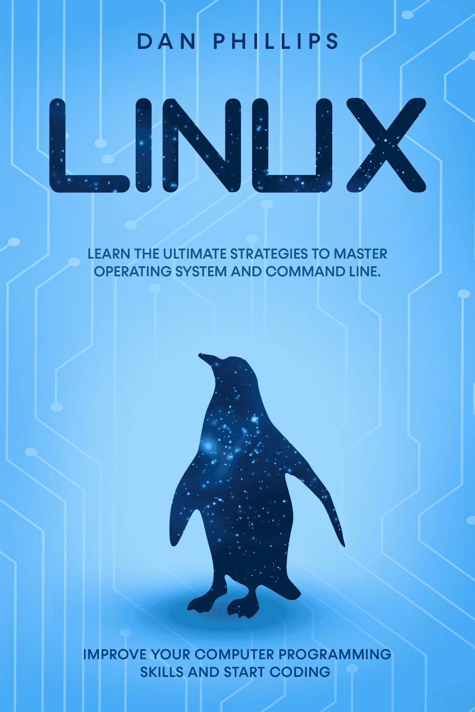

## 引言

20 世纪 90 年代中期，Linux 不再是爱好者的工具，开始在超级计算社区中使用。当 Linux 初步兴起时，得到了 Dell、IBM 和 HP 等公司的支持，使 Linux 能够逃脱微软在操作系统市场上的垄断。这是它找到第一个商业用途的时候。后来，NASA 等组织开始使用 Linux 设备，并开始用大量的 Linux 计算机替换他们昂贵的机器，因为它们便宜得多，且能完成相同的工作。今天，你可以在任何地方找到 Linux，从超级计算机到嵌入式系统。Linux 在许多桌面安装中变得非常流行，在笔记本电脑市场也是如此。许多发行版都配备了定制化的 Linux。Google 发布了用于笔记本的 Chrome OS。Linux 在移动设备市场上取得了巨大成功，包括智能手机、和平板和可穿戴设备。Valve 也支持 Linux，这开启了游戏市场。

## Linux 的现状发展

目前 Linux 是由多个来源开发的。原始 Linux 内核由 Greg Torvalds 维护。在 Linux Linux 工作之前，他在 SUSE 实验室工作。Richard Stallman 是自由软件基金会的领袖，他在 2006 年创建了帮助 Linux 的 CD。Stallman 是自由软件的积极倡导者，他坚信每个程序都应该对所有人可用。由于 GPL 的存在，Linux 始终是免费的。最后，但同样重要的是，许多政府也使用它进行行政工作。

## 谁拥有 Linux？

从技术上讲，没有人拥有 Linux。它是开源的。唯有“Linux”这个商标的版权属于 Linus Torvalds。然而，Linux 本身由许多贡献者所有。得于 GPL 许可，你不需要支付费用。

## 第 1 章 基础 Linux 命令

在本节中，我们将探索启动所需的基础命令。你现在可以打开终端。右键点击桌面并选择“终端（Terminal）”。如果没有看到这个选项，请查看窗口顶部的“应用程序（Applications）”。选择“终端”并打开编辑器，即 `ged`。只需点击并输入“文本编辑器（text editor）”。在文件中添加你选择的文本并保存到桌面。我保存了名为 `first` 的文件：

```bash
first
```

我是 Linux 大师。现在去终端并输入以下内容：

```bash
cat first
```

按下回车键后，窗口将显示文件的内容。这种方法适用于查看短文件。

## 更改目录

你可能还想通过终端导航或更改目录。要实现这一点，使用 `cd` 命令，它代表“更改目录”。

示例：

```bash
cd /home
```

上述命令将工作目录更改为 `/home` 目录。使用斜杠 `/` 表示相对于根，这意味着无论你当前所在的目录，该命令都会执行。现在输入以下命令：

```bash
cd httpd
```

目录将相对于 `/home` 目录更改为 `httpd`。完整的工作目录将是 `/home/httpd`。现在输入以下命令：

```bash
cd ..
```

此命令将工作目录更改为当前目录的父目录。在我们的案例，我们将从 `/home/httpd` 移动到 `/home` 目录。输入以下命令：

```bash
cd ~
```

此命令将目录更改为用户的主目录 `/home/(username)`。`username` 是你在计算机上使用的名称。符号 `~` 称为波浪号（tilde），在 Linux 中表示用户的主目录。

## 拷贝文件

`cp` 命令代表“拷贝文件（copy files）”，用于拷贝文件。注意文件不会从初始位置删除，而指定位置创建一个相同的副本。输入以下命令：

```bash
cp first me
```

上述命令将在相同目录下创建一个 `first` 文件的副本，但新名称为 `me`。如果目录中存在 `me` 文件，它将被覆盖，且在执行此命令之前你不会收到警告。考虑下面的命令：

```bash
cp -i first me
```

注意在上述命令中，我们添加了 `-i` 选项。如果目录中存在 `me` 文件，在覆盖之前你将收到通知。接下来，尝试以下命令：

```bash
cp -i /d/file
```

使用上述命令，文件 `/d/file` 将拷贝到当前目录并命名为 `file`。注意我们使用了 `-i` 选项，如果文件已存在，在覆盖之前将收到通知。你可能还需要将特定目录中的所有文件拷贝到另一个目录。可以通过以下方式实现：

```bash
cp -dpr sourcedirectory destinationdirectory
```

`sourcedirectory` 中的所有文件将拷贝到 `destinationdirectory`。注意我们使用了 `-dpr` 参数，这意味着：

- `-d` 意味着保留链接
- `-p` 保留文件属性
- `-r` 递归拷贝

在拷贝从目录的所有文件时，需要指定这些选项，否则将应用默认设置。使用 `df` 命令可以查看磁盘上使用的空间大小。

## `Less` 命令

`less` 命令与 `more` 命令相同。区别在于用户可以使用此命令向上或向下翻页查看文件。考虑以下示例：

```bash
less first
```

上述命令将显示 `first` 文件的内容。

## `Ln` 命令

此命令创建文件的符号链接。编写并运行以下命令：

```bash
ln -s first link
```

上述命令将创建一个名为 `link` 的符号链接，指向文件 `first`。`ls -i link` 命令将显示差异。

## `Locate` 命令

此命令用于在数据库中搜索。运行以下命令：

```bash
locate -u
```

将创建一个名为 `locate` 的数据库。这需要一些时间，请耐心。在搜索文件之前，必须运行此命令：

```bash
locate whois
```

此命令将在你的系统中查找包含 `whois` 字符串的文件。

## `Logout` 命令

此命令用于注销系统。进入终端并输入此命令：

```bash
logout
```

你将注销并返回登录屏幕。

## `Ls` 命令

`ls` 代表列出（list），用于列出目录中的文件。然而，它带有许多所需的选项。如果你需要列出当前目录下的所有以 `.` 开头的文件，输入命令：

```bash
ls -a
```

上述图形显示了目录中的文件。你可能需要查看文件的更多详细信息，如所有者、权限、时间和日期等。可以通过命令实现：

```bash
ls -l
```

如所示，`ls-l` 比之前的命令更详尽。你可以获取更多细节。

## `Sudo` 命令

这代表“超级用户执行（superuser do）”。其目的是允许许可的用户以“超级用户”身份执行命令。这通常定义在 `sudoers` 列表中。它的重要性在于通过确保只有正确的人才能执行敏感命令。另一个命令 `su` 允许你以超级用户身份登录系统。`sudo` 的目的是借用超级用户的权限。这解释了 `su` 和 `sudo` 命令之间的区别。

## `More` 命令

将文件的内容一次一页到屏幕。它也可以作用于输出。让我们把 `/etc/profile` 的内容列到屏幕。这是一个内置文件，包含了系统的配置。注意文件内容将一次显示页，因为内容太大。考虑以下命令：

```bash
more /etc/profile
```

命令将列出目录中的所有文件并通过 `more` 输出。如果目录的输出无法在一个页显示，它将列在额外的页面。

## `Mv` 命令

此命令代表“移动（move）”，用于重命名或移动文件。考虑下面的命令：

```bash
mv -i first first2
```

文件将从 `first` 移动到 `first2`，这意味着将其重命名为 `first2` 而不是 `first`。

```bash
mv /d/first
```

上述命令将文件 `first` 从 `/d` 目录移动到当前工作目录。现在你已经看到 `mv` 命令是一个强大的工具。现在我们一直在讨论工作目录，它们到底是什么？我们如何知道它们是哪个目录？只需输入命令：

```bash
pwd
```

按下回键后，你注意到输出是一个目录。它显示你当前所在的目录。`pwd` 缩写代表“打印工作目录（print working directory）”，用于显示当前目录。

## `Shutdown` 命令

此命令用于关闭系统。该命令目的是停止当前进程并立即关闭系统。使用以下代码：

```bash
shutdown -h now
```

下一个命令用于重启系统，意味着它将立即关闭并重启系统。使用下面的命令：

```bash
shutdown -r now
```

## `Whereis` 命令

此命令用于显示命令的手册、源码和二进制文件。考虑下面的命令：

```bash
whereis ls
```

此命令将显示 `ls` 命令的手册和二进制文件。要查看之前在系统中过的命令列表，使用命令 `history`：以上是在我的系统中运行的命令列表。你可以在你的系统中尝试并观察输出。

## `Sudo` 命令

这代表“超级用户执行”。它的目的是允许许可的用户以“超级用户”身份执行命令。这通常定义在 `sudoers` 列表中。它的重要性在于通过确保只有正确的人才能执行敏感命令。另一个命令 `su` 允许你以超级用户身份登录系统。`sudo` 的目的是借用超级用户的权限。这解释了 `su` 和 `sudo` 命令之间的区别。

## `Mkdir` 命令

此命令代表“创建目录（make directory）”。它创建一个新目录并命名其路径。如果该路径已经存在，将输出无法创建文件夹的错误。考虑所示图形：我创建了一个名为 "m" 的目录。在创建目录后，我列出可用目录，发现它已经被创建了。注意我们是以 `sudo` 运行命令的。没有这个，命令将无法运行。出于安全考虑。

## 1. CD/DVD 安装

通过 CD 或 DVD 启动 Ubuntu Linux 是在计算机上安装该系统的两种方法之一。

- 从 Ubuntu 软件下载 Ubuntu ISO 文件。这种格式的文件在使用之前，需要将其刻录到 CD 或 DVD 中。
- 使用你选择的刻录程序刻录 ISO 文件。有许多免费和付费的程序可以将 ISO 文件刻录到 CD 或 DVD，而无需额外下载单独程序。你可以选择你最喜意的一个。
- 从光盘启动。一旦程序被刻录到光盘中，你就可以重启电脑并选择从 CD 或 DVD 启动。你可能需要更改启动优先项。请在电脑重启时按下 `Setup` 键来实现此操作。
- Linux 为用户提供了在安装之前尝试的选项，以确保它确实是你需要的。你可以在这一层级进行操作：先尝试 Ubuntu，如果你觉得它是你想要使用的操作系统，就可以安装它。在系统仍从光盘运行时，你可以查看操作系统的布局。
- 安装 Ubuntu。如果你使用的是笔记本电脑，必须连接电源，因为安装过程可能会耗尽电池电。此外，你还需要连接到网络。
- 决定如何处理你的另一个操作系统。你将获得两个选项：是将 Ubuntu Linux 与其他操作系统并存安装，还是用 Ubuntu 替换旧操作系统。如果你选择保留两个系统，那么每次重启电脑时，都必须选择要使用的操作系统。
- 设置分区大小。如果你选择在电脑上同时拥有两个操作系统，这将是必要的。你可以使用滑动条来调整想要为 Ubuntu 留出的空间。记住，你还需要为文件和程序留出空间，因此请为新系统留出足够的空间。
- 选择你的位置。如果你连接了网络，这将自动完成。
- 设置键盘布局。在这里正确的做法是点击“检测 Ubuntu 键盘布局”以自动选择正确的布局。
- 输入你的登录信息。设置用户名和密码。你可以选择让 Ubuntu 自动登录，也可以在任何想使用电脑时输入登录信息。
- 等待安装过程完成。安装完成后重启电脑，Ubuntu 将加载。

## 2. Windows 安装程序

Windows 安装程序会将 Ubuntu Linux 与你正在使用的其他操作系统并存安装。程序和文件不会受到影响，但每当你重启动电脑时，你都必须选择要使用的操作系统。

- 从 Ubuntu 网站下载安装程序。如果浏览器提示，你可以选择运行、保存或打开。
- 创建一个用于登录电脑的用户名和密码。
- 点击 `Install` 开始过程。
- 安装完成后重启电脑，并选择 Ubuntu Linux 作为加载的操作系统。

## 重要提示

❖ 在 CD 或 DVD 上运行此类程序程序通常是一个好主意，以便对其进行初步了解；如果你喜欢你看到的内容，再对其进行安装。试用将帮助你在安装操作系统时做出一个不会后悔的决定。

❖ 在开始安装之前，请务必确保已备份了你所有的文件、程序、个人数据和设置，以防丢失。

## 在 Linux 上安装新软件

在 Linux 操作系统上安装新软件，这与你安装操作系统本身一样简单。对于用户来说，一切都已变得非常容易了。因此，如果你过去在其他操作系统上安装新系统时遇到过困难，现在没有理由担心了。

大多数 Linux 发行版都带有一个应用商店，或类似的工具，它代表了存储所有应用程序的中央区域。你做的就是浏览这些应用，并安装你想要在机器上使用的程序。这让你能够非常轻松地找到想要在电脑上安装的程序。`Ubuntu Software Center` 就是 Ubuntu Linux 这种集中化区域的示例。深度（Deepin）拥有 `Deepin 软件中心`。某些发行版依赖 `GNOME software`，而另一些则依赖 `Synaptic`。所有这些工具的含义和功能都是相同的；它们提供了一个中心位置，你可以从那里轻松地搜索和安装 Linux 软件。不过，图形界面（GUI）的存在很重要，它可以让你完成其他软件的安装过程。如果你没有 GUI，将不得不依靠命令行界面来完成安装。

用户需要知道的是，在任何 Linux 上安装软件都非常容易。新电脑用户也会发现这非常简单且不费时间。操作系统的设计目的是让计算机用户在他们做的每件事上都感到轻松，而这只是其中之一。安装完操作系统后，你就可以开始安装在使用机器或设备时需要的任何应用程序。

Linux 无处不在。你可以在家里、汽车里，甚至在电器中找到它。当然，你最常发现它的地方是电脑。从乍上看，Linux 看起来和任何其他操作系统一样。它位于你所有其他软件之下，并向你的硬件传递信号。它拥有图形界面，与其他大多数操作系统一样，并且对于其他系统具有的大多数功能都有相应的软件实现方案。如果你曾经用过任何操作系统，那么在使用 Linux 时应该不会遇到困难。人们通常不知道的是 Linux 使用得非常频繁。除了是个人电脑最常用的操作系统之一，它还被用于运行全球的许多服务器和嵌入式系统。它用于运行互联网的巨大份额，以及许多管理股票和实现科学突破的超级计算机。然而，在这一切之前，Linux 就被誉为世界上最无后顾、安全且可靠的系统之一。这种声誉实之名归，Linux 的质量正变得越来越明显。

Linux 是一个灵活的工具，可以针对你可能感兴趣的任何工作进行定制。用户随时可以对其进一步开发，这意味着它将一直处于越来越好的过程中。它完全依赖社区本身的这一事实使得 Linux 成为了一项更令人深刻的成就。这也让 Linux 看起来更可靠一点，因为发行过程中没有贪婪因素介入。该系统是属于人民、为了人民的工具，并随着趋势增长。它在用户的帮助下根据用户的需求而成长。

Linux 的不同变被称为发行版（distributions）。发行版是不同组件的包，通过选择并缝合在一起来执行定义明确的功能。一个发行版由内核、支持库和系统软件组成。其中大部分内容由 `GNU Project` 提供。尽管大多数发行版在名称中使用了“Linux”一词，但关于发行版的命名规范曾存在争议，因为自由软件基金会倾向于使用 `GNU/Linux` 这个名称，以强调 `GNU` 软件的重要性。这让 Linux 的创建者 Torvalds 非常不悦，并立即抵制了这一点。从那时起，发行版的名称问题一直很紧张。

一些流行的 Linux 发行版有 `Fedora`、`Ubuntu` 和 `Debian`。有些是商业用途，如 `Red Hat Enterprise Linux` 和 `SUSE Linux Enterprise Server`。桌面发行版通常包含 `Wayland` 或 `X11` 等窗口系统，以及 `KDE Plasma 5` 或 `GNOME` 等桌面环境。其他服务器的发行版通常不包含图形界面。一个解决方案的示例是 `LAMP`。有许多发行版可供选择。让变得更大的事实是 Linux 是可以分发的，你可以根据任何目的创建自己的发行版。Linux 最初是为个人计算机设计的，基于 `x86` 架构。从那时起，它被移植到许多平台，超过了任何其他操作系统。在涉及到服务器和大型机时，Linux 领先于任何其他操作系统。此外，它是超级计算机使用的唯一操作系统，它逐渐消除了竞争。自从 2017 年 11 月以来，它占据了笔记本电脑市场的 20% 百。基于 `Linux` 内核的 `Chrome OS` 是其中一个例子。

Linux 也用于嵌入式系统。这些是构建在固件中的系统，路由器、电视、游戏机、数字录像机以及智能手表。由于 `Android` 在手机和平板电脑市场的主导地位，Linux 也经常用于这些设备。

Linux 作为一个成功的明证，展示了独立开发者之间的合作可以走多远。它是开源软件的一个卓越案例，成果是显而易见的。在 2001 年，研究了关于 `Red Hat Linux 7.1` 的发行版，它包含了数百万行代码。研究还发现，它使用了多种编程语言，如 `C`、`C++`、汇编语言、`Lisp`、`Python`、`Perl`、`Fortran` 以及许多脚本语言。

## Linux 是如何创建的？

Linux 的原始名称是 `Freax`，它是 Unix 的一个变体。在一段时间内，该项目包含了 `Linux` 这个名称，但这让 Linux 的创建者 Torvalds 感到不悦并立即抵制了它。从 1991 年 9 月以来，为了促进 Linux 的进一步开发，文件被上传到 `FUNET` 服务器上。Torvalds 认为“Freax”不是一个好名字。最终，Torvalds 同意将项目名称更改为 `Linux`。

## 什么让 Linux 与众不同？


正如我之前提到的，这是由于发行版的原因。不过，`GUI` 的存在对于你完成其他软件的安装过程很重要。如果你没有 `GUI`，将不得不依靠命令行界面来完成安装。

用户需要知道的是，在任何 Linux 上安装软件都非常容易。新电脑用户也会发现这非常简单且不费时间。操作系统的设计目的是让计算机用户在他们做的每件事上都感到轻松，而这只是其中之一。安装完操作系统后，你就可以开始在使用机器或设备时需要的任何应用程序。

Linux 是一个灵活的工具，可以针对你可能感兴趣的任何工作进行定制。用户随时可以对其进一步开发，这意味着它将一直处于越来越好的过程中。它完全依赖社区本身的这一事实使得 Linux 成为了一项更令人深刻的成就。这也让 Linux 看起来更可靠一点，因为发行过程中没有贪婪因素介入。该系统是属于人民、为了人民的工具，并随着趋势增长。它在用户的帮助下根据用户的需求而成长。

Linux 的不同变被称为发行版。发行版是不同组件的包，通过选择并缝合在一起来执行定义明确的功能。一个发行版由内核、支持库和系统软件组成。其中大部分内容由 `GNU Project` 提供。尽管大多数发行版在名称中使用了“Linux”一词，但关于发行版的命名规范曾存在争议，因为自由软件基金会倾向于使用 `GNU/Linux` 这个名称，以强调 `GNU` 软件的重要性。这让 Linux 的创建者 `Torvalds` 非常不悦，并立即抵制了这一点。从那时起，发行版的名称问题一直很紧张。

Linux 无处不在。你可以在家里、汽车里，甚至在电器中找到它。当然，你最常发现它的地方是电脑。从乍看上，Linux 看起来和任何其他操作系统一样。它位于你所有其他软件之下，并向你的硬件传递信号。它拥有图形界面，与其他大多数操作系统一样，并且对于其他系统具有的大多数功能都有相应的软件实现。如果你曾经用过任何操作系统，那么在使用 Linux 时应该不会遇到困难。

人们通常不知道的是 Linux 使用得非常频繁。除了是个人电脑最常用的操作系统之一，它还用于运行全球的许多服务器和嵌入式系统。它用于运行互联网的巨大份额，以及许多管理股票和实现科学突破的超级计算机。然而，在这一切之前，Linux 就被誉为世界上最无后顾、安全且可靠的系统之一。这种声誉实至名归，Linux 的质量正变得越来越明显。

- 目录（`d`）– 一个包含文件列表的文件
- 链接（`l`）– 一个允许在文件树的多个部分显示特定文件的系统
- 管道（`p`）– 一个允许进程间通信的系统
- 普通（`-`）– 一个普通文件
- 套接字（`s`）– 提供进程间网络连接的特殊文件
- 特殊（`c`）– 用于输入和输出的机制

## 分区的艺术

Linux 分区始于断电威胁到大多数 Linux 用户的时期。曾几何时，停机意味着会对系统造成严重损害。此外，分区的主要目的是实现更高的数据安全级别。硬盘的划分允许进行安全的分组和保护。由于成功的分区，你可以对更重要的数据组进行优先级排序。当硬盘的一部分受到损坏时，只有该部分磁盘受影响。存储在其他分区中的其余部分不受影响。

## Linux 系统中的两个主要分区

1. `Swap` – 指额外的内存或扩展
2. `Data` – 指普通数据；指启动和运行系统所需的必要文件

### 推荐的分区

- 用于必要数据的分区
- 用于服务器程序和配置数据的分区
- 用于程序和应用程序的分区
- 至少一个用于用户邮件、存档和数据库表的分区
- 至少一个用于特定文件的分区
- 至少一个用于虚拟内存的分区

### 常见分区

- 包含个人数据的分区
- 存储临时文件的分区
- 存储第三方数据的分区
- 仅用于程序的分区

## 目录：根目录与子目录

在 Linux 中，有一个被称为根目录（The Root Directory）的目录。它作为主目录，正如程序员和系统管理员所称的，它是所有目录的目录。根目录产生了子目录。这些子目录根据其分配的任务管理文件。

### 子目录及其内容

- `/home` – 用户目录
- `/boot` – 内核和启动文件；尝试消除不需要引导程序的文件
- `/initrd` – 关于启动信息的数据
- `/dev` – 包含所有 CPU 硬件外设备的引用
- `/bin` – 常用的共享系统程序
- `/etc` – 重要的系统配置数据
- `/lib` – 库文件
- `/lost+found` – 从故障中恢复的数据
- `/opt` – 来自第三方源的文件
- `/net` – 远程文件系统的标准挂载点
- `/misc` – 杂数据
- `/proc` – 关于系统资源的信息
- `/mnt` – 外部文件系统的标准挂载点

## Inode 的作用

在 Linux 文件系统中，`inode` 代表一个文件。`inode` 是一种包含重要信息的序列号类型。它的主要作用围绕定义分区中的文件数量。在整个 Linux 文件系统中，特别是具有多个分区的系统，存在具有相似编号的文件。为了避免复杂性，每个分区都分配了自己的 `inode`。

此外，分配的 `inode` 提供了硬盘数据结构的描述。一旦硬盘初始化完成，可以在两个点接受数据存储：第一，在安装过程中允许数据存储；第二，在向现有系统添加存储空间时允许数据存储。

### Inode 中包含的信息

- 文件类型
- 文件大小
- 文件的所有者或组所有
- 创建日期和时间
- 最后修改日期和时间
- 权限
- 链接数
- 数据地址

## 什么是超级块（Superblock）？

在 Linux 文件系统中，关于基本文件大小和形状的信息被称为超级块（The Superblock）。它允许文件系统管理器浏览并维护文件系统的质量。

### 超级块中的信息

- 空闲块 – 显示系统空闲块的数量
- 空闲 `inode` – 显示原始 `inode` 分配
- 空闲 `inodes` – 显示系统空闲 `inodes` 的数量
- 块组编号 – 指分配给超级块的编号
- 每组块数 – 显示一组的块数
- 块大小 – 指系统的块大小；信息以字节为单位显示
- 魔数 – 指授予挂载软件进行评估的权限
- 挂载计数 – 指系统允许的评估次数
- 修订级别 – 指系统允许的修订级别确认

## 什么是组描述符（Group Descriptor）？

组描述符负责标记文件的数据结构。它包含了避免数据重复的细节。由于它的作用，系统损坏的可能性极低。

### 组描述符中的信息

- 块位图
- 空闲块计数
- 空闲 `inode` 计数
- `inode` 位图
- `inode` 表
- 已用目录计数

## 文件修改：查找、挂载与更改大小

Linux 文件通常很容易定位。只需搜索一个目录，紧跟在 `/` 或正斜杠后面的名称可能就是你想要的文件。

示例：`/home/lp.txt`

如示例所示，`/home/` 是目录，`lp.txt` 是文件。然后你可以开始挂载。在挂载文件时，需要 Linux 内核的可用性来检查标准。它的存在允许验证所有传递给系统的参数。

示例：

```bash
## mountiso898 /dev/rom /dev/cdrom
```

如示例所示，你正在挂载三类信息：`iso898`、`/dev/rom` 和 `/dev/cdrom`。

除了查找和挂载文件外，你还可以更改文件的大小。这是由于文件碎片的产生。由于文件在碎片期间效率会降低，更改文件大小允许进行文件分配。因此，系统变得更加稳定。

你将学习到 `truncate` 和 `fallocate` 命令。这两个命令都允许你创建一个具有指定大小的文件。

示例：

```bash
## truncate -s 19MB mop1.txt
## fallocate -l 19000000 mop2.txt
## ls -ls mop.txt
0 -rw-rw--r-- 2 trs trs 19000000 Aug 12 02:44 mop1.txt
14819 -rw-rw--r-- 2 trs trs 19000000 Aug 12 02:45 mop2.txt
```

如示例所示，你在 `8 月 12 日` 创建了一个名为 `mop` 的 `19MB` 文件。

## 第 4 章 基础 Shell 编程

在本章中，我们将深入研究黑客秘密武器之一——脚本编写。程序员和黑客之间存在非常微小的区别。程序员使用脚本来构建系统，而黑客使用脚本来利用系统。如果不创建自己的脚本，初级黑客永远无法成为专业的黑客，而将只是只会使用其他工具破解系统的“脚本小子”（script kiddie）。

因此，脚本知识是任何试图精通黑客技术的人清单中的必备项。为了帮助你，本章将通过真实世界的代码示例介绍许多 Bash 脚本概念。让我们现在开始这段脚本之旅吧！

首先，我们需要详细了解 Shell。

## 什么是 Shell？

Shell 是当你第一次使用密码连接到服务器时，或者使用 `SSH` 等远程桌面工具连接到系统时看到的那个光标。换句话说，如果你纯从编程的角度来看它，你会非常高兴，因为它的作用就像是用户和系统之间的解释器，就像操作系统的工作方式一样。

但它只是将用户的输入建议发送给 Linux 内核，并将结果作为输出发送给系统用户。

## Shell 的类型

根据 Linux 官方文档，存在多种类型的 Shell。其中，第一种代表 GUI（图形用户界面），第二种代表 CLI（命令行界面）。许多发行版制造了许多 Shell，如 Bourne shell、C shell、korne shell 和 Bash shell。

在存在的所有不同类型的 Shell 中，`bash` shell 是人类以来最著名的 Shell 之一。它预装在几乎所有著名的 Linux 发行版中。它还充当一种接接语言，帮助 Linux 内核逻辑上理解我们给出的指令。

## bash Shell 是如何工作的？

人们可以通过两种模式操作 Shell。其中一种是交互模式（interactive mode），另一种是脚本模式（script mode）。

### a) 交互模式

在这种模式下，Linux 用户可以逐条输入函数或 `bash` 代码，并等待结果给出。如果中间出现错误，用户将无法继续。它只是以交互方式工作，就像旧式手持视频游戏一样。

### b) 脚本模式

在这种模式下，首先将 `bash` 代码写在文本文件中，然后使用命令行界面运行该脚本文件。使用这种模式时，用户可以一次性获得他想要的所有结果。黑客需要在脚本模式下更加完美，因为通过这种方法可以快速利用系统。然而，创建系统的程序员会更倾向于交互模式。

在进一步了解 Shell 的语法结构之前，如果能对 Shell 的优势有一个良好的概述会更好。

## Shell 的优势

1. 学习内联编程语言非常容易，它们在执行和实现上都有很大不同。
2. 它有许多帮助文档，可以帮助黑客尽快纠正错误。
3. 它还有一个额外优势，因为它是一种解释性语言。这意味着它在运行之前不需要编译。因此，黑客可以在尝试在受害者系统上实施之前轻松地交叉检查代码。

此外，Shell 还速度快且运行高效。由于所有这些原因，黑客必须学习 Shell 的实现。

开始吧！

## 第一个脚本

让我们创建一个名为 `sample.sh` 的脚本。使用以下命令创建一个脚本。

```bash
cat sample.sh
```

### Shell 程序的位置

```bash
echo " This is very regressive"
```

现在我们将逐行详细解释这些。

a) `#!` 代表我们正尝试写的 Shell 脚本的开头。

b) 如果它以井号 `#` 开头，则被称为注释。注释是用于方便参考或其他查看代码的用户的标记。对于小型 Shell 脚本，写注释似乎是不必要的。

c) `echo` 是 Shell 的默认命令，允许解释器显示编写的内容。在这里，运行 Shell 需要使用以下命令：

```bash
bash sample.sh
```

然后输出将出现。例如，输出是：`This is very regressive`

还有另一个功能允许你带有额外的权限运行脚本。如前所述，Linux 有一组权限，如果未提供，脚本可能无法运行。因此，提供权限请使用以下命令：

1. 立即安装并更新 Ubuntu 版本（尽管如果是第一次使用该系统，这听起来可能没必要）。如果开发者自版本发布以来发布过补丁并修复过问题，则应执行此操作。
2. 根据你的需求调整设置、外观和行为。
3. 确保调整任何隐私设置以提高安全性。
4. 根据你的喜好调整主题、壁纸和菜单。微调工具（Tweak Tool）可能会帮助提供更多选项。
5. 安装 `AppGrid` 和 `Synaptic Package Manager` 以帮助快速查找和安装软件。
6. 安装 `GetDeb` 和 `PlayDeb` 存储库以及软件个人软件包存档（PPAs）更新源，并确保启用伙伴库（Partner Repositories）以访问受授权软件。
7. 关闭广告。
8. 现在安装任何媒体解码器、音频播放器和驱动程序。
9. 安装免费应用和程序，如 `Google Chrome`、`Skype`、`GIMP`、`Spotify` 等。
10. 设置即时消息、社交媒体账户和云连接。

## 为桌面创建多个工作区

你也可以使用工作区来真正最大化利用你的 Ubuntu 桌面，充分发挥它的作用，并为了乐趣或享受进行多任务处理。某些版本不会突出显示这些选项，但它们可以在不同的发行版中以不同的方式启用。你应该检查你的发行版，并在网上搜索如何激活你对应版本的工作区。这通常只需要点击几次。

以 Ubuntu 的版本为例，在每个环境中，你可能需要点击“启用或管理工作区”、“添加小组件”或“添加分页器小部件”来使用这些功能。很快，你将拥有多个工作区，这有助于组织和分离你的活动；假设你任何时候都有超过一个工作区，这将非常有用。你应该尝试激活并测试它们。

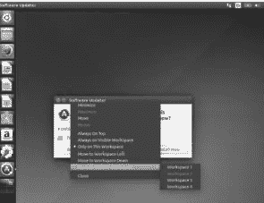

## Ubuntu Linux 中的多个工作区

## CLI

你可能应该学习一些可以在 `Prompts`（提示符）处使用的基础 `Commands`（命令），以防万一（没错，这已经被建议过几次了！！你会发现，如果进入“应用程序”（Applications），然后进入“附件”（Accessories），最后到达“终端”（Terminal），你就可以访问 `CLI` 并看到一个提示符。这就是 `Commands` 发挥用场的地方。有些用户非常喜欢这种额外的方式来定制他们希望系统执行的操作、自动化任务或使用快捷键。

此外，如果你在未来的某个时候转向服务器版本，你将已经对 `Commands` 有一些体会和知识，并且对系统文件的结构和位置有更好的理解。正如你稍后将读到的，Linux 中的一切都是文件。例如，它们的结构与 Windows 不同。通过 `GUI`（图形用户界面），你将从一个角度看到这一点。

当你使用 `CLI` 时，你将真正更好地理解文件树和目录如何与硬件和软件协作，形成所谓的你的操作系统系统。这也是 Linux 爱好者获得自由感的地方，这种自由不仅来自于应用程序和其他系统资源的开源，还来自于真正让你的计算机主动为你工作的自由和灵活性。

## 在服务器版本中跳转

然而，你需要在服务器版本上花费一些时间。它并不那么直观，在以这种方式探索 Linux 之前和期间，了解某些细节非常有用。如果你熟悉 `DOS`，那么只需要学习 `Commands` 和代码了。如果你不熟悉，将面临一个相当长的学习曲线。

首先，你将使用提供的信息登录到新的服务器版本。你只会看到一个带有 `Shell`（外壳）提示符的 `DOS` 屏幕。你不会像在桌面版本那样看到图形用户界面（`GUI`）。你现在需要使用 `commands` 才能在这个新的操作系统中的任何地方跳转。

你应该设置一个非常安全的密码和 `root`（用户）名称。确保原样记录这些信息。在 Linux 中，标点符号非常重要。不同的拼写意味着完全不同的结果。你会再次看到这个提醒。

## 一切的根

在 Linux 中，`Root` 这个词有几个含义。`Root User`（根用户）是计算机的管理员（用户名为 `root`），它是最低级别的用户，拥有全权限。


`Root` 也是 Linux 中任何事物的最高层或核心。它也是安装位置，等同于 Windows 中的`C:/Home`。从某种意义上说，它是文件的最高层。Linux 中的一切要么是一个目录，要么是目录内部的文件，而这一切都在`Root`目录下。

命令`sudo`表示“Super User Do”（超级用户执行）。这意味着你，即`Root User`（即管理员），拥有访问文件和程序的完全权限。在某些发行版中，你需要使用此命令作为某些`Commands`的前缀。

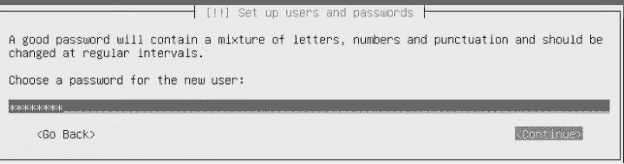

www.ubuntuserverguide.com

## 获取你的命令

和大多数事物一样，你可以在 Google 上进行一些简单的研究，以获取 Linux`Commands`大目录。通过这些命令，你可以在 Linux 中导航到任何地方。然而，你不应该期望记住这个列表，你应该开始熟悉 Linux 的语言。

一些最重要和实用的`Commands`将让你进入、退出和在周围移动。为了强调和扩展之前的一个观点，你在`Commands`中使用的大小写很重要。`Commands`的拼写非常具体，所以请务必使用正确的大小写。空格和单词顺序也很重要。你可能无法到达任何地方，或者最终到达一个你并非打算去的地方。

在 Linux 的`Commands`长列表和命令组合中，还有一些“内置”（builtin）命令。正如字面意思，`Builtin`命令已经包含在`Bash` shell 内部。当一个简单命令的首单词是`builtin`时，shell 直接执行该命令，而不需要另一个程序。

正如之前所说，每个发行版都有其优势和挑战。需要注意的是，每个发行版的`Commands`可能相同也可能不同。考虑到`Commands`是导航此版本 Linux 的唯一方式，这是关键。你绝对应该对你选择的发行版的兼容性和用法进行研究，现在还需要研究该特定发行版的特定`Commands`。

你会发现许多`Commands`有共同的根，你可以通过其他`Commands`、关键字、文件或程序名称对某些命令进行构建。有几个初学者需要立即使用的`Commands`。跟着操作并尝试一下吧。

## 需要时获取帮助

这里有一些一开始就能知道的简单事情。这些可能是你的救生衣。“Man”页是手册（即说明）页。你也会像使用`sudo`命令一样，在另一个`Command`前加上这个命令。使用`man`会打开一个包含你所需的一切屏幕。需要时尝试这些变体：

- `man -k`：搜索所有涉及术语的命令。你也可以使用`apropos`。
- `man`：显示帮助信息。
- `info`：显示帮助信息（以不同的方式）。
- `whatis`：显示关于手册页的描述。
- `whereis`：告诉手册页的位置。

要退出手册页，输入`Q`（Quit）退出。这是退出手册页的唯一方法。要退出大多数其他地方，只需输入`Exit`。

命令`more`和`less`也对于显示超出你当前屏幕的文件很有用。你可能需要阅读帮助页上比一个屏幕显示更多的信息。这对于系统的初学者来说尤为重要。只需在输入`Command`后使用空格键向下滚动屏幕即可。要退出，输入`q`退出。

## 移动

你很快就会发现 Linux 中有很多目录，你应该熟悉它们。虽然在 Linux 中一切都是文件，但目录是一种特殊类型的文件。目录出现在列表中，并以树的形式关联。与使用 GUI 的操作系统不同，你不会看到文件扩展名。因此，你需要知道如何导航、查找和更改它们。你应该在 Google 上搜索它们的列表，以便正确导航你的系统。

与命令一样，目录的拼写和符号也很重要。另外注意，当你在字母和斜杠或其他单词的字母之间需要真正的空格时，空格键非常好用。它节省了时间和击键次数。错过这些小细节也可能导致你处于一个不需要或不想去的地方。它们还可能因错误消息而让你陷入死胡同。在最坏的情况下，Linux 中的错误可能会导致严重损害，例如删除文件。设置新文件名时，你应该使用下划线代替空格。这些小细节会产生影响。初学者应该熟悉的几个目录和功能是：

- `/home-`：这是你的根目录，用于文档和设置的存储。
- `/dev-`：存放设备文件。
- `/cd-`：切换目录。
- `/etc-`：这类似于控制面板。

## 使用目录

`pwd`命令将打印你的当前工作目录。这也是查看你从何处开始的好地方。要查看目录中的内容（从你的主目录开始以及随后的其他目录），你可以输入`ls`来列出目录中的内容。

注意，在配置服务器账户时，你的主目录下还会随带一些隐藏文件。要列出这些文件，你必须使用点字符`.`。例如，你不能只输入`ls`，而应该输入`ls -b`来查看隐藏文件。

你还将学习像之前的命令一样组合命令。例如，要移动到名为`xyz`的子文件夹，你需要在`xyz`前面加上前缀，如`cd xyz`。使用`cd`命令导航到桌面目录的示例是，输入`cd ~/Desktop`。要返回根目录，输入`cd ~`。使用相同命令导航到根目录的示例是输入`cd /`。要回到上级目录（当前目录的父级），你应该输入`cd ..`。在继续之前，你可能想探索一些目录并尝试移动以熟悉环境。

## 如何安装程序

`apt-get`命令获取并安装单个视觉化软件软件包。这就是你创建服务器的方式。你将使用特定的命令手动拉取泛泛化你的 Linux 服务器所需的任何内容。仓库存储了许多 Linux 程序，你可以随时调用它们。这些程序也是开源的。如果你现在不知道自己需要什么，应该在 Google 上搜索最适合你需求的软件。

随后若要访问仓库，例如，你会输入`sudo apt-get install (程序名称)`来获取一个副本并自动安装。

`tasksel`命令意味着 Ubuntu 的任务选择（task-select）。如果你运行它，将出现一个屏幕，为你列出常见的服务器类型、软件包和任务列表。你可以选择并安装你的服务器所需的任何内容。例如，你可以通过`sudo apt-get install tasksel`获取 tasksel 功能，然后通过使用`sudo apt-get install (然后是你想要的任务名称、你想要的服务器等)`来使用它。

如果你想安装 LAMP 服务器，可以输入命令`sudo apt-get install lamp-server`来实现此操作。

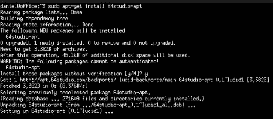

`apt-get install`的示例（[www.en.flossmanuals.net](http://www.en.flossmanuals.net)）。

如果你任何时候需要帮助，既然你已经知道了帮助页（man）命令，你应该输入：`man tasksel`。你会看到帮助页出现以解决你的需求。

## 如何卸载

若要卸载，你只需输入`apt-get remove (在此情况下为服务器名称)`。使用此命令获取你的大部分软件，并从选择免费开源软件开始。

## 更新

安装软件后，你可以使用`upgrade`命令`sudo apt-get upgrade`。通过仓库进行简单的更新。手动更新它们比设置自动更新要容易。由于 Linux 的高效率，你不需要经常进行更新。这样也更安全。

## 任务管理器

`top`提示命令类似于任务管理器，用于查看进程以及每个进程占用的空间，或者停止程序运行。使用命令`h`获取你任何时候可能需要的命令列表。输入命令`sudo top`（访问任务管理器或`top`），然后输入命令`K`（杀死/kill），然后输入你想杀死的进程旁显示的进程 ID 数字（称为`PID`）。

## 停止/启动/重启服务

Linux 服务器不需要频繁重启，但在某些情况下你可能需要重启软件或服务。要启动、停止或重启，你输入命令：

```bash
sudo /etc/init.d/(程序名称) start
```

（或`stop`或`restart`），以进行更改，并在处理更改时使其离线，例如在崩溃或重新配置文件时。

现在你已经有了一些关于你在哪里、要去哪里、如何获取、安装或删除东西的基础知识，请花些时间测试这些内容。后面有一份常用命令列表，以及一个更全面（但不是唯一的）的列表。这并不是详尽的，但它确实展示了你现在就能完成的一些任务，或者你可能期待学习的任务。Linux 是一个不断演化的操作系统，考虑到发行版和环境的多样性，情况将继续变化。随着我们技术的进步，改进和利用 Linux 系统的机会越来越多。

# 第 6 章 基础 Kali Linux 工具

在本章对 Kali Linux 的安装进行简要说明以及对 Kali 操作系统中存在的各种类型工具进行详细概述后，我们将借助 Kali 中提供的工具通过一些实际场景，帮助我们详细了解黑客的基础。

## 应该如何进行黑客？

没有特定的黑客指南可以教你完美的黑客技术。但总有一个著名的程序，优秀的黑客为了获得更好的结果会下意识地遵循。

## 黑客路线图

黑客攻击就像烹饪。你需要准备好所有的食材（即程序），并详细了解这些食材（或程序）的属性，并将它们结合在一起产生烹饪材料。如果食物不好吃怎么办？那意味着在整个黑客过程之后无法获得更好的结果。你只有一种方法，即：再次尝试。要精通黑客，你需要详细学习的五个重要领域：

1. 信息收集
2. 自动漏洞扫描
3. 漏洞利用
4. 密码攻击
5. 嗅探与无线攻击

### 1) 信息收集

信息收集始终被认为是黑客在攻击之前的关键工作。通过使用信息收集工具，我们可以获取关于目标主机的大量信息，帮助我们进行进一步的利用。我们甚至可以使用关于目标大量的公开信息来确保攻击成功。

### 2) 自动漏洞扫描

漏洞扫描器是一种自动发现计算机、应用程序和软件漏洞的程序。它通过网络生成数据并与漏洞数据库进行匹配以确保系统。在面对入侵时，可以根据特定环境尽快检测漏洞并采取适当措施，我们可以使用一些方便工具如`Nessus`和`OpenVAS`。

### 3) 漏洞利用

漏洞利用是获取系统控制的重要方式。它从目标系统发现漏洞并利用漏洞获取权限。为了方便用户，本章将介绍由 Kali 发布的`Metasploit`。用户可以利用它进行各种渗透攻击，如 MySQL、PostgreSQL 和 Tomcat 服务。权限提升通常通过使用令牌和社会工程来实现。

### 4) 密码攻击

密码攻击是在不知道密钥的情况下恢复密码。密码攻击是所有渗透测试的重要部分。无论你是渗透测试人员还是理解密码和破解，它仍然是保护数据和限制系统访问的最常见方法。

### 5) 嗅探与无线攻击

这是人们使用网络工具配合网络适配器捕获数据包并从目标获取敏感信息。像`Wireshark`嗅探工具是著名的，可以用于大量的攻击并发现数据包。首先，我们将通过信息收集过程，借助名为`Nmap`的侦察工具扫描端口。

## 信息收集

信息收集是攻击前的重要阶段，黑客在此收集关于目标大量的公开信息。许多黑客使用社会工程技术获取关于目标的大量信息，包括操作系统和版本。信息收集有三个重要的阶段，如下：

- **从搜索引擎收集信息**：使用像 Google 这样的搜索引擎获取关于尝试攻击的主机的好信息。你会发现可以找到多少公开信息而惊讶。
- **社会工程技术**：这些是疯狂的，因为你可以通过钓鱼邮件等简单的事情欺骗员工或目标来创建后门。所有的优秀黑客都依赖社会工程，而不是用更复杂的方式做事。
- **端口扫描**：如果你好奇什么是端口扫描，请仔细阅读后续段落。服务器提供了各种服务，如发布主页和发送电子邮件。执行网络通信的服务包括由数字管理的。例如，已知服务基本上是预分配端口号，如 HTTP 服务的 80 和发送邮件的 587。从外部（攻击者视角）调查服务器开启什么端口被称为“端口扫描”。

### 如何进行端口扫描？

端口扫描是从外部发送特定数据并检查相应响应以调查连接到网络的服务的过程。通过分析获得的响应，你可以识别运行在服务器上的服务版本、操作系统等。有工具如`Nmap`和`Zenmap`可以端口扫描。`Nmap`是命令行工具，而`Zenmap`是图形界面工具。两者使用相同的技术且都是免费的。在读这本书时尝试使用你的电脑，毕竟一个已知事实是你可以通过实践来学习黑客或编程，而不仅仅通过阅读。

## Nmap

`Nmap`是著名的黑客工具之一，因在渗透测试人员中流行而闻名。人们经常误认为`Nmap`仅因信息收集能力而流行，但通常不理解`Nmap`也可以作为自动化漏洞检测器。它可以在各种操作系统和 Windows 上使用。`Nmap`是一个强大的工具，用于端口发现、主机发现、服务发现、操作系统及其版本的检测。`Nmap`可以在命令行和图形用户界面（GUI）中使用。但记住，优秀的黑客使用命令行。

### Nmap 如何工作

`Nmap`的编程方式使其能够使用不同的技术如 TCP 和 FTP 协议扫描。所有这些扫描都有其优缺点，黑客在尝试攻击主机时可以生动地理解这一点。在黑客术语中，我们将目标称为目标主机。使用`Nmap`时，我们需要首先理解目标的复杂度，以决定使用哪种扫描——简单扫描还是耗费更多时间的复杂扫描。我们需要磨练技能，使用一些非常直观的技巧绕过入侵系统以获得良好结果。以下是`Nmap`可以执行的一些策略：

1. 你可以使用以下命令扫描单个主机：`nmap www.hacking.com`
2. 你可以使用以下命令扫描整个子网：`nmap 192.232.1.0/24`
3. `Nmap`也可以用于扫描多个目标：`nmap 192.232.1 192.232.4`
4. `Nmap`还有一个选项可以让你扫描一个范围的目标：`nmap 192.232.1-100`
5. `Nmap`有一个选项可以让你将所有的 IP 地址存储在`.txt`格式文件中，如果你想看到需要扫描的主机列表，可以输入`nmap -i sample.txt`
6. 如果你想排除多个 IP 地址，`Nmap`提供了一个从子网中排除单个 IP 的选项：`nmap 192.232.1.0/24 --exclude 192.232.4`
7. 如果你想排除多个 IP，可以将它们全部包含在文件中，在执行子网扫描时显示：`nmap 192.232.1.0/24 --exclude ip.txt`

在学习扫描程序之前，`Nmap`提供让我们了解扫描开放端口的侦察工具。

## Nmap 中的扫描技术

`Nmap`遵循不同的扫描策略来工作。在本节中，我们将详细描述这些程序，以及几个命令给你一个良好的概述。

- **SYN 扫描**：这是`Nmap`使用的一种典型扫描，如果没有指定，`Nmap`通常不会向目标建立完整的握手。它只会发送`SYN`数据包来检查任何开放端口但不创建会话。这是这种扫描策略最大的优点之一。要使用这种扫描，黑客应获得 root 权限，否则将显示错误。我们给出此扫描的命令行：`nmap -sS 192.232.1`
- **TCP 连接**：由于`sS`扫描在当前攻击情况下不可行，人们通常使用`sT`扫描作为后续。它与开放端口建立三次握手并调用一个名为`connect()`的方法使软件发现 TCP 端口。这种扫描在首选时也可以用于发现 UDP 端口，尽管人们很少使用。我们给出此扫描的命令行：`nmap -sT 192.232.1`
- **UDP 扫描**：这种扫描也在渗透测试清单中，在`-sS`扫描之后。它不需要像 TCP 扫描那样发送`SYN`包，因为它只会找到开启的 UDP 端口。当黑客开始使用这种扫描时，`UDP`包到达目标主机并等待响应。如果收到响应，则发现开放端口。如果发送`Echo`命令错误消息，则端口是关闭的。我们给出此扫描的命令行：`nmap -sU 192.232.1`
- **FIN 扫描**：这是一种特殊的扫描类型，因为某些目标可能安装了入侵检测系统和防火墙来阻止使用 TCP 扫描发送的`SYN`包。由于此原因，当另一端发生额外的检测扫描时，会使用`Fin`扫描。FIN 扫描不保存任何日志信息供检测，因此`Fin`包通过潜入目标系统发现开放端口的概率很大。我们给出此扫描的命令行：`nmap -sF 192.232.1`
- **Ping 扫描**：Ping 是一种著名的网络协议方法，通过尝试连接目标主机来检查主机是否存活。`Nmap`中的 Ping 扫描也用于相同目的，不检查开放端口。Ping 扫描请求 root 权限来启动扫描。如果你没有准备好提供权限，只需使用`connect`方法从`Nmap`启动 ping 扫描。我们给出此扫描的命令行：`nmap -sP 192.232.1`
- **版本检测**：版本检测扫描是黑客`Nmap`的痴迷用法之一。为了攻击目标系统，你需要了解主机使用的技术和操作系统。与 TCP 扫描不同，版本检测需要大量时间，因为我们在后台启动`sV 扫描`时，它会搜索开放端口并自动分析它们。由于这个复杂的程序，它可能花费大量时间。我们给出此扫描的命令行：`nmap -sV 192.232.1`
- **空闲扫描**：这是`Nmap`最疯狂的功能之一，因为它在攻击时仅仅充当代理。在使用空闲扫描时，你可以使用另一个主机发送数据包。这种匿名性可以帮助黑客在出错时保持在黑暗中。侦察是每个黑客所追求的。我们给出此扫描的命令行：`nmap -sL 192.232.1`
- **OS 扫描**：`nmap`可以检测主机设备类型（路由器、运行操作系统）。如果`Os scan`无法检测到一个开放或关闭端口，将返回错误。为了准确检测操作系统，我们需要使用`NMAP`的`guess`函数来猜测最接近的操作系统类型。我们给出此扫描的命令：`nmap -O 192.232.1`

# 第 7 章 命令语法


让我们讨论许多 Linux 命令共享的一些常用用法。对这些基础有良好的感觉会让你的学习变得更快。

调用命令总是以命令名称开始。在某些情况下，如使用 `ls` 命令，名称本身就足够返回结果。仍然，你通常需要添加一些参数组合来获取大部分信息。

识别目录树时，你可以使用正斜杠 `/`。因此，你主目录下名为 `scripts` 的目录的绝对地址将是 `/home/ubuntu/scripts`，其中 Ubuntu 是你的账户名称。如果在树前面加上 `cd`（代表更改目录），你就移动到该目录。准备好后，只需尝试一下；输入 `pwd` 命令（代表当前工作目录），你将看到你的新目录位置。

为了更容易理解基础 Linux 文件目录管理命令，创建一个新目录并填充它。`mkdir` 命令将创建一个名为 `data` 的目录。列出父目录的内容然后切换到该目录。要创建几个文件，你可以启动文本编辑器 `nano` 加上现有或新文件的名称。你可以输入一些文本，然后输入 `Ctrl+X` 和 `Y` 保存并退出。

使用未使用名称创建空文件的快速方法是通过 `touch`。在现有文件上使用 `touch` 只会更新文件的日期，这对于某些管理目的很有用。你可以按下方向键并增加次数来使其更容易。

一旦你有一系列空编号文件，在内部创建一个新目录并命名为 `data`。如果你想将文件拷贝到 `data`，可以使用 `cp` 命令。这将创建一个 `file1` 的副本。但如果你必须对每个文件重复该命令，可以使用被称为 `globbing` 的东西。`globbing` 命令只是一种跨目标扩展操作的方法。

输入 `file*` 将复制所有以 `file` 开头的文件，无论后续是什么字符。`cd` 到 `data` 看看那里有什么。星号 `*` 会导致 Linux 对任何以该字符开头的字符串进行操作。然而，你也可以限制操作为单个字符，使用问号 `?`。

你可以创建更多以 `file` 开头的文件，并使用 `rm` 删除或移除。此外，移动一个文件而不是仅仅创建一个副本，使用 `mv` 命令。

有些字符被称为正则表达式（regular expressions），shell 不一定解释它们。一个示例是空格。其他示例包括点 `.`、括号 `[]`、星号 `*` 和问号 `?`。Bash 将这些解释为指令。

# 第 8 章 Linux 文件和目录

如果你要在 Linux 上完成工作，特别是使用命令行，你需要对文件存储在哪里以及如何处理它们有一个稳固的认识。好消息是，搞定这一切并不像那么难。

在本章中，我们将学习一些基础的文件目录管理技能，探索一些你可以使用的强大工具来搜索文件以及文件中包含字符串，然后处理找到的数据。此外，你将学习如何创建和使用压缩数据包，然后识别系统上的硬件设备，如果需要，启用内核模块以便你使用你的设备。

识别目录树时，你可以使用正斜杠 `/`。因此，你主目录下名为 `scripts` 的目录的绝对地址将是 `/home/ubuntu/scripts`，其中 Ubuntu 是你的账户名称。如果在树前面加上 `cd`（代表更改目录），你就移动到该目录。准备好后，只需尝试一下；输入 `pwd` 命令（代表当前工作目录），你将看到你的新目录位置。

为了更容易理解基础 Linux 文件目录管理命令，创建一个新目录并填充它。`mkdir` 命令将创建一个名为 `data` 的目录。列出父目录的内容然后切换到该目录。要创建几个文件，你可以启动文本编辑器 `nano` 加上现有或新文件的名称。你可以输入一些文本，然后输入 `Ctrl+X` 和 `Y` 保存并退出。

使用未使用名称创建空文件的快速方法是通过 `touch`。在现有文件上使用 `touch` 只会更新文件的日期，这对于某些管理目的很有用。你可以按下方向键并增加次数来使其更容易。

一旦你有一系列空编号文件，在内部创建一个新目录并命名为 `data`。如果你想将文件拷贝到 `data`，可以使用 `cp` 命令。这将创建一个 `file1` 的副本。但如果你必须对每个文件重复该命令，可以使用被称为 `globbing` 的东西。`globbing` 命令只是一种跨目标扩展操作的方法。

输入 `file*` 将复制所有以 `file` 开头的文件，无论后续是什么字符。`cd` 到 `data` 看看那里有什么。星号 `*` 会导致 Linux 对任何以该字符开头的字符串进行操作。然而，你也可以限制操作为单个字符，使用问号 `?`。

你可以创建更多以 `file` 开头的文件，并使用 `rm` 删除或移除。此外，移动一个文件而不是仅仅创建一个副本，使用 `mv` 命令。如果你想清理掉你的文件，可以使用 `rm` 和星号移除 `data` 目录中的所有文件。要小心，因为你有时可能会删除比你预期的多。

删除的文件可以从 `trashcan` 恢复。你可以 `cd` 到 `data` 并运行 `rm dir`。大部分最近命令存储在用户主目录的一个隐藏文件中，名为 `bash_history`，可以通过运行 `history` 命令看到。

## 文件搜索

一个繁忙的 Linux 系统可以包含大量文件。事实上，某些工作站可以轻松拥有数百万文件。跟踪单个系统是非常重要的。

最快的方法是使用 `locate` 命令查找文件。假设你不记得文件在哪里，`adduser` 命令将如何工作。最可能的候选是 `etc` 目录，那里存储了大多数配置文件。你可以通过指向地址在文本编辑器中打开文件。

`locate` 工作非常快，因为它只是读取系统上编译好的索引文件和目录。如果你在寻找最近添加的文件，可能需要更新索引。你可以通过运行 `update db` 命令来实现。

为了管理处理这些数据的问题，Bash 提供了一整套文本处理工具用于读取、转换和重定向文本。你已经知道 `less` 命令会读取文件并逐屏显示它。而不是直接将文本打印到屏幕，它也可以搜索并在如果需要，通过管道操作文件内容。

多个文本处理工具可以被调用来过滤流文本。你可以使用 `cat` 命令读取包含系统组信息的文件，它位于 `etc` 目录。但而不是仅仅将其内容倾到屏幕，你可以将其管道给 `grep` 命令过滤程序，使用由反斜杠产生的垂直线产生。这将告诉 `grep` 读取文本并只打印包含你指定单词的行。

如果你需要它，而不是将输出打印到屏幕，你可以将其填充文件。你可以通过添加两个右箭头和文件名来实现。唯一的问题是，如果你只使用一个右箭头进行重定向而不是两个，`grep` 选择的文本将覆盖文件的任何现有内容。两个箭头会将文本附加到文件末尾。这是一个你应该记住的重要区别。

由于 `group` 是一个按行的文件，这是一个说明你可以如何使用更多工具的好方法。`head` 命令默认只打印文件的前 10 行，`tail` 将打印最后 10 行。

当然，像 `group` 文件的真实价值在于它包含的任何数据。每行都遵循类似的模式：首先是组名，然后是一个冒号和 x，另一个冒号和组 ID 数字。可能有用从每行中提取一个字段的数据并将它们一起处理。

为此，你可以使用 `cut -d` 告诉 Linux 使用每个冒号作为分隔符，意味着认为每次出现都是字段的结束和另一个字段的开始。`-f3` 是我们表示只感兴趣处理第三个字段的内容。

如果你想看到这些数字按升序打印，你必须将输出管道给 `sort -n`。如果你想按降序排列，只需添加 `r` 或 `reverse` 给排序即可。虽然这个例子没有意义，但我们仍然觉得将这么多内容挤进单行有一种美感。

如果你想查看一个文件包含多少行、单词和字符，运行 `wc` 命令，它代表字数计数。

由于提到了使用箭头重定向，你只需要把它写出来。你有三个可以选择：`stdin`（标准输入）、`stdout`（标准输出）、`stderr`（标准错误）。标准输入通常来自键盘。标准输入将接受来自替代源的输入。

此示例将以 root 用户身份打开 `MySQL` 引擎并导入 `mydatabase.sql` 数据库使用左箭头告诉 Bash 在哪里找到该文件。标准输出默认发送到终端显示。将标准输出重定向到文件将如下：一个箭头将删除文件中的任何现有文本并替换为输入，两个箭头会将文本附加到文件末尾。

# 自动漏洞扫描

`Nessus` 是一种自动扫描工具，具有广泛的已知漏洞数据库，该工具将用于扫描目标并为攻击者提供结果。对于渗透测试人员，`Nessus` 是本质工具之一。

Nessus 的总结通常包括数千个最新的漏洞、各种扫描选项、一个易用的图形界面和有效的报告。Nessus 深受喜爱，因为它有几个特性。它是如何工作的：提供一个完整的计算机扫描服务并更新漏洞数据库。

## 创建一个基础扫描

第一步：通常当我们想扫描主机或网站时，点击 `My Scans` 然后点击 `New Scan`，创建一个新扫描。如果我们正在扫描主机，可以选择 `Web Application`。

第二步：然后进入后续页面，在 `Name` 中输入所需的名称。我们写一个描述以及目标的 IP 地址并点击保存。之后，你可以去 `MyScans` 页面并点击开始。

第三步：当扫描完成后，将有一个五个漏洞级别的扫描结构，最高和最低。我们可以点击查看每项的详情。

## Netcat 示例

- `A(192.232.2.23)`
- `B(192.232.2.4)`
- `a(192.232.2.23)`
- `b(192.232.2.4)`

## Netcat 如何在 Kali Linux 中使用

如何启动 netcat？当你在 Linux 终端中时，如下所示输入 `nc` 并按回车。这将启动 netcat 工具。

### 1) Netcat 用于端口扫描

初学者总是对端口扫描这个术语感到困惑，因为它在渗透测试人员中非常流行。如果我们想用通俗易懂的语言解释端口扫描，它是通过工具尝试发现漏洞的开放端口的过程，希望找到后门以供利用。

这里是使用 netcat 工具进行端口扫描的命令：`nc -zv -n 192.232.2.3`

### 2) 使用 Netcat 启动聊天服务器

想象你自己处于一个受限区域，如工作场所，在那里无法使用消息服务，netcat 可以通过创建一个与其他系统对话的聊天服务器来解决这个问题。

服务器：`nc -l 2343`

客户端：`nc 192.232.2.1 2343`

### 3) 文件传输

很多黑客在攻击时，需要在计算机之间传输文件。通常使用文件传输协议来传输。与其输入整个文件名，你只需按下 `Tab` 键 Bash 就会为你完成剩下的。

服务器：`nc -l 6870 < example.avi`

客户端：`nc 192.232.2.1 6870 > example.avi`

### 4) 流

有许多其他方法可以做这一点，但使用命令行是一种简单的方法。

服务器：`cat tutorial.avi | nc -l 2343`

客户端：`nc 192.232.2.1 2343 > tutorial.avi`

## 主组

- 每个用户都恰好有一个主组。
- 本地用户的主组由 `/etc/passwd` 文件中的第四字段定义，该字段列出了组 ID `GID`。
- 用户创建的新文件归其主组所有。
- 用户的默认主组名称通常与用户名相同。这被称为用户私有组（UPG），该用户是该组的唯一成员。

## 补充组

- 用户可以是零个或多个补充组的成员。
- 本地用户的主组由 `/etc/group` 文件的最后一个字段定义。对于本地组，用户的成员身份通过由逗号分隔的用户列表来标识，该列表位于 `/etc/group` 中组条目的最后一个字段。
- `groupname: password: GID:list, of, users, in, this, group`
- 引入补充组的概念是为了让用户能够加入更多组，从而访问系统中属于其他组的资源和服务。

## 获取超级用户权限

在本节中，我们将学习什么是 root 用户，以及你如何成为 root 用户或超级用户，并获得系统的完全访问权限。

## root 用户

每个操作系统中有一个用户被称为超级用户，他拥有该系统所有的访问权限和权利。在基于 Windows 的操作系统中，你可能听过被称为管理员的超级用户。在基于 Linux 的操作系统中，这个超级用户被称为 `root` 用户。

`root` 用户拥有覆盖文件系统中任何普通权限的权力，通常用于管理系统系统。如果你想执行诸如安装新软件或删除现有软件，以及管理系统中的文件和目录等任务，用户必须将权限提升到 `root` 用户。

操作系统上的大多数设备只能由 `root` 用户控制，但也有少数例外。普通用户可以控制 USB 驱动器等可移动设备。因此，非 root 用户可以管理和删除可移动设备上的文件，但如果你想对固定硬盘硬盘进行修改，则只有 `root` 用户才能做到。

但正如我们所听，能力越大，责任越大。鉴于 `root` 用户拥有的无限权力，这些权力也可以被用于破坏系统。`root` 用户可以删除文件和目录、删除或修改用户账户、在系统中创建后门等。如果 `root` 账户被攻破，他人就可以获得系统的完全控制。

因此，建议始终以普通用户身份登录，仅在绝对需要时将权限提升到 `root` 用户。在 Linux 中的一种做法是以普通用户登录，然后使用工具获取 `root` 账户的某些权限。

## 使用 `su` 切换用户

你可以使用 `su` 命令在 Linux 中切换到不同的用户账户。如果你没有向 `su` 命令传递用户名作为参数，则意味着你想切换到 `root` 用户账户。如果你以普通用户身份调用该命令，系统会提示你输入想要切换到的账户的密码。然而，如果你以 `root` 用户身份调用该命令，则不需要输入你正在切换到的账户的密码。

```bash
su - <username>
[student@desktop ~]$ su -
Passord: rootpassword
[root@desktop ~]#
```

如果你使用命令 `su username`，它将在非登录 shell 中启动会话。但如果你使用命令 `su - username`，则会为该用户启动一个登录 shell。这意味着使用 `su - username` 为新用户设置一个全新的、干净的登录，而仅使用 `su username` 则会保留当前 shell 的所有设置。通常，为了获取新用户的默认设置，管理员通常使用 `su -` 命令。

## sudo 与 root

Linux 操作系统为用户实施了一套非常严格的模型。`root` 用户拥有做任何事的权力，而其他用户无法执行任何与系统相关的操作。

过去遵循常用解决方案是允许普通用户通过 `su` 命令临时变为 `root` 用户，直到完成所需任务为止。然而，这有一个缺点，即普通用户在字面上变成了 `root` 用户，并获得了 `root` 用户的所有权力。他们随后可以对系统进行关键更改，如重启系统，甚至删除像 `/etc` 这样的目录。

此外，获得成为 `root` 用户的访问权限还会涉及另一个问题：每个切换到 `root` 用户的用户都需要知道 `root` 用户的密码，这并不是一个好主意。

这就是 `sudo` 命令派上用场的地方。`sudo` 命令允许普通用户以 `root` 用户或其他用户的用户的身份运行命令，具体取决于 `/etc/sudoers` 文件中定义的设置。

虽然像 `su` 类的其他工具需要你知道 `root` 用户的密码，但 `sudo` 命令只需要你知道自己的密码来通过身份验证，而不需要你正尝试访问的账户的密码。通过这种方式，系统管理员可以向普通用户授予特定的权限列表，以便他们执行系统管理任务，而无需实际知道 `root` 密码。

让我们来看一个例子，学生用户通过 `sudo` 被授予了运行 `usermod` 命令的权限。有了此权限，学生用户现在可以修改任何其他用户账户并锁定该账户。

```bash
[student@desktop ~]$ sudo usermod -L username
[sudo] password for student: studentpassword
```

## 初学者常用的 29 条命令

1. `apt-get`: 安装软件包
2. `bzip2`: 压缩文件
3. `cd`: 目录
4. `chmod`: 修改文件权限
5. `cp`: 复制更多文件或目录
6. `date`: 显示或设置日期
7. `df`: 显示剩余和已用空间
8. `emacs`: 编辑器
9. `exit`: 退出 shell
10. `find`: 符合模式的文件
11. `hostname`: 显示或更改主机名
12. `install`: 复制文件，设置/更改属性
13. `locate`: 搜索查找文件
14. `ls`: 列出目录内容
15. `man`: 显示命令的帮助信息
16. `mkdir`: 创建新文件夹/目录
17. `mv`: 移动或重命名目录和文件
18. `nano`: 带有快捷菜单的编辑器
19. `open`: 用原始应用程序打开文件
20. `ps`: 显示当前进程状态
21. `pwd`: 显示/打印工作目录
22. `quota`: 显示磁盘使用情况、限制
23. `reboot`: 重启系统
24. `rm`: 删除目录或文件
25. `rmdir`: 删除、移除、清空目录或文件夹
26. `shutdown`: 关机或重启
27. `sftp`: 安全文件传输程序
28. `sudo`: 以特定用户身份执行命令（具有所有权限）
29. `tar`: 从 tar 包或 tar 归档/文件中存储、列出或提取文件

# 第 12 章 使用 Linux 编辑器

尽管你能够使用具有功能图形界面的桌面，你也会发现自己渴望通过使用 GUI 之外编辑器来编辑和创建文件，从而与 Linux 环境交互。学习如何使用编辑器将使你能够编写自己的 shell 脚本，并与你想在操作系统中运行的程序进行通信。

同时，你还能修复配置文件中可能出现的问题，特别是当 X Window 系统加载失败时。在本章中，你将学习如何使用 GUI 和文本模式编辑器，它们都将允许你配置和创建文本文件。

## 如何使用 GUI 编辑器


GUI 桌面 `KDE` 和 `GNOME` 内置了文本编辑器，这些编辑器拥有自己的图形用户界面。你可以从主菜单加载这些编辑器。例如，如果你想打开 `GNOME` 的 GUI 文本编辑器，请导航到`Applications -> Text Editor`，然后选择文件`gedit`。一旦编辑器加载，你可以选择工具栏上的`Open`选项，然后在标记为`Open File`的对话框中调出你想要编辑的文件，或切换到包含目标文件的目录。

`GNOME` 的文本编辑器还可以一次加载多个文件，甚至可以在窗口之间切换进行操作。一个典型的编辑会话看起来如下：图片来自：Linux All-in-One for Dummies。看着这张图片，你会注意到编辑器中加载了两个文件——一个似乎是一个新文件，另一个命名为`motd`。你可以在标签页中找到正在编辑的文件名，也可以点击这些标签来切换窗口。

如果你打开了一个只有读取权限的文件，你将看到窗口标题中显示的文件名后带有“Read Only”（只读）字样。如果你拥有超级用户权限，你当然可以更改文件的所有权，以便进行编辑。

如果你使用的是 `KDE` 桌面，可以通过导航到`Applications -> Accessories -> Text Editor`来调出`KWrite`文本编辑器。与 `GNOME` 文本编辑器一样，你可以点击`Open`图标或导航到`File -> Open`来加载你想要编辑的文件。这就是 `KWrite` 编辑器的外观如图所示：图片来自：Linux All-in-One for Dummies。

## 使用 `ed` 和 `vi` 作为文本编辑器

正如你可能注意到的，具有 GUI 的文本编辑器允许你使用鼠标和键盘来编辑文件，就像在文字处理程序中输入文档一样。然而，文本模式编辑器比这复杂得多——你只有键盘作为输入设备，并且必须输入命令来执行复制、粘贴或剪切文本等任务。Linux 原生自带的编辑器被称为 `ed` 和 `vi`。

### `ed`

```text
ed
```

这种行式编辑器当你加载了操作系统的最小版本且尚未获得全屏编辑器支持时，将变得极其有用。当你从启动盘加载 Linux 时，可能会遇到这种情况。

使用 `ed` 允许你在以下模式下工作：

- 命令模式——这是默认模式，在此模式下，你输入的所有内容都被 Linux 解释为命令。在此模式下，`ed` 有一套非常简单的命令，每个命令由一个或多个字符组成。
- 文本输入模式——此模式用于输入较长的文本。当你输入命令 `a`（表示追加）、`c`（表示更改）或 `i`（表示插入）时即可进入此模式。当你完成几行文本的输入后，可以通过在空行上输入一个句号 `.` 来退出此模式。

要练习使用 `ed` 作为编辑器，请执行以下命令：这将 `/etc/fstab` 文件复制到你的家目录下。要开始编辑此文件，请输入此命令：

```bash
cp /etc/fstab ~
ed -p fstab
```

编辑器随后会响应并显示如下输出：

```text
:
```

从这个示例可以看出，`-p` 选项允许你将冒号（符号 `:`）设置为你的提示符，并打开了你在家目录中复制的 `fstab` 文件。每当 `ed` 编辑器调出一个文件进行编辑时，它会显示该可编辑文件内包含的字符数，然后显示冒号提示符，表示你可以通过编辑器输入命令了。

**提示**：当你想使用 `ed` 进行编辑时，请确保你已经使用 `-p` 选项开启了提示符。这可以帮助你区分自己正处于文本输入模式，而不是命令模式。

一旦 `ed` 打开了你想要编辑的文件，你将直接处于文件的最后一行。要查看当前行号，或者你准备要插入命令将放置的行，你可以使用 `.` 命令，它显示如下：

```bash
.
```

通过这个结果，你现在知道文件 `fstab` 包含 9 行。现在，如果你想查看文件中包含的所有行，可以使用以下命令：

```bash
p .
```

这将返回如下所示的输出：

```text
1  ...
2  ...
...
9  ...
```

如果你想去要编辑的行号（例如第 2 行），只需在提示符上输入行号即可。编辑器随后会响应并显示特定一行：

```text
2 ...
```

例如，如果你想删除一行包含 `cdrom` 单词的行，你需要做的只是搜索那个特定字符串。你可以通过输入 `/` 符号，然后输入你需要查找的字符串来实现：

```bash
/cdrom
```

这将返回包含你想要编辑的行，该行将成为当前行。要删除它，只需在提示符上输入 `d` 即可。

```bash
d
```

要将特定字符串替换为另一个，使用 `s` 命令会非常方便。例如，如果你想将字符串“cdrom”替换为“cd”，请输入此命令：

```bash
s/cdrom/cd/
```

要在当前正在编辑的行之前输入一行，请使用以下命令：

```bash
a
```

从这一点起，你可以输入任意数量的行。如果你完成了输入，在空行上输入点符号 `.` 以表示你正在结束文本输入模式。这样做之后，你会发现 `ed` 切换回命令模式。

```text
:this is a new line.
.
```

如果你想保存对文件所做的更改，请在提示符上输入 `w` 命令。

```bash
w
```

如果你想保存更改并退出编辑器，请在提示符上输入 `wq` 以执行这两项操作。输出将如下所示：

```text
1234
```

编辑器随后将保存你执行的所有更改，并显示已保存的字符数。之后，Linux 将退出编辑器。但是，如果你想在不保存对文件做的任何更改的情况下退出，请输入 `q` 命令以不写入文件的方式退出。

当然，在 `ed` 中还可以使用其他不同的命令。以下是 `ed` 编辑器中最常用命令总结。

### `vi`

与 `ed` 相比，`vi` 编辑器显然更易用，尽管它仍然被视为命令行编辑器。`vi` 允许你在全屏模式下使用文本编辑器，这意味着你可以同时查看多行。同样需要帮助点是，大多数 Unix 系统（包括 Linux）都带了此文本编辑器；这意味着一旦你理解了该编辑器如何工作，你就能在任何基于 Unix 的系统上修改文本文件。

**注意**：当你使用 `vi` 编辑文本文件时，编辑器将其读取到缓冲区内存中。这意味着你可以在缓冲区中更改文件。同时，该编辑器在编辑会期间还会使用临时文件，这意味着除非保存了所做的任何更改，否则原始文件中不会有任何更改。

要开始使用 `vi` 进行编辑，请输入 `vi` 后跟文件名：

```bash
vi fstab
```

这将允许 `vi` 加载文件，然后将文本文件的几行显示在屏幕上。光标也将定位在第一行：

```text
1  ...
2  ...
```

你在此示例中看到的最后一行显示了路径，以及文件中的行数和字符数。你还会注意到文件是只读的。这意味着你正在作为普通用户查看文件。你可能还会注意到，由于行数没有占据屏幕的其余部分，未使用的行用波浪线（`~`）符号标记。当前行由正在编辑的字符上方的黑色矩形标记。

`vi` 编辑器允许你进入以下模式：

- **可视命令模式 (Visual command)** – 这是默认模式，你输入的每个键都会被 Linux 视为应用于当前行的命令。所有的 `vi` 命令与 `ed` 命令相同。
- **冒号命令模式 (Colon command)** – 此模式用于写入或读取文件、设置 `vi` 选项以及退出 `vi`。正如名称所示，此模式下的所有命令都冒号开头。当你输入冒号符号 `:` 时，编辑器会将光标移动到最后一行并提示输入命令。按下回车键后编辑器将应用该命令。
- **文本输入模式 (Text input)** – 当你想向文件中输入文本时需要使用的模式。当你使用以下命令时，可以进入此模式：

当你完成文本输入后，按下 `Esc` 退出此模式并返回可视命令模式。提示：在使用 `vi` 编辑器时，可能很难判断你正处于哪种命令模式。可能会出现这种情况：你输入了一长行文本，结果才发现自己并不在文本输入模式，这可能会让人有些沮丧。如果你想确保自己处于命令模式，可以按几次 `Esc`。此外，利用方向键和一些键盘键移动光标和屏幕也是有用的。尝试这些命令：图片来源：Linux All-in-One for Dummies。

你还可以使用冒号命令跳转到特定行。例如，如果你想立即切换到第 6 行，只需在冒号后输入 `6` 然后按回车：请记住，当你输入冒号符号时，`vi` 编辑器将其显示在屏幕的最后一行。之后，`vi` 将你输入的任何文本都视为命令。

要搜索特定字符串，输入 `/` 符号然后按回车。`/` 符号会出现在最后一行，提示你输入想要搜索的字符串。一旦找到，`vi` 将将光标置于文本行中匹配项的开头。例如，如果你想在 `/etc/fstab` 文件中搜索字符串“cdrom”，输入：`/etc/fstab`。

如果你想删除光标所在的行，输入命令 `dd`。编辑器将删除该行，并将下一行变为为当前行。

如果你想在光标处输入文本，输入命令 `i`。编辑器将将其模式更改为文本输入模式，从而允许你输入所需的文本。完成后，按下 `Esc`。随后 `vi` 编辑器将恢复可视命令模式。

一旦完成文件修改，你可以通过输入 `:w` 命令来保存所做的更改。要保存文件并退出编辑器，输入 `:wq` 命令。或者，你也可以通过按住 `Shift` 键然后连续击两次 `Z` 同时保存并退出。

要不保存退出编辑器，输入 `:q!` 命令。这里是 `vi` 编辑器常用的其他命令：图片来源：Linux All-in-One for Dummies。

## 第 13 章 练习

正如我们上面已经学到的，创建目录非常简单。同样，从 Linux 系统中移除或删除目录也非常简单。然而，你必须记住，一旦你从 Linux 系统中移除或删除了一个目录，就没有办法撤销该任务。因此，最好的办法是在你在 Linux 上运行任何命令时；第一件事就是对你的操作小心。如果这意味着在运行命令之前双重检查，那就更好。

我们将使用的用于移除或删除目录的命令是 `rmdir`，它代表 remove directory（删除目录）。这里需要注意的是 `rmdir` 命令支持与 `mkdir` 命令相同的 `-p` 和 `-v` 选项。此外，目录在删除之前必须是空的。我们稍后将学习如何解决。

1. `rmdir linux_tutorial/beginner/commands`
2. `ls linux_tutorial/beginner`

### 如何创建一个空文件

许多涉及文件内数据操作的命令都有一个极佳特性：当我们引用它们并发现文件不存在时，它们会自动创建一个文件。事实上，我们可以利用 `touch` 命令利用这个特性创建一个空文件。换句话说，你输入命令 `touch`，后面跟着命令行选项和文件名。

1. `pwd`
2. `/home/Gary/linux_tutorial`
3. `ls`
4. `beginner`
5. `touch practice_exercise1`
6. `ls practice_exercise1 commands`

### 复制文件或目录

让我们考虑以下示例：

1. `user@bash: ls`
2. `practice_exercise1 commands`
3. `cp practice_exercise1 Exercise1`
4. `ls`
5. `practice_exercise1 Exercise1 commands`

在这种情况下，我们必须注意的是路径中的源和目标点。这里我们可以考虑的一些示例包括：

- `cp /home/Gary/linux_tutorial/Exercise1 Exercise2`
- `cp Exercise2 ../../backups`
- `cp Exercise2 ../../backups/Exercise3`

当你使用 `cp` 命令时，文件的目标可以是代表指向文件或目录的路径。如果目标是一个文件（如 `Exercise1`、`2` 和 `3`），将在目标文件中创建文件的副本，但原始文件保留在源文件或目录中。如果我们将文件复制到目录，文件将在目标目录中保持名称。在 `cp` 命令的默认行为下，它只会复制文件。在这种情况下，“递归”（recursive）一词意味着你希望复制目录以及该目录的所有内容，其中可能包括文件、目录和子目录等。

让我们考虑以下示例：

1. `user@bash: ls`
2. `Gary Practicals transfers`
3. `user@bash: cp Practicals Practicals_beginner`
4. `cp: omitting directory ‘Practicals.’`
5. `user@bash: cp -r Practicals Practicals_beginner`
6. `user@bash: ls`
7. `Gary Practicals transfers Practicals_beginner`

请记住，`Practicals` 目录下的任何文件或目录将被复制到 `Practicals_beginner` 目录。

## 第 14 章构建脚本

在本章中，你将学习：

- 编写 Shell 脚本
- 命令别名和替换
- 管道
- 文件、描述符和退出状态
- 结构化命令（`if`、`for`、`while`、`until`、`break`、`continue`）。

在本章中，你将通过示例对脚本构建获得全面的理解。脚本构建的关键在于你对命令的熟悉程度。编写脚本编写非常有优势，因为它可以处理多个命令，处理结果，并将一个结果传递给另一个，从而构建出一个链。

你已经知道如何使用 `;` 执行多个命令了。例如，`pwd; cd ..;` 就是一个组合。它是什么？这是一个基础 shell 脚本！

### 编写 Shell 脚本

要编写 shell 脚本，你只需要对 Linux 命令和文本编辑器有一定了解。在 Ubuntu 上，可以使用默认的编辑器（`gedit`）。让我们检查一下组件。

Shell 脚本以顶部的注释开始。

`#!/bin/shell_type`

例如，`#!/bin/bash`。这是一个注释，因为它以 `#` 开头。这些行不会被 shell 解释！要进行注释，应该使用 `#`。然而，这一特定行告诉 shell 使用什么 shell 来执行此脚本。我们称 `#!` 为 Shebang。

下部分是一组带有解释的命令。如果你熟悉编程，shell 脚本编写是非常类似的。

如果我们按照以下示例创建一个脚本：

```bash
#!/bin/bash
who
##who 命令显示你当前登录的账户以及用户登录系统的时间。
pwd
#它应该按预期方式工作。
```

图片：脚本中的 `who` 命令

你也可以使用绝对路径或相对路径。

你需要做的另一件事是更改权限。为什么？让我们创建一个文件并检查权限。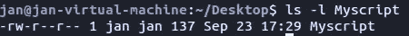

根据结果，没有足够的执行此文件。系统将自己视为脚本，但它还没有修改权限。这取决于用户。

为了提供执行权限，可以使用 `chmod` 命令。

```bash
chmod u+x Myscript
```

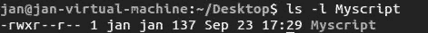

一旦完成此步，脚本就准备好执行了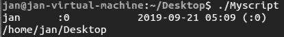

如果你想显示文本指南、环境变量的输出等，可以使用 `echo` 命令。我们在之前的一节中学习了环境变量。

### 命令别名

使用命令别名可以节省大量时间。要定义别名，你必须进行简单的赋值。

语法：`alias=command(s)`

示例：

- `alias L="ls -al"`
- `alias search=grep`

### 命令替换

将命令的输出作为变量的输入也是可能的。这是一个继续脚本并使用动态数据执行它的很棒的功能。

要实现这一点，你必须使用 `$()`。

示例：`user_name=$(USERNAME)`

示例脚本：

```bash
#!/bin/bash
user_name=$(who)
echo “Your username is :” $user_name
```

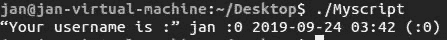

### 创建文件

另一个棒的功能是你可以输出结果。你甚至可以根据你的需要命名文件。这将在下一个示例中解释。

```bash
#!/bin/bash
mydate=$(date +%Y%m%d)
echo “Today is :” $mydate
who > log.$mydate
ls -l log.$mydate
```

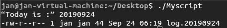

在这里，我们创建了一个日期并对其格式化。`%Y` 是 `YYYY` 格式的年份。月份是数字格式（例如 09），日期也是数字格式。输出类似于 `YYYYMMDD`。输出被存入变量。然后我们 `echo` 该变量。最后，我们使用 `who` 命令并使用重定向运算符 `>` 将输入重定向到新文件。文件名创建为 `log.YYYYMMDD`。这就是我们创建日志来保存记录。如果脚本在第二天运行，文件名将是 `log.20190925`。

重定向是一个非常有用的功能。与其使用 `touch` 等命令，你可以将输出重定向到文件。然而，你甚至可以使用 `touch` 命令从脚本创建文件。例如：

```bash
#!/bin/bash
mydate=$(date +%Y%m%d)
echo “Today is :” $mydate
touch log.$mydate
#创建一个文件并将第一部分命名为 .lo，之后使用我们的变量
who >> log.$mydate
#将‘who’命令的输出追加到文件中。
```

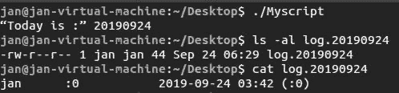

你也可以使用 `>` 运算符反转我们执行的过程。这被称为输入重定向。例如，我们可以从文件获取一个条目。下面的示例详细解释了这一点：

```bash
#!/bin/bash
wc < log.20190924
## wc 计算行、单词和字符。
```


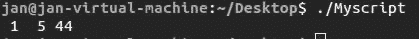

最后，我们将查看`<<`运算符。这被称为在此输入。示例：`wc << last`

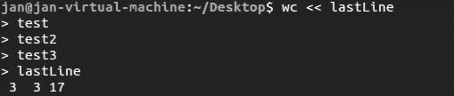

注意，`last` 是作为文本输入的。其他示例：将错误和标准输出重定向到同一个文件。你可以使用下面的命令。

示例：`ls Test3> dir 2>&1`

在这里，我们尝试列出`Test`目录的属性。记住，`ls`支持多个文件或目录。然后列出每个文件或目录的属性。`Test2`在桌面上。

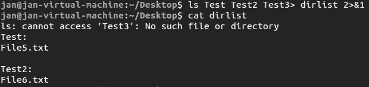

## 标准描述符

我们回顾文件描述符：

- 标准输入 - 0：`STDIN`
- 标准输出 – 1：`STDOUT`
- 标准错误 - 2：`STDERR`

第一个是标准输入，下一个是标准输出和错误。

## 管道

除了这些技术，管道在脚本中被广泛使用。当需要一个命令的输出作为另一个的输入时，管道非常有用。使用的是`|`。

示例：

```bash
#!/bin/bash
cat employee.txt | sort -nr -k 2
```

在这里我们将文件重定向到`sort`函数。它按数值倒序并按列（第 2 列）排序。

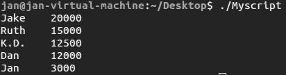

## 脚本中的数学运算

任何脚本都可以用于执行某些计算。Linux 中有一些内置命令可以执行此操作。我们查看`expr`。它代表表达式。这些是`expr`命令的运算符。

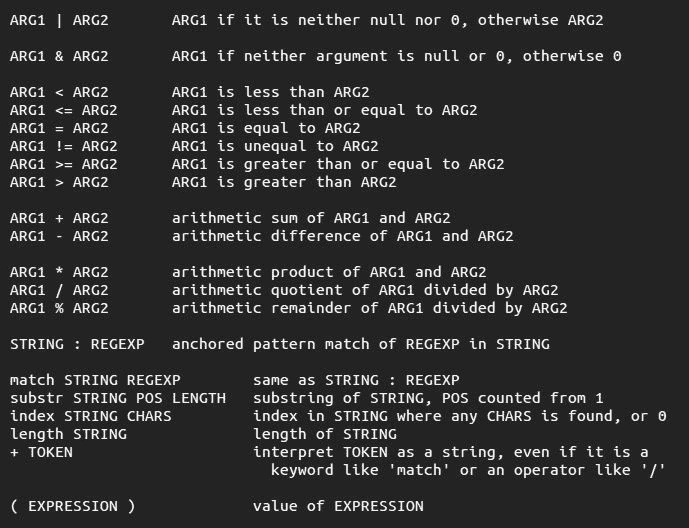

图片：`expr`运算符。


示例：

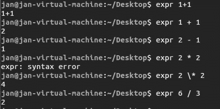

与其使用`expr`命令，更方便的是使用括号。

```bash
#!/bin/bash
var1=2
var2=6
var3=3
var4=$(expr $var1 \* $var2)
echo $var4
var5=$((var1 * $var2)/var3)
echo $var5
```

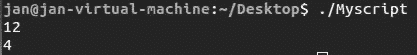

## Bash 计算器

当你想要执行更多数学函数时，有一个内置 Bash 工具执行此操作。这是 Bash 计算器。命令是`bc`。

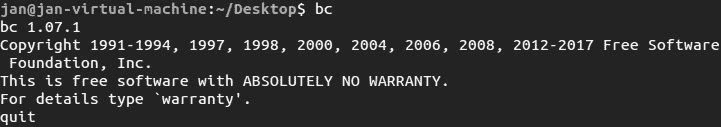

Bash 计算器支持：

- 数值（整数和浮点数）。
- 变量。
- 表达式。
- 函数。
- 语句（例如 if-then-else）。
- 注释。(image_rsrc21H.jpg)

在最后一行，你可以看到一个问题。`8.45/5 = 1`。除非向上舍入，否则是不准确的。这里的问题是小数位数由名为`scale`的内置变量处理。为了获得预期输出，我们需要修改`scale`。

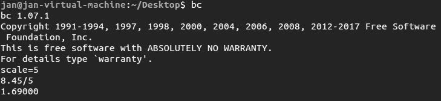

`bc`命令支持变量。下面的示例使用了变量而不是数值。(image_rsrc21M.jpg)

下一个重要任务是让`bc`在脚本中工作。在这种情况下，我们需要依赖管道。

```bash
#!/bin/bash
var1=10
var2=2
var3=$(echo "$var1 ^ $var2" | bc)
echo "The answer is: $var3
```

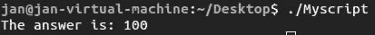

另一个使用`scale`选项的示例：

```bash
#!/bin/bash
var1=10
var2=3
var3=$(echo " scale=3; $var1 / $var2" | bc)
echo "The answer is: $var3"
```

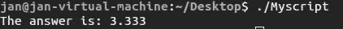

下一个示例将查看如何在脚本中使用内联运算符配合`bc`命令。

```bash
#!/bin/bash
var1=8
var2=1.75
var3=3
varF=$(bc << EOF # EOF 代表文件结束
scale = 4
v1 = ( $var1 * $var2)
v2 = ($var1 /  $var3)
v1 + v2
EOF
)
echo The final calculation is: $varF
```

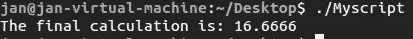

## 第 15 章 安全你的 Linux 服务器

如果你在规划和实际部署的每个步骤中加入安全考虑，那么你可以确定某天会发生什么。在本章中，你将学习与 Linux 文件系统相关的权限，它们控制谁可以做什么。首先，我们将通过定期应用软件更新和补丁来加固你的服务器，并确保没有端口是开放且不受保护的。接下来，我们将通过加密磁盘来讨论静态和传输中的数据保护。你会看到这些权限的作用。你也将学习 Linux 权限实际上是如何工作的。

文件系统中的每个对象，无论是文件还是目录，都有与其相关的元数据。这些元数据在你运行`ls -l`参数时显示。`cd`到该目录然后输入`su`。命令`su`代表切换用户。这意味着你以 Bob 的身份登录。你可以使用`touch`创建名为`data.txt`的新文件。

这里应该强调两点：第一点是由于你当前以`data.txt`所有者 Bob 的身份登录，此操作你不需要使用`sudo`。第二点是，此操作是没有意义的，除非 Bob 碰将该文件转换为脚本，因为你永远不需要执行一个简单的数据文件。

我不能不说你另一种使用数字表示法表示对象属性的方法。你会记得有三种权限：读、写和执行。如果你使用数字 4 代表读，2 代表写，1 代表执行；基于此，通过相加这 3 种权限的值，7 表示可能的最高权限级别`4+2+1=7`。具有读取和执行权限但没有写权限的人是 5，而只有执行权限的人是 1。

那么你将如何描述`data.txt`的当前值，即用户和组都具有读写权限，而其他人具有读取执行权限？那将`6, 6, 5`。另一方面，目录将是`7, 7, 5`。你自己算一下。

你可以配合`chmod`使用这种表示法，对`data.txt`应用`7, 7, 7`示例将为用户和组添加执行权限，并为其他人添加写入。你可以运行`ls -l`在`secret`目录内显示文件属性。`ls`带有`d`参数列出属性，而不是目录本身。

该行开头的字符由组组成。如果这是一个目录，将是`d`。跳几行，你应该看到接下来的三个字符`r`、`w`和`-`代表对象所有者可以使用的方式。在这种情况下，`r`告诉所有者可以读取文件，`w`意味着写入或编辑，包括删除，`-`是`x`的位置，这意味着 Bob 可以适当执行文件。`-`意味着所有者没有执行权限。

接下来的三个字符代表组成员的权限；在这种情况下，所有组成员都具有读写权限，但没有执行权限。最后的三个字符代表所有非 root 用户的权限。他们可以读取但不能写入或执行。

下一个字段告诉你文件所有者是 Bob，其组也是 Bob。尽管目录归 root 所有，文件也是 Bob 的，因为他是创建它的人。现在让我们看看目录的属性。已经提到了目录的`d`。为什么目录归 root 所有？因为它使用`sudo`创建的，实际上是 root 操作。

`changeown`（等等，文本说是`change`，可能是`chown`）你应该运行它只更改组而不是所有者。要这样做，你应该在冒号之前包含一个值，如你的用户名，然后在冒号之后加上`secret-group`设置组。

你可以使用`chmod`更改对象的属性。多尝试几次这些以确保过程完全清晰对你没有坏处。为其他人`data.txt`添加执行权限。可以使用`o`代表其他人，使用`+`表示你正在添加权限，并使用`x`表示可执行。

这里应该强调两点：第一点是由于你当前以`data.txt`所有者 Bob 的身份登录，此操作你不需要使用`sudo`。第二点是，此操作是没有意义的，除非 Bob 碰将该文件转换为脚本，因为你永远不需要执行一个简单的数据文件。

## Linux 软件包概述

1. `Binutils` - 由处理二进制文件的不同软件包组成。相关软件包包括`ar`、`as`、`gasp`、`id`、`nm`、`objcopy`、`objdump`、`ranlib`、`readlf`、`size`和`strip`。
2. `Bash` – 负责解释 Linux 中 shell 命令的 GNU 软件包。
3. `Automake` – 用于生成`makefile.in`文件的 GNU 软件，配合`Autoconf`。
4. `Autoconf` – 用于生成配置源码包 shell 脚本的软件包。
5. `Emacs` – 用于 Linux 的文本编辑器软件包。
6. `Ed` – 一种行行的文本编辑器。
7. `Diff` – 用于比较文件并逐行显示差异的软件包。
8. `GNU Chess` – 用于运行 Linux 国际象棋游戏的软件包。
9. `The GIMP` – 用于处理图像的 GNU 程序。它就像是 Linux 版的 Photoshop。
10. `GNOME` – 为 Linux 发行版提供显示或图形用户界面（GUI）。
11. `Gnumeric` – 一个在 GNOME GUI 上运行的 GNU 电子表格程序。它是 MS Excel 的对等软件。
12. `Time` – 一个为用户管理时间的 GNU 程序。

## 安装和设置 Linux 系统

在本章中，我们将学习安装和设置 Linux 的必要步骤。Linux 操作系统的优美之处在于，它通常带有预装的基础型程序。在这里，我们将了解安装步骤、安装的最低要求和配置设置，以及不同发行版的需求。

## 关于安装 Linux 操作系统

大多数计算机通常都预装了`Windows`或`MS. DOS`系统。尽管最近，一些电脑制造商开始销售预装了 Linux 的 PC。如果你的 PC 没有预装 Linux，你将必须手动安装。

第一步是选择你想要安装的变体/发行版。你可以选择安装 Linux 发行版，也可以直接从`Live CD`运行它。`Live CD`允许你直接从光盘启动 Linux 系统，而无需进行安装。这一特性使 Linux 变成了一个便携的操作系统。

或者，你可以选择将 Linux OS 作为虚拟操作系统添加到`Windows`中。要做到这一点，你需要先安装`virtual box`。一旦在`Windows`中安装了`VirtualBox`，你就可以在虚拟环境中安装 Linux。因此，你必须对硬盘进行分区以容纳两个操作系统。如果你选择使用`Live CDs`，则不需要对硬盘进行分区。

## 安装 Linux 操作系统的遵循步骤

安装 Linux 操作系统并不是火箭科学。你只需要知道一系列易于操作的步骤即可安装 Linux。在本章中，我们将介绍大多数发行版的必要步骤。稍后我们将介绍安装和设置 Linux Mint 发行版的步骤。首先，我们将介绍通用的安装要求和流程。

在安装某些 Linux 发行版之前，你可能至少需要了解系统要求，例如硬件和其他组件。以下是安装任何 Linux 发行版的简单步骤：

1. 安装 Linux 发行版的第一步是从网上下载发行版。你只需要下载软件并将其刻录到`CD`上。你也可以将安装文件拷贝到`USB stick`上并从中安装。
2. 确认你的 PC 设置为从`CD`或`USB stick`启动至关重要。某些 PC 需要在启动前更改`BIOS`中的设置。在大多数 PC 上，在启动界面上，你按下`F2`或`F8`（取决于`BIOS`版本）进入启动设置。在设置中，将启动优先级更改为从`CD`或`USB stick`（即你的 Linux OS 所在位置）启动。
3. 如果你计划从`Live CD`运行，现在需要做的只是重启系统。但如果你计划安装，第三步是在硬盘上创建一些空间（分区），用于安装 Linux。
4. 如果你想在磁盘上创建分区，使用如`partition magic`这样的分区程序是安全的。可以从 [www.powerquest.com](http://www.powerquest.com) 下载`partition magic`软件。
5. 一旦准备好分区，你现在就可以启动系统开始安装 Linux 了。
6. 具体步骤可能会根据发行版的不同而异。`GUI`将引导用户完成安装过程。
7. 你将被要求设置时区、网络设置，安装程序将自动完成剩余步骤。Linux 将安装运行系统所需的所有默认程序。
8. 安装完成后，重启你的 PC。之后你将收到进行配置设置的提示。你也可以还可以安装额外的软件包。

## 主要发行版的 Linux 系统要求

如之前提到的，在安装 Linux 发行版之前，了解系统的属性非常重要。许多 Linux 发行版对安装有不同的最低要求。请将此视为 Linux 操作系统的安装前准备要求。我们将讨论安装 Linux 的一些最低系统要求：

- 大多数 Linux 系统需要`CD/DVD`驱动器进行安装。尽管你也可以使用`USB stick`安装和/或运行 Linux OS。大多数 PC 固定带有内部`IDE`或`ATA DVD`驱动器。你也可以使用通过`USB`连接的外部`DVD`驱动器。
- 安装 Linux 之前需要检查的是硬盘。Linux 几乎适用于所有的`IDE`硬盘。某些 PC 拥有`SCSI`（小型系统接口）硬盘。Linux 同样可以很好地支持`SCSI`设备。大多数发行版至少需要`5GB`的硬盘空间进行安装。记住，如果你运行`Live CD`；则不需要硬盘空间。
- 确保你拥有一个兼容的键盘，虽然大多数键盘在 Linux 上都能良好工作。大多数`USB keyboards`（USB 键盘）是即插即用的，从而减少了设置键盘的复杂性。
- 如果你计划使用 Linux 系统访问互联网，你需要一个兼容 Linux 的调制解调器。检查制造商手册确认是否与`Unix`系统兼容。现在的制造商通常会在用户手册中说明在需要设置时遵循的步骤。
- 你的显示选项也很重要，尽管并不敏感，因为大多数基础显示器都可以支持许多分辨率。你只需要确认显示器能够与系统中安装的显卡良好工作即可。
- 你使用的鼠标类型同样重要。大多数 Linux 发行版同时支持`PS/2`和`USB mouse`。
- 如果你的 PC 使用`PC card`连接互联网或局域网，检查其与 Linux 的兼容性非常重要。在安装期间，Linux 将检查卡的兼容性。
- Linux 的另一个基本安装前要求是处理器（Processor）。大多数 Linux 发行版要求至少`400MHz`（`Pentium II`）。虽然最新的发行版需要多线程处理器，但确保你选择一个可以在系统中有效运行的发行版是关重要的。
- 你的`RAM`（随机存储器）是一个关键组件。这是系统进程可用的内存。越多越好，但为了有效运行，你将至少需要`256MB`及以上的`RAM`。为了舒适地运行`GUI desktop`，由于图形的原因，拥有足够的内存非常重要。
- 你需要确认的另一件事是声卡。Linux 将支持大多数声卡以播放媒体。安装 Linux 后，请查看制造商手册进行必要设置。一些音频卡制造商会共享其声卡的 Linux 特定驱动程序。
- 检查你的显卡的兼容性。如果你安装`GUI Linux`，你需要一张可以与`X window system` old 的显卡。Linux 可以检测并指示显卡是否与 Linux 系统兼容。
- 如果你安装了打印机，建议检查用户手册，了解与基于 Unix 系统的兼容性说明。大多数制造商都会提供一张包含 Windows 和 Linux 系统驱动程序的 CD。

## 在 VirtualBox 中安装 Linux Mint

在某些情况下，你可能希望保留当前的 Windows 系统，但仍然在同一台 PC 上安装 Linux。为了实现这一目标，你需要在 Windows 中安装一个虚拟机（virtual box）。虚拟机是一个虚拟环境，允许你在其中安装 Linux。或者，虚拟机也可以帮助你在 PC 上安装多个发行版。你将安装两个版本，其中一个将安装在硬盘的分区上，而另一个将安装在虚拟机中。

## 第 17 章：控制特权用户

现在，是时候开始讨论访问你操作系统或服务器的用户的安全性和权限了。尤其在今天，人们似乎认为技术和服务器比以往任何时候都时候安全，但与大众的认知相反，实际上有非常多的支持可以保持系统的安全和稳固。其中一种方法就是通过控制特权用户，本章将教你如何操作。

在阅读本章时，你将引导了解各种类型的 Linux 账户，例如 root 用户、普通用户和系统用户。你将发现`sudo`，它的意思是“super user do”（超级用户执行）。这是系统管理员的命令——只要你处于正确的账户并拥有使用它的适当权限，该命令就可以让你访问任何内容和任何地方。

最后，你将学习`sudoers`文件。该文件本质上是`sudo`背后的底层程序——它控制`sudo`以及最初谁有权访问`sudo`命令。这一切都将帮助你管理服务器或机器上的用户，让你能够确保落实了适当的安全系统。当一切就绪且系统安全后，你就可以放心，感觉你的系统是真正安全的。

## Linux 账户类型

首先，在进行其他操作之前，我们将讨论 root 用户、普通用户和系统用户。你必须对这三种账户类型有完全的理解，才能真正理解`sudo`和`sudoers`如何在系统安全中发挥作用。

由于 Linux 极其灵活，你有选择创建几种不同类型的账户。事实上，如果你需要，可以拥有多个 root 账户，或者在不同类别中拥有不同权限的账户。重要的是你的需求能够得到有效的满足。


请记住，仅仅因为你有 `root` 账户并不意味着你不应该建立某种安全系统——你绝对应该有一个密码来保护 `root` 账户，以确保无人能够访问这些文件并在未经你许可的情况下接管它们。这意味着你能够确保文件本身还有另一层的保护。现在，废话少说，让我们开始研究 Linux 的三种主要用户类型。

## Root 用户

你必须认识的第一个用户是 `root` 用户。这通常被称为超级用户，特别是在 `sudo` 缩写中。超级用户或 `root` 用户是默认管理员账户的个人。这个人对系统拥有完全控制权，就像管理员账户对 Windows 的控制权一样。凭借默认赋予的 `root` 权限，该用户能够执行任何命令，并直接控制或更改其他人的和服务账户。

实际上，如果你是设置系统的人，那么这本应该是你的账户。这个账户能够统治其他账户，管理并监控所有账户，而无需额外权限。所有权限都授予了 `root` 用户。他们可以更改其他用户的权限、移动文件、更改文件所有权，并在系统内进行任何其他操作。

请记住，由于你有权在程序中执行几乎任何操作，操作系统不会告诉你不要做某事。系统对你没有任何保护措施，你在使用此账户时必须小心。如果你删除了系统文件，而你没有定期对文件进行归档和备份，那么可能无力回天。如果有一个用户能够对你的程序造成灾难性的破坏，那么这个用户就是超级用户或 `root` 用户。

Linux 假设 `root` 用户对自己所做的一切有很好的把握，正因如此，如果你在任何时候不确定自己在做什么，宁可信其有，不可信其无，如果你认为必要，应该尝试寻求他人的帮助。总的来说，虽然这应该是你拥有自己权限的账户，但你也应该尽可能地避免使用此账户，以确保你不会冒着销毁一切的风险。

在非常特定的时期你应该使用 `root`。否则，对于大多数日常功能，你只需要一个普通账户就足够了。当然，每当你尝试一项需要 `root` 权限的任务时，你应该确保在必要时进行切换，并在尝试任何操作之前备份数据。特别是，你需要使用 `root` 权限将文件或目录移入系统目录。请记住，系统目录是那些直接负责操作系统运行的目录，没有它们，你就无法运行操作系统。当你尝试将任何文件复制到系统目录时、更改其他用户的权限时、进行某些系统修复以及偶尔安装程序时，都要求你使用 `root` 账户。通常，如果一个文件需要 `root` 权限才能安装，是因为该文件本身将直接与系统目录交互。如果你没有进行上述任何操作，只需避免它，从而省去可能搞乱系统的麻烦。

## 普通用户

普通用户和系统用户具有相同的权限，两者通常都由 `root` 或被授予某种程度权限的用户创建。然而，普通用户通常是一个真实的人，而系统用户通常是为软件保留的账户。普通用户将拥有真实的 shell（外壳）和自己的家目录，并且在使用 `adduser` 命令创建新用户时，每个用户都会分配一个 `UID`。基本上，此用户没有特殊权力。普通用户无法访问任何被标记为不可用的文件，其权限可以根据用户的需要定期更改。

大多数情况下，如果你在自己的设备上运行 Linux，你需要一个 `root` 账户来确认你是否要执行该操作。当你准备好使用 `sudo` 时，你会使用普通账户来确保你不会意外删除或销毁某些东西。这就是你的保护措施。普通用户的权限可以由 `root` 用户自定义——授予你所需的任何权限，只要你了解方法。

## 系统用户

如前所述，系统用户与普通用户的权限相同。然而，系统用户几乎总是某种程序（例如守护进程 daemon），它将在后台运行且不具有交互性。该用户的存在仅仅是为了组织目的。当你能够指定系统用户时，你一眼就能看出它不涉及人类。虽然这可能并不重要，但能一眼看到你有多少用户是好的。通常，这些账户是在操作系统安装期间创建的，并保留控制权。它们通常具有非常特定的 `UID`，你可以在 `root` 账户中识别它们。由于这些系统用户运行操作系统必要的进程，当你修改或重置任何进程时，应该离开它们。如果你在终端看到它在等待你，你需要小心，并尽可能离开这些系统用户，以保护你自己免受损坏。如果你损坏了其中一个，由于你不注意，很可能会销毁整个操作系统。

## Sudo

现在是时候讨论 `sudo` 了。如果你在命令前使用 `sudo`，你实际上是在告诉系统你有特权来执行该过程。通常，特权权限是系统检查你是否真的被授予了进行更改的权限。如果你一直主要使用 Windows，你已经习惯某种账户交互。当你安装软件时，你会注意到某些安装将弹出提示，询问你是否确定继续并要求你提供所需的权限。这就是你在 `sudo` 中正在做的，你实际上是在告诉系统你对系统具有特权访问权限。

如果你一直主要使用 macOS，直到你触发可能被视为危险或创建重大更改的操作，你有类似的保护措施。在 Mac 上，你会看到一个安全框弹出，你必须提供密码以确认你确实想执行该操作。本质上，`sudo` 是你的权限密码，它告诉系统你是负责的——只要你的账户权限匹配。

### 使用 Sudo

当你准备好使用 `sudo` 时，不需要太费。实际上，你所做的就是在尝试执行的命令前加上 `sudo`。这样做，你的程序应该要求你输入你所在账户的密码。如果你提供了密码且凭据通过，它将执行功能。例如，假设你想重启系统。你可能记得触发系统重启的命令仅仅是 `reboot`。然而，`reboot` 需要 `sudo` 权限。如果你只是简单地用 `reboot` 命令系统，它会告诉你必须是超级用户才能执行该命令。这就是你提升命令的地方。在那里，你可以在命令中添加：

```
sudo reboot
```

你的系统会询问账户密码，输入密码后按要求重启。

### 使用 Su 而不是 Sudo

这可能是你用来提升权限以触发系统遵守的安全方法之一。还有其他方法，例如切换用户命令 `su`。然而，当你使用切换用户命令时，会被要求 `root` 密码并进入超级用户提示符。当你得到 `#` 作为输入信号而不是你现在可能熟悉的 `$` 时，你就知道处于超级用户提示符中了。`#` 应该是你的警告标志——如果你在终端看到它在等待你，你知道你处于 `root` 账户，需要小心。

虽然切换用户命令在非常特定的情况下可能有用处，但它存在你因一个拼写错误或你在敲键盘时不小心被别人撞到而销毁一切的风险。然而，当你使用 `sudo` 时，你需要在每一个需要额外权限的命令中插入它。这意味着你有了额外的保护。当然，如果你正在处理某些需要你不断验证凭据的事情，这可能会很烦，但如果你认为额外的安全性是值得的，那就是值得的。当然，你可以在开始绕过 `sudo` 使用过程之前为系统设置备份，但那是你必须做出的个人决定，要权衡自己的风险。

### sudoers 文件

在 `sudo` 之下是 `sudoers` 文件。它决定了最初可以使用 `sudo` 命令来使用权限。通常，你可以在 `/etc/sudoers` 访问此文件，编辑它的最好方法是使用 `visudo`。

### Visudo

`visudo` 本身充当临时措施——`sudoers` 文件的额外安全层。它允许安全编辑，同时锁定 `sudoers` 文件防止被多个用户编辑，这可能会变得危险。如果你在其他人正在使用它时用 `visudo` 访问它，你会被错误消息拒绝并被要求稍后再试。当你进行编辑时，它会停止并检查编辑是否有错误。如果你碰上语法错误，它将拒绝保存，并打印声明错误位置的消息。从那里，你会被提示尝试重新编辑以修复错误，或者你可以直接退出。

### 使用 Sudo

当你准备好使用 `sudo` 时，不需要尝试。实际上，你所做的就是在你尝试执行的命令前加上 `sudo`。这样做，你的程序应该要求你输入你所在账户的密码。如果你提供了密码且凭据通过，它将执行。例如，假设你想重启系统。你可能记得触发系统重启的命令仅仅是 `reboot`。然而，`reboot` 需要 `sudo` 权限。如果你只是简单地用 `reboot` 命令系统，它会告诉你必须是超级用户才能执行该命令。那就是你提升命令的地方。在那里，你可以在命令中添加：

```
sudo reboot
```

你的系统询问账户密码，输入密码后按要求重启。

### Su 而不是 Sudo?

这可能是你用来提升权限以触发系统遵守的安全方法之一。还有其他方法，例如切换用户命令 `su`。然而，当你使用切换用户命令时，会被要求 `root` 密码并进入超级用户提示符。当你得到 `#` 作为输入信号而不是你现在可能熟悉的 `$` 时，你就知道处于超级用户提示符中了。`#` 应该是你的警告标志——如果你在终端看到它在等待你，你知道你处于 `root` 账户，需要小心。

虽然切换用户命令在非常特定的情况下可能有用处，但它也存在你因一个拼写错误或你在敲键盘时不小心被别人撞到而销毁一切的风险。然而，当你使用 `sudo` 时，你需要在每一个需要额外权限的命令中插入它。这意味着你有了额外的保护。当然，如果你正在处理某些需要你不断验证凭据的事情，这可能会很烦，但如果你认为额外的安全性是值得的，那就是值得的。当然，你完全可以在开始绕过 `sudo` 使用过程之前为系统设置备份，但那是你必须做出的个人决定，要权衡自己的风险。

### sudoers 文件

在 `sudo` 之下是 `sudoers` 文件。它决定了最初可以使用 `sudo` 命令来使用权限。通常，你可以在 `/etc/sudoers` 访问此文件，编辑它的最好方法是使用 `visudo`。

### Visudo

`visudo` 本身充当一种临时措施——`sudoers` 文件的额外安全层。它允许安全编辑，同时锁定 `sudoers` 文件防止被多个用户编辑，这可能会变得危险。如果你在其他人正在使用它时用 `visudo` 访问它，你会被错误消息拒绝并被要求稍后再试。当你进行编辑时，它会停止并检查编辑是否有错误。如果你碰上语法错误，它将拒绝保存，并打印声明错误位置的消息。从那里，你会被提示尝试重新编辑以修复错误，或者你可以直接退出。

`visudo` 允许你检查 `sudoers` 文件的语法。常用的 `visudo` 选项如下：

- `visudo -c`: 检查 `sudoers` 文件的语法。
- `visudo -l`: 列出当前的 `sudo` 权限规则。
- `visudo -s`: 以静默模式检查语法。
- `visudo -u username`: 检查特定用户的 `sudo` 权限。
- `visudo -g groupname`: 检查特定组的 `sudo` 权限。
- `visudo -f filename`: 使用指定的文件作为 `sudoers` 文件。
- `visudo -n`: 检查语法但不保存。
- `visudo -v`: 显示版本信息。

### sudoers 文件

使用 `visudo` 允许你安全地编辑 `sudoers` 文件。一个典型的 `sudoers` 文件的格式如下：

- `root ALL=(ALL:ALL) ALL`: 允许 `root` 用户在任何主机上以任何身份执行任何命令。
- `user ALL=(ALL) ALL`: 允许普通用户在任何主机上执行任何命令。
- `%sudo ALL=(ALL:ALL) ALL`: 允许 `sudo` 组的成员在任何主机上以任何身份执行任何命令。
- `user ALL=(ALL) NOPASSWD: ALL`: 允许用户执行命令无需密码。
- `user ALL=(root) /usr/bin/command`: 允许用户以 `root` 身份执行特定命令。
- `user ALL=(ALL) NOPASSWD: /usr/bin/command`: 允许用户无需密码执行特定命令。

通过编辑 `sudoers` 文件，你可以精细地控制哪些用户或组拥有特权权限，从而增强系统的安全性。

## 1. 哪种用户类型拥有最高权限？

1. 普通用户
2. Root 用户
3. 系统用户
4. 随机用户

## 2. 在无需登录管理员账户的情况下，覆盖管理限制所需的命令是什么？

1. `sudore`
2. `visudo`
3. `sudo`
4. `su`

## 3. 哪种说法是正确的？

1. 由于有删除重要信息的风险，你应该避免使用 `root` 账户
2. 由于有删除重要信息的风险，你应该避免使用 `visudo` 进行编辑
3. 由于有删除重要信息的风险，你应该避免使用 `sudo` 命令
4. 由于有删除重要信息的风险，你应该避免使用 Linux
5. 以上均是

## 4. 正确或错误：当你进行编辑时，`Visudo` 会检查错误。

## 5. 正确或错误：默认情况下，`visudo` 会在不发出警告的情况下将错误的编辑内容发布到 `sudore` 文件中。

## 结语

我想借此机会感谢你读完这本信息丰富的书籍——Kali Linux。我相信它对你大有益处，通过它，你现在能够上手处理黑客相关的事务。同时，我希望你已经获得了相关的专业知识，让你能够开启黑客生涯，或者如果你已经是业内人士，可以提升你的技能。我衷心希望你从第一个主题“Kali Linux 简介”开始，贯穿“Kali Linux 基础”、“黑客流程”、“无线网络攻击”、“Kali Linux 的用途与应用”、“网络安全简介”、“网络扫描与管理以及 Web 安全”，整个过程非常愉快。

我相信通过学习这本书，你已经学习了成为黑客专家所需的许多实用概念。到目前，你应该已经能够掌握针对你的系统发起的各种类型攻击的大量理论知识、发起攻击的原因以及你如何保护你的基础设施免受此类攻击。这些是你迈向专业黑客的第一步。本书涵盖了无线网络攻击、网络攻击和渗透测试等主题。因此，这意味着你现在处于良好的位置，可以识别现实世界中网络攻击机制并开出适当的措施。

我还为你提供了一些你可以实施的安全措施，以保持你的网络安全。其格式采用了易于理解的语言，让你理解保护网络安全的重要性。展望未来，下一步是将你从书中学到的概念付诸实践。俗话说熟能生巧，只有通过实践，人们才能成为黑客领域的专家，尤其是在使用 Kali Linux 的时候。让你从书中获得的知识为你效力吧。
