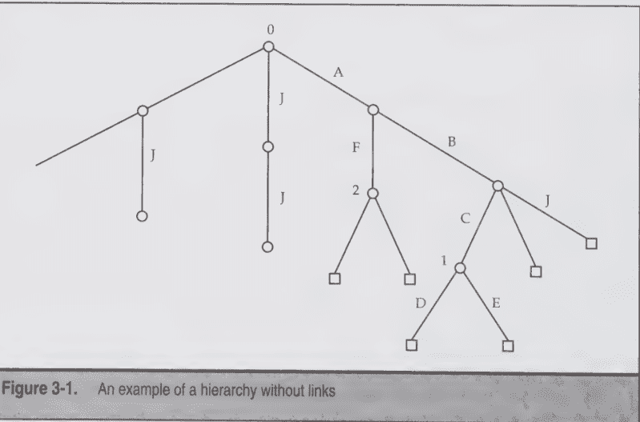
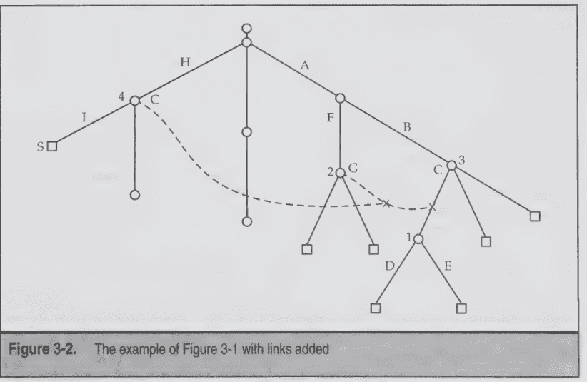
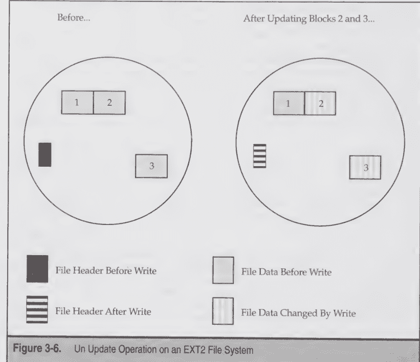

# Linux：Linux 文件系统

## 关于作者

`Moshe Bar`是《Linux Internals》的作者，以及《Byte.com》和《Dr. Dobbs》的 Linux 高级编辑。他是 Linux JFS 文件系统项目的贡献者，也是 Linux 集群 Mosix 项目的主要贡献者。`Moshe Bar`拥有计算机科学博士学位。

## Linux 文件系统

`MOSHE BAR`

`Osborne/McGraw-Hill`

纽约 芝加哥 旧金山

里斯本 伦敦 马德里 墨西哥城 米兰

新德里 圣胡安 首尔 新加坡 悉尼 多伦多

`Osborne/McGraw-Hill`

`2600 Tenth Street`

`Berkeley, California 94710`

`U.S.A.`

如需安排促销、赠品或募捐的批量购买折扣，请通过上述地址联系 `Osborne/McGraw-Hill`。有关美国以外的翻译或图书分销商的信息，请参阅本书索引后的“国际联系信息”页。

> 致我的母亲，感谢她含辛茹苦地抚养我。

> 致我的父亲，感谢他教导我坚信原则的价值。

> 致我的老师，感谢他们赋予我对知识的渴求。

> 致我的朋友们，感谢他们为我的生活带来了新的色彩、声音和气味。

2022 年由 Internet Archive 在 `Kahle/Austin` 基金会的资助下数字化

## 致谢

这本书的编写不仅需要我个人的努力，还需要我另一半的极大支持。在很多时候，这本书的写作优先于我们共同相处的时光，而她始终保持耐心。非常感谢她一直陪伴在我身边。

特别感谢开源项目 XFS、JFS 和 ReiserFS 的贡献者们。人数众多无法一一列举，但其中绝对包括同意为我提供 XFS 文档的 `Stephen Lord` 和 `Jim Mostek`。IBM 的 `Steve Best` 耐心地回答了我关于 JFS 的许多问题，对此我深表感谢。`Hans Reiser` 为本项目提供了基础文档，条件是我将本书编辑后的 ReiserFS 章节作为文档返回给他，用于 ReiserFS 网站。

同时非常感谢我的朋友们 `Roberto`、`Tom` 和 `Barak` 教授，他们为我提供了见解、建议和乐观的情绪支持。

本书的内容在很大程度上依赖于 Linux 及其文件系统背后一些大牛的帮助。像 `Wietse Venema`、`Stephen Tweedie`、`Andrea Arcangeli`、`Ingo Molnar`、`Remy Card` 等人，通过他们的工作以及不厌其烦的讲解做出了巨大贡献。

其他优秀的开源社区成员，如 `Neil Brown`、`Alessandro Rubini`、`Doug Gilbert`、`Louis-Dominique Dubeau` 等，通过对本书讨论的部分子系统的研究和文档编写，为本书做出了重要贡献。

最重要的是，我要感谢上帝，给了我编写这本书所需的一切。

## 第一章

### 简介

## GNU/LINUX 与文件系统

在接触 Unix 近 20 年，以及使用 Linux 8 年之后，我原以为自己已经掌握了 Linux 存储和检索数据的所有知识。即便如此，在 2000 年秋天于荷兰举行的一场 Unix 会议上，我听到了一些令我难以置信的事情。`Wietse Venema`（TCPWrappers 的作者以及 postfix MTA¹ 的幕后主脑）是开场演讲者，他向观众宣布他能够从普通的 Linux 文件系统中恢复那些曾被认为已经丢失的文件，² 这一消息震惊了在场的所有人。

我一直认为（当然不是字面意义上的成长）一旦文件被删除，它就永远消失了——无法再次被“取消删除”。而 `Wietse Venema` 却在说，事实上，文件可以相当容易地被恢复，而仅此一点就构成了一个严重的安全问题。数百名听众和我一样意识到，对于我们存放宝贵数据的文件系统，我们的了解竟然如此之少。

在极早期，Linux 是在 Minix³ 操作系统下进行交叉开发的。`Linus Torvalds` 选择这个策略是因为它允许他在两个系统之间共享磁盘，而不需要从零开始设计一个新的文件系统。Minix 文件系统是一款高效且相对没有 Bug 的软件。然而，Minix 文件系统的设计限制过于严重，因此人们开始思考并在 Linux 中实现新的文件系统。

为了方便将新文件系统添加到 Linux 内核中，开发了一层虚拟文件系统（VFS）。VFS 层最初由 `Chris Provenzano` 编写，后来由 `Linus Torvalds` 重写，随后被集成到 Linux 内核中。本书的“虚拟文件系统”章节中对此有详细描述。

在 VFS 集成到内核之后，一个新的文件系统——扩展文件系统（ext）于 1992 年 4 月实现并被添加到 Linux 0.96 版本中。这个新文件系统消除了 Minix 的两个重大限制：其最大容量提升至 2GB，且最大文件名长度为 255 个字符。ext 文件系统相比 Minix 文件系统已经有了很大改进，但它仍然存在一些固有缺陷。它不支持分别记录访问时间、inode 修改时间和数据修改时间。⁴ 该文件系统在内核中使用链表来跟踪文件系统中的空闲块和 inode，但这引入了新的低效性：随着文件系统使用率的增加，这些链表变得无序，文件系统产生碎片，导致整体文件系统性能下降。

为了解决这些问题，1993 年初发布了两个新的文件系统：Xia 文件系统（Xiafs）和第二扩展文件系统（ext2fs）。Xia 文件系统主要基于 Minix 文件系统的代码，仅增加了一些基础改进。它提供了长文件名、支持更大的分区，以及支持三种时间戳：创建时间、修改时间和访问时间。另一方面，ext2fs 基于 ext 文件系统的代码，进行了许多改进。它在设计之初就考虑到了未来的扩展性。

当这两个新文件系统首次发布时，它们提供的功能集基本相同，尽管实现方式和源代码不同。由于设计极简，Xiafs 实际上比 ext2fs 更稳定。最终，ext2fs 的 Bug 被修复，大量改进和新功能被集成。如今，ext2fs 非常稳定，并成为了 Linux 文件系统的实事标准（de facto standard）。

除了对 ext2fs 的深入探讨，本书还将研究目前 Linux 可用的所有重要文件系统，分析它们的优缺点，并展示如何有效地使用它们。

¹ MTA 是邮件传输代理（Mail Transportation Agent），用于发送和接收电子邮件。

² 删除文件时，Linux ext2 文件系统不会擦除目录项。因此，名称到 inode 的映射会被保留，至少在目录项被覆盖之前是如此。所以，如果你能访问原始目录块，你可以找到被删除文件的名称及其 inode 号；由此你可以访问前十几个直接块。

³ Minix 及其文件系统是由 `Andrew Tanenbaum` 教授出于教学目的开发的。

⁴ 这些特性将在后续章节中探讨。

## 本书目的

编写本书旨在增强对目前 Linux 可用的最重要文件系统的普遍理解。有时，为了能够透彻地理解文件系统，我们必须研究它们的编写方式。然而，本书并非这些文件系统的源代码评注。相反，它是一本指导何时能有效地使用哪个文件系统的书。

以下是对几个宽泛术语的回顾：

- 内核（kernel）是运行在保护模式下并具有硬件特权寄存器访问权限的操作系统软件。

- 文件系统（file system）是代表用户或系统数据独立容器的控制块的逻辑集合。在提及“文件系统”这个词时可能存在歧义。一种用法是指某种特定类型的文件系统，如 ext2fs 或 NFS。另一种用法是指文件系统的某个特定实例，如`/usr`或`/boot`。

- 命名空间（name space）是唯一分配的标识符（如文件名）的集合。在一个命名空间内，一个文件名只能有一个实例。通常，命名空间包含在一个目录的范围内。

- 目录（directory）是由文件系统维护的一种特殊文件，包含一个条目列表。对于用户来说，一个条目看起来像是一个文件，并通过其符号条目名称（即用户的文件名）来访问。

## 谁应该阅读本书

本书的目标读者是系统和网络管理员、开发人员以及容量规划经理。对于对硬件和软件有良好普遍理解的 Linux 爱好者也具有吸引力。

在接下来的章节中，系统管理员将学习如何准备内核以使用特定的文件系统、有哪些可用的文件系统以及如何正确地使用它们。此外，他们还将能够通过在适当位置调优文件系统来显著提高系统吞吐量。

开发人员将学习文件系统如何影响他们的应用程序。虽然许多人认为文件系统对开发人员来说是透明的，但事实并非如此。例如，知道锁定机制是由文件系统有效地实现的，可以让程序员或开发人员无需在应用程序中编写此功能。

## 阅读本书前你需要了解的知识

如果你对计算机科学理论的一般概念（特别是在命名空间和 I/O 领域）有良好的理解，将大有裨益。此外，如果读者具备 Linux 接口的操作知识以及对基础系统管理涉及内容的初步了解，也会有所帮助。不需要具备关于文件系统的预先知识。

能够阅读 C 程序是有帮助的，尽管书中提供的绝大多数代码都有解释。对于 C 语言的入门，本书作者始终强烈推荐由 C 语言设计者 `Kernighan` 和 `Ritchie` 编写的《C 程序设计语言》（The C Programming Language）。

## 本书内容

本书包含对 Linux 操作系统及其组织结构的简短介绍。它还解释了如何重新编译 Linux 内核，这对于使用未预编译进标准 Linux 发行版内核的文件系统来说是重要的知识。

在回顾了 Unix 对文件系统的通用处理方法后，我们将通过虚拟文件系统（VFS）研究 Linux 对文件系统的抽象。随后，将对所有重要文件系统进行回顾和讲解。

本书并不试图对所有可用的 Linux 文件系统提供详尽的评注。相反，它专注于最重要的那些文件系统以及如何有效地使用它们。

书末附录包含系统调用、GPL 许可证和其他有用信息。

## 如何使用本书

最佳阅读方式是从头到尾线性阅读。在第一遍阅读之后，读者可能会在日常使用文件系统时将本书作为快速参考手册。

## 更多信息获取途径

关于 Linux 文件系统的最新信息可以在互联网上找到。然而，这些信息本质上是原始数据。收集这些信息、将其整合并转化为连贯的格式并非易事。这正是《Linux File Systems》一书的最大价值——它提供了一个连贯的、经过研究且格式化的信息源，而这些信息原本只能通过网站、源代码和文章向公众开放。

关于内核的一个良好信息来源当然是实现文件系统的内核源代码。订阅本书中提到的所有文件系统的开发者邮件列表，是了解文件系统所有相关方面的绝佳方式。

### 建议与评论

非常欢迎任何建议或评论，可以通过电子邮件发送至`moshe_bar@hotmail.com`，或邮寄至`Moshe Bar` c/o `McGraw-Hill`, Professional Book Group, Two Penn Plaza, New York, NY 10121。

### 开源——对现代操作系统的启示

毫无疑问，Linux 获得异常成功的主要原因是通用公共许可证（GPL）。然而，开源的概念，或者有时被称为自由软件的概念，实际上已经相当古老。自由软件的第一位倡导者是自由软件基金会（FSF）的理查德·斯托曼（`Richard Stallman`）。他为自己编写的一些优秀且现已广泛应用的软件设计了 GPL 许可证，其中最著名的可能是 Emacs 编辑环境以及用于 C 和 C++ 的 GCC 编译器。如需 GNU 工具的完整列表，请访问`www.gnu.org`。

理查德·斯托曼长期以来一直在致力于开发一个完整的 GNU 操作系统，该项目名为 GNU Hurd。尽管该 OS 已开发了近十年，但仍未真正成为现实，但该项目涌现出许多强大的技术，并被引入到其他操作系统中，如 Linux、BSD 等。

操作系统从开源开发方法中获益于两个方面：可靠性和性能。Linux 的可靠性在很大程度上源于数百（或数千）名开发者对代码的审查、改进、修改和测试。正如埃里克·雷蒙德（`Eric Raymond`）在其著名的论文《大教堂与集市》中所述：只要有足够多的 Beta 测试者和共同开发者，几乎每个问题都能被迅速定义，且修复方案对某些人来说是显而易见的。

因此，有如此多的人员审视 Linux 代码库，使其拥有比任何闭源模型软件开发组织所能负担的更好的 QA（质量保证）部门。这反过来又造就了更高质量的软件。

仅仅是像开源这样的开发模型，其本身不能替代正规的设计和编码方法。但开源模型在很多方面都远超私有模型。以 Linux 中的内核改进为例。

## LINUX 历史

与许多成功故事一样，Linux 起源于一个因需求而生的项目。1991 年，时任芬兰赫尔辛基大学学生的林纳斯·托瓦兹（`Linus B. Torvalds`）买了一台基于 i386 的 PC，这是第一款在芯片上支持虚拟内存管理的 Intel CPU。林纳斯对 MS/DOS 操作系统并不完全满意，于是决定在自己的 PC 上实现 Minix OS。

不久，他开始增强 Minix，以提供学习所需的函数和特性。随后，他认为 Minix 太像一个学术 OS，决定从零开始创建自己的操作系统。最重要的决定是，托瓦兹决定将其新 OS 的源代码通过互联网免费提供，即以开源形式发布，命名为 Linux（Linux 和 Unix 的缩写）。

第一个 0.01 版本于 1991 年 8 月在互联网上提供下载。同年 10 月，林纳斯正式宣布 0.02 版本可用。该版本已经能够执行诸如 bash shell、GNU gcc 编译器和其他基础实用程序等 Unix 用户层程序，但仅限于此。

不久，由于项目的开源性质，源代码在全球范围内立即可见，许多黑客、计算机发烧友和 PC 爱好者开始研究并增强代码。许多人开始向林纳斯发送建议，林纳斯由此创建了“官方”参考 Linux 源代码开发树。在审核这些代码建议时，他拒绝了大部分，但采纳了其中一部分。开发以这种方式持续了三年，直到发布第一个生产版本。

1994 年 3 月，1.0 版本发布。作者记得它偶尔还会出现一些古怪的行为特性，但已经相当可用。Linux 1.0 支持 TCP/IP、SLIP 和打印机，并拥有足够驱动程序来支持当时市面上的各种 PC 设备。

此后，Linux 热潮真正开始，世界各地的数百万爱好者开始使用该系统。稍早一些的 1992-93 年左右，首批 Linux “发行版”出现。发行版是获取全功能 OS 的主要方式，包括 Linux 内核、X 窗口系统以及一套包含数百个应用程序和实用程序的综合包。发行版还包含一个“安装程序”，用于准备 OS 的二进制镜像和启动/关机脚本，并确保所有组件相互兼容且经过优化。最后但同样重要的是，发行版还提供文档。如今存在许多发行版，市场上最成功的是 RedHat、SuSE 和 Caldera。

Linux 稳步攀升并成为今日 IT 市场主要力量的里程碑列举如下：

- 1991 年 8 月：0.01 版本

- 1991 年 10 月：0.02 版本正式宣布

- 1993 年 11 月：第一个搭载 0.99 内核的 Slackware 发行版

- 1994 年 3 月：1.0 版本

- 1995 年 6 月：首次移植到 Alpha 架构

- 1996 年 10 月：Debian Linux 被用于轨道上的太空梭（运行在 IBM 笔记本电脑上）

- 1999 年 1 月：2.2.0 版本

- 2001 年 1 月：Linux 2.4.0 发布

- 2001 年 7 月：Linux 2.4.6 发布

## 今日 Linux 提供的功能

Linux 从 1991 年的卑微起步走过了很长一段路。随着开源现象的进一步扩大，越来越多的人为 Linux 内核及其子系统做出贡献。与此同时，数以千计的用户空间软件包以不断增加的频率被添加。随着万维网的同步兴起，一些网站专门用于每日发布适用于 Linux 的新软件版本公告。

如今，Linux 可在许多平台上运行，包括 Intel、Sparc、Alpha、MIPS、Motorola 68000 系列和 PowerPC。

在早期，Linux 就实现了与 POSIX（可移植操作系统接口）标准的兼容。其 POSIX 兼容性使得在 Linux 下开发的应用程序可以非常轻松地移植到其他兼容 POSIX 的操作系统上。在基于 Intel CPU 的系统上，Linux 二进制文件符合 iBSCS 标准。这使得，例如，一个静态链接程序可以在无需重新编译的情况下在 FreeBSD 或 Solaris 下运行。

从技术上讲，Linux 提供以下功能：

- 多用户

- 多进程，多处理器 (SMP)

- 进程间通信 (IPC, pipes, sockets)

- 进程控制

- POSIX 风格的终端管理

- TCP/IP, IPv4, IPv6

- 支持多种硬件

- 请求分页（Demand paging），可选 LRU (Least Recently Used) 算法和页面着色 (page coloring)

- 交换 (Swapping)

- 缓冲缓存 (Buffer cache)

## 2.4 内核的新特性

- 动态库和共享库

- 支持多种文件系统 (ext2fs, UFS, NTFS, HPFS, MS/DOS, ISO9660, coda 等等)

Linux 2.2 相比 Linux 2.0 和 Linux 1.x 系列有了重大改进。它支持许多新文件系统，拥有新的文件缓存系统，且可扩展性大大增强。Linux 2.4 在这些改进的基础上进一步提升，成为在各种环境下表现最佳的 Linux 内核。

虚拟文件系统 (VFS) 层也比早期的 Linux 版本进行了大量修改。Linux 2.2 对该层进行了许多极佳的更改，实现了更好的缓存和更高效的整体系统。然而，Linux 2.2 中的系统仍存在一些重要限制，这些限制在 Linux 2.4 中得到了解决。Linux 2.2 处理方式的一个主要限制是它使用了两个缓冲区进行缓存：一个用于读取，一个用于输出。你可以想象，这使得事情变得非常复杂，因为内核开发者必须极其小心地编写代码，以确保在需要时这些缓存始终同步。Linux 2.4 通过移除多缓存系统并将所有工作整合到单个页面缓存层中，彻底打破了这堵墙。这一改变使 Linux 2.4 更加高效，代码更易于开发者理解，且缓存所需的内存量大致减少了一半。在这次重写过程中，许多竞态条件（多个进程“竞争”访问未保护变量时引起的错误）被消除，代码得到了精简，从而使高端系统的扩展性显著提高，并且在涉及多个卷时磁盘写入速度更快。


Linux 内核是一个由模块化组件和子系统组成的集合，包括设备驱动程序、协议和其他类型的组件。它们通过 API（应用程序编程接口）粘合到 Linux 内核核心，API 提供了一种标准方法来扩展 Linux 内核。本书的大部分内容聚焦于这些承担绝大部分工作的 Linux OS 组件。

在 2.4 内核系列中，Linux 极大地提高了处理大量进程和任务的能力。任务限制现在可以增长到 4090 个以上。此外，调度器的效率有所提高，Linux 2.4 比早期版本能更好地处理具有大量并发进程的系统。

Linux 2.4 还能处理比之前内核版本大得多的“企业级”硬件。例如，通过适当的补丁，Linux 2.4 可以寻址超过 4GB 的 RAM。我见过的一台机器配置了 12GB RAM，且拥有一个常驻大小为 8.3GB 的地址空间。

在 SMP 系统上的可扩展性现在已可与私有操作系统相媲美，在某些情况下甚至更好。

（作为古老的 Intel x86 架构的下一代 64 位继任者）尚未直接包含在内核中。

新增了文件系统支持（Irix efs 文件系统以及 DVD 光盘使用的 UDF 标准），而其他一些则已废弃（QNX 和 ext1）。

`tasklets` 的引入为处理低级中断提供了一种全新的革命性方式，使得 TCP/IP 协议栈（以及其他子系统和用户程序）效率大大提高。此外，还增加了能够处理 DECNet 标准的新网络协议软件。

Linux 2.2 和 Linux 2.0 包含内置支持，以便在执行 Java 应用程序时启动 Java 解释器（如果存在）。（Linux 是首批在内核层面实现此功能的操作系统之一。）Linux 2.4 仍然包含根据需要加载 Java 解释器的支持，但具体的 Java 驱动已被删除，用户需要升级其配置以使用 “Misc.” 驱动。

作为第一个实现该功能的操作系统，Linux 2.4 内核包含了一个内核 Web 守护进程，即 `kHTTPd`。该设施允许更高效地处理静态网页。

在接下来的章节中，我们将从详细的角度审视所有这些增强功能以及更多内容，并理解其中涉及的内核动态机制。

# 第 2 章：编译内核

本书中讨论的许多文件系统需要重新编译内核。在某些情况下，内核首先需要使用新的文件系统软件进行打补丁（例如 JFS、ReiserFS 和 XFS）。因此，深入理解如何创建具有所需功能的内核至关重要。

对于许多人来说，编译和安装新内核的前景似乎是一项危险且艰巨的任务，他们可能担心操作失误导致机器无法启动。正如所有系统管理员任务一样，以错误方式操作确实存在一定的风险。这就是为什么最好在安装后立即编译新内核。如果出现问题，可以从头开始重新安装系统，而不会浪费太多时间。如果在安装了其他软件（如数据库管理器）之后才犯此类错误，过程将会痛苦得多。

不过，无需担心。编译和安装内核比你想象的要简单。请按照以下步骤编译一个示例内核。

**注意：** 在编译内核之前，请应用所有必要的内核源码补丁。在 `www.linuxhq.com` 上，你可以找到获取通用内核补丁的链接。

## 源代码树结构

为了能够给内核打补丁并编译，以及进一步理解本书，对源代码树结构有一个良好的概览会很有帮助。

```text
|-- Documentation
|   |-- arm
|   |   `-- nwfpe
|   |-- cdrom
|   |-- fb
|   |-- filesystems
|   |-- i386
|   |-- isdn
|   |-- kbuild
|   |-- m68k
|   |-- networking
|   |   `-- ip_masq
|   |-- powerpc
|   |-- sound
|   |-- sysctl
|   `-- video4linux
|       `-- bttv
|-- arch
|   `-- i386
|-- boot
|   |-- compressed
|   `-- tools
|-- kernel
|-- lib
|-- math-emu
|   `-- mm
|-- configs
|-- drivers
|   |-- acorn
|   |   |-- block
|   |   |-- char
|   |   |-- net
|   |   `-- scsi
|   |-- ap1000
|   |   |-- block
|   |   `-- paride
|   |-- cdrom
|   |-- char
|   |   |-- ftape
|   |   |   |-- compressor
|   |   |   |-- lowlevel
|   |   |   `-- zftape
|   |   |-- hfmodem
|   |   |-- ip2
|   |   `-- joystick
|   |-- dio
|   |-- fc4
|   |-- isdn
|   |   |-- act2000
|   |   |-- avmbl
|   |   |-- divert
|   |   |-- eicon
|   |   |-- hisax
|   |   |-- icn
|   |   |-- isdnloop
|   |   |-- pcbit
|   |   `-- sc
|   |-- macintosh
|   |-- misc
|   |-- net
|   |   |-- fc
|   |   |-- hamradio
|   |   `-- soundmodem
|   `-- irda
|   -- nubus
|   -- pci
|   -- pnp
|   -- sbus
|   |-- audio
|   `-- char
|   -- scsi
|   `-- aic7xxx
|   -- sqi
|   |-- char
|   -- sound
|   `-- lowlevel
|   -- tc
|   -- usb
|   `-- maps
|   -- video
|   `-- zorro
|-- fs
|   -- adfs
|   -- affs
|   -- autofs
|   -- coda
|   -- devpts
|   -- efs
|   -- ext2
|   -- fat
|   -- hfs
|   -- hpfs
|   -- isofs
|   -- lockd
|   -- minix
|   -- msdos
|   -- ncpfs
|   -- nfs
|   -- nfsd
|   -- nls
|   -- ntfs
|   -- proc
|   -- qnx4
|   -- romfs
|   -- smbfs
|   -- sysv
|   -- ufs
|   -- umsdos
|   `-- vfat
|-- ibcs
|   |-- Doc
|   |-- PROD.Patches
|   |-- Patches
|   |-- Tools
|   |-- VSYS
|   |-- devtrace
|   |-- iBCSemul
|   `-- maps
|   |-- include
|   `-- ibcs
|   `-- x286emul
|-- include
|   |-- asm -> asm-i386
|   |-- asm-generic
|   |-- asm-i386
|   `-- linux
|       |-- byteorder
|       |-- lockd
|       |-- modules
|       |-- modules-BOOT
|       |-- modules-smp
|       |-- modules-up
|       |-- nfsd
|       |-- raid
|       `-- sunrpc
|   |-- net
|   |   `-- irda
|   |-- scsi
|   `-- video
|-- init
|-- ipc
|-- kernel
|-- lib
|-- mm
|-- modules
|-- net
|   |-- 802
|   |   |-- pseudo
|   |   `-- transit
|   |-- appletalk
|   `-- ax25
|   |-- bridge
|   |-- core
|   |-- decnet
|   |-- econet
|   |-- ethernet
|   |-- ipv4
|   |-- ipv6
|   |-- ipx
|   |-- irda
|   |   |-- compressors
|   |   |-- ircomm
|   |   |-- irlan
|   |   `-- irlpt
|   |-- lapb
|   |-- netlink
|   |-- netrom
|   |-- packet
|   |-- rose
|   |-- sched
|   |-- sunrpc
|   |-- unix
|   |-- wanrouter
|   `-- x25
|-- pcmcia-cs-3.0.14
|   |-- cardmgr
|   |-- clients
|   |   `-- patches
|   |-- debug-tools
|   |-- doc
|   |-- etc
|   |   `-- cis
|   |-- flash
|   |-- include
|   |   |-- linux
|   |   `-- pcmcia
|   |-- man
|   `-- modules
`-- scripts
    |-- ksymoops
    `-- lxdialog
```

请注意 Linux 如何将源代码巧妙地组织为架构相关（architecture-dependent）和架构无关（independent）的代码。大约 95% 的内核源码是架构无关代码，因此在所有 Linux 移植集上完全相同。剩下的 5% 通常是汇编代码或一些微小的细节，例如时钟定时器频率。

### `arch/` 目录

这里存放的是架构相关代码。在此目录下，对于每个现有的 Linux 移植集，都有三个子目录：`kernel/`、`lib/` 和 `mm/`。

`kernel/` 子目录包含通用内核功能的架构相关实现，例如信号处理、时钟处理等。`lib/` 子目录则包含库函数的本地实现，如果使用架构相关源码编译，这些函数运行速度会更快。最后，`mm/` 包含本地内存处理的实现。

### `drivers/` 目录

不出所料，所有驱动程序的源代码都存放在这里。由于 Linux 2.4 支持的设备种类繁多，该目录包含大量源代码；实际上，它占据了所有内核源码的 50% 以上。

### `fs/` 目录

`fs/` 包含了所有支持的文件系统的代码。实验新文件系统（如 IBM 的 JFS 或 Hans Reiser 的 reiserfs）的人员需要给这个目录打补丁，以包含这些文件系统的源代码。

### `include/` 目录

在实际编译新内核之前，必须对其进行配置。在这里，配置意味着告诉 `make` 工具需要将哪些驱动程序、功能和模块编译进内核。默认情况下，大多数标准发行版提供的是单处理器内核。要实现内核的标准 SMP（对称多处理）功能，需要进行 SMP 配置。

### `ipc/` 目录

所有处理进程间通信所需的代码都在这里。至关重要的信号量处理 C 代码（`sem.c`）就在此处。尽管如此，该目录仅包含 3751 行代码。

### `init/` 目录

`Main.c` 位于 `init/` 目录中，它包含许多非常重要的代码，例如实现 `fork()` 的代码以及最常被执行的一段代码 —— `cpu_idle()` 循环。

对于那些仍将其作为速度指标的开发者，启动时产生 bogomips 读数的代码就在这里。你会发现它实际上并没有测量处理器的速度：

```c
void __init calibrate_delay(void)
{
    unsigned long ticks, loopbit;
    int lps_precision = LPS_PREC;

    loops_per_sec = (1<<12);

    printk("Calibrating delay loop...");
    while (loops_per_sec <= 1) {
        /* wait for "start of" clock tick */
        ticks = jiffies;
        while (ticks == jiffies)
            /* nothing */;
        /* Go .. */
        ticks = jiffies;
        __delay(loops_per_sec);
        ticks = jiffies - ticks;
        if (ticks)
            break;
    }
}
```

### `lib/` 目录

该目录包含内核其他部分经常需要的代码。例如，可以在这里找到 `inflate.c`。这段代码可以在启动时解压内核并将其加载到内存中。它知道如何解压标准的 PKZIP 8bt 压缩算法。

### `kernel/` 目录

这个目录存放了一些被调用最频繁的内核函数。除了调度程序，还可以这里找到 `fork()` 和 `timer.c`。你还会在该目录中发现 `printk.c`。在整个内核源代码中，使用 `printk()` 而不是 `printf()`，因为当在内核内部调用时，`printf()` 函数不支持 SMP。因此，运行在不同 CPU 上的各种任务可能会同时向控制台或系统日志写入内容，从而导致输出混乱。

### `mm/` 目录

`mm` 代表内存管理器（memory manager）。该目录包含实现 Linux 内核虚拟内存管理器的源代码。

### `net/` 目录

所有关于网络支持的代码，例如 TCP/IP、Netware 和 Appletalk，都位于此处。

## 编译内核

在实际编译内核之前，你必须告诉编译工具你需要哪些功能，以及是将这些功能直接内置到内核中，还是将它们配置为动态可加载模块（我们稍后将看到内核如何处理可加载模块）。

下表显示了配置内核需要使用的命令：

| 类型 | 命令（以 root 身份） |
| --- | --- |
| 文本提示 | `make config` |
| 文本菜单（ncurses 风格） | `make menuconfig` |
| 图形界面（需要 X 运行） | `make xconfig` |

请注意，`make config` 会存储你之前的选择，因此你随时可以重新启动它并仅更改需要的部分。

一旦你完成了令你满意的内核配置，就可以进行编译。

```sh
root@ maguro /usr/src # make dep; make clean; make bzImage; make modules-install
```

`make bzImage` 指令将编译内核，并在 `arch/i386/boot` 中留下一个名为 `bzImage` 的文件。上述步骤可能需要一些时间。在配备 512MB RAM 的双 PIII 700 MHz 机器上，这大约需要四分钟；在较慢的计算机上，编译时间会更长。

现在是安装新内核的时候了。大多数人为此使用 LILO（Linux Loader）。指令 `make bzlilo` 将安装内核，对其运行 LILO，并为你做好启动准备，但前提是你的系统上 LILO 必须按以下方式配置：内核位于 `/sbin` 中的 `/vmlinuz`，并且你的 LILO 配置（`/etc/lilo.conf`）与此一致。

否则，你需要直接使用 LILO。它是一个相当容易安装和使用的软件包，但其配置文件容易让人困惑。查看配置文件（旧版本为 `/etc/lilo/config`，新版本为 `/etc/lilo.conf`），看看当前的设置是什么。配置文件如下所示：

```text
image = /vmlinuz
label = Linux
root = /dev/hda1
...
```

`image=` 设置为当前安装的内核。大多数人使用 `/vmlinuz`。`label` 被 LILO 用于确定启动哪个内核或操作系统，而 `root` 是该特定操作系统的根目录 `/`。

备份你的旧内核，并将你刚刚创建的 `bzImage` 复制到相应位置（如果你使用 `/vmlinuz`，则执行 `cp bzImage /vmlinuz`）。

重新运行 LILO，现在你就将内核添加到了启动管理器中。或者，如果你想在正式将新内核提交到 LILO 配置之前制作一个启动盘来检查情况，可以使用大多数发行版自带的 `mkbootdisk` 工具。

## GNU gcc 编译器

Linux 内核是为 GNU gcc 编译器编写的。尝试使用任何其他 C 编译器进行编译都将导致完全失败。源代码中充满了 gcc 特有的指令，这将防止使用除 gcc 以外的任何编译器。

由于这种对 gcc 的依赖，习惯于为其他 C 编译器开发的人可能会觉得内核源代码看起来很奇怪。一种常见的惯用法特性是“内联函数（inline functions）”的使用。内联函数是给 gcc 编译器的指令，要求在每次调用时将该函数完全展开，而不是每次都执行一次函数调用到该函数的单个参考实例（后者需要昂贵的栈操作）。

有些人可能会反对说这会妨碍实现真正的可移植代码。然而，事实并非如此。既然 gcc 编译器存在于 Linux 已移植的所有平台（本质上如此），那么代码在这些架构之间就是可移植的。当然，在能够由其他 C 编译器正确编译的意义上，它是不具有可移植性的。

另一方面，内核并不是需要跨架构和跨编译器具有可移植性的东西。Linux 内核针对可靠性和效率进行了优化，而这两个目标显然要重要得多。

## 编码规范

在阅读完本书后，你可能会觉得准备好为 Linux 内核做出贡献了。只要你遵守一定的规范，我们显然欢迎你这样做。

注释始终采用 `/* * /` 风格，即使是单行注释也是如此。`//` 形式的注释是不被接受的。

通常，函数开括号（`{`）独立成行。语句的编码方式如下：


```c
if (str[0] >= '0' && str[0] <= '9') {
    strcpy(name, "ttyS");
    strncpy(name + 4, str, sizeof(name) - 5);
} else
    strncpy(name, str, sizeof(name) - 1);
    name[sizeof(name) - 1] = 0;
```

单行 `if` 语句是可以接受的：

```c
if (!strcmp(str, "ttya")) strcpy (name, "ttyS0");
```

内核源码从最早时期起就包含了大量的 `goto`。Linux 也不例外。大约每 80 行代码就会出现一个 `goto`。这并不是因为编程风格粗糙，而是由于对代码速度的追求而决定的要求。在嵌套的 `while` 语句中，使用 `goto` 跳出代码比使用 `break` 要简单得多。

## 架构依赖

Linux 运行在多种处理器平台上。几乎每个月，你都能读到关于成功移植到另一种新架构的消息。只需记住 Linux 起源于 i386 处理器。这在内核代码的各处都清晰可见。

下表列出了迄今为止实现的移植版本：

| 处理器类型 | 位宽 | 维护者 |
| :--- | :--- | :--- |
| Intelx86 | 32 | Linus Torvalds |
| Crusoe | 32 | Linus Torvalds |
| MIPS | 32/64 | Alan Cox |
| IA64 | 64 | The Trillian Project |
| PA-RISC | 64 | The Puffin Group |
| Alpha | 64 | Richard Henderson |
| ARM | 32 | Russell King |
| Sparc | 32/64 | David S. Miller |
| PPc | 32 | Cort Dougan |
| M68000 | 32 | Jes Sorensen |

## 第 3 章：什么是文件系统？

### 文件系统的通用方面

本章的结构受到了澳大利亚新南威尔士大学 Neil Brown 关于 Linux 虚拟文件系统的重要文档（`www.cse.unsw.edu.au`）的启发。非常感谢 Neil Brown 对 Linux 社区做出的重要贡献。

文件系统是操作系统在计算机硬盘上存储和检索数据的逻辑手段，无论这些硬盘是本地驱动器、网络可用卷，还是存储区域网络（SAN）中的导出共享。特别是，文件系统实现了 Unix 风格操作系统所需的基本操作：

- 创建和删除文件（即在存储介质上分配和释放空间）。
- 打开文件进行读写。
- 在文件内进行寻道（注意：Linux 不提供内核级支持的文件记录概念）。
- 关闭文件。
- 创建目录以持有文件组。
- 列出目录内容。
- 从目录中删除文件。

这些功能经过多年的演变，成为了我们现在熟知的现代 Unix 环境，它提供了复杂的文件操作能力并提供了一套广泛的数据管理接口。

Linux 从一开始就寻求兼容多种可供用户使用的文件系统。事实上，用户在硬盘上拥有一个或多个非 Linux 分区（如 DOS 或 FAT32）是很常见的。如果他们希望在 Linux 下挂载这些卷，就必须将 DOS 或 FAT32 文件系统加载到内核中。

因此，Linux 开发者寻求简化内核与潜在的多种文件系统实现之间的交互，这是理所当然的。于是，他们创建了 Linux 虚拟文件系统，即 VFS。Linux VFS 是一个位于实际文件系统实现（如 ext2、DOS、FAT32、OS/2 HPFS 等）之上的抽象层。由于 Linux VFS 的存在，用户程序不需要知道他们在分区上使用的文件系统的任何细节；原语始终是相同的（删除、复制、创建文件），因为系统调用始终相同。那么，文件系统实现的任务就是……

（接前文）实现以接收 VFS 原语，并根据文件系统的协议和规范来执行它们。

因此，Linux VFS 使得用户只需发出一个标准的 `vi myfile.foo` 命令即可编辑文件，无论该文件是在 DOS、OS/2 HPFS 还是 JFS¹ 分区上。

让我们先从回顾文件系统的宏观概念开始。

文件简单地说就是一个有序的元素序列，根据实现的具体情况，一个元素可以是一个机器字、一个字符或一个位。程序或用户只能通过使用文件系统来创建、修改或删除文件。通常对于 Unix 系统，在文件系统层面上，文件是“无格式的”。² 所有的格式化工作都由更高级别的模块或由用户提供的程序（如果需要）来完成。对于特定用户而言，一个文件有一个名称，且该名称是符号性的。（符号名称在一定的限制内可以任意长，并且可以有自己的语法。）用户可以通过指定符号文件名和元素在文件中的线性索引来引用文件中的某个元素。通过使用更高级别的模块，用户还能够直接通过上下文引用定义合适的元素序列。

目录是一个由文件系统维护的特殊文件，它包含一个条目列表。对于用户来说，一个条目看起来像是一个文件，并根据其符号条目名称（即用户的文件名）进行访问。条目名称仅在其所在的目录中需要唯一。因此，在 Unix 和 Linux 中，文件名的命名空间范围仅指一个目录。在现实中，每个条目都是两种指针之一：条目可以直接指向一个文件（该文件本身可能是一个目录），或者指向同一个目录或另一个目录中的另一个条目。指向另一个目录条目的条目被称为链接。

与链接相关联的唯一信息是指向其所链接条目的指针。该指针由一个符号名称指定，该名称在层次结构中唯一地标识被链接的条目。链接的访问控制信息源自它实际指向的分支。

### 文件结构的层次结构

在目录中被直接指向的文件立即劣于（inferior to）该目录（而该目录则立即优于（superior to）该文件）。如果一个文件立即劣于一个目录，而该目录本身又立即劣于第二个目录，那么该文件就劣于第二个目录（同理，第二个目录优于该文件）。根目录处于零级，立即劣于根目录的文件处于一级。以此类推，通过一系列立即劣于（或优于）的文件链，可以定义任意数量层级的分离度（劣于或优于）。（如果读者对随着劣级增加而增加的层级数字感到困扰，可以假装层级数字带有负号。）链接被认为是在树结构之上叠加的，但独立于树结构。请注意，劣于和优于的概念与链接无关，仅与分支有关。

¹ JFS 是 IBM 为 Linux 开发的日志文件系统。（本书作者是该项目的贡献者之一。）

² 许多其他操作系统有关于文件内容格式的概念。例如，IBM OS/390 知道记录的不同格式，包括固定长度和可变长度。Unix 为了简单起见，一直选择不让文件系统知道文件内容的格式。

## Linux 文件系统

在这种树形层次结构中，用户能够在一个或几个目录中工作，而不是必须不断地移动，似乎是更理想的。因此，这种层次结构的安排很自然：具有相似兴趣的用户可以共享公共文件，同时在需要时拥有私有文件。在任何一个时刻，用户被认为是在一个目录中操作，称为`工作目录`。他可以通过简单地指定条目名称，来访问其工作目录中条目所实际指向的文件。多个用户在同一时间可以拥有相同的工作目录。

图 3-1 展示了一个没有链接的简单树形层次结构的示例。以圆圈表示的非终端节点表示作为目录的文件，而从每个此类节点向下延伸的线表示该节点对应目录中的条目（即分支）。以方块表示的终端节点表示目录以外的文件。字母表示条目名称，而数字仅用于描述目的以标识图中的目录。例如，字母 “T” 是图中不同目录中各种条目的条目名称，而数字 “0” 指的是根目录。

条目名称仅相对于它所在的目录才有意义，在目录之外可能唯一，也可能不唯一。由于各种原因，拥有一个在整个层次结构中唯一定义条目的符号名称是理想的。这种名称是相对于根目录获得的，称为`树名（tree name）`。它由从根目录通过分支链到达该条目所需的条目名称链组成。

然而，在大多数情况下，用户不需要知道条目的树名。



**图 3-1.** 一个没有链接的层次结构示例

除非特别说明，否则文件的树名是相对于根目录定义的。文件也可以相对于任意目录进行唯一命名，如下所示。

可以通过一个命令建立一个具有任意名称（`LINKNAME`）的链接，指向另一个目录中的条目：

```bash
ln -s LINKNAME, PATHNAME
```

要链接的条目名称（`PATHNAME`）可以指定为相对于工作目录或根目录的树名，或者更一般地指定为一个路径名（定义见下文）。请注意，根据访问方式的不同，同一个文件对于不同的用户可能有不同的名称。链接充当了通往层次结构中其他地方分支的快捷方式，给用户一种链接实际上是一个指向目标文件的分支点的错觉。虽然链接没有为分支树结构中已有的能力增加任何基本功能，但它们极大地提高了文件系统的易用性。链接还有助于消除共享文件的重复副本的需求。图 3-2 展示了在图 3-1 的树结构上叠加链接的情况。从节点向下的虚线表示指向其他条目的链接。当链接被添加到树结构中时，结果是一个有向图。（方向当然是从每个节点向下。）

在图 3-2 的示例中，目录 2 中名为 G 的条目是指向目录 3 中名为 C 的分支的链接。目录 4 中名为 C 的条目（记得条目名称除了在目录内之外不需要唯一）是指向目录 2 中条目 G 的链接，因此它实际上起到了指向目录 3 中 C 的链接作用。这两个链接实际上都指向目录 1。



如果能有一种类似于树名但包含链接的名称将是非常理想的。这种名称就是`路径名（pathname）`，除非特别说明，否则假设它是相对于根目录的。

一个文件（相对于根目录）的路径名是指相对于根目录用于命名该文件的条目名称链。工作目录总是通过路径名来建立的。用户可以通过如下命令更改其工作目录：

```bash
cd PATHNAME
```

其中路径名可以是相对于（旧的）工作目录或根目录的。相对于根目录以外的目录的路径名定义与树名的定义相似，但有以下例外：将“立即劣于目录的文件”概念替换为“由条目实际指向的文件”概念。将“立即优于文件的目录”概念替换为一个仅在上述实际指针的反向意义上才定义明确的概念，也就是说，它取决于之前使用了哪个目录中的哪个条目来到达该文件。

通常，任何文件都可以通过相对于当前工作目录的路径名（实际上可能是树名或条目名称）来指定。文件也可以通过相对于根目录的路径名来指定。在前者的情况下，路径名以冒号开头；在后者的情况下则不以冒号开头。

## 文件系统中的对象

我们可以将文件系统看作是一个对象的容器。这些对象是该文件系统向用户抽象的所有逻辑实体。文件系统中的一个明显对象示例是“文件”，另一个是“对象”。还有一个例如“符号链接”。此外，还有对最终用户不可见的对象，如超级块（superblock）、inode 等。

### Linux 内核与文件系统的关系——虚拟文件系统

由于 Unix 系统上的文件数量很容易达到数十万个或更多，且组织文件系统控制结构的任务与应用程序隔离，但严格来说，这也不是内核本身的事情，因此 Linux 内核的文件子系统对文件系统的定义具有极高的抽象视角。Linux 内核完全不知道 Linux 自己的原生 ext2、procfs、reiserfs 或任何其他文件系统；所有文件系统都被同等对待。

内核仅提供非常基础的钩子（上述的 VFS），每个文件系统可以将自身附加其中，并通过创建和管理中间控制结构向（内核和应用程序）提供实际功能。这种抽象层级是关键，它允许将所有文件处理实现为作用于实例化控制结构对象的内核系统调用，而不是用户空间的文件（接下文）系统处理代码，进而允许在全系统范围内和每个进程范围内动态地分配和释放打开文件的控制结构。

应用程序将文件作为一种抽象，用以寻址存储在某种 I/O 介质（通常是 SCSI 磁盘等存储设备）上的线性字节范围。为了访问文件，操作系统提供了文件操作接口，用于打开、关闭以及读写每个文件中的数据。

## 缓冲区、缓存和内存垃圾回收

缓冲区（Buffers）代表的不是文件的缓存内容，而是物理磁盘的缓存内容。相比之下，缓存（Caches）实际上缓存的是文件内容。Linux 对缓冲区和缓存的利用在很大程度上依赖于虚拟内存（VM）的功能和性能。虚拟内存是任何操作系统中最复杂的组件之一，此处无法详细讨论。关于 Linux 2.4 虚拟内存的深入探讨，请参考我于 2000 年 7 月由纽约 McGraw-Hill 出版社出版的《*Linux Internals*》一书。

图 3-3 显示了 VFS 的基本组织结构。

内核如何从主内存中分配缓冲区，又是如何管理缓存的？

### 缓冲区缓存（THE BUFFER CACHE）

由于用户程序挂载了文件系统，它们会产生大量请求，要求块设备读写数据块。所有的块数据读写请求都以`buffer_head`数据结构的形式，通过标准内核例程调用传递给设备驱动程序。这些结构提供了块设备驱动程序所需的所有信息；设备标识符唯一地标识设备，而块号则告知驱动程序应读取哪个块。

所有块设备都被视为相同大小块的线性集合。为了加速对物理块设备的访问，Linux 维护了一个块缓冲区缓存。系统中的所有块缓冲区都保存在这个缓冲区缓存中的某个位置，即使是新的、未使用的缓冲区也是如此。该缓存由所有物理块设备共享；在任何时刻，缓存中都有许多属于系统中任意一个块设备的块缓冲区，且通常处于许多不同的状态。如果能从缓冲区缓存中获得有效数据，就可以节省一次对物理设备的访问。任何曾被用于从块设备读取数据或向其写入数据的块缓冲区都会进入缓冲区缓存。随着时间的推移，它可能会被从缓存中移除，以为更需要的缓冲区让路，或者如果它被频繁访问，则可能保留在缓存中。

缓存中的块缓冲区通过所属设备标识符和缓冲区的块号来唯一标识。缓冲区缓存由两个功能部分组成。第一部分是空闲块缓冲区的列表。每个支持的缓冲区大小对应一个列表，当系统空闲块缓冲区首次创建或被丢弃时，会被排入这些列表中。目前支持的缓冲区大小为 512、1024、2048、4096 和 8192 字节。

第二个功能部分是缓存本身。这是一个哈希表，它是一个指针向量，指向具有相同哈希索引的缓冲区链。哈希索引是由所属设备标识符和数据块的块号生成的。

图 3-4 显示了哈希表及其部分条目。块缓冲区要么在空闲列表中，要么在缓冲区缓存中。当它们在缓冲区缓存中时，也会被排入最近最少使用（LRU）列表中。每种缓冲区类型都有一个 LRU 列表，系统利用这些列表对某种类型的缓冲区执行操作，例如将包含新数据的缓冲区写入磁盘。

缓冲区的类型反映了其状态，Linux 目前支持以下类型：

- `clean`：未使用的、新的缓冲区。
- `locked`：已锁定、等待写入的缓冲区。
- `dirty`：包含新的有效数据，将要被写入但目前尚未调度写入。
- `shared`：共享缓冲区。
- `unshared`：曾经共享但现在不再共享的缓冲区。

每当文件系统需要读取缓冲区时，其底层的物理设备会尝试从缓冲区缓存中获取一个块。如果无法从缓冲区缓存中获取，它将从相应大小的空闲列表中获取一个干净（clean）的缓冲区，随后该新缓冲区将进入缓冲区缓存。如果所需的缓冲区已在缓冲区缓存中，它可能已更新，也可能未更新。如果未更新或是一个新的块缓冲区，文件系统必须请求设备驱动程序从磁盘读取相应的数据块。

与所有缓存一样，缓冲区缓存必须得到维护，以确保其高效运行，并在使用该缓存的块设备之间公平地分配缓存条目。Linux 使用`bdflush`内核守护进程来执行大量的缓存管家工作，但有些操作是由于缓存的使用而自动发生的。

### BDFLUSH 内核守护进程

`bdflush`内核守护进程是一个简单的内核守护进程，它对系统出现过多脏缓冲区（即包含数据且必须在某个时间点写入磁盘的缓冲区）做出动态响应。它在系统启动时作为内核线程启动，令人困惑的是，它自称为`kflushd`，如果你使用`ps`命令查看系统进程，看到的将是这个名称。该守护进程大部分时间处于睡眠状态，等待系统中的脏缓冲区数量增长到过多。随着缓冲区的分配和丢弃，系统会检查脏缓冲区的数量。如果脏缓冲区占系统总缓冲区数量的百分比过高，则会唤醒`bdflush`。默认阈值为 60%，但如果系统极其缺乏缓冲区，无论如何都会唤醒`bdflush`。这个值可以使用`update`命令查看和修改：

```bash
# update -d
bdflush version 1.4
0: 60 Max fraction of LRU list to examine for dirty blocks
1: 500 Max number of dirty blocks to write each time bdflush activated
2: 64 Num of clean buffers to be loaded onto free list by refill_freelist
3: 256 Dirty block threshold for activating bdflush in refill_freelist
4: 15 Percentage of cache to scan for free clusters
5: 3000 Time for data buffers to age before flushing
6: 500 Time for non-data (dir, bitmap, etc) buffers to age before flushing
7: 1884 Time buffer cache load average constant
8: 2 LAV ratio (used to determine threshold for buffer fratricide).
```

每当缓冲区因写入数据而变为脏缓冲区时，它们都会被链接到`BUF_DRTY` LRU 列表中，而`bdflush`会尝试将其中合理数量的缓冲区写入其所属的磁盘。同样，这个数量可以通过`update`命令查看和控制，默认值为 500（见上文）。

就每个文件系统而言，缓存和缓冲区分配都非常简单。文件系统请求页缓存的一个新页或缓冲区缓存的一个新缓冲区，缓存只需从内核的空闲页列表中取出一个页来满足该请求。

这样下去最终会导致所有内存都被占用。为了避免这种情况，Linux 的设计者提供了一种单独的机制，包含双重回收策略：


- 第一：如果内核进程请求一个空闲页且该请求不紧急（即没有待处理的中断需要处理），则对内存分配器的调用将进而调用内存回收函数，以寻找可从内存中驱逐的内容。
- 第二：即使没有内存分配调用发生，后台守护进程 `kswapd` 也会定期检查空闲内存状况，并在内存过低时开始回收内存。

在任何一种情况下，回收过程都是相同的。内核遍历各种数据结构，包括进程用于将文件映射到虚拟内存的页表，以及页缓存和缓冲区缓存。它寻找自上次经过该页以来未被访问的页，一旦找到，就将这些页从使用状态中移除并将其返回到空闲列表中。

### Kswapd

`kswapd` 循环遍历页面，并尝试释放足够的页面以确保平稳运行。在 `/proc/sys/vm/kswapd` 中有三个参数：

```shell
/proc/sys/vm/ $ cat kswapd
512 32 32
```

第一个参数是 `tries_base`。它代表 `kswapd` 在每次遍历中尝试释放的页面数量（总页面数除以四或八）。该参数越高，交换空间释放越快，从而增加整体交换吞吐量。

第二个参数是 `tries_min`，代表 `kswapd` 在每次遍历中应尝试释放的最小页面数量。

第三个参数是 `kswapd` 在每次遍历中写入的页面数量。值越高，`kswapd` 在一次 I/O 中处理的页面越多，从而提高性能。然而，值过高会导致极大的 I/O 操作阻塞所有其他操作。

## 文件系统对象

Linux VFS 与一组对象交互，用以在块设备上存储、访问和管理数据。这些对象包括：

- **文件（Files）**是可以进行读写操作的事物。它们也可以被映射到内存中，有时可以从中读取文件名列表。它们与 Unix 的 `file descriptor`（文件描述符）概念高度映射。文件在 Linux 内部由 `struct file` 表示，该结构在 `struct file_operations` 中存储了许多方法。

## Linux 文件系统

- **Inodes（索引节点）**：Inode 代表文件系统中的一个基本对象。它可以是一个常规文件、一个目录、一个符号链接或少数其他对象。VFS（虚拟文件系统）不对不同类型的对象做严格区分，而是由实际的文件系统实现来提供相应的行为，并由内核的高层来对不同对象进行差异化处理。每个 inode 由一个 `struct inode` 表示，其中包含存储在 `struct inode_operations` 中的一系列方法。文件和 inode 看起来非常相似，事实上它们确实如此，但仍有一些重要区别。首先，请注意有些对象拥有 inode 但从未有对应的文件，一个典型的例子就是符号链接。相反，有些文件没有 inode，特别是管道（但非命名管道）和套接字（但非 UNIX 域套接字）。此外，文件具有 inode 所没有的状态信息，特别是 `position`（位置），它指示了下一次对该 inode 进行读写操作将在文件的哪个位置执行。

- **File Systems（文件系统）**：文件系统是 `inodes` 的集合，其中一个特殊的 inode 被称为 `root`（根节点）。其他 inode 通过从根节点开始并查找文件名来访问。文件系统具有一些特性统一适用于其中的所有 inode。其中一些特性是标志位，例如 `READ-ONLY`（只读）标志。另一个重要的特性是 `blocksize`（块大小），我不完全确定为什么这个参数需要全局定义。每个文件系统由一个 `struct super_block` 表示，并拥有存储在 `struct super_operations` 中的一系列方法。在 Linux 中，超级块（以及文件系统）与设备号之间存在强相关性。每个文件系统必须（看起来）拥有一个其所在的唯一设备。某些文件系统（如 `nfs` 和 `proc`）被标记为不需要真实设备。对于这些文件系统，会自动分配一个主设备号为 0 的匿名设备。除了了解文件系统，Linux VFS 还了解不同的文件系统类型。每种文件系统类型在 Linux 中由一个 `struct file_system_type` 表示。它仅包含一个方法 `read_super`，用于实例化一个 `super_block` 来代表给定的文件系统。

- **Names（名称）**：文件系统中的所有 inode 都是通过名称访问的。由于对于某些文件系统来说，名称到 inode 的查找过程可能开销很大，因此 Linux 的 VFS 层维护了一个当前活跃且最近使用的名称缓存。该缓存被称为 `dcache`。`dcache` 在内存中结构化为一棵树。树中的每个节点对应于给定目录中具有给定名称的 inode。一个 inode 可以与树中的多个节点相关联。虽然 `dcache` 不是文件树的完整副本，但它是该树的一个正确前缀（如果这个术语使用正确的话）。这意味着如果文件树的任何节点在缓存中，那么该节点的所有祖先节点也一定在缓存中。树中的每个节点由一个 `struct dentry` 表示，其中包含存储在 `struct dentry_operations` 中的一系列方法。`dentry` 在文件和 inode 之间起到了中介作用。每个文件都指向其打开的 `dentry`。

### Files（文件）

文件结构在 `linux/fs.h` 中定义为：

```c
struct fown_struct {
    int pid;               /* pid or -pgrp where SIGIO should be sent */
    uid_t uid, euid;       /* uid/euid of process setting the owner */
    int signum;            /* posix.1b rt signal to be delivered on IO */
};

struct file {
    struct list_head    f_list;
    struct dentry      *f_dentry;
    struct file_operations *f_op;
    atomic_t            f_count;
    unsigned int        f_flags;
    mode_t              f_mode;
    loff_t              f_pos;
    unsigned long       f_reada, f_ramax, f_raend, f_ralen, f_rawin;
    struct fown_struct  f_owner;
    unsigned int        f_uid, f_gid;
    int                 f_error;

    unsigned long       f_version;

    /* needed for tty driver, and maybe others */
    void                *private_data;
};
```

各字段的含义在以下章节中详细解释。

#### f_list

该字段将文件链接到若干个列表之一。每个活跃的文件系统都有一个列表，起始于超级块中的 `s_files` 指针。还有一个用于空闲文件结构的列表（位于 `fs/file_table.c` 中的 `free_list`），以及一个用于匿名文件（如管道，位于 `fs/file_table.c` 中的 `anon_list`）的列表。

#### f_dentry

该字段记录指向该文件 inode 的 `dcache` 条目。如果 inode 指向一个不在常规文件系统中的对象（如管道），则 `dentry` 是通过 `d_alloc_root` 创建的根 `dentry`。

#### f_op

该字段指向用于该文件的方法集。

#### f_count

对该文件的引用计数。每个不同的用户进程文件描述符占用一个计数，加上每个内部使用占用一个计数。

#### f_flags

该字段存储该文件的标志，例如访问类型（读/写）、非阻塞、仅追加等。这些定义在针对特定架构的包含文件 `asm/fcntl.h` 中。其中一些标志仅在打开文件时相关，并不存储在 `f_flags` 中。这些排除的标志包括 `O_CREAT`、`O_EXCL`、`O_NOCTTY`、`O_TRUNC`。此列表来自 `fs/open.c` 中的 `filp_open`。

#### f_mode

`f_flags` 的低两位编码了读写访问权限，但这种方式不便于提取单独的读写信息。`f_mode` 将读写访问权限存储为两个独立的位。

#### f_pos

记录当前文件位置，这将作为下次 `read` 请求的地址；如果文件没有 `O_APPEND` 标志，它也将作为下次 `write` 请求的地址。

#### f_reada、f_remax、f_raend、f_ralen、f_rawin

这五个字段用于跟踪文件的顺序访问模式，并决定执行多少预读（read-ahead）。关于预读可能会有单独的章节。

#### f_owner

该结构存储一个进程 ID 和一个信号，当文件发生某些事件（例如有新数据可用）时发送给该进程。目前，键盘、鼠标、串口和网络套接字似乎是唯一使用此功能的文件（通过 `kill_fasync`）。

#### f_uid、f_gid

这些字段被设置为打开该文件的进程的所有者和组。它们似乎完全没有被使用。

#### f_error

此字段由 NFS 客户端文件系统代码用于返回写入错误。它在 `fs/nfs/write.c` 中设置，在 `fs/nfs/file.c` 中检查，并在 `mm/filemap.c:generic_file_write` 中使用。

#### f_version

底层文件系统可以使用此字段来辅助缓存状态，并检查缓存是否失效。每当文件的 `f_pos` 值发生变化时，该值就会随之改变。

例如，`ext2` 文件系统将其与 inode 中的 `i_version` 字段结合使用，以检测目录何时可能发生变化。如果目录和文件位置都没有改变，那么 `ext2` 可以确定当前文件位置是一个有效的目录项的开始；否则，它必须从块的起始位置重新检查。

#### private_data

许多设备驱动程序，甚至少数文件系统使用此字段来存储额外的单文件打开信息（例如 `coda` 中的凭据）。

### File Functions（文件函数）

文件函数列表在 `linux/fs.h` 中定义为：

```c
typedef int (*filldir_t)(void *, const char *, int, off_t, ino_t);

struct file_operations {
	loff_t (*llseek)(struct file *, loff_t, int);
	ssize_t (*read)(struct file *, char *, size_t, loff_t *);
	ssize_t (*write)(struct file *, const char *, size_t, loff_t *);
	int (*readdir)(struct file *, void *, filldir_t);
	unsigned int (*poll)(struct file *, struct poll_table_struct *);
	int (*ioctl)(struct file *, unsigned int, unsigned long);
	int (*mmap)(struct file *, unsigned int, vm_area_struct *);
	int (*splice)(struct inode *, struct file *);
	int (*flush)(struct file *);
	int (*release)(struct inode *, struct file *);
	int (*fsync)(struct file *, struct dentry *);
	int (*fasync)(int, struct file *, int);
	int (*check_media_change)(kdev_t dev);
	int (*revalidate)(kdev_t dev);
	int (*lock)(struct file *, int, struct file_lock *);
};
```

#### llseek

该方法实现了 `llseek` 系统调用。如果未定义，则将使用 `fs/read_write.c` 中的 `default_llseek`。它会按预期更新 `f_pos` 字段，并且还可能更改 `f_reada` 字段和 `f_version` 字段。

#### read

该方法用于实现 `read` 系统调用，并支持其他读取文件的场景，例如加载可执行文件和读取配额文件。它预期会更新偏移量值（最后一个参数），该参数通常是指向 `file` 结构体中 `f_pos` 字段的指针，但 `pread` 和 `pwrite` 系统调用除外。

对于块设备上的文件系统，`mm/filemap.c` 中有一个 `generic_file_read` 例程可用于此方法，前提是 inode 定义了 `readpage` 方法。

#### write

此方法允许向文件写入数据，例如在使用 `write` 系统调用时。此方法不一定保证数据已到达设备，而是可能根据文件类型的语义，仅将其放入队列中以便在方便时写入。

对于块设备上的文件系统，可以使用 `generic_file_write` 结合 `fs/buffer.c` 中的 `block_write_partial_page` 来实现此方法。

#### readdir

`readdir` 应当从文件中（该文件推测为一个目录）读取目录项，并使用 `filldir_t` 回调函数返回它们。该函数接收传递的 `void *` 句柄，以及一个指向名称的指针、名称的长度、在该文件中找到此名称的位置，以及与该名称关联的 inode 编号。

如果 `filldir` 回调返回非零值，则 `readdir` 应当认为已经获取了足够的数据，并随之返回。

当 `readdir` 到达目录末尾时，应当返回 0。否则，它可以在仅将部分条目交给 `filldir` 后返回。在这种情况下，它应当返回一个非零值。如果发生错误，它应当返回一个负数。

#### poll

`poll` 用于实现 `select` 和 `poll` 系统调用。它应当向传递给它的 `poll_table_struct` 中添加一个 `poll_table_entry`。

#### ioctl

该方法实现了 *ad hoc*（特定目的）的 `ioctl` 功能。如果一个 `ioctl` 请求不属于一组已知请求（`FIBMAP`、`FIGETBSZ`、`FIONREAD`），那么该请求将被传递给底层文件实现。

#### mmap

此例程实现了文件的内存映射。它通常可以使用 `generic_file_mmap` 来实现。其任务似乎是验证映射是否被允许，并将 `vm_area_struct` 的 `vm_ops` 字段设置为指向适当的对象。

#### open

如果定义了此方法，则在 inode 中打开一个新文件时调用它。它可以执行打开时可能需要的任何设置。许多文件系统不使用此方法。一个例外是 `coda`，它尝试在打开时将文件缓存到本地。

#### flush

当文件描述符被关闭时调用 `flush`。可能有其他打开此文件的文件描述符，因此这不一定是文件的最终关闭，而只是一个中间关闭。目前唯一定义此方法的文件系统是 `NFS` 客户端，它会刷新所有挂起的写后（write-behind）请求。

`Flush` 可以通过 `close` 系统调用返回一个错误状态，因此如果需要检查错误，则需要使用它。不幸的是，`flush` 无法可靠地确定它是否是最后一次 `flush` 调用。

#### release

当文件的最后一个句柄被关闭时调用 `release`。它应当执行任何所需的特殊清理工作。

`release` 不能向任何人返回任何错误状态，因此其类型实际上应该是 `void` 而不是 `int`。

#### fsync

此方法实现了 `fsync` 和 `fdatasync` 系统调用（目前两者完全相同）。在文件的所有挂起写入成功到达设备之前，它不应返回。

`fsync` 可以部分使用 `generic_buffer_fdatasync` 来实现，该函数将写出 inode 所有映射页上的所有脏缓冲区。

#### fasync

当文件的 `FIOASYNC` 标志发生变化时调用此方法。`int` 参数包含该标志的新值。目前没有文件系统使用此方法。

#### check_media_change

此方法应当检查底层介质是否发生变化，如果发生变化则应返回 true。在磁盘驱动程序之外，调用它的唯一地方是在文件系统即将挂载时的 `read_super` 中。如果此时返回 true，则与设备关联的所有缓冲区都将被作废。

#### revalidate

`revalidate` 在介质更改导致缓冲区作废后（由 `check_media_change` 报告）被调用。因此，仅在定义了 `check_media_change` 时它才有意义。这不应与 `inode::revalidate` 方法混淆，后者截然不同。

#### lock

此方法允许文件服务提供对 POSIX 锁的额外处理。它不用于 FLOCK 风格的锁。这对于网络文件系统尤其有用，因为其他锁可能会以只有文件系统才能察觉的方式被持有。

当设置或删除锁时，首先使用此方法获取锁，然后使用标准 POSIX 锁代码获取。如果此方法成功获取锁但本地代码失败，则锁将永远不会被释放。

当进程尝试查找存在哪些锁时，将使用此方法返回的信息；而不会检查本地锁。

### INODES

Inode 是 Unix 中任何文件系统的基本构建块。因此，值得仔细研究这个重要的结构。

一个 inode 本身可以代表另一个对象，例如文件或目录。每个文件都有一个 inode；一个文件通过它所在的文件系统及其在该文件系统上的 inode 编号来唯一标识。


每个`inode`都包含指向各种方法（或者如果你更喜欢，可以称为函数）的指针，这些方法可以作用于`inode`自身或其代表的对象。这些方法可以读取或写入数据，将文件寻址到特定偏移量，执行目录操作（如创建新文件或重命名现有文件）等等。所有操作和方法在所有`inode`上都是有效的。例如，你不能对普通文件执行重命名，因为在Unix中，重命名是对父目录的操作，而不是对文件本身的操作；你也不能在管道（`pipe`）上执行`seek`。

每个`inode`都包含一个它所包含的数据块数量计数。实际数据块的数量是已分配数据块和间接块的总和。`fsck`指令计算实际的数据块数量，并将该块计数与`inode`声明的实际块数量进行比较。如果`inode`包含的计数不正确，`fsck`会提示操作员进行修复。

每个`inode`包含一个64位的`size`字段。该大小是与`inode`关联的文件中的数据字节数。`size`字段的准确性大致通过以下方式检查：根据`size`字段计算出应与`inode`关联的最大块数，并将该预期块数与`inode`声明的实际块数进行比较。

每个`inode`包含以下信息：

- 节点所在的设备。
- 文件的模式（`Mode`）。
- 文件类型。
- 锁定信息。
- 文件长度（文件中的字节数）。
- 链接数（指向该文件的链接数）。
- 所有者的用户ID和组ID。
- 访问权限。
- 上次访问文件的时间。
- `Inode`本身最后一次被修改的时间。
- 文件最后一次被修改的时间。
- 文件在磁盘上的块地址（指向包含文件数据的`extent`的指针）。

Linux维护一个活跃且最近使用的`inode`缓存。访问这些`inode`有两条路径。第一条是通过`dcache`。`dcache`中的每个`dentry`都引用一个`inode`，从而将该`inode`保留在缓存中。第二条路径是通过`inode`哈希表。每个`inode`根据文件系统超级块的地址和`inode`编号哈希为一个8位数字。具有相同哈希值的`inode`然后被链接在一个双向链表中。

通过哈希表的访问是通过`iget`函数实现的，该函数仅在文件系统查找未在`dcache`中找到的`inode`时，以及由`nfsd`调用。基于`inode`编号进行哈希有点局限，因为它假设每个文件系统都能在32位内唯一标识一个文件。这对于NFS文件系统来说是一个问题，它更倾向于使用256位文件句柄作为哈希中的唯一标识符。对于`nfsd`的用法，更好的方案可能是由文件系统提供一个文件句柄到`inode`的映射函数，该函数必须以最合适的方式解释文件句柄。

在启动期间，内核通过调用一个（在内核内存分配器代码中的）例程来初始化该表，该例程为内核对象创建缓存，该表保存关于文件可访问性的通用信息。内核实际上在文件被打开之前并不会创建第一个对象（即文件控制结构）。

存储在上述缓存中的不同内核对象被称为`inodes`。`Inode`是内核中的一个独立对象，由文件系统、网络重定向器或其他存储管理系统管理。Linux以纯C语言，但其设计非常抽象且面向对象。请参阅下方描述`inode`内核结构的代码。

```c
struct inode {
    struct list_head    i_hash;
    struct list_head    i_list;
    struct list_head    i_dentry;

    unsigned long       i_ino;
    unsigned int       i_count;
    kdev_t              i_dev;
    umode_t             i_mode;
    nlink_t             i_nlink;
    uid_t               i_uid;
    gid_t               i_gid;
    kdev_t              i_rdev;
    off_t               i_size;
    time_t              i_atime;
    time_t              i_mtime;
    time_t              i_ctime;
    unsigned long       i_blksize;
    unsigned long       i_blocks;
    unsigned long       i_version;
    unsigned long       i_nrpages;
    struct semaphore    i_sem;
    struct inode_operations *i_op;
    struct super_block  *i_sb;
    wait_queue_head_t   i_wait;
    struct file_lock    *i_flock;
    struct vm_area_struct *i_mmap;
    struct page        *i_pages;
    spinlock_t          i_shared_lock;
    struct dquot       *i_dquot[MAXQUOTAS];
    struct pipe_inode_info *i_pipe;

    unsigned long      i_state;

    unsigned int       i_flags;
    unsigned char      i_sock;

    atomic_t           i_writecount;
    unsigned int       i_attr_flags;
    __u32              i_generation;

    union {
        ....
        struct ext2_inode_info    ext2_i;
        ....
        struct socket              socket_i;
        void                    *generic_ip;
    } u;
};
```

让我们来看看该结构体中最关键的字段。

### i_hash

`i_hash`链表将所有哈希到同一个哈希桶的`inode`链接在一起。哈希值基于超级块（`super-block`）结构的地址以及`inode`的`inode`编号。这种哈希机制极大地提高了查找特定节点的速度。

### i_list

`i_list`链表链接处于各种状态的`inode`。其中包含`inode_in_use`列表（列出正在被积极使用且未更改的`inode`）、`inode_unused`列表（列出未使用的`inode`）以及`superblock->s_dirty`列表（持有给定文件系统中所有脏`inode`）。

### i_dentry

`i_dentry`列表是所有引用此`inode`的`struct dentry`的列表。它们通过`dentry`的`d_alias`字段链接在一起。

### i_version

`i_version`字段可供文件系统使用，用以记录是否发生了更改。通常，`i_version`被设置为全局变量`event`的当前值，随后该变量会递增。文件系统代码有时会将`i_version`的当前值分配给相关联的`file`结构的`f_version`字段。在随后使用该`file`结构时，就可以判断`inode`是否已被更改，并在必要时刷新缓存于`file`结构中的数据。

### i_nrpages

该字段记录了当前为该`inode`缓存的、链接在`i_pages`上的页面数量。它由`add_page_to_inode_queue`递增，由`remove_page_from_inode_queue`递减。

### i_sem

该信号量保护`inode`的更改。任何想要对`inode`进行非原子访问（即：两次相关访问之间可能发生睡眠）的代码必须首先获取此信号量。这包括分配和释放数据块以及搜索目录等操作。

目前看来，无法为只读操作获取共享锁。

### i_flock

该指针指向`struct file_lock`结构列表，这些结构在当前`inode`中施加了锁。

### i_mmap

所有描述`inode`映射的`vm_area_struct`结构都通过`vm_next_share`和`vm_pprev_share`指针链接在一起。此`i_mmap`指针指向该列表。

### i_pages

这是页面缓存（`page cache`）中所有引用此`inode`的页面的列表。它们通过`page`结构中的`next`和`prev`链接在一起。

### i_shared_lock

此自旋锁保护`i_mmap`列表中的`vm_next_share`和`vm_prev_share`指针。

### i_state

`inode`状态位有三种可能：`I_DIRTY`、`I_LOCK`、`I_FREEING`。

| 状态 | 描述 |
| :--- | :--- |
| `I_DIRTY` | 脏`inode`位于每个超级块的`s_dirty`列表中，将在下次请求同步（`sync`）时被写入。 |
| `I_LOCK` | `inode`在创建、读取或写入时会被锁定。 |
| `I_FREEING` | 当引用计数和链接计数均达到零时，`inode`处于此状态。这似乎仅被`fat`文件系统调用的`igrab`所使用。`fat`在处理`inode`时有一些特殊操作。 |

### i_flags

`i_flags`字段对应于超级块中的`s_flags`字段。许多标志可以在系统范围内设置，也可以针对单个`inode`设置。针对单个`inode`的标志为：

| 标志 | 描述 |
| :--- | :--- |
| `MS_NOSUID` | 此文件不允许`Setuid`/`setgid`。 |
| `MS_NODEV` | 如果此`inode`是设备特殊文件，则无法打开。 |
| `MS_NOEXEC` | 此文件不可执行。 |
| `MS_SYNCHRONOUS` | 所有写入都应是同步的。 |
| `MS_MANDLOCK` | 遵守强制锁。 |
| `S_QUOTA` | 配额已初始化。 |
| `S_APPEND` | 该文件只能追加内容。 |
| `S_IMMUTABLE` | 该文件不可更改，即使是`root`用户也不行。 |
| `MS_NOATIME` | 访问文件时不要更新`inode`的访问时间。 |
| `MS_NODIRATIME` | 不要更新目录的访问时间（但除非设置了`MS_NOATIME`，否则仍更新文件的访问时间）。 |
| `MS_ODD_RENAME` | 与NFS相关。 |

### i_writecount

如果该值为正，它记录具有写入权限的客户端（文件或内存映射）数量。如果为负，则该数值的绝对值记录当前`VM_DENYWRITE`映射的数量。否则为0，表示没有人尝试写入，也没有人尝试阻止他人写入。

### i_attr_flags

该字段从未被使用，仅由`ext2_read_inode`设置为`ATTR_FLAG_SYNCHRONOUS`、`ATTR_FLAG_APPEND`、`ATTR_FLAG_IMMUTABLE`和`ATTR_FLAG_NOATIME`的某种组合。

### i_generation

`i_generation`的目的是能够区分删除/重用周期之前和之后的`inode`。这对于NFS非常重要。目前只有`ext2`和`nfsd`维护此字段。

目前尚不清楚这是否能导出到VFS层，因为其用途过于特定。相反，每个文件系统应当有机会为给定的`inode`提供一个唯一的文件句柄，然后各自采取最佳方案来保证唯一性。

## Inodes上的函数

与其他对象一样，`inode`通过一套标准函数（也称为方法）进行处理。`inode`操作的结构如下：

```c
struct inode_operations {
    struct file_operations *default_file_ops;
    int (*create) (struct inode *,struct dentry *,int);
    struct dentry * (*lookup) (struct inode *,struct dentry *);
    int (*link) (struct dentry *,struct inode *,struct dentry *);
    int (*unlink) (struct inode *,struct dentry *);
    int (*symlink) (struct inode *,struct dentry *,const char *);
    int (*mkdir) (struct inode *,struct dentry *,int);
    int (*rmdir) (struct inode *,struct dentry *);
    int (*mknod) (struct inode *,struct dentry *,int,int);
    int (*rename) (struct inode *, struct dentry *, struct inode *, struct dentry *);
    int (*readlink) (struct dentry *, char *,int);
    struct dentry *(*follow_link) (struct dentry *, struct dentry *,unsigned int);
    int (*get_block) (struct inode *, long, struct buffer_head *, int);
    int (*readpage) (struct file *, struct page *);
    int (*writepage) (struct file *, struct page *);
    int (*flushpage) (struct inode *, struct page *, unsigned long);
    void (*truncate) (struct inode *, int);
    int (*permission) (struct inode *, int);
    int (*smap) (struct inode *,int);
    int (*revalidate) (struct dentry *);
};
```

### default_file_ops

该指针指向为此`inode`打开的文件所采用的默认文件操作表。当文件打开时，文件结构中的`f_op`字段由其初始化，然后调用`file_operations`表中的`open`方法。该方法可以选择将`f_op`更改为另一个（非默认的）方法表。例如，在打开设备特殊文件时就会这样做。

### create

此方法以及接下来的八个方法仅在目录`inode`上有意义。

当VFS想要在给定目录中创建具有给定名称（在`dentry`中）的文件时，会调用`create`。VFS已经检查过该名称不存在，且传递的`dentry`将是一个负`dentry`（意味着`inode`指针为`NULL`）。

如果`create`执行成功，它应该通过`get_empty_inode`从缓存中获取一个新的空`inode`，填充字段，通过`insert_inode_hash`将其插入哈希表，通过`mark_inode_dirty`将其标记为脏，并通过`d_instantiate`将其实例化到`dcache`中。

`int`参数包含文件的`mode`，该模式应指示其为`S_IFREG`并指定所需的权限位。

### lookup

`lookup`应该检查该名称（由`dentry`提供）是否存在于目录（由`inode`提供）中，如果存在，则应使用`d_add`更新`dentry`。这涉及到查找和加载`inode`。

如果`lookup`未能找到任何内容，则通过返回一个负`dentry`（`inode`指针为`NULL`）来表示。

除了返回错误或`NULL`（表示`dentry`已正确更新）之外，`lookup`还可以返回一个备用的`dentry`，在这种情况下，传入的`dentry`将被释放。目前尚不清楚这种可能性是否被实际使用。

### link

`link`方法应该在第一个`dentry`所指的名称与第二个`dentry`所指的名称之间创建**硬**链接，后者位于`inode`所指的目录中。

如果成功，它应该调用`d_instantiate`将被链接文件的`inode`链接到新的`dentry`（该`dentry`之前是一个负`dentry`）。

### unlink

这应该将`dentry`所指的名称从`inode`所指的目录中移除。成功时应调用`d_delete`删除该`dentry`。

### symlink

这应该在给定目录中创建具有给定名称和给定值的符号链接。成功时应将新`inode` `d_instantiate`到`dentry`中。

### mkdir

创建具有给定父目录、名称和模式的目录。

### rmdir

删除指定的目录（如果为空）并`d_delete`该`dentry`。

### mknod

创建具有给定父目录、名称、模式和设备号的设备特殊文件，然后将新`inode` `d_instantiate`到`dentry`中。

### rename


第一个 inode 和 dentry 指向一个已存在的目录和名称。`rename` 应该将该对象重命名为由第二个 inode 和 dentry 给出的父目录和名称。所有通用检查（包括新父目录不是旧名称的子目录）都已经完成。

##### readlink

读取 dentry 所指的符号链接，并将值复制到用户缓冲区（使用 `copy_to_user`），最大长度由 `int` 给出。

##### follow_link

如果我们有一个目录（第一个 dentry）和该目录内的一个名称（第二个 dentry），那么从目录跟随该名称的显然结果将是到达第二个 dentry。如果一个 inode 需要某种其他非显然的结果——正如符号链接那样——则 inode 应提供一个 `follow_link` 方法来返回适当的新 dentry。`int` 参数包含若干 LOOKUP 标志，这些标志在 namei lookup 章节中有所描述。

##### get_block

此方法用于查找持有文件给定块的设备块。`inode` 和 `long` 表示正在寻找的文件和块号（块号是文件偏移量除以文件系统块大小）。`get_block` 应该初始化 `buffer_head` 的 `b_dev` 和 `b_blocknr` 字段，并且可能会修改 `b_state` 标志。

如果 `int` 参数非零，且该块尚不存在，则应分配一个新块。

##### readpage

`readpage` 仅由 `mm/filemap.c` 调用。它由以下项调用：

- 来自 `generic_file_readahead` 和 `filemap_nopage` 的 `try_to_read_ahead`
- `do_generic_file_read`
- `sys_sendfile`
- `filemap_nopage`
- `generic_file_mmap` 要求其非空。

因此，它被用于文件的内存映射（正如你所预期的）、使用 `sendfile` 系统调用，或者如果 `generic_read_file` 被用于 `file:read` 方法时。

`readpage` 并不预期实际读入页面。它必须安排读取操作的发生。客户端在利用数据之前会等待页面解锁。

`readpage` 可以使用定义在 `fs/buffer.c` 中的 `block_read_full_page` 来实现。该例程假设 `inode:get_block` 已定义，并设置 `buffer_heads` 以访问相关块。这些 `buffer_heads` 将被设置为在完成后调用 `end_buffer_io_async`，当页面上的所有缓冲区都完成时，它将解锁页面。

##### writepage

`Writepage` 从 `linux/mm/filemap.c` 被调用。它由 `filemap_write_page` 中的 `do_write_page`、`filemap_swapout`、`filemap_sync_pte` 以及 `generic_file_mmap` 调用。`Writepage` 可以使用 `fs/buffer.c` 中的 `block_write_full_page` 来实现。它是 `block_read_full_page` 的近孪生兄弟。重要的区别在于：

- `block_read_full_page` 使用 `ll_rw_block` 发起读取，而 `block_write_full_page` 仅设置缓冲区，并不发起写入。
- `block_read_full_page` 调用 `inode:get_block` 时将 create 标志设置为零，而 `block_write_full_page` 将其设置为一。
- `block_read_full_page` 调用 `init_buffer` 以在完成后调用 `end_buffer_io_async`。

这两个例程可以稍微清理一下，以便更好地定义其相似点和不同点。

##### flushpage

`flushpage` 从 `mm/filemap.c` 和 `mm/swap_state.c` 被调用。

`mm/filemap.c` 由 `truncate_inode_pages` 调用，以确保在页面释放之前没有挂起的 I/O。同样，`mm/swap_state.c` 在页面从交换缓存中移除时调用它——所有 I/O 必须全部完成。

### FILE SYSTEMS（文件系统）

在开始文件系统这一节时，观察到我们在使用“文件系统”这个词时可能存在歧义，这一点可能很有价值。它可以用来指代某种特定的文件系统类型或类（例如 `ext2`、`nfs` 或 `coda`），也可以用来指代文件系统的一个特定实例（例如 `/usr`、`/home` 或 `/dev/hda4` 上的文件系统）。

在注册文件系统时隐含的是第一种用法，在挂载文件系统时隐含的是第二种用法。我将继续使用这种含糊的语言，因为大多数人都习惯于此，且没有更明显的替代方案。

Linux 通过调用 `register_filesystem` 来获知新的文件系统类型（并通过调用其对应函数 `unregister_filesystem` 来将其移除）。正式声明如下：

```c
#include <linux/fs.h>

int register_filesystem(struct file_system_type * fs);
int unregister_filesystem(struct file_system_type * fs);
```

#### Linux File Systems

`register_filesystem` 函数在成功时返回 0，如果 `fs==NULL` 则返回 `-EINVAL`。如果 `fs->next != NULL` 或已经有一个同名文件系统注册，则返回 `-EBUSY`。对于作为模块加载的文件系统，它应该从 `init_module`（直接或间接）被调用，或者从 `fs/filesystems.c` 中的 `filesystem_setup` 被调用。`unregister_filesystem` 函数应仅从模块的 `cleanup_module` 例程中调用。成功时返回 0，如果参数不是指向已注册文件系统的指针，则返回 `-EINVAL`。（特别地，`unregister_filesystem(NULL)` 可能会导致 Oops）。

文件系统注册和注销的一个示例可见于 `fs/ext2/super.c`：

```c
static struct file_system_type ext2_fs_type = {
    "ext2",
    FS_REQUIRES_DEV /* | FS_IBASKET */,  /* ibaskets have unresolved bugs */
    ext2_read_super,
    NULL
};

int __init init_ext2_fs(void)
{
    return register_filesystem(&ext2_fs_type);
}

#ifdef MODULE
EXPORT_NO_SYMBOL;

int init_module(void)
{
    return init_ext2_fs();
}

void cleanup_module(void)
{
    unregister_filesystem(&ext2_fs_type);
}
#endif
```

`struct file_system_type` 在 `linux/fs.h` 中定义，格式如下：

```c
struct file_system_type {
    const char *name;
    int fs_flags;
    struct super_block *(*read_super)(struct super_block *, void *, int);
    struct file_system_type * next;
};
```

##### name

`name` 字段简单地给出文件系统类型的名称，例如 `ext2`、`iso9660` 或 `msdos`。此字段用作键，不可能注册一个名称已被占用的文件系统。它还用于 `/proc/filesystems` 文件，该文件列出了当前在内核中注册的所有文件系统类型。当文件系统被实现为模块时，`name` 指向模块的地址空间（映射到 `vmalloc` 区域），这意味着如果你在 `cleanup_module` 中忘记调用 `unregister_filesystem` 并尝试执行 `cat /proc/filesystems/`，在尝试解引用 `name` 时你会得到一个 Oops，这是文件系统作者在开发初期经常犯的错误。

##### fs_flags

一系列记录文件系统特性的临时标志。文件系统标志 `fs_flags` 需要一些解释。请查看下表以获取所有可能标志的完整描述：

| 标志 | 描述 |
| :--- | :--- |
| `FS_REQUIRES_DEV` | 如前所述，每个挂载的文件系统都连接到某个设备，或者至少是一个设备号。如果一个文件系统类型具有 `FS_REQUIRES_DEV`，则在挂载文件系统时必须提供一个真实设备，否则将分配一个匿名设备。`nfs` 和 `procfs` 是不需要设备的文件系统示例；`ext2` 和 `msdos` 则需要。 |
| `FS_NO_DCACHE` | 此标志已声明但完全没有被使用。根据 `fs.h` 中的注释，其意图是对于以此方式标记的文件系统，dcache 仅保留实际在使用的文件的条目。 |
| `FS_NO_PRELIM` | 与 `FS_NO_DCACHE` 一样，此标志从未被使用。其意图似乎是 dcache 将拥有在使用中或曾被使用过的条目，但不会投机性地缓存其他任何内容。 |
| `FS_I_BASKET` | 另一个虚设标志。见下文关于 `ibaskets` 的章节，该章节可能也是虚设的。 |

##### next

`next` 仅仅是一个用于将所有 `file_system_types` 链在一起的指针。它应该被初始化为 `NULL`（`register_filesystem` 不会为你设置它，如果你不将 `next` 设置为 `NULL`，它将返回 `-EBUSY`）。

##### read_super

当文件系统（实例）被挂载时，会调用 `read_super` 方法。

除了 `s_dev` 和 `s_flags` 字段外，`struct super_block` 是干净的（所有字段均为零）。`void *` 指针指向从 mount 系统调用传递下来的数据。随后的 `int` 字段用于告知 `read_super` 是否应在出错时保持静默。该字段仅在挂载根文件系统时被设置。在挂载根目录时，会依次尝试每一个可能的文件系统，直到其中一个成功为止。在这种情况下，打印错误信息会显得很乱。

`read_super` 必须确定给定的 `s_dev` 设备以及来自 mount 的 `data` 是否定义了该类型的有效文件系统。如果是，则应填充 `struct super_block` 的其余部分并返回该指针。如果不是，则应返回 `NULL`。

## 名称或目录项（NAMES OR DENTRYS）

VFS 层负责管理文件的路径名，并在允许底层文件系统看到它们之前，将它们转换为 `dcache` 中的条目。唯一的例外是符号链接的目标，它会被原封不动地传递给底层文件系统。然后，底层文件系统被期望去解释它。这看起来像是一个稍微模糊的模块边界。

`dcache` 由许多 `struct dentry` 组成。每个 `dentry` 对应于虚拟文件系统中的一个文件名组件以及与该名称关联的对象（如果存在）。每个 `dentry` 引用其父节点，且父节点必须存在于 `dcache` 中。`dentry` 还记录了文件系统的挂载关系。

`dcache` 是 inode 缓存的主控。每当 `dcache` 条目存在时，对应的 inode 也会存在于 inode 缓存中。反之，每当 inode 缓存中有一个 inode 时，它都会引用 `dcache` 中的一个 dentry。

### Dentry 结构

`dentry` 结构定义在 `linux/dcache.h` 中。

```c
struct qstr {
    const unsigned char * name;
    unsigned int len;
    unsigned int hash;
};

#define DNAME_INLINE_LEN 16

struct dentry {
    int d_count;
    unsigned int d_flags;
    struct inode * d_inode; /* Where the name belongs to - NULL s negative */
    struct dentry *
        d_parent;         /* parent directory */
        d_mounts;         /* mount information */
        d_covers; 
    struct list_head
        d_hash;            /* lookup hash list */
        d_lru;             /* d_count = 0 LRU list */
        d_child;           /* child of parent list */
        d_subdirs;         /* our children */
        d_alias;           /* inode alias list */
    struct qstr d_name;
    unsigned long d_time; /* used by d_revalidate */
    struct dentry_operations *d_op;
    struct super_block *d_sb; /* The root of the dentry tree */
    unsigned long d_reftime;  /* last time referenced */
    void *d_fsdata;        /* fs-specific data */
    unsigned char d_iname[DNAME_INLINE_LEN]; /* small names */
};
```

#### d_count

这是一个简单的引用计数。

该计数**不**包括从父节点通过 `d_subdirs` 列表的引用，但**包括**来自子节点的 `d_parent` 引用。这意味着只有缓存中的叶子节点才可能具有 0 的 `d_count`。正如后面将看到的，这些条目通过 `d_lru` 列表链接在一起。

#### d_flags

目前有两种可能的标志，都用于特定的文件系统实现，因此在此不予详细说明。它们分别是 `DCACHE_AUTOFFS_PENDING` 和 `DCACHE_NFSFS_RENAMED`。

#### d_inode

简单来说就是指向与此名称相关的 inode 的指针。该字段可能为 `NULL`，这表示一个负条目（negative entry），意味着已知该名称不存在。

#### d_parent

这将指向父级 `dentry`。对于文件系统的根目录，或者像文件这样的匿名条目，它将指向包含它的 `dentry` 自身。

#### d_mounts

对于一个已经挂载了文件系统的目录，此项指向该文件系统的根 dentry。对于其他 `dentry`，它指向 dentry 自身。

不可能在挂载点上挂载另一个文件系统，因此 `d_mount` 条目的链长度永远不会超过一个。

#### d_covers

这是 `d_mounts` 的反向操作。对于已挂载文件系统的根目录，它指向其被挂载之目录的 `dentry`。对于其他 `dentry`，它指向 `dentry` 自身。

#### d_hash

这个双向链表将一个哈希桶中的所有条目链接在一起。

#### d_lru

这提供了缓存中未被引用的叶子节点的双向链表。链表头是 `dentry_unused` 全局变量。它按照“最近最少使用”（Least Recently Used）的顺序存储。

当内核其他部分需要回收内存或 inode（这些可能被锁定在 dcache 的未使用条目中）时，它们可以调用 `select_dcache`，该函数在 `d_lru` 中寻找可移除的条目，并准备由 `prune_dcache` 将其移除。

#### d_child

这个 `list_head` 用于将此 `dentry` 的 `d_parent` 的所有子节点链接在一起。有人可能会认为 `d_sibling`（兄弟节点）是一个更好的名称。

#### d_subdirs

这是 `d_child` 列表的头部，链接了此 `dentry` 的所有子节点。当然，元素可能指代文件而不仅仅是子目录，所以 `d_child` 可能是个更好的名称，但该名称已被占用。

#### d_alias

由于文件（以及某些其他文件系统对象）可以通过多个硬链接在文件系统中拥有多个名称，因此可能有多个 `dentry` 引用同一个 inode。在这种情况下，这些 `dentry` 通过 `d_alias` 字段链接。inode 的 `i_dentry` 字段是该列表的头部。

#### d_name

`d_name` 字段包含此条目的名称及其哈希值。`name` 子字段可能指向 dentry 的 `d_iname` 字段，或者如果长度不够，它将指向一个单独分配的字符串。

#### d_time

此字段仅由底层文件系统使用，它们可以根据需要随意使用。其意图是用它来记录该条目最后一次已知有效的时间，以便大致了解何时需要再次检查其有效性。

#### d_op

指向 `struct dentry_operations`，其中包含处理此 `dentry` 的具体细节。

#### d_sb


指向 `dentry` 所引用的对象所在的文件系统的超级块（super-block）。目前尚不清楚为什么需要这个字段而不是使用 `d_inode->i_sb`。

#### `d_reftime`

每当 `d_count` 达到零时，该项被设置为当前的 `jiffies` 时间，但它从未被使用过。

#### `d_fsdata`

可供特定文件系统按需使用。目前仅由 `nfs` 用于存储文件句柄。（我原以为文件句柄是每个 inode 一个，而不是每个名称一个，但我发现某些 `nfs` 服务器并不这么认为。）

#### `d_iname`

存储文件名称的前 16 个字符以便快速引用。如果名称完全符合长度，则 `d_name.name` 指向这里，否则它指向单独分配的内存。

### Dentry 函数

大多数对 `dentry` 的处理在所有文件系统中都是通用的，因此你预期在 `dentry` 上执行的大多数操作在 `dentry_operations` 列表中没有对应方法。相反，它提供了一些可能由某些文件系统实现以非显而易见的方式处理的操作。文件系统可以选择将所有方法设为 `NULL`，在这种情况下将适用默认操作。

来自 `include/linux/dcache.h` 的结构定义为：

```c
struct dentry_operations {
    int (*d_revalidate)(struct dentry *, int);
    int (*d_hash)(struct dentry *, struct qstr *);
    int (*d_compare)(struct dentry *, struct qstr *, struct qstr *);
    void (*d_delete)(struct dentry *);
    void (*d_release)(struct dentry *);
    void (*d_iput)(struct dentry *, struct inode *);
};
```

#### `d_revalidate`

每当路径查找使用 `dcache` 中的条目时，都会调用此方法以检查该条目是否有效。如果该条目仍可信，应返回 1，否则返回 0。默认情况下假设返回值为 1。

`int` 参数提供了与此次查找相关的标志，可以包括 `LOOKUP_FOLLOW`、`LOOKUP_DIRECTORY`、`LOOKUP_SLASHOK`、`LOOKUP_CONTINUE` 中的任何一个。这些将在 `namei` 章节中（如果涉及的话）进行描述。

只有当文件系统可能在 VFS 层未采取任何操作的情况下发生变化（例如共享文件系统）时，才需要此方法。

如果 `d_revalidate` 返回 0，VFS 层将尝试从 `dcache` 中剪除（prune）该 `dentry`。这是通过 `d_invalidate` 完成的，它会移除所有不在活跃使用中的子节点，并且如果成功，则取消该 `dentry` 的哈希。

#### `d_hash`

如果文件系统关于有效名称或名称等效性有非标准规则，则应提供此例程以检查有效性并返回规范哈希。

如果名称有效，应计算一个哈希值（对于所有等效名称，该值应相同）并将其存储在 `qstr` 参数中。如果名称无效，应返回相应的（负数）错误代码。

`dentry` 参数是所讨论名称的 `parent`（在 `qstr` 中找到）的 `dentry`，因为该名称的 `dentry` 此时尚未完成构建。

#### `d_compare`

这应该比较两个 `qstrs`（同样是在以 `dentry` 为其父节点的上下文中），以查看它们是否等效。仅在它们相同时应返回 0。排序并不重要。

#### `d_delete`

当引用计数达到零，且在 `dentry` 被放入 `dentry_unused` 列表之前调用此方法。

#### `d_release`

在 `dentry` 最终被释放之前调用。它可以用来释放 `d_fsdata`（如果存在）。

#### `d_iput`

如果定义了此方法，在丢弃 `dentry` 时将调用它来代替 `iput` 以释放 inode。它应该执行等同于 `iput` 的操作，再加上任何它想要执行的其他操作。

## LINUX 超级块（THE LINUX SUPER-BLOCK）

每个挂载的文件系统都由 `super_block` 结构体表示。其挂载状态存储在 `struct vfsmount` 中，该结构体的声明可以在 `linux/mount.h` 中找到：

```c
struct vfsmount
{
	kdev_t mnt_dev;			/* Device this applies to */
	char *mnt_devname;			/* Name of device e.g. /dev/dsk/hdal */
	char *mnt_dirname;			/* Name of directory mounted on */
	unsigned int mnt_flags;		/* Flags of this device */
	struct super_block *mnt_sb;	/* pointer to superblock */
	struct quota_mount_options mnt_dquot; /* Diskquota specific mount options */
	struct vfsmount *mnt_next;		/* pointer to next in linkedlist */
};
```

这些 `vfsmount` 结构体被链接在一个简单的链表中，起点是 `fs/super.c` 中的 `vfsmntlist`。该列表主要用于根据设备查找已挂载的文件系统信息，特别是磁盘配额（disk quota）数据。

`vfsmount` 之所以与超级块列表分开存放，是因为如果超级块已经存在，那么 `fs/super.c:read_super()` 将由 `fs/super.c:get_super()` 满足，而无需调用文件系统特定的 `read_super` 方法。但一旦文件系统被卸载，`vfsmntlist` 中的条目就会被取消链接。

每次挂载也会记录在稍后介绍的 `dcache` 中，这是在遍历路径名时所使用的挂载信息来源。

### 超级块结构（The Super-Block Structure）

超级块结构的一个简化描述如下：

```c
struct super_block {
	struct list_head	 s_list;     /* Keep this first */
	kdev_t			 s_dev;
	unsigned long		 s_blocksize;
	unsigned char		 s_blocksize_bits;
	unsigned char		 s_lock;
	unsigned char		 s_dirt;
	struct file_system_type *s_type;
	struct super_operations *s_op;
	struct dquot_operations *dq_op;
	unsigned long		 s_flags;
	unsigned long		 s_magic;
	struct dentry		 *s_root;
	wait_wait_queue_head_t	s_wait;

	struct inode		*s_ibasket;
	short int			s_ibasket_count;
	short int			s_ibasket_max;
	struct list_head		s_dirty;         /* dirty inodes */
	struct list_head		s_files;

	union {
		/* Configured-in filesystems get entries here */
		void			*generic_sbp;
	} u;
	/*
	 * The next field is for VFS *only*. No filesystems have any business
	 * even looking at it. You had been warned.
	 */
	struct semaphore s_vfs_rename_sem;  /* Kludge */
};
```

完整的声明请参阅 `linux/fs.h`，其中包含了上述被省略的 `union u` 中所有文件系统特定的组件。超级块中的各个字段如下：

**`s_list`**

所有已挂载文件系统的双向链表（见 `linux/list.h`）。

**`s_dev`**

该文件系统挂载的设备（可能是匿名的）。

**`s_blocksize`**

文件系统的基本块大小。我不确定具体是如何使用的，但它必须是 2 的幂。

**`s_blocksize_bits`**

`s_blocksize` 是 2 的多少次方（即 `log2(s_blocksize)`）。

**`s_lock`**

指示超级块当前是否被锁定。它由 `lock_super`、`unlock_super` 和 `lock_kernel` 管理。

**`s_wait`**

这是一个进程队列，其中的进程正在等待超级块上的 `s_lock` 锁。

**`s_dirt`**

这是一个标志位，当超级块被更改时会被设置，而每当超级块被写入设备时会被清除。这种情况发生在文件系统卸载或响应 `sync` 系统调用时。

**`s_type`**

这仅仅是指向前文讨论的 `struct file_system_type` 结构体的指针。

**`s_op`**

这是一个指向 `struct super_operations` 的指针，将在接下来的内容中描述。

**`dq_op`**

这是一个指向磁盘配额操作的指针，将在稍后描述。

**`s_flags`**

这是一个标志列表，它们与每个 inode 中的标志进行逻辑“或”运算，以决定某些行为。其中有一个标志仅适用于整个文件系统，因此在此描述。其他标志在关于 inode 的讨论中描述。

- **`MS_RDONLY`**：设置此标志的文件系统被挂载为只读。不允许任何写入操作，也不会进行任何间接修改（例如超级块中的挂载时间或文件上的访问时间）。

**`s_magic`**

记录一个从设备中读取的识别号，用于确认设备上的数据对应于该文件系统。`Minix` 文件系统似乎使用它来区分该文件系统的不同版本。目前不清楚为什么这个字段在结构体的通用部分中，而不是仅限于需要它的文件系统特定部分。这可能是历史原因。

该字段一个*有趣*的用法是在 `fs/nsfs/vfs.c:cnsfsd_lookup()` 中，它被用来确保 `proc` 或 `nsfs` 类型的文件系统永远不会通过 `NFS` 被访问。

**`s_root`**

这是一个 `struct dentry`，指向文件系统的根目录。它通常是通过从文件系统加载根 inode 并将其传递给 `d_alloc_root` 来创建的。该 `dentry` 将由挂载命令（`do_mount` 调用 `d_mount`）被切入（spliced）到 `dcache` 中。

**`s_ibasket`、`s_ibasket_count`、`s_ibasket_max`**

这三个字段指向一组 inode 篮子，但在当前版本中不存在此类机制。

#### `s_dirty`

一个通过 `i_list` 字段链接的脏 inode 列表。

当一个 inode 通过 `mark_inode_dirty` 被标记为脏时，它会被放入此列表。当调用 `sync_inodes` 时，此列表中的任何 inode 都会被传递给文件系统的 `write_inode` 方法。

#### `s_files`

这是该文件系统上所有打开文件的列表（通过 `f_list` 链接）。例如，它被用于在将文件系统重新挂载为只读之前，检查是否存在任何以写入方式打开的文件。

#### `u.generic_sbp`

`u` 联合体为每个在编译时已知的文件系统包含一个文件系统特定的超级块信息结构。任何作为模块加载的文件系统必须分配一个单独的结构，并在 `u.generic_sbp` 中放置一个指针。

#### `s_vfs_rename_sem`

此信号量在重命名目录时被用作文件系统范围的锁。这似乎是为了防止可能导致将目录重命名为自身子目录的竞态条件。在重命名非目录对象时，不需要也不使用此信号量。

### 超级块函数（Super-Block Functions）

在 `struct super_operations` 中定义的方法有：

```c
struct super_operations {
    void (*read_inode)(struct inode *);
    void (*write_inode)(struct inode *);
    void (*put_inode)(struct inode *);
    void (*delete_inode)(struct inode *);
    int (*notify_change)(struct dentry *, struct iattr *);
    void (*put_super)(struct super_block *);
    void (*write_super)(struct super_block *);
    int (*statfs)(struct super_block *, struct statfs *, int);
    int (*remount_fs)(struct super_block *, int *, char *);
    void (*clear_inode)(struct inode *);
    void (*umount_begin)(struct super_block *);
};
```

所有这些方法在调用时仅持有内核锁。这意味着它们可以安全地阻塞，但需要由它们自己负责防止并发访问。所有方法都从进程上下文中调用，而不是从中断处理程序或*底半部（bottom half）*调用。

**`read_inode`**

此方法用于从已挂载的文件系统中读取特定的 inode。它仅由 `fs/inode.c` 中 `iget` 里的 `get_new_inode` 调用。

在传递给此方法的 `struct inode *` 参数中，`i_sb`、`i_dev` 以及特别是 `i_ino` 字段将被初始化，以指示应从哪个文件系统读取哪个 inode。它必须设置（除其他内容外）`struct inode` 的 `i_op` 字段，使其指向相关的 `struct inode_operations`，以便 VFS 可以根据需要调用该 inode 上的方法。

`iget` 主要由特定文件系统内部调用，以读取该文件系统的 inode。一个显著的例外是在 `fs/nfsd/nfsd.h` 中，它被用于根据 NFS 文件句柄中的信息获取 inode。

目前不清楚此方法是否需要导出（除了 `nfsd` 的例外），它仅被提供该方法的文件系统（间接）使用。避免导出它可以提供比简单的 32 位 inode 号识别特定 inode 更多的灵活性。

`nfsd` 的用法可以更好地由一个接受文件句柄（或其一部分）并返回 inode 的接口来替代。

**`write_inode`**

此方法在被 `mark_inode_dirty` 标记为脏的 inode 上调用。当对文件或文件系统发起 sync 请求时调用。它应确保 inode 中的任何信息都安全地存储在设备上。

**`put_inode`**

如果定义了此方法，每当 inode 的引用计数减少时就会被调用。请注意，这并不意味着 inode 不再被使用，而仅仅是指它的用户少了一个。

`put_inode` 在 `i_count` 字段减少之前被调用，因此如果 `put_inode` 想要检查这是否是最后一个引用，它应该检查 `i_count` 是否为 1。

几乎所有定义了此方法的文件系统都使用它在 inode 的最后一个引用被释放时（即 `i_count` 为 1 且即将变为 0 时）进行一些特殊处理。

**`delete_inode`**

如果定义了，每当 inode 的引用计数达到 0 且发现链接数（`i_nlink`）也为 0 时，就会调用 `delete_inode`。假设文件系统将通过在文件系统中使该 inode 失效并释放所使用的任何资源来处理这种情况。

有人可能会认为，这个方法以及之前的几个方法应该被一个统一的方法取代，该方法在 `i_count` 字段达到 0 时被调用，然后由文件系统决定是否在 `i_nlink` 为 0 时执行特殊操作。这给当前文件系统带来的唯一困难是 `ext2` 在调用 `put_inode` 时会调用 `ext2_discard_prealloc`，而这与 `i_count` 无关。这将不再……成为可能。但这是否真的理想？仅在 `ext2_release_file` 中执行（它已经这么做了）是否更有意义）。

#### `notify_change`

当 inode 属性被更改时调用此方法，参数 `struct iattr *` 指向一组新的属性。如果文件系统没有定义此方法（即为 `NULL`），则 VFS 将使用 `fs/iattr.c:inode_change_ok` 例程，该例程实现了 POSIX 标准的属性验证。随后 VFS 将该 inode 标记为脏（dirty）。如果文件系统实现了自己的 `notify_change`，则在设置属性后应调用 `mark_inode_dirty(inode)`。关于如何实现此方法的示例可见 `fs/ext2/inode.c:ext2_notify_change()`。

#### `put_super`

此方法在 `umount(2)` 系统调用的最后阶段调用，在从 `vfsmntlist` 中删除条目之前执行。该方法在持有超级块锁（super-block lock）的情况下被调用。典型的实现将释放该挂载实例特有的文件系统私有资源，例如 inode 位图、块位图、包含超级块的缓冲区头；如果文件系统是以动态可加载模块形式实现的，则递减模块持有计数。例如，`fs/bsf/inode.c:bfs_put_super()` 看起来非常简单：


```c
static void bfs_put_super(struct super_block *s)
{
    brelse(s->su_sbh);
    kfree(s->su_imap);
    kfree(s->su_bmap);
    MOD_DEC_USE_COUNT;
}
```

#### `write_super`

当 VFS 决定超级块需要写入磁盘时调用。由 `fs/buffer.c:file_fsync`、`fs/super.c:sync_supers` 和 `fs/super.c:do_umount` 调用。显然，对于只读文件系统不需要此方法。

#### `statfs`

此方法用于实现 `statfs(2)` 系统调用。如果已实现，则由 `fs/open.c:sys_statfs` 调用，否则 `statfs(2)` 将失败并设置 `errno` 为 `ENODEV`。

#### `remount_fs`

当文件系统被重新挂载时调用，即在 `mount(2)` 系统调用中指定了 `MS_REMOUNT` 标志时。这可用于在不卸载文件系统的情况下更改各种挂载选项。常见的用法是将只读文件系统更改为可写文件系统。

#### `clear_inode`

这是一个可选方法，在 VFS 清理 inode 时调用。任何将 `kmalloc` 分配的数据附加到 inode 结构中的文件系统都需要此方法，特别是那些使用 `struct inode` 中 `generic_ip` 字段的文件系统。

目前，ntfs 将 `kmalloc` 数据附加到 inode，从而使用了此方法；fat 同样使用了它，以便在不支持 inode 编号的文件系统上呈现一组稳定的 inode 编号。

#### `umount_begin`

如果在卸载时给出了 `MNT_FORCE` 标志，则在卸载过程的早期调用此方法。其目的是使文件系统上任何未完成的事务快速失败，而不是阻塞并等待某些外部事件（如远程服务器的响应）。

请注意，调用 `umount_begin` 可能不会使一个活跃的文件系统变得可以卸载，但它应该允许任何使用该文件系统的进程能够被杀死，而不是处于不可中断的等待状态。

目前，NFS 是唯一提供 `umount_begin` 的文件系统。

## 性能问题与优化策略

文件系统性能是整体系统性能的主要组成部分，且严重依赖于产生负载的应用程序的性质。为了获得最佳性能，底层文件系统的配置必须经过平衡，以匹配应用程序的特性。

如果你是一名开发者，你可能已经很清楚你的应用程序是如何通过文件系统进行读写的；但如果你是应用程序的管理员，你可能需要花时间分析应用程序，以了解呈现给文件系统的 I/O 配置文件类型。

一旦我们充分了解了应用程序，就可以尝试优化文件系统配置，以最有效地利用底层存储设备。目标是：

- 尽可能减少对底层设备的 I/O 次数。
- 尽可能将较小的 I/O 组合成较大的 I/O。
- 优化寻道模式，以减少等待磁盘寻道的时间。
- 在现实可行的情况下尽可能多地缓存数据，以减少物理 I/O。

为了加快事务处理速度，必须考虑对事务的不同部分分别采取什么措施来提高速度。

一个事务包含：

- 记录事务开始。
- 在执行更改前，记录将要更改的数据。
- 从存储中访问数据库记录。
- 对数据进行各种操作。
- 在执行更改后，记录已更改的数据。
- 记录事务结束。

显而易见，这需要大量的 I/O，因为数据库和日志文件都必须保存在非易失性存储中。

## 原始 I/O（Raw I/O）

Linux 最近的一项特性是实现了“原始” I/O 设备，其访问不经过缓存层，而是直接发送到低级设备本身。一些应用程序（如关系型数据库管理系统 Oracle、Sybase、Informix、DB2 等）更倾向于使用原始设备，因为它们管理自己的锁定策略。此外，避免文件系统执行路径可以提高其性能。

在复杂应用程序希望完全控制数据缓存方式且常规缓存的开销不合理的情况下，可以使用原始设备。

在对数据至关重要的场景中也可以使用原始设备，以确保数据立即写入磁盘，从而在系统故障时不会丢失数据。

之前关于原始 I/O 设备支持的提案被认为不适合纳入，因为它们需要将设备节点数量增加一倍，以便为每个块设备提供一个原始设备节点。遗憾的是，许多商业 UNIX 使用的正是这种实现方式。

Linux 2.4 的实现使用了一个设备节点池，它可以与任何任意的块设备关联。基于这一愿景，2.4 版本引入了一个名为 `kiobuf` 的新对象。

`kiobuf` 只是对一组任意内核页的抽象描述，这些页在启动时由 `init_c` 中的代码设置，作为内核空间中的空页用于缓冲区。`kiobuf` 可用于描述任何类型的缓冲区。

原始 I/O 的工作方式是创建一个 `kiobuf`，并用包含进程用于 I/O 的数据缓冲区的物理页来填充它。

一旦为数据定位了正确的内存物理页，`kiobuf` 随后被传递给 I/O 层进行读写。I/O 层不需要知道相关页面恰好属于某个用户进程：`kiobuf` 向它们隐藏了所有这些细节。所有 I/O 层看到的只是一组物理页以及针对这些页面的 I/O 请求。

## 进程资源限制

在进程上下文中，进程执行时使用的多种系统资源存在限制；系统为这些资源限制控制的每种资源建立了默认值和最大值。这些资源限制实际上是唯一的限制。

对于定义的六个资源限制中的每一个，都有一个 `rlim_cur`（当前资源限制，即默认值）和一个 `rlim_max`（最大资源限制，即系统强加的最大值）。

在 Linux 2.4 中，系统为每个进程设置的打开文件默认限制值为 1,024。在任何给定时刻，每个进程最多只能打开 `rlim_fd_cur` 个文件。请记住，对于任何进程，打开文件的总数始终包含三个额外的文件，因为每个进程在创建之初就拥有三个打开的文件：`stdin`、`stdout` 和 `stderr`（标准输入、标准输出和标准错误）。它们代表进程的输入、输出和错误输出文件。

你可以通过使用 `ulimit(1)` 或 `limit(1)` 命令来显示 `rlim_fd_cur`，具体取决于你使用的 shell。如果你使用 sh 或 bash，请使用 `ulimit(1)` 命令；如果你使用 C shell（`/bin/csh`），请使用 `limit(1)`。

```text
[root@hatta / root]# ulimit -a
    core file size (blocks)  1000000
    data seg size (kbytes)   unlimited
    file size (blocks)       unlimited
    max memory size (kbytes) unlimited
    stack size (kbytes)      8192
    cpu time (seconds)       unlimited
    max user processes      2048
    pipe size (512 bytes)    8
    open files              1024
    virtual memory (kbytes)  2105343
```

`rlim_fd_cur` 显示为 “open files”，此处可见其默认值（在大多数发行版中）为每个进程 1024 个打开文件。

作为 root 用户，你可以绕过资源限制检查，将进程打开文件限制在理论上设置为 30 亿（有符号整型数据类型的最大值）。显然，你永远不会接近这个数量，因为你会耗尽进程的虚拟地址空间，无法为每个打开的文件创建所需的进程文件结构（`uf_entry`）。幸运的是，我们很少遇到需要打开这么多文件的场景。然而，我们越来越多地看到有些安装环境下，每个进程打开的文件数达到了数千甚至数万个。

同时请记住，同一个文件可以关联多个文件控制数据结构。如果在同一个系统上执行的不同进程打开了同一个文件，每个进程都将通过该文件的文件描述符指向一个该进程特有的文件控制数据结构，从而拥有该文件的唯一表示。因此，每个进程在读写文件时，都会改变其文件控制数据结构中的 `f_offset` 成员。

此外，通过 `fork()` 或 `__clone()` 系统调用继承的文件描述符，或者进程调用 `dup()` 系统调用复制文件描述符时的行为有所不同。在这些场景中，文件结构和 `f_offset` 字段是共享的，因此在 `fork(2)` 的情况下，父进程对文件的读写会改变子进程所看到的该文件的 `f_offset`；或者改变由 `dup(2)` 和 `dup2(2)` 返回的文件描述符的引用。

## 基于范围的分配（通用）

基于范围（Extent-based）分配的文件系统（如 Veritas 的 VXFS 和 IBM 的 JFS）以“范围”为单位分配磁盘块。一个范围是在文件创建时开始分配的、作为整体分配的连续多个块序列，由一个包含逻辑偏移量/长度/物理位置的三元组来描述。其寻址结构是一个填充了范围描述符（三元组）的 B+ 树，根节点位于 inode 中，并以文件内的逻辑偏移量作为键。注意，文件系统元数据在文件首次创建时写入，这与基于块（block-based）的分配不同。由于初始分配是顺序的，随后的读取、写入和寻道当然也被强制为顺序的；在第一个分配的块范围之内，直到分配下一个范围之前，不需要额外的元数据写入。

这优化了磁盘寻道模式，且将块写入分组为集群（clusters）允许文件系统向存储设备发出更大的物理磁盘写入请求，从而节省了许多小型 SCSI 传输的开销。

在基于块的分配下，分配文件的每个逻辑块都需要一个块地址号，导致每个文件产生大量的元数据。

在基于范围的分配方法中，每个连续的数据块范围仅需要起始块号和长度。这样一个仅包含几个超大范围的文件仅需要少量的元数据。

在图 3-5 中，你可以看到两种方法——块组成（block composition）和范围分配（extent allocation）——在概念上是如何不同的。

由于顺序分配策略和将块集群化为较大写入，基于范围的文件系统为顺序文件访问提供了良好的性能。例如，如果我们想顺序读取一个基于范围的文件，我们只需要读取起始块号及其长度。然后，我们可以继续读取该范围内的所有数据块。顺序读取产生的元数据读取开销非常小。

然而，当文件系统用于随机 I/O 时，基于范围的文件系统并没有太多优势。如果我们以随机方式读取文件，对于每个数据块读取，我们需要像在基于块的文件系统中那样查找所需读取块的块地址。

表 3-1 显示了一些示例文件系统及其分配方法。

### 基于块的分配（通用）

传统 Unix 文件系统使用的分配策略是基于块的分配。当文件扩展时，策略是即时地向文件分配最少数量的块（由文件系统定义）。块是从空闲块映射表中分配的。

虽然这种策略试图节省存储空间，但块有时会以随机顺序分配。这会导致过度的磁盘寻道，随后对文件系统的读取将导致磁盘机构寻道到文件扩展期间分配的所有随机块位置。

通过优化块分配策略使其尝试分配连续（顺序）的一系列块，可以避免随机块分配。如果能通过更智能的块分配策略实现大规模顺序分配，磁盘寻道将大大减少。

然而，连续的文件系统块分配最终会导致文件块在文件系统中碎片化，文件系统访问最终将恢复到随机特性。

此外，每次文件扩展时，块分配方案必须写入关于每个新块分配位置的信息。如果文件一次扩展一个块，则需要大量的额外磁盘 I/O 来写入文件系统块控制结构信息（文件系统块控制结构信息被称为`元数据`）。

在 ext2 文件系统中，元数据被异步写入存储设备，因此改变文件大小的操作不需要等待每个元数据操作完成。这大大提高了文件更新的速度，但如果系统在改变文件内容之后、元数据实际写入之前发生崩溃，则会增加数据不一致的风险。

## Linux 文件系统

| 文件系统 | 分配方法 |
| :--- | :--- |
| Ext2 | 基于块，分配器尝试分配顺序块 |
| reiserfs | 基于范围 |
| JFS | 基于范围 |

表 3-1. 各种文件系统及其分配格式

## 事务处理或数据库的安全问题

为了管理多个进程或线程对同一个文件的同步访问，提供了文件锁定接口。这些将在我即将出版的《Linux File Systems》一书中讨论。相关的一点是：Linux 或任何 Unix 类型操作系统实际上都没有为“文件记录（file records）”这一概念提供内核级支持。

在本节中，我们将探讨静态、日志（journaling）和记录（logging）文件系统之间的区别。

所有数据库文件都必须驻留在文件系统上。Linux 的原生文件系统 ext2fs 在三四年前的 Linux 环境下表现良好。然而，它已不足以应对当今 Linux 市场的挑战。

首先，ext2fs 是`静态的`：它不跟踪更改以确保磁盘上的所有更新都以安全方式完成。此外，ext2fs 是任何操作系统中少数异步写入元数据的文件系统之一。虽然这大大加速了文件操作，但也意味着关于文件的信息（如创建和更改日期、所有权、权限等）相对于文件内容是以延迟方式写入的。

如果在写入文件更新之后但在实际写入文件头之前断电，就会出现问题。

ext2fs 的这些缺点是 Linux 在数据库服务器上更广泛应用的重大障碍。例如，Linux 版 Oracle8i 不支持原始 I/O 设备（尽管自 2.2.x 内核起就有了原始 I/O 支持）。

一段时间以来，Linux 黑客们一直在寻求开发一种日志（journaling 和/或 logging）文件系统，以弥补 ext2fs 的缺陷。

### 日志文件系统相对于非日志文件系统的优势

这里将讨论的日志文件系统 JFS 是互联网文件服务器的关键技术，因为在系统崩溃时，它能提供快速的文件系统重启时间。利用数据库日志技术，JFS 可以在几秒或几分钟内将文件系统恢复到一致状态。在非日志文件系统中，文件恢复可能需要数小时或数天。大多数文件服务器客户无法忍受与非日志文件系统相关的停机时间。只有通过向日志技术的转型，这些文件系统才能避免耗时地检查文件系统的所有元数据以验证/恢复文件系统到一致状态的过程。

在像 ext2fs 这样的静态文件系统中，有一个 inode 位置映射表。这些 inode 指向目录块（其中包含其他 inode 的列表及其关联的文件名）和数据块。

Linux 目录与任何 Unix 目录一样，是文件叶节点名称（leafnames）和 inode 编号之间的关联。可以使用 `ls` 的 `-i` 选项找到文件的 inode 编号。

inode 包含所有权和权限信息，以及一个指向文件中数据块在磁盘上位置的指针。当我们更改文件 "test.file" 的内容时会发生什么？假设 "test.file" 的 inode 列出了 4 个数据块。

"test.file" 的数据驻留在磁盘位置 3110、3111、3506 和 3507。出现间隔是因为在初始分配磁盘块期间，3111 和 3506 之间的块已经分配给了其他文件。因此我们注意到该文件是碎片化的。

硬盘必须寻道到磁盘表面的 3110 区域，读取两个块，再读取两个块，然后寻道到 3506 区域并读取两个块，才能读取整个文件。

假设你修改了第三个块。文件系统将读取第三个块，进行更改，然后重新写入第三个块（仍位于 3506）。

如果你向文件追加内容，分配的块可能在任何地方。

如果电源故障，就会产生危险。想象一下正处于更新目录的过程中。你刚刚修改了一个巨型目录第五个块中的 23 个文件条目。就在磁盘写入该块的过程中发生断电，该块现在是不完整的，因此损坏了。

在重启期间，Linux（像所有 UNIX 一样）会运行一个名为 `fsck`（文件系统检查）的程序，该程序会遍历整个文件系统，验证所有条目，并确保块被正确分配和引用。

---

**注（B+ 树定义）：**

B 树是一种特殊的平衡 m 叉树，允许我们测试、检索、插入和删除包含物理地址数据或索引指针数据的记录（叶子）。B+ 树的数据仅由叶节点指向，使用虚拟键，且搜索键值可出现多次。B+ 树通常构建在节点大小由页大小（page size）定义的基础上。只有当搜索路径必须沿边走时才需要分页。此外，数据仅存储在叶子中而不在节点中。节点中仅保留内部键，即所谓的“路线图键”。因此，B+ 树由于可能的分支更多，分支结构更扁平，具有优势。

B+ 树是高效键搜索的最佳结构。但真正的挑战出现在执行的三种不同任务中：查找、插入、删除。在并发删除和查找的情况下，有 50% 的概率能成功或导致死锁。因此，并行化并不是优化基于范围的文件系统操作性能的良好策略。

它会找到这个损坏的目录项并尝试修复。然而，无法保证 `fsck` 能够真正修复这些损坏。事实上，很多情况下它并不能做到。有时在上述描述的情况下，所有的目录项都可能会丢失。

对于大型文件系统，`fsck` 可能需要花费非常长的时间。在一台拥有数 GB 文件的机器上，`fsck` 可能运行长达 10 小时或更多小时。在此期间，系统显然是不可用的，对于某些安装环境来说，这种停机时间是不可接受的。

日志（Journaling 或 logging）文件系统解决了这个问题，但又引入了新问题。让我们来看看如何解决以及为什么。

### 日志文件系统的工作原理

日志文件系统（JFS）采用了最初为数据库开发的技术，将对文件系统元数据执行的操作信息作为原子事务记录在日志中。在系统故障时，通过重放日志并应用相关事务的日志记录，将文件系统恢复到一致状态。这种基于日志的方法相关的恢复时间要快得多，因为重放工具只需检查由最近文件系统活动产生的日志记录，而无需检查所有文件系统的元数据。

像 JFS 这样的日志文件系统，比 HPFS、ext2fs 和传统的 UNIX 文件系统等非日志文件系统提供了更好的结构一致性和可恢复性，以及更快的重启时间（JFS 可以在几秒或几分钟内将文件系统恢复到一致状态）。其他这些文件系统在系统故障时容易发生损坏，因为一个逻辑上的“单次写入”操作通常需要多次介质 I/O 才能完成，并且在任何给定时间可能无法完全反映在介质上。这些文件系统依赖于重启时的实用工具（在 Linux 中通常是指 `fsck`），这些工具通过检查文件系统的所有元数据（如目录和磁盘寻址结构）来检测并修复结构完整性问题。这是一个耗时且容易出错的过程，在最糟糕的情况下，可能会导致数据丢失或错位。


日志文件系统（Journaling file systems）仅跟踪 inode 的更改，而不跟踪文件内容的更改；而记录文件系统（Logging file systems）则同时跟踪数据和 inode 的更改。所有的更改、追加和删除都会被记录到文件系统的一个增长部分中，这个部分被称为日志（log）。

在我们之前关于`test.file`文件的示例中，记录文件系统不会修改 3506 块中的数据，而是会将`test.file`和第三个块的 inode 副本存储在磁盘上的新位置。

内存中的 inode 列表也将被修改，使`test.file`指向新的 inode。文件系统会不时地进行检查点（checkpoint）操作并更新磁盘上的 inode 列表，同时释放文件中不再使用的部分（例如`test.file`原本的第三个块）。

记录文件系统的写入速度得到了显著提高，因为它只在磁盘的同一区域进行追加，永远不需要在磁盘上四处寻道寻找数据块。因此，写入速度得到了提升，恢复时间也得到了改善（实际上，由于其结构，完全没有恢复时间）。

与静态文件系统相比，记录文件系统的读取速度几乎相同，因为它们的文件数据块仍然很容易被寻道。inode 映射表拥有块列表，由于通常是内存映射的，这些列表可以被快速读取。

因此，记录文件系统代表了两种方案的优点。其读取时间与静态文件系统相当。（由于碎片较多，可能会稍微慢一点。记录文件系统的主要问题是很容易产生碎片。）

### 最常见的文件系统日志形式是元数据日志

当文件系统对其磁盘结构进行更改时，它会使用多次不连续的同步写入来完成更改。如果操作进行到一半时发生停电，文件系统的状态将变得不可知，必须对整个文件系统进行一致性检查。

例如，如果在一个磁盘文件的末尾追加一个块，则在写入数据块之前，需要读取、修改并重新写入告知文件系统每个块位置的磁盘映射表。

当故障发生时，文件系统在启动挂载之前必须经过检查；文件系统管理器不知道块映射是否正确，也不知道崩溃期间哪个文件正在被修改。这会导致全文件系统扫描。

元数据日志文件系统在磁盘上有一个环形、仅追加的日志区域，用于记录每个磁盘事务的状态。在更改任何磁盘结构之前，一条“提交意向（intent-to-commit）”记录会被写入日志。随后更新目录结构，并将该日志项标记为完成。

由于对文件系统结构的每一次更改都在日志中，因此可以通过查看日志来检查文件系统的一致性，而无需进行全文件系统扫描。在挂载时，如果发现一条提交意向记录但未标记为完成，则会检查该块的文件结构，并在必要时进行修复。

图 3-6 显示了一个普通（静态）文件系统（例如 ext2fs）中的文件数据块（灰色）及其 inode 信息（修改时间、指向数据块的指针等），以及更改该文件数据时发生的情况。

图 3-7 显示了记录文件系统中类似的文件及其被修改时发生的情况。请注意，所有更改的内容都被追加在日志的末尾。

这加快了处理速度，因为磁盘不需要在整个磁盘上寻道来写入文件的部分内容。同时它也安全得多，因为在日志成功写入“新”数据块之前，文件的原始数据块不会“丢失”。这使得文件系统非常稳定，崩溃后几乎不需要`fsck`时间。此类文件系统在崩溃后几乎能立即恢复在线，因为最后一个检查点之后的文件系统更新不需要检查。



**图 3-6. EXT2 文件系统上的更新操作**

20GB 或更大的记录文件系统在崩溃后通常需要 4 或 5 秒来进行`fsck`和修复。因此，元数据日志文件系统可以决定是在几秒钟内还是在 10 小时或更长时间内挂载一个装载量很大的文件系统。

然而，需要注意的是，日志记录并非没有代价，它会带来显著的性能开销。日志记录需要更多缓慢的同步写入，而最流行的日志实现——元数据日志——每次文件更新至少需要三次写入，这比没有日志时所需的写入次数要多得多。

因此，我们应该关注自己的需求：是希望文件系统速度快，还是需要最大的可靠性？

一些记录文件系统提供了一个选项，将文件数据与元数据一起放入日志中，从而避免第二次寻道和写入。数据首先被写入日志，然后重放到文件系统中。


**图 3-7. 记录文件系统上的更新操作**

（图表由 DEC Spain 提供）

这样做实现了两点：它确保了直到（但不包括）写入的最后一个块的数据完整性；此外，它能提高小型同步写入的性能（如在邮件和新闻服务器中），否则每次应用程序写入都需要两次或多次写入磁盘的不同部分（一次写入数据，一次写入日志）。


# 第 4 章：Linux VFS

## Linux 文件系统

在本章中，我们将比在更泛化的第三章中更详细地涵盖 Linux 虚拟文件系统（Virtual File System）的实现。这是必要的，因为要真正理解任何 Linux 文件系统，都需要深入了解它与内核的接口。该接口就是 VFS。

Linux 作为一种类 Unix 操作系统，引入 VFS 较晚。自由的 BSD 操作系统很久以前就有了 VFS。Solaris、AIX 和 HP-UX 都有非常类似的 VFS。考虑到这一点，Linux 直到最近才获得 VFS 确实令人惊讶。

Linux 社区的一些人意识到了这一缺失，并决定创建一个新的 VFS 层。经过数千小时的编码和测试，以及数千封讨论设计特性的电子邮件后，在 2.4.0 新版本中，Linux 终于拥有了一个可工作的 VFS。长期从事 Linux 内核黑客工作的 Alexander Viro 一直领导着 VFS 项目。然而，非常遗憾的是，在撰写本书时（2001 年 1 月），还没有关于 VFS 的书面设计论文或白皮书发布，因此，很难对其进行超出源代码可读范围的更多描述。即使是源代码也不是权威信息，因为没有声明源代码目前或将来应该实现什么的意图。将 Linux 的 VFS 源代码与 Solaris 8 和 BSD 的源代码进行比较，可以发现两者几乎没有任何相似之处。Solaris 8 和 BSD 的 VFS 源代码非常相似，而 Linux 似乎走了一条完全不同的道路（这种情况经常发生）。在本书作者研究和阅读的数万行 Linux 内核源代码中，VFS 的实现可能是最糟糕的部分。

正如软件的特性一样，代码越多不可避免地会引入新的 bug 和问题。先前版本中的许多文件系统在与 VFS 协作时存在问题，由于没有人愿意修复它们，它们被简单地舍弃了。

## 通用概念

在 Linux 中，所有文件都通过虚拟文件系统开关（Virtual File System Switch），即 VFS 进行访问。这是一个代码层，它实现了通用的文件系统操作，并将请求向量化到处理该请求的正确具体代码中。

任何类型的文件系统都使用 VFS 来泛化块设备访问。

## VFS 源代码

正如我们在第 2 章“编译 Linux 内核”中所看到的，VFS 的源代码位于 Linux 内核源代码的`fs/`子目录下，以及一些其他相关部分，如缓冲缓存（buffer cache）和处理每种可执行文件格式的代码。每个具体的文件系统保存在更低层级的子目录中；例如，ext2 文件系统源代码保存在`fs/ext2/`中。

下表给出了`fs/`子目录下文件的名称并解释了每个文件的基本用途。中间标有 system 的列旨在显示该文件（主要）归属于哪个主要子系统。EXE 表示用于识别和加载可执行文件。DEV 表示用于设备驱动支持。BUF 表示缓冲区缓存。VFS 表示它是 VFS 的一部分，并将某些功能委托给特定于文件系统的代码。VFS 表示这段代码是完全通用的，绝不会将其操作的一部分委托给特定的文件系统代码（至少是我注意到的一点），你在编写文件系统时无需担心这一点。

| 文件名 | 系统 | 用途 |
| :--- | :--- | :--- |
| `binfmt_aout.c` | EXE | 识别并执行旧式 a.out 可执行文件。 |
| `binfmt_elf.c` | EXE | 识别并执行新的 ELF 可执行文件。 |
| `binfmt_java.c` | EXE | 识别并执行 Java 程序和 Applet。 |
| `binfmt_script.c` | EXE | 识别并执行`#!`风格的脚本。 |
| `block_dev.c` | DEV | 块设备的通用`read()`、`write()`和`fsync()`函数。 |
| `buffer.c` | BUF | 缓冲区缓存，用于缓存从块设备读取的块。 |
| `dcache.c` | VFS | 目录缓存，用于缓存目录名查找。 |
| `devices.c` | DEV | 通用设备支持函数，例如注册表。 |
| `dquot.c` | VFS | 通用磁盘配额支持。 |
| `exec.c` | VFS | 通用可执行文件支持。调用`binfmt_*`文件中的函数。 |
| `fcntl.c` | VFS | `fcntl()`处理。 |
| `fifo.c` | VFS | FIFO 处理。 |
| `file_table.c` | VFS | 系统中打开文件的动态可扩展列表。 |
| `file_systems.c` | VFS | 所有编译进内核的文件系统都通过调用`init_name_fs()`在此进行初始化。 |
| `inode.c` | VFS | 系统中打开 inode 的动态可扩展列表。 |
| `ioctl.c` | VFS | ioctl 的第一阶段处理；必要时将处理权移交给文件系统或设备驱动程序。 |
| `locks.c` | VFS | 支持`fcntl()`锁定、`flock()`锁定和强制锁定。 |
| `namei.c` | VFS | 给定路径名，填充 inode。实现几个与名称相关的系统调用。 |
| `noquot.c` | VFS | 无配额：用于避免`dquot.c`中出现`#ifdef`的优化。 |
| `open.c` | VFS | 大量的系统调用，包括（不出所料的）`open()`、`close()`和`vhangup()`。 |
| `pipe.c` | VFS | 管道。 |
| `read_write.c` | VFS | `Read()`、`write()`、`readv()`、`writev()`、`lseek()`。 |
| `readdir.c` | VFS | 几种不同的读取目录接口。 |
| `select.c` | VFS | `select()`系统调用的核心实现。 |
| `stat.c` | VFS | `Stat()`和`readlink()`支持。 |
| `super.c` | VFS | 超级块支持、文件系统注册表、`mount()`/`unmount()`。 |

## VFS 工作原理

如前所述，Linux 虚拟文件系统（VFS）只不过是一个拦截所有与文件系统相关的系统调用的层。因此，它必须为所有文件系统提供一个标准接口（或者如果你更倾向于称之为 API）。事实上，在 Linux 系统上，无论是在列出（即`ls`）ISO 9660 CD-ROM 的内容，还是 DOS 格式的软盘，亦或是查看`/boot`目录，所使用的命令都没有区别。

为了实现这个通用接口，VFS 引入了通用文件模型（common file model）的概念。该模型使得文件在不同文件系统之间对于应用程序来说看起来是一样的。至于如何将对文件的理解转换为 VFS 的要求，则由各个具体的文件系统（无论是 ext2、JFS 还是其他任何系统）来决定。

在 VFS 的通用文件模型中，目录被视为包含其他文件和目录列表的文件。某些文件系统（例如 FAT、FAT32 和 VFAT）将每个文件的位置存储在目录树中，在这种情况下，目录并不是普通文件。因此，这些文件系统在执行文件系统操作期间，必须动态地构建一个将目录视为文件的视图。显然，此类视图并未实际存储在文件系统中，而仅作为内核空间中的对象存在。

此外，Linux 实际上并没有将文件相关的系统调用直接执行为实际的内核函数。相反，每个`read()`或`ioctl()`都会转换为一个指向特定函数的指针，该函数由处理相关文件的具体文件系统提供。

为此，VFS 通用文件模型引入了一些通用文件系统控制块的概念，使每个文件系统都能对应传统的 Unix 方法。这些控制块或结构包括：

- **超级块结构（The superblock structure）**：关于已挂载文件系统的信息。这通常与存储在设备上的文件系统控制块相匹配。
- **inode 对象（The inode object）**：关于特定文件的信息。这通常指向设备上的一个文件控制块。每个此类对象都有一个 inode 编号，唯一指向该文件系统中的一个文件。
- **文件对象（The file object）**：关于当前打开的文件以及访问该文件的进程的信息。该结构仅保存在内核中，在关闭文件时消失。
- **dentry 对象（The dentry object）**：关于目录项与相关文件之间链接的信息。每个文件系统对该链接有不同的实现。

正如我们刚才看到的，VFS 的作用不仅限于创建这个通用层。它还试图通过维护一个*dentry 缓存*来最大化文件系统性能。该缓存提供了一种方法，可以加速从文件的路径名到文件本身 inode 的查找过程。从统计学上讲，最近访问的文件在不久的将来更有可能再次被需要，dentry 缓存极大地加速了这一过程。

VFS 还维护一个磁盘缓存。该缓存将通常存储在磁盘本身上的某些结构存储在虚拟内存中，以加快这些信息的使用速度。除了 dentry 缓存外，Linux 中还有*缓冲区缓存（buffer cache）*和*页缓存（page cache）*。两者在上一章中已有描述。

## VFS 处理的系统调用

一些处理文件和文件系统的系统调用需要被 VFS 层拦截，以将抽象转换为实际的特定于文件系统的处理函数调用。

除了下表所示的系统调用外，`bind()`、`connect()`、`ioperm()`、`ioctl()`、`pipe()`、`socket()`和`mknod()`系统调用也由 VFS 层处理。它们将在本章稍后部分分别讨论。

| 系统调用 | 功能 |
| :--- | :--- |
| `chroot()` | 更改根目录。 |
| `chmod()`、`fchdir()`、`getcwd()` | 更改当前目录。 |
| `dup()`、`dup2()`、`fcntl()` | 文件描述符处理。 |
| `fdatasync()`、`fsync()`、`sync()`、`msync()` | 同步缓冲区。 |
| `lseek()`、`__lseek()` | 更改文件偏移量。 |
| `mount()`、`umount()` | 挂载和卸载文件系统。 |
| `getdents()`、`readdir()`、`link()`、`unlink()`、`rename()` | 处理链接。 |
| `readlink()`、`symlink()` | 处理软链接。 |
| `read()`、`write()`、`readv()`、`writev()`、`sendfile()` | 文件 I/O。 |
| `pread()`、`pwrite()` | 寻址文件句柄并处理 I/O。 |
| `mmap()`、`munmap()` | 将文件映射到内存。 |
| `flock()` | 文件锁定。 |
| `stat()`、`fstat()`、`lstat()`、`access()` | 访问当前文件状态。 |
| `truncate()`、`ftruncate()` | 修改文件大小。 |
| `open()`、`close()`、`creat()`、`umask()` | 打开和关闭文件。 |
| `select()`、`poll()` | 异步 I/O 处理。 |
| `sysfs()` | 读取文件系统的通用信息。 |
| `statfs()`、`fstatfs()`、`ustat()` | 读取文件系统的统计信息。 |

## Dentry 缓存

在上一章中，我们看到了内核中的虚拟内存管理器如何为块设备管理两个缓存：缓冲区缓存和页缓存。由 Linux VFS 层管理的缓存之一就是 dentry 缓存。为文件名查找相应的 inode 需要访问设备，并且——特别是在嵌套路径名的情况下——从性能角度来看可能非常昂贵。因此，管理一个最近查找的文件、路径及其 inode 编号的缓存是有意义的。

这个缓存被称为 dentry 缓存。它由两个主要数据结构组成：

- 一个 dentry 对象列表，状态可以是已使用、未使用或负状态（negative state）。
- 一个哈希列表，用于快速查找文件名及其目录的 dentry 对象。

Linux 的 dentry 缓存功能同时也是其 inode 缓存。这是因为仍留在 dentry 缓存中的 inode 与未使用的 dentry 相关联，并被简单地保留而不是被删除。

所有被标记为“已使用”的 dentry 都维护在一个双向链表中，该链表由相关 inode 对象的 dentry 字段指向。这些 dentry 在某个时间点可能会变成“负”状态，即指向文件的最后一个硬链接被删除时。当这种情况发生时，该对象被移至“最近最少使用”（LRU）列表。LRU 列表是一个按时间排序的双向链表，包含指向所有已释放 dentry 对象的指针。

当内核 VM 管理器决定必须缩减 dentry 缓存时，它会首先从 LRU 列表中删除最旧的 dentry 对象。

源代码中处理 dentry 对象的函数被称为 dentry 操作（dentry operations）。它们都使用`dentry_operations`数据结构。其地址可以通过`d_op`字段导出。

某些文件系统（如 NFS）使用自己的 dentry 方法。在这种情况下，上述文件将保持为空，VFS 将使用默认函数代替。

dentry 缓存主要使用的函数有：

| dentry 缓存函数 | 用途 |
| :--- | :--- |
| `d_compare(dir, name1, name2)` | 比较参数中提供的两个文件名。该函数取决于具体的文件系统。例如，FAT 文件系统在比较时不区分大小写。 |


| `d_delete(dentry)` | 在删除 `dentry` 的最后一个引用后，将调用此函数。 |
|---|---|
| `d_hash(dentry, hash)` | 为特定的 `dentry` 对象计算哈希值。该函数取决于具体的文件系统。 |
| `d_iput(dentry, ino)` | 将 `dentry` 标记为“负面（negative）”，然后将其移动到 LRU 列表中。 |
| `d_release(dentry)` | 从列表中释放一个 `dentry` 对象。 |
| `d_revalidate(dentry)` | 在将某个 `dentry` 用于转换之前，检查其是否仍然有效。 |

## 文件系统挂载

内核在启动时或在正常运行期间通过 `mount` 命令注册（挂载）新的文件系统。正如我们之前看到的，`mount` 是由 VFS 层执行的命令之一。

每个文件系统必须有自己的根目录（即使对于回环设备也是如此）。

查看任何文件系统中 `init_name_fs()` 的代码，你会发现它可能只包含大约一行代码。例如，在 ext2fs 中，它看起来像这样（来自 `fs/ext2/super.c`）：

```c
int init_ext2_fs(void)
{
    return register_file_system(&ext2_fs_type);
}
```

它只是将文件系统注册到保存在 `fs/super.c` 中的注册表中。`ext2_fs_type` 实际上是一个非常简单的结构体：

```c
static struct file_system_type ext2_fs_type = {
    ext2_read_super, "ext2", 1, NULL
};
```

`ext2_read_super` 条目是一个指向函数的指针，该函数允许文件系统被挂载。在上面的示例中，`"ext2"` 是文件系统类型的名称，用于确定使用哪个文件系统来挂载设备。系统管理员通常在 `mount` 命令中使用 `-t` 选项来指定文件系统。例如：

```bash
mount -t jfs /dev/sdal /disk1
```

这表示使用 JFS 文件系统。VFS 具有从待挂载的超级块（super-block）中检测文件系统的能力，因此执行以下命令：

```bash
mount -a /dev/cdrom /mnt
```

在大多数内核上都能正常工作。

但让我们回到 `ext2_fs_type` 结构体。`1` 表示它需要一个设备来挂载（不同于 proc 文件系统或网络文件系统），而 `NULL` 是为了填充空间，该空间将用于在 `fs/super.c` 的文件系统注册表中维护文件系统类型的链表。

一个文件系统可能支持多种文件系统类型。例如，在 `fs/ext2/inode.c` 中，一个文件系统通过以下代码支持三种可能的文件系统类型：

```c
static struct file_system_type sysv_fs_type[3] = {
    {sysv_read_super, "xenix", 1, NULL},
    {sysv_read_super, "sysv", 1, NULL},
    {sysv_read_super, "coherent", 1, NULL}
};

int init_sysv_fs(void)
{
    int i;
    int ouch;

    for (i = 0; i < 3; i++) {
        if ((ouch = register_file_system(&sysv_fs_type[i])) != 0)
            return ouch;
    }
    return ouch;
}
```

### 将文件系统连接到磁盘

只有当承载该类型文件系统的设备被挂载时，内核和文件系统才开始相互协作。当系统管理员挂载一个包含 ext2 文件系统的设备时，会调用 `super.c` 中的 `ext2_read_super()`（该函数印在本章末尾）。如果它成功读取超级块并能够挂载文件系统，它会用信息填充 `super_block` 结构体，其中包含一个指向名为 `super_operations` 结构体的指针，该结构体包含了执行与超级块相关通用操作的函数指针；在这种情况下，是指向 ext2 特定函数的指针。

超级块（super-block）是定义设备上整个文件系统的块，尽管并非所有文件系统实际上都有超级块（例如 FAT 文件系统）。

涉及整个文件系统（而非单个文件）的操作被认为是超级块操作。`super_operations` 结构体包含操纵 inode、超级块，以及引用或更改整个文件系统状态（`statfs()` 和 `remount()`）的函数指针。

遗憾的是，由于内核开发涉及大量指针，文件系统开发人员可以利用 VFS 为其正确解析指针的能力。新文件系统的程序员需要做的就是用函数指针填充（通常是静态的）结构体，并将这些结构体的指针传回给 VFS，以便 VFS 可以访问文件系统和文件。

例如，对于 VFS，`super_operations` 结构体看起来像这样（来自 `<linux/fs.h>`）：

```c
struct super_operations {
    void (*read_inode) (struct inode *);
    int (*notify_change) (struct inode *, struct iattr *);
    void (*write_inode) (struct inode *);
    void (*put_inode) (struct inode *);
    void (*put_super) (struct super_block *);
    void (*write_super) (struct super_block *);
    void (*statfs) (struct super_block *, struct statfs *, int);
    int (*remount_fs) (struct super_block *, int *, char *);
};
```

将其与 `fs/ext2/super.c` 中 ext2 更为优雅的声明进行对比：

```c
static struct super_operations ext2_sops = {
    ext2_read_inode,
    NULL,
    ext2_write_inode,
    ext2_put_inode,
    ext2_put_super,
    ext2_write_super,
    ext2_statfs,
    ext2_remount
};
```

你可能会问那个 `NULL` 条目是什么。在整个 Linux 内核中，每当某个函数指针需要采取特定的默认操作时，`NULL` 指针就是一种简单且优雅的实现方式。在上面的声明中，请注意语法是多么简单清爽。所有像 `sb->s_op->write_super(sb);` 这样丑陋的代码都隐藏在 VFS 的实现中。

### 挂载文件系统

当文件系统被挂载时（由 `fs/super.c` 完成，为了方便参考，该代码印在本章末尾），事件顺序为：

1. `do_umount()`
2. `read_super()`
3. `ext2_read_super()`（以 ext2 文件系统为例）

随后返回超级块。该超级块包含一个指向函数指针结构体的指针，就像我们在上面的 `ext2_sops` 定义中看到的那样。它还包含其他重要数据；其定义印在本章末尾。

## 访问文件

只有在文件系统正确挂载后，才能访问其中的文件。为此需要两个步骤：

1. 查找名称以确定它指向哪个 inode。
2. 访问该 inode。

当 VFS 查看名称时，它包含一个路径（见第 3 章）。除非文件名是绝对路径（即以 `/` 字符开头），否则它是相对于发起系统调用的进程的当前目录的。然后，内核使用文件系统特定的代码在指定的文件系统上查找文件。它每次取路径名的一个组件（文件名组件由 `/` 字符分隔）并进行查找。如果该组件是一个目录，则在之前的查找所返回的目录中查找下一个组件。每个被查找的组件（无论是文件还是目录）都会返回一个**inode 编号**，该编号唯一标识它，并由此访问其内容。

如果该文件被证明是另一个文件的符号链接，那么 VFS 将使用从符号链接中检索到的新名称重新开始。为了防止无限递归，对符号链接的**深度**有限制；内核在放弃之前只会连续跟踪几个符号链接。

`namei()` 函数用于将名称解析为单个 inode 编号：由于篇幅原因，`open_name()` 函数被放在了本章末尾。

一旦获得了 inode 编号，就可以访问该文件。`iget()` 函数查找并返回由 inode 编号指定的 inode。`iput()` 函数随后用于释放对 inode 的访问。它类似于 `malloc()` 和 `free()`，不同之处在于可能有多个进程同时持有同一个打开的 inode，因此需要维护一个引用计数，以知道它何时被释放以及何时未被释放。

传递回应用程序代码的整型文件句柄，是该进程文件表中的一个偏移量。该文件表槽位保存了通过 `namei()` 函数查找到的 inode 编号，直到文件被关闭或进程终止。因此，每当进程使用文件句柄对某个“文件”进行操作时，实际上是在操作相关的 inode。

## Inode 操作

正如我们刚才看到的，访问一个文件意味着要找到它的 inode 编号。那么 VFS 是如何在文件系统中查找名称并获取 `inode` 的呢？

它从路径名的开头开始，查找路径中第一个目录的 inode。然后利用该 inode 查找路径中的下一个目录。当到达末尾时，它就找到了目标目录或文件的 inode。但由于它需要一个 `inode` 才能开始，那么它如何进行第一次查找呢？

超级块（super-block）中保存了一个名为 `s_mounted` 的 inode 指针，它指向文件系统的 inode 结构。这个 inode 在文件系统挂载时分配，在文件系统卸载时释放。通常情况下（如在 ext2 文件系统中），`s_mounted` inode 是文件系统根目录的 inode。由此开始，可以查找到所有其他 inode。

每个 inode 都包含一个指向函数指针结构的指针。这就是 `inode_operations` 结构。该结构中的一个元素名为 `lookup()`，用于在同一个文件系统中查找另一个 inode。

通常，一个文件系统只有一个 `lookup()` 函数，并且在文件系统的每个 inode 中都相同，但也可以拥有多个不同的 `lookup()` 函数，并根据文件系统的需求适当地分配。proc 文件系统就是这种情况，因为 proc 文件系统中的不同目录具有不同的用途。`inode_operations` 结构如下所示（定义在 `<linux/fs.h>` 中，就像我们看到的几乎所有内容一样）：

```c
struct inode_operations {
    struct file_operations * default_file_ops;
    int (*create)(struct inode *, const char *, int, int struct inode*);
    int (*lookup)(struct inode *, const char *, int, struct inode **);
    int (*link)(struct inode *, struct inode *, const char *, int);
    int (*unlink)(struct inode *, const char *, int);
    int (*symlink)(struct inode *, const char *, int, const char *);
    int (*mkdir)(struct inode *, const char *, int, int);
    int (*rmdir)(struct inode *, const char *, int);
    int (*mknod)(struct inode *, const char *, int, int);
    int (*rename)(struct inode *, const char *, int, struct inode, const char *, int);
    int (*readlink)(struct inode *, char *, int);
    int (*follow_link)(struct inode *, struct inode *, int, int, struct inode **);
    int (*readpage)(struct inode *, struct page *);
    int (*writepage)(struct inode *, struct page *);
    int (*bmap)(struct inode *, int);
    void (*truncate)(struct inode *);
    int (*permission)(struct inode *, int);
    int (*smap)(struct inode *, int);
};
```

其中大多数函数直接映射到 Linux 系统调用。

在 ext2 文件系统中，目录、文件和符号链接具有不同的 `inode_operations`。文件 `fs/ext2/dir.c` 包含 `ext2_dir_inode_operations`，文件 `fs/ext2/file.c` 包含 `ext2_file_inode_operations`，而文件 `fs/ext2/symlink.c` 包含 `ext2_symlink_inode_operations`。所有这些文件都包含在本章末尾。

还有许多与文件（和目录）相关的系统调用没有在 `inode_operations` 结构中体现，这些可以在 `file_operations` 结构中找到。`file_operations` 结构与编写设备驱动程序时使用的结构相同，它包含专门针对文件而非 inode 的操作：

```c
struct file_operations {
    int (*lseek) (struct inode *, struct file *, off_t, int);
    int (*read) (struct inode *, struct file *, char *, int);
    int (*write) (struct inode *, struct file *, const char *, int);
    int (*readdir) (struct inode *, struct file *, void *, filldir_t);
    int (*select) (struct inode *, struct file *, int, select_table);
    int (*ioctl) (struct inode *, struct file *, unsigned int, unsigned long);
    int (*mmap) (struct inode *, struct file *, struct vm_area_struct *);
    int (*open) (struct inode *, struct file *);
    void (*release) (struct inode *, struct file *);
    int (*fsync) (struct inode *, struct file *);
    int (*fasync) (struct inode *, struct file *, int);
    int (*check_media_change) (kdev_t dev);
    int (*revalidate) (kdev_t dev);
};
```

此外还有一些函数与系统调用没有直接关系——在不适用的情况下，它们被简单地设置为 `NULL`。

## 源代码 `Include/linux/fs.h (2.4.3)`


```c
#ifndef _LINUX_FS_H_
#define _LINUX_FS_H_

/*
 * This file has definitions for some important file table
 * structures etc.
 */

#include <linux/config.h>
#include <linux/linkage.h>
#include <linux/limits.h>
#include <linux/wait.h>
#include <linux/types.h>
#include <linux/vfs.h>
#include <linux/net.h>
#include <linux/kdev_t.h>
#include <linux/ioctl.h>
#include <linux/list.h>
#include <linux/dcache.h>
#include <linux/stat.h>
#include <linux/cache.h>
#include <linux/stddef.h>
#include <linux/string.h>

#include <asm/atomic.h>
#include <asm/bitops.h>

struct poll_table struct;

/*
 * It's silly to have NR_OPEN bigger than NR_FILE, but you can change
 * the file limit at runtime and only root can increase the per-process
 * nr_file limit, so it's safe to set up a ridiculously high absolute
 * upper limit on files-per-process.
 *
 * Some programs (notably those using select()) may have to be
 * recompiled to take full advantage of the new limits..
 */

/* Fixed constants first: */
#undef NR_OPEN
#define NR_OPEN (1024*1024)    /* Absolute upper limit on fd num */
#define NR_OPEN 1024           /* Initial setting for nfile limits */

#define BLOCK_SIZE_BITS 10
#define BLOCK_SIZE (1<<BLOCK_SIZE_BITS)

/* And dynamically-tunable limits and defaults: */
struct files_stat_struct {
    int nr_files;            /* read only */
    int nr_free_files;       /* read only */
    int max_files;           /* tunable */
};

extern struct files_stat_struct files_stat;

struct inodes_stat_t {
    int nr_inodes;
    int nr_unused;
    int dummy[5];
};

extern struct inodes_stat_t inodes_stat;

extern int max_super_blocks, nr_super_blocks;
extern int leases_enable, dir_notify_enable, lease_break_time;

#define NR_FILE 8192         /* this can be larger on a larger system */
#define NR_RESERVED_FILES 10 /* reserved for root */
#define NR_SUPER 256

#define MAY_EXEC 1
#define MAY_WRITE 2
#define MAY_READ 4

#define FMODE_READ 1
#define FMODE_WRITE 2

#define READ 0
#define WRITE 1 /* read-head - don't block if no resources */
#define READA 2 /* For non-blockdevice requests in request queue */
#define SPECIAL 4

#define SEL_IN 1
#define SEL_OUT 2
#define SEL_EX 4

/* public flags for file_system_type */
#define FS_REQUIRES_DEV 1
#define FS_NO_DCACHE 2 /* Only dcache the necessary things. */
#define FS_NO_PRELIM 4 /* prevent preloading of dentries, even if
                       * FS_NO_DCACHE is not set. */

#define FS_SINGLE 8 /* filesystem that can only have one superblock;
                   * kernel-wide vfsmnt is placed in ->kern_mnt by
                   * kern_mount() which must be called after_
                   * register_filesystem(). */

#define FS_NCMOUNT 16 /* Never mount from userland */
#define FS_LITTER 32 /* Keeps the tree in dcache */
#define FS_ODD_RENAME 32768 /* Temporary stuff; will go away as soon
                           * as nfs_rename() will be cleaned up */

/* These are the fs-independent mount-flags: up to 32 flags are supported */

#define MS_RDONLY 1 /* Mount read-only */
#define MS_NOSUID 2 /* Ignore suid and sgid bits */
#define MS_NODEV 4 /* Disallow access to device special files */
#define MS_NOEXEC 8 /* Disallow program execution */
#define MS_SYNCHRONOUS 16 /* Writes are synced at once */
#define MS_REMOUNT 32 /* Alter flags of a mounted FS */
#define MS_MANDLOCK 64 /* Allow mandatory locks on an FS */
#define MS_NOATIME 1024 /* Do not update access times. */
#define MS_NODIRATIME 2048 /* Do not update directory access times */
#define MS_BIND 4096

/* Flags that can be altered by MS_REMOUNT */
#define MS_RMT_MASK (MS_RDONLY|MS_NOSUID|MS_NODEV|MS_NOEXEC| \
                     MS_SYNCHRONOUS|MS_MANDLOCK|MS_NOATIME|MS_NODIRATIME)

/*
 * Magic mount flag number. Has to be or-ed to the flag values.
 */
#define MS_MGC_VAL 0x0ED0000 /* magic flag number to indicate "new" flags */
#define MS_MGC_MSK 0xffff0000 /* magic flag number mask */

/* Inode flags - they have nothing to superblock flags now */
```

## Linux 文件系统

## 第 4 章：Linux VFS


## Linux 文件系统

### 文件系统标志

```c
#define S_SYNC 1 /* 写入立即同步 */
#define S_NOATIME 2 /* 不更新访问时间 */
#define S_QUOTA 4 /* 为文件初始化配额 */
#define S_APPEND 8 /* 仅追加文件 */
#define S_IMMUTABLE 16 /* 不可变文件 */
#define S_DEAD 32 /* 已删除但仍处于打开状态的目录 */

/*
 * 注意 nosuid 等标志是针对 inode 的；设置某些文件系统
 * 标志仅意味着所有 inode 默认继承这些标志。如果你确实需要，
 * 可能会通过某些目前尚未实现的 ioctl() 来有选择性地覆盖它。
 *
 * 例外：MS_RDONLY 始终应用于整个文件系统。
 *
 * 不幸的是，在挂载包含文件的文件系统时，无法创建启用写入的标志。
 * 这意味着所有 inode 的 i_flags 都不会被更新。
 * 因此，i_flags 不再继承超级块挂载的 i_flags，
 * 所以这些必须单独检查。 - rmk@arm.uk.linux.org
 */

#define IS_FLG(inode,flg) ((inode)->i_sb->s_flags & (flg))

#define IS_RDONLY(inode) ((inode)->i_sb->s_flags & MS_RDONLY)
#define IS_NOSUID(inode) IS_FLG(inode, MS_NOSUID)
#define IS_NODEV(inode) IS_FLG(inode, MS_NODEV)
#define IS_NOEXEC(inode) IS_FLG(inode, MS_NOEXEC)
#define IS_SYNC(inode) (IS_FLG(inode, MS_SYNCHRONOUS) || (inode)->i_flags & S_SYNC)

#define IS_MANDLOCK(inode) IS_FLG(inode, MS_MANDLOCK)

#define IS_QUOTAINIT(inode) ((inode)->i_flags & S_QUOTA)
#define IS_APPEND(inode) ((inode)->i_flags & S_APPEND)
#define IS_IMMUTABLE(inode) ((inode)->i_flags & S_IMMUTABLE)
#define IS_NOATIME(inode) (IS_FLG(inode, MS_NOATIME) || ((inode)->i_flags & S_NOATIME))

#define IS_NODIRATIME(inode) IS_FLG(inode, MS_NODIRATIME)

#define IS_DEADDIR(inode) ((inode)->i_flags & S_DEAD)

/* 只读相关内容其实不属于这里，但放在其他任何地方
 * 可能同样糟糕，而且我不想再创建一个头文件。 */

#define BLKROGET IO(0x12,93) /* 设置设备为只读 (0 = 读写) */
#define BLKROGET IO(0x12,94) /* 获取只读状态 (0 = 读写) */
#define BLKRRPART IO(0x12,95) /* 重新读取分区表 */
#define BLKGETSIZE IO(0x12,96) /* 返回设备大小 */
#define BLKFLSBUF IO(0x12,97) /* 刷新缓冲区缓存 */
#define BLKRGET IO(0x12,98) /* 获取块设备的预读值 */
#define BLKRSET IO(0x12,99) /* 获取当前的预读设置 */
#define BLKFRSASET IO(0x12,100) /* 设置文件系统 (mm/filemap.c) 的预读值 */
#define BLKFRAGET IO(0x12,101) /* 获取文件系统 (mm/filemap.c) 的预读值 */
#define BLKSECTSET IO(0x12,102) /* 设置每次请求的最大扇区数 (blk_rw_blk.c) */
#define BLKSECTGET IO(0x12,103) /* 获取每次请求的最大扇区数 (blk_rw_blk.c) */
#define BLKSSZGET _IO(0x12,104) /* 获取块设备扇区大小 */
#if 0
#define BLKPG _IO(0x12,105) /* 参见 blkpg.h */
#define BLKELVGET _IOR(0x12,106,sizeof(blkelv_ioctl1_arg_t)) /* 获取电梯调度算法 */
#define BLKELSET _IOW(0x12,107,sizeof(blkelv_ioctl1_arg_t)) /* 设置电梯调度算法 */
/* 这里之所以定义，是因为块号已被占用 -
 * 可能所有这些 _IO(0x12,*) ioctls 都应该移到 blkpg.h 中。 */
#endif

#define BMAP_IOCTL 1 /* 已废弃 - 为了兼容性而保留 */
#define FIBMAP _IO(0x00,1) /* bmap 访问 */
#define FIGETBSZ _IO(0x00,2) /* 获取 bmap 使用的块大小 */

#ifdef _KERNEL

#include <asm/semaphore.h>
#include <asm/byteorder.h>

extern void update_atime (struct inode *);
#define UPDATE_ATTIME(inode) update_atime (inode)

extern void buffer_init(unsigned long);
extern void inode_init(unsigned long);

/* ** bh 状态位 */
#define Bh_Update 0 /* 如果缓冲区包含有效数据 */
#define Bh_Dirty 1 /* 如果缓冲区是脏的 */
#define Bh_Lock 2 /* 如果缓冲区被锁定 */
#define Bh_Req 3 /* 如果缓冲区已被失效则为 0 */
#define Bh_Mapped 4 /* 如果缓冲区有磁盘映射 */
#define Bh_New 5 /* 如果缓冲区是新创建且尚未写出 */
#define Bh_Protected 6 /* 如果缓冲区受保护 */

/*
 * 尝试将最常用的字段放在单个缓存行（16 字节）中以提高性能。
 * 这种排序在 32 位处理器上尤其有益。
 *
 * 我们使用前 16 个字节来存储在块哈希列表搜索中
 * 使用的数据（即 getblk() 及其相关函数）。
 *
 * 第二个 16 字节用于 LRU 缓冲区扫描，
 * 如 sync_buffers() 和 refill_freelist() 所使用。 - sct
 *
 */
struct buffer_head {
    /* 第一个缓存行： */
    struct buffer_head *b_next;     /* 哈希队列列表 */
    unsigned long b_blocknr;        /* 块号 */
    unsigned short b_size;          /* 块大小 */
    unsigned short b_list;          /* 此缓冲区所在的列表 */
    kdev_t b_dev;                   /* 设备 (B_FREE = 空闲) */

    atomic_t b_count;               /* 使用此块的用户数 */
    kdev_t b_rdev;                  /* 真实设备 */
    unsigned long b_state;          /* 缓冲区状态位图（见上文） */
    unsigned long b_flushtime;      /* (脏) 缓冲区应写出的时间 */

    struct buffer_head *b_next_free; /* lru/空闲列表链接 */
    struct buffer_head *b_prev_free; /* 缓冲区的双向链表 */
    struct buffer_head *b_this_page; /* 单页中缓冲区的循环列表 */
    struct buffer_head *b_request;  /* 请求队列 */

    struct buffer_head **b_pprev;   /* 哈希队列的双向链表 */
    char * b_data;                  /* 指向数据块的指针 */
    struct page *b_page;            /* 此 bh 映射到的页 */
    void (*b_end_io)(struct buffer_head *bh, int update); /* I/O 完成回调 */
    void *b_private;                /* 为 b_end_io 保留 */

    /* 磁盘上的真实缓冲区位置 */
    unsigned long b_sector;
    wait_queue_head_t b_wait;

    struct inode * b_inode;
    struct list_head b_inode_buffers; /* inode 脏缓冲区的双向链表 */
};

typedef void (b_end_io_t)(struct buffer_head *bh, int update);
void init_buffer(struct buffer_head *, b_end_io_t *, void *);

#define __buffer_state(bh, state) ((bh)->b_state & (1UL << Bh_##state)) != 0)

#define buffer_update(bh) __buffer_state(bh, Update)
#define buffer_dirty(bh) __buffer_state(bh, Dirty)
#define buffer_locked(bh) __buffer_state(bh, Lock)
#define buffer_req(bh) __buffer_state(bh, Req)
#define buffer_mapped(bh) __buffer_state(bh, Mapped)
#define buffer_new(bh) __buffer_state(bh, New)
#define buffer_protected(bh) __buffer_state(bh, Protected)

#define bh_offset(bh) ((unsigned long) (bh)->b_data & PAGE_MASK)

extern void set_bh_page(struct buffer_head *bh, struct page *page, unsigned long offset);

#define touch_buffer(bh) SetPageReferenced(bh->b_page)

#include <linux/pipe_fs.h>
#include <linux/minix_fs.h>
#include <linux/ext2_fs.h>
#include <linux/hpfs_fs.h>
#include <linux/ntfs_fs.h>
#include <linux/msdos_fs.h>
#include <linux/umsdos_fs.h>
#include <linux/iso_fs.h>
#include <linux/nfs_fs_i.h>
#include <linux/sysv_fs_i.h>
#include <linux/affs_fs_i.h>
#include <linux/ufs_fs_i.h>
#include <linux/effs_fs_i.h>
#include <linux/coda_fs_i.h>
#include <linux/romfs_fs_i.h>
#include <linux/shmem_fs_i.h>
#include <linux/smb_fs_i.h>
#include <linux/hfs_fs_i.h>
#include <linux/adfs_fs_i.h>
#include <linux/gpx4_fs_i.h>
#include <linux/reiserfs_fs_i.h>
#include <linux/bfs_fs_i.h>
#include <linux/udf_fs_i.h>
#include <linux/ncp_fs_i.h>
#include <linux/proc_fs_i.h>
#include <linux/usbdev_fs_i.h>

/*
 * 属性标志。这些标志应该进行按位或操作，
 * 以确定哪些内容被更改了！
 */

#define ATTR_MODE 1
#define ATTR_UID 2
#define ATTR_GID 4
#define ATTR_SIZE 8
#define ATTR_ATIME 16
#define ATTR_MTIME 32
#define ATTR_CTIME 64
#define ATTR_ATIME_SET 128
#define ATTR_MTIME_SET 256
#define ATTR_FORCE 512 /* 不是一种更改，而是一种强制更改 */
#define ATTR_ATTR_FLAG 1024

/*
 * 这是 Inode 属性结构，用于 notify_change()。它
 * 使用上述定义作为标志，以知道哪些值已更改。
 * 此外，通过这种方式，文件系统可以仅查看它关心的值。
 * 基本上，这些是 VFS 层可以
 * 请求 FS 层更改的属性。
 *
 * Derek Atkins <warlord@MIT.EDU> 94-10-20
 */

struct iattr {
    unsigned int ia_valid;
    umode_t     ia_mode;
    uid_t       ia_uid;
    gid_t       ia_gid;
    loff_t      ia_size;
    time_t      ia_atime;
    time_t      ia_mtime;
    time_t      ia_ctime;
    unsigned int ia_attr_flags;
};
```


```c
/*
 * 这是 inode 属性标志的定义
 */
#define ATTR_FLAG_SYNCHRONOUS 1    /* 同步写 */
#define ATTR_FLAG_NOATIME       2    /* 不更新 atime */
#define ATTR_FLAG_APPEND        4    /* 仅限追加的文件 */
#define ATTR_FLAG_IMMUTABLE     8    /* 不可变文件 */
#define ATTR_FLAG_NODIRATIME   16    /* 不更新目录的 atime */

/*
 * 磁盘配额 (diskquotas) 和挂载结构的包含文件。
 */
#include <linux/quota.h>
#include <linux/mount.h>

/*
 * 哦，C 语言类型声明的美妙之处。
 */
struct page;
struct address_space;

struct address_space_operations {
    int (*writepage)(struct page *);
    int (*readpage)(struct file *, struct page *);
    int (*sync_page)(struct page *);
    int (*prepare_write)(struct file *, struct page *, unsigned, unsigned);
    int (*commit_write)(struct file *, struct page *, unsigned, unsigned);
    /* 不幸的是，为了 FIBMAP 需要这个临时方案。请不要使用它 */
    int (*bmap)(struct address_space *, long);
};

struct address_space {
    struct list_head clean_pages;    /* 干净页列表 */
    struct list_head dirty_pages;    /* 脏页列表 */
    struct list_head locked_pages;   /* 已锁定页列表 */
    unsigned long nrpages;           /* 总页数 */
    struct address_space_operations *a_ops; /* 方法 */
    struct inode *host;              /* 所有者：inode, block_device */
    struct vm_area_struct *i_map;     /* 私有映射列表 */
    struct vm_area_struct *i_map_shared; /* 共享映射列表 */
    spinlock_t i_shared_lock;        /* 保护它的自旋锁 */
    int gfp_mask;                    /* 如何分配页 */
};

struct block_device {
    struct list_head bd_hash;
    atomic_t bd_count;
    struct address_space bd_data;
    dev_t bd_dev;                    /* 不是 kdev_t - 这是一个搜索键 */
    atomic_t bd_openers;
    const struct block_device_operations *bd_op;
    struct semaphore bd_sem;         /* 打开/关闭互斥锁 */
};

struct inode {
    struct list_head    i_hash;
    struct list_head    i_list;
    struct list_head    i_dentry;

    struct list_head    i_dirty_buffers;

    unsigned long      i_ino;
    atomic_t            i_count;
    kdev_t              i_dev;
    umode_t             i_mode;
    nlink_t             i_nlink;
    uid_t               i_uid;
    gid_t               i_gid;
    kdev_t              i_rdev;
    loff_t              i_size;
    time_t              i_atime;
    time_t              i_mtime;
    time_t              i_ctime;
    unsigned long       i_blksize;
    unsigned long       i_blocks;
    unsigned long       i_version;
    struct semaphore    i_sem;
    struct semaphore    i_zombie;
    struct inode_operations *i_op;
    struct file_operations *i_fop; /* 更多请见 ->i_op_default_file_ops */
    struct super_block   *i_sb;
    wait_queue_head_t   i_wait;
    struct file_lock     *i_lock;
    struct address_space *i_mapping;
    struct address_space *i_ci;
    struct dquot        *i_dquot[MAXQUOTAS];
    struct pipe_inode_info *i_pipe;
    struct block_device  *i_bdev;

    unsigned long       i_dnotify_mask; /* 目录通知事件 */
    struct dnotify_struct *i_dnotify; /* 用于目录通知 */

    unsigned long       i_state;

    unsigned int        i_flags;
    unsigned char       i_sock;

    atomic_t            i_writecount;
    unsigned int        i_attr_flags;
    __u32               i_generation;
    union {
        struct minix_inode_info  minix_i;
        struct ext2_inode_info   ext2_i;
        struct hpfs_inode_info   hpfs_i;
        struct ntfs_inode_info   ntfs_i;
        struct msdos_inode_info  msdos_i;
        struct umsdos_inode_info umsdos_i;
        struct iso_inode_info    isofs_i;
        struct nfs_inode_info    nfs_i;
        struct sysv_inode_info   sysv_i;
        struct affs_inode_info   affs_i;
        struct ufs_inode_info    ufs_i;
        struct efs_inode_info    efs_i;
        struct romfs_inode_info  romfs_i;
        struct shmem_inode_info  shmem_i;
        struct coda_inode_info   coda_i;
        struct smb_inode_info    smbfs_i;
        struct hfs_inode_info    hfs_i;
        struct adfs_inode_info   adfs_i;
        struct qnx4_inode_info   qnx4_i;
        struct reiserfs_inode_info reiserfs_i;
        struct bfs_inode_info    bfs_i;
        struct udf_inode_info    udf_i;
        struct ncpfs_inode_info  ncpfs_i;
        struct proc_inode_info   proc_i;
        struct socket            socket_i;
        struct usbdev_inode_info usbdev_i;
        void                    *generic_ip;
    } u;
};

struct fown_struct {
    int pid;                /* pid 或 SIGIO 应发送到的 -pgrep */
    uid_t u_id, euid;       /* 设置所有者的进程的 uid/euid */
    int signum;             /* IO 时要交付的 posix.b 1rt 信号 */
};

struct file {
    struct list_head    f_list;
    struct dentry       f_dentry;
    struct vfs_mount    f_vfsmnt;
    struct file_operations f_op;
    atomic_t            f_count;
    unsigned int        f_flags;
    mode_t              f_mode;
    loff_t              f_pos;
    unsigned long       f_reada, f_ramax, f_raend, f_ralen, _rawin;
    struct fown_struct  f_owner;
    unsigned int        f_uid, f_gid;
    int                 f_error;

    unsigned long       f_version;

    /* tty 驱动需要，可能还有其他驱动需要 */
    void                *private_data;
};

extern spinlock_t files_lock;
#define file_list_lock() spin_lock(&files_lock);
#define file_list_unlock() spin_unlock(&files_lock);

#define get_file(x)     atomic_inc(&(x)->f_count);
#define file_count(x)   atomic_read(&(x)->f_count);

extern int init_private_file(struct file *, struct dentry *, int);

#define MAX_NON_LFS ((1UL<<11) - 1)

#define FL_POSIX 1
#define FL_FLOCK 2
#define FL_BROKEN 4 /* 损坏的 flock() 模拟系统 */
#define FL_ACCESS 8 /* 用于被强制锁定挂起的进程 */
#define FL_LOCKD 16 /* 锁由 rpc.lockd 持有 */
#define FL_LEASE 32 /* 此文件持有租约 */

/*
 * POSIX 文件锁所有者由
 * 线程组中的 "struct files_struct" 决定
 * (如果没有所有者则为 NULL - BSD 锁)。
 *
 * Lockd 将一个 "host" 指针放入此处。
 */
typedef struct files_struct *fl_owner_t;

struct file_lock {
    struct list_head *fl_next; /* 此 inode 的单向链表 */
    struct list_head fl_blink; /* 所有块的双向链表 */
    struct list_head fl_block; /* 被阻塞进程的循环列表 */
    fl_owner_t fl_owner;
    unsigned int fl_pid;
    wait_queue_head_t fl_wait;
    struct file *fl_file;
    unsigned char fl_flags;
    unsigned char fl_type;
    loff_t fl_start;
    loff_t fl_end;

    void (*fl_notify)(struct file_lock *); /* 解锁回调 */
    void (*fl_insert)(struct file_lock *); /* 锁插入回调 */
    void (*fl_remove)(struct file_lock *); /* 锁移除回调 */

    struct fasync_struct * fl_fasync; /* 用于租约中断通知 */

    union {
        struct nfs_lock_info nfs_fl;
    } fl_u;
};

/* 以下常量反映了文件/锁定空间的上限 */
#ifndef OFFSET_MAX
#define INT_LIMIT(x) (~((x)1 << (sizeof(x)*8) - 1))
#define OFFSET_MAX INT_LIMIT(loff_t)
#define OFFT_OFFSET_MAX INT_LIMIT(off_t)
#endif

extern struct list_head file_lock_list;

#include <linux/fcntl.h>

extern int fcntl_getlk(unsigned int, struct flock *);
extern int fcntl_setlk(unsigned int, unsigned int, struct flock *);

extern int fcntl_getlk64(unsigned int, struct flock64 *);
extern int fcntl_setlk64(unsigned int, unsigned int, struct flock64 *);

/* fs/locks.c */
extern void locks_init_lock(struct file_lock *);
extern void locks_copy_lock(struct file_lock *, struct file_lock *);
extern void locks_remove_posix(struct file *, fl_owner_t);
extern void locks_remove_flock(struct file *);
extern int locks_posix_lock(struct file_lock *, struct file_lock *);
extern int posix_lock_file(struct file *, struct file_lock *, unsigned int);
extern void posix_block_lock(struct file_lock *, struct file_lock *);
extern void posix_unlock(struct file_lock *);
extern int get_lease(struct inode *inode, unsigned int flags);
extern time_t lease_get_mtime(struct inode *);
extern int lock_may_read(struct inode *, loff_t limit, unsigned long count);
extern int lock_may_write(struct inode *, loff_t limit, unsigned long mount);

struct fasync_struct {
    int     magic;
    int     fa_fd;
    struct fasync_struct  *fa_next; /* 单向链表 */
    struct file           *fa_file;
};

#define FASYNC_MAGIC 0x4601

/* SWP 安全的 fasync 辅助函数： */
extern int fasync_helper(int, struct file *, int, struct fasync_struct**);
/* 可从中断中调用 */
extern void kill_fasync(struct fasync_struct **, int, int);
/* 仅用于网络：无内部同步 */
extern void kill_fasync(struct fasync_struct *, int, int);

struct namedata {
    struct dentry *dentry;
    struct vfsmount *mnt;
    struct qstr *qst;
    unsigned int flags;
    int last_type;
};

#define DQUOT_USR_ENABLED   0x01   /* 启用用户磁盘配额 */
#define DQUOT_GRP_ENABLED   0x02   /* 启用组磁盘配额 */

struct quota_mount_options
{
    unsigned int flags;            /* 此设备上磁盘配额的标志 */
    struct semaphore dqio_sem;    /* I/O 进行时锁定设备 */
    struct semaphore dqoff_sem;   /* 序列化设备上的 quota_off() 和 quota_on() */
};
```


## Linux 文件系统

```c
613    struct file *files[MAXQUOTAS];    /* quotafiles 的文件指针 */
614    time_t inode_expire[MAXQUOTAS];    /* inode 配额的过期时间 */
615    time_t block_expire[MAXQUOTAS];    /* block 配额的过期时间 */
616    char raquash[MAXQUOTAS];          /* 用于配额处理，将 root 用户视为任何
                                           其他用户 */
617 
618
619 /*
620      卸载选项
621  */
622
623 #define MNT_FORCE 0x00000001    /* 尝试强制卸载 */
624 #include <linux/minix_fs.h>
625 #include <linux/ext2_fs.h>
626 #include <linux/hpfs_fs.h>
627 #include <linux/ntfs_fs.h>
628 #include <linux/msdos_fs.h>
629 #include <linux/iso_fs.h>
630 #include <linux/nfs_fs.h>
631 #include <linux/sysv_fs.h>
632 #include <linux/affs_fs.h>
633 #include <linux/ufs_fs.h>
634 #include <linux/ext3_fs.h>
635 #include <linux/romfs_fs.h>
636 #include <linux/smb_fs.h>
637 #include <linux/hfs_fs.h>
638 #include <linux/adfs_fs.h>
639 #include <linux/gpnfs_fs.h>
640 #include <linux/reiser_fs.h>
641 #include <linux/bfs_fs.h>
642 #include <linux/udf_fs.h>
643 #include <linux/ncp_fs.h>
644 #include <linux/usbdev_fs.h>
645
646
647 extern struct list_head list_super_blocks;
648
649 #define sb_entry(list) list_entry((list), struct super_block, s_list)
650 struct super_block {
651    struct list_head s_list;    /* 保持在首位 */
652    kdev_t s_dev;
653    unsigned long s_blocksize;
654    unsigned char s_blocksize_bits;
655    unsigned char s_lock;
656    unsigned char s_dirt;
657    unsigned long s_maxbytes;    /* 最大文件大小 */
658    struct file_system_type *s_type;
659    struct super_operations *s_op;
660    struct dquot_operations *dq_op;
661    unsigned long s_flags;
662    unsigned long s_magic;
663    struct dentry *s_root;
664    wait_queue_head_t s_wait;
665
666    struct list_head s_dirty;    /* 脏 inode */
667    struct list_head s_files;
668	struct block_device	*s_bdev;
669	struct list_head		s_mounts;    /* 此超级块的 vfsmount(s) */
670	struct quota_mount_options s_quot; /* 磁盘配额特定选项 */
671
672	union {
673
674		struct minix_sb_info	minix_sb;
675		struct ext2_sb_info		ext2_sb;
676		struct hpfs_sb_info		hpfs_sb;
677		struct ntfs_sb_info		ntfs_sb;
678		struct msdos_sb_info		msdos_sb;
679		struct iso9660_sb_info	iso9660_sb;
680		struct nfs_sb_info		nfs_sb;
681		struct sysv_sb_info		sysv_sb;
682		struct affs_sb_info		affs_sb;
683		struct ufs_sb_info		ufs_sb;
684		struct efs_sb_info		efs_sb;
685		struct shmfs_sb_info		shmfs_sb;
686		struct romfs_sb_info		romfs_sb;
687		struct smb_sb_info		smbfs_sb;
688		struct hfs_sb_info		hfs_sb;
689		struct adfs_sb_info		adfs_sb;
690		struct qnx4_sb_info		qnx4_sb;
691		struct reiserfs_sb_info	reiserfs_sb;
692		struct bfs_sb_info		bfs_sb;
693		struct udf_sb_info		udf_sb;
694		struct ncp_sb_info		ncpfs_sb;
695		struct usbdevfs_sb_info	usbdevfs_sb;
696		void				*generic_sbp;
697
698	} u;
699	/*
700	 * 下一个字段仅供 VFS “专用”。任何文件系统都不应该
701	 * 去访问它。在此提前告知。
702	 */
703
704	struct semaphore s_vfs_rename_sem;    /* 临时方案 (Kludge) */
705
706	/* 下一个字段由 knfsd 在将（基于 inode 编号的）
707	 * 文件句柄转换为 dentry 时使用。由于它在 dcache 树中
708	 * 从底向上构建路径，可能会出现一个未连接到主树的
709	 * dentry 存根路径。这确保了每个文件系统永远只有一个
710	 * 这样的空闲路径。注意，允许未连接的文件（或其他
711	 * 非目录），但不允许未连接的目录。
712	 */
713
714	struct semaphore s_nfsd_free_path_sem;
715
716	};
717
718	/* VFS 辅助函数.. */
719
720	extern int vfs_create(struct inode *, struct dentry *, int);
721	extern int vfs_mkdir(struct inode *, struct dentry *, int);
722	extern int vfs_mknod(struct inode *, struct dentry *, int, dev_t);
723	extern int vfs_symlink(struct inode *, struct dentry *, const char *);
724	extern int vfs_link(struct dentry *, struct inode *, struct dentry *);
725	extern int vfs_rmdir(struct inode *, struct dentry *);
726	extern int vfs_unlink(struct inode *, struct dentry *);
727	extern int vfs_rename(struct inode *, struct dentry *, struct inode *, struct dentry *);
728
729 /*
730 * 文件类型
731 */
732 #define DT_UNKNOWN 0
733 #define DT_FIFO 1
734 #define DT_CHR 2
735 #define DT_DIR 4
736 #define DT_BLK 6
737 #define DT_REG 8
738 #define DT_LNK 10
739 #define DT_SOCK 12
740 #define DT_WHT 14
741
742 /*
743 * 这是 "filldir" 函数类型，由 readdir() 使用，以便让
744 * 内核指定它想要的目录布局类型。
745 * 这允许内核将目录读取到内核空间，或者根据二进制
746 * 类型采用不同的 dirient 布局。
747 */
748 typedef int (*filldir_t)(void *, const char *, int, off_t, ino_t, unsigned);
749
750 struct block_device_operations {
751   int (*open)(struct inode *, struct file *);
752   int (*release)(struct inode *, struct file *);
753   int (*ioctl)(struct inode *, struct file *, unsigned int, unsigned long);
754   int (*check_media_change)(kdev_t);
755   int (*revalidate)(kdev_t);
756 };
757
758 /*
759 * 注意：
760 * 在所有文件系统中，read, write, poll, fsync, readv, writev 
761 * 可以在不持有大内核锁 (BKL) 的情况下被调用。
762 */
763 struct file_operations {
764   struct module *owner;
765   loff_t (*llseek)(struct file *, loff_t, int);
766   ssize_t (*read)(struct file *, char *, size_t, loff_t *);
767   ssize_t (*write)(struct file *, const char *, size_t, loff_t *);
768   int (*readdir)(struct file *, void *, filldir_t);
769   unsigned int (*poll)(struct file *, struct poll_table_struct *);
770   int (*ioctl)(struct inode *, struct file *, unsigned int, unsigned long);
771   int (*mmap)(struct file *, struct vm_area_struct *);
772   int (*open)(struct inode *, struct file *);
773   int (*flush)(struct file *);
774   int (*release)(struct inode *, struct file *);
775   int (*fsync)(struct file *, struct dentry *, int datasync);
776   int (*fasync)(int, struct file *, int);
777   int (*lock)( struct file *, int, struct file_lock *);
778   ssize_t (*readv)( struct file *, const struct iovec *, unsigned long, loff_t *);
779   ssize_t (*writev)( struct file *, const struct iovec *, unsigned long, loff_t *);
780 };
781
782 struct inode_operations {
783  int (*create)( struct inode *, struct dentry *, int *);
784  struct dentry * (*lookup)( struct inode *, struct dentry *);
785  int (*link)( struct dentry *, struct inode *, struct dentry *);
786  int (*unlink)( struct inode *, struct dentry *);
787  int (*symlink)( struct inode *, struct dentry *, const char *);
788  int (*mkdir)( struct inode *, struct dentry *, int);
789  int (*rmdir)( struct inode *, struct dentry *);
790  int (*mknod)( struct inode *, struct dentry *, int, int);
791  int (*rename)( struct inode *, struct dentry *,
792                struct inode *, struct dentry *);
793  int (*readlink)( struct dentry *, char *, int);
794  int (*follow_link)( struct dentry *, struct nameidata *);
795  void (*truncate)( struct inode *);
796  void (*permission)( struct inode *, int);
797  int (*revalidate)( struct dentry *);
798  int (*setattr)( struct dentry *, struct iattr *);
799  int (*getattr)( struct dentry *, struct iattr *);
800 };
801 
802 /*
803  * 注意：write_inode, delete_inode, clear_inode, put_inode 
804  * 在所有文件系统中可以在不持有大内核锁的情况下被调用。
805  */
806 struct super_operations {
807  void (*read_inode)( struct inode *);
808 
809  /* reiserfs 临时方案。reiserfs 需要 64 位信息来
810  ** 查找一个 inode。我们使用 read_inode2 调用来获取
811  ** 该信息。我们不喜欢这样做，我们正在等待 VFS 的
812  ** 一些更改以获得真正的解决方案。
813  ** 如果 read_inode2 已定义，则调用它 */
814 
815  void (*read_inode2)( struct inode *, void *);
816  void (*dirty_inode)( struct inode *);
817  void (*write_inode)( struct inode *, int);
818  void (*put_inode)( struct inode *);
819  void (*delete_inode)( struct inode *);
820  void (*put_super)( struct super_block *);
821  void (*write_super)( struct super_block *);
822  void (*write_super_locks)( struct super_block *);
823  void (*unlockfs)( struct super_block *);
824  int (*statfs)( struct super_block *, struct statfs *);
825  int (*mount_fs)( struct super_block *, int, char *);
826  void (*clear_inode)( struct inode *);
827  void (*umount_begin)( struct super_block *);
828 };
829
830 /* Inode 状态位 */
831 #define I_DIRTY_SYNC    1 /* 不足以触发 O_DATASYNC 的脏状态 */
832 #define I_DIRTY_DATASYNC 2 /* 待处理的数据相关 inode 更改 */
```


这是一个Linux内核源码片段，主要涉及`inode`脏状态标记、文件系统类型注册、磁盘配额操作、文件系统锁管理和缓冲区管理等功能。

首先，代码定义了`inode`脏状态的标志位：

```c
#define I_DIRTY_PAGES            4 /* Data-related inode changes pending */
#define I_LOCK                    8
#define I_FREEING                 16
#define I_CLEAR                   32

#define I_DIRTY (I_DIRTY_SYNC | I_DIRTY_DATASYNC | I_DIRTY_PAGES)
```

接着声明了`__mark_inode_dirty`函数，并提供三个内联函数`mark_inode_dirty`、`mark_inode_dirty_sync`和`mark_inode_dirty_pages`，它们分别用于标记`inode`为完全脏、同步脏和仅数据页脏。

`dquot_operations`结构体定义了磁盘配额操作，包含`initialize`、`drop`、`alloc_block`、`alloc_inode`、`free_block`、`free_inode`和`transfer`等函数指针。`file_system_type`结构体则用于描述一个文件系统类型，包含`name`、`fs_flags`、`read_super`、`owner`、`kern_mnt`和`next`字段，并提供宏`DECLARE_FSTYPE`和`DECLARE_FSTYPE_DEV`来初始化该类型。

关于文件系统引用计数，代码提供了`fops_get(fops)`和`fops_put(fops)`宏，用于获取和释放文件系统操作引用。随后声明了文件系统注册和挂载相关的函数：`register_filesystem`、`unregister_filesystem`、`kern_mount`、`may_umount`和`do_mount`。同时还有`vfs_statfs`函数用于获取文件系统统计信息。

文件锁管理部分，代码定义了锁相关的返回值`LOCK_USE_CLNT`以及验证标志`FLOCK_VERIFY_READ`和`FLOCK_VERIFY_WRITE`。`MANDATORY_LOCK(inode)`宏用于判断一个`inode`是否需要进行强制锁。`locks_verify_locked`和`locks_verify_area`内联函数用于验证锁操作是否合法，其中`locks_verify_area`根据读写类型、`inode`、文件指针、偏移量等因素进行判断。`locks_verify_truncate`函数专门用于验证文件截断操作所需的锁。`get_lease`函数则获取文件租约。

在文件操作方面，代码声明了系统调用`sys_open`和`sys_close`，以及`do_truncate`、`filp_open`、`dentry_open`、`filp_close`和`getname`等函数。`vfs_caches_init`函数用于初始化VFS缓存。`__getname()`和`__putname(name)`宏分别用于分配和释放路径名字缓存。

块设备操作相关代码定义了设备类型枚举`BDEV_FILE`到`BDEV_RAW`，并声明了块设备注册函数`register_blkdev`、`unregister_blkdev`，以及`get_block_device`、`put_block_device`、`blkdev_open`、`ioctl_by_bdev`、`blkdev_get`和`blkdev_put`等函数。此外，还有字符设备注册函数`chrdev_register`和`unregister_chrdev`等。外部变量`def_blk_fops`、`def_fifo_fops`等定义了默认的文件操作。

关于inode操作，代码提供了`make_bad_inode`和`is_bad_inode`函数。对于FIFO和管道文件，声明了对应的文件操作结构体`read_fifo_fops`、`write_fifo_fops`、`rdwr_fifo_fops`、`read_pipe_fops`、`write_pipe_fops`和`rdwr_pipe_fops`。

缓冲区管理方面，定义了缓冲区状态常量`BUF_CLEAN`到`BUF_PROTECTED`以及`NR_LIST`。`mark_buffer_uptodate`函数用于标记缓冲区是否已是最新。`atomic_set_buffer_clean(bh)`宏用于原子地清除缓冲区脏位。`__mark_buffer_clean`和`mark_buffer_clean`函数用于标记缓冲区为干净。`atomic_set_buffer_protected(bh)`宏用于设置缓冲区为受保护状态，对应的`__mark_buffer_protected`函数则会调用`refill_buffer`来填充缓冲区。

请注意，文件中部分代码（如`locks_verify_area`中的三元表达式嵌套）可能存在格式问题，但这是原始代码的呈现，我们只是进行了排版整理。整个代码片段展现了早期Linux内核文件系统层的核心数据结构和操作接口。


## Linux 文件系统


```c
1053 ) 
1054 
1055 static inline void mark_buffer_protected(struct buffer_head * bh)
1056 { 
        if (!atomic_set_buffer_protected(bh))
1057             __mark_buffer_protected(bh);
1058 
1059 }
1060 
1061 extern void FASTCALL(__mark_buffer_dirty(struct buffer_head *bh));
1062 extern void FASTCALL(mark_buffer_dirty(struct buffer_head *bh));
1063 
1064 #define atomic_set_buffer_dirty(bh) test_and_set_bit(&BH_Dirty, & (bh)->b_state)
1065 
1066 /* 
1067  * 如果在 make_request 过程中发生错误，则必须调用此函数。
1068  * 它将缓冲区标记为 clean（干净）且非 uptodate（非最新），
1069  * 并通知上层 I/O 已结束。
1070  */
1072 static inline void buffer_IO_error(struct buffer_head * bh)
1073 { 
        mark_buffer_clean(bh);
1074 
1075         /* 
1076          * 在错误情况下，b_end_io 必须清除 BH_Uptodate 位标志！
1077          */
1078         bh->b_end_io(bh, 0);
1079 
1080 }
1081 extern void buffer_insert_inode_queue(struct buffer_head *, struct inode);
1082 static inline void mark_buffer_dirty_inode(struct buffer_head *bh, struct inode *inode)
1083 { 
        mark_buffer_dirty(bh);
1084 
1085         buffer_insert_inode_queue(bh, inode);
1086 
1087 }
1088 extern void balance_dirty(kdev_t);
1089 extern int check_disk_change(kdev_t);
1090 extern void invalidate_inodes(struct super_block *);
1091 extern void invalidate_inode_pages(struct inode *);
1092 extern void invalidate_inode_buffers(struct inode *);
1093 extern void invalidate_dir(dev_t dev) { __invalidate_buffers(dev), 0 }
1094 #define destroy_buffers(dev) __invalidate_buffers(dev), 1
1095 extern void __invalidate_buffers(kdev_t dev, int);
1096 extern void sync_inodes(kdev_t);
1097 extern void write_inode(struct inode *, int);
1098 extern void sync_dev(kdev_t);
1099 extern int fsync_dev(kdev_t);
1100 extern int fsync_inode_buffers(struct inode *);
1101 extern int osync_inode_buffers(struct inode *);
1102 extern int inode_has_buffers(struct inode *);
1103 extern void fdatasync(struct address_space *);
1104 extern void fitemap_fdatawait(struct address_space *);
1105 extern void sync_supers(kdev_t);
1106 extern int bmapstruct(struct inode *, int);
1107 extern int notify_change(struct dentry *, struct iattr *);
1108 extern int permission(struct inode *, int);
1109 extern int vfs_permission(struct inode *, int);
1110 extern int get_write_access(struct inode *);
1111 extern int deny_write_access(struct file *);
1112 static inline void put_write_access(struct inode * inode)
1113 {
1114     atomic_dec(&inode->i_writecount);
1115 }
1116 static inline void allow_write_access(struct file *file)
1117 {
1118     if (file)
1119         atomic_inc(&file->f_dentry->d_inode->i_writecount);
1120 }
1121 extern int do_pipe(int *);
1122 
1123 extern int open_namei (const char *, int, int, struct nameidata *f);
1124 
1125 extern int kernel_read(struct file *, unsigned long, char *, unsigned long);
1126 extern struct file * open_exec(const char *);
1127 
1128 /* fs/dcache.c -- 通用文件系统支持函数 */
1129 extern int is_subdir(struct dentry *, struct dentry *);
1130 extern ino_t find_inode_number(struct dentry *, struct qstr *);
1131 
1132 /*
1133  * 内核指针包含冗余信息，因此我们可以使用一种方案，
1134  * 使其能够返回错误代码或具有相同返回值的 dentry 指针。
1135  *
1136  * 这应该是针对每个架构的实现，以允许不同的
1137  * 错误处理和指针决策。
1138  */
1140 static inline void *ERR_PTR(long error)
1141 {
1142     return (void *) error;
1143 }
1144 
1145 static inline long PTR_ERR(const void *ptr)
1146 {
1147     return (long) ptr;
1148 }
1149 
1150 static inline long IS_ERR(const void *ptr)
1151 {
1152     return (unsigned long)ptr > (unsigned long)-1000L;
1153 }
1154 
1155 /*
1156  * 查找事件的位掩码：
1157  * - 在末尾跟随链接
1158  * - 要求是一个目录
1159  * - 即使文件不存在，末尾的斜杠也是允许的
1160  * - 内部“还有更多路径组件”标志
1161  */
1162 #define LOOKUP_FOLLOW   (1)
1163 #define LOOKUP_DIRECTORY    (2)
1164 #define LOOKUP_CONTINUE (4)
1165 #define LOOKUP_POSITIVE     (8)
1166 #define LOOKUP_PARENT       (16)
1167 #define LOOKUP_NOALT        (32)
1168 /*
1169  * LOOKUP_PARENT 时最后一个组件的类型
1170  */
1171 enum {LAST_NORM, LAST_ROOT, LAST_DOT, LAST_DOTDOT, LAST_BIND};
1172 
1173 /**
1174  * 用于 sendfile() 读取操作的“描述符”。
1175  * 这允许我们使用相同的读取代码，同时
1176  * 拥有多个不同的从文件读取数据的使用者。
1177  *
1178  * 最简单的情况只是将数据复制到用户
1179  * 模式。
1180  */
1182 typedef struct {
1183     size_t written;
1184     size_t count;
1185     char *buf;
1186     int error;
1187 } read_descriptor_t;
1188 
1189 typedef int (*read_actor_t)(read_descriptor_t *, struct page *, unsigned long,
                                   unsigned long);
1190 
1191 /* 用于支持可堆叠文件系统 */
1192 extern loff_t default_llseek(struct file *file, loff_t offset, int origin);
1193 
1194 extern int __user_walk(const char *, unsigned, struct nameidata *);
1195 extern int path_init(const char *, unsigned, struct nameidata *);
1196 extern int path_walk(const char *, unsigned, struct nameidata *);
1197 extern void path_release(struct nameidata *);
1198 extern int follow_link(struct nameidata *, struct dentry **);
1199 extern int follow_up(struct vimount *, struct dentry **);
1200 extern struct dentry * lookup_one(const char *, struct dentry *);
1201 extern struct dentry * lookup_hash(struct qstr *qstr, struct dentry *);
1202 #define user_path_walk_name(nd) __user_walk(name, LOOKUP_FOLLOW|LOOKUP_POSITIVE, nd)
1203 #define user_path_walk_link_name(nd) __user_walk(name, LOOKUP_POSITIVE, nd)
1204 
1205 
1206 extern void iput(struct inode *);
1207 extern void force_delete(struct inode *);
1208 extern struct inode * igrab(struct inode *);
1209 extern inode_t * iunique(struct super_block *, ino_t);
1210 
1211 typedef int (*find_inode_t)(struct inode *, unsigned long, void *);
1212 extern struct inode * iget4(struct super_block *, unsigned long, find_inode_t, void *);
1213 static inline struct inode * iget(struct super_block *sb, unsigned long ino)
1214 {
1215     return iget4(sb, ino, NULL, NULL);
1216 }
1217 extern void clear_inode(struct inode *);
1218 extern struct inode * get_empty_inode(void);
1219 static inline struct inode * new_inode(struct super_block *sb)
1220 {
1221     struct inode *inode = get_empty_inode();
1222     if (inode) {
1223         inode->i_sb = sb;
1224         inode->i_dev = sb->s_dev;
1225     }
1226     return inode;
1227 }
1228 
1229 extern void insert_inode_hash(struct inode *);
1230 extern void remove_inode_hash(struct inode *);
1231 extern struct file * get_empty_filp(void);
1232 extern void file_move(struct file *f, struct list_head *list);
1233 extern void file_moveto(struct file *new, struct file *old);
1234 extern struct buffer_head * get_hash_table(kdev_t, int, int);
1235 extern struct buffer_head * getblk(kdev_t, int, int);
1236 extern void ll_rw_block(int, int, struct buffer_head * bh[]);
1237 extern void submit_bh(int, struct buffer_head *[]);
1238 extern int read_block(kdev_t, int, struct buffer_head *);
1239 extern void brelse(struct buffer_head *);
1240 static inline void brelse(struct buffer_head *buf)
1241 {
1242     if (buf)
1243         brelse(buf);
1244 }
1245 extern void bforget(struct buffer_head *);
1246 static inline void bforget(struct buffer_head *buf)
1247 {
1248     if (buf)
1249         bforget(buf);
1250 }
1251 extern void set_blocksize(kdev_t, int);
1252 extern unsigned int get_hardblocksize(kdev_t);
1253 extern struct buffer_head * bread(kdev_t, int, int);
1254 extern void wakeup_bdflush(int wait);
1255 
1256 extern int brw_page(int, struct page *, kdev_t, int [], int);
1257 
1259 typedef int (*get_block_t)(struct inode*, long, struct buffer_head*, int);
1260 
1261 /* 块文件系统的通用缓冲区处理。 */
1262 extern int block_synclink(struct inode * inode, const char *, int);
1263 extern int block_write_full_page(struct page*, get_block_t*);
1264 extern int block_read_full_page(struct page*, get_block_t*);
1265 extern int block_prepare_write(struct page*, unsigned, unsigned, get_block_t*);
1266 extern int const_prepare_write(struct page*, unsigned, unsigned, get_block_t*,
1267              unsigned long *);
1268 extern int block_sync_page(struct page *);
1269 
1270 int generic_block_pmap(struct address_space *, long, get_block_t *);
1271 int generic_commit_write(struct file *, struct page *, unsigned, unsigned);
1272 int block_truncate_page(struct address_space *, loff_t, get_block_t *);
1273 
1274 extern int generic_file_mmap(struct file *, struct vm_area_struct *);
1275 extern ssize_t generic_file_read(struct file *, char *, size_t, loff_t *);
1276 extern ssize_t generic_file_write(struct file *, const char *, size_t, loff_t *);
```


# Linux 文件系统

以下是 Linux 文件系统相关的头文件声明片段（`fs.h`），包含了 VFS（虚拟文件系统）层的核心函数原型、内联函数以及部分数据结构的接口定义。

```c
extern void do_generic_file_read(struct file *, loff_t *, read_descriptor_t
                                  *,read_actor_t);
extern ssize_t generic_read_dir(struct file *, char *, size_t, loff_t *);
extern struct file_operations generic_ro_fops;
extern int vfs_readlink(struct dentry *, char *, int, const char *);
extern int vfs_follow_link(struct nameidata *, const char *);
extern int page_readlink(struct dentry *, char *, int);
extern int page_follow_link(struct dentry *, struct nameidata *);
extern struct inode_operations page_symlink_inode_operations;
extern int vfs_readdir(struct file *, filldir_t void *);
extern int dcache_readdir(struct file *, void *, filldir_t *);
extern struct file_system_type *get_fs_type(const char *name);
extern struct super_block *get_super(const void *);
struct super_block *get_empty_super(void);
extern void put_super(const void *);
unsigned long generate_cluster(kdev_t, int b[ ], int);
unsigned long generate_cluster_swab32(kdev_t, int b[ ], int);
extern kdev_t ROOT_DEV;
extern char root_device_name[ ];
extern void show_buffers(void);
extern void mount_root(void);

#ifdef CONFIG_BLK_DEV_INITRD
extern kdev_t real_root_dev;
extern int change_root(kdev_t, const char *);
#endif

extern ssize_t char_read(struct file *, char *, size_t, loff_t *);
extern ssize_t b_block_read(struct file *, char *, size_t, loff_t *);
extern int read_ahead( );

extern ssize_t char_write(struct file *, const char *, size_t, loff_t *);
extern ssize_t b_block_write(struct file *, const char *, size_t, loff_t *);

extern int file_fsync(struct file *, struct dentry *, int);
extern int generic_buffer_dfatasync(struct inode *inode, unsigned long start_idx,
                                  unsigned long end_idx);
extern int generic_osync_inode(struct inode *, int);

extern int inode_change_ok(struct inode *, struct iattr *);
extern void inode_setattr(struct inode *, struct iattr *);
```

上述代码片段中包含了 VFS 层的各种函数声明，如文件读取、目录操作、超级块管理、字符设备读写等。同时定义了 `ROOT_DEV` 和 `root_device_name` 等全局变量。

```c
/*
 * 用于包含在 VFS 或其他可堆叠文件系统中的
 * 通用 dentry 函数。其中一些
 * 函数原在 linux/fs/ C (VFS) 文件中。
 */
```

以下是关于 dentry 锁管理的内联函数。这些函数用于确保目录操作的序列化，防止在操作过程中父节点发生变化。

```c
/*
 * 锁定父节点是为了：
 * - 序列化目录操作
 * - 确保在操作过程中，父节点不会
 *   在我们下方发生变化。
 *
 * 注意！目前我们倾向于为此使用 "struct inode"，
 * 但由于我预计大多数事情将趋向于
 * 使用 dentry，因此从概念上
 * 更好的依赖 dentry 路径的接口开始
 * 可能会更好。
 */
static inline struct dentry *lock_parent(struct dentry *dentry)
{
	struct dentry *dir = dget(dentry->d_parent);

	down(&dir->d_inode->i_sem);
	return dir;
}

static inline struct dentry *get_parent(struct dentry *dentry)
{
	return dget(dentry->d_parent);
}

static inline void unlock_dir(struct dentry *dir)
{
	up(&dir->d_inode->i_sem);
	dput(dir);
}
```

下面是处理信号量锁定（可能涉及死锁）的多锁操作内联函数。

```c
/*
 * 哎呀.. 进入死锁地带了。幸好只有两个 VFS
 * 操作会这样做..
 */
static inline void double_down(struct semaphore *s1, struct semaphore *s2)
{
	if (s1 != s2) {
		if ((unsigned long) s1 < (unsigned long) s2) {
			struct semaphore *tmp = s2;
			s2 = s1; s1 = tmp;
		}
		down(s1);
	}
	down(s2);
}

/*
 * 呃呃呃呃呃... triple_lock。我们可以保证第 3 个参数
 * 不等于第 1 个且不等于第 2 个 —— 第一种情况（目标是
 * 源的父节点）应该已经被捕获了，第二种情况纯属不可能（目标
 * 是它自己的父节点，这种情况会被更早捕获）。非常混乱。
 * 我认为它能工作，但不保证 —— 请仔细核对。
 * 真是见鬼，那些强制要求重写目录 rename() 的失败者...
 */
static void inline void triple_down(struct semaphore *s1,
                                    struct semaphore *s2,
                                    struct semaphore *s3)
{
    if (s1 != s2) {
        if ((unsigned long) s1 < (unsigned long) s2) {
            if ((unsigned long) s1 < (unsigned long) s3) {
                struct semaphore *tmp = s3;
                s3 = s1; s1 = tmp;
            }
            if ((unsigned long) s1 < (unsigned long) s2) {
                struct semaphore *tmp = s2;
                s2 = s1; s1 = tmp;
            }
        } else {
            if ((unsigned long) s1 < (unsigned long) s3) {
                struct semaphore *tmp = s3;
                s3 = s1; s1 = tmp;
            }
            if ((unsigned long) s2 < (unsigned long) s3) {
                struct semaphore *tmp = s3;
                s3 = s2; s2 = tmp;
            }
        }
        down(s1);
    } else if ((unsigned long) s2 < (unsigned long) s3) {
        struct semaphore *tmp = s3;
        s3 = s2; s2 = tmp;
    }
    down(s2);
    down(s3);
}

static void inline void double_up(struct semaphore *s1, struct semaphore *s2)
{
    up(s1);
    if (s1 != s2)
        up(s2);
}

static void inline void triple_up(struct semaphore *s1,
                                  struct semaphore *s2,
                                  struct semaphore *s3)
{
    up(s1);
    if (s1 != s2)
        up(s2);
    up(s3);
}

static void inline void double_lock(struct dentry *d1, struct dentry *d2)
{
    double_down(&d1->d_inode->i_sem, &d2->d_inode->i_sem);
}

static inline void double_unlock(struct dentry *d1, struct dentry *d2)
{
    double_up(&d1->d_inode->i_sem, &d2->d_inode->i_sem);
    dput(d1);
    dput(d2);
}
```

最后，上述代码以 `#endif` 结束条件编译块，对应文件开头的 `#ifdef KERNEL__` 或类似宏定义。

```c
#endif /* KERNEL __ */
#endif /* _LINUX_FS_H */
```

这些代码位于 Linux 内核源文件 `fs/ext2/super.c` （版本 2.4.3）中，展示了 VFS 层对 dentry 和信号量的管理策略。


以下是排版后的内容：

[content]
```c
/*
 *  linux/fs/ext2/super.c
 * 
 *  Copyright (C) 1992, 1993, 1994, 1995
 *  Remy Card (card@masi.ibp.fr)
 *  Laboratoire MASI - Institut Blaise Pascal
 *  Universite Pierre et Marie Curie (Paris VI)
 * 
 *  来自
 * 
 *  linux/fs/minix/inode.c
 * 
 *  Copyright (C) 1991, 1992  Linus Torvalds
 * 
 *  大端到小端的字节交换/位图由
 *       David S. Miller (davem@caip.rutgers.edu) 实现, 1995
 */

#include <linux/config.h>
#include <linux/module.h>
#include <linux/string.h>
#include <linux/fs.h>
#include <linux/ext2_fs.h>
#include <linux/slab.h>
#include <linux/init.h>
#include <linux/locks.h>
#include <asm/uaccess.h>

static char error_buf[1024];

void ext2_error (struct super_block * sb, const char * function,
			 const char * fmt, ...)
{
	va_list args;

	if (!(sb->s_flags & MS_RDONLY)) {
		sb->su.ext2_sb.s_mount_state |= EXT2_ERROR_FS;
		sb->su.ext2_sb.s_es->s_state =
			cpu_to_le16(le16_to_cpu(sb->su.ext2_sb.s_es->s_state)
			 | EXT2_ERROR_FS);
		mark_buffer_dirty(sb->su.ext2_sb.s_bhh);
		sb->s_dirty = 1;
	}
	va_start (args, fmt);
	vsprintf (error_buf, fmt, args);
	va_end (args);
	if (test_opt (sb, ERRORS_PANIC) || 
		(le16_to_cpu(sb->su.ext2_sb.s_es->s_errors) == EXT2_ERRORS_PANIC &&
		!test_opt (sb, ERRORS_CONT) && !test_opt (sb, ERRORS_RO)))
		panic ("EXT2-fs panic (device %s): %s\n",
			devname (sb->s_dev), function, error_buf);
	printk (KERN_CRIT "EXT2-fs error (device %s): %s\n",
		devname (sb->s_dev), function, error_buf);
	if (test_opt (sb, ERRORS_RO) || 
		(le16_to_cpu(sb->su.ext2_sb.s_es->s_errors) == EXT2_ERRORS_RO &&
		!test_opt (sb, ERRORS_CONT) && !test_opt (sb, ERRORS_PANIC)))
		printk ("Remounting filesystem read-only\n");
		sb->s_flags |= MS_RDONLY;
}

NORET_TYPE void ext2_panic (struct super_block * sb, const char * function,
			 const char * fmt, ...)
{
	va_list args;

	if (!(sb->s_flags & MS_RDONLY)) {
		sb->su.ext2_sb.s_mount_state |= EXT2_ERROR_FS;
		sb->su.ext2_sb.s_es->s_state =
			cpu_to_le16(le16_to_cpu(sb->su.ext2_sb.s_es->s_state) 
				 | EXT2_ERROR_FS);
		mark_buffer_dirty(sb->su.ext2_sb.s_bhh);
		sb->s_dirty = 1;
	}
	va_start (args, fmt);
	vsprintf (error_buf, fmt, args);
	va_end (args);
/* 这样做是为了防止 panic 同步此文件系统 */
	if (sb->s_lock)
```

## Linux 文件系统


```c
80      sb->s_lock=0;
81      sb->s_flags |= MS_RDONLY;
82      panic ("EXT2-fs panic (device %s): %s: %s\n",
83          bdevname (sb->s_dev), function, error_buf);
84  }
85
86  void ext2_warning (struct super_block * sb, const char * function,
87          const char * fmt, ...)
88  {
89      va_list args;
90
91      va_start (args, fmt);
92      vsprintf (error_buf, fmt, args);
93      va_end (args);
94      printk (KERN_WARNING "EXT2-fs warning (device %s): %s: %s\n",
95          bdevname(sb->s_dev), function, error_buf);
96  }
97
98  void ext2_update_dynamic_rev(struct super_block *sb)
99  {
100     struct ext2_super_block *es = EXT2_SB(sb)->s_es;
101
102     if (le32_to_cpu(es->s_rev_level) > EXT2_GOOD_OLD_REV)
103         return;
104
105     ext2_warning(sb, __FUNCTION__,
106         "updating rev %d because of new feature flag, "
107         "running e2fsck is recommended",
108         EXT2_DYNAMIC_REV);
109
110     es->s_first_ino = cpu_to_le32(EXT2_GOOD_OLD_FIRST_INO);
111     es->s_inode_size = cpu_to_le16(EXT2_GOOD_OLD_INODE_SIZE);
112     es->s_rev_level = cpu_to_le32(EXT2_DYNAMIC_REV);
113     /* leave es->s_feature_compat flags alone */
114     /* es->s_uuid will be set by e2fsck if empty */
115
116     /*
117         The rest of the superblock fields should be zero, and if not it
118         means they are likely already in use, so leave them alone. We
119         can leave it up to e2fsck to clean up any inconsistencies there.
120     */
121 }
122
123 void ext2_put_super (struct super_block * sb)
124 {
125     int db_count;
126     int i;
127
128     if (!(sb->s_flags & MS_RDONLY)) {
129         sb->u.u_ext2_sb_s_es->s_est = le16_to_cpu(sb->u.ext2_sb_s_mount_state);
130         mark_buffer_dirty(sb->u.ext2_sb_s_sbh);
131     }
132     db_count = EXT2_SB(sb)->s_gdb_count;
133     for (i = 0; i < db_count; i++)
134         if (sb->u.ext2_sb_s_group_desc[i])
135             brelse (sb->u.ext2_sb_s_group_desc[i]);
136     kfree(sb->u.ext2_sb_s_group_desc);
137     for (i = 0; i < EXT2_MAX_GROUP_LOADED; i++)
138         if (sb->u.ext2_sb_s_inode_bitmap[i])
139             brelse (sb->u.ext2_sb_s_inode_bitmap[i]);
140     for (i = 0; i < EXT2_MAX_GROUP_LOADED; i++)
141         if (sb->u.ext2_sb_s_block_bitmap[i])
142             brelse (sb->u.ext2_sb_s_block_bitmap[i]);
143     brelse (sb->u.ext2_sb_s_sbh);
144
145     return;
146 }
147
148 static struct super_operations ext2_sops = {
149     read_inode:    ext2_read_inode,
150     write_inode:   ext2_write_inode,
151     put_inode:     ext2_put_inode,
152     delete_inode:  ext2_delete_inode,
153     put_super:     ext2_put_super,
154     write_super:   ext2_write_super,
155     statfs:        ext2_statfs,
156     remount_fs:    ext2_remount,
157 };
158
159 /*
160  * This function has been shamelessly adapted from the msdos fs
161  */
162 static int parse_options (char * options, unsigned long * sb_block,
163                       unsigned short *resuid, unsigned short *resgid,
164                       unsigned long * mount_options)
165 {
166     char * this_char;
167     char * value;
168
169     if (!options)
170         return 1;
171     for (this_char = strtok (options, 
177     clear_opt(*mount_options, MINIX_DF);
178     else if(!strcmp(this_char, "nouid32")) {
179         set_opt(*mount_options, NO_UID32);
180     }
181     else if(!strcmp(this_char, "check")) {
182         if(!value || !*value || strcmp(value, "none"))
183             clear_opt(*mount_options, CHECK);
184         else
185 #ifdef CONFIG_EXT2_CHECK
186             set_opt(*mount_options, CHECK);
187 #else
188             printk("EXT2 Check option not supported\n");
189 #endif
190         }
191     else if(!strcmp(this_char, "debug"))
192         set_opt(*mount_options, DEBUG);
193     else if(!strcmp(this_char, "errors")) {
194         if(!value || !*value) {
195             printk("EXT2-fs: the errors option requires"
196                 "an argument\n");
197             return 0;
198         }
199         if(strcmp(value, "continue")) {
200             clear_opt(*mount_options, ERRORS_RO);
201             clear_opt(*mount_options, ERRORS_PANIC);
202             set_opt(*mount_options, ERRORS_CONT);
203         }
204         else if(!strcmp(value, "remount-ro")) {
205             clear_opt(*mount_options, ERRORS_CONT);
206             clear_opt(*mount_options, ERRORS_PANIC);
207             set_opt(*mount_options, ERRORS_RO);
208         }
209         else if(!strcmp(value, "panic")) {
210             clear_opt(*mount_options, ERRORS_CONT);
211             clear_opt(*mount_options, ERRORS_RO);
212             set_opt(*mount_options, ERRORS_PANIC);
213         }
214         else {
215             printk("EXT2-fs: Invalid errors option: %s\n",
216                 value);
217             return 0;
218         }
219     }
220     else if(!strcmp(this_char, "grpid") ||
221         !strcmp(this_char, "bedgroups"))
222         set_opt(*mount_options, GRPID);
223     else if(!strcmp(this_char, "minixdf"))
224         set_opt(*mount_options, MINIX_DF);
225     else if(!strcmp(this_char, "nocheck"))
226         clear_opt (*mount_options, CHECK);
227     else if (!strcmp (this_char, "nogrpid") ||
228         !strcmp (this_char, "sysvgroups"))
229         clear_opt (*mount_options, GRPID);
230     else if (!strcmp (this_char, "resgid")) {
231         if (!value || !*value) {
232             printk ("EXT2-fs: the resgid option requires"
233                     "an argument\n");
234             return 0;
235         }
236         *resgid = simple_strtoul (value, &value, 0);
237         if (*value) {
238             printk ("EXT2-fs: Invalid resgid option:%s\n",
239                     value);
240             return 0;
241         }
242     }
243     else if (!strcmp (this_char, "resid")) {
244         if (!value || !*value) {
245             printk ("EXT2-fs: the resid option requires"
246                     "an argument\n");
247             return 0;
248         }
249         *resid = simple_strtoul (value, &value, 0);
250         if (*value) {
251             printk ("EXT2-fs: Invalid resid option:%s\n",
252                     value);
253             return 0;
254         }
255     }
256     else if (!strcmp (this_char, "sb")) {
257         if (!value || !*value) {
258             printk ("EXT2-fs: the sb option requires"
259                     "an argument\n");
260             return 0;
261         }
262         *sb_block = simple_strtoul (value, &value, 0);
263         if (*value) {
264             printk ("EXT2-fs: Invalid sb option: %s\n",
265                     value);
266             return 0;
267         }
268     }
269     /* Silently ignore the quota options */ 
270     else if (!strcmp (this_char, "grpquota") ||
271         !strcmp (this_char, "noquota") ||
272         !strcmp (this_char, "quota") ||
273         !strcmp (this_char, "usrquota"))
274         /* Don't do anything ;-) */;
275     else {
276         printk("EXT2-fs: Unrecognized mount option %s\n",this_char);
277         return 0;
278     }
279 }
280 return 1;
281
282
283 static int ext2_setup_super (struct super_block * sb,
284                 struct ext2_super_block * es,
285                 int read_only)
286 {
287     int res = 0;
288     if (le32_to_cpu(es->s_rev_level) > EXT2_MAX_SUPP_REV) {
289         printk("EXT2-fs warning: revision level too high, "
290             "forcing read-only mode\n");
291         res = MS_RDONLY;
292     }
293     if (read_only)
294         return res;
295     if (!(sb->u.ext2_sb.s_b_mount_state & EXT2_VALID_FS)) {
296         printk("EXT2-fs warning: mounting unchecked fs, "
297             "running e2fsck is recommended\n");
298     } else if ((sb->u.ext2_sb.s_b_mount_state & EXT2_ERROR_FS)) {
299         printk("EXT2-fs warning: mounting fs with errors, "
300             "running e2fsck is recommended\n");
301     } else if ((__s16) le16_to_cpu(es->s_max_mnt_count) >= 0 &&
302             le16_to_cpu(es->s_mnt_count) >= 
303         (unsigned short) (__s16) le16_to_cpu(es->s_max_mnt_count)) {
304         printk("EXT2-fs warning: maximal mount count reached, "
305             "running e2fsck is recommended\n");
306     } else if (le32_to_cpu(es->s_checkinterval) &&
307             (le32_to_cpu(es->s_lastcheck) <
308             le32_to_cpu(es->s_checkinterval) <= CURRENT_TIME)) {
309         printk("EXT2-fs warning: checktime reached, "
310             "running e2fsck is recommended\n");
311     }
312
313     es->s_state = cpu_to_le16(le16_to_cpu(es->s_state) & ~EXT2_VALID_FS);
314     if (!(__s16) le16_to_cpu(es->s_max_mnt_count))
315         es->s_max_mnt_count = (__s16)
316             cpu_to_le16(EXT2_DFL_MAX_MNT_COUNT);
317
318     es->s_mnt_count = cpu_to_le16(le16_to_cpu(es->s_mnt_count) + 1);
319
320     es->s_mtime = cpu_to_le32(CURRENT_TIME);
321
322     mark_buffer_dirty(sb->u.ext2_sb.s_sbh);
323     sb->s_dirt = 1;
324     if (test_opt (sb, DEBUG)) {
325         printk("[%s EXT 11 FS %s, %s, %s-lu, %s=lu, %s-lu, "
326             "%pg=%lu, %pg=%lu, mo=%04x|\n",
327             EXT2FS_VERSION, EXT2FS_DATE, sb->s_blocksize,
328             sb->u.ext2_sb.s_frag_size,
``` 


# Linux 文件系统

```c
322     sb->u.ext2_sb.s_groups_count,
323     EXT2_BLOCKS_PER_GROUP(sb),
324     EXT2_INODES_PER_GROUP(sb),
325     sb->u.ext2_sb.s_mount_opt);
326 #ifdef CONFIG_EXT2_CHECK
327     if (test_opt (sb, CHECK)) {
328         ext2_check_blocks_bitmap (sb);
329         ext2_check_inodes_bitmap (sb);
330     }
331 #endif
332     return res;
333 }
334
335 static int ext2_check_descriptors (struct super_block * sb)
336 {
337     int i;
338     int desc_block = 0;
339     unsigned long block =
        le32_to_cpu(sb->u.ext2_sb.s_es->s_first_data_block);
340     struct ext2_group_desc * gdp = NULL;
341
342     ext2_debug ("Checking group descriptors");
343
344     for (i = 0; i < sb->u.ext2_sb.s_groups_count; i++)
345     {
346         if ((i % EXT2_DESC_PER_BLOCK(sb)) == 0)
347             gdp = (struct ext2_group_desc *)
                sb->u.ext2_sb.s_group_desc[desc_block++];
348         if (le32_to_cpu(gdp->bg_block_bitmap) < block ||
349             le32_to_cpu(gdp->bg_block_bitmap) >= block +
                (EXT2_BLOCKS_PER_GROUP(sb)))
350         {
351             ext2_error (sb, "ext2_check_descriptors",
352                 "Block bitmap for group %d"
353                 " not in group (block %lu)!",
354                 i, (unsigned long)
                le32_to_cpu(gdp->bg_block_bitmap));
355         }
356         return 0;
357     }
358     if (le32_to_cpu(gdp->bg_inode_bitmap) < block ||
        le32_to_cpu(gdp->bg_inode_bitmap) >= block +
        (EXT2_BLOCKS_PER_GROUP(sb)))
359     {
360         ext2_error (sb, "ext2_check_descriptors",
361             "Inode bitmap for group %d"
362             " not in group (block %lu)!",
363             i, (unsigned long)
                le32_to_cpu(gdp->bg_inode_bitmap));
364         return 0;
365     }
366     if (le32_to_cpu(gdp->bg_inode_table) < block ||
367         le32_to_cpu(gdp->bg_inode_table) +
            sb->u.ext2_sb.s_ib_per_group >=
368         block + EXT2_BLOCKS_PER_GROUP(sb))
369     {
370         ext2_error(sb, "ext2_check_descriptors",
371             "Inode table for group %d"
372             " not in group (block %lu)!",
373             i, (unsigned long)
                le32_to_cpu(gdp->bg_inode_table));
374         return 0;
375     }
376     block += EXT2_BLOCKS_PER_GROUP(sb);
377     gdp++;
378     }
379     return 1;
380
381
382 #define log2(n) ffz(-(n))
383
384 struct super_block * ext2_read_super (struct super_block * sb, void * data,
385                                                          int silent)
386 {
387     struct buffer_head * bh;
388     struct ext2_super_block * es;
389     unsigned long sb_block = 1;
390     unsigned short resid = EXT2_DEF_RESIDUID;
391     unsigned short resgid = EXT2_DEF_RESGID;
392     unsigned long logic_sb_block = 1;
393     unsigned long offset = 0;
394     kdev_t dev = sb->s_dev;
395     int blocksize = BLOCK_SIZE;
396     int hblock;
397     int db_count;
398     int i, j;
399
400     /*
401      * 查看设备当前的块大小（blocksize），并
402      * 将其作为块大小使用。否则（或者如果块大小
403      * 小于默认值）则使用默认值。
404      * 这对于硬件扇区大小大于默认值的
405      * 设备非常重要。
406      */
407     blocksize = get_hardblocksize(dev);
408     if (blocksize == 0 || blocksize < BLOCK_SIZE)
409     {
410         blocksize = BLOCK_SIZE;
411     }
412
413     sb->u.ext2_sb.s_mount_opt = 0;
414     if ((parse_options ((char *) data, &sb_block, &resid, &resgid,
415         &sb->u.ext2_sb.s_mount_opt)))
416         return NULL;
417     }
418
419     set_blocksize (dev, blocksize);
420
421     /*
422      * 如果超级块（superblock）不在扇区边界上开始，
423      * 则计算偏移量。FIXME(eric) 我们必须这样做
424      * 似乎没有意义。
425      */
426     if (blocksize != BLOCK_SIZE)
427         logic_sb_block = (sb_block * BLOCK_SIZE) / blocksize;
428         offset = (sb_block * BLOCK_SIZE) % blocksize;
429     }
430
431     if ((bh = bread (dev, logic_sb_block, blocksize)))
432         printk("EXT2-fs: unable to read superblock\n");
433         return NULL;
434     }
435
436     /*
437      * 注意：s_es 必须尽快初始化，因为
438      * 一些 ext2 宏指令依赖于它的值
439      */
440
441     es = (struct ext2_super_block *) ((char *) bh->b_data + offset);
442     sb->u.ext2_sb.s_es = es;
443     sb->s_magic = le16_to_cpu(es->s_magic);
444     if (sb->s_magic != EXT2_SUPER_MAGIC)
445         if (!silent)
446             printk("VFS: Can't find an ext2 filesystem on dev `%s\n", bdevname(dev));
447
448 failed_mount:
449     if (bh)
450         brelse(bh);
451
452     return NULL;
453 }
454
455 if (le32_to_cpu(es->s_rev_level) == EXT2_GOOD_OLD_REV &&
456     (EXT2_HAS_COMPAT_FEATURE(sb, ~0U) ||
457     EXT2_HAS_RO_COMPAT_FEATURE(sb, ~0U) ||
458     EXT2_HAS_INCOMPAT_FEATURE(sb, ~0U)))
459     printk("EXT2-fs warning: feature flags set on rev 0 fs, * running e2fsck is recommended\n");
460
461 /*
462  * 无论修订版本级别如何都检查特性标志，因为我们
463  * 之前在设置标志时没有更改修订级别，
464  * 因此有可能在 rev 0 文件系统上设置了
465  * 不兼容标志。
466  */
468 if (((i = EXT2_HAS_INCOMPAT_FEATURE(sb,
    ~EXT2_FEATURE_INCOMPAT_SUPP)))
469 {
470     printk("EXT2-fs: %s: couldn't mount because of "
471     "unsupported optional features (%x).\n",
472     bdevname(dev), i);
473     goto failed_mount;
474 }
475 if ((!(sb->s_flags & MS_RDONLY)) &&
476     (i = EXT2_HAS_RO_COMPAT_FEATURE(sb,
    ~EXT2_FEATURE_RO_COMPAT_SUPP)))
477 {
478     printk("EXT2-fs: %s: couldn't mount RDWR because of "
479     "unsupported optional features (%x).\n",
480     bdevname(dev), i);
481     goto failed_mount;
482 }
483 sb->s_blocksize_bits =
484     le32_to_cpu(EXT2_sb(sb)->s_es->s_log_block_size) + 10;
485 sb->s_blocksize = 1 << sb->s_blocksize_bits;
486 if (sb->s_blocksize != BLOCK_SIZE &&
487     (sb->s_blocksize == 1024 || sb->s_blocksize == 2048 ||
488     sb->s_blocksize == 4096)) {
489     /*
490      * 确保文件系统的块大小大于
491      * 机器的硬件扇区大小。
492      */
493     hblock = get_hardblocksize(dev);
494     if ((hblock != 0)
495         && (sb->s_blocksize < hblock))
496     {
497         printk("EXT2-fs: blocksize too small for
device.\n");
498         goto failed_mount;
499     }
500 }
501 brelse (bh);
502 set_blocksize (dev, sb->s_blocksize);
503 logic_sb_block = (sb_block * BLOCK_SIZE) / sb->s_blocksize;
504 offset = (sb_block * BLOCK_SIZE) % sb->s_blocksize;
505 }
506 bh = bread(dev, logic_sb_block, sb->s_blocksize);
507 if (!bh) {
508     printk("EXT2-fs: Couldn't read superblock on "
509     "2nd try.\n");
510     goto failed_mount;
511 }
512 es = (struct ext2_super_block *) ((char *) bh->b_data + offset);
513
514 sb->u.ext2_sb.s_es = es;
515 if (es->s_magic != le16_to_cpu(EXT2_SUPER_MAGIC)) {
516     printk("EXT2-fs: Magic mismatch, very weird !\n");
517     goto failed_mount;
518 }
519
520 if (le32_to_cpu(es->s_rev_level) == EXT2_GOOD_OLD_REV) {
521     sb->u.ext2_sb.s_inode_size = EXT2_GOOD_OLD_INODE_SIZE;
522     sb->u.ext2_sb.s_first_ino = EXT2_GOOD_OLD_FIRST_INO;
523 } else {
524     sb->u.ext2_sb.s_inode_size = le16_to_cpu(es->s_inode_size);
525     sb->u.ext2_sb.s_first_ino = le32_to_cpu(es->s_first_ino);
526     if (sb->u.ext2_sb.s_inode_size != EXT2_GOOD_OLD_INODE_SIZE) {
527         printk("EXT2-fs: unsupported inode size: %d\n",
528         sb->u.ext2_sb.s_inode_size);
529         goto failed_mount;
530     }
531 }
532
533 sb->u.ext2_sb.s_frag_size = EXT2_MIN_FRAG_SIZE <<
534     le32_to_cpu(es->s_log_frag_size);
535 if (sb->u.ext2_sb.s_frag_size)
536     sb->u.ext2_sb.s_frags_per_block = sb->s_blocksize /
537     sb->u.ext2_sb.s_frag_size;
538 else
539     sb->s_magic = 0;
540
541 sb->u.ext2_sb.s_blocks_per_group =
    le32_to_cpu(es->s_blocks_per_group);
542 sb->u.ext2_sb.s_frags_per_group =
    le32_to_cpu(es->s_frags_per_group);
543 sb->u.ext2_sb.s_inodes_per_group =
    le32_to_cpu(es->s_inodes_per_group);
544
545 sb->u.ext2_sb.s_inodes_per_block = sb->s_blocksize /
    EXT2_INODE_SIZE(sb);
546 sb->u.ext2_sb.s_itb_per_group = sb->u.ext2_sb.s_inodes_per_group /
    sb->u.ext2_sb.s_inodes_per_block;
547 sb->u.ext2_sb.s_desc_per_block = sb->s_blocksize /
    sizeof(struct ext2_group_desc);
``` 


```c
sb->u.ext2_sb.s_sbh = bh;
if (residu != EXT2_DEF_RESUID)
	sb->u.ext2_sb.s_resid = residu;
else
	sb->u.ext2_sb.s_resid = le16_to_cpu(es->s_def_residu);
if (resgid != EXT2_DEF_RESGID)
	sb->u.ext2_sb.s_resgid = resgid;
else
	sb->u.ext2_sb.s_resgid = le16_to_cpu(es->s_def_resgid);
sb->u.ext2_sb.s_mount_state = le16_to_cpu(es->s_state);
sb->u.ext2_sb.s_addr_per_block_bits =
	log2(EXT2_ADDR_PER_BLOCK(sb));
sb->u.ext2_sb.s_desc_per_block_bits =
	log2(EXT2_DESC_PER_BLOCK(sb));
if (sb->s_magic != EXT2_SUPER_MAGIC) {
	if (!silent)
		printk("VFS: Can't find an ext2 filesystem on dev %s\n",
			bdvname(dev));
	goto failed_mount;
}
if (sb->s_blocksize != bh->b_size) {
	if (!silent)
		printk("VFS: Unsupported blocksize on dev %s\n",
			bdvname(dev));
	goto failed_mount;
}

if (sb->s_blocksize != sb->u.ext2_sb.s_frag_size) {
	printk("*EXT2-fs: fragsize %lu != blocksize %lu (not supported yet)\n",
	sb->u.ext2_sb.s_frag_size, sb->s_blocksize);
	goto failed_mount;
}

if (sb->u.ext2_sb.s_blocks_per_group > sb->s_blocksize * 8) {
	printk("*EXT2-fs: #blocks per group too big: %lu\n",
	sb->u.ext2_sb.s_blocks_per_group);
	goto failed_mount;
}

if (sb->u.ext2_sb.s_frags_per_group > sb->s_blocksize * 8) {
	printk("*EXT2-fs: #fragments per group too big: %lu\n",
	sb->u.ext2_sb.s_frags_per_group);
	goto failed_mount;
}
if (sb->u.ext2_sb.s_inodes_per_group > sb->s_blocksize * 8) {
	printk("*EXT2-fs: #inodes per group too big: %lu\n",
	sb->u.ext2_sb.s_inodes_per_group);
	goto failed_mount;
}

sb->u.ext2_sb.s_groups_count = (le32_to_cpu(es->s_blocks_count) -
		le32_to_cpu(es->s_first_data_block) +
		EXT2_BLOCKS_PER_GROUP(sb) - 1) /
		EXT2_BLOCKS_PER_GROUP(sb);

db_count = (sb->u.ext2_sb.s_groups_count + EXT2_DESC_PER_BLOCK(sb) - 1) /
		EXT2_DESC_PER_BLOCK(sb);
sb->u.ext2_sb.s_group_desc = kmalloc(db_count * sizeof(struct
		buffer_head), GFP_KERNEL);
if (sb->u.ext2_sb.s_group_desc == NULL) {
	printk("EXT2-fs: no enough memory\n");
	goto failed_mount;
}
for (i = 0; i < db_count; i++) {
	sb->u.ext2_sb.s_group_desc[i] = bread(dev, logic_sb_block + i + 1,
		sb->s_blocksize);
	if (!sb->u.ext2_sb.s_group_desc[i]) {
		for (j = 0; j < i; j++)
			brelse(sb->u.ext2_sb.s_group_desc[j]);
		kfree(sb->u.ext2_sb.s_group_desc);
		printk("EXT2-fs: unable to read group descriptors\n");
		goto failed_mount;
	}
}

if (!ext2_check_descriptors(sb)) {
	for (j = 0; j < db_count; j++)
		brelse(sb->u.ext2_sb.s_group_desc[j]);
	kfree(sb->u.ext2_sb.s_group_desc);
	printk("EXT2-fs: group descriptors corrupted !\n");
	goto failed_mount;
}

for (i = 0; i < EXT2_MAX_GROUP_LOADED; i++) {
	sb->u.ext2_sb.s_inode_bitmap_number[i] = 0;
	sb->u.ext2_sb.s_inode_bitmap[i] = NULL;
	sb->u.ext2_sb.s_block_bitmap_number[i] = 0;
	sb->u.ext2_sb.s_block_bitmap[i] = NULL;
}

sb->u.ext2_sb.s_loaded_inode_bitmaps = 0;
sb->u.ext2_sb.s_loaded_block_bitmaps = 0;
sb->u.ext2_sb.s_gdb_count = db_count;
/*
 * set up enough so that it can read an inode
 */
sb->s_op = &ext2_sops;
sb->s_root = d_alloc_root(iget(sb, EXT2_ROOT_INO));
if (!sb->s_root) {
	for (i = 0; i < db_count; i++)
		if (sb->u.ext2_sb.s_group_desc[i])
			brelse(sb->u.ext2_sb.s_group_desc[i]);
	kfree(sb->u.ext2_sb.s_group_desc);
	brelse(bh);
	printk("EXT2-fs: get root inode failed\n");
	return NULL;
}
ext2_setup_super(sb, es, sb->s_flags & MS_RDONLY);
return sb;
}

static void ext2_commit_super(struct super_block *sb,
					struct ext2_super_block *es)
{
	es->s_wtime = cpu_to_le32(CURRENT_TIME);
	mark_buffer_dirty(sb->u.ext2_sb.s_bbh);
	sb->s_dirt = 0;
}

/*
 * In the second extended file system, it is not necessary to
 * write the super block since we use a mapping of the
 * disk super block in a buffer.
 *
 * However, this function is still used to used set the fs valid
 * flags to 0. We need to set this flag to 0 since the fs
 * may have been checked while mounted and e2fsck may have
 * set s_state to EXT2_VALID_FS after some corrections.
 */

void ext2_write_super(struct super_block *sb)
{
	struct ext2_super_block *es;

	if (!(sb->s_flags & MS_RDONLY)) {
		es = sb->u.ext2_sb.s_es;

		ext2_debug("setting valid to 0\n");

		if (le16_to_cpu(es->s_state) & EXT2_VALID_FS) {
			es->s_state = cpu_to_le16(le16_to_cpu(es->s_state) &
				~EXT2_VALID_FS);
			es->s_mtime = cpu_to_le32(CURRENT_TIME);
			ext2_commit_super(sb, es);
		}
	sb->s_dirt = 0;
	}
}
```


## Linux 文件系统

```c
686 int ext2_remount (struct super_block * sb, int * flags, char * data)
687 {
688 	struct ext2_super_block * es;
689 	unsigned short residu = sb->u.ext2_sb.s_resuid;
690 	unsigned short resgid = sb->u.ext2_sb.s_resgid;
691 	unsigned long new_mount_opt;
692 	unsigned long tmp;
693 
694 	/*
695 	 * Allow the "check" option to be passed as a remount option.
696 	 */
697 	new_mount_opt = sb->u.ext2_sb.s_mount_opt;
698 	if (!parse_options (data, &tmp, &residu, &resgid,
699 			&new_mount_opt))
700 		return -EINVAL;
701 
702 	sb->u.ext2_sb.s_mount_opt = new_mount_opt;
703 	sb->u.ext2_sb.s_resuid = residu;
704 	sb->u.ext2_sb.s_resgid = resgid;
705 	es = sb->u.ext2_sb.s_es;
706 	if ((*flags & MS_RDONLY) != (sb->s_flags & MS_RDONLY))
707 		return 0;
708 	if (*flags & MS_RDONLY) {
709 		if (le16_to_cpu(es->s_state) & EXT2_VALID_FS ||
710 			(! (sb->u.ext2_sb.s_mount_state & EXT2_VALID_FS)))
711 			return 0;
712 		/*
713 		 * OK, we are remounting a valid rw partition rdonly, so set
714 		 * the rdonly flag and then mark the partition as valid again.
715 		 */
716 		es->s_state = cpu_to_le16(sb->u.ext2_sb.s_mount_state);
717 		es->s_mtime = cpu_to_le32(CURRENT_TIME);
718 		mark_buffer_dirty(sb->u.ext2_sb.s_sbh);
719 		sb->s_dirt = 1;
720 		ext2_commit_super (sb, es);
721 	}
722 	else {
723 		int ret;
724 		if ((ret = EXT2_HAS_RO_COMPAT_FEATURE(sb)) != 
725 			-EXT2_FEATURE_RO_COMPAT_SUPPORT) {
726 			printk("EXT2-fs: s%d: couldn't remount RDWR because of "
727 				"unsupported optional features (%x).\n",
728 				bdvname(sb->s_dev), ret);
729 			return -EROFS;
730 		}
731 		/*
732 		 * Mounting a RDONLY partition read-write, so reread and
733 		 * store the current valid flag. (It may have been changed
734 		 * by e2fsck since we originally mounted the partition.)
735 		 */
736		sb->u.ext2_sb.s_mount_state = le16_to_cpu(es->s_state);
737		if (!ext2_setup_super(sb, es, 0))
738			sb->s_flags &= ~MS_RDONLY;
739		}
740		return 0;
741 }
742
743 int ext2_statfs (struct super_block * sb, struct statfs * buf)
744 {
745	unsigned long overhead;
746	int i;
747
748	if (test_opt(sb, MINIX_DF))
749		overhead = 0;
750	else {
751		/*
752		 * Compute the overhead (FS structures)
753		 */
754
755		/*
756		 * All of the blocks before first_data_block are
757		 * overhead
758		 */
759		overhead = le32_to_cpu(sb->u.ext2_sb.s_es->s_first_data_block);
760
761		/*
762		 * Add the overhead attributed to the superblock and
763		 * block group descriptors. If the sparse superblocks
764		 * feature is turned on, then not all groups have this.
765		 */
766		for (i = 0; i < EXT2_SB(sb)->s_groups_count; i++)
767			overhead += ext2_bg_has_super(sb, i) +
768				ext2_bg_num_gdb(sb, i);
769
770		/*
771		 * Every block group has an inode bitmap, a block
772		 * bitmap, and an inode table.
773		 */
774		overhead += (sb->u.ext2_sb.s_groups_count *
775			(2 + sb->u.ext2_sb.s_itb_per_group));
776	}
777
778	buf->f_type = EXT2_SUPER_MAGIC;
779	buf->f_bsize = sb->s_blocksize;
780	buf->f_blocks = le32_to_cpu(sb->u.ext2_sb.s_es->s_blocks_count) -
781		overhead;
782	buf->f_bfree = ext2_count_free_blocks(sb);
```

```c
1777	buf->f_bavail = buf->f_bfree -
178	le32_to_cpu(sb->u.ext2_sb.s_es->s_r_blocks_count);
179	if (buf->f_bfree < le32_to_cpu(sb->u.ext2_sb.s_es->s_r_blocks_count))
180		buf->f_bavail = 0;
181	buf->f_files = le32_to_cpu(sb->u.ext2_sb.s_es->s_inodes_count);
182	buf->f_ffree = ext2_count_free_inodes (sb);
183	buf->f_namelen = EXT2_NAME_LEN;
184	return 0;
185
186
187
188	static DECLARE_FSTYPE_DEV(ext2_fs_type, "ext2", ext2_read_super);
189
190	static int __init_ext2_fs(void)
191	{
192		return register_filesystem(&ext2_fs_type);
193	}
194
195	static void __exit_ext2_fs(void)
196	{
197		unregister_filesystem(&ext2_fs_type);
198	}
199
200	EXPORT_NO_SYMBOLS;
201
202	module_init(init_ext2_fs)
203	module_exit(exit_ext2_fs)
```

### 源文件 fs/ext2/file.c (2.4.3)

```c
1  /*
2   * linux/fs/ext2/file.c
3   *
4   * Copyright (C) 1992, 1993, 1994, 1995
5   * Remy Card (card@masi.ibp.fr)
6   * Laboratoire MASI - Institut Blaise Pascal
7   * Universite Pierre Marie Curie (Paris VI)
8   *
9   * 来源于
10  *
11  * linux/fs/minix/file.c
12  *
13  * Copyright (C) 1991, 1992 Linus Torvalds
14  *
15  * ext2 文件系统常规文件处理原语
16  *
17  * 64位平台上的 64 位文件支持，由 Jakub Jelinek 实现
18  *   (jj@sunsite.ms.mff.cuni.cz)
19  */
20
21 #include <linux/fs.h>
#include <linux/ext2_fs.h>
#include <linux/sched.h>

static loff_t ext2_file_lseek(struct file *, loff_t, int);
static int ext2_open_file (struct inode *, struct file *);

#define EXT2_MAX_SIZE(bits)\ ( \
    (((EXT2_NDIR_BLOCKS + (1LL << (bits - 2)) +) \
    (1LL << (bits - 2)) * (1LL << (bits - 2)) + \
    (1LL << (bits - 2)) * (1LL << (bits - 2)) * (1LL << (bits - 2))) * \
    (1LL << (bits - 1)) \
)

static long long ext2_max_sizes[] = {
0, 0, 0, 0, 0, 0, 0, 0, 0, 
EXT2_MAX_SIZE(10), EXT2_MAX_SIZE(11), EXT2_MAX_SIZE(12), EXT2_MAX_SIZE(13)
};

/*
 * 确保偏移量永远不会超过 32 位标记。
 */
static loff_t ext2_file_lseek(
    struct file *file,
    loff_t offset,
    int origin)
{
    struct inode *inode = file->f_dentry->d_inode;

    switch (origin) {
        case 2:
            offset += inode->i_size;
            break;
        case 1:
            offset += file->f_pos;
            break;
    }
    if (offset < 0)
        return -EINVAL;
    if (((unsigned long long) offset >> 32) != 0) {
        if (offset > ext2_max_sizes[EXT2_BLOCK_SIZE_BITS(inode->i_sb)])
            return -EINVAL;
    }
    if (offset != file->f_pos) {
        file->f_pos = offset;
        file->f_reada = 0;
        file->f_version = ++event;
    }
    return offset;
}

/*
 * 当 inode 被释放时调用。注意这与 ext2_file_open 不同：
 * open 在每次打开时被调用，而 release 仅在 /所有/ 相关文件都被关闭时调用。
 */
static int ext2_release_file (struct inode * inode, struct file * filp)
{
77    if (filp->f_mode & FMODE_WRITE)
78            ext2_discard_prealloc(inode);
79    return 0;
80 }

/*
 * 当 inode 即将被打开时调用。
 * 如果调用者没有指定 O_LARGEFILE，我们使用此函数在 32 位系统上
 * 禁止以读写（RW）模式打开大文件。在 64 位系统上，
 * 我们在 sys_open 中强制开启此标志。
 */
88 static int ext2_open_file(struct inode * inode, struct file * filp)
89 {
90    if ((filp->f_flags & O_LARGEFILE) &&
91        inode->i_size > 0x7FFFFFFFLL)
92        return -EFBIG;
93    return 0;
94 }

/*
 * 这里大部分是 NULL：当前的默认值对于
 * ext2 文件系统来说已经足够。
 */
100 struct file_operations ext2_file_operations = {
101    .llseek:    ext2_file_lseek,
102    .read:      generic_file_read,
103    .write:     generic_file_write,
104    .ioctl:     ext2_ioctl,
105    .mmap:      generic_file_mmap,
106    .open:      ext2_open_file,
107    .release:   ext2_release_file,
108    .fsync:     ext2_sync_file,
109 };

111 struct inode_operations ext2_file_inode_operations = {
112    .truncate:  ext2_truncate,
113 };
```

### 来自 fs/namei.c 的 `open_namei()` 函数源代码


## `int open_namei(const char * pathname, int inode, int flag, int mode, struct nameidata *nd)`

```c
940 { 
941     int acc_mode, error = 0;
942     struct inode *inode;
943     struct dentry *dentry;
944     struct dentry *dir;
945     int count = 0;
946 
947     acc_mode = ACC_MODE(flag);
948 
949     /*
950      * 最简单的情况 —— 仅仅是一个普通的查找。
951      */
952     if (! (flag & O_CREAT)) {
953         if (path_init(pathname, lookup_flags(flag), nd))
954             error = path_walk(pathname, nd);
955     if (error)
956         return error;
957         dentry = nd->dentry;
958         goto ok;
959     }
960
961     /* 创建 —— 我们需要知道父目录。
962      *
963      */
964     if (path_init(pathname, LOOKUP_PARENT, nd))
965         error = path_walk(pathname, nd);
966     if (error)
967         return error;
968
969     /*
970      * 我们已经获得了最后一个组件及其前一个组件。首先，检查
971      * 我们是否被要求 `creat(2)` 一个明显的目录 —— 
972      * 这是不允许的。
973      */
974     error = -EISDIR;
975     if (nd->last_type != LAST_NORM || nd->last.name[nd->last.len])
976         goto exit;
977
978     dir = nd->dentry;
979     down(&dir->d_inode->i_sem);
980     dentry = lookup_hash(&nd->last, nd->dentry);
981
982 do_last:
983     error = PTR_ERR(dentry);
984     if (IS_ERR(dentry)) {
985         up(&dir->d_inode->i_sem);
986         goto exit;
987     }
988
989     /* 负 dentry，直接创建文件 */
990     if (!(dentry->d_inode)) {
991         error = vfs_create(dir->d_inode, dentry, mode);
992         up(&dir->d_inode->i_sem);
993         dput(nd->dentry);
994         nd->dentry = dentry;
995         if (error)
996             goto exit;
997         /* 不检查写权限，不截断 */
998         acc_mode = 0;
999         flag &= ~O_TRUNC;
1000         goto ok;
1001     }
1002
1003     /*
1004      * 文件已经存在。
1005      */
1006     up(&dir->d_inode->i_sem);
1007
1008     error = -EEXIST;
1009     if (flag & O_EXCL)
1010         goto exit_dput;
1011     if (d_mountpoint(dentry)) {
1012         error = -ELOOP;
1013         if (flag & O_NOFOLLOW)
1014             goto exit_dput;
1015         while (__follow_dentry(&nd->mnt, &dentry) && d_mountpoint(dentry));
1016     }
1017
1018     error = -ENOENT;
1019     if (!dentry->d_inode)
1020         goto exit_dput;
1021     if (dentry->d_inode->i_op && dentry->d_inode->i_op->follow_link)
1022         goto do_link;
1023
1024     dput(nd->dentry);
1025     nd->dentry = dentry;
1026     error = -EISDIR;
1027     if (dentry->d_inode && S_ISDIR(dentry->d_inode->i_mode))
1028         goto exit;
1029 ok:
1030     error = -ENOENT;
1031     inode = dentry->d_inode;
1032     if (!inode)
1033         goto exit;
1034
1035     error = -ELOOP;
1036     if (S_ISLNK(inode->i_mode))
1037         goto exit;
1038
1039     error = -EISDIR;
1040     if (S_ISDIR(inode->i_mode) && (flag & FMODE_WRITE))
1041         goto exit;
1042
1043     error = permission(inode, acc_mode);
1044     if (error)
1045         goto exit;
1046
1047     /*
1048      * FIFO、套接字和设备文件比较特殊：它们并不
1049      * 实际存储在文件系统本身上，因此即使文件系统
1050      * 是只读的，你仍然可以向它们写入数据。
1051      */
1052     if (S_ISFIFO(inode->i_mode) || S_ISSOCK(inode->i_mode)) {
1053         flag &= ~O_TRUNC;
1054     } else if (S_ISBLK(inode->i_mode) || S_ISCHR(inode->i_mode)) {
1055         error = -EACCES;
1056         if (IS_MODE(error))
1057             goto exit;
1058     } else {
1059         flag &= ~O_TRUNC;
1060         error = -EROFS;
1061         if (IS_RDONLY(inode) && (flag & 2))
1062             goto exit;
1063     }
1064     /*
1065      * 仅限追加（append-only）的文件必须以追加模式打开进行写入。
1066      */
1067     error = -EPERM;
1068     if (IS_APPEND(inode)) {
1069         if ((flag & FMODE_WRITE) && !(flag & O_APPEND))
1070             goto exit;
1071         if (flag & O_TRUNC)
1072             goto exit;
1073     }
1074
1075     /*
1076      * 确保文件上没有未处理的租约（leases）。
1077      */
1078     error = get_lease(inode, flag);
1079     if (error)
1080         goto exit;
1081
1082     if (flag & O_TRUNC) {
1083         error = get_write_access(inode);
1084         if (error)
1085             goto exit;
1086
1087         /*
1088          * 拒绝截断持有强制锁（mandatory locks）的文件。
1089          */
1090         error = locks_verify_locked(inode);
1091         if (!error) {
1092             DQUOT_INIT(inode);
1093             error = do_truncate(dentry, 0);
1094         }
1095         put_write_access(inode);
1096         if (error)
1097             goto exit;
1098     } else
1099         if (flag & FMODE_WRITE)
1100             DQUOT_INIT(inode);
1101
1102     return 0;
1103
1104 exit_dput:
1105     dput(dentry);
1106 exit:
1107     path_release(nd);
1108     return error;
1109
1110 do_link:
1111     error = -ELOOP;
1112     if (flag & O_NOFOLLOW)
1113         goto exit_dput;
1114     /*
1115      * 这里比较微妙。我们没有调用 do_follow_link()，而是
1116      * 手动处理。原因是这样做我们可以获得零 link_count
1117      */
```

```c
1118  * and path_walk() (called from ->follow_link) honoring OCOOK_PARENT.
1119  * After that we have the parent and last component, i.e.
1120  * we are in the same situation as after the first path_walk()).
1121  * Well, almost - if the last component is normal we get its copy
1122  * stored in nd->last_name and we will have to putname() it when we
1123  * are done. Procs-like symlinks will just set LAST_BIND.
1124  *
1125  UPDATE_ATIME(dentry->d_inode);
1126  error = dentry->d_inode->i_op->follow_link(dentry, nd);
1127  dput(dentry);
1128  if (error)
1129      return error;
1130  if (nd->last_type == LAST_BIND) {
1131      dentry = nd->dentry;
1132      goto ok;
1133  }
1134  error = -EISDIR;
1135  if (nd->last_type != LAST_NORM)
1136      goto exit;
1137  if (nd->last_name[nd->last_len]) {
1138      putname(nd->last_name);
1139      goto exit;
1140  }
1141  if (count++ == 32) {
1142      dentry = nd->dentry;
1143      putname(nd->last_name);
1144      goto ok;
1145  }
1146  dir = nd->dentry;
1147  down(&dir->d_inode->i_sem);
1148  dentry = lookup_hash(&nd->last, nd->dentry);
1149  putname(nd->last_name);
1150  goto do_last;
1151 }
```

## 第 5 章：LVM (逻辑卷管理)

## Linux 文件系统

如今在 Linux 服务器中，你通常会发现有 3 到 10 块甚至更多的磁盘。从硬件角度来看，利用 SCSI 通道和独立的磁盘机柜，拥有这么多磁盘确实是可能的。

管理这么多磁盘及其分区并非易事。此外，Linux 系统管理员肯定遇到过这样的情况：某个文件系统的空间占用接近 100%，他们希望能像变魔术一样直接扩展该分区。通过 LVM，这不仅可行，而且操作起来非常简单。

逻辑卷管理 (LVM) 是一个用于在线磁盘存储管理的子系统，它已成为跨 UNIX 实现的存储管理的事实标准。LVM 最初由 IBM 为其 AIX 操作系统开发，随后被 OSF（现为 OpenGroup）采纳用于 OSF/1 操作系统。OSF 版本随后被用作 HP-UX 和 Digital UNIX 操作系统的基础。这就是为什么这些平台上的 LVM 彼此相似。Linux 中的 LVM 与 HP-UX LVM 非常相似，许多系统管理员在后者上有着良好的使用经验。Linux LVM 的实现是由互联网上数百人共同编写的。其中最著名的开发者包括 Andrea Arcangeli、Michael Marxmeier、Andy Bakun、Steve Brueggemann 等人。

LVM 完全重新思考了文件系统和卷的管理方式。它允许驱动器跨磁盘分布、可调整大小，并且能以比当前分区表方案更灵活的方式进行管理。

## LINUX LVM 简介

逻辑卷管理在物理设备和内核中的块 I/O 接口之间增加了一个额外的层。例如，像 `ext2` 这样的文件系统将使用由 LVM 提供的块设备，而不是直接使用磁盘驱动器。

在图 5-1 中，你可以看到 LVM 引入的 I/O 逻辑中的额外层。在传统系统中，磁盘驱动器通常被划分为连续的存储区域（“分区”或“切片”），然后这些区域被映射到块设备。在 PC 系统上，这是通过 `fdisk` 等工具完成的，这些工具维护着一个简单的分区表。

例如，如图 5-2 所示，一个磁盘驱动器`/dev/sda`被划分为 $n$ 个存储区域，分别与`/dev/sda1`到`/dev/sdan`相关联。

其缺点很明显：分区的尺寸被限制在磁盘驱动器的容量之内，且调整分区大小要么需要重建后续分区，要么需要使用像 GNU `Parted`¹ 这样允许在不恢复备份的情况下重新组织磁盘的专业工具。这通常是一个侵入性操作，且风险较高。

相比之下，LVM 块设备不受物理限制，不必一定是连续的，并且可以进行在线调整大小。

LVM 系统将存储组织在卷组 (VG 或 volg) 中，卷组由一个或多个物理卷 (PV) 组成。LVM 块设备被称为逻辑卷 (LV)，它们是从 LVM 维护的存储池中分配的。在图 5-3 中你可以看到，在 LVM 之下，磁盘不再直接由内核控制，而是由 LVM 层来处理磁盘。

系统中可以有多个卷组。一旦创建，卷组（而非磁盘）就成了数据存储的基本单位（可以将其视为由一个或多个物理磁盘组成的虚拟磁盘）。

LVM 将存储空间分为几个层级：卷组是一个结合了一个或多个磁盘驱动器容量的存储池。

与当前将磁盘划分为固定大小连续分区的方案不同，LVM 允许用户将磁盘（也称为物理卷）视为一个由等大小的扩展单元 (extent) 组成的存储池（或卷）。

由卷组表示的磁盘空间池可以被划分为各种大小的虚拟分区，即逻辑卷。一个逻辑卷可以跨越多个物理卷，也可以仅代表一个物理卷的一部分。逻辑卷的大小由其包含的扩展单元数量决定。一旦创建，逻辑卷就可以像常规磁盘分区一样使用——用于创建文件系统或作为交换设备。

**图 5-1.** 传统块设备与基于 LVM 的块设备

**图 5-2.** 给定磁盘的分区编号

**图 5-3.** 一个卷组可由一个或多个物理磁盘组成

## LVM 的优势

逻辑卷真正的不同之处在于它们不需要是连续的，并且可以任意调整大小。如果在逻辑卷上创建的文件系统支持调整大小，你就可以根据需要扩大或缩小文件系统。此外，LVM 包含一个全面的管理框架来管理你的磁盘资源。

LVM 的工作方式是在内核的块（磁盘）设备接口和系统上的实际物理设备之间加入一个新层。可以使用一个或多个物理设备的部分空间来创建新的逻辑“设备”。简单的应用包括将多个分区（或整个驱动器）合并为单个更大的逻辑驱动器。

然而，LVM 真正的吸引力在于它允许动态更改逻辑卷的大小。任何经历过分区太小问题的系统管理员都会感激能够通过简单地说“把那个调大一点”就实现该功能的能力。现在，无需关闭系统、备份所有数据、重新分区然后恢复所有数据，而只需执行一个`lvextend`命令即可。

## LVM 是如何工作的？


逻辑卷管理在物理外设和内核 I/O 接口之间增加了一个额外的层，即逻辑卷的新逻辑层。这允许将多个磁盘（所谓的物理卷）级联起来，形成一个存储池或卷组，其分配单位称为物理扩展单元（PE）。这些物理扩展单元被映射到卷组中磁盘的偏移量和块上。然后，卷组的一部分可以用逻辑扩展单元（LE）的形式分配为逻辑卷。每个逻辑扩展单元随后被映射到大小相等的相应物理扩展单元。然后可以通过类似于`/dev/sd[a-z]*`或`/dev/hd[a-z]*`的设备特殊文件来使用逻辑卷，命名格式为`/dev/VolumeGroupName/LogicalVolumeName`。

每个物理卷、卷组和逻辑卷的配置信息存储在每个物理卷的一个名为“卷组描述符区域”（VGDA）的区域中。在撰写本文时，VGDA 物理上位于超级块（super-block）之后，但这在下一个版本中可能会发生变化。配置信息存储在自动创建的备份文件中，这些文件保存在`/etc/lvmtab.d`目录中。

LVM 驱动程序保存着逻辑卷的逻辑扩展单元与物理卷的物理扩展单元之间的映射表。这些表由超级用户 LVM 命令创建、更新和删除。驱动程序的主要映射函数在`/usr/src/linux/drivers/block/ll_rw_blk.c`文件的`ll_rw_block()`和`ll_rw_swap_file()`函数中调用逻辑卷中的逻辑块。该映射函数在表中查找相应的物理块/磁盘对，然后将该对返回给调用`ll_rw_*()`的函数，从而使对磁盘块的物理 I/O 请求被加入队列。

Linux 中的块设备简单来说就是一个驱动程序，它可以接收`buffer_heads`，然后用来自存储设备的数据填充它们，或者将它们的数据写入存储设备。至于读写具体如何工作则无关紧要。

特别是，设备驱动程序通过对另一个不同设备（甚至是多个设备）执行 I/O 来完成 I/O 请求是完全允许的。

LVM 和软件 RAID 驱动程序都利用了这一点，通过对属于逻辑卷或 RAID 集的一个或多个磁盘执行一次或多次 I/O，来实现对虚拟设备的 I/O。

当对 LVM 或 RAID 驱动程序的一次单一 I/O 仅导致对底层磁盘的一次单一 I/O 时，会使用一种特殊的优化。在这种情况下，我们实际上不需要创建一个新的 I/O 操作发送给底层设备。相反，逻辑设备只需在正在被读取或写入的缓冲区头（buffer head）中添加一个标记，以表明该 I/O 实际上应该由一个与逻辑卷不同的物理设备执行，即该物理设备在启动时挂载时所对应的块设备驱动程序。

由于磁盘和分区（或现在称之为卷组/逻辑卷）是硬件的虚拟表示，因此您可以轻松地扩展或缩减逻辑卷，甚至可以在运行时进行。

LVM 内部是如何运作以实现这一功能的？

## LVM 内部原理

在创建物理卷、卷组（volg）和逻辑卷（lvol）时，这些逻辑实体的配置信息存储在相应的物理卷上，并且这些信息的备份会自动放置在`/etc/lvmtab.d`目录下。

从内核 2.3.49 版本开始，LVM 驱动程序已内置。该驱动程序维护着卷组、逻辑卷与其对应的物理分区和驱动器之间的映射表。这些表由仅 root 用户可运行的 LVM 命令创建和维护。

每当请求访问 LVM 管理的 lvol 上文件系统中的一个块时，驱动程序就会使用这些表将该块映射到磁盘上的真实地址。就这么简单。

## 如何使用

假设您有一个拥有四块磁盘的系统。其中一块用于操作系统，三块用于数据。LVM 知道有四块磁盘，因为内核在启动时能看到它们并维护一张包含它们的列表。您要做的就是为每块磁盘创建一个卷组（volg）。然后，对于您需要的每个文件系统，继续创建单独的 lvol。最终您可能会得到如下配置：

`/dev/volg01/lvolroot / 800MB # 这是用于操作系统的 2GB 磁盘上的两个 lvol 之一`

`/dev/volg01/lvolusr /usr 12000MB # 这是第二个，用于 /usr`

`/dev/volg02/lvolhome /home 9000MB #`

`/dev/volg03/lvoldbf /ora_data 9000MB # 这实际上可能是一个 RAID 设备`

`/dev/volg04/lvolidx /ora_idx`

现在，假设例如`/home`目录的空间快用完了，而您的用户就是无法删除那些巨大的 MP3 目录或 mpeg 电影。您该怎么办？由于 Linux 目前还不能神奇地凭空产生磁盘空间，您仍然需要购买另一块磁盘。如今，磁盘大多是 18GB 容量。于是，您将新磁盘的一个 4GB 分区分配给`/dev/volg02`卷组。然后，使用 LVM，您将`lvolhome`逻辑卷扩展到最大 13GB（除非您显然给了 volg02 更多空间）。大功告成！如果您的服务器支持热插拔磁盘添加，您甚至不需要重启，您的`/home`就变大了。当然，这里有一些注意事项。

首先，您必须暂时断开用户与`/home`目录的连接。如果`/home`文件系统中仍有打开的文件，内核将不允许卸载它。为了暂时停止服务器上的所有网络（以及登录）活动，您通常将机器设置为单用户模式，然后直接返回您习惯的运行级别。

其次，使用 LVM 可以很方便地在需要时随时增加空间，而您的用户只需习惯于在目录中存放永远不会被删除的各种垃圾文件。

### 一些命令示例

假设您拥有 2.3.49+ 内核，或者已经为现有内核打上了 LVM 驱动补丁，您可以运行以下命令示例来实现上述某些操作。

1. 安装 LVM 后，执行`insmod lvm`或设置`kerneld/kmod`以自动加载（参见 INSTALL）。

2. 在两块磁盘上设置分区（#1），分区类型为`0x8e`。

3. 执行：

```bash
pvcreate /dev/sd[ce]1
```

为了测试目的，您可以在一块磁盘上使用多个主分区和/或扩展分区。然而，出于性能原因，在正常的 LVM 操作中请不要这样做。如果必须这样做，请不要将逻辑卷跨在同一块磁盘上不同分区的物理卷上。

4. 执行`vgcreate volg02 /dev/sd[ce]1`（`vgcreate`也会激活该卷组）。

5. 执行`lvcreate -n lvoldbf -l tvolg02`以获取一个 100MB 的线性 lvol，或执行`lvcreate -i2 -l4 -n lvoldb -n lvoldbf volg02`以获取一个 1000MB、包含两个条带且条带大小为 4KB 的大逻辑卷。

6. 根据需要创建 LV。例如，使用`mke2fs /dev/volg02/lvoldbf`在其中生成文件系统并挂载。

因为 Linux LVM 紧跟 HP-UX 的概念，表 5-1 所示的命令在名称和行为上几乎完全相同。因此，物理卷处理命令全部以`pv`开头，卷组处理命令以`vg`开头，而逻辑卷命令以`lv`开头。

## Linux 文件系统

| 命令 | 功能 |
| :--- | :--- |
| `e2fsadm` | 逻辑卷的管理封装工具，包括`lvextend`、`lvreduce`、`e2fsck`和`resize2fs`的文件系统调整大小 |
| `lvchange` | 更改逻辑卷属性 |
| `lvcreate` | 创建逻辑卷 |
| `lvdisplay` | 显示逻辑卷配置数据 |
| `lvextend` | 扩展逻辑卷大小 |
| `lvreduce` | 缩减逻辑卷大小 |
| `lvremove` | 删除逻辑卷 |
| `lvrename` | 重命名不活跃的逻辑卷 |
| `lvscan` | 查找所有现有的逻辑卷 |
| `lvmchange` | 用于更改 LVM 属性的紧急程序 |
| `lvmdiskscan` | 扫描所有磁盘/分区和多个设备并列出它们 |
| `lvmsadc` | 统计数据收集器 |
| `lvmsar` | 统计数据报告器 |
| `pvchange` | 更改物理卷属性 |
| `pvcreate` | 创建物理卷 |
| `pvdata` | 调试列出物理卷组描述符区域 |
| `pvdisplay` | 显示物理卷配置信息 |
| `pvmove` | 将逻辑范围（logical extents）移动到不同的物理卷 |
| `pvscan` | 查找所有现有的物理卷 |
| `vgcfgbackup` | 备份所有卷组描述符区域 |
| `vgcfgrestore` | 将卷组描述符区域恢复到磁盘 |
| `vgchange` | 激活/禁用卷组 |
| `vgck` | 检查卷组描述符区域的一致性 |
| `vgcreate` | 从物理卷创建卷组 |
| `vgdisplay` | 显示卷组配置信息 |
| `vgexport` | 导出卷组（使其对系统不可见） |
| `vgextend` | 通过一个或多个物理卷扩展卷组 |
| `vgimport` | 导入卷组（使其对本系统或其他系统可见） |
| `vgmerge` | 将两个卷组合并为一个 |
| `vgmknodes` | 创建包含所有逻辑卷特殊文件的卷组目录 |
| `vgreduce` | 通过删除一个或多个空物理卷来缩减卷组 |
| `vgremove` | 删除空卷组 |
| `vgrename` | 重命名不活跃的卷组 |
| `vgscan` | 扫描卷组 |
| `vgsplit` | 将一个卷组拆分为两个 |

**表 5-1.** LVM 命令

### 为 LVM 创建物理卷

由于 LVM 要求将整个物理卷分配给卷组，因此您必须准备几个空分区供 LVM 使用。将操作系统安装在几个分区上，并留出一些空闲空间。在 Linux 下使用`fdisk`创建若干个大小相等的空分区。您必须使用`fdisk`将它们标记为`0xFE`类型。我们创建了五个 258MB 的分区，从`/dev/hda5`到`/dev/hda9`。

### 注册物理卷

使 LVM 运行起来的首要任务是将物理卷注册到 LVM 中。这通过`pvcreate`命令完成。只需为创建的每个`hdxx`设备运行`pvcreate /dev/hdxx`。在我们的示例中，我们运行了`pvcreate /dev/hda5`等命令。

### 创建卷组

接下来，创建卷组。您可以使用此命令设置某些参数，例如物理范围（physical extent）大小，但默认值通常就足够了。我们将新卷组命名为`vg01`。只需输入`vgcreate vg01 /dev/hda5`。

完成后，使用`vgdisplay`命令查看卷组。输入`vgdisplay -v vg01`。请注意，您最多可以创建 256 个 LV，最多可以添加 256 个 PV，且每个 LV 最大可达 255.99GB！更重要的是，请注意`Free PE`行。这告诉您在创建 LV 时有多少物理范围可以使用。对于 256MB 的磁盘，该值为 63，因为存在一个小于 4MB PE 大小的未用余数。

### 创建逻辑卷

接下来，我们在 VG`vg01`中创建一个名为`lv01`的逻辑卷。同样，在创建 LV 时可以更改某些设置，但默认设置即可。需要做的重要选择是为此 LV 分配多少个逻辑范围（logical extents）。我们将从 4 个开始，总大小为 16MB。只需输入`lvcreate -l4 -n lv01 vg01`。您也可以使用`-L`代替`-l`以 MB 为单位指定大小，LVM 将结果四舍五入到最近的 LE 大小倍数。

通过输入`lvdisplay -v /dev/vg01/lv01`使用`lvdisplay`命令查看您的 LV。目前您可以忽略逻辑范围页，向上翻页查看更有趣的数据。

### 向卷组添加磁盘

执行`lvcreate -l lv02 -i2 vg01 /dev/hda5 /dev/hda6`。在命令行中指定 PV 会告诉 LVM 使用哪些 PE，而`-i2`命令则告诉它将其条带化（stripe）分布在两个卷上。现在你拥有了一个跨越两个 PV 的条带化 LV。

### 在卷组内移动数据

到目前为止，PE 和 LE 几乎是可以互换的。它们的大小相同，并且由 LVM 自动映射。但情况并非必须如此。事实上，你可以将整个 LV 从一个 PV 移动到另一个 PV，即使磁盘已被挂载且正在使用。这会影响你的性能，但可能会非常有用。

让我们将`lv01`从`hda5`移动到`hda6`。输入`pvmove -n /dev/vg01/lv01 /dev/hda5 /dev/hda6`。这将把`lv01`使用的、映射到`/dev/hda5`上 PE 的所有 LE 移动到`/dev/hda6`上的新 PE。实际上，这实现了数据从`hda5`到`hda6`的迁移。这需要一段时间，完成后，使用`lvdisplay -v /dev/vg01/lv01`查看，你会发现它现在完全位于`/dev/hda6`上。

### 从卷组中删除逻辑卷

假设我们不再需要`lv02`。我们可以将其删除，并将其 PE 放回卷组的空闲池中。首先，卸载其文件系统。接着，使用`lvchange -a n /dev/vg01/lv02`将其停用。最后，输入`lvremove /dev/vg01/lv02`将其删除。查看卷组，你会发现那些 PE 现在处于未使用状态。

### 从卷组中删除磁盘

你也可以从卷组中删除磁盘。我们不再使用`hda5`，所以可以将其从卷组中移除。只需输入`vgreduce vg01 /dev/hda5`即可将其删除！

## 源代码`include/linux/lvm.h`

下面是包含 LVM 相关结构的内核头文件。


```c
/*
 * include/linux/lvm.h
 * kernel/lvm.h
 * tools/lib/lvm.h
 *
 * Copyright (C) 1997 - 2000 Haens Mauelshagen, Sistina Software
 *
 * February-November 1997
 * May-July 1998
 * January-March, July, September, October, Dezember 1999
 * January, February, July, November 2000
 * January 2001
 *
 * lvm is free software; you can redistribute it and/or modify
 * it under the terms of the GNU General Public License as published by
 * the Free Software Foundation; either version 2, or (at your option)
 * any later version.
 *
 * lvm is distributed in the hope that it will be useful,
 * but WITHOUT ANY WARRANTY; without even the implied warranty of
 * MERCHANTABILITY or FITNESS FOR A PARTICULAR PURPOSE. See the
 * GNU General Public License for more details.
 *
 * You should have received a copy of the GNU General Public License
 * along with GNU CC; see the file COPYING. If not, write to
 * the Free Software Foundation, 59 Temple Place - Suite 330,
 * Boston, MA 02111-1307, USA.
 *
 *
 *
 * Changelog
 *
 * 10/1997 / beginning of new structure creation
 * 12/05/1998 - incorporated structures from lvm_vl1.h and deleted lvm_vl1.h
 * 07/06/1998 - avoided LVM_KMALLOC_MAX define by using vmalloc/vfree
 * instead of kmalloc/kfree
 * 01/07/1998 - fixed wrong LVM_MAX_SIZE
 * 07/07/1998 - extended dev_t structure by ios member (for statistic)
 * 02/08/1998 - changes for official char/block major numbers
 * 07/08/1998 - avoided init_module() and cleanup_module() to be static
 * 29/08/1998 - separated core and disk structure type definitions
 * 01/09/1998 - merged kernel integration version (mike)
 * 20/01/1999 - added LVM_PE_DISK_OFFSET macro for use in
 * vg_read_with_pv,pv_and_lv(),pv_move_pe(),pv_show_pe_text(...)
 * 18/02/1999 - added definition of time_disk_t structure for;
 * keeps time stamps on disk for nonatomic writes (future)
 * 15/03/1999 - corrected LV() and VG() macro definition to use argument
 * remove side effects of macro
 * 03/07/1999 - define for gendir.h name containing
 * 23/07/1999 - implemented snapshot part
 * 08/12/1999 - changed LVM_LV_SIZE_MAX macro to reflect current 1TB limit
 * 01/01/2000 - extended lv_v2 core structure by wait_queue member
 * 12/02/2000 - integrated Andrea Arcaggneli's snapshot work
 * 18/02/2000 - seperated user and kernel space parts by
 * #ifdef them with __KERNEL
 * 08/03/2000 - implemented cluster/shared bits for vg_access
 * 26/06/2000 - implemented snapshot persistency and resizing support
 * 02/11/2000 - base/update side structure to lv structure
 * 12/11/2000 - removed unnecessary timestamp definitions
 * 24/12/2000 - removed LVM_TO(_,DISK)*, use cpu_(from, to)_le*
 *
 * instead - Christoph Hellwig
 */

#ifndef LVM_H_INCLUDE
#define LVM_H_INCLUDE

#define _LVM_KERNEL_H_VERSION "LVM 0.9.1_beta2 (18/01/2001)"

#include <linux/config.h>
#include <linux/version.h>

/*
 * preprocessor definitions
 */
/* if you like emergency reset code in the driver */
#define LVM_TOTAL_RESET

#ifdef __KERNEL__
#undef LVM_HD_NAME /* display nice names in /proc/partitions */

/* lots of debugging output (see driver source)
#define DEBUG_LVM_GET_INFO
#define DEBUG
#define DEBUG_MAP
#define DEBUG_MAP_SIZE
#define DEBUG_IOCTL
#define DEBUG_READ
#define DEBUG_GENDISK
#define DEBUG_VG_CREATE
#define DEBUG_LVM_BLK_OPEN
#define DEBUG_KFREE
*/
#endif /* #ifdef __KERNEL__ */

#include <linux/kdev_t.h>
#include <linux/list.h>

#include <asm/types.h>
#include <linux/major.h>

#ifdef __KERNEL__
#include <linux/spinlock.h>

#include <asm/semaphore.h>
#endif /* #ifdef __KERNEL__ */

#include <asm/page.h>

#if defined( LVM_BLK_MAJOR) || !defined( LVM_CHAR_MAJOR)
#error Bad include/linux/major.h - LVM MAJOR undefined
#endif

#ifdef BLOCK_SIZE
#undef BLOCK_SIZE
#endif

#ifdef CONFIG_ARCH_S390
#define BLOCK_SIZE 4096
#else
#define BLOCK_SIZE 1024
#endif

#ifndef SECTOR_SIZE
#define SECTOR_SIZE 512
#endif

#define LVM_STRUCT_VERSION 1 /* structure version */

#define LVM_DIR_PREFIX "/dev/"

#ifndef min
#define min(a,b) (((a)<(b))?(a):(b))
#endif
#ifndef max
#define max(a,b) (((a)>(b))?(a):(b))
#endif

/* set the default structure version */
#if ( LVM_STRUCT_VERSION == 1 )
#define pv_t pv_disk_v2_t
#define lv_t lv_disk_v4_t
#define vg_t vg_v3_t
#define pv_disk_t pv_disk_v2_t
#define lv_disk_t lv_disk_v3_t
#define vg_disk_t vg_disk_v2_t
#define lv_block_exception_t lv_block_exception_v1_t
#define lv_COW_table_disk_t lv_COW_table_disk_v1_t
#endif


/*
 * i/o protocol version
 *
 * defined here for the driver and defined separate in the
 * user land tools/lib/liblvm.h
 *
 */
#define LVM_DRIVER_IOP_VERSION 10

#define LVM_NAME "lvm"
#define LVM_GLOBAL "global"
#define LVM_DIR "lvm"
#define LVM_VG_SUBDIR "VGs"
#define LVM_LV_SUBDIR "LVs"
#define LVM_PV_SUBDIR "PVs"

/*
 * VG/LV indexing macros
 */

/* character minor maps directly to volume group */
#define VG_CHR(a) ( a )

/* block minor indexes into a volume group/logical volume indirection table */
#define VG_BLK(a) ( vg_lv_map[a].vg_number)
#define LV_BLK(a) ( vg_lv_map[a].lv_number)

/*
 * absolute limits for VGs, PVs per VG and LVs per VG
 */

#define ABS_MAX_VG 99
#define ABS_MAX_PV 256
#define ABS_MAX_LV 256 /* caused by 8 bit minor */

#define MAX_VG ABS_MAX_VG
#define MAX_LV ABS_MAX_LV
#define MAX_PV ABS_MAX_PV

#if ( MAX_VG > ABS_MAX_VG)
#undef MAX_VG
#define MAX_VG ABS_MAX_VG
#endif

#if ( MAX_LV > ABS_MAX_LV)
#undef MAX_LV
#define MAX_LV ABS_MAX_LV
#endif


/*
 * VGDA: default disk spaces and offsets
 *
 * there's space after the structures for later extensions.
 */
```

| 偏移量 | 内容 | 大小 |
| :--- | :--- | :--- |
| 0 | 物理卷结构 | 500 字节 |
| 1K | 卷组结构 | ~200 字节 |
| 6K | 物理卷名称列表 | 每个 128 字节 |
| 6K + n * 300byte | n 个逻辑卷结构 | 每个 300 字节 |
| + m * 4byte | m 个物理分段分配结构 | 每个 4 字节 |
| 磁盘末尾 | 第一个物理分段通常为 4 MB | PE 总数 * PE 大小 |

## 第 5 章：LVM（逻辑卷管理器）


```c
226
227 /* 不要触碰这些 !!! */
228 /* 磁盘分区中 PV 结构的基地址 */
229 #define LVM_PV_DISK_BASE		0L
230
231 /* 磁盘上为 PV 结构预留的大小 */
232 #define LVM_PV_DISK_SIZE		1024L
233
234 /* 磁盘分区中 VG 结构的基地址 */
235 #define LVM_VG_DISK_BASE		LVM_PV_DISK_SIZE
236
237 /* 为 VG 结构预留的大小 */
238 #define LVM_VG_DISK_SIZE		( 9 * 512L)
239
240 /* 为时间记录预留的大小 */
241 #define LVM_TIMESTAMP_DISK_BASE ( LVM_VG_DISK_BASE + LVM_VG_DISK_SIZE)
242 #define LVM_TIMESTAMP_DISK_SIZE 512L  /* 用于时间记录的预留空间 */
243
244 /* 磁盘上物理卷的名称列表 */
245 #define LVM_PV_UUIDLIST_DISK_BASE ( LVM_TIMESTAMP_DISK_BASE + \
246 					LVM_TIMESTAMP_DISK_SIZE)
247
248 /* 现在是 VGDA 的动态计算部分 */
249 #define LVM_LV_DISK_OFFSET(s, a, b) ( (a)->lv_on_disk.base + \
250 							sizeof ( lv_disk_t ) * b)
251 #define LVM_DISK_SIZE(pv) ( (pv)->pe_on_disk.base + \
252 						(pv)->pe_on_disk.size)
253 #define LVM_PE_DISK_OFFSET(pe, pv) ( pe * pv->pe_size + \
254 						( LVM_DISK_SIZE ( pv ) / SECTOR_SIZE))
255 #define LVM_PE_ON_DISK_BASE(pv) \
256 { int rest; \
257 		 pv->pe_on_disk.base = pv->lv_on_disk.base + pv->lv_on_disk.size; \
258 		 if ( rest = pv->pe_on_disk.base % SECTOR_SIZE != 0) \
259 		 pv->pe_on_disk.base += ( SECTOR_SIZE - rest); }
260
261 /* PV 默认磁盘空间和偏移量结束 */
262
263
264 /*
265 * LVM_PE_T_MAX 对应于：
266 *
267 * 8K 的 PE 大小可以映射 512 MB 的逻辑卷，内存开销为 1MB，
268 *
269 * 128MB 的 PE 大小可以在相同的内存开销下映射 8TB 的逻辑卷。
270 *
271 * 默认 4 MB 的 PE 大小提供的最大逻辑卷大小为 256 GB。
272 *
273 * 最大 16GB 的 PE 大小提供的最大逻辑卷大小为 1024 TB。
274 *
275 * 据我所知，实际的内核将其限制在 1 TB。
276 *
277 * 应该是一个足够的范围 ;*)
278 */
279 /* 这是 pe_disk_t.le_num 的可用大小 !!! */
280
281 #define LVM_PE_T_MAX (( 1 << ( sizeof( uint16_t) * 8)) - 2)
282
283 #define LVM_VS_SIZE_MAX(a) ( ( long long) LVM_PE_T_MAX * (a)->pe_size > (long long) 1024*1024/SECTOR_SIZE*1024*1024 ? ( long long) 1024*1024/SECTOR_SIZE*1024*1024 : ( long long) LVM_PE_T_MAX * (a)->pe_size)
284 #define LVM_MIN_PE_SIZE ( 8192L / SECTOR_SIZE ) /* 以扇区为单位的 8 KB */
285 #define LVM_MAX_PE_SIZE ( 512L * 1024L / SECTOR_SIZE * 1024 ) /* 以扇区为单位的 16Gb */
286 #define LVM_DEFAULT_PE_SIZE ( 4096L * 1024 / SECTOR_SIZE ) /* 以扇区为单位的 4 MB */
287 #define LVM_DEFAULT_STRIPE_SIZE 16L /* 16 KB */
288 #define LVM_MIN_STRIPE_SIZE ( PAGE_SIZE/SECTOR_SIZE ) /* 以扇区为单位的 PAGESIZE */
289 #define LVM_MAX_STRIPE_SIZE ( 512L * 1024 / SECTOR_SIZE ) /* 以扇区为单位的 512 KB */
290 #define LVM_MAX_STRIPES 128 /* 最大条带数 */
291 #define LVM_MAX_SIZE ( 1024Lu * 1024 / SECTOR_SIZE * 1024 * 1024 ) /* 1TB[扇区] */
292 #define LVM_MAX_MIRRORS 2 /* 未来使用 */
293 #define LVM_MIN_READ_AHEAD 2 /* 最小预读扇区数 */
294 #define LVM_MAX_READ_AHEAD 120 /* 最大预读扇区数 */
295 #define LVM_MAX_LV_IO_TIMEOUT 60 /* I/O 超时秒数 (未来使用) */
296 #define LVM_PARTITION 0xfe /* LVM 分区 ID */
297 #define LVM_HDB_PARTITION 0x8e /* 新的 LVM 分区 ID (1999/09/10) */
298 #define LVM_PE_SIZE_PV_SIZE_RULER 5 /* PV 大小和 PE 大权的最大关系 */
299
300 #define LVM_SNAPSHOT_MAX_CHUNK 1024 /* 1024 KB */
301 #define LVM_SNAPSHOT_DEF_CHUNK 64 /* 64 KB */
302 #define LVM_SNAPSHOT_MIN_CHUNK 1 /* 1 KB */
303
304 #define UNDEF -1
305 #define FALSE 0
306 #define TRUE 1
307
308
309 #define LVM_GET_COW_TABLE_CHUNKS_PER_PE(vg, lv) ( \
310 		vg->pe_size / lv->lv_chunk_size)
311
312 #define LVM_GET_COW_TABLE_ENTRIES_PER_PE(vg, lv) ( \
313 { \
314 		 int COW_table_entries_per_PE; \
315 		 int COW_table_chunks_per_PE; \
316 \
317 		 COW_table_entries_per_PE = LVM_GET_COW_TABLE_CHUNKS_PER_PE(vg, lv); \
318 		 COW_table_chunks_per_PE = ( COW_table_entries_per_PE * sizeof(lv_COW_table_disk_t) / SECTOR_SIZE + lv->lv_chunk_size - 1 ) / lv->lv_chunk_size; \
319 		 COW_table_entries_per_PE - COW_table_chunks_per_PE;})
320
321
322	/*
323	 * ioctls
324	 */
325	/* 卷组 (volume group) */
326	#define VG_CREATE				_IOW ( 0xfe, 0x00, 1)
327	#define VG_REMOVE				_IOW ( 0xfe, 0x01, 1)
328
329	#define VG_EXTEND				_IOW ( 0xfe, 0x03, 1)
330	#define VG_REDUCE				_IOW ( 0xfe, 0x04, 1)
331
332	#define VG_STATUS				_IOWR ( 0xfe, 0x05, 1)
333	#define VG_STATUS_GET_COUNT		_IOWR ( 0xfe, 0x06, 1)
334	#define VG_STATUS_GET_NAMELIST	_IOWR ( 0xfe, 0x07, 1)
335
336	#define VG_SET_EXTENDABLE		_IOW ( 0xfe, 0x08, 1)
337	#define VG_RENAME				_IOW ( 0xfe, 0x09, 1)
338
339
340	/* 逻辑卷 (logical volume) */
341	#define LV_CREATE				_IOW ( 0xfe, 0x20, 1)
342	#define LV_REMOVE				_IOW ( 0xfe, 0x21, 1)
343
344	#define LV_ACTIVATE			_IO ( 0xfe, 0x22)
345	#define LV_DEACTIVATE			_IO ( 0xfe, 0x23)
346
347	#define LV_EXTEND				_IOW ( 0xfe, 0x24, 1)
348	#define LV_REDUCE				_IOW ( 0xfe, 0x25, 1)
349
350	#define LV_STATUS_BYNAME		_IOWR ( 0xfe, 0x26, 1)
351	#define LV_STATUS_BYINDEX		_IOWR ( 0xfe, 0x27, 1)
352
353	#define LV_SET_ACCESS			_IOW ( 0xfe, 0x28, 1)
354	#define LV_SET_ALLOCATION		_IOW ( 0xfe, 0x29, 1)
355	#define LV_SET_STATUS			_IOW ( 0xfe, 0x2a, 1)
356
357	#define LE_REMAP				_IOW ( 0xfe, 0x2b, 1)
358
359	#define LV_SNAPSHOT_USE_RATE	_IOWR ( 0xfe, 0x2c, 1)
360
361	#define LV_STATUS_BYDEV		_IOWR ( 0xfe, 0x2e, 1)
362
363	#define LV_RENAME				_IOW ( 0xfe, 0x2f, 1)
364
365	#define LV_BMAP				_IOWR ( 0xfe, 0x30, 1)
366
367
368	/* 物理卷 (physical volume) */
369	#define PV_STATUS			_IOWR ( 0xfe, 0x40, 1)
170 #define PV_CHANGE		_IOWR ( 0xfe, 0x41, 1 )
171 #define PV_FLUSH		_IOW ( 0xfe, 0x42, 1 )
172
173 /* 物理扩展 (physical extent) */
174 #define PE_LOCK_UNLOCK	_IOW ( 0xfe, 0x50, 1 )
175
176 /* i/o 协议版本 */
177 #define LVM_GET_TOP_VERSION	_IOR ( 0xfe, 0x98, 1 )
178
179 #ifdef LVM_TOTAL_RESET
180 /* 用于测试目的的特殊重置函数 */
181 #define LVM_RESET		_IO ( 0xfe, 0x99 )
182 #endif
183
184 /* 锁定逻辑卷管理器 */
185 #define LVM_LOCK_LVM		_IO ( 0xfe, 0x100 )
186 /* ioctls 结束 */
187
188
189 /*
190  * 状态标志
191 */
192 /* 卷组 (volume group) */
193 #define VG_ACTIVE		0x01	/* vg_status */
194 #define VG_EXPORTED		0x02	/*   *   */
195 #define VG_EXTENDABLE		0x04	/*   *   */
196
197 #define VG_READ		0x01	/* vg_access */
198 #define VG_WRITE		0x02	/*   *   */
199 #define VG_CLUSTERED		0x04	/*   *   */
200 #define VG_SHARED		0x08	/*   *   */
201
202 /* 逻辑卷 (logical volume) */
203 #define LV_ACTIVE		0x01	/* lv_status */
204 #define LV_SPINDOWN		0x02	/*   *   */
205
206 #define LV_READ		0x01	/* lv_access */
207 #define LV_WRITE		0x02	/*   *   */
208 #define LV_SNAPSHOT		0x04	/*   *   */
209 #define LV_SNAPSHOT_ORG	0x08	/*   *   */
210
211 #define LV_BADBLOCK_ON	0x01	/* lv_badblock */
212
213 #define LV_STRICT		0x01	/* lv_allocation */
214 #define LV_CONTIGUOUS		0x02	/*   *   */
215
216 /* 物理卷 (physical volume) */
217 #define PV_ACTIVE		0x01	/* pv_status */
218 #define PV_ALLOCATABLE	0x02	/* pv_allocatable */
219
220
221 /*
422 * 核心/磁盘结构定义如下
423 *
424 * 在大端架构上，条件转换发生在
425 * pv_copy_()(), vg_copy_() 和 lv_copy_() 函数中
426 *
427 */
428
429 #define NAME_LEN 128 /* 不要更改!!! */
430 #define UUID_LEN 32 /* 不要更改!!! */
431
432 /* 磁盘格式的写时复制 (copy on write) 表 */
433 typedef struct {
434 uint64_t pv_org_number;
435 uint64_t pv_org_rsector;
436 uint64_t pv_snap_number;
437 uint64_t pv_snap_rsector;
438 } lv_cow_table_disk_vl_t;
439
440 /* 物理扇区/rdev 对的重映射，包括哈希 */
441 typedef struct {
442 struct list_head hash;
443 ulong rsector_org;
444 kdev_t rdev_org;
445 ulong rsector_new;
446 kdev_t rdev_new;
447 } lv_block_exception_vl_t;
448
449 /* 磁盘存储的 PE 信息 */
450 typedef struct {
451 uint16_t lv_num;
452 uint16_t le_num;
453 } pe_disk_t;
454
455 /* 磁盘存储的 PV, VG, LV 和 PE 的大小及偏移信息 */
456 typedef struct {
457 uint32_t base;
458 uint32_t size;
459 } lvm_disk_data_t;
460
461
462 /*
463 * 物理卷 (PV) 结构 版本 1
464 */
465
466 /* 核心 */
467 typedef struct {
468 char id[2]; /* 标识符 */
469 unsigned short version; /* HM lvm 版本 */
470 lvm_disk_data_t pv_on_disk;
471 lvm_disk_data_t vg_on_disk;
472 lvm_disk_data_t pv_namelist_on_disk;
473 lvm_disk_data_t lv_on_disk;
```

## Linux 文件系统


```c
174    lvm_disk_data_t pe_on_disk;
175    char pv_name[NAME_LEN];
176    char vg_name[NAME_LEN];
177    char system_id[NAME_LEN];    /* 用于 vgexport/vgimport */
178    kdev_t pv_dev;
179    uint pv_number;
180    uint pv_status;
181    uint pv_allocatable;
182    uint pv_size;                /* HM */
183    uint lv_cur;
184    uint pe_size;
185    uint pe_total;
186    uint pe_allocated;
187    uint pe_stale;               /* 留作未来使用 */
188    pe_disk_t *pe;               /* HM */
189    struct inode *inode;         /* HM */
190 } pv_v1_t;
```

```c
192 /* 核心 */
193 typedef struct {
194    char id[2];                  /* 标识符 */
195    unsigned short version;      /* HM lvm 版本 */
196    lvm_disk_data_t pv_on_disk;
197    lvm_disk_data_t vg_on_disk;
198    lvm_disk_data_t pv_uuidlist_on_disk;
199    lvm_disk_data_t lv_on_disk;
200    lvm_disk_data_t pe_on_disk;
201    char pv_name[NAME_LEN];
202    char vg_name[NAME_LEN];
203    char system_id[NAME_LEN];     /* 用于 vgexport/vgimport */
204    kdev_t pv_dev;
205    uint pv_number;
206    uint pv_status;
207    uint pv_allocatable;
208    uint pv_size;                /* HM */
209    uint lv_cur;
210    uint pe_size;
211    uint pe_total;
212    uint pe_allocated;
213    uint pe_stale;               /* 留作未来使用 */
214    pe_disk_t *pe;               /* HM */
215    struct inode *inode;         /* HM */
216    char pv_uuid[UUID_LEN+1];
217 } pv_v2_t;
```

```c
220 /* 磁盘 */
221 typedef struct {
222    uint8_t id[2];               /* 标识符 */
223    uint16_t version;            /* HM lvm 版本 */
224    lvm_disk_data_t pv_on_disk;
225    lvm_disk_data_t vg_on_disk;
126    lvm_disk_data_t pv_namelist_on_disk;
127    lvm_disk_data_t lv_on_disk;
128    lvm_disk_data_t pe_on_disk;
129    uint8_t pv_name[NAME_LEN];
130    uint8_t vg_name[NAME_LEN];
131    uint8_t system_id[NAME_LEN];    /* 用于 vgexport/vgimport */
132    uint32_t pv_major;
133    uint32_t pv_number;
134    uint32_t pv_status;
135    uint32_t pv_allocatable;
136    uint32_t pv_size;
137    uint32_t lv_cur;                /* HM */
138    uint32_t pe_size;
139    uint32_t pe_total;
140    uint32_t pe_allocated;
141 } pv_disk_v1_t;
```

```c
143 /* 磁盘 */
144 typedef struct {
145    uint8_t id[2];                  /* 标识符 */
146    uint16_t version;             /* HM lvm 版本 */
147    lvm_disk_data_t pv_on_disk;
148    lvm_disk_data_t vg_on_disk;
149    lvm_disk_data_t pv_uuidlist_on_disk;
150    lvm_disk_data_t lv_on_disk;
151    lvm_disk_data_t pe_on_disk;
152    uint8_t pv_uuid[NAME_LEN];
153    uint8_t vg_name[NAME_LEN];
154    uint8_t system_id[NAME_LEN];    /* 用于 vgexport/vgimport */
155    uint32_t pv_major;
156    uint32_t pv_number;
157    uint32_t pv_status;
158    uint32_t pv_allocatable;
159    uint32_t pv_size;               /* HM */
160    uint32_t lv_cur;
161    uint32_t pe_size;
162    uint32_t pe_total;
163    uint32_t pe_allocated;
164 } pv_disk_v2_t;
```

```
/*
 * 逻辑卷 (LV) 结构体
 */
```

```c
/* 核心 PE 信息 */
172 typedef struct {
173    kdev_t dev;
174    ulong pe;                       /* 如果 > 2TB 则将更改 */
175    ulong reads;
176    ulong writes;
177 } pe_t;
```

```c
579 typedef struct {
580     char lv_name[NAME_LEN];
581     kdev_t old_dev;
582     kdev_t new_dev;
583     ulong old_pe;
584     ulong new_pe;
585 } le_remap_req_t;
```

```c
587 typedef struct lv_bmap {
588     ulong lv_block;
589     dev_t lv_dev;
590 } lv_bmap_t;
```

```
/*
 * 逻辑卷 (LV) 版本 3 结构体
 */
```

```c
/* 核心 */
597 typedef struct lv_v4 {
598     char lv_name[NAME_LEN];
599     char vg_name[NAME_LEN];
600     uint lv_access;
601     uint lv_status;
602     uint lv_open;   /* HM */
603     kdev_t lv_dev; /* HM */
604     uint lv_number; /* HM */
605     uint lv_mirror_copies; /* 留作未来使用 */
606     uint lv_recovery;      /* * */
607     uint lv_schedule;      /* * */
608     uint lv_size;
609     pe_t *lv_current_pe;   /* HM */
610     uint lv_current_le;    /* 留作未来使用 */
611     uint lv_allocated_le;
612     uint lv_stripes;
613     uint lv_stripesize;
614     uint lv_badblock;      /* 留作未来使用 */
615     uint lv_allocation;
616     uint lv_io_timeout;    /* 留作未来使用 */
617     uint lv_read_ahead;

     /* 相对于版本 1 的增量部分从此开始 */
620     struct lv_v4 *lv_snapshot_org;
621     struct lv_v4 *lv_snapshot_prev;
622     struct lv_v4 *lv_snapshot_next;
623     lv_block_exception_t *lv_block_exception;
624     uint lv_remap_start;
625     uint lv_remap_end;
626     uint lv_chunk_size;
627     uint lv_snapshot_minor;
#ifdef __KERNEL
629     struct kiobuf *lv_iobuf;
630     struct semaphore lv_snapshot_sem;
631     struct list_head *lv_snapshot_hash_table;
632     ulong lv_snapshot_hash_table_size;
633     ulong lv_snapshot_hash_mask;
634     struct page *lv_COW_table_page;
635     wait_queue_head_t lv_snapshot_wait;
636     int lv_snapshot_use_rate;
638     void *lv_vg;
640     uint lv_allocated_snapshot_le;
#endif
};
```

```c
typedef struct {
647    uint8_t lv_name[NAME_LEN];
648    uint8_t vg_name[NAME_LEN];
649    uint32_t lv_access;
650    uint32_t lv_status;
651    uint32_t lv_open;         /* HM */
652    uint32_t lv_dev;         /* HM */
653    uint32_t lv_number;     /* HM */
654    uint32_t lv_mirror_copies; /* 留作未来使用 */
655    uint32_t lv_recovery;   /* */
656    uint32_t lv_schedule;   /* */
657    uint32_t lv_size;
658    uint32_t lv_snapshot_minor;/* 原始卷的次设备号 */
659    uint16_t lv_chunk_size; /* 快照的块大小 */
660    uint16_t lv_dummy;
661    uint32_t lv_allocated_le;
662    uint32_t lv_stripes;
663    uint32_t lv_stripesize;
664    uint32_t lv_badblock;   /* 留作未来使用 */
665    uint32_t lv_allocation;
666    uint32_t lv_io_timeout; /* 留作未来使用 */
667    uint32_t lv_read_ahead; /* HM */
} lv_disk_t;
```

```c
typedef struct {
676    char vg_name[NAME_LEN]; /* 卷组名称 */
677    uint vg_number;        /* 卷组编号 */
678    uint vg_access;        /* 读/写 */
679    uint vg_status;        /* 是否激活 */
680    uint lv_max;          /* 最大逻辑卷数 */
681    uint lv_cur;          /* 当前逻辑卷数 */
682    uint lv_open;              /* 已打开的逻辑卷数 */
683    uint pv_max;              /* 最大物理卷数 */
684    uint pv_cur;              /* 当前物理卷数 FU */
685    uint pv_act; /* 激活的物理卷数 */
686    uint dummy;               /* 废弃的 max_pe_per_PV */
687    uint vgda;               /* 卷组描述符数组 FU */
688    uint pe_size;            /* 以扇区为单位的物理 extent 大小 */
689    uint pe_total;           /* 物理 extent 总数 */
690    uint pe_allocated;       /* 已分配的物理 extent 数 */
691    uint pvg_total;           /* 物理卷组 FU */
692    struct proc_dir_entry *proc;
693    pv_t *pv[ABS_MAX_LV + 1];  /* 物理卷结构体指针 */
694    lv_t *lv[ABS_MAX_LV + 1];  /* 逻辑卷结构体指针 */
} vg_l1_t;
```

```c
typedef struct {
698    char vg_name[NAME_LEN];    /* 卷组名称 */
699    uint vg_number;           /* 卷组编号 */
700    uint vg_access;           /* 读/写 */
701    uint vg_status;           /* 是否激活 */
702    uint lv_max;              /* 最大逻辑卷数 */
703    uint lv_cur;              /* 当前逻辑卷数 */
704    uint lv_open;            /* 已打开的逻辑卷数 */
705    uint pv_max;              /* 最大物理卷数 */
706    uint pv_cur;              /* 当前物理卷数 FU */
707    uint pv_act;              /* 激活的物理卷数 */
708    uint dummy;               /* 废弃的 max_pe_per_PV */
709    uint vgda;               /* 卷组描述符数组 FU */
710    uint pe_size;            /* 以扇区为单位的物理 extent 大小 */
711    uint pe_total;           /* 物理 extent 总数 */
712    uint pe_allocated;       /* 已分配的物理 extent 数 */
713    uint pvg_total;           /* 物理卷组 FU */
714    struct proc_dir_entry *proc;
715    pv_t *pv[ABS_MAX_FV + 1];  /* 物理卷结构体指针 */
716    lv_t *lv[ABS_MAX_LV + 1];  /* 逻辑卷结构体指针 */
717    char vg_uuid[UUID_LEN+1];  /* 卷组 UUID */
#ifdef _KERNEL
719    struct proc_dir_entry *vg_dir_pde;
720    struct proc_dir_entry *lv_subdir_pde;
721    struct proc_dir_entry *pv_subdir_pde;
#else
723    char dummy1[200];
#endif
725 } vg_v3_t;
```

```c
/* 磁盘 */
729 typedef struct {
730    uint8_t vg_name[NAME_LEN];  /* 卷组名称 */
731    uint32_t vg_number;       /* 卷组编号 */
732    uint32_t vg_access;       /* 读/写 */
733    uint32_t vg_status;       /* 是否激活 */
```


```c
734 uint32_t lv_max;        /* 最大逻辑卷数 */
735 uint32_t lv_cur;        /* 当前逻辑卷数 */
7336 uint32_t lv_open;       /* 已打开的逻辑卷数 */
737 uint32_t pv_max;        /* 最大物理卷数 */
738 uint32_t pv_cur;        /* 当前物理卷数 FU */
739 uint32_t pv_act;        /* 激活的物理卷数 */
740 uint32_t dummy;
741 uint32_t vg_data;        /* 卷组描述符数组 FU */
742 uint32_t pe_size;        /* 以扇区为单位的物理扩展大小 */
743 uint32_t pe_total;       /* 物理扩展总数 */
744 uint32_t pe_allocated;   /* 已分配的物理扩展数 */
745 uint32_t pvg_total;      /* 物理卷组 FU */
746 } vg_disk_v1_t;

748 typedef struct {
749     uint8_t vg_uuid[UUID_LEN];                 /* 卷组 UUID */
750     uint8_t vg_name_dummy[NAME_LEN-UUID_LEN];  /* 卷组名称剩余部分 */
751     uint32_t vg_number;                        /* 卷组编号 */
752     uint32_t vg_access;                        /* 读/写权限 */
753     uint32_t vg_status;                        /* 是否激活 */
754     uint32_t lv_max;                           /* 最大逻辑卷数 */
755     uint32_t lv_cur;                           /* 当前逻辑卷数 */
756     uint32_t lv_open;                          /* 已打开的逻辑卷数 */
757     uint32_t pv_max;                           /* 最大物理卷数 */
758     uint32_t pv_cur;                           /* 当前物理卷数 FU */
759     uint32_t pv_act;                           /* 激活的物理卷数 */
760     uint32_t dummy;
761     uint32_t vg_data;                          /* 卷组描述符数组 FU */
762     uint32_t pe_size;                          /* 以扇区为单位的物理扩展大小 */
763     uint32_t pe_total;                         /* 物理扩展总数 */
764     uint32_t pe_allocated;                     /* 已分配的物理扩展数 */
765     uint32_t pvg_total;                        /* 物理卷组 FU */
766 } vg_disk_v2_t;

/*
 * 用于 ioctls 的请求结构体
 */

/* 请求结构体 PV_STATUS_BY_NAME... */
typedef struct {
    char pv_name[NAME_LEN];
    pv_t *pv;
} pv_status_req_t, pv_change_req_t;

/* 请求结构体 PV_FLUSH */
typedef struct {
    char pv_name[NAME_LEN];
    kdev_t pv_dev;
} pv_flush_req_t;

/* 请求结构体 PE_MOVE */
typedef struct {
    enum {
        LOCK_PE, UNLOCK_PE
    } lock;
    struct {
        kdev_t lv_dev;
        kdev_t pv_dev;
        ulong pv_offset;
    } data;
} pe_lock_req_t;

/* 请求结构体 LV_STATUS_BYNAME */
typedef struct {
    char lv_name[NAME_LEN];
    lv_t *lv;
} lv_status_byname_req_t, lv_req_t;

/* 请求结构体 LV_STATUS_BYINDEX */
typedef struct {
    ulong lv_index;
    lv_t *lv;
    /* 传输大小，因为用户空间和内核空间不同 */
    ushort size;
} lv_status_byindex_req_t;

/* 请求结构体 LV_STATUS_BYDEV... */
typedef struct {
    dev_t dev;
    pv_t *lv;
} lv_status_bydev_req_t;

/* 请求结构体 LV_SNAPSHOT_USE_RATE */
typedef struct {
    int block;
    int rate;
} lv_snapshot_use_rate_req_t;

#endif /* #ifndef _LVM_H_INCLUDE */
```

# 第 6 章：Linux 中的 RAID

如今，Linux 文件系统控制的大量数据都存储在 RAID 磁盘设备上。因此，深入了解 Linux 如何管理 RAID 设备至关重要。

由于本书不讨论 RAID 的技术实现，我们将重点讨论如何正确地使用 RAID。本章将展示在当前版本的 Linux 内核（本书编写时为 2.4.0）中，安装和配置独立磁盘冗余阵列（RAID）技术实际上是多么简单。

在 Intel PC 硬件上实现 RAID 有三种方式。最常见的是 PCI SCSI RAID 控制器。这些控制器在 Linux 下的问题在于，许多是高端产品，需要签署保密协议（NDA）才能获得编程信息。由于源代码无法公开，这些 NDA 对自由软件来说是不可接受的。

Linux 下次常见的 RAID 方式是通过使用 SCSI-to-SCSI RAID 控制器。这需要一个受支持的 SCSI 控制器（这类控制器很多）。在该控制器的总线上连接着 RAID 控制器，它在操作系统看来就像是一个或多个驱动器（具体取决于你在控制器中如何设置阵列）。随后，RAID 控制器拥有自己的 SCSI 总线，连接到组成阵列的物理驱动器。

你可以使用任何受支持的块设备（IDE 磁盘、受支持的 SCSI 等）来搭建 RAID 阵列。所有的 RAID 操作都由内核线程处理。这些功能在 2.2 Linux 内核中将以完整形式提供。软件 RAID 是一组内核模块加上管理实用程序，它纯粹通过软件实现 RAID，不需要特殊的硬件。Linux RAID 子系统在内核中实现为一个层，位于底层磁盘驱动程序（用于 IDE、SCSI 和 Paraport 驱动器）和块设备接口之上。无论文件系统是 ext2fs、DOS-FAT 还是其他类型，都位于块设备接口之上。软件 RAID 从本质上讲往往比硬件解决方案更灵活。缺点是，为了良好运行，它比同类硬件系统需要更多的 CPU 周期和电力。当然，成本是无敌的！软件 RAID 还有一个重要的区别特征：它是基于分区（partition-by-partition）操作的，即将若干个独立的磁盘分区组合在一起创建 RAID 分区。这与大多数硬件 RAID 解决方案形成对比，后者是将整个磁盘驱动器组合成阵列。对于硬件方案，RAID 阵列的存在对操作系统是透明的，这往往能简化管理。而软件方案则有更多的配置选项和选择，这反而使事情变得复杂。

## PCI 控制器

目前 Linux 下有两种可用且受支持的 PCI SCSI RAID 控制器：DPT 和 ICP-Vortex。Linux 开发者也在致力于支持 Mylex 卡，但尚未完成。

DPT 已经受支持几年了，但问题是它需要 DOS 或 SCO 来运行其配置实用程序。虽然曾有人承诺将其移植到 Linux，但尚未实现。DPT 通过提供必要信息支持 Linux，但实际工作主要由 Michael Neuffer 完成。遗憾的是，他还没有时间将 StorageManager 移植到 Linux，但他认为在可预见的未来会有时间完成。DPT 具有一些出色的功能，包括多通道控制器和缓存。卡上设有 audible 报警器，并且可以向外部进程发送驱动通知。虽然没有监控软件，但编写一个简单的程序来监控 RAID 阵列并向管理员发送电子邮件会非常容易。

ICP-Vortex 由 Linux 完全支持，其配置不需要任何其他操作系统。所有 ICP-Vortex 的配置都在卡的 BIOS 层级完成。Linux 包含一个守护进程，如果阵列中的任何磁盘出现问题，它将提醒系统管理员。ICP 的产品范围从仅支持 RAID 0 和 1 的卡，到支持多通道 RAID 5 的卡（甚至包括光纤通道）。如果你以后发现需要 RAID 5，RAID 0/1 卡可以通过软件升级到完整的 RAID 5 能力。所有卡都能够通过 72 引脚 SIMM 插槽添加缓存（EDO 和标准 50ns SIMM 均可正常工作）。

ICP-Vortex 仅从 2.0.33 版本开始受支持，但该公司似乎非常致力于支持 Linux。他们编写并维护自己的 Linux 驱动程序，并在 Linux 社区中变得非常活跃（他们将在 2001 年的 LinuxExpo 上参展）。

## SCSI-TO-SCSI 控制器

SCSI-to-SCSI 解决方案差异巨大。许多公司都提供此类方案，包括 Mylex、CMD 等。这些方案通常是外置的，或者在控制器机箱中需要一个全高插槽。实际管理通过前端的带按钮 LCD 面板和/或通过终端模拟器和串口完成。有些型号仅有一种方式，有些则两者兼备。你在控制器本身上设置阵列，然后控制器将阵列向 OS 呈现为一个逻辑驱动器（如果设置成多个，则为多个）。这类控制器的最大缺点是通常相当昂贵。

CMD 控制器是我所知的唯一提供 Linux 软件进行管理的方案。他们有多种型号，包括一个双冗余热插拔控制器。如果其中一个控制器故障，你可以在不关闭服务器的情况下将其更换！CMD 控制器还可以通过扩展卡升级到多个通道。

许多公司生产 SCSI-to-SCSI 解决方案。我个人的经验仅限于 Mylex。Food for the Hungry International 的服务器在 Mylex DAC-960 SUI RAID 控制器上运行 Linux，且表现极其出色（他们的服务器由 Linux Hardware Solutions 构建）。他们对该 RAID 解决方案的性能和易用性非常满意。

## 软件 RAID

最终的解决方案是内核软件 RAID。RAID 0 和 1 在很早以前就引入到了内核中，但现在 2.0.x 内核已经有了支持 RAID 0-5 的补丁。这将成为 2.2 内核中的标准选项。

事实证明，软件 RAID 在速度上优于所有经过测试的硬件方案。它还具有允许使用任何支持的块设备的优势。这意味着你可以在一个阵列中混合使用 IDE 和 SCSI 等设备，这在现有的硬件解决方案中是完全不可能实现的（我怀疑你是否真的想这么做，但至少在丢失一块硬盘且唯一可用的替代品是 IDE 盘的情况下，这可能会很有帮助）。主要缺点似乎是服务器可能需要将这些 CPU 周期用于计算 RAID 校验以外的其他功能。

软件 RAID 最大的优势是价格。硬件 RAID 控制器的价格似乎在 500 美元到 5,000 美元之间。对于许多系统来说，使用一个 200 美元的支持的 SCSI 控制器（非 RAID）并简单地在该控制器的多个磁盘上使用内核软件 RAID 就足够了。预算非常紧张的用户甚至可能希望使用今天主板内置的 IDE 控制器，在四块类似的 IDE 磁盘上构建 RAID 5。随着 9GB UDMA IDE 硬盘价格降至约 400 美元，这正成为一个非常有趣的选项。如果你已经有一台带有两个空闲 IDE 控制器的机器，那么仅需总计 1600 美元即可获得约 27GB 的 RAID 5 保护空间。

不过，软件 RAID 目前确实存在一个问题，即为根文件系统实现完整 RAID 的能力。这可以通过使用启动软盘或一个小型的非 RAID 启动分区来引导系统而克服。但我并不认为这是一个真正的障碍。无论如何，任何服务器都应该配备一个软盘驱动器，而且鉴于它们价格低廉且易于更换，非常适合作为此应用的启动软盘介质。如果你担心的话，甚至可以保留多份启动软盘副本。一旦 2.2 内核可用（且稳定），我们希望在安装时就提供 RAID 支持，允许你使用启动软盘、小型启动分区或某些其他形式的可移动介质（如 Zip 驱动器、CD-ROM 等）来设置系统。

一些 RAID 设备可以通过多种方式配置冗余，以消除单点故障的可能性。这种配置可以通过硬件平台、操作系统、存储管理软件或通过特殊驱动程序来设置。在 Linux 的情况下，是通过驱动程序实现的。

你可以使用混合配置的 RAID 来提供增强的可靠性和/或性能。从 Linux 2.2.x 开始，RAID 驱动程序随所有标准发行版一起提供。

虽然 RAID 技术有不同的级别，但以下是对性能和可靠性/可用性最相关的级别：

- **RAID 0**：在可用性不是首要考虑因素的情况下，可以将磁盘配置为 RAID 0，这是一种在磁盘之间进行非冗余的文件条带化，以分散 I/O 压力。
- **RAID 1**：RAID 级别 1 是第一个提供保护的级别。该级别允许你使用两块或更多磁盘相互“镜像”，从而使数据在多块磁盘上完整复制。如果一块磁盘损坏，所使用的 RAID 系统将简单地忽略损坏的磁盘，仅使用可运行的磁盘。两块磁盘的 RAID 1 空间利用率与其中一块磁盘的大小相同（如果它们大小相同；否则可用空间恰好与两块磁盘中较小的一块相同）。RAID 1 的读取性能应该很好，因为 RAID 系统可以在阵列中的所有磁盘之间平衡读取。然而，写入性能较差，因为所有写入必须在所有磁盘上进行。对于许多系统（尤其是文件服务器类系统）来说这没有问题，因为它们是严重的读取导向（事实上，读取时间通常高达 95%）。
- **RAID 0+1**：将 RAID 1 的一对一镜像与 RAID 0 的条带化相结合，因此这项技术既快速又提高了可用性。
- **RAID 3**：通过在阵列的一块专用磁盘上存储校验信息来提供冗余。如果其他磁盘损坏，这些校验信息可以帮助恢复数据。与 RAID 1 相比，RAID 3 节省了磁盘存储空间，但并不常用，因为校验盘可能会成为性能瓶颈。
- **RAID 5**：使用类似于 RAID 3 的校验数据来实现冗余，但将校验数据条带化分布在所有磁盘上，类似于实际数据的条带化方式。这缓解了校验盘的瓶颈。RAID 5 非常常用。RAID 级别 5 在数据可用性和性能之间达到了最佳折中。RAID 5 允许你创建至少三块磁盘的阵列。空间量通常通过磁盘总数减一来计算。例如，使用四块 9GB 磁盘时，可用空间将是 9GB 的三倍，即 27GB。可能还会有一点额外的开销，但基本接近。在 RAID 5 中，数据以条带化格式存储在所有磁盘上。稍微不同的是，校验信息也随数据一起条带化。因此，如果任何磁盘丢失了内容，可以使用仍然可用的数据加上校验信息重新创建。由于使用了条带化，性能通常很好。读取性能良好，因为读取在磁盘之间是平衡的。由于需要生成校验码和写入额外数据，写入性能比正常情况略慢。不过，当阵列丢失一块磁盘时，性能会大幅下降，因为必须通过读取多个磁盘并根据数据和校验信息生成数据来重新创建某些数据。回报是，即使一整块磁盘损坏，所有数据仍然可用。

### 条带化（Striping）

如果使用 RAID 的原因是性能，那么你应该实现 RAID 0（条带化）。为了确保即使只有一块专用 RAID 硬盘的人也能参与尝试，我将直接使用备用分区 `/dev/sda3` 和 `/dev/sda4`（这意味着我们这里使用的是 SCSI 磁盘，否则我们会使用 `/dev/hda3` 和 `/dev/hda4`）。显然，在生产环境中，将不同的 RAID 分区放在同一块磁盘或同一个控制器上是没有意义的。

### RAID 0 配置

要配置 RAID 0，你必须首先在 `/etc/raidtab` 中告知你想要将其置于 RAID 0 之下的分区或驱动器。你的 `/etc/raidtab` 必须看起来像这样：

```text
raiddev /dev/md0
    raid-level 0
    nr-raid-disks 2
    nr-spare-disks 0
    chunk-size 4
    persistent-superblock 1
    device /dev/sda3
    raid-disk 0
    device /dev/sda4
    raid-disk 1
```

还有其他级别的 RAID，包括增加双重校验数据的 RAID 6，以及在 RAID 5 特性的基础上增加性能增强的 RAID 7 和 RAID 8。

在具有数据库和联机事务处理（OLTP）的服务器环境中，最常见的是 RAID 0+1 和 RAID 5 的混合配置。在 Linux 中，配置实际上非常简单。在 Linux 下实现 RAID 只需要编辑两个文件：`/etc/raidtab` 和 `/etc/rc.d/rc.local`。其概念是 Linux 提供了一个特殊的驱动程序 `/dev/md0`，将独立的磁盘分区作为逻辑 RAID 单元进行访问。其精妙之处在于，RAID 下的这些分区实际上不需要是不同的磁盘。你们大多数人的 Linux 服务器上可能只有一块磁盘。好消息是，你仍然可以实现本章中学到的内容。

设置 RAID 的步骤列于此处：

- 配置 `/dev/md0` 驱动程序。
- 初始化 RAID 下的分区并在 `/etc/raidtab` 中进行声明。
- 在 `/etc/rc.d/rc.local` 中实现 RAID 自动激活。
- 将 RAID 驱动器挂载到挂载点下。

一旦你正确创建了上述文件，你就需要格式化你的新 RAID 磁盘（记住，RAID 0 会将你的数据分布在多个磁盘中以提高性能。当然，在本例中不会有性能提升，因为两个分区都在同一个物理磁盘上）。

要格式化 RAID 磁盘，请执行以下操作（显然是以 root 身份）：


```bash
mkraid /dev/md0
```

然后，通过输入以下命令在该新逻辑驱动器上创建新的 ext2 文件系统：

```bash
mkfs -t ext2 /dev/md0
```

最后，你需要在`/etc/rc.d/rc.local`文件中添加一行，以便在启动时自动激活 RAID 驱动程序。该行如下所示：

```bash
raidstart /dev/md0
```

现在，假设你想将新的 RAID 逻辑驱动器挂载在`/opt2`下，你还需要在上述同一个文件的（前一行之后）添加以下行：

```bash
mount /dev/md0 /opt2
```

为什么我们不把这一行放在它通常所属的`/etc/fstab`中？实际上有一个非常充分的理由。Linux 内核会在执行`raidstart /dev/md0`之前尝试挂载它，因此会导致失败。

现在，为了启动 RAID 并挂载它而无需重启系统，且无需通过`/etc/rc.d/rc.local`运行，只需执行：

```bash
raidstart /dev/md0
mount /dev/md0 /opt2
```

## RAID 1 配置

如果你想要 RAID 级别 1，只需像这样编辑你的`/etc/raidtab`：

```text
raiddev /dev/md0
    raid-level 1
    nr-raid-disks 2
    nr-spare-disks 0
    chunk-size 4
    persistent-superblock 1
    device /dev/sda3
    raid-disk 0
    device /dev/sda4
    raid-disk 1
```

明白了？这一切都取决于 RAID 级别指令。现在再次执行`mkraid /dev/md0`，然后执行`mke2fs -t ext2 /dev/md0`，接着使用`raidstart /dev/md0`启动 RAID，并将其挂载到你想要的任何位置。我认为对于数据安全来说，配置带有热备盘的 RAID 5 是非常值得的投资。除了所有需要执行的后续配置程序外，这里是一个合适的`/etc/raidtab`示例：

```
raiddev /dev/md0
    raid-level    5
    nr-raid-disks  7
    nr-spare-disks 1
    parity-algorithm left-symmetric
    chunk-size      32
    device         /dev/sda1
    raid-disk      0
    device         /dev/sdb1
    raid-disk      1
    device         /dev/sdc3
    raid-disk      2
    device         /dev/sdd4
    raid-disk      3
    device         /dev/sde1
    raid-disk      4
    device         /dev/sdf1
    raid-disk      5
    device         /dev/sdg1
    raid-disk      6
    # 这里是备用盘
    device         /dev/sdh1
    spare-disk     0
```

## RAID 的限制

RAID 很好用且有趣，但就像生活中所有美好的事物一样，它也有一定的局限性。

不要，我重复一遍，**不要**将系统目录（尤其是`/boot`和`/usr`）放在任何形式的软件 RAID 之下。在启动时，Linux 对 RAID 的认知还不够，这将导致无法正确初始化。RAID 仅推荐用于数据盘。程序和系统文件不应该存放在 RAID 设备上。尝试在至关重要的`/boot`、`/sbin`和`/usr`目录上尝试 RAID 会引发糟糕的后果。

你可以实现“镜像之上的条带化”，但不能反过来。也就是说，你可以在几块磁盘上建立条带，然后在其之上构建镜像。然而，你不能对镜像进行条带化，尽管这确实是一件令人向往的事情。

你可以现在用现有的一个磁盘设置 RAID 1 镜像的一半，稍后在获得新磁盘时将其迁移到新磁盘。不过我不推荐这样做，因为将一个磁盘的内容复制到另一个磁盘然后将它们配对相当困难。要实现这一点，首先需要将数据备份到磁带或第三块磁盘上，然后在添加第二个镜像盘后再将其还原。

另一种方法是将第二个 RAID 1 定义为`/dev/null`，稍后在`/etc/raidtab`中将一个真实的磁盘作为第二个磁盘放入。

对于两盘配置，RAID 1 和 RAID 5 之间有什么区别（即由两块磁盘构建的 RAID 1 阵列和由两块磁盘构建的 RAID 5 阵列之间的区别）？

在存储容量上没有区别，且两者都不能通过添加磁盘来增加容量（详情见下文）。RAID 1 在读 I/O 方面具有性能优势：RAID 1 驱动程序使用分布式读取技术同时读取两个扇区（每个驱动器一个），从而使读取性能翻倍。

RAID 5 驱动程序虽然包含许多优化，但目前尚未意识到校验盘实际上是数据盘的镜像副本。因此，它会对数据读取进行串行化处理。

## 从 RAID 设备故障中恢复

某些 RAID 算法可以防止多块磁盘故障，但这些目前在 Linux 中尚未实现。不过，Linux 软件 RAID 可以通过在阵列之上叠加阵列来防止多块磁盘故障。例如，可以使用九块磁盘创建三个 RAID 5 阵列。

这三个阵列可以反过来被连接成一个顶层的单个 RAID 5 阵列。事实上，这种配置可以防止三块磁盘同时故障。请注意，大量磁盘空间被“浪费”在了冗余信息上。在非正常关机时，分区可能处于以下状态之一：

- 当非正常关机发生时，内存磁盘缓存与 RAID 组同步；没有数据丢失。

- 当崩溃发生时，内存磁盘缓存比 RAID 组内容更新；这将导致文件系统损坏并可能丢失数据。此状态可进一步细分为以下两种状态：

    - 非正常关机发生时，Linux 正在写入数据。

    - 崩溃发生时，Linux 没有在写入数据。

假设我们使用的是 RAID 1 阵列。在上述第二种情况下，可能会在崩溃前，少量数据块仅被成功写入到部分镜像盘中，因此在下次重启时，镜像盘将不再包含相同的数据。如果我们忽略镜像差异，RAID 驱动程序的读取均衡代码可能会选择从任何一个镜像中读取数据块，这将导致行为不一致。

## Linux 文件系统

如果 RAID 分区没有被干净地卸载，`fsck`在大多数情况下会运行并自行修复文件系统。还有一个`ckraid -fix`命令用于修复或恢复 RAID 分区。最好的办法是将此命令放入`/etc/rc.local`并在每次系统启动时运行。这可以通过向`/etc/rc.d/rc.local`添加如下行来实现：

```
mdadd /dev/md0 /dev/sda1 /dev/sdc1 || {
	ckraid --fix /etc/raid.usr.conf
	mdadd /dev/md0 /dev/hda1 /dev/hdc1
}

or

mdrun -p1 /dev/md0
if [ $? -gt 0 ] ; then
	ckraid --fix /etc/raid1.conf
	mdrun -p1 /dev/md0
fi
```

默认情况下，`ckraid -fix`将选择第一个可运行的镜像，并使用其内容更新其他镜像。然而，取决于崩溃的准确时间，另一个镜像上的数据可能更新，我们可能希望将其作为源镜像。

### 情况 A

你设置了 RAID 1（镜像），在有磁盘活动时丢失了电源。解决方案：RAID 级别的冗余旨在防止磁盘故障，而非防止电源故障。有几种方法可以从这种情况中恢复。

使用 RAID 工具，它们可用于同步 RAID 阵列。它们不能修复文件系统损坏；在 RAID 阵列同步之后，仍然需要使用`fsck`修复文件系统。

可以使用`ckraid /etc/raid1.conf`检查 RAID 阵列（针对 RAID 1，否则使用`/etc/raid5.conf`等）。调用`ckraid /etc/raid1.conf -fix`将从阵列中挑选一块磁盘（通常是第一块）作为主副本，并将其块复制到镜像中的其他磁盘。要指定哪块磁盘应被用作主盘，可以使用`-force-source`标志：例如`ckraid /etc/raid1.conf -fix -force-source /dev/hdc3`。在不带`-fix`选项的情况下安全运行`ckraid`命令，可以在不做出任何更改的情况下验证不活动的 RAID 阵列。当你认可建议的更改时，再提供`-fix`选项。

除了上述操作，你也可以运行`ckraid /etc/raid1.conf -fix -force-source /dev/hdc3`，这可能会快一些。

在任何情况下，上述步骤仅会同步 RAID 阵列。文件系统可能同样需要修复。为此，需要在处于激活状态且未挂载的 md 设备上运行`fsck`。

对于三盘 RAID 1 阵列，有更多的可能性，例如使用两块磁盘通过“投票”得出多数答案。目前尚不存在自动执行此操作的工具。

### 情况 B

你设置了 RAID 4 或 RAID 5（校验），在有磁盘活动时丢失了电源。

解决方案：RAID 级别的冗余旨在防止磁盘故障，而非防止电源故障。由于 RAID 4 或 RAID 5 阵列中的磁盘不包含`fsck`能读取的文件系统，因此修复选项较少。你不能使用`fsck`进行初步检查和/或修复；必须先使用`ckraid`。

在不带`-fix`选项的情况下安全运行`ckraid`命令，可以在不做出任何更改的情况下验证不活动的 RAID 阵列。当你认可建议的更改时，再提供`-fix`选项。

如果你愿意，可以尝试将其中一块磁盘指定为“故障盘”。使用`-suggest-failed-disk-mask`标志来执行此操作。

该标志中应仅设置一位：RAID 5 无法恢复两块故障盘。掩码是一个二进制位掩码，因此：

| 掩码 | 磁盘 |
|---|---|
| 0x1 | 第一块盘 |
| 0x2 | 第二块盘 |
| 0x4 | 第三块盘 |
| 0x8 | 第四块盘，依此类推 |

或者，你可以选择使用`-suggest-fix-parity`标志来修改校验扇区。这将从其他扇区重新计算校验值。

`-suggest-failed-dsk-mask`和`-suggest-fix-parity`标志可以安全地用于验证。如果没有指定`-fix`标志，则不会做出任何更改。因此，你可以尝试不同的可能修复方案。

```c
/*
 * md_k.h : kernel internal structure of the Linux MD driver
 *
 * Copyright (C) 1996-98 Ingo Molnar, Gadi Oxman
 *
 *
 * This program is free software; you can redistribute it and/or modify
 * it under the terms of the GNU General Public License as published by
 * the Free Software Foundation; either version 2, or (at your option)
 * any later version.
 *
 * You should have received a copy of the GNU General Public License
 * (for example /usr/src/linux/COPYING); if not, write to the Free
 * Software Foundation, Inc., 675 Mass Ave, Cambridge, MA 02139, USA.
 *
 */

#ifndef _MD_K_H
#define _MD_K_H

#define MD_RESERVED 0UL
#define LINEAR 1UL
#define STRIPED 2UL
```

## Linux 文件系统


```c
#define RAID0 STRIPED
#define RAID1 3UL
#define RAID5 4UL
#define TRANSLUCENT 5UL
#define HSM 6UL
#define MAX_PERSONALITY 7UL

extern inline int pers_to_level (int pers)
{
    switch (pers) {
        case HSM: return -3;
        case TRANSLUCENT: return -2;
        case LINEAR: return -1;
        case RAID0: return 0;
        case RAID1: return 1;
        case RAID5: return 5;
    }
    panic("pers_to_level()");
}

extern inline int level_to_pers (int level)
{
    switch (level) {
        case -3: return HSM;
        case -2: return TRANSLUCENT;
        case -1: return LINEAR;
        case 0: return RAID0;
        case 1: return RAID1;
        case 4:
        case 5: return RAID5;
    }
    return MD_RESERVED;
}

typedef struct mddev_s mddev_t;
typedef struct mdk_rdev_s mdk_rdev_t;

#if (MINORBITS != 8)
#error MD doesnt handle bigger kdev yet
#endif

#define MAX_REAL 12 /* Max number of disks per md dev */
#define MAX_MD_DEVS (1<<MINORBITS) /* Max number of md dev */

/*
 * Maps a kdev to an mddev/subdev. How 'data' is handled is up to
 * the personality. (eg. HSM uses this to identify individual LVs)
 */
typedef struct dev_mapping_s {
   mddev_t *mddev;
   void *data;
} dev_mapping_t;

extern dev_mapping_t mddev_map[MAX_MD_DEVS];

extern inline mddev_t * kdev_to_mddev(kdev_t dev)
{
       return mddev_map[MINOR(dev)].mddev;
}

/*
 * options passed in raidrun:
 * */

#define MAX_CHUNK_SIZE (4096*1024)

/*
 * default readahead
 * */
#define MD_READAHEAD    (256 * 512)

extern inline int disk_faulty(mdp_disk_t * d)
{
       return d->state & (1 << MD_DISK_FAULTY);
}

extern inline int disk_active(mdp_disk_t * d)
{
       return d->state & (1 << MD_DISK_ACTIVE);
}

extern inline int disk_sync(mdp_disk_t * d)
{
       return d->state & (1 << MD_DISK_SYNC);
}

extern inline int disk_spare(mdp_disk_t * d)
{
       return !disk_sync(d) && !disk_active(d) && !disk_faulty(d);
}

extern inline int disk_removed(mdp_disk_t * d)
{
       return d->state & (1 << MD_DISK_REMOVED);
}

extern inline void mark_disk_faulty(mdp_disk_t * d)
{
    d->state |= (1 << MD_DISK_FAULTY);
}

extern inline void mark_disk_active(mdp_disk_t * d)
{
    d->state |= (1 << MD_DISK_ACTIVE);
}

extern inline void mark_disk_sync(mdp_disk_t * d)
{
    d->state |= (1 << MD_DISK_SYNC);
}

extern inline void mark_disk_spare(mdp_disk_t * d)
{
    d->state = 0;
}

extern inline void mark_disk_removed(mdp_disk_t * d)
{
    d->state = (1 << MD_DISK_FAULTY) | (1 << MD_DISK_REMOVED);
}

extern inline void mark_disk_inactive(mdp_disk_t * d)
{
    d->state &= ~(1 << MD_DISK_ACTIVE);
}

extern inline void mark_disk_nonsync(mdp_disk_t * d)
{
    d->state &= ~(1 << MD_DISK_SYNC);
}

/*
 * MD's 'extended' device
 */
struct mdk_rdev_s
{
    struct md_list_head same_set; /* RAID devices within the same set */
    struct md_list_head all;     /* all RAID devices */
    struct md_list_head pending; /* undetected RAID devices */

    kdev_t dev;                 /* Device number */
    kdev_t old_dev;             /* when it was last imported */
    int size;                   /* Device size (in blocks) */
    mddev_t *mddev;             /* RAID array if running */
    unsigned long last_events;   /* IO event timestamp */

    struct inode *inode;        /* Lock inode */
    struct file filp;            /* Lock file */

    mdp_super_t *sb;
    int sb_offset;

    int faulty;                /* if faulty do not issue IO requests */
    int desc_nr;               /* descriptor index in the superblock */
};

/*
 * disk operations in a working array:
 */
#define DISKOP_SPARE_INACTIVE  0
#define DISKOP_SPARE_WRITE     1
#define DISKOP_SPARE_ACTIVE    2
#define DISKOP_HOT_REMOVE_DISK  3
#define DISKOP_HOT_ADD_DISK     4

typedef struct mdk_personality_s mdk_personality_t;

struct mddev_s
{
    void                *private;
    mdk_personality_t   *pers;
    int                 *minor;
    mdp_super_t         *sb;
    int                 nb_dev;
    struct md_list_head disks;
    int                 sb_dirty;
    mdu_param_t         param;
    int                 ro;
    unsigned int        curr_resync;
    unsigned long       resync_start;
    char                *name;
    int                 recovery_running;
    struct semaphore     reconfig_sem;
    struct semaphore     recovery_sem;
    struct semaphore     resync_sem;
    struct md_list_head all_mddevs;
    request_queue_t      queue;
};

struct mdk_personality_s
{
    char *name;
    int (*map)(mddev_t *mddev, kdev_t dev, kdev_t *rdev,
                unsigned long *rsector, unsigned long size);
    int (*make_request)(mddev_t *mddev, int rw, struct buffer_head * bh);
    void (*end_request)(struct buffer_head * bh, int uptodate);
    int (*run)(mddev_t *mddev);
    int (*stop)(mddev_t *mddev);
    int (*status)(char *page, mddev_t *mddev);
    int (*ioctl)(struct inode *inode, struct file *file,
                unsigned int cmd, unsigned long arg);
    int max_invalid_dev;
    int (*error_handler)(mddev_t *mddev, kdev_t dev);

    /*
     * Some personalities (RAID-1, RAID-5) can have disks hot-added and
     * hot-removed. Hot removal is different from failure. (failure marks
     * a disk inactive, but the disk is still part of the array) The interface
     * to such operations is the 'pers->diskop()' function, can be NULL.
     *
     * the diskop function can change the pointer pointing to the incoming
     * descriptor, but must do so very carefully. (currently only
     * SPARE_ACTIVE expects such a change)
     */
    int (*diskop)(mddev_t *mddev, mdp_disk_t **descriptor, int state);

    int (*stop_resync)(mddev_t *mddev);
    int (*restart_resync)(mddev_t *mddev);
};

/*
 * Currently we index md_array directly, based on the minor
 * number. This will have to change to dynamic allocation
 * once we start supporting partitioning of md devices.
 */
extern inline int mdidx(mddev_t * mddev)
{
    return mddev->_minor;
}

extern inline kdev_t mddev_to_kdev(mddev_t * mddev)
{
    return MKDEV(MD_MAJOR, mdidx(mddev));
}

extern mdk_rdev_t * find_rdev(mddev_t * mddev, kdev_t dev);
extern mdk_rdev_t * find_rdev_nr(mddev_t *mddev, int nr);

/*
 * iterates through some rdev ringlist. It's safe to remove the
 * current 'rdev'. Dont touch 'tmp' though.
 */
#define ITERATE_RDEV_GENERIC(head,field, rdev,tmp) \
    for (tmp = head.next; \
         rdev = md_list_entry(tmp, mdk_rdev_t, field), \
         tmp = tmp->next, tmp->prev != &head \
         ; )

/*
 * iterates through the 'same array disks' ringlist
 */
#define ITERATE_RDEV(mddev, rdev, tmp) \
   ITERATE_RDEV_GENERIC((mddev)->disks,same_set,rdev,tmp)

/*
 * Same as above, but assumes that rdevs have rdev->desc_nr numbered
 * from 0 to mddev->nb_dev, and iterates through rdevs in ascending order.
 */
#define ITERATE_RDEV_ORDERED(mddev, rdev, i) \
   for (i = 0; rdev = find_rdev_nr(mddev, i), i < mddev->nb_dev; i++)

/*
 * Iterates through all 'RAID managed disks'
 */
#define ITERATE_RDEV_ALL(rdev, tmp) \
   ITERATE_RDEV_GENERIC(all_raid_disks,all,rdev,tmp)

/*
 * Iterates through 'pending RAID disks'
 */
#define ITERATE_RDEV_PENDING(rdev, tmp) \
   ITERATE_RDEV_GENERIC(pending_raid_disks,pending,rdev,tmp)

/*
 * iterates through all used mddevs in the system.
 */
#define ITERATE_MDDEV(mddev, tmp) \
   for (tmp = all_mddevs.next; \
       mddev = md_list_entry(tmp, mddev_t, all_mddevs), \
       tmp = tmp->next, tmp->prev != &all_mddevs \
       ; )

extern inline int lock_mddev (mddev_t * mddev)
{
   return down_interruptible(&mddev->reconfig_sem);
}

extern inline void unlock_mddev (mddev_t * mddev)
{
   up(&mddev->reconfig_sem);
}

#define xchg_values(x,y) do { __typeof__(x) __tmp = x; \
    x = y; y = __tmp; } while (0)

typedef struct mdk_thread_s {
    void (*run)(void *data);
    void *data;
    md_wait_queue_head_t wqueue;
    unsigned long flags;
    struct semaphore *sem;
    struct task_struct *tsk;
    const char *name;
} mdk_thread_t;

#define THREAD_WAKEUP 0

#define MAX_DISKNAME_LEN 32

typedef struct dev_name_s {
    struct md_list_head list;
    kdev_t dev;
    char name [MAX_DISKNAME_LEN];
} dev_name_t;

#endif _MD_K_H
```


# 第 7 章：第二代扩展文件系统（`ext2`）

## 新特性

当然，设计者还希望 `ext2fs` 具有出色的性能。他们希望构建一个非常健壮的文件系统，以降低在密集使用时数据丢失的风险；最后但同样重要的是，`ext2fs` 必须包含扩展机制，以便用户在无需重新格式化文件系统的情况下即可受益于新特性。

### 标准 `ext2fs` 特性

`ext2fs` 支持标准的 Unix 文件类型：普通文件、目录、设备特殊文件和符号链接。

`ext2fs` 能够管理在极大分区上创建的文件系统。虽然最初的内核代码将最大文件系统大小限制在 2GB，但最近在 VFS 层的工作已将此限制提升至 4TB。因此，现在可以在无需创建多个分区的情况下使用大容量磁盘。

`ext2fs` 提供了使用最长 255 个字符的长文件名功能，并使用可变长度的目录项。如有必要，文件名限制可以扩展到 1012 个字符。

`ext2fs` 为超级用户（`root`）保留最高 5% 的数据块。这使得管理员能够轻松地从用户进程填满文件系统的情况中恢复。

### 高级 `ext2fs` 特性

除了标准 Unix 特性外，`ext2fs` 还支持许多通常在 Unix 文件系统中不存在的扩展。

文件属性允许用户在对一组文件执行操作时修改内核行为。用户可以为文件或目录设置属性。在后者的情形下，在该目录中创建的新文件将继承这些属性。

在挂载时可以选择 BSD 或 System V Release 4 语义。一个挂载选项允许管理员选择文件创建语义。在以 BSD 语义挂载的文件系统上，创建的文件具有与其父目录相同的组 ID。System V 语义则稍微复杂一些。如果目录设置了 `setgid` 位，新文件将继承该目录的组 ID，而子目录将继承组 ID 和 `setgid` 位。否则，文件和子目录将以调用进程的主组 ID 创建。

本章将详细探讨第二代扩展文件系统 `ext2fs`，它是最广泛使用的 Linux 文件系统。这次对扩展文件系统的大规模重写由 Rémy Card、Theodore Ts'o 和 Stephen Tweedie 完成，最初于 1993 年 1 月发布。目前，它是 Linux 中占主导地位的文件系统。此外，NetBSD、FreeBSD、GNU HURD、Windows 95/98/NT、OS/2 和 RISC OS 也有相应的实现。`ext2fs` 的设计和实现旨在解决第一代扩展文件系统中存在的问题，并提供一个强大的、实现 Unix 文件语义并提供高级特性的文件系统。

`ext2fs` 可以使用类 BSD 的同步更新。一个挂载选项允许管理员要求元数据（inode、位图块、间接块和目录块）在被修改时同步写入磁盘。这在维持严格的元数据一致性方面很有用，但会导致性能下降。实际上，这个特性通常不被使用，因为除了与元数据同步更新相关的性能损失外，它还可能导致用户数据损坏，且文件系统检查器无法标记出这种损坏。

`ext2fs` 允许管理员在创建文件系统时选择逻辑块大小。块大小通常可以是 1024、2048 和 4096 字节。使用较大的块大小可以加快 I/O 速度，因为访问文件所需的 I/O 请求较少，从而减少了磁盘磁头的寻道次数。另一方面，大块会浪费更多磁盘空间，且平均而言，分配给文件的最后一个块仅半满，因此块越大，浪费的空间越多。此外，大块大小的大部分优势可以通过 `ext2` 文件系统的预分配技术获得。

最后，`ext2fs` 实现了快速符号链接（`symlinks`）。快速符号链接不使用文件系统上的任何数据块。目标名称不存储在数据块中，而是存储在 inode 自身中。这种策略可以节省磁盘空间，因为无需分配数据块，并加快了链接操作，因为在访问此类链接时无需读取数据块。当然，inode 中的可用空间有限，因此并非每个链接都能实现为快速符号链接。快速符号链接中目标名称的最大长度为 60 个字符。我们计划在不久的将来将此方案扩展到小文件。

符号链接也是带有 inode 的文件系统对象。它们值得特别提及，是因为如果符号链接长度小于 60 字节，其数据将存储在 inode 内部。它利用通常用于存储块指针的字段来存储数据。这是一个值得做的优化，因为它不再占用一个数据块。

### 目录

目录是一个文件系统对象，像文件一样拥有一个 inode。它是一个经过特殊格式化的文件，包含将每个名称与 inode 编号相关联的记录。该文件系统的后续修订版为了提高速度，还在目录项中编码了对象类型（例如：文件、目录、符号链接、设备、fifo、socket）。`ext2` 的当前实现是在目录中使用链表，而计划中的增强将改用 B-tree。当前的实现一旦目录为了容纳更多文件而增长，就永远不会将其缩小。

字符设备和块设备特殊文件永远不会被分配数据块。相反，它们的设备号存储在 inode 中，同样复用了原本用于指向数据块的字段。

`ext2fs` 跟踪文件系统的状态。超级块中的一个特殊字段被内核代码用于指示文件系统的状态。当文件系统以读/写模式挂载时，其状态被设置为“Not Clean”（不干净）。当它被卸载或以只读模式重新挂载时，其状态被重置为“Clean”（干净）。在启动时，文件系统检查器使用此信息来决定是否必须检查文件系统。内核代码还会在该字段中记录错误。当内核代码检测到不一致时，文件系统被标记为“Erroneous”（有错）。文件系统检查器通过测试此项，强制对文件系统进行检查，无论其表面状态是否为“Clean”。

跳过文件系统检查有时可能是危险的，因此 `ext2fs` 提供了两种强制定期检查的方法。超级块中维护了一个挂载计数器。每次文件系统以读/写模式挂载时，该计数器就会增加。当它达到最大值（同样记录在超级块中）时，即使文件系统是“clean”的，文件系统检查器也会强制进行检查。超级块中还维护了最后检查时间和最大检查间隔。这两个字段允许管理员请求定期检查。当达到最大检查间隔时，检查器将忽略文件系统状态并强制执行文件系统检查。

`ext2fs` 还提供了微调文件系统行为的工具。`tune2fs` 程序可用于修改以下内容：

- 错误行为。当内核代码检测到不一致时，文件系统被标记为“Erroneous”，并可以采取以下三种行动之一：继续正常执行；将文件系统重新挂载为只读模式以避免损坏文件系统；触发内核恐慌（kernel panic）并重启以运行文件系统检查器。
- 最大挂载次数。
- 最大检查间隔。
- 为超级用户保留的逻辑块数量。

挂载选项也可用于更改内核的错误行为。

某种属性允许用户对文件请求安全删除。当此类文件被删除时，随机数据将被写入之前分配给该文件的磁盘块中。这可以防止黑客或心怀恶意的人使用磁盘编辑器访问文件的先前内容。

最后，受 4.4 BSD 文件系统启发的新文件类型最近被添加到 `ext2fs` 中。不可变文件（Immutable files）只能读取，不能写入或删除。这些文件可用于保护敏感的配置文件。仅限追加文件（Append-only files）可以以写入模式打开，但数据始终追加在文件末尾。与不可变文件一样，它们不能被删除或重命名。这对于只能增大尺寸的日志文件特别有用。

## 数据块

设备或文件中的空间被划分为块。这些块的大小固定为 1024、2048 或 4096 字节。大小在创建文件系统时决定。较小的块意味着每个文件浪费的空间较少，但需要略多一些的记账开销。

块被聚类成块组（block groups），以减少碎片并尽量减少在读取大量连续数据时的磁头寻道次数。每个块组（group）拥有一个描述符，且描述符数组紧跟在超级块（super-block）之后存储。每个组开头的两个块被预留给块使用位图（block usage bitmap）和 inode 使用位图（inode usage bitmap），用于显示哪些块和 inode 正在被使用。

由于每个位图正好占用一个块，这意味着块组的最大尺寸是单个块大小的八倍。块组中首批（非预留）块被指定为该块的 inode 表，其余部分则是数据块。块分配算法尝试将数据块分配在与其包含它们的 inode 相同的块组中。

## 预留空间

`ext2` 拥有一种为特定用户（通常是超级用户）预留一定数量块的机制，旨在允许系统在某个用户填满所有可用空间时仍能继续运行。它还能防止文件系统被完全填满，从而有助于对抗碎片化。

## 文件系统检查

在启动时，大多数系统会对其文件系统运行一致性检查（`e2fsck`）。`ext2` 文件系统的超级块包含几个字段，用于指示是否应实际运行 `fsck`，因为如果文件系统很大，启动时检查文件系统可能会花费很长时间。如果文件系统在卸载时出现错误、超过了最大挂载次数或超过了两次检查之间的最大时间间隔，`fsck` 将会运行。

## Inodes

inode（索引节点）是 `ext2` 文件系统中的基本概念。文件系统中的每个对象都由一个 inode 表示。inode 结构包含指向包含对象数据的文件系统块的指针，以及除名称以外关于对象的所有元数据（meta-data）。元数据包括权限、所有者、组、标志、大小、使用的块数、访问时间、更改时间、修改时间、删除时间、链接数、碎片、版本（用于 NFS）和 ACL。

目前 inode 结构中有几个预留字段尚未使用，还有几个是复用的。如果 inode 是一个目录，则一个字段用于目录 ACL；如果 inode 是一个普通文件，则该字段用于文件大小的高 32 位。`translator` 字段在 Linux 下未使用，但被 HURD 用于引用将用于解释该对象的程序的 inode。HURD 还拥有更大的权限、所有者和组字段，因此它使用一些其他未使用的字段来存储额外的位数。

不可变性（Immutability）、仅追加（append-only）、可转储（dumpable）、无访问时间（no-atime）以及 B 树目录。这些功能并非全部已得到支持。

## 超级块

超级块包含关于文件系统配置的所有信息。它存储在文件系统的第 1 个块中（从 0 开始编号），对于挂载至关重要。由于其重要性，超级块的备份副本被存储在整个文件系统的各个块组中。`ext2` 的第一个修订版在每个块组的开头存储一个副本。后来的修订版可以仅在某些块组中存储副本，以减少大型文件系统上的冗余量。具体的组是 0、1 以及 3、5、7 的幂。

超级块包含如下信息：文件系统中有多少个 inode 和块，其中多少个未被使用，每个块组中有多少个 inode 和块，文件系统何时被挂载，何时被修改，文件系统的版本（见修订版部分），以及是由哪个操作系统创建的。

如果文件系统的修订版本较新，则会有额外的字段，例如卷名、唯一标识符、inode 大小，以及对压缩、块预分配的支持，以及减少备份超级块创建数量的需求。

超级块中的所有字段（以及所有其他 `ext2` 结构）在磁盘上均以小端（little-endian）格式存储，因此文件系统在不同机器之间是可移植的，无需知道它是在哪台机器上创建的。

## 修订版

`ext2` 中使用的修订机制非常先进。它在 `ext2` 的版本 0（`EXT2_GOOD_OLD_REV`）中不受支持，而是在版本 1 中引入的。它有三个 32 位字段，一个用于兼容特性，一个用于只读兼容特性，一个用于不兼容特性。

## 物理结构

`ext2` 文件系统的物理结构深受 BSD 文件系统布局的影响。`ext2` 文件系统由块组（block groups）组成，类似于 BSD FFS 的柱组（cylinder groups）。然而，块组并不绑定到磁盘上块的物理布局，因为现代驱动器倾向于优化顺序访问，并向操作系统隐藏其物理几何结构。

文件系统的物理结构表示在下表中：

| 引导扇区 | 块组 1 | 块组 2 | 块组 N |
|---|---|---|---|
| | | | |

每个块组包含一份关键文件系统控制信息（超级块和文件系统描述符）的冗余副本，并且包含文件系统的一部分（一个块位图、一个 inode 位图、一部分 inode 表和数据块）。块组的结构表示在下表中：

| 超级块 | FS 描述 | 块位图 | Inode 位图 | Inode 表 | 数据块 |
|---|---|---|---|---|---|
| | | | | | |

使用块组在可靠性方面有很大优势。由于控制结构在每个块组中都有备份，因此很容易从超级块损坏的文件系统中恢复。这种结构还能带来良好的性能。通过缩短 inode 表与块数据之间的距离，可以减少文件 I/O 期间的磁盘磁头寻道次数。

在 `ext2fs` 中，目录被管理为变长条目的链表。每个条目包含 inode 编号、条目长度、文件名及其长度。通过使用变长条目，可以在不浪费目录磁盘空间的情况下实现长文件名。目录条目的结构如下表所示：

| inode 编号 | 条目长度 | 名称长度 | 文件名 |
|---|---|---|---|
| | | | |

例如，下表代表一个包含三个文件 `file1`、`long_file_name` 和 `f2` 的目录结构：

| i1 | 16 | 05 | file1 |
|---|---:|---:|---|
| i2 | 40 | 14 | long_file_name |
| i3 | 12 | 02 | f2 |

## 性能优化

`ext2fs` 内核模式包含许多性能优化，旨在提高读写文件时的 I/O 速度。

`ext2fs` 通过执行预读（read-aheads）来利用缓冲区缓存管理。当必须读取一个块时，内核代码会请求对几个连续块进行 I/O。这意味着它尝试确保下一个要读取的块已经加载到缓冲区缓存中。预读通常在文件的顺序读取期间执行，`ext2fs` 将其扩展到目录读取，无论是显式读取（`readdir(2)` 调用）还是隐式读取（`namei` 内核目录查找）。

`ext2fs` 还包含许多分配优化。块组用于将相关的 inode 和数据聚集在一起，内核代码总是尝试将文件的数据块分配在与其 inode 相同的组中。这旨在减少内核读取 inode 及其数据块时产生的磁盘磁头寻道。

在向文件写入数据时，`ext2fs` 会预分配最多八个相邻块。即使在非常满的文件系统中，预分配的命中率也约为 75%。这种预分配在重负载下能实现良好的写入性能。它还允许为文件分配连续块，从而加快未来的顺序读取速度。

这两项分配优化产生了非常好的局部性：

- 通过块组实现相关文件的局部性。
- 通过块分配的 8 位集群实现相关块的局部性。

## 元数据

人们经常声称 `ext2` 异步写入元数据的实现比 FFS 同步元数据方案更快，但可靠性较低。两种方法都可以通过各自的 `fsck` 程序同样有效地解决。

有三种方法可以让元数据写入同步：

- 针对单个文件（如果你有源码）：在 `open()` 中使用 `O_SYNC` 参数。
- 针对单个文件（如果你没有源码）：使用 `chattr +S`。
- 针对整个文件系统：`mount -o sync`。

第一种和最后一种方法并非 `ext2` 特有，但确实会强制元数据同步写入。

## `Ext2fs` 库

`libext2fs` 库的开发是为了允许用户模式程序操纵 `ext2` 文件系统的控制结构。该库提供了可用于通过物理设备直接访问文件系统，从而检查和修改 `ext2` 文件系统数据的例程。

`ext2fs` 库通过使用软件抽象技术实现了最大程度的代码复用。例如，它提供了几种不同的迭代器。程序只需向 `ext2fs_block_iterate()` 传递一个函数，该函数将为 inode 中的每个块被调用。另一个迭代器函数允许为目录中的每个文件调用用户提供的函数。

许多 `ext2fs` 实用程序（`mke2fs`、`e2fsck`、`tune2fs`、`dumpe2fs` 和 `debugfs`）都使用了 `ext2fs` 库。这大大简化了这些实用程序的维护，因为任何为了反映 `ext2` 文件系统格式新特性而进行的更改只需在一处进行——即在 `ext2fs` 库中。这种代码复用还导致了更小的二进制文件，因为 `ext2fs` 库可以构建为共享库镜像。

由于 `ext2fs` 库的接口如此抽象且通用，编写需要直接访问 `ext2fs` 文件系统的新程序变得非常容易。例如，在移植 4.4BSD 的 `dump` 和 `restore` 备份实用程序期间就使用了 `ext2fs` 库。为了使这些工具适应 Linux 仅需极少量的更改，且只需将少数几个依赖于文件系统的函数替换为对 `ext2fs` 库的调用。

`ext2fs` 库提供了对几类操作的访问。第一类是面向文件系统的操作。程序可以打开和关闭文件系统，读取和写入位图，并在磁盘上创建新文件系统。此外还提供操纵文件系统坏块列表的函数。

第二类操作影响目录。`ext2fs` 库的调用者可以创建和扩展目录，以及添加和删除目录条目。相关函数是

同时还提供了将路径名解析为 inode 编号，以及在给定 inode 编号时确定其路径名的功能。

通过最后一类操作，可以扫描 inode 表、读写 inode 以及扫描某个 inode 中的所有数据块。此外还提供了分配和释放例程，允许用户模式程序分配和释放数据块及 inode。

## `Ext2fs` 工具

针对 `ext2fs` 开发了一套强大的管理工具。这些实用程序用于创建、修改以及纠正 `ext2` 文件系统中的任何不一致性。`mke2fs` 程序用于初始化分区以包含一个空的 `ext2` 文件系统。

`tune2fs` 程序用于修改文件系统参数。正如在高级 `ext2fs` 特性章节中所解释的，它可以更改错误行为、最大挂载次数、最大检查间隔以及为超级用户预留的逻辑块数量。

然而，最有趣的工具可能是文件系统检查器。`e2fsck` 旨在修复系统非正常关机后的文件系统不一致问题。`e2fsck` 的最初版本基于 Linus Torvalds 为 Minix 文件系统编写的 `fsck` 程序。当前版本的 `e2fsck` 使用 `ext2fs` 库从零开始重写，速度快得多，并且能纠正比原版更多的文件系统不一致性。`e2fsck` 程序被设计为尽可能快速地运行。由于文件系统检查器往往受限于磁盘 I/O，因此通过优化 `e2fsck` 使用的算法来实现，从而避免从磁盘重复访问文件系统结构。此外，检查 inode 和目录的顺序是按块号排序的，以减少磁盘寻道时间。

在第一遍（pass 1）扫描中，`e2fsck` 遍历文件系统中的所有 inode，并将每个 inode 作为文件系统中一个独立的对象进行检查。这些检查不需要与其他文件系统对象进行交叉检查。检查示例包括确保文件模式（mode）合法，以及 inode 中的所有块都是有效的块号。在第一遍扫描期间，会编译位图以指示哪些块和 inode 正在被使用。


如果`e2fsck`发现某些数据块被多个 inode 同时占用，它会调用 1B 到 1D 遍扫描来解决这些冲突，方法要么是通过克隆共享块，使每个 inode 拥有该共享块的副本，要么是通过释放其中一个或多个 inode。

第一遍扫描执行时间最长，因为所有 inode 都必须读入内存并进行检查。为了减少后续扫描的 I/O 时间，关键的文件系统信息会被缓存到内存中。这种技术最重要的一例是缓存文件系统中所有目录块在磁盘上的位置。这避免了在第二遍扫描期间为了获取这些信息而重新读取目录 inode 结构的需求。

第二遍扫描将目录作为独立对象进行检查。由于目录项不跨越磁盘块，因此每个目录块可以在不引用其他目录块的情况下单独检查。这使得`e2fsck`可以按块号对所有目录块进行排序，并按升序检查目录块，从而减少磁盘寻道时间。检查目录块是为了确保目录项有效，并且包含对正在使用的 inode 编号的引用（由第一遍扫描确定）。

对于每个目录 inode 中的第一个目录块，会检查"."和".."项以确保它们存在，并且"."项的 inode 编号与当前目录匹配。（".."项的 inode 编号直到第三遍扫描才进行检查。）

第二遍扫描还会缓存关于每个目录所链接的父目录的信息。如果一个目录被多个目录引用，则该目录的第二个引用被视为非法的硬链接并被删除。

请注意，在第二遍扫描结束时，`e2fsck`需要执行的绝大多数磁盘 I/O 已经完成。第三、四、五遍扫描所需的信息已缓存在内存中；因此，`e2fsck`剩余的扫描过程主要受 CPU 限制，且仅占总运行时间的 5% 到 10% 不到。

在第三遍扫描中，检查目录的连通性。`e2fsck`利用第二遍扫描期间缓存的信息，将每个目录的路径追溯回根目录。此时，还会检查每个目录的"."项以确保其有效。任何无法追溯回根目录的目录都将被链接到`/lost+found`目录。

在第四遍扫描中，`e2fsck`通过遍历所有 inode，将链接计数（在第一遍扫描中缓存）与第二、三遍扫描期间计算的内部计数器进行比较，从而检查所有 inode 的引用计数。在此过程中，任何链接计数为零且未被认领的文件也会被链接到`/lost+found`目录。

最后，在第五遍扫描中，`e2fsck`检查文件系统摘要信息的有效性。它将之前几遍扫描构建的块位图和 inode 位图与文件系统上的实际位图进行比较，并在必要时纠正磁盘上的副本。

文件系统调试器是另一个有用的工具。`debugfs`是一个功能强大的程序，可用于检查和更改文件系统的状态。基本上，它为 ext2fs 库提供了一个交互式界面。用户输入的命令被转换为对库例程的调用。`debugfs`可用于检查文件系统的内部结构，手动修复损坏的文件系统，或为`e2fsck`创建测试用例。不幸的是，如果由不熟悉操作的人员使用，该程序可能会很危险，因为使用此工具非常容易破坏文件系统。因此，默认情况下`debugfs`以只读方式打开文件系统。用户必须显式指定`-w`标志才能使用`debugfs`以读写方式打开文件系统。

# Linux 文件系统

第二扩展文件系统（Second Extended File System）被设计为一种可扩展且强大的 Linux 文件系统。它是迄今为止 Linux 社区中最成功的文件系统，也是目前所有发行版 Linux 的基础。

ext2 文件系统与许多文件系统一样，建立在这样一个前提之上：文件中的数据保存在数据块中。这些数据块的长度全部相同，虽然不同 ext2 文件系统之间的长度可能有所不同，但特定 ext2 文件系统的块大小在创建时（使用`mke2fs`）就已设定。每个文件的大小都会向上舍入为整数个块。如果块大小为 1024 字节，那么一个 1025 字节的文件将占用两个 1024 字节的块。不幸的是，这意味着平均每个文件会浪费半个块。通常在计算 CPU 使用率时，需要在内存和磁盘空间利用率之间进行权衡。在这种情况下，Linux 与大多数操作系统一样，通过牺牲相对低效的磁盘利用率来减轻 CPU 的工作负载。

文件系统中的并非所有块都存放数据，有些块用于包含描述文件系统结构的信息。Ext2 通过用一个 inode 数据结构来描述系统中的每个文件来定义文件系统拓扑。一个 inode 描述了文件内的数据占用了哪些块，以及文件的访问权限、修改时间和文件类型。ext2 文件系统中的每个文件由一个 inode 描述，每个 inode 都有一个唯一的标识号。文件系统的所有 inode 都集中保存在 inode 表中。Ext2 目录实际上是特殊的文件（由 inode 描述），其中包含指向其目录项 inode 的指针。

图 7-1 显示了 ext2 文件系统在块结构设备中占用一系列块的布局。就每个文件系统而言，块设备只是一系列可以读写的块。文件系统不需要知道块应该放在物理介质的哪个位置，那是设备驱动程序的职责。每当文件系统需要从其所在的块设备中读取信息或数据时，它会请求其支撑设备驱动程序读取整数个块。ext2 文件系统将其占用的逻辑分区划分为块组（block groups）。每个组不仅持有作为信息块和数据块的真实文件和目录，还复制了对文件系统完整性至关重要的信息。这种冗余在发生灾难需要恢复文件系统时是非常必要的。以下子章节将更详细地描述每个块组的内容。

**图 7-1.** ext2 文件系统的物理布局

# ext2fs 中的 Inode

Inode 是 ext2 文件系统的基本构建块，文件系统中的每个文件和目录都由一个 inode 来描述。每个块组（block group）的 ext2 inode 都保存在 inode 表中，并配有一个位图（bitmap），以便系统跟踪已分配和未分配的 inode。图 7-1 展示了 ext2 inode 的格式。一个 inode 包含以下章节中所描述的字段。

## 模式 (Mode)

模式包含两部分信息：inode 描述的对象类型以及用户对其拥有的权限。对于 ext2，一个 inode 可以描述文件、目录、符号链接、块设备、字符设备或 FIFO。

## 所有者信息 (Owner Information)

该字段包含文件或目录所有者的用户标识符和组标识符。这使得文件系统能够允许正确的访问权限。

## 大小 (Size)

文件的大小，单位为字节。

## 时间戳 (Timestamps)

inode 创建的时间以及最后一次被修改的时间。

## 数据块 (Datablocks)

指向包含该 inode 所描述数据的块的指针。前 12 个是指向包含数据的物理块的指针，最后三个指针则包含越来越多层级的间接索引。例如，双重间接块指针指向一个指针块，该指针块又指向一组指向数据块的指针块。这意味着长度小于或等于 12 个数据块的文件访问速度比大文件更快。

另外请注意，ext2 inode 可以描述特殊的设备文件，它们不是真实的文件，而是程序用来访问设备的句柄。`/dev`中的所有设备文件都是为了允许程序访问 Linux 的设备。例如，`mount`程序将它希望挂载的设备文件作为参数传入。

# ext2fs 超级块 (Super-block)

超级块包含文件系统基本大小和形状的描述。其中的信息允许文件系统管理器使用和维护文件系统。通常，在文件系统挂载时，只有块组 0 中的超级块会被读取，但每个块组都包含一个重复副本，以防文件系统损坏。超级块包含以下信息：

## 魔数 (Magic Number)

这允许挂载软件检查它是否确实是一个 ext2 文件系统的超级块。对于当前版本的 ext2，该值为`0xEF53`。

## 修订版本 (Revision Level)

主修订版本和次修订版本允许挂载代码确定文件系统是否支持仅在特定修订版本中才有的特性。此外还有特性兼容性字段，帮助挂载代码确定哪些新特性可以在该文件系统上安全地使用。

## 挂载计数和最大挂载计数 (Mount Count and Maximum Mount Count)

这两者共同允许系统确定是否应对文件系统进行全面检查。每次文件系统挂载时，挂载计数都会增加；当它等于最大挂载计数时，将显示警告信息 "maximum mount count reached, running e2fsck is recommended"（已达到最大挂载次数，建议运行`e2fsck`）。

## 块组号 (Block Group Number)

持有超级块副本的块组编号。

## 块大小 (Block Size)

文件系统的块大小，单位为字节，例如 1024 字节。

## 每组块数 (Blocks per Group)

一个组中的块数量。与块大小一样，这在创建文件系统时就固定了。

## 空闲块数 (Free Blocks)

文件系统中的空闲块数量。

## 空闲 Inode 数 (Free Inodes)

文件系统中的空闲 inode 数量。

## 第一个 Inode (First Inode)

这是文件系统中第一个 inode 的编号。在 ext2 根文件系统中，第一个 inode 将是'/'目录的目录项。

# ext2 组描述符 (Group Descriptor)

每个块组都有一个描述它的数据结构。与超级块类似，所有块组的所有组描述符在每个块组中都有重复副本，以防文件系统损坏。每个组描述符包含以下信息：

## 块位图 (Blocks Bitmap)

该块组块分配位图的块号。这在块分配和回收期间使用。

## Inode 位图 (Inode Bitmap)

该块组 inode 分配位图的块号。这在 inode 分配和回收期间使用。

## Inode 表 (Inode Table)

该块组 inode 表起始块的块号。每个 inode 由下文描述的 ext2 inode 数据结构表示。

## 空闲块数、空闲 Inode 数、已用目录数 (Free Blocks Count, Free Inodes Count, Used Directory Count)

组描述符依次排列，共同构成了组描述符表。每个块组在其超级块副本之后包含完整的组描述符表。ext2 文件系统实际上只使用第一个副本（在块组 0 中）。其他副本与超级块副本一样，是为了在主副本损坏时作为备份。

在 ext2 文件系统中，目录是特殊的文件，用于创建并持有通往文件系统内文件的访问路径。目录文件是一个目录项列表，每个项包含以下信息。

## Inode

目录项的 inode。它是块组 inode 表中 inode 数组的一个索引。例如，名为 "file" 的文件的目录项有一个指向 inode 编号 11 的引用。

## 名称长度 (Name Length)

目录项的长度，单位为字节。

## 名称 (Name)

目录项的名称。每个目录的前两个项始终是标准项"."和".."，分别表示"当前目录"和"父目录"。

# 在 ext2 文件系统中更改文件大小

文件系统的一个常见问题是容易产生碎片。持有文件数据的块散布在整个文件系统中，数据块之间距离越远，对文件数据块的顺序访问就越低效。ext2 文件系统尝试通过将新分配的块在物理上靠近当前数据块，或者至少在同一个块组中来解决这个问题。只有在失败时，它才会在另一个块组中分配数据块。

每当进程尝试向文件写入数据时，Linux 文件系统会检查数据是否超出了文件最后一个已分配块的末尾。如果超出了，则必须为文件分配一个新的数据块。在分配完成之前，进程无法运行；它必须等待文件系统分配一个新数据块并将剩余数据写入其中后才能继续。ext2 块分配例程首先要做的就是锁定文件系统的 ext2 超级块。分配和回收会改变超级块内的字段，Linux 文件系统不能允许超过一个进程同时执行此操作。如果另一个进程需要分配更多数据块，它必须等待前一个进程完成。等待超级块的进程会被挂起且无法运行，直到当前用户释放超级块的控制权。对超级块的访问遵循先到先得的原则，一旦进程获得了超级块的控制权，它将一直持有直到完成操作。锁定超级块后，进程会检查文件系统中是否仍有足够的空闲块。如果没有足够的空闲块，则分配尝试将失败，进程将释放对该文件系统超级块的控制权。如果空闲块足够，进程将尝试分配一个。

如果 ext2 文件系统构建了预分配数据块的功能，那么它可能会使用其中一个。预分配的块实际上并不存在，它们只是在已分配块位图中被预留。反映我们要为其分配新数据块的文件之 VFS inode 结构有两个 ext2 特有的字段：`prealloc_block`和`prealloc_count`，它们分别代表第一个预分配数据块的块号及其数量。如果没有预分配块或未启用块预分配，ext2 文件系统必须分配一个新块。ext2 文件系统首先查看文件中的下一个数据块是否为空闲。从逻辑上讲，这是最有效的分配块，因为它能使顺序访问快得多。如果该块不为空闲，搜索范围将扩大，在理想块的 64 个块范围内寻找数据块。这个块虽然不是最理想的，但至少相当接近，且与属于该文件的其他数据块处于同一个块组中。

如果下一个块不为空闲，进程将开始依次在所有其他块组中寻找，直到找到一些空闲块。块分配代码会在某个块组中寻找一个由 8 个空闲数据块组成的簇。如果找不到 8 个连续块，它会接受较少数量的块。如果需要并启用了块预分配，它将相应地更新`prealloc_block`和`prealloc_count`。

无论在何处找到空闲块，块分配代码都会更新块组的块位图并在缓冲缓存（buffer cache）中分配一个数据缓冲区。该数据缓冲区由文件系统的支持设备标识符和分配块的块号唯一标识。缓冲区中的数据被清零，并且缓冲区被标记为 "dirty"（脏），以表明其内容尚未写入物理磁盘。最后，超级块本身也被标记为 "dirty" 以表示它已被更改，然后被解锁。如果有任何进程在等待超级块，队列中的第一个进程将被允许重新运行，并获得超级块的独占控制权以进行其文件操作。进程的数据被写入到新的数据块，如果该数据块被填满，则重复整个过程并分配另一个数据块。

# 本节描述了超级块（super-block）的布局

以下是 ext2fs 超级块的官方结构 [include/linux/ext2_fs.h]：

```c
struct ext2_super_block {
    unsigned long s_inodes_count;
    unsigned long s_blocks_count;
    unsigned long s_r_blocks_count;
    unsigned long s_free_blocks_count;
    unsigned long s_free_inodes_count;
    unsigned long s_first_data_block;
    unsigned long s_log_block_size;
    long s_log_frag_size;
    unsigned long s_blocks_per_group;
    unsigned long s_frags_per_group;
    unsigned long s_inodes_per_group;
    unsigned long s_mtime;
    unsigned long s_wtime;
    unsigned short s_mnt_count;
    short s_max_mnt_count;
    unsigned short s_magic;
    unsigned short s_state;
    unsigned short s_errors;
    unsigned short s_pad;
    unsigned long s_lastcheck;
    unsigned long s_checkinterval;
    unsigned long s_reserved[238];
};
```

以下是一些说明：

- `s_inodes_count`: 文件系统上的 inode 总数。

- `s_blocks_count`: 文件系统上的数据块总数。

- `s_r_blocks_count`: 为超级用户独占预留的数据块总数。

- `s_free_blocks_count`: 文件系统上的空闲数据块总数。

- `s_free_inodes_count`: 文件系统上的空闲 inode 总数。

- `s_first_data_block`: 第一个数据块在文件系统中的位置。通常，对于包含 1024 字节块的文件系统，此值为块号 1，对于其他文件系统则为 0。

- `s_log_frag_size`: 用于计算逻辑片段（fragment）大小。如果`s_log_frag_size`为正，逻辑片段大小实际上是`1024 << s_log_frag_size`；如果为负，则为`1024 >> -s_log_frag_size`。

- `s_blocks_per_group`: 一个组中包含的数据块总数。

- `s_frags_per_group`: 一个组中包含的片段总数。

- `s_inodes_per_group`: 一个组中包含的 inode 总数。

- `s_mtime`: 文件系统最后一次挂载的时间。

- `s_wtime`: 文件系统上超级块最后一次被写入的时间。

- `s_mnt_count`: 文件系统在未进行检查的情况下，以读写模式挂载的次数。

- `s_max_mnt_count`: 文件系统在必须进行检查前，允许以读写模式挂载的最大次数。

- `s_magic`: 用于识别文件系统的幻数。正常 ext2fs 为`0xEF53`，0.2b 之前的 ext2fs 版本为`0xEF51`。

- `s_state`: 文件系统的状态。它包含`EXT2_VALID_FS (0x0001)`（表示已干净卸载）和`EXT2_ERROR_FS (0x0002)`（表示内核代码检测到错误）的按位或值。

- `s_errors`: 指示发生错误时应执行的操作。

- `s_pad`: 未使用。

- `s_lastcheck`: 文件系统最后一次执行检查的时间。

- `s_checkinterval`: 文件系统两次检查之间允许的最大时间间隔。

- `s_reserved`: 未使用。

时间以自 1970 年 1 月 1 日 00:00:00 GMT 起的秒数来衡量。

一旦超级块被读入内存，ext2fs 内核代码会计算一些其他信息并将其保存在另一个结构中。该结构的布局如下：


```c
struct ext2_sb_info {
    unsigned long s_frag_size;
    unsigned long s_frags_per_block;
    unsigned long s_inodes_per_block;
    unsigned long s_frags_per_group;
    unsigned long s_blocks_per_group;
    unsigned long s_inodes_per_group;
    unsigned long s_itb_per_group;
    unsigned long s_desc_per_block;
    unsigned long s_groups_count;
    struct buffer_head * s_sbh;
    struct ext2_super_block * s_es;
    struct buffer_head * s_group_desc[EXT2_MAX_GROUP_DESC];
    unsigned short s_loaded_inode_bitmaps;
    unsigned short s_loaded_block_bitmaps;
    unsigned long s_inode_bitmap_number[EXT2_MAX_GROUP_LOADED];
    struct buffer_head * s_inode_bitmap[EXT2_MAX_GROUP_LOADED];
    unsigned long s_block_bitmap_number[EXT2_MAX_GROUP_LOADED];
    struct buffer_head * s_block_bitmap[EXT2_MAX_GROUP_LOADED];
    int s_rename_lock;
    struct wait_queue * s_rename_wait;
    unsigned long s_mount_opt;
    unsigned short s_mount_state;
};
```

以下是一些说明：

| 变量 | 描述 |
| :--- | :--- |
| `s_frag_size` | 片段大小（字节）。 |
| `s_frags_per_block` | 每个块中的片段数量。 |
| `s_inodes_per_block` | inode 表的一个块中的 inode 数量。 |
| `s_frags_per_group` | 一个组中的片段数量。 |
| `s_blocks_per_group` | 一个组中的块数量。 |
| `s_inodes_per_group` | 一个组中的 inode 数量。 |
| `s_itb_per_group` | 每个组中的 inode 表块数。 |
| `s_desc_per_block` | 每个块中的组描述符数量。 |
| `s_groups_count` | 组的数量。 |
| `s_sbh` | 内存中包含磁盘超级块的缓冲区。 |
| `s_es` | 指向缓冲区中超级块的指针。 |
| `s_group_desc` | 指向包含组描述符的缓冲区的指针。 |
| `s_loaded_inode_bitmaps` | 已使用的 inode 位图缓存条目数。 |
| `s_loaded_block_bitmaps` | 已使用的块位图缓存条目数。 |
| `s_inode_bitmap_number` | 指示缓冲区中的 inode 位图属于哪个组。 |
| `s_inode_bitmap` | inode 位图缓存。 |
| `s_block_bitmap_number` | 指示缓冲区中的块位图属于哪个组。 |
| `s_block_bitmap` | 块位图缓存。 |
| `s_rename_lock` | 用于避免在文件系统上同时进行两次重命名操作的锁。 |
| `s_rename_wait` | 用于等待正在进行的重命名操作完成的等待队列。 |
| `s_mount_opt` | 管理员指定的挂载选项。 |
| `s_mount_state` | 大多数值是从磁盘上的超级块计算得出的。 |

Linux ext2fs 管理器对 inode 和块位图的访问进行了缓存。该缓存是一个按从最近使用到最久未使用排序的缓冲区列表。管理器应使用相同类型的位图缓存或其他类似的方法来提高磁盘访问时间。

## 组描述符（Group Descriptors）

在磁盘上，组描述符紧跟在超级块之后，每个描述符的布局如下：

```c
struct ext2_group_desc
{
    unsigned long  bg_block_bitmap;
    unsigned long  bg_inode_bitmap;
    unsigned long  bg_inode_table;
    unsigned short bg_free_blocks_count;
    unsigned short bg_free_inodes_count;
    unsigned short bg_used_dirs_count;
    unsigned short bg_pad;
    unsigned long  bg_reserved[3];
};
```

以下是一些说明：

- `bg_block_bitmap`: 指向该组的块位图块。
- `bg_inode_bitmap`: 指向该组的 inode 位图块。
- `bg_inode_table`: 指向 inode 表的第一个块。
- `bg_free_blocks_count`: 组中的空闲块数量。
- `bg_free_inodes_count`: 组中的空闲 inode 数量。
- `bg_used_dirs_count`: 组中分配给目录的 inode 数量。
- `bg_pad`: 填充。

组描述符中的信息仅与它实际描述的组相关。

## 位图（Bitmaps）

ext2 文件系统使用位图来跟踪已分配的块和 inode。

每个组的块位图是指向该组中从第一个块到最后一个块的范围。要访问某个特定块的位，首先查找该块所属的组，然后在该组包含的块位图中查找该块的位。非常重要的一点是，块位图实际上是指向片段（fragment）的，片段是文件系统支持的最小分配单位。由于块大小始终是片段大小的倍数，因此当文件系统管理器分配一个块时，实际上是分配了多个片段。这种块位图的使用允许文件系统管理器基于片段来分配和释放空间。

每个组的 inode 位图是指向该组中从第一个到最后一个 inode 的范围。要访问某个特定 inode 的位，首先查找该 inode 所属的组，然后在该组包含的 inode 位图中查找该 inode 的位。从 inode 表中获取 inode 信息的流程与片段相同，不同之处在于最终的搜索是在组的 inode 表中而不是在 inode 位图中进行。

## Inodes

一个 inode 唯一地描述一个文件。以下是 inode 在磁盘上的样子：

```c
struct ext2_inode {
    unsigned short i_mode;
    unsigned short i_uid;
    unsigned long i_size;
    unsigned long i_atime;
    unsigned long i_ctime;
    unsigned long i_mtime;
    unsigned long i_dtime;
    unsigned short i_gid;
    unsigned short i_links_count;
    unsigned long i_blocks;
    unsigned long i_flags;
    unsigned long i_reserved1;
    unsigned long i_block[EXT2_N_BLOCKS];
    unsigned long i_version;
    unsigned long i_file_acl;
};
```

以下是一些说明：

- `i_mode`: 文件类型（字符设备、块设备、链接等）以及文件的访问权限。
- `i_uid`: 文件所有者的用户 ID (Uid)。
- `i_size`: 以字节为单位的逻辑大小。
- `i_atime`: 文件最后一次被访问的时间。
- `i_ctime`: 文件 inode 信息最后一次被修改的时间。
- `i_mtime`: 文件内容最后一次被修改的时间。
- `i_dtime`: 文件被删除的时间。
- `i_gid`: 文件的组 ID (Gid)。
- `i_links_count`: 指向该文件的链接数。
- `i_blocks`: 分配给文件的块数，以 512 字节为单位计算。
- `i_flags`: 标志位（见下文）。
- `i_reserved1`: 保留字段。
- `i_block`: 指向块的指针（见下文）。
- `i_version`: 文件的版本（由 NFS 使用）。
- `i_file_acl`: 文件的访问控制列表（尚未使用）。
- `i_dir_acl`: 目录的访问控制列表（尚未使用）。
- `i_faddr`: 文件片段所在的块。
- `i_frag`: 该块中片段的编号。
- `i_size`: 片段的大小。
- `i_pad1`: 填充字段。
- `i_reserved2`: 保留字段。

正如你所见，inode 包含 `EXT2_N_BLOCKS`（在 ext2fs 0.5 中为 15）个指向块的指针。在这些指针中，前 `EXT2_NDIR_BLOCKS` (12) 个是直接指向数据的直接指针。接下来的条目指向一个包含数据指针的块（一级间接）。再接下来的条目指向一个包含“指向数据指针块的指针”的块（二级间接）。

接下来的一个条目则指向一个包含“指向‘指向数据指针块的指针块’的指针”的块（三级间接）。

inode 标志可以采用以下一个或多个按位或（or'ed）的值：

```
EXT2_SECRM_FL 0x0001
```

安全删除。这通常意味着当设置此标志并删除文件时，之前分配给该文件的块将被写入随机数据。

```
EXT2_UNRM_FL 0x0002
```

取消删除。当设置此标志且文件正在被删除时，文件系统代码必须存储足够的信息，以确保能够（在一定程度上）撤销文件的删除。

```
EXT2_COMPR_FL 0x0004
```

压缩文件。文件内容被压缩，文件系统代码在访问此文件数据时必须使用压缩/解压缩算法。

```
EXT2_SYNC_FL 0x0008
```

同步更新。该文件的磁盘表示必须与其内存表示保持同步。对此类文件无法进行异步 I/O。同步更新仅适用于 inode 本身和间接块。数据块在磁盘上始终是异步写入的。

某些 inode 具有特殊含义：

| Inode 常量 | 含义 |
| :--- | :--- |
| `EXT2_BAD_INO` 1 | 包含文件系统中损坏块列表的文件。 |
| `EXT2_ROOT_INO` 2 | 文件系统的根目录。 |
| `EXT2_ACL_IDX_INO` 3 | ACL inode。 |
| `EXT2_ACL_DATA_INO` 4 | ACL inode。 |
| `EXT2_BOOT_LOADER_INO` 5 | 包含引导加载程序的文件。（尚未使用。） |
| `EXT2_UNDEL_DIR_INO` 6 | 系统的取消删除目录。 |
| `EXT2_FIRST_INO` 11 | 第一个没有特殊含义的 inode。 |

### 目录

目录是特殊的文件，用于创建访问磁盘上文件的路径。理解一个 inode 可能有多个访问路径是非常重要的。由于目录是文件系统的核心部分，它们具有特定的结构。目录文件是一个条目列表，格式如下：

```c
struct ext2_dir_entry {
    unsigned long inode;
    unsigned short rec_len;
    unsigned short name_len;
    char name[EXT2_NAME_LEN];
};
```

以下是一些说明：

- `inode`: 指向文件的 inode。
- `rec_len`: 条目记录的长度。
- `name_len`: 文件名的长度。
- `name`: 文件名。该名称的最大长度可为 `EXT2_NAME_LEN` 字节（截至 0.5 版本为 255 字节）。

目录文件中的每个文件都有这样一个条目。由于 ext2fs 是一个 Unix 文件系统，目录文件中的前两个条目是 "." 和 ".."，它们分别指向当前目录和父目录。

## 分配算法

以下是 ext2 文件系统管理器**必须**使用的分配算法。如今，许多用户在同一台计算机上使用多个操作系统。如果多个操作系统使用同一个 ext2 分区，则必须使用相同的分配算法。否则，会出现一个文件系统管理器撤销另一个文件系统管理器工作的情况。如果一个管理器使用高效的分配算法，而另一个则不考虑分配并使用简单粗暴的算法，那么高效的算法也就失去了意义。

以下是用于分配新 inode 的规则：

- 新文件的 inode 分配在与其父目录 inode 相同的组中。
- inode 在各组之间均匀分配。

以下是用于分配新块的规则：

- 新块分配在与其 inode 相同的组中。
- 分配连续的块序列。

当然，有时可能无法遵守这些规则。在这种情况下，管理器可以将块或 inode 分配在任何位置。

## 错误处理

本节描述标准 ext2 文件系统如何处理错误。超级块（super-block）包含两个控制错误处理方式的参数。

第一个是内存中超级块结构体的 `s_mount_opt` 成员。其值根据文件系统挂载时指定的选项计算得出。其与错误处理相关的值为：

- `EXT2_MOUNT_ERRORS_CONT` 即使发生错误也继续运行。
- `EXT2_MOUNT_ERRORS_RO` 将文件系统重新挂载为只读。
- `EXT2_MOUNT_ERRORS_PANIC` 发生错误时内核崩溃（panic）。

第二个参数是磁盘上超级块结构体的 `s_errors` 成员。它可以取以下值之一：

- `EXT2_ERRORS_CONTINUE` 即使发生错误也继续运行。
- `EXT2_ERRORS_RO` 将文件系统重新挂载为只读。
- `EXT2_ERRORS_PANIC` 此时内核直接崩溃。
- `EXT2_ERRORS_DEFAULT` 使用默认行为（在 0.5a 版本中为 `EXT2_ERRORS_CONTINUE`）。

`s_mount_opt` 的优先级高于 `s_errors`。

以下是选项列表：

- `bsddf` (*) 使 'df' 的行为像 BSD。
- `minixdf` 使 'df' 的行为像 Minix。
- `check=none,nocheck` 对文件系统不进行任何检查。
- `check=normal` (*) 对文件系统进行常规检查。
- `check=strict` 对文件系统进行额外检查。
- `debug` 仅限开发人员使用。
- `errors=continue` (*) 遇到文件系统错误时继续运行。
- `errors=remount-ro` 遇到错误时将文件系统重新挂载为只读。
- `errors=panic` 遇到错误时崩溃并停止机器运行。
- `grpid, bsdgroups` 给对象分配与其父级相同的组 ID。
- `nogrpid, sysvgroups` (*) 新对象具有创建者的组 ID。
- `resid=n` 可以使用保留块的用户。
- `resgid=n` 可以使用保留块的组。
- `sb=n` 在此位置使用备用超级块。
- `grpquota,noquota,quota,usrquota` 配额选项被 ext2 静默忽略。

## 源代码 INCLUDE/LINUX/EXT2_FS.H


```c
1  /*
2   *  linux/include/linux/ext2_fs.h
3   *
4   * Copyright (C) 1992, 1993, 1994, 1995
5   * Remy Card (card@masi.ibp.fr)
6   * Laboratoire MASI - Institut Blaise Pascal
7   * Universite Pierre et Marie Curie (Paris VI)
8   *
9   * from
10  *  linux/include/linux/minix_fs.h
11  *
12  *
13  * Copyright (C) 1991, 1992  Linus Torvalds
14  */
15 
16 #ifndef _LINUX_EXT2_FS_H
17 #define _LINUX_EXT2_FS_H
18 
19 #include <linux/types.h>
20 
21 /*
22  * The second extended filesystem constants/structures
23  */
24 
25 /*
26  * Define EXT2FS_DEBUG to produce debug messages
27  */
28 #undef EXT2FS_DEBUG
29 
30 /*
31  * Define EXT2_PREALLOCATE to preallocate data blocks for expanding files
32  */
33 #define EXT2_PREALLOCATE
34 #define EXT2_DEFAULT_PREALLOC_BLOCKS    8
35 
36 /*
37  * The second extended file system version
38  */
39 #define EXT2FS_DATE            "95/08/09"
40 #define EXT2FS_VERSION         "0.5b"
41 
42 /*
```

# 第 7 章：第二扩展文件系统（ext2）


以下内容为 ext2 文件系统相关的宏定义、数据结构及常量说明。

```c
/* Debug code */
#ifdef EXT2FS_DEBUG
#    define ext2_debug(f, a, ...) \
    "%s:", \
            __FILE__, __LINE__, __FUNCTION__); \
    printk (f, # a); \
)
#else
#    define ext2_debug(f, a, ...)
#endif
```

```c
/*
 * Special inodes numbers
 */
#define EXT2_BAD_INO               1    /* 坏块 inode */
#define EXT2_ROOT_INO               2    /* 根 inode */
#define EXT2_ACL_IDX_INO            3    /* ACL 索引 inode */
#define EXT2_ACL_DATA_INO           4    /* ACL 数据 inode */
#define EXT2_BOOT_LOADER_INO         5    /* 引导加载程序 inode */
#define EXT2_UNDEL_DIR_INO          6    /* 取消删除目录 inode */

/* 旧 ext2 文件系统的第一个非预留 inode */
#define EXT2_GOOD_OLD_FIRST_INO 11
```

```c
/*
 * The second extended file system magic number
 */
#define EXT2_SUPER_MAGIC       0xEF53

/*
 * Maximal count of links to a file
 */
#define EXT2_LINK_MAX           32000
```

```c
/*
 * Macro-instructions used to manage several block sizes
 */
#define EXT2_MIN_BLOCK_SIZE       1024
#define EXT2_MAX_BLOCK_SIZE       4096
#define EXT2_MIN_BLOCK_LOG_SIZE   10
#ifdef __KERNEL__
# define EXT2_BLOCK_SIZE(s) \
             ((s)->s_blocksize)
#else
# define EXT2_BLOCK_SIZE(s) \
             (EXT2_MIN_BLOCK_SIZE << ((s)->s_log_block_size))
#endif
#define EXT2_ACLE_PER_BLOCK(s) \
             (EXT2_BLOCK_SIZE(s) / sizeof struct ext2_acl_entry)
#define EXT2_ADDR_PER_BLOCK(s) (EXT2_BLOCK_SIZE(s) / sizeof(__u32))
#ifdef __KERNEL__
# define EXT2_BLOCK_SIZE_BITS(s) ((s)->s_blocksize_bits)
#else
# define EXT2_BLOCK_SIZE_BITS(s) ((s)->s_log_block_size + 10)
#endif
#ifdef __KERNEL__
#define EXT2_ADDR_PER_BLOCK_BITS(s) ((s)->u.ext2_sb.s_addr_per_block_bits)
#define EXT2_INODE_SIZE(s) ((s)->u.ext2_sb.s_inode_size)
#define EXT2_FIRST_INO(s) ((s)->u.ext2_sb.s_first_ino)
#else
#define EXT2_INODE_SIZE(s) (((s)->s_rev_level == EXT2_GOOD_OLD_REV) ? \
                                   EXT2_GOOD_OLD_INODE_SIZE : \
                                   (s)->s_inode_size)

#define EXT2_FIRST_INO(s) (((s)->s_rev_level == EXT2_GOOD_OLD_REV) ? \
                                   EXT2_GOOD_OLD_FIRST_INO : \
                                   (s)->s_first_ino)

#endif
```

```c
/*
 * Macro-instructions used to manage fragments
 */
#define EXT2_MIN_FRAG_SIZE 1024
#define EXT2_MAX_FRAG_SIZE 4096
#define EXT2_MIN_FRAG_LOG_SIZE 10
#ifdef __KERNEL__
# define EXT2_FRAG_SIZE(s) ((s)->u.ext2_sb.s_frag_size)
#define EXT2_FRAGS_PER_BLOCK(s) ((s)->u.ext2_sb.s_frags_per_block)
#else
# define EXT2_FRAG_SIZE(s) (EXT2_MIN_FRAG_SIZE << \
                                   (s)->s_log_frag_size)
# define EXT2_FRAGS_PER_BLOCK(s) (EXT2_BLOCK_SIZE(s) / \
                                   EXT2_FRAG_SIZE(s))
#endif
```

```c
/*
 * ACL structures
 */
struct ext2_acl_header /* 访问控制列表头 */
{
    __u32 aclh_size;
    __u32 aclh_file_count;
    __u32 aclh_acle_count;
    __u32 aclh_first_acle;
};

struct ext2_acl_entry /* 访问控制列表项 */
{
    __u32 acle_size;
    __u16 acle_perms; /* 访问权限 */
    __u16 acle_type;  /* 项类型 */
    __u16 acle_tag;   /* 用户或组标识 */
    __u16 acle_pad1;
    __u32 acle_next;     /* 指向同一 inode 的下一个项，或下一个项的指针 */
                         /* same inode or on next entry */
};
```

```c
/*
 * Structure of a blocks group descriptor
 */
struct ext2_group_desc {
    __u32   bg_block_bitmap;  /* 块位图块 */
    __u32   bg_inode_bitmap;  /* Inode 位图块 */
    __u32   bg_inode_table;   /* Inode 表块 */
    __u16   bg_free_blocks_count; /* 剩余块数量 */
    __u16   bg_free_inodes_count; /* 剩余 Inode 数量 */
    __u16   bg_used_dirs_count;   /* 目录数量 */
    __u16   bg_pad;
    __u32   bg_reserved[3];
};
```

```c
/*
 * Macro-instructions used to manage group descriptors
 */
#ifdef __KERNEL__
# define EXT2_BLOCKS_PER_GROUP(s)  ((s)->sb_u.ext2_sb.s_blocks_per_group)
# define EXT2_DESC_PER_BLOCK(s)    ((s)->sb_u.ext2_sb.s_desc_per_block)
# define EXT2_INODES_PER_GROUP(s) ((s)->sb_u.ext2_sb.s_inodes_per_group)
# define EXT2_DESC_PER_BLOCK_BITS(s) ((s)->sb_u.ext2_sb.s_desc_per_block_bits)
#else
# define EXT2_BLOCKS_PER_GROUP(s) ((s)->s_blocks_per_group)
# define EXT2_DESC_PER_BLOCK(s) \
    (EXT2_BLOCK_SIZE(s) / sizeof(struct ext2_group_desc))
# define EXT2_INODES_PER_GROUP(s) ((s)->s_inodes_per_group)
#endif
```

```c
/*
 * Constants relative to the data blocks
 */
#define EXT2_NDIR_BLOCKS        12
#define EXT2_IND_BLOCK        EXT2_NDIR_BLOCKS
#define EXT2_DIND_BLOCK        (EXT2_IND_BLOCK + 1)
#define EXT2_TIND_BLOCK        (EXT2_DIND_BLOCK + 1)
#define EXT2_N_BLOCKS        (EXT2_TIND_BLOCK + 1)
```

```c
/*
 * Inode flags
 */
#define EXT2_SECRM_FL        0x00000001 /* 安全删除 */
#define EXT2_UNRM_FL         0x00000002 /* 取消删除 */
#define EXT2_COMPR_FL        0x00000004 /* 压缩文件 */
#define EXT2_SYNC_FL         0x00000008 /* 同步更新 */
#define EXT2_IMMUTABLE_FL        0x00000010 /* 不可变文件 */
#define EXT2_APPEND_FL         0x00000020 /* 仅允许追加写入文件 */
#define EXT2_NODUMP_FL         0x00000040 /* 不转储文件 */
#define EXT2_NOATIME_FL        0x00000080 /* 不更新访问时间 atime */
/* Reserved for compression usage... */
#define EXT2_DIRTY_FL             0x00000100
#define EXT2_COMPRFL_FL        0x00000200 /* 一个或多个压缩簇 */
#define EXT2_NOCOMP_FL         0x00000400 /* 不压缩 */
#define EXT2_ECOMPR_FL         0x00000800 /* 压缩错误 */
/* End compression flags --- maybe not all used */
#define EXT2_BTREE_FL             0x00001000 /* btree 格式目录 */
#define EXT2_RESERVED_FL       0x80000000 /* ext2 库预留 */

#define EXT2_FL_USER_VISIBLE     0x00001FFF /* 用户可见标志 */
#define EXT2_FL_USER_MODIFIABLE 0x00000FF0 /* 用户可修改标志 */
```

```c
/* 
 * ioctl commands 
*/
#define EXT2_IOC_GETFLAGS        _IOR('f', 1, long)
#define EXT2_IOC_SETFLAGS        _IOW('f', 2, long)
#define EXT2_IOC_GETVERSION     _IOR('v', 1, long)
#define EXT2_IOC_SETVERSION     _IOW('v', 2, long)
```

```c
/* 
 * Structure of an inode on the disk
 */
struct ext2_inode {
    __u16    i_mode;             /* 文件模式 */
    __u16    i_uid;              /* 所有者 Uid 低 16 位 */
    __u32    i_size;             /* 以字节为单位的大小 */
    __u32    i_atime;            /* 访问时间 */
    __u32    i_ctime;            /* 创建时间 */
    __u32    i_mtime;            /* 修改时间 */
    __u32    i_dtime;            /* 删除时间 */
    __u16    i_gid;              /* 组 Id 低 16 位 */
    __u16    i_links_count;      /* 链接数 */
    __u32    i_blocks;           /* 块数量 */
    __u32    i_flags;           /* 文件标志 */
    union {
        struct {
            __u32    l_i_reserved1;
        } linux1;
        struct {
            __u32    h_i_translator;
        } hurdl;
        struct {
            __u32    m_i_reserved1;
        } masix1;
    } osid;
    __u32    i_block[EXT2_N_BLOCKS]; /* 指向块的指针 */
    __u32    i_generation;       /* 文件版本（用于 NFS） */
    __u32    i_file_acl;        /* 文件 ACL */
    __u32    i_dir_acl;        /* 目录 ACL */
    __u32    i_faddr;         /* 片段地址 */
    union {
        struct {
            __u8    i_frag;            /* 片段号 */
            __u8    i_fsize;            /* 片段大小 */
            __u16   i_pad1;
            __u16   i_uid_high;      /* 这两个字段 */
            __u16   i_gid_high;      /* 原为 reserved2[0]* */
            __u32   i_i_reserved2;
        } linux2;
        struct {
            __u8    h_i_frag;            /* 片段号 */
            __u8    h_i_fsize;            /* 片段大小 */
            __u16   h_i_mode_high;
            __u16   h_i_uid_high;
            __u16   h_i_gid_high;
            __u32   h_i_author;
        } hurd2;
        struct {
            __u8    m_i_frag;            /* 片段号 */
            __u8    m_i_fsize;            /* 片段大小 */
            __u16   m_pad1;
            __u32   m_i_reserved2[2];
        } masix2;
    } osd2; /* OS 相关 2 */
};

#define i_size_high        i_dir_acl

#if defined(__KERNEL__) || defined(__linux__)
#define i_reserved1    osd2.linux2.i_i_reserved1
#define i_frag        osd2.linux2.i_i_frag
#define i_fsize       osd2.linux2.i_i_fsize
#define i_uid_low     i_uid
#define i_gid_low     i_gid
#define i_uid_high    osd2.linux2.i_i_uid_high
#define i_gid_high    osd2.linux2.i_i_gid_high
#define i_reserved2  osd2.linux2.i_i_reserved2
#endif

#ifdef __hurd__
#define i_translator    osid.hurdl.h_i_translator
#define i_frag        osd2.hurd2.h_i_frag
#define i_fsize      osd2.hurd2.h_i_fsize
#define i_uid_high    osd2.hurd2.h_i_uid_high
#define i_gid_high    osd2.hurd2.h_i_gid_high
#define i_author     osd2.hurd2.h_i_author
#endif
```


## Linux 文件系统

```c
292
293 #ifdef __masix__
294 #define i_reserved1 osd1.masix1.m_i_reserved1
295 #define i_frag osd2.masix2.m_i_frag
296 #define i_fsize osd2.masix2.m_i_fsize
297 #define i_reserved2 osd2.masix2.m_i_reserved2
298 #endif
299
300 /*
301  * 文件系统状态
302  */
303 #define EXT2_VALID_FS 0x0001 /* 干净地卸载 */
304 #define EXT2_ERROR_FS 0x0002 /* 检测到错误 */
305
306 /*
307  * 挂载标志
308  */
309 #define EXT2_MOUNT_CHECK 0x0001 /* 执行挂载时检查 */
310 #define EXT2_MOUNT_GRPID 0x0004 /* 使用目录的组创建文件 */
311 #define EXT2_MOUNT_DEBUG 0x0008 /* 一些调试信息 */
312 #define EXT2_MOUNT_ERRORS_CONT 0x0010 /* 遇错继续 */
313 #define EXT2_MOUNT_ERRORS_RO 0x0020 /* 遇错将文件系统重新挂载为只读 */
314 #define EXT2_MOUNT_ERRORS_PANIC 0x0040 /* 遇错触发 Panic */
315 #define EXT2_MOUNT_MINIX_DF 0x0080 /* 模拟 Minix 统计信息 */
316 #define EXT2_MOUNT_NO_UID32 0x0200 /* 禁用 32 位 UID */
317
318 #define clear_opt(opt, o) o &= ~EXT2_MOUNT_##opt
319 #define set_opt(opt, o) o |= EXT2_MOUNT_##opt
320 #define test_opt(sb, opt) ({ (sb)->u.ext2_sb.s_mount_opt & \
                                 EXT2_MOUNT_##opt })
321
322 /*
323  * 两次文件系统检查之间的最大挂载次数
324  */
325 #define EXT2_DFL_MAX_MNT_COUNT 20 /* 允许 20 次挂载 */
326 #define EXT2_DFL_CHECKINTERVAL 0 /* 不使用间隔检查 */
327
328 /*
329  * 检测到错误时的行为
330  */
331 #define EXT2_ERRORS_CONTINUE 1 /* 继续执行 */
332 #define EXT2_ERRORS_RO 2 /* 将文件系统重新挂载为只读 */
333 #define EXT2_ERRORS_PANIC 3 /* Panic */
334 #define EXT2_ERRORS_DEFAULT EXT2_ERRORS_CONTINUE
335
336 /*
337  * 超级块结构
338  */
339 struct ext2_super_block {
340     __u32 s_inodes_count; /* Inode 数量 */
341     __u32 s_blocks_count; /* 块数量 */
342     __u32 s_r_blocks_count; /* 保留块数量 */
343     __u32 s_free_blocks_count; /* 空闲块数量 */
344     __u32 s_free_inodes_count; /* 空闲 Inode 数量 */
345     __u32 s_first_data_block; /* 第一个数据块 */
346     __u32 s_log_block_size; /* 块大小 */
347     __u32 s_log_frag_size; /* 片段大小 */
348     __u32 s_blocks_per_group; /* 每组块数 */
349     __u32 s_frags_per_group; /* 每组片段数 */
350     __u32 s_inodes_per_group; /* 每组 Inode 数 */
351     __u32 s_mtime; /* 挂载时间 */
352     __u32 s_wtime; /* 写入时间 */
353     __u16 s_mnt_count; /* 挂载次数 */
354     __s16 s_max_mnt_count; /* 最大挂载次数 */
355     __u16 s_magic; /* 魔数签名 */
356     __u16 s_state; /* 文件系统状态 */
357     __u16 s_errors; /* 检测到错误时的行为 */
358     __u16 s_minor_rev_level; /* 次要修订版本级别 */
359     __u32 s_lastcheck; /* 上次检查时间 */
360     __u32 s_checkinterval; /* 检查之间的最大时间 */
361     __u32 s_creator_os; /* 操作系统 */
362     __u32 s_rev_level; /* 修订版本级别 */
363     __u16 s_def_residuid; /* 保留块的默认 uid */
364     __u16 s_def_resgid; /* 保留块的默认 gid */
```

```c
/*
 * 这些字段仅用于 EXT2_DYNAMIC_REV 超级块。
 *
 * 注意：兼容特性集 (compatible feature set) 与不兼容特性集 (incompatible feature set)
 * 的区别在于，如果内核在不兼容特性集中发现一个它不认识的位被设置，
 * 则应该拒绝挂载该文件系统。
 *
 * e2fsck 的要求更加严格；如果在兼容或不兼容特性集中发现它不认识的特性，
 * 它必须中止操作，而不能尝试处理它不理解的内容...
 */
378    __u32    s_first_ino;               /* 第一个非保留 Inode */
379    __u16    s_inode_size;              /* Inode 结构大小 */
380    __u16    s_block_group_nr;          /* 此超级块所在的块组编号 */
381    __u32    s_feature_compat;          /* 兼容特性集 */
382    __u32    s_feature_incompat;       /* 不兼容特性集 */
383    __u32    s_feature_ro_compat;     /* 只读兼容特性集 */
384    __u8     s_uuid[16];                /* 卷的 128 位 UUID */
385    char    s_volume_name[16];          /* 卷名称 */
386    char    s_last_mounted[64];        /* 上次挂载的目录 */
387    __u32    s_algorithm_usage_bitmap;   /* 用于压缩 */

/*
 * 性能提示。仅在 EXT3_COMPAT_PREALLOC 标志开启时
 * 才会进行目录预分配。
 */
392    __u8     s_prealloc_blocks;        /* 尝试预分配的块数 */
393    __u8     s_prealloc_dir_blocks;     /* 为目录预分配的块数 */
394    __u16    s_padding1;
395    __u32    s_reserved[204];           /* 填充至块末尾 */
396 };
```

```c
398 #ifdef __KERNEL__
399 #define EXT2_SB(sb) (&(sb)->u.ext2_sb)
400 #else
401 /* 假设用户模式程序传递的是 ext2fs 超级块，
402 * 而非内核 struct super_block。这将允许我们在用户态
403 * 调用特性测试宏。 */
404 #define EXT2_SB(sb) (sb)
405 #endif
406
407 /*
408  * 操作系统代码
409  */
410 #define EXT2_OS_LINUX 0
411 #define EXT2_OS_HURD 1
412 #define EXT2_OS_MASIX 2
413 #define EXT2_OS_FREEBSD 3
414 #define EXT2_OS_LITES 4
415
416 /*
417  * 修订版本级别
418  */
419 #define EXT2_GOOD_OLD_REV 0 /* 经典的（原始）格式 */
420 #define EXT2_DYNAMIC_REV 1 /* 具有动态 Inode 大小的 V2 格式 */
421
422 #define EXT2_CURRENT_REV EXT2_GOOD_OLD_REV
423 #define EXT2_MAX_SUPP_REV EXT2_DYNAMIC_REV
424
425 #define EXT2_GOOD_OLD_INODE_SIZE 128
426
427 /*
428  * 特性集定义
429  */
430
431 #define EXT2_HAS_COMPAT_FEATURE(sb,mask) \
432 ( EXT2_SB(sb)->s_es->s_feature_compat & cpu_to_le32(mask) )
433 #define EXT2_HAS_RO_COMPAT_FEATURE(sb,mask) \
434 ( EXT2_SB(sb)->s_es->s_feature_ro_compat & cpu_to_le32(mask) )
435 #define EXT2_HAS_INCOMPAT_FEATURE(sb,mask) \
436 ( EXT2_SB(sb)->s_es->s_feature_incompat & cpu_to_le32(mask) )
437 #define SET_COMPAT_FEATURE(sb,mask) \
438 EXT2_SB(sb)->s_es->s_feature_compat |= cpu_to_le32(mask)
439 #define SET_RO_COMPAT_FEATURE(sb,mask) \
440 EXT2_SB(sb)->s_es->s_feature_ro_compat |= cpu_to_le32(mask)
441 #define SET_INCOMPAT_FEATURE(sb,mask) \
442 EXT2_SB(sb)->s_es->s_feature_incompat |= cpu_to_le32(mask)
443 #define CLEAR_COMPAT_FEATURE(sb,mask) \
444 EXT2_SB(sb)->s_es->s_feature_compat &= ~cpu_to_le32(mask)
445 #define EXT2_CLEAR_RO_COMPAT_FEATURE(sb,mask) \
446 EXT2_SB(sb)->s_es->s_feature_ro_compat &= ~cpu_to_le32(mask)
447 #define EXT2_CLEAR_INCOMPAT_FEATURE(sb,mask) \
    EXT2_SB(sb)->s_es->s_feature_incompat &= ~cpu_to_le32(mask)
448
449
450 #define EXT2_FEATURE_COMPAT_DIR_PREALLOC   0x0001
451
452 #define EXT2_FEATURE_RO_COMPAT_SPARSE_SUPER 0x0001
453 #define EXT2_FEATURE_RO_COMPAT_LARGE_FILE    0x0002
454 #define EXT2_FEATURE_RO_COMPAT_BTREE_DIR    0x0004
455
456 #define EXT2_FEATURE_INCOMPAT_COMPRESSION   0x0001
457 #define EXT2_FEATURE_INCOMPAT_FILETYPE      0x0002
458
459 #define EXT2_FEATURE_COMPAT_SUPP             0
460 #define EXT2_FEATURE_INCOMPAT_SUPP          EXT2_FEATURE_INCOMPAT_FILETYPE
461 #define EXT2_FEATURE_RO_COMPAT_SUPP         (EXT2_FEATURE_RO_COMPAT_SPARSE_SUPER | \
462                                              EXT2_FEATURE_RO_COMPAT_LARGE_FILE | \
463                                              EXT2_FEATURE_RO_COMPAT_BTREE_DIR)
464
465 /*
466  * 使用保留块的用户和/或组的默认值
467  */
468 #define EXT2_DEF_RESUID             0
469 #define EXT2_DEF_RESGID             0
470
471 /*
472  * 目录项结构
473  */
474 #define EXT2_NAME_LEN 255
475
476 struct ext2_dir_entry {
477     __u32   inode;                 /* Inode 编号 */
478     __u16   rec_len;                /* 目录项长度 */
479     __u16   name_len;               /* 名称长度 */
480     char    name[EXT2_NAME_LEN];   /* 文件名称 */
481 };
482
483 /*
484  * 新版本的目录项。由于 EXT2 结构以 Intel 字节序存储，
485  * 且 name_len 字段永远不会超过 255 个字符，
486  * 因此可以安全地回收多余的字节用于 file_type 字段。
488 */
489 struct ext2_dir_entry_2 {
490     __u32   inode;                 /* Inode 编号 */
491     __u16   rec_len;                /* 目录项长度 */
492     __u8    name_len;               /* 名称长度 */
493     __u8    file_type;
494     char    name[EXT2_NAME_LEN];   /* 文件名称 */
495 };
496
497 /*
```

## Linux 文件系统


```c
498 * Ext2 directory file types. Only the low 3 bits are used. The
499 * other bits are reserved for now.
500 */
501 #define EXT2_FT_UNKNOWN          0
502 #define EXT2_FT_REG_FILE          1
503 #define EXT2_FT_DIR               2
504 #define EXT2_FT_CHRDEV            3
505 #define EXT2_FT_BLKDEV            4
506 #define EXT2_FT_FIFO              5
507 #define EXT2_FT_SOCK              6
508 #define EXT2_FT_SYMLINK          7
509
510 #define EXT2_FT_MAX              8
511
512 /*
513 * EXT2_DIR_PAD defines the directory entries boundaries
514 *
515 * NOTE: It must be a multiple of 4
516 */
517 #define EXT2_DIR_PAD              4
518 #define EXT2_DIR_ROUND            (EXT2_DIR_PAD - 1)
519 #define EXT2_DIR_REC_LEN(name_len) (((name_len) + 8 + EXT2_DIR_ROUND) & \
520                                     -EXT2_DIR_ROUND)
521
522 #ifdef __KERNEL__
523 /*
524 * Function prototypes
525 */
526 /*
527 *
528 * Ok, these declarations are also in <linux/kernel.h> but none of the
529 * ext2 source programs needs to include it so they are duplicated here.
530 */
531 #define NORET_TYPE               /**/
532 #define ATTRRIB_NORET            __attribute__((noreturn))
533 #define NORET_AND               noreturn,
534
535 /* acl.c */
536 extern int ext2_permission(struct inode *, int);
537
538 /* balloc.c */
539 extern int ext2_bg_has_super(struct super_block *sb, int group);
540 extern unsigned long ext2_bg_num_gbdb(struct super_block *sb, int group);
541 extern int ext2_new_block(const struct inode *, unsigned long,
542                                    __u32 *, __u32 *, int *);
543 extern void ext2_free_blocks(const struct inode *, unsigned long,
544                                    unsigned long);
545 extern unsigned long ext2_count_free_blocks(struct super_block *);
546 extern void ext2_check_blocks_bitmap(struct super_block *);
547 extern struct ext2_group_desc * ext2_get_group_desc(struct super_block * sb,
548                                              unsigned int block_group,
549                                              struct buffer_head ** bh);
550
551 /* bitmap.c */
552 extern unsigned long ext2_count_free (struct buffer_head *, unsigned);
553
554 /* dir.c */
555 extern int ext2_check_dir_entry (const char * , struct inode *,
556                                   struct ext2_dir_entry_2 *, struct buffer_head *,
557                                   unsigned long);
558
559 /* file.c */
560 extern int ext2_read (struct inode *, struct file *, char *, int);
561 extern int ext2_write (struct inode *, struct file *, char *, int);
562
563 /* fsync.c */
564 extern int ext2_sync_file (struct file *, struct dentry *, int);
565 extern int ext2_fsync_inode (struct inode *, int);
566
567 /* ialloc.c */
568 extern struct inode * ext2_new_inode (const struct inode *, int);
569 extern void ext2_free_inode (struct inode *);
570 extern unsigned long ext2_count_free_inodes (struct super_block *);
571 extern void ext2_check_inodes_bitmap (struct super_block *);
572
573 /* inode.c */
574
575 extern struct buffer_head * ext2_getblk (struct inode *, long, int,
576                                          int *);
576 extern struct buffer_head * ext2_bread (struct inode *, int, int *);
577
578 extern void ext2_read_inode (struct inode *);
579 extern void ext2_write_inode (struct inode *, int);
580 extern void ext2_put_inode (struct inode *);
581 extern void ext2_delete_inode (struct inode *);
582 extern int ext2_sync_inode (struct inode *);
583 extern void ext2_discardprealloc (struct inode *);
584
585 /* ioctl.c */
586 extern int ext2_ioctl1 (struct inode *, struct file *, unsigned int,
587                            unsigned long);
588
589 /* namei.c */
590 extern struct inode_operations ext2_dir_inode_operations;
591
592 /* super.c */
593 extern void ext2_error (struct super_block *, const char *, const char *, ...)
594                      __attribute__ ((format (printf, 3, 4)));
595 extern NORET_TYPE void ext2_panic (struct super_block *, const char *,
596                                   const char *, ...)
597                      __attribute__ ((NORET_AND format (printf, 3, 4)));
598 extern void ext2_warning (struct super_block *, const char *, const char *, ...)
599                      __attribute__ ((format (printf, 4)));
600 extern void ext2_update_dynamic_rev (struct super_block *sb);
601 extern void ext2_put_super (struct super_block *);
602 extern void ext2_write_super (struct super_block *);
603 extern int ext2_remount (struct super_block *, int *, char *);
604 extern struct super_block * ext2_read_super (struct super_block *, void, int);
605 extern int ext2_statfs (struct super_block *, struct statfs *);
606
607 /* truncate.c */
608 extern void ext2_truncate (struct inode *);
609
610 /*
611 * Inodes and files operations
612 */
613
614 /* dir.c */
615 extern struct file_operations ext2_dir_operations;
616
617 /* file.c */
618 extern struct inode_operations ext2_file_inode_operations;
619 extern struct file_operations ext2_file_operations;
620
621 /* symlink.c */
622 extern struct inode_operations ext2_fast_symlink_inode_operations;
623
624 extern struct address_space_operations ext2_aops;
625
626 #endif /* __KERNEL__ */
627
628 #endif /* _LINUX_EXT2_FS_H */
```

## 第 8 章

# IBM 为 Linux 设计的 JFS 日志文件系统

## JFS 的主要数据结构与算法

对 JFS 代码的详细研究揭示了其实现中极高的优雅度。其数据结构显而易见，并被简化至最简单的形式。变量命名空间得到了巧妙的利用，函数设计精良。让我们来分析这些结构和算法。

### 超级块：主聚合超级块与次级聚合超级块

超级块包含了整个聚合范围内的信息，例如聚合的大小、分配组的大小、聚合块大小等。次级聚合超级块是主聚合超级块的直接副本，在主聚合超级块损坏时使用。这些超级块位于固定位置，这使得 JFS 能够始终找到它们，而无需依赖任何其他信息。超级块结构定义在`linux\include\linux\JFS\JFS_superblock.h`的`struct JFS_superblock`中。

### Inodes（索引节点）

一个 JFS 磁盘上的 inode 大小为 512 字节，包含四组基本信息：

- 第一组描述 JFS 对象的 POSIX 属性。
- 第二组描述 JFS 对象的附加属性。这些属性包括 VFS 支持所需的必要信息、特定于操作系统环境的信息以及 B+ 树的头信息。
- 第三组要么包含 B+-树根节点的 extent 分配描述符，要么包含内联数据。
- 第四组包含扩展属性、更多内联数据或额外的 extent 分配描述符。

磁盘 inode 结构的定义在`linux\include\JFS\JFS_dinode.h`的`struct dinode`中。

日志文件系统消除了像 ext2fs 等较简单文件系统的的一致性问题，但引入了速度问题。正如我们将看到的，它们引入了在文件系统中更新的“事务”概念，并且类似于数据库管理系统，在实际将更新提交到文件之前，使用日志记录更新事件。一旦提交成功，日志意图条目将被标记为已执行，而这一额外操作降低了文件系统的整体性能。某些日志文件系统的速度比其他系统快。在本章中，我们将研究 JFS 的实现。

JFS 提供了 Linux 虚拟文件系统（VFS）层所需的超级块和文件操作系统调用。JFS 是一个基于日志的字节级文件系统，既稳健又具有可扩展性。虽然它主要针对事务导向的高性能服务器（从单处理器系统到先进的多处理器和集群系统）的高吞吐量和可靠性需求而量身定制，但 JFS 同样适用于追求性能和可靠性的客户端配置。

IBM 的日志文件系统 JFS 于 2000 年 2 月向公众开放（详见[http://www.ibm.com/software/developer/library/jfs.html](http://www.ibm.com/software/developer/library/jfs.html)）。

# 标准管理实用程序

JFS 提供了用于创建和维护文件系统的标准管理实用程序。

1. **创建文件系统**：该实用程序提供了`mkfs`命令中 JFS 特有的部分，用于在指定驱动器上初始化 JFS 文件系统。该实用程序在低层级运行，并假设文件系统所在卷的任何创建/初始化工作在实用程序之外的高层级处理。用户可以在`mkfs`期间提供诸如块大小（block size）等信息，这将改变文件系统的特性。
2. **检查/恢复文件系统**：该实用程序提供了`fsck`命令中 JFS 特有的部分。它检查文件系统的一致性并修复发现的问题。它重放日志并将提交的更改应用于文件系统元数据。如果日志重放的结果显示文件系统为 clean 状态，则不再采取进一步行动。如果文件系统被认为是不 clean 的（表明由于某种原因日志未能完全且正确地重放，或者无法简单通过重放日志将文件系统恢复到一致状态），则将对文件系统进行全面扫描。

在执行全面完整性检查时，检查/修复实用程序的主要目标是实现一个可靠的文件系统状态，以防止未来的文件系统损坏或故障。其次要目标是在面对损坏时尽可能保留数据。这意味着该实用程序为了实现文件系统的一致性，可能会丢弃某些数据。具体而言，当实用程序在不进行主观假设的情况下，缺乏将结构不一致的文件或目录恢复到一致状态所需的信息时，将丢弃相关数据。对于不一致的文件或目录，将丢弃整个文件或目录，而不会尝试保存任何部分。因损坏目录被删除而变成孤立状态的任何文件或子目录，将被放置在文件系统根目录下的`lost+found`目录中。

文件系统检查/修复实用程序的一个重要考虑因素是它所需的虚拟内存量。通常，这些实用程序所需的内存取决于文件系统的大小，因为所需的大部分虚拟内存用于跟踪文件系统中各个块的分配状态。随着文件系统的增大，块的数量增加，跟踪这些块所需的虚拟内存量也随之增加。

JFS 检查/修复实用程序的设计与普通的 Linux `fsck` 不同，其虚拟内存需求是由文件系统内文件和目录的数量决定的，而非由文件系统的块数量决定。JFS 检查/修复实用程序的虚拟内存需求量级约为每个文件或目录 32 字节，或者对于一个包含一百万个文件和目录的文件系统，大约需要 32MB，无论文件系统的大小如何。与所有其他文件系统一样，JFS 实用程序需要跟踪块分配状态，但它通过在实际文件系统内使用一个小型保留工作区来避免为此使用虚拟内存。

# JFS 在启动时如何设置

在启动时，文件系统创建实用程序`mkfs`会创建一个完全包含在每个已挂载的逻辑卷（分区）中的聚合（aggregate）。聚合是一个按照特定格式分配的磁盘块数组。聚合包括：

- 一个超级块（super-block），用于将该分区标识为 JFS 聚合。
- 一个分配映射表（allocation map），用于描述聚合内每个数据块的分配状态。

# 块分配映射表

块分配映射表用于跟踪整个聚合中已分配或已释放的磁盘块。由于一个聚合内的所有文件集（fileset）共享同一个磁盘块池，因此一个聚合内的所有文件集在分配或释放磁盘块时都使用这个分配映射表。

块分配映射表本身就是一个文件，由聚合 inode 2 描述。当聚合最初创建时，将分配用于覆盖聚合空间的映射表数据块。随着聚合的扩展或缩小，映射表可能会动态增长或收缩。

该映射表包含三种类型的页面：bmap 控制页、dmap 控制页和 dmap 数据页。映射表的每个页面长度为 4K。


每个`dmap`页面包含一个单比特（bit）来代表每个聚合块。第`$n$`个比特代表第`$n$`个逻辑聚合块的分配状态。这由`linux\include\linux\JFS\JFS_dmap.h`文件中的`struct dmap_t`定义。每个`dmap`页面覆盖8K个聚合块。

由于块分配映射表可能拥有许多`dmap`页面，因此它们通过`dmap`控制页进行管理。`dmap`页面提高了寻找大段连续空闲块的性能。聚合的大小将决定需要多少此类页面以及多少个层级。

文件集（fileset）是可挂载的实体，类似于`ext2fs`文件系统。文件集管理文件和目录。文件和目录通过`inode`进行持久化表示。每个`inode`描述文件或目录的属性，并作为在磁盘上查找文件或目录数据的起点。`JFS`还使用`inode`来表示其他文件系统对象，例如描述文件集中每个`inode`的分配状态和磁盘位置的映射表。

如果不需要所有层级，那么块映射`Inode`将是一个稀疏文件，在每个未使用的层级的第一页处存在空洞。

`JFS`采用提交策略以确保控制数据的可靠更新。“可靠更新”意味着在系统故障的情况下，能维持一个一致的`JFS`结构和资源分配状态。

为了确保块分配映射表处于一致状态，`JFS`在`dmap`结构中维护两个映射表：工作映射表（working map）和持久映射表（persistent map）。工作映射表记录当前的分配状态。持久映射表记录已提交的分配状态，这些状态存在于磁盘上，或由`JFS`日志中的记录或已提交的`JFS`事务描述。

当聚合块被释放时，首先更新持久映射表；当聚合块被分配时，首先更新工作映射表。比特值为0代表空闲资源，值为1代表已分配资源。

块分配映射表的`dmap`控制页“包含”一棵类似于`dmap`结构中的树，不同之处在于叶子层包含1024个元素。`dmap`控制页由`struct dmapctl_t`定义，可以在`linux\include\linux\JFS\JFS_dmap.h`中找到。

在块分配映射表的顶部是一个映射控制结构`struct dbmap_t`。该结构包含摘要信息，可加速寻找空闲空间高于平均水平的分配组（AG）。该结构可以在`linux\include\linux\JFS\JFS_dmap.h`中找到。

块分配映射表不记录日志：它可以在恢复期间由`logredo`修复，或者由`fsck`重建。

## Inode 分配映射表

Inode分配映射表解决了正向查找问题。

聚合和每个文件集都维护一个Inode分配映射表，它是一个Inode分配组（IAG）的动态数组。IAG是Inode分配映射表的数据。对于聚合而言，由Inode分配映射表映射的`inode`也被称为“聚合Inode表”。对于文件集而言，由Inode分配映射表映射的`inode`也被称为“文件Inode表”。

每个IAG大小为4K，描述磁盘上的128个物理`inode` extent。由于每个`inode` extent包含32个`inode`，因此每个IAG描述4096个`inode`。IAG可以存在于聚合中的任何位置。一个IAG的所有`inode` extent都存在于一个分配组（AG）中。随后该IAG将与该AG绑定，直到其所有`inode` extent都被释放。届时，可以在任何AG中为其分配一个`inode` extent，然后该IAG将与该AG绑定。IAG由`iag_t`结构定义，可以在`linux\include\linux\JFS\JFS_imap.h`文件中找到。

Inode分配映射表的前4K页面是一个控制页，其中包含Inode分配映射表的摘要信息。`dinomap_t`结构的定义可以在`linux\include\linux\JFS\JFS_imap.h`文件中找到。

从抽象上讲，Inode分配映射表是一个可动态扩展的IAG结构数组：`struct iag inode_allocation_map[1..N]`。从物理上讲，Inode分配映射表本身是聚合（aggregate）中的一个文件。聚合Inode分配图由聚合自节点（aggregate self-node）描述。

文件集Inode分配图由`fileset_inode`描述。其页面根据标准B+-树索引在需要时进行分配和释放。B+-树的键是IAG页面的字节偏移量。

## AG 空闲 Inode 列表

AG空闲Inode列表解决了反向查询问题。

为了减少扩展或截断聚合的开销，JFS将为每个聚合设置允许的最大分配组（Allocation Groups）数量。因此，将有固定数量的AG空闲Inode列表头。该列表的头位于Inode分配图的控制页中。第`$\text{n}^{\text{th}}$`个条目是所有包含空闲Inode的第`$\text{n}^{\text{th}}$`个AG中的Inode分配图条目（IAGs）的双向链表头。

IAG编号用作列表中的索引。A-1表示列表的末尾。每个IAG控制部分包含该列表的前向和后向指针。描述AG空闲Inode列表的定义在`linux\include\linux\JFS\JFS_imap.h`文件的`struct dinomap_t`中。

## IAG 空闲列表

IAG空闲列表解决了空闲Inode编号的查询问题。它允许JFS找到没有任何对应已分配Inode范围（extents）的IAG。描述IAG空闲列表的定义在`linux\include\linux\JFS\JFS_dinode.h`文件的`struct inomap_t`中。

## 文件集分配图 Inodes

聚合Inode表中的文件集分配图Inodes是一种特殊类型的Inode。由于它们代表文件集，因此它们是该文件集的“超级Inode（super-inode）”。它们在Inode的上半部分包含一些文件集特定的信息，而不是普通的Inode数据。它们还跟踪文件集Inode分配图在其B+-树中的位置。该结构由`linux\include\linux\JFS\JFS_dinode.h`文件中的`struct dinode_t`定义。

每个JFS对象都由一个Inode表示。Inode包含对象特定的信息，如时间戳、文件类型（常规文件 vs 目录）等。它们还“包含”一个B+-树来记录范围（extents）的分配。

特别注意，所有JFS元数据结构（超级块除外）都表示为“文件”。通过为这些数据使用Inode结构，数据格式（磁盘布局）在本质上变得可扩展。

目录将用户指定的名称映射到为文件和目录分配的Inode，并形成传统的名称层级结构。文件包含用户数据，且数据中没有隐含的限制或格式。也就是说，用户数据被JFS视为未解释的字节流。根于Inode的基于范围（extent-based）的寻址结构用于将文件数据映射到磁盘块。一个“文件”是以范围序列形式分配的。聚合的超级块和磁盘分配图、文件描述符和Inode图、Inode、目录以及寻址结构共同构成了JFS控制结构，即其元数据。

## JFS 与其他文件系统的区别设计特性

JFS在设计之初就将日志记录（journaling）完全集成在内，而不是作为对现有文件系统的补充。此外，JFS的许多其他特性使其区别于其他文件系统。

- 内部JFS（潜在）限制：JFS是一个完整的64位文件系统。所有相关的文件系统结构字段大小均为64位。这使得JFS能够同时支持大文件和大分区。

- 可移动介质：JFS不支持将软盘作为底层文件系统设备。

- 文件系统大小：JFS支持的最小文件系统（文件集）大小为16MB。最大文件系统大小是文件系统（文件集）块大小和文件系统元数据结构支持的最大块数的函数。JFS将支持从512TB（块大小为512字节）到4PB（块大小为4KB）的最大文件系统大小。

- 文件大小：最大文件大小是VFS框架支持的最大文件大小。例如，如果框架仅支持32位，则会限制文件大小。

- JFS大量使用B+-树作为基于范围的寻址结构。JFS使用B+-树的部分领域包括范围的分配。一个文件由一个Inode表示，该Inode包含B+-树的根，而该树描述了包含用户数据的范围。一个范围是作为一个单元分配给JFS对象的连续聚合块序列。每个范围完全包含在一个单一的聚合中。

定义一个范围需要两个值：其长度和其地址。长度以聚合块大小为单位衡量。JFS使用24位值来表示范围的长度，因此范围的大小可以是1到(`$2^{24}-1$`)个聚合块。地址是该范围第一个块的地址，单位为聚合块（它是相对于聚合起始位置的块偏移量）。一个范围可能跨越多个分配组。这些范围在B+-树中进行索引，以实现插入新范围、定位特定范围等操作的最佳性能。

## Linux 文件系统

在512字节聚合块大小（允许的最小值）下，最大范围长度为512 * (`$2^{19}-1$`)字节（略低于8GB）。在4096字节聚合块大小（允许的最大值）下，最大范围长度为4096 * (`$2^{19}-1$`)字节（略低于64GB）。这些限制仅适用于单个范围。它们绝不会对整体文件大小产生任何限制作用。

基于范围的文件系统结合用户指定的聚合块大小，使得JFS不需要对内部碎片提供单独的支持。用户可以将聚合配置为较小的聚合块大小（例如512字节），以尽量减少包含大量小文件的聚合的内部碎片。

通常，JFS的分配策略试图通过分配最小连续分配来最大化连续分配，即分配最少数量的范围，且每个范围尽可能大且连续。这有利于大I/O传输，从而提高性能。

使用按名称排序的B+-树来提高定位特定目录条目的能力。

JFS使用基于范围的寻址结构以及激进的块分配策略，为将文件内的逻辑偏移量映射到磁盘物理地址生成紧凑、高效且可扩展的结构。如前所述，一个范围是作为一个单元分配给文件的连续块序列，由一个三元组（逻辑偏移量 / 长度 / 物理地址）描述。寻址结构是一个B+-树，其中填充了范围描述符（三元组），根在Inode中，并以文件内的逻辑偏移量作为键。

## JFS 对 B+-树的进一步广泛使用

本节描述用于文件布局的B+-树数据结构。选择B+-树是为了提高读取和写入范围的性能，这是JFS必须执行的最常见操作。B+-树还为文件中的范围追加或插入提供了高效手段。

较少见的情况是，JFS在删除文件时需要遍历整个B+-树，以确保JFS能够删除用于B+-树的块以及文件数据。B+-树在遍历方面同样高效。

一个范围分配描述符（`xad`结构）描述该范围，并增加了表示文件所需的另外两个字段：一个描述该范围代表的逻辑字节地址的偏移量，以及一个标志（flags）字段。范围分配描述符结构定义在`linux\include\JFS\JFS_Xtree.h`的`struct xad`中。

磁盘Inode第二部分的底部包含一个数据描述符，该描述符告知Inode的后半部分存储了什么。如果文件足够小，后半部分可以包含文件的内联数据（in-line data）。如果文件数据无法放入Inode的内联数据空间，它将包含在范围中，而Inode将包含B+-树的根节点。页眉将指明有多少个`xad`结构正在使用以及有多少个可用。

通常，Inode将包含八个`xad`结构作为B+-树的根。如果文件的范围在八个或更少，那么这些`xad`结构同时也是B+-树的叶子节点，并描述这些范围。否则，Inode中的`xad`结构将指向B+-树的叶子节点或内部节点。

### 叶子节点

JFS为B+-树的一个叶子节点分配4KB的磁盘空间。叶子节点是一个带有页眉的`xad`条目数组。页眉指向节点中第一个空闲的`xad`条目，随后的所有`xad`条目均未分配。八个`xad`条目从Inode复制到叶子节点，且页眉被初始化为指向第九个条目作为第一个空闲条目。然后JFS将把B+-树的根更新到Inode的第一个`xad`结构中，该结构将指向新分配的叶子节点。

这个新`xad`结构的偏移量将是叶子节点中第一个条目的偏移量。Inode中的页眉将被更新，以表明仅有一个`xad`被用于B+-树。页眉还需要更新以表明Inode现在包含B+-树的纯根节点。

随着新范围被添加到文件中，它们将继续按顺序添加到同一个叶子节点中，直到该节点被填满。此时，将为另一个叶子节点分配新的4KB磁盘空间，Inode中的第二个`xad`结构将被设置为指向这个新分配的节点。这种情况将持续到Inode中的所有八个`xad`结构都被填满，届时将发生另一次B+-树分裂。这次分裂将创建B+-树的内部节点，这些节点纯粹用于路由树的搜索。

### 内部节点

JFS为B+-树的一个内部节点分配4KB的磁盘空间。内部节点的外观与叶子节点相同。与叶子节点一样，八个`xad`条目从Inode复制到内部节点，页眉被初始化为指向第九个，然后JFS将通过使Inode的第一个`xad`结构指向新分配的内部节点来更新B+-树的根。

Inode中的页眉将被更新，以表明仅有一个`xad`被用于B+-树。文件`linux\include\linux\JFS\JFS_xtree.h`在`struct xtpage_t`中描述了B+-树根的页眉。文件`linux\include\linux\JFS\JFS_btree.h`在`struct btpage_t`中描述了内部节点或叶子节点的页眉。

## 可变块大小

JFS在每个文件系统级别支持512、1024、2048和4096字节的块大小，允许用户根据其应用环境优化空间利用率。较小的块大小可以减少文件和目录内部的碎片量，空间效率更高。然而，小块可能会增加路径长度，因为与使用大块大小相比，块分配活动可能会更频繁地发生。默认块大小为4096字节，因为对于服务器系统而言，性能通常比空间利用率更主要。

JFS根据需要动态为磁盘`inode`分配空间，并在不再需要时释放该空间。这种支持避免了在创建文件系统时为磁盘`inode`预留固定量空间的传统方法，从而消除了用户需要估计文件系统将包含的最大文件和目录数量的需求。此外，这种支持将磁盘`inode`与固定磁盘位置解耦。

## 目录组织

JFS提供了两种不同的目录组织方式。第一种组织用于小型目录，并将目录内容存储在目录的`inode`中。这消除了对独立目录块I/O的需求以及分配独立存储的需求。最多可以将八个条目内联存储在`inode`中，但不包括自目录(.)和父目录(..)，这两者存储在单独的区域中。

第二种组织用于较大的目录，并将每个目录表示为以名称为键的B+-树。Linux目录与任何Unix目录一样，是文件叶子名称与`inode`编号之间的关联。可以使用`ls`的`-i`开关找到文件的`inode`编号。与传统的无序目录组织相比，这种组织提供了更快的目录查找、插入和删除能力。

## JFS 对稀疏文件和密集文件的支持

JFS在每个文件系统级别同时支持稀疏文件和密集文件。

稀疏文件允许将数据写入文件内的随机位置，而无需实例化之前未写入的中间文件块。报告的文件大小是已写入的最高字节，但在对任何给定块执行写操作之前，文件中该块的实际分配并不会发生。例如，假设在一个指定为稀疏文件系统的文件系统中创建了一个新文件。应用程序将一块数据写入文件的第100块。JFS将报告该文件的大小为100块，尽管仅为其分配了一块磁盘空间。如果应用程序接下来读取文件的第50块，JFS将返回一个填满零字节的块。假设应用程序随后将一块数据写入文件的第50块。JFS仍将报告该文件的大小为100块，而现在已为其分配了两块磁盘空间。稀疏文件对于需要大逻辑空间但仅使用该空间（小）子集的应用程序非常有用。

> 我们将所有索引存储在内存中以实现最佳查询性能。在这种情况下，S.B上的稀疏索引不如密集索引好，因为并非所有键都出现在稀疏索引中，即使R.B值不在S.B的稀疏索引中，我们也可能不得不为每个R.B值获取一个数据块。

对于密集文件，磁盘资源被分配以覆盖文件大小。在上述示例中，第一次写入将导致为文件分配100块磁盘空间。对任何已隐式写入的块执行读操作将返回一个填满零字节的块，就像稀疏文件的情况一样。

## 聚合与文件集

在JFS的术语中，有“聚合”（aggregates）和“文件集”（file sets）的概念。在本节中，我们将了解它们是什么。

### 文件

文件由一个包含B+-树根的`inode`表示，该B+-树描述了包含用户数据的extent（范围）。

B+-树通过extent的偏移量进行索引。

### 目录

在JFS中，目录是一个日志记录的元数据文件。

Linux目录与任何Unix目录一样，是文件叶子名称与`inode`编号之间的关联。可以使用`ls`的`-i`开关找到文件的`inode`编号。

目录由目录条目组成，这些条目指示目录中包含的对象。目录条目将一个名称链接到一个`inode`编号。指定的`inode`描述了具有指定名称的对象。为了提高定位特定目录条目的能力，使用了按名称排序的B+-树。

目录`inode`的`di_size`字段仅代表目录B+-树的叶子页。当目录的叶子节点包含在`inode`中时，`di_size`字段的值为256。目录将不包含自目录 (".") 和父目录 ("..") 的特定条目。相反，这些将在`inode`本身中表示。自目录是目录自身的`inode`编号。父目录将是`inode`中的一个特殊字段`idotdot`，位于`linux\include\linux\JFS_dtree.h`文件的`struct droot_t`中。

目录`inode`将以类似于普通文件的方式包含其B+-树的根。但是，这个B+-树将以名称为键。目录B+-树的叶子节点将包含目录条目，并以条目的完整名称为键。

目录B+-树将对B+-树的最后内部节点使用后缀压缩。其余的内部节点将使用相同的压缩后缀。后缀压缩将名称截断至足以将当前条目与前一条目区分开的字符数。

### 日志

JFS日志维护在每个聚合中，用于记录关于元数据操作的信息。日志的格式由文件系统创建实用程序设定。单个日志可由聚合内多个已挂载的文件集同时使用。


基于日志的恢复有几个方面值得关注。

首先，JFS 仅记录元数据操作，因此重放日志仅恢复文件系统内结构关系和资源分配状态的一致性。它不记录文件数据，也不将数据恢复到一致状态。因此，恢复后某些文件数据可能会丢失或过时，因此对数据一致性有关键需求的客户应使用同步 I/O。

在面对介质错误时，日志记录并非特别有效。具体而言，在将日志或元数据写入磁盘期间发生 I/O 错误，意味着在系统崩溃后需要进行耗时且可能具有侵入性的完整完整性检查，以将文件系统恢复到一致状态。这意味着坏块重定位是任何位于 JFS 之下的存储管理器或设备的关键功能。

JFS 的日志语义是：当涉及元数据更改（例如`unlink()`）的文件系统操作返回成功代码时，该操作的效果已提交到文件系统，即使系统崩溃也能看到。例如，一旦文件被成功删除，它将保持删除状态，即使系统崩溃并重启也不会重新出现。

这种日志风格在每个修改元数据的 inode 或 VFS（虚拟文件系统）操作中引入了对日志磁盘的同步写入。（对于数据库专家来说，这是一种使用 no-steal 缓冲策略的 redo-only、物理后像、预写日志协议。）

在性能方面，这与许多依赖多次同步元数据写入来保证一致性的非日志文件系统相比表现良好。然而，与其他日志文件系统（如 Veritas VxFS 和 Transarc Episode）相比，存在性能劣势，因为后者使用不同的日志风格并延迟将日志数据写入磁盘。在执行多个并发操作的服务器环境中，这种性能开销通过“组提交”（group commit）得以降低，组提交将多个同步写操作合并为单个写操作。JFS 的日志风格随着时间的推移得到了改进，现在提供异步日志，从而提高了文件系统的性能。

## 文件结构与访问控制

如果要以一种可以灵活控制的方式在各种用户之间共享文件，那么各种形式的保护措施是必要的。这些包括以下各项：

- 防止他人冒充另一人。
- 防止被明确允许受控访问的人员造成意外或恶意破坏。
- 防止被明确拒绝访问的人员造成意外或恶意破坏。
- 防止由自身操作引起的意外事故。
- 如果需要，可实现完全的隐私，仅允许单个用户或一组用户访问。
- 防止硬件或系统软件故障导致的安全问题。
- 确保系统保护机制本身不被非授权用户篡改。
- 防止其他保护机制因过度应用而产生负面影响。

在本书的后续章节中，我们将分析这些保护机制在 Linux 以及其可用的各个文件系统中是如何作为通用概念实现的。

# 第 9 章：Linux 下的 ReiserFS

ReiserFS 是 Linux 最早的日志文件系统之一。该项目由一个卓越的人物——年轻的计算机科学博士 Hans Reiser 发起。Hans Reiser 对操作系统设计以及广义上的软件设计中的平庸之风持严厉批评态度。作为一名坚信必须彻底实现卓越设计的支持者，他觉得有必要启动这个项目，以证明他关于文件系统的想法。

其结果 ReiserFS 最令人瞩目的地方在于其在设计和编程上所采用的科学且理性的方法。然而，它最大的缺点是与其他 Linux 内核组件（例如 NFS）的交互较差。尽管如此，ReiserFS 已经使用了几年，许多用户对其相当满意，例如 mp3.com 网站。SuSE 发行版是最早采用 ReiserFS 的厂商，并从 SuSE Linux 6.2 版本起一直对其提供支持。

ReiserFS 的主要目标是在崩溃后提供相当快速的恢复，并实现事务性的文件系统元数据更新。ReiserFS 速度很快，尤其是对于小文件以及包含大量文件的目录。未来的目标之一是使预写日志（write-ahead logging）的速度至少与开启了保留列表（preserve lists）的原型文件系统一样快。

在本章中，我们将了解 ReiserFS 设计和概念的细节，以及安装、管理等实际问题。

## 文件系统名称空间

ReiserFS 的核心概念之一是统一名称空间。理想情况下，Hans Reiser 希望创建一个由既是“文件”又是目录的对象组成的文件系统。

在这个例子中，`bmoshe` 是一个用户，`bmoshe/mail` 是一个收件箱，`bmoshe/mail/Message-ID/20000615091245.A2500@moshebar.com` 是一封电子邮件，而`bmoshe/mail/Message-ID/20000615091245.A2500@moshebar.com/to`可能是该电子邮件头部的“收件人（To:）”字段。结合分组（groupings）功能，我应该能够搜索：

`mail/[from/Avivit phones/]`

以查找 Avivit 所有关于手机的电子邮件。

这种统一且简洁的名称空间潜力巨大，能极大地提高编程的便捷性，尤其是面向对象（OO）编程。如你从下面一行可见，每个对象都可以自然地被视为其自身的`NamingContext`，而其字段/访问器（accessor）和修改器（mutator）方法则是子名称。因此，套用上述例子：

`moshe.getMailBox().getMessageById("20000615091245.A2500@moshebar.com")`

熟悉 Plan 9 和 Inferno 操作系统的读者可能会发现其中的相似之处，这确实如此。像 Hans Reiser 提出的这种统一名称空间，本质上就是将“一切皆文件”的概念反转而来的产物。

然而，在他提出的文件系统抽象中仍然存在一些概念上的异常。首先，依赖属性（attributes）的问题在于它们破坏了闭包（closure），因为属性本身并不是对象。事实上，它们甚至不是对象字段（尽管它们可能是此类字段的暴露）。

统一 Reiser 的分组（groupings）和排序（orderings）可能是一项艰巨的任务。正如 Reiser 所言，超语义（hypersemantics）试图“选取少量可管理且能覆盖所有可能需求的列。泛化（Generalization）、聚合（aggregation）、分类（classification）和隶属（membership）分别对应于 is-a、has-property、is-an-instance-of 和 is-a-member-of 列。”

Reiser 指出，问题在于你必须先知道某种关系才能对其进行搜索。使用 Reiser 的例子，除非你知道如何将“动力提供者（propulsion-provider-for）”关系分解为上述规范关系，否则你无法在没有驯鹿的情况下找到圣诞老人。

因此，如你所见，名称空间的统一和闭包仍有待探索。因此，将 ReiserFS 用于生产系统可能会证明其可靠且高效，但无论如何，你使用的仍然是一个概念验证（proof-of-concept）文件系统或研发工具，而非一个成熟的产品。

现在让我们进一步探讨 ReiserFS 的一些技术设计概念。

## 文件边界的块对齐

ReiserFS 将文件边界与磁盘上的块（block）对齐。这样做出于多种原因：

- 尽量减少文件跨越的块数（这对于跨文件引用局部性较差的多块文件尤为有利）。
- 避免在存储每个未填满的块时浪费磁盘和缓冲区空间。
- 在存在引用局部性时，避免每次访问未填满的块而浪费 I/O 带宽。
- 减少访问目录下每个文件所需的平均块读取次数。
- 使代码更简单。

块对齐文件系统的代码之所以更简单，是因为不需要创建层级来区分磁盘控制器和缓冲算法的单位与空间分配的单位，而且不需要像平衡树算法那样去优化节点的填充。

Hans Reiser 从一开始就尝试以一种避免浪费磁盘空间的方式聚合小文件。最简单的方案是将目录中的所有小文件聚合到一个文件或该目录本身中。但任何向文件或目录的聚合都会浪费聚合中最后一个块的部分空间。

如果一个目录中只有几个小文件该怎么办——将它们聚合到该目录的父目录中？如果起初一个目录中只有几个小文件，后来变成了很多小文件——操作系统如何决定在哪个级别对它们进行聚合，以及何时将它们从目录的父目录中移出并直接存储在目录中？

如果放宽块对齐的要求并消除对 inode 固定空间分配的使用，所有内容都可以被更高效地打包。

大文件的主体存储在未格式化的节点中，这些节点附着在树上，但与平衡算法可能导致的偏移影响相隔离。NTFS 和 XFS 都不聚合文件：它们对文件进行块对齐，尽管如果小文件足够小，它们会将小文件存储在 inode 的静态分配块地址字段中。

语义（文件）、打包（块/节点）、缓存（预读大小等）以及磁盘（扇区）和分页（页）的硬件接口，都涉及不同的粒度问题。需要理解的是，这些最优粒度通常各不相同，将它们抽象成独立的层，使得一层的粒度不会无意中影响其他层，可以提高空间/时间性能。

ReiserFS 的创新之处在于，其语义层通常向其他层传递一个非粒度化的排序，而不是一个由文件边界粒度化的排序。在阅读 ReiserFS 代码的算法时，建议读者留意 ReiserFS 需要进一步改进的领域。

## 平衡树与大文件 I/O

要理解大文件 I/O 效率与块大小之间的相互作用相当复杂，篇幅限制无法对传统方法进行系统性的回顾。ReiserFS 具有以下架构缺陷，这些缺陷直接源于为了节省空间而重新打包以及增加块大小所带来的开销：

- 当文件的尾部（小于 4K 的文件全部视为尾部）增长到足以单独占据整个节点时，它会从其所在的格式化节点中被移除，并转换为一个未格式化节点。
- 小于一个节点的尾部可能会分布在两个节点中，如果引用局部性较差，则需要更多的 I/O 来读取。
- 将多个尾部聚合到一个节点中会导致文件主体与尾部分离，从而降低读取性能。对于大小接近节点的 ReiserFS 文件，这种影响可能是显著的。

当你向一个不是格式化节点中最后一项的文件或尾部添加一个字节时，平均而言，整个节点的一半内容会在内存中发生偏移。如果你的任何应用程序以产生大量小型无缓冲写入的方式执行 I/O，ReiserFS 将让你为无法缓冲 I/O 而付出高昂的代价。

大多数产生大量文件系统负载的应用程序都采用了有效的 I/O 缓冲，这通常仅仅是因为使用了标准 C 库中的 I/O 函数。

通过避免小块/范围（extents）的访问，ReiserFS 提高了 I/O 效率。基于范围的文件系统（如 VFS）和写聚簇（write-clustering）系统（如 ext2fs）在应用这些技术方面并不那么有效，因此它们选择使用 512 字节块而不是默认使用 1K blocks。Ext2fs 报告称，使用 4K blocks 而非 1K blocks 时速度可提升 20%，但 ext2fs 的作者建议使用 1K blocks 以避免浪费空间。

目前还有许多值得尝试的大文件优化尚未添加到 ext2fs 或 ReiserFS 中，这两个文件系统在这方面都比较原始，而 ReiserFS 则更为原始。大文件并非我的研究重点，且由于这是一个小型研究项目，我没有实现许多用于增强大文件 I/O 的知名技术。

在大文件 I/O 中，缓冲算法可能比任何其他组件都更关键，部分出于对各种方法进行公平比较的愿望，我没有修改这些算法。在 ReiserFS 中，除了增加块大小外，没有设计显著的大文件优化。除了块大小之外，以下两者的差异并不明显：

- 向树中添加一个指向未格式化节点的指针并写入该节点的成本。
- 向 inode 中添加一个地址字段并写入该块的成本。

很可能除了块大小之外，高性能大文件访问的主要决定因素与是否对中小文件使用平衡树算法的决定是正交的（无关的）。

对于大文件而言，使其树的平衡程度不高于由指向三级间接块的 inode 所形成的树具有一定优势。对于小文件，由于平衡节点的内存带宽成本，会产生性能开销。

## 序列化与一致性

在确保最小化序列化和数据位移的同时保证可恢复性，这一问题不可避免地主导了高性能设计。让我们定义序列化的两个极端，以便阐明原因。

考虑一组 I/O 的相对速度：其中集合中的每个块请求都喂给内核的电梯算法（elevator algorithms）并串行传输到磁盘驱动器固件，每个请求都等待前一个请求完成。

现在考虑另一个极端，即所有块请求一起喂给电梯算法，这样它们都会被排序并尽可能按照排序顺序执行。非序列化的极端情况可能会快一个数量级，因为旋转和寻道成本较低。

不必要的 I/O 序列化会阻止电梯算法发挥作用，使其无法将所有 I/O 按照布局顺序而非时间顺序排列。大多数高性能设计都围绕着按照磁盘上的布局顺序以及 I/O 想要发出的顺序来执行 I/O。

ReiserFS 采用了一种名为`preservelists`的新方案来确保可恢复性，它通过在附近写入元数据来避免覆盖旧的元数据。

> 1 内核中的电梯算法负责调度与磁盘之间的 I/O 操作。

## 树定义

平衡树的设计假设有一组由应用程序定义的键（keys），而树设计的目的是优化使用这些键的搜索。在 ReiserFS 中，树的目的是优化对象的引用局部性和空间高效打包，键是根据该算法定义的。

在文件系统中，键被用来替代 inode 编号，从而将“键到节点位置（内部节点）的映射”替代了“inode 编号到文件位置的映射”。键比 inode 编号长，但当一个节点中存储多个文件时，需要缓存的键数量较少。

ReiserFS 树要求文件名必须一次解析一个组件。这是否必要或最优是未来研究的一个有趣课题。这是一个比人们想象中更复杂的问题。逐个目录的查找实现了一种压缩形式，使挂载其他命名空间和文件系统扩展更加简单，使安全性更简单，并使未来的增强语义更简单。

由于小文件通常会导致大目录，幸运的是，作为使用树算法的自然结果，我们的目录机制在处理超大目录时比大多数其他文件系统有效得多。

树有三种节点类型：内部节点（internal nodes）、格式化节点（formatted nodes）和未格式化节点（unformatted nodes）。内部节点和格式化节点的内容按键的顺序排序。（未格式化节点不包含键。）

内部节点由指向子树的指针组成，由其分隔键区分。指向子树的指针之前的键是该子树第一个格式化节点中第一个键的副本。

内部节点存在的唯一目的就是为了确定哪个格式化节点包含与键相对应的项。ReiserFS 从根节点开始，检查其内容，并能确定哪个子树包含与所需键相对应的项。从根节点开始，ReiserFS 在树中下降，在每个节点分支，直到到达包含所需项的格式化节点。

树的第一层（底层）由未格式化节点组成，第二层由格式化节点组成，所有更高层由内部节点组成。最高层包含根节点。通过在树顶添加新的根节点，可根据需要增加层数。

从树根到所有格式化叶节点的路径长度均相等。到未格式化叶节点的路径长度也相等，但比到格式化叶节点的路径多一个节点。这种路径长度的相等性及其提供的高扇出（fanout）对于高性能至关重要。

格式化节点由项（items）组成，共有四种类型：直接（direct）、间接（indirect）、目录（directory）和状态（stat）数据项。所有项都包含一个用于排序和查找该项的唯一键。

直接项包含文件的尾部（tails），即文件的最后一部分（文件大小 modulo FS 块大小的最后部分）。间接项由指向未格式化节点的指针组成。除文件尾部外，文件的所有内容都包含在未格式化节点中。目录项包含该项中第一个目录条目的键，随后是一系列目录条目。

一个文件由一组间接项组成，随后最多由两个直接项组成，这两个直接项代表了一个跨两个节点的尾部拆分示例。如果尾部大于可放入格式化节点的最大文件大小，但小于未格式化节点大小（4K），则将其存储在未格式化节点中，并将其指针及所用空间计数存储在间接项中。

目录由一组目录项组成，而目录项又由一组目录条目组成。目录条目包含文件名和被命名文件的键。在单个节点中，来自同一对象的相同项类型永远不会超过一个（没有理由使用两个单独的项而不是将其合并）。文件或目录的第一项包含其状态数据。

在进行平衡以及分析节点及其两个相邻节点的打包情况时，ReiserFS 确保这三个节点不能被压缩成两个节点。

## 树内排序

一些关键决定取决于使用模式，这意味着有一天在创建文件系统时，人们将从几个键定义中进行选择。

例如，考虑是决定将所有目录条目一起打包在文件系统的前端，还是将条目打包在它们所命名的文件附近。对于大文件使用模式，应该将所有目录条目打包在一起，因为具有此类使用模式的系统能有效地缓存所有目录的条目。对于小文件，名称应靠近文件。

同样，对于大文件，状态数据应与主体分开存储，要么与其他来自同一目录的状态数据在一起，要么与目录条目在一起。

使用这些算法，完全独立于语义地打包对象是可行的，并且对于某些应用程序来说，不同于由对象名称决定的打包方式可能更为合适。

## 键的结构

每个文件项都有一个结构如下的键：`locality_id`（局部 ID）、`object_id`（对象 ID）、`offset`（偏移量）和`uniqueness`（唯一性）。

`locality_id` 默认是父目录的`object_id`。`object_id` 是文件的唯一 ID，在对象创建时设置为第一个未使用的`object_id`。这会导致目录中连续创建的对象被相邻打包，这对许多使用模式是有利的。

对于文件，`offset` 是项的第一字节在逻辑对象中的位置。在 0.2 版本中，所有目录条目都有与其一起存储的独立键，且每个条目都是独立的项。在当前版本中，ReiserFS 在项中存储一个键作为第一个条目的键，并根据需要从此键计算每个条目的键。

对于目录，`offset` 键组件是文件名的前四个字节；您可以将其视为词典顺序偏移量而非数值偏移量。对于目录项，`uniqueness` 字段用于区分前四个字节相同的文件名条目。

对于所有项，它指示项类型；对于缓冲区中最左侧的项，它指示树中前一个项是否为相同类型和对象。将此信息放入键中在分析平衡条件时很有用，但增加了非目录项的键长度，这是一个值得商榷的架构特性。

每个文件都有一个唯一的`object_id`，但不能用它来查找对象，只能使用键来查找。`object_id` 仅用于确保键的唯一性。如果您从不使用更改对象键的 ReiserFS 特性，那么它是不可变的，否则它是可变的。（此特性有助于支持 NFS 守护进程等。）

开发人员花了一些时间讨论是否使用可变键（mutable keys）来标识对象会产生有害的长期架构后果。最终，Hans Reiser 决定，如果要求任何记录键的对象都必须拥有一个更新自身副本的方法，那么这样做是可以接受的。


这是为了避免缓存一个从`object_object_id`到位置的映射表而付出的架构代价，因为如果`object_ids`不随对象语义而改变，可能会导致引用局部性（locality of reference）非常差。除非明确更改目录，否则 ReiserFS 会将对象与它最初创建时所在目录的打包局部性（packing locality）结合在一起。即使该对象从目录中被取消链接（unlinked），它仍然打包在该位置。除非有明确请求，否则它不会离开创建时的局部性，这与某些其他文件系统不同，后者将所有多链接文件存储在一起，并在发生第二次链接时支付将其从原始位置移动的成本。一个与多个目录链接的文件，至少应该获得其中一个目录的局性引用优势。

总之，这种方法首先将来自同一个目录的文件放在一起，然后将来自同一个目录的目录项与该目录的`stat`数据放在一起。请注意，在排序中，来自不同目录的对象没有交错，且来自同一个目录的所有目录项都是连续的。这实际上并没有将具有共同父目录的小目录文件打包在一起，也没有在确定线性顺序时采用完整的偏序（partial ordering）。它仅仅使用了父目录信息。采用完整树结构知识的合适场所应该是 FS 修复工具（cleaner）的实现，而不是在动态算法中。

树中节点的平衡根据以下优先级顺序进行：

1. 最小化使用的节点数量。
2. 最小化受平衡操作影响的节点数量。
3. 最小化受平衡操作影响的未缓存节点数量。
4. 如果必须转移到另一个已格式化的节点，则根据优先级最大化转移的字节数。
5. 基于这样一个假设：字节插入树的位置预示了未来可能的插入位置，且策略 4 将在平均情况下减少未来平衡操作所影响的已格式化节点数量。

此外还存在一些更微妙的影响。如果你随机地将节点相邻放置，并且在“较为高效的打包”或“极端打包（无论极好或极差）”之间做出选择，如果你选择极端策略，你更有可能能够合并更多的节点。在空间高效的节点打包中，极端主义是一种美德。最大转移策略不应用于内部节点，因为在时间高效的内部节点平衡中，极端主义并非美德。

## 缓冲与保留列表（BUFFERING AND THE PRESERVE LIST）

ReiserFS 0.2 版本实现了一套写顺序系统，用于跟踪树中所有项的转移。它确保在接收项的节点被写入之前，项被转移出的原节点不会被写入。这是必要的，因为它可以防止系统崩溃导致丢失一个可能并非最近创建的项。这种跟踪方法是有效的，且它带来的开销在我们的基准测试中无法被衡量。在下一个版本中，当我们改为部分转移项并增加项类型数量时，这段代码的复杂度失去了控制。我决定用一种编码简单得多且在典型使用模式中更有效的方案来替换它。该方案如下：

如果一个项从某个节点转移，则更改该块所使用的写入目标块。将其更改为原块左侧最近的最新空闲块，并且不释放原块，而是将原块号放入一个“保留列表（preserve list）”中。（说“最近”稍微有些简化，因为块号分配函数是从左邻居向块号增加的方向移动的。）当达到“一致性时刻（moment of consistency）”时，释放保留列表中的所有块。一致性时刻发生在内存中不再有对象转移进入的节点时。如果磁盘空间耗尽，则强制触发一致性时刻。这足以确保文件系统是可恢复的。请注意，在大文件基准测试期间，保留列表在测试过程中被释放了多次。在实践中，除了删除操作外，被保留的缓冲区百分比很小，而且你可以根据需要安排一致性时刻发生的频率。

这种方法可能并不比 BSD 的软更新（Soft Updates）方法或 ReiserFS 0.2 版本的方法更好。然而，对于部分转移项的平衡树来说，那些跟踪写入顺序的方法比这种方法更复杂。不过，ReiserFS 未来可能会切回旧算法，因为保留列表会显著降低 1-10K 大小文件的性能。

## ReiserFS 结构

ReiserFS 树有一个最大树高，称为`Max_Height = N`（当前 N 的默认值为 5）。该树驻留在磁盘块中。属于 ReiserFS 树的每个磁盘块都有一个块头（block head）。

文件系统中的所有内容都存储为一组项（items）。每个项都有其`item_head`。`item_head`包含项的键（key）、其可用空间（对于间接项），并指定项本身在块中的位置。

包含树内部节点的磁盘块是存储键和指向磁盘块指针的地方，其结构如下：

```text
Block_Head  Key Key Key  --  Key Pointer Pointer Pointer -- Pointer Pointer .......Free
            0   1   2       N   0       1       2       N       N+1     Space.......
```

## Linux 文件系统

在树中，每个叶子节点（包含 $n$ 个项及其相应的头部）都有一个对应的磁盘块，包含以下内容：

（图片：8f8d29669876248c830ac4ac0e8b27b8_257_0.png）

还有一些磁盘块包含上述树的未格式化节点。这类磁盘块包含数据，因此从外部看结构上是空的（尽管它们可能包含数据）：

ReiserFS 命名空间中的最大对象数（包括文件和目录）计算方式如下：

```text
2^32-4
```

等于最大数量 4,294,967,692。

### 内部节点结构

在下表中，你可以找到存储在磁盘上的 inode 块结构。ReiserFS inode 只是 ReiserFS 树的一个节点，存储着键和指向磁盘数据块的指针：

（图片：8f8d29669876248c830ac4ac0e8b27b8_257_1.png）

这里是`key`结构的描述；请注意所有变量的大小均为 32 位：

| 字段名称 | 类型 | 大小（字节） | 描述 |
| :--- | :--- | :--- | :--- |
| `k_dir_id` | `__u32` | 4 | 父目录 ID |
| `k_object_id` | `__u32` | 4 | 对象 ID（同时也是 inode 编号） |
| `k_offset` | `__u32` | 4 | 从对象开始到当前字节的偏移量 |
| `k_uniqueness` | `__u32` | 4 | 项的类型（Stat Data = 0，direct = -1，InDirect = -2，Directory = 500） |
| `total` |  | 16 | （6）内部节点为 8 字节；（22）叶子节点为 24 字节 |

最后，这是`disk_child`结构，它是指向磁盘块的实际指针：

| 字段名称 | 类型 | 大小（字节） | 描述 |
| :--- | :--- | :--- | :--- |
| `dc_block_number` | `unsigned long` | 4 | 磁盘子块的块号。 |
| `dc_size` | `unsigned short` | 2 | 磁盘子块的已用空间。 |
| `total` |  | 6 | （6）8 字节 |

### 叶子节点结构

现在，我们继续分析磁盘块（它是 ReiserFS 树的一个节点，存储项及其头部），如下表所示。项共有四种类型：stat 数据项、目录项、间接项和直接项，这些在文中不言自明。

（图片：8f8d29669876248c830ac4ac0e8b27b8_258_0.png）

同样，我们遍历各个对象，从磁盘块中的`block_head`结构开始：

| 字段名称 | 类型 | 大小（字节） | 描述 |
| :--- | :--- | :--- | :--- |
| `blk_level` | `unsigned short` | 2 | 块在树中的级别（1-叶子；2、3、4、...-内部） |
| `blk_nr_item` | `unsigned short` | 2 | 内部块中的键数量，或叶子块中的项数量。 |
| `blk_free_space` | `unsigned short` | 2 | 块的空闲空间（字节） |
| `blk_right_delim_key` | `struct key`结构 | 16 | 该块的右定界键（仅限叶子节点） |
| `total` |  | 22 | （22）叶子节点为 24 字节 |

每个项头包含各种变量，允许该项知道其在项树中的确切位置，并获取有关已用空间以及项中剩余空闲空间的信息。

| 字段名称 | 类型 | 大小（字节） | 描述 |
| :--- | :--- | :--- | :--- |
| `ih_key` | `key`结构 | 16 | 搜索该项的键。所有项头都按此键排序 |
| `u.ih_free_space / u.ih_entry_count` | `_u16` | 2 | 间接项在最后一个未格式化节点中的空闲空间；直接项为 `0xFFFf`；stat 数据项为 `0xFFFF`。目录项的目录项数量。 |
| `ih_item_len` | `_u16` | 2 | 项主体的总大小 |
| `ih_item_location` | `_u16` | 2 | 块内指向项主体的偏移量 |
| `ih_reserved` | `_u16` | 2 | 由`reiserfsck`使用 |
| `total` |  | 24 | 24 字节 |

| `sd_mode` | `_u16` | 2 | 文件类型，权限 |
| `sd_nlink` | `_u16` | 2 | 硬链接数量 |
| `sd_uid` | `_u16` | 2 | 所有者 ID |

## Linux 文件系统

| 字段名称 | 类型 | 大小（字节） | 描述 |
| :--- | :--- | :--- | :--- |
| `sd_gid` | `__u16` | 2 | 组 ID |
| `sd_size` | `__u32` | 4 | 文件大小 |
| `sd_atime` | `__u32` | 4 | 最后访问时间 |
| `sd_mtime` | `__u32` | 4 | 最后修改时间 |
| `sd_ctime` | `__u32` | 4 | inode（状态数据）最后更改时间（除 `sd_atime` 和 `sd_mtime` 的更改外） |
| `sd_rdev` | `__u32` | 4 | 设备 |
| `sd_first_direct_byte` | `__u32` | 4 | 从文件开头到文件直接项第一个字节的偏移量。(-1) 表示目录，(1) 表示小文件（文件仅有直接项），(>1) 表示大文件（文件包含间接项和直接项），(-1) 表示大文件（文件有间接项但无直接项） |
| `total` |  | 32 | 32 字节 |

目录对象仅包含文件名，这些文件名可以是小文件或大文件：


小文件被称为*直接项（direct item）*，因为它可以通过单个指针直接寻址：

```text
.......................小文件主体.......................
```

较大的文件（需要一个以上磁盘块的文件）需要一些指针技巧来找到所有后续块，因此被称为*间接项（indirect items）*：


这需要一些解释。`unfPointer`是一个指针（32 位），指向包含大文件主体的未格式化块。在下表中，你可以看到指针是如何找到该未格式化块的：

| 字段名称 | 类型 | 大小（字节） | 描述 |
| :--- | :--- | :--- | :--- |
| `deh_offset` | `__u32` | 4 | 目录项键的第三个组件（所有`reiserfs_de_head`根据此值排序） |
| `deh_dir_id` | `__u32` | 4 | 目录项所引用对象的父目录的 Object_id |
| `deh_objectid` | `__u32` | 4 | 目录项所引用对象的 Object_id |
| `deh_location` | `__u16` | 2 | 名称在整个项中的偏移量 |
| `deh_state` | `__u16` | 2 | 1）项包含状态数据（供未来使用）；2）项被隐藏（已取消链接） |
| `total` |  | 16 | 16 字节 |

**此处文件名代表**文件的名称（可变长度的字节数组）。文件名的最大长度 = blocksize - 64（对于 4K blocksize，最大名称长度为 4032 字节）。

## 使用树优化文件布局

布局优化在四个级别上执行：

- 逻辑块号到磁盘物理位置的映射。
- 节点到逻辑块号的分配。
- 树内对象的排序。
- 对象在被打包进的节点之间的平衡。

### 物理布局

逻辑块号到磁盘物理位置的映射由 SCSI 磁盘驱动器制造商执行，由 IDE 驱动器的设备驱动程序执行。当然，可能存在更高层级的软件（如前一章讨论的 LVM），它可以进一步抽象该映射。驱动器制造商的逻辑块号到物理位置的映射通常使用柱面（cylinders）完成。ReiserFS 的开发人员发现，在不跟踪柱面边界的情况下，最大限度地减少语义相邻节点在逻辑块上的距离，可以极好地近似于根据实际柱面边界进行优化。这种简单性也使得实现更加优雅。

### 节点布局

当 ReiserFS 将树节点放置在磁盘上时，它会在已使用块号的位图中搜索第一个空块。搜索从树排序中该节点左邻居的位置开始，然后沿上次移动的方向移动。

通过实验发现，对于基准测试而言，这种方法比以下替代方案更好：

1. 取位图中的第一个非零项。
2. 取沿上次移动方向分配的最后一个项之后的项（这在写入时快 3%，但在随后的读取时慢 10-20%）。
3. 从左邻居开始并向右邻居的方向移动。为了避免在移位项到达新接收节点之前覆盖发送节点而更改块号（见 preserve lists 描述），采用的基准测试比从左邻居而非节点当前块号开始搜索快约 10%，尽管确定左邻居会增加显著的开销（当前的实现可能会产生 I/O 来读取左邻居的父节点）。

过去，ReiserFS 在到达磁盘驱动器末端时可以反向移动。开发人员检查了在为文件分配块时移动方向是否会有影响，发现始终沿块号递增方向分配会有显著差异。这可能是因为通过分配递增的块号与磁盘旋转方向相匹配。

## 预写日志（Write-Ahead Logging）

大多数元数据操作涉及多个块，如果操作涉及的某些块未被更新，元数据通常会损坏。通过预写日志，块在被允许写入真实位置之前先写入日志。崩溃后，通过重放日志将文件系统恢复到一致状态。这种重放比`fsck`快得多，且其时间由日志区域的大小而非文件系统的大小决定。

### ReiserFS 日志特性

日志记录需要某种形式的锁定以及该锁定的序列化。这就是为什么日志文件系统必然比非日志文件系统慢的原因。因此，日志记录需要某种基础操作来执行锁定和序列化。让我们看看 ReiserFS 中这些操作是如何实现的。

**事务（Transactions）** 日志中的每个事务由一个描述块、若干个数据块和一个提交块组成。描述块和提交块包含每个日志块真实磁盘位置的顺序列表。日志必须保留更新顺序，因此如果写入者记录了块 A、B、C 和 D，然后再次记录 A，它们在日志中的顺序将是 B、C、D、A。

当块处于未提交事务中时，它必须保持干净（clean），且引用计数至少为 1。一旦事务的所有日志块都写入磁盘，真实缓冲区将被标记为脏（dirtied）并释放。

**批量事务（Batched Transactions）**我允许将多个事务合并为一个单一的原子单位。因此，如果事务 1 锁定块 A、B、C，而事务 2 锁定块 A、C、D，则合并后的事务将写入一个描述块，然后是块 B、A、C 和 D，最后是一个提交块。这减少了写入日志的总块数，但增加了由于崩溃导致文件系统更改被撤销的概率。有许多调优参数用于控制事务如何以及何时批量合并，详情请参阅调优章节。

**异步提交（Asynchronous Commits）**这是批量事务的扩展。我允许事务在不将所有日志块刷新到磁盘的情况下结束。这增加了大量复杂性，但使得操作能够更快返回，并释放它们可能持有的任何锁。`Bdflush`负责将旧的异步日志块刷新到磁盘。

**新块可以在缓存中失效（New Blocks Can Die in the Cache）**如果一个块被分配后在写入磁盘前被释放，或者在日志记录后但在事务完成前被释放，则该块永远不会被写入日志或其真实的磁盘位置。这在许多文件系统中都是固有的，但在 ReiserFS 中需要一些工作才能正确实现。

**选择性刷新（Selective Flushing）**这实际上更像是一个要求而非特性。许多块（位图、超级块等）往往会被反复记录。当块处于未提交事务中时，它不能被标记为脏，也不能被发送到磁盘。但在日志区域被重新使用之前，其中包含的任何事务必须将其所有块刷新到真实位置。

即使一个被多次记录的块可以通过某种方式刷新，它相对于旧事务中的所有其他块已经发生了变化，崩溃后元数据可能会损坏。我没有尝试刷新那些也将出现在未来事务中的块，而是强制将未来事务的日志块写入磁盘。崩溃后，日志重放应使一切保持一致。

这意味着频繁记录的块在每个事务中可能仅被写入一次日志，然后在文件系统卸载时写入一次真实位置。

**数据块日志记录（Data Block Logging）**当数据块是直接项转换为间接项的一部分时，它们会被记录。当小文件增长到超过直接项能容纳的大小，或者在包含直接项的文件进行`mmap`时，会进行这些转换。由于转换有时针对的是旧数据，我想确保崩溃后数据不会丢失。

问题是，一旦块进入日志，只要崩溃后日志重放有任何覆盖该块的可能性，就必须继续对其进行日志记录。因此，不会直接调用`mark_buffer_dirty`。相反，存在一个`journal`调用，仅在块处于当前事务中或处于可能被重放的事务中时才对其记录日志。

## 调优

日志区域的大小对性能的影响最大。如果设置得太小，你将不得不过于频繁地将数据块刷新到其实际位置；如果设置得太大，重放（replay）时间将会过长。


如何找到合适的大小？在 beta1 版本中，你需要尝试许多不同的值，直到你的基准测试达到最高速度。Beta2 将提供一个挂载选项，在刷新实际数据块时添加信息性语句，这将使调优变得简单得多。

最大事务大小、最大批处理大小以及关于数据过期时间的各种时间限制也至关重要。在真正有机会探索这些参数之前，还需要一段时间。

## ReiserFS Drops

考虑将一个文件或目录划分为多个“drop”，每个 drop 拥有一个独立的键（key），且来自同一个文件或目录的两个 drop 不能在未压缩成一个 drop 的情况下占用同一个节点。每个 drop 的键被设置为该对象（文件或目录）的键加上该 drop 在对象中的偏移量。对于目录，偏移量是按文件名字典顺序排列的；对于文件，偏移量是按字节数字排列的。在几个文件系统版本的开发过程中，我们尝试并实现了“固态 drop”（solid drops）、“液态 drop”（liquid drops）和“气态 drop”（air drops）。固态 drop 永远不会被移动，只有当它们占据一个格式化节点的全部空间时才会固化。液态 drop 的移动方式是：任何跨越节点的液态 drop 都会完全占据其所在节点的空间。就像物理液体一样，它是可移动的，但不可压缩。气态 drop 仅满足树的平衡条件。

ReiserFS 0.2 为除文件末尾（tail）以外的所有部分实现了固态 drop。如果文件大小至少为一个节点，它会将文件的起始位置与节点的起始位置对齐，从而实现文件的块对齐（block-aligning）。这种对多 drop 文件起始位置进行块对齐的设计是一个错误，浪费了空间。即使引用局部性（locality of reference）差到让人不想读取语义上相邻的文件部分，但如果节点彼此靠近，那么读取一个额外数据块的成本远低于寻道和旋转到文件第一个节点的成本。因此，块对齐节省的时间很少，但对于 4-20K 的文件来说，空间成本却很显著。

在具有多 drop 文件块对齐且没有间接项（indirect items）的情况下，ReiserFS 出现了以下相当有趣的行为，这在一定程度上导致其对于平均大小为 13K（Linux 内核）的文件空间利用率仅为 88%。当一个大于 4K 文件的末尾在树排序中紧跟另一个大于 4K 的文件时，由于前一个 drop 是固态且对齐的，后一个 drop 也是固态且对齐的，无论末尾的大小如何，它都会占用整个节点。

在当前版本中，我们将大文件除末尾以外的所有部分放置在为全未格式化节点（full unformatted nodes）保留的树层级中，并在格式化节点中创建指向未格式化节点的间接项。这在数据库文献中被称为 BLOB 方法。在树中增加的这个额外层级是以降低树的平衡性为代价的（我认为被指向的未格式化节点也是树的一部分），并将树的最大深度增加了一层。对于中型文件，使用间接项会因为将数据与指针混合而增加缓存指针的成本。扇出（fanout）的减少经常导致读取算法一次仅获取一个节点，因为在读取包含文件数据的节点之前，必须等待读取未缓存的间接项。由于在节点中混合了末尾和间接项导致扇出减少，使用间接项时，每次读取文件所涉及的父节点比使用内部节点时更多。最严重缺陷在于，读取文件所必需的这些不同节点的读取操作，相比其他操作有额外的旋转和寻道。在我最初的直接节点方案中，它们在磁盘布局上通常是顺序的（甚至是末尾），且内部节点父项指向它们的方式使得所有包含在该父项或缓存中另一个内部节点中的节点可以通过一次顺序读取请求完成。非顺序节点读取比顺序读取成本更高，而这一个考虑因素就主导了有效的读取优化。

未格式化节点使文件系统恢复速度更快但鲁棒性更低，因为人们是读取其间接项而不是将其插入恢复后的树中，且无法通过读取来确认其内容确实来自间接项所声称的文件。在这一点上，它们使 ReiserFS 变得类似于没有日志记录的基于 inode 的系统。

一个稍好一些的解决方案应该是直接取消将多节点文件起始位置放置在节点起始位置的要求，而不是引入 BLOB，并依赖文件系统清理程序（cleaner）使用能够移动甚至固态 drop 的算法，来优化打包那 80% 变动不频繁的文件。然而，这仍然留下了格式化节点对于 `mmap()` 目的不够高效的问题（在写入之前必须复制它们，而不能仅仅修改它们的页表项，且即使 CPU 便宜，内存带宽依然昂贵）。

因此，我对下一个版本有如下计划。我将设置三棵树：一棵树将键映射到未格式化节点，一棵树将键映射到格式化节点，另一棵树将键映射到目录项和 stat 数据。这似乎意味着为了读取一个文件，首先访问目录项和 stat 数据，然后访问未格式化节点，最后访问末尾，必须在磁盘上进行长距离跳转，先去一棵树再去另一棵树。我花了两年的时间才意识到这可以实现。我的计划是根据以下算法交错放置这三棵树的节点：

在节点创建或保留时分配块号，将来在清理程序运行时也会分配。块号的选择首先取决于确定它应该被放置在哪个节点的附近，然后在电梯调度（elevator）当前的移动方向上寻找最近的空闲块。目前，我们使用节点在树中的左邻居作为它应该靠近的节点。

新方案将继续首先确定它应该靠近的节点，然后从该位置开始搜索空闲块，但它将使用更复杂的确定方法。这种新方法将使来自同一打包局部性（packing locality）的所有节点彼此靠近，使该局部性内的所有目录项和 stat 数据分组在一起，并交错放置来自同一局部性的格式化和未格式化节点。使用伪代码描述最为合适。

## Linux 文件系统

```c
/* for use by reiserfs_get_new_blocknrs when determining where in the bitmap to
 start the search for a free block, and for use by read-ahead algorithm when
 there are not enough nodes to the right and in the same packing locality for
 packing locality reading ahead purposes */
get_logical_layout_left_neighbors_blocknr(key of current node)
{
 /* Based on examination of current node key and type, find the virtual neighbor of that
  node. */
 if body node
  if first body node of file
   if (node in tail tree whose key is less but is in same packing locality exists)
    return blocknr of such node with largest key
   else
    find node with largest key less than key of current node in stat_data tree
    return its blocknr
   else
    return blocknr of node in body tree with largest key less than key
    of current node
  else
   if tail node
    if (node in body tree belonging to same file as first tail of current node exists)
     return its blocknr
    else if (node in tail tree with lesser delimiting key but same packing
     locality exists)
     return blocknr of such node with largest delimiting key
    else
     return blocknr of node with largest key less than key of current node in
     stat_data tree
   else /* is stat_data tree node */
    if stat_data node with lesser key from same packing locality exists
     return blocknr of such node with largest key
    else /* no node from same packing locality with lesser key exists */
 }
 /* for use by packing locality read-ahead */
get_logical_layout_right_neighbors_blocknr(key of current node)
{
 right-handed version of get_logical_layout_left_neighbors_blocknr logic
}
```

## 代码复杂度

我认为有必要提及一些简单的设计决策对我们实现的代码长度产生的显著影响。当我们将平衡算法改为移动项的一部分而非整个项，以便更紧凑地打包节点时，这对代码复杂度产生了影响。另一个使平衡代码复杂度呈倍数增长的决定因素是项类型的数量。引入间接项使复杂度翻了一番，且

将目录项从液滴（liquid drops）改为气滴（air drops）也增加了复杂度。将状态数据存储在文件的第一个直接或间接项中，比将其设为独立项类型更复杂地增加了处理这些项的代码复杂度。

当人们发现自己面临 NxN 的编码复杂度问题时，通常表明需要增加一层抽象。项的数量对平衡代码复杂度产生的 NxN 效应就是该设计原则的一个实例，我们将在下一次重大重写中解决这个问题。平衡代码将采用一套所有项类型都必须支持的项操作。随后，平衡代码在调用这些操作时，无需进一步理解项类型的具体含义，只需确定调用哪个特定于项的操作处理器即可。这样，添加一种新项类型（例如压缩项）将仅需要为该项编写一套项操作，而不需要像现在这样修改平衡代码的大部分内容。

我们现在认为，用于确定执行平衡操作所需资源的函数 `fix_nodes()`，既然无论如何都得执行相关决策，那么直接将其编写为决定平衡期间将执行哪些操作会更好。这样一来，在节点锁定状态下执行平衡的函数 `do_balance()` 就可以剔除大部分复杂度。

## 在 Linux 内核上安装和配置 ReiserFS

ReiserFS 文件系统的安装非常简单。从 Linux 内核 2.4.3 开始，Linus Torvalds 将 ReiserFS 包含在了标准 Linux 源码中。这意味着对于较新的内核，您不需要对 Linux 内核源码进行任何操作；它已经准备好在开启 ReiserFS 选项的情况下进行编译。对于旧版本内核，则需要执行一个较为繁琐的步骤：从 www.namesys.com 网站获取补丁，然后将其应用到标准 Linux 源码中。

### Linux-2.2.X 内核

对于 Linux-2.2.X 内核，请遵循以下步骤：

1. 从我们的镜像站点获取最新的 ReiserFS 补丁。

   假设您获取了 `linux-2.2.19-reiserfs-3.5.32-patch.bz2`，将其放置在某个位置，例如：`/usr/src/2.2.19/`

2. 在 http://www.kernel.org 获取 2.2.19 的内核源码。

   将其放置在某个位置，例如：`/usr/src/2.2.19/linux`。

   现在如果您在 `/usr/src/2.2.19/` 中执行`ls`，结果将如下所示：

   `# ls`

   `linux linux-2.2.19-reiserfs-3.5.32-patch.bz2`

3. 将 ReiserFS 补丁应用其上：

   `# cd /usr/src/2.2.19`

   `# bzcat linux-2.2.19-reiserfs-3.5.32-patch.bz2 | patch -p0`

4. 编译 Linux 内核，设置 ReiserFS 支持：

   `# cd /usr/src/2.2.19/linux`

   `# make mrproper; make menuconfig`

5. 在此处设置 ReiserFS 支持。根据您使用的具体内核，您可能需要开启实验性功能（experimental features）：

   `# make dep; make bzImage`

6. 配置时，在 ReiserFS 支持问题上选择 y 或 n。请阅读我们的配置网页。如果您将 ReiserFS 设置为模块，请同时执行以下操作：

   `# make modules`

   `# make modules_install`

如果您在稍后升级 ReiserFS，不要以为您只需要重新编译模块。这在理论上很美好，但现实并非如此，主要是因为文件系统的接口一直在快速变化。

仅重新编译模块而导致的 Bug 往往完全难以捉摸，而开发者知道这是因为您没有重新编译整个内核，因为已经有其他人犯过同样的错误。

内核镜像将位于：

`/usr/src/2.2.19/linux/arch/i386/boot/bzImage`

7. 编译并安装 ReiserFS 工具集（utils）：

   `# cd /usr/src/2.2.19/linux/fs/reiserfs/utils`

   `# make; make install`

8. 将支持 ReiserFS 的新内核镜像复制到正确位置：（通常是 `/boot` 目录。）

9. 修改 `/etc/lilo.conf` 文件，以便可以使用新内核启动。执行 `lilo` 命令，请使用 lilo-21.6 或更新版本：

   `Lilo-21.6-or-newer`

10. 使用构建的内核启动，对空闲分区执行`mkreiserfs`并将其挂载：

    `# mkreiserfs /dev/xxxx`

    `# mount /dev/xxxx /mount-point-dir`

    或者

    `# mount -t reiserfs /dev/xxxx /mount-point-dir`

11. 开始使用吧。

### Linux-2.4.0 至 2.4.2

从 Linux 2.4.1-pre4 开始，ReiserFS 代码已包含在 Linux 内核中。

1. 获取 Linux 2.4.2：http://www.kernel.org。

2. 获取最新的 ReiserFS-3.6.x 补丁。

3. 应用补丁：

   `# zcat linux-2.4.2-reiserfs-20031027-full.patch.gz | patch -p0`

4. 编译内核（如前所述，并开启实验性功能）。

5. 获取 ReiserFS 工具集：`reiserfsprogs`。

6. 在任意目录下解压，然后编译并安装 ReiserFS 工具集：

   `# tar -zxvf reiserfsprogs-3.x.0i-1.tar.gz`

   `# cd reiserfsprogs-3.x.0i-1`

   `# ./configure`

   `# make; make install`

7. 使用构建的内核启动，对空闲分区执行`mkreiserfs`。

### 配置

有一些编译时选项会影响 ReiserFS 的功能。您可以在 Linux 内核构建的配置阶段设置它们：

```bash
make config
make menuconfig
make xconfig
```

在内核配置器中开启 ReiserFS 选项。这将构建 ReiserFS 外部模块。构建 ReiserFS，它可以被直接构建在内核中，或者作为一个独立的内核模块。

| 选项 | 描述 |
| :--- | :--- |
| `CONFIG_REISERFS_CHECK` | 如果您在内核配置期间将其设置为 yes，那么 ReiserFS 在运行过程中将对其内部一致性执行所有可能的检查。这也会导致运行速度大幅降低。此选项允许我们的团队在调试时检查一致性，而无需担心对最终用户的影响。如果您正准备提交 Bug 报告，请选择 yes，您可能会获得有用的错误消息。几乎所有人应该选择 no。 |
| `CONFIG_REISERFS_RAW` | 将其设置为 yes 将启用一组 ioctl，为 ReiserFS 树提供原始接口，绕过目录并自动删除过期文件。这是一个为 squid 缓存目录设计的实验性功能。请参阅 `Documentation/filesystems/reiserfs_raw.txt`。这专门设计用于将 ReiserFS 作为 Squid 的后端。其核心理念是能够绕过所有文件系统开销并直接访问 ReiserFS 内部树。这不在标准内核中。 |
| `USE_INODE_GENERATION_COUNTER` | 使用 3.6 超级块中的 `s_inode_generation` 字段来跟踪 inode 代数。如果未定义，则使用全局 `event` 计数器为此目的（如 ext2 和大多数其他文件系统所示）。inode 代数的行为对于 NFS 非常重要。此变量无法通过内核配置过程设置，请手动编辑 `include/linux/reiserfs_fs.h`。 |
| `REISERFS_HANDLE_BADBLOCKS` | 启用用于操作位图（bitmap）的 ioctl。这可以作为处理坏块的一种粗糙形式，但真正的解决方案正在开发中。此变量无法通过内核配置过程设置，请手动编辑 `include/linux/reiserfs_fs.h`。然后，查看可用的挂载选项。 |

# 第 10 章

## XFS

### Linux 文件系统


Linux 最有前景的新型日志文件系统之一是由 SGI 赞助的 `XFS` 文件系统。`XFS` 最初存在于 Irix 操作系统中，在 2000 年和 2001 年由 SGI 内部和外部的开发团队移植到 Linux。`XFS` 由他们——Silicon Graphics Inc. 引入，旨在替代其 Irix 5.3 操作系统中非日志型的 `EFS` 文件系统。在 90 年代早期，Silicon Graphics 意识到存储市场即将爆发，其强大的服务器需要能够快速、高效且安全地访问和提供数据。

## XFS 设计和开发的高层目标

- 它必须能够用于科学文件和计算机服务器、商业数据处理服务器以及数字媒体服务器。
- `XFS` 必须通过快速从故障中恢复，并始终保持其基于磁盘的数据处于一致状态，来支持高可用性。
- 它必须高效支持超大文件，即 64 位大小。访问文件不同区域的块时，性能损失必须极小或没有损失。允许为了提高性能而牺牲一定的磁盘空间（例如用于索引）。不可接受通过文件系统数据结构进行线性搜索来获取大文件末尾的块。
- 必须高效支持稀疏文件（sparse files）。必须支持任意空洞（holes）——即文件中从未被写入且读取时返回零的区域。在检索旧数据和插入新数据时，其表示方式必须在磁盘空间和 CPU 时间上都具有高效性。不要求在写入零块时检测并将其替换为空洞（也不禁止这样做）。
- 它必须高效支持极小文件，约为 1KB 以下。普通的 root 或用户文件系统有许多此类文件，包含程序源码的文件系统也是如此。大多数符号链接也属于这一类。
- 它必须高效支持大目录，包括搜索以及插入和删除操作。这意味着需要某种索引方案，以避免在长目录中进行线性搜索。从故障中恢复的时间不随文件系统的大小而增加。允许恢复时间随故障发生时文件系统的活动程度而增加。恢复方案不得扫描所有 inode 或所有目录来确保一致性。这意味着一致性是通过使用日志来保证的，因为另一种方案（如 MS-DOS 中的同步行为）速度慢到不可接受。恢复操作永远不会撤回在成功返回用户之后已提交的更改。某些操作必须是同步的，至少在日志写入方面是如此。这当然包括文件的创建和删除，但不包括普通的（缓冲）写入。
- 它应该支持 ACL 以及其他 POSIX 1003.6 功能。这包括对强制访问控制（Mandatory Access Controls）、信息标记（Information Labeling）和审计（auditing）的某种形式的支持。
- 它还应支持多种逻辑块大小，范围从磁盘扇区大小到 64KB 或 256KB。块大小在文件系统创建时设定。它是文件系统中分配的最小单位（除 inode 外，inode 可以更小）。

基于这些目标，在 SGI 程序员 Doug Doucette 等人的指导下，最初的开发人员打造了一个速度极快、效率极高且扩展性极强的文件系统，目前该系统正被移植到 Linux 2.4.x。`XFS` 具有极强的可扩展性，广泛使用 `b-tree` 来支持大文件和/或稀疏文件，以及极大规模的目录。

在编写本书时，`XFS` 已经处于稳定的 beta 版本，运行在较旧的 2.2.x 和较新的 2.4.x 内核下。从 2.4.4 版本起，`XFS` 已经成为标准 Linux 内核源代码的一部分，并且是内核配置时的选项之一。

## XFS 的实现

与 Linux 下的所有其他文件系统一样，`XFS` 实现于 VFS 之下，因此 VFS 章节中的所有内容同样适用于 `XFS`。

`XFS` 文件系统是一个日志文件系统。这意味着在原磁盘块被就地更新之前，文件系统元数据（inodes、目录、位图等）的更新会被写入磁盘上的一个顺序日志区域。一旦发生崩溃，可以使用日志中的数据重新执行（redo）或撤销（undo）此类操作，从而将文件系统恢复到一致状态。这种实现技术取代了在挂载发生系统崩溃时处于活动状态的文件系统之前，使用文件系统检查和修复程序（`fsck`）的做法。

`XFS` 使用 Linux 逻辑卷管理（LVM），详见本书的 LVM 章节。对于计划在 LVM 之上使用 `XFS` 的读者，请记住当前的 `XFS` cvs 树（截至 2001 年 5 月以及 `XFS` 1.0 预览版）已经包含了 `lvm beta6` 代码以及针对 `XFS` 的一些微调。目前建议使用此版本而非当前的 LVM 版本（`beta7`），因为 `beta7` 存在一些逻辑问题。但有一个注意事项：由于文件系统的日志特性，挂载包含 `XFS` 文件系统的 LVM 快照无法正常工作（但对此的修复已在待办事项列表中）。

`XFS` 是一个 64 位文件系统。为了支持 32 位应用程序访问 64 位文件，必须定义接受 64 位参数的新接口。这些接口必须在内核中得到干净的支持（目前 Linux 中尚未实现），且无需将应用程序是 64 位还是 32 位的信息过滤到系统调用级别以下。

## Linux 文件系统

文件系统相关的调用在这里实现：对于所有文件系统类型，包括 `read`、`write`、`open`、`ioctl` 等。然后，这些操作通过 VFS 接口被分发到每种文件系统类型的不同例程中。底层操作系统和硬件均支持 32 位和 64 位接口。关于 32 位应用程序在原生处理超过 `2^32` 字节的文件时的语义将在本章稍后定义。

`XFS` 的主要组件列举如下：

- 日志管理器（Log Manager）——将所有元数据更改顺序记录到磁盘空间的独立区域。
- 缓冲缓存管理器（Buffer Cache Manager）。
- 锁管理器（Lock Manager）——实现用户文件的锁定（`fcntl` 和 `flock` 调用）。
- 空间管理器（Space Manager）——管理文件系统内磁盘空间的分配。
- 属性管理器（Attribute Manager）——实现文件系统属性操作。
- 系统调用和 VFS 接口（System Call and VFS Interface）。
- 命名空间管理器（Name Space Manager）——实现文件系统命名操作，将路径名转换为文件引用。

### 日志管理器

所有对文件系统元数据（inodes、目录、位图等）的更改都被顺序记录到磁盘空间的独立区域。每个文件系统都有一个独立的日志。如果元数据块在写入磁盘前发生崩溃，日志允许快速重建一个一致且正确的文件系统（恢复）。为了安全，日志空间独立于文件系统空间进行分配；这种分离由底层的卷管理器管理。日志管理器利用空间管理器提供的信息来控制来自缓冲缓存的写操作顺序，因为如果发生崩溃，为了保证正确性，特定的日志写入必须在数据操作之前或之后进行排序。

空间和命名管理器子系统向日志管理器发送日志请求。每个请求可能填充部分日志块或多个日志块。日志被实现为一个循环顺序列表，当写入到达末尾时会回卷。每个日志条目包含一个日志序列号，因此可以通过查找最高序列号来找到日志的末尾。

崩溃后，在可以使用文件系统之前必须恢复日志。那些已在日志中记录且完整、但尚未存储在文件系统数据区中的操作将被重新执行，以便文件系统数据反映正确且一致的状态。日志管理器在此过程中的作用是识别日志记录并调用文件系统的其他部分执行恢复操作。日志操作被分组在一起，以提高卷中日志部分的吞吐量。该分组被称为一个日志记录（log record）。通常，日志记录是异步写入的；系统的高层可以指令日志管理器尽快强制写入当前的日志记录。在前一个日志写入完成之前，不能开始给定的下一个日志写入。

### 缓冲缓存管理器

缓冲缓存是针对一台机器（节点）本地的各种文件系统磁盘块的缓存。读请求可以通过缓冲缓存得到满足；写请求可以写入缓存。当需要新条目时，会根据使用频率（或新鲜度）以及文件系统语义的顺序将缓存条目刷出。文件系统元数据以及文件数据都存储在缓冲缓存中。用户请求可以通过设置标志（`O_DIRECT`）绕过缓存；否则，所有文件系统 I/O 都会经过缓存。

当前的缓冲缓存接口将从两个方面扩展。首先，将添加接口的 64 位版本以支持 `XFS` 的 64 位文件大小。其次，将提供一种事务机制，允许缓冲缓存客户端在一次操作期间收集和修改缓冲区，将更改后的缓冲区发送给日志管理器，并在成功记录日志后释放所有缓冲区。在未来的分布式系统中，缓冲缓存将持有远程机器文件系统的数据。

### 锁管理器

锁管理器使用高级算法来缩短持有锁的时间。同时，锁管理器的设计为分布式文件系统（DFS）操作做好了准备，允许在集群中的许多节点之间锁定文件系统对象。

### 空间管理器

空间管理器管理文件系统内磁盘空间的分配。它负责将一个文件（字节序列）映射为一系列磁盘块。文件系统的内部结构——分配（柱面）组、inodes 和空闲空间管理——以及映射函数都由空间管理器控制。

设计中的空间布局选择受到了高效支持超大文件和文件系统的要求影响，包括支持稀疏 64 位文件的可能性。空间管理器还负责优化文件中块的布局，以避免顺序处理期间的寻道，并将相关文件（同一目录下的文件）在磁盘上保持靠近。

每个文件系统被分为日志、元数据、数据和实时子卷。通常，数据子卷和实时子卷并不存在。如果数据子卷存在，则普通用户数据存储其中，否则存储在元数据子卷中。实时文件的块如果实时子卷存在则存储在实时子卷中，否则如果数据子卷存在则存储在数据子卷中，若均不存在，则存储在元数据子卷中。所有文件系统数据都存储在日志和元数据子卷中。

空间管理器将每个文件系统的元数据和数据子卷划分为若干个分配组。当数据子卷存在时，分配组包含来自元数据和数据子卷的块。每个分配组拥有一个由 inode、数据块以及用于控制其分配的数据结构组成的结构。包含 inode 的块从数据块池中动态分配，以实现对磁盘空间更高效的利用。关于分配组（allocation group）中 inode 块序列位置的知识，其保存方式与普通文件相同（存储在 `B-tree` 中）。分配组中的空闲块通过两种方案之一进行跟踪。第一种方案使用位图（bitmap）以及一组由起始位图块和空闲 extent 的 log2 大小组织的计数器。第二种方案使用一对 `B-tree`，一个由空闲 extent 的大小索引（其次由起始块索引），另一个由空闲 extent 的起始块索引。最终采用哪种方案将在两种方法都完成原型设计并对其性能进行分析后决定。

实时子卷（real-time sub-volume）被划分为若干个固定大小的 extent。该大小在 `mkfs` 时选择；预计将较大，至少 1MB。大小不必是 2 的幂，只需是文件系统块大小的倍数即可。它应该是该卷配置的理想 I/O 大小，或者是其倍数。元数据子卷中的单个 extent 包含一个用于实时子卷 extent 的分配位图，另一个 extent 包含每个位图块的摘要信息（空闲 extent 的数量）。由于固定大小的 extent 能够提高性能，因此实时子卷选择了这种替代分配方法。

文件的存储根据文件的大小和连续性以三种方式之一表示。对于小文件，文件数据存储在 inode 中。对于中型文件，inode 包含指向包含文件数据的 extent 的指针。对于大文件，inode 包含一个 `B-tree` 的根块，该 `B-tree` 由文件中的逻辑位置索引，其中记录指向包含文件数据的磁盘 extent。这种存储结构允许高效地实现大型碎片化和稀疏文件，代价是管理 `B-tree` 索引需要一定的开销。

活动的文件系统可以通过向底层卷添加更多空间来扩展。此操作由空间管理器（Space Manager）在线支持，它接收扩展文件系统的请求，并更新磁盘上和内存中的结构以实现该操作。在未来的实现中，可能需要支持在系统的多个节点上拆分单个文件系统的空间管理控制。第一个实现版本将不考虑这一点。

### 属性管理器（Attribute Manager）

属性管理器实现了文件系统属性操作，即存储和检索与命名空间中对象关联的任意用户定义属性。任意属性是名称-值对，其中名称是一个可打印字符串，值是一个任意字节的小字符串。属性可由用户应用程序或内核控制。某些属性由系统预定义，可以使用现有的 UNIX 接口和新的属性访问系统调用来访问，例如文件的访问时间和修改时间。

属性在内部通过将其附加到所引用对象的 inode 上来存储。属性管理器管理与 inode 关联的属性结构。但是，它不管理由命名空间管理器（Name Space Manager）处理的字段，例如文件权限和时间戳。

创建对象时不会为任意属性分配存储空间，且对象销毁时存在的任何属性也将被销毁。属性在 inode 之间不共享。

访问控制列表（ACL）被作为特例处理，因为它们可以在 inode 之间共享。这意味着可以快速定位文件系统中具有某些属性或属性值的所有对象。一些系统实用程序将被修改以识别属性，例如 `cp` 在复制文件时将复制文件的选定属性。系统备份实用程序在备份或还原对象时，将备份或还原该对象的属性。标准 NFS 不支持传统 UNIX 集合之外的属性，因此通过标准 NFS 访问 `XFS` 文件系统的客户端无法以任何方式看到这些属性。

### 命名空间管理器（Name Space Manager）

命名空间管理器实现文件系统命名操作并将路径名转换为文件引用。文件在内部通过其文件系统和 inode 号进行标识。inode 是持有文件信息的磁盘结构；inode 号是该 inode 在特定文件系统中的标签（或索引）。文件还由一个对该文件唯一的数值标识，称为文件唯一 ID（file unique id）。文件系统可以通过“magic cookie”（通常是根 inode 的内存地址）或文件系统唯一 ID 来标识。文件系统唯一 ID 在文件系统创建时分配，并与该文件系统唯一关联，直到文件系统被销毁。每当挂载文件系统时，会创建一个额外的临时唯一 ID —— 文件系统 I/O 唯一 ID，它仅在挂载期间有效。

命名空间管理器管理目录结构以及与空间管理无关的 inode 内容，如文件权限和时间戳。来自其他系统的 NFS 请求携带文件句柄（file handle）进入系统，命名空间管理器使用该句柄来查找 inode。文件句柄包含足够的信息来推断文件系统、inode 以及是指向文件的哪个版本（inode 可能会被重用）。分布式 `XFS` 文件系统中其他节点的请求将携带文件系统唯一 ID、inode 号和文件唯一 ID，并在此层级进行验证以确保两种标识形式匹配。命名空间管理器可能拥有一个缓存以加速命名操作。名称转换的细节对调用者是隐藏的。

命名空间管理器挂载语义的当前设计包含一个名为挂载点（mount point）的文件系统节点，它取代了当前文件系统中空目录的挂载点。挂载点节点包含一个文件系统唯一 ID。在命名操作期间，如果遇到指向远程文件系统的挂载点，则会将命名请求发送给管理该文件系统唯一 ID 的远程机器，以完成操作。

## XFS 文件系统管理

`XFS` 管理包括创建和维护卷及文件系统所需的实用程序。它还包括用于卷控制、文件系统控制（挂载、卸载等）、备份与还原、分层文件系统等的编程接口。未来，管理支持将扩展到允许远程访问卷和文件系统以进行挂载、备份和其他功能。MSD 的系统管理组将为需要的新工具（如卷管理）提供图形界面。

## XFS 结构与方法

本节描述 `XFS` 中内核内存 inode（in-core inodes）的创建、操作和销毁。

### Inode 数据结构

`XFS` 内核内存 inode 结构定义如下：

```c
typedef struct xfs_inode {
    struct xfs_ihash *_ihash; /* pointer to hash header */
    struct xfs_inode *_inext; /* inode hash link fork */
    struct xfs_inode **_iprevp; /* ptr to prev i_next */
    struct xfs_mount *_imount; /* fs mount struct ptr */
    struct xfs_inode *_imnext; /* next inode in mount's list */
    struct xfs_inode **_imprevp; /* ptr to prev i_mnext */
    struct vnode *_ivnode; /* ptr to associated vnode */
    dev_t i_dev; /* dev containing this inode */
    xfs_ino_t i_ino; /* inode number (agno/agino) */
    xfs_agblock_t i_bno; /* ag block # of inode */
    int i_index; /* which inode in block */
    xfs_trans_t *_itransp; /* ptr to owning transaction */
    xfs_inode_log_item_t *i_item; /* logging information */
    mrlock_t i_lock; /* inode lock */
    sema_t i_flock; /* inode flush lock */
    unsigned int i_pcount; /* # of times inode is pinned */
    sema_t i_pinsema; /* inode pin sema */
    ushort i_flags; /* misc state */
    ulong i_vcode; /* version code token (RFS) */
    ulong i_mapcnt; /* count of mapped pages */
}
```


```c
ulong i_update_core; /* inode 时间戳脏标志 */
size_t i_bytes; /* i_u1 中的字节数 */
union {
    xfs_bmbt_rec_t *iu_extents; /* 文件 extent 的线性映射 */
    char *iu_data; /* 内联文件数据 */
} _i_u1;

xfs_btree_block_t *i_ibroot; /* 文件在内存中的 b-tree 根节点 */
size_t i_ibroot_bytes; /* 为根节点分配的字节数 */

union {
    xfs_bmbt_rec_t iu_inline_ext[2]; /* 极小文件的 extent */
    char iu_inline_data[32]; /* 极小文件的内联数据 */
    dev_t iu_rdev; /* 如果是特殊文件，则为设备号 */
    xfs_uuid_t iu_uuid; /* 挂载点值 */
} _i_u2;

ushort i_abytes; /* i_u3 中的字节数 */
union {
    xfs_bmbt_rec_t *iu_aextents; /* 属性 extent 的映射 */
    char *iu_adata; /* 内联属性数据 */
} _i_i_u3;

xs_dinode_core_t i_d; /* 大部分磁盘 inode 内容 */
} xfs_inode_t;
```

## Inode 生命周期

我们现在来追踪一个内存中 inode（in-core inode）的生命周期，从它被从磁盘读取开始，直到该内存结构被返回到内核堆中。

### 第 1 步：分配内存 inode

内存 inode 的使用者首先需要通过调用 `xfs_iget()` 或 `xfs_trans_iget()` 来获取一个。调用者指定所需 inode 的 inode 编号，以及该 inode 应当被独占锁（exclusive）还是共享锁（shared），函数将返回一个指向已初始化的内存 inode 的指针。

这通常作为文件查找（file lookup）的一部分完成。返回的 inode 是处于锁定状态的，且该 inode 的 vnode 引用计数已增加。其他进程可能持有对同一个 inode 的引用，inode 锁用于同步对该结构的访问。

### 第 2 步：查看 inode

一旦进程获取了 inode，它就会对其进行查看。如果进程打算修改 inode，则应将其独占锁定；如果仅读取 inode，则应将其共享锁定。

实际上，由于 inode 通常是通过 `lookupname()` 例程找到的，其使用者通常在获取 inode/vnode 时带有引用，但没有锁。随后，使用者通过调用 `xfs_ilock()` 显式锁定 inode。

一旦 inode 被锁定，持有它的进程就可以读取其任何字段。然而，只有当 inode 被带入事务（transaction）上下文中时，才能对其进行修改。

### 第 3 步：修改 inode

如果需要修改 inode，必须将其独占锁定。如果调用者没有通过 `xfs_trans_iget()` 获取 inode（该函数与 `xfs_iget()` 类似，但它接收一个事务指针），那么应当调用 `xfs_ilock()` 将其独占锁定，并通过调用 `xfs_trans_ijoin()` 将其添加到事务中。

完成这些步骤后，即可修改 inode。当对 inode 的所有更改完成后，需要告知事务机制 inode 内部哪些内容已被更改，从而需要被记录到日志中。

### 第 4 步：记录 inode 更改

对 inode 所做的更改可以使用 `xfs_trans_log_in_inode()` 函数作为事务的一部分记录在日志中。该函数接收一些标志，指示 inode 的哪些部分已被修改并因此需要记录。这些标志均定义在 `xfs_inode_item.h` 中，在本章后续内容中将进行更详细的描述。

### 第 5 步：释放 inode

一旦进程完成对 inode 的查看或修改，就需要解锁并释放该 inode。

如果 inode 未作为事务的一部分使用，进程可以直接调用 `xfs_iput()`，这将解锁 inode 并释放对 inode vnode 的引用。

如果 inode 正作为事务的一部分被使用，那么当进程调用 `xfs_trans_commit()` 时，inode 将被解锁且其引用被释放。如果进程希望在解锁后继续持有该 inode，则需要在提交事务前调用 `xfs_trans_ihold()`。这会告知事务代码在事务提交时不要解锁或释放该 inode。

### 第 6 步：写回 inode 更改

当 inode 作为事务的一部分被修改时，脏 inode 结构将保留在内存中，更改将被写入磁盘日志。

在某个时间点，inode 将被写回其磁盘位置，这可以通过 `bdflush()` 调用 `xfs_sync()` 实现，或者在 inode 结构被回收以用作另一个 inode 时实现。

无论哪种情况，此时对 inode 的所有修改都将被写回磁盘，磁盘日志副本将不再需要用于文件系统恢复。

### 第 7 步：销毁 inode 结构

如上所述，inode 结构在某个时间点可能会被回收以用作另一个 inode。这是内存 inode 生命周期的终点，因为其内存被释放并重新用于其他用途。

## Inode 分配

内存 inode 通过调用 `xfs_iget()` 分配。`xfs_iget()` 的函数原型为：

```c
xfs_inode_t *xfs_iget(xfs_mount_t *mp, xfs_trans_t *tp, xfs_ino_t ino, uint flags);
```

调用者提供一个指向文件系统挂载结构的指针、一个事务指针（如果在事务中执行）、所需 inode 的 inode 编号，以及指示 inode 应以共享模式还是独占模式锁定的标志。

函数返回一个指向所需 inode 内存版本的指针。返回给调用者的 inode 将以请求的模式锁定。inode 的字段将根据磁盘 inode 的格式进行填充。

如果 inode 处于 LOCAL 格式（意味着文件数据完全适配于磁盘 inode 内部），那么 `i_u1_iu_data` 将指向一个包含文件内容的内存数组，而 `i_bytes` 将包含该数组的字节数。

如果文件数据小于或等于 32 字节，该数组将是 `i_u2_iu_inline_data` 数组；否则，它将是从内核堆分配的数组。如果文件长度为 0，则 `i_u1_iu_data` 为 NULL，`i_bytes` 为 0。

如果 inode 处于 EXTENTS 格式（意味着文件数据无法适配于磁盘 inode，但 inode 的 extent 描述符可以适配），那么 `i_u1_iu_extents` 将指向一个包含文件 extent 描述符的内存数组，而 `i_bytes` 将包含该数组的字节数。

如果只有一两个 extent，该数组将是 `i_u2_iu_inline_ext` 数组；否则，它将是从内核堆分配的数组。如果文件长度为 0，则 `i_u1_iu_extents` 为 NULL，`i_bytes` 为 0。

`i_flags` 中将设置 `XFS_IEXTENTS` 标志。该标志表示文件所有的 extent 描述符都已被读入并存储在 `i_u1_iu_extents` 数组中。

如果 inode 处于 B-tree 格式（意味着文件的 extent 描述符过多，无法适配于磁盘 inode），那么 `i_ibroot` 将指向一个包含文件 extent b-tree 根节点的内存数组，而 `i_ibroot_bytes` 将包含该数组的字节数。

如果 `i_flags` 中设置了 `XFS_IEXTENTS` 标志，则 `i_u1_iu_extents` 将像上述情况一样指向一个包含文件所有 extent 的数组。如果该标志未设置，则 extent 尚未被读入；如果需要，应通过调用 `xfs_ireadindir()` 读入。

对于具有大量 extent 的文件，读入所有 extent 可以确保简单的 `stat()` 操作能高效完成。

返回的 inode 将被哈希到每个文件系统独立的内存 inode 哈希表中。我们将从传统的所有文件系统共用单个哈希表切换到每个文件系统独立哈希表，以提高系统的可扩展性。

调用 `xfs_iget()` 会先在这个哈希表中查找所需 inode，然后再从磁盘读入。内存 inode 仅在被回收时才会从哈希表中移除。

此外，inode 还会被放置在一个附加到文件系统挂载结构的列表中。该列表用于在 `xfs_sync()` 等例程中遍历所有内存 inode。

## Inode 内联数据、Extent 与 B-tree 根节点

本节描述 `iu_data`、`iu_extents` 和 `i_ibroot` 字段的管理。这些字段指向的数组大小必须随着文件大小的变化而变化。

### `iu_data`

如 inode 分配章节所述，该字段指向一个包含 LOCAL 格式 inode 内联数据的数组。

当这种格式的文件大小发生变化时，更改大小的进程应调用 `xfs_iidata_realloc()` 来调整内存数组的大小。该函数接收所需字节数的增量（delta）。

如果增量为正，则将为数组分配更多内存；如果增量为负，则数组将被较小。如果大小变为 0，则 `iu_iu_data` 将被设为 NULL。

如果大小增加到超过磁盘 inode 可容纳的范围，那么由更改大小的进程负责执行事务，将 inode 从 LOCAL 格式更改为 EXTENTS 格式。

作为该事务的一部分，行内数据（in-line data）应当被记录日志，`iu_data` 数组应通过调用 `xfs_idata_realloc()` 来释放，并且应通过调用 `xfs_iext_realloc()` 在 `iu_extents` 中为 inode 的 extent 分配一个数组。

### `iu_extents`

当 inode 处于 EXTENTS 或 BTREE 格式时，此字段指向一个包含该 inode 所有 extent 描述符的数组。

如果文件处于 EXTENTS 格式，那么除非文件长度为 0，否则保证该数组一定存在。如果文件处于 BTREE 格式，则该数组在首次需要时被读取，其存在由 inode 的 `i_flags` 字段中的 `XFS_IEXTENTS` 标志表示。

当文件中的 extent 数量发生变化时，更改 extent 数量的进程应调用 `xfs_iext_realloc()` 来调整内存中数组的大小。

该函数接收所需 extent 数量的增量，并根据需要为数组分配或释放内存。如果 extent 数量变为 0，则 `iu_extents` 将被设置为 NULL。

如果 extent 数量超过了一个尚未确定的阈值，则数组将停止增长，块映射模式将通过缓冲区缓存中的 B 树进行较慢的访问。

`iu_extents` 数组包含 inode 的所有 extent，并按文件偏移量排序。块映射代码将使用它来快速查找文件磁盘块的位置。

这将通过对数组进行二分查找来完成，可能会通过单条目缓存来增强，以提高顺序访问查找的效率。

### `iu_broot`

当 inode 处于 BTREE 格式时，此字段指向磁盘 inode B 树根节点的内存副本。

与上述其他数组一样，此数组仅占用足以持有 B 树根节点已使用部分的内存，并且必须随着根节点的增长和收缩而动态调整大小。

这是通过调用 `xfs_iroot_realloc()` 完成的，该函数接收所需 B 树记录数量的变化量。该例程了解 B 树根节点的格式，并在大小变化时适当地移动根节点内的现有信息。

这意味着当根节点的大小增加若干条记录时，记录的指针会向数据结构末尾偏移；而当大小收缩时，指针则向前移动。

当 B 树根节点中的记录数变为 0 时，数据结构不会被释放，因为它仍然包含 B 树块头。如果不再需要，进程应调用 `xfs_iroot_free()` 来释放用于存放根节点的内存。只有在 inode 不再处于 BTREE 格式时才应执行此操作。

### `i_bytes` 和 `i_croot_bytes`

这两个计数器跟踪由相应的 `iu_data`/`iu_extents` 和 `i_broot` 字段指向的数组中已使用的字节数。

目前，除了使用 `iu_inline_data`/`iu_inline_ext` 数组外，这些数组的大小正好是所需的大小。这意味着每次调用 `xfs_j***_realloc()` 例程时，我们必须调用 `kmem__realloc()` 或类似函数。

我们可以保留比当前使用更多的内存，以尝试减少 `kmem` 调用的次数，但目前为了更好的内存利用率而放弃了这一点。如果事实证明这在 CPU 周期方面是一个高开销的决定，我们可以非常轻松地更改它。

## Inode 锁

如上所述，inode 可以以共享（shared）或排他（exclusive）模式锁定。这意味着我们可以同时拥有同一个 inode 的多个读取者，这应允许文件的多个读取者和非分配写者并行工作。

并发文件访问对于异步 I/O 和目录尤为重要。我们的异步 I/O 实现基于线程，因此允许多个线程同时访问文件可以增加向高吞吐量设备（如大型条带卷）发送 I/O 请求的流水线。

目录在路径搜索期间被读取的次数远多于被写入的次数，因此允许对热门目录进行并行访问应能提高我们的路径名解析性能。这在其他文件系统中一直是一个显著的瓶颈，因此这是一个良好的进展。

任何更新 inode 内容的操作都需要排他地持有 inode 锁。内容包括包含在磁盘 inode 中的所有字段以及其他必要字段。

## Inode 事务与日志

几乎所有将反映在磁盘 inode 中的 inode 更改都必须在事务上下文中完成，并且必须在该事务中记录日志。唯一的例外可能是 inode 的访问时间（access）、更改时间（change）和修改时间（modify），这些将在下一节讨论。

一旦 inode 被修改，应通过调用 `xfs_trans_log_inode()` 将更改通知事务机制。该函数接收一组标志，指示 inode 的哪些部分已被更改。这些标志包括：

- `XFS_ILOG_META`：如果 `r_i_d` 子结构中的任何字段已被修改，则应指定此标志。
- `XFS_ILOG_DATA`：如果 inode 的行内数据已被更改，则应指定此标志。
- `XFS_ILOG_EXT`：如果 `iu_extents` 数组已被修改且文件处于 EXTENTS 格式，则应指定此标志。
- `XFS_ILOG_BROOT`：如果文件处于 BTREE 格式且 `i_broot` 数组的内容已被修改，则应指定此标志。
- `XFS_ILOG_DEV`：如果 `i_u2.iu_rdev` 字段已被修改，则应指定此标志。

这些标志告诉事务代码在当前事务提交时需要记录 inode 的哪些部分。每个指定的区域都将被完整记录，因此指定 `XFS_ILOG_META` 将记录内存 inode 中嵌入的整个 `xfs_dinode_core` 结构，而指定 `XFS_ILOG_BROOT` 将记录整个 B 树根节点。

我们不会记录 inode 的极小碎片，因为跟踪这些碎片的开销与将它们复制到日志中的开销一样高。

当操作 inode 的事务提交时，inode 将被解锁，并且对 inode 的引用将被释放。

为了防止脏 inode 被回收（如果它们在仍被事务固定时被回收，可能会产生性能问题），当一个干净的 inode 被记录日志时，事务代码将对该 inode 增加一个额外的引用。当 inode 被刷新回磁盘以使其变干净时，该引用将被释放。

## Inode 刷新

脏 inode 通过调用 `bdflush` 守护进程或通过事务管理代码（当 inode 的日志镜像在日志中位置太靠后时）刷新到磁盘。

inode 必须以共享模式锁定，以防止其他进程修改 inode，但仍允许其他进程在 inode 被写入磁盘时查看它。

由于多个进程可能会尝试同时刷新 inode，因此将使用 `i_flock` 来同步 inode 的刷新。这对于性能和正确性都是必要的。

从性能角度看，我们不想做不必要的工作。从正确性角度看，我们必须确保由事务管理代码获取的那个 inode 引用不会被多个进程使用或释放。一旦引用被释放，inode 就有可能被回收。因此，只能有一个进程假设该引用会保护它。

执行实际 inode 刷新的例程是 `xfs_iflush()`。该例程将从缓冲区缓存中获取 inode 磁盘块的缓冲区，将 inode 复制到该缓冲区，并将缓冲区同步、异步或作为延迟写入写回磁盘。

如果 inode 在内存中被固定（因为它是一个尚未提交到磁盘的事务的一部分），该例程将睡眠直到它被取消固定。

当 inode 未被固定时，该例程会将函数 `xfs_iflush_done()` 和 inode 的日志项附加到缓冲区的 `b_iodone` 函数和 `b_fsprivate` 指针上。该例程将在写入完成时执行。

其目的是将 inode 从文件系统的活动项列表（AIL）中移除，将 inode 标记为干净，并释放事务代码获取的 inode 引用。最后，inode 将被标记为干净，解锁，并启动缓冲区写入。

由于缓冲区在 `xfs_iflush()` 中被解锁，因此在写入完成且 `xfs_iflush_done()` 执行之前，inode 有可能再次变脏。

在这种情况下，inode 甚至可能在 AIL 中向前移动，这意味着由 `xfs_iflush_done()` 完成的刷新没有权利将 inode 从 AIL 中移除。为了协调这一点，`xfs_iflush_done()` 将执行以下操作：

1. 首先在不获取 AIL 锁（该锁保护此字段）的情况下查看 inode 的 LSN。如果它发生了变化，则说明 inode 在 AIL 中已经移动或正在移动，我们不应处理它。
2. 如果值未发生变化，则获取 AIL 锁；如果值仍未变化，则将 inode 从 AIL 中移除。
3. 接下来，释放 inode 的 `i_flock`。
4. 最后，释放对 inode 的引用。


一旦引用被释放，我们就无法再操作或查看该`inode`。请注意，在磁盘写入过程中，对于`inode`被重新标记为`dirty`的情况，我们没有对`inode`引用采取任何特殊操作。由于在释放锁之前，`xfs_i_flush()`会将`inode`标记为`clean`，因此在写入期间修改`inode`的任何进程都将为事务代码获取另一个引用。这允许我们仅丢弃当前正在使用的那一个引用。

## Inode 回收

在某个时间点，对`xfs_reclaim()`的调用将希望回收一个没有被引用的`inode`。此时可以保证该`inode`没有引用，因此我们知道它不是`dirty`的。我们唯一需要做的是刷新与该`inode`关联的所有`dirty`文件数据，将该`inode`从挂载结构（mount structure）的内存中`inode`列表中移除，并释放所有与该`inode`相关的内存。

## XFS 超级块结构与方法

超级块（super-block）是一个由大多数事务修改的集中式资源。这意味着它具有很高的潜力成为瓶颈。这是因为一旦某个事务修改了一个资源，在第一个事务提交之前，该资源不能对其他事务可见。如果像超级块这样的资源被许多事务访问，且每个事务持有该资源的时间较长，那么事务将因等待访问该资源而产生瓶颈。为了防止这个问题，在 XFS 中，超级块将通过旨在最大限度减少锁定时间的例程进行修改。

超级块被频繁修改的原因是它包含文件系统中`inode`总数、空闲`inode`总数以及空闲块总数的计数器。这些计数器大部分时间都在被修改，因此对其进行的更新将被优化。这符合针对常见情况进行优化的通用原则。虽然更新超级块计数器是最常见的情况，但超级块的其他字段偶尔也需要在事务中进行修改。这个不常用路径的接口必须能与快速路径的接口协同工作且不破坏任何功能。所有这些还必须与对内存中超级块副本的访问相协调。

### 超级块缓冲区

XFS 超级块不会保存在通过常规`getblk()`/`bread()`路径访问的公共缓冲区缓存（buffer cache）中，而是保存在文件系统私有的缓冲区中。这样，像`bdflush()`中的缓冲区缓存代码将永远不会与超级块缓冲区交互。当然，这意味着我们要完全负责在必要时将超级块刷新到磁盘。由于`xfs_sync()`例程无论如何都会定期被调用，因此在必要时从那里刷新超级块应该足够了。

超级块缓冲区将简单地由挂载结构中保存的一个指针指向。对缓冲区的访问将通过下面详细描述的`xfs_getsb()`和`xfs_trans_getsb()`例程完成。这些例程负责正确同步对超级块缓冲区的访问。缓冲区仅在挂载时从磁盘读取，此后缓冲区将与磁盘上的超级块副本保持同步。这确保了对超级块的访问永远不会因为另一个资源强制缓冲区被回收而导致 I/O 延迟。

为了最大限度地减少事务期间超级块缓冲区被锁定的时间，超级块直到事务提交前才会真正被锁定并更改。这将确保在等待其他资源从磁盘读入或被其他事务释放时，缓冲区不会处于锁定状态。这对于常见情况中修改的计数器非常有效，因为它们的更新由计数器的加减量组成，而不是绝对数值。这些更新可以在不违反事务正确性的情况下延迟到事务结束。事务的使用者可以通过调用`xfs_trans_mod_sb()`来表明需要对超级块计数器应用更改。该例程将负责记录请求的更改，并确保其作为事务的一部分应用于超级块。

当需要修改计数器以外的超级块字段时，可以像访问任何其他缓冲区一样访问超级块缓冲区，但必须通过调用`xfs_trans_getsb()`而不是`xfs_trans_getblk()` / `xfs_trans_bread()`来获取。使用超级块缓冲区的`xfs_trans_log_buf()`调用将正常工作，甚至可以与`xfs_trans_mod_sb()`的使用交替使用。

内存中的超级块可用于查询文件系统的静态信息以及系统摘要信息。超级块缓冲区仅应在有内容被更改时访问。内存中超级块中会发生变化的字段由挂载结构中的`m_sb_lock`自旋锁保护。该锁可用于确保所查看的内容是一致的。在修改超级块的事务提交后，修改内存中超级块的代码将使用此锁来保护其更新。

### 超级块管理接口

`xfs_trans_mod_sb()`调用用于对超级块中的计数器应用更改，而无需立即锁定超级块缓冲区。该函数的原型为：

```c
void xfs_trans_mod_sb(xfs_trans_t *tp, uint field, int delta);
```

`field`参数指定`delta`参数中传递的数值应添加到哪个计数器。要从给定计数器中减去一个值，应在`delta`中传递负值。`field`参数的有效值为：

- `XFS_SB_ICOUNT`: 将`delta`应用于`sb_icount`字段。
- `XFS_SB_IFREE`: 将`delta`应用于`sb_ifree`字段。
- `XFS_SB_FDBLOCKS`: 将`delta`应用于`sb_fdblocks`字段。
- `XFS_SB_FREXTENTS`: 将`delta`应用于`sb_frextents`字段。

当`xfs_trans_commit()`被调用时，超级块缓冲区将被该事务锁定，所有指定的`delta`将被应用到其中。`delta`是累积的，因此在给定事务内的多次`xfs_trans_mod_sb()`调用中可以指定相同的字段。一旦事务提交，`delta`也将被应用于内存中的超级块副本。

`xfs_trans_getsb()`调用用于在事务中锁定超级块缓冲区。这仅应在事务需要修改超级块中不能由`xfs_trans_mod_sb()`修改的字段时使用。该函数的结果与`xfs_trans_bread()`相同，但它仅用于获取超级块。函数原型为：

```c
buf_t *xfs_trans_getsb(xfs_trans_t *tp);
```

可以使用`xfs_trans_brelse()`调用来释放缓冲区。无需特殊处理。`xfs_getsb()`调用与`xfs_trans_getsb()`类似，不同之处在于它可以用于事务之外。它返回一个指向已锁定超级块缓冲区的指针。然而，绝不能修改此缓冲区，因为超级块只能在事务内更新。大多数情况下，所需信息也可以从内存中的超级块获取，因此不鼓励使用此函数。该函数原型为：

```c
buf_t *xfs_getsb(xfs_mount_t *mp);
```

`xfs_mod_incore_sb()`用于修改内存中的超级块副本。其原型为：

```c
int xfs_mod_incore_sb(xfs_mount_t *mp, uint field, int delta);
```

`field`参数指示哪个超级块字段应用给定的`delta`。该例程负责获取保护内存中超级块的自旋锁。

它目前仅支持更新上述通过`xfs_trans_mod_sb()`可用的字段，但可以根据需要进行扩展。

该例程强制执行一个假设，即超级块（super-block）中的计数器永远不会低于零。如果指定的增量（delta）会导致这种情况，则该增量将不会被应用，且例程将返回`EINVAL`。

调用`xfs_mod_incore_sb_batch()`用于将多个增量应用于超级块中的多个字段。它接收一个`xfs_mod_sb_t`结构体数组，每个结构体指定一个字段及其对应的增量。通过允许调用者指定要应用于超级块的多个增量，该例程允许以原子方式应用多次更新，并减少了多次调用`xfs_mod_incore_sb()`所需的锁开销。该函数的原型和`xfs_mod_sb_t`的定义如下：

```c
typedef struct xfs_mod_sb {
	int msb_field; /* 要应用 msb_delta 的字段 */
	int msb_delta; /* 要添加到指定字段的数值 */
} xfs_mod_sb_t;

int xfs_mod_incore_sb_batch(xfs_mount_t *mp, xfs_mod_sb_t *msb, uint nmsb);
```

与`xfs_mod_incore_sb()`类似，该例程处理保护超级块的锁，并强制执行超级块中任何计数器均不得低于零的限制。如果任何一个指定的增量会导致这种情况，则所有增量都将不被应用，函数将返回`EINVAL`。

## 磁盘结构（On-Disk Structures）

XFS 设计中的空间布局选择受到了高效支持超大文件和文件系统的需求影响。本章开头描述的空间管理器负责优化文件中的块布局，确定每个文件的速率保证信息，并使相关文件在磁盘上彼此靠近。

空间管理的内部细节对用户和名称管理器（Name Manager）层是隐藏的，但允许用户确定文件是否足够连续，如果不连续，则允许重新分配文件的空间使其更加连续。

所有导出的接口都是基于调用的，而非基于消息的。控制和管理消息可能来自另一个节点，但将由系统调用和管理层处理并转换为本地调用。

## 磁盘上的结构（Structures on Disk）

超级块是所有文件系统信息的根。它位于文件系统的起始位置（偏移量 0，这就是为什么它在 Linux 下与 LILO 冲突的原因）；这与 UNIX 文件系统的历史行为不同，后者通常从偏移量 512 开始。

为了避免 XFS 与其他 Linux 文件系统的混淆，XFS 文件系统的偏移量 512 必须包含一个不同于其他文件系统超级块魔数（magic number）的值。超级块包含足够的信息以找到文件系统的所有其他部分。内存中有一个其副本，作为挂载文件系统所属信息的一部分。

超级块中最重要的字段如下：

- XFS 魔数
- XFS 版本
- 文件系统唯一 ID
- 最近挂载的文件系统名称
- 逻辑块大小（`lbsz`，字节，$2^9 \dots 2^{16}$）
- 不可靠 extent 大小（以`lbsz`为单位）
- 物理扇区大小（字节）
- `Inode`大小（字节，$2^7 \dots 2^{11}$）以及关于`inode`空间如何划分的信息，例如`inode`的数据区和属性区的最小大小。
- 数据块分配机制，选择位图（bitmap）或 B-tree 等
- 小文件是否分配在`inode`中
- 分配组（Allocation Group）大小（以`lbsz`为单位）
- 文件系统数据子卷总大小（以`lbsz`为单位）
- 文件系统不可靠子卷总大小（以 extent 为单位）
- 不可靠子卷 extent 位图的逻辑块号
- 不可靠子卷位图摘要信息的逻辑块号
- 已分配和空闲`inode`的总数
- 数据子卷空闲块的总数
- 数据子卷中分配为数据和元数据的块总数

在正常运行期间，唯一会发生变化的字段是统计字段，其中包含`df`命令使用的信息。

如果这些信息在重启后仍被信任，则必须对这些信息的更改进行日志记录，以保持文件系统的一致性。或者，这些信息可以在挂载时计算，而永远不写入磁盘（除非在卸载时）。这将以挂载时扫描文件系统所有分配结构为代价，避免记录超级块更改的开销。目前的计划是避免挂载时扫描，并记录超级块的更改。当文件系统动态调整大小时，文件系统大小和总数相关字段也会改变；这些更改必须记录在日志中。

### 分配组头部（Allocation Group Header）

每个文件系统数据子卷被分为大小相同的分配组（最后一个除外）。大小在创建文件系统时选择，范围在 16MB 到 1GB 之间，默认大小为文件系统总大小除以 8。在满足覆盖的最小分配组大小的前提下，应至少有 8 个分配组。分配组的大小可能还会进行一些舍入处理；这些细节仍有待确定。

将文件系统划分为分配组的主要原因是提高文件系统空间分配的并行性。分配信息的锁定可以针对每个分配组分别进行，从而提高性能，特别是在多处理器环境下。分配组采用统一的大小，以便在出现不可读块时更容易找到它们。如果分配组的大小是可变的，那么要么必须能读取其中一个才能确定下一个的位置，要么需要一个包含所有分配组地址的索引。每个分配组由以下部分组成：一个位于 0 字节处的超级块（仅第一个在文件系统创建后会更新值）；一个分配组头部（与超级块数据一起放入第一个逻辑块中）；以及由分配组头部指向的数据。文件系统元数据中的所有“指针”都是 64 位逻辑块号，下文注明的例外情况为相对于分配组起始位置的 32 位块号。分配组头部包含以下字段：

- 分配组头部魔数（用于校验）。
- 分配组头部版本号。
- 分配组序列号（用于校验），从零开始。
- 如果使用位图分配方案，则包含空闲块位图和摘要信息的位置（相对块号）和大小（`lbsz`）。
- 如果使用双 B-tree 分配方案，则包含每个 B-tree 根节点的位置（相对块号）。我们可能会选择将一个或两个根节点放入分配组头部的逻辑块中。
- 包含`inode`表的“`inode`”的位置（相对块号）；这也可以存储在分配组旁边。

每个分配组可以维护空闲和已分配块及`inode`的数量。为了保证准确性，更改需要记录日志，这意味着会产生记录分配组头部之外的额外日志活动。因此，此类信息将仅存在于超级块中，这对于`df`的用途已经足够。

### 数据块空闲列表（Data Block Freelist）

目前正在考虑两种基本的数据块分配方案。在这两种情况下，设计都不在内核内存中保留任何信息，而仅保存在缓冲区中。也就是说，所有信息都从磁盘读取并写入磁盘，且所有更改都记录在日志中。这使得该设计在内存使用方面的扩展性比每个分配组都占用内存的设计更好。

在第一种方案中，一个位图覆盖了分配组中的所有逻辑块，包括头部信息和位图本身。位图是取自分配组内部逻辑块的一个单一 extent。仅当文件系统扩展（对于原文件系统的最后一个分配组）或收缩（对于新文件系统的最后一个分配组）时，位图才会移动。位图中的位对于空闲块设为 1，对于已分配块清零。为了避免扫描整个位图以寻找给定大小的空闲 extent，还存储了额外信息。对于位图的每个块，对于分配组中每个为 2 的幂（$2^K$B）的可能 extent 大小，我们记录从该块开始的 $2^K$B 到 $2^{K+1}-1$ 大小的空闲 extent 数量。这里的“块”是指文件系统的逻辑块。根据文件系统的分配组和逻辑块大小，此信息占据的空间量是可变的。对于 512 字节块和 1GB 分配组的最坏情况是 21KB。对于 4KB 块和 1GB 分配组，信息大小为 288 字节（假设 4KB 被用作位图块大小）。每个计数条目为 16 位。信息的排列方式是使所有与给定大小相关的条目聚集在一起。通过搜索这些条目来寻找一个必须描述足够大的空闲 extent 以满足请求的位图块。然后搜索该位图块以找到起始位置；此次搜索必须成功。该方案的一个轻微变体是将每个计数限制在仅覆盖单个位图块内部的空闲部分。将根据性能选择其中一种方案。

在第二种方案中，分配信息保存在一对 B-tree 中。两棵 B-tree 均将分配组中所有空闲 extent 的（起始空闲块，空闲块计数）对作为数据。一棵 B-tree 以起始空闲块为索引，另一棵以空闲块计数为索引，并以起始空闲块作为次要索引以使键唯一。块分配首先搜索其中一棵 B-tree，然后更新缓冲区缓存中的两棵 B-tree 并记录更改。一旦创建了日志条目，B-tree 缓冲区就可以在实际可行时释放并写入磁盘。假设缓冲区缓存对元数据基本上实现了 LRU 方案，这意味着只有实际被引用的块才会留在内存中。

### Inode 表（Inode Table）

XFS 设计者认为，传统的静态分配 inode 的方法（如 Solaris 的 UNIX 文件系统 UFS）与 XFS 的基本设计目标相悖。因此，XFS 采用了一种按需、分小组分配 inode 的方案。这意味着 inode 要么存储在单个可变大小的 extent 中，要么有一个指向 inode 块的高级索引。单 extent 方案简单，但如果文件系统碎片化，容易导致分配失败，因此我们将忽略该方案。

索引方案可以通过两种通用方式实现：一种是使用固定大小的 inode 块和单范围（single-extent）索引；另一种是像处理普通文件那样，为 inode “文件”使用 B 树（或一组范围指针序列）。我们选择了后者。每个分配组（allocation group）头包含一个表示 inode 空间的 B 树根节点和一个 inode 编号。该 B 树代表一个“文件，其中包含该分配组的所有 inode 空间，而 inode 编号则指向该分配组 inode 空闲列表中的第一个 inode。空闲列表中的 inode 通过 inode 内部的一个字段，按 inode 编号链接在一起。包含 inode “文件”在必要时会进行扩展，并在可能的情况下进行预分配。与任何其他文件一样，系统会尝试连续地扩展 inode 表。但请注意，顺序访问 inode 表的情况很少见，因此其性能并不那么重要。保持 inode 表范围数量较少的真正原因是让代表它的 B 树更加扁平。B 树条目包含：inode 范围中第一个 inode 编号的低 32 位、该范围内的 inode 数量（始终是块中 inode 数量的倍数），以及该范围起始位置相对于分配组头的磁盘块号。B 树通过 inode 编号字段进行索引。这与用于`bmap`函数的 B 树仅在单位和字段大小上有所不同，算法是相同的。

使用 inode 位图还是使用空闲列表，实际上是 inode 管理方案对比中的一个独立维度。在位图方案中，分配和释放都需要修改 inode 和位图词（bitmap word）。在空闲列表方案中，分配和释放都需要修改分配组头和 inode。空闲列表方案可能需要的总存储空间更少，因为空闲列表指针存储在 inode 中。理论上，空闲列表方案的并行度低于位图方案，因为位图被分成若干碎片，可以独立加锁。在实践中，这似乎并不是一个显著的限制，因为每个分配组中的 inode 分配可以并行进行。位图方案更容易实现将 inode 分配在彼此附近。然而，这一点究竟有多重要尚不明确。


如果使用位图方案而非空闲列表，最可能的方案是在 inode“文件”中以适当的间隔散布 inode 大小的空闲 inode 位图块。例如，如果 inode 大小为 256 字节，那么在`256 * 8 = 2048`个 inode 的间隔处，inode“文件中”该偏移量处的数据将是一块位图而非 inode。因此，要找到一个“靠近”已分配 inode 的空闲 inode，只需计算并读取相应的位图块，然后在已分配 inode 的位位置附近查找。

另一种可能的设计是为位图设置一组独立的范围（extents）。那么就会出现处理任意大小位图的一系列问题；实际可行的方法可能是将位图限制为少量的范围，且大小可以是固定或可变的。在任何情况下，除非能轻易找到正确的位图块，否则操作位图需要更多的磁盘 I/O。相比空闲列表，纯位图的另一个缺点是，在大多数 inode 已被分配的常规情况下，很难找到空闲 inode。

## Inode 编号

Inode 包含了定义文件系统中每个文件、目录等的定义信息。每个 inode 由其 inode 编号（或称 inorder）命名。在传统的 UNIX 文件系统中，inode 在整个文件系统中按顺序编号。在此类文件系统中，每个分配组（或柱组 cylinder group）中的 inode 数量相同，因此定位特定 inode 没有困难。在 XFS 中，每个分配组中的 inode 数量是可变的，因此如果采用传统编号方案，将编号转换为 inode 磁盘地址将非常困难。XFS 中的 inode 编号被分为两个位字段：高位字段是分配组编号，低位字段是分配组内的 inode 编号。目前，这两个位字段各为 32 位，因此 inorder 是一个 64 位整数。将 32 位整数分为分配组号和 inode 号的难点在于，如果文件系统规模太大，其中一个字段可能会耗尽空间。由于我们希望这个文件系统设计在十年左右的时间内依然适用，我们将选择在磁盘格式中预留足够空间。

## 数据和属性块表示

从文件的地址空间到卷中磁盘块的映射是通过 B 树或一组范围描述符（extent descriptors）实现的。对于 B 树，树中每个节点的信息包括：起始文件偏移量［以逻辑块为单位］、起始卷块号、范围长度［以逻辑块为单位］。B 树以起始文件偏移量字段作为键（key）。B 树的根块存储在 inode 中，这意味着根块的大小与 B 树的其他块（其大小为文件系统的逻辑块大小）不同。

B 树由（潜在的）多个级别组成。除根级别外，每个级别都有多个块。每个非叶子块包含键（起始文件偏移量值）和指向其他块的指针；每个叶子节点仅包含节点（如上所述）。键和指针在每个块中逻辑上交替出现。当一个指针位于两个键之间时，该指针所指向块中的数据（起始文件偏移量）位于这两个键的值之间。每个块有 K 个键和 K+1 个指针。

当块满且需要插入时，会执行以下两种操作之一。首先，尝试旋转（rotation）。旋转尝试将溢出节点移动到相邻的两个块中。如果相邻块也满了，则该块被分裂：一半信息移至新块，父块将指向两个块而非一个。或者，两个块可以分裂产生三个新块。这能保持树的茂密。该过程递归执行，直到到达根节点或父块中有足够空间容纳新信息。如果剩余块不够满，删除操作本质上执行相反的操作。搜索操作在树中查找最近的较低或相等的块号，然后检查所请求的块是否存在。

对于范围描述符方案，我们有一对数组：一个存储范围大小（lbsz，32 位），另一个存储指向范围的指针（64 位卷块号）。如果文件中存在空洞（hole），则由零范围指针表示。该方案可用于范围数量较少的所有文件。由于文件偏移信息由累积大小隐含，该方案需要通过线性搜索数组来查找特定块。

作为替代方案，也可以存储文件偏移量（另外 64 位），并省略文件中空洞的零指针。这意味着可以使用二分查找。但另一方面，在文件没有空洞的常规情况下，能容纳的描述符数量会减少。此信息直接存储在 inode 中。为了将此信息压缩到 128 位，可以将其存储为：例如，21 位用于大小，52 位用于卷块号，55 位用于文件块号。

除非该表示法无法放入 inode 中，否则将使用范围描述符方法。不可靠的子卷（unreliable sub-volume）被分为若干个固定大小的碎片。该大小是文件系统块大小的倍数，在`mkfs`时设置并存储在超级块（superblock）中。该大小相对较大，约为 1MB。因此，该子卷中的空闲空间可以用简单的位图表示。位图必须是可靠的，因此存储在数据子卷中，超级块指向它。为了进一步加快分配速度，每个位图块都会保留一个已设置位（bit set）的数量计数。这组计数作为数据子卷中的一个范围保存，同样由超级块指向。

## 文件系统结构

对于每个挂载的文件系统，都有一个内存中（已分配）的结构包含或指向与该文件系统相关的信息，即 VFS 结构。该结构包含一个`vfs_data`字段，它是文件系统实现的私有数据。该字段指向一个结构（XFS 为`xfs_mount`，EFS 为`mount`），其中包含一些每个文件系统特有的信息。`xfs_mount`结构将包含以下信息：

- 指回 VFS 结构的指针。
- 指向卷数据区域块设备的 Vnode 指针。
- 指向卷日志区域块设备的 Vnode 指针。
- 指向文件系统内存中根 inode 的 Inode 指针。
- 指向文件系统内存中 inode 列表的指针。
- 用于配额（quotas）的一些字段；在 EFS 中包含标志、一个 inode 指针和一个大小。
- 用于我们自己在调优实现时使用的一些统计数据。
- 超级块结构的副本。
- 一个短结构数组，每个分配组对应一个。

## 缓冲与分配

关于内存中（已分配）与缓冲（buffered）存在疑问的关键数据结构是：inode 以及数据和 inode 分配位图（或替代数据结构）。对于 inode，将其缓存到内存中固定大小的 inode 结构池中已有先例。内存中的 inode 包含一个磁盘 inode 以及指针和其他信息。必须对此 inode 池的分配策略进行研究。

关于 inode 的下一个问题是，代表文件磁盘结构的 B-tree 是被整体拉入内存，还是根据需求按需拉入缓冲区。为了支持超大文件，这将需要使用缓冲区。空数据块的空闲块位图（或 B-tree）可能非常大，这表明需要使用缓冲区来引用它们。我们认为，对于大型文件系统，无法承受将这些内容复制到已分配内存中的开销。inode 分配结构虽然没有那么大，但也可以缓冲，且不会造成明显的性能损失。不过，这一假设必须在实际实现中进行验证。

## XFS 可用性与发布注意事项

SGI XFS Pre-release 0.9 已作为针对`Linux-2.4.0`的补丁发布。它还提供为一组 RPM 包，以及一个修改后的 Red Hat® 7.0 安装程序，该安装程序可与现有的 Red Hat 7.0 安装介质配合使用，开箱即用地安装一个在根目录或任何其他分区上运行 XFS 的 Red Hat 7.0 系统。

在为 Linux 安装 XFS 文件系统之前，您应该查阅 XFS for Linux Pre-release 0.9 Caveats，以了解此版本的限制、要求和特殊说明列表。

## 使用 XFS

为了让 XFS 在您的 Linux 工作站或（更好的选择）服务器上运行，您需要为其重新创建分区和文件系统。无法直接从 ext2 文件系统迁移。使用 XFS 的三个必要步骤是：分区、格式化和挂载。

### 分区

您需要一个分区来创建新的 XFS 文件系统。该分区可以来自新磁盘、现有磁盘上的未分区空间，或者您可以覆盖现有分区。通常，使用`fdisk`命令将分区创建或设置为“Linux Native (83)”，然后按照以下说明在该分区上创建 XFS 文件系统。

### 创建 XFS 文件系统

您可以像创建任何其他 Linux 文件系统一样，使用以下命令创建新的 XFS 文件系统：

```bash
mkfs -t xfs /dev/<devfile>
```

其中`/dev/<devfile>`是您希望创建文件系统的分区。请注意，这将破坏该分区上当前存在的任何文件系统。

例如，要在第二个 SCSI 驱动器的第三个分区上创建文件系统，您可以使用该命令：

```bash
mkfs -t xfs /dev/sdb3
```

您可能需要的一个重要选项是`-f`，如果该分区上已经存在文件系统，它将强制创建新文件系统。再次注意，这将破坏该分区上当前的所有数据：

```bash
mkfs -t xfs -f /dev/<devfile>
```

通过将日志文件大小从默认的 1200 个块增加到（例如）8000 个块，您可以获得更好的性能。您可以通过以下命令创建文件系统来实现：

```bash
mkfs -t xfs -l internal,size=8000b -d name=/dev/<devfile>
```

XFS 文件系统创建还提供其他选项。

### 挂载 XFS 文件系统

然后，您可以使用该命令挂载新文件系统：

```bash
mount -t xfs /dev/<devfile> /<mount_pt>
```

其中`/dev/<devfile>`是包含文件系统的设备，`/<mount_pt>`是文件系统的挂载点。由于 XFS 是日志文件系统，在挂载文件系统之前，它将检查事务日志中是否存在未完成的事务，并使文件系统更新到最新状态。

## 附录 A

### 软件 RAID HOWTO

Jakob Østergaard (jakob@ostenfeld.dk) v. 0.90, 2000年1月19日

本 HOWTO 介绍了如何在 Linux 下使用软件 RAID。它针对的是特定版本的软件 RAID 层，即由 Ingo Molnar 等人制作的 0.90 RAID 层。该 RAID 层将在 Linux 2.4 中成为标准，且也是某些供应商发布的 Linux 2.2 内核所使用的版本。0.90 RAID 支持以补丁形式提供给 Linux 2.0 和 Linux 2.2，许多人认为它比这些内核中原有的旧版 RAID 支持稳定得多。

### 目录

- 1. 简介
  - 1.1 免责声明
  - 1.2 要求
- 2. 为什么需要 RAID?
  - 2.1 技术细节
  - 2.2 术语
  - 2.3 RAID 级别
    - 2.3.1 热备盘
  - 2.4 在 RAID 上进行交换 (Swapping)
- 3. 硬件问题
  - 3.1 IDE 配置
  - 3.2 热插拔
    - 3.2.1 IDE 驱动器热插拔
    - 3.2.2 SCSI 驱动器热插拔
    - 3.2.3 使用 SCA 热插拔
- 4. RAID 设置
  - 4.1 常规设置
  - 4.2 线性模式 (Linear mode)
  - 4.3 RAID-0
  - 4.4 RAID-1
  - 4.5 RAID-4
  - 4.6 RAID-5
  - 4.7 持久超级块 (Persistent Superblock)
  - 4.8 分块大小 (Chunk sizes)
    - 4.8.1 RAID-0
    - 4.8.2 RAID-1
    - 4.8.3 RAID-4
    - 4.8.4 RAID-5
  - 4.9 `mke2fs`选项
  - 4.10 自动检测
  - 4.11 在 RAID 上启动
  - 4.12 根文件系统在 RAID 上
    - 4.12.1 方法 1
    - 4.12.2 方法 2
  - 4.13 使系统在 RAID 上启动
    - 4.13.1 将 RAID 作为模块启动
  - 4.14 陷阱
- 5. 测试
  - 5.1 模拟驱动器故障
  - 5.2 模拟数据损坏
- 6. 重建
  - 6.1 从多磁盘故障中恢复
- 7. 性能
  - 7.1 RAID-0
  - 7.2 带 TCQ 的 RAID-0
  - 7.3 RAID-5
  - 7.4 RAID-10
- 8. 致谢

## 1. 简介

关于较旧 RAID 层（即 2.0 和 2.2 内核中的标准层）的描述，请参阅 Linas Vepstas (linas@linas.org) 编写的优秀 HOWTO，可通过 Linux 文档项目 linuxdoc.org 获取。

本 HOWTO 的主页是`http://ostenfeld.dk/~jakob/Software-RAID.HOWTO/`，更新版本会首先在那里出现。本 HOWTO 由 Jakob Østergaard 根据作者与 RAID 开发人员之一 Ingo Molnar (mingo@chiara.cosma.elte.hu) 之间的大量电子邮件、linux-raid 邮件列表 (linux-raid@vger.rutgers.edu) 以及其他各方的交流编写而成。

编写本 HOWTO 的原因（尽管已经存在一个软件 RAID HOWTO）是，旧的 HOWTO 描述的是在标准 2.0 和 2.2 内核中发现的旧式软件 RAID。而本 HOWTO 描述的是最近开发的新式 RAID 的使用。新式 RAID 具有许多旧式 RAID 不具备的功能。

如果您想在 2.0 或 2.2 内核中使用新式 RAID，您应该为您的内核获取补丁，可以通过`ftp://[ftp.[your-country-code].kernel.org/pub/linux/daemons/raid/alpha`获取，或者最近通过`http://people.redhat.com/mingo/`获取。标准 2.2 内核没有对本 HOWTO 中描述的新式 RAID 的直接支持。因此，需要这些补丁。标准 2.0 和 2.2 内核中的旧式 RAID 支持存在漏洞，并且缺乏新式 RAID 软件中的几个重要功能。

在撰写本文时，新式 RAID 支持正在被合并到 2.3 开发内核中，因此（极有可能）在 2.4 Linux 内核发布时会包含在内。但在那之前，稳定内核必须手动打补丁。

对于 2.2 中的 RAID 支持，您可能想使用 Alan Cox 发布的 -ac 内核版本。其中一些包含了新式 RAID，这将免去您自己为内核打补丁的麻烦。

如果您已经了解 RAID，本 HOWTO 中的某些信息可能显得很琐碎。直接跳过这些部分即可。

### 1.1. 免责声明

强制性免责声明：

虽然 RAID 对我以及许多其他人来说很稳定，但它可能对您不起作用。如果您丢失了所有数据、丢了工作、被卡车撞了，或者发生了任何其他情况，这都不是我的错，也不是开发者的错。请意识到，您使用该 RAID 软件和此信息需自行承担风险！没有任何保证可以确保任何软件或此信息在任何方面是正确的，或者适用于任何用途。在尝试之前，请备份所有数据。谨慎胜于后悔。

话虽如此，我也必须说，我在使用软件 RAID 时没有遇到过一个稳定性问题，我在相当多的机器上使用它且没有任何问题，我也没见过其他人因为 RAID 导致随机崩溃或不稳定而出现问题。

### 1.2. 要求

本 HOWTO 假设您使用的是较晚期的 2.2.x 或 2.0.x 内核，并配有匹配的 raid0145 补丁和 0.90 版本的 raidtools，或者您使用的是较晚期的 2.3 内核（版本 > 2.3.46）或最终的 2.4 内核。补丁和工具都可以在`ftp://ftp.fi.kernel.org/pub/linux/daemons/raid/alpha`找到，在某些情况下也可以在`http://people.redhat.com/mingo/`找到。RAID 补丁、raidtools 软件包和内核应尽可能匹配。如果在最新内核中没有可用的 RAID 补丁，有时可能需要使用较旧的内核。

## 2. 为什么使用 RAID？

使用 RAID 有很多充分的理由。其中几个包括：将多个物理磁盘组合成一个较大的“虚拟”设备的能力、性能提升以及冗余性。

### 2.1. 技术细节

Linux RAID 可以在大多数块设备上工作。无论你使用 IDE 还是 SCSI 设备，或者两者混合使用，都没有关系。有些人也尝试过使用网络块设备（NBD），效果参差不齐。

请确保连接驱动器的总线速度足够快。如果每个驱动器能提供 10MB/s 的速度，而总线只能维持 40MB/s，那么你不应该在一条 UW 总线上放置 14 个 UW-SCSI 设备。此外，每个 IDE 总线上应该只运行一个设备。以主/从（master/slave）模式运行磁盘会对性能产生严重影响。IDE 在处理每条总线上的多个驱动器访问时表现很糟糕。当然，所有较新的主板都有两条 IDE 总线，因此你可以在不购买更多控制器的情况下设置两个磁盘的 RAID。

RAID 层与文件系统层完全没有关系。你可以像在任何其他块设备上一样，在 RAID 设备上放置任何文件系统。

### 2.2. 术语

“RAID”一词在这里是指“Linux 软件 RAID”。本 HOWTO 不讨论硬件 RAID 的任何方面。

在描述配置时，引用磁盘数量及其大小很有用。字母 N 始终用于表示阵列中活动磁盘的数量（不包括备用磁盘）。除非另有说明，字母 S 表示阵列中最小驱动器的大小。字母 P 用于表示阵列中单个磁盘的性能，单位为 MB/s。在使用时，我们假设所有磁盘的速度相同，但这并不总是成立。

请注意，“设备（device）”和“磁盘（disk）”这两个词被认为是相同意思。通常用于构建 RAID 设备的是磁盘上的分区，而不一定是整个磁盘。但在同一个磁盘上组合多个分区通常没有意义，因此“设备”和“磁盘”在这里仅指“不同磁盘上的分区”。

### 2.3. RAID 级别

这里简要描述 Linux RAID 补丁所支持的内容。其中一些是基础的 RAID 信息，但我添加了一些关于 Linux 实现这些级别的特殊之处的笔记。如果你了解 RAID，可以直接跳过本节，在遇到问题时再回来查看。

当前的 Linux RAID 补丁支持以下级别：

#### 线性模式 (Linear mode)

- 将两个或更多磁盘组合成一个物理设备。磁盘彼此“附加”，因此向 RAID 设备写入数据将首先填满磁盘 0，然后是磁盘 1，依此类推。磁盘不需要大小相同。事实上，在这里大小完全没有影响。


- 此级别没有冗余。如果一个磁盘崩溃，你很可能会丢失所有数据。不过，你可能会幸运地恢复部分数据，因为文件系统只是丢失了一块连续的大数据块。
- 对于单次读写，读写性能不会增加。但如果有多个用户使用该设备，你可能会幸运地发现一个用户实际上在使用第一个磁盘，而另一个用户正在访问恰好位于第二个磁盘上的文件。如果发生这种情况，你会看到性能提升。

#### RAID-0

- 也称为“条带（stripe）”模式。与线性模式类似，不同之处在于读写操作是并行地在各设备上进行的。设备的大小应该大致相同。由于所有访问都是并行的，设备会被均匀地填满。如果一个设备比其他设备大得多，那么在 RAID 设备的末端写入时，你将单独访问这个较大的磁盘。这显然会损害性能。
- 与线性模式一样，此级别也没有冗余。与线性模式不同的是，如果一个驱动器失效，你将无法救回任何数据。如果你从 RAID-0 组中移除一个驱动器，RAID 设备不仅仅是丢失一个连续的数据块，而是整个设备到处都是小洞。`e2fsck` 可能无法从这样的设备中恢复多少数据。
- 读写性能会增加，因为读写是在设备上并行完成的。这通常是运行 RAID-0 的主要原因。如果连接磁盘的总线足够快，你可以获得非常接近 `N*P MB/sec` 的速度。

#### RAID-1

- 这是第一个真正具有冗余的模式。RAID-1 可用于两个或更多磁盘，并可配备零个或多个备用磁盘。此模式在其他磁盘上维护一个与一个磁盘上信息完全一致的镜像。当然，磁盘必须大小相等。如果一个磁盘比另一个大，你的 RAID 设备将以最小磁盘的大小为准。
- 如果最多 `N-1` 个磁盘被移除（或崩溃），所有数据仍然完好无损。如果备用磁盘可用，且系统（例如 SCSI 驱动程序或 IDE 芯片组等）在崩溃后幸存，在检测到驱动器故障后，镜像的重建将立即在其中一个备用磁盘上开始。
- 写入性能比单设备稍差，因为必须将相同的数据副本发送到阵列中的每个磁盘。由于 RAID 代码中采用了一种过于简化的读平衡策略，读取性能通常相当糟糕。然而，目前已经实现了一种大大改进的读平衡策略，该策略可能在 Linux-2.2 RAID 补丁中提供（可在 linux-kernel 邮件列表中询问），并且极有可能出现在标准 2.4 内核的 RAID 支持中。

#### RAID-4

这个 RAID 级别不经常被使用。它可以用于三个或更多磁盘。它不是完全镜像信息，而是在一个驱动器上保存校验信息（parity），并以类似 RAID-0 的方式将数据写入其他磁盘。由于一个磁盘被预留用于校验信息，阵列的大小将是 `(N-1)*S`，其中 `S` 是阵列中最小驱动器的大小。与 RAID-1 类似，磁盘要么大小相等，要么你必须接受上述 `(N-1)*S` 公式中的 `S` 为阵列中最小驱动器的大小。

如果一个驱动器失效，可以使用校验信息重建所有数据。如果两个驱动器失效，所有数据将丢失。

这个级别不被频繁使用的原因是校验信息保存在一个驱动器上。每当写入其他任何磁盘时，该信息必须更新。因此，如果校验磁盘没有比其他磁盘快很多，它将成为瓶颈。然而，如果你恰好拥有很多慢速磁盘和一个极快速的磁盘，这个 RAID 级别会非常有用。

#### RAID-5

当希望组合较多数量的物理磁盘且仍需保持一定冗余时，这可能是最实用的 RAID 模式。RAID-5 可用于三个或更多磁盘，并可配备零个或多个备用磁盘。生成的 RAID-5 设备大小将是 `(N-1)*S`，与 RAID-4 相同。RAID-5 与 RAID-4 的主要区别在于，校验信息被均匀地分布在所有参与的驱动器中，避免了 RAID-4 中的瓶颈问题。

得益于校验信息，如果其中一个磁盘失效，所有数据仍然完好无损。如果备用磁盘可用，重建将在设备失效后立即开始。如果两个磁盘同时失效，所有数据将丢失。RAID-5 可以承受一个磁盘失效，但不能承受两个或更多。

读写性能通常都会增加，但具体增加多少很难预测。

#### 2.3.1. 备用磁盘

备用磁盘是指在活动磁盘失效之前不参与 RAID 组的磁盘。当检测到设备失效时，该设备被标记为“损坏”，并且立即在第一个可用的备用磁盘上开始重建。

因此，备用磁盘增加了额外的安全性，特别是对于那些可能难以（物理上）触及的 RAID-5 系统。人们可以让系统在设备故障的情况下运行一段时间，因为所有冗余都通过备用磁盘得以保留。

你不能保证你的系统在磁盘崩溃后一定能幸存。RAID 层应该能很好地处理设备保险丝故障，但 SCSI 驱动程序在错误处理方面可能存在缺陷，或者 IDE 芯片组可能会锁定，或者可能发生许多其他事情。

### 2.4. 在 RAID 上进行交换（Swapping）

出于交换性能的考虑，没有理由使用 RAID。如果你在 `fstab` 文件中给它们分配相同的优先级，内核本身就可以将交换空间条带化（stripe）到多个设备上。

一个典型的 `fstab` 配置如下：

```text
/dev/sda2      swap      swap      defaults,pri=1  0 0
/dev/sdb2      swap      swap      defaults,pri=1  0 0
/dev/sdc2      swap      swap      defaults,pri=1  0 0
/dev/sdd2      swap      swap      defaults,pri=1  0 0
/dev/sde2      swap      swap      defaults,pri=1  0 0
/dev/sdf2      swap      swap      defaults,pri=1  0 0
/dev/sdg2      swap      swap      defaults,pri=1  0 0
```

这种设置让机器可以在七个 SCSI 设备上并行交换。无需 RAID，因为这长期以来一直是内核的一项特性。

在交换空间使用 RAID 的另一个原因是高可用性。如果你设置系统从例如 RAID-1 设备启动，系统应该能够在磁盘崩溃后幸存。但如果系统一直在当前的故障设备上进行交换，那么系统肯定会崩溃。在 RAID-1 设备上进行交换可以解决这个问题。

关于在 RAID 设备上进行交换是否稳定，曾有过很多讨论。这是一个持续的辩论，因为它在很大程度上取决于内核的其他方面。在撰写本文时，在 RAID 上进行交换似乎是非常稳定的，除非阵列正在重建（例如，在降级阵列中插入新磁盘之后）。当 2.4 内核发布时，这个问题很可能会很快得到解决，但在那之前，你应该亲自对系统进行压力测试，直到你对稳定性满意，或者得出结论认为你不会在 RAID 上进行交换。

你可以根据需要，在 RAID 设备的文件系统上设置一个交换文件，或者将 RAID 设备直接设置为一个交换分区。通常情况下，RAID 设备就是一个块设备。

## 3. 硬件问题

本节将提到运行软件 RAID 时涉及的一些硬件注意事项。

### 3.1. IDE 配置

在 IDE 磁盘上运行 RAID 确实是可行的，并且可以获得极佳的性能。事实上，如今 IDE 驱动器和控制器的价格使得在设置新 RAID 系统时，IDE 成为了一个值得考虑的选项。

## 附录 A：软件 RAID 指南（The Software-RAID HOWTO）

### 物理稳定性

传统上，IDE 驱动器的机械质量低于 SCSI 驱动器。即便在今天，IDE 驱动器的保修期通常为一年，而 SCSI 驱动器通常为三到五年。虽然说 IDE 驱动器定义上做工差并不公平，但人们应该意识到，某些品牌的 IDE IDE 驱动器故障率可能高于类似的 SCSI 驱动器。然而，其他品牌在 SCSI 和 IDE 驱动器上使用完全相同的机械结构。归根结底是：所有磁盘迟早都会损坏，人们应该为此做好准备。

### 数据完整性

早期，IDE 无法保证发送到 IDE 总线上的数据与实际写入磁盘的数据一致。这是因为完全缺乏奇偶校验、校验和等机制。随着 Ultra-DMA 标准的出现，IDE 驱动器现在会对接收到的数据进行校验和检查，因此数据损坏的可能性变得极低。

### 性能

我在这里不打算详尽地写 IDE 的性能。简而言之：

- IDE 驱动器速度很快（12MB/s 及以上）。
- IDE 的 CPU 开销比 SCSI 高（但谁在乎呢？）。
- 每个 IDE 总线仅使用一个 IDE 驱动器，从盘（slave disks）会损害性能。

### 故障生存能力

IDE 驱动程序通常能在 IDE 设备损坏时幸存。RAID 层会将该磁盘标记为故障，如果你运行的是 RAID 1 或更高等级，机器应该能正常工作，直到你可以将其关机进行维护。

非常重要的一点是，每个 IDE 总线只能使用一个 IDE 磁盘。两块磁盘不仅会破坏性能，而且一块磁盘的故障往往会导致整个总线的故障，从而导致该总线上所有磁盘的失效。在容错 RAID 配置（RAID 1、4、5）中，单块磁盘故障可以处理，但两块磁盘（由于一块磁盘故障导致总线失效而引起的所有磁盘故障）将导致阵列不可用。此外，当总线上的主盘（master drive）故障时，从盘或 IDE 控制器可能会陷入严重的混乱。一个总线，一个驱动器，这就是准则。

市面上有一些廉价的 PCI IDE 控制器。你通常可以用 80 美元左右买到两个或四个总线。考虑到 IDE 磁盘比 SCSI 磁盘便宜得多，我认为如果能接受典型系统可连接的相对较少（大约 8 个，大概）的磁盘数量，IDE 磁盘阵列可能是一个非常不错的解决方案（当然，除非你有大量 PCI 插槽来安装这些 IDE 控制器）。

不过，当涉及到大型阵列时，IDE 存在严重的布线问题。即使你有足够的 PCI 插槽，也很难在一个系统中放置超过 8 块磁盘并使其在没有数据损坏（由 IDE 线缆过长引起）的情况下运行。

### 3.2. 热插拔（Hot Swap）

一段时间以来，这一直是 linux-kernel 邮件列表上的热门话题。虽然在某种程度上支持驱动器的热插拔，但这仍然不是一件容易实现的事情。

#### 3.2.1. IDE 驱动器热插拔

千万不要这么做！IDE 完全不支持热插拔。当然，如果你的 IDE 驱动程序被编译为模块（仅在内核 2.2 系列中可行），并且你在更换驱动器后重新加载它，它可能会对你起作用。但你很可能会烧毁 IDE 控制器，由此导致的停机时间将远超在关机系统上更换驱动器所需的时间。

除了可能损坏硬件的电气问题外，主要问题在于磁盘更换后必须重新扫描 IDE 总线。当前的 IDE 驱动程序无法做到这一点。如果新磁盘与旧磁盘 100% 相同（就几何结构等而言），即使不重新扫描总线也可能起作用，但实际上，你这是在走钢丝。

#### 3.2.2. SCSI 驱动器热插拔

普通的 SCSI 硬件同样不支持热插拔。不过，它可能会起作用。如果你的 SCSI 驱动程序支持重新扫描总线以及移除和添加设备，你也许能够热插拔设备。然而，在正常的 SCSI 总线上，当系统仍通电时，你可能不应该拔掉设备。但话又说回来，它可能刚好能用（而你最终可能会烧毁硬件）。

如果一块磁盘损坏，SCSI 层应该能幸存，但并非所有 SCSI 驱动程序都能处理这种情况。如果磁盘损坏时你的 SCSI 驱动程序崩溃，你的系统也会随之崩溃，那么热插拔就毫无意义了。

#### 3.2.3. 使用 SCA 进行热插拔

使用 SCA，应该可以热插拔设备。然而，我没有硬件来尝试这一点，也没有听说有人尝试过，所以我无法给出具体的操作方法。

如果你想尝试这个，无论如何你应该了解 SCSI 和 RAID 的内部原理。因此，我不会在这里写一些我无法验证可行性的内容，但我可以提供一些线索：

- 在 `linux/drivers/scsi/scsi.c` 中 grep `remove-single-device`。
- 查看 `raidhotremove` 和 `raidhotadd`。

并非所有 SCSI 驱动程序都支持添加和删除设备。在内核 2.2 系列中，至少 Adaptec 2940 和 Symbios NCR53c8xx 驱动程序似乎支持此功能，其他驱动程序则不一定。如果有人有更多事实，我将不胜感激。

## 4. RAID 设置

### 4.1. 常规设置

无论使用哪种 RAID 等级，你都需要以下内容：

- 一个内核。最好是稳定的 2.2.X 内核，或最新的 2.0.X。（如果你阅读本文时 2.4 已经发布，请选择 2.4。）
- RAID 补丁。近期内核通常有可用的补丁。（如果你找到了 2.4 内核，补丁已经内置，你可以不用管它们了）
- RAID 工具。
- 耐心、比萨，以及你最喜欢的含咖啡因饮料。

所有这些软件都可以在 `ftp://ftp.fi.kernel.org/pub/linux` 找到。RAID 工具和补丁位于 `daemons/raid/alpha` 子目录下。内核位于 `kernel` 子目录下。

给内核打补丁，配置它以包含你想要使用的级别的 RAID 支持。编译并安装它。

然后解压、配置、编译并安装 RAID 工具。

好了，到目前为止一切顺利。如果你现在重启，你应该会看到一个名为 `/proc/mdstat` 的文件。记住它，那个文件是你的好帮手。通过执行 `cat /proc/mdstat` 查看其内容。它应该会告诉你已经注册了正确的 RAID 运行模式（例如 RAID 模式），并且当前没有活动的 RAID 设备。

创建你想要包含在 RAID 组中的分区。

现在，让我们进入具体模式的设置。

### 4.2. 线性模式（Linear mode）

好了，现在你有两个或更多不一定大小相同（但当然可以相同）的分区，你想将它们首尾相接。

设置 `/etc/raidtab` 文件来描述你的配置。我为两个线性模式磁盘设置了一个 raidtab，文件看起来像这样：

```text
raiddev /dev/md0
    raid-level    linear
    nr-raid-disks 2
    chunk-size    32
    persistent-superblock 1
    device        /dev/sdb6
    raid-disk     0
    device        /dev/sdc5
    raid-disk     1
```

这里不支持备用盘（Spare-disks）。如果一块磁盘损坏，阵列也会随之损坏。没有信息可以放入备用盘中。

你可能会奇怪，既然线性模式只是将磁盘拼接成一个大型阵列而没有并行性，为什么我们要在这里指定 `chunk-size`。嗯，你是完全正确的，这很奇怪。随便填入一个块大小，不用再担心这个问题。

好了，让我们创建阵列。运行以下命令：

```bash
mkraid /dev/md0
```

这将初始化你的阵列，写入持久超级块并启动阵列。

查看 `/proc/mdstat`。你应该能看到阵列正在运行。

现在，你可以像在任何其他设备上一样创建文件系统，挂载它，将其包含在 `fstab` 中等等。

### 4.3. RAID-0

你有两个或更多大小大致相同的设备，你想合并它们的存储容量，并通过并行访问来合并它们的性能。

设置 `/etc/raidtab` 文件来描述你的配置。一个 raidtab 示例如下：

```text
raiddev /dev/md0
    raid-level 0
    nr-raid-disks 2
    persistent-superblock 1
    chunk-size 4
        device /dev/sdb6
        raid-disk 0
        device /dev/sdc5
        raid-disk 1
```

与线性模式一样，这里也不支持备用盘。RAID-0 没有冗余，因此当一块磁盘损坏时，阵列也会随之崩溃。

同样，你只需运行：

```bash
mkraid /dev/md0
```

来初始化阵列。这将初始化超级块并启动 RAID 设备。查看 `/proc/mdstat` 以了解运行情况。你应该能看到你的设备现在正在运行。

`/dev/md0` 现在可以准备好被格式化、挂载以及使用了。

### 4.4. RAID-1

你有两个大小大致相同的设备，且希望两者互为镜像。最终你可能有更多设备，你想将它们作为待命的备用盘，如果其中一个活动设备损坏，备用盘将自动成为镜像的一部分。

像这样设置 `/etc/raidtab` 文件：

```text
raiddev /dev/md0
    raid-level 1
    nr-raid-disks 2
    nr-spare-disks 0
    chunk-size 4
    persistent-superblock 1
        device /dev/sdb6
        raid-disk 0
```

```text
device		/dev/sdc5
raid-disk	1
```

如果你有备用磁盘，可以将它们添加到设备规格的末尾：

```text
device		/dev/sdd5
spare-disk	0
```

记得相应地设置 `nr-spare-disks` 条目。

好了，现在我们可以开始初始化 RAID 了。

1. 必须构建镜像，例如，两个设备的内容必须同步（尽管设备尚未格式化，目前内容并不重要）。
2. 执行 `mkraid /dev/md0` 命令开始镜像初始化。
3. 查看 `/proc/mdstat` 文件。它应该会告知你 `/dev/md0` 设备已启动，镜像正在重建，以及重建完成的预计时间（ETA）。
4. 重建过程使用空闲的 I/O 带宽。因此，你的系统应该仍然相当流畅，尽管磁盘 LED 灯应该在不停闪烁。
5. 重建过程是透明的，因此即使镜像当前正在重建，你实际上也可以使用该设备。
6. 尝试在重建运行期间格式化设备。它是可以成功的。同样，你可以在重建运行期间挂载并使用它。当然，如果在重建期间损坏了错误的磁盘，那你就运气不好了。

### 4.5. RAID-4

> 注意：我个人没有测试过此配置。下面的设置是我最好的推测，而不是我实际运行过的方案。

你有三个或更多大小大致相同的设备，其中一个设备比其他设备快得多，并且你想将它们全部组合成一个更大的设备，同时仍保持一定的冗余信息。最后，你还有若干个希望用作备用磁盘（spare-disks）的设备。

像这样设置 `/etc/raidtab` 文件：


### 4.6. RAID-5

你有三个或更多大小大致相同的设备；你想将它们组合成一个更大的设备，但为了数据安全仍要保持一定程度的冗余。最后，你有一些设备用作备用磁盘，在另一个设备失效之前，它们不会参与阵列。

如果你使用 `N` 个设备，其中最小的设备大小为 `S`，则整个阵列的大小将为 `(N-1)*S`。这部分“缺失”的空间用于存储校验（冗余）信息。因此，如果任何一个磁盘失效，所有数据依然完整。但如果两个磁盘失效，所有数据将全部丢失。

像这样设置`/etc/raidtab`文件：

```
raiddev /dev/md0
	raid-level		5
	nr-raid-disks		7
	nr-spare-disks		0
	persistent-superblock	1
	parity-algorithm	left-symmetric
	chunk-size		32
	device			/dev/sda3
	raid-disk		0
	device			/dev/sdb1
	raid-disk		1
	device			/dev/sdc1
	raid-disk	2
	device		/dev/sdd1
	raid-disk	3
	device		/dev/sde1
	raid-disk	4
	device		/dev/sdf1
	raid-disk	5
	device		/dev/sdg1
	raid-disk	6
```

如果我们有任何备用磁盘，它们将以类似的方式插入，遵循`raid-disk`规格：

```
device		/dev/sdh1
spare-disk	0
```

以此类推。

对于这种规模的许多通用文件系统，32KB 的块大小（chunk size）是一个很好的默认值。上述`raidtab`所使用的阵列是一个 7 个 6GB = 36GB（记住 `(n-1)*s = (7-1)*6 = 36`）的设备。它承载了一个块大小为 4KB 的 ext2 文件系统。如果你的文件系统大得多，或者仅包含非常大的文件，你可以调高阵列的块大小和文件系统的块大小。

好了，说得够多了。你已经设置好了`raidtab`，让我们看看它是否有效。

运行`mkraid /dev/md0`命令，看看会发生什么。希望你的磁盘开始疯狂工作，因为它们开始重建你的阵列。查看`/proc/mdstat`以了解进展。

如果设备成功创建，重建过程现在已经开始。在重建阶段完成之前，你的阵列是不一致的。然而，阵列已完全可用（当然，除了处理设备故障外），即使在重建期间，你也可以格式化并使用它。

在格式化阵列之前，请参阅关于`mke2fs`特殊选项的章节。

好了，现在你的 RAID 设备运行起来后，你可以随时使用`raidstop /dev/md0`或`raidstart /dev/md0`命令停止或重新启动它。

与其将这些命令放入初始化文件并在重启无数次来使其生效，不如继续阅读，实现自动检测。

### 4.7. 持久化超级块 (The Persistent Superblock)

回到“过去的好时光”(TM)，`raidtools`会读取你的`/etc/raidtab`文件，然后初始化阵列。然而，这要求存放`/etc/raidtab`的文件系统必须已经挂载。如果你想从 RAID 引导启动，这就很麻烦。

此外，旧方法在挂载 RAID 设备上的文件系统时会导致复杂化。它们不能像往常一样放入`/etc/fstab`文件中，而必须从初始化脚本中挂载。

持久化超级块解决了这些问题。当在`/etc/raidtab`文件中使用`persistent-superblock`选项初始化阵列时，一个特殊的超级块将被写入参与阵列的所有磁盘的开头。这允许内核直接从相关磁盘中读取 RAID 设备的配置，而不是从一个可能并非随时可用的配置文件中读取。

不过，你仍然应该维护一个一致的`/etc/raidtab`文件，因为以后重建阵列时可能需要此文件。

如果你希望系统启动时能自动检测 RAID 设备，持久化超级块是强制要求的。这在“自动检测”章节中有详细描述。

### 4.8. 块大小 (Chunk sizes)

块大小（`chunk-size`）值得详细解释。你永远无法完全并行地向一组磁盘写入。如果你有两个磁盘并想写入一个字节，你必须在每个磁盘上写入四个位；实际上，每隔一位会写入磁盘 0，其余写入磁盘 1。硬件并不支持这样做。相反，我们选择一个块大小，将其定义为可以写入设备的最小“原子”数据量。在有两个磁盘的 RAID-0 情况下，写入 16KB 且块大小为 4KB 时，第一和第三个 4KB 块将写入第一个磁盘，第二和第四个块将写入第二个磁盘。因此，对于大写入，使用较大的块可以降低开销；而主要存储小文件的阵列则可能从较小的块大小中获益更多。

- 所有 RAID 级别（包括线性模式）都必须指定块大小。然而，块大小对线性模式没有影响。
- 为了获得最佳性能，你应该对该值以及你放在阵列上的文件系统块大小进行实验。
- `/etc/raidtab`中`chunk-size`选项的参数是以 KB 为单位的。因此 “4” 表示 “4KB”。

#### 4.8.1. RAID-0

数据“几乎”并行地写入阵列中的磁盘。实际上，块大小字节被串行地写入每个磁盘。

如果你指定 4KB 的块大小，并向一个由三个磁盘组成的阵列写入 16KB，RAID 系统将并行地向磁盘 0、1 和 2 分别写入 4KB，然后将剩余的 4KB 写入磁盘 0。

对于大多数阵列，32KB 的块大小是一个合理的起点。但最佳值在很大程度上取决于涉及的驱动器数量、你放入其中的文件系统内容以及许多其他因素。请通过实验来获取最佳性能。

#### 4.8.2. RAID-1

对于写入，块大小不影响阵列，因为无论如何，所有数据都必须写入所有磁盘。然而，对于读取，块大小指定了从参与磁盘中串行读取多少数据。由于阵列中所有活动磁盘包含相同的信息，因此读取可以像 RAID-0 那样以并行方式进行。

#### 4.8.3. RAID-4

在 RAID-4 阵列上执行写入时，校验磁盘上的校验信息也必须更新。块大小即为校验块的大小。如果在 RAID-4 阵列中写入一个字节，那么将从 `N-1` 个磁盘中读取块大小字节，计算校验信息，并将块大小字节写入校验磁盘。

块大小对读取性能的影响与 RAID-0 相同，因为 RAID-4 的读取方式与之相同。

#### 4.8.4. RAID-5

在 RAID-5 中，块大小的含义与 RAID-4 完全相同。

RAID-5 的合理块大小为 128KB，但像往常一样，你可能需要对此进行实验。

另请参阅关于`mke2fs`特殊选项的章节。这将影响 RAID-5 的性能。

### 4.9. mke2fs 的选项

在使用`mke2fs`格式化 RAID-4 或 -5 设备时，有一个可用特殊选项。

`-R stride=nn`选项允许`mke2fs`以更智能的方式在 RAID 设备上放置不同的 ext2 特定数据结构。

如果块大小为 32KB，这意味着 32KB 的连续数据将驻留在一个磁盘上。如果我们想构建一个块大小为 4KB 的 ext2 文件系统，我们会意识到一个阵列块中将包含八个文件系统块。在创建文件系统时，我们可以将此信息传递给`mke2fs`工具：

```bash
mke2fs -b 4096 -R stride=8 /dev/md0
```

RAID-[4,5] 的性能受此选项严重影响。我不确定`stride`选项将如何影响其他 RAID 级别。如果有人对此有相关信息，请告诉我。

`ext2fs`的块大小严重影响文件系统的性能。除非你在其上存储大量极小的文件，否则对于任何大于几百 MB 的文件系统，你应该始终使用 4KB 的块大小。

### 4.10. 自动检测

自动检测允许内核在引导时，在普通分区检测完成后，自动识别 RAID 设备。

## Linux 文件系统

这需要满足以下几项条件：

1. 内核需要支持自动检测。请检查此项。
2. 您必须使用持久超级块（`persistent-superblock`）创建 RAID 设备。
3. RAID 中使用的设备的分区类型必须设置为 0xFD（使用`fdisk`并将类型设置为 "fd"）。

> **注意**：在更改分区类型之前，请确保您的 RAID **没有在运行**。使用`raidstop /dev/md0`来停止设备。

如果您设置好了上述 1、2 和 3，那么自动检测应该已经配置完成。尝试重启。当系统启动时，`cat /proc/mdstat`应该会告诉您 RAID 正在运行。在引导过程中，您可能会看到类似以下的消息：

```
Oct 22 00:51:59 malthe kernel: SCSI device sdg: hdwr sector= 512 bytes, Sectors= 12657717 [6180MB] [6.2 GB]
Oct 22 00:51:59 malthe kernel: Partition check:
Oct 22 00:51:59 malthe kernel: sda: sda1 sda2 sda3 sda4
Oct 22 00:51:59 malthe kernel: sdb: sdb1 sdb2
Oct 22 00:51:59 malthe kernel: sdc: sdc1 sdc2
Oct 22 00:51:59 malthe kernel: sdd: sdd1 sdd2
Oct 22 00:51:59 malthe kernel: sde: sde1 sde2
Oct 22 00:51:59 malthe kernel: sdf: sdf1 sdf2
Oct 22 00:51:59 malthe kernel: sdg: sdg1 sdg2
Oct 22 00:51:59 malthe kernel: autodetecting RAID arrays
Oct 22 00:51:59 malthe kernel: (read) sdb1's sb offset: 6199872
Oct 22 00:51:59 malthe kernel: bind
Oct 22 00:51:59 malthe kernel: (read) sdc1's sb offset: 6199872
Oct 22 00:51:59 malthe kernel: bind
Oct 22 00:51:59 malthe kernel: (read) sdd1's sb offset: 6199872
Oct 22 00:51:59 malthe kernel: bind
Oct 22 00:51:59 malthe kernel: (read) sde1's sb offset: 6199872
Oct 22 00:51:59 malthe kernel: bind
Oct 22 00:51:59 malthe kernel: (read) sdf1's sb offset: 6205376
Oct 22 00:51:59 malthe kernel: bind
Oct 22 00:51:59 malthe kernel: (read) sdg1's sb offset: 6205376
Oct 22 00:51:59 malthe kernel: bind
Oct 22 00:51:59 malthe kernel: autorunning md0
Oct 22 00:51:59 malthe kernel: running:
Oct 22 00:51:59 malthe kernel: now!
Oct 22 00:51:59 malthe kernel: md: md0: raid array is not clean — starting background reconstruction
```

这是对一个未正常关闭（例如，机器崩溃）的 RAID-5 阵列进行自动检测时的输出。重建过程会自动启动。挂载此设备是完全安全的，因为重建过程是透明的，且所有数据是一致的（只有奇偶校验信息是不一致的，但在设备故障前并不需要它）。

自动启动的设备在关机时也会自动停止。无需担心 init 脚本。只需像使用任何其他`/dev/sd`或`/dev/hd`设备一样使用`/dev/md`设备即可。

是的，真的就这么简单。

您可能想检查 init 脚本中是否有任何`raidstart`/`raidstop`命令。这些通常出现在标准的 RedHat init 脚本中。它们用于旧版 RAID，在具有自动检测功能的新版 RAID 中没有用处。只需删除这些行，一切都会正常工作。

### 4.11. 在 RAID 上引导

有几种方法可以设置一个将根文件系统挂载在 RAID 设备上的系统。目前，只有 RedHat Linux 6.1 的图形安装允许直接安装到 RAID 设备。因此，如果您想实现这一点，很可能需要进行一些微调，但确实可行。

最新的官方 lilo 发行版（Version 21）不支持 RAID 设备，因此内核在引导时无法从 RAID 设备加载。如果您使用此版本，您的`/boot`文件系统必须位于非 RAID 设备上。确保系统在任何情况下都能引导的一种方法是在 RAID 的所有驱动器上创建类似的`/boot`分区；这样 BIOS 总是能从例如第一个可用驱动器加载数据。这要求您的系统中不能在磁盘故障的情况下引导。

在 redhat 6.1 中，一个可处理 RAID-1 上`/boot`的 lilo v21 补丁已经可用。请注意，它不适用于任何其他级别；RAID-1（镜像）是唯一支持的 RAID 级别。此补丁 (`lilo.raid1`) 可以在任何 redhat 镜像站的`dist/redhat-6.1/SRPMS/SRPMS/lilo-0.21.10.src.rpm`中找到。补丁版本的 LILO 将接受`lilo.conf`中的`boot= /dev/md0`，并将镜像中的每个磁盘都设为可引导。

确保系统始终能引导的另一种方法是在所有设置完成后创建启动软盘。如果`/boot`文件系统所在的磁盘损坏，您始终可以从软盘引导。

### 4.12. 根文件系统在 RAID 上

为了让系统在 RAID 上引导，根文件系统 (/) 必须挂载在 RAID 设备上。下面提供了两种实现方法。由于目前没有任何发行版（至少在我所知范围内）支持直接安装到 RAID 设备，因此这些方法假设您先安装在普通分区上，然后在安装完成后，将非 RAID 根文件系统的内容移动到新的 RAID 设备上。

#### 4.12.1. 方法 1

此方法假设您有一块备用磁盘用于安装系统，该磁盘不属于您将要配置的 RAID。

- 首先，在备用磁盘上安装一个普通系统。
- 获取您计划运行的内核、`raid-patches`和工具，并使您的系统使用这个新的支持 RAID 的内核启动。确保 RAID 支持已内置在内核中，而不是作为模块加载。
- 现在，您应该配置并创建计划用于根文件系统的 RAID。这是标准步骤，在本文档的其他部分有描述。
- 为了确保一切正常，尝试重启系统，看新 RAID 是否在启动时自动加载。应当是可以的。
- 在新阵列上创建文件系统（使用`mke2fs`），并将其挂载到`/mnt/newroot`。
- 现在，将当前根文件系统（备用磁盘）的内容复制到新的根文件系统（阵列）中。有很多种方法可以实现，其中一种是：

```
cd /
find . -xdev | cpio -pm /mnt/newroot
```

- 您应该修改`/mnt/newroot/etc/fstab`文件，为根文件系统使用正确的设备（`/dev/md?`根设备）。
- 现在，卸载当前的`/boot`文件系统，并改为将引导设备挂载到`/mnt/newroot/boot`。这是为了确保下一步 LILO 能成功运行。
- 更新`/mnt/newroot/etc/lilo.conf`以指向正确的设备。引导设备必须仍然是一个普通磁盘（非 RAID 设备），但根设备应指向您的新 RAID。完成后，运行`lilo -r /mnt/newroot`直至没有错误。
- 重启系统，观察一切是否按预期启动。

如果您使用 IDE 磁盘，请务必告知 BIOS 所有磁盘均为 "auto-detect" 类型，这样即使缺少一块磁盘，BIOS 也会允许机器引导。

#### 4.12.2. 方法 2

此方法要求您使用包含`fail-disk`指令的`raidtools`/补丁。对于 2.2.10 及之后的所有内核，都应使用相应的工具/补丁。

此方法仅适用于 RAID 级别 1 及以上。其思路是将系统安装在一块在 RAID 中被特意标记为故障（failed）的磁盘上，然后将系统复制到以降级模式运行的 RAID 中，最后让 RAID 使用不再需要的“安装磁盘”，抹除旧的安装，使 RAID 以非降级模式运行。

### 4.13. 使系统在 RAID 上引导

首先，在一个磁盘上安装一个普通系统（该磁盘稍后将成为 RAID 的一部分）。重要的是，这个磁盘（或分区）不能是最小的一个。如果是，以后将无法将其添加到 RAID 中！

然后，获取内核、补丁、工具等。您知道流程。使您的系统使用一个新的、将所需 RAID 支持编译进内核的内核启动。


现在，在 `raidtab` 文件中设置 RAID，将您当前的根设备设为 `failed-disk`。不要将 `failed-disk` 作为 `raidtab` 中的第一个磁盘，否则在启动 RAID 时会出现问题。创建 RAID 并为其创建文件系统。

尝试重启并查看 RAID 是否按预期启动。

复制系统文件，并按照前一节所述重新配置系统，将 RAID 用作根设备。

当您的系统成功从 RAID 引导后，您可以修改 `raidtab` 文件，将之前的故障磁盘包含为普通 RAID 磁盘。现在，使用 `raidhotadd` 将该磁盘添加到您的 RAID 中。

您现在应该拥有一个可以从非降级 RAID 引导的系统。

为了让内核能够挂载根文件系统，所有关于根文件系统所在设备的支撑必须存在于内核中。因此，为了将根文件系统挂载在 RAID 设备上，内核必须具有 RAID 支持。

确保内核能看到 RAID 设备的常规方法是直接编译一个内置了所有必要 RAID 支持的内核。请确保将 RAID 支持编译进内核，而不是作为可加载模块。内核在挂载根文件系统之前，无法（从根文件系统中）加载模块。

然而，由于 RedHat-6.0 随附的内核将新版 RAID 支持作为模块提供，我在此描述如何使用标准 RedHat-6.0 内核且仍能让系统在 RAID 上引导。

#### 4.13.1. 将 RAID 作为模块引导

为了实现这一点，您必须指示 LILO 使用 RAM-disk。使用 `mkinitrd` 命令创建一个包含挂载根分区所需所有内核模块的 ramdisk。操作如下：

```bash
mkinitrd --with=
```

例如：

```bash
mkinitrd --with=raid5 raid-ramdisk 2.2.5-22
```

这将确保指定的 RAID 模块在引导时存在，以便内核在挂载根设备时使用。

## 14.14. 陷阱

绝对、绝对、绝对不要对运行中 RAID 的组成磁盘重新进行分区。如果你必须更改 RAID 组成磁盘的分区表，请先停止阵列，然后再重新分区。

在一条总线上放置过多的磁盘是很常见的错误。一个标准的 Fast-Wide SCSI 总线可维持 10MB/s 的带宽，这甚至低于如今许多单块磁盘的性能。在这种总线上放置六块这样的磁盘，当然无法为你带来预期的性能提升。

只有当 SCSI 总线几乎被其上的磁盘占满时，增加 SCSI 控制器才能提供额外的性能。如果你仅运行两块旧的 SCSI 磁盘，使用两个 2940 控制器而不用一个控制器的方案，并不会看到性能上的提升。

如果你忘记了 `persistent-superblock` 选项，阵列在停止后可能无法顺利启动。只需在 `raidtab` 中正确设置该选项并重新创建阵列即可。

如果 RAID-5 在磁盘移除并重新插入后无法重建，这可能是由于 `raidtab` 中设备的排序问题。尝试将第一个 `device ...` 和 `raid-disk ...` 对移动到 `raidtab` 文件中阵列描述的底部。

我们在 `linux-kernel` 邮件列表中看到的大多数“错误报告”，其实是由于用户未能将正确的 RAID 补丁与正确版本的 `raidtools` 搭配使用。请确保如果你运行的是 0.90 RAID，使用的是与之匹配的 `raidtools`。

## 5. 测试

如果你计划使用 RAID 来获得容错能力，你可能还想测试你的设置，看看它是否真的有效。那么，如何模拟磁盘故障呢？

简单来说，你做不到，除非你拿把消防斧砍向你想“模拟”故障的驱动器。你永远无法预知驱动器损坏时会发生什么。它可能会在电路上将所连接的总线一并带走，导致该总线上的所有驱动器都无法访问。虽然我还没听说过这种情况发生。驱动器也可能仅仅向 SCSI/IDE 层报告读/写错误，进而由 RAID 层优雅地处理这种情况。幸运的是，事情通常就是这样发展的。

### 5.1. 模拟驱动器故障

如果你想模拟驱动器故障，请拔掉驱动器。你应该在关机状态下执行此操作。如果你感兴趣的是测试在磁盘数量少于常规数量时数据是否能幸存，那么在这里做一个“热插拔牛仔”是没有意义的。请关闭系统，拔掉磁盘，然后重新启动。

查看 `syslog` 并查看 `/proc/mdstat` 以了解 RAID 的运行情况。它起作用了吗？

记住，你必须运行 RAID [1,4,5]，你的阵列才能在磁盘故障时幸存。Linear 或 RAID-0 在设备缺失时会完全失效。

当你再次重新连接磁盘时（当然，记得在关机状态下），你可以使用 `raidhotadd` 命令将“新”设备重新添加到 RAID 中。

### 5.2. 模拟数据损坏

RAID（无论是硬件还是软件）都假设：如果向磁盘写入且未返回错误，则写入成功。因此，如果你的磁盘在不返回错误的情况下损坏了数据，你的数据将会损坏。这种情况当然极不可能发生，但确实有可能，并且会导致文件系统损坏。

RAID 无法也不应该防御介质上的数据损坏。因此，在这里故意损坏磁盘上的数据（例如使用 `dd`）来观察 RAID 系统如何处理是没有意义的。极大概率（除非你损坏了 RAID 超级块），RAID 层永远不会发现这种损坏，但你 RAID 设备上的文件系统将被损坏。

这就是系统预期的工作方式。RAID 不是数据完整性的保证，它只是允许你在磁盘损坏时保留数据（当然，前提是 RAID 等级大于或等于 1）。

## 6. 重建

如果你阅读了本 HOWTO 的其余部分，你应该已经对降级 RAID 的重建过程有了相当深入的了解。我来总结一下：

- 关闭系统电源。
- 更换故障磁盘。
- 再次开启系统电源。
- 使用 `raidhotadd /dev/mdX /dev/sdX` 将磁盘重新插入阵列。
- 喝杯咖啡，观察自动重建的运行。

就这样。

通常确实如此，除非你运气不好，由于损坏的磁盘数量超过了冗余磁盘数量，导致你的 RAID 变得不可用。如果若干磁盘位于同一总线上，且其中一块磁盘在崩溃时将总线一并带走，这种情况确实会发生。其他磁盘虽然完好，但由于总线瘫痪，RAID 层将无法访问它们，从而将它们标记为故障。在只能承受一块磁盘失效的 RAID-5 中，丢失两块或更多磁盘可能是致命的。

接下来的部分是 Martin Bene 给我提供的解释，描述了从上述恐怖场景中恢复的一种可能方法。它涉及在 `/etc/raidtab` 中使用 `failed-disk` 指令，因此仅适用于内核 2.2.10 及更高版本。

### 6.1. 从多盘故障中恢复

场景如下：

- 一个控制器损坏，同时导致两块磁盘离线；
- 如果一块磁盘损坏，导致一条 SCSI 总线上的所有磁盘都无法访问；
- 电缆松动……

简而言之：你经常会遇到多个磁盘同时临时失效的情况；之后 RAID 超级块失去同步，导致你无法再初始化 RAID 阵列。剩下的唯一办法是：使用 `mkraid --force` 重写 RAID 超级块。

为了使此操作生效，你需要一个最新的 `/etc/raidtab`——如果它与原始磁盘的设备和顺序不**完全**匹配，则无法奏效。

查看尝试启动阵列时产生的 `syslog`，你会看到每个超级块的事件计数（event count）；通常最好的做法是剔除事件计数最低的磁盘，即最旧的那块。

如果你在不带 `failed-disk` 的情况下执行 `mkraid`，恢复线程将立即启动并开始重建 parity 块——这可能不是你当时想要的。

通过 `failed-disk`，你可以精确指定哪些磁盘处于活动状态，并尝试不同的组合以获得最佳结果。顺便提一下，在尝试此操作时，请仅以只读模式挂载文件系统。在我联系过的至少两个人员中，此方法已被成功使用。

## 7. 性能

本节包含了一些使用软件 RAID 的真实系统的基准测试。基准测试使用 `bonnie` 程序完成，且所有测试文件的大小均为机器物理内存的两倍或更多。

这里的基准测试仅测量单个大文件的输入和输出带宽。如果你关注的是大读写时的最大 I/O 吞吐量，那么这些数据很有参考价值。然而，这类数字很难告诉我们如果阵列用于新闻分发服务器（news spool）、Web 服务器等时的性能如何。请始终记住，基准测试数字是运行“合成”程序的产物。很少有真实世界的程序会像 `bonnie` 那样运行，尽管这些 I/O 数字看起来很漂亮，但它们并不是最终的真实应用性能指标。远非如此。

目前，我只有自己机器的测试结果。配置如下：

- 双 Pentium Pro 150 MHz
- 256MB RAM (60 MHz EDO)
- 三块 IBM UltraStar 9ES 4.5 GB, SCSI U2W
- Adaptec 2940U2W
- 一块 IBM UltraStar 9ES 4.5 GB, SCSI UW
- Adaptec 2940 UW
- 内核 2.2.7 带有 RAID 补丁

三块 U2W 磁盘挂在 U2W 控制器下，UW 磁盘挂在 UW 控制器下。

无论是否使用 RAID，在这个系统上通过 SCSI 总线推送超过 30MB/s 似乎是不可能的。我的猜测是，由于系统相当陈旧，内存带宽很差，从而限制了通过 SCSI 控制器发送的数据量。

### 7.1. RAID-0

Read 指顺序块输入，Write 指顺序块输出。所有测试的文件大小均为 1GB。测试在单用户模式下进行。SCSI 驱动程序配置为不使用标记命令队列（tagged command queuing）。

| Chunk size | Block size | Read KB/s | Write KB/s |
| :--- | :--- | :--- | :--- |
| 4k | 1k | 19712 | 18035 |
| 4k | 4k | 34048 | 27061 |
| 8k | 1k | 19301 | 18091 |
| 8k | 4k | 33920 | 27118 |
| 16k | 1k | 19330 | 18179 |
| 16k | 2k | 28161 | 23682 |
| 16k | 4k | 33990 | 27229 |
| 32k | 1k | 19251 | 18194 |
| 32k | 4k | 34071 | 26976 |

由此看来，RAID 的块大小（chunk-size）并没有产生太大的影响。然而，ext2fs 的块大小（block-size）应尽可能大，在 IA-32 上为 4KB（例如，页面大小）。

### 7.2. 带有 TCQ 的 RAID-0

这次，SCSI 驱动程序被配置为使用标记命令队列（tagged command queuing），队列深度为 8。除此之外，所有条件与之前相同。

| Chunk size | Block size | Read KB/s | Write KB/s |
| :--- | :--- | :--- | :--- |
| 32k | 4k | 33617 | 27215 |

没有进行更多测试。TCQ 似乎略微提升了写入性能，但实际上并没有太大差别。

### 7.3. RAID-5

阵列被配置为在 RAID-5 模式下运行，并进行了类似的测试。

| Chunk size | Block size | Read KB/s | Write KB/s |
| :--- | :--- | :--- | :--- |
| 分块大小 (Chunk size) | 块大小 (Block size) | 读取 KB/s | 写入 KB/s |
|---|---|---|---|
| 8k | 1k | 11090 | 6874 |
| 8k | 4k | 13474 | 12229 |
| 32k | 1k | 11442 | 8291 |
| 32k | 2k | 16089 | 10926 |
| 32k | 4k | 18724 | 12627 |

现在看来，分块大小（chunk-size）和块大小（block-size）实际上都产生了影响。

### 7.4. RAID-10

RAID-10 是“镜像条带”，或者说，是由两个 RAID-0 阵列组成的 RAID-1 阵列。其分块大小是 RAID-1 阵列和两个 RAID-0 阵列共同的分块大小。我没有测试这些分块大小不同的情况，尽管那应该是一个完全可行的配置。

| 分块大小 (Chunk size) | 块大小 (Block size) | 读取 KB/s | 写入 KB/s |
| :--- | :--- | :--- | :--- |
| 32k | 1k | 13753 | 11580 |
| 32k | 4k | 23432 | 22249 |

未进行更多测试。文件大小为 900MB，因为涉及的四个分区每个均为 500 MB，在这种配置（在两个 1000MB 阵列上运行 RAID-1）下没有空间容纳 1G 的文件。

## 8. 致谢

以下人员为本文档的创建做出了贡献：

- Ingo Molnar
- Jim Warren
- Louis Mandelstam
- Allan Noah
- Yasunori Taniike
- Martin Bene
- Bennett Todd
- Linux-RAID 邮件列表的成员
- 以及那些被我遗忘的人，抱歉

请向作者提交修正建议、意见等。这是本 HOWTO 文档能够改进的唯一途径。

## 附录 B

## 参考文献

Blair, David C. and Marron, M. E. “Evaluation of Retrieval Effectiveness for a Full-Text Document-Retrieval System,” Communications of the ACM, v28 n3 Mar 1985, p. 289-299.

Codd, E. F. “The Relational Model for Database Management: version 2” c1990 Addison-Wesley Pub. Co, 不建议将其作为教科书，Date 的书更适合，但如果你想阅读 Codd 的长篇论文，这篇文章很值得一看。请注意，与超文本等其他命名系统的设计者相比，他更加强调闭包以及一般的设计方法论原则。

Date, C.J. An Introduction to Database Systems, 4th ed. Reading, Mass.: Addison-Wesley Pub. Co., c1986. 包含一本写得很好的实质性教科书，嘲讽了分层命名系统的问题，并附有详尽的注释书目。

Curtis, Ronald and Wittley, Larry. “Global Naming in Distributed Systems,” IEEE Software, July 1984, p. 76-80.

Feldman, Jerome A., Fanty, Mark A., Goddard, Nigel H. and Lynne, Kenton J. “Computing with Structured Connectionist Network,” Communications of the ACM, v31, Feb 1988, p. 170(18).

Fox, E. A., and Wu, H. “Extended Boolean Information Retrieval,” Communications of the ACM, 26, 1983, pp. 1022-1036.

Gallant, Stephen I., “Connectionist Expert Systems,” Communications of the ACM, v31 Feb 1988, pL52(18).

Gates, Bill. Comdex ‘91 speech on “Information at Your Fingertips,” available for $8 on videotape from Microsoft’s sales department.

Gifford, David K., Jouvelot, Pierre, Sheldon, Mark A., O’Toole, James W. Jr., “Semantic File Systems,” Operating Systems Review, v25, n5, October 13-16, 1991. 他们证明了将 Unix 文件语义扩展到包含非分层特性是有用且可行的。遗憾的是，他们的命名系统缺乏闭包。

Gilula, Mikhail. The Set Model for Database and Information Systems, 1st Edition, c 1994, Addison-Wesley. 提供了一个集合论数据库模型，其中关系代数被证明是一种更通用且强大的集合论方法的特例。

Joint Object Services Submission (JOSS), OMG TC Document 93.5.1.

Marchionini, Gary, and Shneiderman, Ben. “Finding Facts vs. Browsing Knowledge in Hypertext Systems,” Computer, January 1988, p. 70.

McAleese, Ray. “Hypertext: Theory into Practice,” edited by Ray McAleese, ABLEX Publishing Corporation, Norwood, NJ 07648.

Messinger, Eli, Shoens, Kurt, Thomas, John, Luniewski, Allen. “Rufus: The Information Sponge,” Research Report RJ 8294 (75655), August 13, 1991, IBM Almaden Research Center.

Metzler and Haas. “The Constituent Object Parser: Syntactic Structure Matching for Information Retrieval,” Proceedings of the ACM SIGIR Conference, 1989, ACM Press.


Nelson, T.H. Literary Machines, self published by Nelson, Nashville, Tenn., 1981. 对超文本的普及起到了很大作用；在撰写本文时，他尚未发布可行产品，尽管像`hypercard`这样的竞争对手已经取得了显著成功。

Mozer, Michael C. “Inductive Information Retrieval Using Parallel Distributed Computation,” UCLA。

Pike, Rob and Weinberger, P.J. “The Hideous Name,” AT&T Research Report。

Pike, Rob, Presotto, Dave, Thompson, Ken, Trickey, Howard, Winterbottom, Phil. “The Use of Name Spaces in Plan 9,” available via ftp from`att.com`. Plan 9 是一个旨在成为 Unix 继任者的操作系统，其主要关注点是其命名空间的更大集成。

Potter, Walter D. and Trueblood, Robert P. “Traditional, semantic, and hyper-semantic approaches to data modeling,” Computer, v21, 1988, p. 53(11)。

Rijsbergen, C. J. Van, Information Retrieval, 2nd. ed., Butterworth and Co. Ltd., 1979, printed in Great Britain by The Whitfriers Ltd., London and Cambridge。

Salton, G. “Another Look At Automatic Text-Retrieval Systems,” Communications of the ACM, v29, 1986, pp. 648-656。

Smith, J.M. and Smith, D.C. “Database Abstractions: Aggregation and Generalization,” ACM Transactions Database Systems, June 1977, pp. 105-133, ICS Report No. 8406, June 1984。

Corbató, F. J. and Vyssotsky, V. A. “Introduction and Overview of the Multics System,” 本卷。

Couleur, J.F., Glaser, E.L., and Oliver, G. A. “System Design of a Computer for Time-Sharing Applications,” 本卷。

Corbató, F.J., Graham, R.M., and Vyssotsky, S. V. “Structure of the Multics Supervisor,” 本卷。

Dunten, S. D., Mikus, L.E. and Ossana, J. F. “Communications and Input-Output Switching in a Multiplex Computing System,” 本卷。

David Jr., E. E., and Fano, R. M. “Some Thoughts About the Social Implications of Accessible Computing,” 本卷。

Acceta, M., Baron, R., Bolosky, W., Golub, D., Rashid, R., Tevanian, A. and Young, M. “Mach: A New Kernel Foundation For UNIX Development.” In Proceedings of the USENIX 1986 Summer Conference, June 1986。

Bach, M. The Design of the UNIX Operating System. Prentice Hall, 1986。

Bina, E. and Emrath, P. “A Faster`fsck`for BSD Unix. In Proceedings of the USENIX Winter Conference, January 1989。

Card, R., Commelin, E., Dayras, S. and Mével, F. The MASIX Multi-Server Operating System. In OSF Workshop on Microkernel Technology for Distributed Systems, June 1993。

`SECURITY INTERFACE` for the Portable Operating System Interface for Computer Environments - Draft 13. Institute of Electrical and Electronics Engineers, Inc., 1992。

Kleiman, S. “Vnodes: An Architecture for Multiple File System Types in Sun UNIX. In Proceedings of the Summer USENIX Conference, pp. 260-269, June 1986。

Fabry, R., Joy, W., McKusick, M. and Leffler, S. “A Fast File System for UNIX.” ACM Transactions on Computer Systems, 2(3):181-197, August 1984。

Bostic, K., McKusick, M., Seltzer, M. and Staelin, C. “An Implementation of a Log-Structured File System for UNIX.” In Proceedings of the USENIX Winter Conference, January 1993。

Tanenbaum, A. Operating Systems: Design and Implementation. Prentice Hall, 1987。

## 附加参考文献

Bachman, C. W. and Williams, S. B. “A General Purpose Programming System for Random Access Memories,” Proceedings of the Fall Joint Computer Conference, 26, Spartan Books, Baltimore, 1964。

Dennis, J. B. and Van horn, E. C. “Programming Semantics for Multiprogrammed Computations,” ACM Conference on Programming Languages, San Dimas, Calif., Aug. 1965. 将在 Comm. ACM 中发表。

Holt, W. “Program Organization and Record Keeping for Dynamic Storage Allocation,” Comm. ACM 4, pp. 422-431, Oct. 1961。

Nelson, T. H. “A File Structure for the Complex, the Changing and the Indeterminate,” ACM National Conference, Aug. 1965。

Wilkes, M. V. “A Programmer’s Utility Filing System,” Computer Journal 7, pp. 180-184, Oct. 1964。

## 附录 C

### 回环根文件系统 HOWTO（The Loopback Root Filesystem HOWTO）

回环根文件系统 HOWTO，作者 Andrew M. Bishop, `amb@gedanken.demon.co.uk`, v1.1, 1999 年 9 月 24 日

本 HOWTO 文档解释了如何使用 Linux 回环设备（loopback device）来创建 Linux 原生文件系统格式的安装，使其能够在无需重新分区的情况下从 DOS 分区中运行。文中还将讨论该技术的其他用途。

### 目录

- 1. 简介
  - 1.1 版权
  - 1.2 修订历史
- 2. 回环设备与 Ramdisk 的原理
  - 2.1 回环设备
  - 2.2 Ramdisk 设备
  - 2.3 初始 Ramdisk 设备
  - 2.4 根文件系统
  - 2.5 Linux 启动序列
- 3. 如何创建回环根设备
  - 3.1 要求
  - 3.2 创建 Linux 内核
  - 3.3 创建初始 Ramdisk 设备
  - 3.4 创建根设备
  - 3.5 创建交换设备
  - 3.6 创建 MSDOS 目录
  - 3.7 创建启动软盘
- 4. 启动系统
  - 4.1 可能出现的问题及其解决方案
  - 4.2 参考文档
- 5. 其他回环根设备可能性
  - 5.1 仅限 DOS 硬盘安装
  - 5.2 LILO 启动安装
  - 5.3 VFAT / NTFS 安装
  - 5.4 无需重新分区安装 Linux
  - 5.5 从非启动设备启动

## 1. 简介

### 1.1 版权

回环根文件系统 HOWTO 版权所有 © 1998–99 Andrew M. Bishop (`amb@gedanken.demon.co.uk`)。

本文档为自由文档；您可以根据自由软件基金会发布的 GNU 通用公共许可证（GNU General Public License）条款重新分发和/或修改它；无论是该许可证的第 2 个版本，还是（由您选择）任何后续版本。

分发此程序的目的是希望它有用，但不提供任何保证；甚至没有关于可销售性或特定用途适用性的隐含保证。详情请参阅 GNU 通用公共许可证。

可以通过`http://www.fsf.org/`获取 GNU 通用公共许可证，或者致信：Free Software Foundation, Inc., 59 Temple Place, Suite 330, Boston, MA 02111 USA。

### 1.2 修订历史

- 1.0.0 版本：初始版本（1998 年 6 月）
- 1.0.1-1.0.3 版本：微小修改，内核版本变更，错别字修正等（1998 年 - 1999 年 7 月）
- 1.1 版本：添加了版权信息并重新提交（1999 年 9 月）

## 2. 回环设备与 Ramdisk 的原理

首先，我将描述将回环文件系统设置为根设备时所用到的一些通用原理。

### 2.1 回环设备

Linux 中的回环设备是一种虚拟设备，可以像任何其他介质设备一样使用。

普通介质设备的示例包括硬盘分区（如`/dev/hda1`、`/dev/hda2`、`/dev/sda1`）或整个磁盘（如软盘`/dev/fd0`等）。它们都是可以用来存放文件和目录结构的设备。它们可以使用所需的文件系统（ext2fs、msdos、ntfs 等）进行格式化，然后挂载。

回环文件系统将另一个文件系统上的一个文件关联为一个完整的设备。然后可以像上述任何其他设备一样对其进行格式化和挂载。为此，将名为`/dev/loop0`或`/dev/loop1`等的设备与该文件关联，然后挂载这个新的虚拟设备。

### 2.2 Ramdisk 设备

在 Linux 中，还可以将另一种类型的虚拟设备挂载为文件系统，这就是 ramdisk 设备。

### 2.3 初始 Ramdisk 设备

在这种情况下，该设备不指向任何物理硬件，而是指向为此目的而预留的一块内存。分配的内存永远不会被交换到磁盘上，而是保留在磁盘缓存中。

可以通过向 ramdisk 设备`/dev/ram0`或`/dev/ram1`等写入数据，在任何时候创建 ramdisk。然后可以像回环设备那样对其进行格式化和挂载。

当使用 ramdisk 进行启动时（Linux 安装盘或救援盘经常这样做），磁盘镜像（将整个磁盘内容保存为单个文件）可以以压缩形式存储在启动软盘中。内核在启动时会自动识别并将其解压到 ramdisk 中，然后再进行挂载。

Linux 中的初始 ramdisk 设备是另一个重要机制，使我们能够将回环设备用作根文件系统。

使用初始 ramdisk 时，文件系统镜像被复制到内存中并挂载，以便访问其中的文件。运行该 ramdisk 上的一个程序（名为`/linuxrc`），当它执行完毕后，另一个设备将被挂载为根文件系统。不过，旧的 ramdisk 仍然存在，如果存在则挂载在目录`/initrd`上，或者通过设备`/dev/initrd`访问。

这是一种不寻常的行为，因为正常的启动序列是从指定的根分区启动并持续运行的。通过初始 ramdisk 选项，允许在主启动序列开始之前更改根分区。

### 2.4 根文件系统

根文件系统是首先被挂载的设备，因此在启动后它显示为名为`/`的目录。

由于根文件系统包含所有文件，因此存在一些复杂性。启动时会运行 rc 脚本；根据`/etc/init`程序的版本，这些文件要么在`/etc/rc.d`中，要么在`/etc/rc?.d`中。

系统启动后，无法卸载根分区或更改它，因为所有程序在某种程度上都会使用它。这就是为什么初始 ramdisk 非常有用，因为它可以让最终的根分区与启动时加载的分区不同。

### 2.5 Linux 启动序列

为了展示初始 ramdisk 在启动序列中如何运行，事件顺序如下：

1. 内核被加载到内存中，这由 LILO 或 LOADLIN 执行。在此过程中您会看到`Loading...`消息。
2. Ramdisk 镜像被加载到内存中，同样由 LILO 或 LOADLIN 执行。在此过程中您会再次看到`Loading...`消息。
3. 内核初始化，包括解析命令行选项并将 ramdisk 设置为根设备。
4. 在初始 ramdisk 上运行`/linuxrc`程序。
5. 根设备更改为内核参数中指定的设备。
6. 运行 init 程序`/etc/init`，它将执行用户可配置的启动序列。

这只是发生过程的简化版本，但足以解释内核如何启动以及初始 ramdisk 在何处被使用。

## 3. 如何创建回环根设备

现在通用原理已经解释清楚，接下来可以详细说明创建回环设备的方法。

### 3.1 要求

创建回环根设备需要以下几项条件：

- 一个可运行的 Linux 系统。
- 一种将大文件复制到目标 DOS 分区的方法。

最重要的是能够访问已安装的 Linux 系统。这是因为回环设备只能在 Linux 下创建。这意味着无法凭空引导出一个可运行的系统。您所使用的 Linux 系统的要求是您可以在其上编译内核。

一旦回环设备创建完成，它将是一个大文件。我使用了一个 80MB 的文件，虽然这对于 X 终端来说足够了，但如果您想将其用于更多用途，可能不够。该文件必须被复制到 DOS 分区，因此必须使用网络或大量的软盘。

您需要的软件包括：

- LOADLIN 1.6 或更高版本。
- 支持回环设备的`mount`版本。
- 支持所需选项的内核版本。
- 对于最近的 Linux 安装，所有这些应该是标准配置。

### 3.2 创建 Linux 内核

我是使用 Linux 内核版本 2.0.31 创建的回环设备。其他版本应该也可以，但必须至少包含以下选项。

您需要启用的内核选项如下：

- RAM 磁盘支持（`CONFIG_BLK_DEV_RAM`）。
- 初始 RAM 磁盘（initrd）支持（`CONFIG_BLK_DEV_INITRD`）。
- 回环设备支持（`CONFIG_BLK_DEV_LOOP`）。
- fat 文件系统支持（`CONFIG_FAT_FS`）。
- msdos 文件系统支持（`CONFIG_MSDOS_FS`）。

前两个选项是为 RAM 磁盘设备本身和初始 RAM 磁盘设备准备的。下一个是回环文件系统选项。最后两个是 msdos 文件系统支持，这是挂载 DOS 分区所必需的。

不使用模块编译内核是最简单的选择，虽然如果您确实需要模块，这应该是可能的，但我没有尝试过。如果使用模块，请确保上述选项是直接编译进内核的，而不是作为模块本身。

根据您拥有的内核版本，您可能需要应用内核补丁。这是一个非常简单的补丁，允许将回环设备用作根文件系统。

- 2.0.0 之前的内核版本：我没有关于这些版本的信息。
- 2.0.0 到 2.0.34 内核版本：您需要应用如下所示的 2.0.x 内核补丁。
- 2.0.35 到 2.0.x 内核版本：不需要内核补丁。
- 2.1.x 内核版本：根据具体的 2.1.x 版本，您需要应用如下所示的 2.0.x 或 2.2.x 内核补丁。
- 2.2.0 到 2.2.10 内核版本：您需要应用如下所示的 2.2.x 内核补丁。
- 2.3.x 内核版本：您需要应用如下所示的 2.2.x 内核补丁。

对于 2.0.x 内核，`/init/main.c`文件需要添加一行，如下方修改后的版本所示。添加的是包含`"loop", 0x0700`的那一行。


```c
static void parse_root_dev(char * line)
{
    int base = 0;
    static struct dev_name_struct {
        const char *name;
        const int num;
    } devices[] = {
        ( "nfs", 0x00ff ),
        ( "loop", 0x0700 ),
        ( "hda", 0x0300 ),
        { "sonycd", 0x1800 },
        { NULL, 0 }
    };
}
```

对于 2.2.x 内核，文件`/init/main.c`需要添加三行，如下方修改版本所示。其中包含`"loop," 0x0700`的那一行及其上下两行即为新增内容。

```c
static struct dev_name_struct {
    const char *name;
    const int num;
} root_dev_names[] __initdata = {
#ifdef CONFIG_ROOT_NFS
    { "nfs", 0x00ff },
#endif

#ifdef CONFIG_BLK_DEV_LOOP
    { "loop", 0x0700 },
#endif

#ifdef CONFIG_BLK_DEV_IDE
    { "hda", 0x0300 },
```

```c
    { "ddv", DDV_MAJOR << 8 },
#endif

    { NULL, 0 }
};
```

内核配置完成后，应将其编译以生成`zImage`文件（执行`make zImage`）。编译后，该文件位于`arch/i386/boot/zImage`。

### 3.3. 创建初始内存盘设备（Initial Ramdisk Device）

最简单的创建初始内存盘的方法是从一开始就将其作为回环设备（loopback device）创建。您需要以 root 身份执行此操作；需要执行的命令列在下方，假设这些命令在 root 的家目录（`/root`）中运行。

```bash
mkdir /root/initrd
dd if=/dev/zero of=initrd.img bs=1k count=1024
mke2fs -i 1024 -b 1024 -m 5 -F -v initrd.img
mount initrd.img /root/initrd -t ext2 -o loop
cd initrd
[create the files]
cd ..
umount /root/initrd
gzip -c -9 initrd.img > initrdgz.img
```

这一过程包含多个步骤，具体描述如下：

1. 为初始内存盘创建一个挂载点（一个空目录）。
2. 创建一个所需大小的空文件。这里我使用了 1024kB，根据内容的不同，您可能需要更多或更少（大小是最后一个参数）。
3. 在该空文件上创建 ext2 文件系统。
4. 将该文件挂载到挂载点；这使用了回环设备。
5. 进入挂载的回环设备目录。
6. 创建所需的文件（详见下文）。
7. 退出挂载的回环设备目录。
8. 卸载设备。
9. 创建一个压缩版本以便稍后使用。

**初始内存盘的内容**

内存盘上需要的文件是能够执行任何命令的最低要求。

| 路径 | 描述 |
|---|---|
| `/linuxrc` | 用于挂载 msdos 文件系统的脚本（见下文）。 |
| `/lib/*` | 动态链接器以及程序所需的库。 |
| `/etc/*` | 动态链接器使用的缓存（并非严格必需，但可以防止其报错）。 |
| `/bin/*` | Shell 解释器（使用 ash 因为它比 bash 更小）。用于处理 DOS 磁盘和设置回环设备的 mount 和 losetup 程序。 |
| `/dev/*` | 将要使用的设备。`ld-linux.so`需要`/dev/zero`。 |
| `/dev/hda*` | 用于挂载 msdos 磁盘，以及用于回环设备的`/dev/loop*`。 |
| `/mnt` | 一个用于挂载 msdos 磁盘的空目录。 |

我使用的初始内存盘清单如下，考虑到文件系统的开销，内容总量约为 800kB。

```text
total 18
drwxr-xr-x 2 root root 1024 Jun 2 13:57 bin
drwxr-xr-x 2 root root 1024 Jun 2 13:47 dev
drwxr-xr-x 2 root root 1024 May 20 07:43 etc
drwxr-xr-x 2 root root 1024 May 27 07:57 lib
-rwxr-xr-x 1 root root 964 Jun 3 08:47 linuxrc
drwxr-xr-x 2 root root 12288 May 27 08:08 lost+found
drwxr-xr-x 2 root root 1024 Jun 2 14:16 mnt
```

```text
./bin:
total 168
-rwxr-xr-x 1 root root 60880 May 27 07:56 ash
-rwxr-xr-x 1 root root 5484 May 27 07:56 losetup
-rwxr-xr-x 1 root root 28216 May 27 07:56 mount
lrwxrwxrwx 1 root root 3 May 27 08:08 sh -> ash
```

```text
./dev:
total 0
brw-r--r-- 1 root root 3, 0 May 20 07:43 hda
brw-r--r-- 1 root root 3, 1 May 20 07:43 hda1
brw-r--r-- 1 root root 3, 2 Jun 2 13:46 hda2
brw-r--r-- 1 root root 3, 3 Jun 2 13:46 hda3
brw-r--r-- 1 root root 7, 0 May 20 07:43 loop0
brw-r--r-- 1 root root 7, 1 Jun 2 13:47 loop1
crw-r--r-- 1 root root 1, 3 May 20 07:42 null
crw-r--r-- 1 root root 5, 0 May 20 07:43 tty
crw-r--r-- 1 root root 4, 1 May 20 07:43 tty1
crw-r--r-- 1 root root 1, 5 May 20 07:42 zero
```

```text
./etc:
total 3
-rw-r--r-- 1 root root 2539 May 20 07:43 ld.so.cache
```

```text
./lib:
total 649
lrwxrwxrwx 1 root root 18 May 27 08:08 ld-linux.so.1 -> ld-linux.so.1.7.14
-rwxr-xr-x 1 root root 21367 May 20 07:44 ld-linux.so.1.7.14
lrwxrwxrwx 1 root root 14 May 27 08:08 libc.so.5 -> libc.so.5.3.12
-rwxr-xr-x 1 root root 583795 May 20 07:44 libc.so.5.3.12
```

```text
./lost+found:
total 0
```

```text
./mnt:
total 0
```

其中唯一复杂的步骤是`dev`中的设备。使用`mknod`程序创建它们，并以`/dev`中现有的设备为模板来获取所需参数。

#### `/linuxrc`文件

初始内存盘上的`/linuxrc`文件负责完成所有准备工作，以便在退出时回环设备可以被用作根分区。下面的示例尝试将`/dev/hda1`挂载为 msdos 分区，如果成功，则将`/linux/linuxdsk.img`设置为`/dev/loop0`，将`/linux/linuxswp.img`设置为`/dev/loop1`。

```sh
#!/bin/sh
echo INITRD: Trying to mount /dev/hda1 as msdos
if /bin/mount -n -t msdos /dev/hda1 /mnt; then
    echo INITRD: Mounted OK
    /bin/losetup /dev/loop0 /mnt/linux/linuxdsk.img
    /bin/losetup /dev/loop1 /mnt/linux/linuxswp.img
    exit 0
else
    echo INITRD: Mount failed
    exit 1
fi
```

第一个设备`/dev/loop0`将成为根设备，第二个设备`/dev/loop1`将成为交换空间。

如果您希望在完成之后能够以非 root 用户身份写入 DOS 分区，则应使用`mount -n -t msdos /dev/hda1 /mnt -o uid=0,gid=0,umask=000,quit`。这将把所有对 DOS 分区的访问映射到 root，并设置相应的权限。

### 3.4. 创建根设备（The Root Device）

您将要使用的根设备是`linuxdsk.img`文件。您需要以创建初始内存盘相同的方式创建它，但容量要更大。您可以将任何喜欢的 Linux 安装到这个磁盘上。

最简单的方法可能是将一个现有的 Linux 安装复制进去。另一种方法是在其中安装一个新的 Linux。假设您已经完成了此操作，您必须进行一些微小的更改。

`/etc/fstab`文件必须使用在初始内存盘上设置的两个回环设备来引用根分区和交换分区。

```text
/dev/loop0 / ext2 defaults 1 1
/dev/loop1 swap swap defaults 1 1
```

这将确保在启用真正的根设备时，内核不会对根设备的位置感到困惑。它还允许像正常使用交换分区一样添加交换空间。您应该删除任何其他对根磁盘设备或交换分区的引用。

如果您希望在 Linux 启动后能够读取 DOS 分区，则需要进行一些额外的细微更改。

### 3.5. 创建交换设备（The Swap Device）

您将要使用的交换设备是`linuxswap.img`文件。创建交换设备非常简单。像创建初始内存盘那样创建一个空文件，然后运行`mkswap linuxswap.img`对其进行初始化。

交换空间的大小取决于您计划如何使用安装的系统，但我建议在 8MB 到您拥有的 RAM 容量之间。

### 3.6. 创建 MSDOS 目录

需要使用的文件需要被移动到 DOS 分区。在名为`C:\LINUX`的 DOS 目录中需要的文件如下：

- `LINUXDSK.IMG`：将成为根设备的磁盘镜像。
- `LINUXSWP.IMG`：交换空间。

### 3.7. 创建启动软盘（The Boot Floppy）

使用的启动软盘就是一个普通的 DOS 格式可启动软盘。这可以通过在 DOS 中运行`format a: /s`来创建。在此磁盘上，您需要创建一个`AUTOEXEC.BAT`文件（如下所示），并复制内核、压缩的初始内存盘和`LOADLIN`可执行文件。

- `AUTOEXEC.BAT`：DOS 自动执行的批处理文件。
- `LOADLIN.EXE`：LOADLIN 程序可执行文件。
- `ZIMAGE`：Linux 内核。
- `INITRDGZ.IMG`：压缩的初始内存盘镜像。

`AUTOEXEC.BAT`文件应仅包含如下一行：

```dos
\loadlin \zImage initrd=\initrdgz.img root=/dev/loop0 ro
```

- 创建一个名为`/initrd`的目录，一旦回环根文件系统挂载，初始内存盘将挂载到这里。
- 创建一个名为`/DOS`的符号链接，指向`/initrd/mnt`，真实的 DOS 分区将挂载到那里。
- 在挂载磁盘的 rc 文件中添加一行。这应该运行命令`mount -f -t msdos /dev/hda1 /initrd/mnt`，这将创建 DOS 分区的一个“伪”挂载，以便所有程序（如`df`）都知道 DOS 分区已挂载以及在哪里可以找到它。如果您在`/linuxrc`文件中使用了不同的选项，那么显然这里也应该使用它们。

根设备上不需要有 Linux 内核，因为之前已经加载过了。不过，如果您使用了模块，则应像往常一样将它们包含在此设备上。

这指定了要使用的内核镜像、初始 ramdisk 镜像、初始 ramdisk 完成后的根设备，以及根分区将以只读方式挂载。

## 4. 启动系统

要从这个新的根设备启动，唯一需要的是插入按照上述方法准备好的软盘，以便 PC 从其启动。

您将看到以下事件序列：

1. DOS 启动。
2. `AUTOEXEC.BAT`开始运行。
3. 运行`LOADLIN`。
4. Linux 内核被复制到内存中。
5. 初始 ramdisk 被复制到内存中。
6. Linux 内核开始运行。
7. 运行初始 ramdisk 上的`/linuxrc`文件。
8. 挂载 DOS 分区并设置根设备和交换设备。
9. 启动序列从回环设备（loopback device）继续。

完成后，您可以移除启动软盘并使用 Linux 系统。

### 4.1. 可能出现的问题及其解决方案

在这个过程中有几个阶段可能会失败，我将尝试解释它们是什么以及需要检查什么。DOS 启动很容易通过屏幕上打印的`MS-DOS Starting ...`消息来识别。如果没有看到此消息，则说明软盘不可启动，或者 PC 无法从软盘驱动器启动。

当运行`AUTOEXEC.BAT`文件时，其中的命令默认应回显到屏幕上。在这种情况下，文件中只有一行启动`LOADLIN`的命令。

当`LOADLIN`执行时，它会做两件非常明显的事情：首先将内核加载到内存中，其次将 ramdisk 复制到内存中。这两者都由`Loading...`消息指示。

内核通过自解压开始启动；如果内核镜像损坏，这可能会导致 crc 错误。然后它将开始运行初始化序列，其中包含非常详细的诊断消息。在这一阶段，初始 ramdisk 设备的加载也是可见的。

当运行`/linuxrc`文件时没有诊断消息，但您可以自行添加这些消息以辅助调试。如果此阶段未能将回环设备设置为根设备，您可能会看到一条提示没有根设备的消息，随后内核将中止。

现在，新根设备的正常启动序列将继续，且过程相当详细。可能会出现根设备被挂载为读写模式的问题，但`LOADLIN`命令行选项`ro`应该能阻止这种情况。其他可能出现的问题是启动序列对根设备的位置感到困惑；这可能是由于`/etc/fstab`存在问题。

当启动序列完成后，剩下的问题是程序会对 DOS 分区是否已挂载感到困惑。这就是为什么使用前面描述的伪装挂载（fake mount）命令是一个好主意。如果您想访问 DOS 设备上的文件，这将使事情变得简单得多。

### 4.2. 参考文档

我用来创建第一个回环根文件系统的文档有：

- Linux 内核源码，特别是`init/main.c`。
- Linux 内核文档，特别是`Documentation/initrd.txt`和`Documentation/ramdisk.txt`。
- LILO 文档。
- LOADLIN 文档。

## 5. 其他回环根设备的可能性

一旦确定了在 DOS 分区的文件中启动文件系统的原理，您现在还可以做很多其他事情。

### 5.1. 仅 DOS 硬盘安装

如果可以使用启动软盘从 DOS 硬盘上的文件启动 Linux，那么显然也可以直接使用硬盘本身来实现。可以使用配置启动菜单，提供在`AUTOEXEC.BAT`内部运行`LOADLIN`的选项。这将提供更快的启动序列，但除此之外完全相同。

### 5.2. LILO 启动安装

使用`LOADLIN`只是启动 Linux 内核的一种选择。还有 LILO，它能实现几乎相同的功能，但不需要 DOS。在这种情况下，DOS 格式的软盘可以用 ext2fs 格式的软盘代替。除此之外，细节非常相似，内核和初始 ramdisk 都是该磁盘上的文件。

我选择 LOADLIN 方法的原因是，传递给 LILO 的参数稍微复杂一些。此外，对于普通观察者来说，由于软盘可以在 DOS 下读取，其内容更加直观。

### 5.3. VFAT / NTFS 安装

我尝试过 NTFS 方法，没有遇到任何问题。NTFS 文件系统驱动程序在 2.0.x 版本中不是标准内核选项，但可以通过`http://www.informatik.hu-berlin.de/~loewis/ntfs/`获取补丁。在 2.2.x 版本中，NTFS 驱动程序已作为标准包含在内核中。

VFAT 或 NTFS 选项的唯一更改在于初始 ramdisk；`/linuxrc`文件需要挂载类型为`vfat`或`ntfs`的文件系统，而不是`msdos`。我知道没有理由认为这在 VFAT 分区上不能同样工作。

### 5.4. 无需重新分区安装 Linux

从标准发行版在 PC 上安装 Linux 的过程需要从软盘启动并重新对磁盘进行分区。这一阶段可以改为通过一个创建空回环设备和交换文件的启动软盘来完成。这将允许安装像往常一样进行，但它将安装到回环设备而不是分区中。

这可以作为 UMSDOS 安装的替代方案；它在磁盘使用上会更高效，因为 ext2 文件系统中的最小分配单元是`1kB`，而 DOS 分区最高可达`32kB`。它也可以用于 VFAT 和 NTFS 格式的磁盘，否则这些磁盘会带来问题。

### 5.5. 从非启动设备启动

此方法还可用于从通常不可启动的设备启动 Linux 系统：

- CD-ROM
- Zip 磁盘
- 并口磁盘驱动器


显然还有许多其他设备可以使用，NFS 根文件系统已经作为选项包含在内核中，但也可以使用这里描述的方法来替代。

## 附录 D: Linux 分区 HOWTO

`Linux 分区 HOWTO`，作者 Kristan Koehntopp, kris@koehntopp.dev2.4, 1997年11月3日

本 Linux Mini-HOWTO 教您如何为 Linux 系统规划和布局磁盘空间。它讨论了磁盘硬件、分区、交换空间大小、位置考虑、文件系统、文件系统类型及相关主题。其目的是教授一些背景知识，而非具体操作步骤。

### 目录

- 1. 简介
  - 1.1 这是什么？
  - 1.2 包含哪些内容？以及相关的 HOWTO 文档

- 2. 分区到底是什么？
  - 2.1 备份很重要
  - 2.2 设备号和设备名称

- 3. 我需要什么分区？
  - 3.1 我需要多少个分区？
  - 3.2 我的交换空间应该有多大？
  - 3.3 我应该把交换空间放在哪里？
  - 3.4 关于文件系统和碎片的一些事实
  - 3.5 作为分区标准的的文件生命周期和备份周期

- 4. 示例
  - 4.1 为有抱负的初学者推荐的模型

- 5. 我在我的机器上是如何操作的

## 1. 简介

### 1.1. 这是什么？

这是一个 Linux Mini-HOWTO 文本。Mini-HOWTO 是一个简短的文本，以教程风格解释与 Linux 安装和维护相关的某些事务。之所以被称为“Mini”，是因为文本或其讨论的主题对于真正的 HOWTO 甚至书籍来说太小了。HOWTO 不是参考手册：那是手册页（manual pages）的作用。

### 1.2. 包含哪些内容？以及相关的 HOWTO 文档

这个特定的 Mini-HOWTO 教您如何为 Linux 系统规划和布局磁盘空间。它讨论了磁盘硬件、分区、交换空间的大小和位置考虑、文件系统、文件系统类型以及相关主题。其目的是教授一些背景知识，因此在本文中我们主要讨论原则而非工具。

理想情况下，这份文档应在您进行第一次安装之前阅读，但这对于大多数人来说有些困难。初学者除了磁盘布局优化外，还有其他问题要解决。所以，您可能是一个刚刚完成 Linux 安装，现在正在思考如何优化此次安装，或者如何在下次安装中避免一些糟糕的计算错误的人。那么，在读完本文后，您可能会产生一种想要拆除并重建安装的欲望。

本 Mini-HOWTO 大部分时间仅限于规划和布局磁盘空间。它不讨论 `fdisk`、`LILO`、`mke2fs` 或备份程序的使用。有其他 HOWTO 处理这些问题。请参阅 Linux HOWTO 索引以获取关于 Linux HOWTO 的最新信息。索引中还包含获取 HOWTO 文档的说明。

- 要学习如何估算文件系统不同部分的各种大小和速度需求，请参阅 Gjoen Stein 编写的 “Linux Multiple Disks Layout mini-HOWTO”。
- 关于超过 1024 个柱面（cylinders）的磁盘的说明和注意事项，请参阅 Andries Brouwer 编写的 “Linux Large Disk mini-HOWTO”。
- 关于限制每用户磁盘空间使用量（配额）的说明，请参阅 Albert M.C. Tam 编写的 “Linux Quota mini-HOWTO”。

目前，还没有关于磁盘备份的通用文档，但有几篇文档指向具体的备份解决方案。关于将 Linux 集成到 IBM ADSM 备份环境的说明，请参阅 Thomas Koenig 编写的 “Linux ADSM Backup mini-HOWTO”。关于由 MS-DOS 驱动的 Linux 备份信息，请参阅 Christopher Neufeld 编写的 “Linux Backup with MSDOS mini-HOWTO”。

关于编写和提交 HOWTO 文档的说明，请参阅 Tim Bynum 编写的 Linux HOWTO 索引。浏览 `/usr/src/linux/Documentation` 也会非常有启发。请参阅 `ide.txt` 和 `scsi.txt` 以获取关于磁盘驱动程序属性的一些背景信息，并查看 `filesystems/` 子目录。

## 2. 分区到底是什么？

当 PC 硬盘被发明时，人们很快就希望安装多个操作系统，即使他们的系统只有一个磁盘。

因此，需要一种机制将单个物理磁盘划分为多个逻辑磁盘。这就是分区的定义：硬盘上的一段连续块区域，被大多数操作系统视为一个完全独立的磁盘。

很明显，分区不能重叠：如果安装在同一台机器上的另一个操作系统因为分区重叠而覆盖了重要信息，当前的操作系统肯定不会高兴。分区之间不应有空隙。相邻的分区之间也同样如此。虽然这种情况没有危害，但如果在分区之间留有空间，你就是在浪费宝贵的磁盘空间。

磁盘不需要被完全分区。你可能会决定在磁盘末尾留出一些空间，暂时不分配给任何已安装的操作系统。以后，当你明确哪个安装版本被使用得最多时，你可以对这部分剩余空间进行分区并在其上建立文件系统。分区不能被移动，也不能在不破坏其包含的文件系统的情况下调整大小。因此，重新分区通常涉及备份和恢复在重新分区过程中涉及的所有文件系统。事实上，在重新分区过程中把事情搞得一团糟是非常常见的，所以在接触像 `fdisk` 这样的工具之前，你应该备份该机器上任何磁盘上的所有内容。

好吧，某些带有特定文件系统类型的分区通常可以在不丢失任何数据的情况下被分成两个（如果你运气好的话）。例如，有一个名为 "fips" 的程序可以将 MS-DOS 分区拆分为两个，以便为安装 Linux 腾出空间，而无需重新安装 MS-DOS。但你仍然不会在没有仔细备份机器上所有内容的情况下尝试这些操作，对吧？

### 2.1. 备份至关重要

磁带是备份的好帮手。它们快速、可靠且易于使用，因此你可以经常进行备份，最好是自动且无忧地进行。

发表个人见解：我说的是真正的磁带，而不是那种由磁盘控制器驱动的 `ftape` 垃圾。考虑购买 SCSI 设备：Linux 原生支持 SCSI。你不需要加载 ASPI 驱动程序，在 Linux 下你不会损失宝贵的 HMA，而且一旦安装了 SCSI 主机适配器，你只需将额外的磁盘、磁带和 CD-ROM 连接到它上面即可。不再需要处理 I/O 地址、IRQ 调度或主/从设备（Master/Slave）和 PIO 级别匹配。

此外，合适的 SCSI 主机适配器可以在较低 CPU 负载的情况下提供高 I/O 性能。即使在繁重的磁盘活动下，你也能体验到良好的响应时间。如果你计划将 Linux 系统用作主要的 USENET 新闻馈送，或者准备进入 ISP 业务，那么千万不要考虑部署一个没有 SCSI 的系统。见解完毕。

### 2.2. 设备号与设备名

基于 Intel 系统的分区数量从一开始就是有限制的：最初的分区表是作为引导扇区的一部分安装的，仅预留了四个分区条目的空间。这些分区现在被称为**主分区**。当人们明显需要更多分区时，**逻辑分区**被发明了出来。逻辑分区的数量没有限制：每个逻辑分区包含一个指向下一个逻辑分区的指针，因此你可以拥有一个潜在的无限长的分区条目链。

出于兼容性原因，所有逻辑分区所占用的空间必须被统一计算。如果你使用逻辑分区，其中一个主分区条目将被标记为“**扩展分区**”，其起始和结束块标记了逻辑分区所占据的区域。这意味着分配给所有逻辑分区的空间必须是连续的。只能有一个扩展分区：没有任何 `fdisk` 程序会创建超过一个扩展分区。

Linux 无法处理每个驱动器超过一定数量的分区。因此在 Linux 中，你有 4 个主分区（如果你使用逻辑分区，其中 3 个可用），并且在 SCSI 磁盘上总共最多有 15 个分区（IDE 磁盘上总共最多 63 个）。

在 Linux 中，分区由设备文件表示。设备文件是类型为 `c`（代表“字符”设备，即不使用缓冲缓存的设备）或 `b`（代表“块”设备，即通过缓冲缓存的设备）的文件。在 Linux 中，所有磁盘仅表示为块设备。与其他 Unix 系统不同，Linux 不提供磁盘及其分区的“原始（raw）”字符版本。

设备文件唯一重要的地方是它的**主设备号**和**次设备号**，它们显示在文件大小的位置：

```
$ ls -l /dev/hda
brw-rw---- 1 root disk 3, 0 Jul 18 1994 /dev/hda
```

在访问设备文件时，主号决定调用哪个设备驱动程序来执行输入/输出操作。该调用将次号作为参数，而次号如何被解释完全取决于驱动程序。驱动程序文档通常会描述驱动程序如何使用次号。对于 IDE 磁盘，该文档位于 `/usr/src/linux/Documentation/ide.txt`。对于 SCSI 磁盘，人们原以为此类文档在 `/usr/src/linux/Documentation/scsi.txt` 中，但实际上并没有。必须查看驱动程序源码才能确定（`/usr/src/linux/driver/scsi/sd.c:184-196`）。幸运的是，在 `/usr/src/linux/Documentation/devices.txt` 中有 Peter Anvin 整理的设备号和名称列表；请查看块设备条目，IDE 为主号 3, 32, 22, 33, 34，SCSI 磁盘为主号 8。主号和次号各占一个字节，这就是为什么每个磁盘的分区数量受限的原因。

按照惯例，设备文件具有特定的名称，许多系统程序在编译时就内置了对这些名称的认知。它们期望你的 IDE 磁盘被命名为 `/dev/hd*`，SCSI 磁盘被命名为 `/dev/sd*`。磁盘按 a, b, c 等顺序编号，因此 `/dev/hda` 是你的第一个 IDE 磁盘，`/dev/sda` 是你的第一个 SCSI 磁盘。这两个设备都代表整个磁盘，从第一个块开始。使用错误的工具向这些设备写入数据将破坏这些磁盘上的主引导加载程序（MBR）和分区表，导致磁盘上的所有数据不可用或使系统无法启动。请确保清楚你在做什么，并且再次强调，在操作之前请先备份。

磁盘上的主分区为 1, 2, 3 和 4。因此 `/dev/hda1` 是第一个 IDE 磁盘上的第一个主分区，以此类推。逻辑分区的编号从 5 开始，因此 `/dev/sdb5` 是第二个 SCSI 磁盘上的第一个逻辑分区。

每个分区条目都被分配了一个起始块地址、结束块地址和一个类型。类型是一个数值代码（一个字节），用于将特定分区指定给某种类型的操作系统。为了方便计算顾问，分区类型代码实际上并不是唯一的，因此总是存在两个操作系统使用相同类型代码的可能性。

## Linux 文件系统

Linux 为交换分区保留了类型代码 `0x82`，为“原生”文件系统（对你们大多数人来说就是 ext2）保留了 `0x83`。曾经流行但现在已过时的 Linux/Minix 文件系统使用类型代码 `0x81`。OS/2 将其分区标记为 `0x07` 类型，Windows NT 的 NTFS 也是如此。MS-DOS 为其各种版本的 FAT 文件系统分配了多个类型代码：`0x01`, `0x04` 和 `0x06` 是已知的。DR-DOS 使用 `0x81` 来表示受保护的 FAT 分区，这在当时与 Linux/Minix 产生了类型冲突，但现在 Linux/Minix 和 DR-DOS 都已不再广泛使用。顺便提一下，用作逻辑分区容器的扩展分区的类型是 `0x05`。

分区使用 `fdisk` 程序创建和删除。每个像样的操作系统程序都自带一个 `fdisk`（而且传统上在几乎所有操作系统中它都被称为 `fdisk` 或 `FDISK.EXE`）。某些 `fdisk`（尤其是 DOS 的那个）在处理其他操作系统的分区时会有某些限制。这些限制包括完全无法处理具有外来类型代码的分区、无法处理超过 1024 的柱面号，以及无法创建甚至无法理解不在柱面边界结束的分区。例如，MS-DOS 的 `fdisk` 无法删除 NTFS 分区，OS/2 的 `fdisk` 曾被发现会静默地“修正”由 Linux `fdisk` 创建且不在柱面边界结束的分区，并且 DOS 和 OS/2 的 `fdisk` 在处理超过 1024 个柱面的磁盘时都出现过问题（详见“大磁盘（large-disk）” Mini-Howto）。

## 3. 我需要什么样的分区？

### 3.1. 我需要多少个分区？

好了，那么你现在需要什么样的分区呢？嗯，出于一些正常思维无法理解的原因，某些操作系统不支持从逻辑分区启动。因此，你可能希望将主分区保留为 MS-DOS、OS/2 和 Linux 或你使用的其他系统的启动分区。记住，需要一个主分区作为扩展分区，它充当磁盘其余部分逻辑分区的容器。

引导操作系统是一个实模式（real-mode）操作，涉及 BIOS 和 1024 柱面限制。因此，为了避免问题，你可能希望将所有启动分区放在硬盘的前 1024 个柱面内。再次建议阅读“大磁盘（large-disk）” Mini-Howto 了解详细的细节。

要安装 Linux，你至少需要一个分区。如果内核是从该分区加载的（例如通过 LILO），那么该分区必须能被你的 BIOS 读取。如果你使用其他手段加载内核（例如启动盘或基于 MS-DOS 的 Linux 加载程序 `LOADLIN.EXE`），则分区可以位于任何地方。在任何情况下，该分区的类型都将是 `0x83` “Linux native”。

你的系统需要一些交换空间。除非你使用交换文件，否则你需要一个专门的交换分区。由于该分区仅由 Linux 内核访问，而 Linux 内核不受 PC BIOS 缺陷的影响，因此交换分区可以被放置在... 任何地方都被提及。我建议为此使用逻辑分区（`/dev/fd5` 及更高版本）。专用 Linux 交换分区的类型为 `0x82` “Linux swap”。

这些是最小的分区要求。为 Linux 创建更多分区可能会很有用。请继续阅读。

### 3.2. 我的交换空间应该有多大？

如果你决定使用专用交换分区（这通常是一个**好主意** [tm]），请参考以下指南来估算其大小。

在 Linux 中，RAM 和交换空间是相加的（这对并非所有 Unix 系统都成立）。例如，如果你有 8MB 的 RAM 和 12MB 的交换空间，你总共拥有约 20MB 的虚拟内存。

在确定交换空间大小时，你应该拥有至少 16MB 的总虚拟内存。因此，对于 4MB 的 RAM，考虑至少 12MB 的交换空间；对于 8MB 的 RAM，考虑至少 8MB 的交换空间。

在 Linux 中，单个交换分区不能大于 128MB。也就是说，分区可以大于 128MB，但超出部分永远不会被使用。如果你需要超过 128MB 的交换空间，你必须创建多个交换分区。

在确定交换空间大小时，请记住，过多的交换空间可能根本没有用处。每个进程都有一个“工作集（working set）”。这是一组内存页，处理器将在不久的将来引用它们。Linux 尝试预测这些内存访问（假设最近使用的页面在不久的将来会被再次使用），并尽可能将这些页面保留在 RAM 中。如果程序具有良好的“引用局部性”，这个假设将成立，预测算法也会起作用。

只有在主内存足够的情况下，将工作集保留在主内存中才有效。如果你在机器上运行了太多的进程，内核将被迫将不久后将再次引用的页面放入磁盘（这会强制将另一个工作集中的页面页出（page-out），然后将引用页页入（page-in））。通常这会导致分页活动剧增，性能大幅下降。处于这种状态的机器被称为正在“颠簸（thrashing）”（对于德国读者：这是 “thrashing” (“dreschen,” “schlagen,” “haemmern”) 而不是 trashing (“muellen”))。

在颠簸的机器上，进程基本上是从磁盘而非 RAM 运行的。预计性能下降幅度大约是内存访问速度与磁盘访问速度的比率。

在 PDP 和 Vax 时代，一个非常古老的经验法则是：程序的工作集大小约为其虚拟大小的 25%。因此，提供超过 RAM 三倍的交换空间可能是徒劳的。

但请记住，这仅仅是一个经验法则。很容易创建出程序具有极大或极小工作集的场景。例如，一个具有大数据集且访问方式非常随机的模拟程序，其数据段几乎没有明显的引用局部性，因此其工作集会相当大。

另一方面，一个同时打开许多 JPEG 图像（除一张外全部图标化）的 xv 程序，将具有非常大的数据段。但图像变换全部在单张图像上完成；xv 占据的大部分内存从未被触碰。对于一个打开许多编辑窗口但一次仅修改一个窗口的编辑器也是如此。这些程序——如果设计得当——具有非常高的引用局部性，其中大部分内容可以保持在交换区而不会产生过于严重的性能影响。

有人可能会怀疑，命令行时代的 25% 这个数字对于编辑多个文档的现代 GUI 程序不再适用，但我没见过有更新的论文试图验证这些数字。

因此，对于 16MB RAM 的配置，最小配置不需要交换空间，而超过 48MB 的交换空间可能没有用处。所需的精确内存量取决于机器上的应用程序组合（你还期待什么呢？）。

### 3.3. 我应该把交换空间放在哪里？

机械结构慢，电子元件快。现代硬盘有许多磁头。在同一磁道的磁头之间切换速度很快，因为这是纯电子的。在磁道之间切换则很慢，因为这涉及真实物理物质的移动。

所以，如果你有一个多磁头的磁盘和一个少磁头的磁盘，且两者在其他参数上完全相同，多磁头的磁盘会更快。不过，将交换空间拆分并分布在两块磁盘上会更快。

旧式磁盘在所有磁道上的扇区数量相同。对于这类磁盘，最快的方法是将交换空间放在磁盘中间，假设你的磁盘磁头会从随机磁道向交换区域移动。

新式磁盘使用 ZBR（区域位记录）。它们的外圈磁道拥有更多扇区。在转速恒定的情况下，外圈磁道的性能远高于内圈。请将你的交换空间放在快速磁道上。

当然，你的磁盘磁头不会随机移动。如果你把交换空间放在一个经常繁忙的 home 分区和一个几乎不用的 archive 分区之间的磁盘中间，那么将交换空间放在 home 分区的中间会更好，因为磁头移动距离更短。不过，如果你能将交换空间放在另一块除此之外不被使用的磁盘上，效果会更好。

**总结** 将你的交换空间放在一个磁头较多且不忙于处理其他任务的磁盘上。如果你有多个磁盘：拆分交换空间并将其分散在所有磁盘甚至不同的控制器上。

更好的办法是，买更多 RAM。

### 3.4. 关于文件系统和碎片的一些事实

磁盘空间由操作系统以块（block）和块片段（fragment）为单位进行管理。在 ext2 中，片段和块必须大小相同，因此我们可以将讨论限制在块上。


文件的大小不一。它们并不刚好结束于块边界。因此，每个文件的最后一个块都会有一部分空间被浪费。假设文件大小是随机的，磁盘上的每个文件大约会浪费半个块的空间。Tanenbaum 在他的书 *Operating Systems* 中将此称为“内部碎片”。

# 附录 D：Linux 分区 HOWTO

你可以通过磁盘上已分配的 inode 数量来猜测磁盘上的文件数量。在我的磁盘上：

```
# df -i

Filesystem     Inodes   IUsed    IFree   %IUsed Mounted on
/dev/hda3      64256   12234    52022    19%    /
/dev/hda5      96000   43058    52942    45%    /var
```

`/` 下大约有 12000 个文件，`/var` 下大约有 44000 个文件。在块大小为 1KB 时，大约 `(12000+44000)/2 = 28MB` 的磁盘空间在文件的尾块中丢失了。如果我选择 4KB 的块大小，我将丢失 4 倍于这个空间的空间。

不过，大块连续数据的传输速度更快。这就是为什么 ext2 尝试为增长的文件以 8 个连续块为单位预分配空间。当文件关闭时，未使用的预分配空间会被释放，因此不会浪费空间。

文件中块的非连续分布会对性能产生不利影响，因为文件通常以顺序方式访问。它会迫使操作系统拆分磁盘访问并使磁头移动。这被称为“外部碎片”或简单地称为“碎片”，是 DOS 文件系统中常见的问题。

ext2 有几种避免外部碎片的策略。通常在 ext2 中碎片不是大问题，即使是在像 USENET 新闻池这样被大量使用的分区中也是如此。虽然有一个用于 ext2 文件系统碎片整理的工具，但没人使用它，而且它还没有跟上 ext2 的当前版本。你可以使用它，但请自担风险。

MS-DOS 文件系统以其病态的磁盘空间管理而闻名。结合 MS-OS 使用的极差的缓冲区缓存，文件碎片对性能的影响非常明显。DOS 用户习惯于每隔几周对其磁盘进行碎片整理，有些人甚至对此产生了一些仪式性的迷信。这些习惯都不应该被带到 Linux 和 ext2 中。Linux 原生文件系统在正常使用下不需要碎片整理，这包括磁盘有至少 5% 剩余空间的任何情况。

MS-DOS 文件系统还因内部碎片而丢失大量磁盘空间。对于大于 256MB 的分区，DOS 块大小增长到如此之大以至于不再实用（这在 FAT32 中得到了一定程度的修正）。ext2 不强迫你在大文件系统中使用大块，除非是 0.5 TB 范围（即 terabytes，1 TB 等于 1024 GB）及以上的超大文件系统，此时小块大小会变得不足。因此，与 DOS 不同，没有必要将大磁盘拆分为多个分区以降低块大小。如果可能，请使用 1KB 的默认块大小。你可能想为某些分区尝试 2KB 的块大小，但要做好遇到一些极少触发的 bug 的心理准备。大多数人使用默认值。

## 3.5. 以文件生命周期和备份周期作为分区标准

在 ext2 中，分区决策应由备份考虑因素主导，以避免因文件生命周期不同而导致的外部碎片。文件具有生命周期：文件在创建后，会在系统中保留一段时间，然后被删除。整个系统的文件生命周期差异巨大，部分取决于文件的路径名。例如，`/bin`、`/sbin`、`/usr/sbin`、`/usr/bin` 及类似目录中的文件通常具有很长的生命周期：数月或更久。`/home` 中的文件生命周期通常为中等：几周左右。`/var` 中的文件通常寿命较短：`/var/spool/news` 中的几乎没有哪个文件能保留超过几天，而 `/var/spool/lpd` 中文件的生命周期则以分钟或更短时间来衡量。

对于备份而言，如果每日备份量小于单个备份介质的容量，将会非常有用。每日备份可以是完整备份或增量备份。

你可以决定将分区大小控制在足够小，使其能完全装入一个备份介质（选择每日全量备份）。在任何情况下，分区应当足够小，使其每日增量（所有修改过的文件）能装入一个备份介质（选择增量备份，并预计在每周/每月全量转储时更换备份介质——此时无法进行无人值守操作）。

你的备份策略取决于这一决定。在规划和购买磁盘空间时，记得预留足够的资金用于备份！未备份的数据毫无价值！对几乎所有人来说，数据恢复的成本都远高于备份成本！

为了性能，将具有不同生命周期的文件保存在不同的分区中是有益的。这样，新闻分区（news partition）上的短寿命文件可能会产生严重的碎片，但这不会影响 `/` 或 `/home` 分区的性能。

## 4. 示例

### 4.1. 为有抱负的初学者推荐的模型

一个常见的模型是像上述讨论那样创建 `/`、`/home` 和 `/var` 分区。这种方案安装和维护简单，且区分度足以避免不同生命周期带来的负面影响。它也非常契合备份模型：几乎没有人费心去备份 USENET 新闻池，且 `/var` 中只有部分文件值得备份（例如 `/var/spool/mail`）。另一方面，`/` 的变动不频繁，可以根据需求（在配置更改后）进行备份，并且足够小，可以通过全量备份装入大多数现代备份介质（根据安装软件的量，规划在 250 到 500MB 之间）。`/home` 包含宝贵的用户数据，应每日备份。某些安装环境下 `/home` 非常大，必须使用增量备份。

一些系统还将 `/tmp` 放在单独的分区，另一些则将其符号链接到 `/var/tmp` 以达到同样的效果（注意这可能会影响单用户模式，因为此时 `/var` 不可用，在手动创建或挂载 `/var` 之前系统将没有 `/tmp`），或者将其放在 RAM 磁盘上（例如 Solaris 就是这么做的）。这能将 `/tmp` 移出 `/` 分区，是一个不错的主意。

该模型在升级或重新安装时也非常方便：将你的配置文件（或整个 `/etc`）保存到某个 `/home` 目录中，弃用 `/` 分区，重新安装，然后从 `/home` 的保存目录中取回旧配置。

## 5. 我在我的机器上是如何操作的

我的架子上有一台旧的 ISA 总线 386/40 电脑，两年前因为性能不足被我弃用了。我计划把它变成一个用于家庭局域网的小型无 X 窗口服务器。

我的做法如下：我拿来这台 386，为其安装了 16MB 内存。增加了一块能买到的最小的廉价 EIDE 硬盘（800MB）和一张以太网卡。我还加了一块旧的 Hercules 显卡，因为我正好有一个配套显示器。在上面安装了 Linux，于是我就拥有了一个本地 NFS、SMB、HTTP、LPD / LPR 和 NNTP 服务器，以及我的邮件路由和 POP3 服务器。通过增加一张 ISDN 卡，这台机器还成了我的 TCP/IP 路由器和防火墙。

机器上的大部分磁盘空间被分配给了 `/var` 目录，即 `/var/spool/mail`、`/var/spool/news` 和 `/var/httpd/html`。我将 `/var` 放在一个独立分区并将其设为大分区。由于这台机器几乎没有用户，所以我没有创建 home 分区，而是通过 NFS 从另一台工作站挂载 `/home`。

运行没有 X 的 Linux 加上几个本地安装的实用程序，使用 250MB 的 `/` 分区就足够了。机器有 16MB 内存，但将运行多个服务器。16MB 的交换空间（swap）应该是足够的，32MB 则绰绰有余。我们不缺磁盘空间，所以给它分配 32MB。出于情怀，我保留了一个约 20MB 的 MS-DOS 分区。我决定从另一台机器导入 `/home`，因此剩余的 500+ MB 将作为 `/var`。这对于家庭 USENET 新闻馈送来说绰绰有余。

最终结果为：

| 设备 | 挂载点 | 大小 |
|---|---|---|
| `/dev/hda1` | `/dos_c` | 25MB |
| `/dev/hda2` | - (Swapspace) | 32MB |
| `/dev/hda3` | `/` | 250MB |
| `/dev/hda4` | (Extended Container) | 500MB |
| `/dev/hda5` | `/var` | 500MB |

`homeserver:/home /home 1.6 GB`

我通过网络使用 homeserver 上的磁带备份这台机器。由于这台机器上的所有内容都是从 CD-ROM 安装的，我唯一需要保存的是 `/etc` 中的一些配置文件、`/root/Source/Installed` 中自定义的本地安装 `*.tgz` 文件，以及 `/var/spool/mail` 和 `/var/httpd/html`。我每晚将这些文件复制到 homeserver 上一个专门的目录 `/home/backupmeun` 中，然后由常规的 homeserver 备份程序将其拾取。

# 索引

### A

- Absolute file name (绝对文件名), 84
- Access control in JFS (JFS 中的访问控制), 230-231
- Active item list (AIL) (活跃项列表), 268-269
- Administration of XFS (XFS 的管理), 262
- AG, 223
- AG free inode list (AG 空闲 inode 列表), 224
- Air drops (ReiserFS) (空中投递), 248
- AIX VFS, 76
- AIX, use of LVM (AIX 中 LVM 的使用), 138
- Algorithms, allocation (分配算法), 203
- Allocation algorithms for file system manager (文件系统管理器的分配算法), 203
- Allocation group (分配组). 参见 AG
- Allocation groups, headers used in XFS (XFS 中使用的分配组头部), 274
- Allocation of disk space using space manager (使用空间管理器分配磁盘空间), 259-260
- Allocation strategies (分配策略), 66-68
- Allocation vs. buffering issues in XFS (XFS 中的分配与缓冲问题), 278-279
- Alpha (platform) (Alpha 平台), 7, 21
- API, 8
- Application programming interface (应用程序编程接口). 参见 API
- Arcangeli, Andrea, 138
- `Arch/` directory (`Arch/` 目录), 17
- Architecture-dependent code (in source code) (源代码中与架构相关的代码), 16, 17
- ARM (platform) (ARM 平台), 21
- Arrays, RAID layering (RAID 分层数组), 171
- Asynchronous commits in ReiserFS (ReiserFS 中的异步提交), 247
- Asynchronous writing, meta-data (元数据的异步写入), 68
- Attribute manager in XFS (XFS 中的属性管理器), 260-261
- Autodetection in RAID (RAID 中的自动检测), 297-298

### B

- B+-tree, defined (B+树 定义), 66
- B+-trees, use of in JFS (B+树在 JFS 中的使用), 226-227
- Backup of super-block (超级块备份), 186
- Bakun, Andy, 138
- Bash shell, 6
- Basket of nodes (节点篮), 59
- Bdflush kernel daemon (Bdflush 内核守护进程), 32-33, 268
- Benchmarks for RAID performance (RAID 性能基准测试), 304-306
- Bibliography (参考文献), 307-312
- Bishop, Andrew, 315
- Block address numbers, in allocations (分配中的块地址号), 66-67
- Block alignment, use of in ReiserFS (ReiserFS 中的块对齐使用), 235-236

**Linux File Systems (Linux 文件系统)**

- Block allocation (块分配)
  - ext2fs, 187–188
  - map for JFS (JFS 的映射), 222–223
  - methods (方法), 66–67
- Block buffer sizes (块缓冲大小), 29
- Block device support (software RAID) (块设备支持（软件 RAID）), 166
- Block devices, defined (块设备 定义), 29
- Block group defined, in ext2fs (ext2fs 中块组的定义), 185
- Block group number, in super-block (超级块中的块组号), 193
- Block number assignment (ReiserFS) (ReiserFS 的块号分配), 249
- Block size (块大小)
  - ext2fs, 183–185
  - JFS, 228
  - super-block (超级块), 193
- Block-based allocation (基于块的分配), 66–67
- Blocks bitmap (块位图)
  - defined (定义), 200
  - group descriptor (组描述符), 194
- Blocks per group, in super-block (超级块中的每组块数), 193
- Bogomips reading (at boot) (启动时的 Bogomips 读取), 18
- `/boot` directory, RAID limitations (`/boot` 目录的 RAID 限制), 170
- Boot floppy, creating (创建启动软盘), 323
- Boot sequence for Linux (Linux 启动顺序), 316–317
- Booting the system (启动系统), 324
- Brueggeman, Steve, 138
- BSD, 76
- B-tree (B-树)
  - defined (定义), 66
  - mapping use in XFS (XFS 中的映射使用), 277
- BUF buffers, in fs / subdirectory (fs / 子目录中的 BUF 缓冲区), 77
- Buffer cache (缓冲区缓存), 29–32, 79
- Buffer cache maintenance (缓冲区缓存维护), 32
- Buffer cache manager for XFS (XFS 的缓冲区缓存管理器), 259
- Buffer types (缓冲区类型), 31
- Buffering vs. allocation issues within XFS (XFS 内部的缓冲与分配问题), 278–279
- Buffers (缓冲区), 29

### C

- Caches (缓存), 29
- Caldera, 6
- Card, Rémy, ext rewrite (Card, Rémy 关于 ext 的重写), 182
- Check / recover a file system (检查/恢复文件系统), 221
- Check_media_change (files) (Check_media_change 文件), 40
- Chunk size (块大小)
  - described (描述), 296
  - for different RAID levels (不同 RAID 级别的块大小), 296–297
- Ckraid command (RAID) (Ckraid 命令), 173
- Compilation commands (kernel) (内核编译命令), 19–20
- Configuration commands (kernel) (内核配置命令), 19
- Configuration commands for RAID 0 and 1 (RAID 0 和 1 的配置命令), 168–170
- Configuration of ReiserFS (ReiserFS 的配置), 253–254
- Contributing to kernel (向内核贡献代码), 20–21
- Create (inodes) (创建 inode), 46
- Create a file system, JFS utility (创建文件系统，JFS 工具), 221
- Crusoe (platform) (Crusoe 平台), 21

### D

- D_alias (dentry), 54
- D_child (dentry), 54
- D_compare (dentry), 56
- D_count (dentry), 53
- D_covers (dentry), 53
- D_delete (dentry), 56
- D_disable (dentry), 54
- D_flags (dentry), 53
- D_hash (dentry), 53, 56
- D_iname (dentry), 55
- D_inode (dentry), 53
- D_invalidate (dentry), 56
- D_iput (dentry), 56
- D_iru (dentry), 54


- `D_mounts` (dentry), 53
- `D_name` (dentry), 54
- `D_op` (dentry), 55
- `D_parent` (dentry), 53
- `D_reftime` (dentry), 55
- `D_release` (dentry), 56
- `D_revalidate` (dentry), 56
- `D_sb` (dentry), 55
- `D_time` (dentry), 55
- Data block allocation in XFS (XFS 中的数据块分配), 275
- Data block logging in ReiserFS (ReiserFS 中的数据块日志记录), 247
- Data block size in ext2fs (ext2fs 中的数据块大小), 190–191
- Data blocks (in inodes) (inode 中的数据块), 40
- Data corruption simulation (数据损坏模拟), 303
- Data mirroring, with a volume group (使用卷组进行数据镜像), 146
- `Datablocks` field, in inode (inode 中的 `Datablocks` 字段), 192
- Dcache path (inodes) (Dcache 路径), 41
- Debugfs utility (Debugfs 工具), 188
- `Default_file_ops` (inodes), 46

# 索引

- 文件系统性能, 79
- 函数, 81
- `Dentry_unused` 列表, 56
- Dentrys (文件系统), 52
- `/dev/md0` 驱动配置 (RAID), 168
- DEV 文件，在 `fs/` 子目录下, 77
- 设备文件，定义与用途, 331-332
- 目录 (Directory)
  - 定义, 3, 25, 183-184
  - 在 JFS 中, 229
- 目录文件项 (Directory file entries), 194
- ext2fs 中的目录文件结构, 202
- JFS 中的目录组织, 228
- 脏缓冲区 (Dirty buffers), 31
- 脏 inode 列表, 60
- 磁盘缓存结构 (ReiserFS), 241-242
- 磁盘故障，RAID 防护, 171
- 磁盘配额操作 (`qd_op`), 59
- 磁盘 (Disks)
  - 从卷组中移除, 146
  - 备用磁盘, 287
- 发行版, 6
- Doucette, Doug, 257
- DPT 控制器 (RAID), 164-165
- 驱动器故障模拟, 302
- `Drivers/` 目录, 17
- Drops，在 ReiserFS 中的使用, 248-250
- Dumpe2fs 工具, 188
- 标志 (flags), 185-186
- 组描述符定义, 193-194
- 组描述符结构, 199-200
- inode 定义, 192
  - inodes, 185-186
  - 库, 188-189
  - 元数据, 188
  - 物理布局, 191
  - 物理结构, 186-187
  - 保留空间, 185
  - 版本控制机制, 186
  - 源代码, 205-217
  - 超级块 (super-block), 186, 192-193, 199-196
  - 工具, 189-191
  - 实用程序, 188
- 扩展文件系统 (ext), 2
- Extent (范围)
  - 定址结构, 66
  - 定义, 66
- Extent 分配描述符 (在 JFS 中)。参见 Xad。
- Extent 描述符，在 XFS 中的映射用途, 277-278

### E

- E2fsck, 185, 188-190
- EFS 文件系统, 256
- 电梯算法 (Elevator algorithms), 237
- 项名称，定义, 25
- ext2fs 中的错误处理, 204-205
- `/etc/lilo/conf`, 19
- `/etc/lilo/config`, 19
- `/etc/raidtab` 命令 (RAID), 168
- `/etc/rc.d/rc.local` 命令 (RAID), 168
- EXE 文件，在 `fs/` 子目录下, 77
- Ext2fs
  - 分配方法, 68
  - 位图, 200
  - 数据块, 184-89
  - 缺陷, 68-89
  - 目录, 183-184
  - 目录文件结构, 202-203
  - 错误处理, 204-205
  - 特性, 182-183
  - 文件大小，如何修改, 194
  - 文件系统检查, 185
  - 文件系统调试器, 190

### F

- `F_async` (文件), 39
- `F_awin` (文件), 36
- `F_count` (文件), 36
- `F_dentry` (文件), 36
- `F_error` (文件), 37
- `F_flags` (文件), 36
- `F_gid` (文件), 36
- `F_list` (文件), 35
- `F_mode` (文件), 36
- `F_cpy` (文件), 36
- `F_owner` (文件), 36
- `F_pos` (文件), 36
- `F_raend` (文件), 36
- `F_ralen` (文件), 36
- `F_reada` (文件), 36
- `F_remax` (文件), 36
- `F_uid` (文件), 36
- `F_version` (文件), 37
- Fdisk 命令, 145
- Fdisk 程序, 332
- 文件 (File)
  - 字段, 35-37
  - 函数, 37-40
  - 生命周期, 336
  - ext2fs 中的名称大小, 182
  - VFS 中的对象, 79
  - JFS 中的恢复, 69
- ext2fs 中的文件属性, 182
- 文件控制数据结构, 66
- 文件创建语义，ext2fs, 182
- 文件大小，如何修改, 194
- XFS 中的文件存储, 260
- 文件结构，定义, 35
- 文件系统 (File system)
  - 歧义, 49
  - 块大小, 58
  - 连接到磁盘, 82-84
  - 定义, 3, 34
  - 锁, 60
  - 性能问题, 63-64
  - 注册, 50
  - 重新挂载, 62-63
  - ext2fs 中的空间预留, 185
  - 静态, 68-69
  - 注销, 50
- 文件系统 (ext2) 物理结构, 186-187
- 文件系统检查程序，参见 Fsck
- 文件系统检查器程序, 189
- 文件系统配置，优化, 63-64
- 文件系统一致性检查，在 ext2fs 中, 185
- 文件系统调试器，在 ext2fs 中, 190
- 文件系统目录，在 ext2fs 中, 183-184
- 文件系统函数, 24
- 文件系统层次结构, 25-28
- 文件系统管理器，分配算法, 203
- 文件系统挂载, 81-82, 84
- XFS 中的文件系统命名操作, 261-262
- 文件系统对象, 28-29
- 文件系统大小，ext2fs, 182
- XFS 中的文件系统结构, 278
- `File_operations` 结构, 86
- ReiserFS 中的文件边界, 235-236
- 文件 (Files)
  - 访问, 84-85
  - 定义, 25, 33
  - JFS, 229
  - 打开文件的限制, 65
- 文件集分配映射 inode, 224-225
- 第一个 inode，在超级块中, 193
- 标志 (Flags)
  - 在 ext2fs 中, 185-186
  - inode 事务 (XFS), 267-268
  - 超级块, 59
  - 使用 RAID, 172
- Flush (文件), 39
- XFS 中脏 inode 的刷写, 268-269
- Flushpage (inodes), 49
- `Follow_link()` 函数, 48
- `Fork()` 函数, 18
- Format 命令，RAID 磁盘, 169
- 空闲块，在超级块中, 193
- 空闲 inode，在超级块中, 193
- 自由软件基金会 (Free Software Foundation), 5
- 空闲列表，数据块 (XFS), 275
- `Fs.h` 源文件, 86-118
- `Fs/` 目录, 17
- `Fs/` 子目录，文件及用途, 76-77
- `Fs/ext2/file_c.source` 文件, 130-132
- `Fs/ext2/super_c.source` 文件, 113-130
- `Fs_flags` (文件系统), 51
- Fsck 命令，RAID, 172
- Fsck 时间, 71-72
- Fsck, 69
- Fstab 文件，描述, 288
- Fsync (文件), 39

### G

- 通用公共许可证 (General Public License)，参见 GPL
- `Get_block` (inodes), 48
- GNU gcc 编译器, 6, 20
- GNU Parted, 138
- GNU 工具, 5
  - GPL, 4, 5
- ReiserFS 中的粒度问题, 236
- ext2fs 中的组描述符结构, 199-200

### H

- 哈希表, 30-31
- 热插拔 (Hot-swapping), 290
- HP-UX VFS, 76
- HURD, 185

### I

- I/O 设备，原始 (raw), 64
- ReiserFS 中的 I/O 效率, 236-237
- `l_attr_flags` (inodes), 45
- XFS 中的 `l_boot_bytes` 计数器, 266-267
- XFS 中的 `l_bytes` 计数器, 266-267
- `l_dentry` (inodes), 43
- `l_flags` (inodes), 44-45
- `l_flock` (inodes), 44
- `l_generation` (inodes), 45
- `l_hash` (inodes), 43
- `l_list` (inodes), 43
- `l_mmap` (inodes), 44
- `l_nrpages` (inodes), 43
- `l_pages` (inodes), 44
- `l_sem` (inodes), 44
- `l_shared_lock` (inodes), 44
- `l_state` (inodes), 44
- `l_version` (inodes), 43
- `l_writecount` (inodes), 45
- IA64 (平台), 21
- IAG 空闲列表, 224
- IAG, 223
- ICP-Cortex 控制器 (RAID), 164–165
- RAID 的 IDE 配置, 288–289
- Iget 函数, 41, 61
- `Include/` 目录, 17
- XFS 中的内存中 (In-core) 结构, 278
- 内存中超级块，描述, 270
- 独立代码 (在源码中), 16–17
- 索引 inode。参见 inode
- `Init/` 目录, 17–18
- 内联函数, 20
- Inode 分配组。参见 IAG
- JFS 的 Inode 分配映射, 223–224
- 按需 Inode 分配 (XFS), 275
- Inode 分配，内存中 (XFS), 264–265
- Inode 位图
  - 定义, 200
  - 组描述符, 194
- Inode 数据结构，内存中 (XFS), 262–263
- Inode 字段，在 ext2fs 中, 192
- Inode 哈希表路径, 41
- Inode 生命周期，内存中 (XFS), 263–264
- Inode 锁定模式 (XFS), 267
- Inode 编号，访问文件, 84–85
- Inode 对象，在 XFS 中, 79
- Inode 操作, 85–86
- Inode 指针，用于访问文件, 85
- Inode 表，组描述符, 194
- Inode 事务标志 (XFS), 267–268
- `Inode_operations` 结构, 85–86
- Inodes
  - 作为构建块, 40
  - XFS 中的位图与空闲列表对比, 276
  - 定义, 34, 41
  - ext2fs, 185–186
  - 字段, 43–45
  - 刷写 (树), 268–269
  - 相关函数, 45–46
  - 在缓存中, 41
  - 在目录项中, 194
  - JFS, 220–221
  - 编号 (XFS), 277
  - 回收 (XFS), 269
  - ReiserFS, 242
  - 结构, 42–43
  - 结构 (ext2fs), 200–202
- 输入/输出。参见 I/O
- ReiserFS 的安装, 251–252
- XFS 的安装提示, 279–280
- 整数文件句柄, 85
- Intel (平台), 7
- Intelx86 (平台), 21
- 内部节点，在 JFS 中, 227–228
- 互联网
  - ReiserFS 补丁, 251
  - 作为资源使用, 5
- Ioctl (文件), 39
- `Ipc/` 目录, 17
- Iput, 56
- Irix 操作系统, 256
- `lu_broot` 字段 (XFS) 管理, 266
- `lu_data` 字段 (XFS) 管理, 265–266
- `lu_extents` 字段 (XFS) 管理, 266

### J

- Java, 9
- JFS, 12, 25
- JFS
  - 访问控制, 230–231
  - 优点, 69–70
  - 分配方法, 68
  - 块分配映射, 222–223
  - 定义, 220
  - 目录定义, 229
  - 从互联网下载, 220
  - 基于 extent 的分配, 66
  - 特性与其他文件系统, 225–226
  - 文件定义, 229
  - 工作原理, 70–71
  - inodes, 220–221
  - 内部节点, 227–228
  - 叶节点, 227
  - 日志定义, 230
  - mount 命令, 82
  - 在启动时设置, 222
  - 超级块, 220
  - 对稀疏文件和密集文件的支持, 228–229
  - B+-树的使用, 226–227
  - 实用程序, 221–222
  - 可变块大小, 228
- Jiffies, 55
- ReiserFS 中的日志特性, 246–247
- 日志文件系统。参见 JFS

### K

- 内核 (Kernel)，定义, 3
- `Kernel/` 目录, 18
- `Kernel/` 子目录, 17

## Linux 文件系统

- ReiserFS 中的关键结构，239–240
- KHTDPd，9
- Kiobuf（I/O 设备），64–65
- Kswapd 守护进程，33

## L

- 叶节点，在 JFS 中，227
- 最近最少使用。参见 LRU
- `Lib/` 目录，18
- `Lib/` 子目录，17
- Libext2fs 库，188–189
- LILO，19–20
- 限制（打开文件的默认值），65
- `Limit(1)` 命令，65
- RAID 的局限性，170–171
- 线性模式，RAID，291–292
- 链接，定义，25
- 链接，inodes，47
- LINKNAME 命令，27
- 链接，在树形层次结构中，26–28
- Linux 文档项目，283
- Linux 加载器。参见 LILO
- 液体滴（ReiserFS），248
- `Lseek(2)` 文件，38
- ReiserFS 中的 `Locality_id` 键，239–240
- 锁（文件），40
- XFS 的锁管理器，259
- 已锁定缓冲区，31
- 锁定，超级块，58
- XFS 的日志管理器，258–259
- 日志文件系统。另见 JFS
- 日志，事务，64
- 逻辑卷命令，144
- 逻辑卷管理器。参见 LVM
- 逻辑卷
  - 创建条带卷，145–146
  - 从卷组中移除，146
- 逻辑卷，138
  - 更改大小，141
- 日志，在 JFS 中，230
- 查找（inodes），47
- 回环根设备
  - 创建，317–324
  - 定义，315
  - 其他用途，325–326
  - 软件要求，317
- LRU 列表，30, 54, 80
- LV。参见 Logical volumes
- Lvchange 命令，146
- Lvcreate 命令，145–146
- Lvdisplay 命令，146
- Lvextend 命令，141
- LVM
  - 向卷组添加磁盘，145
  - 使用优势，141
  - 块设备，138–139
  - 创建逻辑卷，145
  - 创建卷组，145


# 目录

- 为其创建物理卷，145
- 开发，138
- 用于在线磁盘存储，138
- 工作原理，141–142
- 内部结构，142
- 注册物理卷，145
- 源代码，146–162
- 存储组织，140
- 被 XFS 使用，257
- 卷组，138

## LVM 命令

- 示例，143
- 用于映射，141

## LVM 驱动程序，142

## Lvm.h 源代码，146–162

# M

- M68000（平台），21
- 魔数，在超级块中，193
- 邮件传输代理。参见 MTA
- Make bZImage，19
- Make bzIlo，19
- Make config，19
- Make menunconfig，19
- Make mconfig，19
- Marxmeier, Michael，138
- Mauelschagen, Heinz，146
- Md 驱动程序，内部结构，173–180
- 内存管理，33
- 内存管理器目录，18
- 元数据
  - 异步写入，68
  - ext2fs，188
  - 日志文件系统，71–73
- Minix 文件系统，59
- Minix 操作系统，2, 6
- MIPS（平台），7, 21
- 磁盘镜像，RAID，167
- 镜像，RAID 局限性，171
- Mkboddisk 工具，20
- Mkdir (inodes)，47
- Mke2fs 命令，297
- Mke2fs 工具，188
- Mkrod (inodes)，47
- Mm/ 目录，18
- Mm/ 子目录，17
- Mmap（文件），39
- 模式字段，在 inode 中，192
- Molnar, Ingo，282
- Motorola 68000（平台），7
- Mount 命令，59, 82
- 挂载计数，在超级块中，193
- 挂载文件系统，81-82
- 挂载文件系统，顺序，84
- Mp3.com，ReiserFS 的使用，234
- Ms_rdonly 标志，59
- MSDOS 目录，创建，323
- MTA，2

# N

- 名称，在目录项中，194
- 名称字段（文件系统），51
- 名称长度，在目录项中，194
- 命名空间
  - 定义，3
  - 在 ReiserFS 中的使用，234-235
- XFS 中的命名空间管理器，261-262
- Namei() 函数，84
- 名称，定义，34-35
- 原生文件系统 (ext2fs)，68
- Net/ 目录，19
- 网络支持（在子目录中），19
- Neumann, Michael，165
- Next（文件系统），51
- ReiserFS 树中的节点布局，245-246
- 节点
  - 在 ReiserFS 树中，236-239
  - 内部节点结构 (ReiserFS)，242
  - 叶节点结构 (ReiserFS)，243-245
- Notify_change（超级块），62
- NULL 指针，在 VFS 中，83

# O

- ReiserFS 中的 Object_id 键，239-240
- 面向对象编程，234
- Oestergaard, Jakob，283
- ReiserFS 中的 Offset 键，239-240
- OLTP 与 RAID，168
- Open（文件），39
- 打开文件（在文件系统上），60
- 开源，5, 6
- Open_namei() 函数（来自 fs/namei.c）源代码，132-136
- ReiserFS 中的文件优化，245
- 优化策略，63-64
- OSF/i 操作系统，138
- 所有者信息字段，在 inode 中，192

# P

- 页缓存，79
- 父目录，47
- PA-RISC（平台），21
- 分区
  - 定义，329-330
  - 使用多少个，332-333
  - 如何使用，330-332
  - 调整大小，138
- PATHNAME 命令，28
- 用于 RAID 的 PCI 控制器，164-165
- 性能问题
  - dentry 缓存，79
  - 文件系统，63-64
- ext2fs 中的性能优化，187-188
- RAID 下的性能，166-168
- 持久超级块，描述，296
- 物理卷命令，144
- 物理卷，138
  - 使用 LVM 创建，145
  - 使用 LVM 注册，145
- 平台，7
- 指针 (inodes)，40
- Poll（文件），38
- 可移植操作系统接口。参见 POSIX
- PODIX，7
- 电源故障，RAID，172-173
- PowerPC（平台），7
- Ppc（平台），11
- Prealloc_block 字段，195
- Prealloc_count 字段，195
- 保留列表，在 ReiserFS 中的使用，237, 241
- Private_data（文件），37
- 进程资源限制，定义，65
- Provenzano, Chris，2
- Prune_dcache，54
- Ps 命令，32
- Put_inode（超级块），61
- Put_super（超级块），62
- PV。参见 Physical volumes
- Pvcreate 命令，145
- Pvmove 命令，146

# Q

- Qstr 参数，56

# R

- RAID
  - 引导消息，298-299
  - 在 RAID 上引导，299
  - 硬件，164
  - 如何设置，290-291
  - 实现步骤，168
  - 局限性，170-171
  - 性能基准，304-306
  - 防止磁盘故障的保护，171
  - 降级卷的重建，303
  - 故障恢复，303-304
  - 软件，164
  - 测试程序，302-303
- RAID 作为模块，引导程序，301
- RAID 控制器
  - PCI，164-165
  - SCSI 到 SCSI，165
- RAID 设备，配置，166
- RAID 级别，166-168
- RAID 级别，当前补丁支持的情况，285-287
- Ramdisk 设备，定义，315-316
- RDBMS，I/O 设备，64
- Read（文件），38
- Read_inode（超级块），61
- Read_super（文件系统），52
- 预读，在 ext2fs 中，187
- Readdir（文件），38
- Readlink (inodes)，48
- Readpage (inodes)，48
- RedHat，6
- RedHat 安装介质（用于 XFS），279
- 冗余，RAID 配置，167-168
- Reiser, Hans，234
- ReiserFS，12
  - 分配方法，68
  - 在 Linux 内核上的配置，253-254
- 相对文件名，84
- Release（文件），39
- Remount_fs（超级块），62-63
- Rename (inodes)，47
- Revalidate（文件），40
- 修订级别，在超级块中，193
- Rmdir (inodes)，47
- 根目录 (/)，20
- 根设备，创建，322-323
- 根文件系统
  - 定义，316
  - 在 RAID 设备上挂载，299-301

# S

- S_blocksize 字段（超级块），58
- S_dev 字段（超级块），58
- S_dirt 字段（超级块），59
- S_dirty 字段（超级块），60
- S_files 字段（超级块），60
- S_flags 字段（超级块），59
- S_ibasket 字段，59
- S_list 字段（超级块），58
- S_lock 字段（超级块），58
- S_magic 字段（超级块），59
- 访问文件中的 S_mounted inode，85
- S_op 字段（超级块），59
- S_pool 字段（超级块），59
- S_type 字段（超级块），59
- S_vfs_rename_sem 字段（超级块），60
- S_wait 字段（超级块），58
- SAN，24
- 调度函数，18
- 用于 RAID 的 SCSI 控制器，165
- 第二扩展文件系统 (ext2fs)，开发，3
- ReiserFS 中的选择性刷新，247
- 服务器，磁盘数量，138
- RAID 设置命令，290-291
- 设置建议，336-337
- SGI，XFS 的开发，256
- 共享缓冲区，31
- Silicon Graphics Inc.。参见 SGI
- 大小字段，在 inode 中，192
- SMP 配置，17
- 软件 RAID，166-170
  - 硬件考量，288-290
  - 如何操作，281-306
- Solaris VPS，76
- 固体滴 (ReiserFS)，248
- 源代码
  - 目录，17-19
  - ext2fs，205-217
  - lvm.h，146-162
  - md_k_h，173-180
  - open_namei() 函数（来自 fs/namei.c），132-136
  - 树状结构，12-16
- 源文件
  - fs.h，86-118
  - fs/ext2/file.c，130-132
  - fs/ext2/super.c，113-130
- XFS 的空间管理器，259-260
- Sparc（平台），7, 21
- 稀疏文件
  - XFS 的支持，228-229
  - XFS，256
- Stallman, Richard，5
- Start 命令，RAID，169
- Statfs（超级块），62
- 静态文件系统，68–69
- 存储区域网络。参见 SAN
- 条带逻辑卷，创建，145–146
- 条带化
  - 逻辑卷，145–146
  - RAID，168
- ReiserFS 中的结构，241–245
- Super_ 操作结构
  - ext2，83
  - VFS，83
- 超级块
  - 缓冲区 (XFS)，270
  - 使用的调用 (XFS)，271–272
  - 在 XFS 中定义，269
  - ext2fs，186
  - 字段，58–60
  - 字段 (XFS)，273
  - 函数，60–63
  - JFS，220
  - 位置 (XFS)，272
- 超级块结构
  - 描述，57–58
  - ext2fs，196–199
  - VFS，78
- SuSE，6
- 交换设备创建，323
- 交换空间，大小，333–334
- 符号链接。参见 Symlinks
- Symlink (inodes)，47
- Symlinks，84
- Symlinks，在 ext2fs 中，183
- 同步更新，在 ext2fs 中，183
- 系统调用
  - inode 操作，85–86
  - VFS 处理，79–80
- 系统故障，I/O，64

# T

- Tasklets，9
- Timer.c 函数，18
- 时间戳字段，在 inode 中，192
- 工具，ext2fs，189–191
- Torvalds, Linus，2, 6
- 事务
  - 定义，64
  - ReiserFS，246–247
- Transmeta Crusoe（处理器），8
- 树形层次结构，25–28
- 树命名，定义，26
- 树结构，源代码，12–16
- 树
  - 内部排序，239
  - ReiserFS 中的结构，238–239
- Ts’o, Theodore，ext 重写，182
- Tune2fs 程序，ext2fs，184
- Tune2fs 工具，188
- ReiserFS 中的调优问题，248
- Tweedie, Stephen，ext 重写，182

# U

- U.generic_sbp 字段（超级块），60
- Ulimit(1) 命令，65
- Umount 系统调用，62
- Umount_begin（超级块），63
- 统一命名空间。参见 Name space
- ReiserFS 中的唯一性键，239–240
- Unlink (inodes)，47
- 非共享缓冲区，31
- Update 命令，32
- /usr 目录，RAID 局限性，170
- 工具，ext2fs，188
- 工具，用于 JFS，221–222

# V

- Venema, Wietse，2
- VFS，28–29
  - 通用文件模型，78
  - 工作原理，78–86
  - 组织，30
  - 源代码位置，76
  - 切换，76
  - VFS 文件，在 fs/ 子目录中，77–78
- VFS 层，2
- Vfsmount 结构，57
- VG。参见 Volume groups
- Vgcreate 命令，145
- VGDA，141
- Vgextend 命令，145
- Vgreduce 命令，146
- Viro, Alexander，76
- 虚拟文件系统。参见 VFS
- 虚拟内存，29
- 虚拟内存，文件系统检查，221–222
- Volg。参见 Volume groups
- 卷组
  - 向其添加磁盘，145
  - 创建，145
  - 内部数据迁移，146
  - 移除磁盘，146
- 删除逻辑卷，146
- 卷组命令，144
- 卷组描述符区域。见 VGDA
- 卷组，138

# W

- 写入 (文件)，38
- Write_inode (超级块)，61
- Write_super (超级块)，62
- ReiserFS 中的预写日志，246
- Writepage (索引节点)，49

# X

- Xad，226–227
- XFS，12
- XFS 组件，258
- XFS 设计与开发目标，256–257
- Xfs_mount 结构，278
- Xia 文件系统 (Xiafs)，3

# 国际联系信息

## 澳大利亚 (AUSTRALIA)

McGraw-Hill Book Company Australia Pty. Ltd.

电话 +61-2-9417-9899

传真 +61-2-9417-5687

http://www.mcgraw-hill.com.au

books-it_sydney@mcgraw-hill.com

## 加拿大 (CANADA)

McGraw-Hill Ryerson Ltd.

电话 +905-430-5000

传真 +905-430-5020

http://www.mcgrawhill.ca

## 希腊、中东、北非 (GREECE, MIDDLE EAST, NORTHERN AFRICA)

McGraw-Hill Hellas

电话 +30-1-656-0990-3-4

传真 +30-1-654-5525

## 墨西哥 (及其服务的拉丁美洲) (MEXICO (Also serving Latin America))

McGraw-Hill Interamericana Editores S.A. de C.V.

电话 +525-117-1583

传真 +525-117-1589

http://www.mcgraw-hill.com.mx

fernando_castellanos@mcgraw-hill.com

## 新加坡 (服务于亚洲) (SINGAPORE (Serving Asia))

McGraw-Hill Book Company

电话 +65-863-1580

传真 +65-862-3354

http://www.mcgraw-hill.com.sg

mghasia@mcgraw-hill.com

## 南非 (SOUTH AFRICA)

McGraw-Hill South Africa

电话 +27-11-622-7512

传真 +27-11-622-9045

robyn_swanepool@mcgraw-hill.com

## 英国与欧洲 (不含南欧) (UNITED KINGDOM & EUROPE (Excluding Southern Europe))

McGraw-Hill Education Europe

电话 +44-1-628-502500

传真 +44-1-628-770224

http://www.mcgraw-hill.co.uk

computing_neurope@mcgraw-hill.com

## 所有其他查询请联系：

Osborne/McGraw-Hill

电话 +1-510-549-6600

传真 +1-510-883-7600

http://www.osborne.com

omg_international@mcgraw-hill.com

# CD-ROM 简介

## 重要用户信息

我是在 2001 年 6 月底写下这段文字的。CD-ROM 的内容准备于 2001 年 5 月初。本书 *Linux File Systems* 中讨论的所有文件系统以及 LVM 补丁均已包含在配套的 CD-ROM 中，同时还包含了纯净的 Linux 内核 2.4.4。


**注意：** CD-ROM 中包含的部分文件系统（如 JFS）在这些文件准备好之后已经发布了非 beta 版本。因此，在对内核进行打补丁之前，务必先检查是否有更新版本。

然而，本 CD-ROM 中包含的版本已知能够正确地为内核打补丁，并且运行没有重大问题。换句话说，本 CD-ROM 中包含的版本构成了一个一致且和谐的版本集，它们之间能够完美协作。

要将文件系统补丁应用于提供的内核，请参考本书第二章关于内核编译的说明。

Moshe Bar

# GNU 许可证

Linux 是根据 GNU 通用公共许可证编写并分发的，这意味着其源代码是自由分发的，并向公众开放。

## GNU 通用公共许可证

版本 2，1991 年 6 月

版权所有 (C) 1989, 1991 Free Software Foundation, Inc.

675 Mass Ave, Cambridge, MA 02139, USA

允许任何人复制并分发本许可证文档的逐字副本，但不允许对其进行修改。

### 序言

大多数软件的许可证旨在剥夺你分享和修改软件的自由。相比之下，GNU 通用公共许可证旨在保证你分享和修改自由软件的自由——确保软件对所有用户都是自由的。本通用公共许可证适用于自由软件基金会的大部分软件，以及任何作者承诺使用该许可证的其他程序。（自由软件基金会软件中的某些例外情况由 GNU 库通用公共许可证涵盖。）你也可以将其应用于自己的程序。

当我们谈论自由软件时，我们是指自由，而不是价格。我们的通用公共许可证旨在确保你获得分发自由软件副本的自由（如果你愿意，可以为此服务收费），确保你能收到源代码或在需要时获得源代码，确保你能修改软件或将其片段用于新的自由程序；并且如果你愿意，你知道你可以这样做。

为了保护这些权利，我们需要做出限制，禁止任何人剥夺你的这些权利或要求你放弃这些权利。如果你分发软件副本或对其进行修改，这些限制将转化为你的某些责任。

例如，如果你分发此类程序的副本，无论是否免费或收费，你必须给予接收者你所拥有的所有权利。你必须确保他们也能收到并获得源代码。而且你必须向他们展示这些条款，以便他们知道自己的权利。

我们通过两个步骤来保护我们的权利：(1) 我们对软件进行版权保护，(2) 向你提供本许可证，给予你复制、分发和/或修改软件的法律许可。

此外，在保护作者及我们自身权利的同时，我们希望确保每个人都明白，这种自由软件是没有担保的。如果软件被他人修改并传递，我们希望接收者知道他们拥有的是非原始版本，这样他人引入的任何问题都不会影响原始作者的声誉。

最后，任何自由程序都不断受到软件专利的威胁。我们希望避免自由程序的重新分发者单独获得专利许可，从而实际上使程序变成私有软件的危险。为了防止这种情况，我们明确规定，任何专利必须许可给所有人自由使用，或者完全不予许可。

具体的复制、分发和修改的条款和条件如下。

### GNU 通用公共许可证关于复制、分发和修改的条款和条件

0. 本许可证适用于任何包含版权持有人声明可根据本通用公共许可证条款分发的通知的程序或其他作品。下文中的 `Program` 指任何此类程序或作品，而下文中的 `work based on the Program` 指任何包含 `Program` 的一部分或由其衍生出的其他作品。此类衍生作品构成 `Program` 的一部分。在通常的版权法中，也就是说，包含 `Program` 或其一部分的作品，无论是逐字复制还是经过修改或添加，都被认为是衍生自原件并翻译成目标语言的作品。（此后，"修改"一词包含在不受限制的范围内。）每位被许可人被称为"你"。

程序本身是交互式的，但通常不打印此类公告，你基于 `Program` 的作品不需要打印公告。

这些要求适用于修改后的作品整体。如果该作品中可识别的部分并非衍生自 `Program`，且可以被合理地认为是独立且分开的作品，那么当你将这些部分作为独立作品分发时，本许可证及其条款不适用于这些部分。但当你将相同的部分作为基于 `Program` 的整体作品的一部分进行分发时，整体的分发必须符合本许可证的条款，其允许他人对整个整体进行许可扩展，从而对每一个部分（无论由谁编写）均属实。因此，允许在单独条款下将独立作品的部分进行转许可，前提是你的版权作品由你编写，而其意图是行使控制基于 `Program` 的衍生或修改作品分发的权利。

此外，在存储卷或分发介质上，将不基于 `Program` 的另一个作品与 `Program`（或基于 `Program` 的作品）单纯聚集，并不使另一个作品进入本许可证的范围。

- 3. 你可以根据上述第 1 节和第 2 节的条款，以目标代码或可执行文件的形式复制并分发 `Program`（或根据第 2 节衍生出的作品），前提是你还必须执行以下操作之一：

    - a) 随附完整的相应机器可读源代码，该源代码必须根据上述第 1 节和第 2 节的条款，在通常用于软件交换的介质上分发；或者，

    - b) 随附一份有效期至少三年的书面承诺，向任何一方提供一份包含完整机器可读相应源代码副本的充电介质，费用不超过你分发 `Program` 副本的成本；该源代码应根据上述第 1 节和第 2 节的条款，在通常用于软件交换的介质上分发；或者，

    - c) 随附你收到的关于分发相应源代码的承诺信息。（此替代方案仅允许非商业分发，且仅在你根据上述 b 节收到带有此类承诺的目标代码或可执行文件形式的程序时才允许。）

作品的源代码必须以该作品的首选形式准备，以便对其进行修改。对于可执行作品，完整的源代码意味着其所有源代码及其包含的所有模块，外加任何相关的接口定义文件，以及用于控制源代码编译和可执行文件安装的脚本。然而，作为一个特殊例外，源代码分发不需要包含通常随该可执行文件运行的操作系统主要组件（编译器、内核等）一起分发的任何内容（无论是源码形式还是二进制形式），除非该组件本身随可执行文件一起提供。

如果可执行代码或目标代码的分发是通过提供从指定地点复制的访问权限来实现的，那么提供从同一地点复制源代码的等效访问权限即被视为分发源代码，即使被允许复制的一方并非必须在复制目标代码的同时复制源代码。

4. 除本许可证明确规定外，你不得复制、修改、转许可或分发 `Program`。任何此类尝试将自动终止你在本许可证下的权利。当版权期限届满时，本 `Program` 失效，且你在本许可证下的权利将自动终止。然而，根据本许可证从你那里获得副本、权利或许可的一方，只要此类许可保持完整，其许可证将不会终止。

5. 你不需要接受本许可证，因为你并未签署它。然而，没有任何其他条款允许你修改或分发 `Program` 及其衍生作品。如果你不接受本许可证，这些行为在法律上是被禁止的；因此，通过修改或分发 `Program`（或任何基于 `Program` 的作品），即表示你接受本许可证以及关于复制、分发或修改 `Program` 或基于其作品的所有条款和条件。

6. 每当你重新分发 `Program`（或任何基于 `Program` 的作品）时，接收者自动从原许可人处获得一份根据这些条款和条件复制、分发或修改 `Program` 的许可证。你不得对接收者行使本协议授予的权利施加进一步的限制。你不对第三方遵守本许可证的行为负责。

9. 自由软件基金会可能会不时发布通用公共许可证的修订版本和/或新版本。此类新版本在精神上将与当前版本相似，但在细节上可能会有所不同，以解决新的问题或关注点。

每个版本都被赋予一个区分性的版本号。如果程序指定了适用于该许可证的版本号以及"任何后续版本"，您可以选择遵守该版本或自由软件基金会发布的任何后续版本的条款和条件。如果程序没有指定该许可证的版本号，您可以选择自由软件基金会发布过的任何版本。

10. 在需要将程序的部分内容合并到分发条件不同的其他自由程序中时，请写信向作者请求许可。对于由自由软件基金会拥有版权的软件，请写信给自由软件基金会；有时我们会为此做出例外处理。我们的决定将由两个目标引导：保持我们所有自由软件衍生品的自由状态，以及促进软件的通用共享和重用。

### 无担保

11. 由于本程序是免费许可的，在适用法律允许的范围内，本程序不提供任何担保。除非另有书面说明，版权持有人和/或其他方按"原样"提供本程序，不提供任何形式的明示或暗示担保，包括但不限于关于适销性和针对特定用途适用性的暗示担保。关于本程序的质量和性能的所有风险由您承担。如果本程序被证明有缺陷，您将承担所有必要的服务、修理或修正的费用。

12. 除非适用法律要求或书面同意，否则在任何情况下，任何版权持有人或任何其他获准按上述方式修改和/或重新分发本程序的一方，均不对您承担损害赔偿责任，包括因使用或运行本程序而引起的任何一般性、特殊、偶然或间接损害（包括但不限于数据丢失或数据变得不准确，或您或第三方遭受的损失，或本程序无法与其他任何程序共同运行），即使该持有人或其他方已被告知发生此类损害的可能性。

### 条款和条件结束

### 附录：如何将这些条款应用于您的新程序

如果您开发了一个新程序，并且希望它能给公众带来最大的利益，最好的方法是将其变为自由软件，任何人都可以根据这些条款重新分发和修改它。

为此，请将以下通知附加到程序中。最安全的方法是将它们附加到每个源文件的开头，以最有效地传达免责声明；并且，每个文件应至少包含"版权"行以及指向完整通知所在位置的指针：

```
<one line to give the program's name and a brief idea of what it does.> © Copyright <199y <name of the author>>
```

```
This program is free software; you can redistribute it and/or modify it under the terms of the GNU General Public License as published by the Free Software Foundation; either version 2 of the License, or (at your option) any later version.
```

```
This program is distributed in the hope that it will be useful, but WITHOUT ANY WARRANTY; without even the implied warranty of MERCHANTABILITY or FITNESS FOR A PARTICULAR PURPOSE. See the GNU General Public License for more details.
```

```
You should have received a copy of the GNU General Public License along with this program; if not, write to the Free Software Foundation, Inc., 675 Mass Ave, Cambridge, MA 02139, USA.
```

此外，请添加如何通过电子和纸质邮件与您联系的信息。

如果程序是交互式的，请使其在交互模式启动时输出如下简短通知：

# 许可协议

本产品（以下简称"产品"）包含由 MCGRAW-HILL COMPANIES, INC.（以下简称"MCGRAW-HILL"）及其许可方拥有的专有软件、数据和信息（包括文档）。您使用本产品的权利受本协议条款和条件的约束。

## 许可

在本许可协议中，"您"是指打开本软件包的个人或实体（或其代理人）。在遵守以下条款的前提下，您被授予一项非排他且不可转让的许可以使用本产品：

- (i) 如果您获得的是本产品的单用户版本许可，则本产品仅可在单台计算机（即单个 CPU）上使用。如果您获得并支付了适用于局域网版本或广域网版本本产品的费用，则您受以下子段 (ii) 条款的约束。

- (ii) 如果您获得的是局域网版本许可，您可以在由该局域网服务的、由您选择的单一建筑物内的无限个工作站上使用本产品。如果您获得的是广域网版本许可，您可以在由该广域网服务的、由您选择的同一场址内多个建筑物中的无限个工作站上使用本产品；但是，如果任何建筑物距离该场址内包含的任何其他建筑物超过半英里（0.5 英里），则不被视为位于同一场址。此外，您只能在单台服务器上使用本产品的局域网或广域网版本。如果您希望在多台服务器上使用本产品，必须获得 McGraw-Hill 的书面授权并支付额外费用。

- (iii) 您可以仅出于备份目的制作一份本产品的副本，并且您必须始终保持对备份的准确记录。

## 版权、使用及转让限制

本产品中的所有权利（包括版权）均由 McGraw-Hill 及其许可方所有。您是记录有本产品的随附光盘的所有者。除非本许可协议中明确规定，否则您不得以任何形式或通过任何手段（包括电子方式或其他方式）使用、复制、分解、反汇编、反向工程、修改、复制、创建衍生作品、传输、分发、分许可、存储在任何类型的数据库或检索系统中、出租或转让本产品或其任何部分。您必须在本协议允许您制作的备份副本上，复制本产品上出现的 McGraw-Hill 及其许可方的版权声明、商标徽标和版权标注。本协议中未明确授予的本产品所有权利均由 McGraw-Hill 及其许可方保留。

## 期限

本许可协议在终止前有效。如果您未能遵守本许可协议的任何条款或条件，本协议将终止。在终止时，您同意您的义务是将本产品及其所有副本归还给 McGraw-Hill，并从所有服务器、计算机和计算机设施中清除本产品的所有副本。

## 免责声明

本产品及本产品的备份副本按"原样"许可。通过使用本产品，MCGRAW-HILL、其许可方和作者不对任何个人或实体因使用本产品和/或其中包含的任何信息或数据而获得的结果提供任何明示或暗示的担保。MCGRAW-HILL、其许可方和作者不保证您通过使用本产品能通过任何认证考试。MCGRAW-HILL、其许可方和作者不对本产品的适销性或针对特定目的或用途的适用性提供任何明示或暗示的担保。MCGRAW-HILL、其任何许可方或作者均不保证本产品包含的功能将满足您的要求，或本产品的运行将是不间断或无误差的。您承担关于本产品质量和性能的所有风险。

## 光盘有限担保

仅针对原始被许可人，McGraw-Hill 保证记录有本产品的随附光盘在正常使用和服务的情况下，自购买之日起九十（90）天内不存在材料和工艺缺陷。如果光盘出现上述担保涵盖的缺陷，McGraw-Hill 将更换光盘。

## 责任限制

无论是否已被告知发生此类损害的可能性，MCGRAW-HILL、其许可方或作者均不对任何间接、特殊或后果性损害（例如但不限于预期利润或利益的损失）承担责任，无论此类损害是由于使用或无法使用本产品而导致的。无论此类请求或原因源于合同、侵权或其他情况，此责任限制均适用于任何请求或原因。某些州不允许排除或限制间接、特殊或后果性损害，因此上述限制可能不适用于您。

## 美国政府受限权利

本产品中包含的任何软件均根据 48 C.F.R. 52.227-19 中"商业计算机软件-受限权利"条款的子段 (c), (1) 和 (2) 提供受限权利。适用于本产品中数据使用的本协议条款，是 McGraw-Hill 通常向公众提供这些数据的条款。除本协议规定外，不授予关于本产品中包含数据的任何复制、使用或披露权利，也不授予修改或基于任何此类数据创建衍生作品的权利。

## 一般条款

本许可协议构成双方关于本产品的完整协议。任何采购订单的条款对本许可协议的条款均无影响。McGraw-Hill 在任何时候未能坚持严格遵守本许可协议，不构成对本许可协议项下任何权利的放弃。本许可协议应根据纽约州法律解释并受其管辖。如果本许可协议的任何条款被认为违反法律，则该条款将在法律允许的最大范围内执行，其余条款将继续完全有效。

## Linux 文件系统

### 在 Linux 2.4 中实现多功能文件系统

充分利用 Linux 2.4 内核提供的全新企业级文件系统。本书由 Linux 专家 Moshe Bar 编写，探讨了 Linux 中所有重要的文件系统，分析了它们的优缺点，并解释了如何高效地使用它们。您将学习如何配置文件系统以实现安全、高效的数据管理，并通过正确调优文件系统来显著提高系统吞吐量。您还将了解到文件系统如何影响应用程序。对于从事 Linux 工作的系统和网络管理员、开发人员以及容量规划经理来说，这部权威资源是必不可少的。

- 安装并编译用于支持多种文件系统的内核，包括 ext2FS、UFS、UDF、HFS 等

- 为发行版中未包含的文件系统打上必要的目录补丁

- 最大限度地利用虚拟文件系统（Virtual File System）处理系统调用的能力

- 使用逻辑卷管理器（LVM）管理多个磁盘和分区

- 使用 PCI SCSI RAID 控制器、SCSI-to-SCSI RAID 控制器或任何支持的块驱动器设置 RAID 阵列

- 使用日志文件系统（JFS）最大限度地提高系统可靠性并缩短恢复时间

- 配置文件系统以优化存储和数据访问

- 利用强大的二级扩展文件系统 ext2

**MOSHE BAR** 是 *Linux Internals* 的作者，Byte.com 的 Linux 专栏作家，也是 Linux 安全版本 Kha0s 的创建者之一。他还是 Linux Journal 的常驻专栏作家，并为 Dr. Dobbels Journal 撰稿。

CD 包含书中涵盖的文件系统的源代码
