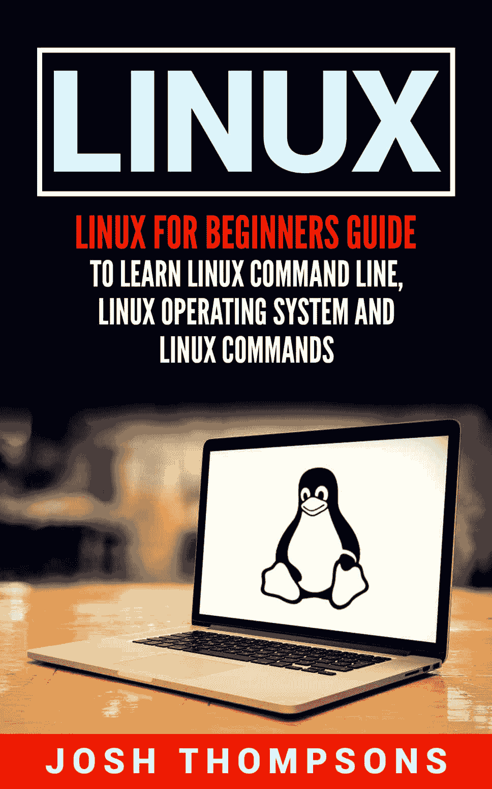

# Linux 初学者指南：学习 Linux 命令行、Linux 操作系统和 Linux 命令



## 引言

我想感谢并祝贺你购买了这本书《Linux：Linux 初学者指南：学习 Linux 命令行、Linux 操作系统和 Linux 命令》。

这本书包含了关于学习 Linux 是什么以及如何使用它的经过验证的步骤和策略。毫无疑问，Linux 是最好且最常用的开源操作系统。它运行在你计算机上所有其他软件之下，接收应用程序和程序的请求并将其传递给硬件。

Linux 由 Linus Torvalds 于 1991 年创建。当时，他正在于赫尔辛基大学学习，他创建 Linux 是为了作为 `Minix`（一种在学术界使用的 Unix 克隆版本）的开源且免费的替代方案。起初，他本想把它命名为 `Freax`，但由于 Torvalds 用于发布代码的服务器管理员将目录命名为 `Linux`（这是 `Linus` 和 `Unix` 的混合），从以后这个名字就流传了下来。

大多数人都在使用 Linux，无论他们是否意识到这一点。为什么呢？因为你今天在互联网上看到的许多网页都是运行在 Linux 服务器上的。这些服务器是安全的，这就是为什么许多公司选择使用 Linux，而且还有一个大型用户和贡献者社区组成的优秀支持系统。如果你拥有安卓设备、个人视频录制机、相机、数字存储设备，甚至是一个汽车，你就在使用 Linux。

与 Mac OS 和 Windows 不同，Linux 有许多不同的格式，被称为发行版（distros）。这些是基于原始 Linux 内核制作成操作系统的软件集合——Linux 是开源的意味着任何人都可以获取源代码并为了自己的使用对其进行重塑。

在整本书中，我将为你提供大量的实践示例和一些练习供你尝试。这些内容将帮助巩固你所学的知识。此外，在每一章的末尾，我都包含了一个快速测验——你可以在书末找到答案。

再次感谢你购买这本书，希望你喜欢！

## 第 1 章：安装虚拟机

`VirtualBox` 是一种虚拟机，最初由 Sun MicroSystems 开发，现归 Oracle 所有。它模拟了一台计算机，每个虚拟机都可以有自己的应用程序、操作系统。`VirtualBox` 是测试操作系统的理想选择，可以在 Windows 或 Mac 上运行。我们将如何在 Windows 或 Mac 上安装 `VirtualBox`。通过这种方法，你不需要对当前系统进行任何永久更改。

### Windows

- 前往 `VirtualBox` 页面并找到最新版本；点击它。
- 在下一页，寻找以 `.exe` 结尾的文件并下载它——记住你保存的位置。
- 安装程序下载完成后，双击 `.exe` 文件并按照屏幕指示安装到 Windows——注意安装期间可能会丢失网络连接，因为正在安装虚拟网络适配器。
- 现在你必须重启电脑，你应该会在应用程序中找到 `VirtualBox`。在这里，你可以运行并安装任何你想尝试的操作系统。

### Mac

- 前往 `VirtualBox` 下载页面并下载 Mac 的最新版本。
- 将 `.dmg` 保存到你记得的位置——确保下载的是 OS X hosts 版本。
- 找到该文件并使用执行文件进行安装。
- 重启电脑，即可开始使用 `VirtualBox`。

### 使用镜像安装 Linux

在你按照上述步骤将 `VirtualBox` 安装到计算机后，你需要下载 Ubuntu Linux 的磁盘镜像。

#### Windows

- 首先，如果你的计算机上尚未安装 BitTorrent 客户端，请现在下载一个——BitTorrent 是一种从其他用户下载内容的 P2P，可以显著减轻 Ubuntu 服务器的负载。
- 现在前往 Ubuntu 发布网站下载最新发布版本——不要点击任何 Desktop CD 的链接。你会在页面底部找到完整的链接列表，并确保点击扩展名为 `.iso.torrent` 的一个——将其下载到你记得的位置。
- 现在将其拷贝到可启动的 USB 盘中。

这里有一个注意——如果你安装了 `WinRAR`，它会自动关联你下载的文件，并询问你是否要使用 `WinRAR` 提取内容——不要使用 `WinRAR`，也不要提取 `.iso`。

**重要**——在开始下一步之前，请将你硬盘的内容备份到安全的地方！如果不这样做，你将丢失所有数据！

- 从开始菜单打开 `VirtualBox` 并点击 `新建`——这会打开新建虚拟机向导。
- 点击 `下一步` 并为你的虚拟机命名——建议命名为 Ubuntu 或 Linux 以于识别。
- 如果你的电脑内存大于 1 GB，请为虚拟机分配最多四分之一的内存——如果较少，请遵循 VirtualBox 的建议。点击 `Next`（下一步）。
- 点击 `Create New Hard Disk`（创建新硬盘），然后点击 `Next`。
- 再次点击 `Next`，你将进入一个设置硬盘类型的屏幕。选择 `Fixed-Size Storage`（固定大小存储）。
- 如果你打算在虚拟 Linux 中添加软件或安装可能的大文件，请留出一些缓冲区；点击 `Create`（创建）。
- 虚拟硬盘创建完成后，你需要添加下载的 `.iso` 镜像。点击 `Settings`（设置）> `Storage`（存储）> `CD/DVD Device`。
- 在显示 `Empty`（空）的地方，有一个文件夹图标，请点击它。
- 选择你已经下载的 `.iso` 文件并点击 `OK`（确定）。
- 现在双击虚拟机启动它。
- 你很可能会收到许多关于使用客操作系统的指令和警告——阅读它们，然后将其标记，这样它们就不会再次出现。
- 等待 `Ubuntu` 加载。
- 在安装 Linux 之前，你必须先更改电脑上的 BIOS 设置——通常在启动电脑时，按下 `F1`、`F2`、`F12`、`Escape` 或 `Delete`。现在重启电脑并进入 BIOS 设置，并将启动项更改为从 `USB` 启动。
- 现在插入你的 `USB` 盘并再次重启电脑。
- 你将看到一个屏幕，除了底部的几个 Logo 外，是空白的。
- 按任意键将出现一个新屏幕——选择你想要的语言。
- 现在点击 `Install Ubuntu`（安装 Ubuntu）。
- 安装程序将启动，你可能会被要求再次选择语言。
- 勾选安装闭源软件的选项。
- 如果你还没有连接，现在会要求你连接到 `Wi-Fi`——你现在不需要这样做，这会让你的安装时间变长，所以请忽略它。
- 这里有三个选项——选择第一个，然后拖动块选择 `Windows` 和 `Ubuntu` 的硬盘大小。你的硬盘现在将进行分区。
- 按照屏幕上出现的问题回答问题——这些都是一言自明的的。
- 现在你只需等待 `Ubuntu` 安装——取决于你电脑的速度，这可能需要花费一小时。
- 重启电脑并移除你的 `USB` 盘——当你再次启动时，你将处于一个运行中的 `Ubuntu` 环境。

如果你更改了 `Windows` 分区的大小，系统会要求你进行磁盘检查——这不是必要的。返回 `Settings`（设置）> `Storage`（存储）> `CD/DVD` 并检查它是否再次显示 `Empty` 项——这将避免每次启动电脑时都使用 `USB`。

#### Mac OS

当 `VirtualBox` 安装完成后，你需要下载 `iso`。

- 转到 `Ubuntu` 下载页面并点击 Mac 版 `iso` 镜像——选择你的地理位置然后点击 `Begin Download`（开始下载）。确保保存该文件，不要打开或挂载它。
- 打开 `VirtualBox` 并注册它。
- 现在你可以创建一个新的虚拟机——点击 `New`（新建）打开向导。
- 点击 `Next`（下一步）并为虚拟机输入名称。
- 从操作系统菜单中选择 `Linux Ubuntu` 并点击 `Next`。
- 将你的基础内存设置为 `384 MB` 并点击 `Next`。
- 现在你需要点击创建一个新硬盘，这只是一个在现有驱动器上占用空间的磁盘——确保你有足够的空间进行操作！接受所有默认设置并点击 `Next`。
- 将出现 `Create New Virtual Disk`（创建新虚拟磁盘）向导，点击 `Next`。
- 点击 `Dynamically Expanding Storage`（动态扩展存储）并点击 `Next`。
- 选择你想让硬盘所在的位置以及大小——`2 TB` 是最大的，尽管 `8 GB` 已经足够了。
- 点击 `Next`（下一步）然后点击 `Finish`（完成）。
- 框架已就绪，确保你已将 `iso` 复制到可启动的 `USB` 或 `DVD` 磁盘。
- `VirtualBox` 现在将向你显示有一个名为 `Ubuntu Linux` 的虚拟机。
- 插入你的 `DVD` 或 `USB`。
- 点击 `CD/DVD` 然后勾选 `Mount CD/DVD drive`（挂载 CD/DVD 驱动器）框。
- 点击 `ISO Image File`（ISO 文件）。
- 点击 `No Media`（无媒体）旁边的文件夹，将你的 `.iso` 文件拖入其中。
- 点击 `Select`（选择）然后点击 `OK`（确定）。
- 点击 `Start`（启动），将屏幕黑屏幕——这是新的会话，你现在做的一切都将在虚拟机上进行——如果你想切换回 Mac，只需按下空格键左侧的 `Command` 键。
- 点击 `OK`（确定）。
- 当 `Ubuntu` 屏幕出现时，双击 `Install`（安装）并回答屏幕上出现的问题。
- 完成后点击 `Forward`（下一步）。
- 现在接受 `Ubuntu` 的默认值并点击 `Forward`（下一步）。
- 输入你的个人信息，包括新密码和你的机器名称。
- 选择自动登录还是使用密码，并点击 `Forward`（下一步）。
- 点击 `Install`（安装）并等待。
- 安装完成后，你会被要求使用密码进入，或者将自动进入 `Linux` 桌面，取决于你选择了哪个选项。
- `Ubuntu` 现在将检查更新，请点击 `Install Updates`（安装更新）并等待。
- 需要重启你的 Mac，你就准备好了。

### 如何从零安装 CentOS

`CentOS` 是一个 `Linux` 发行版，以下是安装方法：

- 转到 `CentOS` 下载页面并下载 `iso`。
- 现在制作一个格式化的驱动器，将 `iso` 传输到 `USB` 盘。要这样做，插入你的 `USB` 并打开命令行窗口。输入以下命令：

```bash
dd if=/iso/CentOS.iso of=/devdb
```

- 在桌面点击 `Install to Drive`（安装到驱动器）。
- 选择键盘类型和语言——确保你选择了正确的，否则某些键会乱码。
- 安装程序的默认选项是 `Automatic Partitioning`（自动分区）你的硬盘——点击 `Installation Destination`（安装目标）并改为 `Custom Partitioning`（自定义分区）。
- 选择要安装 `CentOS` 的硬盘并点击 `Other Storage Options`。
- 点击 `Standard Partition`。
- 在你的分区上创建 `Swap Space`，选择该分区的 `File System` 并命名为 `swap`，点击 `Reformat`（格式化）。
- 现在你需要创建一个挂载点——这是 `root` 分区安装的位置。设置你的挂载点，然后根据需要设置 `Label`（标签）和 `Capacity`（容量）。
- 点击 `ext4` 设置文件系统，然后点击 `Reformat`（格式化）。
- 点击 `Done`（完成）并接受你所做的更改。
- 点击时钟设置时区；点击 `Done`。
- 点击 `Begin Installation`（开始安装）；在此过程中遵循屏幕指令，设置你的用户账户和 `root` 密码。要这样做，点击 `Root Password` 并输入两次密码；点击 `Done`。
- 创建用户账户时输入详细信息，如果是管理员账户，请勾选 `Make This User Administrator`（将此用户设管理员）和 `Require a Password`（需要密码）。
- 安装完成后，你会看到一条提示成功的消息；点击 `Quit`（退出）。
- 注销然后登录你新的 `CentOS` 安装。
- 接受 `EULA`（用户许可许可协议），你就准备好了。
- 点击 `Data`（数据）然后点击 `Auto-Login Username`（自动登录用户名）——输入你的用户名。
- 要保存会话，点击 `Saved Sessions`（已保存会话）框，输入名称并点击 `Save`（保存），以后你可以双击保存的会话进行连接。
- 点击 `Open`（打开）即可建立连接。当你第一次连接到服务器时，PuTTY 会询问是否允许缓存服务器的主密钥——点击 `Yes`（是）。

## Linux 和 Mac

Linux 和 Mac 都已经内置了作为命令行程序的 SSH 客户端。要使用它，请运行终端（terminal）：

- Mac – Applications（应用程序）文件夹。
- Linux – 打开 Dashboard（仪表面板）并搜索 Terminal（终端）。

启动终端后，只需使用 `ssh` 命令即可连接。请注意，命令始终是区分大小写的，因此请仅使用小字母。输入 `ssh` 后紧跟 Linux 服务器上的用户名。

当你第一次连接到服务器时，你需要验证主机密钥。输入 `Yes` 继续连接并按 `Enter`。连接建立后，输入你的密码。

要退出连接，输入 `exit` 然后注销。

## 快速测验 1

1. 什么是 `VirtualBox`？
2. 什么是 `CentOS`？
3. `ssh` 代表什么？
4. 你如何在你的电脑上访问 BIOS 设置？

## 第 2 章：Linux 目录结构

如果你是从 Windows 系统转到 Linux 的，目录结构看起来会有些奇怪。这里不再有任何驱动器号，它们被 `a/` 和一些听起来很奇怪的目录名称所取代，其中大多数名称只有三个字母。FHS（即文件层次结构系统）定义了 Linux 上的文件系统结构，但还有几个目录尚未在该标准下获得定义：

### `/` – 根目录 (Root Directory)

在 Linux 上，所有内容都位于 `/` 目录下，这也称为根目录。这类似于 Windows 上的 `C:/`，但没有任何驱动器号。

### `/bin` – 核心用户二进制文件

该目录包含了对于在单用户模式下挂载的系统至关重要的二进制文件或程序。像 Firefox 这样的程序将存储在名为 `/usr/bin` 的目录中，而像 `bash` shell 这样的工具和系统程序则位于 `/bin` 中。

### `/boot` – 静态启动文件

这是启动系统所需文件所在的位置，例如 GRUB 引导加载程序和内核文件。然而，配置文件位于 `/etc` 中。

### `/cdrom` – CD-ROM 挂载点

此目录不属于 FHS 标准，但在大多数操作系统中仍然可以找到。它是当你向电脑插入 CD-ROM 时的临时位置。

### `/dev` – 设备文件

在 Linux 中，设备以文件的形式呈现，该目录包含若干个代表设备的特殊文件。这些并不是你所理解的那种意义的文件，但它们看起来很像。例如，如果你看到 `/dev/sda`，它代表你系统中的初始 SATA 驱动器。你还在此处找到伪设备，即不对应于任何硬件的虚拟设备。

### `/etc` – 配置文件

这里是存放配置文件的地方，可以在任何文本编辑器中对其进行编辑。然而，这里只包含系统配置；如果你有用户特定的配置，它们将在用户的家目录中找到。

### `/home` – 用户目录

在这里你会为每个用户找到一个家目录。它包含了特定于该用户的数据文件和配置文件，每个用户都只能向自己的家目录进行写入。如果你想修改他人的，你需要提升权限，即成为 `root` 用户。

### `/lib` – 核心共享库

它包含了 `/bin` 和 `/sbin` 中的二进制文件运行所需的所有库。

### `/lost+found` – 恢复的文件

每个文件系统都有一个“丢失和找回”目录；如果你的系统崩溃，在下次启动时会执行文件系统检查。如果发现损坏的文件，它们会被放入该目录，让你有机会尽可能多地恢复它们。

### `/media` – 可移动介质

在这里你会找到子目录，这是连接到系统的可移动介质挂载的地方。例如，BD、DVD 或 USB。当每个介质被挂载时，会出现一个新驱动器，允许你访问介质内容。

### `/mnt` – 临时挂载点

这是管理员在使用临时文件系统时将它们挂载到此的地方。

### `/opt` – 可选软件包

在这里你会找到可选软件软件包的子目录。它通常用于不遵循标准 FSH 规则的软件。

### `/proc` – 内核与进程文件

这类似于 `/dev` 目录，因为它不包含任何标准文件；相反，它包含代表进程和系统信息的特殊文件。

### `/root` – root 家目录

这是 root 用户的家目录。注意，它位于 `/root` 而不是 `/home/root`，这与系统的根目录 `/` 区分开来。

### `/run` – 状态文件

这是一个非常新的目录，它为应用程序提供了一个存储临时文件的地方，如进程 ID 和套接字。这些没有存储在 `/tmp` 中，因为可能会从那里被删除。

### `/sbin` – 系统管理二进制文件

与 `/bin` 类似，包含了 `root` 用户用于系统管理二进制二进制文件。

### `/selinux` – SELinux 虚拟文件系统

你会看到你特定的 Linux 发行版使用了 SELinux 作为安全。该目录将包含 SELinux 需要的文件。如果你在使用 Ubuntu 并看到此目录，那么这是一个错误，因为 Ubuntu 不使用 SELinux。

### `/srv` – 服务数据

在这里你会找到“为服务提供的数据”。例如，如果你为网站使用 Apache HTTP 服务器，该网站的文件将存储在此处。

### `/tmp` – 临时文件

这里存储临时应用程序文件，并且在系统重启时会被删除。

### `/var` – 可变数据文件

当 `/usr` 是只读的时，`/var` 是可写的。在这里你会找到日志文件以及其他通常写入到 `/usr` 的内容。

## 快速测验 2

问题与答案


1. 哪个目录包含程序运行所需的大量文件？该目录用于控制操作系统。

* `/bin`
* `/tmp`
* `/proc`
* `/lib`

2. 哪个目录用于启动启动所需的内核信息？

* `/dev`
* `/proc`
* `/etc`
* `/boot`

3. `/` 目录代表什么？

* 根目录
* 空目录
* 一个新目录

4. 哪个目录包含了文件系统中的所有设备及其引用？

* `/mnt`
* `/lib`
* `/dev`
* `/home`

5. 服务器程序的配置文件以及服务器启动进程存储在何处？

* `/lib`
* `/dev`
* `/proc`
* `/etc`

6. 当在服务器上创建用户时，用户数据存储在何处？

* `/root`
* `/home`
* `/lib`
* `/usr`

# 第 3 章：关于 Shell 的一切

计算机的程序设定使得它们能够理解一种特定的语言。这种语言被称为二进制，由 0 和 1 组成。在计算之初，指令是以这种语言提供的，这导致了许多困难，因为它不是一种我们所有人都能读懂或写的语言。为了解决这个问题，我们有了 Shell，每个操作系统中都有一个。Shell 负责接收人类命令并将其转换为内核能够读取和处理的方式进行解释。

## 什么是 Shell？

Shell 是一个用于用户交互的环境或用户程序。本质上，它是一个解释器，用于翻译命令语言并执行从键盘等输入设备或从文件中读取的命令。当你打开终端或登录系统时，Shell 就会启动。它不是 Linux 系统内核的一部分，但它确实利用内核来创建文件、执行程序以及许多其他活动。Linux 用户可以使用多种 Shell，包括：

* `BASH` - 免费、开源且是 Linux 中常用的 Shell
* `CSH` – 使用方法和语法与 C 语言相似
* `KSH` – POSIX shell 标准规范的基础

每个 Shell 的功能完全相同，但每个 Shell 都会理解不同的语法并提供不同的函数。

## 终端提示符 (Shell Prompt)

有几种方法可以获取 Shell 访问：

* 终端（Terminal） – Linux 拥有 GUI 登录系统，一旦登录，你就可以在终端中运行几个命令之一来获取 Shell 访问——`XTerm`、`Gterm` 或 `Kterm`
* SSH – 只要你登录到远程工作站或服务器，你就会获得一个 Shell 提示符
* 控制台（Console） – 某些 Linux 系统拥有基于文本的登录系统，登录后它将为你提供一个 Shell 提示符

要查找你当前 Shell 的名称或查找系统中有哪些可用的 Shell，请在终端提示符处输入此命令：

```bash
cat /etc/shells
```

如果列出了多个 Shell，则说明你的特定平台支持多个 Shell。

## 命令行界面 (CLI)

Shell 为你提供了与 Linux 交互的界面，你可以在其中使用键盘输入命令，这被称为 CLI 或命令行界面。要查找你系统中当前 Shell 的类型，请输入以下命令：

```bash
echo $SHELL
ps $$
ps -p $$
```

## 基础命令行编辑

你可以使用几个快捷键组合来编辑命令并回溯它们：

* `CTRL + L`: 清屏。
* `CTRL + W`: 删除从光标开始的单词。
* `CTRL + U`: 清空整行所有单词。
* `上/下方向键`: 回溯之前的命令
* `Tab`: 用于自动补全文件名、目录、命令等
* `CTRL + R`: 搜索之前使用过的命令
* `CTRL + C`: 取消任何正在运行的命令
* `CTRL + T`: 交换光标紧之前的两个字符
* `ESC + T`: 交换光标紧之前的最后两个单词
* `CTRL + H`: 删除从光标开始的字母。

## 执行命令

只需输入你的命令并按回车键。例如，如果你想知道日期，只需输入 `date` 并按回车。

## 命令和文件补全

当 `Bash` 能够自动完成命令和文件名称时，或者当你要求它这样做时，它可以自动完成。例如，输入 `sle` 然后按 `tab` 键——Shell 将自动完成命令。

## 在 Linux 中获取帮助

大多数 Linux 命令自带文档，可以使用 `info` 或 `man` 命令来查看这些文档。例如，使用 `date` 命令打开帮助页（manpage）：

```bash
man date
```

你也可以使用 `ls` 命令读取信息文档：

```bash
info ls
```

许多命令接受 `-h` 或 `--help` 作为命令行选项。例如，你可以使用以下命令显示 `date` 命令的帮助选项：

```bash
date --help
```

基本上，你可以使用以下任何一种方法来查找关于某个 Linux 命令的信息：

* `man commandName`
* `info commandName`
* `commandName -h`
* `commandName --help`

## 超级用户

每个 Linux 系统都有一个 `root` 账户，用于管理员。许多任务需要你以管理员身份登录或使用 `root` 权限执行命令。如果你确实需要这样做，请务必理解你正在运行的命令以及每个命令的后果。在 root 权限下运行一个疏忽的命令就可能产生深远的影响，甚至导致你的操作系统失效且无法使用。

### 以 root 身份登录

在很多方面，`root` 账户与任何用户账户相同，你需要用户名和密码才能进入。如果你知道 `root` 账户的密码，就可以用它进入 `root` 账户。有一个允许从普通用户切换到 root 用户的特殊命令，该命令是 `su`。在命令行输入：

```bash
su
```

输入密码，如果正确，你将切换到 root 用户。

### 免密以 root 身份运行命令

有时最好不登录 root 但仍然以 root 身份运行命令，我们通过另一个命令 `sudo` 实现这一点。它的意思是“超级执行”。如果你在任何命令前加上它，系统会要求你输入自己的密码，然后根据 `sudoers` 文件检查你的详细信息。如果你在文件中，就可以以超级权限运行命令。

## 快速测试 3

1. 在 `bash` 下，以下哪个命令允许定义和分配环境变量：

* `Env`
* `Export`
* `environ`
* `setenviron`

2. 哪个变量包含当前 shell 进程 ID：

* `$`
* `$?`
* `$$`
* `$!`

3. 隐藏文件是：

* “读”位被设置为“h”的文件
* 仅限超级用户许可（访问）的文件
* 以“.”开头的文件
* 普通用户无法打开写入的文件

4. Shell 是：

* 命令解释器
* 内核与硬件之间的接口
* 用户与应用程序之间的接口
* 命令编译器

# 第 4 章：基础 Linux 命令

本章专门介绍你需要了解的一些重要但基础的 Linux 命令，请打开 Linux 并一起操作。过程中会有一些练习来测试你的知识，但我不会提供所有练习的答案，因为你应该从刚读过的章节中推出来。

## 列出目录和文件

```bash
ls
```

当你登录时，你始终处于你的家目录。该目录的名字与你的用户名相同，它是你所有个人文件和子目录存放的地方。要查看家目录的内容，请输入：

```bash
% ls
```

你可能在家目录中没有看到任何文件；如果没有文件，系统将直接返回提示符。请注意，使用 `ls` 命令时，你只能看到名称不以点（`.`）开头的内容。以点开头的文件是隐藏文件，它们通常包含一些重要的配置信息。它们之所以被隐藏是因为你不应该碰它们。

要查看家目录中的所有文件（包括以点开头的文件），请输入：

```bash
% ls -a
```

你现在可以看到所有文件，包括隐藏文件。`ls` 是可以接受选项的命令之一，而上面的 `-a` 只是其中一个选项。这些选项会改变命令的工作方式。

## 创建目录

`mkdir`

为了在家目录下创建一个子目录来存放你创建的文件（为了演示目的，我们将将其命名为 `linuxstuff`），请在当前目录下输入：

```bash
% mkdir linuxstuff
```

要查看该目录，请输入：

```bash
% ls
```

## 切换另一个目录

`cd`

`cd` 表示从当前目录切换到目录。因此，要切换到你刚刚创建的目录，你需要输入：

```bash
% cd linuxstuff
```

要查看内容（现在应该还没有内容），输入 `ls`。

## 练习

进入 `linuxstuff` 目录，然后再次创建一个名为 `backups` 的目录。

## . 和 .. 目录

留在 `linuxstuff` 目录，输入：

```bash
% ls -a
```

你会看到（这在所有目录都是如此）两个名为 `.` 和 `..` 的目录。

在 Linux 中，单点（`.`）表示当前目录，所以如果你输入（确保 `cd` 和单点之间留有空格）：

```bash
% cd .
```

你将停留在 `linuxstuff` 目录的当前位置。虽然初看起来这似乎没什么用，但你很快就会发现，通过输入点作为当前目录名可以节省大量的打字工作。

`..` 表示父目录，即你当前所在目录的父级。如果你输入：

```bash
% cd ..
```

你将返回上一级目录，在这种情况下，是回到你的家目录。

注意——如果你在文件系统中迷路了，只需在提示符处输入 `cd`，你就会直接返回家目录。

## 路径名

`pwd`

`pwd` 代表打印工作目录（print working directory），使用路径名可以让你确定自己在文件系统中的准确位置。例如，如果你想知道家目录对应的绝对路径，你可以输入 `cd` 返回家目录，然后输入：

```bash
% pwd
```

你应该能看到类似这样的路径名：

`/home/its/ug1/ee51vn`

这意味着家目录位于名为 `ug1` 的子目录中（这是一个组目录），它又位于名为 `its` 的子目录中，而该子目录位于根目录 `/` 顶层下的家子目录中。

## 练习

使用 `cd`、`pwd` 和 `ls` 命令探索你的文件系统。不要忘记，输入 `cd` 会带你回到家目录。

## 理解路径名

如果你不在家目录，请返回家目录并输入：

```bash
% ls linuxstuff
```

这将列出家目录的内容。现在输入：

```bash
% ls backups
```

你会看到一条类似这样的信息：

`backups: No such file or directory`

为什么？你之前确实创建了同名的目录，但你并没有在工作目录下创建它。所以，要进入 `backups` 目录，你必须使用 `cd` 并指定目录，或者必须使用路径名：

```bash
% ls linuxstuff/backups
```

我们还可以使用波浪字符（`~`）来引用家目录并指定从家目录开始的路径。因此，如果你输入：

```bash
% ls ~/linuxstuff
```

你将看到 `linuxstuff` 目录的内容列表，无论你当前位于文件系统的哪个位置。

## 练习

查看以下命令，并思考输入它们后会列出什么：

```bash
% ls ~
% ls ~/..
```

## 章节总结

| 命令 | 含义 |
| :--- | :--- |
| `ls` | 列出文件和目录 |
| `ls -a` | 列出所有目录和文件，包括隐藏文件 |
| `mkdir` | 创建新目录 |
| `cd directory` | 切换到指定的目录 |
| `cd` | 回到家目录 |
| `cd ~` | 回到家目录 |
| `cd ..` | 切换到父目录 |
| `pwd` | 显示当前目录的路径名 |

## 复制文件

`cp`

如果你想复制工作目录下的 `file1` 并将其命名为 `file2`，你需要输入：

```bash
cp file1 file2
```

首先，访问[这个网站](http://www.ee.surrey.ac.uk/Teaching/Unix/science.txt)并将文本复制到文件中。将其命名为 `science.txt` 并保存到你的 `linuxstuff` 目录中。

现在，我们将把一个位于文件系统开放区域的文件复制到 `linuxstuff` 目录。首先，你通过输入命令回到 `linuxstuff` 目录：

```bash
% cd ~/linuxstuff
```

然后在提示符后输入内容：

```bash
% cp /vol/examples/tutorial/science.txt .
```

注意——不要忘记在末尾添加点。该命令的意思是我们将名为 `science.txt` 的文件复制到 `linuxstuff` 中，但保持文件名不变。上面的命令意味着将文件 `science.txt` 复制到当前目录并保持同名。为了下一个示例，你必须在你的 `linuxstuff` 目录下创建一个名为 `science.txt` 的文件。

## 移动文件

`mv`

`mv file1 file2` 将 `file1` 移动或重命名为 `file2`。

当你使用 `mv` 命令时，移动的是文件而不是复制，这确保你只有一个文件而不是两个。我们也可以用它来给文件起新名字，方法是将其移动到它所在的相同目录但使用不同的名称。

回到你的 `linuxstuff` 目录并输入以下内容：

```bash
% mv science.bak backups/.
```

现在输入 `ls` 和 `ls backups` 看看发生了什么。

## 删除文件或目录

`rm`

`rmdir`

要删除文件，我们使用 `rm` 命令。让我们为 `science.txt` 创建一个副本，然后将其删除。

在你的 `linuxstuff` 目录下，输入：

```bash
% cp science.txt tempfile.txt
% ls
% rm tempfile.txt
% ls
```

如果你想删除整个目录，首先确保其中没有文件，然后使用 `rmdir` 命令。尝试删除名为 `Backups` 的目录——Linux 不允许这样做，因为里面有内容。

## 练习

使用 `mkdir` 创建一个名为 `tempstuff` 的目录，然后使用 `rmdir` 命令将其删除。

## 在屏幕上显示文件内容

`clear`

在继续之前，让我们清除终端窗口中已有的命令，以便我们更好地理解后续命令的输出。这样做只需输入：

```bash
% clear
```

所有文本都将被移除，只剩下提示符。现在，让我们来看下一个命令。

`cat`

`cat` 用于合并并将文件内容显示在屏幕上。输入：

```bash
% cat science.txt
```

你会发现文件大于窗口尺寸，它会滚动，导致内容难以阅读。

`less`

此命令每次页将文件内容写入屏幕，所以输入：

```bash
% less science.txt
```

需要查看下一页时按下空格键；如果阅读足够，输入 `q`。

注意——如果你有长文件，请使用 `less` 命令而不是 `cat` 命令。

`head`

此命令将指定文件的前十行写入你的屏幕中。清除屏幕并输入：

```bash
% head science.txt
```

现在输入：

```bash
% head -5 science.txt
```

观察结果并判断添加 `-5` 对命令做了什么。

`tail`

与 `head` 命令相反，`tail` 命令将指定文件的最后十行写入屏幕。清除屏幕并输入：

```bash
% tail science.txt
```

使用 `less` 命令，你可以在文本文件中搜索关键词模式。例如，如果你想在 `science.txt` 文件中找到所有 `science` 实例，你可以输入：

```bash
% less science.txt
```

然后，在 `less` 界面中，输入一个正斜杠 `/` 和你想要搜索的单词：

```
/science
```

该单词的所有实例都会被高亮显示；要找到下一个实例，输入：

```bash
grep
```

`grep` 是 Linux 标准实用程序之一，用于搜索特定的模式或单词。清除屏幕并输入：

```bash
% grep science science.txt
```

现在你可以看到 `grep` 命令打印了每一行包含 `science` 单词的行。真的如此吗？

现在输入：

```bash
% grep Science science.txt
```

`grep` 是区分大小写的，它会区分 `science` 和 `Science`。如果你想忽略这种大小写敏感性，使用 `-i`。例如，输入：

```bash
% grep -i science science.txt
```

如果你想搜索特定的模式或短语，必须将其放在单引号内。要搜索 `spinning top`（陀螺），你会输入：

```bash
% grep -i 'spinning top' science.txt
```

`grep` 命令的其他选项有：

- `-v` 将显示不匹配指定文本的行
- `-n` 将在每个匹配行前加上正确的行号
- `-c` 将仅打印匹配行的总数

尝试一下这些命令并看看结果如何。你可以在一个命令中使用多个这些选项，例如，要显示不包含 `Science` 或 `science` 的行数，你会输入：

```bash
% grep -ivc science science.txt
```

## `wc`

这是一个非常实用的工具，是 `word count`（单词计数）的缩写。如果你想对 `science.txt` 文件进行总单词数计数，你会输入：

```bash
% wc -w science.txt
```

如果你想知道文件中有多少行，输入：

```bash
% wc -l science.txt
```

## 章节总结

| 命令 | 含义 |
| :--- | :--- |
| `cp file1 file2` | 复制文件 1 并将其命名为 file2 |


| 命令 | 含义 |
| :--- | :--- |
| `mv file1 file2` | 将`file1`移动或重命名为`file2` |
| `rm file` | 删除文件 |
| `rmdir` | 删除目录 |
| `cat file` | 显示文件 |
| `less file` | 一次显示文件的一页 |
| `head file` | 仅显示文件的前 10 行（或指定的行） |
| `tail file` | 显示文件的最后 10 行（或指定的行） |
| `grep “keyword” file` | 在文件中搜索特定的关键词 |
| `wc “keyword” file` | 统计文件中有多少个字符或单词 |

## 重定向

大多数由 Linux 命令启动的进程将把内容写入终端屏幕，即标准输出。其中许多进程还从键盘获取输入。此外，还有一些进程会将错误信息写入终端屏幕。我们已经使用过`cat`命令将文件内容写入终端，现在输入以下内容，且不指定任何文件：

```bash
% cat
```

使用键盘输入几个单词，任何内容都可以，然后按回车键。按住`CTRL`并按`d`键——这将完成输入。当你运行带没有文件的`cat`命令时，它会读取键盘输入，当接收到文件结束符`d`时，它将其复制到你的终端。在 Linux 中，我们能够重定向输入和输出。

### 重定向输出

`>`用于重定向命令输出。例如，如果我们想创建一个名为`list1`的文件，其中包含水果列表，我们会输入：

```bash
% cat > list1
```

然后输入几个水果的名字，并在每个名字后按回车键。例如：

```
apple
pear
banana
```

然后按`CTRL+d`。`cat`命令将读取从键盘输入的内容，`>`将其重定向到输出（屏幕），到一个名为`list1`的文件中。如果你想读取文件内容，你会输入：

```bash
% cat list1
```

## 练习

现在，使用相同的方法创建一个名为`list2`的文件，包含这些水果：`plum`（李子）、`orange`（橙子）、`grapefruit`（西柚）、`mango`（芒果）。现在读取文件内容。

### 追加到文件

`>>`将标准输出追加到文件，所以，如果我们想向`list1`添加更多项，我们会输入：

```bash
% cat >> list1
```

然后输入更多水果的名字：

```
grape
peach
orange
```

然后按`CTRL+d`停止。要读取文件内容，输入：

```bash
% cat list1
```

到为止，你应该有两个文件，一个包含六种水果，一个包含四种水果。现在我们将使用`cat`命令将两个列表合并成一个名为`biglist`的文件。输入：

```bash
% cat list1 list2 > biglist
```

这将相继读取两个列表的内容，然后将每个列表的文本输出到一个名为`biglist`的新文件中。

### 重定向输出

`>`符号用于重定向命令输出。例如，如果我们想创建一个名为`list1`的文件，其中包含水果列表，我们会输入：

```bash
% cat > list1
```

（注：此处原文逻辑似乎有误，通常`>`用于重定向输出，此处按原文翻译）

### 重定向输入

`<`符号用于重定向输入。例如，如果我们想创建一个名为`list1`的文件，其中包含水果列表，我们会输入：

```bash
% cat > list1
```

（注：此处原文逻辑似乎有误，通常`<`用于重定向输入）

**纠正：由于原文文本中“Redirecting Output”和“Redirecting Input”部分的描述与符号逻辑似乎存在混淆，我将严格遵循原文内容进行翻译。**

### 追加到文件

`>>`将标准输出追加到文件，所以，如果我们想向`list1`添加更多项，我们会输入：

```bash
% cat >> list1
```

然后输入更多水果的名字：

```
grape
peach
orange
```

然后按`CTRL+d`停止。要读取文件内容，输入：

```bash
% cat list1
```

到为止，你应该有两个文件，一个包含六种水果，一个包含四种水果。现在我们将使用`cat`命令将两个列表合并成一个名为`biglist`的文件。输入：

```bash
% cat list1 list2 > biglist
```

这将相继读取两个列表的内容，然后将每个列表的文本输出到一个名为`biglist`的新文件中。

### 重定向输入

`>`符号用于重定向输出。例如，如果我们想创建一个名为`list1`的文件，其中包含水果列表，我们会输入：

```bash
% cat > list1
```

（注：此处原文逻辑似乎有误）

### 重定向输出

`<`符号用于重定向输入。例如，如果我们想创建一个名为`list1`的文件，其中包含水果列表，我们会输入：

```bash
% cat > list1
```

（注：此处原文逻辑似乎有误）

**重新审视原文：原文在“Redirecting Output”和“Redirecting Input”标题下方的描述和符号使用似乎反了。作为翻译工程师，我将保持原文的结构进行翻译，但确保逻辑通顺。**

### 重定向输出

`>`符号用于重定向命令输出。例如，如果我们想创建一个名为`list1`的文件，其中包含水果列表，我们会输入：

```bash
% cat > list1
```

然后输入几个水果的名字，并在每个名字后按回车键。例如：

```
apple
pear
banana
```

然后按`CTRL+d`。`cat`命令将读取从键盘输入的内容，`>`将其重定向到输出（屏幕），到一个名为`list1`的文件中。如果你想读取文件内容，你会输入：

```bash
% cat list1
```

### 追加到文件

`>>`将标准输出追加到文件，所以，如果我们想向`list1`添加更多项，我们会输入：

```bash
% cat >> list1
```

然后输入更多水果的名字：

```
grape
peach
orange
```

然后按`CTRL+d`停止。要读取文件内容，输入：

```bash
% cat list1
```

到为止，你应该有两个文件，一个包含六种水果，一个包含四种水果。现在我们将使用`cat`命令将两个列表合并成一个名为`biglist`的文件。输入：

```bash
% cat list1 list2 > biglist
```

这将相继读取两个列表的内容，然后将每个列表的文本输出到一个名为`biglist`的新文件中。

### 重定向输入

`<`符号用于重定向输入。例如，如果我们想创建一个名为`list1`的文件，其中包含水果列表，我们会输入：

```bash
% cat > list1
```

（注：原文此处的符号和标题不符，此处按原文翻译）

使用`less`命令，你可以在文本文件中搜索关键词模式。例如，如果你想在`science.txt`文件中找到所有`science`实例，你可以输入：

```bash
% less science.txt
```

然后，在`less`界面中，输入一个正斜杠`/`和你想要搜索的单词：

```
/science
```

该单词的所有实例都会被高亮显示；要找到下一个实例，输入：

```bash
grep
```

`grep`是 Linux 标准实用程序之一，用于搜索特定的模式或单词。清除屏幕并输入：

```bash
% grep science science.txt
```

现在你可以看到`grep`命令打印了每一行包含`science`单词的行。真的如此吗？

现在输入：

```bash
% grep Science science.txt
```

`grep`是区分大小写的，它会区分`science`和`Science`。如果你想忽略这种大小写敏感性，使用`-i`。例如，输入：

```bash
% grep -i science science.txt
```

如果你想搜索特定的模式或短语，必须将其放在单引号内。要搜索`spinning top`（陀螺），你会输入：

```bash
% grep -i 'spinning top' science.txt
```

`grep`命令的其他选项有：

- `-v`将显示不匹配指定文本的行
- `-n`将在每个匹配行前加上正确的行号
- `-c`将仅打印匹配行的总数

尝试一下这些命令并看看结果如何。你可以在一个命令中使用多个这些选项，例如，要显示不包含`Science`或`science`的行数，你会输入：

```bash
% grep -ivc science science.txt
```

### `wc`

这是一个非常实用的工具，是`word count`（单词计数）的缩写。如果你想对`science.txt`文件进行总单词数计数，你会输入：

```bash
% wc -w science.txt
```

如果你想知道文件中有多少行，输入：

```bash
% wc -l science.txt
```

### 章节总结

| 命令 | 含义 |
| :--- | :--- |
| `cp file1 file2` | 复制文件 1 并将其命名为`file2` |
| `mv file1 file2` | 将`file1`移动或重命名为`file2` |
| `rm file` | 删除文件 |
| `rmdir` | 删除目录 |
| `cat file` | 显示文件 |
| `less file` | 一次显示文件的一页 |
| `head file` | 仅显示文件的前 10 行（或指定的行） |
| `tail file` | 显示文件的最后 10 行（或指定的行） |
| `grep “keyword” file` | 在文件中搜索特定的关键词 |
| `wc “keyword” file` | 统计文件中有多少个字符或单词 |

## 重定向

大多数由 Linux 命令启动的进程将把内容写入终端屏幕，即标准输出。其中许多进程还从键盘获取输入。此外，还有一些进程会将错误信息写入终端屏幕。我们已经使用过`cat`命令将文件内容写入终端，现在输入以下内容，且不指定任何文件：

```bash
% cat
```

使用键盘输入几个单词，任何内容都可以，然后按回车键。按住`CTRL`并按`d`键——这将完成输入。当你运行带没有文件的`cat`命令时，它会读取键盘输入，当接收到文件结束符`d`时，它将其复制到你的终端。在 Linux 中，我们能够重定向输入和输出。

### 重定向输出

`>`符号用于重定向命令输出。例如，如果我们想创建一个名为`list1`的文件，其中包含水果列表，我们会输入：

```bash
% cat > list1
```

然后输入几个水果的名字，并在每个名字后按回车键。例如：

```
apple
pear
banana
```

然后按`CTRL+d`。`cat`命令将读取从键盘输入的内容，`>`将其重定向到输出（屏幕），到一个名为`list1`的文件中。如果你想读取文件内容，你会输入：

```bash
% cat list1
```

## 练习

现在，使用相同的方法创建一个名为`list2`的文件，包含这些水果：`plum`、`orange`、`grapefruit`、`mango`。现在读取文件内容。

### 追加到文件

`>>`将标准输出追加到文件，所以，如果我们想向`list1`添加更多项，我们会输入：

```bash
% cat >> list1
```

然后输入更多水果的名字：

```
grape
peach
orange
```

然后按`CTRL+d`停止。要读取文件内容，输入：

```bash
% cat list1
```

到为止，你应该有两个文件，一个包含六种水果，一个包含四种水果。现在我们将使用`cat`命令将两个列表合并成一个名为`biglist`的文件。输入：

```bash
% cat list1 list2 > biglist
```

这将相继读取两个列表的内容，然后将每个列表的文本输出到一个名为`biglist`的新文件中。

有很多在线手册提供了有关命令的信息。这些页面将告诉你是某个命令可以做什么、它可以接受哪些选项，以及这些每个选项将如何修改命令。如果你想阅读特定命令的页面，可以输入`man`。例如，如果你想了解更多关于`wc`命令的信息，可以输入：

```
% man wc
```

或者你可以输入：

```bash
% whatis wc
```

这个命令会提供该命令的简短描述，但不会提供任何关于选项或其他任何其他信息。

### `Apropos`

当你不确定命令的确切名称时，可以输入：

```
% apropos keyword
```

这将为你提供帮助手册中页眉中包含`keyword`单词的所有命令。尝试输入：

```
% apropos copy
```

### 章节总结

| 命令 | 含义 |
| :--- | :--- |
| `*` | 匹配任意数量的字符 |
| `?` | 仅匹配单个字符 |
| `man command` | 读取特定命令的在线手册页面 |
| `whatis command` | 给出指定命令的简短描述 |
| `apropos keyword` | 匹配`man`页面中带有关键词的命令 |

### 快速测试 4

1. 使用什么命令加上目录名称可以访问该特定目录？
   - `Cp`
   - `Cd`
   - `Access`
   - `Acs`
   - `Cdr`

2. 使用什么命令来清除命令提示符窗口？
   - `Clr`
   - `Clrwin`
   - `Cd`
   - `Clear`
   - `Clearit`

3. 如何显示当前目录内部的文件和目录列表？
   - `List`
   - `Listfiles`
   - `Ls`
   - `Lst`
   - `Listout`

4. 哪个命令显示你当前所在的目录？
   - `Pwd`
   - `Dir`
   - `Directory`
   - `Showdir`
   - `Dirpwd`

# 第 5 章：自学 Fish

本章中使用的代码由[`fishshell.com`](https://fishshell.com)提供。

Fish 是一个命令行 shell，类似于 Bash，但它非常用户友好。它支持各种非常强大的功能，例如语法高亮、制补全和自动建议，无需任何配置，学习成本极低。如果你正在寻找一个更高效、更有趣且绝对更有用的命令行，fish 可能是你的首选。

## 学习 Fish

我假设你现在已经对 shell 和 Linux 命令有了基本的了解。下载 fish shell 并让我们开始吧。当你打开 fish 时，你应该会看到一条消息：

```
Welcome to fish, the friendly interactive shell
Type help for instructions on how to use fish
you@hostname ~>
```

Fish 内部包含一个默认提示符，会显示你的详细信息——用户名、主机名和当前工作目录。稍后我会教你如何更改提示符，但现在我们假设它是`>`。

## 在 Fish 中运行命令

在 fish 中运行命令与任何其他 shell 都是相同的；你输入命令以及随它的任何参数，使用空格作为分隔符。输入：

```bash
> echo hello world
```

输出将是：

```
hello world
```

要在参数中添加字面量空格，请使用反斜杠或使用单引号、双引号：

```bash
> mkdir My\ Files
> cp ~/Some\ File 'My Files'
> ls "My Files"
```

## 帮助

Fish 有一些非常好的 man 页面和帮助页面。只需运行`help`，它就会在浏览器中打开；或者如果你运行`man`，帮助文件将在 man 页面中打开。你也可以找到特定命令的帮助。例如，如果你想通过`man set`在终端查看帮助：

```bash
> man set
set - handle shell variables
Synopsis...
```

## 语法高亮

你可能已经注意到 fish 在你输入时会高亮语法。如果你看到红色的高亮，说明它是一个无效的命令：

```bash
> /bin/mkd
```

这可能是因为该命令不存在，或者是因为它引用了一个无法执行的文件。当命令有效时，它会改变颜色：

```bash
> /bin/mkdir
```

有效的文件路径在输入时会带有下划线：

```bash
> cat ~/somefi
```

这将告诉你有一个有一个名称以`somefi`开头的文件，这在你输入时非常有用。

## 通配符

fish 支持通配符`*`。如果你想查看所有的 JPEG 文件列表，可以输入：

```bash
> ls *.jpg
```

```
leno.jpg
moona.jpg
santa margarita.jpg
```

你可以使用多个通配符：

```bash
> ls l*.p*
```

```
leno.png
lesson.pdf
```

递归通配符是最强大的功能之一，因为它会递归搜索目录：

```bash
> ls /var/**.log
```

```
/var/log/system.log
/var/run/sntp.log
```

如果你发现遍历目录花费时间过长，只需使用`CTRL+C`退出即可。

## 管道和重定向

Fish 支持使用竖线（`|`）作为管道命令，你可以用它在命令之间进行管道：

```bash
> echo hello world | wc
      1         2
```


我们可以使用`<`和`>`重定向标准输出和标准输入。与其他 shell 不同，我们使用脱号（`^`）来重定向标准错误：

```bash
> grep fish < /etc/shells > ~/output.txt ^errors.txt
```

## 自动建议

当你输入时，`fish` 会自动建议命令，建议显示在光标右侧并以灰色高亮。例如：

```bash
> /bin/hostname
```

`fish` 还能识别选项和路径：

```bash
> grep --ignore
```

它还识别历史记录。输入一个命令，完整路径就会出现：

变量...

## Tab 补全

`fish` 有许多无需任何配置即可工作的 Tab 补全。只需输入命令、路径或参数并按 Tab 键即可完成：

```bash
> /pri/
```

如果有两个或多个建议，它们将列出来：

```bash
> ~/stuff/s
```

```text
~/stuff/script.sh (Executable, 4.8kB)
~/stuff/sources/ (Directory)
```

按 Tab 键遍历每个建议，直到找到你想要的。

## 变量

与其他 shell 一样，美元符号用于进行变量替换：

...但是没有专门用于设置变量的语法。相反，`fish` 使用一个名为`set`的普通命令——它将接收变量名以及变量的值：

```bash
> set name 'Master Noodle'
> echo $name
```

## 退出状态

`Fish` 将上一个命令的退出状态存储在`$status`中，而不是像其他 shell 那样存储在`$`中：

```bash
> false
> echo $status
1
```

## 导出

`Fish` 也没有其他 shell 提供的`export`命令。相反，使用`set`命令配合`-x`或`--export`来导出变量：

```bash
> set -x MyVariable SomeValue
> env | grep MyVariable
```

上面我们使用了一个名为`set`的命令，并使用引号确保`Master Noodle`被视为一个参数。如果`Master`和`Noodle`是独立的参数，那么`name`的值将是一个长度为 2 的列表。在`fish`中，所有变量都被归类为列表，它们可以包含空值或任意数量的值。

某些变量只有一个值，`$PWD`就是其中之一。按照惯例，我们会谈论该变量的值，但实际上，它是它唯一的值。其他变量有多个值，例如`$PATH`。在变量展开期间，它将扩展为多个参数：

```bash
echo $PATH
```

```text
/usr/bin /bin /usr/sbin /sbin /usr/local/bin
```

列表不能包含任何其他列表；这里不存在递归的概念。变量包含一个字符串列表，仅此而已。如果你想获取列表长度，可以使用`count`：

```bash
count $PATH
```

```text
5
```

你可以通过将该列表设置为自身并添加额外的参数来向任何列表追加内容。在这个例子中，我们将`/usr/local/bin`添加到`$PATH`中：

```bash
set PATH $PATH /usr/local/bin
```

使用方括号访问每个单独的元素。索引从开始计数为 1，从结束计数为 -1：

```bash
echo $PATH
```

```text
/usr/bin /bin /usr/sbin /sbin /usr/local/bin
```

```bash
echo $PATH[1]
```

```text
/usr/bin
```

```bash
echo $PATH[-1]
```

```text
/usr/local/bin
```

`Fish` 还允许你访问切片，即元素的范围：

```bash
echo $PATH[1..2]
```

```text
/usr/bin /bin
```

```bash
echo $PATH[-1..2]
```

```text
/usr/local/bin /sbin /usr/sbin /bin
```

并且，和任何其他计算机编程语言一样，你可以使用`for`循环来遍历列表：

```fish
for val in $PATH
    echo "entry: $val"
end
```

```text
entry: /usr/bin/
entry: /bin
entry: /usr/sbin
entry: /sbin
entry: /usr/local/bin
```

## 命令替换

命令替换是将一个命令的输出作为另一个命令的参数使用。与许多其他 shell 不同，`fish`中没有使用反引号来实现此操作；相反，使用了括号：

```bash
echo In (pwd), running (uname)
```

```text
In /home/tutorial, running FreeBSD
```

更常见的惯用法之一是使用变量来捕获命令的输出：

```bash
set os (uname)
echo $os
```

```text
Linux
```

命令替换不会在引号内展开。相反，可以临时关闭引号，添加命令替换，然后重新打开引号，这一切都在一个参数内：

```bash
touch "testing_"(date +%s)".txt"
ls *.txt
```

```text
testing_1360099791.txt
```

## 组合符

`fish`中没有组合命令的特殊语法；相反，使用了三个命令——`and`、`not`、`or`：

```bash
cp file1.txt file1_bak.txt; and echo "Backup successful"; or echo "Backup failed"
```

```text
Backup failed
```

## 条件判断

同样，对于代码的条件执行，我们根据命令的退出情况使用`if`、`else`和`else if`。

```fish
if grep fish /etc/shells
    echo Found fish
else if grep bash /etc/shells
    echo Found bash
else
    echo Got nothing
end
```

我们还有`switch`命令：

```fish
switch (uname)
case Linux
    echo Hi Bix!
case Darwin
    echo Hi Hester!
case FreeBSD NetBSD DragonFly
    echo Hi Bobby!
case '*'
    echo Hi, stranger!
end
```

## 函数

在`fish`中，函数是命令列表，可以接受也可以不接受参数。我们不在`fish`中通过编号数字变量传递参数（例如`$1`），而是使用单个列表。`fish`中有内置函数，你可以使用它们来创建函数：

```fish
function say_hello
    echo Hello $argv
end
```

```text
say_hello
Hello

say_hello everybody!
Hello everybody!
```

并且在`fish`中没有用于提示符或别名的特殊语法。函数有自己的位置，你可以使用`functions`关键字列出所有函数的名称。

本章中的代码感谢[`ryanstutorials.net/linuxtutorial/permissions.php`](http://ryanstutorials.net/linuxtutorial/permissions.php)。

现在我们将查看设置文件和目录权限。权限用于指定用户对目录或文件可以做什么和不能做什么。这使得权限对于创建一个安全的工作环境至关重要。你不希望任何人随意改动你的文件，你的系统文件也必须保护好免受故意或意外的损坏。Linux 权限实际上非常容易掌握。

### 权限（Permissions）

权限规定你是否可以读取、写入和/或执行特定的文件和目录。这些权限分别用一个字母来表示：

- `r` – 读（read），允许你读取文件内容
- `w` – 写（write），允许你编辑文件内容
- `x` – 执行（execute），允许你像运行脚本或程序一样运行文件

对于每个文件，定义了三类用户：

- `owner` – 所有者：一个作为文件所有者的用户，通常是负责创建该文件的人，但并不总是如此
- `group` – 组：每个文件将属于一个特定的组
- `others` – 其他：任何不属于上述两类中的用户

所以，有三种权限和三类用户，简而言之，这就是权限的含义。现在让我们来看看如何查看和编辑它们。

### 查看权限（Viewing Permissions）

要查看文件的权限，我们使用`ls`命令并配合长列表显示选项（`-l`）：

```bash
ls -l [path]
ls -l /home/ryan/linuxtutorialwork/frog.png
-rwxr----x 1 harry users 2.7K Jan 4 07:32 /home/ryan/linuxtutorialwork/frog.png
```

在这个示例中，要识别我们要查看的权限，请看输出的前 10 个字符。

- 第 1 个字符告诉你文件类型。如果是`d`，则是一个目录；`–`则是一个普通文件。
- 接下来的 3 个字符告诉你文件所有者的权限。字母表示存在权限并标识是哪种权限，而`–`表示没有权限。在上面的示例中，该文件的所有者拥有读取、写入和执行文件的权限。
- 接下来的 3 个字符告诉组拥有哪些权限，在本例中，该组可以读取文件但不能写入或执行它。注意权限始终按相同的顺序排列——读、写、执行。
- 最后 3 个字符代表其他人（`others`）的权限。对于这些人来说，他们只有执行文件的权限，而不能读取或写入。

### 修改权限（Changing Permissions）

如果你想更改文件或目录的权限，可以使用名为`chmod`的命令。`chmod`代表“更改文件模式位”（change file mode bits），听起来有点绕口，但实际上，你只需要记住模式位，因为它们是权限指示器：

```bash
chmod [permissions] [path]
```

`chmod`的权限参数有三个独立的组件：

- 为谁更改权限 – `ugoa` – 用户所有者（user or owner）、组（group）、其他人（others）和所有人（all）
- 是授予权限还是撤销权限？使用`+`或`–`符号来表示
- 设置的是哪种权限？`rwx` – 读、写、执行

看这些示例：

首先，我们赋予组执行权限，然后撤销所有者的写入权限：

```bash
ls -l frog.png
-rwxr----x 1 harry users 2.7K Jan 4 07:32 frog.png
chmod g+x frog.png
ls -l frog.png
-rwxr-x--x 1 harry users 2.7K Jan 4 07:32 frog.png
chmod u-w frog.png
ls -l frog.png
-r-xr-x--x 1 harry users 2.7K Jan 4 07:32 frog.png
```

如果你不想逐个分配权限，可以同时进行多个权限：

```bash
ls -l frog.png
-rwxr----x 1 harry users 2.7K Jan 4 07:32 frog.png
chmod g+wx frog.png
ls -l frog.png
-rwxrwx--x 1 harry users 2.7K Jan 4 07:32 frog.png
chmod go-x frog.png
ls -l frog.png
-rwxrw---- 1 harry users 2.7K Jan 4 07:32 frog.png
```

所以，文件的所有者可以撤销自己读取、写入或执行文件的能力，这看起来可能有点奇怪，但这样做有充分的理由。例如，你可能有一个文件包含你不希望被意外更改的数据。虽然这些权限可以被移除，但所有者可能不会移除其设置权限的能力，这样文件的控制权仍留在所有者手中。

### 设置权限的简写方法（Shorthand Method of Setting Permissions）

虽然上述设置权限的方法并不困难，如果你需要为特定文件设置特定权限，可能会有点繁琐。为此，我们有更简短的方法。要理解这一点，你需要了解 Linux 中的数字系统。普通的数字系统是以 10 为底的十进制——数字 0 到 9。而 Linux 使用的是以 8 为底的八进制——数字 0 到 7。这与二进制有关，因为每个权限位对应一个二进制位（0 或 1）。

| 八进制（Octal） | 二进制（Binary） |
|:---|:---|
| 0 | 000 |
| 1 | 001 |
| 2 | 010 |
| 3 | 011 |
| 4 | 100 |
| 5 | 101 |
| 6 | 110 |
| 7 | 111 |

你可以通过将这些值相加来计算权限。例如，`chmod 755`表示所有者有读写执行（4+2+1=7），组和其他人只有读执行（4+1=5）。

在 Linux 上，通常有两个用户可以更改文件或目录权限——所有者（owner）和 root 或超级用户（superuser）。root 用户可以像系统管理员一样执行系统中的所有操作。普通用户只能访问其家目录（home directories）中的目录和文件，可能为了协作和共享目的访问其他一两个目录——这就是 Linux 系统保持稳定和安全的方式。

## 基础安全

你在 Linux 系统上的空间是家目录，确保它保持这种状态取决于你。有些用户会给自己赋予读、写、执行的完全权限，但不会给其他人或其他组提供任何权限。然而，每个人都有自己的设置。

为了获得最好的安全性，你不应该赋予组或其他人对你自己的家目录的任何写入权限，但你可以在不添加读取权限的情况下赋予执行权限。如果你这样做，其他用户可以访问你的家目录，但他们看不到里面有什么，这的一个典型例子就是个人网页。有些系统运行 Web 服务器，并为每个用户提供他们自己的 Web 空间；最常见的设置是在家目录下创建一个目录并命名为`public_html`，允许服务器读取它并显示其中的内容。然而，由于 Web 服务器与你不是同一个用户，它无法进入也无法读取文件。在这种情况下，必须在家目录上授予执行权限，允许 Web 服务器用户获取它所需的资源。

## 练习

查看你家目录上拥有的权限，然后探索内部的文件并查看它们的权限是什么。

接下来，使用长格式和简写方法，以及绝对路径和相对路径来更改某些权限，以便你熟悉它们。作为一个开始，从一个文件中删除读取权限，然后尝试读取它看看会发生什么。

接下来，创建一个新目录并向其中添加一些文件。现在尝试移除你对该目录的权限，看看可以做什么以及哪些不能做。

最后，只需探索系统并查看系统目录中的权限。

## 快速测验

1. 应用到文件系统的目录时，哪种权限将允许用户进入目录？
   - 读
   - 写
   - 执行
   - 访问控制

2. 用户需要打开一个文件，编辑它，然后保存更改。他需要哪些权限来这样做？（选择两个。）
   - 读
   - 写
   - 执行
   - 修改

3. 一个名为`staff.odt`的文件模式为`rw-r- -r-`。如果`rbob`是该文件的所有者，他可以对它做什么？
   - 他可以打开文件并查看内容，但不能保存任何更改。
   - 他可以打开文件进行更改并保存文件。
   - 他可以更改文件的所有权。
   - 如果它是可执行文件，他可以运行它。

4. 一个名为`staff.odt`的文件模式为`rw-r- -r-`。如果`mhuman`不是该文件的所有者，但是拥有该文件的组的成员，他可以对它做什么？
   - 他可以打开文件并查看内容，但不能保存任何更改。
   - 他可以打开文件进行更改并保存文件。
   - 他可以更改文件的所有权。
   - 如果它是可执行文件，他可以运行它。

# 第 7 章：掌握编辑器

本章中的代码感谢[`ryanstutorials.net/linuxtutorial/vi.php`](http://ryanstutorials.net/linuxtutorial/vi.php)。

Linux 有许多文本编辑器可以选择，这很容易让人感到困惑。在本章中，我们将查看`nano`和`vi`，这是 Linux 两个两个非常简单的编辑器。

## Nano

`nano`已经安装在许多 Linux 发行版中，并且与`Sudo`配合得很好。以下是如何使用它的概述。

### 运行 Nano

运行`nano`有两种方法：

- 在命令提示符输入`nano`。
- 或者输入以下命令 - `nano 文件名`–插入文件名，`nano`将查找它；如果找到了，它将打开它；如果没有找到，你将得到一个以文件名命名的空缓冲区。

在屏幕顶部，你将看到关于你正在处理的文件的信息，如果没有，它将显示`New Buffer`（新缓冲区）。之后是以文本形式显示的文档内容。然后是系统消息，提供有关正在执行函数的程序的信息，它可能会显示“new file”。最后，你会看到快捷键行。

`nano`是一个 WYSIWYG 编辑器，即“所见即所得”。除非你使用键修改文本，否则你输入的内容就会进入文本输入。现在向其中输入一些内容，这样我们就有可以可以了。

### 快捷键

快捷键是程序功能，如退出、保存等，你将在屏幕底部看到常见的快捷键。在使用快捷键时不需要使用`SHIFT`，它们都是小写且未修改的数字格式。如果你按下`CTRL+G`，你将看到你可以使用的所有快捷键列表；看一眼，然后按下`CTRL+X`退出。

保存文件被称为“写入”（writing out），你通过按下`CTRL+O`来执行。接下来，系统会要求输入名称，快捷键将变为显示你可以输入什么来完成。

保存文件后，你会被要求一个名称，快捷键将显示你可以输入什么。

要将另一个文件的内容插入到你正在处理的文件，输入`CTRL+R`。如果你遇到任何问题，只需按下`Esc`。

退出 nano，按下`CTRL+X`。

### 导航

要导航文件，可以使用方向键、首页和结束键，但还有其他方法：

- `CTRL+F`–向前移动


`CTRL+B` – 向后移动

`CTRL+P` – 向上移动

`CTRL+N` – 向下移动

`CTRL+A` – 首页键

`CTRL+E` – 结束键

`CTRL+V` – 向下翻页

`CTRL+Y` – 向上翻页

`CTRL+SPACE` – 向前移动一个单词

`ALT+SPACE` – 向后移动一个单词

`CTRL+C` – 指示光标所在位置

### 复制、剪切和粘贴

要复制文本，将光标移动到你想开始的地方并使用 `CTRL` 高亮它。

`ALT` – 复制高亮文本

`CTRL+K` – 剪切高亮文本

`CTRL+U` – 在光标指定的位置粘贴文本

要删除整行，使用 `CTRL+K` 但不要高亮文本。

## 使用 Vi

`vi` 也是一个命令行编辑器，而且非常强大。它是一个纯文本编辑器，类似于 Windows 记事本，使用它时只需使用键盘，不需要鼠标。`vi` 有两种操作模式——插入模式（Insert）或编辑模式（Edit）。在插入模式下，你可以向当前文件插入内容；在编辑模式下，你在文件中导航，执行搜索、复制、删除、替换、保存等操作。运行 `vi`，只需输入一个包含要编辑的文件名的命令行参数：

如果你没有指定文件名，可以从内部打开它，但简单得多是直接关闭 `vi` 并重新开始。与其长篇大论地解释 `vi` 如何工作，我将通过一些输入指令来简化它。进入你之前创建的 Linuxstuff 目录。

在 `vi` 中输入

```
vi firstfile
```

如果你有一个名为 `firstfile` 的文件，它将被打开；如果没有，`vi` 将为你创建并打开它。你现在应该看到类似的内容：

```
~
~
~
"firstfile" [New File]
```

由于你现在处于编辑模式中，你现在需要进入插入模式，只需按下键盘上的 `i`：

```
~
~
~
~
~
-- INSERT --
```

输入几行文本，然后按下 `Esc` 键；这让你回到编辑模式。

### 保存和编辑

你可以通过几种方式实现此操作，但它们的效果是相同的，因此选择适合你的方法即可。首先，确保你仍处于 `Edit` 模式，然后使用以下命令之一：

`ZZ`（使用大写字母） – 保存并退出

`:q!` – 退出并丢弃自上次保存以来进行的所有更改

`:w` – 保存但不退出

`:wq` – 保存并退出

大多数 `vi` 命令在输入键序列后会立即执行。然而，任何以冒号 `:` 开头的命令都需要你在输入命令后按回车键。

保存你正在编写的文件并退出。

## 查看文件

`vi` 本质上是一个文本编辑器，你也可以用它查看文件。不过，还有两个更好的命令可以使用。第一个是 `cat`，它是 concatenate 的缩写，用于合并文件；在基本形式下，可以用它查看文件。使用你刚刚创建的文件输入以下内容：

```bash
cat <filename>
```

你现在应该能在屏幕上看到该文件的内容，随后显示一个提示符。只有在你运行 `cat` 并带有一个参数时，才会发生这种情况。如果你在不带任何参数的情况下运行它，光标将移动到下一行，什么都不会发生。

当你没有大文件时，这个命令很好用但如果有大文件，你将无法轻松阅读内容，因此我们使用另一个命令；`less`

```bash
less <filename>
```

这允许你使用上下方向键或使用空格键翻页（或按 `b` 返回）来在文件中移动。按 `q` 将退出文件。

`less` 允许你使用方向键在文件中上下移动。你可以使用 `Spacebar` 向进一页，或按 `b` 返回一页。完成后，你可以按 `q` 退出。在你创建的文件上尝试一下。

## 在 vi 中导航

再次打开文件并进入插入模式。输入几段文字，然后按 `Esc` 返回编辑模式。要在文件中进行导航，请使用以下命令。现在试一下并看看它们是如何工作的：

箭头键 – 移动光标

`j` – 光标向下移动

`k` – 光标向上移动

`h` – 光标向右移动

`l` – 光标向左移动

`$` – 将光标移动到当前行尾

`^` – 将光标移动到当前行首

`nG` – 移动到第 n 行，例如 `6G` 将带你到第 6 行

`G` – 移动到文本最后一行

`w` – 移动到下一个单词开头

`nw` – 向前移动单词，例如 `4w` 将向前移动 4 个单词

`b` – 返回上一个单词开头

`nb` – 返回指定的单词

`{-` – 返回上一个段落

`}` – 前一个段落

## 删除内容

导航 `vi` 有很多方法，其中一些以 `n` 开头的命令允许你指定数字。删除的操作也是类似的，有几个删除命令允许我们添加移动命令以便指定要删除的内容。使用以下命令可以删除：

`x` – 删除一个字符

`nx` – 删除 n 个字符

`dd` – 删除行

`dw` – 删除一个单词

## 撤销

在 `vi` 中撤销更改非常简单：

`u`（小写） – 撤销操作

`U`（大写） – 撤销所有更改

## 练习

1. 创建一个新文件并添加内容

2. 保存文件并退出

3. 使用 `cat` 查看内容

4. 使用 `less` 导航文件

5. 练习使用箭头和 h 命令的导航

## 快速问答

1. 如何列出环境变量？

2. 哪些文件用于定义环境变量？

3. 如何设置环境变量？

4. 如何在 vi 中保存环境变量？

5. 哪些文件用于全局环境变量？

# 第 8 章：环境变量

环境变量是具有名称并包含数据的对象。它们至少被一个进程使用。

## 工具程序

`coreutils` 软件包包含了 `printenv`。要列出所有环境变量，你只需输入：

```bash
printenv
```

这些变量某些是用户特定的。工具 `env` 用于在修改后的环境中运行命令。例如

每个不同的进程都会在 `/proc/$PID/environ` 中存储自己的环境。

## 定义变量

### 全局变量

大多数发行版都建议你在 `/etc/profile` 中更改或添加变量。然而，你需要记住，某些配置文件是特定于包的。以下应该使用的文件：

`/etc/environment` – `pam_env` 模块使用此文件，且它是 shell 无关的。这意味着你不能使用通配符扩展或脚本。此文件只接受变量-值对。

`/etc/profile` 以及任何特定 shell 的配置文件

在下一个示例中，我们正为相应的用户将 `~/bin` 目录添加到 `PATH`。你只需要将此行添加到所选环境变量的配置文件中（`/etc/profile` 或 `/etc/bash.bashrc`）：

```bash
## 如果用户 ID 大于或等于 1000 且 ~/bin 存在且是一个目录 且 ~/bin 不在你的 $PATH 中
## 则将 ~/bin 导出到你的 $PATH
if [[ $UID -ge 1000 && -d $HOME/bin && -z $(echo $PATH | grep -o $HOME/bin) ]]
then
    export PATH="${PATH}:$HOME/bin"
fi
```

### 每个用户

注意 - `systemd` 和 `dbusdaemon` 的用户实例将不会继承位于 `~/.bashrc` 等位置的变量。因此，任何由 `dbus` 激活的程序（如 `Gnome Files`）除非被告知，否则不会使用它们。

`~/.profile` 被多个 shell 作为回退方案使用。

如果你想为 `PATH` 添加一个本地使用的的目录，请将以下内容添加到 `~/.bash_profile` 中：

```bash
export PATH="${PATH}:/home/my_user/bin"
```

如果你想更新该变量，必须重新登录或执行源：`source ~/.bash_profile`。

## 图形化应用程序

如果你想为图形用户界面应用程序使用环境变量，可以将变量置于 `xinitrc` 中，或者如果你在使用显示管理器，则可以放在 `xprofile` 中。参考此示例：

`~/.xinitrc`

```bash
export PATH="${PATH}:~/scripts"
export GUIVAR=value
```

## 按会话划分

有时，你可能需要更严格的定义。例如，你可能希望临时从指定目录运行一个可执行文件，而无需每次都输入绝对路径，也不需要为了短时间需要而编辑 shell 配置文件。在这种情况下，你可以在当前会话中定义 `PATH` 变量，并结合 `export` 命令使用。只要你保持登录状态，`PATH` 变量将继续使用临时设置。如果你想向 `PATH` 添加一个会话特定的特定的目录，可以输入：

```bash
export PATH="${PATH}:/home/my_user/tmp/usr/bin"
```

## 示例

在本节中，我们将查看一些常见的 Linux 环境变量并讨论它们的值。

### DE

这表示桌面环境（Desktop Environment），具体指当前正在使用的环境。`xdg-open` 使用 `DE` 来选择一个比 `DE` 提供的更符合用户习惯的文件打开器。某些软件包也必须使用 `DE` 安装，该变量的可识别值为如下：

`gnome`

`kde`

`lxde`

`xfce`

`mate`

在启动窗口管理器之前必须导出该变量，例如：

`~/.xinitrc`

```bash
export DE="xfce"
exec openbox
```

这将强制 `xdg-open` 使用 `exo-open`，它更符合用户习惯，因为它会自动假设自己处于 `xfce` 中。对于配置，应该使用 `exo-preferred` 应用程序。

### DESKTOP_SESSION

这类似于 `DE`，但在 LXDE 环境内部使用。例如，当 `DESKTOP_SESSION` 被设置为 `LXDE` 时，`xdg-open` 将自动为文件使用 `pcmanfm` 关联。

### PATH

`PATH` 包含一个由冒号分隔的目录列表，系统将在此处查找任何可执行文件。当 shell 解析普通命令（如 `ls`）时，它会在列出的目录中查找任何与命令同名的可执行文件，然后执行它。如果你想运行未放入 `PATH` 的可执行文件，需要使用该特定可执行文件的绝对路径。

### HOME

你可以在这里找到指向当前登录用户主目录的路径。`HOME` 可以被多个应用程序使用，作为将配置文件与当前运行该变量的用户关联起来的方法。

### PWD

你可以在这里找到指向当前工作目录的路径。

### OLDPWD

你可以在这里找到指向上一个工作目录的路径，即 `PWD` 在上一次执行 `cd` 之前所具有的值。

### SHELL

你可以在这里找到指向用户首选 shell 的路径。这可能不是当前正在使用的 shell，但该变量是由 `Bash` 在启动时设置的。

### TERM

这包含正在运行的终端类型，例如 `xterm-256color`。这通常被在终端运行并需要终端特定功能的程序使用。

### PAGER

这包含了用于列出文件内容的命令，例如 `/bin/less`。

### EDITOR

这包含了用于运行文件编辑轻量级程序的命令，例如 `/usr/bin/nano`。例如，你可以在 X 下写一个在 `nano` 或 `gedit` 之间切换的交互开关：

```bash
export EDITOR="$(if [[ -n $DISPLAY ]]; then echo 'gedit'; else echo 'nano'; fi)"
```

### VISUAL

你可以在这里找到用于运行执行某些要求要求较高的任务（如编辑邮件）的全功能编辑器命令。

### MAIL

你可以在这里找到入站邮件的位置，传统上使用的设置为 `/var/spool/mail/$LOGNAME`。

### BROWSER

你可以在这里找到指向网络浏览器的路径。当你想要为 shell 设置交互式配置文件时它非常有用，因为它可以根据图形环境的可用性进行动态更改：

```bash
if [ -n "$DISPLAY" ]; then
    export BROWSER=firefox
else
    export BROWSER=links
fi
```

### ftp_proxy and http_proxy

这些包含了 HTTP 和 FTP 服务器：

```bash
ftp_proxy="ftp://192.168.0.1:21"
http_proxy="http://192.168.0.1:80"
```

### MANPATH

你可以在这里找到一个由冒号分隔的目录列表，`man` 将在此处搜索 man 手页。

注意 – 在 `etc/profile` 中，你会发现一条注释说“Man 比我们更擅长处理这些问题”，因此请保留该变量的默认值，例如 `/usr/share/man:usr/local/share/man`。

### INFODIR

这包含目录列表...

### TZ

这用于设置与当前使用的不同的时区。

最后，如果你喜欢这本书，我想请你帮个忙，你可以在 Amazon 上给这本书留个评价吗？我将不胜感激！

感谢你并祝你好运！

# 答案

## 快速测验 1

1. `VirtualBox` 是一款可以为你提供虚拟机的软件，允许你在计算机上运行其他操作系统，而不会影响你的主系统。

2. `CentOS` 是 Linux 的一种发行版之一。

3. `ssh` 代表 Secure Shell（安全壳）。

4. 若要访问 `BIOS` 设置，在电脑启动时根据你的系统按下 `F1`、`F2`、`F12` 或 `ESC`。

## 快速测验 2

1. `/bin`

2. `/boot`

3. `/root`

4. `/dev`

5. `/etc`

6. `/home`

## 快速测验 3

1. `env`

2. `$$`

3. 以“a”开头的文件

4. 命令解释器。

## 快速测验 4

1. `cd`

2. `clear`

3. `ls`

4. `pwd`

## 快速测验 5

1. 像 `BASH` 这样的命令行解释器。

2. `/` 或 `''` 或 `“”`

3. `man`

4. `$`

5. `and`, `not`, `or`

6. `if`, `else`, `else if`

7. 无效命令。

## 快速测验 6

1. `execute`

2. 读写权限。

3. 他可以打开文件、修改并保存文件。

4. 他可以打开文件并查看内容，但不能保存文件。

## 快速测验 7

1. `nano` 或 `nano/文件名`

2. `CTRL+G`

3. `CTRL+SPACE`

4. `i`

5. `ZZ`

6. `cat` 和 `less`。

## 快速测验 8

1. 上升两级目录。

2. 根目录。

3. `$?`

4. `Var1=$var2`

# 参考文献

- [fishshell.com](https://fishshell.com)

- [ryanstutorials.net/linuxtutorial/permissions.php](http://ryanstutorials.net/linuxtutorial/permissions.php)

- [ryanstutorials.net/linuxtutorial/vi.php](http://ryanstutorials.net/linuxtutorial/vi.php)

- [wiki.archlinux.org/index.php/environment_variables](https://wiki.archlinux.org/index.php/environment_variables)
